# 企业区块链解决方案架构指南

## 引言

### 证书类型

## 图插列表

216. 208

> 本书献给我的灵魂伴侣兼妻子 Frida，我的女儿 Destiny，以及我的继子 Lenin，感谢他们的全力支持。编写和完成这本书所付出的努力，无疑也夺夺了他们的许多时间。

# 关于作者

**Joe Holbrook** 自 1993 年进入 IT 领域以来，曾接触过“肯尼迪总统号”（CV-67）航空母舰上的多台 HPUX 系统。他从 UNIX 网络世界迁移到存储区域网络 (SAN)，然后转向企业云/虚拟化和区块链架构。他曾任于 HDS、3PAR Data、Brocade、Dimension Data、EMC、Northrup Grumman、ViON、Ibasis.net、Chematch.com、SAIC 和西门子尼克森等多公司。

Joe 还是 HPE (3PAR)、Hitachi Data Systems、Training Associates、ITPrenuers 和 Global Knowledge 的合同技术培训师。Joe 是 LinkedIn Learning、Pearson Safari、INE.com 和 Udemy.com 等平台上的知名课程作者。他一直是 CompTIA Cloud Essentials 和 Cloud Plus 考试的领域专家，并在 2018 年 CompTIA 合作伙伴会议上担任 Cloud Plus TTT 培训师。目前，Joe 是 `MyBlockchainExperts` 的初创学习平台所有，住在佛罗里达州杰克斯逊维。

Joe 还是认证比特币专业人士 (CBP)、认证区块链解决方案架构师，以及一位狂热的区块链和加密货币极客。他拥有 Amazon Web Services、Google Cloud、Brocade、Hitachi Data Systems、EMC、VMware、CompTIA、HP 3PAR ASE、Cloud Credential Council、Palo Alto Networks 以及众多组织的行业领先认证。

在海军服役期间和就读德克萨斯中央大学期间，Joe 获得了副学位 (AA)。他在圣地亚哥的美国国际大学 (USIU) 获得了质量管理证书。他在马萨诸塞大学洛厄尔分校获得了信息系统、项目管理、内网开发的证书以及 BSIS 学士学位。

2007 年，Joe 因卓越的活动领导力荣获 AFCEA NOVA SuperNOVA 奖，并在 2008 年因其 Brocade 服务伙伴培训计划的实施获得 Brocade 卓越奖。

## 关于技术编辑

**Greg Phillips** 是一位本地数据中心和云原生基础设施架构师，在分布式系统和高量多平台环境中拥有超过 25 年的经验。他工作的环境涵盖了国防部 (DOD)、商业卫星通信、联邦政府、金融、制造业、运输、服务提供商和其他商业领域的 500 强企业。他从 2013 年开始对 BTC 和区块链技术产生兴趣并投入其中，目前正在研究媒体/娱乐行业电缆 MSO 和内容提供者的区块链/DLT 用例。Greg 是 ThinkIt Data Solutions 的创始人，该公司在提供托管 IT 服务的同时，还提供技术驱动的业务转型解决方案，帮助企业客户实现全自动闭环运营。

Kunal Mittal 的主要经验在于 B2B SaaS、B2C 以及通过在业务与客户之间建立网络效应来促进增长的平台构建。

他与妻子 Neeta 在帕索罗布莱斯（加州中部）创办了一名为 `LXV Wine` 的酒庄，该酒庄被《今日美国》评为美国第 7 大品酒体验。

他还是一名持证私人飞行员，拥有 500 多小时的飞行经验。

感谢 ThinkIt Data Solutions 技术官 (CTO) Greg Phillips 提供的建议以及对主题内容进行的深度技术评审。自从我们在美国海军共事以来，Greg 一直是我许多项目中的合作伙伴。

感谢区块链技术学院首席学习官 (CLO) George Levy，为使本书尽可能聚焦所提供的建议。George 是一位真正的区块链愿景者，是市场上的顶尖声音之一。

感谢 Kenyon Brown、Pete Gaughan、John Sleeva、Athiyappan Lalith Kumar 和 Evelyn Wellborn。

# 前言

我记得当我第一次发现 Joseph Holbrook 将编写一本名为《构建企业区块链解决方案》（`Architecting Enterprise Blockchain Solutions`）的书时，我是多么兴奋。

作为区块链技术学院的首席学习官，多年来我有机会在许多区块链相关的机会中与 Joseph 工作和合作，我一直认为他是该领域真正专业的大师，对该主题拥有如百科全书般的记忆。

此外，Joseph 是一位才华横溢的导师，他在分享知识时不仅注重传递清晰的信息，而且始终专注于提供能让他受益的有价值课程和可操作的步骤。

因此，得知 Joseph 正在写一本涵盖他在构建企业区块链解决方案这一重要主题方面专业知识的书，我知道我必须尽快拥有，并将其加入我不可或缺的区块链书籍收藏中。

在认识 Joseph 的这段时间，我从我们的交流中学习到了很多，我非常钦佩他的专业水平。我见证了他对理解和实施企业级区块链项目的激情和投入，因此，在涉及企业区块链解决方案主题时，他已成为我联系的最受尊敬和最具权威的专家联系人之一。在这书中，Joseph 提供了一种最高效、直接的方法来学习他在企业区块链解决方案中所获取并应用的知识。

随着你对本书的阅读，Joseph 巧妙地引导你通过一条清晰的学习路径。他首先从区块链技术的介绍开始，随后对领先的企业级区块链进行了分析。接着，他继续逐步增加新的知识层，每一个新章节都建立在前一章节的基础上，形成了一份高度连贯且极具价值的指南。书中充满了对许多其他核心主题的详尽解释，包括区块链编程基础，以及区块链如何在多个不同的企业级场景中实施。他甚至包含了一个极具远见的章节，分享了他对区块链未来发展方向的独到见解。

通过学习书中的内容，并看到 Joseph 如何能够捕捉并解释企业级区块链解决方案架构这一可能非常复杂的话题，我很幸地说，这是我迄今为止找到的关于该主题最好的指南。这是一本重要且必要的书籍，应该成为任何从事区块链技术的人的必读读目，并摆放在每个人的书架上。

我非常荣幸能为 Joseph Holbrook 的这本迫切需要的书籍写序言，我知道这将帮助世界上许多地方敞开眼界，意识到企业级项目中使用区块链所可能的所有机会。除此之外，我知道它能帮助你获得在自己的项目中成功实施区块链所需的知识。

书中蕴含着丰富的区块链技术知识等待着你，祝愿你在学习和应用它们时不断取得成功。

George Levy, CSBCP, CBP

首席学习官

区块链技术学院

[`BlockchainInstitute.com`](https://BlockchainInstitute.com)

佛罗里达州迈阿密，2019 年

# 引言

区块链的核心在于为企业提供价值。《Architecting Enterprise Blockchain Solutions》为兼具技术和非技术背景的企业级销售团队成员、系统工程师、应用开发者以及 IT 高管，提供了关于企业级区块链理解和方向的专家见解。

IT 行业的竞争本质不断为企业提供路径，其中一些路径提供了价值，而另一些仅仅是干扰。本书不仅旨在解决区块链技术周围技术干扰的差异，还洞察为什么这项技术对金融、政府和物流等领域的“现状”具有如此大的颠覆性。

作为专注于企业的专业人士，我们应该关注区块链颠覆性可以提供的机会，这涉及到从通过降低成本为客户提供直接价值，到确保满足合规性要求以及提供竞争优势的所有方面。区块链在某些领域驱动新业务模式的速度快于其他领域。

本书不是关于加密货币以及你如何通过交易比特币或 Dash 来致富的。这是一本专注于企业的区块链技术书籍。本书重点关注 `Hyperledger`、`R3 Corda`、`Quorum`、`Ripple` 和 `Ethereum`。次要重点是其他同样提供价值的技术，例如链下技术的 `Blockstream`，或者企业可能考虑的小型区块链项目，如 `Lisk` 或 `NEO`。事实是，利用智能合约的区块链在经过适当开发、规划和实施后，会为企业提供巨大的价值。我还详细介绍了如何使用 `IBM Blockchain Platform As A Service` 和 `AWS Blockchain Templates` 来驱动你客户的概念验证 (`PoCs`) 和生产环境区块链。

书中涵盖的主题将让你对区块链技术、区块链架构、区块链开发、区块链安全、区块链角色以及对区块链专家的需求有全面的掌握。

因此，无论你只是在学习区块链技术是什么，还是深度参与了财富 500 强企业的 `PoC`，学习区块链技术的颠覆性都是正确的举措。你不仅应该理解区块链技术具有如此颠覆性，而且它正成为一种竞争的必要条件。你的竞争对手可能正在投资区块链培训、区块链专业服务实践、区块链 `PoCs` 甚至企业级实施。

总结一下，区块链是沿着铁轨行驶的机车；你可以跳到火车前面，也可以跳上车。问题是，你是想被区块链赋能，还是倾向于让你的竞争对手来处理这个问题？商业的竞争本质显然正驱动着区块链领域数亿美元的投资，而且这种趋势没有任何放缓的迹象。与银行 CEO 们的说法相反，区块链将一直存在并继续颠覆他们的业务。

## 为什么你应该读这本书

本书旨在为所有关注 IT 的预售架构师、系统工程师、应用开发者、销售高管，甚至是试图理解区块链如何融入其客户群或自身企业的 IT 高管提供参考和灵感源泉。销售和专业服务的核心在于驱动收入并为你的客户群提供价值。区块链技术在定位正确的情况下，可以做到这一点。

专注于理解区块链以及该技术如何转化为应用的开发者将从中受益。

IT 高管或 IT 分析师无疑将从书中获益，因为他们将理解区块链的技术层面和业务层面如何为他们的企业驱动价值。

作为一名前的预售工程师，曾参与过如 `3PAR Data`、`HDS Federal (ViON)` 和 `Brocade Communications` 等公司金额超过 1 亿美元的记录交易，我认为这一目标群体确实需要理解区块链。某些市场分领域的预售人员需要开始想象他们的客户群在这一颠覆性技术下将走向何方。

本书的编写是为了解决区块链的技术方面（例如如何设计和实施区块链），以及目标读者需要了解的业务方面（例如竞争分析、`ROI/TCO`、概念验证以及为你的客户群或企业提供价值）。

## 本书的结构

《Architecting Enterprise Blockchain Solutions》包含以下章节：

`Chapter 1, “区块链技术简介，”` 涵盖了区块链技术的基础知识、区块链的历史、区块链与其他技术平台的比较、企业如何部署区块链、区块链交易及其如何提供价值，以及为什么区块链被认为是具有革命性的。

`Chapter 2, “企业级区块链：Hyperledger, R3 Corda, Quorum 和 Ethereum,”` 涵盖了专门关注企业级区块链的技术优势。该章节还涵盖了区块链在企业中的定位。关注重点将集中在定义基于 `Hyperledger`、`R3 Corda`、`Quorum` 和 `Ethereum` 的企业级区块链。

`Chapter 3, “构建你的企业级区块链,”` 涵盖了每个企业级区块链的用例、最佳实践、集成、可扩展性和安全设计考虑。该章节重点关注 `Hyperledger Fabric`、`R3 Corda`、`Quorum` 和 `Ethereum` 区块链的架构，并将提供多个部署企业级区块链的用例。

`第 4 章,“理解企业区块链共识”` 涵盖了区块链和分布式账本常用的共识方法。本章的重点将是企业级区块链，例如 `Hyperledger Framework`、`R3 Corda`、`Quorum` 和 `Ethereum`。我们还将对比 `Bitcoin` 和 `Ethereum`。从历史角度来看，理解 `Bitcoin` 的工作原理以及 `Bitcoin` 区块与其他区块链（如企业级区块链）的区别是非常重要的。

`第 5 章,“企业区块链销售与解决方案工程”` 详细介绍了区块链解决方案和服务的销售，并深入探讨了企业级区块链的需求收集和用例识别。本章从技术售前的角度提供了如何销售区块链服务和硬件的观点。本章还涵盖了概念性和非概念性的模式，并将涵盖常规的售前任务，如 `RFPs`（需求建议书）、`demos`（演示）、`whiteboards`（白板方案）、就绪评估和概念验证（POC）。我们还将回顾区块链解决方案的需求收集和用例的建立。

`第 6 章,“企业区块链经济学”` 涵盖了区块链和分布式账本机遇。本章对客户用例中的成本控制、成本降低和成本规避机会提供了深刻的见解。我们将讨论区块链和分布式账本如何促进令人印象深刻的总成本（TCO）场景，并清晰地提高投资回报率（ROI）。本章侧重于区块链的经济学。

`第 7 章,“在 BaaS 上部署您的区块链”` 从用例和实现两个角度涵盖了区块链即服务（BaaS）。本章的第一部分概述了区块链服务市场，并作为当前 `BaaS` 平台的简明指南，介绍了它们提供的主要优势、功能和用例。我还将讨论如何使用 `BaaS` 进行概念验证和 `demos`，特别是针对侧重售前的读者。然后，本章的第二部分更具技术性，涵盖了实际上在 `BaaS` 上部署你的区块链。我将引导你如何在 `Amazon Web Services (AWS)` 和 `IBM Cloud` 上部署区块链。

`第 8 章,“企业区块链用例”` 涵盖了企业区块链用例的一些潜在关注领域，这些用例不仅可以为组织提供价值，还可以为供应商、客户和合作伙伴提供价值。本章涵盖了一些已发布的用例及其优点。

`第 9 章,“区块链治理、风险与合规 (GRC)、隐私与法律问题”` 涵盖了区块链采用中围绕合规、监管和法律问题的各种挑战。本章涵盖了更常见的关注领域，并讨论了区块链如何成为监管合规的理想平台，因为它们建立了可以实时验证的历史性可信审计轨迹记录。

`第 10 章,“区块链开发”` 涵盖了区块链开发的概述，以提供最常见的开发语言、最佳实践以及它们所属的区块链。本章将主要关注 `Ethereum`、`Hyperledger`、`Corda` 和 `Quorum` 区块链的开发方面，以及构建它们的开发语言，如 `Solidity`、`Go` 和 `Jotlin`。书中将提供一些示例，当然还有学习更多内容的资源。

`第 11 章,“区块链安全与威胁格局”` 涵盖了区块链可能暴露的许多漏洞。重点将是 `Ethereum`、`Corda`、`Hyperledger` 和 `Quorum` 及其安全问题。本章还将涵盖哈希以及它如何在你的区块链安全中发挥作用，以及区块链中的加密和解密。还详细涵盖了合规最佳实践、风险评估和风险缓解。本章还将涵盖区块链技术中常见的漏洞，讨论基础的 IT 最佳实践以及智能合约安全问题，并讨论如智能合约法律执行和法律条文等问题。最后，本章涵盖了关于 `Ethereum`、`Corda`、`Hyperledger` 和 `Quorum` 的关键问题，这些问题可能会影响区块链的安全、隐私和可用性。

`第 12 章,“区块链市场展望”` 涵盖了日益增长的需求，这种需求通过区块链技术用例的增加以及对区块链人才的持续招聘得到了明确记录。我们还查看了区块链如何起以及我们现在技术演进中处于什么位置。我们将回顾一个时间线，以了解增强区块链市场的新技术。我还将涵盖销售组织如何赋能以及对区块链需求的确定需求。最后，我将涵盖最常见的认证和培训机会，以帮助你的业务、知识库和区块链赋能实现增长。

## 如何联系作者

如果你有问题、意见，或想了解更多关于 `Myblockchainexperts` 的信息，请在 LinkedIn 上联系我，或随时邮件至 `jholbrook2019@myblockchainexperts.net`。我会及时回复所有合理请求。谢谢。

# 第 1 章

## 区块链技术简介

技术和金融领域的专家认为区块链技术是革命性的。作为解决方案工程师、售前工程师或面向客户的销售专业人员，你的角色可能在职业生涯现在或以后需要知识来销售区块链技术解决方案。理解区块链如何改变世界，以及你作为增值分销商 (`VAR`)/供应商/集成商甚至专业服务机构如何参与区块链革命，是非常重要的。

区块链不是一种待售的产品，例如服务器、数据存储阵列或网络路由器。区块链本质上是一种“开发性的实践”，用于销售、服务和开发专注于区块链的解决方案。区块链确实可以“赋能”产品，结果是围绕其设计、实现和开发可能会变得。有时遗留应用程序可以扩展，这是企业应该考虑的常用设计和集成方法。本质上区块链背后的技术是简单的，但技术的实现才变得复杂。本章的目标是为销售驱动和技术导向的受众分解区块链技术。

本章以简单的方式讨论了区块链的技术优点，并与其业务应用直接相关。

### 在本章中，你将学习关于区块链的以下：

* 什么是区块链以及如何定义区块链

* 区块链的历史以及为什么了解历史很重要

* 区块链与其他企业平台的对比

* 什么是区块链交易以及如何为企业提供价值

* 无信任模型与信任模型的对比

* 为什么区块链被认为是革命性的

* 区块链平台类型

## 什么是区块链？

### 引言

区块链被认为是一种颠覆性技术，也是人们所谓的 Web 3.0 时代的开启。Web 3.0 是 Web 上的下一个技术前沿，许多设备相互互连（被称为物联网），并配合自动化智能等技术使用。区块链技术对执行信托或中介职责的特定行业具有重大影响，正如你在本章以及整本书中所看到的那样。

需要明确的是，关于区块链到底是什么、它如何创造价值以及它是否是加密货币，存在大量的困惑。另一个问题是区块链的应用场景非常不同；某些区块链仅用于加密货币，而另一些则不支持加密货币。

为了了解区块链和加密货币的起源，理解 `Bitcoin` 至关重要。`Bitcoin` 是区块链技术的真正起点，因为它为社会提供了一个用例。中本聪（Satoshi Nakamoto）在他 2008 年的论文《比特币：一种点对点电子现金系统》中创造了区块链的概念。

中本聪的论文对于如何设计区块链造福大众，给出了一些详尽的方法：

- 区块链应该是一个去中心化的在线支付网络，基于点对点（P2P）版本的电子现金。该网络是一个健壮的节点结构，在极少协调的情况下共同工作。

- 区块链应该缓解双重花费的挑战，资金可能会被透支并导致钱包持有者损失。


区块链应该实施工作量证明（proof-of-work）共识机制，奖励参与区块创建的节点（矿工）。矿工通过激励机制获得参与奖励，这鼓励了矿工保持诚实。

区块链应该通过一个去中心化的系统来简化隐私，该系统消除了中介并引入了匿名公钥。

如果你阅读了中本聪的论文，可能会得出结论：企业级许可链并不在中本聪当时的愿景之中。在`Bitcoin`成为主流多年后，企业对这一需求的实现才被引入。

区块链领域面临的主要挑战之一，是如何回答“什么是区块链？”这个问题。如果你询问 10 个不同的区块链专家，你会得到 10 种不同的答案。以下只是对区块链是什么的某些定义：

- 区块链是一个共享的分布式账本或数据结构。
- 区块链是分布式账本上的分布式信任根源。
- 区块链是一个数字账本，其中在`Bitcoin`或另一种加密货币中进行的交易按时间顺序和公开进行记录。
- 区块链是一种分布式账本，用于维护交易数据的永久且不可篡改的记录。
- 区块链技术是一种分布式账本技术，它使用分布式、去中心化、共享且互惠的账本，可以是公开的或私有的、许可的或无许可的，并由代币化的加密经济或无代币驱动。

这些定义都聚焦于账本——特别是分布式账本。`ledger`（账本）本质上是企业已完成的所有交易的书面或计算机记录。`distributed ledger`（分布式账本）是一个跨越多个站点、机构或地理区域进行共识共享和同步的数据库。

## 我对定义的理解

我定义区块链的方法与其他区块链推崇者提供的观点有所不同。我相信，没有一个正确的定义能让每个人都对区块链技术有现实的理解。本书展示了多种区块链定义，这些定义会根据受众的不同而异。

我作为售前工程师的经验告诉我，不同类型的受众对技术原理的兴趣程度不同。例如，你不会期望一位律师理解信息技术的方式与一个`SQL`开发人员相同。开发者和律师都有不同的训练，就此而言，他们的思维方式也不同。

我对区块链的定义关注以下受众：

- 技术类：包括 IT 人员、开发者和其他技术利益相关者。
- 业务类：通常是 IT 总监、C 级成员和金融组织的利益相关者。
- 法律类：通常是任何与合规相关的审计师、公司律师或其他类型的律师。

## 技术读者

图 1.1 显示了中本聪论文中对区块链的首次定义。这是针对技术读者的定义。中本聪的定义虽然复杂，但简单来说，他描述的是区块的链。从历史和技术角度来看，回顾中本聪的定义可以为创建`Bitcoin`的思考提供洞察。

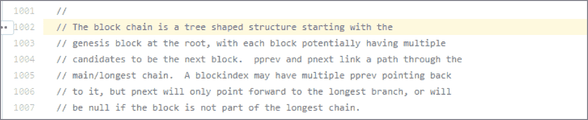

图 1.1 中本聪的原始区块链定义

将图 1.1 中的定义与其他广泛使用的定义进行比较，你可以发现存在显著差异。我的观点是，如果你对区块链是什么感到困惑，你并不孤单。IT 行业在提供标准定义方面做得不好。

## 业务读者

在与客户（或学生）讨论时，我喜欢将区块链比作纸质笔记本。本质上，区块链是一个账本，尽管它是一个分布式数据结构。当你在笔记本上写字时，每条条目占据一行。将区块链想象成一个可以写但无法擦的笔记本。

图 1.2 将区块链账本的属性与笔记本进行了比较。当然，将区块链比作笔记本是一种简化的方法。页面被比作区块链上的区块，而页面条目实际上是区块链交易。区块链是关于实现信任。

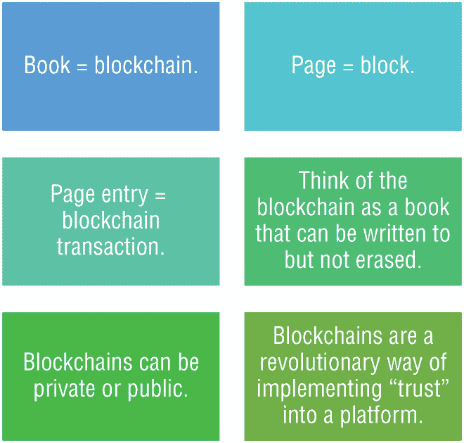

图 1.2 将区块链比作笔记本

在比较区块链和笔记本时，假设并非所有区块链都是一样的，这是准确的，正如并非所有笔记本都是一样的一样。例如，在考虑排序和验证时，`Ethereum`处理交易的方式与`Hyperledger Fabric`不同。当你考虑笔记本时，你知道有些笔记本有线，有些没有，也许有些还有格子。

区块链并非由任何新的变革性技术构建，而是通过三种现有技术的独特同步：点对点网络、密码学和程序（在区块链世界被称为`智能合约`）。

另一个需要考虑的因素是成本。考虑到有许多开源项目可用，即使实施这些技术的成本也几乎为零。从整体上看，区块链并不是一项复杂的技术，但在将这些系统集成到企业时，可能会引入复杂性。

让我们对比一下比特币和区块链，理解这些术语是如何结合的。比特币是一种不受监管的数字货币，使用区块链技术作为其交易账本。区块链是大多数加密货币的平台，是比特币的“赋能者”；而比特币是被“赋能”的应用（加密货币）。可以想象成区块链是铁轨，而比特币是火车。或者，区块链是电话网络，比特币是电话。

从高层次来看，比特币交易的工作原理如下：发送者想要向接收者转移资金。交易在线上表示为一个区块。该区块广播给每个网络参与者。网络参与者审查该区块，如果获得批准，就会被添加到区块链中。最后，资金从发送者转移到接收者。

## 法律受众

立法者甚至进入了定义`blockchain`术语的领域。美国两位众议员——加州民主党人多里斯·马茨伊（Doris Matsui）和肯塔基州共和党人布雷特·古西（Brett Guthrie）提交了`H.R. 6913`《2018 年区块链促进法案》，旨在聚集利益相关者共同制定`blockchain`的通用定义。该法案还建议了促进创新的机会。参见`https://www.congress.gov/bill/115th-congress/house-bill/6913`。

此外，加州最近也定义了什么是区块链和智能合约。参见`http://leginfo.legislature.ca.gov/faces/billTextClient.xhtml?bill_id=201720180AB2658`。

## 区块链的三种定义

区块链技术在金融、物流和政府部门显然具有变革性意义。以下定义与我在书中提到的技术、业务和法律等特定受众保持一致：

- **技术定义**——一种全球共享且安全的数据结构，维护一个不可篡改的交易后端数据库。
- **业务定义**——一种用于同伴之间交换价值的业务网络。价值可以是货币、跟踪信息，或利益方要求在区块链账本上维护的任何内容。
- **法律定义**——一种防腐的账目项字符串，由多方在网络上共享，不需要中心化的中间机构来展示和验证交易。

作为一名面向客户的专业人员，你必须为正确的受众定义正确的区块链术语。并不是每个人都是技术人员，也不是每个人都只关注业务方面。当你与客户讨论区块链时，试着理解他们所处的角色并为他们量身定制定义。这可能会有助于对区块链技术的理解。

## 区块链的历史

如前所述，第一个已知的区块链解决方案是比特币。比特币的主要创新是将加密货币引入世界。`Cryptocurrency`允许人们在没有中心化高昂成本的情况下转移价值，并改进了与传统银行系统（如`SWIFT`）相关的传输速度慢和其他挑战。`SWIFT`是一个面向其银行机构成员的私有全球金融网络。

比特币本质上是一场实验，开启了迈向去中心化支付方式的进程，将银行排除在交易之外。比特币设计于 2007 和 2008 年大金融衰退期间。移除银行带来了去中心化、更快的传输和更低风险等优势，因为没有单一控制器在中央进行支付处理。去中心化、P2P 和密码学是比特币在全球范围内成功的核心。此外，它的影响通过降低消费者的汇款成本，无疑将改善支付和汇款市场。

除了将加密货币带给大众，比特币的第二个创新是它运行的平台，即区块链或分布式账本。对于企业来说，区块链的颠覆将会发生，因为它在合规性、成本效率甚至针对客户群的透明交易方面提供了一种或多种能力。某些垂直行业的企业收益可能是多方面的，正如我们在物流领域看到的对区块链的接受程度。我相信区块链是下一项伟大技术，它将像云计算或外包历史上一样，为公司实现更多的金融工程。

云计算是一种中心化的数据中心管理形式，完全依赖于云提供者的相应执行。为了让这种关系在数据安全、可用性和支持方面运作，显然需要这种信任。在第 7 章“区块链即服务”中，我讨论了更多关于云计算以及如何在各种提供商上部署区块链。

云计算对用户具有巨大益处，并平衡了财富 100 强公司与小型初创公司之间的竞争。较小的公司可以以大公司相同的成本利用云服务。云还允许公司减少开销、减少对基础设施的投资，并随着公司收益间接增加高管薪资。

事实上，公司最重要的资产有时不是员工，而是数据。因此，如果公司要让另一家公司控制对其数据的访问以节省资金，根据我的经验，那些云公司将会进入区块链领域，因为有利用联盟分担成本的能力。区块链即服务（`BaaS`）已经引起了重大新闻，并得到了所有主要云提供商的大力支持。许多组织的业务模式遵循数据收集、挖掘和分发的变现。这真的关乎数据，以及以历史上最低的成本从数据中创造收入。

这种业务模式还可以通过使用联盟来增强。`Consortiums`是组织之间为了共同工作和协作而达成的协议。联盟是对某项服务有相同用例的人或组织社区。

通常情况下，这些联盟提供了一些优势，如加强合作、标准化、易于集成甚至是财务效率。

目前在某些最成功的区块链实施中使用的联盟方法可以为成员公司提供显著的投资回报率（ROI）、总成本（TCO）和其他财务收益。如果你的客户有许多开销点，那么请考虑讨论他们可以相关的区块链用例。拥有转账代理、海关检查员、律师和会计师等中间机构的客户都是区块链技术的极佳潜在目标。在第 6 章“企业区块链经济学”中，我涵盖了区块链经济学的许多优势，例如联盟。

现实情况是，极其成功的公司正在投入数百万甚至数亿美元用于区块链技术。他们并不是为了“声誉”，而是为了生存。这关乎业务环境的变化，由于经济因素的影响正在变得全球中心化。

投资区块链技术的公司名单是财富 500 强中的“大云集”，根据我的经验，我不会看低他们。他们从安全、隐私、财务甚至法律要求等多个角度看到了这项技术的潜力。

从历史上来看，区块链对企业接受区块链技术产生重大影响的一些持续因素如下：

- 智能合约和去中心化应用（`dapps`）等自主创新贡献了企业通过其获得的效率所产生的影响。
- 高效益的解决方案减少了中间成本或运营开销，例如减少企业的中间机构数量或消除所有中间机构。
- 支付汇款的交易成本（如银行间转账或结算）极大影响了公司的盈利能力，特别是在金融领域。
- 提供供应链透明度让消费者能够了解其购买选择的来源以及从源头到市场的监管链。
- 许可链区块链可以扩展并提供企业级安全保障。
- 也许最重要的创新是智能合约。`smart contract`本质上是执行特定任务的计算机代码，当作为分布式应用程序的一部分被正确开发时，可以提供显著的效率、合规性和性能。（在本书的后续过程中，我将从业务和技术两个角度讨论智能合约。）

了解一项技术是如何演进的、它如何随时间和结构而发生变化，或者它如何为组织提供价值是非常重要的。现在，我将让你从一个更早的历史角度了解区块链究竟是如何开始的。

拜占庭将军问题（`BGP`）被认为是计算领域的经典问题。解释这个军事比喻，`BGP`发生在当多个将军（来自同一军队甚至是盟友）包围了一座四周围墙的城堡或城市时。权力的平衡在于，所有将军必须同时攻击才能夺取城市。

在计算机科学中，这被称为`distributed node network`。理解中心化系统与去中心化系统的对比，对于理解比特币的问世至关重要。例如，当分布式系统不同步时会发生什么？系统如何处理不同步状态？

在中心化网络中，有一个中央权威或服务器。网络上的其他参与节点充当接收消息并执行任务的客户端或实体。

去中心化网络中，可以有多个服务器接收来自一个中心化服务器的消息。节点连接到二级服务器。在另一种形式的去中心化网络中，所有服务器在网络中承担着“平等”的责任，没有中心化服务器或主从关系。在许多情况下，去中心化网络被认为是分布式网络的一个子集。

在分布式系统中，没有中央权威的服务器。网络上的每个节点都连接到其他所有节点，并具有相同的权限和处理能力（能力是共享的）。这与区块链相似。

图 1.3 比较了突出节点连接的中心化系统、去中心化系统和分布式系统。

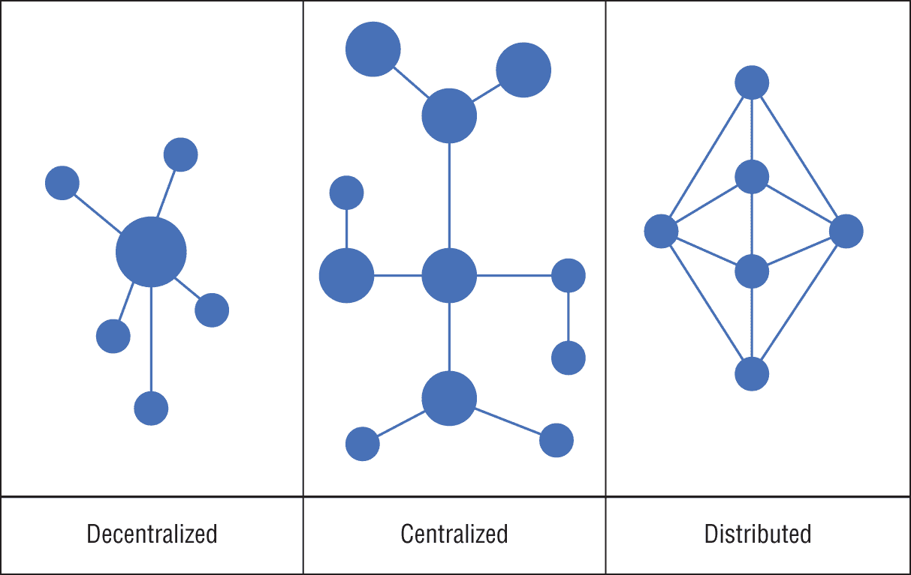

图 1.3 网络系统比较

根据定义，区块链不是中心化系统，尽管某些区块链在去中心化或分布式属性上具有中心化特性。在 Nakamoto 2008 年详细介绍比特币的论文中，他概述了针对分布式节点本质的一种解决方案。（将节点比作我们拜占庭将军问题中的将军。）

行业在 Nakamoto 于 2009 年推出比特币后才真正开始。然而，企业环境直到 2015 年许可区块链的出现才算真正开始。（许可区块链通常被称为`enterprise blockchains`。）因此，在本文写作时，区块链技术还只有 10 年历史，而像 Hyperledger（在第 2 章，“企业区块链：Hyperledger、R3 Corda 和 Ethereum Quorum”中介绍）这样的企业区块链还不到 5 年！

## 区块链 vs 传统数据库

了解分布式区块链账本与传统数据库的区别是非常重要的。分布式账本是由区块链中的每个节点独立存储和更新的数据库。每个节点本质上都维护着区块链的副本。例如，在写作时，以太坊区块链网络有超过 16,000 个节点。在写作时，比特币区块链网络有超过 7,000 个节点。为什么这很重要？每个在线节点都有一份运行区块链的当前副本。如果你丢失了几个节点，也没什么，因为有成千上万的其他节点在维护副本。在以太坊网络中，当一个交易被写入账本时，它也会被写入其他 1,600 多个节点。中心化数据库会维护 1,600 份数据库副本吗？显然没有。

图 1.4 显示了带有 Etherstats.io 服务的庞大以太坊网络。你可以查看以太坊区块链的许多不同数据点，因为 Etherstats 为以太坊区块链提供了透明度。

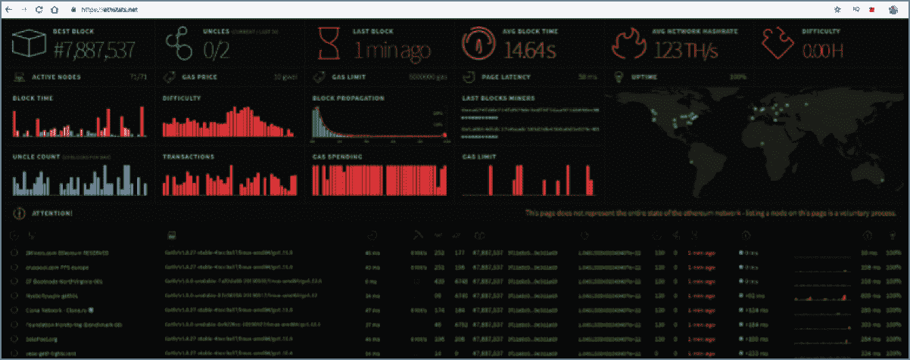

图 1.4 以太坊网络 Etherstats.io

企业可能能够使用以太坊虚拟机（`EVM`）运行其链上智能合约，或作为代币平台用于被称为`dapp`的分布式应用程序。它还将查看图 1.4 中引用的以太坊浏览器（Ethereum Explorer）。

以太坊账本对于跟踪交易和为客户群提供透明度也非常好。在第 2 章中，我将更详细地介绍以太坊，并解释为什么企业对以太坊感兴趣。

数据库与分布式账本或区块链之间的最大区别是什么？嗯，区块链的去中心化和分布式特性使其与`SQL`等传统数据库与众不同。数据库和账本通常是中心化的，这意味着有一个中心化的管理员或中心化节点结构可以创建、删除、修改或更新数据库。常见的数据库包括 Microsoft SQL、`Oracle PL/SQL`和`IBM DB2`。

在传统数据库世界中，对象作为数据结构，这些对象是可变的（mutable），意味着可以被修改或删除。在区块链中，对象在创建后不可修改，因此它被认为是不可变的（immutable）。

### 信任的分布

区块链技术与传统数据库相比提供的真正解决方案是信任的分布。在传统数据库中，信任是中心化的；而在区块链中，信任分布在节点之间。

信任的分布意味着不仅一个区块链节点拥有副本，而且每个区块链节点都维护副本。例如，如果一个企业区块链中有 1,000 个节点，那么在最真实的形态下，区块链充当了“真相代理”。1,000 个节点被攻击或控制的可能性对于具有分布式账本的真实区块链来说在统计学上是不可能的。

`Consensus`（共识）是一种用于分布式账本网络的方法，网络中的所有节点都维护账本的副本。账本用于对交易是否有效达成共识。

例如，在以太坊中，在本文写作时，账本分布在 100 多个国家的节点之间，用于区块链交易。该账本在全球范围内分布，可以通过任何连接互联网的地方访问。要访问该账本，你需要以太坊用于身份验证的公钥。

图 1.5 提供了关于以太坊交易如何发生的深度见解。Jamie 正在发送 $100。该金额将从发送者的钱包中扣除以太，并存入接收者的钱包。

记住，在大多数无许可（企业级）区块链中，区块链网络中的节点拥有整个区块链的副本。这意味着网络上的每个节点都会处理发生的每一笔交易，并且该账本存在多个副本。现在对该交易是否有效已经有了共识（一致）。

### 账本与传统数据库的差异总结

你现在知道区块链拥有账本，而这些账本与传统数据库在以下方面有所不同：

- 数据库的遗留架构基本上是管理数据的中心化存储。这些数据通常是结构化的并由中心化控制的。区块链是去中心化的，分布在区块链网络的节点之间。数据通过共识管理，而不是中心化控制。
- `SQL`或`NoSQL`是常见的遗留数据库应用程序。`SQL`是最常用的数据库。区块链不使用`SQL`或关系数据库结构。


无论是中心化的还是分布式，传统数据库都使用客户端-服务器网络架构。区块链是去中心化的分布式数据结构。

数据库的处理速度被称为每秒交易数（`TPS`），在大多数情况下，遗留数据库的 `TPS` 比区块链快得多。

遗留数据库的控制权保留在指定的机构手中，而在区块链中没有中心化机构。

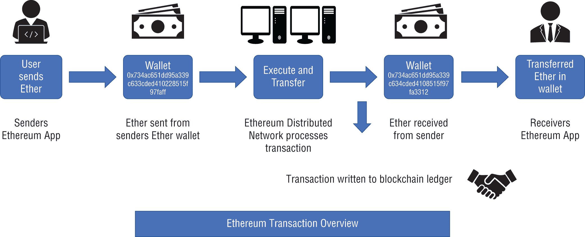

**FIGURE 1.5** 以太坊交易

遗留数据库中的数据可以被修改甚至删除，但在区块链中这种情况不会发生，因为区块链是不可篡的。

数据库遵循 `CRUD`（创建、读取、更新和删除）原则，而区块链遵循 `CR`（仅创建和读取）原则。

## CAP 定理

`CAP` 定理也称为 `Brewer's theorem`，由 Eric Brewer 在 1998 年提出，对分布式系统在维护一致性、可用性和分区容错性方面的问题提供了重要见解，并基于当时的实证证据。

2002 年，Seth Gilbert 和 Nancy Lynch 分别将 `CAP` 定理证明为一个数学定理。`CAP` 定理指出，任何分布式系统无法同时具备一致性、可用性和分区容错性。观察 `CAP` 定理的另一种方式是，它是一个可以帮助系统设计人员在设计网络数据存储时意识到可能的属性权衡的工具。

根据 `CAP` 定理，必须牺牲某些属性来提供另外两个属性。`CAP` 定理中的属性如下：

- `Consistency`（一致性）意味着分布式系统中的所有网络节点具有相同的视图。
- `Availability`（可用性）意味着系统中的节点是可用的，意味着它们在线并接受请求。
- `Partition tolerance`（分区容错性）意味着如果一个节点宕机，其他节点仍然正常。

注意，已经证明分布式系统无法同时具备一致性、可用性和分区容错性。本质上，你无法在分布式系统中同时拥有所有三者，在设计企业服务时——无论该服务是否是区块链——你都需要选择为客户提供哪些属性是更重要的。

`CAP` 定理将系统分为三类：一致性分区容错（`CP`）、一致且可用（`CA`）或可用且分区容错（`AP`）。

在考虑分布式账本时，要意识到延迟会在某种程度上出现并需要围绕其进行设计。分布在本地数据中心的账本的性能自然与分布在云提供商区域和可用区的账本不同。延迟可能会决定应用程序的成败以及用户对应用程序的体验。

图 1.6


**FIGURE 1.6** CAP 定理

合适的客户可能是一个企业对消费者（B2C）模式，其中客户可能希望对特殊订单具有可见性，例如正在从海外采购并处于物流处理过程中的定制项链，这将为客户提供“可见性”，或者在区块链术语中我们称之为“透明性”。

表 1.1 显示了区块链提供的更常提到的特性。如你所见，区块链提供了许多共同特性。

#### 表 1.1: 常见的区块链特性

| 特性 | 注释 |
| --- | --- |
| 全球计算机网络 | 分布式节点，对节点没有中心化控制。 |
| 随处可访问 | 只需有互联网连接，即可从任何地方访问资源。 |
| 防审查和防篡改账本 | 任何实体无法修改或删除数据，这使得区块链具有不可篡改性。由于无法被删除或修改，不可篡改性提供了数据合规性。 |
| 开源 | 使用可移植的编程语言，便于于开发。 |
| 合规性 | 带有经过验证的智能合约。区块链账本还通过审计进行验证。 |
| 多用户 | 对谁可以加入区块链没有限制，且账户可扩展。 |
| 信任 | 信任代码（智能合约），这意味着用户信任区块链技术。 |
| 保证 | 原子性、同步性和可追溯性。 |

区块链和传统数据库具有某些相互相似的属性，但也具有一些相互互不相似的属性。例如，区块链和传统数据库都会复制数据。然而，从比较的角度来看，复制的启动、实现和处理方式实际上非常不同。

也许最重要的区别在于区块链和数据库处理账本上操作的方式。区块链只会向账本中插入操作，这意味着交易是单向的。在数据库中，事务可以是任何从插入或删除操作开始的交易，意味着创建、更新或删除。

图 1.7 了区块链与传统数据库的属性：操作、复制、共识和不变性。将数据库与区块链进行比较时，其属性差异是巨大的。

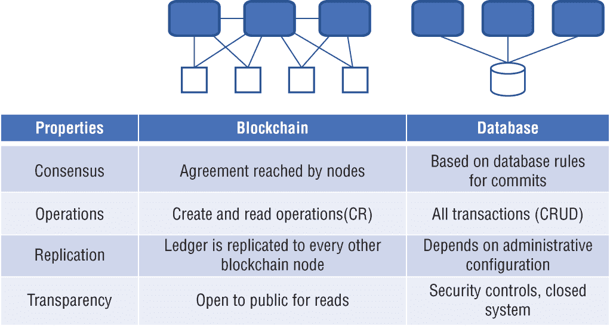

#### 图 1.7 区块链与传统数据库的对比

需要注意的是，区块链在其最真实的实现中仅允许两个特定的功能。

- 交易的验证
- 新交易的写入

请注意，修改数据和删除数据不是区块链支持的功能。区块链向链上进行追加，这是唯一应该支持的功能。区块链是状态化程序，因此具有某些机制来跟踪和更新状态。它们维护过去的信息，因此记住了可能会影响当前交易的之前的交易。区块链交易中使用的术语是 `append`（追加）（我将在书中详细介绍这一点）。

## 为什么区块链被认为是革命性的

在过去的大约 100 年里，改变生活的技术的进步是巨大的。同样，也可以说法是，人工智能、机器学习和区块链等新技术的潜力都将对我们的生活产生深远影响。技术通常具有革命性，而区块链技术看起来也将是其中之一。

区块链技术在几个方面具有革命性，列如下：

- 区块链技术是多种技术的同步，这些技术现在在战略上实施是有意义的。
- 信任是区块链技术的核心，通过使用共识消除了网络中的中介，从而创造了公司可以真正受益的新效率，例如提供透明度、信任根源、降低劳动力成本以及许多其他利益。
- 真正意义上的区块链技术（如中本所指定的）是一种不可篡改的公共账本，允许公民在无需中介的情况下进行交易。

区块链技术对现状具有颠覆性，因为遗留应用程序正在被淘汰。

区块链是一个具有众多用例的平台，其生产质量令人印象深刻。

## 区块链原理

显然，区块链包含的原理为软件、业务甚至政府的重新设计提供了支持。数字经济时代，区块链原理提供了内在公平的系统。

- 信任通过技术的实现提供。区块链用于建立信任的技术通过加密和代码验证交易需求，并决定是否安全接受交易。
- 完整性通过区块链网络提供，那里没有中心化机构或故障点，且每笔交易都被记录。
- 激励分配给所有产生区块的利益相关者，这些参与者被称为 `miners`（矿工）。
- 区块链是去中心化的，这意味着数据分布在数千个节点之间，没有中心化的控制点。
- 隐私意味着用户控制数据如何被处理。例如，不需要了解你的客户（KYC）等合规要求。
- 平等访问/包容性体现在世界上每个人都应该能够参与区块链网络。

### 信任或无信任

区块链并没有真正消除信任；相反，它们减少了网络中任何单一行为/参与者所需的信任。它们通过将信任分配给系统中不同的参与者来实现这一点，通过一种经济游戏激励参与者在协议定义的规则内协作。参与 `Ethereum` 或 `Bitcoin` 等无许可区块链的人获得了经济激励；矿工产生区块并获得挖矿奖励。

基本上，你是在“信任”中介机构来验证交易、发送交易并确认交易已完成。你可能之所以使用这项服务，是因为你期望传输是有效且真实的，因为中间机构履行了信托责任。人们显然信任银行、像 `PayPal` 这样的非银行机构以及 `Western Union`（西部联盟）等实体向请求资金的人发送资金。然而，这种信任可能需要付出代价，无论是财务上还是其他方面的。

`Trustless`（去信任化）通常用于描述“信任的分布”，即信任并非建立在集中化的之上，而是实际上以去中心化的方式分布在区块链的所有参与者中。

通过区块链共识机制，这种方法允许参与者共享数字分布的“真实性”，这些真实性存储在非中心化的分布式账本上。这种真实性可以是交易列表、券证 ID、客户地址，或任何可以写入区块链的资产或信息。

# 信任区块链

无论是许可链还是无许可链，信任都是所有区块链的核心，尽管它们处理信任的方式不同。

区块链之所以是一个真理机器，是因为所用技术的实现，而这种账本的实现维护了真实性，因为账本是信任的不可篡记录。

在最基本的形态下，区块链是交易的不可篡记录。这些交易可以是任何类型，例如资金、产品甚至服务的移动。区块链的设计旨在以某种方式存储信息，使得在不被其他用户检测到的情况下，几乎不可能添加、删除或更改数据。

在考虑区块链技术时，理解信任如何与区块链建立至关重要。以下列表列出了一些重要的考虑因素：

- 区块链技术涉及存储某种数据——例如，`Bitcoin` 区块链中的交易或 `Ethereum` 中的代币。由于所使用的代码和加密技术，该平台被信任可以执行这些交易。信任分布在 `Ethereum` 平台上的区块链节点之间。
- 区块链技术本质上是将信任从中间机构转移到技术（软件代码）。
- 在区块链中存储数据是通过证书和密钥等密码学函数实现的。
- 通过 `Public Key Infrastructure`（`PKI` 公钥基础设施）使用私钥/公钥来保护写入账本的交易数据。

在考虑用户为何可以信任区块链的原因时，有两个主要的考虑因素：

- 区块链上所有的交易数据都被假设是可信的，因为区块链协议是强制执行的，并且使用了加密。
- 区块链用户对区块链的信任基于以下几点：
  - 区块链数据未被篡改，并由在区块链上产生区块的节点管理。
  - 包含数据的区块链账本是不可篡改的，因此不能被删除、修改或移动。

信任是区块链运行机制以及它为企业和用户创造价值的中心。

# 去信任区块链

在考虑区块链时，所使用的模型被认为是去信任模型，其中信任从中间机构转移到技术。

去信任模型不需要“信任”即可进行安全的交互和交易，因为信任被认为是技术平台固有的属性。实际上，去信任的区块链是将信任从来自中心化组织（`银行`、`政府`、`公司`）的人类转移到区块链技术。

区块链的建立基础是：透明代码（`smart contracts`）本质上消除了对中间机构的需求。`Smart contracts`本质上可以减少对会计师、律师、银行家等人的需求。本质上，信任被转化了。区块链中的“去信任”本质上创建了默认信任，这意味着当用户利用区块链时，他们是在“信任”技术按其应的方式运行。

## 透明性与区块链

区块链技术正在使信息传播去中心化，并提供前所未有的透明度。区块链对账本管理和不可篡记录的主要关注，使其成为资源去中心化追踪的完美技术选择，例如，它可以为购买价值物品的企业客户提供透明度。

消费者越来越需要对他们购买的服务和产品有更高的透明度。以下列表是区块链行业在用例、概念证明和实施方面看到巨大需求的几个重点领域：

- 食品供应链可追溯性
- 劳动力凭证验证
- 物流与供应链
- 海关合规
- 企业治理

区块链的透明性来自于任何人可见的区块链交易的开放性。例如，在 `Ethereum` 中，这种透明度是通过使用如 `Etherstats` 等区块链浏览器实现的。区块链浏览器提供了对区块链交易的洞察。例如，在 `Ethereum` 中，你的 `wallet address` 是交易与区块链用户关联的纽带。没有身份识别信息，如钱包持有者的姓名或地址。

透明度提供了关于发送和接收了多少 `Ether`、发送到哪个 `wallet address` 以及其他关键信息（如 `block height` 或 `transaction ID`）的洞察。然而，重要的是要记住，透明度并不提供实际发送 ether 的人的身份。

例如，这个区块链浏览器翻译了账本并提供了一些隐私保护，即显示了 `wallet address`（透明性），但未向公众提供钱包所有者的信息（隐私）。

`Pseudonymous`（伪匿名）被用于引用区块链交易，其中发送者和接收者不被直接识别。

以下是提供这种透明性的区块链应用的一些示例：

- 存储在区块链中的账本使得跟踪运输过程中的所有权责任变得更容易，保护了向患者提供药物的执业人员和药剂师的责任。
- 区块链技术可以应用于医疗领域的多个不同方面，例如管理电子健康记录（`EHRs`），这将被用于验证患者数据，甚至跟踪用于使临床试验药物更安全的研究方法。
- 例如，物流行业的区块链技术有许多投入产的用例。最广为人知的之一是针对珠宝行业，该行业传统上以高水平的欺诈、童工问题、虚假矿产和缺乏透明度而闻名。
- 与 `IBM` 的贵金属联盟建立了一项区块链倡议，为消费者带来透明度。例如，消费者可以验证他们的购买品是来自可持续资源的道德来源，且没有涉及童工。

区块链技术透明性的某些常见消费者优势包括：

- 区块链对于查看和验证交易是开放的，这意味着它们对于客户、联盟成员和企业都是透明的。
- 区块链为参与者提供了伪匿名功能，使得交易是透明的，但不会通过姓名或地址等直接手段识别用户。
- 参与者共享同一个账本并建立一个可供利益相关者引用的共享共识服务。
- 区块链为在物流区块链中提供服务的业务提供了完整性机会。完整性意味着客户可以验证该业务是否真的执行了他们声称的任务。例如，你最喜爱的儿童麦片公司是否真的在购买非转基因（GMO）种子的玉米？

使用区块链可以实现财务透明，并减少对中间机构的需求。区块链解决方案在物流领域的其他显著益处还包括：

- 消费者对供应链问题（如从农场到餐桌）的透明度
- 供应商对其采取负责任且符合道德行为的激励或责任约束
- 针对卡车司机及其驾驶员的里程验证，以满足政府机构的报告要求
- 劳工验证，确保在珠宝开采或加工过程中没有使用童工
- 对供应商（如鱼类加工商）伦理采购的验证
- 婴儿奶粉制造商客户可以查看的不可篡改共享账本视图

## 区块链交易基础

区块链交易的处理方式根据平台而有所不同。例如，`Bitcoin` 处理交易的方式与 `Hyperledger Fabric` 不同，这是预之中的，因为两者的用场景非常不同。

本节的重点是介绍共识以及交易在通用层面的运作方式。第 4 章“理解企业区块链共识”涵盖了关于 `Ethereum`、`Hyperledger Fabric`、`R3 Corda` 和 `Quorum` 交易的具体细节。

### 共识

共识实际上是区块链的基础原则，是网络节点达成一致的方式。区块链网络中的所有节点都维护账本的副本，每个节点都可以从网络中获取历史交易数据以验证请求。

简单来说，共识是网络上的分布式账本节点达成“协议”的一种。这种协议实际上规定了如何实现这一操作以及需要验证什么才能成为一笔有效交易。

这种达成一致的方法，特别是在考虑无许可区块链网络时至关重要，因为网络上的所有节点都需要对交易的有效性达成一致。在许可链区块链中，这种共识算法可以通过策略进行修改甚至被操纵。

例如，在许可链区块链 `Hyperledger Fabric` 中，我们可以有效地指定需要多少个节点（`peers`）批准请求。节点数量可以是一个、十个或所有节点。

共识（一致）是通过实施共识机制、协议、方法或算法实现的。在现实中，机制、方法或算法指的同一件事，即分布式账本平台达成一致的方式。

出于本书的目的，我将主要引用共识算法，因为大多数区块链技术供应商似乎都对该方法达成了标准。

每种区块链都有不同的区块链算法，为分布式账本网络如何达成一致并批准交易提供特定指令。

工作量证明（`PoW`）、权益证明（`PoS`）以及许多其他共识算法将在第 4 章“理解企业区块链共识”中进行介绍，该章节将详细讨论共识算法。

### 区块

区块链交易记录在区块链网络上，并依赖用户验证来完成完全身份认证。在给定期间执行的交易被记录在名为 `blocks`（区块）的文件中。区块形成了许多区块链网络的基础，因为每个新区块都与之前的交易区块相链，形成区块链网络。

如前所述，交易是加密货币价值的转移，被广播到整个网络并收集在区块中。交易的接收者由地址表示，这是一个由 26 到 35 个字母和数字组成的字符串。在使用私钥（秘密密钥）验证后，这些交易将被记录在网络账本上，该交易将公开可用。交易信息的区块构成了区块链，每个区块的高度代表其之前的区块数量。

图 1.8 显示了 `Bitcoin` 交易如何在区块序列中发生。你可以追踪区块 1 如何先写入，然后是区块 2，以此类推。注意，哈希在区块链中被引用，因此区块 1 的哈希会被区块 2 引用，然后区块 3 将引用区块 2 的哈希，以此类推。

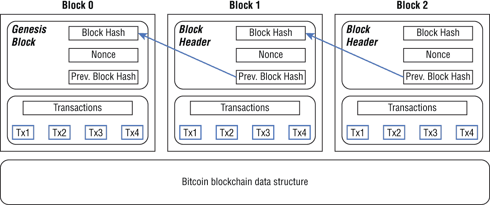

**图 1.8** Bitcoin 区块链

## 区块链的类型

区块链有各种架构，可以满足不同的用例。设计得当的设计可以满足企业客户的需求并满足所需的用例。企业通常倾向于使用如 `Hyperledger Fabric` 或 `R3 Corda` 这种专注于企业的区块链。

在本节中，我将介绍区块链类型和部署考量，并将区块链与云计算服务进行比较。

### 公有链、私有链和混合链

区块链在大多数企业中被视为基础设施。`Infrastructure` 意味着组织维护生产应用程序，并直接或间接地通过服务提供商维护应用程序。

我通常将区块链的部署与云计算对比。在云计算中，有部署模型和服务模型。

部署模型本质上是一种业务模式。让我们回顾 NIST 对云计算的陈述，然后将此定义应用于区块链。

> 云计算是计算世界中一种较新的业务模式。根据 NIST 的官方定义，“云计算是一种实现无处不在、便利、按需的网络访问共享的可配置计算资源池（例如：网络、服务器、存储、应用程序和服务）的模型，这些资源可以以最少的管理努力或服务提供商交互进行快速配置和释放。”

> `https://www.bartleby.com/essay/Cloud-Computing-A-Profitable-New-Business-Model-P3S6F9L29BQQ`

美国国家标准技术研究院（NIST）对部署模型的定义如下（`https://nvlpubs.nist.gov/nistpubs/Legacy/SP/nistspecialpublication800-145.pdf`）：

- **私有云**（Private Cloud）云基础设施供包含多个消费者的单一组织独占使用。
- **社区云**（Community Cloud）云基础设施供特定组织消费者社区独占使用，这些组织具有共同的关注点（例如：任务、安全需求、策略和合规性考量）。
- **公有云**（Public Cloud）云基础设施供公众开放使用。


**混合云**（Hybrid Cloud）云基础设施是两个或多个不同云基础设施（私有、社区或公有）的组合，这些基础设施保持作为独立实体存在，但通过标准化或专有技术连接在一起，从而实现数据和应用程序的可移植性（例如用于云负载均衡的云爆发）。

现在，如果你基本上将`cloud`一词替换为`blockchain`，这正是区块链可以执行的操作、可以部署的方式，甚至是它如何融入企业用例。

值得注意的是，在区块链术语中没有“社区”区块链；但是，存在“联盟”（consortium）区块链，它们服务于相同的部署用例。

这些共识区块链实际上是“社区”，由志同相合的组织通过共享区块链来实现。共识区块链的一个很好的例子是`Ripple`，它被专门用于金融行业，例如银行间支付。

图 1.9 描述了常见的云计算部署模型。不同的服务模型与提供者或消费者所提供的努力程度密切相关。该模型也可以用于区块链部署。例如，区块链可以作为平台即服务（PaaS）或软件即服务（SaaS）部署在云端。

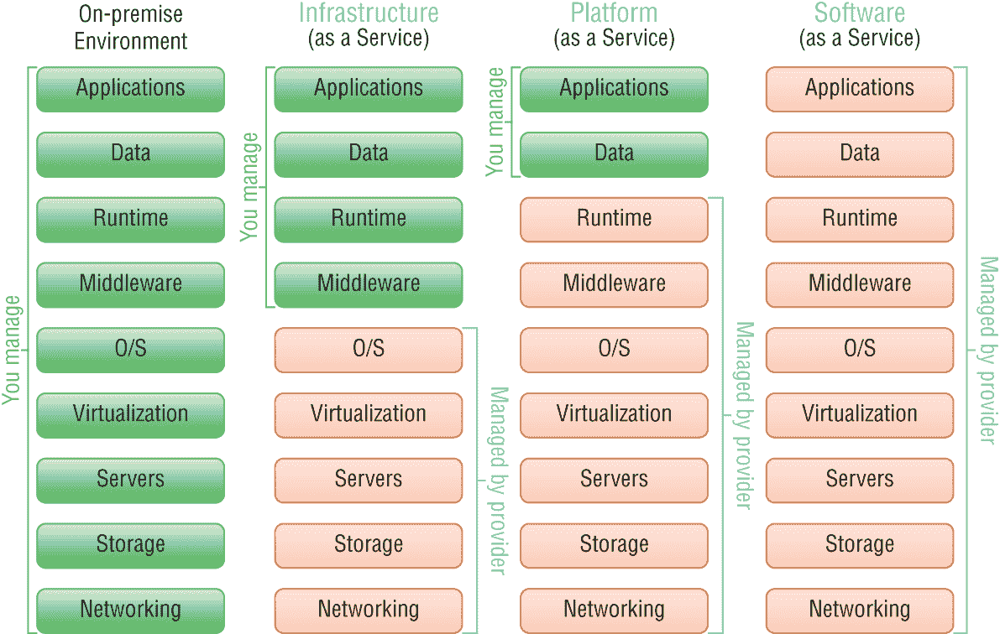

图 1.9 云计算部署模型

区块链通常部署在云端，并可以作为云服务中部署为基础设施即服务（IaaS）、平台即服务（PaaS）或软件即服务（SaaS）。例如，`AWS`、`Azure` 和 `IBM` 等提供者提供了这三种服务模型中的服务。`AWS` 区块链模板被视为 IaaS 部署，而`IBM Blockchain Platform`有两个版本：一个是 SaaS，另一个更倾向于 PaaS。

在比较云计算和区块链时，重要的是要注意，云计算其最本质的形式是一种“中心化”的计算方法。而区块链最本质的形式是“去中心化”的计算形式。任何从事过技术的人都明白，当某项技术为一种用途开发时，它通常可以适应其他用例。区块链也不例外，正如你在阅读整本书时将读到的，区块链有许多不同的用例、例外和变体；有些是中心化的，有些是去中心化的。

例如，`Ethereum` 本质上是一个处理智能合约的去中心化全球计算机。`Ethereum` 的首席 CTO `Gavin Wood` 将区块链描述为“全球计算机”。计算机仅仅是一个计算机器；它接收输入，使用某些指令处理这些输入并产生输出。

在无许可区块链中，区块链运行在“去中心化”的计算机上。在`Ethereum`中，这个全球计算机由分布在 100 多个国家的数千个节点组成。

对任何人开放的区块链通常被认为是公共、无许可区块链。封闭的区块链通常被认为是私有或许可性区块链。

## 公共区块链

公共区块链也被称为无许可或开放式区块链，对任何人开放。`Bitcoin` 是最初的无许可区块链，由`Satoshi Nakamoto`指定并开发。交易由区块链中的所有节点处理，且这些交易在区块链中是公开可见的（透明的）。这些交易还被广泛分布。例如，`Ethereum` 曾在全球范围内拥有超过 6,000 个节点，每个节点都维护每笔交易的副本。在第 2 章中，我将介绍`Ethereum`区块链及其基础设施。

公共区块链对任何人开放，意味着任何人都可以参与。我将详细介绍`Ethereum`区块链及其基础设施。这意味着如果你想运行公共区块链，只需去`GitHub`下载（这当然假设你拥有运行和配置区块链的技术知识）。

图 1.10 展示了无许可区块链的高层结构。

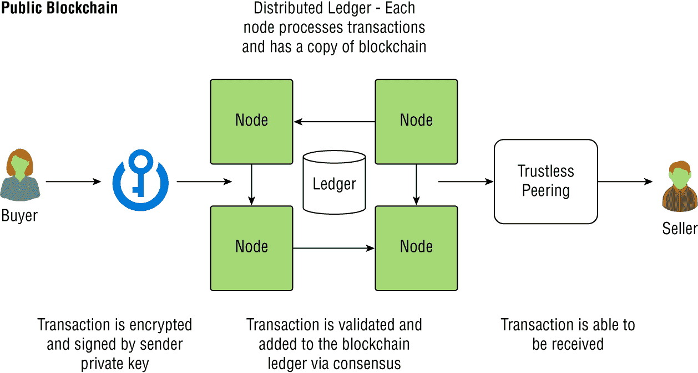

图 1.10 公共区块链示例

公共区块链与私有区块链相比具有一些优势，如下：

* 开放读写
* 广泛分布的账本
* 抗审查
* 由于 51% 攻击规则而安全

## 私有区块链

私有区块链也被称为许可性区块链或企业区块链。这些私有区块链是区块链的混合体，因为它们不是去中心化的，而是更加中心化的，由一个实体或一个联盟控制。访问区块链需要许可，这意味着交易经过授权。

这些区块链可以是开源的、联盟的或私有的。

许可区块链的交易处理方式也不同。交易由选定的节点处理。例如，如`Hyperledger Fabric`等某些区块链可以使用“通道”（channeling）。“通道”也可以用于在许可区块链中过滤节点，防止它们参与其没有直接利益的交易。

交易在区块链中不是公开可见的（透明的）。交易的透明度也可以是许可的。（我将在第 8 章中讨论用例。）

交易通常也是本地分布的，这意味着区块链位于中心控制的数据中心。这种方法从根本上与无许可区块链相反，在无许可区块链中，节点运行在全球不受控的服务器上。

图 1.11 展示了私有区块链的高层结构。

私有区块链使用受信对接的方法，这与公共区块链不同。例如，联盟成员将控制区块链的成员身份或参与。

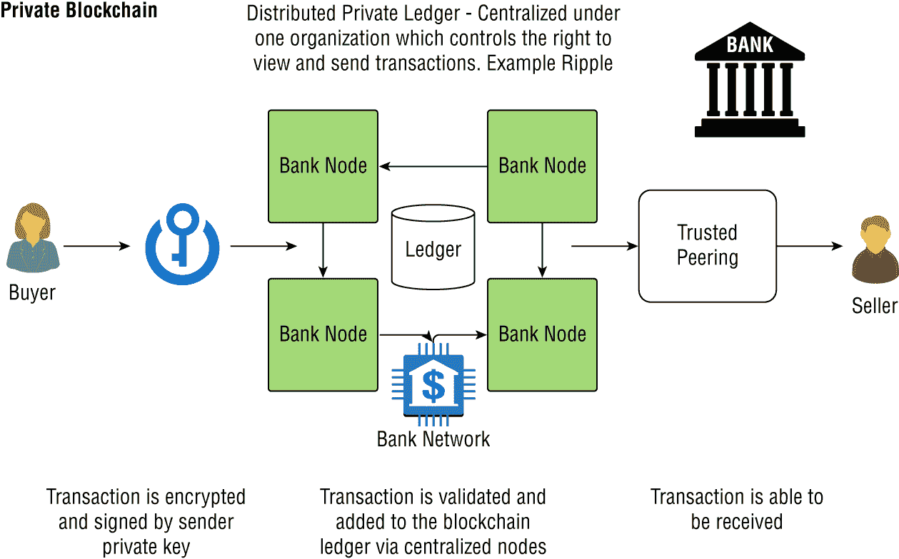

图 1.11 私有区块链示例

私有区块链与公共区块链相比具有一些优势，如下：

* 属于企业级，并为了隐私和安全进行控制
* 由于节点较少且地理分布简单，交易速度更快
* 由于配置灵活性，具有更好的可扩展性
* 由于在适当区域进行受控的数据存储，具有合规性支持

混合区块链是一种同时包含私有许可链和公共无许可链的特征与功能的区块链。例如，一家公司可能对其内部员工有极高的性能要求和严格的安全合规性，但在涉及 B2C 交易时，他们可能会将其放在离链服务（通道）上来处理加密货币交易。

简而言之，你可能希望将混合区块链视为混合云环境，即兼取两者的特性，并提供满足你企业要求的解决方案。

控制、性能、透明度、合规性等功能可以在混合区块链解决方案中进行精细的编排。我将混合区块链与混合云解决方案进行对比。混合云本质上涵盖了云计算领域中两者的优点。

在混合云解决方案中，你可以将本地数据中心扩展到如`AWS`之类的云计算平台。当扩展到`AWS`时，你的数据中心可以提供许多优势，例如通过减少资本支出来提高成本效益、在高峰时段通过突发服务来缩短使用时间，或利用可用性选项。

区块链作为混合解决方案部署时也可能如此。例如，公司可以将本地的`Hyperledger Fabric`区块链扩展到`AWS`或`IBM BaaS`。其主要优点可能是离链以满足合规性要求，或扩展区块链网络。

图 1.12 展示了决定实施公共、私有还是混合区块链解决方案的决策树。混合区块链是私有许可链的衍生物。混合区块链也可以扩展到无许可链。

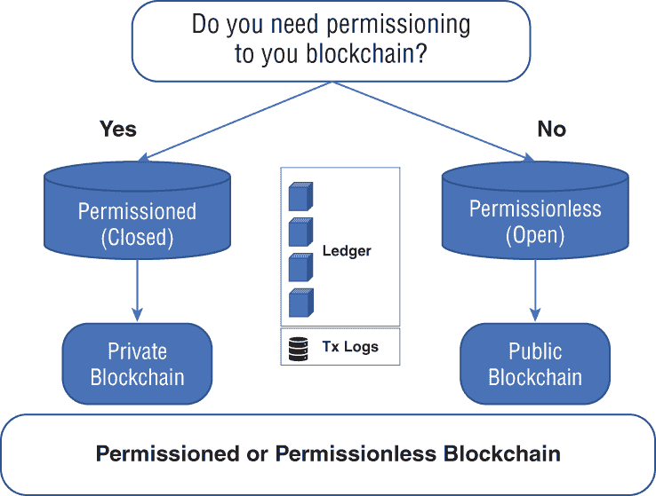

FIGURE 1.12 区块链部署决策树

在选择区块链类型时，另一个需要考虑的因素是成本。我在第 6 章“企业区块链经济学”中介绍了区块链部署的成本。

大型企业通常需要区块链技术能带来的收益，而没有公共区块链相关的高昂风险。如果是这样，那么混合解决方案可能为企业提供适用于正确场景的正确解决方案。

在第 3 章“构建你的企业区块链”中，我将讨论如`Hyperledger`、`R3 Corda`和`Ethereum Enterprise Alliance`等专注于私有-公共区块链的项目如何让组织围绕区块链解决方案进行合理的范围划分。

## 许可链或无许可链

在本书中，你会发现`public`（公共）和`private`（私有）有时与许可链和无许可链交替使用。公平地说，这些术语在某些情况下对于不同的区块链公司和组织可能有某些不同的使用场景或含义。

在我多年的解决方案销售、架构设计和实施期间，完全可以这么说：特定的供应商、服务提供商和媒体让事情变得比实际需要的更复杂。即使云计算已经趋成熟，大多数供应商仍在行业公认的`NIST`云计算定义之上添加了自己的独特见解。

在章的早期，我涵盖了公共、私有和无许可区块链类型。现在我将介绍什么是许可链。许可链是区块链的一种，只允许授权成员加入区块链。许可链对于希望获得区块链某些优点（如不可篡改的账本）但不需要透明度、开放成员身份或智能合约的企业来说是理想的。许可链总是改变了区块链最初的用途。也就是说，区块链最初是开放且无许可的，这本质上意味着它们对公众开放。

## 总结

中本聪明本质上结合了计算机和经济学，创建了一个名为`Bitcoin`的区块链平台，它改变了人们与银行等传统机构互动的方式。`Bitcoin`的出现是 2008 年金融危机的直接结果。

区块链技术是革命性的，特别是对于金融领域和物流领域。正如你在这一章中所学的，区块链是一种分布式账本类型，用于维护交易数据的永久且防篡改的记录。

企业刚刚开始理解区块链在他们的组织内部、用户以及客户中的应用潜力，有些企业已经开始采用区块链技术。

根据你所谈的对象的不同，有多种定义和多种类型的区块链。对任何人开放的区块链通常被认为是公共链或开放链。闭合的区块链通常被认为是私有链。最后，企业级区块链通常是私有许可链。

# 第 2 章

## 企业级区块链：Hyperledger, R3 Corda, Quorum 和 Ethereum

在本章中，我将介绍以下企业区块链的技术优势、其结构以及它们如何契合到企业中：

* `Hyperledger`
* `R3 Corda`
* `Quorum`
* `Ethereum`

本章涵盖的技术优势包括安全、共识、虚拟机、特性和功能，这些对于理解区块链平台至关重要。本章将从基础层面涵盖架构，以便你理解区块链网络和业务。在第 3 章“构建你的企业区块链”中，我将专注于区块链网络的设计步骤以及特定区块链的最佳实践。

## 比较企业级区块链

区块链主要用于两大 IT 解决方案：

* 公共无许可链
* 私有企业许可链

第三种方法是混合解决方案，它结合了大量的私有和公共区块链服务。混合区块链将在第 8 章“区块链用例”中作为案例讨论。

企业级区块链的要求不同于`Ethereum`等公共区块链。我在整个书中都会讨论企业级区块链的优势。

正如第 1 章“区块链技术简介”所述，公共无许可链使用称为`Internet Protocol (IP)`的网络协议与区块链网络上的节点通信并管理事务。节点是运行区块链协议的其他虚拟机。

区块链运行协议的变体，每个平台之间可能不同。例如，`Ethereum`使用点对点网络协议，而`R3 Corda`使用点点网络协议。

共识在区块链之间也存在差异，我将在本章对其进行高层次讨论。它将在第 4 章“理解企业区块链解决方案”中进行更详细的技术介绍。

表 1.2 显示了不同的公共和私有区块链在平台特性和功能方面的差异。选择正确的区块链平台可能取决于某一个特性。

### 混合链

在无许可链中，账本是开放读写的，这意味着任何人都可以访问交易记录。例如，这可以通过区块链浏览器来实现。其他特性如身份、安全和信任显然是以不同的方式处理的。

企业区块链如`Hyperledger Fabric`、`R3 Corda`和`Quorum`是分布式账本，其中所有参与者在区块链上都是已知的且许可的。交易是基于角色的并由共识决定的。企业区块链通常引入了某种形式的中心化，但也可能是去中心化的联盟。共识系统允许企业决定符合其用例的令牌或加密货币在受控的区块链中通常是不需要的。企业区块链可以利用“链外”存储服务，例如星际文件系统（`IPFS`），来降低成本。由 Protocol Labs 创建的`IPFS`是一种对等协议，每个节点存储一组哈希文件。`IPFS`是一种迷人的区块链存储方法，可以提供成本和编程效率。`IPFS`明确通过使用哈希允许更丰富的交互。

企业集成可能不需要中间件或 API 更改来建立企业服务。例如，通过`Ethereum`和`Quorum`，已经具有扩展区块链的能力。混合解决方案意味着区块链可以从许可扩展到非许可链如`Ethereum`。企业区块链通常分为以下几类，最常见的如下：

* **私有企业区块链**由单一组织管理。参与者是内部用户。
* **联盟企业区块链**由多个组织管理。访问需要联盟中多个参与者的共识。
* **混合企业区块链**通常用于扩展能力。混合区块链可以是许多私有和公共扩展。

从预售的角度考虑区块链时，理解不同企业区块链的用例至关重要。并非所有企业区块链都能满足每个成员的需求。我现在将介绍主要的企业区块链，让你了解它们是如何比较和对比的。我将在书中详细介绍并对比这些企业区块链特性和用例。

进入企业区块链真正方便的部分是，有很多企业区块链需要学习——即使你包含了`Ripple`（它是一个支付网络）。我们在本章中不深入介绍`Ripple`，因为它是一个支付网络且`Ripple`不支持智能合约。智能合约为企业区块链组织提供了核心利益。

相反，本书将重点关注`Hyperledger`、`R3 Corda`、`Quorum`和`Ethereum`。表 2.1 显示了五种主要的企业级区块链以及它们在行业、账本、共识方法、智能合约和加密货币支持方面的对比。

你可以在`https://www.horsesforsources.com/top-5-blockchain-platforms_031618`在线查看完整图表。它提供了许多解决方案实际上参与企业区块链的见解。

**表 2.1**：企业区块链对比

| | ETHEREUM | R3 CORDA | QUORUM | HYPERLEDGER | RIPPLE |
| --- | --- | --- | --- | --- | --- |
| **行业** | 跨行业 | 金融 | 跨行业 | 跨行业 | 金融 |
| **账本** | 非许可 | 许可 | 许可 | 许可 | 许可 |
| **共识** | 工作证明 | 插件 | 多数投票 | 插件 | 概率投票 |
| **智能合约支持** | 是 | 是 | 是 | 是 | 否 |
| **加密货币** | Ether (Eth) | 不适用 | 不适用 | 不适用 | Ripple (XRP) |

## Hyperledger 项目

`Linux Foundation`托管`Hyperledger`，并为`Hyperledger`社区提供治理结构和监督。它是一个全球开源项目，是技术领导合作的成果。`Linux Foundation`还采用了企业区块链的模块化伞型方法。`Hyperledger`是一种开源软件许可模型，允许用户以适当的方式建模并分发。

如`图 2.1`所示，`Hyperledger`使用伞型方法管理其开源项目。作为一个组织，`Hyperledger`管理着超过 100 个开源协作（项目）。`Hyperledger`结构包含三个模块：基础设施、框架和工具。

你可以看到`Hyperledger`有六个框架和工具。我将主要关注`Hyperledger Fabric`，因为其广泛开发和显著的用例。伞型策略也称为“温室策略”，是一个`Linux Foundation`重复使用的经过证明的模型。

等待，正如提到的，在写作时，`Hyperledger`有六个框架。每个框架都是一个区块链。`Hyperledger`成员联盟意识到一个区块链框架无法满足所有成员的需求。这五个框架确保其成员拥有部署适当区块链的特性、功能和其他需求。

等待，正如提到的，在写作时，`Hyperledger`有六个框架。伞型策略也称为“温室策略”，是一个`Linux Foundation`重复使用的经过证明的模型。从历史上看，`Linux Foundation`为开源项目提供了良好的管理和见解。

### Hyperledger 框架

正如提到的，在写作时，`Hyperledger`有六个框架。每个框架都是一个区块链。`Hyperledger`成员联盟意识到一个区块链框架无法满足所有成员的需求。

`表 2.2`展示了构成`Hyperledger`框架的五种区块链。我将关注`Fabric`，它是一个支持通道的许可区块链。通道允许私有的受控交易。

正如提到的，`Fabric`将是本书的重点，但`Hyperledger`家族中的其他框架如`Burrow`或`Sawtooth`在书中主要作为用例的对比被引用。

Indy 是一个 Hyperledger 项目，旨在支持分布式账本平台上的独立身份。Indy 提供了广泛的工具、库和可重用组件，用于提供根植于区块链或其他分布式账本的数字身份。其优势在于，数字身份为跨越管理域、应用程序以及任何其他孤岛的企业提供了互操作能力。

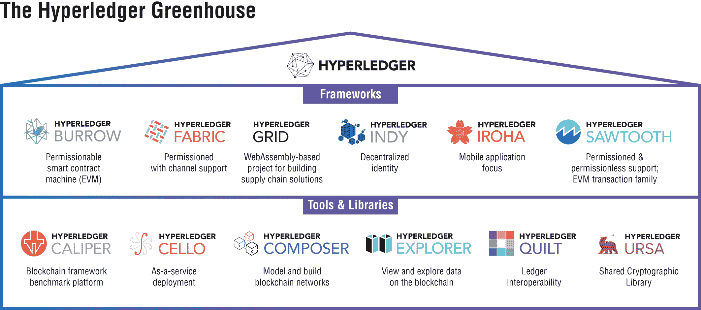

`图 2.1` Hyperledger 方法 (Linux Foundation) ¶ 图表由 Linux Foundation 提供

`表 2.2`: Hyperledger 框架中的区块链

| 框架 | 应当用例 |
| --- | --- |
| Indy | 去中心化身份 |
| Iroha | 侧于移动应用 |
| Sawtooth | 支持许可与无许可访问；EVM 事务族 |
| Burrow | 可许可的智能合约虚拟机 (EVM) |
| Fabric | 支持通道的许可链 |
| Grid | 基于 Web Assembly 的项目，用于构建基于供应链的解决方案 |

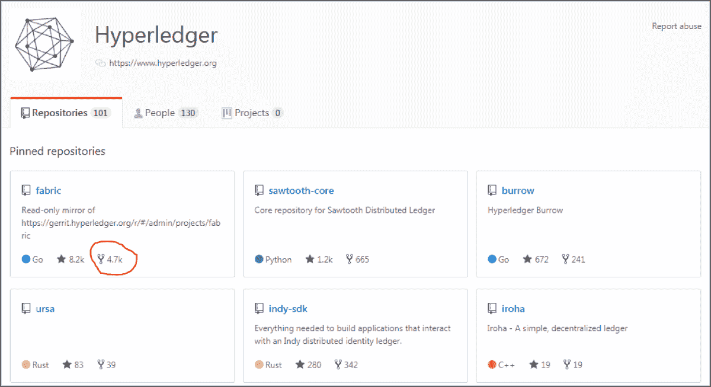

`图 2.2` Hyperledger Fabric GitHub forks

## HYPERLEDGER IROHA

Hyperledger Iroha 由多家参与公司创建，例如 Soramitsu、日立、NTT Data 和 Colu。Iroha 是一种业务区块链框架，专门设计用于高效集成到需要分布式账本技术的移动项目中。Iroha 具有现代的、领域驱动的 C++ 设计，以及一种名为`Sumeragi`的基于链的拜占庭故障共识算法。

Sumeragi 使用基于许可的服务器信誉系统，根据三个特定因素计算服务器的可靠性：

* 每个服务器在成员服务注册的时间
* 每个服务器处理的成功事务数量
* 故障检测

`Sumeragi`中的共识是在单个事务以及应用事务产生的全局状态上执行的。

## HYPERLEDGER FABRIC


Hyperledger Fabric 主要由 IBM 开发。Fabric 显然旨在为开发企业所需的模块化架构应用程序或解决方案奠定基础。Hyperledger Fabric 允许对组件（如共识和成员服务）采用本质模块化的方法，并利用容器托管名为 `chaincode` 的智能合约，这些合约构成了系统的应用程序逻辑。

Hyperledger Fabric 的许可性质为参与者提供了操作的隐私性。对隐私的需求并不排除监管机构对识别和审计能力的需求。基本上，身份（成员）的加密是以一种方式进行的，对其他区块链参与者保持“私密”。审计功能已有效内置，并满足了合规性要求，这是企业关注的重点。

Hyperledger Fabric 不执行挖矿，尽管通过引用链外交易所 `chaincode` 实现加密货币支持。

## Hyperledger Sawtooth

Hyperledger Sawtooth 由 Intel 构建，比开源区块链更接近私有区块链。Sawtooth 是一个用于构建、部署和运行分布式账本的模块化平台，它被认为是 Hyperledger 第二最受广泛接受的区块链框架。

Hyperledger Sawtooth 包含一种名为 `proof of elapsed time`（`PoET`）的多样化共识算法，该算法针对大规模分布式验证者群体，且资源消耗极低。这本质上意味着它可以高效地实现分布式共识。

## Hyperledger Burrow

Hyperledger Burrow 是一个可许可的智能合约虚拟机，在 2014 年发布时是同类首创。Burrow 的主要价值点在于它提供了一个模块化的区块链客户端，带有一个根据以太坊虚拟机（`EVM`）规范构建的许可智能合约解释器。Burrow 专门被构建成一个轻量级、高效且快速的许可智能合约虚拟机。Burrow 通过利用经过加固且快速的 `Tendermint` 共识协议与 Burrow 的 Apache 许可 `EVM` 协作，实现了这一目标。

智能合约在支持智能合约的不同区块链上应该执行相同。这对于可移植性非常有用，因为用户可以轻松地从 Hyperledger Burrow 开始，并随着时间的推移将其智能合约迁移到另一个平台。

从此图中可以明显看出，Hyperledger 作为区块链框架组合具有某些相似的能力，但框架之间也存在一些巨大的用例差异。

## 介绍 Hyperledger Fabric

从此图中可以明显看出，Hyperledger 作为区块链框架组合具有某些相似的能力，但框架之间也存在一些巨大的用例差异。

## Hyperledger Indy

Indy 是一个 Hyperledger 项目，旨在支持分布式账本平台上的独立身份。Indy 提供了广泛的工具、库和可重用组件，用于提供根植于区块链或其他分布式账本的数字身份。其优势在于，数字身份为跨越管理域、应用程序以及任何其他孤岛的企业提供了互操作能力。


`图 2.1` Hyperledger 方法 (Linux Foundation) ¶ 图表由 Linux Foundation 提供

`表 2.2`：Hyperledger 框架中的区块链

| 框架 | 应当用例 |
| --- | --- |
| Indy | 去中心化身份 |
| Iroha | 侧于移动应用 |
| Sawtooth | 支持许可与无许可访问；EVM 事务族 |
| Burrow | 可许可的智能合约虚拟机 (EVM) |
| Fabric | 支持通道的许可链 |
| Grid | 基于 Web Assembly 的项目，用于构建基于供应链的解决方案 |


`图 2.2` Hyperledger Fabric GitHub forks

## Hyperledger Iroha

Hyperledger Iroha 由多家参与公司创建，例如 Soramitsu、日立、NTT Data 和 Colu。Iroha 是一种业务区块链框架，专门设计用于高效集成到需要分布式账本技术的移动项目中。Iroha 具有现代的、领域驱动的 C++ 设计，以及一种名为 `Sumeragi` 的基于链的拜占庭故障共识算法。

Sumeragi 使用基于许可的服务器信誉系统，根据三个特定因素计算服务器的可靠性：

* 每个服务器在成员服务注册的时间
* 每个服务器处理的成功事务数量
* 故障检测

`Sumeragi` 中的共识是在单个事务以及应用事务产生的全局状态上执行的。

## Hyperledger Fabric

Hyperledger Fabric 主要由 IBM 开发。Fabric 显然旨在为开发企业所需的模块化架构应用程序或解决方案奠定基础。Hyperledger Fabric 允许对组件（如共识和成员服务）采用本质模块化的方法，并利用容器托管名为 `chaincode` 的智能合约，这些合约构成了系统的应用程序逻辑。

Hyperledger Fabric 的许可性质为参与者提供了操作的隐私性。对隐私的需求并不排除监管机构对识别和审计能力的需求。基本上，身份（成员）的加密是以一种方式进行的，对其他区块链参与者保持“私密”。审计功能已有效内置，并满足了合规性要求，这是企业关注的重点。

Hyperledger Fabric 不执行挖矿，尽管通过引用链外交易所 `chaincode` 实现加密货币支持。

## Hyperledger Sawtooth

Hyperledger Sawtooth 由 Intel 构建，比开源区块链更接近私有区块链。Sawtooth 是一个用于构建、部署和运行分布式账本的模块化平台，它被认为是 Hyperledger 第二最受广泛接受的区块链框架。

Hyperledger Sawtooth 包含一种名为 `proof of elapsed time`（`PoET`）的多样化共识算法，该算法针对大规模分布式验证者群体，且资源消耗极低。这本质上意味着它可以高效地实现分布式共识。

## Hyperledger Burrow

Hyperledger Burrow 是一个可许可的智能合约虚拟机，在 2014 年发布时是同类首创。Burrow 的主要价值点在于它提供了一个模块化的区块链客户端，带有一个根据以太坊虚拟机（`EVM`）规范构建的许可智能合约解释器。Burrow 专门被构建成一个轻量级、高效且快速的许可智能合约虚拟机。Burrow 通过利用经过加固且快速的 `Tendermint` 共识协议与 Burrow 的 Apache 许可 `EVM` 协作，实现了这一目标。

智能合约在支持智能合约的不同区块链上应该执行相同。这对于可移植性非常有用，因为用户可以轻松地从 Hyperledger Burrow 开始，并随着时间的推移将其智能合约迁移到另一个平台。

从此图中可以明显看出，Hyperledger 作为区块链框架组合具有某些相似的能力，但框架之间也存在一些巨大的用例差异。

## 介绍 Hyperledger Fabric

从此图中可以明显看出，Hyperledger 作为区块链框架组合具有某些相似的能力，但框架之间也存在一些巨大的用例差异。

## Hyperledger Fabric Ledger

Hyperledger Fabric 账本是区块链事务的不可变记录。状态转换由链 code 调用触发，即 `transactions`。每个事务的结果是一组资产键值对，作为创建/读取/更新/删除 (CRUD) 操作提交到账本中。这也是一个事务日志。

键值对（key-value pair）是 Fabric 账本表示和标识资产的有效方式。例如，您可以指定一个键值对来表示一个如汽车的资产，其数据存储在 Fabric 账本。数据存储在键值对中。

以下是一个键对的示例：

```
'color' : 'purple'
```

在这个示例中，`"color"` 是键，而 `"purple"` 是颜色的值。该键值对会被存储在账本，账本会维护该记录。

资产通过账本请求（事务）如查询或更新进行跟踪、标识或更新。简单来说，账本就是实际上区块。账本是一个基于文件的账本，存储了序列化的区块。Hyperledger Fabric 具有一些超出区块链标准行为的有趣功能。例如，状态数据库始终可以通过重新处理账本来重建，而且如果事务被认为无效，则可以对其进行回滚。

目前 Fabric 中的状态数据库也有两种选择。首先是名为 `LevelDB` 的嵌入数据库。您也可以选择外部的 `CouchDB` 作为另一个选项。

Hyperledger Fabric 账本包含两个不同的部分。

* 状态数据是区块链上资产当前状态的表示。当状态发生变化时，资产状态数据可以发生改变。
* 事务日志按接收顺序记录所有修改了状态数据的事务。一旦数据写入事务日志，它们就是不可更改的，不能被修改或删除。

## Hyperledger Fabric 共识

Hyperledger Fabric 的共识非常广泛，涵盖了从开始到结束的整个事务流。

在 Hyperledger Fabric 中，节点（nodes）和对等节点（peers）可能会让人困惑，因为它们都承担多个角色。这与 Ethereum 等形成了鲜明对比，因为 Ethereum 中参与共识的节点角色和任务是完全相同的。简单来说，Ethereum 中的每个节点都做相同的事情，但在 Hyperledger 中，节点在区块链网络上的使命非常不同。

我将在本章稍后的“节点”部分讨论 Hyperledger 节点。

Hyperledger 下的共识算法是可插拔的，这意味着用户可以在部署期间选择他们喜好的算法。

在编写时，Hyperledger Fabric 1.4 支持以下共识方法：

* Kafka/Zab
* Raft
* SOLO

`第 4 章` 涵盖了 Hyperledger、Ethereum、Corda 和 Quorum 的共识方法选项。

## Hyperledger Fabric 事务

Hyperledger 中的事务是向区块链请求在账本上执行一个函数。该函数由链码（chaincode）实现，链码是运行在验证节点上的去中心化事务程序。链码事务是有时间限制的，并在链码部署期间进行配置，类似于数据库调用或 Web 服务调用。

如果事务超时（例如），它被视为错误，且不会导致区块链账本上的状态变化。如果被调用的函数具有相同的限制性机密范围，一个链码函数可以调用另一个链码函数。基本上，如果两个机密链码共享相同的验证节点组，则一个机密链码可以调用另一个。

由于事务在新区块中运行，因此会维护与区块链上上一个区块世界状态的增量（delta）。增量是区块链世界状态的变化。例如，如果上一个区块是 `block 27000` 且账本发生了更新，那么世界状态就会改变。简单来说，新区块等于新状态。

Hyperledger 支持两种类型的事务。

* `代码部署事务（code-deploying transaction）` 基本上是区块链应用程序的初始化（`Init`）函数。当您首次将链码部署到区块链时会调用 `Init`。
* `代码调用事务（code-invoking transaction）` 在您想要调用（`Invoke`）链码函数以在区块链上执行事务时调用。这些事务将有效地捕获为区块链上的区块。

Hyperledger Fabric 通常被区块链社区认为是开发应用程序较简单的平台之一。这是因为其区块链开发支持的灵活性。

Hyperledger Fabric 中的事务具有以下工作流。这与其他区块链有显著不同。

1. 客户端应用程序发起一个触发链码的事务提议。
2. 事务提议将传输到相应的对等节点，按照策略进行背书。
3. 背书对等节点将执行链码并将实际事务写入账本。
4. 背书对等节点将对事务签名并返回给提交者。

将 Hyperledger Fabric 与 Ethereum 比较，事务工作流显示了差异`图 2.4` 显示了执行样式。总之，Fabric 网络有一个需要维护的清晰事务顺序。

有关事务的更多信息，请参考白皮书“Hyperledger Fabric: 许可链区块链的分布式操作系统”（`https://www.hyperledger.org/wp-content/uploads/2017/08/Hyperledger_Arch_WG_Paper_Consensus.pdf`）。

## Hyperledger Fabric 节点

节点概念在所有区块链技术中都是常见的。节点是区块链技术中的通信端。

节点连接到其他节点，形成去中心化网络。节点使用点对点协议的形式维护分布式账本同步。在 Hyperledger Fabric 中，节点需要有效的证书才能与网络通信，参与者通过节点连接到网络。

记住，Hyperledger Fabric 是许可链区块链，在区块链上进行交易之前会验证成员、身份和证书。参与者的身份与节点身份不同，可能是一个组织。例如，当参与者执行或调用事务时，其证书将用于对事务签名，因此也会通过验证。

重要的是，Hyperledger 中的并非所有节点都是平等的，这与其他区块链中每个节点维护相同的账本副本不同。在 Hyperledger Fabric 中有三种不同的节点：

* `客户端节点（Client nodes）`为客户端应用程序发起事务。
* `对等节点（Peer nodes）`提交事务并保持区块链账本上的数据同步。
* `排序节点（Ordered nodes）`是通信骨干，负责事务的分发。

# Hyperledger Fabric 业务网络

业务网络模拟了参与者、资产、注册表和事务。事务处理器在这些元素上实现业务逻辑。访问控制列表（`ACLs`）定义了隐私和共享设置。

部署 Hyperledger Fabric 业务网络模型最有效的方法是使用 `Composer Playground`，它是一个用于测试和部署业务网络的交互式 Web 工具。区块链开发者可以根据选择将其安装在 `Docker` 上，也可以安装在本地。

业务网络归档（`BNA`）是通过 `Hyperledger Composer` 创建的。`Composer` 是允许区块链开发者打包多个不同的文件并生成归档文件的工具，该文件随后可以部署到 Fabric 网络中。`Composer` 供开发者免费使用，并且在 IBM Cloud 上提供了一个名为 `Composer Playground` 的版本。

## Hyperledger Fabric 链码（智能合约）

`Chaincode` 是描述 Hyperledger Fabric 中智能合约的术语。Hyperledger Fabric 完全支持智能合约，在本文编写时支持 `Golang` 和 `JavaScript`。

`Chaincode` 是应用级代码，存储在账本上并作为 Hyperledger 交易的一部分。这些交易还会修改账本状态，该状态被称为 `world state`（世界状态）。

`Chaincode` 特地实例化在通道（channel）上，也可以安装在多个通道上。`channel` 是寻求隐私的节点之间使用的特定通信路径。例如，如果你有两个通道，你可以有效地部署两个版本的代码，且该代码不会被来自另一个通道的其他代码访问。

客户端应用程序通过链码方法 `Init` 和 `Invoke` 与区块链账本交互。`chaincode` 需要安装在每个将背书事务的节点（peer）上，并实例化在通道上。指定你的成员策略也是此链码策略的一部分。


在创建链码时，你需要实现两个方法：

*   `Init` 在链码接收到实例化（instantiate）或升级（upgrade）事务时最初被调用。
*   `Invoke` 在接收到调用（invoke）事务时被调用，用于处理任何事务提议。

如果你正在开发区块链应用程序，你需要理解在链码中同时创建 `Init` 方法和 `Invoke` 方法是非常重要的。

## Hyperledger Fabric 开发工具

`Hyperledger Composer` 是一个开发框架，用于编写区块链网络的链码，并用于在 Hyperledger Fabric 中部署业务网络。

`Hyperledger Composer` 有两个版本：

*   一个可用的本地版本，称为 `Composer`，你可以将其安装在云平台的本地。
*   一个由 IBM Cloud 托管的在线版本，称为 `Hyperledger Playground`。

你可以从 GitHub 的 `https://hyperledger.github.io/composer/latest/` 下载 `Hyperledger Fabric Composer`。

你可以在 `https://composer-playground.mybluemix.net/` 访问 `Hyperledger Fabric Composer Playground`。


图 2.5 显示了 `Composer Playground` 的登录界面。

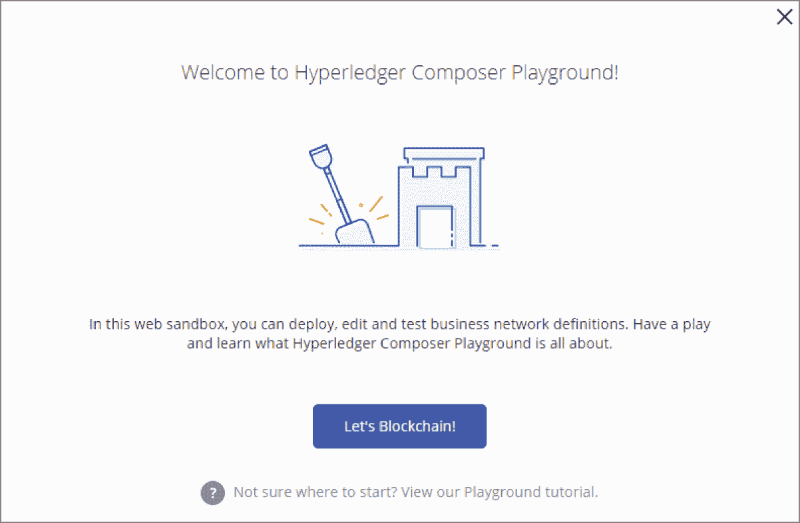

图 2.5 显示了 `Hyperledger Fabric` 的架构。


Hyperledger Fabric 的权限管理。

## Hyperledger Fabric 治理

由于 `Hyperledger Fabric` 是一个私有验证者网络，所有实体都必须向成员服务注册以获取身份。该身份提供了访问网络的权限。需要两个证书：`enrollment certificates`（注册证书）和 `transaction certificates`（事务证书）。

`Hyperledger Fabric` 在架构的每一层中都内置了权限治理。诸如启动新联盟、添加或移除成员、定义新通道等操作，都需要相关组织的批准签名。整体策略模型在整个区块链网络中执行。

`Hyperledger Fabric` 支持基于 `consortium`（联盟）或 `channel`（通道）的两个级别的权限治理。`consortium` 是一种基于成员的网络服务，由组织的成员组成。

系统也支持 `Channels`，通过点对点连接为事务提供增强的隐私保护。`Channels` 还提供了独立的事务账本和网络服务。第 9 章，“区块链治理、风险、合规 (GRC)、隐私和法律问题”详细涵盖了围绕 Fabric 的治理。

## 介绍 R3 Corda

`R3` 是一家企业级区块链软件公司，由来自私有部门和公共部门的 200 多名成员和伙伴组成的广泛生态系统开发。

`Corda` 是一个开源区块链平台，`Corda Enterprise` 是供企业使用的 `Corda` 区块平台商业版本，带有 `Corda support`。

`Corda` 平台的开发与金融机构、贸易监管机构、行业协会、专业服务公司和技术公司的广泛网络紧密合作，旨在利用区块链的力量解决特定的业务挑战。`Corda` 的设计旨在满足世界上最复杂且受监管最严格的行业之一——金融行业的最高标准。

然而，它的区块链服务也可以应用于其他业务领域。`Corda` 允许你构建互操作的区块链网络，与其他成员进行交易时可保持严格的隐私性。

`Corda` 的智能合约技术（`CorDapps`）允许企业以行业领先的安全特性直接进行交易。我相信 `Corda` 改进了遗留金融服务组织充当中间人的传统托管模型。例如，它定义了表达金融资产和负债的标准方法和格式。

*   Corda 拥有独特的“公证”（notary）基础设施，用于验证交易的唯一性和顺序，无需向所有网络参与者进行全局广播。
*   Corda 允许快速开发和部署称为 CorDapps 的分布式应用。CorDapp 的结构由一组 `JAR` 文件组成，其中包含用 Java 和或 Kotlin 编写的类定义。
*   Corda 专门设计用于在金融领域相关的业务问题和领域关注点（如可扩展性和安全性）之间维持权衡平衡。
*   Corda 具有可插的共识机制，允许区块链开发者解决性能、扩展性、安全性和隐私等权衡问题。

金融部门不仅在美国，而且在全球范围内受监管最严格的行业之一。在处理客户数据的同时，还要应对隐私和合规问题，这对于这些机构来说是一项艰巨的任务。

R3 Corda 通过受监管金融机构可能认为有利的权衡来应对这些挑战。这些权衡包括：

*   可扩展性
*   安全性
*   隐私
*   机密性
*   复杂度
*   性能
*   合规性

处理这些权衡正是 R3 Corda 开发旨在解决的问题，并且通过其 CorDapp 结构很好地实现了这一点。

Corda 是一个用于金融服务用例的严格工程化的共享账本框架网络，可以在现有的法律框架内部署，并依赖金融部门所依赖的成熟技术。根据 Corda 白皮书（`https://docs.corda.net/_static/corda-introductory-whitepaper.pdf`），R3 Corda 有一套严格且定义的哲学，可以分为三类。

这三类是：

*   针对机构需求的工程设计
*   关注非功能性需求
*   可扩展性

使用 R3 Corda 部署区块链网络本质上有两种直接方法：

*   `Corda` 是开源区块链平台，允许企业直接在严格的隐私保护下进行交易，降低交易和记录成本，并简化业务运营。
*   `Corda Enterprise` 是专门为满足企业需求优化的 Corda 商业发行版，适用于企业级环境。

如图 2.6

`FIGURE 2.6` Corda 堆栈结构

R3 Corda 在金融和保险领域确实有一席之地，但正在扩大其用例，例如扩展到其他领域。目前，由于与 `Hyperledger` 等其他区块链相比存在额外的开销，Corda 并不适合物流公司或政府服务机构。我将在第 8 章](#c08.xhtml)“企业区块链用例”中详细讨论 R3 Corda 及其用例。

### R3 Corda 区块链基础

从技术角度来看，R3 Corda 也许是最容易理解的企业级区块链。根据我的经验，它取得成功有几个原因。R3 Corda 联盟与其成员清晰地定义了特性、功能和用例。Corda 是一个面向金融企业的区块链应用平台，其中许多应用与 IOU（借条/债务）用例具有相似之处。Corda 在开发、培训和营销方面保持了良好的维护、专业且目标明确的方法论。

Corda 文档定义清晰且开发专业，并由 Corda 分配的专家进行维护。最后，R3 Corda 是唯一拥有演示工具 `Corda DemoBench` 的企业级区块链。

`Corda DemoBench` 工具允许你在区块链中驱动交易。它对于执行演示非常有用，并且免费使用。

### R3 Corda 网络

Corda 网络是一个全连接的“图”网络，不使用泛洪协议（gossip protocol）。Corda 的通信实际上是点对点的，因此与将广播发送到所有网络对节点的泛洪协议相比，网络开销较小。节点使用特定的点对点高级消息队列协议（`AMQP`）。`AMQP` 是一种开放标准的应用层协议，面向消息的，并使用 `TLS` 进行安全通信。

出于隐私考虑，节点不会向所有其他网络节点广播，而是向交易所需的网络节点发送信息。

Corda 是一个许可制网络，专门为解决受监管金融机构的关注点而设计，非常适合银行业、交易领域甚至是保险行业。

图 2.7 展示了如何使用关联的 Corda 组件设置 Corda 区块链网络。这些 Corda 组件通常很容易计划和部署。主要区别在于 Corda 命名组件（如公证节点或 CorDapp）的方法有所不同。

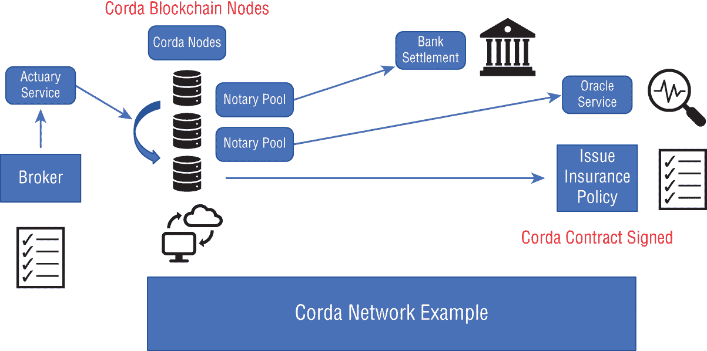

`FIGURE 2.7` Corda 网络

第 3 章“构建您的企业区块链”详细涵盖了部署和架构。

### R3 Corda 账本

R3 Corda 是一个针对性的分布式账本技术（`DLT`）平台，使用有效的全局广播和泛洪网络协议将数据传播到区块链网络中的其他成员。

Corda 使用点对点消息协议（称为 `AMPQ`），其中广播是针对性的，不会向网络上的所有成员广播。由于该协议是点对点的，只有参与交易的节点才有权访问交易账本。这为成员提供了主要的隐私优势。

Corda 账本与其他区块链相比有一些值得注意的显著差异：

*   Corda 账本允许对多方之间的业务协议进行管理和同步，这些协议可以被设计为法律合同。Corda 账本专门设计用于解决受监管金融机构的跨方合同问题，其他区块链无法高效地处理这些问题。
*   没有代表网络上所有节点运行的中央账本，这与其他区块链非常不同。相反，网络上的每个节点都维护一个包含所有已知事实的 `vault`（库）。`vault` 是一个用于保护已知事实的安全存储空间。
*   从每个节点的角度来看，账本是主观的，这意味着每个节点根据其参与情况访问账本的方式不同。其独特之处在于，账外的事实必须由每个成员共享，以便所有其他区块链网络成员查看。可以将此理解为“按需知”原则或区块链账本的“分区”方法。

### R3 Corda 共识

如前所述，Corda 为其金融部门成员作为许可制区块链账本运行。这为记录提供了更细粒度的访问控制，并增强了成员的隐私性。同样假设这实现了性能收益，因为只有参与交易的双方（节点）需要达成共识。交易不会分发到所有其他节点。

Corda 允许可能互不信任的双方对一组共享事实的状态达成共识。需要一种机制来确保所有相关方都对账本状态达成一致。Corda 这种达成共识的能力通过 Corda 中的验证共识或唯一性共识来实现。Corda 的这种共识方法与其他区块链相比截然不同。

Corda 共识被分为两个过程。

*   `Transaction validity`（交易有效性）意味着相关方可以通过检查关联合约代码是否成功运行，从而确定一个定义输出状态的提议更新交易是有效的。它还包含了所有必要的签名，并且该交易所引用的任何其他交易也是有效的。
*   `Transaction uniqueness`（交易唯一性）是指相关方可以确定所涉及的交易是所有输入状态的唯一且正确的消费者。也就是说，没有其他关于有效性和唯一性的交易会消耗任何相同的状态。

各方可以通过独立运行相同的合约代码和验证逻辑对 `transaction validity` 达成一致。

## CORDA NOTARY（公证节点）

`notary`（公证节点）是 Corda 特有的网络服务。公证节点服务提供了实质上的唯一性共识。从另一个角度看，公证节点可以被视为一个受信方，保证特定状态只被消费一次。你可以将状态类比于以太坊钱包中的资金或 Hyperledger Fabric 中的世界状态。

公证节点提供了系统中的终局性，类似于中介。公证节点在验证唯一性时所经历的过程被称为 `notarization`（公证）。在获得公证节点签名之前，相关方无法确定一个同样有效但冲突的交易是否被视为花费给定输入状态的有效尝试。

例如，每个状态将有一个指定的公证节点，且只有当该节点是交易所有输入状态的指定公证节点时，它才会对该交易进行公证。简单来说，公证节点是既能阻止交易又能解决冲突的中介。

Corda 具有可插的唯一性服务，可以提高隐私性、可扩展性、法律系统兼容性和算法灵活性。例如，单一服务可以由许多互不信任的节点组成，通过拜占庭容错算法进行协调，也可以是一个非常简单的虚拟机。

这些唯一性服务仅用于证明给定交易所消耗的状态之前是否被消耗过；它们不需要证明交易本身的有效性，交易有效性是交易双方需要考虑的问题。

这真正的含义是唯一性服务不需要查看任何交易的完整内容。与其他分布式账本和区块链设计相比，这将显著提高系统的隐私性和可扩展性。这种 Corda 的设计决策代表了在共享账本架构的可接受权衡方面的卓越选择。

简而言之，一旦公证节点签署交易，就达到了终局性。但可能存在例外。如果交易没有输入状态或时间戳，那么这些属性的“唯一性”显然无法确认或否认。必须为交易分配公证节点，但只有在存在输入状态和/或时间戳时才需要公证签名。

## R3 Corda Nodes（Corda 节点）

Java 虚拟机 (`JVM`) 用于 Corda 中的合约执行和验证。由于 Java 的广泛使用和开发的便利性，该 `JVM` 提供了许多优势。在使用虚拟机进行开发之前需要意识到的一点是，它增加了一个自定义沙箱，该沙箱比普通的 `JVM` 沙箱更具限制性。这种限制性的虚拟机强制执行安全要求。

简单来说，Corda 节点是一个 `JVM` 运行时环境，在区块链网络上具有唯一身份，托管 Corda 服务和 CorDapps。

Corda 节点可以具有四大类功能，可以是以下任何一种：

*   `Network map`（网络地图）提供了一种将身份解析为物理节点地址和关联公钥的方法。
*   `Notary`（公证节点）作为交易的“见证”，对交易是否为双重花费具有最终决定权。
*   `Oracle`（预言机）是一个节点，通过提供影响交易有效性的事实将账本与外部世界连接。
*   `Regular mode`（普通模式）启动与其他节点、公证节点和预言机的通信协议，并在网络上演进它们的私有账本。

## R3 Corda States（Corda 状态）

Corda 与其他分布式账本技术之间的区别之一是如何实际处理区块链账本状态。Corda 使用 `state`（状态）一术语来表示不可变对象的表示，具有共享事实，如特定时间点的协议或合同。

`shared facts`（共享事实）和 `states`（状态）这两个术语本质上意味着相同的意思，通常可以互换使用。让我们从账本的角度明确 Corda 中的 `state` 可以是什么。状态可以代表成员同意的任何内容，例如特定时间的银行券、发票等。这类似于其他区块链中的世界状态。静态状态意味着对所定义对象的表示没有变化。

例如，如果你熟悉金融领域，那么你可以拥有代表以下内容的状态：

*   担保债务凭证 (CDOs)
*   担保贷款凭证 (CLOs)
*   发票或对账单
*   银行信贷
*   信用违约掉期
*   利率掉期（如利率交换）
*   债券

基本上，在 Corda 中，状态模型可以用于表示协议部分的任何内容。状态可以用于表示金融工具或多边协议、资产或负债。

状态是不可变的，因此在创建后不能更改另一个状态。状态包含关于特定时间点共享事实的数据。

不同类型的状态可以包含不同的属性。例如，交易债券可能有付息日、赎回日等。

## R3 Corda Transactions（Corda 交易）

R3 Corda 中的交易在某些方面非常具体，因为它明确定义了发布何种命令。例如，在 Corda 中，我们在 CorDapp 中声明意图为“Issue”（发布）或“Agree”（同意），CorDapp 判断交易是否有效。

假设你的组织想要声明正在达成一致的交易类型。当你设计 `CorApp` 时，需要正确识别交易类型。

R3 Corda 中的交易在网络中传播，但不会广播到每个节点。广播更多是基于“按需知”原则。这允许成员确保他们在交易方面的隐私性。

这种交易方法与 Hyperledger 中的通道（channeling）相当，即网络中的节点可以放在通道中为了隐私考虑进行通信。

## R3 Corda Client Applications（Corda 客户端应用程序）

在考虑为企业集成 R3 Corda 的客户端应用程序时，你必须意识到 Java 或 Kotlin 用于 Corda API。这并不完全是障碍，但需要注意。然而，Corda 确实提供了一个完整的客户端库，允许你的开发者使用 `JVM` 兼容语言编写客户端以与运行的节点进行交互。

在 R3 Corda 中，智能合约也被称为 `contracts`（合约），当 `CordApps` 中的参与者已约定法律条文时，它们可能具有法律强制执行力。相比之下，在 Ethereum 中，智能合约是一个单一程序，而不是一个具有强制执行力的合同。

在 Corda 中，这些合约通过 `CorDapp` 部署，`CorDapp` 仅仅是作为一个应用程序共同运行的合约集合。在 Ethereum 中，这被称为 `distributed application`（`dapp`）。请注意，这些合约与 Ethereum 等其他区块链平台的智能合约有所不同。在 Corda 中，这些合约不是代表世界当前状态的状态对象，而更像是带有法律条文的现实世界合同。

`States`（状态）可以包含任意数据，允许它们代表各种事实，例如股票交易、银行券或贷款。

R3 Corda 智能合约（`CordApps`）由计算机代码组成，但也包含附加的法律条文。这是与其他区块链的一个重大区别，因为这一功能是明确为其成员规划的。

在智能法律合约之上是特定的法律条文，这些条文的表述方式可以在智能合约代码中进行表达和实现。其背后的逻辑是为代码赋予与其相关法律条文相关的合法性。

这种特定的构造在金融领域历史上被称为“里卡迪安合同”（Ricardian contract）。里卡迪安合同由 Ian Grigg 于 1996 年发明，作为一种将文档记录为法律合同并将其安全地链接到其他系统（如会计系统）以作为价值发行的手段。

在区块链世界中，里卡迪安合同仅仅是定义合同详细条款和条件的数字文档。这些合同通常由双方签署并同意。这种里卡迪安合约方法用于缓解当前的合同问题，也为未来的任何合同挑战提供了清晰度。

总而言之，`CorDapp` 是一种用法院所需的标准法律条文编写的里卡迪安合同，然后经过加密哈希处理以供应用程序使用。Corda 还有一种有趣的方法，允许监管机构实际上获得监管访问权限。该监管机构也可以被引入网络作为观察者来验证合约（参见图 2.8）。

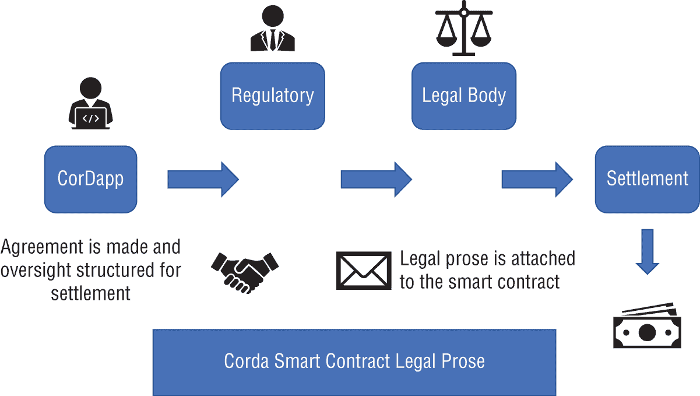


## FIGURE 2.8 带有法律条文的 Corda 智能合约

以下是 Corda 中智能合约（`CorDapps`）对使用 Corda 的金融机构的具体益处：

*   智能合约监管并简化了参与去中心化公司之间的工作流。
*   这些 `CorDapps` 还包括提供观察职责的监督和监管节点。
*   共识算法仅限于涉及的实体。
*   对协议内数据的访问仅限于相关的许可方。
*   `CordApps` 还仅对参与的双方之间的交易进行验证。

### R3 Corda 开发工具

R3 Corda 是一个从零开始构建、为其联盟成员开发企业级区块链的私有联盟，它拥有丰富的文档、工具和服务。Corda 拥有庞大的开发者群体，在我看来，Corda 作为一个组织提供了卓越的社区活动，这些活动确实有助于推动开发。

*   **Corda DemoBench**：`DemoBench` 是一个独立的桌面应用程序，可以方便地配置和启动本地 Corda 节点。它对于培训课程、演示和实验很有用。要了解更多，请访问 `https://www.corda.net/discover/demobench.html`。
*   图 2.9 显示了启动 Corda `DemoBench` 后的起始窗口。我们可以配置节点，并在 `Corda Demobench` 中确定公证节点的类型。下载并安装 `DemoBench` 后，您可以开始添加节点和公证节点。

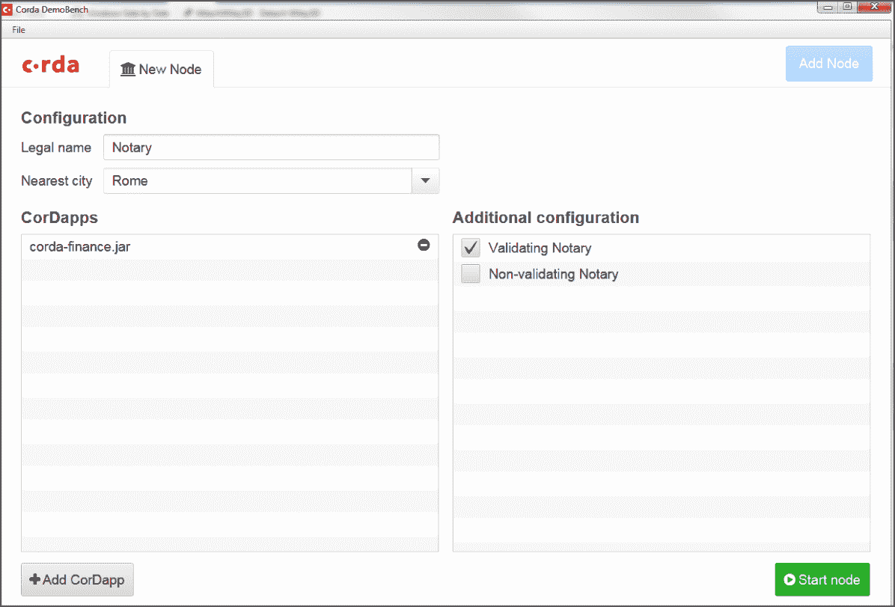

FIGURE 2.9 Corda DemoBench 初始界面

我在第 5 章中介绍了安装、配置和演示。

*   **Node Explorer**：`Node Explorer` 使用 `RPC` 框架提供了库（vault）和交易数据的视图。
*   **Blob Inspector**：作为二进制格式，它具有相同的缺点：缺乏人类可读性。`Blob Inspector` 填补了这一空白。给定文件路径或 URL，它将显示 Corda 的内容。
*   **Network Bootstrapper**：这是一个从公共目录扫描所有节点配置以生成网络参数的工具，然后这些参数会被复制到所有节点的目录。

### R3 Corda 治理

Corda 的治理显然是一个优先事项，因为其金融部门客户的性质使得合规性和责任是其联盟成员非常关心的问题。

Corda 通过公证监督程序（notary oversight procedure）采用独特的交易监督方法。公证（notary）被视为受信任方，它保证特定状态在 Corda 中仅被消费一次。公证对 Corda 状态的保证消除了诸如双重花费、账户透支等挑战，甚至可以处理基于货币交换的问题。

从某种意义上说，公证是区块链网络的主要治理结构，因为它们验证了交易的唯一性和对网络的参与。

在 Corda 中，没有包含所有交易记录的统一区块链。Corda 了一种不同的方法，Corda 节点只会看到它们直接参与的或为了验证目的而在历史上上依赖的交易。

最后，Corda 节点负责检查交易的正确性并授权交易。Corda 节点完全依赖公证来验证交易的唯一性并提供区块链治理，这是治理结构中至关重要的部分。

## 引入 Quorum

Quorum 是一个通过增强现有 Ethereum 区块链的开源区块链解决方案。Quorum 基于 Ethereum 协议的官方 Go 实现，提供了几乎镜像的 Ethereum 功能和优势。

Quorum 在 Ethereum 之上了一个额外的层，使其能够执行私有交易，通过使用不同的共识算法使其更具活性。Quorum 总体被设计为 Ethereum 的许可级实现，支持交易隐私和合约隐私的企业级需求。

`Quorum` 的主要用例是通过对以太坊代码库进行修改，引入一种新的“私有”交易标识符来实现数据隐私。这些修改位于 `Go-Ethereum` 代码库中，其中包含了对区块提案和验证过程的修改。`Quorum` 中的数据隐私是通过密码学实现的，同时也通过类似于沙箱的节点有意分段来实现的。

企业选择 `Quorum` 而不是 Ethereum 的主要原因是隐私；次要原因是 `Quorum` 基于 Ethereum，后者拥有稳健且活跃的开发基础，使其易于找到专家。

`Quorum` 通过公共和私有状态分段支持私有交易和私有合约。`Quorum` 通过使用一种名为 `Constellation` 的新消息交换机制来实现隐私。`Constellation` 是一种点对点加密消息交换，用于向网络参与者有针对地传输私有数据。这种消息交换机制类似于 Hyperledger 中对 `Kafka` 的实现。

`Quorum` 为联盟用场景提供了被认为的共识机制选项。例如，伊斯坦布尔拜占庭容错（Istanbul Byzantine fault tolerance）和基于 `Raft` 的共识是两种支持容错和可用性等企业级功能的共识方法。

`Quorum Chain` 是一种基于多数投票和时间机制的新型共识，支持可以在网络中传播的基于以太坊的交易。

图 2.10 显示了 `Quorum` 区块链的高层组件。你可以看到有一个带有 `Go-Ethereum` 的 `Quorum` 节点，它扩展了以太坊网络的能力。

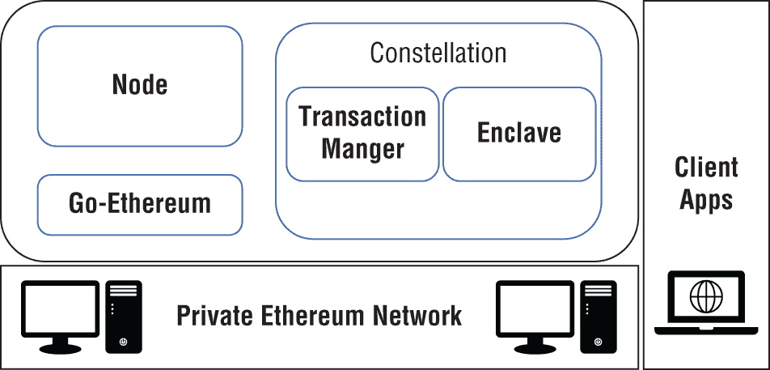

图 2.10 Quorum 区块链组件

`Constellation` 是一种提交信息的机制，允许节点之间进行加密通信。`Constellation` 由两部分组成：交易管理器和 `Enclave`。

节点级别的权限由智能合约代码管理。主要优势是与公共以太坊区块链相比，它提供了更高水平的性能。

`Quorum` 优于公共以太坊的主要特性如下：

*   交易和合约隐私
*   多种基于投票的共识机制
*   网络/节点权限管理
*   由于简单的共识机制而具有更好的性能和扩展性

在 `Quorum` 中，交易必须是公有的或私有的。如果交易是私有的，那么该交易中的所有数据对于区块链中的该组实体都是私有的。

简而言之，`Quorum` 是开源的，对于某些组织来说，比在其他平台上实现自定义私有区块链更容易易得。

`Quorum` 旨在成为一个平台，允许不仅金融行业，而且对区块链技术感兴趣的其他公司在经过验证的以太坊平台上进行集成和实验。

## Quorum 区块链基础

`Quorum` 是一个基于以太坊协议官方 Go 实现的私有/许可区块链平台，侧于企业应用。`Quorum` 构建在现有的以太坊区块链之上，继承了经过生产加固的 `go-Ethereum` 代码库的成熟性。`Quorum` 将公共和企业开发社区聚集在一个共同协议上，为金融领域提供服务。

`Quorum` 非常有效地使用了基于投票的共识算法，然后通过引入新的“私有”交易标识符来实现数据隐私。

`Quorum` 明确提出的设计目标之一是尽可能重用以太坊的现有技术，以减少让 `Go-Ethereum` 高效运行所需的更改。

从策略上讲，例如，该计划实际上减少了与未来公共以太坊代码库保持同步的工作。负责额外隐私功能的大部分逻辑位于标准以太坊协议层之上的层。

根据其官方描述，`Quorum` 本质上是通过对其代码库进行策略性分支实现的 Ethereum 扩展。`Quorum` 区块链与 Ethereum 有许多相似之处。`Quorum` 有一个明确的任务：为目标受众提供无许可区块链的最佳特性，并增加许可区块链的隐私性、安全性和性能。

`Quorum` 由摩根大通 Chase 及其联盟成员开发。`Quorum` 是金融行业共同采用区块链的首批主要步骤之一。

从本质上说，`Quorum` 的功能与 Ethereum 类似，但与原生 Ethereum 相比，有四个非常不同或值得欣赏的领域：

*   网络和节点权限管理，在私有以太坊平台上对交易进行沙箱处理
*   通过私有交易增加交易和合约隐私
*   Ethereum 中不存在的基于投票的共识机制
*   由于节点限制而更高的性能

## Quorum 账本

该系统在 `Quorum` 中有两种不同的可能交易类型：公共交易和私有交易。`公共交易` 是负载对所有参与者完全可见的交易。这些公开可见的交易是你在以太坊区块链上看到的标准以太坊交易。

`私有交易` 则不同，其负载仅对交易中 `privateFor` 参数指定的公钥所属的参与者可见。

## Quorum 共识

`Quorum` 中的共识比其他区块链稍微灵活。例如，`Quorum` 为被认为适合联盟场景的共识机制提供了选项。

这些共识选择如下：

*   伊斯坦布尔拜占庭容错和基于 raft 的共识是支持容错和可用性等企业功能的共识方法。
*   `Quorum Chain` 是一种基于多数投票和时间机制的新型共识，支持可以在网络中传播的基于以太坊的交易。

`Quorum` 中存在两种状态。第一种状态是所有节点共享的公共交易公共状态，第二种状态是每个节点针对其授权的私有交易的本地私有状态。

## Quorum 智能合约

如前所述，`Quorum` 基于以太坊，是以太坊区块链的分支。尽管如此，对于 Ethereum 开发者来说，实现和使用智能合约会非常熟悉。

`Quorum` 使用标准的 `Solidity` 语言编写智能合约。这提供了巨大的价值，因为你可以像在以太坊中那样进行设计。

差异点之一是智能合约可以是公共的，也可以是 `Quorum` 区块链网络上的一个或多个参与者的私有。

主要区别在于，`Quorum` 使用以太坊网络协议发送私有交易。在 `Quorum` 中，你可以通过对智能合约进行编码来满足对私有交易的需求。

在 `Quorum` 网络上，你会发送标准的以太坊交易，但会将消息上的 `privateFor` 参数设置为应当查看并执行该交易或合约代码的参与者的公钥。

图 2.11 显示了了解客户（KYC）用例中的私有交易。

更多信息请访问 `https://github.com/jpmorganchase/quorum/wiki/Using-Quorum`。

私合约无法更新公共合约。这是刻意为之，因为并非所有参与者都能执行私合约。需要注意的是，一旦合约被公开，该合约之后就无法变为私有。要让一个公共合约变为私有合约，需要将其从区块链上删除并创建一个新的私合约。

## Quorum 工具与实用程序

正如我们所知，Quorum 是基于 Ethereum 的，这允许使用 `Solidity` 构建智能合约。Quorum 还与 Ethereum 共享一些核心开发工具。其中一个工具是 `Truffle`，这很可能是大多数以太坊开发者已经在使用的工具。

本质上，由于使用了 Ethereum 的工具和实用程序，以太坊开发者在集成 Quorum 区块解决方案时，其开发上手时间和学习曲线将非常短。

一个专门为 Quorum 构建的工具称为 `Cakeshop`。`Cakeshop` 为处理 Quorum 网络、智能合约和 Quorum API 提供了一个易于使用的图形用户界面（GUI）。`Cakeshop` 可以启动一个 `Geth` 节点，你可以使用 `Cakeshop` 前端与之交互，也可以连接到你已经运行的类以太坊节点（例如 `Quorum`）。指定的 `Cakeshop` 实例将仅与你指定的区块链网络上的一个节点连接。

你可以从 `https://github.com/jpmorganchase/cakeshop/wiki/Cakeshop-Overview` 下载 `Cakeshop` GUI。更多关于 Quorum 开发和工具的信息，请参考第 10 章。

## Quorum 治理

Quorum 的许可链是一种联盟链，设计用于在经指定机构预先批准的参与者之间实施。

由于 Quorum 是以太坊区块链的分叉，因此治理并没有并没有得到很好的支持。例如，与以太坊一样，可以通过智能合约设置每个节点的权限功能来提供某些治理。由于资金来自企业以太坊联盟（EEA），预计治理、合规以及其他企业级关注的问题将得到更详细的解决。

需要注意的是，Quorum 关于私有交易和智能合约的路线图已列在开发团队的任务列表中。

同样重要的是，Quorum 一直与 Zcash 团队合作，旨在将零知识安全层（ZSL）集成到 Quorum 协议中。这些重要且需求量巨大的未来功能可能在合规性、安全性和隐私方面提供额外的收益。

## 介绍以太坊

以太坊是一个基于区块链技术的开源平台，允许开发者构建和部署去中心化应用程序（智能合约）。

以太坊本质上是一个分布在数千个节点之间的世界计算机。只要接入互联网，任何人在任何地方都可以访问这个由许多分布式节点组成的计算机。它没有地址成员要求，是真正的公共区块链。

第一个公共公测版预发布网络被称为 `Olympic`。`Olympic` 网络为用户对以太坊区块链限制进行压力测试提供了 25,000 Ether 的漏洞漏洞赏金。`Ether` 是用于以太坊网络的代币。

以太坊是运行在世界计算机网络上的软件，确保数据和称为智能合约的小型计算机程序在网络上的所有计算机上进行复制和处理，而无需中央协调器。创始人的愿景是创建一个不可阻挡、抗审查且自持续的去中心化世界计算机。例如，如果你将以太坊下载到计算机上，它将成为网络上的以太坊“节点”，运行 `EVM`，并且行为与其他所有节点等效。

注意，以太坊是一个点点网络，没有中心化；因此，所有计算机与其他节点具有等效地位。图 2.12 显示了以太坊的点点去中心化网络。以太坊的网络节点运行以太坊虚拟机。注意，网络结构并不是像普通网络那样扁平化或分层的。

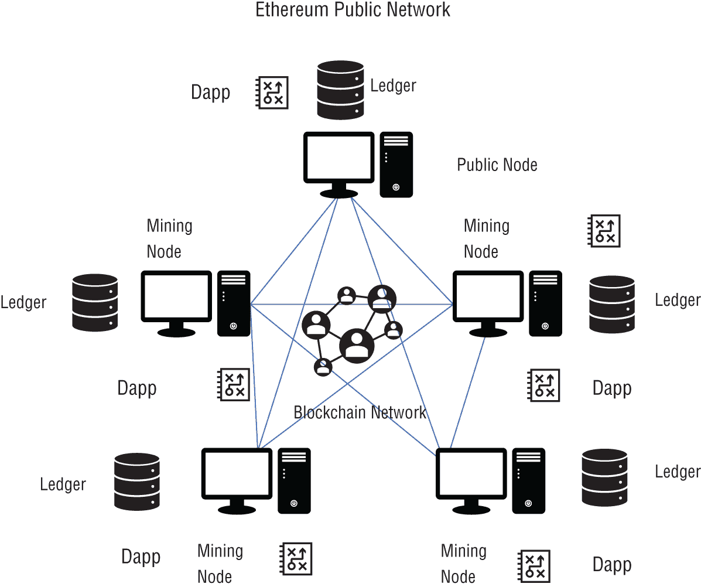

图 2.12 以太坊点点去中心化网络

## 以太坊区块链基础

以太坊是一个区块链平台，`ether` 是在以太坊平台上使用以太坊虚拟机的代币。以太坊是一个无许可区块链，与在本章之前讨论的其他区块链不同。

虽然所有区块链都有处理代码的能力，但大多数区块链都受到严格的限制。以太坊以不同的方式处理代码，允许开发者创建他们想要的任何操作。这意味着开发者可以构建成千上万超出典型区块链结构的应用程序。

以太坊合约具有内存，还可以拥有循环，我将在第 10 章中从开发角度详细介绍这些。

以太坊实现了智能合约，这些合约通常通过称为 `dapps` 的分布式应用程序部署。`Dapps` 是直接运行在区块链上的应用程序。它们是去中心化的，不受任何一方控制。它们的目的是为了更复杂的代币结构提供简单的逻辑。

智能合约和 dapps 在应用程序方面与其他任何应用程序类似。客户端应用程序通过 HTTP 协议通过 API 访问以太坊应用程序。智能合约将被调用并在 `EVM` 上运行。

由于经济和逻辑位于同一层，这使得价值传递变得非常简单。通过将逻辑直接部署在区块链上，你可以节省硬件和配置。

`Ether` 代币是由 2014 年预售计划创建的。`Ether` 代币通过挖掘产生，因此需要矿工。例如，每挖掘出一个区块产生 5 个 ether 代，大约每 15 秒一次。这 5 个 ether 代会被发送给挖掘区块的矿工。`Ether` 也可以发送给参与交易的矿工，因为多个矿工可能会竞争区块。`Ether` 被认为是运行以太坊网络的“燃料”。

### 工作量证明挖掘

为了通过消耗电力寻找数学题的解来创建有效区块，以太坊的 PoW 数学挑战 `Ethash` 与比特币的 PoW 挖掘略有不同。这允许通用硬件用于挖掘，并从成本角度降低了挖掘门槛。其缺点是降低了专用硬件（称为 `ASICs`）的效率优势，这种硬件在比特币挖掘中很常见。

有一个计划是从高能耗的 PoW 挖掘迁移到更节能的权益证明协议，称为 `Casper`。这计划于 2018 年 2019 年初开始，但由于几个因素被推迟了。以太坊软件的更新版本将命名为 `Serenity`。

### 代币标准

在以太坊中，代币必须遵守代币标准，以太坊代币必须实现的通用协议列表。最常用的代币标准是 `ERC20` 标准。

`ERC20` 标准基本上是一组六函数，其他智能合约可以识别并识别这些函数以与智能合约进行交互。某些函数包括获取代币总量、获取钱包余额等。

这种代币标准赋予了开发者在以太坊生态系统中编写新代币行为的能力。其次，这种方法在众筹公司通过首次代币发行（ICO）时常见。ICO 的概念类似于股票市场中的首次公开募（IPO）。

你可以在 `https://etherscan.io/tokens` 更多关于以太坊代币的信息。

## 以太坊账本

在以太坊中，共是指分布式账本已更新且所有节点都维护自己相同的账本副本。这种架构作为一种记录系统提供了新的能力，超越了简单的数据库。区块通过引用前一个区块的哈希值或指纹形成链并写入账本。

请记住，网络中的每个节点都持有网络交易和智能合约历史的副本。节点还跟踪账本上的当前“状态”。每当用户执行某些操作时，网络上的所有节点都需要达成共识，确认该更改已发生并将其写入账本。

例如，每当使用一个程序（智能合约应用）时，由数千万台计算机组成的网络都会对其处理。用智能合约特定编程语言编写并编译为所谓 `bytecode` 的合约将由 `EVM` 读取。然后，所有节点使用它们的 `EVMs` 执行该合约，进而更新账本。

## 以太坊节点 EVM

以太坊虚拟机（`EVM`）是计算机软件，运行在部署底层硬件（如物理服务器或容器）之上的抽象层上。

以太坊使用虚拟机来部署区块链服务。这种类型的虚拟机被认为是图灵完备虚拟机，它可以可以直接运行和编译代码。图灵完备意味着软件足够灵活，可以运行开发者定义的任何代码。在开发世界中，图灵完备机器也被视为灵活的虚拟机。

以太坊本身是一个定义通信应如何工作的协议。它既不是专有软件，也没有专利。相反，它是开放的，以太坊协议有几种不同的实现。

最流行的两种实现是用 Go 语言编写的 Go-Ethereum (`Geth`) 和用 Rust 编写的 Parity。

以太坊节点使用以太坊协议相互通信。连接到以太坊节点有几种不同的方法。

你可以通过 `HTTP` 和 `IPC` 协议连接；可能还支持 `WebSocket` 连接。

以太坊节点通过 `HTTP` 接受 `JSON-RPC` 格式的请求。这是客户端与以太坊节点通信的标准方式。使用这种方法，任何实现 `JSON-RPC` 调用的软件都应该通过以太坊节点连接到区块链。

以下是关于 `EVM`的一些重要说明：

- `EVM` 有的典型图灵完备机器不具备的唯一真实限制是，`EVM` 本质上受限于 `gas`。


`EVM` 的能力仅限于开发者请求提供的 `gas` 数量。

`EVM` 是一个基于栈的 `VM`，这意味着它使用处理后进先出顺序的排序结构。

智能合约围绕的灵活性在编写时可以是 `Python`、`Java` 或 `C++`。

在完全部署时可以实现隔离，因为智能合约与区块链网络完全隔离的。

图 2.13 显示了 `EVM` 如何适配到栈中。

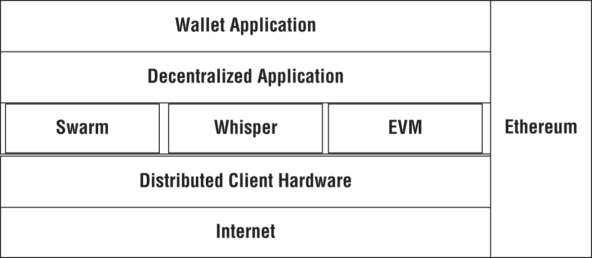

**图 2.13** 以太坊栈中的 EVM

加入以太坊网络时，从区块链节点的角度来看，你有一些选项。

- **轻量节点**不验证每个区块或交易，且没有当前区块链状态的副本。这些节点通常用于开发。
- **全节点**验证广播到区块链网络上的每个区块。当你设置全节点时，整个区块链也会下载到该节点中。这可能会占用大量的存储空间，因为在编写时已经超过了 180 GB。
- **存档节点**是保留整个交易历史的全节点，在某些情况下可以用于合规性需求。

[Ethernode.org](http://ethernode.org) 显示了连接到区块链的网络节点的当前状态。在编写时，有超过 13,600 个节点。该网站还显示了主网和测试网。要查找区块链上当前的以太坊节点，请访问 `https://www.ethernodes.org/network/1`。

## 以太坊客户端应用

开发与以太坊 API 接口的应用是简单的。通常，以太坊会使用以下前端开发语言：

- HTML
- CSS
- JavaScript

常用的后端工具包括：

- Solidity
- Truffle

你可以下载 Solidity 或在浏览器中编译。

### SOLIDITY

`Solidity` 是以太坊背后的开发语言，专门为利用 `EVM` 而设计。开发基于以太坊应用的开发者将使用 `Solidity` 开发它们的智能合约。

`Solidity` 使用了许多其他开发语言中存在的编程特性、概念和方法。例如，正如你在编程语言中预期的那样，`Solidity` 拥有特定的变量、函数、类等。

以太坊使用的一种常用 API 是 `JSON` API，它是一种轻量级的数据交换格式，可以表示数字、字符串、有序的值序列以及键值对集合。

以下是与以太坊的一些其他工具应用程序：

- **语言**——`Solidity`、`Serpent`、`Mutant`
- **IDE**——`Solidity Browser`、`Ethereum Studio`
- **客户端**——`Geth`、`eth`、`parity`、`Ethereum Wallet`
- **存储**——`IPFS`、`Swarm` 和 `Storj`
- **DApp 浏览器**——`Metamask` 或 `Mist`
- **测试**——`Testnet`、`TestRPC`

第 10 章包含了这些工具集以及 `Solidity` 的更多细节。

## 以太坊交易

以太坊交易是外部世界与以太坊交互的方式。当你想要修改或更新存储在以太坊网络上的状态时就需要交易。需要注意的是，以太坊是一种基于账户的区块链实现，与 Hyperledger 等区块链不同。

从开发角度来看，以太坊中有两种需要注意的账户类型：外部账户（`EOA`）和合约账户。

外部账户实际上是外部世界的个人用户，例如买家和卖家。这个以太坊网络中的用户由一个 20 字节（160 位）的地址表示。

合约账户与 `EOA` 有一些相似之处和不同。合约账户是通过引用部署的合约创建的。合约账户通过合约地址识别，而 `EOA` 账户仍然由 20 字节的地址表示。这是与该账户交互的地址。

在业务逻辑的情况下，合约账户也可以持有以太坊。合约是以太坊网络中的“智能合约”能力，它是业务逻辑的实现所在地。

图 2.14 代表了区块链用户授权并访问以太坊应用程序时以太坊交易所需的高级步骤。从图中可以看到，用户启动了一个托管在以太坊上的网络应用程序，因此这并不复杂。从技术角度来看，这是调用以太坊应用程序时的预期行为，并且需要 `ether` 才能在以太坊区块链上运行应用程序。当然，需要通过使用 `gas` 来为 `EVM` 动力支持。


**图 2.14** 以太坊授权交易概述

第 4 章深入探讨了以太坊共识以及如何从智能合约调用处理交易。

## 以太坊智能合约

智能合约是能够转换为代码、存储并在网络节点上复制的合约。通过智能合约，你可以在不需要中介服务的情况下以透明的方式交换货币、股份、财产以及任何有价值物品。例如，通过使用以太坊智能合约，你可以为产品支付费用并拥有不可篡改的交易记录。设计得当的智能合约像传统合约一样定义协议周围的惩罚和规则。

当你将多个智能合约一起部署作为一个应用程序时，它被称为*分布式应用*（在以太坊中称为 *dapp*）。

以太坊智能合约为平台用户提供了一些显著优势，包括：

- 自主性
- 信任
- 备份
- 安全
- 速度
- 节省
- 准确性

以太坊状态的基础是，对合约数据的所有修改必须由其代码执行。修改合约数据需要区块链用户向其代码发送请求。这一启动过程决定了是否以及如何满足这些请求。以太坊网络上的智能合约运行在 `Ethereum Virtual Machine` 上。

运行在以太坊网络上的 Dapps 基本上是复杂的智能合约。以太坊智能合约有一些需要注意的属性，特别是当你的开发团队为应用程序设计智能合约时。首先，以太坊智能合约是以自动化方式部署的，可以作为双方之间协议的补充。

其次，智能合约的条款必须用计算机语言清晰地写，作为一组记录在不可篡改的分布式账本上的指令。

智能合约部署在以太坊运行时作为触发事件。例如，当用户向另一个以太坊用户发送 100 美元来支付例如音乐会门票，只有在从买家处收到 100 美元并存入卖方的以太坊钱包后，票才会发送给买家。如果没有从买家处收到 100 美元，智能合约将不会触发，合约进程将停止。

图 2.15 显示了以太坊交易的工作流。以太坊交易有四个主要步骤，每一步都必须正确执行才能继续下一步。只有当智能合约的执行按照程序进行时，交易才能完成结算。

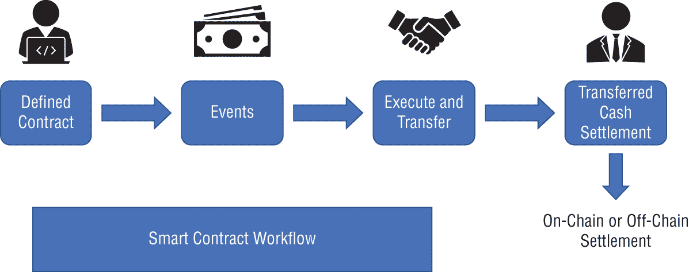

**图 2.15** 显示了以太坊交易的工作流。

## 以太坊钱包

以太坊状态的基础是，对合约数据的所有修改必须由其代码执行。修改合约数据需要区块链用户向其代码发送请求。这一启动过程决定了是否以及如何满足这些请求。以太坊网络上的智能合约运行在 `Ethereum Virtual Machine` 上。

运行在以太坊网络上的 Dapps 基本上是复杂的智能合约。以太坊智能合约有一些需要注意的属性，特别是当你的开发团队为应用程序设计智能合约时。首先，以太坊智能合约是以自动化方式部署的，可以作为双方之间协议的补充。

其次，智能合约的条款必须用计算机语言清晰地写，作为一组记录在不可篡改的分布式账本上的指令。

智能合约部署在以太坊运行时作为触发事件。例如，当用户向另一个以太坊用户发送 100 美元来支付例如音乐会门票，只有在从买家处收到 100 美元并存入卖方的以太坊钱包后，票才会发送给买家。如果没有从买家处收到 100 美元，智能合约将不会触发，合约进程将停止。

以太坊状态的基础是，对合约数据的所有修改必须由其代码执行。修改合约数据需要区块链用户向其代码发送请求。这一启动过程决定了是否以及如何满足这些请求。以太坊网络上的智能合约运行在 `Ethereum Virtual Machine` 上。

以太坊状态的基础是，对合约数据的所有修改必须由其代码执行。修改合约数据需要区块链用户向其代码发送请求。这一启动过程决定了是否以及如何满足这些请求。以太坊网络上的智能合约运行在 `Ethereum Virtual Machine` 上。

以太坊状态的基础是，对合约数据的所有修改必须由其代码执行。修改合约数据需要区块链用户向其代码发送请求。这一启动过程决定了是否以及如何满足这些请求。以太坊网络上的智能合约运行在 `Ethereum Virtual Machine` 上。

以太坊状态的基础是，对合约数据的所有修改必须由其代码执行。修改合约数据需要区块链用户向其代码发送请求。这一启动过程决定了是否以及如何满足这些请求。以太坊网络上的智能合约运行在 `Ethereum Virtual Machine` 上。

以太坊状态的基础是，对合约数据的所有修改必须由其代码执行。修改合约数据需要区块链用户向其代码发送请求。这一启动过程决定了是否以及如何满足这些请求。以太坊网络上的智能合约运行在 `Ethereum Virtual Machine` 上。

以太坊状态的基础是，对合约数据的所有修改必须由其代码执行。修改合约数据需要区块链用户向其代码发送请求。这一启动过程决定了是否以及如何满足这些请求。以太坊网络上的智能合约运行在 `Ethereum Virtual Machine` 上。

以太坊状态的基础是，对合约数据的所有修改必须由其代码执行。修改合约数据需要区块链用户向其代码发送请求。这一启动过程决定了是否以及如何满足这些请求。以太坊网络上的智能合约运行在 `Ethereum Virtual Machine` 上。

以太坊状态的基础是，对合约数据的所有修改必须由其代码执行。修改合约数据需要区块链用户向其代码发送请求。这一启动过程决定了是否以及如何满足这些请求。以太坊网络上的智能合约运行在 `Ethereum Virtual Machine` 上。

以太坊状态的基础是，对合约数据的所有修改必须由其代码执行。修改合约数据需要区块链用户向其代码发送请求。这一启动过程决定了是否以及如何满足这些请求。以太坊网络上的智能合约运行在 `Ethereum Virtual Machine` 上。

以太坊状态的基础是，对合约数据的所有修改必须由其代码执行。修改合约数据需要区块链用户向其代码发送请求。这一启动过程决定了是否以及如何满足这些请求。以太坊网络上的智能合约运行在 `Ethereum Virtual Machine` 上。

以太坊状态的基础是，对合约数据的所有修改必须由其代码执行。修改合约数据需要区块链用户向其代码发送请求。这一启动过程决定了是否以及如何满足这些请求。以太坊网络上的智能合约运行在 `Ethereum Virtual Machine` 上。

以太坊状态的基础是，对合约数据的所有修改必须由其代码执行。修改合约数据需要区块链用户向其代码发送请求。这一启动过程决定了是否以及如何满足这些请求。以太坊网络上的智能合约运行在 `Ethereum Virtual Machine` 上。

以太坊状态的基础是，对合约数据的所有修改必须由其代码执行。修改合约数据需要区块链用户向其代码发送请求。这一启动过程决定了是否以及如何满足这些请求。以太坊网络上的智能合约运行在 `Ethereum Virtual Machine` 上。

以太坊状态的基础是，对合约数据的所有修改必须由其代码执行。修改合约数据需要区块链用户向其代码发送请求。这一启动过程决定了是否以及如何满足这些请求。以太坊网络上的智能合约运行在 `Ethereum Virtual Machine` 上。

## 以太坊工具与实用程序

由于庞大的开发者，以太坊拥有强大的生态系统。真正有用的是，它允许你直接在浏览器中运行以太坊 dapps，而无需运行完整的以太坊节点。发送和接收以太坊需要一个钱包。你也可以通过 `www.ethereum.org/` 访问以太坊。

以太坊状态的基础是，对合约数据的所有修改必须由其代码执行。修改合约数据需要区块链用户向其代码发送请求。这一启动过程决定了是否以及如何满足这些请求。以太坊网络上的智能合约运行在 `Ethereum Virtual Machine` 上。

## 以太坊治理

以太坊客户端必须叠加权限层，因为它是基于去中心化平台，即许可的。在编写时，以太坊联盟（`EEA`）正在开发 3.0 版本，其中链范围权限配置和执行将启用。

然而，可以通过智能合约的实现设置基于节点的权限功能，以提供某些治理。由于资金来自 `EEA`，预计治理、合规和其他企业级关注的问题将按照组织自身的节奏进行更详细的处理。简而言之，如果你需要严格的治理，那么你可能需要考虑许可链。

## 总结

本章涵盖了四个最广泛使用的企业级区块链平台和分布式账本。企业区块链的需求与 `Ethereum` 等公有无许可区块链有所不同。

企业区块链通常分为以下几类之一：私有许可链、公有或无许可链，甚至是像如 `Quorum` 这样的混合链。

Hyperledger 是由 Linux 基金会运行的一个伞型项目，根据 GitHub Fork 数量，`Hyperledger Fabric` 是 Hyperledger 组合中使用最广泛的区块链。

R3 是一家企业区块链软件公司，与拥有 200 多个成员和合作伙伴的广泛生态系统进行合作。这些成员跨越了私营和公立部门的多个行业。R3 开发了 `Corda`（一个开源区块链平台）以及用于企业使用的支持商业级版本 `Corda Enterprise`。

`Quorum` 是一种通过增强现有 `Ethereum` 区块构建的开源区块链解决方案。它在 `Ethereum` 之上提供了一个层，使其能够执行私有交易，同时通过使用不同的共识算法使其更加灵活。企业可能想要使用 `Quorum` 的主要原因是它可以轻松扩展到 Ethereum 应用程序的隐私和性能能力。

`Ethereum` 是一个基于区块链技术的开源软件平台，允许区块链开发者构建和部署去中心化应用程序（智能合约）。`Ethereum` 显然是最广泛使用的无许可智能合约区块链平台，拥有广泛的开发者群体。

所讨论的每种区块链在技术优势和企业用途方面都非常不同，因此请仔细考虑每一种。

# 第 3 章 构建你的企业级区块链

本章讨论了如何根据企业最佳实践构建企业级应用以及构建区块链服务。我还涵盖了企业级区块链的集成、可扩展性和安全性。在构建区块链服务时，请注意你的设计将主要关注企业级区块链。如你所知，区块链是分布式账本和扁化非 SQL 数据库，其扩展方式不同。与 `SQL` 等传统关系型数据库相比，区块链从性能角度来看速度较慢，我们在设计用例中必须考虑这一点。

本章已拆分为单独介绍每种区块链，以保持读者的连续性。涵盖了以下区块链：

- `Hyperledger Fabric`
- `Corda`
- `Ethereum`
- `Quorum`

关于包括 `Multichain`、`NEO` 在内的其他区块链的信息，请参考书籍网站（`www.wiley.com/go/blockchainsolutions`）获取更新内容。

## 区块链技术重点领域

区块链技术具有去中心化、问责性和安全的核心特性。在设计区块链服务时，理解这些特性非常重要。

区块链主要用于两类 IT 解决方案：公有无许可链或私有企业许可链。另一种方法是将私有和公有区块链服务结合成混合解决方案。无论你是在私营企业、联邦政府机构还是考虑区块链账本技术的非营利实体工作，你的组织都可能有几个可行的区块链用例可以考虑。某个区块链用例可能适合非营利实体，但同一个用例对于其他实体可能并不可。

### 区块链成功领域

我认为区块链取得成功的主要领域之一是作为财团紧密合作的特定行业。例如，保险业是区块链的大力支持者，因为区块链不仅允许共享数据，还允许共享责任。

区块链技术在金融服务行业中成功应用。金融服务公司正在使用该技术进行记录保存、数字公证服务、支付服务、通过稳健的分布式应用程序进行银行间转账以及智能合约。

## 区块链合规性

区块链由于多种原因在维护不可篡改的历史方面表现出色，无论是为了确保合规性（例如遵守《通用数据保护条例》`GDPR`），还是为了管理信任链。`GDPR` 是一项合规要求，强制企业在涉及欧盟（`EU`）成员国的交易时，必须保护欧盟公民的个人数据及隐私。该法律也适用于其他将欧盟公民作为客户的国家。例如，区块链可以用于满足那些可以存储在区块链上的 `GDPR` 要求。然而，对于如“被遗忘权”等方面，区块链并不适用，但可以与离链数据库集成以符合 `GDPR` 的要求。某些数据即使在许可链区块链网络中也可能适合或不适合存储。

有关 `GDPR` 和其他常见合规要求的更多信息，请参阅第 9 章“区块链治理、风险与合规 (GRC)、隐私和法律问题”。

最后，每个组织转向区块链账本平台时可能都有不同的业务驱动因素。无论这些业务驱动因素是关注合规性、协作、成本效益、提供数字资产还是提供透明度，作为区块链架构师，我们必须能够将这些驱动因素整合，并将它们与合适的区块链账本技术解决方案用例匹配，最终形成一个可行的设计。

## 架构区块链解决方案

我们需要执行的首要任务之一是考虑我们是否有强大的区块链用例。这看起来似乎是一个只需要问问题的步骤。然而，可能会有客户的潜在需求是区块链的良好用例，但利益相关者需求的某项改变就可能导致该需求消失。

我的核心观点是，确定一个用例是否有效的练习并不总有直接的“是”或“否”答案。然而，在经过几个初步的范围问题后，可能很容易判断你是否有一个可靠的用例。

通常，我们希望了解确定一个可持续有效用例的支柱。然后，我们想了解它将集成到什么样的架构中。另一个步骤可能是通过检查清单或问卷来处理详细信息并评分以建立有效性。

接下来的章节将带你了解设计符合客户需求之解决方案的流程。

### 区块链设计工作流

拥有一套工作流无疑可以提供重要的指导，有助于促进区块链解决方案的设计。区块链设计可能是复杂的，特别是当你需要在设计中满足特定的合规性要求或详细的用例目标时。

以下是八步区块链设计工作流。请注意，可能没有必要处理区块链决策评分表（步骤 5）。如果利益相关者已经决定了特定的区块链平台，那么继续进行设计就有意义。

1. 处理利益相关者。
2. 处理用例。
3. 处理区块链决策树。
4. 处理企业架构原则。
5. 处理区块链决策评分表。
6. 处理区块链设计。
7. 处理区块链实施。
8. 处理区块链任务。

最后，我们希望确定一个合适的平台，该平台能提供一个可以集成到企业架构中的可靠用例。

### 用例潜力

在考虑区块链是否为强大的用例时，我们应该审查该潜在用例的支柱。我们检查的支柱越多，用例就越强大。例如，如果客户对分布式和去中心化账本没有需求，那么我们的潜在用例就被排除了。


接受区块链技术的几个更引注目的领域是金融、物流和政府部门。这些部门在接受区块链以及对该技术的投资方面没有表现出减速的迹象。

无论媒体讨论什么，区块链都在许多其他组织和行业垂直领域的关注范围内。企业区块链社区面临的挑战是，企业技术有时会与加密货币以及失败的代币发行（`ICOs`）被放在一起讨论。

#### 利益相关者

利益相关者不仅从售前和售后的角度来看都是关注的重点领域。在销售驱动的环境中，关键在于向利益相关者提供对技术的信任以及区块链解决方案产生的价值保证。应该处理针对痛点的讨论，也应该针对前景解决方案的讨论。请注意，利益相关者通常属于三类之一。

在与技术、业务和法律受众交流时，我们希望清楚地理解并解决他们的担忧，确保我们的回复是适当的。对于技术受众，我们应该关注实施、开发和安全。对于业务受众，重点应放在价值主张、`TTM`、`TCO` 和 `ROI` 上。对于法律受众，关注合规性、隐私和公司治理。

#### 强区块链用例的支柱

“支柱”是一个基础性原则或基准，支持甚至于考虑区块链的用例。例如，如果指定的数据需求仅供一个组织使用，那么这些数据需求对于区块链技术来说就不是一个强大的用例，因为单一组织本身就是一个很好的用例。

然而，一个强大的用例是指当你有一个财团需求时，例如，国际贸易需要一个利用智能合约的不可篡共享账本。

图 3.2 显示了公认的区块链四个支柱。你可以看到对账本的需求是明确的，且账本确实需要是永久且分布式的。智能合约需要提供业务价值，区块链网络需要提供一个没有单点故障的分布式网络。

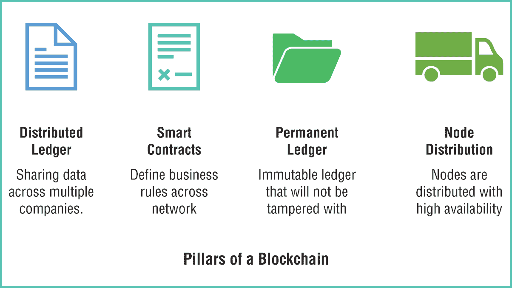

图 3.2 强区块链用例的四个支柱

从这四个支柱中我们可以推导出，如果我们的用例需要一个不可篡的记录存储，那么继续考虑区块链平台。另一方面，如果我们的用例不需要不可篡的记录存储，那么我们可能应该放弃对区块链的考虑。

#### 用例视角

在考虑企业区块链的用例时，必须理解没有单一区块链平台适用于所有的用例。尽管某些区块链供应商有时会吹嘘他们是“跨行业”，但你必须意识到存在需要区分的重要技术考量。现实情况是，某些用例在一个或多个区块链上是可行的。另一方面，如果你的用例指向 `Ripple`，那么它真的只是那个分布式账本的一个良好用例，因为 `Ripple` 是一个不支持智能合约的金融领域平台。

在思考区块链时，存在业务需求、技术需求甚至法律或治理需求。利益相关者的观点可能会改变，或者诸如 `GDPR` 的新政府政策可能会偏离区块链项目。

以下是区块链项目和用例可能偏离的两种常见方式：

*   业务需求可能更关注于总拥有成本（TCO）或投资回报率（ROI），甚至是上市时间。如果无法充分展示有利的 TCO 或 ROI，可能会导致区块链项目的偏离。

*   技术考虑通常更加详细，对技术优势的错误理解可能会导致企业区块链项目的偏离。集成到现有的企业基础设施中也可能为你的潜在用例带来挑战。

法律需求侧重于区块链的合规性、治理、隐私和法律执行考量。诸如 `GDPR` 等合规性要求已有记录，这可能会消除某些区块链项目成功的可能性。诸如“被遗忘权”等隐私问题可能无法通过区块链这种不可篡改的解决方案满足。

区块链供应商通常专注于某一个领域（如金融领域）或者是“跨行业”的，这意味着它们可以适应跨多个行业的用例。例如，`Ripple` 显然是一个金融领域的区块链，而 `Hyperledger Fabric` 则是一条跨行业的区块链。由于这种行业侧重点的不同，其组件在命名和实现方式上可能有所不同。例如，在 `Corda` 中我们有一个 `notary`（公证员），但在 `Hyperledger` 中，我们并没有 `notary` 这样的组件。

大多数区块链组件都是针对特定用例定制的，例如共识算法、分布式账本、可插拔组件、加密方法和许可模型。

区块链基于开源方法，这在区块链开发行业中得到了充分体现。“部落式”支持更为明显，因为开发人员正在针对被“请求”或“赞助”的特定功能和功能集进行工作。在某些区块链平台上，功能也是可插拔或模块化的。这在 `Hyperledger` 等企业区块链框架中尤为如此。

可插拔或模块化的功能允许对某些选择进行测试，例如共识算法。在某些领域更灵活的区块链可能呈现出更好的解决方案。需要建立用例，一旦在业务、法律或技术驱动上发生重大变化，该用例就可能面临挑战。

## 区块链决策树

学术界、企业甚至政府机构已经提出了大量的区块链决策树。其核心重点是真正理解你的用例，并尝试确定合适的区块链决策树是否适用于你的销售组织和客户群。如果你的客户群由专门的金融公司组成，你可能需要为非金融客户准备单独的决策树，甚至是清单。

我喜欢在做出平台决策时，采用具有多种选择或决策树的方法。任何能够就选择区块链平台提供清晰决策的方法都是卓越的。

图 3.3 显示了一个代表我个人方法的决策树，它应该让你在私有链、混合链或公有链之间做出决策。有两个最终决策，我们将根据需求选择其中一个。我们的交易是否需要隐私保护？如果是，且我们的交易不会公开，那么就选择许可链区块链。

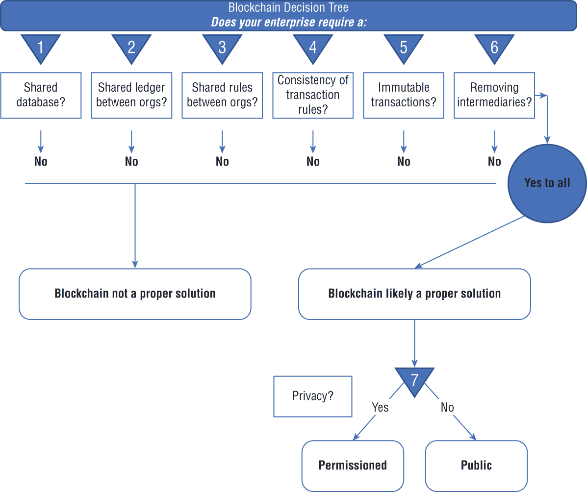

FIGURE 3.3 区块链决策树

在涉及到为特定区块链做出决策时，我通常喜欢查看显示特性和功能的图表，以引导我确定客户应该使用 `Hyperledger Fabric` 还是 `R3 Corda` 的路径。两个区块链之间的决策可能完全基于是否具有通道（channels）。

图 3.4 显示了另一个区块链决策树的示例。

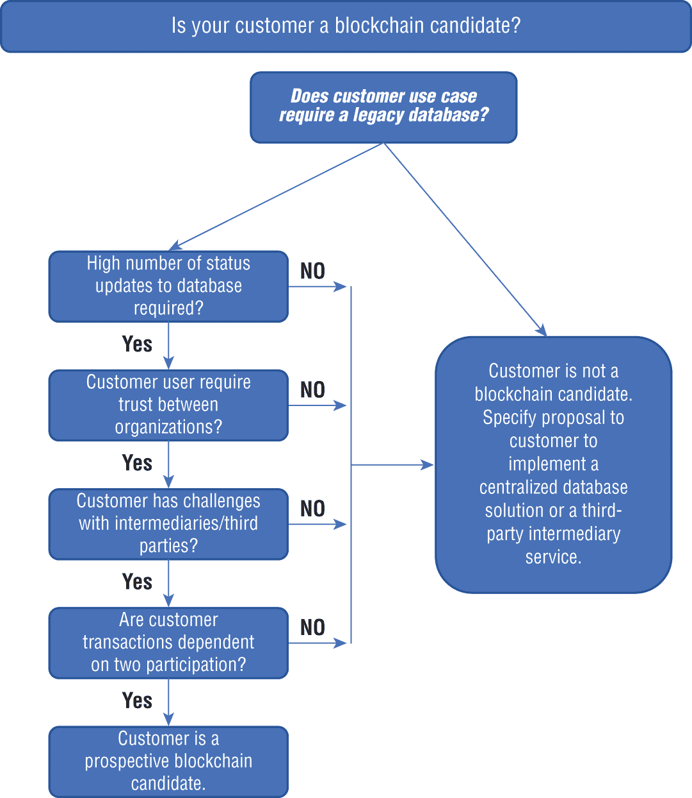

FIGURE 3.4 另一种区块链决策树

决策将根据以下因素做出：

*   数据库

*   信任

*   第三方

*   交易交互

在遵循任何决策树时，你都将想要考虑它在你的用例中是否合逻辑。一种方案并不适用于所有人。

## 区块链决策清单

在做出决策时，有时一个老派的 Excel 表格就会很有帮助。在考虑电子表格时，建议建立几个不同的版本以应对你的客户群。事实上，区块链问题没有一刀切的方案，你需要发挥创意并以适当的方式与受众沟通。

## 区块链结构与组件

区块链的结构与万维网的传统架构不同，万维网使用的是更具中心化的客户端-服务器网络。区块链网络的结构和组件将不同，并在不同的区块链解决方案之间变化。

在区块链架构的许可分布式网络的情况下，网络中的每个参与者（节点或用户）都维护、批准并更新新条目。系统不仅由独立的个人控制，还由区块链网络中的每个人控制。每个成员都确保所有记录和程序井井有序，从而实现数据的有效性和安全性。

图 3.5 比较了客户端-服务器拓扑与 P2P 拓扑。这种 P2P 网络由若干节点（计算机）组成，它们运行着带有区块链协议的虚拟机。

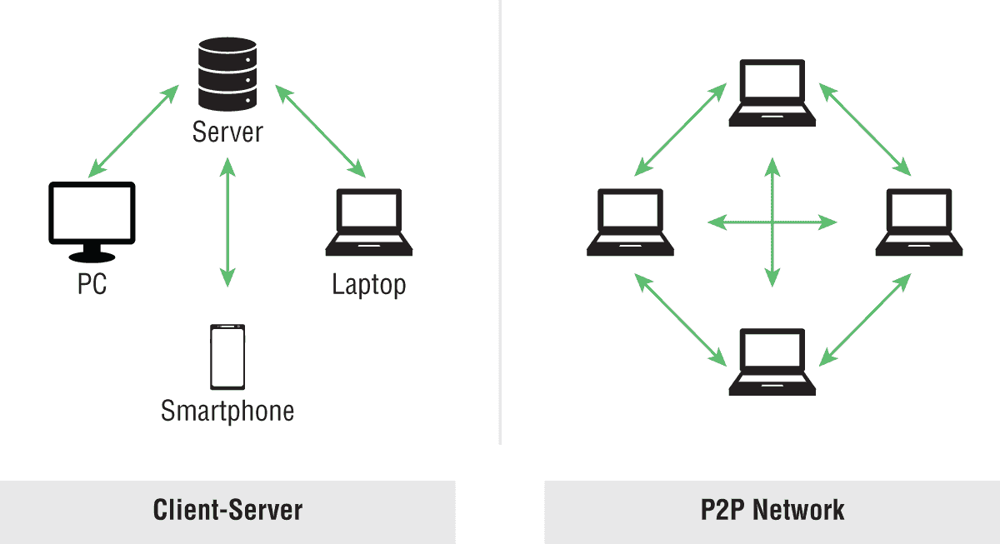

FIGURE 3.5 比较客户端-服务器拓扑与 P2P 拓扑

欲了解更多关于区块链对比传统数据库的信息，请参阅第 1 章“区块链技术简介”。

### 区块链结构

区块链技术的结构由一组有序区块表示，这些区块以特定顺序表示交易。这些有序列表可以存储为平面文件，也可以以 NoSQL 文档数据库的形式存储，如 Google Cloud 上的 `Cloud Datastore` 或 AWS 上的 `DocumentDB`。

区块链中使用了两种重要的数据结构，被称为`指针`（pointers）和`链表`（linked lists）。本节的主要目的是说明许可区块链如何处理数据块并写入区块链。在 `Hyperledger Fabric`、`Corda`、`Ethereum` 和 `Quorum` 的各个区块链章节中，我将详细介绍这些区块链账本如何处理数据结构。因此，请将这些示例视为更通用的结构，而非一刀切的结构。

图 3.6 显示了区块链账本来数据结构之间的关系。我们可以看到数据结构中`指针`与`链表`之间的直接关系。在考虑区块链解决方案时，例如，我们想要从延迟的角度了解这些数据结构是如何处理的。你的区块链开发人员在开发区块链应用程序和连接区块链网络时自然会意识到这一点。

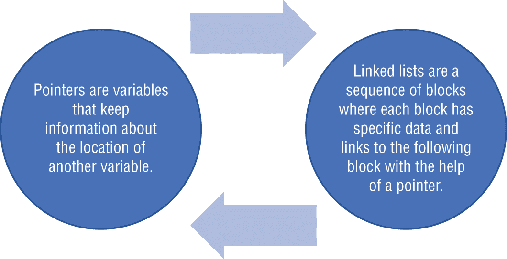

FIGURE 3.6 区块链数据结构

区块链数据结构是后向链接的区块区块记录，这些区块是有序的。每个区块可以通过一个`哈希`（hash）识别，该哈希是通过对区块头部使用 `SHA256` 加密哈希算法创建的。

以下是分布式账本技术中围绕区块链账本数据结构的常用术语。

`index`（索引）代表区块在区块链账本上的位置，本质上是定位区块的地址。

- `hash`（哈希）是用于区块链账本提供的数据集中快速分类数据的函数。

- `nonce`（随机数）是分配作为区块链哈希值一部分的随机数。Nonces 提供了更高的安全性，因为它们在区块链中只能使用一次，并使得重放交易变得困难。

- 指针被称为 `hash pointers`（哈希指针），用于为区块链构建链表。

- `record`（记录）是写入区块链并随后提交到账本的区块交易。在大多数企业区块链账本中，这些记录被认为是不可篡改的。

- `timestamp`（时间戳）将保存区块构建的时间，以及在某些企业区块链中进行交易的时间。

- `Merkle tree`（梅克尔树）是区块链哈希列表的摘要，提供了对区块链的高效验证。

- 哈希列表（hashing list）是区块链数据块哈希的描述性列表。

图 3.7 显示了创建数据结构的区块链接。我们可以看到其中有记录。这些记录被写入区块链。指针正在构建链表。其中涉及哈希处理；你应该注意，作为这种链接的一部分，每个哈希都指向上一个哈希。第一个区块不包含指针，因为它是链中的第一个，被称为 `genesis block`（创世纪区块）。

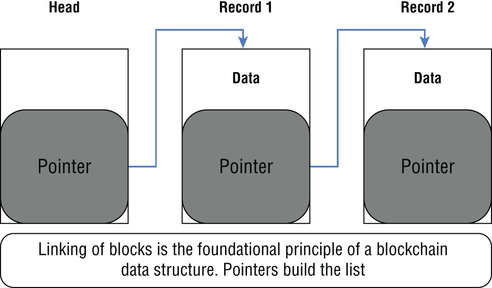

**图 3.7** 区块链数据结构示例

图 3.8 显示了详细的区块链序列图，它是记录的连接列表。我们可以看到其中涉及哈希处理，每个哈希作为这种链接的一部分都指向上一个哈希。Merkle root（梅克尔根）是梅克尔树的顶部部分。叶节点是数据块，树中更高处的节点是其各自子节点的哈希。

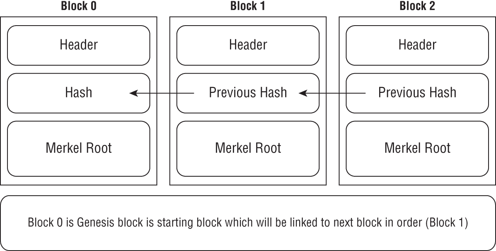

**图 3.8** 区块链序列

关于区块链交易肯定有更多需要理解的概念，但对于本书而言，主要目标是提供对这些区块链如何管理交易的见解。接下来的章节将提供例如 Hyperledger Fabric 有何不同的见解。从设计的角度来看，如果一个区块链在验证之前对交易进行排序，可能会影响每秒交易数（TPS）。

## 区块链核心组件

本节涵盖了主要的区块链核心组件。此列表并非针对任何区块链平台，而是更像是一个中立的组件列表。例如，Hyperledger 和以太某些方面具有截然不同的组件。

- `Nodes`（节点）通常是区块链架构内的虚拟化用户组件、应用程序或服务器。

- `Transactions`（交易）是区块链网络中最小的构建单元，它们跟踪任何有价值的内容，可以是货币、货物、文档等。

- `Blocks`（区块）是被称为区块链账本的数据结构的一部分。区块类似于书中记录的页码。这些区块是有序的，并且构成了区块链。

- `Chain`（链）是区块链中的区块序列。支持的区块链的序列和特征由区块链协议决定并维护。

- `Miners`（矿工）是在区块链上执行实际工作的特定节点。它们为区块链提供区块验证、排序，甚至记录保存工作。

- `Consensus`（共识）是用于区块链的方法或策略集。本质上，共识是关于如何通过交易更新账本的决策，这同时也决定了区块链的状态。在某些区块链中，共识称为共识机制或共识协议。

- `Validity rules`（有效性规则/验证）规定了如何对用户和交易进行验证。取决于区块链的不同，这种验证过程有时会在交易排序并写入区块链之前发生。

- `Smart contracts`（智能合约）是基础价值，代码片段可以自动检查相关第三方是否已完全满足合同条款。一旦条款通过验证（执行），智能合约代码就会记录在区块链账本上并有效地关闭合同。

图 3.9 显示了常见区块链组件的通用布局。所有这些组件共同工作，为特定的用例提供稳健的区块链服务。当涉及特定区块链的特定组件时，可能还有其他组件，如成员服务提供商（MSP）、证书机构（CA）、公证员（Notaries）、预言机（Oracles）等。

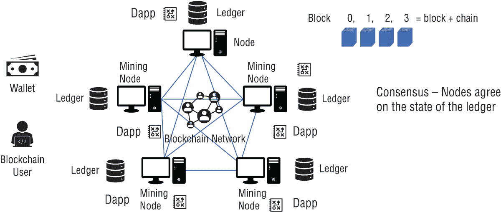

**图 3.9** 区块链组件

## 企业区块链架构

企业有严格的要求，因此倾向于选择支持这些要求的应用程序和服务。区块链最初并非为企业应用开发的，而是更多关注加密货币交易。当然，随着 Hyperledger 和 R3 Corda 等具有活跃企业用户的联盟链的发布和演进，这种情况发生了变化。

区块链最初也被开发为无许可平台（如比特币）。以太坊的出现扩展了区块链，使其不仅是一个加密货币平台，还是一个用例平台或开发平台。以太坊被设计为无许可区块链，但现在随着通道（channeling）和链下（off-chains）的出现。链下意味着应用程序为了特定目的（如支付网关）扩展到企业区块链之外。例如，以太坊现在可以非常简单且有效地扩展到企业以满足特定的用例。

在为企业构建区块链解决方案时，理解企业架构是如何处理的是非常重要的。请考虑你当前的企业架构最佳实践，并参考任何企业架构框架。

在一些广泛接受的企业架构框架中，有四个专注于架构的支柱或领域。企业架构框架领域的目的是引导机构的业务、信息、流程和技术决策，以便组织能够执行其业务战略并满足客户的需求。

### TOGAF 领域

在深入区块链架构之前，建立一个关于什么是企业架构的基准是有意义的。最好的起点是审查 TOGAF 标准。企业架构（EA）中的基准对于组织来说是一个关键点。没有基准，本质上业务结果将无法实现目标，甚至根本无法实现。

TOGAF 是 Open Group 架构框架（Open Group Architecture Framework）的知名缩写，由 Open Group 开发。Open Group 是一个非营利性的技术行业协会，持续更新和迭代 TOGAF 企业架构领域。TOGAF 标准是企业架构框架的事实标准（ facto standard）。TOGAF 提供了特定的方法、流程和标准，以实现企业架构的认可、生产、使用和维护。

TOGAF 的第一个版本于 1995 年发布，基于美国国防部（DoD）开发的“信息管理技术架构框架”（TAFIM）规范。

国防部明确允许 Open Group 在 TAFIM 的基础上创建 TOGAF，从那以后，TOGAF 一直在不断演进。

本质上，如果没有框架，要将企业级战略与在线项目连接起来将是具有挑战性的。由于缺乏该领域的知识和专业技能，区块链项目更为复杂。

TOGAF 企业架构的四个领域如下：

- `业务架构领域`（business architecture domain）阐述了企业的组织结构。该领域还为实现业务愿景所需的职能能力提供了见解。

- `应用架构领域`（application architecture domain）提供了对企业应用程序及其与企业核心业务流程之间关系的见解。

- `数据架构领域`（data architecture domain）提供了对组织数据资产结构的见解，以及对可用数据管理资源的见解。

- `技术架构领域`（technology architecture domain）阐述了实际实施企业应用程序所需的需求。

### 企业架构的什么、谁和何做

在涉及解决方案设计时，建立企业架构的“什么、谁和何做”至关重要。

- 组织的业务愿景、战略和目标是什么？它们是如何指导这一区块链服务的创建的？

- 谁负责执行定义的区块链服务？

- 如何通过区块链服务实现任何先定义的业务服务或能力？

简单来说，了解你的客户的历史和兴趣对你的区块链设计可能至关重要。

### 原则（Tenets）

原则是组织内部定义的规则和指南，组织利用这些规则完成其使命。

图 3.10 展示了可以用于区块链的常见企业架构原则。在与客户讨论企业架构（EA）原则时，你可能希望通过与客户一起画白板来讨论这些内容。这些原则在与利益相关者的讨论中可能非常有价值，并可用于应用设计。定义的原则应该指导应用治理并提供简洁的架构评审。也许它们甚至可以增强你的企业级区块链采纳性能。

简而言之，你应该考虑将区块链应用视为一种企业级应用来处理。这意味着确定哪种企业架构框架适用于你的组织，并应用与企业架构相关的基本原则。区块链应用在初始部署时，可能在全范围内部署，也可能尚未全范围内集成。提前处理企业关注的问题无疑可以增强利益相关者的认可和采用。

针对企业关注的问题，你应该提前考虑。


图 3.10 企业架构原则

### 区设计

在设计任何区块链应用时，关键是要确定需求、基线、功能以及可扩展性。从架构角度来看，你需要考虑在评估区块链服务时。

- 区块链是去中心化的，因此通过区块链传输的信息对所有节点都是可见的。

- 区块链通常是去中心化的，因此没有单点故障。

- 区块链在真实形式上是去中心化的数据库，由于不可篡改性。

- 区块链在本质上是安全的，由于内置了安全性，甚至可以增强组织的合规性要求。

- 区块链网络通过增加节点实现了良好的水平扩展，但由于虚拟机无法良好地进行垂直扩展。

- 交易处理取决于共识算法，例如工作量证明（PoW）、权益证明（PoS）或其他你选择的任何选项。共识机制和区块链平台的选择会对结果产生重大影响。

传统上，企业专注于对资源的集中控制，而在特定的区块链方面，使用许可链区块链是有益的。

### 企业区块链采纳挑战

如前所述，有一种方法可以处理区块链。区块链应该根据你交流的对象来定义，这种简单的方法有助于区块链提案的认可和采用。

在利益相关者会议、电话或电子邮件期间，请记住观众以及如何针对他们进行交流。如果你与技术工程团队交流，请使用技术性语言，例如区块链的“速度和频率”。如果你与公司法律顾问沟通，请在使用应用中使用法律术语。

企业区块链采用的一些挑战集中在你交流的对象上。

- `业务挑战`可能包括业务成本、资金需求、公司治理、高管愿景、利益相关者参与以及企业文化。预计公司会对竞争对手利用区块链的方式做出反应的。


# 区块链的挑战与风险管理

## 区块链的挑战

- **法律挑战**可能很多，特别是在金融、保险和物流等行业，这些行业可能无法适应金融服务的“去中间化”。这意味着由于合规性要求（如`PCI`、`SOX`或`GDPR`），信任或认可可能无法完全实现。在`GDPR`的情况下，使用真实的区块链解决方案是一个挑战，因为区块链节点可能分布在监管机构管辖范围之外或未进行集中管理。

- **技术挑战**可能围绕性能（如每秒交易数 TPS）、与旧应用程序的集成、中间件、应用利益相关者参与以及解决隐私和安全问题。

注意，这不是区块链挑战的完整列表。

## 风险管理活动

有一些与管理组织风险相关的活动，这些活动对于有效的信息安全计划至关重要。真正有用的是，这些活动可以根据系统开发生命周期和联邦企业架构的详细背景，同时应用于新系统和遗留系统。尽管目前`NIST`尚未记录联邦政府的区块链最佳实践，但这同样适用于区块链。

以下是联邦集成商可能会熟悉的风险管理活动：

1. 对系统进行分类。
2. 选择控制措施。
3. 实施控制措施。
4. 评估控制措施。
5. 授权系统。
6. 监控控制措施。

有关`NIST`框架的更多信息，请参阅第 9 章。

## 作为锤子的区块链

任何在 LinkedIn、Medium 或 Quora 上阅读帖子的人可能认为区块链可以解决人类已知的所有问题。一些供应商、博客作者和顾问不断大声宣称他们的区块链解决方案一直在解决史性的世界问题。

坦率地说，区块链技术并不是万灵药，在现实中，区块链技术看起来像是一个“沙盒中寻找钉子的锤子”。区块链必须被视为一种针对性的解决方案，并且必须像激光一样进行有效的聚焦。

激光是有限的工具，直接应用光脉冲射准到专家聚焦的区域。我不断遇到的挑战之一是，与客户和学生讨论为什么他们的用例可能或可能不是一个良好的区块链用例。作为一名区块链专家，你必须能够处理区块链建议不合适的场景，无论是因为客户确实需要中心化数据库的功能，还是因为没有联盟对区块链平台感兴趣。

我们应该吸取的教训应该是：区块链不是万灵药，我们必须像激光一样，以直接聚焦的方式有效地使用区块链解决方案，而不是像一个拿着锤子寻找钉子的多手工。

## 企业级区块链设计原则

在设计企业级区块链服务时，有一些关键的设计原则、方法，甚至是功能需求需要解决。

你完全可以使用你组织中有效的软件设计方法，如`ISO`或`Agile`（敏捷），来促进已知的企业实践。现实是，区块链的设计、开发和部署仍处于起步阶段。

从这种起步阶段来看，我对待区块链的方式就像部署云应用程序一样。在大多数情况下，你可以预期要容纳相同水平的资源、需求和专业知识。在`AWS`上部署数据库等云服务，与在`GCP`上部署`SQL`数据库相比既相似又不同。例如，`SQL`代码可能导入并采用相同的结构；然而，`AWS`和`GCP`对不同版本的`SQL`的支持并不不同。

简而言之，设计就是将区块链应用的需求汇集，并将它们放置在满足这些要求的平台上。该平台可以位于你企业的本地现场，也可以位于云服务提供商的远程数据中心。

在为企业考虑区块链架构时，你将希望了解这里列出的某些功能、优势，甚至是权衡：

- 信任
- 一致性
- 可用性
- 安全与隐私
- 性能
- 合规性

## 企业级区块链设计需求

在第 1 章中，我们简要回顾了区块链设计的方面。本节建立在第一章的基础上，为制定正确的设计需求提供了额外的见解。设计需求在某些行业可能是基准水平，但在其他行业可能非常不同。例如，某些公司在需求列表中对“完整性”的重视可能高于“一致性”。理解客户的设计以及企业架构原则、用例和痛点，将有助于构建稳健的区块链架构。

### 为完整性设计（不可变性）

完整性对不同的组织可能有多种含义，因此让我们明确一下，由于区块链账本的不可变性属性，完整性也可以推导出“信任”。区块链世界中的不可变性真正意味着，一旦某些内容写入区块链，任何人或任何事物都无法对其进行修改、删除或篡改。在区块链的世界里，不可变性真正意味着一旦东西被写入区块链，它就无法被任何人或任何事物修改、删除或篡改。

### 为一致性设计

另一方面，我们知道数据库是中心化的，而区块链是一个去中心化的真实代理。

在考虑区块链技术时，重要的是意识到区块链开发的初衷是为了解决对银行等机构的不信任。

在设计区块链时，考虑用户和企业的需求至关重要。维护用户信任对于区块链的设计至关重要。

### 为可用性设计

在考虑企业的一致性时，重要的是理解终端用户是如何访问区块链应用程序的。你可以通过理解企业其他部分处理企业应用程序来实现这一点。为区块链用户提供良好的工作流将有助于有助于这些解决方案的采用。

一致性不仅应该关注应用开发，还要关注用户体验（UE）。区块链应用用户至少应该从高层理解解决方案如何工作，这更多是流程层面而非交易层面的。提供一种用户想要参与的体验。在第 10 章“区块链开发与编程”中，我们讨论了可用性、一致性和信任，这些都是用户体验的组成部分。

## 为什么？

无论私有网络还是公共网络，区块链都连接到网络上。这些网络通常都像我所熟悉的几乎所有网络一样连接到互联网。唯一的一个不连接到互联网的例外是政府机密的“秘密”或“绝密”级网络。

将你的网络连接到互联网，无论你是否拥有最新的网络安全态势，都会让你的网络面临可能的漏洞利用风险。

大多数公司都不应该希望其企业网络或区块链面临诸如 Equifax（富益数据）那样的影响深远的泄露事件。

Equifax 的黑客攻击不仅暴露了漏洞，还暴露了公司在处理公司数据时经常缺乏责任感的问题，而这些数据实际上是个人数据。这一点尤为重要，因为公司本质拥有的信心、信任和声誉可能会因为缺乏责任感而遭受毁灭性打击。

可以说，区块链服务的数据泄露风险应该被认为与任何基于互联网的应用程序一样危险。也就是说，区块链运行在服务器上——具体来说是包含开源软件的`Linux`服务器，而这些服务器正是驱动互联网的动力。任何从远程熟悉`Linux`或`Docker`容器的人都具备寻找漏洞的基础知识。

数字身份是区块链中的一个概念，可以在数据隐私这一关键领域提供帮助。使用特定的数字身份可以帮助区块链上企业级保护的演进。

区块链还可以通过另一种重要方式提供非秘密性的隐私保护：通过智能合约。简单来说，智能合约是经过编程以确保满足特定条件的逻辑。

当涉及到在企业中部署 Linux 时，并不缺乏相关的专业知识。挑战将在于部署你的区块链以及连接到你区块链网络的客户端应用程序。专业知识短缺的一个领域通常在中间件方面，它充当从遗留应用到区块链应用程序的翻译器。在本书接下来的内容，我将围绕本地和云端规划及部署区块链应用方面进行详细讨论。

## Hyperledger Fabric

本节介绍了 Hyperledger Fabric，这是一种具有可插拔框架的许可跨行业区块链。涵盖了以下主题：

- Hyperledger Fabric 卖点
- Hyperledger Fabric 设计考量
- Hyperledger Fabric 设计示例架构

除了以太坊之外，Hyperledger Fabric 是目前最广泛覆盖、讨论和接受的区块链平台。由于其广泛的认可度，无论你的项目是什么，寻找关于 Hyperledger Fabric 的信息可能非常容易。

这一由 Linux 基金会主办的全球合作组织，包含了航空、金融银行、医疗保健、物联网（IoT）、供应链、制造业和技术领域的全球领导者。它目前拥有超过 222 个成员，其中许多成员实际上是彼此的竞争对手。

那么，Hyperledger Fabric 到底在哪些方面做得出色，为什么它会有如此高的认可度？Hyperledger 从其作为一个联盟成立之初就一直专注于企业级。联盟成员在其区块链框架的开发、规划和实施中起着至关重要的作用。

### Hyperledger Fabric 的主要卖点

Hyperledger Fabric 有几个卖点，这些卖点通常取决于你的设计，这意味着你可以根据需要选择实现。

- 模块化，这也许是 Hyperledger Fabric 的主要卖点。
- 跨行业视角对 Hyperledger Fabric 的广泛接受
- 通过实现通道（channels）来划分区块链网络并创建独立账本来实现隐私保护
- 由于具有按需扩展的能力，因此具备可扩展性和性能。

### Hyperledger Fabric 的区块链设计考量

Hyperledger Fabric 旨在开发具有模块化架构的解决方案。Hyperledger 允许组件本质上是即插即用的。

Hyperledger Fabric 是一个私有且许可的区块链系统，因此需要进行不同的设计。我们需要考虑到额外的节点、策略、证书机构（`CA`）和成员服务提供者（`MSP`）。

Hyperledger Fabric 还提供了一种独特的方法通过使用通道来实现隐私保护。通道允许一组参与者创建独立的交易账本并维护隐私。Hyperledger Fabric 目前针对不同的用例支持两种数据库选项。目前的两个数据库选项是`CouchDB`和`LevelDB`，用于存储区块链的世界状态。

### Hyperledger Fabric 的优势

由于 Hyperledger Fabric 是一个许可区块链，它与其它区块链系统相比具有一些主要优势。

- **许可性成员身份**：对区块链进行许可清楚地提供了安全性、隐私性甚至区块链性能的优势。当设计得当时，像 Fabric 这样的许可区块链还可以提供有关合规性要求方面的收益。
- **性能与信任**：Fabric 是一个模块化平台，可以为企业在按需处理数据方面提供更大的灵活性。账本数据被清晰地维护，并可以出于合规性、数据分析甚至安全分析的原因轻松查询。
- **历史查询**：账本设计专为交易查询设计，数据库的选择可以提供更深层次的洞察。通过`CouchDB`可以实现更深层次的洞察。
- **模块化**：模块化允许你根据设计来选择实现，这意味着你可以根据需要选择实现。通过`CouchDB`可以实现深度洞察。
- **硬件安全模块（HSM）**：通过 HSM 实施可以实现安全性。

在 Hyperledger Fabric 中，网络节点需要有效的证书才能与网络上的其他节点进行通信。网络参与者使用客户端应用程序通过网络节点连接到网络。Hyperledger 是一个许可链区块链，参与者的身份与节点的身份不同。当参与者执行或调用交易时，将使用他们的证书对该交易进行签名。

在 Hyperledger 中，存在节点概念，并非所有节点都是平等的。节点分为三种类型：

- `Client nodes`（客户端节点）将启动区块链交易，并在交易过程中代表最终用户。
- `Peer nodes`（同行节点）是实际提交交易并保持账本数据同步的节点。同行节点是维护共享账本状态和副本的节点。节点通过`MSP`发的证书进行身份验证。在 Hyperledger Fabric 中，可以部署三种特定类型的同行节点。部署的同行节点类型取决于分配的角色，例如同行节点、背书节点或排序节点。
- `Ordered nodes`（排序节点）是通信骨干，负责交易的分发。

## 隐私保护 (PRIVACY)

为了保护隐私，区块链网络中的两个成员之间可以使用“通道”（channel）。通道是一个私有的区块链叠加层，允许数据隔离和机密性。注意，特定通道的账本仅在特定通道内的节点之间共享。

Figure 3.13 引用了一个通道可以实现的简单示例。区块链网络中有三个参与者。参与者 A 和 C 创建了一个通道以确保与区块链其余部分的隔离，排除了参与者 B。这种直接方法消除了交易在区块链网络其余部分的传播，这就是 Hyperledger Fabric 处理隐私的方式。

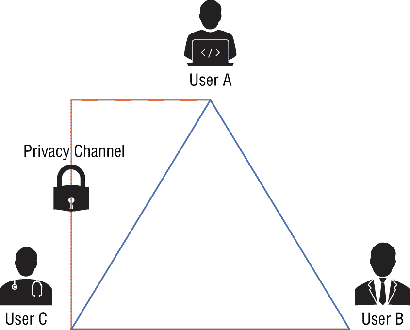

FIGURE 3.13 Hyperledger Fabric 中的通道

Hyperledger Fabric 框架是用`Go`语言实现的。Hyperledger 框架专门为实现具有不同程度权限、用例场景和集成能力的 Hyperledger 联盟链区块链而设计。Fabric 使用名为`chaincode`（链码）的智能合约。这些链码安装在任何运行该链码的节点上。这些区块链网络的节点运行在受限的 Docker 容器化环境中。

Figure 3.14 展示了包含客户端、同行节点、MSP 和逻辑组织分组的典型 Hyperledger Fabric 同行网络结构。最终用户将调用区块链应用程序，该程序反过来“调用” API 调用，进而调用链码，链码是一种智能合约。

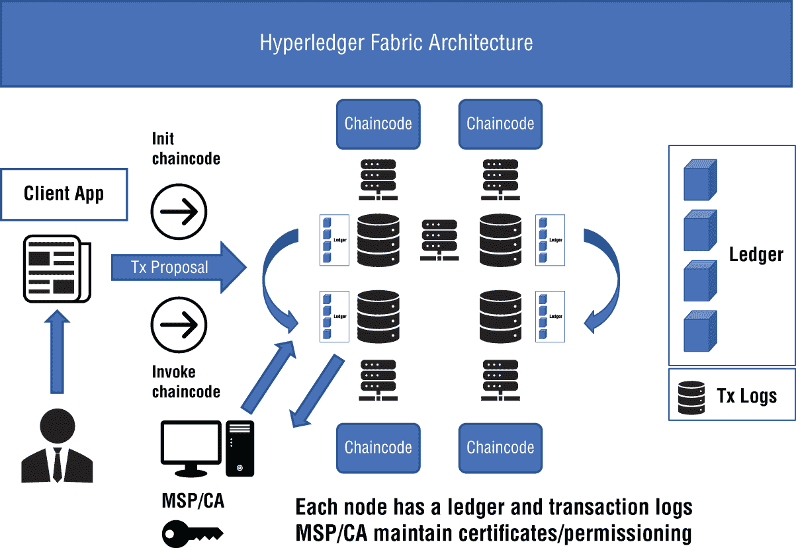

FIGURE 3.14 Hyperledger 架构结构

## 账本数据库选项 (LEDGER DATABASE OPTIONS)

Fabric 账本结构包含两个部分，与其他区块链非常不同。

- 状态数据（State data）是资产当前状态的表示。当状态发生变化时，资产状态数据可以被更改。
- 交易日志（Transaction logs）记录所有按接收顺序的修改状态数据的交易，一旦数据写入，它是不可变的且无法修改的。

在 Hyperledger Fabric 中，对于账本数据库有两种选择：`LevelDB`或`CouchDB`。

选择一种数据库而不是另一种数据库的主要原因是：你的需求是否需要对二进制数据进行复杂查询。Hyperledger Fabric 的账本系统使用`LevelDB`。根据定义，`LevelDB`通过提供内部同步允许并发写入器安全地向数据库插入数据。状态数据库选项包括`LevelDB`和`CouchDB`。

Table 3.1 显示 Hyperledger Fabric 账本的选项。状态数据库有两个选择。然而，`LevelDB`适用于交易日志。交易日志也是不可变的，仅允许创建和读取操作。

TABLE 3.1: Hyperledger Fabric 账本选项

| | 交易日志 (TRANSACTION LOGS) | 状态数据-世界 (STATE DATA (WORLD)) |
| --- | --- | --- |
| **类型 (Type)** | 不可变 (Immutable) | 可变 (Mutable) |
| **操作 (Operations)** | 创建、读取 | 创建、读取、更新、删除 |
| **数据库 (DC)** | LevelDB | LevelDB/CouchDB |
| **属性 (Attitude)** | 嵌入在同行节点中 | 键值对 (JSON, 二进制) |
| **查询 (Query)** | 简单 | 复杂 |

### Hyperledger Fabric 设计示例架构

以下示例架构旨在为预售销售顾问可能遇到的 Hyperledger Fabric 客户需求场景提供见解。根据需求，可能有许多不同的方案可以进行界定和设计。

### 关注医疗保健隐私的区块链场景

某客户要求你的 IT 集成公司为他们的客户群体（即医疗保健客户）设计一个区块链网络。当然，医疗保健隐私是一项重要需求。客户还表示，客户主要在美国，必须遵守 1996 年《医疗健康保险可携带性与责任法案》（HIPPA）的合规要求。HIPPA 由美国第 104 届国颁布，并总统比尔·克林顿于 1996 年签署。HIPPA 包含数据隐私的安全条款和要求，以确保患者医疗信息的安全。该法案包含五个标题，涵盖了法律的不同方面。

由于客户指定了专注于 HIPPA 和健康数据安全的合规要求，区块链技术在这里可以产生巨大影响，因为我们可以使用证书和加密密钥来保护数据。从会话角度来看，我们可以使用通道，Hyperledger Fabric 对此支持非常好。

Figure 3.15 中的架构允许移动用户访问托管在云提供商上的区块链服务。使用的应用程序旨在为移动用户提供其医疗需求的更新。

你可以看到我们正在使用云计算，这个区块链云为移动用户提供应用程序服务。提供了通道，用户正在使用他们自己的通道。Fabric 使用公钥基础设施 (`PKI`) 来生成与组织绑定的加密证书。通道访问仅允许给许可用户，这正是隐私保护的要求。

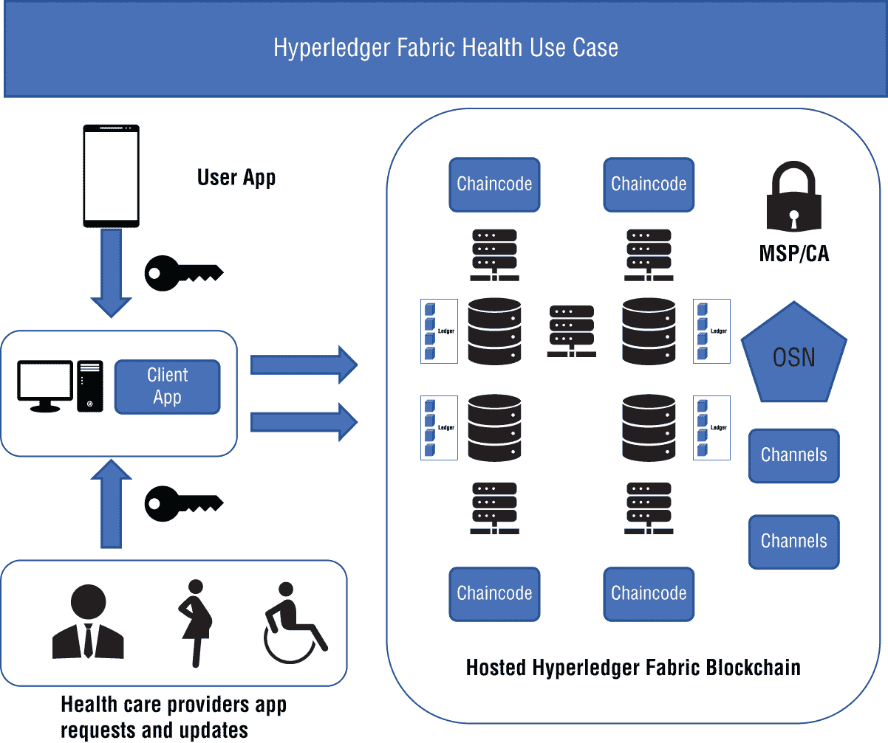

FIGURE 3.15 使用 Hyperledger Fabric 的医疗保健区块链

### 国际贸易联盟链场景

某客户要求你的 IT 集成公司为其物流应用程序设计区块链网络。客户表示该区块链将是一个联盟链，并涉及一些合规要求。没有加密货币需求，客户表示这是一个国际区块链。

Figure 3.16 提出了一个处理国际贸易的 Hyperledger Fabric 网络。多个方参与了区块链网络。区块链账本将任何非财务活动写入区块链。网络中有多个同行节点，以及专门的`MSP`、`OSN`和`CA`。对于大多数每秒交易数较低（例如 2000 TPS 或以下）的场景，该方案都是可行的。

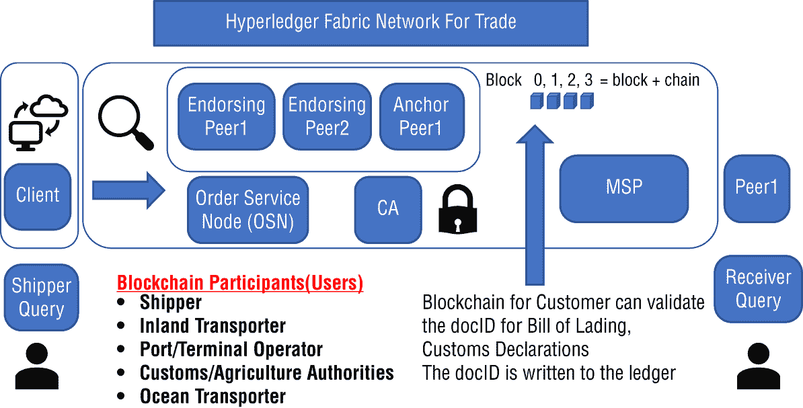

FIGURE 3.16 国际贸易 Hyperledger Fabric 网络

Hyperledger Fabric 是一种灵活、安全且被广泛应用的跨行业区块链。与其他许可级区块链相比，其开发者社区非常稳健。

## R3 Corda

本节介绍 R3 Corda，这是一种具有可插拔框架的许可级跨行业区块链。R3 Corda 是一种针对行业的许可级区块链，其真实价值在金融和保险领域尤为突出。Corda 是一家企业级软件公司，该联盟拥有 200 多名成员。

涵盖了以下主题：

- R3 Corda 的主要卖点
- R3 Corda 的设计考虑
- R3 Corda 的设计示例架构

### R3 Corda 的主要卖点

与 Hyperledger Fabric 相比，R3 Corda 的卖点相对集中。例如，这种集中主要是因为它是一个明确定义的、围绕金融服务组织由其创建的分布式账本。Corda 确实拥有 R3 联盟的充足资金支持，是企业级服务的稳健选择。

- `Corda`是一个专门为金融领域用例设计的分布式账本。
- `Corda`在保险和其他行业有不断扩展的应用场景。
- `Corda`有一个独特的特性，即智能合约中直接支持法律表述。
- 得益于`JVM`的灵活性，易于企业集成。


由于其公司结构和资金机制，其他区块链无法比拟其企业支持。

R3 Corda 是一个不断演进的账本平台，为其用户群体提供了清晰的价值。R3 Corda 利用了行业标准协议，为运行`JVM`提供了所谓的无缝集成，同时维护了一套强大的工具集。`Corda`还为金融客户提供了定制化体验，适用于利率互换、标准初始保证金模型计算、银行间结算甚至再保险。

## R3 Corda 的设计考虑

最初，R3 Corda 被设计为分布式账本，旨在解决金融领域区块链解决方案的隐私问题。`R3`的目标市场是金融业，特别是批发金融市场，因此这将是我们讨论的内容。

`Corda`具有高度的可扩展性，在部署中可以支持数十亿次交易。由于其安全结构，它是安全的；由于其专业的代码库，它是极其稳定的。

### CORDA 优势

`Corda`的主要优势在于通过减少手动任务来提高效率，以及引入法律表述的能力。正如预期的，`Corda`中的智能合约是详细的协议，其特定执行通过计算机代码自动完成。代码根据收到的输入运行。其他企业级区块链不具备的一个独特特征是合同法编码（附加）到智能合约中的方式，这些合约在法律上可能是具有执行力的。

使用`Corda`智能合约的一个主要优势是它们将业务逻辑和业务数据与相关的法律表述联系起来。第二个优势是这些`Corda`合同定义了区块链账本上业务逻辑的特定部分，并被视为移动合约。

## 隐私

正如我们在上一章中所说的，`Corda`是为隐私而设计的。它通过仅在特定客户网络内共享交易（无广播数据传播）来实现这一点。本质上，它被设计成一种解决隐私和互操作性的分布式账本，这仍然是`C3`的基本设计原则。`Notaries`（公证节点）被设计为运行`BFT`算法的互不信任的节点集群。

R3 Corda 在记录方面提供了令人印象深刻的投资回报率（`ROI`）。

### 智能合约

正如我们在上一章中所说的，`Corda`是为隐私而设计的。它通过仅在特定客户网络内共享交易（无广播数据传播）来实现这一点。本质上，它被设计成一种解决隐私和互操作性的分布式账本，这仍然是`Corda`的基本设计原则。

- 交易是输入状态，这些状态会创建输出状态。创建的输出状态将替换“历史”输入状态。这类似于在区块链上追加数据。

- 公证节点（Notary）是一个`Corda`网络服务，它为唯一性共识提供独特的服务。公证节点通过证明交易的唯一性来实现这一点，在`Corda`中，这意味着提议的输入状态尚未被消耗。公证节点池提供了系统中的终局性，这也许是`Corda`最独特的部分。

- 库（Vaults）是跟踪库感知的当前和历史状态的数据库。

## 共识

`Corda`具有“可插拔”的唯一性服务，以提高隐私、扩展性、法律兼容性和算法灵活性。

`Corda`中的可插拔唯一性服务以及共享哈希的使用解决了可扩展性和隐私问题。

共识用于确定提议的交易是否有效的账本更新，涉及两种共识：

- 有效性共识（Validity consensus）：由每个签名者在签署交易之前检查。

- 唯一性共识（Uniqueness consensus）：仅由公证服务检查。

有关`Corda`共识的更多信息，请参考`https://docs.corda.net/key-concepts.html`中的`Corda`文档。

## 交易

交易是更新账本的提案。财务交易是买卖双方之间交换一个或多个资产以支付货币价值的协议。示例包括产品或服务的购买、贷款和抵押、银行存款和取款、信用卡购买、退款、利息累计、税费支付等。

非财务交易是关于地址更改或指定工资的协议。

`Corda`的世界视图由交易意图驱动：

- 财务交易：交换资产以支付货币价值。

- 非财务交易：不涉及货币价值传输的协议。

在`Corda`中，交易通过使用命令来定义其意图。图 18 显示了如何定义交易的简单示例。

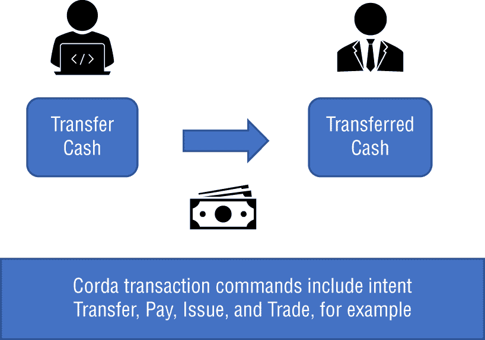

图 18 Corda 交易命令

交易代表同质化资产，即可分、可合并且可交换的资产；以及非同质化资产，即代表不可分、不可合并或不可交换的独特资产。

## R3 Corda 设计示例架构

以下示例架构旨在为销售顾问可能遇到的`Corda`客户需求场景提供见解。根据需求，可能有许多解决方案进行范围设计。

### 跨境支付场景

客户要求您的 IT 集成公司为其由金融组织的客户群设计一个区块链网络。该组织希望`Corda`减少中间环节并提高成本和流程效率。应用程序将发送 USD，但将使用外汇服务转换为 EUR。

图 19 展示了两个银行之间传输价值的示例架构。它显示了银行 A 和银行 B，它们在`CorDapp`中通过外汇将 USD 转换为 EUR。合约包含现金支付、公钥和地址。

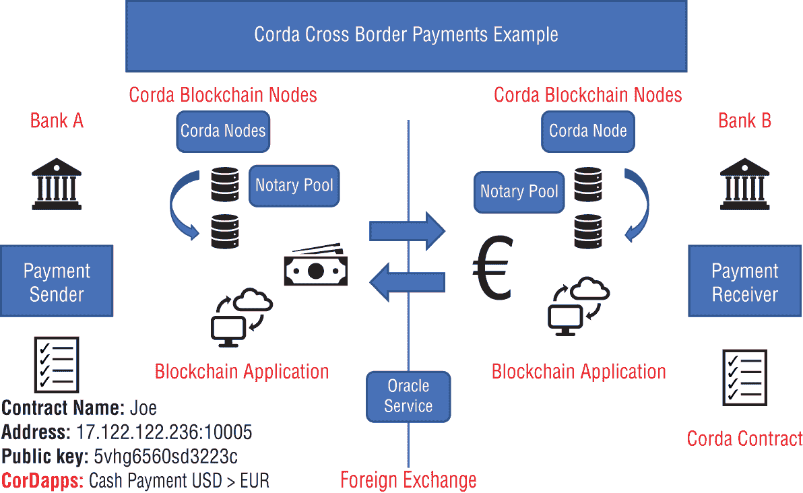

图 19 用于跨境支付的 USD 转 EUR CordApp

### 保险财团场景

客户要求您的 IT 集成公司为其由保险财团组成的客户群设计一个区块链网络。客户财团决定需要确保在部署智能合约时使用法律条款。

图 20 显示了一个使用`CorDapp`发布保单的保险解决方案。保险经纪人使用基于财团的`Corda`区块链网络。在发布保单之前，经纪使用精算工具对保单进行风险评估。一旦结果积极，经纪人可以通过`CorDapp` `Issue Policy`（发布保单）发布保单并验证支付。

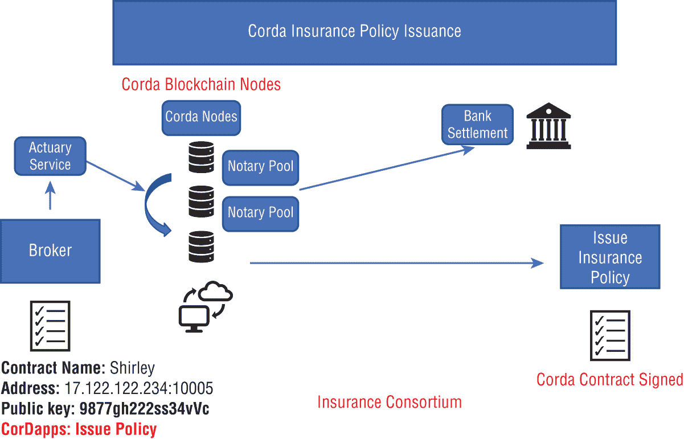

图 20 保险解决方案

`Corda`是一种专业开发的区块链账本，在金融领域有强大的用例。`Corda`内置的法律条款能够实现定义清晰且具有法律执行力的合同。

## Ethereum

本节涵盖了`Ethereum`的企业级方面，`Ethereum`是一个开源的无许可跨行业区块链，是代币平台的事实标准。

企业级`Ethereum`实际上只是公共`Ethereum`代码库的许可版本。如果您的客户希望开发一个基于广泛开发基础平台的分布式应用程序，那么`Ethereum`就是您的目标。

企业级`Ethereum`仅仅是公有`Ethereum`代码库的许可版本。我们将主要关注`Ethereum`的企业优势以及围绕这些主题领域的企业应用：

- `Ethereum`的卖点

- `Ethereum`的设计考虑

- `Ethereum`的设计示例架构

### Ethereum 的卖点

`Ethereum`有几个“卖点”，它们侧重于企业级用例。注意，企业级`Ethereum`是一个术语，指的是企业如何使用`Ethereum`，它并不是一个特定的产品，更多是关注代码库的加固。

以下是`Ethereum`的主要卖点。它们关系到为什么企业即使在一个无许可的平台上可以使用它：

- 企业可以部署`Ethereum`代码库并进行修改以满足企业区块链用例，并利用整个`Ethereum`生态系统。

- `Ethereum`是最广泛使用的代币平台，这使其成为企业进行资产数字化的良好选择，因为公共`Ethereum`区块链使用了`ERC-20`代币。

- `Ethereum`生态系统是区块链生态系统中最大的，开发者社区估计超过 250,000 人。

在本节中，我们将涵盖企业级以太坊（Enterprise Ethereum）的主要方面。它是广泛使用的无许可区块链平台的一种加固版本，其主要用例集中在资产数字化，也称为`tokenization`（令牌化）。

以太坊是由独立的区块链节点组成的去中心化网络，这意味着不受任何单一治理实体控制。以太坊也被称为`全球计算机`，你可以在其中编写控制数字价值的代码，这些代码完全按照程序运行，并且可以从世界任何地方访问。

从历史角度来看，大多数业务网络建立在中心化的控制和监督系统之上。这种方法已被政府和企业使用了数百年，并被反复证明是有效的。之所以需要这种方法是因为需要一个“中间人”，例如从一家银行汇款到另一家银行。

中心化系统意味着任何单一实体都可以控制区块链网络，但也意味着存在单点故障，这使得利用该系统的应用程序和在线服务器极易受到敌意收购、黑客攻击和不稳定性的影响。

以太坊与中心化系统相反，是一个去中心化系统。这个去中心化系统是完全自主的，不受任何个人或组织的控制。以太坊也没有中心点故障，因为它运行在运行于 100 多个国家的数千个节点上（截至写作时）。

从设计角度来看，以太坊因其无许可结构和有限的企业级能力而是最简单的。有关更多示例设计，请参考本书的网站。

企业级以太坊通过实施私有 P2P 交易提高了隐私水平，增强了扩展性和性能。它还引入了除工作量证明之外的不同共识协议。它允许客户选择，例如他们的网络规模、区块大小和 gas 限制。

## 企业级以太坊架构栈

企业以太坊联盟（`EEA`）有一个您应该了解的栈层。EEA 栈和规范旨在加速企业级以太坊解决方案的部署，并通过在多个选定供应商之间提供互操作性，激励企业部署 EEA 标准解决方案。

以下是 EEA 栈的主要区域：

- `Application Layer`（应用层）是顶层，下面有三个子层：`Dapps`、`Contracts and Standards`（合约与标准）以及`Smart Contracts and Tools`（智能合约与工具）。

- `Tooling Layer`（工具层）是下一层，下面有三个子层：`Permissions and Credentials`（权限与凭证）、`Integration and Deployment Tools`（集成与部署工具）以及`Client Interfaces/APIs`（客户端接口/API）。

- `Privacy/Scaling Layer`（隐私/扩展层）是第三层，下面有两个子层：`Privacy`（隐私）和`Scaling`（扩展）。

- `Core Blockchain Layer`（核心区块链层）是下一层，下面有三个子层：`Storage and Ledger`（存储与账本）、`Execution`（执行）以及`Consensus`（共识）。

- 最后一层`Network Layer`（网络层）是基础层，包含一个子层：`Network Protocol`（网络协议）。

在设计企业区块链时，从集成角度来看，理解该栈如何影响您的设计和集成规划是非常重要的。

## 私有交易

使用企业级以太坊解决方案的主要点之一是实施私有交易，无论链上还是链下。当以太坊中引用`chain`时，指的是主公共区块链网络。企业将希望同时拥有链上和链下交易，以充分利用以太坊区块链生态系统的优势。可以使用`Range proofs`（范围证明）或`ring signatures`（环签名）。`ZK-SNARKS`也在路线图中，用于对区块链隐私进行可能的改进。

私有交易基于对称加密和非对称加密的混合。对称加密用于信息，公钥用于共享。

## 交易扩展

与传统的以太坊平台代码库不同，以太坊企业代码库有两种类型的交易扩展而不是一种。这些是`on-chain`（链上）和`off-chain`（链下）。

- `On-chain`扩展发生在企业架构的第 1 层。它更改了以太坊协议以更好地适应交易需求。

- `Off-chain`扩展发生在架构的第 2 层。

## 以太坊设计示例架构

以下示例架构旨在为售前顾问可能遇到的客户需求场景提供参考。根据需求，可能会有很多不同的解决方案范围和设计。

### 企业财务区块链场景

客户要求您的 IT 集成公司为他们涉及信用证的企业财务应用设计一个区块链网络。客户表示他们不会投资基于成员的区块链，而是希望一个实现了合理隐私技术的公共区块链。没有加密货币需求，且客户表示在许多方之间存在交易，他们希望这种交易具有经济效益。

您的客户区块链学院（School of Blockchain）要求您的 IT 集成公司设计一种区块链应用程序，将证书凭据和学位证发布到公共区块链上。客户表示他们不会投资基于成员的区块链，只想将学位证发布到公共区块链上。他们还希望在未来将此功能扩展到其他联盟学校。这些证书凭据和学位证是公开可见的，但需要通过私有合约发布到区块链上。

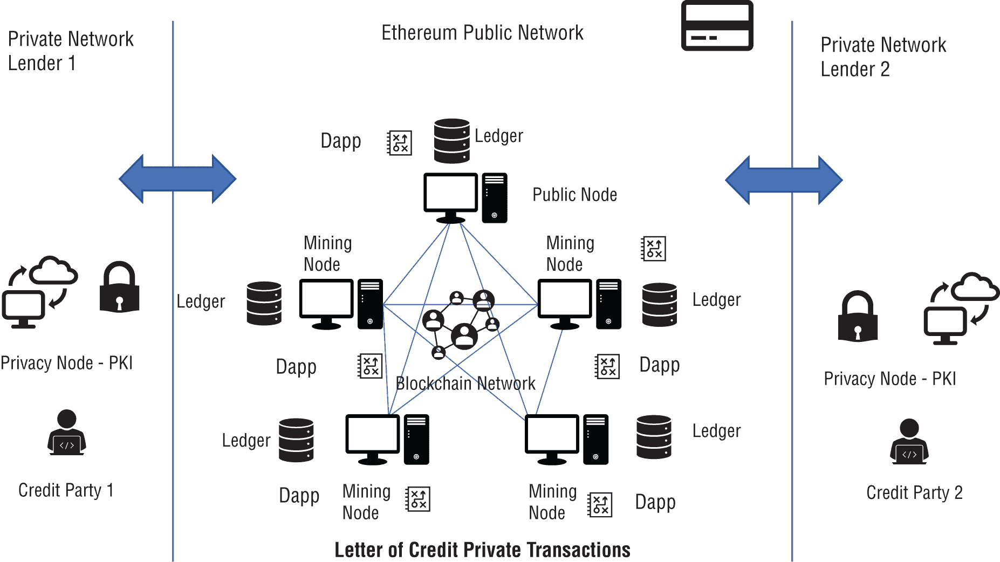

`FIGURE 3.22` 使用私有交易的信用证发行

图 3.23 显示了学校和学生使用`Ethereum`进行私有交易的证书颁发区块链。学校将证书发布到`Ethereum`公共网络，并向学生发送了一个私有链接，该链接本质上是一对公私钥对，用于身份验证发行者和接收者。学生也可以生成密钥对并与雇主共享证书，例如根据要求提供。

`Ethereum`是一种灵活且被广泛使用的跨行业公共区块链，具有私有扩展。与其他许可区块链相比，其开发者社区非常稳健，且用例潜力巨大。

## Quorum

本节介绍`Quorum`，这是一种具有插拔框架的混合跨行业区块链。`Quorum`是`Ethereum`的一个开源私有许可分支，专为企业部署设计。涵盖以下主题：

- `Quorum`的卖点

- `Quorum`的设计原则

- `Quorum`的设计架构示例

`Quorum`真正有用的地方在于，如果你熟悉`Ethereum`，学习`Quorum`的曲线不超过一小时。`Quorum`唯一的挑战不是技术性的（因为它是`Ethereum`区块链的分支），而是关于其有限的用户群和接受度挑战。摩根大通已吸引了 220 多家银行加入基于`Quorum`的银行间信息网络。

`Ethereum`和`Quorum`之间的区别在于，`Quorum`设计用于部署基于`Ethereum`的私有网络或扩展到公共网络。它没有像`Ethereum`那样的主网，它是通过摩根大通和`Ethereum`工程师共同创建的，这为其带来了巨大的支持。`Quorum`使用的共识算法基于投票，完全不涉及`Ethereum`那样的挖矿。

总体而言，其开发者基础低于`Ethereum`和`Hyperledger`，应用数量也只是`Ethereum`上应用的一小部分。然而，精通`Ethereum`的开发者可以轻松地将`Ethereum`分布式应用转换为可在`Quorum`上运行的程序。

## Quorum 的卖点

`Quorum`是一种专注于企业的私有许可区块链基础设施，专门为金融用例设计。`Quorum`构建自`Ethereum`的一个分支`Go Ethereum`。

`Quorum`的功能与`Ethereum`相似。相似之处包括网络和对等节点权限管理、增强的交易和合约隐私性、基于投票的共识机制以及更高的性能。在考虑特定用例的企业级`Ethereum`或`Quorum`时，对于金融领域的客户，考虑`Quorum`是重要的。

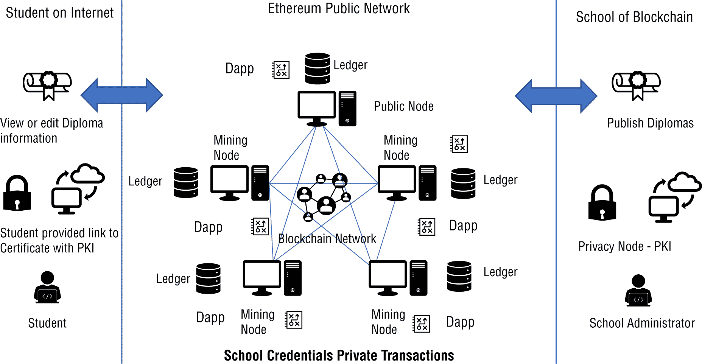

`FIGURE 3.23` 证书颁发区块链

考虑`Quorum`的主要几点如下：

- 支持私有交易，并在私有网络或公共网络上通过公私状态分离提供私有合约。

- `Quorum`在私有区块链部署中提供了强大的安全性和高交易吞吐量。交易速度的提高是简单共识机制的结果。

- 提供可选的共识机制，具有多种更适合联盟链的共识机制，而不是`Ethereum`的工作量证明共识。

- `Quorum`利用了`Ethereum`生态系统并在某些方面保持相似。这为`Ethereum`开发者提供了快速的开发体验。

- `Quorum`是由摩根大通领导的联盟网络完全支持的区块链。

## Quorum 的区块链设计原则

`Quorum`是一个许可去中心化平台，允许您在其之上部署 dapps。它是混合的，意义在于它可以支持使用一个或多个智能合约创建的 dapps。`Quorum`是`Ethereum`代码库的分支，提供了某些与`Ethereum`相似之处，但也与`Ethereum`有不同。从设计角度来看，`Quorum`使用`Solidity`或`Serpent`。

### QUORUM 组件

`Quorum`的架构中有以下主要组件：

- `Quorum Node`：修改过的`Geth`客户端。它具有提供一些重大修改的功能。对 EVM 的主要修改包括允许与许可节点连接的 P2P 层、处理私有交易的验证更改、移除 Gas 价格以及新的共识方法。

  - `jpmorganchase/quorum`

- `Constellation`：实际上是两个独立的组件——`Transaction Manager`和`Enclave`。

- `Transaction Manager`：负责交易隐私。该组件实际上负责存储并对加密交易数据提供访问控制。`Constellation`还利用了`Enclave`，它是`Constellation`的另一个用于加密功能的组件。

- `Constellation` `Enclave`：提供了明确的关注点分离。`Enclave`还通过加密操作的并行化对性能产生影响。

图 3.24 提供了`Quorum`的高级概述。

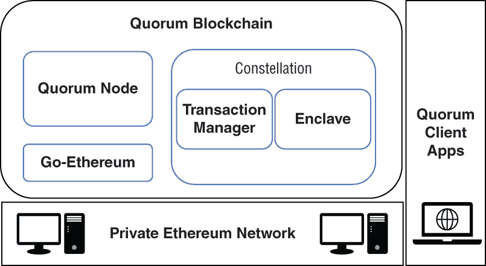

`FIGURE 3.24` Quorum 区块链概述

`Quorum`在高层非常简单。首先要注意它是`Ethereum`区块链的分支。它使用`go-ethereum`，这在集成方面提供了一些优势。

### 共识

编写时`Quorum`支持三种共识协议：`QuorumChain`、`IBFT`和`Raft`。`QuorumChain`是一种多数投票协议。从我的角度来看，`Raft`和`IBFT`是大多数企业实现中最广泛且有效的。

共识由一组赋予投票权的节点处理，所有节点都有投票权，并可以将投票权授予他人。`Quorum`中的智能合约在创世区块中用于分配投票权。智能合约在更新时跟踪区块链网络内所有投票节点的当前状态。投票过程由投票智能合约触发，该合约通过探测或采样投票节点来执行。当达到合适的区块高度时，交易被提交。


Istanbul `BFT` 共识算法提供了区块链最重要的职责之一，即交易终局性。Istanbul `BFT` 提供了点许可，这本质上是使用智能合约进行节点/点许可，并确保只有已知方可以加入网络。

Quorum 的性能显著高于以太坊主网的公共 `Geth` (Ethereum)，并提供了 `Solidity` 开发者熟悉的以太坊视觉和操作体验。

## QUORUM 账本

Quorum 为世界账本维护了两个状态数据库。一个是公共状态数据库，另一个是私有状态数据库。注意，两者的世界状态都提交到同一个单一账本上。

## 隐私

隐私可能是其优于以太坊的主要优势，这也是 Quorum 的主要用例。隐私是在 Quorum 区块链开发过程中刻意构建的。Quorum 区块链通过其实现的 `Constellation` 管理其大部分安全消息传输。

Quorum 支持两种机制来实现安全性和隐私：

- 一种零知识安全层协议，提供零知识证明 (`ZKPs`)。`ZKP` 是将交易定义为数学分支的一种奇特方式。这允许交易中的一方证明其对某些秘密值或信息的知情，而无需传递有关该秘密的任何细节。

- 私有合约，允许交易在双方之间披露。

隐私模型正在发生变化，旧的银行隐私方式也在发生变化。随着 Quorum 许可层的实现，金融机构可以确保只有授权方才能加入其私有以太坊网络。

## 交易

`Constellation` 作为 Quorum 的隐私模块使用参数允许参与者交换私有交易，并确保机交易数据在双方之间保密。

交易包含一个全局交易哈希。该交易哈希由区块中的所有交易、公共状态根哈希以及区块的签名组成。

## Quorum 的设计示例架构

以下示例架构旨在为预售顾问可能遇到的 Quorum 客户需求场景提供参考。根据需求，可能有许多不同的解决方案进行范围划分和设计。

### 行间转账私有区块链场景

您的客户是一家银行联盟，要求您的 IT 集成公司设计一种区块链应用程序，在私有许可网络上提供行间转账。客户表示这不会扩展到主网，且不需要预言机（例如用于验证外汇信息）。

图 3.25 显示了一个简单的私有区块链。该私有区块链有一个联盟并用于发送付款。该联盟管理分布式账本并实施了受信对等。

### 了解您的客户（KYC）区块链场景

您的客户是一家大型国际银行，要求您的 IT 集成公司设计一种既能提供隐私又能满足客户身份验证要求的的区块链。

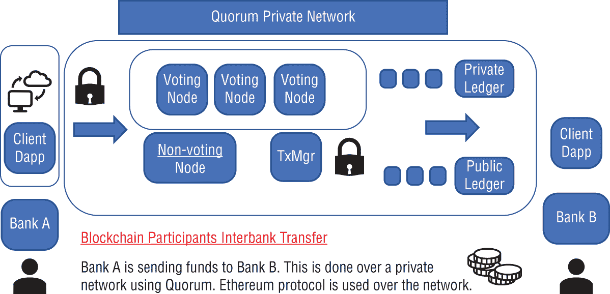

FIGURE 3.25 带有 Quorum 的私有区块链

图 3.26 显示了一个了解您的客户（KYC）区块链。Quorum 节点处理交易并向私有账本和公共账本更新。作为此类部署的一部分，部署了一个 KYC 服务来对已知身份进行身份验证。维护了一个合规节点以确保维护身份的合规性。

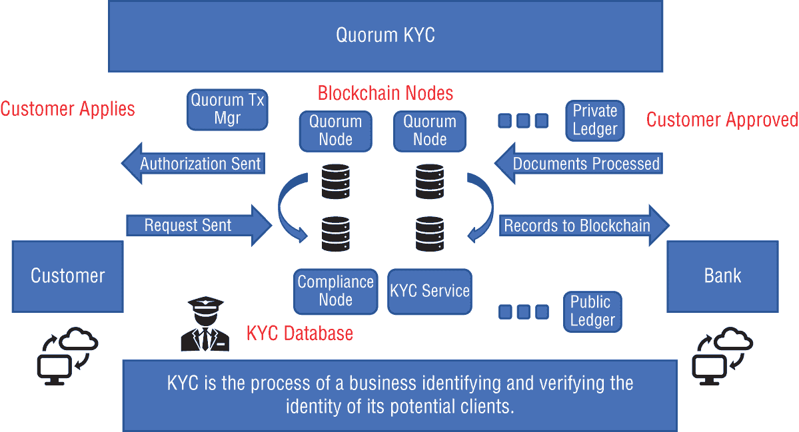

FIGURE 3.26 了解您的客户区块链

Quorum 是一个灵活的专注于私有网络的区块链，基于以太坊区块链具有私有扩展。隐私可能是其优于以太坊的主要优势，也是 Quorum 的主要用例。

## 总结

本章讨论了四种最常用的企业区块链和分布式账本，以及每种的若干用例。

企业区块链在技术和业务角度上彼此之间都有不同的需求。`Corda` 与 `Hyperledger` 和 `Ethereum` 非常不同。

企业区块链通常属于几类：私有许可、公共或无许可、或混合解决方案（例如 `Quorum`）。

`Hyperledger` 是 Linux 基金运行的一个伞项目，而 `Hyperledger Fabric` 是 `Hyperledger` 组合中最广泛使用的区块链。`Hyperledger Fabric` 是一个灵活的跨平台区块链，提供了许多选择。

`Corda` 最初构建主要是为了针对金融行业，该行业的记录、管理和自动化协议是效率低效的人工流程。

`Ethereum` 是一个基于区块链技术的开源软件平台，允许开发者构建去中心化应用程序。`Ethereum` 是最广泛使用的无许可区块链，拥有广泛的开发者群体。

`Quorum` 是一种通过增强现有以太坊区块链构建的开源区块链解决方案。它在以太坊之上了一个额外层，使其能够执行私有交易，并通过不同的共识算法变得更加灵活。

遵循本书的任务，我将关注用于企业级区块链的共识方法的企业级特性、速度和数据源。

如所述，在本章中，你将查看 `Ethereum`、`R3 Corda`、`Hyperledger` 和 `Quorum` 中使用的企业级区块链和分布式账本共识方法。我还将涵盖这些企业级区块链和账本的企业级方面，它们具有可插或模块化的组件，以便您的客户在共识方法上具有灵活性。

你会发现，在书中，工作量证明（`PoW`）和权益证明（`PoS`）经常被用作比较。事实是，由于 `Bitcoin` 的 `PoW` 是原始的共识方法，如果没有将其作为参考点，很难对共识机制进行比较。`PoS` 也被广泛应用于区块链平台，也可以进行有趣的比较。本章还将回顾什么是共识、它为什么重要，以及`拜占庭将军问题`是如何产生的，以及是如何通过一种被称为`拜占庭容错`的共识形式来的。

具体而言，本章涵盖了以下共识方法：

*   `Proof of work`（工作量证明）

*   `Proof of stake`（权益证明）

*   `Proof of elapsed time`（时间证明）

*   `Delegated proof of stake`（委托权益证明）

*   `Delegated Byzantine fault tolerance`（委托拜占庭容错）

*   `Practical Byzantine fault tolerance`（实用拜占庭容错）

*   `Istanbul Byzantine fault tolerance`（伊斯坦丁尔拜占庭容错）

*   `Raft-based directed acyclic graphs`（基于 Raft 的有向环图）

## 从历史角度看区块链共识方法

本节从历史角度涵盖了共识的概念。讨论了以下主题：

*   共识的重要性

*   `拜占庭将军问题`

*   `Bitcoin` 对`拜占庭将军问题`的解决方案

*   `拜占庭容错`

### 共识的重要性

众所知，共识意味着用于达成一致的方法。因此，区块链中的共识是指区块链节点对要写入区块链账本的区块链交易“达成一致”。共识可以被看作是对区块链账本“世界状态”最后状态的达成，这类似于已写入当前交易的快照或图片。共识验证交易并对它们进行排序。

更具体地说，共识算法是一种用于达成一致的过程，例如用于分布式网络上的交易。区块链网络运行的首要关注是是区块链网络内在区块链上记录的信息的共识。共识算法本身具有权衡。在大多数情况下，这种权衡是交易安全性和性能之间的权衡。区块链的性能通过交易吞吐量来衡量，也称为`每秒交易数`（`TPS`）。例如，`Ethereum`的本质是去信任的，这通过使用著名的`proof-of-work`算法来解决。`Ethereum`使用的`Ethash`共识算法使得攻击变得极其昂贵且不太可能发生。然而，与其他数据库技术相比，`Ethereum` 较慢。

共识还会影响区块链账本操作的参数和安全性。了解所部署的区块链共识的优缺点是明智的，因为通过基础知识可以避免暴露已知的漏洞。此外，区块链网络可能存在恶意行为者，他们可能会增加漏洞的暴露风险。

企业至少需要可用性和一致性。到本章结束时，应该清楚，特定的共识算法的设计是为了在包含多个不可靠节点的网络中实现可靠性。解决行业中已知的共识问题在分布式计算以及企业服务中非常重要。

区块链中的共识遵循以下两个属性以保证一致：

*   `Safety`（安全性）：这确保所有诚实节点对相同的值达成一致。

*   `Liveness`（活性）：这确保系统最终达成一致。

通常接受两种类型的共识：基于投票（`voting-based`）和基于选举（`lottery-based`）。

### 拜占庭将军问题

`拜占庭将军问题`来自传统的计算机科学。在这种情况下，参与方必须达成一致以避免操作的完全失败。在电信、加密和通用信息技术（`IT`）之前，与其他人通信的唯一方法是通过信使。这种通信形式对信使来说显然是的。例如，信使可能会被捕获，信息可能会被盗。

也许城市足够强大防御一两个敌军团，但可能不足以防御三个，更无法防御七个。因此，将军的七个军团需要达成“共识”，并对如何、何时以及何地精确攻击达成一致。

现在，将军们同时攻击吗？他们如何知道从另一个军团发送的消息没有被篡改？他们如何通信以确保不被截获？

拜占庭将军问题的真正解决方案并非共识世界中那种“一刀切”的简单直接方案。这些区块链账本解决方案需要涉及特定类型的哈希、高强度的计算工作，以及所有节点之间具有延迟忍性的点对通信协议，以验证交易。在将拜占庭将军问题应用于区块链时，你可以将节点想象成将军。

### 拜占庭容错

拜占庭容错（`BFT`）的出现是因为它代表了拜占庭将军问题的有效解决方案。`BFT` 是高效区块链平台的关键部分，且容错机制可以通过多种方式实现。作为一名预售专家或 IT 架构师，你需要根据你正在考虑的企业级区块链平台来理解各种共识方法。

`图 4.2` 详细介绍了拜占庭将军问题运作的步骤。首先，`General A` 收到了一条攻击消息，而 `General B` 没有收到这条消息。由于 `General B` 没收到这条消息，这产生了一个问题，即被攻击的城市可能会破坏整个攻击计划。

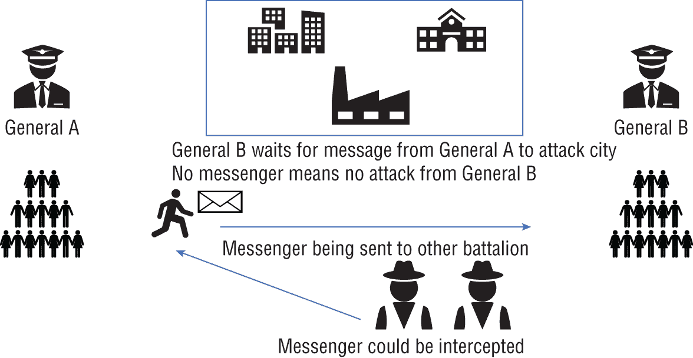

`**图 4.2**` 拜占庭容错流程

## 比较企业级区块链

`PoW` 的主要挑战之一是大量的能量被认为是“浪费”或“消耗”。当像 `Bitcoin` 这样的网络上有成千上万个节点时，会有成千上万个节点在解决同一个问题。`BFT` 的对比如下。

`表 4.1` 引用了常见的区块链及其方法：

| 共识方法 | 应用场景 | 优点 | 缺点 |

| :--- | :--- | :--- | :--- |

| 工作量证明 | `Bitcoin` | 安全、去中心化 | 耗能高 |

| 权益证明 | `Ethereum` | 高效、可扩展 | 中心化风险 |

| 委托工作量证明 | `EOS` | 快速、可扩展 | 中心化风险 |

| 拜占庭容错 | `Hyperledger` | 快速、许可制 | 实现复杂 |

| 实用拜占庭容错 | `Ripple` | 快速、许可制 | 非去中心化 |

| 联邦拜占庭容错 | `Stellar` | 快速、许可制 | 非去中心化 |

| 有向无环图 | `Iota` | 快速、可扩展 | 未经证实 |

| 历史证明 | `Solana` | 快 | 中心化 |

### 工作量证明共识

工作量证明（`PoW`）是第一个共识方法，用于 `Bitcoin`。要将一个区块写入区块链，矿工必须完成大量工作。`PoW` 用于验证交易的合法性，正因如此，它有助于避免所谓的“双重花费”问题。

`PoW` 的主要特征如下：

*   它提供了难以预测的区块，这可以增加区块链的竞争力，同时也增加了网络的安全性。

*   它通过验证谁管理该问题，提供了一种验证区块正确性的简单方法。

`PoW` 的主要问题是大量的能量被认为是“浪费”或“消耗”。当像 `Bitcoin` 这样的网络上有成千上万个节点时，会有成千上万个节点在解决同一个问题。资源消耗是主要的关注点。此外，挖掘 `Bitcoin` 的成本已飙升至 1,000 美元或更高。例如，为了成功挖掘 `Bitcoin`，你需要购买一台“矿机”，该矿机可能包含专用集成电路（`ASIC`），这是一种为特殊应用（如 `Bitcoin 挖掘`）设计的微芯片。挖矿是一项具有竞争性的业务，`ASIC` 可以在区块链挖掘领域提供竞争优势并提供效率、性能甚至安全性。

例如，在 `Bitcoin` 中，矿工需要具备竞争力，这是通过不断测试不同的唯一值来实现。这些唯一值被称为 `nonce`（随机数）。一旦矿工解决了这个复杂的问题，他们将获得相应的 `bitcoin` 奖励。然后，矿工可以通过向区块链网络广播该区块已被该节点挖掘，将其添加到 `Bitcoin` 区块链中。

`图 4.3` 显示了 `PoW` 的高层流程。

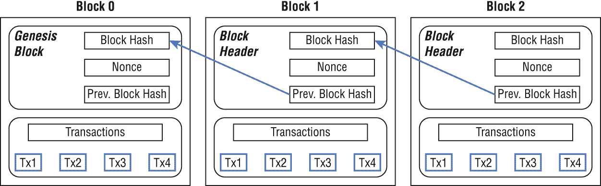

第二个区块引用第一个区块的哈希，第三个区块引用第二个区块的哈希。`PoW` 对区块链有两个主要用途：首先，挖矿用于验证交易的合法性，正因如此，有助于避免所谓的“双重花费”问题。其次，挖矿促进了 `Bitcoin` 网络奖励的创建并向矿工发放奖励。

如果你是一个企业，或者你的客户是企业，那么你可能不会使用基于工作量（PoW）的区块链，例如 `Bitcoin`。例如，你可能想使用 `Ethereum` 作为代币平台，或者为加密货币平台扩展支付网关。

然而，在 `Quorum` 和 `Enterprise Ethereum` 的情况下，由于它们的混合企业解决方案，你可能有很好的用例来考虑这些区块链。第 8 章“企业级区块链用用例”涵盖了 `Quorum` 和 `Enterprise Ethereum` 更常用的用例。

## 权益证明（Proof-of-Stake Consensus）

权益证明（`PoS`）是一种加密货币常用的用于验证区块的共识算法，从共识的角度来看，它与工作证明非常不同。权益证明创建于 2011 年，第一个实现它的加密货币是 2012 年的 `Peercoin`。本质上说，它的创建是为了避免 `PoW` 广为人知的经济和环境问题，例如密集的能量消耗和挖矿成本。

权益证明实现了一种方法：下一个区块的创建者由一个随机系统决定，该系统在逻辑上取决于用户持有的投资量或他们持有该特定货币的时间。这与 `PoW` 中的“计算能力”方法不同，例如在 `PoW` 中，创建区块并获得相关奖励的概率与用户在网络中持有的底层代币或加密货币数量成正比。

权益证明是一种基于利益的区块链处理方法，节点的利益与其投资直接正比。观察权益证明的另一种方式是，它是一种本质上基于财富的确定方法，财富定义为 `stake`（质押）。在加密货币质押中的投资越多，影响力就越大。

权益证明的主要特征如下：

*   `stake` 可能会因为经济因素而变化。

*   投票基于经济因素。

*   节点需要在线才能进行投票。

*   投票是最终的。

*   不允许多次投票。

`Ethereum` 计划发布 `Casper`，这是 `Ethereum` 区块链的一次硬叉。这次硬叉将把共识从 `PoW` 共识切换到 `PoS` 共识。请注意，如果 `Ethereum` 迁移到 `PoS` 共识，这将是一个重大的破坏性动作，因为 `Ethereum` 将从挖矿共识变为验证者共识。

`PoS` 系统非常适用于静态货币供应的平台。例如，大多数众筹平台利用这种方法根据投资分发代币。这正是 `Ethereum` 所在的方向。然而，`Ethereum` 的不同之处在于它基于 `PoS` 的终性系统，能够叠加在现有的 `PoW` 区块链上。这种在 `PoW` 之上的叠加本质上是一种混合的 `PoW/PoS` 方法，被称为 `Casper Friendly Finality Gadget (FFG)`。然而，由于技术挑战和安全考量，该更新被延迟了。

使用权益证明的主要优点之一是它的能量需求显著降低；因此，你可以获得更好的投资回报（`ROI`）。

据记载，每笔使用 `PoW` 系统的 `Bitcoin` 交易消耗的电可能相当于一个荷兰平均家庭两周的用量。这既是无效的也是不可持续的。

权益证明被认为是一种更高效的共识协议，因为它运行所需的电力要少得多，并且可以在硬件要求不那么的设备上运行，例如 `ASICs` 而不是 `GPUs`。

此外，`PoS` 不需要发行许多新币，而这曾是激励矿工维护网络的手段。这有助于保持特定代币的价格更稳定，从而为更多人参与区块链提供激励。

## 比较工作证明和权益证明

现在你已经对 `PoW` 和 `PoS` 有了通用的理解，让我们回顾 `PoW` 与 `PoS`，以理解这对 `Ethereum` 来说将产生多大的破坏性。

*   **工作证明（Proof of work）**：`PoW` 依赖于矿工解决复杂的数学问题来验证区块，矿工将获得工作补偿。

*   **权益证明（Proof of stake）**：`PoS` 依赖于网络中的节点轮流提议并验证区块，验证者的奖励取决于质押的代币数量。本质上，质押越多，潜在回报就越高。

`PoW` 是工作密集型的，需要矿工向区块链写入交易，且从经济角度来看是高昂的。

根据 Cointelegraph 的一篇最新文章（https://cointelegraph.com/news/bitcoin-mining-uses-more-power-than-african-countries），估计仅比特币网络消耗的能量就超过了非洲国家的国家的总和。

`PoS` 需要与 `PoW` 不同的投资类型，且密集程度较低。

`PoW` 具有以下优点：

*   它是一种经过历史验证的共识方法，广泛应用于加密货币且非常稳定。

*   由于成本高且 51% 攻击的概率低（51% 攻击是指矿工控制了网络 51% 以上的矿池），因此它是安全的。由于对节点数量算力的巨大需求，这种攻击是不可能的。

`PoW` 具有以下缺点：

*   与其他共识方法相比，交易处理较慢。例如，在 `Bitcoin` 中可能需要几小时才能完成交易。

*   51% 攻击的担忧仍然存在，这意味着 51% 或超过 51% 的网络可以被利用。

*   由于产生区块所需的工作，挖矿是一个耗时的过程。

*   从经济和环境角度来看，挖矿是一个昂贵的过程。例如，`Bitcoin` 挖矿的电力经常被电力公司禁止。

`PoS` 具有以下优点：

*   与工作证明相比，它更节约能源，因为不需要挖币，因此对于 `Bitcoin` 等加密货币来说是一种环保的选择。

*   `PoS` 系统的入门门槛较低，因为不需要挖矿机，并且允许更多用户参与质押和锻造过程。

`PoS` 具有以下缺点：

*   有人可能会偷走你的财富以及你在网络中的质押。当某人丢失了带有币的“钱包”时，他们也失去了在区块链网络中投票的能力。

正如你试图建立的任何区块链需求一样，回顾其优缺点将有助于确定正确的解决方案。

### 等等待证明（Proof of Elapsed Time）


等待时间证明（`PoET`）试图解决权益证明中随机选举提议区块参与者的问题，并确保每个参与者都有公平的机会提议新区块并参与投票过程。

`PoET` 是由著名的计算机芯片制造商英特尔（Intel）开发的，是一种支持大规模网络用例的生产级协议。`PoET` 需要一种特殊的 CPU 指令集，称为 `Intel Software Guard Extensions (SGX)`，它提供了一个名为 `TEE`（可信执行环境）的信任环境。可信代码在一个与应用程序其余部分隔离的环境运行。这意味着应用程序的其他部分不会干扰可信代码的内存空间等。你可以将其视为云计算中的容器或沙箱。

`PoET` 本质上通过选出所谓的领导者并实施双层流程，缓解了对 `PoW`（工作量证明）共识的担忧。`PoET` 试图修正 `PoS`（权益证明）的问题，即 `PoS` 会任意决定提议区块的成员，而 `PoET` 则预期确保每个成员都有合理的机会提供区块。

网络中的每个参与者都被分配了随机的等待时间，第一个完成等待时间的参与者将获得将下一个区块提交到区块链的机会。

`PoET` 对节点成员的本地可信执行区（enclave）施加了持有时间。持有时间最短的节点只有在持有时间结束后才能“提议”区块。每个私有可信执行区都会对潜在请求进行签名。结果随后由其他成员进行验证，以便他们确认没有其他节点跳过等待时间。

存在一种合理的担忧，由于 `PoET` 极度依赖 `SGX` 作为协议的基础，`SGX` 执行区可能会被劫持。这在最近的 Foreshadow 漏洞中得到了证明。尽管如此，Hyperledger Sawtooth 仍然使用 `PoET` 共识算法，它利用英特尔的 `SGX` 实现这种基于领导者的抽奖系统。

`PoET` 是一个特殊的用例。它的主要优势是它是英特尔的一个受信任专有平台。

`PoET` 具有优点：

* 可信环境，本质上是 Hyperledger Sawtooth 的即插即用共识
* 比具有硬件和能源等挖掘成本的 `PoW` 共识，能量消耗更低
* 解决了随机领导者选择问题，且不会消耗资源或需要激励机制

`PoET` 具有以下缺点：

* 由于依赖英特尔的专有硬件和软件要求，缺乏可移植性
* 由于专有硬件要求，成本高于其他区块链平台

如你所见，对于寻求特定解决方案且不期望超出该解决方案的企业来说，这些优缺点完全是可以接受的。

## 委托权益证明

委托权益证明（`DPoS`）由 Steem 的联合创始人、EOS 的首席技术官 Daniel Larimer 发明，这两者都使用了 `DPoS`。`DPoS` 是其亲属 `PoS` 的分支。

`DPoS` 使用实时投票系统和声誉系统来实现共识。`DPoS` 区块链共识协议允许代币持有者利用其余额选出名为 `witnesses`（见证者）的代表。这些见证者有机会对交易区块进行质押，然后将被授权将它们添加到区块链网络。

有趣的是，投票权取决于特定区块链利益相关者的代币持有量。例如，拥有更多币或代币的利益相关者对网络的影响比持有较少的人大。通常，这种权益的影响与投入系统网络中的权益成正比。

与所有其他共识协议相比，`DPoS` 被认为是最中心化最低的共识协议，因为它最具包容性。

`DPoS` 存在重大变体，其中代表需要通过将资金存入类似于时间锁的安全账户中来展示承诺。这些区块链中的每一个都有不同的协议规定如何实现和维护共识方法。

在使用 `DPoS` 共识算法的各种区块链网络中，通常选出 21 到 101 个代表。例如，在撰本文期间，EOS 和 Steemit 都有 21 个区块生成者。在 Bitshares 中，有 101 个区块生成者。在 `DPoS` 网络中，选择区块生成者的变量取决于该链的共识规则。

本质上，它有许多优点，例如可用性和性能，这些与其它算法相比是其差异化优势。

`DPoS` 具有以下优点：

* 可信环境，本质上是 Hyperledger Sawtooth 的即插即用共识
* 比具有硬件和能源等挖掘成本的 `PoW` 共识耗耗低
* 在不消耗资源或需要激励的情况下解决了随机领导者选择问题
* 比 `PoW` 和 `PoS` 扩展性更好，且由于开销小处理速度更快
* 提供了公平的奖励分配

`DPoS` 具有以下缺点：

* 存在 51% 攻击的可能性
* 如果持有最多代币的代表获得优势，可能会导致中心化
* 使用 `DPoS` 的区块链项目包括 Steemit、EOS、Bitshares 和 Lisk。

## 委托拜占庭容错

委托拜占庭容错（`dBFT`）是由 NEO 团队开发的，用于解决拜占庭将问题。NEO 在许多方面与以太相似，但我没有涵盖 NEO。

该系统由节点、代表和发言人组成。`dBFT` 的工作方式类似于国家的政府，拥有公民、代表和发言人。

`dBFT` 与其他区块链共识相比有一些独特的术语，因此澄清某些术语非常重要：

* `Citizens`（公民）本质上是代币持有者，被视为普通节点。代币持有者是指任何通过投票对区块链保持兴趣的人。
* `Delegates`（代表）是记账节点，被选出来提交请求。
* `Speakers`（发言人）是随机产生的代表，通过提出请求来遵循公民的要求。

`dBFT` 是一种为 NEO 开发的独特共识算法，具有所谓的完美终性。完美终性意味着所有交易在首次确认后 100% 确定为最终。

有趣的是，区块链不会分叉，这可以为利益相关者消除一些摩擦。`dBFT` 完全专注于企业级，因为它显然是为了监管和业务用例而设计的。

`dBFT` 具有以下优势：

* 确认后即具有终局性，且几乎不可能发起 51% 攻击
* 协议快速且高效，因为链上的新区块需要 15 到 20 秒
* 网络不会分叉，因此为参与者提供了稳定性。

NEO 是一个非营利的社区驱动型区块链项目。它利用区块链技术和数字身份来实现资产数字化，并使用智能合约实现数字资产的管理。要了解更多关于 NEO 和 `dBFT` 的信息，请访问 `https://neo.org/`。

## 实用拜占庭容错 (Practical Byzantine Fault Tolerance)

实用拜占庭容错（`PBFT`）是写作时最广泛使用的许可链平台协议。`PBFT` 由 Miguel Castro 和 Barbara Liskov 于 1999 年在麻省理工学院（MIT）计算机实验室提出。`PBFT` 也是本章之前讨论的拜占庭将问题的潜在解决方案之一。

`PBFT` 的共识决策基于所有将军（节点）提交的总决策来决定。`PBFT` 解决了挑战，而不需要像工作量证明（`PoW`）那样消耗大量的能量。需要注意的是，`PBFT` 仅运行在许可链区块链上，因此不像以太坊那样允许匿名性。

`PBFT` 的主要目的是决定是否接受提交到区块链的信息。本质上，就是该信息是否来自诚实且可靠的源？

`PBFT` 提供以下两个优点：

- 快速的交易最终性，无需等待确认即可记录交易
- 与 `PoW` 相比，能耗较低

`PBFT` 具有以下缺点：

- 最初设计用于有限的用例，因为节点之间网络流量的负载很高
- 容易受到女巫攻击的影响，单个实体可以创建或操纵大量网络节点，从而损害网络。

Zilliqa、Hyperledger Fabric 和 Ripple 等区块链项目目前在使用 `PBFT` 作为其主要算法，或将其作为组合中的一个选项。

## 伊斯坦丁尔拜占庭容错 (Istanbul Byzantine Fault Tolerance)

伊斯坦丁尔拜占庭容错（`IBFT`）是 `BFT` 的混合形式，是目前用于以太坊网络的 `PoW` 的一种高效替代方案。`IBFT` 是 `PBFT` 算法的实现，对区块链代码进行了一些重大修改。这些修改提供了许多优势，包括高效的结算最终性和减少基础设施的需求。

例如，在 `Quorum` 的用例中，`IBFT` 使用了一个运行在私有以太坊网络上的验证节点池，该池将决定提议的区块是否有效并添加到区块链网络。

该过程的下一步是随机选择一个验证节点作为提议者，它将负责在区块间隔期间构建区块。然后，它会将此区块与组共享。

实际上，如果“超级多数”的节点验证者接受该区块有效，则被接受的区块将写入区块链。

最后，在共识过程完成后，这些验证节点可能会选择一个新的提议者。该提议者随后将负责在过程中的下一个区块间隔期间提供下一个候选区块。

`IBFT` 是一种拜占庭容错解决方案，提供即时交易最终性，减少了其他平台可能需要的区块链基础设施。在验证节点池受信任且负责任的私有区块链上使用时，`IBFT` 提供了显著的优势。

最后，`IBFT` 真正提供了企业区块链必须具备的可预测交易处理率。

`IBFT` 最显著的实现是在 `Quorum` 区块链中。

## Raft 共识

Raft 是一种共识算法，旨在让大多数 IT 专业人员易理解，因为它具有简单的账本结构且开销很小。主要的区别在于 Raft 被简化为相对独立的进程，这些过程被称为“子问题”。

Raft 进程如下：

- Raft 提供了一个领导者选举过程，在现有领导者故障时选出一个新领导者。
- Raft 为领导者提供日志复制服务，提供高可用性。
- 安全性（Safety）当一个服务器在特定索引上提交了日志条目，且相比之下没有其他服务器为该特定索引应用不同的日志条目时实现的过程。

Raft 提供了几个实用的资源来帮助你高效地学习 Raft。要查看浏览器中查看有趣且具有交互性的 Raft 可视化，请访问 `https://raft.github.io/`。

有关关于分布式共识、领导者选举过程和 Raft 处理的更多信息，请访问 `http://thesecretlivesofdata.com/raft/`。

`图 4.4` 显示 Raft 处理资源的可视化。如你所示，在浏览器中运行的 Raft 集群中有五个服务器。有趣的是，你可以与该工具进行交互。

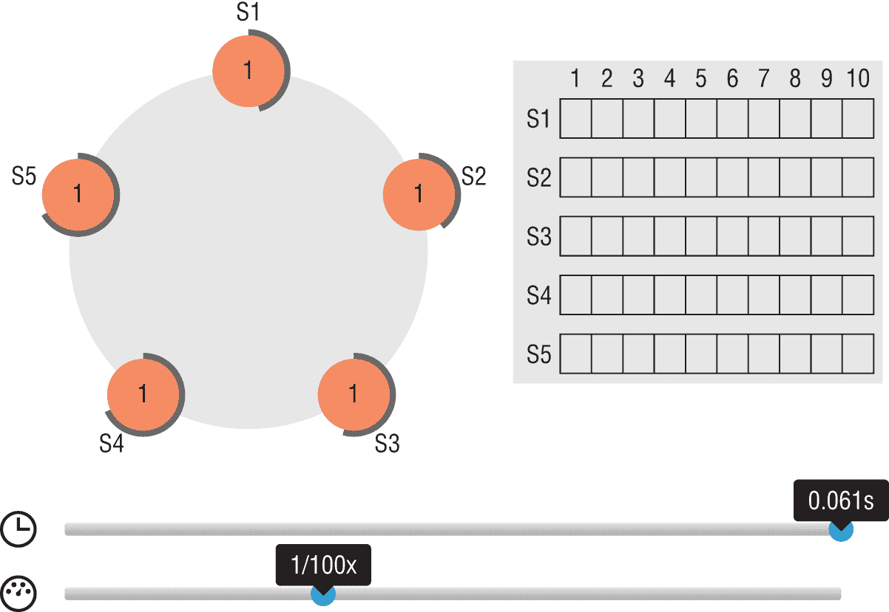

`FIGURE 4.4` Raft 共识可视化概览

Raft 提供以下优点：

- Raft 具有非常简单的账本和网络结构，你可以快速理解。
- Raft 自作为 `Paxos` 的“兄弟”版本以来广为人知。Raft 被用作容器的后端数据结构。
- Raft 使用随机选举超时过程，确保“选票分裂”降到最低。
- 除非有待处理的交易，否则 Raft 共识不会产生区块，这提供了一些效率。
- 与其他区块链使用的 `IBFT` 共识相比，Raft 交易的区块时间更快。

Raft 具有以下缺点：

- Raft 的用途有限，因为它不直接用于加密货币。
- Raft 现有的企业区块链账本也有限，无法处理重大的企业用例。

Raft 共识是 `Quorum` 区块链中的一个选项。

## 有向无环图 (Directed Acyclic Graph)

基于几个因素，有向无环图（`DAG`）在账本技术的未来可能会变得更加流行。其中因素是更高的性能和扩展性，而实际上区块链在这些方面的表现并不理想。

`DAG` 与区块链是非常不同的数据结构。`DAG` 传统上用于计算机科学来解决数据建模和数据分析方面的挑战。

在继续之前，讨论 `DAG` 平台时，理解一些定义是重要的。与其他区块链共识方法相比，`DAG` 有一些独特的术语。

以下术语是 `DAG` 特有的：

- *网格*（web）是一个通过边相互连接的节点网络。
- *边*（edge）是一个或多个网络节点之间的单向连接点。
- *无环*（Acyclic）意味着当通过沿着网络边从一个节点移动到另一个节点时，交易不会再次遇到同一个节点。

区块链和 `DAG` 之间有什么区别？

区块链是非常不同的数据结构，其中分布式账本按照不可篡改的时间顺序形成区块的线性链，并带有清晰的时间戳。`DAG` 在本质上不同，因为它是一个个体交易网络，可以链接到多个其他交易。

区块链是区块的链表，而 `DAG` 是一棵树，其中交易从一笔交易分支到另一笔交易。这被视为一种沿单方向传播且没有循环连接其他边的边的图。观察 `DAG` 的一种简单方法是将其看作“网络节点网”，其中每个网络节点都是相互连接的，但与其他网络节点运行着单向通信。

图 4.5 直观地对比了典型的区块链结构与 `Hedora Hashgraph` 中的 `DAG` 结构。区块链的结构也更具线性和层次性。`DAGs` 的主要优势之一是由于交易是以并行方式验证并处理的，这些网络速度更快。而在区块链中，交易是以串行方式处理的。

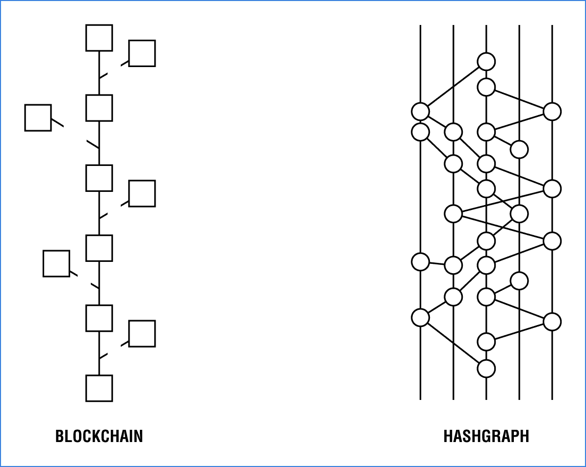

图 4.5 区块链 vs. Hedora Hashgraph 数据结构

与区块链相比，`DAGs` 具有以下优势：

* `DAGs` 速度快，并能随着交易增加而扩展。
* 交易可以并行或同时的方式进行验证，而区块链是以线性方式进行验证。
* 由于协议的效率，可能会实现更低的交易费用。

与区块链相比，`DAGs` 具有以下缺点：

* 从历史角度来看，学习起来较为复杂
* 应用场景有限，区块链可能不适用于某些场景例如物联网 (`IoT`) 数据

使用 `DAGs` 的账本平台有 `IOTA`、`Hashgraph` 和 `Nano`。

## 区块链共识评估

各种平台中使用了更多形式的共识，例如权威证明 (`PoA`)、燃烧证明 (`PoB`) 以及许多其他变种 `BFT` 拜容错共识。为了本书的目的，我将讨论限制在最常用的企业级共识方法以及在 `Ethereum`、`Quorum`、`Corda` 和 `Hyperledger` 中实现的区块链平台。

在围绕企业级区块链以及适用于特定区块链的适当共识方法做出决策时，理解许可型共识与工作证明共识之间的三个主要比较点至关重要。

即使在 `Quorum`、`Corda` 和 `Hyperledger` 中，共识方面也支持某些“模块化”。例如，在 `Quorum` 中，你需要在 `Raft`、`Quorum 共识` 或 `IBFT 共识` 实现之间选择。选择一种共识形式而非另一种可能会提供更好的交易性能（速度），但当选择 `IBFT` 时，你可能会获得更大的扩展性。

需要考虑的主要特征是速度、可扩展性和终性。通常，基于投票的算法优势在于它们与以下者相比提供了低延迟的终性：

* `速度` 是交易完成所需的时间。
* `可扩展性` 反映了区块链网络能够容纳多少节点。通常，可扩展性和速度是反比的。
* `终性` 是基于投票的算法具有优势的程度（提供低延迟终性）。

表 4.2 根据企业需要评估的三个主要特征对比了不同类型的共识算法。两种许可共识类型（抽签和投票）都比工作证明提供了更好的速度。

表 4.2 共识算法对比：

| | 许可抽签型 | 许可投票型 | 标准工作证明 (BITCOIN) |
| :--- | :--- | :--- | :--- |
| **速度** | 好 | 好 | 差 |
| **可扩展性** | 好 | 中等 | 好 |
| **终性** | 中等 | 好 | 差 |

在设计你的区块链时，最初选择合适的共识可能会令人困惑，但选择仅限于二或三个。本质上，你想要考虑适当的区块链速度、可扩展性和终性。

## 总结

本章涵盖了最广泛的企业级区块链和分布式账本共识。共识方法在达成共识的方式、所使用的术语以及开发方式方面存在很大差异。

# 第 5 章

企业级区块链销售与解决方案工程

本章涵盖了典型的企业级区块链项目的解决方案销售周期，以及你作为 `VAR`、IT 供应商甚至解决方案集成商如何参与区块链销售周期。区块链解决方案的销售侧重于应用开发、合性和企业集成，因此建议关注这些领域。然而，你的组织可能已经在成功地帮助客户处理应用开发、合性和企业集成这些领域，因此通过对区块链如何提供价值以及如何与组织集成的适当针对性培训，转化现有的技能基础应该困难。

在本章中，我将讨论销售区块链解决方案的具体细节，以及随方案销售而来的专业服务。随后，我将深入探讨需求收集和潜在用例的识别。

本章的目标是为你提供一个技术售前的视角，教你如何销售区块链服务、软件和硬件。我的“使命”部分之一是帮助你能够销售区块链解决方案。我希望确保你了解以下所有内容：历史参考、业务和技术资源、概念性和非概念性模式，最后是常规的售前任务，如 `RFPs`、`demos`、`whiteboards`、`readiness assessments` 和 `proof of concepts`（概念验证）。

## 企业级区块链销售周期

区块链销售周期在某些情况下确实可以模仿企业 IT 硬件、软件和专业服务的销售周期。在某些场景下，销售区块链解决方案的过程比传统的 IT 解决方案更简单。这是因为严重缺乏有效的生产区块链选项，特别是在金融领域。

然而，在其他情况下，解决方案销售可能会出现一些新方面，特别是在涉及区块链开发时。无论你是否理解区块链技术，你的首要目标都应该是为客户提供价值。如果这意味着你需要跳出流程并引入一位“区块链开发者”，那么对于你的组织和客户来说都是可以接受的。

在大多数复杂的销售周期中，你需要经历一个“发现”阶段，在该阶段你将讨论、理解并转化客户需求；理想情况下，你将进入探索和参与阶段，可能还有承诺阶段。

图 5.1 显示了 IT 关注型 `VAR`、供应商和集成商通常接受的高级销售周期。请注意，也存在一种七步法销售周期；但为了更多地关注技术方面，我们将[集中关注]在漏斗工作完成之后发生的四个步骤。

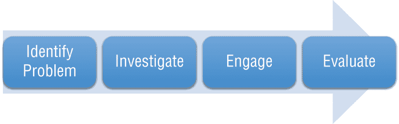

图 5.1 高级解决方案销售周期

这四个步流程被一致用于 IT 关注型的解决方案销售以及区块链技术销售。在考虑为潜在企业客户环境部署解决方案时，这些是具体步骤：

1. 识别客户想要解决的问题；在区块链行业中，你将识别区块链技术可以提供解决方案的领域，例如 `security`、`privacy` 和 `compliance`。
2. 调查问题的原因，然后为客户制定如何解决该问题的提案。
3. 就可能的解决方案与客户接触。在这一步中，我为建议的解决方案提供多种选项，并说明其收益、成本和风险。为客户提供这三个维度将使你成为一个受信赖的顾问。
4. 与客户合作并促进验证拟议解决方案的方法。这些验证方法可以是技术性的、业务和法律层面的验证。对于技术优势，使用 `demo`、`proof of concept` 甚至受信赖的客户案例。对于业务方面，考虑投资回报率 (`ROI`)、总拥有成本 (`TCO`) 以及任何其他有助于明智决策的客户指标至关重要。从法律角度来看，咨询公司法律顾问。

对于技术优势，使用 `demo`、`proof of concept` 甚至受信赖的客户案例。对于业务方面，考虑投资回报率 (`ROI`)、总拥有成本 (`TCO`) 以及任何其他有助于明智决策的客户指标至关重要。从法律角度来看，咨询公司法律顾问。


对于技术优势，使用`demo`、`proof of concept`甚至受信赖的客户案例。对于业务方面，考虑投资回报率（`ROI`）、总拥有成本（`TCO`）以及任何其他有助于明智决策的客户指标至关重要。从法律角度来看，咨询公司法律顾问。

对于技术优势，使用`demo`、`proof of concept`甚至受信赖的客户案例。对于业务方面，考虑投资回报率（`ROI`）、总拥有成本（`TCO`）以及任何其他有助于明智决策的客户指标至关重要。从法律角度来看，咨询公司法律顾问。

对于技术优势，使用`demo`、`proof of concept`甚至受信赖的客户案例。对于业务方面，考虑投资回报率（`ROI`）、总拥有成本（`TCO`）以及任何其他有助于明智决策的客户指标至关重要。从法律角度来看，咨询公司法律顾问。

对于技术优势，使用`demo`、`proof of concept`甚至受信赖的客户案例。对于业务方面，考虑投资回报率（`ROI`）、总拥有成本（`TCO`）以及任何其他有助于明智决策的客户指标至关重要。从法律角度来看，咨询公司法律顾问。

对于技术优势，使用`demo`、`proof of concept`甚至受信赖的客户案例。对于业务方面，考虑投资回报率（`ROI`）、总拥有成本（`TCO`）以及任何其他有助于明智决策的客户指标至关重要。从法律角度来看，咨询公司法律顾问。

对于技术优势，使用`demo`、`proof of concept`甚至受信赖的客户案例。对于业务方面，考虑投资回报率（`ROI`）、总拥有成本（`TCO`）以及任何其他有助于明智决策的客户指标至关重要。从法律角度来看，咨询公司法律顾问。

对于技术优势，使用`demo`、`proof of concept`甚至受信赖的客户案例。对于业务方面，考虑投资回报率（`ROI`）、总拥有成本（`TCO`）以及任何其他有助于明智决策的客户指标至关重要。从法律角度来看，咨询公司法律顾问。

对于技术优势，使用`demo`、`proof of concept`甚至受信赖的客户案例。对于业务方面，考虑投资回报率（`ROI`）、总拥有成本（`TCO`）以及任何其他有助于明智决策的客户指标至关重要。从法律角度来看，咨询公司法律顾问。

对于技术优势，使用`demo`、`proof of concept`甚至受信赖的客户案例。对于业务方面，考虑投资回报率（`ROI`）、总拥有成本（`TCO`）以及任何其他有助于明智决策的客户指标至关重要。从法律角度来看，咨询公司法律顾问。

对于技术优势，使用`demo`、`proof of concept`甚至受信赖的客户案例。对于业务方面，考虑投资回报率（`ROI`）、总拥有成本（`TCO`）以及任何其他有助于明智决策的客户指标至关重要。从法律角度来看，咨询公司法律顾问。

对于技术优势，使用`demo`、`proof of concept`甚至受信赖的客户案例。对于业务方面，考虑投资回报率（`ROI`）、总拥有成本（`TCO`）以及任何其他有助于明智决策的客户指标至关重要。从法律角度来看，咨询公司法律顾问。

简而言之，销售区块链在很大程度上是一种“开发性活动”，作为一个销售组织，你必须具备专业知识才能有效地对区块链进行定位。由于区块链和分布式账本是较新的技术，且知识储备有限，你作为售前工程师的角色将更像是“布道者”甚至是“培训师”，以确保你的潜在客户理解解决方案的价值以及该解决方案如何集成到他们的组织中。

## 区块链角色（利益相关者）

涵盖可能在区块链和账本重点解决方案中开展“销售活动”的角色至关重要。在本节中，我将识别参与区块链实质性讨论的利益相关者。

这一点很重要，因为在大多数情况下，区块链并不是通用的硬件或软件销售。同样重要的是，要意识到围绕区块链的解决方案销售可能会超出你常接触的普通 CIO、IT 总监以及网络或数据库管理员。在区块链、共识、框架、智能合约和分布式应用程序这一新世界中，IT 角色是企业不断演变的关注领域。某些角色可能专门的区块链专业知识，而某些角色可能只需要将区块链技术视为“值得了解”的关注领域。

以下是企业区块链领域常见的角色。提供这些定义更多是作为通用理解的指南，因为人们可能会预见到在某些情况下，职位和实际工作职责随公司不同而有很大差异。

* **区块链开发者**：区块链开发者专注于开发智能合约或链码（`chaincode`）、设计分布式应用（`dapps`）或集成与区块链网络应用程序对接的前端用户界面。在 Java、JavaScript、Python、Solidity、Go 甚至 C++ 开发方面拥有高级技能组合的传统开发者在区块链开发中表现良好。市场对经验丰富的区块链开发人员的需求从未如此高昂。

* **区块链架构师**：区块链架构师是一个面向客户的角色，基本上负责收集客户需求，将需求转换为可运行的平台，并将平台交给区块链开发者来处理他们的智能合约、`dapps` 和客户端应用程序。在许多组织中，区块链架构师也可以被称为解决方案架构师或咨询工程师。

* **区块链管理员**：技术负责人负责区块链平台的售后管理。通常，区块链管理员管理过其他平台，如云计算或电信。

* **区块链运营员**：区块链运营员是一个负责证书和账户管理以及区块链权限划分的角色。在较小的组织中，区块链运营员和区块链管理员的角色可能会合并。

* **区块链法律顾问**：在重视区块链合规性的组织中，需要这一角色。律师（顾问）通常为智能合约和联盟伙伴关系建立“法律术语”，维护合规/治理要求，并对各种区块链相关的问题进行尽职调查。据我所见，在关注首次代币发行（`ICO`）的组织，这一角色专注于交易结构的构建。

* **解决方案架构师**：这是一个面向客户的技术角色，被认为是大多数增值值商（`VAR`）、供应商或零售商最关键的技术角色之一。解决方案架构师的目标是采用区块链解决方案并解决业务问题。解决方案架构师和售前工程师的角色经常重叠。

* **售前工程师（架构师）**：这是一个面向客户的角色，对组织至关重要，并在“销售前”阶段工作。在适用时，他们基本上为更资深的技术负责人铺平道路。售前工程师专注于区块链技术如何转化给客户。同样重要的是，大多数大型组织可能采用专门的团队方法。售前工程师和架构师被认为是“产生收入的”角色，因此对组织至关重要。如果你喜欢人，并想为公司积极创造收入，那么这个职位可能适合你。

* **区块链营销人员**：区块链营销人员的角色是非技术的，更多关注于向潜在客户传达区块链解决方案和服务的业务利益。这一角色通常在贸易展、会议和社交活动中充分体现。例如，在一些较小的公司中，我见过客户执行员负责区块链营销人员的职责。

* **区块链项目经理**：该角色专注于确保实施按进度和预算进行。通常，任何管理 IT 项目的项目经理都可能在该领域取得成功。我发现项目经理面临的一个新领域是理解加密货币交易所的复杂流程。

* **区块链培训师**：该角色专注于使客户能够使用区块链技术。区块链培训师应该既具备技术背景又以客户为中心。通常，技术要求将集中在网络、应用开发、业务流程和培训上，但也可能负责建立概念验证（`PoC`）。

## 基于 IT 的销售周期

尽管区块链技术可能很复杂，但实际上，区块链销售周期遵循你销售电信设备、数据存储阵列、云计算平台或 CRM 解决方案时遵循的典型销售周期。

图 5.2](#c05.xhtml#c05-fig-0002）所示的七个步骤构成了一个典型的销售周期过程（尽管某些供应商使用八步系统）。对于本书，我主要关注区块链销售周期，因为目前还没有官方的销售周期。然而，我提供了关于如何处理销售周期的不同部分以适应区块链技术的见解。在销售周期之后，我将进入设计和实施阶段。

每个 IT 供应商、系统集成商和咨询公司对销售周期的世界都有自己的看法。在几家大型组织（Brocade Communications、Hitachi Data Systems [HDS Federal ViON]、3Par Data 和 Dimension Data）成功工作十多年后，我意识到每个行业垂直领域看待解决方案的方式都大不同，从而驱动收入的方式也不同。也就是说，某些组织在前端采用专门的团队方法（销售执行员与售前工程师/架构师的比例为 1:1），而另一些组织则较轻（两个或多个销售执行员对应一个售前工程师/架构师）。这种比例可能高达 5:1，这可能与行业垂直或地理地区直接相关。

售前工程师通常销售的解决方案被认为是昂贵的，且属于资本支出项目，例如 IT 网络设备、数据存储硬件或软件。同样，他们通常会像销售主管一样，在销售周期的大多数阶段中花费大量时间。这与价格廉价产品或服务的销售周期不同，后者的销售周期可能会更快速地完成。售前工程师确实不应该全方位投入每一个阶段，但应该与客户经理（Account Executives）保持清晰的沟通。

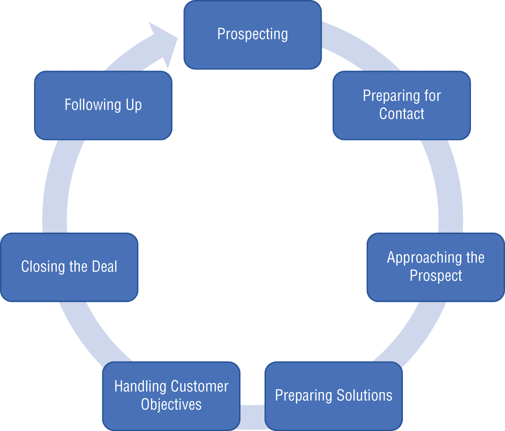

**图 5.2** 销售周期的七阶段

通常，作为一名售前工程师，参与发现客户的痛点以及产生这些痛点的因素是非常关重要的。一名丰富的售前工程师应该知道何时介入以及何时退出——例如，何时将技术方面交给给专注于区块链的解决方案工程师。基本上，要清楚你作为售前工程师的界限，并在需要时让售后团队参与。

以下阶段旨在识别销售和技术各个方面，应当高效、有效且专业地处理，以确保客户在需要的时候恰好获得他们需要的内容。

IT 销售周期的七个阶段以及我对每个阶段的定义：

1. **拓展客户（关系建立）**：这一步涉及通过会议、贸易展会甚至其他客户的推荐等各种手段获取客户线索。传统上，供应商有可以提供线索的团队，以及合格的内部销售人员。这一阶段更多是关于建立客户关系并赢得客户的信任。最后，征求建议书（`RFP`）是某些公司（尤其是政府和教育部门）拓展客户的另一种方式。

2. **准备工作（情报收集）**：这一步涉及准备线下或在线与客户会面，收集有关客户和企业的信息。收集一些你可以利用于他们所属行业（金融、能源、保险、政府等）的用例。此外，一个优秀的客户经理应该能够识别痛点、识别任何额外的利益相关者和业务决策者，并可能确定项目资金。

3. **接触（初步会议）**：在接触阶段，你的客户经理将处理最初的面对面会议、网络研讨会或会议。现实情况是，这些初始会议通常不包括售前工程师。在某些情况下，你作为销售工程师应该对客户和你组织的解决方案集进行“资格审查”。作为这一阶段的一部分，应当识别出技术决策者。

4. **演示（第二次会议）**：在此阶段，你作为售前工程师可能需要通过至少一次演示、白板演示以及极可能的演示或概念验证（`POC`）来展示区块链解决方案是如何工作的。

5. **客户异议（处理）**：对于销售团队来说，销售周期七个步骤中最具挑战性的部分可能是处理异议。处理异议是积极倾听潜在客户的顾虑，并以能够提供价值的方式解决它们，以便他们做出决策。作为销售工程师，你应该致力于“技术性成交”，即你已经围绕需求提供了足够的技术性有效信息，让客户觉得可以做出有利的决策。

6. **达成交易（采购订单）**：达成交易（采购订单）。这是发布采购订单的时候。

7. **跟进（支持）**：在签署采购订单后，销售团队应该支持客户以确保实施成功。

### 售前任务

作为销售周期的一部分，显而易见的是签署采购订单之前需要以下内容：

* 征求建议书（Requests for proposals）

* 识别与分析

* 区块链就绪评估

* 使用演示

* 白板演示

* 使用概念验证

* 为销售团队成交

#### 征求建议书 (REQUEST FOR PROPOSALS)

征求建议书（`RFP`）通常用于行业领域。在政府部门，采购也被称为`acquisition`（政府采购）。政府由总务管理局（`GSA`）管理着广泛的政府采购流程、法规和招标程序。《美国法典》第 10、31、40 和 41 章是常见的参考文献。

即使是大型商业公司也会为 RFP 征集投标。因此，在开始处理 RFP 之前，让我们先澄清一些术语：

* 对 RFP 提供响应的解决方案提供者被称为“投标人”（`bidder`）。

* 发布 RFP 的客户被称为“招标方”（`solicitor`）。

我有十多年的经验重点集中在华盛顿特区大地区的政府合同（军事和民用机构）。作为这一经验的一部分，我可以向你，进入大多数联邦、州和地方实体的唯一途径就是 RFP。

我将 RFP 称为门卫人或守门人，因为你别无选择只能参与这一过程。信息请求（`RFI`）、询价请求（`RFQ`）和 RFP 对于招标方和投标人来说都是一个耗时且本质上复杂的过程。

图 5.3 展示了标准的级 RFP 工作流流程步骤。工作流从`RFI`开始，这是一个信息收集请求。然后进入`RFP`，这是销售团队的工作。最后，某些公司可能会跳过 RFI 和 RFP 流程，直接发布`RFQ`，这是一项定价活动。

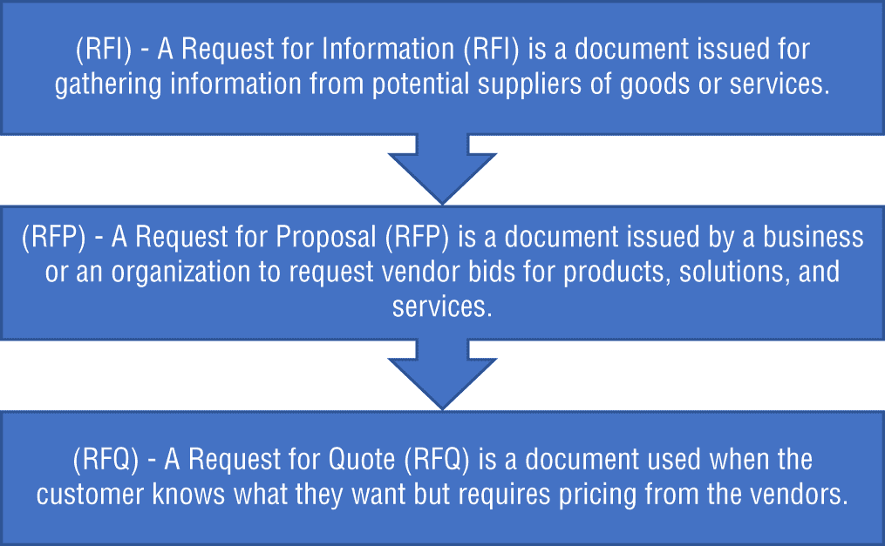

**图 5.3** 采购工作流程步骤

采购过程还涉及一项被称为“采购活动”（`procurement activities`）的长长工作流，这些活动包括以下之一：需求开发、授予前活动和授予后活动。由于由总务管理局（`GSA`）管理的广泛的政府采购流程、法规和招标程序，这些过程对招标方和投标人来说通常都是复杂的。此外，GSA 使用的评分系统来评估提案也一直面临挑战。这些挑战被称为`protests`（申诉）。

当一个组织决定对政府合同进行投标时（例如），在评估和响应`RFP`（征求书）方面有一些行业最佳实践。`RFPs`结构良好，从投标者的角度来看，它们需要团队通力才能完整完成。请注意，存在红团队（red teams）、蓝团队（blue teams）、绿团队（green teams）、金团队（gold teams）和粉红团队（pink teams），每个团队在建议书开发方面都有特定的职责。这些团队本质上是针对建议书状态成熟度的一种逻辑表示的分层方法。

甚至在这些尚未明确之前，招标方就可能排除你组织的资格资格，甚至让你无法赢得招标，无论你是分包商还是主承包商。在商业和政府合同的世界中，`prime`（主包）是直接与客户签订合同的主要承包商。`sub`（分包商）是直接为承包商工作的分包商，而不是直接为客户工作。主承包商和分包商可能会在响应`RFP`时共同工作。

你还需要清楚地认识到，如果客户尚未建立拟议的用例，大多数`RFPs`甚至不值得考虑竞争或投标。你的组织可能需要考虑可用资源的限制以及在竞争上花费的资源，特别是当政府真的不知道它正试图解决的问题时。

`RFPs`需要详细的技术响应，这些技术响应必须恰当地满足客户的需求。`RFP`无疑会提供一份每家投标公司必须回答的问题列表。这些可能包括关注业务的响应（例如，先前的经验或公司流程），也包括更具技术性的响应，包括建议的解决方案类型甚至详细的设备清单。

`RFP`可能会分发给`RFI`（信息请求）过程中确定的所有公司，也可能会公开以募集额外的投标者。在`RFP`过程中，最重要的任务是建议书开发。这是响应公司（投标者）通过其拟议的解决方案对`RFP`进行回应。

`RFP`问题在技术上通常非常详细，投标者在回答每一个问题时需要非常小心。响应将让招标方详尽了解投标者及其针对客户的潜在解决方案。另一方面，`RFI`将询问一组关于你公司历史、技术能力、合作伙伴关系、业务计划、所有权和其他技术细节较少的关键细节的标准化问题。

当涉及采购流程时，`RFPs`可能是或不是你组织业务计划的一部分。如果是，那么学习如何响应应该是首要任务，寻找提供对你组织特定市场（如教育、政府或商业市场）洞察的资源也应如此。

响应采购可能非常耗时，即使你很有经验。在考虑是否响应美国联邦招标时，有严格的要求，建议你的组织留住业务和技术人才，以创建适当的响应。

### 识别、分析和管理利益相关者

每个组织在项目或采购中都有一位以上的利益相关者。通常，作为项目管理的最佳实践，如果项目是因为合同协议而开展的，建议销售团队审查合同协议，以找到将参与销售过程的利益相关者。

`stakeholder`（利益相关者）是指可能以某种方式（直接或间接）受给定项目影响的人。这些利益相关者可以是负责项目的员工、组织，甚至是合作伙伴公司。利益相关者具有不同的影响力，例如作为技术影响者或业务影响者。

利益相关者的识别无疑至关重要，以确保销售团队和客户都不浪费时间。要同时识别决策者和最终用户。决策者需要参与其中，并应确保有合理的承诺在必要时与你互动。

图 5.4 展示了利益相关者流程图。在识别利益相关者时，最好的地方之一是识别组织中的角色。第二是分析；你想要了解利益相关者的角色，并理解他们如何影响决策。最后，你必须管理。

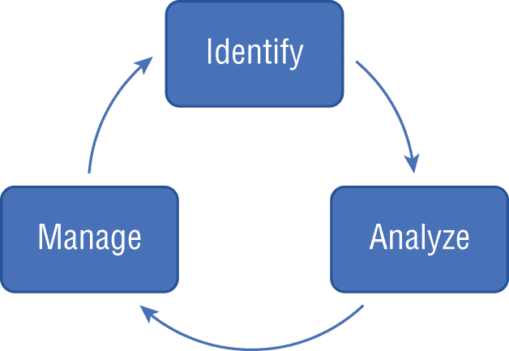

**图 5.4** 利益相关者流程图

利益相关者工作流非常直观。你必须首先识别利益相关者是谁，然后对他们进行分析，以确定他们的权限水平。例如，他们是技术驱动的还是业务驱动的？然后你可以进入工作流的最后部分：管理。以适当的方式与利益相关者互动，例如通过会议、白板，然后满足相应水平的预期。

作为客户群的信赖顾问，你必须确保尽可能专业地代表你的组织。做到这一点最好的方法之一是清楚地了解利益相关者他们在组织中所扮演的角色。这不仅将帮助你恰当地设定预期，还能帮助你满足或超过预期。你最不想做的事情之一，当然是“过度承诺而交付不足”（over promise and under deliver），这是销售培训中常用的格言。

### 区块链就绪评估研讨会

区块链就绪评估研讨会重点关注客户在采用区块链技术方面的阶段。通常，就绪评估也被一些供应商和合作伙伴称为`blockchain workshop`（区块链研讨会）。

研讨会是你作为供应商、`VAR`（增值经销商）、集成商或服务公司预期提供的，旨在在高度互动的环境中促进知识传递。在进行评估和建立需求时，白板演示可能是一项需求。白板演示对于识别问题并以对供应商和客户可视的互动方式展示解决方案至关重要。

通常，作为工程师，你将希望与客户合作，为组织建立潜在的区块链用例。作为流程的一部分，你还将识别需求、教育客户，并提供一份包含之后可能应用的用例的总结报告。

在区块链研讨会期间，你希望至少回顾以下步骤：

* 通过与利益相关者互动，识别区块链技术的潜在机会，以促进围绕问题潜在解决方案的讨论。


## 识别区块链机会

*   识别并记录组织对区块链用例的潜在规模。某些组织可能尚未准备好作为一个独立的单元或部门来引入区块链。潜在客户可能更容易通过以“联盟”的形式工作来受益，因为共享利益和成本可以提供直接价值。
*   记录利益相关者的功能性需求，这些需求将规定区块链从业务角度来看应该完成什么任务，例如合规性、报告、审计、授权或业务关注点。
*   记录利益相关者的非功能性需求。非功能性需求规定了系统从性能、可靠性、安全性或技术角度应该具备的功能。
*   确定客户对区块链实施的感知风险。
*   记录任何合规性需求，例如`GDPR`、`PCI`、`SOX`和`HIPPA`，因为这些需求是区块链用例的重要组成部分。
*   识别任何性能需求，例如每秒交易数（`TPS`）。与客户端-服务器技术相比，区块链并不是一个高性能平台。
*   为您的客户提供评估过程中的任何后续步骤，例如跟进电话或报价。

## 进行演示 (PERFORMING DEMOS)

演示是大多数面向销售的工程师所必须具备的工作部分。演示在许多方面与概念验证（`POC`）不同，概念验证通常在销售周期的后期进行。演示需要直接、及时、高效，并将时间控制在 30 分钟以内。

在进行演示时，以下是一些值得借鉴的最佳实践：

*   如果可能，在您维护的稳定平台上进行演示，无论是在您自己的平台上还是在云区块链即服务上。
*   区块链演示是以“软件”为核心的，在大多数情况下，除非另有要求，否则应围绕一个“故事板”（`storyboard`）展开。故事板是一种以逻辑方式传达特性和功能的方法。
*   识别客户感兴趣的特定关注点、特性或功能，尽可能避免“标准的”演示流程。
*   将演示保持在 30 分钟以内，以避免失去客户的注意力。
*   提前识别客户的利益相关者群体，并提供针对观众的演示。例如，`CIO`的兴趣会与云开发人员或网络工程师不同。
*   如果客户想“驱动”区块链交易，请提供交互式演示。
*   在演示期间，展示解决方案如何解决客户在之前的讨论中确定的“痛点”。

在进行演示时，我喜欢设置一个基础配置的区块链即服务（`BaaS`），以满足客户的兴趣并提供减少“痛点”的价值。例如，如果演示是关于`Hyperledger Fabric`的且您在`IBM Bluemix`中运行它，那么您基本上已经就绪了。如果客户群体由开发者组成，我会引导他们了解如何部署`chaincode`（智能合约）。另一方面，如果涉及的客户群体更多是管理层，那么我希望关注提高效率、展示易用性，并讨论通过解决方案可能实现的任何`ROI/TCO`节省。

图 5.5 显示了`IBM Blockchain Platform`中启动区块链服务的界面。

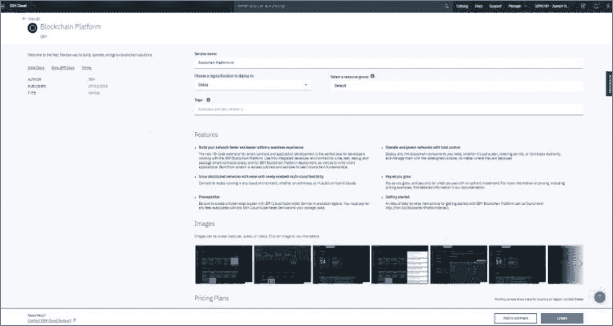

图 5.5 `IBM Blockchain Platform`

`IBM Blockchain Platform`接口允许销售工程师、开发人员或客户只需点击几次即可启动`Hyperledger Fabric`区块链网络。你可以看到，该服务需要服务名称、区域和组织才能在`IBM Blockchain Platform`中启动区块链网络。在执行演示或概念验证时，你可以在几分钟内开始，这可以为组织提供显著的结果。

## 使用厂商演示工具 (USING VENDOR DEMO TOOLS)

某些供应商还拥有其他工具，可以向您的客户展示其工作方式。`R3 Corda`提供了一种可以在您的笔记本上运行的演示工具，在某些情况下是有价值的。`R3 Corda`演示工具可以展示界面如何工作、交易如何发生或如何部署节点。`R3 Corda`演示工具是一个名为`Node Explorer`的特定应用程序，它可以在您的笔记本上运行。`R3 Corda`演示工具的目的是在本地部署`JVM`并在本地运行`Corda`实例。`R3 Corda`演示工具对于演示会议和`Corda`非常有用。

图 5.6 显示了`Corda`中的网络图。该特定页面被称为`Node Explorer`。

## 白板绘制解决方案 (WHITEBOARDING SOLUTIONS)

白板绘制是面向客户的工程师可以具备的关键技能之一。白板绘制是一种强大的销售工具，可以向客户展示你对其环境的理解，并向客户提供有关建议解决方案的洞察。白板绘制应该通过易懂的工作流、图表和图形，为客户构建决策过程。

白板绘制最好由技术工程师进行，可视化组件集成、网络连接和应用程序网关。

在白板会议期间，建议对客户痛点进行讨论，然后你可以将它们映射到特定的应用程序。深入理解挑战和客户需求有助于促进区块链解决方案如何解决他们问题的深入讨论。记住，白板是识别客户问题的视觉输出。一旦客户知道你清楚他们的痛点，提出解决方案应该是次要的。

## 执行概念验证 (PERFORMING PROOF OF CONCEPT)

概念验证是销售工程师在某些时候参与的技术活动，帮助识别客户尝试的特定性能、安全性以及可用性等因素。

`POC`本质上是某种方法或想法的实现，它在原则上是一个演示解决方案可行性的“视觉”过程。本节包含了我对`POC`的最佳实践。

首先，当我进行概念验证时，我所做的关键工作是与销售团队讨论客户是否经过了审核以及具有采购可行性。作为最佳实践，贵组织的客户执行（`AEs`）应该审核适当线索，并与相关的利益相关者跟进，以确保`POC`对客户和销售组织都是有效且合理的练习。根据我的经验，询问`AE`关于客户验证是一个明智的决定，以确保`POC`从技术和业务角度都符合公司的利益。

其次，我要求客户和销售团队与我直接合作，为`POC`建立明确的“成功标准”。这可以通过会议完成，例如，在实地访问之前。作为一名工程师，你必须对`POC`有明确的定义；你必须能够陈述作为成功标准的目标和预期结果。你可以漫无目的地开车出发，也可以开着车去明确的目的地。控制你正在运行的`POC`是你的选择，我建议你明确地将自己确定为驱动员。最后，我喜欢向销售执行官确认他们已经获得了客户的承诺，即只要我们交付了成功标准，我们将赢得订单。如果与客户没有建立正确的预期，那么销售团队就是软弱的，而作为工程师的你很可能陷入另一场徒劳之中。

通常情况下，你被要求执行`POC`是有原因的。执行`POC`的常见原因包括：

-   向客户展示解决方案的功能以及该解决方案如何解决他们的痛点
-   为你的客户消除部分解决方案采购风险
-   利用采购流程并与潜在利益相关者建立信任

企业级区块链有不同的用例、局限性和特征，作为工程师，你需要了解这些。在考虑`POC`时，识别区块链架构以及应用栈至关重要。应用栈是产生复杂性的地方。复杂性可能涉及端用户应用程序、去中心化和开源应用，甚至是实现方案。例如，`Hyperledger Fabric`基于三层架构。`Hyperledger Fabric`的层级是区块链网络、`chaincode`（链）和客户端应用程序。在执行`POC`时，你作为销售工程师的角色可能正是安装`chaincode`。`Chaincode`可以用三种语言之一编写：`Go (golang)`、`Java`和`Node.js`。

开发应用并将其部署到区块链平台，当然，是开发团队的责任。在第 10 章“区块链开发与编程”中，我稍后会详细介绍这一领域。图 5.7 提供了`Hyperledger Fabric`开发栈三层的见解。网络层的`Hyperledger Fabric`侧重于将区块链网络连接到 API，并将节点与智能合约集成。`Chaincode`、`SDK`和`APIs`是将区块链网络与端用户应用程序结合的“中间件”。


图 5.7 `Hyperledger Fabric`开发栈

在这里得到的教训应该是，`POC`可以作为一个与销售团队及客户合作、为企业级区块链提供价值的奖励机会。在执行`POC`之前，你希望确保利益相关者的认可，并确保已确定有效的“成功标准”。

## 通过区块链即服务赋能销售流程

作为一名经验丰富的云架构师，我可以向你保证，给予任何 IT 销售组织的最伟大“礼物”之一就是区块链即服务 (`BaaS`)。这也称为区块链平台即服务 (`PaaS`)，例如在`IBM Bluemix`的世界中。

销售组织可以用很少或没有`CAPEX`（资本支出）资金来消耗云服务，并利用云围绕`Corda`、`Hyperledger`和`Ethereum`等区块链进行`POC`、演示和培训。有时，真的不需要去找 C 级管理层申请用于区块链基础设施的`CAPEX`资金。客户执行经理知道，在任何类型（即使是小型）的公司申请`CAPEX`资金都是一个耗时且令人沮丧的过程。实际上，根据我的经历，这很可能是一系列耗时的过程。

我记得在 2009 年将`3PAR`数据存储阵列卖给华盛顿特区的商业部门。这些`3PAR`阵列与相同 GB 或 TB 的`EMC`阵列相比便宜。我们谈论的是 50,000 美元的订单对比 800,000 美元的订单，我们为了获得订单而翻筋倒海。在我看来，你需要了解利润和获客成本，这我在第 6 章“区块链经济学”中会有介绍。根管治疗可能被认为压力更小。

有些公司甚至可以用低于 100 美元的费用启动`BaaS`。可以使用“促销额度”或某些提供商提供的“永久免费”层级，甚至可以是免费的。

总之，你也可以利用云资源进行演示、概念验证，甚至在培训期间。我喜欢在准备就绪期间进行演示，以让技术人员思考并对比云服务与区块链服务。坦率说，利用区块链即服务并不适用于所有的销售组织，而且当你有用例和交易量足以证明重大投资价值时，拥有专用平台可以在许多方面提供效率和利益。例如，拥有专用区块链服务团队的一个可靠用例是大型咨询公司、`VARS`和供应商投资了自己的专用内部私有云，并可以将服务扩展到区块链。

## 销售企业级区块链解决方案

销售区块链解决方案的挑战之一是不过度推销该解决方案的优点。区块链技术在某些市场仍处于“采用者”阶段，因此可能会被过度推销为解决每个企业挑战的方案。我看过许多博客文章，听过许多会议演讲，说特定的区块链解决方案正在解决几乎问题，我认为其中大多数在营销方面可以得 A，但在可行性方面是 F。

事实上，区块链技术在解决问题、提供效率和建立稳健用例方面是有限的。在销售区块链解决方案时，你需要引入公司的业务和技术专家。例如，如果客户有供应链管理或合规性的用例，这些潜在用例对于建立不可篡改性和透明度的用例可能非常好，但该用例可能无法有效提供客户所需的性能和安全需求。

你的区块链解决方案可能涉及一些大量的软件设计和开发，还涉及一些硬件要求，可能还需要区块链即服务（`BaaS`）解决方案。从历史角度来看，你需要理解需求收集的典型最佳实践一直关注哪些方面。这些需求被分为功能性需求和非功能性需求。软件系统的功能性需求规定了解决方案应如何实现预期的结果，而非功能性需求将决定解决方案实现这些结果的约束。

让我们更具体地定义这些需求，并为每种需求提供示例。

*   功能性需求将规定解决方案、系统或特定系统组件必须为客户完成的功能，或为其提供可行的用例。这些功能性需求提供了关于系统如何实现所述标准的技术细节。
*   *例如*：公司的利益相关者确定，电子商务 Web 应用程序必须提供易于使用的购物车体验，对消费者来说应该是直观的、高度安全的，而且是高性能的，目标是增加公司的收入。
*   非功能性需求是指定衡量系统或其组件运行状况标准的需求，而不是特定的例程。这些非功能性需求定义了外部约束、系统限制和其他技术指定的输出。这些非功能性需求有助于确定项目的成功或失败。
*   *例如*：公司用户群确定电子商务应用程序将利用 A 公司的开源解决方案，该公司提供托管的电子商务解决方案。该解决方案通过行业领先的 SaaS 平台集成了`Shopify`购物车，并作为集成解决方案的一部分，通过企业 SSL 证书提供超过 2000 TPS 支持。

值得注意的是，非功能性需求主要分为两大类。

*   执行质量（例如）关注性能和可用性，由于我们记录了这些内容，因此它们被认为是可观测的。
*   演进质量是可测试性、可维护性、可扩展性和伸缩性，嵌入软件栈的静态结构中。

`IEEE-Std 830 – 1993`明确规定要在软件需求文档中吸收“13 项非功能性需求”。图 5.8 显示了由电气电子工程师学会（IEEE）规定的 13 项需求。


图 5.8 IEEE 13 项非功能性需求

IEEE 是一个全球著名的非营利专业组织，由工程师于 1884 年创立。该组织的主要目的是整合处理电技术的理念。IEEE 在出版技术著作、赞助会议和研讨会、提供认证以及制定标准方面发挥着重要作用。

你可以看到 IEEE 认可的非功能性需求列表中有 13 个区块。出于本书范围范围，我不会详细介绍这 13 项非功能性需求。如果你不熟悉这些 IEEE 非功能性需求，我建议访问`https://ieeexplore.ieee.org/document/392555`从 IEEE 了解更多信息。

区块链解决方案是一种具有计算机网络、计算机安全和合规性等业务方面的软件解决方案。从历史角度来看，软件系统的功能性需求规定了解决方案应如何实现预期的结果，而非功能性需求将决定解决方案实现这些结果的约束。

（注：原文后续存在大量重复段落，已根据要求不再进行重复输出）

无论你决定实现无许可区块链还是许可制区块链，都将存在权衡。你必须权衡区块链设计中的取舍，并据此做出选择。在需求收集和区块链设计方面，公有链和私有链之间存在显著差异。例如，如果你正在讨论 KYC（了解您的客户），这无疑要求将客户身份管理作为一项需求，那么你就会排除掉公有无许可区块链，因为你没有建立起相应的机制来“认识你的客户”。

## 从技术角度对区块链机会进行资质认定

作为一名售前工程师，你可能是销售组织中唯一的区块链技术专家，也可能不是。无论如何，你可能都希望控制自己的时间。

对区块链机会进行资质认定对于确保你的个人时间和公司资源不被错用至关重要。可能出现的挑战之一是，当你有一个销售团队或客户经理完全依赖你对每种可能的解决方案进行客户资质认定。在最初考虑一个潜在的区块链机会是否合格时，我会检查以下内容：

*   客户的潜在用例是否属于“概念契合”，即区块链是一个有效的用例？例如，客户是否需要合规的、不可篡改的报关单记录以供审计？或者，客户的物流应用可能不需要高 TPS（每秒交易量）性能。简单来说，区块链解决方案的属性是否被清晰理解，它们是否可以应用于客户的用例中？确定“概念契合”应该是你的主要目标之一。
*   该客户是否获得了利益相关者的支持？例如，被确定为将淘汰的现有数据库应用程序，是否是企业可以克服的技术和业务挑战？你需要了解客户的环境是否对新技术有利。
*   该客户是否拥有一个在历史上证明可行的行业用例（例如，在竞争对手中已有），这种过去的表现是否能为潜在收益和用例验证提供见解？你是否真的可以根据该用例与另一家有记录区块链成功案例的公司进行匹配？这样做会让方案销售对客户更具说服力。

## 区块链决策工作流

当你与潜在客户讨论区块链是否会成为有效的解决方案时，非常重要的一点是，作为工程师或架构师，你需要遵循一种工作流，并通过一个决定区块链是否成为良好用例的潜在领域清单。

IEEE 决策树提供了一个易于理解的工作流，用于对你的用例是否能受益于区块链做出“考量”决策。我非常喜欢 IEEE 决策树的一点是，它首先询问传统数据库技术是否满足了你的需求。这个问题能够非常容易地过滤掉需求。你可能遇到的另一个挑战是，区块链行业试图让区块链看起来像是每个问题的解决方案，就像是“拿着锤子找钉子，把每个问题都看作钉子”。现实情况是，如果客户偏好或需要（例如）高交易处理（超过 1000 TPS），那么你直接排除了区块链。另一方面，如果隐私、安全和合规是主要关注点，那么你可能有一个潜在的区块链应用用例。

决策树为在决定区块链是否合适、以及之后是许可制区块链还是无许可区块链才是正确结果之前，所应该提问的问题提供了见解。

*   第一个决策是意识到：如果传统数据库可以运行，那么可能就没有区块链的需求。如果传统数据库行不通，你就可以继续。
*   第二个决策是确定是否会有多个方参与。如果是，则进入第三个决策。通常，基于联盟的区块链是最佳用例。
*   第三个决策是关于信任的，以及是否可以使用第三方。
*   第四个决策涉及安全以及你如何信任分布式决策。
*   第五个也是最后一个决策将集中于你是否对交易需要隐私保护。如果是，则选择许可制区块链；如果不是，你可能选择无许可区块链。

[第 3 章]“构建你的企业区块链”更详细地涵盖了这一分步过程。有关采用区块链技术的 IEEE 决策树的完整背景，请参阅 Morgen E. Peck 的文章：`https://spectrum.ieee.org/computing/networks/do-you-need-a-blockchain`。

## 成功的区块链用例指标

通过理解你的区块链指标，你可以确定如何建立一个用例。客户通常欣赏来自与其行业和垂直领域类似的用例，即使是来自竞争对手的。建立和证明用例最简单的方法当然是拥有一个来自行业伙伴或竞争对手的可比用例。

当你对区块链客户用例进行资质认定时，以下是你可能在潜在区块链技术有效用例中使用的指标：

*   客户有 KYC 合规需求。
*   客户需要一个可以维护不可篡改记录的分布式账本。
*   客户不需要 SQL 数据库性能，特别是每秒交易数方面。
*   客户有实现不依赖中心机构的跨境支付的需求。
*   客户有合同需求，可能导致财务纠纷（如退单或条款纠纷），这些可能引发法律问题。
*   客户理解什么是法律术语，并打算将这些需求纳入智能合约中。
*   客户需要建立一个“从农场到餐桌”的应用，为其客户群体提供透明度。
*   客户正在考虑移除中间环节，以降低其交易处理部门的成本。

当然还有更多用例可以识别成功的区块链用例。你可能想查看区块链供应商的网站获取额外的用例。我在[第 8 章]“企业区块链用例”中涵盖了几个更详细的用例。

## 突出区块链的优势

区块链技术创造价值的收益应该产生什么结果？对于大多数寻求区块链收益的组织来说，每个潜在用例都有不同的结果。

基本上，一家物流公司的分布式账本可以跟踪从海外运来的货物，并为公司对海关合规性的要求提供溯源。性能和成本管理可能不是主要收益，因为该应用更关注海关合规记录。


以下列表列出了企业使用区块链技术可以实现的常见优势：

- 资本支出（`CAPEX`）和运营支出（`OPEX`）的减少（成本管理）
- 许可访问（安全性）
- 提高隐私性（通道化）
- 通过减少中间环节提高效率（减少会计、律师、海关代理人和贷款人）
- 降低风险（减少人为错误）
- 数据完整性（不可篡改性）
- 溯源（历史事件记录）
- `透明度`（消费者的信任）

区块链可以提供某些与安全相关的巨大益处。此外，区块链特别适用于对安全和冗余要求的数据平台。

## 智能与价值

当正确实施时，智能合约可以为某些组织提供巨大的价值。提醒一下，智能合约是计算机程序代码，能够利用区块链技术管理、执行和强制执行协议的履行。整个智能合约过程应该是全自动的，并且在某些场景下也可以作为法律合同的补充或替代。例如，`Corda` 就在该领域提供了巨大的价值。

区块链技术在部署智能合约时利用了两个不同的专有特性：验证规则的使用以及在智能合约中对这些规则的执行。验证规则定义了记录和区块包含在区块链中的条件，而验证规则的执行则通过算法或协议工作，该算法执行由所有向区块链贡献数据的方所信托的规则。

智能合约可以提供组织在智能合约出现之前无法实现的自主性或信任。智能合约还可以在如 `R3 Corda` 等平台上提供法律表述，使用附件来明确定义条款。智能合约的条款一旦部署在区块链上，就会被记录且不可篡改。

以下是使用智能合约进行价值创造的一些常见原因。并不是所有的区块链和智能合约用例都会以相同的方式获得价值。

- 自主性
- 信任
- 备份
- 安全
- 速度
- 节省
- 准确性

作为销售工程师，你应该确保自己对企业可以从中受益的智能合约潜在价值有深入理解。

`Table 5.2` (#c05.xhtml#c05-tbl-0002) 显示了传统合同与智能合约的对比。智能合约在处理冗余任务方面高效得多，并可以节省大量的成本。

`TABLE 5.2` (#c05.xhtml#R_c05-tbl-0002): 传统合同 vs 智能合约

| 传统合同 | 智能合约 |
| --- | --- |
| 1–3 天 | 分钟 |
| 需要托管 | 可能不需要托管 |
| 昂贵 | 成本的一小部分 |
| 物理在场 | 虚拟在场 |
| 需要律师 | 可能不需要律师 |

与客户讨论智能合约时，你应该了解客户如何处理组织内部的采购、签约或交易。这将为如何应对潜在益处提供洞察，并可能开始就他们如何提供价值进行实实讨论。例如，我想了解客户的应用。假设这是一家位于美国、从海外进口大量产品的公司。我首先想了解客户目前的遗留解决方案是如何工作的，并理解其痛点，识别低效率环节和潜在的节省，然后绘制一个利用智能合约区块链平台的潜在高层工作流。

## 区块链采用的挑战

作为一名以销售为导向的工程师，理解区块链不是解决每个业务和技术问题的“圣杯”是非常重要的。区块链采用的挑战可能是巨大的，而且在某些企业组织中数不胜数。此外，某些行业和垂直领域在采用新技术方面传统上比较保守。

以下是我在处理区块链和分布式账本时经常遇到的一些常见挑战：

- 行业对 `ROI` 的采用缓慢
- 监管考量可能尚未明确定义
- 解决方案的成熟度仍与 `SQL` 相当
- 技术采用尚未明确定义
- 在 `Ethereum` 方面的技能储备有限

在区块链采用方面，你必须意识到解决方案与`中心化`系统是不可比拟的。

## 销售工程的成功

作为一个可能考虑寻求`区块链解决方案架构`专业知识的组织，有一些基础的建议性职位要求需要考虑。

### 区块链成功的销售工程职位要求/职责

以下是成功的销售工程师的一些常见要求：

- 市场营销职责，例如会议、贸易展览会和展位工作
- 开发并演示技术演示稿，以阐述所提议服务的价值
- 将企业业务需求转化为技术需求
- 根据 `RFPs` 提供成本估算
- 支持方案演示和 `POCs`
- 对主流区块链平台进行竞争分析
- 创建白皮书、技术设计图、博客文章等内容

以下是优秀的销售工程师应该具备的一些常见经验：

- 销售 IT 基础设施、软件和硬件经验
- 丰富的 `TCP/IP` 协议实操 IT 网络经验
- 对计算机编程语言、软件开发包 (`SDKs`) 和应用程序编程接口 (`APIs`) 保持深入理解
- 常见区块链开发语言的经验，如 `Python`、`Go (Golang)`、`Node.js`、`JavaScript`、`C++`、`Rust` 和 `Solidity`

### 区块链成功的销售工程最佳实践

作为面向客户的销售/解决方案工程师，你大部分时间将与由销售执行官、销售经理以及可能的区域经理组成的销售团队合作。

以下建议的最佳实践侧重于技术解决方案销售：

- 通过与客户群体建立信誉，成为受信赖的顾问。了解客户的业务需求以及挑战对于你作为销售工程师的成功至关重要。
- 通过提出正确的问题来理解客户的业务需求，并将这些需求转化为满足或超过客户请求的技术解决方案。
- 清晰且自信地识别为企业客户群体带来价值的用例。
- 充分理解区块链技术，以便讨论合适的区块链解决方案并在演示和概念验证中提供价值。
- 倾听客户的观点并做出恰当的回应。
- 充分了解客户的采购流程，以确保你能够提供客户所需的、最高效且专业的解决方案。如果你正在响应 `RFP`，请在做出回复之前阅读所有数据点。
- 聘用才华横溢的应用开发者，他们理解软件架构，并能针对 `Python`、`Go`、`JavaScript` 等特定的区块链编程语言为客户提供见解。
- 也许最被忽视的特质就是要平易近人且令人好感。成为一个能够在个人层面建立关系的人，有时对所有参与者来说都更有价值。在程序员面前，当一个“极客”很棒，但讨论客户感兴趣的其他话题（如高尔夫、兵役或母校）可以增强你的亲和力并成为你的竞争优势。了解你的客户，并向他们展示你对组织的关注。

## 区块能力就绪

在涉及任何 IT 相关的平台或解决方案时，了解自己的能力至关重要。基本上，你们公司的专业领域是什么？你们公司擅长什么，哪些方面可以改进？

通常情况下，如果你是 IT 供应商、转销商或 `VAR`，你可能在 IT 网络和数据存储方面拥有深厚的专业知识。然而，涉及到应用开发时，你的公司可能无法以智能的方式讨论 `Python` 编程。

这时，你需要执行以下操作之一：

- 从内部获取人才（内包）
- 通过合作伙伴或直接招聘从外部获取人才（外包）
- 出于适当理由放弃该机会

你的销售领导需要评估多种区块链能力。第一阶段是区块链培训。在进行设计、实施、开发甚至支持之前，理解这项技术始终是起点。根据我的经验，我认为应用开发是大多数公司中最薄弱的阶段。图 5.10 提供了一个基于解决方案的组织应执行的活动工作流，以增强区块链就绪性。


图 5.10 区块能力就绪

- **区块链培训**：作为一个销售驱动的组织，在获得高层认可后，你的组织必须投入的第一件事就是培训。确定包括区块链基础以及更高级的领域，如智能合约、法律文本、性能和安全性。有些组织采取了教育公司全员步骤，而另一些组织仅培训少数 IT 专业人员以使他们“赋能”。
- **机会发现**：核心在于从现有客户和潜在客户处驱动收入。通常，大多数销售驱动的组织都能很好地处理这一阶段。你完全依靠优秀的客户经理来推动至少最初的接触。这一阶段也可以发生在你的贸易展会和会议上。展位上一个自信的销售工程师可以在与参会者进行技术交流时产生巨大影响。关键在于识别区块链机会，并且你的专家必须经过赋能。
- **解决方案设计**：在设计区块链网络时，核心在于能力和满足客户需求。通常，我合作过的大多数组织都能非常高效地设计网络。
- **应用开发**：在设计区块链网络时，核心在于能力和满足客户需求。通常，我合作过的大多数组织都能非常高效地设计网络。
- **应用支持**：部署完成后，责任将移交给客户。

当你考虑区块链解决方案的经济效益时，意识到组织可能考虑的无数经济决策是非常关重要的，而且这些决策会显著影响客户会议的结果。根据我的经验，在风险承担上较为保守的公司倾向于将区块链解决方案视为一种赌博。但如果你观察该公司如何处理灾难恢复（例如，备份和 DR（灾难备备）测试是按计划进行的且干扰极小），你就可以将同样的决策过程应用于区块链技术。换句话说，同一家公司将查看围绕 `ROI`、`TCO` 和其他指标的以 IT 为中心的数据，用以确定实施某项技术的成功概率。实施区块链解决方案时的过程也是一样的。

## 企业级电子商务业务模式

在考虑区块链架构时，理解企业业务模式至关重要。通常接受的电子商务模型如下：

- 企业对企业（`B2B`）是两个或多个企业之间的电子商务。
- 企业对消费者（`B2C`）是企业与其消费者之间的电子商务。
- 消费者对消费者（`C2C`）是消费者之间的电子商务。
- 政府对企业（`G2B`）是政府与企业之间的电子商务。
- 政府对消费者（`G2C`）是政府与其公民之间的电子商务。

作为区块链供应商、集成商或 `VAR`（增值值商），理解这些模型如何影响企业的收入流至关重要。对于本书而言，我将重点关注企业如何利用区块链技术（例如支付网关）。我不会涵盖 `B2B` 的工作原理或其他超出本书范围的业务业务题。

## 价值创造

区块链可以通过多种方式增加价值，例如转型公司运营、转型业务模式，以及提供新机会（如使用区块链实现共享成本效益）。当然，不同公司对区块链技术价值的定义也不同，结果也会因而异。区块链技术还可以开辟新市场，例如使用 `cryptocurrency`。它还可以减少某些市场，或至少减少如 `PayPal`、`Western Union`（西联汇）或全球银行系统等传统支付服务的机会。消除这些中间环节为区块链公司创造了机会，但也剥夺了传统组织的机遇。世界在不断变化，历史上充满了现今已完全无关的重要公司。企业必须不断创新并创造价值，否则就会像 `Polaroid`（宝立得）或 `Blockbuster`（环球影线）一样灭绝。

区块链不仅可以为组织提供交易和执行支付服务的新平台，还可以连接到遗留支付网关。`Stablecoins`（稳定币）也是日益受欢迎且值得考虑的解决方案。当模式为企业对消费者时，采用稳定币是有意义的。（稳定币将在“稳定币”章节中进行详细讨论。）

## 区块链支付网关

在企业之间或与其消费者群体之间进行交易的企业可能由于以下几个原因考虑部署基于区块链的平台应用。首先，连接到支付处理器提供了不同的交易和支付方式，这极可能为企业及其业务伙伴创造新的流动性来源。其次，利用区块链支付网关可以通过减少集成成本和中间环节，使企业降低电子商务应用程序的单笔交易成本（`TPC`），从根本上减少了开销并提供了更高的效率。第三，部署基于区块链的支付网关可能会降低企业在部署区块链应用时的风险。

基于区块链的支付处理器示例包括：

- `Coinbase`
- `BitPesa`
- `AliPay`（支付宝）

## 稳定币

提供稳定性的新方法之一是 `stablecoin`（稳定币）。稳定币通常与现实世界的货币按一比锚定或“挂钩”，并由储备金支持。`Tether` 是一个活跃的项目，是一种广泛持有的稳定币，允许你存储、发送和接收数字令牌。这些代币在个人层面与美元、欧元和日元等货币挂钩或“稳定”。`Stablecoins` 通常用于基于加密货币的商品交易所，例如交易大宗。

最常见的稳定币列在 `https://stablecoinindex.com/` 的稳定币指数中。

当公司使用稳定币直接与消费者、其他企业甚至政府对接以为平台提供稳定性时，稳定币就提供了巨大的价值。

在涉及到区块链项目的融资时，你必须意识到，项目最初可能通过一种方式融资，而在部署完成后可能通过另一种方式获得资金。例如，如果一家公司采购了价值 30,000 美元的服务器和网络设备以在本地部署 `Hyperledger Fabric`，那么部署后的支持和维护可能会由其他机制（如部门资金）提供资金支持。

在提议 IT 项目时，一个有效的执行级赞助人可以通过公开讨论该计划对组织的重要性来展示其承诺。了解你的利益相关者并与他们合作，将为区块链的采用提供巨大的价值。

当然，了解你的客户的区块链项目将如何如何获得资金也非常重要。本章的这一部分将使你对各种项目资金的顾虑有坚实的理解。

## 资本支出 (CAPEX) 与运营支出 (OPEX)

公司通过不同的融资方式为其基础设施项目和日常运营提供资金。这些方法会对公司的盈利能力产生影响，因为不仅在美国，其他国家也有重大的税法。最常用的成本模型是资本支出（`CAPEX`）和运营支出（`OPEX`）模型。

- `CAPEX` 是公司现在为了投资未来而进行的大额财务投入。`CAPEX` 融资是一种采购活动，需要高管和企业采购部门的批准。这种类型的资金是按年度计划的，而且获得批准以及接收资金可能需要大量时间。
- `OPEX` 是用于公司支出的较小“日常”资金开支的资金。`OPEX` 通常按日历周期发放给业务部门，不需要批准或采购活动。（按月、按季度或按年是常见的日历进度表。）

这两种支出方案之间的一个重大区别在于它们在损益表中的核算方式，以及它们可能为公司带来的税收优惠。从企业的角度来看，`CAPEX` 支出用于购买资产，例如数据中心发电机，其使用寿命将超过购买时所属的特定纳税年度。从税收角度来看，这些费用通常不会在发生（购买）的当年全额扣除。（它们在资产的整个生命周期内进行资本化、摊销或折旧，在美国，这可能持续 7 到 15 年。）

`OPEX` 支出用于运营费用，这些费用通常可以在购买该物品的纳税年度内全额扣除，这可以为股东带来显著收益。大多数公司更倾向于 `OPEX`，因为他们可以全额并立即抵扣这些费用，因为它们不受摊销税表的限制。

表 6.2 提供了各种项目资金顾虑的一些示例。

| CAPEX | OPEX |
| :--- | :--- |
| 基础设施 | 月度服务 |
| 硬件 | 云计算 |
| 数据存储 | 区块链服务 (BaaS) |
| 网络 | 公用事业 |
| 合规性要求 | 宽带 |
| 内部系统 | 员工工资 |
| 建筑租赁 | 租金 |
| 培训 | 员工培训 |

简而言之，数据中心需求是本地部署的还是托管（`colo`）取决于你的选择。数据中心是托管（*colo*）的，可以访问你的设备。在数据中心需求中，由于你选择选择 `CAPEX` 还是 `OPEX` 托管的差异很大。例如，在 `AWS`、`GCP` 或 `Azure` 上，你就可以访问某些设备。

作为技术支持人员，我发现 `CAPEX` 或 `OPEX` 的选择很大程度上取决于项目的可行性。在 IT 项目中，成本既是可预测的也是不可预测的。可预测的成本示例是云计算虚拟机。不可预测的成本示例是宽带、公用事业、法律费用以及租赁。

## 成本考虑

大多数项目的成本可能是可预测的也可能是不可预测的。可预测的成本示例是云计算的订阅。不可预测的成本示例是带宽，因为这在之前很难确定。其他可预测的成本还包括租赁、员工工资、公用事业以及法律费用。

以下是典型的区块链部署中可能产生的成本示例：

- 基础设施（固定或非固定）
- 数据存储成本
- 数据传输费用
- 法律审查
- 实施成本
- 开发成本
- 维护与支持
- 合规性要求

最重要的点是确保你的客户理解区块链是一项新技术，并且仍在不断演进。这意味着，如果不是从成本角度进行适当规划，昨天的投资可能会被浪费。

### 基础设施成本

无论你的公司拥有还是租赁，基础设施成本都是你的数据中心成本。数据中心非常贵，需要大量的 `CAPEX` 和 `OPEX` 资金来维护。

数据中心成本是根据平方英尺计算的。此外，你可能考虑托管数据中心（`colo`），其成本是基于“每机架”的方法。你可能还需要考虑密度。

涉及到数据中心成本时，应考虑以下成本。注意，这些数据中心需求可能会根据企业的业务模式而波动。成本和公用事业需求也会根据企业所需的级别有很大差异。

- 租赁
- 公用事业（电力、冷却、不间电源）
- 消防系统
- 险
- 维护合同
- 劳动成本
- 硬件（服务器、存储、网络）
- 软件许可（操作系统、虚拟机、应用程序）
- 检查与审计
- 网络
- 服务提供商
- 方案设计

通常情况下，在基础设施中实施如 `Hyperledger` 等区块链的客户正面临着高昂的成本。公平地说，将区块链应用与传统的中心化数据库应用进行比较，并不是精确的一一关系。例如，`Hyperledger` 和 `Oracle Databases` 的成本结构和劳动力需求有显著差异。

想要减少资本支出（CAPEX）或完全规避资本支出的客户，可以使用如 `AWS`、`Azure` 或 `IBM BaaS` 等云服务。当然，还有其他几个云提供商提供了某种形式的区块链模板或服务。使用 `BaaS`（区块链即服务）的优点在于，大多数情况下，你的组织将避免任何资本支出，并减少其维护和支持责任。这将使你的组织能够更快将区块链服务推市场。

`BaaS` 的缺点是，你受限于云提供商提供的配置，受到网络延迟的影响，而且实际上，你有时对部署的节点配置没有控制权。

### 数据存储成本

数据存储是一项持续成本，因为区块链是分布式账本，而该分布式账本不断被“追加”。根据所使用的账本结构考虑的另一个因素是，区块链存储的去中心化可以为企业带来各种额外的财务效益。例如，由于文件分布在节点之间并从多个节点下载而不是从单个节点下载，你可以节省带宽。

图 6.1 引用了使用常用区块链云提供商时的数据存储成本。这些数字是虚拟的，你需要评估每个提供商以及存储类型、区域和其他功能。例如，数据存储可以按每 GB 计价，基于每月 100GB。此外，你还应该注意许多因素，例如云提供商的区域和可用区，每 GB 的成本可能不同，以及访问存储的入站和出站等许多其他费用。


图 6.1 数据存储成本

### 数据传输成本

使用任何网络服务时的挑战之一是理解网络成本是如何处理的。例如，当跨越你的企业本地资源连接到如 `Microsoft Azure` 等云提供商时，你需要意识到带宽成本。

带宽成本分为两种计费流量机制：

- **入站（Ingress）**：入站是从外部资源指向内部资源的流量。
- **出站（Egress）**：出站是所有从内部资源指向外部网络的流量。


当你考虑一个跨越多个网络的区块链服务时，你需要理解潜在应用的成本。如果你有节点分布在两个不同的数据中心之间（无论它们是否为云服务），你都需要估算这些应用的成本。

图 6.2 显示了公司数据中心的入站和出站流量流向。


图 6.2 来自云的入站和出站流量流

历史上，流量费用根据分级结构每月计费，进出云的数据量越大，费率越高。

区块链将是流量密集型的——也就是说，分布式账本在不断被追加，交易日志将被写入。可能影响流量费用的区块链服务因素包括以下：

* 账本流量和/或日志的备份
* 灾难恢复
* 容器和/或虚拟机的快照
* 区块链节点和/服务的监控

图 6.3 指出了入站和出站流量的费用，并提供了 `Microsoft Azure` 以及区域如何影响的示例。


图 6.3 Azure 数据存储成本示例

图中显示的配置了两个区域：北美和南美。这些云服务的成本各不相同；你还需要对复制和带宽保持警惕。托管对象存储允许你扩展到企业所需的任何数据。例如，你可以在 `AWS` 和 `Azure` 上存储高达 5 TB 的文件。存储是成本可能失控的领域之一，因此在规划时要谨慎。

## 法律成本

在考虑跨越州、省和国家等司法管辖区的区块链交易时，考虑法律问题是非常重要的。例如，当你在美国和欧盟之间进行交易时，法律团队需要参与审查潜在的法律风险和合规性要求。

你的法律或公司团队可能希望验证 `R3 Corda` 智能合约中如何处理账本交易的问题。法律文本（Legal prose）是 `R3 Corda` 中的一个术语，反映了人类语言法律文件与智能合约代码之间的明确链接。这些文件在法律纠纷中可能会依赖。

产生额外成本的某些常见法律问题与法律文本、缺乏先例、智能合约合规、产权和监管追踪有关。在第 9 章“区块链治理、风险、合规（GRC）、隐私和法律问题”中，我将更详细地讨论法律问题。对于本章而言，请注意在讨论区块链资金时，可能需要考虑法律成本。

## 实施成本

对于某些企业来说，区块链最具挑战性的方面之一可能是实施中的各个环节。不同的利益相关者甚至供应商都不完全理解这些流程。我关注的领域之一是区块链是一项开发工作。每个开发者都有自己的编程风格、方法、理解，以及诚实地说，完成需求和任务的激励。

我发现，为区块链开发者提供激励，让他们能够按照你的应用要求及时编写客户端应用和智能合约，可以决定项目的成败。实施成本可能永远无法在估算值的 20% 以内。

可以规划的一些常见成本包括：开发区块链应用所需的技能成本、需要采购的资源，以及协助部署的承包商费用。对于任何概念验证（PoC）的人力来说，培训也是应该考虑的一项成本。这往往被忽视且预算不足。

## 开发成本

在考虑 `TCO` 和 `ROI` 计算时，开发成本可能会有很大差异。我倾向于采取保守的估计。你最不希望看到的事情就是低估成本，并导致你的估值面临风险。

我遇到的主要问题与企业级集成有关。例如，组织如何高效地将其现有的客户端应用程序集成到如 `Hyperledger Fabric` 这样的平台中？另一个问题是招聘合适的区块链编程人才，这可能具有挑战性。例如，理解并编写 `JavaScript` 和 `Python` 的开发者群体要大于能用 `Golang` 或 `Solidity` 开发的开发者。

图 6.4 展示了常见的开发成本。

区块链专业知识在全球范围内需求巨大。根据 CNBC 区块链（https://www.cnbc.com/2018/10/21/how-much-do-blockchain-engineers-make.html），工程师的平均年薪在 150,000 美到 175,000 美之间。区块链开发热点如纽约、伦敦、新加坡、硅谷、瑞士和多伦多，区块链开发者的年薪超过了 200,000 美。

在寻找区块链专业人才时，至关重要的一点是理解：至少目前求职者占据优势。因此，你应该意识到，尽管区块链开发者也是开发者，但他们的技能显然非常紧缺，如果你的企业担心填补职位空缺，你的招聘行为应该反映出这一点。


FIGURE 6.4 区块链开发成本

区块链开发者需要的一些技能与企业技能有关，如网络、安全、`Agile`（敏捷）和 `DevOps`。不同的区块链使用不同的编程语言。例如，`Ethereum` 专注于 `Solidity`，而 `Hyperledger` 专注于 `Golang`。其他常用语言还有 `Node.js`、`Java`、`Python`、`C++` 和 `.NET` 语言。建议具有开源经验。

根据需求、地点以及薪资和经验要求等因素，获得正确的技能将具有挑战性。

## 企业区块链成本模型

区块链正在改变整个行业的工作方式，特别是金融科技和物流行业，带来了新的业务模式和潜在的新收入机会。当涉及到区块链时，重要的是理解大多数将实现的成本节约将通过在智能合约中实现“业务逻辑”来实现。

业务逻辑将你先前的“中间人”任务委托给智能合约或 `chaincode`，这些内容将由来自其他联盟成员的事件触发。例如，`Ethereum` 区块链可以类似于云服务，处理交易的责任由分布式节点之间共享。

然而，如果你必须保证隐私、安全和特定的成员身份，你就不能使用像 `Ethereum` 这样的共享无许可区块链，必须承担区块链的全部成本，或与其他行业成员分担这些成本。

以下章节提供了关于：

## 投资回报率

`ROI` 用于比较场景。

* 某企业正在决定实施 `Hyperledger` 是持续三年、五年还是其他。将要求 `ROI` 分析。
* 某企业正在决定更新 `blockchain` 是持续三年、五年还是其他。将要求 `ROI` 分析。

IT 领域的主要区别在于 `CAPEX`（资本支出）和 `OPEX`（运营支出）。具体来说，在 IT 领域，我们将使用它们来资助项目。

图 6.5 显示了一些常用方法。

FIGURE 6.5 区块链开发

基础的 `ROI` 计算也称为回报率（ROR）或利润率（ROP）。这种 `ROI` 回报被称为资本投资回报。

图 6.6 突出了 IT 相关项目中最常用的 `ROI` 公式。得到的 `ROI` 数值根据你衡量的输入数据会有巨大差异。例如，如果你的客户衡量净利润或净收入的方式与另一公司不同，这将偏偏结果。我曾在大型的财富 100 强工作过，两个不同的 IT 部门对 ROI 的确定完全不同。作为解决方案工程师，你需要与客户合作，确保为客户的用例使用最有利的指标。

```
ROI = (Net Profit / Cost of Investment) * 100
```

总拥有成本（TCO）被广泛用于估计区块链应用的成本。TCO 本质上是收集用于估计项目的所有成本，无论是直接成本还是间接成本。图 6.7 展示了您在估算区块链应用部署时需要考虑的高级成本分层。


图 6.7 总拥有成本

一些更具体的区块链实施成本通常被视为“启动成本”，例如人员培训、基础设施硬件和软件、许可费用以及咨询服务。运营成本在启动后以及应用程序处于生产环境时产生。这些成本包括管理和监控服务、带宽成本和交易费用。退役成本则是为了“关闭”服务而产生的，本质上是让应用程序停用。这可能意味着为了合规目的而归档数据、移除并处理服务器机架，或者产生税收后果。

图 6.8 了企业在数据中心部署应用程序服务时会产生的常见 TCO 成本。


图 6.8 TCO 成本

## ROI 对比 TCO

两种财务分析模型（ROI 和 TCO）之间的主要区别在于，ROI 模型是一种现金流模型，而不仅仅是成本模型；而 TCO 是在期间内获取和运行资产的总成本。此外，您应该意识到，成本以及投资所产生的任何节约都需要进行量化（逐项列出）。

## 潜在的成本效益

让我们考虑区块链可以为组织引入的一些典型成本效益。这些成本效益将侧重于消除处理手动交易的中介。

### 减少带负担的人力成本

技术创新可以提供基于交易、费用、硬件或软件购买，甚至是治理和合规的成本节约。云计算、自动化智能和机器学习等技术在员工和承包商招聘需求方面都提供了显著的人力成本降低。

例如，云计算因其大幅减少硬件、软件、公用事业和人力成本的间接 TCO 而闻名。云计算不仅被用于在 IT 领域实施针对传统遗留 IT 专业人员裁员（RIF）的激进削减，还提供了带负担薪资成本效益，并且需要更有技能但薪资较低的 IT 专业人员。

考虑到由于其中介角色而可能减少的潜在全职员工人数，区块链技术显然也不同。区块链技术可能会通过消除传统上需要的手动交互或交易来提供效率。一个例子是了解您的客户（KYC），这被认为是一项耗时、手动且昂昂的程序，金融机构必须参与其中。

如果您的每员工平均带负担间接成本（工资、税收和福利）每年平均为 150,000 美元，且您的公司有 50 名验证、审计或以某种方式参与交易的中介，那么您可以将遗留解决方案视为区块链应用的目标。当存在联盟时（例如，一个可以通过协作努力实现收益的联盟），这种情况会变得具有某种相对性。

进入“带负担”薪资的常见成本包括工资、薪资税、福利（如保险、电脑、退休费用、免费零食）以及任何人力资源或招聘成本。

图 6.9 显示了构成员工工资的常见成本。从大型银行的角度来看，如果他们有数百员工，那么寻找不保留这么多员工的理由一直是 CEO 脑中的考虑。


图 6.9 带负担薪资成本

创建智能合约是为了执行“中介”（会计师、律师、海关审查员等）职责，并基于计算机逻辑提供效率。当然，潜在的讨论可能围绕减少组织的机构开销展开，这些开销通常执行重要的、手动密集、昂贵的但在理想上“冗余且可预测”的职责。

### 使用 OPEX 代替 CAPEX

当公司决定将 IT 资金从 `CAPEX` 模型转为 `OPEX` 模型时，可以实现大幅的节约。例如，从本地数据中心迁移到如 `BaaS` 等云计算服务。在美国，运营支出当年可以完全抵扣，为股东提供财务收益。一些例子是，所有与云计算相关的支出（被称为 `cloud spend`）通常可以全额抵扣。`Deducted` 意味着从收入中减去。

### 更低的的交易成本

当公司专门处理支付交易时，每笔交易成本（`CPT`）可以通过区块链应用程序大幅降低。例如，`eBay`、`Amazon` 或 `Etsy` 等市场的参与者充当收取费用的中介，因此利用他们控制其市场内交易的能力。通过引入去中心化自动化交易管理的正确区块链解决方案，可以轻松获得较低的交易成本。例如，稳定币可以在市场中发挥作用，帮助促进贸易并为客户群提供稳定性。

### 无成本验证

“无成本验证”是区块链技术中用于描述交易发生后对交易进行验证的术语。区块链是一个不断更新的活账本，同时也是历史不可变的交易历史提供者。与传统的金融系统相比，无成本验证可以降低交易的验证成本。无成本验证意味着在区块链上需要安全验证的记录属性，可以在分布式账本的任何点进行引用，而无需订阅者支付任何费用。

另一个需要考虑的因素是区块链交易始终是可用的，且不受中心化控制。例如，如果一家公司想验证一批牛油果的运输交易，它只需查询区块链账本并立即确认与该货运相关的任何信息。在中心化数据库系统中，情况并非总是如此。

### 中介角色与区块链

`Bitcoin` 等区块链所实现的 P2P 信任经济代表了权力令人震惊的转变。例如，不再有需要去银行汇款到国外的日子，从而避免了产生高额费用用。现在，你可以通过任何加密货币平台发送资金，特别是对于用户来说，这可以省钱。

图 6.10 显示了通过 Swift 遗留网络的高层级交易流。请注意，存在如银行这样的中介，他们会收取费用。


图 6.10 中介示例

或许通过这种新的信任经济，某些企业可能会通过消除对中介的需求，从更低的单交易成本中获益。区块链中唯一肯定的点是，每家企业的“里程数可能有所不同”，这体现在区块链能够带来的成本节约和效益方面。

当谈到区块链的成本效益时，最大的成本节省可能以“中介”的减少或重新分配的形式出现。无许可的区块链是开放且透明的，允许访问智能合约中的交易信息。正因如此，智能合约的自动化问题也许可以更高效地解决。

图 6.11 显示了一个基于区块链的价值传输方案。请注意，没有银行这样的中介。


图 6.11 区块示例

区块链技术实现了两个独立双方之间的数据对账。数据库完全可以是分布式的且高性的。区块链账本分布在任意数量的节点之间，数据库的任何更改都可以由独立或不完全独立的双方进行管理。现实是，取决于区块链的部署情况以及它是许可的还是无许可的，收益可能无法完全实现。

在金融机构中，已有记录表明，区块链为基于中介的角色需求提供了效率。这些需求不仅围绕所需的中介数量，还围绕着所需的技能水平。区块链正在颠覆这些角色。以下是受影响的常见角色：

* 会计师
* 律师
* 海关检查员
* 订单处理人员
* 结算代理

区块链与大多数以 IT 为中心的项目一样，具有高昂成本。作为面向客户的工程师，理解这些成本至关重要，以确保你对项目设定了正确的预期。

## 总结

本章涵盖了 B2B 和 B2C 等各种成本模型，并讨论了商业界常见的主要的电子商务模型。对于 IT 项目来说，某些成本是可预测的，而某些成本则是不可预测的。公司越来越少依赖资本支出（CAPEX）资金，更多地依赖运营支出（OPEX）。OPEX 按日历分配给业务部门，通常不需要审批或采购流程。存在许多成本，如基础设施（固定或否）、数据存储成本、数据传输成本、法律审查、实施、开发成本以及维护和支持。

销售区块链解决方案需要与开发小组以及企业的各种角色进行大量的交互。`TCO` 和 `ROI` 都是在区块链评估中需要使用的重要财务计算。当谈到区块链的成本效益时，最大的成本节省可能以中介的减少或重新分配的形式出现，这可能会降低单次交易成本。

# 第 7 章 在 BaaS 上部署你的区块链

在本章中，我将讨论为什么区块链即服务（`BaaS`）是帮助建立企业区块链的极佳方法，而无需承担搭建 IT 基础设施以适应区块链的重工作。`BaaS` 提供了额外效益，减少了在你的本地数据中心为你的区块链建立资源所需的资本支出需求。然后，我将一步步带你如何在 `IBM` 和 `AWS` 上部署 Hyperledger。

`BaaS` 通过利用云计算的经济和技术优势充分利用了云计算，使企业能够在云服务提供商处（如 `AWS` 和 `Azure`）部署这些服务。

区块链部署是一个相对直接、成本效益且易于管理的任务，可以在几小时内完成。我将讨论为什么公司选择云服务 `IBM`，以及分布式账本。

本章的第一部分提供了 `BaaS` 平台的概述指南，以及其优势、功能和用例。我还将讨论使用 `BaaS` 的演示以及概念的验证。

在本章的第二部分，我将带你如何在以下服务部署区块链：

* 亚马逊服务 (AWS)
* IBM Cloud

本章的主要目标有两个。首先，我将提供关于部署区块链的财务视角，以及如何部署区块链以及以及相关的成本问题。

## 区块链即服务概述

区块链市场正在迅速扩张，BaaS 也不例外。云计算领域的领导者 `IBM`、`AWS` 和 `Azure` 已经在该领域投入了巨资。从市场角度来看，我将关注这些最全面的解决方案。

### 为什么使用区块链即服务？

区块链即服务是一种云服务方案，允许客户利用云端解决方案在区块链上构建、托管和使用自己的区块链应用、智能合约和函数。在 `BaaS` 中，云服务提供商管理所有必要的任务和活动，以保持基础设施的灵活和可用。

BaaS 市场预计在未来几年内显著增长。这种增长源于市场对增加区块链应用的需求。随着 `BaaS` 模式出现，国际业务变得更加安全、快速和可靠。由于数据库是分布式的且每笔交易的轨迹都是可见的，区块链即服务正在消除国际支付流程中的障碍。验证和发票处理延迟增加了业务成本，而可以通过使用区块链技术来消除或减少。该技术提供了一个供应商和买方共享的共同信息链。在国际业务中使用 `BaaS` 可能极大减少处理时间和成本。

简而言之，`BaaS` 模式允许公司访问区块链提供者的服务，从而访问、开发和部署基于区块链的应用。

区块链的增长是显而易见的，与之的是，在 `IBM`、`AWS` 和 `Azure` 等平台上的区块链即服务的使用率可能会增加。其他玩家如 `Oracle`、`阿里巴巴`、`百度`、`HPE`、`华为`和`腾讯` 目前已经拥有 `BaaS`，或者很快就会提供。

为了澄清一下，确实有一些 BaaS 平台既是软件即服务（`SaaS`）也是平台即服务（`PaaS`）。`IBM` 对 `SaaS` 和 `PaaS` 都支持良好。

另一方面，某些即服务区块链实际上是基础设施即服务（`IaaS`），你可以在其中部署基础设施。例如，`AWS` 模板可以帮助你的公司使用不同的区块链框架在 `AWS` 上创建并部署网络。在部署区块链之前，你就需要创建 `CloudFormation` 模板。在生产环境中部署这些模板需要一定水平的 `AWS` 专业知识。

### 使用区块链即服务的益处

云计算自自亚马逊云服务（Amazon Web Services）早期起就存在了，它本质上创造了基础设施即服务（`IaaS`）的市场。云计算对初创公司有许多益处，但现实是 IT 基础设施的采购和维护非常昂贵，而且在预算有限的情况下寻找人才可能是一项挑战。云计算本质上为顾问和大型跨国公司平平了竞争环境，让他们能够使用相同的成本模型。

这些益处之所以实现，是因为 BaaS 部署在由云供应商管理的云计算基础设施上。使用区块链云服务的主要益处包括：

* 与传统的本地解决方案相比，成本更低
* 由于基础设施需求，缩短了上市时间
* 由提供商管理的服务减少了你的责任
* 供应商提供的支持和专业知识
* 供应商服务极大提升了可扩展性
* 由供应商管理的安全性得到了即时获益
* 与企业可能正在使用的当前云服务（如监控）保持兼容

云服务运行区块链应用程序，显而易见，其益处与你在云端运行数据库或虚拟机所体验的优势相似。

### 使用区块链即服务的劣端


云计算有许多益处，某些企业可能充分意识到或未充分意识到。由于应用框架、成本模型或开发模型，并非所有用例都能实现这些益处。

例如，在数据存储市场担任十多多年售前架构师期间，我可以肯定说，不在公司内部管理资源的客户可能也不会在云端管理资源。要有效高效地使用云资源，资源管理是必不可少的。我曾见过云支出在短短几个月内飙升了 300% 以上，而云工程师不知道为什么会发生这种情况。通常占据云支出大部分的两类资源是你的数据存储和虚拟机。

以下是使用 `BaaS` 的一些负面结果：

* 云支出成本管理不当，导致意料之外的高支出
* 资源是集中的，根据定义，对于稳健的用例，不应该是集中的
* 你所选择的供应商对区块链服务的支持有限
* 丰富的云专业人士需求量且难以寻找
* 云应用程序一旦放置在云供应商处，可能不再具有可移植性
* 延迟等性能问题对于你的应用程序可能是不可接受的
* 当网络节点位于非区域的数据中心时，可能会产生合规性问题

云服务运行区块链应用程序，显而易见，其劣端与你在云端运行数据库或虚拟机所体验的缺点相似，因此你需要进行谨慎设计。

## 面向销售团队的区块链即服务

在企业区块链销售和解决方案工程中，我简要讨论了为什么使用 `BaaS` 可以通过提供概念验证（`POC`）平台或实际生产环境平台来赋能销售团队。

在考虑任何主流区块链（如 `Hyperledger`、`Corda` 或 `Ethereum`）的 `POC` 或演示时，你完全可以利用任何云供应商来托管你的项目。在云提供商上使用 `POC` 或演示可以减少你公司的基础设施开销。

根据我的经验，如果你是 `VAR`、供应商或系统集成商，你可能有一个可以利用的内部平台。你可能面临的主要挑战是确保你有足够的技术知识来设置和维护该平台。

在你的情况下，在托管 `POC` 时，使用 `BaaS` 可能不是你需要担心或规划的内容。

### 区块链服务提供商

区块链的增长无疑为云供应商、供应商甚至 `VAR` 创造了场金热。供应商和云供应商正竞于创建自己的区块链服务，无论是 `IaaS` 解决方案、`PaaS` 解决方案甚至是 `SaaS` 解决方案。请注意 `Google` 目前没有区块链产品，但在其年度会议上宣布了市场解决方案。

表 7.1 显示了主流云计算供应商及其支持的区块链平台。

|  | AWS | AZURE | IBM |
| --- | --- | --- | --- |
| **框架** | Ethereum, Hyperledger Fabric, Quorum | Ethereum, Hyperledger Fabric, Corda | Hyperledger Fabric |
| **部署模型** | IaaS, PaaS | IaaS, PaaS | PaaS |
| **服务** | 区块链模板 (IaaS) 和托管式区块链 (PaaS) | Blockchain workbench, 区块链模板 | IBM Blockchain platform |
| **成本模型** | 按需付费 | 按需付费 | 按需付费 |

可以看出，云供应商具有不同的成本模型和部署模型。这些差异会极大影响区块链服务的成本和可扩展性。

注意的是，即使某个云供应商没有提供 `BaaS`，也不意味着你不能在该供应商上部署区块链。在这种情况下，你完全可以在支持 `Docker` 容器的容器服务上部署大多数区块链。例如，`Google Cloud Platform` 允许你在 `Kubernetes Engine` 上部署 `Hyperledger Fabric` 或在 `Compute Engine` 上部署 `Facebook Libra` 测试网。

在本文编写时，模板已适用于以下区域：

- **美国东部（弗吉尼亚北部）** `us-east-1`
- **美国东部（俄亥俄州）** `us-east-2`
- **美国西部（俄勒冈州）** `us-west-2`

图 7.3 显示了 AWS 区块链网页。你可以选择 `Ethereum` 或 `Hyperledger Fabric` 模板。对于本书而言，我们将选择 `Hyperledger Fabric`。

图 7.4 显示了 `CloudFormation` 模板的第一部分，包括其余参数如 `EC2` 密钥对、安全组和其他参数。图 7.5 显示了模板的第二部分。模板是 AWS 中预配置的资源栈。更多关于 `CloudFormation` 模板的信息，请参考：

`https://aws.amazon.com/cloudformation/aws-templates/`


图 7.4 CloudFormation 模板，部分 1


图 7.5 CloudFormation 模板，部分 2

注意，我们还没有部署这个模板，因为我们需要准备 AWS 环境。此讨论提供了关于配置变量的见解。

## 在 AWS 上部署 Hyperledger

使用 AWS 模板时，你本质上是在部署 AWS 提供的免费且公开的 `CloudFormation` 模板以帮助在 `EC2` 实例上创建 `Hyperledger` 网络。*模板*一词在大多数 IT 领域似乎只需点击并部署即可。你将使用的模板将在你实际设置好环境后工作，其中包含了安全组、子网等任务。

要实际完成你的 AWS 模板的正确设置，需要提前计划并设置几件事以确保模板部署成功，我们在“AWS 模板部署步骤”章节中涵盖了这些：

1. 创建虚拟私有云（`VPC`）子网。为了说明，我们需要在本章的两个部分创建一个子网。我们将创建的第一个子网将用于 `VPC` 网络服务的地址空间。第二个子网将在我们进入 AWS 控制台的相关部分时创建。
2. 创建安全组，允许流量通过你指定的端口访问实例。
3. 在子网中启动 `EC2` VM 实例并将其关联到弹性 IP。（一个弹性 IP 允许流量访问互联网。）

### 创建 VPC 子网

如果你不熟悉 AWS，我建议在进行测试之前参加一些云服务的基础培训。我将花时间讲解基础知识，例如 `VPC` 和安全组，以便学习这些主题。

`VPC` 是 AWS 中计算资源的隔离部署。`VPC` 也可以 IT 网络世界中的沙箱或容器化资源池相比较。

此 `VPC` 需要设置虚拟网络结构，该网络结构的基础部分是子网。子网有效地与其他 AWS 资源通信，同时也将该资源与 AWS 中的其他资源隔离开。

例如，假设你有十台运行不同应用的 AWS `EC2` 机器，它们都在不同的子网或同一个子网中。根据你的 IT 经验，你可以将子网视为路由机制、地址空间，甚至是容器化网络。每个 `VPC` 可以有一个子网或多个子网。如果仍然无法理解 `VPC`，我建议你查阅 AWS 文档网站或参加 AWS 课程。

现在，让我们开始部署我们的资源。我们需要做的第一件事是登录 AWS 管理台（也称为 Cloud 控制台）。在本书中，我将引用 AWS 管理台以消除任何混淆。本书假设你有一个 AWS 账户，这是访问 AWS 服务所必需的。如何设置 AWS 账户以及登录 AWS 管理台的说明超出了本书的范围。如果需要，这些说明可以在 AWS 网站上。AWS 管理台目前位于 `console.amazon.com`。（不过，需要注意的是云提供商以更改链接而闻名，请相应验证任何链接。）

1. 登录 AWS 管理台。图 7.6 显示了登录后的 AWS 管理台。

   

   图 7.6 AWS 管理台

   从美学角度来看，AWS 管理台相当简单。对于可能不熟悉 AWS 的人，可以通过控制台中间的查找服务框框输入 `VPC` 并选择 VPC 仪表来找到 VPC 仪表。

2. 从 VPC 仪表选择“启动 VPC”，如 图 7.7 所示。

   

   图 7.7 启动 VPC 向导

3. 创建一个私有云（`VPC`）子网。为了说明，我们需要在本章的两个部分创建一个子网。此步骤涵盖了我们将创建的第一个子网。

   这个第一个子网将用于 `VPC` 网络服务的地址空间。第二个子网将在我们进入 AWS 管理台的相关部分时创建。

4. 选择单子网启动 VPC，如 图 7.8 所示。

   我们将选择单子网选项并点击下一步。

5. 输入 `myblockchain` 作为 VPC 名称，如 图 7.9 所示。

   为了演示，我们将保持默认设置，例如主机租用模式和 CIDR 范围。这些配置在图 7.8](#c07.xhtml#c07-fig-0008) 中超出了范围。

   

   图 7.8 VPC 配置对话框

   

   图 7.9 myblockchain VPC

6. 点击创建以完成 VPC 创建。图 7.10 显示了 VPC 已创建。

   

   图 7.10 创建确认

7. 点击 OK。

   你将看到 VPC 仪表，如 图 7.11 所示。

   

   图 7.11 VPC 仪表

## 图 7.12 安全组菜单

2. 选择 `Create Security Group`（创建安全组）。

出现安全组对话框，如图 7.13 所示。


FIGURE 7.13 安全组

3. 输入以下变量并点击 `Create`（创建）：

* **Security Group Name**: `Hyperledgerblockchain`
* **Description**: `Hyperledger Fabric Deployment`
* **VPC**: (你之前创建的 myblockchain VPC 的名称。）

图 7.14 显示安全组已创建。

4. 选择 `Close`（关闭）进入安全组仪表板，如图 7.15 所示。

5. 查看安全组列表，验证你创建的安全组是否在列表中。

图 7.16 显示 VPC 安全组已创建。


FIGURE 7.14 VPC 选择对话框完成


FIGURE 7.15 安全组确认


FIGURE 7.16 安全组列表

现在安全组已经部署，我们需要配置出站和入站防火墙规则。

6. 从菜单界面的底部选择 `Inbound Rules`（入站规则）选项卡，然后选择 `Edit Rules`（编辑规则）。

图 7.17 显示 VPC 安全组已创建并被选中。选中后，将列出安全元数据属性（`Description`、`Inbound Rules`、`Outbound Rules` 和 `Tags`）。


FIGURE 7.17 编辑入站规则界面

现在安全组已经部署，我们需要配置出站和入站防火墙规则。

7. 从菜单界面的底部选择 `Inbound Rules`（入站规则）选项卡，然后选择 `Edit Rules`（编辑规则），如图 7.18 所示。

我们没有任何规则，因此需要为区块链服务配置规则。


FIGURE 7.18 编辑入站规则界面

8. 从屏幕左中间选择 `Add Rule`（添加规则）。

图 7.19 显示下拉菜单上的规则“Custom TCP Rule”（自定义 TCP 规则）。


FIGURE 7.19 编辑入站规则初始窗口

9. 创建两个入站规则：一个 HTTP，一个 HTTPS。

为 HTTP 规则输入以下：

* **Protocol**: `TCP`
* **Port Range**: `80`
* **Source**: 选择 `Custom` 并留 `0.0.0.0/0`
* **Description**: `http`

为 HTTPS 规则输入以下：

* **Protocol**: `TCP`
* **Port Range**: `443`
* **Source**: 选择 `Custom` 并留 `0.0.0.0/0`
* **Description**: `https`

注意 `0.0.0.0/0` 并不是最佳实践，它实际上允许任何地址访问。在你的企业部署之前，请确认正确的源地址。

图 7.20 显示入站规则，用于进入云的流量。


FIGURE 7.20 入站规则

10. 添加允许从任何地方访问 HTTP 和 HTTPS 的防火墙规则，然后选择 `Save`（保存）。图 7.21 显示我们已完成入站规则。


FIGURE 7.21 入站规则完成

11. 选择 `Close`（关闭）。这将返回安全组仪表板（参见图 7.22）。


FIGURE 7.22 规则编辑成功

12. 再次选择安全组并在屏幕底部查看你创建的 HTTP 和 HTTPS 规则。你应该只有创建的两个规则。注意图 7.22，我添加了另一个规则以展示允许 `0.0.0.0/0` 与禁止 `::/0` 流量的对比。

13. 选择 `VPC Dashboard` 返回主 VPC 仪表板，如图 7.23 所示。


FIGURE 7.23 VPC 仪表板

### 启动 EC2

在 AWS 中，我们将虚拟机称为 `EC2`，代表弹性计算云（Elastic Compute Cloud）。`EC2` 将用于后续部署。启动你的区块链服务需要部署一个或多个虚拟机。在书中，为了演示我将部署一个。

要启动 `EC2` 虚拟机，请执行以下步骤：

1. 返回主控制台，从 `Find Services`（查找服务）选择 `EC2`，如图 7.24 所示。


FIGURE 7.24 控制台中查找服务

2. 选择 `Launch EC2 Instances`（启动 EC2 实例），如图 7.25 所示。


FIGURE 7.25 EC2 仪表板

我们希望启动一个符合扩展性和成本要求的实例。我们可以使用此 `AMI` 作为默认 Amazon 镜像 (`AMI`)，或者如果为了演示目的，甚至可以使用符合免费额度的 `AMI`。在实际的开发或生产环境中，你需要对虚拟机的性能、集成、支持和成本方面的配置保持谨慎。

图 7.26 显示选择 Amazon 镜像 (`AMI`) 的菜单页面。


FIGURE 7.26 AMI 快速启动页面

3. 为了演示目的，选择第一个 `AMI`——Amazon Linux 2 `AMI`（默认）。当然，如果你选择，你也可以在其他版本的 Linux 上运行该模板。在编写时，已有 30 多个版本的机器镜像可用。

图 7.27 显示了 Amazon Linux 2 `AMI` 镜像可用的配置。我们将使用免费层可用的项。


FIGURE 7.27 选择 AMI 配置完成

4. 如果可用，选择你的实例 `T2 Micro`（符合免费额度）。注意，由于特定区域的现有负载，Amazon 在某些时间可能没有可用资源。在下一步中，我们将配置 `EC2` 实例。

5. 选择 `Next: Configure Instance Details`（下一步：配置实例详细）。

图 7.28 显示了我们将配置的初始实例详细信息设置。


FIGURE 7.28 配置实例详细

6. 选择创建的网络——Hyperledger Note。

7. 选择创建的子网——Public Subnet Note。注意在开发或生产部署中，你的命名可能会更具体。

8. 跳过第 4 步和第 5 步，直接执行第 6 步。

图 7.29 显示已选择了创建的安全组。请注意，由于屏幕滚动，入站规则未显示所有规则。


图 7.29 安全组选择

9. 选择名为 `Hyperledgerblockchain` 的 Hyperledger Fabric 安全组，如图 7.29 所示。

图 7.30 显示了检查实例启动页面。


图 7.30 检查实例启动页面

10. 验证你是否选择了正确的组（将通过蓝色复选框显示），然后选择“检查并启动”。

注意，选择错误的安全组将导致你的实例在不重新配置或删除的情况下无法使用。

点击 `Launch`（启动）按钮后，系统将提示你创建或保存密钥。该密钥用于 SSH 访问，请将其安全地保存在桌面上。

图 7.31 显示了所创建实例的密钥对。

图 7.32 显示了 EC2 实例的启动状态。


图 7.31 EC2 密钥对


图 7.32 EC2 实例启动状态


11. 选择带有`i.`开头的加密名称的小蓝色区域。这将带你进入 EC2 仪表板。

12. 在 EC2 仪表板中检查实例，如图 7.33 所示。


图 7.33 EC2 仪表板

我们现在完成了此流程部分的 EC2 实例配置。下一步是配置弹性 IP（elastic IP）。弹性 IP 用于分配静态公网 IP，用于从 AWS 外部进入 AWS 的流量（入站流量）访问 EC2 实例。

图 7.34 显示了我们需要进入的 VPC 仪表板。


图 7.34 VPC 仪表板

13. 选择控制台顶部的 AWS 图标返回 AWS 管理控制台。从那里，选择 EC2 仪表板。

14. 从左侧边栏选择 Elastic IPs（弹性 IP）。

图 7.35 显示了弹性 IP 菜单。


图 7.35 弹性 IP 菜单

15. 选择`Allocate New Address`（分配新地址）。

图 7.36 显示 VPC 弹性 IP 分配成功。


图 7.36 分配新地址

16. 选择`Close`返回弹性 IP 菜单。图 7.37 显示了 IP 配置。


图 7.37 IP 配置

在列表中验证我们的 IP 已分配后，我们现在可以继续配置密钥对。需要密钥对来提供 SSH 访问。

17. 选择页面顶部的 AWS 图标进入 AWS 管理控制台并选择 EC2。AWS 管理控制台是主页，也会显示最近访问的服务，如 EC2 和 VPC。

18. 从 AWS 管理控制台的“最近访问的服务”中选择 EC2，或搜索它。下方是 EC2 仪表板，特别是资源部分。图 7.38 显示了正在运行的实例。


图 7.38 AWS 管理控制台

19. 验证你的密钥对是否正确。图 7.39 显示了之前的密钥对。

20. 进入 EC2 仪表板中的安全组部分，如图 7.40 所示。我们现在需要为 EC2 实例创建另一个安全组并创建规则。


图 7.39 验证对话框


图 7.40 安全组仪表板

21. 选择`Create Security Group`（创建安全组）。出现安全组对话框，如图 7.41 所示。


图 7.41 安全组配置

22. 按照如下配置安全组：

* **Security Group Name**: `Blockchainbook`

* **Description**: `Blockchain security group`

* **VPC**: `myblockchain`

23. 选择`Create`。完成后结果应与图 7.42 所示的相似。


图 7.42 安全组配置

我们现在需要允许流量进入安全组，因此我们需要编辑安全组规则。

24. 选择`blockchainbook`安全组然后点击`Edit`（编辑）。出现入站规则界面。添加以下入站规则，如图 7.43 所示：

* 来自端口`22`的 SSH

* 端口`8080`的自定义 TCP


图 7.43 编辑入站规则

25. 选择`SSH`和`Custom Rule`项并选择`MyIP`，因为它会自动获取你登录 AWS 的源 IP。

26. 选择`Save`（保存）规则并返回安全组页面。图 7.44 显示了新创建的入站规则。


图 7.44 完成的入站规则

我们现在可以创建身份和访问管理（IAM）规则和策略。

#### 授予 IAM 权限

我们已经创建所需的安全组和规则，分配了弹性 IP，并部署了 VPC、密钥对和 EC2。现在我们需要授予 AWS EC2 服务访问服务的权限。

1. 选择菜单顶部 AWS 图标返回 AWS 云管理仪表板。

2. 在“查找服务”框中输入`IAM`。图 7.45 显示 IAM 仪表板。在执行后续步骤时要小心，错误将导致 Hyperledger Fabric 服务无法启动。


图 7.45 IAM 仪表板

3. 从左窗格选择`Policies`（策略）。我们想为 S3 和 CloudFormation 创建策略。图 7.46 显示 IAM 策略菜单。我们需要创建一个允许`ECS`访问`S3`的策略。


图 7.46 IAM 策略菜单

4. 通过搜索 S3 并选择`AmazonS3FullAccess`，创建一个允许全额读取访问但限制列出（List）权限的 S3 策略，如图 7.47 所示。


图 7.47 S3 策略搜索

5. 选择`AmazonS3FullAccess`权限旁的箭头。我们需要确保 S3 仅具有只读权限，因此我们需要进入 S3`AmazonS3FullAccess`策略并减少权限。

图 7.48 显示了选择`AmazonS3ReadOnlyAccess`时的受限权限。现在我们需要像之前设置权限一样，为 AWS ECR 策略中的权限执行相同的操作。


图 7.48 S3 限制权限

6. 转到筛选策略（Filter Policies）并搜索`Container`，如图 7.49 所示。

7. 选择`AmazonEC2ContainerRegistryReadOnly`。

图 7.50 显示了特定服务可用的权限选项。


图 7.49 容器仓库搜索


图 7.50 容器仓库限制权限

8. 选择创建策略（Create Policy）。

出现创建策略对话框，如图 7.51 所示。


图 7.51 创建策略对话框

我们需要通过策略编辑器添加该策略。策略定义了你可以分配给用户、组或角色的 AWS 权限。我们将添加 S3，然后是 ECR。

9. 选择以下内容：

   * **服务 (Service)**: S3

   * **操作 (Actions)**: 读取 (Read)

   * **资源 (Resources)**: 所有 (All)

图 7.52 显示了 AWS 中我们可以为 S3 提供策略的可用服务。


图 7.52 添加服务编辑器

10. 从屏幕底部选择添加额外权限（Add Additional Permissions），并对 ECR 执行与对 S3 相同的步骤。

11. 选择审核策略（Review Policy）。

将显示图 7.53 所示的屏幕。


图 7.53 审核策略

12. 输入`EC2BC`作为策略名称，并输入`This is the policy for ECR and S3`作为描述。摘要部分中的服务应为 Elastic Registry 和 S3。

13. 选择创建策略（Create Policy）。

图 7.54 显示了可用选项。注意`EC2BC`策略已完成。


图 7.54 审核策略

S3 是 Amazon 的存储服务，而 ECR 是 Amazon 的弹性容器仓库（Elastic Container Registry），它是 Hyperledger Fabric 容器实际部署的所在。我建议您在配置任何部署之前阅读 AWS 文档，因为在设置过程中可能会出现许多漏洞。请参考以下内容：`https://docs.aws.amazon.com/IAM/latest/UserGuide/access_policies.html`

14. 通过选择 IAM 控制板左侧面板中的角色（Roles），在 IAM 控制板创建一个角色。

图 7.55 显示了 IAM 控制板，它看起来更像是一个说明性的。


图 7.55 IAM 控制板

我们需要创建的角色将用于 EC2，我们将挂载之前创建的名为`EC2BC`的策略。

图 7.56 显示了角色创建界面。角色可以为用户创建，也可以用于机器之间的操作。


图 7.56 创建角色

15. 选择创建角色（Create Role）。出现创建角色仪表板。

16. 突出显示 EC2 服务，然后选择下一步（Next）：权限。

图 7.57 显示了特定服务的权限选项。


图 7.57 容器仓库权限

我们将为 ECR 添加我们之前创建的策略`EC2BC`。

图 7.58 显示了 ECR。


图 7.58 容器仓库限制权限

17. 在筛选策略（Filter Policies）中搜索`EC2BC`策略并选择。

18. 选择下一步（Next）：标签（Tags）。

图 7.59 显示了添加标签。

19. 输入`blockchain`作为键，输入`EC2`作为值，然后点击下一步（Next）。

图 7.60 显示了审核。

20. 输入`EC2`作为角色名称并点击创建角色（Create Role）。

图 7.61 显示了角色的列表。


图 7.60 审核策略

`EC2BC`已创建，我们可以继续下一步。

21. 点击角色名称进入摘要页面，如图 7.62 所示。


图 7.61 角色列表


图 7.62 S3 设置

注意 ARN（资源名称），它以`arn:aws`开头。我们将在稍后的部署中引用此 ARN。

我们终于创建了所有必要的权限、角色和网络。现在我们可以开始部署我们的区块链。

#### 部署 AWS 区块模板

在本部分，我们将部署实际 Hyperledger Fabric 模板并登录 Hyperledger Fabric。

1. 访问 AWS 区块模板页面（`https://aws.amazon.com/blockchain/templates/getting-started/`）。

图 7.63 显示了 AWS 的区块模板页面。我们将在中使用 Hyperledger Fabric CloudFormation 模板。


图 7.63 AWS 区块模板

2. 选择适用于 Hyperledger Fabric 的北弗北部模板。

注意图 7.64 和图 7.65 是同一个模板。由于模板较长，图像被分成了两个部分。


图 7.64 AWS 区块模板，部分 1

图 7.64 显示了模板顶部预定义的栈名称和参数，但我们仍然需要完成模板的下半部分。

3. 输入`blockchainbook`作为栈名称，并可选输入通道（channel）和领域（domain）（或者选择默认值）。

4. 向下滚动到模板的下半部分。

图 7.65 显示了堆页面的下半部分。我预先选择了 ECC 密钥对和 EC2 安全组，并输入了上一节第 21 步记录的`ARN`数字。在您的情况下，请选择符合您部署要求的适当`EC2`实例和可用变量，或者选择默认值。


**图 7.65** AWS 区块模板，部分 2

双重检查输入的内容是否正确非常重要，因为取决于配置错误的变量，稍后修改模板的工作实际上比部署新模板还要多。

5. 输入以下内容：

    *   **ECC Key Pair**: `blockchaindemo`

    *   **EC2 Security Group**: `blockchainbook`

    *   **EC2 Instance Profile ARN**: 输入上一节第 21 步中的`EC2`实例`ARN`。

6. 同时勾选“我承认”复选框（如果您同意），然后点击“创建”。

图 7.66 显示了区块链模板部署的状态。取决于 AWS 区域的负载，此过程可能需要 10 分钟。但是，您可以选择`blockchainbook2`堆并继续，因为状态是动态更新的。


**图 7.66** 堆创建启动

7. 选择`blockchainbook2`堆以进入图 7.67。

**图 7.67** 堆完成

8. 选择“显示 4 个更多事件”以展开事件。

图 7.68 反映了 CloudFormation 事件日志和任何其他当前信息。


**图 7.68** CloudFormation 事件日志

9. 选择“Outputs”（输出）。

这将提供对区块链部署组件的洞察。图 7.69。

**图 7.69** CloudFormation 输出

10. 在 Key 列中选择`ExplorerURL`的 URL。`ExplorerURL`是 Hyperledger Explorer，与用于遍历区块链账本的区块链浏览器相同。

Hyperledger Explorer 提供了我们区块链网络活动的可视化洞察。它还提供了有关在线组件以及网络上节点（peers）的详细状态信息。

图 7.70 显示了我们在 Hyperledger Explorer 中部署的新网络。


**图 7.70** Hyperledger Explorer

图 7.71 显示了已部署网络的当前默认对节点图。`PeerGraph`显示了正在部署区块链网络的当前节点（peers）。我们在三个组织（orgs）中有在线节点。组织是代表一方（用户）的机构。由于 Hyperledger Fabric 刚刚安装且我们尚未安装链码（chaincode），因此我们没有进一步的活动可以探索。


**图 7.71** PeerGraph 浏览器

11. 选择“Network”（网络）以验证节点是否在线。

Hyperledger Explorer 的 Network 标签显示了图 7.72。

**图 7.72** Hyperledger Explorer 网络标签页

12. 选择“Blocks”（区块）以验证区块已写入。

图 7.73。

**图 7.73** Hyperledger Explorer

### 部署 AWS Managed Blockchain

AWS Managed Blockchain 是一项全托管服务，可以使用 Hyperledger Fabric 和 Ethereum 轻松地创建和管理区块链网络。它是一种基于 PaaS 的区块链，允许开发者在部署节点时无需担心基础设施。

网络版本（network edition）是订阅模型。网络版本将决定网络的属性，包括成员数量、每个成员的节点数和其他资源。入门网络（Starter network）在可以部署的镜像以及成员数量方面存在限制，被视为测试部署。对于生产工作负载，请选择标准网络（Standard network）。

出现“网络名称和描述”对话框，如图 7.77 所示。


**图 7.77** 网络名称和描述对话框

投票策略用于确认需要多少成员来批准提议。例如，如果我们有 10 个对等节点，且批准阈值为 50%，那么我们需要 10 个节点中的 6 个批准该提议才能继续进行；否则，提议将被拒绝。

5. 输入`myblockchainnetwork`作为网络名称，将投票策略（Voting Policy）设置保持默认值，然后点击“下一步”。

出现“创建成员”屏幕；输入名称和描述（可选）。

6. 滚动到“创建成员”屏幕的底部，如图 7.78 所示。输入管理员用户名和密码，然后点击“下一步”。


**图 7.78** 创建成员 (CA) 管理员设置

7. 出现“检查并创建”屏幕，如图 7.79 所示。“检查并创建”屏幕包含两个步骤：区块链网络和成员。


**图 7.79** 检查并创建屏幕

8. 检查信息是否正确，然后点击“创建网络和成员”。


此创建过程大约需要 15 分钟完成。等待之后，我们应该看到状态从“创建中”更新为“可用”，如图 7.80 所示。


**图 7.80** 区块链网络配置状态

图 7.81 显示更新后的状态为“可用”。


**图 7.81** 区块链网络配置完成

区块链已部署，并在 AWS 中创建了托管区块链网络。现在我们可以邀请成员加入网络。

### 邀请成员加入网络

使用“创建成员提议”面板从区块链网络中移除成员，或邀请其他 AWS 账户加入。

1. 从图 7.81 中的网络列表中，点击您的网络名称以显示一组选项标签页。“创建成员提议”选项位于“成员”标签页上，如图 7.82 所示。


**图 7.82** 网络详情

2. 点击“提议邀请”以邀请成员。

出现“创建邀请提议”对话框，如图 7.83 所示。

要邀请成员，您需要该成员的 AWS 账户号，这可以在账户者的“账户设置”中找到。


**图 7.83** 创建邀请提议对话框

3. 在“以...身份提交提议”下拉菜单中，选择您账户中提交提议的成员。（我选择了 Production，因为我正处于该账户中。）

4. 输入可选描述，该描述将显示给其他成员。

5. 在“指定要加入网络的 AWS 账户”下，输入 AWS 账户的账户号。点击“添加”以输入更多账户。一旦所有可能的添加项都列出，点击“创建”。

6. 提交提议的成员也必须对提议进行投票（系统不会假设您投赞成成！），因此下一个窗口是图 7.84 所示的提议投票对话框。

提议包含各种信息，如详情、状态、操作等，在继续之前需要进行检查。


**图 7.84** 投票提议选择

7. 在右上角选择“提议邀请”；您将被要求确认图 7.85 中的投票。


**图 7.85** 投票对话框


**图 7.86** 完成

我们现在完成了预配置，可以继续添加节点。

### 向网络添加节点

在此步骤中，我们将向区块链添加节点。在 AWS 中，节点也被称为*成员*。图 7.87 显示了更新后的状态。


**图 7.87** 添加节点

区块链已部署，并在 AWS 中创建了托管区块链网络。现在我们可以邀请成员加入网络。

5. 输入 `myblockchainnetwork` 作为网络名称，将投票策略设置保持默认值，然后点击“下一步”。

6. 滚动到“创建成员”屏幕的底部，如图 7.78 所示。输入管理员用户名和密码，然后点击“下一步”。


**图 7.78** 创建成员 (CA) 管理员设置

7. 出现“检查并创建”屏幕，如图 7.79 所示。“检查并创建”屏幕包含两个步骤：区块链网络和成员。


**图 7.79** 检查并创建屏幕

8. 检查信息是否正确，然后点击“创建网络和成员”。

此创建过程大约需要 15 分钟完成。等待之后，我们应该看到状态从“创建中”更新为“可用”，如图 7.80 所示。


**图 7.80** 区块链网络配置状态

图 7.81 显示更新后的状态为“可用”。


**图 7.81** 区块链网络配置完成

区块链已部署，并在 AWS 中创建了托管区块链网络。现在我们可以邀请成员加入网络。

### 邀请成员加入网络

使用“创建成员提议”面板从区块链网络中移除成员，或邀请其他 AWS 账户加入。

1. 从图 7.81 中的网络列表中，点击您的网络名称以显示一组选项标签页。“创建成员提议”选项位于“成员”标签页上，如图 7.82 所示。


**图 7.82** 网络详情

2. 点击“提议邀请”以邀请成员。

出现“创建邀请提议”对话框，如图 7.83 所示。

要邀请成员，您需要该成员的 AWS 账户号，这可以在账户者的“账户设置”中找到。


**图 7.83** 创建邀请提议对话框

3. 在“以...身份提交提议”下拉菜单中，选择您账户中提交提议的成员。（我选择了 Production，因为我正处于该账户中。）

4. 输入可选描述，该描述将显示给其他成员。

5. 在“指定要加入网络的 AWS 账户”下，输入 AWS 账户的账户号。点击“添加”以输入更多账户。一旦所有可能的添加项都列出，点击“创建”。

6. 提交提议的成员也必须对提议进行投票（系统不会假设您投赞成成！），因此下一个窗口是图 7.84 所示的提议投票对话框。

提议包含各种信息，如详情、状态、操作等，在继续之前需要进行检查。


**图 7.84** 投票提议选择

7. 在右上角选择“提议邀请”；您将被要求确认图 7.85 中的投票。


**图 7.85** 投票对话框


**图 7.86** 完成

我们现在完成了预配置，可以继续添加节点。

### 向网络添加节点

在此步骤中，我们将向区块链添加节点。在 AWS 中，节点也被称为*成员*。图 7.87 显示了更新后的状态。


**图 7.87** 添加节点

区块链已部署，并在 AWS 中创建了托管区块链网络。现在我们可以邀请成员加入网络。

1. 选择“创建成员节点”。

出现“创建成员”屏幕，如图 7.88 所示。


**图 7.88** 创建成员屏幕

2. 选择实例类型和可用区，然后点击“创建成员节点”。（我保留默认值。）

图 7.89 显示“创建中”过程正在进行。


**图 7.89** 投票提议选择

3. 重复前面的步骤创建第二个对等节点。

图 7.91 显示了在创建第二个节点后的确认。


**图 7.91** 第二个节点创建完成

`https://docs.aws.amazon.com/managed-blockchain/latest/managementguide/get-started-create-channel.html`

有关链码示例的更多信息，请参考下文链接：

`https://docs.aws.amazon.com/managed-blockchain/latest/managementguide/get-started-chaincode.html`

图 7.92 显示了 AWS 提供的链码示例。

添加通道和链码的整个过程可能需要六到七小时，取决于您的客户端设置情况。这是一个刚结束预览模式的新服务，在编写本文时，可用信息有限。对于希望从限制的区块链网络结构开始开发区块链应用程序的公司来说，该服务看起来很有前景。


**图 7.92** 链码示例

## IBM Cloud 区块链平台

IBM Cloud 提供了几种不同的区块链部署计划，IBM Cloud 订阅用户可以使用这些计划。Blockchain Platform 1.0 仍在为现有订阅者运行；但已对新订阅者关闭。我简要提一下 IBM Blockchain Platform 1.0，是因为它是首批上市平台，对开发者来说实际上是一个开创且实用的服务。IBM Blockchain 已于 2019 年 12 月 31 日对所有客户停止。

*   **IBM Blockchain Platform 1.0**: IBM Blockchain 是第一代平台，具有两种订阅模式：入门计划（Starter Plan）和企业计划（Enterprise Plan），它们是真正的软件即服务（SaaS）部署模型。需要注意的是，现有客户可以一直到 2019 年 12 月 31 日继续添加新成员并创建新网络。

*   **IBM Blockchain Platform 2.0**: IBM Blockchain Platform 2.0 是第二代平台，采用按需付费模型。也就是说，您只需为使用的资源付费；没有月费。IBM Blockchain Platform 2.0 是下一代 BaaS（区块链服务），是一个灵活的平台即服务（PaaS）。

两个平台都部署了 `Hyperledger Fabric`。支持的 `Hyperledger Fabric` 版本由 IBM Cloud 直接维护。`Hyperledger Fabric` 允许组件（如共识和成员服务）对开发者实现即插即用。

### Blockchain Platform 2.0

Blockchain Platform 2.0 是第二代平台，与 Blockchain Platform 1.0 有巨大不同。区别包括订阅模型、用户界面、部署支持、集成以及许多其他技术方面。Blockchain Platform 2.0 提供了一个以平台形式部署的易于部署的服务。

如后续章节所述，部署该平台有三个高层级步骤：

1. 如果需要，设置 Kubernetes 集群前提条件。前提条件是如果您的 IBM Cloud 环境中没有可用集群，则需要创建一个 Kubernetes 集群。

2. 链接已创建的集群。

3. 启动 Blockchain Platform 2.0 控制台。

首先，我们需要选择 Blockchain，即第二代平台。注意有两个主要前提条件：

1. 在可用的 IBM Cloud Kubernetes 服务区域创建 Kubernetes 集群。

2. 支付与 IBM Cloud Kubernetes 服务相关的费用。

### 部署您的区块链网络

图 7.93 显示了 IBM Cloud 控制台，它是部署 IBM Blockchain Platform 2.0 的起点。

部署区块链服务的简单方法是搜索目录并选择服务。


**图 7.93** IBM Cloud 控制台

1. 从顶部菜单选择“目录”（Catalog）。

    图 7.94 显示 Blockchain 选项。Blockchain 会出现在搜索中，搜索将解释该服务。对于尚未使用 IBM Cloud 的用户，区块链位于 IBM Cloud 下。

    

    **图 7.94** 平台选择

2. 搜索 `blockchain` 并选择 Blockchain 服务。

    图 7.95 显示部署的区块链服务配置变量。我们可以保持服务名称、区域和资源组为默认值。根据日志或合规性需要，我们也可以添加标签。

    

    **图 7.95** 平台选择

3. 点击“创建”（Create）。

    下一步是查看区块链平台向导的主菜单，如图 7.96 所示。

    

    **图 7.96** 欢迎使用 IBM Blockchain Platform!

4. 选择 Blockchain Platform，即第二代平台。注意有两个主要前提条件：

    1. 在可用的 IBM Cloud Kubernetes 服务区域创建 Kubernetes 集群。

    2. 支付与 IBM Cloud Kubernetes 服务相关的费用。

5. 图 7.93 显示了 IBM Cloud 控制台，它是部署 Blockchain Platform 2.0 的起点。

    部署区块链服务的简单方法是搜索目录并选择服务。

    

    **图 7.93** IBM Cloud 控制台

1. 从顶部菜单选择“目录”。

    图 7.94 显示 Blockchain 选项。Blockchain 会出现在搜索中，搜索将解释该服务。对于尚未使用 IBM Cloud 的用户，区块链位于 IBM Cloud 下。

    

    **图 7.94** 平台选择

2. 搜索 `blockchain` 并选择 Blockchain 服务。

    图 7.95 显示部署的区块链服务配置变量。我们可以保持服务名称、区域和资源组为默认值。根据日志或合规性需要，我们也可以添加标签。

    

    **图 7.95** 平台选择

3. 点击“创建”。

    下一步是查看区块链平台向导的主菜单，如图 7.96 所示。

    

    **图 7.96** 欢迎使用 IBM Blockchain Platform!

4. 图 7.92 显示了 AWS 提供的链码示例。

    

    **图 7.92** 链码示例

5. 图 7.96 显示欢迎使用 IBM Blockchain Platform!

6. 图 7.97 显示部署的区块链服务配置变量。

7. 图 7.98 显示免费（Free）和标准型（Standard）的选择。

8. 图 7.99 显示新集群选项。

9. 图 7.100 显示集群创建进度。

10. 图 7.101 显示工作节点的进度。

11. 图 7.102 显示集群创建概述窗口。

12. 图 7.103 显示集群已完成并处于正常状态。

### 链接区块链集群

现在我们需要将容器集群（Kubernetes）链接到区块链网络服务。要将集群链接到区块链平台，请执行以下步骤：

1. 在区块链平台向导侧边栏中选择 `Link To A Cluster`（链接到集群），如图 7.104 所示，然后选择您创建的集群。在这种情况下，它被称为 `mycluster`。


**FIGURE 7.103** 集群创建完成


**FIGURE 7.104** 连接到集群

2. 选择页面底部的 `Deploy To Cluster`（部署到集群）。

图 7.105 显示您的集群已连接。


**FIGURE 7.105** 集群已连接

3. 选择 `Launch The IBM Blockchain Platform Console`（启动 IBM 区块链平台控制台）。这将连接到控制台，如图 7.106 所示。


**FIGURE 7.106** 欢迎来到 IBM Blockchain Platform

您还将收到来自 IBM Cloud 的邮件，欢迎您加入区块链平台。

现在我们已经设置了集群并将其链接到区块链网络，可以继续部署区块链资源了。

## 创建区块链资源

下一步是部署节点、排序节点和证书授权等资源。请注意，这些资源需要按照特定的顺序部署。在部署生产网络之前，我建议您在此处审阅区块链部署说明和术语：

`https://cloud.ibm.com/docs/services/blockchain?topic=blockchain-ibp-v2-deploy-iks`

如果您按照限制部署说明进行操作，可以在四五个小时内准备好整个平台。

有一个非常有用的功能称为“工作流”（Workflow）。工作流类似于向导，提供有关部署过程中下一步的指导。选择如图 7.107 所示的 `Get Started`，以访问说明和帮助页面。


**FIGURE 7.107** 区块链平台工作流说明

区块链拥有拥有资源，包括视频和免费课程。区块链开发者一旦度过学习曲线，就会发现该平台非常有趣且高效。

## 总结

本章介绍了两种最常见的区块链即服务（BaaS）提供者：AWS 和 IBM，以及它们的区块链部署流程。许多其他提供者也提供更细分市场的服务，例如 Azure、Oracle 或 Digital Ocean，它们在正确的用例下是有效的解决方案。

BaaS 是一种云服务产品，允许客户利用云解决方案构建、托管和使用他们自己的区块链应用、智能合约和区块链上的功能。

在 AWS 上部署 BaaS 更耗时，因为您需要设置 EC2 和关联网络配置。然而，一旦创建了 VPC、安全组和策略，您可以简单地通过 CloudFormation 模板部署 Hyperledger Fabric 模板。

最后，IBM 在其托管区块链服务上部署了 Hyperledger Fabric，部署过程非常简单。区块链平台 2.0 是下一代平台，为开发者提供了快速进入托管区块链平台的通道。

# 第 8 章：企业区块链用例


本章涵盖了企业区块链用例的一些潜在关注领域，这些用例不仅可以为组织提供价值，还可以为供应商、客户和合作伙伴提供价值。我将涉及一些已发布的用例，尽管每天都有新的公告。

对于企业要考虑区块链解决方案的初始用例，区块链通常需要同时具备技术和业务双重优点。换句话说，区块链用例至少需要解决技术或业务问题；理想情况下，它应该兼顾两者。公司确实需要那些在业务和技术上都有意义并为公司驱动价值的优点。

在采用新技术较慢的组织中，可以实现技术优点。通常，在启动创新方面落后的公司更容易从创新中获得价值。

另一方面，业务优点的定义可能更具挑战性，例如区块链如何提供持续稳定的投资回报率（ROI），或者这个新的区块链应用是否提供了更一致的用户体验。公司可能会意识到技术收益，但没有获得任何实际的业务利益（如成本节省）。然而，随着区块链价值演变的正确定义，这个问题正变得不再那么严重，特别是对于某些旧应用程序达到生命末期的组织而言。

每天都有大量新用例被发布，围绕`Ethereum`、`Hyperledger`、`Quorum`和`Corda`等区块链的现实落地也在不断。

区块链接受的一些更具吸引力的领域位于金融、物流和政府部门。这些部门在接受区块链方面没有放缓的迹象。其他行业也明显显示出接受迹象，包括制造业、采矿和零售。

本章的目标是为您提供区块链潜在用例的广泛视野。显而易见，区块链不仅是加密货币和支付。价值的转移不仅仅是将资金从 A 点转移到 B 点。区块链还可以用于转移房产契据和其他资产。

## 区块链接受的优点

与任何新的技术创新一样，在企业和消费者接受区块链技术价值方面面临着挑战。这些挑战可能围绕技术、成本模型甚至人类感知。例如，在 20 世纪 70 年代和 80 年代，我们经历了 Betamax（索尼）和 VHS（JVC）的战争。Betamax 在许多方面更优，使用更简单，画质比 VHS 更出色。磁带更小，更容易存储。你会认为 Betamax 会赢得战争。然而，VHS 能够将录制时间延长到约 4 小时。消费者更喜欢录制电影，这对 Betamax 来说是一个挑战，因为磁带长度使其只能录制一小时。索尼没有及时创新以满足真实的消费者需求，由于终端消费者，导致了 Betamax 的结束。

企业技术和其他消费技术也是如此。某些网络和数据存储企业技术具有优势。但有时更好的技术并不会赢。

为什么？这显然关乎营销、消费者传递与支持以及成本模型。理解您的客户或企业需求对于获得您的区块链项目的认可至关重要。

区块链接受的一些常见挑战可能围绕技术、成本模型和人类感知。这些挑战在很大程度上与您在其他技术销售和解决方案中经历的相似。

常见挑战包括：

*   预算和成本模型
*   资源的去中心化
*   `dapps`（去中心化应用）的用户体验
*   高管和终端用户的培训
*   供应商接受度
*   区块链服务的集成
*   政治环境
*   合规性要求

然而，挑战挑战之外，区块链在许多不同行业领域显然还可以实现许多优势。本节将涵盖其中的一些优点。

## 区块链的技术优势

区块链的技术优势涵盖从密码学的使用到`smart contracts`的实现等等方面。这些技术优势通常被认为在区块链领域是经过证明且有效的。

重要的是，区块链并不是构建在底层技术之上的。在很大程度上，它们是由三项已存在数十年的现有技术通过融合、塑构建而成的。这些技术的融合为企业创造效率、提供透明度提供了创新，并导致了许多其他益处。

从历史角度来看，这些技术在其实际应用中是证明且有效的，具体如下：

*   点对点网络
*   密码学
*   计算机代码（`smart contracts`）

当我们考虑这些技术时，我们可以看到每种技术在高层面的应用案例是多么简单。例如，加密用于确保您的消息数据从发送者安全地发送到接收者，使得接收者之外的任何人无法读取。隐私、安全和机密性都可以得到。

我理解公司为什么会对点对点（`P2P`）网络持有负面看法，并希望终止相关讨论。中心化对公司来说是舒适的，因为它们处于主驾驶位置。而在去中心化的情况下，公司在控制和治理方面实际上处于乘客位置。

从其真正意义上说，去中心化一切关于信任。成功的区块链以真正的财团模式和共享责任模型的方式运行。共享责任模型是指所有财团成员协作并贡献资金和劳动力。

`smart contract`仅仅是计算机逻辑的实现，即计算机代码。本质上，我们要么获得积极的结果，要么`smart contract`（`code`）不执行该提案。

当一个曾经是手动过程但现在可以消除的中间环节时，`Smart contracts`提供了最大的收益。`Smart contracts`并不复杂。大多数区块链中都有功能有限的可执行容器。

描描述`smart contract`的另一种方式是将其视为`microservice`（微服务）。`microservice`与传统的单体应用形成对比，从软件开发的角度来看，后者被设计并构建为一个集的应用程序。一个应用程序可以包含 10 个、20 个甚至数百个`microservices`。`Microservices`可以辅助应用程序的开发，并在手动流程方面节省大量成本。`Smart contracts`就是`microservices`，而`microservice`可以组合以创建一个分布式应用程序。

有关关于`microservices`、`smart contracts`和`dapps`的更多信息，请参阅第 10 章，该章节现在名为“区块链开发”。

通过实施`smart contracts`来消除手动流程，可以在成本模型、错误率和交易处理速度方面提供明确的效率。例如，如果您的银行曾经的交易（如电汇）曾需要数小时甚至一天时间来执行和确认，那么类型的流程将是`smart contract`提供价值的绝佳目标，因此也是一个可能的用例。

技术优势提供了其他收益，例如用户体验、集成或为企业提供更高效的体验。然而，某些技术方面——例如无法实现每秒交易数（`TPS`）、延迟、风险缓解或其他重大问题——可能会阻碍用例的实施。

## 区块链的商业优势

最引注目的用例专注于降低低效率、提供透明度以及满足公司在这个动态世界面临的合规需求。例如，消除低效率可以解锁现有行业领域的价值，在这些领域，曾经需要信赖的中间人来记录、验证和对账交易。这将是业务模式的改变，对现状产生非常大的破坏性。

通常情况下，企业希望在其目前的交易流程中实现成本节约并创造效率。如果你能在你的区块链解决方案中提供成本节约，那么你已经在通往潜在用例的路上了。

## 区块链采的常见要素

专注于区块链的组织可以评估的一些常见要素是，区块链部署是否具有良好的性能。透明度等元素将在公共区块链中实现，而其他元素将在许可链或私有链中实现。

以下是私有链一些常见的实现的优势：

*   网络与协作优势
*   用户体验增强
*   安全与风险缓解
*   隐私增强
*   透明度与性能
*   企业成本节约

## 金融行业用例

区块链正在推动金融服务业发生不可置信的颠覆。与媒体所描述的相反，这种颠覆对金融行业的部分部门来说是“显而易见”的危险。该行业存在大量低效率，正通过区块链财团进行更新，甚至正由于`Bitcoin`、`Litecoin`和`Monero`等加密货币带来的收入损失而导致业务模式压缩。

另一方面，对于银行业来说，当通过适当用例进行正确规范时，区块链可以提供一种成本节约方案。例如，它可以为某些特定的金融服务公司将合规报告成本降低 70% 以上。

金融行业实际上正受到区块链技术的颠覆，不仅是在一个战场上，而是在多个战场上。在这一领域内定义了明确领导地位的分布式账本平台包括`Ripple`、`Corda`和`Hyperledger`。

过时的金融行业已经准备好迎接颠覆和创新，而这对于消费主义的全球化显然是需要的。`SWIFT`网络已有 40 多年历史，依赖于一个自成立以来未改进的网络基础设施。像`Ripple`这样的公司通过良好的基础设施部署、详细的成员福利以及为其成员明确定义的效率机会，有效地挑战了跨境支付的现状。

Juniper Research 发布的一项研究显示，通过部署区块链技术，金融机构在 2030 年之前可以在跨境结算交易中产生超过 270 亿美元的节约。

这些数字非常惊人，这些潜在的节省正在全球的董事会中被讨论。

本节讨论了围绕金融行业对区块链重大投资的以下领域：

*   跨境支付
*   了解您的客户（`KYC`）
*   点对点（`P2P`）贷款
*   安全币化

### 跨境支付

通过处理支付、处理跨境支付/转账以及提供其他金融中间服务来创造价值的公司，通常是区块链采用的明确目标，而且是区块链创新的发起者。

# 引言

传统银行网络中的支付协议和支付系统效率低下。区块链提供了无需支付中间节点的即时支付解决方案。

*   存在了 50 多年的支付网络存在历史性的碎片化问题。区块链是一种更新且更高效的方法，能够跨国而不产生碎片化。
*   支付过程中刻意的高成本及其处理手续费，这些费用被转嫁给了消费者。区块链成本仅为传统支付处理器收费的一小部分。
*   银行业对于日益增长且日益复杂的合规条例和治理要求。区块链是一个点对点的平台，目前监管并不严格，且要求也有限。
*   银行系统固有的缺乏透明度和消费者信任度低的问题。区块链可以以公开方式部署，任何人都可以加入、发送和接收资金，甚至查看交易。透明度是这里的核心优势。

通过财团模式进行创新的两个示例是`R3`和`Ripple`，它们有效地为其财团成员创建围绕区块链的价值编写了范本。

简要记录的优势——例如成本效益、处理速度和合规性遵循——对于金融机构来说仅仅是一个起点。降低复杂性、提高效率和提供价值通常是这些领先公司的标志。

## 金融机构

金融机构通常在合规、法律和人事等领域有巨大的开支。在支付方面，组织传统上一直面临许多挑战。支付被认为是低效，且通常比需要的更复杂。

一个拥有能够有效处理、验证和记账交易的中间节点的组织，可以从这三个领域的员工成本中立即获益。

*   对企业的辅助收益包括减少欺诈、消除退单和留住客户。
*   对客户群的辅助收益包括透明度、减少费用以及提高资金收回/存款的效率。

## Ripple 与生态系统

组织传统上在支付方面面临挑战，例如合规要求、未集成的系统以及昂贵的低效问题。某些区块链可以为跨境支付提供一些显著的效率。其中一个平台就是`Ripple`。

`Ripple`正在以快速速度增加其跨境支付技术的接受度，并凭借其支付处理优势吸引了大量新公司加入。根据`Ripple Labs`的最新报告，19 家公司已经实施了`XRP`用于跨境支付，或正计划这样做。

`R3`最近宣布它也将向其`R3 Corda`平台提供`XRP`集成。`R3 Corda`是全球一些最大的金融机构组成的财团。`R3 Corda Consortium`创建了一个名为`Corda`的开源分布式账本平台，并在金融行业获得了广泛认可。其合作伙伴网络拥有超过 60 家公司。这种`Ripple XRP`的集成将为`Corda`开启了更多令人兴奋且高效的机会。

`Ripple`生态系统的一部分包括`XRap`和`Ripplenet`。`Ripplenet`是由 200 多家银行和支付供应商组成的实际支付网络。`XRap`是一种流动性解决方案，消除了`Ripplenet`上全球支付的延迟，同时大幅降低了成本，从而使跨境支付变得实时且廉价。

图 8.1 显示了带有`Ripple`的支付如何结合`xRapid`结算工作。


**图 8.1** Ripplenet 支付网络

`Ripple`是一个实时全额结算系统 (RTGS)、货币交易所和汇款网络，在金融领域已建立了良好的立足点。

以下是关于`Ripple`及其底层结构的一些亮点：

*   `Ripple`通过其数字资产`Ripples`或`XRP`实现全球支付。`XRP`是`Ripple`区块上的原生令牌。
*   `Ripplenet`是`Interledger`（`ILP`）的私有实现，它是用于跨不同账本发送支付的开放协议套件。
*   `xCurrent`是`Ripple`的企业解决方案，负责促进`RippleNet`成员之间跨境支付的即时结算和端到端跟踪。
*   `RippleNet`生态系统的参与者分为两类：网络成员（银行和支付供应商）和网络用户（消费者和公司）。
*   每秒交易数（`TPS`）平均为 1,500`TPS`，对于企业级区块链来说这是一个相当大的`TPS`。

从技术角度来看，`Ripple`有许多需要考虑和理解的地方。`Ripple`明确定义了跨境支付以及金融领域其他重要方面的几个用例。你可以在`https://www.ripple.com/`了解更多关于`Ripple`的信息。

### 了解你的客户

了解客户（`KYC`）是区块链显示出改进潜力的一个领域。出于许多良理由，`KYC`流程在传统业务中非常常见。主要原因是为了合规。其他原因则围绕着减少欺诈、减少退单以及降低法律风险的目标。

金融机构被要求参与客户`KYC`流程以符合以下一项或双方规定：

*   反洗钱（`AML`）
*   打击恐怖主义（`CFT`）

组织在`KYC`方面面临挑战，大部分包括：

*   高昂验证成本
*   多业务线公司的冗余
*   客户满意度
*   缺乏审计追踪

图 8.2 显示了基于区块链的`KYC`解决方案如何工作。


**图 8.2** KYC 区块链解决方案

客户在需要不同组织的服务时，通常需要提供`KYC`文档。如果你某天开银行账户，一周后又开`IRA`，情况也是如此。他们可能要求验证相同的文档，如你的州身份证、`SSN`号、`tax ID`甚至是信用信息。

想象一下公司能够以安全且方便的方式共享客户`KYC`信息，同时保持客户文档的机密性和隐私性。这将为客户和金融机构带来巨大的利益。可以实施财团区块链来解决这个问题，并由于财团成员分担成本而立即减少某些冗余。

区块链现在允许将来自权威服务提供商的数据汇聚到单一的加密数据库中。

区块链架构的验证为金融机构为其客户群提供更快速的`KYC`解决方案提供了机会。这缓解了开开启后某些交易等待时间等难题。

以下是`KYC`区块链的一些优势：

*   提高客户满意度和留存率
*   在降低运营成本的同时提高效率
*   增加审计追踪、日志和搜索等功能

区块链由于其不可篡改性，很好地满足大多数合规要求——特别是在维护客户识别、交易和隐私数据的记录方面。

### 点对贷款

任何办理过贷款的人都知道，这个过程可能是繁琐且低效的。去中心化的区块链解决方案可以提供清晰的益处。

*   提高贷款审批效率，缩短上市时间
*   降低贷款方和消费者的成本，特别是在效率可以被清晰记录的场景下
*   在贷款过程中消除中间环节，从而既提升了成本效益，又减少了人为错误
*   提高客户满意度和贷款表现，从而为出贷人带来更高的投资回报率

Lendoit 是基于区块链的 P2P 公司的一个良好范例。图 8.3 展示了 Lendoit 用于提供商业贷款的 P2P 贷款流程。其平台在披露方面是去中心化的。

你可以通过`https://lendoit.com/`了解更多关于 Lendoit 的信息。

## 证券代币化 (Security Tokenization)

证券代币化是金融科技的一个领域，在区块链和金融科技会议上都是一个明确的讨论焦点。证券代币化的原理是将被视为非流动性的资产通过在区块链平台上的“代币化”使其具有流动性。例如，一家主要的金融交易公司可以采取拥有房地产资产的抵押房地产基金，从本质上将一栋 20 层大楼的一部分开放给非认证投资者。


**图 8.3** P2P 区块链贷款

涉及到代币化时，重要的是要意识到美国证券交易委员会（SEC）提供了两类代币：证券代币和实用代币。提供新的区块链项目的主要关注点在于理解他们将把哪种类型的代币作为受严格监管的投资向公众发行。

Howey 测试用于判断一个代币是证券代币还是实用代币。该测试由美国最高法院设计，用于确定某些交易是否符合“投资合同”。关于 Howey 测试的更多信息，请参阅`https://consumer.findlaw.com/securities-law/what-is-the-howey-test.html`。

通过 Howey 测试的加密代币在历史上被认为是证券代币。这类代币的价值源于外部的可交易资产。由于这些代币被视为证券，因此它们受联邦证券法规的约束。如果所有监管规定都得到满足，那么这些代币将具有极其强大的场景。

## 物流用例

物流是一个行业细分，在运输、从农场到餐桌、采矿运营以及许多其他垂直领域都有数百可能的用例。物流领域的用例并不稀缺。本节涵盖了三个我认为将对区块链技术的接受产生重大影响的领域。

### 供应链

区块链最有趣的用例之一是供应链管理的物流领域。企业面临的最大挑战之一是有效率管理其供应链，并为合作伙伴、客户和监管机构处理透明度问题。

在物流用例中，区块链的使用可以提供不可篡改的历史记录，例如，对于采矿作业及其材料采购，能够验证特定批次的黄金、钻石或其他商品是在何时开采的，以及产自哪座矿场。这也可以为消费者提供透明度。

一个更具吸引力的物流供应链区块链被称为`TrustChain`。作为珠宝行业巨头之间的合作项目，`TrustChain`使客户能够从源头到经销商追踪其珠宝。该财团现在已过了概念验证阶段并正在扩大其成员。

从`TrustChain`实现的主要收益是整个钻石、黄金和成品珠宝供应链的透明化。珠宝客户可以确保他们的产品是以符合伦理、高效且透明的方式获取的。消费者将获得钻石和珠宝价值链中所有交易的永久数字记录。

### 物联网

毫无疑问，物联网（IoT）是正在获得重大关注的技术之一。区块链与物联网的融合被行业视为极具前景的用例之一。由于其本质，区块链记录是透明的，因此任何方都可以通过区块链进行追踪和分析。例如，追踪、健康监控，连接设备可以使用不可篡改的记录。


这些设备收集的数据可以存储在账本上，不仅是为了安全性，也是为了数据标准化。名为`IOTA`的区块链平台提供了数据传输和结算系统。

根据 IBM 的观点，区块链对物联网的三大主要收益包括：

* 建立信任
* 降低成本
* 加速交易

从 IBM 的视角来看，区块链与许多平台可能会进入更深层次的关系。

关于`IOTA`的更多信息，请访问`https://www.iota.org/`。

## 从农场到餐桌 (Farm to Table)

也许最复杂的用例之一是农业领域的“从农场到餐桌”用例。农场通常投资和适应技术较缓慢，而且记录并不是一个一致的过程。区块链可以解决关于产品来源、处于供应链的什么位置以及何时到达目的地的重大问题。许多专注于区块链的解决方案专注于改进食品源追溯以及问责制。

然而，这引入了一个通过实施区块链来解决挑战的绝佳用例。挑战包括来源、追溯、透明度，甚至是有关美国海关要求的合规问题。

比以往任何时候，客户都对超市和食品供应商要求更多问责。显然需要一个更透明的生产者到消费者系统。

区块链不仅适用于食品供应链，还适用于任何需要追溯的链。这将实现一个由财团成员完全验证的真实透明用例。例如，如果存在食品安全担忧，所有参与方都将拥有清晰的透明度，并能够通过基于区块链的实施解决其他问题。

一个更具吸引力的用例直接针对食品供应链。图 8.4 参考了食品供应链的高级细节，展示了中间商、来源、利益相关者等的数量。


利益相关者可以是农民、食品检查员、物流提供商、分销商、消费者甚至是政府。挑战在于目前的食品物流结构是由多个中间利益相关者在不同级别维护的。

在食品源追溯方面，区块链可以提供透明度、信任和溯源性。启用区块链可以为利益相关者带来显著优势，包括实时访问、受信任的数据和点对点网络。当区块链与`IoT`结合时，这些收益可以在物流过程中轻松实现。例如，某些优势可能包括农民获得付款更快、追溯性是实时的、保险理赔可以处理得更快等等。

有关从农场到餐桌的区块链解决方案的更多信息，请访问[`tefoodint.com/`](https://tefoodint.com/)。

## 政府用案例

显然，某些政府实体可以从区块链实施中获益，这就是为什么我们看到政府客户的区块链用例显著增长。由于是违反直觉的，因为任何直接与政府机构（无论是联邦、州还是地方）工作过的人都知道，那些“轮子”通常转动得比较缓慢。

迪拜等政府在区块链技术投资方面是市场领导者，同时也为他人提供了可以遵循的真实世界实施路线图。

澳大利亚联邦政府最近宣布了一项国家区块链路线图战略，并额外追加了`AU$100,000`的资金。这是在已承诺的`AU$100,000,000`之上的增加。

此外，瑞典土地所有权管理局在个人之间通过区块链买卖房产进行了成功的概念验证（`POC`）。

许多其他国家也在关注区块链。智利、中国、爱沙尼亚、新加坡、瑞士、巴西和加拿大都宣布了关于区块链实施的重大路线图、概念验证或明确的行动方向。

### 迪拜市

迪拜在区块链技术投资和用例采用方面显然处于领先地位。阿拉伯联合酋联国宣布，到 2021 年，50% 的政府交易将通过区块链实现，从而节省成本和资源。例如，迪拜预计仅在文档处理方面每年就能节省 55 亿迪拉姆。

最初的跨越是由迪拜财务部迈出的，该部门最近启动了一个区块链驱动的支付系统，旨在提供更准确、更透明的治理过程，并实现政府内部及政府结构之间的实时支付。

迪拜区块链倡议是一项将帮助迪拜实现谢赫·穆罕默德·本·拉希德·阿尔·马克图姆殿下愿景的战略，他声称：“迪拜将在 2020 年成为第一个完全由区块链驱动的城市，并让迪拜成为‘地球上快乐的城市(https://interestingengineering.com/smart-city-dubai-the-happiest-city-of-the-future)’。”迪拜区块链倡议战略将使用三个战略支柱：政府效率、产业创造和国际领导力。

要了解更多关于迪拜区块链倡议的信息，请访问[`smartdubai.ae/initiatives/blockchain`](https://smartdubai.ae/initiatives/blockchain)。

### 格鲁亚国

格鲁亚国有一个有趣的用例，涉及其国家公共注册局（`NAPR`）。NAPR 是`Hyperledger`的早期采用者，并于 2016 年 2 月试点了基于区块链的土地权登记。（回想起`Ethereum`和`Hyperledger`几乎是在 2016 年才发布的。）

这一概念验证（`POC`）令人印象深刻，因为在企业级区块链进入该领域之前，他们就是企业区块链采用领域的领导者。区块链作为私有链部署（正如`Hyperledger`所预期的那样），并有效地“离链”到`Bitcoin`区块链。他们通过使用分布式数字时间戳来验证和签名包含公民信息和土地所有权的文档实现了这一点。

用户将登录基于 Web 的应用程序并发起请求。后端作为基于区块链的网络，将部署智能合约并相应执行。

格鲁亚国表示，以下是其区块链注册最核心的特征：

* 系统整体透明度
* 容错性
* 终端用户的易理解性

根据发布的关于该项目的文章，似乎所有这些特征已经实现。

主要的优势是便利和成本。然而，更关键的是，使用`hashing`的额外安全性降低了风险并提供了更高的安全性。

要了解更多关于 NAPR 的信息，请访问[`exonum.com/story-georgia`](https://exonum.com/story-georgia)。

## 医疗健康用案例

医疗健康可能复杂且具有挑战性，面临合规性问题，例如必须满足严格的隐私数据要求。患者数据通常存储在多个不同的机构，这些机构传统上处于遗留应用程序孤岛中。这意味着医疗网络是封闭的，与开放系统的集成良好良好。对不同标准的历史性使用为医疗数据的互操作性和有效共享带来了挑战。

另一个挑战是普通医疗社区传统上 IT 安全实施得较差。区块链可以帮助促进围绕数据完整性和隐私的严格合规性要求，并实现标准。

通过使用`SHA 256`或`ECC`等标准通过区块链实现加密，可以促进在使用更安全的方法处理患者数据方面的合规性。例如，美国的公司可能会因处理不当患者数据而付出巨大代价——不仅是罚款，还包括公司形象。

也许由区块链支持的医疗数据交换平台，最有说服力的例子是`Medicalchain`。Medicalchain 使用区块链技术安全地存储患者健康记录。Medicalchain 维护了被认为是“医疗事实”的单一版本，即原始医疗数据。这种医疗事实维护在区块链账本上，参与的医疗机构可以请求访问医疗记录的权限。

我发现非常有趣的是，Medicalchain 同时实施了`Ethereum`和`Hyperledger Fabric`。双链结构的使用并不新奇，但 Medicalchain 的实现巧妙地应用了你对这两种区块链所预期的需求和用例。

第一层区块链控制对健康记录的访问，并使用`Hyperledger Fabric`构建（许可制）。第二层区块链由`Ethereum`上的`ERC20`令牌驱动，支撑 Medicalchain 的的所有应用程序和服务（无许可制）。

图 8.5 显示了 Medicalchain 区块链上的对象存储。清晰的哈希算法有助于医疗链信息的安全存储。实际上通过哈希值进行验证，这些哈希值必须匹配才能验证用户请求。


**图 8.5** Medicalchain 数据

要了解更多关于 Medicalchain 的信息，请访问[`medicalchain.com/en/`](https://medicalchain.com/en/)。

零知识证明（`ZKPs`）在区块链上的应用是另一个可以被许多行业所利用的领域。`ZKPs`允许用户在不泄露背后真实细节的情况下确认某些事物的真实性。从本质上，用户可以使用`Ethereum`区块链进行完全私有化的交易。

由于对额外隐私保护功能的需求，`ZKPs`是主流区块链认真对待的领域之一。例如，`Ethereum`在路线图上有一些有趣的进展，如`Aztec Protocol`，它将能够在公有`Ethereum`区块链上实现`ZKPs`。

即使是私有链也开始与`Zcash`等项目建立合作伙伴关系，以更好地理解`ZKPs`在其区块链解决方案中的应用。企业级区块链将拥有支持此点的组件或功能。`Hyperledger`宣布将在即将推出的版本中支持`ZKPs`。

`ZKPs`提供以下优势：

- 实现私有交易
- 减小区块链规模
- 提供可扩展性
- 实现跨资产互操作性

`ZKPs`是一个日益受到关注的领域，有大量项目在该领域被发布。

### 社会影响、慈善与筹款

区块链可以为捐赠提供透明且可审计的轨迹，以防止欺诈活动。政府可以使用这些信息轻松识别交易，从而给予相应的信用。

社会影响世界（或称为社会之善）显然是区块链用例日益增长的领域。例如，平台可以激励社会组织以透明的方式运行项目，并在实现目标后获得报。区块链解决方案可以减少对财务和法律中介的需求，这些中介通常成本高昂且容易出错。

社会影响较有趣的用例之一是`Alice`(`https://alice.si/`)。`Alice`使每个资助项目实现完全透明，并将其发布在`Ethereum`区块链上。这不仅实现了即时透明，还为哪些资助项目正在运行提供了可操作的历史洞察。

### 分布式云存储

数据安全的改进源于从中心化存储方式向去中心化方式的转变。与其访问`AWS`、`Azure`或`GCP`进行云存储，也许你可以使用点对点的方法。

比较有趣的云存储玩法之一被称为`Storj`。`Storj`云平台允许用户从网络上的节点处租用存储。所有网络交易都通过`Storj`的加密资产进行，该资产也称为`Storj`，并使用在`Ethereum`区块链上发布的令牌。

根据网站显示，在`Storj`网络上存储`1 GB`平均每月费用为`$0.015`。这远低于目前云行业云对象存储的标准。

有关`Storj`存储平台的更多信息，请参阅`https://storj.io/index.html`。有关`Ethereum`平台上`Storj`加密货币的更多信息，请参阅`https://www.coingecko.com/en/coins/storj`。

### 身份管理

`KYC/AML`世界中的身份验证提供了新的维度，消除了验证瓶颈并提供了更准确的结果。

身份管理的一个有趣的用例是关于`Civic's Secure Identity Platform (SIP)`的。这个“安全身份平台”专门为多因素身份认证设计，不需要密码或用户名。`SIP`依赖于用户的生物识别信息，这些信息由区块链账本进行验证。

有关`Civic`区块链的更多信息，请参阅`https://www.civic.com/`。

## 总结

本章涵盖了几个垂直行业，如金融、医疗和物流行业。区块链在其他垂直行业中的采用也明显迈向新的高度。在采用任何区块链之前，主要的想法之一是寻找最新的区块链用例。`IBM`、`Hyperledger`和`Corda`定期会发布关于其解决方案的更新用例。可用的区块链用例不断扩大，因此我鼓励你参加会议或进行一些在线研究。

区块链在业务和技术上都有其价值。区块链技术的创新正在解决企业面临的技术和业务挑战。常见的区块链用例包括`KYC`、跨境支付以及代币化。

对于合规性的要求可以从基于国家的规定（如`Australia Privacy Amendment`）扩展到上市公司（如需要`SOX`的公司）。任何使用信用卡交易支付网络的企业都必须遵守`PCI-DSS`。一些公司可能会选择更自愿的合规基准，如`ISO`。

零知识证明、云存储和慈善是区块链的其他广泛关注的领域。

# 第 9 章

## 区块链治理、风险与合规（GRC）、隐私与法律考量

在合规领域，区块链可以提供透明且可审计的捐赠轨迹，以防止欺诈活动。政府可以使用这些信息轻松识别交易，从而给予相应的信用。

区块链可以为合规提供理想平台，因为它们建立了可以实时验证的信任审计轨迹。

区块链创建了用于审计和合规的全面日志。无论你处于什么行业，可能都可能处理合规问题。区块链在合规领域开始承担额外的角色。例如，区块链将发挥以下关键作用：

- 区块链允许企业在动态的环境中合法运营。
- 区块链有望改变调查和审计的方式。
- 区块链可以提供透明度，可以通过多种方式实现。

合规要求可以从基于国家的规定（如`Australia Privacy Amendment`）扩展到需要`SOX`的上市公司。任何使用信用卡交易支付网络的企业都必须遵守`PCI-DSS`。一些公司可能会选择更自愿的合规基准，如`ISO`。

本章主要关注企业级区块链的共同问题，包括用于维护个人数据的智能合约。我简要介绍了加密货币的一些方面，但这不是重点。我还将讨论最常见的合规法规。这些法规通常将安全和隐私放在在一起讨论。

* 企业风险管理
* 数据保护与隐私
* 合同协议
* 第三方风险管理
* 智能合约
* 供应链与物流
* 溯源证明

作为区块链架构师，你可能会遇到围绕《通用数据保护条例》（`GDPR`）、1996 年《健康保险流动性与责任法》（`HIPAA`）、2002 年《萨班斯-奥克斯利法》（`SOX`）、了解你的客户、反洗钱（`AML`）规则等问题。例如，区块链账本不仅跟踪合规情况；它们还能简化执行要求，震慑欺诈行为，并对平台如何满足要求提供宝贵的洞察。

企业的治理结构必须提供保护其 IT 资产和数据的指令，这是至关重要的。因为区块链是账本，它们在许多情况下维护着需要合合要求的数据。与消费者交互的区块链应用需要额外小心，以维护公司可能在法律上有义务的各个方面，例如`GDPR`。

### 合规收益

满足合规要求可以为企业以及用户群体和客户带来一些收益。实现合规的常见区块链特性包括：

* 不可篡改的、完全可审计数据的防篡改记录
* 对用户和监控工具透明化
* 对服务可靠性和数据质量的监控

### 监管审查

`Bitcoin`、`Litecoin`、`Ethereum`以及许多其他区块链最初没有任何监管要求，至少在美国是如此。关于加密货币在如何被监管的方面，它们应该被视为证券还是商品，已经进行了一些讨论。例如，`Bitcoin`被大多数国家视为一种资产，而不是投资工具或证券。然而，在接下来的几年里，这在大多数西方国家可能会发生变化。

确定一种加密货币是否为证券取决于其出售时的情况。问题在于证券交易委员会（`SEC`）是否保持监管。

### 区块链特性

与任何技术一样，都有需要理解的特性、特征和挑战，区块链也不例外。事实上，根据你需要满足的要求，它们甚至可能更加复杂。

在审阅你的合规要求之前，回顾区块链的定义以及它们通常维护的属性是重要的。

* **透明性**——所有参与者都可以查看所有记录的数据。
* **去中心化**——区块链的多个副本在不同的计算机上共存。
* **不可篡改性**——一旦记录数据，就无法更改或删除。
* **去中介化**——所有决策通过参与者之间的共识做出，没有集中的控制点或仲裁者。

在涉及区块链合规时，所有列出的属性都可以以高效的方式满足强制性的合规条例。

### 首次币发行

首次币发行（`ICO`）是指加密货币持有者对发行企业拥有一系列合同权益和财务利益。在某些方面，`ICO`与股票交易世界中的首次公募（`IPO`）相似。

取决于`ICO`的结构，该`ICO`可能受到证券交易委员会（`SEC`）条例的监管，该委员会对美国投资证券的监管保持着利益。

本章重点关注企业围绕合规性业务的监管关注问题。我不会深入探讨`ICOs`的细节，例如融资、启动和法律问题。`ICOs`是一个专业领域，通常对于部署`Hyperledger`、`Corda`甚至`Ethereum`应用的企业来说不是重点。

### Howey 测试

`SEC`对`Ethereum`的`Ether`代币的观点取决于首次代币发行对加密货币的预售是否构成了企业对其价值具有某种程度的影响。然而，`SEC`已经声明`Ether`不是证券，不受该机构的监管。从本质上说，由于其预售的处理方式，`Ethereum`被视为商品。

`SEC`的判定基于最高法院在`Securities and Exchange Commission v. W. J. Howey Co.`一案中规定的先例，该案导致了所谓的`Howey 测试`。根据定义，`ICOs`是证券，因为它们通过了`Howey 测试`。

`W. J. Howey Co.`拥有罗里达州的柑果园，其水果在交易所上出售时被视为商品。然而，该公司还租赁了他们的柑果园，最高法院裁定这些租赁合同被视为证券或投资合同，而不是商品。

简而言之，`Howey 测试`决定金融交易是否属于投资合同，从而成为证券。

有关`Howey 测试`的更多信息，请参考`https://consumer.findlaw.com/securities-law/what-is-howey-test`。

在部署区块链时（无论是为了加密货币还是支付网关），清楚理解可能的监管要求是明智的。

### 个人身份识别信息 (PII)

个人身份识别信息（`PII`）是用于唯一识别、联系或定位美国单个个人的个人信息。在欧盟（`EU`）中，`PII`被称为个人数据。

两者的详细要求略有不同。例如，在欧盟，Cookie 被视为个人信息，但在美国，Cookie 实际上不是 PII。

关于`PII`的更详细解释来自美国标准与技术研究院（`NIST`），它提供了以下定义：

> PII 是机构维护的关于个人的信息，包括 (1) 可用于区分或追踪个人身份的信息，如姓名、社会安全号码、出生日期地点、母姓或生物识别记录；以及 (2) 任何关联或可关联到个人的信息，如医疗、教育、财务或就业信息。

有关`NIST`对`PII`定义的更多信息，请参考`https://csrc.nist.gov/publications/detail/sp/800-122/final`。

在保护个人数据时，以下常见标识符被认为是身份的关键部分：

* 全名
* 家庭地址


* 电子邮件地址
* 社会安全号码（`SSN`）
* 护照号码
* 驾照号码
* 出生日期（`DOB`）
* 电话号码
* 审计轨迹
* 信用卡和借记卡

个人数据——如客户或员工的姓名、地址、出生日期和其他识别信息——可能位于你的区块链账本上，因此要相应保护。

历史上，`PII` 数据的识别是通过审计过程发现的。在执行审计时，重要的是区块链可能包含两类个人身份识别数据。

* 参与者和标识符——例如，每个参与者都有一个用于识别交易发行者和接收者的公钥
* 交易包含的附加数据，如姓名、地址、电话号码、`DOB`、`SSN` 等

在美国，非个人身份信息（non-PII）数据是指无法单独用于追踪、甚至识别某人的信息。非 PII 数据的示例包括：

* 设备 ID
* IP 地址
* 浏览器 Cookie
* 监控信息

区块链是大多数合规性要求的理想选择工具，并可以为 PII 数据提供历史审计追踪。

## 常见合规性要求

合规性要求取决于数据存储的位置、区块链节点、用户和员工所在地，甚至取决于行业垂直分领域。本节涵盖了全球企业可能需要考虑的最常见的合规领域，包括这些要求将如何影响区块链解决方案。

关于常见合规性要求（如 `GDPR` 和 `PCI`）的信息可以轻松获得，因此寻找相关专业知识相对容易。其他更具区域性的要求——例如澳大利亚的《2017 年隐私法修正案（可通知数据泄露法）》或英国的《2018 年数据保护法》，由于受众有限，更具专业性。

处理合规性要求的最佳实践是与您的公司法律顾问进行讨论。您的公司法律顾问应该能够理解不同合规要求的影响，并以能够降低或消除企业风险的方式对其进行转化。

区块链不仅在技术上，而且从业务角度带来了一些新挑战。这些挑战包括法律问题，如责任、法律条文结构、纠纷解决与仲裁、管辖权以及数据隐私等。

### 1988 年隐私法（澳大利亚）

引入《1988 年隐私法》（`Privacy Act 1988`）是为了确保个人隐私的维护，并监管澳大利亚政府机构处理隐私相关信息的方式。

《隐私法》特别包含了 13 项澳大利亚隐私原则（`APPs`）。这些 `APPs` 适用于某些私营部门组织以及大多数澳大利亚政府机构。这些强制性组织统称为 `APP 实体`。

要了解更多关于《隐私法》的信息，请访问 `https://www.oaic.gov.au/privacy/the-privacy-act/`。

### 巴塞尔协议 II

`Basel II` 是一项全球合规性要求，适用于大型国际银行和金融驱动型组织。该法规实际上是以该法规会议在瑞士举行的地点命名的。巴塞尔协议（Basel accords）是银行监管监督委员会（`BCBS`）发布的关于银行法律和法规的一系列建议。

这些法规的主要目标是寻求防止银行业面临的金融和运营风险的保护——特别是针对未经授权活动的内部和外部欺诈、盗窃以及系统安全事件（如信息被盗窃）。

以下是 `Basel II` 的三个基本特征：

* 强制机构管理者的资本分配比以前未评估风险的分配更具风险敏感性
* 将信用风险与运营风险分离，并对两者进行量化
* 通过尝试将实际或经济风险与监管评估精确对齐，以减少监管套利的范围或可能性

`Basel III` 标准于 2017 年 12 月宣布，并于 2022 年 1 月生效。新的 `Basel III` 框架确保银行必须将来自企业客户的存款分为两个特定的桶，即运营桶和非运营桶。

从区块链的角度来看，根据我所的经历和看到的，这项 `Basel III` 合规性要求的活动可能是最少的。通常，银行在其大部分基于数据的服务中仍在使用主机等旧技术以及如 `SWIFT` 等旧平台。事实上，由于与繁重的企业和财务要求相关的变更具有复杂性、集成性和成本，部署企业区块链将不会是一夜发生的事件，甚至不是一年的事件。

显然，从监管角度来看，区块链具有益处。例如，使用区块链将使监管机构能够监督流程，因为所有步骤在区块链账本上都易于追踪。区块链可以提供 `Basel II` 需要的高度结构化、定义明确且完整的风险数据报告要求。

### 2018 年数据保护法（英国）

《2018 年数据保护法》（`Data Protection Act 2018`, `DPA`）是该法的第三代，它使英国的数据保护法现代化，以确保它们在未来几年仍然有效。它与 `GDPR` 有某些之处，但总体范围广泛得多。该法补充了欧盟的《通用数据保护条例》，但也将其纳入英国法律。

该法规定，儿童从 13 岁起即可为 `GDPR` 的目的提供同意，这被视为默认同意年龄。

该法还涵盖了需要遵守数据保护标准的情报部门和执法领域。`DPA` 还关于数据主体权利和特殊类别的规定。

要了解更多关于《数据保护法》的信息，请参阅 `http://www.legislation.gov.uk/ukpga/2018/12/contents/enacted`。

### 通用数据保护条例（欧盟）

欧盟的《通用数据保护条例》（`GDPR`）于 2018 年 5 月实施，现在正在执行。`GDPR` 影响全球任何地方的所有组织和企业，无论你是否位于那里，只要你处理欧盟客户的数据，就需要遵守。关于公民隐私的主要关注点是遗忘权（`RTBF`）。基本上，客户可以联系您并要求从您的数据库中删除信息。这包括 IP 地址、网络 Cookie、物理地址、遗传信息和电话号码等数据类型。

涉及区块链技术时，遗忘权是一个复杂的领域。区块链并不是为了删除或修改设计的。它们是不可变的，因此它们不会忘记！对于任何直接在区块中存储个人数据的区块链网络（许可或或无许可），取决于您所考虑的方法，遵守 `GDPR` 的可能更具挑战性。

为了妥善解决这一问题，您需要识别包含在监管要求中的详细数据点，然后考虑不将这些数据点放在链上。

要做到这一点，您需要创建一个链下或侧链。链下和侧链是指数据写入并从不直接连接到区块链的中心化数据库中读取。通常，侧链或链下使用中心化解决方案或传统解决方案如数据库。

图 9.1 显示了如何将侧链用于 `GDPR`。


大多数法规都相当直观，其原则与之前的法规相似。主要的区别在于如何将成员国以标准化的、格式化的方式整合在一起。不合规的处罚可能非常严重，因此您应该咨询公司法律顾问以建立适当的法律结构。

要了解更多关于 GDPR 的信息，请访问 `https://eugdpr.org/`。

## 格拉姆-莱奇-布莱利法

《格姆斯-莱奇-布莱利法》（Gramm-Leach-Bliley Act, GLBA），也称为《1999 金融服务现代化法》，由克林顿总统签署生效。该法旨在保护消费者的财务隐私。其规定限制了金融机构向非关联第三方披露消费者非公开个人信息的时间范围。

GLBA 合规性要求金融机构通知客户其如何共享个人信息，并通知客户有权要求其数据不被非关联第三方获取。

金融机构必须遵守美国联邦贸易委员会（FTC）关于共享和保护其客户群非公开个人信息（NPI）的标准。

GLBA 合规性强制执行以下规定：

- 《财务隐私规则》要求金融机构提供特定的通知，并遵守有关非公开个人信息披露的某些限制。
- 《保护规则》要求法律定义为“金融机构”的公司确保此类信息的安全性和机密性。该规则还规定，金融机构必须制定一份书面信息安全计划，说明保护其客户信息的计划。
- 假托诈骗（Pretexting）将针对通过虚假手段获取个人信息的保护措施法化。

这些针对金融部门的监管要求并非新鲜事。然而，新的关注点是如何处理区块链与这些合规要求。

## 1996 年健康保险可携带性与责任法

《1996 年健康保险可携带性与责任法》（Health Insurance Portability and Accountability Act of 1996, HIPAA）为保护电子受保护健康信息的机密性、完整性和可用性设定了国家标准。从 2005 年 4 月 20 日起，必须遵守《安全规则》，并对大多数医疗计划实施强制执行；从 2006 年 4 月 20 日起，对成员人数少于 1000 人的医疗计划也实施强制执行。

区块链实际上可以保护患者数据，并为 HIPAA 所指的`受保护实体`（covered entities）提供默认的隐私保护。

这些受保护实体如下：

- 医生、诊所、牙医、养老院，甚至是患者家庭服务
- 法律定义的组织，通常是雇主、政府机构和健康维护机构提供的医疗计划
- 充当信息汇总器的机构，例如清算中心

HIPAA 安全规则要求适当的行政、物理和技术保护措施。这些保护措施在性质上非常严格，旨在确保受保护的患者健康相关信息的机密性、完整性和安全性。

在线提供的 HIPAA 合规检查清单包含四个主要要求：

- 确保已采取保护措施以保护患者健康信息。
- 提供法律规定的、对受保护健康信息进行合理限制的使用和共享。
- 验证组织与执行受保护功能的服务商之间已建立的数据共享协议。
- 提供程序以限制谁可以访问患者健康信息，并提供有关如何保护患者健康信息的培训计划。

区块链技术在提高众多服务的数据互操作性、安全性和隐私方面具有巨大潜力，医疗保健自然也不例外。区块链通过解决健康信息交换的数据保护问题、识别不同的数据标准以及消除不一致的规则和权限，一直在解决医疗行业的多个痛点。

区块链技术还可以减少 HIPAA 违规的次数（这对于组织来说成本高昂），从而在提高患者隐私性的同时降低提供者的成本。

区块链在医疗行业的使用仍处于起步阶段，尽管支持其 HIPAA 要求的平台数量正在增加。尽管如此，其关注程度尚未达到物流用例的高度。

## 了解客户合规

金融部门的“了解客户”（KYC）合规通常涉及重复性任务。在区块链出现之前，这些任务是手动完成的，并且充满了数据不一致和重复流程。此外，不同的银行有不同的系统，这增加了挑战。

根据 KYC 提供商 OPUS 的数据，主要金融机构报告每年在 KYC 和客户尽职调查上的花费高达 5 亿美元（参见 `https://www.opus.com/future-of-kyc/`）。

KYC 和反洗钱（AML）不合规违的处罚对某些组织来说可能是财务负担。然而，分布式账本可以提供作为根信任源的机会，既不可篡改又具有成本效益。

图 9.2 显示了如何将 KYC 解决方案与区块链解决方案结合使用。区块链节点可以作为不可篡改账本的源，并连接 KYC 服务作为合规节点以提供监管。


`图 9.2` KYC 区块解决方案

区块链解决方案（特别是当采用联盟模式实施时）可以清楚地提供某些稳定性、成本和时间效率，并提高客户满意度。想象一下将一个需要几天的过程缩短到几秒钟，消除冗余并提供成本效益。

区块链解决方案允许监管机构监督 KYC 从开始到结束的全过程，因为所有步骤在区块链上都是完全可追溯的。

AML 是一项重大的监管要求，是金融机构必须遵守并投入大量资金维持的层级合规要求。

例如，根据 Lexis Nexus 的的一项调查，资产少于 10 亿美元的公司的平均 AML 运营成本为约 85 万美元。中型公司平均为 740 万美元，而资产超过 1000 亿美元的顶级公司每年在 AML 合规上的支出平均为 1580 万美元。欲了解更多信息，请访问 `https://risk.lexisnexis.com/about-us/press-room/press-release/20181010-true-cost-aml`。

AML 合规监控用于确保数据的完整性，并涉及客户个人和交易信息的持续筛选。使用智能合约的区块链账本可以为区块链技术的使用提供一些用例。

区块链具有巨大的潜力，因为它能够在满足智能合约预定义条件下阻止某些操作。区块链部署将识别洗钱三个定义阶段的风险：置入、分层和整合。

- 置入（Placement）是资金从其来源的移动。这可以通过走私、资产购买、证券经纪和其他许多金融工具来实现。
- 分层（Layering）是洗钱者用来尝试增加检测和发现洗钱活动难程度的阶段。分层刻意为了让非法收益和所得难以被执法机构检测。这是将现金转换为股票、债券、加密货币等形式的阶段。
- 整合是指洗钱后的资金现在进入了实际经济领域，并看起来像是通过正常业务手段获得的。例如，墨西哥的一个卡特尔拥有一家度假酒店，提供的现金超过了即使是最高房费所能解释的范围。现金实际上是从合规来源通过银行系统存款并汇入的。

可以实施区块链来管理指定的额度限额（例如资本和流动性），或执行限制条件。可以实现与 KYC 章节中类似的区块链结构，因为某些机构通常会将 KYC 和 AML（反洗钱）解决方案集成在一起。

图 9.3 显示了如何将 KYC/AML 框架解决方案与区块链解决方案结合使用。区块链节点可以作为不可篡账本的源，并作为合规节点连接到 KYC 服务以提供监督。AML 服务将用于评估、分析和检测可疑交易。


图 9.3 KYC 和 AML 框架

## 国际标准化组织 27001

ISO 27001 是一项备受追求的标准，是 ISO/IEC 27000 标准族的一部分。与大多数安全标准一样，它的目的是帮助组织维护其数据的安全性。27000 族包含十多个涵盖信息安全的独立标准。

ISO 标准与大多数其他合规要求不同，之处在于 ISO 是一项自愿合规范畴。组织选择 ISO 合规有几个原因，包括以下几点：

* 避免违规
* 确保客户的认可和保证
* 避免罚款
* 获得市场优势

ISO 认证非常昂贵。组织可以投入数百万美元来实现合规。

ISO 合规要求维护日志文件。日志文件从根本上将导致审计追踪和审计，这正是区块链解决方案可以发挥作用以维护 ISO 合规的地方。

## 2002 年《萨班斯-奥克斯利法案》

2002 年《萨班斯-奥克斯利法案》（`SOX`）由美国参议院通过，名为“公共公司会计改革和投资者保护法案”，由众议院通过，名为“企业和审计责任与义务法案”。

`SOX` 的设计特定目标是实施会计和披露要求。这些要求增加了公司治理和财务报告的透明度，并形式化了一套适用于多种情况的内部制衡体系。

`SOX` 适用于以下情况：

* 所有上市的美国公司都必须合规。
* 任何在美国证券交易委员会（`SEC`）注册股权或债务证券的国际公司都必须合规。
* 任何提供金融服务的会计师事务所和第三方组织都必须合规。

正如你所看到的，`SOX` 合规的“捕获网”既远又广。`SOX` 合规只是跨国公司预期处理的几项合规要求中的之一。

理解 `SOX` 内部控制至关重要。对内部控制的彻底审查构成了 `SOX` 合规审计中最大的组成之一。四个 `SOX` 内部控制如下：

* 访问控制
* 安全
* 变更管理
* 备份与恢复

`SOX` 非常复杂且有许多目标。

## 2014 年《联邦信息管理法案》

《联邦安全管理法案》（`FISMA`）要求机构满足严格的安全要求。联邦信息系统在获得运行授权（`ATO`）之前必须通过安全授权（`SA`）。

根据 `FISMA`，如果你的组织想要部署新的 IT 解决方案（例如数据库集群），它需要通过安全流程。`FISMA` 应用于军事、情报或民用部门，你可能更熟悉安全管理法案。`FISMA` 为国防部（`DOD`）处理的区块链系统提供见解。安全授权过程使用国家标准与技术研究所（`NIST`）定义的风险管理框架。

安全授权引用风险管理框架。它提供了一个将安全和风险管理活动集成到系统开发周期中的过程。基于风险的安全控制选择和规范考虑了有效性、效率，以及由于适用法律、指令、行政命令、政策、标准或法规而产生的限制。

风险管理框架不在本书的涵盖范围内。完整的 NIST 特别出版可以在 `https://csrc.nist.gov/publications/detail/sp/800-37/rev-1/final` 获取。

当你为联邦政府客户指定区块链项目时，理解 `NIST` 框架非常重要。你会希望像评估新的数据库服务器一样应用区块链解决方案。

以下是你需要理解的一些考虑因素：

* 区块链部署的类型，例如许可制、混合或无许可制
* 供应商对访问控制、安全、审计等支持
* 客户端应用程序以及如何应用身份验证和授权（`AA`）
* 你的企业节点的地理位置部署
* 节点上的数据存储、云存储等
* 审计日志和监控服务
* 连接到区块链的链下服务，如合规或货币兑换
* 交易处理与监控
* 安全评估处理
* 账本数据的持续维护
* 管理你的加密密钥
* 安全许可分类分类的识别
* 区块链的采购流程
* 业务连续性/灾难恢复

还有许多其他需要考虑的项目。拥有超过 100 个区域的详细检查清单并不罕见，但这对于关于区块链设计的发现也很常见。

FISMA 有一套优秀的合规模型，用于缓解联邦机构的风险。图 9.4 显示了 FISMA 合规模型。FISMA 是一个非常稳健的特定领域。更多信息请参考 `https://www.dhs.gov/cisa/information-security-modernization-act`。


`图 9.4` FISMA 高级流程

最后，美国技术与行业协会 (IAC) 提供了一个名为《区块链指南》(Blockchain Playbook*) 的优秀资源，适用于任何政府机构。更多信息请访问 `https://www.iac.org/knowledge`。

## 信用卡行业数据安全标准

账户之间的交易由于使用了相同的协议，可以轻松且安全地维护。合规的真正挑战在于异构系统之间的通信。

区块链技术的集成可以帮助解决异构系统的问题。通过使用定制版本的区块链，银行与银行之间的通信可以安全高效地进行。实现的收益将是显著减少人工处理、增强数据安全并降低商户成本。

信用卡行业数据安全标准（PCI DSS）适用于任何接受、传输或存储持卡人数据的组织。根据交易规模，组织可以不同的合规“级别”：

* 级别 1：每年处理超过 600 万次信用卡交易
* 级别 2：每年处理 100 万至 600 万次信用卡交易
* 级别 3：每年处理 2 万至 100 万次信用卡交易
* 级别 4：每年处理少于 2 万次信用卡交易

然而，无论合规级别如何，组织都需要遵守相同的要求。PCI DSS 规定了合规的六大要求：

* 构建并维护安全网络
* 保护持卡人数据
* 维护漏洞管理计划
* 实施强访问控制措施
* 定期监控并测试网络
* 维护信息安全策略


这一挑战的解决方案无疑取决于区块链服务被正确维护的联盟模型。

`PCI-DSS` 合规是复杂的，因此需要适当的规划和投入。请注意，目前 PCI 组织对于区块链接受或支付网关尚无指导——例如使用信用卡购买加密货币。

总之，全球性公司必须意识到主要的区域数据隐私立法并据此保护自己。数据安全和隐私专业人员评估其环境，并确保在欧盟开展业务时符合 GDPR 是至关重要的。

## 智能合约法律问题

法律问题包括管辖权、责任和执行。金融机构可能还有其他关注点，例如基于区块链的法律条款或通过联盟进行的银行转账。法律条款通过智能合约的实施得以执行。

统一商法典（`UCC`）在州处理智能合约争议和提供法律救济方面起着重要作用。在使用智能合约时应考虑智能合约法律条款。

### 智能合约执行

智能合约是计算机代码，根据定义，它们的使用在使用传统合同的方法可能会产生执行力问题。基本上，智能合约的输入参数和执行步骤需要是具体且直接的。如果发生“此情况”，则执行“操作”（下一步）。或者如果“Sally 支付了 100 美元”，则“发货家具”。另一方面，如果 Sally 没有发送 100 美元，则智能合约不会进行。智能合约就像触发器，在 Web 编程世界中可以视为`webhook`。

在编写时，美国还没有专门处理智能合约的联邦合同法。通常，智能合约的执行力及其解释是在州层面决定的，差异很大。然而，涉及到争议时，大多数州依赖于统一商法典（`UCC`）的解释。

`UCC` 已被所有 50 个州采纳，尽管每个州都有自己的变。除了 `UCC` 之外，可能还需要考虑不同的州级欺诈法。因此，咨询公司律师如何处理智能合约执行将非常重要。

目前还没有针对区块链智能合约的特定 `UCC` 法规。然而，随着美国处理智能合约的联邦、州或法律的发展，这种情况正在缓慢变化。智能合约与电子合同的区别在于，电子合同有明确定义的法律语言且签署者通过电子签署合同，而智能合约是用编程语言构建的，并非由参与方直接签署。瑞士、迪拜和德国等国家在智能合约法律方面领先于美国。在美国，智能合约应包含双方接受的条款明确的争议解决条款。企业的法律顾问确实需要参与智能合约法。

传统合同遵循法律界认为是“合同要素”的内容，以确保合同的法律执行和效力。大多数法律学者和知名律师事务所认为，智能合约也应遵循这些“要素”，以提供智能合约“可执行的”的相对保证。

要确定智能合约是否可以成为具有执行力的合同，客户必须考虑是否通过智能合约的实施和部署，实际上满足了法律约束力合同所需的每个要素。

## 合同定义

*   `Offer`（要约）——要约是“一方对某些确定条款的同意表示，前提是参与谈判交易的另一方也将对完全相同的条款表示同意”（`https://quizlet.com/878323/delong-contracts-spring-09-flash-cards/`）。换句话之，双方都意图履行合同。

*   `Acceptance`（承诺）——`承诺`可以通过`接受者`的签名进行正式承诺来实现，或者在适当的情况下，根据`要约`的条款开始或完成履行义务。

*   `Consideration`（对价）——`对价`意味着双方都必须向对方提供某种形式的“回报或支付”。对价简单意味着必须交换某种形式的价值，例如资金、材料或职责的履行。

某些州已经针对智能合约制定了立法。以下是一些例子：

*   2017 年，亚利桑那州通过了一项立法，允许在商业中使用特定的区块链智能合约。该法律防止合同仅因为包含智能合约条款作为合同的一部分而被否认任何法律效力、有效性或可执行性。

*   2018 年，佛蒙特州通过了一项法案，允许为了“利用区块链技术的业务运营目的”而组织的有限责任公司。该法律特别规定，其业务活动的大部分必须选择成为基于区块链的有限责任公司（`BBLLC`）。`BBLLC`是用于此类公司的新术语。

*   2019 年，加利福尼亚州有一项待决的立法（`SB838`），将有效允许公司使用区块链技术管理其股票的发行和转移。

有关各州区块链法律的更多信息，请参阅 `https://www.sagewise.io/smart-contracts-state-legislation/`。

### 智能合约的适应性

从法律角度来看，`Corda` 中的智能合约比其他区块链具有显著的适应性，因为它原生支持“法律表述”。`Ethereum`、`Hyperledger Fabric` 或 `Quorum` 并不原生支持法律表述。

从技术角度来看，`Corda` 具有适应性的主要原因之一是合同是“状态合约”，而其他平台是“无状态的”。`Corda` 智能合约会验证交易是否有效，因此可以提交到 `Corda ledger` 中。法律表述附在智能合约上，可以根据需要进行调整并进行高效的验证。

我将在第 10 章](#c10.xhtml)“实战区块链开发”中从开发者的角度讨论智能合约的技术优势。

### 法律管辖权

区块链可以设计为跨管辖区，因为区块链上的节点可以位于世界的任何地方。

您的区块链节点的位置可能会带来复杂的管辖权问题。在企业区块链中，解决这一特定担忧的主要方法是不使用公共的无许可区块链。控制您的节点位置是避免问题的关键。

在您的服务跨国、为受保护类别维护数据甚至进入新市场的情况下，您应该考虑咨询公司法律顾问并定义管辖权条款。

在大多数商业合同场景中，管辖权条款是司是常。这些条款规定有关方有权通过裁决解决纠纷，这通常在这些合同的典型实现中是预先设定的。当一方明确接受特定管辖区内法院的权威时，他们可能会发现很难成功论证该法院不是裁决此类纠纷的适当场所。

简而言之，无论是传统合同还是电子合同，管辖权条款都可以缓解合同中的问题。例如在 `Corda` 中，您只需向 `CordApp` 附上一份备忘录。

### 服务责任

由于区块链基础设施及其应用程序的系统性问题给客户带来的风险可能是巨大的——例如，交易未实现或不正确。

需要关注的某些关注点领域包括：

*   指定审计责任

*   为区块链应用程序管理员和用户履行职责

*   衡量和监控区块链服务的性能

*   处理停机和支持

*   区分托管在云端或本地的服务

*   部署企业节点和云提供商的位置（多区域）

这些只是供考虑的某些想法。每当涉及法律问题时，咨询公司法律顾问都是至关重要的。

## 金融部门合规

金融科技（FinTech）部门需要维护如 `SOX`、`Basel II` 以及其他许多合规性要求。其他要求，如 `KYC/AML` 和被遗忘权，带来了其他挑战。通过适当规划，完全可以在区块链上实现您的合规要求。

如 `GDPR`、`Basel II`、`GLBA` 和 `PCI DSS` 等合规要求对金融科技公司来说可能是负担。区块链技术可用于减轻公司在这些合规领域所承受的负担。

金融科技合规是复杂且专业的。某些关注的领域包括处理客户数据、保护知识产权以及审计和日志。这种复杂性直接源于金融部门在这些领域所承担的额外合规负担。

### 处理客户数据

在金融部门，客户数据受到严格监管。从隐私、记录维护到删除客户记录都受到严格控制。区块链在某些领域可以提供独特价值，但在客户数据的其他领域可能会引发严重担忧。

区块链一旦存储数据就无法更改。当客户数据存储在区块链上时，无法删除。透明度也可能引发问题，这是金融部门无法使用无许可区块链的主要原因。透明度和隐私处理在合规方面都有影响，特别是发生数据泄露时。隐私应该是金融部门的重点，区块链可以提供这些需求。

### 知识产权

知识产权是一个保护原创作品权利的专门法律领域。它涵盖版权、专利和商标。

区块链越来越多地用于维护知识产权的不可篡改记录。在金融部门，交易算法、风险评估和压力测试数据等领域可能被视为知识产权。了解您的区块链数据如何在该领域维持合规性至关重要。

金融部门中常见的申请期限保护的知识产权领域包括：

*   专利申请于区块链平台、数学专利和算法。不同类型的专利其保护期有所不同。通常，保护期为 7 到 20 年。

*   商标申请于品牌标志、网页平台界面和教学材料等。美国的商标保护期为 20 年。

*   还申请了商业秘密。它们的独特之处在于没有期限；是无限的。

### 审计与日志记录

区块链内置了创建防篡改系统日志的能力，用于管理对 IT 网络服务的访问。区块链通常被认为是一种网络资源，显然需要定期进行审计。为了降低对区块链的风险，您必须执行 IT 审计、验证审计轨迹、配合审计员访问并维护合规性认证。

IT 服务器系统日志和网络服务日志为企业提供了某些关键功能。这些日志可以保护企业免受网络安全漏洞的影响，因为它们提供了谁访问了网络、应用程序、数据库或区块链账本的审计轨迹，并可以识别用户的活动。

这些区块链系统和网络日志本质上都是审计日志，因此允许企业检测黑客入侵行为和不当的员工行为。

图 9.5 显示了区块链解决方案如何执行审计日志时间戳过程。


`图 9.5` 审计日志

审计通常是企业可能需要遵守的合规性指令的强制组成部分。合规审计由独立的第三方（称为 `auditor`）执行，并将引用了区块链上账本活动的日志作为参考。审计员需要从区块链中提取数据，然后考虑数据是否可靠。建立审计轨迹可能是复杂的，特别是在无许可区块链上。例如，记录在区块链中的交易可能仍然是：

*   未经授权的、欺诈的、不当的甚至是非法的

*   在相关方之间执行的

*   与链外处理的侧边关联

*   在区块链上进行了错误的分类

金融领域（特别是会计专业领域）对于区块链是否可能构成某些财务报表确认的充分恰当证据，以及区块链账本是否提供了与所处理交易性质相关的充分审计证据，仍有大量的讨论。

由于拥有账本数据的多个副本，区块链可以在确保审计轨迹的一致性方面提供显著益处。这将由于消除了合规审计涉及的人工密集、耗时的过程。

简而言之，审计轨迹无法被黑客攻击，从多个角度来看它是不可变的。区块链账本交易的透明度也可以提供给审计员和政府监管机构，让他们随时查看审计日志。

区块链是合规和法律领域不断发展的领域，其基准仍在建立中。市场上已有几种解决方案可以外包并促进合规。例如，合规即服务云解决方案可以将审计轨迹集成并聚合到维护 `GDPR` 和 `HIPAA` 合规性的合规即服务数据存储中。

一家名为 Log Sentinel 的公司有一种名为 `Sentinel Trails` 的区块链解决方案，它提供安全的日志记录和审计轨迹。该解决方案在区块链上存储每个关键事件的证据，并带有合格的时间戳和/或合格的电子签名。您可以在 `https://logsentinel.com/sentinel-trails/` 找到更多信息。

## 总结

本章涵盖了数据隐私、审计日志、法律关注和合规的各个方面。判断加密货币是否为证券取决于其出售的情况。

`Howey Test` 是决定财务交易是否符合投资合同（从而属于证券）的基准。

个人可识别信息是可用于唯一标识身份的信息。

# 第 10 章：区块链开发

本章通过提供对最常见开发语言、开发工具以及它们所属区块链的见解，提供了区块链开发的概述。

我将主要关注围绕 `Ethereum`、`Hyperledger`、`Corda` 和 `Quorum` 区块链的高层开发方面，以及它们构建基础的开发语言。区块链开发世界是一个广泛而深远的专业领域。每个区块链都有自己的开发方法、工具 set、共识机制和依赖项，值得就该主题编写一本书。

区块链开发是一个不断增长的领域。由于理解区块链的开发者短缺，需求从未如此之高。如果您正在使用 `JavaScript`、`Golang`、`Python` 或任何通用语言进行开发，那么您已经走在了成为区块链开发者的道路上。

本章的目标是提供区块链如何围绕编程语言、数据结构和编程构建块进行构建的概述。

## 常见编程语言

区块链程序是计算机代码，被称为智能合约。为 Web 应用、企业应用或云应用编程的开发者可能是区块链开发者的先锋。

如果您是系统工程师（无论是售前还是售后），您也可能理解编程语言的某些方面。您的客户可能已经在其开发组织中使用其中某些语言，这可以使您的客户组织在区块链开发中占据优势。

要点是区块链关于创建程序，而这些程序是构建在您可能已经在企业中使用的开发语言之上的。这些程序最终将解决问题、创造价值或为公司提供其他切实的利益。唯一的重大学习曲线是了解智能合约如何与区块链网络交互，可能还需要理解用于使客户端应用程序与应用程序接口的 API。

### 最常见的开发语言

谈到开发语言，有几种语言在区块链开发中显然需求非常高。某些语言仅在少数区块链上使用。例如，`Solidity` 仅用于 `Ethereum` 和 `Quorum`，但在撰写本文时，它已占据了 LinkedIn 上列出的区块链开发者需求的的 60% 以上。

请注意，其他常见的开发语言也被广泛使用，例如在 `Bitcoin`、`Lisk` 和 `EOS` 中，以及我在书中未涵盖的其他较新的区块链。本章的关注重点将放在 `Ethereum`、`Corda`、`Hyperledger Fabric` 和 `Quorum` 上。

以下是企业级区块链开发中最常用的语言：

* `Solidity`

* `Golang`

* `C++`

* `JavaScript`

* `Python`

谈到整体开发而不仅仅是专注于区块链的开发时，`Python` 是撰写本文时的显易获胜者。由于 `Python` 开发语言被广泛认可，寻找 `Python` 专业人员可能不是问题。

若要进一步了解哪些开发语言存在需求以及每种语言的当前流行程度，请参考由 Google 编写的资源“PYPL 编程语言流行指数”，地址为 `http://pypl.github.io/PYPL.html`。

### SOLIDITY

谈到区块链开发时，`Solidity` 是撰写本文时企业区块链中最广泛使用且需求最大的开发者要求。作为一种面向合约的图灵完备语言，`Solidity` 拥有巨大的 `Ethereum` 开发者群体，估计有 250,000 多用户。

`Solidity` 是一种相对简单的编程语言，供 `Ethereum` 开发者使用。`Solidity` 显然是专为 `Ethereum` 平台开发的。

`Solidity` 的开发者使用了 `C++`、`Python`、`JavaScript` 和 `Golang` 的特定特性、函数和概念来组合这种新语言。`Solidity` 的主程序语法基于广泛使用的开发语言 `JavaScript`。由于 `Solidity` 是基于 `JavaScript` 构建的，因此它对开发者来说门槛较低。

当你考虑在 `Ethereum` 中开发时，你会想到 `Solidity`，因为它最初专门为 `Ethereum` 智能合约开发。`Solidity` 本质上已经扩展并成为其他区块链平台遵循的 same。在撰写本文时，在 `Ethereum` 上编写智能合约最广泛使用的语言是 `Solidity` 和 `Vyper`。

为什么 `Solidity` 如此流行？`Solidity` 是开发者的一个强大且高效的工具集，因为它允许程序员编写更高级的代码，然后这些代码被编译为认为是低级的机器语言。智能合约之所以可以用 `Solidity`、`Vyper` 和 `Serpent` 编写，主要是因为它们是编译为字节码的高级语言。字节码本质上是逐条运行指令的操作码（`opcodes`）。

直接支持用 `Solidity` 编写的智能合约的区块链包括 `Ethereum`、`Ethereum Classic` 和 `Hyperledger Sawtooth`（带有 `Seth`）。

### GOLANG

`Golang`（`Go`）是一种开源通用编程语言，基于基于 `C` 语言语言的语法。`Golang` 也与 `JavaScript` 有一些易用性的相似之处，这为 `Go` 提供了低入门门槛。

`Golang` 最初由 Google 工程师设计，于 2009 年直接发布到开源社区。`Golang` 已成为一种流行的面向对象和命令式设计的编程语言。超过 80 万名开发者使用 `Golang`。

`Hyperledger Fabric` 是用 `Golang` 构建的。以下是在 `Hyperledger` 中使用 `Golang`（`Go`）的一些优势：

* 提供了一种快速的静态类型和编译语言

* 支持类型安全和动态数据输入

* 允许创建灵活且模块化的代码，得益于它的多线程机制

`Golang` 是一种多线程的语言，因为它允许并发执行。

`Ethereum` 的许多应用程序是使用 `Golang` 编写。用 `Golang` 编写的区块链包括 `Ethereum`。

还有一个运行时环境（`JRE`），它由 Java 虚拟机和 Java 核心类组成，并支持 Java 库。Java 通常用于开发客户端-服务器 Web 应用程序，允许开发者在所有支持 Java 的平台上运行编译后的 Java 代码，而无需重新编译，这使其在运行轻量级加密货币应用程序非常流行。

支持 Java 智能合约的区块链包括 `NEM`、`NEO` 和 `Corda`。

## RUST

Rust 是由互联网先驱之一 Mozilla 创建的系统语言。Rust 具有多种能够实现快速区块链开发的优势，包括高效的计算机处理能力和安全方面的灵活性。

`Rust` 编译器在执行代码时可以降低风险，因为它有助于消除潜在问题。Rust 拥有非常活跃的社区，并为开发者提供了完善的通信和学习系统。

`Corda` 是一个支持 `Rust` 智能合约的区块链示例。

## SIMPLICITY

Simplicity 是一种较新的区块链编程语言，专为智能合约设计。Simplicity 由名为 `Blockstream` 的公司开发，其目标是为区块链计算提供灵活性和表达力，并验证智能合约的安全性、可靠性和成本。

Simplicity 的设计非常周全，它的开发确保了传统开发语言中的编程挑战能够得到解决。主要的挑战之一实际上是如何高效地为区块链的角色进行编程。区块链的角色应该仅仅是验证计算，而传统的编程模型更侧重于执行计算。

关于这种令人兴奋的新型区块链开发语言的更多信息，请参考此站点：

`https://blockstream.com/2018/11/28/en-simplicity-github/`

## 区块链平台摘要

加密货币和企业级区块链的不同平台上使用了多种语言。例如，在 `Ethereum` 中，你有多种选择，但从开发角度来看，应该关注的主要语言是 `Solidity`。


表 10.1 总结了主要的企业区块链语言。

表格 10.1 中所述，`Ethereum` 需要两种类型的函数：

- `Constructor` 函数：仅在部署智能合约时调用一次
- `Fallback` 函数：当有人向该地址发送 ether 时被调用

图 10.1 显示了智能合约的工作流。

```
Figure 10.1: c10f01.png
```

以下是更多详细步骤：

1. **预定义合约**：所有智能合约参与者将建立条款并设定执行条件。
2. **事件**：这些是真正触发合约执行的“触发器”。例如，包括启动交易和接收资金。
3. **执行传输**：合约条款根据条件具体规定了价值的移动。
4. **结算**：合约的结算基于是否满足要求。例如，是否从权证公司收到了 $100,000？

## 智能合约强制

要修改智能合约的数据，区块链用户必须直接向其代码发送请求。这意味着请求不通过中间人，而是将由智能合约代码完全处理。

在 SQL 中，所有的插入操作必须一次性执行，否则全部不执行，这与区块链执行智能合约逻辑的方式类似。在区块链中，我们称这种严格执行为`predefined rules`（预定义规则）。区块链中的预定义规则将指定发送者是否提供了精确金额的资金。如果发送者发送了精确的资金并迅速被接收者接收，那么智能合约就会执行。简单来说，从外行人的角度来看，智能合约是“全有全无”的。

## DAPPS

Dapps（去中心化应用）运行在 P2P 网络网络（如以太坊）上，并且不是中心化的。在使用以太坊开发区块链应用时，你有两种不同的选择。

* 使用`Solidity`或或其他开发语言编写智能合约，并将其部署到区块链上。
* 开发与以太坊区块链进行交互的网站。

在涉及到开发 dapps 时，理解区块链与传统的客户端-服务器应用程序之间有多大的差异非常重要。开发者精通客户端-服务器应用程序并熟悉 Web 世界。从 Web 2.0 转向新的 Web 3.0 世界将需要新的技能组合和应用开发语言。去中心化应用将成为未来的趋势，开发者需要掌握这一领域的技能。

图 10.2 提供了 Web 2.0 应用与区块链应用 Web 3.0 层次之间的高级比较。


FIGURE 10.2 应用层对比

区块链技术中的基础设施层与 Web 2.0 的不同之处在于，它引入了 P2P 网络作为从中心化 Web 向更加去中心化的 Web 转变的方法。

由于其去中心化的能力，区块链被认为完全能够提供技术优势。Web 3.0 侧重于将我们的应用栈从客户端-服务器转向去中心化的 Web。通过数据分布的去中心化，常见安全违规的风险可能会有所降低。

从应用层的角度来看，开发者需要考虑集成的 dapps、业务逻辑、应用服务甚至用户界面。

## ETHEREUM GAS

Ether（以太币）是以太坊区块链的原生代币，用于支付交易费用、矿工奖励以及在网络上执行的服务。

要使用以太坊网络，你必须支付所谓的`gas`。`gas`是大致等同于以太坊计算步骤的测量。每笔交易都要求包含一个`gas limit`（gas 限制）和一个愿意每单位`gas`支付的费用。区块链矿工可以选择包含交易并收取费用，也可以不。在以太坊虚拟机 (`EVM`) 上，每个操作都有一个`gas expenditure`（gas 支出），并且该`gas expenditure`可以从成本角度进行控制。

`gas`的价格是你愿意为每单位`gas`花费的 ether 数量。这种`gas price`（gas 价格）类似于拍卖限额，你可以决定你获得什么以及何时获得。

相比之下，如果你熟悉`AWS EC2`虚拟机，那么你可能使用过所谓的`spot instances`（现货实例）。AWS 中的 de `spot instances`是你可以以更低成本运行程序的虚拟机器实例。

图 10.3 显示了估算以太坊网络 gas 资源成本的主要资源 (`ethgasstation.info`)。


FIGURE 10.3 ETH gas station

注意，处理交易的重要性越高，价格越高。本质上，你支付的 gas 越多，你的服务执行越快。

围绕 gas 模型的一个共同担忧是由于它是资源的估计，因此应该避免循环。避免循环在估算上是一项挑战，因为如果你的应用程序扩展或用户群增长，成本可能会飙升。以太坊中的循环类似于自助餐，需要被避免。

## ETHEREUM VIRTUAL MACHINE

在以太坊上开发时，理解`EVM`如何被设计并为以太坊区块链启用非常重要。例如，智能合约是用智能合约编程语言（如`Solidity`）编写的，然后编译成所谓的`bytecode`（字节码）。

字节码使`EVM`可以读取并执行内容。部署的智能合约运行在网络的每个节点上，运行`EVM`并执行相同的指令。

`EVM`不仅为企业及其用户提供了巨大的价值，还可能了的去中心化应用的开发。

以太坊是确定性的，这意味着相同的输入将产生相同的输出。

图 10.4 显示了在`EVM`上的高级开发过程。


FIGURE 10.4 EVM 部署

### Ethereum Ecosystem

以太坊拥有一个坚实且完善的系统。

* `Solidity`是用于创建合约的语言。
* 以太坊钱包用于访问代币。
* `Testnets`（测试网）用于在主网之外进行开发。
* `Test ether`用于开发。
* `Development environments`（开发环境）用于构建。
* `Truffle`框架广泛应用于以太坊。

## ETHER UNITS

Ether 被细分为不同的单位。`gwei`是用于计算费用的以太坊单位。例如，一个以太币价值 10 亿`gwei`。

表 10.2 显示了 Ether 的细分。

TABLE 10.2: Ether 单位

| 单位 | WEI 值 | WEI |
| :--- | :--- | :--- |
| `Wei` | `1 wei` | `1` |
| `Kwie` (babbage) | `1e3 wei` | `1,000` |
| `Mwie` (lovelace) | `1e6 wei` | `1,000,000` |
| `Gwie` (shannon) | `1e9 wei` | `1,000,000,000` |
| `Microwie` (szabo) | `1e12 wei` | `1,000,000,000,000` |
| `Milliether` (finney) | `1e15 wei` | `1,000,000,000,000,000` |
| `Ether` | `1e18 wei` | `1,000,000,000,000,000,000` |

有关以太坊单位的更多信息，请访问`http://ethdocs.org/en/latest/ether.html`。

## METAMASK

MetaMask 是一个插件浏览器桥接，极大提高了开发和测试的效率。例如，开发者可以在浏览器（Chrome）中直接运行以太坊去中心化应用（dapps），而无需本地运行完整的以太坊节点。通过使用`MetaMask`，开发者可以控制笔记本、桌面或服务器上的 CPU 利用率和存储空间需求。

完整的节点需要超过 2 TB 的数据存储，而`MetaMask`存储在你的浏览器中。`MetaMask`拥有兼容 ERC-20 的钱包，并提供隐私安全工具以防止钓鱼。

使用`MetaMask`简化了以太坊开发中的密钥管理，因为它在本地加密用户的密钥并要求用户确认密钥。确认后，用户签名交易/消息并将其发送到以太坊区块链。

MetaMask 包含一个安全的身份库，提供了一个用户界面，用于管理您在不同网站上的身份并签署区块链交易。MetaMask 也可以被视为一个“零客户端”。零客户端在浏览器中通过 JavaScript 运行。

使用`MetaMask`确认您交易的：

* 余额
* Gas 限制
* Gas 价格

图 10.5 显示了从 Chrome 登录 MetaMask 浏览器的初始菜单。你可以看到使用了微量 Gas 消耗的合约交互。微量 Gas 消耗被认为少于 1 gwei 的 Gas 单位。


图 10.5 MetaMask

你可以通过 Chrome 浏览器扩展或从`https://metamask.io/`下载 MetaMask。请注意，永远不要从第三方网站下载 MetaMask，因为该版本可能被篡改或包含恶意软件。

## MIST

Mist 曾是去中心化 Web 应用的浏览器，目前已宣布被废弃。然而，它仍被广泛使用，因此对其进行讨论是有意义的。

Mist 是一个以太坊浏览器，让你获得直接访问 Web3 的浏览器。Mist 是一个全节点，因此你不需要连接到第三方节点。与 MetaMask 的不同之处在于，使用 Mist 时下载的是一个全节点。在 MetaMask 中，你并不会将完整的区块链下载到你的节点（全节点）。

全节点是节点本地下载当前世界状态的完整区块链的节点。这将在大多数普通个人电脑上消耗大量资源，因此请确保你的资源没有已经处于紧张状态。

另一个重要的提示是，如果你只需要一个钱包，请不要使用 Mist。请改用 MetaMask 甚至 MyEtherWallet。

你可以从`https://github.com/ethereum/mist`下载 Mist。

## PARITY

Parity 是一个轻量级的浏览器钱包，允许用户访问以太坊上的去中心化应用和货币。Parity 是用`Rust`编写的实现，是以太坊网络中最常用的钱包实现之一。

Parity 自带广泛的以太坊钱包和功能完备的 dapp 环境。Parity 拥有一个 Web3 dapp 浏览器，并支持 Linux、macOS 和 Windows。

## GETH ETHEREUM

Geth Ethereum 是用`Go`语言编写的以太坊实现。要使用`Geth`，你需要安装命令行界面并在`Go`中与全节点交互。

Geth 支持 Linux、macOS 和 Windows 等各种平台。Geth 的设计在安装方式上非常灵活，可以通过包管理器、容器甚至是独立构建进行安装。Geth 允许你参与以太坊主网并在以太坊区块链上执行多项任务，包括以下内容：

* 挖矿以获取利润
* 在以太坊钱包地址之间转移资金
* 在区块链区块器上浏览区块历史
* 创建智能合约和 dapp

Geth 可以在`https://github.com/ethereum/go-ethereum/wiki/Geth`下载。

## 以太坊网络

在以太坊中，每个人都可以基于以太坊协议启动自己的区块链。我们有主网（生产级区块链网络），也有测试网或开发网（其名其实义）。

你还可以部署一个私有以太坊网络，或者连接到任何可用的网络，如 Ropsten。这意味着以太坊主网可以被复制，其行为方式与真实主网相同。这样做的好处是它不需要开发者社区提供真实的财务资源。

这些“测试网”网络用于测试你的以太坊智能合约的功能和特性。这些网络使用网络 ID，可能是一个动态目标，因此请定期检查地址。跟踪这些以太坊网络的最佳资源是以太坊 Stack Exchange，地址如下：

`https://ethereum.stackexchange.com/questions/17051/how-to-select-a-network-id-or-is-there-a-list-of-network-ids/17101#17101`

另外注意，并不是每个测试网都以相同的方式支持，通常开发者倾向于留在他们熟悉的工具。

使用 MetaMask 在本地测试你的智能合约是符合预期的。测试智能合约的另一个领域是使用 MetaMask 将测试扩展到测试网。例如，开发者可以在本地开发，并测试到任何数量支持的测试网或主网。

如图 10.6 所示，目前支持四个主要的测试网。MetaMask 的默认网络设置为主网。以太坊的最佳实践要求先在本地开发，然后开发者会想要确定使用哪个测试网来测试应用程序。MetaMask 支持的测试网包括 Ropsten、Kovan、Rinkeby 和 Goerli。我们还可以创建自定义的远程过程调用 (RPC) 进行测试。

在测试网上测试你的智能合约时，以太坊水龙头（Faucet）是必要的。

图 10.6 MetaMask

以太坊水龙头

以太坊水龙头是一个在线平台，通过完成任务奖励用户少量的以太坊 (`ETH`)。要使用以太坊水龙头，你需要在浏览器中安装并启用 MetaMask。如果你没有 MetaMask，在访问以太坊水龙头时会收到提示需要安装 MetaMask 的错误。

要安装 MetaMask，请访问：

`https://chrome.google.com/webstore/detail/metamask/nkbihfbeogaehlefnkdbgpg?hl=en`

安装 Chrome 扩展并启用它后，你可以访问`https://faucet.metamask.io/`。

图 10.7 以太坊水龙头

如果你想在 Ropsten 测试网上获取一些测试太坊，请选择“Request 1 Ether From Faucet”（从水龙头请求 1 个以太）。


图 10.7 MetaMask 水龙头

在连接水龙头时，如果你的 MetaMask 连接到了主网，你会收到类似“当前在主网 - 请选择测试网络”的错误。

图 10.8 显示连接请求界面，开发者需要连接我们的 MetaMask 账户。选择连接，你就可以接收测试太坊了。

一旦完成连接水龙头的任务，开发者就可以水龙头界面的交易部分看到测试交易，如图 10.9 所示。

图 10.10 显示了 Etherscan 上的交易详情。当你点击交易链接时，会被带到 Ropsten 测试网的 Etherscan (`https://ropsten.etherscan.io/tx/0x4ce3ee99e291a69f35fe00d3a84e291634ef881388adb4f77130b8bf47253017`)。

## RINKEBY 测试水龙头

Rinkeby Ether 测试网水龙头（`https://faucet.rinkeby.io/`）实施是为了防止恶意者用尽所有可用资金。该水龙头在请求或获取测试以太方面有不同的方法。请求实际上是通过社交媒体完成的。在本文写作时，需要使用 Twitter 或 Facebook 账户在许可限制内请求资金。


**图 10.8** 连接请求界面


**图 10.9** 水龙头交易

图 10.11 显示了一条推文，其中包含了我的以太地址，表示我想要接收 Rinkeby 测试以太。

在 Rinkeby 网站上，只需将你的社交媒体链接粘贴到框中，并选择所需的以太坊数量（参见图 10.12）。注意，这是测试以太坊，不是你可以交易的东西。非常简单：只需选择“Give Me Ether”（给我以太坊），你的账户就会收到 Rinkeby 网络资金。你可以返回 MetaMask 验证金额已到账。


**图 10.10** Ropsten 测试网交易详情


**图 10.11** 为 Rinkeby 请求测试以太坊


**图 10.12** Rinkeby Give Me Ether 选项

### 以太坊节点

初学以太坊的开发者应该注意部署节点类型。以太坊之所以如此灵活强大，之处在于不同的节点能力和功能。

将节点类型视为不同的用场景。有些用于部署运行程序，有些用于开发，有些用于测试你的区块链应用程序。非模拟的以太坊区块链节点包括：

* `Aleth`是`Cpp-ethereum`的新名称，这是一组用于以太坊区块链的 C++ 库和工具。`Aleth`支持 Ubuntu、macOS 和 Windows。
* `Go-Ethereum` (`GETH`) 是以太坊协议的三种原始实现之一。它用 Go 语言编写，完全开源，并采用 GNU LGPL v3 许可。它可以作为独立客户端支持，你也可以安装其库。
* `Parity`是一个以太坊客户端，用 Rust 语言编写。

### Solidity 语言

Solidity 是一种用于智能合约的高级静态类型编程语言。它是为了目标以太坊虚拟机 (EVM) 设计的。Solidity 的语法与 JavaScript、C++ 和 Java 相似，使得熟悉这些语言的开发者更容易学习。

Solidity 是面向对象的，支持继承、库和接口。它还具有复杂的数据类型，如结构体 (structs)、数组 (arrays) 和映射 (mappings)，这些对于构建复杂的智能合约至关重要。

Solidity 最重要的特性之一是对智能合约的支持，它允许开发者编写在以太坊区块链上自动执行的代码。这使得去中心化应用程序 (dApps)、代币和去中心化金融 (DeFi) 协议成为可能。

Solidity 用于创建各种应用程序，包括 NFT、DAO 和去中心化市场。随着以太坊生态系统的不断增长，Solidity 将继续是智能合约开发中最流行的语言之一。

Vyper 是一种面向合约的 Pythonic 编程语言，专门针对`EVM`设计。它仍然是一门实验性的编程语言，但它像 Solidity 一样可以编译为`EVM`字节码。

Vyper 的设计旨在创建一个易于创建和理解的简单智能合约引擎，为所有参与方提供更高的透明度。


Vyper 在逻辑上与 Solidity 相似，与 Python 也有一些相似之处。在本文编写时，Vyper 仍处于测试阶段，因此我不会对其进行详细介绍。

## WEB3-ETH

`Web3-eth` 用于以太坊的区块链和智能合约开发。该库是 `Web3`，我倾向于将其视为进入以太坊开发和去中心化应用世界的“快速通道”。

例如，你可以将 `Web3-eth` 与 `Ganache` 使用，创建测试账户来测试你的智能合约。你可以指定 `ether` 在你的账户之间进行转账。`Web3-eth` 还有许多其他功能，支持去中心化应用的快速开发。

使用 `Web3` 的主要挑战在于，如果你在开发时不小心，你可能正在使用的版本在与库交互的方式上存在某些差异。

下载 `Web3` 库后，你只需使用以下命令初始化你的应用程序节点：

```
npm install web3
```

在进行任何操作之前，请参考 `https://web3js.readthedocs.io/en/1.0/getting-started.html` 中的 web3 文档。

## 以太坊测试

软件开发通常有一个被广泛接受的流程，区块链开发领域也是如此。主要区别在于区块链的步骤不同，相比之下它多了一个额外的步骤。

`表 10.3` 比较了传统软件开发中广泛接受的步骤与区块链开发。

**表 10.3**: 传统开发 vs. 区块链开发

| 传统软件开发阶段 | 区块链软件开发阶段 |
| --- | --- |
| 原型 | 原型 |
| Alpha/Beta | 框架测试 |
| 生产环境 | 私有链测试 |
| 更新发布 | 测试网 |
|  | 主网 |

需要理解的主要点是区块链中存在软件开发阶段，我们必须以不同的方式对待它们。区块链部署智能合约，因此开发可能比典型的企业级应用更简单。然而，需要注意的主要区别是智能合约一旦部署到某些区块链上，就是不可变的。

## 以太坊测试网

在主网上部署应用程序之前，你可能希望在以太坊测试网上对其进行测试。可以直接从 MetaMask 访问以下测试网：

* `Rikeby`
* `Ropsten`
* `Kovan`

测试网虽然用于测试，但仍需要 `ether`（尽管是测试 `ether`），它用于维护节点。你可以通过多种方式获得测试 ether，例如通过挖掘测试网或使用水龙头（f）。

## TRUFFLE SUITE

`Truffle Suite` 本质上是一套 dapp 解决方案。以下解决方案是 `Truffle Suite` 的组成部分：

* `Truffle`，即 IDE
* `Ganache`，允许开发者部署个人区块链
* `Drizzle`，包含了所有需要的前端库

## TRUFFLE

`Truffle` 是一个用于区块链的开发者环境、测试框架和资产流水线。`Truffle` 本质上是一个基于 `NodeJS` 的 JavaScript 库。`Truffle` 非常受欢迎，使用量每月都在增长。`Truffle` 由 Consensus 开发。

`Truffle` 允许开发者只需点击即可启动智能合约项目，并为你提供项目结构、文件和目录，使得部署和测试变得简单得多（否则你必须手动配置这些内容）。

要安装和运行 `Truffle`，你首先需要安装 `Node` 和 Node 包管理器 (`NPM`)。可以在 `https://nodejs.org/en/40T` 找到。安装 `Node` 后，你可以进入任何命令行界面（Mac/Linux 上的 `Terminal` 或 Windows 上的 `PowerShell`）与 `npm` 交互。

`Truffle` 框架的一个有趣项目是 `Truffle Box`。这些预配置的“微脚手架项目”让启动新的分布式应用程序变得更加高效。`truffle boxes` 列表可以在 `http://truffleframework.com/boxes/40T` 找到。

使用基础 JavaScript，`Truffle Box`。

`truffle framework` 可以在 `truffleframework.com/` 或 `https://truffleframework.com/` 找到。

`图 10.3` 显示了 `Truffle Suite`。

## GANACHE

`Ganache` 是一个命令行工具，允许你部署 ` `` 并且 `Transactions` 会即时区块。

`Ganache` 是 `blockchain` 的最新版本。

`Ganache` 是 `Truffle` 的一部分，允许你在没有运行以太坊节点开销的情况下对 `blockchain` 进行调用。

`Ganache` 支持 `Windows`、`Mac` 和 `Linux`。

`Ganache` 本质上模拟了一个真实的 `blockchain`。

`Ganache` 以桌面应用程序和命令行工具的形式提供。

`图 10.15` 显示了 `Truffle Suite`。

`图 10.15` 显示了 `Truffle`。

## DRIZZLE

`Drizzle` 是一组前端库，使得编写 dapp 变得简单、高效且可预测。`Drizzle` 的核心基于 `Redux` 存储，你可以访问 `Redux`。

## TRUFFLE 还是 GANACHE？

决定使用 `Truffle` 还是 `Ganache` 可能会有些困惑，因为这些解决方案之间存在重叠。以下是一些帮助你做建议：

* `Truffle` 允许你开发、测试和部署 dapp，并集成了 `Ganache`。
* `Ganache` 是 `Truffle` 生态系统的一部分，你可以使用它来开发 dapp。它模拟了真实的区块链。你也可以放弃使用 `Ganache` 而使用 `Truffle` 连接到公共测试网或进行本地部署。
* 一旦开发并测试了 dapp，就可以使用 `Geth` 或 `Parity` 在以太坊客户端上部署它们。

## OPEN ZEPPELIN

`Open Zeppelin` 是一个规范且流行的可重用智能合约框架，适用于以太坊和其他基于 `EVM` 的区块链。`Open Zeppelin` 是一个用于安全智能合约开发的库。

它提供了 `ERC-20` 和 `ERC-721` 等标准的实现，你可以直接部署它们或根据需要进行扩展，这些 Solidity 组件用于构建自定义合约和更复杂的去中心化系统。

这些可重用的智能合约非常有用，因为它们经过了同行评审。

有关 `Open Zeppelin` 的更多信息，请访问 `https://openzeppelin.org/`。

## 私有区块链测试

开发者的一个感兴趣领域是在本地部署、测试和验证应用程序，而无需连接 VPN。或者你可能正在开发应用程序，并希望确保特定的网络变量可用。你会希望使用 `Ganache` 进行私有部署。

## 以太坊代币

代币根据以太坊中的特定标准 `ERC-20` 标准创建的。以太坊生态系统中的代币可以代表任何同质的可交易物品，如忠诚积分、金属证书、IOU、硬币等。

在大多数情况下，代币（Tokens）以标准方式实现了一些基本功能，这意味着你的代币可能兼容以太坊钱包或其他使用相同标准的客户端或合约。

这些代币需要遵循特定的标准，也称为 `constants`（常量）。示例包括：

* `Symbol`，你的代币符号或行情代码（ticker）
* `Name`，你给它起的名称
* `Total supply`，总总量，指定发行的代币数量
* `Decimals`，使用的小位数数量

这些标准列在 `Ethereum.org/token`。

## 以太坊意见请求 (ETHEREUM REQUEST FOR COMMENTS)

以太坊意见请求（ERC）是一个增强版的 GitHub 问题跟踪器。这是主要的联系点，开发者可以在这里对合约以及与以太坊提案的其他问题寻求意见。一个 `ERC` 以 `#1` 开始，每当开启新问题时，编号就会递增。

你可以在 `https://eips.ethereum.org/erc` 找到 ERC。

## 以太坊 ERC 代币 (ERC-20)

`ERC-20` 代币合约是在以太坊区块链上作为智能合约部署同质化代币的“标准”模板。`ERC` 代币标准基本上是一个标准接口，也是创建和操作 `ERC-20` 代币所需函数的示例实现。

以太坊开发者需要非常意识到他们如何开发应用程序。一种方法是遵循 `ERC-20` 标准。`ERC-20` 标准有多个用途，但主要目的集中于合约的可移植性。

## 以太坊改进提案 (ETHEREUM IMPROVEMENT PROPOSALS)

以太坊改进提案（EIPs）的格式与 ERC 相同，但用于提议以太坊协议的更改。`EIPs` 的作用与比特币改进提案（BIPs）相同。`BIPs` 用于引入对比特币重要的新功能或信息。`EIPs` 以 `EIP #1` 开始，每当开启新问题时，编号就会递增。

要了解更多信息，请访问 `https://github.com/ethereum/EIPs`。

## Hyperledger 开发

在 Hyperledger Fabric 中开发应用程序具有许多巨大的优势。对于一个开源项目来说，Hyperledger 生态系统非常健壮且维护良好。Hyperledger 项目在开发选项上几乎没有遗漏，显然是管理最良好的区块链项目。

本节提供了 Hyperledger Fabric 开发者需要处理和围绕之开发内容的大致概念。

### 链码 (Chaincode)

链码是 Hyperledger Fabric 中的一种智能合约，由区块链外部客户端应用程序调用，该程序管理对世界状态中一组键值对的访问和修改。世界状态是当前区块链交易的实际状态，以不可篡改的方式记录。

链码服务是安全且轻量级的，因为环境被部署在一个受限制、安全的容器中。该容器包含一组签名的基础镜像，其中包含了安全的操作系统以及链码语言、运行时以及针对 `Golang`、`Java` 和 `Node.js` 的 SDK 镜像。

每个链码必须实现链码接口，该接口用于提供类似于云计算中端点（endpoint）的连接。链码接口使得客户端应用程序能够调用响应收到的交易提案而调用的函数。链码实现了链码接口，特别是 `Init` 和 `Invoke` 函数。

#### 安装链码

在安装链码时，你应该确保先已经安装了 Go 编程语言，然后根据你的部署类型设置正确的配置要求。

你可能需要为链码应用程序创建一个目录，并作为 `$GOPATH/src/.` 的子目录。

以下命令将创建一个名为 `wiley:code:` 的目录：

```
mkdir -p $GOPATH/src/wiley:code own
```

要进入该目录，可以使用以下命令：

```
cd $GOPATH/src/wiley:code
```

要为链码创建源文件，请使用以下命令：

```
touch wiley:code.go
```

#### 编写链码的注意事项

在安装 Go 并设置好环境后，你就可以开始开发你的链码了。

注意，本书将不会教授链码，但其组织目的是为开发者在 Hyperledger 开发中可能需要考虑的任务提供见解。其中某些任务与以太坊不同，值得招聘经理关注并赏识这一点。

接下来你可以做的下一件事是实现 `init` 函数。`init` 在链码实例化期间被调用，并将初始化作为链码一部分的任何数据。链码应用程序将实现两个通过 `invoke` 函数调用的函数。

在设置平台时，一个容易困惑的地方是关于数据库选项。如果复杂的查询基于预期的调用序列，你可能需要注意链码的设计。

这种困惑可能会发生，因为如果你不了解状态数据的数据库选项，无效的交易很可能会发生。状态数据库可以写在 `LevelDB` 或 `CouchDB` 中。

关于开始学习链码的教程信息，请参考以下网站：

`https://hyperledger-fabric.readthedocs.io/en/release-1.4/chaincode.html`

#### 区块链平台扩展

针对 VSCode 的 IBM Blockchain 平台扩展有助于 Hyperledger Fabric 开发者快速开发、配置和测试他们的链码。这也可以用于在他们的本地机器上测试客户端应用程序。该扩展目前支持 Windows 10、Linux 和 macOS。

该扩展的工作原理是创建一个基础智能合约，在你自己选择的开发语言中本地管理一个示例资产。

真正有用的一点是，扩展提供了将你的智能合约部署到 Hyperledger Fabric 实例所需的所有依赖。这些功能允许直接在 IBM Blockchain 上对链码进行高效开发。

要了解更多关于 VSCode 扩展的信息，请参考以下网站：

`https://cloud.ibm.com/docs/services/blockchain?topic=blockchain-develop-vscode`

### Hyperledger Fabric 共识选项

Hyperledger Fabric 有两种共识选项，从开发角度来看理解它们的区别是非常重要的。一旦你部署了区块链，就无法回滚。

* `Solo` 用于开发，是一个没有高可用性的单节点。
* `Kafka` 是部署在区块链上的版本。`Kafka` 是 Hyperledger 中接近投票共识的形式。

正如第 2 章所述的，共识方法有不同的优缺点。例如，节点越多，达成共识的时间越长。开发者应该意识到扩展性与性能之间的权衡。Hyperledger Fabric 关于共识的白皮书是主要的起点。要了解更多，请查看以下网站：

`https://www.hyperledger.org/wp-content/uploads/2017/08/Hyperledger_Arch_WG_Paper_1_Consensus.pdf`

### Hyperledger Fabric 数据库选项

考虑的重要事项之一是 Hyperledger Fabric 状态数据库的力量。Hyperledger Fabric 的账本系统使用 `LevelDB`，它通过内部同步允许并发写入器安全地向数据库插入数据。

状态数据库选项包括 `LevelDB` 和 `CouchDB`。`LevelDB` 是嵌入在 peer 进程中的默认键值状态数据库。`CouchDB` 是支持二进制数据的替代外部状态数据库。

表 10.4 显示了交易日志和状态数据库的选项。

| 操作 | 创建、检索 | 所有增删改 (CRUD) |
| :--- | :--- | :--- |
| DC | LevelDB | LevelDB/CouchDB |
| Attitude | 嵌入同级节点中 | 键值对 (JSON, 二进制) |
| Query | 简单 | 复杂查询（二进制）使用 CouchDB |

需要注意的是，当资产以 JSON 文档的形式存储时，`CouchDB` 允许你根据资产状态等对资产执行复杂的查询。由于查询的格式与 CouchDB 的声明式 JSON 查询语法格式完全一致，因此实际上没有学习曲线。

### 客户端应用程序

在为区块链（特别是 `Hyperledger Fabric`）开发客户端应用程序时，根据具体的用例需要设计一些重要的考虑因素。这些客户端前端的考虑因素包括：

* 通过安全协议（`HTTPS`）保护 REST 服务器。
* 使用身份验证选项，例如通过 `Oath` 或支持的平台使用令牌。
* 为 `REST API` 服务使用多用户模式。
* 理解区块链应用程序的完整用例考虑因素。
* 使用当前的企业级密钥管理系统 (`KMS`）。
* 使用当前的软件开发包 (`SDKs`) 以确保运行的是支持组件的最新版本。

图 10.16 显示了 Hyperledger 区块链开发的不同层次。从开发的角度来看，如果你正在开发面向最终用户的区块链应用程序，这被认为是前端开发。在前端开发中将开发应用程序、钱包、移动应用程序和监控工具。


图 10.16 前端应用程序工作流

`Hyperledger Fabric` 的业务网络存档（包）由模型文件、链码（chaincode）、访问控制文件和静态查询文件组成。

原生查询语言可以使用定义的标准来过滤返回的结果。原生查询语言也可以在事务中调用以执行更新等操作。

区块链查询定义在业务网络定义父目录下的查询文件 (`.qry`) 中。

发生的事件将创建区块链上重大操作（例如新区块）的通知，以及在处理智能合约/链码时实现里程碑的相关通知。客户端应用可以订阅这些事件并采取适当的业务操作。

### Fabric REST 服务

`REST` 服务器使用启动期间指定的业务网络卡来连接并发现已部署业务网络中的资产、参与者和交易。这种信息的可见性是生成 `REST API` 所必需的。该业务网络卡被称为发现业务网络卡。默认情况下，发现业务网络卡也用于处理所有对 `REST API` 的请求。

`Chaincode Services` 使用 `Docker` 来托管（部署）链码，而不依赖于任何虚拟机或计算机语言。`Docker` 提供了一种安全、轻量的方法来对链码执行进行沙箱处理。环境是一个“锁定”且安全的容器，以及一组包含签名的基础镜像，其中包含安全的操作系统、链码语言、运行时以及 `Golang` 的 SDK 镜像。

`Hyperledger` 包含了 `REST` 和 `JSON RPC APIs`、事件以及用于应用程序与网络通信的 `SDK`。

### 服务发现

为了在同级节点上执行链码、向排序器提交事务并获取事务状态的更新，应用程序连接到由 `SDK` 暴露的 API。发现服务通过让同级节点动态计算所需信息并以可消费的方式呈现给 `SDK` 改进了这一过程。

应用程序在启动时已已知一组被应用程序开发者/管理员信任的同级节点，这些节点可以对发现查询提供真实的响应。

客户端应用程序需要使用的理想候选同级节点应当是处于同一组织中的节点。

### Hyperledger Composer


`Hyperledger Composer`由`IBM`和`Oxgcains`贡献，是一个专为`Hyperledger`构建的开源应用程序开发框架。`Composer`简化了`Hyperledger Fabric`区块链应用程序的创建，从而为开发周期带来了效率提升。

`Composer`工具旨在帮助用户基于`Hyperledger Fabric`创建区块链应用程序，而无需了解区块链网络涉及底层`Go`编程细节。

如果你想直接在`Hyperledger Fabric`上构建你的区块链应用程序，你必须用`Go`或`Java`编写链码，这与`JavaScript`相比明显不同，因为它可以使用模型文件（`.cto`）和 Angular JavaScript 非常容易地编写智能合约。

`Hyperledger Composer`主要使用`JavaScript`进行链码开发，这使得门槛也较低。

`Hyperledger Composer`使用所谓的连接配置（connection profiles）来定义连接到系统的配置，连接配置是一个作为业务网络卡一部分的 JSON 文档。连接配置描述了一组特定的组件，包括`Hyperledger Fabric`区块链网络中的同级节点、排序器和证书授权机构。连接配置通常由理解网络拓扑的管理员创建。

你可以使用查询获取有关区块链状态的数据。查询定义在业务网络内部，并可以包含变量参数。查询通过`Composer API`发送。

`Composer`中的事件在业务网络定义中的定义方式与参与者或资产相同。事件一旦被定义，就会由事务处理器函数发出。事件向外部系统指示账本上发生了重要变化。应用程序使用`Composer client API`订阅发出的事件。

业务网络的开发者可以创建一组访问控制。访问控制规定了哪些参与者可以访问业务网络中的资产，以及访问的条件。

历史记录（historian）是一种记录业务网络上成功交易的特殊注册表。

## HYPERGER COMPOSER 建模语言

`Hyperledger Composer`是一种面向对象的建模语言，用于定义业务领域模型。

建模语言保存为`.cto`文件。该文件包含以下内容：

- 单个命名空间，其中所有资源声明都是隐式的
- 一组资源定义，包括资产、事务、参与者和事件
- 从其他命名空间导入的选项

有一个系统命名空间包含了资产、事件、参与者和事务的基础定义。这些基础定义是抽象类型，由所有新的资产、事件、参与者和事务扩展。系统命名空间中的事件和事务分别通过`eventID`和`transactionID`定义，并带有时间戳。

系统命名空间还包含一个历史记录，它记录了成功的交易以及提交交易请求的参与者和身份。

在 Composer 中，概念（Concepts）是抽象类，不被视为资产、参与者或交易。由于这种抽象性，概念需要被明确定义。一种交通工具可以是汽车、摩托车、飞机、船只或任何其他运输方式。我们需要通过添加字符串并在向代码中声明概念，来适应概念可能是抽象的这种可能性。

以下代码展示了如何在程序中将纽约（New York）识别为一种字符串。这段代码扩展了纽约市作为美国的一条街道、一个城市或一个州的可能性。随后添加了一个概念，以处理纽约市也是加拿大的某条街道、城市或州的可能性。

```
Address {
  o String street
  o String city default = "New York"
  o String country default = "US"
  o Integer[] counts optional
}
concept CanadaAddress extends Address {
  o String zipcode
}
```

Composer 可以处理的其他编程领域还包括数组、原始类型、字段验证器、关系、导入和装饰器。

## HYPERLEDGER COMPOSER 交互式环境 (HYPERLEDGER COMPOSER PLAYGROUND)

Hyperledger Composer Playground 是由 IBM 维护的免费沙箱，提供了一个可以快速建模和测试区块链网络的环境。Composer Playground 拥有一个简单的图形界面（GUI），用于编辑和测试业务区块链网络。Playground 简化了运行区块链测试时通常复杂的区块链网络。

Playground 有在线版和离线版两个版本。在线 Playground 在浏览器内存中运行业务网络，而本地 Playground 则部署在 Hyperledger Fabric 实例中。

我们可以使用 Hyperledger Composer 或 Composer Playground 通过将新的业务网络部署到 Hyperledger Fabric，来开发、测试和验证我们的区块链想法。Composer 并不是实时区块链，专门用于生产前的测试用例。

图 10.17 显示了 Hyperledger Composer Playground 的登录提示。

Composer Playground 目前可在`https://composer-playground.mybluemix.net/`访问。

Hyperledger Fabric v1.4+ 应该在开发者体验上有显著改进，并将包含一个新的编程模型。请注意，Composer Playground 在未来可能会被弃用，但在编写本文时尚未发布明确的路线图。


图 10.17 Hyperledger Fabric Playground 登录

## R3 Corda 开发

Corda 使用 Kotlin 编写，并兼容任何 JVM 语言。对于某些偏好 Scala 的程序员来说，Kotlin 是一种奇特的语言。例如，Kotlin 确实具有更好的类型推断、具有类型变性的更好的泛型，以及更现代的语法。

Corda 开发最流行的两种语言是 Java 和 Kotlin。关键在于从编程角度来看，它与 Java 具有极大的灵活性和双向操作性。

R3 Corda 主要专注于为监管金融服务实现解决方案。因此，Corda 解决方案的开发通常多种金融资产。Corda 合同中定义的常见金融资产包括：

- 现金
- 股票
- 债券
- 期货
- 信用证
- 衍生品
- 利率互换

金融交易是买卖双方之间的一项协议，通过交换一种或多种资产来支付货币价值。这本质上是 Corda 智能合约的核心。

在 Corda 中开发时，主要有两种类型的资产：

- 同质化资产（Fungible assets）：它们是同质的、可分割、可合并且可交换的
- 非同质资产（Nonfungible assets）：它们唯一的，代表不可分割、不可合并或不可交换的东西

我不会涵盖资产的业务部分，如果你对此感兴趣，可能想要进行更多研究。

### Corda 共识模型

Corda 的共识在某些方面与其它区块链有所不同，因为 Corda 中的共识单元是可以在分两个不同部分处理的状态。在其他区块链中，状态被认为灵活性较低——状态意味着区块链的当前交易视图。Corda 中的共识被分为两个不同的部分：状态有效性的共识和对状态唯一性的共识。

- 状态有效性共识（Consensus over state validity）是指区块链成员确定交易被合约状态接受并包含所有所需签名。
- 状态唯一性共识（Consensus over state uniqueness）是指区块链成员确定交易中创建的输出状态实际上是唯一的，且之前未使用。

Corda 具有可插的唯一性服务，以提高隐私、可扩展性、法律系统兼容性和算法敏捷性。

Corda 中通过共享加密哈希值的可插唯一性服务确保了对交易的限制性查看提供了所需的扩展性和隐私性。

有关 Corda 共识模型的更多信息，请参考以下内容：

`https://docs.corda.net/releases/release-M9.2/key-concepts-consensus-notaries.html`

### CorDapps

在 Corda 中开发应用围绕`Dapp`（Corda 分布式应用）以及如何定义业务逻辑。任何 CorDapp 的客户的主要目标是允许参与者对全球分布式账本上的交易达成一致。

CorDapps 通过定义流（`workflows`）来实现这一主要目标，Corda 节点所有者必须 RPC 调用这些流。需要注意的是，Corda 合约的核心是一个可执行程序，用于验证 Corda 交易中所有状态对象的变化。

CorDapps 由以下软件组件组成：

- 状态（States）定义了达成协议的事实。
- 合同（Contracts）定义了什么是有效的全局账本更新。
- 服务（Services）提供节点的功能——例如节点角色是什么，如公证处。
- 流（Flows）通过调用与当前状态相关的智能合约指定状态变化的整个生命周期。
- 服务中心（Service hubs）维护服务，并支持从服务端 CorDapps 代码内部访问和控制 Corda 平台的许多方面，而不是 RPC 客户端代码。
- RPC 操作是远程过程调用。

### Corda 网络与节点

Corda 网络由运行节点的机器组成，包括一个作为网络映射服务的单一节点。这些节点使用持久协议来创建和验证交易。

Corda 网络是一个连通图。没有全局广播。网络维护持久和非持久连接，并支持通过 TLS 的`AMQP/1.0`。Corda 运行在半私许可网络上。

Corda 节点是在带有 Java 虚拟机（`JVM`）的环境运行的进程。Corda 节点的属性由多种服务组成，并支持 CorDapps 等自定义功能。

节点之间遵循流框架进行交互，该框架反映了提议交易的业务逻辑以及自定义功能逻辑。在流框架验证并完成后，交易被提交到账本。

要设置 Corda 节点，应使用 Corda 提供的模板。这些模板可以在 GitHub（`https://github.com/corda`）上找到 Kotlin 和 Java 版本。

设置好 Corda 模板后，你还需要通过配置 XML 文件来设置包含多个参与者（节点）的网络。

### Corda 服务中心

Corda 节点在区块链世界中有一个独特之处——服务中心纽（service hub）。服务中心纽维护服务，并提供访问和控制 Corda 平台许多方面的 API。所有这些操作都是在服务端 CorDapp 代码内部执行的，而不是在 RPC 客户端代码中。

可以将服务中心纽视为节点内部执行的大多数操作的起点。服务中心纽还通过三个不同的服务调用定义了节点内部如何访问服务。

CorDapp 真正定义了节点所有者如何与节点交互。当然，需要 API 来提供 Corda 节点上执行所需的操作。此外，还有全套独特的 API 调用，开发者在部署应用程序之前可能想要对其进行审查和测试。

关于 API 类别的更多信息，请参考以下内容：

`https://docs.corda.net/api/kotlin/corda/net.corda.core.node/-service-hub/index.html`

### Corda 门卫 (Corda Doorman)

Corda 网络是半私有的，并有一个门卫服务，该服务执行有关节点必须提供的信息的规则，以及在加入网络之前必须完成的了解客户（KYC）流程。

节点必须联系门卫并提供所需信息。门卫将为节点提供一个来自网络权限服务的由根权威签名的 TLS 证书。

### Corda 工作流 (Corda Flows)

工作流用于建模交换资产双方之间的业务流程。工作流就是所谓的双边协议，即双方之间的协议。在 Corda 中，你无法直接调用智能合约；因此，你必须编写工作流来指定状态更改的整个生命周期。工作流通过调用与当前状态相关的智能合约来实现。

### 客户端 RPC (Client RPC)

客户端远程过程调用是一种协议，客户端区块链程序使用该协议向位于远程 Corda 节点的程序请求区块链访问权限。

RPC 用于确保应用程序在无需完全规定或理解区块链网络细节的情况下进行通信。RPC 也也被称为函数调用或子程序调用，它使用客户端-服务器平台。Corda 节点所有者可以通过客户端 RPC 与节点交互。

从开发的角度来看，节点所有者没有直接访问 Service Hub API 的客户端访问权限。要让开发者能够与节点交互，他们需要使用兼容 JVM 的语言使用`CordaRPCClient`类编写客户端。开发者还需要处理许多依赖项和权限。

如需更多信息，请参考以下内容：

`https://docs.corda.net/clientrpc.html`

### 预言机 (Oracles)

预言机是事实和最终信息的可靠外部来源。事实可以作为命令的一部分包含在交易中。预言机服务可访问或验证链下数据（off-ledger data）。只有当包含的链下事实从其角度确实真实时，预言机会对交易签名。例如，可以使用预言机服务对交易签名，以确保引用的汇率在特定时间是正确的。

简而言之，预言机是一种可靠的服务，能够以受控且确定的方式为交易所提供这种能力。

### Corda 演示平台 (Corda DemoBench)

DemoBench 用于在本地开发机器上运行多节点 Corda 网络。R3 Corda DemoBench 适用于 Windows 和 macOS，并可以在 Corda 下载网站免费下载。开发者应该从使用 DemoBench 开始，从用户角度感受一下 CorDapp 是如何工作的，然后深入研究 JVM。

图 10.18 显示了网络部署时 DemoBench 中的视图。


FIGURE 10.18 DemoBench

DemoBench 将日志文件写入到以下位置：

- **macOS/Linux**: `$HOME/DemoBench/demobench.log`
- **Windows**: `%USERPROFILE%\DemoBench\demobench.log`

图 10.19 显示了 Corda DemoBench JVM 中的日志文件。

你可以从`https://www.corda.net/download.html`下载 Corda DemoBench。


FIGURE 10.19 DemoBench logs

## Quorum 开发

Quorum 是由摩根大通（JP Morgan）直接从 Ethereum 代码开发的开源私有区块链网络。该区块链是 Ethereum 区块链的分支。

Ethereum 开发者在精通该平台方面没有实际显著的学习曲线。Quorum 开发与 Ethereum 类似，因此我不会再次为 Quorum 涵盖重复区域。我将关注 Quorum 和 Ethereum 之间的相似之处和主要差异。

Quorum 的主要特征是它允许双方之间进行私有交易。这是通过 Ethereum 的私有部署来实现的，而不是在 Ethereum 主网上进行。

Quorum 引入了一种有趣的新共识算法称为`Raft`。与权益证明（POS）类似，Raft 不需要计算哈希值，并且在 0.5 秒内验证区块/交易，这对于区块链来说非常快。然而，这种速度是以安全性为代价的，因为它没有拜庭容错能力（Byzantine fault tolerance）。基本上，如果使用这种共识，安全性必须由实体本身提供。

Quorum 提供了更多共识机制，从长期来看将允许拜庭容错，例如 Quorum Chain，可以通过智能合约进行编程，旨在启用可编程的共识逻辑。Quorum 网络参与者之间进行私有交易，并允许交易仅对特定组可见。

私有交易的数据永远不会到达非参与节点，因为它不是使用区块链通信来发送数据，而是使用点对点网络，该网络与区块链协同工作被称为 Constellation。这些数据通过其哈希在区块链中进行验证，但数据永远不会到达开放网络。

### Quorum vs Ethereum

从开发的角度来看，Quorum 使用与 Ethereum 相同的内核。它们共享相同的智能合约开发语言 Solidity。

然而，在涉及 gas（燃料）系统的计算定价方面存在差异。Quorum 网络开发者不需要担心是否有足够的 gas 来与合约交互。开发者不需要担心 gas，因为 Quorum 是一个私有区块链，不使用 gas。Quorum 中不像在 Ethereum 中那样使用钱包。

然而，Quorum 确实为每笔交易维护了执行的 gas 限制。这是为了防止有人启动可能导致验证者处理时间过长的代码，从而有效地向链中引入漏洞。

### Quorum Cakeshop

Cakeshop 是一个 SDK，拥有用于创建、管理和集成如 Quorum 等 Ethereum 类账本的 API。它被封装为 Java Web 应用程序存档（WAR），可以在 Docker 容器中运行。Cakeshop 拥有直观的图形界面，并且非常易用。

Cakeshop 会从 Geth 下载最新版本的 Quorum 和引导节点。此 Cakeshop 包包含了事务管理器、Solidity 编译器以及所有依赖项。

如需更多关于 Cakeshop 的信息，请访问`https://github.com/jpmorganchase/cakeshop`。

## 区块链性能

区块链通常是分布式和去中心化的技术，并且可以很快。例如，如果你移除节点，某个区块链可能会比另一个更快。然而，当你移除节点时，你实际上削弱了安全性或去中心化。

需要注意的是，区块链与任何其他技术一样，无法同时兼顾一切，因此必须在约束条件上做出妥协。这种妥协类似于项目经理处理项目约束的方式。例如，在一个项目中，你可以通过投入更多劳动力来缩短完成时间，这可能让你的项目更早完成。但另一方面，通过增加更多劳动力，你实际上增加了了成本约束。

在区块链项目中，从妥协的角度来看，约束也无不同，对于你的区块链应用在安全性、速度或去中心化方面的实现目标，这是一种权衡考虑。想要更好的性能（更快的交易）？那么就减少节点数量，但让节点更加集中。通过提高性能，你很可能会影响去中心化，并改变你的安全态势。


如图 10.20 所示，项目管理三角形（又称三重约束）包含三个约束条件。

* `Time` 指的是分配给项目的进度表。
* `Cost` 指的是许可、硬件和人力（包括内部和外部）的预算。
* `Scope` 指的是项目中要交付的功能量。


FIGURE 10.20 三重约束

项目需要调整三个约束中的一个来补偿另一个。通常，项目赞助人将决定哪两个表现优秀，而第三个必须进行调整以满足最初的两个约束。

现在让我们来讨论区块链。如前所述，区块链是去中心化的、安全的，并且相对于其他区块链来说是快速的。这三个约束是一种选择，需要客户来挑选。

区块链可以有效地维持三个属性（约束）中的两个，其中一个属性被实际上牺牲以为另一个属性提供不同的结果。这三个属性（约束）是：

* `Speed`（快速）
* `Secure`（安全）
* `Decentralized`（去中心化）

Figure 10.21 展示了区块链范式。理想情况下，区块链应该符合我们所有的期望。然而，我们并不在一个完美的世界里，因此开发者需要确定这些属性究竟是什么，以及它们如何影响我们的区块链实现。


FIGURE 10.21 区块链范式

以下是开发者在区块链性能需求中想要衡量或调整的常见属性：

* `Speed`——区块链必须提供及时处理，这将导致更高的每秒交易数（`TPS`）。速度也被称为交易发生的“快慢”。请注意，“速度”或“快”仅相对于其他区块链具有相对性。将区块链与客户端-服务器进行比较在这里并不具有相对性。
* `Security`——通常，由证书管理器处理这些加密证书。在大多数区块链网络中，常用 `X.509` 证书来维护这些证书。例如，在 `Hyperledger Fabric` 中，有一个所谓的 `certificate authority`（证书权威）。权限也是需要考虑的因素，因为它们直接影响对资源的访问。在大多数许可链区块链中，会有权限管理，这意味着对用户或应用程序访问区块链资源有中心化的控制。
* `Decentralization`——这在无许可区块链中是事实，例如 `Ethereum`。然而，`Hyperledger`、`Corda` 和 `Ripple` 是中心化的平台。

公平地说，某些区块链（如 `Ripple`）声称可以处理约 1,500 `TPS`，而 `Hyperledger Fabric` 在完美的世界中可以处理高达 3,500 `TPS`。然而，这些数字是基于某种妥协的。

`Bitcoin` 的 `TPS` 在不断变化。在目前的形式下，网络不支持超过 7 `TPS`，而 `Ethereum` 也好不了多少，大约为 14 `TPS`。例如，`Bitcoin` 和 `Ethereum` 的性能是全球规模、互联网依赖和交易工作负载的直接结果。更多的交易会增加 `Ethereum` 和 `Bitcoin` 中所有生产区块链节点的工作负载，这些节点必须为每笔交易更新其账本。

Table 10.5 比较了一些常见的区块链和遗留服务。

TABLE 10.5: 每秒交易数 (TPS) 比较

| | VISA | BTC | RIPPLE | PAYPAL | HYPERLEDGER |
| --- | --- | --- | --- | --- | --- |
| **TPS** | 24,000 | 4 | 1,500 | 193 | 3,500 |
| **Control** | 中心化 | 去中心化 | 中心化 | 中心化 | 中心化 |
| **Notes** | Push | P2P | 混合 | 混合 | P2P |

“Notes”引用了如何处理并从应用程序摄取的数据。从客户端应用程序发送到服务器处理器应用程序的交易是推送（push）交易。从客户端应用程序拉取的交易是拉取（pull）交易。推送、拉取和混合交易是客户端-服务器应用程序，通常是去中心化的。在应用程序中同时使用推送和拉取过程的交易被认为是混合。在区块链上处理的交易被视为 P2P。

### 许可或无许可的性能

也许性能的真正权衡是在许可链和无许可区块链之间。许可链的性能通常更好，因为它们的节点较少，且节点是中心化或本地化的。性能相对于节点数量。

例如，有人提到过 `Hyperledger Fabric` 理论上可以达到 3,500 `TPS`。当然，这个数字是在完美世界中的，众所周知 `Hyperledger Fabric` 从性能角度来看整体扩展性并不良好。增加节点将大幅降低 `TPS`。当你添加非本地的节点时，预计网络延迟也会降低你的 `TPS`。

### 性能测试

涉及到性能测试时，主要关注是每秒交易数（`TPS`）。另一个因素是交易的大小。例如，较大的块大小性能可能不如较小的块大小。性能测试通常通过所谓的非功能测试完成。非功能测试是一个主要由技术驱动的重点领域。可以测试的一些技术领域包括以下：

* 网络延迟和瓶颈
* 块大小调整
* 签名的移除或包含
* 交易的排序

性能测试工具似乎有限。但是，根据你的平台，有几个可靠的选择。在编写本文时，`Ethereum` 拥有最多的可用选择。

#### ETHEREUM 测试工具

有很多用于以太坊为应用程序开发的工具。需要注意的是，在测试你的 Quorum 区块链应用时，在不同程度上某些以太坊工具可以使其工作。在本文写作时，还没有针对 Quorum 的专用测试工具。从测试的角度来说，你需要确保将测试直接指向你的 `localhost` 或自定义的 `RPC`。

以下是以太坊测试中常用的三种工具：

* `Ethereum Tester`：`Ethereum Tester` 支持两种不同的数据格式，能够实现前端和后端测试。它涉及复杂的安装过程和一些需要处理的依赖项。

  访问 GitHub `https://github.com/ethereum/eth-tester`。

* `Truffle`：`Truffle` 是一个经过实践检验的以太坊开发框架，你进行以太坊开发时必须了解它。它内置了强大的测试功能。例如，你可以使用 `JavaScript` 和 `Solidity` 为智能合约编写自动化测试，并快速完成开发。

  要了解更多关于 `Truffle Suite` 的信息，请访问 `https://www.trufflesuite.com/`。

* `Ganache`：`Ganache` 拥有最流行的以太坊测试库。它以前被称为 `TestRPC`，用于本地测试以太坊智能合约——也就是说，它会在你的桌面/服务器上启动一个实例并模拟实时区块链。

  你可以在 `https://www.trufflesuite.com/ganache` 学习更多关于 `Ganache` 的知识。

## HYPERLEDGER FABRIC 测试工具

Hyperledger Fabric 有一些用于测试的特定工具。`Hyperledger Composer` 目前是 Hyperledger 开发和测试中最常用的工具。`Hyperledger Composer` 可以使用 `Docker` 容器进行本地部署，或者你也可以使用名为 `Hyperledger Composer Playground` 的 Web 版本。

`Hyperledger Composer` 是一个开源开发工具，包含了许多帮助构建区块链应用程序的功能。其中一些功能也对测试有效。在本文写作时，`Composer` 支持交互式测试、自动化单元测试和自动化系统测试。

`Composer` 具有一个命令行界面，允许你运行交互式“烟雾测试”，以确保部署能够成功。这使得易于在持续集成/持续交付（`CI/CD`）流水线中执行测试。

持续集成 (`CI`) 是一个过程，开发人员的工作副本每天会与共享流水线同步多次。持续交付 (`CD`) 是持续集成之后的下一个过程，它允许将产品投入生产环境，这在历史上是一个手动驱动的过程。

## 持续集成 (CI)

持续集成 (`CI`) 是一个过程，开发人员的工作副本每天会与共享流水线同步多次。持续交付 (`CD`) 是持续集成之后的下一个过程，它允许将产品投入生产环境，这在历史上是一个手动驱动的过程。

## 持续交付 (CD)

持续集成 (`CI`) 是一个过程，开发人员的工作副本每天会与共享流水线同步多次。持续交付 (`CD`) 是持续集成之后的下一个过程，它允许将产品投入生产环境，这在历史上是一个手动驱动的过程。

## 区块链集成与互操作

`sidechains`（侧链）和 `payment gateways`（支付网关）这两个术语在区块链行业经常互换使用。然而，它们是非常不同的。`sidechain`（侧链）是一个通过 `two-way peg`（双向锚定）挂载到父级区块链上的独立区块链。这种双向锚定允许资产按照预设汇率进行交换。原始区块链通常被称为 `main chain`（主链），而所有额外的区块链被称为 `sidechains`（侧链）。

### 数据交换方法

`sidechains` 和 `payment gateways` 这两个术语在区块链行业经常互换使用。然而，它们是非常不同的。`sidechain` 是一个通过 `two-way peg` 挂载到父级区块链上的独立区块链。这种双向锚定允许资产按照预设汇率进行交换。原始区块链通常被称为 `main chain`，而所有额外的区块链被称为 `sidechains`。

### 哈希时间锁

`HTLC`（哈希时间锁定合约）是一类使用哈希锁的基于区块链的支付系统。时间锁要求付款的接收者在截止日期之前确认签收，或者基本上放弃领取付款的权利并将其退还支付者。

BTC Relay 是一个以太坊合约，它仅存储比特币区块头。它利用这些区块头来构建一个精简版的比特币区块链。其主要优势是它允许以太坊 dapp 用户使用比特币支付直接使用以太坊 dapps。

某些中继允许单向交换，而另一些允许双向交换。例如，在 `BTC Relay` 中，交换是单向的，用户可以使用比特币支付以太坊，但反之则不行。

有关关于 `BTCRelay` 的更多信息，请参考 `http://btcrelay.org/`。

## 总结

本章涵盖了各种开发挑战、最佳实践、编程模型和框架。

`Solidity` 是一种较新但简单的编程语言，在以太坊开发者中非常流行。其他广泛使用的开发语言包括 `C++`、`Java`、`Golang` 和 `Rust`。精通这些语言的区块链开发者正在迈向成功。

在以太坊进行开发之前，应该审查以太坊开发的需求。你学习了 `Truffle`、`Ganache`、`MetaMask`、测试网以及以太坊为中心的几个开发领域。

Hyperledger 开发工具包括 `Hyperledger Composer`，它是一种面向对象的建模语言，用于定义业务网络定义的领域模型。

`Hyperledger Fabric` 使用 `LevelDB` 作为状态数据库，但你可能希望考虑配置节点将数据库事务存储在 `CouchDB` 中的选项。

`Corda` 开发最流行的两种语言是 `Java` 和 `Kotlin`。使用这些语言的关键在于它们具有极高的灵活性以及与 `Java` 的双向互操作性。

`Quorum` 是由摩根大通基于以太坊代码开发的开源私有区块链网络。以太坊开发者在 `Quorum` 区块链上开发会有很短的适应期。

当区块链需求需要不同的区块链时，需要考虑许多互操作和集成的方面——例如 `hash locks`、`支付网关` 和 `侧链`。

# 第 11 章 区块链安全与威胁格局

本章涵盖了区块链如何融入 IT 安全整体蓝图的基础基础知识。本章的主要任务是关注区块链安全，因此如果你不熟悉 IT 网络或 IT 安全最佳实践及概念，你可能需要参考其他资源。

我将涵盖区块链网络可能暴露在威胁格局中的许多漏洞，包括 `DDOS 攻击` 和 `51%攻击`。重点将放在 `Ethereum`、`Corda`、`Hyperledger` 和 `Quorum` 上。

我将讨论 `哈希`、`加密` 和 `解密` 在区块链安全中的作用。还将详细介绍风险评估和风险缓解。

随后，我将涵盖围绕智能合约的安全考量，包括法律执行和法律表述。

最后，我将深入探讨每个企业区块链安全相关的特性，并讨论可能影响安全和隐私的区块链常见方面。

## 区块链安全基础

区块链本质上是一个分布式账本，在大多数情况下它应该是不可篡改的——也就是说，写入账本的信息（交易）不能被修改或删除。区块链的这一特性相比传统的中心式数据库具有独特优势。例如，中心式数据库可能会被篡改。

传统数据库是中心化的，意味着数据的控制由中央权威管理。分布式账本在部署方法上不同，因为它是一个分布式数据库而非中心化。在去中心化数据库中，数据不仅存储在一个位置，而且通常复制到网络中的所有其他节点，这些节点可能分布在全球各地。例如，`Ethereum` 分布式账本位于一个带有其它设备的全球计算机网络上。因为它位于共享网络上，预计它存在暴露于网络漏洞的风险，因此甚至存在围绕隐私、安全和可用性的担忧。

在区块链安全方面，我们需要从整体上考虑其派源的技术。区块链不是由单一技术构建的，而是由多种技术构建的，这使得区块链节点暴露在不同的威胁之下。这些威胁可能是恶意软件、网络攻击、数据窃取以及你可能已经在传统 IT 领域处理过的许多其他问题。

区块链由三种不同的技术构建而成。

* `P2P 网络`，它可能遭受分布式拒绝服务 (`DDoS`) 攻击，例如导致节点的缓冲区溢出。
* `私钥/公钥加密`，可以通过逆向工程或通过影响 `RSA` 和 `OpenPGP` 算法生成密钥的漏洞来破解。
* `程序（智能合约）`，使用 `JavaScript`、`Golang` 和 `C++` 等开发语言，这些语言有其独特的漏洞、威胁和问题。

由于这些技术都有各自特定的漏洞，因此理解涉及的技术至关重要，以便解决区块链账本及其网络组件、开发语言、客户端应用程序等任何可能的漏洞。

### 机密性、完整性与可用性

`CIA 三位模型` 是 IT 安全领域广为人知的基础。它是与 IT 安全相关的最古老且最流行的安全框架之一，而且也应该被应用于区块链。

如图 11.1 所示，`CIA 三位模型`包含三个主要部分。

* `机密性`——信息不会被预期接收者以外的任何人理解。
* `完整性`——信息在存储或在发送者与预期接收者之间的传输过程中无法被更改，除非被检测到。
* `身份验证`——发送者和接收者可以确认对方的身份以及信息的来源/目的地。


图 11.1 CIA 三位模型

`CIA 三位模型`的主要目标是帮助组织恰当地构建其安全态势。

一个担忧领域是联盟链，其中潜在竞争对手与贵公司参与同一个网络。缓解隐私或机密性担忧的方法是在并非联盟网络所有成员可见的节点之间启用区块链通道。

数据机密性也可以通过密码学或更高级的零知识证明方案来隐藏，这些方案可能在所有区块链中都不可用。例如，如果你的企业没有使用通道来实现隐私，那么同一区块链网络上的另一个竞争对手可能会获得有关你与其他节点之间交易的洞察。这些交易可能会让你的竞争对手洞察贵公司正在做什么，从而带来竞争优势。当在区块链网络上正确实施时，通道可以提供机密性。

在无许可区块链上实现机密性是不可能的。然而，在 `Corda` 或 `Hyperledger Fabric` 上实现并预期隐私是完全合理的，因为这些平台是基于成员的。

`Hyperledger Fabric` 通过不同的方式实现机密性，通过使用执行-排序-验证共识方法在架构中利用不同的共识方法。`Hyperledger Fabric` 原生支持通道。这些通道是私有通道，可以在如联盟链之类的共享区块链基础设施上提供机密性。

### 区块链最佳实践

与几乎所有 IT 相关的事务一样，在实施、管理或保护您的区块链时，都有需要考虑的最佳实践。本节重点关注以下三个领域：高层最佳实践、软件开发最佳实践以及钱包最佳实践。

## 高层最佳实践

以下是您的企业在区块链项目中应该考虑的一些常见高层最佳实践，以确保安全性、隐私性和机密性：

* 开发智能合约时专注于区块链安全的厂商最佳实践。（例如，`Corda` 有详细的文档）。
* 如果适用于您的企业环境，请实施加密钱包厂商最佳实践。
* 严格遵守最小权限最佳实践，仅允许需要访问的成员进行访问。
* 在没有审核流程的情况下，拒绝所有更改数据或修改客户端应用程序的尝试。
* 使用坚固的安全标准保护您的加密密钥，防止其被泄露。
* 编写一份包含认可规则和许可流程的简明成员政策。
* 实施去中心化身份以缓解与密码相关的问题。
* 对您的开发人员和区块链用户进行 IT 安全最佳实践培训。
* 定期对您的区块链应用程序、网络和节点进行审计，以发现不适当成员或可能存在的漏洞。
* 在实施前和后阅读所有厂商或联盟的文档，并订阅相关的安全简报和区块链时事。如果您的区块链拥有付费支持，请联系您的供应商获取额外帮助。

`Ethereum`、`Hyperledger`、`Corda` 和 `Quorum` 对于实施特定服务会有不同的推荐最佳实践和说明。在为您的企业设计安全的区块链时，遵循厂商或联盟的文档应该是第一步。

## 软件开发最佳实践

遵循最佳实践的方法来开发您的区块链服务（如智能合约或使用区块链的客户端应用程序）无疑可以提供价值。这种价值可能在于减少您开发周期和部署周期中的风险。

作为一名曾在许多企业工作过的资深开发人员，我认为通过遵循一些常见的最佳实践可以从中获益。

消除安全威胁或漏洞的最佳方法实际上是在开发过程中识别它们。在开发过程之后（例如在生产模式中）识别漏洞，意味着您的区块链在存在漏洞的情况下已经部署了。结果取决于您在软件过程中（如 `DevOps`）中是主动的还是被动的。

当企业进行适当投入时，敏捷的 `DevOps` 环境显然是最有效的，可以减少开发过程中的初级错误。

以下是我推荐用于保护代码开发资源的最常见最佳实践。还包括降低您的企业遭受安全漏洞风险的方法。

* 使用软件开发生命周期（`SDLC`），如 `Agile`，来促进设计、开发和测试高质量软件程序的最佳实践流程。


实施基于`DevOps`的运营。从简单来说，`DevOps`代表了软件开发中两个大趋势的交汇：`Agile`开发和精益运营流程。`Agile`软件开发促进整个企业的协作，甚至可以引入客户作为流程的一部分。

有效地审计您的智能合约，因为大多数区块链中的智能合约是不可变的，稍后无法删除或修改。审计应该在软件发布前的最终阶段——候选版本（`RC`）上进行。

在有效的软件发布生命周期中（如候选版本`RC`）管理您的智能合约发布。

通过对候选版本（`RC`）进行审计来消除代码抖动（code churn）。这可以通过使用`mainnet`地址（即您的生产网络），然后将候选版本与您的开发网络（即您的`testnet`）进行比较来实现。代码抖动是衡量开发者及其产代码性能的常见做法，这会影响代码/程序的价值。您可以使用一个名为`Gitprime`的免费工具来获取此类洞察。`Gitprime`提供了丰富的功能来可视化数据。

验证您的源代码，以确保“经过验证”的构建是从正确的仓库上传的并且是安全的副本。使用源代码验证工具验证源代码与部署所需的特定地址的字节码匹配，并与源代码的编译输出匹配。

有关更多区块链开发的最佳实践，请参考第 10 章，“开发”。

## 钱包最佳实践

某些安全相关的最佳实践围绕您如何存储私密钥以及如何保护您的钱包展开。在`Ethereum`开发中，钱包确实是一项要求。保护这些钱包至关重要，因为`Ether`一旦被盗或丢失就无法找回。丢失`Ether`钱包私密钥也是代价巨大的行为。

您应该考虑以下最佳实践：

* 无论是网络钱包还是硬件钱包，限制无限制访问。

* 提供严格的可接受用户政策（AUP），以维护强密码。

* 关闭所有不需要开放的网络端口并维护严格的防火墙。网络评估应识别这些端口。

* 在`Ethereum`钱包交易中经常更换地址方案。一种做法是每笔交易使用不同的地址。这可以减少暴力破解尝试。

* 为您的私密钥配置多签名（`Multi-sig`）以震慑大多数常见的攻击。

* 对您的`Ethereum`钱包余额和用户群体进行审计，确保遵循安全流程。

`Corda`、`Quorum`和`Hyperledger Fabric`实现没有钱包，因此不应担心钱包。然而，您的应用程序可能会包含指向加密交易所的离链服务。如果是这样，请确保您的用户群体也实施了最佳实践，并对他们进行了明确定义。

代码分析可以是手动的也可以是自动的。在人工审查中（也称为安全代码审查或动态审查），审核人员会逐行审查代码以检查每一个细节。自动审查则更多是进行扫描，通常不会测试每一个链接或函数。

污点分析是一种审计方法，用于检查可以被用户输入修改的变量。某些编程语言内置了此功能。

测试覆盖率分析是一种重点技术，用于确定哪些测试用例将覆盖到应用程序代码。这种形式的测试还决定了在运行测试用例时执行了多少代码。

专家代码分析由第三方软件编码专家/审计员执行，他们通过审查代码来确定是否存在漏洞或欺诈性交易等问题。审计员甚至可能作为审计的一部分对软件程序进行反向工程。

我将在本章节中以不同的详细程度介绍这些大部分内容。

## 区块链安全假设

在考虑区块链的安全性时，你应该预期加密算法的实现是恰当。至少大多数区块链实现都是这样假设的。

然而，在 IT 安全的世界里，假设是不允许的。我们必须识别、验证、测试并再次确认我们的安全功能按预期工作。

第一个最常见的假设是在基础层面，即我们信任区块链固有的安全性，例如数字签名、关联的哈希函数，甚至是成员控制。

第二个假设是数字签名应该验证交易和区块。这可能会验证大多数区块链中的内容，例如区块链的完整性。其他优势（如不可否认性）也应该得到实现。从技术上讲，我们假设伪造数字签名是不可能的——例如，由于反向工程该程序所需的技术和资金投入巨大，在数学上接管一个区块链是不可能的。

第三个假设是，在大多数企业区块链以及加密货币中，哈希函数被用于将区块连接在一起。哈希函数应该是一个单向过程，并且具有足够大的状态空间，以消除破解猜测攻击等威胁。

当然，区块链部署可能存在多多种假设。对于本章，我希望关注于应对威胁和维护安全的主题。

## 区块链密码学

区块链平台依赖密码学来执行作为加密算法部分的数学函数。这些算法为区块链提供了关键功能，因为它们提供了或至少实现了安全性、隐私性和信任。

区块链安全通常采用几种形式的密码学形式。

* 哈希函数是最基本的函数，预期输入总是会产生特定的输出。Nonce（随机数）也可以为区块链上的哈希添加补充益处，以增强安全性。

* 密码学是保护私有信息的研究与实践，确保只有预期的双方或区块链上的成员才能读取它们。

* 椭圆曲线加密 (ECC) 是一种公钥加密 (PKE)，用于生成公钥和私钥，允许两个参与方安全地进行通信。

图 11.2 显示了典型加密函数的工作流。明文被加密成密文，然后被解密并转换回明文，以便读取消息。


FIGURE 11.2 加密函数工作流

加密和解密消息内容在不同的区块链中使用各种方法和加密密钥。在区块链上使用加密密钥提供了所谓的`不可否认性`。不可否认性确保信息的创建者/发送者不会在以后阶段否认其创建或传输信息的意图。此外，区块链提供了不可篡性，即到区块链的交易不会被删除或修改。

### 哈希处理

哈希函数是数学函数，可以接受任何输入并产生固定大小的输出。在密码学中，哈希函数通常被用作单向函数，即正向操作（输入到输出）很容易，但计算上无法反向操作（输出到输入）。

要真正理解什么是哈希以及它是如何工作的，请查看`https://anders.com/blockchain/hash.html`演示。Anders 制作了一个工具，允许你作为学习者与演示进行交互。

图 11.3 显示了输入为“Hello readers.”的数据。哈希中的数据将始终返回相同的输出。记住，相同的输入等于相同的输出。


FIGURE 11.3 哈希输出

图 11.4 显示了数据的变化将如何改变哈希。将“readers”改为“world”会改变输出（哈希）。


FIGURE 11.4 输入更改后哈希输出的变化

在区块链中，节点以时间连接的区块的形式排列整个账本。为了确保账本防篡改，每个区块实际上依赖于上一个区块。这就是我们得到的区块链，即我们所知的区块链。

本质上，在没有上一个区块哈希的情况下，不会产生新区块。例如，在无许可区块链中，向账本添加新区块必须经过网络中每个节点的批准和验证。

### 证书

X.509 证书是 X.509 规范标准的公钥基础设施 (PKI) 证书。X.509 是一种在互联网上专门识别用户和实体的标准框架。它有助于确认连接是安全的。

X.509 为以下内容提供了格式：

* 属性证书

* 公钥证书

* 证书吊销列表

* 认证验证算法

X.509 证书用于验证区块链中的身份以及用于传输数据。只有证书的所有者实际上能够读取它们。证书与公钥值绑定。

DNSChain (`https://github.com/okTurtles/dnschain`) 提供了一种可扩展的去中心化替代方案，不依赖于第三方——例如 DNS 服务。

### 证书标准与管理

X.509 证书还充当安全标识，并通常用作数字护照。供应商之间的证书通常执行相同的职责，尽管版本之间可能不同。配置和安全合规的主要区别在于 X.509 版本及其所使用的扩展。

扩展引用密钥标识符。扩展字段的值如下：

* **主体密钥标识符**——持有证书的所有者身份。

* **区块链名称**——持有证书的使用的区块链平台名称。

* **CA 密钥标识符**实际上持有当前证书授权机构 (CA) 的智能合约地址。对于非 CA 证书，此字段将为空。

* **发行者 CA ID**—发行者持有发布此特定证书的 CA 的智能合约地址。这非常重要，因为它允许验证者在区块链网络中找到父 CA 智能合约。找到父级意味着它可以检查具有相应哈值的证书是否已颁发且未被撤销。

* **哈希算法**—识别用于计算证书哈希时使用的特定哈希算法的相关信息。

扩展可能是一个复杂的理解领域，通常是开发者需要掌握的领域。请注意，不同类型的证书之间的扩展也可能不同。在审查证书管理时，理解不同的密钥标识符非常重要。可能会导入错误的证书，或者至少使用了不同的标识符。

## 证书机构 (CA)

在 Hyperledger 中，CA 会为每个授权加入网络的成员（组织或个人）颁发根证书(`rootCert`)。

CA 还根据需要为每个成员组件、服务端应用程序和终端用户颁发注册证书(`eCert`)。每个注册用户都将获得分配的交易证书(`tCerts`)。每个`tCert`授权一次网络交易。

表格 11.1 总结了这些证书。

表格 11.1: 证书类型

| 证书类型 | 用例 |
| --- | --- |
| 根证书 (`rootCert`) | 为组织颁发一个。 |
| 注册证书 (`eCert`) | 每个成员颁发一个。 |
| 交易证书 (`tCert`) | 每个每个注册证书颁发多个。每笔交易都需要一个证书。 |

每种证书类型都有特定的用例。例如，仅仅因为节点（成员）拥有注册证书(`eCert`)，并不意味着它可以进行交易。成员必须拥有另一个证书，即`tCert`才能进行交易。如果该成员需要进行 100 次交易，那么该成员必须拥有 100 个`tCerts`。

## 成员身份/许可

应当明确的是，在大多数情况下，企业区块链应该是基于成员身份/许可的区块链。当安全和隐私成为企业区块链用例的首要考虑时，这一点就成立了。某些企业可能还需要离链扩展——例如，访问股票指数或货币汇率。

## Hyperledger Fabric 中，许可是指针对区块链中每个成员的注册证书和交易证书的概念。这两种类型的证书使实体在完成交易的同时获得许可并被识别。

许可和访问管理通常包含了 IT 安全人员所知的身份识别和访问管理 (IAM)。您的企业需要管理和监控您的区块链服务以及用户，就像管理您的电子邮件或 Salesforce 活动一样。

作为大多数合规性要求的一部分，您将需要验证用户身份，确保处理授权的策略，并处理审计日志。合规方面无疑面临重重挑战，因此拥有强大的 IAM/成员身份策略至关重要。身份管理是一个具有挑战性的领域，可以涵盖以下领域：

* 了解您的客户 (KYC)

* 反洗钱 (AML)

* 合规性要求

* 报告与审计

例如，在 Hyperledger Fabric 中，Fabric CA 服务器以及客户端都将其私钥存储在 PEM 编码的文件中。PEM 编码文件是隐私增强邮件证书文件（Privacy Enhanced Mail）。该 PEM 文件也可以配置为将私钥存储在硬件安全模块 (HSM) 中。

## 双因子认证

双因子身份认证 (2FA) 是一种额外的安全层，用于确保只有合法所有者才能访问其账户。使用 2FA，用户将首先输入用户名和密码的组合，然后需要提供其他信息。这部分信息应以以下任一形式提供：

* **用户知道的某个**——这可以是密码、秘密问题的答案，或者是个人识别码。

* **用户拥有的某个**——这种方法包括基于卡片详情、智能手机、其他硬件或软件令牌的第二级认证。

* **用户固有的特征**——这是在第二步验证用户最有效的方法之一，例如通过生物识别数据完成。

## 区块链风险

与其他技术一样，区块链也会遇到潜在风险。建议审查您的企业风险并将这些风险与您的区块链部署相关起来。实际上，区块链的风险与其他技术没有区别。如果存在风险，在于如何处理合规性或由于缺乏培训可能暴露漏洞。

### 风险评估

风险评估在区块链实施之前和之后都至关重要。通常，IT 风险评估是在执行完名为业务影响分析 (BIA) 的过程后的下一步。BIA 分析企业的关键业务功能，并识别这些功能可能丢失产生的影响。然后您就可以开始 IT 风险评估。

一个风险与性能有关。区块链技术无法扩展到传统数据库的水平，因为每秒交易数 (TPS) 的结果差异巨大。例如，以平均运行速度约为 12 TPS，而 Visa 的运行速度超过 1600 TPS，因此性能没有竞争力，不应对此预期。这种性能风险可以通过合理的用例范围来消除。

另一个问题是确保企业为正确的用例指定正确的解决方案。区块链节点的分布是合规性和监管要求方面的大问题。不合规可能给企业带来高昂。遵守欧盟的 GDPR 或美国的 SOX，并注意您所选择的数据中心或云服务。理解您的合规性要求无疑有助于减少不合规风险。

风险评估应重点关注以下领域：

* 通过确定要管理和识别的风险类别来评估您的风险评估范围。

* 识别企业和企业客户将遵守的数据隐私/权限——例如 GDPR 中的被遗忘权。

* 确定应从风险评估中制定的责任归属和法律条款要求。

* 满足合规性要求，例如区块链应用程序的报告、审计和监控。

* 指定数据管理和监控。

* 分析企业区块链的网络统计数据，简单来说就是延迟或每秒交易数。

* 将企业应用程序集成到区块链网络运行，或将离链应用程序扩展到区块链网络。

* 确保发生停机或其他问题时，区块链服务的可恢复性 (DR/BC)。

风险评估工作流包括以下步骤：

1. 执行业务影响分析 (BIA)，以理解如果风险未得到缓解可能会发生什么。BIA 应该得到企业领导层的批准并获得适当的资金支持。

2. 执行 IT 风险评估，以识别 BIA 中提出的风险、漏洞和挑战。使用适当的工具并进行记录，以深入环境。

3. 对评估中识别出的需要首先处理或按适当顺序的风险和漏洞进行分类。例如，通常使用权重法来按顺序解决这些问题。

4. 按指定顺序修复已识别的风险和漏洞。

在尝试缓解任何漏洞之前，了解实际风险是什么非常重要。这样你就可以正确评估风险，以执行适当的风险缓解技术。

## 风险缓解

风险缓解定义为采取措施以减少潜在风险的负面影响。有四种特定的风险缓解策略专门适用于业务连续性和灾难恢复。这些风险缓解技术可以成功应用于区块链：

* `风险规避`（Risk avoidance）是指不进入存在风险的情况。

* `风险降低`（Risk reduction）是指执行某些职责，例如升级到最新版本的`Hyperledger Fabric`以避免或减少问题发生的概率。

* `风险转移`（Transfer of risk）是指依赖另一个组织（通常通过购买保险或债券）来处理相关问题。

* `风险接受`（Risk acceptance）是指在意识到潜在风险、影响和担忧的情况下仍然继续进行。例如，运行一个无法升级或打补丁的操作系统。

公司数据应被视为对企业极价值的资产。与任何资产一样，它都应该受到保护和保险，并有简洁的策略来限制访问。例如，这可以是一个接受使用政策（`AUP`）。目标应该是无论数据是否在区块链上，都要保护数据。

当你考虑区块链数据时，需要考虑以下点以解决隐私和安全方面的担忧：

* 区块链管理与传统的 IT 管理有一些相似之处，例如满足隐私要求，但也有不同之处，例如降低区块链的性能预期（`TPS`）。满足任何额外需求（如隐私或安全）的需求将因为使用的协议或程序的开销而对性能产生影响。

* 区块链和分布式账本是不可更改的——账本无法被删除、修改或破坏。

* 区块链数据可能分布也可能分布。区块链可能不在数据中心之外复制。没有计划或资助`DR`或`BC`。

* 许可区块链将限制访问，但并不意味着所有获得许可的人都应该访问账本（`Channels`可能解决隐私方面的担忧）。

与传统数据库相比，区块链可能还有额外的风险。以下是一些示例：

* 区块链可能不符合合规性要求，特别是如果没有实施`DR`/`BC`计划的冗余或可用性。这种缺乏冗余在企业区块链中很常见，可能对企业构成风险。通常，在传统的数据库架构中，冗余是内置的，或者通过复制专门解决。

* 数据机密性可能是一个未得到妥善解决的问题。写入区块链的数据是“公共”数据，例如在`Ethereum`上。请注意，“私有”区块链（如`Hyperledger`）是集中管理的，并且对联盟成员透明。

* 区块链是新技术的组合（实际上是多个旧技术的融合），因此在许多企业的开发和生产组织中可能存在巨大的知识鸿沟。

缓解你公司区块链数据的已识别风险需要：

* 以高效的方式保护你的企业数据（复制）

* 强制执行数据治理策略（安全、用户或接受使用政策）

* 验证数据（录入前后）以最小化地减少数据损坏和数据缺陷（错误）

* 将访问限制为许可成员（确保只有授权用户）

* 满足法律顾问确定的合规性要求

* 遵循 IT 最佳实践，例如最小权限原则，将权限限制在所需的精确范围内

风险缓解是一个复杂的领域，是企业需要投入的领域。已有充分证明，大多数针对企业的安全攻击都是由于缺乏适当的风险缓解和管理。在该领域的投入对于企业区块链应用程序的成功至关重要。

## 区块链威胁格局

通常，在区块链方面，你可能会遇到一些常见的漏洞，如网络漏洞，但其他区块链还有一些独特的漏洞，这些“威胁”可能令人担忧且必须解决。

以下是你将遇到的最常见的区块链漏洞：

* 端点漏洞

* 公钥和私钥

* 智能合约编码

* 缺乏标准

* 无许可区块链

* 51% 攻击

* 钓鱼攻击

* 社交媒体

注意，端点通常关注区块链本身。

### 51% 攻击

通常，在区块链方面，你可能会遇到一些常见的漏洞，如网络漏洞，但区块链还有一些独特的漏洞，这些“威胁”可能令人担忧且必须解决。

51% 攻击被认为是“自私”挖矿，而非恶意攻击，因为这种攻击发生在一个恶意矿工控制了区块链上超过 51% 的计算力，然后可以向系统注入虚假交易。

51% 攻击要求矿工在将区块发布到区块链之前秘密产生。

最后，这种攻击类型通过延迟发布交易变得可以规避。

### 钓鱼攻击

钓鱼攻击的发生是因为人们没有注意细节。例如，使用比特币钱包`Electrum`，其用户群一直受到黑客攻击，因为用户可能没有意识到他们实际上使用了虚假钱包。由于这次攻击，恶意方成功偷取了近 250 个`Bitcoin`，这在攻击发生时价值 880,000 美元。


这里的教训是，你应该仔细注意你下载钱包或其他区块链软件的域名。例如，如果你在`Ethereum`上开发智能合约并使用`Metamask`，那么你需要直接访问`Metamask.io`。不要去另一个域名、软件仓库，甚至是`Metamask.com`或`.net`。如果用户注意细节，这些通常是可以预防的。

以下是钓鱼攻击的构造分析：

1. 攻击者注册一个与真实网站相似的域名。
2. 攻击者随后复制真实网站的内容，并将钱包地址替换为恶意地址。
3. 攻击者使用欺骗性广告推广该仿制网站，不知情的用户点击了它。
4. 攻击者拦截通信，然后将真实网站的所有用户重定向到他们自己的网站。

## DDOS 攻击

分布式拒绝服务（`DDOS`）攻击是一种针对网站、网络节点甚至成员服务提供者的极其常见的网络攻击类型。

这种`DDOS`攻击本质上是由许多（可能数以千计）远程节点发起的，然后通过协调来启动攻击。本质上，`DDOS`攻击是指当多个系统向网络资源发送所谓的`connection requests`（连接请求）、消息或其他类型的通信包时，就会发生攻击。这种攻击的目标是减慢或使系统崩溃。集中的攻击以及随后的系统关闭会导致合法用户面临“拒绝服务”。

的确，区块链是“分布式账本”，因此其分布式特性可以缓解攻击。然而，区块链端点确实会暴露在你的企业网络甚至互联网上。当连接到网络时，区块链端点可能会变得脆弱，并可能被有效阻隔合法用户。

为了防止`DDOS`攻击，你应该确保你的网络团队已就绪相关资源，以缓解、管理和监控这些问题。负载均衡通常用于防止因此类攻击导致重大的业务损失。

## DNS 劫持攻击

`DNS`是一种对我们网络基础设施至关重要的域名解析服务。没有了`DNS`，我们将无法访问其他节点或网站。`DNS劫持`本质上是`DDOS`攻击的一种形式，即你的`DNS`被关闭，这从字面上会导致你的区块链活动中断。如果你的成员无法访问成员服务提供商（`MSP`），例如，你的用户和客户端应用程序将无法针对`MSP`进行授权和证书验证。

为了防止`DNS劫持`攻击，你应该确保你的网络团队已就绪相关资源以缓解、管理和监控这些问题，就像应对`DDOS`攻击一样。

实施最佳实践，例如限制`DNS/bind`版本的可见性，并禁用`DNS zone recursions`甚至`DNS zone transfers`。一些关于`DNS`的最佳实践投入较小且没有任何成本。最后，考虑使用如`Cloudflare`这样的供应商，它可以帮助防止`DDoS`和`DNS`攻击。

## 日蚀攻击

大多数无许可区块链使用点对点协议（`P2P`），并以无中心化的方式相互连接。然而，由于区块链网络刻意不是完全连接的，这可能会引入日蚀攻击。

在日蚀攻击中，攻击者获得了节点与网络之间所有连接的控制权。通过控制节点的连接，攻击者可以完全控制该节点对分布式账本和网络操作的视图。成功的日蚀攻击允许攻击者对孤立节点进行双重花费攻击，帮助攻击者实施`DoS`攻击，或让攻击者在区块链共识算法中利用节点的计算资源为其利益。

这类攻击仅在如`Bitcoin`或`Ethereum`这样的无许可链上成功。所需的资源量也将是巨大的。

日蚀攻击发生的难易程度取决于若干因素：

- 网络的数据结构（`P2P ledger`与中心化账本的对比）
- 来自客户端应用程序或其他节点的`connection requests`
- 主机（节点）管理及其 IP 编码方案

为了缓解这些安全疑虑，企业应该使用企业级许可区块链。如果你的公司正在使用`Ethereum`，你可能需要考虑使用`whitelists`（白名单）或通过如`bastion host`（堡垒机）等连接器调整你的连接。

## 内部攻击

许可区块链虽然通常不会受到无许可区块链的攻击（例如`replay attack`重放攻击或`51 percent attack`），但从本质上讲，它们通常被认为比`Ethereum`等无许可区块链更安全。

许可机制确实缓解了谁可以访问你的区块链服务，并帮助你识别谁在执行什么。然而，当你允许资源中心化时，历史证明，那些认为自己没有被监视或质问的人会做出愚蠢的事情。

内部攻击顾名思义：在组织内部工作的内部人员被许可访问你的区块链网络资源，并正在从内部执行攻击。也就是说，攻击来自企业区块链网络，而不是公司外部。内部攻击者可以通过获得`administrator certificate`（管理员证书）的控制权表现出恶意行为。作为管理员或`admin certificate`持有者，内部人员将对区块链服务拥有完全控制权，并可能导致中断，例如阻止有效交易。

有了管理控制权，攻击者可以添加或撤销访问、黑名单特定身份，还可以操纵给定身份对区块链的访问权限。

内部攻击以以下形式出现：

- 账户相关问题，如隐藏账户或权限过大的账户。
- `MSP`或证书机构被劫持，导致证书控制被滥用。
- 由于许可机制或暴露的漏洞导致交易日志或合规日志的数据篡改。

为了缓解此类类型的问题，你的企业考虑 IT 安全最佳实践（如基于角色的安全或最小权限）非常重要。必须完成审计，并由 IT 安全小组成员维护和监控例行的审计日志监控。

许可区块链的一个益处是，在许可、审计和配置方面，你的企业可以尽可能多或尽可能少地控制。建议在保护企业数据方面尽可能激进，同时不要对你的区块链用户和应用程序干扰到其无法运行的程度。

## 重放攻击

`replay attack`（重放攻击）通常是区块链分叉期间利用的一种方案。例如，攻击者可能会复制现有交易并尝试将其作为新交易提交到区块链。

如果攻击者拥有你的数字签名且你的原始交易有效，他们可能还会重新提交该交易。如果攻击者成功重新提交此恶意交易，他们将两次获得钱包交易。

通过消除区块链之间的任何混合，可以轻松防止`重放攻击`。例如，某些区块链如`Bitcoin Cash (BCH)`具有重放攻击防护。这种保护通过对有效性检查添加特殊标记来实现，以识别该交易是针对`BCH`账本而非之前的`Bitcoin`。

从用户角度来看，为了帮助防止此类问题，你可以通过不在同一个钱包中混合硬币来隔离账户。

## 路由攻击

`routing attack`（路由攻击）本质上就是其名所示：流量被劫持并路由到它不应该去的地方。基本上，路由攻击取决于拦截在网络中传播的消息。当这些消息在网络中传播时，消息可能会被捕获和篡改。

这类攻击通常是`man-in-the-middle attack`（中间人攻击）的一部分。如果黑客没有获得区块链网络资源的完全控制，这种攻击将无法成功。网络节点检测篡改的唯一方法是它们从另一个节点收到不同的数据副本。比较节点之间发送和接收的消息是缓解此漏洞的有效方法。

可能此类攻击的最主动方法需要对你的网络服务和消息流量进行大量的监控。指标应包括数据包往返时间（`RTT`）、异常监控甚至模式匹配。

## Sybil Attacks

女巫攻击（`Sybil attack`）是指攻击者在区块链上创建多个账户，以欺骗其他区块链参与者。这种行为类似于在社交媒体上通过创建多个账户来实施愚蠢行为的黑粉。女巫攻击可能与钓鱼攻击非常相似，冒充者伪装成（例如你的老板）向你索要网络密码。

防止女巫攻击被认为是直接的，从这个意义上说，你需要注意你的钱包资金发送给了谁。在许可链区块链上，这类攻击不应该成为问题，因为成员的身份是明确的，且通常不使用钱包。

## 智能合约安全

在以太坊中，对智能合约数据的所有修改必须由其区块链代码执行。这意味着用户无法直接编辑合约甚至无法删除合约。要修改合约数据，区块链用户必须向其代码发送请求，而代码处于更低的层级。该请求过程的启动将决定是否满足以及如何满足这些智能合约修改请求。

为了与 Linux 进行比较，我们可以将智能合约想象成安装在操作系统之上的应用程序。我们也可以将区块链智能合约与传统数据库处理数据库修改的方式进行比较。传统数据库使用“强制存储过程”或“预定义规则”。在区块链中，当处理事务时，我们将其追加到区块链的下一个区块，而不是基于过程执行条目。安全性是构建在区块链代码和智能合约平台中的。不同平台之间智能合约的执行技术方法差异很大。

### 智能合约法律条文（Legal Prose）

法律条文实际上是将文档附加到智能合约的直接方法。这样做是为了解决合约代码可能无法解决的问题，例如处理争议，以便在合约代码不足时帮助管理或缓解问题。

正如书中前面提到的，Corda 支持法律条文。在 Corda 中，将此作为合约类处理时将带有`@LegalProseReference`注解。

`@LegalProseReference`注解将智能合约与附加文档关联起来，该文档将详细说明由法律条文条款施加的合约限制。注意，在开发 Corda 合约时，并不要求附加法律条文。

Corda 与其他区块链的主要区别在于，重点在于 Corda 智能合约如何在智能合约中附加法律条文。从隐私、合规性以及财务的角度来看，法律条文方案对于节省成本也非常重要。这是通过 Corda 智能合约将业务逻辑和业务数据链接到相关的法律条文结构来实现。

对于 Hyperledger、以太坊和 Quorum，在编写时还没有文档关于处理法律条文的记录功能。

然而，如果法律条文是优先事项，开发者完全可以通过附件或通过在智能合约中提供额外步骤以原始方式处理此问题。这将实现更好的智能合约执行，但在大多数情况下可能解决法律问题。

您的企业应该跟进公司法律顾问，以确定这些合约及其文档附件在所需的管辖区内具有法律执行力甚至有效。

### 智能合约漏洞

智能合约本质上只是用计算机编写的代码。计算机代码使用特定语言（如`JavaScript`、`Golang`和`C++`）开发，并在部署之前通过软件开发最佳实践进行审查。

软件开发最佳实践可以是整洁代码、漏洞评估、DevOps 和敏捷流程，或贵组织认为可以的任何内容。

智能合约可能会在 Hyperledger 或 Corda 等企业许可区块链中引入新的漏洞点。大多数企业区块链依赖异步拜占庭容错复制协议来建立共识，然后有效地为智能合约应用程序提供其底层信任假设。

智能合约无法在许可链内的所有节点上执行是一个严重的问题。当你考虑到智能合约没有正确执行，并且你有 100 个节点执行导致区块链失败的相同过程时，这可以被视为对区块链网络的拒绝服务。

智能合约周围常见的风险将产生于编程疏忽，例如访问控制、返回值、溢出、时间戳以及许多许多其他“脏代码”问题。

`第 10 章`将更详细地介绍智能合约编码问题。

## 区块链特有功能

本节回顾了以太坊、Hyperledger、Quorum 和 Corda 最常见的区块链特有功能。每个区块链都有一些独特的安全相关功能、特性和工具。本章讨论的功能完全基于编写时的情况，因此我主要讨论了已经过了“alpha”开发阶段的功能。大量额外功能正在孵化中，将不会涵盖。

### 以太坊

以太坊是第一个设计允许开发者访问区块链上的图灵完备平台并作为智能合约开发应用程序的智能合约平台。

由于这是第一个旨在实现无许可（向公众开放）的此类平台，开发者缺乏可用的安全功能。从企业开发的角度来看，以太坊的安全性更多地是一个在生命周期后期考虑的可选功能。安全相关功能的缺乏是因为以太坊应用在部署时向世界展示的用例。

如果安全性真的重要，那么企业不应该在以太坊上部署需要隐私、安全或企业功能的应用程序。有部署企业级以太坊的选择，但我认为以太坊（即使是企业级以太坊）并不是为关注安全的企业设计的。

无论你是部署自己的私有以太坊网络还是使用公共网络（主网），在评估安全风险时，你需要考虑以太坊有四个主要组件：

- 以太坊节点：分布在全球，并可能暴露公司信息
- 以太坊虚拟机：拥有账本状态的副本，并分发到每个以太坊节点
- 智能合约：是不可变的，因此一旦部署将永远存在于区块链上
- Dapps：即去中心化应用程序，对其期望一致性能是不合理的

确保以太坊节点的安全性对于网络至关重要。

#### 以太坊测试网和主网安全测试

主网是区块链上的真实数据，包括账户余额和交易，这些数据都是公开的。需要注意的是，任何人都可以创建节点并开始验证交易。主网上的以太（Ether）具有市场价值，并且与其他加密货币或法币进行交换。由于以太具有价值，我们必须保护好钱包并确保不丢失密钥。

安全测试可以在以太坊的任何测试网络上进行。主网用于生产环境，因此出于显而易见的原因，非常不建议将不安全的节点连接到主网。

有三种主要类型的扩展以太坊网络可用于安全测试：

- **公共测试网络**——开发者在将以太坊应用程序最终部署到主网之前，使用公共测试网络对其进行测试。以太仅用于测试目的，从交易角度来看实际上没有价值。测试网络包括 Ropsten、Kovan 和 Rinkeby。
- **企业/私有网络**——私有以太坊网络允许各方共享数据而不向公众开放。私有区块链是共享敏感数据和扩展以处理更高读/写吞吐量的良好选择。例如，`Quorum`是以太坊和私有网络的混合体。
- **本地测试网络**——本地测试网络部署在您的企业基础设施上供您进行测试。本地测试确实可以在隐私保护和缓解性能问题方面提供便利。

这里的核心教训是识别哪种测试网络适用于您的情况。进行测试，并且在测试完成并消除已识别风险后才部署到主网。

## 以太坊开发

从区块链开发的安全性角度来看，了解存在无数以太坊工具集、实用程序、IDE 和其他解决方案是重要的。根据部署、管理和监控方式，这些工具中的每一个都可能为您的开发小组以及您的企业带来安全漏洞。

在设计或构建您的区块链时，有一些围绕安全的关键领域需要关注，列举如下：

- 部署在区块链节点上的私有或公共 dapps 应该通过适当的软件开发框架处理，例如实施良好的 DevOps 基础，或至少使用适当的变更控制系统。使用流水线（pipelines）是软件世界中的最佳实践，因此希望将这种区块链开发扩展到 DevOps 环境也是自然的。
- 应用平台接口（`APIs`）需要根据需求进行更新、验证或弃用，并应该有清晰的文档，甚至通过维护版本控制的 API 管理平台进行维护。
- 智能合约在部署之前需要经过开发、测试、审计和加固。
- 通过测试验证指向区块链应用程序的用户界面是安全的。例如，移除不需要的热键或功能键是一个良好的开始。然而，UX 测试并非全是视觉上的；应该对代码进行检查和测试以发现漏洞。如果涉及加密货币钱包，我们必须意识到集成需要作为用户应用程序的一部分被考虑进来，以解决钱包特定的漏洞，如加密货币挖矿攻击（crypto jacking）。

这些每项都确实可能对缓解漏洞等潜在问题带来挑战。消除这些挑战的最好起点是架构阶段，在开发过程之前就识别并缓解安全考量。

## 以太坊安全性增强

以太坊在满足企业隐私或安全要求方面的集成支持水平有限。这在很大程度上是因为它是一个无许可的区块链，对用户群的控制有限。它的主要安全特性是使用公钥进行身份管理，这为用户提供了一定程度的伪匿名性。

以太坊的安全功能可以并且应该以智能合约或 dapps 的形式在以太坊中适当实现。

以太坊的未来开发计划包括支持诸如`zkSNARKS`等零知识证明中使用的数学运算。

想要使用以太坊但具有高级安全和隐私控制的应该考虑查看`Quorum`。`Quorum`是以太坊的一个实际分支，得到了金融部门的广泛支持，用于部署私有以太坊网络。

## Hyperledger Fabric

Hyperledger Fabric 是最初由 IBM 构建的智能合约平台。Hyperledger Fabric 平台目前由 Linux 基金会维护，并被认为是开源的。Hyperledger Fabric 专为企业区块链设计，它在安全、隐私和其他面向企业级的需求方面具有一些独特特性。

需要审查的主要安全特性是`Fabric`的设计引入了`channels`（通道）的概念。通道在某些方面与 IP 网络世界中的隧道类似，而隧道是一种点对点的网络连接。

在 Hyperledger Fabric 中，一个`channel`是一个完全不同的区块链网络，拥有自己的分布式账本。该通道仅对通道的成员可见，并提供了额外的隐私保护。这种特定的架构允许多个区块链网络在相同的节点网络上运行，并提供了增强的隐私以及另一层安全保障。

与任何区块链一样，区块链智能合约中可能存在漏洞。Hyperledger Fabric 将智能合约称为`chaincode`（链码）。

Hyperledger Fabric `chaincode`可以用`Node.js`或`Go`编写，并在安全的 Docker 容器中运行。这些链码程序由外部应用程序与分布式账本交互并运行。

Hyperledger 在交易验证和执行方面的方法与以太坊等智能合约平台略有不同。Hyperledger Fabric 遵循`执行、排序、验证`（execute, order, validate）的控制流。由于这种执行过程发生在验证之前，在 Hyperledger Fabric 中可能会提交带有缺陷的智能合约的交易。

缓解安全漏洞并确保交易不被欺诈提交的最佳方法是对您的`chaincode`进行审计。

### Hyperledger 链码扫描器

有一个可用于链码扫描的独特工具，由`Chainsecurity`提供的`Chaincode Scanner`。`Chaincode Scanner`是基于 Hyperledger Fabric 的智能合约的静态分析器。它通过接受用`Go`编写的`chaincode`作为输入，然后根据输入检查九种特定的漏洞模式。

使用`Chaincode Scanner`对开发者来说将是一个简单的练习。开发者首先将代码上传到公共仓库（`GitHub`），然后将其路径添加到`Chaincode Scanner`网站的输入框中。结果将以表格形式显示，并带有详细的代码注释。

图 11.5 显示了`Chaincode Scanner`工具的截图。只需输入应用程序的 URL 即可开始扫描。


[**图 11.5**] Chaincode Scanner

更多关于`Chainsecurity`工具的信息，请访问`https://chaincode.chainsecurity.com/`。第 10 章详细讨论了`chaincode`。

### Hyperledger Fabric 安全增强


# Hyperledger

Hyperledger 具有一些改进其业务用例安全性的功能。

- 包含一个可插的身份管理选项，支持大多数企业环境中常用的传统 IAM 方案，如 `LDAP/AD`。
- 提供了逻辑上独立且分离的虚拟区块链通道。根据管理员的指定，节点可以属于多个通道。
- 通过区块链泛洪协议（gossip protocol）交换数据来实现隐私保护，这与以太坊不同，后者的数据仅发送给有需要的节点。

## R3 Corda 区块链

Corda 是一种专为企业（包括金融企业）设计的开源区块链。Corda 在区块链安全和隐私方面具有一些独特特性。请注意，Corda 使用 `Java` 环境作为虚拟机进行开发，这有利于企业快速采用。

### CORDA 公证人安全 (CORDA NOTARY SECURITY)

公证人（Notary）是一个信任第三方，保证特定状态只被消费一次。在 Corda 中，公证人可能是维护和安全上最重要的节点。你应该将公证人看作是一个托管人或中间人，其作用类似于引导流量（状态）的交通警察。在 Corda 中，每个状态都有特定的公证人，该公证人必须对任何消费该状态的交易进行签名。一旦公证人完成此操作，就不能为同一状态签署另一个交易。公证人是网络交易唯一性的守护者，我们不能承担公证人被破解的风险。

公证人的概念与大多数其他区块链不同，传统区块链通过允许每个节点查看每个交易来解决这一挑战，这反过来使得冲突容易识别并在理想情况下被拒绝。

Corda 网络没有中心权威机构，这与 Hyperledger 不同。公证人并没有真正的权威，它维护一个已花费的账户条目列表。公证人的作用在于防止双重花费——仅此而已。这就是漏洞可能被注入到 Corda 网络的地方，因此我们必须维护并审计我们的公证人。

从安全角度来看，从我个人的观点来看，任何人可以在 Corda 网络中建立并运行公证人，这一事实令人困惑。基本上，由交易双方决定由谁来担任公证人，因此内部人员的恶意公证人可能会窃取信息，甚至更糟。

简而言之，Corda 节点只能看到网络的部分交易，这意味着比传统区块链具有更好的隐私性。然而，可能会引入恶意公证人的风险，我们必须识别并缓解这些问题。

### CORDA 智能合约 (CORDA SMART CONTRACTS)

合约的执行和验证在 `Corda JVM` 上进行，它是部分确定性的。`Deterministic` 意味着相同的代码将产生相同的输出，结果不会发生变化。开发者可以进行更改以确保 `JVM` 是完全确定性的。

智能合约的执行和验证在 `Corda Java 虚拟机 (JVM)` 上处理，它是被锁定且相当安全的。`JVM` 充当沙箱。然而，`JVM` 运行的是 `Java`，它本身是不安全的，因此你需要审查与 `Java` 相关的漏洞。如果你在一个基于联盟的区块链上，且节点不受中心控制或不在安全网络（如 DMZ）中，这些基于 `Java` 的漏洞可能会变得明显。DMZ 是企业网络的一个安全分区，在 IT 网络中很常见。如果你的虚拟机位于指定版本的 `Apache MyFaces Core 2.0` 中，`Java` 赋予远程攻击者读取你 `JVM` 上任意文件的能力。

### CORDA 安全增强 (CORDA SECURITY ENHANCEMENTS)

Corda 的安全性主要基于其严格的“按需知”哲学及其独特的公证人网络方法。由于用户只能看到并交互与其利益相关的交易，数据泄露的潜在影响降低了。

Corda 还使用了点对点的 TLS 加密协议。这与其他区块链的点对点广播不同。

区块链网络也使用了 `X.509` 证书，在该领域具有灵活性。Corda 的安全性高度依赖于所谓的公证人，它们可以被视为网络的托管人。如果指定的公证人拒绝传输或签署资产，Corda 中的资产和交易可能会被质持。恶意的公证人可以允许所谓的双重花费攻击，这将导致无法实现区块链的正确会计。

实现 Corda 区块链、公证人信任和安全性是联盟成员确保区块链安全的首要任务。Corda 在其网站上披露漏洞和最佳实践方面做得很好。如需查看描述安全编码的简明文档，请访问 `https://docs.corda.net/secure-coding-guidelines.html`。

## Quorum

Quorum 被设计为许可链，这意味着使用 Quorum 的网络不会像大多数情况下以太坊网络那样对以太坊网络开放。

Quorum 作为一个私有许可区块链（以太坊协议的私有实现）部署，其在获批准节点之间运行的信任预期与其他无许可区块链截然不同。由于某些原因，最初对 Quorum 部署在 `Etheruem` 公有网络上的说法存在误解，事实并非如此。Quorum 区块链是为金融机构设计的，这些机构在需要保证隐私的许可参与者联盟内部，需要一个高性能、安全的交易平台。

Quorum 直接解决了金融行业及其他领域区块链技术采用的特定挑战。这些挑战大部分集中在金融部门的隐私和安全上。金融机构非常熟悉以联盟的方式与其他机构合作。一个例子是 `SWIFT` 网络，其中金融转账和相关财务信息既被共享，同时也保证了 `SWIFT` 联盟成员之间所需的隐私级别。

Quorum 在共识及其相关的安全增强方面提供了一些巨大的收益。

### QUORUM 共识 (QUORUM CONSENSUS)

Quorum 的共识协议称为 `QuorumChain`，在区块链的创区块中启动。`QuorumChain` 是一种相对直接、简单的多数投票共识协议。一组特定的节点被赋予投票权，并且可以将投票权授予其他。

在 Quorum 中，智能合约被用于创区块中，专门分配投票权，并在更新时跟踪网络内所有投票节点的状态。这实际上与其他区块链略有不同，也是 Quorum 与以太坊显著区别的一个领域。

投票由查询投票节点的智能合约触发。这种轮询实际上是请求这些节点提交一个交易，作为区块链链中特定高度的正确区块。如果 Quorum 中的私有交易中发生变异，可能会出现可能的漏洞。

### QUORUM 安全与隐私增强 (QUORUM SECURITY AND PRIVACY ENHANCEMENTS)

Quorum 通过名为 `Constellation` 的系统管理其安全消息传输。`Constellation` 是一种通用机制，不一定特定于区块链。将 `Constellation` 视为一个消息服务和加密器的合体。它的作用类似于 Hyperledger Fabric 中的 `Zookeeper` 和 `Kafka`。可能会让开发者留意的地方是 `Constellation` 是用 `Haskell` 编写的——这不是日常使用的编程语言。我将从开发角度在第 10 章中介绍 `Constellation`。

Quorum 比以太坊提供了以下安全增强：

- Quorum 通过公有/私有状态分离支持私有交易和私有合约的实现。
- `Quorum` 利用了新的 `Constellation` 点对点加密消息交换技术向网络参与者进行私有数据的定向传输，且该技术已完全集成。
- 许可网络支持可选的共识机制，并具有多种安全特性，您的开发团队可以开启这些特性。
- 具有 `Ethereum` 经验的开发者无需任何上手时间即可进行开发，且只需少量努力即可实现安全功能。

## 总结

本章涵盖了围绕区块链安全的各个方面，主要关注于安全审计和安全扫描等最佳实践。区块链使用各种形式的加密技术来提供安全的交易过程。区块链可能面临许多类型的漏洞，例如内部攻击或路由攻击，这些都需要得到解决。进行并采取适当的风险评估将减少或消除漏洞。`Ethereum`、`Hyperledger`、`Corda` 和 `Quorum` 都提供了独特的安全隐私功能和能力，在您的区块链设计和部署中应当考虑这些因素。

# 第 12 章：区块链市场展望

本章涵盖了日益增长的需求，这种需求体现在区块链技术用例的增加以及对区块链专业人才持续的招聘中。我们将探讨区块链是如何起步，以及我们目前在技术投资阶段处于什么位置。

无论您是在 IT 供应商、集成商还是 `VAR` 工作，您可能已经听过很多区块链的内容。对于一家公司来说，区块链具有显著改变业务的潜力，特别是在信任方面。作为一个销售机构或服务机构，让您的企业销售团队掌握区块链技术将是建立区块链实践的一大步。

本章的目标是为您提供一种基于事实的方法，解释为什么区块链需求在增长，以及如何证明您开展专注于区块链服务的赋能是合理的。

最后，我们还涵盖了最常见的认证和培训机会，以帮助扩大您的业务、知识库以及向区块链的赋能。

## 技术投资

从企业的角度来看，我们已经越过了区块链技术周期的初始投资和早期采用阶段。我们现在正进入区块链周期的增长阶段。几家咨询公司也识别出了类似的模式，甚至编写了详细的报告。

`Accenture` 和 `Deloitte` 都是具有行业影响力的公司范例，它们简洁地将区块链描绘成为一个增长领域。他们专注于区块链的网站包含了许多形式的辅助材料，如报告、用例和白皮书，将区块链作为一种增长机会推向人们面前。

技术投资对区块链至关重要，就像在 IT 市场的其他领域一样。然而，这些投资通常不会一夜之间发生。作为几家初创公司和一家私有公司上市的前员工，我可以证明，技术投资周期中的这些阶段可能需要数几年。

`图 12.1` 显示了技术投资和采用周期中常见的四个阶段。对技术的投资至关重要。这是提议用例并进行评估、调查和初步投资的阶段。早期采用阶段通常是大型银行或天使基金进行投资的时候，因为在早期的投资阶段已经显示了明显的收益。增长阶段是投资、接受和价值提供的结果。此外，增长阶段也是可能发生 IPO 的时期，从而引入额外的投资。当技术由于明确的行业颠覆而被视为主流时，就进入了成熟期。


`图 12.1` 技术投资阶段

### 区块链投资

从企业的角度来看，我们已经越过了区块链技术周期的初始投资和早期采用阶段。我们现在正进入区块链周期的增长阶段。几家咨询公司也识别出了类似的模式，甚至编写了详细的报告。

`Accenture` 和 `Deloitte` 都是具有行业影响力的公司范例，它们简洁地将区块链描绘成为一个增长领域。他们专注于区块链的网站包含了许多形式的辅助材料，如报告、用例和白皮书，将区块链作为一种增长机会推向人们面前。

技术投资对区块链至关重要，就像在 IT 市场的其他领域一样。然而，这些投资通常不会一夜之间发生。作为几家初创公司和一家私有公司上市的前员工，我可以证明，技术投资周期中的这些阶段可能需要数几年。

区块链的投资规模各规模都不容忽视。超过 90% 的银行已经进行了投资。投资区块链的组织通常分为三类：

- 金融机构
- 技术公司
- 风险投资基金

投资区块链的风险投资公司都是其中的“大咖”。以下文章值得阅读：`https://101blockchains.com/top-investors/`

### 区块链市场专利

我从未见过记录得很好的领域之一是专利如何与需求相关。这些专利申请的速度令人震惊。例如，在短短几年内，美国银行 (`BofA`) 已拥有 50 多项区块链专利，包括以下领域：

- 加密货币交换系统
- 使用加密货币的电汇
- 作为服务的 ATM

这引发了一个问题：为什么银行对区块链表现出如此兴趣？答案是区块链技术可能提供大量的金融工程机会。想象你是一家拥有成千上万高薪银行家、律师、投资分析师和其他角色的银行。如果你看到了消除大量高薪开支的途径，你会怎么做？

你的竞争对手也在做的事情，所以你基本上也要考虑这一点。我一直在与保险和金融机构讨论将区块链作为削减成本的措施。相信他们正在朝着这一目标努力，并为大型银行带来数亿美元的节省。区块链是另一种降低成本的推动力——这是售前型工程师必须意识到的。

正在申请的专利是潜在成本效益的指标。专利申请者和持有在规模和所属行业类型上都不相同。

- “签名委托”（Signature Delegation）专利在写作时处于申请状态，它使用签名来保护数字签名和加密通信的完整性。乍看之下，这项专利似乎在成本效益方面没有直接应用；然而，当像亚马逊这样的公司每年交付超过 6 亿个包裹时，损失、退单等等成本的潜在减少可能会是巨大的。
- “作为工作证明的梅克尔树生成”（Generation of Merkle Trees as a Proof of Work，专利号为 `US 10,291,408 B2`）表明亚马逊正在创建它自己的加密货币。亚马逊的影响力将与 Facebook Libra 一样大（至少在美国）。从历史上看，梅克尔树与工作证明（`PoW`）共识相关，其唯一明显的用例就是创建加密货币。然而，在写作时还没有相关的声明或评论。

在我看来，这些大型跨国组织正试图控制区块链市场，这是一种明显且紧迫的危险。不仅仅是亚马逊、`IBM` 或沃尔玛；较小的专注于加密货币和企业级区块链的公司也在发起进攻，购买任何与区块链相关的专利。这些专利收购在某些方面可能对整个行业产生适得其反。例如，初创公司可能无法在同一水平上竞争，因此无法按预期进入市场。这可能会限制创新甚至成本效益。

要了解更多信息，您可以访问美国专利和商标局，网址为 `http://appft.uspto.gov/netahtml/PTO/index.html`，并在数据库中搜索申请或专利。

## 区块链市场增长

区块链市场显然正在增长——几乎每个报告区块链市场的研究机构都预计其将继续增长。主要的挑战在于解读市场研究，并确定哪些行业可能成为主要的受益者。

PR Newswire 引用的一份有趣报告指出：

> “全球区块链市场规模预计将从 2018 年的 12 亿美元增长到 2023 年的 233 亿美元，复合年增长率（`CAGR`）为 80.2%。”

欲阅读全文请访问：

`https://www.prnewswire.com/news-releases/the-global-blockchain-market-size-is-expected-to-grow-from-usd-1-2-billion-in-2018-to-usd-23-3-billion-by-2023--at-a-compound-annual-growth-rate-cagr-of-80-2-300762798.html`

当你将这些百分比与其他技术相比时，很显然这些区块链技术可能带来的颠覆可能是巨大的。

## 区块链接受的促进与不利因素

促进区块链技术接受度提高的主要因素包括：

- 金融、合规和物流领域成本效益的提高
- 消费者型物流供应链对透明度的需求
- 企业数字证书采用的增加
- 金融行业对安全代的接受
- 区块链能力的提升，主要每秒交易数（`TPS`）与传统应用程序更具竞争力

研究人员、分析师甚至供应商经常提到的可能对区块链市场产生不利影响的主要因素：

- 监管担忧
- 生态系统的整合
- 缺乏文档
- 每秒交易数（`TPS`）

## 区块链专业知识需求

区块链专家市场显然正在增长——几乎每个报告区块链市场的研究机构都预计其将继续增长。主要的挑战在于解读市场研究，并确定哪些行业可能成为主要的受益者。

PR Newswire 引用的一份有趣报告指出：

> “全球区块链市场规模预计将从 2018 年的 12 亿美元增长到 2023 年的 233 亿美元，复合年增长率（`CAGR`）为 80.2%。”

欲阅读全文请访问：

`https://www.prnewswire.com/news-releases/the-global-blockchain-market-size-is-expected-to-grow-from-usd-1-2-billion-in-2018-to-usd-23-3-billion-by-2023--at-a-compound-annual-growth-rate-cagr-of-80-2-300762798.html`

当你将这些百分比与其他技术相比时，很显然这些区块链技术可能带来的颠覆可能是巨大的。

区块链专家市场显然正在增长——几乎每个报告区块链市场的研究机构都预计其将继续增长。主要的挑战在于解读市场研究，并确定哪些行业可能成为主要的受益者。

## 区块链专业知识扩张

区块链专家市场显然正在增长——几乎每个报告区块链市场的研究机构都预计其将继续增长。主要的挑战在于解读市场研究，并确定哪些行业可能成为主要的受益者。

基本上，你应该考虑将区块链视为未来提升自身能力的一项技能。通过公司资助的培训或自费来使自己掌握这项技能。市场上有许多机构可以帮助你完成学习。一旦你完成了培训，或许可以获得认证来验证你的技能。雇主们一直在关注认证。我清楚这一点，因为他们付钱让我培训他们的员工参加区块链认证考试。

## 区块链认证

无论从学生角度还是企业角度来看，区块链认证的需求都非常大。公司正在为员工提供掌握区块链技术的机会，并为此花费数千美元来提升员工的水平。

区块链认证正在不断演进，而且坦率地说，在我看来，与云计算或 `Linux` 等其他技术相比，它们还尚未完全成熟。此外，许多机构涌现出编写糟糕的区块链认证，无非是海外某些为了抢占市场先机而投机。我参加过许多课程并获取了许多证书，至少从认可的角度来看，其中大多数并没有提供任何实际价值。

培训材料、考试和目标需要由专门负责该职责的团队进行定期更新。专业的培训机构需要利用诸如`布姆分类法`（Bloom's taxonomy）这样通用的教育行业框架，以确保培训和认证目标的有效实施。在教学或认证考试方面，该框架被划分为六大类：知识、理解、应用、分析、综合和评价。

显而易见，早期进入市场的区块链认证由于缺乏连贯的结构和明确的目标，并没有遵循布姆分类法的最佳实践。然而，我看到一些机构取得了巨大的进步，这些就是我包含在本章中的机构。目前在区块链培训和认证领域，区块链认证和培训公司仍然比较匮乏。

你的企业需要投资于最新且最受认可的培训计划。以下是区块链技术领域的认证和培训领导者：

- 区块链技术学院 (BIT)
- 区块链委员会 (Blockchain Council)
- 区块链培训联盟 (BTA)

两个最著名的区块链供应商认证分别来自 `R3 Corda` 和 `Linux Foundation`。

最后，还有一点很重要，许多大学现在也提供区块链证书，尽管成本和时间投入要高得多。

### 区块链技术学院

`Blockchain Institute of Technology` 是区块链技术和加密货币领域的培训教育提供商。`BIT` 与机构和个人合作解决其独特需求，提供帮助专业人士实现目标的培训和教育方案。


`Blockchain Institute of Technology` 在历史上一直专注于培训企业采用加密货币，并提供两项行业领先的认证。

- `认证区块链专业人士 (CBCP)` 认证专为目前从事区块链、`Bitcoin` 和加密货币相关工作的专业人士设计。该认证适用于希望理解并操作区块链技术、提升专业技能，并证明其能力水平和专业知识的候选人。

- `认证高级区块链专业人士 (CSBCP)` 是 `Blockchain Institute of Technology` 最高级别的区块链业务认证。`CSBCP` 认证仅适用于已具备高级区块链知识和专业技能的 `CBCP` 证书持有者。

获取更多关于 `Blockchain Institute of Technology` 认证的信息，请访问：

`https://blockchaininstituteoftechnology.com/certifications`

## 区块链委员会

`Blockchain Council` 是一个在线区块链专家小组，他们整合了广泛的区块链培训和认证组合。`Blockchain Council` 是一个拥有超过 1,500 多成员的私立团体组织。我通常推荐 `Blockchain Council`，是因为其内容性价比很高。大多数在线（非监考）考试的费用为 129 美元。我推荐 `Blockchain Council`，因为对于预算有限的人来说这是一个非常有价值的途径。

`Blockchain Council` 的认证比 `Blockchain Institute of Technology` 或 `Blockchain Training Alliance` 的考试更具技术性。以下认证在行业中认可度最高：

- `认证区块链专家 (CBE)` 是理解区块链的技术型专业人士。他们能够为企业构建基于区块链的应用，并通过了详尽的培训以及旨在传授深度区块链实践知识的考试计划。

- `认证区块链架构师 (CBA)` 是理解区块链项目并能引导其实现的技术型专业人士。他们还可以根据系统需求制定区块链系统的准则和结构。

- `认证区块链开发者 – 以太坊 (CBDE)` 是一个展示你在以太坊区块链基础开发方面知识和技能的路径。与 `CBBF` 和 `CBSA` 不同，`CBDE` 考试针对的是更有针对性的群体，包括软件工程师、程序员、开发者和应用架构师。该考试聚焦于为以太坊区块链准备生产级应用程序；编写、测试和部署安全的 Solidity 智能合约；以及理解和操作以太坊。

更多关于其培训和认证的信息，请访问 `https://www.blockchain-council.org/blockchain-certification/`

## 区块链培训联盟

`Blockchain Training Alliance` 位于南加州，主要服务于企业机构。`BTA` 拥有全球性的培训交付合作伙伴网络。

`BTA` 的认证组合较少——写作时共有五个。以下是三个最重要的 `BTA` 认证：

- `认证区块链业务基础 (CBBF)` 面向非技术人员，展示他们在区块链方面的知识和技能。考试侧重于用例、高级术语、区块链基础知识，以及企业应该或不应该使用区块链。

- `认证区块链解决方案架构师 (CBSA)` 是技术和非技术读者展示其区块链架构方面知识和技能的路径。考试侧重于构建区块链解决方案、与区块链工程师和技术负责人合作，以及选择合适的区块链解决方案。

- `认证区块链开发者 – 以太坊 (CBDE)` 是一个展示你在以太坊区块链基础开发方面知识和技能的路径。

BTA 考试在培思测试中心进行，每场考试费用为 300 美，`CBBF` 认证除外，费用为 250 美。每场考试包含 70 个问题，及格分为 70%，并为候选者提供 90 分钟的时间。

对于售前专业人员，我推荐 `Blockchain Training Alliance`（区块链联盟）的 `Certified Blockchain Solutions Architect`（认证区块链解决方案架构师）。我推荐这项认证的主要原因是考试的内容范围广泛，以及它如何验证侧于售前工程的区块链基础知识和区块链架构。

寻找认证开发人员或架构师的招聘经理应该确信，候选人是凭实力通过考试的，而不是通过在线开卷考试通过。

有关 BTA 培训和认证的更多信息，请访问 `https://blockchaintrainingalliance.com/`。

## R3 CORDA

R3 Corda 有自己的开发者认证，称为 `Corda Developer Certification Exam`（Corda 开发者认证考试）。这项技术性（且难度很大）的考试方式略有不同，因为它采用的是开卷模式。

获得 `Corda Certified` 认证证明你在开发分布式 `Corda` 方面具有技术专长。参加考试的开发者需要对 `Corda` 相关技术特性和功能非常熟悉，例如 `states`、`contracts`、`transactions`、`flows`、`Corda nodes` 和 `Corda networks`。考试包含 70 道选题，费用为 150 美元。

有关 Corda 培训和认证的更多信息，请访问：

`https://corda-certification.myshopify.com/products/corda-standard-certification-test`

## Linux 基金会

Linux 基金会以管理开源项目而闻名。它的内容和认证考试也广为人知，区块链也不例外。它拥有一项非常出色的技术认证，由这些开源培训和认证领域的领导者进行主办并提供效力。

Linux 基金会的 `Certified Hyperledger Fabric Administrator (CHFA)`（认证 Hyperledger Fabric 管理员）真的是 Hyperledger 认证中的“明星”。`CHFA` 是一项围绕 `Hyperledger Fabric` 的技术认证。考试要求候选人展示其构建用于商业化部署的安全的 `Hyperledger Fabric` 网络的能力，包括安装、配置、操作、管理和故障排除该网络上节点的能力。这项考试是一项在线、监考、基于性能的测试，由一组基于性能的项目组成，其不同之处在于需要在命令行中解决实际问题。你无法轻易地伪造自己的知识。如果你的潜在入职者拥有这项认证，那么你就知道他们在 `Hyperledger Fabric` 方面技术上非常精通。

有关 Linux 基金会培训和认证的更多信息，请访问：

`https://training.linuxfoundation.org/certification/certified-hyperledger-fabric-administrator-chfa/`

## 总结

无论你是企业架构师、解决方案工程师还是营销专家，你都有机会更新职业技能或改善就业状况。正如 LinkedIn 上所示，获取区块链知识已成为许多职位的要求。

随着区块链公司的扩张，招聘的职位不断增加，IT 供应商、`VARS`（增值销商）和咨询机构也是如此。区块链显然是一个不断增长的市场，为许多机构以及 IT 专业人士提供了极佳的职业机会。

区块链技术的采用正在扩大。曾经被认为是不现实的，从技术角度来看，`Hashgraph` 或 `DAGS` 等新兴技术完全可以实现。不断增加的新兴技术也正在提供区块链机会。

目前有许多区块链认证可用。获得认证应该能提供某种职业认可，对于销售驱动的工程类专业人士来说，甚至可以带来新的机会。

我确实希望你能充分利用这些丰富的市场和职业机会。

# 索引

- 51% 攻击，335–336

- **A**

- 接受驱动，352–353

- `ACLs`（访问控制列表），40–41

- 无环 (`DAGs`)，132

- 管理员，140

- 采用挑战，159

- 算法，共识算法，20

- `AMI`（亚马逊机器映像），200–201

- `AML`（反洗钱），258

- `AMQP`（高级消息队列协议），46, 47

- `AP`（可用且分区容错），`CAP` 理论，12

- 附加，15

- 应用架构域，`TOGAF`，82

- 架构师，140

  - 售前工程师，140

  - 解决方案架构师，140

- 攻击

  - 51% 攻击，335–336

  - `DD`（分布式拒绝服务），336

  - 日克隆攻击，337

  - 劫持攻击，337

  - 内部攻击，338

  - 钓鱼攻击，336

  - 回放攻击，338

  - 路由攻击，339

  - 女巫攻击，339

- 身份验证

  - `CIA` 三要素模型，324

  - 双因素认证，332

  - 真确性，16

- 可用性

  - `CAP` 理论，12

  - 设计，87

  - `AWS`（亚马逊服务），187

  - 可用区，189

  - 区块模板(#b01.xhtml#46)

  - `CloudFormation`，190

  - `EC2`（弹性计算云），199

  - `Hyperledger` 模板，191

  - `IAM`（身份与访问管理），208

  - 区域，189

  - 安全组，195

  - `VPC` 子网，192

- `AWS` 托管区块链，187

  - 链码，230

  - 通道，230

  - 部署，221

  - 网络，222

  - 模板，188

- `AWS` 管理控制台，192

- **B**

- `B2B`（企业对企业），163

- `B2C`（企业对消费者），163

- `BaaS`（区块链即服务），6, 90, 151

  - `AWS` 和，187

  - 概述，183

- 塞尔塞尔 II，262

- 最佳实践

  - 高层，325

  - 软件开发，325

  - 钱包，326

- `BFT`（拜占庭容错），121

- `BGP`（拜占将问题），7

- `BIT`（区块链技术学院），355

- Bitcoin

  - 区块链对比，4

  - 创新，5–6

  - 发布日期，8

- 区块链。参见 `企业区块链`(#b01.xhtml#ind308)

- 比特币对比，4

- 组件，79–80

- 定义，2–3

  - 业务读者，3–4, 5

  - 法律读者，5

  - 技术读者，3, 5

- 历史，5–8

- 混合，21–23, 26–27, 30–31

- 优点，242–244

- 起源，2

- 许可链，24–26, 27

- 无许可，27

- 私有，21–23, 24–26

  - 与公共对比，26

- 属性，259

- 公有，21–23, 23–24

  - 与私有对比，26

- 发布日期，8

- 结构，77–79

- 与传统数据库对比，9–10

  - CAP 定理，12–13

  - 共识与，10

  - 账本与传统数据库对比，10–12

- 区块链委员会 (Blockchain Council)，355–356

- 区块链模板，189

  - CloudFormation，190–191

  - 部署，216–221

- 区，20–21, 80

- BNA (业务网络存档)，41

- 埃里克·布尔 (Eric Brewer)，12

- Brewer 定理，12–13

- BTA (区块链训练联盟)，356–357

- 业务架构领域，TOGAF，82

- 业务模式，电子商务，163–164

- 字节码，61

- **C**

- C2C (消费者对消费者)，163

- CA (证书权威机构)，91, 331

- CA (一致性与可用性)，CAP 定理，12

- 蛋糕店 (Cakeshop)，58

- CAP 定理，12–13

- CAPEX (资本支出) 模型，166–167, 179

- Casper，60

- CBA (认证区块链架构师)，356

- CBD (认证区块链开发者)，356

- CBE (认证区块链专家)，356

- 中心化网络，7–8

- 认证，354–355

  - BIT (区块链技术学院)，355

  - 区块链委员会，355–356

  - BTA (区块链训练联盟)，356

  - CBA (认证区块链架构师)，356

  - CBD (认证区块链开发者)，356

  - CBE (认证区块链专家)，356

  - Linux 基金会，357

  - R3 Corda，357

- 链码，Hyperledger Fabric，41

- 链，80

- 采用挑战，159

- 慈善用例，255

- CIA 三要素，324

  - 认证，324

  - 机密性，324

  - 完整性，324

- 客户端节点，40, 94

- 云计算，6

  - 社区云，22

  - 部署模型，21

  - 混合云，22

  - 私有云，22

  - 公有云，22

  - 服务模型，21

- 云支出，179

- 云存储用例，255

- 社区云，22

- 能力就绪，161

- 合规性，71, 257

  - 收益，258

  - 设计用于，89

  - 要求，261

- Composer 场域，41, 42

- CIA 三要素，324

- 连接请求，336

- 共识，20, 80, 117

  - Corda，48

    - 见证处，48–49

  - Hyperledger Fabric，38

  - 方法，118, 121, 134

    - BFT (拜占庭容错)，121

    - 拜占将领问题，119–121

    - DAGs (有向无环图)，132–133

    - dBFT (委托拜占庭容错)，129–130

    - DPoS (委托证明量证明)，128

    - IBFT (伊斯坦布尔拜占庭容错)，130–131

    - PBFT (实用拜占庭容错)，130

    - PoET (通过时间证明)，126–127

    - Raft，131–132

  - PoS (证明证明)，124–125, 125–126

  - PoW (工作量证明)，122–124, 125

  - Quorum，54, 56, 112

  - R3 Corda，101

  - 信任与，10

- 共识算法，20

- 一致性

  - CAP 定理，12

  - 设计用于，89

  - 最终一致性，13

  - 状态机，13

- 联盟链，30

  - 国际贸易与，97

- 联盟会，6

- Constellation，54, 346

- 合约，智能合约，4

- Corda。另见 R3 Corda

  - CorDapps，43

  - 定义，45–46

  - DemoBench，52

  - 智能合约，43

- Corda 企业版，45

- CorDapps，43

- 成本

  - 数据存储，169–170

  - 数据传输，170–171

  - 开发，172–173

  - 实施，172

  - 基础设施，168–169

  - 法律，171–172

- 成本效益

  - CAPEX 和，179

  - 免费验证，179

  - 中间角色，179–181

  - 劳动力成本降低，177–178

  - OPEX 和，179

  - 交易成本，179

- 成本模型，173–174

  - ROI (投资回报率)，174–176

- `TCO` (总拥有成本), 176–177

- `无成本验证`, 179

- `CouchDB`, 91

- `CP` (一致性分区), `CAP` 理论, 12

- `CR` (创建和只读), 12

- `跨境支付`, 245–247

- `CRUD` (创建、读取、更新、删除), 12

- `加密货币`, 2, 5

- `密码学`

  - `ECC` (椭圆曲线密码学), 328

  - `哈希函数`, 328–329

- **D**

- `DAGs` (有向无环图), 132–133

- `dapp` (分布式应用), 9, 60, 65

  - `Ethereum`, 286–287

- `数据架构领域`, `TOGAF`, 82

- `数据存储成本`, 169–170

- `数据结构`, 78

- `数据传输，成本`, 170–171

- `数据库`

  - `CR`, 12

  - `CRUD`, 12

  - `Hyperledger Fabric`, 95–96

  - `对比`账本, 10–12

  - `遗留架构`, 10

- `dBFT` (代理拜占庭容错机制), 129–130

- `DDOS` (分布式拒绝服务)攻击, 336–337

- `去中心化`, 6, 23

  - `设计与`, 83

- `去中心化网络`, 7–8

- `决策检查清单`, 76

- `决策树`, 75–76

- `决策工作流`, 156

- `DemoBench`, 52

- `演示，销售周期与`, 147–149

  - `供应商工具`, 149

  - `白板演示`, 149

- `部署模型`, 90

  - `云计算`, 21

- `设计`, 85–86

  - `为了可用性`, 87

  - `为了合性`, 89–90

  - `为了一致性`, 87

  - `去中心化`, 83

  - `部署模型`, 90

  - `Ethereum`, 105

  - `为了完整性（不可变性）`, 86

  - `网络`, 84


# 索引

## 点对点网络

- 点对点网络, 83
- 为了性能, 89
- 安全性, 83
- 为了安全和隐私, 87
- 交易, 84
- 为了信任, 89
- 工作流, 72

## 开发

- 成本, 172

### Ethereum

- APIs, 297
- dapps, 286
- 生态系统, 288
- EVM（以虚拟机）, 288
- gas, 287
- 网络, 291
- 节点, 295
- 智能合约, 284
- Solidity 编程语言, 296
- 测试, 299

### Quorum

- 315

### R3 Corda

- 客户端 RPC, 313
- 共识模型, 311
- CorDapp, 311
- DemoBench, 313
- doorman, 313
- 流, 313
- 网络, 312
- 节点, 312
- oracles, 313
- 服务中心, 312

## 数字资产

- Hyperledger Fabric, 36

## 分布式代码网络

- 7, 11

## 分布式账本

- 3

## 信任分配

- 10–12

## DNS 劫持攻击

- 337

## DoD（国防部）

- 81

## DPA（2018 年数据保护法）

- 262

## DPoS（委托权益证明）

- 128

## Drizzle

- 301

## E

## EC2（弹性计算云）

- 199–207

## ECC（椭圆曲线密码学）

- 328

## 日食攻击

- 337

## 电子商务业务模式

- 163–164

## 经济学

- 163

## edges（DAGs）

- 132

## EEA（以太坊联盟）

- 58, 68, 104–105
  - 栈, 105–106

## EIP（以太坊改进提案）

- 303

## 加密

- 328–329

## 企业区块链

- 8–9, 24–26, 29
  - 业务挑战, 84
  - 比较, 31
  - 共识, 11
  - 联盟会, 30
  - 设计, 85
  - 需求, 90
  - 法律, 84
  - 私有, 30
  - 销售周期, 137
  - 技术, 84

## EOA（外部所有账户）

- 64

## EPS（每股）

- 179

## 以太坊攻击

- 88

## ERC（以太坊注释）

- 303

## ERC20 代币

- 303

## Eth

- 61

## Ethereum

- 9, 58
- Etherstats.io 与, 9

## EVM（以太坊虚拟机）

- 287–288

## faucets（水龙头）

- MetaMask, 292–293
- Rinkeby, 293–295

## gas

- 287–288

## Geth

- 284

## Go-Ethereum（GETH）

- 284

## 治理

- 68

## IPFS

- 284

## JSON-RPC

- 62

## ledger

- 9, 61

## localhost

- 284

## networks

- 291–295

## nodes

- 295–296

## Olympic network

- 58

## overview

- 60

## Parity

- 284

## peer-to-peer networks

- 58

## public network

- 59

## versus Quorum

- 54

## release date

- 8

## security

- 341
  - development, 342
  - enhancements, 342–343
  - Hyperledger Chaincode Scanner, 343–344
  - Hyperledger Fabric, 343, 344
  - mainnet testing, 341–342
  - testnets, 341–342

## selling points

- 104–105

## smart contracts

- 58, 64–66, 284–285
  - enforcement, 285–286
  - workflow, 285

## Solidarity browser

- 284

## Solidarity programming language

- 296–297

## Solidity

- 63, 296–297

## testing

- 299–303
  - Drizzle, 301
  - Ganache, 300–301
  - Open Zeppelin, 302
  - performance testing, 319
  - private testing, 301–302
  - testnets, 299–300
  - Truffle, 300
  - Truffle Suite, 300
  - Truffle vs Ganache, 301–302

## Testnets

- 284

## TestRPC

- 284

## tokens

- 61

## tools

- 66–68

## transactions

- 11, 64
  - private, 106–107
  - scaling, 107

## utilities

- 66–68

## wallets

- 66

## Ethereum Explorer

- 9

## eventual consistence

- 13

## EVM（Ethereum virtual machine）

- 9, 61, 287

## Hyperledger Burrow

- 35
  - demand, 353
  - expansion, 353

## Fabric framework

- 32

## Facebook, Libra project

- 165

## fail-stop fault

- 13

## farm-to-table use case

- 251

## faults, fail-stop

- 13

## financial sector

- compliance, 275
- use cases, 244
  - cross-border payments, 245
  - customers, 247
  - peer-to-peer lending, 248
  - security tokenization, 248

## FISMA（Federal Information Security Act）

- 268

## funding

- 166–173

## fundraising, use cases

- 255

## G2B（government to business）

- 163

## G2C（government to consumer）

- 163

## Ganache

- 300–301

## gas（Ethereum）

- 287–288

## gateways

- 321

## GCR（governance, compliance, risk）

- 257–258
  - compliance benefits, 258
  - compliance requirements, 261–265
  - financial sector, 271–275
  - KYC compliance, 265–271
  - regulatory requirements, 259–261
  - smart contracts, 271–275

## GDPR（Global Data Protection）

- 71, 89, 258, 263

## genesis block

- 79

## Geth

- 67, 291

## Gilbert, Seth

- 12

## Go-Ethereum（Geth）

- 61, 284

## governance

- 257–258

## government use cases

- Dubai, 252
- Georgia（country）, 252–253

## Gramm-Leach-Bliley Act

- 264

## GRC（Governance, Risk, Compliance）

- 71

## greenhouse strategy

- 32, 33

## GSA（General Services Agency）

- 145

## Guthrie, Brett

- 5

## hash pointers

- 78

## hashes

- 78

## hashing functions

- 328, 329

## hashing lists

- 78
  - genesis block, 79
  - healthcare privacy, 96
  - healthcare use cases, 253
  - high-level best practices, 325
  - hijacking attacks, 337

## HIPPA（Health Insurance Portability and Accountability Act）

- 96, 258, 264

## Howey test

- 249, 259

## HSM（Hardware Security Module）

- 92

## HTLC（hash timed locks）

- 321

## hybrid blockchain

- 26

## hybrid cloud

- 22

## hybrid enterprise blockchains

- 30–31

## Hyperledger

- 31–32, 303–310
  - Blockchain Platform Extension, 304–305
  - blockchains in, 34
  - chaincode, 303–304
  - client applications, 306–307
  - CloudFormation template, 191–221
  - Composer, 307–308
    - modeling language, 308
    - Playground, 309–310
    - resources, 308–309
  - frameworks, 32
  - greenhouse strategy, 32, 33
  - release date, 8
  - service discovery, 307

## IPFS

- 284

## JSON-RPC

- 62

## ledger

- 9, 61

## localhost

- 284

## networks

- 291–295

## nodes

- 295–296

## Olympic network

- 58

## overview

- 60

## Parity

- 284

## peer-to-peer networks

- 58

## public network

- 59

## versus Quorum

- 54

## release date

- 8

## security

- 341
  - development, 342
  - enhancements, 342–343
  - Hyperledger Chaincode Scanner, 343–344
  - Hyperledger Fabric, 343, 344
  - mainnet testing, 341–342
  - testnets, 341–342

## selling points

- 104–105

## smart contracts

- 58, 64–66, 284–285
  - enforcement, 285–286
  - workflow, 285

## Solidarity browser

- 284

## Solidarity programming language

- 296–297

## Solidity

- 63, 296–297

## testing

- 299–303
  - Drizzle, 301
  - Ganache, 300–301
  - Open Zeppelin, 302
  - performance testing, 319
  - private testing, 301–302
  - testnets, 299–300
  - Truffle, 300
  - Truffle Suite, 300
  - Truffle vs Ganache, 301–302

## Testnets

- 284

## TestRPC

- 284

## tokens

- 61

## tools

- 66–68

## transactions

- 11, 64
  - private, 106–107
  - scaling, 107

## utilities

- 66–68

## wallets

- 66

## Ethereum Explorer

- 9

## eventual consistence

- 13

## EVM（Ethereum virtual machine）

- 9, 61, 287

## Hyperledger Burrow

- 35
  - demand, 353
  - expansion, 353

## Fabric framework

- 32

## Facebook, Libra project

- 165

## fail-stop fault

- 13

## farm-to-table use case

- 251

## faults, fail-stop

- 13

## financial sector

- compliance, 275
- use cases, 244
  - cross-border payments, 245
  - customers, 247
  - peer-to-peer lending, 248
  - security tokenization, 248

## FISMA（Federal Information Security Act）

- 268

## funding

- 166–173

## fundraising, use cases

- 255

## G2B（government to business）

- 163

## G2C（government to consumer）

- 163

## Ganache

- 300–301

## gas（Ethereum）

- 287–288

## gateways

- 321

## GCR（governance, compliance, risk）

- 257–258
  - compliance benefits, 258
  - compliance requirements, 261–265
  - financial sector, 271–275
  - KYC compliance, 265–271
  - regulatory requirements, 259–261
  - smart contracts, 271–275

## GDPR（Global Data Protection）

- 71, 89, 258, 263

## genesis block

- 79

## Geth

- 67, 291

## Gilbert, Seth

- 12

## Go-Ethereum（Geth）

- 61, 284

## governance

- 257–258

## government use cases

- Dubai, 252
- Georgia（country）, 252–253

## Gramm-Leach-Bliley Act

- 264

## GRC（Governance, Risk, Compliance）

- 71

## greenhouse strategy

- 32, 33

## GSA（General Services Agency）

- 145


- `Guthrie, Brett`, 5
- `hash pointers`, 78
- `hashes`, 78
- `hashing functions`, 328, 329
- `hashing lists`, 78
  - `genesis block`, 79
  - `healthcare privacy`, 96
  - `healthcare use cases`, 253
  - `high-level best practices`, 325
  - `hijacking attacks`, 337
- `HIPPA` (Health Insurance Portability and Accountability Act), 96, 258, 264
- `Howey test`, 249, 259
- `HSM` (Hardware Security Module), 92
- `HTLC` (hash timed locks), 321
- `hybrid blockchain`, 26
- `hybrid cloud`, 22
- `hybrid enterprise blockchains`, 30–31
- `Hyperledger`, 31–32, 303–310
  - `Blockchain Platform Extension`, 304–305
  - `blockchains in`, 34
  - `chaincode`, 303–304
  - `client applications`, 306–307
  - `CloudFormation template`, 191–221
  - `Composer`, 307–308
    - `modeling language`, 308
    - `Playground`, 309–310
    - `resources`, 308–309
  - `frameworks`, 32
  - `greenhouse strategy`, 32, 33
  - `release date`, 8
  - `service discovery`, 307
- `IPFS`, 284
- `JSON-RPC`, 62
- `ledger`, 9, 61
- `localhost`, 284
- `networks`, 291–295
- `nodes`, 295–296
- `Olympic network`, 58
- `overview`, 60
- `Parity`, 284
- `peer-to-peer networks`, 58
- `public network`, 59
- `versus` `Quorum`, 54
- `release date`, 8
- `security`, 341
  - `development`, 342
  - `enhancements`, 342–343
  - `Hyperledger Chaincode Scanner`, 343–344
  - `Hyperledger Fabric`, 343, 344
  - `mainnet testing`, 341–342
  - `testnets`, 341–342
- `selling points`, 104–105
- `smart contracts`, 58, 64–66, 284–285
  - `enforcement`, 285–286
  - `workflow`, 285
- `Solidarity browser`, 284
- `Solidarity programming language`, 296–297
- `Solidity`, 63, 296–297
- `testing`, 299–303
  - `Drizzle`, 301
  - `Ganache`, 300–301
  - `Open Zeppelin`, 302
  - `performance testing`, 319
  - `private testing`, 301–302
  - `testnets`, 299–300
  - `Truffle`, 300
  - `Truffle Suite`, 300
  - `Truffle` vs `Ganache`, 301–302
- `Testnets`, 284
- `TestRPC`, 284
- `tokens`, 61
- `tools`, 66–68
- `transactions`, 11, 64
  - `private`, 106–107
  - `scaling`, 107
- `utilities`, 66–68
- `wallets`, 66
- `Ethereum Explorer`, 9
- `eventual consistence`, 13
- `EVM` (Ethereum virtual machine), 9, 61, 287
- `Hyperledger Burrow`, 35
  - `demand`, 353
  - `expansion`, 353
- `Fabric framework`, 32
- `Facebook, Libra project`, 165
- `fail-stop fault`, 13
- `farm-to-table use case`, 251
- `faults, fail-stop`, 13
- `financial sector`
  - `compliance`, 275
  - `use cases`, 244
    - `cross-border payments`, 245
    - `customers`, 247
    - `peer-to-peer lending`, 248
    - `security tokenization`, 248
- `FISMA` (Federal Information Security Act), 268
- `funding`, 166–173
- `fundraising, use cases`, 255
- `G2B` (government to business), 163
- `G2C` (government to consumer), 163
- `Ganache`, 300–301
- `gas` (Ethereum), 287–288
- `gateways`, 321
- `GCR` (governance, compliance, risk), 257–258
  - `compliance benefits`, 258
  - `compliance requirements`, 261–265
  - `financial sector`, 271–275
  - `KYC compliance`, 265–271
  - `regulatory requirements`, 259–261
  - `smart contracts`, 271–275
- `GDPR` (Global Data Protection), 71, 89, 258, 263
- `genesis block`, 79
- `Geth`, 67, 291
- `Gilbert, Seth`, 12
- `Go-Ethereum` (`Geth`), 61, 284
- `governance`, 257–258
- `government use cases`
  - `Dubai`, 252
  - `Georgia` (country), 252–253
- `Gramm-Leach-Bliley Act`, 264
- `GRC` (Governance, Risk, Compliance), 71
- `greenhouse strategy`, 32, 33
- `GSA` (General Services Agency), 145
- `Guthrie, Brett`, 5
- `hash pointers`, 78
- `hashes`, 78
- `hashing functions`, 328, 329
- `hashing lists`, 78
  - `genesis block`, 79
  - `healthcare privacy`, 96
  - `healthcare use cases`, 253
  - `high-level best practices`, 325
  - `hijacking attacks`, 337
- `HIPPA` (Health Insurance Portability and Accountability Act), 96, 258, 264
- `Howey test`, 249, 259
- `HSM` (Hardware Security Module), 92
- `HTLC` (hash timed locks), 321
- `hybrid blockchain`, 26
- `hybrid cloud`, 22
- `hybrid enterprise blockchains`, 30–31
- `Hyperledger`, 31–32, 303–310
  - `Blockchain Platform Extension`, 304–305
  - `blockchains in`, 34
  - `chaincode`, 303–304
  - `client applications`, 306–307
  - `CloudFormation template`, 191–221
  - `Composer`, 307–308
    - `modeling language`, 308
    - `Playground`, 309–310
    - `resources`, 308–309
  - `frameworks`, 32
  - `greenhouse strategy`, 32, 33
  - `release date`, 8
  - `service discovery`, 307
- `IPFS`, 284
- `JSON-RPC`, 62
- `ledger`, 9, 61
- `localhost`, 284
- `networks`, 291–295
- `nodes`, 295–296
- `Olympic network`, 58
- `overview`, 60
- `Parity`, 284
- `peer-to-peer networks`, 58
- `public network`, 59
- `versus` `Quorum`, 54
- `release date`, 8
- `security`, 341
  - `development`, 342
  - `enhancements`, 342–343
  - `Hyperledger Chaincode Scanner`, 343–344
  - `Hyperledger Fabric`, 343, 344
  - `mainnet testing`, 341–342
  - `testnets`, 341–342
- `selling points`, 104–105
- `smart contracts`, 58, 64–66, 284–285
  - `enforcement`, 285–286
  - `workflow`, 285
- `Solidarity browser`, 284
- `Solidarity programming language`, 296–297
- `Solidity`, 63, 296–297
- `testing`, 299–303
  - `Drizzle`, 301
  - `Ganache`, 300–301
  - `Open Zeppelin`, 302
  - `performance testing`, 319
  - `private testing`, 301–302
  - `testnets`, 299–300
  - `Truffle`, 300
  - `Truffle Suite`, 300
  - `Truffle` vs `Ganache`, 301–302
- `Testnets`, 284
- `TestRPC`, 284
- `tokens`, 61
- `tools`, 66–68
- `transactions`, 11, 64
  - `private`, 106–107
  - `scaling`, 107
- `utilities`, 66–68
- `wallets`, 66
- `Ethereum Explorer`, 9
- `eventual consistence`, 13
- `EVM` (Ethereum virtual machine), 9, 61, 287
- `Hyperledger Burrow`, 35
  - `demand`, 353
  - `expansion`, 353
- `Fabric framework`, 32
- `Facebook, Libra project`, 165
- `fail-stop fault`, 13
- `farm-to-table use case`, 251
- `faults, fail-stop`, 13
- `financial sector`
  - `compliance`, 275
  - `use cases`, 244
    - `cross-border payments`, 245
    - `customers`, 247
    - `peer-to-peer lending`, 248
    - `security tokenization`, 248
- `FISMA` (Federal Information Security Act), 268
- `funding`, 166–173
- `fundraising, use cases`, 255
- `G2B` (government to business), 163
- `G2C` (government to consumer), 163
- `Ganache`, 300–301
- `gas` (Ethereum), 287–288
- `gateways`, 321
- `GCR` (governance, compliance, risk), 257–258
  - `compliance benefits`, 258
  - `compliance requirements`, 261–265
  - `financial sector`, 271–275
  - `KYC compliance`, 265–271
  - `regulatory requirements`, 259–261
  - `smart contracts`, 271–275
- `GDPR` (Global Data Protection), 71, 89, 258, 263
- `genesis block`, 79
- `Geth`, 67, 291
- `Gilbert, Seth`, 12
- `Go-Ethereum` (`Geth`), 61, 284
- `governance`, 257–258
- `government use cases`
  - `Dubai`, 252
  - `Georgia` (country), 252–253
- `Gramm-Leach-Bliley Act`, 264
- `GRC` (Governance, Risk, Compliance), 71
- `greenhouse strategy`, 32, 33
- `GSA` (General Services Agency), 145
- `Guthrie, Brett`, 5
- `hash pointers`, 78
- `hashes`, 78
- `hashing functions`, 328, 329
- `hashing lists`, 78
  - `genesis block`, 79
  - `healthcare privacy`, 96
  - `healthcare use cases`, 253
  - `high-level best practices`, 325
  - `hijacking attacks`, 337
- `HIPPA` (Health Insurance Portability and Accountability Act), 96, 258, 264
- `Howey test`, 249, 259
- `HSM` (Hardware Security Module), 92
- `HTLC` (hash timed locks), 321
- `hybrid blockchain`, 26
- `hybrid cloud`, 22
- `hybrid enterprise blockchains`, 30–31
- `Hyperledger`, 31–32, 303–310
  - `Blockchain Platform Extension`, 304–305


# 索引

## A

- `blockchains in`, 34
- `chaincode`, 303–304
- `client applications`, 306–307
- `CloudFormation template`, 191–221
- `Composer`, 307–308
  - `modeling language`, 308
  - `Playground`, 309–310
  - `resources`, 308–309
- `frameworks`, 32
- `greenhouse strategy`, 32, 33
- `release date`, 8
- `service discovery`, 307

## B

- `IPFS`, 284
- `JSON-RPC`, 62
- `ledger`, 9, 61
- `localhost`, 284
- `networks`, 291–295
- `nodes`, 295–296
- `Olympic network`, 58
- `overview`, 60
- `Parity`, 284
- `peer-to-peer networks`, 58
- `public network`, 59
- `versus` `Quorum`, 54
- `release date`, 8
- `security`, 341
  - `development`, 342
  - `enhancements`, 342–343
  - `Hyperledger Chaincode Scanner`, 343–344
  - `Hyperledger Fabric`, 343, 344
  - `mainnet testing`, 341–342
  - `testnets`, 341–342
- `selling points`, 104–105
- `smart contracts`, 58, 64–66, 284–285
  - `enforcement`, 285–286
  - `workflow`, 285
- `Solidarity browser`, 284
- `Solidarity programming language`, 296–297
- `Solidity`, 63, 296–297
- `testing`, 299–303
  - `Drizzle`, 301
  - `Ganache`, 300–301
  - `Open Zeppelin`, 302
  - `performance testing`, 319
  - `private testing`, 301–302
  - `testnets`, 299–300
  - `Truffle`, 300
  - `Truffle Suite`, 300
  - `Truffle` vs `Ganache`, 301–302
- `Testnets`, 284
- `TestRPC`, 284
- `tokens`, 61
- `tools`, 66–68
- `transactions`, 11, 64
  - `private`, 106–107
  - `scaling`, 107
- `utilities`, 66–68
- `wallets`, 66

## C

- `Ethereum Explorer`, 9
- `eventual consistence`, 13
- `EVM` (Ethereum virtual machine), 9, 61, 287

## D

- `Hyperledger Burrow`, 35
  - `demand`, 353
  - `expansion`, 353

## E

- `Fabric framework`, 32
- `Facebook, Libra project`, 165
- `fail-stop fault`, 13
- `farm-to-table use case`, 251
- `faults, fail-stop`, 13
- `financial sector`
  - `compliance`, 275
  - `use cases`, 244
    - `cross-border payments`, 245
    - `customers`, 247
    - `peer-to-peer lending`, 248
    - `security tokenization`, 248
- `FISMA` (Federal Information Security Act), 268
- `funding`, 166–173
- `fundraising, use cases`, 255

## F

- `G2B` (government to business), 163
- `G2C` (government to consumer), 163
- `Ganache`, 300–301
- `gas` (Ethereum), 287–288
- `gateways`, 321
- `GCR` (governance, compliance, risk), 257–258
  - `compliance benefits`, 258
  - `compliance requirements`, 261–265
  - `financial sector`, 271–275
  - `KYC compliance`, 265–271
  - `regulatory requirements`, 259–261
  - `smart contracts`, 271–275
- `GDPR` (Global Data Protection), 71, 89, 258, 263
- `genesis block`, 79
- `Geth`, 67, 291
- `Gilbert, Seth`, 12
- `Go-Ethereum` (`Geth`), 61, 284
- `governance`, 257–258
- `government use cases`
  - `Dubai`, 252
  - `Georgia` (country), 252–253
- `Gramm-Leach-Bliley Act`, 264
- `GRC` (Governance, Risk, Compliance), 71
- `greenhouse strategy`, 32, 33
- `GSA` (General Services Agency), 145
- `Guthrie, Brett`, 5

## G

- `hash pointers`, 78
- `hashes`, 78
- `hashing functions`, 328, 329
- `hashing lists`, 78
  - `genesis block`, 79
  - `healthcare privacy`, 96
  - `healthcare use cases`, 253
  - `high-level best practices`, 325
  - `hijacking attacks`, 337
- `HIPPA` (Health Insurance Portability and Accountability Act), 96, 258, 264
- `Howey test`, 249, 259
- `HSM` (Hardware Security Module), 92
- `HTLC` (hash timed locks), 321
- `hybrid blockchain`, 26
- `hybrid cloud`, 22
- `hybrid enterprise blockchains`, 30–31
- `Hyperledger`, 31–32, 303–310
  - `Blockchain Platform Extension`, 304–305
  - `blockchains in`, 34
  - `chaincode`, 303–304
  - `client applications`, 306–307
  - `CloudFormation template`, 191–221
  - `Composer`, 307–308
    - `modeling language`, 308
    - `Playground`, 309–310
    - `resources`, 308–309
  - `frameworks`, 32
  - `greenhouse strategy`, 32, 33
  - `release date`, 8
  - `service discovery`, 307

## H

- `IPFS`, 284
- `JSON-RPC`, 62
- `ledger`, 9, 61
- `localhost`, 284
- `networks`, 291–295
- `nodes`, 295–296
- `Olympic network`, 58
- `overview`, 60
- `Parity`, 284
- `peer-to-peer networks`, 58
- `public network`, 59
- `versus` `Quorum`, 54
- `release date`, 8
- `security`, 341
  - `development`, 342
  - `enhancements`, 342–343
  - `Hyperledger Chaincode Scanner`, 343–344
  - `Hyperledger Fabric`, 343, 344
  - `mainnet testing`, 341–342
  - `testnets`, 341–342
- `selling points`, 104–105
- `smart contracts`, 58, 64–66, 284–285
  - `enforcement`, 285–286
  - `workflow`, 285
- `Solidarity browser`, 284
- `Solidarity programming language`, 296–297
- `Solidity`, 63, 296–297
- `testing`, 299–303
  - `Drizzle`, 301
  - `Ganache`, 300–301
  - `Open Zeppelin`, 302
  - `performance testing`, 319
  - `private testing`, 301–302
  - `testnets`, 299–300
  - `Truffle`, 300
  - `Truffle Suite`, 300
  - `Truffle` vs `Ganache`, 301–302
- `Testnets`, 284
- `TestRPC`, 284
- `tokens`, 61
- `tools`, 66–68
- `transactions`, 11, 64
  - `private`, 106–107
  - `scaling`, 107
- `utilities`, 66–68
- `wallets`, 66

## I

- `Ethereum Explorer`, 9
- `eventual consistence`, 13
- `EVM` (Ethereum virtual machine), 9, 61, 287

## J

- `Hyperledger Burrow`, 35
  - `demand`, 353
  - `expansion`, 353

## L

- `Fabric framework`, 32
- `Facebook, Libra project`, 165
- `fail-stop fault`, 13
- `farm-to-table use case`, 251
- `faults, fail-stop`, 13
- `financial sector`
  - `compliance`, 275
  - `use cases`, 244
    - `cross-border payments`, 245
    - `customers`, 247
    - `peer-to-peer lending`, 248
    - `security tokenization`, 248
- `FISMA` (Federal Information Security Act), 268
- `funding`, 166–173
- `fundraising, use cases`, 255

## M

- `G2B` (government to business), 163
- `G2C` (government to consumer), 163
- `Ganache`, 300–301
- `gas` (Ethereum), 287–288
- `gateways`, 321
- `GCR` (governance, compliance, risk), 257–258
  - `compliance benefits`, 258
  - `compliance requirements`, 261–265
  - `financial sector`, 271–275
  - `KYC compliance`, 265–271
  - `regulatory requirements`, 259–261
  - `smart contracts`, 271–275
- `GDPR` (Global Data Protection), 71, 89, 258, 263
- `genesis block`, 79
- `Geth`, 67, 291
- `Gilbert, Seth`, 12
- `Go-Ethereum` (`Geth`), 61, 284
- `governance`, 257–258
- `government use cases`
  - `Dubai`, 252
  - `Georgia` (country), 252–253
- `Gramm-Leach-Bliley Act`, 264
- `GRC` (Governance, Risk, Compliance), 71
- `greenhouse strategy`, 32, 33
- `GSA` (General Services Agency), 145
- `Guthrie, Brett`, 5

## N

- `hash pointers`, 78
- `hashes`, 78
- `hashing functions`, 328, 329
- `hashing lists`, 78
  - `genesis block`, 79
  - `healthcare privacy`, 96
  - `healthcare use cases`, 253
  - `high-level best practices`, 325
  - `hijacking attacks`, 337
- `HIPPA` (Health Insurance Portability and Accountability Act), 96, 258, 264
- `Howey test`, 249, 259
- `HSM` (Hardware Security Module), 92
- `HTLC` (hash timed locks), 321
- `hybrid blockchain`, 26
- `hybrid cloud`, 22
- `hybrid enterprise blockchains`, 30–31
- `Hyperledger`, 31–32, 303–310
  - `Blockchain Platform Extension`, 304–305
  - `blockchains in`, 34
  - `chaincode`, 303–304
  - `client applications`, 306–307
  - `CloudFormation template`, 191–221
  - `Composer`, 307–308
    - `modeling language`, 308
    - `Playground`, 309–310
    - `resources`, 308–309
  - `frameworks`, 32
  - `greenhouse strategy`, 32, 33
  - `release date`, 8
  - `service discovery`, 307

## O

- `IPFS`, 284
- `JSON-RPC`, 62
- `ledger`, 9, 61
- `localhost`, 284
- `networks`, 291–295
- `nodes`, 295–296
- `Olympic network`, 58
- `overview`, 60
- `Parity`, 284
- `peer-to-peer networks`, 58
- `public network`, 59
- `versus` `Quorum`, 54
- `release date`, 8
- `security`, 341
  - `development`, 342
  - `enhancements`, 342–343
  - `Hyperledger Chaincode Scanner`, 343–344
  - `Hyperledger Fabric`, 343, 344
  - `mainnet testing`, 341–342
  - `testnets`, 341–342
- `selling points`, 104–105
- `smart contracts`, 58, 64–66, 284–285
  - `enforcement`, 285–286
  - `workflow`, 285
- `Solidarity browser`, 284
- `Solidarity programming language`, 296–297
- `Solidity`, 63, 296–297
- `testing`, 299–303
  - `Drizzle`, 301
  - `Ganache`, 300–301
  - `Open Zeppelin`, 302
  - `performance testing`, 319
  - `private testing`, 301–302
  - `testnets`, 299–300
  - `Truffle`, 300
  - `Truffle Suite`, 300
  - `Truffle` vs `Ganache`, 301–302
- `Testnets`, 284
- `TestRPC`, 284
- `tokens`, 61
- `tools`, 66–68
- `transactions`, 11, 64
  - `private`, 106–107
  - `scaling`, 107
- `utilities`, 66–68
- `wallets`, 66

## P

- `Ethereum Explorer`, 9
- `eventual consistence`, 13
- `EVM` (Ethereum virtual machine), 9, 61, 287

## Q

- `Hyperledger Burrow`, 35
  - `demand`, 353
  - `expansion`, 353

## R

- `Fabric framework`, 32
- `Facebook, Libra project`, 165
- `fail-stop fault`, 13
- `farm-to-table use case`, 251
- `faults, fail-stop`, 13
- `financial sector`
  - `compliance`, 275
  - `use cases`, 244
    - `cross-border payments`, 245
    - `customers`, 247
    - `peer-to-peer lending`, 248
    - `security tokenization`, 248
- `FISMA` (Federal Information Security Act), 268
- `funding`, 166–173
- `fundraising, use cases`, 255

## S

- `G2B` (government to business), 163
- `G2C` (government to consumer), 163
- `Ganache`, 300–301
- `gas` (Ethereum), 287–288
- `gateways`, 321
- `GCR` (governance, compliance, risk), 257–258
  - `compliance benefits`, 258
  - `compliance requirements`, 261–265
  - `financial sector`, 271–275
  - `KYC compliance`, 265–271
  - `regulatory requirements`, 259–261
  - `smart contracts`, 271–275
- `GDPR` (Global Data Protection), 71, 89, 258, 263
- `genesis block`, 79
- `Geth`, 67, 291
- `Gilbert, Seth`, 12
- `Go-Ethereum` (`Geth`), 61, 284
- `governance`, 257–258
- `government use cases`
  - `Dubai`, 252
  - `Georgia` (country), 252–253
- `Gramm-Leach-Bliley Act`, 264
- `GRC` (Governance, Risk, Compliance), 71
- `greenhouse strategy`, 32, 33
- `GSA` (General Services Agency), 145
- `Guthrie, Brett`, 5

## T

- `hash pointers`, 78
- `hashes`, 78
- `hashing functions`, 328, 329
- `hashing lists`, 78
  - `genesis block`, 79
  - `healthcare privacy`, 96
  - `healthcare use cases`, 253
  - `high-level best practices`, 325
  - `hijacking attacks`, 337
- `HIPPA` (Health Insurance Portability and Accountability Act), 96, 258, 264
- `Howey test`, 249, 259
- `HSM` (Hardware Security Module), 92
- `HTLC` (hash timed locks), 321
- `hybrid blockchain`, 26
- `hybrid cloud`, 22
- `hybrid enterprise blockchains`, 30–31
- `Hyperledger`, 31–32, 303–310
  - `Blockchain Platform Extension`, 304–305
  - `blockchains in`, 34
  - `chaincode`, 303–304
  - `client applications`, 306–307
  - `CloudFormation template`, 191–221
  - `Composer`, 307–308
    - `modeling language`, 308
    - `Playground`, 309–310
    - `resources`, 308–309
  - `frameworks`, 32
  - `greenhouse strategy`, 32, 33
  - `release date`, 8
  - `service discovery`, 307

## U

- `IPFS`, 284
- `JSON-RPC`, 62
- `ledger`, 9, 61
- `localhost`, 284
- `networks`, 291–295
- `nodes`, 295–296
- `Olympic network`, 58
- `overview`, 60
- `Parity`, 284
- `peer-to-peer networks`, 58
- `public network`, 59
- `versus` `Quorum`, 54
- `release date`, 8
- `security`, 341
  - `development`, 342
  - `enhancements`, 342–343
  - `Hyperledger Chaincode Scanner`, 343–344
  - `Hyperledger Fabric`, 343, 344
  - `mainnet testing`, 341–342
  - `testnets`, 341–342
- `selling points`, 104–105
- `smart contracts`, 58, 64–66, 284–285
  - `enforcement`, 285–286
  - `workflow`, 285
- `Solidarity browser`, 284
- `Solidarity programming language`, 296–297
- `Solidity`, 63, 296–297
- `testing`, 299–303
  - `Drizzle`, 301
  - `Ganache`, 300–301
  - `Open Zeppelin`, 302
  - `performance testing`, 319
  - `private testing`, 301–302
  - `testnets`, 299–300
  - `Truffle`, 300
  - `Truffle Suite`, 300
  - `Truffle` vs `Ganache`, 301–302
- `Testnets`, 284
- `TestRPC`, 284
- `tokens`, 61
- `tools`, 66–68
- `transactions`, 11, 64
  - `private`, 106–107
  - `scaling`, 107
- `utilities`, 66–68
- `wallets`, 66

## V

- `Ethereum Explorer`, 9
- `eventual consistence`, 13
- `EVM` (Ethereum virtual machine), 9, 61, 287

## W

- `Hyperledger Burrow`, 35
  - `demand`, 353
  - `expansion`, 353

## X

- `Fabric framework`, 32
- `Facebook, Libra project`, 165
- `fail-stop fault`, 13
- `farm-to-table use case`, 251
- `faults, fail-stop`, 13
- `financial sector`
  - `compliance`, 275
  - `use cases`, 244
    - `cross-border payments`, 245
    - `customers`, 247
    - `peer-to-peer lending`, 248
    - `security tokenization`, 248
- `FISMA` (Federal Information Security Act), 268
- `funding`, 166–173
- `fundraising, use cases`, 255

## Y

- `G2B` (government to business), 163
- `G2C` (government to consumer), 163
- `Ganache`, 300–301
- `gas` (Ethereum), 287–288
- `gateways`, 321
- `GCR` (governance, compliance, risk), 257–258
  - `compliance benefits`, 258
  - `compliance requirements`, 261–265
  - `financial sector`, 271–275
  - `KYC compliance`, 265–271
  - `regulatory requirements`, 259–261
  - `smart contracts`, 271–275
- `GDPR` (Global Data Protection), 71, 89, 258, 263
- `genesis block`, 79
- `Geth`, 67, 291
- `Gilbert, Seth`, 12
- `Go-Ethereum` (`Geth`), 61, 284
- `governance`, 257–258
- `government use cases`
  - `Dubai`, 252
  - `Georgia` (country), 252–253
- `Gramm-Leach-Bliley Act`, 264
- `GRC` (Governance, Risk, Compliance), 71
- `greenhouse strategy`, 32, 33
- `GSA` (General Services Agency), 145
- `Guthrie, Brett`, 5

## Z

- `hash pointers`, 78
- `hashes`, 78
- `hashing functions`, 328, 329
- `hashing lists`, 78
  - `genesis block`, 79
  - `healthcare privacy`, 96
  - `healthcare use cases`, 253
  - `high-level best practices`, 325
  - `hijacking attacks`, 337
- `HIPPA` (Health Insurance Portability and Accountability Act), 96, 258, 264
- `Howey test`, 249, 259
- `HSM` (Hardware Security Module), 92
- `HTLC` (hash timed locks), 321
- `hybrid blockchain`, 26
- `hybrid cloud`, 22
- `hybrid enterprise blockchains`, 30–31
- `Hyperledger`, 31–32, 303–310
  - `Blockchain Platform Extension`, 304–305
  - `blockchains in`, 34
  - `chaincode`, 303–304
  - `client applications`, 306–307
  - `CloudFormation template`, 191–221
  - `Composer`, 307–308
    - `modeling language`, 308
    - `Playground`, 309–310
    - `resources`, 308–309
  - `frameworks`, 32
  - `greenhouse strategy`, 32, 33
  - `release date`, 8
  - `service discovery`, 307

## 其他

- `IPFS`, 284
- `JSON-RPC`, 62
- `ledger`, 9, 61
- `localhost`, 284
- `networks`, 291–295
- `nodes`, 295–296
- `Olympic network`, 58
- `overview`, 60
- `Parity`, 284
- `peer-to-peer networks`, 58
- `public network`, 59
- `versus` `Quorum`, 54
- `release date`, 8
- `security`, 341
  - `development`, 342
  - `enhancements`, 342–343
  - `Hyperledger Chaincode Scanner`, 343–344
  - `Hyperledger Fabric`, 343, 344
  - `mainnet testing`, 341–342
  - `testnets`, 341–342
- `selling points`, 104–105
- `smart contracts`, 58, 64–66, 284–285
  - `enforcement`, 285–286
  - `workflow`, 285
- `Solidarity browser`, 284
- `Solidarity programming language`, 296–297
- `Solidity`, 63, 296–297
- `testing`, 299–303
  - `Drizzle`, 301
  - `Ganache`, 300–301
  - `Open Zeppelin`, 302
  - `performance testing`, 319
  - `private testing`, 301–302
  - `testnets`, 299–300
  - `Truffle`, 300
  - `Truffle Suite`, 300
  - `Truffle` vs `Ganache`, 301–302
- `Testnets`, 284
- `TestRPC`, 284
- `tokens`, 61
- `tools`, 66–68
- `transactions`, 11, 64
  - `private`, 106–107
  - `scaling`, 107
- `utilities`, 66–68
- `wallets`, 66


# 索引

- `release date`, 8
- `security`, 341
  - `development`, 342
  - `enhancements`, 342–343
  - `Hyperledger Chaincode Scanner`, 343–344
  - `Hyperledger Fabric`, 343, 344
  - `mainnet testing`, 341–342
  - `testnets`, 341–342
- `selling points`, 104–105
- `smart contracts`, 58, 64–66, 284–285
  - `enforcement`, 285–286
  - `workflow`, 285
- `Solidarity browser`, 284
- `Solidarity programming language`, 296–297
- `Solidity`, 63, 296–297
- `testing`, 299–303
  - `Drizzle`, 301
  - `Ganache`, 300–301
  - `Open Zeppelin`, 302
  - `performance testing`, 319
  - `private testing`, 301–302
  - `testnets`, 299–300
  - `Truffle`, 300
  - `Truffle Suite`, 300
  - `Truffle` vs `Ganache`, 301–302
- `Testnets`, 284
- `TestRPC`, 284
- `tokens`, 61
- `tools`, 66–68
- `transactions`, 11, 64
  - `private`, 106–107
  - `scaling`, 107
- `utilities`, 66–68
- `wallets`, 66
- `Ethereum Explorer`, 9
- `eventual consistence`, 13
- `EVM` (Ethereum virtual machine), 9, 61, 287
- `Hyperledger Burrow`, 35
  - `demand`, 353
  - `expansion`, 353
- `Fabric framework`, 32
- `Facebook, Libra project`, 165
- `fail-stop fault`, 13
- `farm-to-table use case`, 251
- `faults, fail-stop`, 13
- `financial sector`
  - `compliance`, 275
  - `use cases`, 244
    - `cross-border payments`, 245
    - `customers`, 247
    - `peer-to-peer lending`, 248
    - `security tokenization`, 248
- `FISMA` (Federal Information Security Act), 268
- `funding`, 166–173
- `fundraising, use cases`, 255
- `G2B` (government to business), 163
- `G2C` (government to consumer), 163
- `Ganache`, 300–301
- `gas` (Ethereum), 287–288
- `gateways`, 321
- `GCR` (governance, compliance, risk), 257–258
  - `compliance benefits`, 258
  - `compliance requirements`, 261–265
  - `financial sector`, 271–275
  - `KYC compliance`, 265–271
  - `regulatory requirements`, 259–261
  - `smart contracts`, 271–275
- `GDPR` (Global Data Protection), 71, 89, 258, 263
- `genesis block`, 79
- `Geth`, 67, 291
- `Gilbert, Seth`, 12
- `Go-Ethereum` (`Geth`), 61, 284
- `governance`, 257–258
- `government use cases`
  - `Dubai`, 252
  - `Georgia` (country), 252–253
- `Gramm-Leach-Bliley Act`, 264
- `GRC` (Governance, Risk, Compliance), 71
- `greenhouse strategy`, 32, 33
- `GSA` (General Services Agency), 145
- `Guthrie, Brett`, 5
- `hash pointers`, 78
- `hashes`, 78
- `hashing functions`, 328, 329
- `hashing lists`, 78
  - `genesis block`, 79
  - `healthcare privacy`, 96
  - `healthcare use cases`, 253
  - `high-level best practices`, 325
  - `hijacking attacks`, 337
- `HIPPA` (Health Insurance Portability and Accountability Act), 96, 258, 264
- `Howey test`, 249, 259
- `HSM` (Hardware Security Module), 92
- `HTLC` (hash timed locks), 321
- `hybrid blockchain`, 26
- `hybrid cloud`, 22
- `hybrid enterprise blockchains`, 30–31
- `Hyperledger`, 31–32, 303–310
  - `Blockchain Platform Extension`, 304–305
  - `blockchains in`, 34
  - `chaincode`, 303–304
  - `client applications`, 306–307
  - `CloudFormation template`, 191–221
  - `Composer`, 307–308
    - `modeling language`, 308
    - `Playground`, 309–310
    - `resources`, 308–309
  - `frameworks`, 32
  - `greenhouse strategy`, 32, 33
  - `release date`, 8
  - `service discovery`, 307
- `IPFS`, 284
- `JSON-RPC`, 62
- `ledger`, 9, 61
- `localhost`, 284
- `networks`, 291–295
- `nodes`, 295–296
- `Olympic network`, 58
- `overview`, 60
- `Parity`, 284
- `peer-to-peer networks`, 58
- `public network`, 59
- `versus` `Quorum`, 54


- `testnets`, 299–300
- `Truffle`, 300
- `Truffle Suite`, 300
- `Truffle` vs `Ganache`, 301–302
- `Testnets`, 284
- `TestRPC`, 284
- `tokens`, 61
- `tools`, 66–68
- `transactions`, 11, 64
  - `private`, 106–107
  - `scaling`, 107
- `utilities`, 66–68
- `wallets`, 66
- `Ethereum Explorer`, 9
- `eventual consistence`, 13
- `EVM` (Ethereum virtual machine), 9, 61, 287
- `Hyperledger Burrow`, 35
  - `demand`, 353
  - `expansion`, 353
- `Fabric framework`, 32
- `Facebook, Libra project`, 165
- `fail-stop fault`, 13
- `farm-to-table use case`, 251
- `faults, fail-stop`, 13
- `financial sector`
  - `compliance`, 275
  - `use cases`, 244
    - `cross-border payments`, 245
    - `customers`, 247
    - `peer-to-peer lending`, 248
    - `security tokenization`, 248
- `FISMA` (Federal Information Security Act), 268
- `funding`, 166–173
- `fundraising, use cases`, 255
- `G2B` (government to business), 163
- `G2C` (government to consumer), 163
- `Ganache`, 300–301
- `gas` (Ethereum), 287–288
- `gateways`, 321
- `GCR` (governance, compliance, risk), 257–258
  - `compliance benefits`, 258
  - `compliance requirements`, 261–265
  - `financial sector`, 271–275
  - `KYC compliance`, 265–271
  - `regulatory requirements`, 259–261
  - `smart contracts`, 271–275
- `GDPR` (Global Data Protection), 71, 89, 258, 263
- `genesis block`, 79
- `Geth`, 67, 291
- `Gilbert, Seth`, 12
- `Go-Ethereum` (`Geth`), 61, 284
- `governance`, 257–258
- `government use cases`
  - `Dubai`, 252
  - `Georgia` (country), 252–253
- `Gramm-Leach-Bliley Act`, 264
- `GRC` (Governance, Risk, Compliance), 71
- `greenhouse strategy`, 32, 33
- `GSA` (General Services Agency), 145
- `Guthrie, Brett`, 5
- `hash pointers`, 78
- `hashes`, 78
- `hashing functions`, 328, 329
- `hashing lists`, 78
  - `genesis block`, 79
  - `healthcare privacy`, 96
  - `healthcare use cases`, 253
  - `high-level best practices`, 325
  - `hijacking attacks`, 337
- `HIPPA` (Health Insurance Portability and Accountability Act), 96, 258, 264
- `Howey test`, 249, 259
- `HSM` (Hardware Security Module), 92
- `HTLC` (hash timed locks), 321
- `hybrid blockchain`, 26
- `hybrid cloud`, 22
- `hybrid enterprise blockchains`, 30–31
- `Hyperledger`, 31–32, 303–310
  - `Blockchain Platform Extension`, 304–305
  - `blockchains in`, 34
  - `chaincode`, 303–304
  - `client applications`, 306–307
  - `CloudFormation template`, 191–221
  - `Composer`, 307–308
    - `modeling language`, 308
    - `Playground`, 309–310
    - `resources`, 308–309
  - `frameworks`, 32
  - `greenhouse strategy`, 32, 33
  - `release date`, 8
  - `service discovery`, 307
- `IPFS`, 284
- `JSON-RPC`, 62
- `ledger`, 9, 61
- `localhost`, 284
- `networks`, 291–295
- `nodes`, 295–296
- `Olympic network`, 58
- `overview`, 60
- `Parity`, 284
- `peer-to-peer networks`, 58
- `public network`, 59
- `versus` `Quorum`, 54
- `release date`, 8
- `security`, 341
  - `development`, 342
  - `enhancements`, 342–343
  - `Hyperledger Chaincode Scanner`, 343–344
  - `Hyperledger Fabric`, 343, 344
  - `mainnet testing`, 341–342
  - `testnets`, 341–342
- `selling points`, 104–105
- `smart contracts`, 58, 64–66, 284–285
  - `enforcement`, 285–286
  - `workflow`, 285
- `Solidarity browser`, 284
- `Solidarity programming language`, 296–297
- `Solidity`, 63, 296–297
- `testing`, 299–303
  - `Drizzle`, 301
  - `Ganache`, 300–301
  - `Open Zeppelin`, 302
  - `performance testing`, 319
  - `private testing`, 301–302
  - `testnets`, 299–300
  - `Truffle`, 300
  - `Truffle Suite`, 300
  - `Truffle` vs `Ganache`, 301–302
- `Testnets`, 284
- `TestRPC`, 284
- `tokens`, 61
- `tools`, 66–68
- `transactions`, 11, 64
  - `private`, 106–107
  - `scaling`, 107
- `utilities`, 66–68
- `wallets`, 66
- `Ethereum Explorer`, 9
- `eventual consistence`, 13
- `EVM` (Ethereum virtual machine), 9, 61, 287
- `Hyperledger Burrow`, 35
  - `demand`, 353
  - `expansion`, 353
- `Fabric framework`, 32
- `Facebook, Libra project`, 165
- `fail-stop fault`, 13
- `farm-to-table use case`, 251
- `faults, fail-stop`, 13
- `financial sector`
  - `compliance`, 275
  - `use cases`, 244
    - `cross-border payments`, 245
    - `customers`, 247
    - `peer-to-peer lending`, 248
    - `security tokenization`, 248
- `FISMA` (Federal Information Security Act), 268
- `funding`, 166–173
- `fundraising, use cases`, 255
- `G2B` (government to business), 163
- `G2C` (government to consumer), 163
- `Ganache`, 300–301
- `gas` (Ethereum), 287–288
- `gateways`, 321
- `GCR` (governance, compliance, risk), 257–258
  - `compliance benefits`, 258
  - `compliance requirements`, 261–265
  - `financial sector`, 271–275
  - `KYC compliance`, 265–271
  - `regulatory requirements`, 259–261
  - `smart contracts`, 271–275
- `GDPR` (Global Data Protection), 71, 89, 258, 263
- `genesis block`, 79
- `Geth`, 67, 291
- `Gilbert, Seth`, 12
- `Go-Ethereum` (`Geth`), 61, 284
- `governance`, 257–258
- `government use cases`
  - `Dubai`, 252
  - `Georgia` (country), 252–253
- `Gramm-Leach-Bliley Act`, 264
- `GRC` (Governance, Risk, Compliance), 71
- `greenhouse strategy`, 32, 33
- `GSA` (General Services Agency), 145
- `Guthrie, Brett`, 5
- `hash pointers`, 78
- `hashes`, 78
- `hashing functions`, 328, 329
- `hashing lists`, 78
  - `genesis block`, 79
  - `healthcare privacy`, 96
  - `healthcare use cases`, 253
  - `high-level best practices`, 325
  - `hijacking attacks`, 337
- `HIPPA` (Health Insurance Portability and Accountability Act), 96, 258, 264
- `Howey test`, 249, 259
- `HSM` (Hardware Security Module), 92
- `HTLC` (hash timed locks), 321
- `hybrid blockchain`, 26
- `hybrid cloud`, 22
- `hybrid enterprise blockchains`, 30–31
- `Hyperledger`, 31–32, 303–310
  - `Blockchain Platform Extension`, 304–305
  - `blockchains in`, 34
  - `chaincode`, 303–304
  - `client applications`, 306–307
  - `CloudFormation template`, 191–221
  - `Composer`, 307–308
    - `modeling language`, 308
    - `Playground`, 309–310
    - `resources`, 308–309
  - `frameworks`, 32
  - `greenhouse strategy`, 32, 33
  - `release date`, 8
  - `service discovery`, 307
- `HSM` (硬件安全模块), 92
- `ledger` (账本), 37–38
- `membership` (成员身份), 91
- `modularity` (模块化), 92
- `nodes` (节点), 40
  - `client` (客户端), 94
  - `ordered` (有序节点), 94
  - `peer` (对等节点), 94
- `organizations` (组织), 93–94
- `performance` (性能), 91
  - `testing` (测试), 319–320
- `PKI` (公密钥基础设施), 96
- `privacy` (隐私), 94–95
  - `health care` (医疗保健), 96–97
- `queries` (查询), 92
- `reference architecture` (参考架构), 92–93
- `REST services` (REST 服务), 307
- `selling points` (卖点), 91
- `smart contracts` (智能合约), 41
- `Template, deploying` (模板，部署), 216–221
- `transactions` (交易), 38–40
  - `world state` (世界状态), 41
- `trust` (信任), 91
- `Hyperledger Indy`, 32–33
- `Hyperledger Iroha`, 34
- `Hyperledger Reference Architecture` (Hyperledger 参考架构), 92–93
- `Hyperledger Sawtooth`, 35
- **I**
- `IaaS` (基础设施即服务), 187
- `IBFT` (伊斯坦布尔拜占庭容错), 130–131


# 索引

## I

- `IBM Cloud Blockchain platforms`（IBM 云区块链平台），231–232
  - `cluster, linking`（集群，链接），236–238
  - `deploying`（部署），232–236
  - `resource creation`（资源创建），238–239
- `ICOs`（首次币发行），61, 259
- `identity management, use cases`（身份管理，用例），255–256
- `IEEE requirements`（IEEE 要求），153–154
- `immutability`（不可变性），9
  - `design for`（为了设计），86
- `implementation costs`（实施成本），172
- `indexes`（索引），78
- `infrastructure cost`（基础设施成本），168–169
- `insider attacks`（内部攻击），338
- `integration`（集成），320–321
  - `data exchange models`（数据交换模型），321
  - `gateways`（网关），321
  - `HTLC`（哈希时间锁），321
  - `relays`（中继），321
- `integrity, CIA triad`（完整性，CIA 三要素），324
- `interoperability`（互操作性），320–321
  - `data exchange models`（数据交换模型），321
  - `gateways`（网关），321
  - `HTLC`（哈希时间锁），321
  - `relays`（中继），321
- `IoT`（物联网），250
- `IPFS`（星际文件系统），30
- `ISO 2701`，267–268
- `Istanbul Byzantine tolerance`（伊斯坦布尔拜占庭容错），54
  - `Quorum`，56

## J

- `Jaxx`，66
- `JSON-RPC, Ethereum`（JSON-RPC，以太坊），62

## K

- `keys`（密钥）
  - `private`（私钥），17
  - `public`（公钥），17
- `KYC`（了解你的客户）案例，57, 247
  - `compliance`（合规），265–267
  - `Quorum`，13

## L

- `ledger`（账本），3
  - `Ethereum ledger`（以太坊账本），9, 61
  - `Hyperledger Fabric`（Hyperledger Fabric），37–38
  - `notebook`（笔记本），4
  - `Quorum`，56, 12
  - `R3 Corda`（R3 Corda），100
  - `traditional databases`（传统数据库），10
- `legal costs`（法律成本），171–172
- `legal counsel`（法律顾问），140
- `LevelDB`（LevelDB），91
- `Libra project`（Libra 项目），165
- `linked lists`（链接列表），77
- `Linux Foundation`（Linux 基金会）
  - `certification`（认证），357
  - `Hyperledger project`（Hyperledger 项目），15
- `logistics cases`（物流用例），249
  - `farm-to-table`（从农场到餐桌），251
  - `IoT`（物联网），250
  - `supply chain`（供应链），250
- `Lynch, Nancy`（Nancy 林奇），12

## M

- `market growth`（市场增长），352
- `market patents`（市场专利），350
- `marketer`（市场营销人员），141
- `marketplace outlook`（市场展望），349–357
- `Matsui, Doris`（Doris 松），5
- `Medicalchain`（医疗链），253
- `Merkle trees`（梅克尔树），78, 79
- `MetaMask`（MetaMask），66, 67
- `Metadat`（元数据），289–290
- `miners`（矿工）
- `mining`（挖掘），13
  - `PoW`（工作量证明），60
- `Mist Browser`（Mist 浏览器），61
- `MSP`（托管服务提供商），91

## N

- `Nakamoto, Satoshi`（中本聪），2
- `National Agency`（国家机构），52
- `networks`（网络），7
  - `design`（设计），84
  - `distributed`（分布式），11
  - `Ethereum`（以太坊），291
  - `membership`（成员身份），88
- `NIST`（美国标准与技术研究所），22
- `nodes`（节点），80
  - `faults`（故障），295
  - `Hyperledger`（Hyperledger），13
    - `client`（客户端），40
    - `ordered`（有序节点），40
    - `peer`（对等节点），40
  - `nonce`（随机数），78
  - `nonrepudiation`（不可否认性），329
- `NoSQL`（无 SQL 数据库），10

## O

- `Oracle`（预言机），48
- `Olympic network`（奥林匹克网络），58
- `on-chain scaling`（链上扩展），107
- `Open Zeppelin`（Open Zeppelin），302
- `operator`（操作员），140
- `OPEX`（运营支出）模型，166–167, 179
  - `qualifying`（合格），155
- `ordered nodes`（有序节点），40, 94
- `organization, Hyperledger Fabric`（组织，Hyperledger Fabric），93–94
- `OSN`（订单服务节点），92

## P

- `PaaS`（平台即服务），187
- `Parity`（Parity），67, 291
- `partition tolerance, CAP theorem`（分区容错性，CAP 定理），12
- `payment gateways`（支付网关），164–165, 321
- `PBFT`（实用拜占庭容错），130
- `PCI-DSS`（支付卡行业数据安全标准），271
- `peer nodes`（对等节点），40, 94
- `peer-to-peer networks`（点对点网络）
  - `design and`（设计和），83
  - `Ethereum`（以太坊），58
- `performance`（性能），316–318
  - `design for`（为了设计），89
  - `permission performance`（许可性能），318
  - `permissionless performance`（无许可性能），318
  - `testing`
    - `Ethereum tools`，319
    - `Hyperledger Fabric tools`，319–320
- 许可链区块链，24–26, 27
- 无许可区块链，27
  - 属性，13–15
- 权限，331–332
- 钓鱼攻击，336
- `PII`（个人身份信息），260–261
- `PKI`（公钥基础设施），17, 96
- `POC`（概念证明），150–151, 253
- `PoET`（经过时间证明），35, 126–127
- 指针，77
- `PoS`（权益证明），118
- `PoW`（工作量证明），13, 118
  - 挖矿，60
- 售前工程师（架构师），140
- 区块链原理，15
  - 信任，16–17
  - 去信任化，16, 17–18
- 隐私
  - 设计隐私，87–89
  - 医疗保健，96–97
- 《1988 年隐私法案》（澳大利亚），261
- 私有链，24–26
- 私有云，22
- 私有企业区块链，30
- 私钥，17
- 采购活动，144
- 编程语言，279
  - `C#`，282
  - `C++`，281
  - `Golang`（Go），281
  - `Java`，282–283
  - `JavaScript`，282
  - 平台，283–284
  - `Python`，282
  - `Rust`，283
  - `Simplicity`，283
  - `Solidity`，280
- 项目经理，141
- 协议，30
- 公有链，23–24
- 公有云，22
- 公钥，17

## Q

- `QLDB`（量子账本），187
- 合格机会筛选，155
- `Quorum`，30, 54
  - 架构示例，113–114
  - `Cakeshop`，58, 315–316
  - 共识，54, 56, 112
  - `Constellation` 和，54–55, 111, 346
  - `Constellation Enclave`，112
  - 定义，55
  - 设计原理，111
  - 开发，315–316
  - 与 `Ethereum` 对比，54
  - 治理，58
  - 行间转账，113
  - `KYC`（了解你的客户），113
  - 账本，56, 112
  - `Node`，111
  - 概述，55–56
  - 安全，345
  - 卖点，109–111
  - 智能合约，56–57
  - `Transaction Manager`（管理器），112
  - 交易，55, 56, 113
  - `Truffle`，57
- `Quorum Chain`，56, 346

## R

- `R3 Corda`，30, 43–46
  - 优势，99
  - 架构示例，102–103
  - 认证，357
  - 客户端应用，50
  - 客户端 `RPC`，313
  - 共识，48, 101
  - 证人，48–49
  - 共识模型，311
  - `CorDapp`，311–312
  - 跨境支付，102–103
  - `DemoBench`，52, 313–314
  - 设计，98–99
  - 开发，310–314
  - 开发工具，52–53
  - `doorman`（守门员），313
  - 工作流，313
  - 治理，53
  - 保险场景，103–104
  - 核心概念，100–101
  - 账本，47–48, 100
  - 网络，46–47, 312
  - 节点，49, 312
  - 预言机，313
  - 隐私，99
  - 发布日期，8
    - 增强，345
    - 证人，344–345
    - 智能合约，345
  - 卖点，109
  - 服务，312
  - 共享事实，49
  - 智能合约，51, 99
  - 状态，50
  - 交易，50, 101
- `Raft`，13
- 基于 `Raft` 的共识，54
- 准备绪工作会，147
- 记录，78
- 监管要求，259
- 中继，321
- 状态机，13
- 响应攻击，338
- `REST`（表述状态转移），42
- `Ripple`，246
- 风险，257
  - 评估，332
  - 缓解，333
- 风险管理，84
- `ROI`（投资回报），174
- 角色利益相关者，139
- 路由攻击，338
- `RSK`（根链），321
- `RTGS`（实时全额结算），246

## S

- 销售周期，137
  - `BaaS`（区块链即服务），151
  - 演示，147
    - 厂商工具，149
    - 白板演示，149
  - 基于 `IT` 的，141
    - 售前任务，143
    - `RFP`（需求说明书），144
  - `POC`（概念证明），150
  - 准备绪工作会，147
  - 利益相关者，146
- 销售工程
  - 最佳实践，160
  - 职位要求/职责，159
- `SDK`（软件开发包），42
- `SEC`（美国证券交易委员会），259
- 安全
  - 假设，328
  - 身份验证，双因子，332
  - 证书，330
  - `CA`（证书颁发机构），331
  - 管理，330–331
  - 标准，330–331
  - `cryptography`（密码学），328–329
  - `design`（设计），83
  - 设计用于，87–89
  - `Ethereum`（以太坊），341
    - 开发，342
    - 增强，342–343
    - `Hyperledger Chaincode Scanner`（Hyperledger 链码扫描器），343–344
    - `Hyperledger Fabric`（Hyperledger Fabric），343, 344
    - 主网测试，341–342
    - 测网，341–342
  - 成员身份，331–332
  - 概览，323–324
  - 权限，331–332
  - `Quorum`，345–347
  - `R3 Corda`
    - 增强，345
    - 公证员，344–345
    - 智能合约，345
  - 智能合约，339–340
  - 威胁格局
    - 51% 攻击，335–336
    - `DDOS`（分布式拒绝服务）攻击，336–337
    - 敌月攻击，337
    - 劫持攻击，337
    - 内部攻击，338
    - 钓鱼攻击，336
    - 响应攻击，338
    - 路由攻击，339
    - 女巫攻击，339
- 安全审计，327–328
- 服务模型，云计算，21
- 侧链，321
- `SIP`（安全身份平台），256
- 智能合约，4, 80, 157
  - 可适应性，273–274
  - `Corda`，43
  - `Ethereum`（以太坊），58, 64, 284
    - 强制，285
    - 工作流，285
  - `Hyperledger Fabric`，41
  - 法律考量，271–273, 274
  - 责任，274
  - `Quorum`，56–57
  - `R3 Corda`，99
  - 安全，339–340
  - 社会影响，255
  - 软件开发实践，325–326
- `Solidity`，63, 296
- 解决方案
  - 架构化，71–76
  - 销售，152–154
  - 架构师，140
- `Sovrin` 基金，32–33
- `SOX`（2002 年萨班斯-奥克斯利法案），258, 268
- `SQL` 数据库，10
- `SSI`（自主身份）网络，32
- 稳定币，165–166
- 利益相关者，72–73, 139–141
  - 销售周期，146
  - 状态机，13
  - 成功领域，70–71
  - 供应链，用例，250
- `SWIFT` 银行系统，5
- 女巫攻击，339

## T

- `TAFIM`（信息管理技术架构），81–82
- `TCO`（总拥有成本），176–177
- 技术架构领域，`TOGAF`，82
- 技术投资，349–352
- 测试
  - `Ethereum`
    - `Drizzle`，301
    - `Ganache`，300–301
    - `Open Zeppelin`，302
    - 私有测试，301–302
    - 测网，299–300
    - `Truffle`，300
    - `Truffle Suite`，300
    - `Truffle` vs `Ganache`，301–302
  - 性能
    - `Ethereum`，319
    - `Hyperledger Fabric`，319–320
  - 威胁格局
    - 51% 攻击，335–336
    - `DDOS`（分布式拒绝服务）攻击，336–337
    - 敌月攻击，337


- 劫持攻击, 337
- 内部攻击, 338
- 钓鱼攻击, 336
- 响应攻击, 338
- 路由攻击, 339
- 女巫攻击, 339
- 时间戳, 78
- `TOGAF`（开放组组架构框架）, 81
  - 应用架构领域, 82
  - 业务架构领域, 82
  - 数据架构领域, 82
  - 技术架构领域, 82
- 代币化, 105
  - 安全代币化, 248–249
- 代币
  - `ERC20` 标准, 61
  - `Ethereum`, 61, 302
- `TPC`（每交易成本）, 164
- `TPS`（每秒交易数）, 10, 79
- 培训师, 141
- 交易, 4, 80
  - 块, 20
  - 共识, 20
  - 设计, 84
  - `Ethereum`, 64
    - 私有, 106
    - 扩展, 107
  - `Hyperledger Fabric`, 38
    - 世界状态, 41
  - `Hyperledger Fabric` 账本, 37
  - `Quorum`, 55, 56, 113
  - `R3 Corda`, 101–102
- 透明度, 18–19
- `Truffle`, 58, 300
- `Truffle Suite`, 300
- 信任, 15, 16–17
  - 共识与, 10
  - 设计用于, 89
  - 分布, 10
- `TrustChain`, 250
- 无信任区块链, 17–18
- 双因子身份认证, 332
- 双向锚定, 321

## U

- `UE`（用户体验）, 87
- 用例
  - 慈善, 255
  - 云存储, 255
  - 金融部门, 244–245
    - 跨境支付, 245–247
    - 客户, 247–248
    - 点对点贷款, 248
    - 安全代币化, 248–249
  - 融资, 255
  - 政府
    - 迪拜, 252
    - 格鲁吉亚（国家）, 252–253
  - 医疗保健, 253–254
  - 身份管理, 255–256
  - 物流, 249
    - 从农场到餐桌, 251
    - 物联网（`IoT`）, 250
    - 供应链与, 250
  - 观点, 74
  - 支柱, 73
  - 潜力, 72
  - 社会影响, 255
  - 成功的, 156–157
  - `ZKPs`（零知识证明）, 254–255

## V

- 有效性, 16
- 有效规则, 80
- 价值创造, 157–159, 164
- `VAR`（增值经销商）, 1

## W

- 钱包
  - 最佳实践, 326–327
  - 以太坊, 66
- 织网（`DAGs`）, 132
- `Wood, Gavin`（加文·伍德）, 23
- 工作流
  - 决策工作流, 156
  - 设计工作流, 72

## X–Y–Z

- `ZKPs`（零知识证明）, 113
  - 用例, 254–255
- `ZSL`（零知识安全层）, 58

# WILEY 最终许可协议

访问 [www.wiley.com/go/eula](http://www.wiley.com/go/eula) 获取 Wiley 的电子书用户许可协议（`EULA`）。
