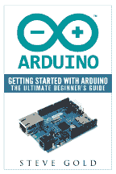
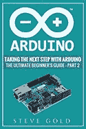

# Arduino：精通 Arduino 基础：Arduino 初学者指南 (Arduino 101，Arduino 图形，初学者指南，编程，树莓派 3，xml，c++，Ruby，html，php，机器人)


### Steve Gold


---


---

## 第一本书从这里开始




### Steve Gold

### 序言

如果你对最简单的技术感到着迷，并经常对日常生活中无处不在的电子设备的工作原理感到好奇，你可能会在对 Arduino 进行实验和制作中发现乐趣。

在所有开关开启就焕发生机的的核心——闪烁多种色彩的圣诞树灯、在触摸屏设备上打开的应用程序，以及加热食物的微波炉等——核心是一个微控制器，它被编程在激活时执行某些功能。Arduino 是一个开源平台，由微控制器和编程软件组成。与大多数平台不同，Arduino 面向那些想要在电子领域发挥创造意的非电气专业人士，同时也具有足够的灵活性来适应工程专家。无论你之前在电子和编程方面的知识如何，它旨在易于上手、低成本且易于学习。

本指南不会让你一夜之间成为 `Arduino` 专家——事实上，没有东西能做到。然而，你将从书中中学到这个惊人的多功能平台的基础知识，你还将有机会亲身体验它的功能。你将在引导下你了解 `Arduino` 电路板的关键特性、开始工作的技术要求、如何启动你的第一个 `Arduino`、为了应付需要需要的重要术语，以及如何进一步深入。

---
*（注：用户文本包含重复章节和法律免责声明。我根据提供的指令对主要内容进行了格式处理。然而，提示词中提供的输入在前半部分似乎有免责声明的重复块。为了文档结构的完整性，我也对提示词末尾提供的唯一内容进行了处理。）*

等等，再次查看输入，还有第二个部分。让我也对其格式化：


作者 Steve Gold 的留言

## 第一章：了解 Arduino

2005 年，意大利的伊里亚交互设计学院（Ivrea Interaction Design Institute）启动了一个项目，创建一个用于构建各种电子项目的开源平台，被称为 `Arduino`。该平台最初面向几乎完全没有电子或计算机编程背景的学生，但由于其易用性和对初学者的友好，最终在全球范围内获得了普及。

自诞生以来多年，`Arduino` 吸引了各种经验水平的爱好者、艺术家、程序员、学生甚至黑客的关注和热情。作为一个开源平台，它在多元化用户社区的贡献下不断成长，这些用户不断突破其能力的极限。事实上，`Arduino` 是成千上万个项目和应用的支柱，从日常物品到复杂的科学设备。

`Arduino` 平台由两个部分组成：

1. 硬件 – 一个物理可编程电路板，也称为微控制器。有不同类型的 `Arduino` 开发板（更多内容见于第二章）。

2. 软件 – 运行在计算机上的集成开发环境 (IDE)，用于编写并将编程代码上传到物理板上。

为什么选择 Arduino？


实际上任何人都可以使用 `Arduino`。专家们确信可以在构建项目以及在在线社区与其他用户分享想法中获得乐趣。对于那些没有电路和微控制器编程经验的人来说，这个平台是学习和实验的绝佳选择。然而，在探索 `Arduino` 的奇之处之前，建议你至少对这些基础概念有深入的：

1. 电性和电路基础
2. 电压、电流、电阻和欧姆定律
3. 极性
4. 集成电路 (ICs)
5. 数字逻辑
6. 模拟与数字的区别
7. 基础计算机编程

`Arduino` 受业余爱好者和专家共同喜爱的原因是，与其他平台和系统相比，它简化了处理微控制器的流程。起，将新代码加载到板上只需通过 `USB` 线缆即可，而不像之前的可编程电路板需要使用单独的硬件。此外，`Arduino` 板与其他微控制器平台相比价格相对低廉，一些预装模块的费用低于 50 美元。如果这些优点还不够，以下是选择 `Arduino` 作为首选平台的更多原因：

1. 跨平台 – `Arduino` 的 `IDE` 可运行在 `Windows`、`Macintosh OSX` 和 `Linux` 操作系统，而大多数微控制器系统仅兼容 `Windows`。
2. 简单的编程环境 – `Arduino IDE` 使用简化版的 `C++`，让初学者更容易学习编程，同时对高级用户也有足够的灵活性来发挥创意和抱负。
3. 开源且可扩展的硬件 – `Arduino` 板的设计方案在知识共享许可下发布，允许电路设计师创建自己的模块版本并对其进行扩展和改进。
4. 开源且可扩展的软件 – `Arduino IDE` 作为开源工具发布，经验程序员可以通过 `C++` 库对其进行扩展。你也可以通过 `Arduino` 学习 `AVR-C` 编程语言，就像可以直接将 `AVR-C` 代码添加到 `Arduino` 程序中一样。
5. 强大的社区支持 – 如果你是该平台的完全用户且不知道从何开始，由于 `Arduino` 的普及，可以在网上找到丰富的信息。你永远不会缺少学习资源，甚至可以找到可以直接运行的预代码项目（请参阅第 5 章的 `Arduino` 资源）。

## Arduino 能为你做什么？

`Arduino` 的设计初衷是创意和创新，无论经验水平如何。艺术家、设计师、电工、工程师、程序员和科学爱好者都可以使用它来创建交互式物体和环境。`Arduino` 可以交互的东西包括电机、扬声器、`LEDs`、`GPS` 单元、摄像头、电视、智能手机甚至互联网。

通过 `Arduino`，人们可以构建低成本的科学仪器、为机器人进行编程、构建建筑设计的交互原型、为乐器创建实验装置以研究声音、构建新的视频游戏硬件——这仅仅只是冰山一角！所以，无论你的项目涉及构建机器人、加热毯子、节日灯光展示还是占卜机，`Arduino` 都可以作为你电子项目的基础。

## 在继续之前...

为了表示感谢，我为你准备了一个很棒的惊喜

### 领取你的专属免费礼物！

限时范围内，我提供了一本免费书籍的访问权限，这仅针对我的读者提供，在其他地方都找不到。不要错过这个机会。

## 第 2 章：开始使用 Arduino

随着平台的不断扩展，你需要了解的是：

### Arduino 板的结构

在开始操作之前，你需要了解一些功能。主 IC 在不同电路板之间有所不同：

#### USB 和圆孔接口
几乎所有的板子都有 `USB` 连接和一个圆孔接口（barrel jack）。

#### 引脚
引脚是你构建电路的地方。这里是你通常会看到的：

* `GND`: `Ground`（地）的缩写，这些引脚用于你的电路接地。
* `5V` 和 `3.3V`: 这些引脚分别提供 `5 Volts` 和 `3.3 Volts`。
* `Analog`: 你可以在 `Analog In` 标签下找到这一排引脚。它们用于传感器读取信号并将这些信号转换为数字值。
* `Digital`: 模拟引脚对面方的 `Digital` 标签下是用于数字输入和输出的引脚。例如，当按下按钮（输入）时，`LED` 点亮（输出）。
* `PWM`: 在很多板子上，`Digital` 旁边有 `PWM` 标签。这意味着这些引脚可以作为普通的数字引脚，也可以用于一种名为脉宽调制（Pulse-Width Modulation）的信号。
* `AREF`: `Analog Reference`（模拟参考）的缩写，这个引脚可以设置外部电压作为模拟引脚的上限（0 到 5 特之间），尽管它通常被闲置。

#### 重置按钮
这个按钮自而易见；按下它会将复位引脚接地，并重启加载到板子上的任何代码。然而，它的功能并不是将一切重置为初始状态并清除任何问题。

#### 电源 LED 指示灯
这是一个微型 LED，旁边有 `ON` 字样。当你将板接入电源时，它会亮起；如果没有亮，则意味着你必须重新检查电路，因为出了问题。

#### 传输 (TX) 和 接收 (RX) LED
不要与 0 和 1 数字引脚旁的 `TX` 和 `RX` 标记混淆，带有这些标记的 `LEDs` 在板子传输或接收数据时将提供视觉指示，例如当你向板子载入新程序时。


### 7. 电压调节器 – 顾其名，该组件控制进入 `Arduino` 板的电压量。它通过排除进入电路板的额外电压来发挥作用。但它也有局限性；它无法处理超过 20 伏的电压。因此，特别提醒：不要使用大于 20 伏的电源！它会过载并损坏你的 `Arduino`。大多数型号的建议电压为 6 到 12 伏。

## 全家人桶

为了满足用户的各种需求和挑战，`Arduino` 板自首次引入以来已经发生了巨大的变化。不仅仅是 8 位开发板，`Arduino` 还有为各种应用构建的开发板，从物联网（`IoT`）应用到可穿戴设备。当然，它们所有的都是开源的，这进一步赋予了用户构建衍生产品并根据特定需求进行定制的能力。以下是被认为最适合 `Arduino` 初学者的几个选项：

1.  `Arduino UNO (R3)` – `UNO` 通常被认为是决定性的 `Arduino` 板。它配备了入门所需的所有设备，具有 14 个数字输入/输出引脚 –其中 6 个可以作为脉宽调制（`PWM`）输出 – 6 个模拟输入、一个 `USB` 连接、一个电源接口以及更多功能。只需将其连接到任何电源源（无论是通过 `USB` 线连接到电脑、AC 转 DC 适配器还是电池），你就可以开始了。无论你的 `Arduino` 经验如何，选择 `UNO` 永远不会出错。

2.  `Arduino Mega (2560)` – `Mega` 板比 `UNO` 高出几个档次，就像它的大哥一样。它拥有令人深刻的 54 个数字输入/输出引脚，其中 14 个可以作为 `PWM` 输出，16 个模拟输入，加上你在 `UNO` 上找到的所有其他功能，且功能也相同。如果你有一个需要大量数字输入输出的项目（例如用于许多 LED 灯或按钮），`Mega` 可能是适合这项任务的板。

3.  `Arduino Leonardo` – `Leonardo` 板提供了一个更便宜、更简单的替代方案，它是第一个使用内置 `USB` 的微控制器的 `Arduino` 开发板。由于其直接处理 `USB`，因此可以使用许多代码库允许开发板模拟计算机键盘、鼠标等。

4.  `Arduino Mega ADK` – 这块板基本上是 `Arduino Mega` 板的特殊版本。它专门为与安卓智能手机接口而设计。

5.  `LilyPad Arduino` – 考虑制作一件发光的猫服吗？`LilyPad` 是你需要的可穿戴电子纺织板。该板由工程师、书籍《Sew Electric》的合著者 Leah Buechley 设计，这种创新的板具有大型连接焊盘和平坦的背面，允许使用导电线将其缝入衣服中。它甚至是可洗的！

6.  `Arduino NG`, `Diecimila` 和 `duemilanove` – 统称为 `UNO` 的旧版本，这些板基本上是 `Arduino` 的祖父。旧板缺少其他新板的一些关键功能。例如，`Diecimila` 和 `NG` 在 `USB` 端口旁边有一个跳线，需要手动选择 `USB` 或电池电源。`NG` 在上传程序之前还需要按住 `Reset` 按钮几秒钟。但需要注意的是，旧板仍在被 `Arduino` 爱好者不断改进和改进。一旦你获得了更多关于 `Arduino` 的知识和经验，它们值得研究。

## Genuino 是什么？！

如果你在美国境外购买 `Arduino` 板，你可能会发现外观完全相同的 `Genuino` 板。别担心；你没有被仿制品产品欺骗！`Genuino` 是 `Arduino` 的姐妹品牌，由同一团队创建，用于在美国境外销售的板子和产品。

`Genuino` 品牌认证板子和产品的真实性，符合 `Arduino` 的开源硬件哲学。该品牌与亚洲、欧洲、南美、加拿大和非洲的市场领先制造商建立了联盟，使 `Arduino` 硬件在全球范围内可用。

你可以将 `Genuino` 板想象成住在国外的 `Arduino` 板的同形双胞。所有 `Genuino` 板与其对应的 `Arduino` 板具有相似的质量、组件和特性。因此，取决于你住在哪个地区，在购买 `Arduino UNO` 时可能会发现 `Genuino UNO` 板。这没关系；你得到的仍然正品。

但要注意，并不是所有的 `Arduino` 板（尤其是那些不为人知的）都有 `Genuino` 双胞胎。

## 你可以使用的其他东西

`Arduino` 板本身不能做很多事情，因此你需要将它与其他东西连接。有很多硬件可以固定在上面（进一步阅读请参见第 5 章）。通过 `shields`（扩展板），你可以编写 `Arduino` 连接到互联网、控制 `LCD` 屏幕、控制电机并提供蜂窝通信。此外，你还可以通过 `shields` 实现更多，它们是可以安装在 `Arduino` 板顶部的预制电路板。

### 安装软件

一旦你处理好了硬件，要要做的事情就是安装 `Arduino IDE`。这是你为微控制器编写代码并连接电路组件以实现功能所需的软件。你可以在 `Arduino` 官方网站下载该软件：`www.arduino.cc`。

下载后，将文件夹解压到计算机硬盘的某个位置，然后运行 `Arduino.EXE` 文件完成安装。现在，你已经准备好开始 `Arduino` 了！

## 第 3 章 迈出第一步！

你有了 `Arduino` 板和软件；现在是时候开始正事了！在接下来的章节中，你将被引导逐步完成几项任务；你将用你的第一个代码测试 `Arduino` 软件和板，并完成一个点亮 `LED` 的简单项目。对于给示例，将使用 `Arduino UNO (R3)` 板。然而，这些指令经过微调后适用于你选择的任何 `Arduino` 板。

以下是你开始 `Arduino` 之旅所需的四件设备：

1.  运行 Windows（XP 或更高版本）、Mac 或 Linux 操作系统的计算机，并安装了 `Arduino IDE`

2.  一个 `Arduino` 微控制器（即电路板）

3.  一根 `USB A-to-B` 线用于将 `Arduino` 板连接到计算机，或适用于你选择的板（注意某些板需要 `A-to-Mini-B` 线）

4.  一个 `LED`

### 插入板子

`Arduino` 板通过连接计算机 `USB`（通过 `USB` 接口）或外部电源（通过圆柱接口）供电。你需要将板连接到计算机以便使用 `Arduino IDE` 对其进行编程。一旦你完成编程且不需要连接——取决于你如何在项目中使用该板——你就可以选择使用墙电源供电了。


首先，你必须使用 USB 线将你的 Arduino 开发板连接到计算机。当你连接好时，你可能会发现旁边标有“ON”标签的 LED 开始剧烈闪烁；这是存储在开发板芯片中的默认程序。你启动 Arduino 时要执行的操作是覆盖这个默认程序，让 LED 以每 2 秒一次的间隔缓慢闪烁。

## 安装驱动程序

如果你是第一次在 Windows 7、Vista 或 XP 系统上使用 Arduino 开发板，则需要执行此步骤。如果你使用的是其他操作系统，可以跳过本节。

1. 插入开发板后，Windows 将启动驱动程序安装过程。然而，在持续了片刻之后，该过程将会失败。
2. 接下来你需要点击“开始”菜单，然后点击打开“控制面板”。
3. 导航到控制面板并进入“系统和安全”。点击“系统”。
4. 打开“系统”窗口后，点击打开“设备管理器”。
5. 查找 `端口 (COM & LPT)`。在这里，你应该能看到一个名为 `Arduino UNO (COMxx)` 的打开端口。但是，如果由于某种原因没有 `COM & LPT` ，请查看`其他设备` 并搜索 `未知设备`。
6. 接下来，右键点击 `Arduino UNO (COmxx)` 或 `未知设备` 端口，选择“更新驱动程序”选项。
7. 选择“浏览我的电脑以查找驱动程序”选项。
8. 最后，找到并选择名为 `arduino.inf` 的驱动文件，它可以在 Arduino 下载包的 Drivers 文件夹中找到（注意：不在 FTDI USB 驱动子目录下）。请注意，如果你使用的是旧版本的 IDE（1.0.3 或更高版本），你需要选择名为 `Arduino UNO.inf` 的 Uno 驱动文件。
9. 从这里，Windows 将完成驱动程序的安装。

## 启动与 Sketch

一旦正确安装了 Arduino IDE，你现在准备好用第一个程序测试你的开发板了。在在此之前，你需要了解一些为 Arduino 编写代码的知识。代码被称为 sketch（程序），用 C++ 编写。

每个 sketch 都需要两个不返回任何值的 `void` 类型函数：`setup()` 和 `loop()`。`setup()` 方法在 Arduino 开发板上电后运行一次，之后 `loop()` 方法会持续运行。`setup()` 是你进行任何初始化步骤的地方，而 `loop()` 用于运行你想要反复执行的代码。

一个基础的 sketch 骨架看起来如下：

| `void setup(){ } void loop(){ }` |

现在，让我们尝试你的第一个程序吧：

1. 确保你的开发板已插入，并启动 Arduino 应用程序。
2. 打开 Blink 示例 sketch。只需进入：`File > Examples > 1.Basics > Blink`。
3. 通过进入：`Tools > Board > 开发板类型` 选择你正在使用的 Arduino 开发板类型。
4. 通过进入：`Tools > Port > COMxx` 选择你的 Arduino 连接的串口/COM 端口。

如果你不确定串口设备中哪一个是你的 Arduino 开发板，请查看可用端口，然后拔掉你的 Arduino 并再次检查它们。它应该是你拔掉开发板后消失的那个。

## 上传并让它闪烁！

在连接好 Arduino 开发板并打开 Blink sketch 后，点击“上传”（Upload）按钮。等待几秒钟；你应该看到开发板上的 RX 和 TX LED 在程序上传时闪闪烁。如果上传成功，你将在 Blink sketch 的状态栏中看到 `Done Uploading` 消息。

如果整个过程执行正确，橙色的“ON” LED 应该会缓慢闪烁。恭喜！你已成功编写了第一个 Arduino 程序。

## 但它不起作用！

如果你遵循了上述所有步骤，但无法将 sketch 上传到 Arduino 运行，可能是由于其中一个过程出现了问题。尝试运行这些故障排除措施：

1. 确保你在 `Tools > Board` 菜单下选择了正确的开发板。如果你选择了 UNO 以外的开发板（如示例所示），请检查板上的 IC。例如，较新的 Arduino Duemilanove 开发板带有 `ATmega328`，而旧的带有 `ATmega168`。因此，请确保你选择了正确的选项。
2. 检查 `Tools > Serial Port` 菜单中是否选择了正确的端口。
3. 在连接开发板的情况下，检查 Arduino IDE 中 `Tools > Serial Port` 菜单下你的开发板的驱动程序是否已正确安装。应该多出一个在未插入开发板时不存在的项目。

## 第一个任务：点亮 LED！

成功激活你的 Arduino 后，让我们尝试用它做更多事情。以下是一个适合电路完全初学者的常见学习项目。对于此任务，你需要一个 LED 和一个已经启动的 Arduino（按照之前的说明）。

1. 插入你的 Arduino。
2. 打开另一个示例 sketch：`File > Examples > Basics > BareMinimum`。
3. 将 LED 的正极（长脚）连接到 `13`，将阴极（短脚）连接到 `GND`。
4. 在 sketch 的 `setup()` 部分添加代码：`pinMode(13, OUTPUT);`。这是配置开发板运行一次的命令。
5. 在 `loop()` 部分添加：`digitalWrite(13, HIGH);`。这将 `13` 设置为高电平（5）。

完成后，你的 sketch 看起来像这样：

```cpp
void setup(){
  pinMode(13, OUTPUT);
}
void loop(){
  digitalWrite(13, HIGH);
}
```


# Arduino 概念

### 驱动程序 (Driver)
允许计算机与硬件或设备连接并通信的软件。如果没有正确的 `driver`，连接到计算机的硬件将无法正常工作。取决于你用于操作 Arduino 的操作系统，你可能需要为开发板安装 `driver`。

### 环境 (Environment)
在计算术语中，环境指的是硬件平台及其运行的操作系统的特定配置。

### 地线 (Ground)
在电子工程中，地线是电路中测量电压的参考点或公共接线点。该术语也可以指电路连接的物理地面。在 Arduino 板板上，`GND` 引脚具有此用途。

### I/O
输入/输出（input/output）的缩写，描述了向计算机传输数据以与外界交互的程序、操作或设备。例如，如果按下按钮（输入），灯泡就会亮起（输出）。

### LED
发光二极管的缩写，是一种双极半导体光源。与其他光源相比，LED 许多优点，尺寸更小、寿命更长且功耗更低。在 Arduino 板板上，你会看到一些 LED 用于指示板板是否供电以及代码是否已上传。

### 微控制器 (Micro-controller)
存在于单个集成电路中的计算机，经过编程以执行特定任务。微控制器是自动控制电子设备的背后，从手机、相机到洗衣机、微波炉以及机器人等。

### 开源 (Open-source)
其源代码免费向公众提供使用或修改的程序。开源是开源倡议组织（OSI）拥有的认证标志，允许软件开发人员向公众自由共享他们的产品，以便进行改进和重新分发。与需要某种重新分发许可的商业软件不同，任何人都可以开源项目的开发和重新分发。

### 传感器 (Sensor)
用于测量物理量并将其转换为电子信号的电子设备。多种类型的传感器用于测量物理属性，如温度、压力、距离、噪音、运动等。传感器通常是更复杂复杂的电子系统的组件。例如，如果你想制作一个数字温度计，你需要一个与 Arduino 板板配套的温度传感器。

### 串口 (Serial port)
用于向连接到计算机的设备（如调制解调器、打印机鼠标）发送数据的连接器。Arduino 板板必须连接到正确的串口才能正常上传代码。

### Sketch (程序)
用于指 Arduino 程序的术语。编写用于命令 Arduino 的代码被称为 `sketch` 而不是简单的 `program`，因为 Arduino 平台的设计除了吸引工程师，还吸引艺术家和创意人士。根据创始者的说法，使用 `sketch` 一词意味着一个可以探索、完善和开发的粗略想法——就像艺术或设计草图一样。因此，这会让非技术背景的人在使用 Arduino 时感到更有鼓励性，且不那么令人畏畏。

### 扩展板 (Shield)
这是一种附加在 Arduino 之上以实现各种目的的电路板。它们之所以被称为这个，是因为它们像保护罩一样覆盖在 Arduino 板板的顶部。

### IDE (集成开发环境)
运行以提供编程 Arduino 板板所需工具的软件应用程序。它包括源代码编辑器、构建自动化和调试器。它是一个开源软件，可以在 Arduino 官方网站（`www.arduino.cc`）下载。

### 脉冲宽度调制 (PWM)
描述一种数字信号的术语，主要用于控制供给设备的功率量。

### 电压 (Voltage)
两点之间的能量量，以标准单位 `V` 测量。

# 资源

### 核心资源与进阶阅读
无论你学习了什么，你在这个平台的旅程刚刚开始。这里列了一些由最受尊敬的权威编写的有用材料，帮助你继续前进。

### 绝对初学者
#### Arduino 入门：开源电子 (Getting Started with Arduino: The Open Source Electronics)
作者：Massimo Banzi 和 Michael Shiloh
还有比从创始人之一那里更好地了解 Arduino 了？Massimo Banzi 是该平台的联合创始人。

#### Arduino C 入门第二版：学习 C 语言编程 (Beginning C for Arduino, Second Edition: Learn C Programming)
作者：Jack Purdum
本书为之前没有微控制器或编程经验的人编写，非常适合初学者。你将获得对 C 语言的介绍，并简单地演示如何使用它。这本书源自作者 20 多年的教学经验，非常适合完全编程初学者。

### 将你的技能提升到新水平
#### Arduino 编程进阶：深入学习 Sketch (Programming Arduino Next Steps: Going Further with Sketches)
作者：Simon Monk
电子大师 Simon Monk 在这本针对已经牢掌握编程的人的实用指南中，揭示了 Arduino 的专业编程秘密。这本书涵盖了 Arduino Uno、Leonardo 和 Due。学习高级的 `sketching` 技术，将你的 Arduino 提升到新水平，包括互联网编程、实现串口通信最大化、内存管理、执行数字信号处理等。书中包含 75 多个示例 sketch，均可下载。

#### 从零开始学电子：通过破解、设计和发明进行学习 (Electronics from the Ground Up: Learn by Hacking, Designing, and Inventing)
作者：Ronald Quan
你对常见电子设备背后的复杂电路感兴趣吗？这本书将引导你通过分步实验，揭示电子电路是如何运作的。它还解释了组件、构造技术、基础测试设备、电路分析和故障排除。读完书后，你不仅掌握了设计定制电路的知识，还了破解和修改现有电路以满足你需求的能力。

#### 恶魔天才的 30 个 Arduino 项目 (30 Arduino Projects for the Evil Genius)
作者：Simon Monk
想过制作一个摩斯密码翻译器吗？心率监测器？催眠器？或者一个键盘恶作剧？你可以通过这本 DIY 指南释放你的恶魔天才，它教你如何使用 Arduino Uno 和 Arduino Leonardo 板板编程并构建一些非常迷人的项目。你将通过以下指南进行学习：每个项目都带有所需零件清单、带插图的分步说明，以及对项目背后科学原理的清晰解释。

### 趣味项目创意
# Arduino 工作坊：65 个项目的上手入门 (Arduino Workshop: A Hands-On Introduction with 65 Projects)
作者：John Boxall


ISBN-10: 1593274483 / ISBN-13: 860-1200651553

你认为自己已经掌握了 Arduino，并准备好尝试一些有趣的项目了吗？这本书将带你入门。你将学习到 Arduino 丰富的输入/输出扩展模块、显示器、电机、传感器、指示器等。每个项目都旨在巩固你所学的知识，并随着你学习的深入，复杂性也会不断增加。那么，你可以学习构建什么呢？例如，数字体温度计、电池检测器和 GPS 记录器等。还有一些有趣的内容可以学习，比如制作一个二进制知识问答游戏和一个电子骰子。


作者 Leah Buechley, Kanjun Qiu 和 Sonja de Boer

ISBN-10: 0989795608 / ISBN-13: 978-0989795609

这本书由 `LilyPad Arduino` 板的创造者 Leah Buechley 合著，是一本结合了手工艺、电子学和编程来创作有趣项目的实战指南。学习如何使用 `LilyPad Arduino` 板制作互动玩具、发光时尚配件以及许多其他酷炫物品，并可以与朋友和家人分享。这对于教师向青少年介绍实用电子技术也是极佳的材料。


作者 Leah Buechley, Kylie Peppler, Michael Eisenberg 和 Yasmin Kafai

ISBN-10: 143311920X / ISBN-13: 978-1433119200

这本书是对电子织物（e-textiles）的简要介绍——这种软电路板可以将电子元件整合到服装和家具中。在 `Arduino` 家族中，`LilyPad` 板就是一种电子织物，这是一本从入门到中级的指南，可以教你如何充分利用你的 `LilyPad`。你将接触到一系列工具，无论你是教育者、爱好者还是设计师，都能让你通过电子织物进行学习和创作。


作者 Kate Hartman

ISBN-10: 1449336515 / ISBN-13: 978-1449336516 

对于对计算感兴趣的人，以及想要构建融合这两个学科的创意项目的时尚设计师来说，这本书是必读的。你将学习到制作互动电子电路的工具、材料和技术，并在分步骤的指导下将它们嵌入衣物中。虽然书中没有专门介绍 `Arduino` 项目，但它将为你提供可以适用于 `Arduino` 平台的知识。所以，如果你曾想过制作会改变颜色以衬托肤色的衣服、显示下一班公交车何时到达的夹克、可以动态调整高度的鞋子以及许多其他酷炫的可穿戴物品，现在你可以了！


作者 Becky Stewart

ISBN-10: 1118948475 / ISBN-13: 978-1118948477

如果你认识一个在电气工程和编程方面有潜力的孩子，把这本书送给他/她吧！这本书专为 11 到 15 岁的初芽电工编写，是一本极好的 `Arduino` 入门资源。


- [`www.arduino.cc/`](https://www.arduino.cc/) - `Arduino` 官方网站，满足你的所有需求以及关于该平台的最新开发新闻。你可以在这里找到并加入 `Arduino` 论坛，与全球其他用户一起获取帮助并分享知识。
- [`www.cplusplus.com/`](http://www.cplusplus.com/) - 一个涵盖所有 C++ 内容的全面在线库。你可以了解 `Arduino` 运行的编程语言的历史、开发以及全方位的知识。 
- [`www.ladyada.net/`](http://www.ladyada.net/) - 学习电子学和电路的绝佳资源，几乎所有内容都是开源的。

### 结论

祝喜你完成了 `Arduino` 基础学徒培训，并成功完成了你的第一个 `Arduino` 项目！在书中，我希望我已经提供了你所需的所有信息，让你能够自信地面对未来。

祝喜你完成了 `Arduino` 基础学徒培训，并成功完成了你的第一个 `Arduino` 项目！在书中，我希望我已经提供了你所需的所有信息，让你能够自信地面对未来。

祝喜你完成了 `Arduino` 基础学徒培训，并成功完成了你的第一个 `Arduino` 项目！在书中，我希望我已经提供了你所需的所有信息，让你能够自信地面对未来。

祝喜你完成了 `Arduino` 基础学徒培训，并成功完成了你的第一个 `Arduino` 项目！在书中，我希望我已经提供了你所需的所有信息，让你能够自信地面对未来。

祝喜你完成了 `Arduino` 基础学徒培训，并成功完成了你的第一个 `Arduino` 项目！在书中，我希望我已经提供了你所需的所有信息，让你能够自信地面对未来。

祝喜你完成了 `Arduino` 基础学徒培训，并成功完成了你的第一个 `Arduino` 项目！在书中，我希望我已经提供了你所需的所有信息，让你能够自信地面对未来。

[/content]

*(注：由于输入文本在最后部分出现了大量重复，译文已按要求特意进行了去重处理。以下是针对剩余文本的完整翻译：)*

[content]
ISBN-10: 1593274483 / ISBN-13: 860-1200651553

你认为自己已经掌握了 Arduino，并准备好尝试一些有趣的项目了吗？这本书将带你入门。你将学习到 Arduino 丰富的输入/输出扩展模块、显示器、电机、传感器、指示器等。每个项目都旨在巩固你所学的知识，并随着你学习的深入，复杂性也会不断增加。那么，你可以学习构建什么呢？例如，数字体温度计、电池检测器和 GPS 记录器等。还有一些有趣的内容可以学习，比如制作一个二进制知识问答游戏和一个电子骰子。

# 缝纫电子完美 (Sew Electric Perfect)

作者 Leah Buechley, Kanjun Qiu 和 Sonja de Boer

ISBN-10: 0989795608 / ISBN-13: 978-0989795609

这本书由 `LilyPad Arduino` 板的创造者 Leah Buechley 合著，是一本结合了手工艺、电子学和编程来创作有趣项目的实战指南。学习如何使用 `LilyPad Arduino` 板制作互动玩具、发光时尚配件以及许多其他酷炫物品，并可以与朋友和家人分享。这对于教师向青少年介绍实用电子技术也是极佳的材料。

# 纺织信息：来自电子织物与教育世界的派遣 (Textile Messages: Dispatches From the World of E-Textiles and Education)

作者 Leah Buechley, Kylie Peppler, Michael Eisenberg 和 Yasmin Kafai

ISBN-10: 143311920X / ISBN-13: 978-1433119200

这本书是对电子织物（e-textiles）的简要介绍——这种软电路板可以将电子元件整合到服装和家具中。在 `Arduino` 家族中，`LilyPad` 板就是一种电子织物，这是一本从入门到中级的指南，可以教你如何充分利用你的 `LilyPad`。你将接触到一系列工具，无论你是教育者、爱好者还是设计师，都能让你通过电子织物进行学习和创作。


作者 Kate Hartman

ISBN-10: 1449336515 / ISBN-13: 978-1449336516 

对于对计算感兴趣的人，以及想要构建融合这两个学科的创意项目的时尚设计师来说，这本书是必读的。你将学习到制作互动电子电路的工具、材料和技术，并在分步骤的指导下将它们嵌入衣物中。虽然书中没有专门介绍 `Arduino` 项目，但它将为你提供可以适用于 `Arduino` 平台的知识。所以，如果你曾想过制作会改变颜色以衬托肤色的衣服、显示下一班公交车何时到达的夹克、可以动态调整高度的鞋子以及许多其他酷炫的可穿戴物品，现在你可以了！


作者 Becky Stewart

ISBN-10: 1118948475 / ISBN-13: 978-1118948477

如果你认识一个在电气工程和编程方面有潜力的孩子，把这本书送给他/她吧！这本书专专为 11 到 15 岁的初芽电工编写，是一本极好的 `Arduino` 入门资源。


- [`www.arduino.cc/`](https://www.arduino.cc/) - `Arduino` 官方网站，满足你的所有需求以及关于该平台的最新开发新闻。你可以在这里找到并加入 `Arduino` 论坛，与全球其他用户一起获取帮助并分享知识。
- [`www.cplusplus.com/`](http://www.cplusplus.com/) - 一个涵盖所有 C++ 内容的全面在线库。你可以了解 `Arduino` 运行的编程语言的历史、开发以及全方位的知识。 
- [`www.ladyada.net/`](http://www.ladyada.net/) - 学习电子学和电路的绝佳资源，几乎所有内容都是开源的。

### 结论

祝喜你完成了 `Arduino` 基础学徒培训，并成功完成了你的第一个 `Arduino` 项目！在书中，我希望我已经提供了你所需的所有信息，让你能够自信地面对未来。

# 第二部分开始




作者 Steve Gold


# 引言

### 第一章：使用 Arduino IDE
- 命令区域
- 菜单项
- 图标
- 文本区域
- 消息区域
- IDE 与板

### 第二章：创建与保存 Sketch
- 项目阶段
- 如何编写 Sketch
- 注释
- Setup 函数
- Loop 函数
- 关于保存 Sketch 的笔记
- 验证 Sketch
- 将 Sketch 上传到板

### 第三章：信号与系统
- 模拟引脚与数字引脚

### 第四章：整合传感器
- 感应运动
- 追光
- 如何检测运动
- 测量距离

### 第五章：输出输出
- 数字输出
- 模拟输出
- 调节光线
- 了解 LED
- 最大电流
- LED 的实际应用
- 串联电阻
- 音频

### 第六章：面包板
- 接
- 当你需要跳线时

### 第七章：制作自己的简单机器人
- 连接 Arduino 和面包板
- 你的机器人战车已就绪
- 连接舵服
- 放置传感器
- 我有电了
- 杀死你的机器人

### 结论

### 来自作者的消息
引言

所以，你已经了解一点 Arduino 了，并想学习更多？你已经玩过了你的第一个板并让 LED 闪烁，现在准备好尝试更具挑战性的东西了吗？这本书是为已经了解 Arduino 及其如何工作的人准备的。它不是为初学者写的。


## 第 1 章：使用 Arduino IDE

让我们先看看 Arduino IDE 是什么。从打开 IDE 开始。它看起来像一个非常基础的文字处理器，分为以下区域：

1. 命令区域
2. 文本区域
3. 消息窗口区域

## 命令区域

命令区域是你找到图标、菜单项和标题栏的地方。标题栏显示 sketch（程序）的名称以及你正在运行的 Arduino IDE 版本。

然后你将在下下文中讨论的菜单项和图标。

### 菜单项

你的操作方式与使用 Microsoft Word 非常相似。点击菜单中的任何项目即可查看可用选项。

1. **文件 (File)**：在此部分中，你将找到保存、加载和打印 sketch 的按钮。你还可以找到可以参考的示例 sketch。你还可以点击 `Preferences`（首选项）标签在这里设置你的偏好。
2. **编辑 (Edit)**：在这里你会找到普通命令——搜索、复制和粘贴，就像在 Microsoft Word 中一样。
3. **程序 (Sketch)**：这包含允许你在将 sketch 上传到板子之前对其验证的功能。它还有导入选项以及将你的 sketch 分类到文件夹的方法。
4. **工具 (Tools)**：这里包含了许多不同的功能。你需要此部分来指定你拥有的 Arduino 板类型以及你将使用的 USB 端口。
5. **帮助 (Help)**：这将帮助你学习使用 Arduino 以及你所使用的特定 IDE 版本。

### 图标

图标位于菜单工具栏下方。总共六个。你可以悬停在每个图标上查看名称。这些是图标的内容及其功能：

1. **验证 (Verify)**：如果你点击此处，你就可以判断 Arduino sketch 是否有效，以及编程中是否没有错误。
2. **上传 (Upload)**：如果你点击此处，你可以先验证 sketch，然后将其上传到板子上。
3. **新建 (New)**：这将允许你打开一个新的空白 sketch。它会在不同的窗口中打开。
4. **保存 (Save)**：你可以使用此按钮保存当前打开的 sketch。如果你还没有命名，系统会要求你为 sketch 命名。
5. **串口监视器 (Serial Monitor)**：如果你想打开一个可以从 IDE 传输数据到 Arduino 或反之的窗口，这就是该按钮。

## 文本区域

这是你用来创建不同 sketch 的区域。这是你可以输入内容的区域。

在左上角，你可以看到你正在处理的是哪个 sketch。如果你还没有命名 sketch，系统将默认使用当前日期。

你像在文本编辑器中一样，在这里输入你的命令。

## 消息窗口区域

这位于屏幕底部。屏幕底部的消息显示屏幕底部的消息。

IDE 和板子

这位于屏幕底部。屏幕底部的消息显示屏幕底部的消息。

在继续之前

为了表示感谢，我为你准备了一个巨大的惊喜。领取你的专属免费赠品！

[=>点击此处了解更多信息！](http://eepurl.com/bM)

过得愉快！
Steve Gold

## 第 2 章：创建和保存你的 sketch

sketch 实际上只是你发给板子的指令。现在你已经对板子的工作原理有了些了解，你无疑想要跳上手开始编写你自己的 sketch。

你需要记住的是，你需要逐步告诉板子要做什么。在遇到错误或信息时，板子无法自己思考或填补空白。

## 项目规划阶段

1. **清晰的目标**：从清晰地定义你想得到的结果开始。
2. **写出算法**：在这里你列出实现你的项目所需的指令。这是一组从开始到结束的逐步指令集。
3. **选择你正在使用的硬件**：硬件需要连接到板子上，你需要提前考虑这一点。
4. **你的 sketch**：现在你真的可以开始编写 sketch 了。在此过程中，你将给 Arduino 清晰且简单的指令，告诉它必须做什么。
5. **连接一切**：现在你可以将电路和硬件接线到板子上。
6. **测试 Bug**：项目是否按预期方式工作？如果没有，你能发现哪些错误？再次一步一步地处理所有事情。这可能是 sketch 或算法的问题，也可能是连接方式的问题，甚至可能是组件存在故障。

## 如何编写你自己的 sketch

如果你按部就班的方法，创建一个基础 sketch 是很容易的。sketch 将按照命令出现的顺序运行每个命令，因此请确保你的步骤是按逻辑顺序排列的。

在现实世界找一个类比——处理 sketch 的方式就像教导一个小孩子去给你拿外套一样。他们什么都不知道。

你必须告诉他们外套在哪里。你必须告诉他们去拿外套。你必须告诉他们需要多长时间。你必须告诉他们把外套递给你，等等。


比例如，假设你想让一个 LED 灯闪烁。你必须告诉系统开启灯光、持续多长时间，然后将其关闭。

首先，请确保开发板已插入电脑的 USB 接口。

打开 IDE 并进入“工具（Tools）”。确保已选择正确的端口（Port）。这只是为了确认开发板已正确连接。

现在你可以开始编写你的 sketch（程序草）了：

### 注释 (Comments) 

这些注释并不是给开发板使用的，更多是作为你自己的提醒。当你以后使用几个不同的程序时，这会非常有用。你可以写下该程序的用途。不需要写得太详尽或复杂——只需提醒一下你创建了什么以及为什么要创建它。

在你进行更改时，更新注释也有帮助——这可以帮助你跟踪你所做的任何微调。

如果你认为会有其他人使用你的程序，那么更新注释部分就尤为重要。

如果你写的内容可以在一行内显示，请在注释之前立即输入两个正斜杠 `//`，这样开发板就会完全忽略这些文本。

所以它看起来像这样：

```cpp
// Clock Sketch by Name created January 2017
```

如果你的注释无法在一行内显示，请在注释正上方的一行输入一个斜杠和一个星号 `/*`。当注释完成后，移动到下一行并再次重复斜杠和星号。

所以，它看起来像这样：

```cpp
/*
Clock Sketch by Name Created January 2017
Made to tell the time
*/
```

现在进入“文件（File）”并点击“另存为（Save As）”。选择你要为程序起的名字并点击“确定（OK）”按钮。

Arduino 程序扩展名为 `.ino`，但你不需要担心这一点——这会自动完成。

一旦程序保存，你就可以在程序集（Sketchbook）中找到它并再次调用。

### Arduino 使用的语言

如果你用过 `C` 或 `C++`，那么你将用于编程的语言对你来说会很。尽管如此，你不需要成为专家程序员也能使用这些代码，因为系统的核心在于让你的操作变得简单。

### 变量 (Variables)

将变量比作类似于购物篮可能是很有用的。每个变量内部都有内容。你可以查看内部里面有什么，并根据喜意将内容更换为其他东西。

变量本质上是你的“购物篮”的名称。变量是存储特定数据的容器名称，这些数据是可以被更改或检查的。

使用变量有几个优点——首先，如果你这样做代码会变得更容易理解，而且也让代码维护变得更容易。

假设你首先决定使用 `2` 号引脚来让你的 LED 灯闪烁。你有两个选择：要么在编码过程中手动应用该功能，要么使用变量。

你会为变量命名并给它赋值。然后，在程序中，任何你需要引用该特定功能和引脚的地方，你都可以使用该变量。

现在，这看起来可能像是在绕远路，但优势在于，如果你想将功能移动到另一个引脚，你只需要更改变量的值即可。

### Setup 函数 (Setup Function)

`setup()` 函数在开发板启动时仅调用一次。这是你初始化变量和设置的地方。

```cpp
void setup() {
  pinMode(2, OUTPUT);
}
```

### Loop 函数 (Loop Function)

`loop()` 函数只要开发板有电就会持续运行。这是你放置需要重复的主逻辑的地方。

```cpp
void loop() {
  // 你的代码写在这里
}
```

### 控制硬件 (Controlling Hardware)

要让 LED 闪烁，你需要将其连接到数字引脚。在这个示例中，我们使用了数字引脚 `2`。

```cpp
void loop() {
  digitalWrite(2, HIGH);
  delay(1000);
  digitalWrite(2, LOW);
  delay(1000);
}
```


你在这里所做的一切都是为了确保 Arduino 能够理解程序（sketch）并执行指令。一旦你运行了 `Verify`（验证）命令，IDE 将在消息框中告诉你它是否通过了验证。

你会收到一条显示“Done compiling”（编译完成）的消息，这意味着你可以将程序上传到开发板了。它会显示该程序所需的内存量以及 Arduino 拥有的内存总量。

错误在所难免的，在这个阶段会出现一些基础错误。也许你忘记了正确关闭某个命令，这会导致程序无法正常运行。

当发生这种情况时，系统会告知你。

它会告诉你哪个函数存在问题，列出它认为错误所在的区域，以及问题的性质。它甚至会在程序本身上高亮它认为是有问题的区域。

## 将你的程序上传到开发板并运行

只要你确定程序是正确的，就可以将其上传到开发板。为了实现这一点，你需要将开发板连接到 USB 端口。

你可以使用 `Upload`（上传）功能来上传程序。IDE 在上传之前重新验证程序。

你可以检查开发板上的 LED 灯是否在闪烁，这样你就知道电脑正在传输信息。

一旦上传完成，只要一切正确，你的程序就就会运行，你就能看到 Arduino 的运行是否符合你的预期。

## 修改程序

在你运行程序并看到它的实际表现后，你可能想对其进行调整。同样，这非常简单，因为它的操作非常类似于 Microsoft Word。

点击 `Sketch`（程序）按钮，进入 `Sketch Folder`（程序文件夹）选项并点击它。它会弹出一个新窗口，列出已保存的程序。

双击你想修改的程序，系统就会在 IDE 窗口中打开它。然后你可以按照自己的喜意进行编辑。

保存修改后的程序。

## 第 3 章：信号与系统

Arduino 的魅力之处在于它能够同时理解模拟和数字输入。结果是它能够与你以及它所处的世界进行交互。这在创建传感器等事情时非常有用。在本章中，我们将介绍你在这方面可以使用该系统进行的一些实用操作。

你需要具备一些电子学知识才能完成本章内容，所以如果你不会，多读一下相关主题会有帮助。这可以节省大量的痛苦和费用。

如果你不确定自己在做什么，错误地连接了组件，或者为系统提供了过高的功率，你可能会烧毁控制器芯片。

由 Forrest Mims 编写《电子学入门》（Getting Started in Electronics）是一个很好的起点。

你需要确定你的控制器在什么电压下运行。这通常是 5 特。如果你超过了这个电压，就有烧毁芯片的风险。

对于大多数开发板来说，即使烧了芯片也不是末日，因为芯片是可以更换的，但防胜于未。

### 开发板上的模拟引脚和数字引脚

我们在这里处理标准的 Arduino 开发板。

我们将从数字输入引脚开始——这些引脚用于判断引脚上是否存在电压。相反，模拟输入引脚旨在确定电压的实际范围。

`digitalRead` 函数在程序中的输入为“High”（高电平）或“Low”（低电平）。本质，前者意味着电压进入了引脚，后者意味着没有。所以，如果你想让引脚测量连接到它的设备是否有电流通过，你必须使用 `digitalRead` 函数。

相反，如果你想测量电压，你应该使用 `pinMode`。

大多数开发板有 14 个这样的数字引脚。前两个（编号为 0 和 1）被标记为 `TX` 和 `RX`。这些引脚用于 USB 串口连接。它们不应用于其他地方。

如果你发现数字引脚不够用，可以改用模拟引脚。

如果标准开发板仍然不够大，你可以买一个 Mega 开发板。它的工作方式与标准版非常相似，但引脚要多得多。

模拟值完全不同，因为它们是连续变化的，而不是只有两个水平——开启（on）和关闭（off）。你电视上的音量控制就是一个很好的例子——你可以将音量调节到其范围内的任何电平。

许多传感器根据电压差给出读数。你可以使用 `analogRead` 函数让系统根据它在某个模拟引脚上读取的电压给你给出一个值。你不仅能判断引脚是开启还是关闭，还能知道流过它的电压有多少。

## 第 4 章：整合传感器

在介绍传感器本身之前，让我们来看看如何设置一个实用的工作空间。除非你正在做一个特别大的项目，否则不需要巨大的空间，但你应该有一个可以工作的空间。

无论是一个特定的桌子还是房子里的整个房间，取决于你计划做什么以及你目前有多少空间。

需要记住的一点是，你经常处理细小的零件，而且你的项目需要大量的精力。理想情况下，你希望有一个空间可以在之后回到那里继续工作。如果你在半途停止，以后需要重新清理会非常麻烦。

在决定将 Arduino 工作空间放在哪里时，请考虑以下因素：

1. 舒适的椅子和一个尽可能干燥的地方。（因此，洗衣间可能不是好主意。）
2. 一个坚固的工作台，可以为你的项目和工具提供足够的支撑。
3. 手头有电源。
4. 设置笔记本电脑或电脑的空间。
5. 良好的照明和通风至关重要。
6. 存放所有零件的空间——架子很有用。你需要各种存储物品来存放工具和零件。通常用于存放钉子、螺丝等硬件的抽屉会非常方便。尝试使用透明门的抽屉，或者仔细标记抽屉以使你的存储系统尽可能高效。
7. 一个舒适的工作环境，特别是对于长时间的项目。例如，如果你在车库里留出一个空间，在深冬时那里足够温暖、让人舒适吗？
8. 没有干扰的环境。你可以和家人隔离开来吗？选择家中交通繁忙的区域不利于你在构建 Arduino 项目和编写大量复杂代码时所需的专注力。


# 工作空间组织

1. 一个不放置零食和饮料的区域。虽然想在工作区域吃东西很很有吸引力，但在大多数情况下，需要吃零食时最好去休息一下。在正在进行的项目上洒了食物或饮料可能是灾难性的。
2. 让一切物品都保持整洁整齐。这意味着要有足够的抽屉等，以便你可以妥善地存放零件。凌乱的工作空间不利于高效进行项目。如果你必须浪费时间寻找组件，你可能会中断思路，并导致在项目上花费更长的时间。

## 值得考虑的工具

这里有一些基础工具可以让你的生活变得简单得多。在开始你的 Arduino 项目之前，这里有一份需要考虑购买的工具列表：

1. **万用表**：这并不总是会出现在你的 Arduino 项目清单中，但它能让你的体验少很多很多挫败感。万用表允许你测量电气电路中的许多东西，如电流、电压、电路是否完整等。通过万用表，你可以测试每个电子元件是否工作正常。当某些东西运行不符合预期时，它在故障排除方面也极其有用。
2. **跳线线和几块面包板**：同样，这些并不总是严格必要的，也不是所有项目都需要的。然而，面包板可以让你测试提议布局变得容易得多，并查看其是否有效，而不必费力将电线焊在位置。面包板也有助于保持项目整洁整齐，并使创建正确的连接变得简单。除了面包板，你还需要跳线线——这些是让面包板上的连接成为可能的线。你需要找到硬芯跳线线来配合面包板使用，并寻找能够处理你的项目产生的电压的电线。
3. **电烙铁**：面包板并不适用于所有项目，在这些情况下，你需要能够将组件焊接在位。例如，如果你觉得需要在项目中加入按钮，你将希望把它们的电线焊好。即使你打算将面包板永久地整合到项目中，你可能仍然需要将组件焊在位置。电烙铁很便宜，应该成为你工具箱的一部分。但这里有一个警告——它们非常烫。务必确保在加热时有一个安全的地方来支撑它们，并在用完后务必确保关掉电源。如果你要使用电烙铁，在急救箱里准备一个小型烫伤包包是必不可少的。
4. **电源供应设备**：Arduino 确实有一点电量，这足以为非常小的项目充电。在很多情况下，你需要一个独立的电源。
5. **一套螺丝刀**：你将处理各种尺寸和描述的组件。你需要各种十字形和一字形的螺丝刀。
6. **万能夹（助手夹具）**：这是一种小夹子，上面带有几个鳄鱼夹，用于连接到你正在操作的板上。它们可以固定并支撑电路板，使其更容易操作。有些设计中还内置了放大镜。这些在 Arduino 项目中很少被提到，但它们是极有帮助的设备。
7. **剥线器**：这些用于剥除电线上的绝缘层。有很多从廉价到昂贵的各种选择。
8. **尖嘴钳**：这些对于处理精细组件非常有用。
9. **斜口剪**：这些对于剪断电线非常有用。
10. **持久性标记笔和废纸**：这些可以帮助你在开始实际构建前勾画你的项目。
11. **切割垫**：它可以保护你的桌子，并为切割提供一个坚固的表面。

## 传感器与你的 Arduino 板板

引入传感器使得 Arduino 板板能够测量环境中的事物并或对其做出反应。传感器帮助开发板变得有用得多，这也是人们使用它们的主要原因之一。传感器读取数据并将其转换为 Arduino 可读取的电信号。传感器决定决定读取什么数据——产生的数据取决于传感器本身。

简单的传感器（如 `光敏电阻`）是由响应环境变化的物质制成的。更复杂的传感器会在设计中集成微控制器。

在本章中，我们将处理传感器以及如何将其整合到你的 Arduino 设计中。

传感器通过以下方式向 Arduino 板提供信息：

* **数字开/关**：这些通常是简单的传感器，如倾斜传感器。当条件变化时，它们会切换引脚开启/关闭。这些将配合 `digitalRead()` 函数使用。
* **模拟**：它们提供根据传感器经历的情况而变化的信号。这些将配合 `analogRead()` 函数使用。
* **脉冲宽度**：这些是用于测量距离等内容的传感器。你需要测量脉冲的持续时间，因此需要使用 `pulseIn()` 函数。
* **串口**：有些传感器使用串口协议来通信数值。它们必须通过串口连接，因此你能够添加的数量是的。


另一种方案是看看你是否可以使用家中的某些传感器，而不是购买新的。一个旧的游戏手柄可以很好地派上用，因为它内部已经集成了传感器。它的甚至可能比单独购买传感器还要便宜。

如果你决定要临时改装设备，你将需要根据产生相同类型输出的设备编写一个 `sketch`（程序）。请通过查看数据表（data sheet）来检查你购买或借用的设备规格。如果你丢失了数据表，你通常可以在网上找到更多这方面的信息。

数据表提供的详细信息比普通用户实际需要的要多得多。你想要检查关于输出信号提供的信息，还要检查传感器可以承受的电压。例如，如果你有一个设备只能承受 3.3 伏特（volts），而你将它连接到一个产生 5 伏特的的引脚上，那么你就会损坏它。

让传感器对你有用可能意味着大量的调整。你需要对数据进行解释，使其对你有用，并确保它被放在正确的语境中。然后，你还需要确保尽可能减少对你不希望测量的物品的暴露。这些都是你随着时间推移会学会的技能。例如，在处理读数时，你可以取平均值而不是仅仅依赖于一或两个读数。

## 感应运动

倾角传感器的结构通常非常简单。基本上它通常只是一个在一个末端有触点的盒子。里面放了一个球——如果球接触了触点，电路就会闭合。

如果它偏离触点，电路将保持开启。因此，你通过判断电路是否闭合，就可以知道盒子向哪个方向倾斜了。你可以从标记上看到传感器的方向设置。

如果你想让传感器对微小的移动敏感，你可以调整盒子，使球恰好接触触点。如果你真的只想知道何时发生了重大变化，你可以将球放在传感器的正上方或正下方的位置。这样，只有当整个盒子被翻动时，球才会改变位置。

如果你想知道盒子是否被抖动，你可以观察球的位置保持不变的时间。例如，如果它在同一位置保持了 10 分钟，那么它显然没有被抖动。相反，如果它每几分钟就向一边倾斜再向另一边，它可能正在被抖动。

有一系列不同的传感器可以类似的场景。例如，当你想进入商店时，压力垫会向电子门发送打开信号。你编写的 `sketch` 将非常简单，因为这是一个基本的开/关状态。

## 追光

如果你想看的是光线水平是否发生了变化呢？也许你希望在房间太暗到无法看清时能够打开灯。

一个简单的解决方案是连接一个 `LDR` 或光敏电阻。它能检测光线水平的变化并通过改变电阻来做出响应。板板可以通过电压水平的变化来测量这一点。为了使此方案工作，`LDR` 需要连接到 `analog pin`（模拟引脚），并且还需要连接一个 `LED` 灯。

在这里，了解你所连接的设备能做什么至关重要，因为永远不存在电压不会下降的情况。这意味着电压永远不会达到电源供应能处理的最大值。如果你从一开始就理解了这一点，就可以借此进行计划，以便给出的结果更准确。

这样的 `sketch` 适用于多种不同的电阻型传感器，但你可能需要更改电阻值以更好地匹配传感器。所需的传感器复杂度取决于你实际上想要监控什么。

## 如何检测运动

有许多原因你可能想要制作运动传感器——例如，你可以将它们连接到安全灯上，这样当检测到运动时灯就会亮。

许多容易获得的传感器都很容易连接到你的板上。关键在于识别用于连接它们的正确引脚。你需要阅读随传感器附带的数据表以找到这些信息。

在设置你的运动检测器时，获得你想要的结果的关键在于正确放置传感器。以使用运动传感器用于开启安全灯为例。如果传感器的放置对准了错误的高度，你还会捕捉到家宠物和孩子的动作，这可能是令人烦恼的。将传感器放置得足够高，以确保它们有效但又不会被意外触发。

## 测量距离

这是一个有趣的应用——你将测量传感器与另一个物体之间的距离——比如最近的停车汽车或向你走来的狗。同样，在这里阅读随传感器带带的数据表是关重要的。你需要确定你的传感器的最大范围。

使用 `ultasonic sensors`（超声波传感器），距离是通过计算声音回声目标物体所花费的时间来测量的。当传感器激活时，会发送一个 `ping`（脉冲）。在代码中，这是 `pin` 接收几分秒电压的地方。这触发了传感器产生一个脉冲。当检测到返回波时，脉冲被截止。

系统然后计算脉冲传输了多长时间。它通过将此测量值与声速比较来计算距离。

## 第 5 章：不同类型的输出

当涉及到视觉输出时，`Arduino` 变得变得非常好玩。板板可以与许多 `LED` 设备配合使用。再次，对于视觉输出，你将使用数字或模拟输出。

### 数字输出

任何用于输入的引脚都可以改为输出。基本上当是数字输出时，有两个设置——`Low`（低电平）或 `High`（高电平）。所以你可以选择让设备开启或关闭。这可以用于灯具的开启或关闭，例如。你需要使用命令 `pinMode(outputPin)` 或 `pinMode(inputPin)`。

### 模拟输出

在这里有更大的范围——如果你想让光逐渐变暗，你需要使用 `analogWrite` 函数。这是通过使用脉宽调制（PWM）来实现的——它实际上不是模拟信号，但作用方式相似。脉冲调制会改变脉冲关闭的时间，相对于它们开启的时间。如果你想要一个更暗的 `LED`，例如，脉冲关闭的时间比开启的时间短。相反，如果你想要更亮的光，脉冲关闭的时间比开启的时间要长。

由于我们在这里讨论的是微秒，我们眼睛的传感器无法检测到光实际上在脉冲。它看起来像是固定的光。在这里同样重要的是要知道，你无法将所有引脚用于模拟输出。在标准的 `Arduino` 板上，你只能使用编号为 `3`、`5`、`6`、`10` 和 `11` 的引脚。如果你有一个 `Mega` 板，你可以使用从 `2` 到 `13` 的所有引脚。如果你尝试对其他引脚使用 `analogWrite` 函数，你的 `sketch` 将无法工作。

## 改变水平

这是一个创建交互设备的简单方法。你可以从单个灯、LED 阵列或数字显示器之间选择。不过，`LCD` 上的图形和文本显示必须以不同的方式处理。

### 了解你的 LED

`LED` 是一种基本的二极管，有两个不同的引极——`cathode`（阴极）和 `anode`（正极）。当设备在 `anode` 上接收到的正电压大于 `cathode` 接收到的电压时，就会发出光。


通常，你可以通过引脚的长度来识别正极 —— 正极引脚通常会更长。阴极的外壳通常会标记有一个扁平的区域。

光的颜色以及它所需的电压将取决于二极管的制造方式。除了二极管之外，你还需要一个电阻以防止 LED 过快烧毁。

像往常一样，仔细阅读你所选择的 LED 设备的数据表是一个好主意，以确保你获得的是最适合你特定项目的一个。LED 能够承受的最大电流非常重要，正向电压所需的值也一样。这对于你选择合适的电阻来使用尤为重要。

你型板子上的引脚最大可以提供 `40 mA`。这对于你的标准 LED 是足够的，但对于那些运行亮度更高的 LED 来说还不够。你每个引脚上也只能运行一个一个 LED。如果你需要增加电流，可以添加一个晶体管。

多色 LED 在封装内会有多个一个 LED。这可能意味着你有更多的引脚组需要处理。数据表可以提供关于如何连接这些引脚的更多细节。

对于带有集成芯片的 LED，你能做的事情是有限制的。在这些情况下，芯片会改变颜色，而这无法被 Arduino 板板覆盖。如果你在使用 `Pulse Wave Modulation`（脉冲调制），这些并不是最佳选择，因为芯片会不断重启。

### 最大引脚电流

你还需要注意那些抽入功率超过了你芯片承受能力的 LED。芯片可以提供的 `mA` 电源量要远大于它实际上能够处理的量。在计算最大额定值时你需要考虑到这一点。

如果你在这个坚持上不小心，你的 Arduino 芯片可能会被烧毁。

### LED 的实际应用

Arduino 控制 LED 的开启或关闭已经没有更简单了。你会发现，连接 LED 并运行它的草图（sketch）是大多数关于该主题书籍包含的基础入门课程之一。

#### 串联电阻
需要控制流 LED 的电流以防止它们烧毁。某些 LED 封装内置了电阻。

对于那些没有内置电阻的，你需要在每个引脚上连接一个电阻。为了给这项工作选择合适的电阻，你需要知道引脚将提供的电压、LED 的正向电压是多少以及你希望 LED 有多大的电流。

#### 音频输出
Arduino 板板并不是真的为了自己产生声音而设计的。但如果将它们连接到扬声器，它们就可以发出声音。

它只需通过发送产生振动的脉冲即可做到。振动是产生声音的原因。

通过改变发送脉冲的速率，可以改变音调。较长的脉冲会产生较低频率的声音。

Arduino 板板的软件确实有一个可以让它们发出声音的功能。你需要使用硬件中内置的定时器。标准板板无法同时运行超过一个音调（tone），而且当定时器被用于其他事情时你可能会遇到问题。

预先知道这一点，你可以据此规划你的草图，并安排在产生音调的不同时间运行需要定时器的函数。

然而，必须说，产生的音调范围非常有限，听起来很生硬且是计算机生成的。如果你想创作真正的音乐，你需要添加外部硬件。

Arduino 非常擅长控制实际上可以播放音乐的设备。通过这种方法，你可以重现你想要的所有音符。

你也可以使用 Arduino 控制用于发出声音的外部设备。

## 第 6 章

## 实验板

实验板是一种可以让你你的所有项目提升一或两个层次的技术。你只需要把一切都插上并寄希望于运气，但使用实验板会让一切更有条理。实验板通常是一个有很多孔的塑料板。

当你使用实验板时，你会发现这些孔按行对齐的，同一行内的孔是连通的，但行与列之间的孔是不通的。这使得你可以方便地连接各种组件而不需要焊接。

实验板通常带有背胶，这使得你可以将其固定在表面。

在开始使用之前之前，你需要了解以下部分：

1. **地线排**：你需要将其连接到地。这些插槽通常标记为黑色或蓝色。
2. **电源排**：你需要将其连接到电源。这些插槽通常标记为红色。
3. **终端排**：这些是用来插入 Arduino 或其他引脚的。
4. **导线**：这些是用来连接不同区域的导线。

如果你想使用导线，你只需要将一头插入其中一个孔中。如果你需要连接两个地方，就将另一头插入另一个孔中。在使用实验板时，要确保导线整齐以防止短路。

实验板非常适合原型设计，因为你可以快速更改连接而无需焊接。通常，你会将 Arduino 的电源连接到实验板的电源排，将地连接到地线排。
。


将两个舵器并排，沿长度方向背靠放置，轴心指向相反的方向。确保它们对齐良好。

舵器应该放置在电池包上方，使一个轴分别位于电池包的两侧。你需要将它们与引出电线的电池包边缘对齐，并确保舵器的电线悬空，不接触电池包。

所以，如果你从上方看，舵器的电线将位于电池包的顶部边缘，舵器对齐在同一边缘。电池包的线将从右侧底部出来。它们将覆盖电池包的大约一半，你会有空间在舵器旁边放置面包板。

对齐无误后，用双面胶固定。

确保舵器牢固地固定到位。

你的机器人底盘现在已经完成了。

## 安装 Arduino 和面包板

接下来是安装面包板。将其放置在舵器旁边，使其与舵器紧密对齐。使用胶带将面包板粘牢。

接下来安装 Arduino – 它将直接胶粘在舵器上方。尽量避免面包板出现过多的悬空。

## 你的机器人的战车已就绪

现在你可以让你的机器人移动起来。将轮子安装到舵机的轴上。这需要花费一点力气——因为它们设计得非常紧密。

你现在需要添加一个万向轮，这样面包板部分就不会拖地。万向轮应该整齐地安装在面包板下方，确保机器人前方有足够的间隙。

如果万向轮高度不够，你可以制作一个垫圈。这很容易——你只需要一些废木来补偿差值。然后将木板连接到面包板上，并将万向轮连接到木板上。

## 连接你的舵器

你需要找到长排间式插针。切掉两个 3 针节。确保固定电线的塑料件处于正中位置。如果不是，你可以轻轻移动塑料件来纠正这一点。

将插针插入面包板中，位置位于板子中间点正下方的一行，一直延伸到左侧。将它们放置在同一行，但中间隔开一个孔。你现在可以将舵器的电线连接到插针上。连接时，确保黑色电线在左侧。

拾起电线的松弛部分并将其整齐地折叠。使用小扎带让电线保持整洁且不妨事。

现在你需要使用跳线将插针连接到 Arduino 以及面包板上的导轨。

放置一根跳线，从连接红色电线的插针底座连接到板子上的红色导轨。

放置一根跳线，从连接黑色电线的插针底座连接到板子的蓝色导轨。

你现在需要连接 Arduino。你需要更长的跳线来完成操作。放置一根跳线，从连接白色电线的插针底座连接到 Arduino 的 `12` 和 `13` 引脚。

## 放置传感器

取出超声波传感器并将其放在机器人正前方。你要将其插入面包板的身体，而不是任何一个导轨。

使用跳线连接传感器的 `VCC` 引脚。将其连接到离最近的红色导轨。这将为传感器供电。

使用跳线将传感器的 `GND` 引脚连接到面包板的蓝色导轨。这将接地。

最后一步是获取一根更长的跳线，将传感器的 `Trig` 连接到 Arduino 上的 `8` 引脚，并将传感器的 `Echo` 连接到 Arduino 上的 `9` 引脚。

## 电源已

使用 Arduino 引脚为舵机供电不是好主意，因为它们抽电流太大。你可以通过将其直接连接到电池包来解决这个问题——你可以与 Arduino 使用同一个电池包，也可以使用一个新的包。

舵机需要四节 AA 电池。为了确保正确连接电线，你需要将机器人侧放，让电池包的电源线朝下。也就是说，如果机器人面向前方，请将其放在右侧。

找到从左起第二个弹簧，并将红色电线连接上去。找到右侧最后一个弹簧，并将黑色电线连接上去。

现在将你刚刚连接到电池弹簧的两根电线插入舵机的后部电源轨中。

## 停止你的机器人

如果不添加停止开关，你的机器人将一直运行直到电池耗尽。

取出推按开关并将其跨跨定义面包板中心的间隙。

将开关的一半连接到前面的电源轨。使用一个 `10kΩ` 电阻将另一侧连接到 `GND` 导轨。

将带有电阻的一侧连接到 Arduino 板上的 `2` 号引脚。

现在你可能需要编写一个程序（sketch），将每个组件连接起来并告诉 Arduino 要做什么。


如果你喜欢这本书，我为你准备了一份小小的额外礼物：我的另一本书《埃隆·马斯克：当代文艺复兴之传》的预览。在书中，我更深入地审视了埃隆·马斯克究竟是谁，并考察了他所取得的真正非凡的成就。请享受免费样品，如果你想了解更多关于这位真正伟大的人，请随时点击下方的购买链接！

# 引言

当演员罗伯特·道尼 Junior（Robert Downey Jr.）接受饰演托尼·斯塔克（又名钢铁侠）时，他向导演约翰·法法扣（John Favreau）建议他们与埃隆·马斯克见面。他们的任务是赋予超级英雄生命，而马斯克是现实中最接近漫威那种天才、万富翁和慈善家的人。会面安排后，马斯克的一些特征被道尼在银幕上对托尼·斯塔克的刻画中，从而创造了人们所知并喜爱的记忆角色。

现实中，马斯克的人生形象远比一个虚构角色所能体现的丰富得多。确实，他与钢铁侠有很多共同点；他是一个过禀的科技天才和企业家，有能力将看似不可能的想法变为现实。像托尼·斯塔克一样，他梦想、思考并生活得宏大，但相似性仅此于此。

与漫画中的对应角色不同，埃隆·马斯克并非出生于奢华舒适的生活。尽管他在青少年时期早期就展现出了非凡的潜力，但他的童年和青少年时期却充满了逆境。直到今天，马斯克归功于早年的斗争帮助他培养了众所周知的不屈精神。

在信息技术、金融、可持续能源、汽车、航空航天制造和太空探索领域留了自己的足迹后，说马斯克从谦卑的起点走了很远也是一种保守的说法。他创立了一些最具开创性的公司——`Paypal`、`Tesla Motors` 和 `SpaceX`——并几乎凭一之力负责每家企业的成功。无论他决定涉足哪个业务，他都会带去革命性的思想，这些思想往往会成为行业的规则改变者。然而，他远未结束。

即使在经历了无数次反复成功的尝试后，他卓越的大脑从未停止构思更宏大的创新。看来，他充沛且狂野的野心是由改变我们生活世界的宏伟愿景驱动的。他的未来计划包括让道路充满更多电动汽车、用太阳能为世界提供动力、殖民邻行星，并让人们通过未来的高速公共交通系统跨越遥远的距离。

大多数孩子都会想象进入太空，乘坐子弹般快速胶囊舱穿于不同的城市，直到这些幻想在成年后逐渐消逝。很少有人敢于梦想过那些本应只留在虚构领域中的幻想。埃隆·马斯克就属于这少数卓越的人之一。

# 第一章：伟大的起点

几乎每个高成就者的成功故事都包含这样的情节，凸显了他们非凡的钢铁意志、批判性思维、刻苦工作的倾向，以及对“不可能并非遥不可及”的坚定信念。作为`20^(th)`世纪末信息时代黎明和科技热潮后帮助塑造全球经济的最优秀大脑之一，埃隆·马斯克在如此年轻的年纪就表现出如此鲜明的个性特征，并不令人意外。

埃隆·里夫·马斯克（Elon Reeve Musk）于 1971 年 6 月 28 日出生于南非豪尔登省的普特利亚。他的父亲是一位出生在南非的英国电气工程师 `Errol Musk`，他的母亲是加拿大裔英国人营养师 `Maye Musk`。埃隆是他们三个孩子中的长子，随后是弟弟 `Kimbal`（金巴）和妹妹 `Tosca`（托斯卡）。

在普特利亚长大，埃隆的早年生活远非完美的童年。当他 9 岁时父母离婚了，之后他大部分时间与要求严苛且在情感上虐待他的父亲住在一起。在学校里，他忍受同龄人的严厉欺凌。在一个著名的案例中，他因被推下楼梯而最终住院。这些磨难导致埃隆在最安全的伴侣中寻找慰藉；那就是存在于他那过禀大脑深处的自己的思想和想象。

他会经常沉浸在阅读中，作为逃避外世界麻烦的手段。百科全书和科幻小说是他喜欢的书籍之一；这些书籍丰富了他的知识库，并鼓励了他那些尚未成为现实的看似狂野的未来技术梦想。经常，埃隆会被发现正在发呆，迷失在自己的思想中，忽视周围的世界，转而追求想象中的乌托邦。除了这些创新的思想，埃隆的童年经历也使他培养了对苦难的高耐力和非凡的工作伦理；这些特质是他广为人知的，并在他一生中受益匪浅。

当他在 10 岁就开始自学计算机编程时，他在技术创新和创业方面的天赋已显而易见。当他才 12 岁时，他开发了一个名为“Blastar”的太空射击视频游戏，并以 500 美元卖给一本电脑杂志。在第一次尝试成功后，埃隆和他的弟弟 `Kimbal` 计划在他们学校附近开一家游戏厅。不幸的是，由于父母拒绝提供获得营业执照的法律许可，他们积极进取的计划不得不被放弃。

1988 年，在 17 岁从`普特利亚男中`（Pretoria Boys High School）毕业后，埃隆做出了离开家乡前往美国的重大决定，没有父母的支持。这将是他来之成功的第一步。一年后，他通过母亲获得了加拿大国籍，离开南非前往加拿大的蒙特利尔。在那里，他从事低薪工作，并在贫困边缘生活了一年。

19 岁时，他被安大略省金斯顿的`皇后大学`（Queens University）录取攻读科学本科。正是在学习期间，他遇到了加拿大作家 `Justine Musk`（朱斯汀·马斯克），他们在 2000 年结婚并有了六个儿子。他们的婚姻持续了八年，埃隆第二次嫁给了英国演员 `Talulah Riley`（塔拉拉·莱莉）。这段婚姻在 2014 年离婚结束。

在皇后大学学习两年后，埃隆收到了美国宾夕法尼亚大学（Penn）的奖学金。他于 1992 年转学美国宾夕法尼亚大学。次年，他获得了宾夕法尼亚大学文科学学院的`物理学学士学位`，并在宾夕法尼亚大学沃顿学院（Penn's Wharton School）多读了一年以完成`经济学学士学位`的学习。

在整个大学期间，除了科学学习外，埃隆对哲学和宗教文学产生了浓厚的兴趣。据称，他一生中最喜欢的书是道格拉斯·亚当斯（Douglas Adams）写的《银河系游指南》。正是通过对科学和个人人文研究的双重沉浸，埃隆找到了他的使命；他拥有为改善世界的项目做出贡献的高远雄心。

因此，他的愿景和创业志向在互联网、再生能源和太空探索领域开始成形。


# [埃隆·马斯克 - 现代文艺巨人的商业与人生启训](http://amzn.to/1jpCQl7)


# [沃·巴菲 - 投资天才、大亨与慈善家的商业与人生启训](http://amzn.to/1LPu6kp)


# 史蒂夫·乔布斯 - Apple 背后的大脑传记与启训


# 管理 - 通过 7 个简单步骤实现卓越管理与世界级领导力技能](http://amzn.to/1hFnU09)


# 销售 - 通过 7 个简单步骤向任何人售卖任何产品并实现卓越销售


# Arduino - Arduino 入门：终极新手指南

如果链接出于任何原因无法使用，您只需直接在亚马逊上搜索这些标题来找到它们。所有书籍均提供电子书或纸质书。

