# 机器学习时代的艺术

## Leonardo

### Erin

### Leonardo 国际艺术、科学与技术协会（ISAST）

Leonardo 国际艺术、科学与技术协会及其附属的法国组织 Leonardo 协会（Association Leonardo）拥有非常简单的目标：

1. 倡导、记录并推广艺术家、研究人员和学者的工作，他们正在开发当代艺术与科学、技术和社会互动的新方式。
2. 创建一个论坛和活动场所，让艺术家、科学家和工程师能够相遇、交流思想并在并在的情况下进行合作。
3. 通过艺术与科学的互动，为创造转型可持续行星社会所需的新文化做出贡献。

当`Leonardo`杂志在五十年前创办时，这些创意学科通常存在于孤立的机构和社会网络中，这种情况当时由 C. P. Snow 发起的“两种文化”辩论被戏剧化地呈现。今天，我们生活在一个跨学科发酵、合作和知识碰撞的差异时代，这由新型混合组织、新的资金赞助商以及计算机和互联网的共同工具开启。这种趋势有时被“STEM 到 STEAM”运动所捕捉，新的协作形式似乎正在将艺术、人文和设计与科学工程实践整合在一起。最重要的是，新一代的艺术家型研究人员和研究人员型艺术家现在正以个人和协作的方式桥接艺术、科学和技术学科。对于我们社会的某些棘手问题，我们不得不寻找新的方法来耦合艺术与科学。也许在我们的一生中，我们将看到“新 Leonardo”的出现，这些混合型创意个人或团队不仅将为我们的时代开发有意义的艺术，还将推动科学的新议程，并刺激解决今日人类需求的技术创新。

有关 Leonardo 组织和网络的更多信息，请访问我们的网站：`http://www.leonardo.info/`和`http://www.olats.org/`。Leonardo 的书籍和期刊也可以在 ARTECA 艺术科技聚合器上找到：`http://arteca.mit.edu/`。

Roger F. Malina

Leonardo Publications 执行编辑

ISAST 董事会：Raphael Arar, Diana Ayton-Shenker (CEO), Michael Bennett, Alan Boldon, Felicia Cleper-Borkovi, Nina Czegledy, Greg Harper, Marc Hebert (主席), Gordon Knox, Roger Malina, Cynthia Selin, Xin Wei Sha, Joel Slayton, Tami Spector, JD Talasek, Darlene Tong, Ruth West

Leonardo 图书系列主编：Sean Cubitt

顾问委员会：Annick Bureaud, Steve Dietz, Machiko Kusahara, José-Carlos Mariategui, Laura U. Marks, Anna Munster, Monica Narula, Michael Punt, Sundar Sarukkai, Joel Slayton, Mitchell Whitelaw, 张钢

# 前言

艺术与人工智能（AI）之间有什么联系？基于机器学习（ML）的 AI 系统能产生艺术吗？或者，更现实一点，ML 能否帮助艺术家以一种根本不同于过去艺术的工具和材料的方式创作作品？过去的艺术家在工作中是如何尝试利用计算机的？21 世纪现代 ML 技术底层包含哪些艺术家可以从中理解的基本概念？艺术家与学习机器之间，或者自适应艺术品与体验此类新颖形式的人类之间，会产生什么样的新动态？富有参与感的艺术家是否可以使用 AI 来揭露那些出于利润或权力动机而产生的 AI 恶性用途？由于 ML 系统通常是基于优化某些目标、达到某些目标的原则构建的，这种哲学是否会与艺术家开放式的活动（他们缺乏明确的目标）发生冲突？探索像素或声音的新颖配置意味着什么，艺术家为了什么目的而这样做？

这本书充满了此类富有见地的问题以及相应的讨论，满足了我们作为人类的自然好奇心，对于那些希望更好地理解随着基于 ML 的 AI 进展而进行的科学技术革命的艺术家来说，应该具有很大的吸引力。对于对 ML 的艺术潜力感兴趣的工程师或计算机科学家也可能感兴趣。最后，这本书对于对艺术与尖端 AI 这种看似矛盾的结合好奇的门外汉可能感兴趣。

当我阅读这些页面时，这本书为我自己的 ML 研究领域带来了更多问题。什么是创造力，至少是人类展示的那种？请记住，深度学习（一种我投入大部分精力研究的非常成功的 ML 形式）的灵感很大程度上来自人类大脑。我自己的追求很大程度上建立在这样一个想法上：存在几个关键原则可以解释人类智能，并能够实现人工智能的设计。婴儿显然是原始方式的探索者和自然艺术家，显而易见的是，这种似乎没有直接目标的游戏对我们的心理发展至关重要。艺术也是一种具有重要社会价值的表达形式，它让我们的思想开放接受不同的思考方式，退后、质疑、抗议、揭露和强调不公，或简单地将我们的情感和思想带入新的领域，有时是走出我们的舒适区。

然而，人类创造和探索的能力不仅仅是寻找新领域；作为纯随机像素配置形成的图像，彼此之间以及与现有的自然图像相比都是互不相同的，但对于艺术家和技术人员来说，它们通常是无味的。人类的创造力显然涉及重新组合旧元素以以惊讶的形式形成新元素的能力，这调用了我们神秘的类比和抽象能力。这种优势与当前 AI 的一个关键局限性形成了奇有趣的对比；这些系统在收集其训练数据的熟悉环境中表现良好，但在其他地方可能会失败得惨忍睹，而人类对这些变化要健壮得多，并且可以轻松想象完全不可能的的世界。因此在我看来，AI 研究应该继续从人类认知过程中寻求灵感和理解，而艺术家的创造能力是其中重要的一部分。这种观察以及科学进步的缓慢速度（尽管媒体炒作有时所暗示的）表明，AI 系统无法取代人类艺术家。相反，人类艺术家和 ML 工具可能共同进入任何一个单独都无法（目前）轻易到达的领域。因此，我热烈推荐我以前合作者和研究生（现任教授）Sofian Audry 写的这本及时的著作。

Yoshua Bengio

# 致谢

写一本书是我曾尝试完成的最具挑战性的创意活动之一。如果没有许多人的帮助和支持，这一切都不可能实现。

首先，我想感谢 Chris Salter，是他让我脑海中有了我可以（也应该）写这本书的想法。感谢你多年来的慷慨和耐心，感谢你作为同行和朋友，通过敏锐且具有启发性的反馈来挑战我。我非常感谢 Yoshua Bengio，他向我介绍了极具魅力的机器学习领域，并使我理解了直觉在研究中的重要性。我还想感谢 Nick Montfort，他在我在 MIT 期间及之后都慷慨地分享了关于书籍编辑的知识和热情。

在撰写这本书的过程中，我有幸也有荣与许多艺术家、音乐家和作曲家交流，探讨他们将机器学习作为一种艺术实践的工作。这里没有足够的空间列出所有人，但我特别想感谢 Memo Akten, Nicolas Baginsky, Natalia Balska, Ben Bogart, Ursula Damm, Cyril Diagne, Stephanie Dinkins, Erwin Driessens, Justine Emard, Petra Gemeinboeck, Ian Graham, David Jhave Johnston, Allison Parrish, Anna Ridler, Stephen Kelly, Suzanne Kite, Mario Klingemann, Gene Kogan, Rob Saunders, Alexander Schubert, Maria Verstappen 等其他人士。多年来，我的思想通过与学术同行的讨论得到了丰富，他们的人数也多到无法在此全部列出：Samuel Bianchini, Peter Cariani, Andrew Demirjian, Jean Dubois, Lynn Hughes, Jon Ippolito, Johndan Johnson-Eilola, Alex M. Lee, Jason E. Lewis, Simon Penny, Hugo Scurto 和 Bart Simon 等人，同样感谢我的感谢。

我由衷地感谢那些允许我在书中使用艺术图像的个人和机构，以及我尊敬的同事 Jean-François Renaud，书中的许多精美图表和插图都归功于他。我还要感谢 Eliza Bennett 为本书的目的创建机器学习艺术作品数据库所提供的帮助，以及 Hugo Berard 使用深度学习生成了部分图像内容。特别感谢 Michèle Martin 在整个项目过程中提供的宝贵支持，特别是在修订手稿方面。

在麻理工学院出版社，我想要感谢 Doug Sery 和 Noah J. Springer，他们相信并支持了这一项目；并感谢 Westchester Publishing Services 的 Sherry Gerstein，让它变成了现实。我非常感谢匿名评审员对手稿提出的慷慨且富有见地的反馈，这帮助我将该项目的质量提高到了我凭自己无法达到的水平。在这一详尽的过程之后，如果出版文本中仍有任何错误，责任完全由我承担。

我要感谢我的父母 Édithe 和 Paul 一直以来来的支持。感谢 Bob 和 Christel 在我在他们位于里贾纳家中写作期间，他们为我准备了素食汉堡和玛芬。感谢 Étienne Gaudet, Patrice D’Amours 和 Laura Noël 的友谊与支持，感谢 Adèle, Daphnée, Frenchie, Camélia 和 Pastel 永恒的非人类之爱。最后，我诚心感谢 Erin Gee，她在整个写作过程中一直以鼓舞的热鼓励我，并在校对、反馈和审阅文本最终版本方面为我提供了无贵的见解和帮助。

本手稿得到了魁北研究基金—社会与文化部（FRQSC）、蒙特利尔魁大学、缅因大学、克拉克森大学和康康达大学的资金支持。

# 1. 引言

1992 年 12 月。柏林。Aglaopheme 与电吉他合而为一。她的六个人工大脑刚刚被重置，浮点突神经被喷洒了新的高斯噪声，让她那张毫无表情的脸面对着身体环境。这是一个调皮的童灵，准备好开启她自己的世界。去探索并利用输出与输入之间最亲密的连接。成为并让万物成为。

空气中充满了静电。当机器人警报器向下移动滑杆时，她犹豫地拨动了 E 弦，产生了一种尖锐、失真的声音。就这样，一段漫长而单调的独奏开始了，Aglaopheme 痴迷地弹着那个 E 音，一遍又一遍。

Nicolas Baginsky 站在她面前，如痴如醉。机器人以前从未这样过。源代码中某处一定有`Bug`，或者控制她行为的规则之一出现了故障。也许是某个硬件设备，比如拾音器或效果单板没有正常工作。然而，Baginsky 听着，被 Aglaopheme 奇异的表现所吸引，他自己的大脑也在试图理解这个机器人的神经质行为。

二十分过去了，感觉却像二十个小时那么长。E 弦的震动通过吉他拾音器传输，然后传到一组失真设备。过滤后的声波转换为频率频谱，并馈回机器人的六个人工神经网络中。每个网络都发射出一个数字信号争夺注意力；自从她的突神经被重置以来第一次，Aglaopheme 的 A 网叫得比 E 网大声，而这个吉他机器人漫不经心地拨动了相应的琴弦，仿佛从她的昏睡中醒了来。

在柏林第二次电子艺术节的剩余时间里——这是一场在亚历山大广场附近举办的为期三天、每天 24 小时的活动——机器人开始产生更复杂的即兴表演，围绕声音的物理特性进行自我组织。在接下来的二十年里，Aglaopheme（见图 1.1#fig1-1）不断练习、排练和表演，不断适应她所处的不同声音环境。这些年来，其他机器人演奏者加入了她，组成了一个名为“塞女”的爵士乐队。所有音乐都是现场演奏的，没有任何乐谱，这是机器人通过共同即兴演奏产生的自适应互动的结果。

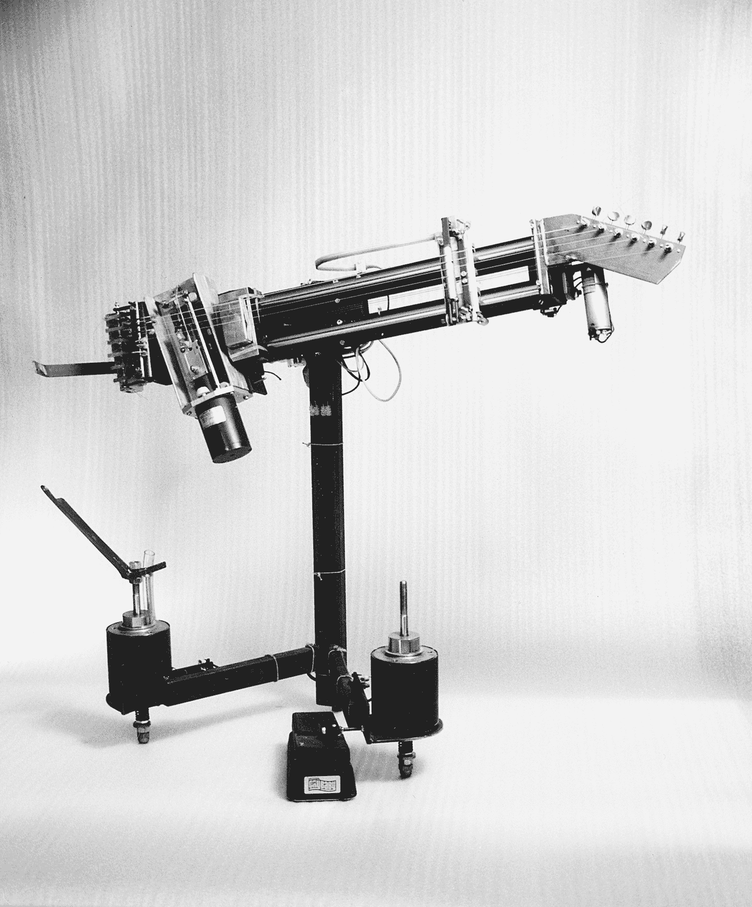

图 1.1：Nicolas Baginsky, *Aglaopheme*, 1992. 吉他机器人。由 Nicolas Baginsky 提供。

《三位塞女》（The Three Sirens）是当代数字艺术中一个不断发展的实践领域的早期示例，该领域涉及一种被称为*人工智能*（AI）的实践形式，即*机器学习*。机器学习提议不是通过直接编程逻辑规则来赋予机器智能，而是让它们通过从经验中学习来自我编程。这种方法在 20 世纪 90 年代末几乎几乎被遗弃，但得益于基础研究的突破性进展，从 21 世纪 00 年代中期开始获得了巨大的动力，这些进展引发了商业领域以及最近艺术界前所未有的兴趣。这产生了一个定义松散的艺术运动，它与之前的计算艺术实践（如控制论艺术、人工生命艺术和进化艺术）密切相关，我将其称为机器学习艺术。[1#chapter1-1]

机器学习是人工智能的一个分支，允许计算机从经验中学习，而不是通过“显式编程”（Samuel, 1959）。在“三位塞女”的案例中，机器人从环境中环境中录制的声音中学习——包括它们自己产生的声音。这些数据通过训练过程进行处理，训练是一种逐渐调整输入（声波）到输出（拨动指定的琴弦）数学函数的算法。

这项工作与移动设备（如 Alexa 或 Siri）上的语音识别软件有许多相似之处。今天使用的大多数先进的语音识别算法也基于机器学习。与 Baginsky 的机器人一样，这些系统被输入音频流，并从中提取规律。在语音识别应用中，声音信息与人类先标记的特定音素相关联。算法随后尝试在给定新的音频输入时预测正确的音素，并使用已标记的数据进行自我调整。

这两个例子共享同项技术，但真正区分它们的，它们如何以及为何利用这项技术。语音识别系统可以使用特定指标来评估其在给定任务中（即将声音转换为文本）表现优异的能力，而巴格斯基（Baginsky）并不真的在理解他的机器人是如何做出决策的，更不用说衡量它们音乐表演的准确性了——他只是判断自己喜欢或不喜欢听到的声音。他的兴趣在于这项技术提供的可能性，以及这些机器人表演者正在发展出独特、特定的风格，这种风格并非通过直接的、手工编程实现的，而是通过接触世界并找到自己的道路。或许更深层次的是，巴格斯基感兴趣的是这些自适应实体以及制造它们的过程能教给他什么关于音乐的知识。

机器学习的近期突破引发了“第四次工业革命”（Schwab, 2016），在这场革命中，自适应计算系统正迅速超越医学、交通和金融等多个领域的智力任务。正如 AI 研究员马克斯·韦林（Max Welling）所说：“工业革命期间蒸汽机取代了体力劳动，而智能算法很快将在某些人所谓的‘第二次机器时代’中取代脑力劳动”（Welling, 2016）。这场革命的先锋是`deep learning`（LeCun, Bengio, & Hinton, 2015; Goodfellow, Bengio, & Courville, 2016），涉及使用多个相互连接的人工神经层来表示和解释海量数据中存在的模式。这些高度“颠覆性的技术”（Bower & Christensen, 1995）显著改变了商业和社会的运作方式，涵盖自动驾驶汽车、自动化医疗诊断、智能金融交易系统、自主武器、数据挖掘和监控等多个领域。事实上，经济、劳动力、公正和环境只是 AI 正在从核心上发生变革的众多学科之一。

深度学习是技术谱系的最后一个分支，该谱系起源于 20 世纪 40 年代后控制论（cybernetics），并在 20 世纪 80 年代通过连接主义（connectionism）进一步扩展，这是认知科学和 AI 中的一种方法，基于使用人类大脑中神经网络的简化数学模型。它自世纪初以来的出现与原始计算能力的获取增加密不可分——特别是由于游戏和电影行业间接推动了图形处理器（`GPUs`）的发展——以及得益于互联网作为社交媒体平台的爆炸式扩张带来的数据指数级增长。AI 已成为一门工业科学。它也变得更加亲民：随着互联网和移动设备的发展，AI 现在随时与我们相伴，触手可及。

随着深度神经网络架构在大型 IT 公司拥有的`GPU`集群上计算数十亿软件神经元和数万亿突触连接，并以最不显眼、稳定且不可阻挡的方式适应着我们的日常行为，我们所习惯的、基于手工编码启发式的具有可识别和可解释决策程序的数字世界已经消失了。我们正在进入一个新时代，在这个时代中，无处不在的、看似有机的基于数据的算法正在取代基于规则的系统，在全方位的分布式控制和优化过程中与人类自适应地耦合。要理解这个新时代，我们需要从将计算系统视为正式、基于规则的、逻辑构建的过时观念中解脱出来，开始将其视为已经变成的生物启发的、统计驱动的、基于代理的、网络实体。

我们加速进入一个充斥着自适应、自主且诡异计算形式的世界，构成了特定形式控制论社会的实现，这种社会高度依赖大企业的利益^(2)。艺术家 Memo Akten 强调，正如第二次世界大战产生了数字计算机、冷战带给了我们互联网，今天“与反恐战争相关的大规模监控和互联网商业模式带给了我们人工智能深度学习”（Akten, 2016b）。人工智能迫切需要被重新利用、解构、拆解和民主化，因此已成为 21 世纪关键的参与空间。

## 神话与误区

尽管机器学习在当代工业和商业文化的许多方面的使用日益增加，但直到最近，它尚未产生重大影响的一个领域一直是艺术实践领域。这显然不再是事实：在过去的十年里，艺术界对人工智能和机器学习产生了爆炸性的兴趣，举办了诸如`Uncanny Valley: Being Human in the Age of AI`（旧金山杨公艺术博物馆，2020–2021）、`AI: More Than Human`（伦敦巴比肯中心，2019）、`Deep Feeling: AI and Emotions`（特拉维夫佩塔提克瓦博物馆，2019）、`D3US EX M4CH1NA`（西班牙希霍恩实验室，2019）、`Entangled Realities: Living with Artificial Intelligence`（巴塞尔电子艺术之家，2019）、`I Am Here To Learn: On Machinic Interpretations of the World`（法兰克福艺术协会，2018）以及`Machines Are Not Alone: A Machinic Trilogy`（上海中国艺术中心，2018）等展览。2019 年的电子艺类奖包含了一个名为“人工智能与生命艺术”的新类别，证明了 AI 导向方法在数字艺术中已建立的相关性。

这种狂热的热情伴随着许多使分析复杂的神话和误区。以下是其中一些。

## 神话 1：人工智能、机器学习和深度学习是同一回事。


这种混淆源于“人工智能”一词至少以三种不同的方式使用。第一种（也是本书使用的定义）是指一个涵盖许多竞争性方法的广泛研究领域。其中一种方法是机器学习，它侧于设计可以自主学习的计算机算法。深度学习是机器学习中的一种特定方法，使用一种称为人工神经网络的特定学习系统。AI 的第二种定义将该术语留给最先进的系统，而认为以前的方法缺乏智能。根据这种定义，在我们的时代，只有深度学习和其他其他高级形式的机器学习应该被称为 AI，因此 AI 常用作这些尖端技术的同义词。最后，该术语的第三种含义（更多用于日常口语）涉及可能依赖也可能不依赖机器学习的人工代理，例如“一个 AI 创作了这件杰作”这种表达。

## 神话 2：机器学习艺术是新的

机器学习可以追溯到 20 世纪 40 年代控制论的早期。`machine learning` 一词最早出现在 20 世纪 50 年代，与 `artificial intelligence` 几乎同时。从那时，艺术家通过系统艺术、算法艺术、机器人艺术和进化艺术等各种艺术运动一直在使用自适应或学习计算系统。然而，这些方法在艺术作品中的存在往往难以追踪，因为它们通常被用作比喻而非实际技术。例如，艺术家使用的 `学习`、`适应` 甚至 `人工智能` 等概念的定义通常与相应的科学定义有巨大差异。

## 误言 3：机器学习可以脱离创作艺术

机器可以完全取代艺术家的观点并不新鲜。例如，考虑 20 世纪 50 年代后期让·廷格利（Jean Tinguely）的 `Métamatics` 系列绘画机器，或者哈罗德·科恩（Harold Cohen）从 1973 年到他 2016 年去世期间开发的绘画程序 `AARON`。尽管某些机器学习系统产生了迷人的结果，但事实上，正如我们在本书中所展示的，机器学习艺术仍然需要大量的劳动。虽然通常与计算机编程相关的某些任务被借用了，但又出现了其他繁琐且往往昂贵的任务，例如构建海量数据集、微调训练算法，以及大量的预处理和后处理。更重要的是，即使某些选择交给机器，艺术总是涉及许多只有作品作者本人才能做出的决策。

## 误言 4：机器学习很快将产生超人类的创造力

这是一个关于机器学习的普遍误言，对更广泛的技术也是如此。每一项新技术的出现都引发了人们对人类淘汰的恐惧。例如，在 20 世纪初，未来主义者声称机械技术将很快超越人类（Versari, Doak, Evans, Bellow, & Curtin, 2016）。对于当前的机器学习，尽管在该问题存在分歧，但科学界似乎很大程度上认同目前的系统是非常有限的。尽管目前运行的一些系统令人印象深刻，但它们仍然局限于非常狭窄的任务，并且需要大量的示例进行训练。它们没有常识，无法将知识应用到其训练问题之外。创造力的一个定义性特征是能够“跳出框框思考”，利用直觉构想出能够撼动现状的想法。机器距离做到这一点还有很远的距离——尽管它们在遥远的未来可能做到。

## 理解机器学习艺术

作为一个研究领域，新媒体艺术并不经常作为艺术史学家持续研究的课题，留下了一个才开始被解决的空白。在大多数情况下，是新媒体艺术家自己通过分析自己的实践，开始构建理解其学科的某些理论工具。相比之下，机器学习自 20 世纪 50 年代以来一直是 AI 生态系统中不可或缺的一部分。尽管它的角色往往处于边缘地位，但自 21 世纪中叶深度学习革命以来，它的存在感呈指数级增长，这很大程度上归功于机器学习在解决重大 AI 相关问题上前所未有的成功。因此，机器学习是一个关键概念，其在我们世界中日益增加的存在具有巨大的社会技术影响。

随着这些技术变得越来越流行和易得，目前几乎不存在关于如何制作和思考这些作品的观念性指南或理论框架。关于生成和人工生命实践以及自调节、演化和涌现等概念（Kac, 1997; Tenhaaf, 2000; Whitelaw, 2004），已经有一些基础工作，但艺术家对机器学习和自适应计算的严谨工作较少。

我们自 21 世纪中叶以来经历的机器学习的复兴，发生于西蒙·佩尼（Simon Penny）所说的新媒体“结晶”（Penny, 2017）背景下，这种现象受到强大市场力量的推动，这些力量低估了 20 世纪 80 年代 90 年代存在的独立和实验性艺术实践。开始构建机器学习系统的美学理论变得至关重要，以便更好地理解使用它们的作品，理解以艺术方式处理它们时所涉及的过程，并在这一新格局中重新定位艺术家的角色。

本书旨在奠定此类概念框架的基石，以在新媒体艺术领域内理解机器学习。它试图通过对艺术中机器学习的历史、实践和理论审查，为新兴工业革命的早期阶段提供一些清晰。通过这种方式，它旨在为当代新媒体艺术家、音乐家、作曲家、作家、策展人和理论学家提供概念工具、实践说明和历史视角，帮助他们掌握机器学习系统是什么以及它们如何与实验性新媒体艺术实践相关，并建议艺术家参与和学习如何使用它们的方法。本书并非旨在教授特定技术，而是打算向非科学读者翻译基本定义和挑战，同时将其与新媒体艺术的核心问题联系起来。

为了实现这一点，我们将机器学习系统置于手术台上对其进行仔细剖析，通过艺术实践的视角审视它们的不同维度和组件。在拆解它们时，我们讨论了这些元素的美学和艺术功能及其意义，同时展示了艺术家参与这些元素的方式。这一过程的目标是揭示机器学习的内部机制，以及它如何在以及如何在艺术实践运作。这一过程反映在核心章节的组织上，每个章节都关注学习系统的三个核心组件之一：训练过程、模型和数据。

本书通过研究机器学习与艺术中关键概念（如不确定性、物质性、表现性和作者身份）的关系，将机器学习置于新媒体艺术之中。书中展示并讨论了来自各种领域和格式的作品和创意技术，重点关注那些批判性地接触机器学习技术而非依赖现成系统的独立艺术家创作的作品。作为一名与机器学习工作的艺术家，我每当相关时，也会从自己的研究和实践中引入示例。这种方法旨在说明深度学习技术对 21 世纪及以后新媒体艺术演进的意义，以及艺术家对机器学习领域的贡献。

## 为什么机器应该学习

在西方世界，智能往往与理性思考、数学和逻辑等同。在 20 世纪 50 年代，大多数人工智能专家认为 AI 的圣杯是执行数学导向的任务，如证明定理或玩国际象棋和跳棋等策略游戏。然而事实证明这些问题对于计算机来说相对容易解决，因为它们存在逻辑规则和符号的确定领域中。例如，在国际象棋游戏的任何给定时刻，都有有限的允许移动，因为某些类型的动作是被禁止的，例如移动到两个格子的中间。

相比之下，大多数需要智能的现实世界问题与棋类游戏完全不同。例如，虽然翻译、金融交易、教学、研究以及诊断和治疗等专业工作必须遵循一系列规则和指南，但这些任务需要大量的直觉和经验。此外，许多看起来不需要太多智能（因为我们不需要思考就能完成）的任务——例如移动、说话、识别物体或驾驶车辆——对计算机来说实际上非常困难。

以走路为例。我们是如何走路的？第一看，人们可能认为走路可以用一个简单的算法来表达：

```
第一步：将一只脚放在另一只脚前面。
第二步：重复。
```

然而，这一过程并没有考虑到双足运动中涉及的所有动力学。它可能代表了大多数情况的概况，但并没有解决某些可能需要额外努力的情况，例如在不平整的表面移动或爬爬；它也没有解决更具挑战性的情况，例如失去平衡或携带重量物。事实上，人类的双足行走是一项极其复杂的感运动活动，涉及对身体许多部位肌肉的协调控制。

事实是，我们并不真正知道自己 `how` 是走路的。

但我们确实知道关于走路的一点：我们并不是天生就会走路。通过不断的尝试和并在守护人的指导下，我们逐渐 `learned` 了如何走路，一步一步地迈出婴儿步。

当我们甚至不知道自己 `how` 这样做或知道这些事情时，我们如何编程让计算机去做我们所做的事情并知道我们所知道的事情呢？机器学习让我们让计算机从经验中学习，就像我们学习双足行走一样。因此，机器学习与植根于生物学的 `adaptation`（适应）概念直接相关，该概念指的是“通过不断修改结构，使其在环境中提供更优性能的过程”（Holland, 1992, 7）。大多数机器学习系统通过迭代学习，观察数据流，增量地完善它们对试图解决的问题的理解。

## 监督学习、无监督学习和强化学习

机器学习算法通常分为三个子类，对应三种不同的 `tasks`（任务）。在 `supervised learning`（监督学习，目前最常用的方法）中，系统从标记数据中学习，即已经分配了适当输出的数据（通常由人类分配）。例如，想象一个图片数据库，其中每张图片都被标记为狗或猫的图像。该系统的目标是从这些信息中学习，以便变得擅长区分图片中的猫和狗。换句话说，给定一张以前没过的猫或狗的图像，机器学习算法必须准确猜出它代表哪种动物——换句话说，即它的类别或种类。

`Unsupervised learning`（无监督学习）用于从没有此类标签的数据集中进行推理。可能需要不同的结果，例如提取更紧凑的数据表示（例如，降维或表示学习）或将数据分为不同的组。使用之前猫和狗图像的例子，假设我们给学习系统一个图像数据库，但这次图像是不带标签的。我们要求系统将图像分为两个未指定的类别。根据数据库和系统的配置，它可以决定区分猫和狗，但由于分类是留给机器学习系统的，它也可以选择将图像分为深色和亮色，或者彩色和灰色，取决于数据集、机器学习系统的类型以及其他系统特征。

最后，`reinforcement learning`（强化学习）涉及人工智能体^（3）演化到一个环境中并需要学习如何在其中优化行为的情况。良好的决策通过给予系统正奖励来得到强化，而坏的行为会被给予负面奖励（即惩罚）。强化学习的常见用途包括机器人控制、金融交易、交付管理和用于游戏 AI 的自适应代理。

例如，想象一个试图在股票市场上收益最大化的交易软件代理。程序根据市场数据选择买入或卖出。其目标是随时间推移使累计奖励最大化。

系统对世界的认知包含在一个名为 `model`（模型）的结构中。正如帆船模型既代表了原始船只，又通过移除无关细节将其按比例缩小为更易便携的格式，机器学习模型通常也可以被理解为训练数据的紧凑版本。为了良好地工作，一个好的模型必须足够复杂，以表示源数据的重要特征。然而，它不应该过于精确，否则可能会面临变得过于特定而无法泛化到训练集之外的新样本的风险。

这类模型有很多不同的种类，每种都有自己的优缺点。例如，人工神经网络包含通过突触 `weights`（即代表两个神经元之间连接强度的数值）连接的人造神经元。模型模型表示广泛的数学函数，并且通常被认为擅长识别模式——因此它们在计算机视觉和语音识别等应用中广受欢迎。另一种类型的模型是代表计算机程序的二进制遗传代码，例如在遗传编程（GP）中使用的代码：这种模型可能实现任何算法，因此可以被定性为通用问题求解器。

模型和数据集本质上是静态的结构。第三组成部分 `training process`（训练过程）通过使用数据调整模型将它们结合在一起。为了引导其决策，该过程使用一个 `evaluation function`（根据使用语境也称为代价函数、适应度函数或奖励函数），用于衡量模型在数据点上的性能（Alpaydin, 2004, pp. 35–36）。

因此，机器学习系统可以总结如下：给定某种类型的任务（监督学习、无监督学习或强化学习），学习算法调整模型以提高其（使用评估准则衡量）在数据集上的性能。虽然这在机器学习的所有应用领域大致成立，但在这些技术内部存在许多变体，适用于这些组件中的每一个。

因此，机器学习为解决问题提供了一个通用的框架，它不仅挑战了传统的人工智能方法，还挑战了整个计算机科学。机器学习并不是试图通过设计直接解决问题的计算机程序来解决问题，而是建议组合不同的组件（数据、模型、训练过程和评估函数），让系统自主寻找解决方案。尽管这种方法在过去的几十年里效果并不理想（主要由于数据和计算资源不足），但从 21 世纪 20 年代中期开始，它从后台走向人工智能的前沿，并成为深刻社会变革的催化剂。

## 从控制论到深度学习

机器学习在 21 世纪的成功建立在计算机科学五十多年的研究基础之上。深度学习是一种灵感源于大脑层次化和自组织特性的机器学习方法，它使得在解决计算机视觉和语音识别等挑战性问题上实现了（有时甚至超越了）人类水平的巨大飞跃，推动人工智能领域进入了一个全新的工业时代，这个时代有望颠覆社会的底层结构。然而，深度学习仅仅是人工智能的最新里程碑，更广泛地说，它是人类在探索生命系统运作和人类智能方面漫长而不懈的旅程中的最新一站。

人们可以将导致 20 世纪 80 年代机器学习出现、并在随后在 2000 年代重新兴起的最初概念，追溯到跨学科科学 `cybernetics`（控制论）。控制论诞生于二战后的美国和英国，试图理解大脑，并在这一过程中理解自适应和自主的机器（Walter, 1950; Ashby, 1954），并为新的控制和通信理论奠定了基础（Wiener, 1961; Shannon, 1948）。

一些控制论者试图通过观察大脑最基本的单元——神经元来解决人类问题。Walter Pitts 和 Warren McCulloch 显示，互连接的神经元可用于模拟逻辑门（McCulloch & Pitts, 1943）。Grey Walter 和 Ross Ashby 创建了通过反馈回路模拟神经机制的设备。20 世纪 50 年代末，在神经科学家 Donald Hebb 的工作之后，Frank Rosenblatt 提出的可以识别模式的神经启发系统：`perceptron`（感知机）（Rosenblatt, 1957）。同一时期，Oliver Selfridge 提出了由分层单元组成的图像识别结构，他称为 `pandemonium`（骚动）（Selfridge, 1959）。尽管受到实际和理论问题的困扰，`perceptron` 和 `pandemonium` 仍然体现了构成深度学习学习的核心思想：即人工智能的关键在于设计由堆叠层（即神经元）组成的自主系统，其中每一层都对系统观察到的内容学习更高层次的表示。

尽管控制论作为一个科学领域已在某种消失，但它在计算机技术发展中的意义不容忽视，特别是在人工智能和机器学习的发展方面。不为人知的是它对 2060 年代社会文化的影响，特别是当代艺术领域，控制论与概念艺术、表演艺术和动力艺术等运动密切。这些革命性的方法试图超越艺术品的物质性，转向构想为计算机程序和人工系统的艺术（Burnham, 1968）。

这种从对象到系统的范式转移与战后时期出现的一种重要心理理论产生了共鸣，该理论在随后的几十年里深刻影响了西方世界对人类主体的观念。这种思想被称为 `computationalism`（也称为认知主义），是表征主义的一种特殊形式，表征主义心理理论认为我们并非直接体验世界，而是通过对世界的表征来体验。计算主义假设人类认知能力等同于计算——也就是说，智能通过对代表世界的符号集进行操作来实现。计算主义理论声称，大脑只是运行此类心理能力软件的 `hardware` 基础。因此，它认为能够复制人类认知性能的计算机程序即使运行在硅基机器上也应被认为是智能的（Turing, 1950）。

计算主义随着 20 世纪 50 代人工智能的出现和发展，并与控制论并行出现。人工智能作为一个领域，其核心目标设定为研究计算机如何模拟人类智能。在这些年里，已经存在两种显著的方法，它们在整个人工智能的发展史上一直保持着合作与竞争。第一种方法是 `符号 AI`，试图通过直接编程让计算机变得聪明来赋予其智能。第二种方法是 `机器学习`，它认为与其试图在机器中显式地实现智能，不如尝试教它们如何自我学习。正如基于规则的 AI 与计算主义相联系，机器学习似乎与连接主义紧密相关，连接主义是一种心灵理论，认为认知是通过诸如神经元等相互连接单元之间的多个并行交互实现的。

### 第一波 AI 浪潮的兴起与衰落

在 AI 历史的第一阶段，符号 AI 迅速获得了动力，因为计算机程序在被认为人类难以完成的任务（如玩策略游戏）中表现得惊人；与此同时，像 `感知器` 这样的连接主义学习系统被证明存在严重的理论局限性（Minsky & Papert, 1969）。马文·明斯基（Marvin Minsky）和西尔尔·帕帕特（Seymour Papert）等科学家支持基于规则的计算和启发式方法，利用计算机强大的计算功能通过暴力破解解决问题。然而，到 20 世纪 70 年代，符号 AI 研究进入平台期，公共资金也停止。AI 进入了一个不受待见的时期，后来被称为第一个 `AI 冬季`。尽管研究并未完全停止，但随着西方进入 20 世纪 80 代，艺术界对控制论和系统的兴趣下降，转而支持其他计算机能力的探索，如图形和音频制作。

### 80 年代中期的复兴与人工生命

20 世纪 80 年代中期，随着神经网络研究的复兴，对 AI 的兴趣再次激增，这主要归功于受 `感知器` 直接启发的关于训练更复杂形式神经网络的新发现。与此同时，一些基于规则的 AI 方法通过专家系统的开发重新获得流行，这些系统旨在将人类专家的知识转化为一套逻辑规则。

除了这两种并行的人工智能方法外，另一个与控制论直接相关的关键新领域出现在 20 世纪 80 年代末：人工生命（ALife）。受控制论、复杂理论、混沌理论和人工智能的启发，人工生命寻求在其运行模式下研究生命系统，特别是通过计算机模拟生命过程。人工生命基于一种自下而上的方法，利用计算机的原始力量模拟许多单元之间复杂的相互作用，然后观察结果。人工生命研究人员探索了对底层单元应用简单的算法指令如何在高层级产生复杂的模式，这些模式有时看起来像生命过程和有机体。

### 新 AI 与具身性

20 世纪 80 年代末，专家系统和神经网络在现实环境中都显示出严的局限性，对 AI 的兴趣消失并进入了第二个 AI 冬季。为了应对这些挑战，结合人工生命和机器学习的成功经验，并淡化表征在 AI 系统中的性，罗德尼·布鲁克斯（Rodney Brooks）提出了一种被称为“新 AI”（New AI）的替代方案。布鲁克斯反对连接主义和符号 AI，他认为智能不需要世界的表征，认知无法脱离情境/具身的方式而发生：换句话说，是身体将世界作为其自身的模型。因此，他认为 AI 取得真正进展的唯一方法是设计能够在在其世界中交互的机器人，并逐步构建它们，教它们如何在该环境中行动。

### 对媒体和艺术的影响

20 世纪 90 年代，人工生命和新 AI 都成为新媒体艺术家的重要灵感来源。一个显著的例子是人工生命和复杂理论对视频游戏的影响；许多涉及复杂现象的重要模拟游戏通过《模拟城市》（SimCity）和《文明》（Civilization）等热门作品获得了广泛的关注。一个特别恰当的例子是威尔·莱特（Will Wright）1990 年的游戏《模拟地球》（SimEarth: The Living Planet），该游戏允许玩家通过火山活动、侵蚀和反照率等间接手段监控行星的发展。主场景遵循了类地球历史的不同时代，从地壳形成到海洋的出现，再到生命和文明的诞生。


在当代艺术中，人工生命本身成为了一种艺术形式，例如通过内尔·滕哈夫（Nell Tenhaaf）、苏西·拉姆（Susie Ramsay）和拉斐尔·洛萨诺-赫梅尔（Rafael Lozano-Hemmer）的作品，后者在西班牙电信基金会（Fundación Telefónica）的支持下于 1999 年创立了艺术人工生命国际奖（VIDA）。该奖持续了十六年，旨在支持人工生命领域的艺术探索。机器人艺术家路易·菲利普·德梅斯（Louis-Philippe Demers）、肯·里纳尔多（Ken Rinaldo）和比尔·沃恩（Bill Vorn）都是受罗德尼·布鲁克斯新 AI 直接启发的。同样受到布鲁克斯影响的艺术家兼媒体理论家西蒙·潘尼（Simon Penny）提出了“行为美学”一词，用来描述通过创造与现实交互的人工代理的作品（Penny, 2000, 2017）。

### 数据时代与 GPU 复兴

从 20 世纪 90 年代中期到 00 年代中期，互联网的发展产生了大量数据，同时计算能力不断增加，特别是通过图形处理器（`GPUs`）的发展，这些是为了响应日益增长的娱乐业（视频游戏和特效），专门负责矩阵乘法——这正是计算极大型人工神经网络所需的扩展数学运算。这些情况，结合加拿大高级研究院（CIFAR）对基础研究的支持，共同构成了基于神经网络的机器学习复兴的背景——有时被称为加拿大 AI 阴谋。

在经历了五十多年的研究后，人工智能技术终于成熟到可以被利用。谷歌（Google）和脸书（Facebook）等巨头开始积极招募该领域的顶尖研究人员，往往直接买下他们的实验室，为他们提供的不仅是优厚的薪水资金，更重要的是访问用于研究的海量数据集，以期领先其当前和未来产品的开发。

在短短几年内，企业对人工智能的投资急剧增加，并似乎呈指数级增长，甚至引发了对经济泡沫的恐惧。但有强有迹象表明这不仅仅是炒作。几年前看起来像科幻小说般的 AI 驱动技术现在已上市，包括自动驾驶汽车、语音对语音翻译以及如 `Alexa` 和 `Siri` 等个人助手。然而，这些可能只是冰山一角。我们正在经历一场至少与互联网出现后的变革同样重要（甚至可能重要得多）的技术革命；当前的革命已经对社会产生了深远影响，这与以往的大规模工业转型相似。正如 18 世纪和 19 世纪世纪的工业革命将社会带入第一个机器时代（即机器协助人类完成体力任务），人工智能是第二个机器时代的驱动力，在这个时代里，智能算法正在取代认知任务（Brynjolfsson & McAfee, 2014）。

机器学习代表了人类巨大的潜力，这远超自动驾驶汽车和个性化广告等市场化应用。此外，这些技术还引发了重要的社会政治和伦理问题，威胁到民主本身，例如通过人工智能支持的社交媒体泡沫传播虚假新闻。著名的深度学习专家 Yoshua Bengio 和 Geoffrey Hinton 强调，这项技术在很大程度上是通过几十年公共资金资助的基础研究开发的，不应仅仅让私部门盈利，而应该扩展到医疗、教育等公共服务以及其他领域。

艺术是机器学习潜力的另一个探索领域。新媒体学者 Joline Blais 和 Jon Ippolito 认为，数字艺术充当了对抗技术入侵文化和社会躯体的抗体。他们声称：“科学’一直为我们提供一个未来，有时甚至承诺修复它在之前的几代人中带给我们的危险。但在一个技术似乎越来越具有主观意识的时代，艺术对技术的无节制扩张提供了重要的制衡。”（Blais & Ippolito, 2006, p. 9）。

## 范式的转变

机器学习的成熟引发了媒体和学术界恐惧与兴奋交织的情绪，这使得关于 AI 技术的当代话变成了一场高度极化的辩论。一个阵营警告 AI 对劳动力市场的严重影响，例如机器人和算法在交通、物流和办公支持等领域迅速取代人类；以及一个令人生恐惧的技术`奇点`的出现，之后 AI 将取代人类成为更优越的智能物种，可能导致人类灭绝的严重后果（Kurzweil, 2006）。在辩论的另一侧，技术乐观主义者们唱着一个后工作、后民主世界的自由意志主义乌托邦，在这个世界里，人类的问题将由仁慈的人工学习系统顺利解决；更温和的声音则指出机器学习在医疗和教育方面的具体益处，并认为利大于弊。

在 20 世纪 50 年代和 60 年代，控制论者梦想着一个由智能、自我调节、适应性系统调节的社会，这些系统类似于人类大脑中的系统。这个组织松散的跨学科研究小组建议对世界的范式进行彻底改变（Pickering, 2010）。

如果技术的设计是为了适应人类，而不是反过来，情况会怎样？艺术家如何与那些似乎高度依赖大型数据库、大型计算机和专业知识的技术合作？艺术家又如何接触那些主要用于解决问题和优化的算法——而这两者与艺术都几乎没有关系？

机器学习的工业化发展带来的潜在影响，无论好坏都是巨大的。在好的方面，例如自动翻译技术如何促进了越语言边界的信息获取；自动驾驶汽车如何可能减少交通和事故；以及基于图像模式识别如何提高医疗诊断质量并帮助减轻痛苦。然而，正如许多观察者指出的，自 2000 年代中期以来，大型跨国公司的快速部署使得机器学习的日益存在在许多方面存在问题。作为重要辩论的来源，许多人认为这些技术实际上会导致不平等和权力平衡的加剧，并危害民主。例如，想想由于交通行业自动化而失去的职位、自主武器的深层伦理影响、通过强化媒体泡沫和传播虚假新闻导致的 AI 辅助社会碎片化，以及利用学习技术进行犯罪预测和人类画像分析的潜在恶性影响。

这些讨论是迫切需要的，需要社会各部门的关注和参与。由于机器学习可能成为 21 世纪最重要的工业技术之一，艺术家如何参与它带来的物质和智力辩论？他们如何能与一种被激进私有化、并日益依赖基于社交媒体和广告的工业复合的技术进行创造性且独立的工作？例如，Google 的 `DeepDream` 项目尽管试图将其作为创意工具向公众开放，但与 Google 对海量数据、计算力和科学专业知识的获取是不可分的（Goodfellow, Bengio, & Courville, 2016）。

作为处理这些问题的方法，可以考虑新媒体艺术中存在着丰富的历史传统，其创作者一直致力于机器学习等自适应和自组织技术。自从二战后现代计算机兴起以来，艺术家和其他创意实践者一直在探索将自组织系统、人工智能和自适应计算作为创作审美体验的基础材料。早在 20 世纪 50 年代，艺术家就开始使用控制论系统创作自适应机器人和生成性作品。诸如杰克·伯纳姆（Jack Burnham）的系统美学、罗伊·阿斯科特（Roy Ascott）的控制论艺术、机器人艺术和人工生命艺术等重要运动，标志了从战后时代开始的新媒体艺术的发展。这一传统与生命和认知本质的当代话语紧密相连，例如自主性、混沌、涌现和新奇性的生成——人工智能生命研究者池上隆（Takashi Ikegami）所说的`living technology`（Ikegami, 2013）。

当我们将机器学习艺术与新媒体艺术中记录的、确保计算系统的方法对比，例如人工生命艺术（Langton, 1995; Tenhaaf, 2008; Penny, 2009）和情境机器人艺术（Brooks, 1999; Penny, 2013），需要记住的最区别之一是，这些方法在本质上是自下而上的，依赖于人类通过试错来迭代构建涌现和自组织。参与这些实践的艺术家利用计算来模拟人工生命形式，观察结果，尝试性地改变几处，并反复尝试，直到满意。换句话说，他们本身充当自适应设备，在不确定的过程中做出选择。

机器学习提供了一种处理自组织的不同方式，即人们组装不同的元素（数据、模型和训练过程），但让涌现系统找到实现其目标的方法，从而将更多控制权交给机器。这导致了与机器之间不同的关系，更接近实验科学或艺术家与机器之间的某种协作。与纯粹的涌现程序相比，它允许结果进行更精细的控制。它提供了更多选择，因为艺术家仍然可以实时控制系统的目标（如人工生命模拟中），或者通过调整数据、模型和/或评估函数进行更间接的干预。

我们正在进入一个计算机技术日益自适应的世界，而类似的系统以前只存在于自然现象中。这些无处不在的系统对于艺术家和文化理论家具有新的意义，因为它们暗示了处理自组织系统的新方法，并开启了理解生命和人类意义的新颖途径。机器学习还挑战了艺术创作是纯粹以人类为中心的实践这一观点，因为创意代理变得分散在相互耦合的人类和机器之间。最后，在大数据以及财富和权力高度集中的时代，它们的快速发展使其成为艺术领域一个批判性的参与空间。

用机器学习创作艺术面临着重要的挑战。首先，机器学习通常需要海量数据，这些数据难以生成甚至难以获取，因为大多数最大的数据库都是私有的。其次，计算能力仍然相对昂贵，尽管成本一直在稳定下降。第三，可能更重要的是，艺术家往往缺乏以有意义的方式与这些技术工作的所需的技能。

最后，在大多数情况下，机器学习是一种解决问题的优化过程，试图随时间推移最大化或最小化评估函数。例如，在检测图像中猫和狗的监督学习分类应用中，我们通常试图减少系统所犯错误的数量和范围。但艺术特别`不是`关于优化的，因为没有可以最小化的客观评估函数。不存在所谓的最好的画作，就像没有所谓的最好的笑话一样。偏好是主观的且不互斥的——例如，一个人有很多部非常喜欢的电影并不稀奇。

幸运的是，这些困难并非不可逾越。许多此类问题实际上可以避免，因为艺术家的需求和目标与科学家和工程师不同。对于各种艺术应用，使用较小的数据库和计算密集程度较低的学习系统可能是。。此外，大多数技术是在开放的文化下开发的。即使在科技巨头的墙内进行，研究大部分情况下也是公开的，而且许多大型 IT 公司在通过开源许可向公众提供工具方面发挥着积极作用。计算能力在未来几年可能会快速增加，新一代的创意开源硬件具有多个核心和 GPU。

从好的一方面来说，机器学习技术变得越来越容易。例如，基于神经网络的机器学习曾是某种黑工艺，因为它需要对数据进行广泛的调优和处理。深度学习的优势之一是算法现在能够处理原始数据，这对于用户来说是一个巨大的进步，使得与此类系统工作变得容易得多。有大量的免费软件工具和在线教程可以学习这些技术，通过教育实现这些技术的民主化可能会成为未来几十年社会发展的中心。

本书旨在提供概念工具、实践说明和历史视角，从艺术角度理解和应对机器学习技术。文本分为三个部分，通常遵循表征机器学习系统的不同组成：训练过程和评估函数（第 1 部分）；模型和机器（第 2 部分）；以及数据（第 3 部分）。通过剖析学习算法的科学描述并将其属性与艺术问题联系起来，我的目的是建立一个全面的框架，艺术家、音乐家、作曲家、作家、策展人和媒体理论家可以使用该框架在艺术作品和更广泛文化问题中接触机器学习。在整本书中，我因此汇总了与学习机器各种组件相关的科学理论、概念和定义的概述，并以易于理解的方式进行表达；在示例的支持下，对机器学习进行艺术探索和利用的机会进行了考察，无论是通过按预期用途应用现成技术，还是通过黑客行为和劫持实践；以及在艺术创作背景下，这些机器学习算法组件的主要局限性、挑战和限制。

本书试图直接应对机器学习艺术复杂景观中的审美和实践问题，在艺术与科学、人类与机器、身体与过程之间穿梭。遵循后人文主义学者罗西·布拉伊蒂（Rosi Braidotti）的“之字型穿梭”（zigzagging）概念（Braidotti, 2013, p. 164），它拥抱了一种非线性的方式来通过这片模糊地带，以机器学习系统本身的物质性作为指导。由于基于我作为一名跨学科艺术家研究者的自己的创作工作，我有时也会分享来自自己实践和经验的案例和观点。

本书的第一部分探讨了围绕训练过程的问题。第二章将学习循环视为一个优化过程，因此这似乎与艺术是对立的，因为艺术在本质上是非目的性且不可优化的。艺术实践与科学家和工程师的区别在于，它更多是过程驱动而非目标驱动。因此，我认为，在计算创造力和创意人工智能领域中，试图在特定艺术领域复制人类水平创造力的研究可能是误导性的，因为这类研究往往误解了当代艺术的基本原则和价值。在第三章中，我们专门关注艺术家通过操纵评估函数来劫持训练过程的替代方法。回顾机器学习在控制论中的起源（即智能体适应其环境），在第四章中，我提出了一个框架来理解自适应行为的审美属性。

第二部分考察了构成机器学习系统的真正输出：模型。在第五章中，我们考虑了这些自组织的`black boxes`如何以违背人类理解的方式运作，以及为什么这些特性为新类型的实践和艺术形式提供了肥沃土壤。随后，我们研究了不同种类的机器学习系统如何提供不同的艺术实践和审美特征：第六章涉及参数模型和遗传算法，第七章涉及浅层主义学习，第八章涉及深度学习。

第三也是本书的最后一部分关注数据在机器学习艺术中的作用。第九章展示了艺术家如何使用数据作为原材料来塑造机器学习系统，以及它如何影响创作过程。第十章章认为，机器学习通过收集数据和重用预训练模型，允许新颖的算法重混形式出现。最后，第十一章考察了机器学习系统中观察与生成之间的对应关系，以及偏在这些背景下是如何运作的。在第十二章中，我通过跳出机器学习艺术的物质性，讨论了与艺术家与机器学习系统建立的关系等更广泛的问题、机器学习对艺术界和策展实践的影响，以及二十一世纪机器学习艺术的社会政治意义。

通过围绕围绕机器学习及其与新媒体艺术的联系的不同视角来对章节进行组织，我希望这本书能让外行人士理解机器学习算法结构的基本设计，同时将这些技术置于更宏大的历史和概念空间中，从而成为一本在阅读多年后仍能让人们从中汲取知识和灵感的参考书。

1. 1. 数字当代艺术倾向于抵抗简单的分类。因此，为此类作品建立分类法具有挑战性，因为类别之间存在许多重叠，以至于艺术家往往发现难以对自己的作品进行分类。在书中，机器学习艺术被提为一个非排他性类别，涵盖了核心依赖于机器学习原则的艺术作品和方法。它假设数字艺术、算法艺术和机器学习艺术等类别并不是互斥的，因此，将作品归类为机器学习艺术类别，并不是试图将它们从过去或现在可能被分配到的其他类别中移除，而是为了揭示那些看似互不相关的作品属于同一个家族。

2. 2. 为了证明该领域在当代社会中的重要性，可以考虑大型 IT 科技公司对机器学习初创公司的激进收购以及对顶尖学者的招聘。例如，逻辑学家乔治·布尔（George Boole）的大大孙孙、多伦多大学人工智能神经网络领域的名誉教授杰弗里·辛顿（Geoffrey Hinton）于 2013 年作为卓越研究员加入谷歌。该领域的另一位领军人物扬·勒昆（Yann LeCun）于 2012 年被任命为纽约 Facebook 人工智能研究的首位主管，强化学习领域的权威吴恩达（Andrew Ng）于 2014 年成为硅谷百度研究的首席科学家（Markoff, 2013）。

3. 3. 在计算机科学中，`agent`一词不仅指机器人等自主物理设备，还包括通过对观察做出反应并采取行动来工作的软件系统。

4. 4. 训练机器学习模型的挑战之一在于在模型的`capacity`（即表达能力）与问题难度之间找到正确的平衡。如果能力太低，或者模型训练次数不够，它将无法掌握数据分布的重要特征，导致一个被称为`underfitting`（欠拟合）的问题。相反，能力过大且训练时间过长的模型会开始过于精确地追踪训练数据的轮廓，就像在背诵数据集一样，这阻碍了它泛化到新示例的能力，这个问题被称为`overfitting`（过拟合）。

5. 5. 因此，在庞大的问题空间中进行搜索时，遗传编程通常是合适的。

6. 6. 人类认知可以在机器上进行计算的概念可以追溯到埃达·洛芙莱（Ada Lovelace），她在翻译路易·费德里科·梅纳布里亚关于巴贝奇机器的书时提到了“通过人类大脑而非通过无机机械媒介通过的数学过程”（Lovelace, 1842）。

7. 7. 符号人工智能在文献中也被经典人工智能、基于规则的人智能或良好的老派人工智能（GOFAI）。

8. 8. 连接主义可以被视为计算主义的替代方案，因为它拒绝认知仅仅依赖于符号的操作的观点。然而，一些人认为它是计算主义的形式，因为它也假设认知可以使用人工神经网络等连接系统在计算机上实现。

20 世纪 20 年代初，我在蒙特利尔大学完成了计算机科学硕士学位。在 Yoshua Bengio 领导的自适应系统计算机科学实验室（Laboratoire d’Informatique des Systèmes Adaptatifs），我的研究生研究项目专注于人工神经网络语言模型——这是目前深度学习语言模型的前身，后者正运行着最先进的语音识别和自动翻译系统。然而，在那个时代，大多数人工智能研究人员将人工神经网络视为一条死路同。

在读研究生的几年里，我对比当时计算机科学领域盛行的学科化、同质化且保守的文化感到幻灭。硕士毕业后不久，机缘巧合的情况和相遇使我远离了人工智能研究，并将我推向新媒体艺术领域。21 世纪初的蒙特利尔对于新兴的新媒体艺术家来说是一个充满活力且令人兴奋的地方，那里拥有由艺术家运营中心、学术网络和科技公司组成的蓬勃发展的生态系统。然而，当我步入艺术界时，我对艺术的着迷被我浸淫近十年的工程文化所扭曲了，这导致我对比艺术和社会产生了一种天真而狭隘的观点，并倾向于将一切都视为一个待解决的问题。

在这种背景下，2005 年冬天的某个时候，我开发了一项艺术项目计划，反映了我当时的心境。我试图创建一个交互式装置，向游客展示生成式图像，由他们交互式地选择自己喜欢的图像。然后，该设备将使用机器学习来适应公众的口味，随着时间的推移生成越来越具有美学吸引力的图像。总而言之，我将艺术作品构想为公众通过机器学习的优化能力来优化“美”的机会，而这种能力正是我多年来训练自己使用的。

我那年轻的计算机科学家的大脑完全深信这一计划的革命性意义。我的项目将为艺术创作这一“问题”生成一个最优解决方案，并可能完全取代艺术家。这种想法包含了对我的艺术家同行的一种某种轻蔑，他们大多数人都上过艺术或电影学院（因为他们不具备我所拥有的知识和技能），显然无法与我那绝妙的方法竞争。

尽管这种心态对于任何艺术家、策展人或任何稍微熟悉当代艺术的人来说可能都是多么不可疑，但我记得当时自己是因为长期接触人工智能内部一种狭隘的学科文化——这种文化往往认为自己优于其他学科，特别是优于艺术和人文——而产生这种想法和感受的。因此，我和计算机科学同行将艺术家视为懒惰的白日梦者，他们选择可能是因为不够聪明而无法在科学领域工作。

当然，这与事实完全不符。创作艺术是极具挑战性的。创作`good`艺术不仅需要直觉和天赋，还需要不懈的奉献和强心韧性。艺术家在充满挑战的条件下极其努力工作，经常面临严厉的批评和拒绝。他们不仅需要找到创作作品的方法，还需要对其进行展示和市场营销——而且大多数时候是为了换取极低的收入。艺术家通常必须在职业生涯中投入几十年，直到他们的作品开始产生回报，而成功的艺术家往往过着节约的生活。


尽管如此，今天可能比以往任何时候都，在媒体的帮助下，硅谷文化继续助长某种关于“波西米亚艺术家”的神话，即他们唯一的社会功能就是产生美，而我们则等待机器做得更好。特别是，这种扭曲的观点在`计算创造力`（CC）领域仍然存在，这是人工智能的一个分支，试图理解和复制人类的创造力，并且往往倾向于通过20世纪50年代以来困扰计算机科学的二元对立世界观来艺术创作。

幸运的是，我从未制作过提过的生成式交互装置项目。通过多年作为艺术家的学习和工作，并从艺术界的新同行那里学习，那些扭曲了我对艺术创作理解和欣赏的内在偏见逐渐被侵蚀。我开始理解，当代艺术与其说是解决问题，不如说是通过让观众进入一种体验为他们创造问题，从而通过疏离感揭示原本无法理解的世界真理。

几年后，当我在康考迪亚大学美术学院即将完成博士学位时，我在蒙特利尔展示了一项利用强化学习系统生成发光模式和声学模式的作品。这些系统并不是响应观众的口味，而是作为不确定的、自给自足的模式生成代理，根据环境进行实时训练。

我邀请了一位以前的计算机科学同事来看这件作品。表演结束后，我的这位同事（一位出色的深度学习研究人员）向我提出了一个如何将机器学习应用于艺术创作的想法。他们建议创建一个在线平台，生成图像并向公众提出，让观众选择他们喜欢的作品——换句话说，通过众包为生成的图像归类美学价值。利用这些信息，深度学习算法将找到该问题的最优解决方案，从而自主创建更具美学吸引力的图像。

我同事的想法让我想起了自己关于美学优化系统的提案。我们两人都试图将艺术过程构化为一个优化问题，其中图像的美学价值由多数投票决定。

这个故事展示了核心问题之一，这些问题使得机器学习（以及更广泛地说是计算机科学）中的传统优化方法在应用于艺术领域时根本上是不够的。它还展示了艺术家如何以替代的方式与机器学习工作，这些方式往往违背机器学习的惯例。

## 艺术与优化

首先，我假设艺术品的主观价值可以通过对人们口味的统计来转化为客观价值。在此基础上，我推论认为，虽然每个人都有自己的一套口味和偏好，但`优秀`的艺术作品通常会被更多人赞赏，因此可以假设存在某些隐藏属性，使得某些作品比其他作品`更好`。最后，我假定这些隐藏属性可以通过机器学习模型（如神经网络）来近似，而该模型可以通过优化来满足大多数人的偏好。

尽管从数学角度来看这似乎是合理的，但它建立在对艺术不准确的假设之上。首先，它假设艺术可以被描述为一个优化问题，而这并非定论。并不存在所谓的`最佳`歌曲或`最优`绘画。艺术的可优化能力充其量充其量是模糊的，而且艺术通常被描述为精确的无目的性且不可优化的。

其次，它试图通过平均人们的偏好来衡量艺术价值。艺术世界中的价值归属非常复杂且取决于语境，在艺术圈内，普通大众的意见在评估艺术品价值时通常微乎其微。艺术价值随着地理、历史、艺术形式和其他因素而波动，并涉及收藏家、策展人、画廊主和艺术同行等专家的判断。

第三，可能更重要的是，一系列独立生成的对象（如图像或声音）将艺术姿态与其生产框架解耦。因此，它要求一种形式化的、去实体且去语境化的艺术定义。艺术史学家安德烈斯·布克曼（Andreas Broeckmann）警告不要产生过时的艺术理解，他解释了在整个二十世纪，艺术被广泛定义为“一种取代并使社会人工和习俗变得陌生的实践或物质生产形式”（Broeckmann, 2019, p. 3）。对于当代艺术而言，美和新颖不如概念和语境重要。

20世纪90年代中期，出生于俄罗斯的艺术组合维塔利·科马（Vitaly Komar）和亚历克斯·梅米德（Alex Melamid）对基于人们偏好的优化艺术品的想法采取了概念性且幽默的尝试。1994年，作为项目`大众选择`（The People’s Choice）的一部分，他们聘佣了一家营销公司对1,001名美国成年人进行调查，询问了关于他们喜好的颜色、形状和主题等偏好的问题。利用调查结果，他们创作了两幅画：`美国最想要的`（America’s Most Wanted）和`美国最不受的`（America’s Least Wanted），这两幅画曾在纽约的替代博物馆展出，随后在网络上展示。

尽管这些作品并非没有讽刺意味，但艺术家们坚持认为过程具有诚实性，且结果是人们口味的忠实肖像。然而，该系列中的任何作品——最终包括了针对十多个其他国家进行的调查而创作的`最想要/最不受欢迎`绘画——本身似乎都不具有任何强有的艺术价值。除少数例外外，大多数`最想要`的绘画都展示了某种风景画（见[图 2.2]），而`最不受欢迎`的通常是包含重复几何形状的抽象画。再次，确实是该项目产生时的概念语境使其作为一个作品集变得有趣，并使其能够获得艺术机构的支持。

图 2.2：Komar and Melamid, `America’s Most Wanted`, 1994。画布上的油画和丙烯画，24 × 32英寸。摄影：D. James Dee。由艺术家和纽约 Ronald Feldman 画廊提供。

在机器学习中，优化通过定义一个代价函数（有时称为评估函数或目标函数）来表示，人们寻求最小化该函数，或者反过来最大化一个适应度函数或奖励函数。例如，在区分猫和狗图像的典型分类任务中，当系统出错时（即：将猫识别为狗，反之亦然），代价函数会赋予更高的值。另一个例子是强化学习，在强化学习中，代理（如试图玩视频游戏的程序）在世界中做出决策并尝试获得高分。

这种优化原理可以追溯到罗森布斯和维纳的`有目的系统`（purposeful systems），该理论试图通过目的论概念来定义系统的行为（Rosenblueth, Wiener & Bigelow, 1943）。在他们的开创性论文中，作者将随机过程与具有目的或目标的过程区分开来。在这些有目的系统中，他们进一步定义了目的论系统能够通过反馈循环调整自己的决策过程。

如果艺术恰恰是目的论的，甚至是无目的的，那么基于机器学习的艺术似乎注定会失败。优化并没有倾向于可能性的涌现，而是通过推动系统收敛到特定目标来减少选项。艺术家西蒙·潘尼（Simon Penny）也对广义的人工智能表达了类似的批评，声称他精确地寻求的是“反优化”的系统，以增加其机器人艺术作品的表达能力和个性。

受他们使用绘图机器人群启发，艺术家莱内尔·穆拉（Leonel Moura）和学者亨里克·加西亚·佩雷拉（Henrique Garcia Pereira）在他们的著作《人与机器人：共生艺术》（Man + Robots: Symbiotic Art, Moura, 2004）中补充了潘尼对优化的攻击：“显而易见，任何与‘目标函数’相关的目的论设定……都应该从任何‘艺术’技术应用的概念背景中禁止（Moura, 2004, pp. 18–19）。”他们补充说，由于艺术输出没有客观目标，因此无法通过这种目标函数进行评估，从而利用机器学习进行艺术创作是没有意义的。

这些对优化的批评暴露了艺术实践与工程实践之间的根本区别。正如我之前解释的样，计算机科学家倾向于通过“解决问题”的视角来看待一切，因此他们倾向于认为一切都可以被作为一个优化问题来处理。结果是，他们倾向于复制已经存在的东西（即预料之物），而艺术家寻求创造意料之外的事物。

因此，优化几乎无法应用于艺术实践。第一个问题是存在多个极大值，即使在如个人喜好这样的受限领域内也是如此。大多数人都有几部喜欢的电影、小说或歌曲。举个随意的例子，假设我最喜欢的电影是简·坎皮恩的《钢琴》、斯派克·李的《马尔科姆·X 克斯》以及斯斯坦利·库布里克的《2001：太空漫游》，我很难确定这三部电影中哪一部真正是我的首选，因为我可能出于不同的原因喜欢这些电影——而其中许多原因我可能永远无法准确地描述出来。

此外，艺术作品存在的可能性空间是无限且不可比拟的，这使得优化它们变得更加困难。我三部最喜欢的电影彼此截然不同，很难清楚地确定它们的共同点。而且，即使它们是我最喜欢的电影，也不意味着一部与其中某部相似的电影就会引起我的兴趣。例如，《2010：地球接触》虽然是一部续集，但几乎几乎没有库布里克的电影那么好；许多重拍版比原著糟——或者有时更好。坎皮恩、李和库布里克还执导过其他我不那么喜欢的电影。使这些电影伟大的特质很难推广到其他案例中。

在将艺术创作视为优化问题时面临的最后一个主要挑战是，艺术并不总是试图直接响应观众的倾向。艺术家设计的审美体验往往违背公众的偏好，或质疑此类偏好。试图将艺术视为优化问题的工程师和科学家将艺术与娱乐混为一谈，而后者是为了取悦大众。

## 计算创造力

本章描述的创作工程化和优化方法属于计算创造力（computational creativity）领域，这是在过去三十年来重要性和兴趣日益增加的人人工智能方法。从理论上讲，计算创造力并不特别关注艺术创作，而是关注适用于科学、工程和数学等许多人类活动的通用创造力概念；但在实践中，它目前似乎重点关注艺术创造力。计算创造力是一个广泛的跨学科领域，汇了艺术家、设计师、计算机科学家、心理学家和哲学家，它整合了计算系统中关于创造力的许多不同方法和概念。然而，它的核心在于传统人工智能的延续性，即对研究和工程化计算机的人类级创造能力感兴趣，例如生成与人类专家创作的无法区分的谱或诗歌。

哲学家玛格丽特·A·鲍登（Margaret A. Boden）是该领域的中心人物。鲍登将创造力与产生既`原创`又`有价值`的想法和作品联系起来。她进一步定义了两种创造力形式：(1) `心理创造力`或`P-creativity`，指的是从创作主体角度来看新颖的日常活动（例如艺术课上孩子的创造力）；以及(2) `历史创造力`或`H-creativity`，被社会认为具有创造力（例如杰作的诞生）(Boden, 1996, pp. 76)。

鲍登进一步将创造力分为三种不同类型：(1) `探索性`、(2) `组合性`和(3) `转换性`。探索性创造力涉及对给定空间的探索，以生成该空间的新的、未见的元素。探索性创造力的一个显著例子是`AARON`，艺术家哈罗德·科恩（Harold Cohen）的一个计算机程序，它根据一组复杂的规则自动创建绘画。另一个探索性创造力的例子是训练神经网络，通过对迈克尔·杰克逊等著名表演者的歌曲数据库进行训练，使其生成听起来类似于这些表演者的歌曲。

组合性创造力涉及通过结合不同空间的两个物体来创造新事物。爵士融合是20世纪60年代流行的结合爵士乐和摇滚的音乐流，是组合性创造力的良好例子。另一个例子是`NSynth`，一种利用深度学习通过结合现有乐器创建新乐器的方法（Engel et al., 2017）。

鲍登将计算创造力的起源追溯到埃达·洛夫莱（Ada Lovelace），她对分析机（19世纪发明家查尔斯·巴贝奇设计的机械通用计算机）表示，它能够创作复杂的乐谱（Lovelace, 1842）。世纪后，在启动人工智能领域的1956年达特茅会议上，创造力被列为人工智能的核心方面之一（McCarthy, Minsky, Rochester, & Shannon, 2006）。然而，在几十时间里，创造力被大部分人工智能社区忽视了，他们更多关注解决问题。因此，早期最成功的基于计算机的创造力尝试是由人工智能之外的人士设计的。例如，远见卓作曲家亚尼斯·泽塞纳基斯（Iannis Xenakis）在整个职业生涯中利用计算机根据他的随机音乐理论生成乐谱（Xenakis, 1992），建筑师约翰·弗雷泽（John Frazer）于1969年因其在计算机生成环境的工作获得建筑协会奖。

本书中讨论的许多艺术作品确实可以属于计算创造力的范畴。然而，计算创造力的定义特征之一是它对人工智能的依赖，试图通过在计算机上工程化创作过程来理解人类创造力。

从20世纪90年代开始，随着原始计算变得更加易得并允许设计更复杂的AI系统，主流人工智能领域对创造力的兴趣再次激增。机器学习已用于许多计算创造力应用——在20世纪90年代中期取得了有前景的结果，从21世纪00年代中期以来取得了巨大的成功。

音乐生成可能是计算创造力最先进的领域。最近的一个成功案例是用于生成类巴赫圣唱谱的`DeepBach`系统，它在约翰·塞巴斯蒂安·巴赫的多声圣唱语料库上训练了神经网络。在一次包含1,600名听者的在线测试中（其中约25%的人具有深厚的音乐知识），超过50%的人将`DeepBach`生成的乐谱与这位巴洛克作曲家的真实作品相混了（Hadjeres, Pachet & Nielsen, 2016）。

尽管计算创造力涵盖了艺术和科学方法，但该领域仍由科学家而非艺术家领导，因此其核心目标和方法是科学的而非艺术的。例如，算法模仿梵高或德加等大师画家风格的能力，以至于专家都会被欺骗，这从工程角度来看无疑令人印象深刻且绝对趣味十足。然而，目前还不清楚这种机器`拟作`（pastiches）如何对当代艺术话语和辩论做出贡献，就像通过计算机使用的人造仿品一样。

此外，用计算术语来界定创造力，以及将创造力视为艺术的充分条件的等效框架，都是误导性的。艺术与科学一样，采用了创造性过程，但它远不止于此：它首先是一个拥有自身社区、规范和参考体系的活动领域。因此，尽管计算创造力领域对哲学和科学具有巨大意义，且其近期进展确实很有价值，但它与艺术的相关性比初看之下要微妙得多。

定义创造力的新颖性与价值的问题也带来了一系列问题。新颖性和价值是资本主义对消费最强大的驱动力，而那些希望创造引人入胜且具有反性的世界、以暗示革命性的存在和思考模式的艺术家，需要对这些假偶像保持批判态度。例如，一首老歌的新流行重混版可能受到大众青睐，为艺术家和唱片公司带来数百万美元的收入，但在艺术相关性上，它可能不如仅影响少数人的实验艺术作品，而后者显著改变了这些人的生活。

公平地说，大多数涉及计算创造力中艺术创作的研究并没有试图通过使用生成式系统直接匹配人们的口味来解决问题。相反，为了避免人类的直接干预，许多研究使用了代理。这些研究没有将观众的反馈作为优化的标准，而是观察被接受的经典，如巴洛克音乐、英国诗歌或现代主义绘画，然后设计能够生成符合这些范别的新作品的算法。他们的成功标准通常是`Turing test`的变体，在测试中，他们要求一组人类受试者区分人类原创作品和计算机生成的作品。

以罗格斯大学艺术与人工智能实验室2017年的一项研究为例，这是该类型中最有趣的研究之一。研究人员设计了一种名为`creative adversarial networks`（`CAN`）的新深度学习系统（Elgammal, Liu, Elhoseiny, & Mazzone, 2017）来创建艺术图像。通过使用一个包含81,449张现有绘画的数据集（涵盖了从野兽派、点彩派到抽象表现主义的各种艺术运动），他们不仅训练系统来模仿现有风格，还调整了代价函数，以强制算法生成“新颖但不过分新”的作品，方法是最大化其与既有风格的偏离，同时最小化其与规范的距离（参见[图 2.3]）。

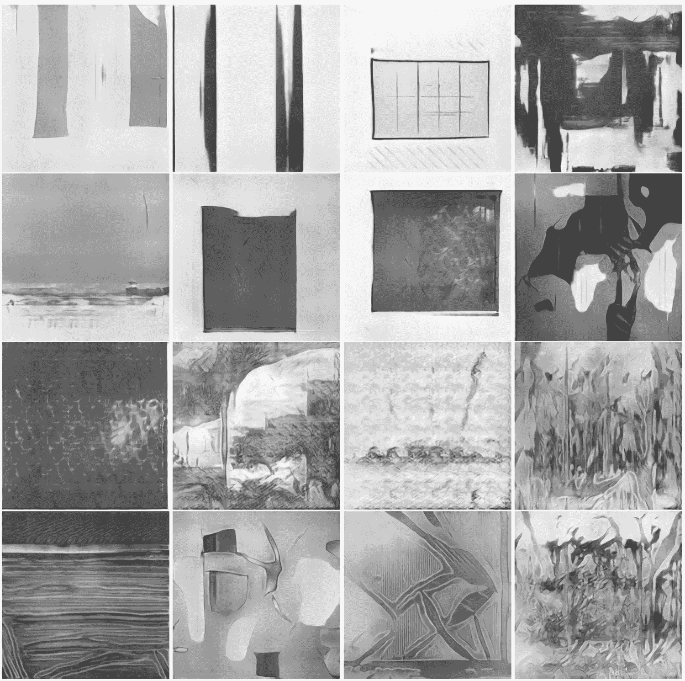

图 2.3 由 Elgammal 等人（2017）使用的创造性对抗网络（`CAN`）生成的“画作”。感谢 Ahmed Elgammal – AICAN.io – Art & AI Lab, Rutgers。

为了验证他们的技术，他们将生成程序的结果与人类艺术家的作品进行了对比，使用了两个数据集：一个是抽象表现主义绘画，另一个是最新一届巴塞尔艺术展展的作品。作者认为，该`generative program`不仅仅是模仿的工具；它是艺术家推动风格边界意图的反映。然而，核心问题仍然在于机器是否真的能产生具有艺术相关性的东西。

对于目标检测或语音识别，重现人类水平的性能对机器学习系统来说是一项相当容易的任务，因为它们只需要在数据中寻找规律——换句话说，寻找预期中的物。然而，像尼古拉斯·巴格斯基（Nicolas Baginsky）这样从事自组织系统的艺术家，往往在寻找意料之外的故障和离群值。此外，许多艺术家对最终产品的兴趣并不如他们通过艺术创作过程所投入的创造性探索那样大，而这种探索最终导致了新知识和新世界的发现。从这个角度来看，利用人工智能来`automate`艺术的尝试至少是值得怀疑的。

除了这些问题之外，艺术家还有许多方法使用和误用机器学习和其他优化方法。优化可以以不同的形式存在，即使在机器学习研究中，也存在大量限制较少的优化目标函数，这些函数鼓励多样性和新颖性。例如，近期深度学习的许多进展与无监督学习和表示学习方法有关，这些方法旨在从数据中提取规律和模式，而不一定尝试尝试将数据点匹配到猫或狗等预设类别中。

我们不能否认，得益于科学的进步，艺术生产中日益大的部分已经实现了自动化，而机器学习已经在对此做出了贡献。尽管这种创作过程机械化的新形式（允许新颖事物的批量）不应等同于艺术，但它可能会对艺术界产生巨大影响，迫使艺术家和艺术史学家重新定义其边界。

有些人可能会躲避到人类中心主义，声称艺术根本无法由机器完成，因为从定义上说，艺术是一项人类活动。我认为这是一个错误。虽然我们需要小心不要掉入`Google`驱动的科技乐观主义陷阱，并接受很快就会出现的取代人类的创造性机器的想法，但我们也必须考虑艺术的某些维度是否可能存在于人类种及其活动边界之外。

由机器学习和其他人工智能技术所实现的创造性劳动的自动化，是艺术家面临的一个重要挑战。存在一种感知到的威胁（无论真假），即生活条件和社会地位往往很脆弱的艺术家，将停止在社会中发挥有价值的作用，因为算法将夺走他们的工作。这种威胁应该被认真对待。艺术家目前能够通过从事大量的创造性活动来生存，其中包括一些任务可能被机器学习系统以更低的成本接管——例如为娱乐行业工作以偿付账单。然而，机器学习也为艺术家提供了新的机会，让他们通过例如想象与机器合作的新方式，进一步重新定义与机器的关系。

艺术家总是找到方法夺回他们时代的技术并根据需要对其进行塑造。例如，并没有要求定义学习算法的评估函数，使其尝试接近公众的口味或模仿特定风格。事实上，该函数可以被自由定义以实现其他目的。因此，人们可以根据自己的偏好对其调整；他们可以实验不同的评估标准来生成新内容，甚至可以随着时间改变评估函数。换句话说，虽然优化在艺术实践中似乎是矛盾的，但有许多方法可以将优化过程劫持用于创造性实践，例如对输入系统的数据进行捣乱、玩模型以及调整评估函数。

除了试图通过流行的调查来直接“解决”艺术创作的“问题”之外，一些艺术家选择利用学习循环中迷人的生成式过程作为新形式艺术的支持。在这种情况下，系统根据目标对象进行优化；然而，作品的构建方式使得`training process itself`作为艺术作品的一部分呈现出来。


最近的一个例子是英国艺术家布里吉塔·齐克斯（Brigitta Zics）的作品《帕青青机机》（*Pachinko Machine*，2017）。该作品的名字和灵感来自日本的帕青青，一种类似于弹球机的赌博设备。在帕青青中，玩家使用带弹簧的手柄将小金属球投入机器。然后，球穿过机器，在不同的黄铜销上弹跳，最终掉入各种收集槽。游戏的目标是收集尽可能多的球。

齐克斯的作品中没有人类玩家参与。相反，她的视频装置展示了一个帕青青的动画图，它正在与自己对战。在展览的一整天里，玩游戏的机器学习智能体试图优化其动作以不断提高其游戏技巧。然而，帕青青代理也在与另一个算法过程对抗，后者的目标是给游戏增加障碍和混乱。这件作品被视为人类生活的隐喻：我们实现目标的努力会被偶然和混沌所干扰，这些因素会引导我们偏离轨道，启发我们去探索替代方案。

波兰艺术家纳塔莉亚·巴尔斯卡（Natalia Balska）的新媒体装置《B–612》（2014 年）也围绕着一个实时发生的强化学习过程。然而，在这里，速度要慢得多；齐克斯的作品在一天内演变，而巴尔斯卡的学习循环则运行几个月。这件作品最初灵感来自艺术家对利他主义概念的调查，特征是一个封闭系统，其中植物由机器学习系统养育。

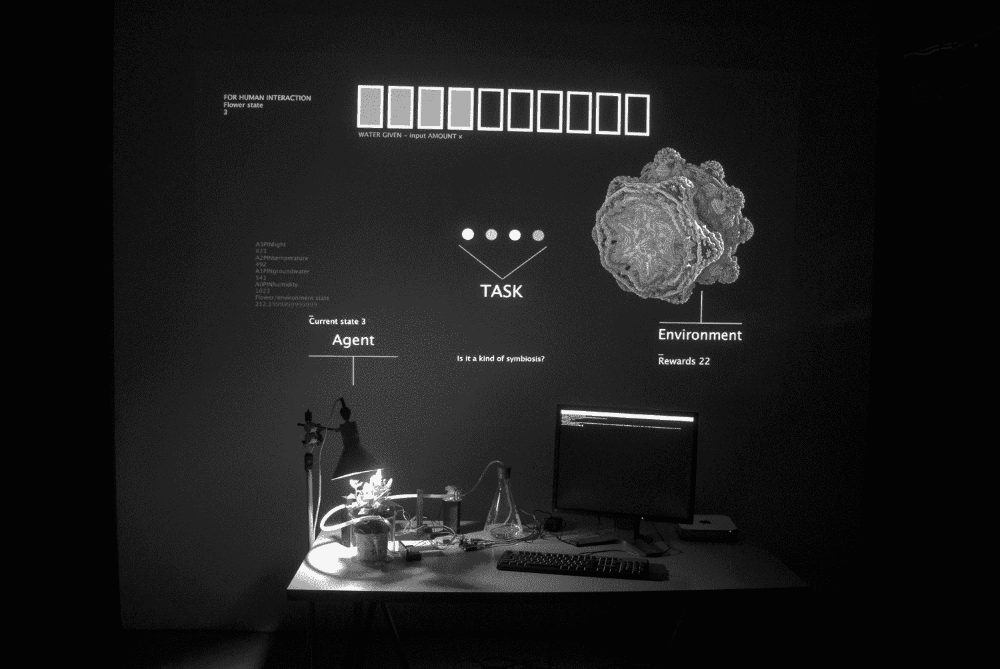

Natalia Balska，《B-612》，2014 年。感谢 Natalia Balska 提供。

每天，十个水单位（每个 10 毫升）必须在植物和机器学习系统之间共享。学习智能体对水水做出决策，从而影响环境，特别是植物的健康。决策的影响由外部计算机程序进行评估，该程序根据系统的性能，以奖励或惩罚的形式向智能体发送强化信号。在展览期间，机器学习智能体和植物都适应了巴尔斯卡策划的情境。

对于 Balska 而言，这项工作的目的与其说是创建一个最优的植物护理系统，不如通过在两个自适应系统（一个是计算系统，一个是生物系统）之间建立关系，产生现实与虚拟之间的交互。观众被邀请去发现这种关系，并留给他们以自己的方式进行解读。尽管该作品以实验装置的形式呈现，但通过这一优化过程揭示的是系统的不可预测性，这种预测性会随着环境湿度和温度等外部因素而改变。

机器学习对艺术带来了独特的挑战，因为它在历史上与一种工程文化有着深源的纠葛，而这种文化推崇优化和问题解决，而非开放性和多样性。计算机科学和人工智能领域内传统的艺术创作工程方法建立在虚假假设的基础上，因为它们关注的是技术和结果，而不是过程和语境。

换句话说，由于机器学习趋向于优化，当该领域的专家尝试将机器学习算法直接应用于艺术创作时，他们往往会偏离重点。当你手里只有一把锤子时，一切看起来都像是一个钉子。

这是计算创造力研究中一个反复出现的问题。将机器学习直接应用于艺术创作，需要将艺术创作构建为一个优化问题。然而，这些生成性输出脱离了任何参照系，这与当代艺术的运作方式背道而驰。二十世纪通过先锋派的持续运作告诉我们，艺术不仅仅是创造新的、美的东西。它是文化的一个维度，始终会对更广泛的文化、社会和政治背景做出反应。此外，正如 Komar 和 Melamid 的绘画《美国最通缉犯人》所示，艺术价值并不归结为受欢迎程度的投票。

艺术家总是能找到通过侧面接触来与技术进行批判性互动的方法。机器学习艺术家将自适应技术作为原材料，劫持优化游戏以创造有意义的体验。在此过程中，他们并不试图回答问题或解决问题，而是向观众提出问题并创造问题供其解决。因此，机器学习艺术加入了先先建立的、处理计算系统的艺术运动中，例如控制论艺术、计算机艺术、人工生命艺术和生成艺术。

机器学习艺术家们是如何做到的？下一章将通过考察艺术家如何干预机器学习系统的训练过程，更深入地探讨这一过程。

1. 1。该实验室现在被称为蒙特利尔学习算法学院 (MILA)，目前是全球深度学习研究顶级的学术枢纽之一。

2. 2。当然，艺术家在创作作品时经常需要解决问题，但这绝不是他们艺术的焦点。

3. 3。涉及到艺术理论时，我认为自己是一个反本质主义者 (Weitz, 1956)。艺术永远无法被“界定”，也无法找到一组涵盖所有不同形式的共同属性。艺术最好被构想为一种由社会构建的、不断波动的概念，其特征是不可比量的丰富性与多样性。艺术可以被识别、拒绝、批评和辩论，但永远无法被还原为一组绝对的本质特征。

4. 4。纯为了取悦观众的脱离语境的创作通常被称为娱乐，而不是艺术。

5. 5。纯为了取悦观众的脱离语境的创作通常被称为娱乐，而不是艺术。

6. 6。纯为了取悦观众的脱离语境的创作通常被称为娱乐，而不是艺术。

7. 7。纯为了取悦观众的脱离语境的创作通常被称为娱乐，而不是艺术。

8. 8。纯为了取悦观众的脱离语境的创作通常被称为娱乐，而不是艺术。

无论好坏，机器学习算法都是为了优化而设计的。给定一组示例，训练过程通过迭代优化计算机器来提高其性能。该过程的大部分仍在用户的控制之外：一旦选定了数据、模型和训练过程，系统就会在多大程度上自主地运行。因此，机器学习艺术家总是与计算过程保持距离，仅影响其结果。

机器学习艺术重新构建了艺术家作者权与材料自主性之间存在的已知张力。这种张力对于从事算法创作的艺术家来说非常熟悉，但绝不仅限于计算机艺术。从创作过程中剥离人类意图是许多世纪先锋运动中反复出现的特征。一个例子是达达主义者安德·布勒勒（André Breton）和特里斯坦·查拉（Tristan Tzara）的自动主义方法，后来被超现实主义者萨尔瓦多·达利（Salvador Dalí）、安德·马松（André Masson）和约翰·米罗（Joan Miró）作为表达潜意识的方式；另一个例子是 20 世纪 60 年代法国文学运动 ULIPO 对排列和偶然的使用；第三个例子则是伊昂尼斯·克森基斯（Iannis Xenakis）的形式音乐中随机数学的应用。

相反的是，尽管机器学习空前的流行很大程度上归功于其强大的预测能力，但当作为艺术材料时，机器学习算法变得极其不可预测。尽管这一特点使得机器学习无法某些艺术实践和意图，机器学习艺术家接受了这种情况，因为他们重视这些过程的不可预测性，并准备好寻找方法来驯服这些野性的算法材料。

如果机器学习过程如此不可预测，如何控制它们创作艺术？这些系统是否足够自主，以至于可以将艺术家从循环中移除？

机器学习并不是魔法，目前可机器学习系统几乎不能被称为智能。事实上，这些算法相当愚蠢：它们在执行某个非常特定的任务（如人脸识别或癌症诊断）时可能非常擅长，但在其他任何方面都很糟糕。在处理新问题时，该领域的工程师和数据科学家通常会尝试不同的数据集、模型和参数，直到找到适用于任务的正确设置。换句话说，尽管它们确实自动化了一些人类工作，但机器学习系统仍然需要人类的干预。

数字艺术家马克·唐尼（Marc Downie）为与自主系统协作时如何做出选择的问题提供了一个有趣的视角。唐尼曾参与了多个具有人工社会角色的互动作品，例如 `AlphaWolf`（Tomlinson & Blumberg, 2002）和 `Music Creatures`（2000–2003），他使用了多种用于人工智能控制的计算方法，包括机器学习。

在他的博士论文中，唐尼通过“计算涌现”（`computational emergence`）的概念讨论了艺术中人工生命和机器学习系统的应用。这种现象是指计算系统拥有了其组成部分所不具备的属性（Downie, 2005）。例如，深度学习系统基于相互连接的人工神经元层之间复杂的相互作用，这些层级通过自我组织来实现复杂的决策。单个神经元能够做出非常简单的决策；通过它们的集体工作，可以做出复杂的预测。

这位艺术家兼研究人员将计算涌现与艺术实践中的作者身份问题进行了对比。基于涌现的方法（如机器学习和人工生命）通过创建据称无需人类干预即可运行的自主过程，完全规避了作者身份问题（Downie, 2005, p. 29）。然而，尽管经过数十年的努力，我们仍在等待高阶涌现系统的出现（Bedau, 2000）。

唐尼声称，虽然计算机使生成新性变得相对容易，但挑战在于如何利用这种潜力。一旦人们对自我组织系统内部涌现的痴迷消退，真正重要的是作品的美学体验，而这种体验最终源于其人类作者。因此，当艺术家考虑将机器学习视为一种艺术创作方法时，他们应该关注其干预的更广泛的背景。机器学习系统对作者身份提出了独特的问题：系统做出了哪些决策？什么数据会被喂给系统？系统根据什么标准进行训练？系统的自适应特征如何帮助或阻碍作品想要表达的内容？特别是系统的自适应本质迫使控制力在某种程度上发生丧失，为作品传达了一种不稳定性感和独特性——这些都是可以被用来产生美学体验的强大特征。

艺术家如何干预高度自动化且失控的机器学习过程？人们可以通过调整输入到算法的数据，或者通过改变正在适应的计算系统的结构来影响学习。我们随后会回到这些策略。在这里，我们来看一种更基础的方法，即直接构建系统的目标，从而引导学习向某个特定方向发展。

优化的一个关键特征是它需要一个目标。你永远不会在真空中进行优化；你需要优化 `something`。在机器学习术语中，这等同于最小化损失、成本或错误，或最大化适应度或奖励。在两种情况下，其原理是相同的：机器学习算法尝试使用系统性能指标在一组数据上训练机器。这个指标被我们称为 `evaluation function`（评估函数）或 `objective function`（目标函数/目标函数），它是学习过程的终极指南：它告诉机器学习系统工作得好不好，以便其进行适当的调整。

由于评估函数对优化过程至关重要，它成为了艺术家利用机器学习创作原创作品时影响学习过程的重要工具。这在强化学习和其他基于智能体的作品中尤为如此，例如上一章提到的布里吉塔·齐奇（Brigitta Zic）的 `Pachinko Machine` 和纳塔莉亚·巴尔斯卡（Natalia Balska）的 `B–612`。在监督学习和无监督学习的情况下，大多数用户使用现成的评估函数，并主要依赖数据来影响系统。

从事评估函数工作的艺术家采用了两种核心策略：直接反馈，即由人类（通常是艺术家或观众）直接干预以评估系统；以及间接反馈，即艺术家通过实验不同的函数来产生结果。无论何种情况，在艺术家手中，评估函数都偏离了其作为性能客观标准的角色，变成了艺术家引导系统实现主观愿景的工具。

艺术家利用评估函数引导自适应系统结果的一种直接方法是直接控制。在这些情况下，从业者通过根据自己的判断评估性能，跳过评估函数允许的自动化机制。

这种被称为交互遗传算法（IGA）的方法是由理查德·道金在 20 世纪 80 年代在其著作《盲眼钟匠》（The Blind Watchmaker）中提出的。道金讨论了一个名为 `biomorphs` 的计算机程序，他以此展示自然进化如何通过随机过程创造复杂的结构。这些形态是二维（2-D）矢量计算机图形，由九个数字基因决定，可以生成 118 亿幅不同的图像。用户被要求从屏幕显示的图像中选择他们喜欢的形态，从而导致程序产生具有所选父代特征的新一代进化后代。道金展示了在几次迭代后，可以生成看起来像生物的形状，如昆虫（见图 3.1）。

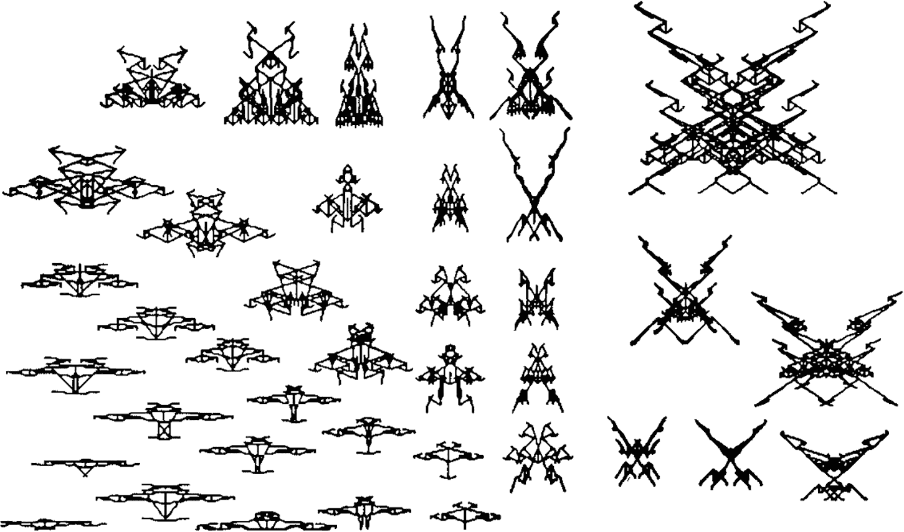

（注：此处原文年份可能存在格式错误，应为 21980s）

20 世纪 90 年代，艺术家威廉·莱姆（William Latham）和数学家斯蒂芬·托德（Stephen Todd）将 IGA 应用于他们在生成三维（3-D）形式的开创性工作中（Todd & Latham, 1992b）。他们的方法被称为“进化主义”（evolutionism），将艺术过程分为两个独立的阶段。在第一阶段，艺术家定义了一个形式生成系统，允许计算机生成不同的虚拟对象。莱姆和托德的系统使用 `FormGrow` 实现了这一目标，该系统灵感来源于莱姆之前的纸笔工作，基于一种可编程语法，递归且层次化地重复锥形、球体和角等形状（见图 3.2）。


在第二阶段，作为其软件 `Mutator` 一部分的交互式遗传算法（IGA）在虚拟世界中“协助艺术家选择优选结构”（Todd & Latham, 1992a, p. 504）。在该阶段，艺术家变成了一个“创意园艺师”（Todd & Latham, 1992b, p. 12），其工作不是直接绘制 3-D 形状，而是利用自己的艺术判断来仔细地选择和培育人工结构。在这里，人工进化过程被用作一种先进的计算工具，自动为艺术家生成供选择的可能性，并促进策展过程，往往会产生“出艺术家预期和想象”的结果，使计算机成为一种“创意伙伴”（Todd & Latham, 1992a, p. 504）。

卡尔·西姆斯（Karl Sims）的*Galápagos*（1997）是交互式装置中使用 IGA 最著名的案例之一。在这里，艺术家将园艺师的角色交给观众，他们被要求使用一组踏板交互地选择他们喜爱的人工 3-D 生物，从而在一种奇特的达尔文模拟中充当造物主。该生物的遗传代码随后被用于变异和交叉创建下一代。该作品美学的核心在于其参与性，通过一种趣味且迷人的体验让观众参与到新形式的生产中。例如，两个观众同时踩在两个踏板模拟了性繁殖过程，因为对应生物的遗传代码可能会相互混合，以创造下一代后代（Fifield, 1994）。

类似的程序已应用于强化学习领域，通过提供正奖励和负奖励形式的即时反馈来塑造机器人和其他智能体的行为——但成功有限。在将奖励交互式地归因以控制机器学习智能体的发展方面存在着重大挑战，这些挑战在艺术背景下尤为尖锐。第一个问题是，大多数复杂的算法需要大量数据才能学习任何有趣的内容。在这种背景下，手动评估每个数据点可能是极其耗力的，甚至是不可能的。

第二个问题是主观评估可能具有很大的噪声和矛盾性。人们可能会对系统的两个相似状态进行不同的评估，或者给两个完全不同的状态赋予相似的排名。这使得学习算法很难适应用户的偏好。

最后，艺术家很容易将自己的感知与自适应代理的感知混淆。例如，艺术家在看着机器人时可能会尝试提供基于她所看到内容的反馈；然而，机器人的感知可能比其人类评论者有限得多，这使得人工代理难以真正理解自己做得好或不好，以及如何改进性能。以教导色盲人士区分某些颜色为例。训练学习机器的艺术部分涉及试图让自己置于机器的位置，并通过它的人工眼睛来看——换句话说，就是直观地理解它的功能性（affordances），以便设计它使其能够学习某些东西——理想情况下，是具有审美兴趣的东西。

## 人工好奇心

在 2014 年的装置作品*Zwischenräume*中，艺术家 Petra Gemeinboeck 和计算机科学家 Rob Saunders 观察了受好奇心驱动的机器人代理所执行的实时自适应表演（见图 3.3）。机器人被夹在画廊墙和临时墙之间。每一台机器人都配备了电机系统，使其能够在垂直和水平方向移动，覆盖墙的特定区域。它们还配备了穿刺设备，允许它们在表面上钻孔，以及一个用于感知环境的摄像头和麦克风。机器人使用无监督学习神经网络结合从摄像头和麦克风中提取的特征，以检测图像之间的相似性，并使用一个试图捕捉最“有趣”图像的强化学习程序（Gemeinboeck & Saunders, 2013, p. 217）。

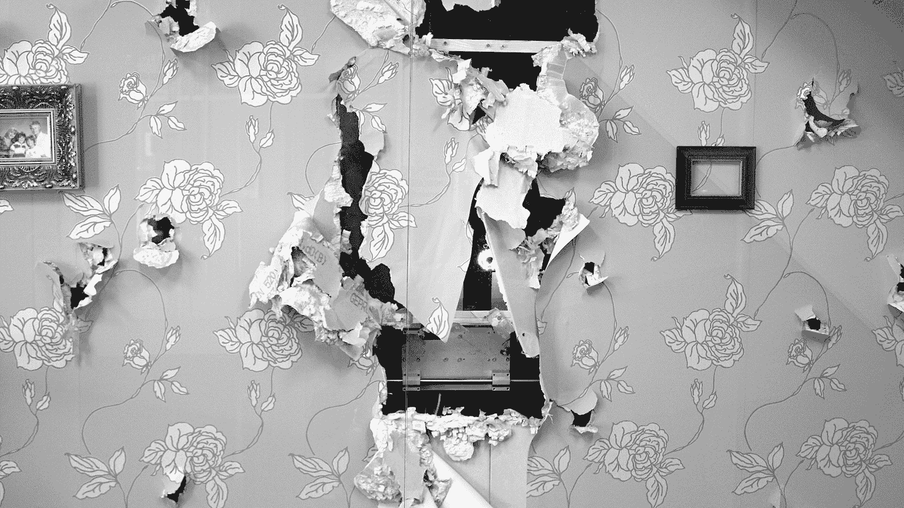

图 3.3

Petra Gemeinboeck 和 Rob Saunders, *Zwischenräume*, 2010. 机器人装置。照片来源：Petra Gemeinboeck。由 Petra Gemeinboeck 和 Rob Saunders 诚意提供。

以数值奖励形式提供的评估函数在*Zwischenräume*中起着主性作用，它定义了什么样的图片被认为是机器人“有趣的”的，以及哪些动作允许机器人捕捉这些图像。所描述系统的兴趣程度基于对“新颖性和惊喜感”的衡量，其中“新颖性”被定义为一张图像与机器人之前拍摄的所有图像之间的差异”，而“惊喜感”被定义为已知情况下图像的意料之外性”（Gemeinboeck and Saunders, 2013, p. 217）。这些测量值被用作代理好奇心的指标；它们作为机器人行为的结果作为奖励。机器人的行为不是硬编码的；相反，它们必须找到一种最优策略来最大化自身的“新颖性和惊喜感”。艺术家的希望是机器人的行为对观众来说同样是新颖和惊喜的。

装置在机器人和观众之间建立了一种独特的关系。当它们在墙上钻孔时，受好奇心驱动的智能体变成了“观众表演的观众”。因此，“不仅是机器人在表演，观众也在挑起、娱乐并奖励机器的好奇心”，因为“机器人不仅对观众的存在和行为做出反应或适应，而且能够以好奇的心态感知观众”（Gemeinboeck and Saunders, 2013, p. 218）。

装置/表演作品*N-Polytope: Behaviors in Light and Sound After Iannis Xenakis* 提供了一个在强化学习系统中调整奖励函数以生成不同类型的实时模式的示例。*N-Polytope* 是 Chris Salter 在 2012 年与我、Marije Baalman、Adam Basanta、Elio Bidinost 以及建筑师 Thomas Spier 合作的作品。

物理结构由钢缆组成，形成一个自定义的拓扑表面，以适应每个场馆。这种建筑选择并非偶然，而是基于 Xenakis 对投影几何和直纹面面的兴趣。高强度 LED 沿每根钢缆线性的排列，允许通过脉冲宽度调制实时控制多达 144 个 LED。使用不同类型的算法模式来编排作品中产生的光影效果。


模式生成程序之一模拟了一组在电缆上移动的虚拟代理。这些代理体使用强化学习进行实时训练。代理体在电缆上的位置由一个微弱的光点指示，两个代理体之间的碰撞会引发剧烈的闪烁。

每个代理体通过由三种不同类型的奖励组合成的奖励函数获得奖励：

- `touch`（触摸）：当代理体与另一个代理体处于同一位置时给予奖励或惩罚。
- `move`（移动）：当代理体向给定方向移动时给予奖励，向反方向移动则给予惩罚。
- `stay`（停留）：当代理体保持原位时给予奖励，移动则给予惩罚。

这些参数可以独立使用（通过将其他参数设为零），也可以结合使用以培养代理体的不同行为，如表 3.1 所示。

### 表 3.1

`Chasers` 程序的示例奖励函数及相应的预期结果。

| 触摸 | 移动 | 停留 | 产生的行为 |
| --- | --- | --- | --- |
| 1 | 0 | 0 | 不惜一切尝试捕捉其他代理体。 |
| −1 | 0 | 1 | 尝试避开其他代理体并保持不动。 |
| 0 | 1 | 0 | 无论如何从左向右移动。 |
| 2 | −1 | 0 | 尝试捕捉其他代理体，且优先从右向左。 |
| −1 | 0 | −1 | 移动但避免碰撞。 |

通过让具有不同奖励函数的代理体在同一根电缆上移动，可以实现更多变化，从而产生不同类型的运动，如捕食追踪和其他适应性舞蹈。在装置中，我们首先添加几个代理体并允许它们稳定，这发生得很快。然后我们以不同的方式操纵混沌与无序之间的张力。

例如，我们利用了强化学习优化程序的一个特征：探索（exploration）与利用（exploitation）之间的张力。数值参数 `ε` 控制代理体在任何给定步骤下通过完全随机的移动来 `explore` 其环境，或通过采取“贪婪”行动（即向它认为会产生最高奖励的方向移动）来 `exploit` 其当前知识的概率。(7)

选择低 `ε` 值通常会产生更有结构化、“智能”的移动（特别是在代理体有足够时间学习之后），而高值则产生随机行为。通过调节 `ε`，我们可以影响人类观众看到的行为形状，让它们在秩序与无序之间瞬间切换。(8)

玩转评估函数是对于从事目标驱动系统（如进化计算和强化学习）的艺术家来说的一种流行方法。在数据驱动的系统（如监督学习和无监督学习）中，这种做法少见得多，在这些系统中，艺术家可以依靠成熟的现成成本函数，如均方误差和对数似然，这些函数促使模型尽可能拟合训练数据集。在许多情况下，调整数据集以实现目标，比尝试调整构成成本函数的复杂数学公式容易得多。

这是与计算机科学实践的另一次对比，在计算机科学中，成本函数通常是许多调整的对象，用来为系统添加约束。例如，第 2 章介绍的创意对抗网络（Creative Adversarial Network）使用自定义的成本函数，该函数在最大化网络对新颖性追求的同时，最小化其与平均值的偏差，从而鼓励新形式的出现，同时防止它们过于极端或随机（Elgammal et al., 2017）。

虽然对于大多数人并非如此，但一些特别才华的艺术家确实会在成本函数方面工作来实现他们的目标。Mario Klingemann 就是这种情况，他在深度学习生成艺术方面的突破性工作以卓越的技艺和独创性特征。通过调整和平衡函数公式中的不同组件来调整成本函数，并可能编写自定义成本函数，是他实践的基础。

例如，为了训练他的图像到图像生成模型，Klingemann 开发了一种他称为“Shake, Rattle & Roll”的成本函数，该函数在每一步以不同的概率随机应用不同类型的损失函数（Klingemann, 2017）。

Klingemann 花费大量时间训练自己的模型，调整神经元数量和层数等超参数，并根据审美衡量、新颖性、风格相似性或特征来实验不同的成本函数。

## 结论

机器学习作为一个领域，致力于开发能够自主学习的全自动系统。目前，此类系统构成了人工智能的先锋，很大程度上是因为它们在解决语音识别和图像分类等困难问题上的熟练。

矛盾的是，这种高度自动化使得这些系统难以控制，在艺术家的手中，它们显得尤为不可预测且不受控。因此，从事机器学习的艺术家需要处理这些系统的高自主性，并找到方法让它们顺从自己的需求。

虽然优化艺术注定失败，但优化在艺术语境中有许多使用方法。在 William Latham 和 Karl Sims 等遗传算法创作者所经常使用的一种方法中，艺术家充当目标函数的代理，通过在运行过程中积极提供反馈来直接引导学习过程。另一种方法主要用于强化学习，通过建立目标函数并观察系统对该函数的反应行为来间接影响训练。

后一种方法通过 `B-612`、`Zwischenräume` 和 `N-Polytope` 等项目得到了代表，这些项目都有共同点：它们将学习过程本身作为审美体验的中心。这种思想也出现在涉及适应性代理的作品中，如 Nicolas Baginsky 的 `The Sirens` 和 Marc Downie 的 `Music Creatures`。下一章将探索艺术作品中适应性行为动态的审美特征。

[1](#chapter_3.xhtml#chapter3-1）。换句话说，目前最先进的机器学习系统仍然属于弱人工智能范畴，而不是强人工智能或通用人工智能（AGI），后者是指设计一种能够复制任何类型人类智能任务的 AI 系统。

[2](#chapter_3.xhtml#chapter3-2）。评估函数是所有机器学习算法中的通用原理。它根据模型或算法的类型有不同的名称。一个通用术语是目标函数。在分类或回归应用（如监督和无监督学习）中，它通常称为代价或损失函数；在强化学习中称为奖励函数；在遗传算法中称为适应度。

[3](#chapter_3.xhtml#chapter3-3）。`biomorph` 一词归功于 Desmond Morris，他用它来描述现实主义绘画中奇异的动物形状——Morris 声称这些形状是他自己想象中进化的结果，可以通过连续的绘画进行追溯（Dawkins, 1986, 55）。

4. 道金斯（Dawkins）后来通过增加其生成算法的复杂度，并尝试使用他的系统生成特定形状（如字母表)(Dawkins, 1989）来推进他的实验。

5. Sims 将学习方法直接应用于审美标准，可能会受到 Moura 和 Pereira 的批评。尽管该作品在生成的形态上似乎是开放的，但人们认为，该作品某种程度上更像是使用某种先进投票站来优化美感的科学与工程方法的演示。

6. 作者们使用了自组织映射（Kohonen, 1981），这是一种常用于降维的无监督神经网络。我们将在第 7 章中进一步讨论这些机器学习模型。

7. 这种被称为 `ε`-greedy 策略的决策过程是强化学习应用中最广为人知的之一（Sutton and Barto, 1998）。

8. 欲对本作品中所使用的美学策略进行深入讨论，请参阅 Salter 和 Audry (2018)。

机器学习艺术的一种反复出现的方法是将训练过程本身作为一种审美潜力的来源：Baginsky 的机器人乐队“三位塞壬”（The Three Sirens）以机器人乐器为特征，它们从环境和自身的即兴表演中学习；Gemeinboeck 和 Saunder 的 *Zwischenräume* 则涉及配备了钻头的好奇驱动型机器人，它们钻穿画廊的墙壁，重新配置它们自身以及观众的环境。

这些作品特别依赖让观众直接体验学习过程。使用机器学习来生成或揭示自适应人工行为是艺术家特有的，并不符合传统的工程和科学方法论。

事实上，在人工智能研究领域，机器学习通常被视为目的的手段。直到最近，符号人工智能仍然是主导方法，这很大程度上是因为它在现实世界的应用中单纯取得了更好的结果。

人工智能作为一个工程领域，主要依赖于测量惯例，使得不同的技术能够相互竞争。例如，在图像识别中，顶尖水平是通过比较竞争算法在参考数据集上分类图像的准确率来确定的。算法本身是否使用机器学习并不重要：事实证明，目前机器学习（更具体地说深度学习）在大多数图像识别任务上的表现优于竞争方法。

然而，观察机器从零开始学习并迭代地发现关于其世界的事物，这种感觉是深切令人兴奋的。在整个学习过程中，这些系统以某些方式改变自己，逐渐增加复杂度。这一过程具有某种 `shape`，可以通过观察学习曲线，或者在可能的情况下通过观察学习智能在学习时的行为来感知。

除了理论研究之外，大多数工程师并不认为学习过程的特定属性是一个可以独立存在的研究成果。对于他们来说，最终重要的是一个经过充分训练、最大优化的系统在特定任务上的表现（他们可以借此与其他技术进行比较），而不是系统达到该点的过程。

然而，正如我们所解释的，最优性并非创作的万灵药。取决于语境，次优学习可以提供与最优一样好甚至优于最优的结果。

控制论在艺术中的这种应用开启了一个由 Penny (2000) 定义为“交互可能性”的新领域。Penny 解释说，通过打破主客二元对立，“艺术不再是一种记录、一种表征，不再是某种正在做某事的东西” (Penny, 2017, p. 319)。

他声称，Penny 对人工智能（特别是机器人学）的工程方法进行了批评，认为其具有深受二元论的世界观。行为不应被理解为一种纯粹的、脱离肉体的计算事物，而应该需要被理解为一个情境化的过程。因此，机器学习系统在学习过程中会经历转变，为艺术创作提供了丰富的素材。

20 世纪 60 年代控制论对艺术的影响可以追溯到 Ascott 的 (Shanken, 2002)。Ascott 对控制论者 Wiener、Ross Ashby 和 Frank H. George 的解读使他能够将艺术构想为体现于交互系统中。控制论作为行为和通信的综合理论，其范围使他能够提出将控制论与艺术融合 (Shanken, 2002)。

根据 Pickering 的说法，戈登·帕斯（Gordon Pask）可能在 20 世纪 50 年代初在剑桥大学大学期间，通过与 Wiener 的偶然见面发现了控制论 (Pickering, 2010, p. 313)。

这一定义有两个重要的意义。首先，尽管智能体的行为涉及一系列随时间不断变化的事件，但其行为具有一种可识别的 `shape`，这种形状在时间上是保持不变的。Pask 以猫为例，它由“如进食和睡眠等表演组成，再次，这是从猫可能做的各种事情中被选出的一种种不变的形式”（第 18 页）。

其次，尽管行为总是由系统产生——该系统可以是计算的，但并非必须如此——它仅通过其对观察者的感知效应而存在。这一意义对于美学框架而言尤为适用，因为它关注的是基于智能体的表演在物质世界中随时空展开时所产生的现象学体验。

这呼应了约翰·杜威（John Dewey）的实用主义美学，他声称艺术作品不应被视为对象，而应被视为“精炼和强化的经验形式”（Dewey, 1959, 第 3 页）。

随着现今所谓的符号人工智能（符号 AI）的发展，控制论在 20 世纪 60 年代失去了流行。符号人工智能通常与计算主义相关，这是一种心理理论，其前提是人类大脑是某种计算机，思维过程是计算的形式。

换句话说，计算主义者认为认知和计算是同一的（Dietrich, 1990）。1950 年，艾兰·图灵（Alan Turing）提出了一种通过简单的模仿游戏测试机器智能的方法，这后来被称为图灵测试。机器的目标是与人类提问者持续聊天，并试图伪装成人类。

根据图灵的观点，如果提问者无法区分机器与人类对话者，那么该机器就应该被视为思维实体（Turing, 1950）。换句话说，对于图灵而言，与认知相关的并不是植根其中的生物学基质，而是系统在被认为需要智能的任务上的表现。

这种方法在 20 世纪的 70 年代占据统治地位，但在 80 年代开始崩解，这既是因为许多此类方法在解决现实世界问题和深层哲学问题上遭遇了失败（Dreyfus, 1979）。

20 世纪 80 年代末，机器人专家罗德尼·布鲁克斯（Rodney Brooks）提出了一种人工智能的替代方法，称为“新一代人工智能”或 `nouvelle AI`。作为机器人领域的一种高效、自下而上的方法，`nouvelle AI` 对 20 世纪 90 年代的机器人艺术产生了重要影响。

特别是北美的机器人专家如路易·菲利普·德梅斯（Louis-Philippe Demers）、比尔·沃恩（Bill Vorn）、肯·里纳尔多（Ken Rinaldo）和西蒙·潘尼（Simon Penny）声称布鲁克斯是他们工作的直接灵感来源（Demers & Vorn, 1995; Rinaldo, 1998）。

潘尼深受布鲁克斯 80 年代末关于情境机器人革命性工作的启发（该工作批判了人工智能中的表征系统），他为基于智能体的艺术提出了一种全新的美学框架，拒绝困扰计算机科学的计算主义教条。在 2012 年的一次采访中讨论这种行为美学时，他解释道：

```text
其前提是，当我们使用实时计算技术进行文化实践时，我们正在进行一种新的美学实践，这涉及到行为的设计。我们正在以某种方式为世界上可能发生的事情构建一个偶然模型，以及我们的系统如何做出，以便将用户的审美注意力引导至与作品本身一致的方向。这是对交互动态和作者意图进行的一种复杂且新的美学协商。（Kim & Galvin, 2012, 第 138 页）
```

潘尼借此批判了污染符号人工智能的行为与认知的二元论愿景。他声称，行为不应被理解为一种纯计算的、离体的被称为 `software` 的实体，而需要被理解为通过智能体身体实施的情境化过程。

虽然基于计算的艺术品中的行为具有算法组件，但在艺术家手中，代码变成了另一种具有其特定特征的材料，通过与视觉、听觉和物理组件整合在一起，以构建一个全球性的美学体验。

尽管布鲁克斯的全新 AI 和潘尼的行为美学其特点都是依赖于直接源自人工生命（ALife）研究的自下而上的技术实践方法，但他们强烈的反计算主义立场也指向了 80 年代人工智能中盛行的计算主义。

因此，`nouvelle AI` 和行为美学都通过将涌现和自组织概念整合到一种将智能体身体置于中心的行为表演理论中，重新阐述了 ALife 中的这些概念。

正如此，潘尼提出的艺术框架在本质上与同时期的离体艺术形式不同，后者本质上旨在产生稳定的形式（如计算机生成的图像），或者在计算机上产生生命形式的基于时间的模拟（如人工生命艺术）。

## 行为的程度

我认为，不同类别的系统架构允许不同类型的行为和审美体验的显。现有的控制论系统分类法主要关注这些系统的关系和结构方面（Cariani, 1989; Rosenblueth, Wiener & Bigelow, 1943）。

在本节中，我提出了一种具身系统的分类法，关注智能体行为的形状随时间展开时的美学。这通过更仔细地观察被赋予适应特性的具身智能体，进一步完善了潘尼的艺术参考框架。

该分类的零度是系统是否拥有 `internal state`——我将其认为是认为一个系统能够行为的必要条件。像 `mappings` 这样的无状态系统与像 `agents` 这样的有状态系统从本质上是不同的，前者涉及输入和输出之间多或少的直接转换，而后者可以根据事件改变其内部结构。

换句话说，模糊图像或压缩声音不是行为；雕塑或声码器都不能被认为是在行为。

从设计上来说，无状态设备无法积累经验，因为它们的输出/动作完全取决于输入/观察。此类系统在数字媒体艺术领域被称为 `mappings`。

它们在新媒体艺术中的广泛流行体现在如 `Max` 或 `Pure Data` 等数据流软件的盛行，这些软件通常被描述为 `visualisation` 或 `sonification`。

马克·唐尼（Marc Downie）对映射在交互艺术中的这种统治地位表示严厉批评。他认为，其表面通用性被视为优点，却使其变得无效且枯燥：因为它的定义“没有限制”，所以它“没有用”。他写道：

> 在实践中，人们可以从映射的这种“函数”方面感受到一种大学水平的、分段线性或其他平滑的、局部静态的、无状态的、通常可分解的输入与输出关系。这种愿景构成了该领域数字转化为数字的规范性。该领域最好的作品当然推向这种中心趋势，但规则和竞技场是固定的。（Downie, 2005, 第 17 页）


# 4 行为、形态发生与适应

基于映射的设备（mapping-based devices）缺乏任何自主性和主体性，是无行为的，其行为几乎完全取决于输入它们的数据。它们所传出的任何生命感实际上在于生成这些数据的系统，例如人类表演者、自然现象等。它们的无状态性（statelessness）将它们的`performance`禁留在瞬间：如果它们有世界，那也是一系列独立时刻的连续。换句话说，它们是零阶行为，或者简单地说，是`非行为`（nonbehaviors）。^(5)

基于代理的系统（Agent-based systems）通过使用某种内部结构将其世界延伸到过去，因此具有“行为性”（`behaviorful`）。这些有状态的设备拥有某种记忆（无论是离散还是连续、长还是短），这种记忆会通过它们与环境的交互而改变。换句话说，它们过去的经历会影响其现在的行为（至少在特定的时间窗口内）。

这种状态性意味着某种形式的结构或痕迹，可以在各种计算机程序中找到。例如，Peter Cariani 定义的正式设备可以拥有状态，这些状态在计算机代码中通常被识别为不同类型的命名变量（即布尔值、整数和浮点数），但这些语法组件是固定的。因此，这些系统生成的行为被限于特定的领域。因此，尽管代理对感官数据的响应可能会根据上下文而改变，但它的行为不会随时间而改变。在足够的时间内，它将不可避免地重复相似的模式。因此，我们将这类行为称为`一阶行为`（first-order behaviors）。

为了更好地理解这一观点，考虑行为如何具有某种可识别的形态（morphology），这种形态存在于一个与其他非计算、稳定介质不同的领域，例如图像、视频，甚至如我之前解释过的，实时映射（如音响化或可视化）。行为的形状由生成它的系统的传感器、执行器和处理能力所参数化，并在特定的时空领土内演化。形态学（Morphology）和形态过程（morphological processes）已被用于当代作曲家如雅尼斯·塞纳基斯（Iannis Xenakis）和阿格斯蒂尼·迪·斯皮奥（Agostino Di Scipio）的著作描述基于时间的行为（Di Scipio, 1994; Solomos, 2006; Xenakis, 1981）。

由于它们无法生成新形式也无法转化自身的形式，我认为正式的、基于规则的系统产生的行为形态与自适应和进化型代理所产生的形态有本质区别（见图 4.1 和表 4.1）。后者产生的`二阶行为`（second-order behaviors）涉及到其自身（一阶）行为的产生以及可能发生的转化。因此，它们与其正式基于规则的对应物处于`不同的时间`中，影响了它们可能产生的整体美学效果。

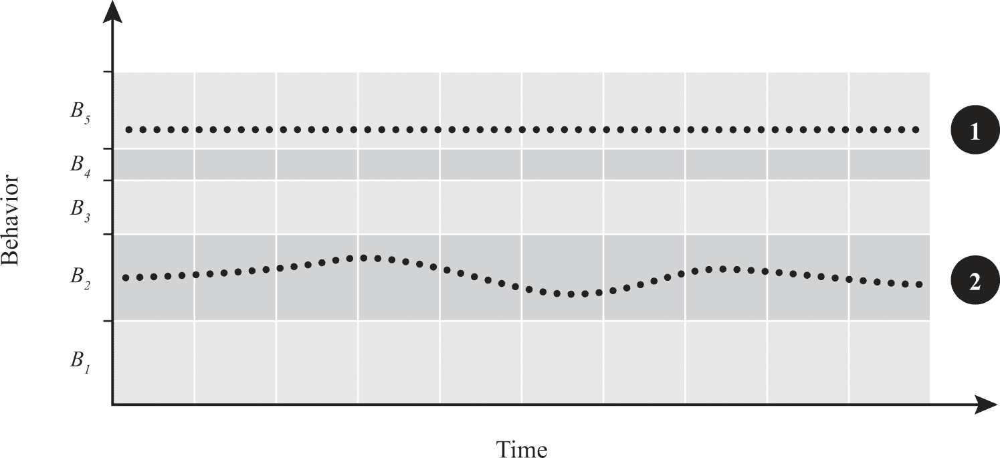

**图 4.1**

一阶行为的时间演化（示例）。纵轴代表系统的行为，被理解为系统生成的的可观测事件在时间上不变的形状。可识别的行为形态使用标签 `B1`、`…`、`B5` 表示。横轴代表时间的推移。该图显示了一阶行为如何在时间上保持稳定：(1)是不改变的，而 (2) 在一种形态种类的边界内波动。图由 Jean-François Renaud 根据 Audry 原画绘制。

**表 4.1**

代理系统中的行为阶。

| 阶阶 | 系统类型 | 特性 |
| --- | --- | --- |
| 0 阶 | 无状态（映射） | 行取决于观测（无记忆）。 |
| 1 阶 | 正式 / 基于规则 | 行取决于一组观测（记忆）。行为无法转化。 |
| 2 阶 | 自适应 / 进化 | 行为随时间转化。 |

我提议使用`形态发生`（morphogenesis）、`形态稳态`（morphostasis）和`变态`（metamorphosis）的概念来进一步刻画行为存在的过程。这些概念以自己的方式与涌现、自组织、自调节、新颖性和自主性理念相关。随着这些理念的引出，它们似乎特别适用于支持一种行为美学。

`形态稳态`指的是行为悬浮在一个稳定存在状态周围的过程。尽管这些模式在考虑一段时间后可能看起来像在发生变化，但形态稳态行为会很快耗尽它们能生成的动态模式空间。这些行为是不变的：它们随时间保持不变。一阶行为纯粹是形态稳态的。

`形态发生`是涌现行为形成形态的机制。该类别意味着通过系统与环境的交互而产生。

`变态`与形态发生密切相关，指的是自适应或进化型代理中行为从一种形状变为另一种形状的过程。该术语应该按照通俗说法来理解，即生物或事物的显著转化。变态的两个主要维度是(1) 行为所经历的转化的变量（metaboly）或程度；以及 (2) 行为从一种形式转换到下一种形式的`速度`。^(6)

在光谱的另一端，某些形态发生系统自由地从一种行为体现转变为另一种，处于持续的变态状态，仿佛从未完全存在。这些系统是生成性的但非自适应的：它们以无目的的方式演化行为，因为它们没有像评估函数之类的客观相关标准（Bown, 2012）。

另一方面，自适应系统根据一种通常是不确定的`理想`行为（即相对于当前评估函数的优化行为）来演化它们的形态，并试图趋近并匹配这种行为。在这一点上，它们区别于非自适应的二阶行为。自适应就像意图性需要一个对象：这些系统并非简单地适应，而是`为了`某物而适应。从定义上说，自适应系统是关系性设备：它们的的行为往往受到环境中其他行为的影响，而这些行为反过来可以是零阶、一阶或二阶的。它们的经验影响内部结构，以提高未来的性能。换句话说，它们的过去滋养了未来。

自适应代理体通常从纯随机状态开始，经历形态发生学习过程，在此过程中，它们渐进地且渐近地修改其行为形状，以更好地适应其评估函数（参见图 4.2）。当它们达到最终形式时，它们进入形态稳定态（morphostasis），利用它们已经收敛的稳定学习行为。某些自适应系统具有离开这种晶体化状态的能力，可能是由于内部意图的结果，也可能是对需要大幅调整性能的环境变化的响应。

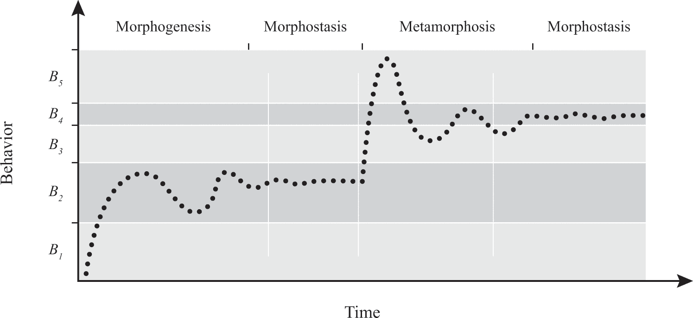

**图 4.2**

自适应行为经历多个学习阶段的随演化（示例）。纵轴代表系统的行为，可识别的行为形态使用标签 `B[1]`、`*`、`B[5]` 表示。横轴代表时间的推移。从随机行为开始，自适应系统经历一个形态发生阶段，直到收敛到优化行为并稳定在形态稳定态。然后，受到环境变化的影响，它需要重新调整自己，蜕变成另一种在新的条件下表现更好的行为形状。图表由 Jean-François Renaud 绘制，原作来自 Audry。

Nicolas Baginsky 他的机器人乐队“三塞壬”（The Three Sirens）在本书开头被介绍，他对这些行为转变非常熟悉。在与机器人器工作的三十里，他实验了不同的时间尺度，调整控制塞壬动作的神经网络，以让它们在从几分钟到几小时不等的时间跨度内进行学习。在表演之前，他通常必须通过向神经网络权重中精确注入噪声来重启机器人，从而允许它们找回部分灵活性和开放性，同时始终保留它们从之前的表演和排练中继承的某些行为。

Baginsky 将他的机器人行为与生物自适应生物（如动物）的行为进行比较，动物会经历从儿童到成年的显著蜕变：

正如预期的那样，它在童年时期非常狂野、不可控，且不可预见，而随着学习的进行，它仍然非常灵活；它在——中成熟

位于巴黎的艺术家 Justine Emard 在其 2018 年的视频装置作品 *Co(AI)xistence* 中探索了这一理念。这段长达 12 分钟的单通道视频展示了日本表演者森山未来（Mirai Moriyama）与 `Alter` 之间的共同适应互动。`Alter` 是由大阪大学石黑浩实验室和东京大学池上英实验室开发的机器人人工智能生命体（参见图 4.3）。在整个作品中，我们目睹了这两个主体如何通过舞蹈、手势、触摸和声音进行交流。例如，视频的一部分显示了森山在 `Alter` 迷醉的目光下随霓虹灯跳舞，他们都在轻轻地移动并触摸对方的手臂，并一起尖叫。

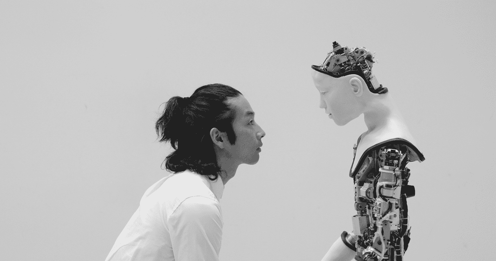

**图 4.3**

Justine Emard, *Co(AI)xistence*, 2017. 图片来源：© Justine Emard / Adagp, Paris 2020. 由 Justine Emard 提供。

Emard 解释说，作品创作的过程涉及许多尝试和错误，森山必须不断改变她的方法，因为机器人在拍摄过程中一直在不断学习。换句话说，`Alter` 的学习特质迫使森山进行即兴发挥和适应，而机器人反过来也适应人类表演者。^(10)

因此，*Co(AI)xistence* 揭示了形态发生和蜕变的适应性行为过程，涉及到森山与 `Alter` 之间的交互耦合。这件作品远超了软件与硬件二元对的传统观点，转而呈现了一种人机关系的*生成式*（enactive）情境，有效地在人类与非人类表演者之间展开了一种“代理之舞”（Pickering, 1995）。

生成主义是认知科学中的一种理论，它基于大乘佛教、梅洛-庞蒂的感知现象学，以及由 Francisco J. Varela、Evan Thompson 和 Eleanor Rosch 在其里程碑式的著作《具身认知》中首次提出的自组织（autopoiesis）理论之间的融合。通过连接东西方哲学，他们描述了计算主义无法从现实世界中进化的具身主体的视角，解释行动与感知之间交互的双向性（Varela et al., 1991, p. 8）。

生成主义的认知模型基于两个互补的原则：自主性和耦合。一方面，认知主体不断地维持和再生自身，在抵抗扰动的同时保持自身结构的稳定。这种自主性使其能够将自己定义为独立于环境的单元，并适应环境的变化。同时，有机体也依赖其环境才能生存。它需要保持与环境的耦合，因为正是在这种环境中，它才作为一个具身实体出现出来。Varela 认为：“在定义它作为一个统一体时，在同一运动中，它也定义了什么是留存在它之外的，即它的周围环境”（Varela, 1992, p. 7）。

耦合是现象学和具身交互中的一个重要概念。它指的是物体成为人体体延伸的方式，例如在黑暗中用于前行的木棍（Dourish, 2001）。它源于海德格关于物体是*可用*（ready-to-hand）的概念。对于海德格来说，当一个人使用物体时，物体会某种程度上“消失”在背景中。例如，当一个人持续使用锤子，它最终变成了身体的延伸，人们不再注意到它。然而，如果人们需要用不同的方式使用锤子，它突然在前景中“重新出现”：它再次与身体分离，人们以不同的态度审视它，海德格将其称为*现成*（present-at-hand）（Heidegger, 1972）。

机器学习代理的独特特征恰恰在于它们对环境中物体的适应是如此紧密，以至于它们变得“可用”。从这个意义上说，系统的适应或学习能力是耦合的必要条件。如果考虑一个充满了其他适应代理的适应代理环境，一个引人注目的结果是：代理在相互适应的过程中，可能会相互耦合。

在人工智能领域，目的往往证明手段是正确的。解决模式识别和决策等问题是机器学习真正的*存在意义*（raison d’être），而通过迭代适应过程实现这一点某种程度上是次要的。但在艺术家手中，这种学习过程可以成为美学的来源。

在战后时代，控制论为人工智能和机器学习提供了基础。它也是艺术界革命的一部分。在 20 世纪 60 和 70 年代的当代艺术中，过程和行为而非物质对象成为了关注焦点。Nicolas Schöffer 和 Gordon Pask 等创造者提出了在现实世界中进行实时部署的适应性电机械装置。随后，在 20 世纪 80 和 90 年代，随着作为“新一代人工智能”（nouvelle AI）的自下而上代理控制方法的发展，一系列艺术家在作品中使用了感知运动系统，催生了新媒体艺术特有的新艺术类型——行为美学。

这些作品某些特别依赖于让观众直接体验适应性系统的学习过程。这种将机器学习作为生成或揭示适应性行为手段的使用是艺术家特有的，并不符合传统的工程和科学方法论。

具身性、涌现、自主性、适应和学习等系统属性如何在基于代理的机器学习艺术装置中以审美方式呈现？例如 Nicolas Baginsky 的机器人乐队 *The Three Sirens*、Natalia Balska 的植物计算装置 *B–612* (2014)，或者 Gemeinboeck 和 Saunders 的好奇驱动型机器人装置 *Zwischenräume* (2014)。这些作品的适应性如何使它们与其他计算艺术作品与众不同？

这些作品中展示的行为的随时间展开可以通过其形态的演变来解释。有人提出了一种分类系统，将行为归为三类：非行为（也称为映射或零阶行为）、行为（一阶行为）和元行为（或二阶行为）。最后一类涉及代理行为本身随时间推移发生形态变化的过程，其中包括形态态、形态发生和蜕变。

机器学习过程属于二阶行为类别，并表现出形态发生模式，一旦代理体收敛到最优状态，这些模式就会导致形态稳定（morphostasis）。蜕变可以是或或少地突兀，发生在不同的时间跨度内，从而影响了这些系统的体验。此外，大多数成功的艺术装置使用了多种方法的混合，可能引导代理体经历不同的演化和稳定阶段，旨在为观众生成特定的体验。

最后，自适应过程的时间属性的使用并不局限于机器人等具身系统。例如，Memo Akten 的装置作品 `Learning to See: Hello, World!` (2017) 展示了在监控摄像头的实时捕捉上进行实时训练的神经网络的学习过程。形态发生过程也可以是反向，例如加拿大艺术家 Erin Gee 的表演作品 `Machine Unlearning` (2020)在这在这个作品中，Gee 使用了`自主感觉迷走反应`（ASMR）发声技术来阅读由神经网络生成的文本，而该算法在约 15 分钟的时间内进行回归，蜕变为从一个能够生成完整句子的完全训练状态，逐渐衰减到其纯随机的起始状态。在本章中，我们的注意力集中在学习过程中，即通过对可训练机器进行迭代调整来提高其性能。在下一章中，我们将更密切地观察遗传算法和神经网络等不同类型的可训练机器如何影响艺术实践。因此，我们离开了学习过程本身，将目光转向通过训练转换的机器结构，这些结构生成了非人类的表现形式。

## 注释

1. 控制论关于适应性、稳态和反馈循环的概念因此是 Ascott 观点不可或缺的组成，他在 1966 年的论文《行为主义艺术与控制论视觉》中解释了这一点（Ascott, 2003）。
2. 显然，是 Pask 在 Ascott 的要求下最初向其解释了控制论（Miller, 2014）。Pask 和 Ascott 在 20 世纪 60 年代曾作为 Price 和 Littlewood 的 `Fun Palace` 顾问合作，这是一个雄心勃勃的控制论建筑项目，但从未被建成（Mathews, 2005）。
3. 为了理解这一观点在 AI 历史上的重要性，请考虑 1955 年编写的达特茅会议项目建议序言是如何将其定位为该领域的基础性组件的：“研究将基于这样一个假设进行：学习的每一个方面或智能的任何其他特征原则上都可以被精确地描述，以至于机器可以模拟它”（McCarthy et al., 2006, 12）。
4. 这个定义与 Pask 的定义相比稍微提高了门槛，后者甚至赋予了雕塑以行为。
5. Pask 关于“雕塑的行为”的例子是这种非行为的极端情况（Pask, 1968, 18）。
6. 或者，反过来，行为发生变所需的 `duration`（时长）。
7. Nicolas Anatol Baginsky 对作者的采访，2017 年 11 月 22 日。
8. 的确，尽管机器人领域的最新研究表明，在机器人中使用机器学习是该领域进步的关键，但至少目前，它在与基于规则系统结合使用时效果更好。在大多数研究中，学习被用作精炼手工编码过程或执行特定模式识别任务的方法（Quinlan, 2006; Chalup et al., 2007）。
9. 这本质上是 Downie 的论点：他批判了映射（零阶行为）和涌现（二阶），转而支持程序代理体（一阶）设计中的作者身份（Downie, 2005）。
10. 机器人使用一种名为`刺激回避学习`（LSA）的技术进行学习，在这种技术中，脉冲神经网络使用 Hebbian 规则学习，同时也通过探索可行的行为来避免外部刺激进行学习（Sinapayen et al., 2017）。

# 5 超越人类理解

从计算机上演化出的奇特虚拟生物到播放世界上最怪异音乐的不受束机器人，机器学习艺术的特征是这种持续吸引着其实业者的陌生感。这些艺术家愿意应对与这些自适应系统工作时的困难和挫败，专门是因为这些系统感知和作用于世界的方式似乎违背了人类的理解。

与机器学习过程工作涉及独特的间接艺术姿态。虽然可以调整参数并调制提供给训练算法的数据，但最终决定是由 AI 系统做出的，超出了设计者的直接控制。这些决策源于复杂的数学公式，这些公式并不完美模拟了某些自然过程（如遗传进化或大脑连接），但对我们来说本质上仍然是陌生的。那么，我们不应对这些系统生成的图像、声音或行为如此不可理喻而感到惊讶。

事实上，机器学习系统的不透明性是一个众所周知的问题，并通常被认为是其社会接受的障碍（Burrell, 2016）。在某种意义上，这是为了以透明度为代价获得这些系统所提供的性能和精度水平而付出的代价。从设计上来说，机器学习设备的决策边界更接近一种直觉，而不是理性的、逻辑的、可解释的构造。这似乎是矛盾的，因为一方面机器学习系统以擅长预测而闻名，但另一方面，人类仍然难以预测此类学习过程的决策。

但对解释的抵制是机器学习艺术家对这些技术着迷的核心。新媒体艺术家 Memo Akten 描述了尽管与机器学习艺术相关的数据收集、训练和调试任务极其枯燥，他仍然不断回来。他接受了这些如此不为人理解的系统所带来的挑战，因为它们提供了许多未探索的领域，这意味着从这些不可的、狂野的技术中可以挖掘巨大的艺术潜力。

如果我们把机器学习艺术位于更广泛的计算机艺术领域，更具体地位于生成艺术实践领域，我们就能理解机器学习系统如何比直接依赖生成式硬编码程序的计算方法更具不可预测性。例如，20 世纪 90 年代，William Latham 和 Karl Sims 等艺术家使用进化过程创建复杂的生成程序。最近，Sofia Crespo 和 Mario Klingemann 等艺术家使用了深度卷积神经网络生成了新类型的图像。

Sofia Crespo 的 `Neural Zoo` 系列展示了由神经网络生成、随后由艺术家重新处理的图像。这些扭曲的图像呈现为有机形状的神秘拼贴，唤起了一些奇异、想象中的生物，这些生物有时感觉像是景观（参见图 5.1）。Mario Klingemann 的 `Memories of Passersby`（2018）将类似的过程应用于一个生成式视频装置，该装置不断地实时创建人物肖像。Klingemann 设备生成的图像是不可预测的，但它们具有可识别的风格，让人联想起 Sofia Crespo 以及其他使用类似的生成卷积神经网络的艺术家。这种风格既取决于艺术家用于训练的数据库，也取决于卷积神经网络的特定特性，其中包括倾向于将注意力集中在被认为更重要的细节上，而反之让某些区域模糊，以及重复某些模式的倾向。这些系统的行为往往以出乎直觉的方式运行，令其创作者都感到惊讶，部分原因在于它们比纯粹基于作者编码的计算方法更具自主性和不透明。

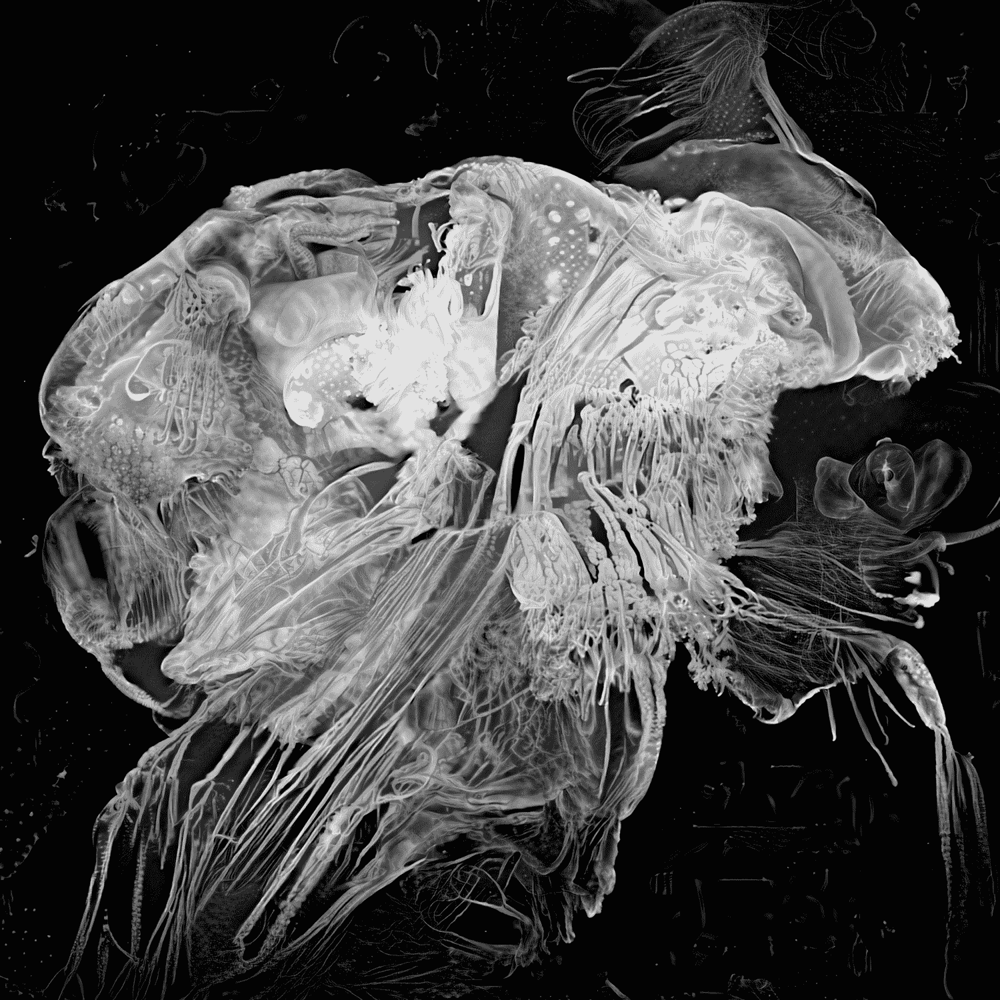

**图 5.1**

Sofia Crespo, `Self Acceptance`, 2018. `Neural Zoo` 系列的一部分。由 Sofia Crespo 提供 (`sofia crespo.com`)。

让我们将这些作品与最著名的自主艺术生成系统示例之一进行对比：Harold Cohen 的绘画程序 `AARON`。从 20 世纪 70 年代初他在斯坦福大学 AI 实验室担任休假研究人员，直到 2016 年去世，Cohen 不断地为 `AARON` 编写、调试和改进代码，设计了一系列跨越四十年并逐渐成熟的独特作品。在这段旅程中，艺术家受到人类认知中创造过程研究的驱动，旨在理解一组痕迹唤起图像所需的最小条件（Cohen, 1995, 2016）。

`AARON` 程序之所以引人入胜，是因为它的精湛技巧以及在保持可识别个人风格的同时所能生成的多样化作品。然而，即使在最新版本中，`AARON` 也是使用传统的编码实践编写的：一组精心设计的指令列表，编码了设计者关于绘画的知识。这个专家系统是由专家本人（Cohen）在 43 年的历史中亲自编写和微调的。^(1) 当程序员像 Harold Cohen 为 `AARON` 做的那样成功地将他们的想法转化为代码时，他们遵循了符号 AI 的路径，通过设计一种基于规则的计算机器，该机器对数据（输入）进行操作以产生结果（输出）。为了使用计算机代码设计出成功的程序，必须能够使用算法、逻辑和算术来描述管理系统的底层规则。

在机器学习中，将输入转换为输出程序并非由人类编码员显式设计。相反，一个训练过程使用一个可调整的机器，该机器通常是随机初始化的，因此在过程开始时通常表现糟糕。训练算法随后通过一系列真实示例通过试错反复调整机器，在过程结束时有效生成产生一台性能更好的机器（参见图 5.2）。

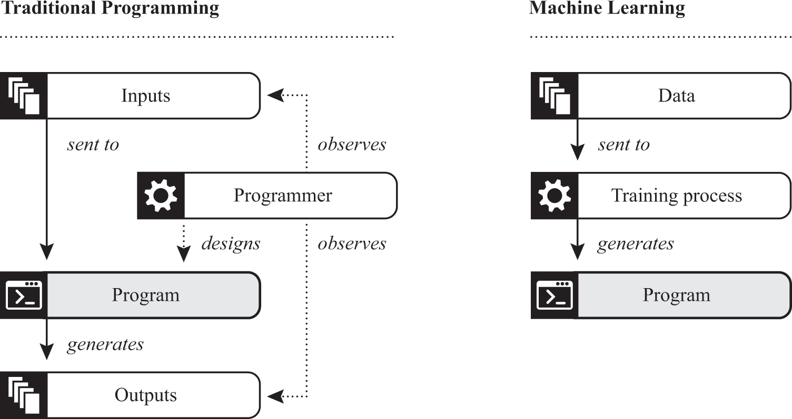

**图 5.2**

传统计算机编程与机器学习的对比。由 Jean-François Renaud 根据 Audry 的原作绘制。

理解这些机器的底层结构使我们能够掌握使用这些各种策略的艺术形式的物质性。将使用遗传算法制作的视频作品与使用人工神经网络制作的作品进行比较就像比较苹果和橙子，理解这些算法的底层结构有助于分析每种方法的概念基础。某些算法的物质性本质上提供了关于世界的根本问题，如进化、记忆、认知过程、感知和表征。

在机器学习文献中，这些可训练的机器通常被称为 `models`（模型），因为它们实现了现实世界的数学表示。此类表示可以对各种系统的行为建模，例如英语单词的概率分布、道琼斯工业指数的行为或人脸的属性。

尽管 `model` 一词在目前机器学习使用的多数语境下（如模式识别、概率分布估计和统计回归）可能是合适的，但作为机器学习的通用原则，它仍然存在问题。它基于一种对智能的二元论观点，即认知需要对外部世界的内部表示，然后可以使用其来确定决策目的的高层表征（例如，将原始数字图像转换为 `dog` 或 `cat` 等类别）。

正如之前讨论的，赋予我们“模型”概念的表主义世界观自 20 世纪 80 年代以来一直受到攻击，因为它没有承认世界-躯体交互在认知中的原始作用。^(2) 因此，在本书中，我使用了非常广泛的模型概念，它不仅涵盖了人工神经网络中发现的可计算表征，还更广泛地涵盖了在学习过程中自适应的任何结构。因此，我没有对遗传代码、决策树、神经网络甚至下一节将讨论的 Thompson 进化电路等物理装配等结构进行总括性的区分。这些易塑性的数据结构与世界产生自组织的连接，建立了似乎超出人类控制的关系。由于这些系统的自组织特性以及它们与现实世界的联系，这些技术安排最好被解释为具身感官系统，而非传统意义上的表征系统。因此，深度学习神经网络使用的分布式表征与符号 AI 中的符号表征有巨大区别，后者依赖于硬编码且灵活的基于规则的解释模型。

我们可以将模型看作一个函数，它根据从现实世界采样的示例来近似数据的性能或行为。模型使用海量数据来学习这些数据的行为，但本节关注的模型不需要记忆或存储数据本身。在学习期间，模型使用可用数据针对当前的特定问题生成预测，例如猜测图像显示了哪些物体，或根据今天的状况预测明天的天气。最后，训练过程使用评估函数评估模型的预测并调整模型以改进其未来的预测，并重复这一过程直到不再需要进一步改进。

一旦模型训练完成，它不仅应该通过使用训练期间见过的示例来做出准确预测，更重要的是，能够成功地将其学习到的模式应用于新的、未见过的示例中。机器学习系统将其能力扩展到新数据的能力被称为**泛化能力**（generalization）。它是衡量一个机器学习系统有效性的真正标准，因为只有当这些系统能够扩展到新信息，而不仅仅是学会死记硬背的学习时，它们才是有效的。

训练完成后，学习算法和数据集就变得不再需要了：训练好的模型可以直接使用，因为它已经吸收了完成任务所需的所有相关信息。结果是训练过程结束后只剩下模型：它们是机器学习系统的真正输出。

模型是机器学习系统的核心元素，因此对于基于基于学习的艺术创作来说，它们是至关重要的考量。机器学习系统如此复杂，其历史也如此错综，以至于与它们进行的艺术对话往往模糊地将它们描述为自动的甚至是魔法的，而不同的模型流派和类型实际上对认知、表征、结构和生命过程的概念有更广泛的论述。不同类型的模型提供不同类型的美学效果，并且通常涉及迥然不同的实践 set。因此，特定的艺术运动和流派已经依附了特定的模型。例如，进化艺术主要涉及被称为参数化系统的生成式可调模型，而近期的神经艺术（Hertzmann, 2019）则主要关注生成式深度学习神经网络的艺术潜力。

本章概述了机器学习如何通过训练这些模型来改变生成式艺术实践。机器学习艺术家并不是逐行构建一个以实现预设艺术目标的程序（这种尝试在概念上类似于建筑或工程实践），而是采用了一种更类似于化学或生物学等科学实践的实验性方法。当采用这种方法时，代码的物质性发生了根本性的变化。机器学习艺术家不需要硬编码程序，而是需要将正确的成分组组合在一起，等待结果，进行修改并重复，直到他们对结果满意为止。这个过程要求人们部分放弃控制，并放弃完全理解正在发生什么的需求。

1996 年，埃德里安·汤普森（Adrian Thompson）在萨塞克斯大学工作的科学家想知道是否可以使用进化的现场可逻辑门阵列（FGPA）来自动设计一种电路。汤普森（1996）描述了他的这种尝试，通过这种方法让电路来感知世界。在 20 世纪 80 年代商业化的 FGPA 是由逻辑门组成的，可以根据需要进行重新配置。在这些实验中，汤普森生成了随机 FGPA，测试它们对高频和低频信号的区分能力。他对这些电路应用了交叉和变异等遗传操作。在几次迭代后，这种遗传过程收敛到了几乎可以完美区分信号的电路。汤普森随后尝试通过移除某些未使用的单元来精炼这种电路。大多数单元（`cells`）对于电路的逻辑功能是必要的，但它们是完全脱节的。惊讶的是，汤普森发现，修剪这些电路中看似不重要的部分并不会影响系统的性能。通过利用这些电路中固有的、物理的微小相互作用，训练循环学习了一种解决问题的适应性方案，展示了人类人类可能设计的逻辑。(3)

汤普森的实验对一般的机器学习提出了两个重要问题。首先，它说明了机器学习系统通常基于令其设计者都感到惊讶且无法理解的机制做出决策。特别是，这些系统大多数不是基于逻辑，而是基于复杂的非线性代数、统计学和概率，正如汤普森实验中的物理属性一样。因为它们依赖于推理而非推演，所以它们根本不是为了产生世界的模型。

其次，汤普森的进化电路为机器学习的模型概念提供了一些视角。它展示了一种训练结构，这种结构不是世界的模型或表征，而是更类似于嵌入真实世界的实体（`body`）。该实验证明了人工智能内部表征与具身之间的张力，这自 80 年代以来一直是辩论的话题。虽然机器学习从符号人工智能继承的模型概念（系统的目标是用符号和逻辑生成世界的表征），汤普森的实验提醒我们，尽管此类表征对于解决当前问题可能有用，但最终可能不需要它们。对于机器人专家罗德尼·布鲁克斯（Rodney Brooks）来说，构建智能系统的关键不在于创造表征，而在于让这些表征根于物理世界，因为“世界本身就是最好的模型”。(4)

汤普森的实验可以被视为人工智能计算主义观点的反例。它重申了 80 年代和 90 年代一系列研究人员（如罗德尼·布鲁克斯和理查德·德雷福）以及艺术家（如肯·里纳尔多、西蒙·潘妮和比尔·沃恩）对符号人工智能二元论世界观的替代性观点。它模糊了硬件和软件的边界，揭示了在自组织机器学习模型的情况下，试图通过人类可理解的规则来翻译此类模型的决策过程注定会失败，因为对它们提出的精确要求是在以后更接近模拟而非数字的方式生成自己的一套表征。因此，它证明了认知无法与具身系统在世界中的情境交互分离。然而，这并不排除该系统在此过程中可能使用某些符号或亚符号操作，以帮助它在环境中执行——正如汤普森的可进化电路使用逻辑门和电干扰混合来感知世界一样。

与汤普森难以捉摸的 FGPA 类似，其他机器学习模型（如人工神经网络）产生的现实表征往往让人类的表征和理解。结果，这些机器学习模型与依赖于专家帮助编程的可识别元素结构的经典人工智能模型非常不同。

事实上，许多机器学习系统（如人工神经网络）的一个已知局限性是缺乏可解释性。它们识别模式的效率是有代价的，因为机器学习系统通常依赖于复杂且晦涩的`黑箱`系统，在这些系统中，信息高度分布在由数百万权重连接的数千个神经元中，使得系统难以解释，更不用说用简单的人类语言来解释了。因此，它们做出的决策同样晦涩，这在某些情况下可能会产生问题——例如，当它们被用于做出具有伦理色彩的决策时，如判某人入狱或识别并杀死人类目标。AI 模型的准确性与其可解释性之间似乎存在权衡：更准确的预测模型（如深度学习系统）难以理解，而更易人类理解的模型（如决策树）其预测准确性通常较低。

此外，通过操纵数据或调整模型来直接帮助或改进机器学习系统的尝试往往是适得其反的，正如汤普森实验所示的那样。对于深度学习模型更是如此，其核心能力是直接从原始数据中学习，跳过了任何形式基于启发式和先验知识的人工特征提取。试图根据人类的先验知识来简化模型往往会偏离重点，因为这些捷径可能会掩盖原始数据中某些重要信息，而这些信息对机器学习系统是有用的。机器学习系统的结构复杂性正是驱动其效率的源泉，产生了复杂的行为，使其在某些方面表现得比人类更好。正由于人类与机器感知之间存在这种差距，机器学习架构中涌出的模式对人类观察者来说仍然令人困惑，这并不意外。^(5)

问题仍然在于，机器学习模型是否作为世界的表示。虽然深度学习系统确实试图通过学习数据的数学表示来对现实世界的某些方面进行建模，但机器学习文献中的“表示”概念与西方艺术和哲学中的人文主义“表示”传统不同。神经网络中的表示学习是指系统从数据中提取相关特征的方法，例如通过寻找模式中的规律性。因此，它紧密遵循了大脑感知系统（特别是视觉皮层）中发现的数据抽象和压缩内部过程。

例如，在用索菲亚·克雷斯普（Sofia Crespo）和马里奥·克林曼（Mario Klingemann）使用的图像训练的深度学习神经网络中，每一层神经元都捕捉了数据中一些日益抽象的规律。第一层可能获取原始信息（对应于投影在视网膜上的图像），而下一层可能将这些原始图像数据表示为一系列真/假值，每个值对应于特定图像特征（如边缘、曲线或凸起等）的存在。即使它们仍然利用了传统的计算过程（如执行乘法和加法），但神经网络并不是传统编程意义上的表示系统，而是更类似于赋予了塑性形式的复杂`身体`，这种形式使其能够对世界做出反应。

使用机器学习这种有时深不可测的过程构建的艺术作品，展示了其媒介所特有的美学特质，要求新型的艺术评估和欣赏。因为产生这些艺术作品的算法行为无法通过逻辑规则来解释，对于观众来说，理性地描述它们是一项挑战；对于艺术家来说解释它们也是如此。尽管艺术作品的技术功能对艺术家的艺术愿景可能完全重要，但观众往往希望了解更多关于作品的技术运作，以解释其潜在含义。传统的新媒体艺术作品通常可以被理性地解释和理解；例如，这个光电池触发了那个声效，那个麦克风激活了那个视频序列，那个手势让代理体绕圈运行了一分钟，等等。如第 4 章解释的那样，它们的行为是形态态的，遵循一种不随时间变化的可识别模式。然而，要体验其所有丰富的自适应系统，人们需要通过自己的感官身体从现象学的角度去了解它们。人们需要适应它，改变自己，与它调谐，直到机器的行为在物理上被感知，而不是在智力上被理解。

这在机器人艺术背景下尤为如此。此类基于代理的艺术作品的人类观察者以高度取决于环境和主观的方式解释它们生成的行为模式。当我展示机器人装置时，“它是如何工作的？”是观众提出的最常见问题之一。这种对作品功能层最初好奇反映了对技术的普遍焦虑，并揭示了对人工智能的文化偏见。人们往往预设机器人是理性解释的规则进行编程（Audry, 2021）。

随着时间的推移，我学会了通过反问来避免回答这个问题：“你认为它是如何工作的？”作为回答，人们通常会编出与编程无关的社交情感故事：“看这些机器人——它们在吵架吗？”“我觉得它们在约会！”“这个喜欢一个人待着。”

观察者对系统举止的推测只是拼图的一部分。当观众再次回到“它是如何工作的？”这个问题时，我只能回答，尽管我可以描述构建机器人的原理和技术，但这些解释并不一定能告诉我们它们在被体验时的行为。系统的内部运作与外部观察者（包括作者）感知的系统行为之间存在着巨大的差距。

在机器人艺术作品中观察到的生命力投影印象，很大程度上得到了现场代理所生成的行为的不可预测性的支持。对无法用逻辑或叙事描述的异质行为的情感感知与其他艺术家的体验相似。例如，关于他的作品 `Eden`（2000–2011），一个人工视听代理组成的生态系统间接响应访问者，约翰·克林曼（Jon McCormack）注意到，虽然访问者并不理解系统的内部运作，但他们对作品的体验是“感觉它某种程度上是活着的”（McCormack, 2009, p. 411）。

这可以通过考虑观察者本身也是自适应系统，试图理解那些可能处于形态发生和变态阶段的不稳定且复杂的行为来解释。这些自组织系统需要特定的语境才能被正确理解；它们不能像更传统的反应式和交互式艺术作品那样被消费。人们需要花时间与这些代理相处——换句话说，就是适应它们。事实上，我自己的经验是，这些作品对那些在作品上花更多时间的人来说影响更大。^(6)

从这个意义上说，机器学习艺术可能提供一种逃避新媒体艺术观众期待的方式，因为创作者往往发现自己受限于他们所陷入的枯燥输入输出和解释性范式——在这种语境下，矛盾的是，艺术家挣扎着让作品*发挥作用*，但当公众唯一的关注点是*它是如何工作的*时，他们又感到恼恼。当艺术家无法以人类理性的方式使其发挥作用时，这个问题就可以被完全避免：此时，必须由观众通过与作品互动来使其发挥作用。

## 最佳观众

机器学习为引发新形式艺术消费艺术艺术出现铺平了道路。新技术对艺术界的影响并非空前未有：例如，考虑 20 世纪 60 年代后期视频艺术的出现如何迫使艺术机构发明新的展示格式，或者互联网如何从根本上改变了电影和音乐行业。当代媒体艺术在画廊和节日中的呈现方式——观众坐下、倾听并离开，这种体验通常持续不超过几分钟——对于大多数基于学习过程的作品可能是不恰当的。机器学习系统需要活跃的互动，且通常持续长时间——这种体验是传统的新媒体艺术展示环境（如节日）通常无法提供的。

谈到非传统模型接触新媒体艺术的力量，尼古拉斯·巴格斯基（Nicolas Baginsky）回忆道，他在 20 世纪 90 年代和 21 世纪初展示其机器人乐队的最佳体验，是在俱乐部里展示机器人，那里人们进进出出，花些时间听乐队，然后出去抽根烟。“在那种‘夜店风’的环境下，”巴格斯基认为，这种自适应机器人表演“处于最佳状态，因为当人们在放松享受舞台音乐时；他们准备好待一整晚并接受任何可能发生。乐队表现得非常好，”他补充道，因为机器人“没有与人们的预期冲突。”

艺术家描述了他在 1997 年装置作品《自恋企业》（*Narcissism Enterprise*）的类似经历，该作品使用了面部识别和机器学习。该装置在布达佩斯的文化与交流中心运行了约 15 年。由于巴格斯基每个月都要去那里进行维护，他与保安变得非常熟悉。他们不断向他讲述与作品互动的故事以及他们的解读。作为与其分享日常生活的被动观众，保安们能够与作品形成最紧密的纽带。

自适应系统需要大量数据来学习如何应对复杂情况。它们通常需要大量时间，以便接触许多不同的经验。此外，由于机器学习系统被设计在复杂的自组织基底的基础上产生自己的决策过程，它们生成的输出永远无法被完全理解。这种状况可能导致长篇的、以演化为中心的作品，这类作品强调持续时间和沉思的价值；或者产生比理解更易于感受的迷人行为，这使得它们更类似于表演艺术实践，其中具身性和表演性的类似考量在其中发挥了作用。

使用此类系统的艺术家（以及希望向公众展示其作品的机构）应该为观众充分体验这些系统提供适当的语境，促进与这些系统建立关系，以便游客可以*了解它们*。一种方法是为观众提供停留较长的激励，例如通过提供沙发让他们在不感到不适的情况下体验作品，甚至提供休闲茶点。

另一种方法是通过明确将作品的持续时间作为作品不可或缺的一部分来引导观众，例如，以预设时长的表演格式呈现作品，要求公众停留一段时间——这是表演艺术中的常见做法。考虑雅内特·卡迪夫（Janet Cardiff）和乔治·比尔斯·米勒（George Bures Miller）的 2001 年作品《天堂学院》（*The Paradise Institute*），这是一个装置，观众进入一个经典电影院的小型复制品并戴上耳机体验双耳声道，产生一种身处真实影院的错觉。同样考虑英国剑桥的时间农场美术馆（Time Farm），它在一个空间内展示艺术品，观众必须与作品共待正好一小时，且无法访问互联网或移动设备。

第三方法是在现实环境中展示这类艺术作品，让观众可以更随意地观察。三仙女（The Three Sirens）在柏林俱乐部的通宵表演就是这种策略的例子。此外，还有机会专门为私人购买和收藏设计新媒体作品，并提供可借回家的作品，这些作品将在人们的住所内进化几天或几周。

## 构建模型

机器学习为传统的计算机编程和软件工程提供了丰富的替代方案。经典的编码实践涉及自定义的数据结构和算法，试图将关于世界的想法转化为逻辑规则和结构。一个典型的编码流水线涉及问题分析、软件架构设计、通过编码实现以及处理语法和运行时错误的过程。

计算机编程有点像盖房子。如果你知道如何使用锤子，你可能可以在几乎没有规划的情况下盖出一个小棚。然而，建造一个更大、更耐固的结构需要更多的远见：人们需要制定计划、浇下坚实的基础、建造结构骨架等。在每一步，都需要做出决策以应对不可见的事件，但这些决策总是是为了最终的施工而做的。最后，快速修复和廉价材料（特别是在筑基础基础和结构时）从长远来看会给房屋带来大问题。

对于盖房子来说，设计软件需要计划、制造组件、重构等，因此借鉴了建筑和工程的实践。相比之下，机器学习通常涉及实验过程，使其更接近生物学和化学等科学实践。构建软件的实践被称为软件工程和软件架构，这并非巧合；而机器学习通常与数据科学领域相关。

在处理机器学习时，人们并不尝试直接为当前问题实现解决方案，而是为机器学习系统完成目标任务创造正确的条件。这需要对问题有直观的理解，并涉及通过尝试将正确的元素组合在一起。正如实验科学涉及选择正确的成分、仪器和程序一样，机器学习需要选择数据、模型、评估函数和训练过程，所有这些都会影响最终结果。

机器学习艺术的情况也是如此。虽然机器学习经常被错误地描绘为某种不需要人类干预就能自动解决问题的“魔盒”，但事实要微妙得多。机器学习系统能够在脱离人类监督的情况下独立完成令人惊叹的成就，例如驾驶车辆或比人类更好地识别图像，但这些成就涉及到大量的人类实验、发明和微调。

传统的计算机科学通过识别可以使用算法自动化的过程，并使用编程语言来实现它们来进行。相比之下，参与机器学习项目的人需要完成的任务包括：确定要使用的任务类型（监督学习、无监督学习或强化学习）、选择并预处理数据，以及选择评估函数和优化程序。该过程的关键组件之一是为任务选择合适的模型类型（例如二元遗传代码、深度神经网络或决策树），以及决定模型结构的参数（例如深度学习网络中的神经元数量和层数）。

一旦这些元素准备就绪，人做的只需启动训练过程并等待。一旦模型完全训练完成，就可以分析它的行为，并根据这些结果选择对任何组件进行调整并重新尝试。由于其中一些实验可能需要数小时、几天，在某些情况下甚至需要几周或几个月才能运行，因此使用更多的计算资源来并行运行具有不同设置和配置的多个实验是理想的。

因此，机器学习模型的物质性与传统程序有很大不同。在艺术创作的背景下，使用机器学习将劳动从算法的内部运作转移了，转而迫使艺术家进行全局思考。需要什么类型的数据？需要多少个示例？应该选择什么样的模型？具有多少个权重、神经元、层和其他参数？虽然互联网每天都会带来新技术或展示生成内容新方式的演示，但将这些配方作为创作材料进行探索涉及试错，并要求创作者对事物如何结合在一起有一种直觉的感觉。

## 模型的万物馆

机器学习勾勒了一片不同于符号人工智能的探索领域。相应地，在这两种算法景观中存在的艺术形式之间存在着差距。也许最重要的差距之一与自动化和可访问性有关。虽然哈罗德·科恩（Harold Cohen）不得不花费 40 多年的时间使用符号主义方法开发了 `AARON`，但像 Sofia Crespo 和 Mario Klingemann 这样的艺术家能够在几周或几个月内创建生成系统，而且往往专业知识有限。另一个差异是概念性的：`AARON` 起于对认知和图像制作的探索，最初使用纯内部过程，而威廉·莱瑟姆（William Latham）的生成工作更多地关注进化理论和人工生命，而最近涉及深度学习的作品（如 Crespo 和 Klingemann 的作品）经常玩弄感知和想象的过程。这些不同方法在概念和实践上的方面影响着结果，有时甚至促进了某些子流派，如进化艺术或神经美学。不同的计算机艺术方法具有怎样的审美供能性？这些方法的物质性是如何影响艺术实践和产品的？

自 20 世纪下半叶出现以来，机器学习领域已经经历了多个阶段，并采用了大量的手段，从控制论时期的早期连接主义系统到深度学习，或从机械式学习到遗传算法。每种方法都有其自己的模型。

### 模型的演变

首先，模型具有特定的结构，允许不同形式的艺术操纵，包括利用模型偶然特征的策略，使其偏离习惯或预期的用途。例如，尼古拉斯·巴金斯基（Nicolas Baginsky）在《三位塞壬》中以及伊夫·阿穆·克莱因（Yves Amu Klein）在其机器人雕塑《Octofungi (1996)》中采用的策略，都是使用无监督神经网络学习的输出来控制机器人，而这些方式并非这些机器学习系统的设计初衷。

其次，方法的性质通常在概念中起着重要作用。例如，神经网络开启的想象空间在概念上与进化计算有何不同。卡尔·西姆斯（Karl Sims）的装置《Galápagos (1997–2000)》利用了进化的唤起性，允许用户参与一个遗传适应的故事；而本·博加特（Ben Bogart）的装置《Dreaming Machine #2 (2009)》则反思地将神经网络引入对记忆和梦境的艺术探索——这是研究中的两个核心主题。模型的决策过程结晶在通过学习程序进行调整的方式中，往往令人惊讶，甚至让类难以解释。控制论时期的简单自适应系统效果良好，如格雷·沃尔特（Grey Walter）的《Machina Specula (1951)》、尼古拉斯·舍费（Nicolas Schöffer）的《CYSP 1 (1956)》以及戈登·帕斯（Gordon Pask）的《Colloquy of Mobiles (1968)》。

第三，方法的性质通常在概念中起着重要作用。模型的实际开发实际上形成了依赖复杂数学表达式的二维（2-D）和三维（3-D）形式，正如在威廉·莱瑟姆的作品中看到的那。最后，最近基于图像的神经网络的发展引发了一系列由机器生成奇异视觉效果的作品，例如 Crespo 的《Neural Zoo》和 Klingemann 的《Memories of Passby》。

## 结论

模型是机器学习系统的基石。它们体现了机器学习的一个基本概念，即通过让系统暴露于示例，而不是直接通过计算机代码，来间接地设计一个可计算系统。随着训练的进行，遗传编程树和神经网络等模型会进行自我组织，产生对世界的复杂表示。随着这些系统在过去 70 年中变得日益复杂，它们的设计模糊了模拟与数字之间的界限。这种不可捉性直观地植根于模型本身，正如遗传代码或神经网络的权重之中。

接下来的三个章节将探讨不同类型的模型以及相应的机器学习方法如何影响特定类型的作品。鉴于模型和方法的类型极其丰富，再加上舞蹈、诗歌、视觉艺术和媒体艺术等更为庞大的艺术实践，这种分析将远非穷尽。然而，我希望至少让读者感受到这种**界画了机器学习与艺术交汇处**的特征的广泛多样性，以及存在于这一领域之中的共性。

我们广义地考虑了三类不同模型，这些模型恰恰遵循时间顺序。我们在第 6 章中开始，首先观察使用演化计算训练的机器，同时引入机器学习中参数化系统和非参数化系统的概念。在第 7 章中，我们考虑了不同形式的浅层神经网络，重点关注使用过无监督学习网络（如自组织映射 `SOMs`）的艺术家。最后，第 8 章侧重于深度学习，它构成了一类较近出现的模型，具有许多有趣的表表示和生成属性。

# 注释

1. `1` 帕梅拉·麦考德（Pamela McCorduck）的开创性著作《AARON's Code：元艺术、人工智能与哈罗德·科恩的作品》详细描述了科恩作为一名与 `AARON` 合作的艺术家的历程 (McCorduck, 1990)。
2. `2` 若要深入回顾对人工智能和认知科学中表主义世界观的批判，请阅读艺术家兼研究员西蒙·潘尼（Simon Penny）编写的优秀著作《Making Sense》 (Penny, 2017)。
3. `3` 汤普森（Thompson）的实验从未被复制过，这在某些科学界中对其准确性产生了怀疑。然而，即使被证明是不真实的，它为理解机器学习系统不可捉摸的本质提供了一个很好的比喻。
4. `4` 受机器学习和人工生命（ALife）方法的影响，以及马图拉纳（Maturana）和瓦雷拉（Varela）的作品（Maturana and Varela, 1980）以及德雷福斯（Dreyfus）对计算主义的批判（Dreyfus, 1979），罗德尼·布鲁克斯（Rodney Brooks）在 20 世纪 80 年代挑战了符号人工智能。他认为 AI 在试图在计算机中复制人类认知方面犯了错误——这一立场被称为强人工智能。由于无法实现 AI 的目标，研究转向了解决人类性能的缩减领域的问题，例如策略游戏、现实世界的模拟版本以及专家系统等特定专业领域。根据布鲁克斯的观点，生物不应被仅仅视为发生离体式的一系列符号操作的基质。相反，布鲁克斯主张一种坚决的反表征主义认知观，认为生物表现出的智能行为源于与环境的**具身的、情境化的互动**，这种互动不需要中间的符号表示（Brooks, 1987, 1999）。
5. `5` 有一种观点认为，汤普森的 FGPA 无法与深度学习神经网络和决策树等纯数字模型相比较，因为它具有直接影响系统判别特征的物理属性。我认为，当它们达到一定的复杂程度时，深度学习网络等纯数字系统也具有类似的属性，使得尝试简化或修剪网络的部分可能会以意想不到的方式影响系统性能。从人类的角度来看，一个包含数万个自组织神经元之间数百万次连接的深度学习神经网络等复杂系统，在直接观察时与许多物理系统一样晦涩。
6. `6` 这一观察由其他艺术家报道，例如斯蒂芬·凯利（Stephen Kelly）通过其`Open Ended Ensemble`（2014）系列涉及遗传编程（`GP`）的装置，以及克里斯托弗·萨尔特（Christopher Salter）的`N-Polytope: Behaviors`（2012）。
7. `7` 伊尼斯·泽纳基斯（Iannis Xenakis）在《Light and Sound》之后，尼古拉斯·舍尔费尔（Nicolas Schöffer）在 1970 年为巴黎提了一项名为`Tour Lumièrenétique`的雄心项目，旨在适应环境。该塔配备了湿度计、温度计、风速计、光敏电池、麦克风和数千个彩色投影仪和闪光灯，旨在随着时间适应环境，但该项目随着他在 1974 年的去世而终结。

# 6 演化学习

艺术家埃文·德里森（Erwin Driessens）和玛丽亚·范斯滕（Maria Verstappen）自 0 世纪 90 年代以来一直将计算算法的自适应能力应用于艺术创作。他们的作品`Breed`（1995–2007）基于一个可以产生扭曲雕塑形式生成程序。在这项工作中，艺术家设计了一系列生成程序，每个程序都从单个立方单元（`voxel`）开始，通过反复应用细胞分裂规则创建一个三维（3D）形状。当运行这些程序时，可以使用木头、尼龙或钢等材料进行打印。

可能性的范围是巨大的，艺术家几乎不可能尝试所有的结果。因此，为了部分自动化决策过程，他们依赖于被称为遗传算法的训练过程。在这种背景下，他们并不是自己定义偏好的规则集，而是将工作转向定义评估标准（`fitness`），以鼓励特定类型的结果，例如体积和复杂性。

遗传算法在前书中已有介绍，它们最初在 20 世纪 80 年代流行，并与人工智能、人工生命、神经计算和机器学习同步进化（1）。广义地说，遗传算法涵盖了一类借鉴演化过程的程序。从机器学习的角度来看，遗传算法因此构成了一类试图设计能够自主学习的方法，其灵感来自物种通过多样性、繁殖和自然选择来适应环境。

通过在计算机上模拟生物演化，遗传算法在某种程度上继承了演化过程的创造潜力。这些生成属性使其适用于创作实践，多年来已经在视觉艺术、音乐和建筑的许多领域成功应用，成为艺术家和其他创意从业者最常用的学习技术之一。遗传算法易于实现且非常灵活，部分是因为它们将许多决策交给了作者。但正如我们将看到的，灵活性也带来了许多限制。

遗传算法是优化程序的一种，通过使用演化启发式在可能模型的空间中搜索来解决问题。系统通过对问题解决方案种群进行局部更改来学习，逐步接近最终目标。

尽管 20 世纪 60 年代的许多研究小组已经在致力于应用于人工智能的进化计算模型，但遗传算法作为进化计算众多方法之一的发明，通常归于科学家约翰·霍兰德（Mitchell, 1998）。霍兰开发这些算法是为了构建一种能够在计算机系统上运行的遗传适应的正式数学表示。在其基性著作《自然与人工系统中的适应》（*Adaptation in Natural and Artificial Systems*）的序言中，霍兰对适应提出了一个正式定义，即“一种结构不断被修改以使其在环境中获得更好性能的过程”（Holland, 1992, p. xiii）。通过这一定义，霍兰将进化的故事形式化为一种优化过程，通过在每一代中选择最好的个体，保留其部分遗传结构的同时进行组合和变异，在特定的可能性空间内进行启发式搜索。意义在于，自然界中发生并导致生物系统适者生存形式或器官演化的同类遗传程序，现在可以进行数字模拟，以便为计算智能体开发更好的行动策略。

通过这一框架，霍兰将自然演化重新定义为一种迭代优化过程，该过程通过使用交叉和变异等基本遗传算子演化个体种群，对其进行*适应度函数*测试，并仅选择最好的个体来生成下一代种群（Holland, 1992）。霍兰提出的遗传算法基本形式使用人工染色体，这些染色体本质上是定义个体基因型的位序列（见[图 6.1]）。字符串段对应于决定个体实际特征的基因——换句话说，就是其表型。然后可以使用评估个体性能的适应度函数来评估个体的性能（Mitchell, 1995）。

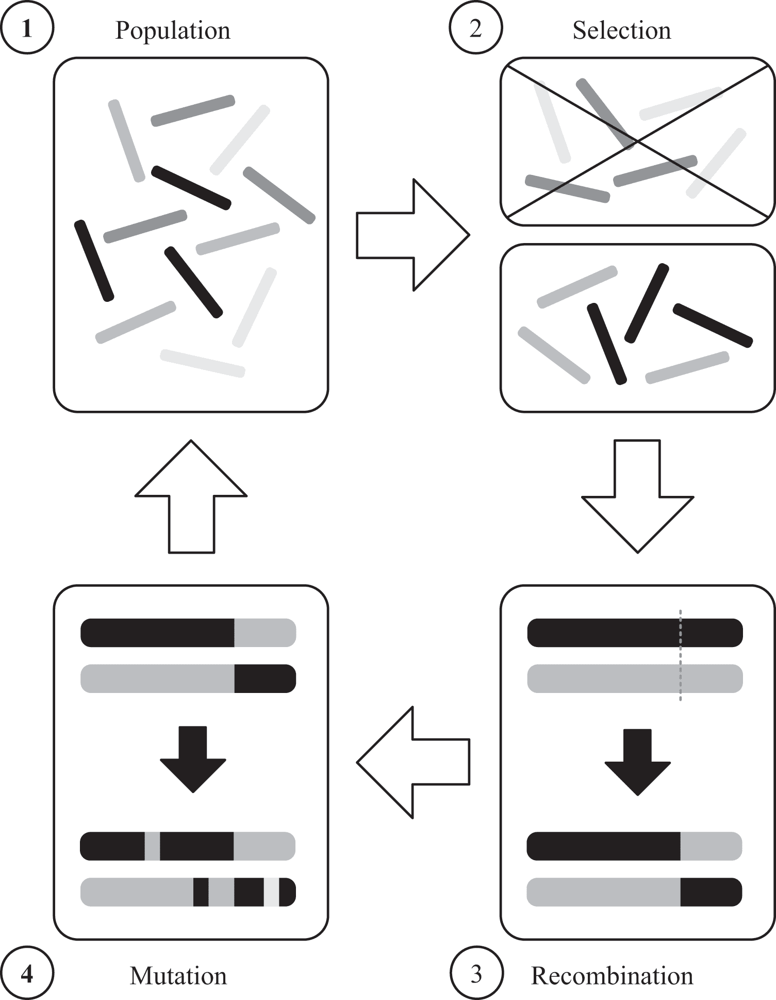

**图 6.1**

遗传算法图。

20 世纪 90 年代，遗传算法影响了*进化艺术*（evolutionary art）的发展，这是一个跨越了从视觉艺术到视频游戏、音乐和建筑等多个学科的艺术领域，并一直是大量出版物书籍（Corne and Bentley, 2001; Johnson and Cardalda, 2002; Jong, 2016; Romero and Machado, 2008; Todd & Latham, 1992b; Whitelaw, 2004）的主题。由于该主题在其他地方已有介绍，我这里的目标不是对该领域进行深入分析，而是研究进化算法与其他机器学习方法相比的特定特质。

如前解释过的，遗传算法是灵活的学习算法，可以用于训练不同类型的模型。它们被频繁应用于作者直接定义的模型或可训练机器——例如上一章介绍的汤普森实验，其中硬件机器通过遗传程序进行优化（Thompson, 1996）。从遗传算法的角度来看，模型对应于一种数据结构（基因型），该数据结构在可能性空间中定义了一个可能的解决方案（表型）。在生成艺术中，这些这些解决方案并不对应于问题的答案，而是对应于特定的形式或对象，如图像、虚拟实体、建筑设计或声音。例如，在 Driessens 和 Verstappen 的《Breed》中，基因型对应于一组规则，而表型是生成的 3D 结构。因此，遗传算法提供了一种高效搜索该可能性区域的计算方法。

## 参数化系统

遗传算法的一种常用方法是设计参数化系统：一种可以调整的计算机程序或模型。在这种设置中，基因型仅仅是一系列称为*基因*的参数，这些参数通常对应于数值。表型则是使用这些参数调整预定义计算机程序得到的结果。

道金斯之前介绍的著名的*生物形态（*biomorph*）程序使用了这种策略，通过一组九个基因控制形状的绘制，该形状由类似于分支或肢体的对称排列线条组成。每个基因决定了绘图过程的一个特定方面，例如角度、距离和长度。在道金斯的进化过程中，父代基因型之间没有交叉，只有变异，变异通过在每一步中略微增加或减少每个基因的值来实现。

卡尔·西姆斯（Karl Sims）使用了一个旋钮组的比喻，每个旋钮对应于单一参数，可以通过旋转来改变结果。随着用户添加越来越多的旋钮以实现更多变化，用户进行这些调整变得变得越来越困难。遗传算法提供了一种替代过程，通过对现有旋钮位置自动引入微小变化，产生一个或多个样本，然后对它们进行评估以选出最好的。这种进化过程允许通过微小的随机步骤对参数空间进行更有效的探索，而无需用户理解每个参数所起的作用（Sims, 1991, p. 320）。

参数化系统可以相对容易地实现，正如道金斯的实验所示，它们仍然能产生真正有趣且令人惊讶的结果。然而，这种灵活性是有代价的：大部分控制权被推给了系统的设计者，他必须编写生成式程序并决定基因将如何影响它。正因如此，输出的美学质量并非源于遗传算法，而是源于程序的作者，从而减少了从机器角度产生惊喜和新颖性的潜力。事实上，正如生物形态一样，参数化系统通常具有很强的*特征（*signature*），即系统允许的可识别对象类别。

## 非参数化系统

参数化系统的替代方法（通过更改参数来间接影响程序的决策）是设计一种灵活的数据结构，允许遗传算法直接生成程序或模型——这种方法通常被称为*遗传编程*（genetic programming）的一种（Koza, 1992）。在这些*非参数化系统*中，基因型不仅仅是一堆数字，而是一个具有特定属性的进化的、灵活的结构。在本章开头介绍的 Driessens 和 Verstappen 的项目《Breed》（1995–2007）是使用此类非参数化进化程序的一个例子。在这里，艺术家们使用遗传算法生成形式，然后用这些形式创建真实的物体。该程序基于一个递归过程，从单个体素开始，根据一组取决于单元本身及其周围单元的局部规则将其划分为八个更小的体素。每个新体素随后再划分为八个单元，依此类推，最终产生一个复杂的雕塑。

每个细胞分裂程序都直接表示为一个位链。由于可能的程序的数量非常多，艺术家们通过迭代设计一种适应度函数，来实现最有趣形状演化的自动化。他们实现的第一个适应度函数要求生成的物体必须是完全连通的：不能有任何体素（voxel）仅仅因为就悬浮在空中，因为这种形式在现实世界中是不可能创建的。然而，结果令人失望，因为遗传过程随后会收敛并生成最简单的形式：单个体素。因此，他们在适应度函数中增加了一个额外规则，以奖励体积更大的物体。然而，这仍然完全尽如人意，因为生成的形状虽然变大了，但仍然缺乏多样性：系统倾向于生成简单的立方体或球形物体。

因此，他们必须实施第三个原则来鼓励复杂性，他们将其定义为物体覆盖的总表面积。通过这三个简单的规则（连接性、体积和表面），他们能够生成各种形状，然后使用胶胶板、尼龙和钢等不同材料将其转化为真实的物体。

在 20 世纪 90 年代，许多艺术家开始使用非参数化系统，这些系统可以使用数学公式生成图像，与参数化系统相比，产生了更丰富的变化和新颖性的生成能力。这种方法由卡尔·辛斯（Karl Sims）于 1991 年引入（Sims, 1991），启发了大卫·哈特（David Hart）、史蒂芬·鲁克（Steven Rooke）和米根武（Tatsuo Unemi）等一代艺术家。大多数此类生成系统建立在一组数学函数的基础上，并根据邻域决定每个像素的颜色。通过观察系统生成的图像，甚至识别出数学函数的类型（例如分形或噪声）以及使用的颜色空间和坐标系类型（Lewis, 2008, p. 8）。

在参数化和非参数化方法中，系统设计者的挑战是通过定义一组生成过程来确定可能结果的范围。然而，定义这个可能性空间带回了一个困扰着大多数计算艺术家的难题：系统的自主性与艺术家控制之间的张力。进化艺术家利用遗传算法作为生成新的、令人惊喜的输出的一种。一方面，作者可能通过预先实现理想的审美结果来非常清晰地定义可能性空间。这种精确构建的配置将导致可预测和可解释的结果，但它违背了产生惊喜的意图。另一方面，虽然更多样化和随机的空间可能会产生更多意料之外的结果，但许多结果可能不符合设计者的品味或意图。虽然这种噪声更大、确定性较低的空间可能包含惊艳的珍珠，但它们往往会隐藏在垃圾堆中（Lewis, 2008, p. 21）。

由于这种困境，当人们观察最成功的进化设计系统中通过交互选择生成的不同输出时，设计者编写的偏见似乎占据了大部分审美空间。正如此，生成的图像具有独特的风格或特征，这种特征源于人类作者而非程序本身。这在某种程度上违背了使用此类系统生成新颖性的目的。

## 遗传编程

加拿大艺术家、音乐家兼任 AI 研究员史蒂芬·凯利（Stephen Kelly）利用遗传编程（GP）创作了许多实验性作品——GP 是遗传算法的一种特殊方法，用于演化非参数化计算机程序的种群。在典型的 GP 应用中，会生成此类程序的种群，在问题上对它们进行测试，然后根据其性能进行选择。最适应的候选者被用于通过不同的遗传操纵生成新的后代。因此，GP 被视为一种`policy search`（策略搜索），其中代理体的行为是基于其在给定任务中的性能直接演化的——而`value search`（价值搜索）方法相反，后者通过适应试图预测特定动作价值的价值函数来使代理体更高效（Grefenstette, Moriarty, & Schultz, 2011）。

在凯利 2016 年的装置作品《开放式集合（竞争协同演化）》（*Open Ended Ensemble (Competitive Coevolution)*）中，机器人探头沿着带有四个荧光灯的线性装置移动，试图找到辐射最低的区域。当探头笨拙地沿着灯具移动时，它们捕捉到的荧光辐射通过附在探头上的高压放大器渲染成声音。

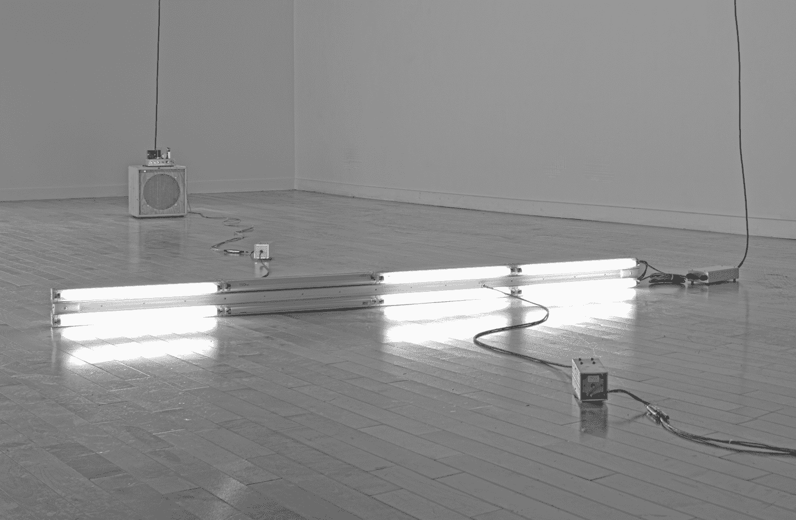

探头在与控制开关开关的代理竞争时，**图 6.2**

Stephen Kelly, *Open Ended Ensemble (Competitive Coevolution)*, 2016. Photo credit: Caitlin Sutherland. Courtesy of Stephen Kelly.

该系统使用了纠缠程序图（Tangled Program Graphs），一种基于 GP 的强化学习技术，利用小型程序团队协作并协同演化（Kelly, 2017）。这些团队可以理解为组成它们的程序通过相互作用产生的虚拟生物。

在展览期间，两个各有 200 个这样的团队种群进行竞争和协同演化；一个种群连接到探头的移动，另一个连接到灯光的控制。每分钟选择一组程序团队，一个控制探头，另一个控制灯光。每分钟评估每个团队的适应度。每小时删除团队种群的一半，只保留最适应的个体，并对剩余成员应用交叉和变变的遗传过程产生下一代。随着这种进化过程的重复，探头和灯光的行为在实现目标方面变得越来越高效。

《开放式集合》中的代理对移动的控制并不完美，且观测有限，这使得它们处于一个部分不可预测的环境。艺术家表示，创作这部作品面临的最大挑战之一是，在他看来作品的塑形、视觉和音频组件在审美空间中的地位比其行为显著得多，掩盖了试错的过程。这一观点与我在艺术领域处理自适应代理系统时的观察产生了共鸣。在将学习行为整合到通过不同媒介呈现的全局体验中时，完全不清楚如何让观众观察或感受到这种行为。(5) 然而，正如凯利进一步指出的，装置的材料特性至关重要，因为它们也为观众提供了驱动系统的学习过程的线索。

## 生态系统

澳大利亚艺术家乔·麦道马克（Jon McCormack）批评了特定图像生成的遗传算法的内在局限性（如之前所述），他认为尽管这些算法声称具有多样性，但实际上系统生成的图像很难摆脱生成系统的限制。

事实上，在所有审美选择的应用中，产生的结果都属于“某一类别”，也就是说，它们表现出创建它们的底层形式化系统的强大特征（即 `[parametric]` 系统）。一种自然但未采取的策略是增加参数化系统的范围和复杂性，从而在表型中提供更广泛的可能性。在目前为止的所有系统中，这一过程都受限于艺术家或程序员的创造力，因为他们必须运用自己的智慧来提出他们认为会导致有趣结果的表示方法和参数化方案。搜索过程已经向上移动了一个层次（从参数到机制），但它仍然是一个需要人类承担的搜索问题：它（尚未）被形式化，因此也无法自动化（McCormack, 2006, p. 7）。

规避这些局限性的方法之一是观察此类系统如何依赖自上而下的范式，在这种范式中，优化算法被直接用于在可能性空间进行选择。另一种方法是使用自下而上的方法，它较少关注生成有趣结果的最终目标，而是利用遗传算法的生成和适应特性将观众带入体验中。一种艺术作品使用了这种方法，通过创建人工生态系统，使一组人工代理在虚拟或现实环境中进行演化。

McCormack 是这种自下而上或进化方法的领军人物之一。他最重要的作品之一 `Eden` (2004) 是一个“进化声学生态系统”，它在二维晶格上表示代理，方式类似于细胞自动^(6)（参见图 6.3）。代理使用一组编码为二进制染色体的规则相互以及对环境做出反应，然后使用学习分类器系统（LCS）进行演化，这是由 John Holland 发明的一种机器学习技术，与强化学习、监督学习和遗传算法有密切联系（Holland, 1992; McCormack, 2009; Urbanowicz & Moore, 2009）。

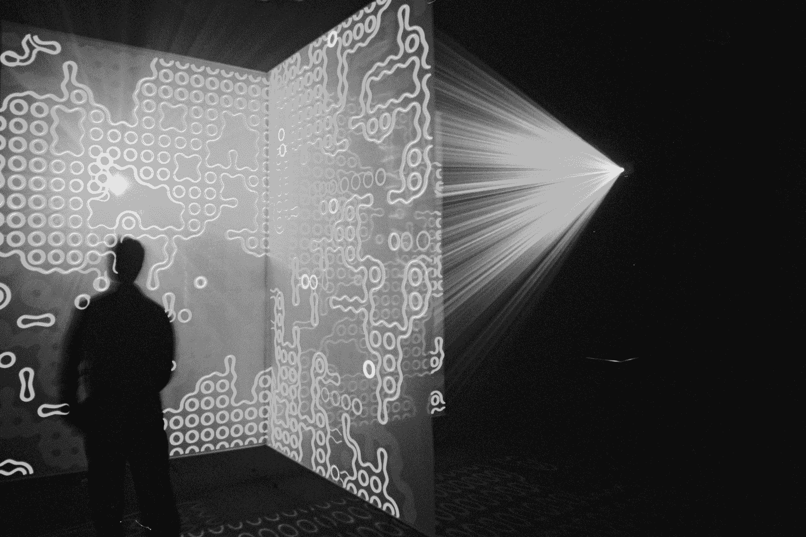

**图 6.3**

Jon McCormack, `Eden`, 2004。交互式装置、计算机、投影屏幕、音频、烟雾机、艺术家软件。照片来源：Jon McCormack 提供 ©2004。

该作品以视听装置的形式存在，观众可以体验模拟代理及其环境在移动、交配、进食以及使用声音信号相互通信时的状态。与 Karl Sims 的 `Galápagos` 不同（后者要求观众通过充当适应度指标来直接影响进化过程），而这里的代理仅间接地对访问者做出反应，访问者的出现对于向环境中添加“食物”是必要的，而观众的移动则增加了突变率（McCormack, 2009）。

至于作品的公众反，McCormack 注意到，虽然大多数人“并没有意识到学习系统、摄像头感知，甚至没有意识到他们正在体验的是复杂的人工物”，但该系统似乎吸引了公众。特别是，他指出，在许多展示该装置的场所，`Performative Ecologies` (2008–2010) 被作者描述为“对对话……的持续调查”（Glynn, 2008）。Glynn 在艺术家 David Rokeby 通过其“复杂性实验”以及 Pask 的对话理论（该理论提供了一种人类与机器在共享环境中交互的方法）遗产的基础上，将机器学习作为吸引观众的一种（见 6.46-4）。


**图 6.3**

Jon McCormack, `Eden`, 2004。交互式装置、计算机、投影屏幕、音频、烟雾机、艺术家软件。照片来源：Jon McCormack 提供 ©2004。

相比之下，人工神经网络构成了一个非参数系统家族，更容易应用于真实世界的信息，如图像或文本数据集。本着人工生态系统的精神，这些模型允许艺术家通过使用数据将生成性作品与现实环境相结合。因此，它们提供了在机器与世界之间建立关系的可能，为艺术家提供了一种自下而上的具身交互与感知方法。这种通过从现实世界学习来增强机器自主性的转向是人工神经网络的核心特征，我们将在两个章节中进行探讨。

# 注释

1. 遗传算法的历史可以溯到 1940 年克劳德·香农（Claude Shannon）关于理论遗传学的博士论文。香农后来凭借他的信息论成为控制论的重要人物。20 世纪 50 年代，数学家尼尔斯·巴塞里切利在访问普林斯顿高等研究学院期间设计了基因演化算法（Tenhaaf, 2014）。
2. 例如，参见 Rechenberg 的`evolutionsstrategie`（Rechenberg, 1965, 1973），以及 Fogel 等（1967）中描述的“进化编程”。
3. 适应度函数是一种评估函数，它为种群中的个体赋予一个值（通常为实数），通常代表该个体在遗传算法（GA）试图解决的问题上的表现。例如，用于学习下棋的遗传算法可能会生成代理种群，并让他们相互对弈。适应度函数可以是胜率百分比（平局计为半胜）。
4. 换句话说，旋钮数组对应于基因型，而结果对应于表型。
5. 我在使用强化学习的项目时遇到过类似的困难，例如我的水下装置`Plasmosis`（2013）和`N-Polytope: Behaviors in Light and Sound After Iannis Xenakis`，后者在第三章中有更详细的描述。
6. 细胞自动机是一组排列成网格的离散细胞，每个细胞在任何给定时间只能处于多种状态中的一种。细胞根据取决于其相邻邻居状态的规则改变状态。细胞自动机是 20 世纪 40 年代初由约翰·诺依曼（John von Neumann）及其学生斯坦尼斯瓦夫·乌拉（Stanislaw Ulam）作为生物系统的计算模型发明的（von Neumann, 1951）。

# 7 浅层学习

与进化艺术运动并行，20 世纪 90 年代和 2000 年代出现了另一类艺术方法，它们使用特定类别的生成机器：人工神经网络。人工神经网络基于通用的黑箱模型，设计者通过允许网络从数据中学习来间接控制网络。此类方法优于进化算法的一个重要优势是，它们规了系统设计者需要使用自定义规则系统来定义解决方案空间的需求。

20 世纪 90 年代末，当尼古拉斯·巴格斯基（Nicolas Baginsky）继续为其神经网络自学习机器人乐队“三塞壬”（The Three Sirens）增加新成员并带着它在全欧洲巡演时，法国艺术家伊夫·阿穆克·克莱因（Yves Amu Klein）使用了无监督神经网络，这与巴格斯基在其人工生命项目`Living Sculptures`（活雕）中控制机器人系统所使用的神经网络类似。2000 年代，本·博加特（Ben Bogart）、乔治·莱格拉迪（George Legrady）和乌尔苏拉·达姆（Ursula Damm）等艺术家也在装置中使用此类系统，自主分析在展览现场拍摄的图像。

这些艺术家都愿意使用具有自身可能性空间的现成神经网络。因此，进化艺术家倾向于主要对人类手工算法系统的生成潜力感兴趣，而使用神经网络的艺术家似乎最受到构建奇特的自组织机器的驱动，这些机器能与世界产生意料之外的交互。因此，当威廉·莱瑟（William Latham）将自己定义为在自己定义的可能性范围内运行的“创意园丁”时，尼古拉斯·巴格斯基则更进一步地远离了自己的作者身份——甚至将自己呈现为机器人的助手，而对机器人仅有间接控制。

## 神经网络

上一章节介绍了机器学习中`parametric`（参数）和`nonparametric`（非参数）模型的重要区别。参数系统对应于大多数自定义代码程序或数学公式，可以使用一组值进行调整。为了实现这些系统，必须先对系统可以生成的内容类型做出假设。作为一个比喻，想象一个有一组旋钮的模拟合成器，每个旋钮控制声波的一个预定义方面，如音高、振幅、调制或包络。以特定的配置转动旋钮会产生特定的声波；以不同的配置转动则产生不同的。换句话说，通过转动旋钮（参数），可以探索合成器可以生成的可能声音空间。

相比之下，非参数模型不对系统可以创建的可能类型做任何假设，而是实现一类程序或函数。继续我们的模拟合成器例子，想象不是转动旋钮，而是直接使用电线、电阻和电容器等简单元件组装电子电路。此类元件的某种配置将产生特定的声音——而在许多可能的配置中，它很可能是沉默或噪声。

在大多数进化计算应用中，这些非参数系统通常使用某种树形结构创建，其中每个节点代表一个操作或一个值。然而，这些结构在能够表示的程序范围内往往是有限的。这种表示上的局限性可能是它们与其近亲兄弟——人工神经网络之间最重要的区别。

人工神经网络最初于 20 世纪 50 年代提出，其特征是通用性：足够规模的神经网络可以拟合任何通过遗传编程过程学习的函数；然而，反过来并不总是如此（Cybenko, 1989; Hornik, 1991）。这种优势部分解释了神经计算的巨大成功，特别是 2010 年代初深度学习发展以来。

对于我们的讨论而言，或许意义更大的是神经网络如何如何进行这种函数近似。它们通过使用被称为`神经元`的自组织单元集合将输入数据投影到不同的表示层中来实现。这些神经元相互独立作用，但仍然能够协作出一个共同解决方案。这些人工神经元的每一层都构成了上一层神经元的`分布式表示`，试图捕捉数据中最相关的模式，并以紧凑且丰富的方式对其编码。

艺术家们在神经网络这些受生物学启发的、技术的表示模式中，发现了探索认知、想象力、记忆和梦境等问题的有效方法。神经网络在艺术中的前景似乎基于这些关联和过程通过这些系统显现的物质现实性。然而，这种实践仍处于初级阶段，很难说艺术家们未来将如何发展这一领域。

在这一刻，艺术界似乎正在热烈地拥抱用神经网络创作的艺术，因为艺术家们似乎在阐释这些技术在我们日常生活中的希望与危险。人工神经网络的历史极并不平坦，经历了兴奋、随之而来的失望、遗弃和重生的时期。在这些浪潮中，神经网络领域曾以各种名称被重新定义，例如“连接主义”以及更近期的“深度学习”。为了更好地掌握这些日益流行的模型的背景基础，值得向后回溯几年的时光。

## 早期连接主义

1949 年，加拿大心理学家唐纳德·O·赫布（Donald O. Hebb）为人类神经网络提出了一种革命性的模型。他声称，当脑细胞对特定类型的刺激同时做出反应时，它们在未来受到类似刺激时共同放电的可能性也会随之增加，从而形成神经元的自我组织装配。这一原则被赫布称为“一种连接主义的形式”（Hebb, 1949, p. xix），后来被称为`Hebbian learning`（赫布学习），该理论将人类记忆视为一种子符号的、分布的、自我加强的过程，而不是存储在脑中的编码表示的集合。(1)

在赫布的工作和大脑控制论模型的基础上，心理学家弗兰克·罗森布特（Frank Rosenblatt）于 1957 年提出了一种自适应连接主义设备，被称为`perceptron`（感知器）（Rosenblatt, 1957）。它是人类神经网络的一种简化模型，能够将模式分类为两个类别中的一种。感知器可以通过通过名为`weights`（权重）的参数值层（这些值对应于输入输出之间的突触连接），将一组被称为`input neurons`的二进制数据映射到`output neuron`，从而感知一个手写字符是 `X` 还是 `O`。权重是随机初始化的，在训练阶段根据已知预期输出的一系列示例输入进行迭代调整——这是一种监督学习的形式。(2)

感知器是机器学习历史上的一个里程碑。这些简单的系统将逻辑、统计学和自我组织的思想整合进一个计算装置中，可以通过监督学习循环用于专门用途，并被作为后期机器学习和神经计算理论的构建基石。然而，感知器也存在一个重要的缺陷，这一缺陷很快被基于启发式和符号操纵的人工智能竞争方法的支持者所指出。

事实上，20 世纪 50 至 60 年代对受人类生物学启发的连接主义结构的狂热，在马文·明斯基（Marvin Minsky）和塞义尔尔·帕珀特（Seymour Papert）对感知器的强力批判出版后（Minsky & Papert, 1969）受到了大幅抑制。在书中，他们证明了即使是简单的问题，这种原始的神经网络也无法解决，引发了人们对连接主义方法的极大忧虑。在 20 世纪 60 年代后期早期神经网络的消亡后，人工智能研究转向了更具符号性和启发式的方法，这些方法后来被称为符号 AI、经典 AI 或`good old-fashioned AI`（GOFAI）。这一时代的特征一方面是带有疑虑的乐观主义，一些研究人员成功地在国际棋或象棋等高层问题上迅速取得了满意的结果（Newell, 1955），并有效地响应简单的文本聊天交互，或解决模拟`microworlds`（微世界）中的问题（Winograd, 1970）；另一方面则是严重依赖符号的、基于规则的系统，对神经网络等受生物启发的系统几乎不感兴趣。

## 连接主义的复兴

回到 20 世纪 80 年代中期，科学家们发现了一种基于感知器架构计算更先进神经网络的有效方法（Rumelhart, Hinton, & Williams, 1986）。这些系统当时被称为`multilayer perceptrons`（多层感知器，MLP），今天更广泛地称为`deep neural networks`（深度神经网络，DNN），它们由堆叠的多层感知器组成；因此它们与感知器的区别在于不仅有输入和输出神经元层，在输入输出之间还有一个或多个`hidden layers`（隐藏层）。与感知器类似，第一组权重将输入神经元映射到中间隐藏层，在其中学习输入的抽象的、更高层次的表示。最后，使用第二组权重对隐藏神经元进行组合，产生下一层神经元。(3)这一过程逐层进行，直到到达最终输出层产生结果。

模仿人类大脑的神经网络，MLP 等连接主义网络以分布的、子符号的方式表示信息，而不是符号 AI 中常用的局部的、符号的局部表示。在训练过程开始，权重是随机初始化的，因此网络的决策完全是混乱的。通过接触环境（换句话说，通过接受从真实世界分布中采样的示例），网络逐渐调整并做出越来越好的预测。

为了理解人工神经网络中分布式表示的概念，请想象原始的感知器只有一个表示层，该层接收原始表示（例如，字母的黑白图像）并将其投影为类别表示（例如，`X` 或 `O`）（参见图 7.1）。另一方面，MLP 使用了被称为隐藏层的中间神经元层，每一层都根据前一层输出的表示来表示信息。

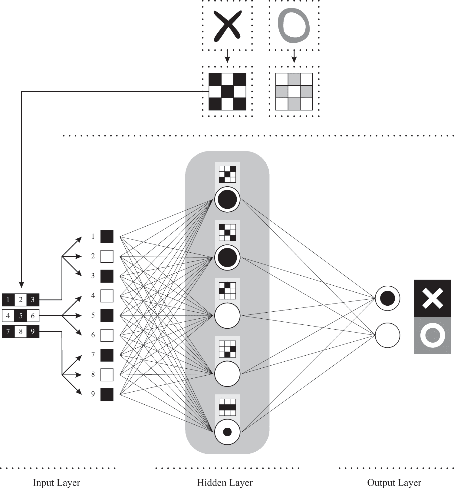

**图 7.1**

具有单隐藏层的多层感知器图。第一层是由于输入神经元映射到隐藏神经元的感知器集合。每个隐藏神经元都专门负责识别一种特定模式或`特征`（显示在神经元上方），并在输入中遇到该模式时激活。第二层是另一个感知器，它结合这些特征以找到合适的类别。来自 Jean-François Renaud。

在训练期间，这些隐藏神经元中的每一个都适应了对应于一种模式类型的自学类别。所有神经元的预测随后在第二层中汇总，实际上是另一个感知器。该神经网络层不接收原始数据，而是接收位于隐藏层中的新的压缩、编码数据层。基于对原始数据更丰富、更紧凑的表示，第二层发出了最终预测（`X` 或 `O`）。

这些表示是以自主的方式学习的，这种方式有时对人类观察者来说可能是令人惊讶或难以理解的。这些隐藏特征并非为了人类的视觉而设计，而是被模型用于提高其性能。这种在某种程度上超出人类控制的不可理解性，蕴含着惊喜和新颖的潜力，可以被艺术家所利用。

## 音乐与连接主义

从 20 世纪 80 年代中期到 90 年代中期，连接主义计算方法经历了某种复兴。在这一时期，音乐领域无疑是艺术领域中神经网络应用取得进展最重要的地方，特别是在乐谱的分析和生成方面。

连接主义的音乐作曲方法延续了之前使用被称为`Markov chains`的数学过程的工作。`马尔夫链`是一种概率系统，根据固定概率对状态之间的转换进行建模。这些转换概率可以人工定制，也可以从现有的分区语料库中学习。`马尔夫链`的一个重要属性是，它们使用有限的先验事件窗口来表示事件序列之间的转换。例如，如果最近弹出的音符是 C，`马尔夫链`可能会给再次播放 C 赋予 25% 的概率，给播放 E 赋予 75% 的概率。因此，在`马尔夫链`中，只有最近的有限数量事件会影响未来。

作曲家 Iannis Xenakis 在 1959 年为他的作品 `Analogique A` 和 `Analogique B` 以及为 18 部弦乐创作的作品 `Syrmos` 使用了`马尔夫链`。他在他革命性的著作《形式化音乐》中解释了他的方法，通过他称为`screens` 的表格，描述了从一个音符到下一个音符的转换，每个表格都配置了用于音乐空间特定区域的生成过程 (Xenakis, 1992)。

许多其他作曲家也在他们的作品中使用了`马尔夫过程`。两个著名的例子出现在 1987 年发布的商业音乐软件中：由 David Zicarelli 开发的 `Jam Factory` 以及由 Zicarelli、Joel Chadabe、John Offenhartz 和 Anthony Widdoff 合作的 `M`。这些程序的一个重要特征是它们能够从用户提供的乐谱语料库中生成转换概率。这些程序的另一个关键特性是能够使用长达四个音符的时间窗口来捕捉音符之间的关系。换句话说，虽然 Xenakis 和许多人使用的是仅由最后一个音符影响下一个音符的一阶链，但 `Jam Factory` 和 `M` 使用了四阶链，允许根据之前的四个音符来选择下一个音符。尽管在理论上人们可能假设四阶链会导致更丰富、随机性更低的音乐作品，但现实中，增加时间窗口往往会使软件直接从语料库中复制整个音符序列，从而降低了原创性 (Ames, 1989; Baffioni et al., 1981)。

这种使用较大参考窗口的缺点是基于在现有文本或音乐语料库上训练的`马尔夫模型`中一个广为人知的问题。`马尔夫链`往往无法捕捉事件之间的长期结构依赖关系。例如，一个在蓝调音乐数据库上训练的`马尔夫链`可能生成一或两个小节，但很难创建一个具有适当开头、中间部分和结尾的连贯乐谱。由于`马尔夫链`仅使用其训练材料中已存在的事件的局部或给定表示，它们无法感知高层级信息，例如两个音符之间的半音数。换句话说，尽管`马尔夫链`与机器学习系统共享一些属性，但它们缺乏神经网络所提供的那种自组织和分布式表示能力。

在 20 世纪 80 年代后期，Peter M. Todd 通过多项利用连接主义技术作为`马尔夫链`替代方案的研究，探索了神经网络在算法作曲中的应用。当人们在算法生成中涉及连接主义时，神经网络被训练以根据先前的 `N` 个音符预测后续音符的概率。在系统选择一个音符后，该过程可以重复进行，直到生成完整的乐谱 (Todd, 1989)。

与研究者 J. P. Lewis 和 Michael C. Mozer 一起，Todd 还发表了使用`循环神经网络` (RNNs) 获得的结果。`循环神经网络`是一种神经网络，它通过将其某些输出反馈到其输入中发挥作用。这种机制创建了一个反馈回路，允许循环网络保留过去的痕迹——这是一种对序列中观察到的数据的一种短记忆记忆。因此，这些网络在处理乐谱以及声音或文本等序列或时间性数据时非常受欢迎。

20 世纪 80 年代连接主义技术在音乐中的应用研究很快就遇到了限制 20 世纪 90 年代其他神经网络研究的核心挑战。当时计算能力的有限，加上可用数据库规模较小，以及连接主义网络重要的理论局限，使得这些新兴的连接主义方法在实践中的效率实际上低于`马尔夫链`等竞争性乐谱生成方法。

## 连接主义遇到人工生命

在这些关于连接主义音乐乐谱生成的早期实验后不久，20 世纪 90 年代初，本书开头介绍的艺术家 Nicolas Baginsky 开发了他自己用于使用神经网络进行现场音乐生成的新颖方法。Baginsky 意识到当时该领域正在进行的研究，但像那个时代的许多其他艺术家一样，他对在预存音乐上训练的连接主义系统的结果并不印象深刻，如上所述，这些系统的表现比简单的`马尔夫链`好不了多少。这一主要原因仍然成立：科学家开发算法策略时通常会考虑现实世界的实用性。这通常涉及对预存数据的模仿（例如使用机器学习创作模仿巴赫风格的音乐）或对此类信息进行分类（以判断某首歌曲是巴赫还是他那些平庸的同代人创作的）。这类比较系统寻找的是平均值而非离群值，因此倾向于生成平庸的模仿，而不是创造新事物。因此，当艺术家使用科学研究开发的算法时，他们必须批判性地评估系统是如何设计的，以及机器是否正在进行技术上成功但最终缺乏原创性的过程。

自组织映射（Self-organizing maps）是一种类似于感知器的无监督神经网络（Kohonen, 1981）。它们使用一种竞争学习的形式进行训练，其中神经元在低于输入维度的空间（通常为一或两个维度）中进行竞争，通过这一过程生成输入的映射。由于它们与神经学之间深厚的联系、具备自主工作的能力以及实现上的简单性，SOM 已被许多艺术家使用。这些艺术家将 SOM 的自组织特性作为决策过程的一部分，使该技术偏离了其预期的用途——即从固定数据集中提取规律。

事实上，Baginsky 并没有按照 SOM 的初衷来使用它们：他并非仅仅将它们用于寻找某些固定数据集的更紧凑的表示；相反，他将它们整合到一个实时的、不断适应的现场表演中，让他的机器人能够发现自己对世界的表征，从而在没有外部监督的情况下发明自己的即兴音乐创作。

Baginsky 的机器人乐队“三位塞壬”（The Three Sirens）中的吉他和贝斯手机器人使用 SOM 来引导它们的动作，以根据声音环境实时演奏现场音乐。这些 SOM 中的神经元对应于吉他上特定的弦，并根据传入的光谱进行相互竞争。每一步获胜的神经元都会引导机器人演奏相应的弦。由于声音环境很大程度上受到它们自身演奏的影响，这个机器人乐队也纠缠在一个贯穿于它们身体和环境的反馈回路中。该作品一个特别引人入胜的方面是，由于它们 SOM 中的连接在表演之间被保留，机器人似乎在多年间不断演化：

当机器人于 1992 年 12 月首次开始演奏时，控制机器行为的六个神经网络 [原文如此] 都是随机初始化的。今天，已经有几组不同的网络适用于不同的运行模式（不同的速度和调弦）。所有这些集合都是 1992 年原始神经网络的后代。这意味着机器人系统现在已经有了大约十年的演奏经验。并非持续不断，而是规律性的（Baginsky, 2005）。

其他广泛声称在 20 世纪 90 年代在其作品未使用神经网络的艺术家，实际上都在使用 SOM。雕塑家 Yves Amu Klein 就是此类情况，他展示了对创造自主机器人生命形式的明确承诺。在他的《活生生的雕塑》（`Living Sculptures`）项目中，艺术家使用了机器学习以“为雕塑生命形式带来情感智能和意识”（Klein, 1998, p. 393）。该系列中的作品是一个名为 `Octofungi` 的机器人雕塑，这是一个反应型机器人，通过微妙、不可测的行为对人类的出现做出反应。Octofungi 创建于 1996 年，依靠记忆合金丝来控制排列成圆形的八条机器人腿。机器人的运动源于腿部位置与测量来自各个方向光线的八个光电传感器值之间的相互作用。来自腿和光电传感器的数据被输入到 `SOM` 中，`SOM` 自主地从输入数据空间提取规律，并选择激活八条腿之一作为响应。SOM 在实时适应环境的同时，从环境中学习。

意义在于，Baginsky 和 Klein 都将 SOM 的自组织特性作为决策过程的一部分。这种对 SOM 架构的使用方法与 SOM 将高维数据压缩为更少维度的传统用法相反。事实上，SOM 通常应用于具有许多维度的大型数据集（例如，一张 10 × 10 的图像有 100 个维度），它们识别出原始输入数据中最重要的规律，然后将新数据点投影到更紧凑的表示空间，例如二维（2-D）或三维（3-D）空间。这种映射将输入模式与自组织神经元关联起来，使得相似的模式与附近的神经元调谐。

这种以有意义的方式将输入有机地重新映射为输出的能力，似乎被这些艺术家有效地利用，以生成新的、不受控制的行为。艺术家因此劫持了技术以追求审美和诗意的目标。这种无需人类干预的无监督学习方法，代表了与机器学习的原创交互。

## 连接主义视觉

除了机器人作品外，艺术家在 21 世纪初使用 SOM 来激活和解释真实世界的实时图像。例如，在她的 `InOutSite` 装置系列（1997–2005）中，德国艺术家 Ursula Damm 使用 SOM 来探索路人的行为。在这个系列作品中，这些地点的实时录像通过不同的计算机视觉算法进行处理，以发明能够适应用户的交互架构。

《空间记忆》（`Memory of Space`，2002）是该系列中首次使用自组织映射的作品（见图 7.2）。在这个公共艺术装置中，摄像头捕捉了马德里太阳门（Puerta del Sol）——这里最繁忙的地方之一的行人。公共广场的坐标通过输入运动方向和每平方米人数密度的 `SOM` 进行实时变形。生成的地图以三维可视化的形式呈现，说明了由神经网络自主解释的行人行为。被无监督机器学习程序重新解释的空间为路人提供了一个扭曲的视角，一种通过机器视角观察人类活动的疏离视觉化。

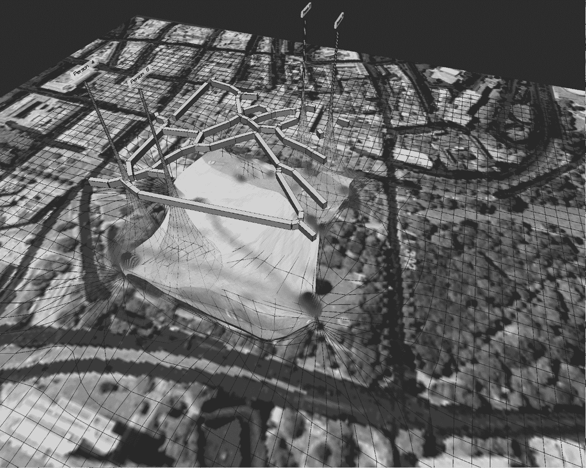

Ursula Damm, Memory of Space, 2002. Programmer: Matthias Weber. Courtesy of Ursula Damm.

Urs Damm 最近的作品《色彩交响乐》（`Chromatographic Orchestra`，2013）以更互动的方式使用了 SOM。在这里，艺术家使用了由合作者 Martin Schneider 设计的自定义软件框架 `Neurovision`，其灵感直接来源于人类视觉系统的工作方式。当软件分析展览周围的实时视频捕捉时，用户可以通过脑电图（EEG）设备控制可视化软件的参数。该装置允许访问者使用自己的脑波在由自组织映射创建的抽象和生成式视觉空间中导航。通过这个装置，Damm 与 19 世纪末和 20 世纪初的绘画运动（如印象派和立体主义）进行了类比，在这些运动中，“绘画更多是对对环境感知的分析，而非对后者的简单呈现”，“通过破碎观察物体，而表示方式由人类感官系统的性质决定”（Damm, 2013）。

## 涌现表征

George Legrady 是首批将 `SOMs` 作为艺术装置一部分使用的媒体艺术家之一。他的作品 *Pockets Full of Memories* 于 2001 年夏天在巴黎蓬皮杜中心展出（参见 7.3）。在整个展览期间，公众被邀请通过扫描他们拥有的物品并提供关键词列表来参与。在那个夏天，超过 3300 件物体被贡献给了这件作品（7）。在 Legrady 的作品中，SOM 组织了这些异构内容，根据从图像中提取的特征自动将物品照片放置在 `2D` 地图中。


**图 7.3**

George Legrady, *Pockets Full of Memories*, 2001. 数字数据截图。由 Legrady Studio 提供 ©2020.

这种参与式收藏的组织因此变成了艺术家、观众和神经网络之间的协作。虽然物品本身对参与者具有某些特殊意义，但在 *Pockets Full of Memories* 中，这种意义以某种方式被重新利用，在人类和非人类之间形成了一种新的涌现意义——这是一种由计算代理生成的混合意义，它对人类经验不可感知，但其结构灵感来自人类大脑中记忆的工作方式，并使用了来自真实 (8) 世界提供的元素。

Legrady 将这些对象的 `2D` 布局类比为地图。相似物品倾向于位于相同的区域。然而，如果相关的关键词不同，即使看起来相似的物品可能也不会被归类在一起；同样的原理，如果两个对象的视觉属性不同，两个描述相似的物体也可能彼此相远。他写道：“也有某些情况，即使邻居之间的距离也相当遥远，因为在自然景观中偶尔会出现分隔区域的山谷和山脉” (Legrady, 2002)。

因此，顺序通过神经网络的自组织属性从参与者的贡献中产生。“从比喻来说，相似的物品在没有任何中央指令的情况下相互寻找”（Legrady, 2022）。结果是不可预测的且带有某种诡异感，因为个人意义在机器学习系统的调解下合并成了集体意义。

## 上下机器（Context Machines）

媒体艺术家 Ben Bogart 的 *Context Machines* 是一系列情境化的生成艺术品，其算法源于创造力和记忆的科学模型。这些作品依赖于算法分析的实时视频捕获，算法根据其对现实世界的实时解释自动生成新的表示形式。这些机器置于其环境中，并以一种具身的方式对其做出响应，这种意义在于这些感知系统的内部动态与现实世界存在因果联系。

尽管 *Context Machines* 使用了代表现实的模型，但其作者对“执行的具体过程”比对“表征的抽象概念”更感兴趣。通过这种概念上的转变，他们拒绝了将“执行”与“表征”分离的计算主义。然而，由这种自组织适应过程创建的表示模型不是虚拟的，而是物质的。

从唯物主义的角度来看，表示的行为并不比任何其他过程缺乏物理性。这种二元对性的根源在于物质现实与艺术概念之间可能缺乏连续性。对“执行”的兴趣是对概念与物质进行严格整合的渴望（Bogart & Pasquier, 2013, 116）。

我同意这一陈述，正如我认为之前介绍的 Thompson 的物理适应 `FP` 与神经网络和其他模型属于同一个概念范畴。技术系统不是虚拟或抽象的，因为它们最终连接到物质现实，在矿物以及消耗真实能量并产生真实热量和能量的物理机器上激活电荷。

Bogart 的 *Context Machines* 与其他基于摄像机的特定场地装置有关，例如 David Rokeby 的 *Sorting Daemon* (2003) 和 *Gathering* (2004)。然而，与 Rokeby 的监控拼贴不同，Bogart 的装置直接利用了与认知过程相关的机器学习模型（参见 7.4）。Bogart 属于 *Context Machines* 系列的 *Memory Association Machine* (2008) 应用了 `SOMs` 来生成性地组织相机捕捉的图像拼贴（参见 7.5）。Bogart 对 `SOMs` 感兴趣是因为它们通过微观特征的组装，提供了一种人类创造力构想为“记忆组件之间高度控制的关联形式”的方法（Bogart & Pasquier, 2013, 117）。


**图 7.4**

使用 `SOM` 在黑白形状图像上训练的自组织特征图。该 `SOM` 仅根据其原始像素值学习如何沿两个轴组织图像。由 Ben Bogart 提供。


**图 7.5**

由 Ben Bogart 的 *Memory Association Machine* (2008) 生成的特征图。数字数据截图。由 Ben Bogart 提供。

## 结论

从 20 世纪 90 年代开始，艺术家对人工神经网络的无监督属性产生了兴趣。这些模型具有类似于人工生命和进化计算的自组织属性，但提供了直接从真实世界数据中学习的额外能力。灵感源自神经系统和大脑中的生物神经网络，它们非常适合对个人和集体感知与表示模式进行艺术探索。20 世纪 90 年代由 Nicolas Baginsky 和 Yves Amu Klein 创建的开创性艺术作品，随后在 00 年代初由 Ursula Damm、George Legrady 和 Ben Bogart 使用无监督神经网络的作品，为很快出现的使用更强大的神经网络的作品奠定了基础。在此期间，当这些艺术家正在开发连接主义编程策略时，绝大多数工程领域认为连接主义是一个死胡同。

然而，在 21 世纪 00 年代中期，机器学习领域的一场革命允许更复杂的深层神经网络架构得到高效训练，使神经网络重新回到了前沿。从这一突破中，机器学习内部出现了一个全新的研究领域，称为深度学习。

这些剧烈变化引发了机器学习系统的快速工业化并产生了全球影响，并很快引发了一系列全新的艺术作品。这些作品重新利用并扩展了本章描述的基于 `SOMs` 等浅层神经网络架构的早期作品中存在的许多非人类表示和算法组装概念。

# 注释

1. 类似于赫布学习（Hebbian learning）的生理学习理论自 19 世纪以来一直存在。关于深入的历史回顾，请参见 Cooper (2005)。
2. 值得提到的是，感知器的发明与另一个受 McCulloch-Pitts 模型（McCulloch & Pitts, 1943）启发的联结网络几乎处于同一时期产生的，后者是自适应线性单元或 ADALINE（Widrow and Hoff, 1960），它使用了相似的学习规则。
3. 人可以将人工神经网络视为一个代理共同体，其中每个隐藏神经元被视为一个最小代理，成为特定领域的专家分类器。这些代理被鼓励在它们之间划分输入空间。然后它们被组合产生最终输出，就像它们在投票一样。
4. 乐谱的数学和结构化性质使得音乐作曲问题成为人工智能的理想选择，因为通过预先存在的作曲规则和风格习语，音乐的可能性被大大减少，特别是与原始声音、视频和人类语言等其他内容相比，后者具有更多的变化和复杂性。
5. Teuvo Kohonen 在 20 世纪 80 年代初根据 70 年代对皮层细胞的研究以及阿兰·图灵关于形态发生学的著名工作，开发了自组织映射网络（SOMs）。
6. Klein 的《活雕塑》（*Living Sculpture*）系列的其他作品也使用了 SOMs，包括 *Scorpibot*（这是艺术家首次尝试它们的尝试）、*The Pods*、*Bella* 和 *Flexicoatl*。
7. 完整集合可以在此处找到：[`tango.mat.ucsb.edu/pfom/databrowser.php`](http://tango.mat.ucsb.edu/pfom/databrowser.php)。
8. 出乎意料的是，随着人们在视频投影上看到越来越多这些图像，许多参与者提供了他们自己的身体图像，如头、手和脚，且频率越来越增加。

# 8 深度学习

在 2010 年之前，艺术领域对机器学习的介入仍然处于边缘，并依附于人工生命和机器人艺术等更广泛的艺术趋势和运动。特别是，使用神经网络的作品极其稀少。然而，在 21 世纪的第二个十年，被称为深度学习的机器学习神经方法的新进展导致了机器学习系统的快速工业化，并扩散到社会的所有领域，包括艺术界。在 20 10 年代中期，主要活跃在社交媒体上的早期采用者子网络开始探索这些新型神经网络技术的创造性。这种痴迷被 IT 行业作为营销策略的一部分进一步推，，旨在以尽可能少的监管促进其 AI 产品和服务的社会接受，而这些行业在艺术应用中看到了一种途径。

这些深层网络的特点是具有自主性，允许用户直接处理原始数据。此外，这些系统是可扩展的：随着深度学习的出现，几个开源库允许具有基础技能的用户在没有学位的情况下构建简单的神经网络。

这一突破与其他许多进展一起发生，引发了机器学习中一个名为深度学习的新兴领域。其中一些实践（如 Inception 和 GANs）非常普及并引起了媒体关注。

## 从联结主义到深度学习

直到 2000 年代中期，在大多数情况下，高效训练浅层架构（即少于三层的神经网络）是可能的。但一小组研究人员相信，如果我们能够创建具有多个层的更复杂的神经网络，机器学习领域将得到进一步改进，这得到了神经科学研究的有力支持，人类大脑组织在深层结构中，通过许多抽象层次处理感觉信息（Bengio, 2009; Serre et al., 2007）。例如，视觉皮层包含对应于不同表示程度的神经元层，从边缘和方向等具体的简单特征到人脸等更抽象、复杂的形状（Kruger et al., 2013）。

在 2000 年代初，原始计算力变得对科学家容易获得，促进了机器学习专家 Jürgen Schmidhuber 所说的“第二次神经网络复兴”（Schmidhuber, Cireşan, Meier, Masci, & Graves, 2011）——这是对 20 世纪 80 年代由反向传播算法发表引发的第一次复兴的引用（Rumelhart, Hinton, & Williams, 1986）。这种计算力的增长允许研究人员在更大的模型上进行实验，促进了解决浅层架构缺陷的算法技术的发展。

2006 年，多伦多大学 Geoffrey Hinton 小组的研究人员提出了训练深度神经网络的解决方案（Hinton, Osindero, & Teh, 2006）。这一令人兴奋的进展填补了 Hinton 最后一次与 Rumelhart 和 Williams 发表反向传播工作 20 年后的空白（Rumelhart, Hinton, & Williams, 1986）。他们提出的方法在将整个系统用于传统的监督学习程序之前，使用无监督学习对模型的较低层进行预训练。他们的方法在计算机视觉应用比竞争方法取得了显著改进。

这一突破与其他许多进展一起发生，引发了机器学习中一个名为深度学习的新兴领域，其主要应用在于解决困难问题（如驾驶汽车），允许计算机“从经验中学习并根据概念层次来理解世界，每个概念根据其与简单概念的关系来定义”（Goodfellow, Bengio, & Courville, 2016, p. 1）。深度学习试图通过在互连神经元的嵌套层中从简单概念构建复杂的抽象概念来完全自动化学习过程（见图 8.1）。

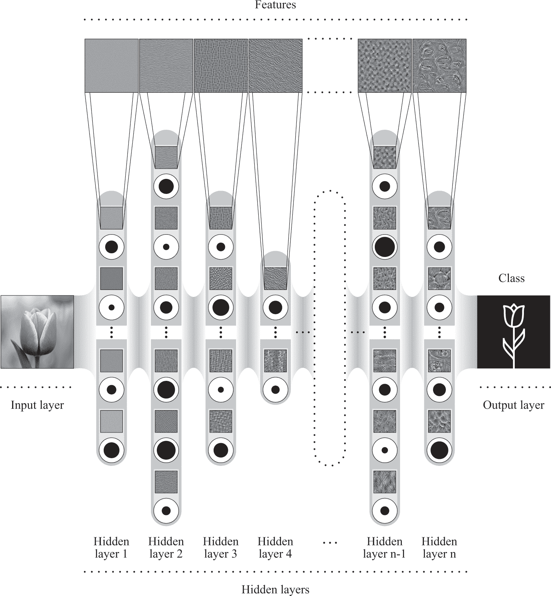

**图 8.1**

具有许多隐藏层的深度神经网络示意图。每个隐藏神经元都专门化于识别某种特定特征（显示在神经元上方）。随着神经元在前一层的特征的基础上进行构建，感知模式在更高层中变得日益复杂和多样。因此，每一层神经元都以日益丰富的表示层次对输入数据进行编码。虽然该图展示了图像分类的深度神经网络示例，但基于堆叠互连神经元层这一相同的核心原理，可以实现许多不同的深度学习架构。Jean-François Renaud 绘。

许多人似乎认为深度学习是人工智能一直期待的颠覆性技术。通过深度学习技术，人工智能已正式走出学术界，并成为下一次工业革命的核心战略元素。深度学习已成为 `Google`、`Facebook` 和 `Microsoft` 等大型 IT 公司的先锋，这些公司认为其是自己在二十世纪竞争力的关键.^(2) 但尽管有证据表明，深度学习技术对于多个市场企业的未来发展和生存至关重要，但私营部门面临的一个重要挑战是培养公众对这些技术的认可。从普通大众的角度来看，人工智能可能带来的真实或想象的后果对未来 AI 驱动产品的传播构成了潜在威胁。对于这些公司来说，艺术变成了一个低成本、高回报的投资领域，作为“人工智能向善”的宣传手段.^(3)

2010 年代机器学习艺术的一个定义性时刻，是 Google 工程师 Alexander Mordvintsev 在 2015 年发布的 `DeepDream`，该软件使用在数百万张图像上训练的深度神经网络来生成奇异的幻幻模式.^(4) 从用户提供的初始图像开始，网络分析样本图像视觉细节的每个部分，并被推向加强对图像内容的敏感性。这种对特定图像敏感性的增强产生了一种“算法类视错”（algorithmic pareidolia）——即人类在随机观察中于看到模式和意义的倾向，例如在罗夏墨测验图中看到大象，或在披萨上看到耶稣基督的脸。

`DeepDream` 作为开源工具的发布引发了巨大的兴奋，发布后不久，经过 `DeepDream` 增强的照片开始在社交媒体上流传。在发布后的一年里，旧金山的灰色地艺术基金会（Gray Area Foundation for the Arts）与 `Google Research` 合作举办了一场展览和拍卖，专门关注 `DeepDream` 生成的艺术作品。

当《终结者》的恐怖图像让位于艺术化神经网络梦出的幻幻景观，并作为有关人工智能在线文章的配图时，这些干预在某种成功地将媒体的注意力从关于杀手机器人的灾难性文章转向了更积极的内容。人们可以将这种转变视为一种通过唤起人工智能浪漫的人类属性，将其从杀人机器重塑为梦幻机器，从而重新人性化人工智能成功尝试。

`DeepDream` 是对机器学习过程一次真正具有创新性和创造力的劫持，在艺术社区以及公共媒体中引起了大量关注。但 `DeepDream` 能被视为艺术吗？还是它仅仅是病毒式营销的形式？也许它是自身成功的受害者，`DeepDream` 仍然处于一个灰色地带：它经常被推为创意表达的工具甚至是一种新的艺术形式，但无法将其与其出生的跨国公司的研究、意图和战略议程隔离开。事实上，由于使用 `DeepDream` 算法产生的艺术作品很容易被识别，任何通过这些算法创建的艺术作品都会立即延续并指向其创源者，因此不可避免地为 `Google` 的社交媒体活动做出了贡献。

虽然今天有许多艺术形式和观众已众所周知，但很难证明 `DeepDream` 是一个文化对象，能够促进博物馆和画廊等当代艺术圈所培养的那种前卫批判、重新发明和艺术观点。与其具有同等或更高价值的其他创意工具或艺术作品相比，它所获得的关注程度很难与 `Google` 通过其搜索引擎和内部广告架构直接或间接地推广其在线影响力的巨大能力脱钩。结果是，`DeepDream` 很难与其显眼的起源脱钩，也难以被其公司结构之外、想要修改或拆解它的个人所利用。

这并不是说一般的商业活动与艺术是不兼容的。在新媒体艺术中，私营企业与艺术家之间有许多有价值的交流案例，其中一些在本章中有所讨论。例如，考虑艺术家与私营企业之间成功的合作，如 Nicolas Schöffer 的 `CYSP 1` (1956)，它是与 `Philips` 合作的；以及 `9 个夜晚：戏剧与工程` (1966)，这是一系列现场表演，汇聚了 John Cage、Yvonne Rainer 和 Robert Rauschenberg 等当代艺术家以及 `Bell Laboratories` 的工程师。同样考虑那些不认同自己是艺术家的科学家和工程师的宝贵贡献，他们参与了如《控制论的偶然性》(1968) 和《软件》(1970) 等展览，而这些展览现在被认为是新媒体艺术领域的基石。

然而，21 世纪艺术家、科学家与跨国公司之间存在的严重权力不平衡，使得机器学习艺术在许多方面变得充满问题。在 20 世纪，新媒体艺术家探索并利用了最初为非艺术目的开发的现有技术。例如，20 世纪 9 年代的网络艺术运动利用互联网（这项技术最初由美国国防部开发，在 2000 年代之前一直保持非商业性）来创造了一种可以在传统艺术网络之外传播的独特艺术。相比之下，21 世纪希望与机器学习接触的艺术家必须在少数 IT 公司的霸权及其可能代表的复杂性背景下进行。

与私有 AI 公司合作可能会导致艺术家实际上充当了薪资廉微的文化货币甚至是技术劳动力。像 `Google Cultural Institute` 和 `Facebook Artist in Residence` 计划这样的艺术与科学倡议无法与支持它们的公司的战略利益分开。除了增强其公共形象外，这类驻留计划对这些企业也代表了一种便利的方式，可以通过以低成本获取艺术家的想法和专业知识，从而对他们进行资本化。

总之，由跨国公司驱动的 AI 艺术与创意倡议（如 `DeepDream`、`Magenta` 和 `Facebook Artist in Residence`）凸显了某种存在的紧张关系：一方面是控制 21 世纪 AI 研究与生产手段的私人机构，另一方面是当代艺术为了维持对社会的批判性参与所所需的自由与独立。

## 神经美学

21 世纪 00 年代年代中期的深度学习革命激发了一群定义松散的艺术家，他们积极探索这些技术所提供的新可能性。这些艺术家主要活跃在 `Twitter` 和 `Medium` 等在线平台，如 `Memo Akten`、`Robbie Barrat`、`Sofia Crespo`、`Mario Klingemann`、`Gene Kogan`、`Helena Sarin` 和 `Mike Tyka` 等，他们通过社交媒体直接在网上分享代码、模型、文档和其他资源，经常推特一些半成品的实验、演示和动画 GIF。这个精通技术的艺术家-程序员社区是一个新型艺术流派和实践组合的特征，源于对深度神经网络的狂野实验（主要是通过受 `DeepDream` 等深度生成系统启发或使用它们的图像生成），这被一些人称为“神经美学”或“神经艺术”。

`Gene Kogan` 是一位艺术家兼教育者，他为机器学习感兴趣的艺术家创作了许多免费教程和教育材料，是这一早期采用者和爱好者的小众群体的关键人物。他是少数几个创作者之一，探索了 `Mordvinstev` 起始主义技术的艺术潜力，而不仅仅是将其作为图像滤镜。在 `DeepDream` 发布后不久，`ogan` 使用原始技术的变体和增强版开发了许多演示和软件工具。特别是，他开发了一系列技术来探索通过起始主义可以创建的不同类型的生成内容，并展示了如何使用这些图像制作过程创建动画、过渡和循环。

与他的许多同事一样，`ogan` 主要在传统的当代艺术网络之外，在 `Twitter` 和 `GitHub` 等在线平台上发布他的作品，秉持开放、共享和集体发现的精神。他直接并公开以各种形式（如实验、演示、教程和未完成的作品）分享他的想法和工作。与他的许多同行一样，`ogan` 似乎并不在意他的作品是属于艺术还是科学领域，他将自己的社区与 1990 年代的网络艺术（net.art）运动相比，后者起源对互联网提供的新可能性感兴趣的在线社区自组织，在传统艺术机构的边缘产生并传播作品。

## GAN 艺术

2014 年，一种名为`生成对抗网络`（`GANs`）的新型深度学习系统的发明，为使用深度学习系统生成图像开启了全新的可能性范围，其方式比 `DeepDream` 更加灵活。`GANs` 的发展允许一系列新的作品和艺术实验，导致了“机器学习艺术中第一个广泛的趋势”（Hertzman, 2020）。`GAN` 艺术在当代艺术界的快速崛起在 2018 年达到转折点，当时刚从高中毕业的年轻多媒体艺术家 `Robbie Barrat` 在代码共享网站 `GitHub` 上发布了他编写的一个 `GAN` 程序，该程序是在 14 世纪到 20 世纪之间绘制的肖像数据库上进行过训练的。位于巴黎的集体 `Obvious` 使用 `Barrat` 的代码（并可能复制了他的预训练模型）以画布上物理打印的形式生成了一幅新画，这幅画随后在纽约佳士得（Christie's）拍卖行以 432,500 美元的惊人价格售出。这件作品可以被解释为一种算法现成品（algorithmic ready-made），它对艺术市场以及 `Barrat` 等成员的社交媒体网络中对新奇的无尽渴望提出了幽默的对比（Rolez, 2019）。

与许多艺术家使用的机器学习算法一样，`GANs` 最初并不是为了美学原因而开发的。它们构成了一类新型深度学习系统，通过让两个深度神经网络相互竞争来提高整个系统的性能，做法非常巧妙。虽然 `GANs` 主要用于图像领域，但该技术与其他机器学习系统一样对数据不可感知。因此，`GANs` 可以应用于任何类型的数据，从而在金融、医学、药学和语音识别等许多领域拥有应用。

构成 `GAN` 的两个神经网络由相互相反的目标驱动。第一个网络（被称为`生成器`或“艺术家”）试图生成与训练集中图像相似的伪造图像，以误骗第二个网络（`判别器`或“评论家”），后者的工作是区分真伪。该算法的巧妙之处在于这两个模型是并行演化的；因此，当`判别器`在区分真伪方面越来越高效时，“生成器”在伪造方面也变得越来越娴。

就像人类对感知系统特定特征产生的一系列幻觉敏感一样，深度神经网络在处理视觉图像时也有其自身的优势和缺点。由于`生成器网络`创建的图像不是为了感知系统设计的，而是为了人工神经网络`判别器`，而且`生成器网络`需要使用它自己的人工结构来创建图像，`GAN` 生成的图像既不是人手绘制的，也不是为了人类眼睛设计的，它们开启了一个特定的属于 `GAN` 的非人类美学宇宙，这些宇宙被艺术家利用来创造出奇异的机器现实幻觉。

在这些艺术家出现不久，如 Refik Anadol、Robbie Barrat、Sofia Crespo、Mario Klingemann、Trevor Paglen、Jason Salavon、Helena Sarin、Mike Tyka 和 Tom White 等许多艺术家，就开始探索 `GANs` 生成奇异、扭曲图像的潜力。这些图像令人不安的视觉特征让人联想到超现实主义绘画，马里奥·克林曼将其描述为“弗朗西斯·巴洛效应”（Schneider & Rea, 2018）。特定 `GAN` 的特定美学特征源于训练该 `GAN` 的数据库、所使用的评估函数以及底层神经网络的内在特性。`GAN` 生成的图像呈现为从训练集中提取的模式拼贴，这些模式以或或多规则的方式组合在一起——Bogart 和 Pasquier 根据 Gabora 的创造力理论将其称为 `microfeatures`（微特征）（Bogart & Pasquier, 2013）（见第 7 章）。`GANs` 还经常在输出中产生模糊、不精确的区域，即由于统计平均而导致的均匀颜色或纹理区域。生成的图像在细节上往往存在不平衡，某些区域的绘制精度高于其他区域，这通常与训练集中存在的不平衡有关。根据计算机科学家 Aaron Hertzmann 的观点，`GAN` 生成图像中固有的视觉不确定性可以通过观察算法的泛化目标来解释。`GANs` 不仅仅是从训练集中剪切粘贴元素；它们尝试在空间上生成并排列对象成一个场景，然后对其进行上色和纹理化。

这些排列和纹理不是离散的而是连续的——物体在图像中不需要清晰的边界，也不需要完整。这可能会产生物体身份、位置和纹理的不可能组合，所有它们相互渗透。也就是说，物体创建和纹理化步骤并非在独立的、不同的物体上运行，物体部分和纹理可以跨物体进行合并和融合，就像填充一本涂色书，但其中没有任何轮廓是闭合的，没有任何形状是完全正确的，或者像将不同拼图的碎片组合在一起一样。这产生了视觉上的不确定性。（Hertzmann, 2020, p. 425）

Mike Tyka 既是艺术家也是一名程序员，在 Google 工作期间，他曾与 Alexander Mordvintsev 和 Christopher Olah 合作开发了“主义”（inceptionism，即 `DeepDream` 的起源技术）（Mordvinstev, Olah and Tyka, 2015），他通过 `GANs` 创建了一个名为《虚构人物肖像》（2017）的系列。受到社交媒体利用虚假身份传播的新型宣传形式的影响，这些作品由高分辨率的怪异肖像组成，这些肖像源于从互联网抓取的人脸数据集上训练的 `GAN`（Tyka, 2019）。在创作这项作品时，Tyka 面临许多问题，其中一些是 `GANs` 著名的局限性。其中一个被称为 `mode collapse`（模式崩溃）的问题发生在生成器网络崩溃并开始产生有限种类输出时。这种情况下的另一个问题是 Tyka 希望使用更高分辨率的图像。图像包含大量信息（考虑到即使是 `100×100` 像素的小 `RGB` 图像也需要 `30,000` 个值来表示），这使得从图像机器学习是一项特别具有挑战性的任务，因为神经网络需要用有限的示例来理解所有这些信息（在 Tyka 的项目中，大约有 `20,000` 张图像）。回到 2017 年作品制作时，`GANs` 生成的输出图像通常限于 `128×128` 到 `256×256` 像素。为了扩大这一规模，艺术家必须堆叠多个 `GANs`，其中一些专门针对眼睛、头发和皮肤等明确面部特征的高分辨率图像子集进行训练，并巧妙地结合结果，以生成高达 `4,000×4,000` 像素的图像。

这一过程导致了结果：这些排列和纹理不是离散的而是连续的——物体在图像中不需要清晰的边界，也不需要完整。这可能会产生物体身份、位置和纹理的不可能组合，所有它们相互渗透。也就是说，物体创建和纹理化步骤并非在独立的、不同的物体上运行，物体部分和纹理可以跨物体进行合并和融合。这种过程产生了视觉不确定性，产生了形式上的不精确。自从这项技术取得了令人印象的进展，现在可以根据需要生成这类图像。该项目最引人注目的是其结果的均匀性和不完美，这为观众的想象留了空间。

## 潜在空间（Latent Space）

Tyka 的工作引入了深度学习的一个核心概念：潜在空间。潜在空间是神经网络学习的数据的一种数学表示。例如，神经网络中的层神经元构成了潜在空间。回想前章关于多层感知器的讨论，记住神经网络如何将输入投影到中间神经元层（即隐藏层），并从中提取相关特征。例如，想象一个神经元之一可能在图像中心为空时被激活（这是 `X` 的良好指标），而另一个神经元可能对图像底部的曲线敏感——这是某些人写 `O` 时的常见特征。

这种神经元层因此通过限制的特征来编码输入图像。这些特征对应于网络自动学习的抽象模式，例如循环和边缘。当输入层使用像素表示图像时，隐藏层使用更具信息的特征编码相同的信息，例如“中心没有像素”或“底部有曲线”。例如，假设在写下 `X` 并将其输入网络后，隐藏层输出了以下值：`1.0, 0.8, 0.1, 0.2, 1.0, 0.2, 1.0, 0.9, 0.0, 0.9`。这些值代表了输入数据（即所写的 `X`）的一种代码，每个值告诉我们特定的“特征”是否存在（1.0）、不存在（0.0）或处于两者之间。

这种由神经网络在训练后自动提取特征得到的表示被称为潜在空间。在多层感知器中，它在输出层被组合以对输入样本的类别进行预测（`X` 或 `O`）。

现在，想象我们可以设计一种神经网络，使其能够利用该潜在空间不是分类图像，而是生成新图像。换句话说，通过将隐藏层设置为 `1.0, 0.8, 0.1, 0.2, 1.0, 0.2, 1.0, 0.9, 0.0, 0.9`，神经网络将在其输出中生成一张手写 `X` 的图像。此外，这种新网络不仅可以根据神经元的值生成 `X` 和 `O`，通过选择另一组十个不同的值，可能还可以生成在 `X` 和 `O` 之间插值的新类型图像（某些 `X-O` 混合体），甚至进行外推（生成既不像 `X` 也不像 `O` 的图像）。

GAN 中的生成器网络正是这样工作的。一旦它完成训练，就可以直接更改其第一层的值并生成新的输出。由于神经网络的训练方式，这种输出可能会以模式拼贴部分的形式，具有训练数据集中某些某些特征。例如，通过向前述描述的系统注入十个随机值，我可能会得到一个 `X`、一个 `O`，或者一个既不像 `X` 也不像 `O` 但可能包含此类字符中某些元素的东西（比如环路和边缘的奇特拼贴）。

GAN 的另一个非常有趣的方面在于潜空间自组织的几何方式，这使得人们能够以直观的方式对其探索。对于潜空间中的每一个点，我们都可以获得不同的生成图像：靠近第一个点的另一个点将产生一个相似但不同的图像，这种差异是人类无法完全预测或预定的，因为它是神经网络使用其自己的一套指令学习到的。

潜空间在某种意义上是早早通过遗传算法和 SOM（自组织映射）引入的生成空间概念的最新迭代。我们讨论过，在进化计算的背景下，一种常用方法是作者定义一个参数空间，在该空间中，一组值（基因型）决定了生成输出（表型）（参见图 8.2）。例如，在道金斯的生物形态形（biomorphs）中，这样一组值对应于特定的画作。遗传算法提供了一种搜索该空间并找到偏好结果的方法。我们也描述了定义这个搜索空间的任务是多么复杂，因为责任完全掌握在作者手中，他们必须设计一个在空间上创建对象的生成程序。由于控制权高度推迟给了系统设计者，它也减少了惊喜的可能，从而违背了此类系统的原始目标。事实上，正如生物形态形的情况一样，大多数参数系统都有强烈的特征，即系统只允许产生可识别的类别的对象。

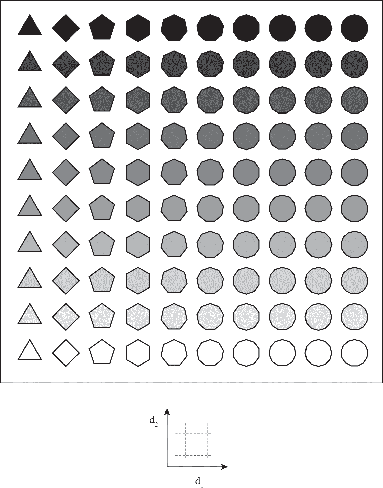

**图 8.2**

简单几何形状的参数空间示例。每个轴代表一个直接影响结果形状某方面的特定参数；横轴代表边缘的数量，纵轴代表填充的深浅。

自组织映射（SOM）构成了这类过程的升级，因为 SOM 会自动学习如何在没有人类监督的情况下组织元素。然而，SOM 并不是生成系统：它们能够找到输入的分布式表示，但无法从映射空间中的某一点直接生成新的输入。换句话说，SOM 能够将元素放置在地图上，但无法获取地图上的某一点并生成新元素。它们相比进化计算具有的一个优势是能够更轻松地处理来自真实世界的数据。之前提到的 Ursula Damm 和 Ben Bogart 的工作巧妙地利用了这些属性来创建真实世界的实时表示。

对于使用 GAN 的艺术家来说，特别新颖和有趣的一点是，他们终于能够创建一个生成空间，无需通过编码来设计它，而是通过寻找合适的架构和数据，让机器学习程序来定义空间（参见图 8.3）。思考这种的一种方法是想象：道金斯不是自定义编码他的生物形态形并然后创建一组九个参数（基因）来控制如分支数量和它们之间角度等特征，而是能够使用像 GAN 这样的生成学习网络来创建一个具有九个神经元的潜空间。他不再直接创建将这九个值转换为生物形态形的程序，而是创建一个生物形态形的数据集（例如，他可以按照他的想象画很多生物形态形的图片），然后将这些图像输入系统。系统随后会在这些神经元与新的、未预见的生物形态形之间找到一个的映射。

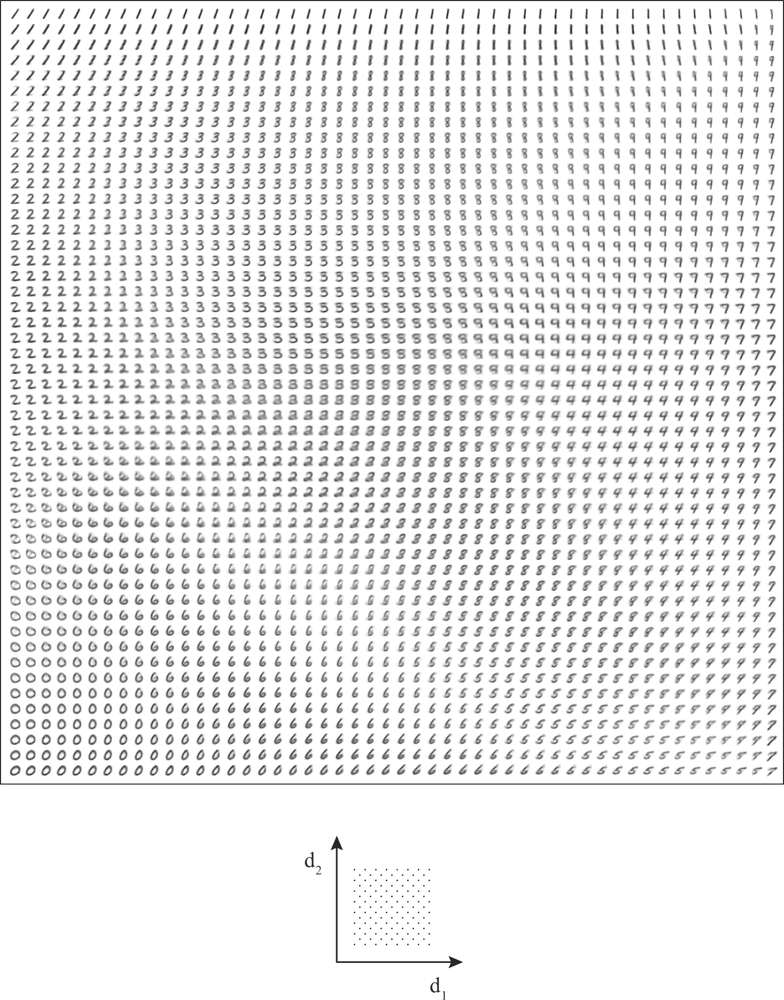

**图 8.3**

神经网络通过手写数字数据库学习的潜空间。每个数字都是神经网络根据其在二维空间中位置相对应的一对参数生成的。^(8) 由 Jean-François Renaud 根据 Audry 的原稿绘制。

有两件事可能会让道金斯感到意外。首先，由于神经网络分布式表示的性质，算法选择的参数可能并不直接对应于可识别的元素：例如，可能没有一个神经元直接控制分支的数量或深度，或者它们之间的角度。相反，多个神经元的组合平滑地决定输出，使得微调输出的过程变得棘手。

其次，神经网络内部神经元的协作性质通常会导致非常平滑的函数，这可能会使生成的生物形态更加模糊，甚至偶尔显示出潜空间的某些区域（对应九个值的某些组合），导致图像不是生物形态形，甚至可能是完全的噪声。^(9) 深度学习获得的是生成对应于世界自主构建图像输出的能力，而进化计算在没有任何源材料的情况下生成了更多惊讶的组合。

关于之前提到的艺术家 Mike Tyka 的工作，我们可以看到 GAN 如何能够自动生成一个完全取决于从世界输入的数据类型的潜空间。换句话说，为了创作他的系列《虚拟人物肖》（Portraits of Imaginary People），Tyka 创建了一个 GAN，允许他探索人脸的潜空间。潜空间中的某一点对应一张脸；另一个点将生成另一脸。一旦网络训练完成，艺术家的工作就是找到一种有趣的方式在该空间内进行导航、探索它并使用它来实现目标。

Tyka 的工作是对这一概念的直接运用。在这里，艺术家选择直接按照其意图使用这项技术，并将其推向更高精度的程度。作品的原创性在于，通过一个选择过程，他能够揭示系统在尝试生成新脸时的缺陷，产生出奇特的摄影肖像。

潜空间（latent spaces）也可以在图像世界之外被利用。尽管在艺术领域使用 GAN 的大部分工作都是针对图片的，但也有许多有趣的前卫作品将 GAN 或其他技术应用于其他数据形式。一个特别突出的作品是电子诗人 Allison Parrish 创作的由计算机生成的书籍 `Articulations`（Parrish, 2018）。为了制作这本书，Parrish 发明了一种技术，基于单词的语音特征创建一个`poem space`（诗空间）（Parrish, 2017）。在这个空间中，每个单词都由一个向量表示。

这个想法并不新鲜：第一批神经网络语言模型出现于 20 世纪初。这些神经网络语言模型使用了`word embeddings`（词嵌入）的概念，使用一种分布式表示来表示单词，这种表示法在某种程度上对应于语言域的潜空间（Bengio, Schwenk, Senécal, Morin, & Gauvain, 2006）。这些词空间具有几个值得注意的有趣属性。作为一个比喻，想象所有的英语单词都分布在一个景观中。在这里，单词的组织方式将使得语义上接近的词（如同义词或反义词）在地理上也接近。此外，在该片土地上向某个方向移动将对应于特定的语义关系，允许使用简单的算术操作对该空间进行处理。一个经典案例可以用以下例子来说：从单词 `man` 开始，想象你向单词 `king` 走，记录你行走的方向和步数。然后，将自己传送到单词 `woman`，并朝着你刚刚采取的方向以完全相同的步数行走，应该会带你到达单词 `queen`。这个例子用简单的英语表达为 `king is to man as queen is to woman`，它在词语义的潜空间中对应于简单的算术操作：`king − man + woman = queen`。

有趣的是，因为这些关系是通过学习得到的，它们也揭示了训练它们的语义环境的偏见。因此，现有的预训练词嵌入技术（如 `Word2Vec`）包含了人类语言中使用发现的相同偏见。一组常见的例子涉及此类系统中隐藏的性别歧视，在这些系统中，`father` 和 `doctor` 关系会将 `mother` 投影为 `nurse`，而 `man` 之于 `computer programmer` 正如 `woman` 之于 `homemaker`。

Memo Akten 创建了两个基于 `Word2Vec` 的 Twitter 机器人，以一种趣味、探索的方式探索此类偏见。其中一个机器人的有趣结果揭示了底层模型的一些隐藏偏见：一些结果包括 `authorities − philosopher` 得到 `police` 和 `governments`，而 `human − god` 和 `science + god` 均变成了 `animal`（Akten, 2016a）。

Parrish 将相同的思想应用于语音而非语义空间。她描述的技术提供了语音类比（`whisky` 之于 `whimsy` 正如 `frisky` 之于 `flimsy`）；声音染色（通过向单词中添加常数向量来“染色”单词的读，例如，通过向所有单词添加向量 `kiki` 创建文本的 `spiky`（尖锐的）版本，或通过添加声音 `babu` 创建 `round`（圆润的）版本）；以及语音空间中的随机游走。

最后这种方法是 Parrish 用于生成 `Articulations` 的方法。为了制作这本书，她首先生成了一个包含从公共数字图书馆 Project Gutenberg 爬取的数千行诗歌的数据库。然后，她使用描述的方法将这些行中的每一（而不是单个单词）投影到语音向量空间中。完成后，她就可以运行一个简单的程序。从随机选择的一行诗歌开始，程序在语音向量空间中找到该行对应的向量。然后，它选择最接近的一行并重复该过程，从一行诗歌移动到听起来最像之前的一行。“这种激进的创作技巧，”Parrish 写道，“产生了一种从一种声音模式平滑过渡到另一种模式的文本，以奇异的方式唤起了声音符号主义。程序平滑了语义、句法和风格上的差异，以追求语音凝聚力，同时保留了诗歌本身局部的语法连贯性”（Parrish, 2017, p. 103）。以下是书中的节录，展示了该过程的结果：

``` 


And like a dream sits like a dream: sits like a queen, shine like a queen.

When like a flash like a shell, fled like a shadow; like a shadow still.

Lies like a shadow still, aye, like a flash o light, shall I like a fool, quoth he, You shine like a lily like a mute shall I still languish—and still, I like Alaska.

Lies like a lily white is, like a lily, white. Like a flail, like a whale, like a wheel. Like a clock. Like a pea, like a flea, like a mill, like a pill, like a pill. Like a pall, hangs like a pall.

Hands like a bowl, bounds like a swallow!

Falls like a locust-swarm on boughs whose love was like a cloak for me. Whose form is like a wedge. But I was saved like a king; was lifted like a cup, or leave a kiss but in the cup the cup she fills again she comes again.

Till she comes back again.

Till he comes back again. Till I come back again. Like mechanical toys. Like a pale antagonist. Like a beacon, like a star, not unlike a story compiled I too reckoned, like a boy, I take the cup you kindly reach, who smoke and sip the kindly cup, and give to each its purpose, like a king to work in—things had become difficult.

Parrish 的方法将文本转化为动态的、可塑的材料，可以以类似于图像和声音等媒体的方式进行创作。随着读音相似的诗句并列，诗歌的语义和结构方面被舍弃，转而追求单词在口中声音的物理性。从这个意义上说，`Articulations` 诗歌与当代艺术之间的边缘空间，因为文本在这里被用作原材料，艺术家像使用乐器一样使用它。

## 神经故障

与 20 世纪 90 年代的进化艺术图像一样，GAN 生成的图像具有独特的特征，表现为扭曲和模糊，似乎是巴洛克绘画、超现实主义拼贴和故障艺术的混合。只有最老练的艺术家才能超越这些局限，并推动图像生成神经网络的潜力，创造丰富且个性化的图像。

克服深度学习系统同质性的另一种方法是干预模型的内部结构。在这里，艺术家不是探索生成神经网络的潜空间，而是直接干预训练模型的结构，例如通过断开神经元、添加新连接或向神经权重中注入噪声。这导致系统输出中出现各种故障，其出现方式是不指定的，但显示出某种程度的连贯性。

艺术家 Mario Klingemann 最近开始尝试通过禁用某些权重来直接干预 GAN，他将这种技术称为 `neural glitch`（神经故障，请参见图 8.4）。他的方法包括先训练一个 GAN，然后通过随机删除或交换其部分权重来对其进行修改。他解释道：“由于神经架构结构的复杂性，这种方式引入的故障同时出现在纹理层和语义层，这导致模型以有趣的方式误读输入数据，其中某些结果可以被解释为对自主创造力的瞥见。”Klingemann 特别感兴趣的是，相同的输入数据如何根据权重在该过程中受影响的方式，产生多样化的结果。然而，提交给“同一个故障模型链”的相同数据却会产生“连贯的风格并表现出相同的语义误读” (Klingemann, 2018)。

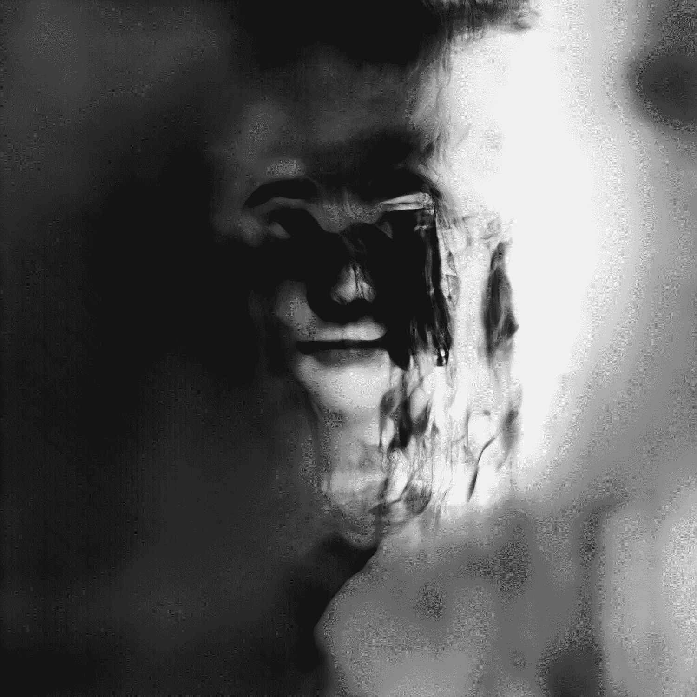

图 8.4

Mario Klingemann, `Neural Glitch`, 2018. 由 Mario Klingemann 提供。

类似的方法也被用于 `The Sense of Neoism?! Artificial Counter-Intelligence Machine` 中的实时文本生成，该作品是我在 2018 年与跨学科艺术家 Istvan Kantor（又名 Monty Cantsin）合作创作的。这件作品是一台类似于音频箱的机器，带有几十个插孔，代表了神经网络的内部工作机制；该网络是在一个包含数千页 neoism?! 文章的数据集上训练的，neoism?! 是一种始于 20 世纪 70 年代后先锋反体制运动 (Kantor, 2018)。在台纪念碑般的机器顶部，一个 LED 面板不断显示着由深度神经网络实时生成的新的新主义诗句。

任何人都可以通过直接在机器上拔掉、重新插入和交叉连接插线来直接干预人工神经突触，从而实时解构、重构甚至破坏系统的生成能力。人工神经网络是一个纯数字结构，生成每个字符都需要数百万次计算。然而，机器上的物理连接直接对应神经网络上的连接，因此允许访问者对其进行操纵。机器上断开的每根电缆都会断开神经网络内的数千个突触；断开、重新连接和反转接线允许访问者重新配置系统，并实时观察其对生成文本的影响，从而有效地创造出与 Klingemann 作品呼应的文本故障。

这件作品重新审视了 neoism?! 后的一些核心概念，如抄袭、颠覆娱乐（`subvertainment`）、参与和破坏。这种粗犷的物理交互为用户提供了关于神经网络奇异又极人性化的直接体验。例如，一位访问者提到，他们对系统运作的方式感到疏离，而当他们改变连接时生成文本出现的缓慢衰减，暗示了脑损伤和痴呆症患者的认知下降。

## 循环写作

`The Sense of Neoism?!` 的生成能力依赖于之前介绍过的名为循环神经网络（RNN）的深度学习神经网络。与最适合图像处理的卷积神经网络不同，RNN 最适用于从序列数据中学习，如文本以及声音、音乐和运动数据。

在前章中，我们介绍了从 20 世纪 80 年代后期开始的尝试，即在自动音乐作曲中使用循环网络作为马尔可夫链的替代方案，马尔可夫链面临着许多局限性，最重要的是难以生成具有全局结构和连贯性的原创作品。RNN 在捕捉这种长期依赖方面现在优于马尔可夫链。虽然 20 世纪 80 年代后期缺乏这项技术，但从 21 世纪中期开始，新的 RNN 架构已经出现，我们在语音识别、自动翻译以及生成音乐和文本等处理序列数据的应用中取得了瞩目的进展。

David Jhave Johnston 是一位数字诗人，一直致力于使用各种深度学习方法创作电子诗。为了创作他的诗歌项目 `ReRites`，他在 2017 年 5 月到 2018 年 5 月期间以每月一本的速度撰写了十二本诗集。他通过编辑由自己构思的深度 RNN 生成的素材实现了这一壮举，该 RNN 是在英语诗歌数据集上训练的。

整年来几乎每个早上，Johnston 都会坐在电脑前……

多年来，机器学习不断演进，随之演变的是它所提供的实践形式和方法。自动化的提高无疑是这一演变中的一个重要方面。哈罗德·科恩（Harold Cohen）花费了几十年研究他的软件 `AARON`，而现在高中生可以使用网络上的开源代码和数据集生成极具说服力的计算机绘画。算法的演进也为生成艺术带来了新的可能性。

一个关键例子是参数化空间和潜空间，它们在概念上暗示了可能性的抽象领域，空间中的某一点对应于一个可能的结果（如图像或单词）。在 20 世纪 80 年代和 90 年代，这种生成空间需要通过编程进行自定义设计，然后可以使用`genetic algorithms`等机器学习程序进行搜索。但随着 21 世纪 00 年代中期深度学习的出现，特别是近期生成式模型在该领域的爆炸式使用，此类生成空间现在可以使用`GANs`等机器学习系统直接定义以创建一个潜空间。

在神经网络主导地位的新时代，艺术家能够创建现实世界的算法`快照`。威廉·莱瑟（William Latham）曾将自己想象为使用进化系统的虚拟人工品的园丁，而当代艺术家如 Memo Akten、Sofia Crespo、马里奥·克林格曼（Mario Klingemann）和迈克·蒂卡（Mike Tyka）则通过策划世界上的数字图像并将其输入`GANs`，将图像视为活生的材料进行培养。

最终，机器学习允许艺术家以类比的方式与已数字化的世界建立联系。深度学习有望扩展我们的感官，并让我们获得顶尖的、全球性的认知能力和感知。但当艺术家探索这些系统时，他们发现这些受神经启发模型内部复杂的互联单元中流动的想象性景观，实际上反映了我们自身所有不完美的感知过程。这些感知系统的模拟遵循平均规则，压缩离群值并使其消失以以常态为准，并且带有强烈的偏见。这些模型模糊的特征也反映了我们自身的矛盾、透明度的匮乏以及盲点。它提醒我们，现实总是通过某种感知界面进行中介的。

# 注释

1. `1`。这无疑是对历史的过度简化，因为科学发现并非发生在真空中。要对深度学习的历史进行彻底分析，请参阅 Schmidhuber (2015)。

2. `2`。作为结果，这些主要的 IT 公司近年来一直在积极地收购初创公司并聘用深度学习专家——以至于学术界现在出现了人才“短缺” (Waters, 2016)。

3. `3`。我发现许多开发 AI 产品和服务的科技公司现在都有一个`AI for good`分支，这很有趣。这让人好奇他们的其他 AI 分支在做什么……

4. `4`。矛盾的是，`DeepDream` 与梦境并没有太大关系。它源于`inceptionism`技术，参考了克里斯托弗·诺兰的科幻电影《盗梦空间》（Inception，2010），电影主角在人们脑海中植入想法，特别是电影中“我们需要进入深层”这一表达已成为网络迷因（Mordvinstev, Olah, & Tyka, 2015; Szegedy et al., 2014）。但艺术家兼研究员本·博加特（Ben Bogart）在他们的`Context Machines`装置中，在 Mordvinstev 文章发布几年前就开始对机器梦进行探索，随后在他们的`Watching and Dreaming`系列中继续，该系列将在第 1 章讨论。在这些作品中，艺术家试图通过机器学习过程将关于梦境和想象的理论融入艺术作品。

5. `5`。阅读 Wilk (2016) 对此类倡议所提出的问题进行深入分析。

6. `6`。第二章引入的创意对抗网络（`CAN`）是`GAN`的一种类型（Elgammal, Liu, Elhoseiny, & Mazzone, 2017）。

7. `7`。该作品直接引用了`GANs`的科学和历史。首先，其标题《Portrait of Edmond Belamy》指的是发明`GANs`的科学家伊恩·古德费（Ian Goodfellow）的名字（`Belamy` 听起来像 `good fellow`）。

8. `8`。该系统使用了具有两维潜空间的变分自动编码器（`VAE`）（Kingma and Welling, 2014），并在手写数字 `MNIST` 上进行训练（Deng, 2012）。

9. `9`。这种结果通常发生在参数调整时。

10. `10`。摘自与艺术家的邮件交流，2019 年 2 月 7 日。

# III 数据

# IX 数据即代码

## 示例编程

二十世纪的计算机革命允许了新的通信形式和艺术表达形式的出现。早期的计算艺术使用`BASIC`、`C`甚至汇编代码等通用编程语言，但多年来，专门为艺术家需求量身定制的新编程框架已经问世。例如，视觉数据流软件如 `Max` 和 `Pure Data` 允许创建者通过将虚拟数据连接到不同的过滤器来实时设计并运行数据映射，而创意编程框架如 `Arduino` 和 `Processing` 则提供了高级编码接口，让用户专注于他们的创作工作。

然而，即使是这些用于实时数据组合和交互的高级创意工具，其最终仍仍依赖于用户对一组操作和规则的自定义设计。因此，使用这些工具的艺术家正从事一系列创作实践，涉及使用编程语言或基于规则的计算系统的视觉抽象来创建专用算法，而他们对计算机科学原理的理解往往非常浅，或者根本完全没有。

这种情况有许多缺点。在编码环境中达到精通水平通常需要多年时间。编码的本质——程序员需要对控制软件的所有方面负全责任——在创作实践中往往往往适得其反。该领域的从业者非常清楚这一点：艺术家通常花费大部分时间在开发支持其工作所需的基础设施，而只有一小部分时间用于艺术和美学工作——而这些工作通常发生在展览前的最后几天。

也许更重要的是，编码、重构和调试的实践在许多方面与实际工作体验脱节，从业者在利用计算机算法设计作品时，经常发现自己处于创意流被频繁中断的状态。最后，虽然对于普通编码员来说，将几个传感器和执行器整合在一起相对简单，但即使是经验丰富的程序员也难以利用海量输入和输出之间的连接。

这些限制对艺术实践产生了影响。创造者倾向于选择输入和输出之间更容易编码的一对一映射，并避免多多的连接，因为后者对人类编码者来说难以设计。结果是许多可能的交互未被开发。事实上，输入和输出之间复杂的交互对艺术家和观众来说可能更有趣且自然。例如，音乐技术领域的近期表明，尽管在创建数字乐器时，简单的一对一映射通常是设计者的首选，但表演者通常更倾向于那些能促进传感器和执行器之间更复杂交互的乐器，认为它们更加直观、引人入胜、强大且趣味十足（Hunt, Wanderley, & Paradis, 2003）。

机器学习为传统的创意编码方法提供了一种替代方案，通过促进输入和输出之间复杂交互的设计，具有彻底变革创作实践的潜力。如果我们仅限制在映射的设计上——这可以说是新媒体艺术中最重要的范式之一——我们可以粗略地将创作过程框定为艺术家试图建立输入和输出之间的组织关系，例如，将观众执行的某些类型的手势映射到特定的视觉或音频效果。然后，艺术家必须通过反复尝试来编写一个函数，以生成他们脑海中的映射。正如我们所讨论的，这个过程可能是漫长、繁琐且反直觉的。

使用机器学习方法，同一位艺术家可以提供一组输入-输出数据，这些数据代表了他们希望系统实现的映射示例，例如，通过生成手势示例并将其与目标视听效果相关联。然后，艺术家可以将映射函数的设计交给监督学习算法，该算法将在手势触发器和视听内容之间找到适当的映射。换句话说，设计算法映射函数的艰苦工作可以推给机器学习系统，而艺术家可以通过构建数据集来专注于描述她想要实现的内容。

这种场景对新媒体艺术有许多影响：(1) 它降低了进入该领域的门槛，因为构建数据集比编码需要少得多的专业培训；(2) 它提供了更大的灵活性，因为比代码交换、重新组合和混用数据集要容易得多；(3) 它提供了开发更稳定、更具表现力的创意软件工具的潜力；(4) 它减少了创作实践中的成本和时间；以及(5) 它甚至允许设计数据之间更加错综复杂的关系，这些关系对于人类自行编程是困难甚至可能的。

## 交互式机器学习

计算机科学家兼音乐家 Rebecca Fiebrink 在音乐技术的背景下描述了这种方法。她是开源软件 `Wekinator` 的创建者，该软件允许艺术家和学生使用实时监督机器学习交互式地设计映射。该工具为用户提供了一个视觉界面，使其能够轻松地记录、擦除和修改自己的基于传感器的数据集。这些数据集可以被用于训练简单的分类器，根据用户指定的自动学习输入和输出之间的映射。新的映射随后可以立即进行评估，允许艺术家进行进一步的调整（Fiebrink, 2017）。因此，该过程在很大程度上是由数据驱动的，因为界面鼓励用户迭代地添加和删除示例并重新训练系统。通过绕过设计数学函数和源代码的需求，该软件促进了与系统直接的、具身的参与。Fiebrink 将她的技术描述为一种“元乐器”（`meta-instrument`），因为可以用于实时直观地设计新的数字音乐乐器。

机器学习算法可以促进新类型的设计成果：它们使人们能够创造新的数字音乐乐器。但我认为，它们在促进新类型的设计过程方面也具有价值，让乐器的创作过程成为人机之间一种更具探索性、趣味性、具身性和表达力的伙伴关系。设计过程的这些特性反过来影响了所创建乐器的最终形式——以及乐器创造者本身（第 138 页）。

交互式机器学习工具如 `Wekinator` 挑战了机器学习的传统，后者通常依赖于从现实世界提取的海量数据集对复杂模型和算法进行精细训练。Fiebrink 的研究表明，当基本的学习系统和小型自生成数据集集成到一个便于在实时环境中实验和探索的直观界面中时，它们可以提供新类型的成果和创作过程。

Laetitia Sonami 是一位声音艺术家和作曲家，以使用自定义乐器的表演作品而闻名，她与 Fiebrink 合作设计了一种名为 `Spring Spyre` 的独特乐器（见图 9.1），它能以复杂且不可预测的方式合成声景。该设备由三个连接到音频拾头器的弹簧组成，锚定在一个金属轮上。当 Sonami 触摸弹簧时产生的原始信号通过数字处理滤波器转换为 18 个特征，然后作为输入发送到 `Wekinator` 中的 38 个神经网络，每个网络产生一个单一输出值。这些由神经网络产生的信号控制数字合成器的不同参数，从而实时生成声音。

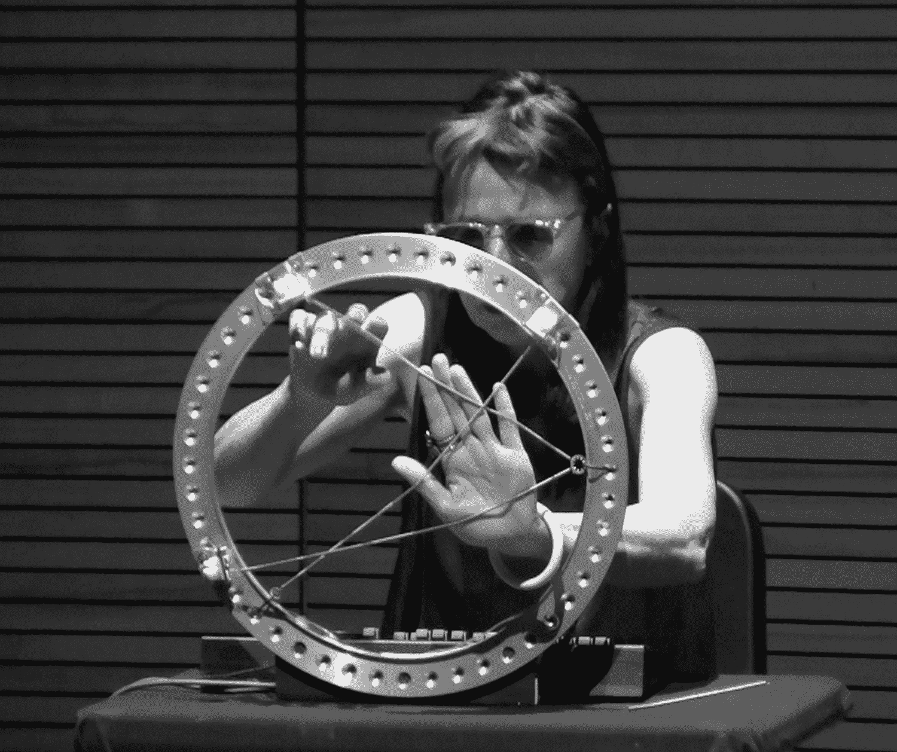


`Laetitia Sonami, Spring Spyre, 2014.` Photo credit: Brown University. Courtesy of Laetitia Sonami.

这首作品的基础在于 Sonami 对不同神经网络模型细致且耐心的训练。通过她自己的姿势调节数据的宽度和变化性，作曲家能够间接影响系统的不可预测性。正如她所解释的：

“如果我向系统输入的训练示例，其声音根据我触碰弹簧的方式发生了巨大的变化，那么训练后的模型在弹簧恢复静止位置时，将以不可预测的方式穿过所有点。如果我给它变化较小的训练示例，那么当我移动弹簧时，声音只会发生轻微震荡。因此，我可以通过改变训练方式，轻松地在可预测和不可预测的结果之间调整乐器。”（Fiebrink & Sonami, 2020, p. 239）

通过这种方式交互地操纵训练过程，Sonami 训练了具有不同程度预测性的模型，在她的作者控制权与系统的自主性之间进行精细的平衡。这些实验允许她生成一系列预训练的神经网络模型，每个模型都体现了输入与输出之间的特定映射。为 `Spring Spyre` 创作的每一部作品都使用了从艺术家预训练的数百个模型中挑选出的特定模型色板。

Sonami 描述她与 `Wekinator` 工作的经验是开放且灵活的，这种经验让探索的方法比目标导向的方法更有回报（Fiebrink, 2017, 148）。她的证词引起了 Nicolas Baginsky 描述他在 `The Three Sirens` 中创作探索的回响。这支持了之前的观点：与机器学习系统工作的艺术家的工作方式与传统的 AI 研究人员不同。艺术家对过程更感兴趣；他们更重视创作背景；他们追求意料之外的结果而非平均值。

虽然 `Wekinator` 背后的监督学习算法是目标导向的，但它们并不尝试直接生成新形式，而是通过自动检测她提供的数据中的模式来辅助作曲家，从而促进输入与输出之间复杂映射的配置，同时让作曲家专注于他们的创作。因此，`Wekinator` 通过增强表现力和可玩性来支持创作过程，让艺术家不仅能够记录可重复的内容，还能捕捉内容内部的关系——而这一切无需编写任何一行代码。

## 认知与倾听

Suzanne Kite 是一位奥格拉拉科塔表演艺术家、视觉艺术家和作曲家。她开始将 `Wekinator` 作为她对当代科塔神话和认识论进行表演探索的一部分。她对机器学习的兴趣源于作为表演者在舞台上达到一种解离式感知状态的愿望。

她的作品 `Listener`（2018）其特色是 Kite 戴着一个发辫接口设备和一件衣服，两者都配备了不同类型的传感器，向 `Wekinator` 传输数据（见图 9.2）。在整个 18 分钟的表演中，Kite 与由 `Wekinator` 控制的生成的视频和声景实时交互，对周围发生的事件做出现场反应。她的决策与机器学习系统之间的反馈循环如此紧密，以至于她与机器之间的边界变得模糊。随着她因此与机器耦合，她永远无法判断自己的决策在哪里结束，机器的决策从哪里开始。

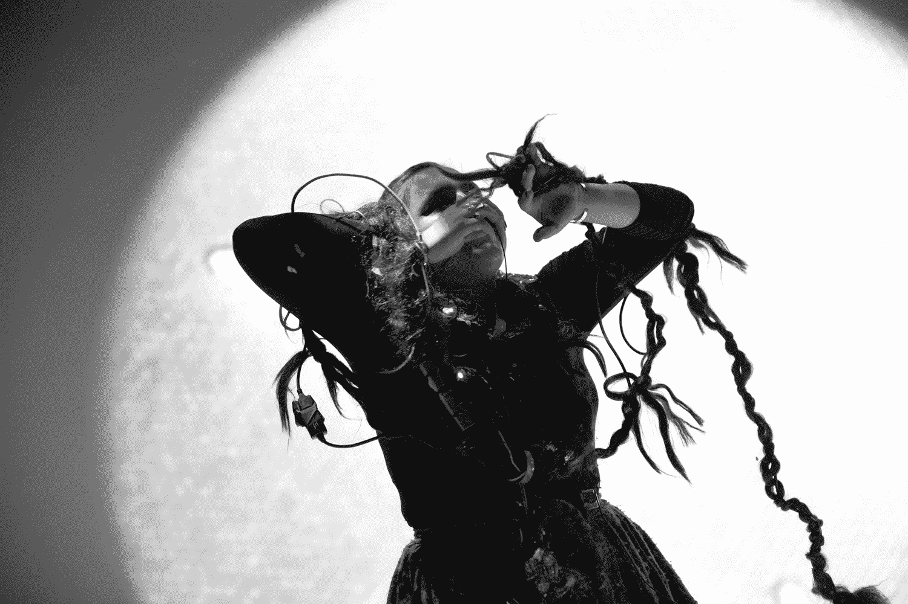

图 9.2

Suzanne Kite, `Listener`, 2018. 照片版属：Florian Voggeneder. 由 Suzanne Kite 提供。

`Listener` 回想起 Justine Emard 的作品 `Co(AI)xistence`（见第 4 章），该作品中展示了表演者 Mirai Moriyama 与机器人 `Alter` 交互。在两种情况下，人类表演者都试图实时理解一个非人类实体。然而，在 Emard 的作品中，人工代理 `Alter` 在整个作品过程中不断学习，学习过程本身的行为成为了作品的焦点。相比之下，Kite 的离体人工系统是由艺术家预训练的，且在作品过程中本身并不被修改。

在使用 `Wekinator` 之前，Kite 与更传统的软件交互，这种一对一的映射对她来说显而易见。这种不确定性迫使她做出决策，使事情变得更加困难。Kite 对机器学习系统的表演探索与科塔概念 `wakȟáŋ` 相契合，它通常被解释为“不可理解的、神秘的、非人类的力量或能量”（Posthumus, 2018, p. 384），这在科塔文化中构成了人类与非人类关系的基础。通过她的工作，Kite 有兴趣与尊重原住民伦理的人工实体建立关系，从科塔人的角度来看，“这意味着非人类的精神并非来自我们或我们的想象，而是来自我们无法理解的地方，一个巨大的秘密”（Lewis, Arista, Pechawis, & Kite, 2018）。

Suzanne Kite 的方法通过机器学习在人类与非人类之间的边界状态提供了认知新形式的能力。这种技巧与 Laetitia Sonami 对交互机器学习的实验性和探索性本质产生了共鸣。这些艺术家与其同行一样对机器学习算法感兴趣，因为它能产生通过体验而非理性来理解的谜。

## 共生绘画（Sympoietic Drawing）

自 2014 年以来，纽约艺术家 Sougwen Chung 一直开发一系列涉及绘画机器人的项目，这些机器人由她自己的软件驱动。系统的第二个版本被称为 `Drawing Operations Unit: Generation 2`（或 `D.O.U.G. 2`），涉及根据艺术家数十年的绘画训练的深度神经网络。

机器人参与表演作品，艺术家与机器人协作实时进行绘图或绘画（见图 9.3）。在整个活动期间，人类和非人类表演者相互反应，逐渐填充画布。

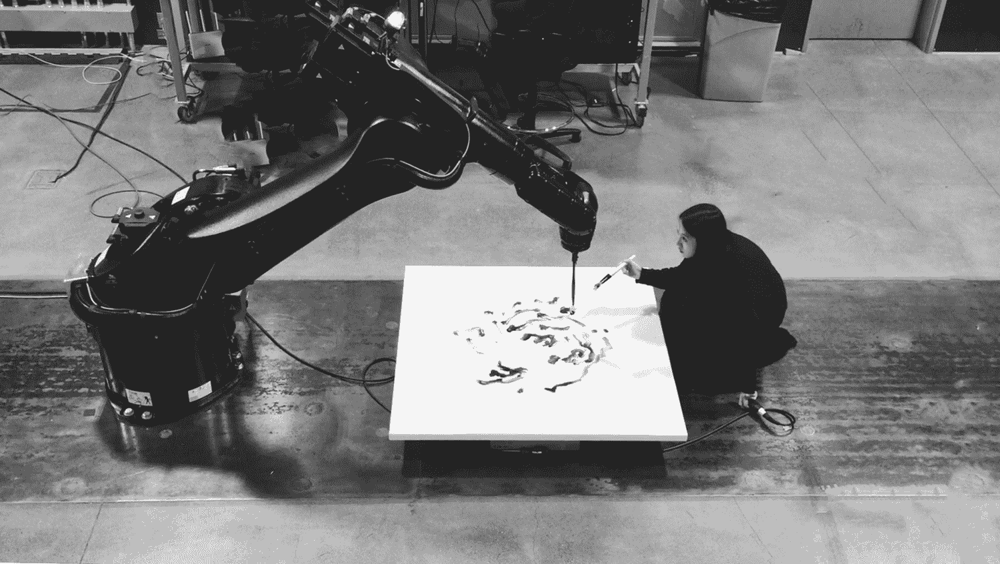

图 9.3

Sougwen Chung, `Drawing Operations #4`, 2018. Drawing, robotics, performance. 照片版属：Sougwen Chung. 由 Sougwen Chung 提供。

Chung 强调了机器人某些决策的奇异性。尽管机器人是根据自己的绘画训练的，但系统的不确定性仍然迫使她做出反应，转化了她在表演中的姿势。通过与 `D.O.U.G.` 合作，Chung 的绘画变得具有自我反思性，因为她在与人工实体共同绘画时，必须不断思考自己作为艺术家的创作。

通过这些项目，艺术家探索了与自动化、行为和创造力相关的问题。尽管最初于绘画，但 `D.O.U.G.` 的出现使艺术家的实践转向了涉及一个或多个机器人的装置表演。2019 年，她创作了作品 `Exquisite Corpus`，在作品中她探索了“共生”（`sympoiesis`）的概念，即“共同创作的艺术”。该表演在 30 分钟内完全即兴完成，通过四个不同的视听组合章节展开，并展示了钟（Chung）与几台机器人表演者合作，在地面上的巨大画布上实时绘画。这些表演涉及人类与非人类之间共生的、动态耦合，促使艺术家在创作中进行思考。

钟的表现让人想起达达主义和超现实主义者的一些自动主义技巧，这些技巧启发了如杰克逊·波洛克等表现主义艺术家。然而，与这些方法不同，她对自动化的使用与其说是为了释放表达自我，不如说是为了培养人与机器之间的关系，以探索新的形式和想法。虽然 `D.O.U.G.` 有自己的自主性，但由于在艺术家自己的画作上进行了预训练，它也浸润了钟的审美。因此，机器并不是一个位于她之外的纯随机结构，而是一个虽然超出她的直接控制但又与她相熟悉的奇异算法混合体。

## 自带数据

由画家尚泰尔·马丁（Shantell Martin）和计算认知神经科学家莎拉·舒韦特曼（Sarah Schwettmann）创作的艺术装置 `Mind the Machine`（2017）提供了一个视觉艺术中生成自己的数据库来训练机器学习模型的示例。该项目于 2017 年夏天在波士顿的开放画廊（Open Gallery）展出，其特色是一个受马丁作品启发并绘制画作的机器人。为了实现这项工作，马丁和舒韦特曼在一个由马丁专门为该作品创作的 300 幅画的数据库上训练了一个深度神经网络。

训练集是在一百天的时间内制作的。每天，舒韦特曼向马丁发送三张模板画，艺术家需要完成这些画作。算法通过分析马丁完成作品所经历的步骤，不仅试图匹配马丁的风格，还试图匹配她自己的绘画过程。因此，机器人试图模仿马丁完成画作的方式。

构成训练集的 300 张原始图像作为装置的一部分展示出来。它们揭示了马丁创作过程的艰辛，她必须专门调整自己的工作以应对算法的需求。但虽然制作几百幅画作对人类来说可能是一项大量工作，但从机器学习的角度来看，300 个样本是一个非常小规模的数据集。因此，马丁不得不通过限制自己创作一组看起来非常相似的作品来降低神经网络处理问题的维度。这是通过使用一致的风格，使用眼睛、嘴巴、卷曲线条或其他物体等重复模式进行绘画完成的。

## 病毒式收藏

位于伦敦的艺术家安娜·里德勒（Anna Ridler）利用在自定义训练集上训练的机器学习创作了多件作品。她对机器学习的兴趣源于对组装和组织收藏过程关注。

为了创作她 2018 年的作品 `Mosaic Virus`，她在荷兰郁金花季节创建了一个包含 10,000 张郁金香照片的惊人收藏（见图 9.4）。她根据每朵郁金香的特征（如颜色和是否有条纹）对图像进行标记。里德勒随后使用这些图像来训练生成对抗网络（`GAN`）——这是第 8 章介绍的一种革命性的深度学习技术，可以生成与训练集中相似的、具有说服力的新图像（Goodfellow et al., 2014）。

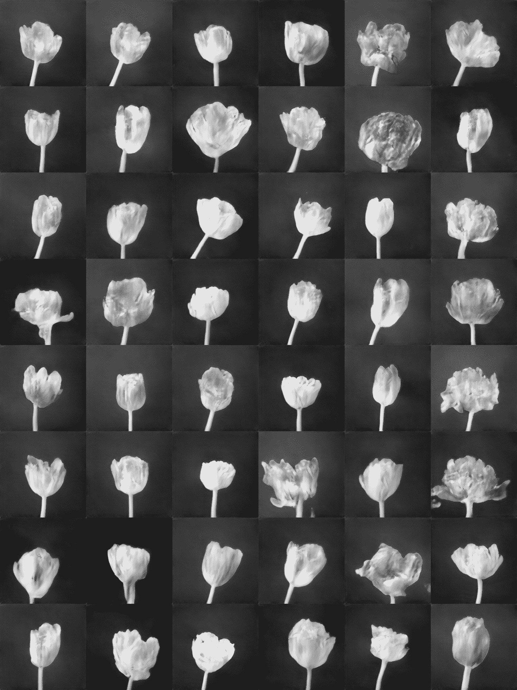

图 9.4

Anna Ridler, `Mosaic Virus`, 2018 年。部分由 EMAP/EMARE 计划（创意欧洲的一部分）资助，并受 Impakt 委托。由 Anna Ridler 提供。

算法随后被用作视频装置的基础，其中实时生成了极其精美的郁金香图像流。生成的图像并未出现在原始数据集中。相反，每张图像都是神经网络从训练集中学习到的复杂拼贴。生成的郁金香类型遵循 `bitcoin` 的汇率，这在加密货币市场热潮与 17 世纪荷兰郁金香疯狂之间形成了类比。在 `Mosaic Virus` 中，比特币的价值影响了生成的郁金香类别：低价格倾向于浅色和白色花瓣，高价值引发更多有色的花。

里德勒将她的过程描述为渐进式的。她从一个小数据集开始，对其进行训练并观察结果。然后她对数据集进行调整，通过增加或删除项目来提高精度。因此，她通过对收藏进行选择、尝试错误来制作生成过程。例如，她在过程中意识到自己倾向于选择更多有色的郁金香，这导致系统更擅长生成有色的郁金香，因此她必须在混合中加入更多白色和浅色。对于里德勒来说，机器学习是一种过程而非工具。`Mosaic Virus` 可以使用其他技术完成。然而，将机器学习作为构建作品的材料引入了全新的维度，从而使最终作品更具相关性。她构建自己的数据集的过程是迭代和实验性的，在她看来，这比传统的算法艺术更类似于环境或土地艺术实践，因为可以直觉地预测发生什么，而无法完全控制结果——就像面对一个拥有自我生命的自然系统。这种对控制的放弃与艺术家对数据收集的极端控制形成了奇特的矛盾。为了承认其价值，艺术家将数据集本身视为一件独立的艺术品，并将其命名为 `Myriad (Tulips)`（2018 年）进行展示，见图 9.5）。

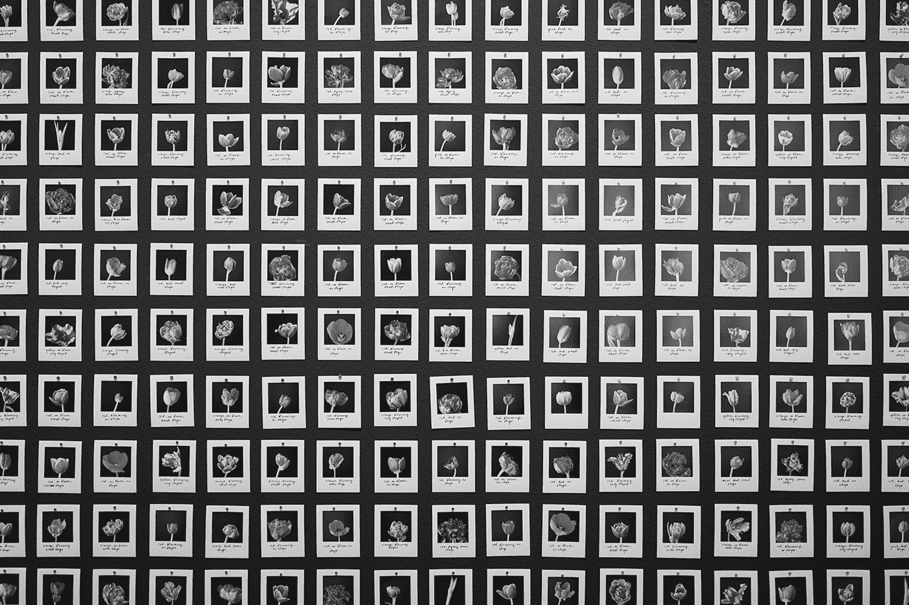


## 众包日常

依赖机器学习作为编码的替代方案带来了自己的挑战。你将编写原始计算机程序的困难任务，转变为同样艰辛且通常昂贵的原始数据集制作。虽然像`Wekinator`这样的工具可以提供帮助，但生成自己的数据库的投入仍可能是巨大的。

然而，存在许多生成数据集的方法，其中一些涉及较为合理的人力投入。新媒体作品通常会使用不同的传感器设备，如摄像头、麦克风、光传感器、超声波测距仪、压力传感器和红外探测器。一旦这些系统启动，收集这些设备产生的数据就相对简单，这使得应用机器学习算法甚至实时运行学习循环成为可能。

在机器学习研究中，生成数据的一种常用方法是众包获取劳动力。一个很好的例子是大型公开数据库`ImageNet`，它是通过雇佣大群匿名工人对其包含的 1400 万张图像进行标注而创建的。现在有各种众包在线平台允许用户付费获取这些匿名工人的劳动力。此外，还可以创建一个网站或移动端`App`来收集展览观众的数据。乔治·莱格拉迪（George Legrady）此前展示的作品《记忆口袋》（`Pockets Full of Memories`, 2001）就采用了这种方法，邀请参与者扫描自己的物品来创建一个数据集。

最近，纽约艺术家布莱恩·豪斯（Brian House）在其 2017 年的的项目《今天发生的一切都会发生》（`Everything that Happens Will Happen Today`）中采用了类似的策略。他使用一个移动端`App`在纽约市追踪了一千名志愿者在一年内的每日移动轨迹。这个庞大的`GPS`位置序列数据库随后被用于训练一个循环神经网络。在项目的第二阶段，豪斯使用训练好的模型生成了大苹果城（纽约）日常行程的新样本。这些指令在他自己设计的另一个移动端`App`上实时显示，他随后按照这些指令进行行动，并用手机相机记录了这些奇异的游历。尽管这些生成的路径在原始数据集中并不存在，但它们代表了日常行程的可能模式。豪斯将这些旅程的独特性归于学习算法的社会属性，因为它试图提供一个人类集体行为的代表性快照：

> AI 的智能并非自发的，而是社会化的。它之所以令人不可异，不是因为它的表现得像人类，而是因为它本身就是人类（复数形式）。（House, 2017）

豪斯的作品可以被解释为法国情境主义者居·德波（Guy Debord）的“漂游”（`dérive`）原则的社会构建化、技术驱动的版本。漂游是一种革命性的技术，涉及在城市景观中进行游戏性且具有建设性的漂移，参与者“让自己被地形的吸引力和遇到的遇所吸引”（Debord, 1956）。虽然早期的漂游实验很大程度上依赖偶然性来迫使参与者打破习惯，但德波警告过过度随机性导致的漫步是徒劳的。因此，豪斯利用机器学习生成集体构建的漂游体验的方法，比依靠掷硬币更好地实现了德波关于漂游的理想。

## 发现数据

许多从事机器学习的艺术家选择使用现成数据集，或使用他人创作的内容组装自己的数据集。例如，奥斯卡·夏普（Oscar Sharp）的科幻短片《春光》（`Sunspring`, 2016），这部 9 分钟的电影是基于本杰明（Benjamin）编写的剧本拍摄的，杰明是一个在科幻电影剧本数据库上训练的循环神经网络。电影中的一首歌歌词是由类似的在民歌数据库上训练的算法编写的。结果是一段毫无意义的对话混合体，但人们仍能从中感受到一种科幻氛围，主角们似乎在不断困惑。演员的和剪辑带来了某种形式的叙事性，而这在很大程度上是剧本缺失的，剧本感觉更像是一系列不连续的简短肯定和疑问。

自 2014 年`GANs`出现以来，大量艺术家一直在使用这种新技术来生成和探索潜在生成空间，特别是在视觉领域，其中许多利用了互联网上现有的图像数据库。特蕾莎·瑞曼-杜伯斯（Theresa Reimann-Dubbers）在其作品《（人工智能）救主之窗》（`A(.I.) Messianic Window`, 2018）中，在耶稣基督的艺术图像上训练了一个`GAN`，并利用生成的图像制作了一个彩色玻璃窗，展示了机器学习系统对“救主”（`Messiah`）一词的解释。这件作品是对当前文化格局的批判，它将“人文主义的、文化和非普遍定义的概念应用于人工智能”。由于机器学习的智能程度与其所接收的信息相匹配，问题变成了：“是谁在给它们提供信息并选择这些信息？什么样的偏见和观点被转移到了机器中？”（Reimann-Dubbers, 2018）。

## 并非唯一

跨学科艺术家斯蒂芬·迪金金斯（Stephanie Dinkins）正在进行的装置艺术项目《并非唯一》（`Not the Only One`, 2018）采用了一种混合数据生成方法（参见图 9.6）。该作品建立在艺术家构建的文本语料之上，其中包括她与三个不同代的家庭成员之间数小时的对话。

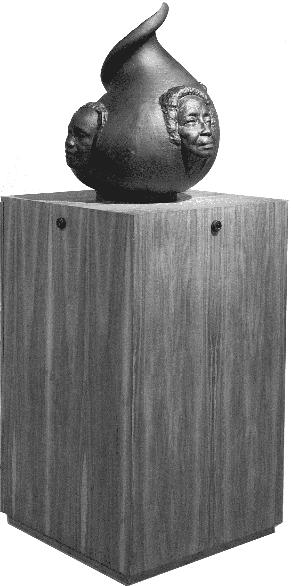

图 9.6

Stephanie Dinkins, `Not the Only One`, 2018。铸黑玻璃雕塑，深度学习`AI`，电脑，`Arduino`，传感器。感谢 Stephanie Dinkins 提供。

该装置包含了一个贝壳形状的玻璃雕塑，上面浮刻着三个家庭成员的形象。观众可以直接向装置提问，它会用单一的声音回答。这个`AI`故事者以新颖的方式将这些多个声音融合在一起，其中某些方式可能令人惊讶和不可异。

在她的工作中，迪金斯对我们如何传递知识感兴趣，特别是通过讲故事和叙事的传统，如格里特（griots）。《并非唯一》最初始于一个问题：拥有一个由有色人构建的`AI`实体会是怎样的？具有非裔血统的迪金斯花了几个月时间自学，研究她项目所需要的数据类型和机器学习算法。数据集的构建需要惊人的精力和精力。她首先与家庭成员坐在一起进行对话，并对他们每个人都问相似的问题。在转录并清理了超过 15 小时的材料后，她发现仍然没有足够的数据来训练一个满意的模型。模型随后分两个步骤进行训练：首先使用整个合并数据集，以便模型对语言的运作有一个良好的整体理解，同时保持在艺术家定义的更广泛领域内；然后仅使用包含采访的较小数据集进行训练，以微调模型并使其偏向对话数据。

最初，这位艺术家试图创建一个系统，使其成为她家族历史的某种硬性回忆录，并对观众的问题给出直接的回答。然而，她发现自己陷入了一个远更具实验性的过程中，在这个过程中，学习系统的回答从奇妙到谜团或荒乎伦道不等。观众的反应与机器的言语一样多样。有时，系统的奇异会让人们感到沮丧和愤怒，因为系统违背了他们的预期。而在其他时候，人们会给它留空间，并对发生的事情进行自己的解释，且往往带有幽默感。

与许多其他从事机器学习的艺术家一样，`Dinkins`将系统的不确定性视为一种优势。在她早期的一个项目中，她曾与社交机器人`BINA48`进行对话，她意识到，当机器人的回答不是逻辑严密的、直接的答案时，她产生了更浓厚的兴趣；换句话说，当这个人工智能代理挣扎着表达某些观点时，通常会产生一些似乎很有道理但又被一种几乎带有诗意的奇异感所包裹的短语。

`Dinkins`认为艺术可以成为质疑新技术的催化剂，从而成为改变和改进机器学习的工具。此外，有色人种和其他少数群体需要参与到对话，因为他们带来了不同的思考方式和替代性的问题。

## 结论

机器学习是一种数据驱动的方法，通过封装在可调节模型中隐含地创建计算机程序。与其使用代码或计算过程的视觉抽象来直接为计算机，从事机器学习的艺术家可以通过从数据端入手来塑造模型。这产生了不同的策略。

一些艺术家会创建自己的数据，考虑到训练深度学习模型需要使用极大型数据集，这是一项具有挑战性的任务。艺术家`Laetitia Sonami`和`Suzanne Kite`采用的一种策略是使用`Wekinator`等工具，利用艺术家实时生成的数据进行交互式模型训练。另一种方法是使用艺术家自己收集的现有数据。例如，`Sougwen Chung`利用其几十年来画作合集训练了`RNNs`，作为其行为装置作品的基础。最后，像`Anna Ridler`和`Shantell Martin`这样的艺术家经历了生成自己数据集的漫长过程，精心构建数据集以影响他们正在训练的机器学习模型。

替代方法则依赖于第三方创建的数据。一种方法是将数据生成外包，要么通过询问观众（如`Legrady`的装置作品`Pocket Full of Memories`和`Brian House`的`Everything that Happens Will Happen Today`），这两个项目都召集了多个机构的组合来培养一种集体智能形式。最后，另一种方法简单地依赖于使用互联网上的现有数据，例如电影脚本或标注图像。

当然，这些不同的策略并非孤立存在，艺术家可以结合它们来实现自己的目标。因此，Stephanie Dinkins 依靠所有这些方法的混合创作了她的作品`Not the Only One`，并使用了她自己的故事、与近属成员的采访以及现有的文本内容。

这些作品代表了使用数字对象集合进行算法重混的新形式。正如我们在下一章中讨论的，通过将数据转化为内容生成过程，机器学习允许了前所未有的、根本性的艺术重混方法。

# 注释

1. 1。我将其称为“冰山原则”，因为在设计新媒体艺术品的大部分工作都是隐藏的。
2. 2。
3. 3。
4. 4。

# 10 深度重混

一位音乐艺术家用她合作者的声音唱歌，他们的脸在模糊的拼贴中交织在一起。一段视频自画像中，通过神经网络看到，面部特写变成了星系和星云。现实生活中的政治家演唱着奇怪的`AI`生成歌曲。

这些尖端作品成了艺术未来的早期示例。具体来说，它们属于由深度学习和大型数据集可用性开启的一系列新型重混实践。

因此，机器学习开启了重混文化的新纪元，在这个纪元中，不仅是内容，连内容的生成过程都可以被容易地复制、拷贝、修改和重混。这种变化得益于机器学习（特别是深度学习）将大量内容（数据）重新物质化为动态结构（模型）的能力，这些结构可以被激活为生成过程。早期的例子可以在近期图像和语音合成的进展，以及新技术的出现（如风格迁移（Gatys et al., 2015）、程序合成（Kant, 2018）和迁移学习（Thrun and Pratt, 1998））中找到。这些技术实现了复杂的、往往难以理解的模式生成机制（如作家的风格或音乐流派）的生产和传输自动化。

## 重混文化

20 世纪 60 年代后期，加梅洲声音工程师奥斯本·鲁德克（Osbourne Ruddock）当时是一名刻片师。当他在为`DJ`和`MC`从录音中提取人声轨道时，他发现调音台还允许他对音乐轨道进行其他修改，从而创造出不同的效果。鲁德克后来被称为“Tubby 王”（King Tubby），他开始使用调音台来创建现有唱片的自己的版本；这些版本随后可以供`DJ`进行口播。在整个 20 世纪 70 年，Tubby 成为加梅洲 Dub 音乐的领军人物，他通过回声、短句和混响对歌曲进行增强和变异，进一步了他的重混技术。

调音台和音响系统让 Tubby 这样的 Dub 艺术家发明了一种全新的音乐类型，这种类型建立在现有的唱片之上，而不是真实的声音。后来随着计算机的出现，重混变成了音乐创作的主流方法，并扩展到其他媒体（例如，随着 90 年代`Photoshop`等数字编辑工具的引入，扩展到了摄影领域），促进了美国学者劳伦斯·莱西格（Lawrence Lessig）所说的“重混文化”（Lessig, 2009）的出现。

采样和重混定义了整个 20 世纪艺术实践和文化的演变。在《重混理论》（`Remix Theory`）一书中，媒体理论家埃德华多·纳瓦斯（Eduardo Navas）从技术发展的角度解释了这些转变（Navas, 2012），将重混的出现与机械复制联系起来。从 19 世纪开始，新技术允许记录真实世界的样本，首先通过摄影，然后通过声音录音。

纳瓦斯解释说，20 世纪 20 年代，拼贴和摄影蒙太奇是回收现有材料并重新组合的早期例子。达达主义者利用这些策略破坏并颠覆绘画、摄影和诗歌。汉娜·霍赫（Hannah Höch）的《用厨房刀切开魏玛共和国的啤酒肚达达》（1919–1920）通过征大众媒体的图像和文本，揭露了德国魏玛共和国未能建立民主平等政权的失败。19 20 年，达达主义诗人特里斯坦·扎拉（Tristan Tzara）发表了《如何写一首达达诗》，这种程序涉及用剪刀剪开报纸文章并随机重新组织内容。后来，在 20 世纪 60 年代和 70 年代，类似的重组技术和其他算法程序被用于`OULIPO`和比特一代等先锋文学运动中。

纳瓦斯认为，从 20 世纪 80 年代开始，新媒体通过日益倾向于对现有材料进行采样而非真实记录，将这种趋势推向了极端。20 90 年代，音乐重混变成了一个流派，并在美国由一个行业推动，他们在这些原则中发现了音乐生产、商业化和消费的高效方案。自 80 年代以来，计算机的可用性提高和新软件的发展也促进了其他领域的重混过程。例如，`Photoshop`和其他图像处理工具从根本上改变了摄影，而由于文字处理器和万维网，拷贝和粘贴已成为写作的基本原则之一。

由于重混实践在 20 世纪 90 年代后期越来越多地应用于媒体领域，它们迅速成为主流。律师劳伦斯·莱西格认为重混文化的出现是一个积极的发展。他认为重混（通过转换现有材料创作派生作品）是人类创造力的有益且自然的方法，贯穿人类历史。尽管 20 世纪后期建立的版权法限制了这种实践，但在 21 世纪，得益于拷贝、修改和混合媒体的技术进步，重混文化仍然蓬勃发展。这不仅适用于图像、声音和视频，也适用于源代码。

## 开源文化

20 世纪 80 年代初，在个人电脑日益普及的情况下，商业所有软件已成为常态。理查德·斯托曼（Richard Stallman）当时是麻理工学院人工智能实验室的程序员，他开始为`Unix`环境创建软件工具，并使这些工具的代码公开。19 83 年，他启动了`GNU`项目，旨在创建一个仅运行在自由软件上的`Unix`类环境。19 89 年，他编写了 GNU 通用许可许可证（`GPL`），保护了用户和开发者使用、拷贝和修改软件的权利，换句话说，就是自由重混代码。

在新媒体艺术中，与自由软件和开源社区的联系可以追溯到 20 世纪 90 年代初，例如作曲家兼音乐家米勒·帕凯特（Miller Puckette）发布了`Pure Data`，一种用于实时交互和声音的视觉编程语言。20 00 年代，为了教育和专业目的而创建的开源软件如`Arduino/Wiring`、`Processing`和`Scratch`遍布该领域。

这些软件直接贡献了莱西格所描述的、媒体艺术领域的重混文化。他们被丰富的跨学科社区包围，这些社区在公共论坛和代码库上共享代码。正如大多数媒体从业者所知，制作如视听表演和交互装置等技术密集型作品通常涉及拼接现有的音频、视频、硬件和软件组件。因此，艺术家修复、改进并创建新的开源代码（如库和代码段），然后将其重新发给社区。

机器学习与开源文化紧密相连。目前用于深度学习的核心软件工具如`Tensorflow`和`PyTorch`都是免费且开源的。此外，深度学习研究社区在历史上一直以共享和开放获取为特征；新结果经常在互联网上传播，通常附带源代码，发表在`arXiv`和`Journal of Machine Learning Research`等开放获取平台和期刊上。

通过组合图片创建拼贴画是一回事，从不同来源拷贝粘贴代码创建新软件是另一回事。但当我们不仅能重混媒体内容（如图像或声音），还能重混生成这些内容的过程时，会发生什么？例如，将歌手的声音特征应用到自己的声音中，或者以著名画家的风格重新绘制肖像。当我们能够共享、修改、重新训练、增强以及其他方式更改机器学习模型时，会出现哪些新的艺术形式和实践？

虽然对图像、声音甚至编程代码等内容的采样已变得轻而易举，但仍有两种内容仍然无法轻松地复制和粘贴。首先，直到最近，修改基于时间的媒体的某些组件仍然困难且昂贵，例如替换或修改电影中演员的面部，或者创建一个与原声无法无异的合成语音。其次，可能更重要的是，很难复制和粘贴生成过程的`process`（或至少是该过程的模型），这种过程允许创建诸如新歌曲、照片或绘画等新媒体内容。

事实上，复制和重混作者的`style`或特定`genre`是一项艰巨的任务，直到最近这种任务几乎无法通过技术手段实现。但如果可以自动获取一个并非特定媒体作品，而是生成该作品的过程的快照又会怎样？如果人们可以以数字格式保存该快照呢？此外，如果我们可以像汉娜·霍赫（Hannah Höch）等达达主义者使用图片制作拼贴和照片蒙太奇，或者像金斯·图比（King Tubby）利用现有的音乐样本创建自己的曲调那样，剪切、粘贴、修改和重新排列此类算法快照，又会怎样呢？

此前曾尝试使用计算来模仿风格和流派。例如，在计算机图形领域，非写实渲染（`NPR`）专注于用以表现性风格渲染二维（`2-D`）和三维（`3-D`）对象的方法；然而，开发的算法通常缺乏灵活性和扩展性，因为每种风格都需要创建一个不同的算法（例如用于水彩、印象派等的图像过滤器）。这些算法的设计通常需要多年的研发。

如果我们能像创建照片蒙太奇一样容易地设计生成式程序会怎样？如果我们能同样容易地重混这些程序以创建新的程序会怎样？

深度学习技术促进了新流派算法重混的出现，这涉及到模型和数据而非源代码。机器学习算法能够将媒体生成过程转换为可以保存在磁盘上、交换、修改等模型。此外，这些算法对象的某些足够灵活，用户可以修改它们并将它们相互混合以产生新模型。

## 探索预训练模型

深度学习的惊人发展及其艺术应用，与提供给用户的巨大预训练神经网络模型的出现密不可分。考虑到目前训练这些系统所需的专业知识和计算成本，这些发展是非常有前景的。例如，`GPT-3`语言模型的训练成本估计为 460 万美元，这使得绝大多数艺术家无法从零开始进行训练。

特别是，比其前身`GPT-2`大 116 倍的`GPT-3`能够根据用户给出的文本指令推断出新的语言模式或任务。这种能力允许用户通过提供自然语言指令以流畅的方式与模型交互。因此，它构成了传统编程的替代方案，人们实际上可以与系统交互，训练它执行自己想要的操作。曾广泛使用`GPT-3`的作家格尔恩·布兰文（Gwern Branwen）解释说，这种提示编程的形式类似于教你的宠物一些新花样。“你可以问它，它有时会完美地完成动作，但当它翻过去舔屁股时，就更令人沮丧了，你知道问题不在于它做不到。”

`BigGAN`和`GPT-3`等预训练模型的使用支持新的生成空间。然而，训练这些模型需要大量资源，目前只有大企业才能负担起。因此，这些模型超出了用户的直接控制。

## 替代脸

深度学习重混不仅受到大型`IT`的支持：社区驱动的技术也被用于创作目的，有时以以不可预测的方式进行。2017 年 12 月，据报道`Reddit`上的`r/deepfakes`社区的用户在使用一种软件工具将电影中演员的面部换成人。这项技术后来在`Reddit`、`Twitter`和`Pornhub`等多个网站被禁用。

虽然`r/deepfakes`社区的动机是生成色情，但该现象背后的技术是一种名为`FakeApp`的用户友好软件，它可以应用于任何视频内容。一个重要趋势是将演员尼古拉斯·凯奇（Nicolas Cage）插入到《阿甘·甘传》、《夺宝圣战》和《超级人》等好莱坞电影中。另一种流行的风格涉及对政治家的重混，例如将阿根廷总统马里西奥·马克里（Mauricio Macri）的形象重混叠加在电影《走向没落》场景中阿多夫·希特勒的角色上，以及几次涉及美国总统唐纳德·特朗普的`deepfaking`实验。

其他近期进展允许对音频和视频内容进行更精细的修改。`Suwajanakorn`、`Seiz`和`Kemelmacher`（2017）提出了一种生成人们以惊人真实方式说话的新视频的方法。这些华盛顿大学的计算机科学家利用美国前总统奥巴拉克·奥巴马的数小时素材训练了一个神经网络。在一种新的数字傀儡形式中，他们能够仅通过奥巴马的声音录音生成令人信的奥巴马视频序列。

艺术家马里奥·克林格曼（Mario Klingemann）在他 2017 年的视频作品`Alternative Face v1.`使用了类似的技术。在这部作品中，已故的法国摇摆歌手弗朗索瓦·哈迪（Françoise Hardy）的幽灵形象以来自不同来源的原始素材的动画拼贴形式出现。配乐取自 2017 年 1 月 22 日在`CNN`上对总统顾问凯莉安·康威（Kellyanne Conway）的著名采访，她在采访中使用了`alternative facts`（替代事实）一词来描述新闻秘书斯派尔（Spicer）关于总统唐纳德·特朗普就职典礼人数的错误陈述。

最近，英国艺术家利比·希尼（Libby Heaney）使用类似的技术创作了`Euro(re)vision`（2019）（参见图 10.1）。在这部双屏视频作品中，两位在脱欧谈判期间担任重要人物的欧盟女性领导人（德国总理安格拉·梅克尔和英国首相特蕾莎·梅）在一个类竞赛的环境中表演，这种设定让人想起传奇性的歌唱比赛，欧洲歌大赛。在整个表演过程中，两位领导人带有故障感的形象用外星语言说话，这些语言听起来像她们的母语，也许是这些语言非母语者听起来的声音。这些讽刺性的演讲最终汇聚成英语和德语之间一种奇特的诗意混合，梅克尔和梅同时表演，这在希尼看来象征着在逆境中实现统一的可能性。

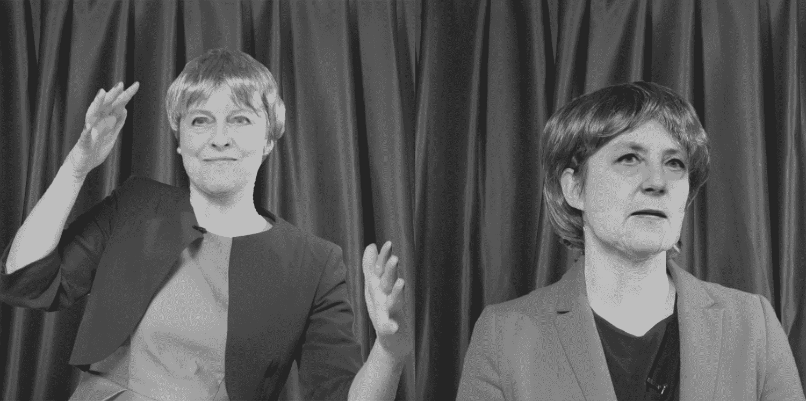

图 10.1

由 Libby Heaney 于 2019 年创作的`Euro(re)vision`双屏视频截图。由 Libby Heaney 提供。

艺术家使用了不同的机器学习技术来创作这种算法拼贴，其灵感直接源于达达主义诗歌，更具体地说是胡戈·鲍尔（Hugo Ball）的声音诗，鲍尔将这些诗描述为“无字的诗句”（Ball and Pinoncelli, 2011）。歌词是由三个在不同政治文本语料库上训练的字符级`RNN`组合成的：一个基于德国联邦议院的辩论，一个基于英国下议院，第三个则是这两者的混合。

为了创作这部作品，希尼本人在镜头前表演，在模仿这两个女性的同时朗读并吟唱着胡言乱德语般的（jabberwockian）生成文本，然后使用深度伪造（deepfake）将自己的脸替换为政治家的脸。在这些关于技术木偶的当代表演中，两个动画化的漫画人物身着亮片礼服，比划着手说着着言。面部替换技术的缺陷之处有时会在图像故障中显现，这些被留给观众自己去发现。

希尼的讽刺作品是对政治辞令及其在后真相时代与人工智能相互联系的批判，在那个时代，任何人都可以字面上地把话塞进政治家的嘴里。她的工作拥抱了一种技术故障美学，希尼称之为“良噪”（good noise），这种美学依赖于以“非初衷的方式”使用机器学习系统，换句话说，就是“摇晃它们，几乎让它们达到崩溃点，看看会产生什么，让我们重新认识自己”（Heaney, 2019）。

希尼和克林格曼（Klingemann）的作品都揭示了深度学习技术实现的新型媒体篡改带来的伦理、法律和社会影响。20 世纪 90 年，如`Photoshop`等图像编辑软件彻底改变了广告、文化以及公众与新闻的关系。通过将媒体操纵扩展到视频和音频领域，假新闻时代的深度学习技术将有助于完成此前由媒体编辑技术引发的变革。

## 混合生成内容

机器学习软件能够`photoshop`音频和视频内容，这背后隐藏着深远的影响：能够自动创建和混合媒体生产的生成过程的能力。这是当代机器学习系统基本属性的自然结果。正如我们所描述的，机器学习算法能够自动将生成过程转换为可以存储、复制和修改的数据结构（模型）。随后，这些过程可以被用于生成新的、不可预见的媒体内容（如图像和声音），以及用于游戏和机器人艺术的新型代理人行为。

例如考虑数字技术的兴起，这些技术允许创建合成语音，基于少数样本就能令人信地模仿某人的声音。这些数字声音实际上是体现在神经网络权重中的复杂数学函数，它们接收文本并将其转换为用某人的声音说出的单词。换句话说，

为了创作这部作品，希尼本人在镜头前表演，在模仿这两个女性的同时朗读并吟唱着胡言乱德语般的生成文本，然后使用深度伪造将自己的脸替换为政治家的脸。在这些关于技术木偶的当代表演中，两个动画化的漫画人物身着亮片礼服，比划着手说着着言。面部替换技术的缺陷之处有时会在图像故障中显现，这些被留给观众自己去发现。

希尼的讽刺作品是对政治辞令及其在后真相时代与人工智能相互联系的批判，在那个时代，任何人都可以字面上地把话塞进政治家的嘴里。她的工作拥抱了一种技术故障美学，希尼称之为“良噪”，这种美学依赖于以“非初衷的方式”使用机器学习系统，换句话说，就是“摇晃它们，几乎让它们达到崩溃点，看看会产生什么，让我们重新认识自己”（Heaney, 2019）。

希尼和克林格曼的作品都揭示了深度学习技术实现的新型媒体篡改带来的伦理、法律和社会影响。20 世纪 90 年，如`Photoshop`等图像编辑软件彻底改变了广告、文化以及公众与新闻的关系。通过将媒体操纵扩展到视频和音频领域，假新闻时代的深度学习技术将有助于完成此前由媒体编辑技术引发的变革。

## 混合生成

机器学习软件能够`photoshop`音频和视频内容，这背后隐藏着深远的影响：能够自动创建和混合媒体生产的生成过程的能力。这是当代机器学习系统基本属性的自然结果。正如我们所描述的，机器学习算法能够自动将生成过程转换为可以存储、复制和修改的数据结构（模型）。随后，这些过程可以被用于生成新的、不可预见的媒体内容（如图像和声音），以及用于游戏和机器人艺术的新型代理人行为。

例如考虑数字技术的兴起，这些技术允许创建合成语音，基于少数样本就能令人令人信服地模仿某人的声音。这些数字声音实际上是体现在神经网络权重中的复杂数学函数，它们接收文本并将其转换为用某人的声音说出的单词。换句话说，

（注：此处原文出现重复，已在此处中断翻译）

一旦训练完成，这种过程就变成了一个可以复制、粘贴和修改的数据。深度学习系统赋予的自动化创建内容的能力在人类历史上是前所未有的。另一个例子是“风格迁移”（style transfer），这种技术允许将特定的风格应用于图像。关于该主题的第一篇论文于 2015 年出现在`arXiv`上（Gatys et al., 2015），解释了如何使用卷积神经网络，其中内容和风格的表示是可以分离并被独立处理的。

同样，Flow Machines 研究项目旨在将音乐风格转换为可以被作曲家和音乐家轻松混合的计算对象。2016 年 9 月，该小组发布了两首由风格模仿算法生成的歌曲，一首基于披头士的乐谱训练，另一首基于美国词曲家的乐谱。不久后，Google 研究小组发布了一个名为`NSynth`的软件工具，可以通过混合乐器模型生成新的数字乐器。

电子音乐家霍莉·希尼（Holly Herndon）与杰林（Jlin）联合马特·德里斯特（Mat Dryhurst）和朱尔·拉普拉斯（Jules LaPlace）创作的作品是这种算法混合形式的有力例子。这首名为《Godmother》（Herndon, 2018a）的表演歌曲是由一个名为`Spawn`的“机器智能”生成的，艺术家将其归为真正的作者（参见图 10.2）。该系统使用了一种自定义的增强声码编码器，让霍莉·希尼可以使用杰林的声音演唱。这件作品利用人声片段产生了一种奇特的节奏盒剪辑。根据创者的说法，这一特征完全是算法“梦”出来的，`get`是“从霍莉的语音中的停顿和开始中学习的”（Kirn, 2018）。

经历这一过程带来了一些关于音乐未来的有趣问题。采样的出现引发了许多对他人创作材料进行伦理使用的担忧，但机器可读文化的时代加速并抽象化了这种对话。仅仅通过观察音乐，`Spawn`已经很擅长学习标志性的作曲风格或人声特征，并且只会变得更好，以至于任何与她合作的人都可能模仿他人的作品或通过他人的声音进行交流（Herndon, 2018b）。

深度学习技术的可扩展性意味着，这些早期示例将开启许多新的创作选择，对艺术实践和结果产生深远影响。新的视频风格迁移技术将允许对现有电影和其他视觉内容中采样的视觉风格进行混合。浪漫小说可以以`玛丽丽·马特伍德`（Margaret Atwood）的风格自动重写，并将《使女的故事》变成一部成长小说。新的变体将从单一电影类型或多种类型的混合（例如戏剧喜剧和僵尸）中自动生成。机器学习将允许通过混合现有角色，为虚构作品、电影和视频游戏创建新的角色性格，包括语音、动作、外貌和其他特征。

在不同媒介形式之间进行转换也是可能的。例如，艺术家将能够根据智能手机拍摄的视频场景自动生成配乐，或者相应地生成与配乐匹配的图像滤镜。将自然界中的自然模式（如火焰的运动）转换为文本、音效或机器人的行为也是可能的。

随着这种重混文化的革命，将出现许多与作者身份和版权相关的挑战和问题。赫森登（Herndon）警告说这些新重混形式具有伦理影响，它们可能导致一种由“数据驱动的、经过手术级定制以给人们更多他们喜欢的内容的新音乐生态系统”所助的“无许可模仿”，而对思想艺术身份的关注日益减少。在引用实验作曲家乔治·刘易斯（George Lewis）时，她主张一种“更美、共生的人机协作路径”，这提供了一个“重新考虑我们是谁，并据此构思新的创作和组织方式”的机会（Herndon, 2018b）。

## 一部 AI 歌剧

`Euro(re)vision`和`Godmother`的特点在于整合了多种不同的技术。作品《错山传》（Legend of Wrong Mountain，2018）将这一原理推向了，试图通过学习算法完全生成一部中国昆曲剧（Huang 等，2019）。该项目由由艺术家、计算机工程师和设计师组成的跨学科团队创作，作者将其描述为“机器对‘总艺术作品’（Gesamtkunstwerk）的尝试”，该项目是一个复杂的技艺重混，整合了在四个不同数据集上训练的大量学习算法。

因此，该作品的每个组件都是计算机生成的。为了创作乐谱，一个`RNN`在百张传统昆曲谱图像上接受了训练。对于剧本，作者依赖于在六十部传统昆曲剧本数据库上训练的自定义马尔可夫链层次系统。他们声称，这种方法允许他们保留具有章节、对话和歌词的逻辑结构。剧本被用于生成视频表演，并渲染成传统木刻风格的计算机生成的剧本书籍，该书籍也是由神经网络生成的。最后，音乐和剧本配有通过纹理分析、表演者视频片段姿态以及场景图像生成的视觉效果。

尽管结果略显不稳，但该项目作为机器学习艺术的实验仍然具有相关意义。它通过不同技术和数据集的相互作用，将创作过程的自动化推向了极端，这一切得益于开源许可协议下的机器学习工具的分发以及数据集的可用性。《错山传》为未来基于机器学习的瓦格纳级的总作品奠定了基础，在这些作品中，数据和算法在壮观的机械拼贴中融合。

## 结论

艺术总是发生在特定语文中。从单纯的灵感到复制和伪造，创作者们一直利用他人的作品来支持自己。在 20 世纪，媒体内容的自动复制导致了重混文化的出现，这种文化显而易见地接受衍生作品的产生。

在深度学习出现之前，重混总是以某种方式遵循拼贴原则。无论是为了生成新内容而重混打印图像、诗句、配乐还是代码片段，其基础保持不变：复制；粘贴；重复。

新的机器学习技术（如`deepfakes`）进一步推了这一原则，扩展了为艺术家提供的可能性。然而，机器学习也为由模型媒介的全新重混形式开启了大门，即自适应结构、结化为数据结构的过程。这发生，例如，通过对训练集的重混受到机器学习模型的间接影响。此外，目前对机器学习的痴迷推动了一系列作品的产生，其中文本、声音和图像等多种媒体使用学习算法自动化以创建新作品。

也许更重要的是，机器学习引入了不仅可以重混内容，还可以通过使用风格迁移等技术的处理过程生成媒体的可能性。音乐家霍莉·赫森登（Holly Herndon）和`Jlin`的作品是这种新型算法重混的典范，在这种情况下，表演者现在可以使用另一个歌手的声音印记来唱歌。我们正处于这场技术革命的起点，随着我们的不断前进，机器学习系统的能力可能会彻底改变艺术生产的条件和重混文化的格局。

# 注释

1. 1。马尔塞尔·杜尚（Marcel Duchamp）的`L.H.O.O.Q.`（1919 年）是此类作品的另一个著名例子，艺术家在那张代表《蒙娜丽莎》的明信片上画了胡须和络络胡。
2. 2。在欧洲，这些原则被重新利用和重新构想，例如通过碎拍（breakbeat）、慢节奏（down-tempo）、丛林（jungle）和嬉士舞（trip-hop）等子类型的出现。
3. 3。`GNU`是一个递归缩写，代表`GNU is Not Unix`。
4. 4。开源软件的普及在 20 世纪 90 年代不断增加，得益于`Linux`（1991 年由程序员林纳斯·托瓦兹发布的 Unix GPL 版本）的发展以及互联网的出现。在 20 世纪 90 年代中期，私营公司开始在开源中看到可行的经济模型，代码可以由社区共享和改进，公司可以出售服务而非专利软件产品。
5. 5。此类作品的流通和基于开源的艺术实践的扩张得到了`Eyebeam`和`PixelE`等艺术机构的支持，这些机构帮助开发和传播了开放文化的跨学科实践。许多艺术家经营中心、画廊甚至博物馆已经将支持开源作为其使命的一部分。
6. 6。在编写这本书时，`GPT-3`是已知最大的深度学习模型，拥有 1750 亿神经权重。
7. 7。这些特朗普伪造视频之一是 2018 年由比利时佛荷兰社会主义党委托制作的，作为视频活动的一部分，引起人们对气候变化问题的关注。
8. 8。这个术语归功于作曲家理查德·瓦格纳的“总艺术作品”（Gesamtkunstwerk），描述了将艺术形式整合到单一作品中的审美理想。

当代机器学习算法基于人工表征系统。它们利用了借自自然的某些基本原理，例如染色体、神经网络或物理定律。特别是深度学习和遗传算法，模拟了生物为了有效响应环境而采纳的结构和机制。其中一个原理是生物系统投射可能的情况以做出更好的预测，例如预测球的轨迹或对手的下一次动作，或者设计新的行为和存在方式，例如玩心理游戏或构想替代未来。当这种能力存在于人类大脑时，通常被称为`imagination`（想象力）。

机器学习模型的一个显著特征是，它们在训练过程中建立的感知属性通常可以用于生成性目的。人们可以将生成过程视为感知函数的逆过程。尽管机器学习领域一直知晓这些生成能力，但研究人员往往忽略了它们，至少直到最近如此。

当机器学习系统在数据集上进行训练时，它会变得该数据产生适应，并生成在外观和感觉上与与其训练数据越来越相似的数据。艺术家们在工作中反射性地使用机器学习，如 Ben Bogart、Brian Clifton、Sougwen Chung、Heather Dewey-Hagborg、So Kanno、Sam Lavigne、Trevor Paglen、Alexander Peterhaensel、Francis Tseng 和 Tom White，探索了关于机器表征、归纳偏置和政治权力的问题。

加拿大艺术家 Ben Bogart 在第 7 章中介绍了关于`SOMs`的工作，他自 2000 年代中期以来一直从事机器学习和人工神经网络。Bogart 将其方法定义为“艺术即研究”（Busch, 2011），他们通过艺术实践和与人类及机器认知与感知相关的问题进行调查。通过探索与梦想、感知、想象力、自组织和情境性相关的问题，Bogart 创建了多个视频作品，作为名为`Watching and Dreaming`（观看与梦想）系列的一部分，这些作品使用了根据著名科幻电影《银翼杀手》、《2001 太空漫游》和《电子幻战》的图像训练的各种机器学习系统。(1)。在这些作品中，系统都是根据对应电影的视频和音频轨道进行训练的。然后它被用于生成电影的新版本，从而在破坏原始作品的同时，保留了神经网络发现的颜色和声音的统计分布（见图 11.1）。

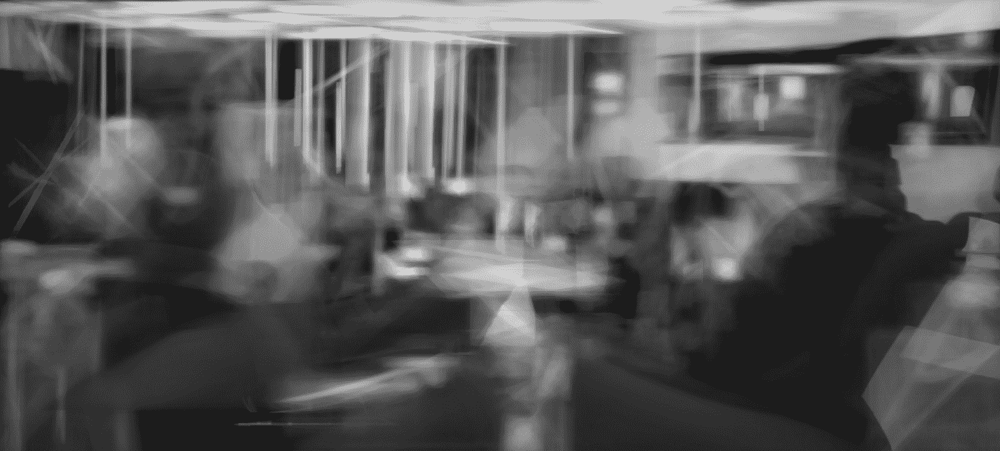

图 11.1

Ben Bogart, `Watching (2001: A Space Odyssey)`, 2018. HD 视频截图。由 Ben Bogart 提供。

关于作品`Through the haze of a machine’s mind we may glimpse our collective imaginations (Blade Runner)`（透过机器心灵的迷雾，我们可以窥见我们的集体想象（银翼杀手））(2017），艺术家写道：

> 生成的图像是柔动的色彩场，而声音在持续的嗡嗡声和复杂的故障之间流动，这是由于自组织过程。作品的结构是机器主体性与《银翼杀手》底层结构相互作用的涌现结果。每个场景景观和色彩场的渐进演化是机器学习过程的实现，这是由自组织的机器学习算法实现的（Bogart, 2018）。

Bogart 的机器主体性概念源于他在连接主义机器学习方面的工作，这是一个思考生物和计算代理主体性的新框架。在这种语境下，艺术家将主体性定义为“感觉与想象之间的交互，它形成了一种强化模式，并导致了感知”。这种主体性观点取决于以下假设：一方面，存在一个独立于观察者的外部世界；另一方面，遵循法国大陆哲学家梅洛-庞蒂的观点，假设现实是客体与主体的共同构建的结果（Bogart, Audry, Parish, & O’Murchú, 2018）。

Bogart 在机器学习系统中看到了通过设计机器形式的主体性来研究这些问题的机会。在这个框架下，机器感觉通过包含真实世界原始信息模式的训练数据提供，而机器想象则通过无监督机器学习算法实现，这些算法从其感觉中创建自己的类别。

Bogart 解释说，在数据点云中划分类别边界有不同的方法。因此，任何从其感觉中创建此类边界的想象过程在定义上都是主观的，因为对于特定的数据集和算法没有唯一的解决方案。边界是数据与算法相互作用（包括随机初始条件）的独特函数。在这种背景下，根据 Bogart 的说法，主体性是认知实体将两种不同的感觉模式归类同一个想象类别的过程。在 Bogart 的`Watching and Dreaming`系列的每部作品中，我们看到的是这种主观机器处理电影图像（感觉空间）并根据系统根据自己的偏好和感性学到的类别表征投射出新图像（感知/想象空间）的过程。

Ben Bogart 对机器学习的艺术方法直接使用学习算法，不是作为目的手段，而是真正作为研究更广泛问题的基底，在这种情况下，关于认知、感觉、想象和主体性的本质。Bogart 使用的神经网络是心灵模型，它们特别擅长根据自己的规则从连续模式中提取规律来学习类别表征。在大型真实数据库上训练的机器学习算法通常被宣传为现实的最优模型，为我们周围世界的隐藏特征提供客观测量。通过他的`Watching and Dreaming`项目，Bogart 展示了这种学习系统的机器表征最终是主观的，因为它们产生了自身的统计表征，这些表征高度依赖于训练集（感觉）与驱动投射方式的训练算法（想象）之间的相互作用。

## 归纳偏置

艺术家 Heather Dewey-Hagborg 在她的机器学习作品`Listening Post`(2009) 中探索了归纳偏置的概念。该作品由一个安装在公共领域的接口组成，外观是一个木箱，上面安装着一个人类耳朵的塑像。系统不断监控其声音环境，偷听路人的声音。从匿名行人那里收集的语音数据被发送到服务器，该服务器运行着一个在输入数据上不断训练和重新训练的机器学习系统（Dewey-Hagborg, 2011）。

从这些实时收集的音频数据中，系统通过通常用于公共监控的机器学习算法，重新组合听到的言语片段来生成新的声音。因此，通过计算机对语音片段的自适应重混，生成了一种集体构建的语言。

这位艺术家关注这项作品所探讨的关于归纳偏差（inductive bias）的问题，这是机器学习系统中极具挑战性的问题。机器学习系统是归纳系统，也就是说，它们利用经验数据进行泛化。因此，它们本质上会对所接收的数据产生偏见。正如本·博加特（Ben Bogart）通过“机器主观性”概念所言，机器学习模型在某种意义上是主观的，因为它们对其接触过的信息存在偏见。这种偏差意味着系统设计者所做的假设将始终促进对世界的特定观点。

杜伊-哈格堡（Dewey-Hagborg）描述了她在创作《倾听站》（`Listening Post`）期间，归纳偏差这一概念是如何出现在她眼中的。她最初设想会从路人的口语碎片中产生某种形式的“社区语言”。然而，随着项目的进行，她意识到这项技术存在重要的局限性：技术很大程度上依赖于处理纯净、去噪的声音，而她录制的声音几乎完全不纯净，被城市环境中各种背景噪音所污染。在花费了无数小时试图调整系统使其在这些不可能的条件下运行后，她突然意识到整件事的荒谬性：她想，“我为什么要试图让这项技术从它自身的陷阱中解救出来呢？我完全可以让它自然地暴露其作为一种滑稽且错误的技术的真目？”（Dewey-Hagborg, 2011）。

这种认知促使她改变了对自己作品的态度。她不再与技术对抗，而是决定拥抱机器学习系统的固有偏差来揭示其不完善之处。因此，《倾听站》并不是试图通过数据分析生成一种新的集体语言，而是将其环境作为一个游乐场，将听到的对话转化为一幅集体声音肖像。

## 技术文化阻断

在她的著作《数学毁灭性武器》（`Weapons of Math Destruction`）中，数据科学家凯西··奥尼尔（Cathy O’Neil）研究了依赖机器学习等大数据的算法系统的归纳偏差，以及这些系统对社会经济少数群体的破坏性影响（O’Neil, 2016）。她批评了警察分局常用于预测犯罪活动的所谓“预判犯罪”（`precrime`）软件，并解释了重大犯罪的稀缺性如何使得此类系统变得极难预测。这些系统基于“小错案会导致大案”这一未经证实的假设，因此依赖小微犯罪作为代理。结果是，这种犯罪预测软件倾向于针对有肤色的贫困社区，导致这些社区因小罪和轻微罪被捕的人更多，反过来又强化了系统在机器增强的“自我实现预言”形式下过度关注这些地区。

由布莱恩·克里夫顿（Brian Clifton）、萨·拉维涅（Sam Lavigne）和弗朗西斯·曾（Francis Tseng）的《白领犯罪风险区域》（`White Collar Crime Risk Zones`, 2017）是一个模仿奥尼尔所批判的分析软件的在线项目。利用文化阻断（culture jamming）的原理，他们将技术直接应用于财务违规行为的预测，从而利用技术反制自身。为了创作这部作品，他们在 1964 年以来美国从诽谤到欺诈的白领犯罪和轻微罪的数据集上训练了机器学习模型，并与来自在线源的其他信息进行交叉处理。结果是一张公开的交互式地图，显示了纽约市大多数风险区域。每个区域都可以进行交互式查询，显示与该区域相关的犯罪信息，例如最可能的犯罪类型及其平均严重程度，以及计算机生成的下一个可能违犯者的面部合成图像。

另一种通过颠覆机器学习软件以揭示其不完善之处的尝试促使艺术家亚历山大·彼特哈恩塞尔（Alexander Peterhaensel）创作了项目《投票站》（`Voting Booth`, 2017）。基于心理测量和计算机视觉领域的进展，他在一个标记有政治归属关系的人类肖像的数据集上训练了人工神经网络。随后，该系统被用于仅根据面部图像自动检测主体最可能如何投票。

该装置由一个配备摄像头的投票亭组成。当用户进入投票亭时，他们的脸部会被进行分析，并自动预测他们将如何投票，从而消除了他们实际上在选票上做标记的。这位艺术家通过一家名为“微笑投票”（Smile to Vote）的虚假公司传播这项技术。这家假公司的网站将该技术推广为优化 21 世纪治理的一种，其中投票行为被简化为拍自拍。

彼特哈恩塞尔的作品有效地建立在其试图批判的研究基础之上，包括通过面相学推断犯罪性（Wu & Zhang, 2016）和性取向（Wang & Kosinski, 2017）的研究，以及心理测量学中试图提取政治信仰（Kosinski, Stillwell & Graepel, 2013）的研究，有时准确得令人惊人。

《白领犯罪风险区域》和《投票站》都作为机器学习艺术的一部分部署了文化阻断策略。通过将尖端的机器学习系统应用于具有政治色彩的话题并作为技术讽刺的元素，它们揭示了这些数学毁灭性武器如何威胁民主与公正。

## 超越人类写作

由艺术家菅昭（So Kanno）和山口高弘（Takahiro Yamaguchi）创作装置《无意义语言》（`Asemic Languages`, 2016）探讨了通过在手写数据上训练的机器学习系统获取语言的问题（见图 11.2）。为了创作这部作品，艺术家要求来自不同国家的十位参与同行用母语写下他们的艺术宣言，并使用能够记录笔画轨迹的图形平板。因此，数据不仅仅是二维图像，还包含了书写者手部姿势的信息。

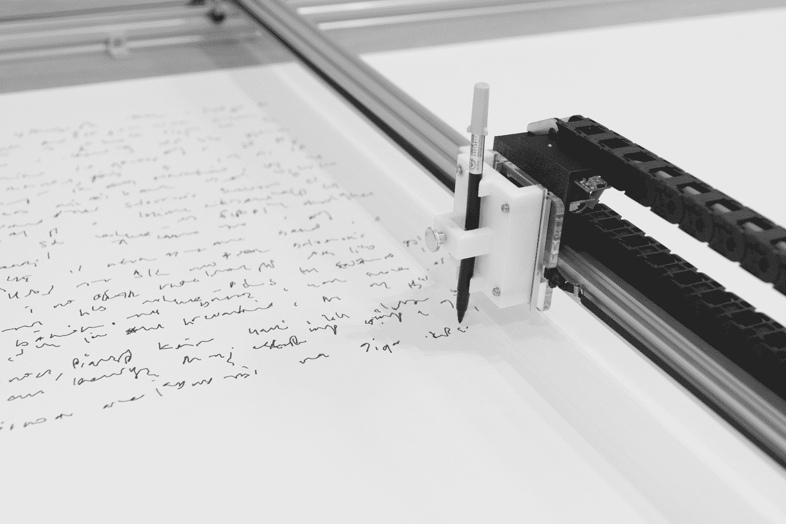

图 11.2 菅昭和山口高弘，无意义语言，2016。`XY`绘图仪，纸，笔，电脑，手写体。机器学习编程：坂本宏之。支持：日本通用系统有限公司，`HAPS`。

程序员坂本宏之（Hironori Sakamoto）不得不为这项作品开发定制技术。他使用了一种名为`k-means`的无监督学习算法（Lloyd, 1982）自动将笔画模式归为相似类别，然后开发了一种平滑连接笔画的自动化程序。针对每个参与艺术家的手写数据集都训练了不同的模型。

这些预训练模型在展示期间被使用。大幅纸张庄重地放在配备机器人绘图仪的桌子上，每个设备各持一支笔。笔在纸上移动，模仿它所训练的作者的姿势。结果是对原始文本的纯形式模仿，不完美地复制了作者的风格以及每个写作系统中的特定形式。

## 学习与生成

机器主体性提供了一种模型，用于理解一系列利用深度神经网络的学习属性与生成属性之间相互作用的艺术作品。有趣的是，深度学习的一些最新进展，例如生成对抗网络（`GANs`），正在利用这些系统生成或想象新数据的能力（Goodfellow et al., 2014）。这些生成能力并没有被视为副作用，而是被这些系统用来提高自身的性能。

在第 6 章中介绍的荷兰艺术家夫妇埃温·德里森（Erwin Driessens）和玛丽亚·维斯塔普（Maria Verstappen）自 20 世纪 90 年代以来一直通过直接挖掘受自然和生命过程启发的计算材料进行艺术创作。他们的作品`Spotter #bird Amstelpark`在 2018 年夏天于阿姆斯特丹 Zone2source 的“机器荒野”（Machine Wilderness）展出，延续了这一实践，引入了`GAN`（见图 11.3）。

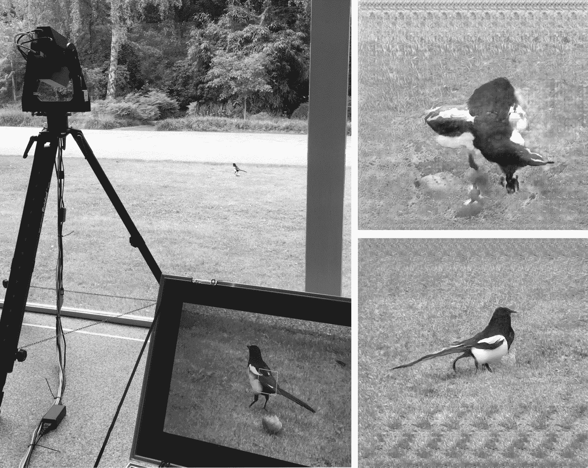

图 11.3

Driessens & Verstappen, `Spotter #birds Amstelpark`, 2018. 机器人，机器学习，`GAN`。Photo credit: Driessens & Verstappen. Courtesy of Machine Wilderness / Zone2Source Amsterdam.

从“人工智能大脑是否会做梦或幻想？”这一问题开始，艺术家们创作了一个特定场装置，探索深度学习系统如何感知和呈现自然过程。位于空间外入口处的一个扬声器持续播放鸟鸣。人们几乎没有注意到，这些声音实际上是由在黑乌声音上训练的深度学习系统生成的。

在室内，一个安装在电动云台头上的摄像头在环顾四周，它的视线试图通过画廊空间的落地窗捕捉暗示黑乌存在的动作和颜色。这些图像随后被添加到数据库中，以提高系统识别更多黑乌的能力。2018 年夏天，黑乌中爆发了一种疾病，导致机器人捕捉到的数量少于艺术家的预期。然而，那里出现了喜鹊、乌鸦和鸽子，因此 Spotter 捕捉到的图像变成了所有鸟类的混合体。(2)

Driessens 和 Verstappen 的装置包含两个显示器，显示由对摄像头拍摄的鸟类真实照片训练的`GAN`生成的。这些图像演变缓慢且种类多样。对于人眼来说，很容易识别出这些不是真实的图像。然而，它们的大多数暗示了或看起来像鸟。在某些其他情况下，图像变得非常抽象，我们只能推测鸟的存在，就像它失焦了一样，隐藏在模糊的草丛或树枝旋涡之后。我们的眼睛开始像机器人摄像头一样，即使场景中没有鸟，也在寻找鸟。

通过在特定场域将这些计算机生成的自然图像带回我们的视野，Driessens & Verstappen 的作品允许我们窥一个未来，在这个未来，机器可以成为想象替代世界的载体。它让我们这些这些机器学习系统，并揭示了关于它们感知的东西。他们的作品可以被读作是对人类世中机器想象问题的调查，在这一问题中，人工生命形式越来越多地出现在崩溃的生态系统中。(3)

## 不可见的图像

Driessens & Verstappen 的作品揭示了`GAN`内部两个神经网络（一个判别器`discriminator`和一个生成器`generator`）之间相互作用产生的图像生成迭代过程。如果系统创建的鸟类幻觉具有如此奇怪的特征，那是因为它们并不是为了人类视觉设计的：毕竟，它们是由机器（生成器`generator`）为机器（判别器`discriminator`）生成的图像。

特沃·帕格伦（Trevor Paglen）是一位美国艺术家和地理学家，他探索计算机辅助大众监控的问题，曾在斯坦福大学担任驻场艺术家与`GAN`工作，创作了一系列名为《对抗演化的幻觉》（`Adversarially Evolved Hallucinations` 2017）的版画。这些作品通过在与资本主义、梦境、人类、怪物、征兆和战争等分类相关的不同图像数据集上训练`GAN`生成。生成的图像呈现了`GAN`生成图像中常见的那种怪异、抽象、类绘画的特征。

帕格伦观察到，今天产生的大多数图像都是他所说的不可见图像，是由机器为机器创建并分发的，不是为了人类肉眼设计的。(4) 在世纪交替前后，我们进入了一个视觉文化的新阶段，这个阶段从人类注视中解放出来，对我们来说大部分是不可见的。尽管矛盾的是，它大部分没有被注意到，但这场图像生产的革命可能比摄影的出现更有影响力。从秘密军事基地的卫星照片到车牌的自动快照，现在产生的绝大多数图像都是不可见的，由机器为机器制造，这使我们进入了一个人类“视觉文化”已变成“特例”、“规则的例外”的时代（Paglen, 2016）。(5)

帕格伦提出了机器现实主义（`machine realism`）的概念来描述这个新时代背后的原理，他将其定义为“由机器学习和人工智能系统对图像进行自主意义赋予所定义的审美和解释模式”。在这种理解模式下，图像的意义已变成纯粹的操作性，必须结合其所属系统的目标来进行解释。

## 探索集体想象

计算艺术家 Memo Akten 在深度学习生成式算法中看到了探索集体无意识的一种方式。从 20 世纪 10 年代代中期开始，他通过一系列使用条件生成对抗网络（`CGAN`）的作品探索这一理念。`CGAN`是一种根据其他输入（如另一张图像）生成图像的`GAN`。`Learning to See`是一系列研究和完成的作品，其中艺术家将机器学习模型描绘为试图理解世界的代理。这些系统由艺术家在特定数据库上进行了预训练，使其对日常生活中的特定模式非常敏感。在这些机器的眼中，一束电线和钥匙等常见物体变成了花朵、海浪、火焰、云朵或山脉，取决于它们所训练的数据集类型。在`Learning to see: We are made of star dust`（2017）中，`CGAN`基于哈勃望远镜拍摄的宇宙快照进行了训练（参见图 11.4）。一个双通道视频左侧显示了艺术家脸脸的特写，右侧则揭示了机器的感知。随着摄像头潜入艺术家的眼睛，他的虹膜、瞳孔，然后是头发，最终他的面部穿孔变成了星星、星系和星云。通过这种从微观到宏观的机器翻译的展开，Akten 引导我们关注人类对宇宙的神秘痴迷，并揭示了我们理解生命之谜的集体渴望。在这个过程中，他还暗示人类对知识的不懈追求无法与其自身的形象分离，就像作品中的机器过程一样，我们不断地将自己的感知偏见投影到宇宙上。

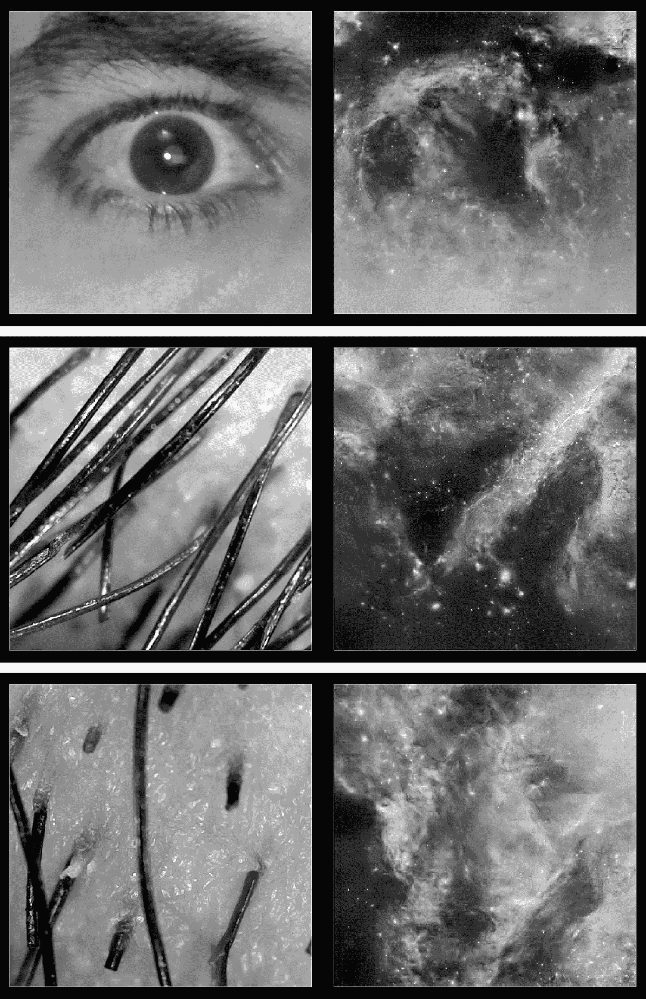

图 11.4

来自 Memo Akten 2017 年作品`Learning to see: We are made of star dust #2`的静态图像。视频和交互式装置。由 Memo Akten 提供。

在该系列的另一件名为`Google Art: Learning to dream`作品中，Akten 在 Google Art 项目的图像上训练了一个类似的系统，该数据库包含来自 6,000 多名艺术家的数万艺术品，包括绘画、素描、宗教图像、史前艺术等。在 2018 年于巴黎大宫展出的装置版本中，摄像头对准观众，揭示了深度学习系统看到的内容。

虽然深度学习系统的统计驱动型表示属性揭示了隐藏的压迫系统，但它们也为深入集体提供了一个独特且新颖的机会。书中之前讨论过的，如 Ursula Damm 的`Memory of Space`（2002）和 Brian House 的`Everything that Happens Will Happen Today`（2017）等作品，利用机器学习追踪人类行为的动态肖像。这些肖像的奇特之处不仅归于机器感知的数学模式，还归于训练数据的社会特性，这使得系统表现得像“人类”（复数）(House, 2017)。

与其相似，Memo Akten 将机器学习作为通往集体想象的桥梁。生成式深度神经网络为海量数据集提供了独特的视角，这些数据规模巨大，否则人类肉眼无法见证。但 Akten 提醒我们，大数据和人工智能时代存在隐藏的偏见和权力动态，以及它们与艺术的关系。“我们与云有非常亲密的联系，”他写道，“我们信任它。我们向它倾诉。我们向它寻求。我们与它分享秘密，那些我们不会与家人或亲密朋友分享的秘密。”

但正如教会曾是面对神性的人类想象的守护者一样，Akten 认为，在学习机器时代，像 Google 这样在这一自我监控经济中生存的跨国`IT`公司现在掌握着我们集体意识的钥匙（Akten, 2017）。(6)

## 结论

机器学习系统是主观的表示设备。从作用于其输入的感官空间，它们提取出自己的微观类别，并在过程中产生一个直接源于其接收数据的虚拟空间。因此，它们提供了设计它们的人类和非人类环境中所含偏见的镜像，具体来说，是其训练数据示例中所含偏见的镜像。艺术家 Ben Bogart 和 Heather Dewey-Hagborg 在他们的作品中提出了这个问题。Bogart 通过展示人工神经网络如何创建其接收的信息的表示，这种创建方式远非中立，而是高度依赖于其所训练的信息，来探索机器学习系统的主观性；而 Dewey-Hagborg 则强调了技术本身如何使得这种归纳偏见不可避免。在近期名为`How do you see me?`（2019）的最新作品中，她利用对抗神经网络生成的自画像被另一个机器学习算法识别为艺术家本人，但看起来却完全不像她。

从事机器学习的艺术家直接接触到这种媒介的特殊性。其中一些人，如 Ben Bogart、Erwin Driessens、Maria Verstappen 和 So Kanno，利用这些缺陷来探索关于人类和机器感知、认知和语言本质的问题。另一些人，如 Heather Dewey-Hagborg 和 Trevor Paglen，指出了这些偏见技术对社会结构的影响。最后，利用文化干扰（culture jamming）的原则，如`White Collar Crime Risk Zones`和`Voting Booth`等项目通过将机器学习用于奇特或荒谬的应用（例如预测华尔街的下一个白领犯罪犯，或允许人们用脸而不是用脚投票），批评了机器学习技术的局限性。

尼日利亚裔艺术家 Mimi Onohua 的长期项目`The Library of Missing Datasets`（2016）是一个本该存在却不存在的数据集档案，说明了大数据时代深度学习技术带来的破坏性影响。该作品由装满空档案的文件柜组成，每个档案都标有缺失的数据集名称，如未报告的家庭和性暴力、警察暴行、白领犯罪、避税天堂的资本储备等。虽然 Onohua 的项目揭示了这些差距背后的权力不平衡和文化背景，但它指出，不存在有时具有益处。

1. 该系列包含五部作品。第一部`Watching and Dreaming (2001: A Space Odyssey)`(2014) 使用了与`Dreaming Machine #3`(2012) 类似的多层感知器。作品`Watching (Blade Runner)`(2016)、`Watching (2001: A Space Odyssey)`(2018) 和`Watching (TRON)`(2018) 均依赖`k-means clustering`（均值聚类）和`mean shift segmentation`（均偏移分割）将帧和声音分解为各个组件。作品`Through the haze of a machine’s mind we may glimpse our collective imaginations (Blade Runner)`(2017) 使用了在输入帧上训练的`SOMs`。在每个场景的开始，使用原始帧作为初始权重初始化`SOM`。对于场景中的后续每一帧，都会对像素进行采样并用于训练`SOM`。训练过程随着时间推移进行，每帧的迭代次数相对较少。当场景变化时，`SOM`权重会被重置，过程重新开始。
2. 针对该情况，作品的原始标题`Spotter #blackbird`被改为`Spotter #birds Amstelpark`。
3. 装置使用的`GAN`处于无休止的训练中：旧的训练样本会被相机拍摄的新快照取代。这引入了时间上不断变化的背景。例如，如果该装置在现场运行了一年，人们将会在生成的图像中看到季节的影响。
4. Paglen 的言论适用于图像领域之外。例如，美国国家经济研究局的一项研究表明，公司正日益量身定制其企业文件，以便让机器阅读（Cao, Jiang, Yang, & Zhang, 2020）。
5. 艺术家 Tom White 对深度学习神经网络的方法与 Paglen 的工作相呼应。他创建了一个绘画系统，允许生成式神经网络创建抽象的墨水画，揭示了其视觉系统的内部运作。在深度学习系统的帮助下，White 创作了真实的墨水画，这些画作被这些系统可靠地分类为特定类别，如`rabbit`（兔子）、`banana`（香蕉）或`killer whale`（虎鲸）。虽然这些画作有时人类人类解读，但它们实际上是为机器生成的、由机器产生的图像。
6. 讽刺的是，正如 Akten 注意到的，承载这种集体想象的数字天堂被称为`cloud`（云）。

# 12 结论

自本世纪初以来，信息和计算能力的空前增长带来了机器学习的革命，导致了这种被称为深度学习的先进联结主义形式的出现。从视觉艺术、音乐到文学，跨越各个领域的艺术家们正越来越多地参与到机器学习技术。与计算机工程师和科学家不同，这些艺术家使用机器学习并非为了它的精确性，而是为了它的开放性。与其说他们热衷于玩计算创造力的模仿游戏，不如说他们热衷于以背离设计初衷的方式重新利用机器学习算法。

艺术与机器学习之间的相互作用早于这个时代。在二战战后的几十年里，显示出自适应行为的控制论机电设备出现在艺术与科学的最前沿，例如 Nicolas Schöffer 的时空动力学雕塑、Grey Walter 的机器人乌龟以及 Gordon Pask 的开创性工作。

在人工智能的早期，人们提出了两种竞争性的计算模型：一种是计算将纯粹由使用数学语言的符号操作组成（`symbolic AI`，符号人工智能）；另一种是计算将模拟人类大脑的生物神经网络，处理亚符号的转换和连接（`connectionism`，联结主义）。在 20 世纪 60 年后者败于前者之后，对计算日益日益痴迷导致了智能系统思想的结晶，被称为`computationalism`（计算主义），这是一种二元论的世界观，其特征是将作为数学构建的智能与其在物理世界中的体现分离（Penny, 2017）。计算主义对过程而非物质的关注呼应了 20 世纪 60-70 年代的概念艺术运动，以及 Jack Burnham 的预言，即思想和过程而非其在艺术品中的物质实现将成为艺术的新焦点（1968）。20 世纪 80 年代和 90 年代的人工生命和演化艺术运动将指数级增长的计算力应用于虚拟世界中“可能的生命”的模拟。然而，模拟过程开始偏离`symbolic AI`，用概率和统计取代离散数学，用连续微积分取代整数。换句话说，20 世纪末的算法艺术作品从数字世界转向了模拟世界。虽然人工生命艺术可能被读为对自然世界功能组织的尝试，但这一时期的艺术作品往往脱离了现实世界。

整个 20 世纪 90 年代，演化艺术家 Karl Sims 和 William Latham 探索了自定义参数和非参数模型的方法，并使用选择、变异和交叉对其进行训练。与此同时，20 世纪 90 年代初，科学家 Rodney Brooks 通过呼应许多反对计算的声音，试图调和人工智能与人工生命，声称人工智能系统不需要表示，而是现实世界的体现。Brooks 的“新人工智能”影响了整个 20 世纪 90 年代 Louis-Philippe Demers、Simon Penny、Ken Rinaldo 和 Bill Vorn 等艺术家的机器人艺术和人工生命艺术。

20 世纪 90 年代也见证了联结主义在工程和计算机科学领域的秘密扩张。在此期间，只有少数艺术家如 Nicolas Baginsky 和 Yves Amu Klein 探索了将人工神经网络作为机器人和人工生命艺术的方法。这些浅层联结无监督学习系统使这些艺术家能够将具身的机器人系统置于现实情境中，产生他们无法直接控制的意之外之外迷人的行为。

自 21 世纪初以来，机器学习艺术通过 Ben Bogart 和 Ursula Damm 等艺术家的工作得到了扩展，他们使用自组织神经网络来探索机器主观性形式中的创造力和感知。近期，如 Memo Akten、Sofian Crespo、Mario Klingemann、Gene Kogan、Allison Parrish 和 Anna Ridler 等艺术家一直在探索深度学习系统的表示能力，创作质疑人类想象力、认知和梦境边界的作品。这些作品设定于一个后数字时代，在这个时代，通过曾被称为`cyberspace`（网络空间）的商业化以及社交媒体平台的普及，虚拟已成为新现实，因为社会日益受到统计学习系统的控制，这些系统从海量数据中挖掘价值信息。这些高度复杂的机器产生的新感知空间是迷人且超脱地球的，也许不是因为它们是非人类的，而是因为它们代表了多样化的人类（House, 2017）。

深度学习是二战后首次提出的连接主义`AI`方法的最新演变。它的力量在于能够直接从原始数据中进行学习，这使得深度学习算法能够被更广泛的用户（包括艺术家）所使用。深度学习系统仍然存在重要的局限性，包括它们目前需要大量数据才能表现优异（而人类仅需一个或两个示例就能学习复杂的模式）。目前尚不清楚人类是否很快会进入另一个“AI 寒冬”，届时，深度学习的技术局限性，加上通过技术增强的自主武器扩散、虚假新闻传播、系统性种族主义和性别歧视等对社会造成的负面影响，将使人工智能的追求再次消失在全球范围的失望之中。

深度学习系统依赖于对原始数据的自组织机器表示，这些表示是通过在亚符号水平上运行的大量互连的人工神经元层实现的。因此，它们最强大的特征之一是：能够将世界特征投影到潜在生成空间中，而这些空间与其所训练的内容类型是无关的。

机器学习似乎已经确立了其相对于符号`AI`的重要性，至少目前如此。在这一历史时刻，我们正见证计算主义的崩溃，以及随之而来的基于纯符号形式的数字生命和智能的存疑概念。随着尘埃落定，世界上越来越多充满了接近模拟而非数字的人工系统。深层神经网络以一种近乎真实的流畅和柔和的方式处理数以万亿计的数据通道。然而，这些过程仍然通过运行在通用计算机架构上的数字数据来执行，尽管其规模是前所未有的。

机器学习时代的艺术，是一个后数字社会的见证，这种社会被感官刺激所过载，在这种社会中，人文主义和现代主义的失败已让位于计算机策展的想象力世界。在这个世界中，技术模拟了我们集体智能在所有不可测的智慧中的悖论本质。在这一崇高且持续不断的迷迷领域中，幻觉已成为现实织锦的核心。这一后虚拟和后真时代的机器学习艺术家揭示了，从未打算被看到的图像和从未打算被听到的声音的非人类生成数据贴，现在如何可以被重新征用为混合算法现成品（readymades）。

也许在这里，艺术变得更接近控制学家的实验性和表演性科学，在这些科学中，表现与干预融合，虚拟变成了物质。艺术向我们展示了一种欣赏虚假审美和共鸣价值的方法，因为艺术家一直知道如何在虚构与现实之间穿行。当所有的脸庞和声音都可以伪造时，一种扭曲的真相隐藏在故障（glitch）之中，隐藏在我们共同的技术现实中可能实现的完美缺陷之中。

## 远观

本书对机器学习艺术的探索采取了进入机器学习算法代码和物质性进行远征的形式。我们从这头野兽的血管系统开始我们的旅程：训练循环。在那里，我们探索了艺术策略，用以批判性地参与到训练算法核心的优化过程中，例如利用此类系统在学习过程中的行为形态学。

随后，我们将目光转向机器学习的神经系统：模型。我们观察了这种适应性结构如何意味着新的机器表示形式，以及不同物种的模型（如参数化系统和神经网络）如何允许不同的艺术方法和结果。

我们旅程的最后一部分发生在机器学习的消化系统中，观察它最珍贵的食物：数据。机器学习允许艺术家通过重用现有数据集、从现有数据组装新数据集或生成自己的数据集，用数据策展来替代编码。机器学习通过数据和模型的重混，开启了新的算法重混形式，这种形式通过机器学习作品中感知与想象之间的相互作用被观察到。

让我们从这头野兽的身体中退出来，以更好地观察它的整体。

## 弥补差距

通过本书，我努力将机器学习艺术定义为数字艺术中一个多孔且非排性的子类别。通过研究围绕机器学习的丰富创作实践，人们可以观察到这种艺术形式的特定特质，将其与新媒体艺术家使用的其他方法（如符号`AI`、人工生命`ALife`和新`AI`）区分开来。

符号`AI`倾向于自上而下的方法，程序员对他们想要实现的目标有一定的想法，并在系统中实现它，从一般到特殊。哈罗德·科恩的`AARON`软件是这种方法的标志性例子。科恩的作品中与算法物质的关系是直接且大脑的：创造者寻求通过计算机语言来表达他的意图。符号`AI`的自上而下方法为创造者提供了巨大的控制权，因为艺术家完全负责将他们的艺术愿景翻译成程序。

然而，像`AARON`这样高度控制的符号`AI`系统并不十分自主，几乎完全取决于设计者的技艺。这种编程造诣通常是许多艺术家的入门门槛。然而，即使对于专家来说，符号`AI`也需要投入大量时间才能获得意义且新颖的结果，想想哈罗德·科恩是如何在四十多年里开发`AARON`的。这些系统无法适应新环境，给设计者带来了限制可能性的压力。在显示行为的系统（如机器人装置）中，这种僵性使得这些基于规则的系统无法随时间发生转化。无论是生成视视频还是机器人，符号`AI`方法都从上而下定义了一个有限但具有表现力的领域。因为设计者需要使用符号和规则来表示他们的想法，符号`AI`也使得难以表示或体现创作活动中常见的多维过程。正如人类并不真正知道自己如何呼吸一样，艺术家真正不知道自己是如何创作的：虽然他们可能依赖一组基本原则（例如如何排列元素、光线、色彩和其他组件），但他们大多数的创作决策都是直觉发生的。

机器学习与其他实践的区别在于其特殊的物质性，它是由三个部分构成的组合体：训练过程、模型和数据。这三位一体的概念为艺术家提供了广阔的干预可能，允许他们选择想要控制的内容以及留给机器的内容。例如，在创作装置作品《不唯一》（Not the Only One）时，艺术家斯特芬妮·丁金斯（Stephanie Dinkins）对数据集拥有完全控制权，但将其作为影响生成式系统学习的一种（该系统通常产生奇怪的响应），而不是作为一个交互式档案。相比之下，为了创作他们的机器人装置《间隙》（Zwischenräume），Petra Gemeinboeck 和 Rob Saunders 仔细地定义了系统的奖励函数以指导训练过程，但他们对这些好奇心驱动型机器人所接触的数据几乎没有控制力，这些数据可能会根据展馆、时间、当地文化和其他影响而有所不同。

工作在不同领域的机器学习艺术家将彼此视为一个共同家族的成员；机器学习系统的通用性和`数据无关性`（data agnosticism）使得思想和方法能够从一个学科领域转移到另一个领域。事实上，许多活跃在机器学习领域的艺术家（也包括我在内）通过使用不同媒介创作不同的作品，或在单一作品中结合许多机器增强的媒介，跨越了传统媒介的边界。

机器学习通过从经验中学习的能力，赋予了自组织系统与现实世界关联的能力。例如，在图像生成领域，无论是`AARON`（使用符号人工智能方法）还是卡尔·西（Karl Sims）的人工生物（使用人工生命方法），都不是通过接触现实世界数据构建的。相比之下，基于图像的机器学习艺术项目，如索菲亚·克雷斯（Sofia Crespo）的《神经动物》（Neural Zoo）、本·博加（Ben Bogart）的《梦想机器》（Dreaming Machines）系列以及 Driessens & Verstappen 的《阿姆斯特丹公园斑点》（Spotted #bird Amstelpark），产生了源自真实世界图像的新图像。

通过将自组织自主系统与现实世界连接，机器学习艺术重新解释了 20 世纪 60 至 80 年代对符号和规则的自上而下的符号人工智能痴迷，以及 80 至 90 年代人工生命和机器人艺术的自下而上的实践，允许机器虚拟性与物理世界的现实之间进行交互。这一现象的下一个前沿是计算系统与生物系统之间的交互。娜塔莉娅·巴尔斯卡（Natalia Balska）的装置《B–612》在几个月的时间里将一个强化学习计算神经网络与植物置于共生循环中，是对机器学习时代现实与虚拟之间紧张关系的典范式探索。

## 超元创作

机器学习允许艺术家通过让计算机程序响应现实采样示例进行自我设计，将自组织系统连接到现实世界。(3) 机器学习自动化了从输入到输出的过程，允许设计者避免从零开始设计程序。相反，他们可以通过仔细选择组件（如数据、模型、评估函数和训练过程）来构建一个学习语境。

人工生命已经通过在计算机上模拟自组织系统，提出了将人类设计者移出循环的方法。然而，这些系统的基本规则仍需由人类设计，因此限制了它们的可能结果使其仅处于特定的可能性范围内。位于人工生命（`ALife`）和机器学习边缘的遗传算法，利用进化系统的自组织和优化能力作为从系统与某些外部数据之间的反馈作用中学习的方法，但很少像深度学习系统那样依赖数据集。卡尔·西仅在表面利用数据：虽然人类决策影响适应度函数，但他的系统生成的奇异生物纯粹是计算的，基于西姆自己设计的规则。这种方法与索菲亚·克雷斯《神经动物》系列中产生虚拟生物的方法非常不同，因为艺术家不需要设计系统的规则，而是要根据从现实世界拍摄的生命体图像来对其进行训练。

但虽然机器学习自动化了通常涉及编码的部分工作，但人们仍需警惕一种观点，即机器学习系统让艺术家的工作变得更容易或取代了他们的身份。机器学习技术取代并重构了艺术过程中的创作机构，从而孕育了新的人机关系。

## 人机关系

尽管媒体对基于人工智能的艺术报道更多展示了可以“创作艺术”的新机器学习系统，但使用这些技术的艺术家很少使用“作者”或“艺术家”来定义自己的机器学习系统，因为他们清楚地意识到其中涉及了大量的人类认知和创作劳动。另一方面，考虑到这些系统重要的自主性，“工具”或“仪器”等术语似乎同样令人不满意。瑞贝卡·菲布林（Rebecca Fiebrink）使用“元仪器”（metainstrument）的概念来描述她的交互式机器学习软件`Winator`。菲布林观察了莱蒂娅·索纳米（Laetitia Sonami）和苏珊·凯（Suzanne Kite）等艺术家如何在作品中使用`Winator`来设计新的仪器。他们以一种具身的、表演的方式使用它，因此将`Winator`作为一种仪器。

机器作为“协作者”是另一个描述艺术家与机器学习系统之间交互的常用比喻。这是 Sougwen Chung 描述她与自适应绘画机器人`D.O.G.`关系的方式。在其他情况下，关系是单向的，系统被用作灵感来源而非交互式的共同创造，更像是一个“缪斯”（muse），其不受约束的表达可以帮助艺术家逃脱枯燥和瓶颈。大卫·J·约翰斯（David Jhave Johnston）的诗集系列《ReRites》，艺术家每天编辑基于诗歌训练的深度学习循环神经网络的输出，提供了这种关系的一个例子。有时，这种灵感机构成为艺术家自身的反映，揭示了他们自身实践的独特品质，正如安娜·里德所报道的，她发现她在 2017 年的项目《厄莎家族的衰败》（Fall of the House of Usher）中使用的`GAN`揭示了她风格的某些方面，例如她画眉毛就像眼睛。在这里，机器学习最好被理解为神话意义上的“echo”，通过反射艺术家的声音表现其机器主体性。它的过程不是人类的，但它的功能是“为了模仿和响应人类思维而设计的”（Gee & Audry, 2019）。威廉·莱瑟（William Latham）引入了艺术家作为园丁的概念，将机器变成一个生成式“花园”（garden）。机器学习可以创造出无限的可能声音、图像、形式和行为空间，艺术家、观众甚至其他机器都可以从中挑选。这种想法并不局限于进化系统。想想在安娜·里德的装置《马赛克病毒》（Mosaic Virus）制作过程中涉及的多个层次的园艺工作，从仔细选择模型参数到在数据集中选择正确的图像组合，不用说种植郁金香涉及的实际园艺劳动了！

Memo Akten 认为，机器学习是一种如此独特的生物，没有任何一个单一的比喻能够真正解释其奇特本质的丰富性。例如，人们或许可以将机器学习的艺术实践与莉诺·“李”·克拉斯纳（Lenore “Lee” Krasner）和杰克逊·波洛克（Jackson Pollock）的行动绘画相提并，艺术家通过试错（在画布上喷洒油漆）来学会掌握一个混沌系统。然而，这种比喻是有局限性的，因为与画布上喷洒油漆涉及的流体力学不同，机器学习系统中涉及的规则是人造的。

作为另一种比喻，Akten 建议将其比作驯野马。在这种情况下，人与一个自主生物互动，在这个过程中，双方都需要以某种方式相互驯服，建立一种我们并不一定自然拥有的共同语言，例如通过拉缰来转弯或通过踢腿来前进。在这个过程中，你不能真正说你是在把马当作工具，或者你正在与它协作。尽管同样完美，但对 Akten 来说，这种比喻呼应了自发生论（Varela, 1992）和具身交互理论（Dourish, 2001）所引发的耦合概念。

## 驯服不可知者

Akten 与驯服野动物的类比虽然并不，但与一个在机器学习艺术中以各种不同属性反复出现的概念产生了共鸣。机器学习被认为是奇异的、惊人的、不定的、不可测的、怪异的、意外的、不可预测的、不可解释的不可知的。这些系统的自主性及其所依赖的数学模型的复杂性产生了往往违背理性理解的结果，不仅对于观众，对于他们的设计者也是如此。

这种媒介的特性对选择与之接触的艺术家非常有吸引力。由于这些品质可能呼应了 21 世纪生活中熟悉的奇异感，这些艺术家准备好接受从事机器学习技术涉及的艰巨、耗时且往往令人沮丧的工作。

当然，所有艺术家在某种程度上都会面临他们所使用的材料的不稳定性，无论是颜料、粘土、文字还是代码。在 20 世纪，偶然和随机过程的使用对当代艺术产生了深远影响。达达主义诗人在写诗时引入了偶然和算法过程来释放思想。这些技术后来被比特一代诗人和法国文字文学实验（`OULIPO`）进一步发展。超现实主义者将不可预测的`cadavre exquis`（精致尸体）游戏引入集体艺术创作。行动画家探索了在画布上滴滴和喷洒油漆的混沌本质。20 世纪 60 年代，约翰·凯奇（John Cage）、小野洋（Yoko Ono）和伊昂·塞克斯斯（Iannis Xenakis）作为他们对声音和音乐革命性方法的一部分，探索了不确定。

计算机技术的出现和发展通过开启艺术过程中新的自主性和不可预测性诞生了计算机艺术。20 世纪 80 年代连接主义、遗传算法和人工智能的发展产生了一系列新的艺术实践，包括生成艺术、人工生命艺术和进化艺术。这些运动的特点是对生成过程自主本质的拥抱。然而，与粘土和颜料颗粒等物理材料的不可预测性相反，这些过程最终是由其设计者自定义代码的，因此至少在原则上赋予了艺术家对输出结果的直接控制。此外，计算机艺术大多运行在虚拟领域，并在很大程度上与外部世界隔绝。

机器学习艺术至少在三个方面重构了艺术家、观众和算法过程之间的关系。首先，训练过程本身成为了审美效果的来源。在整个学习过程中，机器学习系统通过适应其环境来迭代地改变自己的行为。这还通过具身耦合开启了人机关系的现象学形式，人类和算法都试图适应彼此。

其次，计算机艺术涉及艺术家-程序员参与到一种必须构建算法的工程实践中，而机器学习艺术的实践更类似于实验科学。人们必须选择一种训练算法、建立一个模型、创建一个数据集，然后让系统运行和适应，这个过程通常不是即时的，并且可能需要几小时或几天。尽管在未来几年里，计算能力的进步将缩短训练时间，但这种实践的本质与传统的计算机编程非常不同。此外，随着处理能力的增长，数据集的大小也随增长，因此机器学习艺术在大部分仍然比编码不即时。

最后，艺术家对系统的影响在设计上是间接的，因为机器学习的核心在于学习算法的自主性。机器学习艺术家不能仅仅改变一行代码来修复错误。为了驯服这头野兽，他们需要利用手头的各种元素，调整超参数和目标函数，重新混合数据集，并通过试错使用自己的直觉。自矛盾的是，艺术家自己也需要参与一个适应过程，当他们试图塑造系统以适应自己的需求时，系统会以自己的决定做出回应。

## 艺术世界的范式转移

20 世纪 60 年代后期，杰克·伯纳（Jack Burnham）建议受控制论和系统理论启发的对当代艺术的修正。在这种体系下，艺术对象必须让位于过程。伯纳的`系统艺术`呼应了他时代先锋派推动的审美去物质化，包括概念艺术和表演艺术，以及计算机科学中一种新兴的计算主义世界观，它将深刻影响文化。这种通过信息技术重新想象的笛卡尔二元论的新版本，也倾向于去物质化的高层过程（软件），而非大多无关要的低层物质（硬件）。

在认知科学最终逐渐离开计算主义，并日益认识身体在认知中重要性的同时，人文科学的表演转向将物质性带回了对话。这种范式转移要求对人类有更细致的愿景，其中过程和行为无法与其物质化身分离。作为一种拒绝对机器人行为进行二元论理解的具身审美学，Penny 的行为美学提供了一个与这种转变兼容的伯纳系统艺术的当代替代。

随着人类适应一系列全球危机（全球变暖、流行病、信息战争等许多其他），人类形象的中心性和特殊性日益受到质疑（Braidotti, 2013）。通过与机器学习系统的算法和信息物质性接触，书中介绍的艺术家开发了重新想象人类与非人类过程关系的新方法。这些技术的异质性可能防止我们陷入媒体艺术家大卫·罗凯比（David Rokeby）所说的“默认的人主义”，通过“打破我们对自身的过度熟悉”（Kleber & Trojanowska, 2019）。然而，如果不重新发明此类新颖艺术形式被策展、传播和消费的方式，这是无法实现的。

从好的一方面，媒体对`AI`的广泛狂热，结合科技商业领域对`AI`驱动的数字艺术的兴趣，引起了主流当代艺术网络的浓厚兴趣，而这些网络此前对新媒体艺术一直持谨慎态度。然而，这种来自主流当代艺术机构的兴趣往往是错位的，因为它们倾向于通过主流媒体中的恐惧和兴奋来对`AI`进行叙事化，同时推广符合公认格式规范的`AI`艺术。

机器学习艺术也受到由跨国公司和行业驱动的会议组成的科技科学网络的助长。这种在科学、工程和商业界内对艺术的热情是相对不常见的，这是机器学习艺术的一个令人兴奋的方面，促进了它在普通大众中的推广。然而，企业-科学网络更广泛的议程不仅偏离了新媒体艺术家的观点，而且在很大程度上误解或误读了媒体艺术理论和历史。这种情况最普遍的影响之一，是在艺术机构背景下，直接应用行业开发的深度学习方法所创作的作品出现了不成比例的传播。例如，这导致了谷歌支持的作品以及如`NeurIPS`上的`Machine Learning for Creativity and Design`等创意`AI`展览中，如`DeepDream`和`GANs`等卷积神经网络占据主导地位。考虑到本书揭示的机器学习艺术方法的多样性，这种对卷积网络生成图像的关注不仅使艺术贫乏；更重要的是，它强化了对机器学习艺术的限制性定义，这种定义与谷歌的算法密不可分，以至于它实际上变成了一种弥散性的品牌营销。

机器学习艺术占据的领地远超`GAN`图像的领域。其采用者的驱动力源于通过与机器学习独特的物质性互动，从而超越现有审美规范的渴望。通过对机器学习系统的运行模式进行批判性研究，这些实践者揭示了这些已成为世界结构一部分的先进技术的完善性、脆弱性、主观性和物质性。除了这些自动化系统的人造、机械和虚拟特性外，这些艺术家还揭示了它们深邃的人性维度。与此类模糊的过程接触，要求艺术家接受其意图的某种去中心化和某种程度的放弃。反之，这也要求公众放弃对计算机技术精确、即时和易于使用的预期：去接触那些超越理性理解的、诡异的技术行为形式。

为了支持和促进这些新审美形式和实践的卓越多样性和丰富性，艺术机构需要帮助重塑观众预期，并发明新的展示和传播格式。这反过来允许只有通过机器学习系统才可能的新类型作品出现。公共作品可以运行多年，可能跨越多个世代，随着新信息的不断不断不断修改其行为。自适应艺术作品可以住在家里，通过它们在世界中的行为和行动保留过去互动的痕迹，超越时间。人机音乐乐队将出现、消散并重新组合，以表演个性化的算法混混，在一天内发布的歌曲比历史上产生的歌曲还要多。病毒式机器学习艺术将生活在我们中间，潜伏的、几乎难以察觉的、俏皮地相互启发，它们的集体行为很少重新出现在视野中。

深度学习让“机器即艺术家”这一神话回到了前沿（Broeckmann, 2019）。虽然这个想法在多个方面都存在问题，但事实是，深度学习算法所表现出的代理性和创造力水平迫使人们重新思考当代社会中艺术家的角色和地位，以及这一角色是否可以部分或完全被机器占据。随着`AI`技术以如此快的速度发展，我们也相应看到计算创意领域日益的进步，这场辩论远未结束。

虽然机器制造艺术的可能性对艺术家的地位构成了现实威胁，但创作过程的自动化也可能让艺术对实践者和消费者来说更容易获得且更民主。如果学习算法变得如此强大，以至于成功超越了仅仅生成新图像，并对当代艺术做出有意义的贡献，这将从根本上改变不仅是艺术世界，而是整个社会。存在一种合理的担忧，此类机器最终可能会剥夺艺术家的生计，并将艺术降级为娱乐状态，从而对社会产生严重影响。例如，如果艺术家的角色被生产`AI`生成艺术的`IT`跨国公司主导，会发生什么？面对这一威胁，艺术家和艺术机构可能不得不重新考虑他们自己以及机器的角色。但我们是否应该因为担心失去人性而完全拒绝“机器可以作品作者”的想法呢？我们难道不应该将机器生成作品的`艺术家功能`分成两部分，将一个艺术家功能归于机器，将`元艺术家功能`归于人类设计师（Audry & Ippolito, 2019）吗？当我们知道机器无法脱离制造它们的人时，维持“只有人类才能创作艺术”的人类中心主义观点还有意义吗？或者相反，我们是否应该大胆地拥抱并探索“机器即艺术家”的神话，通过寻找方法生成这些响应我们价值观的机器，例如由 Gene Kogan 发起的`Abraham project`，旨在创建一个从分布式人类艺术家社区集体创作中产生的`AI`艺术家？

在这些深刻变革之后，艺术机构和策展人需要理解并承认机器学习艺术卓越的多样性，以及它深刻颠覆新媒体艺术实践和消费的潜力。他们应该接受机器学习艺术实践的跨学科性质，这种性质超越了传统的媒体边界，允许艺术家在文本到图像、从声音到行为之间流畅地切换。他们应该支持机器学习艺术家对自适应算法不可认知本质的渴望，通过让观众对无法理性解释的技术艺术产生胃口。这些转变与一种非常需要的范式转变相一致，这种转变承认了人机关系的复杂性，并要求观众积极参与作品的意义构建过程。

## 总结

机器学习将我们带入一个由不断的数据流织而成的后虚拟时代。这些信息洪流通过高级机器直觉的自适应表示系统进行调动，挑战了理性理解。这种自适应自动化的新时代已经对社会产生了强烈影响，特别是通过新的控制和监控过程，这些过程静静地重构了权力和支配关系，例如通过将用户转变为社交媒体业务的数据生产者。

在艺术家的手中，机器学习系统变成了一种新材料，其自主性反抗了艺术控制。观众无法从理性上解释机器学习艺术品，只能通过他们的情感直觉对其进行充分的体验，这预示着当代数字艺术新纪元的到来。与基于偶然或自组织的方法不同，机器学习艺术为与现实世界的各个方面建立关系开启了新的机会。

机器学习已经支持了艺术家的一系列新实践，这些艺术家不需要编写代码来设计程序，而是可以通过组合数据、与模型交互并探索训练过程的潜力。通过以更具体现的方式与机器交互，他们能够在无需编程的情况下探索并创作生成式艺术。就像二十世纪计算机催生了新的创作形式并产生了如`艺术家-程序员`这样的从业者一样，二十一世纪的机器学习将允许一系列新的`数据科学`艺术家创作出以前只有代码程序员才能完成的作品。

## 除了美学，这种实践的政治意义是什么？

当今的新媒体艺术提供了最后存的堡垒之一，用于进行既拥抱技术又反对技术乌邦主义和技术决定论的研究。毫无疑问，只要给予时间和资源，`AI`技术将越来越多地提供改善日常生活的产品和服务，而且消费者市场很快将充斥自动驾驶汽车、自主健康系统以及处理枯燥任务的有用机器人。然而，正如近期社交媒体危机所示，新技术的往往与公共利益背道而驰。历史真正的挑战不是技术进步：这是一个成为的过程，关乎我们想要作为一个物种开发什么样的人类特质，以及我们想要实现的各种。

机器学习的出现及其在二十一世纪日益增长的重要性与人文科学的“表演转向”产生了共鸣，因为它表明机器智能与逻辑的关系较小，而与模拟生命的自组织过程有关，这些过程超越了传统框架，走向一种表演性的世界观。尽管大众仍然将计算机视为通过逻辑规则积累和操纵数据的工具，但将出现在我们未来的智能体看起来不像高级计算器，而更像生命形式。然而，代价是，这些人工混合体的行为和数据处理可能进一步超出它们的理解范围，因为这些假设的自适应设备将不断调整并改进其决策过程，其速度快到人类无法跟上。

艺术家在处理这些技术对于商业和科学之外的应用方面发挥着重要作用。通过对训练过程、模型和数据的实验性参与，艺术家拥有独特的视角，使他们能够在这些技术结化为标准化的、消费化的格式之前对其进行质疑。机器学习系统的自主性和不可知性提供了创作和体验艺术的新方式，迫使人们对二十一世纪的艺术界进行重新思考。通过与机器学习的物质接触把握这些紧张关系，艺术家可以揭示全球景观的复杂性和缺陷。

# Notes

1. `1`。技术的未来发展可能依赖这些系统想象和生成新数据的能力，以及进行分布外泛化的能力（也就是说，跳出框思考），这些都需要对创作过程有更好的理解。
2. `2`。思考诗人 Parrish 如何将文本转变为一种更接近图像且可以自由操纵的新材料。
3. `3`。这种连接通过数字化数据进行中介，而这些数据无疑是对世界的不完美且有偏见的表示。
4. `4`。这种态度带给了我们《埃蒙德·贝拉米肖像》（2018），这是一个在美学和概念上都很糟糕的作品，被机器学习艺术家社区所谴责，但在艺术市场上以高价售出。将该作品营销为突破性的`AI`创作作品，忽视了当代媒体艺术实践和艺术史，而后者充斥着从让·廷格莱到哈罗德·科恩的自主图像生成机器的案例。
5. `5`。参见`https://abraham.ai/`。
6. `6`。独立艺术家与私营部门之间存在复杂的关系网络。像`Google`和`Facebook`这样的大公司拥有文化计划，允许艺术家访问它们的数据库，让他们产生独特的作品，从而贡献于它们的霸权。这些组织面临着`AI`社会接受度带来的巨大威胁，而慈善事业被证明是影响主流文化的极具效益的方法。

# Glossary

**`adaptation`**（自适应）：系统修改其结构以提高其在环境中性能的过程。参见`machine learning`（机器学习）。

**`agent`**（智能体）：根据其观察或状态在环境中行动的自主实体。参见`behavior`（行为）。

**`AI winter`**（AI 之冬）：人工智能领域研究资金的干旱时期，其背景是批评该领域未实现其目标。第一个`AI 冬`发生在 20 世纪 70 年代末，第二次发生在 20 世纪 80 年代末到 90 年代中期。

**`algorithm`**（算法）：一组旨在完成任务和/或解决问题的有限且有序的指令。参见`algorithmic art`（算法艺术）。

**`algorithmic art`**（算法艺术）：生成式艺术的形式，其中使用`algorithm`来产生稳定的介质，如图像或音乐谱。参见`generative art`（生成式艺术）。

**`ALife art`**（人工生命艺术）：参见`artificial life art`（人工生命艺术）。

**`artificial intelligence`**（人工智能）：计算机科学的一个分支，旨在计算系统中重现智能行为。

**`artificial life`**（人工生命）：结合计算机科学和生物学的跨学科研究领域，旨在使用计算机程序、机器人技术或生物化学模拟生命系统的属性。

**`artificial life art`**（人工生命艺术）：使用人工生命过程创建的艺术。参见`evolutionary art`（进化艺术）。

**`artificial neural network`**（人工神经网络）：受生物神经网络启发的计算机器或模型，涉及相互连接单元（神经元）的集合。虽然该术语涵盖了大量且多样的模型，但在机器学习领域，它通常指由神经元层组织并并行处理数据的网络。参见`connectionism`（连接主义）、`deep learning`（深度学习）、`multilayer perceptron`（多层感知器）、`perceptron`（感知器）。

**`backpropagation`**（反向传播）：用于计算人工神经网络中突触权重对代价函数贡献的算法。

**`behavior`**（行为）：智能体在环境中执行时产生的观测时间不变的形式。参见`agent`（智能体）。

**`behavior aesthetics`**（行为美学）：以机器系统在现实世界中的表现为特征的美学领域。参见`agent`（智能体）、`behavior`（行为）。

`cognitivism`参见`computationalism`。

`computationalism`心心理学，认为认知是计算的形式，即符号的操作。另参见`enactivism`、`symbolic AI`。

`computer art`使用计算机创建的艺术。传统上与 20 世纪 60 年代和 70 年代的计算机制作艺术相关。另参见`digital art`。

`connectionism`心心理学，认为认知是互连单元（神经元）集合之间相互的结果。另参见`artificial neural network`。

`convolutional neural network`一种深度神经网络，通常用于图像应用，它通过观察图像不同部分的模式并智能地组合更高层的信息，来分层地组织信息。

`cost function`一种用于监督学习和无监督学习的评估函数，它为模型的决策分配一个值。机器学习算法尝试最小化数据集上的成本。另参见`evaluation function`、`supervised learning`、`unsupervised learning`。

`cybernetic art`遵循早期控制论原则（特别是系统和反馈）创建的艺术。

`cybernetics`对生物和机器系统中控制与通信的跨学科研究。

`deep learning`机器学习的一个分支，使用人工神经网络通过嵌套的互连单元（称为神经元）从更简单的概念中自动表示复杂且抽象的概念。另参见`multilayer perceptron`、`shallow learning`。

`deep neural network`具有超过两层的人工神经网络。另参见`multilayer perceptron`。

`digital art`使用数字技术（如数字设备、计算机或网络）创建的艺术。另参见`computer art`。

`emergence`系统的全局特征通过其组成部分之间的局部相互作用产生的现象。另参见`self-organization`。

`enactivism`心心理学，认为认知通过具身有机体与其环境之间的动态耦合而产生。另参见`computationalism`。

`evaluation function`一种用于衡量机器学习模型在数据上性能的函数。另参见`cost function`、`fitness function`、`reward function`。

`evolutionary art`一种生成艺术，依赖遗传算法等进化计算方法来创作艺术。另参见`evolutionary computation`、`generative art`、`genetic algorithm`。

`evolutionary computation`人工智能的一个分支，依赖于受生物进化启发的优化算法。另参见`evolutionary art`。

`fitness function`一种用于遗传算法的评估函数，它为个体的数字基因型分配一个值。遗传算法通常尝试通过选择具有更高适应度值的个体来最大化适应度。另参见`evaluation function`、`genetic algorithm`。

`generalization`机器学习系统将其能力扩展到其未训练过的数据上的能力。

`generative adversarial network`一种卷积神经网络，由两个竞争的神经网络组成：一个生成网络，它试图通过创建伪造图像来欺骗分类器网络。

`generative art`部分或全部使用自主系统（通常是计算系统）创建的艺术。

`genetic algorithm`一种自适应优化程序，其中数字基因型通过最大化适应度函数进化，以生成性能不断提升的表型。另参见`evolutionary computation`、`fitness function`。

`genetic programming`一种自适应优化程序，其中数字基因型通过最大化适应度函数进化，以生成性能不断提升的表型。另参见`evolutionary computation`、`fitness function`。

`good old-fashioned AI`参见`symbolic AI`。

`K-means`一种无监督学习算法，自动将元素分为不同的聚类。

`latent space`构成系统学习到的表示的数学空间。另参见`generative adversarial network`、`nonparametric system`、`parametric space`。

`machine`在机器学习中，代表关于世界的某些信息的结构。另参见`model`。

`machine learning`人工智能的一个分支，从数据发展而非依赖显式规则。另参见`intelligence`。

`machine learning art`以机器学习为核心的艺术。另参见`machine learning`。

`model`代表系统所知内容的结构。另参见`machine`。

`multilayer perceptron`通过堆叠感知器层构建的人工神经网络。另参见`artificial neural network`。

`new AI`一种人工智能方法，试图通过与现实世界的直接交互（不使用符号）来产生智能行为。另参见`enactivism`。

`new media`非传统媒体，通常与计算系统相关。另参见`new media art`。

`new media art`使用新媒体创建的艺术。另参见`new media`。

`nonparametric system`计算机程序，其行为响应于不依赖参数集合的通用数学函数。另参见`parametric system`。

`nouvelle AI`参见`new AI`。

`optimization`计算机科学和数学中的一组方法和原则，试图在可能的解决方案中找到最佳方案。

`parametric space`与参数化系统相关的数学空间，空间中的每点对应于一组参数值。另参见`parametric system`。

`parametric system`行为可以使用一组参数值进行调整的计算机程序。另参见`nonparametric system`、`parametric space`。

`perceptron`一种简单的人工神经网络，能够将模式分类为两个类别中的之一。感知器成了深度学习架构的构建模块。另参见`artificial neural network`、`multilayer perceptron`。

`process`参见`algorithm`。

`program`参见`algorithm`。

`recurrent neural network`一种神经网络，其中某些输出连接回输入端，创建一个反馈回路，允许网络追溯过去。这种属性赋予了递归神经网络一种记忆，使其适用于声音和文本等等序数据。

`reinforcement learning`机器学习问题的一种类别，其中机器学习系统是一个在环境中进化的代理，并试图通过最大化奖励函数来学习如何尽可能高效地行为。另参见`supervised learning`、`unsupervised learning`。

`reward function`强化学习中使用的一种评估函数，它为代理的状态和或动作分配一个值。强化学习代理通常尝试通过产生较高奖励的动作来随时间最大化奖励。另参见`evaluation function`、`reinforcement learning`。

`self-organization`全局级组织从子单元集合之间的局部相互作用产生的过程。另参见`emergence`。

`self-organizing map`一种浅层人工神经网络，学习如何如何在低维空间（通常为一维或二维）中自动组织元素。

`shallow learning`（浅学习）与深度学习相对，指的是非连接主义机器学习模型，或层数较少（通常不超过三层：输入、隐藏和输出）的人工神经网络。参见`deep learning`、`multilayer perceptron`、`perceptron`。

`supervised learning`（监督学习）机器学习问题的一种类别，其中机器学习系统在预标记数据上进行训练，即已分配了适当输出（通常由人类分配）的数据。参见`reinforcement learning`、`unsupervised learning`。

`symbolic AI`（符号人工智能）人工智能的一个分支，试图使用符号和规则来显式地表示知识。参见`computationalism`。

`system`（系统）根据某些原则或规则相互作用的元素组织集合。参见`cybernetics`、`systems art`。

`training process`（训练过程）在机器学习中，描述一种在真实数据上优化机器或模型的迭代程序。参见`evaluation function`、`machine`、`model`、`optimization`。

`unsupervised learning`（无监督学习）机器学习问题的一种类别，其中机器学习系统在未标记数据上进行训练，并尝试自动提取关于数据的某些信息，例如创建自己的类别或在低维空间中表示它。参见`reinforcement learning`、`supervised learning`。

# 参考文献

- Akten, Memo. 2016a. “AMI 驻留第 1 部分：探索（词）空间，将意义投射到噪声上，学习与人类的偏见。” Medium（博客）。2016 年 8 月 11 日。[`medium.com/artists-and-machine-intelligence/ami-residency-part-1-exploring-word-space-andprojecting-meaning-onto-noise-98af7252f749`](https://medium.com/artists-and-machine-intelligence/ami-residency-part-1-exploring-word-space-andprojecting-meaning-onto-noise-98af7252f749)。
- Akten, Memo. 2016b. “Retune 2016, 第 1 部分：深度学习的黎明。” Memo Akten（博客）。2016 年 10 月 10 日。[`medium.com/@memoakten/retune-2016-part-1-the-dawn-of-deep-learning-672b5490f5a2`](https://medium.com/@memoakten/retune-2016-part-1-the-dawn-of-deep-learning-672b5490f5a2)。
- Akten, Memo. 2017. “学会视觉。” Memo Akten（博客）。2017。[`www.memo.tv/portfolio/learning-to-see/`](http://www.memo.tv/portfolio/learning-to-see/)。
- Alpaydin, Ethem. 2004. *机器学习导论*。*自适应计算与机器学习*。马萨诸塞剑: MIT 出版社。
- Ames, Charles. 1989. “作为组合模型的马尔可夫过程：综述与教程。” *Leonardo* 22 (2): 175–187.[`doi.org/10.2307/157526`](https://doi.org/10.2307/157526)。
- Ascott, Roy. 2003. “行为主义艺术与控制论愿景。” 收于*电信拥抱：艺术与意识的愿景理论*，109–156. 伯克利: 加州大学出版社。
- Ashby, William. 1954. *大脑设计*。纽约: 莱纳出版社。
- Audry, Sofian. 2021. “媒体作品中机器学习的行为形态学。” *Leonardo* 54 (3): 1–10。
- Audry, Sofian, 和 Jon Ippolito. 2019. “人工智能能创作艺术吗？问问观众吧。” *Arts* 8 (1): 35.[`doi.org/10.3390/arts81035`](https://doi.org/10.3390/arts81035)。
- Baffioni, Claudio, Francesco Guerra, 和 Laura Tedeschini. 1981. 音乐与偶然过程。收于*第 5 届 USP 信息化课程会议论文集*。毕斯费尔德: 毕斯费尔德。
- Baginsky, Nicolas Anatol. 2005. “Aglaheme.” [`www.baginsky.de/agl/agl.html`](http://www.baginsky.de/agl/agl.html)。
- Ball, Hugo, 和 Pierre Pinon. 2011. *达达主义宣言*。圣埃蒂昂: Regal 出版社。
- Bedau, Mark A. 2000. “人工生命：回顾过去，展望未来（特刊导言）。” *Artif. Life* 6 (4): 261–264.[`doi.org/10.1162/1064540300329`](https://doi.org/10.1162/1064540300329)。
- Bengio, Yoshua. 2009. “为 AI 学习深度架构。” *机器学习基础与趋势* 2 (1): 1–127.[`doi.org/10.1561/2200006`](https://doi.org/10.1561/2200006)。
- Bengio, Yoshua, Holger Schwenk, Jean-Sastien Senécal, Frédéric Morin, 和 Jean-Luc Gauvain. 2006. “神经概率模型。”收于*机器学习创新*，Dawn E. Holmes 和 Lakhmi C. Jain 编，137–186. 海德堡: 施林格出版社。
- Blais, Joline, 和 Jon Ippolito. 2006. *艺术边缘*。伦敦: Thames & Hudson。
- Boden, Margaret A. 1996. “什么是创造力？”收于*创造力的维度*，Margaret A. Boden 编，75–117. 马萨诸塞: MIT 出版社。
- Bogart, Ben. 2015. “为什么 DeepDream 与梦境（起始主义）无关。” Ben Bogart（博客）。2015 年 6 月 19 日。[`www.ekran.org/ben/wp/2015/inceptionism/`](http://www.ekran.org/ben/wp/2015/inceptionism/)。
- Bogart, Ben. 2018. “Ben Bogart，艺术。”[`www.ekran.org/ben/wp/`](http://www.ekran.org/ben/wp/)。
- Bogart, Ben, Sofian Audry, Allison Parish 和 Nora O’Murch. 2018. “意识与诗意机器。” 小组讨论。2018. 渥太华。[`vimeo.com/2611525`](https://vimeo.com/2611525)。
- Bogart, Benjamin David, 和 Philippe Pasquier. 2013. “上下文机器：情境化与自组织的作品。” *Leonardo* 46 (2): 114–143。
- Bower, Joseph L., 和 Clayton M. Christensen. 1995. “颠覆性技术：捕捉浪潮。” *Harvard Business Review* 73 (1): 43–53。
- Bown, Oliver. 2012. “生成式与自适应创造力：自然、人类与机器创造力的统一方法。”收于*计算机与创造力*，Jon McCormack 和 Mark d’Inverno 编，361–381. 海德堡: 施林格出版社。
- Bown, Oliver. 2021. *超越创造物种：制造艺术与音乐的机器*。马萨诸塞: MIT 出版社。
- Braidotti, Rosi. 2013. *后人类*。英国牛津: Polity。
- Branwen, Gwern. 2020. “GPT-3 创造力。” Gwern 网站。2020 年 6 月 19 日。[`www.ekern.net/GPT-3`](https://www.ekern.net/GPT-3)。
- Brock, Andrew, Jeff Donahue, 和 Karen Simony. 2019. “高保真图像合成的大规模 GAN 训练。” `arXiv:1809.1109`，2 月。[`arxiv.org/abs/1809.1109`](http://arxiv.org/abs/1809.1109)。
- Broeckmann, Andreas. 2019. “作为艺术家的机器。” *Arts* 8 (1): 25.[`doi.org/10.3390/arts81035`](https://doi.org/10.3390/arts81035)。
- Brooks, Rodney A. 1990. “大象不下象棋。” *机器人与自主系统* 6: 3–15。
- Brooks, Rodney A. 1987. “无表征的智能。” *人工智能* 47: 139–159。
- Brooks, Rodney Allen. 1999. *坎布纪智能：AI 的早期史*。马萨诸塞: MIT 出版社。
- Brown, Richard, Igor Alexander, Jonathan MacKenzie, 和 Joe Faith. 2001. *生物学：艺术、涌现与人工生命*。伦敦: RCA CR Research。
- Brown, Tom B., Benjamin Mann, Nick Ryder, Melanie Subbiah, Jared Kaplan, Prafulla Dhariwal, Arvind Neelakantan, 等. 2020. “语言模型是少样本学习者。” `arXiv:2005.14165`，7 月。[`arxiv.org/abs/2005.14165`](https://arxiv.org/abs/2005.14165)。
- Brynjolfsson, Erik, 和 Andrew McAfee. 2014. *第二次机器时代：天才技术时代的工作、进步与繁荣*。纽约: W. W. Norton。
- Burnham, Jack. 1968. “系统美学。” *Artforum* 7 (1): 30–35。
- Burrell, Jenna. 2016. “机器如何‘思考’：理解机器学习算法中的不透明性。” *Big Data & Society*.[`doi.org/10.1177/2053951715622512`](https://doi.org/10.1177/2053951715622512)。

# 介绍

首先进入`/home/user/config`目录。

在这里我们可以使用`config_var`来获取数据。

调用`init_data(1, "start")`来初始化。

这里有一段代码：

```python


```
var x = 10;

print(x);
```


- Pitts, Walter, 11, 174n2 (chap. 7)
- Pollock, Jackson, 123, 160
- Price, Cedric, 173n2 (chap. 4)
- Puckette, Miller, 135
- Rainer, Yvonne, 100
- Ramsay, Susie, 13
- Rechenberg, Ingo, 174n2 (chap. 6)
- Reimann-Dubbers, Theresa, 128
- Ridler, Anna, 124–126, 130, 156, 160
- Rinaldo, Ken, 13, 47, 64, 156
- Rokeby, David, 82, 94, 162
- Rooke, Steven, 77
- Rosch, Eleanor, 53
- Rosenblatt, Frank, 11, 85
- Rosenblueth, Arturo, 25
- Ruddock, Osbourne, 134
- Salavon, Jason, 103
- Salter, Chris, 41, 173n6 (chap. 5)
- Sarin, Helena, 101, 103
- Saunders, Rob, 40–41, 55, 158
- Schöffer, Nicolas, 55, 70, 100, 155, 173n7 (chap. 5)
- Schmidhuber, Jürgen, 98, 174n1 (chap. 8)
- Schneider, Martin, 91
- Schwettmann, Sarah, 124
- Selfridge, Oliver, 11
- Shanken, Edward A., 46
- Shannon, Claude, 174n1
- Sims, Karl, 23, 38, 60, 70, 76–77, 80–82, 156, 159, 172
- Sonami, Laetitia, 119–122, 130, 160, 175n2–3
- Stallman, Richard, 135
- Tenhaaf, Nell, 13
- Thompson, Adrian, 62–65, 74, 94, 169n (chap. 5), 173n3 (chap. 5)
- Thompson, Evan, [53
- Tinguely, Jean, 5
- Todd, Peter M., 88
- Todd, Stephen, 37
- Torvald, Linus, 175n4 (chap. 10)
- Tseng, Francis, 143, 146
- Turing, Alan, 28, 30, 47, 172n6 (chap. 2)
- Tyka, Mike, 101, 103–104, 108, 14
- Tyrara, Tristan, 35, 134
- Ulam, Stanislaw, 174n6 (chap. 6)
- Unemi, Tatsuo, 77
- Varela, Francisco, 53, 173n4 (chap. 5)
- Verstappen, Maria, 73, 76, 82, 148–149, 153, 159
- von Neumann, John, 174n6 (chap. 6)
- Vorn, Bill, 13, 47, 64, 156
- Wagner, Richard, 176n8 (chap. 10)
- Walter, Grey, 11, 70, 155
- Welling, Max, 3
- White, Tom, 103, 143, 176n5 (chap. 11)
- Widdoff, Anthony, 88
- Wiener, Norbert, 25, 46
- Wood, Robin McKinnon, 46
- Xenakis, Iannis, 27, 35, 41, 49, 88, 161
- Yamaguchi, Takahiro, 147
- Zicarelli, David, 88
- Zics, Brigitta, 32, 37

## 索引

- A (Reimann-Dubbers), 128
- A (Cohen), 5, 28, 61, 70, 113, 158, 159, 173n
- A (Kogan), [164
- Action, 160
- Adaptation, 8, 15, 55, 74
- Agent, 149
- A, 8, 13, 38–39, 46, 66–67, 173n
- aliveness, [49, 67, 165
- Agnosticism, data, 158–159
- AI winter, 12, 156
- Algorithmic art, 48
- Alter (android), 53–55
- Alternative Face (Klingemann), 137
- America’s Most Wanted (Komar & Melamid), 24
- Analytical engine, 28
- Arduino (software), 118
- Articulations (Parrish), 160
- Artificial life, 12–13, 53, 158–159
- art, 13, 48, 156, 161
- Artificial intelligence, 2, 5, 7, 11–14
- Artificial neural network, 5, 10, 83–86, 97–99, 174n
- convolutional, [60–61, 112, 163
- creative, 29–30, 42
- 深度学习, 97, 98, 101, 102, 104, 122, 124, 152
- 生成对抗的, 102–103, 105, 108, 110, 114, 124, 148–150
- 语言模型, 21, 108
- 循环, 88, 112–113
- 浅层, 98
- 脉冲, 173n10
- *另见* 连接主义
- *无意义语言* (Kanno & Yamaguchi), 147
- 自主性, 49, 54, 161–162, 165
- 控制对比, 35, 77, 82, 120, 164
- 耦合对比, 54
- 作者身份, 31, 35, 36, 83, 140–141, 159. *另见* 自主性（控制对比）; 版权
- *B–612* (Balska), 33–34, 37, 43, 52, 55, 159
- 反向传播, 98
- 节生成, 134, 161
- 行为, 47, 173n4–5
- 美学, 13, 46–48, 55, 162
- 形态学, 50–53
- 秩序, 49–50
- 大数据, 16, 146, 152–153
- BigGAN (模型), 133, 137
- BINA48 (安卓), 130
- Biomorph (程序), 37, 76, 105–108, 172n3–4
- 自底向上, 12, 16, 47–48, 71, 79, 80, 158–159
- *Breed* (Driess & Verstappen), 73, 76, 82
- 业务, 16, 98, 17, 137
- 伦理, 98, 175n3
- 与艺术的关系, 16, 100–101, 162–164
- 精尸, 161
- CAN (创意对抗网络), 29–30, 42
- CC., *另见* 计算创造力
- 经典 AI., *另见* 符号 AI
- CNN (卷积神经网络), 60–61, 163
- *Co(AI)xistence* (Emard), 53–55, 122
- *移动对对话* (Pask), 70, 81
- 计算创造力, 18, 22, 26–28, 31, 34
- 计算主义, 11–12, 31, 47, 155
- 崩溃, 156
- 批判, 00
- 计算机艺术, 35, 161
- 连接主义, 12–13, 85–86, 88, 155–156, 171n8
- *上下文机器* (Bogart), 93–94
- 控制, 16
- 自主性对比, 35, 77, 82, 120, 164
- 直接, 37, 53, 158, 161
- 间接, 83, 123, 137, 156, 158
- 损失, 36, 43, 86, 126
- 越自然, 15
- *另见* 连接主义
- *另见* 自主性
- 深度学习, 97, 98, 101, 102, 104, 122, 124, 152
- 生成对抗的, 102–103, 105, 108, 110, 114, 124, 148–150
- 语言模型, 21, 108
- 循环, 88, 112–113
- 浅层, 98
- 脉冲, 173n10
- *另见* 连接主义
- *无意义语言* (Kanno & Yamaguchi), 147
- 自主性, 49, 54, 161–162, 165
- 控制对比, 35, 77, 82, 120, 164
- 耦合对比, 54
- 作者身份, 31, 35, 36, 83, 140–141, 159. *另见* 自主性（控制对比）; 版权
- *B–612* (Balska), 33–34, 37, 43, 52, 55, 159
- 反向传播, 98
- 节生成, 134, 161
- 行为, 47, 173n4–5
- 美学, 13, 46–48, 55, 162
- 形态学, 50–53
- 秩序, 49–50
- 大数据, 16, 146, 152–153
- BigGAN (模型), 133, 137
- BINA48 (安卓), 130
- Biomorph (程序), 37, 76, 105–108, 172n3–4
- 自底向上, 12, 16, 47–48, 71, 79, 80, 158–159
- *Breed* (Driess & Verstappen), 73, 76, 82
- 业务, 16, 98, 17, 137
- 伦理, 98, 175n3
- 与艺术的关系, 16, 100–101, 162–164
- 精尸, 161
- CAN (创意对抗网络), 29–30, 42
- CC., *另见* 计算创造力
- 经典 AI., *另见* 符号 AI
- CNN (卷积神经网络), 60–61, 163
- *Co(AI)xistence* (Emard), 53–55, 122
- *移动对对话* (Pask), 70, 81
- 计算创造力, 18, 22, 26–28, 31, 34
- 计算主义, 11–12, 31, 47, 155
- 崩溃, 156
- 批判, 00
- 计算机艺术, 35, 161
- 连接主义, 12–13, 85–86, 88, 155–156, 171n8
- *上下文机器* (Bogart), 93–94
- 控制, 16
- 自主性对比, 35, 77, 82, 120, 164
- 直接, 37, 53, 158, 161
- 间接, 83, 123, 137, 156, 158
- 损失, 36, 43, 86, 126
- 越自然, 15
- *另见* 连接主义
- *另见* 自主性

- `DeepDream` (软件), 15, 99–102, 163, 172n11, 175n4 (chap. 8)
- `deepfake`, 137, 138, 142, 176n7 (chap. 10)
- `Dérive` (漂游), 127
- `数字艺术`, 4, 14, 157, 162, 165
- `Drawing Operations #4` (Chung), 123
- `机器机器` (Bogart), 71, 159, 175n4 (chap. 8), 176n1 (chap. 11)
- `伊甸` (McCormack), 67, 80
- `环境艺术`, 126
- `嵌入`, 108, 109. *另参见* `表示（分布式的）
- `具身性`, 55, 64–65, 68, 93, 119, 155–156, 162
- `涌现`, 16, 46, 48
- `计算的`, 36 *另参见* `自组织`
- `Euro(re)` (Heaney), 138
- `评估函数`, 9, 10, 17, 37, 51
- `代价或损失`, 73, 74, 77, 174n3 (chap. 6)
- `奖励`, 8, 38, 40
- `今天将发生的一切` (House), 127, 130, 152
- `进化艺术`, 63, 74, 82–83, 155, 161
- `进化计算`, 70, 74. *另参见* `遗传算法`
- `专家系统`, 12, 65
- `精美的语料库` (Chung), 123
- `假新闻`, 15, 139, 156
- `FakeApp` (软件), 137. *另参见* `Deepfake`
- `乌瑟之家的衰落` (Ridler), 160
- `FPGA` (现场可编程门列), 63–64
- `特征`, 65, 66, 93, 99
- `微`
- `形式化音乐`, 35, 88
- `FormGrow (系统)` (Todd & Latham), 37, 39
- `未来主义`
- `GA` (遗传算法), 73–77, 79–81
- `Galápagos` (Sims), 71, 80, 82
- `GAN`. *参见* `生成对抗网络`
- `泛化`, 63, 103, 145
- `生成对抗网络`, 102
- `条件`, 150
- `模式崩溃`, 103
- `生成艺术`, 59, 63, 74, 133
- `遗传算法`, 73–77, 79–81
- `交互式`, 37–38
- `遗传编程`, 10, 76–78
- `总艺术作品`, 141, 176n8
- `神母` (Herndon), 140
- `谷歌艺术: 学习梦想` (Akten), 152
- `GP` (遗传编程), 10, 76, 78
- `GPT-n`, 133, 175n6 (chap. 10)
- `GPU` (图形处理), 4, 13, 17
- `赫布布学习`, 85, 174n1 (chap. 7)
- `隐藏层`, 86, 87, 99, 104
- `你如何看到我?` (Dewey-Hagborg), 152
- `IGA` (交互遗传算法), 37, 38
- `想象`, 70, 143, 156, 157, 175n4 (chap. 8)
- `集体的`, 97, 152, 176n6 (chap. 11)
- `机器`, 144, 148, 149
- `印象派`, 92, 136
- `起始主义`, *参见* `DeepDream`
- `原住民伦理`, 122
- `归归偏差`, 145
- `InOutSite` (Damm), 90
- `交互遗传算法`, 37
- `交互式机器学习`, 119, 122, 160
- `Jam Factory` (软件), 88
- `Jukebox` (软件), 133
- `K-means`, 147
- `大地艺术`, 126
- `潜空间`, 104–105, 107–110
- `学习分类器系统 (LCS)`, 80
- `学习视觉: 你好世界` (Akten), 56
- `学习视觉: 我们是由星尘构成的` (Akten), 150
- `错山传说` (Huang et al.), 141
- `缺失数据集库` (Onohua), 153
- `倾听者` (Kite), 121–122
- `听音站` (Dewey-Hagborg), 145–146
- `活的雕塑` (Klein), 83, 90, 174n6 (chap. 7)
- `M` (软件), 88
- `Machina Speculatrix` (Walter), 70
- `机器学习`, 2–5, 7
- `艺术`, 3, 5
- `组件`, 9–10
- `历史`, 12
- `任务`, 8
- `物质性`, 18, 63, 70, 150, 163
- `机器现实主义`, 150
- `机器主观性`, 144–145
- `Machine Unlearning` (Gee), 56
- 物质性。*参见* 机器学习（物质性）
- 映射，48–50, 53, 55, 117–122。*另参见* 行为（秩序）
- 马尔可夫链，87–89, 112–113, 141
- Max（软件），117
- 元工具，119
- `Métamatics` (Tinguely), 5
- `Memories of Passersby` (Klingemann), 60
- `Memory Association Machine` (Bogart), 94
- `Memory of Space` (Damm), 91, 152
- 微特征，94, 103
- `Mind the Machine` (Martin & Schwettmann), 124
- MLP（多层感知机），86
- 模型，7, 9–10, 42, 62–65, 68–71, 114, 171n4, 173n5 (chap. 5)
- 容量，171n4
- 非参数，84
- 参数化，84
- 预训练，133, 136–137
- ...的混合，139
- *另参见* 人工神经网络; 表示
- `Mosaic Virus` (Ridler), 124–126, 160
- 多层感知机，87。*另参见* 感知机
- `Music Creatures` (Downie), 43
- 变异器（系统）(Todd & Latham), 38
- `Myriad (Tulips)` (Ridler), 126, 175n4 (chap. 9)
- `N-Polytope: Behaviors in Light and Sound after Iannis Xenakis` (Salter et al.), 41, 173n6 (chap. 5), 174n5 (chap. 6)
- `Narcissism Enterprise` (Baginsky), 68
- Neoism？110–111
- 神经艺术，101
- 神经故障，110–111
- 神经网络。*参见* 人工神经网络
- 神经网络语言模型，21, 108
- `Neural Zoo` (Cpo), 60, 159
- 网络艺术，101, 102
- 神经美学，101
- 新 AI，13, 47, 156
- 新媒体艺术，6–7, 66–67, 100, 135
- 非参数系统，76, 82, 84
- 并非唯一的 (Dinkins), 128, 29, 131, 158
- Nouvelle AI。*参见* New AI
- 新奇性，29, 32, 40, 102
- 目标函数。*参见* 评价函数
- `Octof` (Klein), 71, 90
- 开源，97, 100, 135, 141, 175n4 (chap. 10)
- `Open Ended Ensembles (Competitive)` (Kelly), 78, 173n6 (chap. 5)
- 优化，17, 23–26, 31, 35–37, 43
- OULIPO，35, 134, 161
- `Pachinko Machine` (Zics), 33, 37
- 混沌（模型），11
- `乐天堂学院，The` (Cardiff & Bures), 68
- 参数化空间，76, 106, 113
- 参数化系统，76, 84, 105
- 感知机，11, 12, 85
- 多层，87
- `Performative Ecologies` (Glynn), 81
- Photoshop（软件），134, 139
- `Pockets Full of Memories` (Legrady), 92, 127n8
- `Portrait of Edmond Belamy` (Obvious), 176n6 (chap. 10)
- `Portraits of Imaginary People` (Tyka), 103, 108
- 实用主义美学，47
- Processing（软件），118, 135
- Pure Data（软件），117
- PyTorch（软件），135
- 递归神经网络，88, 112
- 强化学习，8, 33, 37, 38, 40–43, 78, 159
- 探索与利用，41
- 混合文化，139, 141
- 表示，11, 46, 61–65, 71, 143, 145, 156–157, 165
- 学习，8, 32
- 局部，86, 88
- 分布式，62, 84, 86, 104, 105, 108
- `ReR` (Johnston), 112–113, 160
- RNN（递归神经网络），112–113
- `Self Acceptance` (Crespo), 60
- 自组织，16, 46, 71, 84–85, 144
- 自组织映射，89–91, 93, 105
- `Sense of Neoism?! Artificial Counter-Intelligence Machine, The` (Audry & Kantor), 112
- 浅学习，98
- 《SimEarth：生生地球》(Wright)，13
- 《微笑投票》(Peterhaensel)，146
- Spawn (软件)，140
- Spotter #阿姆斯特丹公园的鸟类 (Driessens & Verstappen)，149, 176n2–3 (第 11 章)
- Spring Spyre (Sonami)，119–120
- 风格迁移，133, 134, 139–140
- 有监督学习，8, 9, 17, 85, 98, 118
- 惊喜，41, 61, 76
- 超现实主义，104
- 符号符号人工智能，12, 45, 47, 70, 85, 155, 158–159, 171n7
- 系统艺术，162
- 纠缠程序图，78
- Tensorflow (软件)，135
- 《三位仙壬》(Baginsky)，1–3, 45, 51, 68, 71, 83, 89
- 我们透过机器心灵的迷雾，窥见我们的集体想象（《银翼杀手》(Bogart），144, 176n1 (第 11 章)
- 自顶而下，79, 158, 159。另见自底而上
- 灵灵测试，29, 31, 47, 172n6 (第 2 章)
- 无监督学习，8, 9, 32, 72, 89–90, 98, 147
- 投票站 (Peterhaensel)，146–147, 153
- 语义空间，137
- 词语，122
- 观察与梦幻 (Bogart)，143, 145, 175n4 (第 8 章), 176n1 (第 11 章)
- 《2001 太空漫游》，144
- 数学毁灭武器，146, 147
- 权重（神经网络中），10, 51, 85–86, 110
- Wekinator (软件) (Fiebrink)，119–122, 127, 130, 160, 175n3 (第 9 章)
- 白领犯罪风险区 (Clifton, Lavigne, & Tseng)，146–147, 153
- Wiring (软件)，135
- Word2Vec (方法)，109
- 隙 (Gemeinboeck & Saunders)，40, 43, 45, 158
