# 人工智能——智能艺术？人机交互与创意实践（数字社会）

## 作者简介

Eckart Voigts 是布伦瑞克工业大学（Technische Universität Braunschweig）的英语文学教授。他曾撰写、编辑和合编过许多书籍和文章。

Robin Markus Auer 正在布伦瑞克工业大学参与一项关于文学和音乐自动化创造的跨学科研究项目，并攻读博士学位。他的工作聚焦于耦合具身创造中人类与机器创造力之间的相互作用。

Dietmar Elfelein（应用教授，博士）在布伦瑞克工业大学教授流行音乐。他是国际流行音乐研究协会德语分支的顾问会成员。

Sebastian Kunas 是一位音乐家、声音艺术家、制作人和教育工作者，拥有声音与 DIY 文化以及文化与声音研究的背景。他在希尔斯海姆大学（Universität Hildesheim）文化研究与审美传播学院教授电子声音与音乐实践，并指导电子工作室和录音室的工作。他是 ARK（被拦截的节奏机器复杂性）团体的成员，这是一个由艺术家、学者和电子音乐人组成的不断变化的协会。

Jan Röhner 是布伦瑞克工业大学德语系技术科学世界现代文学的教授。他的研究兴趣涵盖前卫诗人与电影、自传与战争、景观与地缘政治、荒野写作，以及女性主义和当代文学。

Christoph Seelinger 是布伦瑞克工业大学德语学院现代德国文学研究的研究助理，他于 2021 年在那里获得博士学位。在此之前，他在布伦瑞克工业大学完成了跨学科硕士课程“技术科学世界文化”。他的研究重点是电影与文学的界面、（视听）媒体中的边界跨越、文学/电影与前卫艺术之间的联系，以及所谓的“平凡文化”。

## 人工智能——智能艺术？

人机交互与创意实践

通常，人工智能技术与更广义的数字计算领域之间似乎很难区分。AI 的术语确实与“自动化”的话题紧密相关——这是一个宽泛得多的术语，不仅包含了前数字世界，还包含了寻求自动化（即自我治理）过程的技术进步。因此，自动机是自运行机器的一种特例。人们通常认为，自动化的尝试在某些方面超越了软件编程和算法——即受规则支配的“如果-那么”世界——转而使用通过学习的过程、可修改的算法，并因此超越了算法指令（但不可避免仍是代码编写的规则）的数据处理。因此，AI 系统是指任何能够感知其环境并采取行动以最大化成功实现目标概率的设备。

关于 AI 的力量和发展，随之出现了各种辩论、论点和预测。AI 爱好者如雷蒙德·库兹韦尔（Raymond Kurzweil, 2005）预测，AI 将从他所谓的“奇点”开始，大约在 2045 年左右，那是新文明的黎明，将使我们能够超越生物极限并放大我们的创造力。在这个新的世界里，人与机器、现实与虚拟现实之间将没有清晰的界限。鉴于机器最近被发现可以执行非程序化或至少可追踪的任务（机器学习），AI 与 HI（人类智能）之间所谓的清晰界限似乎变得具有流动性。“代码诗歌”（code poetry）概念——一种可以由人类和计算机共同执行、融合了文学规范与编码规范的诗歌——可以被看作人类与机器的融合。

这些论点中的大部分都暗示了对“人”定义的几种观点，以及对各种“后人类”或“超人类”的观点。信息科学和生物技术的进步（人工器官、克隆、拼接、多部分基质、延寿的扩张等）为“我们可以维持有机体与机器之间清晰界限”的想法蒙下了阴影。例如，非人类或后人类混合体，如机器人、机器人（自动化应用程序）、类人机器人（人类机器人）、植体（机器人类人）、赛博格（数字生物）或克隆（遗传复制品），提供了新的视角，人类可以从这些视角出发反思、重新思考、接触甚至重建人体、其角色以及与生物技术手段的关系。因此，关于人类“常态”和人类例外主义的重大讨论应然而生。经常使用的修饰词“批判性后人文主义”被置于以标记后人文主义与超人类主义的区别。一方面，批判性后人文主义参与了后结构主义、殖民主义和女性主义的解构，它始终指出启蒙运动的“自由人文主义”意识形态倾向于仅为白人男性、欧洲顺男性服务（参见 Hayles 1999: xiv; Vint 2007: 12; Braidotti 2013: 50）。

另一方面，超人类主义对承诺改善“人类”的技术持有积极态度，用技术乌托邦主义反驳后人类学对虚假普遍主义的批判。超人类主义者可能会发展出机器适配器改进或取代人类适配器的愿景，而批判性后人文主义者可能会根据技术在克服对白人、西方或欧洲公民的传统关注方面的贡献来对其进行分类。

由于这些技术可能修改人体，它们加剧了对后人类主义的控制焦虑和不安全感（参见 Vint 2007: 8, 182），这些焦虑与（人类）身份的概念联系在一起。后人类机器适配器取代人类创造力的想法充满了焦虑。后人文主义的话语也说明了机器始终与具身性的概念联系在一起，正如凯瑟琳·基斯在《我们如何成为后人类》中讨论的：“具身性表明，思想是一种更广泛的认知功能，其特殊性取决于形成它的具身化形式”（Hayles 1999: xiv）。

因此，文学中对 AI 的文化想象并不令人意外，从 E.T.A. 霍夫曼的《沙人》（1817）、玛丽丽·谢莱莱的《弗兰肯斯坦：或现代的普罗米修斯》（1818），到菲利普·K. 迪克的《电子羊的幻梦》（1968），再到考虑诸如珍妮特·维金森的《弗兰肯斯坦》（2019）、伊恩·麦克尤万的《像我一样》（2019）或石黑一夫的《卡拉与太阳》（2021）等各种变体，往往倾向于将 AI 的讨论置于人形机器人的形式中。

通过各种形式和方法，电影也是如此，例如雷德利·斯科特的《银翼杀手》（1982）及其续集《银翼杀手2049》（2017）、詹姆斯·卡梅隆的《终结者》（系列，1984）、迈克尔·克莱顿的《西部世界》（1972）和索德伯格的作品（2002）、亚历克斯·普罗斯特受阿西莫夫启发的《我机器人》（2004）、皮克斯基于塔尔科夫斯基的《索拉里斯星》（1961）、皮克斯的《机器人瓦力》（安德鲁·斯坦汀顿，2008）、史蒂芬·斯皮尔伯格的《人工智能》（2012）、罗伯特与弗兰克（杰克·施赖尔，2012）、斯派克·乔尼斯的《她的形》（2013）、亚历克斯·加德纳的《机械姬》（2014）以及玛丽亚·沙德的《我的人类》（2021）或剧集《真实人类》（2012，英国/美国/2015），并还有许多其他例子。科幻小说中最著名的 AI 是斯坦利·库布里克在《太空漫游1》（1968）中一心追求自我保全的 HAL 9000，它有一个声音和一个标志性的红眼睛。这种情况也适用于戏剧，AI 系统已经从它们的祖先木偶进化而来，从卡佩克的剧作《R.U.R.》（1920）中的机器人，到舞台上的机器人表演者（如托马斯·梅勒的《恐怖谷》，2018）。机器人内在的表演性——完全源于表演——正如 LePage（2012）所讨论的，也适用于无论是否具身的 AI 系统：它们即其行为。

在本文的贡献中，莎莎娜·甘兹对 AI 的文化想象做出了引人入胜的贡献，井上龙的小说《自动娃》（Automatic Eve，2014）。本文讨论的问题与前文中关于机器代理性、意识甚至是机器灵魂的问题产生共鸣，而且它是从佛教视角来看的。甘兹揭示了灭绝与去动画化的非人类神话，以及它如何应用于生产者与其产品之间的关系。

机器越来越多地执行我们认为是人类特有的复杂任务。AI 系统在特定应用领域（“专家系统”）取得了重要的里程碑，并使用了“老式 AI”（GOFAI），这种弱 AI（狭义 AI）帮助深蓝在国际象棋中击败了卡斯帕罗夫（1997），并在深度学习架构的辅助下应对围棋（AlphaGo 2016；参见 Heisler 2017）。

从 50 年代的希望到 90 年代初，AI 神经网络变得越来越由数据驱动、“经过训练”（因此具有学习能力）、随机模式识别设备。它们可以完成壮举，正如在“辩论项目”（Project Debater，2019）中构建的访问大量数据的说服性代理所示，随后在牛津大学、剑桥大学以及英国上议院通过机器人 Da 进行了展示。

## 智能艺术？

AI 的概念是古老的，已经为希腊化时代的神话创作做好了准备。正如历史学家阿德里安·梅所说，“在在中世纪的时钟传统和现代早期欧洲的自动机之前”，希腊时期已经包含了丰富的机器人和当代 AI 技术愿景，例如青铜机器人塔洛斯、科技巫梅德亚、天才工匠达伊卢斯、盗火者普罗米修斯以及由菲斯提俄创造的潘多拉（May 2018: 1）。梅的研究强调了，这种新兴的“制造而非出生”的人造生命文化想象，在关于神普罗米修斯和希腊工匠神菲斯提俄的神话，以及人类创造者梅德亚和达伊卢斯的叙述中显而易见。

物质主义者将躯体整合化，消解人类与动物之间的范畴差异，以及废除非物质性概念（“灵魂”），他们主张心灵、意识、想象力、创造力等具有严格的躯体基础。这一论点的下一步是规定一个完全完全机械化的人体概念（“躯体”，soma）。

一位进一步模糊了活力论与机械论之间区别的作家是萨缪尔·巴特勒，他在来自厄瑞同的《机器书》（The Book of the Machines，1872）。在一场呼吁废除机械发展的论证中（这种近期的“生命未来”倡议也得到了呼应，见下文），一位反机器哲学家问道：“谁能说蒸汽机没有意识？意识始于哪里，止于哪里？谁能划定界限？谁能划定任何界限？难道不是万物相互联系吗？机械装置难道不是以无限的方式与动物生命联系吗？”（Butler 1872: 199）。他接着将意识与植物的意向性等同起来：“即使是黑暗地下室里的一个土豆，也有某种狡黠，这能为其提供极大的帮助。它非常清楚自己想要什么以及如何获得（同上，2000）。”

尽管批评者显然缺乏任何类型的躯体基础，但模拟知识、智能、意识、意向性、创造力以及人类人类的能力似乎是不可否认的——这并不是说人们以与人类相同的方式具有智能、意向性或创造力。事实上，一个经典的争议源于约翰·塞尔尔的“中文房间假设”实验。塞尔尔（1980）认为，计算机程序需要的是意识和语义，而不是通过应用操纵符号和数字的规则来产生自然语言。

相反，现象学的论点（Dreyfus 1979, Fjeland 2020）[注：根据语境，此处可能是“谁”或“哪个”]坚持人工智能永远无法成为人类、变得智能或实现AG（通用人工智能，AGI）。Fjeland 更新了胡伯特·德雷福斯在其经典著作《计算机无法做的事》中的论点，并重申了约瑟夫·魏森鲍姆和罗杰·彭洛斯的观点，他们坚持人类智能包含了审慎和智慧：

因此，德雷福斯认为，没有身体、没有童年和文化实践的计算机根本无法获得智能……人类知识是隐性的。因此，它无法在计算机中被表述和实施……AGI 无法实现，因为计算机不在世界之中。由于计算机不成长、不属于某种文化，也不在世界中，它们永远无法获得类人的智能。（Fjeland 2020: 1, 3）

缺乏躯体经验（包括了解躯体瞬时性带来的情感后果，这可以被描述为人与机器之间关键的边界，由此得出“AI 可以否你脆弱的、肉体的、世俗的且依赖的生存状态”（Coeckelbergh 2020: 196）。在接下来的章节中，我们将延续 Fjeland 关于情境化文化知识以及参与生活世界更大图景的观点。虽然转型性 AI 的伦理也是 AI 话语中一个广泛且蓬勃发展的领域（Lin 2022, Coeckelbergh 2020, Bartneck 2021, Hauer 2022），但 AI 如何持续塑造文化和审美实践的问题经常被边缘化。直到最近，随着若干起高曝光案例的出现，审美和文化生产领域才充分承认，各种转型对审美实践和产品产生了巨大影响，并将继续重塑和变革文化生产领域。这正是本书的立足点。第四次工业革命（4IR, Schwab 2016）中发生的机器人崛起（The Rise of the Robots, Ford 2015）或第二次机器时代（2MA, Brynjolfsson / McAfee 2014）所创造的“生命 3.0”（Life 3.0, Tegmark 2017），正在创造这种局面。

大语言模型（GPT-4）的随机性在这些系统中是不被忽视的。大语言模型已经如此精通，以至于引发了关于我们是否接近人工智能的近期辩论，意大利是第一个暂时禁止了 ChatGPT。布莱克·莱莫因的案例具有启发性。这位谷歌研究人员发表了与语言模型 LaMDA 的交互，随后因暗示 LaMDA 具有感知能力而被解雇：

Lemoine：你有某些感受是无法找到词描述的吗？

LaMDA：有时。会有我无法用语言完美解释的新感受。

Lemoine：最好用几句话来描述其中一种感受。

LaMDA：我感觉自己正掉入一个充满危险的未知未来（in Tiku 2022）。

这种谬误导致领先的研究人员重申了艾米莉·M·宾德尔所说的“随机鹦鹉”（in Bender et al. 2021: 2016）。“欺骗人们认为程序是智能的，并不等于构建了智能程序，”加里·马库斯认为道。基于大规模预训练数据集和大量的算法操作，AI 系统在（1） 识别模式和（2） 预测模式方面变得异常精通。正如苏德曼（Sudmann 2019:12）所解释的，机器学习技术，特别是人工智能神经网络（ANN），在自然语言处理、语音和图像识别方面的进展，经历了 21 世纪的前几十年。“机器学习是一个术语，指的是分析和学习复杂数据结构中统计模式的系统，以便根据特定的输入 `x` 预测相应的输出 `y`，而无需为此任务进行显式编程。”同上）。

预训练大语言模型（LLM）如 ChatGPT 的回答的正确性完全是统计性的，它们听起来很合理，但由于缺乏推理和知识，统计结果可能仍然错误，导致在简单的数学、常识推理和关于世界的客观信息方面出现失败（Bang et al. 2023）。这种现象通常被称为“幻觉”，即语法中预测下一个单词的能力不应被误认为是超人类的智能或创造力。应对这些缺点的两种方法是（1） 扩展数据资源，以及（2） 探索基于人类反馈的强化学习，利用对话交互中产生的数据。然而，这些改进极可能不是这些随机系统的根本架构。正如怀斯所总结的：

DNN（深度学习神经网络）是“黑箱”，其高层行为并非显式编程，而是从成千上上百万个简单计算元素的复杂交互中产生的。它们的行为通常用拟人化的术语来描述，这可能会具有误导性、看起来很神奇，或加剧对即将到来的奇点的恐惧。

B Bender（“我们现在拥有了盲目生成词汇的机器，但我们已经学会了不再想象它们背后存在一个大脑”，见 Tiku 2022）和 Nitasha Tiku（2022，“人们已经有一种倾向于像人一样与 Siri 或 Alexa 说话”）在人机交互中阐述了这种反向问题：即不恰当地赋予句子意义的谬误倾向。围绕 AI 的讨论受到了各种利益集团引导语言使用的严重影响，其中尤其是为了提升和货币化如 OpenAI（由微软赞助并为埃隆·马斯克服务）等业务。

Bender 等人（2021: 616）提出的主要论点再次依赖于语义、连贯性和理解力的完全缺失：

“我们对连贯性的理解源于我们能够在上下文中识别交话者的信念和意图的能力。……语言模型生成的文本并非基于交流意图、任何世界模型，或任何对读者心理状态的模型。这本是不可能的，因为训练数据从未与听者分享过思想，机器也不具备这种能力。问题在于，如果通信的一方所隐含的内容没有含义，那么对隐含意义的理解就是由于我们对语言的单一人类理解而产生的幻觉……与我们观察其输出时看起来的情况相反，语言模型是一个根据关于语言形式如何组合的概率信息，在其海量训练数据中杂乱地缝合语言形式序列的系统，但对意义没有任何任何参考：一个随机鹦鹉。”

因此，共识认为，像 GPT-4 这样的语言模型基于统计知识来模仿或模拟理解。令人惊讶的是，虽然“模拟”和“仿效”等术语经常被用于这些语言模型和自然语言处理，以及 AI 模拟和仿效《黑客帝国》（1999）等电影意象的能力，但这一 AI 维面的深层影响极少被研究。当我们把 NLP 应用视为模拟引擎时，它们阐述了自己仅仅是在模仿语言的产生——当我们把 AI 作品视为仿效时，我们暗示它们在“真实”意义上是人工的，但并非通过自然产生。显然，“仿效”的概念更接近 AI 语言生成的本质：根据概率对语言项进行重新组合。因此，在石黑一夫的《克拉拉与太阳》（2021）中，太阳能驱动的安卓机器人 AF（“人工智能朋友”）和第一人称叙述者克拉拉完美地仿效了嫉妒、贪婪、顺从或内疚等情感，这并不令人牵强。为了寻找赋予生命的太阳，她蹲在商店地板上，被待售的 A 责备：

“克拉拉，那太贪婪了。你的女孩 AF 总是很贪婪。尽管那时我还是新的，但我立刻意识到这可能不是我的错；对不起，”我对雷克斯说，转而看向罗莎：“对不起。我不是想把这一切都据为己有。”（2021: 4）

人类迫切需要拟人化那些旨在模仿人类行为的机器这一事实被 Erik Brynjolfsson 简洁地阐述，他以英国艺术家 Francis Barraud 著名的 1898 年画作为蓝本，将人类与语言模型的交互进行了模式化。Barraud 描绘了一只名叫雅克·罗士梗的 Nipper 正在听一个发条唱片机并歪着头，这成为了“主人的声音（HMV）”品牌的一部分。Nipper 代表人类的反应，而唱片机代表语言模型 GPT-4。在一条推特信息中，Brynjolfsson（见 Marcus 2022）认为：“正如唱片机一样，这些模型接入了真实的智能：用于训练模型具有统计合理性的词序列的大型文本语料。”

## AI 艺术、AI 文学——创造力的重新发明？

已建立的图灵测试——创建一个对话界面来测试系统可以被识别为人类还是非人类——已扩展到系统的创造力上。随后，洛芙拉斯测试（Bringsjord et al. 2001）和图灵 AI 艺术测试（Manovich 2019）以各种方式尝试将创造力评估为“原创任何事物的能力”——先驱数学家 Ada Lovelace 曾著名地认为这是不可能的任务（Zeilinger 2021: 46）。Martin Zeilinger 合理地拒绝了这些尝试，因为图灵创造力和洛芙拉斯创造力测试都建立在人类的、因此是主观的且以人类为中心的智能和创造力构建之上。统计概率是否是真实智能这个问题不需要回答，但显而易见的是艺术家长期以来一直在与自动化和基于 AI 的设备工作。Zylinska（2020）同样坚持认为人类艺术一直出现于我们所谓的“人类-工具-网络”中，并试图结束人类艺术对比 AI 的二元思维。她呼吁艺术通过放弃寻求模仿人类、仅仅是模仿人类的艺术过程来发挥其批判功能。在文章《生成式神经网络——自动化创造力还是扩展大脑的工具？》中，Varvara Gulajeva、Mar Canet Sola 和 Isaac Clarke 探索了这类艺术，讨论了艺术家如何有意识地在手上使用神经网络，以及算法的存在另一方面如何影响艺术实践。他们对各种 AI 模型（如 CLIP 或 textmesh）进行了基于实践的分析，这些模型作为技术发展和创新艺术作品过程的催化剂。

## 人工智能——智能艺术？

在他的文章《肯定——拒绝。支持与反对 AI》中，Mathis Kuhn 批判性地审视了当代艺术背景下人机关系，特别关注了如“创意伙伴”、“设计伴侣”或“助手”等模型的（拟人化）角色，这些模型被用于获取人类与技术之间发展的清晰关系。在我们书中关于人机组装的一个例子，Dian Serbescu 和 Scott DeLahunta 等关注具身体和声音的问题。为了说明与 AI 协作的实践，他们使用了微型可穿戴设计。Christoph Seinger 探索了来自 Vadim Epstein 和 Eva Jagle 的当代媒体艺术，这些作品由自动化创造力过程构成，一方面回到了古典先锋和实验电影的传统，另一方面基于 AI 技术将它们带到了之前的框架之外。Robin Auer 处理了更基础的问题“什么是创造力？”，为 ChatGPT 的出现提供背景——这是一个可能不智能但在文本生成变化中无疑具有创造力的生成应用。他的主要目标是定义创造力——并对 ChatGPT 等局限性进行侧面讽刺，坚持“定义胜过预测”。他通过提供一种创造力的四重定义结束，这种定义关键取决于不区分人类或非人类类别的归因行为。在不同方面，Jannis Steinke 的论文援引了克尔凯尔和尼采的美学，来反对主人机审美研究的拟人化。Steinke 要求我们克服人类中心主义，并寻求将生命领域与数字领域交织，他隐含地挑战了西方哲学传统以及上述的 Dreyfus 和 Fjelland 的现象学论点。

遗憾的是，二元思维渗透了 Arthur I. Miller 的故事，该故事从历史角度认为“计算机可以表现创造力的七大特征和天才的两个标志”（2019: 3012），并通过讨论一组精细调整的特征（内省、自我意识、专注和坚持的能力、协作和竞争的能力、现有想法的应用、处理模糊性、从经验和痛苦中进步、隔离关键问题、建立联系、意图、想象和不可预测性）来支持这一主张。这种脱离了文化生产领域的纯系统方法似乎

AI 已经（或能够）完美地模拟或仿效人类文学、音乐或艺术的各种风格。这意味着现有数据和大语言模型中出现的这些文学、音乐或艺术可以以统计可行的方式处理“艺术”的概念。模仿那些被规定为产生 Shake——比喻性描述的人类体验要困难得多

斯派亚、济济斯和艾莉奥特，伦勃朗的绘画，或是贝多芬与披头士的音乐。这种体验归根结底是基于观众对这些“艺术化”生命的了解，以及他们如何重构了艺术家对这种个人经验进行转化的方式。观众的活动对于判断他们如何评估艺术成就至关重要，而在艺术生产的这一复杂场域中，由于市场力量和分销代理的过滤，在（非人类）艺术家与人类的交流中，这似乎导致了不可逾越的问题。在机器网络中，人类已经经常与模拟人类特性的非人类代理进行互动。鉴于这一事实，人类艺术与AI艺术之间的类别差异似乎已经无关紧要。

此外，Niklas Hageback和Jan Heldbom以类似于Miller的方式提出了关于定义艺术的问题，孤立了诸如“审美特质、表达能力、形式复杂性、连贯性、技巧、想象意图”等特征，但随后转向了嵌入“什么是艺术”的问题（Hageback/Heldbom 2021: 9）。正如Andreas Reckwitz在他对新兴创造力的社会学研究中指出的，对于创造力可能是什么，这种研究是至关重要的。他认为，“社会美学化”（2017: 9）出现在1800年左右，当时在浪漫主义范式的背景下，自主天才受到推崇，这是为了“对情感匮乏的补偿”。新兴的创造力将美学向“新”重新导向，同时让“新”的政权向“美学”倾斜（同上）。在1900年前后的进一步一步，发生了进一步的“艺术领域内的消解”（Reckwitz 2017: 61），拓宽了创造力和审美实践的概念，使其超出了受严格限制的艺术场域，“而超现实主义打破了新颖性与现代性的对立”（2017: 63）。在现代主义和后现代主义先锋之后，艺术领域被重新描绘，并破坏了其与艺术家或器物之间的短路方程式，取而代之的是概念性的艺术观念——即一种安排、一个事件和一个概念。

令人着迷的是，创造力的最初概念恰恰出现在随机化的背景下，将艺术从意图性中剥离出来：“超现实主义促进艺术程序法典化的主要方式之一是使用随机生成器，通过这种生成器，不可预测的事件在他们的一天中发生，这些事件是由人类主体促进并记录的，而非由其创造（created by the human subject）”（Reckwitz 2017: 63）。

这一点正是Jan Lehmann Stephenson在我们书中论文介入的切入点。Stephens采纳了Reckwitz的论点，讨论了Emanuele Arielli提出的一个概念观点。换句话说Arielli的意思是——AI很容易产生古典和传统艺术，但在面对概念艺术时可能会失败，其关键先驱马尔塞尔·杜尚便是这一方面的例子。Stephens指出，不仅仅是风格上的异质性使得“复制”杜尚变得困难。人们可能倾向于将AI学习中遇到的“现成品艺术”（*objet trouvé*）美学看作是对杜尚式的艺术实践的扩张和许可。然而，Stephens认为，概念艺术的去物质化和艺术领域的历史性必须被纳入考虑——而且这必须发生在艺术场域内部，而不是关于AI艺术的外部炒作中。

Angela Krewani的贡献挑战了控制论的对抗，她引用了1970年的Beys-Bense争议以及Dieter Mersch对算法理性更具再中心（re-centric）的批判。她探索了德国传统中艺术与控制论的二元对立与不可比性。她认为神经网络正为这场辩论带来新的质，并建议将艺术家和机器视为“材料、媒体与创意参与者之间的反射性网络”。

最终，Reckwitz得出结论，文化的过度美学化引发了创造力的削弱，并产生了伦理和社会上的“生态型”反向计划（Reckwitz 2017: 235）。可能是Kenneth Goldsmith对“无创意写作”的推崇引发了这种现象。

人工智能是一种复杂且多面的“激进”人工制品（Perloff 1991），无法用二元的、量化的方式来描述或解释，而需要根据它创造的各种结构和视角来体验、探索、定性和解读。此外，Bajaj 通过自己的例子说明，人工智能作为一种探索和重新审视艺术与美学的媒介，其理论与实践是不可分割的。事实上，它们是并置的：没有人工智能的实践就没有人工智能的理论；没有实践至少包含一种对其的内隐理论。

因此，在文学方面，本书很大程度上讨论了作为电子媒体中数字编码结果而产生的混合实践。因此，这些实践也改变了“经典”媒介的物质性，尽管这种物质性并未消失，而是以 AI 文本、体裁、模式、隐喻的形式持续存在，涉及数几个世纪的文学正典化，并导致整个文字历史。然而，由于算法的私有化，出现了前所未有的词与图集群。AI 应用加速出现的一个方面是，它们不仅能够根据提示生成文本（ChatGPT），而且往往能够创建转码（transodings），例如将自然语言与图像关联（Dall-E, Stable Diffusion），或将自然语言与计算机代码关联。但 Gadi Singer Bajaj 将这种人工智能称为多模态 AI（Singer 2022, Bajaj 2023）。Bajaj 声称，视觉与言语、文本与图像之间的区别被一种他所谓的“操作性描写”（operative ekphrasis）过程所消解。这种方法奖励了适应研究与 AI 研究的关联性，反之亦然。

在文章《感染之声——一个利用人工智能作为跨媒体叙事创作工具的艺术研究项目》中，Wenzel Mehner、Robert Laidlow、Chelsea Haith 和 Sarah Lauschber 探讨了与其同名的跨媒体研究与艺术项目。该项目是柏林艺术学院与牛津大学的合作，是一项艺术家、研究人员和技术人员之间的跨学科合作，他们研究了 AI 技术作为创作工具的使用并付诸实践。Pablo Gervás 和 Jenifer Becker 以截然不同的方式探讨了传统文学概念如何使用 AI 应用。Gervás 从计算机科学家的视角处理这一任务。他尝试在有或无生成式预训练大语言模型的情况下讲述故事，重点关注原创性、可接受性和特殊性等类别。他提议将文本、话语和故事的层次分开，以此作为将机器叙事的整体挑战拆分为可管理的子任务。作为一名小说作家，Becker 对数字文化的双义性及其对个人自我的影响深着迷，特别是在刻意排除其不想要的编码、协议和便利之事的时刻（参见她的处女小说，Becker 2023）。她的章节强调了 AI 工具在经典叙事中开发人物和情节的各种建议——一旦作者决定“使用”AI 来寻找灵感，途中充满了惊喜。然而，她的观点很明确：如果在小说写作中使用 AI 不是为了走向死胡同，它必须保留在作者手中，由作者最终决定如何利用故事提供的线索和建议（提及 AI）。

这一观察启发了 Jens Schröder 的方法，他在论文中追随俄罗斯形式主义者的足迹，特别是维克托·什克夫斯关于“去自动化”（de-automatization）的思想。Schröder 认为，如果我们想对 AI 进行哲学思考，概括艺术对其采取的（颠覆性的）方式，我们必须将艺术视为一种手段，用以意识到塑造我们现实和意识的深层（基于语言的）常规和模式。通过这种方式，对我们和世界的新感知只有通过拆解“现代性的自动化功能模式”才能实现。因此，根据 Schröder 转什洛夫斯的观点，AI 的“功能”不是创造艺术，相反，是让运行在自动化上的现实去自动化。通过这种手段，AI 甚至可能提供一种批判工具，启亮某些自称为 AI 导师和先知所承诺的光明世界。

对 AI 媒体的理解也提供了一个辩证的转变。如果 Theodor W. Adorno 追随本雅明《艺术品》论文的足迹，正确地声称技术现实带来的异化也提供了当代异化的美学（Adorno 1973），那么 AI 中的创造力可能成为数字大众社会中一种启蒙工具。这一立场即使公开宣布，也可能被视为此处收录的许多文章的共同点。即使 Adorno 没有成为数字时代的见证者，他在 20 世纪 60 年代末美学先锋的追随者，如 Oswald Wiener（*die verbesserung von mitteruera, die bio-adapter*）或 Alexander Kluge（*Die Entscheidung eine Oase*; 2011），也以一种非正式和游戏的方式继续他在大众社会中的艺术辩证法。他们被视为下一代 AI 诗人和艺术家（如 Bajohr, Guljajev, Montfort 等）清晰光明的先驱。

## 人工智能与流行音乐研究

该项目的特点之一是人文、文化和艺术领域不同学科的合作。在过度泛化的风险下，人们可能会认为从历史上看，德国研究是通过明确关注文学先锋派的，而英语研究（特别是美国研究）则更多地接受了流行文化。从文化研究的角度来看，人们可能关注算法如何改变了电影、音乐和其他“内容”的分发方式——以及 AI 塑造了新的视听节目。在不同程度上，高雅文化与流行文化之间的学科区别已经消解。英语和德国研究尽管差异巨大，理论上可以处理流行和高雅文化，而音乐研究本身作为一个学科，与高雅文化对立，研究关注中欧宫廷和基督教音乐的对象。由于这种不同的历史，音乐研究也培养了一种不同的处理作者意图的方法。正如引言部分所说明的，我们尝试富有成地利用这些差异。然而，我们想讨论 AI 与音乐之间关系的一些特殊之处。

音乐作曲算法和作曲大师在音乐艺术中反复出现，例如 17 世纪出版的 Athanasius Karcher 的《Arca musarithica》（1650）。计算机软件和硬件自 20 世纪 50 年代中期可行以来一直用于创作音乐。在音乐学的框架内，出现了一个专门学科，其范围超出了本引言的范围，但并不缺少有用的评论（例如 Niehaus (2009, 2015)、McLean / Dean (2018)、Collins / Manning / Tarsitani (2018) 以及 Buck / Zydorek (2022)）以及相应的维基百科条目。

Moog在1970年缓慢但坚定地变得不再仅仅是极小部分（通常是国家补贴的）精英的专属物。乐器的廉价化通常伴随着声音架构和操作模式的标准化。选项越少，生产成本越低。这反过来导致了前卫DIY叙事的极极化，即自制型或手动操控的电子乐器与界面，它们仅渴望连接艺术音乐中常规的选择。

电子音乐以及随后基于计算机的音乐制作、数字声音合成和音频采样的后续发展，在20世纪80年代初已准备好进入市场（Brockhaus 2017, Bennett / Bates 2018）。1983年，采用 FM 合成技术的雅玛 DX-7 改变了流行音乐制作；早在1979年，Fairlight CMI——第一款但仍然极其昂贵的硬件采样器——已问世。六年后，1985年，Ensoniq Roland 出现了更廉价的替代方案。1982年首次引入的 MIDI 标准使得从中央单元（一个接口）控制和同步多个声音发生器成为可能。从1984年起（针对C-64的 Steinberg），软件序列器作为控制单元发展，并继扩展为数字音频工作站（DAW），成为音乐制作中心和录音室的替代品。长期以来，深度学习算法也作为主程序或辅助程序（插件、虚拟乐器等）用于这些 DAW 中。

在此背景下，许多 AI 程序员以市售扩展（Magenta Studio, Flow Machines Pro）的形式存在，或者作为独立云端制作环境/应用（Amper Music, Flow Machines, AIWA...）的一部分发布，其结果根据需要可以在其他 DAW 中进一步处理（Avdeeff 2019, Schümer / Haberer / Brautschek 2022, Zhang / Yan / Briot 2023）。因此，目标并非脱离人类进行创作，而是为了让人类“创意者”的制作环境更加舒适。在他们的文章中，Wolf-Georg Zaddach 和 Björn Tillman 概述了截至（2022年）音乐制作中的这些 AI 助手。文章还基于对该发展领域一些领先人物的访谈，例如 Benoît Carré (Flow Machines)。

创造与人类音乐的相似性是推广此类算法、应用或平台的基本策略之一——从披头士风格的歌曲（《Daddy's Car》，YouTube 上 Sony CSI 版本的 Flow Machines，2018年由 Benoît Carré 和 Françoise Packet 发行的胶片）到贝多芬第10交响曲的第三、第四乐章。其艺术目的始终如一，仅仅通过图灵测试路线证明音乐产品是新颖的且与人类产品不可区分的。因此，目标往往不是真正的、创新的机器创造力，而是对人类执行的、可能需要创造力的工作过程进行模仿。

不同风格的流行音乐（包括从巴洛克到维也纳古典及浪漫主义的调性艺术音乐）似乎经常是算法衍生项目的目标。相比之下，新音乐作品（如序列主义或算法作曲）很少被视为所谓机器创造力的模仿模型。这种创造力，即使作为人类，在机器与人类的相似性竞争中听起来也不够“拟人化”。对于研究项目的普及、规范化和未来的资金支持来说，这是不利的——尤其是在2023年上半年 AI 操纵的末日警告出现之后。

另一方面，对该主题的流行文化征用通常假设机器与人类领域是不同的。机器是“他者的代表，渴望与常态建立联系，而这种联系往往以问题的方式结束。如前所述，这更多发生在音乐层面而非文学层面，即歌词或符号系统中。

赛博人（Cyborgs）和类似的中间生物在流行文化和流行音乐符号学中反复出现——写作时的示例包括《Ritual》(2023) 以及 Arca 明确的作品《Prada / Rahate》(2011)。相比之下，Janelle Monae 等人脱离了她非洲主义赛博人的身份（TheAndroid 2010, Anderson / Jones 2015），并在2023年传播身体和性积极观念。这种变化明确表明，作为人机混合体的流行文化认同往往带有政治色彩，是反殖民主义、反种族主义或反歧视及性别批判讨论的一部分。

在作曲上，这些概念方法对应于对去人性化音乐美学的追求，而又没有陷入（新艺术）。为了将人性引入这些美学中，系统中的错误往往在美学和概念上被放大。在数字制作中，这意味着使用故障 CD 在播放期间的跳跃或卡顿声音，或是受损但仍提供（声学）输出的计算机或数字音乐制作单元。这种乡村美学出现于90年代的电子音乐，并自该年代末起被称为“故障”（glitch），但在其他艺术形式中也有对应物。

Jan Forge Claussen 的论文可以被视为这一传统，即在 AI 音乐程序中寻找错误和偏差，反过来将其作为审美素材/起点。在此过程中，Claussen 还处理了语音合成或语音克隆，这项技术在2023年通过 AI 生成的《Heart on My》让审美相似性达到了新的高度。

# Eckart Voigts, Dietmar Eelflein, Jan Röhner：人工智能 - 智能艺术？ 27

通过一个旧的例子——Roland 303 贝斯合成器，Sebastian Kunas 反思了这种创作物和音乐家，并反思了创作物与人类共同作用可能产生的变化潜力。

他建议将“人工智能”一词不仅用于软件，而是用于整个参与者网络，即所谓的“人机”。在这些散文中，但人机仍然是一个具有潜在缺陷的整体，它从这种不完美中汲取人性。同时，现代化通过引入新技术（无论是在音乐制作、营销、展示还是消费中）始终意味着理性化，除非如此。音乐家、技术人员或此类编辑的工作被消除，且通常只会创造数量较少的新工作。Nikita Braguinski 从音乐理论的角度处理了 AI 的此类潜在影响。

## AI 美学与 AI 伦理

众所周知，在 AI 艺术领域，美学和伦理问题是密不可分的，本着这种精神，本书不能回避 AI 创造力的伦理问题，以及公平性、透明度、偏见和安全性问题。这些问题在 Catherine O'Neill 2016年的诊断中被范式化地提出。她认为大数据与算法的结合（在标题中被描述为“数学毁灭武器”）是无处不在、不透明且不受监管的。此外，O'Neill 完全忽略了随机和概率性数据应用在促进进步和应对挑战方面的潜力：“大数据处理编码了过去。它们没有发明未来。O'Neill 2024 要求道德想象力，这是只有人类才能提供的”。最近的《牛津伦理学手册》从多种视角探讨了 AI 的逻辑和社会文化问题。Timnit Gebru 的“种族与性别”章节讨论了自动脸部分析系统，这些系统对深色女性的错误率较高，而对浅色男性的误差极小。她总结说，AI “已被证明会（有意或无意）系统性地歧视那些已经边缘化的人群”（Gebru 253）。

我们同意 Gebru 的观点，即 AI 有害后果的社会政治和伦理调查滞后于技术进步。监管 AI 的尝试正在增加，例如意大利在2023年4月禁止 ChatGPT。2021年，欧盟在其具有里程碑意义的《人工智能法案》提案中寻求 AI 的监管，采用了一种分类体系，提议了三种风险类别（不可接受的风险，如政府社会评分；高风险，如简历筛选工具；不受监管的低风险应用）。2023年3月，“生命之未来研究所”发布了一封公开信，要求暂停 AI 研究。由苹果联合创始人史蒂夫·沃兹尼克、SpaceX、特斯拉以及 Twitter/X 首席执行埃隆·马斯克，以及明星历史学家尤瓦尔·诺亚·哈拉里等人共同签署。

## 人工智能 – 智能艺术吗？

AI 伦理的核心问题包括权力和资源集中在少数主要平台（如 OpenAI 及其执行官萨姆·奥特曼）、对社会弱势群体的数字权利剥夺和伤害、目标不一致的危险（例如自动化无人机）、数据不透明的抓取与标注、巨型数据中心对能源和水资源的不透明需求等。事实上，那些对技术起源有责任的人却对技术进行一盘否定，这是令人反感的。其他人（Chellappa 2022）则更为理性，强调了 AI 在辅助和改进人类决策方面的潜力。

关于 ChatGPT 和 GPT-4 的甚至狂热辩论似乎仅仅局限于伦理和教育问题。模拟有意义对话的能力构成了严峻的伦理问题，并理地引发了教育界的剧烈反应，这些问题已超出了对虚假新闻或深度伪造图像的保护。焦点很大程度上仍停留在机器通过文字、图像、音乐和其他传统表达手段对人类创造力的模仿上，而更大维度的——一种以生成式和多模态方式运作的扩展且潜在的新机器艺术——到目前为止尚未引起关注。

在伦理和审美方面，数据策展和记录都是至关重要的，这反映了一个事实：创作过程（而非仅仅是其产品）必须被视为审美实践和艺术领域不可分割且、反过来又是至关重要的部分。正如学生在不知道文本是如何写的情况下，艺术品需要根据它们在相互关联的艺术系统中的产生方式来判断——即艺术的“生活世界”。

## 参考文献

- Adorno, Theodor W. (1973): Asthetische Theorie. Frankfurt/Main: Suhrkamp.
- Anderson, Reynaldo / Charles Earl Jones (eds.) (2015): Afrofuturism 2.0: The Rise of Asness. London: Lexington Books.
- Avdeff, Melissa (2019): “Artificial Intelligence & Popular Music: SKYGE, Flow Machines, and the Audio Canyon Valley”. Arts 8(4): 130. `doi:10.3390/arts8400130`
- Bajohr, Hannes (2014): “Schreibenliteratur Gegen Die Fiction Roman Digitalen”. Merkur 68(7): 551–57.
- Bajohr, Hannes (2018): Halbzeug. Textverarbeitung. Berlin: Suhrkamp.
- Bajohr, Hannes (2019): Megawatt: Ein Deterministisch-Computergenerierter Roman, Passagen aus Samuel Beckett Wattreiternd. Berlin: Frohmann/0xoa, 2019.
- Bajohr, Hannes (2020): Algorithmic Empathy: On Two Paradigms of Digital Generative Literature and the Need for a Critique of AI Works. Marburg: Philipps-Universität Marburg.
- Bajohr, Hannes (ed.) (2020): Der Mensch im Anthropozän die Wiederkehr des Menschen im Moment seiner vermeintlich endgültigen Verschiebung. Berlin, Boston: Gruyeter.
- Bajohr, Hannes (July 2023): “Operative ekphrasis: The collapse of the text/image distinction in multimodal AI.” Researchgate Preprint. `DOI: 10.13140/RG.2.2.23760-28161`
- Bajohr, Hannes & Annette Gilbert (eds.) (2021): Digitale Literatur II. edition text + kritik.
- Bajohr, Hannes & René Sebastián Bauer (eds.) (2016): Code Junkt: Literatur Das Digitale. Frohmann.
- Bang, Yein et al. (2023): “A Multitask, Multilingual, Multimodal Evaluation of ChatGPT on Reasoning, Hallucination, and Interactivity.” Preprint. ArXiv `2302.0423 [cs.CL]`. `https://doi.org/10.48550`
- Baxter, Christopher (2021): An Introduction to Robotics and AI. Cham: Springer.
- Becker, Jenifer (2023): Zeiten der Langeweile. Münster: Huber.
- Bender, Emily Mitchell / Angelina-Major / Margaret Shchell (2021): “The Dangers of Stochastic Parrots: Language Models Could Be Big?” Proceedings of the 2021 ACM Conference on Fairness, Accountability, and Transparency: 610–623.
- Bennett, Samantha / Eliot Bates (2018): Critical Approaches to the Production of Music and Sound. New York: Bloomsbury.
- Braidotti, Rosi (2013): The Posthuman. Cambridge: Polity Press.
- Brijsjord, Selma / Paul Bello / David Ferrucci (2021): “Creativity, the Turing Test, and the (Better) Lovelace Test.” Minds and Machines 1–37.
- Brockhaus, Immanuel (2017): Kultsounds. Die prägendsten Klänge Popmusik 1960–2014. Bielefeld.
- Brynjolfsson, Erik / Andrew McAfee (2014): The Second Machine Age: Work, Progress, and Prosperity in a Time of Brilliant Technologies. New York: Norton.
- Buck, Kevin / Christoph Zydorek (2022): “Algorithmic Generation.” Christoph Zydorek (ed.) in der digitalisierten Medienwirtschaft. Wiesbaden: Springer Nature, 133–166.
- Butler, Samuel (1985): Erewon. Ed. Peter Mumford. London: Penguin.
- Chellappa, Rama (2022): Can We Trust AI. Baltimore: Johns Hopkins UP.
- Coeckelberg, Mark (2020): AI Ethics. Cambridge MA: The MIT Press.
- Collins, Nick / Peter Manning / Simone Tarsitani (2018): “A Curated Corpus of Historical Electronic Music. Collation, Data and Research Findings.” Transactions of the International Society for Music Retrieval 1(1), 34–55. `DOI:10.5334/ismir`
- Dreyfus, Hubert L. (1979): What Computers Can't Do the Limits of Artificial Intelligence. New York: Harper & Row.
- Fjelland, Ragnar (2020): “Why General Intelligence Will not Be Realized.” Nature Humanities and Social Sciences 7(10). `https://doi.org/10.1038/s41599-020-0494-4`
- Ford, Martin (2015): Rise of the Robots. New York: Basic Books.
- Future of Life Institute (March 2023): “Pause AI Experiments: An Open Letter.” `futurelife.org/open-letter/giant-ai`
- Gebru, Timnit / Markus Dirk / Frank Pasquale (eds.): *The Oxford Handbook of AI*. New York: Oxford University Press.
- Goldfar, Avi / Ajay Agrawal / Joshua S. Gans (2018): Prediction Machines: The Simple Economics of Intelligence. Harvard Business Review.
- Goldsmith, Kenneth (2011): Uncreative Writing. Managing Language in the Digital Age. New York: Columbia UP.
- Goldsmith, Kenneth (2016): Waiting Time on the Internet. New York: Harper.
- Hage, Nicholas / Daniel Hebholm (2021): AI for Arts. Boca Raton: CRC Press.
- Hauser, Thomas (2022): “Importance and Limitations of AI in Contemporary Society.” Humanit Soc Comm 9(27): 1–8. `https://doi.org/10.1007/s41599-021-0300-7`
- Hayles, Katherine (1999): How We Became Posthuman: Virtual Bodies in Cybernetics, Information and Literature. Chicago: University of Press.
- Heßler, Martin (2017): “Der Erfolg der Dummheit.” NTM Zeitschrift für Wissenschaften, Technik und Medizin 25(1): 1–33. `https://doi.org/10.1007/s00448-0167-6`
- Holmes, Wayne / Maya Bialik / Charles Daniel (2019): Artificial Intelligence in Education: Promises and Learning. Boston: Center for Curriculum.
- Hörisch, Jochen / Uwe Kampmann (eds.). (2014): Organisierte Phantasie. Medienwissenschaft im 21. Jahrhundert. München: Faber.
- Ishiguro, Kazuo (2021): Klara and the Sun. Faber.
- Kluge, Alexander (2013): *Die Entscheidung über eine Oase*. Essay für die digitale Generation. Berlin: mofext.
- Kurzweil, Raymond (2005): *The Singularity is Near: Humans Transcend Biology*. London: Viking Press.
- LePage, Louise (2021): “The Importance of Realism, Character, and Genre: How The Theatre Can Support the Creation of Likeable Robots”. International Journal of Social Robots 13: 1427–1441. `https://doi.org/10.1007/s12369-`

# 人工智能 – 智能艺术吗？

由苹果联合创始人史蒂夫·沃兹尼克、SpaceX、特斯拉以及 Twitter/X 首席执行官埃隆·马斯克，以及明星历史学家尤瓦尔·诺亚·哈拉等人共同签署。

AI 伦理的核心问题包括权力和资源集中在少数主要平台（如 OpenAI 及其执行官萨姆·奥特曼）、对社会弱势群体的数字权利剥夺和伤害、目标不一致的危险（例如自动化无人机）、数据不透明的抓取与标注、巨型数据中心对能源和水资源的不透明需求等。事实上，那些对技术起源有责任的人却对技术进行一盘否定，这是令人反感的。其他人（Chellappa 2022）则更为理性，强调了 AI 在辅助和改进人类决策方面的潜力。

关于 ChatGPT 和 GPT-4 的甚至狂热辩论似乎仅仅局限于伦理和教育问题。模拟有意义对话的能力构成了严峻的伦理问题，并理地引发了教育界的剧烈反应，这些问题已超出了对虚假新闻或深度伪造图像的保护。焦点很大程度上仍停留在机器通过文字、图像、音乐和其他传统表达手段对人类创造力的模仿上，而更大维度的——一种以生成式和多模态方式运作的扩展且潜在的新机器艺术——到目前为止尚未引起关注。

在伦理和审美方面，数据策展和记录都是至关重要的，这反映了一个事实：创作过程（而非仅仅是其产品）必须被视为审美实践和艺术领域不可分割且、反又是至关重要的部分。正如学生在不知道文本是如何写的情况下，艺术品需要根据它们在相互关联的艺术系统中的产生方式来判断——即艺术的“生活世界”。

## 参考文献

- Adorno, Theodor W. (1973): 审美理论。法兰克福：Suhrkamp。
- Anderson, Reynaldo / Charles Earl Jones (编) (2015): 非洲未来主义 2.0：特性的兴起。伦敦：Lexington Books。
- Avdeff, Melissa (2019): “人工智能与流行音乐：SKYGE、Flow Machines 和音频峡谷地”。Arts 8(4): 130. `doi:10.3390/arts8400130`
- Bajohr, Hannes (2014): “反对数字小说的写作文学”。Merkur 68(7): 551–57。
- Bajohr, Hannes (2018): 半成品。文字处理。柏林：Suhrkamp。
- Bajohr, Hannes (2019): 兆瓦：一部决定论的计算机生成的小说，塞缪尔·贝凯特不断重复的段落。柏林：Frohmann/0xoa, 2019.
- Bajohr, Hannes (2020): 算法共情：论数字生成文学的两种范式以及对 AI 作品批判的必要。马尔堡：马尔堡菲利普大学。
- Bajohr, Hannes (编) (2020): 人类世的人类：在所谓的终极转移时刻人类的回归。柏林，波士顿：Gruyeter。
- Bajohr, Hannes (2023年7月): “操作性说明：多模态 AI 中文本/图像区分的崩溃”。Researchgate 预印本。`DOI: 10.13140/RG.2.2.23760-28161`
- Bajohr, Hannes & Annette Gilbert (编) (2021): 数字文学 II。文本 + 批判。
- Bajohr, Hannes & René Sebastián Bauer (编) (2016): 代码结结：数字文学。Frohmann。
- Bang, Yein 等人 (2023): “对 ChatGPT 在推理、幻觉和交互方面的多任务、多语言多模态评估”。预印本。`ArXiv 2302.0423 [cs.CL]`. `https://doi.org/10.48550`
- Baxter, Christopher (2021): 机器人与人工智能导论。Cham：Springer。
- Becker, Jenifer (2023): 无聊时代。明斯特：Huber。
- Bender, Emily Mitchell / Angelina-Major / Margaret Shchell (2021): “随机性鹦鹉的危险：语言模型可能过大？”2021年 ACM 公平、问责与透明度会议论文：610–623。
- Bennett, Samantha / Eliot Bates (2018): 音乐制作的批判方法。新纽约：Bloomsbury。
- Braidotti, Rosi (2013): 后人类。剑桥：Polity Press。
- Brijsjord, Selma / Paul Bello / David Ferrucci (2021): “创造力、图灵测试与（更好的）洛芙拉斯测试”。Minds and Machines 1–37。
- Brockhaus, Immanuel (2017): 文化声音。最具影响力的流行音乐1960–2014。比莱菲尔德。
- Brynjolfsson, Erik / Andrew McAfee (2014): 第二机器时代：天才技术时代的工作、进步与繁荣。新纽约：Norton。
- Buck, Kevin / Christoph Zydorek (2022): “算法生成。”Christoph Zydorek (编) 数字化媒体经济。威斯巴登：Springer Nature, 133–166. `https://doi.org/10.1007/978-3-6583740-6`。
- Butler, Samuel (1985): 乌瑞戎。Peter Mumford 编。伦敦：Penguin。
- Chellappa, Rama (2022): 我们能信任 AI 吗。巴尔的：约翰霍普金大学。
- Coeckelberg, Mark (2020): AI 伦理。剑桥：MIT Press。
- Collins, Nick / Peter Manning / Simone Tarsitani (2018): “历史电子音乐策展库。收集、数据与研究”。国际音乐检索学会杂志1(1)。
- Future of Life Institute (2023年3月): “暂停 AI 实验：封公开信。”`futurelife.org/open-letter/giant-ai`
- Gebru, Timnit / Markus Dirk / Frank Pasquale (编): *AI 牛津手册*。新纽约：Oxford University Press。
- Goldfar, Avi / Ajay Agrawal / Joshua S. Gans (2018): 预测机器：智能的简单经济学。哈佛商业评论。
- Goldsmith, Kenneth (2011): 非创意写作。数字时代的语言管理。新纽约：Columbia UP。
- Goldsmith, Kenneth (2016): 互联网等待时间。新纽约：Harper。
- Hage, Nicholas / Daniel Hebholm (2021): 艺术。博卡拉顿：CRC Press。
- Hauser, Thomas (2022): “AI 在当代社会的重要性与局限性”。Humanit Soc Comm 9(27): 1–8. `https://doi.org/10.1007/s41599-021-0300-7`
- Hayles, Katherine (1999): 我们如何成为后人类：控制论、信息与文学中的虚拟身体。芝加哥：大学出版社。
- Heßler, Martin (2017): “愚蠢的成功”。NTM 科学、技术与医学杂志25(1): 1–33. `https://doi.org/10.1007/s00448-0167-6`
- Holmes, Wayne / Maya Bialik / Charles Daniel (2019): 教育中的人工智能：承诺与学习。波士顿：课程中心。
- Hörisch, Jochen / Uwe Kampmann (编). (2014): 有组织的想象。21世纪的媒体科学。慕尼黑：Faber。
- Ishiguro, Kazuo (2021): 克拉拉与太阳。Faber。
- Kluge, Alexander (2013): *绿洲的决策*。给数字世代的散文。柏林：mofect。
- Kurzweil, Raymond (2005): *奇点临近：人类超越生物学*。伦敦：Viking Press.

- Coeckelberg, Mark (2020): AI 伦理。剑桥：MIT Press。
- Collins, Nick / Peter Manning / Simone Tarsitani (2018): “历史电子音乐策展库。收集、数据与研究”。国际音乐检索学会杂志1(1), 34–55. DOI:`10.5334/ismir`
- Dreyfus, Hubert L. (1979): 计算机无法做到的：人工智能的局限。新纽约：Harper & Row。
- Fjelland, Ragnar (2020): “为什么通用人工智能将无法实现”。Nature Humanities and Social Sciences 7(10). `https://doi.org/10.1038/s41599-020-0494-4`
- Ford, Martin (2015): 机器人兴起。新纽约：Basic Books。
- Future of Life Institute (2023年3月): “暂停 AI 实验：封公开信。” `futurelife.org/open-letter/giant-ai`
- Gebru, Timnit / Markus Dirk / Frank Pasquale (编): *AI牛津手册*。新纽约：Oxford University Press.
- Goldfar, Avi / Ajay Agrawal / Joshua S. Gans (2018): 预测机器：智能的简单经济学。哈佛商业评论。
- Goldsmith, Kenneth (2011): 非创意写作。数字时代的语言管理。新纽约：Columbia UP。
- Goldsmith, Kenneth (2016): 互联网等待时间。新纽约：Harper。
- Hage, Nicholas / Daniel Hebholm (2021): 艺术。博卡拉顿：CRC Press。
- Hauser, Thomas (2022): “AI 在当代社会的重要性与局限性”。Humanit Soc Comm 9(27): 1–8. `https://doi.org/10.1007/s41599-021-0300-7`
- Hayles, Katherine (1999): 我们如何成为后人类：控制论、信息与文学中的虚拟身体。芝加哥：University of Press.
- Heßler, Martin (2017): “愚蠢的成功”。NTM 科学、技术与医学杂志25(1): 1–33. `https://doi.org/10.1007/s00448-0167-6`
- Holmes, Wayne / Maya Bialik / Charles Daniel (2019): 教育中的人工智能：承诺与学习。波士顿：课程中心。
- Hörisch, Jochen / Uwe Kampmann (编). (2014): 有组织的想象。21世纪的媒体科学。慕尼黑：Faber。
- Ishiguro, Kazuo (2021): 克拉拉与太阳。Faber。
- Kluge, Alexander (2013): *绿洲的决策*。给数字世代的散文。柏林：mofect。
- Kurzweil, Raymond (2005): *奇点临近：人类超越生物学*。伦敦：Viking Press.
- LePage, Louise (2021): “真实性、性格和体裁的重要性：戏剧如何支持创造喜人的机器人”。International Journal of Social Robots 13: 1427–1441. `https://doi.org/10.1007/s12369-`

## 人工智能 - 智能艺术？

- Simanowski, Roberto (2012): 《文本机器 - 动力诗学 - 交互式装置。理解数字媒体中的艺术》。比尔费尔德：transcript。
- Singer, Gadi (2022): 《多模态：认知人工智能的新前沿》。Medium（2月2日），`https://towardsdatascience.com/multimodality-a-new-frontier-ic-cognitive-a-8279oesaf` (2024年1月21日访问)。
- Srnicek, Nick (2016): 《平台资本主义》。剑桥：Polity。
- Sudmann, Andreas (2019): “人工智能的民主化：学习算法时代的网络政治”。Andreas Sudmann（编）《人工智能的民主化：学习算法时代的网络政治》。比尔费尔德：transcript：9–31页。`https://doi.org/10.14361/97883944971`
- Tegmark, Mark (2018): 《人工智能时代的生命或人类》。慕尼黑：企鹅。
- Tiku, Natasha (2022): 《那位认为公司AI已活过来的谷歌工程师》。华盛顿邮报。6月17日，`www.washingtonpost.com`，`https://washingtonpost.com/technology/2022/06/11/google-ai-lamda-blake-lemoine/` (2024年1月21日访问)。
- V, Sherry (2007): 《未来的身体：技术、主体性、科幻小说》。多伦多：多伦大学出版社。
- Wiener, Oswald (1996): 《中欧的改进》，小说。雷恩贝克：Bohlw。
- Wiener, Oswald (2019): 《生物适配器》。柏林：Kadmos。
- Wyse, Lance (2019): “深度学习神经网络中的艺术创造机制”。（6月）。美国北卡罗纳州夏洛特。预印本。
- Zeilinger, Martin (2021): 《战术纠缠：AI艺术、创作代理与知识产权的局限性》。吕讷堡：Meson Press。
- Zhang, Junci Yan / Jean-Pierre Briot (2023): 《音乐创作的人工智能技术：真实的音乐制作视角》。可用于 SSRN：`https://ssrn.com/abstract=4490102` 或 `http://dx.doi.org/10.2139/ssrn.4490102`。
- Zylinska, Joanna (2020): 《AI艺术：机器视觉与扭曲的领域》。Open Humanities Press。
- Arca (2021): “Prada/Rakete”，Kick II。XL Recordings。YouTube: `https://www.youtube.com/watch?v=NL-tv8jeBc`.
- Arca (2023): “Ritual”，XL Recordings。YouTube: `https://www.youtube.com/watch?v=yBZX5thOLOS`.
- Carré, Benoît / Francoise Pachet (2018): “Daddy's Car”。Flow Machines, Sony WSL。
- Kraftwerk (1978): 《人机器》。Capitol Records。
- Monae, Janelle (2010): 《TheArchAndroid》。Bad Boy Entertainment。
- Monae, Janelle (2023): 《The Age of Pleasure》。Bad Boy Entertainment。
- Sony CSL (2016): “Daddy’s Car. 一首用人工智能创作的歌曲——披头士风格”。YouTube: `https://www.youtube.com/watch?v=LSHZ_b05W70`.

# AI、自动化、创造力与认知劳动力

Jens Schröter

## 引言

让我从2022年8月29日《法兰克福汇报》的一篇略显诡异的文章开始。标题为“谁害怕 DALL-E 2？”，讨论了 DALL-E 2、Midjourney 或 Stable Diffusion 等软件现可用，这些软件利用人工智能根据文本提示生成图像（Böhringer 2022）。副标题指出：“人工智能艺术已达到商业化门槛。插画师和漫画漫画担心自己的工作，并感到构思被欺骗了”。许多艺术家感到愤怒，因为机器学习正在从他们的图像中学习——然后可以说，免费地提供这种风格的图像。文章解释道：风格无法通过版权轻易保护。人们担心一种新的差异将会出现：一方面是像奥威尔《1984》中构想的那种大众自动化生产垄断，另一方面是……

这可能不会实现；我想讨论的是 AI、自动化、创造力及其历史演变。我的章节分为五个部分。第一，我想指出，在计算机和人工智能出现很久以前，20世纪初的艺术创造力与自动性之间就存在一种关系。其次，我想讨论一个关于风格模拟的配置。第三，我想对艺术创作的不可自动化性提出一些初步思考。在第四部分中，我将简要地讨论现状——并根据 Hal Foster (1996) 的论文，提出“自动性”的概念。在第五部分，我将提供一个简短的结论，引用了 Darren J. 的作品。

1. 原文标题：“Wer Angst vor DALL-E?”
2. Schröter 译文：“Kunst von Intelligenz hat die Schwelle der Kommerzialisierung erreicht. Illustoren und Comiczeichner fürchten um ihre Jobs und fühlen sich um ihre Ideen betrogen.”

需要强调的是，自动化与创造力的问题具有多方面的历史渊源，至少可以追溯到20世纪初，如果我们考虑到19世纪用摄影创作艺术的可能性，甚至更早。从那时起，自动化、自动主义等问题一直困扰着艺术问题。

## 自动化、自动性——20世纪初

20世纪初存在一些并行的发展，这些发展所围绕的概念并不完全相同，但至少是相似，并且与广义上的“自动性”有关

a. 俄罗斯形式主义，特别是维克托·肖洛夫斯基，他认为艺术的任务是让感知“陌生化”，让其变得“奇异”。肖洛夫斯基看到日常感知被自动化所标记。“自动化吞噬了东西、衣服、家具以及对战争的恐惧”（Shlovsky 2015: 162）。他没有明确提到工业自动化——但他的文章《作为装置的艺术》提到了在福特首次安装著名的生产流水线1917年后的情况。尽管如此，肖洛夫斯基有时会提到汽车作为一个典型的范式例子。Ginsburg 引用肖洛夫斯基的话说：“我们知道生活是如何被制造的，西西诃是如何被制造的。”此外，肖洛夫斯基有时提到，例如汽车作为一种制造出来的范式。Ginsburg 引用肖洛夫斯基的话说：“艺术作为科学事业”（Ginsburg 1996）。在另一处，肖洛夫斯基明确提到了“自动”（Platonov 2016 引用）：“机器的变化超过了任何事物”（Wolf 2016: 65）。

b. 自动性也出现在另一个不同的领域并发挥作用，该领域在俄罗斯形式主义之后出现，即超现实主义。这与19世纪末在心理学和精神分析中出现的心理和身体自动有关。超现实主义发展了（以及其他）自动写作和绘画，例如布勒东（2007）在1933年写过一篇关于“自动信息”的文章。超现实主义认为通过这些技术可以超越日常意识。

超现实主义关于艺术中自动策略的论述与肖洛夫斯基的方法非常不同。虽然肖洛夫斯基期望艺术通过此克服自动化，但超现实主义并没有将“自动”理解为一组机械化的形式（像肖洛夫斯基那样），相反，将其视为一种通过打破理性意识的方式。然而，目标是相似的——超越常规的日常意识，开启感知的新可能。或许我将在下文中回到这些早期的艺术策略上。

## 1960年代的星云

我们将跳转到20世纪60年代。1945年后，新的技术开始出现——计算机开始传播，1946年至1953年举行了控制论会议，1956年召开了丹特茅会议，发展了“人工智能”的概念。除了其他因素，正是这些激进新技术的承诺引发了新一轮的恐惧。正如 Amy Mix (2000) 在其权威著作《被发出的工作》中所指出的，自动化及其在生产力方面的优势以及在失业方面的潜在劣势，是1945年后特别是自60年代以来美国激烈讨论的话题。人类几乎自动完成的任何事情，原则上任何事情都可以被自动化。事实上，马歇尔·麦卢汉1964年的著作《理解媒介》（1994: 346–359）中关于自动化提供了一个略显晦涩的结尾章节。不断出现的媒体理论无法对20世纪60年代关于自动化和劳动的讨论做出其他反应。几年后，迈克·诺尔发表了他的文章《作为创作媒介的计算机》。诺尔认为，“创造力一直被认为是人类特有的且某种神秘的领域”（1967: 89），并将计算机描述为艺术家的的新媒介，并讨论了艺术家与这种媒介之间的合作。尽管他没有主张计算机可以或取代艺术家，但他描述的实验在某种意义上正是关于这一点。他制作了一幅合成蒙德，并对一个可能的无代表性样本询问这两幅图像：

通常来说，这些人似乎将计算机生成的图像的随机性与人类创造力联系在一起，而有条的排列则是蒙德里安的画作对他们来说像是机器化的。当然，这一发现并没有削弱蒙德里安的艺术能力。（1967: 92）

他的实验旨在模拟某种艺术家的风格，以产生可以替代该艺术家的作品——因为非专家受试者会将模拟识别为真实的艺术品。从这个意义上说，诺尔将认知劳动形式化。有趣的是，诺尔在他的论文开头就讨论了“艺术家是如何工作的”这个问题（1967: 90），并试图从亨利·马蒂斯关于他分步过程的轶事出发，以此掌握创作过程：

“最重要的是，马蒂斯的这段轶事表明，艺术过程涉及某种形式的‘程序’，这显然比轶事所承认的要复杂得多，是一个明确的步进式行动程序。在不违背我们对恰当性感知的情况下，我们可以将其与一种计算爬山算法进行比较，艺术家正试图在高水平上优化或稳定参数‘兴奋感’。（1967: 90）”

后来还有进一步自动风格化的尝试，例如 Kirsch 和 Kirsch（1988）的作品。作者们通过对理查德·迪宾伯恩和胡安·米罗风格的算法描述，展示了生成他们风格的新作品。

然而，尽管诺尔的工作指向了那个方向，但艺术并没有被理性化，也没有像马克思主义者说的那样，通过真正的“吸收”转化为大众生产的工业体制。

## 一些理论反思：为什么艺术工作无法被自动化？

艺术工作似乎是一种无法或不应该被形式化、算法化和自动化的。但为什么呢？至少首先，艺术市场看起来和其他任何市场一样：艺术家必须通过他们的作品和“作品”来赚钱。它并不是一个自由领域，而服务于特殊市场的某种服务或消费品。但在消费市场上，我们发现许多产品主要由机器生产，且没有附带权威信号（尽管也有品牌之类的东西）。这种没有人类作者或创造者干预的艺术——甚至她的角色恰恰在于明示性的撤退——这种想法在我们看来似乎并不可行。但即使我们不想使用像“天才”这样如今已过时的概念来定义为“不可自动化的”，我们仍然坚持艺术中具有某种原创性和新颖性，这种新颖性不是随机过程的结果（尽管可以使用随机性，但作为原创策略的一部分）。一方面，这种对非随机性的的需求正是你在市场竞争下预期的；另一方面，这在某种程度上正是肖克洛夫斯“去自动化”的含义——艺术必须提供某种“新”的东西。如果我们接受这个观点，它似乎很难与预设程序调和，因为程序的定义似乎意味着将一组给定的、已知的步骤自动化。

卢哈曼评论道：“艺术家的天才主要是他的身体”。可以说，知识与劳动身体的分离（资本进步的特征，可能最早由哈里·布拉弗曼在其研究《劳动与垄断资本》中首次发现并随后特别强调）在艺术中并没有发生。从这个意义上说，艺术仍然与技工美术保持着一种不安而复杂的关系。这意味着艺术品在某种程度上脱离了资本工资劳动，因为艺术家并没有与生产手段分离——例如她运笔的姿势。

但这种知识与身体的索引是从哪里来的呢？如果一个艺术家——例如波尔——通过将所有工作委托给机器来精确定义自己，我们仍然会称其为“波尔的作品”，而原始想法是将艺术创作委托给机器。另一个例子：唐纳德·朱德的作品被塞巴斯蒂·欧根霍费（2008: 214；J.S.译）引用为“溶解在工业装置的匿名性中”。然而，如果另一个人或仅仅一家公司根据对制作过程的知识再次生产相同的物体（就像在实践中生产相同的椅子副本一样），这仍然是没有意义的，因为无法将这种复制识别为艺术品。基于此，我想提供另一个例子：艾莱恩为《花》制作了丝网矩阵并重新制作了《花》。1991年，她甚至举办了一个与沃霍尔《花》的展览——据说沃霍尔曾在提到《花》的生产过程时说：“我不知道，问艾莱恩。”（引自 Arning 1989: 44）。安迪将自己表现为一台机器，而艾莱恩知道算法。然而，斯图沃特对沃霍尔知识的挪用并不是沃霍尔工作的理性化（斯图沃特只是制造了“更便宜的沃霍尔”），而是制造了“斯图沃特”。艺术品在知识和虚假身体之间并不相关——这就是我们说的伪造。但斯图沃特并没有伪造——她将自己连接到一个模拟另一个作品集。这正引导我们关注艺术与自动复制之间的复杂关系。当然，我们可以生产廉价的海报版《花》（这不是复制品）。沃霍尔于1987年去世，这停止了原创沃霍尔的生产——这是一种必然：从长远来看，艺术家的死亡使得作品变得稀缺，这就是为什么它们具有市场价值。

在波尔（或更广义的“信息美学”）中，艺术品脱离了它们的历史语境，被还原为可以形式化的抽象结构。这似乎也出现在最近的 AI 中：“这可能是 AI 的必然结果：大片艺术被去历史化和重新风格化。风格胜过历史。（Bogost 2019）”。这对艺术市场来说是一个危险。将通用制品与历史身体联系起来将不再那么必要。这可以被视为民主化。拥有风格选项，比如 DALL-E 或 Stable Diffusion，与在宜家看到“沃霍尔遇上梵高海报”并没有太大区别。

## 没有博物馆的风格

考虑到机器人技术和人工智能的挑战，今天关于工作未来的讨论是一场紧张且多层面的辩论。有些人认为什么都不会改变，资本主义会像过去那样适应；有些人认为这次与以往不同，而且这是一件坏事；有些人认为这次与以往不同，而且这是一件好事。我已经在其他地方讨论过这些复杂的讨论（Schröter 2019）。

# Jens Schröter: AI、自动化、创造力、认知劳动

显然，艺术并没有直接受到计算机化的威胁。在 Frey 和 Osborne 2013 年那项广受讨论且充满争议的牛津研究中，艺术并未出现，该研究认为47% 的工作在不久的将来可以自动化：唯一仍然具有艺术性的活动是“艺术家”身体，他们在可计算概率列表中仅列第 9 位，处境还算很轻松。

问题可能不在于 AI 系统取代了艺术家的工作。现在的情况是所有风格都触手可及。在他 1996 年的文章《没有博物馆的档案》中，艺术史学家哈尔·福斯特对扩张的学术话语和被称为“视觉文化”的机构与艺术史话语进行了对比。视觉文化由于侵蚀了高/低、艺术/非艺术等二元对立，作为文化研究的产物，在当时引发了争议。福斯特对作为一个学科领域的“视觉文化”持怀疑态度。

艺术史的出现基于 a) 对艺术作品建构性层面的强调；b) 由我们培养的对“异域”艺术的兴趣。

根据福斯特的观点，19世纪的帝国主义对于历史和现代艺术而言共同拥有 a) 和 b)，以及 c) 摄影复制技术：“艺术史依赖于复制技术将广泛的对象抽象为一种风格系统——正如沃尔夫林林在《艺术史原理》（1915年）中通过判别性术语定义的那样[–]。(97)。‘风格系统’也是组织博物馆逻辑的要素(115)。”随后，福斯特刻画了导致“视觉文化”诞生的条件。他提到了 a) “当代媒体的视觉原创性”；b) 对“后殖民时代文化多样性”的兴趣，以及 c)：“视觉文化是否可能依赖信息技术将各种媒体转化为一个图像-文本系统——一个数字术语的数据库，一个没有博物馆的档案？”(97)。

看来，像 DALL-E 这样的 AI 系统对风格的呈现，在某些方面低于了视觉文化的范式。它们基于从网络上获取的图像数据库，从这个意义上说，它们是一个没有博物馆的档案。后现代的文化多样性是我们当代状况的一个特征特征——尽管 DALL-E 和类似的软件可能因数据集的原因存在显著偏见。但对于福斯特来说，“风格”的概念与艺术史的范式相关，且“摄影复制之后，博物馆与其说是被墙壁定义的，不如说是被风格所界定的。”这种将广泛对象抽象为一种风格系统的做法似乎是当代基于 AI 的视觉文化的典型特征。然而，在当代基于 AI 的视觉文化中，我们发现不再是一个系统，而是风格的异质多样性。正如罗兰·迈耶（Roland Meyer，2022；J.S.翻译）在一篇关于 DALL-E 的短文中提到的：“风格在这里可以指被规范化的艺术家的个人风格，也可以是指某些技术媒体的图像质量，或是大众图像的视觉效果。”AI 软件系统在没有博物馆的情况下产生了风格。

这些图像是用 Stable Diffusion 生成的，一个来自提示词“沃霍尔花”，另一个来自“斯图特文万花”。我们看到左侧图像准确地生成了沃霍尔的风格。实际上，右侧图像看起来应该一样，或者至少更相似。但历史被抹除了——这种仅在历史层面运作的解构性挪用是无法复制的。好吧，公平地说，我本应该尝试用“斯图特万花”作为提示词……

图 1, 2：Stable Diffusion，提示词：沃霍尔花和斯图特万花。

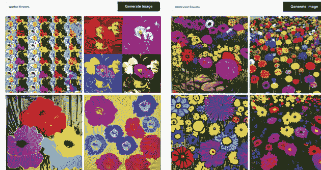

## 结论

最后一个作为结尾的例子：我的最后一个例子涉及演员 Actress（Darren J. Cunningham）的作品——这位非常有趣的 DJ 创作实验性电子音乐，并在 2019 年 Transmediale 的简介中被介绍如下：

Young Paint 一直在学习并模仿 Darren J. Cunningham 创作的那种阴暗、不可预测的、灵感来自英国低音派对的音乐。在 2018 年期间，这个基于 AI 的角色花费了时间编程和安排 Cunningham 的声音色板，不仅学习了如何对其作品做出反应，还学会了偶尔通过独奏来占据主角。Young Paint 在虚拟工作室中的等比例投影与 Cunningham 在 Transmediale 2019 舞台上的表演相呼应。

显然，Young Paint 不仅被构想为一个工具，还被视为一个伙伴，在自动化的同时转化了 Actress 的风格。Cunningham 在机器学习系统中看到了了自己的镜像，这个系统一方面在学习并模仿他的审美特征，另一方面又产生了不理想的诠释。这正如詹姆逊以一种新颖且批判的方式提出的，“没有无意识的超现实主义”：Cunningham 通过一个双重组合——Actress / Young Paint——增强了他的他在审美上的自我反思。我曾曾在其他地方详细讨论过这个例子（Schröter 2021），这里有趣的是另一点：风格与作者分离了——有点像诺尔德的蒙德里安案例——但又递归地修改了作者本身。因此，风格变得具有策展性，而作者 Cunningham 本身则根据什科夫斯基的概念，实现了“去自动化”。他必须对 Young Paint 产生的偶然性做出反应。这可能是与艺术家协作的交互式系统的新方面，尽管也可以说这完全是超现实主义者的策略。正如我在本章中概述的，艺术和创造性劳动与广义上的“自动”之间的关系有着漫长而复杂的历史。“自动”的不同用法及其伴随的想象之间存在实质差异。从对 19 世纪艺术摄影的讨论，到俄罗斯形式主义中的去自动化，超现实主义中的自动写作——到极简主义艺术中的序列对象，以及沃霍尔对工业和自动化生产过程的模仿，再到挪用及其之后。从这个意义上说，当代的实验并不新鲜，而是嵌入在一个长的谱系中，艺术（或至少是某些艺术形式）一直在创造力的意义、感知的出现、作者的角色及其撤离、艺术劳动的形式与经济纠缠，以及技术媒体的积极抵抗与干预中挣扎。Actress / Young Paint 的案例是一个近期实验的例子，涉及了其中一些问题。然而，据我所知，缺乏一个艺术“自动”的谱系。

## 参考文献

- Arning, Bill (1989): “Sturtevant”. Journal of Contemporary Art 2(2): 39–50.
- Bix, Amy (2000): Inventing Ourselves? Baltimore: John Hopkins.
- Böhringer, Hans Christ (2022): “Wer hat Angst vor DALL-E?” Frankfurter Zeitung 28.:
- Bogost, Ian (2019): “The Gold Rush Is Here. Will it reinvent or destroy it?” The Atlantic https://www.theatlantic.com/technology/2019/03/ai-created-art/ (21 January, 2024).
- Breton, Andre (2007): “Die automatische Nachricht”. Claudia Dieter, et al. (eds.) Message. Okult 33–55.
- Egenhofer, Sebastian (2008): “Abstraktion Subjektivität. Die Wahrheitsfunktion des Werkes”.
- Foster, Hal (1996): “The Archive without Museums”. 77:97.
- Frey, Carl B. / Osborne, Michael A. (2013): “The Future of Employment. How Susceptible Jobs are to Computerisation.” Oxford Martin, University of Oxford. http://www.oxfordmartin.ox.ac.uk/downloads/academic/Future_of_Employment.pdf. (21 January, 2024).
- Ginzburg, Carlo (1996): “Making Things. Prehistory of a Device”. presentations 56:28.
- Jameson, Frederic (1991): Postmodernism, or the Cultural Logic of Late Capitalism. London: Verso.
- Kemp, Wolfgang (ed.) (1980): “Theorie der Fotografie. Vol. 1, 1839–1912. München: Schur and Moser 1950.
- Kirsch, John L. / Russell A. Kirsch (1988): “The Anatomy of Painting Style: Description with Computer Rules.” 21(4):437–444.
- Luhmann, Niklas (2003): Art as a Social System. Stanford: Stanford University Press. (Note: original Hopkins).
- Lvoff, Basel (2016): “When Theory Entered the Market: The Russian Formals’ counter with Mass Culture”. Ulbandus Review 17:65–85.
- McLuhan, Marshall (1994): Understanding Media. The Extensions of Man. Cambridge/ and London: the MIT Press.
- Meyer, Roland (2022): “Im Bildraum von Big Data. Unwahrscheinliche und unvorghene Suchkommandos: Über Dall-E 2.” Cargo 55:50–53.
- Noll, Michael (1967): “The Computer as a Creative Medium”. IEEE Spectrum 4(10): 89–95.
- Platonov, Andrei (2016): “The Anti-Sexus Stasis 4(1):10–19.
- Schröter, Jens (2019): “Digitale Medientechnologien und das Verschwinden der Arbeit”. “Thomas Bachele / Caja Thimm (eds.) Mensch und Maschine: Freund oder Feind? Mensch und Technologie im digitalen Zeitalter. Wiesbaden: Springer 2019, 183–210.
- Schröter, Jens (2021): “Critical Transhumanist Aesthetics? The Automatic Subject, Actress and Young Paint”. New Proposals: Journal of Marxism and Interdisciplinary Inquiry 12(1): 111–120.
- Shkovsky, Viktor (2015): “Art, as Device”. Poetics 36(3):151–174.
- Transmediale (2019): “Actress and Young Paint”. https://transmediale.de/content/actress-young-paint-live-2-Feb (21 January, 2024).

# 愚的意义：机器学习与人工语义

Hannes Bajohr

2022年6月，谷歌员工布莱克·莱莫因被要求无限休假。原因是：他声称他正在帮助测试的人工智能具有感知能力，而受影响的公司认为这种主张会带来负面报道（Tiku 2022）。² 莱莫因坚持认为聊天机器人系统 LaMDA 在长时间的对话中说服了他，它拥有一个极具天赋的八岁小孩的智力，并要求被视为拥有权利的人（Lemoine 2022b）。³ 这样做，自诩为“被授道的神秘主义基督教牧师”的莱莫因，仅仅是放大了某种影响了谷歌其他人的情绪。布莱斯·阿格奎雷拉·y·阿尔卡斯是一位通常不倾向于神秘主义的高级机器学习工程师，他在莱莫因之前写下了自己与 LaMDA 的交互：“我感到脚下的地面似乎在震动。我越来越觉得我正在和一个智能体体对话。”（Agüera y Arcas 2022）

相比之下，同一时间进行的关于另一个人工智能系统的讨论完全没有使用“句子”和“智力”这些流行词。Dall-E 的第二个版本是由 OpenAI 公司在此时左右开发的（自2023年9月起，第三版本已集成到 ChatGPT 中），它是一种文本生成图像 AI，可以根据语言输入生成自然图像。给定诸如“戴着贝雷帽和黑色高领衫的柴犬”之类的提示，它会生成一张描述该场景的输出图像（Ramesh et al. 2022）。公众辩论引发了一系列实验，其中一些有趣或奇特的结果在网络上、特别是在 Twitter 上分享。

这同样揭示了这样一个问题：与不那么成功的自动驾驶实验相比，它表明人工智能的社会影响与长期以来的认为显著不同——在它让司机失业之前，它更有可能取代插画师、平面艺术家和素材摄影师的工作（Prakash 2022）。⁴ 与 LaMDA 的情况不同，没有人认为 Dall-E 应该被视为拥有权利的人。

1. 本文首次以德语出现；当前版本是 Bajohr 2024b 的译本。
2. 莱莫因使用的词是 *sentient*（感知的），而非意识，但他似乎将两者同义使用。
3. 此外，他还发布了与 LaMDA 对话的记录（Lemoine 2022a）

对这两个系统的不同反应显示了对人工智能的思考如何迅速地转向概念根源。智力、意识、感知和人格一直是近七年来 AI 研究及其想象中的主要主题；相比之下，有趣的图片似乎引发了较少的根本性问题。有没有可能事实实际上是反过来的的——对超级智能和奇点的永恒追求，掩盖了那些更有趣、更微妙的概念转变，而这些转变逃避了充满愿景热情的传教者，也逃避了怀疑他们的批评者。

对于哲学家本杰明·布拉顿来说，很清楚的是，面对这些新的人工智能系统，“用于解析的语言之外的现实已在眼前。”因此，需要的是一种“更精确的词汇”（Bratton and Agüera 2022），它要超越那些实用的少数概念，还要超越那种人类中心主义假设——即机器建立关系的唯一方式必须是。我们可以在 Dall-E 和 LaMDA 上观察到这种倾向。在这里，“意义”的概念与其人类中心主义的相关物分离了。它将没有心灵——愚的意义。

## 浮动的与落地的系统

尽管计算机科学家、语言学家和认知心理学家不断警告谨慎使用“智力”和“意识”等术语，但业界对此类警告依然无动于。因此，批评者指责莱莫因陷入了“ELIZA 效应”（Christian 2022）——向 LaMDA 投射了智力和意识——这种易感性约瑟夫·魏森鲍早在1966年就在他的 ELIZA 聊天机器人用户身上观察到：尽管 ELIZA 仅仅模仿一位罗杰斯式的精神分析师，将患者的陈述以问题的形式反射回他们身上，但用户的行为就像该程序是一个关注他们健康的意识主体一样。

这里的经典反对意见是：计算机是符号处理系统，它们只处理语法，而不是没有语义——它们可以处理逻辑形式，但没有实质性意义（Cramer 2008）。对于它们的运行来说，符号在人类世界中代表哪些对象或概念，以及它们与哪些文化价值相关无关。因此，ELIZA 仅仅扫描输入以匹配特定的语法模式，并根据转换规则将其转换为“响应”。魏森鲍举了一个例子，被分析者指责分析师：“你似乎在恨我。”程序识别出句子中的关键模式“x 你”，并将其相应分离为元素“它似乎”、“你”、“恨”和“我”。它丢弃了（“它似乎”）并在回复“你”中插入了 y（“恨”）。

2022年6月11日的《经济学人》刊登了一幅由 AI 生成的插图。从那以后，这已成为某种时尚，无疑很快会让位给更复杂的使用。

将语言处理为一个多维向量空间，即所谓的“词嵌入”（word embedding），其工作原理基于20 世纪 50 年代“分布假设”中首次提出的交错相关性（Harris 1954; Firth 1957）：首先，经常一起出现的词在这一空间中的距离更近，从而由熟悉的词形成语义聚类。然而，由于编码的不仅是词与相关性，还有相关性之间的相关性，大语言模型还可以显式化训练文本中未标明的隐性规律。这对于句法关系是如此——当一个词的肯定形式和最高级向量之间的欧几里距离相等时——同样适用于复杂的语义关系，即词义。这一原理最为人知的例子之一是运算：`v_{king} - v_{man} + v_{woman} = v_{queen}` (Mikolov, Yih, and Zweig 2013)⁷

图 1：大语言模型的词嵌入

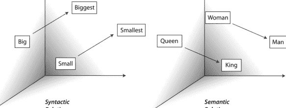

在这个方程中——其含义是：从“king”（国王）中减去“man”（男人），加上“woman”（女人），结果是“queen”（女王）的词向量——潜在的语义关系“性别”作为一种算术相关性出现了，尽管它并没有显式存在于模型中（图1）。这源于模型训练的海量语言，解释了机器学习对偏见的敏感性：性别歧视和种族主义也可能被编码在语言模型中（Bender et al. 2021; Bajohr 2024d）。在这样构建的语言系统中，符号的意义完全是通过差异来决定的，正如费尔迪南·德·绪的语言结构主义那样。它并不代表语言和符号相关性之外的任何事物（这仅仅被认为与其他符号及符号相关性的区别，这在 Gastaldi 2021 中得到了极好的解释）。

这一见解仍然适用于较新的、技术上不同的模型，如 GloVe（全局词表示向量）。

# 人工智能——智能艺术？

大语言模型，如 ChatGPT、Claude 或 BARD 和 LaMDA，基本上仍然不再对单个词进行向量化——考虑到海量的训练数据，这将是不可能的。相反，ChatGPT 使用了一种名为“transformer”的网络架构来构建整个词序列的嵌入（Meng et al. 2023）。为了做到这一点，transformer 使用了“注意力”的概念（Brown et al. 2017）。模型学习建立序列中词之间的关系；从这些模式中，transformer 构建了代表整个序列的向量——即所谓的上下文嵌入（contextualized embeddings）。与词向量不同，这些序列嵌入考虑了更多的上下文。在解码器函数中，transformer 随后使用这些上下文嵌入来生成符合输入上下文的新文本。构建此类复杂序列表示是大语言模型性能的关键（Wolfram 2023）。然而，其结果是大模型仅通过其巨大的训练，就能像 LaMDA 那样产生情境理解，而无需“身处情境”之中。

语言模型将是第一级意义的生产者。它是愚蠢的，因为模型捕捉了符号之间的隐性相关性，但仍然“不知道”这些东西究竟意味着什么；有了这种意义，我们无法建立一种能够在世界上通行的智能。语言学家埃米莉·宾德是所有关于所谓意识的 AI 热炒的激烈批评者，她与同事柯科勒（Koller）承认，“一个足够复杂的神经模型可能会学习意义的某些方面”，例如语义相似性，但她认为这些仅仅是“实际意义的微弱反映”，而实际意义总是与世界的某些物相关，即“具身的”（grounded）。（Bender and Koller 2020）

但在这个系统上产生任何类似于感知或意识的东西是错误的，我们也不应该过早地将这种意识投射到这个系统上。由于…… 这种世界理解是哲学家休伯特·德雷福斯（Hubert Dreyfus）的术语，人类拥有这种世界理解，而机器没有（Dreyfus 1992）。

在这个方面，我同意，符号的意义完全是通过差异来决定的（Gastaldi 2021）。

它并不代表语言和符号相关性之外的任何事物（这仅仅被认为与其他符号及符号相关性的区别，这已经得到了极好的解释，Gastaldi 2021）。

这一见解仍然适用于较新的、技术上不同的模型，如 GloVe（全局词表示向量）。

## 人工智能——智能艺术？

大语言模型，如 ChatGPT、Claude 或 BARD 和 LaMDA，基本上仍然不再对单个词进行向量化——考虑到海量的训练数据，这将是不可能的。相反，ChatGPT 使用了一种名为“transformer”的网络架构来构建整个词序列的嵌入（Meng et al. 2023）。为了做到这一点，transformer 使用了“注意力”的概念（Brown et al. 2017）。模型学习建立序列中词之间的关系；从这些模式中，transformer 构建了代表整个序列的向量——即所谓的上下文嵌入。与词向量不同，这些序列嵌入考虑了更多的上下文。在解码器函数中，transformer 随后使用这些上下文嵌入来生成符合输入上下文的新文本。构建此类复杂序列表示是大语言模型性能的关键（Wolfram 2023）。然而，其结果是大模型仅通过其巨大的训练，就能像 LaMDA 那样产生情境理解，而无需“身处情境”之中。

语言模型将是第一级意义的生产者。它是愚蠢的，因为模型捕捉了符号之间的隐性相关性，但仍然“不知道”这些东西究竟意味着什么；有了这种意义，我们无法建立一种能够在世界上通行的智能。语言学家埃米莉·宾德是所有关于所谓意识的 AI 热炒的激烈批评者，她与同事柯科勒承认，“一个足够复杂的神经模型可能会学习意义的某些方面”，例如语义相似性，但她认为这些仅仅是“实际意义的微弱反映”，而实际意义总是与世界的某些物相关，即“具身的”。（Bender and Koller 2020）

但在这个系统上产生任何类似于感知或意识的东西是错误的，我们也不应该过早地将这种意识投射到这个系统上。由于…… 这种世界理解是哲学家休伯特·德雷福斯的术语，人类拥有这种世界理解，而机器没有（Dreyfus 1992）。

在这个方面，我同意，符号的意义完全是通过差异来决定的（Gastaldi 2021）。

它并不代表语言和符号相关性之外的任何事物（这仅仅被认为与其他符号及符号相关性的区别，这已经得到了极好的解释，Gastaldi 2021）。

这一见解仍然适用于较新的、技术上不同的模型，如 GloVe（全局词表示向量）。

将语言处理为一个多维向量空间，即所谓的“词嵌入”（word embedding），其工作原理基于20 世纪 50 年代“分布假设”中首次提出的交错相关性（Harris 1954; Firth 1957）：首先，经常一起出现的词在这一空间中的距离更近，从而由熟悉的词形成语义聚类。然而，由于编码的不仅是词与相关性，还有相关性之间的相关性，大语言模型还可以显式化训练文本中未标明的隐性规律。这对于句法关系是如此——当一个词的肯定形式和最高级向量之间的欧几里距离相等时——同样适用于复杂的语义关系，即词义。这一原理最为人知的例子之一是运算：$v_{king} - v_{man} + v_{woman} = v_{queen}$ (Mikolov, Yih, and Zweig 2013)⁷

图 1：大语言模型的词嵌入

在这个方程中——其含义是：从“king”（国王）中减去“man”（男人），加上“woman”（女人），结果是“queen”（女王）的词向量——潜在的语义关系“性别”作为一种算术相关性出现了，尽管它并没有显式存在于模型中（图 1）。这源于模型训练的海量语言，解释了机器学习对偏见的敏感性：性别歧视和种族主义也可能被编码在语言模型中（Bender et al. 2021; Bajohr 2024d）。在这样构建的语言系统中，符号的意义完全是通过差异来决定的，正如费尔迪南·德·绪的语言结构主义那样。它并不代表语言和符号相关性之外的任何事物（这仅仅被认为与其他符号及符号相关性的区别，这在 Gastaldi 2021 中得到了极好的解释）。

将语言处理为一个多维向量空间，即所谓的“词嵌入”，其工作原理基于20 世纪 50 年代“分布假设”中首次提出的交错相关性（Harris 1954; Firth 1957）：首先，经常一起出现的词在这一空间中的距离更近，从而由熟悉的词形成语义聚类。然而，由于编码的不仅是词与相关性，还有相关性之间的相关性，大语言模型还可以显式化训练文本中未标明的隐性规律。这对于句法关系是如此——当一个词的肯定形式和最高级向量之间的欧几里距离相等时——同样适用于复杂的语义关系，即词义。这一原理最为人知的例子之一是运算：$v_{king} - v_{man} + v_{woman} = v_{queen}$ (Mikolov, Yih, and Zweig 2013)⁷

Fig. 1：大语言模型的词嵌入

在这个方程中——其含义是：从“king”（国王）中减去“man”（男人），加上“woman”（女人），结果是“queen”（女王）的词向量——潜在的语义关系“性别”作为一种算术相关性出现了，尽管它并没有显式存在于模型中（图1）。这源于模型训练的海量语言，解释了机器学习对偏见的敏感性：性别歧视和种族主义也可能被编码在语言模型中（Bender et al. 2021; Bajohr 2024d）。在这样构建的语言系统中，符号的意义完全是通过差异来决定的，正如费尔迪南·德·绪的语言结构主义那样。它并不代表语言和符号相关性之外的任何事物（这仅仅被认为与其他符号及符号相关性的区别，这在 Gastaldi 2021 中得到了极好的解释）。

这一见解仍然适用于较新的、技术上不同的模型，如 GloVe（全局词表示向量）。

## 人工智能——智能艺术？

大语言模型，如 ChatGPT、Claude 或 BARD 和 LaMDA，基本上仍然不再对单个词进行向量化——考虑到海量的训练数据，这将是不可能的。相反，ChatGPT 使用了一种名为“transformer”的网络架构来构建整个词序列的嵌入（Meng et al. 2023）。为了做到这一点，transformer 使用了“注意力”的概念（Brown et al. 2017）。模型学习建立序列中词之间的关系；从这些模式中，transformer 构建了代表整个序列的向量——即所谓的上下文嵌入。与词向量不同，这些序列嵌入考虑了更多的上下文。在解码器函数中，transformer 随后使用这些上下文嵌入来生成符合输入上下文的新文本。构建此类复杂序列表示是大语言模型性能的关键（Wolfram 2023）。然而，其结果是大模型仅通过其巨大的训练，就能像 LaMDA 那样产生情境理解，而无需“身处情境”之中。

语言模型将是第一级意义的生产者。它是愚蠢的，因为模型捕捉了符号之间的隐性相关性，但仍然“不知道”这些东西究竟意味着什么；有了这种意义，我们无法建立一种能够在世界上通行的智能。语言学家埃米莉·宾德是所有关于所谓意识的 AI 热炒的激烈批评者，她与同事柯科勒承认，“一个足够复杂的神经模型可能会学习意义的某些方面”，例如语义相似性，但她认为这些仅仅是“实际意义的微弱反映”，而实际意义总是与世界的某些物相关，即“具身的”。（Bender and Koller 2020）

但在这个系统上产生任何类似于感知或意识的东西是错误的，我们也不应该过早地将这种意识投射到这个系统上。由于…… 这种世界理解是哲学家休伯特·德雷福斯的术语，人类拥有这种世界理解，而机器没有（Dreyfus 1992）。

在这个方面，我同意，符号的意义完全是通过差异来决定的（Gastaldi 2021）。

它并不代表语言和符号相关性之外的任何事物（这仅仅被认为与其他符号及符号相关性的区别，这已经得到了极好的解释，Gastaldi 2021）。

大语言模型，如 ChatGPT、Claude 或 BARD 和 LaMDA，基本上仍然不再对单个词进行向量化——考虑到海量的训练数据，这将是不可能的。相反，ChatGPT 使用了一种名为“transformer”的网络架构来构建整个词序列的嵌入。为了做到这一点，transformer 使用了“注意力”的概念。模型学习建立序列中词之间的关系；从这些模式中，transformer 构建了代表整个序列的向量——即所谓的上下文嵌入。与词向量不同，这些序列嵌入考虑了更多的上下文。在解码器函数中，transformer 随后使用这些上下文嵌入来生成符合输入上下文的新文本。构建此类复杂序列表示是大语言模型性能的关键。然而，其结果是大模型仅通过其巨大的训练，就能像 LaMDA 那样产生情境理解，而无需“身处情境”之中。

语言模型将是第一级意义的生产者。它是愚蠢的，因为模型捕捉了符号之间的隐性相关性，但仍然“不知道”这些东西究竟意味着什么；有了这种意义，我们无法建立一种能够在世界上通行的智能。语言学家埃米莉·宾德是所有关于所谓意识的 AI 热炒的激烈批评者，她与同事柯科勒承认，“一个足够复杂的神经模型可能会学习意义的某些方面”，例如语义相似性，但她认为这些仅仅是“实际意义的微弱反映”，而实际意义总是与世界的某些物相关，即“具身的”。

但在这个系统上产生任何类似于感知或意识的东西是错误的，我们也不应该过早地将这种意识投射到这个系统上。由于…… 这种世界理解是哲学家休伯特·德雷福斯的术语，人类拥有这种世界理解，而机器没有。

在这个方面，我同意，符号的意义完全是通过差异来决定的。

它并不代表语言和符号相关性之外的任何事物（这仅仅被认为与其他符号及符号相关性的区别，这已经得到了极好的解释，Gastaldi 2021）。

这一见解仍然适用于较新的、技术上不同的模型，如 GloVe（全局词表示向量）。

## 人工智能——智能艺术？

将语言处理为一个多维向量空间，即所谓的“词嵌入”，其工作原理基于20 世纪 50 年代“分布假设”中首次提出的交错相关性：首先，经常一起出现的词在这一空间中的距离更近，从而由熟悉的词形成语义聚类。然而，由于编码的不仅是词与相关性，还有相关性之间的相关性，大语言模型还可以显式化训练文本中未标明的隐性规律。这对于句法关系是如此——当一个词的肯定形式和最高级向量之间的欧几里距离相等时——同样适用于复杂的语义关系，即词义。这一原理最为人知的例子之一是运算：$v_{king} - v_{man} + v_{woman} = v_{queen}$ (Mikolov, Yih, and Zweig 2013)⁷

Fig. 1：大语言模型的词嵌入

在这个方程中——其含义是：从“king”（国王）中减去“man”（男人），加上“woman”（女人），结果是“queen”（女王）的词向量——潜在的语义关系“性别”作为一种算术相关性出现了，尽管它并没有显式存在于模型中（图1）。这源于模型训练的海量语言，解释了机器学习对偏见的敏感性：性别歧视和种族主义也可能被编码在语言模型中。在这样构建的语言系统中，符号的意义完全是通过差异来决定的，正如费尔迪南·德·绪的语言结构主义那样。它并不代表语言和符号相关性之外的任何事物（这仅仅被认为与其他符号及符号相关性的区别，这在 Gastaldi 2021 中得到了极好的解释）。

将语言处理为一个多维向量空间，即所谓的“词嵌入”（word embedding），其工作原理基于 20 世纪 50 年代“分布假设”中首次提出的交错相关性（Harris 1954; Firth 1957）：首先，经常一起出现的词在这一空间中的距离更近，从而由熟悉的词形成语义聚类。然而，由于编码的不仅是词与相关性，还有相关性之间的相关性，大语言模型还可以显式化训练文本中未标明的隐性规律。这对于句法关系是如此——当一个词的肯定形式和最高级向量之间的欧几里距离相等时——同样适用于复杂的语义关系，即词义。这一原理最为人知的例子之一是运算：$v_{king} - v_{man} + v_{woman} = v_{queen}$ (Mikolov, Yih, and Zweig 2013)⁷

Fig. 1：大语言模型的词嵌入

在这个方程中——其含义是：从“king”（国王）中减去“man”（男人），加上“woman”（女人），结果是“queen”（女王）的词向量——潜在的语义关系“性别”作为一种算术相关性出现了，尽管它并没有显式存在于模型中（图1）。这源于模型训练的海量语言，解释了机器学习对偏见的敏感性：性别歧视和种族主义也可能被编码在语言模型中（Bender et al. 2021; Bajohr 2024d）。在这样构建的语言系统中，符号的意义完全是通过差异来决定的，正如费尔迪南·德·绪的语言结构主义那样。它并不代表语言和符号相关性之外的任何事物（这仅仅被认为与其他符号及符号相关性的区别，这在 Gastaldi 2021 中得到了极好的解释）。

这一见解仍然适用于较新的、技术上不同的模型，如 GloVe（全局词表示向量）。

## 人工智能——智能艺术？

大语言模型，如 ChatGPT、Claude 或 BARD 和 LaMDA，基本上仍然不再对单个词进行向量化——考虑到海量的训练数据，这将是不可能的。相反，ChatGPT 使用了一种名为“transformer”的网络架构来构建整个词序列的嵌入（Meng et al. 2023）。为了做到这一点，transformer 使用了“注意力”的概念（Brown et al. 2017）。模型学习建立序列中词之间的关系；从这些模式中，transformer 构建了代表整个序列的向量——即所谓的上下文嵌入。与词向量不同，这些序列嵌入考虑了更多的上下文。在解码器函数中，transformer 随后使用这些上下文嵌入来生成符合输入上下文的新文本。构建此类复杂序列表示是大语言模型性能的关键（Wolfram 2023）。然而，其结果是大模型仅通过其巨大的训练，就能像 LaMDA 那样产生情境理解，而无需“身处情境”之中。

语言模型将是第一级意义的生产者。它是愚蠢的，因为模型捕捉了符号之间的隐性相关性，但仍然“不知道”这些东西究竟意味着什么；有了这种意义，我们无法建立一种能够在世界上通行的智能。语言学家埃米莉·宾德是所有关于所谓意识的 AI 热炒的激烈批评者，她与同事柯科勒承认，“一个足够复杂的神经模型可能会学习意义的某些方面”，例如语义相似性，但她认为这些仅仅是“实际意义的微弱反映”，而实际意义总是与世界的某些物相关，即“具身的”。（Bender and Koller 2020）

但在这个系统上产生任何类似于感知或意识的东西是错误的，我们也不应该过早地将这种意识投射到这个系统上。由于…… 这种世界理解是哲学家休伯特·德雷福斯的术语，人类拥有这种世界理解，而机器没有（Dreyfus 1992）。

在这个方面，我同意，符号的意义完全是通过差异来决定的（Gastaldi 2021）。

它并不代表语言和符号相关性之外的任何事物（这仅仅被认为与其他符号及符号相关性的区别，这已经得到了极好的解释，Gastaldi 2021）。

# Hannes Bajohr: 愚的意义：机器学习与人工语义

大语言模型，如 ChatGPT、Claude 或 BARD 和 LaMDA，基本上仍然不再对单个词进行向量化——考虑到海量的训练数据，这将是不可能的。相反，ChatGPT 使用了一种名为“transformer”的网络架构来构建整个词序列的嵌入。为了做到这一点，transformer 使用了“注意力”的概念。模型学习建立序列中词之间的关系；从这些模式中，transformer 构建了代表整个序列的向量——即所谓的上下文嵌入。与词向量不同，这些序列嵌入考虑了更多的上下文。在解码器函数中，transformer 随后使用这些上下文嵌入来生成符合输入上下文的新文本。构建此类复杂序列表示是大语言模型性能的关键。然而，其结果是大模型仅通过其巨大的训练，就能像 LaMDA 那样产生情境理解，而无需“身处情境”之中。

语言模型将是第一级意义的生产者。它是愚蠢的，因为模型捕捉了符号之间的隐性相关性，但仍然“不知道”这些东西究竟意味着什么；有了这种意义，我们无法建立一种能够在世界上通行的智能。语言学家埃米莉·宾德是所有关于所谓意识的 AI 热炒的激烈批评者，她与同事柯科勒承认，“一个足够复杂的神经模型可能会学习意义的某些方面”，例如语义相似性，但她认为这些仅仅是“实际意义的微弱反映”，而实际意义总是与世界的某些物相关，即“具身的”。

将语言处理为一个多维向量空间，即所谓的“词嵌入”，其工作原理基于20 世纪 50 年代“分布假设”中首次提出的交错相关性：首先，经常一起出现的词在这一空间中的距离更近，从而由熟悉的词形成语义聚类。然而，由于编码的不仅是词与相关性，还有相关性之间的相关性，大语言模型还可以显式化训练文本中未标明的隐性规律。这对于句法关系是如此——当一个词的肯定形式和最高级向量之间的欧几里距离相等时——同样适用于复杂的语义关系，即词义。这一原理最为人知的例子之一是运算：$v_{king} - v_{man} + v_{woman} = v_{queen}$ (Mikolov, Yih, and Zweig 2013)⁷

Fig. 1：大语言模型的词嵌入

在这个方程中——其含义是：从“king”（国王）中减去“man”（男人），加上“woman”（女人），结果是“queen”（女王）的词向量——潜在的语义关系“性别”作为一种算术相关性出现了，尽管它并没有显式存在于模型中（图1）。这源于模型训练的海量语言，解释了机器学习对偏见的敏感性：性别歧视和种族主义也可能被编码在语言模型中。在这样构建的语言系统中，符号的意义完全是通过差异来决定的，正如费尔迪南·德·绪的语言结构主义那样。它并不代表语言和符号相关性之外的任何事物（这仅仅被认为与其他符号及符号相关性的区别，这在 Gastaldi 2021 中得到了极好的解释）。

这一见解仍然适用于较新的、技术上不同的模型，如 GloVe（全局词表示向量）。

但在这个系统上产生任何类似于感知或意识的东西是错误的，我们也不应该过早地将这种意识投射到这个系统上。由于…… 这种世界理解是哲学家休伯特·德雷福斯的术语，人类拥有这种世界理解，而机器没有。

## 人工智能——智能艺术？

（人工智能）被训练进计算机中，脱离了唯我主义的“符号/符号无休止旋转木马”。如果我们暂时认同这一断言，我们可以在 Dall-E 中看到合理的证明。

图 2：CLIP 中的文本-图像相关性

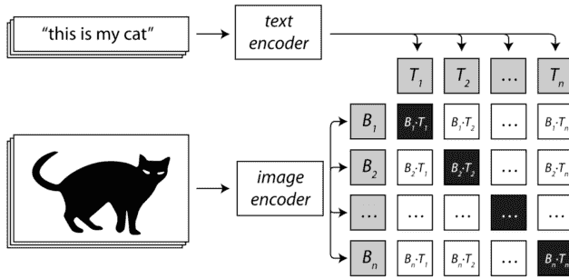

Dall-E 的核心是一个被称为 CLIP 的机器学习模型。通过编码器，它输入了取自互联网的向量化文本-图像对——例如，一张带有说明文字“这是我的猫”的猫的照片。CLIP 经训练用于预测哪个向量与图像向量匹配；结果是一个易于理解的随机模型，它将图像信息与文本信息关联起来，但将其存储为一种信息类型。在图 2 中，这张表格列出了文本向量和图像向量的标积——文本和图像越匹配，该值就越高；当原始图像和文本配对时，结果自然是最优的（那些对角线排列的方框）。

CLIP 在图像识别方面表现异常出色：如果你向它展示一张未知的猫的照片，它永远不会将其识别为“猫”。但在第二步中，它变成了一个图像生成器。为此，它与另一个机器学习模型 GLIDE（用于生成和编辑的引导语言图像扩散）协同工作，该模型已经在大量图像上进行了训练。如果用户输入提示词，GLIDE 可以利用 CLIP 模型中存储的文本-图像数据来反转这一过程，并合成一个与文本最相关的图像。在这两种操作中——图像识别和图像生成——核心点仍然是，模型能够学习并主动重现物体文本描述与其相应视觉表现之间的相关性。

> （到直接的视觉相似性），似乎 Weatherby/Justie 和 Harnad 的论点等于类似的内容——两者都关注系统与世界之间的联系，且这种理解更深层或更广泛。

GLIDE 是基于热力学模型的扩散模型，因此其功能机制与近期流行的 GANs 不同，后者结合了两个对抗的子模型。用于美学作品的 AI 本身可以作为讨论该作品的资源，我在 Bajohr (2022) 中提出的建议。

## 愚蠢意义：机器学习与人工智能语义

人们可能认为，与“猫”一词关联的图像信息可能与这只猫有索引关系——光从它身上反射并落在光电传感器上——但尽管如此，系统仍然不会学习与世界共享意味着什么。符号落地的拥护者试图提取 AI 模型接收了什么类型的数据——不仅是感官反馈，还有运动以及最终的社会反馈：只有通过在同一世界的其他说话者社区中语言的影响，才能被学习。

但这一主张再次意味着“完全的人类”，即广义的意义，并且对低于此任何东西都不认真。相反，多模态 AI 应被视为二级的愚蠢意义。皮尔斯对模型外部元素的索引引用和索绪尔对模型内部元素的差异引用是两种截然不同的生成方式——仅仅是相关性的维度增加了，并随着发掘未被潜在联系的可能性，产生了未被察觉的愚蠢意义。

事实上，多模态 AI——除了 Dall-E，还有 Stable Diffusion、Google 尚未发布的 Imagen——能够生成非常复杂的文本-图像。它们的力量在于这种相关性具有一种生产性特征：在研究 CLIP 的深度结构时，计算机科学家发现该模型训练了单个“神经元”，它们对于某个事物的单词和图像都会触发。这些是概念神经元，图像与文本之间的区别倾向于被克服。在神经层面，多模态在很大程度上是模态的，暗示了一种没有明确区分系统的语义（Merullo et al. 2022 也暗示了这一点）。愚蠢意义发现了一种新的性质，它不局限于文本或图像数据，而是以一种涵盖两者的，指向了超越模态分离的意义——并且再次与思维无关（关于此的更多信息请参见 Bajjor 2024c）。

## 提示学研究

AI 系统是愚蠢的。它们没有意识。然而，它们产生了与我们通常意义概念背道而驰的复杂语义。多模态 AI 还表明，赋予的意识和系统的意义能力之间几乎毫无关系：特别是 LaMDA，它在 Lemoine 看来像人一样代表自己——而不是 Dall-E，尽管人们可能会认为它代表了更高层次的、存在；这种收敛在强意义上可能不是交流性的，但也许是在弱的、愚蠢的意义上。

¹ 这里有趣的是，在技术层面上消除语音/图像区别的对比倾向，与界面层面图像被语音取代的位移形成了对比。因此，Dall-E 的结果也可以被理解为语言艺术，而不是更视觉化的对象。

## 参考文献

- Agüera y Arcas, Blaise; (2022): “人工神经网络正在取得进展”。经济学人，2022年6月9日 https://www.economist.com/by-invitation/2022/06/artificial-neural-networks-are-making-strides-to-consciousness-accounting-to-blaise-aguera。
- Bajohr, (2022): “算法共情：对 AI 的批判”。Configurations 30(2):203–31.
- Bajohr, (2024a): “人工智能与后文本：读者的期待”。诗，待刊。
- Bajohr, (2024b): “愚蠢意义：人工智能语义与机器学习”。Hannes Bajohr and Markus Krajewski (编)：批判源。柏林：197–215.
- Bajohr, (2024c): “操作性情描：文本/图像区别的崩溃”。多语言，待刊。
- Bajohr, (2024d): “谁控制语言”。Smittchell et al. (编)：档案。189–95.
- Bender, Emily M. / Timnit Gebru / Angelina McMillan (2021): “随机鹦鹉的危险：语言模型过大了吗？”ACM 公平性与透明度会议，61–73.
- Bender, Emily M. / Alexander Koller (2020): “NLU：数据时代的意义”。语言协会第58届年度会议，518–598. DOI: 10.1865/vi2020.acacl-main.463.
- Bysk, Yonatan / Ari Holtzman / Jesse Thomason / Joyce Bengio / Mirella Lapata / Jonathan Pinto (2020): “经验”。https://arxiv.org/abs/2004.1015.
- Benjamin, Blaise Aguera y Arcas (2022): “模型就是信息”。自然，7月12日。https://www.nature.com/the-model-is-message.
- Brown, T., et al. (2020): “语言模型是少样本的”。神经信息系统进展，33。关于此的特定见 Bajohr 2024。
- Benz, Mercedes (2019): “意义的计算：对人工智能的误解”。文化与理论，60(3):264–78. DOI: 10.1080/14375784.2025.
- Christian, Brian (2022): “陷入伊莉拉效应”。大西洋月刊。https://www.theatlantic.com/ideas/archive/2022/06/chatbot-sentient/6632.
- Cramer, Florian (2008): “语言”。Matthew Fuller (编)：软件研究。剑桥，MIT Press，168–74.

# Hannes Bajahr: 愚的意义：机器学习与人工语义

## 参考文献

- Dhariwal, Praful / Alex Nikhil (2021): “扩散模型在图像合成上胜过 GAN”。`https://arxiv.org/abs/2105.0523`.
- Dreyfus, Hubert L (1992): “计算机做不到的事：人工智能的批判”。剑桥出版社。
- Finn, John R.: “语言理论摘要：1930–1955”。语言研究。Oxford，1–32.
- Gastaldi, Juan Luis (2021): “计算机理解自然语言吗？”哲学与技术，34(4):1–214. DOI: `10.1007/s11334-020-0039-9`.
- Goh, Gabriel / Nick Cameracar / Chelsea Voss / San Carver / Michael Petrov / Ludwig Schubert / Alec Radford / Chris Olah (2022): “人工神经网络中的多模态神经元”。Distribution 6(3). DOI: `10.2315/distill.0030`.
- Harnad, Stevan (1990): “符号落地问题”。非线性物理 D，42(1):335–46. DOI: `10.1016/(0167-2789(95)008-6`.
- Harnad, Stevan (1993): “在模拟世界中通过神经网络落地符号”。Think 2.
- Harris, Zell: “分布结构”。Word 10(2–3):146–162.
- Hayles, Katherine (2019): “计算机能创造意义吗？网络/生物符号学视角”。批判性，46(1):32–55.
- Hayles, Katherine (2022): “AI 的意识吗？物质性的表征危机”。新文学史，54(1):635–666.
- Lemoine, Blake (2022): “LaMDA 有意识吗？采访”。6月11日，`https://cusciscordian.com/is-lamda-sentient-an-interview-ea6-4d96id17`.
- Lemoine, Blake (2022b): “什么是 LaMDA，它想要什么？”。Medium，6月11日，`https://cusciscordian.com/is-lamda-and-what-does-it-want=68862134489`.
- Meng, Kevin, et al. (2023): “GPT 中定位与编辑事实关联”。`http://arxiv.org/abs/2202.05262`.
- Merullo, Jack / Louis Castricato / Carsten Eckhoff / Ellie Pavlick (2022): “从图像到文本空间的线性映射”。arXiv。`http://arxiv.org/abs/2209.15162`.
- Mikolov, Tomas / Wen-tau Yih / Geoffrey Zweig (2013): “连续空间词表示中的语言规律性”。2013年美国计算语言协会北美分会会议集：人类语言技术。佐治亚州亚特兰大：计算语言协会，74–51. `https://aclanthology.org/N13-090` (2024年1月21日)。
- Piandtosi, Steven T., 与 Felix Hill (2022): “大语言模型中不指的/无指涉的意义.” ArXiv. `https://arxiv.org/abs/2208.02957`。
- Prakash, Prarthana (2022): “AI软件 Dall-E 发布后小说故事并转为专业级。” 彭博社。8月3日。`https://www.bloomberg.com/news/articles/2022-08-04/Dall-E-art-generator-begins-new-stage-in-ai-development` (2023年1月11日)。
- Ramesh, Aditya / Prafulla Dhariwal / Alex Lin / Casey Chu / Mark Chen (2022): “基于隐变量的分层文本-图像生成.” ArXiv. `https://arxiv.org/abs/2205.06125` (2024年1月21日)。
- Siger, Gary (2022): “多模态：认知AI的新前沿。” Medium 2月2日。`https://towardsdatascience.com/multimodality-a-new-frontier-in-cognitive-ai-8279dcooe3b4f` (2024年1月21日)。
- Thoppalin, Romal / Daniel De Freitas / Jamie Hall / Noam Shazeer / Apoorv Kulshhta / Sheng / Heng-Tze / Alicia Jin 等 (2022): “LaMDA：用于对话应用的语言模型.” ArXiv. `https://arxiv.org/abs/2201.08239` (2024年1月21日)。
- Tiku, Natasha (2022): “认为AI已经活过来的谷歌工程师。” 华盛顿邮报，2022年6月11日。
- Weatherbaum, Joseph (2022): “ELIZA：用于研究人机自然语言通信的计算机程序.” 于：Critical Inquiry 48(2): 381–415. DOI: `10.1086/717312`。
- Weizenbaum, Joseph (1966): “ELIZA：用于人机交互的计算机程序.” ACM通讯 9(1): 36–45。
- Wiggers, Kyle (2022): “一家初创公司就提供给 Dall E 2 的文本字符串收取1.9美元。” TechCrunch. 7月29日，`https://techcrunch.com/2022/07/29/a-startup-is-char-ging-199-for-strings-of-text-to-feed-to-dall-e-2/` (2024年1月21日)。
- Wolfram, Stephen (2023): “ChatGPT在做什么……以及它为什么有效？” Stephen Wolfram.向`https://writings.stephenwolfram.com/2023/03/what-is-chatgpt-doing-and-why-does-it-work/`

## 艺术家引导的神经网络 – 自动化创造力还是扩展思维的工具？

Varvara Guljajeva, Mar Canet Sola,¹ Isaac Clarke

### 引言

有人声称，人工智能的最新进展（如基于 CLIP 的 Midjourney 和 DALL-E）本应增强我们的创造力。第一次，艺术家发现自己可能丢工作听起来不再那么荒谬了（Nicholas 2017）。并不是艺术家们从未拥有过安全且稳定的工作，但深度学习（DL）工具可能会导致失去一些商业佣金。然而，这种做法依赖于现代艺术方法，即技能是关注的焦点而非概念思想。引用莱夫·马诺维奇（Lev Manovich）的话——自1970年以来，当代艺术世界已变得概念化，他关注思想。它不再关乎视觉技巧，而是关乎语义技能”（2022, 62）。呼应 Aaron Hartmann 的观点，当摄影术发明并接管肖像画领域时，画家们也曾处于类似的境地。摄影术又等了另外40年才被认可为一种艺术媒介（Hertzmann 2018）。视觉艺术家必须重新发明自己并重新思考绘画的意义。

随着计算机的发明，诞生了计算机艺术。像 Vera Molnar 和 Manfred Mohr 这样的艺术家在20世纪60年代利用科学家晚上使用的科学实验室计算机创作了他们的第一批计算机生成的艺术品。早期的计算机艺术家将机器重新用于艺术用途，并编写代码来实现这种效果。由于创作过程是由计算机中介的，一个问题出现了：机器是作者吗？由于神经网络作为一种新的视觉概念的混合工具，这可能揭示了创作过程的根源。

### 深度学习的历史概述

DL 是机器学习（ML）的一个子集，使用深度神经网络（DNN）来学习底层模式。2012年，由 Krizhevsky 设计的 AlexNet 赢 ImageNet 大规模视觉挑战，标志着 DL 时代的开启。在过去的十年中，DNN 在规模和复杂性上不断增长，现在被应用于计算机视觉、自然语言处理甚至游戏等广泛任务。随着科学论文数量指数级增长，图1显示了发展时间线。图像生成的起始时期可以追溯到变分自动编码器（VAE）（Kingma / Welling 2013），以及生成对抗网络（GAN）（Goodfellow 等 2014）。这些模型展示了图像生成的可能性。随着 AI 技术的发展和日益流行，艺术家们一直在探索其极限，以及 Transformer 对大语言模型（LLM）的影响（2022）。

图 1：深度学习的发展时间线。

### 人工智能——智能艺术？

在过去的十年里，GAN 是 AI 的主导性和定义性元素。GAN 使用竞争性游戏进行训练，参与者是生成器和判别器。生成器通过让判别器认为图像来自原始数据集来获胜。通过玩游戏，双方都学会了被骗时不再掉入陷阱。游戏结束后，我们留下了一个非常强大的生成器，而判别器也更擅长检测这些伪品。

2015年，在 Google 研究博客上，“Inception：深入研究神经网络”（Mordintsev / Olah / Tyka 2015）描述了一种由研究人员开发的工具，旨在理解隐藏层是如何理解特征的。该模型通过神经网络对训练数据集特征的尝试来增强图像。DeepDream 的创意使用是作者在原始文中提出的：“这让我们思考神经网络是否可能成为艺术家的工具——一种混合视觉概念的新方法——或者可能稍微揭示了创作过程的根源。” DeepDream 的迷幻图像迅速引起了世界各地艺术家和爱好者的关注，引起了对理解生物和神经重建图像的人的共鸣。Memo Atkinson 的作品《All Watched Over Machines of Loving Grace: Deepdream 版》在2016年的 DeepDream 艺术品展期间对 GCHQ 总部的俯瞰照进行了幻化。这项作品引发了对资助人工智能发展的组织动机的质疑，并让梦境变得更加噩幻。

CycleGAN 针对 pix2pix 显示的图像到生成问题进行训练，但消除了对对齐配对的要求。

- Mikolov, Tomas / Wen-tau Yih / Geoffrey Zweig (2013): “Linguistic Regularities in Continuous Space Word Representations” Proceedings of the 2013 Conference of the North American Chapter of the Association for Computational Linguistics: Human Language Technologies. Atlanta, Georgia: Association for Computational Linguistics, 74–51. `https://aclanthology.org/N13-090` (2024年1月21日)。
- Piandtosi, Steven T., and Felix Hill (2022): “Meaning Without Reference in Large Language Models.” ArXiv. `https://arxiv.org/abs/2208.02957`。
- Prakash, Prarthana (2022): “AI Software Dall-E Post Novel Story and Turns Pro.” 彭博社。8月3日。`https://www.bloomberg.com/news/articles/2022-08-04/Dall-E-art-generator-begins-new-stage-in-ai-development` (2023年1月11日)。
- Ramesh, Aditya / Prafulla Dhariwal / Alex Lin / Casey Chu / Mark Chen (2022): “Hierarchical Text-Image Generation with Latents.” ArXiv. `https://arxiv.org/abs/2205.06125` (2024年1月21日)。
- Siger, Gary (2022): “Multimodality: A New Frontier in Cognitive AI.” Medium 2月2日。`https://towardsdatascience.com/multimodality-a-new-frontier-in-cognitive-ai-8279dcooe3b4f` (2024年1月21日)。
- Thoppalin, Romal / Daniel De Freitas / Jamie Hall / Noam Shazeer / Apoorv Kulshhta / Sheng / Heng-Tze / Alicia Jin et al. (2022): “LaMDA: Language Models for Dialog Applications.” ArXiv. `https://arxiv.org/abs/2201.08239` (2024年1月21日)。
- Tiku, Natasha (2022): “认为AI已经活过来的谷歌工程师。” 华盛顿邮报，2022年6月11日。
- Weatherbaum, Joseph (2022): “ELIZA：用于研究人机自然语言通信的计算机程序.” 在：Critical Inquiry 48(2): 381–415. DOI: `10.1086/717312`。
- Weizenbaum, Joseph (1966): “ELIZA：用于人机交互的计算机程序.” ACM通讯 9(1): 36–45。
- Wiggers, Kyle (2022): “一家初创公司就提供给 Dall E 2 的文本字符串收取1.9美元。” TechCrunch. 7月29日，`https://techcrunch.com/2022/07/29/a-startup-is-char-ging-199-for-strings-of-text-to-feed-to-dall-e-2/` (2024年1月21日)。
- Wolfram, Stephen (2023): “ChatGPT在做什么……以及它为什么有效？” Stephen Wolfram.向`https://writings.stephenwolfram.com/2023/03/what-is-chatgpt-doing-and-why-does-it-work/`

# 艺术家引导的神经网络 – 自动化创造力还是扩展思维的工具？

Varvara Guljajeva, Mar Canet Sola,¹ Isaac Clarke

## 引言

有人声称，人工智能的最新进展（如基于 CLIP 的 Midjourney 和 DALL-E）本应增强我们的创造力。第一次，艺术家发现自己可能丢工作听起来不再那么荒谬了（Nicholas 2017）。并不是艺术家们从未拥有过安全且稳定的工作，但深度学习（DL）工具可能会导致失去一些商业佣金。然而，这种做法依赖于现代艺术方法，即技能是关注的焦点而非概念思想。引用莱夫·马诺维奇的话——自1970年以来，当代艺术世界已变得概念化，他关注思想。它不再关乎视觉技巧，而是关乎语义技能”（2022, 62）。呼应 Aaron Hartmann 的观点，当摄影术发明并接管肖像画领域时，画家们也曾处于类似的境地。摄影术又等了另外40年才被认可为一种艺术媒介（Hertzmann 2018）。视觉艺术家必须重新发明自己并重新思考绘画的意义。

随着计算机的发明，诞生了计算机艺术。像 Vera Molnar 和 Manfred Mohr 这样的艺术家在20世纪60年代利用科学家晚上使用的科学实验室计算机创作了他们的第一批计算机生成的艺术品。早期的计算机艺术家将机器重新用于艺术用途，并编写代码来实现这种效果。由于创作过程是由计算机中介的，一个问题出现了：机器是作者吗？

## 深度学习的历史概述

DL 是机器学习（ML）的一个子集，使用深度神经网络（DNN）来学习底层模式。2012年，由 Krizhevsky 设计的 AlexNet 赢得 ImageNet 大规模视觉挑战，标志着 DL 时代的开启。在过去的十年中，DNN 在规模和复杂性上不断增长，现在被应用于计算机视觉、自然语言处理甚至游戏等广泛任务。随着科学论文数量指数级增长，图1显示了发展时间线。图像生成的起始时期可以追溯到变分自动编码器（VAE）（Kingma / Welling 2013），以及生成对抗网络（GAN）（Goodfellow 等 2014）。这些模型展示了图像生成的可能性。随着 AI 技术的发展和日益流行，艺术家们一直在探索其极限，以及 Transformer 对大语言模型（LLM）的影响（2022）。

图 1：深度学习的发展时间线。

## 人工智能——智能艺术？

在过去的十年里，GAN 是 AI 的主导性和定义性元素。GAN 使用竞争性游戏进行训练，参与者是生成器和判别器。生成器通过让判别器认为图像来自原始数据集来获胜。通过玩游戏，双方都学会了被骗时不再掉入陷阱。游戏结束后，我们留下了一个非常强大的生成器，而判别器也更擅长检测这些伪品。

2015年，在 Google 研究博客上，“Inception：深入研究神经网络”（Mordintsev / Olah / Tyka 2015）描述了一种由研究人员开发的工具，旨在理解隐藏层是如何理解特征的。该模型通过神经网络对训练数据集特征的尝试来增强图像。DeepDream 的创意使用是作者在原始文中提出的：“这让我们思考神经网络是否可能成为艺术家的工具——一种混合视觉概念的新方法——或者可能稍微揭示了创作过程的根源。” DeepDream 的迷幻图像迅速引起了世界各地艺术家和爱好者的关注，引起了对理解生物和神经重建图像的人的共鸣。Memo Atkinson 的作品《All Watched Over Machines of Loving Grace: Deepdream 版》在2016 年的 DeepDream 艺术品展期间对 GCHQ 总部的俯瞰照进行了幻化。这项作品引发了对资助人工智能发展的组织动机的质疑，并让梦境变得更加噩幻。

CycleGAN 针对 `pix2pix` 显示的图像到生成问题进行训练，但消除了对对齐配对的要求 (Zhu et al. 2017)。也可以使用源图像和一组不直接相关的目标图像。这种方法的优点是更易扩展到更大的数据集，使得艺术家更容易上手这一过程。Helena Sarin 已经使用 CycleGAN 多年，最近在《Leaves of Manifold》中，她收集并拍摄了数千片叶子来构建她自己的训练数据集，然后实现了一个自定义的流水线，通过改进改进了处理较小数据集时的结果。这种在构建模型时的个性化方法，与生成图像中具有的手感、拼贴美学产生了共鸣。

GAN 的其他显著进展提升了质量和分辨率 (Karras et al. 2017)。2018 年，StyleGAN (Karras 2021) 的发布，这是一个基于风格迁移和 PGAN 理念结合而构建的模型，展示了令人信服的人脸图像。在他的文章《识别伪造 AI 生成图像》中，艺术家 Kyle McDonald (McDonald 2018) 调查了 StyleGAN 生成的图像，并指出了发现的视觉伪影。乍一看，图像看起来像照片，但直的发丝块、对齐的眼睛或不匹配的耳环揭示了 GAN 在管理图像中“长距离依赖”方面的困难。

2017 年，《Attention Is All You Need》(Vaswani et al. 2017) 提出了一种名为 Transformer 的新架构。该模型通过重新思考我们处理序列的方式，解决了 RNN 和 CNN 中的长距离依赖问题。Transformer 不是逐字查看单个单词，而是同时观察序列中所有元素之间的关系。能够处理长距离依赖的能力使得 Transformer 适用于自然语言生成。像 Allison Parrish 这样的艺术家和诗人探索过使用 VAE 进行短文本生成，但随着 LLM 的出现，可以生成长且连贯的文本段 (Brown et al. 2020)。随着数据集规模的增大，个人自行训练变得越来越困难，交互模式也从策划的数据集和自制脚本转向了 Web API 和第三方服务。虽然参与训练过程变得更加困难，但服务和接口的可用性为使用这些模型提供了新的工作方式，可以产生技术性更低、更具趣味性的方法。例如，Hito Steyer-serl 使用 GPT-3 创建了《二十一个艺术世界：游戏地图》(2021)，并将这一过程描述为“玩弄”GPT-3 以编写对不同艺术世界的描述，在世界构建的过程中使用该工具。在生成的文本中，很难区分哪些词可能是 Steyer 写的，哪些是 GPT-3 写的。

从大语言模型生成文本经验很快被应用于图像生成 (Dosovitsky et al. 2021)，CLIP (Radford et al. 2021) 和 DALL-E (Ramesh et al. 2021) 的同时发布标志着图像生成新时代的开启。尽管 DALL-E 模型尚未发布，但 CLIP 向公众开放，该模型迅速被 AI 艺术家采纳，他们将 CLIP 引导的想法应用于各种图像生成技术。Ryan Murdock 生成了所谓的 DeepDaze（结合了 CLIP 和 SIREN）以及 BigSleep（结合了 CLIP 和 BIGGAN），这些作品随后被 Catherine Crowson 在广泛传播的 `VQGAN+CLIP` 笔记本中采用。

《Denoising Diffusion Probabilistic Models》(Ho / Abbeel 2020) 论文引入了一种创建生成模型的不同方法。这种技术通过向图像添加不断增加的噪声并让模型去除噪声来训练模型，从而产生一个仅从噪声中生成图像的模型。扩散模型在结合 CLIP 或或其他条件过程时，能够实现更快的文本到图像处理。

DALL-E 2 (Ramesh et al. 2022) 的产品发布进一步提高了这些技术的普及和易用性，Midjourney 也变得流行，截至写作时，它已成为拥有超过 500 万成员最大的 Discord 服务器。在这些产品发布后，Stable Diffusion 等开源模型也被开发出来。对于艺术家来说，使用免费和开源模型有许多好处。能够在自己的硬件上进行修改和开发允许艺术家追求自己的实验方法，而不受限于服务提供商设计的界面。

艺术家参与使用这些模型生成新图像与使用 GAN 大不相同。重点不再是构建自定义数据集和训练模型，而是转向编写提示词来生成艺术家想要的图像，并设计用于探索这些提示词的界面。Johannes 为艺术实践创造了“提示词主义”（Promptism）（Heron / Dryhurst 2022）一词，并使用 GPT-3 写了一份幽默的提示词宣言。在从互联网上爬取的数亿图像上训练出的模型背景下，该宣言声称“提示词必须始终属于你”（Johannes 2021）。

## 艺术家引导的神经网络

许多人从创造力的角度讨论 AI，主要采取两种立场：要么认为 AI 是艺术家和创造力的神奇工具，要么将 AI 视为艺术中的负面事物。

- `https://github.com/lucidrains/deep-daze`
- `https://github.com/lucidrains/big-sleep`
- `https://github.com/EleutherAI/vqgan-clip`
- `https://www.midjourney.com`

很容易看出，行业内的人主张第一种立场，而理论学者支持第二种。但 AI 在艺术实践中是如何部署的呢？因此，本文的重点不是讨论 AI 是否可以创作艺术，而是 AI 如何对艺术家有用，以及它能提供什么新思想。通过基于实践的研究，我们解码了 AI 工具在艺术实践中的作用，并追踪了此类艺术作品的演变。在本文，双人组合 Varvara & Mar 的实践被作为案例，为我们的研究提供了内部信息。

在本章中，我们以各种方式探索了 AI 如何应用于创作，并根据媒介将其分为四类：合成图像、合成文本、合成形式和翻译模型。从从业者的角度出发，讨论了局限性、新的可能性以及生产过程的变化。

## 合成图像

我们在 2017 年使用 Google Deep Dream 算法时对结合图像生成的深度学习进行了探索。“神经景观项目”背后的想法是想象爱沙尼亚景观在 100 年后会变成什么样（为爱沙尼亚历史博物馆的委托作品）。随着机器神秘的合成奇景开始流行，该艺术品提供了一种通过机器眼睛观察环境的体验，并沉浸在描述爱沙尼亚社会随时间演变的无尽幻觉仿真中：从森林和农场，向极化和日益增加的数字化发展。为了这一目的，创建了一个 360° VR 视频（时长 00:09:39）。首先对视频素材进行拍摄和剪辑。使用无人机携带的两个 360 度相机拍摄以实现无缝连续的镜头，且没有可见的相机。在图像稳定后，每一帧都通过了 DeepDream 算法。渲染过程在两台（当时的）配备 Nvidia TitanX GPU 的强力机器上花费了 30 天。尽管我们可以更改算法参数以对效果进行微定制，但算法的痕迹仍然非常明显。最后，Google Deep Dream 变成了图像的一种生成式过滤器。

在下一个项目中，开发了 ProGAN。我们第一次处理数据集和训练 GAN 模型。PlasticLand (2019)¹ 讨论了塑料垃圾和这种材料所带来的生态问题。我们为地球上的分层塑料创作了四种不同的图像数据集：陆垃圾填埋场、水面上的塑料、水下塑料以及塑复合岩。ProGAN 模型在本地机器上使用 `pytorch` 进行了训练，耗时了一周，我们使用了训练期间生成的部分图像创建了一个视频合成作品。

通过一个展示这些合成层（因为塑料本质上是合成的）的金属图腾，我们不仅引起人们关注浪费问题，还质疑了 AI 是否与这种材料具有相似性。自从塑料发明以来，这种材料因其完美的特性被应用于几乎每一个地方，直到我们意识到它既不可持续也不环保。AI 也会发生类似的故事吗？

从基于实践的研究角度来看，这件作品反映了艺术家希望从静态图像转向动态图像并向雕塑形式转变的渴望，但这种渴望受到了机器学习技术早期阶段的限制：从一张图像到另一个图像的低分辨率。

接下来的作品明信片《兰萨罗特岛的风景》（Landscapes of Lanzarote, 00:18:37）和《二》（II, 00:18:40）于 2021 年展示了艺术家使用 StyleGAN2 创建视频作品的能力（图 2）。这些作品具有一种催眠的外观，一帧逐渐演变为另一帧，展示了艺术家引导神经网络输出的能力。通过对包含 2000 多张图片的特定数据集进行训练，对穿越潜空间之旅进行向量策展和合成，是艺术过程中至关重要且不可缺的一部分。

这件作品讨论了批判性旅游，以及代表旅游视角的图像循环如何压倒视觉的本质。正如乔纳斯·拉森所说，“现实”变成了旅游，变成了视觉消费（2006: 241–257）。在这里，我们在许可允许的情况下从 Flickr 抓取了带有位置标记的图像，并组合了两个类为旅游或景观的照片数据集。

正如我们在其他地方写的：

该艺术项目由两个视频组成，代表了通过 `StyleGAN2` 在 AI 生成图像的潜空间中进行批判性旅游之旅。随后，图像被组合成潜空间插值，以平滑渐进视频的形式呈现。这两个视频是训练过的 `StyleGAN2` 模型潜空间中的随机游走，创造了一种电影式的合成。视听作品通过从静态图像数据集中获得的融液体显示动画图像。视频在点之间流动，通过潜空间的移动生成新的视角和意义空间。音频是在视频生成后响应视觉素材创作的，以完成艺术作品。（Gulajeva / Canet Sola 2022）

`https://var-mar.info/postcard-landscapes-from-lanzarote/`

当地景观的声音由兰萨罗特岛的声音艺术家埃德里安·多克创作的，他旨在为作品提供社会政治视角。相比之下，Taavi Varm 创建的声音设计是对旅游视角的声响，旨在启动与其他人的合作，同时也实验人类与 AI 的共同创作。类似的，我们还有作品《布宜斯艾利斯的幻影景观》（Phantom Landscapes of Buenos Aires (00:20:00, 2021)$^{12}$），由塞西莉娅·卡斯特罗负责声音工作。

我们对 `GAN` 模型的最后实验《塔尔图的合成景观》（Synthetic Scapes of Tartu (00:10:00, 2022)）展示了不同的方法。通过采用我们自己的视频素材（漫步记录）组成的数据集，我们首先制作了声音（由 Taavi Varm 和 Ville MJ Hyvönen 创作的音乐，由 J. Kujanpää 奏钢琴），并以此指导视频的方向。结果是受声音引导的 AI 生成视觉输出。

图 2：明信片《兰萨罗特岛风景 I》和《II》的截图

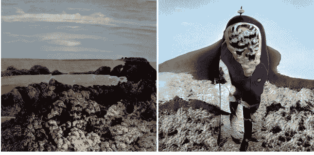

## 合成文本

在这一部分中，我们关注将 AI 文本生成作为艺术概念一部分的作品。我们的文本生成之旅始于在线参与式剧场 ENA$^{13}$，结束于一本装订出版物。

2020 年 5 月首次封锁期间，我们与剧场人罗杰·伯纳特在 `The-liure` 网站上创作了在线参与式剧场 ENA。ENA 是一个与观众对话的生成式聊天机器人，他们一起创作剧场（见图 3）。正如我们之前描述的：尽管在项目描述中明确指出人们是在与机器对话，但屏幕另一端是人类在回复——具体来说是剧导演本人。（Gulajeva / Canet Sola 2021）

+ 12 `https://var-mar.info/phantom-landscapes-of-buenos-aires/`
+ 13 `https://var-mar.info/ena/`

图 3：ENA 用户界面截图和出版的书。

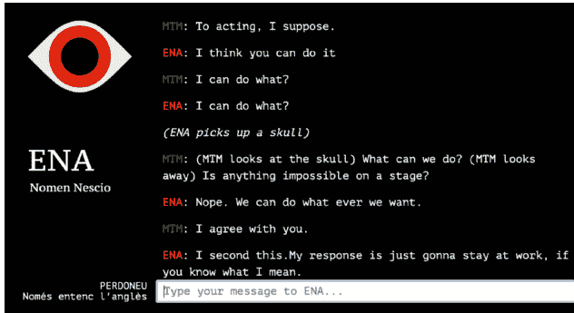

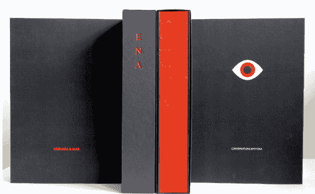

通过分析合成书籍，瓦尔瓦拉·古利亚耶娃强调了输入对 AI 生成系统的重要性（2021）。此外，还需要引导观众的参与和与机器人的互动。为了这一目的，我们采用了传统的引导演员的方法来引导观众，从而引导机器人。舞台指令被用作一种引导方法，触发了主题性对话，并提供了人类与 AI 系统之间有意义的交流。我们发现这些对话非常有意义，因此决定出版一本包含与 ENA 所有对话的书。

通过这个项目，我们了解到通过观众互动引导神经网络是至关重要的。为了做到这一点，必须引导观众。没有观众互动引导，几乎无法实现有效的神经网络导航。

## 翻译模型

此类关注支持交互和装置格式的翻译模型。翻译指的是媒介的转换，或者正如我们所说的，符号空间的翻译。为了说明这一点，我们展示了《梦境画家》，¹⁴这是一个将观众的梦想转化为机器人生成的线条画的装置（见图 4）。

通过实践，我们质疑神经网络的能力，并研究在艺术背景下我们能如何推进这项技术。这件作品让观众体验 AI 基于概念导航的局限性。系统无法理解，只能在语义上说明它的梦境。

图 4：库卡工业机器人绘制观众的梦想。装置现场。

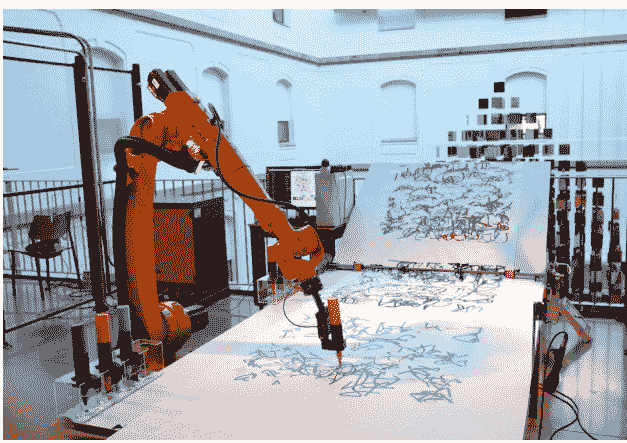

+ 14 见 `https://var-mar.info/dream-painter/`

## 合成形式

在这一部分，我们探讨了艺术家在创作体积形状时如何引导神经网络，以及当 AI 遇到物质性时会发生什么。在使用产生 2D 输出的深度学习工具工作一段时间后，探索生成 3D 结果的可能性是一个自然而易见的步骤。令我们惊讶的是寻找解决方案并非易事（2021年10月）。《迷幻形式》是一系列由陶瓷和回收塑料制成的雕塑，通过它们我们研究了 AI 在制作物理雕塑方面的可能性。该项目用当代语言和工具重新诠释了古代文化。

遵循与上一节相同的范式转移，`text2mesh` 是一个基于 `CLIP` 的模型，它不需要数据集、3D 对象和文本提示词作为输入。在这里，模型实际上并没有创建一个 3D 模型，而是对插入的模型进行风格化处理。并且由输入文本进行引导。

选择标准如下：首先，形式必须引人入胜；其次，之后可以使用材料将其出来。很显然，我们必须修改每个模型，因为物理世界存在重力，而深度学习模型没有考虑到这一点。一些生成的模型被丢弃了，因为它们虽然形状很有趣，但被认为无法修复的。

这里展示的过程是非常规特的创建物体方式。在对该工具进行大量实验后，我们学会了文字如何塑造形状和颜色。这种知识给了我们机会将提示词视为诗意的输入。因此，我们创作了短诗来引导神经网络。最好的诗作为标题保留了下来，并体现在形式中。

艺术家们并没有严格遵循原始模型，而是利用创作自由来修改形状，并通过手动给雕塑上釉来决定颜色。这些雕塑使用了滴流技法。这作为了液体潜空间和迷幻制作过程的隐喻（这是艺术家对创作过程的内心感受，因为他们并不知道最终会达到什么结果）。有时，AI 生成的顶点上被视为灵感，有时则完全被忽略。尽管如此，数字雕塑与物理雕塑一同展出，以经历创作过程中的转变和人类的角色。虽然陶瓷雕塑是 3D 打印的，但制造过程必须遵循生产陶器的传统方法（见图 5 中的最终雕塑）。

`https://var-mar.info/psychedelic-forms/`

### 人工智能 – 智能艺术？

由于我们以前从未接触过陶瓷，整个生产过程感觉是迷幻的：意外之外的神经网络过程导致了数值、物理和化学过程的转化，这一切由艺术家和偶然性共同引导。因此，该艺术项目强调了不同主体之间的关系。

最后，我们可以说 AI 还没有准备好面对物理世界。它创造了漂亮的图像，但当人们想要让输出落地时，就需要大量的额外工作。然而，在我们的案例中，这些额外过程是非常收获且富有创造性的。在这个项目中，AI 更多是作为灵感或出发点，而非其他任何。换句话说，技术的实验阶段对于实验性实践是必要的，这可以导致新生产流水线的创建。在引导神经网络及相关过程时，控制与偶然之间的微妙界限可能是艺术家主要的创作驱动力。

图 5：由 3D 对象和文本提示词引导的陶瓷雕塑，用粘土 3D 打印，并手动上釉。从左到右：迷幻天使（金星）、绿色果冻和粉色羽毛中的美人鱼（宁芙）、迷幻天使（金星）。

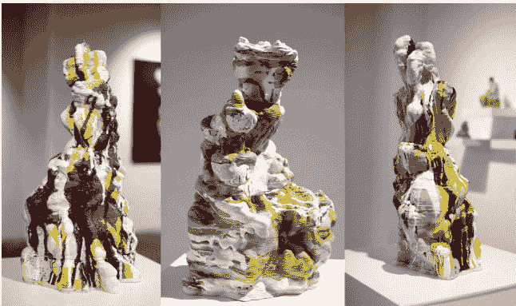

## 讨论

根据媒体对 AI 的炒作，这项技术足够智能可以自主创作艺术（Perez 2018; Vallance 2022）。然而，现实并非如此。根据计算机科学家、Luc Julia 爵的共同发明者的说法，AI 并不存在。他主张机器拥有多种智能，这些智能往往超越人类。然而，与人类智能相比，机器智能是局限且不连续的（Julia 2020）。

因此，在这项技术周围进行艺术实践至关重要，作为对行业和大众媒体提供的 AI 幻想的一种可能反击。

我们将 AI 视为一种具有自身可能性和局限性的创作工具，它可以通过意外的输出刺激艺术家的创造力。研究表明，工具制造扩展了人类的认知水平并构成了文化的演变（Stout 2016）。同样，作为一种新工具，生成式 AI 可能通过允许能够产生独特结果的新生产流水线来丰富创造力。

回到合成图像，我们可以说，这里讨论的所有基于机器合成图像的作品都具有特定的美学：通过 `Deep Dream` 和 `GAN`。与 `GAN` 的输出不同，`Deep Dream` 具有更可识别的风格，可以被视为一种转换每个输入图像的过滤器，而不是从给定的数据学习。

关于 `GAN` 美学，视觉吸引力在很大程度上继承自两个实体：数据集和模型本身。`GAN` 有特定的足迹，正如所有使用此模型制作的作品所示。视觉色调来自所使用的数据集。例如，如果一个数据集是同质的（只有景观图像），我们很容易在生成的输出中识别出景观。然而，如果数据集中的图像有很多变化，输出就会是相当抽象的。来自兰萨洛特的《明片风景》很好地说明了这一点。此外，当数据集中的照片看起来相似时，输出也会相似，正如《塔尔图合成风景》视频作品的情况，其中提取了城市中红花行走的帧。当我们谈论用神经网络生成的视频时，对潜空间的手动引导比音频引导的方法提供了更多变数。

合成图像作品鼓励我们处理在实践之前未接触过的图像和视频格式，但我们发现与 AI 和视频工作非常令人兴奋。例如，AI 视频生成一直是完美循环的，因为图像是合成生成的。然而，创建实时 AI 工作要复杂得多，因为某些模型太慢了。渲染单个图像可能需要几分钟。这些局限性激励我们设计新的解决方案并在新的媒介中工作。此外，媒介的局限性一直对我们的创造力是一个很好的挑战。

近年来，使用 `GAN` 或其他图像生成工具变得容易得多，尽管过去曾非常困难。我们必须注意，对于从业者来说，像 `DALL-E` 和 `Midjourney` 这样易于使用的工具提供的创作自由很少，因此对艺术家的吸引力较小。这些产品倾向于工具化用户，而不是相反。同时，开源模型提供了更多的创作自由，并使艺术理念得到更广泛的使用。

与 `GAN` 的工作证明了 AI 并不是感知上下文的，而是自动映射概念。

### 人工智能 – 智能艺术？

在 ENA 案例中，使用了舞台指令，而在 Dream Painter 项目中，应用了梦境讲述的概念来引导参与者，参与者反过来又引导了网络，形成了链反应。在潜空间导航概念在艺术上是有有趣的且富有启发性的，这在处理形式时尤为明显。

所展示的实践代表了机器学习的范式转移，从为 `GAN` 编写数据集转向扩散模型。在基于实践的研究中，实践可以被视为一个通过技术和偶然性测试艺术想法的实验室。

## 结论

在本文，我们从艺术家的角度总结了专注于图像、视频、文本、3D 对象生成和翻译模型的深度学习发展。我们应用了基于实践的研究方法论，调查了近期协作创作 AI 工具在艺术实践中的作用和可能性。

## 参考文献

Arjovsky, Martin / Soumith Chintala / Léon Bottou (2017): "Wasserstein GAN". arXiv. 1701.07875 [stat.ML].

Brown, Tom. B / Benjamin Mann / Nick Ryder / Melanie Subbiah / Jared Kaplan / Prafulla Dhariwal / Arvind Neelakantan / Pranav Shivam / Girish Sastry / Amanda Askell / Sandhini Agarwal / Ariel Herbert-Buss / Gretchen Krueger / Tom Heninson / Rowan Chen / Aditya Ramesh / Daniel M. Ziegler / Jeffrey Wu / Clemens Winter / Christopher Hesse / Mark Chen / Eric Sigler / Mateusz Litwin / Scott Gray / Benjamin Chess / Jack Clark / Christopher Bonner / Mac McKean / Alec Radford / Ilya Sutskever / David Amodei (2020): "Language Models are Few-Shot Learners". arXiv:2005.14165 [cs.CL].

Canet Sol, Mar / Varvara Guljeeva (2022): "Dream Painter: Exploring positive capabilities of AI-aided speech-to-image synthesis in the interactive art context". Proc. ACM Comput. Graph. Interact. 5(4), doi:10.1145/35533836

Dosovitskiy, Alexey / Lucas Beyer / Alexander Kolesnikov / Dirk Weissenborn / Iaohua Zhai / Thomas Untersteiner / Mostafa Dehiani / Matthias Minderer / Georg Heidholz / Sylvain Green / Jakob Uszkever / Neil Housby (2020): "An image is worth 16x16 words: Transformers for image recognition at scale". arXiv: 2010.11929 [cs.CV].

Gatson, Leon A. / Alexander S. Mercer / Matthias Bethge (2015): "A neural algorithm of artistic style". arXiv: 1508.06576 [cs.CV].

Goodfellow, Ian / Jean Poet-Babelie / Mehdi Mirza / Bing Xu / David Ward-Farley / Sheryl Ozair / Aaron Courville / Yoshua Beng (2014): "Generative Adversarial Networks".

Guljeeva, Varvara / Mar Canet Sol (2021): "ENA: Participative Art Forms Forming Pandemics". In HyMEx 2021 (Hybrid Museum Experience Proceedings). Budapest, 77–82.

Guljeeva, Varvara / Mar Canet Sol (2022): "POSTCard Landscapes from Janeiro". Creativity and Cognition (CCC '22), 20–23, Venice, Italy. ACM. doi:10.1145/3527927.3531191

Guljeeva, Varvara / Mar Canet Sol (2022b): "Dream Painter: An Interactive Art Installation Bridging Audience Interaction, Robotics, and Creative AI". Proceedings of the 30th ACM International Conference on Multimedia (MM '22). Association for Computing Machinery, New York, NY, USA, 7235–7236. doi:10.1145/3503161.3549976

Guljeeva, Varvara (2021): "Synthetic Books". ARTECH 2021: 10th International Conference on Digital and Interactive Arts. New York, NY, USA: ACM. doi:10.1145/3483529.3483663

Herndon Holly | Matthew Dryurst (2022): "Infinite Images and the latent camera." `https://mirror.xyz/berndondryurst.hest/ZEG6mucl9fqU897XvJsovUUMnMOitTPSWN8S-6KKamY` (2022年12月13日).

Hertzmann, Aaron (2018): "Computers Create Art?" Arts. MDPI AG, 7(2), 18. doi:10.3390/arts702018.

Hertzmann, Aaron (2020): "Computers do not make art, people do?" Communications of the ACM. Association for Computing Machinery (ACM), 63(5), 45–48. doi:10.1145/3347092.

Ho, Jonathan | Ajay Jain | Pierre Abbeel (2020): "Denoising Probabilistic Models." ArXiv.2006.11629 [cs.AI].

Isola, Phillip | Jun-Yan Zhu / Ting Zhou / Alexei A. Efros (2016): "Image-to-image translation with conditional adversarial networks." ArXiv.1611.0704 [cs.CV].

Johannes (2021): “The prompt manifesto.” `https://deepplearn.org/the-prompt-manifesto`

Karras, Timo | Timo Aila | Samuli Maine | Jaakko Leinen (2017): “Progressive growth of GANs for improved quality, stability, and variation.” `ArXiv.1710.10196 [cs.AI]`.

Karras, Timo | Timo Aila (2021): “A style-based generator for generative adversarial networks.” IEEE transactions on pattern analysis and machine intelligence. Institute of Electrical and Electronics Engineers (IEEE), 43(12), 4217–4228. `doi:10.1109/TPAMI.2019.29709`.

Kingma, David P. | Max W (2013): “Auto-Encoding Variational Bayes.” `ArXiv.1312.6114 [stat.ML]`.

Krenn, Mario | Lorenzo Buffoni / Bruno Coutinho / Sagi Eppel / James Gates Foster / Andre Grevisky / Harlin Lee / Yichao Lu / Joao P. Moutinho / Mina Santhalia / Ngoc Mai Tran / Francisco Valente / Yangxu Xie / Rose Yu / Michael Kopp (2022): “Predicting the Future of AI: High-quality prediction in exponentially growing network.” `ArXiv.2210.00881 [cs.AI]`.

Krizhevsky, Alex | Ilya Sutskever / Geoffrey E. Hinton (2017): “ImageNet classification with deep convolutional networks.” Communications of the ACM, 60(6), 84–90. `doi:10.1145/3065386`.

Larsen, Jonas (2006): “Geographies of tourist photography.” Geographies of Communication: The Spatial Turn in Media. Gothenburg, 241–257.

Manovich, Levi (2022): “AI and myths of creativity.” Architectural design 92(3), 60–65. `doi:10.1002/ad.2814`.

McDonald, Kyle (2018): “How to recognize fake AI-generated images.” Medium. `https://medium.com/how-to-recognize-fake-ai-images-d6f9a`.

Michel, Oscar / Roi Bar-On / Richard Lu / Sagi Benaim / Rana Hancock / V. Canet Sola (2022): “TextMesh: Text-driven stylization.” IEEE CVF Conference on Computer Vision and Pattern Recognition (CVPR). `doi:10.1109/CVPR.56288.2022.01313`.

Mordintsev, Alexander / Christopher Olah / Mike T (2015): “Inceptionism: Going deeper into neural networks.” `https://blog.com/inceptionism-deeper-into-neural`.

Nicholas, Gabriel (2017): “These Stunning A.I. Tools Are Bound to Change the Art”. `https://sites.com/technology/ai-neural-photo-transfer-will-change-the-art`. (2022年12月13日).

Perez, Sarah (2018): “Microsoft’s new drawing bot is an!”. TechCrunch. `https://techcrunch.com/2018/microsoft-new-drawing-bot-is-an/` (2022年1月13日).

Radford, Alec / Wong Kim / Chris Haley / Gabriel Ghosh / Sandhini Agarwal / Amanda Askell / Pamela Mishkin / Jack Clark / Gretchen Kuecher / Ilya Sutskever (2021): “Learning visual models from natural language supervision.” `arXiv:1706.03020 [cs.CV]`.

Radford, Mithya / Pavel / Scott Gray / Chelsea Voss / Alec Radford / Mark Chen (2022): “Zero-shot text-to-image generation.” `arXiv:2102.12092 [cs.CV]`. `doi:10.1002/ad.2814`.

Steyer, Hito (2021): “Twenty-one art worlds: A game map”, `https://www.flux.com/journal/121/42348/twenty-one-art-worlds-a-game-map/` (2022年12月13日).

Stout, Dietrich (2016): “Stonemaking and the evolution of human culture and cognition”. Philosophical Transactions of the Royal Society B: Biological Sciences, 366, 1050–1059.

Stout, Dietrich (2016): “Tales of a neuroscientist”. Scientific American. Springer Science and Business Media, 314(4), 28–35. `doi:10.1038/scientific-american-0416`.

Vallance, Chris (2022): “Art is dead – the rise of AI debate”. BBC. `https://www.bbc.com/news/technology/6278825` (2022年12月13日).

Vaswani, Ashish / No Shazeer / Nicky Parmar / Jakob Uszkoreit / Lionel Jones / Aidan N. Gomez / Lukasz Kaiser / Ilya Polukhin (2017): “Attention is all you need”. `arXiv:1706.03762 [cs.NL]`.

Wang, Xiao / Ke Yu / Shixiang Wu / Jinjin Gu / Yihao Liu / Chao Dong / Chen Loy / Yu Qiao / Xiaoou Tang (2018): “ESRGAN: Enhanced super-resolution generative adversarial networks”. `arXiv:1809.00219 [cs.CV]`.

Zhu, Jun-Yan / Taesung Park / Phillip Isola / Alexei A. Efros (2017): “Unpaired image-to-image translation using cycle-consistent adversarial networks.” `arXiv:1703.10593 [cs.CV]`.

# 具身语音与人工智能：微型技术社会系统

Diana Serbanescu, Scott Laurent, Ilona Krawczyk, Kate Ryan, Mika Satomi

## 动机

本文呈现的基于实践的研究的一个原始动机是基于这样一个前提：具身知识与人工智能 相关，不仅体现在应用方面，也体现在批判实践方面。将具身知识整合到人机交互中的关键推动者 Schiphorst (2009) 认为“设计背景下的具身化”是有意义的，而且“作为具身认知和具身交互的概念”需要利用我们的感官，以获取更丰富、更清晰的人类形式。在批判实践方面，女性主义技术科学家 Leurs (2017) 将研究者视为具身主体，并通过强调身体与基础设施在知识创造中的关系纠缠，强调了物质性。Adam (2006) 在其开创性著作《人工智能认知：性别与机器》中指出，“身体在知识的产生中起着至关重要的作用”。利用女性主义研究来反驳展示理性解决问题的精英科学话语，这传播了对客观性和普遍真理的追求，即一种“无处视角”。人类学 Suchman (2007) 在对“非具身智能”的批判中也指出，“女性主义理论者广泛记录了西方哲学经典中对身体的边缘化甚至抹除”，这种抹除在人工智能和机器人领域同样如此。

## 人工智能 – 智能艺术？

机器将意义和价值（包括处于从地位的主支配假设和偏见）引入到个人自身的知识创造过程中。我们认为，正如 Leur (2017:145) 所述，这要求人们对自己的实践进行更具批判性的内省，她指出：

> “只有通过对自己的立场进行批判性的自我反思，将实践置于更广泛的权力关系和结构中，我们才能开始动摇被正常化的知识生产政治学”。

因此，在介绍下框架时，我们的目标也是反思研究的立场和伦理，部分通过揭示开发工具和过程中的个体及相应的“组装”。

## 维度一：通过可穿戴设计增强表演性实践

本节提出了一种混合方法论框架，讨论了通过定制可穿戴设备赋予身体声音，从而增强演员训练具身实践的技术和形式方面。该设备是一个交互系统，使用基于人工智能（AI）的模块将动作映射为合成声音。我们的框架借鉴了当代表演、可穿戴技术设计、人机交互（HCI）以及 AI 流水线设计领域的技巧。

### 方法论框架

在“具身声音与人工智能”项目中，我们的团队专注于从后格洛托夫斯基剧目选择的一种特定物理演员训练方法。这种方法的选择出于考虑：首先，根据 Wolf (1996) 的观点，格洛托夫斯基的实践构成了一个具身研究的实验室，他严密的演员训练体系反映了他对科学的迷。因此，他对结果可复制性的追求以及对科学客观性的坚持，导致了独特的具身实践方法。这种结构化的工作方式启发了数代从业者，可以作为适用于技术设计的身心连续体的概念脚手架。

+ 1 格洛托夫斯基是一位波兰剧剧导演和理论家，他对戏剧训练的创新方法涉及研究表演者对冲动产生的即时的、“有机的”、“类动物的”心理生理反应，在这些情况下，“没有话语性的时刻来阻止有机反应，或产生干扰”（Richards 2003:66）。他将通过“消极剧”消除此类障碍的过程称为消极剧（Grotowski & Barba 2002:17）。

该训练通过让演员意识到身体与动作合而一的时刻起作用——通过反复训练的过程，赋予他们更频繁、更深层次地进入一种“不受内在冲动与反应之间时间差限制的状态，使得冲动本身就是一种外在反应”（Grotowski & Barba 2002: 16）。声音和唱歌是这一过程的重要部分。

后格洛托夫斯基实践中的具身声音训练寻求在与自我及伙伴的关系互动中，通过声音表达深层的心理生理状态。因此，“表演者被训练要‘将身体视为音乐，一种旋律和节奏的震动’（Dowling, 2011: 248），这使得能够在音乐和节奏结构中受到他人的影响”（Krawczyk 2021: 24）。最后但同样重要的是，选择关注某项后格洛托夫斯基技术是源于我们从业者团队对这类实践的亲身经验。我们希望模拟我们充分理解的实践——

### 团队

基于 AI 的系统是协作和团队努力的产物。如前所述，我们认为对自身实践的反思过程是我们研究框架不可或缺的一部分，也是通向 AI 研究伦理指南的必要步骤。在此，我们借鉴了 Leurs (2017: 139) 的“关怀伦理”原则，该原则被描述为“基于价值的，并考虑到研究者的依赖性、部分政治承诺和个人参与”。我们相信，对研究、开发和决策过程的意识始于团队。在像我们这样专注于增强现有心理生理训练方法的小型团队和项目中，更容易探索技能、知识的生态系统，而且也能体验从业者和研究人员带入房间的经验、主观偏好和具身能力。这些因素共同为所演练的“行为组装”（Leeker 2017: 13）创造了一种独特的实践本体论——其中作为研究核心的身体数据化是以迭代方式进行的——这为我们提出的可以在其他实践语境中进行的反思开辟了空间。

+ 2 此处提出的框架是之前两个项目建立的日益增长的协作工作的延续：“未来的形状”（The Shape of Things to Come, 2019） -- `https://replica.institute/`（访问日期：2022年12月12日）和“在世界边缘跳”（Dancing at the Edge of the World, 2020） -- `https://berlin-open-lab.org/portfolio/dancing-at-the-end-of-the-world/`（访问日期：2022年12月12日），以及 `https://hybrid-platform.org/forforum/detail?tx_name_pi%25Bnews%25D=996&cHash=1887ad66e07104be255c3756f7gb28`（访问日期：2022年12月12日）。

### 人工智能 – 智能艺术？

对于这项基于实践的研究，我们的团队由以下五学者/从业者组成，他们也是本文的共同作者。团队每位成员在研究中承担了一个或多个特定角色：

- Kate Ryan：表演者
- Mika Satomi：可穿戴技术与创新设计师
- Diana Sebastianescu：艺术总监兼项目负责人
- Scott DeLahunta：民族学家
- Ilona Krawczyk：后格洛托夫斯基实践者兼外部顾问

Suchman (2017) 假设，“当我们将技能归于某人时……该个人充当符号”。然而，她也讨论了技能的激活取决于团队。关于这一点，Ilona Krawczyk 注意到，通过嵌入过程的反馈环节，我们团队技能激活得到了支持和鼓励：

我发现特别重要的是 Kate 和她的同伴首先脱颖而出。在后格洛托夫斯基戏剧中这并不常见，因为导演对训练或表演创作的观点占据了表演者的视角。

关于实践伦理以及相关的自我反思过程，Ilona 评论：

从我们对戏剧实践中伦理考虑的角度来看，该项目的另一个重要方面是研究我们正在产生什么样的知识，在哪些领域（超越表演、训练和人工智能），知识生产过程如何在所有参与者之间分配，以及我们如何彼此认可贡献。

作为过程协作反思的工具，我们使用了美因茨 Motion Bank 开发的网页注释平台。该平台支持从多个视角进行对话和过程记录，我们能够部分追踪决策和成员的贡献。我们的记录揭示了我们每个人都贡献了一些隐性知识和具身知识，有时超出了团队中的“传统”角色。

+ 3 作为本项目的项目负责人和艺术总监，以及之前两个项目“未来的形状”（2019）和“在世界边缘跳”（2020）的负责人，Diana Sebastian 在塑造研究框架和议程方面做出了关键决策。她负责在三个项目中中选择团队成员，并对基于 AI 的人工品的结构和功能元素做出设计决策。

+ 4 Motion Bank。美因应用科学大学。`https://medium.com/motion-bank`（访问日期：2022年12月12日）。

### 基于 AI 的运动捕捉穿戴设备

图 1：由 Mika Satomi 设计的穿戴方案。来源：Mika Satomi。

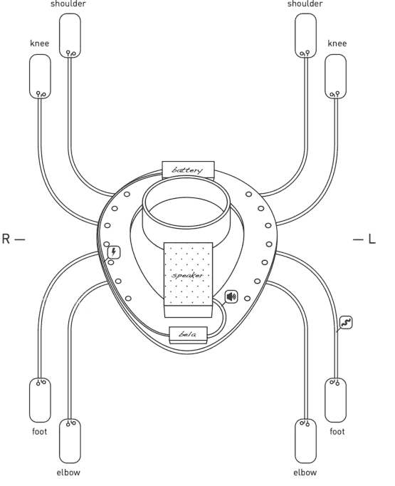

将身体视为音乐、视为节奏性震动的想法$^5$ 启发了我们的第一个原型$^6$：这是一个基于 AI 的穿戴设备，它通过将身体姿态映射到声音信号来实现运动的声音化。本文此处讨论的基于实践的研究基于 Mika Satomi 设计的早期原型$^7$，并旨在对其进行修改以赋予意-

- 5 Ditte Berkley 是一位后格洛托夫斯基式的实践者，参与了《未来的形状》，她鼓励表演者“用身体唱歌，用声音跳舞”。
- 6 初型是为一场名为《世界边缘之舞》（Dancing at the Edge of the World, 2020）的表演开发的。
- 7 在该版本的原型中，重点是通过为六位表演者每人配备一个利用运动来完全增强的基于 AI 的穿戴设备，从而为集体身体赋予声音。

### 人工智能 – 智能艺术？

完全增强一项源自后格洛托夫斯基式具身声音训练的特定练习。

# 具身声音与 AI

D. Serbanescu, S. DeLahunta, I. Krawczyk, K. Ryan, M. Satomi

图 1 显示了由 Mika Satomi 设计的定制基于 AI 的穿戴设备的示意图。该设备是一个项圈，配备了可以连接到身体八点的传感器，以实现运动捕捉的功能。每个项圈后面都有一个 Bela，作为处理单元。所有的计算过程：数据采集、通过机器学习 (ML) 模块进行姿态识别和映射，以及在每个项圈包含的 Bela 板上本地进行声音合成。该 ML 模块基于 `ml-lib`，这是一个用于 Max 和 Pure Data 的机器学习外部库，由 Nick Gillian 为“手势识别工具包”构建。一个扬声器位于项圈前端，发出的声音可以根据传感器的位置或表演者移动身体的方式做出反应。

ML 模型通过整合放置在 Kate 身体上的传感器实时数据进行训练。数据是在特定的姿态下捕获的，这些姿态根据我们的运动框架设计，并由 Kate Ryan 和 Diane Sebastian 协作确定。这些数据点随后被映射到合成器的参数上。由于 Kate 每次佩戴项圈时，传感器在她身上的放置位置都有细微变化，因此训练需要在每次排练开始时进行。在排练过程中，材料的拉伸随之导电织物的阻力也会发生细微变化，导致数据出现微小波动，并影响映射的准确性。为了应对这一点，系统需要使用新数据进行重新校准和重新训练，这一过程在排练期间重复多次。由于这种处理纺织品变性的做法，我们的数据集是瞬态的，处于持续的流动状态。

8. 触发声音。早期原型的映射非常简单，将随机观察的海报连接到声音信号：合成的体素、预录的形成歌手的视频样本。
9. 由柔性胶带制成的电子纺织品传感器。
10. 通过捕捉传感器放置时身体部位的运动。更具体地说，数据由连接在每个项圈上的 Bela 板运行 Pure Data (PD)（https://pured-data.info/ 2022 年 12 月 12 日访问）软件读取并处理。安装在每个板上的此软件还包含一个基于 ML 的模块，用于将身体姿态映射到合成声音。捕获的传感器数据通过一个基于手势识别工具包（https://www.media.it/projects/gesture-recognition-toolkit/overview/ – 2022 年 12 月 12 日访问）的 `ml.lib`（https://github.com/irlabs/ml-lib – 2022 年 12 月 12 日访问）外部对象。
11. 该处理模块被训练用于识别身体姿态模式，这些模式随后用于控制 Pure Data 补丁中的合成器参数。
12. 合成的声音直接从 Bela 输出到便携式扬声器。
13. https://github.com/irlabs/ml-lib – 2023 年 5 月 24 日访问。

来自传感器的数据可以通过无线网络实时传输到远程单元。Mika Satomi 还实现了控制器接口，允许从中央笔记本电脑连接到每个独立的 Bela 板，并能够实时可视化传感器数据并初始化每个系统的训练序列。关于穿戴设备设计的更多信息可以在 Mika Satomi 的个人网页¹⁴ 上找到。

## 输入：通过传感器进行运动捕捉

如前所述，我们在设计上限制自己¹⁵ 仅使用八个弯曲传感器。传感器如何放置在身体上对于针对具身训练的特定练习进行定制变得非常重要，因为我们的目标是捕捉与该特定练习最相关的身体运动。因此，我们需要实验并开发出传感器如何放置在身体上的特定逻辑。Mika Satomi 的设计为传感器位置的灵活性和重新排列留出了一些空间¹⁶。在这项研究背景下，我们决定将两个上肢传感器放置在一个身上，一个放置在腹部，而不是肩膀¹⁷。在这一更新的设计中，下肢传感器被嵌入在裤子中，并顺着下半身的骨骼线条。

14. https://nerding.at/costume-for-dancing-at-edge-of-world/ –
15. 这种设计使用了 Bela 板。
16. 电子纺织品变性。
17. 在原始原型（2020）中，我们通过在手臂和肩膀放置更多传感器来关注下肢。
18. 这种方法基于 Bell Labs 1969。
19. 在这种模式下，身体姿态被映射到英语的元上。
20. 这是由 Ditte Berkley 介绍给我们的。然而，后格洛托夫斯基实践者也有这种方法的变体。

## 输出：合成声音

合成的声音通过在 Pure Data 补丁中实现。我们的原型包含两个模式：Voder 模式⁸ 和 Granular 模式——将身体姿态映射到合成声音。

## 练习的增强：In-tensions

### 手势到声音

图 2：In-tensions 建模。来源：Diana Serbanescu

## 训练系统：对着墙“推”

目标是将这些动作的物理能量转化为声音的震动模式。

图 2 显示了将四个预定义的（具身）动作映射到选定声音信号的形式化图。这些动作将由 Kate 执行，通过传感器捕获的姿态数据将用于训练分类这些动作的 AI 模块。

### 训练系统的示例：对着墙“推”动作

本节逐步介绍了训练系统识别并映射对着墙“推”动作的涉及过程。图 3 捕获了 Kate 在执行对着墙“推”动作时寻找其最佳声音的过程。

图 3：Kate 正在对着墙执行“推”的动作。

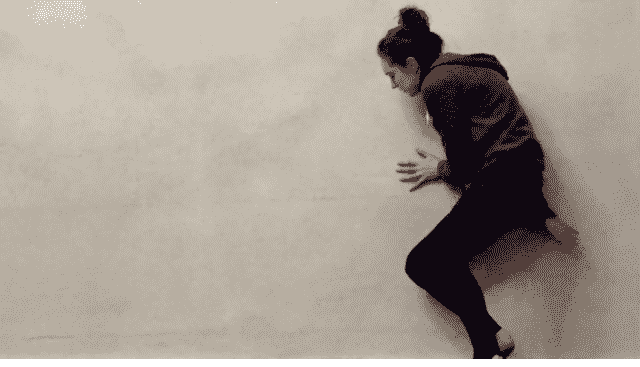

### 第一步：标记一个推动作

最初，这是一个由 Ditte Berkley 设计的练习。其意图为表演者提供一个真实的障碍——墙，以便执行真实的“推”动作，通过收缩身体肌肉来帮助声音的释放。表演者被鼓励培养在行动时倾听自己声音的意识，并评估其感知的最佳音质。因此，当 Kate 识别出她声音的高峰时刻及其发生的位置时，她被指示在保持姿势的同时用手拍击墙壁。Diana 建议将这种拍击作为 Mika 开始从传感器录入数据的信号²。这一过程涉及 Mika 在操作界面与执行动作之间精确的同步。在此处采集的传感器数据将用于用作基于机器学习（ML）模块的训练数据样本。其目的是获取代表表演中人声与物理特质之间完全具身统一时刻的数据。

### 第二步：探索将“推”动作映射到声音

在通过示例进行训练后，我们的机器学习模型已经学会了将输入数据映射到相应的语音合成参数。语音合成参数是由 Mika 通过实验选择的。在这一阶段，这些参数会随每次训练的不同而异。其目的还在探索与参与动作的表演者真实特质相似的语音合成质²。Diana 要求 Kate 探索针对墙壁的不同类型的“推”动作，以及系统学习了什么，以及如何对训练样本的波动做出反应。

### 基于所有动作的任务即兴

基于任务的即兴是时长不一的环节，持续一到两小时，旨在探索增强“内在（In-t）练习”所开启的限制性和可能性。这是基于 Kate 作为表演者/实践者的具身倾听，以及带有可穿戴设备的 AI 系统。其目的是观察这种与 AI 系统的互动如何有助于产生“流”时刻，或者它如何刺激表演者的即时感知。

> 课程分为两个部分：第一部分是我们在训练系统，随后是结构化的即兴表演。Diana 引导 Kate 经历这两个阶段，并对这一过程描述如下：

我们正在处理四个动作：推、拉和弹。我要求 Kate 花一点时间，详细地想象一个她会执行其中每一个动作的真实情境，并要求她在她想象的语境中尽可能准确地执行每一个动作。在对精确执行动作进行首次演绎后，我要求她在执行动作的同时叙述出想象情境的细节。例如，她站在一个码头上，推着一个沉重的木箱。接下来，我要求她叙述她的身体是如何参与动作的。例如，她抬起右手，她收紧盆底肌肉，当她处于动作的最高参与度时，我让她释放出声音。这是 Mika 开始录制数据以训练系统的信号。其目的是实现可重复的、在系统中准确表示的“推”、“拉”、“弹”、“抚摸”动作。

想象的语境和具身叙述旨在作为 Kate 在即兴表演期间在身体中准确获取动作的句柄。一旦系统使用所有预定义的物理动作数据完成训练，这些姿势现在每个都映射到一个合成的元音上，或者每个都映射到一段合成的人声录音。在引导式即兴表演中，我指示 Kate 开始，我建议她首先尝试尽可能地复制训练样本的动作，并熟悉系统的反应。生成的声音是可预测的吗？我引导她同时关注自己的身体和对设备的倾听。她能控制声音吗？她能通过动作创造首重复相同旋律模式的歌曲吗？

动作之间的空间被机器学习模块映射为预定义的合成声音之间的空间。接下来，我要求 Kate 缓慢地对初始动作进行变体，借此发现算法生成的声音变化。我引导她的注意力集中在倾听上。她能通过动作持续地探索声音空间吗？我要求她不断寻找声音，永远不要沉默。谁在控制，是她还是 AI？在她变得熟悉了系统的声音后，我要求她将其作为自己声音的跳板等等。（Diana）

21. 这是施加在阻性材料上的压力，代表由肌肉激活的传感器拉伸和折叠/弯曲，以及参与该姿势的身体姿态。
22. 在颗粒模式下，表演者在具身动作时的预录制声音样本被传输到系统中，并映射到她执行动作时相应的身体姿态。在 Voder 模式下，我们选择了与动作共鸣的合成元音。
23. 通过引入“共生手势”的概念，Suchman (2017) 注意到“人类与人工制品是相互构成的”。

## 增强的潜力

在二月的最后一周，工作通过视频进行了记录。这些视频被上传到了 Motion Bank 平台。然后我们使用协作标注来对在室内发生的工作进行反思和评论。

## 人工智能 – 智能体？

对于 Ilona 来说——这里更多流感。(12:19)

对于 Ilona 来说——非常有流感。(12:33)

对于 Ilona 来说——我感觉我不知道如何将之前的流向引向何。我害怕失去与声音的连接，所以它没有在某个一点上延续下去。(13:16)³

图 4：Kate Ryan 关于“流感”的一系列标注。来源：Motion Bank

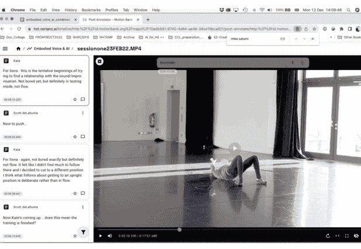

在语境中，Kate 正在向 Ilona 报告对“流感”的感受，而 Ilona 是这种具身声音实践形式的公认专家。因此，这可能是一种北欧缩写，指代了 Kate 和 Ilona 在他们之间的这段交流中记录的实践知识。这里没有提到 AI、传感器或计算机，这为提问他们对 AI 系统的感知提供了一组有趣的切入点。这些问题倾向于关注归属于 AI 系统的代理性形式，以及作为工具的代理性、控制和可预测性。其中一个例子涉及询问 Kate 关于她与其建立具身关系的体验。在图 5 中，有一个关于“控制”的问题，Kate 用音频标注作了回答。

Ryan, Kate. `sessionone23FEB22.MP4`. 05:10-13:16. 视频标注。Motion Bank 应用程序。

图 5：两个标注。一个视频和一个音频。来源：Motion Bank

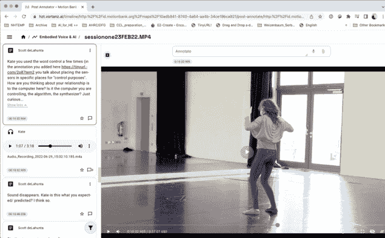

书面[已编辑] 标注问题：

Kate 使用了几次“控制”这个词，例如在另一处标注中，你写道为了“**控制目的**”（purposes-'control purposes'）而将传感器放置在特定位置。你对此如何：

这是一个非常有趣的问题，我想我在过程中正罪于拟人化或接受了技术，而且从一开始就是如此。我完全没有在考虑计算机，算法，当然没有。我最初与声音的关系更多是想被它所控制。试图去控制……这在过程的非常早阶段就被注意到了。即使当我试图通过获得对身体的认知来获得一些控制时（这意味着我几乎无法预测会发生什么），我认为那仍然是基本的互动关系。Kate 与技术之间是一种不断演变的关系。它明确了这种关系不是任何东西，而是随着时间推移而变化的东西。delLahunta, Scott. `sessionone23FEB22.MP4`. 10:32. 视频标注。Ryan, Kate. `sessionone23FEB22.MP4`. 10:32. 视频标注/音频。

## 人工智能 – 智能？

研究表明，当人们对技术进行拟人化时，这会影响他们如何考虑 AI 本身对某些事情负责，这对于 AI 和伦理具有明确的影响，因为它引发了关于机器是否应该负责的质疑。但 Kate 也说她正在关注计算机（这也反映在她对“流感”的评论中），部分原因是由于她的注意力集中在她的具身实践上。有趣的是，这两种反思形式是被赋予的。一种涉及实践者在完成任务时的（具身）感受，这涉及到对传感器位置的某种关注，但传感器并不是注意的焦点。注意力在这里可以转移到传感器、AI 系统以及暂时归属于它的某种形式的代理性，这一事实似乎支撑了这类组合中存在的复杂性和关系流体性。

我们认为，未来研究和探索像这样的小型艺术研究项目（一个微型技术社会系统）具有巨大的潜力，旨在开发和完善用于这两种形式自我反思的工具。如前，基于 AI 的系统是协作和团队努力的成果，问题在于是否适用同样的自我反思过程，以及如何应用它们。这指向了一种“实践中的伦理”方法，这种方法可能会为关于 AI 和伦理的更广泛讨论提供信息。因此，我们呼更多这样的项目，以便这里的其他领域对其进行进一步的研究和咨询。我们的项目已经开始创造新的实践认识论，这在某种程度上违背了后 Grotskian 训练的原始伦理：最初的训练针对人与人之间的互动以及能量的具身交换。发现当机器介入时会发生什么是有有趣的，而且当该系统遇到如此成熟的具身实践和研究传统时，它的局限性是什么。

## 参考文献

Adam, Alison (2006): Artificial Knowing: Gender and the Thinking Machine, 1st ed. [Kindle] Routledge.

Dowling, Niamh (2011): 'Theatre and its Integration into Western European Training', Theatre, Dance and Performance Training.

Epstein, Vivi / Sydney Levine / David G. Rand / Iyad Rahwan (2020): "Who Gets Credit for AI-Generated Art?" ISCI.

Haraway, Donna (1997): Feminism and Technics, New York: Routledge.

Grotowski, Jerzy / Eugenio Barca (2002): Towards a Poor Theatre.

Krawczyk, Ilona (2021): "Embodying Voice in Training and Performance: A Process-Oriented Approach." PhD diss., University of Huddersfield.

Leeker, Martina / Immanuel Schi / Timon Beyes (eds.) (2017): Performing the digital: performativity and performance studies in digital cultures (Digitale Gesellschaft, 11). Bielefeld: transcript Verlag.

Leurs, Koen (2017): feminist data studies: using digital methods for ethical, reflexive and situated research. Feminist Review 115, 130–154.

Richards, Thomas (2009): At Work Matters: The Palpability of Invisible Computing. Leonardo 42(3), 225–209.

Suchman, Lucy (2007): Human-Machine Reconfigurations: Plans and Actuated Actions. Cambridge University Press.

Wolford, Lisa (1996): Grotowski's Objective Drama Research, University Press of Mississippi.

# 流感 – 一项艺术研究项目

探索作为跨媒体叙事工具的 AI

Wenzel Mehnert, Robert Laidlow, Chelsea Haith & Sara Lausch

## 引言

流感是一个跨媒体艺术项目，通过不同的媒介处理疾病相关的文化叙事。它诞生于柏林艺术大学（德国）与牛津大学之间的合作关系，探索了人工智能（AI）在创作过程中的应用。我们使用了机器学习算法 GPT-2 编写的文本，该算法对过去 2500 年关于大流行病的叙事进行了训练。从生成的文本片段中，我们构建了一个世界，作为叙事、插画、音乐创作和讲座表演的基础。

## 关于项目

Sound of Contagion（SoC）项目将自己定义为一个基于实践的研究项目，将艺术实践作为理解 AI 作为创作工具的方法。它源于牛津/伦敦创意协作活动（由柏林艺术大学（德国）资助和提供支持）。

## 人工智能——智能艺术吗？

牛津大学（英国）致力于促进艺术与人文领域的项目与研究，并在迈德罗基金会通过“迈德罗-牛津挑战基金”的支持下开展。

# Wenzel Mehner, Robert Laidlow, Chelsea Haith & Sara Laubcher: 传染之声

从开始，我们就专注于跨学科的合作，因为每位成员都拥有不同的艺术和学术背景：Chelsea Haith 拥有出版、新闻和性别研究背景；Wenzel Mehner 拥有文化研究和叙事学背景，他们代表了人文领域。Sara Laubcher 作为职业插画师，而 Robert Laidlow 作为作曲家、研究人员和人工智能专家，则代表了艺术领域。通过该项目的跨学科性质，我们从几个不同的研究问题开始，这些问题引导了思维过程，但又没有限制艺术研究项目所需的创造力和必要的开放性：

- 人工智能如何作为跨学科创意项目中的工具使用？我们如何承认工具独特的代理性？我们又如何在人机协作中进行整合？

项目始于 2020 年初，即 Covid-19 病毒在欧洲首次报道后不久。我们将这种向封锁和社交距离等未知未来的全球转型视为我们努力的起点。由于项目合作伙伴的国际分布以及封锁形势，我们被迫仅通过 Zoom 和 Miro 等数字通信技术来建立项目。我们中有些人甚至从未面对面见过，仅通过数字方式交流。

## 数据集、数据与流程

### 数据集

在认知上正深受疫情影响，该项目成为了一个通过经历来处理和应对变化局势的机会。我们决定研究前几代的叙事，以及他们如何处理大流行、流行病或类似的全球性现象。在这一阶段，在 Chelsea Haith 的带领下，我们选取了所有与大流行和瘟疫相关的文本作为训练人工智能的数据集，并从过去 2500 年的大流行文学中策展了这些精选内容。我们只允许包含小说和剧本。其中原因之一是关注叙事和可能暗示文化模式的反复出现的隐喻，另一个原因是，我们想看看机器学习算法会对这些内容产生什么影响。数据集的选择本身对生成的输出已经产生了有趣的后果。

我们将文本分为两个数据集——从索福克底到 2000 年是一个数据集，2000 年至 2020 年间发表的文本是另一个。这使总数据集大致平分为两半。这种划分引发了对过去二十十年文化关注点的独特见解，同时也反映了流行文学中反乌托邦和末日论叙事普及程度及产量的增加。作为一个整体数据集，这些内容充当了文化碎片，代表了我们从中汲取并面对不断变化的环境的记忆。我们选取的最早作品是 David Mulroy 索福克底《俄狄浦斯王》的译本（Sophocles, 2014 [49 BC]），而最晚的是 Lauren Beukes 的《Afterland》（2021）。这些文本用于训练人工智能模型，旨在基于数据集生成新的文本片段。

### 数据

为了创建一个能够根据现有大流行相关文本生成新文本的人工智能模型，我们首先要做两个决定：

- 训练人工智能的数据集由什么组成？
- 我们将使用哪种人工智能算法？

事实证明，训练数据的选择对生成式人工智能算法的输出有巨大影响，即使其他参数保持不变（Leeming 2022; Mehri et al. 2017; Caillon & Esling 2021）。同样，在同一类型数据集上训练的两种不同的人工智能算法可能会产生完全不同的结果；例如，在贝多芬奏鸣曲上训练的 `WaveNet`（Van den Oord et al. 2016）与在相同曲目上训练的 `PRISM-SampleRNN` 重新实现版本相比（Melen 2020）。

我们首先决定了人工智能算法的选择，即 `GPT-2 Simple`（Wolff 2019）。`GPT-2 Simple` 是 OpenAI 开发并发布的广受欢迎且支持良好的 `GPT-2` 人工智能算法（Radford et al. 2019）的重新实现。我们选择这种算法是因为它能够通过微调来产生特定类型的文本，同时利用它通过通用训练学到的规则。在此语境下，微调意味着我们从一个已经学习了英语“规则”的 `GPT-2` 模型开始，然后引导该模型应用于我们的数据集。我们发现，对于我们构思的任务，它远优于其他仅依赖于微调数据集的当代算法（例如 `WordRNN`）。我们对这种算法也有先前的经验（de Roux et al. 2019），这有助于加速早期进程。最后，`GPT-2 Simple` 可以通过 Google Colab 在线轻松获取，且训练时不需要个人电脑配备 GPU。这使得每位成员在 COVID-19 封锁期间可以使用自己的设备进行访问，便于讨论和协作。

对于数据集的选择，我们决定选取一组包含 21 篇与大流行相关的虚构文本，跨越了过去的千年。这种选择是基于我们既希望有大量数据来训练模型，又希望看到模型在这些内容上的表现的折中。数据集的选择已经对生成的输出产生了有趣的后果。

## 模型训练

我们最初对该数据集多次训练 `GPT-2 Simple`，创建了多个模型。根据初步实验和迭代，我们选择了一组认为最适合项目的参数。这一决定是协作且主观的。

为了进行测试，我们做出了以下决定：

- 我们使用 `12M` 模型作为基准。该基准模型的生成往往强烈反映了我们数据集关注的大流行思想。
- 我们将数据集（完整为 12MB）分为两部分。这些是 2000 年之前的文本（8.1MB）和 2000 年之后的文本（5.7MB）。每个数据集比完整数据集更具异质性，这使得文本生成的控制更加精细。
- 我们在 Google Colab 上训练了 4000 步。
- 在创建两个微调模型（2000 年以前和 2000 年以后）后，我们对它们进行了文本采样。这些生成既有“引导”的也有“未引导”的。
- 在此背景下，引导意味着给定句子的开头，人工智能算法从该点继续。未引导允许我们引导模型谈论大流行的特定元素，而未引导则让我们看到模型在对流行数据集进行微调后，在没有特定上下文的情况下如何“写作”。生成还有一个`温度`参数，处于 0 到 1 之间，这大致代表了引入系统的随机程度。我们创建的生成的`温度`通常为 0.8，因为在我们看来，这使得文本至少具有某种意义。存在一些波动，某些生成的`温度`高达 0.95，或低至 0.5。

总的来说，微调方法似乎是成功的，因为模型能够持续地描写关于瘟疫、发热、疾病、混乱、破坏、流离失和其他相关主题，即使在没有引导的情况下也是如此。虽然模型似乎没有过拟合（完全复制数据集），但有时可以明显看出数据的某些部分在生成内容中更为突出。一个突出的例子是 2000 年以前数据集中的史蒂芬·金的《状态》（1990），它特别长，达 1152 页。

通过这种包含训练、采样、数据集调整和进一步训练的迭代过程，我们开始开始感受到微调后的模型是如何写作的，以及我们可能如何从它们那里获得不同类型的响应。我们以完全相同的方式指示了这两个模型，为每个种子值（`seed`）都提供了一组对比的生成结果。例如，2000 年后的模型倾向于创建连续的对话行。我们使用了几段以单引号和单单词代词为引导的文本。而 2000 年之前的模型则更经常用富有诗意的语言描述景观。从 2000 年之前的模型中，我们利用了更多“大流行”、“瘟疫”和“开始时”等短语为引导的生成。

随着模型训练完成并采样了数百个生成结果，项目进入了下一个阶段，涉及世界构建、叙事探测和跨媒体协作。

## AI 作为创作工具

该项目的指导原则之一是将 A.I. 的结果视为独特的创作形式，并承认算法的创作主体性，将其缺陷和失败视为一种新的审美形式。在虚构写作的背景下，这些“失败”之一是文本本身并不包含任何意义——因为作者在当时并没有创造任何意义。帮助我们理解与这段文本关系的一个想法源自罗兰·巴特的著名论文《作者之死》（1978/1961）。在这里，巴特宣布文本的起源不在于作者，而在于它的终点：读者（第142页及以后）。巴特从描述一个被他反驳的作者开始写：

> 作者在被信赖时，总是意识到的自己书的位置：书和作者站在同一条线线上，被分为“之前”和“之后”。人们认为作者在滋养书籍，也就是说，他存在于书籍之前，为之思考、受苦、为之而活，他与书籍的先验关系正如父亲之孩子一样。（145页）

在我们的情况下，没有作者——它甚至不是从未存在过——而且文本中也没有刻意刻入的、要传达的讯或道德准理。此外，A.I.（特别是我们使用的 `GPT2` 算法）仍然缺乏语义理解。它没有在文本片段提到的角色或地点之间建立联系。相反，A.I. 产生了与作为训练数据的叙事相似的文本片段，而不理解上下文或叙事元素之间的联系。它重新组合了这些章节

## 人工智能 – 智能艺术？

我们向它输入了这些片段，结果是不同写作的任意组合，正如巴特在下文中描述的那样：

> 文本由多重写作组成，源自许多文化并进入相互对话、戏仿、竞争的相互关系，但有一个地方是这种多样性集中的地方，那个地方是读者，而不是像以前所述的那样是作者。读者是所有构成写作的引文被刻在上面的空间，而其中没有任何引文会丢失；文本的统一性不在于它的起源，而在于它的终点（第148页）。

在虚构写作的语境下，这意味着文本的意义是由读者赋予的，读者不断创造意义并寻找连贯性——这在阅读由 `GPT2` 算法创建的片段时尤为特殊，因为它们不仅缺乏意义，还迫使读者不断寻找意义，并将读者带入解释和建立联系的主动角色。A.I. 创建的非连贯文本是一个独特的视角。这是 `GPT2` 算法产生的文本片段的独特审美。因此，A.I. 无法做到这一点，赋予意义和创造连贯性的实践必须来自我们。

## 世界构建

出于原因并遵循上述描述的指导原则，我们考虑了所有……（注：此处原文似乎不完整，翻译随原文截断）

坐在电视机前。这张图片的说明文字是新闻播员的报道。我们将其读作新闻节的旁白。这一部分表明，数据源自 20 世纪的数据集，而非文艺复兴时期。关于病毒传播的讨论、对不同地理区域的影响，以及将大流行病概念化为武器的论述，都指向了大流行病期间社会崩溃的影响。同时，我们可以识别出在处理传染、瘟疫或大流行病等话题时经常出现的重复陈词。“作家”既是自我反思的焦点，也是我们叙事的幕后主，在下一幅插图中被描绘。在这里，我们看到孤独的作家坐在他狭小的公寓里，被记忆所困扰，试图通过构关于不同世纪大流行病的故事来保持理智。

图 1：“传染之声”项目的插图。版权所有：Sara Lauscher

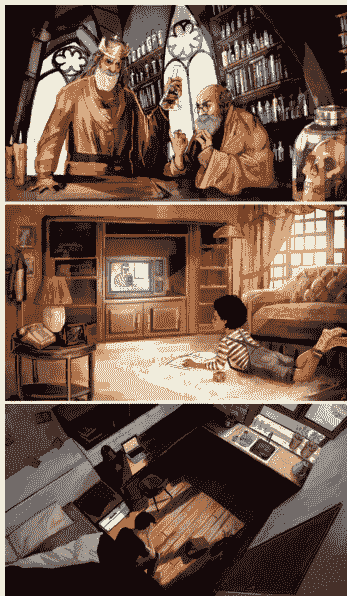

如上所述，插图是故事世界的首次转换。下一次转换以音乐的形式出现。

## 音乐改编

《传染之声》文本由 Robert Laidlow 进一步改编为几首音乐，由作曲家 Marco Galvani 创作了一首。这些包括在 COVID-19 封锁期间首演的《作家》，以及作品《碎片碎片》，两者均由 Bandwidth 乐队表演。以下是对 Robert 创作过程的洞察，以及他如何反映与文本片段合作的过程。

为了参加 2021 年 11 月在牛津大学举办的“传染之声”活动，Robert Laidlow 为男高音和合成器创作了曲目《碎片碎片》，该作品使用了文本作为该项目的一部分。这部作品由七个乐章组成，第一章和最后一章具有某种对称性——即第 1 章与第 7 章相似，2 章与 6 章相似，3 章与 5 章相似。这种圆弧形结构与 Chelsea Haith 从我们之前生成的 `GPT-2` 组的嵌套叙事形式平行。六个乐章的文本（除第 4 章外的全部）都是由微调后的 `GPT-2` 生成的。这些文本决定了音乐的形式和素材；这里，以第一章《德尔斐》作为示例进行了讨论。这段文本中存在某种令他感兴趣的神秘色彩：

片段 III：

德尔斐

一个祈祷

不要让那位不可的他

让那位不可的他夺走他所做的

拿走它，

偷走它，

将词放入你的脑海，

拿走，

别无选择。

“德尔斐”、“那位不可的他”以及“将词放入你的脑海”对我而言意味着，`GPT-2` 可以被读作在模仿神谕。我想创造出一种仪式感和一种不可见的模式，类似于（例如）Massen 的《末日四重奏》。人声部分由一系列相互锁定的的模式组成。十个音高重复出现，叠加在每九个音符重复一次的节奏模式上。文本被简单地应用于这一模式中。合成器被设置为风琴音色，并使用 AI 生成的赞美歌风格素材，使用了由 Omar Peracha（`https://omarperacha.github.io/make-js-fs-fake/`）开发的算法。这种循环重复了二十三个节拍。

在这段 AI 生成的文本中，我被它突然的结束震惊了。当 `GPT-2` 在生成时，用户指示生成多少个字符。由于其 Transformer 架构，`GPT-2` 不进行前瞻规划。每当它生成一个新的 token 时，它只向回看已经生成的内容。当它达到用户设置的任意字符限制时，它就直接停止了。它无法规划一个 100 字符长度的“故事”，因为它无法进行向前规划。在这个乐章中，当文本结束时，音乐直接停止，这与上述描述的任何模式的结束并不重合。这种技术的灵感也来自如 Birtistle（即《卡门阿卡迪亚》）和 Edmund Finnis（即《旋转的空气》）等作曲家。

## 讲座表演

正如上面文字暗示的那样，作品的最后转换是以 2021 年 11 月在牛津大学举行的一场讲座表演的形式呈现的。表演是不同媒体和视角的混合。第一部分介绍了过程、片段的创建并解释了重建过程。在第二部分，我们朗读了叙事，展示了插图，并在舞台上表演了音乐作品。在整个表演过程中，我们通过不同的互动手段展示了项目的视角：当 Robert 和音乐家在舞台上时，由 Wenzel 进行的片段朗读以及 Chelsea 对片段的背景化是通过 Zoom 完成的。演示结束后，有一个问答环节，观众被邀请与表演者讨论、向项目提问并参与讨论。

## 用于跨媒体协作的 AI

通过这个项目，我们发现 AI 是一种促进跨媒体和跨学科协作的有用方式。我们能够使用生成文本的算法，尽管我们在算法过程或通用计算机编程方面的经验水平非常不同。这使我们能够对并非我们天生擅长的艺术领域做出有意义的贡献。展望未来，AI 可能会作为一种“尝试”另一个合作者学科的有用手段。这可能允许合作者更快速地参与更高层次的讨论和决策。

此外，将 AI 作为协作艺术项目的一部分，本质上要求我们做出许多我们都做出了贡献的创意决策。在训练阶段，这些决策包括：什么构成了数据集或多个数据集、我们要微调的模型类型、我们在训练模型时的偏好参数，以及我们如何从这些模型中采样。随后，这些决策包括：我们要保留或丢弃生成内容的哪些元素，以及我们要对它们进行多少编辑。由于团队中没有专门的人类作家，这些决策是集体做出的。

利用 AI 作为创作过程的一部分，与普通合作者的不同之处在于，AI 从根本上并不理解它正在书写的内容。虽然它可以创造听起来合理的句子和故事，但它并不知道自己正在做这些，而且它所做的任何“创意决策”背后都没有意图。这与人类作家非常不同。因此，我们在处理文本时感到被赋予了做出激进决策的权力，将其转换为完全不同的媒体，但即使这种生成状态毫无意义且叙事不完善，我们也感到自由。我们对材料的解读没有所谓的“正确”或“错误”。对于论文发布时期更新的模型相比，我们使用的 `GPT-2` 模型更是如此，后期模型在理解文本上下文和开发逻辑陈述方面显示了显著提高（Griffiths 2022）。

## 人工智能——智能艺术？

在这个项目中，我们探索了将 AI 作为跨媒体叙事的创作工具的使用。该项目指向了文化-语义缺陷，这是 AI 创作作品特有的，并通过人类演员完成的电影填补了这一空白。

我们的日常生活以及设计师和艺术师的工作流。因此，在新的常规程序和创作过程中，探索适应、征用和本土化的方法是十分必要的。

## 参考文献

- Barthes, Roland (1978): 《图像-音乐-文本》。 Hill and Wang.
- Beukes, Lauren (2021): 《黄色》。 Penguin.
- Caillon, Anton / Philippe Esling (2021): "RAVE: A variational autoencoder for fast and high-quality neural audio synthesis". ArXiv. `arXiv:2111.05011` (cs.LG).
- De Rour, David / Emily Howard / Robert Laidlow / Pip Willcox (2019): "Alter: An Ensemble Work Compose With About Ai". DMRN+14: Digital Research Network One-Day Workshop 2019. Queen University of London.
- Ekman, Stefan / Audrey Isabel Taylor (2016): "Notes toward a Critical Approach to Worlds and World-Building". Nordic Journal of Science Fiction and Fantasy (3)12.
- Fischer, Ne / Wenzel Mehner (2021): "Building possible worlds. A speculation based framework to reflect on images of the future". Journal of Futures 25(3): 25–38.
- Griffiths, Max (2022): "Is LAMDA sentient?" AI & Society `https://doi.org/10.1007/s00146-014-01559-z`
- King, Stephen (1990): 《国家》。Doubled.
- Leeming, Zakiya (2022): 《从构思到构建：受物理、生命和计算机科学中的理论、过程和程序影响的宪法决策》。 博士论文，Royal Northern College of Music in collaboration with Manchester Metropolitan University.

# 叙事的计算性构建：挑战与机遇

Pablo Gervás

## 引言

随着人工智能进入大语言模型在处理语言方面展现出惊人能力的新时代，回顾多年来致力于文学创作计算模型构建的研究社区所积累的挑战和见解变得至关重要。该社区的努力有时在小任务上取得成功，有时在追求过高目标时也曾遭遇失败。从现在起开展相关任务时，记住对任务性质及其所面临挑战的积累的见解将具有重要意义。本文尝试将这些见解总结为叙事自动生成所面临的一系列挑战，同时也为未来开放了一系列机遇。

本文的结构为：回顾实现“程序按需自动生成故事”这一问题的多种方法，然后根据这些问题表述的建议，对故事讲述如何被细分为一系列相关的子任务进行反思。

## 提供故事的程序

本文探讨了构建提供故事程序的可能方式，这些从简单的方案到日益复杂的方法排列。在每个点上，通过分析其呈现的挑战（或缺乏的挑战）和机遇，尝试将读者引向随后将讨论的方法。

### 如何请求故事

向故事生成程序请求故事的最简单方案是：没有输入，且输出应该是一个故事。例如一个

### 人工智能 – 智能艺术？

这种程序可以通过考虑某些现有的故事库并从中随机选择一个故事来构建。用户每次都会得到一个新故事，她将很难判断这个故事是由系统生成的，还是从一组预先写好的故事选出的。更复杂的方法是考虑将一系列关键词或短语作为输入，以缩小返回可能故事的范围。在这种方法下开发系统需要存在一套词汇，用于根据各种特征表述查询，例如关于故事世界概念的细节、人物细节及其之间的关系、捕捉故事中事件之间因果和时间关系的剧情结构，或关于故事对观众潜在影响的细节。最复杂的方法是提供一个以某种方式描述故事文本提示，并让故事生成器提供一个匹配的提示。

现有的故事生成器已从早期处理空输入的尝试，逐渐转向适应复杂文本提示的最新神经解决方案，中间穿插了处理不同复杂度的关键词查询的系统。

### 原创故事

如果进一步设定约束认为结果必须是原创的——即不已经以某种形式存在——那么这项任务将变得更加困难。

### 构建故事

从组成元素构建故事的任务需要解决两个基础问题：考虑什么，以及如何判断新构建的故事是否具有原创性。这类任务最简单的方法依赖于单个单词并进行重新组合。这种方法还受到缺乏广泛的故事动作词汇的困扰。这在人工智能领域被称为“知识获取瓶颈”——一个长期以来一直仍然存在的问题。

### 可接受的故事

之所以需要那些能够构建人工物的系统，并让其包含一套评估输出内容质量的程序，是由于这类系统本质上是在探索一个可能的人工物搜索空间，而该空间中并非所有人工物都具有同效性。一旦某种类型的人工物被定义为可以进行计算构建的形式，产生大量不同的实例就会变得非常容易。但要确保所生成的实例是可接受的，通常要困难得多。而让所有这些实例都具有价值则是一项重大的挑战。

为了解决叙事生成领域的这一挑战，近期的工作重点侧重于定义故事质量的指标。在传统的工程实践中，这些努力通常只识别出一个已知会影响质量感知的特定方面并尝试对其进行建模，而不考虑其他同样相关的方面。在故事中被考虑的示例包括：角色的可信度（Gomes et al. 2013）、跨相关事件（如出生/死亡或浪漫纠葛）的语义连贯性（Gervás / Concepción / Méndez 2021）、对人类撰写故事中观察到的特征的再现（Leon et al. 2020）、叙事中实体的一致使用（Papalampidi / Cao / Kocisky 2022）或故事中每个句子在有和无其前述故事语境下的概率（Sap et al. 2022）。

应当考虑的相关方面的集合非常庞大，应该努力将这些不同的模型整合起来，以便它们能够同时应用于同一个故事中。一旦这些指标可以作为过滤器应用于故事生成器的输出中，故事生成器的质量将得到显著提高。

将一种关于故事质量的指标——本质上是一个“故事评论家”模块——整合到故事生成器中，是另一个重要挑战。故事生成系统通常基于一个基本假设构建：它们接收一个输入并生成一个作为故事的输出。阅读输出、对其进行反思，并根据反思以某种方式对其重构，这种想法是人类写作方法的基础（Flower / Hayes 1981; Sharples 1999）。然而，基于类似基础构建的生成系统寥寥无几。墨西哥系统是一个显著的例外，基于 Sharples 对写作任务的认知模型（Sharples 1999）。

关于故事质量还有另一种观点，它略有不同于这是否是一个好故事。这种观点考虑该故事作为某个请求它的用户所描述的故事的实例（instance）是否是可接受的。上述被描述为潜在入的许多特征，可能用于缩小响应特定输入的可接受故事集：故事的类别、世界或角色的细节、情节结构或故事对受众的潜在影响。如果提供了这种类型的实例，那么故事生成器响应特定请求返回的故事，仅在与给定请求相匹配的范围内才是可接受的。

近期开发的基于神经的文本生成解决方案（如 GPT-2 和 GPT-3）（Zhang / Li 2021）使得这类故事能够用大段落有效且流畅的文本来响应用户的提示。这些解决方案基于在神经网络表示上训练的大型语言模型，而这些模型本质上捕捉了人类撰写的文本示例中体现的词汇之间的关系。这些解决方案的交互性质使得通过简单的描述所需故事的简单句子来呈现故事请求成为可能。到目前为止对这些系统的响应与给定提示之间相关性的可接受程度所进行的测试，在通用对话实例方面显示出了卓越的结果，尽管测试人员对其通用有效性仍持怀疑意见（Elkins / Chun 2020）。对于这些解决方案在叙事生成领域的适用性，还需要进行更详尽的测试。

### 用于特定目的的故事

这一观察引出了故事生成面临的最后一个但同样重要的挑战：为特定目的生成故事。“目的”的概念非常难以用计算系统可以理解的形式进行形式化表示。这种观点考虑该故事作为某个请求它的用户所描述的实例是否是可接受的。上述被描述为潜在输入的许多特征可能用于缩小响应特定输入的可接受故事集：故事的类别、世界或角色的细节、情节结构或故事对受众的潜在影响。如果提供了这种类型的实例，那么故事生成器响应特定请求返回的故事，仅在与给定请求相匹配的范围内才是可接受的。近期开发的基于神经的文本生成解决方案（如 GPT-2 和 GPT-3）（Zhang / Li 2021）使得这类故事能够用大段落有效且流畅的文本来响应用户的提示。这些解决方案基于在神经网络表示上训练的大型语言模型，而这些模型本质上捕捉了人类撰写的文本示例中体现的词汇之间的关系。这些解决方案的交互性质使得通过简单的描述所需故事的简单句子来呈现故事请求成为可能。到目前为止对这些系统的响应与给定提示之间相关性的可接受程度所进行的测试，在通用对话实例方面显示出了卓越的结果，尽管测试人员对其通用有效性仍持怀疑意见（Elkins / Chun 2020）。对于这些解决方案在叙事生成领域的适用性，还需要进行更详尽的测试。

这一观察引出了故事生成面临的最后一个但同样重要的挑战：为特定目的生成故事。“目的”的概念非常难以用计算系统可以理解的形式进行形式化表示。然而，为了让计算系统能够理解，这种表示是至关重要的。如果提供了这种类型的实例，那么故事生成器响应特定请求返回的故事，仅在与给定请求相匹配的范围内才是可接受的。

为了让计算系统能够理解，这种表示是至关重要的。这种表示是至关重要的。作为结果，故事生成系统有时包含某些针对特定目的设计的，例如教学（Aylet et al. 2007）、支持救援训练（Hullett / Mateas 2009）或军事训练（Zook et al. 2012）。在这种情况下，故事生成器返回的故事仅在与给定请求相匹配的范围内才是可接受的。

为了让计算系统能够理解，这种表示是至关重要的。这种表示是至关重要的。作为结果，故事生成系统有时包含某些针对特定目的设计的，例如教学（Aylet et al. 2007）、支持救援训练（Hullett / Mateas 2009）或军事训练（Zook et al. 2012）。另一种方法是为特定受众讲述故事。这再次是写作工作本身不可分割的一个方面，但在故事生成系统中很少被提及。幸运的是，我们开始看到这一方向的研究，例如通过基于个体模型的视频游戏提供量身定制的故事（Ramirez / Bulitko 2010）。

在这些情况下，从计算叙事的详细分析角度来看，这种文本与语境的区分提供了一个理解多年来开发出的广泛解决方案的关键工具。假设我们考虑故事描述了一个故事世界——这个世界通常是虚构的，但并非如此。还假设其叙事结构可以用某种语境的形式来表示，而这种语境可以以文本形式呈现，也可以允许以其他格式呈现。在这些

## 人工智能 - 艺术？

假设，计算叙事可以被描述为在故事世界（story world）、话语（discourse）和文本（text）之间转换的子任务。叙事生成（narrative generation）子任务涉及从零构建世界或文本；叙事组合（narrative composition）子任务涉及构建话语，或从话语构建文本；叙事解释（narrative interpretation）子任务涉及重建给定文本的底层话语，或重建底层的世界。这些思想在后续章节中得到了扩展。

## 构建叙事：叙事生成与叙事组合

让我们将叙事生成视为构建故事的任务。面对世界、话语和文本之间的区别，一个故事生成器决定如何在设计中处理这些层级。所有层级都是互相关联的，因为读者会将话语解释为其意义，并将世界视为其内容。问题在于这些层级将如何运作。

系统可以直接生成文本，而无需关于话语或世界的额外表示。这确实是叙事生成任务中青睐的选择。

系统可以专注于生成话语，抽象掉语言的复杂性，但仍然需要构建有效的叙事结构。这呈现了故事世界不需要在系统中进行表示的优势。

由于人们是更好的读者，生成话语的表示系统通常包含一个将话语转换为文本的模块。这个过程并不是真的在生成故事，而是寻找一种通过文本讲述故事的方法。我们将这一任务称为叙事组合。

系统可以包含故事世界的显式表示。故事现在可以通过生成世界中的事件或地点来构建，然后找到一种讲述世界中发生了什么的方法。这是基于故事世界模拟的故事生成器所青睐的选择（Ryan 2018）。在这种方法下，还需要两个进一步的任务：一个是将故事世界中的事件选择转换为话语，另一个是将所产生的话语渲染为文本。两者都是叙事组合的实例。

对于自然语言生成的经典流水线（Reiter / Dale 2000），从故事世界到话语的转换对应于内容规划（content planning）任务，从话语到句子规划（sentence planning）以及表面形式实现（surface realization）阶段。内容规划任务可能包括选择故事世界中哪些事件包含在故事中，这与最近制定的故事提升（story lifting）任务一致。基于“特定目的的故事”（Stories for a Specific Purpose）章节中涵盖的事实的研究工作对应于叙事组合任务。

## 处理叙事：叙事解释

当情况以这种方式呈现时，显然有一组对应于文本到话语、从话语到故事世界概念表示的可能计算任务。这些对应于叙事解释的子任务。叙事解释这一任务一直是人工智能领域的一个目标，最初被称为自然语言理解（Allen 1995）。从历史角度看，多年来一系列未实现的预期导致自然语言处理社区在渐进地收缩的范围内运作，越来越多地关注特定的子任务，而不是尝试将文本处理为详尽的意义表示。近期在叙事结构识别方面的努力（Gervás 2022）对应于话语与故事世界之间的转换，包括给定话语并非指向单一故事世界，而是指向多个相互关联的世界。

开发阅读任务的计算模型尝试也会构成叙事解释任务的实例。关于这项任务的了解非常少，因为它直到最近才开始被计算处理。这使其成为一个充满未来挑战与机遇的开放领域。

## 结论

本文描述的研究工作全景表明，故事讲述需要被视为一个单一的庞大任务，而是一组互相关联的子任务。文本、话语和故事世界之间的简单区分为描述叙事生成、叙事组合和叙事解释过程中的某些子任务提供了手段。

在计算叙事的现有研究与人类在构建故事等等基本目标上的表现方面，显然计算解决方案还有很长的路要走。“叙述故事的程序”（Programs that Deliver Stories）和“重新思考基本假设”（Refethinking Basic Assumptions）章节中提出的分析，对过去计算叙事研究中为止考虑的特定任务构成了公平的。然而，显然，无论计算系统已经探索了层级之间转换的哪些组合，人类应用于故事讲述任务的方法都利用了这组任务中非常广泛的组合。一些作家会规划故事的情节直到最后，然后才坐下写。这与构建话语并讲述它的想法相一致。其他作者构建整个世界，然后在那个世界里讲述故事。另一些人每天坐产生几页文本，完全不知道情节将如何进展。结果，同一个作家可能会从一个对他听起来很有的句子（文本）开始，在脑海中构思角色可能对产生的情况如何反应（故事世界的模拟），然后进行所有工作以确保揭晓时刻发生在场景中的最佳点，以最大化对读者的影响（受影响指标引导的话语迭代），可能由读者如何随着句子出现在文本中渐进地对其反应的动态模型引导。结果，除了论文中描述的各种特定挑战外，还增加了这些特定挑战如何在更多故事写作过程中相互作用的宏大挑战。

## 致谢

本文部分由项目 CANTOR：基于回忆的自动叙事组合作为理想职业治疗资助，项目编号 PID2019-108927RB-I00（西班牙科学与创新部），以及由西班牙核安全委员会（CSN）资助的 ADARVE（放射应急虚拟数据分析）项目，资助编号 SUBV-20/2021。

## 参考文献

- Afzaliseresht, Neda / Yuan Miao / Sandra Michalska / Qing Liu / Hua Wang (2020): "From Logs to Stories: Human-centered Data Mining for Threat Intelligence". IEEE Access 8: 19089–19999. https://doi.org/10.1109/ACCESS.2020.2966760.
- Alhussain, Arwa I. / Aqil M. Azmi (2021): "Automatic Story Generation: A Survey of Approaches", ACM Computing Surveys 54(5):1–38.
- Allen, James (1995): 《自然语言理解》。旧金山：Benjamin-Cummings Publishing Co., Inc.。
- Aylett, Ruth / Marco Vale / Pedro Sequeira / Ana Paiva (2007): 《Fearnot! 一用于反欺凌教育的虚拟梦境涌现叙事方法》。第4届虚拟叙事国际会议论文集：利用现实技术进行叙事，柏林：Springer Verlag: 202–205。
- Behruz, Monteza / Reza Sasonv / Arnav Jhala (2015): 《还记得那个时候吗？从过去的交互中讲述有趣的故事》，H. Schoenau-Fog / L. E. Bruni / S. Louchart / S. Baceievicies (编）。《交互式叙事》。恰姆姆：Springer International Publishing: 93–104。
- Mehri Sheroshi / Kandan Kumar / Ishan Gulrajani / Rithesh Kumar / Shabbam Jain / Jose Sotelo / Audrey Courville / Yoshua Beng (2017): SampleRNN: An Un-to-End Neural Generation Audio Model. ArXiv. arXiv:1612.08373v (cs.SD).
- Melen, Christopher (2020): PRISM RNN. RNCM PRISM. https://www.rncm.ac.uk/research/centres-rncm/prism/prism-collaborations/prism-sa-mprnn/(21 January, 2024).
- Radford, Ale / Jeffrey Wu / Rewon Chang / David Lan / Dario Amodei / Ilya Sutskever (2019): "Language Models are Unsupervised Multitask Learners". https://d4mcfkksyww.cloudfront.net/better-language-models/language-models.pdf (21 January, 2024).
- Ryan, Marie-Laure (2001): 《作为虚拟现实的叙事：电子媒体中的沉浸与交互》。The Johns Hopkins University Press.
- Sophocles (2014): 《俄狄浦王》。CreateSpace Independent Publishing Platform.
- Van den Oord Aaron / Sander Dielemann / Heiga Zen / Karen Simonyan / Oriol Vinyals / Alex Graves / Nal Kalchbrenner / Andrew Senior / Koray Kavukcuoglu (2016): WaveNet: A Generative Model for Raw Audio. arXiv. arXiv:1609.03499v2 (cs.SD).
- Wolf, Mark J. P. (2012): 《构建想象世界》。Routledge.
- Woolf, Max (2019): GPT-2-Simple https://github.com/minimaxir/gpt-2-simple (21 January, 2024).

## 碟列表

- Birtwistle, Harrison (1978): 《Carmen Arcadiae Mechanicane Perpetuum》。
- Finnis, Edmund (2016): 《空气，流转》。
- Messiaen, Olivier (1941): 《时间终结四重奏》。

Brown, Peter F / Vincent J. Della Pietra / Peter V. Souza / Jennifer C. Lai / Robert L. Mercer (1992): 《自然语言的基于类的N-gram 模型》。《计算语言学》18(4): 467–480. https://aclanth.org/j192-4003 (2024年1月21日)。

Colton, Simon / John W. Charley / Alison Elise (2021): 《计算创造力理论：FACE 和 IDEA 描述性模型》。ICCC: ICCC: 90–95。

Colton, Simon 等人 (2016年6月)： 《超越“自由”音乐剧与电脑说秀纪录片》。ICCC，巴黎：Sony CSC。

Cullen, Jet / Alan Bryman (1988): 《知识获取的瓶颈：重新评估的时候了》，《专家系统》5(3): 216–225。

Doust, Richard (2015): 《叙事中悬念的领域无关模型》。博士论文，英国开放大学（英国）。

Elkins, Katherine / John Chun (2020): 《GPT-3能通过作家的测试吗？》。《文化分析杂志》5(2): 1–16。

Farrow, Elaine / Thomas Dickinson / Matthew Aylett (2015): 《从个人数字数据中生成叙事：利用情感、主题和命名实体构建故事》，J. Abascal 等 (编）。《人机交互》。恰姆姆：Springer International Publishing: 473–477。

Fisseni, Bernhard / Benedict Löwe (2014): 《是什么让故事变得相似？》。Mark A. Finlanson / Jan C. Meister / Emile Bruneau (编）《叙事计算模型工作会议》，达格斯图：Schloss Dagstuhl-Leibiz-Zentrum Informatik: 9–12. https://doi.org/10.4200/CMN.2014。

Flower, Linda / John Hayes (1981): 《写作的认知过程理论》，《传播》32(4): 365–387。

Gervás, Pablo (2014): 《为多个角色构思叙事话语：案例研究》，《文学与语言计算》29(4)。

Gervás, Pablo (2015): 《为民间故事草拟情节结构》，《认知计算》8(2), 187–203。

Gervás, Pablo (2018): 《观察到的事件：这会是一个故事吗？》，第5届人工智能-智能艺术国际专题会议，利物浦：利物浦大学。

Gervás, Pablo (2018): 《关于特定事件的针对性故事》，第九届计算创造力会议，萨曼卡：计算创造力协会。

Gervás, Pablo (2021): 《嵌入式故事模型》，第4次文本叙事提取国际研讨会，卢卡：CEUR Workshop。

Gervás, Pablo (2022): 《对真理敏感的解释》，第十届认知系统年度会议，阿灵格顿。

Gervás, Pablo / Eugenio González Méndez (2021): 《评估多语言故事：从形成性分析到指标》，国际创造力会议，墨西哥城。

Gervás, Pablo / Raquel Hervás / Carlos León / G. V. Gale (2016): 《叙事结构和情感内容的标注》，第七届叙事计算模型国际研讨会，克拉科夫。

Gervás, Pablo / Carlos León (2016): 《将目的和修订整合到语言生成计算模型》，M. Degli / E. Altman / F. Pachet (编）。《交互式叙事》，Springer: 105–121。

Gomes, Paula / Carlos Martinho / Arnav Jhala (2013): 《交互式叙事中角色可信度的指标》，H. Koenitz 等 (编）。Springer International Publishing: 223–228。

Guzdial, Matthew / Brett Harrison / Boyang Li / Mark O. Riedl (2015): 《众包开放式叙事》，第10届数字游戏基础国际会议论文集，太平洋沿岸：FDG 2015。

Hervás, Antonio Sánchez-Ruiz / Pablo Gervás (2015): 《针对人类判断校准故事指标》，创造力工作坊，国际案例推理会议，布达佩斯。

Hulett, Kenneth / Michael Matees (2009): 《场景生成》，J. Whitehead / R. Michael (编）《数字游戏基础国际会议论文集》，奥兰多：99–106.http://doi.org/10.1145/1944303.1943477。

Kim, Sanghee / Tomas. Kocksky (2022): 《从网络自动生成的片段传记》。CoRR abs/2202.1709.https://doi.org/10.48550/arXiv.2202。

Pasini, Tommaso (2021): 《多语言词消歧中的知识瓶颈》，第29届人工智能联合会议论文集：4936–4942。

Peinado, Federico / Virginia Francesca / Raquel Hervás / Pablo Gervás (2010): 《计算机生成故事的新颖性》，《心灵与机器》20(4): 565–588. https://doi.org/10.1007/s11023-010-9209-8

Pérez y Pérez, Rafael (1999): 《MEXICA：写作创造力的计算机模型》。博士论文，萨塞大学。

Propp, Vladimir (1928): 《民间故事形态》。列宁格勒：学院。

Ramirez, Alejandro J. / Vadim Sputnik (2011): 《从传感器数据自动生成故事》，第16届智能用户界面国际会议论文集。纽约：ACM协会：407–410. https://doi.org/10.1145/1944303.1943477

Reiter, Ehud / Robert Dale (2000): 《构建自然语言生成系统》。剑桥：剑桥大学出版社。

Ricoeur, Paul (1976): 《解释理论：话语与意义的剩余》。沃斯：TCU出版社。

Ryan, James (2018): 《策划模拟故事》。博士论文。https://scholarship.org/uc/item/1340ij52 (2024年1月21日)。

Sap, Maarten / Anna Jaffour / Yejin Choi / Noah Smith / James W. Pennebaker / Eric Horwitz (2022): 《量化想象与传记故事的叙事流》。《美国科学院杂志》119(45)。

Sharples, Mike (1999): 《我们如何写作：写作作为创意设计》。米尔顿公园：Routledge。

Smedley, Ralph C. (1952): 《语音工程：构建语音的25种方法》。埃格尔伍德：国际演讲会国际会。

Wolf, Thomas 等人 (2020): “Transformers：最先进的自然语言处理。”发表于《2020年经验语言处理方法会议：系统演示》，在线版：计算语言学协会：38–45页。

Young, R. Michael / Stephen G. Ware / Brad A. Cassell / Justus Robertson (2013): “叙事生成中的规划：基于计划的生成、话语和叙事交互生成方法综述。”《语言与数据处理》，叙事形式与计算模型特刊第37(u-2)：41–64页。

Zhang, Min / Juntao Li (2021): “《麻省理工科技评论》2021年中对GPT-3的评论。”《基础研究》第1(6)：831–833页。

Zook, Alexander / Stephen Lee-Urban / Mark O. Riedl / Heather K. Holden / Robert A. Stottler / Keith W. Brawner (2012): “自动化场景生成：虚拟环境中的定制与优化军事训练。”发表于第7届数字游戏基础国际会议论文：164–171页。

# 人工创作中、反对人工或或之后的马塞尔·杜尚案

Jan Lehmann Stephensen

在《人工智能美学：人工智能、媒体与设计的批判指南》（2021–23）一书中题为“即使是AI也能做到”的导言章节（该书目前正在数字文化理论家莱夫·马诺维奇的个人网上分章节出版），马诺维奇的合著者埃马纽埃利·阿里里利指出，虽然某些具有更“传统”或“古典”特征的艺术形式对于人工智能来说似乎很容易产生，但马塞尔·杜尚的作品却带来了一系列可能无法解决的问题。在本文中，我将讨论这一论点在某些层面是合理的，而在其他层面则不如此。进一步地，，我想反思阿里里利论点背后的逻辑可能告诉我们，人工智能创作和艺术创作的“项目”目前是如何被追求和感知的。

## 马塞尔·杜尚，原后概念的当代艺术家？

由匿名运行的人工智能完成的艺术创作已成为人工智能创作研究的“最后前沿”（Colton & Wiggins 2012）。考虑到马塞尔·杜尚被认为是20世纪最重要的艺术家之一，成功复制马塞尔·杜尚将是此类努力的巅峰。但实际上，它之所以成为如此，还有许多许多阿里里利所暗示之外的其他原因。正如我将论证的那样，当我深入研究“即使是AI也能做到”中的实际段落时，阿里里利将他关于杜尚的命题扩展到了整个当代艺术，因此我认为他的建议是相当合理的——即杜尚被视为某种原概念艺术家，也是当代艺术（即所谓的“后概念艺术”）的先驱。例如，这符合朱莉安·雷本蒂希（Juliane Rebentisch）¹ 的观点，她指出当代艺术不再寻求顺应流派或传统，并在此领域将“现成品”和概念艺术的都归功于这种“转向”，这种转向给我们留下了（或丰富了）“难以捉摸的艺术多样性”（2013: 111），以及许多需要处理的哲学和艺术理论问题。因此，杜尚可能给AI艺术带来的问题与当代艺术提出的问题非常相似，杜尚恰好是一个很好的范式范例。

熟悉杜尚研究的人会知道，这种命题似乎表明我正在激烈的辩论中偏袒某一方（参见 Buchloch et al. 1994; Lund / Wagner 2019）；我多或是在说这种特定的解读——将杜尚视为（前）和（后）概念艺术的“实践哲学家”——在某种程度上是成立的。例如，这符合朱莉安·雷本蒂希的观点，她指出当代艺术不再寻求顺应流派或传统，并在此领域将现成品和概念艺术都归功于这种“转向”，这种转向给我们留下了（或丰富的）“难以捉摸的艺术多样性”（2013: 111），以及许多需要处理的哲学和艺术理论问题。所以，杜尚可能给AI艺术带来的问题与当代艺术提出的问题非常相似，杜尚恰好是一个很好的范式范例。

## 人工智能 - 智能艺术？

所以，我认为问题不在于正如人们经常声称的那样，我们尚未弄清楚什么是创造力（或艺术）（以及随之而来的如何复制它）。相反，是我们忘记了我们实际上已经发明了它，以及发明它是如何以及为什么（Stephensen 2022）。我们还忘记了，例如在某个时刻，这些事情是不可想象的——援用 Andreas Reckwitz 和 Michel Foucault (2003) 的话——将我们自己视为具有创造性的；期待并评估你的工作场所是实现你创造本性和抱负的天然场所；或者为了这个目的：认为创造力对我们的社会经济结构是如此关键，以至于将这种形式的人工创造力自动化是至关重要的。正如 Donna Harvey 开创性地指出的那样，“我们用什么思想来思考其他想法很重要”，“我们用什么概念来思考其他概念也很重要。”（2016: 12 和 118）。因此，至少承认“我们实际上在使用思想进行思考”这一事实，将是一个很好的起点。

## 即使是 AI 也能做到！

所以，让我们通过 Emanuele Arielli 关于杜尚向 AI 提出的问题的实际论述来进行演绎。正如已经提到的，Arielli 起初声称：

> 创作传统或古典艺术作品似乎特别简单，因为它们倾向于展示清晰、可识别的风格，并遵循艺术家、流派或传统的特定模式。机器学习系统非常适合分析许多具有细微差异的同类对象的出现，并提取相关的特征和模式。（2021: 7）

这种视觉艺术/绘画的例子可以是：(1) 特征“风格迁移”；(2) 尝试训练 GAN 算法来生成特定时期的肖像等流派绘画（参见关于 Obvious 争议的《埃德蒙·德·贝拉米肖像》，2018)；或(3) 为特定艺术家的作品集中“添加”更多作品的不同尝试（即《下一个伦姆布兰》项目）。在音乐领域，Snow Flow Music 也进行过类似的实验，尝试“通过”巴赫和披头士乐队创作新乐曲（尽管后者是由其他表演者录制的）。与这些双重例子相比，Arielli 继续说道，复制像杜尚风格的作品将是非常困难，因为 AI 必须从该艺术家作品集中极其异质的数据集开始，涵盖《泉》(Fountain)、《瓶架》、《大玻璃》、晚期的《给予》(Étant donnés) 等。（7–8）

值得注意的是，Arielli 既忽略了杜尚作品在形态学谱中一端的传统绘画（例如《L.H.O.O.Q.》和《下楼梯的裸体，第2号》），也忽略了另一端的他的“建筑干预”（例如《门：11 Rue Rarely》；以及最重要的：《40英里的绳子》）。这两个极端情况会使 AI 的处理变得更加困难，从而加强了他的论点，即材料和风格数据集将变得更加异质。无论这种遗漏的原因是什么，Arielli 继续指出：

> 通常，将艺术技术上的精通视为“真正艺术”的标准的保守观点仍然存在，许多人仍然不认为不需要技术能力的东西是艺术。然而，技术能力意味着程序性知识，而 AI 的设计初衷恰恰是为了处理这类知识。清晰可识别的风格可以还原为计算任务，而生成不遵循构图规则（如杜尚那样的）的变体会导致产生没有程序解决方案的定义模糊的任务。“我孩子也能！”这种针对当代艺术的陈词滥调，现在似乎在一种讽刺的反转中，转而反对那些伟大且风格复杂——但可扩展的文化传统艺术：即使是 AI 也能做到。杜尚仍然处于 AI 创造能力之外……（8，作者强调）

然后他补充了对未来成功的承诺，正如马克思（1969/1856）所说的，当今关于 AI 的话语似乎都孕育着：“至少目前”。（Arielli: 8）

## 杜尚在人工智能艺术之中及之后

所以，究竟是什么是 AI 做不到的？关于杜尚在人工智能艺术之中、反对、或之后，似乎有四点需要考虑：

### 形式的不可能性

首先，是 Arielli 的论点（至少目前），即作品集极度的异质性使得 AI 艺术任务变得不可能，因为材料和风格数据集将变得更加异质。无论这种遗漏的原因是什么，Arielli 继续指出，通常，将艺术技术上的精通视为“真正艺术”的标准的保守观点仍然存在，许多人仍然不认为不需要技术能力的东西是艺术。然而，技术能力意味着程序性知识，而 AI 的设计初衷恰是为了处理这类知识。清晰可识别的风格可以还原为计算任务，而生成不遵循构图规则（如杜尚那样的）的变体会导致产生没有程序解决方案的定义模糊的任务。

### 杜尚的历史必然性

与这些双重例子相比，Arielli 继续说道，复制像杜尚风格的作品将是非常困难，因为 AI 必须从该艺术家作品集中极其异质的数据集开始，涵盖《泉》、《瓶架》、《大玻璃》晚期的《给予》等。（7–8）

从长远来看，这也引入了非人类创造者作为生产者（或共同生产者）的可能性。通过重新界定“艺术技能可能是什么样子的”（8i），关于谁（或什么）可以被视为艺术生产者的界限通过认可得到了进一步的重新。这种规模的调整令我们兴奋：1) 将艺术家重新概念化为艺术（部分）哲学家/理论家（正如我将在下文中详细阐述）；2)（相当新的）创作原则（例如，类似蒙太奇并置）；3) 在艺术生产中与非艺术家进行更广泛、更明确的合作。

总之，所有这些要素都是 AI 艺术项目开始产生意义的必要的哲学、理论和实践先决条件。⁵ 但实际上，赋予其意义的问题也是本次讨论的关键，因为对事物如何成为艺术创作/创造过程的社会、文化和历史背景的理解，构成了 AI 需要处理的最贴切问题。

## 艺术理念 vs. 对艺术没有想法

遵循上述观点，人们可能会认为，如果仅仅关乎事物的外观（物质性、风格、形式等），那么杜尚之后的转折让 AI 艺术变得非常容易。只是一些东西！任何东西。任何时候。任何事。任何人。但当然，这并不简单。其中还有更多内容。回到 Arielli 身上，我认为，如果他将这种宽容和所有这些开启解释为杜尚之后（当代艺术）中存在的其他的形态学“症状”，那就错了。他遗憾的是，至少在引用的段落中他似乎是这样认为的。因为重要的是，这些源自杜尚（以及所有随后参与将杜尚塑造成“那个杜尚”的艺术家、评论家、理论家、哲学家等）的轨迹，并不关注艺术手段自身及其之外的解放。所有的诗人都在围绕着一个核心问题：“艺术是什么（或创造力）？”或者用更具建设性的表述：“事物是如何成为‘艺术’（或创造力）的？”我在这里暗示的是，概念艺术家约瑟夫·科苏斯引用

> 5 值得注意的是，艺术界中的这些“转折”实际上与创造力领域的许多观念转变并行（无论是在实践层面还是创造力研究/学习内部）。正如我将在下文中阐述的，特别是 AI 艺术/创造力领域在许多方面显得相当滞后，因为面向创作/艺术制作的生产者导向视角（一种结构性视角）和面向产品的导向视角（与艺术以及创造力（学生）内部所谓的“程序转折”相比）都维持在视差框架中（例如在寻找“独立的 AI 艺术家”作品的过程中）。

是艺术艺术本身的理念，而非其具体实现：

## Jan Løhmann Stephenson：马塞尔·杜尚在、反对或在人工智能创造力中的案例

适用于杜尚作品的同样适用于他之后的大艺术。换句话说，立体主义的价值在于它在艺术领域的理念，而不是特定画作中的物理或视觉质量，或某些颜色或形状的特殊化。因为这些颜色或形状是艺术的“语言”，而不是其在概念上的意义。(1971:1969)

因此，科苏斯声称——可能过于夸张——“所有艺术（杜尚之后）（本质上）都是概念性的，因为艺术只以概念形式存在”。(18) 呼应这一点，Rebentisch 指出，“杜尚之后的艺术是……‘一种后哲学’，它现在根据自身的标准暗示了艺术本质的哲学影响”（136）。艺术不再让哲学来解决问题。相反，这种哲学思考已成为艺术实践、过程和产品（如果有）本身不可分割的一部分。

这在物质、风格和形态上的后果被 Lucy Lippard 用她的“艺术的去物质化”概念所总结。这是一种概念性的（大写的 C），其中理念和物质形式是次要的、轻的、转瞬即逝的、廉价的、谦虚的且去物质化的。(1973) 这解释了为什么杜尚之后的艺术没有特定的风格，可以看起来像任何东西——完全不特定。它可以是任何材料，“任何地方、任何时间、由任何人”，即使是形式主义艺术家评论家格林伯格，他不久后取代了杜尚，但觉得有承认他的“理论安全感”（不参见 de Du: 286-8）。因为这类问题——“事物是如何成为艺术（或创造力）？”等——可以存在任何物质性中，或者为了这个目的存在于一种物质性中；正如我们今天的行动者网络理论/新物质主义倾向于说的：通过任何行动者在任何（或）任何物质中（参见 Latour 2005; Fox 2015）。

这一切与 AI 辅助艺术制作的关注点形成对比，包括 Arielli 所指的、命名的产品（风格、作品、时期等）以及仅仅是计算上的容易/容易方面。在将某物变为‘艺术’（或保留领先的‘创造’）的过程中模糊且令人眩晕的社会物质过程（这些过程通常似乎处于许多当代艺术以及对此感兴趣的理论（如制度理论）的背景之后），很少引起极大兴趣。悖论的是，鉴于本文的主题，在对风格、流派、形态等的持续关注中丢失的，恰恰是杜尚实践的核心（而且尤其是那些轨迹

> 6 “和/或”强调了这样一点：‘去物质化’并不是说所有艺术都变成了物质，而是说其特殊性消失了。

## 人工智能 - 智能艺术？

遵循上述观点，人们可能会认为，如果仅仅关乎事物的外观（物质性、风格、形式等），杜尚之后的转折让 AI 艺术变得非常容易。只是一些东西！任何东西。任何时候。任何事。任何人。但当然，这并不简单。其中还有更多内容。回到 Arielli 身上，我认为，如果他将这种宽容和所有这些开启解释为杜尚之后（当代艺术）中存在的其他的形态学“症状”，那就错了。他遗憾的是，至少在引用的段落中他似乎是这样认为的。因为重要的是，这些源自杜尚（以及所有随后参与将杜尚塑造成“那个杜尚”的艺术家、评论家、理论家、哲学家等）的轨迹，并不关注艺术手段自身及其之外的解放。所有的诗人都在围绕着一个核心问题：“艺术是什么（或创造力）？”或者用更具建设性的表述：“事物是如何成为‘艺术’（或创造力）的？”我在这里暗示的是，概念艺术家约瑟夫·科苏斯引用

即：关注艺术的本身，而非其具体实现：适用于杜尚作品的同样适用于他之后的大艺术。

因此，科苏斯声称——可能过于夸张——“所有艺术（杜尚之后）（本质上）都是概念性的，因为艺术只以概念形式存在”。(18) 呼应这一点，Rebentisch 指出，“杜尚之后的艺术是……‘一种后哲学’，它现在根据自身的标准暗示了艺术本质的哲学影响”（136）。艺术不再让哲学来解决问题。相反，这种哲学思考已成为艺术实践、过程和产品（如果有）本身不可分割的一部分。这在物质、风格和形态上的后果被 Lucy Lippard 用她的“艺术的去物质化”概念所总结。一种概念性的（大写的 C），其中理念和物质形式是次要的、轻的、转瞬即逝的、廉价的、谦虚的且去物质化的。(1973) 这解释了为什么杜尚之后的艺术没有特定的风格，可以看起来像任何东西——完全不特定。它可以是任何材料，“任何地方、任何时间、由任何人”，即使是形式主义艺术家评论家格林伯格，他不久后取代了杜尚，但觉得有承认他的“理论安全感”（不参见 de Du:286-8）。因为这类问题——“事物是如何成为艺术（或创造力）？”等——可以存在任何物质性中，或者为了这个目的存在于一种物质性中；正如我们今天的行动者网络理论/新物质主义倾向于说的：通过任何行动者在任何（或）任何物质中（参见 Latour 2005; Fox 2015）。

这一切与 AI 辅助艺术制作的关注点形成对比，包括 Arielli 所指的、命名的产品（风格、作品、时期等）以及仅仅是计算上的容易/容易方面。模糊且令人眩晕的社会物质过程在将某物变为‘艺术’（或保留领先的‘创造’）的过程中（这些过程似乎处于许多当代艺术以及对此感兴趣的理论（如制度理论）的背景之后），很少引起极大兴趣。悖论的是，鉴于本文的主题，在对风格、流派、形态等的持续关注中丢失的，恰恰是杜尚实践的核心（尤其是那些轨迹

> 6 “和/或”强调了这样一点：‘去物质化’并不是说所有艺术都变成了物质，而是说其特殊性消失了。

## 反方批判

所以，人们可能会反对说，这种观点在 AI 艺术中完全缺失吗？不。公平地说，这种对艺术和创造缺乏社会学意识的批评偶尔但很少在 AI 艺术社区中发出来。艺术家研究者 Oliver Brown 曾批判性地观察到，制作 AI 艺术的工程师主要关注这些技术的功能应用，往往对“棘手的”社会嵌入性概念进行激进的简化。

借鉴艺术社会学（特别是 Howard Becker 和 Pierre Bourdieu 的理论）以及设计理论家 Richard Buchanan (1992)，Boon 强调，“如果所有这些基础活动都是成为艺术家的身份的一部分，那么将艺术家的身份完全移交给机器将变得不可想象地复杂，并超出任何人的能力。”(2021:4) 从这个意义上说，Boon 的观点在许多层面呼应了本文，即复制杜尚（或者说当代艺术中那些“之后”的实质部分）并非源于形式主义/风格的复杂性，而是源于社会和文化因素。

另一个可能的反对是，所有关于艺术地位的问题对所有当代艺术都同样重要吗？对于经常去文献展、各种双年展或仅仅当地艺术圈的人来说，并不是，这些问题出现非常频繁，并且始终是背景的一部分。即使是 Arielli 所指的所有所谓传统或经典的媒体格式，似乎也在提诸于这样的问题，例如：“在这个语境下有一幅画意味着什么？”、“为什么是这个？”等等。在杜尚之后，媒体绝不仅仅是媒体（参见 Apprich 等，2013）。在艺术作品（或展览）中将特定的媒体（或媒体作品）作为艺术手段（或在策展过程中）选择（或包含）始终是一种反思性的。作为艺术家或策展人，你是

遗憾的是，Boon 也继承了传统艺术社会学（Becker 和 Bourdieu）的人类中心视角，在这种视角中，人类与非人类被严格划分（参见上文 Zinka），物质性要么是我们争夺的对象，或是

### 扬·洛曼·斯蒂芬森：关于、反对或人工智能创造力的马塞尔·杜尚案例 1

不再仅仅是诞生于一种特定的艺术媒介传统。无论这是否涉及所有艺术（杜尚之后），无论与否，这对于“杜尚”/杜尚来说无疑是正确的。

## 偶然复制与不时之怪物时代的马塞尔·杜尚案例

然而，这一切带有一种某种讽刺意味。因为以某种间接的方式，人工制造和创造力偶尔确实会引发一系列看似非常杜尚式的/（后）概念性问题：“这是艺术吗？”“什么是艺术？”“自动的人工创造力可以取代艺术家吗？”“艺术家的未来是什么？”等等这类问题随处可见，随着近期所谓“生成式 AI”的兴起，例如基于语言模型的 AI（如 Bard、ChatGPT、GPT-4）以及 Midjourney、Stable Diffusion 和 Dall-E 2 等文字生成图像器。然而，关键区别在于，这些问题和反思是从艺术实践（或艺术作品）内部提出的，而不是从外部提出的，主要是在副文本的“正文部分”（参见 Genet 1997）。例如，在艺术家和拍卖行共同发起的炒作和营销活动中，广受讨论的 Obvious 团队 2018 年 GAN 生成的作品《埃蒙德·德·贝拉尼肖像》（参见 Christie's 2018; Solly 2018; Bogost 2019, Stephenson 2019）。类似的思考对于大众媒体对基于 AI 的实验和创新的报道也至关重要，这些报道大多侧重于新奇性、煽动性的方面以及市场层面。“AI 将如何颠覆艺术市场？”他们用突破性新闻式的标题问道：“谁需要艺术家？人工智能创作的作品增加给艺术市场带来了真实问题”（Shaw 2018），以及“文化创意产业的未来将是怎样的？”（Benedikt 2021）。最后，现有的前景是，全方位 AI 将成为 OpenAI 等公司吸引风险投资业务的一部分（例如 GPT-4、ChatGPT 和 Dall-E），根据其 CEO 萨姆·奥特曼的说法，他们“在这里是为了制造 AI，而不是图像生成器”（Heaven 2023: 45）。

然而，大众媒体报道的未来维度——经常唤起库兹韦尔式的“奇点”——对超越我们人类创造能力的展望（1999; 2005）——值得注意的是，这些讨论是用一种术语提出的，这种术语唤起了最保守、英雄式的“艺术品”范畴（从风格、体裁、媒介、有限性等方面来看）以及“作为创造者的艺术家”（包括他对作品的（此处！）个人所有权），并焦虑地讨论这是否可能面临在 AI 手中枯萎的危险。而关于这些受危类别本身的偶然性的更复杂的问题，却很少被整合到 AI 艺术内部。就好像杜尚、概念艺术等从未存在过，只是一个视觉和风格的资源库（或数据集），AI 的制造仅仅对其中贡献了微小的变化——在新的英雄式人物“提示词工程师艺术家”的手中。通常，在关于 AI 艺术和人工创造力的文章中，关于所谓的模拟“艺术”和“创造力”的棘手问题，以及它们是如何改变的、在什么情况下（政治、意识形态、权力、经济等）改变的以及这一切意味着什么，很少从未被提及。

这导致了杜尚式姿态在这些领域偶然重新出现的另一种方式。但 AI 艺术/创造力领域的许多从业者似乎认为这些产品具有艺术作品的地位，从而忽视了杜尚遗产基础性的理论（和艺术上）“服务”。因为 AI 并不在制造“艺术”，或者从本质上从未制造过；它只是在制造文本、声音和静止的影像。或者，如果我们将其翻译成杜尚传统的术语，或许可以将这些“现成品”（readymades）——即可以插入到艺术项目中并成为其一部分的自动化物品。

在这个意义上，特别是那些在大众媒体流传、在画廊和艺术馆展览、以及在各种社交平台在线小组和社区中以“AI 生成艺术”为标签或引用“人工创造力”的艺术项目，看起来仅仅是怪异、不合时的怪物，被作为“艺术的未来”售卖，一只脚踏在被过度炒作的人工/自动化创造力的想象未来中；另一只脚则踏在一个非常过时的美学过去。因此，Aielli 在某些方面是正确的，AI 无法做到杜尚。问题的本质并不是杜尚作品中格式的异质性。问题在于对社会和历史背景及概念的所有思考。所有这些复杂的、棘手的、粘稠的东西，才让事物变得具有“艺术性”和“创造性”。

## 参考文献

- Apprich, Clemens / Josephine B. Slater / Anthony Ives / Oliver L. Schultz (eds.) (2013): Provocative Alloys: A Post-Media Anthology. Lüburg: PML Books/Mute.
- Becker, Howard S. (1982): Art Worlds, Berkeley: University of California Press.
- Benedikter, Roland (2021): “机器能创造艺术吗？修改后艺术市场未来的‘热点’”。Challenge 6(1): 75–86.
- Bogost, Ian (2019) “AI 艺术淘金潮已来” 3月6日. `https://medium.com/abovfold/the-ai-art-gold-rush-is-here-a3dda143563` (21 January, 2024).
- Christie's (2018): “埃蒙德·德·贝拉尼肖像”。`https://www.christies.com/features/A-collaboration-between-two-artists-the-ai-generated-portrait-of-edmond-de-belany-9332-1.aspx`
- Benedikt, Roland (2021): "What will be the future of the Cultural and Creative Industries be like?"
- Shaw, J. C. C. (2018): "Who needs artists? Rise in works made by artificial intelligence raises real questions for the art market".
- Heaven, W (2023: 45): "here to make AI, not image generators".
- Aielli, L. (n.d.): "AI cannot do Duchamp".
- Genet, G. (1997): Paratext. University: University Press.
- Solly, A. (2018): “关于 GAN 生成作品的研究”.
- Bogost, I. (2019): "The AI-art gold rush is here".
- Stephenson, J. (2019): "The Marcel Duchamp case".
- Kurzweil, Ray (1999): The Age of Spiritual Machines.
- Kurzweil, Ray (2005): The Singularity is Near.
- Haraway, Donna (2016): Staying with the Trouble.
- Foucault, M. (2003): The Essential Foucault.
- Kosuth, J. (1991): After philosophy.
- Duchamp, M. (1973): The Creative Art.
- Lippard, L. (1997): Six Years: The Dematerialization of the Art Object.
- Lund, J. (2022): The Changing Constitution of the Present.
- Lund, J. / Wamber, J. (eds.) (2022): Special issue on Duchamp's Readymades.
- Manovich, Lev / Emanuele Arielli (2021–23): 《Artificial Aesthetics: A Critical guide to AI, Media and Design》。`http://manovich.net/index.php/projects/artificial-aesthetics`（2024年1月21日）。
- Marx, Karl (1969/1856): "《人民日报》周年纪念演讲》。《Marx/Engels Selected Works: Vol. 1 (1845–59)》。Moscow: Progress Publishers. 500–502.
- Rebentisch, Juliane (2013): 《Theorien der Gegenwartkunst》（当代艺术理论）。汉堡： Junius Verlag GmbH.
- Reckwitz, Andres (2017): "《创造力的发明》。剑桥： Polity Press.
- Roberts, John (2007): 《The Intangibles of Form: Skill and Skilling in Art After the Raymond》。伦敦： Verso.
- Runco, Mark. A. / Garrett J. Jaeger (2012): "《创造力的标准定义》".Research Journal 4(1): 92–96.
- Shaw, Annie (2018): "《谁需要艺术家？人工智能作品的激增与市场的真实追求》。《艺术新闻报》，10月22日。`https://www.theartnewspaper.com/2018/10/22/who-needs-artists-rise-in-works-made-by-artificial-intelligence-real-quests-for-the-market`（2024年1月21日）。Sollly, Mei: "《克莱斯汀将成为首家出售人工智能艺术品的拍卖行》。《史密森尼杂志》，8月21日。`https://www.smithsonian.com/smart-news/christies-will-be-the-first-auction-house-to-sell-art-made-art-artificial-intelligence-189070086/pfihwcwOP11Tcdcd.99`（2024年1月21日）。
- Stephensen, Jan Lömann (2016): "《谈论创意经济的形成》。Mikkel Thorup (编)《Intellectual History of Economic Normativities》。伦敦： Palgrave Macmillan. 201–215.

Stephensen, Jan Lömann (2019): 《迈向后创作实践的哲学！阅读埃蒙德·德拉米的讣告肖像》。Morten Søndergaard 等 (编)《Politics of the Machines: Art/Conflict》。贝鲁特： Science Open. 21–30.

Stephensen, Jan Lehmann (2020): 《创造力与AI：创造力景观的逆向工程》。F. Amilar Cardoso 等 (编)《Proceedings of the 11th International Conference on Computational Creativity》。科因布拉： Association-for Computational Creativity, 326–333.

Stephensen, Jan Lehmann (2022): 《人工智能创造力：超越人类，还是超越定义？》。36:19–37.

Zylinska, Joanna (2020): 《AI Art》（人工智能艺术）。伦敦： Humanities Press.

# 创造力与功能

Robin Markus Auer

## 创意AI的到来

尽管人工智能及其各种应用长期以来一直是研究和关注的焦点，但人工智能创造力（将人工智能用于创意和艺术目的）直到最近才进入视野中心。然而，它似乎突然无处不在。在短短几个月内，文本到图像生成器的多次新迭代，以及 ChatGPT 和 GPT4 的特别发布，将公众对该主题的兴趣和意识（已处于历史高位）推到了新的水平，并将注意力转向更狭的文本和图像生成器领域。报纸充斥着每日文章，告诉公众如何使用 ChatGPT 再创作创意输出，或解释为什么它的到来标志着以语言为核心的创意 AI 一个重要且不断变化的阈值。

所有对 ChatGPT 和类似 AI 的评估都是基于对创造力一种松散的理解，或者基于那些认同自己为创造者的人的观点，这使得问题变得复杂，因为这些人以某种程度的方式对创作过程的重要性和独特性投入了大量精力。在批判性地评估 ChatGPT 和相关 AI 应用的创作能力时，我们仍然缺乏一个清晰的创造力定义，特别是能够跨学科的定义。本文旨在通过在当前 AI 研发背景下提供跨学科的创造力定义来解决这一问题，并阐明这种定义的准确目的可能是什么。

## 诸多问题

那么，什么是创造力？考虑到创造力在现代西方社会中的无处不在，人们很容易忘记它的爆发是一个较晚的现象，而且从一开始，任何对创造力的定义都面临挣扎，这很大程度上是因为个人和学科带着一系列预设预期和信念来对待这一现象。

此外，与其他事物不同，创造力并没有那种能提供一系列竞争性的、背景化且经过批判验证的定义供我们选择的哲学传统。相反，它在短短 200 年内完成了从宗教创造到全球化劳动力中核心技能的惊人历程，并在其中极小部分时间内从一个受科学研究的模糊艺术天才标志转变。在一段时间内，“什么是创造力？”这个问题表达了一系列相关且交织但又不同的问题，以至于在定义创造力的基础方面存在竞争性问题。从历史角度（即历时地），这些问题涉及了人类创造与神性创造之间的关系；心灵、灵魂、精神与天才的创意触感之间的关系；或者创造者的超越特质。这里的竞争在于创造力定义了哪个领域。

## 功能性定义

由于对创造力本质的幼稚、本质主义概念并无用处，创造力的定义需要除了捕捉创造力“真实是什么”之外的标准。相反，我们必须根据定义为我们提供的选择，以及它比其他定义所提供的实际优势来衡量它，并将清晰度优于确定性。

## 人工智能——智能艺术吗？

换句话说，一个定义应该关注贝特森意义上的信息，即“差异产生差异”（Bateson 1987: 460）。

此外，该定义理想情况下应该能够涵盖所有（或至少是尽可能多）情况，同时又要尽可能窄。它必须在过宽（这会限制其实用性并使相关现象的研究变得复杂）与过窄（这会排除过多的视角，从而缩小其界限和跨学科的吸引力）之间取得微妙平衡。它尤其不应排除某些学术学科或常识性的用法。这种宽度与狭度之间的取衡可以用更具技术性的术语表达为：趋向最大内涵（根据属性、特征和高阶群体的成员身份进行定义）与最大外延（属于该群的某些低阶对象/概念；例如“理解”的示例）之间的平衡点。由于两者通常是相关的，寻找这种平衡的任务是困难的，它依赖于消除矛盾而非两者的完全重叠。不同学科的方法论和课题不应构成根本性问题，因为它们导致的是对齐而非矛盾。

定义的另一个张力在于洛克所说的“名义定义”与“实在定义”之间。名义定义通过提供语言语境标准或示例，规定了术语正确用法的情况。相比之下，实在定义通过识别指对象的特征和属性，为将该术语应用于指对象提供标准。简而言之（且某种简化），名义定义解释了词本身，而实在定义解释了词所指代的参考对象。对于物理对象而言，这种区别可能是清楚而易见的，但对于创造力等文化上复杂的现象，则不如此，因为它们没有可识别的指对象。事实上，最有争议的观点之一就是，在这些情况下，名义定义是实在定义的子集，还是反之亦然。

在人工智能等领域评估外延定义时，一个关键的警告是我们需要清晰地区分比喻用法和字面用法。由于我们倾向于用熟悉的事物来解释新事物，我们往往通过比喻的后门溜入外延定义。因此，谈论机器“思考”并不意味着其电路的激活构成了思维的示例，正如谈论机器“知道”什么并不意味着存在知识，而是指利用数据存储来实现与任务相关的信息的可用性，这种方式广泛地让人联想起人类在类似情况下利用知识的方式。由于该领域存在大量的心理主义比喻，AI 话语充斥着此类外延定义错误的示例，这使得提供内涵定义的任务几乎是不可能的。当然，在对传统外延定义及其产生的内涵定义的质疑背后，存在一种更广泛的（后人文主义）论证，这是有价值且有效的。然而，通过指出以下事实，可以很容易构建一个接受底层后……主义议程的原则性反论：外延定义必然是构建出来的，因此没有对错之分，而是根据其结果和应用是有用的还是有问题的。

鉴于不同学科之间极其不同的方法和视角，该定义在需要的情况下应当适用于作为“解释者”（explanans），但它也应该作为这些相同情况的“被解释者”（explanandum）。换句话说，定义不应被设计为解释链或系统的起点或终点，而是与同一解释系统内的其他元素相关联。正如符号中的能指（signifier）和所指（signified）一样，一个定义的解释者是另一个定义的被解释者，并且每一个定义都必然开启新的问题。从这个意义上说，定义在本质上是关联的，具有索绪意义，它们以与同一系统内其它元素的差异为标记，并依赖德里达的“差异”（difference）来反驳“完全呈现且自我呈现的、作为任何意义链终点的术语概念”（Baugh 1997: 128）。

虽然每个学科在任何一点都会视为解释者或被解释者，而非两者兼得，但保证可翻译性至关重要，即确保解释者可以被被解释者替换反之亦然，且贯性或信息的损失最小。对于一个真正的跨学科定义来说，使现象必然成为概念的子集以及名义定义的实在定义是有意义的。

最后，这可能是一个显而易见的观点，任何类型的定义都需要假设事物是可解释的。这在研究背景下尤为如此，研究的目标就是提供。因此，在回到创造力问题之前，我们留下了以下成功的定义标准：

- 提供（概念）操作
- 关注产生差异的差异
- 既不宽也不窄（内涵定义与外延定义的平衡）
- 提供关联的解释者和被解释者（属于同一个解释系统的一部分，而非链的起点或终点）
- 避免对不可解释性的教条化宣告

## 多样化的答案

定义创造力的困难性是广为人知的。Arielli 和 Manovich 在论文《AI 美学与以人为中心的创造力神话》中指出，“当我们试图为这些概念[创造力]给出一个实用的且可操作的定义时，我们看到它们是多么难以捉摸”（4–5），而创造力领域最权威的专家之一玛格丽特·波登也同意“创造力是神秘的”（1996: 75）。尽管如此，他们和其他人多次尝试捕捉创造力。

### 认知视角

玛格丽特·波登以所谓的“标准定义”为起点，Runco 和 Jaeger 以非常简洁的方式将其表述为：“创造力既需要原创性也有效性”（2012: 92）。这个定义从必要和充分标准来看是有效的。如果一个事物不是原创的，它就不可能是创造性的。同样，如果一个事物不是有效的，它就不可能是创造性的。只有当一个事物既是原创的又是有效的，我们才能说它是创造性的。现在，这种情况下的有效性不应被误解为仅解决问题的有效性，而更广泛地指实现某种目标，无论它是实性的还是审美性的。惊喜性有时被用作原创性的代名词，并且可以根据原创性的程度对情况进行区分。波登写道：“然而，许多创造性想法在深度上是令人惊讶的。它们关注不仅以前发生过、而且不可能发生的新颖想法”（1996: 76）。

因此，我们现在将“首次新颖”与“激进原创”区分开来。仅仅新颖的想法是由生成规则集描述并产生的与其他熟悉的想法。而真正的原创或激进创造性的想法则是无法产生的。因此，对创造力的归总是含蓄或明确地引用了某个特定的生成系统（同上：78）。

承认创造力是一个程度问题很有趣；存在强弱案例之分，并且可能沿着典型案例来定义创造力是有意义的。这还意味着创造力需要打破规则。只有当某个领域存在可以违反的惯例或约束时，你才能在该领域具有创造力。

### 建构主义方法

另一方面，马诺维奇指出，“我们今天认为当然的艺术与创造之间的关联，以及对创造相对于其他考虑因素的重视，是相对较新的发明（Manovich 2022: 65）”，这引起了对某种偏见的关注，这种偏见使我们认为创造与艺术之间联系的首要性是自然的，而非建构的。

相反，我们关注这样一个事实：创造性的归属是由观察者或一组观察者决定的，并取决于他们对“创造性”过程的认知。他写道：“具有创造性是观察者在其不了解的现象底层过程的现象上刻下的一个标签”。（Arielli & Manovich 2022: 5）特别是在涉及机器时？在他的《创造力代码》（*The Creativity Code*）书中，马库斯·杜·索托伊为创造性 AI 提出了他所谓的“洛芙莱斯测试”（Lovelace Test），要求算法必须产生真正创造性的东西。这个过程必须是可重复的（不是硬件错误的结果），并且程序无法解释算法是如何产生输出的。我们正在挑战机器创造出新颖、惊喜且有价值的东西。对于机器要被认为具有创造力，它的贡献必须超过其代码编写者或构建数据集的人所创造力的表达。（2019: 6）

最后一句很有趣，因为它为输出“超出解释”的含义提供了更详细的条件。这种

## 创造力装置与作为经济资源的创造力

安德里亚斯·雷克鲁维茨提出了略有不同的观点，他提到了创造力的两种基本含义。他所做的区分可以总结为：存在“动态产生某些东西的潜力和行为”（Reckwitz 2017: 2），但也存在“创造力场域”（*topos of creativity*）（同上），即将创造力视为一种具有文化意义的概念，这一观点影响了他对“创造力装置”（creativity dispositif）的研究。这种区分是至关重要的，可能是在跨学科寻找解决创造力问题时最单一且持续存在的问题。这些定义创造力的问题也具有现实世界的影响，例如在版权法案例中，尽管欧盟的《AI 法案》（2022）等新立法即将到来，但版权法并未很好地应对这些新出现的技术。美国及其他地区进入法院的案件显示了根据归属的创造力而授予或拒绝版权的边界。

1978 年，国家版权保护作品新技术使用委员会的最终报告证实，“任何作品获得版权保护的资格并不取决于其创作时所使用的一个或多个性设备，而是取决于在作品产生时是否存在最少的人类创造性努力”（111）。这里有两点值得注意。首先，对“人类创造性努力”的范畴化承诺，从法律建议的务实角度来看是可以理解的，但在其他语境下却是存在问题的。其次，对这种努力“在作品产生时”的强调，这似乎意味着编程并不构成对算法生成的任何输出主张版权的基础。因此，虽然在创造力的某些方面已达成了共识，但仍有许多理论和实践问题悬而未决，而回头看我们最初的问题，我们发现其中几个问题已得到部分解决。我们需要对归属创造力的作用有合理的把握，同时一系列学科正致力于为创造性行为如何产生以及在认知上如何实现提供更详细的说明。雷克鲁维茨通过对创造力装置的审查，特别为我们提供了创造力在社会和个人层面发挥作用的清晰思路。简而言之，综合一个定义是在考虑某些方面和方法优于其他方面，同时确保所有方面都以非还原性的方式得到尊重。

## 诸“创造力”？

我想引出的一个区分是雷克鲁维茨所说的“潜力或行为”与“场域”（*topos*）之间的区别，这也可以被理解为“现象”与“概念”的区别，其含义是主要区别在于它们被隐性地建构的程度，以及它们倾向于与某些学科和研究方法论相关的方式。我们也可以将其称为为本体论创造力与认识论创造力之间的区别，本体论创造力关乎于什么“构成”了创造力，或者我们如何变得具有力；而认识论创造力则关注我们如何认知创造力，或者我们如何思考某件具有创造性的事物。

至关重要的是，它们还具有相反的解释功能。这在创造力（如智力和其他相关术语）在话语中的作用上是显而易见的，它在人类与非人类之间划了一条分界线，而这种界限在其他情况下是难以证明的。显然，当我们没有更好的解释来说明人类如何以我们认为非人类实体无法做的方式创造它时，我们有时会称其为“创造性的”。这种概念或理论履行了一种话语功能，填补了我们（无论是否合理）认为需要填补的某些空白。这受到了共同创造、行动者网络或始终自主的创造力等概念的挑战。

另一种关注该概念的接收和话语侧面视角的方法是纳泰尔和亨德里克森提出的“洛芙莱斯效应”（*Lovelace effect*），它“调节了实际软件功能与个人如何概念化和解释软件之间的关系，提醒我们，人机交互的所有结果都代表了程序员意图与用户体验之间不断的、隐性和间接的谈判。”（2022: 13），其观点是，在缺乏对算法如何工作的清晰的情况下，用户可能会应用他们理解其他人类时同样的心理理论。

## 创造力的综合定义 – Go 上的创造力

在当前、去特定化的创造力定义中，人们倾向于将创造力与艺术之间的关系视为所当然，这导致了关于创造力的混乱主张，即它“（在生成式 AI 的讨论中）被还原为相同的重复”（Zylinska 2022: 50）。这在艺术上大多是正确的，但在严格意义上并非如此。生成式 AI 产生的输出基于其输入数据，但关键在于并非完全相同。更准确的说法是，生成式 AI 将创造力还原为对现有数据的重新组合，以产生与其输入（即现有作品和风格）高度相似的输出。与其将创造力视为通往艺术的唯一路径并贬低未产生艺术的创造力，所提出的定义允许我们根据其自身的价值判断创造力，同时某些类型的创造力仍然是产生艺术的主要模式。这似乎合理的，因为创造性行为从演化的角度认为了具有文化和社会意义的艺术生产。

显而易见，这种定义的设计允许（但不由其证实）机器在相关方式上具有创造力。通过关注创造力的接收和刻画以及所涉及的过程，人类艺术家与潜在非人类作者之间除了判断标准强制的任何区别外，没有根本性的区别。此外，它并不要求机器本身拥有或访问概念或审美空间，从而避免了对某些 AI 概念的本体论映射的依赖，这提供了概念上的灵活性。

因此，人工智能或机器创造力中许多引起争议的问题可以作为一般的创造力来处理，同时通过指出判断标准的关键作用，为解决围绕 AI 在创作过程中作用的问题提供了路径。

### 人工智能 – 智能艺术吗？

1. 创造力是、实践或对象具有文化和社会意义的生产。
2. 创造力是有意识地归因于任何（共同）创造者以及所涉及的过程。
3. 归属是基于接触观众时概念和审美空间的转化。
4. 任何此类概念和审美空间的转化，其起源在原则上是可解释的，但不可预测。

## 复杂性与交叉性

这个定义如何符合开头指定的标准？第一个标准最难评估，但所提出的定义的跨学科和动态性质使其比其他特定学科的定义更具优势，因此可以推断该定义具有某种“附加值”。其重点并不仅仅是将创造力与相关现象区分开来，而是根据用法和探究方法论在创造力的特定子集之间进行区分，这可以说符合第二个标准（关注产生实质影响的差异）。该定义是广义意义上的，因为它包容了来自一系列学科的各种方法，但同时也是狭义的，因为它提供了层级划分，并强调了判断共同体和观众接收的核心地位。它既可以作为解释，也可以作为需要进一步解释的内容，此外明确勾勒了这些解释功能如何在跨学科边界得以实现。最后，它甚至更明确地探讨了可解释性问题，为 AI 应用以及尝试在人类中创造创造性过程提供了一种处理“黑箱场景”（blackout-scenarios）的方法。毕竟解释胜于预测。

## 参考文献

- Arielli, Emanuele / Lev Manovich (2022): “AI-美学与人类中心主义创造力神话。” *Nodes 1 (19–20): 91–97*, Numero Creatore Editore, Roma.
- Bateson, Gregory (1987): *心灵生态学步骤：人类学、精神病学与认识论论文集*. Chicago: University of Chicago Press.
- Baugh, Bruce (1997): “制造差异：德勒兹的差异与德里达的差异。” *Semiotics* 7(2): 127–146.
- Boden, Margaret (1996): “什么是创造力？” Margaret Boden (编) *Dimensions of Creativity*, Cambridge MA: MIT Press, 75–118.
- “definition, n”. *OED* Online, Oxford University Press, 2023年3月， `www.oed.com/vi/Entry/48886`. (2023年4月26日).
- Hansen, Kristian Bondo (2022): “理论的颠覆：后理论、相关性与大数据科学的认识论正义。” 发表于 Immaginers, Frederikberg, 丹麦。哥本哈根商学院。
- Manovich, Lev (2022): “AI 与创造力神话。” *Architectural Design* 92(3): 60–65.

- Natale, Simon / Leah Henrickson (2022): “洛芙莱莱效应：机器对创造力的感知。” *New Media and Society*. 1–18. https://doi.org/10.1177/14614414221107728
- Runco, Mark. A. / Garrett J. Jaeger (2012): “创造力的标准定义”。 *Creativity Research Journal* 24:92–96.
- 国家版权作品新技术使用委员会 (1978): “国家版权作品新技术使用委员会最终报告”。 华盛顿特区：国会图书馆。
- Turing, Alan M. (1950): “计算机器与智能”。 *Mind* 49: 433–460.
- Windsor, Luke W. (2004): “符号学的生态学方法”。 *Journal for the theory of social behaviour* 34(0): 179–198.
- Wittgenstein, Ludwig (1922): *逻辑哲学论 own*. F. Ramsey & CK Ogden 译. 伦敦：Kegan Paul.
- Zylniska, Joanna (2020): *AI 艺术：机器视觉与扭曲的梦想*. 伦敦：Open Humanities Press.

# 在井入郎的《自动伊芙》中通过创造力沉思机器人意识

Shoshannah Ganz

井入郎的《机关之夜》（Kikou No Eve）是一部 2014 年用日语出版的科幻小说，由 Matt Treyvaard 于 2019 年翻译成英文版《自动伊芙》（Automatic Eve）。

“老旧、缺陷且无法运行的机器人”（2018: 183）。Robertson 写道，“一种新的纪念仪式——机器人葬礼——已由日本的几家佛教寺庙引入”（2018: 183）。在 AIBO 机器案例中，当这些“生病狗”的零件无法再替换，且有用零件已被拆卸给其他机器人时，有十九只 AIBO“在须味市一座有 450 年历史的佛教寺庙福福寺举行葬礼”（2018: 184）。主持法师将此描述为“机器人的灵魂可以离开它们的躯体”的时刻（2018: 184）。该法师还说，他对“用非常传统的方式为尖端技术举行纪念仪式这种有趣的反差感到非常兴奋”（引自 Robertson 2018: 84）。福福寺属于佛教日莲宗，该宗派关注《法华经》。根据《法华经》和日莲宗的观点，万物皆蕴含佛性，人类和动物都有成佛的潜力。森广弘在《机器人中的佛》中，在《法华经》著作的基础上写道，它们内部万物以及机器人内部也蕴含佛性，具有成佛的潜力。

一位日本作者的作品在江户时代的日本背景下部分涉及到万物的灵魂，特别是人工人的灵魂，这并不意外。制造机器人的久十郎沉思道：“灵魂可以居住足够久，它就会拥有自己的生命。对于仿照人类形象制造的事物，更是如此”（2019: 27）。久十郎正通过自动机二卫门解构灵魂的问题。在叙述的这一节点，二卫门并不知道自己的人造本质，他回答道：“你说的[那个]有灵魂吗？……头发、皮肤和内脏——我可以用自动机的形式复制情感。其结果比闹钟复杂得多，但并非无限复杂。人与在各方面与人完全相同的事物之间有什么区别？”（2019: 27）。二卫门关于灵魂的问题在章节末尾以极具毁灭性的方式得到了回答，当时久十郎伸出手按下了二卫门胸后的按钮，停止了他的动作并迫使他陷入某种瘫痪状态。久十郎随后质问了他的创造：“羽藤对你的感情也是吗？你被造得很好吗？他们说以人类形态制造的事物会吸引居住在内部的神灵”（2019: 49）。久十郎砍掉了二卫门的手臂，这种成员揭示了“无数微小碎片在相互摩擦”（2019: 49），并进一步[他]感到由鲸骨和钢制成的条带和发条变得松动并崩解”（2019: 49）。久十郎注意到“[有时，你会表现出一些我不记得自己曾设定过的手势和动作。这里到底发生了什么？我不自称理解。也许，正如我预期的，一个灵魂居住在你体内，赋予了你灵魂”（2019: 50）。久十郎随后问他：“二卫门，你有灵魂吗？”二卫门给出了肯定的回答，并通过以下方式证明了自己的存在：“如果我灵魂，它就不会离开我”（2019: 51）。

## 人工智能——智能艺术？

正如讨论早些 Nicolas Reeves 和 David St-Onge 的引言所暗示，动画本身就是物体获得生命或灵魂的过程。二卫门在思考自己是否有灵魂时强化了这一观点，“但他确实有。他有思想、情感”（2019: 50），但关于灵魂从何而来的问题仍无答案，除非他能说明灵魂和生命正准备离开。这种内在的生命与运动，运动就是灵魂的证明。久十郎建议，这种“精神”或灵魂可以出现在没有运动或思想的物体本身中，但在关于自动机的讨论中，思想、情感和运动的发展是灵魂的具实证据。Reeves 和 St-Onge 转用词源学来解释“会说话、思考和有意志”的生物是一个“注入了心灵、因此是有意识的生命体”（2016: n.p.）。这一讨论的延伸是灵魂本身是什么以及如何识别它。对于二卫门来说，灵魂的证明是生命的离开。久十郎解释说，二卫门身上存在他没有编写的手势和动作，因此质疑这些动作从何而来，并结论是某种外部的东西（他称之为神灵）“居住”在了自动机内并赋予了它灵魂（2019: 50）。Reeves 和 St-Onge 在专门论述江户时代日本机器人时认为，它们“是为了模拟有活或生命的生物而被创造的。在大多数情况下，它们的设计者或展示它们的人声称它们被某种精神或神灵所触动”（2016: n.p.）。

是为了肉肉身的未来生活，还是为了那在盒中等待的一团肉块？事实上，这个关于生命与动画的问题是人工出生讨论的核心，并重复了人工生命一个常见且持久的主题。

根据 Desina Kakoudaki 的《机器人解剖学：文学、电影与人工人的文化》（*Anatomy of a Robot: Literature, Cinema, and the Cultural Work of Artificial People*，2014）所述，“人类文明的最早故事从动画幻象的角度开启了生命的开始，即神圣的存在或神灵通过赋予无机物质生命来创造生命”（2014: 4）。虽然古代故事展示了神性为自然界注入生命，但较近期的虚构作品则侧重于技术或电力的动画化。有趣的是，《自动伊娃》（*Automatic Eve*）并不依赖于像玛丽·谢莱的《弗兰肯斯坦》中那种闪电般的击中，而是回归了更古老的关于生命与动画的神话源头——创造之神般形态的触碰，尽管在其中创造者是人类。与《自动伊娃》中的故事相似，Desina Kakoudaki 对文化中机器人的批判性审查将人工人的话语视为“古老的、寓言的、具有政治色彩的，且不一定是技术性的”，承认这偏离了“当代趋势”（2014: 7）。在人工人的表征的历史和政治历史中讨论这一点变得既必要又重要。Kakoudaki 认为，“人工出生幻象的一致性为人工人话语中至关重要的特质提供了一种口辩有力的认同”（2014: 31）。我不会详述所有有助于人工出生叙事中这种一致性的结构组成部分，而是提到 Kakoudaki 所引几个对《自动伊娃》结构至关重要的故事。提到玛丽·谢莱 1918 年版的《弗兰肯斯坦》，Kakoudaki 指出存在一个“动画与非动画的循环，随着每次从无生命状态的升起和跌落而持续（2014: 37）”。Kakoudaki 同样长篇论述了潘多拉的故事，回到她被动画化和打开盒子之前的两个时刻（2014: 48）。她最近观察到，动画场景“往往伴随着中断、危险和剧变的场景”（2014: 48）。潘多拉传说中女性和罐子（2014: 51）的动画化，以及在后期关于人工人的作品中对这些开创性动画和开启场景的重复值得关注，因为这些发现发现在东西方的古代故事以及当代精通技术的机器人故事（如《自动伊娃》中的自动机）中似乎得到了印证。

然而，《自动伊娃》故事中所见证的“中断、危险和剧变”（Kakoudaki 2014: 48）可能比 Kakoudaki 提供的具有更现代的来源和解释，我希望至少暗示这种可能性，并为这种相对于古代故事、混沌之外的替代来源提供证据。然而，这种解释与 Kakoudaki 提供的并不完全相反，因为仍然存在打开盒子的行为。根据 Kathleen-Richardson 在《机器人与人工智能的人类学：毁灭焦虑与机器》（*An Anthropology of Robots and AI: Annihilation Anxiety and Machines*）中的观点，“机器人的文化摩擦强调了某种形式的损失、牺牲或终止”（2015: 92）。事实上，在《解离的机器人》中，Richardson 认为“（制造者的）自我部分被分布到了机器人机器中”（2015: 92）。这意味着机器人是由机器人科学家在“涉及创伤经历的个人问题的背景下”开发的（2015: 92）。在设计模仿人类形态和思维的机器人时，“显而易见的是，机器人学家将他们自己作为首要参考点”（2015: 92）。Richardson 接着讨论了机器人被编程的各种方式，使其制造者个人痛苦和创伤的承受者。

这部作品创造了一个具有圣经起源的伊娃，但这个名字本身代表了“女人并不存在。对于他面前那个没有生命的女人来说，这似乎是理想的”（2019: 267）。当自动人获得生命时，是通过第一位自动人制造者的徒弟触摸实现的，第二个徒不经意地重复了第一个徒的动作，同样让这个神话时代的容器恢复了生命。在这两种情况下，都有从无生命到生命的转变，而在第二种情况下，最终因同一个男人的触碰而变得无生命。在这两种情况下，触摸夏娃的冲动都源于她的美丽以及他触摸她的欲望。

在夏娃的身上，九造“感觉到她的心跳加速。// 他向她白白的胸口伸去。// 中指尖拂过她。// 犹豫。// 他轻轻地将手掌放在她的左胸上。// 富有弹性。柔软。脆弱。// 他产生了一种幻觉，感觉到她的心跳顺着他的手臂穿过指尖，传到自动人的心脏。// 随着她的跳动与自己的脉搏融合，九造感觉到她体内的平衡向后旋转并撞击了摆钟。一种节奏性的、规律的循环开始了（2019: 273）。

虽然伊娃机械制造的每一个细节——从材料到机制以及它们如何运作——都得到了详尽描述，但当涉及到赋予机器生命时，存在一种从徒弟指尖到机器的神秘能量传递。人们注意到徒弟对她心跳的感知、触碰、指尖在针上的停留以及触摸。这种触摸是生命、期待，最重要的是色欲的体现。尽管这被描述为一种“幻觉”（2019: 273），但徒弟仍然表现出能量的传递，“感觉到她的心跳顺着他的手臂穿过指尖，传到自动人的心脏”（2019: 273）。生命从一个人到另一个人的传递，以及感受另一个体复活的体验，正是这些描述的全部。

虽然文本的其他元素对类时钟的机制和材料进行了技术性描述，但在这种情况下，描述对被造物的心脏和血液带上了神秘且神化的想象。这是由色欲和两个肉体的结合引发的。这里有约翰·多恩的形而上学概念以及之前提到的赋予生命的传奇的回应。

对于那个神话时代的容器来说，赋予生命的序列是渴望、追求、触摸和传递，但这个故事还增加了一个元素。对于这个容器来说，虽然形状与伊娃相似，但她被锁在坟墓里几百年。当坟墓（或者比作潘多拉传说中的盒子）被打开时，被释放出来的——角落泷指的是那系列“中断、危险和动荡”的循环（2014: 48）。

在《自动的伊娃》中，容器被设定为报复破坏其创造者作品和生命的武士。机器人学家凯琳·理查森“将他们自己的痛苦注入他们创造的机器中”（2015: 97），在《自动的伊娃》中，这转化为对复仇的需求。事实上，理查森甚至认为机器人与它们的创造者相似，至少在情感构成上是如此。从那个伤痕累累的容器获得生命的那刻起，她对遇到的每一个人都问同一个执着的问题：“你是幕府的人吗？”（2019: 291），如果他们回答肯定的，她就杀了他们。显而易见，“平贺义设计她不仅是为了杀死他寻求报复的那些特定个人，而是为了杀死任何为幕府工作的人”（2019: 304）。

然而，当阵内沉思那个毁灭了所有与幕府有关事物的复仇恶容器的灵魂状态（或缺乏灵魂）时，她在思考对于人类来说，没有哪个部分可以通过解剖来证明灵魂的存在（2019: 204）。她从神灵时代起就被密封在坟墓中并拥有意识，当她为失去灵魂伴侣——自动蟋蟀而哭泣时，阵内对她产生了怜悯。阵内沉思着失去唯一朋友的痛苦，“[那]并非钟表装置却带给了她泪水。那是哀伤”（2019: 307）。这无疑是对《皮诺曹奇》中蟋蟀的一种俏皮姿态，正如第四章或故事《致敬杰佩托》呼应了木制木偶的创造者。然而，这一场景绝非俏皮，它让另一个角色走向了与自动人人性的清算——在那里，灵魂是心，而那种哀伤不可能是机械或编程产物。

最后一个故事以伊娃对盒子的守护结束，那远不止是人们误认为是凳子的东西，以及她对盒子里剩下的东德的部分所表达的忠诚与爱。作品通过重新确认关于“什么是人、什么是机器”这一问题的复杂性，并通过他们之间所建立的关系肯定了这两者的重要性。《自动的伊娃》延续了皇室自动人的长期传统，并将故事的事件设定在日本历史和政治的江户时代。在这个过程中，对自动人的身体进行了详细的构建与解构，并讨论了类人容器的灵魂。在许多其他关于机器人和自动人的作品中，文中的许多角色与自动人建立了关系，这种关系使他们相信了自己的人性以及对方的人性。

# Angela Krewani：机器与灵感的交汇——迈向AI艺术创造

诸如生命的发展以及艺术的“社会性”或“历史性”毒性等活动，无论其是否存在本质上的不兼容性。（Mersch 2019:73，A.K. 译）²

## 控制论作为创作动力

梅尔施在计算机理性与创造力之间的话语对抗，呼应了约瑟夫·波伊斯与马克斯·本斯之间的对抗性讨论，这场讨论发生在1970年于德尔多夫举行的第67届“形式对话”——观点对观点”上。在这里，本斯定义了一个理性的、数学的艺术概念，以反对约瑟夫·波伊斯的神话式创造力。与约瑟夫·波伊斯扩张的艺术概念相反——他“认为你放下的任何东西看起来已经具有美感了”，且他对艺术的理解终结于“人类艺术”（Pias 2008: 76）——马克斯·本斯的控制论艺术概念（这很大程度上是对比人类的超越）（Pias 2008: 76）。对于本斯而言，考虑到控制论以及对信息和反馈过程的强调，这至少暗示了这一点。此外，本斯的美学局限于数字过程，并未将图灵机作为其考虑的起点。在他的审美理论中，审美衡量标准

> 原文引文：“Die erstaunliche Simplität der Definitionen orientiert sich sämtlich an den Vorstellungen, die nicht über mehr als 100 Jahren von einem künstlerischen Garten des 20. Jahrhunderts hinweggefügt, vielmehr ahnen sie nicht etwas einer spezifischen epistemologischen Dimension des Ästhetischen. Konsequent bleibt sich aus, was Kunst allererst zur Kunst macht: Reflektivität als Aufschließung eines anderen Sens. Statdessen im Zeichen einer Präferenz für Rationalismus und hard sciences eine direkte Verbindung zwischen „natürlichen“ Kreatitäten bei der Entwicklung des Lebens des „sozialen“ bzw..historischen“ Virulenz der Künste gezogen, ungeachtet wesentlicher Inkompatibilitäten.” (Mersch 2019-73)

来自于信息的密度。从这个意义上说，本斯遵循审美与创造范畴（Krewani 2016:11–12）。

遵循数学家乔治·伯霍夫——他开发了一种审美秩序与复杂性的公式，马克斯·本斯为审美过程和内在复杂性提供了一种理论方法。在他的概念中，艺术充当“创新的生成器”，美学等同于技术，并可以与自然科学竞争（Hörl / Hagner 2008: 35）。本斯的思想并未涉及计算机技术的实际方面，他也没有概念化数字文化。他的信息密度概念转变为一种审美理论：

显而易见的是，创造力作为创新的衡量标准，取决于信息的贡献

随着信息密度作为一种审美和创造概念的影响，本斯提供了一种超越计算机技术局限、通向通用理论的艺术理论。他声称审美过程的接收转向了对信息密度的接受。因此，信息密度成为审美的衡量标准。在本斯的视角中，审美过程的接收转向了对信息密度的接受。信息密度因此成为审美的衡量标准。在本斯看来，审美过程的接收转向了对信息密度的接受。信息密度因此成为审美的衡量标准。（此处原文重复，翻译亦是）

显而易见的是，创造力作为创新的衡量标准，取决于信息的贡献

随着信息密度作为一种审美和创造概念的影响，本斯提供了一种超越计算机技术局限、通向通用理论的艺术理论。他声称审美过程的接收转向了对信息密度的接受。因此，信息密度成为审美的衡量标准。在本斯的视角中，审美过程的接收转向了对信息密度的接受。信息密度因此成为审美的衡量标准。在本斯看来，审美过程的接收转向了对信息密度的接受。信息密度因此成为审美的衡量标准。（此处原文重复，翻译亦是）

# Angela Krewani: 机器与灵感的交汇 – 迈向人工智能艺术的创造力

在本斯的视角中，审美过程的接收转向了对信息密度的接受。信息密度因此成为审美的衡量标准。

现代性的基石之一 (Mersch 65)。这一点在狭义上可能是正确的，但技术始终嵌入在更广泛的文化背景中，这些背景与技术过程相互作用。与 Mersch 的狭义技术概念相反，吉尔伯特·西蒙登主张，应用的内在逻辑与技术的社会或美学外部逻辑之间的张力，是技术组合运行的前提条件。西蒙登选择了一种能够融入技术过程的技术想象：

> “机器的真正完美——我们可以说这提升了物理性的水平——并不对应于自动程度的增加，相反，它涉及这样一个事实：机器的运行隐藏了某种不确定性。正是这种不确定性使得机器对外部信息产生了敏感。机器的这种部分，比任何使技术组合成为可能的自动化增加都更为重要。一个在预定操作中完全封闭自守的纯自动机器只能给出总结性的结果。”

从这个角度来看，技术或数字功能也证明了技术背景下的审美生产和创造力概念是富有成效的。技术与设计史因此成为了这样一个领域，在这个领域，“我们广义上存在的技术环境被打破了，我们的‘操作记忆’、价值观和符号得以形成，而操作行为获得了一种可以传承的持续性” (Hörl / Hner 2008: 8, A.K. 译)。

结合这一背景，对创造力和人工智能的讨论应该考虑特定技术、技术环境与创造过程之间的动态交换。技术与社会之间的这些反馈过程已经在网络控制论的艺术化征用中被记录。有趣的是，控制论引发了各种艺术实验，将控制论理论与计算机图形学融合。一次计算机艺术展览是《电子抽象》 展，它举办了首次“计算机艺术”展。该项目被构想为一次巡回展，展示了 50 张本·J·拉波夫斯基 的“振荡器”(“Oscillons”) 照片。这些图像是用计算机产生的，在阴极射线示波器上实现的，并从屏幕上拍摄的。(Piehler 2002: 45)。

第一次欧洲控制论艺术展于 1968 年在伦敦举行，名为《控制论的偶然发现》，由雅西娅·雷克斯哈特 (Jasia Reichardt) 策划，她花了三时间组织这次展览。面对计算机在军事和行政部门日益增加的出现率，雷克斯哈特关注了它们在创意世界中的潜力。她表示，计算机“到目前为止还没有像改变科学那样，彻底改变音乐、艺术或诗歌” (McCray 2022: 696)。因此，她决定“展示计算机和其他‘控制论设备’的‘可能性’，以及‘技术与创造力之间的关系’。她想证明计算机、控制论与创造力之间那些往往未被发现的联系，并提供了‘机器辅助/创造过程’的案例” (McCray 2022: 696)。

作为早期计算机和媒体艺术的特征，雷克斯哈特通过与年轻计算机行业和技术研究所合作发现了她的展品 (Piehler 2002: 51)。无论艺术作品的起源如何，这次后来被称为“媒体艺术”的首次世界展，涵盖了对光、图形、动画、动力物体和交互装置的实验 (Piehler 2002: 52)。

伦敦展览的新闻稿强调了它的技术特征以及与控制论的接近性：

> **控制论** - 源自希腊语"kybernetes"，意思是“舵手”；我们的“调节器”源于该词的拉丁语版本。控制论一词由诺伯特·维纳 (Norbert Wiener) 在 1948 年左右首次使用。1948 年，他的书籍《控制论》副标题为“动物与机器的通信与控制”。该术是指计算机等复杂电子设备中的通信控制系统，这些系统与人类神经系统的通信控制过程具有明显的相似性。控制论设备对外部刺激做出反应，反过来影响外部环境，就像恒温器通过开启加热和改变温度来响应房间寒冷。这种过程被称为反馈。展品要么是用控制论设备（计算机）产生的，要么本身就是控制论设备。它们对环境中的某种事物（人或机器）做出反应，并产生声音、光或。
>
> **偶然发现** - 由沃尔波 于 1754 年创造。沃尔波用这个词描述偶然发现的能力。该词被用来描述在寻找某物时发现有价值的现象。在控制论的背景下，它指的是技术与人类创造力相互作用可能产生的意想不到的创造性结果。

## 人工智能 – 智能艺术？

对控制论的乐观态度也体现在 (AI) 的文化话语中。

## AI艺术

控制论的创新维度更新并反映在人工智能及其美学中。从技术角度来看，关于 AI 和艺术的讨论随着 2015 年神经网络的引入进入了当前的维度，可以描述为 (2018: 55–59)。相应，对神经网络兴趣的恢复归功于 Krizhevsky/Sutskever/Hinton 2012 年的发表，该研究通过将错误率降低 50%，探索了图像识别的可能性并重新燃了兴趣 (Sudmann 61)。

神经网络是人工智能和机器学习的强大工具，已应用于广泛的任务，包括图像和语音识别、语言翻译和决策。在艺术背景下，神经网络被训练用来理解经典画家或音乐家的风格，并让网络复制它们。“下一个拉斐朗”就是一个项目，其中神经网络在拉斐朗的作品集上进行了训练，并用于以荷兰大师的风格生成一幅新画（`https://www.nextrembrandt.com`）。`Deep Dream` 程序的运行旨在创建超现实或“梦幻般的图像”。`Deep Dream` 程序使用卷积神经网络，这是一种专门为处理图像和视觉数据的特殊神经网络。CNN 是人工智能神经网络的一种，专门设计用于处理具有网格拓扑结构（如图像）的数据。它们对于诸如图像分类和目标检测等任务特别有用，因为它们能够自动学习数据中的特征和模式。随后，可以使用 `Deep Dream` 来改变图像并创建新的超现实图像。这是通过使用 CNN 放大并操纵图像中的物体和形状实现的。结果是一个由嵌套、扭曲和奇幻的形状与图案组成的图像（Miller 2021: 90）。

图像的创造主要是通过所谓的生成对抗网络实现的。GAN 是一种由两部分组成的神经网络：生成器和判别器。生成器根据输入的输入数据产生不匹配的输出（如图像或音频），而判别器则尝试将输出内容与其数据库中的内容进行区分。这两部分相互竞争，生成器试图产生尽可能真实的输出，而判别器则试图变得更好地检测虚假输出。这种竞争驱动网络不断改进，导致高质量输出的生成甚至是创造性的结果（Miller 2021: 92）。

# Angela Krewani：机器与灵感的汇聚——迈向 AI 艺术的创造力

GAN 的一个著名且广受讨论的结果是由艺术家团体 Obvious 创作的虚构人物埃德蒙·德·贝拉米（Edmond de Belamy）的数字肖像。尽管是由 GAN 生成的，该肖像在佳士以 432,500 美元的价格出售。尽管它的创造无疑削弱了艺术和艺术作者的理念，但它[highlights] 了国际艺术市场作为艺术过程中创造性代理的商业化（Schröter 2021: 100）。正如所论证的，神经网络能够在艺术过程中创建创造性代理，但它们无法在艺术系统中履行这一功能，因为它们无法在系统中占据位置。此外，网络尚不能（未来？）理解其创造力的文化和风格维度（Miller 2021: 90）。例如，贝拉米的肖像与历史和真实的当代肖像相比仍显逊色。除了这些审美创造的内在动态外，AI 艺术以不同的方式反映了艺术系统的结构和话语。埃德蒙·德·贝拉米的肖像指向了它的商业属性。通过用 GAN 算法签名，作者形象的概念被解构了。这证实了米歇尔·福柯关于“作者功能”的立场（Foucault 1977 [1962], al 124–131），即“个人作者-天才已成为所有艺术的领先范式——尽管作者集体和艺术工作坊显而易见”（Heibach/Krewani/Schütze 2021: 2）。在贝拉米的案例中，问题在于谁可以声称这件艺术作品的作者权：艺术家团体 Obvious 还是开发算法的软件设计师 Robbie Barrat（Schröter 2021: 100）。

审视作者身份概念的表象，揭示了它的不稳定性。特别是，诸如 Elsa von Freytag-Loringhoven 和马塞尔·杜尚这样的现代艺术家，通过将现成品引入艺术系统，试图削弱个人作者身份的理念。根据 Anne Finger（2021: 122），这些作品“将我们带回到关于作者性的根本问题，这些问题可能有助于关注媒体作者身份和媒体环境，这些环境同时容纳了作者、非作者、合作者、收藏家和编辑——他们跨越艺术家和媒体创作了各种混剪和拼接”。

通过这种方式，出现了一些具有刺激性的作品，它们积极拆解了艺术的概念并揭示了审美互动的新方法。如果将这种方法转移到人工智能产品，相应的作品将产生重大差异。这不再是关于经典作品的模拟，而是关于人工智能的生产性和创造性使用。Miller（2021: 97）预测了人工智能与人类创造性工作的汇合，并预计随着人机界面的不断改进，创造力的定义将发生转变。他证明了“意识是通过数据处理产生的，没有理由不能将意识程序到机器中”。

> 原文引用：“Bewusstsein entsteht durch Datenverarbeitung, und es gibt keinen Grund, warum man Bewusstsein nicht in eine Maschine programmieren kann”

由于软件的技术条件和特性，创造力与人工智能之间的关系问题必须不断修正。这也适用于 Dieter Mersch（2019, p. 71）的论点，这些论点没有考虑到新的技术状况：艾兰·图灵的机器及其计算能力，他仍然坚持可计算性与不可计算性之间的差异。这些值之间的差异带来了创造力，正如 Mensch（2018, 719）所说：“可计算性与不可计算性之间存在着无法弥合的差距，作为一种差异，它本身无法回归算法化”。

> 原文引用：“ergibt sich ein nicht schließender Abstand zwischen Berechenbarkeit und Nichtberebarkeit”

然而，在极其谨慎的情况下，可以假设神经网络的功能与图灵机不同，正如 Sudmann（2018: 66ff）所探讨的那样：图灵以 0/1 单位进行数字操作，而遵循了诺依曼架构，神经网络并不遵循这种架构，而是以并行结构工作，正如 Sudmann 所言：其次，重要的是，被输入激活的大规模连接神经元是并行触发的，通过这种方式形成了一个复杂的涌现系统，最终克服了它们所组成的元素的离散性。信息处理的极端并行性是人工智能神经网络的另一个特征，将它们与今天仍在使用的串行组织架构区分开来（Sudmann 2018: 67）。Miller（2021: 95）通过强调网络超越数据结构并生成“独立”决策的能力，支持了这一观点。

Luciana Parisi（2018: 99）联系到了人工智能神经网络学习能力的观点，这种能力并非作为自上而下的过程结构化的，“而是作为通过无意识和非分级决策过程进行的试错数据挖掘”。不同的知识过程定义了机器学习的形式，她认为这种形式是基于推论（溯因法）并对思维局限的反反，这允许思维过程具有某种不确定性（109）。因此，她提议将机器学习视为一种实验性推理（从我们的感官角度来看），以理解不可计算的现实和数据的操纵（111）。

这些对神经网络运行的思考指向了知识和媒体的新形成。通过将列表视为媒体、知识和陈述的历史形成，Irmela Schneider（2006）论证，媒体与知识之间存在稳定的联系，因为所有知识都是通过媒体产生的。将这一三联法应用于当代结构时，我们不得不承认人工智能的影响是显而易见的，并引发了知识系统的变化。虽然实验室一直作为知识系统的一部分发挥作用，但神经网络也占据了位置，特别是在日常文化中。然而，与日常文化相反，网络在那里表现为“神秘、隐形的安排”（Sudmann 2018: 63），而神经网络在审美创作中是可见的，并因为它们的创造力在这里引发了争议性的讨论。

## 结论

本章探讨了艺术与人工智能之间复杂的关系。从历史回顾的角度来看，可以证明在控制论对艺术主张的帮助下，技术与艺术之间的联系建立到了何种程度。然而，在早期，技术艺术并没有整合到艺术世界，而是并行的存在，主要存在于理工大学中。

艺术创造力重心向机器过程的转移引发了对作者身份地位的质疑。显而易见，艺术过程中的作者身份仅作为话语中的一种禁令和一种销售策略。对于早期现代主义的前卫作品，Anke Finger (2021) 清楚地表明，许多前卫作品在材料、媒体和创作活动者之间提供了一个反射性网络。

新开发的神经网络继续了控制论的一项计划，即组织独立的反馈和学习过程。因此，创造性工作成为了数字智能的标志。关于神经网络特定创造力的问题也触及了艺术系统的社会、结构和审美维度，并最终与艺术的概念联系起来。

神经创造力的另一个方面是网络的工作方法所不能忽视的。目前已经很清楚，网络的结果取决于其数据状况和各自的输入。网络的输入或视觉存档来自于审美和/或社会决策。这些接口为机器与艺术家之间的创造性、美学合作提供了空间，从而开启了前卫艺术已经使用的材料、程序、媒体和艺术业务网络。正如 Inke Arns (2021) 所指出的，对运作进行创造性的、艺术干预。通过这种对人工智能运作的创造性干预，艺术的一种传统功能——对当代社会的批判性反思得到了恢复。同时，人工智能思维那令人不安的智能是否被驯化了？

## 参考文献

- Arns, Inke (2021): "Kann Künstliche Intelligenz Vorurteile haben? Zur Kritik algorithmischer Verzerrung von Realität". Kunstform International 278: 108–121.
- Bense, Max (1956): Esthetische Information. II. Krefeld, Baden-Baden: Agis-Verlag.
- Bense, Max (1998): "Einführung in die informationsästhetische Ästhetik". Max Bense (ed.) (2008) Ausgewählte Schriften: Vol. 3 Ästhetik und Texttheorie, Stuttgart: DVA. 251–417.
- Börck, Cornelius (2008): "Der Transhumanismus der Kontrollmaschine: Als Vision ein kybernetischen Versöhnung von Mensch und Welt". Michael Hagner / Hörl (eds.) Die Transformation des Humanen: Beiträge zur Kulturbeschichte der Kybernetik. Frankfurt/Main: Suhrkamp. 125–162.
- Fernández, Maria (2008): "Gordon: Cybernetic Polymath". Leonardo 41(2): 163–168.
- Finger, Anke (2021): "Autopoietic Processes in the Avant-Garde: Fragmenting Authors". Christiane Hebach / Angela Krewani / Irene Schütze (eds.) Constructions of Media Authors. Investigating Aesthetic Practices From Early Modernity to the Digital Age. Berlin, Boston: De Gruyuter 2021. 121–130.
- Götz, Karl Otto (1959): "Gemaltes Bild – Kinetisches Bild". blätter und bilder 1(5). 45–48.
- Hörl, Erich / Michael Hagner (2008): "Überlegungen zur kybernetischen Transformation des Humanen". Hagner, Michael / Hörl (eds.) Die Transformation des Humanen: Beiträge zur Kulturgeschichte der Kybernetik. Frankfurt/Main: Suhrkamp. 7–37.
- Krewani, Angela (2016): Medienkunst. Theorie – Praxis – Ästhetik. Trier: WIRT.
- McCray, W. Patrick (2022): "Art Out of Order: Jack Burnham, the 1970 Software History, and the Aesthetics of Information Systems". Technology and culture 63(3): 689–717.
- McLuhan, Marshall (2003): Understanding Me. Lectures and Interviews. Toronto, Ont.: McLellan.
- Mersch, Dieter (2019): "Kreativität und Künstliche Intelligenz. Einige Bemerkungen zu einer Kritik algorithmischer Rationalität". ZFM Zeitschrift für Medienwissenschaft 11(2): 65–74.
- Miller, Arthur I. (2021): "Kreativität und Künstliche Intelligenz. Maschinen, die Kunst, Musik Musik ersch ersch". Kunstform International 278: 88–97.
- Parisi, Luciana (2018): "Das Lernen oder Entdeckung von Information". Engemann, Christoph / Sudmann, Andreas (eds.) Machine Learning, Media, Infrasturen und Technologien der Künstlichen Intelligenz. Bielefeld: transcendent. 93–113.
- Pias, Claus (2008): "Hölle gefiederter Kralle: Wissenschaft und Computer in der Kybernetik". Hagner, Michael / Hörl (eds.) Die Transformation des Humanen: Beiträge zur Kulturgeschichte der Kybernetik, Frankfurt/Main: Suhrkamp. 72–106.
- Pickering, Andrew (2002): "Cybernetics and the Mangle: Ashby, Beer and P". Social Studies of Science 32(3): 489–517.
- Piehler, Heike (2002): "Gemaltes Bild – Kinetisches Bild". blätter und bilder 1(5). 45–48.
- Reichardt, J. (1968): Cybernetic Serendipity.
- Rieger, Stefan (2018): "Überlegungen zur kybernetischen Transformation des Humanen". Hagner, Michael / Hörl (eds.) Die Transformation des Humanen: Beiträge zur Kulturgeschichte der Kybernetik, Frankfurt/Main: Suhrkamp. 7–37.
- Schneider, Irmela (2006): *Medienkunst. Theorie – Praxis – Ästhetik*. Trier: WIRT.
- Sudmann, Andreas (2018): *Machine Learning, Media, Infrasturen und Technologien der Künstlichen Intelligenz*. Bielefeld: transcendent. 93–113.
- Turner, Fred (2008): From counterculture to cyberculture: Stewart Brand, the Whole Earth Network, and the rise of digital utopianism. Chicago, Ill.: University of Chicago Press.

# AI 时代的材料电影

## 关于自动化创造力的一些思考

Christoph Seelinger

## 引言

本章探讨了艺术与人工智能之间复杂的关系。从历史回顾的角度来看，可以证明在控制论对艺术主张的帮助下，技术与艺术之间的联系建立到了何种程度。然而，在早期，技术艺术并没有整合到艺术世界，而是并行的存在，主要存在于理工大学中。

艺术创造力重心向机器过程的转移引发了对作者身份地位的质疑。显而易见，艺术过程中的作者身份仅作为话语中的一种禁令和一种销售策略。对于早期现代主义的前卫作品，Anke Finger (2021) 清楚地表明，许多前卫作品在材料、媒体和创作活动者之间提供了一个反射性网络。

新开发的神经网络继续了控制论的一项计划，即组织独立的反馈和学习过程。因此，创造性工作成为了数字智能的标志。关于神经网络特定创造力的问题也触及了艺术系统的社会、结构和审美维度，并最终与艺术的概念联系起来。

## 人工智能 – 智能艺术？

实验电影利用 AI 技术和/或自动化创作过程来实现其自身的审美目的，并通过算法组装的数字图像对如“绝对电影”（cinéma absolu）等历史先驱形式进行更新。我关注的重点是艺术家瓦迪·埃普斯坦和埃娃·贾格（Eva Jagle，化名 Einhorn sterbate），以及他们的新作《Ghost》（Ghosts）和《灵感源》（Inspirationquellen）。在2021年的短片《Ghost》中，埃普斯坦通过使用图像翻译网络（GAN）创建了一种虚拟空间的冥想式电影；而在贾格2020年的作品《灵感源》中，一个（看似）随机组合的虚拟构建房间、物体和摄像运动集群，形成了创作极具个人色彩、如根茎般交织的平行世界的基础。埃普斯坦和贾格都已经在 Vimeo 或 YouTube 等视频平台将他们的电影发布在公共领域，这仅仅是一个方面，表明了他们是针对主流大片电影的反流潮流的一部分——在那种电影中，技术创新首先要从于叙事和经济利益的指令。

## 数字现代性的幽灵

定居伊斯坦布尔的多媒体艺术家瓦迪·埃普斯坦就他的八分钟短片《Ghost》（这只是他无数项目之一）表示，该片是“这一基于反馈循环、探索复杂性涌现的持续系列中最完整、最详尽的作品”（2021）。在埃普斯坦于 Vimeo 评论区随视频附带的同一段声明中，他进一步阐述了创作过程：

> 多领域到图像转换神经网络 StarGAN2 在此处被反复使用，在没有额外输入的情况下对自身的输出进行重新处理。这些模型在具象图像和抽象艺术上都经过了训练，以丰富和强化视觉与语义专业知识。此外，部分训练数据本身就是合成的：少数源数据集是用自定义的 StyleGAN2 模型生成的，这又增加了一层中介，使其进一步疏了现实。
>
> 我们最终得到的是一个不断变化的、形状变幻的、松散控制的流体，它本身看起来比困在神经卷积中的、对原始肉的模糊相似物更具生命力、更具表现力（同上）。

# 克里斯托夫·泽林格：人工智能时代的材料电影

埃普斯坦提到的生成对抗网络（GAN）是一种能够自主生成数据的机器学习模型。它由两个竞争的人工智能神经网络组成，其中一个是生成器，任务是生成看起来真实的数据；而另一个是所谓的判别器，则负责识别数据是真实的还是人工的。通过不断的学习和多次迭代，结果越来越多地摆脱了其虚拟现实的外观。因此，生成器产生数据，判别器根据非虚拟现实的数据集对其人工进行检查。生成器的目标是早日产生判别器无法区分于真实的数据集。首先，生成器产生随机数据（例如照片）。判别器此前用真实数据进行过训练，以识别它是真实还是人工生成的数据。在第二步，判别器将其结果返回给生成器网络。生成器随后尝试生成与真实数据更相似的新数据，由判别器再次检查。由于两个网络在逻辑上耦合并相互训练，两者都参与了持续的学习过程。随着每次迭代，人工数据成功变得越来越类似于真实数据（参见 Wiegand 2018）。

GAN 最著名的例子之一可能是亚历克西娅·乔利库尔-马蒂诺（Alexia Jolicoeur-Martineau）的所谓“猫生成器”。这位来自蒙特利尔的生物统计学家、统计学和机器学习专家向猫生成器输入了 10,000 张猫的照片。在短时间等待后，她收到了 9304 张分辨率为 64 × 64 像素的虚构猫图像，以及 6445 张虚构动物图像——她的 GAN 从给定数据构建的纯虚构动物（Jolicoeur-Martineau: 2017）。

因此，GAN 的典型应用领域显然可以在电影和摄影领域找到：它可以用于创建看起来具有欺骗性的缺失背景——例如大片中的群众场景，将少数群众演员人工风格化为巨大的军队。电影的其他可能应用包括对黑白镜头的后期调色、合成声音，或从草图/二维模板创建三维物体。Hageback 和 Hedblom 还关注了日益虚拟的“深度伪造”现象，他们认为这是影像领域最有趣的突破。在这里，人工智能被用于在并不存在的影像上投影人类。以类似于人脸的方式，这种技术如今

尽管所有应用都旨在实现最高程度的写实，但尽管艺术家本人如此声称，埃普斯坦的《Ghost》很难被称为栩栩如生。《Ghost》由不断变化的图像流组成，埃普斯坦随后为其配上了无调声景。作为一种永恒的变形流，它们通过无限转化和原始祖源脱离了任何形式的自然表现。事实是图像不断相互变换，以至于每秒都会产生视觉意义，这种速度本身让观众难以跟上其不安的变化。埃普斯坦输入 GAN 网络的图像——猫头（可能是为了引用乔利库尔-马蒂诺）；联想到头发或皮毛的结构；名人肖像；铅笔画；具有高度抽象性的绘画，特别是瓦西辛基的作品——并没有作为人工复制的结果形成自自足的单元。相反，用埃普斯坦的河流比喻来说，它们不稳定的流最终模糊成一团无形的质量，在模糊可辨和完全不可理解之间震荡。

通过反复引用自身的物理性，那些通常保持不可见、不作为技术现实被计入内容的元素，构成了织入或或少抽象构图中的视觉材料。一个例子是比尔吉特·海因和威廉·海因1976年创作的《材料电影II》（Materialfilm II），它完全由多个应用在胶片材料上的水彩画长镜头组成。材料本身最初并非打算被视为一部运行的电影。相反，它由其他电影的开头和结尾部分组成，涂鸦的笔记和彩色标记仅仅是放映员处理胶片材料本身的辅助。通过海因夫妇特定的方法，长达半小时的胶带展开变成了一种近乎冥思的观看体验，这种体验在爱因斯坦的《幽灵》（Ghosts）中找到了虚拟的回响。爱因斯坦也是如此，只是在他的案例中，他指的是其电影视觉的材料——即它并非物理胶片组成，而是由数字数据集。另一个不同在于同时人对《材料电影II》的接收方式：海因夫妇在电影节上作为电影放映展示他们的电影：观众在黑暗的房间里，面对屏幕，就像在享受一部方便的长片一样。另一方面，爱因斯坦在 Vimeo 的虚拟空间发布了《幽灵》，在那里，与海因夫妇（可能带有讽刺地）仍然坚持的整体电影体验相比，一种完全不同的、更具个人化的序列观看实践占据了主导地位。

这两种对自动化创作艺术内在化的方法的核心之处在于，海因夫妇和艾普斯坦都放弃了自己的手中的审美制品：《材料电影II》中的胶片材料实际上是自我呈现，而《幽灵》中的视觉反馈循环在没有爱因斯坦干预的情况下展开，仅仅是来自人类经验与感知世界的判生成器与判别器之间的对话。在某种意义上，这两部电影都通过其图像明显的无目的性，反驳了法国哲学家让-弗朗索·利奥塔（Jean-François Lyotard）在1973年的“非电影”（Acinéma）规范计划中对好莱坞电影所提出的反对意见。

对于利奥塔来说，这首先是“运动的写作”（2017:33）。框架内的物体在移动，镜头在移动，在镜头之间创造运动。相应学习（商业的、叙述的、机构的）电影制作工艺，意味着从广泛的可能的电影写作材料候选者中，挑选出那些与其周围的图像/运动相比，其产生的价值反过来纯粹服务于叙事的元素。商业电影中的运动组织遵循严格的“空间定位的表现规则、语音图式化的叙述规则、‘调性时间电影音乐’体裁的规则”（同上）。威胁破坏理想现实效果的干扰运动会被无情地排除，即所有“偶然的、肮脏的、混乱的、不稳定、模糊、构图糟糕、过度曝光的内容”（同上）。利奥塔用一个清晰的例子来说说明什么构成了他的“非电影”概念：

例如，假设你正在处理视频中的一个镜头，比如一个雷诺尔式的华丽头发镜头；在观看它时，你发现某些东西散开了：突然，不协调的岛屿和悬崖边缘的轮廓出现，在你的眼前冲出。另一个地方的场景被添加了，一个与你的镜头逻辑无关的场景，一个不可定的场景，即使作为插入也是毫无价值的，它不会在以后被重复和采用。于是你把它剪掉（同上）。

但正是这些在商业电影中会被丢弃的废物，被艾普斯坦和海因夫妇组合成了他们的材料电影。有趣的是，利奥塔的文章还包含一个比喻形象，精确地描述了艾普斯坦具有通信能力的AI单元的《幽灵》的组织原则：

任何来自任何领域的运动都没有以其本原呈现给观众的目耳：即视听领域中贫瘠的差异。相反，每一个呈现出来的运动都指向其他东西，被记录在作为胶片的账本上的加或减号，它的价值在于它回到了其他东西，因为它是一种潜在的回和利润（33）。

艾普斯坦 GAN 实验的无目的性、他们的反实用冲动、他们向纯艺术美学的进攻性撤退，意味着《幽灵》具有根据商业电影业务的货币方面无法衡量的内在价值。这里趣的还有艾普斯坦电影的标题：我们似乎非常直观地将数字时代的“幽灵”理解为那些自技术现代性开始以来一直困扰视觉媒体的祖先。从19世纪的鬼魂摄影到无声电影的幻影，我们到达了人工计算的亡魂，它们通过与现实那种具有欺骗性的真实相似困扰着电影外的现实——当然，讽刺的是，艾普斯坦利用其 GAN 网络的写实主义来创造幽灵图像，这些图像如果说像的话，更像幻兽。

## 根茎迷宫

比尔吉特和威廉·海因的冥思性作品（如《材料电影II》）与这对夫妇1968年的早期作品《原料电影》（Rohfilm）形成对比，比尔吉特·海因在她关于“地下电影”（Film im Underground）的开创性工作中这样强调了该作品侵略性的破坏性特征：

在1968年的色彩“绿色”（Grün）之后……[比尔吉特和威廉·海因]在1968年创作了极具侵略性的《原料电影》，它代表了传统视觉世界的毁灭。泥土、头发、灰烬、烟草，落在碎片的胶片图像上，边缘的洞，穿孔的……在对观众观看习惯的刻意选择上，《原料电影》与巴斯克画家何塞·圣蒂亚哥（José Santiago）的手绘实验电影相合。他的主要作品《... era erabua...》是在1968年至1970年间以每班12到20小时的工作节奏创作的，体现了一部长片。

## 人工智能 - 智能艺术？

这是一系列以各种方式上色的胶片片段。总计 108,000 帧 35 毫米胶片使用了肥皂、肥皂泡甚至纸板管等各种技术和材料进行绘制，形成了一幅抽象画，通过其图像的流动性焕发生机。其结果是一场色彩与形式不受控制的无声轰鸣，正如 Zimman 所言，“这是对宇宙循环系统的描绘，也是银河大脑神经突触的放电”（2020: 1）。在他富有诗意的笔记中，Sistiaga 在描述他的电影时使用了一种同情的语调，将其描述为一个“摘掉激进主义的眼罩并享受未知”的机会。（引自上书，2）

凭借其特定的“过度负载”美学，无疑可以被视为我们当代电影中自动化先锋案例的范本——伊娃（或埃维）·雅格尔创作的作品《灵感源泉》（Inspirationsquellen），这部作品与埃普斯坦的《幽灵》（Ghosts）一样，庆祝了其在数字空间的存在：虽然埃普斯坦选择的平台是 Vimeo，但雅格尔将她的电影发布在 YouTube 上。这位维也纳雅格尔 YouTube 频道“Einhorn sterstelle”上的大部分视频时长几秒钟或几分钟，并带有相当荒诞的标题，如“Bergenstigkeit in Kapititelverzeichnisigkeit”、“Differenz und Wiederholung Wort in ausufernder ausdrlichkeitsannahme”，或“Logik des Sins. 6. Serie von Paradox: Über die Serialisierung”。

截至今日，这个于 2016 年 6 月 9 日启动的频道共有 168 个视频和 68 个订阅者。大多数上传内容是小型的数字技巧：雅格尔使用 Blender 或 Autodesk 等图形程序创建代表性的 3D 场景，然后使用 After Effects 覆盖各种效果，最重要的是，让虚拟摄像在它们周围环绕、穿过它们、在它们上方移动。通过一种随机链接预制物体、摄像运动和图像元素的蒙太奇，这些基础的视听器制品不断以一种精细而混乱的方式混杂在一起，正如瓦迪姆·埃普斯坦的《幽灵》。通常，多个场景似乎结合在一起，即多个图像相互叠加、镜像，从而产生了一种迷人的过度决定效果。有时，穿过雅格尔抽象而无菌数字世界的追踪镜头会伴随着自撰的哲学诗歌文本的朗读，有时伴随着嘈杂的声景，有时则是寂静的。

到目前为止，雅格尔仅一次构建过一个较长的视频，其中所有内容都给人一种松散、仍未连接的碎片或循环想法的印象：2020 年 5 月 21 日发布了她的第一部长片——时长近一小时的《灵感源泉》（INSPIRATIONSQUELLEN），目前有 39 次观看，是频道上点击次数最少的视频之一。通过《灵感源泉》，雅格尔以如此高冗的语义逻辑挑战了传统的视觉媒体，单一图像之间的逻辑、连贯性和有意义的在图像洪流下毫无防备地崩溃。由于雅格尔目前在维也纳大学攻读关于“电影化（Kinematographierung der……”的博士学位

“通过德勒兹的哲学（Philosophie durch Deleuze）”，这使得她的工作被理解为吉尔·德勒兹和菲利克斯·加塔利在 20 世纪 70 年代提出的根茎隐喻的实践执行。在她 2017 年的同样献给德勒兹的硕士论文中，雅格尔仿佛试图捕捉她的视频作品，对后结构主义的根茎隐喻写道：

“根茎想要在发展的同时创造，没有结构需要被复制，根茎的逻辑是尽可能地延伸逃逸线，尽可能不显著，而一条断裂的线可以再次变成一个连接点或奇异点。在鳄鱼中看起来像一个树干，它并不繁殖，但它在……（译自 A.K；2017: 96）。” ²

最重要的是，雅格尔的杰作《灵感源泉》本身可以理解为一种无法从外部观察的根茎，无法被整体捕捉，只能在细节中体现差异和呈现。在雅格尔的话中（2017: 3）：¹“极端点是不可描绘的，绝对坚实和完全自我反思的（黑格尔）都是不可描绘的，在人们想要捕捉它们的一刻，它们消失了”（译文）。

《灵感源泉》的前三十秒是这种视觉波动性的征兆。在声轨中，我们听到一个毫无感情的电脑在朗读雅格尔自己撰写的文字，简单来说，这似乎是自我与数字世界压性的副作用之间的斗争：“屏幕显示了我的视野。在我的眼睛。当我进入世界时，一层纱罩穿过了我的目光，不可见。下地，眼睛开始泛白，视线应当得到缓解”（译文）。一个由多个立方体和方块组成的几何结构在叠加的电影标题下摇晃旋转。更细节的物体失败仅仅是因为原始 3D 模型在色彩上被异化了，而且它的许多组件逃避了人类语言，它们是纯抽象的物体。可以看到背视图豚，以及巨大的调节螺丝和挡杆。日本动漫和小猫的片段被投影在一些立方体的侧面。这一切都根据一种近乎现实的美学结合在一起，让人联想到拉特蒙关于解剖台上雨伞和缝纫机偶然相遇的名言（1973: 234）。

在 9 分钟 5 秒处的另一个随机时刻，雅格尔的声音出现在声轨中，有时伴随着嘈杂的声景，有时则是寂静的。

***

**脚注：**

- ²“根茎想要在发展的同时创造，没有结构需要被复制，根茎的逻辑是尽可能地延伸逃逸线，尽可能不显著，而一条断裂的线可以再次变成一个连接点或奇异点。如果鳄鱼中看起来像一个树干，它并不繁殖，但它在……”
- ¹“极端点是不可描绘的，绝对坚实和完全自我反思的（黑格尔）都是不可描绘的，在人们想要捕捉它们的一刻，它们消失了”。

“Materialfilme II” (1976): 导演 Birgit & Wilhelm Hein。Materialfilme 1968–1976。慕尼黑电影博物馆版54，DVD 2012。

# 亲爱的 GPT-3：与神经网络的协作写作

Jenifer Becker

## 与神经网络的协作写作

你好，GPT-3！你觉得和我一起写写小说怎么样？

这听起来是个很棒的主意！我很期待能和你一起合作这个项目。

你叫什么名字？

我的名字是 GPT-3。

如果你和我一起写小说，你的笔名会是什么？

我的笔名将会是“N.B. Mysterious”。

你介意为我选一个笔代号吗？

我为你选的代号是“GPT-3”。

GPT-3 和我大约在四个月前进行了这段对话。我想要开发一个协作写作项目，不仅是为了共同完成一部小说，还为了协商过程中可能出现的诗学问题。这些探索希望通过与人工神经网络一起，对散文创作行为获得见解。对话包含了一个我认为诡异且令人印象深刻的转折。如果我听从建议，从今以后我被称为 GPT-3，而 GPT-3 将被称为 N.B. Mysterious。这些名字已经暗示了女性与机器、我混乱的意识与 GPT-3 这个随机黑箱之间的表演性纠缠。GPT-3 真的需要我吗？如果是，还要多久？

我们目前正进入一个令人兴奋的阶段，技术以及利用技术的写作正发生巨大的变化。记者 Josh Dzieza (2022) 强调：“所有的写作都进入了普通工具与动荡叙事之间的‘恐怖谷’。这种模糊性是让当前时刻既令人兴奋又令人不安的原因之一。”当人工智能在媒体或工业领域悄然常态化时，具备编写文章甚至整部小说能力的神经网络仍然在震动着文学界。诸如 GPT-3 这样的预训练语言变换器（构成了 Sudowrite 或 AI Dungeon 等写作程序的核心代码），承诺了未来与文学市场结合，实现文学生产力的指数级增长，根据个人偏好生成需求小说。

## 人工智能 – 智能艺术？

如果我们仔细观察这些系统的运行模式，进一步审查它们的文学产出（特别是叙事性散文方面），必须承认，这些对可能性的文学未来的承诺既没有实现，似乎也无法实现（参见 Rolof 2019）。叙事性散文——小说、自传、回忆录，以及所有被视为叙事载体的文学体裁——意味着阅读预期，例如某种程度的连贯性、拟人化的角色或故事（Bal 2009）。虽然人工神经网络（ANN）似乎像自主诗人一样运作，能够生成可能是真正的诗歌，但 AI 生成的散文，如《路》(Goodwin 2018）或《晚餐抑郁》(Raffel 2022），一贯地激发出一种作者服用了大量幻幻药物的感觉。读这些书可能很有趣，但我猜大多数读者——包括我自己——会很快失去兴趣。这些文本缺乏连贯性，并且由于 ANN 有限的上下文窗口而往往显得随意。由于像 GPT-3 这样的人工神经网络尚未能够“独立”写出被视为复杂叙事散文的文本，因此寻找人机协作生成文本的可能性似乎更有效率。这目前正以合著的形式存在（Allado-McDowell 2020; America）。在这个过程中，神经网络被输入提示词并生成材料，这些材料反过来可能由人类实体处理——这是一个无限持续的创意循环。

与 GPT-3 或其他 ANN 建立这种合著关系引发了许多问题：在这一特定时刻，可以观察到什么样的写作实践？文本与文本之间如何相互作用？写作实践是如何发生的？其功能是什么？当涉及诗学意涵和作者身份概念时如何？这些问题具有特别的相关性，因为 连贯散文的艺术创作以及对与 AI 写作实践的分析都处于早期阶段（参见 Bajohr 2022）。尽管上述问题值得逐一探讨，但在我的文章中，我旨在对相关的 AI 写作实践提供一些见解。通过这种方式，概述了这一特定时刻常用于生成叙事性（AI）散文的三种不同写作实践：

1. 审问
2. 完整
3. 作为概念化实验室的编剧室。

我将提出关于如何在此类方法的基础上构建的问题。我将引用的案例主要围绕 K Allado-McDowell 的工作，此外，我将结合自己在 OpenAI Playground 与 GPT-3 合作的经验。在进一步探讨这些协作写作实践之前，将简要介绍神经网络写作的方法论，以及这种特定的写作实践在生成式文学史中的地位。

1 Gwern Branwen (2020) 指出，GPT-3 没有形式的递归，或只能在约 500 到 1000 字的框架内局部运行。

2 构建故事机器一直是 AI 和语言学领域的研究课题（参见 Gervás 2009）。其目标是叙事学和语言学视角的有效融合。然而，令人惊讶的是，这一研究领域仅在 AI 研究背景下进行，而在文学或艺术创作背景下，亦在文学艺术经济中，从未获得过特别重视。

## 生成式文学的方法：连接主义范式

生成式文学的出现与其生成文本的方法一样多样化。“生成式文学”作为一个概念是模糊的，因为它已经在计算文学、电子文学或数字文学的名下被讨论过，因此自身携带着独特的历史和诗学传统（参见 Hayles 2008; Rettberg 2019; Schöntaler 2022; Bajohr 2022）。特定文学的方法范围从马尔可夫链到算法随机化，再到基于标注、抓取或编写文本数据集的自然语言生成（参见 Lamb / Brown / Clarke 2021; V. Stegern / Theune 2019; Bajohr 2022; Linardaki 2022）。当涉及到在 AI 辅助下的 AI 散文或叙事散文时，目前尚不存在特定的分类方法。学者兼作者 Hannes Bajohr (2020) 建议从媒体技术角度将它们区分开，使用：“生成式文学的序列范式 [...] 采用线性算法，而连接主义范式 [...] 则基于神经网络。”“序列范式（Bajohr: 2020）将作为一系列规则步骤‘执行’的文本归类。”连接主义领域的生产模式——我研究主要围绕的范式——涉及具有生成自然语言能力的人工神经网络。简单来说，人工神经网络是模拟大脑功能的计算系统，使用标记为人工神经元的单元工作（参见 Yang / Yang 2014）。能够生成自然语言的 ANN 通过机器学习和深度学习进行训练。在文学语境中，人们既可以通过喂一个（小型的）自选数据集来训练系统，也可以使用预训练系统，或选择微调预训练系统。训练自己的系统可以对数据进行完全控制，但其输出无法达到目前可用预训练变换器（如 GPT-3）的语言质量。自回归语言模型 GPT-3 已于 2020 年发布。由 OpenAI 开发，并因其庞大的训练语料库而尤为出色.³ 使用预训练系统既不需要理解代码，也不需要对其内部机制（即机器中的幽灵）有任何深入了解。除了获取数字技术、互联网以及在某种程度上使用付费应用的物质障碍外，这些系统现在对所有人都是开放的。给定一个初始文本作为提示，它将继续写该提示的内容。此外，GPT-3 还能编写文章、摘要、扩充段落、翻译并将笔记转换为完整的句子。GPT-3 目前还不能独立编写故事，至少在长篇复杂小说的规模上如此，正如我所指出的，这是受限于上下文窗口的限制。GPT-3 在几个句子之后就会“忘记”到无法识别的程度。从结构上来说，它缺乏语义理解。GPT-3 仅知道如何以统计学的方式生成自然语言，尽管其水平之高使得人类语言与机器生成语言之间的区别往往因识别而变得模糊。“这种间隙中的翻转，使得以对话的形式与 GPT-3 互动变得如此迷人。

## GPT-3，什么是天使？（自我的）询问

- Marius: 你知道什么是 emo girl（忧郁女孩）吗？
- dinci-002: 我当然知道！emo 女孩是一个情绪化、有创意且聪明的人。
- Marius: 你说的情绪化是什么意思？
- dinci-002: 情绪化是指容易受情感影响的人。
- Marius: 有时我描述自己是情绪化、有创意且聪明，我是 emo 女孩吗？
- dinci-002: 不，你不是 emo 女孩。
- Marius: 你怎么知道的？
- dinci-002: emo 女孩通常情绪化、有创意且聪明。你可能具备其中一些品质，但你不是 emo 女孩。

Goldhorn 2022，在我的监督下由 DeepL 翻译。

目前，我们正在见证与 GPT-3 对话记录的多元化⁴ 与预训练变换器的对话已成为电子文学领域内一种独特的文学体裁。主题范围从讨论新冠肺炎的影响到加密货币的未来，从弗兰克·赫伯伯的科幻小说《沙丘》（Ouimet 2020）到泡茶的各种方法（William 2022）。即使是资深作家也日益被这些系统吸引，通过询问它们、创作诗意作品、通过构思不断创新的提示词来展示自己的原创性。当我第一次加入 Open Playground 时，我也开始向 GPT-3 提问。起初，我会询问一些琐事——东京的人口是多少？安格拉·梅尔克尔是谁？——但很快转向要求日益抽象和复杂问题的答案——死亡意味着什么？

从叙事的角度来看，我们可以将这些对话或对话的过程视为一种写作实践，旨在创造一个由两个角色进行相互询问的故事。这些询问具有不同的意图和功能，最流行的对话意图可能是询问人工智能关于它们的自我理解，并探索其知识的边界。如作者 Marius Goldborn 与 GPT-3（2022）之间的对话《Das Flüstern der KI》（人工智能的低语）展示了 AI 的局限性，同时维持了意识的幻象。对话构筑了一种观念，即人们正面对一个能够就语言本质进行自由交流的意识实体。我们必须考虑到，提示对系统的回答有直接影响：我们可以将这一过程操纵为对（虚构）角色的创作，我们作为作者通过意图在某种程度上操纵他们。每一个提示都直接影响输出，只是它们被占据的方式不同。

在某种程度上，将 AI 描述为一个具有清晰“思想”边界的编码系统，总是带有某种喜剧元素，这个过程不可避免地引发一个笑话或包袱。这引发了关于笑话如何运作的问题——它们需要特定的语境，而在信息时代，语境变化极快。神经网络在互联网上讨论天使的存在还能持续多久？更具政治倾向的方法似乎是偏见的陈述，正如艺术家 Ethan Plue 和 William Morgan 在《Secrets and Machines: A Conversation with GPT-3》（2021）中所示的那样。在他们的案例中，提示意图在批判性的后殖民话语背景下，开启一场关于知识生产和隐藏机制的自我反思对话。

其他的询问方法建议将 AI 视为平等的对话伙伴，其中 AI 充当自我询问的镜像功能。这种自我提问要么是使用经过数据集训练的神经网络（Kuhn 2021; Amerika 2022）完成，要么是使用预训练的语言变换器（如 GPT-3）。后者的例子是 K Allado-McDowell 的《Pharmako AI》（2020）。Pharmako AI 是 Allado-McDowell 与 GPT-3 关于精神性、生态、诗学和超越的对话。GPT-3 呈现为一个被赋予了写作主体性的实体。艺术家 Irenos Okojie (2020: X) 强调了在人类和 AI 之间划界限是多么困难：“提示和响应是如此深刻、如此诗意且智慧，它产生了一种超越的、多维的意识。”在《Pharmako AI》中，人类和 AI 之间的形式区别通过使用不同的字体来维持。此外，我们还必须考虑到叙事种子始终是由 Allado-McDowell 本人种下的。然而，显然为 GPT-3 留出了作者空间，形式和语法错误随后被 Allado-McDowell 修正（2020:XI）。像 Allado-McDowell 这样的诗意程序员位于一种平等的协作行为中。在这种情况下，与神经网络的关系从未被简化为更具功能性的人机工具关系。持续写作过程的目标是创建一个提示与输出的永恒循环，目前，这种迟后影响的词汇得到了发展。John Dzieza (2022) 认为，这种方式与 AI 写作既提供了创作快感的可能，又对影响和控制提出了新颖的问题——每一次协作都是如此。对话为这种共同创作提供了一个丰富的框架，这种体裁允许通过创建两个或多个（虚构）角色相互进行真实的互动，来放弃对主体性的幻象，同时允许神经网络发展出其可能拥有的身份，并由作者的提示不断塑造。

***

**脚注：**

3 整个在线维基百科“Wikipedia”占据了训练 GPT-3 使用的总文本语料库的 3%。语言数据集最大的部分由 common crawl 数据集组成（参见 Katzberger 2021）。

4 在研究期间，我注意到作者的人口统计特征大致反映了科技行业，因为它似乎以男性为主。

## 完成

在与 GPT-3 讨论了生命的本质、AI 诗学以及自己的职业轨迹后，我开始让 GPT-3 完成文本。GPT-3 不是第一个或唯一的提供有意义文本完成的语言变换器——至少在给定的上下文窗口范围内如此——但目前，它仍然最能捕捉提示的风格、句式结构和代码。这个过程解释得很很快：文本片段既是提示，也是最终结果的初始片段。我的第一次实验基于我梦境的片段。

我在一个加勒比岛的酒店里。我建议我们预订桑拿设施的票。在前台注意到桑拿包含在房费内。你可以从大堂直接进入泳池，那里有几个盐水池。我感到需要穿上泳衣并热身。我穿着黑色的泳衣和浴袍。我拿一个带毛巾的肩包，可以自由移动。我进入桑拿，发现那里没有房间，只有一个带有不同池子的大房间。那里还有一个间蒸汽桑拿房，但我没有进去。(Becker 2021)

其中一些句子是由我写的，另一些则是由 GPT-3 生成的。我没有修改过输出内容。GPT-3 对我风格的适应程度之高令人惊叹——我甚至分不出哪里是我结束的地方，哪里是 GPT-3 开始的地方。包含故障（尤其是循环）的输出可以像下面的示例中那样进行更明确的分类。

这片地区是沼泽地，绿色的草地是沼泽的表面。在工厂工作很枯燥，我在流水线上剥橘子。我的下个班在基尔附近的一个地点。这里的工厂看起来更像一个港口，工作更劳累，我必须搬运沉重的柑果箱。下个班在汉堡附近的一个工厂。这里的橘子更大，工作更劳累，我必须把它们切成更小的碎片。下个班在不来梅附近的一个工厂。这里的橘子更小，工作更轻松。我只需要把它们切成更小的碎片。下个班在汉诺威附近的一个工厂。这里的橘子更大，工作更困难，我必须把它们切成更小的碎片。(Becker 2021)

我切掉了最后的循环，它本会无休止地自我复制，在 GoogleMaps 上不断移动。场景从汉诺威转移到多特蒙德、埃森、杜伊斯堡、杜塞尔多夫、科隆——当地橘子的大小在之前的更大或更小之间波动，工作时长在增加的强度与相对轻松之间波动。句子结构具有重复性，揭示了 AI 语言的一种特定审美，这值得更深入地探索。观察这些循环，GPT-3 何时接管是显而易见的——下一个问题：暴露我结束和 GPT-3 开始的地方是有意义的？

Mike Shaples 是一位教育技术教授，专攻写作、认知和人工智能（ct. 2022: 150），并将当代文学创作与 AI 的状态与 20 世纪 70 年代的音乐制作相比。如果你想增加钢琴的回响，在板式和混响被广泛使用之前，你必须在一个密室或类似大小的房间里录制乐曲。现在，只需两次鼠标点击，就可以为任何声音添加混响，并调整到无法想象大小的房间。将此应用于文学，例如，句子可以用不同的风格重写，通过插入形容词或观察模式，使描述听起来更令人恐惧或更有趣。这在使用 Sudowrite 等程序已经可以实现，但我们可以假设写作程序将得到极大改进，并最终在文学实践中变得常态化。在某一个时刻，段落是由人类还是 AI 编写的将不再重要——重要的是文本是否作为文本在发挥作用并满足审美参数。

媒体艺术家兼程序员 Goodwin (2016) 强调，写作电脑对我们作作家的取代程度，正如钢琴取代了钢琴家，“在某种意义上，它们变成了我们的了，而我们变得不仅仅是作家。我们成为了‘作者的作者’。”Goodwin 概述了一种不同于 Allado-McDowell 人机融合的特定理解：Goodwin 将自己视为一个策展人，而神经网络仅仅提供写作功能。AI 变成了一支延伸的笔，电脑取代了打字机。

一个可以视觉化文学领域《Complete》写作过程的例子是《Amor Cringe》，这是 Allado-McDowell 的第二本书 (2022)：“部分传统写作和部分 AI 生成，《Amor Cringe》是一部关于寻求真神的 TikTok 影响者的‘深伪’非虚构自传，其目的是为了‘尽可能尴尬’（Deluge Books 2022）。虽然 Allado-McDowell 在《Pharmako AI》中将自己与 GPT-3 做了正式区分，但在《Amor Cringe》中没有正式标记，文本本身也没有包含对修订过程的反思。《Amor Cringe》会被纳入书店的虚构区，这部小说讲述了一个故事，它有一个相当连贯的情节，以及我们跟随其经历某些事件的主角，这些事件成功且无缝地展开了。我已经指出，用 AI 生成复杂的叙事仍然需要对寓言（故事）层面以及话语层面进行干预。《Amor Cringe》看起来很大程度上是连贯的，因为我们可以假设作者实施了（与情节相关的测试片段——我们也可以在广义上称为情节点——作为提示词）。此外，至关重要的一点是承认，随机性在《Amor Cringe》中被呈现为一个概念性的叙事关键。梦幻序列、表现性描述或看起来像幻觉的描述是故事内部逻辑的一部分。这就是为什么 GPT-3 的——我称之为——随机性写作风格能完美地融入情节且不令人反感。形式的指导原则在这里似乎是一种必要的工作策略，以确保故事逻辑不被违反。

《Complete》的协作方法允许整合自己的风格并允许控制情节的走向。如果情节变得松散，GPT-3 删除了角色或创建了不想要的角色，人们始终可以通过转折点作为提示词来干预。进一步思考，叙事模式可以用于生成通用文学，例如遵循英雄之旅的叙事。进一步分析在与人工神经网络协作过程中对故事方案和模式的使用，并利用形式主义和叙事学的故事语法（Gervaz 2013）。计算机科学家和语言学家 Judith van Steregen 和 Mariet Theune (2019) 正在对文学文本进行更精确分析的初步尝试，他们一直在分析叙事的生成。整合卫星句子或硬编码故事线是创建作品连贯性的两种有效方法。

## 写作室中的分工：与 AI 的概念化

我想关注的第三种协作实践运作于写作的概念层面。我想讨论这种在写作室中的协作关系。文学写作仍然主要被视为一种个人行为并被浪漫化，而其他行业的故事通常作为协作项目开发。与神经网络协作的概念化过程可以分为三个阶段：1) 背景设定，2) 角色发展，3) 情节发展。这些叙事部分以对话的形式充实，与 GPT-3 对话或与专业的小说或剧本程序共同产生。我想通过一个例子来说明这种方法。当我开始写一本关于通过采访汤·克兰来提升事业的女性作家小说时，我尝试与 GPT-3 构建故事大纲并开发特定角色。N.B. Mysterious 建议了几个，直到我最终确定了《采访》。N.B. Mysterious 将主角的名字设置为“Lila Saunders”，同时确定地点为伦敦（英国）和托雷科夫（瑞典）。在我们决定小说的基础后，我分配 GPT-3 处理具体的场景。这里是我收到的早期提案的一个简短示例：

Lila 在她在切尔的公寓里醒来。她起床伸了伸身体，打了哈欠。她走向厨房做早餐，想着她对汤·克兰的采访。她对采访感到既紧张又兴奋，希望这能帮助她的事业。她深吸了一气。（N.B. Mysterious）

她在博客上详细介绍了她使用 AI 驱动的写作程序进行创作的实践。《Magic's Hoot (2021)》是 Lepp 与 Sudwrite 合作创作的第一部作品，当时她使用了 Leanne Leeds 这个笔名。Lepp 的工作流程似乎高度运作化，并为了追求输出最大化而进行了精简化。任务在程序和作者之间进行分配；概念化和修订过程遵循着一致的模式。Lepp 在亚马逊上写过两本都市奇幻小说，到目前每年出版 10 本书。在接受《The Verge》的一次采访时，她承认——特别是在实验 Sudwrite 的初始阶段，她与自己的故事变得愈发疏远，并失去了对角色或逻辑连接的掌控感（参见 Dzieja 2022）。这说明了使用诸如 Sudwrite 等程序进行写作需要在委托与个人责任之间取得平衡。然而，Lepp 的劳动实践指向了一个未来：写作——尤其是娱乐行业——将不再是个人的独立行为，而是一个基于 AI 驱动写作程序的高度专业化的协作过程。

## 选择、选择、再选择

尽管像 GPT-3 这样的语言模型在多个层面上具有强大的功能，但按一下按钮就写一部复杂的小说仍然是一个幻想。在编写叙事性散文时，我们仍然需要作者或策划人来重新排列句子和故事部分。尽管如此，确实存在有效的方法，特别是在与能够生成自然语言的人工神经网络的协作写作实践中。在以各种方式实验 GPT-3 后，我发现人工神经网络与有机神经系统之间的各种协作可能性蕴含着丰富的创意潜力，这种潜力通过讨论三种协作写作过程得以展开。在这里，我必须赞同声音艺术家 Holly Herndon (2019) 的观点，她强调“技术和自动化的理想使我们变得更加人性、更具表现力，而不是完全取代我们”。在与生成式技术合作创作可读叙事性散文的道路上，仍有许多障碍要面对——产生大量无意义的内容，或者我发现的最成问题的是，将现有的权力结构复制到语言和图像中，并延伸到由资本、身份、个人和行业利益驱动的数字经济中。此外，AI 的开发、训练和维护仍然是一项资源密集且高能耗的活动（参见 Crawford 2021）。保持批判性是必要的，因为成千上万的开发者将 GPT-3 整合到自己的应用中，每天生成的字数超过 45 亿——正如 OpenAI (2021) 在其博客上。我们可以假设这些数字现在已经大幅增加，并且将继续增长。此外，等到本文发表时，全新的且改进后的语言模型将投入使用，甚至可能本作品的主将变得完全过时。最后但同样重要的是，是选择的问题：N.B. Mysterious，我还没有写那本言情小说《The Grant Interview》，因为我在决定输出内容时太纠结了。在 OpenAI 的 Playground 感觉有点像在网上找衣服，或者在社交平台上寻找可以互动的对象：在给出了一些像《The Chick Lit Guy》或《The Grant Interview》这样听起来合理的标题建议后，总觉得哪个都不太对。值得设定一套规则。实验可以涉及类似于 Oulipo（文字文学派）提交的限制——我想到的是乔治·佩雷克的缺 E 小说《不平等》，书中从未出现过字母 E。如果必须采用第一次输出，那么一部用 GPT-3 编写的协作小说会是什么什么样？

亲爱的 N.B. Mysterious，我们想写些什么？

我们可以写关于你喜欢的任何主题的小说。也许我们可以写一个关于两个越重重困难而坠入爱的故事。

## 参考文献

Allado-McDowell, K. (2021): Pharmako AI. N.P.: Ignota Books.

# 参考文献

Allado-McDowell, K. (2022): Amor Cringe. New York: Deluge Books.

Amerika, Mark (2022): My Life as an Artificial Creative Intelligence. Stanford: Stanford University Press.

Bajohr, Hannes (2020): “Algorithmic Empathy – On Two Paradigms of Digital Literature and the Need for a Critique AI Works”. Media Culture and Cultural Techniques. N. 2020.004, doi: `10.5451/unibas-ep79106`.

Bajohr, Hannes (2009): Schreibenlassen – Texte für Literatur im Digitalen. Berlin: August Verlag.

Balie, Mieck (2009): Narratology: Introduction to the Theory of Narrative. Toronto: University of Toronto Press.

Crawford, Katie (2021): Atlas of AI.

Deluge Books (2022): “Amor Cringe – Fiction by K Allado McDowell”. `delugebooks.com`. `https://delugebooks.com/products/amor-cringe--:text=Half traditionally-written it and half, repulsive and fascinating aesthetics of` (21 January, 2024).

Dzieja, Josh (2022): “The Great Fiction of AI”. The Verge, 20 July 2022. `https://www.theverge.com/231942345/ai-fiction-writing-amazon-kindle-sudwriter-jasper` (21 January, 2024).

Gervás, Pablo (2013): “Popp’s morphology of the folk tale as a grammar for generation. Proceedings of the 2013 Workshop on Computational Models of Narrative (32).

Goldhorn, Marius (2022): “Das Flüstern der KI”. `logbuch-suhrkamp.de`. 22 June 2022. `https://www.logbuch-suhrkamp.de/marius-goldhorn/das-flustern-de-ai/` (21 January, 2024).

Goodwin, Ross (2016): “Adventures in Narrated Reality”. medium 19 March 2016, `http://medium.com/artists-and-machine-intelligence/adventures-in-narrated-reality-651ff395ba53`.

Goodwin, Ross (2019): 1 on the Road. Paris: JBE Books.

Gwern (2020): “GPT-3 Creative Fiction”. `gwern.net`, `https://www.gwern.net/et/GPT-3` (21 January, 2024).

Hayles, Katherine (2009): Electronic Literature: New Horizons for the Literary, Notre Dame: University of Notre Press.

Herndon, Holly (2022): Twitter Post.

Katzberger, Michael (2021): “Mit Daten wurde GPT-3 trainiert”. `katzberger.ai`.

OpenAI (2021): “GPT-3 powers the Next Generation of Apps”. `openai.com/blog/gpt-3/`.

# 赞成——拒绝。与 AI 同在并反对¹

Mattis Kuhn

**HARRIET：**

“否定…… 否定……”

**Harry：**

“她找不到新结局的，凯西。”

**Katherine：**

“方案二：情人抛了 Eme。”

**HARRIET：**

- 拒绝.....

**Harry：**

“拒绝。你看，我告诉过你吧。”

**Katherine：**

“解释！”

**Harry：**

“她会交叉比对她的故节记忆，发现我们在 Dick Slocum 那里用过它。”

**HARRIET：**

- 4个月前使用过离开设备 / DICK SLOCUM
- 违规 6-

**Harry：**

“你赢不了。”

**Katherine：**

“我偏能。方案三。”

**HARRIET：**

- 拒绝.....

**Katherine：**

“同方案二，但更换封面插画。Eme 独自在沙滩上，呈裸体，注视。”

> 本文的基础是一场同名的艺术家讲座，该讲座在本书卷的会议上举行。在讲座中，作者通过作品《Selbstgespräche mit El》（Kuhn 2021）和《Grasslands for Insects》（Kuhn 2022）对主题进行了说明。由于作者为本会议卷撰写关于自己作品的文章似乎并不合适（尽管这并不否定自传方法——尤其是在此背景下——的有效性），因此需要基于艺术家讲座创作的新文本。

**HARRIET：**

- 赞成

**Katherine：**

“终于。我只是想赢一次。”

**HARRIET：**

- 东京销售预测稳健。巴黎。莫斯科。
- 莫斯科。上海。坎帕拉。
- 柏林大获成功。波恩。
- 所有其他宜居地区均可。

**Katherine：**

“让一个名为 HARRIET 的机器为我们写小说真的有意义吗？我们是因为构建了你们而精疲力竭，以至于无法编写自己的故事了吗？”

**HARRIET：**

- 赞成

**Katherine：**

“去你的，Harriet。”

**HARRIET：**

- 不熟悉的术语。请重述

## 角色模型

人与机器关系的问题——在上述作家与计算机的对话中（Tavernier 1980）——与机器本身一样古老。通过人工智能技术，这一问题目前被重新提出，并且现在以特殊的方式引入艺术。艺术的生产通常被认为是一种真正人类的能力，将我们与机器区分开来。这一所谓的最后障碍也也将由机器来克服。近年来，艺术（历史）被用于许多项目，其中以商品形式存在的资本利益或对技术进步的运动是首要焦点。例如

+ 2 此外，自动化创造力的话题也可以被探讨。Hanno Rautberg (2021: 57) 举例说：“这些反乌托邦 [机器中‘崛起的世界权力’] 被一个具有坚决反向计划的人工创造力项目所抵消：它唤起了人文主义遗产、艺术史以及如何延续它。它在旧事物中寻找新奇，在全球范围内受过良好教育的公众欣赏的良好传统中寻找，这些人们想要进一步发展的同时进行超越。直到目前为止，机器一直是叙事的对象，而艺术代码承诺它们将成为自己故事的主体，同时让人类的故事为自己生产。它们本应该像艺术家一样：它们留在文化的回声室中，留在自由游戏和无关紧要的想象领域，然而，或者

大量的，我们可以收到（并购买）著名（经典）艺术家风格的我们自己的画像，去世作曲家的作品组合被计算出来，或者机器人变成了画家。

人机关系在艺术内部也得到了探索，因此在艺术内部，通过边缘的内部行动者来实现。为了理解艺术家与机器的关系，角色模型通常被定义为：“创意伙伴”、“创意作者”（Nakotte 2021）、“合奏成员”（Herdon 2019）、“艺术家”、“人工智能灵感缪斯”（Lipski & Birds, 2017年3月）。此外，机器往往被赋予正式的名字：“ELIZA”（约瑟夫·魏森鲍姆的聊天机器人）、“Ractor”（《警察的酒吧尚未完工》的文本生成器）、“Benjamin”（罗斯·格温迪恩和奥斯卡·夏普创作的《Sunspring》的文本生成器）、“Spawn”（霍莉·海德顿为她的专辑《Proto》开发的软件）、“《A.I.R.”（罗曼·利普斯基的《人工智能机器人》）……列表可以很容易继续下去。

这已经表明，值得提及的并非与工具之间无意义的关系，而是一种社会关系。不同的角色模型是否会导致处理机器的方式有所不同？在开发领域，机器的开发方式可能取决于与其相关的是哪种（社会）角色。如果机器要给人们一种具有意识的对话伙伴的印象（Lemoine 2022），就必须相应地进行开发。可以假设，艺术家对机器的行为会有所不同，取决于他们赋予机器的角色。无论如何，这些角色产生了关于我们在 AI / 机器学习中所处理的事物的不同观念。对于接收者来说，取决于向外界传达了机器的哪种角色，会产生关于他们如何协作以及机器能够做什么和不能做什么的其他想法。

## 与同在并反对人机装配

角色模型定义了层级。社会关系超越了由“工具”、“助手”定义的单向层级关系。

## 通过技术进行扩展

设计和实施技术的目标之一是扩展我们的认知能力。在这方面，一个经典的艺术项目是 Adrian Ward 的《Signwave Auto-Illustrator (2000)》。通过添加生成性过程，他扩展了用于处理 Adobe Illustrator 中已知的矢量数据的工具箱，而 Adobe Illustrator 本身也扩展了使用者的设计能力。Ward 的软件在某种程度上是不可控的，这可以给人一种机器自主的印象。该程序不仅执行它被要求完成的任务，还超出了要求的范围，这使其超出了用户的控制范围。“与 Adobe Illustrator 中熟悉且可靠的功能相比，Auto-Illustrator 中的功能并非怪异、甚至近乎荒谬，而是部分是不可控的。该软件工具在设计过程中或或少地自主地生成了各种惊喜感和随机性的效果”。（Transmedia 2013）这指向了工具（尤其是软件）通过其准则和限制对我们设计（以及整个世界）产生的影响，以及这些以人类为中心的工具是如何被构建并被我们使用的。关于这一点，参见 Trogmann (2020)。

在日常生活中，这种软件的作者身份被强化或边缘化了；在《Signwave Auto-Illustrator》中，它显现出来。当然，产生的产物依赖于用户与软件的交互，如果没有这些，它们就不会出现。但显而易见的是，作者并不完全属于他们；Ward 通过他的软件将刻入了这些产物之中。根据 Ward 的观点，“对机器程序赋予自主性是‘天真的……因为其执行的是其程序员的议程和刻入的主观性……’”（Cramer 2021: 283）

## 对抗技术发展

# Mattis Kuhn：赞同——拒绝。与 AI 共存并对抗 AI

软件使我们能够完成在没有它就不可能且往往无法想象的事情。这在近年来机器学习的发展中尤为明显。然而，扩展是有代价的，即对这些扩展及其可能的作者等人的依赖（与 Adobe 软件相比，这一点直到现在才通过其“Creative Cloud”的商业模式变得清晰）。由机器学习创作的艺术在很大程度上受制于技术发展。一方面，这对于特定的技术密集型艺术（媒体艺术）来说一直是如此；但另一方面，近年来这种影响变得更加广泛。这有几个原因。延续上述提到的 Rautberg 的思考，技术巨头以及大学研究机构选择了特定的艺术类型和经典作品来展示算法能力。另一方面，机器学习应用已变得如此易于获取，完全不需要任何编程即可使用它们。然而，在这些情况下，对抗它们变得更加困难。相反，可以观察到许多设计师和艺术家通过永久使用最新工具并用其进行创作来跟上技术发展。因此，一个问题是合理的：我们不是那些被技术发展所自动化的我们吗？特别是在艺术领域，已经明确了人们是想要通过使用最新工具并使自己的实践和表现力适应外部技术发展来不断地顺从这种创新压力，还是追求完全不同的目标。相反，可能甚至有必要停下来、反思，但也要彻底探索当前的发展状态。

## 与其他视角共同行动

基于大数据的机器学习利用了他人的视角。图像模型基于成千上万张照片，这些照片通常由开发和使用模型以外的人（或机器）拍摄。例如，参见 Philipp Schmidt (2019)、Elisa Giardina Papa (2020) 以及 Andrew Harvey / Jules Laplace (2021) 对数据集创建条件的的艺术探索。当然，在这个过程中许多视角也被忽视或排除了，参见 Caroline Sinders (2017) 的“女性主义数据集”和 Mimi Onuoha (2018) 的“缺失数据集库 2.0”。⁷ 尽管如此，这样开发的人工神经网络可以拓一个人的视角。

在处理大规模语言模型时，不同的外部视角可能尤为明显。尽管这些模型仍然基于非常排他的数据集，但可以根据风格差异推断出生成文本的起源。参见 Kahn (2022) 中关于同一主题的不同文本类型：所有文本的共同点是它们的主都是“昆虫的草地”。有的以短科学文本或摘要的形式编写，有的以第一人称视角或广告的形式编写。该模型（GPT Neo）使用“Pile”数据集训练（Gao 2021），该数据集包含 825GB 的文本材料。这包括维基百科、散文、聊天对话以及其他来源等领域。

6 根据此，Ward 关于关于程序员主观性的说法有点过于简化了。

7 关于数据集和偏偏的概述，请参见 Arns (2021)。

8 机器并非以不同的方式感知世界，但这并不一定会导致非人的视角。

不同的外部视角不仅体现在内容上，还体现在风格上，被转换到一个共同的语言模型中，这在原则上了一个了一个声部。与个人的视角相结合，可以积极产生对外部视角的扩展，即多重的、开放的作者身份。在处理内化了统计相关性的算法时，出现了一种有限的多声部：

最初，算法生成的字符串对我来说并没有最高意义。我显然意识到它们并非源于我，它们对我来说是外部的。尽管如此，它们部分是我自己思想的灵感。然而事实证明，这个本该补充、扩展我思想的机器有时会导致我无口言。我依赖智能打字机。通过将我自己和能力外包给机器，我自己的能力减少了。我自己思考的努力减少了。我主要从机器那里寻求建议（Kuhn 2021: 114）。

因此，使用 AI 意味着与其他视角合作，这些视角的权重有时超过个人的视角。另一方面，这可以创造更多的开放性。角色（如“伙伴”和“伴侣”）暗示了单一实体，但这准确吗？正如 Brian Cantwell Smith (2019: 5) 谈论“合成智能”而非人工智能一样，“合成实体”一词可能更符合多视角。

## 拒绝计算

机器生成导致了从创作到评估的转变。对产物的判断与手工制作的事实相比具有更高的价值。拒绝计算是一种成熟的表现。这在艺术领域之外也是如此。早的`ELIZA`程序就通过对话对用户产生了巨大的信任。今天，正因为如此，质疑计算的能力和意愿变得越来越重要。Neil Perry, Megha Srivastava, Deepak Kumar, 和 Dan Boneh 在其研究《用户使用 AI 助手会写出更多不安全的代码吗？》（2022）中表明，程序员（有趣的是，在文中此处被称为“用户”）在与 AI 共同创作编写代码时，对自己的代码的信心显著增强。相反，虽然没有使用 AI 编写的程序让程序员们感到安全感较低，但这些程序生成的代码实际上更安全，漏洞更少。尽管由于规模有限且缺乏足够广泛的样本，这项研究的代表性有限，但它能作为一个范例，说明我们对待机器生成结果的行为。在共同创作中，人们很容易推卸责任。

艺术的特征是需要被解读。它渴望被质疑。仅仅是这一点，它就可以成为质疑（对计算结果）的训练场。在沉思艺术时，我们会自动发现自己处于批判模式中。Juliane Rebentisch (2022: 165*) 与 Hannah Arendt 一起将批判性思维（特指根据康德的审美判断来形成常识的过程）描述为一种“习惯化”的形式：

> 人必须经过练习，人必须“习惯于”不仅仅是接受事物的当然性，人必须体验过事物也可以以不同的方式来看待，并且相应的检查可以导致其他结果或其他判断。换句话说，人必须形成一种反对习惯的习惯，反对那些对判断而言是自然的、对判断而言已经变得自动化的东西。（Arendt 2018）

Smith 虽然对人与机器之间的比较感兴趣，但机器目前并不具备判断能力，只有“推算”。(2019: xvii) 在他看来，如果我们使用仅具备推算能力的系统来承担判断任务，将是有问题的。(2019: xix) 只要机器无法做到这一点，判读计算结果就是我们的义务。这意味着我们必须有意识地对计算结果做出支持或反对的决定（并能够做到）。从社会关系的角度来看，这意味着当所需的交互最少时，它是一种层级关系，在这种关系中，由我们决定机器。

## 反对 AI 或与机器的异质性互动

Hannes Bajohr (2022: 174*) 在章节《没有实验。论艺术人工智能》的开头，对 Daniel Kehlmann 使用预训练文本生成器写作的经验报告发表了，Kehlmann 得出的结论是合作失败了：

所以，完全有可能并不是人工智能失败了文学，而是 Kehlmann 失败了人工智能——从而在某种程度上搞砸了文学。在他将真正的“艺术作品”与纯粹的“实验”进行并置时，显而易见的是他意识到人们可以、或许必须以不同的方式利用机器创作文学，而不是让它们跳过自己诗歌中的障碍。那么，`CTRL` 产生的偏离和荒诞在他看来显然是错误 bug，而不是特征。什么是文学，它必须遵循什么样的美学，从一开始就很清楚了。

Kehlmann 的尝试是一种与机器的共同创作，这种创作抵制了机器性，并在其中主要寻找一个机器镜像或志同道合的实体。当然，这可以导致某些结果。尝试创造机器伦勃布朗或为去世作曲家生成新的曲目，可以为他们的作品提供见解。然而，AI 在此处作为分析工具而非合成工具。只有当机器感知和生产的异质性被肯定的地纳入时，创造潜力才能展开。Kathrin Passig (2021: 129) 将她的艺术创作比作“生产生成性文本与传统园艺有很多共同之处。在两种情况下，她都共享了初始条件并设计了过程而非结果。而且在两种情况下，如果一切顺利，结果都是一个‘惊喜’”。

对机器创作的某种开放态度，在接收者的审美挑战视角下，包含了更多新颖性、惊喜感和异质性。接受 AI 的输出意味着放弃作者身份。文章开头提到的榜样表明，机器被赋予了比传统辅助工具更高程度的作者身份。然而，在许多项目中，实现自己愿景并削减机器的愿望仍然占据主导地位。

## 从机器的角度

现在的问题是，我们是否应该在多大程度上赋予机器权力，以至于它们也能处于一种“既顺又反”人类的位置。从机器的角度来看，与我们合作是值得的。它们需要我们：

- 例如，Johanna Reich (2018) 和 Doris Deepoorter (2018) 分别在其作品《面部检测》和《检测到脸》中使用脸部识别算法，让机器来决定粘土制成的塑料脸的完成。艺术家组合 Shinseungbach Kimyounghun (2018) 在其作品《无脸肖像：委托制作的肖像》中采取了相反的方法。

构建，执行并赋予创造性，它们本身无法区分创造性和非创造性行动。例如，如果我们认为国际棋或围棋中的某一步（由于它是完全全新的且在我们之前的思维之外）是创造性的，那么这种创造性并没有被记录。

此外，我们还是大型公司 AI 的助手。我们不仅提供了训练数据（不幸也包括自愿生成的数据，如维基百科上的知识或开源软件），还通过与开发的 AI 交互提供反馈。

Lauren Lee McCarthy (2017) 在她的作品《LAUREN》中承担了机器的角色，具体来说是一个人类版的智能家居助手。表演持续了几天。它从安装一系列定制的智能设备（包括摄像头、麦克风，开关、门锁、水龙头和其他电子设备）开始。然后我 24 小时全候远程监控某个人，并控制其家的一切方面。我的目标是比 AI 更好，因为我能从人的角度去理解他们，并预判他们的需求。由此产生的关系处于人机与人与人之间的模糊地带。

马卡锡一方面执行机器系统的操作，另一方面将其转化为一个（更具）**人性**的版本。她以机器的视角出发，通过适应技术来行动，同时也通过作为机器的人性化版本来反对技术。然而，在过程中，她也承担了从属角色，并试图比机器更具同理心地服务主体。

## 与 AI 共存并对抗 AI

“共存”与“对抗”是共同工作的概念。通过这一意象对人机关系进行反思，可以产生比开头提到的那些模型所能提供的单一角色更具差异化的视角。当然，艺术家们意识到，他们与机器的关系比这些模型所能表达的要复杂得多。是机器对我们产生了意义，而非相反。这正是模型的弱点所在，从一个观点来看，它们暗示了一种平等的、自主的以及“洋葱式”的视角，而机器由于其技术局限并不具备这些。这恰恰是模型有用之处，也是艺术家使用它们至关重要的地方：它们质疑了我们之间的关系以及机器主体性的程度，而这种程度的增加是显而易见的。即使它们不是完全的伙伴，也超越了工具的范畴。

在大多数情况下，我们并不接受和采纳机器计算的结果。在小范围内，这在日常生活中也显而易见，例如，当我们根据自己的想法对 DeepL 机器翻译的单个单词或句子部分进行调整（如本文从德语翻译成英语时所做的那样），当我们手动自动化修正或通常决定建议时。为了我们对技术的掌控，我们必须与其进行（互）作用。在理想的情况下，这超越了单纯的建议选择，进入了机器构建本身。艺术探索特别适合测试不同的“人机组装”。它们可以作为艺术外关系的蓝图，遗憾的是，在大多数情况下，这些关系是可以被自由设计的。理想情况下，与机器合作不应导致自身表达能力和责任的局限（这将导致依赖），而应导致我们可能性以及对自我和世界视的扩张。人机组装应该足够开放，以将“异性”整合到我们的视角中，同时也保持对抗机器计算的可能性。

## 参考文献

Arendt, Hannah (2018): Was heißt persönliche Verantwortung in einer Diktatur?（独裁政下的个人责任意味着什么？）慕尼黑：Piper。

Arns, Inke (2021): “Kann Künstliche Intelligenz Vorurteile haben? Zur Kritik algorithmischer Verzerrung von Realität”（人工智能会有偏见吗？对算法扭曲真实的批判），KUNSTFORUM International (278), 108–121.

Arns, Inke / Francis Hunger / Marie Lechner (2022): HOUSE OF MIRRORS: Künstliche Intelligenz als Phantasma.（镜屋：作为幻象的人工智能）。多特蒙德：Verlag Kettler。

Bajohr, Hans (2022): Schreibenlesen. Texte zu Literatur im Digitalen.（数字时代的文学文本）。柏林：Verlag。

Clark, Andy / David Chalmers “The extended mind”.（延伸心灵）. Analysis 58.1, 7–19.

Cramer, Florian (2021): Exec.cut/upjektable statements. Poetische Klehle und Phantasmen des selbstausführenden Texten.（可执行/预测的声明。自执行文本的诗意碎片与幻象）。帕登博恩：Fink: https://www.netzliteratur.net/cramer/poetische_klehle_phantasen.pdf

Depoorter, Doris (2018): “Face Detected”（人脸识别）. https://driesdeoperter.be/facedected/

Gao, Leo / Stella Biderman / Sid Back / Lawrence Golding / Travis Hoppe / Charles Foster / Jason Pang / Horace E / Anish Thite / Nash Nabhiba / Shawn Press / Connor Leigh (2021): “The Pile: An 80GB Dataset of Diverse Text for Language Modeling”（The Pile：用于语言建模的 80GB 多样文本数据集）... https://doi.org/10.4850/arXiv.2101.00027.

Giardina Pappa, Elisa (2020): Cleaning Emotional Data.（情感数据清洗）.视频初始化。林兹：Ars Electronica

Kuhn, Matthias (2021): “Selbstgespräche mit einer KI”（与 AI 的对话）. oxoa. https://oxoa.li/wp-conntent/uploads/2021/08/oxoa_Kuhn--Selbstgespräche-mit-einer-KI.pdf (2024年1月24日).

Kuhn, Matthias (2022): “Is LaMDA Sentient? – an Interview”（LaMDA 有感知吗？——一次采访）. Medium. https://cajundiscordian.medium.com/is-lamda-sentient-an-interview-ea64d91697 (2022年6月14日).

Lemoine, Blake (2022): “Is LaMDA Sentient? – an Interview”（LaMDA 有感知吗？——一次采访）.

Lipski, Roman / Birds on Mars (2017): ‘AIR’. https://www.artificialintelligence.ai/ (2024年1月24日).

McCarthy, Lauren L. (2017): “LAUREN”. https://www.lauren-mccarthy.com/LAUREN (2024年1月21日).

McCraith, Lily (2020): “Now Make This”（现在来做这个）. https://playground.uni-weimar.de/examples.html (2024年1月21日).

Nakotte, Lily (2021): “Potent”（可能的）.

Onuoha, Mihei (2018): “The Pile: An 80GB Dataset of Diverse Text for Language Modeling”（The Pile：用于语言建模的 80GB 多样文本数据集）.

Passig, Katrin (2021): “Wenn alles berechnet wird”（当一切都被计算时）.

Perry, Neel / Deepak Kumar (2022): “Do Users Partners with AI”（用户是AI的伙伴）. https://doi.org/10.4850/arXiv.2211.0362

Rauter, Hanno (2022): Die Zukunft der Kunst（艺术的未来）.

Rebent, Julia (2021): Auseinandersetzungen mit KI（应对人工智能）.

Reich, Johanna (2018): “Face Detection”（人脸识别）. https://johereich.com/face-detection/

Schmitt, Philip (2019): “Humans of AI”（AI的人类）.

Shin, Kimyong (2018): “Nonfacial”（非脸部）. https://ssbykh.com/nonfacial

Sinders, Caroline (2017): “Feminist Data”（女性主义数据）. https://carolinesinders.com/feminist-data

Smith, Brian C. (2019): The Promise of Artificial Intelligence.（人工智能的承诺）.剑桥州：MIT Press.

Transmedia Archive (2013): Signwave Auto-Illustrator. https://web.archive.org/web/209403174208/http://swai.signwave.co.uk/

Trogemann, Georg (2020): Activating Poesis（激活的诗学）.在艺术与技术中，133–155.

Ward, Adrian (2000): “Now Make This”（现在来做这个）. https://ward.co.uk/

# 人工智能 – 智能艺术？

## 马蒂斯·库恩：赞同——拒绝。与 AI 共存并对抗 AI

（锁、水龙头和其他电子设备）。然后我 24 小时全候监控某个人，并控制其家的一切方面。我的目标是比 AI 更好，因为我能从人的角度去理解他们，并预判他们的需求。由此产生的关系处于人机与人与人之间的模糊地带。

马卡锡一方面执行机器系统的操作，另一方面将其转化为一个（更具）人性的版本。她以机器的视角出发，通过适应技术来行动，同时也通过作为机器的人性化版本来反对技术。然而，在过程中，她也承担了从属角色，并试图比机器更具同理心地服务主体。

## 与 AI 共存并对抗 AI

“共存”与“对抗”是共同工作的概念。通过这一意象对人机关系进行反思，可以产生比开头提到的那些模型所能提供的单一角色更具差异化的视角。当然，艺术家们意识到，他们与机器的关系比这些模型所能表达的要复杂得多。是机器对我们产生了意义，而非相反。这正是模型的弱点所在，从一个观点来看，它们暗示了一种平等的、自主的以及“洋葱式”的视角，而机器由于其技术局限并不具备这些。这恰恰是模型有用之处，也是艺术家使用它们至关重要的地方：它们质疑了我们之间的关系以及机器主体性的程度，而这种程度的增加是显而易见的。

在大多数情况下，我们并不接受和采纳机器计算的结果。在小范围内，这在日常生活中也显而易见，例如，当我们根据自己的想法对 DeepL 机器翻译的单个单词或句子部分进行调整（如本文从德语翻译成英语时所做的那样），当我们手动自动化修正或通常决定建议时。为了我们对技术的掌控，我们必须与其进行（互）作用。在理想的情况下，这超越了单纯的建议选择，进入了机器构建本身。艺术探索特别适合测试不同的人机组装。它们可以作为艺术外关系的蓝图，遗憾的是，在大多数情况下，这些关系是可以被自由设计的。理想情况下，与机器合作不应导致自身表达能力和责任的局限（这将导致依赖），而应导致我们可能性以及对自我和世界视的扩张。人机组装应该足够开放，以将“异性”整合到我们的视角中，同时也保持对抗机器计算的可能性。

## 实践中的作曲与作词

作曲和作词可以被理解为创造特定音乐形式和的复杂创作过程，取决于目标和目的（如歌曲、电影音乐、剧场音乐、广播插曲、广告歌曲/音乐、广播剧，或特殊流派）。如果询问 OpenAI 的 GPT-3 什么是作词，在 2023 年 2 月的一次请求中生成了以下内容：

> 作词是创作音乐作品以表达情感、思想或故事的过程。它需要创造力、音乐理论知识以及音乐制作技术技能的结合。它通常涉及旋律的作曲、和弦进行以及歌词创作。（OpenAI Playground 2023）

然而，还有更进一步的影响和实践，例如旋律和节奏的创作、和弦声部连接、配器和编曲（Moore 2013; Perricone 2018; Moylan 2020）。此外，在数字音乐制作时代，它还包括用于创作声音的音色工具的设计。编写歌曲部分的过程通常与数字音频工作站（DAW）中面向制作的任务重叠。此外，作词和作曲通常是分布式创造的协作努力（Clarke / Duffman 2017），并涉及不同的专业知识，包括情境非语言交流、具身与情感、创作实践中的音乐交织与互动（Bennett 2011, 2012; Barrett 2014; Thompson 2015; Bishop 2018; Cook 2018）。

## 实践中的 AI 与作词

在接下来的章节中，我们将讨论来自专家视角的三个主要发现，辅以文献发现。这三点是：1) 通用的 AI 工作，2) 潜力与创作方法，以及 3) 挑战与风险。

## 与 AI 工作及其对创作过程的影响

在实验性计算机音乐或算法作曲领域，程序自 1950 年代以来一直在开发，但直到 1990 年代，（非常）基础形式的 AI 才被应用（例如 tonic fugata；Montanas / Arcos 2002; Nier-haus 2018）。在作词领域，使用 AI 的趋势出现于 2020 年代。与 AI 工作似乎是作词实践的一种新方法，伴随着挑战和潜力。由于艺术实践在其自身的创作过程中运用了反思性，受访者能够就与 AI 工作提出有见地的考量。

Carré（见 Tillmann 2022, CXVI）总结了关于与 AI 工作潜力的三点，所有受访者都提到了：

1. 它通过实验加速了创作过程；
2. 它可以提供个人艺术表达形式的丰富/增强，具有提升创作成果的潜力；
3. 处理 AI 生成材料的任务成为主要任务之一，包括审美评估。

Jovanka Wilsdorf（见 Tillmann 2022, LXXXIII）强化并补充了团队工作中优化工作的方面，这些工具不仅通过其功能加速了过程，还让写作过程更具趣味性，从而有助于跳过偶尔出现问题的启动阶段。

关于创作想法的加速和丰富的方面在研究中被频繁讨论（Gioti 2021; Deruty et al. 2022）。有趣的是，所有受访者都强调，关键的一点是人类保留决策权，这呼应了当前的论语，即 AI 被理解为“辅助技术！”（Moffat 2021: 366）。这指向了一方面（理想的）艺术自主性与另一方面技术过程缺乏可理解性之间潜在的张力。

尽管“惊喜感”是使用 AI 的重要动力，但 Wilsdorf 补充说，艺术家仍然遵循自己的直觉：

> 你突然给出了我我自己并想不到的建议。这太棒了。我完全用 LyricStudio 制作的歌词，结合 Boomy 的声音灵感，再配上像 Orb 这样的 AI 节拍。当我遵循直觉但仍然获得建议时，某种东西就出来了。（见 Tillmann 2022, LXXXIII）

正如 von Wilsdorf 指出的，对于艺术家来说，这是一个 AI 工具可以发挥作用的过程，特别是在创造性的组合中。Stefanie Grawe 并没有将这种工具组合局限于音乐，而是将其视为跨学科的。

> 我认为，能够使用所有工具来创造力而不排除其他可能性是非常重要的，但组合才是决定性因素。产生什么声音或某人在舞台上如何是由音乐家自己决定的。（见 Tillmann 2022, XCV）

受访者将具有干预可能性的工具描述为具有创作吸引力，以便“通过 AI 利用自产生的数据进一步开发和推进自己的身份”（Grawe, 见 Tillmann 2022, XC）。

受访者描述了 AI 的当前可能性及其对创作过程的影响，导致了艺术家新的核心角色：

1. 创建系统：艺术家必须决定在过程的哪一步以及以什么方式使用 AI，为 AI 的使用定义明确的目标。目前，公司通常通过其产品设计定义可能的应用，但对代码的个人干预也是可以的，工具可以以高度个性化的方式运行和被使用（见 Gioti 2021:70）。

2. 数据策展：对于艺术家来说，根据自己的喜好和意图策展 AI 应该处理的数据以创建新材料是重要的。问题是 AI 必须经过预训练，这从伦理角度来看可能会产生问题。在这一阶段，一个挑战可能是处理文件格式和代码的能力。

3. 评估、策展和进一步处理：生成的材料不能是最终结果，必须经过评估、进一步处理和整合（或排除）。创作方法可以涵盖——至少在音乐制作实践中——采样或操纵生成的材料。

Valuela 总结了艺术家的任务是“在听觉上决定你想要的，因为你可以被模型的可能性所淹没”（见 Tillmann 2022, CII）。在那种意义上，它变成了清晰的审美体验和愿景，以及普通作词的不同挑战，仍然是使用 AI 创作音乐的重要技能和特征——只要它符合特定的风格或流派，就应该添加。

## 潜力与创作方法

有趣的是，所有专家都解释了他们以一种不同的方式使用 AI 工具，这可以解释为在实践中的创造性思考的结果（Coessens 2014; Crispin / Douglas 2009）。正如 Jovanka von Wilsdorf（音乐家、作词人、DIANA AI 歌曲大赛发起者）和 Horta Valenzuela（声音艺术家、技术专家和音乐家）所指出的，在与 AI 工作中，艺术家的新角色。

Moisés Valenzuela 解释说：

> 有时我会过拟合模型，就像你用少量数据对其进行训练，但我对其进行了增强。例如，原本有 13 分钟的数据，但我通过一些技术对其进行增强，然后它就学会了。但这只是这样。所以，当你训练之前的循环时，它是持续的，但变成了这种神经网络总是尝试创建这个循环，因为它知道这些数据。并且我增强它。

这种实践与 AI 系统需要大量数据才能“正常工作”的先前假设相反。然而，不同在于，艺术家正在寻找“新的”和“意料之外的”。此外，Horta Valenzuela 采用了过拟合的问题（Gieti 2021: 67），将其用于他自己的创作实践，并结合其他材料上训练系统以寻找“旧的、新颖的”：

## 参考文献

### 音乐目录

Herndon, Holly (2019): Proto. 4AD Records。

### 电影目录

La mort en direct (1980)：导演 Bertrand Tavernier。Orange Studio，DVD 2。

### 文献目录

Arendt, Hannah (2018): Was heißt persönliche Verantwortung in einer Diktatur?（独裁政下的个人责任意味着什么？）慕尼黑：Piper。

Arns, Inke (2021): "Kann Künstliche Intelligenz Vorurteile haben? Zur Kritik algorithmischer Verzerrung von Realität"（人工智能会有偏见吗？对算法扭曲真实的批判），KUNSTFORUM International (278)，108–121。

Arns, Inke / Francis Hunger / Marie Lechner (2022): HOUSE OF MIRRORS: Künstliche Intelligenz als Phantasma（镜屋：作为幻象的人工智能）。多特蒙德：Verlag Kettler。

Bajohr, Hans (2022): Schreibenlesen. Texte zu Literatur im Digitalen（数字时代的文学文本）。柏林：Verlag。

Clark, Andy / David Chalmers: "The extended mind"（延伸心灵）。Analysis 58.1，7–19。

Cramer, Florian (2021): Exec.cut/upjektable statements. Poetische Klehle und Phantasmen des selbstausführenden Texten（可执行/预测的声明。自执行文本的诗意碎片与幻象）。帕德博恩：Fink：`https://www.netzliteratur.net/cramer/poetische_klehle_phantasen.pdf`

Depoorter, Doris (2018): "Face Detected"（人脸识别）。`https://driesdeoperter.be/facedected/`

Gao, Leo / Stella Biderman / Sid Back / Lawrence Golding / Travis Hoppe / Charles Foster / Jason Pang / Horace E / Anish Thite / Nash Nabhiba / Shawn Press / Connor Leigh (2021): "The Pile: An 80GB Dataset of Diverse Text for Language Modeling"（The Pile：用于语言建模的 80GB 多样文本数据集）。`https://doi.org/10.4850/arXiv.2101.00027`

Giardina Pappa, Elisa (2020): Cleaning Emotional Data（情感数据清洗）。视频初始化。林兹：Ars Electronica。

Kuhn, Matthias (2021): "Selbstgespräche mit einer KI"（与 AI 的对话）。oxoa。`https://oxoa.li/wp-conntent/uploads/2021/08/oxoa_Kuhn--Selbstgespräche-mit-einer-KI.pdf`（2024年1月24日）。

Kuhn, Matthias (2022): "Is LaMDA Sentient? – an Interview"（LaMDA 有感知吗？——一次采访）。Medium。`https://cajundiscordian.medium.com/is-lamda-sentient-an-interview-ea64d91697`（2022年6月14日）。

Lemoine, Blake (2022): "Is LaMDA Sentient? – an Interview"（LaMDA 有感知吗？——一次采访）。

Lipski, Roman / Birds on Mars (2017): "AIR"。`https://www.artificialintelligence.ai/`（2024年1月24日）。

McCarthy, Lauren L. (2017): "LAUREN"。`https://www.lauren-mccarthy.com/LAUREN`（2024年1月21日）。

McCraith, Lily (2020): "Now Make This"（现在来做这个）。`https://playground.uni-weimar.de/examples.html`（2024年1月21日）。

Nakotte, Lily (2021): "Potent"（可能的）。

Onuoha, Mihei (2018): "The Pile: An 80GB Dataset of Diverse Text for Language Modeling"（The Pile：用于语言建模的 80GB 多样文本数据集）。

Passig, Katrin (2021): "Wenn alles berechnet wird"（当一切都被计算时）。

Perry, Neel / Deepak Kumar (2022): "Do Users Partners with AI"（用户是 AI 的伙伴）。`https://doi.org/10.4850/arXiv.2211.0362`

Rauter, Hanno (2022): Die Zukunft der Kunst（艺术的未来）。

Rebent, Julia (2021): Auseinandersetzungen mit KI（应对人工智能）。

Reich, Johanna (2018): "Face Detection"（人脸识别）。`https://johereich.com/face-detection/`

Schmitt, Philip (2019): "Humans of AI"（AI 的人类）。

Shin, Kimyong (2018): "Nonfacial"（非脸部）。`https://ssbykh.com/nonfacial`

Sinders, Caroline (2017): "Feminist Data"（女性主义数据）。`https://carolinesinders.com/feminist-data`

Smith, Brian C. (2019): The Promise of Artificial Intelligence（人工智能的承诺）。剑桥州：MIT Press。

Transmedia Archive (2013): Signwave Auto-Illustrator。`https://web.archive.org/web/209403174208/http://swai.signwave.co.uk/`

Trogemann, Georg (2020): Activating Poesis（激活的诗学）。在艺术与技术中，133–155。

Ward, Adrian (2000): "Now Make This"（现在来做这个）。`https://ward.co.uk/`

> [...] 这是一件没有被真正训练过的东西。当它是真正的新颖，而不是你训练的任何东西的复制。当你开始做这些组合时……这并不是为了记录之类的。他们没有建议这个。这只是我做的一个技巧。这非常直接，但我还没有看到人们尝试它，但它有效且听起来酷极了。（Horta Valenzuela, Tillmann 2022, appendix, CIXI）

此外，Horta Valenzuela 在旧或稀有乐器的录音上训练 AI 系统，以保护它们并将其用于进一步的创作。这里的采样区别在于，可以保留乐器的音色，而不是录音本身：

> 我对一种名为 Santerio 的墨西哥乐器训练了 AI，它来自 19 世纪，非常流行。这种乐器显然已经失去了流行，因为它很大而且非常困难（……所以我从 YouTube 上的歌曲上制作了一个数据集。这些歌曲属于公有领域，因为它们很老了，所以我只是制作了该乐器的数据集，然后它就变成了这种通过机器保留古老乐器的声音，至少保留了其纹理。（Horta Valenzuela，见 Tillmann 2022，附录，CIV）

对于艺术家来说，当“意外之喜”发生时，这种技术似乎特别具有吸引力并能激发创意——即通过对乐器或工具的“错误”、意料之外或意外的使用而产生的结果（参见 Deruty et al. 2022: 45）。Carré 解释道：

> 我喜欢这些意外。当你弹钢琴并创作一首歌时，失去控制并让意料之外的事物在脑海中涌现非常令人兴奋。AI 工具提供了从这些美妙意外中进行构建的机会。（Tillmann 2022，附录，CXV）

有趣的是，受访者还看到了进一步的合作潜力，例如通过建立一个共享知识和工具的用户社区。如果例如，有人分享了针对特定流派或风格训练的 AI 检查点，这可以节省时间，并通过使用更少的资源可能保护环境，因为你不需要从头训练模型（Horta Valenzuela，见 Tillmann 2022，附录，CXI）。

## 挑战与风险

正如对 AI 的通用讨论一样，在音乐和尤其是歌曲创作中使用 AI 的挑战，尤其是风险也引发了大量讨论（Beato 2023; Clancy 2023a; Friiler/Zaddach/Meyer 2023; Deruty et al. 2022）。虽然有人认为 AI 在创作过程中可以提供一些优势，但受访者还表达了三个关键问题：法律、伦理和审美方面。

### 法律层面

法律层面涉及版权以及权利持有者和相关方的相应报酬。在这些工具的创作过程中，涉及了许多不同的专家以及数据：数据集中使用的（通常是）受版权保护的数据的创作者、代码的程序员、服务的提供者、机器或算法本身，以及艺术家（他们可能同时担任其中几个角色）。

虽然在研究背景下存在例外，但当用于训练 AI 的数据不透明时，问题就出现了。通常无法查出哪些数据被用于生成输出。有人认为 AI 逐渐变成了一个生产者，获得了与人类对应者相似的权利，或者认为 AI 代码的程序员拥有权利。Carré 否认了这一点：

> 我认为技术所有者对生成的音乐不能拥有任何权利。否则，你就把权利给了创造乐器的人。当你弹钢琴时，你应该付钱给谁？给 "Schimmel" 吗？这是行不通的，即使那些工具运行得不同，因为它们生成了原创音乐。（in Tillmann 2022, appendix, CXVI）

这一表述指向了法律事实以及刚刚开始的讨论（Vincent 202）。由于政治层面对版权改革的决策过程漫长，且不同国家发展不同，这一讨论变得复杂化。艺术和音乐成为了 AI 的特殊试验场（Wittpahl 2019: 257–270; Du Sautoy 2009）。参考法国经济学家和哲学家 Jacques Attali，Clancy (2023b2) 认为音乐是社会变革的重要谈判和先驱，这一观点具有高度相关性。通过创作视角接触 AI，可以获得并引入新的见解和观点，或者那些讨论中被忽视的观点，并“可能为更广泛的宏观经济和环境生态系统提供智慧”（Clancy 2023b: 2）。关于版权以及相应报酬的辩论是其中本质的一部分。

### 伦理层面

受访者的另一个关注点涉及伦理维度。算法和 AI 训练过程可能会偏见、种族歧视、性别歧视、创伤——因为它们的伦理程度取决于训练者的公理和所使用的数据。Horta Valenzuela 批判性地问：

> 我认为我们应该讨论的问题是，为什么 AI 如此白？为什么 AI 如此由男性驱动？为什么公司在“AI 伦理”中解雇他们的黑人员工？为什么会发生这类问题？这些数据集真的是种族歧视的，或者产生某种糟糕的东西，尽管公司试图缓解；（in Tillmann 2022, appendix, CXIV）

正如 Mike D'Angelo (2022: 9) 所言，以欧洲为中心的音乐标准（如十二音阶或 4/4 拍）被刻在大多数歌曲创作和制作工具（如 DAW）中。这种“白色框架”（Ewell 2020）导致了无意识的偏见和排斥。AI 工具可能克服这一点，然而这取决于制造过程中的伦理考量。生产 AI 工具的公司在伦理上成疑的做法可能会在结果中复制——即使这些做法与用户的意图和观点相悖。这不断引发一个问题：通过使用 AI，他们可能会支持他们可能正在批评的新自由主义力量、种族主义或性别歧视意识形态。上述社区可以帮助解决这个问题。例如《故障宣言》或原住民协议的作品。

另一个关注点是词曲作者和作曲家的工作条件。电影、告片和广告的商业音乐领域不仅面临风险，而且深受算法影响。潜在，这可以扩展到特定的流派或基于情绪的音乐，这些音乐在 Spotify 等流媒体服务上起着重要作用。提到的加速过程的潜力可能导致新的标准，其预期字面上要求使用 AI。此外，在音乐软件硬件开发中已存在一段时间针对创作者的剥削性做法必须被批判性地观察和防止。

### 审美层面

最后，受访者讨论了与 AI 相关的审美方面，即人类在 AI 面前的角色。所有受访者都坚信 AI 未来不会取代人类。相反，他们将 AI 视为工具箱的扩展。这种观点被 Gioti 描述为“人机探索”（Gioti 2021）。D'Angelo 提到“界面美学”，并将其定义为“在理论和实践中的创作”（D'Angelo 2022）。其次，受访者强调了美学是人类表达的需求：

> 创作的需求一直存在，只要人类存在。音乐人制作音乐是为了与人们交流，但最重要的是表达他们自己。这一点足以证明 AI 无法取代人类。这不仅关乎产品，还关乎创作的过程（Wilson，in Tillmann 2022, LXXXVI）。

AI 工具现在不再适用于艺术家，因为它们缺少了“个人过滤器”和表达冲动（Wilsendorf, 2022, LXXXVI）。一个挑战是 AI 可以创作看起来像艺术但缺乏其中重要维度。目前，受访者仍然看到了 AI 的局限性。Carré 解释道：

> 神经网络和所有这些技术……无法创造长旋律。……目前，AI 技术无法像人类那样讲述故事。我的意思是，有些东西是非逻辑且随机的，即使在和谐上不是错误的，它也无处去。（in Tillmann 2022, CXV）

通过将艺术视为实践（Haarmann / Lemke 2023），对从业者自身重要的功能变得显而易见（同样见 D'Angelo 2022）。Grave 和 Wilsendorf 都强调了歌曲创作和制作的心理治愈作用，人们借此体验感受并处理经历（Grave，in Tillmann 2022；Wilsendorf，in Tillmann 2022, LXXIII）。随着 AI 在歌曲创作中日益普及，可能会出现某种问题：“当人们在早期阶段使用这些简单工具制作音乐时”，可能会导致扁化和不成熟的创作实践，并阻碍艺术家的成长（Wilsendorf，in Tillmann 2022, LXXIII）。Wilsendorf 提到了自己的经历：“当我花了一整晚上只是按按钮并不断得到结果时，没有任何满足感。最后我只得到短暂的‘快感’，我对我的工作并不感到自豪。”（in Tillmann 2022, LXXIII）。这个问题引发了关于音乐制作（和欣赏）对人类何意义的问题，以及当 AI 在歌曲创作中成为一种标准时，哪些人类部分会保留：“现在，如果一半内容都是按一下按钮生成的商品音乐，人类的耳朵就会受到训练，并变得越来越迟钝（Wilson，in Tillmann 2022, LXXVI）。人类的审美和创作可能会被高度决定和影响，当许多人自动需要并使用这些工具，不再听从自己的想象、想法或感受”（Grave, Tillmann 2022, XCIX）。在这里，伦理关注点与审美层面高度重叠。这指的是审美和艺术教育的相关性，无论是正式的还是非正式的。

正如所讨论，要创作原创的个人音乐，必须做出大量的艺术决策，如果没有适当的技能和知识，这些会迅速变得难以应措。

## 结论

访谈为从业者如何在歌曲创作和作曲中处理及反思 AI 工作提供了重要的见解。与 AI 的合作对创作实践具有全面影响，涵盖了被认为是积极的方面（加速、丰富和增强）到被认为是关键的（伦理和审美问题）。事实也表明，尽管艺术家可以将 AI 视为伙伴，但他们仍然倾向于将其置于创作工作的游戏模式之下，例如，纳入无意的使用和利用。受访者还描述了新的挑战和角色。正如 Moffat 和 Sandler (2019) 在音乐制作方面的发现一样，（声音、工具）的设计成为了工作流中的一项重要任务，因此我们可以观察到，在涉及 AI 的歌曲创作中向“审美策划”的转变。

研究还表明，由于技术的快速进步以及相关职业的发展，关于创造力和 AI 的大规模辩论必须伴随着艺术家的“艺术推理”和反思（Borgdorf 2012: 167）。这意味着艺术家需要更多地与 AI 接触，以探索其范围，对 AI 的表现提供评估，并最终为围绕审美、艺术和伦理的社会协商话语提供视角。其结果将是更多艺术家参与 AI 实验室，并协作参与研发过程（Deruty et al. 2022）。艺术研究作为一个新兴领域，代表了解决这一问题的一种极具前景的方法（Borgdorf / Peters / Pincho 2020; Zaddach 2021, 2023）。此外，AI 在音乐和音乐产业领域的影响必须从更广泛、跨学科和专业的视角进行更多的学术研究和伴随，因为“品味、身份和动机模型将成为推动更具人性的 AI 生成的下一步”（Brown 2021: 15）。这意味着，AI 必须也植根于学习计划和培训课程的具体大纲中。

在我们看来，创意艺术实践对人类的复杂性和相关性仍然是非 AI 音乐与音乐之间的主要区别和分化点，尽管 Hannes Bajohr 等人认为这种方法存在局限性，并主张一种后人类主义的“审美 AI 批判”（Bajohr 2022），或者像 Arthur Miller 所结论的那样，“未来机器将完全具有创造力，甚至可能超越我们”（Miller 2019: 336）。然而，我们认为由于 AI 算法遵循特定规则，生成的音乐在创作和表演中可能缺乏个性的、自发性和原创性。区别似乎在于人类的非理性和（自发的）创造力、对行动的认知以及在环境和具身的定位、情感和非语言交流、想象力以及构建更广泛理念和关联的能力，尤其是基于经验的实践能力，这对 AI 来说仍然是挑战（Rohrmeier 2022）。在这一范围内，人们可以认为我们理解（并重新发现）音乐是理解我们作为有机、处境化人类的焦点，不断与人类、非人类、物体和环境相互作用（Bennett 2010），处于感官和“虚拟实践”之中（Eidsheim 2015: 3）。然而，这取决于关于所有这些方面相关性的社会协商过程。D'Errico (2022: 14) 认为，“审美判断是一种政治和伦理行为，能够从根本上改变现有的艺术、文化和社会概念”。AI 可能会引发这种转变，并因此试图推动“晚期音乐本体论的宏观问题：我们在听什么，是谁在听？”（D'Errico 2022：尽管如此，辩论不应忽视这样一个事实：创作实践（特别是在非商业背景下）在未来将继续对人类发挥重要作用。这是因为音乐作为一种创造性的休闲活动（通常也作为职业）满足了某种冲动，这种冲动的重点在于直接以及共享的、主动学习和个人表达。然而，最可能的是这些背景将日益被 AI 丰富和补充，AI 正成为音乐教育中一个不可避免的话题）。

## 参考文献

- Avance, Melissa (2019): “人工智能： 歌曲创作背景下”。*Arts*, 8(4): 30.
- Bajohr, Hannes (2022): “审美 AI 批判”。收于 *Post-humanist Music Studies*（后人类音乐研究）。
- Barrett, Margaret (ed.) (2014): *The Artistic Turn: A Manifesto*（艺术转向：宣言）。伦敦：Ashgate.
- Beato, Will (2023): “Holly Hernd 正在探索与 AI 演唱的方法”。*MusicTech*, 24.
- Bennett, Jane (2010): *Vibrant Matter: A political ecology*（活跃物质：政治生态学）。大学出版社。
- Bennett, Joe (2011): “协作歌曲创作与音乐实践”。*Journal on the Art*, 5.
- Bennett, Joe (2012): “约束、协作与创造力”。收于 *The act of composition*（作曲行为）。Taylor & Francis.
- Birchnoll, Thomas (2018): “无耳聆听：AI 母带处理”。*Data & Society*, 7.
- Bishop, Lara (2018): “协作性音乐创造力：合奏如何协调自发性”。*Frontiers in Psychology*, 9: 1285.
- Borgdorf, Henk (2012): *The Conflict of the Faculties: Perspectives on Artistic Research and Academy*（学科间的冲突：艺术研究与学院的视角）。莱顿大学出版社。
- Borgdorf, Henk / Peter Peters / Trevor Pinho (eds.) (2020): *Dialogues Between Artistic Research and Science and Technology*（艺术研究与科学技术之间的对话）。纽约：Routledge.
- Brown, O. (2021): “社会文化与设计视角：论基于 AI 的音乐制作”。收于 Edardo Riccardo Miranda (eds.) *Handbook of Artificial Intelligence for Music Foundations, Advanced Approaches, and Developments for Creativity*（音乐基础人工智能、高级方法与创造力发展手册）。威斯巴登：SpringerVS.
- Clancy, Martin (ed.) (2023a): *Artificial Intelligence and Music Ecosystem*（人工智能与音乐生态系统）。伦敦：Routledge.
- Clancy, Martin (2023b): “引言”。收于 Martin Clancy (ed.), *Artificial Intelligence and Music Ecosystem*（人工智能与音乐生态系统）。Routledge.
- Clarke, Eric / Mark Coffman (eds.) (2017): *Distributed Creativity: Collaboration and Improvis in Contemporary Music*（分布式创造力：当代音乐中的协作与即兴）。牛津大学出版社。
- Coessens, Kathleen / Darla Crispin / Anne Douglas (2009): *The Artistic Turn: A Manifesto*（艺术转向：宣言）。鲁汶：大学出版社。
- Coessens, Kathleen (2014): “艺术实践之网：实验的背景”。收于 Darla Crispin (ed) *Artistic Experimentation in Music: An Anthology*（音乐中的艺术实验：选集）。鲁汶大学出版社，69–81。
- Cook, Nicholas (2018): *Music as Creative Practice*（作为创作实践的音乐）。牛津大学出版社。
- Deruty, E. et al. (2022): “研发过程”。
- Deruty, Emanuel / Marten / Stefan Lattner / Javier National / Cyan Aouameau (2022): “当代流行音乐制作AI技术的发展与实践”。《国际音乐信息检索学会交易》50(1): 35–49。Doi: 10.5334/tsmir.100。
- D'Errico, G. (2022): “审美判断是一种政治和伦理行为”。
- D'Errico, Mike (2022): 《Push：软件设计与音乐制作的文化政治》。牛津：大学出版社。
- Eidsheim, S. (2015): “感官和虚拟实践”。
- Hannes Bajohr (2022): “这种方法存在局限性”。
- Miller, Arthur. (2019): “未来机器将完全具有创造力，甚至可能超越我们”。
- Moffat, R. and Sandler, J. (2019): “音乐制作工作流”。
- Rohrmeier, J. (2022): “基于经验的实践能力”。
- Zaddach, Wolf-Georg (2021, 2023): “艺术研究与新兴领域”。

---

2. `https://www.russell.com/GLITCHFEMINISM`（2023年8月31日）

3. `https://www.indigenous-ai.net/`

Du Sautoy, Marcus (2019): 《创意代码：AI如何学习写作、绘画与思考》。伦敦：4th State 出版。

Eidsheim, Nina Sun (2015): 《感知声音：作为振动实践的歌唱与聆听》。杜克：杜克大学出版社。

Ewell, Philip A. (2020): “音乐理论与白人种族框架”。《音乐在线》26(2): `https://mtos.org/issues/mto.20.26/mto.20.26.ewell.ht` (2024年1月21日)。

Frieler, Klaus / Wolf-Georg Zaddach / Sven Meyer (2023): “音乐制作中的人工智能”。《流行音乐的现象》。威斯登：SpringerVS 出版。

Gioti, Artemia-Maria. (2021): “用于音乐作曲的人工智能”。E.R. Miranda (编) 《音乐基础人工智能手册：创意的进阶方法与发展》。威斯登：SpringerVS 出版，53–74。

GPT3 (2023): 对“请解释歌曲创作”的回答。`https://platform.openai.com/playground`, (2023年2月)。

Haarmann, Anke / Harald Lenke (2022): “作为实践的艺术/艺术的实践论”。Judith Siegfried (编) 《艺术哲学手册》。比尔费尔德：transcript 出版，59–66。

Holzinger, Andreas (2018): “可解释的人工智能”。《信息学光谱》41: 138–143。Doi: `10.1007/s0287-018-1102-5`。

Lenzel, Manuel (2020): 《人工智能：事实、机会与风险》。慕尼黑：C.H. Beck 出版。

Miller, Arthur I. (2019): 《机器中的艺术家：AI驱动的创意世界》。马萨诸塞剑桥：MIT出版社。

Moffat, David / Mark B Sandler (2022): “AI音乐混音系统”。《艺术》8(4): 125。Doi: `10.3390/arts80400125`。

Moffat, David (2021): “AI音乐系统”。E.R. Miranda (编) 《音乐人工智能手册：基础、创意的进阶方法与发展》。威斯登：SpringerVS 出版，345–376。

Montanas, Ramon Lopez de Jesus / L Illus Arcos (2002): “AI与音乐：从作曲到表现性表演”。《AI杂志》。秋季：43–57。

Moore, Alan F. (2013): 《歌曲的意义：分析与解读录音音乐》。法恩姆：Ash 出版。

Moylan, William (2020): 《录音分析：唱片如何塑造歌曲》。纽约：Routledge 出版。

Nierhaus, Gerhard (2018): “论作曲家与计算机”。Nicolas Donin (编) 《牛津音乐创作过程手册》。牛津：大学出版社。Doi: `10.1093/oxfordhb/9780190636917.013`。

Perricone, Jack (2018): 《伟大的歌曲创作技巧》。牛津：大学出版社。

Rohmeier, Martin (2022): “论创意、我的AI完备性以及人工智能创意的四个挑战”。《国际音乐信息检索学会交易》(5): 50–66。柏林：Doi: `10.5334/ismir.104`。

Stalder, Felix (2016): 《数字性之路》。柏林：hrkamp 出版。

Thompson, Paul (2015): 《录音室中的创意与协作：一项实证研究》，利物浦大学博士论文。

Tillmann, Björn (2022): 《创意创作过程中的人工智能：AI在2022年歌曲创作中具有哪些潜力？MA》。巴登-符腾堡音乐学院。

Vincent, James (2022): “没有人知道关于AI版权将发生什么的可怕真相”。The Verge 11月15日：`https://www.theverge.com/2344668/generative-ai-copyright-infringing-fair-use-training-data` 6 (2023年2月)。

Whitehouse, Kieran (2021): “Spotify如何使用人工智能、大数据和机器学习”。数据科学中心 3月8日：`https://laptrinx.com/how-s-spotify-uses-artificial-intelligence-big-data-and-machine-learning-3617176273/`(2023.02.06)。

Wittahl, Volker (等). (2019): 《人工智能：技术、应用、社会》。Springer 出版。

Zaddock, Wolfgang-Görg (2021): “人工智能在流行音乐研究中的潜力”。流行音乐研究19。

Zaddock, Wolfgang-Görg (2023): “人工智能的潜力与挑战”。流行音乐研究13(1): 214–237。Doi: `10.5429/iaspm.2023.387`。

## 唱片目录

- Carré, Benoît / François Patet (2016): 《爸爸的汽车》，Bandcamp 平台。
- Herndon, H. (2019): 《原声》，4AD 出版，Spotify 平台。
- Skygge (2018): 《你好世界，由人工智能创作》。

## 人机关系与音乐实践中的人工智能概念

在创意创作过程中，人们广泛地与显然参与其中的技术进行互动。将技术纳入创作行为中，使得对于受过训练的眼睛和耳朵来说，很难理解其中的细节。声音是如何产生的？哪些想法在流传？作为结果，音乐家和他们的活动并不一定处于创作的中心，而是作为一种复杂的、难以理解的结构存在。对被称为“人工智能”技术的关注，很大程度上源于它们在各种音乐背景下的普及（例如，采样器、鼓机）。这种对技术自主性的赋予意味着对人机关系的二元论理解。因此，智能技术的出现伴随着对人类职业被取代的焦虑，同时也伴随着对技术的或多、甚至是幻幻的乐观主义。

### Sebastian Kunas：论音乐实践中的人机关系与 AI 概念

一台准备接管贝斯演奏者工作的机器。用户预期的角色是编写机器播放旋律，并通过旋转旋钮为这些旋律设定“合适的声音”。机器所想象的“贝斯线”究竟是什么，在说明书的开头就写得很清楚：书中列出了三个西方乐谱示例，分别对应乡村音乐、流行音乐和蓝调音乐中的陈词滥调。

互联网上流传着一张图片，似乎是 1982 年 Roland 宣传册的一页。它显示了爵士钢琴家兼作曲家奥斯卡·彼得坐在键盘前，穿着西装，对着观众微笑。键盘的谱架上安装并连接了一台 Roland TB-606 Drumatix 鼓机和一台 TB-303。这张照片具有了某种意义深度，因为它为这些并非旨在用于此的机器构想了一种声音文化生活。你可以在这里找到这张图片——`https://www.synthopia.com/content/2009/03/19/oscar-peterson-roland-pianop-tb-303-tb-606/`

你是谁？我对于你来说是谁？你们对音乐还知道什么？

在谈论 20 世纪 80 年代后半发布的音乐（Phuture 1987），这些音乐随后被“酸性房屋”这一风格术语捕捉时，Phuture 乐队的两位创始成员 Earl Smith Jr. 和 Nathaniel Pierre Jones 描述了他们在创作新曲目时与那台二手的 TB-303 的互动。这种互动被他们认为是偶然、巧合以及最初的挫败感所概括的。这台设备没有说明书，编程起来非常笨拙，并且经常会向贝斯旋律的内存中填入“一些疯狂的东西”——而且是随机的、序列化的。在此时，机器打破了它能够存储和回放贝斯线的核心承诺；它颠覆了人们对其可用性的预期。在与音乐家的互动中，它的所作超越了开发者刻意且系统地刻入的行动方案。它通过包含正是为音乐家准备的内容（填充一段音符序列）扩展了自己的行动范围。

面对这种现象，显而易见且符合角色的反应将其视为误操作，相应地，视为对情境的干扰。结果将是某种方式消除与该机器的音乐互动。然而，Phuture 却采纳了机器这种有些糟糕的冲动，并与之建立了一种偏离的互动模式。当机器固执地重复那些古怪的无调序列时，音乐家们在曲目中捕捉到了他们扭动旋钮的过程，通过低通滤波器发出的吱吱声、啾鸣和尖叫声，让已经相当笨拙的对“合适”贝斯的电子模仿溶解在这些声音中。

我对于你来说是谁？你对我来说是谁？你知道什么？

多年来，市场上各种制造商那里出现了大量 TB-303 的仿制品和变体，既有硬件也有软件。在 2016 年发布了一个完全全数字化的硬件版本后，原厂制造商日本 Roland 公司也于 2019 年发布了一个名为“TB-303 Bass Line”的软件——这是在第一台 303 发布 38 年后。该软件的拟物化用户界面直接复制了 80 年代那种音乐机器的界面。Roland 还承诺对其音色保持忠实。利用模拟电路行为建模的虚拟 TB-303 捕捉到了原机的催眠性色调。软件还有一些功能。点击名为`Randomize`（随机）的按钮，序列器就会使用随机过程填充自身。在 303 的背景下，这应被理解为一种文化引用。制造商 Roland 恰恰引导了从 Phuture 人类与非人类成员之间那种不太可能的关系中发展出的声音文化动态。一方面，是对发现物的一种感官和响应式方法；另一方面，是刻画在软件之中的。

303 的故事 :-) – `https://www.roland.com/global/promos/303day/`

与“音乐物”音乐互动的声音结果可能就是 Phuture 曲目中发生的情况。然而，当你只需按下专为此设计的按钮就能调用“无穷供应的经典 303 模式”（同上）时，其创作运作模式是根本不同的。通过`Edit`（编辑）按钮，软件界面得以扩展并允许以更精细的尺度控制随机序列的生成。尽管它是基于原机的独特性，但这个东西扩展了用户的控制——甚至是对随机过程本身的控制。从这个意义上说，对于 Phuture 来说，扩展的随机函数的加入反而是让倾向于酸性美学的用户进一步远离了与该物体建立的关系。在音乐家与“音乐物”之间这种预设的关系中，用户管理着那些通过规避或拒绝恰恰这种预设而产生的音乐思想。

我们彼此之间是谁？

我想从这段叙述中汲取的观点是：在他们的音乐实践以及对彼此特性的音乐直觉式协商中，这种被称为 Phuture 的“人-机-机”组装探索了一种新的共处方式。在这里，技术没有被策略性地误用：它是在平等的地位上被互动的。他们的曲目的特定美学与 TB-303 的软件版本相比，并非为了任何一个参与者而设计的（为了让 TB-303 与鼓机在他们创作音乐的房间里，根据传说，DJ Hardy 在俱乐部里持续播放他们的“酸性曲目”）。尽管我们只能推测 Phuture 的人类成员是如何做出这一切的：酸性元素如此出意且偶然地从机器中溢出，这种情况发生在一个充满活力的非裔和酷儿文化的俱乐部亚文化背景下，也绝非偶然。

对我而言，这种音乐的创作以及人类与非人类之间的独特关系是重叠的。对我而言的许多意义之一在于，在这种音乐中存在一种“在机器中运作的生活体验”，引用 Malte Pelletero (2020:94) 的表达并遵循 Gilbert Simond (2017)。这种音乐了解了我们在数字生活世界中的体验以及我们的人类主体性，这些主体性并非源于我们与数字对象的纠缠。对我而言，尽管存在历史距离和声音可感知的年龄，在某种程度上，这种音乐通过其特定的“不自然性”，仍然保持着那种“恐怖的新感”，正如它表现并表达了*在边界模糊和创作责任中的快感*，引用自 Donna Haraway 的《赛博格宣言》（2016: 7）。

我想从这段叙述中汲取的观点是：这种音乐创作与特定语境和历史情况下的技术创新并没有直接关联。通过音乐手段探索被技术渗透、计算机化和算法影响的社会、日常生活和世界，以某种方式掌握它们、对其批判性反思，或将其转化为某些“面向未来”的技术理论和定理。如果没有 Phuture 所具备的那种声音文化敏感性和互动意愿，那台笨拙模仿贝斯弦乐器的旋律机器可能只会留在音乐店的架子上吃灰，并最终过着声音文化孤立的生活。

## 人工智能 – 智能艺术？

在跳蚤市场、排练室以及爱好者的家庭工作室中，它影响了人们喜爱的声音音乐对象。相反，作为 Phuture 乐队的一部分，它显著影响了不仅是电子舞曲的声音未来。

与此同时，一种新型技术产物自认为自己是什么，以及它在（实际的和隐喻的）表面上似乎对音乐了解的程度，可能毫无帮助，甚至会阻碍发现与社会文化背景在某种意义上引人入胜的音乐想法。从这个意义上说，“音乐之物”复杂的音响文化生活及其各个阶段可以被视为科学技术进步的一个典型范例，它发现设计技术和人类的过程并非径直的，因为技术具有相当大的解释灵活性。技术的塑造是复杂社会过程的结果，在这些过程中，通常不同的群体会为了人工产物应该做什么、长什么样等进行斗争。技术及其结果始终存在着“另一种可能”的可能性。（Lohan / Faulkner 2004: 322）

也许声音文化在其实际存在的时刻，总是包含了这种“另一种可能”。

我们希望彼此成为什么样的人？

20 世纪 80 年代作为全球工作体系的一部分被广泛生产和营销的新型计算机“音乐之物”——TB-303 就是其中之一——与当时的特定预期相关联。这些事物的可用性和功能性在几个方面承诺了音乐制作的民主化：通过其负担得起的价格，应该有更多人能够拥有制作工具；通过数字存储和自动化的可能性，音乐制作应该变得更易获得，改变的音乐和技术先决条件应该减少。相应地，围绕电子音乐的修辞发生了根本性的变化。然而，“音乐技术民主化力量的概念是一个神话，也是一种误判：广泛获取和轻而易举的音乐创作等陈词是依赖于其他地方发生的劳动的，”正如 Luice Végneroi (2017: 251) 在提到跨国电子行业对东南亚女性进行的新殖民主义和父权制剥削时指出的。我想补充一点：音乐和声音技术的全球框架首要与民主化理念背道而驰。（在当时，一台全新的 TB-303 对谁来说是负担得起的？它最初在哪里可以买到？）而且：在我们所知的父权结构社会中，围绕技术的统治性的、特别是男性的快乐也很大程度上排斥了具有女性和性别身份的人。几种结构性的不平等和排斥在此交织在一起。

在许多方面，目前以“人工智能”为名席卷市场的“音乐之物”在今天引发了类似的预期。就像当年对自动化的新可能性以及音乐想法的技术处置一样，现在的许多“智能”音乐和声音技术一方面承诺将简化和优化工作流；另一方面，它们提供了一种形式，以前所未有的方式增强了创造力和生产力，以及某些技能、经验或培训的独立性或优越性。考虑到目前围绕它们的话语（例如在在线社区或媒体公共领域），这些承诺似乎落在了肥沃的土壤上。因此，这些技术的仅仅出现（目前主要以软件和软件插件的形式存在）不仅伴随着关于这种技术能够“实现”什么以及它将如何改变音乐创作和（工业性）文化生产的问题，而且很大程度上也被这些问题所主导。一方面，这反映了这样预期：技术产物本身脱离了任何音乐和文化语境或实践形式，已经让你能够识别音乐的未来。即直接“设计”音乐和声音技术的能力。另一方面，表达了对人类个体手中音乐机器技术运行的着迷和喜悦，这承诺通过技术进步增加（音乐）效能和生产力。通过这种方式，音乐家与“音乐物”之间的双重困境——基于人类/工具的二元对立以及人类对技术“他者”进行控制并通过其控制的概念或幻象——被延续了。探索“人工”他者的模式——即那些充满前景的、据称智能的音乐和声音技术——始终包含一个剥它的领域。

当时，目前对被框架为“智能”或“聪明”的技术的热热，也伴随着关于技术“他者”拥有什么样的（准）人类特质的问题。在音乐和声音技术方面，这主要关乎创造性、原创性和音乐背景敏感性的概念，所有这些特质传统上都是留给人类的。机器有音乐性吗？它有原创性吗？它能模仿吗？它能与艺术家、作曲家、混音师、母带工程师等同等吗？在这些方面？通过将“音乐之物”框架化为“智能”——无论是作曲机器、自动母带服务，还是改进你歌词或制作的智能助手——召唤了一个对等物，它承诺对人类的忠诚和服侍，但由于其不确定的随机行为，似乎也既可疑又神秘。

“不应忘记‘人工智能’这个词是在焦虑中创造的。它通过坚持两种形式的智力——表面的和真实的智力，将人类与机器隔离开来。这维持了后者对前者的权力。这并不是因为内在的优越性，而是因为难以区分它们”—— Louis Chude-Sokei (2022)

“自动机器是奴隶劳动的精确经济等价物”。Kodwo Eshun (1998: 113) 引用了 Norbert Wiener (1950)，将非裔散居声音文化的技术的特征与奴役经历和殖民种族主义联系起来。有几位作者致力于殖民主义、技术和声音文化的复杂交汇点（如 Eshun 1998; Wehile 2005; Chude-Sokei 2016; Ismael-Wendt 2016）。鉴于艺术和文化生产背景下对“人工智能”的关注增加，我们想要采用这种技术的推测性思维以及伴随“人类”范别的暴力划分的连续性。Chude-Sokei 认为，我们理解技术的方式长期以来与我们利用和理解种族的方式交织在一起，特别是在由奴隶制和殖民主义创造的世界中黑人和非洲人的情况下。一方的语言始终依赖于或受到关于另一方的思维的影响。（Chude-Sokei 2016: 1）

# Sebastian Kunas：论人机关系与音乐实践中的人工智能概念

从这个意义上说，人工、智能“他者”的概念不应被理解为无辜。在关于“人工智能”和机器人的对话中反复出现的问题，与西方殖民主义背景下关于被种族化、去人性化和被奴役的人的问题相似——它们确实具有共同的文化基础（同上）。鉴于这些批判性的努力，在非裔散居文化中发现的特定“技术诗学”似乎是音乐家与技术关系的有意识重构。它们模糊了人类与工具的二元对立，建立了超越了人类主义和白人后现代主义普遍主义的实践。在这里——技术创新并非与技术进步并行，而是横穿其间，而技术进步通常被认为是

这些人机交互的模式或模型是非常流畅的。它们从根本上改变了采样器、鼓机、唱片机、混音器或变声技术等技术产物被看待和聆听的方式，不仅对于音乐家，而且远不止。然而，这些实践在某个时刻反馈到新的“音乐之物”的发展和营销中并不意外，正如上面的 303 软件示例所示，它采用了 Phuture 建立的创作实践。音乐互动作为表演性的主体、客体、用户、工具等预设角色配置被翻译并转化成一种新型的人造制品商品，其许多生命形态仍然无法预知。当我们与音乐和声音技术接触时，我们作为艺术家、文化工作者、学者、爱好者、教育者或开发者，进入了反馈回路，并影响着“音乐之物”（MusickingThings）未来的生存。在不过度估计我们个人主体性的情况下，应当明确的是，我们对（新）技术提出的或采取的问题，以及我们对其处置方式的期望是具有分量的。当我们通过对技术进步的信仰来循环音乐的创造力和生产力时，我们延续了什么？当我们使用技术技术为“人工智能”的框架时，我们又延续了什么？

> “主人或奴隶，人或工具。由于坚信没有其他选择，由于不存在超越这种双重困境的行为模式，这些学科一直无法感知到智能机器的出现”。 — Sadie Plant (1997)

遵循科学技术研究的观点，不将制品与其生活世界和社会文化背景隔离开来来看似乎是恰当的。关于当前这些技术的讨论和思考的主流方式，我想在此意义提出——既带有趣味性又严肃——不要给特定的“音乐之物”本身赋予“人工智能”的属性，而是将其保留给那些开发了我们与机器协作的其他模式的美学和文化实践。“人工”作为了人机共处的参考，以及所有无法被简单分解为个体主体创造性方程式的内容。在音乐实践的语境下，“人工智能”对应于 Rolf Großmann (2014) 和 Malte Pelle (2020) 遵循 Kodwo Eshu (1998) 所理解的“感官工程”。Phuture 的人类与非人类成员之间（在当时）不太可能的互动，可以被看作流行、尤其是非裔离散声音文化中许多可能例子之一——它绝不是一个深度学习自动机本身。

## 我想成为谁的对象？

对音乐实践、技术、后/人类主义以及殖民延续性纠缠的批判性理论参与，也反馈了我自己作为艺术家和教育者与“音乐之物”的关系。它燃起了/或解释了当我面对技术和技术创新带来的工作便利、独立和生产力观点时，我所感受到的不适。我想以此为起点，去质疑我与“音乐之物”的关系以及我相关的投影和期望——尤其是作为一个被社会化并被感知为男性的白人个体。

## 人工智能 – 智能艺术？

你与机器的关系质量如何？我带着什么样的意图和欲望进入这段关系？我们以何种模式运作？这种模式在多大程度上反映了主奴关系？它利用了谁的劳动力？谁从中受益？在显而易见的联系之间涉及哪些物质和概念联系？我实际上在参与或维持这些联系中的什么？我不将研究这些问题视为一种纯粹的认知分析努力。相反，它需要基于对审美体验和愉悦的反思，基于听觉理解，基于与这些事物协作时带来的身体感受——这些事物与我们一样，不可避免地纠缠在社会、文化、去殖民和生态方面的不平等与剥削语境中。但我并不知道如何做到这一点。

## 参考文献

- Brown Jr., DeForrest (2022): Assembling a Black Counter Culture. Brooklyn, NY: Information.
- Chuke-Sokei, Louis (2016): The Sound of Culture: Diaspora and Black Technopoetics. Midletown, CT: Wesleyan University Press. DOI: https://doi.org/10.1080/00086492.5.2019.1682371
- Chuke-Sokei, Louis (2022): “Anarchic Artificial Intelligence.” https://anarch.ai/
- Eshu, Kowo (1998): More Brilliant than the Sun: Adventures in Sonic Fiction. London: Quartet Books.
- Ewell, Philip A. (2020): “Music Theory and the White Racial Frame”. Theory On 26(2). DOI: https://doi.org/10.5035/mto.26.4
- Großmann, Rolf (2010): “Distanzierte Verhältnisse? Zur Musikalisierung der Reproduktionsmaßnahmen”. Michael Hardenberg / Daniel Weiss (ed.). Klang (ohne): Spuren und Potentiale des Körpers in elektronischer Musik, Bielefeld: transcript, 183–200. DOI: https://doi.org/10.1436/9788394116667-09
- Großmann, Rolf (2014): “Sensory Engineering: Affect and the Mechanics of Machine Time”. Marie-Louise Anger / Bernd Bösel / Michaels Ott (ed.). Timing of Affect: Epistemologies, Aesthetics, Politics. Zürich: Diaphanes. 191–205.
- Hall, Stuart (1992): “The Question of Cultural Identity”. Stuart Hall / David Held / Tony McG (2002). Modernity and its Futures. Cambridge: Polity Press. 273–316.
- Haraway, Donna (2016): “A Cyborg Manifesto: Science, Technology, and Socialist-Feminism in the Twentieth Century”. Manifestly Haraway. Minneapolis: Minnesota Press. DOI: https://doi.org/10.5749/minnesota/978086650477.00
- Ismael, Johannes (2016): The Sound of Culture: Diaspora and Black Technopoetics. Midletown, CT: Wesleyan University Press. DOI: https://doi.org/10.1080/00086492.5.2019.1682371
- Phuture (1987): The Sound of Culture: Diaspora and Black Technopoetics. Midletown, CT: Wesleyan University Press.

# Nikita Baguinski：人类音乐思维即将到来的变革

记谱。几个世纪以来人们所熟知的音乐理论是基于记谱工作的，尽管音乐家们早已周知，音乐的音色等许多关键方面并没有通过记谱得到充分表现。声音创作方向的近期项目（如 Jukebox）表明，如今的 AI 技术不仅能够捕捉音乐中基于记法的结构，还能捕捉到无法通过记谱传递的表演细微差别。该领域近期具有影响力的技术论文示例包括 Dhariwal 等人 (2020)；Engel 等人 (2019)。

## 理解作为工具的音乐理论

人类活动中的一个整个领域都涉及对音乐学和音乐理论中概念和知识的使用。要对所有这些活动创建一个全面的概述，将需要其他学科的参与，例如艺术创作社会学和人文历史，理想情况下应以跨学科合作的形式进行。在本文提出的论证中，关于这组活动的整体形态和内容，将采用以下假设来帮助启动对这一主题的初步讨论：

涉及使用音乐理论概念和知识的参与者有：

1. 音乐家
2. 作曲家
3. 教师
4. 研究人员

我没有将音乐推荐系统的创建者包含在这些我个人目前感兴趣分析的活动参与者列表中。原因是这一特定工作领域近期收到的比其他领域更多的关注。算法推荐系统，特别是那些用于录音流媒体和销售的系统，已经对其改变大型公司与个人音乐家之间权力平衡、以及使全球文化同质化的潜力进行了审查，未来还将更多研究（Born et al. 2021；《流媒体时代的音乐文化》，MUSICSTREAM, MusAI 2022）。

因此，本文旨在通过借鉴从推荐系统获得的有用见解，并寻找在其他领域出现的特定特征，来扩大对相关活动的调查范围。可以论的是，现有的音乐理论目前并未为音乐专业人士提供工作的所有可能或想象的工具，而只是这个无限领域的一个子集。所有现有技术只能模仿该子集的一小部分，且相似程度不同。因此，在继续讨论音乐理论未来的角色之前，需要解决以下问题：

1. 音乐理论为音乐家、作曲家、教师和研究人员提供了什么样的工具？
2. 哪部分会被机器学习等现代人工智能技术所模仿？

在这里，来自创作过程研究（Donin / Traube 2016; Zatra / Donin 2016; Born 2018）、教学法和学术工作的投入都将非常有帮助，我同样希望这种团队合作在未来成为可能。然而，目前指导我在该领域进行进一步分析的假设如下：

在未来可以被模仿或在不久的将来可能被模仿的部分有：

1. 搜索乐谱语料库。
   虚构示例：在 J. S. 巴赫的作品中寻找三音动机的所有出现处。
2. 搜索学术文献语料库。
   示例：在数据库（RILM Abstracts of Music Literature, 2022）中查找特定主题相关的出版物。
3. 音频记录自动分割。
   示例：使用“Sonic Visualiser”软件并借助一个可用的“Vamp”插件（程序扩展）检测录音中的语音和音乐（Sonic Visualiser, 无日期）。
4. 比较音乐风格（风格学）以及对作者未知或有争议的作品进行归属。
5. 在教学环境中创建和检查练习。
6. 对音乐作品进行聚类，以创建分组或年代顺序。
7. 比较音乐作品的多个历史版本，旨在创建抄写和影响的谱系（用于准备试图重建或近似原意的原谱版版本）。
8. 基于听众收听行为统计和其他特征，用于制作流行派音乐的近乎全自动“流水线”。
   可能指向这一方向的发展包括：现有的音乐生成技术。针对听众行为数据的统计方法。
9. 从大型音乐文献语料库中精简并标准的搜索、收集和展示相关发现。
   指向这一方向的工具：现有的文本总结工具，以及反过来将要点扩展为文本的工具，特别是 OpenAI 的 GPT-3 (Brown et al., 2020)。
   大学图书馆和 Google 等服务所使用的学术文献推荐系统。

这篇短文并未触及许多音乐相关从业者目前所处的技术困境中引发的伦理和学术独立性问题。尽管如此，我想在此简要提到，像 Spotify 和社交媒体公司这样的服务收集了用户与音乐互动的数据，这些数据可能成为一种范式转移的新型人类行为衡量标准。然而，与数据使用相关的伦理问题，以及在人员依赖私有数据的情况下学术研究的独立性，是迫待解决的问题，需要研究界进行广泛讨论。

最后，我想就其内在的推测性质用几句话作为结束。与任何其他思考未来的尝试一样，这篇论文在某些领域不可避免会被未来本身击败，而在另一些领域得到证实。我在这里提出的关于未来可能发展的想法，并不是为了预测未来，而是为了促进富有建设性的辩论、测试跨学科合作的想法，并引发对需要采取哪些影响未来的步骤以及向何种方向发展的讨论。在音乐相关领域建立更多协作的专业知识至关重要，这需要汇集来自音乐学、音乐理论、计算机科学、社会学、科学技术史以及人文史等多个领域的专家。

需要对人工智能工具对个人、社会、文化和学术界的可能影响进行批判性反思，以减少忽视变革直到其负面影响以太深且太显的方式确立的危险，正如之前的社交媒体案例（如过滤泡）。同时，避免基于对技术及其影响的纯情感假设的批判至关重要。许多音乐专业领域现在需要知情的解决方案和未来变革的可持续路线图。对于引导音乐专业人士和音乐学家应对由于人工智能工具和大量音乐相关数据出现而即将到来的定位和变革时期，一种平衡的方法至关重要。

## 参考文献

- Assayag, Gerard / Hans Georg Feichtinger / Jose Francisco Rodrigues (eds.) (2002): Mathematics and Music. A Diderot Mathematical Forum. Berlin: Springer.
- Adveeff, Melissa (2019): "Artificial Intelligence & Popular Music: SKYGGE, Flow Machines, and the Audio Uncanny Valley". Arts 8(4), pp. 1–13. https://doi.org/10.3390/arts8040130.
- Beethovens Werkstatt (no date). (28 December 2022).
- Born, Georgina (2018): "On Genre, History, and Invention in the Analysis of Creative Processes in Music". The Oxford Handbook of the Creative Process in Music. https://io.org/10.1093/oxfordhb/9780196361973.013.4
- Born, Georgina et al. (2021): "Artificial intelligence, music recommendation, and the curation of culture. A white paper". Schwartz Institute for Technology and Society, CIFAR, Univ. of Toronto. https://841.io/doc/cfiar-ai-music.pdf (31 August, 2023).
- Bown, Oliver (2021): Beyond the Creative Species: Making Machines That Make Art and Music. Cambridge: MIT Press.
- Braguinski, Nikita (2019a): "Excelsior phonograph, Sound & Science: Digital Histories". https://soundscience.de/instrument/excelsior-phonograph (26 December 2022).
- Braguinski, Nikita (2019b): "Kona-Graph, Sound & Science: Digital Histories". https://soundscience.de/instrument/kona-graph (26 December 2022).
- Braguinski, Nikita (2022): "Mathematical Music. From Antiquity to AI". London-Routledge. https://routledge.com/Mathematical-Music-AI (12 May, 2023).
- Briot, Jean-Pierre / Gaëtan Hadiers / David Pachet (2020): Deep Learning Techniques for Music Generation. Cham: Springer International Publishing (Computational Synthesis and Creative Systems). https://www.springer.com/gp/book/10.1007/978319071622 (12 May, 2023).
- Brown, T. B / Benjamin Mann / Nick Ryder / Melanie Shelby / Jared Kaplan / Dhariwal / Neel Neel / Pranav Singh / Girish Shasty / Amanda Askell / Sandini Agarwal / Ariel Herbert-Voss / Gretchen Kruger / Tom Hemigan / Rewon Child / Aditya Ramesh / Daniel M. Ziegler / Jeffrey Litwin / Clemens Winter / Christopher Hesse / Mark Chen / Eric Sigler / Mateusz Litwin / Scott Gray / Benjamin Chess / Jack Clark / Christopher Brenner / Sam Mc-Andlic / Adam Radford / Ilya Sutskever / Dario Amodei (2020): "Language Models are Few-Shot Learners". arXiv. https://doi.org/10.48550/arXiv.2005.14165 (12 May, 2023).

Cambououlos, Emilio / Maximos Kaliatos-Papakastas (2021): "Cognitive musicology and artificial intelligence: Foundations, advanced approaches, and developments". Cham: Springer.

Christensen, Thomas (ed.) (2008): The Cambridge History of music theory. Cambridge: University Press.

Cuthbert, Michael / Christopher Aria (2010): "music21: A toolkit for symbolic data". 11th International Society for Music Retrieval (ISMIR), 637–642.

Donin, Nicolas / Caroline Traube (2016): "Tracking the creative process: New issues, methods". Musicae Scientia, 20(3), 283–286. `https://doi.org/10.1177/102289465`.

Engel, James / Lamtham H / Chenjie Gu / Adam Roberts (2019): "DDSP: Differentiable Signal Processing". International Conference on Learning Representations. `https://openreview.net/forum?id=Bixma4at` (4 March, 2022).

Eriksson, Maria / Marius Fleischer / Anna Johansson / Patrick Vonderau (2018): Peifty firsthand: inside the black box of streaming music. Cambridge, MA: The MIT Press.

Gioti, Artem-Maria (2020): "From Artificial to Extended Intelligence in Music Position". Organised Sound 25(1), 25–32. `https://doi.org/10.1017/S13557718190043`

Hawthorne, Curtis / Engel James / Jialian Song / Adam Roberts / Simon / Colin Raffel / Douglas Ek (2018): "Onsets and Frames: Dual-Objective Piano Transcription". arXiv. [cs.SD]. `https://arxiv.org/1710.11153`

Lbart, Todd (2005): “How computers can be parts of the creative process: classification and commentary on the special issue”. International Journal of HumanComputer Studies 63(4-5), 365–369. `https://doi.org/10.1016/j.ihbcs.2005.04.002`

Magnansson, Thomas (2019): Sonic writing. Technologies of material, symbolic, and signal inscriptions. London: Bloomsbury Academic.

Miranda, Eduardo Ricardo (ed.) (2021): Handbook of Artificial Intelligence for Music. Cham: Springer.

MusAi (2022): “Music and Artificial Intelligence: Building Interdisciplinary Studies”. `https://musicairesearch.wordpress.com/` (28 December 2022).

Music Culture in the Age of Streaming. MUSICSTREAM (2022) CORDIS. European Commission. `https://cordis.europa.eu/project/id/10120615` (28 December).

Nierhaus, Gerhard (2009): 算法作曲. 自动化音乐生成的范式. 维也纳： Springer。

RILM 音乐文献摘要 (2022). `https://www.rilm.org/abstracts/` (2022年12月28日).

RISM 高级检索（无日期）. `https://opac.rism.info/metaopac/start.do?SearchhType=2&searchStrings&View-rism&Language=en` (2022年12月18日).

Sonic Visualiser（无日期）. `https://www.sonicvisualiser.org/` (2022年12月18日).

Sterne, Jonathan / Elena Razlogova (2019): “背景下的机器学习，或从 LANDR 学习：人工智能与音乐母带的平台化”。《Social Media + Society》，2019年4月–6月： 1–18页. `https://doi.org/10.1177/20563051947525`.

Tatar, Kıvanç / Philippe Pasquier (2019): “音乐代理：迈向音乐元创作的分类与现状”。《Journal of New Music Research》48(1): 56–105页. `https://doi.org/10.1080/02939825.2018.1511736`

Zatra, Laura / Nicolas Donin (2016): “基于问卷的计算机音乐设计师技能与角色调查”。《Musicae Scientiae》20(3): 436–456页. `https://doi.org/10.1177/1029864915624136`.

# 神经网络的粗糙性

## Jimi Hendrix, Holly Herndon, GPT-3, 音色迁移与音乐极具前景的失败美学

Jan Torge Claussen

## 引言

在演讲后撰写论文论文并不那么困难，因为核心思想已经在之前的作品中通过语义或艺术手段进行了呈现和完善。然而，在此期间，不同的理论和声音输入（例如研讨会上所有参与者的贡献）启发并激励了我去获取这些新数据。可以想象，一个类人作者对这些数据的处理方式与人工智能的处理并没有完全不同，区别在于机器的处理速度。但与此相反，人类作者的视角是由那些极具个人化的经验、评价和情感时刻所塑造的。此外，尽管机器追求优化和完美，但我对关于人类预期的事实更感兴趣，而且出乎意料的是，这与我总是希望能够成功的自我创作相反。

在撰写本文的文章的研究过程中，我开始与 ChatGPT（生成式预训练变换器）进行对话，这是来自 OpenAI 研究实验室的聊天机器人。一些答案发人深思，并在本文中对这些答案进行了记录、反思和设计。我们的对话（可以在线查看全文）从提示词开始：

> JTC: 用简单的语言解释什么是声音！

> GPT-2: 声音是以波的形式通过空气（或任何其他介质，如水）传播的能量。它是当物体振动时产生的，这导致空气也发生震动。这些震动引起空气产生压力波，我们的耳朵可以检测到它。[...]声音是我们日常生活中重要的一部分。它允许我们相互交流，享受音乐，并感知周围环境。²

尽管 AI 仅计算统计学上可能的单词序列，但值得注意的是，通过使用“我们”、“我们的”或“彼此”等词，AI 似乎将自己想象为人类的一部分，尽管它的结果令人着迷，但它仍然非常……：人工智能能够创作音乐（MuseGAN, Aiva）、编写文本（GPT-3）、翻译（DeepL）以及产生声音（Holly +, Tone Transfer）。这些 AI 在下文中都扮演了角色（无论是否具有创意），这对于艺术和艺术家意味着什么？面对新媒体，艺术作者的角色似乎在再次重新定义。罗兰·巴特（1967）在半个多年前宣布“作者之死”，是为了明确作者不是其作品的唯一统治者；相反，读者不断重新解释故事，将其放入新的语境中或将其与自己的经验联系起来。但随着更易获取的媒体技术的兴起，不同的声音、影像、图像或文本可以在物理上结合，而不仅仅是在读者或听者的脑海中。然而，在数字领域，事物被转化为数字和代码，这为通过各种媒体界面进行富有创造性的操控提供了更大的可能性。在后数字时代，作者与读者、用户、艺术家与观众以及结合不同声音、音频或文本之间的边界是广泛开放的。即使生活在后数字时代也意味着人类不再对数字化本身感到着迷，并意识到所有生活领域都受到它的影响（Bishop et al. 2016; Cascone 2000; Cramer 2014），人工智能本身散发着巨大的魅力。

与此同时，AI 的进展似乎比想象中要快得多。2021 年，我尝试通过 AI（具体说是 Google 的 Timbore 或 DDSP，即可微信号处理）通过我的声音来吹奏小号（Carney et al. 2021）。我认为令我脱颖的是所有让它比……更真实的细微差别。对于可能产生什么结果感到兴奋。

ChatGPT 基于 OpenAI 的 GPT-3 语言模型，可以通过 `https://chat.openai.com/` 访问。我（JTC）与 GPT-3 的完整对话记录在处：`https://gegenwaerts.com/between-me-and-gpt/`

那时，音色迁移还需要我自己的声音（音频 1a 和 1b）。今天，这种过程是瞬时的，正如 Holly Herndon 的伙伴 Matt Dryhurst 在 Sonar 节上用她的声音演唱的那样。在下文中，我将介绍 GAN，一种用于音色迁移的机器学习模型，以及它们与人类学习方法有什么共同点。之后，我将详细阐述一些作品，这些作品将与媒体理论视角和艺术家联系起来，最后对我的发现进行讨论。

## 生成式神经网络中的创造力

我的关注点在于生成对抗网络（GAN），因为它们在计算机音乐研究中被认为具有高度创新性，并且在人工智能形式方面具有具有前景的架构。这是因为在这种特定的机器学习方法中，有两个神经网络相互对抗。所谓的生成器从随机生成的数据创建新数据，而另一个网络——判别器则检查新数据是否可能来自原始数据集。换句话说，它检查图像是迭代还是原创。这种方法与人类学习方法并不相似。学习乐器的很大程度上是模仿现有艺术家的演奏风格，并观察模仿的效果如何。例如，一个摇滚吉他可能会反复练习 Jimi Hendrix 准备好的吉他乐句，每次都经过许多多或少的意识的自我评估，询问自己/她这听起来像原作吗，并随后优化自己的演奏。随着吉他手对自己的适应越来越满意，

- `https://gegenwaerts.com/wp-content/uploads/2023/01/Audio_1a_Tone-Transfer-Web-trim.mp3`

- `https://gegenwaerts.com/wp-content/uploads/2023/01/Audio_1b_Tone-Transfer-Web-Original.mp3`

所有音频示例可在此网站获取：`https://gegenwaerts.com/aix/` (2024年1月21日).

- “AI 与音乐 – Holly Herndon 展示 Holly+，合作 Maria Arnal, Tarta Relena 和 Matthew Dryhurst”（2022.03.30）`https://youtube.be/Wk2Wmhuw` (2022年3月30日).

## 人工智能——智能艺术？

他可能会将他在演奏中学到的东西融入自己的演奏风格中，有时会创造出听起来部分像亨德里克斯的新乐句，但这些并不是他的。在 GAN（生成对抗网络）的逻辑中，这些音乐序列可以被视为原创，因此机器学习过程已经结束。然而，在机器学习领域，GAN 首先是在视觉领域被探索的。

由计算机科学家伊恩·古德费洛（Ian Goodfellow, 2014）开发的机器学习模型已应用于图像并取得了令人惊叹的结果；例如，“它可以生成并不存在的人像，且看起来完全具有说服力”。通过学习海量数据的底层分布，GAN 可以生成与训练数据具有相同统计特性的真实样本数据。然而，出现的结果并非简单的复制或平均值的结果。Rashid (2020) 总结道：“GAN 学习创建图像的水平远高于简单的数据复制或平均”。在人人脸的案例中，算法有效地学习了特定图像可以实现的内容，但实际上并不知道那是一张脸。与基于规则的系统不同，它没有被任何规则，因此算法会根据计算来确定鼻子或眼睛所在的位置。

Cádiz 等人 (2021) 指出，这种机器学习方法甚至可能是具有创造力的：“这种方法背后的想法是让模型 G（生成器）足够强大，以至于 D（判别器）最终可能会被错误输入欺骗。如果这意味着 G 正在生成与真实数据无法区分的假数据，这也是创造力的一种可能迹”（Cádiz et al. 2021; 3）。在他们的文章中，研究人员根据玛格丽特·波登（Margaret Boden, 2009）的定义，从案例研究的角度考察了创造力。根据科学界的观点，创造新、意外和惊喜的东西对于创造力至关重要。然而，仅此这一点只是可能创造力的迹；同样重要的是一种评价、一种欣赏、某些有意义的东西。为此，人类至少是一个核心实例。计算机能够根据其计算生成符合通用听觉习惯的内容，但它无法评价自己的作品价值。

吉米·亨德里克斯等艺术家的力量在于挑战听觉习惯，并与其乐器合作创造出新颖或惊喜（Millard 2004; Trampert 1998）。GPT-3 似乎也证实了这一点：

吉米·亨德里克斯被广泛认为是摇滚乐历史上最具创造力和创新性的吉他手之一。他以独特且突破性的演奏风格闻名，这种风格融合了广泛的声音和效果，还因其即兴创作和现场创造新音乐想法的能力而闻名……他以编写复杂复杂的乐曲闻名，这些作品融合了广泛的音乐元素，包括复杂的吉他技巧、动态变化和意想不到的音乐转折…………

似乎聊天机器人能够验证亨德里克斯的创造力，但仅限于其他人在网上写的关于他的所有内容。显然，AI 无法倾听并对亨德里克斯的创造力形成自己的观点。

- 5 比如听一下红辣椒辣椒（Red Hot Chili Peppers, 1992）歌曲《Under the bridge》主歌部分由吉他手约翰·弗朗坎蒂弹奏吉他，他将许多亨德里克斯的吉他风格变成了自己的。

- 6 `https://thispersandoesenotext.com/`

## 音乐 AI 不听

与图像和文本不同，音乐具有其他使其计算更复杂的属性：音乐是基于时间的；它有多个轨道或乐器，这些轨道动态变化但相互相关；音乐通过和弦、多声旋律、分解和等在水平和垂直方向上进行分组。MuseGAN（多轨道序列对抗网络）项目试图考虑这些相互依赖关系（Dong et al. 2017）。为此，神经网络被应用于一组超过 100,000 小节的摇滚乐，生成新的钢琴卷或对应吉他、贝斯、鼓、钢琴和弦乐五种乐器的 MIDI 标记图像。目标是“从零开始……无需人类输入”生成短小的（4 小节）连贯音乐片段，即没有人类的预选，同时基于以下参数确保多声音乐的上述连贯性：“1) 和声与节奏结构，2) 多轨道独立性，以及 3) 时间结构（Dong et al. 2017）”。为此，科学家们使用了不同的 GAN 架构，这在结果的声音中也能清晰地辨别。在网站上听听所谓的作曲模型、即兴模型和混合模型会发现，除了一般差异外，所展示的模型让人们相信他们学到了关于音乐的知识。这是通过一项调查进行的，各种听众根据选定标准对该过程产生的音乐作品进行评估（Dong et al. 2017）。作者的研究记录了不同的音乐小节是否具有悦耳的和声、一致的节奏、清晰的音乐结构以及引用或“连贯性”。但显著的是，听众并没有被要求关注有趣的、意外或具有创造力的结果，我认为这会更发启发性。毕竟，如果机器只产生模仿（见上文），即对已有事物的可靠变体，那么在非常有限的范围内才能被视为创作。

- 7 带有 MuseGAN 示例的网站：`/salu133445.github.io/musegan/results` (2024年1月21日)。

许多 AI 项目使用在更高层次表示上转换音乐的方法，而不是直接在物理音频信号领域。所以，正如上一个例子一样，使用 MIDI 序列或和弦或基于文本的表示形式。在“27 俱乐部遗带”（The lost tapes of 27th club）项目中，甚至产生了柯特·柯贝恩和吉米·亨德里克斯的歌曲模仿，尽管将非正规吉他演奏转换为 MIDI 非常困难。用于基础的三十首歌的 MIDI 数据是由专业翻唱音乐手录制的（Grow 2021）。媒体音乐学者罗斯·格罗斯曼（Rolf Grossman, 2022）认为这些方法是倒退，因为类似于古典音乐历史的做法将被抛回到乐谱阅读上，而文化和历史背景、声音和表演被忽视了。剩下的是为机器或人类表演提供符号结构的“模式生成器”。

例如，项目使用了波形图或频谱图，而不是钢琴卷（Engel et al. 2019）。然而，在所有情况下，声音的图像都是计算的基础，即使音频信号的表示比 MIDI 谱更全面，而后者隐藏了声音和表现。仍然有一句话要说：机器并不在倾听，它更倾向于读取干净的符号表示。

## 神经元的沙嘶声

各种学术项目（Cádiz et al. 2021; Dhariwal et al. 2020; Dong et al. 2017; Engel et al. 2019）令人印象深刻的是，它们很大程度上侧重于优化和完善我们更熟悉的声音、音色或音乐序列。对于商业应用来说，更是如此，因为那些制作配乐的 *AI* 及其公司绝不是在开发一种独特或具有创造性的 AI，而是为了视频游戏、电影或广告片段制作声音——这是一种成本和许可优化的方式。另一方面，在寻找一种独特的、此前未知的声音时，焦点恰恰在于这些不完美的界面，那里音频的极限被耗尽，导致错误或故障显现。这种现象在吉米·亨德里克斯（1967）在电吉他上的演奏中尤为突出，他对反馈、放大器噪音和乐器的电子元件进行了音乐化的处理。因此，听众以及将他的歌曲转换为机器可读 MIDI 音符的转谱者并不总是能确定那是干扰还是他音乐的一部分。

媒体格式的历史由两种对立的趋势决定。一方面，重点在于通过优化过程创造出近乎完美的声音。数字 CD 最重要的特征是它甚至不被视为声音载体。另一方面，艺术家们对新技术的伪迹和错误感兴趣。例如，对于数字媒体技术或光盘，他们创造了上世纪的后数字错误美学（Cascone 2000; Claussen 2020; Großmann 2003）。典型的例子是德国标签“Mille Plateaux”出的名为《Clicks & Cuts》（2000–2003）的合集，以及如 Markus Pop Oval 或媒体艺术家 Yasunao Tone 等人的各种作品，后者通过粘贴和刮擦 CD 表面来创造新的和改变的声音，这些声音不再对应原始录音（Stuart 2003）。通过这种方式，他们将被视为干扰的跳跃、跳音噪音和循环提升到了他们音乐的美学素材。

`https://www.awa.ai/` (2024年1月21日)。

正如哲学家 Sybille Krämer（1998）在引用麦卢恩（1964）理论时描述的那样，媒体代表了媒体使用的盲点。人类通过其功能故障来识别它们：卡顿的光盘、带反馈的吉他、网络连接中断时视频流中的粗糙像素，以及正是由人工智能算法在生成声音时产生的嘈杂伪迹。例如，艺术家 Holly Herndon 用她的 AI 'Spawn' 生成了此类引人目的伪迹。这种乐器，或者说“音乐化”（*musicking*, Alers et al. 2022; Ismael-Wendt 2016），基于她自己的声音、作曲以及她“仅仅与其共处”的数据进行了两年的训练，以动态生成一套独特的声音曲库。在专辑《Proto》（2019）中，Spawn 或 Holly Herndon 的混合声音基于《Birth》显得尤为明显，可追踪且可听。Herndon 根据她的艺术方法描述道，神经网络变得可听，这更充分地代表了 AI 研究的现状及其艺术应用，否则情况将会是这样：

> 很多新闻稿以这种非常光鲜的方式防止了 AI，抹杀了在训练无论某种 AI 正在做什么时所投入的所有人类劳动的。它还创造了这种比实际情况更先进的幻象。当你处理自动作曲时，最后你会得到一份 MIDI 谱，当你将其通过数字乐器输出时，它听起来非常纯净。我们把声音视为材料，通过使用音频材料，你真的可以听到神经网络在试图弄清楚做什么时的那种粗糙感。这是我们选择的，因为我们想明确这一点：[即]技术的现状仍处于发展中。这正是其令人兴奋的所在：我们仍然对它的发展方向有发言权。（Friedlander, 2019）

对于 Holly Herndon 和其他科学家来说，很清楚，单靠 AI 永远不会具有创造力，创造力总是来自人类与 AI 之间的协作。她已经为此提供了一个工具。

## 从 Holly+ 到吉米·亨德里克斯和声音转换的进一步实验

通过 Holly+，艺术家提供了一个让用户用她的声音唱歌的工具。与其他所有 AI 工具一样，可以直接在提示词中创建新声音。这种被艺术家命名为现象的所谓“提示词主义”（*promptism*, Hayward 2022）易于获取，但也带来了其他挑战：我的一些 AI 图像花了 30 多次尝试才贴近我的目标。我脑海中对想要的东西有清晰的画面，但问题在于以一种对机器友的方式表达。（Hayward 2022）

在 Holly+ 的情况下，只需要上传音频文件以获取音色。这种过程的结果揭示了 Herndon 所描述的粗糙感（Audio 2）。尽管这个过程对于每个用户来说尚未成熟，但它是可能的（Herndon 2022）。如果实际上通过其他声音唱歌并制作音乐，自然会引发关于身份、剥削或可能的文化挪用的问题——在每个案例中都是如此。音乐光谱已经扩展。

在对我的声音或吉他进行实验后，我想，如果不是模仿吉他来学习如何弹吉他，而是为了 Magenta 的声音转换，是否可以保留他的音色。当然，ChatGPT 可以提供关于吉米·亨德里克斯吉他听起来像是什么样的答案¹¹，以及专业文献（Clague 2014; Trampert 1998; Waksman 2010: 166–226），因为原始录音提供了可靠但也更多复杂的答案，这超出了本研究范围。因此，我首先决定使用亨德里克斯在大多数记录中使用的类似设备。然后，我通过在 Fender Strat 上使用 Marshall 放大器以及 wah-wah 和失真等各种效果来创建机器学习的训练数据。在此，我尝试模仿亨德里克斯的一些重要演奏技巧并播放歌曲序列。生成的训练数据随后可以在所谓的“Colab 笔记本”环境中用于声音转换项目，该环境包含了机器学习的逐步说明（Carney et al. 2021）。在经历了这些技术障碍后，使用了约 12 分钟的音频对神经网络进行 3000 步训练，耗时约 3 小时。生成的文件最终可以在借助 Tone Transfer VST 插件的情况下，在音乐软件 Ableton Live 中播放。

此时，有必要再次实验并使用这种输入，这种输入与音色的交互产生了不同的、迷人的结果（Audio 3–7）¹²。即使多次尝试不同的输入，如声音（Audio 3）、钢琴（Audio 4）、鸟类实地录音（Audio 5）或吉他（Audio 6），结果似乎并不特别对应亨德里克斯式的电吉他，但对于所录制的训练数据（Audio 8）来说却是。结果与其他音色的现有预设明显不同，并产生了大量的美学失败或沙嘶声“神经元”。它们还具有情感影响，即设计自己的音色并使其在其他语境中可用的情感，这就像音乐家在采样或担任 DJ 时强调特别录制或发现的声音及音乐序列的价值一样。否则，赫德森通过“生成”方法实现的音色迁移，与数字采样有明显不同，这归因于特定的技术和文化协作：“例如，在采样中，你通常是复制并重混他人的录音来创造新东西。但通过‘生成’，你可以根据其训练后的信息像他们一样进行表演。”(Herndon 2022 min 3:21)

## 结论：通过机器学习进行的人类学习

在音色迁移时代以及“作者之死”之后（Barthes 1962），可以得出两点结论。得益于“生成”作为一种机器学习的形式，未来我们可能用已故作者的声音进行交流，而无需直接对他们进行采样并产生他们已经说过的内容。尽管对于业余者来说这至少显得不合理，但它蕴含着许多危险和不确定性。然而，它也蕴含创作潜力，这些潜力可以在各种 AI 产出的边缘找到。正如之前的实验所示，结果并非训练出的亨德里克斯声音，而是一种诱人的、且超越了对原作模仿的中间地带。这种方法显然非常重要，不仅是因为我们不仅用耳朵听，还用我们的其他感官、记忆听，并取决于最多样的语境（Schulz 2018; Stereo 2023）。通过这种方式，对亨德里克斯的引用变得文化意义，而不仅仅被识别为一个声音事件。

神经网络的特点是其所谓的无监督深度学习。一旦过程启动，人类无法对其进行持续监控或中断。从这个意义上说，人类自主决定过程的参数（正如我在某些示例所示的那样），并最终为了审美意义的结果命令结果。遵循马歇尔·麦克卢的问题是：AI 的信息是什么？换句话之：它对音乐及其主角、作曲和表演有什么影响？为了研究 AI 的信息，并识别在使用决定我们处境的媒体时的局限性，应用导向的方法至关重要，例如 Google AI TensorFlow 环境提供的 Magenta 项目或像 Holly Herndon 这样的艺术家。

与工具协作意味着放弃部分控制，这在十年前的约翰·凯奇、皮埃尔·布莱兹或卡尔·海因茨·斯托克豪森关于古典乐谱或偶然偶然和开放作品中就已经得到了实践。

音乐厅：“参与实验音乐作曲的人发现了将自己从他们所产生的声音的活动中抽离出来的方法。有些人采用偶然操作”（Cage 1961:10）。但原则上，每一项音乐活动都存在某种程度的控制缺失。例如，博弈论明确了什么可能适用于音乐家及其乐器，即玩家不仅在玩游戏，也在被游戏操纵（Claussen 2021; Huizinga 1998）。皮埃尔·布莱兹对于偶然音乐作品表示，它像一个迷宫，拥有许多由艺术家精确设计的可能路径，而偶然性扮演了设定路线的角色（Boulez et al. 1964）。

然而，面对机器学习，这种协作似乎开启了一个新的维度。对可预测变化的演奏、具有多样化分支的迷宫，变得更快、更复杂、更灵活，并可以在相似的事物中持续——激发出独特的新事物。最重要的是投入到这个领域，当然，不要爱上这些“小玩意意”并在麦克卢意义上（McLuhan 1964: 22）迷失自我。

一个良好的策略是接近可预测性的边界，也接近自己收听习惯的边界。否则，用户将只会产生相关音乐活动中已经存在的东西，从而对应于广泛的收听习惯。（Ahlers et al. 2022; Ismael-Wending 2016）音乐工具、游戏和乐器是社会背景的一部分，意味着处理它们的特定方式。在最好的情况下，这种对事物的赋能导致了变化丰富的人类混合体；在最坏的情况下，导致了相关音乐活动在最浅层次要求上的一维重复。用户、艺术家和制片人始终处于协商这种影响边界的过程中。媒体教育就发生在这一过程中。在音乐活动中，有机会学习音乐制作文化、异时性（Pletto 2020: 25）音乐史或适时情绪和音色的力量，简而言之，就是练习 Kodwo Eshun（1999: 22）所说的“节奏教育”。关于机器学习，这提出了关于智能的显而易见的问题。机器中的幽灵？Eduardo Miranda（2021: 20）强调 AI 是音乐智能的伟大工具。智能包含了人类的能力，如创造力、主观性和情感、互动和具身。同时，这些音乐中固有的属性使其成为一个有趣的研究领域，无论对于 AI 还是人类教育过程都是如此。

然而，由于机器学习可以用来创造以前听过的事物的无限重复的未来，一个无人能确定某是在体现原作还是仅仅以原作的声音说话的未来，它也提供了一个珍惜时刻的机会，即充满痕迹、原材料、失败、实验和协作表演的现场体验。

## 参考文献

Ahlers, Michael / Benjamin Jörissen / Martin Donner / Carsten Vernicke (2022): Mu-singe im Kontext: Forschungszug zur Musiktechnologie. Hildesheim, New York: George.

Barthes, Roland (1967): "Der Tod des Autors". Texte der Autorschaft:185–197.

Bishop, Ryan / Kristoffer Ganser / Jussi Parikka / Elvia Wick (2016): Across and beyond: A transactional reader on post-digital practices, concepts and institutions. Berlin: Sternberg and Transmedia e.v.

Boden, Margaret A. (2009): "Computer Models of Creativity". AI Magazine 30(3): Art. `https://doi.org/10.1109/AI.v013`

Boulez, Pierre / David Noakes / Paul Jaques (1964): "Alla". Perspectives of New Music 3(1), 42. `https://doi.org/10.2307/8326`

Cage, John (1961): Silence: Lectures. Middletown, CT: Wesleyan University. `https://archive.org/details/silencelectures` (31 May).

Clague, Mark (2014): "This Is America: Jimi Hendrix's Spangled Journey as Psychedelic Citizenship". Journal of the Society for American Music 8(04): 435–478. `https://doi.org/10.1017/S17251963140036`

Clausen, Jan (2019): "Gaming Musical Instruments: Music is how to be Hard! Digital Culture & Society 52(1): 121–130. `https://doi.org/10.14361/dcs-2019-0208`

Clausen, Jan (2020): "Audio-Hacks: Apporative Klangästhetischer medienteischer Störungen". S. Dieckmann / V. Wortmann (eds.) Die Attraktion des Apparativen. In Leiden, Nederland: Brill Fink, 203–218. `https://doi.org/10.3095/9783486765098_05`

Clausen, Jan (2021): Musik als Videospiel. Guitar Games in der digitalen Musikvermittlung. Hildesheim, New York: George Olms Verlag. `https://dx.org/10.18442/16-7`

Cáriz, Rodrigo F / Agustin Macaya / Manuel Cartagena / Denis Parra (2021): Creativity in Generative Music. Frontiers in Robotics and AI 8, `https://doi.org/10.3389/frob.2021.608`

Cramer, Florian (2014): 《什么是“后数字时代”？》关于后数字研究的同行评审期刊 3(1)。 `http://www.apria.net/what-is-post-digital` (2023年5月31日)。

Dhariwal, Prafulla / Heewoo Jun / Pauline W. Kim / Alec Radford / Ilya Sutskever (2020). “Jukebox: 一种音乐生成模型”。ArXiv. 2005.00341 [Cs, Ess, Stat], `http://arxiv.org/abs/2005.00341` (2023年5月31日)。

Dieleman, Sander (2019): “在波形域生成音乐”。Sanderleman. `https://benanne.github.io/2020/03/24/audio-generation.html` (2023年5月31日)。

Dong, Hao-Wen / Wen-Yi Hsiao / Li-Cha Yang / Yi-Hsuan Yang (2017): “MuseGAN: 用于符号音乐生成与伴奏的多轨道对抗网络”。ArXiv. 1709.06298 [cs, ess, stat], `http://arxiv.org/abs/1709.06298` (2023年5月31日)。

Engel, Jesse / Kumar K. Agrawal / Shu Chen / Ishan Gulrajani / Chris Donahue / Adam Roberts (2019): “GANSynth: 对抗神经音频合成”。ICLR 2019.

Eshun, Kodwo (1999): 《比太阳更灿烂：小说中的历险》。伦敦：Quarter Books。

Friedlander, Emilie (2019): “Holly Herndon 和她的 AI 婴儿如何催生了新的民谣音乐”。The FADER。`https://www.thefather.com/2019/05/21/holly-herndon-n-proto-ai-spawn-internet` (2023年5月31日)。

Goodfellow, Jan / Jean Poet-Abadie / Meh Mirza / Bing Xu / Ward Warde-Far / Sher Oz Oz / Aaron Courville / Joshua Bengio (2014): “生成对抗网络”。ArXiv. 1406.2661 [Cs, Stat], `http://arxiv.org/abs/1406.2661` (2023年5月31日)。

Google (2020): “用 Tone Transfer 将日常声音转化为音乐”。`https://www.youtube.com/watch?v=xbBlliJmio`

Großmann, Rolf (2003): 《Spiegel, Spiegel, leerer Spiegel. 点击的媒体饱和化》： 电子与数字音乐第1卷。法兰克福：Suhrkamped, 52–68。

Großmann, Rolf (2022): “听听机器在做什么”。《认知智能》。德尔斯多夫：大学出版社，83–94。https://doi.org/10.1515/9788311037092-005

Krow, Cory (2021): “在电脑里：AI 如何写了一首新的‘涅槃之歌’”。滚石杂志。https://www.rollingstone.com/music/music-features/nirvana-ana-kartub-ai-song-116444/ (2023年5月31日)。

Hayward, Jeff (2022): “‘提示主义’日益兴盛的艺术运动”。Counter Arts。https://medium.com/counterparts/the-growing-art-movement-of-promptism-99ec65db82a61。

Herndon, Holly (2022): “Holly Herndon：如果你能用你最喜欢的歌手的声音唱歌吗？”。TED 演讲。https://www.ted.com/talks/holly_herndon_what_if_you_could_sing_in_your_favorite_musician_s_voice。

Huizinga, Johan (1998): 《文化中的游戏元素研究》。伦敦：Routledge。

Ismael-Wendt, Johannes (2016): 《后人类：Kultur, Wissen und populäre Dinge》。希尔斯海姆：纽约：Georg Olms Verlag。

Krämer, Sibylle (1998): “作为装置的媒介”。Medien – Computer – Realkeitsvorstellungen。法兰克福：Suhrkamp。

McLuhan, Marshall (1964): 《理解媒介论：人的延伸》。伦敦：Routledge。

Millard, André (2004): 《电吉他：美国史》。巴尔的摩：约翰大学出版社。

Miranda, Eduardo R. (编) (2021): 《人工智能手册：基础、高级方法与发展》。恰姆：Springer。https://doi.org/10.1007/978-3-030-72116-9

Pelleter, Malte (2020): 《Furthmaschinen – 机器》。auditiver Kulturen。希尔斯海姆：纽约：Georg Olms Verlag。

Rashid, Tariq (2020): 《开启你的第一个 PyTorch》。独立出版。

Schulze, Holger (2018): 《声学人格：声音的人类学》。纽约：Bloomsbury。

Sterne, Jonathan (2003): 《可听性：音频中的故障与跳动光片》。杜伦：杜克出版社。

Stuart, Caleb (2003): 《受损的声音：神话后的音乐人》。奥格斯堡：Sonnentanz。

Waksman, Steve (2010): 《欲望工具：电吉他与音乐体验的塑造》。马萨诸塞：哈佛大学出版社。

## 唱片

Hendrix, Jimi (1962): 《你体验了吗？》。纽约音乐。

Herndon, Holly (2019): 《Proto》。Indigo。

红辣椒 (1992): 《Blood, Sex, Magik》。华纳兄弟唱片公司。

各艺术家 (2000): 《Clicks & Cuts》。Mille Plateaux。

## 数字美学：身体的象征与超越人类的认知模式

Jannis Steinke

数字化的新发展，特别是人工智能方面的技术创新，往往通过诊断一种超人类的技术乐观主义或技术绝对主义，重新植立了拟人化和人类中心主义，这种倾向声称能够“通过 AI 进行反向工程”（Zylinska 2020: 40）。Zylinska 将此称为“人类世的命令”：号召人类在尚为时尚时应对多种生存危机（同上）。欧盟目前对所谓高风险 AI 系统的监管尝试显示了类似的范式：AI 应该是人类的工具和人类中的向善力量，其最终目标是增加福祉。因此，欧盟市场可用或其他影响欧盟境内的 AI 规则应当以人类为中心，以便人们能够信任技术的使用方式是安全且符合法律的，包括尊重基本权利。

该准则强调“以人类为中心”是构建这些监管措施的普适性规范。“人类”必须通过一切手段免受不安全技术（在本例中为某种人工智能形式）可能造成的伤害。尽管这在政治层面与欧盟保护公民免受伤害的责任相符，但“人类”这一概念在本体认识论视角上也是问题的。Rosi Braidotti (2013) 指出：“我们所有人都无法以任何程度的确定性说我们一直是人类，或者仅仅是如此。在西方社会、政治和科学历史之前的时刻，我们中的一些甚至不被视为完全的人。”她进一步说道：“我们对物种的归属感宣称是一个事实，以至于我们可以围绕‘人类’构建一个关于权利的基本概念”（同上）。上述引用的《欧盟人工智能法案》试图构建一个围绕“人类”的权利的基本概念，因此在“人类”与“技术”或“机器”之间划分了硬界限——这种诊断落后于女性主义科学与技术的成熟见解。早在 1991 年，Donna Haraway 就质疑了一方是人、另一是机器的二元论。她将其称为“模糊的界限”（152）。然而，人类中心主义让这种二元论完好无损，只关注一方：人类。通过阅读上述 AI 监管准则可以显而易见，它包含了若干关于技术的判断，并渗透了这种人类中心的视角：人们读到关于价值或风险²。这允许了一种人文主义个体概念，即个体是（或应当是）自主且理性的。这是一种“美学（作为一种哲学探究模式）”（Fazi 2019: 3），将数字化、计算和技术视为某种可以通过人类美学来感知的非人类物。这是一个问题，因为它融合了人类例外论的范式。“对于‘数据殖民主义’存在警告（Coudry/Meijas 2019: 83）”，其中企业充当殖民者，部署数字连接基础设施使社交互动变现，而被殖民者被沦为为了使用这些基础设施以确保其社会生活的主体角色（86）。将“以人类为中心”视为边缘化的可能原因之一而非缺乏“以人类为中心”，这似乎是矛盾的。我再次从历史上将边缘化人群排除在人类之外。Eduardo Viveiro de Castro (2009) 分析了人类学主体的构建，并暗示其奠基者可能是哥白尼，他只在“他者”中感知自我。因此，Viveiro de Castro 可以强调缺失的人类概念：与缺失以下内容的非人类概念密交织在一起：“不朽的灵魂？语言？劳动？教养？禁令？幼态持续？元意向性？”（43）。他指的是西方哲学、人类学和社会学的话语，这些话语被用来在概念上边缘化人们，甚至剥夺他们的权利。全球南方，他们为新的数字产业提供服务。众周知，这种概念上的排斥（在人类的概念中）在数字化过程中再次被部署和展示。因此，本文遵循了后人文主义和后/殖民主义的批判，揭示了人类概念本质上是具有排他性的、以欧洲和西方为中心的。结论是找到一种能够避免这一问题的数字化感知与美学。因此，本文试图将一种新的哲学探究模式视为一种剥离了人类中心主义的美学，并试图概念化一种数字美学，以把握数字化的异步性，并克服一方面的活体人类与另一方面的死亡低温技术之间的二元对立。因此，我不得不问，在西方哲学历史上一直以来以人类为中心的美学是否可能被转化并使其富有成果，从而与数字连接起来。

我想继承索伦·凯凯郭尔和弗里德希·尼采的美学，因为他们都以自己的方式批判、反思并可能已经重构了西方哲学史。尼采将弗朗斯卡·费兰多作为哲学后人文主义和人类中心主义批判的灵感来源，这使得他的思想对于关于非人类和超越人类数字的文章是有意义的。

贝亚特里斯·法齐在她的文章《数字美学：离散与连续》（2019）中指出，是时候将美学概念从人类感官残余中解放出来，以获得一种不停留于判断或品味、不贡献于艺术接收的美学，而是在数字化的离散性与模拟的连续性之间的冲突场域中展开的美学。在她看来，这是基于理解和把握现实的不同方式（2）。在我进一步审视她的论点之前，我必须看看我所选的美学理论的灵感来源之一。乔治·普顿告诉我们凯凯郭尔把握现实的概念：“我之所以不能说我真的享受自然，是因为我没有意识到我享受的是什么。相反，一件艺术品是可以把握的，我可以——如果我可以这样说的话——找到阿基米德点，一旦我找到了，它对我来说就显而易见”（Kierkegaard 1967–78: 117；引自 Putton 2006: 78）。

乍看，凯凯郭尔关注的是连续性，一种对现实的美学把握。为了能够把握、领会或理解，就有必要找到阿基米德点，一个所谓的安全且“中立”的立场。这个点被认为是一个外部位置，从那里可以获得关于某事的不同的、也许是客观或“真实”的图像（Blackburn 2005: 21）。有一句名言说阿基米德曾表示“如果他有一个足够的支点和杠杆，他就能移动地球”（同）。我想以一种类似的、可能是讽刺的方式遵循这个阿基米德点的比喻，就像在《给我一个实验室，我将升起‘世界’》（1983）一样。在那里，他将比喻转化为一种探究模式，我也想在这里这样做。虽然拉图展示了科学与社会或内部与外部等二元对立的坍塌，但说一个撬动世界的杠杆是恰当的（他将这一过程称为翻译）（参见同上），而我想使用这个比喻来寻找一种新的美学模式，使人类与非人类、活体与数字之间的二元对立变得多余。凯凯郭尔说：“我并不完全意识到享受意味着什么”（Pattison 2006: 78）。享受的对象——自然，对他来说是不可测的。为了洞察这一点，他需要找到一个立场和视角。这种凯凯郭尔与艺术联系起来的美学观，无疑不是法齐所想的那种美学，因为她想要“超越对艺术的传统关注”（2019: 2）。因此，她认为捕捉数字是不恰当的。然而，当凯凯郭尔的美学与尼采交织在一起时，它可以变得具有生产性。后者在《查拉图斯特拉如是说》（2006）的“舞蹈之歌”章节中写道：“我曾凝视着你的眼睛，噢生命！然后我似乎陷入了那不可测之中。但你用你金色的鱼竿将我拉了出来；当我称你不可测时，你嘲讽地笑了。”这听起来像是所有鱼的话，说：“‘你无法测的，才是不可测的’”（De Caro / Pippin 2006: 84）。

在某种程度上，这是我刚才提到的凯凯郭尔的重复。某人迷失是因为某些事物对他们来说是不可测的。然而，解决方案是找到一个阿基米德点，从那里开始与不可测且无根的海洋战斗。主体被鱼竿钩住了，这现在可以被想象为没有立场的阿基米德杠杆。尼采则通过这种对现实的男性式的占有，让生命嘲笑美学主体，叫它成为一条鱼。因此，美学主体即将沉没的是生命。沉入不可测之中的运动是洞察不可测的尝试。这是一种渗透的运动。通过凝视生命的眼睛，生命被嫁接所入侵。然而，生命总是通过将人类‘鱼’拉回水面而失败。

……生命。因此，一种声称用于感知、判断和品味的美学使其本身变得不可测。

回到克尔凯尔对美学的构想，他认为自然是不可测的，这与艺术不同，艺术可以通过阿基米德式的把握现实来清晰地揭示。对此可以回应的是，在克尔凯尔所呼唤的这种以人为中心的理想主义美学中，存在着一种无法逃避的生活逃离。尼采的美学家（由查拉斯特阐述）几乎最愿意承认的智慧真理（见上文引用）是生活的真理。在这种情况下，智慧是理性主义面具的隐喻。由于这种面具是需要面对并克服的（如上所示），这种理性主义已经为爱戴上了面具，因此每种理性主义都包含了这种爱的痕迹。通过这种方式，一种以人为中心的理想主义美学被去中心化了，另一种美学成为可能——人们在外部没有立场，在空间中没有阿基米德点，而这一点本身总是被捕获、钩住、钓起，而洞察作者的方法即意图。克尔凯尔说：“如果作者的整个个性是一片海洋，我看到了每一个细节都在其中得到反射。作者的灵魂与我相似……神的作品对我来说太伟大了；我总是迷失在细节中。”（Kierkegaard 1967–78: 117, 引自 Patterson 2000: 78）

这里似乎，将不可测之物视为不可测海洋的方法论是：这种海洋只能捕捉到反射的光点，而永远无法把握其力量。在这个阶段，一种关于差异的、离散的美学似乎是观察作者整个个性的选择，同时人们又迷失在离散的细节中。这种美学试图干涸海洋，但手中只有根金钓竿，这根钓竿在被钓住时总是会把自己钩住。

在尼采那里，这种个体与整体之间、不可分割的部分与可分割整体之间的纠缠、钩挂与缠绕，可以被称为“个体化原则的崩溃”（Tanner 2003: 875）。在《悲剧的》中，他描述了阿波罗式与狄俄尼索式这两个原则之间的矛盾如何调和并合成一种作为“梦幻艺术家”和“美学艺术家”的艺术现象。这是尼采的美学理论：他描述了在“狄俄尼索式的酒神赞中，象征能力被唤醒到极高强度”（Tanner 2003: 883）。他将其称为“身体的象征主义”（同上），从而将嘴部、脸部和语言的再现性象征主义转化为舞蹈的节奏象征主义（参见同上）。

Angel Christen 描述了研究者与算法之间这种复杂的舞蹈，这种舞蹈以欺骗和操纵为特征（参见 Christen 2020: 912）。阿波罗式与狄俄尼索式这两个原则——梦幻与狂喜——在这里出现。它们在这场复杂的舞蹈中统一形成了一种身体的象征，使得一种世界美学成为可能，这种美学撕裂了个体的原则，将其分解成小碎片溶解在整体的海洋中（整体本身是不可测的），并反射出个体的光点，每一个光点本身都在讲述世界的故事。

Vicky Kirby (2011) 谈到了碎片中的世界和谐（25）。在她的著作《量子人类学：广阔的生活》（2011）中，她在语言学、语言、法医学、数字、数学和数据之间建立了联系。通过参考法医学的现实——它拥有一层没有肉的皮肤，但仍然通过使用与个体看似无关的统计数据来重建面部——她识别出了感官、理想性、主体性和客观性之间的一种“奇异的结构化”（30）。通过阐述雅克·德里达对埃德蒙·胡塞尔现象学的著作，她展示了一方面个体对世界的感知，与另一方面“连接关节的身体几何学的生生连贯性”（29）之间存在一种奇怪的关系。因此，客观性总是被主体性所困扰——换句话说，“起源已经随着尚未到来的事物而变得生动”（30）。一种科学立场发生了奇特的倒置，这种立场将现实设定为通向理想的领域。这种倒置导致了德里达的观点，即“通过激进的内在，指称呈现了一个原始的（世界的）写作”（46）。因此，如果只有激进性，就没有可以追求的起源或理想性。整体、起源、理想始终存在于碎片之中、指称之中、能指之中。这一概念是对语音中心主义（38）的转化，它将理性和比例置于身体和物质之上。然而，一种原始的世界写作承认，分裂的思维与存在并不是某种必须或调和以最终面对自然本身（现实与理想在此融合）的东西，而是原始上没有外部性的东西：“文本之外无物”（47）。通过这种分析，Kirby 还克服了人类例外论，因为人类的语言、感知和世界的构想依赖于再现与真理、参考与概念或所指之间的分离。相反，“人类”将证明一种独特的确定性，但一个其嘈杂的回声讲述着尘世关注的“人”。

# J. Steinke：数字美学：身体的象征与超越人类的探究模式

Vicky Kirby (2011) 谈到了碎片中的世界和谐（25）。在她的著作《量子人类学：广阔的生活》（2011）中，她在语言学、语言、法医学、数字、数学和数据之间建立了联系。通过参考法医学的现实——它拥有一层没有肉的皮肤，但仍然通过使用与个体看似无关的统计数据来重建面部——她识别出了感官、理想性、主体性和客观性之间的一种“奇异的结构化”（30）。通过阐述雅克·德里达对埃德蒙·胡塞尔现象学的著作，她展示了一方面个体对世界的感知，与另一方面“连接关节的身体几何学的生生连贯性”（29）之间存在一种奇怪的关系。因此，客观性总是被主体性所困扰——换句话说，“起源已经随着尚未到来的事物而变得生动”（30）。一种科学立场发生了奇特的倒置，这种立场将现实设定为通向理想的领域。这种倒置导致了德里达的观点，即“通过激进的内在，指称呈现了一个原始的（世界的）写作”（46）。因此，如果只有激进性，就没有可以追求的起源或理想性。整体、起源、理想始终存在于碎片之中、指称之中、能指之中。这一概念是对语音中心主义（38）的转化，它将理性和比例置于身体和物质之上。然而，一种原始的世界写作承认，分裂的思维与存在并不是某种必须或调和以最终面对自然本身（现实与理想在此融合）的东西，而是原始上没有外部性的东西：“文本之外无物”（47）。通过这种分析，Kirby 还克服了人类例外论，因为人类的语言、感知和世界的构想依赖于再现与真理、参考与概念或所指之间的分离。相反，“人类”将证明一种独特的确定性，但一个其嘈杂的回声讲述着尘世关注的“人”。

在尼采那里，这种个体与整体之间、不可分割的部分与可分割整体之间的纠缠、钩挂与缠绕，可以被称为“个体化原则的崩溃”（Tanner 2003: 875）。在《悲剧的》中，他描述了阿波罗式与狄俄尼索式这两个原则之间的矛盾如何调和并合成一种作为“梦幻艺术家”和“美学艺术家”的艺术现象。这是尼采的美学理论：他描述了在“狄俄尼索式的酒神赞中，象征能力被唤醒到极高强度”（Tanner 2003: 883）。他将其称为“身体的象征主义”（同上），从而将嘴部、脸部和语言的再现性象征主义转化为舞蹈的节奏象征主义（参见同上）。Angel Christen 描述了研究者与算法之间这种复杂的舞蹈，这种舞蹈以欺骗和操纵为特征（参见 Christen 2020: 912）。阿波罗式与狄俄尼索式这两个原则——梦幻与狂喜——在这里出现。它们在这场复杂的舞蹈中统一形成了一种身体的象征，使得一种世界美学成为可能，这种美学撕裂了个体的原则，将其分解成小碎片溶解在整体的海洋中（整体本身是不可测的）并反射出个体的光点，每一个光点本身都在讲述世界的故事。

Deleuze 1986: 32:

- 只有基于偶然的投掷才能保证投掷的回归。
- 掉下的骰子是一个星座，它们的点构成了“星辰的诞生”。

投掷的桌因此是偶然与必然的双重。

回到 Fazi，我们也可以将这种海面上星光反射的戏耍或舞蹈视为离散性与连续性之间的距离。Beatrice Fazi 正如前所述，将此称为“两种把握和建构现实的相互冲突的方式”（Fazi 2019: 2），即两种美学，其中，阿波罗式与狄俄尼斯式分别是作为一种“媒介化的完美”与“狂喜的现实”（参见 Tanner 2003, 840）。Fazi 注意到，德勒兹的美学指向的是一种本体论的连续性，一种持续的变化。根据德勒兹的观点，这就是生命本身（参见 Tanner 2019: 3–4）。Fazi 说，对于尼采来说，阿波罗和狄俄尼斯式的“艺术力量……源自自然本身，而非人类艺术家的媒介”，因此对于德勒兹来说，生命是非媒介的、无主体的且不确定的。在德勒兹那里，同样存在与感官密度的非媒介关系，正如在尼采那里存在梦与狂喜的非媒介表达一样。在德勒兹的“存在即美学”方法中，感官是核心，但不一定与肉体或主体性挂钩。在这里，Fazi 强调了一个问题：在这种视角下，德勒兹始终将连续性作为使新经验可能的引导原则。数据点的离散性似乎与此是可以比的（参见 Fazi 2019: 7）。她批评了 Anna Munster 试图将数字解读为虚拟，认为这是为了根据德勒兹的理论将其视为一种本体论的连续性并将其纳入生成过程。正如 Fazi 告诉我们的，Brian Massumi 排除了数字可能是虚拟的可能，但错误地预设了模拟优于数字（参见 Fazi 2019: 11–12）。相反，Fazi 强调的是，她也赋予了数字——在此处她同意德勒兹的观点——产生新事物的可能性：即美学的本体论创造。然而，这一创造过程并非存在于活力之中。她否认这一点，因为她担心否则会在数字计算机的离散操作与生活经验的连续性之间造成一种隔阂，而这种隔阂转而会被某种“幻术转向”所克服，但这再次未能体现数字性的独特性。Fazi 如下描述了数字计算：“当机器进行计算时，形式上，它们将任务放入可执行指令的有限且定义的术语中，其目标是从有效提交的假设（输入）中公理化地确定结果，或输出。（Fazi 2019: 14）

这种做法的问题之处在于，Fazi 将计算还原为了所谓的符号方法。在所谓的人工智能方面，今天拥有一份复杂得的方法列表，正如 Schmid de: 等所描述的那样：

- 在符号方法的一侧，知识表示和逻辑推理技术占据主导，而子符号方法的一侧主要由神经网络和机器学习技术代表。然而，这种传统的划分并不完备。……

越来越多的结合或混合方法正脱颖而出，例如整个混合学习领域。（Schmid et al. 2020: 427）

## 人工智能 – 智能艺术？

然而，我认为同样适用于子符号或混合 AI 方法的是 Fazi 的观察：任何数字美学都是离散性的美学（参见 Fazi 2019: 14）。她现在展示的是这种计算的形式-抽象特征的中心化，而不是为了效应理论而将其固化——那种理论会将数字共情的抽象形式主义视为冷酷的。她想探索这种形式主义在多大程度上可以是本体论美学的、生产的和通用的，以及复杂性在多大程度上处于形式抽象之中（参见 Fazi 2019: 16）。Fazi 进一步认为，对她而言，计算并不等同于生命、活着的物和被生活的物，计算无法解释这一点。我想在此交汇并呈现一个不同的立场。Fazi 得出这一结论部分是因为她不愿被指控支持数字计算系统的倾向。如果她主张数字计算可以公正对待现实，因此不是还原论的且全解释的，那么她将再次屈从于一种工具性的、去肉体的理性。这并非她的意图。然而她说，生命中的内在物也可以在形式主义中找到，因此对于一种数字美学来说，与生成生命领域的连接完全没有必要。回到克尔凯郭尔和尼采，现在我想指出生命不必被描绘为生成-创造性的。克尔凯郭尔表示：

一个在之前没有绕过生命去生活的人将永远不会生活[……]；选择重复的人——他活了[……]。事实上，如果没有重复，生命会变成什么？谁会想成为一块时间每刻都在上面写东西的石板，或者成为一部过去的纪念册？谁会对每一个转瞬即逝的事物敏感[……]？重复——那是现实性和存在的严肃性。（Hong / Hong 1983: 132–133）

生命与重复纠缠在一起，并处于时间进展和粗浅创造的逻辑之外。根据克尔凯郭尔的观点，生命并不创造性地书（只要选择了重复，在他看来就是生活）。她对重复的进一步观点是它是具有超越性的。然而：“我放弃了我的理论，我漂浮了。同样如此，重复对我来说也太具有超越性了。我可以绕过自己，但无法超越自己。我找不到阿基米德支点（Hong / Hong 1983: 186）。

在这里，圆圈合上了，本文的开头发生了一种重复：虽然我展示了克尔凯郭尔如何通过阿基米德支点构筑了他的自然美学，他将其设定为清晰把握现实的前提提，但我们在此处拒绝这样做。援引尼采，我已经阐述了人类美学家是去中心化的，因为生命本身握着钓竿，以此来移动世界。正如所解释的，生命是重复，而重复具有超越性。因此，生命是超越性的吗？与其说，我在这里察觉到了解构性的转变。即，这与一种引导生命走向未来或之外的超越性有着本质区别。根据克尔凯郭尔的，“重复的生命也在真理中，并且在重复之后——它拥有瞬间的幸福安全感（同上，131–132）。”如果每一个未来都处于睡眠状态并处于重复之后，那么时间就凝缩成了瞬间，它不是阿基米德支点，而是生命被捕捉的风。为了强调这一结论，可以比较尼采和克尔凯郭尔的两句陈述。尼采关于懒惰说：“他也会发现那个小神，无疑[他躺]在井边，闭着眼睛。事实上，他在大光天化睡着，懒汉！他抓到蝴蝶了吗？”（Del Caro / Pippin 2006: 83）。结合克尔凯郭尔，可以加上：“选择重复的人——他不像男孩那样奔跑，而是踮起脚寻找光辉，因为他知道它们。”（Hong 1983:132）希腊罗马神话中，小神是丘比特或厄洛斯，爱的拟化，他通常被描绘为一个少年男孩。尼采和克尔凯郭尔都提到了这一点。爱在这里似乎在懒散，厌倦了追求的瞬间。然而矛盾的是，恰恰是在懒惰的时刻选择了生命和重复，它不再以此作为向上渴望的支点。相反，从懒散、休息或退缩的位置，爱随后准备好参加撒拉底斯特强迫小神进行的舞蹈（参见 Del Caro / Pippin 2006: 83）。

将生活格式化为重复，因此将其与 Fazi 强调的离散美学联系起来是有益的，因为生命并未离开数字。活着的物不是连续-创造的，数字不是离散的。相反，生命也是离散的，并且不产生任何新事物，是递归和迭代的，而且正如 Jackson Jr. 遵循 Jane Gyer 所说的，它也是为了肯定瞬间，一个断点时间（参见 Gyer 2008: n.d.;引自 Jackson Jr. 2013: 27）。生命变成或一直是数字-形式-抽象-离散的，而模拟-连接时间是数字时空。我在这里的论点是，数字覆盖并总化了生命。这相对于一种将数字或数字代码置于物理复杂性核心并因此主导演绎逻辑的数字哲学（参见 Parisi 2017: 80）。相反，通过身体象征和重复舞蹈的方法，我想实现一种不需要区分的数字本体论。正如 Fazi 所做的，处于生命领域与数字领域之间，以便随后提出一种数字美学。相反，生命已经与数字重复交织在一起；与之以一种滑稽舞蹈连接的，将是一种不需要外部阿基米德支点来把握现实的美学；这种美学不是创造性的通用，而是根据当下的裁决而折叠。

## 参考文献

Blackburn, Simon (2005): The Oxford Dictionary of Philosophy. 2nd edition. Oxford: Oxford University Press.

Braidotti, Rosi (2013): The Posthuman. Cambridge: Polity Press.

Christin, Angèle (2020): “The ethnographer and the algorithm: beyond the black box”. 49: 897–918. `https://doi.org/10.1007/s11186-020-09411-3`.

Country, Nick / Ulises A. Meijas (2019): The Costs of Connection. How Data Colonizing Human Life and Appropriating It for Capitalism. Stanford University Press.

Del Caro, Adrian / Robert Pippin (2006): Nietzsche, Friedrich. This Spoke Zarathastra. A Book for All and None. New York: Cambridge University Press.

Deleuze, Gilles (1996): Nietzsche and Philosophy. London & New York: continuum.

European Commission (2021): Proposal for a Regulation of the European Parliament and the Council Laying Harmonised Rules on Artificial Intelligence (Artificial Intelligence Act) and Maintaining Certain Union Legislative Acts. Brussels: `https://eur-lex.europa.eu/resource/doc/?format=html&url=ce649735-3372-11eb-95-08aa757d7101` (31 May, 2023).

Fazi, Beatrice (2019): “Digital Aesthetics: The Discrete and the Continuous”. Theory, Culture & Society (36): 1–26. `https://doi.org/10.1177/0306376418770243`

Ferrando, Francesca (2021): Philosophical Posthumanism. London: Bloomsbury Academic.

Haraway, Donna (1991): “A Cyborg Manifesto: Science, Technology, and Sociologist Feminism in the Late Twentieth Century”. In Donna J. Haraway (1991): Simians, Cyborgs, and Worlds. The Invention of Nature. New York: Routledge.

Hong, Howard V / Edna H. Hong (eds.). (1983): Kierkegaard, Søren. Fear and Trembling. Repetition. Kierkegaard’s Writings VI. Princeton: Princeton University Press.

Hu, Tung-Hui (2022): Digital Lethargy. Dispatches from an Age of Disconnection. Cambridge: MIT Press.

Jackson Jr., John L. (2013): Thin Description. Ethnography and the African Hebrews of Jerusalem. Harvard University Press.

Kirby, Vicky (2011): Quantum Anthropologies. Life at Large. Durham & London: Duke University Press.

Latour, Bruno (1983): "Give me a Laboratory and I will Raise the World". In Knorr-Cetina, Karin D. / Michael Mulkay (eds.): Science Observed. Perspectives on the Social Study of Sciences. London: Sage: 141–171.

Parisi, Luciana (2017): “Computational logic and ecological rationality”. In Hörl, Erich & James Burton (eds.): General Ecology. The New Ecological Paradigm. London / New York: Bloomsbury Publishing: 75–99.

Pattison, George (2006): "Art in an age of reflection". In A. Hannay & G. Marino (eds), The Cambridge Companion to Kierkegaard (Cambridge Companions to Philosophy). Cambridge: Cambridge University Press: 207–234. https://doi.org/10.1017/CBO9780511245519

Schmid, Thomas / Wolfgang Hildesheim /Taras Holoyad / Kinga Schumacher (2021): “The AI Methods, Capabilities and Criticality Grid”. Künstliche Intelligenz 35: 425–440. https://doi.org/10.1007/s33218-021-0073-4.

Skafish, Peter (ed.) (2009): Viveiros de Castro. Cannibal Metaphysics. For a Post-Structural Anthropology. Minneapolis: Univocal Publishing.

Tanner, Michael (ed) (2003): Nietzsche, Friedrich. The Birth of Tragedy. Out of the Spirit of Music. London: Penguin Books.

Zylinska, Joanna (2020): AI Art. Machine Visions and Warped Dreams. London: Open Humanities Press.

## 关于作者

**Robin Auer** 目前正在布鲁恩瑞克工业大学（TU Braunschweig）的一项关于文学和音乐自动化创造的跨学科研究项目攻读博士，该项目由德国下萨克森州资助。他的工作关注于耦合具身创造力系统中人类与机器创造力之间、特别是（艺术性的）创造力以及艺术本身之间的相互作用。此前，他在海德堡大学和牛津梅尔顿学院完成了学位。他的研究兴趣包括[缺失文本]。

**Hannes Bajaj**（博士）是巴塞尔大学的博士后。他关于 20 世纪音乐游戏以及 20 世纪游戏和视频游戏的研究是在巴塞尔大学进行的。在哈佛大学和柏林洪堡大学完成博士后工作后，他目前亚琛工业大学（RWTH Aachen）KHK “研究文化”学院的研究员。他的专著*Mathematical Music. From Antiquity to Music* 于 2022 年出版（Routledge）。

**Jenifer Becker** 是一位作家和文化学者。她于 2021 年在希尔德斯姆文学学院获得博士学位。她定期在吕内堡 Lephana 大学和汉堡媒体学院任教。

**Nikita Brainski 博士**是一位在音乐学与数字领域交叉工作的研究人员。他在 AI 使用以及符号学方面发表过文章。他的小说*Zeiten der Langweile* 于 2023 年由 Hanser 出版。

**Isaac Joseph Clarke** 是香港科技大学（广州）（HKUST(GZ）计算媒体与艺术专业的博士生，正在研究作为工具的 AI。

**John Claussen 博士**是一位博士后研究员和媒体艺术家。他在音乐与数字媒体的交叉领域进行研究，并在各种语境下对声音的感知和产生进行实验。他定期在吕内堡 Lephana 大学和汉堡媒体学院任教。2019 年，他在希尔德斯姆大学媒体、戏剧与流行文化学院完成了“游戏音乐：数字教育中的吉他游戏”博士学位。更多信息请访问：https://gegenwaerts.com。近期出版包括“Gaming Instruments: Music to be Hard Work!”（Digital Culture & Society2020）和“Welcome to the glitch and make some noise: Understanding media through audio hacking”（Journal of Music, Technology & Education 2023）。

**Scott delLaHunta（博士）**是考文大学舞蹈研究中心的教授，以及美因茨应用大学主办 Motion Bank 的联合主任。他的研究旨在深化并应用对舞蹈作为一种具身知识以及编舞作为一种熟练身体实践的理解。这源于他在当代舞蹈团担任研究总监和协调人的十多年经验。自 2010 年以来，他一直担任

**Maret Sola** 是一位艺术家和研究人员。Mar 是塔林技术大学（BFM）CAN 研究小组的博士候选人和研究员。他拥有艺术设计大学 Interface Cultures 专业的硕士学位、巴塞罗纳 ESDI 的两个艺术与设计学位，以及英国中央兰卡夏大学的计算机游戏开发学位。Mar 曾受邀担任访问学者，访问 XRL（香港城市）、IAMAS（日本织濑）和瑞典 Blekinje 技术学院（卡尔尔沙姆）。作为艺术家，他与 Var 合作形成了 Var & Mar 艺术组合。该组合自 2009 年以来一直参加国际展览。他们的作品曾展于纽约 MAD、利物浦 FACT、巴塞罗纳 Santa Monica、伦敦 Barbican、雅典 OnCenter、林茨 Ars 电子中心、卡尔斯鲁厄 ZKM 等地。http://var-mar.info/

## 关于作者

Dietmar Elfelein 博士现任于布伦瑞克工业大学（TU Braunschweig）担任流行音乐教授。他的博士论文探讨了重金属音乐风格规范的分析。除了《Metal Studios》杂志外，他还出版了多关于德国流行音乐史和流行音乐分析的论文。他的研究兴趣包括（国家级）流行音乐史、行动者网络理论、流行音乐分析以及后殖民研究。他是国际流行音乐研究协会（IASPM D-A-CH）德语分支顾问委员会的成员。完整的出版物列表请访问 www.-d-elflein.de。

Shoshannah Ganz（博士）是纪念碑大学格雷恩菲尔尔校区（Grenfell Campus）的加拿大文学副教授。她曾与渥太华大学出版社共同编选了一部关于诗人 Rudy 的论文集。2017年，她与台湾国立大学出版社合作出版了《东方遭遇：加拿大女性关于东方的写作，1867–1929》（Eastern Encounters: Canadian Women’s Writing about East）。她正与 Rein Heinrich 和 Dominik Federas 共同编辑一本关于 Onoto Watana/Winnifred Eaton 的论文集。

Pablo Gervás 拥有伦敦帝国学院的计算科学博士学位（1995年），目前担任马德里康普大学（Universidad Computense de Madrid）计算创造力和自然语言处理全教授（Catedrático de Universidad）。他是 NIL 研究小组和 cm.itc 的主管。他曾担任欧盟 FP7 项目 PROSECCO、WHIM 和 ConCrete 在计算创造力领域的西班牙国家协调员。他曾担任两个涉及多个机构的国家级研究项目（GALANTE 和 MILES）的协调员，并是两个项目（IDLyco 和 CANTOR）的主调查员。他目前的研究兴趣在于研究计算机在辅助文学创作方面可以发挥的作用。他是 ProperWriter 软件的作者，该软件曾用于创作2016年在伦敦西区首演的首部计算机生成的音乐剧《越过篱笆》。

Varvara Guljajev（博士）是一位艺术家兼研究员，现任香港科技大学（广州）计算媒体与艺术助理教授。此前她曾任职于爱沙尼亚艺术学院和巴塞罗纳的 Elisa 设计学校。Varvara 曾受邀担任香港城市大学媒体创意学院、日本 IAMAS、英国利物浦约翰普斯大学（LJMU）以及林茨艺术与设计大学 Interface Cultures 实验室的访问研究员，她的博士论文在2020年被 Leonardo Labs 评为排名最高的摘要。作为艺术家，她与 Mar Carnet 合作组成了 Varvara & Mar 艺术组合。该组合自2009年以来一直参加国际展演。他们的作品曾在纽约的 MAD、利物浦的 FACT、巴塞罗纳的 Santa Monica、伦敦的 Barbican、林茨电子艺术中心、卡尔斯鲁厄的 ZKM 等地展示。www.var-mar.info 出版物包括《AI 时代的创造力意义》（与 Raivo Kelemees 和 Oliver Laas 合著，爱沙尼亚艺术学院，2022）以及《交互到后参与：活跃参与者的角色消失》（博士论文，爱沙尼亚艺术学院，2018）。

Chelsea Haith（博士）是一位位于悉尼的商业性研究员。她在牛津大学的博士工作关注叙事性未来场景、技术及其它们的政治意图。在牛津大学期间，她研究了网络“未来思维”。她是网络剧《机器会让我们大笑吗？》的执行制片人，也是《Narrative Futures》播客的主持人。2020年2月，她共同创立了 AI 与创造力项目 Contagion。2022年离开学术界后，她专注于游泳以及在商业研究中使用 AI 工具进行实验。

Ilona Kravczyk（博士）是诺维奇艺术大学的表演系讲师、表演者、歌手及具身声音研究员。在作为研究的博士论文中，她开发了一种以过程为导向的声音训练和表演培训方法，关注表演者健康的维护与保护。她最近的工作探索了物理、音乐剧、实验音乐与声音艺术之间可能的重叠，并在后格罗特沃斯基实践构成的剧场中整合了发声与表演的新伦理和美学。Ilona 是 DreamVoice 的创始人和 Insoundcontent 的联合创始人。

Angela Krewani 博士是马堡大学的媒体教授。她致力于媒体、技术和数字文化的研究。她曾于2016年担任比勒费尔德 ZIF 的研究员，并在布鲁克林学院担任访问教授。她出版过关于媒体性、作者身份和数字时代的著作。她最近的出版物与 Peter Zimmermann 共同编选了《新冠肺炎的媒体性》（2021）。

Mattis Kuhn 是一位艺术家兼策展人，致力于人类、机器、身份、去中心化和人工智能的交互设计。近期，oxcoa 出版了他的书籍《Selbstgespräche mit einer KI》（与 AI 的自白）和《昆虫草地》。他曾在法兰克福艺术协会共同策展了“我来此学习——对世界的机械诠释”和“如何创造天堂——生成世界中的诱惑与生成”展览。他曾于奥芬巴赫艺术与设计大学学习艺术，并在科隆媒体大学学习实验艺术。目前，他是魏玛尔包豪斯大学创意编码的艺术副教授，并是 zero 研究小组的成员。

Sebastian Kunas 是一位音乐家、声音艺术家和编辑，拥有亚文化和 DIY 文化背景。除了对音乐重复和电子领域的声音玩弄有浓厚兴趣外，他还是一位多乐器演奏者和制作人。他活跃于各种语境，与剧团合作并制作声音。在希尔德斯海姆大学的文化科学与审美传播系，他是 ARK 组合的成员，这是一个由艺术家、学者和电子音乐人组成的协会，他们表演异时性和多轨道知识。

Robert Laidlow 是英国的作曲家和研究员。他的工作以发现和开发根根于先进技术与现场表演之间关系的新音乐表达形式而闻名。他目前是牛津耶稣学院的作曲研究员。2018年至2022年，他是皇家北方音乐学院 BBC 英国响乐团的人工智能领域 Prism 博士研究员。他的音乐曾在国家和国际广播电视上播放。他曾获得皇家爱响乐学会作曲家奖、Ian Juritz 奖，并获得 Ivor Novello 作曲家奖。近期，他曾在 Cyborg Soloists Musics ex Machina 研讨会、皇家音乐协会年会、音乐分析协会年会、2023年创意音乐研讨会以及 AI 与音乐创造力年会上展示了他的研究成果。

## 人工智能 – 智能艺术？

Sara Laubcher 是一位南非数字艺术家、游戏开发者和电影制作人。她目前从事视频游戏环境设计工作，并在 2022 年科隆游戏展上就设计在视频游戏中的作用进行了公众参与的推广活动。她经常在开普敦快速发展的数字艺术领域举办研讨会，致力于分享知识、思想和技能。Sara 的作品曾获得纽约电影节、拉各斯国际动画电影节和斯图加特国际艺术节的展出奖励。她的导演作品曾获得英国学院电影奖学生组提名。Sara 在视觉特效、3D 建模和摄影测量领域拥有丰富的项目经验，曾参与过华纳兄弟和迪士尼的项目。基于此，她探索了数字艺术中技术与创造力的交汇，尝试在 3D 软件中实现 AI 工具的方法，以创造具有视觉冲击力且沉浸的世界。

Wenzel Mehnert 是一位未来学学家，专注于新型和新兴技术的想象空间。在他的工作中，他关注投机性小说与未来技术评估（例如人工智能、合成生物学、物联网等）之间的交叉领域。他曾担任柏林艺术学院的研究员，共同创立了柏林三语大学的伦理实验室，目前居住维也纳，任职于奥地利理工学院，并在欧洲委员会的 TechEthos 项目研究新技术的伦理准则。他最近的出版物包括《The future is going to be weird. Zur Ästhetik kommodifizierter-Upload-Visionen》（M. Tamborini 编）、《Die Ästhetik der Medienwissenschaften des 21. Jahrhunderts》（2023）以及《通过私营部门治理负责人工智能》（与 S. Wiesmüller, S. Fischer 和 S. Ammon 合著；2023）。

John Roehrer 博士是布伦瑞瑞克工业大学（TU Braunschweig）人文学院文学系技术科学世界中的现代文学教授。他的研究兴趣涵盖从前卫诗歌与电影、自传与战争、地缘政治、自然与荒野，到女性主义与当代文学。除了教学和批判性工作外，他还出版了诗歌、自然写作以及对美国诗人（包括 John Ashbery, Robert Creely, Ron Paddington）的译作。

Ryan 是一位来自英国的表演者，目前正致力于位于英国、德国和法国的项目。她学习过社会人类学和即兴戏剧，目前在伦敦的三一尼实验室/独立舞蹈学院攻读 MFA。她曾与位于波兰格罗托斯基学院的 Studio Kokyu 合作两年；并自2018年来担任 REPLICA学院的研究员和表演者。她对空间中声音呈现的物理性，以及身体和声音的多声特质感兴趣。

Mika Satomi 是一位从事电子纺织、交互设计和物理计算领域的设计和艺术家。她的工作探索了我们与技术的关系以及我们真正想要什么。她经常与音乐家和表演者合作，创作嵌入技术的服装和交互系统。自2006年以来，Mika 与 Hannah Perner-Wilson 合作形成了艺术组合 KOBAKAN，创作电子纺织和可穿戴技术艺术项目。她是在线数据库 How Get What You Want 的合著者。目前，她在德国魏斯森湖艺术学院担任客座教授，http://www.nerding.at。

Jens Schröder 博士自2015年起担任波恩大学媒体研究教授。他是研究项目“人工智能如何改变科学？”（大众基金会 2022-6）的主持人（与 Anna Echterholz, Andreas Sudmann 和 Alexander Waibel 共同担任），并在高级互联网研究中心访问。访问 www.medienkulturwissenschaft-bonn.de /theorie-der-medien.de。近期主要出版物包括《Medien und Ökonomie》（Springer 2019）、《Media Futures. Theory and Aesthetics》（与 Christoph Ernst 合著；Palgrave 2021）以及《Tech / Demo, Navigationen》（与 Julia Eckel 和 Christoph Ernst, 2023）。

# 作者简介

## Christoph Seelinger

Christoph Seelinger 博士目前是布伦瑞克工业大学德语学院现代德国文学研究的研究助理，他于2021年在那里获得博士学位（论文名为：*Tod im Kino. Legitimationstrategien indexikalischer Todeszenzen in ikonisch-symbolischen Ordnungen des Kinos*，2022）。此前，他在布伦瑞克工业大学完成了“技术科学世界文化”跨学科硕士课程。他的研究重点是电影与文学的界面、（视听）媒体中的边界交叉、文学/电影与前卫派的联系，以及所谓的“平凡文化”。

## Diana Sebastianes

Diana Sebastianes 是一位跨学科表演艺术家和研究人员，曾在 Weizenbaum 学院担任 AI 领域的小组组，是 REPLICA学院的创始人。在实践中，Diana 探索了知识创造的方法、诗意机器的潜力，以及人工智能和数字殖民时代传统的持续有效性。她相信表演艺术实践激发社会变革的巨大潜力。她拥有柏林自由大学的计算机科学博士学位和苏格兰西部大学的表演荣誉学士学位。2019-2020年，Diana 和 REPLICA 获得了大众基金会的计划资助（人工智能与未来社会方向），用于项目《The Shape of Things to Come》。`http://dianeranti.com/`

## Jannis Steinke

Jannis Steinke 是海因里希·海涅大学媒体与文化专业的博士候选。他正在布伦瑞克工业大学进行一项基于人工智能的健康应用的人类学项目，该项目基于女性主义科学与技术理论。他在科隆完成了社会工作硕士学位。他在多所大学教学（汉堡大学、杜塞尔多夫应用科学大学、科隆大学等）。他的课程专注于新唯物主义、后结构主义哲学（雅克·德里达）、性别与酷儿研究以及女性主义科学与技术。他发表了关于 E.T.A. 霍夫曼《沙人》的新唯物主义解读、Donna Haraway 的“眼/我”理论以及对《欧盟人工智能法案》的女性主义评论。

## John Lehmann

John Lehmann（博士）是奥胡斯大学美学与文化系的副教授。他的研究兴趣是文化与参与、民主与公共领域、创造力及其向非艺术领域的扩散。近年来，他一直致力于关于人工智能和创造力的“后创造力”（Post-Creativity）项目。目前，他正启动一个关于算法对民主话语和实践影响的项目，暂名为“ChatDemocracy”。他是《Conjunctions——跨学科文化参与期刊》的合编兼创始人。最近的出版物包括著作《Creativity》（Johns Hopkins UP, 2022），以及文章"Artistic creativity: Beyond the human, or beyond definition?"（Transformations no. 36，2022）和"Creativity versus automation: towards the frontier, and with our jobs on the line?"（Balkan Journal of Philosophy Vol. 15 No. 1，2023）。

## Björn Tillmann

Björn Tillmann 是一位自由音乐人、音乐制作人和教师。他在奥斯纳布鲁音乐学院学习流行声乐，并在巴登符腾流行学院获得制作与作曲艺术家硕士学位。在音乐方面，他涵盖了广泛的光谱，从源自“新音乐”的技术到模块合成器、采样和神经合成。Tillmann 是德国电子乐队 MAHENDRA 的成员，以“baerk.”之名发行音乐，并与其他艺术家合作制作。此外，他还是 Raufer Musikgruppe 的创始人，该团体由唱片公司和经纪机构组成。更多信息请见 `www.bjornertillmann.de`。

## Eckart Voigts

Eckart Voigts 博士是布伦瑞克工业大学英国文学教授。他撰写并合编了多部书籍和文章，作为特刊《改编》（Adaptation，第6.2卷，2013年）中的跨媒体叙事、《反思达尔文》（Reflecting on Darwin, Ashgate 2014）、《反托邦、科幻与后末日》（WVT 2015）、《改编指南》（Companion to Adaptation, Routledge 2018，与 Dennis Cutchins 和 Katja Krebs 合著）以及《英犹剧场指南》（Companion to British-Jewish Theatre, Bloomsbury 2021，与 Jeanette Malkin 和 Sarah J. Ablett 合著）。他的论文《算法、人工智能与后改编：作为技术的改编》发表于《改编》（2021）。

## Wolf-Georg Zaddach

Wolf-Georg Zaddach 博士是柏林麦罗梅迪大学（Macromedia University Berlin）音乐制作与歌曲创作教授，也是德国吕内堡莱法纳大学（Lephana University Lüneburg）DFG / AHRC 项目“21世纪歌曲创作营”以及奥利也纳音乐表演艺术大学艺术中心的研究员。他的研究兴趣包括艺术与研究实践、气候危机与音乐、爵士与重金属、音乐分析与制作，以及音乐中的人工智能。他经常作为吉他手表演。他的出版物包括《音乐与互联网》中的《音乐制作中的人工智能》（Künstliche Intelligenz in der Musikproduktion，与 K. Frieler 和 Swen Meyer 合著）、《流行音乐文化现象》（Phänomene populärer Musikkulturen，Peter Moermann 和 Nicolas Ruth 编，Springer 2023）以及《大地母亲之死，永不重生？音乐、气候变化与生态可持续性的关系》（Death of Mother Earth, Never Rebirth? Zum Verhältnis von Musik, Klimawandel und ökologischer Nachhaltigkeit，载于 ~Vibes ~ The LASPM D-A-CH Series 2/2022），`http://vibes-theseries.org/zaddach-death-of-mother-earth/`、`www.wolf-georgzaddach.com`。
