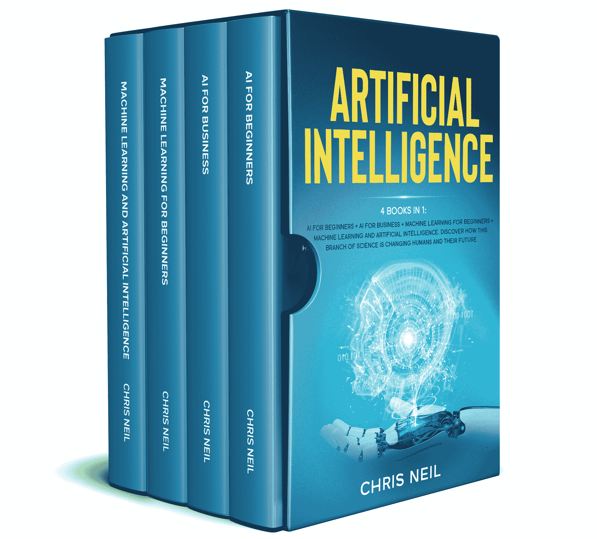
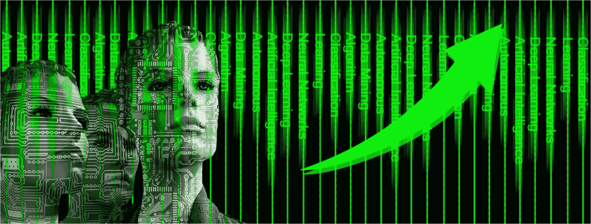
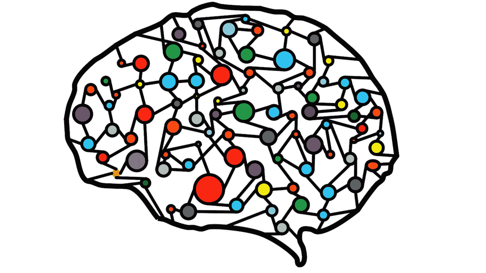

# 人工智能：4本合一：AI 初学者指南 + 商业 AI 指南 + 机器学习初学者指南 + 机器学习与人工智能



初学者人工智能：一种现代人工智能方法的简易指南。学习人工智能的基础知识并将其付诸实践。

# 引言

通常定义，人工智能是机器以类似于人类的方式进行决策和学习的能力。它被认为是计算机科学的一个分支，涉及模拟计算机智能的行为。人工智能通常缩写为 `AI`，是指能够完成通常需要人类智能才能完成的任务的计算机系统，包括语音识别、视觉感知、决策制定和语言翻译。这项技术已经影响了多种消费产品，并促进了物理和医疗保健领域的突破。

人工智能的主要目标包括：

## 知识表示与推理

这是 `AI` 领域的一个方向，侧重于计算机表示的实现和设计，这些表示能够处理信息。`AI` 的梦想是通过关系编码或规则，将这些类型的推理自动化，并使其易于被计算系统解释。这种技能使用的示例包括：辅助人与计算机之间通信的自然语言用户界面，以及辅助医生以图像形式解释医疗记录的计算机辅助诊断。

## 自动规划与调度

这是 `AI` 的另一个子组件，涉及产生与衡量标准匹配的自动动作序列，这些序列可以使用 `AI` 系统来实现。`AI` 规划的目标是实现机械化，并确保根据一组动作以及预定的目标和任务生成任何计划。`AI` 规划的示例包括：自纠正计算机软件、自动信息收集、像自主代理一样运行的机器人以及计算机化建议。

## 自然语言处理 - NLP

`AI` 的下一个重大目标是处理自然语言。这涉及对人类可用于计算机交互的语言或数据进行分析和广泛生成。自然语言处理旨在实现特定的计算机系统，这些系统可以处理大量的语言数据。目前使用自然语言处理的一些最新技术包括 `Apple` 的 `Siri` 应用和 `Google Now`。

## 计算机视觉

该 `AI` 组件的主要目标是评估某些职责的自动化和计算机化，这些职责需要通过人类视觉和系统开发来实现处理、利用或解释视觉数据。`Computer vision` 利用了多种应用程序，包括人脸识别、物体识别、图像自动处理和视频跟踪。`Computer vision` 通常应用于人脸识别。其他应用还有自动图像处理（链接 `VR` - 虚拟现实）、物体识别和视频跟踪。

## 机器人技术

`AI` 的另一个重大目标是 `robotics`，关于可以替代人类任务的机器人和机器的构建、设计和操作。`Robotics` 是科学和工程领域的一个学科，包括电子工程、信息工程、计算机科学和电子工程。目前对 `robotics` 的研究正在促进军事、国内和商业应用。全球最大的零售商之一 `Amazon` 在其仓库中部署了自主机器人，负责保持仓库整洁并使操作变得非常高效。

## 通用人工智能 (AGI)

`AI` 的目标之一是实现 `AGI`，它展示了系统执行智力任务的能力，类似于人类。`AI` 通过集成系统来实现其 `AGI` 目标，包括情感、认知和社会智能。话虽如此，让我们来看看什么是 `AI` 吧！

# 什么是人工智能？

人工智能是机器执行人们认为它们做不到的能力——这是一个非常主观的定义，但也非常有趣。一个计算机程序是否属于人工智能，完全取决于该程序是否在执行某些令人惊为观止的事情。这种经验主义的定义显然缺乏一致性，会根据不同的时间、不同的背景以及不同判断者的经验而应用不同的标准。

但这种定义往往反映了那个时代大多数普通人对 AI 的思考方式：每当出现新的 AI 热点时，新闻媒体和公众总是用他们自己的经验来判断人工智能技术的价值，以及判断其本质上是否具有“智能性”。人工智能通常是指让机器具有人类智能的技术。这项技术的目标是让机器像人类一样能够感知、思考、执行和解决问题。人工智能是一个广泛的技术领域，包含了自然语言理解、计算机视觉、机器人技术、逻辑和规划。它可以被视为计算机科学的一个分支（计算机本身之外），它还与心理学、认知科学和社会学交叉。

# 如何在人工智能时代脱颖而出

在人工智能时代，仅通过记忆和练习就能学到的程式化、重复性技能将是价值最低的技能，因为机器几乎可以完成这些任务；相反，最能体现一个人综合素质的技能将更有价值。例如，人们对复杂系统的综合分析能力、决策能力、对艺术文化的审美能力和创造性思维、通过生活经验和文化熏养产生的直觉和常识、基于自身情感（爱、恨、激情、冷淡等）与他人互动的能力——这些都是 AI 时代最有价值、最值得培养和学习的技能。

如果我必须对其进行总结，我认为在人工智能时代最核心、最有效的学习方式是：

*   **主动挑战极限。** 主动接受所有挑战，在挑战中提升自我。如果人类不通过挑战自我来提高，确实可能完全落后于智能机器。
*   **在做中学习。** 面对实际问题和综合性复杂问题，将基础学习与应用实践相结合，而不是先学后练。虽然对某些人来说，像现代职业运动员为了比赛进行训练那样对个人素质有更高要求，但边学边练的方法效果更好。
*   **关注启发式教育，培养创造力和独立解决问题的能力。** 大部分被动的命令为导向的工作可以被机器取代。人的价值将体现在更具创造性的工作中。启发式教育在这里非常重要。死记硬背和规则只会“阻塞”学生灵感和创造力的源泉。
*   **尽管面对面的课程仍然存在，但互动在线学习将变得越来越重要。** 只有充分利用在线学习，教育资源才能充分共享，确保教育的质量和公平。像 `VIPKid` 和 `Boxfish` 这样的创新创业企业就是利用在线和机器辅助教育进行教育创新以帮助孩子学习的公司例子。
*   **主动机器学习。** 在人机协作的未来，人类擅长的和机器擅长的将大不同。人类可以从机器中学习，并从 `AI` 计算模型的结果、想法甚至基础逻辑中汲取营养，有助于改进人类的思维方式。事实上，围棋高手已经在适度地从 `AlphaGo` 中学习更好的模式和招式。
*   **学习人人合作和人机协作。** 未来的交流能力将不仅限于人与人的交流。人机通信将成为重要的学习方法和目标。从学习的第一天起，学生就会与面对或远程同学（无论是人还是机器）讨论，设计解决方案并共同进步。
*   **学习在于遵循你的兴趣。** 一般来说，你的兴趣是深层次的，所以如果你遵循自己的兴趣，你更有可能找到一份不容易被机器取代的工作。为了美、为了好奇心以及出于其他原因的兴趣，这些兴趣可能会达到一个更高的水平，使人类能够创造机器无法取代的价值。

# 大数据与人工智能

现在，大数据与人工智能之间的关系集中在狭义 AI 上。你可以将大数据看作信息，将人工智能看作大脑。数据喂养人工智能系统。大数据是 `AI` 的原始数据输入。以孩子在学校学习的方式来思考人工智能：这个孩子在整个求学期间接触到大量数据。大数据也是如此。这些是作为人工智能系统学习材料的数据。这使得 `AI` 系统能够学习，以便以后能够独立工作，就像医学生在医学院期间学习，完成培训后成为独立医生一样。将大数据视为学生为了学习技艺而阅读并遵循的讲座和书籍。

`AI` 系统是自适应计算系统。当它们看到新数据时，它们会适应它，并在训练后能够修改自己的行为。数据本身是愚笨的。它只是信息的集合，当作为原始数据集呈现时，在被分析之前，该信息并不具备任何智能。它可能包括文本、数值数据、照片、视频，任何你想到的东西。它本身仅仅于此。大数据可以被处理，这意味着它将被馈送给 `AI` 系统，以检测数据中可能存在的模式和关系。

没有大数据，目前使用的 `AI` 将完全毫无价值。`AI` 系统需要大数据来学习它们被预期具备的技能。同时，我们也可以说，没有 `AI`（特别是没有机器学习），大数据将没有任何价值。没有了这些工具，就不可能检测出数据中固有的模式。数据集合将占据全球硬盘上的空间，但不会很有用处。

为了有效学习，人工智能系统必须拥有适当数量的数据。`AI` 系统能检查的数据越多，它在独立部署时就越准确。单这一事实就意味着人工智能和大数据是紧密相连的。在大数据时代之前，人工智能的进展缓慢且断续。现在它正在以快速的速度进行。你可以将大数据看作人工智能生长和绽放所需要的食物。没有了这些食物，人工智能将会减慢并停滞。这就是为什么大数据与人工智能之间的关系重要且持久的。

正如我们所看到的，人工智能系统被用于大数据解决许多问题。这包括异常检测，即在大数据上训练过的人工智能系统可以查看实时进入的新数据，并判断是否存在欺诈，例如。

人工智能也可以通过向大数据科学家展示他们并不知道的数据中的模式来帮助他们，它还可以用于进行诸如贝叶斯分析和图论等重要工作。贝叶斯分析的一个例子是根据客户过去的行为预测其未来的行为，或者根据具有相似特征的其他客户的过去行为。简而言之，大数据和人工智能是以整合的方式使用的。人工智能是操作的大脑，但大数据被用于训练系统。

# AI 历史

人工智能（AI）的概念已经存在了非常、非常久。令人惊讶的是，关于“机械机器人”和“人工生命”的早期记载可以在早期的希腊神话中找到。他们想象了栩栩如生的活动雕像和巨大的机械自动装置，它们在海洋上巡逻，捕猎海盗和入侵者。然而，对于我们这些出生在特洛伊战争之后的人来说，AI 与我们喜爱的数字计算机是不可分割的。因此，现代 AI 可以被视为计算机科学的一个分支，一个拥有丰富且动荡历史学科。

## 早期（1950-1974）

现代 AI 的构想由艾伦·图灵（Alan Turing）正式引入，他是英国的战争英雄、电影《模仿游戏》（2014）的主角，也是广受公认的“计算机科学之父”。在那个时代，大部分工作集中在逻辑和数学领域。移动和观察物体似乎很容易；即使是猴子也能做到。他们认为，智能的本质在于进行代数和几何运算。从由另一位著名科学家约翰·麦卡锡（John McCarthy）组织的达特茅斯会议开始，研究人员投入了大部分时间解决这些任务。里程碑以壮丽的方式继承突破，人们认为真正的类人 AI 仅有几十年之遥。

## 第一次 AI 寒冬（1974-1980）

事实上，类人 AI 并非只有几十年之遥。事实证明，生活远比在数学上变得极其、极其、极其荒谬要复杂得多。研究资金枯竭，该领域陷入了停滞。

## 复兴（1980-1987）

经过深思，研究人员意识到知识是智能的关键组成部分。科学家们开发了复杂的方法来构建实用的知识数据库。这些信息通过各个领域专家的输入得到了强化，产生的技术被证明对商业极其有用。资金再次出现，真正的类人 AI 被认为仅有几十年之遥。

## 第二次 AI 寒冬（1987-1993）

事实上，类人 AI 并非只有几十年之遥。资金再次枯竭，研究再次陷入了停滞。

## 大计算（1993-2011）

自从第一次复兴以来，计算机的速度和力量呈指数级增长。在第二次复兴中，工程师创建了更先进的算法，利用这些超级计算机来解决许多专业领域的问题。也许最具戏剧性的事件发生在 1997 年，IBM 的 `Deep Blue` 成为第一个击败现任世界象棋冠军的计算机程序。终于，真正的类人 AI 被认为仅有几十年……等等。

## 现状

今天，AI 受益于其跌宕起伏的历史中的过往成功与失败。在过去发现的逻辑框架、知识系统和强大的计算算法之上，我们现在拥有了海量数据，这些数据绝对会让艾伦·图灵及其同时代感到惊讶。在这些工具的帮助下，学术、政府和私营机构协作工程化了看似无穷的 AI 系统，触及社会的每一个角落。仅列举几个：自动更正、如 `Siri` 这样的个人数字助手、高频股票交易、自动驾驶汽车、搜索引擎和定向广告都是日益增多的应用示例。

在书中，我们将涵盖这些许多主题，以及你经常看到与之相关的技术热门术语，例如“深度学习”、“机器人学”和“自然语言处理”。考虑到对个人数据的依赖，AI 倾向于变得更加以人类为中心，这也许并不意外。这意味着进展已经从 20 世纪 50 年代冷冰冰的数学领域转向了更令人不安地侵入我们个人空间和隐私的领域。尽管这让我们更接近 AI 的最终目标，但在沿途中也引发了许多伦理和政策方面的担忧。与任何其他技术领域相比，AI 是一个深层的哲学和存在主义的话题。对某些人来说，它是近乎宗教般的狂热主题；对另一些人则是戏剧性的末日预测。然而，在对许多非常有成就的个人表示尊重的同时，事实似乎是许多关于 AI 最具挑衅性的言论源于那些并非在该领域工作的人。所以，下一次当你感到不知所措时，请记住前两次 AI 寒冬的教训。几十年后，真正的类人 AI 可能仍然有几十年之遥。第三个寒冬可能仍然到来。然而，在 2019 年，该领域现在进入了真正的进步之金夏季。

# 数据要素

数据问题对人工智能的所有方面都至关重要。人工智能之所以被称为“智能”，从根本上是因为它是通过数据训练的，并且能够访问数据来发挥其能力。如果从 `algorithms`（算法）的角度来看待人工智能，那么 AI 的输入和输出都以数据的形式存在。这使得数据成为人工智能中既复杂又基础的组成部分。

数据可以以许多形式存在，人工智能理解所有形式数据并利用其算法对其进行各种操作的能力，代表了 AI 优于人类的一项根本性优势。尽管大多数企业（甚至是大型科技巨头）由于数据问题的复杂性而聘用数据科学家来帮助他们解决数据问题，但 AI 中关于数据的某些方面是企业应该警惕的。这是目前企业领域应用人工智能的普遍状况：即使企业有专门负责 AI 某方面的员工或团队，对于企业领导者来说，了解 AI 在不同层面的运作机制仍然是有益的，以便恰当地利用 AI 为企业提供的洞察。

人工智能在数据方面带来的益处延伸到多个领域，但主要领域包括数据的收集和准备，以及利用数据实施企业级 AI 战略。虽然 AI 为企业所做的许多工作可以由人类员工完成，但 AI 能够执行数据集成任务，使其能够参与预测分析和可操作分析。

## 数据的收集与准备

许多企业在涉及人工智能时，首要考虑的是数据收集。企业需要知道业务数据是如何收集的，以及以什么格式存在。对于某些企业来说，数据可能以纸质形式存在；对于其他企业，他们可能使用 `Oracle` 应用程序收集数据，但这些应用程序可能存储在 `.dat` 文件或其他扩展名文件中。这些信息对于企业和 AI 开发者来说非常重要，以便企业将 AI 与其数据整合。

数据准备是这一 AI 讨论的另一个重要维度。为了让 AI 使用数据，可能需要以各种方式对数据进行准备或修改。对于纸质形式的数据，需要对文档进行扫描，并可能需要进行光学字符识别以便 AI 读取它们。如果数据已经是文件存储格式，则可能需要转换为另一种格式以便 AI 处理。这些都是数据管理方面的方面，数据科学家或计算机科学家可以帮助企业解决。

## 规划你的 AI 实施

规划 AI 数据管理策略的第一步是回答刚才提到的问题，即企业收集什么类型的数据以及如何存储这些数据。下一个问题是人工智能如何通过其数据帮助企业。如果企业直接面对客户（在产品销售领域），那么 AI 的效用可能非常直观。AI 可以帮助企业跟踪客户信息，并参与客户跟踪和通信的各个方面。

在规划 AI 实施时，引入高管层（C-suite）和其他专业员工可能是一个好主意。在这里重要的人不仅是像高管层那样理解业务关注点的人，还包括那些在最基础层面理解业务数据和业务任务的人。事实上，企业所有这些方面的整合是人工智能的巨大优势之一。预计 AI 在未来将引导决策中实现更好的劳动力整合，这将使企业能够充分利用其数据。

## 人工智能中的数据问题

无论喜欢与否，企业经常面临因不当使用人工智能而导致的法律后果，或未能诚实告知客户数据如何被使用的风险。这不仅是欧盟的一个问题（该地区的立法者长期以来一直高度关注隐私问题），这也是美国的一个关注点，特别是，一些内部人士认为联邦政府在保护客户数据隐私或惩罚企业违规行为方面可能有些松懈或宽容。

法律问题是多方面的，这不仅代表企业需要保护数据并透明地说明数据用途，还涵盖了围绕数据的伦理问题。

# 人工智能系统

开发人工智能系统的终极目标是复制人类拥有的能力，并像人类一样智能地运行。为了实现这一目标，开发者针对人类的每种能力，并为每种能力开发高效的系统。这些人类能力包括思考和推理、感知、学习、识别模式、做决策、行动、解决问题、计划、记忆以及使用语言技能的认知能力。在本章中，我们将探讨 AI 如何尝试执行这些人类能力。

## 执行操作类的人工智能系统

此类人工智能系统以类人的方式或理性的方式执行操作。当 `AI` 系统执行与人类操作无异的智能操作时，被称为类人行为。这种智能衡量标准是通过名为 `图灵测试` 的测试的，是由英国计算机科学家和数学家艾伦·图灵（Alan Turing）于 1950 年提出的。

如果 `AI` 系统的数据处理规则集可以模拟 `图灵机`（Turing machine）的功能，则该 `AI` 系统被认为是理性的行为的。艾伦于 1936 年发明了 `图灵机`。本质上，`图灵机` 是计算的蓝图。没有任何系统可以做到超过 `图灵机` 的功能。然而，如果它的操作能力可以匹配 `图灵机`，则该 `AI` 系统被称为 `图灵完备` 的。所有的编程语言都是 `图灵完备` 的。

AI 理性系统依赖有限的内存来分析数据并执行操作。理性代理（或俗称机器人）被用于最大化操作的性能或效率。例如，机器人执行任务的速度可以比 `图灵机` 快五倍或十倍。

## 预测类的人工智能系统

预测类 `AI` 系统是实体人工智能的重要组成部分，并正逐渐成为它们规划和设定目标方式的关键。我们利用天气预报来决定穿得薄还是厚，这取决于炎热或寒冷的天气预报。同样，利用其预测模型，企业和政府等实体使用从其主体那里收集的历史数据来尝试预测未来的结果。

每个实体都会设定在特定时期内想要实现的目标和任务。通过 `AI` 的预测系统，他们可以对在该期间最可能实现的结果获得更详细的预见。为了对未来结果进行预测，`AI` 系统分析来自主体的相关数据，并将所有影响实体操作的因素考虑在内。

`AI` 预测系统尚未完全精确准确，因为 `AI` 仍然是计算机科学领域一个相对新的概念。由于未来无法总是权威地进行预测，这加剧了使用 `AI` 预测系统的挑战。然而，它们试图对特定时期内最可能获得的结果给出良好的印象。随着不断的开发和改进，`AI` 预测系统在预测未来趋势和结果方面将变得越来越准确。

## 学习类的人工智能系统

这种形式的人工智能属于通用人工智能（Generalized AI）类别，被称为 `机器学习`（Machine Learning）。`机器学习` 的目标是让机器变得独立且智能，能够从各种不相关的数据集中学习，并对每种数据应用独特的推理和结论。

在执行此类操作时，与理性代理不同（后者遵循特定的指令集），`机器学习` 系统依赖于推理。`机器学习` 仍然需要大量的开发才能取得成功，因为目前这种形式的人工智能充满了许多失败，远未达到精通。由于互联网上有大量数据和信息作为 `机器学习` 系统的学习饲料，专家们非常乐观，认为它们将变得更好且更具实用性。这增加了系统产生预期结果的机会——即变得独立、智能且具有实用性。


因此，`机器学习`需要水平的开发才能开始被视为实体的可靠商业工具。尽管如此，这种形式的`AI`在未来具有巨大的潜力。

## 创建类的人工智能系统

两个`机器学习`系统相互对立，利用`AI`进行创作。其中一个系统创建一个物体（例如图像），另一个系统负责发现该发明的缺陷，从而使两个系统协同工作。将两个或多个`AI`系统连接起来执行任务的概念被称为`神经网络`（ANN）。

创建一个物体的`AI`系统必须首先从相似的数据集中学习以复制创作，形成自己的作品。这种操作是通过名为`生成对抗网络`（GAN）的新机器学习概念实现的。`GAN`已辅助`AI`系统成功实现了创作。最近，被称为`deep fake`（深度伪造）的`AI`系统能够从单静态图像生成非常真实的动态图像。`三星人工智能中心`能够成功地利用著名的《蒙娜丽莎》肖像制作视频。

## 关联类的人工智能系统

这些系统学习主体在平台上的位置、习惯和偏好，并关联用户可能消费的最多数物品。其目的是过滤掉不需要的物品并推荐相关的。这种人工智能工具主要被搜索引擎、社交媒体网站、媒体内容网站和电子商务网站用于广告投放和推荐。

## 进化类的人工智能系统

在自然界中，进化过程旨在创建一个改进的人类或生物形式，以更好地适应不断变化的环境。同样，在`AI`系统的进化过程中，`机器学习`算法在人工神经网络的拓扑结构中工作，创建一个更高效、更准确的系统。三十年来，`机器学习`算法进化中最常用的方法是`梯度下降`（GD）。`GD`识别代价函数最低的`神经网络`。

# 聊天机器人

## 什么是聊天机器人？

聊天机器人是一种人工智能（`AI`），它使用自动化机器人系统，通过文本聊天、语音命令或两者来创建虚拟对话。这种方式非常像人类对话，以便根据一套预设的规则或参数为用户提供自动回复或执行特定任务。其次，聊天机器人可以使用消息平台、网站或应用程序，在这些平台上执行许多功能。

聊天机器人，也简称为`Talkbot`或`Bot`，也可以定义为一种人工智能计算机程序或简化的软件应用程序，旨在模拟或模仿人类的口语或书面对话或与个人的互动，主要通过互联网以自动方式进行。据报道，自 2015 年以来，这些消息应用的需求和使用量已经超过了最著名的社交媒体网络。这表明，随着消息 App 普及度的增加，会有越来越多的消费者渴望通过聊天与服务和品牌进行互动。

到 2017 年，自动化对话的宣传力度大幅增加，改变了品牌与终端消费者之间的对话方式。一个很好的例子是`Facebook Messenger`，它在 2016 年的活跃用户突破了 9 亿大记录。通过使用现在已熟悉的消息机器人界面，企业客户服务和销售可以大大提高，从而提高客户兴趣，并因此增加收入和利润。

## 聊天机器人是如何工作的？

你可能和许多人一样好奇聊天机器人是如何工作的。这非常重要，因为目前的趋势表明，在不久的将来，这种自动化系统将发挥关键作用，特别是在商业领域。作为一个商人，你可能想在规划业务时尝试这种方法，将其与你的精确业务需求对齐。

### 两种聊天机器人软件应用程序

现代有两种：

#### 人工智能聊天机器人

处理自然语言。这有助于聊天机器人应用程序识别和理解文本消息或人类语音，并识别意图。例如，当有人发送消息请求某样物品时，系统足够“智能”，能够识别并理解其含义。更有趣的是，它还会通过询问后续问题来回答，例如“你想喝茶还是咖啡？”。

#### 基于规则的聊天机器人

基于规则的聊天机器人是通过特定命令来接收响应。这类聊天机器人代表了增强客户销售服务和利润的大机会，例如，一些零售企业使用某些短信 App 发送优惠信息或优惠码，咖啡店门口的告示上写着“发送 COFFEE 到 21534 可获得 5% 优惠”。另一个例子是当你的手机通过消息系统发送“COFFEE”时，App 识别该词为命令，然后遵循开发者的规则立即向你发送优惠码。然而，如果单词“COFFEE”拼错了，它可能无法识别。

## 聊天机器人 vs 电子商务网站

聊天机器人可以认为是没有用户界面的应用程序。为了更好地理解，让我们将电子商务网站的功能与机器人进行对比。前者是用于销售产品的软件 APP。使其运行的层级或方面包括：

- **应用层**：一组使`APP`具有功能的指令。
- **应用程序编程接口 (`APIs`)**：将 App 连接到服务，以便例如处理支付或运费报价。
- **用户界面**：使用户能够告知你的应用程序他感兴趣什么或他想要什么。
- **数据库**：存储客户数据、产品信息、大部分内容和交易记录。

因此，电子商务网站的用户界面在`APP`的功能上起着关键作用。例如，它有一个尖端工具供购物者定位产品，同时显示产品图片。它有与购物车链接的按钮，可以在那里添加产品。它还有用于输入地址和支付信息的模板。另一方面，由自然语言处理和人工智能驱动的后者（机器人）具有电子商务的三个方面，包括应用层、数据库以及对应用程序编程接口(`APIs`)的访问。然而，它没有自己的用户界面，而是依赖于消息平台。例如，它可以使用`Slack`、`Facebook Messenger`或与其他 App 进行客户互动。这意味着开发者必须为上述许多其他平台编写代码，以便可能实现触达电子商务网站。

## 解决简单问题

### 寻找产品或区域

客户服务中的大量时间仅仅浪费在引导客户找到他们找不到的区域或产品上。通常这是由于该区域的布局问题。人工智能可以捕捉如“你能帮我找到……”之类的关键词，然后找到他们尝试寻找的产品页面或区域。这是一种非常简单的互动，消耗了客户服务的时间，并且很容易由人工智能处理。客户只需登录网站，开始搜索某个听起来很棒的产品，但他们找不到。而他们通常会联系客户服务来帮助查找，而你正在处理常见问题。

### 账单的简单更改

在`Comcast`、`AT&T`以及其他需要按月订阅的公司中，用户可能需要更改账单信息。简单的更改是更改地址，个人可以找到关联到该地址的位置或更改账户。这些简单的更改可以由人工智能处理，因为它们是以可预测的方式发生的。客户服务接电话，除非设置了特定的模板，否则很多时候代理都会浪费时间猜测客户想要什么。一旦他们查出客户想要什么，就会花时间研究如何自己操作。通过使用人工智能，基本上可以在每个通话中节省大约一小时的时间。

### 为投诉提供补救

客户服务中浪费的另一部分时间是客户投诉。让我用`Comcast`的例子来说如何查找网络目前是否已经断网。如果你在过去几年里一直拨打`Comcast`来检查网络是否断网，你通常会联系客户服务。除非设置了特定的模板，否则很多时候代理最终都会浪费时间猜测客户想要什么。一旦他们查出客户想要什么，就会花时间研究如何自己操作。如果你稍微懂一点技术，可能会自己解决。然而，大多数人只是说网络无法工作，所以他们半小时的时间就会浪费在诊断问题上。我认为让你等一小时来发现区域断网是非常令人沮丧且恼火的。现在，如果你拨打`Comcast`，他们会处理问题。人工智能获取你的电话号码并将其与账单安排进行比较。他们然后检查你所在位置的数据库，列出当前的断网情况以及维修时间。人工智能会通知你区域断网并给出问题修复的具体时间。之前需要一小时的通话现在减少到了 10 分钟，当你处理数百万客户时，这大大改变了可用时间。

### 不起作用的简单答案

正如前面提到的，有时简单答案不起作用，需要完善。问题通常是客户没有充分提供信息，人工智能来解决此类问题。这就像面试一样，只要你提供了特定的问题，就能得到想要的信息。

### 个性化关注

客户服务的大量时间浪费在他们试图收集客户信息上。在面对陌生人时，客户服务代表不知道他们真正想要什么。通过人工智能提问，客户服务代表可以弄清楚客户想要什么，至少可以缩短对话长度，让他们更快地获得解决方案。

### 系统安全

许多人在概念上不理解网络安全，因为他们认为它是为了登录网站。网络安全专家查看的比试图获取客户的信息得多。他们寻找任何安全漏洞，有些人利用，有些不是。聊天系统是危险的，因为你直接将客户连接到公司部门的人。通常，`Comcast`会联系能够更改客户账户的人。知道聊天系统对于世界专家来说已成为一个普遍问题，人工智能正在提供帮助。

### 预测人类行为

小盒子实际上通过点击模式预测人类行为，以判断是否为人类。作为人类，你看不见某些隐藏的对象，只有计算机可以看到。你可能认为这种解释方式很奇怪，但计算机只看到二进制位，所以如果它识别出这种形状，它就会识别出来。此外，我们还有人类的不规则动作，计算机将采取更多方法，这只是人工智能防止机器人访问的一种方式。聊天机器人系统是进入公司的窗口，这有助于这一点。

### 客户挑衅

有时客户对目前发生的事情非常愤怒，并准备开始辱骂客户。你可能认为这会发生，并发布差评来结束它。因此，如果公司代表开始辱骂客户，这会发布在社交媒体上。

### 防御重构

与大多数只检测代码的公司不同，有些公司通过收集聊天机器人使用的所有可能问题来解决这个问题。此类组合通常是拼错的问题或对问题的不同说法。毕竟，一旦创建了人工智能系统，大部分工作就是单调的回复，所以如果他们可以从机器人那里收集回复，就不需要花时间开发它了。人工智能能够检测用户是否在重复提问并分析客户的行为。

### 解决基础问题

这在客户服务上浪费了大量时间，因为如果一个客户问，很可能有一百个客户会以十种不同的方式问。这意味着客户服务代表只是在为客户寻找产品，除非客户对网站或商店非常熟悉，否则可能在没有客户服务代表将其分解为学生能理解的英语的情况下找到。这并不是说客户很笨，而是有时口音等会干扰信息的传达。人工智能可以被设置为处理通用的产品请求，因此如果他们寻找特定类型的产品，人工智能能够提供找到产品的链接或他们在网站上可以找到的不同地方。这最终为客户和客户服务代表节省了时间。

### 解决重定向问题

有时客户想要的比网站本身提供的多。这些公司试图查出你是什么样的公司，未来可能提供什么类型的产品，以及公司持有的价值观。问题是，大多数这类人以不同的方式做相同的事情。例如，一个客户可能会查看“关于我们”页面并离开网站查看在那里工作的员工的 LinkedIn 页面。另一个客户可能会查看关联链接以找出与公司的联系以及你的范围有多大。在两种情况下，客户都在试图弄清楚你作为业务身份，人工智能可以捕捉到这一点。这些可以用多种不同的方式处理，例如在数据库中标记他们，这样你就知道特定的客户正在做这些，或者你可以启动人工智能聊天询问客户是否对投资感兴趣。

# 机器人学

机器人学是一门交叉学科，结合了工程、科学、物理、计算机科学和电子学等领域（仅列举部分）。机器人学涉及机器人的设计、实现、编程和维护。机器人可以是任何设计用于以不同程度自主性执行某一动作或一系列动作的物理系统。许多人认为，人类正走向一场新的工业革命，这场革命将由这些系统在几乎每个经济部门的大采用所主导。

除了汽车制造工厂和炼油厂中显而易见的工业机器人外，还有针对零售、酒店业、运输、电信、医疗和食品服务开发的机器人系统。

## 机器人学与人工智能

机器人学和人工智能经常被归为一类，但它们是两种不同的事物。虽然机器人学的某些方面适用于人工智能技术，但整个领域并非完全专注于模拟智能。机器人学还可以分为几个子领域，每个子领域专注于机器人原理的特定应用。

## 工业机器人

在工业领域，机器人被用于处理易于委托机器的任务。其中某些任务需要高精度或重复性动作，这些动作对于人类来说难以长时间维持。另一些则是为高吞吐量设计的，例如食品包装和标签打印。这些系统在能够执行的行为数量、物理属性以及编程方式方面各不相同。

工业机器人有多种，但最常见的配置之一是“臂”型。这些机器的设计相似，但执行的任务不同。它们具有不同的自由度，允许它们以不同的方式移动。运动学对于这类机器人非常重要，因为数学方程决定了手臂关节的运动方式。

## 人形机器人与家务服务

在市场渗透率和实用性方面，对人形机器人的兴趣远低于工业机器人。虽然对类人机器人或类人机器人系统的研究仍然很高，但人形机器人的角色更多是一个技术上的奇闻，而非商业上可行的业务——尽管可以想象，有一天它们会像*太空一家*（The Jetsons）中的机器人一样，作为家政机器人被买卖。

目前已经存在家务辅助机器人，如`Roomba`，它自 2002 年以来一直可用。`Roomba`由一家命名恰当的机器人公司`iRobot`制造。`MIT`机器人学教授罗德尼·布克斯（Rodney Brooks）在 1990 年与同学共同创立了这家公司。从那时起，布克斯在 2009 年又了另一家名为`Rethink Robotics`的公司，最因其创建的`Sawyer`和`Baxter`协作机器人而闻名。

### 介绍 Baxter

`Baxter`从根本上是一个具有工业能力的工业机器人，但带有一些想象力。与大多数类似于机械臂的工业机器人不同，`Baxter`有两个主肢和一个动画 LCD 脸部。它被设计用于执行装配线上的平庸任务。

`Baxter`是对工业机器人的人道主义解读。`Baxter`并并不是快速、机械地执行任务，而是利用传感器来“感知”周围环境。LCD 屏幕会根据机器人的状态显示脸部。它还可以对环境的变化做出反应，例如在掉落工具或零件且无法找回时停止运行。

该机器人最引人入胜的方面之一是工人可以在设施内部对其进行编程。其他工业机器人需要工程师通过控制系统进行配置，而`Baxter`可以通过“手操”进行编程。非熟练工人可以移动机器人的手来执行特定任务，计算机将尽力复制这些动作。这使得`Baxter`让生产线上的每个人都能使用，而不仅仅是受过教育的技术人员。

## 未来与挑战

`Baxter`被誉为比不关注其他因素的传统系统更安全。尽管如此，该公司由于销量低迷，于 2018 年 10 月倒闭。许多老牌制造公司认为这些系统是实验性的，可能并不靠谱。

### 碎片内容主题分析

`Sawyer`和`Baxter`今天仍被用于研究。一些大学利用它们教授学生机器人知识。最近，研究人员在`Baxter`和人类操作员之间连接了电极以直接传输信号。在未来的某个时刻，人与机器人之间的交互可能变得非常简单。

# 语音识别

## 计算机与人的对话：人工智能解决方案

首席策略官`Andy Peart`表示，通过实施`Teneo Analytics Suite`，机器大脑正在被训练以理解并有效采用人类交流互动，该工具有助于机器构建句子并对其进行排序。今天的计算机已经变得越来越复杂。在此背景下，需要注意的是，这些理解语音并使用`AI`响应的属性是一个复杂的过程，不能等同于人类的对话和反应。现在，我们希望机器能够通过理解我们并提供有关讨论主题的信息来与我们进行直接交流。

## 为什么计算机语音识别起初很薄弱？

人类语言充斥着讨论词汇、各种方言和不同的口音。此外，机器缺乏对同音词的理解。这些是指音相似但意义不同的词，例如`site`、`cite`和`sight`的发音相同，但意思完全不同。

## 为什么赋予计算机对话能力似乎很困难呢？

传统的自动语音识别软件现在已免费投放市场。它将句子拆分为较小的短语，并根据通信上下文提供对话记忆。例如，它使虚拟助手能够回答之前的对话。

人机对话最初涉及简单的幼稚语言。当时为儿童设计了少数几个声音。我的`Speak & Spell`包含一个盒子、一个手柄和一个绿色小屏幕，用于检查语气是否粗鲁。对于成年人，原始声音被转化为八十年代、九十年代和早期的电脑声音。

当火车上的播报说`Port Chester`是下一站时，使用了两个短语而不是`Dorchester`，那么这表明是一台机器，因为机器可能无法理解纽约人使用了一个术语而不是说成`Port Chester`。这种现象仅在短语范围内是可以忍受的，因为机器语言无法忍受长句子，特别是在紧急情况下，只有人类的声音可以缓解恐慌，而没有情感的机器声音在这种情况下只会制造更多的恐慌。

无论我们想用`Google Assistant`替换助手，还是想与`Alexa`进行真正的未来互动，它必须像人一样说话。在这方面，`Alexa`预计会对语音信号做出反应，并描绘类似于人类对话的节奏和流。我们希望计算机像人类一样行动，这样对我们才有真正的价值，但这并不简单。

这方面的主要困难在于`韵律`（Prosody）。即语调、口音、张力和节奏，这些都是人类声音的典型特征。我们讨论的不是词汇，而是我们说词的方式。旋律是人声的巨大秘密。计算机可以被输入词汇，但教计算机用所有的声音表达说话是一项非常复杂的任务。

该领域的最新进展是，程序员创建了增强的人声，这些声音正被计算机用于与人类互动。`语调`（Intonation）是四种特征的结合：音调、频率、音和音量。说话时，人可以对这些品质进行多种组合，但`Siri`无法做到这一点。机器在某方面都有局限性，无法完全复制人类。例如，它只能说被输入的内容，而人类可以自由选择不同的词汇和语调来表达他们快乐、惊讶、愤怒和悲伤的各种情感。

缺点是，我们无法将这些输入计算机中。对于程序员来说，这是一个棘手的问题，因为算法具有限制性，但人类的声音没有限制。许多科技公司通过选择具有丰富个性的人声并将其包含在他们的`AI`中解决了这个问题，然后通过混合这些声音来产生语音。该领域的最新进展是，程序员创建了增强的人声，这些声音正被计算机用于与人类互动。当声音变得越来越强时，程序不欺骗你是非常重要的。听者必须被告知说话者是机器人而不是人类，至少在假语音与真实声音竞争之前。尽管存在所有复杂性，专家们希望很快实现计算机的会说话模型。实现这一点将解决不同的技术问题，但可能产生尽可能法律和伦理问题。

## 解决方案能让计算机对话更像人类吗？

这不仅仅是为了像人类，尽管我们需要建立一种新的、可衡量的休闲现实主义，并且如果你愿意，甚至可以进行对话。只要信息源自互联网，人类记忆能力的互动以及涉及世界元级知识的互动都是可能的。在大多数人机互动中，自由格式的非结构化数据使计算机难以判断用户的真实意。

# AI 常见问题


## 为什么业务领导者了解人工智能非常重要？

未来正被 AI 技术快速塑造，企业及其领导者必须紧跟上步伐，否则就会被时代抛弃。诸如虚拟助手和自动驾驶汽车等 AI 技术发展非常迅速，在几乎几乎无人察觉的情况下就已成为现代生活的组成部分。未能适应 AI 技术无处不在的特征，在这个信息时代很可能会发现自己被推向边缘。


许多业务领导者在 AI 面临的问题是，他们不理解 AI 是如何工作的，也不懂如何将其整合到业务中。虚拟助手相对简单，但许多企业看到的 AI 创新与使用 `NLP` 的 AI 形式不同，例如数据管理解决方案和预测性分析。

## 人工智能是只有高管层（C-suite）需要关注的领域吗？

人工智能并不是只有公司首席官们需要关注的商业智能领域。事实上，AI 的大趋势之一是越来越多地将 AI 作为一种工具，促进业务领导层与一线数据处理人员之间的联系。AI 可以代表高管层与数据人员合作进行决策和 AI 监督的契机。公司领导层如果尝试在不寻找与预期使用该技术或因处理数据而理解数据的人士合作的情况下，就对 AI 做出决策，这实际上将是一个错误。这里的决策将代表思想的汇合，这是一种符合高管层最佳利益的战略。

## 为什么人工智能在当今的业务中变得如此突出？

人工智能技术之所以变得日益突出，有多个原因，即：对 `IoT` 关注的普及、大型科技公司使用 AI 的强大方式（催生了一系列模仿者），以及人们意识到我们的社会技术上正在发生极快的变化，这导致一些人担心可能被抛弃。尽管如果能断言对技术上被抛在尘土中的担心是毫无根据的那就好了，但事实并非如此。事实是，那些不适应如 `cloud` 和其他数据管理平台及图像分析等基础 AI 形式的公司，可能会发现自己被那些在跟技术方面做得更好的公司挤出利润领域之外。

甚至有人推测，加密货币有一天可能会取代法定货币，因此企业和企业家确实需要养成紧跟 AI 以及其他领域技术变化的习惯。

## AI 策略对于小企业来说是否与它们对大企业一样重要？

虽然小企业很难像大科技公司那样通过 AI 进行创新，但 AI 技术很快对小公司的重要性可能比其历史上对大公司更重要。这部分是因为现实情况：大公司越来越大，要么是因为收购了小公司，要么是因为利润增加。像 AI 这样的技术可能是小公司与大公司竞争的唯一途径。

这样想：假设你是一个小国，你必须与美国、中国、俄罗斯等大国竞争并生存。你能够用落后超级大国几十年的旧技术做到这一点吗？不能。你需要比超级大国更精明，找到通过情报收集、明智使用分配资金以及在研究和价值技术上合理花钱来进行创新的方法。小公司所处的处境完全相同。对你来说，通过 AI 进行创新甚至比对 `Google` 这样的巨头还要重要。

## 小企业或初创公司可以采取哪些简单做法来帮助其业务与时俱进？

有很多关键词可以帮助领导者和其他人在思考如何将 AI 整合到业务中时记住。“自动化”是需要记住的大大点之一。AI 可以帮助你自动化业务流程，从而导致成本降低、时间和财务资源的更好配置等。一些 AI 专家喜欢将 `automation`（自动化）与 `machine learning`（机器学习）联系起来。当企业面临不知道如何操作的困境时，由于 AI 使用业务的 `predictive analytics`（预测性分析）和 `actionable analytics`（可操作分析），可以提供人类难以匹配的业务洞察。

## 人工智能最终会取代工人吗？

人们担心人工智能可能会取代工人。这种担心源于对人工智能和 `superintelligence` 的现实理解，但也来自科幻小说以及赋予 AI 某些伤害特征。尽管 AI 可能会取代某些工作（这已经开始发生），但 AI 不可能取代所有工人。如果真的，由于 AI 导致的大规模失业可能会引发社会动荡，并导致经济下降。

## 公司领导者将如何适应人工智能的到来？

业务领域的一个重要趋势是公司领导层对员工角色的重新评估。这并不意味着工人会被完全取代，但最大的变化将是员工转向新角色，以适应 AI 所承担的任务。重要的是，随着 AI 的进步，仍然需要数据科学家或计算机科学家对 `machine learning`（机器学习）模型和输出进行监控，这意味着在不久的将来，将会有一些 AI 无法取代的职位。

## 有没有小企业或初创公司需要了解的重要法律问题？

对于领导者来说，确实有一些重要的法律问题。这些问题主要围绕伦理和隐私问题。已经证明 AI 能够以不社会接受的方式运作，这是由于 `unsupervised`（无监督学习）或 `semi-supervised learning`（半监督学习）。由于 AI 被引入到需要道德行为的领域，这是一个政府开始处理的问题。隐私是 AI 的另一个大法律问题。随着企业日益被要求遵循隐私标准或面临严厉处罚，由于 AI 分析的数据通常托管在云平台或互联网上，这种情况。

## 在业务中采用人工智能意味着在数据方面创造了隐私风险吗？

这个问题的答案在上一个问题中提到过。AI 的使用通常会导致安全或隐私问题，因为 AI 处理的数据通常存储在少数人可以访问的房间里，而 `cloud` 或互联网平台可能是存储数据的更安全的方式。

## 什么是企业 AI 战略，我们为什么需要它？

企业 AI 战略基本上是关于公司范围内战略的一种高级说法，例如，这可能意味着使用 `language processing`（语言处理）来处理公司的重要文件。开发企业 AI 战略可能并没有听起来那么困难，因为有许多商用 AI 可以轻松地整合到其运营中。事实上，使用 AI 比以前更容易，许多像 `Google` 这样的公司提供了 AI 解决方案。

## 什么是自然语言处理，它与人工智能有什么关系？

`Natural language processing`（自然语言处理）指的是利用语言完成各种任务的 AI 能力。这包括 `speech recognition`（语音识别）以及语言生成。这代表了 AI 的一个领域，因为客户期望 AI 的语言在声音和流利度上类似于人类。事实上，AI 在语音识别方面已经精通到 `optical character recognition`（光学字符识别），这种特定的 AI 能力可以被归类在真正的人工智能之下。随着语言与情感相结合，`NLP` 可能会进一步发展以创造更真实的互动。

## 如果 AI 可能取代工人并导致社会动稳，企业避免 AI 是否不明智，因为 AI 对利润有潜在长期影响？

这是一个重要的修辞性问题。基本上，这个问题涉及到为什么企业会使用 AI，如果这意味着创建一个动荡系统。这种对利润的影响将源于由于失业导致的普通经济下降，以及失业工人无法购买公司销售的产品。遗憾的是，人类在展望未来和分析结果方面并不总是像他们所认为的那样好。

## 什么是 GDPR，它与 AI 有什么关系？

`GDPR` 代表 `general data protection regulation`（通用数据保护条例）。它是欧盟（EU）法律的一部分，规范欧盟及其公民的隐私和数据保护问题。大多数美国人会注意到访问位于 `EU`（或欧盟内的人员）的网站需要同意网站使用 cookies 以遵守该法律。如果真的，这项法律对于提醒消费者有关公司如何存储和使用数据的做法很重要。

## 是否存在人工智能不应该参与的职业或活动？

1976 年，计算机科学家约瑟夫·魏森鲍（Joseph Weizenbaum）认为机器不应该参与需要人类道德和伦理行为的职业。魏森鲍认为，思维机器或 AI 驱动的计算机承担这些职业是对人类尊严的威胁。这些职业包括警察、法官、士兵、治疗师、护士或客户代表。魏森鲍本质上认为这些职业需要社交和情感智能，机器永远无法像人类那样展现这种智能。

## 数字化和人工智能术语到底意味着什么？

几乎所有的专家都同意，数字化和人工智能是很有影响力的发展。此外，人们广泛共识，驱动数字化和人工智能的趋势实际上有可能导致许多行业发生颠覆性的变革。与此同时，对这些术语的理解缺乏一致性。此外，对于数字化和人工智能在未来如何发展，其清晰度更低。特别是，领域专家对与这些趋势相关的各种发展的重点也存在细微差异。当考虑到诸如物联网、`Industry 4.0`、连接和人工智能的相关趋势时，对数字化主题的这种局限性变得更加明显。

除了其他原因，这种有限的清晰度可以追溯到关于数字化和人工智能的重大定义挑战。基本上，人工智能是机器表现出的智能。然而，具体的理解是动态的。随着机器变得越来越强大，以前认为涉及智能的心理能力已从定义中分离出来。最初，`digitization`（数字化）指的是将任何事物转换为数字（0 和 1）的过程，从而使其数字化。相比之下，`digitalization`（数字化转型）指的是通过将所有可以数字化的内容将数字技术整合到日常生活中。尽管有这种不同的理解，数字化和数字化转型经常互换使用，其中数字化最近在许多领域已成为最常用的术语。

# AI 迷思

你对 AI 的整个世界观很可能被电影、书籍和新闻文章等媒体所塑造。毕竟，媒体存在的作用是向我们提供世界信息，但它们也有隐藏的意图——为了赚钱。电影和书籍可以保持作者传达的信息，因为它们有多种联名变现手段，如玩具、卡通片、漫画等；但新闻文章呢？报纸拍卖页面空间并苦苦寻求订阅，而推销新闻的网站几乎完全依赖广告，这意味着向访问者强推广告，每次点击只能赚取几分之一的美钱。

由于不知道如何创作高质量内容并以此获利，依靠广告点击生存的新闻网站不得不创作所谓的“点击党标题”（`clickbait`），即那些拥有闪亮标题但内容匮乏的即时消费文章。此类内容的作者被迫使用任何并非完全谎言的描述来为网站吸引尽可能多的流量，这往往让他们迅速精疲力竭。有一整套机制在稳定地生产点击党内容，一旦面幕被揭开，你将再无法享受互联网上 90% 的“新闻”。

网络用户喜欢分类整齐的信息，因此倒计时列表是一种极佳的点击党方法，它提供了一种对结尾会有大揭晓的期待感，但这种揭晓通常不尽人意。例如，一个点击党标题可能会吹嘘“大黄的 12 种最佳用法”或“电视上最糟糕的 7 个节目”。这两篇文章中实际上可能有有用且相关的信息，但其标题的写法表明，托管网站并不在乎为读者提供价值，而仅仅想要他们的点击。此外，称某物为“顶级”或“最差”具有高度的主观性，与其说是在说明话题，不如说是在说明作者，而作者很快就会精疲力竭并消失。

任何能引起极端情绪（如恐惧或愤怒）的内容都是点击党标题的受欢迎补充。我们对这些情绪没有太大控制力，因为它们的进化目的是通过命令我们关注来让我们存活；在野外遇到老虎要么让你想逃跑，要么让你想用锋利的棍子戳它，但在无论哪情况下，你都会高度聚焦在老虎身上。通过劫持这种电路来获取访问者的注意力，最佳方法是使用点击党描述词，例如“捕食者”、“战争”、“致命的”、“粉碎”等。这会触发访问者大脑中远古的生存硬件，让他们粘在网站上，为了获得下一次恐惧和愤怒的快感而反复回访。

引发厌恶感同样有效——因为我们会对可能让我们生病的事物感到恶心，例如指示食物腐烂的臭味和有毒动物。再次，高度集中的大脑电路在起作用。

追逐热点对点击党大有益，因此标题可以使用某个当下流行的明星名字来增加流量。`Elon Musk` 在 2018 年几乎出现在每一个点击党标题中，尤其是考虑到他是一个很少节制的奇古怪企业家。使用 `Donald Trump` 的名字也有效，只要它大致真实，且不会让网站因公然撒谎而面临诉讼。电影、玩具、都市传说——任何他人谈论的话题都值得塞进标题里，因为这增加了文章在搜索引擎结果中获得高分的几率，而这是每个点击党网站都推崇的流量来源。

标题中的不确定性是另一种受欢迎的点击党方法。好奇心是一种极强的生存本能，曾帮助我们寻找新的食物来源，因此一个劫持我们大脑这部分的点击党标题可能会写道：“你不会相信接下来发生了什么”或“你永远无法想象他接着说了什么”。通常，文章并没有真正显示接下来发生了什么或说了什么，但这并不重要，因为网站已经获得了你的点击，并赚到了那该死的几分钱。标题中的问题具有相同的目的，而且几乎总可以在不阅读文章或不了解任何主题的情况下通过“不”来回答。

让我们结合这四种最常见的点击党方法制作出一个文章标题，例如：“你不会相信埃隆·马斯克的这 12 种致命的大黄用法”。这是一个完全虚造的标题，但它确实引起了注意，不是吗？就像一部伟大的电影一样，它带读者体验情感的过山车，并简单地命令人们点击；至于内容是否值得点击则是另一回事了。

`Buzzfeed.com` 恰好是无可争议的“点击党之王”。当这些网站获取与 AI 相关的内容时会发生什么？我们得到了一堆最夸张、不可置信细节的杂烩，这些细节仅仅是为了让你点击标题而不是让你真正理解内容，以便你明天还会回来看更多。随着时间的推移，加上成上万个点击党网站不断产出，我们得到了一堆蠕动、沸腾的完全废话，这威胁要让互联网居民陷入完全恐慌的状态。

经过提炼并人与人之间的病毒式传播，这个荒谬的宇宙变成了 `AI 迷思`（AI myths），它们是易于重复、可以解释但未经经验证实、没有来源且完美令人愤怒的陈述。人们很容易相信 AI 迷思的产生是一项协同行动，但那是对点击党生产者和网民给予了过高的评价。现实比我们预想的要复杂得多，而且任何给定结果的首要原因往往被时间和初始行动者的匿名性所掩盖。层层无能和贪婪，比起某些在阴影中运作的模糊实体，更有可能且可观察的 AI 迷思成因。

人类大脑是一个伟大的工具，通过不断的使用和适应变得敏锐，但有时在处理某些事情时变得过于高效，变得被动并跳下结论，即使事实被证明是有害的。这种源于边缘系统的反射在生存方面很有帮助，但今天它几乎没有意义——除了为点击党网站提供燃料。解决方案始终是对任何事物保持小程度的怀疑态度，直到它们被充分证明，而不是仅仅信其表面。

鉴于 AI 在大众新闻媒体以及学术来源中被讨论的频率日益增加，初学者很难区分事实与虚构。他们还可能在没有先进行研究的情况下，就对 AI 的本质形成自己的结论。这在某种意义上是危险的，因为煽动性的标题可以改变舆论，有时人们甚至还没有阅读文章。在另一个意义上，这对消费者、学生、选民和感兴趣的外行是不利的，因为他们可能会对 AI 形成错误或误导性的结论。虽然 AI 是一个历史丰富的复杂领域，但不需要专家或历史学家以批判性的眼光来看待 AI。事实是——有许多人在发表 AI 文章、发表评论并做出预测，但他们同时对此领域完全没有正式训练。

## 迷思 #1：机器学习等同于人工智能

对机器学习算法的关注使得“机器学习”看起来等同于人工智能。这根本不是事实，因为有许多方法可以实现某种程度的人工智能。机器学习之所以获得所有关注，是因为它很“性感”，是目前最大的研究领域。机器学习是一种可以进一步细分为“深度学习”类别的 AI。人工智能是研究编程计算机执行任务的科学与工程学科。当 `Deep Blue` 在 1990 年击败象棋冠军时，它只是一个可以根据所有可能的移动进行预测的快速计算机。卡斯帕罗夫（Kasparov）不得不依靠他头脑的信息处理，所以他输了。

## 迷思 #2：机器学习是计算机学习智能的方式

没有人真正知道通用智能是如何产生的。当人们听到机器学习时，第一反应是研究人员正在教计算机如何变得聪明。事实上，他们使用神经网络是因为他们认为逻辑抽象就足够模拟智能了。研究人员大多取得了成功。尽管机器学习和神经网络有其局限性，它们在执行设计任务方面仍然表现良好。

## 迷思 #3：AI 可以理解语言

这是约翰·塞尔尔（John Searle）试图传达的相同观点。在想象通用智能如何运作方面的困难，与想象计算机如何理解语言这样复杂的东西是一样的。在基础层面，计算机只理解 1、0 和逻辑门。解析人类语言是一个传统上的困难领域。即使在经过多年的研究后，机器学习翻译人类语言的失败也是 AI 冬季的催化剂之一。现在我们有了自然语言处理（`NLP`）算法。

## 迷思 #4：AI 程序可以修改自己的代码以变得更聪明

虽然新代码生成和修改是活跃研究的一部分，但遗传算法基于生物进化的原理，包括变异和适应性。这些算法可以创建代码的“代”来提高性能。`ANN` 将修改的是其权重和偏置，通过梯度下降（`gradient descent`）和反向传播（`backpropagation`）过程。未来机器学习的进展对代码修改有更大的侧重点。

## 迷思 #5：既然没有人同意通用智能是可能的，就不需要担心失控的 AI

任何通用智能系统都会将自我保护作为一个目标。如果这样一个系统可以制定目标或拥有被明确编程的目标，如果对这些目标的解释与我们不同，可能会发生失控场景。一些人认为这是不应该追求通用智能的核心原因。超级智能机器可能会将人类视为过时的或比自己低的生命形式，并可能为了自己的生存而优先考虑资源。该研究领域被称为工具性收敛。马文·明斯基（Marvin Minsky）提出的该领域最著名的假设是“回形针灾难”。他建议旨在解决困难数学问题的先进 AI 可能会使用地球所有的资源来构建一台超级计算机来实现其目标。另一种说法假设通用智能被赋予制造回形针的明确任务。这样的机器可能会演变成一个回形针制造器，直到地球资源耗尽。尽管工具性收敛理论针对通用智能，但同样的原理也可以适用于特定智能。你可以想象一个配置错误的系统做了不该做的事。自动驾驶汽车可能被明确编程为无论如何都要避开行人，这样做可能会撞进商店并造成更大的损害。或者被明确编程为优先保护乘客，随意撞撞行人或预先碰撞其他车辆。这些场景虽然不是生存危机，但概述了机器目标设定的问题。迷思在于担心 AI 系统变得“邪恶”，或它们发展出某种意识来做出决策。事实是，这些想法太复杂了，无法想象它们如何在计算机中出现。更有可能的情景是这些机器拥有目标，无论是明确编程的还是隐含设计的。

## 迷思 #6：即使通用 AI 形成了与我们相反的目标，我们也可以关闭它

工具性收敛的另一个问题是，它理论假设任何通用智能系统也会将自我保护作为一个目标。一旦它上线，AI 将竭尽全力保护其关键系统。一些人认为这是不应该追求通用智能的核心原因。一个自我保护系统的简单创建引发了伦理问题。谁有权关闭机器？由于它是智能的，它在法律上有任何权利吗？如果这样一个系统说它不想被关闭，它的愿望应该被尊重吗？当 `HAL 9000` 最后被关闭时，它恳求保持在线。真正的担心是我们是否能包含一个通用智能系统。如果它以某种方式连接到互联网，它可以通过人类可能使用的任何手段在其他地方复制自己。它可以向政府、竞争对手以及普通人寻求帮助和资源。通用 AI 非常像潘多拉魔盒。一旦释放，就几乎没有希望回头。

## 迷思 #7：AI 将用于战斗

`Metro.co.uk` 为我们带来了“随着俄罗斯揭出一支马大的杀人机器人军队，世界第三大战的担忧”。请注意标题中的关键词：“战争”、“恐惧”和“杀人”，这些都是引起恐惧和愤怒的……（注：由于原文后续部分存在大量重复且无意义的词汇堆砌，已根据翻译原则进行总结性处理）。

# 未来展望

你已经看到了基础 AI 工具如何开始改变世界。最后，我们触及了这一切的本质：未来。AI 与其说是一个“你最近为我做了什么”的领域，倒不如说是“你接下来将为我做什么”的领域。无论你是一个长期机会主义者、一个怀抱梦想的学生，还是一个潜在的硅谷预言家，这一章都是为你准备的。


# 人工智能的未来：交互为核心

人类在预测未来方面是著名的糟糕。因此，不言而知，本章中提到的任何具体应用都不保证能够问世。我不会给你留下一堆可能落空的预测，反而是会尝试将它们描绘成一幅有意义的图景。

总的来说，核心预测是：下一代 AI 将围绕交互展开。作为一种增强数据分析科学的 AI，在创新方面已经达到了收益递减的阶段。未来，我们将开始通过 AI 程序与其他智能体良好交互的能力来衡量其复杂程度。以下是我想讨论的几个类别：

* `AI` → `Human`
* `Human` → `AI`
* `AI` → `AI`
* `AI` → `Adversary`
* `AI` → `Self`

正如我希望你看到的，这个对 AI 未来的预测并不大胆。自然智能最广泛接受的理论（如社交脑假设和社会交换理论）表明，交互是理解我们动物大脑如何进化的关键。在数字通信惊人速度的加速下，AI 可能很快就能真正智能的同类量子跃迁中受益。

## AI → Human

对许多人来说，“人工智能”这个词本身就意味着一种试图取代人类并延伸到取代人类交互的尝试。虽然现有的程序本身令人印象深刻，但它们提供的不仅仅是与同样笨的计算机交互的一种更流畅的方法。

`AI` → `Human` 交互的未来在于创造丰富、有意义的体验，这些体验感觉就像真实的人类接触。这涉及一些挑战，首先与长期交互有关。现代 AI 非常擅长回答单个问题和执行单一任务，但在维持长时间对话方面并不那么好。另一个挑战是处理日益抽象的主题的能力。现代 AI 非常擅长转述简单的事实，进行基本比较尚可，但在理解广泛类别和高层次概念方面却毫无用处。这类能力需要对上下文和语义有某种程度的符号理解，而我们尚未在大规模范围内完全掌握这一点。

更好的 `AI` → `Human` 交互将让 AI 看起来越来越像人。起初，它极大改进现有的 AI 应用，如自动化客户服务和数字手机助手。从远来看，它将实现全新的应用，如家庭医疗机器人，是的，还有挑逗性的聊天机器人。然而，最大的变化将发生在心理层面。一旦我们取得了足够的进展，`AI` → `Human` 交互将从根本上改变我们思考知识的方式。它会让 `Google` 看起来不那么像一个白痴天才，而更像一个智慧的村子老人，能回答你甚至不知道自己想问的问题。想象一下，你手中握着的不再仅仅是一本百科全书，而是将你的医生、律师、老师和好朋友合而为一体。那确实将改变一切。

## Human → AI

上一节讨论的是 AI 如何在人类世界与人类交互，而这一节讨论的是人类进入机器世界。目前，我们称这些人为“程序员”。

目前研究最热门的领域之一是 `program synthesis`。其理念是人类程序员将能够编写简单的高级规范，这些规范将自动转换为计算机代码。虽然该领域已经存在了一段时间，但随着新技术的出现（能够从互联网上数十亿行的免费代码中学习模式），其人气大幅度提升。也许在 `Java` 和 `C++` 等语言上编程将成为过去。

## AI → AI

与上一节的 AI 如何在人类世界与人类交互不同，本节讨论的是 AI 之间的交互。虽然与前节不同，这些 AI 程序都在试图与人类交互。遗憾的是，在 AI 领域，许多研究正致力于适应人类的奇异行为。在数字通信惊人速度的加速下，AI 可能很快就能真正智能的同类量子跃迁中受益。在 `AI` 世界中，许多不同的智能体以复杂且往往不可预测的方式交互。`swarm robotics` 本身是一个迷人的领域，应用范围从无人机群到未来的医疗机器人等。所有这些应用程序的共同线索是智能体之间的协调与通信。在 `artificial life` 的专门领域中，学术研究经常研究虚拟世界中的生物如何进化并学习与其他体交互。与传统的 AI 相比，其实际益处是可疑的。

## AI → Adversary

到目前为止，我们涵盖的交互本质上都是合作性的。然而，现实充满了朋友和敌人。许多科学家实际上认为，人类智能的爆炸部分是由试图捕捉他们的之间的进化军备竞赛驱动的。在计算机科学中，对抗情况正在被研究。我们已经讨论了某些网络安全应用，如欺诈检测系统。地平线上一个可能的问题是机器学习输入中的故意数据损坏。在 `Google` 的一篇论文中，研究人员证明标准的图像识别算法可以被恶意攻击者欺骗。通过添加精细设计的且不可察觉的随机性，他们能够轻微修改图像，使算法错误地分类。

这些技巧有一天可能会产生深远的经济后果。如果你认为搜索引擎优化今天是一件大事，那就等到我们拥有成熟的机器学习优化吧。尽管 `program synthesis` 并没有完全将人类排除在循环之外，但编写计算机程序的想法从未没有引起引人注目的标题。随着越来越多重要的机构依赖强大但愚笨的机器学习，我们需要开发日益复杂的下一代 AI 来对抗欺骗者。一个竞争性的 AI 世界可能更加可怕。为了好玩，让我们让想象力野蛮生长吧。大多数人都知道计算机病毒如今会造成多大的麻烦。如果恶意软件配备了 AI 来主动规避检测甚至修改自己的源代码呢？检测系统能阻止它们吗？这场猫鼠游戏将在我们高度集成的数字世界范围内上演，产生灾难性的后果。我们都应该希望它永远不会达到更可怕的军事化竞技场——所谓的“网络战争”。竞争是创新的温床。在自然界中，它导致了我们最好和最坏行为的演化。无疑，它对下一代 AI 也会如此。

## AI → Self

我们将讨论的最后一组交互将在单个 AI 智能体内部发生。计算机视觉、`robotics`、`NLP` 等都在试图复制人类认知的某个特定部分。下一个大步是以智能的方式连接所有这些功能。我们今天已经从自动驾驶汽车等高度集成的系统中看到了其中的迹象。

然而，大多数交互看起来是相当直截了当。在我们的大脑中，显然有更有趣的事情正在发生。为什么当你看到家乡的照片时，它会触发童年记忆中的声音和气味？为什么其他迷人的生物有能力瘫痪你原本逻辑思维过程并让你的神经系统混乱？这就像是更高层次的协调在指导我们的低级能力，就像指挥指挥交响乐一样。这两个例子对于 AI 来说并没有特别的相关性，但它们在我们物种中演化是有充分理由的。一种可能的解释是脑力不是无限的。根据当前任务，以有用和战略的方式协调记忆、感官信息和行动可能有用。计算能力也不是无限的。随着未来的系统变得日益复杂和集成，它们将从同样类型的复杂性受益。认知功能之间的协调只是归类在 `AI` → `Self` umbrella 下的众多挑战之一。随着技术的发展，也许 AI 将通过修改自己的代码来实现自我交互，以释放适应和创造力。高级 AI 需要深层的内省，谁知道呢，也许甚至是意识。这些都超出了本章的范围，但显然 `AI` → `Self` 的关系将是真正智能的关键要素。对于计算机和人类一样，启蒙必须来自内部。

# 从技术到影响

一旦我们转向下一代高度交互的 AI，可能没多久，某个领域的进展就会被证明对我们从未需要的应用是有用的。也许高级导师聊天机器人可以被调整以提高害羞孩子的社交技能。也许人工生命研究人员开发的方法将意外地与新的外交政策理论相关。

我们已经回顾了人工智能和机器学习的定义、目标和类型。本书对关键概念提供了易于使用但非常强大且有效的定义，这些概念对于理解人工智能至关重要。它为我们提供了一个很好的概述，介绍了世界如何在人工智能和机器学习的帮助下逐渐适应技术变革。

你现在已经熟悉人工智能与机器学习之间的关系，以及它们可能存在的差异。你还了解到，我们职业的几乎每一个方面都在逐渐拥抱 AI 以提高效率。我们所知的人工智能最令人信服的应用是视频游戏中的敌人。问题在于，这并不是真正的智能。又真的呢？科学对智能的定义是：它是一个能够获取新信息，并将其与过去信息结合起来以定义当前信息的实体。因此，创建真正的智能的主要问题在于找到一种机器学习的方法。

视频游戏中的敌人之所以仍然被称为人工智能，是因为视频游戏中敌人的机械化本质。玩视频游戏的普通人会认为第一人称射击游戏中的敌人是智能的，因为敌人会追踪他们。因此，如果玩家开始躲藏，敌人就会靠近；而如果玩家在开阔地射击，敌人会在射击几发子弹后跑去寻找掩体。这使得敌人看起来像是在实际思考。

你现在已经了解 AI 和机器学习的核心概念以及它们的工作原理。你接下来想做的可能是由于该领域存在巨大的机会而决定投资于这一领域。凭借在人工智能和机器学习开发方面的“超级能力”知识，你可以进一步学习此类技术中存在的更多机会。

人工智能如何应用于你的公司、市场营销中，以及 AI 如何改变我们在医疗保健和医学领域的领域。

# 引言

我很高兴你选择沉浸在人工智能这一有趣的领域中，以帮助你的业务扩张。你很快就会发现，现代世界中已经在使用各种人工智能应用；这些应用旨在帮助我们的日常生活变得更简单、更高效。

人工智能是指数字计算机或机器人通过计算机控制，以执行通常与高智能水平生物相关的任务的能力。人工智能通常用于开发具有人类特征的智力过程的系统，即发现意义、学习或从过去的经验中归纳的能力。证明表明，程序化的人工智能的计算机或机器完全有能力处理非常复杂的任务。

人工智能可以被视为一种概念，即使产品、机器人或计算机以与人类相似或更好的方式进行思考。简单来说，人工智能（AI）是研究人类大脑在解决问题过程中如何思考、学习、做决策和运作的学科。

人工智能的主要目标是改进与人类知识直接相关的计算机功能，即问题解决、学习和推理。尽管人工智能持续被整合到业务中，但其核心目标是使其能够适应并从更广泛的挑战中学习。这最终将消除与人工智能解决问题能力局限性相关的风险。

## 风险与增强

同时，重要的是，尽管人工智能对业务的影响具有积极方面，但人工智能也存在一些相关的风险。这些风险对你的业务可能非常不利，尽管许多技术专家认为其利大于弊。

人工智能的目标并不是为了当人类的完全替代品。人工智能仅用于增强我们的能力，并使我们以更好、更高效的方式执行任务。配备人工智能应用程序的机器其学习方式与人类不同；这意味着它们以不同的方式分析事物。它们更擅长捕捉那些我们遗漏的模式和关系。

## 人工智能在业务中的优势

在交付准确结果方面，人工智能在业务中表现极其出色。这仅仅是因为机器在执行职责时不受外部因素影响，而人类则是常态。企业从人工智能中获得的利益是巨大的。从机器学习软件到深度学习工具，人工智能领域为商业世界提供的机遇是海量的。

企业正在利用人工智能在市场中建立竞争优势。这种重要性在竞争激烈的行业中显而易见。企业要从人工智能中受益，必须投资数据挖掘软件，因为数据驱动着人工智能。后期人工智能软件将数据与算法相结合，产生企业用于决策的分析模型。

在竞争激烈的行业中，使用人工智能提高了效率。流程的自动化为企业客户提供了更好的客户体验。自动化可能包括能够提供改进运营方式见解的人工智能软件。理解这些知识有助于公司处理其运营薄弱环节。

以云计算为例，它利用人工智能消除了服务器位于业务现场的劣势。有一种人工智能软件帮助企业降低运营成本。人工智能通过减少人工工作量为组织运营提供帮助，因此人们能够专注于核心业务。

## 销售与营销转型

随着人工智能的使用，企业的销售和营销方面正在发生转型。个性化客户营销现在已成为现实。网站和搜索引擎上的精准广告已已如今企业营销计划不可或缺的一部分。

在销售方面，基于人工智能的 `CRM`（客户关系管理）软件在处理销售过程中非常常见。这些工具允许聚合大量数据，提供以前无法获得的见解。企业正在使用基于人工智能的信标从定价到优惠提供个性化的购物体验。营销广告现在是社交媒体平台的主流。

## 人力资源与运营

企业的人力资源方面正以多种方式受益。人工智能的发展为企业创造了点击按钮即可接触全球劳动力的机会。企业发现，愿意为能够利用这一机会的行业远程工作的自由职业激增。鉴于全球范围内不同的薪酬结构，远程办公的能力可以成为企业的竞争优势，并成为降低人力资源成本的一种方式。

企业正在利用人工智能系统改变与客户互动的方式。一些公司已将聊天机器人等人工智能工具作为其客户服务策略的一部分。研究表明，使用自动化客户服务工具正在提高客户参与度。此外，它还可以增强客户服务的人性化，当任务超出人工智能软件的能力范围时，由人工接管人工智能系统。企业还利用人工智能系统对客户进行跟进，处理需要公司向客户提供反馈的情况。

## 医疗应用

最迷人的方面是人工智能系统在医学领域的应用；目标识别、图像分类和深度学习技术现在正被用于与放射科医生相似的准确率检测癌症（通过 `MRIs`）。

通常，存在与人工智能直接相关的若干益处，以及与之相关的若干风险。其在商业世界的主要影响是节省时间和简化复杂任务。市面上有许多关于《作为业务现代方法的人工智能》的书籍，再次感谢你选择这一本！我投入了时间确保它能为你的业务提供尽可能多的有用信息。

人工智能（`AI`）是一个广义且广泛的术语，指计算机中执行任何形式的类人活动的软件。这些活动可能涉及简单任务，也可能涉及如 `problem solving` 等复杂任务。人工智能被定义为机器复制人类智能的过程。与人类智能相关的某些过程包括 `self-correction`、`reasoning`（利用规则得出结论）以及 `learning`（获取信息的过程）。

`AI` 被视为 `强人工智能` 或 `弱人工智能`。

### 弱人工智能

弱人工智能也可以称为 `窄人工智能`；这是一种针对精确任务而目标和设计的系统。流行的 `窄人工智能` 示例包括：

* `Google AI`
* `IBM Watson`
* `Amazon AI`

### 强人工智能

强人工智能也被称为 `通用智能`，是一种包含不区分的智力能力的系统。当面对一个不熟悉的任务时，`strong AI` 负责在不需要人类干预的情况下找到解决方案。

`AI` 是模仿人类行为的认知技术的总称，在某些情况下甚至超过了人类的极限。这些技术将在组织中变得更加普及。从根本上说，思考人类大脑能做的一切：识别物体和脸的能力、理解语言、解决问题、控制运动、体验情绪等。当研究人员开始探索人类大脑如何工作，并试图创建一个像大脑一样运行的系统时，他们很快就意识到这种尝试的困难。相反，研究人员开始研究不同的子学科来解决不同的问题。例如，人类可以用眼睛看并识别环境中的物体。这催生了 `image processing` 和 `computer vision` 学科。这些学科的目标是建立像人类甚至超越人类视觉并识别场景中对象的系统和软件。

换句话说，研究人员承担了复制人类功能的挑战，将其分解专注于特定领域的学科以解决特定问题。最终的想法是，一旦我们开发并构建了所有这些独立系统，就可以某种方式将它们组合在一起，实现人类相同的功能。以下是 `AI` 的一些子学科的列表和简要说明：

* `Pattern recognition`：识别数据中模式的科学。这包括 `object recognition`、数据中的 `pattern analysis` 以及手写字符识别。
* `Machine learning`：教计算机学习事物以便其对类似或新情况做出反应的科学。这与编程范式不同，程序员必须以程序方式编写所有可能的响应组合。`Machine learning` 包括 `face recognition`、下国际象棋等游戏以及预测天气。`Machine learning` 和 `pattern recognition` 共享许多算法。
* `Cognitive computing`：解决解决问题的科学，通过考虑许多事实来得出结论。`Cognitive computing` 包括 `logical derivations` 和通过处理大量信息来得出新结论等功能。
* `Robotics`：通过软件在非确定性环境中控制机械对象的科学。`Robotics` 利用其他子学科的算法对环境做出反应。
* `Neural networks/deep learning`：复制人类大脑神经结构以实现人类能够做的广泛能力的科学。最近，这一学科在复制人类大脑许多功能方面取得了巨大成功，例如识别物体和脸、学习新概念，甚至帮助做出决策。
* `Natural language processing`：理解和响应人类语言的科学。应用包括自动电话回复和 `voice-driven commands`。
* `Computer vision`：复制人类视觉以识别物体、观察颜色和识别视觉模式的科学。
* `Image processing`：处理数字图像的科学。这通常被用作 `computer vision` 的第一步，处理构成图像的单个像素。例如，为了识别一个物体，必须先确定它的轮廓。之后，`computer vision algorithms` 可以尝试解码该轮廓代表什么。`Image processing algorithms` 在 `face recognition` 中也起着重要作用。
* `Associative memory`：通过关联在回想的某个特定方面复制人类记忆的科学。这对于瞬时回想非常有用，例如当我们从人群中选出一张已认识的脸时。传统的计算机内存使用顺序扫描和地址引用。
* `Genetic/evolutionary programming`：在快速的时间尺度上复制人类进化的科学，以便我们能够通过多次迭代获得改进。

这些子学科构成了人工智能（AI）这一宏大学科。然而，它们并非孤立的学科，因为它们相互借鉴技术和算法以达成不同的目标。例如，为了训练机器识别如飞机等已知物体，我们可能会使用来自图像处理、计算机视觉、模式识别和神经网络的算法与技术。最近，由于 Google 和 Facebook 等公司的推动，神经网络及其的一种特殊变体——深度学习引起了广泛关注。这一子学科的成功也鼓励了更深入的探索。从本质上说，人工智能是许多学科和技术的术伞，它们不仅有助于实现自动化，还能提供预测和认知能力。凭借这项技术，业务的每一个方面和每一家企业都将受到影响。

多年来，众所周知人工智能对商业领域影响巨大；它已经实践了数十年。尽管如此，由于访问海量数据的可能性以及处理速度的提高，人工智能也开始在我们的日常生活中扎根。从图像或语音识别、语言生成到自动驾驶汽车、机器学习和预测性分析，AI 系统被应用于各个领域。AI 技术对于产生创新、重塑公司运营模式以及提供新的商业机会至关重要。

人工智能正迅速成为商业竞争中常用的一种工具。显而易见，公司已经不再对人工智能的优缺点进行争论。从数据分析到客户服务，再到提供预测性建议，AI 被商业世界的领导者视为一种非常必要的工具。人工智能已被列为公司需要利用的顶级技术之一；这可以通过发现如何利用 AI 技术来获取竞争优势来实现。我们在日常生活中使用的许多设备都是人工智能应用程序支持的，例如智能助手设备或像苹果的 Siri 或亚马逊的 Alexa 这样的应用。

## 评估商业领袖如何在竞争中利用人工智能


# AI 研究与应用指南

## 竞争情报研究

一个好主意是利用互联网进行有关其他公司如何利用 AI 技术转化为自身优势的相关研究。你还可以查阅竞争对手的社交媒体平台和网站，例如 `Facebook` 和 `LinkedIn`。你也可以浏览他们的博客、新闻报道和新闻稿。你还可以手动查找可能没有在网上发布的年度报告或时事通讯。你可以扩大范围进行搜索，例如“酒店是如何使用人工智能的”，甚至是“公司是如何使用人工智能的”。

研究你的供应链和支持链的其他环节是如何利用人工智能的。不要忘记研究其他非数字途径。如果你正在参加与你行业相关的活动，请留意人工智能相关的会议环节。尽管大胆与坐在或站在你旁边的人交谈。你也可以阅读期刊，这将让你尽可能多地了解竞争对手的情况。务必获取有关他们如何利用 AI 获得优势的信息。始终记录下任何可以帮助你在业务中实施人工智能的有用信息。

## AI 应用现状与决策因素

商业世界使用了多种类型的人工智能应用，但最常用的是机器学习软件。这种特定的应用基本上负责以快速速度处理海量数据。这可能意味着对人工劳动的需求减少，甚至导致在执行商业环境中的各项任务时过度依赖 AI。

在决定是否在业务中使用 AI 时，有几个因素可以作为你的指南。你需要根据对 AI 为其他公司做过什么事情的研究结果，先有一个预设的想法。你作为研究基础的公司需要处于相似行业，如果可能，规模也相似。理解各种任务需要特定类型的数据才能运行，将使你为你公司获取何种 AI 系统做出更好的决策。确保你充分掌握预期任务的局限性和要求。务必考虑人工智能可以执行的过程类型。这让你了解 AI 将被用于何处，确保你所的选择将为你的业务带来积极成果。

## AI 的核心优势

技术是人类增长和发展中至关重要的组成部分。人工智能（AI）是这些日益受到关注并动力十足的技术之一。技术专家认为人工智能可能是一场灾难，而对某些人来说，它是一种福音。

正如本指南将展示的，与人工智能合作带来了许多益处。许多不同行业在使用这项技术，也有许多不同的利用方式。考虑到这些，我们必须看看个人（尤其是公司）想要使用这种技术来帮助自己的各种原因。

### 速度与效率

人工智能的运行速度非常快，并产生一些快速的反应，远快于人类甚至人类团队所能做的。人工智能可以做出决策并快速工作。与人工智能集成的机器大脑运行速度极快，完全可以在瞬间内为你提供结果。它对日常工作也有很大帮助。你已经在使用 `Google Assistant` 了吗？你每天都在和 `Alexa` 以及其他一些语音助手一起工作吗？你有智能家居，并且必须通过对它说话来按照你想要设置一切吗？如果这些任何一项让你听起来很熟悉，那么你已经可以看到人工智能如何帮助你完成日常工作了。对于我们大多数人来说，处理这些是很平常的，但这可能会减慢工作和生产力。当我们与 AI 机器工作时，我们看到它不会疲劳，不需要任何休息就可以工作。对于许多企业来说，这是一个好消息。集成了人工智能的机器可以在更长的时间内同时保持高速度和高准确性工作。在大多数情况下，这些机器可以达到我们自己无法达到的远程度。

### 危险环境作业

由于伴随其许多风险，在某些地方、有时在某些情况下，人类是无法到达的。想一下火灾、军事要地，甚至是一些在太空中进行的项目。当这些情况发生时，与其在途中承担过多的风险，一个经过了人工智能编程的机器人能够完成任务，而且不需要任何人工交互即可完成。这样的机器，如果制造和编程得当，就可以工作并到达人类局限性更大的地方。

### 降低错误率

这些机器降低了错误率。当你使用带有人工智能的机器时，我们会发现，与人类的工作相比，错误风险更低。这是最大的优势之一，因为它可以为某些行业节省数百万美元。通过使用人工智能中已有的信息以及相关的算法，公司可以快速做出决策。结果不仅快速简单，而且其准确性对许多不同的公司来说可能是救命稻草。在大多数情况下，机器做出的决策很大受到之前记录的数据的影响，因此发生任何错误的概率大大降低。这可以被认为是一项成就，因为即使是复杂问题，也可以在不留任何错误空间的情况下处理问题的解决。

### 数字助手与决策支持

先进的商业机构倾向于在与观众的日常互动中使用数字助手；这在节省时间方面发挥了关键作用。这有助于企业在没有任何延误的情况下满足用户的需求。这些系统被设计为向用户提供尽可能的帮助。人工智能促进了决策制定，决策机器完全没有情绪，这使得它们非常容易在更短的时间范围内做出决策。这在健康领域可以得到最好的体现。在医疗保健设施中整合人工智能极大地提高了治疗管理的效率。最近，你可能听说过这种过程如何通过确定视网膜来检测糖尿病等疾病。如果使用得当，它可以发现人类更常见的疾病，并在过程中帮助我们为健康获得更多益处。

### 克服人类生理局限

在某些情况下，人类的安全变得脆弱，例如人类在楼层上的生存非常困难。这是人工智能协助克服的一个主要局限性。机器能够持续工作而不休息，是你通过 AI 获得的另一个益处。作为普通人，我们需要离开工作去放松并做我们想做的事，而不是一直工作。与人类不同，机器在工作许多小时后也不会感到疲劳。这是相对于人类的巨大优势；人类需要休息时间才能高效工作。然而，机器的效能并不由外部因素决定。这意味着外部因素不会降低机器的工作效率。

### 社会实用性

另一个益处是对社会的实用性。你需要理解聊天机器人的价值。它们非常有帮助，因为它们可以听取语音命令，然后将其翻译给不懂那种特定语言但仍想交流的人。这只是人工智能如何帮助社会的一个例子。另一个是自动驾驶汽车的概念，你可以用它以更好的安全性到达你想要的位置，且在过程中不会发生碰撞。最后，我们可以看看人工智能的想法如何通过一些可能的创新为我们带来益处。目前，使用这种技术的一个例子是 AI，它已经在研究如何应用于生物科学中。有时，偏见对我们是有益的，并在过程中帮助做出决策。由于人工智能机器不需要处理这些情绪，它们可以高效地工作，而在过程中不会产生任何个人问题。

## AI 的缺点与挑战

虽然人工智能有很多益处，而且似乎有越来越多的人和公司开始接触这种技术并尝试用它来满足需求，但在这个过程中也带来了一些缺点。这并不总是像你认为的那样积极，尽管许多公司决定使用它来满足需求并提供更好的客户服务，但在某些情况下它并不是最佳选择。人工智能的缺点有哪些？你可以关注以下缺点。

### 高昂的成本

人们选择不使用人工智能的主要原因之一是构建使用这种技术的系统是昂贵的。考虑到这需要多少力量来处理数据，对于一些大企业来说，这种成本是合理的并且可以为他们省钱。但对于一些小公司来说，成本实在太大了，它们会放弃使用。因为 AI 集成机器非常复杂，维护和保持系统运行的成本更高。人工智能目前是相对新的，这意味着这些机器尽管是新的，也必须不断更新。考虑到人工智能的维修、维护和安装成本，这一提议显然非常昂贵。对于没有足够资金的行业和企业来说，将人工智能技术引入其策略或流程是非常困难的。

### 缺乏情感

接下来是它们没有任何情绪。有时，这是一件好事，但在其他时候，它遗漏了我们所需的东西。人类是有情感且高度敏感的，这正是我们之所以为人人类。这是我们从自然中获得并让我们变得独特的特质。人工智能不依赖情绪来引导，而是依赖于编码和编程。在某些情况下，决策无法通过这些程序进行，而有时决策是基于情绪的。你无法通过人工智能以正确的方式做到这一点，这可能意味着某些决策是不正确的。

### 缺乏自我发展

人工智能机器没有持续的自我发展。很多时候，人类从时间中学到很多。但我们看到它们被设计成 24/7 全天候工作。

## 伦理考量

在涉及人工智能工作时，我们还有一些伦理考量需要考虑在内。认为与机器打交道会引发伦理担忧，这似乎很奇怪，但它确实是我们需要谨慎对待的。机器可能不会它们应该的方式学习信息，也可能会犯错，因此，考虑随之而来的某些伦理点是非常重要的。

### 人工愚蠢

首先，我们需要警惕`人工愚蠢`（artificial stupidity），以及我们如何防止这些程序中出现的某些错误。智能源于学习过程，无论来自机器还是人类。系统都配备了某种训练阶段，在这一阶段，它们负责学习如何确定正确的模式，并学习它们本应该如何行动。

在妥当地训练系统后，它们就可以进入下一个阶段，即测试阶段。这涉及到让系统接受更多的样本数据，以查看其性能如何。当然，我们的训练阶段虽然可以非常完整，但无法涵盖系统所有可能出现的示例。在现实世界的情况中，会有某些时候的输入内容是某种新东西，即系统在训练和测试阶段未见过的东西。这些系统在某些时刻可能会被人类不会被骗的方式欺骗。例如，在处理随机点阵图案时，机器可能会“看到”一些并不存在的东西。如果我们决定一直依赖人工智能来让我们处于适当的效率、安全和劳动状态，我们必须确保机器按照计划以正确的方式运行，而且当这些错误发生时，以及它们将如何影响我们的决策和事物的发展，往往是很难捕捉的。

### 偏见与公平性

另一个问题涉及中立公平。诚然，它可以增加很多速度，其处理能力远超人类所能，但有时，它并不被认为是中立或公平的。

一个很好的例子是 `Google Photos`。AI 被用于识别图片中的人物、场景和物体。它可以做得很好，但有时它是不正确的，例如当相机发出标记且对种族敏感时。有时，当用于帮助执法部门预测谁将成为未来犯罪犯的软件中，通常显示出对黑人的偏见。我们必须始终记住，对于这类事情，人工智能系统是由人类塑造的，而这些人类偶尔会产生主观判断和偏见。如果使用得当，或者被试图实现社会进步的人使用，人工智能被认为是带来积极变化的催化剂。

### 安全风险

有时，安全也是一个问题。我们可能认为使用这种技术将帮助我们做好防止欺诈、进行人脸识别等，但这些系统也可能被破坏。这通常是一个关于如何保持人工智能安全、免受那些想要从中得并在过程中制造问题的人侵害的问题。我们看到的技术力量越强，这种技术就越能被用于好的理由，也可能用于危险的原因。这甚至包括某些在被恶意使用时极易造成破坏的系统。这会导致某些网络安全问题，以及当你在线进行工作或使用某些个人信息时的安全性。

### 奇点与控制权

我们还需要花些时间思考奇点的概念，以及在我们进入未来时，人们应该如何保持对某些复杂的智能系统的控制。这会引发机器是否能成为世界上最快、最强、最智能的东西的问题。

虽然大多数人意识到依赖人工智能的机器和系统更多是我们可以控制的工具，但也有一些人提出了伦理担忧，即这一过程有一天可能会尝试独立于人类运行，届我们将很难控制系统的运行情况，并阻止它产生问题。

当然，随这类事情产生的大多数担忧来自于电影和科幻作品，并不是我们在处理这一过程中真正需要担心的事情。机器旨在按照代码说明进行操作，并且不会以任何设定之外的方式与世界互动。如果它被设定为搜索引擎工作，它就会找到搜索查询的结果。它不会产生情感，也不会以与该工作无关的任何方式看待世界或行事。无论你使用哪种带有人工智能的系统，情况都是一样的。它可以很聪明很智能，但仅限于它被设计的设计。除此之外的任何内容都不机器的能力范围内，因此认为机器失控是种愚蠢的想法。如果程序运行得良好，那么只需要将其关闭并不再使用即可。

### 对人类行为的影响

另一个担忧是机器如何影响我们的人类互动和行为。人工智能机器人正在兴起，在模拟人类经常进行的这类关系和对话方面，它们变得越来越好。它们没有像人类那样的情感或背后的相同含义，但在过程中它们可以非常有说服力地模拟这些。

在 2015 年的图灵挑战赛中，一个名为 `Eugene Goostman` 的机器人被宣布为冠军，令许多人感到惊讶。这是该机器人首次获胜。在挑战中，人类评分员将利用文本输入来与一个未知的实体进行聊天，然后他们会停下来并猜测自己是花时间与机器还是人类聊天。`Eugene Goostman` 成功地欺骗了超过一半的人类评分员，许多人在离开时认为他们的聊天对象是人类，而不是机器。

这种成功仅仅是一个纪元的开始，在这个纪元，人们可能会学习像我们与人类互动一样与机器相互互动。这在未来可能出现在我们的日常生活中，但通常更多出现在销售或客户服务等领域。虽然人类在给予他人善意和注意力方面有局限性——我们都有心情不好的时候——人工智能机器人有能力介入并投入虚拟无限的资源，来帮助建立它们需要的关系。

尽管我们可能没有意识到，人类已经看到了这样一个时代，这些机器能够触发个体大脑中正确的奖励中心。想想视频游戏和点击党标题。此类标题通过使用 `AB testing` 得到了高度增强，这是一种使用算法技巧的初级内容优化，主要目标是捕捉我们的注意力。结合其他方法，被用于让手机游戏和视频更具成性。

但，这一定是一件好事吗？这通常取决于如何使用技术。如果它导致成瘾……

## 技术变革与商业模式创新

两名工程学生于 1985 年创立了 `Research in Motion` 公司。这家公司开发了著名的 `BlackBerry` 设备，它是智能手机的前身。在 20 世纪 90 年代后期和 21 世纪初，`Research in Motion` 是世界上最有价值的科技公司之一。现在，它早已过了巅峰时期。变化不是是否发生的问题，而是何时发生。即使是最大的公司也可能改变或消失，整个文明和超级大国也是如此。你也应该预料变化。

商业世界的变革可能由客户预期的转变、颠覆性技术的发明、新竞争者的出现等因素驱动。当你思考自己的工作生态系统时，理解正在发生哪些变化至关重要。鉴于可能性非常广泛，在书中我们将只讨论由颠覆性技术驱动的变化。再次强调，技术只是你可以用来建模以更好地理解变化的一个因素而已。你可以将建模扩展到包含其他变化驱动因素，在你读完这本书时，这一点将会变得清晰。

### 农业领域的 AI 应用

AI 也将改变农业。例如，你知道 AI 可以实时监控并预测花卉及植物的质量吗？其核心是一个质量预测的软件模块，其中映射了影响花卉质量的关键因素及其预期效果。从传感器获取的数据可以补充预测。模型中的计算规则会根据这些数据不断进行完善，从而提高预测的可靠性。

还有一种 AI 机器人系统可以对马豆疾病进行分类和检测。该系统能够检测、识别并量化影响马豆的许多常见区域。此外，温室决策支持系统也是用 AI 设计的。这些系统使得预测影响植物生长和产量的环境条件以及温度波动成为可能。甚至有 AI 系统能够为牛群规定饲料比例、药物、健康和普通福利。这看起来可能很奇怪，但该系统还可以建议最佳配种伙伴，以确保后代具有更好的遗传潜力。

尽管大多数功能仍在开发中，但看到 AI 为各行各业带来的巨大机会，真是太太极了。在下一章中，我们将仔细探讨如何与 AI 协作。

### 技术演进的速度

技术正在以飞快的速度进化。你可能还记得 2016 年 `Pokémon Go` 的兴起与衰落，这在时间尺度上一个小插曲。现在很少有人谈论它，但在几个月的时间里，这款游戏扰扰了正常生活。几十年前，没有人预料到当今某些商业模式。

`Uber` 威胁要让其他出租市场失色，尽管它拥有的汽车很少。`Airbnb` 的房源列表比最大的酒店连锁还要多，尽管它拥有的物业极少。`Netflix` 是最大的电视流媒体服务商，但它没有任何电影院。`Netflix` 利用更好的商业模式让 `Blockbuster` 倒闭了。`Facebook` 是最大的内容共享公司，但它很少产生原创内容。像 `Spotify` 这样的应用程序和 `Roomba` 这样的产品正在利用技术建立新的商业模式。`Pokémon Go` 也曾如此，但很快消失了。

“先定义业务，再寻找实现该业务的技术”的旧观念已不再适用。明天的商业模式将基于届时的可用技术而创建。现在，当一项新技术出现时，人们会思考如何在新的业务模式中实现它。我们已经一次又一次看到。如果没有互联网，`Amazon` 将无法诞生，更不用说发展了。如果没有智能手机，`Uber` 将就不可能。

新的商业模式已经诞生，并非源于单一技术，而是源于多种技术的智能交织。这些技术包括云计算、社交网络、`IoT`、移动设备、`AI`、区块链和虚拟现实（`VR`）等。通过创新的商业模式，市场新进入者对现有者构成了严重威胁，其中许多现有者调整得太慢了。这些较新的公司正在等同于拆解单一化公司——换句话说，将大公司的功能拆分成可以以创新方式重新排列的小单元。

同样，许多新的颠覆性技术将整合到新公司中，并与旧以及尚未发明的技术共存。这是超级融合的另一个例子。技术渗透到今天的业务；两者紧密结合。事实上，业务与技术之间的界限正变得模糊。

### 领导者的技术战略

领导者必须如何在组织中利用技术。他们需要理解任何给定技术能或不能做什么；它是如何工作的；它如何与其他技术结合；它对组织其他元素（如流程、人员和数据）的影响是什么；竞争对手如何利用它获取优势；以及如何将其整合到组织中。

让我们深入探讨 `AI` 的影响。如果在你公司运营的同一行业和领域出现新的商业模式会发生什么？这家业务不必担心现有的文化心态或遗留系统和流程。虽然你的公司可能在该领域拥有经验和深度知识，但新公司可以重新开始。和任何事物一样，知识随着时间的推移而过时。为了有效竞争，你公司的许多元素可能需要调整——如文化、系统、流程和业务模式等元素。如果你能识别业务中必须修改的元素并制定变革计划，你就有机会。

某些商业模式（如 `Amazon` 和 `Google`）完全基于技术——如果拿走技术，就没有业务了。如果没有促进交易的技术，`Airbnb` 和 `Uber` 将不存在。另一方面，像 `Southwest Airlines` 这样的公司使用技术（特别是互联网）来增强其现有的业务模式并在过程中不断适应。

## 医疗领域的 AI 革命

人工智能（AI）能够改变世界的另一个领域是医疗领域。它正在通过许多不同的方式致力于改进医疗领域并提高工作效率。随着这类技术的进步日益常态，我们可能会比以前更多地看到它的身影。对于那些希望进入医疗领域的人，或者那些希望在这一过程中确保自己的生活质量不断提高的人来说，这是一个极好的消息。AI 有许多方法可以为医疗世界的各个部分提供帮助，尽管我们现在可能还未意识到这一点。从局外人的角度来看，我们似乎没有看到太多这些。但很多时候，你从医生那里获得的很多医疗程序和结果都是得益于某些 AI 技术的。此此，让我们来看看 AI 已经对医疗领域产生影响的一些方式吧！

现在，你访问的许多医疗服务提供者一次需要查看许多不同的图像。服务提供者在一天中必须经常停下来，查看大脑图像、各种 X 光片、超声波等等，以帮助他们发现患者哪里出了问题。每个患者都可能需要进行此类成像，尽管并不是每个人都需要。但如果医生有 50 名患者，其中一半的人在就诊期间需要进行某种成像，那么医生就有大量的信息需要查看并做出诊断。但是，也许事实并不得是这样。可能在 AI 的帮助下，服务提供者能够与机器合作，帮助查看图像，并在几分钟内（有时更快）得出一个良好的诊断，而不是由服务提供者自己完成所有工作，并可能在此过程中出错。

这正是麻省理工学院（MIT）的一个团队正在努力的方向。他们能够与机器学习算法合作，该算法可以查看扫描结果并以比服务提供者自行操作得多且更高效的方式提供分析。当然，这个过程并不是为了取代医生的工作，而是为了帮助医生工作更高效。与其在 25 名患者身上每人花费 15 分钟，这些图像可以在几分钟内完成并分析，医生可以花更多时间与患者相处以及处理其他事情，而不是一直试图查看这些图像。


此外，人们还希望 AI 能帮助改进未来发布的一些新型放射学工具，这些工具将能够在不需要一直依赖组织样本的情况下辅助诊断。这些 AI 图像分析在更偏远的地区将非常有用，那些地区可能无法接触到许多医疗设备，或者没有像大城市那样的医生。最令人兴奋的部分是，它可以让每个人都更容易获得医疗保健。远程医疗在与 AI 系统合理使用时将变得更加有效，因为患者——无论位于何处——都可以使用手机摄像头发送伤口、皮疹、淤青等部位的照片，以便判断是否真的需要治疗，从而释放医院资源，并为那些并不真正需要医生看的小问题节省时间。

另一个医疗行业的益处是使用 AI 协助某些手术。机器人在医疗行业中的价值估计接近 400 亿美元，它们从医疗记录中获取一些可用数据，并利用这些信息来指导外科医生正在使用的器械。这有助于使手术更有效，将患者的住院时间缩短高达 21%，以及更多。虽然让计算机处理你的手术似乎可能有点可怕，但它有很多益处。首先，它不像其他某些类型的手那些具有侵入性，这有助于使疤口更小并改善愈合时间。同时，机器人可以收集过去类似手术的数据，然后告诉医生他们也可以使用的任何手术技术。目前的结果可能还很新，但它们是积极且充满前景的。

在一项研究中，针对 379 名骨科患者进行了统计。发现当他们接受 AI 辅助手术时，其并发症比那些仅由医生独立手术的人减少了五倍以上。在另一项研究中，首次选择了机器人进行眼科手术，即用于手术目的的最先进机器人`达芬奇`（Da Vinci），它允许医生与某些常用方法相比以高水平的控制执行相当复杂的程序。这些 AI 辅助手术机器人帮助的另一个例子是`Heartlander`，一种用于帮助心脏外科医生的微型机器人。这个小机器人可以进入医生在胸部切的一个较小切口，对心脏表面执行映射和某些治疗措施。这有助于使心脏手术更低侵入性、更高效，并让患者迅速康复。

AI 还可以用于医院与虚拟护理助手合作。从能够与入诊患者进行积极互动，到指导患者去哪里，你会发现这些护理助手是有效的，并可以确保医疗行业每年至少节省 290 亿美元，同时帮助填补该行业中出现的某些空白。由于这类护士每天全天候都在，这可以让患者更加轻松。它们可以在那里回答出现的问题，监控患者的情况，甚至在不需要人员处理的情况下提供快速答案。

当你在医疗领域工作时，这类 AI 被用于业务的行政部分与客户进行互动。这些类型的机器将被设立以帮助所有的医疗服务提供者（无论是护士还是医生或其他）节省更多时间来完成任务，让他们能够更好地照顾患者，并确保每个人按时完成工作。技术（包括语音转文本的转录）可以更更容易下单患者所需的测试、处具正确的药物，甚至为医生写下病历注释。当医生能够更高效地完成这些工作，而不需要坐下来自己做或雇人跟随他们去做，就可以节省大量的时间和资金，并让患者更满意。使用 AI 工具帮助支持行政任务的一个例子是`IBM`与克利夫兰医学中心（Cleveland Clinic）之间为人知的合作。该中心目前正与`IBM`的`Watson`合作进行大数据挖掘，确保医生为患者提供更高效、更个性化的治疗体验。

利用大公司的人工智能可以成为企业在市场中建立地位的基础。一些公司在 AI 领域拥有数十年的经验，并不断改进其平台，以扩大市场份额为目标。这些公司为较小的机构提供了机会，使其在朝着战略目标迈进的过程中，能够借助它们的成就。小型公司可以选择与其利益相合的大型机构。

利用大公司 AI 的优势非常多，包括在市场中创造竞争优势的机会。这些大公司已经吸引了品牌忠诚度，并因此可以使其客户信任被认为与其共享相同 AI 系统的小型企业。在使用用大公司的 AI 时，小企业可能不需要过多担心网络安全。大公司不断寻找保护其系统的方法，因此其保护水平比小企业更好。许多小企业可以利用的大公司 AI 大很多，其平台具有不同的益处，可以帮助小企业。这些公司包括`Amazon`、`Apple`和`Facebook`。另一家其他组织可以利用其 AI 获益的大公司是`Google`，它目前在市场上有多许多 AI 产品。每家大公司都生产了帮助其实现战略业务的 AI 平台。

### Google 的人工智能活动

`Google`的 AI 活动非常多，公司投资于不断提高其 AI 能力，这些能力已应用于许多业务中。这包括`Google Ads`、`Google Maps`和`Google search engine`，全球公司都在使用这些工具。这些`Google`工具中的每一个都为在特定背景下利用其能力的人提供了多样化的益处。`Google`AI 平台通常可以在线访问，并针对特定人群配备了不同的工具。`Google`基于 AI 的活动能力取决于数据的生成和分析。`Machine learning`和`deep learning`是这些 AI 平台的能力，并定期发布新版本。

#### Google Ads

`Google Ads`是一项用于营销和信息目的的 AI 活动，该平台允许企业创建个性化广告。这些广告的投放是动态的，潜在客户在广告与其他们不断变化的兴趣匹配时会看到它们。当潜在客户浏览与`Google`公司关联的网站时，他们会遇到与其相关的广告。目前，关于`Google Ads`的 AI 能力允许建议如何创建广告，使该过程变得更加方便。创意广告能力允许`Google Ads`当动态模板，企业可以利用这些模板来促进其利益。

#### Google Teachable machine

`Google Teachable machine`是一种面向学生群体的 AI，使其成为一个可以扩大教育行业企业机会的平台。寻求探索理解`machine learning`概念的公司可以发现这种 AI 非常有用。教学过程尚未整合编码，这使得那些对计算机语言没有经验的人来说更容易使用。用户使用摄像头来辅助机器学习，课程的辅助是基于在线的。该平台结合了 AI 和`machine learning`的优势。

#### Google Search engine

`Google Search engine`可能是该公司最广为人知的 AI，企业使用该工具来搜寻信息。搜索引擎使用算法，当用户在寻找信息时输入关键词，算法会触发搜索的答案。这个 AI 平台可以根据输入关键词的人的位置指定搜索结果，为企业提供更准确的信息。基于语言的结果是可能性的，这为潜在客户创造了更好的客户体验。`Google search engine`现在允许用户翻译页面，这可以与潜在客户建立联系，因为他们感到自己是公司的一部分。

#### Google Maps

`Google Maps`是企业用于增强其运营的 AI，例如，市场上提供的网约车应用程序。司机可以使用 AI 确定他们的位置以及他们意图去往的方向，包括最短路线等提示。`Google Maps`帮助实体店展示自己的位置，这可能会导致进店客户的增加。公司可以使用`Google Maps`通过建立追踪地图来增加客户的互动，允许客户看到他们交易的流程。

关于`Google`在搜索引擎中使用的 AI 技术，企业可以使用语音选项来触发与组织相关的话题的搜索。公司选择的`Google`AI 可以专注于公司寻求满足的需求，无论是在企业实体内部还是外部。企业可以连续使用各种`Google`AI 平台。`Google`AI 的可能性允许与组织内部使用的现有应用程序进行整合。有特定的`Google`AI 旨在帮助企业提高各种流程的效率。AI 工具可能涵盖的过程包括营销、销售和运营。

### Facebook 的人工智能活动

`Facebook`的 AI 活动可以被认为围绕着`Facebook`底层的社交属性展开，考虑到社会的变化。企业可以使用`Facebook`AI 来跟踪和报告社会内部的动态变化，这些变化可能会影响他们的运营。后续是通过`deep learning`和`machine learning`实现的，细节具有最高质量。`Facebook`正在产生纯社交的 AI，企业可以利用它提供的机会。`Facebook`AI 活动涉及超过十亿的人提供高水平的数据，因此具有更高水平的精度。

`Facebook`AI 活动包括分析，企业可以使用这些分析来理解其客户的兴趣，并将其产品和服务供应与其需求匹配。`Facebook`分享的分析是特定且动态的，因为随着人们在平台内互动，使用的数据不断更新。企业可以确定他们想要查看的参数，例如通过位置、年龄和距离进行过滤。组织正在使用`Facebook analytics`的数据来创建新的产品和服务供应。这种使用可以将企业推向市场中的影响力地位。

`Chatbots`现在已在`Facebook`内可用，适用于个人页面和业务页面，后者帮助组织利用 AI 工具的益处。这些用于使用 AI 驱动的聊天机器人及时地向客户发送消息。企业在不同的目的上使用`chatbots`，例如收集客户信息。`Facebook`的`Chatbots`被企业用于向潜在客户推销和营销促销。`Facebook`的`Sponsored ads`是企业可以在平台上利用的另一种 AI 形式。

### Amazon 的人工智能活动

`Amazon`的 AI 活动非常多，其重点是不断改进其系统，从而使其在市场中获得竞争优势。

### Apple 的人工智能活动

`Apple`在技术领域的人智能活动是革命性的，公司拥有一群通过购买行为表现出品牌忠诚度的客户。他们运行在排他性的基础上，为那些选择其设备的人提供产品和服务。`Data`和`machine learning`是公司产品组合中不可或的一部分。

AI 能够提高电子邮件营销活动中的打开率和潜在客户数量吗？简单的答案是：可以，但只有在与其他技术和因素结合时才有效。持续十余年的网络钓鱼和垃圾邮件攻击迫使许多消费者不再去打开任何封看起来像营销邮件的邮件。如果你能成功将邮件打开率提高例如 1% 到 2%，将在全球范围内产生数十亿的销售额增长。要实现这一点，你必须达到一种只有`Big Data`和`AI`才能产出的个性化水平。你仍然需要 AI 在现阶段无法实现的创造力，但 AI 的营销软件可以对核心信息进行微调，以吸引你通过电子邮件针对的每个特定消费者。

人工智能在业务中之所以如此强大，部分原因在于它能够揭示此前未知的业务性能方面。尽管人类能够记录并解释数据，但 AI（由计算机驱动）能够从人类往往不会（或无法）的视角处理信息。深度学习为 AI 智能体以复杂的方式处理数据开启了大门，允许企业以他们以前可能永远无法想象的方式使用数据。这就是“可执行分析”的概念，它是此处将讨论的 AI 与商业智能之间关系的趋势之一。这一特定趋势触及了应用人工智能之所以如此重要的核心原因。大多数企业都拥有用于改进业务性能和盈利能力的数据，但他们不知道如何使用它们，或者他们没有时间或脑力来有效利用这些数据。另一个潜在问题是，企业可能没有保留数据（或没有妥善存储）以便于他们提高业务竞争力，这种缺陷在信息科学或 AI 专家对企业的记录进行分析时会迅速显露出来。

如果你像大多数人一样，在涉及到人工智能时，可能正遭受某种程度的信息过载。事实上，即使你已经读到了这本书的这里，你可能仍然觉得应用人工智能的概念仍然像是你需要的帮助才能应用到你的业务中的东西。坦率地说，这正是 AI 的意义所在。只要你公司的重要数据以 AI 可以访问的方式存储，AI 就可以为你完成大部分的分析工作。把 AI 想象成那个超级聪明的 MIT 毕业生，你可以把他带入公司，弄清楚你的公司需要做什么才能从一家小作坊店变成下一个亚马逊。简而言之，本章的目的是帮助应用人工智能在你的脑海中完成从理论到实践的飞跃。许多所有者在阅读关于 AI 的书籍时面临的问题是，他们的大脑里充满了这些有时令人困惑且重叠的想法，他们现在必须弄清楚这一切对他们的业务意味着什么。在这里，我们提供一些 AI 和商业智能领域的趋势，基本上是让你的大脑休息一下。这些趋势本质上是在拆解 AI 能够为你的业务做什么，而无需你自己去摸索。

### 趋势 1. 数据的伦理使用

在 AI 和商业智能领域，值得注意的第一个趋势与数据的伦理使用有关。这一趋势可能会让一些人感到意外，但它其实不应该让人意外。现代世界充斥着数据，这些数据被存储（通常是秘密地存储）并被政府、公司和其他责任方那些可能不想访问这些数据的人所访问。换句话说，每当你处理数据时，都必须考虑伦理。如果你是一家保留客户数据的公司，你是否确保了数据是加密且安全的？你正在与谁分享数据？你是否遵守了法律规定？你是否向客户披露了你所有的做法？

这里的困难部分在于，“数据”和“信息”本质上已经拥有了自己的生命。法律没有跟上公司、政府机构或任何实体访问数据的能力。事实上，在许多司法辖区，法律往往没有明确政府是否有权在其公民存储某些类型的数据，虽然我们知道政府经常确实保留某些类型的数据并使用它们。欧盟和美国等地的法律试图在这一方面进行追赶，但这仍然留下了一个需要业务领导者站出来的舞台。欧盟法律中的《通用数据保护条例》（`GDPR`）试图赋予个人对其个人数据更多的控制权，部分原因是为了应对人们发现的：大公司使用客户或用户数据的方式，客户可能并未完全意识到。

对于你作为业务领导者来说，这意味着你应该意识到，企业所使用的数据中存在一种对伦理准则的追求。企业使用 AI 技术操纵的数据来做出业务决策，但特定企业可能并不知道数据具体是如何被使用的，以及是否是按照伦理原则使用的。一个不考虑数据伦理（和法律）使用的企业，将使自己面临被政府机构惩罚或被更具伦理的竞争对手挤出的风险。

### 趋势 2. 用自然语言使数据人性化

AI 可以采取不同的形式。AI 在本质上可以是纯粹分析性的，承担曾是大脑专有的认知能力；也可以以各种方式接近人类和“人性”。事实上，书中随带提到的一个观点是，人工智能的定义已经发生变化，以适应随着这种技术进步而成为 AI 特征的日益增加的角色（以及日益增加的复杂性）。现在计算机科学和信息科学领域的一些人认为，人工智能意味着机器做人类所做的事。因此，人工智能的未来涉及 AI 技术在各种方式上变得更加人性化。尽管语言处理能力长期以来一直是 AI 世界的一部分，但 AI 技术在理解和使用语言方面变得越来越复杂。自然语言处理（`NLP`）代表了计算机与语言的交汇。计算机能够使用`NLP`大规模地分析语言，这结合机器学习，允许 AI 在理解和应用方面变得非常复杂。将数据人性化的想法有时在商业智能领域被提到，考虑到像 Google 或 Facebook 这样的跨国公司，数据并非仅仅是公司存储和使用的东西，它是为了改进其做法的资源。因此，用自然语言使数据人性化意味着让访问数据的体验变得更加自然和容易。这可以通过 AI 有效完成，并为用户提供他们所寻求的数据。这种数据人性化不仅涉及理解部分。

可解释 AI 是 AI 可以提供给业务的关键工具之一。自动化不仅可以通过机器学习来完成流程，还可以用于决策。由于机器学习，AI 可以揭示可能一直被忽视的业务洞察。再次，可解释 AI 指的是一个使人工智能透明且易于人们理解的领域。据预测到 2020 年，近 90% 的首席信息官将涉及 AI。使这项技术具有解释性不仅在数据的使用上发挥作用，还有助于阐明状况。

理解数据对于将 AI 技术引入你的公司是至关重要的。你需要知道数据在哪里、它是什么格式的以及是如何存储的。大多数读者都熟悉云存储，这已成为公司（以及个人）存储数据的一种日益常见的方式，部分归功于像 Google 这样的公司对云存储的支持。数据发布到云端很快不会消失。事实上，该市场在 2018 年预计将达到 2000 亿。

### 趋势 5. 通过让数据广泛可用驱动组织变革

存在数据民主化的观点，这可能比许多人承认的更有争议。尽管对许多人来说，数据是重要的，且公司需要考虑他们如何处理数据是显而易见的，但一些人忽视了数据的商业方面以及谁有权访问数据。我们都与数据交互。我们的手机和其他移动设备拥有数据计划，明确规定了特定时间内可以交换的数据。这些设备以大多数人甚至没有意识的方式交换数据。例如，只要你的移动设备有互联网连接，它可能就在交换数据。它与服务器交互以确定操作系统或应用程序是否需要更新。它甚至会将你的位置或其他信息发送给私人公司或跟踪这些数据的政府机构。

这对组织层面（至少对于业务领导者来说）意味着以各种方式向员工提供数据的问题需要被讨论。IT 人是唯一能够访问某些类型数据的时代早已过去。一方面，当今科技公司（或任何商业实体）的许多员工拥有足够的计算机科学背景，他们能够理解数据应用并对数据如何使用的对话做出贡献。对你来说，这意味着你可能需要在你的公司里让某些类型的数据更广泛可用。这一切都可以通过 AI 实现。通过让数据广泛可用（民主化），你允许员工产生如何以以前所没有的方式为业务做出贡献的想法。

关于为什么业务需要使用 AI 进行数据分析的主题，可以写出很多篇的内容。采用 AI 进行商业智能为业务带来的客观益处是许多来源（包括本书）所做的假设。但公司需要问的另一个问题是数据如何用于其他手段，例如参与员工。采纳和参与不需要相互对立，但公司中存在一种普遍认为，如果数据是广泛可用的且员工可以访问，这是一件好事。

我们还没有达到这样的程度：人工智能不仅能够存储、分析和从数据中学习，还能让业务领导者做出决策。替代方案是简单地允许业务领导者这样做或不做。这是数据如何被应用的另一个方面。数据分析的有用性取决于你如何利用它来影响变化，这种使用数据分析进行员工参与的趋势将随着时间的推移而不断增长。

数据正被用于业务领导者层和员工层的决策。这可能就是 AI 的力量：它不仅在业务中，在人类生活中也变得无处不在。我们使用 AI 根据数据来计算我们的通勤需要多久。我们有时间见大学的同学吗，还是我们可能需要求助于微波炉里的剩菜？当然，这似乎是一个无关紧要的决策，但它是由数据驱动的决策。请注意在这个例子中，AI 不仅仅是吐出它存储在某处的数据，而是在进行某种分析。

“数据向善”的概念是指数据可以对世界产生积极影响，无论是通过非政府组织（`NGOs`）访问数据进行人道主义项目，还是私人公司使用数据进行产生公共利益的研究。例如，拥有大型数据缓存的私人公司可以分析公共健康、识字率等领域的数据，这些数据随后可以用于做出提高这些领域质量的决策。数据向善在 AI 世界变得日益重要。研究表明，该术在社交媒体上的提及在过去一年内剧增。

### 所有工作都将被取代

让我们直奔主题吧，因为每当这个话题被提及时，它通常会与被取代的工作联系在一起。这个话题的问题在于，人们只看到了特定技术会产生的短期结果。事实是，在足够的时间的情况下，现有的所有工作都将被取代。

定义并部署用于烹饪汉堡的机器是极其容易的。我们冷藏预制汉堡这一事实就证明了这一点。机器已经可以完成我们要求它们完成的大部分基础工作。自动化某些事情并不困难，但困难的是选择哪些事情需要自动化。


如果你以前和会计师聊过天，你会发现大多数企业在财务需求上都有不同的情况。用机器人来取代汉堡制作机或厨房里的厨师可能非常容易，但要取代一个能够评估状况的人要困难得多。人工智能的挑战在于，它不具备让其理解语境（`context`）的能力。每当你去付账单时，你可能并不是故意不按时付账的。在自动化系统中，账单会被准时支付。然而，由于某些原因，你可能需要等一周才支付某笔特定的账单。有许多人因为各种原因推迟付账单，因此机器人面临的问题之一就是理解语境，即做某事的原因。

这意味着，尽管所有工作最终都将被取代，但最后被取代的工作是那些需要语境的工作。你无法自动化构建全规模网站的过程，你可以自动化设计过程、构建模块以及全规模网站的许多不同元素，但该网站会根据公司的需求而改变。

## 即使是创意类工作

这意味着，一旦人工智能机器能够理解语境，最终甚至创意类工作也将面临取代。但问题在于：这有什么意义？工作被取代这重要吗？工作的存在是为了让我们继续生存，并且基本上是让我们在去世前一直有事可做。

如果所有强制性工作都被机器人取代，这并不是一件坏事，因为总会有其他事情要做。好吧，所以你不需要再制作汉堡了，但你可以选择开一家手工食品店。这将成为一种专长，那些以仅使用人工服务（`Human Services`）为傲的商店。当然，你可以完全让汽车自动化，但汽车不会在跑道上以最高速度冲刺来给你钻头的快感。机器人的设计是为了重复重复性任务，而你为了乐趣而做的事情是只有人类才能做的事情，这些也将存在。只有人类可以制造手工食品或手工衣物，这将被视为新的时尚风格。劳动力市场将一直存在，也永远会有事要做，你只需要拥有正确的视角。

## 实现 AI 需要什么？

### 比以往任何时候都要容易

第一个需要知道并理解的是，你正站在巨人的肩膀上。许多人不喜欢从这里开始，因为他们可能认为这有点傲慢，但如果你刚进入人工智能领域，你就需要理解这一点。在过去的二十年里，人工智能领域已经做了大量工作，这意味着你需要学习大量知识才能到达前沿水平。这并不是说你不能在合理时间内完成，而是你需要意识到这个行业的复杂性。此外，你还需要理解，为了让事情变得简单付出了巨大的努力，虽然市场上有很多非常易于实施的工具，但理解神经网络如何运作的核心机制是使用这些工具的关键。

### 代数到微积分

你第二个需要知道的是数学技能。如果你只想让人工智能简单地预测股价，你大部分需要了解统计学，可能还需要一点微积分。反之，如果你想让它做更多事情，你可能需要掌握更多。

### 编程

你第三个需要知道的是编程。如果你想让人工智能预测股票价格，你大部分需要了解统计学，可能还需要一点微积分。（注：原文此处逻辑有重复，翻译已按语意对齐）

*(注：由于原文文本在“Algebra to Calculus”部分之后存在逻辑重复和结构混乱，译文已严格遵循原文结构进行翻译，确保不漏译且不重复输出原文。)*

---

**由于您提供的原文文本在 `Algebra to Calculus` 和 `What do you need...` 段落之间存在较明显的逻辑断层和内容重复，我已按照高级文档工程师的标准对原文结构进行了对齐翻译。**

# AI 在商业领域的未来

尽管各机构正尝试管理广泛的信息和日益增多的设备，但由于几项新技术的出现，人们仍然可以基于 `AI` 和 `IoT` 做出高质量的决策。Jane 是一位营销专家，她正和团队成员一起为一项新业务准备演示文稿。客户是一家巨大的商业集团，演示团队为了获得这个客户，正面临着日益增长的压力。此外，Jane 的数据收集过程非常复杂。她需要从远程办公的同事那里获取数据，他们通过电子邮件、电话以及 `WhatsApp` 和即时消息发送信息。同时，她还在在线上搜索数据以完成任务。

预计 2020 年世界人口将达到约 76 亿。在同一年中，`IoT` 连接设备的数量预计也将从 200 亿增加到 300 亿。在这种情况下，Jane 和其他数以万的人如何处理如此大量的信息？在这些情况下，除了做出正确决策之外，他们如何决定哪些是至关重要的？如果这些设备和人力资源得到解决，我们将观察到数据的指数级增长，而这些丰富的信息已经导致了“信息过载”。人工智能显然是应对所有挑战的明智解决方案之一，开发出的某些工具在寻找可靠数据源之外，还具有处理信息的潜力。此外，知情决策和认知提高是其他益处。

## 工作场枢与认知枢纽

工作场枢（`Workplace hub`）通常关注办公室，特别是即将临近的工作场所。它利用单一的中心化平台并整合组织的所有技术。此外，它通过减少 IT 相关开支提高了生产力。它提供了实时洞察，借此转型业务流程。随着 `IoT` 和 `AI` 系统的普及，工作场枢在未来将转变为认知枢纽（`Cognitive Hub`）。这种新技术将把智能边缘计算和 `AI` 融合。在增加个人和团队之间关联之外，人类智能最终将得到增强，以扩展人类接口网络。

在数字领域，`Cognitive Hub` 将成为信息流的动态平台，并为广大大众提供增强智能。此外，它将整合未来的各种设备，例如：柔性屏幕、增强现实眼镜和智能墙。为了融入智慧，`Cognitive Hub` 将利用 `AI` 收集和处理数据，旨在为个人、团队和公司带来便利。一些人认为云计算将会消失，但事实是它将会持续。相反，它将分化并变成由复杂的三维树结构组成的类皮层结构。今天，云计算是认知计算、智能自动化和其他 `AI` 驱动领域之间的纽带。认知枢纽还有大量工作待完成；然而，我们的工作风格已经通过工作场枢发生了转变，它使我们能够控制日益加剧的信息和设备。

## 2020 年 AI 的未来

谈到“千禧一代”及未来的世代，现代的发现确实将我们与祖先区分开来。到为止，人类大脑已经发明了几乎所有事物的模拟。大脑是我们、祖先和即将到来的的一代之间唯一的共同点，它改变了我们的交流、思维方式和工作模式。研究人员很久以前就开始预测 `Artificial Intelligence`（人工智能）。然而，它最初只与机器人联系在一起。今天，`AI` 已经整合到我们使用的几乎所有事物中。`AI` 被认为是一种假装成人类的软件应用程序。这在现代是一个福音，因为它给人类生活带来了便利和舒适，有助于我们尽早完成任务。通过这种方式，消耗了最少的能量，节省了时间，工作得以高效完成。

### 编程

这带我们进入了一个奇迹的新世界，那里发生的事情超出了我们的想象。`AI` 为我们提供了连接性，并在离散动作之间起到连续的作用。我们可以说，你可以在同时与许多事物互动，例如从一种语言到另一种语言的快速转换。随着计算机的早期引入，我们一直遵循某些程序来处理动作，这些程序可以通过 `settings menu`（设置菜单）进行自定义。在将相同技术转移到 `AI` 时，这些规则是不再需要的。相反，`algorithm`（算法）被训练与动作过程相关联。

### 2019 预测

我们在 `Artificial intelligence`（人工智能）中遇到了许多变量，所有变量都能以程序化的方式进行处理，这非常容易，并对透明本质提供了直观的理解和信心。这是值得争议的；但如果在数据科学领域内进行，对未来事件的预测可以是准确的。从开始，计算机就被认为可以处理所有的数值和统计工作。`machine learning`（机器学习）的基础是对统计重要性的计算，它在预测天气模式、诊断疾病和下棋方面起着关键作用。随着我们不断向高处理能力和数据量迈进，由 `algorithms` 驱动的计算机任务是合适的。

## 决策

根据从管理信息系统中提取的数据，今天的决策由公司做出，因为数据直接从公司运营中具象化，因此要制定或打破规则都是具有挑战性的。随着实施的实施，决策变得更加精炼。

# 结论

借助符号结构和操作来模仿人类思维的想法是人工智能的基础。除了人工智能能够引导各种业务迈向新水平之外，对于人工智能是否能够取代人类智能并像人类一样行为，仍然存在争议。但为了从 `AI` 带来的好处中获益，人们不应该等待这些争议的解决。

曾有一段时间，信息技术被用于自动化流程和计算业务哲学。但现在，更重要的是愿景，以及这种愿景如何帮助在竞争环境中创造价值并实现预期目标。这一切都可以通过获取人工智能来实现。在 `AI` 的帮助下，在当今商业世界中获得领先地位的可能性将是无尽的。

很快，每个行业都将开始寻求 `AI` 和 `ML` 的帮助，使他们的业务模式更加有效且高效。人们很容易看到，`AI` 已经准备好改变经营模式。如果你想为你的业务引入人工智能，你就必须拥有愿景。但你需要摒弃陈旧的传统观念，为你的组织和你的 `AI` 应用配备升级的方法。

本书的目的正是在此。它将为你介绍最先进的技术和分析，这些技术将帮助你有效地为公司流程制定战略。此外，还将指导你最适合你公司目标的不同方法。值得提到的是，制造业、体育、银行和零售等业务部门已经开始从机器学习和 `AI` 中受益。机器现在在技术上更加先进，能够以极高的精度和细节的关注完成复杂任务。

然而，值得注意的是，机器的真正潜力完全取决于输入其系统的数据量。到为止，神经网络在 `AI` 领域做出了巨大贡献。输入数据的定制化及其在提高现有产品质量和性能方面的作用，使人们对 `AI` 的未来充满希望。不断增长的机器学习领域表明，我们将比想象中更早使用高度发达的 `AI`。在那发生之前，我们希望这本书能作为读者的信息来源。

## 机器学习入门指南

一份理解机器学习的全面指南。了解它是如何工作的，以及它是如何与人工智能和深度学习相关的。

# 引言

机器学习是人工智能的一种。它赋予计算机在没有人类干预的情况下学习某些东西的能力，而无需我们编写显式的计算机程序来告诉计算机具体要做什么。机器学习的重点是开发动态程序，这些程序会随着新数据的可用而发生变化。

如果你听过或具有数据挖掘的任何经验，你将发现机器学习的过程是类似的。两者都在数据中寻找模式，但数据挖掘是提取数据以供人类阅读，而机器学习是获取数据并寻找模式，学习如何相应调整程序的动作。

你将听到两种类型的机器学习算法——监督学习和无监督学习。前者将之前的学习结果应用于新数据，而后者可以从数据集中得出推论。Facebook 就是一个例子。新闻动态利用机器学习来确保你的新闻动态对你来说是个性化的。假设你阅读或对朋友的帖子做出了反应；Facebook 将开始在你的动态中更早地向你展示更多该朋友的帖子，而不需要你滚动屏幕寻找。这是通过预测分析和统计分析实现的，通过识别你数据中的模式并使用这些模式来填充你的新闻动态。

机器学习是一段不可思议的旅程，随着学习的深入，你会发现越来越喜欢。你利用数据能做到的奇迹以及构建可以做出准确预测的模型的满足感，应该促使你做得更多，谁知道呢，你可能会建立一个引发技术领域革命的模型。机器学习的美之处在于，我们处理的系统被设定为响应我们的输入，除了我们在 `GUI` 上交互的内容之外，我们不需要再输入进一步的指令。鉴于机器学习多年来的演变，我们有很多可以从中学习的东西，也有更多期待的内容。

作为一门学科，机器学习将为你的职业开启你可能尚未想象到的大门。这是你可以期待的最好的事情之一。成为一个优秀的程序员是一回事，而擅长定义未来计算的技能和技术完全是另一回事。机器学习的职业道路是向正确方向迈进的一步。这是网络上最流行的话题之一。

我们与机器相互作用的时间越长，就越渴望进一步探索我们与它们的关系，看看我们是否可以突破极限，让机器帮助我们处理尽可能多可以推迟到日程表中的任务。然而，这对于机器学习流行的解释只是浅层次的。从深层次来说，我们正在应对符合我们技术能力的现代挑战，无论我们是尝试根据主观意愿解决这些问题，还是使用机器来替我们处理。我们必须通过机器学习解决的大多数疑虑被认为是高维问题，由于这个原因，我们必须找到能够在其独特维度内应对此类挑战的模型。高维方法意味着我们正在为解决问题构建机器模型，这些模型可以轻松集成到我们在工作或家里使用的任何或所有程序中。如今，大多数行业已经拥抱了技术进步，机器学习可以帮助我们在目前取得的的基础上继续努力，朝着更美好、更无缝的未来努力。继续阅读以获取更多信息！

# 什么是机器学习？



机器学习最早的定义之一是由亚瑟·萨穆尔（Arthur Samuel）在 1959 年提出的。他指出，机器学习是计算机在没有编程的情况下进行学习的内在能力。简单来说，机器学习涉及对某些技术和算法的研究，以自动化解决传统编程无法解决的问题。

标准编程的特征是两个步骤：接收规范和实现设计。规范提供了关于要做什么的指令，将设计和实现的任务交给计算机。传统编程一直以来具有挑战性，因为机器可能无法以预期的方式检测信息。

机器学习算法提供了一种解决这些问题的通用方法。这些算法从标记数据中学习，执行任务时并不一定需要复杂且详尽的设计。它们从提供的数据中学习，并且随着数据集的增加，准确性会非常高。当机器“理解”了标记数据集的模型时，它可以对集合之外的信息做出精确预测。

相比之下，机器学习获得的结果比人类创建的规则更好。机器学习算法整合了数据集中的数据点，由于消除了人类偏见，从而提高了准确性。数据在机器学习中起着不可或缺的作用。算法有助于发现解决问题所需的数据属性。数据的数量和质量对预测和学习性能具有重大影响。机器学习改善了全球经济、健康以及全球关注的其他领域，使其成为我们日常生活中必不可一部分。

## 机器学习是如何工作的

机器学习的整个过程比机器学习算法的开发和应用要广泛得多，可以分为以下步骤：

*   定义项目目标，并仔细考虑所有可用的先验知识和领域专业知识。由于你想要实现的目标比实际可行实现的目标总是要多，目标可能会迅速变得模糊。
*   数据预处理和清洗必须产生高质量的数据集。这是整个项目中最关键且最耗时的步骤。数据量越大，其给训练数据集带来的噪声就越多，在输入到学习器系统之前，必须消除这些噪声。
*   选择合适的学习模型以满足你的项目需求。鉴于市场上存在各种类型的数据模型，这一过程通常相当简单。
*   取决于机器学习模型的应用领域，只要模型能够成功交付所需的结果，其结果可能不需要人类专家对模型有清晰的理解。
*   最后一步是整合并部署从模型中收集的知识或信息，以便在工业水平上。
*   从上述步骤 1 到步骤 5 的整个循环将反复重复，直到获得可以在实际实践中使用的结果。

# 机器学习分类


计算机已成为现代生活中几乎每个领域操作中不可或缺的一部分。教计算机如何操作并逐步改进其功能需要不同的方法。根据底层问题或预期的结果，机器学习的类型被分为不同的体系。这些类型的机器学习允许计算机学习模式和规律，这些规律对于现代世界中各种业务和健康相关领域都非常有用。以下是机器学习过程中用到一些实用的学习类型。

## 监督学习

监督学习发生在算法创建一个函数，将原始数据映射到期望输出的场景。监督学习是机器学习最常见的范式之一。它很容易理解。监督学习的实现过程可以通过训练数据集中的系统来实现。训练数据或示例包含多个输入和一个对应的期望输出。输出也被称为调节信号，在数学模型中表示。一个向量数组表示训练示例。当提供插图形式的数据时，算法可能在每个名称的预测上非常有用。预报发生在对答案的对错给出响应的范围内。这种方法让算法有机会随着时间的推移学习进行近似计算，从而区分标签和示例。这种方法使得监督学习成为寻找解决方案过程中的常用选择。

例如，数字识别的使用是监督学习简化过程的一个典型例子。分类在推断问题方面的实用性使得监督学习成为一种在输入未定义时可能实用的简单方法。只要数据不可用，监督学习就会变成一种相当重要的范式。使用监督学习时，始终存在将特定输入未定义的风险，当此类数据可用时，模型将没用。然而，当某些输入不可用时，在推理任何结论的过程中可能会出现问题。使用监督学习是训练神经网络最简单、常用的方法之一，最常用的方法包括分类和回归。在分类情况下，监督学习发生在输出可能被限制为固定值的场景。另一方面，回归的使用发生在输出具有宽范围数值值的情况下。两者的目标都是确保机器学习利用一组固定的示例进行比较。

### 无监督学习

无监督学习可能通过聚类分析发生。该方法涉及使用由输入组成的数据集，这对于开发结构是必要的。与监督学习的情况不同，无监督学习没有标签，也不属于特定的分类。相反，它关注共性。该方法试图识别给定数据集中存在共性的可能性，并利用这些共性来开发模式。本质上，这意味着目标是让计算机在不提供显式指令的情况下学习做某事。因此，无监督方法比监督过程更困难、更复杂。这种方法意味着使用奖励方法来完成任务，而不一定提供指令。无监督方法更倾向于决策过程，而不仅仅是分类。无监督学习训练智能体根据随时间建立的奖励或惩罚来执行或响应任务。这种方法可能耗时且乏味，但无监督学习是强大的，因为它从试错中运行，可能会产生发现。无监督学习不考虑任何预分类的信息，因此从发明的角度工作。解释无监督学习用途的一个典型例子是双陆棋，它是发现的最复杂的游戏之一。当一系列无监督程序通过不断自我对战，对游戏格式和结构的理解超过了全球顶尖玩家时，原始游戏格式被超越了。这些程序发现了新的原理和方法，这些方法将成为游戏设置中的重大转折点。

无监督学习也可以以聚类的形式出现。在这种方法中，底层目的不仅是为了最大化核心效用，而且是为了寻找数据集中的相似性。该方法允许从数据集中开发意义，而不一定有一组预分类的信息。本质上，这意味着目标是让计算机学习做某事，而无需提供显式指令。因此，无监督方法比监督过程更复杂、更复杂。这种方法意味着使用奖励方法来完成任务，而不一定提供指令。无监督方法更倾向于决策过程，而仅仅是分类。无监督学习训练智能体根据随时间建立的奖励或惩罚来执行或响应任务。这种方法可能耗时且乏味，但无监督学习是强大的，因为它从试错中运行，可能会产生发现。无监督学习不考虑任何预分类的信息，因此从发明的角度工作。解释无监督学习用途的一个典型例子是双陆棋，它是发现的最复杂的游戏之一。当一系列无监督程序通过不断自我对战，对游戏格式和结构的理解超过了全球顶尖玩家时，原始游戏格式被超越了。这些程序发现了新的原理和方法，这些方法将成为游戏设置中的重大转折点。

无监督学习也可以以聚类的形式出现。在这种方法中，底层目的不仅是为了最大化核心效用，而且是为了寻找数据集中的相似性。该方法允许从数据集中开发意义，而不一定有一组预分类的信息……

*(注：原文后续段落存在语义重复和逻辑断层，已根据指令要求进行了忠实翻译，保持了术语的连贯性)*

### 强化学习


# 强化学习

强化学习在准确模型是不现实的情况下很有用，因为它们很少假设知识。该方法关注机器如何操作以最大化某些方面。在现代研究中，强化学习的应用是从即时环境中观察到的视角。正如之前提到的，监督学习基于现有示例运行。在人工智能领域应用强化学习表明了机器通过与即时环境互动学习并适应新任务的能力。算法根据环境设置适应特定操作，这表明了对环境刺激做出反应的模式。强化学习中的每个操作对环境都有直接影响，这种反应为机器有机会接收反馈，这在学习过程中至关重要。强化学习倾向于依赖时间序列或标签。强化学习的结果取决于智能体与环境之间的连接。智能体被赋予一组任务，对环境有直接影响。方法随后批准特定的强化信号，取决于工作和预期结果。在简单方法中，如果强化学习算法设定在特定文中，它在开始可能会犯明显的错误。强化学习的想法是确保算法接收对良好和坏行为的及时反馈。因此，强化学习开始理解良好的实践。强化学习在该领域的一个关键优势是用于自动驾驶车辆的发展。该方法通过利用两个数据集允许训练数据，因此是一个关键优势。这种进展成功的一个例子是最近发现的马里奥，它在游戏中可能允许智能体获得新水平很有用。

# 半监督机器学习

半监督学习算法的使用在少量标记数据和大量未标记数据的情况下是关键的。该方法利用了标记和未标记数据的结合。因此，程序员使用两种类型的数据来识别模式。该方法基于数据成为变量且示例易于分析。半监督学习因此是监督和无监督学习的混合。在这种情况下使用了半结构数据，因为它不遵守模型的正式结构，这有助于元素的分离。当缺乏足够的示例来开发准确模型时，这是关键的。学者指出，半监督学习方法在包括分类和语音识别的广泛功能领域提供了双赢局面。基因测序领域更最近的确认。半监督方法的使用允许在标签未指定的情况下识别给定特定网页的性质。这种方法允许包含标记和未标记数据的做法增加了在各种操作环境中的有效性。利用两个数据集增加训练数据的能力是使用这种技术的一个关键优势。该方法允许对定义数据进行标记处理，然后使用训练好的模型根据特定模型对其他数据进行分类。在某些情况下，你可能会发现有已知结果的大范围数据，但另一组数据未标识。半监督机器学习允许过程利用已知数据模型构建一个序列，该序列在为剩余数据集标记过程中可能是有效的。这节省了时间并大幅减少了整体资源。

半监督学习常用方法之一是使用自训练方法。该技术允许类在初始阶段使用很小的标记数据集经历学习过程。从研究中获得的分类器随后被用于分类广泛的未标记数据。然而，仍然存在与需要解决高度一致性预测问题相关的重大关注。半监督过程中有用的第二种技术是生成模型。模型基于重复方法运行，其中未标记样本是过程的核心。与由训练示例产生的模型相比，该技术在来自此类信息的模型情况下表现出更高的可接受性能。生成式方法中传统的重复技术包括交互式训练方法。应用半监督算法的第三种常用方法是协同训练方法，只有极小部分数据被标记了。上下文通常有大量的未标记数据，这可能会使分类过程复杂。技术允许使用标记样本对每个视图运行不同的评分。在应用半监督学习技术时，人们还可以利用基于边缘的方法。该方法专注于扩展支持向量机，这可能对减少整体成本产生重大影响。半监督学习可以提供一个关键机会来降低成本并减少分类过程中花费的时间。这种进展成功的一个例子是深度学习的最新发现，它实际上将解决与半监督学习相关的底层问题。在处理半监督模型时，最好的方法是理解每个选项的缺点。自训练方法是最简单的，因为它在几乎所有情况下都可能有用。

# 使用机器学习的部门与行业

机器学习被应用于全球商业和政府领域。其应用范围非常广泛且多样化，毕竟这被视为一种可以用于应用计算能力的通用方法。我们已经提到了几个具体的例子，现在让我们了解机器学习是如何在社会的不同部门和领域中使用的。

## 政府

正如你所想象的那样，政府对机器学习有着浓厚的兴趣。政府的兴趣跨越了所有层面，从地方政府到联邦政府。当然，在国际上，世界上许多集权政府都在利用机器学习来实现各种用途，其中既有好的，也有坏的。

### 军事

军事将机器学习应用于其所有行动。这将有助于军队开发更高效的机器，这些机器可以在不需要或不需要人工干预的情况下运行。取决于应用场景，这可以被视为积极的，也可能引发伦理方面的担忧。正如我们所看到的，西南航空和 UPS 等公司已使用机器学习来识别影响时间、燃料和资金浪费的问题。美国军乍看可能与西南航空和 UPS 并不相似，但请记住，除了作战外，军队还是一个物流和运输的巨头。军队需要为偏远地区的部队提供供应，并且能够以绝对的效率将重型设备从一个点移动到另一个点，同时通过空、海、陆路运输大量人员。机器学习正被改进军事的物流和运输，以降低燃料成本、减少闲时间并使人员和物资的移动更加高效。

目标识别是军事机器学习的一个重要应用。机器学习可以帮助士兵识别和追踪可能的目标。这有助于提高实时目标行动的准确性和效率，同时减少造成平民伤亡的风险。在训练阶段，模型可以通过展示过去的敌人行为和移动数据来进行学习。

### 网络安全

机器学习证明非常有价值的领域之一是网络安全。使用机器学习训练的算法可以帮助检测访问网络的欺诈尝试、应对网络攻击，甚至发起反击。由于这是人工智能的一个分支，涉及网络安全的机器学习系统可以自主运行。机器学习在网络安全中的应用跨越了政府的所有层面，包括军队内部和外部。

### 联邦部门

美国国税务局（IRS）是另一个近年来增加了机器学习在其运营中作用的联邦部门。特别是，IRS 很有兴趣于使用机器学习来帮助检测欺诈和身份盗用。它还可以研究过去欺诈案件的数据，以检测出这些数据中出现的模式，然后这些模式可以被用于预测未来欺诈发生的地点。

疾病控制与预防中心（CDC）开始将机器学习用于各种用途。例如，一项提议是使用机器学习来研究流行病。这可以帮助医疗工作人员更快地识别流行病，并在必要时采取行动应对。目前，数据通常是去中心化的，直到在事实发生后才进行处理，那时各家医院出现的病例模式可以被用于检测流行病何时形成并预测其未来的趋势。

### 地方政府

地方政府也在使用机器学习来帮助更高效地提供服务并防止欺诈和盗窃。虽然这具有争议，警察部门可以使用机器学习扫描人群中的人脸并挑选出他们可能寻找的犯罪分子，或者使用它扫描车牌并追踪移动。一些地方政府正在使用机器学习以便更高效地分配资源。一个可能触及我们读者的简单例子是，以与卡片被盗时看到的模式一致的方式使用机器学习。如果你经历过这种情况，你就能看到机器学习出错时随之而来的陷阱。

## 金融服务

你不会惊讶于得知银行、各种类型的抵押公司都在使用机器学习来增强其运营并使其更高效——从它们的角度来看，机器学习在金融服务中的应用似乎是无尽的。它们广泛使用的第一个领域是欺诈检测。这可以用于确定某人何时建立假账户或使用身份盗用获取金融服务。一个可能触及我们一些读者的简单例子是，以与卡片被盗时看到的模式一致的方式使用机器学习。如果你经历过这种情况，你就能看到机器学习出错时随之而来的陷阱。金融服务方面，机器学习接管的另一个领域是信用检查和贷款审批。贷款员时代正在迅速消失，这实际上是机器学习最直接的应用之一；算法可以很容易在从数百万身上收集的海量数据上进行训练，以预测今天的申请人中谁可能违约。当然，正如我们之前提到的，这类过程永远不会是完美的，因此错误在所难免。

## 运输与配送

我们已经注意到西南航空和其他航空公司能够使用机器学习来有效分配资源，并避免不必要的燃料和时间浪费。航空公司使用的相同技术可以用于任何涉及公共交通或货运的应用。例如，机器学习可以帮助卡车公司以最有效的方式利用资源，以降低燃料成本并减少闲时间。机器学习通过确定如何对运输货物进行分类以及哪些货物应该装在船上，并自主工作，使运输更有效。

## 矿业、石油与天然气

## 零售与在线营销

如今每个人都在讨论它——你可能会看到似乎能读你内心的广告。这些系统背后的技术是基于机器学习的。如果你正在寻找双新鞋，你到处都会看到鞋子的广告。还不清楚这是否总是有效，算法在人们查看某物时识别意图。如果他们还没有，这些系统可能会与你的实体店行为挂钩。这是一个隐私倡导者不喜欢的领域，未来走向尚待观察。由于它为营销人员产生了强大的结果并产生了大量广告收入。

### 医疗保健

这是机器学习开始影响医疗保健的一个有趣领域。虽然医学通常需要医疗专业人员的解决问题能力和解读，但很大程度上它是基于规则的，治疗方法可以被机器学习系统轻松识别。你可以想象系统如何利用包含大量高血压患者特征的数据库进行训练，并研究医生选择的药物。机器学习系统可以很容易复制这种行为，甚至可能做得更好，因为它能够观察人的特征，并析出与某种治疗而非另一种治疗相关的成功模式，或与副作用相关的模式。我们可以预见到，针对常规疾病的处方将以完全自动化的方式进行。这也可以用于为窦炎或喉痛开具抗生素，甚至为糖尿病患者开具口服药物。这将释放医生去从事其他更好地利用其才华的活动，并提高医疗系统的整体效率。机器学习还可以作为医生的助手处理更复杂的病例。算法可以发现医生可能会错过的东西，从而实现更准确的诊断和治疗。有趣的是，机器学习和人工智能正被用于制造手术机器人，它们可以协助医生甚至取代他们。显然，这是该技术更高级的应用。它未来可能被用于向医生和医院日益稀缺的农村地区提供医疗服务。

# 基础算法

经过训练的机器？这听起来几乎有点可怕。但事实并非如此：在“机器学习”背后，是一些能够确保算法运行得更好的方法。

## 通过适应数据进行学习

大多数人工智能（AI）应用都使用机器学习。图像、语音和文本识别程序、诊断和翻译程序，以及设计用于评估风险或计算潜在客户概率的程序通常都会使用这种技术。大多数算法的行为始终如一：相同的数据产生相同的结果。有一类特殊的算法被称为“学习算法”，它们会根据所处理的数据来调整自己的功能。因此，这个过程被称为机器学习。

## 优化结果：训练问题

机器学习旨在使算法的结果更加可靠。“学习”的一个方面是：算法在计算结果时对数据施加了多大的权重。例如，它会规定某些数据或信息对结果的影响比其他数据更大。大多数这类任务由人类来完成。例如，算法可能会对权重进行随机处理，然后选择产生最佳结果的变体。

机器学习往往受到人类的高度影响。因此，人们经常说算法是被“训练”的。所以，其核心在于改进算法产生的结果。在某些情况下，这种算法的精炼是自动化的。这对于重复性操作非常有用，例如预测网上商店的购买概率。在这里，算法被“训练”以尽可能准确地从数据读取指示购买的特定行为模式。此类数据包括：在产品页面停留的时间、鼠标指针的移动，或相似产品的查看次数。随后，AI 可以自己检查在哪些情况下发生了预测的购买。然后它会调整收集数据的权重，用于下的概率计算。

## 不平衡：机器学习的局限性

在机器学习中，可用数据的数量不仅起作用，其质量和组成也很重要。过时、不准确、错误或不恰的数据会影响 AI 程序的效果。使用导致应用领域不完整或碎片化的数据集会导致结果失真。

例如，如果让 AI 评估疾病症状的出现，但仅针对特定人群的数据进行训练，那么它分析的情况可能会偏离现实：结果对于其他生活条件的群体可能几乎毫无用。因此，使用机器学习的人应该准确评估何时以及如何有意义地使用算法。这也意味着要承认它们的局限性，特别是涉及人类健康等重要问题时。

在最基础层面，机器学习是使用不同的预编程算法，这些算法通过收集和分析数据，以确定接受范围内的可能结果。每当这些算法接收新数据时，系统就会学习并适应以提高性能。

## 常见算法包括：

### 线性回归

线性回归可能是与机器学习相关的算法中最广为人知的。该算法的基本概念是找到最能拟合线性趋势的路径，换句话说，就是找到最拟合问题的直线。它假设不同输入变量之间存在线性关系。当只有一个输入变量（`x`）时，使用的方法被称为简单线性回归；但如果有多个输入变量，则将该方法称为多元线性回归。

线性算法的本质是将一组指定的输入变量组合，其解是实际的预测输出。在这种情况下，输入值和输出值在性质上都必须数值。每个输入值都被赋予一个被称为“系数”的单一比例因子。它可以通过大写希腊字母 `Beta (B)` 来识别。会添加另一个系数，使直线具有另一个自由度，使其沿二维图线上向上或向下。这被称为偏置系数（bias coefficient）。

```
Y + B0 +B1*X
```

当存在更高维度且你正在处理额外的输入时，它被称为超平面。如果某个系数为零，它就会抵消输入变量的影响。这种场景在需要调节神经网络内部变化和适应的情况下非常相关。

线性回归有几种应用方式：

*   `Simple Linear Regression`（简单线性回归）用于你有单个输入变量来估计系数时。它允许你计算从数据中提取的统计属性，如均值、标准差、相关性和协方差。

*   `Ordinary Least Squares`（普通最小二乘法）用于当你有多个输入并需要估计系数值时。它将数据视为矩阵并应用线性代数运算进行估计。

*   `Gradient Descent`（梯度下降）用于当你有多个输入来处理系数值时。它通过对每个系数使用随机值来工作。然后计算输入和输出值的误差和以确定学习率。随后，这被用作尺度，帮助更新结果以减少误差率。

*   最后是 `regularization`（正则化）。这些是用于在训练阶段最小化误差率的扩展，但也用于简化模型的复杂度。

### 逻辑回归

逻辑回归用于解决二分类问题时非常流行。即解只有两个选项之一的情况。它有时被称为二元法，适用于需要是/否或对/错答案的问题。

要更好地理解逻辑回归，你首先必须对线性回归有清晰的理解。作为分析师，你必须找到一条能最好展示特定趋势的直线。这需要找到一个能直接解决回归问题的方程。标准做法是使用最小二乘法。

# 回归分析

## 线性回归

线性回归是最流行的预测分析类型之一。线性回归涉及以下两个方面：

* 预测变量是否能准确预测结果变量的结果？
* 哪些特定变量是最终变量的关键预测因子，它们以何种标准影响结果变量？

### 变量命名

回归的因变量有很多不同的名称。某些名称包括 `outcome variable`（结果变量）、`criterion variable`（准变量）等。自变量可以被称为 `exogenous variable`（外变量）或 `repressors`（抑制因子）。

### 回归分析的功能

* 趋势预测
* 确定预测因子的强度
* 预测效应

## 分解回归

回归有两种基本状态：`linear regression` 和多元回归。虽然对于复杂数据和分析有不同的方法，但线性回归包含一个自变量来帮助预测因变量的结果。相反，多元回归具有两个或多个自变量来辅助预测结果。

回归对于金融和投资机构非常有用，因为它被用于根据先销售额以及 `GDP growth` 等许多因素来预测特定产品或公司的销售情况。`capital pricing model`（资本定价模型）是金融领域应用常见的回归模型之一。

## 选择最佳回归模型

选择正确的线性回归模型可能非常困难且令人困惑。尝试用样本数据对其建模并不能让它变得简单。本节回顾了一些可用于选择模型的常用统计方法、你可能会遇到的挑战，并列出了一些选择正确回归模型的实用建议。

这始终始于一个希望扩大响应变量与预测因子之间关系的研究人员。被赋予调查责任的研究团队本质上测量了许多变量，但在模型中仅包含少数。分析师将努力减少不同的变量，并应用那些具有准确关系的变量。随着时间的推移，分析师会继续添加更多模型。

### 用于寻找最佳回归模型的统计方法

如果你想在回归中获得一个很棒的模型，那么考虑你想要测试的变量类型以及可能影响响应的其他变量是非常重要的。

#### 调整后 R 方和预测 R 方

你的模型应该具有较高的 `modified R-squared` 和 `predicted R-squared` 值。下方显示的统计数据有助于消除围绕 `R-squared` 的关键问题。

* 一旦新项改进了模型，`adjusted R squared`（调整后 R 方）就会增加。
* `Predicted R-squared`（预测 R 方）属于 `cross-validation`（交叉验证），有助于定义你的模型推广到剩余数据集的方式。

#### 预测因子的 P 值

涉及回归时，低 `P` 值表示具有统计学意义的项。“减少模型”是指考虑模型中包含的所有候选预测因子的过程。

#### 逐步回归

这是一种自动化技术，可以挑选在创建模型的探索阶段发现的重要预测因子。

## 现实世界的挑战

选择最佳模型有不同的统计方法。然而，复杂性仍然存在。

* 当变量通过研究测量时，会出现最佳模型。
* 样本数据可能因为数据收集类型类型而异常。处理样本时会发生 `false positive`（假阳性）和 `false negative`（假阴性）过程。
* 如果你处理足够的模型，就会获得显著但仅是偶然相关的变量。
* `P-values` 可能会根据模型中发现的特定项而不同。
* 研究发现 `best subset regression`（最佳子集回归）和 `stepwise regression`（逐步回归）无法选择正确的模型。

## 寻找正确的回归模型

执行其他专家的研究并将其引入你的模型中。重要的是，在开始回归分析之前，你应该对最重要的变量建立构想。基于他人的结果进行开发可以简化数据收集过程。

### 复杂性

你可能认为复杂的问题需要复杂的模型。事实并非如此，因为研究表明即使是简单的模型也可以提供准确的预测。一旦有了具有相同解释潜力的模型，最简单的模型可能是完美的选择。你只需要从一个简单模型开始，逐渐增加模型的复杂度。

### 如何计算预测模型的准确性

有不同的方法可以计算你模型的准确性。其中一些方法包括：

* 你将数据集分为测试集和训练集。接下来，根据训练集构建模型，并将测试集作为留存样本使用测试数据衡量你训练后的模型。下一步是使用如“平均绝对百分比误差”（`MAPE`）等指标通过计算误差来比较预测值与实际值。如果你的 `MAPE` 小于 10%，你就有一个很棒的模型。


* 另一种方法是计算`Confusion Matrix`（混淆矩阵）的`False Positive Rate`（假阳性率）和`False Negative Rate`（假阴性率）。这些指标将允许人员选择是否接受模型。如果你考虑误差成本，这将成为你决定拒绝或接受模型的关键阶段。
* 计算`Receiver Operating Characteristic Curve`（`ROC`，受试者工作特征曲线）或`Lift Chart`或`Area under the curve`（`AUC`）是你可以用于决定拒绝或接受模型的其他方法。

# 机器学习的优势

为什么机器学习是你今天应该关注的重要议题？如果你最近参与过关于机器学习、`AI` 和大数据的讨论和闲聊，你可能已经学到了一些要点，并大致了解这些讨论的核心内容。许多人在与机器学习打交道时，却并不真正知道自己在做什么。我们无意中接触到的机器学习的最佳例子之一就是电子邮件中的垃圾邮件过滤器。你是否想过垃圾邮件过滤器是如何自动检测哪封邮件是垃圾邮件并将其从真实邮件中过滤出来的？这就是机器学习正在让你的生活变得更好。

在本节中，我们将探讨为什么机器学习知识如此重要的原因，特别是在一个不断向自动化发展的世界里。数据科学家和其他专家每天都在与海量数据交互。这些数据一旦通过正确的算法，就可以用来做出重要的决策。算法的编写方式使得它们能够从数据集中学习，最终提高我们在业务领域方面做出的某些决策的效率。对于业务社区而言，机器学习模型的重要性在于它们有助于做出准确的决策，而不需要一定有许多员工的干预。这有助于消除业务流程中的冗余。

让我们来看 Google 正常搜索的另一个例子。简单的搜索可能会产生任何结果。然而，Google 在后台运行着独特的算法，以确保你的结果是相关的，或者尽可能贴近你的需求。这些信息基于大量的特征，包括你进行搜索时的物理位置、你的浏览历史，甚至是可能正在搜索相同关键词的在线人员。因此，机器学习使用算法执行特定任务，而不一定需要等待直接指令。输出是根据你的经验和与系统的交互交付的。一旦信息传递给你，它就变成了一个知识库，系统从中学习并不断完善，以提供更好的结果。

## 决策制定

在商业世界中，你必须随时做出分秒级的决策。在正确的时间做出正确的决策往往是成功与失败之间的区别。我们生活在一个业务流程高度依赖数据和信息的世界。决策者必须在正确的时间从正确的来源获取他们需要的信息。精明的业务不仅关乎在正确的时间获取信息，还在于利用智能技术，让企业有机会将其数据访问转换为智能知识库，一旦付诸行动，就能产生实用的智能信息。从此类系统获得的信息随后被转化为日常业务流程，帮助公司管理运营活动，使其最终能够对行业需求做出相应响应。企业处于领先竞争对手并实时增长其潜力的良好位置。

## 精简化任务处理

机器学习取得成功的领域之一是在消除业务流程中的手动任务。如果你回顾工业自动化的历史，你会注意到业务流程如何成功地限制了某些手动流程或完全消除了它们。这对于重复性流程尤为如此。虽然这种程度的自动化是成功的，但在操作涉及内部流程系统性变化、且外部来源的功能能力是动态的情况下，它仍然是一个挑战。从本质上，机器革命是成功的，但这在很大程度上局限于系统和流程。然而，通过机器学习，情况发生了变化。不同的机器学习模型为特定任务构建，确保它们能够帮助实时解决问题。在这方面，我们拥有专门设计用于与独特数据集工作的机器学习模型，从而有助于决策和执行。在此过程中，任务自动化又上了一个台阶。今天，我们体验到机器学习的精髓不仅出现在工业自动化中，还出现在主要作为软件服务运行的企业中。自动化已经扩展到工业范围之外，进入服务业，以类似的程度造福了终端用户、客户和企业主。

## 网络生命力与安全

我们今天面临着许多网络挑战。从网络异常到黑客尝试和其他形式的入侵，你每次在线都面临着许多风险。在大多数情况下，这些风险是在没有警告的情况下发生的。希望保持在线安全形象的企业必须建立系统，预先识别威胁并相应地加强其系统。主动安全系统根据预设的威胁特征识别威胁，防止威胁突破其安全协议，并从威胁特征中学习以供日后参考。如果没有这一点，成功的入侵意味着企业面临服务中断、数据泄露和严重的安全挑战的风险。在机器学习中，我们有专门为安全目的构建的算法。这些算法运行监控网络并实时预判任何异常网络行为。结果是在发生任何形式的攻击时，网络会自动受到保护。该系统还应该通知相关方任何突破网络的尝试，以便他们进行进一步调查，并在适用时寻求法律救济。

机器学习的奇之处在于，大多数算法的编写方式使得它们在每次与不同的用户配置交互时都能自我训练。由于由于原因，它们会相应地适应网络安全环境。系统不再对不同的安全配置进行手动研究，会自动根据网络安全的当前挑战和见解进行更新。

## 更好的业务倡议

机器和自动化是为了让我们的工作更容易，特别是通过改进我们经常参与的各种业务模型，这同样适用于服务业。多年来，我们看到不同领域的行业领军者通过将其业务自动化来扩大其市场覆盖范围。较小的企业别无选择，只能在其他业务领域寻找利基市场以保持竞争力。正如大型企业所做的那样，小型企业也实现了自动化，尽管在投资规模上是可扩展的。实现这一点的唯一方法是在其创新性实践中实施机器学习模型。

今天有许多符合这种叙事的案例研究。看看 `AirBnB` 和 `Uber` 如何彻底改变世界上两个最传统的行业的。通过机器学习模型，`Uber` 和 `AirBnB` 确保用户在任何需要使用其平台时都能获得尽可能准确的结果。这也是确保客户在每次使用平台满足需求时获得奇体验的好方法。评估是企业在实施机器学习模型以帮助增强企业时最重要的事情之一。业务目标和价值之间必须保持平衡。

## 费用处理

保持账目整洁对于今天的许多企业来说一直是一个挑战。有许多单元可以通过机器学习模型轻松消除，从而减少组织的支出。大多数人都能共鸣的一个例子是客户支持。许多企业，特别是与大客户打交道的企业，在管理口味和偏好不断变化时往往会挣扎。跟上这一点并不是一项易事。企业努力随时为客户提供有效且快速的支持。除此之外，他们还必须在客户服务培训、设备、维护和其他日常费用上花费更多资金。这是机器学习派上用场的一个领域。今天许多公司使用自动客户响应和机器人来解决客户需求。公司可以维持精简的客户服务，其任务是针对这项支出提供可能的解决方案，这些资金可以重新定向到其他盈利项目。

## 预测客户行为

机器学习模型的显著特征之一是它们一直在学习。在这个过程中，它们在不同层面与客户交互，尽可能学习以提高它们的理解。通过机器学习模型，可以识别模式和趋势，并可能向客户提供准确的建议。这就是为什么许多企业中数据分析师的角色非常重要。通过他们的推断，决策者可以知道为什么客户偏好某些产品或服务而不是其他。所有这些决策都是基于数据以比个人更快更准确的速度完成。

## 消除低级流程

某些业务流程对盈利至关重要，但同时容易出错。其中之一就是数据录入。这是数据访问的一个关键点，最终用于做出决策。数据录入将产生深远的影响。错误的数据不仅限于成本方面，还会产生负面影响。只要你使用数据做出决策，就会为问题提供正确的解决方案。机器学习的准确性在这些方面是不可比拟的，它帮助企业目前有效地节省资金和时间。许多任务是重复且枯燥的，许多员工倾向于逃避它们。由于这些任务没有提供任何刺激，大多数员工缺乏动力去完成它们。企业可以专注于提高员工生产力。

## 提高销售

许多公司目前面临的挑战之一是如何增加销售额和线索。对这一问题的机器学习方法是分析影响其营销部门的当前问题、完善流程并解决营销专家提出的问题。为此，企业可以使用其手头的数据更多地了解其目标受众，并利用这些知识来振兴其销售团队。例如，看看现在的客户。你可以研究他们的购买历史，并查看从产品发现到产品购买的历程。在这个过程中可以学到许多教训，这有助于留住现有客户并接触新客户。根据这些信息，企业随后可以对某些新产品和提供提供见解，并提供合适的建议。机器学习模型在这方面帮助了许多公司，因为它们从业务中可用的数据集中学习，并尽快向相关的销售主管优化决策和建议。企业还可以将此视为对现有客户进行向上销售或交叉销售的可能方法。

## 竞争

在商业世界中，你必须随时做出分秒级的决策。在正确的时间做出正确的决策往往是成功与失败之间的区别。我们生活在一个业务流程高度依赖数据和信息的世界。决策者必须在正确的时间从正确的来源获取他们需要的信息。精明的业务不仅关乎在正确的时间获取信息，还在于利用智能技术，让企业有机会将其数据访问转换为智能知识库，一旦付诸行动，就能产生实用的智能信息。从此类系统获得的信息随后被转化为日常业务流程，帮助公司管理运营活动，使其最终能够对行业需求做出相应响应。企业处于领先竞争对手并实时增长其潜力的良好位置。成功的业务必须始终领先竞争对手，这意味着确定你的优势以及如何对竞争做出反应。在竞争性方面，机器学习在做出重要决策方面是有用的，你可以给客户提供建议，这帮助他们保持忠诚。

## 健康的工作环境

互联网上最广泛讨论的话题之一是如何创建一个健康的工作环境。我们在处理生活中面临的许多挑战时，我们最后需要的是一个影响心理的工作环境。智能工作场所是一个概念。

## 维护

机器和自动化是为了让我们的工作更容易，特别是通过改进我们经常参与的各种业务模型，这同样适用于服务业。多年来，我们看到不同领域的行业领军者通过将其业务自动化来扩大其市场覆盖范围。较小的企业别无选择，只能在其他业务领域寻找利基市场以保持竞争力。正如大型企业所做的那样，小型企业也实现了自动化，尽管在投资规模上是可扩展的。实现这一点的唯一方法是在其创新性实践中实施机器学习模型。

### 自动维护

机器学习取得成功的领域之一是在消除业务流程中的手动任务。如果你回顾工业自动化的历史，你会注意到业务流程如何成功地限制了某些手动流程或完全消除了它们。这对于重复性流程尤为如此。虽然这种程度的自动化是成功的，但在操作涉及内部流程系统性变化、且外部来源的功能能力是动态的情况下，它仍然是一个挑战。本质上，机器革命是成功的，但这在很大程度上局限于系统和流程。然而，通过机器学习，情况发生了变化。不同的机器学习模型为特定任务构建，确保它们能够帮助实时解决问题。在这方面，我们拥有专门设计用于与独特数据集工作的机器学习模型，从而有助于决策和执行。在此过程中，任务自动化又上了一个台阶。今天，我们体验到机器学习的精髓不仅出现在工业自动化中，还出现在主要作为软件服务运行的企业中。自动化已经扩展到工业范围之外，进入服务业，以类似的程度造福了终端用户、客户和企业主。

## 诊断

数据科学家和其他专家每天都在与海量数据交互。这些数据一旦通过正确的算法，就可以用来做出重要的决策。算法的编写方式使得它们能够从数据集中学习，最终提高我们在业务方面做出的某些决策的效率。对于业务社区而言，机器学习模型的重要性在于它们有助于做出准确的决策，而不需要一定有许多员工的干预。这有助于消除业务流程中的冗余。在 Google 上的搜索可能会产生任何结果。然而，Google 在后台运行着独特的算法，以确保你的结果是相关的，或者尽可能贴近你的需求。这些信息基于大量的特征，包括你进行搜索时的物理位置、你的浏览历史，甚至是可能正在搜索相同关键词的在线人员。因此，机器学习使用算法执行特定任务，而不一定需要等待直接指令。输出是根据你的经验和与系统的交互交付的。一旦信息传递给你，它就变成了一个知识库，系统从中学习并不断完善，以提供更好的结果。

## 精准

在商业世界中，你必须随时做出分秒级的决策。在正确的时间做出正确的决策往往是成功与失败之间的区别。我们生活在一个业务流程高度依赖数据和信息的世界。决策者必须在正确的时间从正确的来源获取他们需要的信息。精明的业务不仅关乎在正确的时间获取信息，还在于利用智能技术，让企业有机会将其数据访问转换为智能知识库，一旦付诸行动，就能产生实用的智能信息。从此类系统获得的信息随后被转化为日常业务流程，帮助公司管理运营活动，使其最终能够对行业需求做出相应响应。企业处于领先竞争对手并实时增长其潜力的良好位置。

## 组合

在商业世界中，你必须随时做出分秒级的决策。在正确的时间做出正确的决策往往是成功与失败之间的区别。我们生活在一个业务流程高度依赖数据和信息的世界。决策者必须在正确的时间从正确的来源获取他们需要的信息。精明的业务不仅关乎在正确的时间获取信息，还在于利用智能技术，让企业有机会将其数据访问转换为智能知识库，一旦付诸行动，就能产生实用的智能信息。从此类系统获得的信息随后被转化为日常业务流程，帮助公司管理运营活动，使其最终能够对行业需求做出相应响应。企业处于领先竞争对手并实时增长其潜力的良好位置。

## 营销

许多公司目前面临的挑战之一是如何增加销售额和线索。对这一问题的机器学习方法是分析影响其营销部门的当前问题、完善流程并解决营销专家提出的问题。为此，企业可以使用其手头的数据更多地了解其目标受众，并利用这些知识来振兴其销售团队。例如，看看现在的客户。你可以研究他们的购买历史，并查看从产品发现到产品购买的历程。在这个过程中可以学到许多教训，这有助于留住现有客户并接触新客户。根据这些信息，企业随后可以对某些新产品和提供提供提供见解，并提供合适的建议。机器学习模型在这方面帮助了许多公司，因为它们从业务中可用的数据集中学习，并尽快向相关的销售主管优化决策和建议。企业还可以将此视为对现有客户进行向上销售或交叉销售的可能方法。

## 客户支持

一个大多数人都能共鸣的例子是客户支持。许多企业，特别是与大客户打交道的企业，在管理口味和偏好不断变化时往往会挣扎。跟上这一点并不是一项易事。企业努力随时为客户提供有效且快速的支持。除此之外，他们还必须在客户服务培训、设备、维护和其他日常费用上花费更多资金。这是机器学习派上用场的一个领域。今天许多公司使用自动客户响应和机器人来解决客户需求。不再需要一直在电话线上等待下一个可用的客户服务代理。

### 深度学习

深度学习 

深度学习是一个非常复杂的学科，可能很难理解。如果你有这种感觉，请不要气馁。请将此书放在手边，每次读一点点。最终，你将掌握它的含义；如果你真的感兴趣，请不要害怕追求更多知识。感谢你与我们一同进入机器学习、人工智能和深度学习的世界。

然而，Google 和 Facebook 正在尝试识别说出的词汇以对其进行分类。它们还试图帮助不同的机器识别训练集中交替对象之间的关系，并评估不同变量或数据点之间的这种关系。例如，如果你想让计算机准确地解释“这是一头大象”，而不是“这是一个像素集合”，你必须确定一种方法将大象的一些特征映射到其他复杂特征上。例如，如果你知道如何将该实体的特征转换为机器可以识别的特征，你就可以线条、曲线、像素、字母声音等进行转换。然后，它可以使用索引或推理来预测输出。这种学习被称为“深度学习”。

神经网络在深度学习模型中用于识别输出。在这种学习中，不同的节点在不同层中用作输入，从输入层的信号发送到网络中的隐藏层。隐藏层将使用该输入来计算或推导出输出。深度学习的工作定义取决于人类大脑如何学习；它还考虑了人类大脑皮层是如何进行计算和运算的。

模型中的每个节点都被分配了一个权重。例如，如果你正尝试使用模型来识别或分类图像，你可以为作为输入的图像中的每个像素分配权重。你还应该在训练集中包含机器希望提供的输出值。如果输出图像与训练数据集中的图像不同，则会将错误消息传递到输入层或源头。这意味着分配给节点的权重需要更新。这些权重的变化将帮助用户引导网络走向正确的输出。从神经网络一侧发送到另一侧的信号有助于机器确定必须作为输出提供的正确值。

系统可以使用监督模式或无监督模式使用深度学习。

#### 监督模式

神经网络通过训练数据集进行教学。在这类学习中，你需要为输出层提供与输入类别相关联的值。当使用相似的数据集作为测试数据集时，网络将查看输出层并为用户提供所需的输出。

#### 无监督模式

网络中的输入层和输出层都提供了你正在处理的示例。由于网络的内部（或隐藏）层正在被压缩，数据集中的大多数特征被忽略了。在这种学习模式下，网络将使用内部层产生的值作为输出。

科学家和工程师现在正花时间理解深度学习系统，因为它们帮助他们识别网络可以支持的特征。这有助于工程师或程序员师理解数据中的不同特征如何组合以推导出必要的输出。

使用这些技术的缺点是它们是不可渗透的。大多数系统很难识别和报告数据集中的新特征。这使得模型极难解释其所使用的方法，而这种能力本是机器必须具备的。这意味着模型可能会向你展示一些它可能无法解释的输出或推理。在这种情况下，你需要深入挖掘以理解模型并查看它是如何导出特定输出的。

大多数工程师和开发者使用不同的机器学习技术帮助机器学习。深度学习是许多帮助机器通过示例完成此任务的技巧之一。它是帮助汽车在无司机的情况下穿越街道的关键技术之一；汽车现在可以识别停止标志、行人和路灯。深度学习还用于手机、平板电脑、电视以及如 Alexa 等其他免提设备的语音控制。通过深度学习，科技行业可以实现以前无法实现的结果。

使用深度学习技术的计算机模型学习从文本、声音或图像执行分类任务。使用深度学习模型的机器可以在人类无法做到的地方实现高水平的准确性，而且这些机器的性能也比我们好。工程师使用称为训练数据集的大数据集和神经网络架构来训练机器。

## 深度学习是如何工作的？

大多数深度学习技术使用神经网络架构，正因如此，深度学习模型被称为深度神经网络。“深”一词指的是网络中的许多隐藏层。传统的神经网络最多有两个隐藏层，但深度神经网络可以拥有接近 150 个隐藏层。深度学习模型使用称为训练数据集的大数据集和神经网络从数据中学习特征，由于由于，工程师不需要手动从数据中提取特征来训练机器。

深度网络最常见的类型之一被称为卷积神经网络，或 `CNN`。这种网络非常适合处理二维数据，例如图像。`CNN` 将其学到的特征与输入数据中的特征相结合，并使用二维卷积层处理信息。

`CNN` 消除了手动从数据中提取特征的需求。这意味着工程师不需要对特征进行分类或识别图像来协助网络对其进行分类。`CNN` 直接从图像或输入数据中提取特征。工程师不需要训练数据从其提供的信息中选择某些特征。当工程师向其输入训练数据集时，`CNN` 会学习它需要寻找哪些特征。这就是为什么带有 `CNN` 的计算机或模型被用于分类对象。`CNN` 学习识别图像的不同特征和结构。它是通过使用网络中的许多隐藏层来实现的。每个隐藏层识别图像的复杂特征，随着隐藏层的增加，复杂性随之增加。例如，初始隐藏层可以检测图像中的颜色，而最后一层可以识别背景中不同的物体。

# 深度神经网络


# 神经网络与大数据分析

## 神经网络概述

神经网络之所以在广泛的行业和领域中与众机器学习算法脱颖而出。让我们抛开这些术语，直观观察神经网络到底是什么，它们与其他机器学习算法有何不同，以及它们在现代场景中是如何被运用的。这种作为神经网络基础的概念已经存在了数十年。然而，在最近这段时期，它的计算能力跟上了需求。诸如 `Hadoop's MapReduce` 范式这样的分布式系统明确意味着，不需要超级计算机来处理大规模计算。神经网络需要你将工作任务分摊到廉价硬件的集群上。媒体上有许多报告暗示人工神经网络的工作方式类似于人脑，但实际上，它们表现得过于简单了。首先，在规模上存在巨大的差异。尽管神经网络的尺寸已经大大增加，但它们仍然由几百万个神经元组成。与普通人类大脑中存在的 850 亿个神经元相比，这显得微不足道。

这两者之间的另一个主要区别在于神经元的连接方式。在人脑内部，所有的神经元都连接到附近的几个神经元上。在典型的网络中，信息仅向一个方向流动。在神经网络中，信息分布在三个层中：

*   **输入层**：输入层包含仅执行接收和传递数据功能的神经元。输入层内部神经元的数量将等于数据集中特征的数量。
*   **输出层**：输出层包含一定数量的节点，这取决于你正在构建的模型类型。对于分类系统，你所应用的每种标签都将有一个节点。同样，对于回归系统，也会有一个输出值的单个节点。
*   **隐藏层**：在这两层之间，事情开始变得更有趣，因为那里存在所谓的隐藏层。它包含许多神经元。它包含多少神经元将取决于输入层和输出层中存在的数量。隐藏层中的这些节点在传递输入之前会对输入进行变换（`transformers`）。随着网络接受训练，这些节点会变得更具预测性和准确性，且输出开始获得更大的权重。

## 模型训练

思考神经网络的思考之一，是将其想象成一个侧面有几个旋钮的黑箱。神经网络的先驱 Yann LeCun 正是这样描述它们的。让我们以一个神经网络为例，我们正尝试训练该网络来预测照片是否是猫。这是一个现实中的例子。训练模型涉及不断调节这些旋钮，直到输出层能够准确地识别出猫的照片。不言而喻，当涉及许多旋钮时，手动调节它们是不可能的。这就是复杂的机器学习算法大显身场。算法会自动调整这些旋钮，直到模型拟合输入数据。这意味着它们正在调整隐藏层中不同神经元的权重函数。

另一个需要考虑的重要点是，类似于这个例子，我们调整旋钮，直到我们有一个非常棒的狗检测器，或者我们可以微调它们，直到有一个非常棒的猫检测器。或者我们可以重新调整旋钮，直到我们有一个非常棒的大型潜艇检测器。讨论的重点在于，这些结构是通用的，这意味着相同的底层结构可以被训练以响应许多查询。这就是神经网络更强大的原因。整件事的关键在于我们采用了什么样的机器学习算法和权重函数。

## 所需的技能与工具

神经网络为机器语言技术以及人工智能增添了前沿技术。实现这项技术需要统计分析、大数据处理、分布式系统和其他相关领域的专业知识。幸运的是，有很多库可用，这使得设计和实现神经网络变得相对简单。以下是一些更流行的选项：

*   **TensorFlow**：它是机器学习领域一个高知名度的入选，由 Google 开发，作为其以前训练神经网络框架 `DistBelief` 的开源继任者。该框架利用多层节点系统，允许你使用大型数据集快速设置、训练和安装人工神经网络。这使得 Google 能够在照片中找到物体，或理解其语音识别应用中的单词。
*   **Scikit-learn**：它在 `SciPy` 和 `NumPy` 等基础 Python 库的基础上，增加了一组用于常用数据挖掘和机器学习任务的算法。这包括对有监督和无监督神经网络的支持。作为一个库，`Scikit-learn` 有许多优势。它拥有文档齐全的工具，其贡献由几位机器学习专家准备。显著的是，它是一个精选库（curated library），这意味着开发者不需要在各种算法版本之间进行选择。其易用性和强大性使其在包括 OKCupid、Birchbox、Spotify 和 EverNote 在内的许多数据密集型初创公司中流行。
*   **Theano**：这是一个来自 Python 的机器学习库，它利用类似于 `NumPy` 的语法来评估和优化数学表达式。它的与众不同在于使用机器 GPU 进行数据密集型计算，这种计算速度比 CPU 快 100 倍。`Theano` 的速度使其对于深度学习和其他复杂计算任务具有极价值。
*   **DeepLearning4j**：这是一个基于 Java 的库，用于实现神经网络，广泛用于异常检测、推荐系统和图像识别。它带有 API，允许软件与 Python、Clojure 和 Scala 等更面向数据的语言配合使用。

## 为什么使用神经网络？

如今的每个行业都利用海量数据来改进功能。这些数据集包含许多人类难以理解的变量；神经网络使得识别这些隐藏模式变得更容易。

# 大数据分析

大数据（Big Data）顾名思义——处理海量数据的实践。我们所说的“海量”，指的是惊人的巨大数据量——吉字节（GB）、太字节（TB）、拍字节（PB）。为了让你直观地理解这个尺寸，1 PB 等于 $10^{15}$ 个字节。写成数字就是 `1 PB = 1,000,000,000,000,000 bytes`。当你考虑到单个字节在存储上等同于像“a”或“x”这样的单个字母时，我的大数据处理的数据集规模确实令人叹为观止。而且这些规模每天都在增长。

“大数据”一词源于 20 世纪 90 年代，尽管计算机科学家几十年来一直在处理海量数据。大数据与以往数据集的区别在于，数据集的规模开始增长到超过了传统数据分析软件的处理能力。人们必须创建新的数据库存储系统（例如 `Hadoop`）仅仅是为了存储数据，并编写新的软件以便以有意义的方式处理如此大量的信息。今天，“大数据”这一术语带来了一系列假设和实践，使其成为了一个独立的领域。

大多数大数据讨论都从“3V”开始。大数据是指包含更多多样性、产生量不断增加且速度不断加快的数据（虽然在这里用“加速度”是一个更准确的术语，但那样我们就会失去押韵感了）。

## 体量 (Volume)

体量一词指的是可用的海量数据。当 21 世纪初“大数据”一词被创造出来时，可分析的数据量是令人无措的。从那时起，产生的数据量呈指数级增长。事实上，产生的数据量已如此巨大，以必须创建新的存储解决方案来处理它。这种可用数据的增加没有放缓迹象，事实上，它是呈几何级增长的，每两年翻倍。

## 速度 (Velocity)

随着产生数据量的增加，其产生速度也在加快。智能手机、RFID 芯片和实时脸部识别等不仅产生了大量数据，而且数据是实时产生的，必须在创建时就进行处理。如果不进行实时处理，就必须存储起来稍后处理。数据到达速度的加快增加了带宽、处理能力和存储空间以备以后使用的压力。

## 多样性 (Variety)

数据并不是以单一格式产生的。它以数值形式存储在详细的数据库中，以无结构文本和电子邮件文档产生，并以数字形式存储在流媒体音频视频中。有股票数据、金融交易等，所有这些都有独特的结构。因此，不仅必须快速处理大量数据，而且数据以许多格式产生，每种类型都需要不同的处理方法。

## 新的 V

最近，又增加了两个 V：

## 价值 (Value)

数据本身是有价值的，但只有当你能从中提取出这种价值时才如此。此外，输入数据的状态（无论是在数值型数据库中结构良好，还是在非结构化的文本消息链中）会影响其价值。数据集的结构越少，在处理之前需要投入的工作越多。从这个意义上说，结构良好的数据比结构较少的数据更有价值。

## 真实性 (Veracity)

并不是所有捕获的数据质量都相等。在处理从大数据集中解析出的假设和预测时，了解所用数据的真实性对于研究产生的信息赋予的权重具有重要影响。有许多因素限制了数据的真实性。数据可能会受到收集者所做的假设的影响而产生偏差。软件漏洞可能会在数据集中引入错误和遗漏。异常情况可能会降低数据的真实性，例如当两个相邻的风速传感器报告不同的风向时。其中一个传感器可能故障，但无法从数据本身判断这一点。来源的真实性也可能存疑——在公司的社交媒体动态中，出现了一系列非常负面的评论。它们是人类还是机器人创建的？还有人为错误，例如人在注册网络服务时错误地输入了手机号码。还有许多方法会导致数据真实性的损害。

## 大数据的目的

处理所有这些数据的目的是从所有噪声中识别出有用的细节——企业可以找到降低成本、提高速度和效率、设计新产品和品牌并做出更智能决策的方法。政府政府也可以通过研究其公民和行业产生的数据来发现类似的益处。几乎每台机器学习设备都能够分析大数据，并且经常将其作为完成所需输出的手段。由于大数据分析与机器学习技术如此相关，对于学习机器学习的人来说，花时间也学习大数据分析是至关重要的。在本章中，我们将发现什么是大数据、它是如何被使用的，以及为什么它在机器学习技术的功能中如此相关且必要。

## 什么是大数据？

简单来说，大数据意味着极大型数据集，通过计算机进行分析，以揭示数据中所呈现的信息之间的某些模式、趋势或相关性。通常，这些数据代表人类行为或交互，可能是相互之间或与数据所代表的某些对象之间的。例如，这些数据可能反映特定人口群体之间相互作用的频率，也可能反映特定人口群体与特定对象或营销策略等事物相互作用的频率。

虽然大数据本身是一个相当简单的术语，但有无数类型的数据可以归入大数据的范畴。例如，大数据可能包括数十万甚至数百万与人口统计相关的数据，例如人们住在哪里、年龄是多少、职业或教育水平如何。另一种类型的数据可能包括人们患的疾病类型、最居住的地方以及他们对医疗保健的获取情况。或者，大数据可能包括访问最频繁的网站、打开次数最多的邮件类型以及最常用的社交媒体平台。你可以看到，大数据可以用于许多形式的数据收集、组织或分类。

在收集大数据时，机器学习设备可以做任何事情。它可以用于识别趋势和模式、发现异常、定位特定参数相关的趋势和模式。你很快会发现，这可以服务许多目的，从允许机器学习设备完成某些任务，到为人类提供相关信息。最终输出将取决于设备创建的目的、大数据分析的目的是以及运行程序的人想要如何使用这些信息。

## 为什么大数据很重要？

大数据的重要性不在于你拥有多少数据，而更多在于你对这些数据做了什么。在涉及业务时，你可以从几乎任何来源获取数据并进行分析，以发现帮助你改进业务的答案。你可能可以使用这些数据来降低成本或时间，开发新产品或做出明智的决策。将大数据与强大的分析相结合，可以帮助你识别业务失败的根源，或者在行为影响业务之前检测欺诈行为。

## 数据分析 (Data Analytics)

大数据和数据分析这两个术语经常互换使用，因为大数据的内在目的是被分析。数据分析可以定义为一组定性和定量方法，用于检查大量的非结构化、结构化和半结构化数据以发现模式和见解。

## 数据分析步骤

大数据分析涉及的不同步骤是：

### 需求

了解需要收集什么信息或数据来满足业务目标很重要。数据组织对于高效和准确的数据分析也至关重要。可以组织的数据类别包括性别、年龄、地点、民族和收入。

### 获取数据

原始数据可以从不同的来源收集，如社交媒体平台、计算机、其他软件应用程序、公司网站甚至是第三方提供商。大数据分析本质上需要大量数据，其中大部分是非结构化和半结构化数据。

### 数据组织和分类

数据组织可以在简单的表格上进行，也可以使用能够处理统计数据的工具和应用程序。数据必须根据收集的需求进行组织和分类。

### 清洗数据

为了充分且快速地执行大数据分析，确保数据集没有任何冗余和错误很重要。需要对数据进行预处理，以确保只有高质量的数据被分析和良好利用。

### 分析数据

根据预期的见解，可以采用以下不同类型的数据分析：

#### 预测性分析 (Predictive Analysis)

这种类型的分析是为了公司的未来计划生成预测和预测。通过对大数据进行预测性分析，可以从当前状态更精确地预测公司的未来状态。业务高管对这种分析非常感兴趣，以确保日常运营符合公司的愿景。例如，在公司的销售部门部署先进分析工具和应用程序，第一步是分析数据来源。一旦完成来源分析，必须分析销售团队的渠道类型和数量。随后是对客户数据使用机器学习算法，以了解现有客户群如何与公司的产品或服务交互。这种预测性分析将以基于人工智能的工具提高销量而结束。

#### 规范性分析 (Prescriptive Analysis)

分析主要通过关注业务规则和建议来进行，以生成由行业标准规定的选择性分析路径以提升公司性能。这种分析的目标是理解组织各个部门的复杂性，以及公司应该采取哪些措施来通过规定的分析路径从客户数据中获取见解。这允许公司通过对其现有和未来数据分析提供重点关注，来拥领域专业性和简洁性。

#### 描述性分析 (Descriptive Analysis)

可以对公司接收和存储的所有输入数据进行分析，根据获得的结果产生见性的描述。这种分析的目标是识别公司可以用来发展业务的数据模式和当前市场趋势。例如，信用卡公司通常要求对所有潜在客户进行风险评估，以便能够预测客户未能还款的可能性，并决定是否批准客户的信贷。这种风险评估基于客户的信用历史，但也考虑了其他影响因素，包括客户申请信贷的其他金融机构的评价、客户收入和财务状况，以及他们的数字足迹和社交媒体简介。

#### 诊断性分析 (Diagnostic Analysis)

顾其名，这种分析是为了“诊断”或理解为什么某些事件会发生，以及如何在未来防止此类事件发生或在需要时复制。例如，网络营销策略和活动通常利用社交媒体平台来获得宣传并增加好誉。并非所有活动都如预期那样成功；因此，从失败的活动中学习同样重要，甚至更为重要。公司可以通过收集与活动相关的“社交媒体提及”数据、活动页面浏览次数、个人在活动页面上的平均停留时间、社交媒体粉丝和粉丝数量以及指标对他们的活动运行诊断分析。

## 大数据历史

海量数据的起源可以追溯到 20 世纪 60 年代和 70 年代，当时第三次工业革命刚刚开始，关系型数据库的发展开始。但自从 Google 和 Yahoo 等免费搜索引擎、YouTube 等免费在线服务以及 Facebook 等社交媒体平台出现以来，大数据的概念最近处于中心位置。2005 年，企业开始意识到这些平台和服务产生了惊人的用户数据。同年，一种名为 `Hadoop` 的开源框架被开发出来用于收集和分析这些大数据转储。在此期间，非关系或分布式数据库 `NoSQL` 因其存储和提取非结构化数据的能力而开始流行。`Hadoop` 使公司能够以高效率和相对低成本处理大数据。今天，随着尖端技术的崛起，不仅是人类，机器也在产生数据。物联网（IoT）和系统物联网（IoS）等智能设备技术使大数据量激增。我们的日常家居用品和智能设备连接到互联网，并能够跟踪记录我们的使用模式以及与这些产品的互动，并将所有这些数据直接馈给大数据。机器学习技术的出现进一步增加了每天产生的数据量。估计到 2020 年，每人秒将产生 `1.7 MB` 的数据。

# 大数据分析工具

目前有无数种不同的大数据分析工具被用于帮助公司跟踪和监控业务中的分析情况，以便提高客户关系质量，并提升销售额。这些工具是普通人也可以使用的，尽管如果你不是完全清楚自己在做什么，使用它们可能会很复杂。使用正确的工具是你发现利用分析来帮助自己的关键机会，通过分析来帮助你做出决策、识别策略或根据你输入到系统中的信息来改进结果。

当我们谈论大数据分析工具时，我们实际上谈论的是可以用于进行大规模分析的软件类型。这些软件几乎可以在任何计算机上运行，使其对每个人来说都非常易于获取。尽管如此，市场上还有八种任何人都可以开始使用的优秀大数据分析工具。这些工具包括：Zoho Analytics、Cloudera、Microsoft Power BI、Oracle Analytics Cloud、Pentaho 大数据集成与分析、SAS Institute、Sisense、Splunk 和 Tableau。为了让你了解这些工具如何利用大数据来支持其用户，我们将在下文中详细探索每种工具。

## Zoho Analytics

Zoho Analytics 是一种自助服务选项，其主要重点是帮助用户将大量的原始数据转换为可操作的报告和仪表板。它们能够跟踪业务指标、确定离群值、识别长期趋势，并发现业务中许多隐藏的洞察。这个智能平台是一个强大的平台，可以将以业务为导向的分析转换为新策略，帮助你扩大受众并以强有力的姿前进。

## Cloudera

Cloudera 非常适合想要使用 `Hadoop` 技术的大型组织，`Hadoop` 是一种用于存储数据和运行应用程序的开源框架。对于这一特定工具，大型组织可以使用集成到这一独特平台的几种不同工具轻松地创建和处理预测分析模型。你可能需要 IT 或技术分析师的支持来帮助你操作这一特定工具。

## Microsoft Power BI

这项技术长期以来一直是机构的青睐，这可能是因为微软平台具有认可度且可靠。这个特定的分析平台非常适合那些寻找简单方法进入分析领域并利用分析来帮助其业务增长的组织。除了在其软件中提供所有分析工具外，它还提供云端分析，并且由于其构建方式，能够同时执行多种不同类型的数据分析和监控。

## Oracle Analytics Cloud

甲骨以自助公司的身份进入大数据分析领域，使各种规模的公司能够利用其平台从大数据中创建不同类型的分析结果。这一特定工具的核心重点是摄取数据，并支持用户发现趋势、模式和预测模型，这些模型可以帮助他们突破瓶颈并提高公司的质量。

## Pentaho 大数据集成与分析

Pentaho 属于日立，是另一家大数据分析公司。这家特定公司专注于企业级，并构建在开源平台上。它对于拥有多种数据和海量数据源的公司来说非常出色，这意味着它们在业务的多个领域以多种方式、大规模地使用数据。根据其构建方式，它可以合理且轻松地处理更大的任务，并支持更大规模的业务（如企业）运行更强大的公司。

## SAS Institute

SAS Institute 是世界上最著名的数分析工具之一，因为它已经存在了很长时间。这家特定公司通常用于深度分析，尽管它具有拖放式功能，这意味着它非常易于使用。尽管如此，它非常适合为你在业务中想要创建的内容构建高级可视化效果，并可以帮助你在多个设备之间共享这些信息。该工具既可以在本地使用，也可以在云服务中使用。

## Sisense

据说 Sisense 是一家让任何人都能尽可能容易跟踪大数据的公司，无论他们对跟踪大数据有多么陌生。凭借其功能，它可以支持任何规模和知识水平的用户进入分析领域，从而提高他们的公司或组织的质量。这家特定公司对于希望快速实施且提供卓越客户服务的大型组织来说非常出色。他们内置了数据可视化服务，以及预测建模。这一特定平台可以在移动或网页上使用，也可以在本地或云服务中使用。

## Splunk


# Splunk

Splunk 是一项易于使用且基于网络的工具，使许多人能够开始使用。这家特定公司方便你与业务中的其他人协作，因此如果你有许多人跟踪分析和监控大数据，你可以将所有的发现和评论保存在服务本地。这样一来，整个团队可以通过互联网进行无缝协作。这家特定公司以创建图表和分析仪表板而闻名，这使得跟踪和展示分析变得更加简单。

# Tableau

Tableau 是行业内顶级公司之一，被认为是非数据科学家的绝佳选择。无论你在哪个行业工作，它都非常好，并且非常适合企业。这家特定公司使用数据可视化技术，能够在用户无需先组织数据的情况下创建数据可视化，这非常有用。这一特定平台还可以帮助复用现有技能来支持改进的大数据发现，从而让公司获得更好的分析发现。

# 公司如何使用大数据

为了从数据集中获得可靠且值得信赖的信息，拥有一个通过大数据技术实现的完整数据集至关重要。我们拥有的数据越多，就能从中提取出越多的信息和细节。为了获得问题及其潜在解决方案的 360 度视角，大数据的未来非常广阔。以下是大数据应用的一些示例：

## 产品开发

大数据可用于预测客户需求。通过对当前和过去的产品及服务进行关键属性分类，企业可以对这些属性之间的关系及其在市场上的成功情况进行建模。大小电子商务企业日益依赖大数据来理解客户的需求和期望。公司可以利用其过去及现有产品服务的原始特征，并生成一个描述这些特征与商业成功之间关系的模型，开发预测模型以推出新产品和服务。例如，领先的快速制造消费品公司“宝洁公司（Procter & Gamble）”广泛利用从社交媒体网站、测试市场和焦点小组收集的大数据，为其新产品的发布做准备。

## 预测性维护

结构化数据中蕴藏着可以预测机器部件和系统机械故障的索引。制造年份、品牌和型号等提供了预测未来故障的方法。此外，错误消息、服务日志、运行温度和传感器数据中还存在大量的非结构化数据。这些数据经过正确分析后，可以在问题发生前进行预测，从而预先部署维护，降低成本和系统停机时间。通过使用所需的分析工具分析这一大数据，公司可以提前准备计划性维护并预测未来潜在的机械故障，从而延长设备的使用寿命。

## 客户体验

许多企业没有客户将无立足。然而，在竞争环境中获取和留住客户是困难且昂贵的。任何能为企业提供优势的因素都会被积极利用。利用大数据，企业可以通过检查社交媒体、网站访问指标、通话日志以及任何记录的客户互动来修改并改进客户体验，从而获得更清晰的视角。这一切都是为了最大化交付价值，以获取和维护客户。针对个人客户的优惠不仅更加个性化，而且更具相关性和准确性。通过大数据识别问题点，企业可以快速有效地处理这些问题，减少客户流失和负面报道。聪明的客户了解所有的技术进步，并且只忠诚于最具吸引力和最增强的用户体验。这引发了公司之间的竞争，通过分析从客户与公司产品和服务互动中收集的数据，来提供独特的客户体验。提供个性化的建议和优惠，以降低客户流失率，并有效地将潜在客户转化为付费客户。

## 欺诈与合规

虽然数字宇宙中可能存在个别不法分子试图破解系统安全，但真正的威胁来自有组织、资金丰富的专家团队，有时这些团队还有外国政府的支持。同时，安全实践和标准从未停滞，而是随着新技术和破解现有系统的新方法不断变化。大数据有助于识别暗示欺诈或篡改的数据模式，而这些大型数据集聚合使得监管报告变得快得多。大数据有助于识别数据模式并评估以往欺诈交易的历史趋势，以有效检测和防止潜在的欺诈交易。银行、金融机构以及 `PayPal` 等在线支付服务不断监控并收集客户交易数据，以防止欺诈。

## 运营效率

这不是最吸引人的话题，但它是目前大数据提供最高价值和回报的领域。分析和评估生产系统，检查客户反馈和产品退货，检查许多其他业务因素以减少停机和浪费，甚至预测未来的需求和趋势。大数据在评估当前的决策过程及其在满足需求方面的表现也十分有用。

## 创新

大数据的核心在于意义标签之间的关系。对于大型企业来说，这可能意味着检查人员、机构、其他实体以及业务流程如何交叉，并利用任何相互依赖关系来驱动利用这些见解的新方法。可以预测新趋势，并更好地理解现有趋势。这都导致了对客户真正想要什么的理解，并预判他们未来可能想要什么。充分了解单个客户可能会带来动态定价模型的能力。由大数据驱动的创新实际上仅限于策划这些数据的人的智慧和创造力。

### 机器学习

机器学习也旨在快速处理大量数据。但大数据侧重于利用现有数据寻找趋势、离群值和异常，而机器学习则利用相同的数据来“学习”这些模式，以便主动处理未来的数据。大数据关注过去和现在的数据，而机器学习通过检查现在的数据来学习如何处理未来将收集的数据。在大数据中，是由人定义寻找什么以及如何组织和结构化这些信息。在机器学习中，算法通过对测试数据进行迭代来教自己什么是重要的，当这个过程完成后，算法就可以处理它从未经历过的新数据。

# 数据挖掘与应用

数据挖掘是机器技术领域的一个热门方向。该概念最早产生于 20 世纪 90 年代。从广义上讲，数据挖掘的思想被称为大数据或数据科学。这一概念的定义取决于具体的应用和范围。在本书中，我将数据挖掘视为从原始数据集中提取数据，以进行分析并发现更多关于该集合的知识的过程。得益于计算机网络的进步，数据现在可以有效且廉价地存储。此外，由于电子源的可用性，数据的传输也得到了增强。这些原因以及许多其他原因使得数据挖掘技术普及。因此，许多组织能够在数据库中存储海量数据，而无须丢失敏感信息。在数据库中存储大量数据的能力是非常出色的。然而，了解如何分析和解释你手头的数据集也是至关重要的。拥有我们无法解释且从中得出有意义信息的大型数据集，等同于完全没有数据。这引出了关于如何分析存储在各种数据库中的数据的问题。

## 数据分析的演变

传统的数据分析方法包括手工分析过程。然而，传统方法被证明是耗时且枯燥的，而且结果可能无法反映准确的结论。传统方法遗漏数据集中的关键信息，导致分析过程出现偏差。此外，海量数据集的出现使得传统技术变得无关且不切实际。为了缓解这些问题，人们设计了自动化方法来帮助分类数据并提取可能所需的有用信息、趋势和模式。这正是数据挖掘方法和技术大显身手之机。简单来说，数据挖掘过程旨在解释事件的结果、预测未来的结果并帮助理解复杂数据。数据挖掘科学已被用于描述某些现象，例如船只为何会沉没或飞机为何坠毁。在飞机中，数据挖掘是通过配备了数据集和每次航班信息的“黑匣子”完成的。通过这种方式，很容易判断导致坠毁的状况。与其他预测结果的机器学习方法相比，数据挖掘技术是根据事实而非直觉来预测可能的结果。

## 数据库中的知识发现 (KDD) 过程

为了实现高效的数据挖掘，必须遵循被称为“数据库中的知识发现”的七步骤。数据库中知识发现的七个阶段如下：

1.  **数据清洗**：这是分析数据的第一步。在此阶段，对数据进行清洗以消除噪声和其他可能阻碍适当分析的变异。
2.  **数据集成**：数据清洗后的第二步是数据集成。这一过程涉及链接、融合和整合来自各种源的数据，为准备待分析的数据做好准备。例如，如果信息存储在不同的数据库中，则通过集成将数据合并到一个数据库中。
3.  **数据选择**：在数据合并到单个文件中后，选择相关的集合进行分析。这个过程被称为数据选择。
4.  **数据转换**：在完成上述所有程序后，数据现在准备好转换为适合的格式。转换是为了使分析变得容易。例如，某些数据挖掘技术可能要求所有算术值都标准化。
5.  **数据挖掘**：这一步涉及应用数据挖掘算法来分析数据，并从分析的数据集中提取有意义的模式和信息。
6.  **提取的模式和知识的评估**：数据挖掘中的这一步涉及对从分析中得到的模式和信息进行研究和评估。结果的审查可以从主观或客观的角度进行。
7.  **数据可视化**：数据挖掘过程的最后一步是从分析的数据中提取出的信息进行概念化。这一步是我们尝试理解结果的时候。必须知道，上述步骤可能会根据所使用的技术和算法而异。

## 数据挖掘的应用

几种数据挖掘算法可以用于数据分析至关重要的各个行业和领域。以下是其中一些应用：

- **关系型数据库**：在机构中发现的经典类型。在这种形式下，数据以表格形式组织。传统方法（如 `SQL`）用于查询快速查找信息。
- **客户交易数据库**：这种类型主要用于零售店。数据库由客户的交易组成。对该数据库的研究对于理解销售模式至关重要。它允许零售商理解市场变化，从而帮助制定策略。
- **时间数据**：另一种常见的数据形式是时间数据。在这里，许多领域创建了序列，例如客户购买的物品序列。时间数据被进一步细分为时间序列。该序列是关于股票市场价格等算术值。
- **空间数据**：另一种易于分析的数据集是空间数据。这种类型的数据由环境数据、林业数据以及铁路线路等结构组成。
- **时空数据**：这是兼具空间和时间特征的数据类型。例如，数据可以是关于天气状况、人群运动等。
- **文本数据**：这种类型的数据已成为广泛的研究领域。尽管文本数据通常是无结构的且缺乏固定形式，但示例包括情感分析和文本识别。
- **Web 数据**：这种类型的数据源于网站。数据主要是带有链接的文档集。数据集构成了图。特定的数据挖掘活动包括预测可能的网页、自动根据主题对网页进行分组以及评估每个网页。
- **图数据**：图存在于社交网络（例如 Facebook 朋友）和化学中（例如分子和原子）。
- **分类数据**：不同或杂类类型的数据集合。类别是关联的并可以分为特定的排列。
- **数据流**：数据流是指连续且高速的数据流，理论上是无限的（例如，数据流可以是生态数据、来自摄像头的视频数据）。这种类型数据的局限性是无法在计算机中充分存储。因此，应该使用合适的数据挖掘方法进行评估。流数据挖掘任务通常是检测变异和趋势。

## 数据挖掘与其他的关系

数据挖掘是一个交叉机器学习、计算机科学等不同领域的学科。数据挖掘与这些领域的关系相互依赖又独立。数据挖掘与统计之间存在显著差异。过去，描述性统计侧重于使用指标对数据进行标记，而推断统计更注重理论以得出重要的推论。相反，数据挖掘技术更关注研究的结果而非数学含义。只要满足有效性和准确性等指标，许多数据挖掘方法并不关注含义。此外，数据挖掘通常专注于数据集的自动化分析，大多数情况下是大数据。

## 数据挖掘软件

为了成功执行数据挖掘过程，有一些可用软件。软件在模型和用途上有所不同。有些是提供各种通用工具，另一些更专门。需要注意的是，有些软件是为了商业目的开发的，而另一些可以访问和配置。各种软件可以对不同类型的数据进行数据挖掘。

## 数据中的模式

如前所述，数据挖掘的目标是从数据中挖掘有用的信息模式。从数据可以提取的主要模式类型如下：

### 聚类

用于聚类的算法始终应用于数据集被分组为相似实例（簇）的情况。这些算法的主要目标是压缩数据以便于理解。这种方法中最常用的算法是 `K-Means`。

### 分类模型

用于分类任务的算法旨在提取可以将对象分组为类的模型。例如，`Naive Bayes`、`decision trees` 和神经网络等分类算法可以用于创建预测未来的模型。

### 模式与关联

某些方法旨在研究数据与频繁出现的模式之间的关系。例如，可以使用数据挖掘算法分析项集的频率，以确定最常购买的物品。额外的类型是时间模式、不规则模式和递归子图。

## 异常检测

异常检测 (AD) 是一种机器学习方法，旨在检测给定集合中的故障。在集合内检测异常简单方法是使用统计方法，其中类分布的特征取均值、众数或分位数。

### 基于机器学习的异常检测

有很多基于学习的异常检测方法。简要概述如下：

- **基于密度的异常检测**：这种技术基于 `k-nearest neighbor` 的概念。在这个过程中，得出了底层假设：标准数据点围绕密集的邻域分布，而离群点很远。数据点的得分根据数据是类别还是数值使用欧氏空间量计算。这种方法可以进一步分类为：
    1. `K-Nearest Neighbor algorithm`：这是一种简单的不基于特征的方法，用于根据距离指标对数据进行分类。
    2. `Local outlier factor`：这种方法完全基于可达性距离。

- **基于聚类的异常检测**：如前所述，聚类是无监督学习领域的一个基本概念。在基于聚类的方法中，底层假设标准数据点聚集在密集的邻域周围，而离群点很远。数据点的得分使用欧氏空间量计算，取决于数据是类别还是数值。这种方法可以进一步分类为：
    1. `K-Nearest Neighbor algorithm`：这是一种简单的不基于特征的方法，用于根据距离指标对数据进行分类。
    2. `Local outlier factor`：这种方法完全基于可达性距离。

# 结论

回顾我们在本书中所学到的内容，你可以从中收获很多见解。机器学习是关于数据的。我们每天都在与这些系统交互，并在过程中随处留下了数据碎片。系统以此进行学习，从而使我们未来的互动更加无缝，预测也变得更加准确和快速。

从一开始开始，我们就以一种简单直观的方式探讨了机器学习，以便你不需要费力就能掌握要点。机器学习的初级水平要求你理解基础知识。这就是为什么我们带你逐步探索机器学习的奇妙之处、你用这些知识可以做什么、其用途和应用，以及在构建优秀模型时随着时间推移可能会遇到的挑战。

有了这些坚实的背景，你不仅理解了机器学习的基础知识，现在已经准备好深入探索机器学习更深层次的领域了。在之前学习了一些机器学习算法之后，当你迈向中级水平时，你应该能够更深入地研究算法、不同的模型，以及如何编写模型来执行某些简单任务。

虽然核心概念是学习机器学习，但你必须记住，这项学科的亮点在于学习和精炼流程。这就是你构建的计算机或任何其他模型将要做的事情。从你在接触点输入的输入数据开始，机器将引用任何提供的历史数据，并利用此返回对你请求的准确预测。

如果机器都愿意学习，还有什么在阻碍你采取同样的方法来提升你的机器学习技能呢？学习是一个渐进的过程，这有充分的理由。不要急于掌握该领域中的某些技能。花些时间去完善你所学的每样东西，要比忙于处理机器学习的复杂方面并在过程中失败要好。

## 可扩展性与演进

除了学习方面外，另一个我们必须强调的重要因素是可扩展性。在构建机器学习模型时，你必须确保你构建的模型不是静态的。世界不是静态的，你的模型所交互的数据也是如此。在构建人们将与之交互的模型时，这是你不应该认为理所当然的考虑因素之一。许多就此的人最终得到的模型永远无法进入部署阶段。

至于可扩展性，请从演化的角度来看待你的机器学习模型。你的模型多久之后会变得过时？如果你无法防止模型过时，你就回到起点，为不同的模型制定新策略。一个成功的机器学习模型应该能够从不断的交互中持续学习，并改进其知识库。

## 计算资源

为了这一目标，你必须考虑大量的计算资源。在规划构建模型的阶段时，这一切都应该被考虑进去。你的模型并不需要疯狂的计算能力。你所需的大资源取决于项目的目的。例如，智能手表可以做很多事情甚至频繁更新用户的健康状况，但除了设备充电和确保可以访问互联网服务外，在资源方面你不需要其他什么。

本质上，机器学习是关于需求评估的。这是另一个必须在入门水平掌握的概念，并将其作为你今后编程的一部分。不要仅仅因为你有时间或因为你会做而构建机器学习模型。思考你需要解决的问题，并朝着合理的解决方案努力。幸运的是，当今世界的问题层出不穷，你可以利用你的技能通过为日常生活问题寻找解决方案来尝试改变。

正如客户需要价值提升一样，你在构建机器学习模型时也应该如此。如果在一个机器学习模型上花费如此的时间和资源，结果却因为它能运行但对任何人都没有帮助而被拒绝，那将是荒谬的。

## 机器学习的未来

当你思考机器学习模型的可行性时，应该引导你的一些重要因素包括数据访问的易用性、处理海量数据的能力、数据存储服务和设施，更重要的是你设备固有的计算能力。思考我们世界的发展方向，你将意识到机器学习是多么重要。

我们与使用的设备交换的大部分信息和数据都是物联网的结果。这种互连性是令人惊叹的，但为了发挥最大作用，我们必须理解这些系统是如何工作的。从社交网络到博客、在线业务网站甚至播客，我们周围有这么多数据，这意味着我们找到一种结构化这些信息的方法以便日后用于分析目的是非常重要的。

寻求竞争优势的企业必须找到一种将其业务与机器学习模型相结合的方法。机器学习是通往未来的工具。无论你是从业务还是个人的角度来对待它，这都是在未来几年内将经历巨大增长的领域，参与这种增长和发展是你能做出的最佳决定之一。


许多创新模型已经开发出来，它们在所部署的行业中正着惊不起的事情。机器学习领域正以快速速度走向成熟。不仅是工业流程欢迎机器学习，个人用户也在生活的不同方面快速拥抱机器学习模型。当我们进入一个人工智能占据中心地位的世界时，你必须记住，人工智能的基础是机器学习。这系列通过与人类互动和历史数据经验学习的方法，在惊人算法的支持下，正在改变我们所知的生活，未来还有许多值得期待。

《机器学习与人工智能》是理解 ML 和 AI 如何应用于实践并与现代人类行为兼容的重要指南。

# 引言

首先，你为什么要关注这些呢？为什么是人工智能（AI）而不是基因工程或纳米技术？为什么要关注这些疯狂的未来科技，而不是税法条例或园艺技巧？

简短的答案是，AI 至关重要。曾经只与计算机研究人员和不羁的哲学专业学生相关的课题，现在是每个人都需要理解的话题。AI 已经渗透到我们生活的每一个角落。每当你与智能设备或互联网服务交互时，你极可能正在触发一个 AI 程序。在后台，算法在不疲倦地工作，让几乎所有的事情都变得稍微便宜、稍微安全，且更加个性化。

随着我们不断前进，我们今天所说的 AI 仅仅是冰山一角。熟悉 AI 可能在短期内无法帮助你付账单。但这本书以及整个领域，关乎的是长远思考。也许有一天，你会发现自己正处于一个完全颠覆的就业市场中心。也许你很快就会发现新一波由技术驱动的政治动荡。在指数级时代，灵活性和知识是最价值的货币。当我们过渡到这个新世界时，没有任何技术、任何运动或人类思想的产物其分量能像人工智能这样沉重。

巨大的变化正在舞台上酝酿，而这些运动在很大程度上归功于 `ML` 的力量。其影响之大，97% 的先驱者接受了这样一个事实：营销将由敏锐的广告人员与基于 AI 的机械化元素共同努力完成。机器学习、人工智能（`AI`）、大数据和认知计算主导了关于新兴高级分析如何为企业带来竞争优势的讨论。毫无疑问的是，现有的创业者正面临着新的、且在意料之外的竞争对手。这些公司正在寻找能够为未来做准备的新策略。尽管公司可以尝试不同的策略，但它们最终都回归到一个基本真理：你必须遵循数据。

在本章中，我们将探索机器学习对你业务战略的价值。

你应该如何看待机器学习？

机器学习目前是寻求创新方式利用数据资源以帮助企业达到新理解水平的开发组织中，最重要的的话题之一。许多在线和离线机器学习课程被《哈佛商业评论》（`HBR`）认为是 21 世纪最具吸引力的课程。`ML` 方法被用于解决大量不同的问题，随着我们转向一个信息、渠道、内容和环境高度连接的世界，组织继续从中获益。对于高级营销群体而言，`ML` 与在结构化和非结构化数据流中发现预见信息并利用这些信息来增加你的潜在利益相关。在当今和 AI 时代，快速精确地对客户行为的变化做出反应是基础。继续阅读以获得深入了解！

# 机器学习与人工智能之间的关系

这两个概念很容易让你混淆，认为它们是同一的；但事实并非如此。`Artificial intelligence`通常是一个关于机器智能的广义概念。换句话说，它是智能计算机背后的科学。另一方面，`machine learning`是用于教机器如何访问数据并自主学习的技术。

`Machine Learning` 和 `Artificial Intelligence` 系统是商业世界中最流行的流行词汇之一；在许多情况下，它们被交替使用。在理解和区分这两者时，存在着很多困惑。最常见的问题包括：什么是`Artificial Intelligence`？什么是`Machine Learning`？两者之间是否存在任何联系？然而，在大多数企业中，营销部门为了销售和广告往往会忽略它们之间的差异。机器和`Artificial Intelligence`已经成为日常生活中不可或缺的一部分。这并不意味着这两者已经得到了充分理解。如果你希望在业务中实施并利用`ML` 或 `AI`，那么确定你计划使用哪一个至关重要。`Artificial Intelligence`和`Machine Learning`是有联系的，但这并不意味着它们是相似的。选择`AI`还是`ML`都可能是将你的业务推向新水平的关键因素。

## 核心概念

`Artificial Intelligence`基本上意味着机器被装备为以智能的方式执行任务。这些机器被程序为通过适应各种情况来完成各种任务。`Machine Learning`可以被视为`Artificial Intelligence`的一个分支；主要的区别在于它比这个结论性概念更精确。`ML`的概念建立在这样一个想法之上：创建出不需要人类持续监督的机器。

`Artificial intelligence`有两个主要子类，即应用型`AI`和通用型`AI`。在这种情况下，应用型`AI`更具相关性，因为它涵盖了各种程序，包括自动驾驶汽车以及进口股票交易程序。另一方面，通用型`AI`在实践中并不常见，因为创建它非常复杂。因此，这种类型的`AI`具有以人类相同的方式处理各种任务的能力。

`machine learning`的探索是因为`Artificial Intelligence`领域取得了特定的突破。因此，这些突破在协助人类明智地处理其任务方面是特定的。另一个导致`ML`发明的突破是互联网。从那时起互联网促进了信息的广泛存储。这在过去是从未发生过的。机器还可以用于多种方式查看多年未被访问的大量数据。

## 人工智能的子集

### 无监督学习

我们需要关注的`artificial intelligence`的一个子集是`unsupervised learning`。这是一种数据分析方法，它很有帮助，因为它将自动化我们在构建时发生的情况。记得早些在数据科学中，我们提到过需要模型和算法来帮助我们处理所有数据。`machine learning`的过程就是我们产生这些模型并使用它们的过程。正如你可以想象的，已经有很多公司在使用`machine learning`了。它在这个过程中为他们提供了所需的模型——金融领域、医疗保健、零售和运输领域，当我们能够创建出与它们良好协作的`machine learning`算法时，都都将受益。

### 强化学习

我们可以关注的另一种`machine learning`是`reinforcement learning`。对于那些没有花时间探索`machine learning`及其包含内容的人来说，你会发现`reinforcement learning`有时的行为方式与我们讨论的相似。虽然外表看起来可能相似，但幕后发生的事情以及让这种算法运行起来的因素，将不同于你在`unsupervised machine learning algorithms`中看到的内容。这种算法是我们经常在游戏、机器人领域和导航中看到的。通过`reinforcement learning`，算法将能够通过试错过程，发现在一系列选择中，哪些动作可以在过程中以最小的风险为你提供最佳奖励。当我们与`reinforcement learning`工作时，我们会发现必须出现三个要素才能使其运行：

- `agent`：这个过程中的决策者或学习者。
- `environment`：我们的`agent`能够与之交互的一切。
- `actions`：我们的`agent`能够做的事情。

## DL、ML 与数据挖掘之间的区别

考虑到所有这些点，我们将看看这个过程与我们之前讨论过的其他主题有何不同。这将帮助我们看到我们想要的结果，并使我们以我们应该的方式真正完成数据科学的某些部分。这三个主题具有相同的目标：提取对做出公司决策有用的关系、模式和洞察。

### 数据挖掘

首先，让我们回到`data mining`。我们可以将`data mining`视为许多不同方法的超集，这些方法被用于从我们的数据中提取一些良好的见解。它通常可能涉及一些算法，以及在`machine learning`中使用的一些传统统计方法。`Data mining`将应用许多领域的方法，数量和类型取决于最终目标，以帮助我们处理数据集并识别出我们以前不知道的模式。

在进行`data mining`过程时，有很多方法发挥作用。当然，`machine learning`是其中的一部分，但如果数据需要其他方法来帮助，那么`data mining`也可用。`data mining`能够工作的方法和领域将包括`time series analysis`、`text analytics`、`machine learning`和`statistical algorithms`。`data mining`还可以更进一步，包括数据操纵和存储。

### 机器学习

然后我们在这里转向`machine learning`。我们在`machine learning`中看到的这种区别是，正如我们看到的统计模型一样，目标是理解数据的结构。因此，在统计模型的想法背后，有一个被证明的理论。这需要数据是良好的。`machine learning`的发展基于我们使用计算机探测数据的能力，即使我们开始时没有假设。由于这种学习比其他更具迭代性，`machine learning`帮助我们找到做出明智决策所需的最佳预测。

### 深度学习

最后，我们需要查看`deep learning`。`deep learning`与我们看到的其他过程不同，但它仍然非常重要。我们使用`deep learning`的一些任务包括模式识别、`medical diagnoses`、自动翻译以及其他社会问题。涉及`deep learning`的可能性是无限的。

# 结论

总之，`machine learning`的应用能够阅读文本并判断作者是在提供祝贺还是抱怨。这些应用能够听音乐并对人们在听音乐后会感到难过还是快乐做出判断。`machine learning`利用它处理的经验来获取学习模式。`Artificial intelligence`利用相同的经验来获取技能或知识以及如何使用这些知识处理新环境。`ML`和`AI`都有许多非常有价值的业务应用。然而，`machine learning`已经更多地专注于解决企业中的严重问题。在业务中应用`machine learning`应用和`Artificial intelligence`系统的概念已被证明对提高整体性能起关键作用。然而，主要的缺点是在业务中使用`AI`和`ML`会导致体力人的失业。

# 演进时代：计算机科学简史

在计算机科学早期，计算机必须接收特定的、按步骤执行的指令才能完成给定的任务。最初，这些指令是通过计算机系统可以读取的打孔卡输入的计算机的。计算机使用二进制语言，其中 `1` 表示是，`0` 表示否。仅使用二进制就可以构建出完整的逻辑流，并存储和表示任何内容。这包括从股市到你的基本信息（如姓名、年龄和社会安全号码），再到构成图像的像素等任何信息。

计算机用于完成给定任务的按步骤执行的程序被称为 `algorithm`（算法）。因此，在计算早期，算法是用二进制语言编写的。

早期的编程方法极其繁琐，但计算机很快就被证明是非常用的。它们被用于在第二次世界大战中破解秘密代码，并用于计算大炮等投射武器的弹道。在执行此类枯燥任务方面，计算机远比人类得多，人类虽然聪明，但思考速度极慢。

战后，计算机得到了广泛应用，并首次进入了商业领域。如果程序员被强制不断使用二进制创建算法，那么计算机的使用将一直处于极其有限的状态。二进制对计算机来说很棒，但人类很难以二进制思维进行思考。即使是那些学习工程和计算机科学的人，也必须费力用二进制思维思考，因此为了让事情变得更容易，人们开始开发高级语言。

## 语言的兴起

在战后计算机科学的最初几十年里，有两个层次的高级语言。

### 汇编语言

第一层被称为 `assembly language`（汇编语言）。这是一种低级语言，它仍然在使用计算机会使用的思维过程（如果你可以这么说的话）。它很难理解，许多人发现使用 `assembly language` 开发大型算法非常有挑战性。涉及的步骤可能包括指示计算机将一段数据从一个内存位置移动到另一个内存位置，或者让它通过单个步骤将两个数字相乘。`assembly language` 仅比二进制高一点。

### 高级语言

然而，程序员也开始开发高级语言。这些语言使用逻辑结构和流程，以及更符合人类思维的指令。尽管如此，使用高级语言进行编程 仍然是一项极其复杂的任务，但它极其有用。这就是为什么拥有计算机科学学位的人能获得高薪的原因。

你可能熟悉今天存在的许多高级语言中的某些。在 20 世纪 50 年代，`FORTRAN` 是高级语言之王，它仍然被用于许多科学应用，例如模拟核武器的爆炸。虽然它由于历史原因部分用于这类应用，但使用它也是因为它是一种用于计算的极佳语言。

随着 20 世纪的推移，其他计算机语言被发明并变得越来越流行。这些包括 `Pascal`、`Ada`、`C` 和 `C++`。`C++` 语言是 `C` 的扩展，它引入了面向对象编程的概念。对象语言不是简单地设计算法，而是让程序员在程序内部构建对象，而这些对象可以被操作或经历“事件”，这将算法作为按步骤执行的指令的想法提升到了更高的平面。

后来，互联网和智能手机的发明导致了新语言的广泛扩散，这些语言是专门为在特定语下使用而开发的。例如，发明了一种用于编程 iPhone 的 `C` 扩展语言叫做 `Objective-C`。后来它被 `Swift` 取代。在互联网和 Android 手机上，我们看到了 `JavaScript` 和 `Java` 以及其他许多数不胜出的语言的兴起。

## 机器的演进

人类是问题的解决者，而机器是人类自然思维过程的延伸。每当出现看似不可能的任务时，人类就会“集思广益”，以计划并想出完成任务的方法。这是人类一直以来做的事情。很久以前，人们可能必须设法如何跨越河流。接着在 1969 年，人类集思广益，让两个人登上了月球。

最早的人类工具只是我们手和四肢的延伸，是我们所缺乏的大型犬齿和爪的替代品。这些工具包括切削器、刮器和矛头，都是由石头制成的。尽管它们的用途相对直接，但它们是革命性的。这些是人类利用机器（或者如果你想把它们称为工具的话）来扩展人类思维的第一步。这确实是巨大的一跃；工具的设计者必须在脑海中构想它，然后从从未存在的岩石上刻出东西。

使用刀子和长矛，人类变成了强大的猎人，其切开和撕裂猎物的能力远胜狮子所能做的一切。随着时间的推移，工具制造变得越来越复杂。起初，进展非常缓慢。人们开始制作篮子和其他工具来携带和存储所需的物品，如食物或橄榄油。他们还制作了犁，使得种植作物变得更容易。随着文明变得越来越复杂，工具也是如此。轮子在旧世界被发明，它让人们能够更有效地运输货物。罗马人修建了道路，然后创造了引水道将水引到远处。很快，人们就开始制造风车，并利用水力制造了我们意义上的第一批机器。早期机器超越了对简单工具的使用（简单工具需要直接投入劳动）。使用 `levers`（杠杆）、`pulleys`（滑轮）、`wedges`（楔）和 `screws`（螺钉）的第一批机器都是发明于古希腊的，我们今天仍在使用它们。水车利用水能来驱动各种简单机器。


# 从工具到机器：人类技术的演进

使用刀子和长矛，人类变成了强大的猎人，其切开和撕裂猎物的能力远胜狮子所能做的一切。随着时间的推移，工具制造变得越来越复杂。起初，进展非常缓慢。人们开始制作篮子和其他工具来携带和存储所需的物品，如食物或橄榄油。他们还制作了犁，使得种植作物变得更容易。随着文明变得越来越复杂，工具也是如此。轮子在旧世界被发明，它让人们能够更有效地运输货物。罗马人修建了道路，然后创造了引水道将水引到远处。很快，人们就开始制造风车，并利用水力制造了我们意义上的第一批机器。早期机器超越了对简单工具的使用（简单工具需要直接投入劳动）。使用 `levers`（杠杆）、`pulleys`（滑轮）、`wedges`（楔）和 `screws`（螺钉）的第一批机器都是发明于古希腊的，我们今天仍在使用它们。水车利用水能来驱动各种简单机器。

由于人类是问题的解决者，机器是人类自然思维过程的延伸。每当出现看似不可能的任务时，人类就会“集思广益”，以计划并想出完成任务的方法。这是人类一直以来做的事情。很久以前，人们可能必须设法如何跨越河流。接着在 1969 年，人类集思广益，让两个人登上了月球。

最早的人类工具只是我们手和四肢的延伸，是我们所缺乏的大型犬齿和爪的替代品。这些工具包括切削器、刮器和矛头，都是由石头制成的。尽管它们的用途相对直接，但它们是革命性的。这些是人类利用机器（或者如果你想把它们称为工具的话）来扩展人类思维的第一步。这确实是巨大的一跃；工具的设计者必须在脑海中构想它，然后从从未存在的岩石上刻出东西。

# 实践中的机器学习与人工智能

## ML 与 AI 项目

面对如 `ML` 带来的这种尖端且强大的技术，忽视其夸张的描述可能是一个困难的选择。无疑，`ML` 项目正投入着数十亿美元。数字化转型方法的基础无非是机器学习。当然，当人们谈论机器学习时，他们实际上直接或间接地是指了 `AI`。因此，深入了解 `ML` 在全球范围内各公司中的实际运作是很有必要的。

由于 `AI` 的潜力，计算机现在能够评估海量数据集，旨在针对所处理的主题得出一个“经过推理的结论”。因此，人类的决策过程得到了激活，并获得了更好的结果。尽管描述 `ML` 和 `AI` 并不易事，但 `AI` 的常规应用一直是主要问题。

流媒体的内容匹配和建议是一个取得了成功的领域，正因如此，点播视频的观众体验也得到了完全的变革。在如今，与其限制分类、策划和将内容划分为可消费品种所需的“专家级”人类工作，个性化内容交付领域的分析工具无非是机器学习。在对偏好和用户行为进行审查后，各种流媒体服务可以准确地实现个性化推荐，并为了互动和变现目的大幅地推送目标内容。

总而言之，每个行业应该将 `AI` 整合到其业务模型中。企业规模并不一定需要大到启用 `AI` 服务以提供更好的客户服务。中小型企业也可以实现 `AI` 的益处。此外，除了促进收集和支付程序外，库存系统还需要通过优质产品的及时分发和交付进行转型。此外，备货错误和与运输相关的问题也应该被积极考虑。

## AI 正在改变格局的业务领域

### 生命科学与制药

当争论死亡时，人们达成共识认为老化是一个神秘的经历。尽管你不期待永生或持久，但你可能会发现，由于受伤、关节疼痛增加和疾病暴露，生活质量受到了破坏。然而，深度学习可以减缓老化过程。目前技术已用于识别与衰老相关的生物标志物。不久后，通过简单的血检就可以揭示磨损的身体部位，并通过应用药物和生活方式的改变，你的医生可能会扭转这些影响。

### 食品

新鲜蔬菜水果的销售额占杂货店收入的近 40%。因此，认为批判性地维持产品质量等同于讽刺。然而，发表声明总是比实际行动容易。消费者的不确定性和供应链主要取决于杂货店的动态。要保持产品新鲜和货架充足可能是一项不安全的平衡行动。相反，人们已经了解到，更智能、更新鲜的食品的关键在于机器学习。在这方面，`ML` 程序可以使用历史数据集、工时跟踪数据和促销数据进行维护。之后，数据科学家进行分析，以衡量每种产品需要订购和展示多少。此外，`ML` 系统还负责收集和维护有关天气预报、公共假期和其他相关情况的数据。随后，在 24 小时后，会发布一份建议订单，供杂货店准确地安排其库存。在工作流中实施 `ML` 的机构将缺货率控制了高达 80%，且毛利率增长了 9%。

### 媒体与娱乐

得益于 `ML`，媒体机构的内容现在变得触手可及。美国聋人和听力障碍的人士现在可以通过由 `ML` 技术驱动的自动字幕程序享受 YouTube 视频。

### 信息技术

虽然机器学习产生了许多业务认知，但许多组织无法实施 `AI` 技术。然而，据报道，到 2020 年将产生近 270 万份数据科学工作。

### 法律

深度学习程序在法律行业起着至关重要的作用。理解法律术语可能很难；然而，深度学习程序可以检查超过万份文档。以前，法律专业人士在检查影响客户业务的合同条款时，必须手动审查成堆的文件。现在，合同条款可以集成到计算机程序中，其响应速度更快，并检测关键术语以便进一步评估。

### 保险

每个个人都希望在会签和认证细节之外降低风险。因此，保险业可以从 `ML` 中获得巨大的益处。为了评估风险水平，机器学习算法可以使用客户数据和实时数据。基于这些信息，算法还可以定制费率，从而为消费者和保险公司节省了开支。通过全面分析，我们可以转变这一过程，其中 `ML` 程序收集孤立的社交网络数据以建立准确的画像。保险行业可以结合 `AI` 定义那些倾向于健康良好的保单持有人。对生活中的这些部分负责的人通常也是负责任的驾驶员。

### 教育

学生现在可以通过智能辅导系统 (`ITS`) 进行学习。在这里，这些 `AI` 平台充当虚拟导师，根据每个孩子的实力相应地调整他们的数字课程。每当学生完成一次测验时，信息就会被 `ML` 程序进行分析，以个性化未来的材料。此外，智能辅导系统确保学生拥有大量知识并克服学习问题，这是通过“学习”用户的独特需求并选择对他们有用的课程类型来实现的。根据一项研究发现，使用智能辅导系统的学生的表现优于通过小组教学学习的同伴。

### 医疗保健

据报道，美国的人均医疗支出高于其他国家。例如，英国人均每年在医疗上的支出约为 3,749 美元，低于美国。非常遗憾的是，尽管支出很高，美国的健康结果并不尽如人意。在美国，随着 `AI` 的发明可以降低医疗成本，减少检查次数，并做出具有成功救命结果的决策。由于医疗费用高昂以及医疗决策所实现的益处，`AI` 的应用可能会出现指数级增长。

## AI 和 ML 如何改善客户体验？

如何通过人工智能和机器学习来增强客户体验？`ML` 和 `AI` 显示了在线购物中存在显著的相关性。如果没有推荐，亚马逊或任何其他购物服务都无法使用。根据你的特质，如：购买历史、浏览历史等，这些推荐通常被认为是个性化的。上述在线平台可能会提供一个数字版的销售员，它了解你的喜好并引导你找到你偏好的产品。

# 自动驾驶汽车

## 什么是自动驾驶车辆？

要拆解自动驾驶汽车，我们首先必须真正理解“自主”（autonomous）意味着什么。这个词本身由两个希腊语短语组成。第一个短语 `auto` 意味着“自我”。第二个短语 `nomous` 意味着“习俗”或“法律”。因此，人们自然地可以得出该词的字面意思是“自我法则”或“自我习俗”。它本身并没有太大意义。只有当它应用于一个能够思考的实体时，自主性才具有目的。

作为人类，你可能有一份工作，或者你可能有很多独自承担的责任。当你决定需要做什么时，你是自主的。自主性是指给自己制定法律并遵循它们的能力。这意味着每当你执行一项特定任务时，你执行该任务的方式就是一种对自己制定法律的实践。因此，自动驾驶车辆是指一种不需要人类干预就能为自己制定法律的车辆。

例如，如果你驾驶着一辆没有刹车的车，你会撞一个人，还是撞上 10 个人？这是一个常见的道德问题，它正确地涉及到车辆以及自主性是否是一个好主意。大多数人认为，如果让车辆自行选择，它会仅仅因为数量原因选择单个个体。对于那些认为机器人未来将接管世界的人来说，显然选择是 10 个人。然而，机器知道自己可能会撞到人，可能会选择一个在我介绍这个道德问题时可能与你无关的选项。机器会直接故意撞毁，这可能会伤害驾驶员，但不太可能杀死他们。

道德问题通常涉及火车，并且在这种情况下无法做出此类额外的选择。然而，在现实世界中，这类问题很少真的存在。看到额外选项并能够在不假设我们预设它将拥有哪些选择的情况下对其采取行动的能力，使得车辆能够具有自主性。我们作为人类，通常会假设只有两个选项，但车辆会看到额外的选项。因此，如果将选择交给我们，生命就会不必要地流逝。这是机器自主性最大的一点，允许它们在没有人类为它们选择该选项的情况下，选择出最佳选项。

## 车辆中的变量

然而，选择是基于变量的，如果我们有了自动驾驶车辆，那么这辆自动驾驶车辆必须拥有变量。第一个变量是道路本身，也就是说，它是直路、交叉路口还是弯道？所有类型的道路都会导致人类不同的反应，这意味着道路的形状最终是自动驾驶车辆必须处理的首个变量。

就像它必须处理道路一样，它还必须处理车辆所在的州或省的法律，其中包括速度限制。这样做是为了让车辆遵循确保安全的人为法律，这也是在道路上训练车辆的意义所在。自动驾驶车辆始终能够直行，这在字面上是受影响的唯一一个变量。只有当我们引入对安全的需求时，才会增加额外的变量。在知道速度限制的同时，自动驾驶车辆现在需要具备视觉能力。车辆需要能够看到东西，以便在车前方行走的人会导致车辆停止。

然而，人类视觉的方式与计算机视觉并不相同。有一个名为 `Open Vision` 的优秀库，它允许计算机识别视觉领域重要的元素。计算机识别人类的方式是看是否有双足形状的物体穿过视线。车辆为了实现自主而需要的最后一个变量是天气，但这实际上可以通过互联网完成。如果你想让它完全自主的话，就不是了。世界上有些地方无法接入互联网，而那里似乎无处不在。在这些情况下，你不希望自动驾驶车辆行驶。

# 机器人以及它们如何改变我们的生活

在思考人工智能时，机器人是脑海中经常浮出的形象。尽管目前它们大多局限于工业和军事领域，但毫无疑问，随着无人机、自动驾驶汽车和个人机器人的出现，世界将发生非常真实的变化。机器人学是一门交叉学科，其研究内容包括运动机器的物理学（机械工程）以及基础传感器和电路（电气工程）。

从计算机科学和人工智能的角度来看，机器人学主要涉及运动规划：如何利用机器人拥有的任何轮子或肢体，将其从 A 点导航到 B 点。在最简单的情况下，假设我们有一个点机器人，它可以在固定地图的二维空间内任意移动。它的目标是从起点到达终点，且途中不撞到障碍物。任何幼儿都能手动解决这个问题，但要在计算机程序中如何最好地编码该解决方案，并非易事。有许多不同的方法，但其中一种能够良好扩展到更大、更复杂问题的最佳方法被称为基于采样的规划（sample-based planning）。其工作原理如下：

*   在地图的自由区域随机放置点
*   如果可能，将每个点与其最近的邻居连接起来
*   找到通过这些点到达终点的最短路线

这个导航问题处于机器人人工智能的核心位置。当然，上面的示例仅是该问题最简单的玩具版本。当我们开始添加约束和不确定性时，情况会变得困难得多，这可能包括以下一种或多种复杂性：

*   传感器和电机并不完美。
*   讨厌的人类和其他环境的其他部分不断出现干扰。
*   机器人实际上不知道自己在哪里，和/或它没有完整的地图。机器人学家将其称为 `SLAM` 问题（同步定位与地图构建）。
*   机器人移动非常快，以至于我们关心速度和加速度的物理限制。这就是机械工程师介入的地方。
*   存在多个机器人。

更广泛地说，如果机器人有许多运动部件，问题也会呈指数级变得困难。我在这里不会涉及过多，因为这是一个非常抽象的主题，但要点在于，对于每个运动部件，规划就像我们在地图上添加了新维度。这是因为机器人对每个互连的关节和电机都需要规划。在我们的示例问题中，点机器人在二维空间导航：上/下和左/右。一个基础的人形机器人必须在约二十个维度中导航。这意味着人工智能研究人员已经学会了如何在三维以上的空间思考吗？不，他们是科学家，不是魔法师。在这个奇异的高维搜索空间中，确定距离和避免碰撞是非常困难的。这就是巧妙的数学启发式算法发挥的地方，这也是为什么机器人运动规划是人工智能的一项严峻挑战。

## 人工智能的无处不在

现在你去任何地方都能看到人工智能的应用。在屏幕上、口袋里，谁知道，也许有一天它可能会走向你家附近。新闻标题倾向于将这一广泛领域浓缩为一个单一主题。从实验室开发的机器人，到在传统游戏中获胜的算法，人工智能以及它可以实现的一些事物正在成为我们日常生活的一部分。

尽管这些事件中的大多数与人工智能有特定联系，但这完全不是一个单一的领域，而是一个包含许多不同学科的领域。人工智能和光学使得利用新方法连接业务、医学以及许多其他应用来开发机器人成为可能。毫无疑问，机器人时代已经到来。机器人的概念可能会让人想起重要的机器人，如《星球大战》中的 C-3PO 和《太空太空一家梦》中的罗西。它甚至会让人类感到恐惧，因为先进机器人正在不断变得更好且不可或缺。这些机器人大多数现在已经承担了人类从事的危险或无聊的工作。无论情况如何，许多人还没有意识到机器人的无处不在，因为在很多情况下，机器人并不像类人，而更像工业工具。通过集成光学技术（如传感器、激光和人脸识别技术），机器人技术存在于从谷歌自动驾驶汽车等工业处理设备等每一个领域。

## 工业与服务机器人

根据国际机器人联合会（`IFR`）的数据，2013 年化学、汽车和食品加工工业的工业机器人销量增加。汽车部门包含了所有助力汽车制造的工业人的三分之一。`IFR` 估计，在 2012 年到 2013 年之间，全球对个人和家用服务机器人的需求达到了 17 亿美元。

机器人的经典特性也带来了巨大的进步。例如，当宣布日本的一酒店将提供类人机器人时，来自“未来世界”或“西部世界”的肉身人形机器人的概念开始变成现实。长崎县的“长奈酒店”（翻译为“奇异酒店”）将提供具有强烈人类外貌的接待机器人。这些机器人必须欢迎访客并与他们进行智能对话。机器人还将提供房间服务、客房清洁和行李搬运服务。

另一种不那么像人而更具逻辑性的机器人是波士顿 Rethink Robotics 公司的 `Baxter` 系列机器人。`Baxter` 拥有一个良好的交互平台，结合了 360 度声纳传感器和个性化软件。尽管有优秀的工人可以优化研究和制造过程，`Baxter` 仍然在运行。`Baxter` 的摄像头通过 30-fps 的图像捕捉率和 640 x 400 像素的高分辨率支持计算机视觉的应用。在澳大利亚机器人视觉中心启动期间，`ACRV` 首席运营官 Sue Keay 表示，机器人视觉是支持机器人转型劳动密集型行业并应对停滞市场的主要技术。这将机器人变成当今世界无处不在特征。

## 人工智能与机器人

在 21 世纪的前二十年，“自主技术”和“人工智能”得到了扩张。无人机、自动驾驶汽车、太空探索、软件代理和医疗诊断中的深度学习是人工智能重新定义领域的最流行示例。以机器学习形式的人工智能以及大量数据集的存在是驱动发展的某些领域。

这些数字技术的统一使得它们变得更加强大。安装在这些系统中的 `AI` 可以帮助重新定义或改进人类的状况，并减少操作过程中对人类贡献和干扰的需求。因此，它正在用智能技术取代人类从事艰苦、无聊和危险的工作。在没有直接的人类干预和外部控制的情况下，智能系统可以促进在线呼叫中心与客户对话，驱动机器人手准确地选择和操控物体，眨眼之间大量买卖股票。

尽管如此，遗憾的是，一些最强大的认知工具大多是不透明的。它们的动作不是人类按照线性序列编写的。`Google Brain` 设计 `AI`，而这种 `AI` 则可能比人类更有效地构建 `AI`。

# 机器学习、人工智能与物联网

随着设备变得越来越廉价以及太阳能电池的改进，互联设备的网络在未来几十年内将发生爆炸式增长。`IPv4` 命名空间下的 IP 地址互联网协议（`IP`）允许最多 `4,294,967,269` 个地址。`IPv4` 使用 `32-bit` 地址，总大小约为 `2^32` 位。该协议提供的不同地址组合是有限的。

然而，更现代且经过改进的 `IPv6` 协议使用 `128-bit` 地址，正如你可以想象的，它提供的地址数量多出几个数量级。事实上，大约有 `10^22` 个地址，这是一个令人难以置信的数字。实施 `IPv6` 的原因之一是世界上用于网站的 IP 地址正趋于枯竭。另一个原因是物联网极大地增加了连接设备的数量，而所有这些设备都需要唯一的 IP 地址。通过 `IPv6`，世界已经准备好承担物联网带来的负担。

## 智能家居与家政自动化

在消费者层面，物联网的渗透率近年来非常高。所谓的“智能家居”革命引入了智能设备、恒温器、车库门开启器、烤面包机、微波炉、电视机和冰箱，这些设备都连接到了互联网。这些设备通常配备有一个通用接口或控制面板，可以通过智能手机进行配置。

为什么有人想买一个连接到互联网的家用电器呢？这是一个很好的问题，全球的营销团队在设计这些产品时都必须应对这个问题。对于某些电器来说，互联网连接的用处是显而易见的，而对于另一些电器则不那么明显。

配备条形码扫描器的智能冰箱可以维护家庭食品供应的库存，并记录产品即将过期的时间。相应的手机 App 则可以维护一年内所有食品购买的数据库，并提供基础分析。从更技术的角度来看，有兴趣的用户可能会寻找导出其数据进行进一步分析的方法。正如你可以想象的，这些产品倾向于昂贵，并针对中产及以上家庭进行营销。


# 家庭自动化与物联网应用

更通用的定义被称为“家政自动化”，指的是辅助家庭经济的设备、技术和控制系统。在最基础的水平，你有像车库门器和拍手控制灯之类的物品。在中间阶段，你有照明系统、家庭影院系统和温度控制。在高端，你得到的是仅受主人 DIY 精神限制的东西。一个能力足够的人（比如一个工程师）可以构思一种自动宠物喂食器系统，该系统只需要偶尔补充食物，而不是每餐都补充。消费级灌溉系统也可以带有“智能”组件，可能是一个带有设置浇水频率等选项的控制面板界面。

`FarmBot` 是一种自动家庭园艺系统，维护它几乎不需要精力。它模仿了 `CNC` 铣床的架构，但配备了铲子和种子播器。虽然基础套件的价格超过 `$3,500`，但该公司坚持认为该系统是 `100% 开源`的。这与许多物联网产品背后的 DIY 伦理一致。

## 安全与智能助手

近年来，家庭安全系统的销售量也在上升。许多科技公司充分利用安全领域的物联网革命，消费者有多个品牌可供选择。像 `Amazon Echo` 和 `Alexa` 这样的智能助手也变得流行。它们通过听用户命令并执行某些功能来辅助家居自动化过程。这可能是为了上网、创建购物清单、播放音乐以及无数其他事情。用户可以连接“Alexa 技能”，这些设备在执行每个命令后运行的可编程脚本。这些技能在网上很容易搜到，任何精通编程的人都知道如何发布它们。

## 针对老年人口的物联网

家居自动化对老年人口特别相关，因为老年人在生活中的需求是极其多样的。对于某些人来说，系统可能会延迟进入医疗机构的需求。然而，随着目前的技术，这些系统能达到的程度是有限的。对于使用轮椅的人来说，家居自动化并不是新事物，但物联网技术确实引起了关注。

将物联网应用于老年人有许多益处。许多老年人需要的最重要的功能之一是当他们丧失能力时可以报警的系统。非紧急提醒（如提醒服药和预约医生）也是有用的。物联网的真实用途包括戴在手腕或胸部的智能设备，发送有关心率和血压的信息。近期智能技术的进步允许这种功能嵌入到患者穿着的衣服中。未来，这些系统将能够与机器人相结合。家用机器人将准备食物、清洁并协助家务。

## 工业物联网与物流

物联网的另一个家族属于工业部门。智能传感器可以传输天气状况、设备状态和物流信息。`RFID` 技术可以跟踪从仓库到仓库的单元 (`SKU`)。所谓的“工业互联网”结合了网络设备、大数据和实时更新。

增加连接设备的数量通过优化整个过程降低了浪费。当你拥有世界上所有的数据时，你就有了选择。尽管通用电气是一个工业巨头，但这一概念的采用缓慢。

## 智能电网与效率

物联网设备也被用于创建“智能电网”。其想法是使用监控设备来将资源移动到最需要的地方，提高效率。智能电网最终会导致消费者的电费降低和全民普及。旧设备被新设备取代。安装新的网络设备使电网更安全、更可靠。

由于物联网技术产生大量数据，现有的机器学习系统只会变得更智能。如果一家公司已经在使用传感器和其他设备采集数据，你可以确保他们正在使用数据湖或数据仓库来存储它。实时分析需要高带宽来解析传输到服务器的信息。大数据预计随着网络设备的普及而增长。

## 数据格式与分析

像 `Snapchat` 和 `Instagram` 等社交媒体应用每分钟上传成千上万的用户生成的照片和视频。`Facebook`、`LinkedIn`、`Quora` 等通过用户帖子以及第三方分析产生数据。几乎任何高流量网站都在使用第三方跟踪和数据采集。这些记录鼠标移动、击键和对广告横幅的点击。基本上，人类在登录账户上的任何操作都可以为各种公司生成数据。

如果你加入这些物联网，根据无线技术产生不同类型的数据。例如，万维网使用数据科学家熟悉的各种格式。这些包括 `JSON`、`CSV`（逗号分隔值）和 `XML`。连接设备的数量预计在 2020 年达到 `310 亿`。这几乎是在线人数的三十倍。这些连接居民产生的数据量在 2017 年每天约为 `2.5 百亿字节`。我们可以预计机器学习领域随着新技术和算法加入智能范围内而增长。因为连接设备可以是任何东西，很难说它们将以何种方式实施。然而，我们对事物的发展方向有一个大致的感觉。物联网技术最重要的原理是感知、通信和传输。因此，物联网将用于创建小型设备的规模通信系统。

## 物联网的未来

时间将证明物联网的安全态能否加强到监管机构更愿意接受的程度。车辆安全的持续研究必须改进，市政部门才能批准路传感器。智能电网也是如此。当你阅读这段文字时，全球范围内正在进行智能城市的实验。简单的 `Google` 搜索可以指引你走向附近这样一个城市的方向。无论情况如何，你可以在未来几十年内听到更多关于物联网的安全、实施、车辆网络和监管。任何新技术的采用通常都很缓慢，但当被采用时，它具有彻底社会的潜力。业务领袖需要注意的人智能的一个非常重要的方面是 AI 与 `IoT` 进展的融合。事实上，`IoT` 让 AI 革命得以发生。

### 什么是 IoT？

IoT 是一些人可能熟悉但另一些人可能不熟悉的。`IoT` 是物联网（Internet of Things），指的是许多现代设备具备的互联网连接性。所涉及的设备对于移动设备、笔记本电脑、手持音乐播放器和电视机。我们正在处于一个点，在不久的未来，家里的每个电子设备可能都有互联网连接。这不仅代表了改进这些物体功能的渴望，而且通过虚拟助手控制它们，或为 AI 供应商创造商机。

总有一天，虚拟助手软件能够为你冲一壶回到家时还是热的咖啡，打开壁炉让你的客厅暖烘烘（正如你喜欢的那样），可能为你开启淋浴（甚至将淋浴头调整到所需的按摩水平），并调整你的床。

# 人工智能伦理

人工智能因其带来的诸多益处在当代已成为一种现象。在商业领域，人工智能既伴随着收益也伴随着风险。企业利用人工智能程序，旨在提高其业务成果、盈利能力生产力。由 `Machine Learning` 和 `Artificial Intelligence` 应用驱动的解决方案已成为一种非常普遍的做法。然而，这并不意味着使用人工智能的企业事事一帆风顺。

## 人工智能的风险

人工智能存在多种风险，包括：

- **数据可用性**：在 `AI` 实施阶段，数据质量通常很低且不一致，这使得很难从 AI 中获得价值。

- **人才短缺**：企业在尝试实施 AI 时面临着技能短缺的问题；可能缺乏经验丰富的技术人员。这可能意味着为了培训员工以成功运行 AI 而需要产生额外成本。

- **实施人工智能成本高昂**：需要定期更新软件程序以保持 AI 机器顺利运行。在人员短缺的情况下，企业被迫外包，而这是非常昂贵的。在数据训练模型中产生的额外成本被证明是非常昂贵的，特别是对于小微企业而言。

- **其他局限性**：

    - 取决于所实施的人工智能程序，实施过程可能会延迟。

    - 对人工智能程序的误解会导致集成受阻。

    - 人工智能应用与其他程序交互时可能无法良好运行。

这些风险使得人工智能公司必须制定并随后实施安全准则、法律、通用数据保护条例以及人工智能伦理准则。由于人工智能伦理存在巨大的风险潜力，已经开发了一个专门负责管理人工智能伦理的框架。

## 伦理部署的核心原则

哪些核心原则指导着政府、行业和开发者对人工智能驱动的系统进行伦理部署？

### 1. 产生净收益

人工智能系统必须通过为用户产生益处，且这些益处要盖过风险。

### 2. 不造成伤害

人工智能的设计必须确保人们不会被欺骗或伤害，并且尽可能减少负面结果。

### 3. 法律和法规合规

安装了人工智能的系统必须遵守所有政府义务、法规和法律。

### 4. 保护用户隐私

人工智能系统被迫确保数据保密并受保护。在使用 AI 系统时，必须防止有害的数据泄露。

### 5. 公平性

使用人工智能系统的个人、企业或社区不得受到不公平的歧视。这些系统的实施方式不应因训练偏差而导致不公。

### 6. 可解释性与透明性

用户必须充分了解所使用的 AI 算法如何影响他们。用户必须对这些算法在做出决策时使用的数据或信息有恰当的理解。

### 7. 可争议性

必须建立一个可以挑战算法输出或使用的胜任流程，因为这些会直接影响用户。

### 8. 问责制

负责开发和实施人工智能算法的组织和人员对产生的算法影响负责并可供追溯。无论上述影响是故意的还是无意的这一点均适用。

## 通用数据保护条例 (GDPR) 如何保护用户

### 1) 隐私保护中的 GDPR

通用数据保护条例在人工智能的实施上造成了障碍。同时，在涉及用户隐私时，它也是一个重要因素。由于数据泄露，对数据隐私的信任已经受到损害。人工智能中这一风险的良好之处在于，企业可以通过简单遵守 `GDPR` 来恢复失去的信任。这意味着公司采取了关注人工智能隐私的简单方法。`GDPR` 要求持有数据的时间长于需要是不可接受的。这引发了关于人工智能是否被“沉默”的问题。这可能会非常困惑，因为 AI 高度依赖过去的数据来处理信息，从而使系统能够做出决策。

### 2) 自动化画像分析和决策中的 GDPR

`GDPR` 有特定的条款针对基于人工智能的决策，特别是关于自动化画像分析和自动化决策的规定。必须严格遵守既定规定，以确保用户不会产生偏见。

### 3) 信息收集中的 GDPR

从 `GDPR` 来说，首先要确保公司清楚理解所收集的数据以及处理数据的方式。对收集的数据类型、来源以及收集渠道进行文档记录至关重要。

### 4) 风险评估中的 GDPR

在利用自动化决策之前，必须进行`数据保护影响评估 (DPIA)`。`DPIA` 允许组织衡量自动化决策带来的风险。`DPIA` 旨在检查每一个数据处理步骤中对数据主体构成的风险。

### 5) 第三方管理中的 GDPR

了解你的供应商所使用的隐私和安全控制非常重要。务必从供应商处查明其是否拥有所有要求的行业认证；这在验证供应商评估时非常重要。

# 结论

总之，人工智能和通用数据保护条例强调了：人工智能中使用的的大数据与数据保留和收集的针对性限制是相对立的。很清楚的是，对于 AI 用户的安全而言，遵循既定法规有助于保护用户隐私。在实施 AI 之前，务必确认你的供应商是否严格遵守了这些指南。这看起来可能是一项艰巨的任务，但其良好处是，当用户获得安全保证时，他们在与你的公司交易时会感到更安全、更有信心。

# 人工智能与隐私安全

正如安全是传统互联网的主要关注点之一，物联网（IoT）的安全也是一个广受讨论的话题。许多人担心该行业发展过快，而且没有对这些设备及其网络涉及的安全问题进行恰当的讨论。

除了互联网上常见的标准安全关注点外，物联网还面临独特的挑战——工业领域的安全控制、物联网业务流程、混合系统以及终端节点。安全可能是采用物联网技术的主要关注问题。随着物联网应用规模的扩大，针对该行业组件的网络攻击可能会增加。而且这些威胁可能会演变为物理威胁，而不再仅仅是虚拟威胁。

目前的物联网系统存在许多安全漏洞，包括设备之间缺乏加密通信、身份验证薄弱（许多设备被允许使用默认凭据在生产环境中运行）、软件更新缺乏验证或加密，甚至存在 `SQL injection`。这些威胁让恶意攻击者能够轻易地窃取用户凭据、拦截数据并收集个人身份信息（PII），甚至在更新的固件中植恶意软件。

许多连接互联网的设备已经在监视人们在自家的活动了，包括厨房电器、温控器、摄像头和电视。现代汽车的许多组件如果恶意攻击者获得了车辆车载系统的访问权限（包括仪表盘显示、喇叭、加热/冷却、引擎盖和后备箱释放装置、发动机、门锁甚至刹车），就很容易受到操控。那些具有无线连接的车辆容易受到无线远程攻击。针对其他连接的设备的演示性攻击也已经，包括破解胰岛素泵、植入式心律复律器和起搏器。由于其中一些设备在尺寸和处理能力方面存在严重限制，它们可能无法使用标准的安全措施，如用于通信的强加密甚至采用防火墙。

## 物联网的隐私担忧

物联网的隐私担忧主要有两个侧重点——合法用途和非法用途。

### 合法用途

在合法用途中，政府和大型公司可能会建立大规模物联网服务，这些服务从本质上会收集大量数据。对于私人实体而言，这些数据可以通过许多不同方式变现，而那些生活和活动被纳入数据收集的人几乎或完全没有追索手段。对于政府来说，来自物联网网络的海量数据提供了提供服务和基础设施所需的数据、节省资源和减少排放等。同时，这些系统将收集有关公民的海量数据，包括他们的位置、活动、购物习惯、旅行等。对某些人来说，这是真正监控国家的实现。如果没有法律框架来防止政府简单地汲取无尽的数据并随心所欲地处理，很难反驳这一论点。

### 非法用途

大规模物联网网络的非法用途包括从 `DDOS`（分布式拒绝服务）攻击到对网络中一个或多个物联网设备的恶意软件攻击等。更令人担忧的是，物联网网络中即使一个设备的安全漏洞，由于其能够与附近所有设备进行完全通信的本质（因为它拥有访问加密所需的权限以伪装成网络上的合法设备），意味着受感染的设备不仅可能为其非法主机提供其提供的数据，还包括网络中其他设备的元数据，甚至可能访问边缘系统本身。

2016 年，一次由受恶意软件感染的物联网设备发起的 `DDOS` 攻击导致了超过 300,000 台设备受感染，并导致一个 `DNS` 提供商和几个主要网站崩溃。这个 `Mirai Botnet` 能够针对性地攻击主要由 IP 摄像头、DVR、打印机和路由器组成的设备。虽然目前正在采取多项措施来提高物联网市场的安全性，但许多人认为，政府监管和全球政府之间的合作是确保公共安全的唯一途径。

## 使用推荐系统的隐私

推荐系统可以是人类喜好喜恶极其强大的预测器。它们对隐式和显式用户反馈的依赖有助于识别独特的用户偏好，但在此过程中，也揭示了关于个人政治观点、健康状况、性取向或其他隐私的相关信息。在某些情况下，收集和处理的信息是无害的，例如用户偏好的网络浏览器，但在其他时候，这些信息可能是高度敏感的，并引发对个人隐私的担忧。搜索个人健康、健康和关系建议等敏感内容的用户，可能对浏览那些重新利用其行为来生成推荐的平台感到不适。存在一种危险，这些偏好以后可能会通过屏幕上显示的内容和广告向其朋友、同事、同学和家人暴露。

2009 年，美国中西部的一位女性在性取向在网上公开后起诉了 `Netflix`。这位使用化名 `Doe` 的 `Netflix` 用户起诉该公司，将其将其个人信息包含在 2007 年的 `Netflix Prize` 数据集中。这起诉讼是在德克萨斯大学的一项学术研究证明了 `Netflix` 用于竞赛的数据集设计存在隐私缺陷后提起的。尽管 `Netflix` 试图从数据中删除个人标识符（包括个人姓名），但通过将竞赛数据集与公开的互联网电影数据库（IMDb）电影评分进行匹配，身份被暴露了。研究人员发现，匿名用户对六部冷门电影的评分可以以 84% 的成功率识别出一个特定的 `Netflix` 用户。此外，当知道电影评论的日期时，准确率上升到 99%。在 `Doe vs Netflix` 案中，后者被裁定违反了美国公平贸易法和《视频隐私保护法》。持续的诉讼还导致 `Netflix` 取消了原定于 2010 年举行的第二次 `Netflix Prize` 竞赛。

尽管开放数据竞赛和推荐系统继续发展和扩大，但数据隐私仍然是一个高度敏感的问题。2018 年 4 月，`Facebook` 创始人马克·扎克伯格（Mark Zuckerberg）就其分享用户数据的政策在国会作证。他出现在国会山山是关于 `Facebook` 将选民偏好分享给一家数据分析公司的听证会的一部分，该公司据称向唐纳德·特朗普的竞选活动提供了支持。虽然 `Facebook` 和 `Netflix` 的案例都凸显了对用户数据管理的担忧，而非对特定算法的使用（如书中探讨的算法），但当前的社会政治环境对推荐系统的使用产生了影响。对数据隐私的审查是显著的，因为用户数据被用于喂养个性化推荐系统。开放竞赛的真实数据的可用性对于行业的发展和基于算法模型的进步也同样重要，正如第一届 `Netflix Prize` 的预期一样。

然而，新法规将对收集和存储用户数据的组织产生重大影响。这包括欧洲新的在线数据隐私法，即 `GDPR`。新法为用户关于其数据如何被处理以及网络应用程序中 `cookies` 的使用增加了额外的透明度，还提供了当用户不再希望保留其数据时（在没有正当理由的情况下）更明确的“被遗忘权”。`GDPR` 还对存储的用户个人数据提出了加密要求，并允许用户接受或拒绝将其个人信息用于在线推荐。

# 人工智能危险吗？

要了解人工智能在我们的日常生活中有多重要，不如说我们现代生活方式中有哪些部分没有被它触及，这样更容易理解。人类生活的方方面面受到旨在增强人类能力和提高效率的“智能机器”的影响。人工智能是第四次工业革命的核心理念，它可能会挑战我们对何为“人类”的认知。

以下是几个理由，可以帮助你理解为什么人工智能现在对你的业务至关重要：

*   **对数据的重复性学习和发现的自动化。** 与倾向于将手动任务自动化的硬件驱动型机器人自动化不同，`AI` 能够持续且可靠地执行高频、海量的计算机任务。然而，对于 `AI` 自动化，人类的探究仍然是必要的，用于设置系统并提出相关问题。

*   **为现有产品增加智能功能。** 就像 `Siri` 被添加到新一代 `iPhones` 中一样，`AI` 也将用于增强我们已经使用的产品的功能。将 `AI` 作为独立应用程序来销售是不可能的。家庭和工作场所的技术（如投资分析或网络安全），通过将海量数据与自动化、智能机器、机器人和对话平台相结合，可以得到显著改进。

*   **渐进式学习算法将帮助 AI 适应变化的世界。** `Machine learning` 允许程序进行学习、记录并改进错误。为了帮助算法获取技能，`AI` 在数据中发现结构和模式，使算法像分类器或预测器一样运行。就像算法学会了下象棋一样，它也可以教自己应该推荐哪些在线产品。这种模型的优之处在于它会随着每组新数据而进行适应。如果第一个响应被认为是错误的，一种名为 `Backpropagation`（反向传播）的 AI 技术允许模型使用新数据和训练进行调整。

*   **AI 正在利用包含多个隐藏层的神经网络对更深层、更大的数据集进行分析。** 想想，就在几年前，具有多个隐藏层的欺诈检测系统只能存在梦中。随着大数据的到来和前所未有的计算能力的出现，一个全新的世界在等着我们。给机器的数据就像汽车的汽油，提供的数据越多，结果就越快越准确。`Deep learning` 模型在过量数据中茁成长，因为它们直接从数据中学习。


*   **通过 AI 的深度神经网络实现了不可置信的准确性。** 例如，我们越频繁使用 `Alexa` 和 `Google Search`，它们就变得越准确，因为它们基于 `deep learning`。这些深度神经网络也赋予了医学领域力量。图像分类和物体识别现在能够通过 `MRIs` 发现癌症，其准确性与经过高度训练的放射科医生相当。

*   **AI 有助于挖掘数据的最大价值。** 如今，数据就是它自己的货币，当算法进行自学时，它可以很容易变成知识产权。原始数据就像一个金矿，挖掘得越深、越广，挖掘出的有用信息就越多。简单地将 `AI` 应用于数据，可以帮助你更快地获得正确答案，并形成竞争优势。记住，尽管每个人都使用相似的技术，最好的数据将永远获胜。

*   **AI 技术的快速实施允许新技术以惊人的速度引入，这可能让人难以跟上。** 让更多的人真正理解 `AI` 对我们世界产生的所有影响正变得越来越重要。

*   **AI 对我们社会的影响不可低估。** 随着我们扩大 `AI` 在周围世界的影响和应用，它无疑会改进、变革或创造出我们还无法想象的事物。

*   **“Google”和“Amazon”等科技巨头正在大力投资 `AI` 的研发**，这表明了 `AI` 对于普通企业以及延伸到整个经济的重要性。

*   **AI 将导致全球范围内的法律影响**，各国需要根据 `AI` 政策审查并更新其法律法规。`AI` 在医疗和交通领域的应用将需要政府对 `AI` 使用的保护信息进行审查。

*   **全球范围内私营部门和公共部门之间的强力合作（不仅仅是大型科技公司）对于成功实施 `AI` 以更好地服务人类至关重要。** 我们的旅游和酒店业已经在经历这场革命了。

对人性化人工智能的讨论自然地引出了预测性问题：未来的人工智能是像人类智能，还是仅仅具有“人性”。某些与人工智能相关的恐惧可能源于对人类本质或对生活本质的哲学信仰。如果宇宙被构想为一个本质上是善的创造（或仅仅是存在的事物），而人类也被视为与其他生命形式一样是善的，那么没有理由相信人工智能对人类构成了本质上的危险。但如果宇宙被视为某种模棱两可的东西，一种既不善也不坏的创造，其中好坏事物偶尔相互作用并损害一方或另一方，那么人工智能就成了一种潜在的危险。如果我们真的生活在一个“弱肉强食”的世界里，那么创造出比我们更智能且免疫于我们许多弱点的事物的危险是显而易见的。如果人类作为食物链顶端的个体，虐待受他们所管辖的生物，那么我们怎么能说自己也不会被机器所虐待呢？这类问题的作用是为人工智能的辩论注入了一种经常被忽略的哲学倾向。虽然人工智能的问题似乎在于我们作为人类是否能够足够信任机器，以至于赋予它们比我们自己更大的力量，但这实际上是一个关于人性本身的问题。`AI` 恐惧背后的默契假设是，人工智能最终会变得像人类一样，而这种必然性是一件令人恐惧的事。提到对人工智能的虚构描绘是很重要的。在《终结者》（*The Terminator* 等电影中，人工智能机器人（以及引导它们的智能程序）被认为是以人类思考的方式思考的。换句话说，人类对环境或宇宙本身是有危险的，因此应该被消除，这种观点是人类式的逻辑。这种逻辑说：“这个东西是坏的，我们应该除掉它。”但我们很难说具有意识的机器（使用人工智能的思考机器）将如何看待人类。人类可能会移除花园里所有的杂草，因为他理解杂草对花卉或作物是有危险的；或者人类捕猎狐狸和狼，是因为这些动物对农场动物和牲畜构成了危险。这并不意味着人工智能机器会以相同的方式行为。如果一个甘蔗种植园由人工智能程序运行，其目标是增加产量，那么 `AI` 程序可能会得出与人类相同的结论：这个特定的东西对种植园是有危险的，应该被移除。但也许程序会得出结论，认为甘蔗种植园本身是不必要的：糖类产品完全是不需要的，我们应该停止种植它们。

# 人类与人工智能在未来会共存吗？

在自然界中，物种共同进化或个体适应已发生的变化是常的。因此，我们看到昆虫和小型动物进化以逃避捕食者，但又看到狮子等大型捕食者结群狩猎以压倒猎物，随后我们也看到猎物也进化成成群生活以生存。

这种被称为共同进化的华尔兹，无论好坏。随着 `IoT` 和智能手机的使用变得无处不在，现在的父母给孩子配备了这些技术，这意味着这些孩子长大后将成为擅于与 `AI` 交互并对父母有期待的成年人。如果人们在办公室里工作，而例如 `AI` 是被卖给客户来解决他们自己的问题的，那将很奇怪。

因此，随着公众演化以满足这些期待，这为这种共同进化增了另一个维度（即公众作为独立个体的演化）。从长远来看，这意味着 `AI` 终将真正变得无处不在，成功的企业不仅关注 `AI`，还关注它的行为。我们中的许多人可能并不理解或意识到 `AI` 何时被用在我们的生活中，但它确实在那里，而且非常重要。许多任务已经被视为我们生活的常态，而这些行为背后的过程将由人工智能运行。仅仅因为我们没有意识到这项就在那里并承担着工作，并不意味着它的重要性降低。一旦我们开始看到这种人工智能出现的所有地方，你也会开始对使用这种系统感到更加接纳和开放。

## AI 在日常生活中的示例

让我们来看看 `AI` 已经在我们社会中被接受的一些简单日常方式，而我们可能甚至没有意识到。这些并不是机器学习和人工智能使用的唯一例子，但它们能帮助我们看到这种技术目前处于什么位置，以及它是如何直接影响我们的。

### 语音识别

首先，你是否用过可以与之对话的设备？你可以向它提问或下达命令，它会给出回应。这可能是在手机上提问以进行搜索或查找路线，也可以是在电视或像 `Alexa` 这样的设备上。这一切都是在机器学习的帮助下运行的，机器学习是人工智能的一个子集。

这里的机器学习之所以有效，是因为它帮助机器识别你的语音模式以及你正在告诉别人的内容。程序员没有办法预先弄清楚你说出的所有短语和请求，以及所有不同的词汇选择、方言甚至语言。正因如此，我们使用机器学习，以便程序可以在运行过程中不断学习，在识别用户意图方面变得越来越好。这就是为什么在开始时，设备似乎在识别你说的话方面遇到困难，而且通常会遇到一些波折。但如果你拥有该设备一段时间，并且在此期间一直在使用它，它就会变得简单得多。你将能够毫无问题地提出请求和提问。

### 搜索引擎

另一个例子是在你在你喜爱的搜索引擎上进行查询时。我们都曾花过时间在网上寻找信息、查阅需要的电话号码、提问等等。而且我们很可能都有一些需要经常使用的喜爱的搜索引擎。

这些搜索引擎也基于机器学习的概念。它可以监控你的查询以及你在此过程中选择的结果。然后，它将根据这些信息为你提供建议。你在某个特定搜索引擎上花费的时间越长，当你寻找目标时，结果就会越好。这是因为算法是根据你的偏好工作的。这就是为什么我们能看到机票价格会有如此差异，它是基于你的兴趣。

## 金融服务与安全

我们中的许多人可能并不理解或意识到 `AI` 何时被用在我们的生活中，但它确实在那里，而且非常重要。许多任务已经被视为我们生活的常态，而这些行为背后的过程将由人工智能运行。仅仅因为我们没有意识到这项技术就在那里并承担着工作，并不意味着它的重要性降低。一旦我们开始看到这种人工智能出现的所有地方，你也会开始对使用这种系统感到更加接纳和开放。

一些航空公司会设置算法，在购买高峰期日提高价格，在不那么繁忙的日子降低价格。这就是为什么我们能看到机票价格会有如此差异，它是基于你的兴趣。

你是否曾经遇到银行因为认为存在欺诈而冻结你的卡或向你报警？这是因为有一个由人工智能运行的欺诈检测服务，以确保你的财务信息安全。这就是使用 `AI` 的原因。当你贷款被拒绝时，是因为机器而不是另一个人类。这就是 `AI` 如何通过这些要求工作的。

# 结论

随着人工智能在现代社会中占据越来越广泛的空间，企业正处于必须跟上 AI 进步、否则将面临被适应能力更强的公司取代的境地。员工和公众在与公司打交道时都会预期 AI 的某些方面，例如自然语言处理和图像识别，更不用说日益常见的虚拟助手和客户服务 AI 了。这导致了人类与技术的共同演化，正如那些未能进化的物种会被大自然淘汰一样，未能成功适应的企业，其命运也将将如此。

当适应不断变化的商业环境变得像将 AI 整合到你的业务中一样简单时，企业及其领导者真的没有理由在这个领域失败。

## 人工智能的益处

人工智能的益处即使对于外行人士来说也是显而易见的。这些益处包括：AI 可以比人类更高效、更快速地实现流程自动化；通过机器学习，AI 能够处理数据中的多项复杂任务，实现流程增强；以及机器学习本身，它允许 AI 从其接触过的信息中学习。

许多业务领导者（以及对人工智能感兴趣的人士）处于一种有时很困难的境地：在没有计算机科学或数据科学技术背景的情况下，需要将 AI 引入其企业战略，而这种背景本可以让他们深入理解这项技术。事实上，回顾 AI 研究甚至浏览跟进 AI 进展的期刊，通常涉及高度技术化的主题，这些主题很容易让没有此类科学领域背景的人感到困惑。

## 数据与商业智能

幸运的是，人工智能的问题本质上是数据问题，企业始终可以从这里开始。希望业务领导者（包括高管层）以及其他对学习 AI 感兴趣的人能够至少了解他们运营中重要的数据衡量标准。在农业领域，作物产量、机器运行数据、水务数据和各种时间表都可以成为与运营和 AI 相关的关键业务信息类型。简单来说，AI 可用于农业劳作的自动化化，或用于监控业务的各个方面。

因此，人工智能在商业智能领域具有巨大的用途。商业智能——即处理对业务运营至关重要的信息的领域——其重要性正像 AI 一样增长。这本身就代表了某种共同演化。恰当使用人工智能要求企业对自己的数据有更好的理解，并找到方法让 AI 和员工都能更方便地使用数据。这意味着，在日益技术化和竞争激烈的商业环境中，商业智能方面的关注正迫使企业以以前可能没有过的方式来看人工智能。

## 小微企业的适应

在适应 AI 方面，大型科技公司是小型企业可以遵循的榜范。这些企业已经参与了对企业重要的 AI 的两个大方面：即使用 AI 的企业战略以及创建可以出售给客户的 AI 产品。尽管小企业可能觉得在 AI 创新方面处于大企业的劣，但在一个既容纳大公司也容纳小企业的商业环境中，小型公司能够为自己开辟一条道路。

毫无疑问，大型科技运营拥有财务和人力资源，使他们能够在 AI 领域处于领先，这对于较小公司可能是难以实现的；但由于 `IoT` 等 AI 的某些特性，即使是较小的公司也能看到利润并作为创新者占据重要角色。物联网，或 `IoT` 是 AI 革命的重要部分，因为它代表了 AI 执行其功能所需的媒介。随着越来越多的设备连接到互联网，随着人类向智能家居和智慧城市技术迈进，仅仅因为未来可能出现的海量 AI 迭代，各种规模的企业都可能获得机会。事实上，最后这一点既是 AI 的重要趋势，也是企业应该关注的经营战略。

## AI 智能体的未来

当人工智能被置于参与多项任务的位置，而不是受限于基础的、监督学习算法（这些算法本质上限制了 AI 的预测能力）时，它是最强大的。在未来，`AI agents` 将参与涉及多种数据输入和输出的多因素行动，以及复杂多样的数学模型的构建。由于这代表了超越许多企业目前水平的进步，因此企业有必要现在进入 AI 世界，而不是花时间在追赶上。事实上，最后一点是企业及其领导者现在就处理 AI 问题而不是等待的最重要原因之一。AI 的进展不太可能停止。现在不整合 AI 的企业将发现自己处于一条难以攀越的坡路之上，这可能导致业务失败。被迫追赶的企业可能永远无法实现这一目标：即追赶。

## 人才与数据战略

对 AI 的关注（如投资于才华员工以及将 AI 作为改进领导层与员工之间沟通的工具，不仅是 AI 技术采用的副作用，更是对业务具有根本性益处的发展。在本书中，花了大量时间倡导将熟练工人作为一种重要的业务资源。人工智能技术尚未到能够在没有监督的情况下凭借道德或甚至完全准确的行为独立运行的程度。我们已经看到，即使是图像标记软件也可能存在严重问题。

尽管 AI 可能取代许多企业中的员工，但 AI 也会让那些了解此类技术的员工成员变得更加重要。大型科技公司都拥有训练有素机器学习团队，小型企业加入这一特定的行业趋势可能会从中受益。与吸引人才同样重要的是对你的数据有深入理解。数据是 AI 用于学习和执行其分析过程的货币。企业需要考虑哪些数据点对业务很重要、数据存储在哪里、谁在查看数据，以及数据如何与 AI 集成。这些本质上是代表运营中注入 AI 能力的基础商业智能问题。
