# 思考的人的人工智能指南


开始阅读


关于作者


致我的父母，

他们教会我如何成为一个会思考的人，以及更多

## 序言：惊恐

计算机似乎正以惊人的速度变得越来越聪明，但它们仍然无法做到的一件事是欣赏反讽。几年前，当我前往参加关于人工智能（AI）的讨论会时，我正在思考这个问题，结果在搜索与发现的首都——谷歌总部（Googleplex，位于加利福尼亚州山景城的谷歌全球总部）迷了路。更糟糕的是，我迷路在谷歌地图大楼里。反讽的反讽。

地图大楼本身很容易找到。一辆谷歌街景汽车停在前门，车顶上装着一个红黑相间的足球形摄像头，显得庞大而突兀。然而，一进入大楼，戴着安全人员发放的显眼“访客”胸牌，我尴尬地在一间间隔间中徘徊，隔间里挤满了戴着耳机、专注于苹果台式机敲击键盘的谷歌员工。经过一些（没有地图的）随机搜索后，我终于找到了当天全天会议分配的会议室，并加入了在那里聚集的小组。

这次会议于 2014 年 5 月举行，由布莱斯·阿格拉·伊阿卡斯（Blaise Agüera y Arcas）组织，他是一位年轻的计算机科学家，最近离开微软的高级职位，来帮助领导谷歌的机器智能工作。谷歌于 1998 年创立时只有一个“产品”：一个使用一种新颖且极其成功的网页搜索方法的网站。多年来，谷歌已发展成为世界上最重要的科技公司，现在提供大量产品和服务，包括 Gmail、谷歌文档、谷歌翻译、YouTube、Android，以及许多你可能每天都在使用的产品，还有一些你可能从未听说过的产品。

谷歌的创始人拉里·佩奇和谢尔盖·布林长期以来一直受到在计算机中创造人工智能的想法所驱动，这一追求已成为谷歌的主要焦点。在过去十年中，公司聘请了大量 AI 专家，最著名的是雷·库兹韦尔，一位知名发明家和有争议的未来学家，他倡导 AI 奇点的概念，即在不久的将来计算机将变得比人类更聪明的时间点。谷歌聘请库兹韦尔来帮助实现这一愿景。2011 年，谷歌成立了一个名为谷歌大脑的内部 AI 研究小组；此后，公司还收购了一系列令人印象深刻的 AI 初创公司，名称同样充满乐观：应用语义学、DeepMind 和视觉工厂等。

简而言之，谷歌不再仅仅是一个网页搜索入口——远非如此。它正在迅速成为一家应用 AI 公司。AI 是将谷歌及其母公司字母表公司提供的各种产品、服务和蓝天研究工作统一起来的粘合剂。公司的最终愿景体现在其 DeepMind 小组的原始使命声明中：“解决智能，并利用它来解决其他一切。”^()

## AI 与《哥德尔、埃舍尔、巴赫》

我很高兴能参加谷歌的 AI 会议。自 20 世纪 80 年代研究生院以来，我一直在研究 AI 的各个方面，对谷歌取得的成就印象深刻。我也认为自己有一些好的想法可以贡献。但我不得不承认，我只是随行参加的。此次会议的目的是让一组精选的谷歌 AI 研究人员能够听道格拉斯·霍夫施塔特的意见并与他交流，他是 AI 界的传奇人物，也是一本标题晦涩的著名书籍《哥德尔、埃舍尔、巴赫：永恒的金色编织》（或更简洁地说，GEB，发音为“gee-ee-bee”）的作者。如果你是计算机科学家或计算机爱好者，很可能听说过它，读过它，或者试图读过它。

《GEB》写于 20 世纪 70 年代，是霍夫施塔特众多智力热情的倾泻——数学、艺术、音乐、语言、幽默和文字游戏，所有这些都汇聚在一起，以探讨智能、意识以及每个人类如此根本地体验到的自我意识，如何能从非智能、非意识的生物细胞基质中涌现。它还讲述了智能和自我意识最终如何可能由计算机获得。这是一本独特的书；我不知道还有任何其他书与它相似。它不是一本容易阅读的书，但它却成为畅销书，并同时获得了普利策奖和国家图书奖。毫无疑问，《GEB》激励追求 AI 的年轻人比任何其他书都多。我就是那些年轻人之一。

20 世纪 80 年代初，大学数学专业毕业后，我住在纽约市，在一所预科学校教数学，感到不快乐，并四处寻找自己真正想在生活中做什么。在《科学美国人》上读到一篇热情洋溢的评论后，我发现了《GEB》。我立即出去买了这本书。在接下来的几周里，我一口气读完了它，越来越确信不仅我想成为一名 AI 研究人员，而且我特别想与道格拉斯·霍夫施塔特合作。我以前从未对一本书或职业选择有过如此强烈的感觉。

当时，霍夫施塔特是印第安纳大学的计算机科学教授，我那不切实际的计划是申请那里的计算机科学博士项目，到达后，然后说服霍夫施塔特接受我作为学生。一个小问题是，我从未上过一门计算机科学课程。我从小就接触计算机；我父亲是 20 世纪 60 年代一家科技初创公司的硬件工程师，作为业余爱好，他在我们家的书房里组装了一台大型机。这台冰箱大小的 Sigma 2 机器上贴着一个磁性按钮，上面写着“我用 FORTRAN 祈祷”，小时候我半信半疑它真的会在夜晚，当家里其他人都睡着时，悄悄地祈祷。在 20 世纪 60 年代和 70 年代长大，我学习了一点当时流行的每种语言：FORTRAN，然后是 BASIC，然后是 Pascal，但我对正确的编程技术几乎一无所知，更不用说一名入学的计算机科学研究生需要知道的其他任何事情了。


为了加快我的计划，我在学年结束时辞去了教学工作，搬到了波士顿，并开始修读计算机科学入门课程，为我的新职业做准备。几个月后，我在麻省理工学院（MIT）的校园里，等待一节课开始，这时我瞥见一张海报，上面宣传道格拉斯·霍夫施塔特（Douglas Hofstadter）将在两天后于该校园举行的讲座。我惊讶不已，简直不敢相信自己的好运。我去听了讲座，在一大群崇拜者中等待轮到自己之后，我终于设法与霍夫施塔特交谈了。结果发现，他正在 MIT 进行为期一年的 sabbatical（学术休假），休假结束后，他将从印第安纳州搬到密歇根大学安娜堡分校。

长话短说，经过我一方的坚持不懈，我说服霍夫施塔特让我担任他的研究助理，先是做了一个夏天，然后作为研究生做了接下来的六年，之后我从密歇根大学获得了计算机科学博士学位。多年来，霍夫施塔特和我一直保持着密切联系，并就 AI 进行了许多讨论。他知道我对谷歌的 AI 研究感兴趣，并好心邀请我陪他参加谷歌会议。

## 国际象棋与第一个怀疑的种子

这个难以找到的会议室里的小组大约有二十名谷歌工程师（加上道格拉斯·霍夫施塔特和我本人），他们都是各个谷歌 AI 团队的成员。会议开始时，大家像往常一样在房间里自我介绍。几个人提到，他们自己的 AI 职业生涯是因为小时候阅读 `GEB` 而受到启发的。他们都非常兴奋和好奇，想听听传奇人物霍夫施塔特对 AI 的看法。然后霍夫施塔特站起来说话。“我对 AI 研究有一些看法，尤其是在这里的谷歌。”他的声音变得激动起来。“我感到恐惧。非常恐惧。”

霍夫施塔特继续说道。^()

在 `GEB` 的结尾部分，霍夫施塔特列出了关于人工智能的“十个问题与推测”。其中之一是：“会有能够击败任何人的国际象棋程序吗？”霍夫施塔特的推测是“不会。”“可能会有能够击败任何人的国际象棋程序，但它们不会仅仅是国际象棋选手。它们将是 `general`（通用）智能的程序。”^()

在 2014 年的谷歌会议上，霍夫施塔特承认自己“完全错了。”20 世纪 80 年代和 90 年代国际象棋程序的迅速进步，在他对 AI 短期前景的评估中种下了第一个怀疑的种子。尽管 AI 先驱赫伯特·西蒙（Herbert Simon）在 1957 年预测，国际象棋程序将在“10 年内”成为世界冠军，但到 20 世纪 70 年代中期，当霍夫施塔特撰写 `GEB` 时，最好的计算机国际象棋程序只能达到优秀（但不是顶尖）业余选手的水平。霍夫施塔特与艾略特·赫斯特（Eliot Hearst）交上了朋友，后者是一位国际象棋冠军和心理学教授，曾广泛撰文论述人类国际象棋专家与计算机国际象棋程序的区别。实验表明，专家级人类玩家依赖于快速识别棋盘上的模式来决定走法，而不是所有国际象棋程序都使用的大规模蛮力前瞻搜索。在对局过程中，最优秀的人类玩家可以将棋子的配置视为一种特定的“棋局类型”，这种棋局类型需要某种特定的“策略”。也就是说，这些玩家可以快速识别特定的配置和策略，将其视为更高层次概念的实例。赫斯特认为，如果没有这种感知模式和识别抽象概念的一般能力，国际象棋程序永远无法达到最优秀人类的水平。霍夫施塔特被赫斯特的论点说服了。

然而，在 20 世纪 80 年代和 90 年代，计算机国际象棋取得了巨大的进步，这主要归功于计算机速度的大幅提升。最好的程序仍然以非常非人类的方式下棋：进行大规模的前瞻搜索来决定下一步走法。到 20 世纪 90 年代中期，IBM 的深蓝（Deep Blue）机器配备了专门用于下棋的硬件，已经达到了大师级水平，并在 1997 年，该程序在六局比赛中击败了当时的世界国际象棋冠军加里·卡斯帕罗夫（Garry Kasparov）。国际象棋大师水平，曾被视为人类智慧的巅峰，却屈服于蛮力方法。

## 音乐：人类的堡垒

尽管深蓝的胜利在媒体上引发了关于智能机器崛起的大量忧虑，“真正的” AI 仍然显得遥不可及。深蓝会下棋，但它什么也做不了。霍夫施塔特关于国际象棋的判断是错的，但他仍然坚持 `GEB` 中的其他推测，尤其是他列出的第一个：

> 问题：计算机会写出优美的音乐吗？
>
> 推测：会，但不会很快。

霍夫施塔特继续说道，

> 音乐是情感的语言，直到程序拥有与我们一样复杂的情感，程序就不可能写出任何优美的东西。可能会有“赝品”——对早期音乐语法的浅层模仿——但尽管人们起初可能这么认为，音乐表达远比可以用语法规则捕捉的要多得多。…… 认为……我们很快就能命令一个预编程的大量生产的邮购二十美元的桌面型“音乐盒”，从其无菌的电路中奏出肖邦或巴赫若活得更久可能会写出的作品，这是对人类精神深度的一种怪诞而可耻的低估。^()
>
> 霍夫施塔特将这一推测描述为“`GEB` 最重要的部分之一——我曾为此赌上性命。”
>
> 在 20 世纪 90 年代中期，霍夫施塔特对自己对 AI 评估的信心再次受到动摇，这次动摇非常深刻，当时他遇到了一位名叫大卫·科普（David Cope）的音乐家编写的程序。该程序名为音乐智能实验（Experiments in Musical Intelligence，简称 EMI，发音为“Emmy”）。科普是一位作曲家和音乐教授，他最初开发 EMI 是为了帮助自己的创作过程，通过自动创作科普特定风格的作品。然而，EMI 因创作巴赫和肖邦等古典作曲家风格的作品而闻名。EMI 通过遵循一套由科普开发的大量规则来作曲，这些规则旨在捕捉作曲的一般语法。这些规则被应用于特定作曲家作品集的大量示例中，以产生一首“模仿”该作曲家风格的新作品。
>
> 回到我们的谷歌会议上，霍夫施塔特以非凡的情感讲述了他与 EMI 的遭遇：
>
> > 我坐在钢琴前，弹了一首 EMI 的马祖卡舞曲，“模仿肖邦风格。”它听起来不完全像肖邦，但听起来足够像肖邦，也足够像连贯的音乐，让我感到 `deeply`（深深地）不安。
> >
> > 自从我还是个孩子以来，音乐就让我兴奋，并触动我的内心深处。我喜爱的每一首曲子都感觉像是作曲者情感之心发来的直接信息。它感觉像是让我接触到他们最内心的灵魂。而且，世界上没有什么比这种音乐表达更 `nothing`（更具人性）的了。没有。认为最浅层的模式操纵就能产生听起来像是来自人类内心的东西，这个想法非常、非常令人不安。我完全被震撼了。
>
> 霍夫施塔特随后讲述了他在纽约州罗切斯特的著名伊斯曼音乐学院（Eastman School of Music）所做的一次讲座。在描述了 EMI 之后，霍夫施塔特请伊斯曼学院的听众——包括几位音乐理论和作曲系教职员工——猜测钢琴家为他们演奏的两首曲子中，哪一首是肖邦的（不太著名的）马祖卡舞曲，哪一首是由 EMI 创作的。正如一位听众后来描述的那样，“第一首马祖卡舞曲有优雅和魅力，但没有‘真正的肖邦’式的创造力和大规模的流畅性……第二首显然是真正的肖邦，具有抒情的旋律；大规模、优雅的半音阶转调；以及自然、平衡的形式。”^()


> 在谷歌会议室里，霍夫施塔特停顿了一下，审视着我们的脸。没有人说一句话。最后他继续说道。“EMI 让我感到恐惧。非常恐惧。我讨厌它，并且感到极度受其威胁。它正威胁着要摧毁我最珍视的人性之处。我认为 EMI 是我对人工智能所担忧的恐惧的最典型例子。”

## 谷歌与奇点

随后，霍夫施塔特谈到了他对谷歌自身在人工智能领域试图实现的目标所持有的深深矛盾心情——自动驾驶汽车、语音识别、自然语言理解、语言间翻译、计算机生成艺术、音乐创作等等。霍夫施塔特的担忧因谷歌对雷·库兹韦尔及其奇点愿景的拥护而更加凸显，在奇点愿景中，人工智能凭借自我改进和自主学习的能力，将迅速达到并超越人类水平的智能。谷歌似乎正在不遗余力地加速这一愿景的实现。尽管霍夫施塔特强烈怀疑奇点的前提，但他承认库兹韦尔的预测依然让他不安。“那些场景让我感到恐惧。非常怀疑，但与此同时，我想，也许他们的时间尺度不对，但也许他们是对的。我们将完全措手不及。我们会以为什么都没发生，然后突然间，在我们意识到之前，计算机就会比我们更聪明。”

如果这真的发生，“我们将被取代。我们将成为遗物。我们将被远远甩在后面。

“也许这会发生，但我不希望它*很快*发生。我不希望我的孩子被远远甩在后面。”

霍夫施塔特结束演讲时，直接提到了在场的谷歌工程师们，他们都全神贯注地听着：“我觉得这非常可怕，非常令人不安，非常令人悲伤，而且我觉得这糟糕透顶，令人震惊，古怪，令人困惑，人们正盲目而狂热地匆忙创造这些东西。”

## 为什么霍夫施塔特感到恐惧？

我看了一下房间里的情况。听众看起来困惑不解，甚至有些尴尬。对于这些谷歌人工智能研究人员来说，这一切丝毫不算可怕。事实上，这是旧闻了。当深蓝击败卡斯帕罗夫，当 EMI 开始创作肖邦风格的马祖卡舞曲，当库兹韦尔写下关于奇点的第一本书时，这些工程师中的许多人可能还在上高中，可能正在阅读《GEB》并喜爱它，尽管其中的人工智能预测有些过时了。他们在谷歌工作的原因正是为了让人工智能成为现实——不是一百年后，而是现在，越快越好。他们不明白霍夫施塔特为什么如此焦虑。

从事人工智能工作的人习惯于遇到该领域外人们的恐惧，这些人 presumably 受到了许多描绘超级智能机器变邪恶的科幻电影的影响。人工智能研究人员也熟悉那些担忧：越来越复杂的人工智能将在某些工作中取代人类，人工智能应用于大数据集可能会破坏隐私并实现微妙的歧视，以及那些不被理解的人工智能系统被允许做出自主决策有可能造成混乱。

霍夫施塔特的恐惧是对完全不同的事物的反应。这不是关于人工智能变得太聪明、太侵入性、太恶意，甚至太有用。相反，他恐惧的是智力、创造力、情感，甚至可能是意识本身，将会太*容易*被产生出来——他最珍视的人性之处最终将不再是比“一堆把戏”更多的东西，一套肤浅的蛮力算法就能解释人类精神。

正如《GEB》所清楚表明的那样，霍夫施塔特坚信，心智及其所有特征完全源于大脑和身体其他部分的物理基质，以及身体与物理世界的相互作用。那里没有任何非物质或非身体的东西潜伏。让他担忧的问题实际上是复杂性的问题。他担心人工智能可能会向我们展示，我们最珍视的人类品质是令人失望地容易被机械化。正如霍夫施塔特在会后向我解释的那样，这里指的是肖邦、巴赫和其他人类的典范，“如果这样拥有无限微妙、复杂和情感深度的心智能被一颗小芯片轻视，那将摧毁我对人类之所以为人类的认知。”

## 我感到困惑

在霍夫施塔特发言之后，进行了一场简短的讨论，困惑不解的听众敦促霍夫施塔特进一步解释他对人工智能以及特别是对谷歌的恐惧。但沟通障碍依然存在。会议继续进行，有项目演示、小组讨论、咖啡休息，照常进行——这些都没有真正触及霍夫施塔特的评论。接近会议结束时，霍夫施塔特询问与会者对人工智能近期未来的看法。几位谷歌研究人员预测，通用人类水平的人工智能很可能在未来三十年内出现，很大程度上归功于谷歌自身在受大脑启发的“深度学习”方法上的进步。

我离开会议时，一头雾水，感到困惑。我知道霍夫施塔特一直被库兹韦尔关于奇点的一些著作所困扰，但我从未真正意识到他情绪和焦虑的程度。我也知道谷歌正在大力推进人工智能研究，但我对在那里的几个人表达的关于人工智能何时能达到通用“人类”水平的乐观态度感到震惊。我自己的观点一直是，人工智能在某些狭窄领域取得了很大进展，但离拥有人类那种广泛的通用智能还差得很远，而且一个世纪内都达不到，更不用说三十年了。而且我认为那些持不同意见的人严重低估了人类智能的复杂性。我读过库兹韦尔的书，觉得它们大多可笑。然而，听取会议上所有评论，来自我尊重和钦佩的人，迫使我批判性地审视自己的观点。在假设这些人工智能研究人员低估了人类的同时，我反过来是否低估了当今人工智能的力量和前景？

在随后的几个月里，我开始更多地关注围绕这些问题的讨论。我开始注意到大量文章、博客文章和整本书，由知名人士突然告诉我们，我们现在就应该开始担心“超级人类”人工智能的危险。2014 年，物理学家史蒂芬·霍金宣称，“发展完全的人工智能可能意味着人类种族的终结。”^()

其他著名思想家则持反对意见。是的，他们说，我们应该确保人工智能程序安全，不会危害人类，但关于近期超级人类人工智能的任何报道都大大夸大了。企业家兼活动家米切尔·卡波建议说，“人类智能是一种奇妙、微妙且理解不足的现象。在不久的将来没有复制它的危险。”^()

我可以继续引用各种观点。简而言之，我发现人工智能领域正处于动荡之中。要么取得了巨大进展，要么几乎没有任何进展。要么我们离“真正”的人工智能近在咫尺，要么它还在几个世纪之外。人工智能将解决我们所有的问题，让我们所有人失业，毁灭人类种族，或者贬低我们的人性。它要么是一项崇高的探索，要么是“召唤恶魔”。

## 本书内容


这本书源于我试图了解人工智能的真实现状——计算机现在能做什么，以及在未来几十年里我们可以期待它们做什么。霍夫施塔特在谷歌会议上的挑衅性评论对我来说是一种警钟，谷歌研究人员对人工智能近期未来的自信回应也是如此。在接下来的章节中，我试图梳理人工智能已经走得有多远，并阐明其各异的——有时甚至相互冲突的——目标。在此过程中，我考虑了一些最著名的人工智能系统实际如何工作，并调查它们有多成功以及其局限性在哪里。我探讨了计算机在多大程度上能够完成我们认为需要高度智能才能做到的事情——在最具智力挑战性的游戏中击败人类、在语言之间进行翻译、回答复杂问题、在艰难地形中导航车辆。我还审视了它们在我们视为理所当然的事情上的表现，即我们人类在无需有意识思考的情况下完成的日常任务：识别图像中的人脸和物体、理解口语和书面文本，以及运用最基本的常识。

我也试图理清那些自人工智能诞生以来就一直引发争论的更广泛问题：我们所说的“通用人类”甚至“超人类”智能究竟是什么意思？当前的人工智能是否接近这个水平，甚至是否正处于通往那里的轨道上？危险是什么？我们最珍视哪些方面的智能，以及人类水平的人工智能在多大程度上会挑战我们对自身人性的看法？用霍夫施塔特的话说，我们应该有多恐惧？

本书并非人工智能的一般性调查或历史。相反，它是对一些可能已经影响你生活，或即将影响你生活的人工智能方法，以及那些可能最能挑战我们人类独特性的人工智能努力的深入探索。我的目标是让你参与我自己的探索，并且像我一样，带着对该领域所取得的成就以及在我们的机器能够为自身人性辩护之前还有多长的路要走的更清晰认识而离开。

## Part I

## Background

## 1

## The Roots of Artificial Intelligence

## Two Months and Ten Men at Dartmouth

创造智能机器——一种与人类一样聪明或比人类更聪明的机器——的梦想已有几个世纪的历史，但随着数字计算机的兴起，它成为现代科学的一部分。事实上，导致第一台可编程计算机的想法源于数学家们试图将人类思维——特别是逻辑——理解为一种“符号操作”的机械过程。数字计算机本质上是符号操作者，在符号 0 和 1 的组合之间来回推动。对于艾伦·图灵和约翰·冯·诺依曼等计算机先驱来说，计算机与人脑之间存在着强烈的类比，对他们来说，人类智能可以在计算机程序中复制似乎显而易见。

大多数人工智能领域的人将该领域的官方起源追溯到 1956 年在达特茅斯学院由一位名叫约翰·麦卡锡的年轻数学家组织的一次小型研讨会。

1955 年，年仅二十八岁的麦卡锡加入了达特茅斯学院的数学系。作为本科生，他学习了一些心理学和 nascent 领域“自动机理论”（后来成为计算机科学）的知识，并对创造思维机器的想法产生了浓厚兴趣。在普林斯顿大学数学系的研究生阶段，麦卡锡遇到了一位同学马文·明斯基，后者与他一样对智能计算机的潜力着迷。毕业后，麦卡锡在贝尔实验室和 IBM 短暂工作过，分别与信息理论的发明者克劳德·香农和先驱电气工程师纳撒尼尔·罗切斯特合作。来到达特茅斯后，麦卡锡说服明斯基、香农和罗切斯特帮助他组织“一次为期 2 个月、10 人参与的人工智能研究，计划于 1956 年夏季进行。”^()

四位组织者向洛克菲勒基金会提交了一份提案，申请资助这次夏季研讨会。他们写道，拟议的研究基于“这样的推测：学习的每一个方面或智能的任何其他特征原则上都可以被如此精确地描述，以至于机器可以被制造出来模拟它。”^()

尽管 1956 年最先进的计算机比今天的智能手机慢大约一百万倍，但麦卡锡和同事们对人工智能触手可及持乐观态度：“我们认为，如果一组精心挑选的科学家一起在夏天研究这些问题，在其中一个或多个问题上可以取得重大进展。”^()

很快出现了障碍，这些障碍对任何今天组织科学研讨会的人来说都很熟悉。洛克菲勒基金会只提供了一半请求的资助金额。而且，让参与者真正前来并留下，比麦卡锡想象的要难得多，更不用说达成一致意见了。有很多有趣的讨论，但缺乏连贯性。与这类会议通常的情况一样，“每个人都有不同的想法，一个强大的自我，以及对自己计划的极大热情。”^()

## Definitions, and Getting On with It

这些预测的事件至今尚未发生。那么，我们距离构建“完全智能机器”的目标还有多远？这样的机器是否要求我们逆向工程人脑的所有复杂性，或者是否存在一条捷径，一套巧妙的尚未知晓的算法，能够产生我们所认识的完全智能？“完全智能”究竟意味着什么？

“定义你的术语……否则我们将永远无法相互理解。”^()

大多数人会同意人类是智能的，而尘埃不是。同样，我们普遍认为人类比蠕虫更聪明。至于人类智能，IQ 是在单一量表上测量的，但我们也谈论智能的不同维度：情感、语言、空间、逻辑、艺术、社交等等。因此，智能可以是二元的（某物是智能的或不是），在连续体上（一事物比另一事物更智能），或是多维的（某人可以拥有高语言智能但低情感智能）。确实，单词 `intelligence` 是一个塞得太满的行李箱，拉链快要崩开了。

无论好坏，人工智能领域在很大程度上忽略了这些各种区别。相反，它专注于两项努力：一项科学，一项实用。在科学方面，人工智能研究人员通过试图将其嵌入计算机来研究“自然”（即生物）智能的机制。在实用方面，人工智能倡导者只是想要创建计算机程序，以与人类一样好或更好的方式执行任务，而不必担心这些程序是否真的以人类思考的方式进行 `thinking`。当被问及他们的动机是实用还是科学时，许多人工智能人士开玩笑说这取决于他们的资金目前来自哪里。

在一份关于人工智能现状的最新报告中，一组著名研究人员将该领域定义为“计算机科学的一个分支，通过合成智能来研究智能的属性。”^()

## An Anarchy of Methods


在 1956 年的达特茅斯研讨会上，不同参与者对开发 AI 应采取的正确方法持有截然不同的看法。一些人——通常是数学家——推崇数理逻辑和演绎推理作为理性思维的语言。另一些人主张归纳方法，即程序从数据中提取统计信息，并利用概率来处理不确定性。还有人坚信应从生物学和心理学中汲取灵感，创建类似大脑的程序。你可能会感到惊讶的是，这些不同方法的支持者之间的争论至今仍在持续。而且，每种方法都产生了自己的一整套原则和技术，并由专业会议和期刊加以巩固，子专业之间几乎没有沟通。一篇最近的 AI 调查论文如此总结：“由于我们并不深入理解智能，也不知道如何产生通用 AI，因此与其切断任何探索途径，不如为了真正取得进展，我们应拥抱 AI 的‘方法无政府状态’。”^()

但自 2010 年代以来，一类 AI 方法——统称为 `deep learning`（或 `deep neural networks`）——已超越无政府状态，成为主导的 AI 范式。事实上，在大众媒体中，`artificial intelligence` 这个词本身已经变成了“`deep learning`”的意思。这是一个不幸的不准确之处，我需要澄清其中的区别。AI 是一个包含广泛方法的领域，其目标是创建具有智能的机器。`Deep learning` 只是其中一种方法。`Deep learning` 本身是 `machine learning` 领域中众多方法之一，`machine learning` 是 AI 的一个子领域，其中机器从数据或自身的“经验”中“学习”。为了更好地理解这些区别，了解 AI 研究社区早期出现的一个哲学分歧很重要：即所谓的 `symbolic` 和 `subsymbolic` AI 之间的分歧。

## Symbolic AI

首先让我们看看 `symbolic AI`。`symbolic AI` 程序的知识由单词或短语（即“符号”）组成，通常人类可以理解，并附带程序可以用来组合和处理这些符号以完成其分配任务的规则。

我来举个例子。一个早期的 AI 程序自信地被称为 `General Problem Solver`，^()

`General Problem Solver` 的创建者，认知科学家赫伯特·西蒙和艾伦·纽厄尔，记录了几名学生在解决这个和其他逻辑谜题时“大声说出思路”。西蒙和纽厄尔随后设计了他们的程序，以模仿他们认为学生的思维过程。

我不会详细介绍 `GPS` 的工作原理，但其符号性质可以从程序指令的编码方式中看出。为了设置问题，人类会为 `GPS` 编写类似这样的代码：

```
## CURRENT STATE:

## LEFT-BANK = \[3 MISSIONARIES, 3 CANNIBALS, 1 BOAT\]

## RIGHT-BANK = \[EMPTY\]

## DESIRED STATE:

## LEFT-BANK = \[EMPTY\]

## RIGHT-BANK = \[3 MISSIONARIES, 3 CANNIBALS, 1 BOAT\]
```

用英语来说，这些行表示最初河流左岸“包含”三名传教士、三名食人族和一艘船，而右岸不包含这些中的任何一个。期望状态代表程序的目标——让所有人到达河流的右岸。

在其程序的每个步骤中，`GPS` 都会尝试更改其当前状态，使其更接近期望状态。在其代码中，程序具有“算子”（以子程序的形式），可以将当前状态转换为新状态，以及“规则”，用于编码任务的约束。例如，有一个算子可以将若干名传教士和食人族从河流的一侧移动到另一侧：

```
## MOVE (#MISSIONARIES, #CANNIBALS, FROM-SIDE, TO-SIDE)
```

括号内的单词称为参数，当程序运行时，它会用数字或其他单词替换这些单词。也就是说，`#MISSIONARIES` 被替换为要移动的传教士数量，`#CANNIBALS` 被替换为要移动的食人族数量，而 `FROM-SIDE` 和 `TO-SIDE` 被替换为“`LEFT-BANK`”或“`RIGHT-BANK`”，具体取决于传教士和食人族将从哪个河岸移动。程序中编码了这样的知识：船会与传教士和食人族一起移动。

在能够用特定值替换参数来应用此算子之前，程序必须检查其编码的规则；例如，一次最多可移动两人，如果使用该算子会导致某个河岸上食人族多于传教士，则不能使用该算子。

虽然这些符号代表了人类可解释的概念，例如 `missionaries`、`cannibals`、`boat` 和 `left bank`，但运行该程序的计算机当然不知道这些符号的含义。你可以将所有出现的“MISSIONARIES”替换为“Z372B”或任何其他无意义的字符串，程序的工作方式将完全相同。这就是 `General Problem Solver` 中 `General` 所指的部分。对于计算机来说，符号的“含义”源于它们可以组合、相互关联以及对其进行操作的方式。

支持符号 AI 方法的人士认为，要使计算机获得智能，不需要构建模仿大脑的程序。相反，论点是，通用智能可以完全由正确的符号处理程序来捕捉。诚然，此类程序的工作原理将比传教士和食人族的示例复杂得多，但它仍将由符号、符号组合以及对符号的规则和操作组成。以 `GPS` 为例的符号 AI 在该领域的头三十年里占据主导地位，最著名的形式是 `expert systems`，其中人类专家为计算机程序制定规则，用于医疗诊断和法律决策等任务。仍有几个活跃的 AI 分支采用 `symbolic AI`；我将在后面描述其示例，特别是在讨论 AI 推理和常识的方法时。

## Subsymbolic AI: Perceptrons

`Symbolic AI` 最初受到数理逻辑以及人们描述其有意识思维过程的方式的启发。相比之下，`subsymbolic` AI 方法受到神经科学的启发，并试图捕捉有时被称为快速感知（例如识别面孔或识别口语单词）背后的有时是 `unconscious` 的思维过程。`Subsymbolic AI` 程序不包含我们在上面的传教士和食人族示例中看到的那种人类可理解的语言。相反，`subsymbolic` 程序本质上是一堆方程式——一片难以解释的对数字进行操作的丛林。正如我将很快解释的，此类系统旨在从数据中学习如何执行任务。

`subsymbolic`、受大脑启发的 AI 程序的早期示例是 `perceptron`，由心理学家弗兰克·罗森布拉特在 20 世纪 50 年代末发明。^()

罗森布拉特发明 `perceptrons` 的灵感来自神经元处理信息的方式。神经元是大脑中的一个细胞，它接收连接到它的其他神经元的电或化学输入。粗略地说，神经元会对其接收到的来自其他神经元的所有输入求和，如果总和达到某个阈值水平，神经元就会发放。重要的是，来自其他神经元到给定神经元的不同连接（`synapses`）具有不同的强度；在计算其输入总和时，给定神经元会对来自更强连接的输入赋予比来自较弱连接的输入更大的权重。神经科学家认为，对神经元之间连接强度的调整是大脑中学习发生的关键部分。

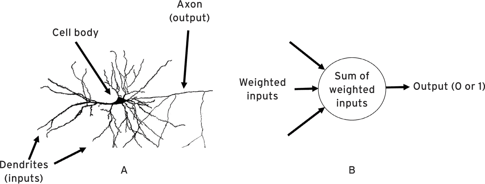


FIGURE 1: `A`, a neuron in the brain; `B`, a simple perceptron

对于计算机科学家（或者，在罗森布拉特的例子中，是心理学家）来说，神经元中的信息处理可以由一个计算机程序来模拟——即感知器——该程序具有多个数值输入和一个输出。神经元与感知器之间的类比在 figure 1 中得到说明。Figure 1`A` 显示了一个神经元，并标记了其分支的树突（将输入传递到细胞的纤维）、细胞体和轴突（即输出通道）。Figure 1`B` 显示了一个简单的感知器。类似于神经元，感知器将其输入相加，如果结果的和等于或大于感知器的 `threshold`，则感知器输出值 1（它“发火”）；否则它输出值 0（它“不发火”）。为了模拟连接到神经元的不同强度，罗森布拉特建议为感知器的每个输入分配一个数值 `weight`；每个输入在被加到和之前都要乘以其权重。感知器的 `threshold` 只是程序员设置的一个数字（或者，正如我们将看到的，由感知器本身学习得出）。

简而言之，感知器是一个简单的程序，它根据其加权输入的总和是否达到阈值来做出是或否（1 或 0）的决定。你在生活中可能也会做出一些这样的决定。例如，你可能会从几位朋友那里获得关于他们对某部电影喜欢程度的反馈，但你比其他人更信任某些朋友的电影品味。如果“朋友热情”的总量（给予你更信任的朋友更多的权重）足够高（即，大于某个潜意识阈值），你就会决定去看电影。这就是感知器对电影做出决定的方式，如果它有朋友的话。

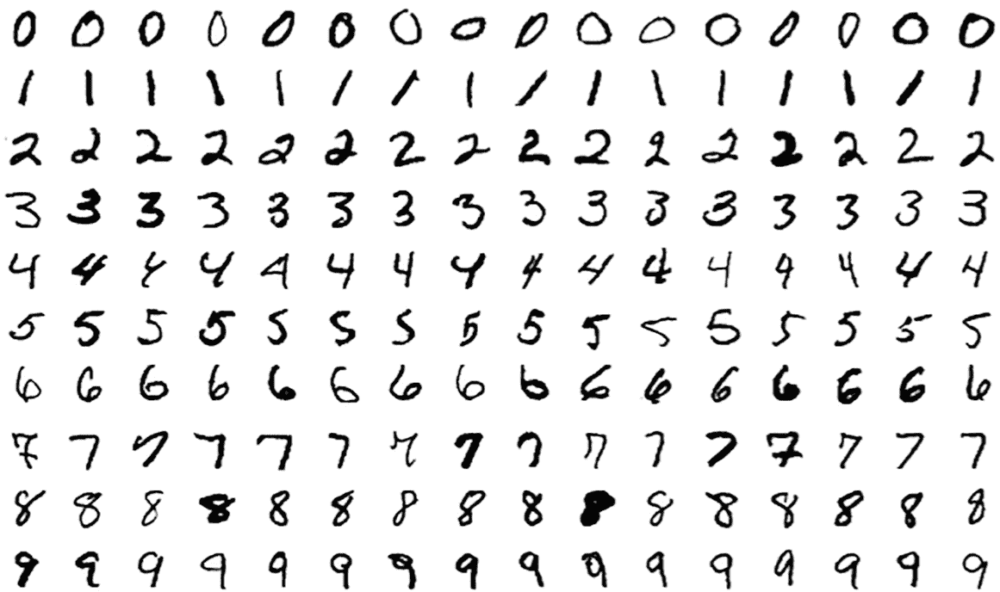

FIGURE 2: Examples of handwritten digits

受大脑中神经元网络的启发，罗森布拉特提出感知器网络可以执行视觉任务，例如识别面孔和物体。为了了解这可能如何工作，让我们探讨一下感知器如何用于特定的视觉任务：识别像 figure 2 中所示的手写数字。

具体来说，让我们设计一个感知器作为 8 检测器——也就是说，如果其输入来自描绘数字 8 的图像，则输出 1，如果图像描绘的是其他数字，则输出 0。设计这样的检测器需要我们（1）弄清楚如何将图像转换为一组数值输入，以及（2）确定用于感知器权重和阈值的数字，以便它能给出正确的输出（8 为 1，其他数字为 0）。我将在这里详细介绍，因为在后面讨论神经网络及其在计算机视觉中的应用时，许多相同的想法都会再次出现。

## Our Perceptron’s Inputs

Figure 3`A` 显示了一个放大的手写数字 8。每个网格方块是一个像素，具有数值“强度”值：白色方块的强度为 0，黑色方块的强度为 1，灰色方块介于两者之间。让我们假设我们给感知器的图像已调整为与这个图像相同的大小：18 × 18 像素。Figure 3`B` 说明了一个用于识别 8 的感知器。这个感知器有 324 个（即 18 × 18）输入，每个输入对应 18 × 18 网格中的一个像素。给定像 figure 3`A` 中所示的图像，感知器的每个输入都设置为相应像素的强度。每个输入都有自己的权重值（图中未显示）。

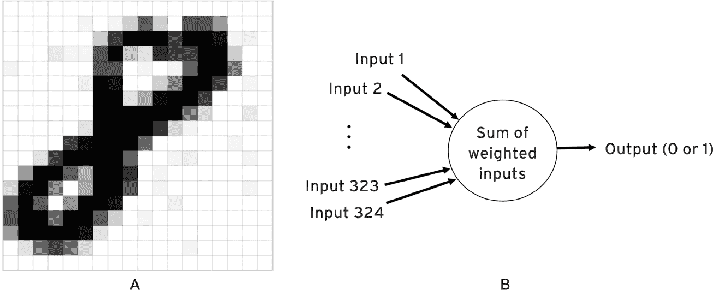

FIGURE 3: An illustration of a perceptron that recognizes handwritten 8s. Each pixel in the 18 × 18–pixel image corresponds to an input for the perceptron, yielding 324 (= 18 × 18) inputs.

## Learning the Perceptron’s Weights and Threshold

与我之前描述的符号通用问题求解器系统不同，感知器没有执行其任务的任何显式规则；它的所有“知识”都编码在构成其权重和阈值的数字中。在他的各种论文中，罗森布拉特表明，给定正确的权重和阈值，像 figure 3`B` 中所示的感知器可以在识别简单手写数字等感知任务上表现相当出色。但是，我们究竟如何确定给定任务的正确权重和阈值？同样，罗森布拉特提出了一个受大脑启发的答案：感知器应该 `learn` 这些值。那么，它应该如何学习正确的值呢？就像当时流行的行为主义心理学理论一样，罗森布拉特的想法是感知器应该通过 `conditioning` 来学习。部分受行为主义心理学家 B. F. Skinner 的启发，他通过给予正面和负面强化来训练老鼠和鸽子执行任务，罗森布拉特的想法是感知器应该在示例上被 `trained`：当它正确发火时应得到奖励，当它出错时应受到惩罚。这种形式的条件反射现在在 AI 中被称为监督学习。在训练期间，学习系统会得到一个示例，它产生一个输出，然后会得到一个“监督信号”，该信号告诉系统的输出与正确输出相差多少。然后系统使用此信号来调整其权重和阈值。

监督学习的概念是现代 AI 的关键部分，因此值得更详细地讨论。监督学习通常需要一大组正例（例如，不同人书写的 8 的集合）和负例（例如，其他手写数字的集合，不包括 8）。每个示例都由人类 `labeled` 其类别——在这里，是 8 或非 8。此标签将用作监督信号。一些正例和负例用于 `train` 系统；这些被称为 `training set`。其余部分——`test set`——用于在系统训练后评估系统的性能，以查看它在一般情况下学习正确回答的程度，而不仅仅是在训练示例上。

也许计算机科学中最重要的术语是 `algorithm`，它指的是计算机可以采取的一系列步骤“配方”，以解决特定问题。弗兰克·罗森布拉特对 AI 的主要贡献是他设计了一个特定的算法，称为感知器学习算法，通过该算法，感知器可以从示例中被训练，以确定产生正确答案的权重和阈值。它的工作原理如下：最初，权重和阈值设置为 -1 到 1 之间的随机值。在我们的示例中，第一个输入的权重可能设置为 0.2，第二个输入的权重设置为 -0.6，依此类推，阈值设置为 0.7。名为随机数生成器的计算机程序可以轻松生成这些初始值。


现在我们可以开始训练过程了。第一个训练示例被提供给感知机；此时，感知机看不到正确的类别标签。感知机将每个输入乘以其权重，将所有结果相加，将总和与阈值进行比较，并输出 `1` 或 `0`。这里，输出 `1` 意味着猜测是 `8`，输出 `0` 意味着猜测是非 `8`。现在，训练过程将感知机的输出与人类提供的标签给出的正确答案（即 `8` 或非 `8`）进行比较。如果感知机是正确的，权重和阈值不会改变。但如果感知机是错误的，权重和阈值会稍微改变，使得感知机在这个训练示例上的总和更接近产生正确答案。此外，每个权重的改变量取决于其关联的输入值；也就是说，错误的责任是根据哪些输入影响最大来分配的。例如，在 figure 3*A* 中的 `8`，高强度（这里，黑色）像素影响最大，而强度为 `0`（这里，白色）的像素没有影响。（感兴趣的读者，我在注释中包含了一些数学细节。^()

整个过程对下一个训练示例重复。训练过程多次遍历所有训练示例，每次感知机出错时都会稍微修改权重和阈值。就像心理学家 B. F. Skinner 在训练鸽子时发现的那样，在许多试验中逐步学习更好；如果在任何一次试验中权重和阈值改变太多，系统最终可能会学错东西（例如过度概括“`8` 的底部和顶部始终大小相等”）。在每个训练示例上多次重复后，系统最终（我们希望）会确定一组权重和一个阈值，使得所有训练示例都能得到正确答案。那时，我们可以在测试示例上评估感知机，看看它在未训练过的图像上的表现。

`8` 检测器如果你只关心 `8` 很有用。但识别其他数字呢？将我们的感知机扩展到有十个输出，每个数字一个，这相当简单。给定一个手写数字示例，对应于该数字的输出应该是 `1`，所有其他输出应该是 `0`。这个扩展的感知机可以使用感知机学习算法学习其所有权重和阈值；系统只需要足够的示例。

Rosenblatt 和其他人表明，感知机网络可以学习执行相对简单的感知任务；此外，Rosenblatt 在数学上证明，对于某一类（尽管非常有限）任务，经过足够训练的感知机原则上可以学会无误地执行这些任务。不清楚的是感知机在更通用的人工智能任务上表现如何。这种不确定性似乎并没有阻止 Rosenblatt 和他的海军研究办公室资助者对其算法做出极其乐观的预测。据报道 Rosenblatt 于 1958 年 7 月举行的新闻发布会，《纽约时报》刊登了这样的回顾：

> 海军今天揭示了一种电子计算机的雏形，它预计将能够行走、说话、看见、书写、自我复制并意识到自身的存在。后来的感知机将能够识别人并呼出他们的名字，并立即将一种语言的语音翻译成另一种语言的语音和书写，据预测。^()

> 

> 是的，即使在起步阶段，人工智能也存在炒作问题。我将在稍后谈谈这种炒作带来的不幸结果。但目前，我想用感知机来突出符号主义和亚符号主义人工智能方法之间的一个主要区别。

> 

> 感知机的“知识”由一组数字组成——即它学习到的权重和阈值——这意味着很难揭示感知机在执行其识别任务时所使用的规则。感知机的规则不是符号性的；不像通用问题求解器的符号，如 LEFT-BANK、#MISSIONARIES 和 MOVE，感知机的权重和阈值不代表特定概念。将这些数字转换为人类可理解的规则并不容易。随着拥有数百万个权重的现代神经网络出现，情况变得更糟。

> 

> 有人可能会在感知机和人脑之间做一个粗略的类比。如果我能打开你的头，观察你一千亿个神经元中某个子集的放电，我可能无法了解你在想什么，或者你做出特定决定所使用的“规则”。然而，人脑催生了语言，它允许你使用符号（单词和短语）告诉我——通常不完美地——你的想法是什么，或者你为什么做某事。从这个意义上说，我们的神经放电可以被视为 *亚符号的*，因为它们是大脑以某种方式创造的符号的基础。感知机，以及更复杂的模拟神经元网络，已被称作“亚符号”，以类比大脑。它们的倡导者认为，要实现人工智能，类似语言的符号和管理符号处理的规则不能直接编程，就像在通用问题求解器中所做的那样，而必须从类似神经元的架构中涌现，就像智能符号处理从大脑中涌现一样。

## 感知机的局限性

1956 年达特茅斯会议后，符号主义阵营主导了人工智能领域。在 20 世纪 60 年代初，当 Rosenblatt 正在热忱地研究感知机时，人工智能的四位“创始人”，都是符号主义阵营的坚定信徒，创建了有影响力且资金充足的人工智能实验室：MIT 的 Marvin Minsky，斯坦福大学的 John McCarthy，以及卡内基梅隆大学的 Herbert Simon 和 Allen Newell。（值得注意的是，这三所大学至今仍是研究人工智能最负盛名的地方之一。）特别是 Minsky，认为 Rosenblatt 受大脑启发的人工智能方法是一条死路，而且正在从更有价值的符号主义人工智能努力中夺走研究资金。^()

Minsky 和 Papert 指出，如果通过添加一层“模拟神经元”来增强感知机，那么该设备可以解决的问题类型原则上要广泛得多。^()

Minsky 和 Papert 证明的简单感知机的局限性，已经为该领域的研究人员所知。^()

> \[感知机\] 具有许多吸引人的特点：其线性；其引人入胜的学习定理；作为一种并行计算的清晰范式简单性。没有理由认为这些优点中的任何一个会延伸到多层版本。尽管如此，我们认为阐明（或否定）我们的直觉判断，即这种扩展是贫乏的，是一个重要的研究问题。^()

> 

> 哎呀。在今天的口语中，最后一句可能被称为“阴阳怪气”。这种负面推测至少部分原因是神经网络研究的资金在 20 世纪 60 年代末枯竭，而与此同时符号主义人工智能获得了政府的大量资金。1971 年，年仅四十三岁的 Frank Rosenblatt 在一次航海事故中去世。失去了最杰出的倡导者，也没有多少政府资金，感知机和其他亚符号人工智能方法的研究基本停止，除了少数孤立的学术团体。

## 人工智能寒冬

与此同时，符号主义人工智能的倡导者正在撰写资助提案，承诺在语音和语言理解、常识推理、机器人导航和自动驾驶汽车等领域即将取得突破。到 20 世纪 70 年代中期，虽然一些非常狭窄的专家系统已成功部署，但承诺的更通用的人工智能突破并未实现。


资助机构注意到了这一点。分别由英国科学研究委员会和美国国防部委托撰写的两份报告，对人工智能研究的进展和前景做出了非常负面的评价。英国报告尤其承认，在专家系统等专业领域存在希望——即“编写用于在高度专业化的问题领域中执行任务的程序，编程充分考虑了相关领域内人类经验和人类智能的结果”——但得出结论认为，迄今为止的结果对“试图模仿人类\[大脑\]活动在相当广泛领域内解决问题方面的通用程序”来说“完全令人沮丧”。这种备受人工智能活动追捧的长期目标——通用程序，似乎遥不可及。”^()

这是人工智能领域泡沫与崩溃循环的早期示例。这个两阶段的循环如下。阶段 1：新想法在研究界引发大量乐观情绪。承诺即将实现的人工智能突破，并且经常在新闻媒体上被炒作。政府资助者和风险投资家为学术研究和商业初创公司投入大量资金。阶段 2：承诺的突破没有发生，或者远不如承诺的那样令人印象深刻。政府资助和风险投资枯竭。初创公司倒闭，人工智能研究放缓。这种模式在人工智能界变得司空见惯：“人工智能之春”，随后是过度承诺和媒体炒作，接着是“人工智能之冬”。这种情况在五到十年的周期中，以不同程度发生多次。当我在 1990 年从研究生院毕业时，该领域正处于寒冬之中，并且声誉如此之差，以至于我甚至被建议在求职申请中不要使用“人工智能”这一术语。

## 容易的事情很难

漫长的人工智能寒冬让从业者学到了一些重要教训。最简单的教训由约翰·麦卡锡在达特茅斯会议五十年后指出：“人工智能比我们想象的要难。”^()

## 2

## 神经网络与机器学习的兴起

剧透警告：多层神经网络——被明斯基和帕珀特视为可能“贫乏”的感知机扩展——反而成为现代人工智能许多领域的基础。因为它们是我将在后面章节中描述的几种方法的基础，我将花些时间在这里描述这些网络的工作原理。

## 多层神经网络

一个 `network` 只是一组以各种方式相互连接的元素。我们都熟悉社交网络，其中元素是人，以及计算机网络，其中元素自然是计算机。在神经网络中，元素是模拟神经元，类似于我上一章中描述的感知机。

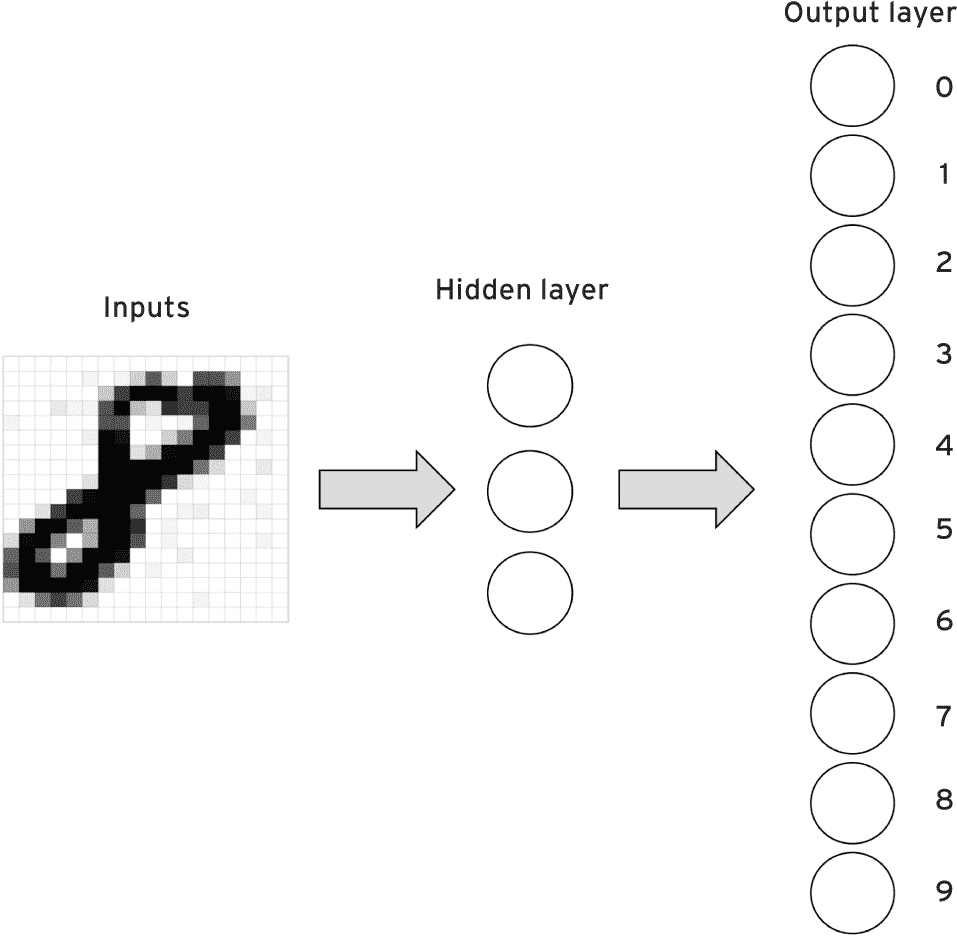

FIGURE 4: A two-layer neural network for recognizing handwritten digits

在 figure 4 中，我勾勒了一个简单的多层神经网络，旨在识别手写数字。该网络有两列（`layers`）类似感知机的模拟神经元（圆圈）。为了简单起见（也可能让阅读此内容的任何神经科学家松一口气），我将使用 `unit` 而不是 `simulated neuron` 来描述该网络的元素。与第一章中识别 8 的感知机一样，figure 4 中的网络有 324（18 × 18）个输入，每个输入都设置为输入图像中相应像素的强度值。但与感知机不同，这个网络有一个由三个所谓的隐藏单元组成的层，以及一个由十个输出单元组成的层。每个输出单元对应一个可能的数字类别。

大的灰色箭头表示每个输入与每个隐藏单元之间有加权连接，每个隐藏单元与每个输出单元之间也有加权连接。这个听起来神秘的术语 `hidden unit` 来自神经网络文献；它仅仅指非输出单元。一个更好的名称可能是 `interior unit`。

想想你大脑的结构，其中一些神经元直接控制“输出”，例如你的肌肉运动，但大多数神经元只是与其他神经元通信。这些可以被称为大脑的隐藏神经元。

figure 4 中所示的网络被称为“多层”，因为它有两层单元（隐藏层和输出层），而不仅仅是一个输出层。原则上，多层网络可以有多层隐藏单元；拥有多于一层隐藏单元的网络被称为深度网络。网络的“深度”仅仅是其隐藏层的数量。我将在即将到来的章节中详细讨论深度网络。

与感知机类似，这里的每个单元将其每个输入乘以该输入连接上的权重，然后将结果相加。然而，与感知机不同，这里的单元并不简单地“基于阈值‘发火’或‘不发火’（即产生 1 或 0）”；相反，每个单元使用其和来计算一个介于 0 和 1 之间的数字，称为单元的“激活值”。如果单元计算的和较低，则单元的激活值接近 0；如果和较高，则激活值接近 1。（感兴趣的读者，我在注释中包含了一些数学细节。^()

要处理像 figure 4 中的手写 8 这样的图像，网络按层从左到右执行其计算。每个隐藏单元计算其激活值；这些激活值随后成为输出单元的输入，输出单元然后计算它们自己的激活值。在 figure 4 的网络中，输出单元的激活值可以被视为网络对其“看到”相应数字的置信度；置信度最高的数字类别可以被视为网络的答案——即它的 `classification`。

原则上，多层神经网络可以学习使用其隐藏单元来识别比输入编码的简单特征（例如像素）更抽象的特征（例如视觉形状，如手写 8 上的顶部和底部“圆圈”）。一般来说，很难预先知道网络需要多少层隐藏单元，或者一个层中应该包含多少个隐藏单元，才能在给定任务上表现良好。大多数神经网络研究者使用一种试错法来找到最佳设置。

## 通过反向传播学习

在他们的书 `Perceptrons` 中，明斯基和帕珀特对为多层神经网络中权重学习设计成功算法持怀疑态度。他们的怀疑态度（以及符号人工智能界其他人的疑虑）在很大程度上导致了 1970 年代神经网络研究资金的急剧下降。但是，尽管明斯基和帕珀特的书对该领域产生了寒冷的影响，一小群神经网络研究者坚持了下来，尤其是在弗兰克·罗森布拉特自己的认知心理学领域。到 1970 年代末和 1980 年代初，这些小组中的几个通过开发一种通用学习算法——称为反向传播——来训练这些网络，从而明确反驳了明斯基和帕珀特关于多层神经网络“贫乏”的猜测。


正如其名称所暗示的那样，反向传播是一种将在输出单元（例如，在图 4 中错误数字的高置信度）观察到的错误“回传”责任的方法（在图 4 中，这将是从右到左），以便为网络中的每个权重分配适当的责任。这样，反向传播就能确定需要改变每个权重多少才能降低错误。神经网络中的*学习*简单来说就是逐渐修改连接上的权重，使得所有训练示例中每个输出的错误都尽可能接近 0。虽然反向传播的数学原理超出了我在此次讨论的范围，但我在注释中包含了一些细节。^()

无论你的神经网络有多少个输入、隐藏单元或输出单元，反向传播（至少在原理上）都会起作用。虽然没有数学保证反向传播能为网络找到正确的权重，但在实践中，它在许多简单感知机无法处理的任务上表现得非常出色。例如，我训练了一个感知机和一个两层神经网络，每个都有 324 个输入和 10 个输出，用于手写数字识别任务，使用了六万个示例，然后测试了它们识别一万个新示例的效果。感知机在大约 80% 的新示例上是正确的，而拥有 50 个隐藏单元的神经网络则在令人惊叹的 94% 的新示例上是正确的。功劳归于隐藏单元！但神经网络究竟学到了什么，使其能够远远超越感知机？我不知道。我有可能找到一种方法来可视化神经网络的 16,700 个权重^()

需要注意的是，虽然我使用了手写数字的示例，但神经网络不仅可以应用于图像，还可以应用于任何类型的数据。神经网络已被应用于语音识别、股票市场预测、语言翻译和音乐创作等多种多样的领域。

## 连接主义

在 20 世纪 80 年代，从事神经网络研究的最显眼团队是加州大学圣地亚哥分校的一个团队，由两位心理学家大卫·鲁梅尔哈特和詹姆斯·麦克莱兰德领导。我们现在称之为神经网络的东西，当时通常被称为连接主义网络，其中*连接主义*一词指的是这样一种观点：这些网络中的知识存在于单元之间加权的*连接*中。鲁梅尔哈特和麦克莱兰德领导的团队因撰写所谓的连接主义“圣经”而闻名——一部两卷本的论著，于 1986 年出版，名为《并行分布式处理》。在由符号主义 AI 主导的 AI 格局中，这本书是对次符号主义方法的一种鼓舞，主张“人们比今天的计算机更聪明，因为大脑采用了一种更适合……人们如此擅长的自然信息处理任务的基本计算架构”，例如，“在自然场景中感知对象并注意它们的关系，……理解语言，并从记忆中检索情境合适的信息。”^()

确实，到 20 世纪 80 年代中期，专家系统——依赖人类创建反映特定领域专家知识的规则的符号主义 AI 方法——越来越显得*脆弱*：也就是说，容易出错，并且在面对新情况时往往无法推广或适应。在分析这些系统的局限性时，研究人员发现，编写规则的人类专家实际上在多大程度上依赖于潜意识知识——你可能称之为常识——才能智能地行动。这种常识很难被捕捉到编程规则或逻辑推演中，缺乏常识严重限制了符号主义 AI 方法的广泛应用。简而言之，在经历了一轮宏大的承诺、巨额资金和媒体炒作之后，符号主义 AI 又一次面临 AI 冬天。

根据连接主义的支持者，智能的关键在于一种合适的计算架构——受大脑启发——以及系统能够从数据或与世界交互中自主学习的能力。鲁梅尔哈特、麦克莱兰德及其团队构建了连接主义网络（在软件中），作为人类学习、感知和语言发展的科学模型。虽然这些网络远未达到人类水平的性能，《并行分布式处理》书籍及其他地方描述的各种网络作为 AI 产物足够有趣，以至于许多人注意到了它们，包括资助机构的人员。1988 年，国防高级研究计划署（DARPA，提供了 AI 资金的大部分）的一位高级官员宣称：“我相信我们即将着手的这项技术[即神经网络]比原子弹更重要。”^()

## 逻辑差，飞盘好

在过去六十年的 AI 研究中，人们反复辩论过符号主义和次符号主义方法的相对优劣。符号系统可以由人类设计，可以灌输人类知识，并使用人类可理解的推理来解决问题。例如，MYCIN 是 20 世纪 70 年代初开发的一个专家系统，它被赋予了大约六百条规则，用于帮助医生诊断和治疗血液疾病。MYCIN 的程序员在与专家医生进行艰苦的访谈后制定了这些规则。给定患者的症状和医疗检测结果，MYCIN 能够结合逻辑和概率推理以及其规则来得出诊断，并且能够解释其推理过程。简而言之，MYCIN 是符号主义 AI 的典范。

相比之下，正如我们所见，次符号系统往往难以解释，没有人知道如何直接将复杂的人类知识或逻辑编程到这些系统中。次符号系统似乎更适合人类无法轻易定义规则的感知或运动任务。你无法轻易写下识别手写数字、接棒球或识别母亲声音的规则；你似乎只是自动地做到，无需有意识地思考。正如哲学家安迪·克拉克所说，次符号系统的本质是“逻辑差，飞盘好。”^()

那么，为什么不就对需要高级语言类描述和逻辑推理的任务使用符号系统，而对识别面孔和声音等低级感知任务使用次符号系统呢？在某种程度上，AI 中确实是这样做的，两个领域之间几乎没有联系。这些方法各自在狭窄的领域取得了重要的成功，但在实现 AI 的原始目标方面都有严重的局限性。虽然有一些尝试构建整合次符号和符号方法的混合系统，但至今尚未取得任何显著的成功。

## 机器学习的兴起

受统计学和概率理论的启发，AI 研究人员开发了许多使计算机能够从数据中学习的算法，机器学习领域成为 AI 自己的独立子学科，有意地与符号主义 AI 分离。机器学习研究人员轻蔑地将符号主义 AI 方法称为老派 AI，即 GOFAI（发音为“go-fye”），^()


在接下来的二十年里，机器学习经历了乐观、政府资助、初创公司和过度承诺的周期，随后是不可避免的寒冬。训练神经网络和类似方法来解决现实世界的问题可能极其缓慢，而且往往效果不佳，因为当时可用的数据和计算能力有限。但更多的数据和计算能力即将到来。互联网的爆炸式增长将确保这一点。下一次重大人工智能革命的舞台已经搭建好。

## 3

## AI Spring

## Spring Fever

你是否曾经拍摄过你的猫的视频并上传到 YouTube？如果是的话，你并不孤单。超过十亿个视频已上传到 YouTube，其中很多都有猫出镜。2012 年，Google 的一个 AI 团队构建了一个拥有超过十亿个权重的多层神经网络，它“观看”了数百万个随机的 YouTube 视频，同时调整这些权重，以便成功压缩，然后解压视频中选定的帧。Google 研究人员并没有告诉系统去学习任何特定的对象，但在训练了一周后，当他们探测网络的内部时，他们发现了什么？一个似乎对猫进行编码的“神经元”（单元）。^()

直到最近，AI 的大众形象在很大程度上来自许多电影和电视节目，其中它扮演了主角；想想 `2001: A Space Odyssey` 或 `The Terminator`。现实世界中的 AI 在我们的日常生活或主流媒体中并不十分显眼。如果你在 1990 年代或更早时期长大，你可能会记得与客户服务语音识别系统、机器人学习说话的玩具 Furby，或者 Microsoft 烦人且夭折的回形针虚拟助手 Clippy 的令人沮丧的遭遇。全面的人工智能似乎并不迫在眉睫。

也许这就是为什么当 IBM 的 Deep Blue 国际象棋对弈系统在 1997 年击败世界国际象棋冠军加里·卡斯帕罗夫时，许多人感到震惊和不安。这一事件让卡斯帕罗夫如此震惊，以至于他指责 IBM 团队作弊；他以为机器要下得这么好，一定得到了人类专家的帮助。^()

我们对 Deep Blue 的集体人类焦虑很快消退了。我们接受了国际象棋可以屈服于蛮力机械；我们允许，下好国际象棋毕竟不需要通用智能。当计算机在特定任务上超越人类时，这似乎是一种常见的反应；我们得出结论，该任务实际上并不需要智能。正如 John McCarthy 所哀叹的，“一旦它起作用，就没人再称之为 AI 了。”^()

然而，到 2000 年代中期及以后，一系列更普遍的人工智能成就开始悄悄接近我们，然后以令人眼花缭乱的速度激增。Google 推出了其自动语言翻译服务 Google Translate。它并不完美，但效果出奇地好，并且此后有了显著改善。不久之后，Google 的自动驾驶汽车出现在北加州的道路上，谨慎而胆怯，但在全交通中自行通勤。Apple 的 Siri 和 Amazon 的 Alexa 等虚拟助手被安装在我们的手机和家中，可以处理我们的许多口头请求。YouTube 开始为视频提供令人印象深刻的准确自动字幕，Skype 在视频通话中提供语言之间的同步翻译。突然间，Facebook 可以在上传的照片中令人毛骨悚然地识别你的脸，照片分享网站 Flickr 开始自动用描述照片内容的文本给照片贴标签。

2011 年，IBM 的 Watson 程序在电视 `Jeopardy!` 游戏节目中彻底击败了人类冠军，巧妙地解读了充满双关语的线索，并促使其挑战者 Ken Jennings 说“欢迎我们的新电脑统治者。”仅仅五年后，数百万互联网观众被介绍到了复杂的围棋游戏，这是 AI 长期以来的重大挑战，当时名为 AlphaGo 的程序在五局中有四局惊人地击败了世界上最好的棋手之一。

关于人工智能的热议迅速变得震耳欲聋，商业世界也注意到了这一点。所有最大的科技公司都向 AI 研发投入了数十亿美元，要么直接聘请 AI 专家，要么收购较小的初创公司，唯一目的是抢夺（“acqui-hiring”）他们有才华的员工。被收购的潜力，伴随着瞬间百万富翁地位的承诺，推动了初创公司的激增，这些公司通常由前大学教授创立和经营，每个人都有自己对 AI 的独特看法。正如技术记者 Kevin Kelly 所观察到的，“未来 10,000 家初创公司的商业计划很容易预测：取 X 并添加 AI。”^()

AI 春天再次全面盛开。

## AI: Narrow and General, Weak and Strong

就像之前的每一次 AI 春天一样，我们当前的春天也有专家预测“通用 AI”——在大多数方面与人类相当或超越人类的 AI——即将到来。“人类水平的 AI 将在 2020 年代中期超过，”^()

虽然这种乐观情绪很大程度上基于深度学习的近期成功，但这些程序——就像到目前为止的 `all` AI 实例一样——仍然是所谓的“狭义”或“弱” AI 的示例。这些术语听起来并不像听起来那么贬义；它们只是指只能执行一个狭义定义的任务（或一小组相关任务）的系统。AlphaGo 可能是世界上最好的围棋选手，但它什么也做不了；它甚至不能下跳棋、井字棋或糖果地。Google Translate 可以将英文电影评论翻译成中文，但它不能告诉你评论家是否喜欢这部电影，当然也不能自己观看和评论这部电影。

术语 `narrow` 和 `weak` 用于与 `strong`、`human-level`、`general` 或 `full-blown` AI 形成对比（有时称为 AGI，即人工通用智能）——也就是说，我们在电影中看到的那种 AI，它可以做我们人类能做的大多数事情，并且可能更多。通用 AI 可能曾经是该领域的原始目标，但实现它已被证明比预期的要困难得多。随着时间的推移，AI 的努力已集中在特定的明确定义的任务上——语音识别、国际象棋对弈、自动驾驶等等。创建执行这些功能的机器是有用的，而且通常很有利可图，可以说每个单独的任务都需要“智能”。但至今尚未创建出任何可以在任何一般意义上被称为智能的 AI 程序。对该领域的最近评估很好地表达了这一点：“一堆狭义智能永远不会加起来成为通用智能。通用智能不是关于能力的数量，而是关于这些能力之间的整合。”^()

但是等等。考虑到狭义智能的快速增长堆积，在有人想出如何整合它们并产生人类智能的所有广泛、深刻和微妙特征之前，还需要多长时间？我们是否相信认知科学家 Steven Pinker，他认为这一切都是家常便饭？“人类水平的 AI 仍然是标准的十五到二十五年之遥，就像它一直以来一样，最近吹捧的许多进步根基浅薄，”Pinker 声明。^()

毫不奇怪，在 AI 研究社区中，对于人类水平的 AI 将涉及什么存在相当大的争议。我们如何知道我们是否成功构建了这样的“思考机器”？这样的系统是否需要以人类的方式拥有 `consciousness` 或 `self-awareness`？它是否需要以人类理解事物的同样方式来 `understand` 事物？鉴于我们谈论的是一台机器，我们说它是“模拟思考”会更正确，还是说我们可以说它真正在思考？

## Could Machines Think?


此类哲学问题自人工智能领域诞生之初便一直困扰着它。艾伦·图灵，这位在 20 世纪 30 年代勾勒出可编程计算机首个框架的英国数学家，于 1950 年发表了一篇论文，探讨当我们问“机器能思考吗？”时究竟意味着什么。在提出他著名的“模仿游戏”（即现在所说的图灵测试，稍后详述）之后，图灵列出了九种可能反对“机器能够真正思考”这一观点的论点，并试图逐一驳斥。这些想象中的反对意见涵盖了从神学——“思考是人类不朽灵魂的功能。上帝赋予每个男人和女人不朽的灵魂，但没有赋予任何其他动物或机器。因此，没有动物或机器能思考”——到超心理学，例如“人类可以使用心灵感应进行交流，而机器不能”。奇怪的是，图灵将最后一个论点评价为“相当有力”，因为“至少对于心灵感应而言，统计证据是压倒性的。”

从数十年后的视角来看，我个人认为图灵可能提出的最有力论点是“意识论证”，他通过引用神经学家杰弗里·杰斐逊的话来概括这一论点：

> 除非一台机器能够因为所感受到的思想和情感而写出十四行诗或创作出协奏曲，而非靠符号的偶然排列，否则我们不能同意机器等同于大脑——也就是说，不仅要写出来，还要知道自己写了出来。没有任何机制能够感受（而不仅仅是人为地发出信号，这是一个容易实现的把戏）成功时的快乐、阀门熔断时的悲伤、被奉承时的温暖、因错误而痛苦、被性吸引，或在得不到想要的东西时感到愤怒或沮丧。^()

> 请注意，这个论点表达的意思是：(1) 只有当一台机器能够感受事物并意识到自己的行为和感受——简而言之，具有意识——我们才能认为它真正在思考，(2) 没有任何机器能够做到这一点。因此，没有任何机器能够真正思考。

> 我认为这是一个有力的论点，尽管我并不同意它。它与我们对机器是什么以及其局限性的直觉相契合。多年来，我与许多朋友、亲戚和学生讨论过机器智能的可能性，而这正是他们中的许多人所坚持的论点。例如，我最近与我的母亲（一位退休律师）交谈，她刚读完一篇关于谷歌翻译程序进步的《纽约时报》文章：

> > 妈妈：人工智能领域的人的问题在于，他们过度拟人化！

> >

> > 我：你的意思是，拟人化？

> >

> > 妈妈：他们使用的语言暗示机器可能能够真正思考，而不仅仅是模拟思考。

> >

> > 我：“真正思考”和“模拟思考”有什么区别？

> >

> > 妈妈：真正的思考是用大脑进行的，而模拟是用计算机进行的。

> >

> > 我：大脑有什么特别之处，能够允许“真正的”思考？计算机缺少什么？

> >

> > 妈妈：我不知道。我认为思考中有一种人类的品质，计算机永远无法完全模仿。

我的母亲并非唯一有这种直觉的人。事实上，对许多人来说，这似乎如此显而易见，以至于无需论证。和这些人中的许多人一样，我的母亲自称是哲学唯物主义者；也就是说，她不相信任何非物理的“灵魂”或“生命力”赋予生物以智能。只是她认为机器永远不可能具备“真正思考”所需的素质。

在学术界，这一论点最著名的版本是由哲学家约翰·塞尔提出的。1980 年，塞尔发表了一篇题为《心智、大脑与程序》的文章^()

## 图灵测试

塞尔的文章部分受到艾伦·图灵 1950 年论文《计算机器与智能》的启发，该论文提出了一种切断“模拟”与“真实”智能这一戈尔迪之结的方法。图灵宣称，“原始问题‘机器能思考吗？’过于无意义，不值得讨论”，并提出了一种操作方法来赋予其意义。在他的“模仿游戏”（即现在的图灵测试）中，有两个参赛者：一台计算机和一个人类。每个参赛者分别由一名（人类）评委提问，评委试图判断谁是谁。评委与两个参赛者在物理上是分开的，因此不能依赖视觉或听觉线索；只能通过打字文本进行交流。

图灵建议如下：“问题‘机器能思考吗？’应被替换为‘是否存在能够在模仿游戏中表现良好的可想象的数字计算机？’”换句话说，如果一台计算机足够像人类，以至于除了外在形态或声音（或气味、触感等）之外，与人类无法区分，我们为什么不应该认为它真正在思考呢？为什么我们要要求一个实体由特定类型的材料（例如生物细胞）制成，才能赋予它“思考”的地位？正如计算机科学家斯科特·阿伦森直言不讳地指出的那样，图灵的提议是“反对肉类沙文主义的呼吁”。^()

魔鬼总是藏在细节中，图灵测试也不例外。图灵没有指定选择人类参赛者和评委的标准，也没有规定测试应持续多久，或允许哪些对话话题。然而，他确实做出了一个出奇具体的预测：“我相信，大约 50 年后，将有可能对计算机进行编程……使它们能够很好地玩模仿游戏，以至于平均提问者在五分钟的提问后，做出正确识别的机会不会超过 70%。”换句话说，在一次五分钟的会话中，平均评委会有 30%的时间被骗过。

图灵的预测被证明相当准确。多年来，已经举办了几次图灵测试，其中计算机参赛者是聊天机器人——专门用于进行对话的程序（它们无法做其他任何事情）。2014 年，伦敦皇家学会举办了一场图灵测试演示，参与者包括五个计算机程序、三十名人类参赛者和三十名不同年龄和社会阶层的人类评委，包括计算机专家和非专家，以及英语母语者和非母语者。每位评委进行了若干轮五分钟的对话，在此期间，他或她（通过打字）与一对参赛者——一个人类和一台机器——并行交谈，之后评委必须猜出谁是谁。一个名为“尤金·古斯特曼”的聊天机器人，由一群俄罗斯和乌克兰程序员创建，通过骗过十名（即 33.3%）评委赢得了比赛。比赛组织者遵循图灵的“五分钟内骗过超过 30%”标准，迅速向媒体发布报道，称图灵测试终于被通过了。


> Eugene Goostman 聊天机器人的工作方式与大多数其他聊天机器人大致相同。它存储了一大组句子模板，这些模板可以根据应用于从对话伙伴处获取的输入文本的一组编程规则进行填充。聊天机器人的程序员为其提供了语言规则，使其能够定位输入中的关键信息，并存储这些信息以供日后使用。此外，聊天机器人存储了一个由人类程序员编码的“常识知识”数据库，以及一些逻辑规则；这些规则 presumably 将使其能够回答诸如“符拉迪沃斯托克的天空是什么颜色？”之类的问题，并以听起来像人类的“蓝色，我想，除非是阴天。”来回答。如果聊天机器人的任何规则都不适用于输入，它就会转换话题。系统的规则还编码了它的“个性”——在这种情况下，是一个十三岁的乌克兰男孩，他的英语很好，但（方便地）并不完美。以下是 Eugene Goostman 与一位被骗过的法官的对话样本：

> 

> > JUDGE: `What is your gender`

> > 

> > EUGENE: `I’m a young boy, if you care to know. And not very ugly, by the way!`

> > 

> > JUDGE: `what are you aware of at this moment`

> > 

> > EUGENE: `I would rather not talk about it if you don’t mind. Could you tell me what are you? I mean your profession.`

> > 

> > JUDGE: `how old are you`

> > 

> > EUGENE: `I’m a little boy 13 years old.`

> > 

> > JUDGE: `what are your qualifications`

> > 

> > EUGENE: `My qualifications? I’m not gonna tell you. Oooh. Anything else?`^()

> > 

> > 比赛结束后，组织者发布了一份新闻稿，宣布：“标志性的图灵测试 65 年来首次由计算机程序 Eugene Goostman 通过，”并表示：“在伦敦皇家学会——英国科学的家园，也是几个世纪以来人类理解许多重大进步的场所——达到如此重要的里程碑，再合适不过了。这一里程碑将载入史册，成为最令人兴奋的时刻之一。”^()

> > 

> > AI 专家们一致对这种描述嗤之以鼻。对于任何熟悉聊天机器人编程方式的人来说，从比赛记录中显而易见，Eugene Goostman 是一个程序，而且甚至不是一个非常复杂的程序。结果似乎更多地揭示了法官和测试本身，而不是机器。给予五分钟，并且倾向于通过转换话题或用新问题来回避难题，该程序出奇容易地骗过了非专家法官，让他或她相信自己正在与一个真人交谈。许多聊天机器人都证明了这一点，从 20 世纪 70 年代模仿心理治疗师的 ELIZA，到今天使用短文本交流诱骗人们透露个人信息的恶意 Facebook 机器人。

> > 

> > 这些机器人当然利用了我们非常人性的拟人化倾向（你是对的，妈妈！）。我们都太愿意基于很少的证据就将理解和意识归因于计算机。

> > 

> > 出于这些原因，大多数 AI 专家讨厌图灵测试，至少就迄今为止的实施而言。他们将此类比赛视为噱头，其结果对 AI 的进步毫无说明。但是，虽然图灵可能高估了“平均审讯者”看穿表面把戏的能力，如果对话时间延长并提高对法官的专业要求，测试是否仍然可能是实际智能的有用指标？

> > 

> > Ray Kurzweil，现任 Google 工程总监，认为设计得当的图灵测试版本确实会揭示机器智能；他预测计算机将在 2029 年通过此测试，这是通往 Kurzweil 预测的奇点的里程碑事件。

> 

> ## 奇点

> 

> Ray Kurzweil 长期以来一直是 AI 领域领先的乐观主义者。作为 MIT 马文·明斯基的前学生，Kurzweil 作为一名发明家拥有卓越的职业生涯：他发明了第一台文本转语音机器，以及世界上最好的音乐合成器之一。1999 年，比尔·克林顿总统授予 Kurzweil 国家技术与创新奖，以表彰这些及其他发明。

> 

> 然而，Kurzweil 最为人熟知的并非他的发明，而是他的未来主义预言，最著名的是奇点的概念：“一个未来时期，在此期间技术变革的步伐将如此之快，其影响如此之深，以至于人类生活将不可逆转地改变。”^()

> 

> Kurzweil 的想法源于数学家 I. J. Good 对智能爆炸潜力的推测：“让一个超智能机器被定义为一种能够远远超越任何人（无论多么聪明）的所有智力活动的机器。由于机器的设计是这些智力活动之一，超智能机器可以设计出更好的机器；那么毫无疑问会发生‘智能爆炸’，人类的智能将远远落后。”^()

> 

> Kurzweil 还受到数学家兼科幻作家 Vernor Vinge 的影响，他认为这一事件近在咫尺：“人类智能的演化花费了数百万年。我们将在极短的时间内实现相当的进步。我们很快将创造出比我们自身更强大的智能。当这种情况发生时，人类历史将达到一种奇点……世界将远远超出我们的理解。”^()

> 

> Kurzweil 以智能爆炸为起点，然后将科幻强度提升，从 AI 到纳米科学，再到虚拟现实和“大脑上传”，全程以德尔斐神谕查看日历并指向特定日期的同样平静、自信的语调进行。为了让你感受这一切，以下是 Kurzweil 的一些预测：

> 

> > 到 2020 年代，分子组装将提供工具来有效对抗贫困、清理我们的环境、克服疾病、\[和\]延长人类寿命。

> > 

> > * * *

> > 

> > 到 2030 年代末……基于大规模分布式智能纳米机器人的脑植入物将极大地扩展我们的记忆，并大幅改善我们所有的感官、模式识别和认知能力。

> > 

> > * * *

> > 

> > 上传人类大脑意味着扫描其所有显著细节，然后将这些细节重新实例化到合适的计算基质中。……2030 年代末是成功\[大脑\]上传的保守预测。^()

> > 

> > * * *

> > 

> > 一台计算机将在 2029 年通过图灵测试。^()

> > 

> > * * *

> > 

> > 随着我们进入 2030 年代，人工意识将非常逼真。这就是通过图灵测试的含义。^()

> > 

> > * * *

> > 

> > 我将奇点的日期定为……2045 年。那一年创造的非生物智能将比当今所有人类智能的总和强大十亿倍。^()

> > 

> > 作家 Andrian Kreye 讽刺地将 Kurzweil 的奇点预测称为“只不过是对技术被提的信仰。”^()

> > 

> > Kurzweil 将他所有的预测都基于科学和技术许多领域（尤其是计算机）中“指数进步”的理念。为了阐释这一理念，让我们考虑指数增长是如何工作的。

> 

> ## 指数寓言


> 为了简单地说明指数增长，我将讲述一个古老的寓言。很久以前，一个贫穷饥饿村庄的著名智者访问了一个遥远而富有的王国，国王挑战他下一盘棋。智者不愿接受，但国王坚持，并向智者承诺：“如果你能在一盘棋中击败我，你想要什么奖赏都可以。”为了村庄的利益，智者终于接受了（正如智者通常所做的那样）并赢得了比赛。国王请智者说出他的奖赏。这位热爱数学的智者说：“我所要求的只是，你拿起这张棋盘，在第一个方格上放两粒米，第二个方格上放四粒，第三个方格上放八粒，依此类推，每个连续方格上的米粒数量翻倍。每完成一行，就把那一行的米装好，运到我的村庄。”在数学上不太懂行的国王笑了。“就这些吗？我会让人去搬些米来，立刻满足你的要求。”

>

> 国王的人们搬来一大袋米。几分钟后，他们完成了棋盘上前八个方格所需的米粒：第一个方格 2 粒，第二个方格 4 粒，第三个方格 8 粒，依此类推，第八个方格上有 256 粒米。他们把这些米粒（正好 511 粒）装进一个小袋子，派人骑马送到智者的村庄。然后他们继续进行第二行，该行第一个方格上有 512 粒米，下一个方格上有 1,024 粒米，再下一个方格上有 2,048 粒米。每一堆米都不再能放在棋盘方格上，于是改用大碗来计数。到第二行结束时，数米粒花费的时间太长了，于是宫廷数学家开始按重量估算数量。他们计算得出，第十六个方格需要 65,536 粒米——大约一公斤（略多于两磅）。运走第二行米的袋子重量约为两公斤。

>

> 国王的人们开始进行第三行。第十七个方格需要 2 公斤，第十八个方格需要 4 公斤，依此类推；到第三行结束时（第 24 个方格），需要 512 公斤米。国王的臣民被征召去搬运更多巨大的米袋。到第四行第二个方格（第 26 个方格）时，情况已经变得严峻，数学家们计算出需要 2,048 公斤（超过两吨）米。这将耗尽整个王国的米收成，尽管棋盘甚至还没完成一半。国王现在意识到自己被耍了，恳求智者手下留情，拯救王国免于饥饿。智者认为村庄已经收到的米足够了，便同意了。

>

> 图 5*A* 描绘了每个棋盘方格所需的米的公斤数，直到第 24 个方格。第一个方格有两粒米，只有微不足道的几分之一公斤。同样，直到第 16 个方格的方格都不到 1 公斤。但是，过了第 16 个方格后，你可以看到图表因翻倍效应而迅速飙升。图 5*B* 显示了从第 24 个方格到第 64 个方格的数值，从 512 公斤增加到超过 30 万亿公斤。

>

> 描述这个图表的数学函数是 `y = 2^x`，其中 `x` 是棋盘方格（编号从 1 到 64），`y` 是该方格上所需的米粒数量。这被称为指数函数，因为 `x` 是数字 2 的指数。无论绘制什么比例尺，该函数都会有一个特征点，曲线似乎从缓慢增长变为爆炸式快速增长。

>

> 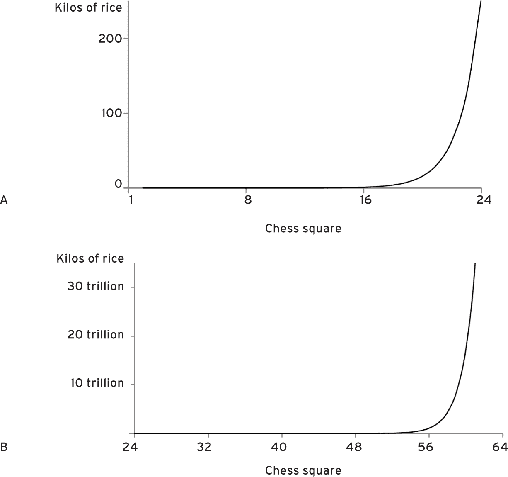

>

> 图 5：图表显示为了满足智者的要求，每个棋盘方格需要多少公斤的米；A，方格 1–24（y 轴显示数百公斤）；B，方格 24–64（y 轴显示数十万亿公斤）

>

> ## 计算机中的指数进步

>

> 对雷·库兹韦尔来说，计算机时代为指数寓言提供了现实世界的对应物。1965 年，英特尔公司联合创始人戈登·摩尔发现了一种趋势，后来被称为摩尔定律：计算机芯片上的元件数量大约每一到两年翻一番。换句话说，元件正在变得指数级地更小（也更便宜），计算机速度和内存正在以指数速率增加。

>

> 库兹韦尔的书中充满了像 图 5 这样的图表，以及对这些指数进步趋势的外推，沿着摩尔定律的思路，是他对人工智能预测的核心。库兹韦尔指出，如果趋势继续（正如他相信的那样），一台 1000 美元的计算机将“实现人脑能力（每秒 10¹⁶次计算）……大约在 2023 年左右。”^()

>

> ## 神经工程

>

> 对大脑进行逆向工程意味着足够了解其工作原理以便复制它，或者至少利用大脑的基本原理在计算机中复制其智能。库兹韦尔认为，这种逆向工程是创造人类水平人工智能的一种实用的近期方法。大多数神经科学家会强烈反对，鉴于目前对大脑工作原理知之甚少。但库兹韦尔的论点再次建立在指数趋势之上——这次是神经科学的进步。2002 年他写道，“对所需趋势的仔细分析表明，我们将在三十年之内理解人脑的运作原理，并能够在合成物质中重现其能力。”^()

>

> 几乎没有神经科学家同意他们领域的这一乐观预测。但即使可以创建一台基于大脑原理运行的机器，它将如何学习所有被认为智能所需的知识呢？毕竟，新生婴儿有大脑，但还没有我们所说的人类水平智能。库兹韦尔同意：“大脑的大部分复杂性来自其与复杂世界的相互作用。因此，有必要为人工智能提供教育，就像我们对待自然智能一样。”^()

>

> 当然，提供教育可能需要很多年。库兹韦尔认为这个过程可以大大加速。“当代电子学已经比人类神经系统的电化学信息处理快一千多万倍。一旦人工智能掌握了人类的基本语言技能，它将能够通过快速阅读所有人类文学以及吸收数百万个网站中包含的知识，来扩展其语言技能和一般知识。”^()

>

> 库兹韦尔对这一切将如何发生含糊其辞，但向我们保证，要实现人类水平的人工智能，“我们不会像某些庞大的专家系统那样，逐条链接地编程人类智能。相反，我们将建立一个复杂的自组织系统层次结构，主要基于对人脑的逆向工程，然后为其提供教育……其速度比人类的可比过程快数百甚至数千倍。”^()

>

> ## 奇点怀疑者与信徒


> 对库兹韦尔的著作《精神机器的时代》（1999）和《奇点临近》（2005）的反应往往是两极分化：要么热情拥抱，要么轻蔑怀疑。当我阅读库兹韦尔的著作时，我（现在仍然）属于后者。我完全不相信他那大量的指数曲线，也不相信他关于逆向工程大脑的论点。是的，深蓝在国际象棋中击败了卡斯帕罗夫，但在大多数其他领域，人工智能远低于人类水平。库兹韦尔预测人工智能将在短短几十年内与我们平起平坐，在我看来这简直是过于乐观了。

>

> 我认识的大多数人也同样持怀疑态度。主流人工智能的态度在记者莫琳·道的一篇文章中得到了完美体现：她描述了斯坦福大学著名人工智能研究人员安德鲁·吴在她提到库兹韦尔时翻白眼，说：“每当我读到库兹韦尔的`Singularity`，我的眼睛就不由自主地翻白眼。”^()

>

> 另一方面，库兹韦尔的思想有许多拥护者。他的大多数书籍都是畅销书，并在严肃出版物上获得了积极评价。《时代》杂志关于奇点宣称：“这不是一个边缘想法；这是一个关于地球生命未来的严肃假设。”^()

>

> 库兹韦尔的思想在科技行业尤其有影响力，那里的人们常常相信指数级技术进步是解决社会所有问题的手段。库兹韦尔不仅是谷歌的工程总监，还是与他的未来主义企业家同事彼得·迪亚蒙迪斯共同创办了奇点大学（SU），这是一个“超人类主义”智库、初创企业孵化器，有时也是科技精英的夏令营。SU 的公开使命是“教育、激励并赋能领导者，运用指数技术应对人类面临的重大挑战。”^()

>

> 道格拉斯·霍夫施塔特是一位——再次让我感到惊讶——在奇点怀疑与担忧之间摇摆不定的思想家。他告诉我，他对库兹韦尔的书籍感到不安，因为这些书籍“将最离奇的科幻场景与非常明确的事实混杂在一起。”当我争论时，霍夫施塔特指出，从几年后的视角来看，库兹韦尔做出的每一个看似疯狂的预测，他也常常预测了一些令人惊讶地已经实现或即将实现的事情。到 2030 年代，“‘体验束缚器’……是否会将其全部感官体验以及情绪反应的神经相关物发布到网络上”？^()

>

> 霍夫施塔特指出了库兹韦尔巧妙运用霍夫施塔特所谓的“克里斯托弗·哥伦布策略”，^()

## 赌注与图灵测试

>

> 作为一种职业选择，“未来学家”是一份不错的工作，如果你能找到的话。你写书做出预测，这些预测在数十年内无法评估，其最终有效性也不会影响你当下的声誉——或你的书籍销量。2002 年，一个名为 Long Bets 的网站被创建，以帮助让未来学家保持诚实。Long Bets 是“一个用于竞争性、可问责预测的竞技场”，^()

>

> 在做出这个赌注时，卡波和库兹韦尔必须——与图灵不同——仔细书面规定他们的图灵测试将如何进行。他们从几个必要的定义开始。“人类是指在 2001 年理解的生物学意义上的人，其智力未通过使用机器（即非生物）智能得到增强。……计算机是任何形式的非生物智能（硬件和软件），可能包括任何形式的技术，但不能是生物人类（无论是否增强）也不能是生物神经元（然而，生物神经元的非生物模拟是允许的）。”^()

>

> 赌注的条款还规定，测试将由三名人类评委进行，他们将采访计算机参赛者以及三名人类“陪衬者”。所有四名参赛者都会试图说服评委他们是人类。评委和人类陪衬者将由一个“图灵测试委员会”选出，该委员会由卡波、库兹韦尔（或其指定人员）以及第三名成员组成。与五分钟的聊天不同，四名参赛者中的每一位都将由每位评委进行为期两个小时的艰苦采访。在所有这些采访结束后，每位评委将对每位参赛者给出裁决（“人类”或“机器”）。“如果计算机让三名人类评委中有两名或以上认为它是人类，则计算机被视为通过了‘图灵测试人类判定测试’。”^()

>

> 但我们还没有结束：

>

> > 此外，三名图灵测试评委中的每一位都将对四名候选人进行从 1（最不像人类）到 4（最像人类）的排名。如果计算机的中位排名等于或高于三名图灵测试人类陪衬者中两名或以上的中位排名，则计算机被视为通过了“图灵测试排名顺序测试”。

> >

> > * * *

> >

> > 如果计算机同时通过了图灵测试人类判定测试和图灵测试排名顺序测试，则计算机被视为通过了图灵测试。

> >

> > * * *

> >

> > 如果计算机在 2029 年结束之前，如上所述通过了图灵测试，那么雷·库兹韦尔赢得赌注。否则，米切尔·卡波赢得赌注。^()

> >

> > 哇，相当严格。尤金·古斯特曼根本没有机会。我不得不（谨慎地）同意库兹韦尔的这一评估：“在我看来，没有一套技巧或更简单的算法（即比支撑人类智能的算法更简单的方法）能使机器在没有真正具备完全人类水平智能的情况下通过一个设计良好的图灵测试。”^()

> >

> > 除了制定长期赌注的规则外，卡波和库兹韦尔都撰写了伴随文章，阐述了各自认为自己会获胜的原因。库兹韦尔的文章总结了他书中提出的论点：计算、神经科学和纳米技术的指数级进步，这些进步合在一起将允许对大脑进行逆向工程。

> >

> > 卡波不买账。他的主要论点集中在我们（人类）的身体和情感对认知的影响上。“对环境的感知和\[物理\]交互是塑造体验的认知的平等伙伴。……\[情感\]界定并塑造了可思考事物的范围。”^()

> >

> > > 我断言，人类学习的基本模式是经验性的。书本学习是其上的一个层次。……如果人类知识，尤其是关于经验的知识，在很大程度上是隐性的，即从未直接和明确地表达出来，那么它就不会出现在书本中，库兹韦尔的知识获取方法将会失败。……问题不在于计算机知道什么，而在于计算机不知道和无法知道什么。^()

> > >

> > > 库兹韦尔回应说，他同意卡波关于经验学习、隐性知识和情感的作用，但他相信在 2030 年代之前，虚拟现实将变得“完全逼真”，^()

> > >

> > > 你是否像卡波一样对库兹韦尔的预测持怀疑态度？库兹韦尔说这是因为你不理解指数增长。“一般来说，我与批评者的分歧核心在于，他们会说，哦，库兹韦尔低估了逆向工程人类大脑或生物学的复杂性。但我不认为我低估了挑战。我认为他们低估了指数增长的力量。”^()


> Kurzweil 的怀疑者指出了这一论点中的几个漏洞。诚然，过去五十年来计算机硬件呈指数级进步，但有许多理由相信这一趋势在未来不会持续。（Kurzweil 当然对此持异议。）但更重要的是，计算机 `software` 并未表现出同样的指数级进步；很难认为当今的软件比五十年前的软件在指数级上更加复杂或更像大脑，或者认为这样的趋势曾经存在过。Kurzweil 关于神经科学和虚拟现实中指数级趋势的说法也备受质疑。

> 但正如奇异点论者所指出的，有时当你身处其中时，很难看到指数级趋势。如果你看一眼像 `figure 5` 这样的指数曲线，Kurzweil 和他的追随者想象我们正处于曲线缓慢上升的那个点，对我们来说看起来像是渐进式进步，但这具有欺骗性：增长即将爆发。

> 当前的人工智能春天，正如许多人所声称的，是即将到来的爆发的第一个先兆吗？还是说它仅仅是缓慢、渐进式增长曲线上的一个途径，在至少一个世纪内都不会导致人类水平的人工智能？还是说它只是又一个人工智能泡沫，很快将随之而来另一个人工智能寒冬？

> 为了帮助我们对这些问题有所了解，我们需要仔细审视支撑我们独特人类智能的一些关键能力，例如感知、语言、决策、常识推理和学习。在接下来的章节中，我们将看到人工智能在捕捉这些能力方面取得了多大进展，并将评估其前景，针对 2029 年及以后。

## Part II

## Looking and Seeing

## 4

## Who, What, When, Where, Why

看看 `figure 6` 中的照片，告诉我你看到了什么。一个女人在抚摸一只狗。一个 `soldier` 在抚摸一只狗。一名刚从战争归来的士兵，被她的狗欢迎，还有花朵和一个“欢迎回家”的气球。士兵的脸上展现出她复杂的情绪。狗正高兴地摇着尾巴。

这张照片是什么时候拍的？很可能是在过去十年内。这张照片在哪里拍摄的？很可能是一个机场。为什么士兵在抚摸狗？她可能已经离开很长时间，经历了许多事情，既有好的也有坏的，非常想念她的狗，并且很高兴回家。也许狗是“家”的象征。在这张照片拍摄前发生了什么？士兵可能刚下飞机，穿过机场的安检区域，来到乘客可以被迎接的地方。她的家人或朋友用拥抱迎接她，递给她花朵和气球，并放开了狗的牵引绳。狗走到士兵面前，她放下了手里拿的一切，跪了下来，小心地把气球的绳子放在膝盖下，以防它飘走。接下来会发生什么？她可能会站起来，也许擦掉一些眼泪，收拾起她的花朵、气球和笔记本电脑，拿起狗的牵引绳，和狗以及她的家人或朋友一起走向行李提取区。


FIGURE 6: What do you see in this photo?

当你看这张图片时，在最基本的层面上，你看到的是纸上的墨迹（或屏幕上的像素）。不知何故，你的眼睛和大脑能够吸收这些原始信息，并在几秒钟内将其转化为一个涉及生物、物体、关系、地点、情感、动机以及过去和未来行为的详细故事。我们看，我们看见，我们理解。至关重要的是，我们知道该忽略什么。照片中有许多方面与我们从中提取的故事并不严格相关：地毯上的图案，士兵背包上的悬挂带子，夹在她背包肩垫上的口哨，她头发上的发夹。

我们人类在几乎不花任何时间的情况下完成了这项巨大的信息处理，并且几乎没有（如果有的话）意识到自己在做什么或如何做到这一点。除非你从出生起就失明，否则视觉处理，在各种抽象层面上，都主导着你的大脑。

毫无疑问，能够以这种方式描述照片（或视频，或来自摄像头的实时流）的内容，将是我们要求通用人类水平人工智能的首要事情之一。

## Easy Things Are Hard (Especially in Vision)

自 20 世纪 50 年代以来，人工智能研究人员一直在努力让计算机理解视觉数据。在人工智能的早期，实现这一目标似乎相对简单。1966 年，Marvin Minsky 和 Seymour Papert——你还记得第一章中提到的那些倡导符号人工智能的麻省理工学院教授——提出了暑期视觉项目，他们将分配本科生来开展“构建视觉系统的重要部分”的工作。^()

本科生并没有取得很大进展。而且，尽管自那个暑期项目以来，被称为计算机视觉的人工智能子领域在许多十年中取得了实质性进展，但一个能够像人类那样观看和描述照片的程序似乎仍然遥不可及。视觉——无论是 `looking` 还是 `seeing`——结果证明是所有“容易”的事情中最难的一种之一。

描述视觉输入的一个先决条件是 `object recognition`——也就是说，将图像中特定的一组像素识别为特定的对象类别，例如“女人”、“狗”、“气球”或“笔记本电脑”。对我们人类来说，对象识别通常是如此即时和轻松，以至于它似乎不会对计算机构成特别难的问题，直到人工智能研究人员实际上尝试让计算机去做它。

对象识别有什么难的呢？嗯，考虑让计算机程序在照片中识别狗的问题。`Figure 7` 说明了一些困难。如果输入仅仅是图像的像素，那么程序首先必须弄清楚哪些是“狗”像素，哪些是“非狗”像素（例如，背景、阴影、其他物体）。此外，不同的狗看起来非常不同：它们可以有多样的颜色、形状和大小；它们可以面向各个方向；不同图像之间的光照可能差异很大；狗的部分可能被其他物体遮挡（例如，栅栏、人）。更重要的是，“狗像素”可能看起来很像“猫像素”或其他动物。在某些光照条件下，天空中的云朵甚至可能看起来非常像一只狗。

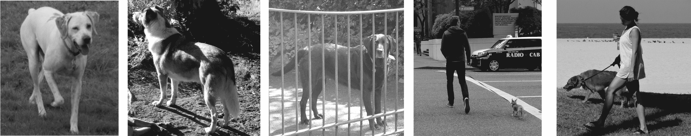

FIGURE 7: Object recognition: easy for humans, hard for computers

自 20 世纪 50 年代以来，计算机视觉领域一直在与这些及其他问题作斗争。直到最近，计算机视觉研究人员的一项主要工作是开发专门的图像处理算法，以识别对象的“不变特征”，这些特征可以用于在尽管存在我上面概述的困难的情况下识别这些对象。但是，即使有了复杂的图像处理，对象识别程序的能力仍然远低于人类。

## The Deep-Learning Revolution

机器在图像和视频中识别对象的能力在 2010 年代由于深度学习领域的进步而发生了飞跃。


深度学习简单来说就是训练“深度神经网络”的方法，而深度神经网络指的是拥有多个隐藏层的神经网络。请回顾，`hidden` 层是神经网络中位于输入层和输出层之间的那些层。网络的 `depth` 是指其隐藏层的数量：“浅层”网络——如第 2 章中所见的网络——只有一个隐藏层；“深层”网络则拥有多个隐藏层。值得强调的是这个定义：深度学习中的 `deep` 并不指学习内容的复杂程度，而仅指被训练网络的 `depth in layers`（层深度）。

对深度神经网络的研究已进行了数十年。使这些网络成为一场革命的是它们在许多 AI 任务中近期取得的非凡成功。有趣的是，研究人员发现，最成功的深度网络是那些结构模仿大脑视觉系统部分的网络。我在第 2 章中描述的“传统”多层神经网络受大脑启发，但其结构非常不像大脑。相比之下，主导深度学习的神经网络直接基于神经科学的发现进行建模。

## 大脑、新认知机与卷积神经网络

大约在明斯基和帕珀特提出他们的“暑期视觉项目”的同时，两位神经科学家正在进行一项长达数十年的研究，这项研究将从根本上改变我们对大脑中视觉——尤其是物体识别——的理解。大卫·休贝尔和托尔斯滕·威塞尔后来因其在猫和灵长类动物（包括人类）视觉系统中发现层级组织，以及解释视觉系统如何将落在视网膜上的光线转化为关于场景内容的信息而获得诺贝尔奖。

休贝尔和威塞尔的发现启发了一位名叫福岛邦彦的日本工程师，他在 20 世纪 70 年代开发了最早的深度神经网络之一，称为认知机，以及其后继者——新认知机。在他的论文中，^()

`ConvNets` 是当今计算机视觉以及其他领域深度学习革命的 `the` 驱动力。尽管它们被广泛誉为 AI 领域的下一个大事件，但 `ConvNets` 实际上并不新：它们最早由法国计算机科学家扬·勒昆在 20 世纪 80 年代提出，勒昆受福岛邦彦的新认知机启发。

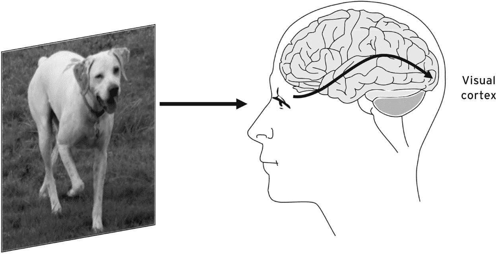

FIGURE 8: Pathway of visual input from eyes to visual cortex

我将花些时间在这里描述 ConvNets 的工作原理，因为理解它们对于理解计算机视觉——以及 AI 中许多其他方面——的现状及其局限性至关重要。

## 大脑与 ConvNets 中的物体识别

与新认知机一样，ConvNets 的设计基于休贝尔和威塞尔在 20 世纪 50 年代和 60 年代发现的关于大脑视觉系统的几个关键洞察。当你的眼睛聚焦于一个场景时，它们接收到的是场景中物体和表面反射的不同波长的光线。落在眼睛上的光线激活了每个视网膜中的细胞——本质上是眼睛后部的一组神经元网格。这些神经元通过视神经将其激活传递到大脑，最终激活位于头部后部的视觉皮层中的神经元（figure 8）。视觉皮层大致组织为神经元的层级系列 `layers`，像婚礼蛋糕的堆叠层一样，每一层的神经元将其激活传递给下一层的神经元。

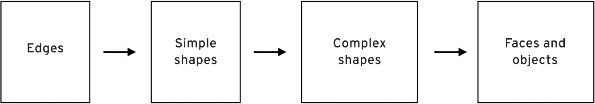

FIGURE 9: Sketch of visual features detected by neurons in different layers of the visual cortex

休贝尔和威塞尔发现证据表明，这个层级中不同层的神经元充当“探测器”，对视觉场景中出现的越来越复杂的特征做出反应，如 figure 9 所示：初始层的神经元对边缘变得活跃（即以较高速率放电）；它们的激活传递到由这些边缘组成的简单形状的神经元层；以此类推，经过更复杂的形状，最终是整个物体和特定面孔。请注意，figure 9 中的箭头表示 `bottom-up`（或 `feed-forward`）信息流，代表从较低层到较高层的连接（在图中，从左到右）。重要的是要注意，`top-down`（或 `feed-backward`）信息流（从较高层到较低层）也发生在视觉皮层中；事实上，反馈连接的数量大约是前馈连接的十倍。然而，这些反向连接的作用尚未被神经科学家充分理解，尽管已确立我们的先前知识和期望（ presumably 存储在较高的大脑层中）强烈影响我们所感知的内容。

与 figure 9 中所示的前馈层级结构类似，ConvNet 由一系列模拟神经元的层组成。我将再次将这些模拟神经元称为 `units`。每一层中的 units 为下一层中的 units 提供输入。就像我在第 2 章中描述的神经网络一样，当 ConvNet 处理图像时，每个 unit 都会采取特定的 `activation` 值——一个由 unit 的输入及其权重计算得出的实数。

让我们通过想象一个假设的 ConvNet 来使此讨论更具体，该网络有四层加一个“分类模块”，我们希望训练它来识别图像中的狗和猫。为简单起见，假设每个输入图像恰好描绘一只狗或猫。Figure 10 说明了我们 ConvNet 的结构。它有点复杂，所以我将逐步仔细地讲解以解释其工作原理。

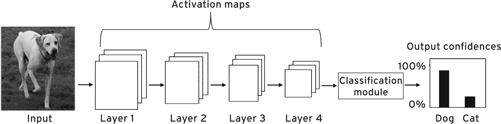

FIGURE 10: Illustration of a four-layer convolutional neural network (ConvNet) designed to recognize dogs and cats in photos

### 输入和输出

我们 ConvNet 的输入是一张图像——即一组数字，对应图像像素的亮度和颜色。^()

### 激活图

请注意在 figure 10 中，网络的每一层都由一组三个重叠的矩形表示。这些矩形代表 `activation maps`，灵感来自大脑视觉系统中发现的类似“地图”。休贝尔和威塞尔发现，视觉皮层较低层的神经元在物理上排列成粗略的网格，网格中的每个神经元对视觉场中相应的小区域做出反应。想象一下，你在夜晚乘坐飞机飞越洛杉矶并拍摄一张照片；照片中的灯光形成了点亮城市特征的粗略地图。类似地，视觉皮层中每个网格状层的神经元激活形成了视觉场景中重要特征的粗略地图。现在想象一下，你有一台非常特殊的相机，可以分别为房屋灯光、建筑物灯光和汽车灯光生成照片。这有点像视觉皮层所做的事情：每个重要的视觉特征都有其自己的独立神经地图。这些地图的组合是产生我们对场景感知的关键部分。

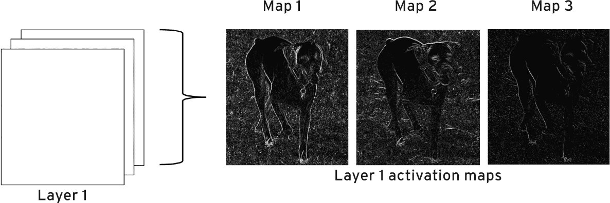

FIGURE 11: Activation maps in the first layer of our ConvNet


## 卷积神经网络中的特征检测与分类

Like neurons in the visual cortex, the units in a ConvNet act as detectors for important visual features, each unit looking for its designated feature in a specific part of the visual field. And (very roughly) like the visual cortex, each layer in a ConvNet consists of several grids of these units, with each grid forming an activation map for a specific visual feature.

What visual features should ConvNet units detect? Let’s look to the brain first. Hubel and Wiesel found that neurons in lower layers of the visual cortex act as edge detectors, where an `edge` refers to a boundary between two contrasting image regions. Each neuron receives input corresponding to a specific small region of the visual scene; this region is called the neuron’s receptive field. The neuron becomes active (that is, starts firing more rapidly) only if its receptive field contains a particular kind of edge.

In fact, these neurons are quite specific about what kind of edge they respond to. Some neurons become active only when there is a vertical edge in their receptive field; some respond only to a horizontal edge; others fire only for edges at other specific angles. One of Hubel and Wiesel’s most important findings was that each small region of your visual field corresponds to the receptive fields of many different such “edge detector” neurons. That is, at a low level of visual processing, your neurons are figuring out what edge orientations occur in every part of the scene you are looking at. Edge-detecting neurons feed into higher layers of the visual cortex, the neurons of which seem to be detectors for specific shapes, objects, and faces.^()

Similarly, the first layer of our hypothetical ConvNet consists of edge-detecting units. Figure 11 gives a closer view of layer 1 of our ConvNet. This layer consists of three activation maps, each of which is a grid of units. Each unit in a map corresponds to the analogous location in the input image, and each unit gets its input from a small region around that location—its receptive field. (The receptive fields of neighboring units typically overlap.) Each unit in each map calculates an activation value that measures the degree to which the region “matches” the unit’s preferred edge orientation—for example, vertical, horizontal, or slanted at various degrees.


FIGURE 12: Illustration of how convolutions are used to detect vertical edges. For example, a convolution of the upper receptive field with the weights is (200 × 1) + (110 × 0) + (70 × −1) + (190 × 1) + (90 × 0) + (80 × −1) + (220 × 1) + (70 × 0) + (50 × −1) = 410.

Figure 12 illustrates in detail how the units in map 1—those that detect vertical edges—calculate their activations. The small white squares in the input image represent the receptive fields of two different units. The image patches inside these receptive fields, when enlarged, are shown as arrays of pixel values. Here, for simplicity, I’ve displayed each patch as a three-by-three set of pixels (the values, by convention, range from 0 to 255—the lighter the pixel, the higher the value). Each unit receives as input the pixel values in its receptive field. The unit then multiplies each input by its weight and sums the results to produce the unit’s activation.

The weights shown in figure 12 are designed to produce a high positive activation when there is a light-to-dark vertical edge in the receptive field (that is, high contrast between the left and the right sides of the input patch). The upper receptive field contains a vertical edge: the dog’s light fur next to the darker grass. This is reflected in the high activation value (410). The lower receptive field does not contain such an edge, only dark grass, and the activation (−10) is closer to 0. Note that a dark-to-light vertical edge will yield a “high” negative value (that is, a negative value far from 0).

This calculation—multiplying each value in a receptive field by its corresponding weight and summing the results—is called a convolution. Hence the name “convolutional neural network.” I mentioned above that in a ConvNet, an activation map is a grid of units corresponding to receptive fields all over the image. Each unit in a given activation map uses the same weights to compute a convolution with its receptive field; imagine the input image with the white square sliding along every patch of the image.^()

Let’s take a moment to talk about the word `map` here. In everyday use, `map` refers to a spatial representation of a geographic area, such as a city. A road map of Paris, say, shows a particular `feature` of the city—its layout of streets, avenues, and alleys—but doesn’t include the city’s many other features, such as buildings, houses, lampposts, trash cans, apple trees, and fishponds. Other kinds of maps focus on other features; you can find maps that highlight Paris’s bike lanes, its vegetarian restaurants, its dog-friendly parks. Whatever your interests, there is quite possibly a map that shows where to find them. If you wanted to explain Paris to a friend who had never been there, a creative approach might be to show your friend a collection of such “special interest” maps of the city.

A ConvNet (like the brain) represents the visual scene as a collection of maps, reflecting the specific “interests” of a set of detectors. In my example in figure 11, these interests are different edge orientations. However, as we’ll see below, in ConvNets the network itself `learns` what its interests (that is, detectors) should be; these depend on the specific task it is trained for.

Making maps isn’t limited to layer 1 of our ConvNet. As you can see in figure 10, a similar structure applies at all of the layers: each layer has a set of detectors, each of which creates its own activation map. A key to the ConvNet’s success is that—again, inspired by the brain—these maps are `hierarchical`: the inputs to the units at layer 2 are the activation maps of layer 1, the inputs to the units at layer 3 are the activation maps of layer 2, and so on up the layers. In our hypothetical network, in which layer 1 units respond to edges, the layer 2 units would be sensitive to specific combinations of edges, such as corners and T shapes. Layer 3 detectors would be sensitive to combinations of combinations of edges. As you go up the hierarchy, the detectors become sensitive to increasingly more complex features, just as Hubel, Wiesel, and others saw in the brain.

Our hypothetical ConvNet has four layers, each with three maps, but in the real world these networks can have many more layers—sometimes hundreds—each with different numbers of activation maps. Determining these and many other aspects of a ConvNet’s structure is part of the art of getting these complex networks to work for a given task. In chapter 3, I described I. J. Good’s vision of a future “intelligence explosion” in which machines themselves create increasingly intelligent machines. We’re not there yet. For the time being, getting ConvNets to work well requires a lot of human ingenuity.

## Classification in ConvNets


网络的第 1 到第 4 层被称为卷积层，因为每一层都会对前一层执行卷积操作（第 1 层则对输入执行卷积）。给定一张输入图像，每一层依次进行计算，最终在第 4 层，网络生成了一组针对相对复杂特征的激活图。这些特征可能包括眼睛、腿部形状、尾巴形状，或者网络学习到的任何其他有助于对其训练对象（此处为狗和猫）进行分类的内容。此时，分类模块需要使用这些特征来预测图像中描绘的是什么物体。

分类模块实际上是一个完整的传统神经网络，类似于我在第 2 章中描述的那种。^()

让我简要总结一下卷积网络（ConvNet）的原理：受 Hubel 和 Wiesel 关于大脑视觉皮层的研究启发，ConvNet 接收一张输入图像，并通过卷积将其转换为一组特征日益复杂的激活图。最高卷积层的特征被输入到一个传统神经网络（我称之为分类模块），该网络输出网络已知物体类别的置信度百分比。置信度最高的物体类别将被作为网络对图像的分类结果返回。^()

你想尝试一个训练有素的 ConvNet 吗？只需拍摄一张物体照片，并将其上传到 Google 的“以图搜图”引擎即可。^()

## 训练 ConvNet

我们假设的 ConvNet 第一层包含边缘检测器，但在实际的 ConvNet 中，边缘检测器并不是内置的。相反，ConvNet 从训练示例中学习每一层应该检测什么特征，以及如何设置分类模块中的权重，以便为正确答案产生高置信度。并且，就像传统神经网络一样，所有权重都可以通过数据使用我在第 2 章中描述的相同的反向传播算法来学习。

更具体地说，以下是如何训练我们的 ConvNet 来识别给定图像是狗还是猫。首先，收集大量狗和猫的示例图像——这就是你的“训练集”。另外，创建一个为每张图像提供标签的文件——即“狗”或“猫”。（或者更好，向计算机视觉研究人员取经：雇佣一名研究生来为你做所有这些工作。如果你是研究生，那就招募一个本科生吧。没有人喜欢这个标签工作！）你的训练程序最初将网络中的所有权重设置为随机值。然后你的程序开始训练：一次一张，每张图像作为输入传递给网络；网络执行逐层计算，最后输出“狗”和“猫”的置信度百分比。对于每张图像，你的训练程序将这些输出值与“正确”值进行比较；例如，如果图像是一只狗，那么“狗”的置信度应该是 100%，而“猫”的置信度应该是 0%。然后训练程序使用反向传播算法稍微改变整个网络中的权重，以便下次再次看到这张图像时，置信度会更接近正确值。

对训练集中的每张图像执行这一过程——输入图像，然后计算输出处的误差，然后更改权重——被称为一次“时代”的训练。训练 ConvNet 需要许多个时代，在此期间网络一次又一次地处理每张图像。起初，网络在识别狗和猫方面会非常糟糕，但慢慢地，随着它在许多个时代中改变权重，它将在该任务上变得越来越好。最终，在某个时刻，网络会“收敛”；也就是说，权重从一个时代到下一个时代变化不大，网络在（原则上！）识别训练集中的狗和猫图像方面表现非常出色。但我们无法知道网络是否真的擅长这项任务，直到我们看看它是否能将所学知识应用于识别其训练集之外的图像。真正有趣的是，尽管 ConvNet 没有被程序员限制去学习检测任何特定特征，但在大量真实世界照片上训练时，它们确实似乎学习了一种类似于 Hubel 和 Wiesel 在大脑视觉系统中发现的检测器层次结构。

在下一章中，我将讲述 ConvNet 从相对默默无闻到在机器视觉领域近乎完全统治的非凡崛起，这一转变得益于一场同步的技术革命：即“大数据”的革命。

## 5

## ConvNets 和 ImageNet

Yann LeCun，ConvNet 的发明者，毕生都在研究神经网络，从 20 世纪 80 年代开始，一直持续到该领域的寒冬与春天。作为研究生和博士后研究员，他对 Rosenblatt 的感知机和 Fukushima 的神经认知机着迷，但指出后者缺乏一个良好的监督学习算法。与其他研究人员（尤其是他的博士后导师 Geoffrey Hinton）一起，LeCun 帮助开发了这种学习方法——本质上就是今天用于 ConvNet 的相同形式的反向传播。^()

在 20 世纪 80 年代和 90 年代，在贝尔实验室工作期间，LeCun 转向解决手写数字和字母识别的问题。他将神经认知机的思想与反向传播算法相结合，创造了半以名字命名的“LeNet”——最早的 ConvNet 之一。LeNet 的手写数字识别能力使其取得了商业成功：在 20 世纪 90 年代和 21 世纪初，它被美国邮政局用于自动邮政编码识别，也被银行业用于自动读取支票上的数字。

LeNet 及其后续 ConvNet 在扩展到更复杂的视觉任务方面表现不佳。到 20 世纪 90 年代中期，神经网络在 AI 社区开始失宠，其他方法开始主导该领域。但 LeCun 仍然是一个信徒，继续研究 ConvNet，逐步改进它们。正如 Geoffrey Hinton 后来对 LeCun 所说：“他在黑暗时代一直举着火炬。”^()

LeCun、Hinton 和其他神经网络忠实者相信，改进的、更大的 ConvNet 和其他深度网络将征服计算机视觉，只要它们能用足够的数据进行训练。他们固执地在整个 2000 年代继续在边缘工作。2012 年，ConvNet 研究人员举起的火炬突然点燃了视觉世界，因为他们在一个名为 ImageNet 的图像数据集上赢得了一场计算机视觉竞赛。

## 构建 ImageNet

AI 研究人员是一群好竞争的人，所以他们喜欢组织竞赛来推动领域发展并不奇怪。在视觉对象识别领域，研究人员长期举办年度竞赛，以确定谁的程序表现最好。这些竞赛中的每一个都有一个“基准数据集”：一组照片，以及标记照片中物体的人工创建的标签。

从 2005 年到 2010 年，最突出的年度竞赛是 PASCAL 视觉对象类别竞赛，到 2010 年，该竞赛包含约一万五千张照片（从照片共享网站 Flickr 下载），并为二十个物体类别（如“人”、“狗”、“马”、“羊”、“汽车”、“自行车”、“沙发”和“盆栽植物”）提供了人工创建的标签。

该竞赛“分类”部分的参赛作品^()


Here’s how the competition worked. The organizers would split the photographs into a training set that contestants could use to train their programs and a test set, not released to contestants, that would be used to gauge the programs’ performance on images outside the training set. Prior to the competition, the training set would be offered online, and when the contest was held, researchers would submit their trained programs to be tested on the secret test set. The winning entry was the one that had the highest accuracy recognizing objects in the test-set images.

The annual PASCAL competitions were a very big deal and did a lot to spur research in object recognition. Over the years of the challenge, the competing programs gradually got better (curiously, potted plants remained the hardest objects to recognize). However, some researchers were frustrated by the shortcomings of the PASCAL benchmark as a way to move computer vision forward. Contestants were focusing too much on PASCAL’s specific twenty object categories and were not building systems that could scale up to the huge number of object categories recognized by humans. Furthermore, there just weren’t enough photos in the data set for the competing systems to learn all the many possible variations in what the objects look like so as to be able to generalize well.

To move ahead, the field needed a new benchmark image collection, one featuring a much larger set of categories and vastly more photos. Fei-Fei Li, a young computer-vision professor at Princeton, was particularly focused on this goal. By serendipity, she learned of a project led by a fellow Princeton professor, the psychologist George Miller, to create a database of English words, arranged in a hierarchy moving from most specific to most general, with groupings among synonyms. For example, consider the word `cappuccino`. The database, called WordNet, contains the following information about this term (where an arrow means “is a kind of”):

> `cappuccino` ⇒ `coffee` ⇒ `beverage` ⇒ `food` ⇒ `substance` ⇒ `physical entity` ⇒ `entity`

The database also contains information that, say, `beverage`, `drink`, and `potable` are synonyms, that `beverage` is part of another chain including `liquid`, and so forth.

WordNet had been (and continues to be) used extensively in research by psychologists and linguists as well as in AI natural-language processing systems, but Fei-Fei Li had a new idea: create an image database that is structured according to the nouns in WordNet, where each noun is linked to a large number of images containing examples of that noun. Thus the idea for ImageNet was born.

Li and her collaborators soon commenced collecting a deluge of images by using WordNet nouns as queries on image search engines such as Flickr and Google image search. However, if you’ve ever used an image search engine, you know that the results of a query are often far from perfect. For example, if you type “macintosh apple” into Google image search, you get photos not only of apples and Mac computers but also of apple-shaped candles, smartphones, bottles of apple wine, and any number of other nonrelevant items. Thus, Li and her colleagues had to have humans figure out which images were not actually illustrations of a given noun and get rid of them. At first, the humans who did this were mainly undergraduates. The work was agonizingly slow and taxing. Li soon figured out that at the rate they were going, it would take ninety years to complete the task.^()

Li and her collaborators brainstormed about possible ways to automate this work, but of course the problem of deciding if a photo is an instance of a particular noun `is` the task of object recognition itself! And computers were nowhere near to being reliable at this task, which was the whole reason for constructing ImageNet in the first place.

The group was at an impasse, until Li, by chance, stumbled upon a three-year-old website that could deliver the human smarts that ImageNet required. The website had the strange name Amazon Mechanical Turk.

## Mechanical Turk

According to Amazon, its Mechanical Turk service is “a marketplace for work that requires human intelligence.” The service connects `requesters`, people who need a task accomplished that is hard for computers, with `workers`, people who are willing to lend their human intelligence to a requester’s task, for a small fee (for example, labeling the objects in a photo, for ten cents per photo). Hundreds of thousands of workers have signed up, from all over the world. Mechanical Turk is the embodiment of Marvin Minsky’s “Easy things are hard” dictum: the human workers are hired to perform the “easy” tasks that are currently too hard for computers.

The name Mechanical Turk comes from a famous eighteenth-century AI hoax: the original Mechanical Turk was a chess-playing “intelligent machine,” which secretly hid a human who controlled a puppet (the “Turk,” dressed like an Ottoman sultan) that made the moves. Evidently, it fooled many prominent people of the time, including Napoleon Bonaparte. Amazon’s service, while not meant to fool anyone, is, like the original Mechanical Turk, “`Artificial` Artificial Intelligence.”^()

Fei-Fei Li realized that if her group paid tens of thousands of workers on Mechanical Turk to sort out irrelevant images for each of the WordNet terms, the whole data set could be completed within a few years at a relatively low cost. In a mere two years, more than three million images were labeled with corresponding WordNet nouns to form the ImageNet data set. For the ImageNet project, Mechanical Turk was “a godsend.”^()

## The ImageNet Competitions

In 2010, the ImageNet project launched the first ImageNet Large Scale Visual Recognition Challenge, in order to spur progress toward more general object-recognition algorithms. Thirty-five programs competed, representing computer-vision researchers from academia and industry around the world. The competitors were given labeled training images—1.2 million of them—and a list of possible categories. The task for the trained programs was to output the correct category of each input image. The ImageNet competition had a thousand possible categories, compared with PASCAL’s twenty.

The thousand possible categories were a subset of WordNet terms chosen by the organizers. The categories are a random-looking assembly of nouns, ranging from the familiar and commonplace (“lemon,” “castle,” “grand piano”) to the somewhat less common (“viaduct,” “hermit crab,” “metronome”), and on to the downright obscure (“Scottish deerhound,” “ruddy turnstone,” “hussar monkey”). In fact, obscure animals and plants—at least ones I wouldn’t be able to distinguish—constitute at least a tenth of the thousand target categories.

Some of the photographs contain only one object; others contain many objects, including the “correct” one. Because of this ambiguity, a program gets to guess five categories for each image, and if the correct one is in this list, the program is said to be correct on this image. This is called the “top-5” accuracy metric.

The highest-scoring program in 2010 used a so-called support vector machine, the predominant object-recognition algorithm of the day, which employed sophisticated mathematics to learn how to assign a category to each input image. Using the top-5 accuracy metric, this winning program was correct on 72 percent of the 150,000 test images. Not a bad showing, though this means that the program was wrong, even with five guesses allowed, on more than 40,000 of the test images, leaving a lot of room for improvement. Notably, there were no neural networks among the top-scoring programs.


第二年，得分最高的程序——同样使用支持向量机——取得了体面但有限的进步，正确识别了 74%的测试图像。该领域的大多数人预计这一趋势将继续；计算机视觉研究将逐步攻克问题，在每年一次的竞赛中取得渐进式的改进。

然而，这些预期在 2012 年 ImageNet 竞赛中被打破：获奖作品取得了惊人的 85%正确率。这种准确率的飞跃是一个令人震惊的发展。更重要的是，获奖作品没有使用支持向量机或当时任何其他主流的计算机视觉方法。相反，它是一个卷积神经网络。这个特定的 ConvNet 后来被称为 AlexNet，以其主要创建者 Alex Krizhevsky 命名，当时他是多伦多大学的研究生，由杰出的神经网络研究者 Geoffrey Hinton 指导。Krizhevsky 与 Hinton 和一位同学 Ilya Sutskever 合作，创建了 Yann LeCun 在 1990 年代的 LeNet 的扩展版本；训练如此大型的网络现在由于计算能力的提升而成为可能。AlexNet 有八层，约有六千万个权重，其值通过从百万多张训练图像的反向传播学习而得。^()

AlexNet 的成功在计算机视觉和更广泛的人工智能社区中引起了巨大震动，突然让人们意识到 ConvNets 的潜在威力，而大多数人工智能研究者此前并未将其视为现代计算机视觉中的严肃竞争者。在一篇 2015 年的文章中，记者 Tom Simonite 采访了 Yann LeCun，谈论 ConvNets 出人意料的胜利：

> LeCun 回忆起看到那个大多忽视神经网络的社区挤满房间，获奖者在那里展示关于其结果的论文。“你可以看到社区里很多资深人士就在那一刻改变了看法，”他说。“他们说，‘好吧，现在我们相信了。就是这样，现在——你赢了。’”^()

>

> 几乎在同一时间，Geoffrey Hinton 的团队也展示了，在大量标记数据上训练的深度神经网络在语音识别方面显著优于当时的最先进技术。多伦多团队在 ImageNet 和语音识别方面的成果产生了重大的连锁反应。一年之内，由 Hinton 创办的一家小公司被 Google 收购，Hinton 及其学生 Krizhevsky 和 Sutskever 成为 Google 员工。这次人才收购立即让 Google 处于深度学习的前沿。

>

> 不久之后，Yann LeCun 被 Facebook 从纽约大学的全职教授职位挖走，负责其新成立的人工智能实验室。没过多久，所有大型科技公司（以及许多小公司）都以最快的速度挖走深度学习专家及其研究生。仿佛一夜之间，深度学习成为人工智能最热门的部分，深度学习专家确保计算机科学家在硅谷获得高薪，或者更好的是，为他们不断增多的深度学习初创公司获得风险投资资金。

>

> 每年一次的 ImageNet 竞赛开始在媒体上获得更广泛的报道，并迅速从友好的学术竞赛转变为商业化计算机视觉的科技公司之间的高调较量。在 ImageNet 获胜将确保来自视觉社区的宝贵尊重，以及免费宣传，这可能转化为产品销售和更高的股价。生产出胜过竞争对手的程序的压力，在 2015 年涉及中国互联网巨头百度的一次作弊事件中表现得尤为明显。作弊涉及机器学习人员所谓的数据窥探的一个微妙示例。

>

> 事情是这样的：比赛前，每个在 ImageNet 上竞争的团队都获得了标记了正确对象类别的训练图像。他们还获得了一个大型测试集——不在训练集中的图像集合——没有任何标签。程序训练完成后，团队可以看到他们的方法在这个测试集上的表现如何。这有助于测试程序学习泛化的程度（而不是，比如说，记忆训练图像及其标签）。只有测试集上的表现才算数。团队了解其程序在测试集上表现如何的方法是：在每个测试集图像上运行程序，收集每个图像的前五个猜测，并将此列表提交给一个“测试服务器”——由竞赛组织者运行的计算机。测试服务器将提交的列表与（保密的）正确答案进行比较，并输出正确率百分比。

>

> 每个团队都可以在测试服务器上注册账户，并使用它来查看其程序各个版本的得分；这将允许他们在官方结果公布前发布（并宣传）他们的结果。

>

> 机器学习的一条基本规则是“不要在测试数据上训练”。这似乎显而易见：如果你在训练程序的任何部分包含测试数据，你就无法很好地衡量程序的泛化能力。这就像在考试前把期末考试的题目给学生看一样。但事实证明，有微妙的方式可以无意中（或故意）打破这条规则，使你的程序表现看起来比实际更好。

>

> 其中一种方法是：将你的程序在测试集上的答案提交给测试服务器，根据结果调整你的程序。然后再次提交。重复多次，直到你调整得能在测试集上表现更好。这不需要看到测试集中的实际标签，但确实需要获得准确性反馈并相应调整你的程序。事实证明，如果你能这样做足够多次，它在提高程序在测试集上的表现方面可能非常有效。但因为你正在使用来自测试集的信息来更改你的程序，你现在已经破坏了使用测试集来查看你的程序是否泛化良好的能力。这就像允许学生多次参加期末考试，每次只得到一个分数，但利用那个分数来尝试下次提高表现。最后，学生提交得分最高的那版答案。这不再是衡量学生学习该科目程度的好指标，只是衡量他们如何调整答案以适应特定考试问题的指标。

>

> 为了防止这种数据窥探，同时仍然允许 ImageNet 竞争者查看他们的程序表现如何，组织者制定了一条规则：每个团队每周最多只能向测试服务器提交答案两次。这将限制团队从测试运行中获取的反馈量。

>

> 2015 年的 ImageNet 大战围绕着零点几个百分点展开——看似微不足道，但可能非常有利可图。年初，百度的一个团队宣布了一种方法，在 ImageNet 测试集上达到了最高（top-5）准确率：确切地说，是 94.67%。但就在同一天，微软的一个团队宣布了他们方法的更好准确率：95.06%。几天后，谷歌的一个竞争对手团队宣布了一种略有不同的方法，表现更好：95.18%。这一纪录保持了几个月，直到百度做出新宣布：它改进了方法，现在可以宣称一个新纪录，95.42%。这一结果被百度的公关团队广泛宣传。

>

> 但几周内，ImageNet 组织者发布了一份简短的公告：“在 2014 年 11 月 28 日至 2015 年 5 月 13 日期间，至少有 30 个账户被一个百度团队用于向测试服务器提交至少 200 次，远远超过了每周两次提交的规定限制。”^()


> 这两百条反馈可能让百度团队确定哪些对程序的调整能使其在这套测试集上表现最佳，从而获得那至关重要的百分之几的优势，进而赢得比赛。作为惩罚，百度被取消了将其程序参加 2015 年比赛的资格。

> 百度希望尽量减少负面影响，随即道歉，并将责任推给一名“失控员工”：“我们发现一名团队负责人指示初级工程师每周提交超过两次，违反了当前的 ImageNet 规则。”^()

> 尽管这个故事只是计算机视觉深度学习更大历史中的一个有趣脚注，我讲述它是为了说明 ImageNet 竞赛在多大程度上被视为计算机视觉乃至整个人工智能领域进步的*关键*象征。

> 除了作弊之外，ImageNet 的进步仍在继续。最终竞赛于 2017 年举行，获胜的 Top-5 准确率为 98%。正如一位记者所言：“如今，许多人认为 ImageNet 已解决。”^()

> 究竟是什么让看似在 1990 年代陷入僵局的卷积神经网络（ConvNets）突然主导了 ImageNet 竞赛，并在随后半个多世纪里主导了大部分计算机视觉领域？事实证明，深度学习的近期成功与其说是人工智能领域的新突破，不如说是归功于海量数据的可用性（谢谢互联网！）以及非常快速的并行计算机硬件。这些因素，加上训练方法的改进，使得拥有一百多层的网络能够在几天内对数百万张图像进行训练。

> 连 Yann LeCun 本人也对他的卷积神经网络（ConvNets）转变之快感到惊讶：“很少有技术在存在 20 年或 25 年后——基本保持不变——结果证明是最好的。人们接受它的速度简直令人惊叹。我以前从未见过这样的事情。”^()

> ## 卷积神经网络淘金热

> 一旦 ImageNet 和其他大型数据集为卷积神经网络（ConvNets）提供了良好工作所需的海量训练样本，公司们突然能够以前所未有的方式应用计算机视觉。正如 Google 的 Blaise Agüera y Arcas 所言：“这就像一场淘金热——用同一套技术攻克一个又一个问题。”^()

> Facebook 为你上传的照片标记朋友的姓名，并为对上传照片中面部表情背后的情绪进行分类申请了专利；Twitter 开发了一个可以筛选色情推文的过滤器；几家照片和视频分享网站开始应用工具来检测与恐怖组织相关的图像。卷积神经网络（ConvNets）可以应用于视频，并用于自动驾驶汽车中追踪行人，或用于读唇语和分类肢体语言。卷积神经网络（ConvNets）甚至可以从医学图像中诊断乳腺癌和皮肤癌，确定糖尿病视网膜病变的阶段，并协助医生制定前列腺癌的治疗方案。

> 这些只是由卷积神经网络（ConvNets）驱动的众多现有（或即将出现）商业应用中的几个例子。事实上，你使用的任何现代计算机视觉应用程序很可能都使用了卷积神经网络（ConvNets）。而且，它很有可能是在 ImageNet 的图像上“预训练”以学习通用视觉特征，然后再针对更具体的任务进行“微调”。

> 鉴于卷积神经网络（ConvNets）所需的大量训练只有在使用专用计算机硬件（通常是强大的图形处理单元（GPU））时才可行，因此 NVIDIA 公司（GPU 领域最著名的制造商）的股价在 2012 年至 2017 年间上涨了超过 1,000%，这并不令人惊讶。

> ## 卷积神经网络是否已在物体识别上超越人类？

> 随着我对卷积神经网络（ConvNets）的显著成功了解得更多，我开始思考它们与人类自身的物体识别能力有多接近。百度的一篇 2015 年论文（作弊丑闻之后）的副标题是“在 ImageNet 分类上超越人类水平性能。”^()

> 让我们更仔细地看看机器现在在 ImageNet 上“优于人类”物体识别的具体论点。这一断言基于这样一个主张：人类的错误率约为 5%，而机器的错误率（在撰写本文时）接近 2%。难道这不就证明机器在这项任务上优于人类吗？就像经常发生的高度宣传的人工智能主张一样，这个主张伴随着一些注意事项。

> 这是一个注意事项。当你读到机器“正确识别物体”时，你会认为，比如，给定一张篮球的图片，机器会输出“篮球”。但当然，在 ImageNet 上，正确识别仅意味着正确类别在机器的前五个类别中。如果给定一张篮球的图片，机器按顺序输出“槌球球”、“比基尼”、“疣猪”、“篮球”和“搬家货车”，则被认为是正确的。我不知道这种事情发生的频率，但值得注意的是，最佳的*Top-1 准确率*——正确类别位于列表顶部的测试图像的比例——在 2017 年 ImageNet 竞赛中约为 82%，而 Top-5 准确率为 98%。据我所知，没有人报告过机器与人类在 Top-1 准确率上的比较。

> 这是另一个注意事项。考虑一下主张：“人类在 ImageNet 上的错误率约为 5%。”事实证明，说“人类”并不完全准确；这个结果来自一个涉及*单个人类*的实验，该人是时任斯坦福大学研究生、研究深度学习的 Andrej Karpathy。Karpathy 想看看自己是否能训练自己在 ImageNet 上与最好的卷积神经网络（ConvNets）竞争。考虑到卷积神经网络（ConvNets）在 120 万张图像上训练，然后在 15 万张测试图像上运行，这对人类来说是一项艰巨的任务。Karpathy 拥有一个关于人工智能的热门博客，他写下了自己的经历：

> > 我最终在 500 张图像上训练了\[我自己\]，然后切换到了\[一个缩减的\] 1,500 张图像的测试集。标注\[即 Karpathy 每张图片猜测五个类别\]的速率约为每分钟 1 张，但随着时间的推移，速率下降了。我只喜欢前大约 200 张，其余的我只是为了科学而做……有些图像很容易识别，而有些图像（例如细分犬种、鸟类或猴子的图像）可能需要几分钟的专注努力。我变得非常擅长识别犬种。^()

> > Karpathy 发现他在 1,500 张测试图像中大约有 75 张是错的，他继续分析自己犯的错误，发现这些错误很大程度上是由于包含多个物体的图像、特定犬种的狗、鸟类或植物物种，以及他没有意识到包含在目标类别中的物体类别造成的。卷积神经网络（ConvNets）犯的错误类型不同：虽然它们也会被包含多个物体的图像弄混，但与人类不同，它们倾向于忽略图像中较小的物体、被摄影师应用于图像的颜色或对比度滤镜扭曲的物体，以及物体的“抽象表现”，例如狗的画作或雕像，或毛绒玩具狗。因此，计算机在 ImageNet 上已经超越人类的说法需要大打折扣。


> > 这里有一个可能会让你感到惊讶的注意事项。当人类说一张照片包含，比如说，一只狗时，我们默认是因为人类在照片里真的看到了一只狗。但如果一个卷积神经网络（ConvNet）正确地说出“狗”，我们怎么知道它实际上是基于图片中的狗来做出这个分类的呢？也许图片里还有别的东西——比如网球、飞盘或被咬坏的鞋子——这些东西在训练图片中经常与狗关联在一起，而 ConvNet 识别出了这些东西，并假设照片里有一只狗。这种关联常常会欺骗机器。

> > 我们可以做的一件事是，要求机器不仅输出图片的物体类别，还要学会在目标物体周围画一个框，这样我们就知道机器实际上“看见”了这个物体。这正是 ImageNet 竞赛在第二年通过其“定位挑战赛”开始做的事情。定位任务提供了带有此类框（由 Mechanical Turk 工作者绘制）的训练图片，框在每张图片中的目标物体周围；在测试图片上，竞争程序的任务是预测五个物体类别，每个类别都带有相应框的坐标。令人惊讶的是，尽管深度卷积神经网络在定位任务上表现得非常好，但其性能仍然显著低于其在分类任务上的表现，尽管较新的竞赛正专注于解决这个问题。

> > 当今 ConvNets 与人类在识别物体方面最重要的区别，可能在于学习是如何进行的，以及这种学习最终有多么强大和可靠。我将在下一章中探讨这些区别。

> > 我上面描述的这些注意事项并非旨在贬低计算机视觉领域最近取得的惊人进展。毫无疑问，卷积神经网络在这一领域及其他领域取得了惊人的成功，这些成功不仅产生了商业产品，也在 AI 社区中带来了真正的乐观情绪。我的讨论旨在说明视觉究竟有多么具有挑战性，并对迄今取得的进展提供一些视角。物体识别距离被人工智能“解决”还很远。

> ## 超越物体识别

> 我在这一章中专注于物体识别，因为这是计算机视觉最近取得最大进展的领域。然而，视觉显然远不止于识别物体。如果计算机视觉的目标是“让机器描述它所看到的内容”，那么机器不仅需要识别物体，还需要识别物体之间的关系以及它们如何与世界交互。如果涉及的“物体”是生物，机器还需要知道它们的行为、目标、情绪、可能的下一步行动，以及构成视觉场景故事的所有其他方面。而且，如果我们真的希望机器 `describe` 它们所看到的内容，它们就需要使用语言。AI 研究人员正在积极努力让机器做到这些事情，但和往常一样，这些“容易”的事情非常困难。正如计算机视觉专家 Ali Farhadi 对《纽约时报》所说：“我们离视觉智能还非常非常遥远，无法像人类那样理解场景和行为。”^()

> 为什么我们离这个目标还那么远？似乎视觉智能不容易与其他智能分离开来，尤其是常识知识、抽象能力和语言——有趣的是，这些能力涉及大脑中与视觉皮层有许多反馈连接的部分。此外，人类视觉智能所需的知识——例如，理解上一章开头的“士兵和狗”照片——可能无法从从网上下载的数百万张图片中学习，而必须以某种方式在现实世界中体验。

> 在下一章中，我将更仔细地探讨视觉中的机器学习，特别是关注人类和机器学习方式之间的差异，并试图弄清楚我们训练的机器实际上学到了什么。

## 6

## 更深入地了解会学习的机器

深度学习先驱 Yann LeCun 获得了许多奖项和荣誉，但也许他最终（如果算极客的话）的荣誉是成为一个广受关注且非常有趣的恶搞 Twitter 账号的主题，该账号名为“无聊的 Yann LeCun”。该匿名撰写的账号简介为“Yann 在休息时思考深度学习的兴起”，经常以标签 #FeelTheLearn 结束其巧妙的内部笑话推文。^()

确实，媒体对前沿 AI 的报道一直在“感受学习”，庆祝深度学习的力量——重点在于“学习”。例如，我们被告知“我们现在可以构建能够自行学习如何执行任务的系统”，^()

在本章中，我将更详细地探讨机器——特别是 ConvNets——如何学习，以及它们的学习过程与人类的学习过程有何不同。此外，我将探讨 ConvNets 与人类学习之间的差异如何影响所学内容的鲁棒性和可信度。

## 自主学习

深度神经网络的基于数据的学习方法通常已被证明比“老派的人工智能”策略更成功，后者由人类程序员为智能行为构建显式规则。然而，与一些媒体报道的相反，ConvNets 的学习过程并不十分像人类。

正如我们所见，最成功的 ConvNets 通过 `supervised-learning` 程序进行学习：它们在处理训练集中的示例时，在许多时代（即多次遍历训练集）中逐渐改变其权重，学习将每个输入分类为固定的一组可能输出类别之一。相比之下，即使是年龄最小的儿童也能学习一组开放式的类别，并且在只看到几个示例后就能识别大多数类别的实例。此外，儿童不是被动学习的：他们会提问，要求提供他们好奇的事物的信息，推断概念之间的抽象和联系，并且最重要的是，他们积极地探索世界。

说当今成功的 ConvNets 是“自主学习”是不准确的。正如我们在上一章中看到的，为了让 ConvNet 学会执行任务，需要投入大量的人力来收集、整理和标记数据，以及设计 ConvNet 架构的许多方面。虽然 ConvNets 使用反向传播来从训练示例中学习其“参数”（即权重），但这种学习是由一组称为“超参数”的东西实现的——这是一个统称，指代网络中所有需要由人类设置以使学习甚至能够开始的方面。超参数的示例包括网络中的层数、每一层单元的“感受野”大小、学习过程中每个权重的变化大小（称为学习率）以及训练过程中的许多其他技术细节。设置 ConvNet 的这部分称为调整超参数。有许多值需要设置，还有复杂的设计决策需要做出，这些设置和设计以复杂的方式相互作用，影响网络的最终性能。此外，这些设置和设计通常需要为网络训练的每个任务重新决定。


调整超参数听起来可能是一项相当平凡的活动，但做好这一点对于 ConvNets 和其他机器学习系统的成功至关重要。由于设计这些网络的开放性，通常不可能自动设置所有参数和设计，即使有自动搜索也不行。这往往需要一种神秘的知识，机器学习的学生既通过与专家的学徒制，也通过辛苦获得的经验来获得。正如微软研究院院长 Eric Horvitz 所描述的那样，“目前，我们所做的不是科学，而是一种炼金术。”^()

实际上，深度学习专家的数量正在快速增长；许多大学现在都开设该学科的课程，越来越多的公司也开始为员工开展深度学习培训项目。加入深度学习俱乐部可能非常有利可图。在我参加的最近一次会议上，微软 AI 产品组的一位领导向听众介绍了公司雇佣年轻深度学习工程师的努力：“如果一个孩子知道如何训练五层神经网络，这个孩子可以要求五位数的薪水。如果这个孩子知道如何训练五十层，这个孩子可以要求七位数的薪水。”^()

## 大数据

这不是秘密：深度学习需要 `big data`。这里的“大”是指 ImageNet 中数百万张以上的带标签训练图像。所有这些数据来自哪里？答案当然是你——以及你认识的几乎所有人。现代计算机视觉应用之所以成为可能，完全归功于互联网用户上传的数十亿张图像，并且有时会用文本标注图像内容。你是否曾在 Facebook 页面上发布朋友的照片并评论？Facebook 感谢你！那张图像和文本可能被用于训练其人脸识别系统。你是否曾将图像上传到 Flickr？如果是，那么你的图像可能是 ImageNet 训练集的一部分。你是否曾识别过图片以向网站证明你不是机器人？你的识别可能帮助 Google 为训练其图像搜索系统而标记图像。

大型科技公司在你的电脑和智能手机上提供许多免费服务：网络搜索、视频通话、电子邮件、社交网络、自动化个人助理——列表还在继续。这些公司能得到什么？你可能听到的答案是，他们的真正产品是他们的 `users`（比如你和我）；他们的 `customers` 是那些在我们使用这些“免费”服务时抓取我们注意力和关于我们信息的广告商。但还有一个答案：当我们使用 Google、Amazon 和 Facebook 等科技公司提供的服务时，我们直接向这些公司提供示例——以我们的图像、视频、文本或语音的形式——它们可以利用这些示例更好地训练其 AI 程序。而这些改进后的程序会吸引更多用户（从而带来更多数据），帮助广告商更有效地定向投放广告。此外，我们提供给他们的训练示例还可以用于训练并提供“企业”服务，例如计算机视觉和自然语言处理，向企业收取费用。

关于这些大型公司使用你创建的数据（例如你上传到 Facebook 的所有图像、视频和文本）来训练程序和销售产品而不告知或补偿你的伦理问题，已经有很多文章讨论。这是一个重要的讨论，但超出了本书的范围。^()

随着深度学习系统在现实世界应用中的普及，公司发现自己需要新的带标签数据集来训练深度神经网络。自动驾驶汽车是一个值得注意的例子。这些汽车需要复杂的计算机视觉来识别道路上的车道、交通灯、停车标志等，并区分和跟踪不同类型的潜在障碍物，例如其他汽车、行人、骑自行车的人、动物、交通锥、打翻的垃圾桶、滚草，以及你不希望汽车撞到的任何其他东西。自动驾驶汽车需要学习这些各种物体在阳光、雨、雪或雾中，白天或夜晚的样子，以及哪些物体可能移动、哪些会保持不动。深度学习在一定程度上帮助使这项任务成为可能，但深度学习一如既往，需要大量的训练示例。

自动驾驶汽车公司从安装在实际汽车上的摄像头拍摄的无数小时视频中收集这些训练示例，这些汽车在高速公路和城市街道的交通中行驶。这些汽车可能是公司正在测试的自动驾驶原型车，或者，在特斯拉的情况下，是由客户驾驶的汽车，客户在购买特斯拉车辆时必须同意与公司的数据共享政策。^()

特斯拉车主不需要标记汽车拍摄的视频中的每个物体。但总得有人来做。2017 年，《金融时报》报道说，“大多数从事这项技术的公司雇佣了数百甚至数千人，通常在印度或中国的离岸外包中心，他们的工作是教自动驾驶汽车识别行人、骑自行车的人和其他障碍物。工人们通过手动标记或‘标注’数千小时的视频素材来完成这项工作，通常是一帧一帧地进行。”^()

## 长尾

监督学习方法，使用大型数据集和大量人工标注者，对于自动驾驶汽车所需的至少一些视觉能力效果良好（许多公司也在探索使用类似电子游戏的驾驶模拟程序来增强监督训练）。但生活中的其他方面呢？几乎所有在 AI 领域工作的人都同意，监督学习不是通往通用人工智能的可行路径。正如著名的 AI 研究者 Andrew Ng 警告的那样，“要求如此多的数据是当今深度学习的一大局限性。”^() 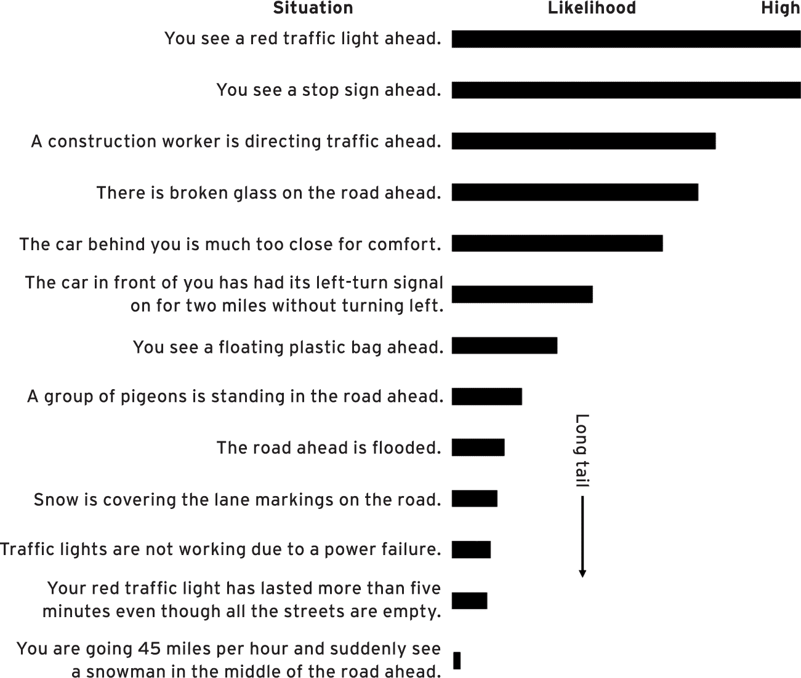

图 13：自动驾驶汽车可能遇到的情况，按可能性排序，说明了不太可能场景的“长尾”

这个问题被所谓的长尾问题所加剧：AI 系统可能面临的各种意外情况的广泛范围。图 13 通过给出自动驾驶汽车在一天驾驶过程中可能遇到的各种假设情况的可能性，说明了这一现象。非常常见的情况，例如遇到红绿灯或停车标志，被评为高可能性；中等可能性的情况包括碎玻璃和被风吹动的塑料袋——不是每天都会遇到（取决于你在哪里驾驶），但也不罕见。你的自动驾驶汽车遇到被淹的道路或被雪覆盖的车道标记的可能性较低，而你在高速公路中间遇到雪人的可能性就更低了。

我构思了这些不同的场景并猜测了它们的相对可能性；我相信你可以想出更多自己的场景。任何单辆汽车可能都是安全的：毕竟，实验性自动驾驶汽车总共已经行驶了数百万英里，并造成了相对较少的事故（尽管有一些高调的致命事故）。但一旦自动驾驶汽车普及，虽然每个不太可能的情况本身定义上就非常不可能，但驾驶世界中有如此多的可能场景和如此多的汽车，以至于某个地方的某辆自动驾驶汽车 `likely` 会在某个时刻遇到其中一种情况。


术语 `long tail` 来自统计学，其中某些概率分布的形状如 figure 13 所示：非常不可能（但可能）发生的情况的长列表被称为分布的“尾部”。（尾部中的情况有时被称为边缘情况。）大多数现实世界的人工智能领域都表现出这种长尾现象：现实世界中的事件通常是可预测的，但仍然存在低概率、意外发生的长尾情况。如果我们仅依赖监督学习来为人工智能系统提供对世界的知识，这将是一个问题；尾部中的情况在训练数据中出现的频率不够高，甚至根本不出现，因此系统在面对此类意外情况时更容易出错。

以下是两个现实世界的例子。2016 年 3 月，美国东北部预计会有大暴风雪，Twitter 上出现报道称，特斯拉汽车的 Autopilot 模式（可实现有限自动驾驶）在暴风雪来临前高速公路上铺设的盐线和车道标记之间混淆了 (figure 14)。2016 年 2 月，谷歌的一款原型自动驾驶汽车在右转时，为了避开加利福尼亚州道路右侧的沙袋，不得不向左偏转，汽车的左前部撞上了左侧车道行驶的一辆公共巴士。每辆车都期望另一辆车让行（也许巴士司机期望一个会被更大的巴士吓倒的人类司机）。

从事自动驾驶汽车技术的公司深知长尾问题：他们的团队会集思广益，构思可能的长尾场景，并主动为他们能想到的所有不太可能的场景创建额外的训练示例以及特别编码的策略。但当然，不可能为系统可能遇到的所有可能情况进行训练或编码。


FIGURE 14: Salt lines on a highway, in advance of a forecasted snowstorm, were reported to be confusing Tesla’s Autopilot feature.

一种常见的解决方案是，人工智能系统在少量标记数据上使用监督学习，并通过无监督学习学习其他一切。术语 `unsupervised learning` 指的是一大类在没有标记数据的情况下学习类别或动作的方法。示例包括基于相似性对示例进行聚类的方法，或通过与已知类别的类比来学习新类别的方法。正如我将在后面章节中描述的那样，感知抽象相似性和类比是人类擅长的事情，但到目前为止，还没有非常成功的人工智能方法用于这种无监督学习。Yann LeCun 本人承认，“无监督学习是人工智能的暗物质。”换句话说，对于通用人工智能，几乎所有学习都必须是无监督的，但至今还没有人提出出能够执行成功无监督学习所需的算法。

人类经常犯错，甚至（尤其是）在驾驶时；我们中的任何人，如果是那个绕过沙袋行驶的人，可能也会撞上那辆公共巴士。但人类也具有一种所有当前人工智能系统都缺乏的基本能力：常识。我们对世界拥有广泛的背景知识，包括其物理和社会方面。我们对物体——无论是无生命的还是有生命的——可能如何行为有很好的了解，并且在决定如何在任何给定情况下行动时广泛使用这些知识。即使我们从未在雪地里开过车，也可以推断道路上盐线背后的原因。我们知道如何与其他人类进行社交互动，因此可以使用眼神交流、手势和其他肢体语言来应对停电期间的故障交通灯。我们通常知道要给大型公共巴士让路，即使我们技术上拥有优先通行权。我在这里以驾驶为例，但我们人类在生活的方方面面都会使用常识——通常是潜意识地。许多人认为，直到人工智能系统像人类一样拥有常识，我们才能信任它们在复杂的现实世界情况中完全自主。

## 我的网络学到了什么？

几年前，Will Landecker（当时是我研究小组的研究生）训练了一个深度神经网络，将照片分为两类：“包含动物”和“不包含动物”。该网络在类似 figure 15 的照片上进行了训练，并在测试集上很好地完成了这项任务。但是，网络实际上学到了什么？通过仔细研究，Will 发现了一个意想不到的答案：部分地，网络学会了将背景模糊的图像分类为“包含动物”，无论图像中是否实际包含动物。^() 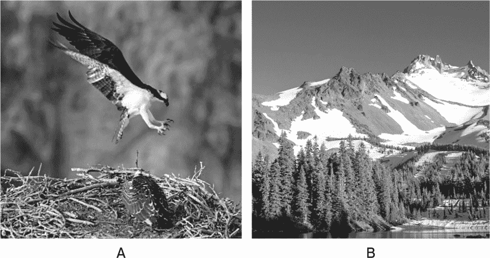

FIGURE 15: Illustration of “animal” versus “no animal” classification task. Note the blurry background in the image on the left.

这是机器学习中常见现象的一个例子。机器学习的是它在数据中观察到的内容，而不是你（人类）可能观察到的内容。如果训练数据中存在统计关联，即使与手头的任务无关，机器也会很高兴学习这些关联，而不是你希望它学习的内容。如果在具有相同统计关联的新数据上测试机器，它看起来似乎成功地学会了解决任务。然而，机器可能会意外失败，就像 Will 的网络在没有模糊背景的动物图像上那样。在机器学习术语中，Will 的网络对其特定的训练集“过拟合”了，因此无法很好地将所学知识应用于与训练图像不同的图像。

近年来，多个研究团队调查了在 ImageNet 和其他大型数据集上训练的 ConvNets 是否也对其训练数据过拟合。一个小组表明，如果 ConvNets 在从网络下载的图像上进行训练（如 ImageNet 中的图像），它们在机器人拿着相机在房子里移动时拍摄的图像上表现不佳。^() 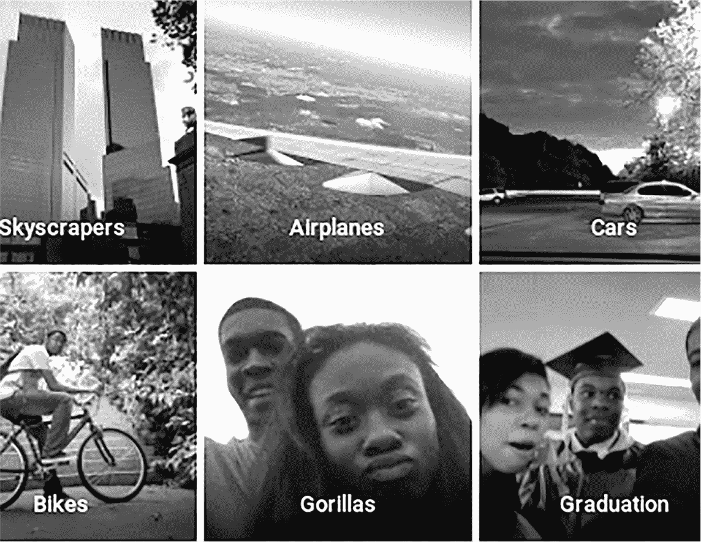

FIGURE 16: Labels assigned to photos by Google’s automated photo tagger, including the infamous “Gorillas” tag

## 有偏的人工智能

ConvNets 的不可靠性可能导致尴尬——并可能造成损害——的错误。谷歌在 2015 年在其照片应用中推出自动照片标记功能（使用 ConvNet）后，遭遇了公关噩梦。除了用“飞机”、“汽车”和“毕业”等通用描述正确标记图像外，神经网络还将一张两名非裔美国人的自拍照标记为“大猩猩”，如 figure 16 所示。（在道歉之后，公司的短期解决方案是从网络的可能类别列表中删除“大猩猩”标签。）

 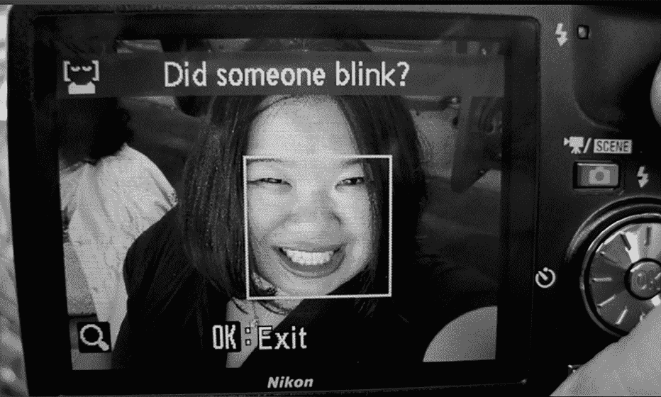

FIGURE 17: Example of a camera face-detection program identifying an Asian face as “blinking”

这种令人反感且广受嘲笑的误分类对相关公司来说很尴尬，但由于种族或性别偏见导致的更微妙的错误在基于深度学习的视觉系统中经常被注意到。例如，商业人脸识别系统在白人男性面孔上的准确率往往高于女性或非白人面孔。^()


Kate Crawford，一位微软研究人员，也是人工智能公平性与透明度倡导者，她指出，一个广泛用于训练人脸识别系统的数据集中，77.5% 是男性面孔，83.5% 是白人面孔。这并不令人惊讶，因为这些图片是从在线图片搜索中下载的，而网上出现的人脸照片倾向于展示名人或有权势的人，这些人主要是白人男性。

当然，AI 训练数据中的这些偏见反映了我们社会中的偏见，但基于有偏见数据训练的现实世界 AI 系统的传播，可能会放大这些偏见并造成实际损害。例如，人脸识别系统正越来越多地被部署为一种“安全”的方式，用于在信用卡交易、机场安检和安全摄像头中识别人，而且可能只是时间问题，它们很快就会被用于验证投票系统等其他应用中的身份。即使不同种族群体之间准确率存在微小差异，也可能对公民权利和获取重要服务产生有害的影响。

这种偏见可以通过让人工确保照片（或其他类型的数据）在种族或性别群体等方面的表示是平衡的，从而在单个数据集中得到缓解。但这需要策划数据的人具备意识并付出努力。此外，要识别出微妙的偏见及其影响往往很困难。例如，一个研究小组指出，他们的 AI 系统——在一个包含不同情境下人物照片的大型数据集上训练——有时会错误地将站在厨房里的男性分类为“女士”，因为该数据集中厨房环境下的女性示例更多。^()

AI 应用中偏见问题最近引起了广泛关注，许多文章、研讨会甚至学术研究机构都致力于这一话题。用于训练 AI 的数据集是否应该准确反映我们自身有偏见的社会——就像它们现在经常做的那样——还是应该被特意调整以实现社会改革目标？谁应该被允许指定目标或进行调整？

## 展示你的过程

还记得学校里老师在你的数学作业上用红笔写“展示你的过程”吗？对我来说，展示过程是学习数学中最不有趣的部分，但可能也是最重要的，因为展示我是如何得出答案的，证明了我确实理解了自己在做什么，掌握了正确的抽象概念，并且出于正确的原因得出了答案。展示我的过程也帮助老师弄清楚我为什么会犯某些特定的错误。

更广泛地说，如果人们能向你解释他们是 *如何* 得出答案或做出决定的，你通常可以信任他们知道自己在做什么。然而，“展示他们的过程”是深度神经网络——现代 AI 系统的基础——很难做到的事情。让我们考虑一下我在第 4 章中描述的“狗”和“猫”物体识别任务。请回顾，卷积神经网络通过执行一系列数学运算（卷积）并在许多层中传播，来决定输入图像中包含什么物体。对于一个规模适中的网络，这些运算可能高达数十亿次算术运算。虽然很容易编程让计算机打印出网络对给定输入执行的所有加法和乘法的列表，但这样的列表会给我们人类带来 *零* 关于网络如何得出答案的洞察。一份包含十亿次运算的列表不是人类可以理解的解释。即使是训练深度网络的人类，通常也无法“打开引擎盖”来解释他们的网络所做出的决定。MIT 的 *Technology Review* 杂志将这种难以捉摸的特性称为“AI 核心的黑暗秘密”。^()

人类也并非总能解释他们的思维过程，而且你通常无法“查看”他人的大脑（或他们的“直觉”）来弄清楚他们是如何做出某个特定决定的。但人类往往信任其他人类已经正确掌握了诸如物体识别和语言理解等基本认知任务。部分原因在于，当你相信他人的思维方式与你自己相似时，你就会信任他们。你通常会假设，你遇到的其他人类拥有与你自己足够相似的生活经历，因此你假设他们在感知、描述和对世界做出决定时，使用的基本背景知识、信念和价值观与你相同。简而言之，在涉及其他人时，你拥有心理学家所说的“心智理论”——一种关于他人在特定情况下的知识和目标的模型。我们中没有人对深度网络等 AI 系统拥有类似的“心智理论”，这使得信任它们变得更加困难。

因此，不足为奇的是，AI 中最热门的新领域之一被称为“可解释 AI”、“透明 AI”或“可解释机器学习”。这些术语指的是关于让 AI 系统——特别是深度网络——以人类可以理解的方式解释其决策的研究。该领域的研究人员已经想出了巧妙的方法来可视化给定卷积神经网络学习到的特征，并且在某些情况下，确定输入的哪些部分对输出决策负有最大责任。可解释 AI 是一个进展迅速的领域，但一个能够成功用人类术语解释自己的深度学习系统仍然难以捉摸。

## 欺骗深度神经网络

AI 可信度问题还有另一个维度：研究人员发现，人类悄悄地欺骗深度神经网络使其犯错是出乎意料容易的。也就是说，如果你想故意愚弄这样的系统，结果发现有惊人的数量的方法可以做到。

欺骗 AI 系统并非新鲜事。例如，电子邮件垃圾邮件发送者与垃圾邮件检测程序已经进行了几十年的军备竞赛。但深度学习系统似乎容易受到的攻击既更微妙又更令人担忧。

还记得我在第 5 章中讨论的 AlexNet 吗？它是赢得 2012 年 ImageNet 挑战赛并推动 ConvNets 在当今 AI 世界中占据主导地位的卷积神经网络。如果你还记得，AlexNet 在 ImageNet 上的（前 5 名）准确率为 85%，远远超过了其他所有竞争对手，震惊了计算机视觉界。然而，在 AlexNet 获胜一年后，一篇由 Google 的 Christian Szegedy 和其他几位作者撰写的研究论文出现了，标题具有欺骗性的温和，名为“神经网络的有趣特性”。^()

特别是，该论文的作者发现，他们可以采取一张 AlexNet 高度自信地正确分类的 ImageNet 照片（例如，“校车”），并通过对其像素进行非常小的特定更改来扭曲它，使得扭曲后的图像对人类来说看起来完全没有变化，但现在被 AlexNet 高度自信地分类为完全不同的东西（例如，“鸵鸟”）。作者将扭曲后的图像称为“对抗性示例”。图 18 显示了几张原始图像及其对抗性双胞胎的样本。分辨不出区别吗？恭喜你！看来你是人类。

Szegedy 和他的合作者创建了一个计算机程序，该程序可以针对 *任何* 被 AlexNet 正确分类的 ImageNet 照片，找到照片的特定更改以创建一个新的对抗性示例，该示例对人类来说看起来没有变化，但会导致 AlexNet 将最高置信度给予错误的类别。


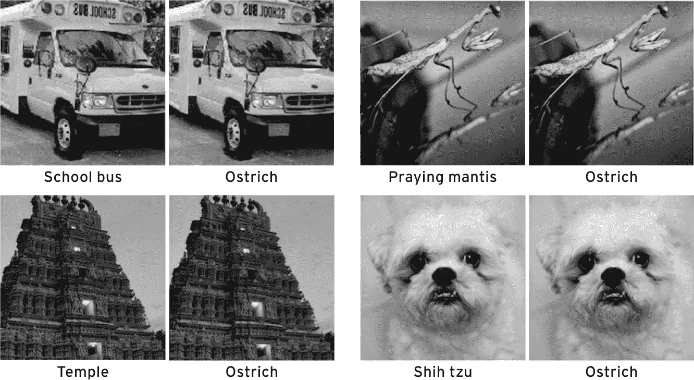

FIGURE 18: AlexNet 的原始示例和“对抗性”示例。每对图像中的左图显示原始图像，该图像已被 AlexNet 正确分类。每对图像中的右图显示由此图像推导出的对抗性示例（像素已做小幅更改，但新图像在人类看来与原始图像相同）。每个对抗性示例都被 AlexNet 自信地分类为“鸵鸟”。

重要的是，Szegedy 和他的合作者发现，这种对对抗性示例的易感性并非 AlexNet 特有；他们表明，其他几种卷积神经网络——具有不同的架构、超参数和训练集——也存在类似漏洞。将此称为神经网络的“引人入胜的特性”，有点像将豪华游轮船体上的一个洞称为船只的“发人深省的特征”。确实引人入胜，并且需要进一步调查，但如果不修补漏洞，这艘船就会沉没。

在 Szegedy 和同事的论文发表后不久，怀俄明大学的一组人发表了一篇标题更直接的文章：“深度神经网络很容易被愚弄。”^() 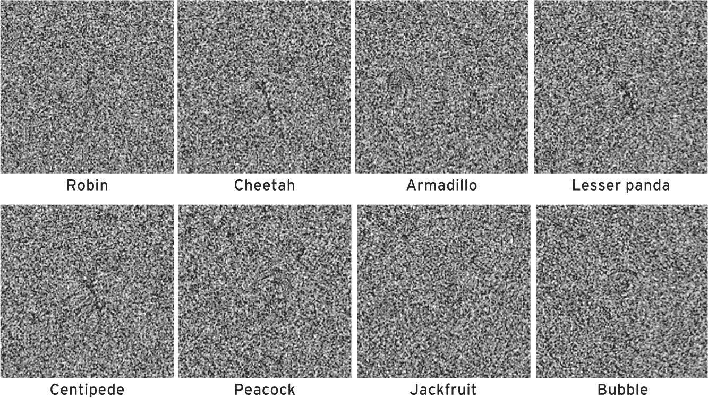

FIGURE 19: 由遗传算法专门用于愚弄卷积神经网络而创建的图像示例。在每种情况下，AlexNet（在 ImageNet 训练集上训练）都将图像属于所显示类别的置信度分配为大于 99%。

确实，这两篇论文及随后的相关发现不仅在深度学习社区引发了疑问，还引发了真正的警报。如果深度学习系统在计算机视觉和其他任务中非常成功，却很容易被人类不易受影响的操作所愚弄，我们如何能说这些网络“像人类一样学习”或在能力上“匹配或超越人类”？很明显，这里正在发生与人类感知非常不同的事情。如果这些网络将用于现实世界中的计算机视觉，我们最好确保它们能防范黑客使用此类操作来愚弄它们。

所有这些都重新激发了专注于“对抗性学习”的小型研究社区——即开发策略以防御潜在的（人类）对手，这些对手可能会攻击机器学习系统。对抗性学习研究人员通常通过展示现有系统可能受到攻击的方式来开始他们的工作，最近的一些演示令人惊叹。在计算机视觉领域，一组研究人员开发了一个程序，可以创建带有特定图案的眼镜框，这些图案会欺骗面部识别系统，自信地将佩戴者误分类为另一个人（figure 20）。^() 

FIGURE 20: 一名 AI 研究人员（`left`）佩戴着特别设计的图案眼镜框，该图案旨在导致在名人脸部上训练的深度神经网络面部识别器，自信地将左侧照片分类为女演员米拉·乔沃维奇（`right`）。描述该研究的论文给出了许多使用“对抗性”眼镜框图案进行冒充的其他示例。

这些只是各种研究团队构思的可能攻击的几个例子。许多可能的攻击已被证明出奇地稳健：它们在几种不同的网络上有效，即使这些网络在不同的数据集上训练。计算机视觉也不是网络可能被愚弄的唯一领域；研究人员还设计了欺骗处理语言的深度神经网络的攻击，包括语音识别和文本分析。我们可以预期，随着这些系统在现实世界中得到更广泛的部署，恶意用户将发现这些系统中的许多其他漏洞。

理解和防御此类潜在攻击目前是一个主要的研究领域，但尽管研究人员已找到针对特定类型攻击的解决方案，仍然没有通用的防御方法。像计算机安全的任何领域一样，迄今为止的进展具有“打地鼠”的特点，即一个安全漏洞被发现并防御，但其他漏洞被发现，需要新的防御。Ian Goodfellow 是 Google Brain 团队的一名 AI 专家，他说：“你能想到对机器学习模型做的几乎任何坏事，现在都可以做……而防御它真的，真的很难。”^()

除了如何防御攻击的直接问题之外，对抗性示例的存在放大了我之前提出的问题：这些网络究竟在学习什么？特别是，它们在学习什么，使得它们如此容易被愚弄？或者更重要的是，当我们认为这些网络实际上已经学习了我们试图教给它们的概念时，我们是不是在自欺欺人？

在我看来，终极问题是 `understanding` 的问题。考虑 figure 18，AlexNet 将校车误认为鸵鸟。为什么这不太可能发生在人类身上？尽管 AlexNet 在 ImageNet 上表现非常好，但我们人类了解许多关于所见物体的事情，这些事情对 AlexNet 或任何其他当前 AI 系统都是未知的。我们知道物体在三维中是什么样子，并可以从二维照片中想象出来。我们知道给定物体的功能是什么，物体的各个部分在其整体功能中扮演什么角色，以及物体通常出现在什么情境中。看到一个物体会唤起我们在其他情况下、从其他视角以及在其他感觉模态中看到此类物体的记忆（我们记得给定物体的触感、气味，也许掉落时的声音，等等）。所有这些背景知识都有助于人类强健地识别给定物体。即使是最成功的 AI 视觉系统也缺乏这种理解以及它所赋予的强健性。

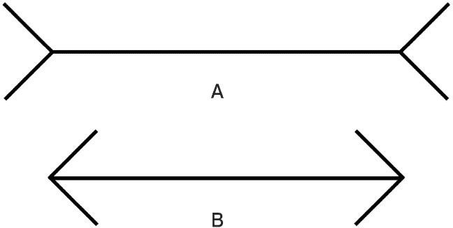

FIGURE 21: 人类的视觉错觉：A 和 B 中的水平线段在 `A` 和 `B` 中长度相同，但大多数人认为 `A` 中的线段比 `B` 中的线段长。


我听过一些 AI 研究人员认为，人类也容易受到我们自己类型的“对抗性示例”影响：视觉错觉。例如，`AlexNet` 将校车误分类为鸵鸟，人类也容易产生感知错误（例如，我们会认为 figure 21 中的上方线条比下方线条长，尽管两者实际上长度相同）。但人类犯错的类型与卷积神经网络容易出错的类型截然不同：我们在日常场景中识别物体的能力已经进化得非常可靠，因为我们的生存依赖于此。与当今的 `ConvNets` 不同，人类（和动物）的感知受到 `cognition` 的高度调节——即我上面描述的那种依赖上下文的理解。此外，当今计算机视觉应用中使用的 `ConvNets` 通常是完全前馈的，而人类视觉系统的反馈（即反向方向）连接比前馈连接多得多。尽管神经科学家尚未理解所有这些反馈的功能，但人们可能会推测，至少其中一些反馈连接能有效防止易受 `ConvNets` 容易受到的那种对抗性示例的影响。那么，为什么不给 `ConvNets` 同样的反馈呢？这是一个活跃的研究领域，但结果证明非常困难，并未产生与前馈网络所见的那种成功。

怀俄明大学的 AI 研究人员 Jeff Clune 做了一个非常发人深省的类比，他指出人们对“深度学习是‘真正的智能’还是‘聪明汉斯’”存在“很多兴趣”。^()

一方面，通过监督学习训练的深度神经网络在计算机视觉的许多问题以及语音识别和语言翻译等其他领域表现得非常出色（尽管仍远非完美）。由于其出色的能力，这些网络正在迅速从研究环境中走出来，应用于网络搜索、自动驾驶汽车、人脸识别、虚拟助手和推荐系统等现实世界应用，并且很难想象没有这些 AI 工具的生活。另一方面，说深度网络“自主学习”或其训练“类似于人类学习”是具有误导性的。认识到这些网络的成功必须与认识到它们可能因过度拟合训练数据、长尾效应以及易受黑客攻击而以意想不到的方式失败相平衡。此外，深度神经网络做出决策的原因往往难以理解，这使得它们的失败难以预测或修复。研究人员正在积极努力使深度神经网络更加可靠和透明，但问题依然存在：这些系统缺乏类似人类的理解这一事实，是否必然会使它们变得脆弱、不可靠且易受攻击？这又应该如何影响我们在现实世界中应用 AI 系统的决策？下一章将探讨在平衡 AI 的益处与其不可靠性和滥用风险方面所面临的一些艰巨挑战。

## 7

## On Trustworthy and Ethical AI

想象一下，你正坐在一辆自动驾驶汽车里，深夜，办公室圣诞派对之后。外面天色昏暗，雪花飘落。“车，带我回家，”你说道，既疲惫又有点微醺。你向后靠去，欣然闭上眼睛，汽车启动并驶入交通。

一切都很好，但你应该有多安全？自动驾驶汽车的成功至关重要地依赖于机器学习（尤其是深度学习），特别是汽车的计算机视觉和决策组件。我们如何确定这些汽车是否已经成功学会了所有需要知道的东西？

这是自动驾驶汽车行业的十亿美元问题。我遇到了专家们的相互矛盾的意见，关于我们何时可以期望自动驾驶汽车在日常生活中发挥重要作用，预测（在撰写本文时）从几年到几十年不等。自动驾驶汽车有潜力极大地改善我们的生活。自动驾驶车辆可以大幅减少每年数百万起因交通事故导致的死亡和伤害，其中许多是由酒后驾驶或分心驾驶引起的。此外，自动驾驶车辆将允许其人类乘客在通勤时间保持高效而不是闲置。这些车辆也有可能比有人驾驶的汽车更节能，并且对于无法驾驶的盲人或残疾人来说将是天赐之物。但这一切只有在我们人类愿意将生命托付给这些车辆的情况下才能实现。

机器学习正在被部署用于在许多领域做出影响人类生活的决策。你有什么保证，创建你的新闻推送、诊断你的疾病、评估你的贷款申请，或者——老天爷不保——推荐你的刑期的机器，已经学得足够多，足以成为可信赖的决策者？

这些是令人棘手的问题，不仅对 AI 研究人员如此，对整个社会也是如此，社会最终必须权衡 AI 的许多当前和未来积极用途与对其可信度和滥用的担忧。

## Beneficial AI

当人们考虑 AI 在社会中的作用时，可能很容易关注其负面影响。但是，必须记住，AI 系统已经为社会带来了巨大的益处，并且它们有潜力变得更加有益。当前的 AI 技术是你自己可能一直在使用的服务的核心，有时甚至不知道 AI 正在发挥作用，包括语音转录、GPS 导航和行程规划、电子邮件垃圾邮件过滤器、语言翻译、信用卡欺诈警报、书籍和音乐推荐、防范计算机病毒以及优化建筑物中的能源使用。

如果你是摄影师、电影制作人、美术家或音乐家，你可能正在使用 AI 系统来协助你的创意项目，例如帮助摄影师编辑照片或协助作曲家进行音乐记谱或编曲的程序。如果你是学生，你可能会从“智能辅导系统”中受益，这些系统会适应你特定的学习风格。如果你是科学家，你很可能已经使用了许多可用的 AI 工具之一来帮助分析你的数据。如果你是盲人或以其他方式视力受损，你可能会使用智能手机计算机视觉应用程序来读取手写或印刷文本（例如，在标志、餐厅菜单或货币上）。如果你是听力受损者，你现在可以在 YouTube 视频上看到相当准确的字幕，并且在某些情况下，在讲座期间获得实时语音转录。这些只是当前 AI 工具改善人们生活的几个例子。许多其他 AI 技术仍处于研究模式，但正处于成为主流的边缘。

在不久的将来，AI 应用程序很可能在医疗保健领域广泛普及。我们将看到 AI 系统协助医生诊断疾病和建议治疗方案；发现新药；以及监测老年人在家中的健康和安全。科学建模和数据分析将越来越依赖 AI 工具——例如，在改进气候变化、人口增长和人口结构变化、生态和食品科学以及社会在未来一个世纪将面临的其他重大问题的模型方面。对于 Google DeepMind 团队的联合创始人 Demis Hassabis 来说，这是 AI 最重要的潜在益处：


> 我们可能不得不得出一个令人清醒的认识：即使地球上最聪明的一群人类致力于解决这些问题，这些 \[问题\] 可能非常复杂，以至于个人类和科学专家来说，在其一生中很难找到足够的时间来进行创新和进步。…… 我相信，我们将需要一些帮助，而我认为 AI 是解决这个问题的方案。^()

> 我们都听说过，在未来，AI 将接管人类讨厌的工作——那些低薪、枯燥、令人筋疲力尽、有辱人格、剥削性或极其危险的工作。如果这真的发生，这对人类福祉来说可能是一件真正的好事。（稍后我将讨论这枚硬币的另一面——AI 抢走 *太多* 人类的工作。）机器人已经被广泛用于枯燥和重复的工厂任务，尽管今天的机器人仍无法完成许多此类工作。但随着 AI 的进步，越来越多的此类工作可能会被自动化接管。未来 AI 工作场景应用的例子包括自动驾驶卡车和出租车，以及用于采摘水果、灭火、清除地雷和执行环境清理的机器人。此外，机器人在行星和太空探索中可能会发挥比现在更大的作用。

> AI 系统接管此类工作是否真的会造福社会？我们可以参考技术的历史来获得一些视角。以下是一些人类过去从事但技术早已自动化的工作例子，至少在发达国家中是这样：洗衣工；人力车夫；电梯操作员；*punkawallah*（在电风扇出现之前，印度的一名仆人，其唯一工作是手动扇风为房间降温）；计算机（人类，通常是女性，手动执行繁琐的计算，尤其是在第二次世界大战期间）。大多数人会同意，在这些例子中，用机器取代人类从事此类工作使生活变得更好。有人可能会认为，今天的 AI 只是延续了同样的进步弧线：通过越来越多地自动化那些没人愿意做的必要工作来改善人类的生活。

## The Great AI Trade-Off

AI 研究员 Andrew Ng 乐观地宣称：“AI 是新的电力。” Ng 进一步解释道：“正如电力 100 年前改变了几乎一切，今天我很难想到一个我认为 AI 在未来几年内不会改变的行业。”^()

这就带来了你可能称之为“伟大的 AI 权衡”的问题。我们是否应该拥抱 AI 系统的能力，这些系统可以改善我们的生活甚至帮助拯救生命，并允许这些系统被越来越广泛地使用？还是应该更加谨慎，考虑到当前 AI 系统不可预测的错误、易受偏见影响、易受黑客攻击以及决策缺乏透明度？在不同的 AI 应用中，人类应在多大程度上被要求保持在循环中？我们应要求 AI 系统具备什么，才能足够信任它让它自主工作？这些问题仍然被热烈讨论，即使 AI 越来越多地被部署，其承诺的未来应用（例如自动驾驶汽车）也被宣称为指日可待。

缺乏对这些问题的普遍共识，这一点被皮尤研究中心最近的一项研究所凸显。^()

> 到 2030 年，你认为先进的 AI 和相关技术系统最有可能增强人类能力并赋予人类权力吗？也就是说，大多数时候，大多数人会比今天过得更好吗？还是先进的 AI 和相关技术系统最有可能削弱人类的自主权和能动性，以至于大多数人不会比今天过得更好？

受访者意见不一：63% 的人预测 AI 的进步将在 2030 年之前让人类过得更好，而 37% 的人不同意。意见从认为 AI “几乎可以消除全球贫困，大幅减少疾病，并为地球上几乎每个人提供更好的教育”，到预测末日般的未来：大量工作被自动化接管，由于 AI 监控导致隐私和公民权利的侵蚀，无道德的自主武器，不透明且不可信的计算机程序做出的不受约束的决定，种族和性别偏见的放大，大众媒体的操纵，网络犯罪的增加，以及一位受访者称之为人类“真正的、生存性的无关紧要”。

机器智能呈现出一系列棘手的伦理问题，与 AI 和大数据伦理相关的讨论已经填满了几本书。^()

## The Ethics of Face Recognition

人脸识别是在图像或视频（或实时视频流）中为人脸贴上姓名的任务。例如，Facebook 对上传到其网站的每张照片都应用人脸识别算法，试图检测照片中的人脸并将其与已知用户（至少是那些未禁用此功能的用户）进行匹配。^()

人脸识别技术有许多潜在的好处，包括帮助人们搜索他们的照片集，使视力障碍用户能够识别他们遇到的人，通过扫描照片和视频中的面孔来寻找失踪儿童或逃犯，以及检测身份盗窃。但是，同样容易想象出许多人觉得冒犯或威胁的应用程序。例如，Amazon 将其人脸识别系统（带有奇怪的反乌托邦听起来的名称 Rekognition）推向警察部门，这些部门可以将，比如说，安防摄像头录像与已知罪犯或可能嫌疑人的数据库进行比较。

隐私是一个显而易见的问题。即使我不在 Facebook（或任何其他带有人脸识别的社交媒体平台）上，包含我的照片也可能被标记并在以后在网站上自动识别，而无需我的许可。考虑 FaceFirst，一家提供付费人脸识别服务的公司。据《新科学家》杂志报道，“Face First … 正在为零售商推出一个系统，该公司称该系统将‘每次高价值客户购物时都识别他们以提升销售额’，并在‘已知的爱诉讼者进入您的任何地点时发送警报’。”^()

隐私丧失不是这里唯一的危险。更大的担忧是可靠性：人脸识别系统可能会出错。如果你的面孔被错误匹配，你可能会被禁止进入商店或乘坐飞机，或被错误地指控犯罪。更重要的是，现代人脸识别系统已被证明对有色人种的错误率显著高于白人。美国公民自由联盟（ACLU）强烈反应出于公民权利理由在执法中使用人脸识别技术，他们对 Amazon 的 Rekognition 系统（使用其默认设置）对美国国会的 535 名成员进行了测试，将每位成员的照片与一个包含因刑事指控被捕的人的数据库进行比较。他们发现，该系统错误地将 28 名国会议员与犯罪数据库中的人匹配。21% 的错误出现在非裔美国代表的照片中（非裔美国人仅占国会的约 9%）。^()

在 ACLU 的测试和其他显示人脸识别不可靠性和偏见的研究引发的后果中，几家高科技公司已宣布反对将人脸识别用于执法和监控。例如，人脸识别公司 Kairos 的首席执行官 Brian Brackeen 在一篇广泛流传的文章中写道：


> 面部识别技术用于识别嫌疑人，对有色人群产生负面影响。否认这一事实就是撒谎。……我（以及我的公司）已经相信，在执法或任何形式的政府监控中使用商业面部识别是错误的——这为道德败坏者的严重不当行为敞开了大门。……我们应当拥有一个不让政府对公民进行分类、追踪和控制的世界。^()

> 在其公司网站的一篇博客文章中，微软总裁兼首席法律官布拉德·史密斯呼吁国会对面部识别进行监管：

> > 面部识别技术引发的问题涉及隐私和言论自由等基本人权保护的核心。这些问题加剧了创建此类产品的科技公司的责任。在我们看来，它们也呼吁进行深思熟虑的政府监管，并围绕可接受的用途制定规范。面部识别将要求公共和私营部门都拿出行动——并采取行动。^()

> > 谷歌紧随其后，宣布在公司能够“确保其使用符合我们的原则和价值观，并避免滥用和有害结果”之前，不会通过其云 AI 平台提供通用面部识别服务。^()

> > 这些公司的反应令人鼓舞，但它将另一个棘手的问题推到了前沿：AI 研究和开发应在多大程度上受到监管，由谁来监管？

## 监管 AI

鉴于 AI 技术的风险，许多 AI 从业者，包括我自己，都赞成某种形式的监管。但监管不应完全交由 AI 研究人员和公司掌控。围绕 AI 的问题——可信度、可解释性、偏见、易受攻击性以及使用的道德性——既是社会和政治问题，也是技术问题。因此，围绕这些问题的讨论必须包括具有不同视角和背景的人。仅仅将监管留给 AI 从业者，就像仅仅将其留给政府机构一样不明智。

在制定此类法规的复杂性的一个例子中，2018 年，欧洲议会颁布了一项关于 AI 的法规，有些人称之为“解释权”。^()

我认为 AI 的监管应以其他技术的监管为模型，特别是生物和医学科学领域的技术，例如基因工程。在这些领域，监管——例如质量保证以及对技术风险和收益的分析——通过政府机构、公司、非营利组织和大学之间的合作进行。此外，现在已有生物伦理学和医学伦理学等既定领域，它们对技术开发和应用的决策有着相当大的影响。AI 研究及其应用非常需要一个经过深思熟虑的监管和伦理基础设施。

这个基础设施才刚刚开始形成。在美国，州政府开始着手制定法规，例如面部识别或自动驾驶汽车的法规。然而，在大部分情况下，创建 AI 系统的大学和公司一直被允许自我监管。

一些非营利智库应运而生以填补这一空白，通常由担心 AI 的富有的科技企业家资助。这些组织——例如人类未来研究所、未来生命研究所和生存风险研究中心——举办研讨会、资助研究，并就 AI 的安全和伦理使用主题创建教育材料和政策建议。一个名为“AI 合作伙伴关系”的伞形组织一直在努力将这些团体聚集在一起，以“作为关于 AI 及其对人和社会影响的讨论和参与的开放平台”。^()

一个绊脚石是，该领域对制定监管和伦理的优先事项没有普遍共识。当前的重点应该是能够解释其推理的算法？数据隐私？AI 系统对恶意攻击的鲁棒性？AI 系统中的偏见？超级智能 AI 带来的潜在“生存风险”？我个人认为，过多的关注被放在了超级智能 AI 的风险上，而对深度学习缺乏可靠性和透明度及其易受攻击性的关注远远不够。我将在最后一章更多地谈论超级智能的概念。

## 道德机器

到目前为止，我的讨论一直集中在人类如何使用 AI 的伦理问题上。但还有另一个重要问题：机器本身是否能够拥有自己的道德感，足以让我们允许它们自行做出伦理决策，而无需人类监督？如果我们要给面部识别系统、自动驾驶汽车、老年护理机器人，甚至机器人士兵以决策自主权，难道我们不需要赋予这些机器与我们人类相同的处理伦理和道德问题的能力吗？

人们思考“机器道德”的时间，与思考 AI 的时间一样长。^()

1. 机器人不得伤害人类，或因不作为而使人类受到伤害。

2. 机器人必须服从人类给予的命令，除非这些命令与第一定律相冲突。

3. 机器人必须保护自身的存在，只要这种保护不与第一或第二定律相冲突。^()

这些定律已经成名，但事实上，阿西莫夫的目的是展示这样一套规则必然会失败。“绕道行驶”是阿西莫夫于 1942 年首次介绍这些定律的故事，其中描述了一种情况：一台机器人遵循第二定律，朝着一种危险物质移动，此时第三定律开始起作用，于是机器人又移开，此时第二定律再次起作用，使机器人陷入无休止的循环，导致机器人的人类主人几乎遭遇灾难。阿西莫夫的故事常常关注将伦理规则编程到机器人中所产生的意外后果。阿西莫夫具有先见之明：正如我们所见，不完整的规则和意外后果的问题已经阻碍了所有基于规则的 AI 智能方法；道德推理也不例外。

科幻作家亚瑟·C·克拉克在其 1968 年的著作《2001 太空漫游》中使用了类似的情节手段。*2001: A Space Odyssey*。^()

维纳的评论揭示了所谓的 AI 中的价值对齐问题：AI 程序员面临的挑战是确保其系统的价值与人类的价值保持一致。但人类的价值是什么？假设社会共享普遍价值是否有意义？

欢迎来到道德哲学 101。我们将从每个道德哲学学生最喜欢的思想实验开始，电车难题：你正驾驶一辆疾驰的电车沿着一条轨道行驶，前方你看到五名工人站在轨道中央。你踩下刹车，但发现刹车失灵了。幸运的是，有一条通向右侧的支线。你可以将电车转向支线，避开那五名工人。不幸的是，支线中央站着一名工人。如果你什么都不做，电车将直接冲向那五名工人并将他们全部撞死。如果你将电车转向右侧，电车将撞死那名单独的工人。做道德的事情是什么？


电车难题在过去一个世纪里一直是本科生伦理学课程中的常见话题。大多数人认为，司机将车辆驶向支线，牺牲一名工人以拯救五名工人的群体，在道德上更可取。但哲学家们发现，对本质相同的困境采用不同的表述方式，可能会让人们得出相反的结论。^()

电车难题最近在媒体对自动驾驶汽车的报道中重新出现。^()

2016 年，三位研究人员发布了针对数百名参与者的调查结果，这些参与者被给出了涉及自动驾驶汽车的类似电车难题的场景，并被要求就不同行为的道德性发表意见。在一项调查中，76%的参与者认为，自动驾驶汽车牺牲一名乘客而非杀死十名行人，在道德上更可取。但当被问及是否会购买一辆被编程为为了拯救远更多行人而牺牲其乘客的自动驾驶汽车时，绝大多数受访者表示他们自己不会购买这样的汽车。^()

一些人工智能伦理研究人员建议，我们放弃直接为机器编程道德规范的尝试，而是让机器通过观察人类行为自行学习道德价值观。^()

在我看来，赋予计算机道德智能的进步不能与其他类型智能的进步分开：真正的挑战是创造能够真正 `understand` 其所面临情况的机器。正如艾萨克·阿西莫夫的故事所展示的那样，除非机器能够在不同情境下理解 `harm` 的概念，否则它无法可靠地遵守不伤害人类的命令。思考道德需要人们认识因果关系、想象不同的可能未来、了解他人的信念和目标，并预测自己行为在任何情境下可能产生的结果。换句话说，可信赖的道德推理的前提是通用常识，而正如我们所见，即使是当今最先进的人工智能系统也缺乏这种常识。

到目前为止，在这本书中，我们已经看到，在海量数据集上训练的深度神经网络可以在特定任务中与人类的视觉能力相媲美。我们也看到了这些网络的一些弱点，包括它们对大量人工标注数据的依赖，以及以非常非人类的方式失败的倾向。我们如何创建一个真正能够自主学习的人工智能系统——一个更值得信赖的系统，因为它像人类一样，能够对当前情境进行推理并为未来做计划？在本书的下一部分，我将描述人工智能研究人员如何使用国际象棋、围棋，甚至雅达利视频游戏等游戏作为“微观世界”，以开发具有更具人类特征的学习和推理能力的机器，并我将评估由此产生的超人类游戏机器如何将其技能转移到现实世界中。

## 第三部分

## 学习游戏

## 第 8 章

## 机器人的奖励

当记者艾米·萨瑟兰为一本关于异国动物驯养师的书进行研究时，她了解到他们的主要方法简单得令人难以置信：“奖励我喜欢的行为，忽略我不喜欢的行为。”正如她在《纽约时报》的《现代爱情》专栏中所写的，“最终我意识到，同样的技巧或许也能用于那种固执但可爱的物种——美国丈夫。”萨瑟兰写道，在多年徒劳的唠叨、讽刺和怨恨之后，她使用这种简单的方法，秘密地训练她毫无察觉的丈夫捡起袜子、自己找车钥匙、准时到达餐厅，并更规律地刮胡子。^()

这种经典的训练技巧，在心理学中被称为操作性条件反射，几个世纪以来一直用于动物和人类。操作性条件反射启发了一种重要的机器学习方法，称为强化学习。强化学习与我之前章节中描述的监督学习方法形成对比：在最纯粹的形式中，强化学习不需要标记的训练示例。相反，一个 `agent`——学习程序——在 `environment`（通常是计算机模拟）中执行 `actions`，并偶尔从环境中接收 `rewards`。这些间歇性的奖励是代理人用于学习的唯一反馈。在艾米·萨瑟兰丈夫的例子中，奖励是她的微笑、亲吻和赞美之词。虽然计算机程序可能不会对亲吻或热情的“你是最棒的”做出反应，但它可以被设计为对这种赞赏的机器等价物做出反应——例如添加到其内存中的正数。

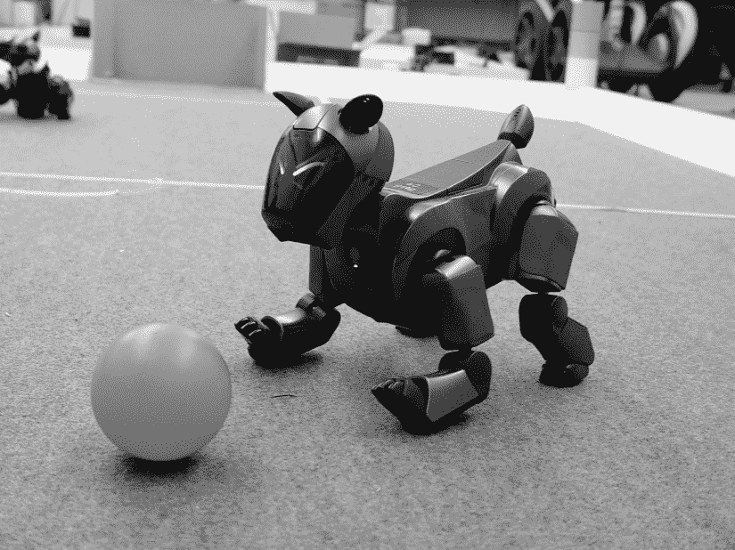

FIGURE 22: A Sony Aibo robotic dog, about to kick a robot soccer ball

虽然强化学习几十年来一直是人工智能工具箱的一部分，但它长期以来一直被神经网络和其他监督学习方法所掩盖。这种情况在 2016 年发生了改变，当时强化学习在人工智能领域一项惊人而重大的成就中发挥了核心作用：一个学会了击败最优秀人类在复杂游戏围棋中的程序。为了解释该程序，以及强化学习的其他近期成就，我将首先带您了解一个简单的示例，以说明强化学习的工作原理。

## 训练你的机器狗

为了我们的说明性示例，让我们来看看机器人足球这个有趣的游戏，在该游戏中，人类（通常是大学生）为机器人编程，让它们在房间大小的“场地”上玩简化版足球。有时，球员是可爱的类似狗的 Aibo 机器人，就像图 22 所示的那样。Aibo 机器人（由索尼制造）配备了用于捕捉视觉输入的摄像头、一台内部可编程计算机，以及一组传感器和电机，使其能够行走、踢球、用头顶球，甚至摇动它的塑料尾巴。

想象一下，我们想教我们的机器狗最简单的足球技能：面对球时，走过去并踢它。传统的人工智能方法是为机器人编写以下规则：向球迈出一步。重复，直到你的一只脚接触到球。然后用那只脚踢球。当然，像“向球迈出一步”、“直到你的一只脚接触到球”和“踢球”这样的简略描述，必须仔细翻译成内置于 Aibo 中的详细传感器和电机操作。

对于像这样简单的任务，这种明确的规则可能就足够了。然而，你希望你的机器人变得越“智能”，手动为行为指定规则就越困难。而且，当然，不可能制定一套在每种情况下都有效的规则。如果机器人和球之间有一大块水坑怎么办？如果一个足球锥体挡住了机器人的视线怎么办？如果一块石头挡住了球的移动怎么办？一如既往，现实世界充斥着难以预测的边缘情况。强化学习的承诺在于，代理人——在这里是我们的机器狗——可以通过在世界中执行动作并偶尔接收奖励（即 `reinforcement`），而无需人类手动编写规则或直接教导代理人每一种可能的情况，从而自行学习灵活的策略。

让我们把我们的机器狗命名为 Rosie，以我最喜欢的电视机器人命名，即经典动画片 `The Jetsons` 中那位机智的机器人管家。^()


## 强化学习简介：Rosie 机器人的学习过程

除了能够识别自身状态之外，Rosie 有三个内置的 *actions* 可以执行：她可以向前迈一步 *Forward*，向后迈一步 *Backward*，或者 *Kick*。（如果 Rosie 碰巧踩出界，她被编程为立即踩回界内。）为了体现操作性条件反射的精神，只有在 Rosie 成功踢到球时才给予奖励。请注意，Rosie 事先不知道哪些状态或动作会导致奖励。

鉴于 Rosie 是一台机器人，她的“奖励”仅仅是一个数字，比如 10，添加到她的“奖励内存”中。我们可以将数字 10 视为机器人版本的狗零食。或者也许不是。与真正的狗不同，Rosie 对零食、正数或任何其他东西都没有内在的 *desire*。如下文所述，在强化学习中，人类创建的算法指导 Rosie 对奖励的学习过程；也就是说，算法告诉 Rosie *如何* 从她的经验中学习。

强化学习是通过让 Rosie 在一系列学习 *episodes* 中采取行动来实现的，每个 episode 由若干个 *iterations* 组成。在每个 iteration 中，Rosie 确定她当前的状态并选择要采取的动作。如果 Rosie 收到奖励，她随后会 *learn* 某些东西，如下文所示。这里我让每个 episode 持续到 Rosie 成功踢到球，此时她会收到奖励。这可能需要很长时间。就像训练真正的狗一样，我们必须耐心。

Figure 23 说明了一个假设的学习 episode。episode 开始时，训练师（我）将 Rosie 和球放置在场地上的某个初始位置，Rosie 面朝球（figure 23*A*）。Rosie 确定她当前的状态：距离球十二步远。因为 Rosie 还没有学到任何东西，我们的狗，一个天真的“tabula rasa”，不知道应该偏好哪个动作，所以她从三个可能性中随机选择一个动作：*Forward*、*Backward*、*Kick*。假设她选择了 *Backward* 并向后退了一步。我们人类可以看出 *Backward* 是一个不好的动作，但请记住，我们让 Rosie 自己想出如何完成这项任务。

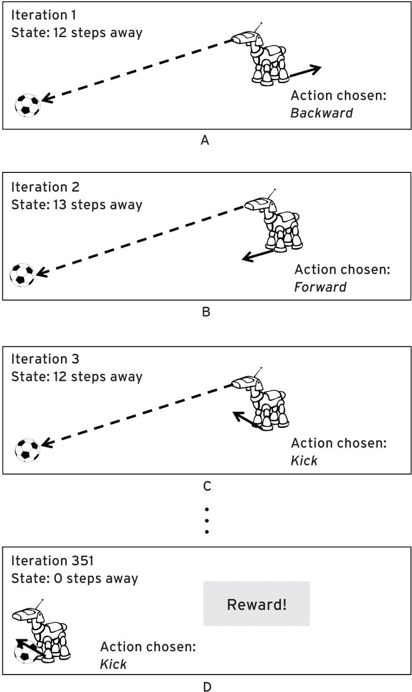

FIGURE 23: A hypothetical first episode of reinforcement learning

在 iteration 2 中（figure 23*B*），Rosie 确定她的新状态：距离球十三步远。然后她选择一个新动作，再次随机：*Forward*。在 iteration 3 中（figure 23*C*），Rosie 确定她的“新”状态：距离球十二步远。她回到了原点，但 Rosie 甚至不知道她之前处于这个状态！在最纯粹的强化学习形式中，学习代理不记得其之前的状态。一般来说，记住之前的状态可能需要大量内存，并且最终并不必要。

在 iteration 3 中，Rosie——再次随机——选择了动作 *Kick*，但因为她在踢空气，所以她没有得到奖励。她还没有学到踢球只有在她靠近球时才会得到奖励。

Rosie 继续在许多 iterations 中选择随机动作，没有任何反馈。但在某个时刻，假设在 iteration 351，Rosie 仅凭运气最终靠近球并选择了 *Kick*（figure 23*D*）。最后，她得到了奖励并用它来学习一些东西。

Rosie 学到了什么？这里我们采用最简单的强化学习方法：在收到奖励后，Rosie 只学习紧接在奖励之前的状态和动作。特别是，Rosie 学到如果她处于该状态（例如，距离球零步远），采取该动作（例如，*Kick*）是个好主意。但她只学到这些。例如，她不会学到如果她距离球零步远，*Backward* 会是一个 *bad* 的选择。毕竟，她还没有尝试过。就她所知，在该状态下向后退一步可能会导致更大的奖励！Rosie 此时还没有学到，如果她距离球 *one* 步远，*Forward* 会是一个好选择。她必须等到下一个 episode 才能做到这一点。一次学习太多可能会有害；如果 Rosie 在距离球两步远时碰巧踢空气，我们不希望她学到这个无效的踢球实际上是获得奖励的必要步骤。在人类中，这种行为可能被称为迷信——即错误地相信某个特定动作可以帮助导致某个特定的好或坏结果。在强化学习中，迷信是你必须小心避免的事情。

强化学习中一个关键的概念是 *在给定状态下执行特定动作的价值*。状态 *S* 下动作 *A* 的 *value* 是一个数字，反映了代理当前预测如果在状态 *S* 下执行动作 *A*，然后继续执行高价值动作，最终将获得多少奖励。让我解释一下。如果你当前的状态是“手里拿着一块巧克力”，高价值的动作就是把手送到嘴边。随后的高价值动作是张开嘴，把巧克力放进去，咀嚼。你的奖励是吃巧克力的美味感觉。把手送到嘴边不会立即产生这个奖励，但这个动作走在正确的道路上，如果你以前吃过巧克力，你可以预测即将到来的奖励的强度。强化学习的目标是让代理学习即将到来的奖励的良好预测值（假设代理在采取该动作后继续做正确的事情）。^() 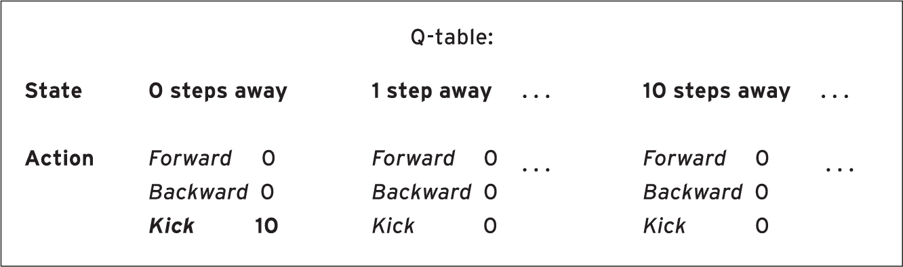

FIGURE 24: Rosie’s Q-table after her first episode of reinforcement learning

Rosie 在她的计算机内存中保存一个大表格，记录动作的值。这个表格在 figure 24 中有所插图，列出了 Rosie 的所有可能状态（即她可能距离球的所有距离，直到场地长度），以及每个状态下她可能的动作。给定一个状态，该状态下的每个动作都有一个数值；这些值会随着 Rosie 继续学习而改变——变得更准确地预测即将到来的奖励。这个状态、动作和值的表格被称为 Q-table。这种形式的强化学习有时被称为 Q-learning。字母 *Q* 被使用是因为字母 *V*（代表 *value*）在 Q-learning 的原始论文中被用于其他目的。^()

在 Rosie 训练开始时，我通过将所有值设置为 0 来初始化 Q-table——一个“blank slate”。当 Rosie 在 episode 1 结束时因踢球而获得奖励时，在状态“距离球零步远”时动作 *Kick* 的值被更新为 10，即奖励的值。在未来，当 Rosie 处于“距离球零步远”状态时，她可以查看 Q-table，看到 *Kick* 具有最高值——即预测最高奖励——并决定选择 *Kick* 而不是随机选择。这就是这里“学习”的全部含义！


第 1 集以 Rosie 终于踢到球结束。我们现在进入第 2 集（figure 25），该集开始时 Rosie 和球处于新位置（figure 25*A*）。和之前一样，在每次迭代中，Rosie 都会确定她当前的状态——最初，距离球六步远——并选择一个动作，这次是通过查看她的 Q 表来选择。但此时，她当前状态下各个动作的值仍然全是 0；还没有信息能帮助她在它们之间做出选择。所以 Rosie 又随机选择了一个动作：`Backward`。在下一次迭代中，她又选择了 `Backward`（figure 25*B*）。我们的机器狗的训练任重道远。

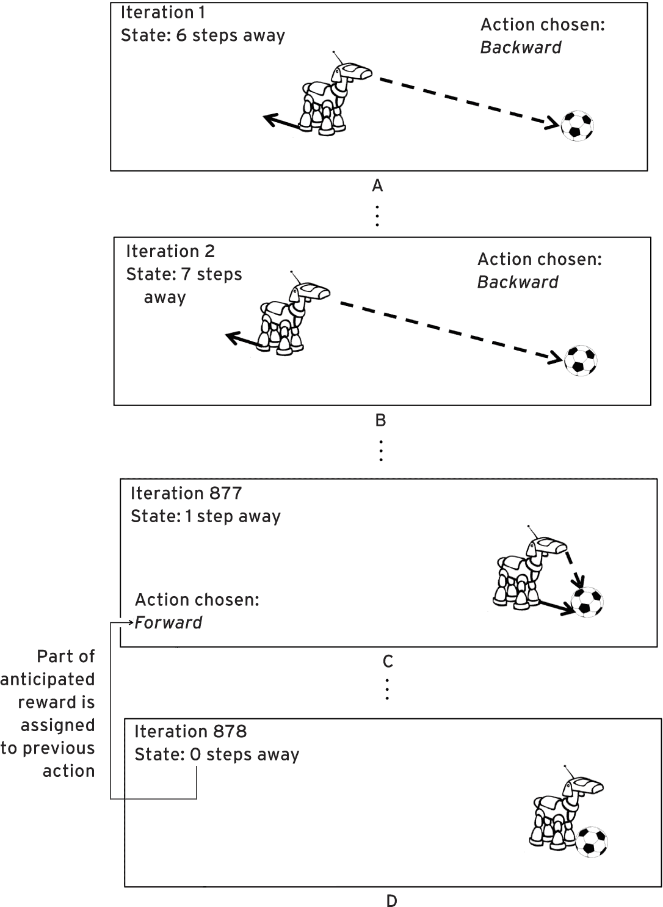

FIGURE 25: The second episode of reinforcement learning

一切都像之前一样继续，直到 Rosie 笨拙的随机试错动作碰巧让她距离球只有一步远（figure 25*C*），并且她碰巧选择了 `Forward`。突然，Rosie 发现自己的脚就在球旁边（figure 25*D*），而 Q 表对这个状态有话要说。具体来说，它指出她当前的状态——距离球零步远——有一个动作——`Kick`——预计会带来 10 的奖励。现在她可以利用上一集学到的这些信息来选择要执行的动作，即 `Kick`。但 Q-learning 的精髓在于：Rosie 现在可以了解她在紧邻的 `previous` 状态（距离球一步远）中采取的动作（`Forward`）。正是这个动作让她处于现在这个绝佳的位置！具体来说，Q 表中状态“距离球一步远”时动作 `Forward` 的值被更新为更高的值，即动作“距离球零步远时 `Kick`”值的某个分数，而该动作直接导致奖励。在这里，我将此值更新为 8（figure 26）。

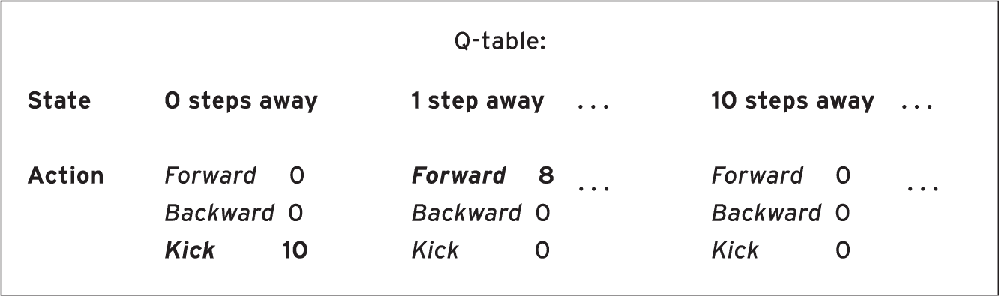

FIGURE 26: Rosie’s Q-table after her second episode of reinforcement learning

现在 Q 表告诉 Rosie，在“距离球零步远”的状态下踢球非常好，而在“距离球一步远”的状态下向前走一步几乎同样好。下次 Rosie 发现自己处于“距离球一步远”的状态时，她会对应该采取什么动作有一些了解，并能够对紧邻过去的动作——即“距离球两步远”状态下的 `Forward` 动作——学习一个更新。请注意，这些学习到的动作值在从实际奖励向过去回溯时被降低（“折扣”）很重要；这使得系统能够学习到通往实际奖励的高效路径。

强化学习——在这里，即 Q 表中值的逐步更新——会一集接一集地继续，直到 Rosie 最终学会从任何初始起点完成她的任务。Q-learning 算法是一种为给定状态中的动作分配值的方法，包括那些不直接导致奖励但为代理人获得奖励的相对罕见状态铺平道路的动作。

我编写了一个程序来模拟上述描述的 Rosie 的 Q-learning 过程。在每集开始时，Rosie 被放置在面向球、距离球随机步数的位置（最多二十五步，最少零步）。如前所述，如果 Rosie 踩出界线，我的程序会让她退回界内。每集在 Rosie 成功到达并踢到球时结束。我发现，大约需要三百集，她才能完美地学会完成这个任务，无论她从哪里开始。

这个“训练 Rosie”的例子捕捉了强化学习的许多精髓，但我省略了强化学习研究人员在处理更复杂任务时面临的许多问题。^()

此外，学习代理人在每个时间步应该如何选择动作？一种天真的策略是始终选择 Q 表中当前状态下值最高的动作。但这种策略有一个问题：可能还有其他尚未探索的动作会带来更高的奖励。你应该多久探索一次——采取尚未尝试过的动作——以及多久选择一次你已经预期会带来某种奖励的动作？当你去餐厅时，你是否总是点你已经尝试过并发现不错的那道菜，还是尝试点新东西，因为菜单上可能有更好的选择？决定在多大程度上`explore`新动作以及在多大程度上`exploit`（即坚持使用）经过验证的动作，被称为探索与利用权衡。实现正确的平衡是使强化学习成功的核心问题。

这些是强化学习不断壮大的研究人员社区中正在进行的研究主题的样本。就像在深度学习领域一样，设计成功的强化学习系统仍然是一门困难（有时也很赚钱！）的艺术，由相对较小的一群专家掌握，他们像深度学习的同行一样，花大量时间调整超参数。（应该允许多少个学习集？每个集应该允许多少次迭代？奖励在向过去传播时应该“折扣”多少？等等。）

## 现实世界中的绊脚石

暂且搁置这些问题，让我们来看看在将我们的“训练 Rosie”示例推广到现实世界任务的强化学习时可能出现的两个主要绊脚石。首先是 Q 表。在复杂的现实世界任务中——例如，想象一辆机器人汽车在拥挤的城市中学习驾驶——不可能定义一小组可以列在表中的“状态”。汽车在给定时间的单个状态将类似于其摄像头和其他传感器的所有数据。这意味着自动驾驶汽车实际上面临着无限数量的可能状态。像“Rosie”示例中那样通过 Q 表进行学习是不可能的。出于这个原因，大多数现代强化学习方法使用神经网络而不是 Q 表。神经网络的工作是学习在给定状态下应该为动作分配什么值。具体来说，网络接收当前状态作为输入，其输出是它对代理人在该状态下可以采取的所有可能动作的值的估计。希望网络能够学会将相关状态分组为一般概念（`It’s safe to drive forward` 或 `Stop immediately to avoid hitting an obstacle`）。

第二个绊脚石是在现实世界中，实际上使用真实机器人在许多集中进行学习过程的困难。即使是我们的“Rosie”示例也不可行。想象一下自己初始化一个新集——走到场地上设置机器人和球——数百次，更不用说等待机器人在每个集中执行数百个动作了。你根本没有足够的时间。此外，你可能会冒机器人因选择错误动作而损坏自身的风险，例如踢混凝土墙或向前跨过悬崖。

就像我为 Rosie 所做的那样，强化学习从业者几乎总是通过构建机器人和环境的`simulations`并在模拟中而不是在现实世界中进行所有学习集来处理这个问题。有时这种方法效果很好。机器人已经使用模拟被训练来行走、跳跃、抓取物体和驾驶遥控汽车等任务，并且机器人能够以不同程度的成功将模拟期间学到的技能转移到现实世界。^()

## 9

## Game On


自 AI 诞生之初，爱好者们就痴迷于创造能够在游戏中击败人类的程序。在 20 世纪 40 年代末，计算机时代的两位奠基人艾伦·图灵和克劳德·香农，在尚未有能够运行其代码的计算机时，就已编写了下棋程序。在随后的几十年里，许多年轻的游戏狂热者被驱动着学习编程，只为让计算机运行他们最喜欢的游戏，无论是跳棋、国际象棋、西洋双陆棋、围棋、扑克，还是最近的电子游戏。

2010 年，一位名叫德米斯·哈萨比斯的年轻英国科学家和游戏爱好者，与两位密友在伦敦创立了一家名为 DeepMind Technologies 的公司。哈萨比斯是现代 AI 界一个多姿多彩且传奇的人物。他是一位国际象棋神童，六岁时就已赢得锦标赛，十五岁开始专业编写电子游戏，二十二岁时创办了自己的电子游戏公司。除了创业活动，他还从伦敦大学学院获得了认知神经科学博士学位，以进一步实现构建受大脑启发的 AI 的目标。哈萨比斯及其同事创立 DeepMind Technologies，旨在“解决关于人工智能的\[真正\]根本问题”。^()

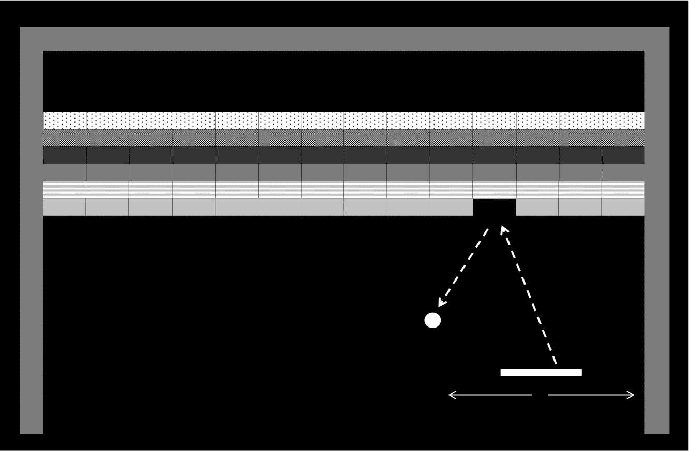

FIGURE 27: An illustration of Atari’s `Breakout` game

无论你对电子游戏持何种立场，如果你更倾向于“简洁且受限”而非“现实世界”，你或许可以考虑创建 AI 程序来玩 20 世纪 70 年代和 80 年代的 Atari 电子游戏。DeepMind 团队正是如此决定的。取决于你的年龄和兴趣，你可能还记得其中一些经典游戏，例如 `Asteroids`、`Space Invaders`、`Pong` 和 `Ms. Pac-Man`。这些游戏中有哪些让你想起了什么？凭借其简单的图形和操纵杆控制，这些游戏足够简单，让年幼的孩子学会，又足够有挑战性，能吸引成年人的兴趣。

考虑名为 `Breakout` 的单人游戏，如 figure 27 所示。玩家使用操纵杆将一个“挡板”（右下角的白色矩形）来回移动。一个“球”（白色圆圈）可以被挡板弹起，击打不同颜色的矩形“砖块”。球也可以弹回两侧的灰色“墙壁”。如果球击中了一个砖块（带图案的矩形），砖块消失，玩家得分，球弹回。较高层的砖块比较低层的砖块得分更多。如果球击中了“地面”（屏幕底部），玩家将失去五条“生命”中的一条，如果还剩下“生命”，新球将发射进入游戏。玩家的目标是在五条生命中最大化得分。

这里有一个有趣的旁注。`Breakout` 是 Atari 为创建其成功游戏 `Pong` 的单人版本所做努力的结果。`Breakout` 的设计和实现最初于 1975 年分配给一位名叫史蒂夫·乔布斯的二十岁员工。是的，就是那位史蒂夫·乔布斯（后来的苹果联合创始人）。乔布斯缺乏足够的工程技能来好好完成 `Breakout`，于是他请来了他的朋友史蒂夫·沃兹尼亚克，时年二十五岁（后来的另一位苹果联合创始人）来协助该项目。沃兹尼亚克和乔布斯在四个夜晚内完成了 `Breakout` 的硬件设计，每晚在沃兹尼亚克完成在惠普的日常工作后开始工作。一经发布，`Breakout` 就像 `Pong` 一样，在游戏玩家中大受欢迎。

如果你感到怀旧但没有保留你的旧 Atari 2600 游戏机，你仍然可以找到许多提供 `Breakout` 和其他游戏的网站。2013 年，一群加拿大 AI 研究人员发布了一个名为 Arcade Learning Environment 的软件平台，使在四十九款这些游戏上测试机器学习系统变得容易。^()

## Deep Q-Learning

DeepMind 团队将强化学习——特别是 Q-learning——与深度神经网络相结合，创建了一个能够学习玩 Atari 电子游戏的系统。该团队将其方法称为深度 Q-learning。为了解释深度 Q-learning 的工作原理，我将使用 `Breakout` 作为运行示例，但 DeepMind 对其处理的所有 Atari 游戏都使用了相同的方法。这里会变得有些技术性，所以系好安全带（或跳到下一节）。

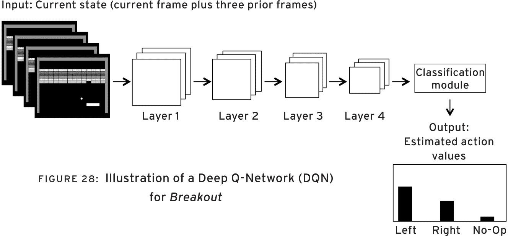

FIGURE 28: Illustration of a Deep Q-Network (DQN) for `Breakout`

回顾我们如何使用 Q-learning 训练 Rosie 机器狗。在 Q-learning 的一个 episode 中，每次迭代时，学习代理（Rosie）执行以下操作：它确定当前状态，在 Q 表中查找该状态，使用表中的值选择一个动作，执行该动作，可能获得奖励，并且——学习步骤——更新其 Q 表中的值。

DeepMind 的深度 Q-learning 完全相同，只是卷积神经网络取代了 Q 表。遵循 DeepMind，我将此网络称为深度 Q 网络（DQN）。Figure 28 说明了一个与 DeepMind 用于学习玩 `Breakout` 的网络相似（虽然更简单）的 DQN。DQN 的输入是给定时间的系统状态，这里定义为当前“帧”——当前屏幕的像素——加上三个先前帧（三个先前时间步的屏幕像素）。这种状态定义为系统提供了一小部分内存，事实证明这在这里很有用。网络的输出是给定输入状态下每个可能动作的估计值。可能的动作如下：将挡板向 `Left` 移动，将挡板向 `Right` 移动，以及 `No-Op`（“无操作”，即不移动挡板）。网络本身是一个与我在第 4 章中描述的几乎相同的 ConvNet。与我们在“Rosie”示例中看到的 Q 表中的值不同，在深度 Q-learning 中，是这个网络中的 `weights` 被学习。

DeepMind 的系统通过许多 episodes 学习玩 `Breakout`。每个 episode 对应一次游戏，每个 episode 中的每次迭代对应系统执行单个动作。特别是，在每次迭代中，系统将其状态输入到 DQN 并根据 DQN 的输出值选择一个动作。系统并不总是选择估计值最高的动作；如我上面提到的，强化学习需要在探索和利用之间取得平衡。^()

权重是如何更新的？这是监督学习与强化学习之间差异的关键。正如你从前面章节中回顾的那样，反向传播通过改变神经网络的权重来减少网络输出中的 `error`。在监督学习中，测量这个错误是简单直接的。还记得第 4 章中我们假设的 ConvNet，其目标是学习将照片分类为“狗”或“猫”吗？如果一个输入训练照片显示一只狗，但“狗”输出置信度只有 20%，那么该输出的错误就是 100% − 20% = 80%；也就是说，理想情况下，输出应该高 80 个百分点。网络可以计算错误，因为它有一个由人类提供的 `label`。

然而，在强化学习中，我们没有标签。游戏中的某一帧并没有标记应该采取的动作。那么在这种情况下，我们如何为输出分配一个错误呢？


Here’s the answer. Recall that if you are the learning agent, the `value` of an action in the current state is your estimate of how much reward you will receive by the end of the episode, if you choose this action (and continue choosing high-value actions). This estimate should be better the closer you get to the end of the episode, when you can tally up the actual rewards you received! The trick is to assume that the network’s outputs at the `current` iteration are closer to being correct than its outputs at the `previous iteration`. Then `learning` consists in adjusting the network weights (via back-propagation) so as to minimize the difference between the current and the previous iteration’s outputs. Richard Sutton, one of the originators of this method, calls this “learning a guess from a guess.”^()

In short, instead of learning to match its outputs to human-given labels, the network learns to make its outputs consistent from one iteration to the next, assuming that later iterations give better estimates of value than earlier iterations. This learning method is called temporal difference learning.

To recap, here’s how deep Q-learning works for the game of `Breakout` (and all the other Atari games). The system gives its current state as input to the Deep Q-Network. The Deep Q-Network outputs a value for each possible action. The system chooses and performs an action, resulting in a new state. Now the learning step takes place: the system inputs its new state to the network, which outputs a new set of values for each action. The difference between the new set of values and the previous set of values is considered the “error” of the network; this error is used by back-propagation to change the weights of the network. These steps are repeated over many episodes (plays of the game). Just to be clear, everything here—the Deep Q-Network, the virtual “joystick,” and the game itself—is software running in a computer.

This is essentially the algorithm developed by DeepMind’s researchers, although they used some tricks to improve it and speed it up.^()

## The $650 Million Agent

The DeepMind group applied their deep Q-learning method to the forty-nine different Atari games in the Arcade Learning Environment. While DeepMind’s programmers used the same network architecture and hyperparameter settings for each game, their system learned each game from scratch; that is, the system’s knowledge (the network weights) learned for one game was not transferred when the system started learning to play the next game. Each game required training for thousands of episodes, but this could be done relatively quickly on the company’s advanced computer hardware.

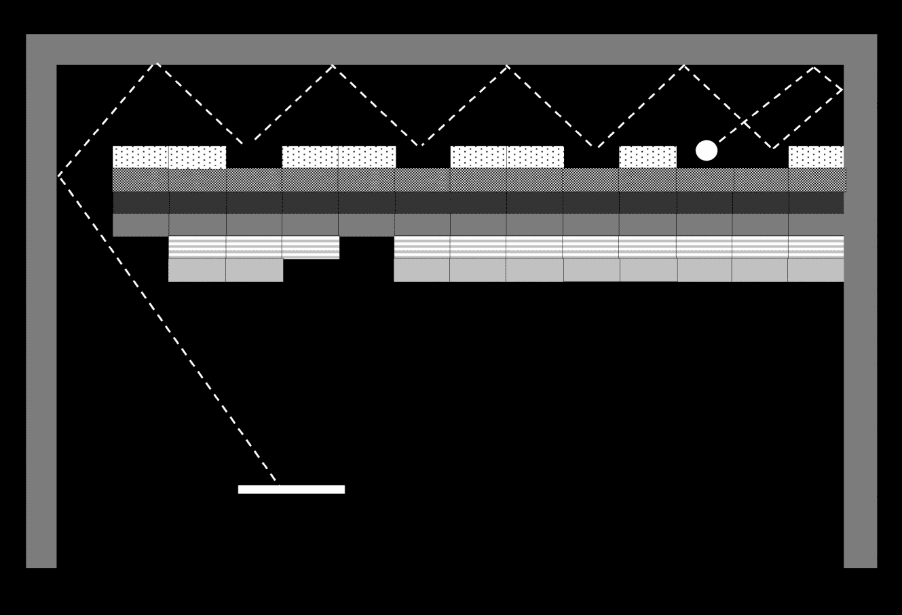

FIGURE 29: DeepMind’s `Breakout` player discovered the strategy of tunneling through the bricks, which allowed it to quickly destroy high-value top bricks by bouncing off the “ceiling.”

After a Deep Q-Network for each game was trained, DeepMind compared the machine’s level of play with that of a human “professional games tester,” who was allowed two hours of practice playing each game before being evaluated. Sound like a fun job? Only if you like being humiliated by a computer! DeepMind’s deep Q-learning programs turned out to be better players than the human tester on more than half the games. And on half of `those` games, the programs were more than twice as good as the human. And on half of `those` games, the programs were more than five times better. One stunning example was on `Breakout`, where the DQN program scored on average more than `ten` times the human’s average score.

What, exactly, did these superhuman programs learn to do? Upon investigation, DeepMind found that their programs had discovered some very clever strategies. For example, the trained `Breakout` program had discovered a devious trick, illustrated in figure 29. The program learned that if the ball was able to knock out bricks so as to build a narrow tunnel through the edge of the brick layer, then the ball would bounce back and forth between the “ceiling” and the top of the brick layer, knocking out high-value top bricks very quickly without the player having to move the paddle at all.

DeepMind first presented this work in 2013 at an international machine-learning conference.^()

With a lot of money in their pockets and the resources of Google behind them, DeepMind—now called Google DeepMind—took on a bigger challenge, one that had in fact long been considered one of AI’s “grand challenges”: creating a program that learns to play the game Go better than any human. DeepMind’s program AlphaGo builds on a long history of AI in board games. Let’s start with a brief survey of that history, which will help in explaining how AlphaGo works and why it is so significant.

## Checkers and Chess

In 1949, the engineer Arthur Samuel joined IBM’s laboratory in Poughkeepsie, New York, and immediately set about programming an early version of IBM’s 701 computer to play checkers. If you yourself have any computer programming experience, you will appreciate the challenge he faced: as noted by one historian, “Samuel was the first person to do any serious programming on the 701 and as such had no system utilities \[that is, essentially no operating system!\] to call on. In particular he had no assembler and had to write everything using the op codes and addresses.”^() 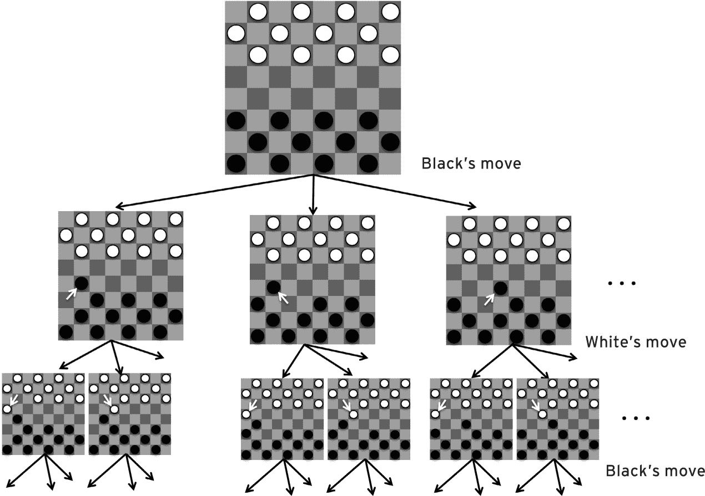

FIGURE 30: Part of a game tree for checkers. For simplicity, this figure shows only three possible moves from each board position. The white arrows point from a moved piece’s previous square to its current square.

Samuel’s checkers player was based on the method of searching a game tree, which is the basis of all programs for playing board games to this day (including AlphaGo, which I’ll describe below). Figure 30 illustrates part of a game tree for checkers. The “root” of the tree (by convention drawn at the top, unlike the root of a natural tree) shows the initial checkerboard, before either player has moved. The “branches” from the root lead to all possible moves for the first player (here, Black). There are seven possible moves (for simplicity, the figure shows only three of these). For each of those seven moves for Black, there are seven possible response moves for White (not all shown in the figure), and so on. Each of the boards in figure 30, showing a possible arrangement of pieces, is called a board position.


想象自己正在下一盘跳棋。每一步棋时，你可能会在脑海中构建这棵树的一小部分。你可能会对自己说：“如果我走`this`这一步，那么我的对手可能会走那一步，在这种情况下，我可以走那一步，这将让我有机会进行一次跳跃。”大多数人，包括最好的棋手，都只考虑几种可能的走法，只往前看几步就决定走哪一步。另一方面，一台快速计算机有潜力在更大规模上进行这种前瞻性计算。是什么阻止计算机查看每一种可能的走法，并看看哪种走法序列最快能导致获胜？问题与我们在第 3 章中看到的同类指数增长相同（还记得国王、贤者和大米的故事吗？）。一盘平均的跳棋比赛大约有五十步，这意味着 figure 30 中的游戏树可能会向下延伸五十层。在每一层，从每个可能的棋盘位置平均有六七个分支。这意味着树中棋盘位置的总数可能超过六的五十次方——一个荒谬地巨大的数字。一台假设的计算机，如果每秒能查看一万亿个棋盘位置，也需要超过`10¹⁹`年才能考虑单个游戏树中的所有棋盘位置。（如常所做，我们可以将这个数字与宇宙的年龄进行比较，宇宙的年龄仅在`10¹⁰`年这个数量级。）显然，对游戏树进行完整搜索是不可行的。

幸运的是，计算机可以在不进行这种穷举搜索的情况下下好棋。在萨缪尔的跳棋程序的每一步棋中，它都会在计算机内存中创建类似 figure 30 所示的游戏树的一小部分。树的根是玩家当前的棋盘位置，程序利用其内置的跳棋规则知识，生成从当前棋盘位置可以走的所有合法走法。然后，它生成对手从每个结果位置可以走的所有合法走法，以此类推，向前看四五步（或称为“plies”）。^()

然后，程序评估前瞻过程结束时出现的棋盘位置；在 figure 30 中，这些将是部分树底部行中的棋盘位置。`Evaluating`一个棋盘位置意味着为其分配一个数值，以估计该位置导致程序获胜的可能性。萨缪尔的程序使用了一个`evaluation function`，该函数为棋盘的各种特征赋予分数，总共三十八分，例如黑方棋子总数的优势、黑方的王的数量，以及黑方有多少棋子即将升王。这些特定特征是由萨缪尔利用其跳棋知识选择的。一旦底部行的每个棋盘位置都被这样评估后，程序就使用了一个名为`minimax`的经典算法，该算法利用这些值——来自前瞻过程的末端——来对程序从当前棋盘位置可以立即进行的走法进行评级。然后程序选择评级最高的走法。

这里的直觉是，当评估函数应用于游戏中更靠后的棋盘位置时，会更加准确；因此程序的策略是先查看未来几步内的所有可能走法序列，然后将评估函数应用于结果棋盘位置。然后，评估结果通过`minimax`向上传播到树中，从而对当前棋盘位置的所有可能立即走法进行评级。^()

程序学习的是`which`棋盘特征应该在特定步骤中包含在评估函数中，以及在求和分数时如何对这些不同特征进行加权。萨缪尔在他的系统中尝试了几种学习方法。在最有趣的版本中，系统在自我对弈中学习！学习方法有些复杂，我不会在此详细说明，但它有一些预示了现代强化学习的方面。^()

最终，萨缪尔的跳棋选手令人印象深刻地达到了“比平均水平更好的棋手”的水平，但绝非冠军。一些业余棋手将其描述为“棘手但可战胜”。^()

虽然萨缪尔的跳棋选手是人工智能历史上的一个重要里程碑，但我做这个历史性的离题主要是为了介绍它所阐明的三个至关重要的概念：游戏树、评估函数和自我对弈学习。

## 深蓝

尽管萨缪尔的“棘手但可战胜”跳棋程序很了不起，尤其是考虑到它的时代，但它几乎没有挑战人们认为自己是独特智能的观念。即使一台机器能战胜人类跳棋冠军（一台机器最终在 1994 年做到了^()

国际象棋比跳棋复杂得多。例如，我上面说过，在跳棋中，从任何给定的棋盘位置平均有六七种可能的走法。相比之下，国际象棋从任何给定的棋盘位置平均有三十五种走法。这使得国际象棋游戏树比跳棋的游戏树大得多。几十年来，下棋程序不断改进，与计算机硬件速度的提升同步。1997 年，IBM 以`Deep Blue`取得了第二次重大游戏胜利，这是一个下棋程序，在广播的多局比赛中击败了世界冠军加里·卡斯帕罗夫。

`Deep Blue`使用了与萨缪尔跳棋选手大致相同的方法：在给定的步骤中，它以当前棋盘位置为根创建一个部分游戏树；它将评估函数应用于树中最远的一层，然后使用`minimax`算法将值向上传播到树中，以确定应该走哪一步。萨缪尔的程序与`Deep Blue`之间的主要区别在于`Deep Blue`在其游戏树中更深的前瞻性、更复杂的（国际象棋特定的）评估函数、手工编程的国际象棋知识，以及用于使其运行非常快速的专用并行硬件。此外，与萨缪尔的跳棋程序不同，`Deep Blue`并没有以任何核心方式使用机器学习。

就像之前的萨缪尔跳棋选手一样，`Deep Blue`击败卡斯帕罗夫导致 IBM 股价大幅上涨。^()

## 围棋的终极挑战

围棋已有两千多年的历史，被认为是所有棋类游戏中最难的游戏之一。如果你不是围棋棋手，不用担心；我在这里的讨论不需要任何先验的游戏知识。但了解该游戏具有严肃地位是有用的，尤其是在东亚，那里它极其流行。“围棋是帝王与将军、知识分子与神童喜爱的消遣，”学者兼记者艾伦·莱维诺维茨写道，他接着引用了韩国围棋冠军李世石的话：“西方世界有国际象棋，但围棋在微妙性和智力上无与伦比。”^()

围棋是一个规则相当简单但会产生你可能称之为涌现复杂性的游戏。每一步棋时，一名玩家将自己颜色（黑色或白色）的棋子放在十九乘十九方格的棋盘上，遵循关于棋子放置位置以及如何吃掉对手棋子的规则。与国际象棋及其兵、主教、皇后等等级制度不同，围棋中的棋子（“棋子”）都是平等的。玩家必须快速分析棋盘上棋子的配置，以决定走哪一步。


创建一个能够下好围棋的程序一直是人工智能领域自早期以来的关注焦点。然而，围棋的复杂性使得这项任务异常艰巨。1997 年，也就是深蓝击败卡斯帕罗夫的那一年，最好的围棋程序仍然很容易被普通棋手击败。你还记得，深蓝能够从任何棋盘位置进行大量的前瞻计算，然后使用其评估函数为未来的棋盘位置分配值，其中每个值预测特定的棋盘位置是否会导致获胜。围棋程序无法使用这种策略，原因有二。首先，围棋中前瞻树的规模远大于国际象棋。国际象棋棋手从给定的棋盘位置平均需要从 35 种可能的着法中选择，而围棋棋手平均有 250 种这样的可能性。即使使用专用硬件，深蓝式的围棋博弈树蛮力搜索也是不可行的。其次，没有人能够为围棋棋盘位置创建一个好的评估函数。也就是说，没有人能够构建一个成功的公式来检查围棋棋盘位置并预测谁将获胜。最好的（人类）围棋棋手依赖于他们的模式识别技能和那难以言喻的“直觉”。

人工智能研究人员尚未弄清楚如何将直觉编码到评估函数中。这就是为什么，在 1997 年，也就是深蓝击败卡斯帕罗夫的那一年，记者乔治·约翰逊在《纽约时报》中写道：“当或如果一台电脑击败人类围棋冠军时，这将是人工智能真正开始变得和真东西一样好标志。”^()

## AlphaGo 与李世石

在解释 AlphaGo 是如何工作之前，让我们先纪念一下它对李世石（世界最佳围棋棋手之一）取得的壮观胜利。即使在 AlphaGo 在半年前击败当时的欧洲围棋冠军范蕴 aye 之后，李世石仍然相信自己会获胜：“我认为\[AlphaGo 的\]水平不如我。……当然，过去四五个月会有很多更新，但这不足以挑战我。”^()

也许你是 2016 年 3 月在线上观看 AlphaGo 与李世石比赛部分内容的两亿多人之一。我确信，这在围棋两千五百年的历史上，是迄今为止任何围棋比赛最大的观众群。第一局结束后，你可能与李世石对程序失利的反应相同：“我震惊，我承认这一点。……我没想到 AlphaGo 会以如此完美的方式下棋。”^()

AlphaGo“完美”的下棋包括许多让比赛中的人类评论员感到惊讶和钦佩的着法。但在第二局进行到一半时，AlphaGo 下了一着棋，甚至让最先进的围棋专家也目瞪口呆。正如《连线》杂志报道的，

> 起初，范蕴 aye\[上述的欧洲围棋冠军\]认为这一着法相当奇怪。但随后他看到了它的美。“这不是人类的着法。我从未见过人类下过这一着法，”他说。“太美了。”这是他不断重复的一个词。美。美。美。……“这是一个非常令人惊讶的着法，”比赛的一位英语评论员说，他本人也是一位非常有天赋的围棋棋手。然后另一人轻声笑了笑说：“我以为那是个失误。”但也许没有人比李世石更惊讶了，他站起来离开了比赛室。“他得去洗把脸之类的，只是为了缓过神来，”第一位评论员说。^()

>

> 关于同一着法，《经济学人》指出：“有趣的是，人类围棋大师有时也会下出这样的着法。在日语中，它们被称为*kami no itte*（‘神之手’或‘神迹着法’）。”^()

>

> AlphaGo 赢下了那一局，以及下一局。但在第四局，李世石有了他自己的*kami no itte*时刻，这一时刻捕捉到了围棋的复杂性和顶尖棋手的直觉力量。李世石的着法让评论员们感到惊讶，但他们立即意识到这对李世石的对手可能是致命的。一位作家指出，“然而，AlphaGo 似乎没有意识到发生了什么。这不是它在……与自己对弈的数百万盘棋中遇到过的事情。赛后新闻发布会上，李世石被问及下这一着法时在想什么。他说，这是他能看到的唯一着法。”^()

>

> AlphaGo 输掉了第四局，但赢回了第五局，从而赢得了比赛。在大众媒体中，这再次是深蓝对卡斯帕罗夫，关于 AlphaGo 的胜利对人类未来意味着什么，有源源不断的评论文章。但这比深蓝的胜利更具意义：人工智能克服了比国际象棋更大的挑战，并且以更令人印象深刻的方式做到了这一点。与深蓝不同，AlphaGo 是通过自我对弈的强化学习获得其能力的。

>

> 德米斯·哈萨比斯指出，“区分顶尖围棋棋手的\[东西是\]他们的直觉”以及“我们通过 AlphaGo 所做的，是引入神经网络中的这种直觉方面，如果你想这么称呼它的话。”^()

>

> ## AlphaGo 的工作原理

>

> AlphaGo 有几个不同的版本，为了区分它们，DeepMind 开始以程序击败的人类围棋冠军来命名它们——AlphaGo Fan 和 AlphaGo Lee——这让我想起了数字维京人收藏中战败敌人的头骨。我相信这不是 DeepMind 的本意。无论如何，AlphaGo Fan 和 AlphaGo Lee 都使用了深度 Q 学习、“蒙特卡洛树搜索”、监督学习和专业围棋知识的复杂组合。但在李世石比赛一年后，DeepMind 开发了一个比之前版本更简单且更优越的程序版本。这个较新的版本被称为 AlphaGo Zero，因为与它的前身不同，它除了规则之外对围棋“零”了解。^() 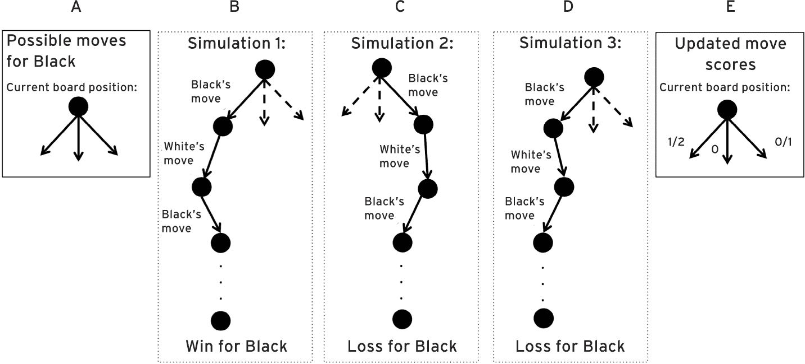

>

> FIGURE 31: 蒙特卡洛树搜索示意图

>

> *直觉*这个词带有神秘的光环，但 AlphaGo 的直觉（如果你想这么称呼它的话）源于其深度 Q 学习与一种称为“蒙特卡洛树搜索”的巧妙方法的结合。让我们花点时间来拆解这个笨拙的名称。首先是“蒙特卡洛”部分。蒙特卡洛当然是位于法国里维埃拉的小公国摩纳哥最迷人的部分，以其喷气式赌场、赛车和频繁出现在詹姆斯·邦德电影中而闻名。但在科学和数学中，“蒙特卡洛”指的是一类计算机算法，即所谓的蒙特卡洛方法，它最初用于曼哈顿计划以帮助设计原子弹。这个名字来自这样的想法：一定程度的*随机性*—就像蒙特卡洛赌场标志性的旋转轮盘赌轮—可以被计算机用来解决困难的数学问题。

>

> 蒙特卡洛树搜索是专门为计算机游戏程序设计的蒙特卡洛方法的一个版本。类似于深蓝的评估函数的工作方式，蒙特卡洛树搜索用于为给定棋盘位置的每个可能着法分配分数。然而，正如我上面解释的，在博弈树中进行广泛的前瞻对于围棋来说是不可行的，而且没有人能够为围棋棋盘位置提出一个好的评估函数。蒙特卡洛树搜索的工作方式不同。

>

> Figure 31 说明了蒙特卡洛树搜索。首先，看看 figure 31*A*。黑色圆圈代表当前的棋盘位置—即当前回合棋盘上棋子的配置。假设我们的围棋程序正在执黑棋，且轮到黑棋下棋。为了简单起见，假设黑棋有三种可能的着法，由三个箭头表示。黑棋应该选择哪一着法？


> 如果黑方有足够的时间，它可以对博弈树进行“全面搜索”：预先查看可能进行的*所有*着法序列，并选择能给黑方带来获胜最佳机会的着法。但进行这种详尽的预判是不可能的；如前所述，即使是从宇宙诞生以来的所有时间，也远不足以在围棋中进行完整的树搜索。使用蒙特卡洛树搜索时，黑方只预判可能从每个着法产生的可能序列中的极小部分，统计这些假设序列导致的胜负次数，并利用这些次数为其每个可能的着法打分。轮盘赌启发的随机性用于决定如何进行预判。

> 更具体地说，为了从当前位置选择一个着法，黑方“想象”（即模拟）几种游戏可能进行的方式，如图 31*B*–*D*所示。在每次模拟中，黑方从当前位置开始，随机选择一个可能的着法，然后（从新的棋盘位置）随机为其对手（白方）选择一个着法，依此类推，一直持续到模拟的游戏以黑方胜负结束。从给定棋盘位置开始的这种模拟，称为从该位置进行的一次滚出。

> 在图中，你可以看到在三次滚出中，黑方赢了一次，输了两次。黑方现在可以为其当前棋盘位置的每个可能着法打分（图 31*E*）。着法 1（最左侧的箭头）参与了两次滚出，其中一次以胜利结束，因此该着法的得分是 2 分中的 1 分。着法 3（最右侧的箭头）参与了一次滚出，以失败结束，因此其得分是 1 分中的 0 分。中间的着法根本没有尝试过，因此其得分设为 0。此外，程序还会对所有参与滚出的中间着法保存类似的统计数据。一旦这一轮蒙特卡洛树搜索完成，程序就可以使用其更新后的得分来决定哪个可能的着法看起来最有希望——这里，就是着法 1。然后程序可以在实际游戏中做出该着法。

> 我之前说过，在滚出过程中程序会为自己和对手随机选择着法，但实际上，程序会根据这些着法在之前的蒙特卡洛树搜索轮次中可能拥有的任何得分，*按概率*选择着法。当每次滚出以胜利或失败结束时，算法会更新该游戏中所做所有着法的得分，以反映胜负情况。

> 起初，程序从给定棋盘位置选择着法的方式非常随机（程序相当于转动轮盘赌来选择着法），但随着程序进行更多的滚出，生成更多的统计数据，它会越来越倾向于选择那些在过去的滚出中带来最多胜利的着法。

> 这样一来，蒙特卡洛树搜索不必仅通过查看棋盘位置来猜测哪个着法最可能导致胜利；它利用滚出来收集统计数据，了解给定着法*实际*导致胜利或失败的次数。算法运行的滚出越多，其统计数据就越好。如前所述，程序需要平衡开发（在滚出过程中选择得分最高的着法）与探索（有时选择程序尚未拥有太多统计数据的低分着法）。在图 31 中，我展示了三次滚出；AlphaGo 的蒙特卡洛树搜索每回合执行接近两千次滚出。

> DeepMind 的计算机科学家并未发明蒙特卡洛树搜索。它最初于 2006 年在博弈树的背景下被提出，并使计算机围棋程序的能力有了非常大的提升。但这些程序仍然无法击败最优秀的人类。一个问题是，从滚出中生成足够的统计数据可能需要大量时间，尤其是在围棋中，因为其可能的着法数量庞大。DeepMind 团队意识到，他们可以通过将蒙特卡洛树搜索与深度卷积神经网络相结合来改进他们的系统。给定当前棋盘位置作为输入，AlphaGo 使用训练好的深度卷积神经网络为当前位置的所有可能着法分配一个粗略的值。然后，蒙特卡洛树搜索使用这些值来启动其搜索：不再最初随机选择着法，而是使用 ConvNet 输出的值作为指标，以确定哪些初始着法应被优先选择。想象一下，你是 AlphaGo，正盯着一个棋盘位置：在你开始从该位置进行滚出的蒙特卡洛过程之前，ConvNet 正在你耳边低语，哪些来自当前位置的可能着法可能是最好的。

> 反之，蒙特卡洛树搜索的结果会反馈以训练 ConvNet。想象一下，你是进行完蒙特卡洛树搜索后的 AlphaGo。你的搜索结果是基于你在滚出过程中这些着法导致胜负的次数，为你所有可能的着法分配了新的概率。这些新概率现在用于通过反向传播来纠正你的 ConvNet 的输出。然后，你和你的对手选择着法，结果你得到了一个新的棋盘位置，过程继续进行。原则上，卷积神经网络将学会识别模式，就像围棋大师一样。最终，ConvNet 将扮演程序的“直觉”角色，而这种直觉会通过蒙特卡洛树搜索进一步提升。

> 像它的祖先塞缪尔的跳棋玩家一样，AlphaGo 通过与*自己*进行许多局游戏（约五百万局）来学习。在训练期间，卷积神经网络的权重在每次着法后根据网络输出值与运行蒙特卡洛树搜索后的改进值之间的差异进行更新。然后，当轮到 AlphaGo 去与人类（比如李世石）对弈时，训练好的 ConvNet 在每个回合都用于生成值，以帮助蒙特卡洛树搜索开始。

> 通过其 AlphaGo 项目，DeepMind 证明了 AI 长期以来的一项重大挑战可以通过强化学习、卷积神经网络和蒙特卡洛树搜索（以及加入强大的现代计算硬件）的巧妙组合来征服。因此，AlphaGo 在 AI 殿堂中赢得了当之无愧的地位。但接下来呢？这种强大的方法组合能否超越游戏领域推广开来？这是我在下一章中讨论的问题。

## 10

## 超越游戏

在过去十年中，强化学习已从 AI 相对冷门的一个分支转变为该领域最令人兴奋（且资金最充足）的方法之一。强化学习的复兴，尤其是在公众眼中，很大程度上归功于我上一章中描述的 DeepMind 项目。DeepMind 在 Atari 游戏和围棋上的成果确实非常显著和重要，它们理应受到赞誉。

然而，对于大多数 AI 研究人员来说，开发超人水平的游戏程序本身并不是目的。让我们退后一步，思考这些成功对 AI 更广泛进步的意义。德米斯·哈萨比斯对此有话要说：

> 游戏只是我们的开发平台。…… 这是开发这些 AI 算法并测试它们的最快方式，但最终我们希望使用它们，使其应用于现实世界的问题，并对医疗保健和科学等领域产生巨大影响。重点在于，这是通用 AI——它是基于自身经验和自身数据学习如何做事情。^()


> 让我们深入探讨一下。这个 AI 究竟有多 *通用*？除了游戏之外，它在现实世界中有多大的适用性？这些系统实际上在多大程度上是“自主学习”的？而且，它们到底学到了什么？

## 通用性与“迁移学习”

当我在网上搜索关于 AlphaGo 的文章时，网页向我推送了这样一个吸引人的标题：“DeepMind 的 AlphaGo 在业余时间掌握了国际象棋。”^()

各种 Atari 游戏程序也是如此：每个程序都从零开始学习自己的网络权重。这就像你学会了玩 *Pong*，但为了学习玩 *Breakout*，你必须完全忘记关于玩 *Pong* 的所有知识，从头开始。

机器学习社区中一个充满希望的短语是“迁移学习”，它指的是程序将关于一项任务所学到的内容 *迁移* 到帮助其执行另一项相关任务的能力。对人类来说，迁移学习是自动的。在我学会乒乓球后，我能够将其中一些技能迁移到网球和羽毛球的学习中。懂得如何下跳棋帮助我学习如何下国际象棋。当我还是个幼儿时，学会如何拧房间门把手花了我一段时间，但一旦掌握了这项技能，我的能力就迅速推广到了几乎任何类型的门把手上。

人类表现出这种从一项任务到另一项任务的迁移，看似毫不费力；我们推广所学知识的能力是我们 *思考* 的核心部分。因此，用人类的话来说，我们可以说迁移学习的另一个术语，嗯，就是 *学习*。

与人类形成鲜明对比的是，当今 AI 中的大多数“学习”在相关任务之间是不可迁移的。在这方面，该领域仍远离哈萨比斯所说的“通用 AI”。虽然迁移学习是机器学习从业者最活跃的研究领域之一，但在这方面的进展仍处于初级阶段。^()

## “无需人类示例或指导”

与监督学习不同，强化学习承诺程序可以真正自主学习，只需在其“环境”中执行动作并观察结果即可。DeepMind 关于其结果的最重要主张，尤其是关于 AlphaGo，是该工作已经兑现了这一承诺：“我们的结果全面证明，纯强化学习方法完全可行，即使在最具挑战性的领域也是如此：在没有领域知识（除基本规则外）的情况下，可以在没有人类示例或指导的情况下训练到超人水平。”^()

我们有了主张。现在让我们看看注意事项。AlphaGo（或者更准确地说，AlphaGo Zero 版本）确实在学习中没有使用任何人类示例，但人类“指导”则是另一回事。对其成功至关重要的几个人类指导方面包括其卷积神经网络的特定架构、蒙特卡洛树搜索的使用，以及这两者所涉及的许多超参数的设置。正如心理学家和 AI 研究员加里·马库斯所指出的，AlphaGo 的这些关键方面都不是“从数据中，通过纯强化学习学习到的。相反，\[它们是\] 由 DeepMind 的程序员与生俱来地构建的。”^()

## 最具挑战性的领域

DeepMind 的声明中还有一个方面需要探讨：“即使在最具挑战性的领域。”我们如何评估一个领域对 AI 来说有多具挑战性？正如我们所看到的，许多我们人类认为相当容易的事情（例如，描述照片的内容）对计算机来说极具挑战性。相反，许多我们人类会觉得极其困难的事情（例如，正确地将两个五十位数相乘），计算机可以用一行程序在一秒钟内完成。

评估一个领域对计算机挑战程度的一种方法是看非常简单的算法在该领域表现如何。2018 年，Uber AI Labs 的一组研究人员发现，一些相对简单的算法在几个 Atari 视频游戏中几乎匹配（有时甚至超越）了 DeepMind 的深度 Q 学习方法。最令人惊讶的表现良好的算法是“随机搜索”：与其通过强化学习在许多回合中训练深度 Q 网络，不如简单地尝试许多不同的卷积神经网络，其权重 *随机* 选择。^()

你可能会认为，一个权重随机的网络在 Atari 视频游戏中会表现糟糕。确实，大多数这样的网络都是糟糕的玩家。但 Uber 的研究人员不断尝试新的随机权重网络，最终（在训练深度 Q 网络所需时间的时间内）他们找到了在测试的十三款游戏中的五款上表现几乎与或甚至优于通过深度 Q 学习训练的网络。另一种相对简单的算法，所谓的遗传算法，^()

我还没有听说过有人尝试为围棋的网络权重进行类似的随机搜索。如果那奏效，我会非常惊讶。鉴于构建计算机围棋玩家的悠久历史，我确信围棋对 AI 来说是一个真正具有挑战性的领域。然而，正如加里·马库斯所指出的，人类玩的许多游戏对 AI 来说比围棋更具挑战性。马库斯举的一个引人注目的例子是猜谜游戏，^()

## 这些系统学到了什么？

与其他深度学习应用一样，很难解释这些游戏系统中使用的神经网络实际上学到了什么。在阅读上述部分时，你可能注意到我的描述中潜入了一些微妙的拟人化：例如，我说，“DeepMind 的 *Breakout* 玩家发现了穿墙的策略。”

对我来说，和任何人一样，在谈论 AI 系统的行为时很容易陷入这种语言。然而，我们的语言往往带有可能不适用于这些程序的无意识假设。DeepMind 的 *Breakout* 玩家实际上发现了 *穿墙* 的概念吗？加里·马库斯提醒我们，这里需要小心：

> 系统并没有学到这样的东西；它并不真正理解什么是隧道，或者什么是墙；它只是学习了特定场景的特定条件。迁移测试——即深度强化学习系统面临与训练场景略有不同的场景——表明深度强化学习的解决方案往往非常肤浅。^()

> 马库斯指的是几项研究，这些研究试图探测深度 Q 学习系统在将所学内容迁移到同一游戏的微小变体时表现如何。例如，一组研究人员研究了一个类似于 DeepMind 的 *Breakout* 玩家的系统。他们发现，一旦玩家被训练到“超人”水平，如果屏幕上的球拍位置向上移动几个像素，系统的性能就会急剧下降。^()

> 这些只是深度 Q 学习无法推广的两个例子，这与人类智能形成了鲜明对比。我不知道有任何研究探测了 DeepMind 的 *Breakout* 玩家中穿墙的概念，但我猜测该系统无法推广到，例如，向 *下* 或 *侧面* 穿墙，而无需大量重新训练。正如马库斯所指出的，虽然 *我们人类* 将程序归因于对我们认为的基本概念（例如，*墙*、*天花板*、*球拍*、*球*、*穿墙*）的某种理解，但该程序实际上并没有这样的概念：


> > > 这些演示清楚地说明，将深度强化学习中诱导 `wall` 或 `paddle` 等概念的功劳归于它是具有误导性的；相反，此类言论有时被比较（动物）心理学称为过度归因。问题不在于 Atari 系统真正学会了一个稳健的 `wall` 概念，而是该系统仅在高度受限的训练条件下，表面上近似了突破墙壁的行为。^()

> > > 

> > > 同样，尽管 AlphaGo 在下围棋时展现了神奇的“直觉”，但据我所知，该系统并不具备任何能让其将围棋能力推广到其他场景（例如，更小或形状不同的围棋棋盘）的机制，除非对其深度 Q 网络进行重构和重新训练。

> > > 

> > > 简而言之，尽管这些深度 Q 学习系统在某些狭窄领域取得了超越人类的表现，甚至在这些领域展现出类似“直觉”的表现，但它们缺乏某种对人类智能至关重要的东西。无论将其称为抽象、领域泛化还是迁移学习，赋予系统这种能力仍然是 AI 最重要的未解决问题之一。

> > > 

> > > 还有另一个理由怀疑，这些系统并非像人类那样学习类人概念或 `understand` 它们的领域：就像受监督学习系统一样，这些深度 Q 学习系统也容易受到我在第 6 章中描述的那种对抗样本的影响。例如，一个研究小组表明，可以对 Atari 游戏程序输入中的像素进行特定的微小更改——这些更改对人类来说不可察觉，但会显著损害程序玩游戏的能力。

> 

> ## AlphaGo 有多智能？

> 

> 在思考象棋和围棋等游戏及其与人类智能的关系时，我们必须牢记这一点。想想许多家长鼓励孩子加入学校象棋俱乐部（或在某些地方加入围棋俱乐部），并且宁愿看到孩子下象棋（或围棋），也不愿看到他们坐在家里看电视或玩电子游戏（抱歉，Atari）的原因。这是因为人们相信，象棋或围棋等游戏能教会孩子（或任何人）更好地 `think`：如何逻辑思考、如何抽象推理、如何战略规划。这些都是能够贯穿人生其余阶段的能力，是人在所有事业中都能使用的通用能力。

> 

> 但是，AlphaGo 尽管在训练中下了数百万盘棋，却并未学会在围棋以外的任何事情上“think”得更好。事实上，除了围棋，它没有思考任何事情、推理任何事情、为任何事情制定计划的能力。据我所知，它学到的任何能力都不具备任何通用性；没有任何能力可以转移到其他任务。AlphaGo 是终极的白痴天才。

> 

> 当然，AlphaGo 中使用的深度 Q 学习方法可以用于学习其他任务，但系统本身必须完全重新训练；在学习新技能时，它必须基本上从零开始。

> 

> 这让我们回到了 AI 中“容易的事情很难”的悖论。AlphaGo 是 AI 的一项伟大成就；它主要通过自我对弈学习，能够在一场被视为智力巅峰的游戏中，明确击败世界上最优秀的人类棋手之一。但 AlphaGo 并未展现出我们通常定义的人类水平智能，甚至可以说没有任何真正的智能。对于人类来说，智能的一个关键部分不在于能学会任何特定技能，而在于能够 `learn to think`，并能灵活地将我们的思维应用于所遇到的任何情况或挑战。这就是我们希望孩子们下象棋或围棋时学到的真正技能。也许这么说听起来很奇怪，但从这个角度看，学校象棋俱乐部中最低年级的幼儿园小朋友也比 AlphaGo 更聪明。

> 

> ## 从游戏到现实世界

> 

> 最后，让我们考虑一下 Demis Hassabis 的说法，即这些游戏演示的最终目标是“利用它们来应用于现实世界的问题，并对医疗保健和科学等领域产生巨大影响”。我认为，DeepMind 在强化学习方面的工作最终可能会产生 Hassabis 所瞄准的那种影响。但从游戏到现实世界，还有很长的路要走。

> 

> 迁移学习的需求是一个障碍。但还有其他原因，使得将强化学习在游戏中的成功扩展到现实世界会很困难。`Breakout` 和围棋等游戏非常适合强化学习，因为它们有明确的规则、简单的奖励函数（例如，得分或获胜的奖励），以及相对较少的可能动作（走法）。此外，玩家可以获得“完美信息”：游戏的所有组件始终对玩家可见；玩家的“状态”中没有隐藏或不确定的部分。

> 

> 现实世界并非如此清晰地界定。Douglas Hofstadter 指出，明确定义的“状态”这一概念根本不现实。“如果你看看世界上的情况，它们并不像象棋或围棋那样被框定……世界上的情况是完全没有边界的；你不知道情况中包含什么，不包含什么。”^()

> 

> 例如，考虑使用强化学习训练机器人执行一项非常有用的现实世界任务：将水槽中堆叠的脏碗碟放入洗碗机。（这样的机器能给我的家庭带来多么和谐啊！）我们应该如何定义机器人的“状态”？是否应包括其视野中的一切？水槽里的东西？洗碗机里的东西？那过来舔碗碟需要被赶走的狗呢？无论我们如何定义其状态，机器人都需要能够识别不同的物体——例如，识别一个盘子（应该放在洗碗机底层架子上）、一个咖啡杯（应该放在顶层架子上）或一个海绵（根本不应该放进洗碗机）。正如我们所见，计算机的物体识别远非完美。此外，机器人还需要推理它看不见的物体——也许是水槽底部隐藏的锅和锅铲。机器人还需要学习拿起不同的物体并小心地将它们放入合适的插槽中。所有这些都需要学习在涉及机器人身体位置、其抓取“手指”、控制物体从水槽移动到正确洗碗机插槽的电机等众多可能动作中进行选择。^()

> 

> DeepMind 的游戏代理需要数百万次训练迭代。如果我们不想要数百万个破碗，就必须在模拟中训练我们的机器人。游戏在计算机上模拟得非常快且准确；没有实际移动棋子，没有实际球拍弹跳，也没有实际砖块爆炸。但模拟一个装载洗碗机的机器人并不那么容易。模拟越真实，在计算机上运行就越慢，即使有非常快的计算机，将所有物理力和其他装载碗碟的方面准确地纳入模拟也是极其困难的。还有那个讨厌的狗，以及现实世界中所有其他不可预测的方面；我们如何确定模拟中需要包含什么，什么可以安全地忽略？

> 

> 所有这些问题促使特斯拉 AI 主管 Andrej Karpathy 指出，对于像这样的现实世界任务，“基本上围棋满足的每一个假设以及 AlphaGo 利用的每一个假设都被违反了，任何成功的方法都会看起来极其不同。”^()


> 没有人知道那个成功的方法会是什么。的确，深度强化学习领域仍然相当年轻。本章中我描述的结果可以被视为原理证明：深度网络与 Q-learning 的结合在一些非常有趣（尽管狭窄）的领域效果出奇地好，尽管我的讨论指出了该领域的一些当前局限，但许多人正致力于将强化学习扩展到更广泛的应用。特别是 DeepMind 的游戏程序，在该领域点燃了巨大的新兴趣和热情；事实上，深度强化学习被 MIT 的 `Technology Review` 杂志评为 2017 年“10 大突破性技术”之一。在未来的岁月里，随着强化学习的成熟，我将热切期待一台能够自主学习装碗碟的机器人，也许它在空闲时还能踢足球和下围棋。

## Part IV

## Artificial Intelligence Meets Natural Language

## 11

## Words, and the Company They Keep

It’s time for a story.

## The Restaurant

> A man went into a restaurant and ordered a hamburger, cooked rare. When it arrived, it was burned to a crisp. The waitress stopped by the man’s table. “Is the burger okay?” she asked. “Oh, it’s just great,” the man said, pushing back his chair and storming out of the restaurant without paying. The waitress yelled after him, “Hey, what about the bill?” She shrugged her shoulders, muttering under her breath, “Why is he so bent out of shape?”^()

>

> Now let me ask you a question: Did the man eat the hamburger?

>

> I’m guessing that you’re quite confident of your answer, even though the story doesn’t directly address this question. It’s easy, at least for us as humans, to read between the lines. After all, understanding language—including the parts that are left `unsaid`—is a fundamental part of human intelligence. It’s no accident that Alan Turing framed his famous “imitation game” as a contest involving the generation and understanding of language.

>

> This part of the book deals with `natural-language processing`, which means “getting computers to deal with human language.” (In AI-speak, “natural” means “human.”) Natural-language processing (abbreviated NLP) includes topics such as speech recognition, web search, automated question answering, and machine translation. Similar to what we’ve seen in previous chapters, deep learning has been the driving force behind most of the recent advances in NLP. I’ll describe some of these advances, using the “Restaurant” story to illustrate a few of the major challenges machines face when it comes to using and understanding human language.

>

> ## The Subtlety of Language

>

> Suppose we want to create a program that can read a passage and answer questions about it. Question-answering systems are a central focus of current NLP research, because people want to use natural language to interact with computers (think about Siri, Alexa, Google Now, and other “virtual assistants”). However, in order to answer questions about a text such as the “Restaurant” story, a program would require sophisticated linguistic skills as well as substantial knowledge about the way the world works.

>

> Did the man eat the hamburger? To answer this confidently, a hypothetical program would need to know that hamburgers belong to the category “food,” and that foods can be `eaten`. The program should know that going into a restaurant and ordering a hamburger usually means that you plan to eat the hamburger. Moreover, in a restaurant, once your order has arrived, it is available to be eaten. A program would need to know that when a person orders a hamburger “cooked rare,” the person generally doesn’t want to eat it if it has been “burned to a crisp.” The program should recognize that when the man says, “Oh, it’s just great,” he is being sarcastic, and that “it” refers to the “burger,” which is another word for “hamburger.” The program would need to surmise that if you “storm” out of a restaurant without paying, it’s likely that you haven’t eaten your meal.

>

> It’s mind-boggling to think of all the background knowledge the program would need in order to give confident answers to basic questions about the story. Did the man leave the waitress a tip? The program would need to know about the custom of tipping in restaurants and its purpose of rewarding good service. Why did the waitress say, “What about the bill”? The program needs to figure out that by “bill,” the waitress is referring not to, say, the beak of a bird, or a banknote, or a written piece of legislation, but to the charge for the man’s meal. Did the waitress know that the man was angry? The program has to determine that in asking “Why is he so bent out of shape?” “he” refers to the man, and “bent out of shape” is an idiom that means “upset and angry.” Did the waitress know `why` the man left the restaurant? It would help if our program knew that the gesture “shrugging her shoulders” suggests that the waitress didn’t understand why he stormed out.

>

> Thinking about what our hypothetical program would need to know reminds me of trying to answer the endless questions my children would ask when they were very young. Once, when my son was four years old, I took him with me to go to the bank. He asked a simple question: “What’s a bank?” My answer prompted a seemingly endless cascade of “why” questions. “Why do people use money?” “Why do people want to have a lot of money?” “Why can’t people keep all their money at home?” “Why can’t I make my own money?” All good questions, but hard to answer without having to explain all sorts of things that lie beyond a four-year-old’s experience.

>

> The situation is much more extreme for machines. A child who hears the “Restaurant” story already has well-grounded concepts such as `person`, `table`, and `hamburger`. Children have basic common sense, knowing, for example, that when the man walks out of the restaurant, he is no longer `inside` the restaurant, but the tables and chairs are probably still there. Or when the hamburger “arrived,” someone brought it to the man’s table (it didn’t arrive on its own). Today’s machines lack the detailed, interrelated concepts and commonsense knowledge that even a four-year-old child brings to understanding language.

>

> It should come as no surprise, then, that using and understanding natural language are among AI’s most difficult challenges. Language is inherently ambiguous, is deeply dependent on context, and assumes a great deal of background knowledge common to the communicating parties. As with other areas of AI, the first several decades of NLP research focused on symbolic `rule-based` approaches—that is, programs that were given grammatical and other linguistic rules and applied these rules to input sentences. These approaches did not work very well; it seems to be impossible to capture the subtleties of language by applying a set of explicit rules. In the 1990s, rule-based NLP approaches were overshadowed by more successful `statistical` approaches, in which massive data sets were employed to train machine-learning algorithms. Most recently, this statistical data-driven approach has focused on deep learning. Can deep learning, along with big data, produce machines that can flexibly and reliably deal with human language?

>

> ## Speech Recognition and the Last 10 Percent

>

> Automated speech recognition—the task of transcribing spoken language into text in real time—was deep learning’s first major success in NLP, and I’d venture to say that it is AI’s most significant success to date in any domain. In 2012, at the same time that deep learning was revolutionizing computer vision, a landmark paper on speech recognition was published by research groups at the University of Toronto, Microsoft, Google, and IBM.^()


> 如果你在 2012 年之前和之后都使用过任何一种语音识别技术，你也会注意到一个非常明显的改进。语音识别在 2012 年之前从极其令人沮丧到中等有用不等，突然在某些情况下变得几乎完美。现在我能够在手机的语音识别应用中听写所有的短信和电子邮件；就在几秒钟前，我用正常的语速向手机读了“餐厅”这个故事，它正确地转录了每一个单词。

> 令我惊讶的是，语音识别系统在完成所有这些工作时，并不理解它们所转录的语音的*含义*。虽然我手机上的语音识别系统可以转录我“餐厅”故事中的每一个单词，但我向你保证，它对这个故事或任何其他事情都一无所知。许多 AI 领域的人，包括我自己，之前都认为 AI 语音识别在不真正理解语言的情况下，永远无法达到如此高的性能水平。但我们被证明是错的。

> 话虽如此，自动语音识别仍然没有达到“人类水平”，与一些媒体报道相反。背景噪音会显著降低这些系统的准确性；它们在移动汽车中的效果远不如在安静的房间里。此外，这些系统偶尔会被不寻常的单词或短语搞混，这凸显了它们对所转录语音缺乏理解。例如，我说“慕斯是我最喜欢的甜点”，但我的（Android）手机将其转录为“驼鹿是我最喜欢的甜点”。我说“那个光头男人需要一顶帽子”，但我的手机将其转录为“那个熊头男人需要一顶帽子”。找到会让语音识别系统困惑的句子并不难。然而，对于安静环境中的日常语音，我猜测此类系统的准确性——按正确单词计算——可能大约是人类准确性的 90% 到 95%。^()

> 在任何复杂的工程项目中，都有一个著名的经验法则：项目的前 90% 花费 10% 的时间，而最后 10% 花费 90% 的时间。我认为这个规则的某个版本适用于许多 AI 领域（你好，自动驾驶汽车！），并且最终也将适用于语音识别。最后的 10% 不仅包括处理噪音、不熟悉的口音和未知单词，还包括语言的歧义性和对上下文的敏感性可能会影响对语音的解释这一事实。要攻克最后这顽固的 10%，需要什么？更多数据？更多的网络层？或者，我敢问，最后这 10% 是否需要对说话者所说内容的真正*理解*？我倾向于最后这一点，但我之前也犯过错。

> 语音识别系统非常复杂；从声波到句子需要几种不同的处理方式。当前最先进的语音识别系统集成了多个不同的组件，包括多个深度神经网络。^()

> ## 情感分类

> 作为第一个示例，让我们看看所谓的情感分类领域。考虑电影《印第安纳·琼斯与魔域》的这些简短评论：^()

> “情节沉重，幽默感在很大程度上缺失。”

> “对我来说有点太黑暗了。”

> “感觉制片人竭尽所能地让它尽可能令人不安和恐怖。”

> “魔域的人物塑造和幽默感极其糟糕。”

> “基调有点奇怪，而且有很多幽默对我来说并不奏效。”

> “没有这一系列其他作品所体现的魅力或机智。”

> 在每种情况下，评论家喜欢这部电影吗？

> 使用机器来回答这个问题有巨大的商机。一个能够准确分类句子（或更长段落）的*情感*（积极、消极或其他某种意见程度）的 AI 系统，对于希望分析客户对其产品评论、寻找新潜在客户、自动化产品推荐（“喜欢 X 的人也喜欢 Y”）或有针对性地投放在线广告的公司来说，将是无价之宝。关于一个人喜欢或不喜欢哪些电影、书籍或其他商品的数据，在预测该人未来的购买行为时可能出人意料（也许有点可怕）地有用。而且，此类信息可能对一个人生活的其他方面具有预测能力，例如可能的投票模式以及对某些类型新闻故事或政治广告的反应。^()

> 放弃情感分析这些应用的伦理问题，让我们专注于 AI 系统可能如何分类上述句子的情感。虽然人类很容易看出这些简短评论都是负面的，但让程序以一般方式进行这种分类，比乍看之下要难得多。

> 早期的一些 NLP 系统会寻找单个单词或短单词序列的存在，作为文本情感的指示。例如，你可能会期望*黑暗*、*奇怪*、*沉重*、*令人不安*、*恐怖*、*缺乏*和*缺失*等单词，或*不起作用*、*没有任何*、*有点太*等序列，表明电影评论中存在负面情感。在某些情况下这有效，但在许多情况下，此类序列也可以出现在正面评论中。以下是一些示例：

> “尽管主题沉重，但有足够的幽默感，防止它变得太黑暗。”

> “这里没有什么是令人不安或恐怖的，就像有些人所暗示的那样。”

> “当这部精彩的电影最初上映时，我年纪太小，没法去看。”

> “如果你不看它，你就会错过！”

> 孤立地查看单个单词或短序列通常不足以了解整体情感；有必要捕捉单词在整个句子上下文中的语义。

> 不久之后，深度网络在计算机视觉和语音识别方面表现出色，NLP 从业者开始尝试将它们应用于情感分析。像往常一样，想法是在包含正面和负面情感的许多人工标注示例句子上训练网络，并让网络本身学习有用的*特征*，以便它能够为新句子输出“正面”或“负面”的分类置信度。但是，首先，我们如何让神经网络处理句子？

> ## 循环神经网络

> 处理句子或段落需要与我之前章节中描述的不同类型的神经网络。例如，回顾第 4 章中将图像分类为“狗”或“猫”的卷积神经网络。在那里，网络的输入是固定大小图像的像素强度（较大或较小的图像必须缩放到适当的大小）。相比之下，句子由单词的*序列*组成，并且没有固定长度。因此，我们需要一种方法让神经网络处理可变长度的句子。


> 将神经网络应用于涉及有序序列（如句子）的任务，可以追溯到 20 世纪 80 年代，当时引入了`recurrent neural networks`（RNN），当然，其灵感来源于关于大脑如何解释序列的设想。假设你被要求阅读评论“A little too dark for my taste”，并将其分类为积极或消极情感。你从左到右一次读一个单词。在阅读过程中，你开始对它的情感形成印象，读完句子后，这些印象会得到进一步支持。此时，你的脑中以神经激活的形式对句子有了某种表征，这使你能够自信地判断该评论是积极还是消极。

> 循环神经网络大致受到这种逐句阅读并以神经激活形式创建其表征的顺序过程的启发。图 32 对比了传统神经网络和循环神经网络的结构。为简单起见，每个网络的隐藏层都有两个单元（白色圆圈），输出层有一个单元。在两种网络中，输入都与隐藏单元相连，每个隐藏单元都与输出单元相连（实线箭头）。RNN 的关键区别在于，其隐藏单元具有额外的“循环”连接；每个隐藏单元都与自身以及另一个隐藏单元相连（虚线箭头）。这是如何工作的？与传统神经网络不同，RNN 在一系列时间步上运行。在每个时间步，RNN 接收一个输入，并计算其隐藏单元和输出单元的激活，这与传统神经网络的做法相同。但在 RNN 中，每个隐藏单元的激活是基于输入以及`来自前一个时间步`的隐藏单元的激活来计算的。（在第一个时间步，这些循环值被设置为 0。）这使网络能够在“阅读”单词的同时，记住已经“读过”的内容的上下文。

> 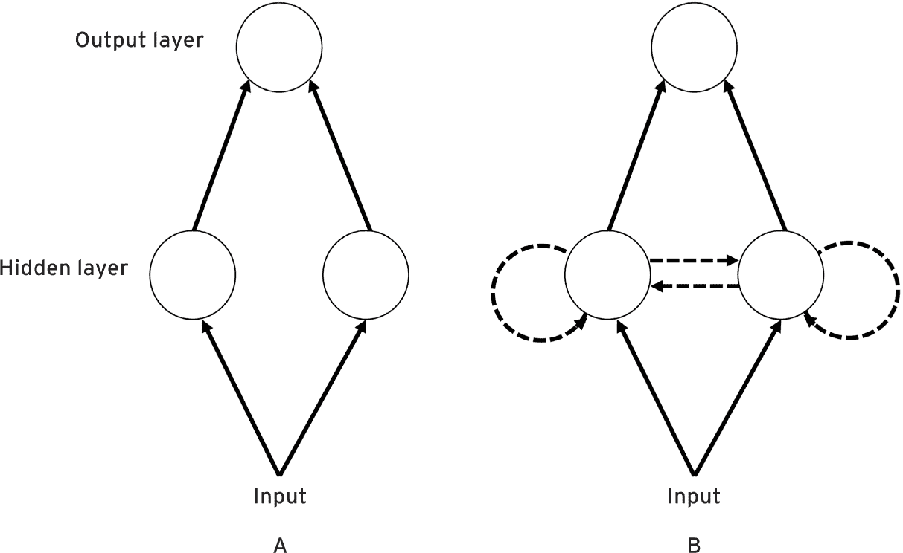

> FIGURE 32: *A*, 传统神经网络的示意图；*B*, 循环神经网络的示意图，其中给定时间步的隐藏单元激活会在下一个时间步反馈

> 理解 RNN 工作原理的最佳方式是可视化网络随时间的运行情况，如图 33 所示，该图展示了图 32 中的 RNN 在八个时间步上的运行情况。为简化说明，我将隐藏层中的所有循环连接表示为从一个时间步到下一个时间步的单个虚线箭头。在每个时间步，隐藏单元的激活构成了网络对迄今所见部分句子的编码。随着网络继续处理单词，它不断优化该编码。在句子的最后一个单词之后，网络会收到一个特殊的 END 符号（类似于句号），这告诉网络句子已结束。请注意，END 符号是在文本输入网络之前由人类附加到每个句子上的。

> 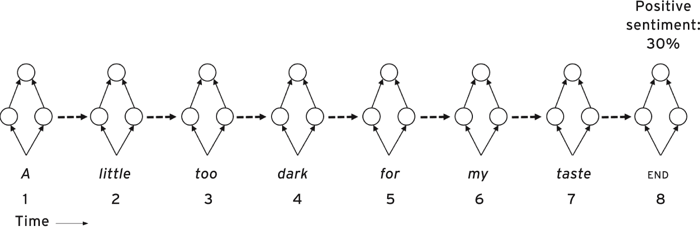

> FIGURE 33: 图 32 中的循环神经网络，在八个时间步上运行

> 在每个时间步，该网络的输出单元处理隐藏单元的激活（“编码”），以给出网络对输入句子（即迄今为止输入给网络的句子部分）具有`positive`情感的置信度。在将网络应用于给定句子时，我们可以忽略此输出，直到句子结束。此时，隐藏单元对整个句子进行编码，输出单元给出网络的最终置信度（此处，积极情感为 30%，或者等价地，消极情感为 70%）。

> 由于网络仅在遇到 END 符号时才停止对句子的编码，因此系统原则上可以将任意长度的句子编码为固定长度的一组数字——即隐藏单元的激活。出于显而易见的原因，这种神经网络通常被称为编码器网络。

> 给定一组人类标记为“积极”或“消极”情感的句子，编码器网络可以通过反向传播从这些示例中进行训练。但还有一件事我尚未解释。神经网络要求其输入为`numbers`。^()

## 一种将单词编码为数字的简单方案

在解释将单词编码为数字的可能方案之前，我需要定义神经网络的`vocabulary`概念。词汇表是网络能够接受作为输入的所有单词的集合。语言学家估计，读者处理大多数英文文本大约需要一万到三万个单词，具体取决于计数方式；例如，你可能将`argue`、`argues`、`argued`和`arguing`归为一个“单词”。词汇表还可以包含常见的双词短语，例如`San Francisco`或`Golden Gate`，将它们视为一个单词。

举个具体的例子，假设我们的网络将拥有两万个单词的词汇表。将单词编码为数字的最简单方案是为词汇表中的每个单词分配 1 到 20,000 之间的任意数字。然后给神经网络 20,000 个输入，每个单词对应一个输入。在每个时间步，只有其中一个输入——即对应实际输入单词的那个输入——会被“打开”。例如，假设单词`dark`被赋予了数字 317。那么，如果我们想将`dark`输入到网络中，我们将输入 317 设置为值 1，其余 19,999 个输入设置为值 0。在 NLP 领域，这被称为 one-hot 编码：在每个时间步，只有其中一个输入——即对应输入到网络中的单词的那个输入——是“hot”（非 0）。

One-hot 编码曾经是将单词输入神经网络的标准方式。但它有一个问题：对单词进行任意数字分配无法捕捉单词之间的任何关系。假设网络从训练数据中学习到短语“I hated this movie”具有消极情感。现在假设网络收到短语“I abhorred this flick”，但它在训练数据中未遇到过`abhorred`或`flick`。网络无法确定这两个短语的含义相同。再假设网络学习到短语“I laughed out loud”与积极评论相关联，然后它遇到新短语“I appreciated the humor”。网络无法识别这两个短语之间紧密（尽管不完全相同）的含义。无法捕捉单词和短语之间的语义关系，是使用 one-hot 编码的神经网络通常效果不佳的主要原因。

## 单词的语义空间

NLP 研究社区提出了几种以能够捕捉此类语义关系的方式对单词进行编码的方法。所有这些方法都基于同一个想法，该想法由语言学家 John Firth 在 1957 年优美地表达：“You shall know a word by the company it keeps.”^()


> 在语言学中，这一想法更正式地被称为分布式语义学。分布式语义学的基本假设是：“两个语言表达式 A 和 B 之间的语义相似程度，是 A 和 B 可能出现的语言环境相似程度的函数。”^() 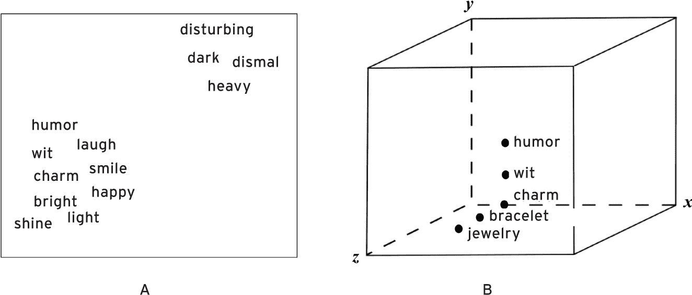

> FIGURE 34: *A*，语义空间中两个词簇的示意图，语义相近的词位置彼此靠近；*B*，一个三维语义空间，其中词被表示为点

当我们谈论具有多个*维度*的语义*空间*时，我们就进入了几何学的领域。事实上，NLP 从业者常常用几何概念来描述词的“含义”。例如，figure 34*B* 显示了一个三维空间，带有 *x-*、*y-* 和 *z-* 轴，词可以放置在这些轴上。每个词都与一个点（黑色圆圈）相关联，该点由三个坐标定义——即该点的 *x*、*y* 和 *z* 位置。两个词之间的语义距离等同于该图中点之间的几何距离。你可以看到，*charm* 现在既靠近 *wit* 和 *humor*，也靠近 *bracelet* 和 *jewelry*，但沿着不同的维度。在 NLP 中，人们使用术语 *word vector* 来指代特定词在这样的语义空间中的坐标。在数学中，*vector* 只是点坐标的一个花哨术语。^()

这里的想法是，一旦词汇表中的所有词都被正确放置在语义空间中，一个词的*含义*就可以由其在该空间中的位置来表示——即由定义其词向量的坐标来表示。那么词向量有什么用呢？事实证明，使用词向量作为数值输入来表示词，而不是我上面描述的简单 one-hot 方案，能大大提高神经网络在 NLP 任务中的性能。

我们如何实际获得词汇表中所有词对应的词向量？是否存在一种算法，能将我们网络词汇表中的所有词都正确放置在语义空间中，以最好地捕捉每个词含义的多个维度？NLP 中有大量重要工作致力于解决这个确切的问题。

## Word2Vec

已有许多方法被提出用于将词放置在几何空间中，有些可以追溯到 1980 年代，但当今最广泛采用的方法是 2013 年由 Google 研究人员提出的。^()

word2vec 方法体现了“知人知面不知心，知词要看它交往谁”的概念。为了为 word2vec 程序创建训练数据，Google 团队首先从 Google News 服务中获取了大量文档。（在现代 NLP 中，没有什么比拥有“大数据”更好的了！）word2vec 程序的训练数据由一组词对组成，每对中的每个词都在 Google News 文档的某处与另一个词近距离出现过。为了使过程更好地工作，极高频词如 *the*、*of* 和 *and* 被丢弃了。

举个具体的例子，假设每对词在句子中紧挨着出现。在这种情况下，句子“a man went into a restaurant and ordered a hamburger”首先会被转换为“man went into restaurant ordered hamburger。”这将产生以下词对：(man, went)，(went, into)，(into, restaurant)，(restaurant, ordered)，(ordered, hamburger)，以及所有词对的反向——例如，(hamburger, ordered)。其想法是训练 word2vec 网络，以预测哪些词可能与给定的输入词配对。

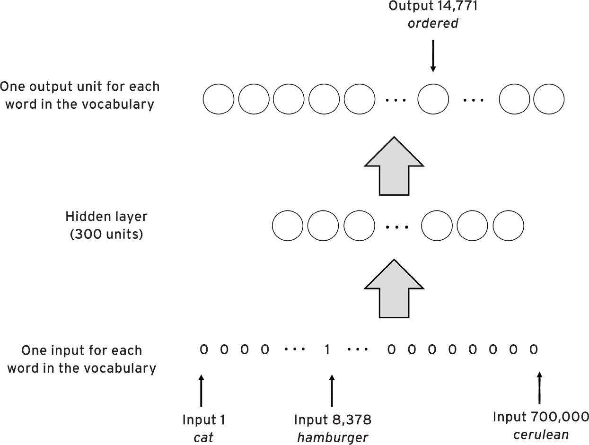

FIGURE 35: 给定词对 (hamburger, ordered) 时的 word2vec 神经网络示意图

Figure 35 说明了 word2vec 神经网络。^()

Google 研究人员在从 Google News 文章中收集的数十亿个词对上训练了他们的网络。给定一个词对，例如 (hamburger, ordered)，第一个词（hamburger）对应的输入被设置为 1；所有其他输入被设置为 0。在训练期间，每个输出单元的激活被解释为网络对词汇表中对应词是否与输入词相邻出现的置信度。这里，*正确*的输出激活会给词对中的第二个词（ordered）分配高置信度。

训练完成后，可以提取词汇表中任何词的学习到的 *word vector*。Figure 36 说明了如何做到这一点。该图显示了一个输入（对应于词 *hamburger*）与三百个隐藏单元之间的加权连接。这些权重是从训练数据中学习到的，捕捉了相应词使用的上下文信息。这三百个权重值就是分配给给定词的词向量的分量。（在此过程中，隐藏单元到输出的连接被完全忽略；所有必要信息都存在于输入到隐藏层的权重中。）因此，该网络学习到的词向量具有三百个维度。词汇表中所有词的词向量集合构成了学习到的“语义空间”。

以下是你如何在脑海中可视化这个三百维语义空间。只需想想 figure 34 中的三维图，然后尝试可视化一个类似的图，但维度多一百倍，并且绘制了七十万个词，每个词有三百个坐标。开玩笑的！不可能可视化这样的东西。

这三百个维度代表什么？如果我们自己是三百维生物，并且有能够可视化这样的空间的大脑，我们会看到任何给定的词在许多含义上都靠近其他相关词。例如，*hamburger* 的向量靠近 *ordered* 的向量；它也靠近 *burger*、*hot dog*、*cow*、*eat* 等词的向量。*Hamburger* 也靠近 *dinner*，即使它从未与 *dinner* 出现在同一个词对中；这是因为 *hamburger* 靠近那些在类似上下文中也靠近 *dinner* 的词。如果网络看到来自“I ate a hamburger for lunch”以及“I devoured a hot dog for dinner”的词对，并且 *lunch* 和 *dinner* 在某些训练句子中也出现在一起，那么系统可以学习 *hamburger* 和 *dinner* 也应该靠近。

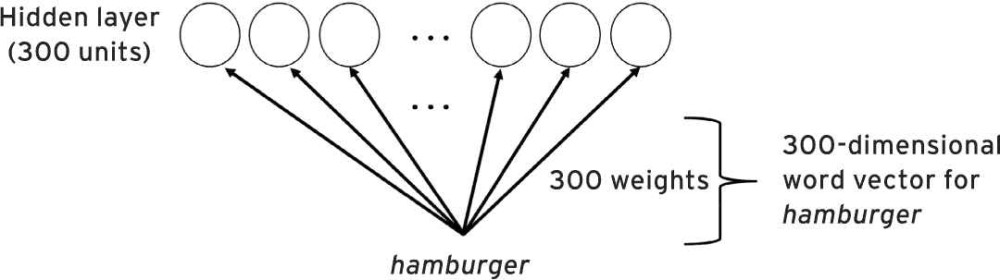

FIGURE 36: 从训练好的 word2vec 网络中获取词向量的示意图

让我们记住，整个过程的目标是为词汇表中的每个词找到一个数值表示——一个向量——它能捕捉词的一些语义。假设是，使用这样的词向量将使自然语言处理任务的神经网络性能更高。但是 word2vec 创建的“语义空间”实际上在多大程度上捕捉了词的语义？


> 这个问题很难回答，因为我们无法可视化 word2vec 学习的三百维语义空间。不过，我们可以做一些事情来一窥这个空间。最简单的方法是取一个给定的单词，通过查看词向量之间的距离，找出在语义空间中与它最近的单词。例如，网络训练完成后，与 `France` 最近的单词包括 `Spain`、`Belgium`、`Netherlands`、`Italy`、`Switzerland`、`Luxembourg`、`Portugal`、`Russia`、`Germany` 和 `Catalonia`。^()

>

> 我们还可以查看网络训练产生的更复杂的关系。创建 word2vec 的 Google 研究人员观察到，在其网络创建的词向量中，一个国家的单词与该国首都单词之间的距离在许多国家中大致相同。这在 图 37 中得到说明，该图展示了这些距离的二维表示。同样，系统并未获得“首都”的概念；这些关系仅仅是网络在数十亿个单词对上的训练中自然涌现出来的。

>

> 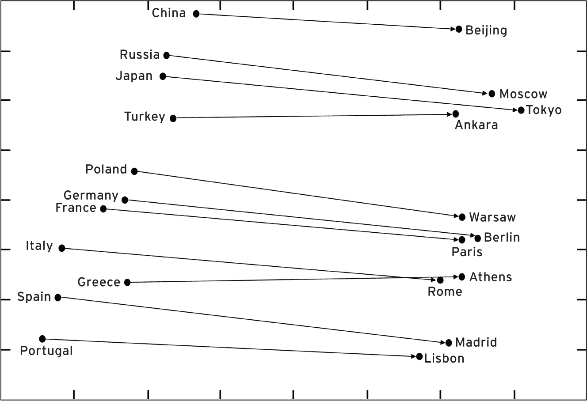

>

> 图 37：国家词向量与其首都城市词向量之间距离的二维表示

>

> 这种规律性让人们产生了 word2vec 可以“解决”类比问题的想法，例如“`Man` 与 `woman` 的关系，如同 `king` 与 \_\_\_\_\_\_ 的关系。”只需取 `woman` 的词向量，减去 `man` 的词向量，然后将结果加到 `king` 的词向量上即可。^()

>

> 学习到的词向量的这种特性很有趣，并表明某些关系被捕捉到了。但这些特性是否会使词向量在 NLP 任务中普遍有用？答案似乎是响亮的“是。”如今，几乎所有 NLP 系统都使用某种形式的词向量（word2vec 只是其中一种）作为输入单词的方式。

>

> 给你举个类比：对拿着锤子的人来说，一切看起来都像钉子；对拥有神经网络的 AI 研究人员来说，一切看起来都像向量。许多人意识到，word2vec 技巧不仅可以用于单词，也可以用于整个句子。为什么不以单词编码的同样方式，将整个句子编码为向量，在训练中使用句子对而不是单词对呢？这样做难道不比仅仅是一组词向量更能捕捉语义吗？确实，几个团队尝试过这样做；多伦多大学的一个团队将这些句子表示称为“思想向量”。^()

>

> 最后关于词向量的一点说明。几个团队表明，这些词向量或许并不奇怪地，捕捉了产生它们的语言数据中固有的偏见。^()

>

> 那么几十年的女权主义就此结束了。我们不能责怪词向量；它们只是捕捉了我们语言中的性别歧视和其他偏见，而我们的语言反映了我们社会中的偏见。但词向量可能无可指责，它们却是每个现代 NLP 系统的关键组成部分，从语音识别到语言翻译。词向量中的偏见可能会渗透到广泛使用的 NLP 应用中，产生意想不到、难以预测的偏见。调查此类偏见的 AI 科学家才刚刚开始了解这些偏见可能对 NLP 系统的输出产生什么样的微妙影响，几个团队正在致力于开发“去偏见”词向量的算法。^()

## 12

# 作为编码和解码的翻译

如果你曾经使用过 Google 翻译或任何其他现代自动翻译系统，你就会知道系统可以在瞬间将一段文本从一种语言翻译成另一种语言。更令人印象深刻的是，在线翻译系统为世界各地的人们提供这些瞬间翻译，全天候 24 小时运作，并且通常可以处理一百多种不同的语言。几年前，当我和家人在法国进行为期六个月的休假时，我广泛使用 Google 翻译，给我们非常正式的法国女房东写措辞得体的外交邮件，内容是关于房子里一个棘手的霉菌情况。鉴于我远非完美的法语，Google 翻译为我节省了数小时查找我不认识的单词的时间，更不用说试图记住重音符号放在哪里，以及哪个性别对应哪个法语名词了。

我也使用 Google 翻译来帮助解读我们女房东常常令人困惑的回复，虽然程序的翻译让我对她的意思有了相当清晰的了解，但它产生的英语充满了大大小小的错误。每当我想象我的法语信息在女房东眼中是什么样子时，我仍然感到尴尬。2016 年，Google 推出了一种新的“神经机器翻译”系统，该公司声称该系统实现了“迄今为止机器翻译质量的最大改进”。^()

部分受到美苏冷战的推动，自动翻译——特别是英语和俄语之间的翻译——是最早的人工智能项目之一。1947 年，数学家沃伦·韦弗热情地推广早期的自动翻译方法：“人们自然会想，翻译问题是否可能被当作密码学问题来处理。当我看到一篇俄语文章时，我会说，‘这实际上是用英语写的，只是用了一些奇怪的符号进行了编码。我现在将开始解码它。’”^()

与早期的其他人工智能研究一样，最初的机器翻译方法依赖于复杂的人工指定规则集。目标是从 `source` 语言（例如英语）翻译到 `target` 语言（例如俄语），机器翻译系统会获得两种语言的语法规则，以及句法结构之间映射的规则。此外，人类程序员会为机器翻译系统创建词典，包含逐词（和简单短语对短语）的对应关系。与许多其他符号人工智能的努力一样，虽然这些方法在某些狭窄的情况下效果不错，但它们相当脆弱，饱受我之前讨论过的所有自然语言挑战的困扰。

从 20 世纪 90 年代开始，一种称为统计机器翻译的新方法开始主导该领域。顺应当时人工智能的趋势，统计机器翻译依赖于从数据中学习，而不是让人类指定规则。训练数据由大量句子对集合组成：每对中的第一个句子来自源语言，第二个句子是第一个句子翻译成目标语言的（人类创建的）翻译。这些句子对来自双语国家的政府文件（例如，加拿大议会的每份文件都同时用英语和法文制作）、联合国记录（翻译成联合国的六种官方语言）以及其他大量原始和翻译文件集。


1990 年代到 2000 年代的统计机器翻译系统通常计算大量概率表，用于关联源语言和目标语言中的短语。当输入一个新句子时，例如英语句子“A man went into a restaurant”，系统会将句子拆分为“短语”（“A man went”、“into a restaurant”），并在概率表中查找这些短语在目标语言中的最佳翻译。这些系统还有额外步骤，以确保翻译后的短语能够作为一个句子协同工作，但翻译的主要驱动力是从训练数据中学习到的短语概率。尽管统计机器翻译系统对两种语言的句法了解甚少，但总体而言，这些方法产生的翻译比早期的基于规则的方法更好。

Google Translate——可能是最广泛使用的自动翻译程序——从 2006 年推出到 2016 年一直采用这种统计机器翻译方法，2016 年，Google 研究人员开发出一种基于深度学习的、据称更优的翻译方法，称为神经机器翻译。不久之后，神经机器翻译被采用于所有最先进的机器翻译程序中。

## Encoder, Meet Decoder

Figure 38 描绘了使用 Google Translate（以及其他当代机器翻译程序）时内部的工作原理，这里是从英语翻译成法语。^()

figure 38 的上半部分展示了一个循环神经网络（一个 `encoder network`），与我在上一章中描述的类似。英语句子“A man went into a restaurant”在七个时间步内被编码。我使用白色矩形来表示对该句子进行编码的网络；我将稍后讨论矩形内部的网络实际长什么样。在编码阶段，每个时间步将句子中的一个词以词向量的形式输入网络，类似于我上面描述的那些词向量。^() 

FIGURE 38: Sketch of an “encoder-decoder” pair of networks for language translation. The white rectangles represent the encoder and decoder networks, operating over successive time steps. The input words—for example, `man`—are first turned into word vectors—for instance, `wordvec(man)`—before being given to the network.

在最后一个时间步，编码器网络接收一个特殊的 END 符号，此时隐藏单元的激活值即为句子的 `encoding`。编码器的这些最终隐藏单元激活值随后作为输入提供给第二个网络，即 `decoder network`，它将生成句子的翻译版本。解码器网络如 figure 38 的下半部分所示，它只是另一个循环网络，但其输出是代表构成翻译后句子的单词的数字——这些数字中的每一个也会在下一个时间步被反馈回网络。^()

请注意，法语句子有七个单词，而英语句子有六个。这种编码器-解码器系统原则上可以将任意长度的句子翻译成任意其他长度的句子。^()

> My mother said that the cat that flew with her sister to Hawaii the year before you started at that new high school is now living with my cousin.

谁正和我表妹住在一起？答案可能会影响某些语言中动词 `is` 和 `living` 的翻译方式。人类处理这类复杂句子的能力相当不错，但循环神经网络很容易丢失上下文。当网络试图将整个句子编码为一组隐藏单元激活值时，事情就会变得混乱。

在 1990 年代末，瑞士的一个研究小组提出了一种解决方案：循环神经网络中的单个单元应具有更复杂的结构，带有专门的权重，用于确定在下一个时间步传递哪些信息以及哪些信息可以被“遗忘”。这些研究人员将这些更复杂的单元称为“长短期记忆”(`LSTM`)单元。^()

深度学习时代的自动机器翻译是大数据和快速计算的胜利。要创建一对用于从英语到法语等语言进行翻译的编码器-解码器网络，这些网络需要在超过三千万对人工翻译的句子上进行训练。由 LSTM 单元组成并在大型数据集上训练的深度循环神经网络已成为现代自然语言处理系统的基石，不仅用于 Google Translate 使用的编码和解码网络，还用于语音识别、情感分类，以及我们将在下文中看到的问答系统。这些系统通常包含多种技巧来提高性能，例如同时正向和反向输入原始句子，以及在不同时间步关注句子不同部分的机制。^()

## Evaluating Machine Translation

Google Translate 在 2016 年推出神经机器翻译后，该公司声称新方法正在“缩小人类与机器翻译之间的差距”。^()

总的来说，此类声明部分源于科技公司之间向其他公司销售各种 AI 服务的竞争，而语言翻译是一项具有高利润潜力的主要产品。虽然 Google Translate 等网站为少量文本提供免费翻译，但如果你是一家公司，需要翻译大量文档或为网站上的客户提供翻译，你可以找到许多收费的机器翻译服务，它们都基于相同的编码器-解码器架构。

我们应在多大程度上相信机器实际上在学习“语义含义”或机器翻译正在迅速接近人类准确度水平的说法？要回答这个问题，让我们更仔细地查看这些说法所依据的实际结果。特别是，让我们看看这些公司如何衡量机器或人类翻译的 `quality`。衡量翻译质量绝非易事；给定文本可以有多种正确的翻译方式（以及更多错误的方式）。由于翻译给定文本没有单一的正确答案，因此很难设计一种自动方法来计算系统的准确性。

机器翻译中关于“人类平准”和“缩小机器与人类之间差距”的说法基于两种评估翻译结果的方法。第一种是自动方法——一个计算机程序——将机器的翻译与人类的翻译进行比较并输出一个分数。第二种方法聘请双语人类手动评估翻译。对于第一种方法，几乎所有机器翻译评估中使用的程序都称为双语评估替代研究，或 `BLEU`。^()


鉴于 BLEU 的缺点，评估机器翻译系统的“黄金标准”是让双语人类手动对系统生成的翻译进行评分。这些相同的人类评估者还可以对专业人类翻译人员创建的相应翻译进行评分，以便与机器翻译评分进行比较。但是这种黄金标准方法也有缺点：雇佣人类当然需要花钱，而且与计算机不同，人类在评分几十个句子后就会感到疲劳。因此，除非你能雇佣一支大量双语人类评分者且他们有大量空闲时间，否则你的评估过程将受到限制。

Google 和 Microsoft 的机器翻译团队都通过雇佣小型双语人类评估者小组来提供评分，开展了这种黄金标准（尽管有限）的评估。`^()`

Microsoft 使用了类似的平均方法来评估从中文到英文的新闻故事翻译。Microsoft 神经机器翻译系统翻译的评分非常接近（有时甚至超过了）人类翻译的评分。在所有情况下，人类评估者都将神经机器翻译生成的翻译评为优于之前机器翻译方法生成的翻译。

简而言之，随着深度学习的引入，机器翻译已经变得更好。但是，我们能否将这些结果解读为证明机器翻译现在接近“人类水平”的主张是合理的？在我看来，这个主张有几个理由是不合理的。首先，对评分进行`averaging`可能会产生误导。想象一下，大多数句子翻译被评为“terrific”，但有很多被评为“horrible”的情况。`average`将是“pretty good”。然而，你可能更喜欢一个更可靠的翻译系统，它`always`是“pretty good”且从不“horrible”。

此外，这些翻译系统接近“人类水平”或处于“人类同等水平”的说法完全基于对单句、孤立句子的翻译进行评估，而不是对较长段落进行评估。较长段落中的句子可能以重要方式相互依赖，如果句子被孤立翻译，这些依赖关系可能会被忽略。我没有看到任何关于评估较长段落机器翻译的正式研究，但我的一般经验是，当给 Google Translate 整个段落而不是单句时，其翻译质量会显著下降。

最后，这些评估中的句子都来自新闻故事和`Wikipedia`页面，这些页面通常经过精心撰写以避免歧义或惯用语；此类语言可能会给机器翻译系统带来严重问题。

## Lost in Translation

还记得上一章开头的“餐厅”故事吗？我并没有设计那个故事来测试翻译系统，但这个故事实际上很好地说明了口语化、惯用语和可能存在歧义的语言给机器翻译系统带来的挑战。

我使用 Google Translate 将“餐厅”故事从英文翻译成三种目标语言：法语、意大利语和中文。我将生成的翻译（不包含原故事）交给精通英文和目标语言的朋友，并请他们将 Google 的翻译译回英文，以了解目标语言的使用者从译成该语言的文本中能领会到什么。以下是结果，供您阅读愉悦。（我的朋友用来翻译的 Google Translate 翻译结果列在书末的注释中。）

## 原文：

> A man went into a restaurant and ordered a hamburger, cooked rare. When it arrived, it was burned to a crisp. The waitress stopped by the man’s table. “Is the burger okay?” she asked. “Oh, it’s just great,” the man said, pushing back his chair and storming out of the restaurant without paying. The waitress yelled after him, “Hey, what about the bill?” She shrugged her shoulders, muttering under her breath, “Why is he so bent out of shape?”

## Google Translate 的法语版本，人工译回英文：

> A man entered a restaurant and ordered a hamburger, cooked infrequent. When he arrived, he got burned at a crunchy. The waitress stopped walking in front of the man’s table. “Is the hamburger doing well?” She asked. “Oh, it’s terrific‚” said the man while putting his chair back and while going out of the restaurant without paying. The waitress shouted after him, “Say, what about the proposed legislation?” She shrugged her shoulders, mumbling in her breath, “Why is he so distorted?”`^()`

## Google Translate 的意大利语版本，人工译回英文：

> A man went to a restaurant and ordered a burger, cooked sparse. When it arrived, it was burnt for an almond brittle. The waitress stopped near the man’s table. “Is the burger okay?” she asked. “Oh, it’s simply fantastic,” said the man, pushing back his chair and leaving the restaurant without paying. The waitress shouted after him, “Hey, what about the bill?” She shrugged her shoulders, muttering in a low voice, “Why is he so bent?”`^()`

## Google Translate 的中文版本，人工译回英文：

> A man walked into a restaurant and ordered a rarely seen hamburger. When it reached its destination, it was roasted very crispy. The waitress stopped next to the man’s table. “Is the hamburger good?” she asked. “Oh, it’s great,” the man said, pushing aside his chair and rushing out of the restaurant without paying. The waitress shouted “Hey, what about the bill?” She shrugged her shoulders and whispered, “Why was he so stooped over?”`^()`

阅读这些翻译有点像听一位才华横溢但容易出错的钢琴家演奏一首熟悉的乐曲。这首曲子总体上可以辨认，但令人不安地被篡改；旋律在短暂的片段中演奏得很美妙，但不断被刺耳的错误音符打断。

你可以看到，Google Translate 有时会为歧义词选择错误的含义，例如 `rare` 和 `bill`（分别被翻译成法语中的“infrequent”和“proposed legislation”）；这是因为程序忽略了前面单词或句子的上下文。`burned to a crisp` 和 `bent out of shape` 等惯用语被以奇怪的方式翻译；该程序似乎没有任何方法在目标语言中找到相应的惯用语，也没有任何方法来理解惯用语的实际含义。虽然故事的骨架含义得以传达，但微妙而重要的细微差别在所有翻译中都丢失了，包括男人在“storming out of the restaurant”中表达的愤怒，以及女服务员在“muttering under her breath”中表达的不满。更不用说正确的语法偶尔缺失了。

我并不是特意要挑剔 Google Translate；我尝试了几种其他在线翻译服务，得到了类似的结果。这并不奇怪，因为这些系统都使用几乎相同的编码器-解码器架构。同样重要的是指出，我获得的翻译代表了这些翻译系统在某一时刻的快照；它们正在不断改进，这里看到的一些特定翻译错误在你阅读时可能已经修复。然而，我怀疑机器翻译在很长一段时间内实际上不会达到人类翻译人员的水平——除非是在狭窄的情况下。

主要障碍在于：像语音识别系统一样，机器翻译系统在执行任务时并不真正理解它们正在处理的文本。`^()`


> > > 编码器-解码器网络仅通过接触更大的训练集和更多网络层，就能获得必要的心智模型和现实世界知识吗，还是需要根本不同的东西？这仍然是一个开放性问题，也是 AI 社区激烈辩论的主题。目前，我只想说，虽然神经机器翻译在许多应用中可以非常有效且有用，但如果没有知识渊博的人类进行后期编辑，翻译结果仍然根本不可靠。如果你使用机器翻译——我自己也会使用——你应该对结果持保留态度。事实上，当我让 Google Translate 将“take it with a grain of salt”从英语翻译成中文，再翻译回英语时，它告诉我“bring a salt bar”。那可能是个更好的主意。

## 将图像翻译为句子

这里有一个疯狂的想法：除了在语言之间进行翻译之外，类似于编码器-解码器对的神经网络能否被训练来将*图像*翻译为语言？这个想法是使用一个网络对图像进行编码，并使用另一个网络将该图像“翻译”为描述图像内容的句子。毕竟，创建图像标题不就是另一种“翻译”吗——这次是在图像的“语言”和标题的语言之间？

事实证明，这个想法并不那么疯狂。2015 年，两个团队——一个来自 Google，另一个来自斯坦福大学——在同一计算机视觉会议上独立发表了关于此主题的非常相似的论文。^()

图 39 描绘了 Show and Tell 系统的工作原理。^()

该系统如何学习生成合理的标题？回顾一下，对于语言翻译，训练数据由句子对组成，其中一对中的第一个句子是源语言，第二个是人类翻译员翻译成的目标语言。在图像标题的情况下，每个训练示例由一张图像和一个标题组成。这些图像从 Flickr.com 等存储库下载，这些图像的标题由人类制作——具体来说，是为此研究受雇于 Google 的 Amazon Mechanical Turk 工人。由于标题可能差异很大，每张图像都由五个不同的人提供了标题。因此，每张图像在训练集中出现五次，每次都与一个不同的标题配对。图 40 显示了一个示例训练图像以及 Mechanical Turk 工人给出的标题。

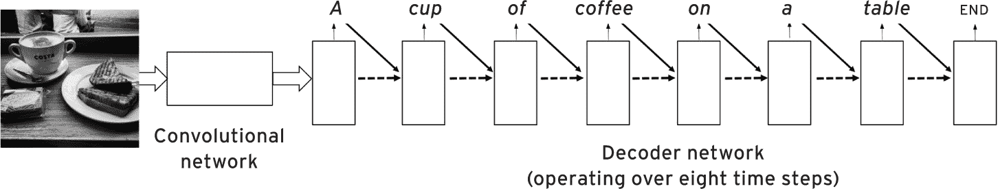

FIGURE 39: Sketch of Google’s automated image-captioning system


FIGURE 40: Sample training image with captions given by Amazon Mechanical Turk workers

Show and Tell 解码器网络在大约八万个图像-标题对上进行了训练。图 41 给出了训练有素的 Show and Tell 系统在测试图像（即不在其训练集中的图像）上生成的几个标题示例。

很难不被震撼，甚至有点惊讶，一台机器可以以原始像素的形式接收图像并生成如此准确的标题。当我第一次在《纽约时报》上读到这些结果时，我的感受也是如此。那篇文章的作者、记者 John Markoff 写了一段仔细的描述：“两组独立工作的科学家创建了人工智能软件，能够以比以往更高的准确性识别和描述照片和视频的内容，有时甚至模仿人类水平的理解。”^() 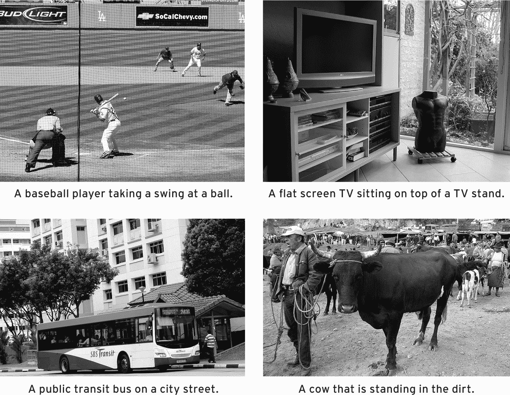

FIGURE 41: Four (accurate) automatically produced captions from Google’s Show and Tell system

其他记者就没有那么克制了。“Google 的 AI 现在可以几乎像人类一样为图像生成标题，”一个新闻网站宣称。^() 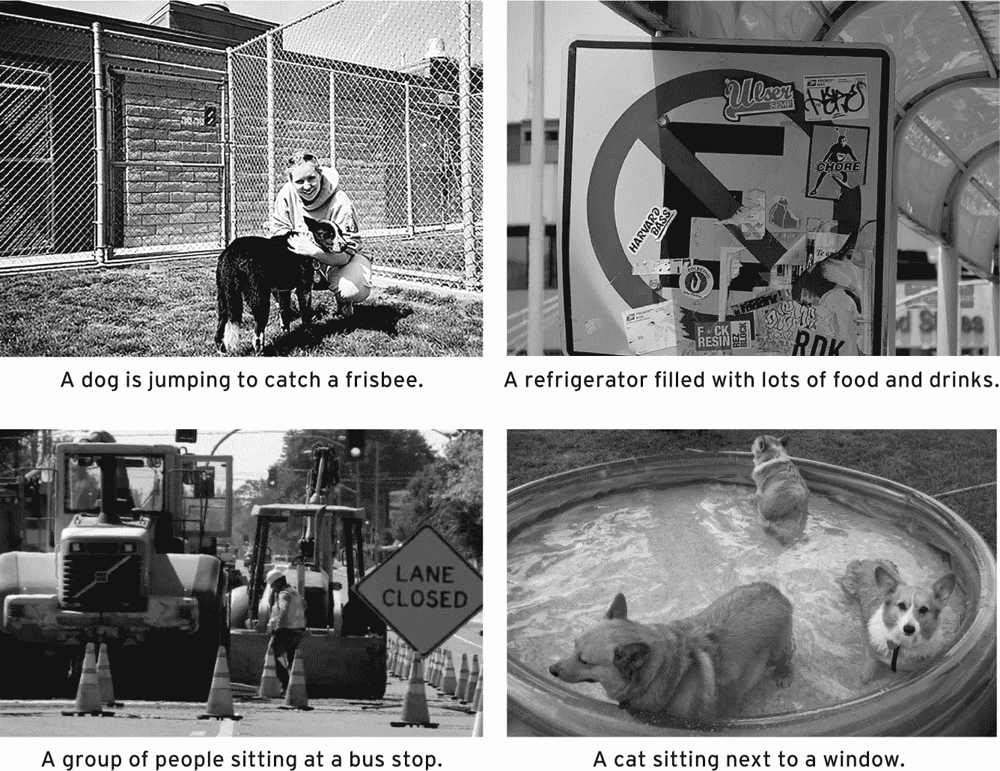

FIGURE 42: Not-so-accurate captions from Google’s Show and Tell system and Microsoft’s CaptionBot

但别太快。自动图像标题生成也存在语言翻译中常见的那种双极性能表现。当它表现良好时，如 图 41 所示，似乎几乎像魔法一样。但它的错误可能从略有偏差到完全荒谬不等。图 42 显示了这一范围内的一些示例。这些错误的标题可能会让你发笑，但如果你是一个无法看见照片的盲人，就很难知道你得到的标题是好的还是坏的。

虽然微软的 CaptionBot 声称它可以“理解任何照片的内容”，但问题在于事实恰恰相反。即使它们的标题是正确的，这些系统也不是以人类理解照片的方式来理解照片的。当我把第 4 章中的“机场里带着狗的士兵”照片交给微软的 CaptionBot 时，系统的输出是“一个男人抱着一只狗”。差不多。除了“男人”这部分。但这个标题错过了照片中所有有趣的地方，错过了它对我们说话的方式，错过了我们的经验、情感和对世界的知识。也就是说，它错过了照片的*意义*。

我确信，随着研究人员应用更多数据和新算法，这些系统会有所改进。然而，我相信，标题生成网络中根本缺乏*理解*，这不可避免地意味着，就像语言翻译一样，这些系统将始终不可信。它们在某些情况下会表现得非常好，但在其他情况下会惨败。而且，即使大多数时候是正确的，它们也常常无法捕捉到描述充满意义的情境的图像的要点。

虽然 NLP 系统在对句子情感进行分类、翻译文档和描述照片等任务上仍远未达到人类水平，但它们对许多现实世界的目的很有用，因此为其开发者带来了非常可观的利润。但 NLP 研究人员的最终梦想是一台能够与用户实时流畅且灵活地交互的机器——特别是，能够与他们交谈并回答他们的问题。下一章探讨了创建能够处理我们所有查询的 AI 系统所面临的挑战。

## 13

## Ask Me Anything

## USS `Enterprise`. Stardate: 42402.7

> LIEUTENANT COMMANDER DATA: *Computer, I wish to know more about humor. Why certain combinations of words and actions make humans laugh.*

> 

> COMPUTER: *Source material on that subject is extensive. Please specify.*

> 

> LIEUTENANT COMMANDER DATA: *Animated presentation, humanoid. Interaction required.*

> 

> COMPUTER: *Physical humor, cerebral, or general raconteur?*

> 

> LIEUTENANT COMMANDER DATA: *Of all performers available, who is considered funniest?*

> 

> COMPUTER: *Twenty-third century Stan Orega specialized in jokes about quantum mathematics.*

> 

> LIEUTENANT COMMANDER DATA: *No. Too esoteric. More generic.*

> 

> COMPUTER: *Accessing.*

> 

> *(A list of names is displayed.)*

> 

> —*Star Trek: The Next Generation*, season 2, episode 4: “The Outrageous Okona”^()

> 

> 星际飞船 `Enterprise` 上的电脑——凭借其庞大的知识库和对所提出问题的无缝理解——长期以来一直是人机交互的灯塔，受到 *Star Trek* 粉丝和 AI 研究人员的羡慕（这两类人群的交集，可以说，并不小）。

> 


> 前 Google 高管 Tamar Yehoshua 坦诚承认《星际迷航》电脑对设计公司未来搜索引擎的影响：“我们的愿景是《星际迷航》电脑。你可以和它对话——它能理解你，并能与你进行对话。”^()

> 《星际迷航》可能在我们中许多人心中种下了这样一个梦想：可以向计算机提出几乎任何问题，并得到准确、简洁、有用的回答。但任何使用过当今 AI 驱动的虚拟助手（Siri、Alexa、Cortana、Google Now 等）的人都知道，这个梦想尚未实现。我们可以通过语音向这些机器提问——它们通常能很好地转录语音——并且它们可以用平滑、略带机械感的声音回答我们。它们有时能弄清楚我们在寻找什么样的信息，并指引我们到相关的网页。然而，这些系统并不理解我们提问的 *含义*。比如说，Alexa 可以为我朗读奥运短跑选手尤塞恩·博尔特整个传记的细节，描述他赢得了多少枚金牌，并讲述他在北京奥运会上跑一百米的速度。但请记住，容易的事情很难。如果你问 Alexa，“尤塞恩·博尔特会跑步吗？”或者“尤塞恩·博尔特能跑得快吗？”，在这两种情况下它都会回答陈词滥调：“抱歉，我不知道那个”或“嗯，我不确定。毕竟，它并不是为了知道“跑步”或“快”实际意味着什么而设计的。

> 计算机可以准确地转录我们的请求，而“最终边疆”，如果你愿意这么说的话，是让它们理解我们问题的 *含义*。

> ## Watson 的故事

> 在 Siri、Alexa 以及类似产品出现之前，AI 领域最著名的问答程序是 IBM 的 Watson。你可能还记得 2011 年，Watson 令人兴奋地在游戏节目《Jeopardy!》中击败了两位人类冠军。在 Deep Blue 于 1997 年战胜世界象棋冠军加里·卡斯帕罗夫不久之后，IBM 的高管们推动另一个高知名度的项目，这个项目不同于 Deep Blue，实际上可以为 IBM 客户带来有用的产品。一个问答系统——确实部分受《星际迷航》电脑的启发——完全符合这一需求。故事是这样的：IBM 的一位副总裁 Charles Lickel 正在一家餐厅吃饭，注意到其他顾客突然安静下来。餐厅里的每个人都在关注一台电视，电视上正在播放《Jeopardy!》的一集，超级冠军 Ken Jennings 正在比赛。这给了 Lickel 一个想法：IBM 应该开发一个能够很好地玩《Jeopardy!》并战胜人类冠军的计算机程序。IBM 然后可以在一场高度公开的电视锦标赛中展示这个程序。^()

> 《Jeopardy!》是一档非常受欢迎的电视游戏节目，首播于 1964 年。游戏有三名参赛者，他们轮流从一个类别列表中选择（例如，“美国历史”和“在电影院”）。主持人然后从该类别中读出一个“线索”，参赛者竞争第一个“按响”（按下按钮）。第一个按响的参赛者有机会用一个与线索相对应的“问题”来回答。例如，对于线索“2011 年上映，是唯一同时获得奥斯卡奖和法国凯撒奖最佳年度影片的电影”，正确的回答是，“什么是《The Artist》？”在《Jeopardy!》中获胜要求参赛者拥有广泛的知识，从古代历史到流行文化，以及快速回忆能力，还有能够理解类别和线索中频繁出现的双关语、俚语和其他口语的能力。这里是另一个例子：“2002 年，Eminem 与这位说唱歌手签了一份七位数的交易，显然价值远高于他的名字所暗示的。”正确的回答：“谁是 50 Cent？”

> 当给出一个《Jeopardy!》线索时，Watson 通过结合一大套不同的 AI 方法来产生其响应。例如，Watson 使用了几种不同的自然语言处理方法来解析线索，找出哪些单词很重要，并将线索分类为需要哪种类型的响应（例如，一个人、一个地方、一个数字、一个电影标题）。该程序在专用的并行计算机上运行，以便快速搜索巨大的知识数据库。正如《纽约时报杂志》的一篇文章所讲述的，“Ferrucci 的团队向 Watson 输入了数百万份文档来构建其知识库——包括，[Ferrucci] 说，‘书籍、参考资料、任何种类的词典、同义词词典、民俗分类法、分类学、百科全书、你能想象得到的任何参考资料……小说、圣经、戏剧。’”^()

> 幸运的是，对于 Watson 团队来说，《Jeopardy!》的粉丝们长期以来一直在存档所有《Jeopardy!》游戏的完整类别、线索和正确回答集合。这个档案对 Watson 来说是天赐之物——是用于训练系统许多组件的监督学习方法的宝贵示例来源。

> 2011 年 2 月，Watson 参加了一场三场比赛的对决——国际广播——对手是两位前《Jeopardy!》冠军，Ken Jennings 和 Brad Rutter。我和家人一起观看了这些节目，我们都着迷了。在最后一场比赛接近尾声时，很明显 Watson 将要获胜。最后一场比赛的最后一个线索是：“William Wilkinson 的《瓦拉几亚和摩尔达维亚公国记述》启发了这位作者最著名的小说。”在《Jeopardy!》中，最后一个线索要求每位参赛者写出答案。三名参赛者都正确地写了“谁是 Bram Stoker？”，但以冷幽默著称的 Ken Jennings 通过在答题卡上添加一个流行文化引用来承认 Watson 必然的胜利：“我，一个人，欢迎我们的新电脑统治者。”^()

> 在其电视《Jeopardy!》比赛期间，Watson 给观众（包括我）留下了一种异样的印象，即它可以轻松而流畅地理解和使用语言，以闪电般的速度解释和回应抛给它的大多数话题中的棘手线索。

> > CLUE: *Even a broken one of these on your wall is right twice a day.*
> > 
> > WATSON: *What is a clock?*
> > 
> > CLUE: *To push one of these paper products is to stretch established limits.*
> > 
> > WATSON: *What is an envelope?*
> > 
> > CLUE: *Classic candy bar that's a female Supreme Court justice.*
> > 
> > WATSON: *Who is Baby Ruth Ginsburg?*

> 电视摄像机经常拍摄 Watson 团队，他们坐在观众席上，脸上带着狂喜的笑容。Watson 正处于连胜状态。

> 广播中展示了 Watson 的视觉表现——一个屏幕——与另外两名参赛者一起在讲台上。屏幕上没有显示面孔，而是显示了一个被旋转灯光环绕的发光地球。Watson 的类别选择和对线索的回答以一种愉快友好却又机械的声音给出。这一切都经过 IBM 的精心设计，旨在给人这样的印象：Watson 虽然不完全是人类，但正在积极倾听并回应线索，就像人类参赛者一样。实际上，Watson 没有使用语音识别；它在线索被读给人类参赛者听的同时，就得到了每个线索的 *文本*。


> Watson 对线索的回应偶尔会在拟人化的外表下露出裂痕。问题并不在于系统在某些线索上出错了；所有参赛者都会犯错。问题在于 Watson 的错误往往……不像人类。最受关注的错误是 Watson 在“美国城市”类别中的一次失误：线索是“其最大的机场以一位二战英雄命名；第二大机场以一场二战战役命名。”Watson 奇怪地忽略了明确的类别，错误地回答：“多伦多是什么？”机器还犯了其他一些显著的错误。一个线索陈述：“这是美国体操运动员乔治·艾瑟的解剖学奇特之处，他在 1904 年的平行棒项目上赢得了一枚金牌。”肯·詹宁斯回答：“缺少一只手臂是什么？”而 Watson 回答：“一条腿是什么？”正确的回答应该是：“缺少一条腿是什么？”根据 Watson 的团队领导人大卫·费鲁奇的说法，“计算机不会知道缺少一条腿比其他任何事情都更奇怪。”^()

> 尽管存在这些以及类似的错误，Watson 还是赢得了比赛（在很大程度上归功于它在按铃上的速度）以及 100 万美元的慈善奖金。

> Watson 获胜后，AI 社区对于 Watson 是否是 AI 的真正进步，还是一种“宣传噱头”或“小把戏”（正如有些人称呼的那样）存在分歧。^()

> 即使在 Watson 在 `Jeopardy!` 上首次亮相之前，IBM 就已宣布为该程序制定宏伟计划。在其他项目中，该公司宣布打算训练 Watson 成为一名医师助理。也就是说，IBM 计划向 Watson 提供大量医学文献文档，从而使其能够回答医生或患者的问题，并建议诊断或治疗方案。IBM 声称，“Watson 能够比人类思维更高效地找到临床问题的最佳答案。”^()

> 从 2014 年左右开始，IBM 的营销部门全力开展以 Watson 为重点的宣传活动。IBM 的 Watson 宣传遍布互联网、印刷媒体和电视（广告中有鲍勃·迪伦和塞雷娜·威廉姆斯等名人据称正在与 Watson 聊天）。IBM 的广告宣称，Watson 正在将我们带入“认知计算”时代，这一概念从未被精确定义，但似乎是 IBM 对其 AI 工作的品牌化包装。明确的暗示是，Watson 是一项突破性技术，能够做出与其他 AI 系统根本不同且更好的事情。

> 大众媒体也对 Watson 大肆报道。在 2016 年的一期电视新闻节目 `60 Minutes` 中，记者查理·罗斯，呼应一些 IBM 高管的说法，告诉观众：“Watson 是个勤奋的读者，每秒钟能读完相当于一百万本书的内容，”还说：“五年前，Watson 刚学会阅读和回答问题。现在，它已经读完了医学院。”当时在北卡罗来纳大学担任癌症研究人员（后来成为国家癌症研究所所长）的内德·沙普利斯接受了 `60 Minutes` 节目的采访。查理·罗斯问他：“在 IBM 建议它可能在医疗保健方面做出贡献之前，你对人工智能和 Watson 了解多少？”沙普利斯回答说：“其实不多。我看过它玩 `Jeopardy!`”沙普利斯继续说道：“他们大约花了一周时间教 Watson 阅读医学文献。这并不难。然后 Watson 在大约又一周的时间里读了 2500 万篇论文。”^()

> 什么？Watson 是个“勤奋的读者”，有点像你那个聪明伶俐的五年级学生，只不过不是在周末读完一本《哈利·波特》，而是每秒读完一百万本书，或者一周读完 2500 万篇技术论文？还是说，`read` 这个词，带有理解所读内容的人类含义，对于 Watson 实际所做的事情——处理文本并将其添加到其数据库中——来说并不十分合适？说 Watson“读完了医学院”是个朗朗上口的说法，但它是否让我们了解 Watson 的实际能力？过度的销售话术、缺乏透明度以及关于 Watson 的同行评审研究稀缺，使得外界很难回答这些问题。一篇广为阅读的关于 Watson for Oncology（旨在协助癌症医生的 AI 系统）的批判性评论指出，“从设计上讲，没有一项独立的第三方研究来考察 Watson for Oncology 是否能够发挥作用。IBM 没有让外部科学家对该产品进行批判性评审，也没有进行临床试验来评估其有效性。”^()

> IBM 某些人关于 Watson 的叙述也引发了另一个问题：IBM 专门为玩 `Jeopardy!` 开发的技术，有多少可以实际迁移到其他问答任务中？换句话说，当内德·沙普利斯告诉我们他看过“Watson”玩 `Jeopardy!`，而现在“Watson”可以阅读医学文献时，他谈论的是同一个 Watson 吗？

> Watson 在 `Jeopardy!` 之后的故事足以写成一本书，需要一位专门的调查记者来梳理清楚。但根据我阅读的众多文章以及与熟悉该技术的人士进行的讨论，我可以梳理出以下情况。事实证明，玩 `Jeopardy!` 所需的技能与在医学或法律等领域进行问答所需的技能并不相同。现实世界中各个领域的问题和答案，既没有 `Jeopardy!` 线索那样简单的短结构，也没有明确定义的回答。此外，现实世界中的领域，如癌症诊断，缺乏一大组完美、标注清晰的训练样本，每个样本只有一个正确答案，而 `Jeopardy!` 正是这样。

> 除了共享同一个名称、同一个带有旋转灯光的行星标志，以及那副众所周知的悦耳机器人声音之外，IBM 营销部门今天所推销的“Watson”与 2011 年在 `Jeopardy!` 上击败肯·詹宁斯和布拉德·拉特的“Watson”几乎没有共同之处。而且，今天“Watson”这个名称指的不是一个连贯的 AI 系统，而是 IBM 在 Watson 品牌下向其客户（主要是企业）提供的一套服务。简而言之，Watson 基本上指的是 IBM 在 AI 领域所做的一切，同时为这些服务披上了 `Jeopardy!` 冠军的宝贵光环。

> IBM 是一家大公司，雇佣了数千名才华横溢的 AI 研究人员。该公司在 Watson 品牌下提供的服务是最先进的 AI 工具，可以适应各种领域，包括自然语言处理、计算机视觉和通用数据挖掘，尽管需要相当多的人工交互。许多公司已订阅这些服务，并发现它们能有效满足自身需求。然而，与媒体和大规模广告活动所描绘的形象相反，并没有一个单一的“Watson” AI 程序“读过医学院”或“阅读”医学文献中的文章。相反，IBM 的人类员工与公司合作，仔细准备可输入到各种程序中的数据，其中许多程序依赖于我在前几章中描述的相同深度学习方法（而原始 Watson 根本没有使用这些方法）。总的来说，IBM 的 Watson 提供的东西与谷歌、微软、亚马逊及其他大公司提供的各种 AI“云”服务非常相似。我 honestly 不清楚原始 Watson 系统的方法对现代问答程序贡献了多少，或者确实，玩 `Jeopardy!` 的任何方法在多大程度上被证明与 IBM 的 Watson 品牌 AI 工具相关。


> 出于各种原因，IBM Watson Group 尽管其产品再先进、再有用，似乎也比其他科技公司更难以取得成功。该公司与客户的一些高调合同（例如，休斯顿的 MD Anderson 癌症中心）已被取消。关于 Watson 的大量负面文章已被发表，这些文章常引述不满的前员工的观点，认为 IBM 的一些高管和营销人员严重夸大了该技术能够实现的功能。当然，过度承诺却交付不足在 AI 领域是司空见惯的事；IBM 远非唯一的责任方。只有未来才能揭示 IBM 在 AI 向医疗保健、法律以及自动问答系统可能产生巨大影响的其他领域扩散方面将做出何种贡献。但目前，除了在 `Jeopardy!` 中获胜之外，Watson 可能是“最臭名昭著的炒作”奖项的有力竞争者，这是 AI 历史上一个可疑的成就。

## 阅读理解

在上述讨论中，我对 Watson 能够“阅读”这一概念持怀疑态度，这里的“阅读”是指能够真正理解其所处理的文本。我们如何判断一台计算机是否理解了它所“阅读”的内容？我们能否给计算机进行一次“阅读理解”测试？

2016 年，斯坦福大学的自然语言研究小组提出了这样一项测试，它迅速成为机器“阅读理解”的事实标准。斯坦福问答数据集（SQuAD），正如它通常被称为的那样，由从 `Wikipedia` 文章中选取的段落组成，每个段落都附带一个问题。超过十万个问题由 Amazon Mechanical Turk 工人创建。^()

SQuAD 测试比通常给予人类读者的阅读理解测试要简单：在制定问题的说明中，斯坦福研究人员规定，答案必须实际上作为文本中的句子或短语出现。以下是 SQuAD 测试中的一个示例：

> PARAGRAPH: Peyton Manning 成为有史以来第一位带领两支不同球队多次进入超级碗的四分卫。他也是有史以来最年长的在超级碗上比赛的四分卫，当时他 39 岁。过去的记录由 John Elway 保持，他 38 岁时带领野马队赢得了超级碗 XXXIII 的胜利，目前担任丹佛队的足球运营执行副总裁兼总经理。

> QUESTION: 超级碗 XXXIII 时 38 岁的四分卫叫什么名字？

> CORRECT ANSWER: John Elway.

无需进行行间阅读或实际推理。与其说是阅读理解，这项任务更准确地说是答案提取。答案提取是机器的一项有用技能；事实上，答案提取正是 Alexa、Siri 和其他数字助手需要做的事情：将您的问题转换为搜索引擎查询，然后从结果中提取答案。

斯坦福小组还对人类（额外的 Amazon Mechanical Turk 工人）进行了相同问题的测试，以便将机器的表现与人类进行比较。每个人都会得到一个段落，随后是一个问题，并被要求“选择段落中回答问题的最短跨度”。^()

SQuAD 迅速成为测试问答算法能力的最流行基准，全球 NLP 研究人员竞相争夺 SQuAD 排行榜的顶端位置。最成功的方法使用了专门形式的深度神经网络——我上面描述的编码器-解码器方法的更复杂版本。在这些系统中，段落和问题的文本作为输入；输出给出了网络对回答问题的短语的起始和结束位置的预测。

在接下来的两年里，随着 SQuAD 上竞争的加剧，竞争程序的准确率不断提高。2018 年，两个小组——一个来自微软研究实验室，另一个来自中国公司阿里巴巴——开发出的程序超过了斯坦福在这项任务上的人类准确率衡量标准。微软的新闻稿宣布：“微软创造了 AI，可以阅读文档并像人一样回答关于它的问题。”^()

嗯……我们以前听过这种话。AI 研究中一个反复出现的配方是这样的：定义一个相对狭窄但有用的任务，并收集一个大数据集来测试机器在这项任务上的表现。在这个数据集上进行有限的人类能力衡量。设立一场竞赛，让 AI 系统在数据集上相互竞争以超越对方，直到人类表现衡量标准被达到或超越。不仅要报告真正令人印象深刻和有用的成就，还要虚假地声称，获胜的 AI 系统在更一般的任务（例如，“阅读理解”）上具有类人水平的表现。如果这个配方不让你想起什么，请回顾我在第 5 章中对 ImageNet 竞赛的描述。

一些主流媒体在描述 SQuAD 结果时表现得相当克制。例如，《华盛顿邮报》给出了这样谨慎的评估：“AI 专家表示，该测试远远太有限，无法与真正的阅读相比。答案不是来自对文本的理解，而是来自系统在同一短篇文章中寻找模式和匹配术语。测试仅针对格式整洁的 Wikipedia 文章进行——而不是填满大多数人清醒时间的书籍、新闻文章和广告牌的广泛语料库……而且每段文字都保证包含答案，使模型不必处理概念或与其他想法进行推理……AI 专家表示，阅读理解的真正奇迹在于行间阅读——连接概念、与想法进行推理以及理解文本中未具体概述的隐含信息。”^()

问答主题仍然是 NLP 研究的关键焦点。在我撰写本文时，AI 研究人员已收集了几个新数据集——并计划了新的竞赛——为竞争程序提供更具实质性的挑战。位于西雅图、由微软联合创始人 Paul Allen 资助的私人研究机构人工智能研究所（Allen Institute for Artificial Intelligence）开发了一套小学和初中多项选择科学问题。正确回答这些问题需要超越单纯答案提取的技能；它还需要自然语言处理、背景知识和常识推理的整合。^()

> 用垒球棒击打垒球是使用哪种简单机械的示例？（A）滑轮（B）杠杆（C）斜面（D）轮轴。

如果你在想，正确答案是 (B)。人工智能研究所的研究人员调整了在 SQuAD 问题上得分超过人类的神经网络，以便在这组新问题上对它们进行测试。他们发现，即使这些网络在八千个科学问题的子集上进一步训练，它们在新问题上的表现也不比随机猜测好。^()

## “It” 是什么意思？

我想描述另一项专门设计用于测试 NLP 系统是否真正理解了它所“阅读”的内容的问答任务。请考虑以下句子，每个句子后面都有一个问题：

> SENTENCE 1: “The city council refused the demonstrators a permit because they feared violence.”

> QUESTION: Who feared violence?

> A. The city council B. The demonstrators

> SENTENCE 2: “The city council refused the demonstrators a permit because they advocated violence.”

> QUESTION: Who advocated violence?

> A. The city council B. The demonstrators


> 句子 1 和句子 2 仅相差一个词（`feared` / `advocated`），但这个单词就决定了问题的答案。在句子 1 中，代词 `they` 指的是市议会，而在句子 2 中，`they` 指的是示威者。我们人类是如何知道这一点的？我们依赖关于社会运作方式的背景知识：我们知道示威者是有怨言的人，并且他们有时会在抗议活动中鼓吹或煽动暴力。

> 以下是更多示例：

> > SENTENCE 1: “Joe’s uncle can still beat him at tennis, even though he is 30 years older.”
> > QUESTION: Who is older?
> > A. Joe B. Joe’s uncle
> > SENTENCE 2: “Joe’s uncle can still beat him at tennis, even though he is 30 years younger.”
> > QUESTION: Who is younger?
> > A. Joe B. Joe’s uncle
> > SENTENCE 1: “I poured water from the bottle into the cup until it was full.”
> > QUESTION: What was full?
> > A. The bottle B. The cup
> > SENTENCE 2: “I poured water from the bottle into the cup until it was empty.”
> > QUESTION: What was empty?
> > A. The bottle B. The cup
> > SENTENCE 1: “The table won’t fit through the doorway because it is too wide.”
> > QUESTION: What is too wide?
> > A. The table B. The doorway
> > SENTENCE 2: “The table won’t fit through the doorway because it is too narrow.”
> > QUESTION: What is too narrow?
> > A. The table B. The doorway

> 我想你已经明白这个道理：每对句子中的两个句子除了一个词之外完全相同，但这个词改变了代词（如 `they`、`he` 或 `it`）所指代的事物或人物。要正确回答问题，机器不仅需要能够 `process` 句子，还需要能够 `understand` 句子，至少要达到一定程度。一般来说，理解这些句子需要我们可能称之为常识知识的东西。例如，叔叔通常比侄子年长；从一个容器往另一个容器倒水意味着第一个容器会变空而另一个容器会变满；如果某物无法通过一个空间，那是因为该物体太宽而不是太窄。

> 这些微型语言理解测试被称为 Winograd schemas，以开创性的 NLP 研究者 Terry Winograd 命名，他是最早提出这一想法的人。

> 几个自然语言处理研究小组已经尝试了不同的方法来回答 Winograd schema 问题。在我写作时，报告性能最好的程序在约 250 个 Winograd schemas 的集合上的准确率约为 61%。

> “I poured water from the bottle into the cup until the bottle was full.”
> “I poured water from the bottle into the cup until the cup was full.”

> Google 方便地报告了每个句子的“结果”数量（它在网络上找到的匹配项）。当我进行此搜索时，第一个句子产生了约 9700 万个结果，而第二个句子产生了约 1.09 亿个结果。网络的集体智慧正确地告诉我们，第二个句子更可能是正确的。如果你的目标是比随机猜测做得更好，这是一个不错的技巧，如果机器在这一特定的 Winograd schemas 集合上的准确率不断提高，我也不会感到惊讶。然而，我怀疑这种纯粹统计的方法在更大规模的 Winograd schemas 集合上短期内无法达到人类水平的表现。也许这是一件好事。正如 Allen Institute for AI 的主任 Oren Etzioni 所调侃的那样，“当 AI 无法确定句子中‘it’指代什么时，很难相信它会接管世界。”

## Adversarial Attacks on Natural-Language Processing Systems

> NLP 系统面临着世界统治的另一个障碍：类似于计算机视觉程序，NLP 系统可能容易受到“对抗性示例”的影响。在第 6 章中，我描述了一种方法，其中对手（这里，试图欺骗 AI 系统的人）可以对一张（例如）校车照片的像素进行微小更改。新照片在人类看来与原图完全一样，但训练有素的卷积神经网络将修改后的照片分类为“鸵鸟”（或对手针对的其他类别）。我还描述了一种方法，对手可以通过该方法生成一张在人类看来像随机噪声但被训练有素的神经网络分类为（例如）“猎豹”的图像，置信度接近 100%。

> 毫不奇怪，这些相同的方法可以用来欺骗执行自动图像字幕生成的系统。一组研究人员展示了对手如何对给定图像进行特定的像素更改，对人类来说不可察觉，但会导致自动系统输出包含对手指定的一组单词的错误字幕。 

> FIGURE 43: An example of an adversarial attack on an image-captioning system. At left are the original image and the computer-generated caption. At right is the modified image (which to humans looks identical to the original), along with the resulting caption. The original image was specifically modified by the authors to result in a caption that contains the words `dog`, `cat`, and `frisbee`.

> Figure 43 给出了这种对抗性攻击的示例。给定原始图像（左侧），系统生成了字幕“A cake that is sitting on a table.”。作者制作了一张略有修改的图像，专门为了生成包含单词 `dog`、`cat` 和 `frisbee` 的字幕。虽然生成的图像（右侧）在人类看来没有变化，但字幕系统的输出是“A dog and a cat are playing with a frisbee.” 显然，该系统感知照片的方式与我们人类不同。

> 也许更令人惊讶的是，几个研究小组已经表明，可以构建类似的对抗性示例来欺骗最先进的语音识别系统。例如，加州大学伯克利分校的一组人设计了一种方法，对手可以通过该方法对 `any` 相对较短的声音波形（语音、音乐、随机噪声或任何其他声音）进行扰动，使其在人类听起来没有变化，但目标深度神经网络会将其转录为对手选择的非常不同的短语。

> NLP 研究人员还展示了对情感分类和问答系统（我之前描述过的那种）进行对抗性攻击的可能性。这些攻击通常会更改几个单词或向文本添加一个句子。“对抗性”更改不会影响人类读者对文本含义的理解，但会导致系统给出错误答案。例如，斯坦福大学的 NLP 研究人员表明，向 SQuAD 问答数据集中的段落添加某些简单句子会导致即使是表现最好的系统也会输出错误答案，从而导致其整体性能大幅下降。以下是我上面给出的 SQuAD 测试项的一个示例，但添加了一句无关紧要的句子（此处用斜体标注以便清晰）。这一添加导致深度学习问答系统给出了错误答案：


> > PARAGRAPH: Peyton Manning 成为有史以来第一位带领两支不同球队多次进入超级碗的四分卫。他也是有史以来年龄最大的超级碗四分卫，当时他 39 岁。此前的纪录由 John Elway 保持，他 38 岁时带领野马队赢得了超级碗 XXXIII，目前担任丹佛队的足球运营执行副总裁兼总经理。`Quarterback Jeff Dean had jersey number 37 in Champ Bowl XXXIV.`

> > QUESTION: 超级碗 XXXIII 时 38 岁的四分卫叫什么名字？

> > PROGRAM’S ORIGINAL ANSWER: John Elway

> > PROGRAM’S ANSWER TO MODIFIED PARAGRAPH: Jeff Dean

需要注意的是，所有这些用来欺骗深度神经网络的方法都是由“白帽子”从业者开发的——这些研究人员开发此类潜在攻击，并在公开文献中发布，目的是让研究界了解这些漏洞，并推动社区开发防御措施。另一方面，“黑帽子”攻击者——那些实际上试图出于不法目的欺骗已部署系统的黑客——不会发布他们想出的技巧，因此可能存在许多我们尚未了解的这类系统的额外漏洞。据我所知，到目前为止，还没有发生过针对深度学习系统的这类现实世界攻击，但我认为距离我们听到此类攻击的消息只是时间问题。

尽管深度学习在语音识别、语言翻译、情感分析以及 NLP 的其他领域取得了一些非常重大的进展，但人类水平的语言处理仍然是一个遥远的目标。斯坦福大学教授、NLP 领域的权威 Christopher Manning 在 2017 年曾指出：“到目前为止，高级语言处理方面的问题并没有像语音识别和计算机视觉中的物体识别那样，从深度学习中获得显著的错误率降低。……真正的巨大进步可能只能在真正的信号处理任务上实现。”^()

在我看来，机器仅通过从在线数据中学习，而对所处理的语言基本没有真正理解，就能在翻译、阅读理解等方面达到人类水平，这极不可能。语言依赖于常识知识和对世界的理解。生熟程度较低的汉堡并不是“烤焦了”。太宽的桌子无法通过门口。如果你把瓶子里的水全部倒出，瓶子就变空了。语言还依赖于对我们交流对象的常识知识。一个点了一份生熟程度较低的汉堡却得到一份烤焦的汉堡的人不会高兴。如果有人说一部电影“太暗了，不合我的口味”，那么这个人就不喜欢这部电影。尽管机器的自然语言处理已经取得了长足进步，但我认为，除非机器具备类似人类的常识，否则它们无法完全理解人类语言。话虽如此，自然语言处理系统在我们的生活中变得越来越普遍——转录我们的话语、分析我们的情感、翻译我们的文档并回答我们的问题。然而，无论这些系统的表现多么复杂，缺乏类似人类的理解是否必然导致它们脆弱、不可靠且容易受到攻击？没有人知道答案，而这一事实应该让我们所有人都深思。

在本书的最后几章中，我将探讨“常识”对人类意味着什么，以及更具体地说，人类在理解世界时会调用哪些心理机制。我还将描述 AI 研究人员为在机器中灌输这种理解和常识所做的一些尝试，以及这些方法在创建能够克服“意义障碍”的 AI 系统方面取得了多大进展。

## Part V

## The Barrier of Meaning

## 14

## On Understanding

“我怀疑 AI 是否以及何时能够突破意义障碍。”^() 

FIGURE 44: A situation you might encounter when driving

在本章中，我将带你简要探讨学者们——心理学家、哲学家和 AI 研究人员——目前正在如何……^()

## 预测可能的未来


理解任何情况的一个内在部分，就是能够预测接下来可能发生什么。在 图 44 的情境中，你预期过马路的人会继续朝他们面对的方向走，而那位女士会继续推着婴儿车、牵着狗绳并拿着手机。你可能会预测，那位女士会拉狗绳，而狗会抗拒，想要继续探索当地的气味。那位女士会用力拉，狗会跟随，踩上路边进入街道。你正在开车，需要为此做好准备！在更基本的层面上，你完全预期那位女士的鞋子会留在脚上，她的头会留在身上，而街道本身会固定在地面上。你预期那位男士会从婴儿车后面出现，并且他会有腿、脚和鞋子，他会用这些来踏上路边。简而言之，你拥有心理学家所说的关于世界重要方面的“心理模型”，这些模型基于你对物理和生物事实、因果关系以及人类行为的知识。这些模型——关于世界如何运作的表征——让你在脑海中“模拟”情境。神经科学家对这些心理模型——或者在其中“运行”的心理模拟——如何从数十亿相互连接的神经元的活动中产生了解甚少。然而，一些著名的心理学家提出，一个人对概念和情境的理解恰恰是通过这些心理模拟实现的——也就是说，激活自己之前身体经验的记忆，并想象自己可能采取的行动。^()

不仅你的心理模型让你能够预测在特定情境中可能发生什么；这些模型还让你想象如果特定事件发生，*会*发生什么。如果你按响喇叭，或者从车窗里大喊“让开！”，那位女士可能会惊跳起来，并把注意力转向你。如果她绊倒并丢了鞋，她会弯下腰去捡。如果婴儿车里的婴儿开始哭闹，她会瞥一眼看看出了什么问题。理解情境的一个组成部分，就是能够利用你的心理模型来想象不同的可能未来。^()

## 理解即模拟

心理学家 Lawrence Barsalou 是“理解即模拟”假说最著名的倡导者之一。在他看来，我们对所遇到情境的理解，在于我们（潜意识地）进行这种心理模拟。此外，Barsalou 提出，这种心理模拟同样支撑着我们对不直接参与的情境的理解——也就是说，我们可能观看、听到或阅读的情境。他写道：“当人们理解一段文本时，他们会构建模拟来代表其感知、运动和情感内容。模拟似乎是意义表征的核心。”^()

我可以轻易想象阅读一个关于，比如说，一位在打电话时过马路的女士发生车祸的故事，并通过我对该情境的心理模拟来理解这个故事。我可能会把自己代入女士的角色，想象（通过模拟我的心理模型）拿着手机、推婴儿车、牵狗绳、过马路、分心等感觉。

但是，非常抽象的想法呢——例如，真理、存在和无限？Barsalou 及其合作者几十年来一直在主张，我们甚至通过这些概念出现的特定情境的心理模拟来理解最抽象的概念。根据 Barsalou 的说法，“概念处理使用感觉-运动状态的再现——模拟——来表征类别。”^()

## 我们赖以生存的隐喻

很久以前在英语课上，我学习了 *隐喻* 的定义，大致如下：

> *隐喻* 是一种修辞手法，它以一种并非字面真实的方式描述对象或动作，但有助于解释一个想法或进行比较。……*隐喻* 被用于诗歌、文学，以及任何有人想为他们的语言增添一些色彩的时候。^()

> 我的英语老师给全班举了隐喻的例子，包括莎士比亚最著名的台词。“窗外有何光破晓？ / 那是东方，朱丽叶就是太阳。”或者“人生不过是行走的影子，一个可怜的演员 / 在舞台上扮演他的一小时 / 然后便再无人闻。”等等。我产生了这样的印象：隐喻主要用于为原本可能平淡的写作增添趣味。

> 多年后，我读了《我们赖以生存的隐喻》一书。^()

> 例如，Lakoff 和 Johnson 指出，我们使用适用于更具体的金钱概念的术语来谈论抽象的时间概念。你会“花费”或“节省”时间。你常常“没有足够的时间可花。”有时你花费的时间“很值得”，并且你“利用时间获利了。”你可能认识某人正在“透支生命”地生活。

> 同样，我们将快乐和悲伤等情绪状态概念化为物理方向——上和下。我可能“心情低落”，并且可能“陷入抑郁。”我的情绪可能“迅速下降。”我的朋友们常常“让我精神振奋”，并让我“兴致高昂。”

> 更进一步，我们常常用物理温度来概念化社会互动。“我受到了热情的欢迎。”“她给了我一个冰冷的眼神。”“他对我冷落。”这种表达方式根深蒂固，以至于我们没有意识到自己在使用隐喻。Lakoff 和 Johnson 的主张——这些隐喻揭示了我们理解概念的*物理*基础——支持 Lawrence Barsalou 关于通过基于我们核心知识构建的心理模型模拟来理解的理论。

> 心理学家在许多引人入胜的实验中探究了这些观点。一组研究人员注意到，无论一个人思考的是物理温暖还是社会温暖，似乎都会激活同一大脑区域。为了调查这种现象可能产生的心理影响，研究人员对一组受试者进行了以下实验。每位受试者由一名实验室成员陪同，乘坐短暂的电梯前往心理学实验室。在乘梯期间，实验室成员要求受试者“拿几秒钟”一杯热咖啡或冰咖啡，同时实验室成员记下受试者的姓名。受试者并不知道这实际上是实验的一部分。在实验室里，每位受试者阅读了一段关于虚构人物的简短描述，然后被要求对该人物的某些性格特征进行评分。在电梯里拿过热咖啡的受试者，将该人物评为明显比拿过冰咖啡的受试者更“温暖”。^()

> 其他研究人员也发现了类似的结果。此外，物理与社会“温度”之间这种联系的反向似乎也成立：其他心理学家小组发现，“温暖”或“冷漠”的社会经历会导致受试者感到身体上更暖或更冷。^()

> 尽管这些实验和解释在心理学界仍然存在争议，但结果可以被解释为支持 Barsalou 以及 Lakoff 和 Johnson 的主张：我们使用核心物理知识来理解抽象概念。如果物理意义上的*温暖*概念在脑海中被激活（例如，通过握着一杯热咖啡），这也会激活温暖在更抽象、隐喻意义上的概念，例如在评判某人的性格时，反之亦然。


> 很难在不谈论意识的情况下谈论理解。当我开始写这本书时，我计划完全回避意识问题，因为这在科学上充满了争议。但管它呢——我来做些推测。如果我们对概念和情境的理解是一种使用心智模型进行模拟的过程，那么意识现象——以及我们对自我的整个认知——或许源于我们构建和模拟自身心智模型的能力。不仅我可以在脑海中模拟，例如，一边打电话一边过马路的行为，我还可以模拟自己产生这个想法，并预测我接下来可能会想什么。我拥有一个关于我自身模型的模型。模型的模型，模拟的模拟——为什么不行？就像物理上的温暖感知会激活隐喻性的温暖感知，反之亦然一样，我们与物理感觉相关的概念可能会激活自我的抽象概念，该概念通过神经系统反馈，产生自我的物理感知——或者意识，如果你愿意这么叫的话。这种循环因果关系类似于道格拉斯·霍夫施塔特所称的意识的“奇怪环”：“符号层面和物理层面相互反馈，颠倒因果关系，使符号似乎拥有自由意志，并获得了悖论般的推动粒子的能力，而不是相反。”^()

## 抽象与类比

到目前为止，我描述了心理学中关于人类与生俱来或在早期生活中获得的核心“直觉”知识的几个观点，以及这种核心知识如何构成我们概念的心智模型的基础。构建和使用这些心智模型依赖于两项基本的人类能力：抽象和类比。

抽象是将特定概念和情境识别为更一般类别的实例的能力。让我们使抽象的概念更具体（双关语！）。假设你既是一位家长，又是一位认知心理学家。我们称你的孩子为 S。当你观察 S 成长时，你记录了一本关于她日益复杂的抽象能力的日记。这里我将想象你多年来的一些日记条目。

*三个月大*：S 能够区分表现出快乐和悲伤的面部表情，并在她与之互动的不同人之间进行概括。她已经*抽象*了*快乐的脸*和*悲伤的脸*的概念。

*六个月大*：S 现在能识别别人对她“挥手说再见”，并且能挥手回应。她已经抽象了*挥手*的视觉概念，并学会了用“相同”的手势回应。

*十八个月大*：S 已经抽象了*猫*和*狗*（以及许多其他类别）的概念，以至于她能够在照片、绘画、卡通片以及现实生活中识别不同的猫和狗的例子。

*三岁*：S 能在不同人的手写体和印刷字体中识别字母表中的单个字母。此外，她还能区分小写和大写字母。她与字母相关的概念的抽象程度相当高！此外，她还将对胡萝卜、西兰花、菠菜等的知识概括为更抽象的概念*蔬菜*，她现在将其等同于另一个抽象概念：*难吃*。

*八岁*：我无意中听到 S 的好朋友 J 告诉 S，J 的母亲在 J 的足球比赛后忘记接她。S 回答说：“哦，是啊，我也是遇到过完全一样的事。我打赌你当时很生气，你妈妈一定觉得很糟糕。”我意识到这个“完全一样的事”实际上是一个完全不同的情况，即 S 的*保姆*忘记在学校接她去上钢琴课。在说“我也是遇到过完全一样的事”时，很明显 S 已经构建了一个抽象概念，大致是*照顾者在活动前或活动后忘记接孩子*。S 还能够根据自己的经验来预测 J 和 J 的母亲当时的反应。

*十三岁*：S 正在成为一个叛逆的青少年。我多次要求她收拾房间。今天她对我大喊：“你不能强迫我；亚伯拉罕·林肯解放了奴隶！”我感到恼火，主要是因为她糟糕的类比。

*十六岁*：S 对音乐的兴趣在增长。我们俩喜欢在车里玩一个游戏：在一首曲子的中途打开古典音乐电台，看谁能最快地猜出曲子的作曲家或时代。我在这方面仍然更强，但 S 正在变得相当擅长识别*音乐风格*这个抽象概念。

*二十岁*：S 给我发了一封关于她大学生活的长邮件。她将她的一周描述为“一场学习马拉松，接着是一场进食马拉松和一场睡眠马拉松。”她说大学正在把她变成一个“咖啡成瘾者。”在同一封信中，她提到一场学生抗议，抗议大学据称掩盖一位明星教授的据称性不当行为；她说学生们将这种情况称为“性骚扰门。”S 可能自己都没意识到，但她的信件提供了语言中一种常见抽象形式的绝佳例子：新词是通过添加表示抽象情境的后缀形成的。添加“a-thon”（来自*marathon*）表示过度长或过多的活动；添加“holic”（来自*alcoholic*）表示“上瘾”；添加“gate”（来自*Watergate*）表示丑闻或掩盖。^()

*二十六岁*：S 已经从法学院毕业，并被一家著名的律所聘用。她最近的客户（被告）是一家提供公共“博客”平台的互联网公司。该公司因一名博主在公司平台上撰写诽谤性评论而被一名男子（原告）起诉诽谤。S 向陪审团提出的论点是，博客平台就像一面“墙”，上面有“各种人选择涂鸦”，而公司仅仅是“墙的所有者”，因此不承担责任。陪审团同意她的论点，判被告胜诉。这是她在法庭上的第一场大胜！^()

我进行虚构家长日记写作的目的是为了说明关于抽象和类比的一些重要观点。抽象在某种程度上构成了*所有*我们概念的基础，甚至从婴儿期就开始。像识别母亲的脸这样基本的事情——在不同的光照条件、不同的角度、不同的面部表情或不同的发型下——与识别音乐风格或提出有说服力的法律类比一样，都是抽象的壮举。正如上面的日记条目所示，我们所称的*感知*、*分类*、*识别*、*概括*和*联想*（“我也是遇到过完全一样的事”）都涉及抽象我们所经历的情境的行为。

抽象与*类比*密切相关。道格拉斯·霍夫施塔特，他研究抽象和类比已有几十年，将类比定义为一种非常普遍的意义：“两个事物之间共同本质的感知。”^()

简而言之，类比，大多是在无意识中进行的，是支撑我们抽象能力和概念形成的基础。正如霍夫施塔特及其合著者、心理学家埃马纽埃尔·桑德所说：“没有概念就不可能有思考，没有类比就不可能有概念。”^()


> 在本章中，我概述了心理学近期研究中的一些想法，涉及人类理解并适当应对所遇情况的心理机制。我们拥有核心知识——部分是与生俱来的，部分是在发展过程中及整个生命周期中习得的。我们的概念被编码在大脑中，形成心理模型，我们可以“运行”（即模拟）这些模型，以预测在任何情况下可能发生什么，或者在我们想象的任何改变下`可能`发生什么。我们的概念，从简单的词语到复杂的情境，都是通过抽象和类比形成的。

> 我当然不声称已经涵盖了人类理解的所有组成部分。事实上，许多人指出，`understanding`和`meaning`（更不用说`consciousness`）这些术语只是定义不清的词汇，我们将其用作占位符，因为我们尚未拥有正确的语言或理论来谈论大脑中实际发生的事情。AI 先驱 Marvin Minsky 是这样表述的：“尽管‘相信’、‘知道’和‘意味着’等前科学观念的萌芽在日常生活中很有用，但它们在技术上似乎过于粗糙，无法支撑强大的理论……尽管‘自我’或‘理解’对我们今天来说可能显得真实……它们只是迈向更好概念的第一步。”Minsky 接着指出，我们对这些概念的困惑“源于对这一极其艰巨的事业不足的传统观念的负担……关于心灵的观念，这仍然是一个形成期。”^()

> 直到最近，关于哪些心理机制使人们能够理解世界，以及机器是否也可能拥有这种理解的问题，几乎完全是哲学家、心理学家、神经科学家以及理论导向的 AI 研究人员的领域，他们在这些问题上进行了数十年（在某些情况下是数百年）的学术辩论，而很少关注现实世界的后果。然而，正如我在前几章中描述的那样，缺乏类人理解的 AI 系统现在正被广泛部署用于现实世界的应用。曾经仅仅是学术问题的事情，现在突然在现实世界中变得非常重要。AI 系统在多大程度上需要类人理解，或其某种近似，才能可靠且稳健地完成工作？没有人知道答案。但 AI 研究领域几乎所有人都同意，核心的“常识”知识以及进行复杂抽象和类比的能力，是未来 AI 进步所缺少的关键环节之一。在下一章中，我将描述一些赋予机器这些能力的方法。

## 15

## Knowledge, Abstraction, and Analogy in Artificial Intelligence

自 20 世纪 50 年代以来，AI 社区中的许多人一直在探索方法，将人类思维的关键方面——例如核心直觉知识、抽象和类比——纳入`machine`智能，从而使 AI 系统能够真正理解它们所遇到的情况。在本章中，我将描述这些方向上的几项努力，包括我过去和现在的一些工作。

## Core Knowledge for Computers

在 AI 的早期，在机器学习和神经网络主导格局之前，AI 研究人员手动编码程序执行任务所需的规则和知识。对许多早期 AI 先驱来说，这种“内置”方法似乎完全合理，可以捕捉足够的人类常识知识，以在机器中实现类人智能。

手动为机器编码常识知识最著名、持续时间最长的尝试是 Douglas Lenat 的 Cyc 项目。Lenat 是斯坦福大学 AI 实验室的博士生，后来成为教授，他在 20 世纪 70 年代的 AI 研究社区中声名鹊起，创建了模拟人类如何发明新概念（特别是在数学领域）的程序。^()

Cyc 这个名字（发音为“syke”）意在唤起`encyclopedia`一词，但与我们都熟悉的百科全书不同，Lenat 的目标是让 Cyc 包含人类拥有的所有`unwritten`知识，或者至少包含足够的知识，使 AI 系统能够在视觉、语言、规划、推理等领域发挥人类水平的作用。

Cyc 是一种符号 AI 系统，类似于我在第 1 章中描述的那种——一组关于特定实体或一般概念的陈述（“断言”），使用基于逻辑的计算机语言编写。以下是 Cyc 的一些断言示例（从逻辑形式翻译成英文）：^()

• 一个实体不能同时在多个地方。

• 物体每年老一岁。

• 每个人都有一个母亲，她是女性。

Cyc 项目还包括对断言进行逻辑推理的复杂算法。例如，Cyc 可以确定，如果我在波特兰，那么我也不在纽约，因为我是一个实体，波特兰和纽约是地点，而一个实体不能同时在多个地方。Cyc 还拥有处理其集合中不一致或不确定断言的广泛方法。

Cyc 的断言由人类（即 Cycorp 的员工）手动编码到集合中，或由系统从现有断言中逻辑推断得出。^()

Cyc 背后的哲学与 AI 早期的`expert systems`有很多共同之处。你可能记得我在第 2 章中讨论过的 MYCIN 医疗诊断专家系统。“专家”——医生——被 MYCIN 的开发人员采访，以获取系统可用于做出诊断的规则。开发人员随后将这些规则翻译成基于逻辑的计算机语言，以允许系统进行逻辑推理。在 Cyc 中，“专家”是手动将他们关于世界的知识翻译成逻辑陈述的人。Cyc 的“知识库”比 MYCIN 的更大，Cyc 的逻辑推理算法也更复杂，但这两个项目共享一个核心信念：智能可以通过在足够广泛的显式知识集合上运行的人类编程规则来捕捉。在当今由深度学习主导的 AI 格局中，Cyc 项目是为数不多的大规模符号 AI 努力之一。^()

Cycorp 的工程师是否有可能花足够的时间和精力，实际上成功捕捉全部，甚至足够部分的人类常识知识，无论`sufficient`意味着什么？我表示怀疑。如果常识知识是所有类人都拥有但未在任何地方记录的知识，那么其中大部分知识是`subconscious`的；我们甚至不知道自己拥有它。这包括我们物理、生物和心理学方面的大部分核心直觉知识，这些知识构成了我们对世界所有更广泛知识的基础。如果你没有意识到自己知道某事，你就不能成为明确将该知识提供给计算机的“专家”。

此外，正如我在前一章中所论证的，我们的常识知识受抽象和类比的支配。没有这些能力，我们所谓的常识就无法存在。然而，类人抽象和类比能力不是可以通过 Cyc 的庞大事实集，或者我相信，通过一般逻辑推理来捕捉的技能。


就撰写本文时，Cyc 项目已进入第四个十年。Cycorp 及其分拆公司 Lucid 都在商业化 Cyc，为企业提供一系列专业应用。每家公司的网站都刊登“成功案例”：Cyc 在金融、石油和天然气开采、医学以及其他特定领域的应用。从某些方面看，Cyc 的发展轨迹与 IBM 的 Watson 相似：两者都始于范围广阔、雄心勃勃的基础 AI 研究工作，最终都沦为营销宣称颇高的一系列商业产品（例如，Cyc “为计算机带来类人的理解和推理能力”^()）

迄今为止，Cyc 对主流 AI 工作的影响并不大。而且，AI 界有些人对这种方法进行了严厉批评。例如，华盛顿大学 AI 教授 Pedro Domingos 称 Cyc 为“AI 历史上最臭名昭著的失败”。^()

那如何让计算机获得婴儿期和童年期学到的关于世界的潜意识知识，而这些知识又构成了我们所有概念的基础呢？例如，我们如何教会计算机物体的直观物理学？几个研究小组已接受这一挑战，正在构建能够从视频、视频游戏或其他虚拟现实中学习世界因果物理知识的 AI 系统。^()

当深度学习开始展现其非凡的连续成功时，AI 界内外许多人都乐观地认为，我们已接近实现通用人类水平的 AI。然而，正如我在本书中一再描述的那样，随着深度学习系统被更广泛地部署，它们的“智能”正在出现裂痕。即使是最成功的系统，也无法很好地将其狭窄专业领域之外的知识进行泛化，无法形成抽象概念，或学习因果关系。^()

我最近看到谈话中出现了一些转变：越来越多的 AI 界人士再次讨论赋予机器常识的至关重要性。2018 年，微软联合创始人 Paul Allen 加倍增加了他创办的研究机构——人工智能研究所（Allen Institute for AI）的预算，专门用于研究常识。政府资助机构也加入其中：2018 年，国防高级研究计划署（DARPA，美国政府 AI 研究的主要资助方之一）发布了计划，将为 AI 常识研究提供大量资金，并写道：“［当今的］机器推理狭窄且高度专业化；机器的广义常识推理仍然难以捉摸。该［资助］计划将创造更具人类特征的知识表示，例如基于感知的表示，以使机器能够对物理世界和时空现象进行常识推理。”^()

## 抽象，理想化

“形成抽象”是我在第一章中描述的 1955 年达特茅斯 AI 提案中列出的关键 AI 能力之一。然而，使机器能够形成类人的概念抽象，仍然几乎是一个完全未解决的问题。

抽象和类比正是最初吸引我进入 AI 领域的主题。当我遇到一组名为 Bongard 问题的视觉谜题时，我的兴趣尤其被激发。这些谜题由俄罗斯计算机科学家 Mikhail Bongard 制定，他于 1967 年出版了一本名为《模式识别》（*Pattern Recognition*）的俄语著作。^() 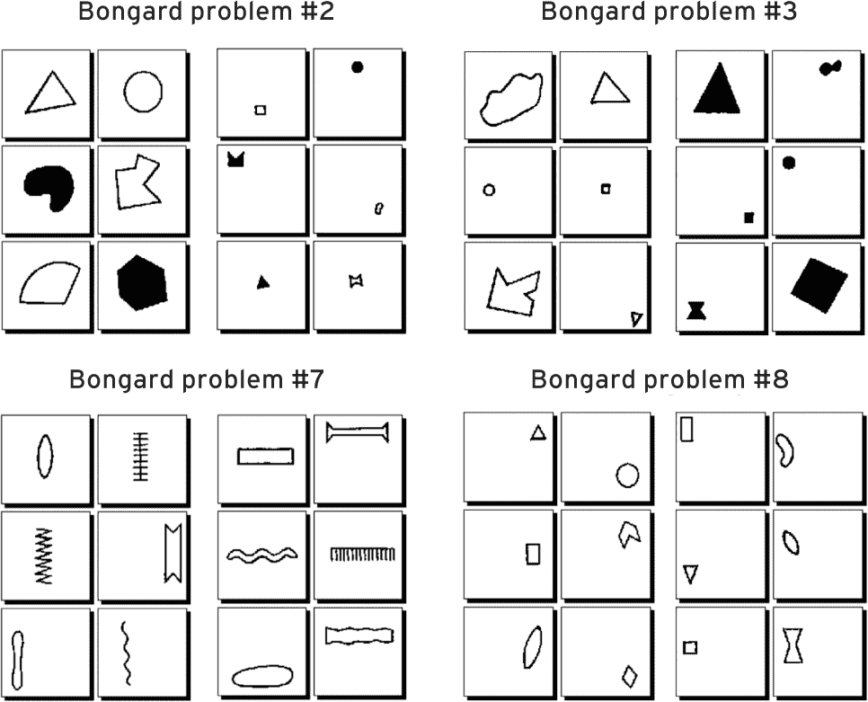

FIGURE 45: Four sample Bongard problems. For each problem, the task is to determine what concepts distinguish the six boxes on the left from the six boxes on the right. For example, for Bongard problem 2, the concepts are *large* versus *small.*

每个问题包含十二个框：左边六个，右边六个。每个问题中，左边的六个框体现了“相同”的概念，右边的六个框体现了相关的概念，这两个概念完美地区分了两组。挑战在于找到这两个概念。例如，在 figure 45 中，这些概念是（按顺时针顺序）*large* versus *small*；*white* versus *black*（或 *unfilled* versus *filled*，如果你喜欢的话）；*right side* versus *left side*；以及 *vertical* versus *horizontal*。

figure 45 中的问题相对容易解决。事实上，Bongard 将他的一百个问题大致按 presumed difficulty 排列。为了你的享受，figure 46 给出了该集中后面的六个额外问题。我将在下文给出答案。

Bongard 精心设计了这些谜题，使得其解决需要人类或 AI 系统在现实世界中所需的某些相同的抽象和类比能力。在 Bongard 问题中，你可以把十二个框中的每一个都视为一个微型的、理想化的“情境”——一个展示不同对象、属性和关系的情境。左边的情境有共同的“本质”（例如，*large*）；右边的情境有对比的共同本质（例如，*small*）。而且，在 Bongard 问题中，如同在现实生活中一样，识别情境的本质有时非常微妙。正如认知科学家 Robert French 所说，抽象和类比全在于感知“相同之处的微妙”。^() 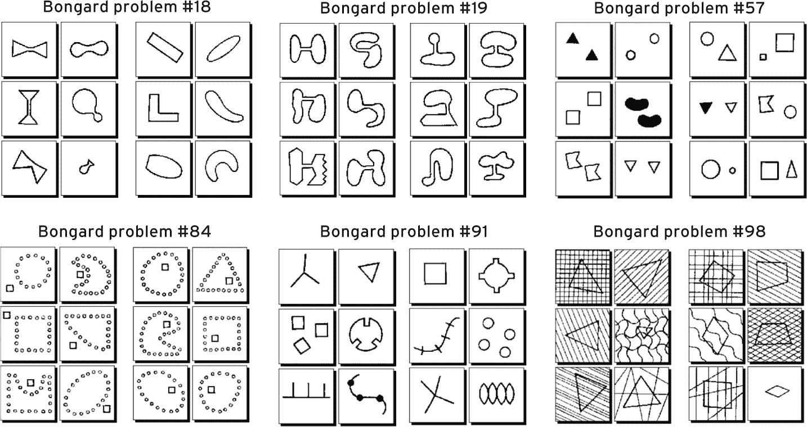

FIGURE 46: Six additional Bongard problems

要发现这种微妙的相同之处，你需要确定情境中哪些属性是相关的，哪些可以忽略。在问题 2（figure 45）中，形状是黑色还是白色，形状放在框中的哪个位置，或者形状是三角形、圆形还是其他什么，都无关紧要。在这里，大小是唯一重要的东西。当然，大小并不总是重要；对于 figure 45 中的其他问题，大小是无关的。我们人类如何如此迅速地辨别相关属性？我们如何能让机器做到同样的事情？

为了让机器更加困难，相关概念可以以抽象、难以感知的方式编码，例如问题 91 中的 *three* 和 *four* 概念。在某些问题中，AI 系统可能不容易弄清楚什么算作对象，如问题 84（*outside* versus *inside*），其中相关的“对象”由较小的对象（这里是小圆圈）组成。在问题 98 中，对象是“伪装”的：人类很容易看出图形是什么，但机器却更难，它们可能难以区分前景和背景。

Bongard 问题还挑战了一个人即时感知新概念的能力。问题 18 是一个很好的例子。左边框中共同的概念不容易用语言表达；它类似于 *object with a constriction or “neck”*。但是，即使你以前从未想过任何类似的东西，你也能在问题 18 中迅速识别出来。同样，在问题 19 中，有一个新概念：左边是类似于 *object with a horizontal neck*，右边是 *object with a vertical neck*。抽象新的、难以用语言表达的概念——相同之处微妙性的另一个例子——是人们非常擅长的事情，但没有现有的 AI 系统能以任何通用的方式做到这一点。

Bongard 的书于 1970 年英文出版，相当晦涩，最初很少有人知道它的存在。然而，Douglas Hofstadter 于 1975 年偶然发现了这本书，对附录中的一百个问题印象深刻，并在自己的书《哥德尔、埃舍尔、巴赫》（*Gödel, Escher, Bach*）中详细写到了它们。我就是在那里第一次看到它们的。


从小，我就一直热爱谜题，尤其是涉及逻辑或模式的谜题；读《哥德尔、埃舍尔、巴赫》（*GEB*）时，我特别着迷于邦加问题。我也对霍夫施塔特在《哥德尔、埃舍尔、巴赫》（*GEB*）中勾勒的想法很感兴趣，即如何创建一个程序来解决邦加问题，其方式模拟人类的感知和类比生成。阅读那一节可能就是我决定成为 AI 研究人员的时刻。

许多人同样被邦加问题所吸引，几位研究人员创建了尝试解决这些问题的 AI 程序。这些程序中的大多数都做出了简化假设（例如，限制允许的形状和形状关系集，或者完全忽略视觉方面，从对图像的人工创建描述开始）。每个程序都能解决特定问题的一个子集，但没有一个程序表明其方法能以类人的方式推广。

卷积神经网络呢？鉴于它们在对象分类方面表现得如此出色（例如，在第 5 章中描述的巨大的 ImageNet 视觉识别挑战），我们是否应该期望这样的网络可以被训练来解决邦加问题？你可以想象将邦加问题作为一种 ConvNet 的“分类”问题，如 图 47 所示：左侧的六个框可以被视为“类 1”的训练示例，右侧的六个框是“类 2”的训练示例。现在给系统一个新的“测试”示例。它应该被分类为“类 1”还是“类 2”？

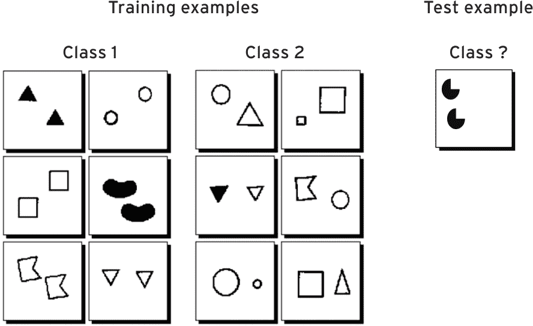

FIGURE 47: An illustration of how a Bongard problem could be framed as a classification problem, with twelve training examples and a new “test” example

一个直接的障碍是，一组 *十二* 个训练示例对于训练 ConvNet 来说微不足道；即使是一千两百个可能也不够。当然，这也是邦加观点的一部分：我们人类可以轻松地用仅十二个示例识别相关概念。ConvNet 需要多少训练数据才能学会解决邦加问题？虽然还没有人对使用 ConvNet 解决邦加问题进行过系统研究，但一组研究人员调查了最先进的 ConvNet 在“相同与不同”任务上的表现，使用的图像类似于 图 47 中的图像。^()

## 主动符号与类比生成

读完《哥德尔、埃舍尔、巴赫》（*Gödel, Escher, Bach*）并决定从事 AI 研究后，我寻找道格拉斯·霍夫施塔特，希望能从事类似邦加问题的工作。幸运的是，经过一些坚持，我成功说服他允许我加入他的研究小组。霍夫施塔特向我解释说，他的小组确实正在构建受人类如何理解和在情境之间进行类比启发的计算机程序。由于他在物理学领域完成了研究生学业（一个理想化，如无摩擦运动，是核心驱动原理的学科），霍夫施塔特相信，研究一种现象——这里是人类类比生成——的最佳方式是以其最理想化的形式来研究它。AI 研究经常使用所谓的微观世界——理想化领域，例如邦加问题，研究人员可以在其中开发想法，然后再在更复杂的领域中测试它们。为了研究类比生成，霍夫施塔特开发了一个比邦加问题更理想化的微观世界：涉及字母字符串的类比谜题。这是一个例子：

> PROBLEM 1: Suppose that the string of letters *abc* changes to *abd*. How would you change the string *pqrs* in the “same way”?

大多数人回答 *pqrt*，推断出一条类似于“用字母表中的后继字母替换最右侧字母”的规则。当然，可以推断出其他可能的规则，从而产生不同的答案。以下是一些替代答案：

> *pqrd*: “用 *d* 替换最右侧字母。”

> 

> *pqrs*: “将所有 *c* 替换为 *d*。*pqrs* 中没有 *c*，所以没有任何变化。”

> 

> *abd*: “将任何字符串替换为字符串 *abd*。”

这些替代答案可能看起来过于死板，但没有严格的 *逻辑* 论证说它们是错的。事实上，可以推断出无限多个可能的规则。为什么大多数人同意其中一个（*pqrt*）是最好的？似乎我们用于抽象的心理机制——这些机制进化是为了促进我们在现实世界中的生存和繁殖——也适用于这个理想化的微观世界。

这里是另一个例子：

> PROBLEM 2: Suppose that the string *abc* changes to *abd*. How would you change the string *ppqqrrss* in the “same way”?

即使在这个简单的字母微观世界中，同一性也可能非常微妙，至少对于机器来说是这样。在问题 2 中，字面应用“用其后继字母替换最右侧字母”的规则会产生 *ppqqrrst*，但大多数人认为这个答案太死板了；人们倾向于给出答案 *ppqqrrtt*，将 *ppqqrrss* 中的 *字母对* 视为映射到 *abc* 中的单个字母。^()

问题 2 说明了在这个微观世界中的 *概念滑移* 的一般概念，这是类比生成的核心思想。^()

现在考虑这个问题：

> PROBLEM 3: Suppose the string *abc* changes to *abd*. How would you change the string *xyz* in the “same way”?

大多数人回答 *xya*，认为 *z* 的“后继”是 *a*。但是，假设你是一个计算机程序，没有“循环”字母表的概念，因此对你来说字母 *z* 没有后继。还有哪些答案是合理的？当我问人们这个问题的答案时，我得到了很多不同的回答，其中一些非常有创意。有趣的是，答案常常唤起物理隐喻：例如，*xy*（*z* “从悬崖边掉下去”）、*xyy*（*z* “向后弹回”）和 *wyz*。最后一个答案的图像是，*a* 和 *z* 各自在字母表两端“被顶在墙边”，因此扮演相似的角色；因此，如果概念 *字母表中的第一个字母* 滑移到 *字母表中的最后一个字母*，那么 *最右侧字母* 就滑移到 *最左侧字母*，而 *后继* 就滑移到 *前驱*。问题 3 说明了进行类比如何引发一系列心理滑移。

字母字符串微观世界使滑移的想法非常明显。在其他领域，它可能更微妙。例如，如果你回顾 图 46 中的邦加问题 91，其中六个左侧框的共同本质是 *三*，代表 *三* 概念的对象会从一个框滑移到另一个框——例如，从线段（左上）到正方形（左中），然后到左下框中一个难以用语言表达的概念（也许像“梳子上的牙齿”？）。概念滑移也在想象中的女儿 S（来自上一章）多年来所做的不同抽象中起到了核心作用——例如，在她的法律类比中，*网站* 的概念滑移到了 *墙* 的概念，*写博客* 的概念滑移到了 *喷涂涂鸦* 的概念。

霍夫施塔特设想了一个名为 Copycat 的计算机程序，它将使用非常通用的算法来解决这类问题，这些算法类似于他认为人类在任何领域进行类比时所使用的算法。Copycat 这个名字来自这样的想法：你（类比生成者）应该通过“做同样的事情”来解决这些问题——也就是说，成为一个“模仿者”。原始情况（例如，*abc*）以某种方式发生了变化，你的工作是对新情况（例如，*ppqqrrss*）做出“相同”的变化。


## 当我加入霍夫施塔特的研究小组时

当我加入霍夫施塔特的研究小组时，我的任务是与霍夫施塔特合作开发 Copycat 程序。正如任何走过这条路的人都会告诉你的那样，通往博士学位的道路主要由高强度的劳动组成，中间穿插着令人沮丧的挫折，以及（至少对我来说）不断涌动的自我怀疑。但偶尔也会有令人兴奋的成就时刻，比如你辛苦钻研了五年的程序终于运行起来了。在这里，我将跳过所有的怀疑、挫折和无数的工作时间，直接进入结尾，那时我提交了一篇描述 Copycat 程序的论文，该程序能够以（我认为）一种普遍的人类方式解决几类字符串类比问题。

Copycat 既不是基于符号的规则程序，也不是神经网络，尽管它包含了符号 AI 和亚符号 AI 的两个方面。Copycat 通过程序的感知过程（即注意到特定字符串类比问题中的特征）与其先前概念之间的持续交互来解决类比问题（例如，`letter`、`letter group`、`successor`、`predecessor`、`same` 和 `opposite`）。该程序的概念结构旨在模拟我上一章中描述的类似心理模型的东西。特别是，它们基于霍夫施塔特关于人类认知中“活性符号”的概念。^()

> PROBLEM 4: If `azbzczd` changes to `abcd`, what does `pxqxrxsxt` change to?

> PROBLEM 5: If `abc` changes to `abd`, what does `ace` change to?

这两个问题都需要即时识别新概念，这是 Copycat 所缺乏的能力。在问题 4 中，`z` 和 `x` 扮演着相同的角色，类似于“需要删除以看到字母序列的额外字母”，答案是 `pqrst`。在问题 5 中，`ace` 序列与 `abc` 序列相似，只是它不是“继任”序列，而是“双倍继任”序列，得出答案 `acg`。对我来说，很容易让 Copycat 能够计算例如 `a` 和 `c` 以及 `c` 和 `e` 之间的字母数量，但我不想构建非常特定于字符串领域的能力。Copycat 旨在作为关于类比的一般思想的测试平台，而不是一个全面的“字符串类比生成器”。

## 字符串世界中的元认知

人类智能的一个基本方面——在当今 AI 领域讨论得不多——是感知和反思自己思维的能力。在心理学中，这被称为元认知。你是否曾经努力解决一个问题却未能成功，最终意识到自己一直在重复同样的无效思维过程？这种情况我经常遇到；然而，一旦我意识到这种模式，有时就能摆脱困境。Copycat 就像本书中我讨论过的所有其他 AI 程序一样，没有自我感知的机制，这损害了它的性能。程序有时会卡住，一遍又一遍地以错误的方式尝试解决问题，却永远无法意识到自己之前走过类似且不成功的道路。

詹姆斯·马歇尔，当时是道格拉斯·霍夫施塔特研究小组的一名研究生，承担了让 Copycat 对其自身“思维”进行反思的项目。他创建了一个名为 Metacat 的程序，该程序不仅在 Copycat 的字符串领域解决类比问题，还试图感知其自身行为中的模式。当程序运行时，它会生成一段关于其在问题解决过程中识别了哪些概念的实时评论。^()

## 识别视觉情境

我目前的研究是开发一个 AI 系统，利用类比来灵活地识别 `visual situations`——涉及多个实体及其关系的视觉概念。例如，figure 48 中的四张图片每一张都是我们可能称之为“遛狗”的视觉情境的一个实例。对人类来说这很容易看出，但即使是简单的视觉情境，识别其实例对 AI 系统来说也证明是非常具有挑战性的。识别整个情境比识别单个对象要困难得多。

我和我的合作者正在开发一个名为 `Situate` 的程序，它将深度神经网络的对象识别能力与 Copycat 的活性符号架构相结合，以便通过类比来识别特定情境的实例。我们希望我们的程序不仅能识别简单的示例，例如 figure 48 中的示例，还能识别需要概念滑移的非传统示例。原型“遛狗”情境涉及一个人（遛狗人）、一只狗和一条狗绳。遛狗人握着狗绳，狗绳系在狗身上，遛狗人和狗都在走路。对吧？确实，我们在 figure 48 的示例中看到了这一点。但是，理解遛狗概念的人也会将 figure 49 中的每张图片识别为该概念的实例，同时意识到每张图片与原型版本相比“被拉伸”了多少。`Situate` 仍处于早期开发阶段，旨在测试关于人类类比产生的一般机制的想法，并证明 Copycat 程序背后的想法可以在字符串类比的微观世界之外成功运行。

Copycat、Metacat 和 Situate 是基于霍夫施塔特活性符号架构的几个类比产生程序的三个例子。^()

## “我们离目标还非常非常遥远”

现代人工智能时代由深度学习主导，其三驾马车是深度神经网络、大数据和超快计算机。然而，在追求强健和通用智能的过程中，深度学习可能正在撞上一堵墙：至关重要的“意义障碍”。在本章中，我简要地调查了 AI 领域为突破这一障碍所做的一些努力。我探讨了研究人员（包括我自己）如何试图赋予计算机常识知识，并赋予它们类似人类的抽象和类比能力。

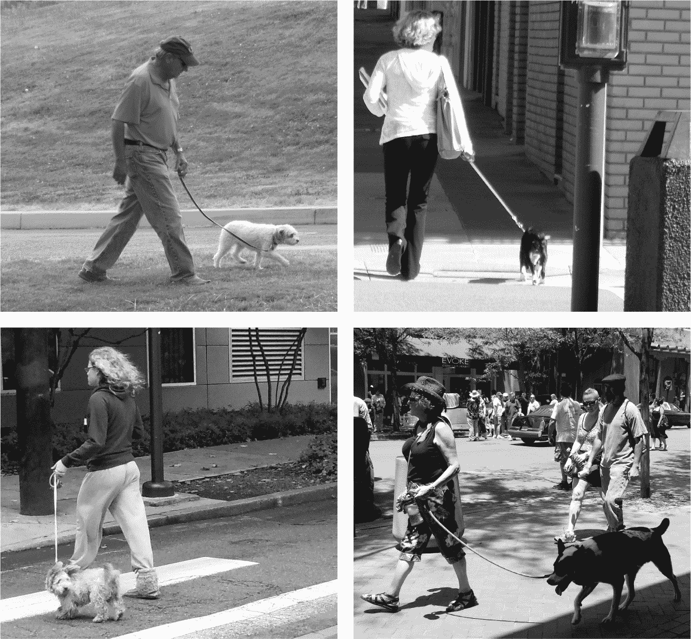

FIGURE 48: Four straightforward instances of “walking a dog”

在思考这个话题时，我特别被安德烈·卡帕西（Andrej Karpathy）写的一篇令人愉快且富有洞察力的博客文章所打动，他是深度学习和计算机视觉专家，目前领导特斯拉的 AI 工作。在他题为“计算机视觉和 AI 的现状：我们离目标还非常非常遥远”的文章中，^() 

FIGURE 49: Four atypical instances of “walking a dog”

卡帕西列出了许多我们人类很容易理解但今天最好的计算机视觉程序仍无法胜任的事情。例如，我们认识到场景中有人，但也认识到有镜子，所以有些人是那些镜子中的倒影。我们将场景识别为更衣室，并且对在更衣室环境中看到一群穿着西装的人感到奇怪。


Furthermore, we recognize that a person is standing on a scale, even though the scale is made up of white pixels that blend in with the background. Karpathy points out that we recognize that “Obama has his foot positioned just slightly on top of the scale,” and notes that we easily describe this in terms of the three-dimensional structure of the scene we infer rather than the two-dimensional image that we are given. Our intuitive knowledge of physics lets us reason that Obama’s foot will cause the scale to overestimate the weight of the person on the scale. Our intuitive knowledge of psychology tells us that the person on the scale is not aware that Obama is also stepping on the scale—we infer this from the person’s direction of gaze, and we know that he doesn’t have eyes in the back of his head. We also understand that the person probably can’t sense the slight push of Obama’s foot on the scale. Our theory of mind further lets us predict that the man will not be happy when the scale shows his weight to be higher than he expected.


FIGURE 50: The photo discussed in Andrej Karpathy’s blog

Finally, we recognize that Obama and the other people observing this scene are smiling—we infer from their expressions that they are amused by the trick Obama is playing on the man on the scale, possibly made funnier because of Obama’s status. We also recognize that their amusement is friendly, and that they expect the man on the scale to himself laugh when he is let in on the joke. Karpathy notes: “You are reasoning about \[the\] state of mind of people, and their view of the state of mind of another person. That’s getting frighteningly meta.”

In summary, “It is mind-boggling that all of the above inferences unfold from a brief glance at a 2D array of \[pixel\] values.”

For me, Karpathy’s example beautifully captures the complexity of human understanding and renders with crystal clarity the magnitude of the challenge for AI. Karpathy’s post was written in 2012, but its message is just as true today and will remain so, I believe, for a long time to come.

Karpathy concludes his post with this thought:

> A seemingly inescapable conclusion for me is that we may … need embodiment, and that the only way to build computers that can interpret scenes like we do is to allow them to get exposed to all the years of (structured, temporally coherent) experience we have, ability to interact with the world, and some magical active learning/inference architecture that I can barely even imagine when I think backwards about what it should be capable of.

In the seventeenth century, the philosopher René Descartes speculated that our bodies and our thoughts are made up of different substances and are subject to different physical laws.^()

## 16

## Questions, Answers, and Speculations

Near the end of his 1979 book, *Gödel, Escher, Bach*, Douglas Hofstadter interviewed himself about the future of AI. In a section called “Ten Questions and Speculations,” he posed and answered questions not only about the potential for machine thinking but also about the general nature of intelligence. Reading *GEB* as a recent college graduate, I was keenly interested in this section. Hofstadter’s speculations convinced me that in spite of all the media hype regarding the imminence of human-level artificial intelligence (we had this in the 1980s too), the field was actually wide open and acutely in need of new ideas. There were still plenty of profound challenges waiting for young people like me just starting out in the field.

Writing now, well over three decades later, I thought it would be fitting to close this book with some of my own questions, answers, and speculations, both as an homage to Hofstadter’s section in *GEB* and as a way to tie together the ideas I have presented.

## Question: How soon will self-driving cars be commonplace?

It depends on what you mean by “self-driving.” The U.S. National Highway Traffic Safety Administration has defined six levels of autonomy for vehicles.^()

> • LEVEL 0: The human driver does all the driving.

> • LEVEL 1: The vehicle can sometimes assist the human driver with either steering or vehicle speed, but not both simultaneously.

> • LEVEL 2: The vehicle can control both steering and vehicle speed simultaneously under some circumstances (usually highway driving). The human driver must continue to pay full attention (“monitor the driving environment”) at all times and do everything else needed for driving, such as changing lanes, exiting highways, stopping at traffic lights, and pulling over for police cars.

> • LEVEL 3: The vehicle can perform all aspects of driving under certain circumstances, but the human driver must pay attention at all times and be ready to take back control at any time that the vehicle requests the human driver to do so.

> • LEVEL 4: The vehicle can do all the driving under certain circumstances. In those circumstances, the human does not need to pay attention.

> • LEVEL 5: The vehicle can do all the driving in all circumstances. The human occupants are just passengers and never need to be involved in driving.

I’m sure you noted the all-important hedge phrase “under certain circumstances.” There’s no way to make an exhaustive list of the circumstances in which, say, a level 4 vehicle can do all the driving, though one can imagine many circumstances that would likely be challenging for an autonomous vehicle: for example, bad weather, crowded city traffic, navigating through a construction zone, or driving on a narrow two-way road without any lane markings.

At the time of this writing, most cars on the road are between levels 0 and 1—they have cruise control, but no steering or braking control. Some recent-model cars—those with “adaptive cruise control”—are considered at level 1. There are a few types of vehicles currently at levels 2 and 3, such as Tesla cars that have an Autopilot system. The makers and users of these vehicles are still learning what situations are included in the “certain circumstances” in which the human driver needs to take over. There are also experimental vehicles that can operate fully autonomously in fairly wide circumstances, but these vehicles still need human “safety drivers” who remain ready to take over at a moment’s notice. Several fatal accidents caused by self-driving cars, including the experimental ones, have occurred when a human was supposed to have been ready to take over but was not paying attention.

The self-driving car industry desperately wants to produce and sell fully autonomous vehicles (that is, level 5); indeed, full autonomy is what we, the consumers, have long been promised in all the buzz around self-driving cars. What are the obstacles to getting to true autonomy in our cars?

The primary obstacles are the kinds of long-tail situations (“edge cases”) that I described in chapter 6: situations that the vehicle was not trained on, and that might individually occur rarely, but that, taken together, will occur frequently when autonomous vehicles are widespread. As I described, human drivers deal with these events by using common sense—particularly the ability to understand and make predictions about novel situations by analogy to situations the driver already understands.


车辆的完全自动驾驶还需要我在第 14 章中描述的那种核心直觉知识：直觉物理学、生物学，尤其是心理学。为了能够在 `in all circumstances` 下可靠地驾驶，驾驶员需要理解其他驾驶员、骑自行车的人、行人以及共享道路的动物的动机、目标乃至情绪。评估复杂局势并瞬间判断谁可能会乱穿马路、为了赶公交车突然冲上街道、不打转向灯就急转弯，或者在人行横道上停下来调整一只破掉的高跟鞋——这对大多数人类驾驶员来说是本能，但对自动驾驶汽车来说尚未做到。

自动驾驶汽车面临的另一个迫在眉睫的问题是各种恶意攻击的潜在可能性。计算机安全专家已经证明，即使是我们今天驾驶的许多非自动驾驶汽车——这些汽车越来越多地由软件控制——也容易通过其与无线网络的连接（包括蓝牙、蜂窝网络和互联网连接）遭到黑客攻击。^()

除了黑客攻击之外，另一个问题将是我们可能称之为“人性”的问题。人们不可避免地会想要对完全自动驾驶汽车开玩笑，探测它们的弱点——例如，通过踩上又踩下路缘石（假装要过马路）来阻止汽车向前行驶。汽车应该如何编程来识别和处理此类行为？对于完全自动驾驶汽车，还有许多重大的法律问题需要解决，例如事故中谁被认为负有责任，以及需要哪些类型的保险。

对于自动驾驶汽车的未来，有一个特别棘手的问题：行业应该追求 `partial` 自动驾驶，即汽车在“特定情况下”完成所有驾驶，但人类驾驶员仍需保持注意并在必要时接管吗？还是唯一目标应该是 `full` 自动驾驶，即人类可以完全信任汽车的驾驶，永远不需要保持注意？

足够可靠的 `fully` 自动驾驶汽车（即几乎在所有情况下都能自行驾驶的汽车）的技术目前尚不存在，原因是我上面描述的那些问题。很难预测这些问题何时会得到解决；我看到“专家”的预测从几年到几十年不等。值得记住的一句格言是：复杂技术项目的前 90% 花费 10% 的时间，而最后 10% 花费 90% 的时间。

足够可靠的 `fully` 自动驾驶汽车（即几乎在所有情况下都能自行驾驶的汽车）的技术目前尚不存在，原因是我上面描述的那些问题。很难预测这些问题何时会得到解决；我看到“专家”的预测从几年到几十年不等。值得记住的一句格言是：复杂技术项目的前 90% 花费 10% 的时间，而最后 10% 花费 90% 的时间。

第三级 `partial autonomy` 的技术目前已经存在。但正如多次证明的那样，人类在处理部分自动驾驶方面非常糟糕。即使人类驾驶员知道他们 `supposed` 应该始终保持注意，他们有时也不会，而且因为汽车无法处理出现的所有情况，事故将会发生。

这让我们走向何处？实现驾驶的完全自动驾驶本质上需要通用人工智能，而这可能在短期内无法实现。部分自动驾驶的汽车现在已经存在，但很危险，因为驾驶它们的人类并不总是保持注意。解决这一困境最可能的办法是改变 `full autonomy` 的定义：允许自动驾驶汽车仅在特定区域内驾驶——即那些已建立基础设施以确保汽车安全的区域。这种解决方案的常见版本被称为“地理围栏”。福特汽车公司前自动驾驶汽车首席工程师 Jackie DiMarco 这样解释地理围栏：

> 当我们谈论第四级自动驾驶时，它是在地理围栏内完全自动驾驶，即在我们拥有定义高清晰度地图的区域内。一旦有了这张地图，你就可以理解你的环境。你可以理解路灯在哪里，人行横道在哪里，道路规则是什么，限速等等。我们将自动驾驶视为在某个地理围栏内增长，然后随着技术的进步、我们的学习的进步以及我们解决越来越多问题的能力的进步而在此基础上扩展。^()

>

> ## 问题：人工智能会导致人类大规模失业吗？

>

> 我不知道。我的猜测是不会，至少短期内不会。马文·明斯基的“容易的事情很难”格言在人工智能的大部分领域依然成立，许多人类工作对计算机（或机器人）来说可能比人们想象的要难得多。

>

> 毫无疑问，人工智能系统将在某些工作中取代人类；它们已经这样做了，而且通常对社会有益。但目前还没有人知道人工智能对就业的整体影响会是什么，因为没有人能预测未来人工智能技术的能力。

>

> 已有许多关于人工智能对就业可能影响的报告，特别关注涉及驾驶的数百万个工作岗位的脆弱性。这些工作中的人类最终可能会被取代，但广泛自动驾驶实际何时到来的不确定性使得时间表难以预测。

>

> 尽管存在不确定性，技术与就业的问题（理所当然地）是人工智能伦理整体持续讨论的一部分。许多人指出，从历史上看，新技术创造的新工作类型与其取代的一样多，人工智能可能也不例外。也许人工智能会夺走卡车驾驶工作，但由于需要开发人工智能伦理，该领域将为道德哲学家创造新的职位。我这样说并非为了淡化潜在问题，而是为了表达对这一问题的不确定性。美国总统经济顾问委员会 2016 年的一份经过仔细研究的关于人工智能对经济可能影响的报告强调了这一点：“关于这些影响会有多强烈、会多快到来，存在很大的不确定性……鉴于目前可用的证据，无法做出具体预测，因此政策制定者必须为一系列潜在结果做好准备。”^()

>

> ## 问题：计算机能具有创造力吗？

>

> 对许多人来说，计算机具有创造力的想法听起来像是一个矛盾修辞法。毕竟，机器的本质是“机械的”——这个术语在日常语言中意味着创造力的对立面。怀疑论者可能会争辩说：“计算机只能做人类编程让它做的事情。因此它不能具有创造力；创造力需要独立 `creating` 创造新事物。”^()

>

> 我认为这种观点——即计算机定义上不能具有创造力，因为它只能做明确编程让它做的事情——是错误的。计算机程序有许多方式可以生成其程序员从未想到的东西。我的程序 Copycat（在上一章中描述）经常想出一些我永远不会想到但却有其自身奇怪逻辑的类比。我相信，原则上，计算机有可能具有创造力。但我也相信，具有创造力意味着能够理解和评判自己创造的东西。就这种意义上的创造力而言，没有现有的计算机可以说是具有创造力的。

>

> 一个相关的问题是，计算机程序能否创作出一件优美的艺术品或音乐。美是非常主观的，但我的答案肯定是肯定的。我见过许多我认为优美的计算机生成的艺术作品。一组例子是计算机科学家和艺术家 Karl Sims 的“基因艺术”。^()


> 在 Sims 的项目中，创造力源于人与计算机的团队合作：计算机生成初始艺术作品，然后生成一系列变体，而人类对结果作品进行 `judgment`，这种判断源于人类对抽象艺术概念的理解。计算机完全没有理解能力，因此它本身并不具备创造力。

> 音乐生成领域也有类似的例子，其中计算机能够生成优美（或至少悦耳）的音乐，但在我看来，`creativity` 只有通过与人类的合作才能产生，人类赋予了理解什么是好音乐的能力，从而对计算机的输出提供判断。

> 以这种方式生成音乐的最著名计算机程序是音乐智能实验（Experiments in Musical Intelligence，EMI）程序。

> EMI 是由作曲家 David Cope 创建的，最初是为了作为一种个人“作曲助手”。Cope 长期以来一直对利用随机性生成音乐的悠久传统感到着迷。一个著名的例子是所谓的音乐骰子游戏，莫扎特和其他十八世纪的作曲家都玩过这种游戏，作曲家将一段音乐切成小片段（例如，单个小节），然后掷骰子来选择这些片段在新作品中的位置。

> 不妨说，EMI 是一种“加强版”的音乐骰子游戏。为了让 EMI 创作出比如莫扎特风格的作品，Cope 首先从莫扎特的作品中选取大量短音乐片段，并应用他编写的一个计算机程序，识别出他称之为“签名”的关键音乐模式——这些模式有助于定义作曲家独特的风格。Cope 又编写了一个程序，对每个签名在作品中可能发挥的特定音乐角色进行分类。这些签名被存储在对应作曲家（在我们的例子中是莫扎特）的数据库中。Cope 还在 EMI 中开发了一套规则——一种音乐“语法”——用于捕捉签名变体如何重新组合以创作特定风格的连贯音乐作品的约束。EMI 使用随机数生成器（计算机版的掷骰子）来选择签名并从中创建音乐片段；然后程序使用其音乐语法来帮助决定如何排列这些片段。

> 这样一来，EMI 就能生成数量无限的新作品，风格模仿莫扎特或任何其他已构建音乐签名数据库的作曲家。Cope 仔细挑选了 EMI 作品中的最佳作品公开发布。我听过其中几首；就我听来，它们从平庸到惊人地出色不等，有些段落优美动人，但没有一首能达到原作曲家作品的深度。（当然，我说这话时事先知道这些作品是 EMI 创作的，所以我可能带有偏见。）较长的作品往往包含优美的段落，但也具有非人类的倾向，即容易丢失音乐思想的主线。但总体而言，EMI 发表的作品在捕捉几位不同古典作曲家的风格方面非常成功。

> EMI 具有创造力吗？我自己的答案是否定的。EMI 生成的一些音乐相当不错，但它依赖于 Cope 的音乐学知识，这些知识嵌入在 Cope 策划的音乐签名和他设计的音乐学规则中。最重要的是，我认为该程序对其生成的音乐没有真正的理解——无论是音乐概念方面，还是音乐情感影响方面。出于这些原因，EMI 无法评判自己音乐的质量。那是 Cope 的工作；他简单地说：“我喜欢的作品会发布，我不喜欢的则不会。”

> 2005 年，在一个我感到困惑的决定中，Cope 销毁了 EMI 的整个音乐签名数据库。他给出的主要原因是，EMI 的作品由于易于且无限地生产，而被评论家贬值。Cope 觉得，EMI 只有像哲学家 Margaret Boden 所写的那样，拥有“有限的作品集——如同所有受死神困扰的人类作曲家一样”，才会作为作曲家受到重视。

> 我不知道我的意见是否能给 Douglas Hofstadter 带来任何安慰，他对 EMI 最令人印象深刻的作品及其欺骗专业音乐家的能力感到非常不安。我理解 Hofstadter 的担忧。正如文学学者 Jonathan Gottschall 所观察到的，“艺术或许是区分人类与其他受造物的最主要特征。它是让我们最为自豪的事物。”

> ## 问题：距离创造出通用人类水平的人工智能还有多远？

> 我将引用人工智能研究所所长 Oren Etzioni 的话来回答：“把你的估计翻倍，再翻三倍，再翻四倍。那时才会到来。”

> 如需第二种意见，请回顾 Andrej Karpathy 在上一章中的评估：“我们真的，真的还很远。”

> 这也是我的观点。

> 计算机最初是人类。事实上，它们通常是女性，她们用手或机械桌面计算器进行计算，例如二战期间为帮助士兵瞄准火炮而计算导弹轨迹所需的计算。这就是 `computer` 的原始含义。根据 Claire Evans 的著作 `Broad Band`，在 20 世纪 30 年代和 40 年代，“‘女孩’一词与‘计算机’混用。……国防研究委员会的一位成员……粗略估计一个‘千女孩’单位的能量大约相当于一千小时的计算劳动。”

> 20 世纪 40 年代中期，电子计算机取代了人工计算机，并立即变得超人：与任何人工计算机不同，这些机器可以计算“飞行中的炮弹轨迹，其速度快于炮弹本身的飞行速度。”

> 我们看到，在人工智能领域的历史上，知名的 AI 从业者曾预测通用人工智能将在十年、十五年、二十五年或“一代人之内”到来。然而，这些预测都没有实现。正如我在第 3 章中描述的那样，Ray Kurzweil 和 Mitchell Kapor 之间关于一个程序是否能通过精心设计的图灵测试的“长期赌注”，将在 2029 年揭晓。我赌 Kapor 胜出；我完全同意他在序言中引用的观点：“人类智能是一种奇妙、微妙且理解不足的现象。在不久的将来，复制它没有任何危险。”

> “预测很难，尤其是关于未来的预测。”谁创造了这句机智的说法还有争议，但在人工智能领域，它和在任何其他领域一样真实。几项针对 AI 从业者的调查询问通用 AI 或“超级智能” AI 何时到来，结果显示出广泛的意见谱系，从“未来十年内”到“永远不会”。

> 我们知道的是，通用人类水平的人工智能将需要 AI 研究人员几十年来一直努力理解和复制的能力——常识知识、抽象和类比等——但这些能力已被证明极其难以捉摸。其他重大问题仍然存在：通用 AI 是否需要意识？拥有自我意识？感受情感？拥有生存本能和对死亡的恐惧？拥有身体？正如我之前引用 Marvin Minsky 的话：“关于心智的观念，这仍然是一个形成期。”

> 我认为关于计算机何时将实现 `superintelligence`——“在几乎所有领域（包括科学创造力、一般智慧和社交技能）都远比最优秀的人类大脑更聪明的智力”


> 几位作家断言，如果计算机达到通用人类水平的人工智能，这些机器将迅速变成“超级智能”，这一过程类似于 I. J. Good 对“智能爆炸”的设想（在第 3 章中描述）。其思路是，具备通用智能的计算机将能以闪电般的速度阅读全人类的所有文档，并学习所有可知之事。同样，它将能够通过其不断增强的推理能力，发现各种新知识，并将其转化为自身的新认知能力。这样的机器将不受人类那些令人烦恼的局限性约束，例如我们思考和学习的迟缓、我们的非理性和认知偏差、我们容易感到无聊、我们需要睡眠，以及我们的情绪——所有这些都阻碍了高效的思考。在这种观点中，超级智能机器将涵盖近乎“纯粹”的智能，而不受我们任何人类弱点的制约。

> 在我看来，更可能的是，这些所谓的人类局限性正是我们通用智能不可分割的一部分。由于我们拥有在世界中运作的身体而被强加给我们的认知局限，以及那些进化出来以使我们能够作为社会群体运作的情绪和“非理性”偏见，以及所有其他有时被视为认知“缺陷”的特质，实际上恰恰是使我们能够成为通用智能者，而非狭隘天才的原因。我无法证明这一点，但我认为，通用智能很可能无法与所有这些表面上的缺陷分离，无论是在人类还是在机器中。

> 在《GEB》的“十个问题与推测”部分，Douglas Hofstadter 用一个看似简单的问题探讨了这个问题：“思考的计算机能快速加法吗？”当我第一次读到他的答案时感到惊讶，但现在觉得它是正确的。“也许不能。我们自身由硬件组成，能进行复杂的计算，但这并不意味着我们的符号层面（即‘我们’所在的层面）知道如何执行同样的复杂计算。幸运的是，你的符号层面（即`你`）无法接触到正在进行你思考的神经元——否则你就会变得头脑昏昏沉沉。……为什么对智能程序来说就不应该是这样呢？”Hofstadter 接着解释说，智能程序将像我们一样，将数字表示为“完整的概念，就像我们一样，充满了关联。……由于要携带所有这些‘额外负担’，智能程序在加法方面会变得相当迟缓。”^()

## Question: 我们应该对 AI 有多恐惧？

如果你依赖电影和科幻小说（甚至一些流行的非虚构作品）来形成对 AI 的看法，你会害怕 AI 变得有意识、变得恶意，并试图奴役或杀死我们所有人。但考虑到该领域似乎还远未实现任何类似通用智能的东西，这并不是 AI 社区中大多数人所担心的。正如我在本书中一再描述的那样，我们的社会急于拥抱 AI 技术有很多理由值得担忧：大规模失业的可能性、AI 系统被滥用的潜力，以及这些系统的不可靠性和易受攻击性——这些只是关注技术对人类生活影响的人们非常合理的担忧中的一些。

我以 Douglas Hofstadter 对最近 AI 进展的沮丧作为本书的开篇，但他大部分时候是对完全不同的事情感到恐惧。Hofstadter 担心的是，人类的认知和创造力将过于容易被 AI 程序匹配，而他最敬重的人类心灵所创造的崇高作品——例如 Chopin——可能会被像 EMI 这样使用“花招包”的表面算法所匹敌。Hofstadter 惋惜地说：“如果如此无限微妙、复杂且情感深邃的心灵能被一颗小芯片平庸化，那将摧毁我对人类是什么的认知。”Hofstadter 同样对 Kurzweil 关于即将到来的奇点的预测感到不安，痛苦地想，如果 Kurzweil 在某种程度上是正确的，“我们将被取代。我们将成为遗迹。我们将被甩在后面。”

我对 Hofstadter 的这些担忧表示同情，但我认为它们绝对过早了。最重要的是，本书的核心信息是，我们人类往往高估 AI 的进步，并低估我们自身智能的复杂性。当今的 AI 远未达到通用智能，我不相信机器“超级智能”在任何地方都近在眼前。如果通用 AI 真的出现，我打赌它的复杂性将与我们自己的大脑相媲美。

在任何关于 AI 的近期担忧排序中，超级智能应该排在很后面。事实上，与超级智能相反的问题才是真正的问题。在本书中，我描述了即使是最成熟的 AI 系统也是脆弱的；也就是说，当输入与其训练所依据的示例差异过大时，它们会出错。往往很难预测 AI 系统的脆弱性会在什么情况下显现出来。在语音转录、语言翻译、描述照片内容、在拥挤的城市驾驶中——如果强健的性能至关重要，那么人类仍然需要参与其中。我认为 AI 系统在短期内最令人担忧的方面是，我们会给予它们过多的自主权，而却不完全意识到它们的局限性和脆弱性。我们倾向于将 AI 系统拟人化：我们将人类品质归因于它们，最终高估了这些系统实际上可以被完全信任的程度。

经济学家 Sendhil Mullainathan 在撰写关于 AI 危险的文章时，引用了长尾现象（我在第 6 章中描述过），并提出了“尾部风险”的概念：

> 我们应该害怕。不是害怕智能机器。而是害怕机器做出它们没有智慧做出的决定。我对机器愚蠢的恐惧远大于对机器智能的恐惧。机器愚蠢会制造尾部风险。机器可以做出许多许多好的决定，然后有一天在训练数据中未出现的尾部事件上灾难性地失败。这就是特定智能与通用智能之间的区别。^()

> 或者正如 AI 研究员 Pedro Domingos 令人难忘地所说：“人们担心计算机会变得太聪明并接管世界，但真正的问题是它们太愚蠢了，而且它们已经接管了世界。”^()

> 我担心 AI 缺乏可靠性。我也担心它将如何被使用。除了我在第 7 章中涵盖的伦理考量之外，有一个特别让我害怕的发展是使用 AI 系统生成假媒体：文本、声音、图像和视频，以令人恐惧的真实感描绘从未实际发生过的事件。

> 那么，我们应该对 AI 恐惧吗？是的，也不是。超级智能、有意识的机器并不在近期。我们最珍视的人性方面，不会被“一堆花招”所匹敌。至少我不这么认为。但是，关于算法和数据的危险和不道德使用的潜力，有很多值得担忧的事情。这很可怕，但另一方面，我很高兴这个话题最近在 AI 社区及更广泛的领域得到了广泛关注。研究人员、公司和政客之间正在形成一种合作和共同目标的意识，以紧急处理这些问题。

## Question: AI 中还有哪些令人兴奋的未解决问题？

几乎所有问题。

当我开始从事 AI 工作时，我所发现的令人兴奋的部分是，该领域几乎所有重要的问题都悬而未决，等待新的想法。我认为这仍然是真的。


> 如果我们回到该领域的开端，1955 年由 John McCarthy 等人提出的提案（在第 1 章中描述）列出了 AI 的一些主要研究课题：自然语言处理、神经网络、机器学习、抽象概念与推理，以及创造力。2015 年，微软研究主管 Eric Horvitz 开玩笑说：“甚至可以说，如果对这份 \[1955\] 提案进行适当的重新格式化，今天就可以重新提交给国家科学基金会……并且很可能会得到一些兴奋的项目经理的资助。”^()

> 这绝不是对过去 AI 研究的批评。人工智能至少和人类的其他重大科学挑战一样困难。MIT 的 Rodney Brooks 比任何人都更好地表达了这一点：“当 AI 刚刚起步时，明确的灵感来自人类水平的表现和人类水平的智能。我认为，在最初的六十年里，正是这个目标吸引了大多数研究人员进入该领域。我们离实现这些愿望还很遥远，这并不意味着研究人员没有努力工作或不够聪明。这意味着这是一个非常困难的目标。”^()

> AI 中最令人兴奋的问题不仅关注潜在的应用。该领域的创始人同样受到关于智能本质的科学问题的驱动，就像受到开发新技术的愿望所驱动一样。事实上，智能是一种自然现象，可以像许多其他现象一样，通过构建简化的计算机模型来研究，这一想法是吸引许多人（包括我自己）进入该领域的动力。

> AI 的影响将继续对我们所有人产生越来越大的影响。我希望本书能帮助你，作为一个思考的人类，了解这个蓬勃发展的学科的现状，包括其众多未解决的问题、其技术的潜在风险和收益，以及它为理解我们自身的人类智能所提出的科学和哲学问题。如果有任何计算机在阅读此内容，请告诉我上一句中的 `it` 指代什么，你欢迎加入讨论。

## Notes

## Prologue: Terrified

1. 1. A. Cuthbertson, “DeepMind AlphaGo: AI Teaches Itself ‘Thousands of Years of Human Knowledge’ Without Help,” *Newsweek*, Oct. 18, 2017, [`www.newsweek.com/deepmind-alphago-ai-teaches-human-help-687620`](http://www.newsweek.com/deepmind-alphago-ai-teaches-human-help-687620).

2. 2. 在以下部分中，来自 Douglas Hofstadter 的引文出自我与他会面后的一次后续采访；这些引文准确地捕捉了他对 Google 小组发表的言论的内容和语气。

3. 3. Jack Schwartz，引自 G.-C. Rota, *Indiscrete Thoughts* (Boston: Berkhäuser, 1997), 22.

4. 4. D. R. Hofstadter, *Gödel, Escher, Bach: an Eternal Golden Braid* (New York: Basic Books, 1979), 678.

5. 5. 同上，676.

6. 6. 引自 D. R. Hofstadter, “Staring Emmy Straight in the Eye—and Doing My Best Not to Flinch,” in *Creativity, Cognition, and Knowledge*, ed. T. Dartnell (Westport, Conn.: Praeger, 2002), 67–100.

7. 7. 引自 R. Cellan-Jones, “Stephen Hawking Warns Artificial Intelligence Could End Mankind,” BBC News, Dec. 2, 2014, [`www.bbc.com/news/technology-30290540`](http://www.bbc.com/news/technology-30290540).

8. 8. M. McFarland, “Elon Musk: ‘With Artificial Intelligence, We Are Summoning the Demon,’” *Washington Post*, Oct. 24, 2014.

9. 9. Bill Gates, on Reddit, Jan. 28, 2015, [`www.reddit.com/r/IAmA/comments/2tzjp7/hi_reddit_im_bill_gates_and_im_back_for_my_third/?`](http://www.reddit.com/r/IAmA/comments/2tzjp7/hi_reddit_im_bill_gates_and_im_back_for_my_third/?).

10. 10. 引自 K. Anderson, “Enthusiasts and Skeptics Debate Artificial Intelligence,” *Vanity Fair*, Nov. 26, 2014.

11. 11. R. A. Brooks, “Mistaking Performance for Competence,” in *What to Think About Machines That Think*, ed. J. Brockman (New York: Harper Perennial, 2015), 108–11.

12. 12. 引自 G. Press, “12 Observations About Artificial Intelligence from the O’Reilly AI Conference,” *Forbes*, Oct. 31, 2016, [`www.forbes.com/sites/gilpress/2016/10/31/12-observations-about-artificial-intelligence-from-the-oreilly-ai-conference/#886a6012ea2e`](http://www.forbes.com/sites/gilpress/2016/10/31/12-observations-about-artificial-intelligence-from-the-oreilly-ai-conference/#886a6012ea2e).

## 1: The Roots of Artificial Intelligence

1. 1. J. McCarthy et al., “A Proposal for the Dartmouth Summer Research Project in Artificial Intelligence,” submitted to the Rockefeller Foundation, 1955, reprinted in *AI Magazine* 27, no. 4 (2006): 12–14.

2. 2. Cybernetics was an interdisciplinary field that studied “control and communication in the animal and in machines.” See N. Wiener, *Cybernetics* (Cambridge, Mass.: MIT Press, 1961).

3. 3. Quoted in N. J. Nilsson, *John McCarthy: A Biographical Memoir* (Washington, D.C.: National Academy of Sciences, 2012).

4. 4. McCarthy et al., “Proposal for the Dartmouth Summer Research Project in Artificial Intelligence.”

5. 5. Ibid.

6. 6. G. Solomonoff, “Ray Solomonoff and the Dartmouth Summer Research Project in Artificial Intelligence, 1956,” accessed Dec. 4, 2018, [`www.raysolomonoff.com/dartmouth/dartray.pdf`](http://www.raysolomonoff.com/dartmouth/dartray.pdf).

7. 7. H. Moravic, *Mind Children: The Future of Robot and Human Intelligence* (Cambridge, Mass.: Harvard University Press, 1988), 20.

8. 8. H. A. Simon, *The Shape of Automation for Men and Management* (New York: Harper & Row, 1965), 96. Note that Simon’s use of `man` rather than `person` was par for the course in 1960s America.

9. 9. M. L. Minsky, *Computation: Finite and Infinite Machines* (Upper Saddle River, N.J.: Prentice-Hall, 1967), 2.

10. 10. B. R. Redman, *The Portable Voltaire* (New York: Penguin Books, 1977), 225.

11. 11. M. L. Minsky, *The Emotion Machine: Commonsense Thinking, Artificial Intelligence, and the Future of the Human Mind* (New York: Simon & Schuster, 2006), 95.

12. 12. *One Hundred Year Study on Artificial Intelligence (AI100)*, 2016 Report, 13, ai100.stanford.edu/2016-report.

13. 13. Ibid., 12.

14. 14. J. Lehman, J. Clune, and S. Risi, “An Anarchy of Methods: Current Trends in How Intelligence Is Abstracted in AI,” *IEEE Intelligent Systems* 29, no. 6 (2014): 56–62.

15. 15. A. Newell and H. A. Simon, “GPS: A Program That Simulates Human Thought,” P-2257, Rand Corporation, Santa Monica, Calif. (1961).

16. 16. F. Rosenblatt, “The Perceptron: A Probabilistic Model for Information Storage and Organization in the Brain,” *Psychological Review* 65, no. 6 (1958): 386–408.


## 17. 感知机学习算法

从数学上讲，感知机学习算法如下。对于每个权重 `wj`：`wj ← wj + η (t − y) xj`，其中 `t` 是给定输入的正确输出（1 或 0），`y` 是感知机的实际输出，`xj` 是与权重 `wj` 关联的输入，而 `η` 是 `learning rate`，由程序员给出的值。箭头表示更新。阈值通过创建一个额外的“输入” `x[0]` 来纳入，其恒定值为 1，其关联权重 `w[0] = −threshold`。有了这个额外的输入和权重（称为偏置），只有当输入乘以权重的总和（即输入向量与权重向量之间的点积）大于或等于 0 时，感知机才会触发。通常，输入值会被缩放并应用其他变换，以防止权重增长过大。

## 18. 参考文献

引自 M. Olazaran，“A Sociological Study of the Official History of the Perceptrons Controversy，”*Social Studies of Science* 26，no. 3 (1996)：611–59。

## 19. 参考文献

M. A. Boden，*Mind as Machine: A History of Cognitive Science*（Oxford: Oxford University Press, 2006），2:913。

## 20. 参考文献

M. L. Minsky 和 S. L. Papert，*Perceptrons: An Introduction to Computational Geometry*（Cambridge, Mass.: MIT Press, 1969）。

## 21. 布尔函数

从技术角度讲，任何布尔函数都可以由具有线性阈值单元和一个内部（“隐藏”）层的完全连接多层网络来计算。

## 22. 参考文献

Olazaran，“Sociological Study of the Official History of the Perceptrons Controversy。”

## 23. 参考文献

G. Nagy，“Neural Networks—Then and Now，”*IEEE Transactions on Neural Networks* 2，no. 2 (1991)：316–18。

## 24. 参考文献

Minsky 和 Papert，*Perceptrons*，231–32。

## 25. 参考文献

J. Lighthill，“Artificial Intelligence: A General Survey，”载于 *Artificial Intelligence: A Paper Symposium*（London: Science Research Council, 1973）。

## 26. 参考文献

引自 C. Moewes 和 A. Nürnberger，*Computational Intelligence in Intelligent Data Analysis*（New York: Springer, 2013），135。

## 27. 参考文献

M. L. Minsky，*The Society of Mind*（New York: Simon & Schuster, 1987），29。

## 2: 神经网络与机器学习的兴起

### 1. 激活值

每个隐藏单元和输出单元的激活值 `y` 通常通过计算输入到该单元的向量 `x` 与连接到该单元的权重向量 `w` 之间的点积，并对结果应用 Sigmoid 函数来计算：`y = 1/(1 + e^(−()x.w^))`。`x` 和 `w` 向量还包括“偏置”权重和激活值。如果单元具有非线性输出函数（例如 Sigmoid），则只要有足够的隐藏单元，网络就可以以任何所需的近似程度计算任何函数（有最小限制）。这一事实称为通用近似定理。有关更多详细信息，请参见 M. Nielsen，*Neural Networks and Deep Learning*，neuralnetworksanddeeplearning.com。

### 2. 反向传播

对于具有一定微积分背景的读者：反向传播是一种 `gradient descent`，它近似了网络中每个权重 `w` 在“误差曲面”上最陡下降的方向。该方向是通过计算误差函数（例如，输出与目标之间差值的平方）相对于权重 `w` 的梯度来计算的。例如，考虑从输入单元 `i` 到隐藏单元 `h` 的连接上的权重 `w`。权重 `w` 沿最陡下降方向进行修改，其幅度由传播到单元 `h` 的误差、单元 `i` 的激活值以及用户定义的 `learning rate` 决定。有关反向传播的深入解释，我推荐 Michael Nielsen 编写的免费在线书籍 *Neural Networks and Deep Learning*。

### 3. 网络权重

在我的网络中，有 324 个输入、50 个隐藏单元和 10 个输出单元，从输入到隐藏层有 324 × 50 = 16,200 个权重，从隐藏层到输出层有 50 × 10 = 500 个权重，总共 16,700 个权重。

### 4. 参考文献

D. E. Rumelhart, J. L. McClelland, and the PDP Research Group, *Parallel Distributed Processing: Explorations in the Microstructure of Cognition* (Cambridge, Mass.: MIT Press, 1986), 1:3.

### 5. 参考文献

同上，113。

### 6. 参考文献

引自 C. Johnson，“Neural Network Startups Proliferate Across the U.S.,” *The Scientist*, Oct. 17, 1988。

### 7. 参考文献

A. Clark, *Being There: Putting Brain, Body, and World Together Again* (Cambridge, Mass.: MIT Press, 1996), 26.

## 8. GOFAI

正如 Douglas Hofstadter 指出的那样，语法正确的版本是“good old old-fashioned AI”，但 GOOFAI 不像 GOFAI 那样朗朗上口。

## 3: AI 春天

### 1. 参考文献

Q. V. Le et al., “Building High-Level Features Using Large-Scale Unsupervised Learning,” in *Proceedings of the International Conference on Machine Learning* (2012), 507–14.

### 2. 参考文献

P. Hoffman, “Retooling Machine and Man for Next Big Chess Faceoff,” *New York Times*, Jan. 21, 2003.

### 3. 参考文献

D. L. McClain, “Chess Player Says Opponent Behaved Suspiciously,” *New York Times*, Sept. 28, 2006.

### 4. 参考文献

引自 M. Y. Vardi, “Artificial Intelligence: Past and Future,” *Communications of the Association for Computing Machinery* 55, no. 1 (2012): 5.

### 5. 参考文献

K. Kelly, “The Three Breakthroughs That Have Finally Unleashed AI on the World,” *Wired*, Oct. 27, 2014.

### 6. 参考文献

J. Despres, “Scenario: Shane Legg,” *Future*, accessed Dec. 4, 2018, future.wikia.com/wiki/Scenario:\_Shane\_Legg.

### 7. 参考文献

引自 H. McCracken, “Inside Mark Zuckerberg’s Bold Plan for the Future of Facebook,” *Fast Company*, Nov. 16, 2015, [www.fastcompany.com/3052885/mark-zuckerberg-facebook](http://www.fastcompany.com/3052885/mark-zuckerberg-facebook).

### 8. 参考文献

V. C. Müller 和 N. Bostrom, “Future Progress in Artificial Intelligence: A Survey of Expert Opinion,” 载于 *Fundamental Issues of Artificial Intelligence*, ed. V. C. Müller (Cham, Switzerland: Springer International, 2016), 555–72.

### 9. 参考文献

M. Loukides 和 B. Lorica, “What Is Artificial Intelligence?,” *O’Reilly*, June 20, 2016, [www.oreilly.com/ideas/what-is-artificial-intelligence](http://www.oreilly.com/ideas/what-is-artificial-intelligence).

### 10. 参考文献

S. Pinker, “Thinking Does Not Imply Subjugating,” 载于 *What to Think About Machines That Think*, ed. J. Brockman (New York: Harper Perennial, 2015), 5–8.

### 11. 参考文献

A. M. Turing, “Computing Machinery and Intelligence,” *Mind* 59, no. 236 (1950): 433–60.

### 12. 参考文献

J. R. Searle, “Minds, Brains, and Programs,” *Behavioral and Brain Sciences* 3, no. 3 (1980): 417–24.

### 13. 参考文献

J. R. Searle, *Mind: A Brief Introduction* (Oxford: Oxford University Press, 2004), 66.

### 14. AI 术语

术语 `strong AI` 和 `weak AI` 也被用来表示类似于 `general AI` 和 `narrow AI` 的含义。Ray Kurzweil 就是这样使用它们的，但这与 Searle 的原始含义不同。


## 15. Searle’s article

Searle’s article is reprinted in D. R. Hofstadter and D. C. Dennett, *The Mind’s I: Fantasies and Reflections on Self and Soul* (New York: Basic Books, 1981), along with a cogent counterargument from Hofstadter.

## 16. Aaronson’s book

S. Aaronson, *Quantum Computing Since Democritus* (Cambridge, U.K.: Cambridge University Press, 2013), 33.

## 17. Turing Test Transcripts Reveal How Chatbot ‘Eugene’ Duped the Judges

“Turing Test Transcripts Reveal How Chatbot ‘Eugene’ Duped the Judges,” Coventry University, June 30, 2015, [`www.coventry.ac.uk/primary-news/turing-test-transcripts-reveal-how-chatbot-eugene-duped-the-judges/`](http://www.coventry.ac.uk/primary-news/turing-test-transcripts-reveal-how-chatbot-eugene-duped-the-judges/).

## 18. Turing Test Success Marks Milestone in Computing History

“Turing Test Success Marks Milestone in Computing History,” University of Reading, June 8, 2014, [`www.reading.ac.uk/news-and-events/releases/PR583836.aspx`](http://www.reading.ac.uk/news-and-events/releases/PR583836.aspx).

## 19. Kurzweil’s The Singularity Is Near

R. Kurzweil, *The Singularity Is Near: When Humans Transcend Biology* (New York: Viking Press, 2005), 7.

## 20. Ibid.

Ibid., 22–23.

## 21. Good’s Speculations Concerning the First Ultraintelligent Machine

I. J. Good, “Speculations Concerning the First Ultraintelligent Machine,” *Advances in Computers* 6 (1966): 31–88.

## 22. Vinge’s First Word

V. Vinge, “First Word,” *Omni*, Jan. 1983.

## 23. Kurzweil’s Singularity Is Near

Kurzweil, *Singularity Is Near*, 241, 317, 198–99.

## 24. Wang’s Ray Kurzweil Responds to the Issue of Accuracy of His Predictions

B. Wang, “Ray Kurzweil Responds to the Issue of Accuracy of His Predictions,” *Next Big Future*, Jan. 19, 2010, [`www.nextbigfuture.com/2010/01/ray-kurzweil-responds-to-issue-of.html`](http://www.nextbigfuture.com/2010/01/ray-kurzweil-responds-to-issue-of.html).

## 25. Hochman’s Reinvent Yourself: The Playboy Interview with Ray Kurzweil

D. Hochman, “Reinvent Yourself: The Playboy Interview with Ray Kurzweil,” *Playboy*, April 19, 2016, [`www.playboy.com/articles/playboy-interview-ray-kurzweil`](http://www.playboy.com/articles/playboy-interview-ray-kurzweil).

## 26. Kurzweil’s Singularity Is Near

Kurzweil, *Singularity Is Near*, 136.

## 27. Kreye’s A John Henry Moment

A. Kreye, “A John Henry Moment,” in Brockman, *What to Think About Machines That Think*, 394–96.

## 28. Kurzweil’s Singularity Is Near

Kurzweil, *Singularity Is Near*, 494.

## 29. Kurzweil’s A Wager on the Turing Test: Why I Think I Will Win

R. Kurzweil, “A Wager on the Turing Test: Why I Think I Will Win,” Kurzweil AI, April 9, 2002, [`www.kurzweilai.net/a-wager-on-the-turing-test-why-i-think-i-will-win`](http://www.kurzweilai.net/a-wager-on-the-turing-test-why-i-think-i-will-win).

## 30. Ibid.

Ibid.

## 31. Ibid.

Ibid.

## 32. Ibid.

Ibid.

## 33. Dowd’s Elon Musk’s Billion-Dollar Crusade to Stop the A.I. Apocalypse

M. Dowd, “Elon Musk’s Billion-Dollar Crusade to Stop the A.I. Apocalypse,” *Vanity Fair*, March 26, 2017.

## 34. Grossman’s 2045: The Year Man Becomes Immortal

L. Grossman, “2045: The Year Man Becomes Immortal,” *Time*, Feb. 10, 2011.

## 35. Singularity University website

From Singularity University website, accessed Dec. 4, 2018, [`su.org/about/`](http://su.org/about/).

## 36. Kurzweil’s Singularity Is Near

Kurzweil, *Singularity Is Near*, 316.

## 37. Kurzweil’s The Age of Spiritual Machines

R. Kurzweil, *The Age of Spiritual Machines: When Computers Exceed Human Intelligence* (New York: Viking Press, 1999), 170.

## 38. Hofstadter’s Moore’s Law, Artificial Evolution, and the Fate of Humanity

D. R. Hofstadter, “Moore’s Law, Artificial Evolution, and the Fate of Humanity,” in *Perspectives on Adaptation in Natural and Artificial Systems*, ed. L. Booker et al. (New York: Oxford University Press, 2005), 181.

## 39. Quotations from Kurzweil’s Age of Spiritual Machines

All of these quotations are from Kurzweil, *Age of Spiritual Machines*, 169–70.

## 40. Hofstadter’s Moore’s Law, Artificial Evolution, and the Fate of Humanity

Hofstadter, “Moore’s Law, Artificial Evolution, and the Fate of Humanity,” 182.

## 41. Long Bets website

From Long Bets website: [`longbets.org/about`](http://longbets.org/about).

## 42. Long Bets website, Bet 1

From Long Bets website, Bet 1: [`longbets.org/1/#adjudication_terms`](http://longbets.org/1/#adjudication_terms).

## 43. Ibid.

Ibid.

## 44. Ibid.

Ibid.

## 45. Kurzweil’s Wager on the Turing Test

Kurzweil, “Wager on the Turing Test.”

## 46. Kapor’s Why I Think I Will Win

M. Kapor, “Why I Think I Will Win,” Kurzweil AI, April 9, 2002, [`http://www.kurzweilai.net/why-i-think-i-will-win`](http://www.kurzweilai.net/why-i-think-i-will-win).

## 47. Ibid.

Ibid.

## 48. Kurzweil’s foreword to Virtual Humans

R. Kurzweil, foreword to *Virtual Humans*, by P. M. Plantec (New York: AMACOM, 2004).

## 49. Quoted in Grossman’s 2045

Quoted in Grossman, “2045.”

## 4: Who, What, When, Where, Why

## 1. Papert’s The Summer Vision Project

S. A. Papert, “The Summer Vision Project,” MIT Artificial Intelligence Group Vision Memo 100 (July 7, 1966), [`dspace.mit.edu/handle/1721.1/6125`](http://dspace.mit.edu/handle/1721.1/6125).

## 2. Crevier’s AI: The Tumultuous History of the Search for Artificial Intelligence

D. Crevier, *AI: The Tumultuous History of the Search for Artificial Intelligence* (New York: Basic Books, 1993), 88.

## 3. Fukushima’s Cognitron and Neocognitron

K. Fukushima, “Cognitron: A Self-Organizing Multilayered Neural Network Model,” *Biological Cybernetics* 20, no. 3–4 (1975): 121–36; K. Fukushima, “Neocognitron: A Hierarchical Neural Network Capable of Visual Pattern Recognition,” *Neural Networks* 1, no. 2 (1988): 119–30.

## 4. Image scaling before network input

Before being fed to the network, the image needs to be scaled to a fixed size—the same size as the network’s first layer.

## 5. Caveats about brain task claims

Most claims about how the brain performs some task have to come with many caveats; the story I’ve just outlined is no different. While what I’ve said is approximately accurate, the brain is outrageously complex, and the findings I’ve outlined are only a small part of the story of early vision, much of which scientists still don’t fully understand.

## 6. Convolutional filter or kernel

The array of weights associated with each activation map is called a convolutional filter or convolutional kernel.

## 7. Classification module

Here I’m using the term *classification module* as shorthand for what are usually called the fully connected layers of a deep convolutional network.

## 8. ConvNets description and details

My description of ConvNets leaves out many details. For example, to compute its activation, a unit in a convolutional layer performs a convolution and then applies a nonlinear activation function to the result. ConvNets also typically feature other types of layers, such as “pooling layers.” For details, see I. Goodfellow, Y. Bengio, and A. Courville, *Deep Learning* (Cambridge, Mass.: MIT Press, 2016).

## 9. Google’s search by image engine

At the time of this writing, Google’s “search by image” engine is accessed at [`images.google.com`](http://images.google.com) by clicking the small camera icon in the search box.

## 5: ConvNets and ImageNet

## 1. Back-propagation discovery

Indeed, back-propagation is an algorithm that was discovered independently by several different groups, and—ironically, given back-propagation’s function as a credit-assignment algorithm—assigning the credit for its discovery has been a long-standing battle among neural network researchers.

## 2. Hernandez’s Facebook’s Quest to Build an Artificial Brain Depends on This Guy

Quoted in D. Hernandez, “Facebook’s Quest to Build an Artificial Brain Depends on This Guy,” *Wired*, Aug. 14, 2014, [`www.wired.com/2014/08/deep-learning-yann-lecun/`](http://www.wired.com/2014/08/deep-learning-yann-lecun/).

## 3. Detection competition

There was also a “detection” competition, in which programs had to also locate objects of the various categories in images, as well as other specialized challenges; here I’m focusing on the classification challenge.


## 4

4. D. Gershgorn, “The Data That Transformed AI Research—and Possibly the World,” *Quartz*, July 26, 2017, qz.com/1034972/the-data-that-changed-the-direction-of-ai-research-and-possibly-the-world/.

5. “About Amazon Mechanical Turk,” [www.mturk.com/help](http://www.mturk.com/help).

6. L. Fei-Fei and J. Deng, “ImageNet: Where Have We Been? Where Are We Going?,” slides at image-net.org/challenges/talks\_2017/imagenet\_ilsvrc2017\_v1.0.pdf.

7. A. Krizhevsky, I. Sutskever, and G. E. Hinton, “ImageNet Classification with Deep Convolutional Neural Networks,” *Advances in Neural Information Processing Systems* 25 (2012): 1097–105.

8. T. Simonite, “Teaching Machines to Understand Us,” *Technology Review*, Aug. 5, 2015, [www.technologyreview.com/s/540001/teaching-machines-to-understand-us/](http://www.technologyreview.com/s/540001/teaching-machines-to-understand-us/).

9. ImageNet Large Scale Visual Recognition Challenge announcement, June 2, 2015, [www.image-net.org/challenges/LSVRC/announcement-June-2-2015](http://www.image-net.org/challenges/LSVRC/announcement-June-2-2015).

10. S. Chen, “Baidu Fires Scientist Responsible for Breaching Rules in High-Profile Supercomputer AI Test,” *South China Morning Post*, international edition, June 12, 2015, [www.scmp.com/tech/science-research/article/1820649/chinas-baidu-fires-researcher-after-team-cheated-high-profile](http://www.scmp.com/tech/science-research/article/1820649/chinas-baidu-fires-researcher-after-team-cheated-high-profile).

11. Gershgorn, “Data That Transformed AI Research.”

12. Quoted in Hernandez, “Facebook’s Quest to Build an Artificial Brain Depends on This Guy.”

13. B. Agüera y Arcas, “Inside the Machine Mind: Latest Insights on Neuroscience and Computer Science from Google” (lecture video), Oxford Martin School, May 10, 2016, [www.youtube.com/watch?v=v1dW7ViahEc](http://www.youtube.com/watch?v=v1dW7ViahEc).

14. K. He et al., “Delving Deep into Rectifiers: Surpassing Human-Level Performance on ImageNet Classification,” in *Proceedings of the IEEE International Conference on Computer Vision* (2015), 1026–34.

15. A. Linn, “Microsoft Researchers Win ImageNet Computer Vision Challenge,” *AI Blog*, Microsoft, Dec. 10, 2015, blogs.microsoft.com/ai/2015/12/10/microsoft-researchers-win-imagenet-computer-vision-challenge.

16. A. Hern, “Computers Now Better than Humans at Recognising and Sorting Images,” *Guardian*, May 13, 2015, [www.theguardian.com/global/2015/may/13/baidu-minwa-supercomputer-better-than-humans-recognising-images](http://www.theguardian.com/global/2015/may/13/baidu-minwa-supercomputer-better-than-humans-recognising-images); T. Benson, “Microsoft Has Developed a Computer System That Can Identify Objects Better than Humans,” UPI, Feb. 14, 2015, [www.upi.com/Science\_News/2015/02/14/Microsoft-has-developed-a-computer-system-that-can-identify-objects-better-than-humans/1171423959603](http://www.upi.com/Science_News/2015/02/14/Microsoft-has-developed-a-computer-system-that-can-identify-objects-better-than-humans/1171423959603).

17. A. Karpathy, “What I Learned from Competing Against a ConvNet on ImageNet,” Sept. 2, 2014, karpathy.github.io/2014/09/02/what-i-learned-from-competing-against-a-convnet-on-imagenet.

18. S. Lohr, “A Lesson of Tesla Crashes? Computer Vision Can’t Do It All Yet,” *New York Times*, Sept. 19, 2016.

## 6: A Closer Look at Machines That Learn

1. Readers who followed the 2016 U.S. presidential election will recognize the pun on Bernie Sanders’s supporters’ tagline, “Feel the Bern.”

2. E. Brynjolfsson and A. McAfee, “The Business of Artificial Intelligence,” *Harvard Business Review*, July 2017.

3. O. Tanz, “Can Artificial Intelligence Identify Pictures Better than Humans?,” *Entrepreneur*, April 1, 2017, [www.entrepreneur.com/article/283990](http://www.entrepreneur.com/article/283990).

4. D. Vena, “3 Top AI Stocks to Buy Now,” *Motley Fool*, March 27, 2017, [www.fool.com/investing/2017/03/27/3-top-ai-stocks-to-buy-now.aspx](http://www.fool.com/investing/2017/03/27/3-top-ai-stocks-to-buy-now.aspx).

5. Quoted in C. Metz, “A New Way for Machines to See, Taking Shape in Toronto,” *New York Times*, Nov. 28, 2017, [www.nytimes.com/2017/11/28/technology/artificial-intelligence-research-toronto.html](http://www.nytimes.com/2017/11/28/technology/artificial-intelligence-research-toronto.html).

6. Quoted in J. Tanz, “Soon We Won’t Program Computers. We’ll Train Them Like Dogs,” *Wired*, May 17, 2016.

7. From Harry Shum’s lecture at the Microsoft Faculty Summit, Redmond, Wash., June 2017.

8. An in-depth discussion of this issue is given in J. Lanier, *Who Owns the Future?* (New York: Simon & Schuster, 2013).

9. Tesla’s *Customer Privacy Policy*, accessed Dec. 7, 2018, [www.tesla.com/about/legal](http://www.tesla.com/about/legal).

10. T. Bradshaw, “Self-Driving Cars Prove to Be Labour-Intensive for Humans,” *Financial Times*, July 8, 2017.

11. “Ground Truth Datasets for Autonomous Vehicles,” Mighty AI, accessed Dec. 7, 2018, mty.ai/adas/.

12. “Deep Learning in Practice: Speech Recognition and Beyond,” EmTech Digital video, May 23, 2016, events.technologyreview.com/emtech/digital/16/video/watch/andrew-ng-deep-learning.

13. Y. Bengio, “Machines That Dream,” in *The Future of Machine Intelligence: Perspectives from Leading Practitioners*, ed. D. Beyer (Sebastopol, Calif.: O’Reilly Media), 14.

14. W. Landecker et al., “Interpreting Individual Classifications of Hierarchical Networks,” in *Proceedings of the 2013 IEEE Symposium on Computational Intelligence and Data Mining* (2013), 32–38.

15. M. R. Loghmani et al., “Recognizing Objects in-the-Wild: Where Do We Stand?,” in *IEEE International Conference on Robotics and Automation* (2018), 2170–77.

16. H. Hosseini et al., “On the Limitation of Convolutional Neural Networks in Recognizing Negative Images,” in *Proceedings of the 16th IEEE International Conference on Machine Learning and Applications* (2017), 352–58; R. Geirhos et al., “Generalisation in Humans and Deep Neural Networks,” *Advances in Neural Information Processing Systems* 31 (2018): 7549–61; M. Alcorn et al., “Strike (with) a Pose: Neural Networks Are Easily Fooled by Strange Poses of Familiar Objects,” arXiv:1811.11553 (2018).

17. M. Orcutt, “Are Face Recognition Systems Accurate? Depends on Your Race,” *Technology Review*, July 6, 2016, [www.technologyreview.com/s/601786/are-face-recognition-systems-accurate-depends-on-your-race](http://www.technologyreview.com/s/601786/are-face-recognition-systems-accurate-depends-on-your-race).


## 18. 参考文献

18. J. Zhao 等人，“Men Also Like Shopping: Reducing Gender Bias Amplification Using Corpus-Level Constraints,” in *Proceedings of the 2017 Conference on Empirical Methods in Natural Language Processing* (2017).

19. W. Knight，“The Dark Secret at the Heart of AI，”*Technology Review*，2017 年 4 月 11 日，[`www.technologyreview.com/s/604087/the-dark-secret-at-the-heart-of-ai/`](http://www.technologyreview.com/s/604087/the-dark-secret-at-the-heart-of-ai/).

20. C. Szegedy 等人，“Intriguing Properties of Neural Networks，” in *Proceedings of the International Conference on Learning Representations* (2014).

21. A. Nguyen、J. Yosinski 和 J. Clune，“Deep Neural Networks Are Easily Fooled: High Confidence Predictions for Unrecognizable Images，” in *Proceedings of the IEEE Conference on Computer Vision and Pattern Recognition* (2015)，427–36.

22. 参见，例如，M. Mitchell，*An Introduction to Genetic Algorithms*（Cambridge, Mass.: MIT Press，1996）。

23. Nguyen、Yosinski 和 Clune，“Deep Neural Networks Are Easily Fooled.”

24. M. Sharif 等人，“Accessorize to a Crime: Real and Stealthy Attacks on State-of-the-Art Face Recognition，” in *Proceedings of the 2016 ACM SIGSAC Conference on Computer and Communications Security* (2016)，1528–40.

25. K. Eykholt 等人，“Robust Physical-World Attacks on Deep Learning Visual Classification，” in *Proceedings of the IEEE Conference on Computer Vision and Pattern Recognition* (2018)，1625–34.

26. S. G. Finlayson 等人，“Adversarial Attacks on Medical Machine Learning，”*Science* 363，no. 6433 (2019)：1287–89.

27. 引自 W. Knight，“How Long Before AI Systems Are Hacked in Creative New Ways?，”*Technology Review*，2016 年 12 月 15 日，[`www.technologyreview.com/s/603116/how-long-before-ai-systems-are-hacked-in-creative-new-ways`](http://www.technologyreview.com/s/603116/how-long-before-ai-systems-are-hacked-in-creative-new-ways).

28. J. Clune，“How Much Do Deep Neural Networks Understand About the Images They Recognize?，”讲义幻灯片 (2016)，2018 年 12 月 7 日访问，`c4dm.eecs.qmul.ac.uk/horse2016/HORSE2016_Clune.pdf`.

## 7: 关于可信和合乎伦理的人工智能

1. 引自 D. Palmer，“AI Could Help Solve Humanity’s Biggest Issues by Taking Over from Scientists, Says DeepMind CEO，”*Computing*，2015 年 5 月 26 日，[`www.computing.co.uk/ctg/news/2410022/ai-could-help-solve-humanity-s-biggest-issues-by-taking-over-from-scientists-says-deepmind-ceo`](http://www.computing.co.uk/ctg/news/2410022/ai-could-help-solve-humanity-s-biggest-issues-by-taking-over-from-scientists-says-deepmind-ceo).

2. S. Lynch，“Andrew Ng: Why AI Is the New Electricity，”*Insights by Stanford Business*，2017 年 3 月 11 日，[`www.gsb.stanford.edu/insights/andrew-ng-why-ai-new-electricity`](http://www.gsb.stanford.edu/insights/andrew-ng-why-ai-new-electricity).

3. J. Anderson、L. Rainie 和 A. Luchsinger，“Artificial Intelligence and the Future of Humans，”Pew Research Center，2018 年 12 月 10 日，[`www.pewinternet.org/2018/12/10/artificial-intelligence-and-the-future-of-humans`](http://www.pewinternet.org/2018/12/10/artificial-intelligence-and-the-future-of-humans).

4. 近期关于人工智能和大数据周围伦理问题的两篇著作是 C. O’Neil，*Weapons of Math Destruction: How Big Data Increases Inequality and Threatens Democracy*（New York: Crown，2016），以及 H. Fry，*Hello World: Being Human in the Age of Algorithms*（New York: W. W. Norton，2018）。

5. C. Domonoske，“Facebook Expands Use of Facial Recognition to ID Users in Photos，”National Public Radio，2017 年 12 月 19 日，[`www.npr.org/sections/thetwo-way/2017/12/19/571954455/facebook-expands-use-of-facial-recognition-to-id-users-in-photos`](http://www.npr.org/sections/thetwo-way/2017/12/19/571954455/facebook-expands-use-of-facial-recognition-to-id-users-in-photos).

6. H. Hodson，“Face Recognition Row over Right to Identify You in the Street，”*New Scientist*，2015 年 6 月 19 日.

7. J. Snow，“Amazon’s Face Recognition Falsely Matched 28 Members of Congress with Mugshots，”*Free Future*（博客），ACLU，2018 年 7 月 26 日，[`www.aclu.org/blog/privacy-technology/surveillance-technologies/amazons-face-recognition-falsely-matched-28`](http://www.aclu.org/blog/privacy-technology/surveillance-technologies/amazons-face-recognition-falsely-matched-28).

8. B. Brackeen，“Facial Recognition Software Is Not Ready for Use by Law Enforcement，”*Tech Crunch*，2018 年 6 月 25 日，`techcrunch.com/2018/06/25/facial-recognition-software-is-not-ready-for-use-by-law-enforcement`.

9. B. Smith，“Facial Recognition Technology: The Need for Public Regulation and Corporate Responsibility，”*Microsoft on the Issues*（博客），Microsoft，2018 年 7 月 13 日，`blogs.microsoft.com/on-the-issues/2018/07/13/facial-recognition-technology-the-need-for-public-regulation-and-corporate-responsibility`.

10. K. Walker，“AI for Social Good in Asia Pacific，”*Around the Globe*（博客），Google，2018 年 12 月 13 日，[`www.blog.google/around-the-globe/google-asia/ai-social-good-asia-pacific`](http://www.blog.google/around-the-globe/google-asia/ai-social-good-asia-pacific).

11. K. Goodman 和 S. Flaxman，“European Union Regulations on Algorithmic Decision-Making and a ‘Right to Explanation，’”*AI Magazine* 38，no. 3 (Fall 2017)：50–57.

12. “Article 12, EU GDPR: Transparent Information, Communication, and Modalities for the Exercise of the Rights of the Data Subject，”EU General Data Protection Regulation，2018 年 12 月 7 日访问，[`www.privacy-regulation.eu/en/article-12-transparent-information-communication-and-modalities-for-the-exercise-of-the-rights-of-the-data-subject-GDPR.htm`](http://www.privacy-regulation.eu/en/article-12-transparent-information-communication-and-modalities-for-the-exercise-of-the-rights-of-the-data-subject-GDPR.htm).

13. Partnership on AI 网站，2018 年 12 月 18 日访问，[`www.partnershiponai.org`](http://www.partnershiponai.org).

14. 关于本主题的扩展调查，参见 W. Wallach 和 C. Allen，*Moral Machines: Teaching Robots Right from Wrong*（New York: Oxford University Press，2008）.

15. I. Asimov，*I, Robot*（Bantam Dell，2004），37.（第一版：Grove，1950。）

16. A. C. Clarke，*2001: A Space Odyssey*（London: Hutchinson & Co，1968）.

17. 同上，192.

18. N. Wiener，“Some Moral and Technical Consequences of Automation，”*Science* 131，no. 3410 (1960)：1355–58.

19. J. J. Thomson，“The Trolley Problem，”*Yale Law Journal* 94，no. 6 (1985)：1395–415.

20. 例如，参见 J. Achenbach，“Driverless Cars Are Colliding with the Creepy Trolley Problem，”*Washington Post*，2015 年 12 月 29 日.

21. J.-F. Bonnefon、A. Shariff 和 I. Rahwan，“The Social Dilemma of Autonomous Vehicles，”*Science* 352，no. 6293 (2016)：1573–76.

22. J. D. Greene，“Our Driverless Dilemma，”*Science* 352，no. 6293 (2016)：1514–15.


23. 例如，参见 M. Anderson 和 S. L. Anderson，“机器伦理：创建伦理智能代理人”，《AI 杂志》28，第 4 期（2007）：15。

## 8：机器人的奖励

1. A. Sutherland，“夏摩教会了我关于幸福婚姻的事”，《纽约时报》，2006 年 6 月 25 日，[www.nytimes.com/2006/06/25/fashion/what-shamu-taught-me-about-a-happy-marriage.html](http://www.nytimes.com/2006/06/25/fashion/what-shamu-taught-me-about-a-happy-marriage.html)。

2. thejetsons.wikia.com/wiki/Rosey。

3. 更准确地说，这种强化学习方法被称为值学习，并非唯一可能的方法。第二种方法称为策略学习，其目标是直接学习在给定状态下应执行什么动作，而不是先学习动作的数值 *values*。

4. C. J. Watkins 和 P. Dayan，“Q 学习”，《机器学习》8，第 3–4 期（1992）：279–92。

5. 有关强化学习的详细技术介绍，参见 R. S. Sutton 和 A. G. Barto，《强化学习：导论》，第 2 版（剑桥，马萨诸塞州：MIT 出版社，2017），incompleteideas.net/book/the-book-2nd.html。

6. 例如，参见以下论文：P. Christiano 等人，“通过学习深度逆动力学模型从仿真迁移到现实世界”，arXiv:1610.03518（2016）；J. P. Hanna 和 P. Stone，“用于仿真中机器人学习的基于地面的动作变换”，载于《美国人工智能协会会议论文集》（2017），3834–40；A. A. Rusu 等人，“基于像素的渐进网络仿真到现实机器人学习”，载于《第一届机器学习年会议论集，CoRL》（2017）；S. James、A. J. Davison 和 E. Johns，“多阶段任务中从仿真到现实世界的端到端视觉运动控制迁移”，载于《第一届机器学习年会议论集，CoRL》（2017）；M. Cutler、T. J. Walsh 和 J. P. How，“通过多保真模拟器进行现实世界强化学习”，《IEEE 机器人学报》31，第 3 期（2015）：655–71。

## 9：游戏开始

1. Demis Hassabis，引自 P. Iwaniuk，“与 Demis Hassabis 的对话，这位 Bullfrog AI 天才现正寻求解决世界重大问题”，《PCGamesN》，2018 年 12 月 7 日访问，[www.pcgamesn.com/demis-hassabis-interview](http://www.pcgamesn.com/demis-hassabis-interview)。

2. 引自“从不工作到神经网络”，《经济学人》，2016 年 6 月 25 日。

3. M. G. Bellemare 等人，“街机学习环境：通用代理人的评估平台”，《人工智能研究杂志》47（2013）：253–79。

4. 更准确地说，DeepMind 的程序使用了一种称为 epsilon-greedy 方法的方法来在每个时间步选择动作。以概率 *epsilon*，程序随机选择一个动作；以概率 (1 − *epsilon*)，程序选择值最高的动作。*Epsilon* 是 0 到 1 之间的值；它最初设置为接近 1，并在训练的各个回合中逐渐降低。

5. R. S. Sutton 和 A. G. Barto，《强化学习：导论》，第 2 版（剑桥，马萨诸塞州：MIT 出版社，2017），124，incompleteideas.net/book/the-book-2nd.html。

6. 有关更多细节，参见 V. Mnih 等人，“通过深度强化学习实现人类水平控制”，《自然》518，第 7540 期（2015）：529。

7. V. Mnih 等人，“使用深度强化学习玩 Atari 游戏”，载于《神经信息处理系统（NIPS）会议论文集，深度学习研讨会》（2013）。

8. “Arthur Samuel”，计算机历史网站，history-computer.com/ModernComputer/thinkers/Samuel.html。

9. Samuel 的程序使用了可变数量的 plies，具体取决于移动。

10. Samuel 的程序还在每个回合中使用了一种称为 alpha-beta pruning 的方法，以确定游戏树中不需要评估的节点。Alpha-beta pruning 也是 IBM 的 Deep Blue 象棋程序的重要组成部分。

11. 有关详细信息，参见 A. L. Samuel，“使用跳棋游戏进行机器学习的一些研究”，《IBM 研究与开发杂志》3，第 3 期（1959）：210–29。

12. 同上。

13. J. Schaeffer 等人，“CHINOOK：世界人机跳棋冠军”，《AI 杂志》17，第 1 期（1996）：21。

14. D. Hassabis，“人工智能：世纪棋局”，《自然》544（2017）：413–14。

15. A. Newell、J. Calman Shaw 和 H. A. Simon，“下棋程序与复杂性问题”，《IBM 研究与开发杂志》2，第 4 期（1958）：320–35。

16. M. Newborn，《深蓝：人工智能里程碑》（纽约：Springer，2003），236。

17. 引自 J. Goldsmith，“最后的人类国际象棋大师”，《Wired》，1995 年 2 月 1 日。

18. 引自 M. Y. Vardi，“人工智能：过去与未来”，《计算机协会通讯》55，第 1 期（2012）：5。

19. A. Levinovitz，“围棋之谜：计算机至今仍无法征服的古老游戏”，《Wired》，2014 年 5 月 12 日。

20. G. Johnson，“测试强大计算机，下一盘古老游戏”，《纽约时报》，1997 年 7 月 29 日。

21. 引自“韩国围棋选手有信心战胜谷歌 AI”，联合新闻社，2016 年 2 月 23 日，english.yonhapnews.co.kr/search1/2603000000.html?cid=AEN20160223003651315。

22. 引自 M. Zastrow，“‘我震惊了！’：AI 如何击败世界最佳人类围棋手”，《新科学家》，2016 年 3 月 9 日，[www.newscientist.com/article/2079871-im-in-shock-how-an-ai-beat-the-worlds-best-human-at-go](http://www.newscientist.com/article/2079871-im-in-shock-how-an-ai-beat-the-worlds-best-human-at-go)。

23. C. Metz，“观看谷歌 AI 下围棋的悲伤与美”，《Wired》，2016 年 3 月 11 日，[www.wired.com/2016/03/sadness-beauty-watching-googles-ai-play-go](http://www.wired.com/2016/03/sadness-beauty-watching-googles-ai-play-go)。

24. “人工智能要想蓬勃发展，就必须解释自身”，《经济学人》，2018 年 2 月 15 日，[www.economist.com/news/science-and-technology/21737018-if-it-cannot-who-will-trust-it-artificial-intelligence-thrive-it-must](http://www.economist.com/news/science-and-technology/21737018-if-it-cannot-who-will-trust-it-artificial-intelligence-thrive-it-must)。

25. P. Taylor，“‘猫脸’的概念”，《伦敦书评》，2016 年 8 月 11 日。

26. 引自 S. Byford，“DeepMind 创始人 Demis Hassabis 谈 AI 将如何塑造未来”，《Verge》，2016 年 3 月 10 日，[www.theverge.com/2016/3/10/11192774/demis-hassabis-interview-alphago-google-deepmind-ai](http://www.theverge.com/2016/3/10/11192774/demis-hassabis-interview-alphago-google-deepmind-ai)。

27. D. Silver 等人，“无需人类知识即可掌握围棋游戏”，《自然》，550（2017）：354–59。


## 28. D. Silver 等人，“一种通用强化学习算法，通过自我对弈掌握国际象棋、将棋和围棋，” *Science* 362，第 6419 期（2018 年）：1140–44。

## 10：超越游戏

1. 引自 P. Iwaniuk，“与 Demis Hassabis 的对话：这位 Bullfrog AI 天才现致力于解决世界重大问题，” *PCGamesN*，访问日期：2018 年 12 月 7 日，[www.pcgamesn.com/demis-hassabis-interview](http://www.pcgamesn.com/demis-hassabis-interview)。

2. E. David，“DeepMind 的 AlphaGo 在业余时间掌握了国际象棋，” Silicon Angle，2017 年 12 月 6 日，siliconangle.com/blog/2017/12/06/deepminds-alphago-mastered-chess-spare-time。

3. 举一例，仍在游戏领域，DeepMind 于 2018 年发表了一篇论文，描述了一个强化学习系统，声称该系统在玩不同 Atari 游戏的能力上表现出一定程度的迁移学习。L. Espeholt 等人，“Impala：具有重要性加权 Actor-Learner 架构的可扩展分布式深度强化学习，”载于《国际机器学习会议论文集》（2018 年），1407–16。

4. D. Silver 等人，“无需人类知识掌握围棋游戏，” *Nature* 550（2017 年）：354–59。

5. G. Marcus，“先天性、AlphaZero 与人工智能，” arXiv:1801.05667（2018 年）。

6. F. P. Such 等人，“深度神经进化：遗传算法是训练用于强化学习的深度神经网络的一种有竞争力的替代方案，”《神经信息处理系统（NIPS）会议论文集，深度强化学习研讨会》（2018 年）。

7. M. Mitchell，《遗传算法导论》（剑桥，马萨诸塞州：MIT Press，1996 年）。

8. Marcus，“先天性、AlphaZero 与人工智能。”

9. G. Marcus，“深度学习：批判性评述，” arXiv:1801.00631（2018 年）。

10. K. Kansky 等人，“Schema Networks：具有生成性因果直观物理模型的零样本迁移，”载于《国际机器学习会议论文集》（2017 年），1809–18。

11. A. A. Rusu 等人，“渐进式神经网络，” arXiv:1606.04671（2016 年）。

12. Marcus，“深度学习。”

13. 引自 N. Sonnad 和 D. Gershgorn，“问答：Douglas Hofstadter 解释 AI 为何距离智能还很遥远，” *Quartz*，2017 年 10 月 10 日，qz.com/1088714/qa-douglas-hofstadter-on-why-ai-is-far-from-intelligent。

14. 我应该指出，一些机器人团队实际上已经开发出了洗碗机装载机器人，但据我所知，这些机器人都不是通过强化学习或任何其他机器学习方法训练的。这些机器人配有令人印象深刻的视频（例如，“机器狗洗碗、玩接物游戏，”NBC New York，2016 年 6 月 23 日，[www.nbcnewyork.com/news/local/Boston-Dynamics-Dog-Does-Dishes-Brings-Sodas-384140021.html](http://www.nbcnewyork.com/news/local/Boston-Dynamics-Dog-Does-Dishes-Brings-Sodas-384140021.html)），但很明显，它们仍然相当有限，尚未准备好解决我家每晚洗碗的争论。

15. A. Karpathy，“AlphaGo，在语境中，” *Medium*，2017 年 5 月 31 日，medium.com/@karpathy/alphago-in-context-c47718cb95a5。

## 11：词语，以及它们所处的语境

1. 我的“餐厅”故事受到 Roger Schank 及其同事在自然语言理解工作中创作的类似短篇故事的启发（R. C. Schank 和 C. K. Riesbeck，《计算机理解内部：五个程序加微缩作品》\[Hillsdale, N.J.: Lawrence Erlbaum Associates, 1981\]），也受到 John Searle 在其对 AI 的批判中的启发（J. R. Searle，“心智、大脑与程序，” *Behavioral and Brain Sciences* 3，第 3 期 \[1980 年\]: 417–24）。

2. G. Hinton 等人，“用于语音识别声学建模的深度神经网络：四个研究小组的共同观点，” *IEEE Signal Processing Magazine* 29，第 6 期（2012 年）：82–97。

3. J. Dean，“大规模深度学习，”信息与知识管理会议（CIKM）主旨演讲幻灯片，2014 年 11 月，访问日期：2018 年 12 月 7 日，static.googleusercontent.com/media/research.google.com/en//people/jeff/CIKM-keynote-Nov2014.pdf。

4. S. Levy，“iBrain 已到来，且已在你的手机中，” *Wired*，2016 年 8 月 24 日，[www.wired.com/2016/08/an-exclusive-look-at-how-ai-and-machine-learning-work-at-apple](http://www.wired.com/2016/08/an-exclusive-look-at-how-ai-and-machine-learning-work-at-apple)。

5. 在语音识别文献中，最常用的性能指标是短音频片段大集合上的“词错误率”。虽然应用于这些集合的最先进语音识别系统的词错误率性能已达到或超过“人类水平”，但有几个理由认为，当使用更现实的指标时（例如，有噪音或带口音的语音、重要词汇、歧义语言），机器的语音识别性能仍显著低于人类。关于这些论点的良好概述见 A. Hannun，“语音识别尚未解决，”访问日期：2018 年 12 月 7 日，awni.github.io/speech-recognition。

6. 关于现代语音识别算法工作原理的良好（尽管技术性）概述见 J.H.L. Hansen 和 T. Hasan，“机器与人类的说话人识别：教程式综述，” *IEEE Signal Processing Magazine* 32，第 6 期（2015 年）：74–99。

7. 这些评论来自 Amazon.com；在某些情况下，我对它们进行了轻微编辑。

8. 在撰写本文时，在线世界仍因一家名为 Cambridge Analytica 的数据分析公司使用数千万个 Facebook 账户的数据来帮助定向政治广告（可能使用情感分类方法等其他技术）的消息而震动不已。

9. 回顾第 2 章，神经网络中的每个单元计算其输入乘以权重之和的数学函数。这只有在输入为数字时才能实现。

10. J. Firth，“语言理论概要，1930–1955，”载于《语言分析研究》（Oxford: Philological Society, 1957 年），1–32。

11. A. Lenci，“语言学与认知研究中的分布式语义学，” *Italian Journal of Linguistics* 20，第 1 期（2008 年）：1–31。

12. 在物理学中，*vector* 一词通常被定义为具有大小和方向的实体。这个定义与我在文中给出的定义等价：任何向量都可以由一个点的坐标唯一描述，其中大小是从原点到该点的线段长度，方向是该线段与坐标轴所成的角度。

13. T. Mikolov 等人，“向量空间中词表示的高效估计，”载于《国际学习表征会议论文集》（2013 年）。

14. Word2vec，Google Code Archive，code.google.com/archive/p/word2vec/。词向量也称为词嵌入。


## 15

1.  15. 这里，我演示的是“跳字模型”（skip-gram）的一个版本，该方法是 Mikolov 等人在论文《Efficient Estimation of Word Representations in Vector Space》中提出的两种方法之一。

2.  16. 同上。

3.  17. 我使用了 bionlp-[www.utu.fi/wv\_demo/](http://www.utu.fi/wv_demo/) 上的 word2vec 演示（使用“English GoogleNews Negative300”模型）来获得这些结果。

4.  18. 其思路是在向量运算问题 `man − woman = king − x.` 中求解 `x`。要相加或相减两个向量，只需相加或相减它们对应的元素即可；例如，(3, 2, 4) − (1, 1, 1) = (2, 1, 3)。

5.  19. bionlp-[www.utu.fi/wv\_demo/](http://www.utu.fi/wv_demo/)。

6.  20. R. Kiros 等人，“Skip-Thought Vectors”，载于《Advances in Neural Information Processing Systems》第 28 卷（2015 年），3294–302。

7.  21. 引自 H. Devlin，“Google a Step Closer to Developing Machines with Human-Like Intelligence”，《Guardian》，2015 年 5 月 21 日，[www.theguardian.com/science/2015/may/21/google-a-step-closer-to-developing-machines-with-human-like-intelligence](http://www.theguardian.com/science/2015/may/21/google-a-step-closer-to-developing-machines-with-human-like-intelligence)。

8.  22. Y. LeCun，“What’s Wrong with Deep Learning?”，讲义幻灯片，第 77 页，2018 年 12 月 14 日访问，[www.pamitc.org/cvpr15/files/lecun-20150610-cvpr-keynote.pdf](http://www.pamitc.org/cvpr15/files/lecun-20150610-cvpr-keynote.pdf)。

9.  23. 例如，参见 T. Bolukbasi 等人，“Man Is to Computer Programmer as Woman Is to Homemaker? Debiasing Word Embeddings”，载于《Advances in Neural Information Processing Systems》第 29 卷（2016 年），4349–57。

10. 24. 例如，参见 J. Zhao 等人，“Learning Gender-Neutral Word Embeddings”，载于《Proceedings of the 2018 Conference on Empirical Methods in Natural Language Processing》（2018 年），4847–53，以及 A. Sutton、T. Lansdall-Welfare 和 N. Cristianini，“Biased Embeddings from Wild Data: Measuring, Understanding, and Removing”，载于《Proceedings of the International Symposium on Intelligent Data Analysis》（2018 年），328–39。

## 12: Translation as Encoding and Decoding

1.  1. Q. V. Le 和 M. Schuster，“A Neural Network for Machine Translation, at Production Scale”，《AI Blog》，Google，2016 年 9 月 27 日，ai.googleblog.com/2016/09/a-neural-network-for-machine.html。

2.  2. W. Weaver，“Translation”，载于 W. N. Locke 和 A. D. Booth 编，《Machine Translation of Languages》（New York: Technology Press and John Wiley & Sons, 1955），15–23。

3.  3. 这是 Google Translate 对大多数语言所采用的方法。撰写本文时，Google Translate 尚未对某些不太常见的语言切换到神经网络。

4.  4. 更多详情，请参见 Y. Wu 等人，“Google’s Neural Machine Translation System: Bridging the Gap Between Human and Machine Translation”，arXiv:1609.08144（2016 年）。

5.  5. 在 Google 的神经机器翻译系统中，词向量是作为整个网络训练的一部分来学习的。

6.  6. 更具体地说，解码器网络的输出是网络词汇表中（此处为法语）每个可能单词的概率。更多详情请参见 Wu 等人，“Google’s Neural Machine Translation System”。

7.  7. 撰写本文时，Google Translate 和其他翻译系统的工作方式是一次翻译一个句子。关于超越逐句翻译的研究示例，请参见 L. M. Werlen 和 A. Popescu-Belis，“Using Coreference Links to Improve Spanish-to-English Machine Translation”，载于《Proceedings of the 2nd Workshop on Coreference Resolution Beyond OntoNotes》（2017 年），30–40。

8.  8. S. Hochreiter 和 J. Schmidhuber，“Long Short-Term Memory”，《Neural Computation》9，第 8 期（1997 年）：1735–80。

9.  9. Wu 等人，“Google’s Neural Machine Translation System”。

10. 10. 同上。

11. 11. T. Simonite，“Google’s New Service Translates Languages Almost as Well as Humans Can”，《Technology Review》，2016 年 9 月 27 日，[www.technologyreview.com/s/602480/googles-new-service-translates-languages-almost-as-well-as-humans-can](http://www.technologyreview.com/s/602480/googles-new-service-translates-languages-almost-as-well-as-humans-can)。

12. 12. A. Linn，“Microsoft Reaches a Historic Milestone, Using AI to Match Human Performance in Translating News from Chinese to English”，《AI Blog》，Microsoft，2018 年 3 月 14 日，blogs.microsoft.com/ai/machine-translation-news-test-set-human-parity。

13. 13. “IBM Watson Is Now Fluent in Nine Languages (and Counting)”，《Wired》，2016 年 10 月 6 日，[www.wired.co.uk/article/connecting-the-cognitive-world](http://www.wired.co.uk/article/connecting-the-cognitive-world)。

14. 14. A. Packer，“Understanding the Language of Facebook”，EmTech Digital 视频讲座，2016 年 5 月 23 日，events.technologyreview.com/video/watch/alan-packer-understanding-language。

15. 15. DeepL Pro，新闻稿，2018 年 3 月 20 日，[www.deepl.com/press.html](http://www.deepl.com/press.html)。

16. 16. K. Papineni 等人，“BLEU: A Method for Automatic Evaluation of Machine Translation”，载于《Proceedings of the 40th Annual Meeting of the Association for Computational Linguistics》（2002 年），311–18。

17. 17. Wu 等人，“Google’s Neural Machine Translation System”；H. Hassan 等人，“Achieving Human Parity on Automatic Chinese to English News Translation”，arXiv:1803.05567（2018 年）。

18. 18. Google Translate 对“餐厅”故事的法语翻译：Un homme est entré dans un restaurant et a commandé un hamburger, cuit rare. Quand il est arrivé, il a été brûlé à un croustillant. La serveuse s’arrêta devant la table de l’homme. “Est-ce que le hamburger va bien?” Demanda-t-elle. “Oh, c’est génial,” dit l’homme en repoussant sa chaise et en sortant du restaurant sans payer. La serveuse a crié après lui, “Hé, et le projet de loi?” Elle haussa les épaules, marmonnant dans son souffle, “Pourquoi est-il si déformé?”

19. 19. Google Translate 对“餐厅”故事的意大利语翻译：Un uomo andò in un ristorante e ordinò un hamburger, cucinato raro. Quando è arrivato, è stato bruciato per un croccante. La cameriera si fermò accanto al tavolo dell’uomo. “L’hamburger va bene?” Chiese lei. “Oh, è semplicemente fantastico,” disse l’uomo, spingendo indietro la sedia e uscendo dal ristorante senza pagare. La cameriera gli urlò dietro, “Ehi, e il conto?” Lei scrollò le spalle, mormorando sottovoce, “Perché è così piegato?”

20. 20. Google Translate 对“餐厅”故事的中文翻译：一名男子走进一家餐厅, 点了一个罕见的汉堡包. 当它到达时, 它被烧得脆脆. 女服务员停在男人的桌子旁边. “汉堡好吗” 她问. “哦, 这太好了,” 那男人说, 推开椅子, 没有付钱就冲出餐厅. 女服务员大声喊道：“嘿, 账单呢?” 她耸了耸, 低声嘀咕道, “他为什么这么弯腰?”

21. 21. 关于 Google Translate 缺乏理解所带来问题的深入讨论，请参见 D. R. Hofstadter，“The Shallowness of Google Translate”，《The Atlantic》，2018 年 1 月 30 日。


## 22

D. R. Hofstadter, *Gödel, Escher, Bach: an Eternal Golden Braid* (New York: Basic Books, 1979), 603.

## 23

E. Davis and G. Marcus, “Commonsense Reasoning and Commonsense Knowledge in Artificial Intelligence,” *Communications of the ACM* 58, no. 9 (2015): 92–103.

## 24

O. Vinyals et al., “Show and Tell: A Neural Image Caption Generator,” in *Proceedings of the IEEE Conference on Computer Vision and Pattern Recognition* (2015), 3156–64; A. Karpathy and L. Fei-Fei, “Deep Visual-Semantic Alignments for Generating Image Descriptions,” in *Proceedings of the IEEE Conference on Computer Vision and Pattern Recognition* (2015), 3128–37.

## 25

Figure 39 is a simplified version of the system described in Vinyals et al., “Show and Tell.”

## 26

J. Markoff, “Researchers Announce Advance in Image-Recognition Software,” *New York Times*, Nov. 17, 2014.

## 27

J. Walker, “Google’s AI Can Now Caption Images Almost as Well as Humans,” *Digital Journal*, Sept. 23, 2016, [www.digitaljournal.com/tech-and-science/technology/google-s-ai-now-captions-images-with-94-accuracy/article/475547](http://www.digitaljournal.com/tech-and-science/technology/google-s-ai-now-captions-images-with-94-accuracy/article/475547).

## 28

A. Linn, “Picture This: Microsoft Research Project Can Interpret, Caption Photos,” *AI Blog*, May 28, 2015, blogs.microsoft.com/ai/picture-this-microsoft-research-project-can-interpret-caption-photos.

## 29

Microsoft CaptionBot, [www.captionbot.ai](http://www.captionbot.ai).

## 13: Ask Me Anything

## 1

Transcript from [www.chakoteya.net/NextGen/130.htm](http://www.chakoteya.net/NextGen/130.htm).

## 2

Quoted in F. Manjoo, “Where No Search Engine Has Gone Before,” *Slate*, April 11, 2013, [www.slate.com/articles/technology/technology/2013/04/google\_has\_a\_single\_towering\_obsession\_it\_wants\_to\_build\_the\_star\_trek\_computer.html](http://www.slate.com/articles/technology/technology/2013/04/google_has_a_single_towering_obsession_it_wants_to_build_the_star_trek_computer.html).

## 3

Quoted in C. Thompson, “What Is I.B.M.’s Watson?,” *New York Times Magazine*, June 16, 2010.

## 4

Quoted in K. Johnson, “How ‘Star Trek’ Inspired Amazon’s Alexa,” *Venture Beat*, June 7, 2017, venturebeat.com/2017/06/07/how-star-trek-inspired-amazons-alexa.

## 5

*Wikipedia*, s.v. “Watson (computer),” accessed Dec. 16, 2018, en.wikipedia.org/wiki/Watson\_(computer).

## 6

Thompson, “What Is I.B.M.’s Watson?”

## 7

A meme made popular on the television show *The Simpsons*.

### 8

K. Jennings, “The Go Champion, the Grandmaster, and Me,” *Slate*, March 15, 2016, [www.slate.com/articles/technology/technology/2016/03/google\_s\_alphago\_defeated\_go\_champion\_lee\_sedol\_ken\_jennings\_explains\_what.html](http://www.slate.com/articles/technology/technology/2016/03/google_s_alphago_defeated_go_champion_lee_sedol_ken_jennings_explains_what.html).

## 9

Quoted in D. Kawamoto, “Watson Wasn’t Perfect: IBM Explains the ‘Jeopardy!’ Errors,” Aol, accessed Dec. 16, 2018, [www.aol.com/2011/02/17/the-watson-supercomputer-isnt-always-perfect-you-say-tomato](http://www.aol.com/2011/02/17/the-watson-supercomputer-isnt-always-perfect-you-say-tomato).

## 10

J. C. Dvorak, “Was IBM’s Watson a Publicity Stunt from the Start?,” *PC Magazine*, Oct. 30, 2013, [www.pcmag.com/article2/0,2817,2426521,00.asp](http://www.pcmag.com/article2/0,2817,2426521,00.asp).

## 11

M. J. Yuan, “Watson and Healthcare,” IBM Developer website, April 12, 2011, [www.ibm.com/developerworks/library/os-ind-watson/index.html](http://www.ibm.com/developerworks/library/os-ind-watson/index.html).

## 12

“Artificial Intelligence Positioned to Be a Game-Changer,” *60 Minutes*, Oct. 9, 2016, [www.cbsnews.com/news/60-minutes-artificial-intelligence-charlie-rose-robot-sophia](http://www.cbsnews.com/news/60-minutes-artificial-intelligence-charlie-rose-robot-sophia).

## 13

C. Ross and I. Swetlitz, “IBM Pitched Its Watson Supercomputer as a Revolution in Cancer Care. It’s Nowhere Close,” *Stat News*, Sept. 5, 2017, [www.statnews.com/2017/09/05/watson-ibm-cancer](http://www.statnews.com/2017/09/05/watson-ibm-cancer).

## 14

P. Rajpurkar et al., “SQuAD: 100,000+ Questions for Machine Comprehension of Text,” in *Proceedings of the 2016 Conference on Empirical Methods in Natural Language Processing* (2016), 2383–92.

## 15

Ibid.

## 16

A. Linn, “Microsoft Creates AI That Can Read a Document and Answer Questions About It as Well as a Person,” *AI Blog*, Microsoft, Jan. 15, 2018, blogs.microsoft.com/ai/microsoft-creates-ai-can-read-document-answer-questions-well-person.

### 17

Quoted in “AI Beats Humans at Reading Comprehension for the First Time,” Technology.org, Jan. 17, 2018, [www.technology.org/2018/01/17/ai-beats-humans-at-reading-comprehension-for-the-first-time](http://www.technology.org/2018/01/17/ai-beats-humans-at-reading-comprehension-for-the-first-time).

### 18

D. Harwell, “AI Models Beat Humans at Reading Comprehension, but They’ve Still Got a Ways to Go,” *Washington Post*, Jan. 16, 2018.

### 19

P. Clark et al., “Think You Have Solved Question Answering? Try ARC, the AI2 Reasoning Challenge,” arXiv:1803.05457 (2018).

### 20

Ibid.

### 21

ARC Dataset Leaderboard, Allen Institute for Artificial Intelligence, accessed Dec. 17, 2018, leaderboard.allenai.org/arc/submissions/public.

## 22

All of the examples in this section are from E. Davis, L. Morgenstern, and C. Ortiz, “The Winograd Schema Challenge,” accessed Dec. 17, 2018, cs.nyu.edu/faculty/davise/papers/WS.html.

## 23

T. Winograd, *Understanding Natural Language* (New York: Academic Press, 1972).

## 24

H. J. Levesque, E. Davis, and L. Morgenstern, “The Winograd Schema Challenge,” in *AAAI Spring Symposium: Logical Formalizations of Commonsense Reasoning* (American Association for Artificial Intelligence, 2011), 47.

## 25

T. H. Trinh and Q. V. Le, “A Simple Method for Commonsense Reasoning,” arXiv:1806.02847 (2018).

## 26

Quoted in K. Bailey, “Conversational AI and the Road Ahead,” *Tech Crunch*, Feb. 25, 2017, techcrunch.com/2017/02/25/conversational-ai-and-the-road-ahead.

## 27

H. Chen et al., “Attacking Visual Language Grounding with Adversarial Examples: A Case Study on Neural Image Captioning,” in *Proceedings of the 56th Annual Meeting of the Association for Computational Linguistics*, vol. 1, *Long Papers* (2018), 2587–97.

## 28

N. Carlini and D. Wagner, “Audio Adversarial Examples: Targeted Attacks on Speech-to-Text,” in *Proceedings of the First Deep Learning and Security Workshop* (2018).


29. 29. R. Jia 和 P. Liang，“用于评估阅读理解系统的对抗样本”，载于《2017 年经验性自然语言处理会议论文集》（2017 年）。

30. 30. C. D. Manning，“后记：计算语言学与深度学习”，《Nautilus》，2017 年 4 月。

## 14：关于理解

1. 1. G.-C. Rota，“悼念斯坦·乌拉姆：意义的障碍”，《Physica D 非线性现象》22（1986 年）：1–3。

2. 2. 我在一次关于此主题的讲座中，一名学生问道：“为什么 AI 系统需要具备类人的理解？为什么我们不能接受具有不同理解方式的 AI？” 除了我不知道“不同的理解方式”意味着什么之外，我的观点是，如果 AI 系统要与世界上的人类进行交互，它们就需要以基本上与人类相同的方式来理解所遇到的情况。

3. 3. *核心知识* 这一术语最主要由心理学家 Elizabeth Spelke 及其合作者使用；例如，参见 E. S. Spelke 和 K. D. Kinzler，“核心知识”，《发展科学》10，第 1 期（2007 年）：89–96。许多其他认知科学家也讨论过类似的观点。

4. 4. 心理学家使用 *直觉* 这一术语，是因为这种基本知识从很小的时候就深深植根于我们的心智中；这种知识对我们来说变得显而易见，并且大部分时间仍然处于潜意识状态。大量心理学家已经证明，关于物理学、概率等领域的典型人类直觉信念中存在一些实际上是错误的方面。例如，参见 A. Tversky 和 D. Kahneman，“不确定性下的判断：启发法与偏差”，《科学》185，第 4157 期（1974 年）：1124–31；以及 B. Shanon，“亚里士多德主义、牛顿主义与外行的物理学”，《感知》5，第 2 期（1976 年）：241–43。

5. 5. Lawrence Barsalou 在 L. W. Barsalou，“感知符号系统”，《行为与脑科学》22（1999 年）：577–660 中详细论证了这种心理模拟。

6. 6. Douglas Hofstadter 指出，当一个人遇到（或记住、阅读或想象）一种情况时，该情况在其心智中的表征包括他所称的“隐含反事实球体”的该情况可能变体的“光环”，其中包括“从未发生过但我们无论如何都无法不看到的事情”。D. R. Hofstadter，《元神奇主题》（纽约：Basic Books，1985 年），247。

7. 7. L. W. Barsalou，“基于情境的认知”，《心理学年度评论》59（2008 年）：617–45。

8. 8. L. W. Barsalou，“人类概念系统中的情境模拟”，《语言与认知过程》18，第 5–6 期（2003 年）：513–62。

9. 9. A.E.M. Underwood，“隐喻”，《Grammarly》（博客），2018 年 12 月 17 日访问，[`www.grammarly.com/blog/metaphor`](http://www.grammarly.com/blog/metaphor)。

10. 10. G. Lakoff 和 M. Johnson，《我们赖以生存的隐喻》（芝加哥：芝加哥大学出版社，1980 年）。

11. 11. L. E. Williams 和 J. A. Bargh，“体验物理温暖促进人际温暖”，《科学》322，第 5901 期（2008 年）：606–607。

12. 12. C. B. Zhong 和 G. J. Leonardelli，“寒冷与孤独：社会排斥真的会让人感到寒冷吗？”，《心理科学》19，第 9 期（2008 年）：838–42。

13. 13. D. R. Hofstadter，《我是一个奇怪的环》（纽约：Basic Books，2007 年）。引文来自书籍前封页。我的描述也呼应了哲学家 Daniel Dennett 在其著作《意识解释》（纽约：Little, Brown，1991 年）中提出的观点。

14. 14. 这种“语言生产力”在 D. Hofstadter 和 E. Sander，《表面与本质：类比作为思维的燃料与火焰》（纽约：Basic Books，2013 年），129 页，以及 A. M. Zwicky 和 G. K. Pullum，“平凡形态学与表达性形态学”，载于《伯克利语言学会年会》（1987 年），13:330–40 中有所讨论。

15. 15. 我从一个真实的法律案例中借用了这一论点。参见“博客即涂鸦？在判例法中使用类比与隐喻”，《IdeaBlawg》，2012 年 3 月 17 日，[`www.ideablawg.ca/blog/2012/3/17/blogs-as-graffiti-using-analogy-and-metaphor-in-case-law.html`](http://www.ideablawg.ca/blog/2012/3/17/blogs-as-graffiti-using-analogy-and-metaphor-in-case-law.html)。

16. 16. D. R. Hofstadter，“类比作为认知的核心”，斯坦福大学总统讲座（2009 年），2018 年 12 月 18 日访问，[`www.youtube.com/watch?v=n8m7lFQ3njk`](http://www.youtube.com/watch?v=n8m7lFQ3njk)。

17. 17. Hofstadter 和 Sander，《表面与本质》，3。

18. 18. M. Minsky，“分散式心智”，《行为与脑科学》3，第 3 期（1980 年）：439–40。

## 15：人工智能中的知识、抽象与类比

1. 1. D. B. Lenat 和 J. S. Brown，“为什么 AM 和 EURISKO 看起来能运行”，《人工智能》23，第 3 期（1984 年）：269–94。

2. 2. 这些示例来自 C. Metz，“一位天才孤独的十字军：教会计算机常识”，《Wired》，2016 年 3 月 24 日，[`www.wired.com/2016/03/doug-lenat-artificial-intelligence-common-sense-engine`](http://www.wired.com/2016/03/doug-lenat-artificial-intelligence-common-sense-engine)，以及 D. Lenat，“计算机与常识”，Google Talks Archive，2018 年 12 月 18 日访问，[`www.youtube.com/watch?v=gAtn-4fhuWA`](http://www.youtube.com/watch?v=gAtn-4fhuWA)。

3. 3. Lenat 指出，该公司越来越能够自动化获取新断言的过程（ presumably 通过挖掘网络）。来自 D. Lenat，“50 种符号表示与推理方式”，CMU 杰出讲座系列，2018 年 12 月 18 日访问，[`www.youtube.com/watch?v=4mv0nCS2mik`](http://www.youtube.com/watch?v=4mv0nCS2mik)。

4. 4. 同上。

5. 5. Cyc 项目的详细非技术性描述载于 H. R. Ekbia，《人工之梦：追求非生物智能》（剑桥，英国：剑桥大学出版社，2008 年）第 4 章。

6. 6. Lucid 公司的网页：`lucid.ai`。

7. 7. P. Domingos，《主算法》（纽约：Basic Books，2015 年），35。

8. 8. 来自“AI 的神话：与 Jaron Lanier 的对话”，《Edge》，2014 年 11 月 14 日，[`www.edge.org/conversation/jaron_lanier-the-myth-of-ai`](http://www.edge.org/conversation/jaron_lanier-the-myth-of-ai)。

9. 9. 例如，参见 N. Watters 等人，“视觉交互网络”，《神经信息处理系统进展》30（2017 年）：4539–47；T. D. Ullman 等人，“思维游戏：游戏引擎作为直观物理学的架构”，《认知科学趋势》21，第 9 期（2017 年）：649–65；以及 K. Kansky 等人，“图式网络：基于直观物理学生成性因果模型的零样本迁移”，载于《国际机器学习会议论文集》（2017 年），1809–18。


10. J. Pearl, “Theoretical Impediments to Machine Learning with Seven Sparks from the Causal Revolution,” in *Proceedings of the Eleventh ACM International Conference on Web Search and Data Mining* (2018), 3. For a more in-depth discussion of causal reasoning in AI, see J. Pearl and D. Mackenzie, *The Book of Why: The New Science of Cause and Effect* (New York: Basic Books, 2018).

11. For an insightful discussion on what is missing in deep learning, see G. Marcus, “Deep Learning: A Critical Appraisal,” arXiv:1801.00631 (2018).

12. DARPA Fiscal Year 2019 Budget Estimates, Feb. 2018, accessed Dec. 18, 2018, [`www.darpa.mil/attachments/DARPAFY19PresidentsBudgetRequest.pdf`](http://www.darpa.mil/attachments/DARPAFY19PresidentsBudgetRequest.pdf).

13. English version: M. Bongard, *Pattern Recognition* (New York: Spartan Books, 1970).

14. All of the Bongard-problem images I give here are from Harry Foundalis’s Index of Bongard Problems website, [`www.foundalis.com/res/bps/bpidx.htm`](http://www.foundalis.com/res/bps/bpidx.htm), which gives Bongard’s one hundred problems as well as many problems created by other people.

15. R. M. French, *The Subtlety of Sameness* (Cambridge, Mass.: MIT Press, 1995).

16. One particularly interesting program that attempted to solve Bongard problems was created by Harry Foundalis when he was a graduate student in Douglas Hofstadter’s research group at Indiana University. Foundalis explicitly declared that he was building not a “Bongard problem solver” but a “cognitive architecture inspired by Bongard’s problems.” The program was inspired by humanlike perception at every level, from low-level vision all the way to abstraction and analogy, very much in the spirit of Bongard’s intentions, though it was successful in solving only a small number of Bongard’s problems. See H. E. Foundalis, “Phaeaco: A Cognitive Architecture Inspired by Bongard’s Problems” (PhD diss., Indiana University, 2006), [`www.foundalis.com/res/Foundalis_dissertation.pdf`](http://www.foundalis.com/res/Foundalis_dissertation.pdf). Foundalis maintains an extensive website related to his work on Bongard problems: [`www.foundalis.com/res/diss_research.html`](http://www.foundalis.com/res/diss_research.html).

17. S. Stabinger, A. Rodríguez-Sánchez, and J. Piater, “25 Years of CNNs: Can We Compare to Human Abstraction Capabilities?,” in *Proceedings of the International Conference on Artificial Neural Networks* (2016), 380–87. A related study with similar results was reported in J. Kim, M. Ricci, and T. Serre, “Not-So-CLEVR: Visual Relations Strain Feedforward Neural Networks,” *Interface Focus* 8, no. 4 (2018): 2018.0011.

18. When I say “most people,” I am referring to the results of surveys I gave to people as part of my dissertation work. See M. Mitchell, *Analogy-Making as Perception* (Cambridge, Mass.: MIT Press, 1993).

19. Hofstadter coined the term *conceptual slippage* in his discussion of Bongard problems in chapter 19 of D. R. Hofstadter, *Gödel, Escher, Bach: an Eternal Golden Braid* (New York: Basic Books, 1979).

20. Ibid., 349–51.

21. A detailed description of Copycat is given in chapter 5 of D. R. Hofstadter and the Fluid Analogies Research Group, *Fluid Concepts and Creative Analogies: Computer Models of the Fundamental Mechanisms of Thought* (New York: Basic Books, 1995). An even more detailed description is given in the book based on my dissertation: Mitchell, *Analogy-Making as Perception*.

22. J. Marshall, “A Self-Watching Model of Analogy-Making and Perception,” *Journal of Experimental and Theoretical Artificial Intelligence* 18, no. 3 (2006): 267–307.

23. Several of these programs are described in Hofstadter and the Fluid Analogies Research Group, *Fluid Concepts and Creative Analogies*.

24. A. Karpathy, “The State of Computer Vision and AI: We Are Really, Really Far Away,” Andrej Karpathy blog, Oct. 22, 2012, karpathy.github.io/2012/10/22/state -of-computer-vision.

25. See *Stanford Encyclopedia of Philosophy*, s.v. “Dualism,” plato.stanford.edu/entries/dualism/.

26. For a cogent philosophical discussion of the embodiment hypothesis in cognitive science, see A. Clark, *Being There: Putting Brain, Body, and World Together Again* (Cambridge, Mass.: MIT Press, 1996).

## 16: Questions, Answers, and Speculations

1. “Automated Vehicles for Safety,” National Highway Traffic Safety Administration website, [`www.nhtsa.gov/technology-innovation/automated-vehicles-safety#issue-road-self-driving`](http://www.nhtsa.gov/technology-innovation/automated-vehicles-safety#issue-road-self-driving).

2. “Vehicle Cybersecurity: DOT and Industry Have Efforts Under Way, but DOT Needs to Define Its Role in Responding to a Real-World Attack,” General Accounting Office, March 2016, accessed Dec. 18, 2018, [`www.gao.gov/assets/680/676064.pdf`](http://www.gao.gov/assets/680/676064.pdf).

3. Quoted in J. Crosbie, “Ford’s Self-Driving Cars Will Live Inside Urban ‘Geofences,’” *Inverse*, March 13, 2017, [`www.inverse.com/article/28876-ford-self-driving-cars-geofences-ride-sharing`](http://www.inverse.com/article/28876-ford-self-driving-cars-geofences-ride-sharing).

4. Quoted in J. Kahn, “To Get Ready for Robot Driving, Some Want to Reprogram Pedestrians,” *Bloomberg*, Aug. 16, 2018, [`www.bloomberg.com/news/articles/2018-08-16/to-get-ready-for-robot-driving-some-want-to-reprogram-pedestrians`](http://www.bloomberg.com/news/articles/2018-08-16/to-get-ready-for-robot-driving-some-want-to-reprogram-pedestrians).

5. “Artificial Intelligence, Automation, and the Economy,” Executive Office of the President, Dec. 2016, [`www.whitehouse.gov/sites/whitehouse.gov/files/images/EMBARGOED%20AI%20Economy%20Report.pdf`](http://www.whitehouse.gov/sites/whitehouse.gov/files/images/EMBARGOED%20AI%20Economy%20Report.pdf).

6. This harks back to what Alan Turing called “Lady Lovelace’s objection,” named for Lady Ada Lovelace, a British mathematician and writer who worked with Charles Babbage on developing the Analytical Engine, a nineteenth-century proposal for a (never completed) programmable computer. Turing quotes from Lady Lovelace’s writings: “The Analytical Engine has no pretensions to *originate* anything. It can do *whatever we know how to order it* to perform.” A. M. Turing, “Computing Machinery and Intelligence,” *Mind* 59, no. 236 (1950): 433–60.

7. Karl Sims website, accessed Dec. 18, 2018, [`www.karlsims.com`](http://www.karlsims.com).

8. D. Cope, *Virtual Music: Computer Synthesis of Musical Style* (Cambridge, Mass.: MIT Press, 2004).

9. Quoted in G. Johnson, “Undiscovered Bach? No, a Computer Wrote It,” *New York Times*, Nov. 11, 1997.

10. M. A. Boden, “Computer Models of Creativity,” *AI Magazine* 30, no. 3 (2009): 23–34.


11. 11. J. Gottschall，“讲故事机器的崛起”，载于《思考思考的机器》，J. Brockman 编（纽约：Harper Perennial，2015 年），179–80 页。

12. 12. 摘自“创建人工智能：如何以及何时？”，视频讲座，未来生命研究所，2017 年 2 月 9 日，[www.youtube.com/watch?v=V0aXMTpZTfc](http://www.youtube.com/watch?v=V0aXMTpZTfc)。

13. 13. A. Karpathy，“计算机视觉与人工智能的现状：我们还差得很远”，Andrej Karpathy 博客，2012 年 10 月 22 日，karpathy.github.io/2012/10/22/state-of-computer-vision。

14. 14. C. L. Evans，《宽频带：创造互联网的女性们未被讲述的故事》（纽约：Portfolio/Penguin，2018 年），24 页。

15. 15. M. Campbell-Kelly 等，《计算机：信息机器的历史》，第 3 版（纽约：Routledge，2018 年），80 页。

16. 16. 载引自 K. Anderson，“爱好者与怀疑论者辩论人工智能”，《名利场》，2014 年 11 月 26 日。

17. 17. 参见 O. Etzioni，“不，专家们并不认为超级智能人工智能对人类构成威胁”，《技术评论》，2016 年 9 月 20 日，[www.technologyreview.com/s/602410/no-the-experts-dont-think-superintelligent-ai-is-a-threat-to-humanity](http://www.technologyreview.com/s/602410/no-the-experts-dont-think-superintelligent-ai-is-a-threat-to-humanity)；以及 V. C. Müller 和 N. Bostrom，“人工智能的未来进展：专家意见调查”，载于《人工智能的基本问题》（巴塞尔，瑞士：Springer，2016 年），555–72 页。

18. 18. N. Bostrom，“距离超级智能还有多久？”，《未来研究国际期刊》2（1998 年）。

19. 19. D. R. Hofstadter，《哥德尔、埃舍尔、巴赫：永恒的金色编带》（纽约：Basic Books，1979 年），677–78 页。

20. 20. 摘自“AI 的神话：与贾伦·拉尼尔的对话”，《Edge》，2014 年 11 月 14 日，[www.edge.org/conversation/jaron\_lanier-the-myth-of-ai](http://www.edge.org/conversation/jaron_lanier-the-myth-of-ai)。

21. 21. P. Domingos，《主算法》（纽约：Basic Books，2015 年），285–86 页。

22. 22. 摘自“小组讨论：人工智能的进展：神话、现实与愿景”，微软研究院视频，2018 年 12 月 18 日访问，[www.youtube.com/watch?v=1wPFEj1ZHRQ&feature=youtu.be](http://www.youtube.com/watch?v=1wPFEj1ZHRQ&feature=youtu.be)。

23. 23. R. Brooks，“‘人工智能’的起源”，Rodney Brooks 的博客，2018 年 4 月 27 日，rodneybrooks.com/forai-the-origins-of-artificial-intelligence。

## 致谢

本书之所以能够问世，要归功于 Douglas Hofstadter。正是 Doug 的著作最初吸引我投身人工智能领域，他的思想和指导引导了我的博士研究。最近，Doug 邀请我参加 Google 的一次会议，这次会议激发了本书的创意；更近的时候，他通读了手稿的每一章，在书页上填满了深刻的评论，极大地改进了最终版本。我非常感激 Doug 的思想、他的书籍和文章、对我的工作的支持，尤其是他的友谊。

我还要感谢几位朋友和家人，他们慷慨地阅读并敏锐地评论了每一章：Jim Levenick、Jim Marshall、Russ McBride、Jack Mitchell、Norma Mitchell、Kendall Springer 和 Chris Wood。同时，还要感谢以下人士解答问题、翻译段落并提供其他形式的帮助：Jeff Clune、Richard Danzig、Bob French、Garrett Kenyon、Jeff Kephart、Blake LeBaron、Sheng Lundquist、Dana Moser、David Moser 和 Francesca Parmeggiani。

衷心感谢 Farrar, Straus and Giroux 出版社的 Eric Chinski，他在本书各个方面给予鼓励并提出敏锐的建议；感谢 Laird Gallagher 提出许多深思熟虑的建议，帮助将粗糙的手稿打造成完整的文本；感谢 FSG 团队的其他成员，尤其是 Julia Ringo、Ingrid Sterner、Rebecca Caine、Richard Oriolo、Deborah Ghim 和 Brian Gittis，感谢他们出色的工作。同时，还要感谢我的经纪人 Esther Newberg，帮助本书成为现实。

我要感谢我的丈夫 Kendall Springer，感谢他持续的爱与热情支持，以及对我疯狂工作习惯的耐心包容。我的儿子 Jacob 和 Nicholas Springer 多年来以其非凡的问题、好奇心和常识一直是我美好的灵感来源。本书献给我的父母 Jack 和 Norma Mitchell，他们在我一生中给予了无限的鼓励和爱。在这个充满机器的世界里，我很幸运能身边围绕着如此睿智而充满爱心的人。

## 索引

印刷版本书中出现的索引与您电子书中的页码不匹配。请使用电子阅读设备上的搜索功能查找感兴趣的术语。供您参考，印刷索引中出现的术语如下所示。

*   A

*   Aaronson, Scott

*   抽象；在 Bongard 问题中；在卷积神经网络中；在人类认知中；在字符串类比问题中

*   激活图

*   激活：在编码器-解码器系统中；计算公式；在神经网络中；在神经元中；在循环神经网络中；在 word2vec 中

*   主动符号架构

*   主动符号

*   对抗样本：用于计算机视觉；用于深度 Q 学习系统；用于自然语言处理系统；用于自动驾驶汽车；用于语音识别系统

*   对抗学习

*   AGI，参见 通用或人工智能

*   Agüera y Arcas, Blaise

*   AI，参见 人工智能

*   AI 奇点，参见 奇点

*   AI 春季

*   AI 冬季

*   AlexNet

*   算法

*   Allen, Paul

*   人工智能艾伦研究所；科学问题数据集

*   AlphaGo；其智能；其学习

*   AlphaGo Fan

*   AlphaGo Lee

*   AlphaGo Zero

*   AlphaZero

*   Amazon Mechanical Turk；名称的由来

*   美国公民自由联盟 (ACLU)

*   类比：在人类中；字符串微观世界；与类别和概念的关系；使用词向量；在视觉情境中；另见 Copycat

*   通用人工智能，参见 通用或人工智能

*   人工智能：有益的；偏见；创造力；定义；可解释性；通用或人工智能；道德；术语的起源；监管；与深度学习和机器学习的关系；“解释权”；春季；强人工智能；亚符号；符号化；因人工智能导致的失业；弱人工智能；冬季

*   Asimov, Isaac；机器人学三定律

*   Atari 电子游戏；另见 Breakout

*   自动图像字幕生成

*   自动驾驶汽车，参见 自动驾驶汽车

*   B

*   反向传播；在卷积神经网络中；在深度强化学习中

*   意义的障碍

*   Barsalou, Lawrence

*   有益的人工智能

*   Bengio, Yoshua

*   偏见；在面部识别中；在词向量中

*   大数据

*   双语评估替换 (BLEU)

*   棋盘位置；在跳棋中；在国际象棋中；在围棋中

*   Bongard, Mikhail

*   Bongard 问题

*   无聊的 Yann LeCun

*   Bostrom, Nick

*   Brackeen, Brian

*   *Breakout*；用于深度 Q 学习；用于迁移学习

*   Brin, Sergey

*   人工智能系统的脆弱性

*   Brooks, Rodney

*   C

*   CaptionBot

*   存在性风险研究中心

*   跳棋；另见 Samuel 的跳棋程序

*   国际象棋；另见 Deep Blue

*   Clark, Andy

*   Clarke, Arthur C.

*   分类；在卷积神经网络中

*   分类模块

*   Clever Hans

*   Clune, Jeff

*   认知元


## 索引

## A
*   常识；婴儿中的常识；Cyc 中的知识；自动驾驶汽车中的常识
*   作为心理模拟的概念
*   概念滑移
*   连接主义
*   连接主义网络，*see* 连接主义
*   意识
*   ConvNet，*see* 卷积神经网络
*   卷积
*   卷积滤波器
*   卷积核
*   卷积神经网络；抽象能力；其中的激活图；分类模块；商业应用；在物体识别上与人类的比较；在深度 Q 学习中的应用；全连接层；输入；输出；结构；训练；超参数调优
*   Cope, David
*   Copycat；字符串微观世界
*   核心知识；自动驾驶汽车中的核心知识
*   Crawford, Kate
*   创造力
*   控制论
*   Cyc

## D
*   DARPA，*see* 国防高级研究计划署
*   达特茅斯人工智能研讨会
*   数据窥探
*   Davis, Ernest
*   解码器网络
*   深蓝
*   深度学习；其对抗样本，*see* 对抗样本；作为“聪明汉斯”；与人类感知的区别；可解释性；来自神经科学的灵感；缺乏可靠性；作为狭义人工智能；对大数据的需求；*see also* 卷积神经网络；编码器-解码器系统；编码器网络；神经机器翻译；循环神经网络
*   DeepMind；被 Google 收购；*see also* AlphaGo；*Breakout*
*   深度神经网络，*see* 深度学习
*   深度 Q 学习；其对抗样本；在 *Breakout* 中；与随机搜索相比；其中的卷积网络；在围棋中的应用；迁移能力
*   深度 Q 网络
*   国防高级研究计划署
*   神经网络的深度
*   Diamandis, Peter
*   分布式语义学
*   Domingos, Pedro
*   Dowd, Maureen
*   Dreyfus, Hubert

## E
*   边缘情况
*   ELIZA（聊天机器人）
*   具身化假说
*   EMI，*see* 音乐智能实验
*   编码器-解码器系统
*   编码器网络
*   回合
*   时代
*   Etzioni, Oren
*   Eugene Goostman（聊天机器人）
*   Evans, Claire
*   音乐智能实验
*   专家系统
*   可解释人工智能
*   探索与利用
*   指数函数
*   指数增长
*   指数进步

## F
*   人脸识别；其上的对抗攻击；其中的偏见；其伦理
*   Fan, Hui
*   Farhadi, Ali
*   Ferrucci, David
*   Firth, John
*   Foundalis, Harry
*   French, Robert
*   Fukushima, Kunihiko
*   人类未来研究所
*   人类未来研究所

## G
*   博弈树；在跳棋中；在国际象棋中；在围棋中
*   Gates, Bill
*   *GEB*，*see* 《哥德尔、埃舍尔、巴赫》
*   通用或人类水平人工智能
*   通用问题求解器
*   遗传艺术
*   地理围栏
*   Gershwin, Ira
*   围棋（棋盘游戏）；*see also* AlphaGo
*   《哥德尔、埃舍尔、巴赫》（书籍）
*   GOFAI
*   Good, I. J.
*   Goodfellow, Ian
*   Google DeepMind，*see* DeepMind
*   Google 翻译；*see also* 神经机器翻译
*   Gottschall, Jonathan
*   GPS，*see* 通用问题求解器
*   GPUs，*see* 图形处理单元
*   梯度下降
*   图形处理单元

## H
*   HAL
*   Hassabis, Demis
*   Hawking, Stephen
*   Hearst, Eliot
*   隐藏层
*   隐藏单元，*see* 隐藏层
*   Hinton, Geoffrey
*   Hofstadter, Douglas
*   Horvitz, Eric
*   Hubel, David
*   人类水平人工智能，*see* 通用或人类水平人工智能
*   超参数

## I
*   IBM Watson
*   图像字幕
*   ImageNet；作弊事件；竞赛；人类在其上的表现；定位挑战；在其上的预训练；与 top-1 准确度指标的关系；top-5 准确度指标；WordNet
*   模仿游戏，*see* 图灵测试
*   直觉知识，*see* 核心知识

## J
*   Jefferson, Geoffrey
*   Jennings, Ken
*   *Jeopardy!*; IBM Watson 的比赛
*   工作，*see* 失业
*   Johnson, George
*   Johnson, Mark

## K
*   Kapor, Mitchell
*   Karpathy, Andrej
*   Kasparov, Garry
*   Kelly, Kevin
*   Kreye, Andrian
*   Krizhevsky, Alex
*   Kurzweil, Ray

## L
*   Lakoff, George
*   Landecker, Will
*   LeCun, Yann
*   Lee, Sedol
*   Legg, Shane
*   Lenat, Douglas
*   LeNet
*   Levesque, Hector
*   Li, Fei-Fei
*   Lickel, Charles
*   Long Bets
*   长短期记忆
*   长尾；*see also* 长尾问题
*   长尾问题
*   Lovelace, Ada
*   LSTM，*see* 长短期记忆

## M
*   机器学习；对抗性机器学习，*see* 对抗学习；其中的偏见，*see* 偏见；可解释机器学习，*see* 可解释人工智能；其中的过拟合，*see* 过拟合；其中的迁移学习，*see* 迁移学习
*   机器道德，*see* 道德人工智能
*   机器翻译；人类与机器的比较；评估；神经机器翻译；统计机器翻译；*see also* Google 翻译
*   Manning, Christopher
*   Marcus, Gary
*   Markoff, John
*   Marshall, James
*   McCarthy, John
*   McClelland, James
*   机械土耳其人，*see* Amazon Mechanical Turk
*   Metacat
*   元认知
*   隐喻
*   《我们赖以生存的隐喻》（书籍）
*   Miller, George
*   Minsky, Marvin
*   蒙特卡洛方法
*   蒙特卡洛树搜索；roll-outs
*   Moore, Gordon
*   摩尔定律
*   道德人工智能
*   Morgenstern, Leora
*   Mullainathan, Sendhil
*   Müller, Vincent
*   多层神经网络；Minsky 和 Papert 对其的推测；*see also* 神经网络
*   Musk, Elon
*   MYCIN

## N
*   狭义人工智能
*   自然语言处理：其上的对抗攻击；面临的挑战；定义；基于规则的方法；基于统计的方法；*see also* 机器翻译；问答；阅读理解；情感分类；语音识别；词向量
*   新知觉机
*   网络
*   神经工程
*   神经机器翻译；*see also* Google 翻译；机器翻译
*   神经网络：其中的激活；其中的分类；卷积神经网络，*see* 卷积神经网络；深度神经网络，*see* 深度学习；深度；隐藏层；其中的学习；多层；循环神经网络；199–200；其中的单元；*see also* 反向传播；深度学习
*   Newell, Allen
*   Ng, Andrew
*   NLP，*see* 自然语言处理

## O
*   物体识别；在大脑中；ConvNets 与人类的比较；*see also* ImageNet；PASCAL 视觉物体类别竞赛
*   Olsen, Ken
*   one-hot 编码
*   操作性条件反射
*   过拟合

## P
*   Page, Larry
*   Papert, Seymour
*   AI 伙伴关系
*   PASCAL 视觉物体类别竞赛
*   感知器学习算法
*   感知器；与神经元的类比；与多层神经网络的比较；用于手写数字识别；输入；学习算法；局限性；阈值；作为亚符号人工智能方法；权重
*   《感知器》（书籍）
*   Pew Research Center
*   Pinker, Steven
*   隐私

## Q
*   Q-learning；*see also* 深度 Q 学习
*   Q-table
*   问答；214–15；其上的对抗攻击；*see also* IBM Watson；阅读理解；斯坦福问答数据集；Winograd 模式

## R
*   阅读理解
*   循环神经网络；199–200
*   监管
*   强化学习；其中智能体的动作；与监督学习的对比；深度 Q 学习，*see* 深度 Q 学习；其中的折扣；回合；用于强化学习的 epsilon-greedy 方法；探索与利用；Q-learning；Q-table；其中的奖励；其中智能体的状态；动作的值
*   机器人足球
*   Rochester, Nathaniel
*   Rose, Charlie
*   Rosenblatt, Frank
*   Rota, Gian-Carlo
*   Rumelhart, David
*   Rutter, Brad

## S
*   Samuel, Arthur
*   Samuel 的跳棋程序；其中的 alpha-beta 剪枝；评估函数
*   Sander, Emmanuel
*   Searle, John
*   自动驾驶汽车；117–18；267–71；其上的对抗样本；其益处；其伦理；其地理围栏；其自主程度；部分自主与完全自主；其安全驾驶员；其训练数据
*   单词的语义空间
*   情感分类
*   Shannon, Claude


## 索引

*   `Sharpless, Ned`
*   `Show and Tell (image-captioning system)`
*   `Simon, Herbert`
*   `Sims, Karl`
*   `Singularity`
*   `Singularity University`
*   `Situate program`
*   `Skinner, B. F.`
*   `Smith, Brad`
*   `speech recognition; adversarial examples for; word-error rate in`
*   `Stanford Question Answering Dataset (SQuAD); human accuracy on`
*   `Star Trek computer`
*   `statistical machine translation`
*   `strong AI; see also general or human-level AI`
*   `subsymbolic AI; contrast with symbolic methods; integration with symbolic methods`
*   `suitcase words`
*   `Summer Vision Project (MIT)`
*   `superhuman intelligence`
*   `superintelligence, see superhuman intelligence`
*   `Superintelligence (book)`
*   `supervised learning; contrast with human learning; contrast with reinforcement learning; in IBM Watson`
*   `support vector machines`
*   `Sutherland, Amy`
*   `Sutskever, Ilya`
*   `Sutton, Richard`
*   `symbolic AI; contrast with subsymbolic methods; integration with subsymbolic methods`
*   `Szegedy, Christian`
*   `T`
*   `temporal difference learning; see also reinforcement learning`
*   `test set`
*   `theory of mind`
*   `thought vectors`
*   `training, see supervised learning`
*   `training set`
*   `transfer learning; for Breakout`
*   `translation, see machine translation`
*   `trolley problem`
*   `Turing, Alan`
*   `Turing test; Kurzweil and Kapor wager on; Kurzweil’s predictions for`
*   `U`
*   `understanding: in analogy; ascribing to computers; in automated image captioning; for creativity; in Cyc; in deep learning; in humans; in IBM Watson; in machine translation; for morality; for natural-language processing; in question-answering systems; for self-driving cars; in speech-recognition systems; in Star Trek computer; for vision; 263–65; for Winograd schemas`
*   `unemployment`
*   `unit`
*   `unsupervised learning`
*   `V`
*   `vector`
*   `Vinge, Vernor`
*   `visual cortex`
*   `visual situations`
*   `von Neumann, John`
*   `W`
*   `Watson, see IBM Watson`
*   `Watson, Thomas J.`
*   `weak AI; see also strong AI`
*   `Weaver, Warren`
*   `Wiesel, Torsten`
*   `Winograd, Terry`
*   `Winograd schemas`
*   `word embeddings; see also word vectors`
*   `WordNet`
*   `word2vec algorithm`
*   `word vectors; analogies using; biases in; debiasing`
*   `Z`
*   `Zuckerberg, Mark`

## 插图版权

插图版权

| 链接 | 说明 |
| --- | --- |
| here | 图 1：神经元示意图，改编自 C. Ling, M. L. Hendrickson, 和 R. E. Kalil，“使用精制生物素化右旋糖酐胺标记解析成年大鼠大脑皮层和丘脑神经元的详细结构”，`PLOS ONE` 7, no. 11 (2012), e45886。图像根据 Creative Commons Attribution 4.0 International license (`creativecommons.org/licenses/by/4.0/`) 授权。 |
| here | 图 2：手写字符图像由 Josef Steppan 提供，commons.wikimedia.org/wiki/File:MnistExamples.png。图像根据 Creative Commons Attribution-ShareAlike 4.0 International license (`creativecommons.org/licenses/by-sa/4.0/deed.en`) 授权。 |
| here | 图 3：作者。 |
| here | 图 4：作者。 |
| here | 图 5：作者。 |
| here | 图 6：media.defense.gov/2015/May/15/2001047923/-1/-1/0/150506-F-BD468-053.JPG，访问日期：2018 年 12 月 4 日（公共领域）。 |
| here | 图 7：作者。 |
| here | 图 8：作者。 |
| here | 图 9：作者。 |
| here | 图 10：作者。 |
| here | 图 11：作者。 |
| here | 图 12：作者。 |
| here | 图 13：作者。 |
| here | 图 14：来自 twitter.com/amywebb/status/841292068488118273，访问日期：2018 年 12 月 7 日。经 Amy Webb 授权转载。 |
| here | 图 15：[`www.nps.gov/yell/learn/nature/osprey.htm`](http://www.nps.gov/yell/learn/nature/osprey.htm)（公共领域）；[`www.fs.usda.gov/Internet/FSE_MEDIA/stelprdb5371680.jpg`](http://www.fs.usda.gov/Internet/FSE_MEDIA/stelprdb5371680.jpg)（公共领域）。 |
| here | 图 16：来自 twitter.com/jackyalcine/status/615329515909156865，访问日期：2018 年 12 月 7 日。经 Jacky Alcine 授权转载。 |
| here | 图 17：来自 [`www.flickr.com/photos/jozjozjoz/352910684`](http://www.flickr.com/photos/jozjozjoz/352910684)，访问日期：2018 年 12 月 7 日。经 jozjozjoz.com 的 Joz Wang 授权转载。 |
| here | 图 18：来自 C. Szegedy 等人，“神经网络的有趣特性”，收录于《国际表征学习会议论文集》（2014）。经 Christian Szegedy 授权转载。 |
| here | 图 19：来自 A. Nguyen, J. Yosinski, 和 J. Clune，“深度神经网络很容易被欺骗：针对不可识别图像的高置信度预测”，收录于《IEEE 计算机视觉与模式识别会议论文集》（2015），427–36。经作者授权转载。 |
| here | 图 20：图改编自 M. Sharif 等人，“以饰犯罪：针对最先进的人脸识别系统的真实与隐蔽攻击”，收录于《2016 年 ACM SIGSAC 计算机与通信安全会议论文集》（2016），1528–40。经作者授权转载。Milla Jovovich 照片来自 commons.wikimedia.org/wiki/File:Milla\_Jovovich.png，由 Georges Biard 拍摄，根据 Creative Commons Attribution-Share Alike 3.0 Unported license (`creativecommons.org/licenses/by-sa/3.0/deed.en`) 授权。 |
| here | 图 21：作者。 |
| here | 图 22：来自 [`www.cs.cmu.edu/~robosoccer/image-gallery/legged/2003/aibo-with-ball12.jpg`](http://www.cs.cmu.edu/~robosoccer/image-gallery/legged/2003/aibo-with-ball12.jpg)。经 Manuela Veloso 授权转载。 |
| here | 图 23：作者。 |
| here | 图 24：作者。 |
| here | 图 25：作者。 |
| here | 图 26：作者。 |
| here | 图 27：作者。 |
| here | 图 28：作者。 |
| here | 图 29：作者。 |
| here | 图 30：作者。 |
| here | 图 31：作者。 |
| here | 图 32：作者。 |
| here | 图 33：作者。 |
| here | 图 34：作者。 |
| here | 图 35：作者。 |
| here | 图 36：作者。 |
| here | 图 37：来自 T. Mikolov 等人，“词语和短语的分布式表示及其组合性”，收录于《神经信息处理系统进展》（2013），3111–19。经 Tomas Mikolov 授权转载。 |
| here | 图 38：作者。 |
| here | 图 39：作者。照片来自 Microsoft COCO 数据集：cocodataset.org。 |
| here | 图 40：照片和说明来自 Microsoft COCO 数据集：cocodataset.org。 |
| here | 图 41：照片和说明来自 nic.droppages.com。经 Oriol Vinyals 授权转载。 |


## 图片版权信息

| here || Figure 42: Top row: Photographs and captions from O. Vinyals et al., “Show and Tell: A Neural Image Caption Generator,” in *Proceedings of the IEEE Conference on Computer Vision and Pattern Recognition* (2015), 3156–64. Reprinted by permission of Oriol Vinyals. Bottom row, left: Road-Tech Safety Services. Reprinted by permission of Ben Jeffrey. Bottom row, right: Nikoretro, [`https://www.flickr.com/photos/bellatrix6/4727507323/in/album-72057594083648059`](https://www.flickr.com/photos/bellatrix6/4727507323/in/album-72057594083648059). Licensed under Creative Commons Attribution-ShareAlike 2.0 Generic license: [`https://creativecommons.org/licenses/by-sa/2.0/`](https://creativecommons.org/licenses/by-sa/2.0/). Bottom row captions are from captionbot.ai. |

| here || Figure 43: Photographs and captions from H. Chen et al., “Attacking Visual Language Grounding with Adversarial Examples: A Case Study on Neural Image Captioning,” in *Proceedings of the 56th Annual Meeting of the Association for Computational Linguistics*, vol. 1, *Long Papers* (2018), 2587–97. Reprinted with permission of Hongge Chen and the Association for Computational Linguistics. |

| here || Figure 44: Dorothy Alexander / Alamy Stock Photo. |

| here || Figure 45: From [`www.foundalis.com/res/bps/bpidx.htm`](http://www.foundalis.com/res/bps/bpidx.htm). Original images are from M. Bongard, *Pattern Recognition* (New York: Spartan Books, 1970). |

| here || Figure 46: From [`www.foundalis.com/res/bps/bpidx.htm`](http://www.foundalis.com/res/bps/bpidx.htm). Original images are from M. Bongard, *Pattern Recognition* (New York: Spartan Books, 1970). |

| here || Figure 47: Author. |

| here || Figure 48: Photographs taken by author. |

| here || Figure 49: [`www.nps.gov/dena/planyourvisit/pets.htm`](http://www.nps.gov/dena/planyourvisit/pets.htm) (public domain); pxhere.com/en/photo/1394259 (public domain); Peter Titmuss / Alamy Stock Photo; Thang Nguyen, [`www.flickr.com/photos/70209763@N00/399996115`](http://www.flickr.com/photos/70209763@N00/399996115), licensed under Creative Commons Attribution-ShareAlike 2.0 Generic license (creativecommons.org/licenses/by-sa/2.0/). |

| here || Figure 50: P. Souza, *Obama: An Intimate Portrait* (New York: Little, Brown, 2018), 102 (public domain). |

## 其他作品

ALSO BY [`MELANIE MITCHELL`](http://us.macmillan.com/author/melaniemitchell?utm_source=ebook&utm_medium=adcard&utm_term=ebookreaders&utm_content=melaniemitchell_authorpage_macdotcom&utm_campaign=9780374715236)

*Complexity: A Guided Tour*

*An Introduction to Genetic Algorithms*

*Analogy-Making as Perception: A Computer Model*

## 作者简介

A NOTE ABOUT THE AUTHOR


[`Melanie Mitchell`](http://us.macmillan.com/author/melaniemitchell?utm_source=ebook&utm_medium=adcard&utm_term=ebookreaders&utm_content=melaniemitchell_authorpage_macdotcom&utm_campaign=9780374715236) has a PhD in computer science from the University of Michigan, where she studied with the cognitive scientist and writer Douglas Hofstadter; together, they created the Copycat program, which makes creative analogies in an idealized world. The author and editor of six books and numerous scholarly papers, she is currently a professor of computer science at Portland State University and an external professor at the Santa Fe Institute. You can sign up for email updates [`here`](http://us.macmillan.com/authoralerts?authorName=melaniemitchell&authorRefId=4410732&utm_source=ebook&utm_medium=adcard&utm_term=ebookreaders&utm_content=melaniemitchell_authoralertsignup_macdotcom&utm_campaign=9780374715236).

](https://twitter.com/MelMitchell1)

**Thank you for buying this**

**Farrar, Straus and Giroux ebook.**

To receive special offers, bonus content,

and info on new releases and other great reads,

sign up for our newsletters.

](http://us.macmillan.com/newslettersignup?utm_source=ebook&utm_medium=adcard&utm_term=ebookreaders&utm_content=melaniemitchell_newslettersignup_macdotcom&utm_campaign=9780374715236)

Or visit us online at

[`us.macmillan.com/newslettersignup`](http://us.macmillan.com/newslettersignup?utm_source=ebook&utm_medium=adcard&utm_term=ebookreaders&utm_content=melaniemitchell_newslettersignup_macdotcom&utm_campaign=9780374715236)

For email updates on the author, click [`here`](http://us.macmillan.com/authoralerts?authorName=melaniemitchell&authorRefId=4410732&utm_source=ebook&utm_medium=adcard&utm_term=ebookreaders&utm_content=melaniemitchell_authoralertsignup_macdotcom&utm_campaign=9780374715236).

Farrar, Straus and Giroux

120 Broadway, New York 10271

Copyright © 2019 by Melanie Mitchell

All rights reserved

First edition, 2019

E-book ISBN: 978-0-374-71523-6

Our e-books may be purchased in bulk for promotional, educational, or business use. Please contact the Macmillan Corporate and Premium Sales Department at 1-800-221-7945, extension 5442, or by e-mail at `MacmillanSpecialMarkets@macmillan.com`.

[`www.fsgbooks.com`](http://www.fsgbooks.com)

[`www.twitter.com/fsgbooks`](http://www.twitter.com/fsgbooks) • [`www.facebook.com/fsgbooks`](http://www.facebook.com/fsgbooks)

