# 人工智能：一种现代方法（第4版）


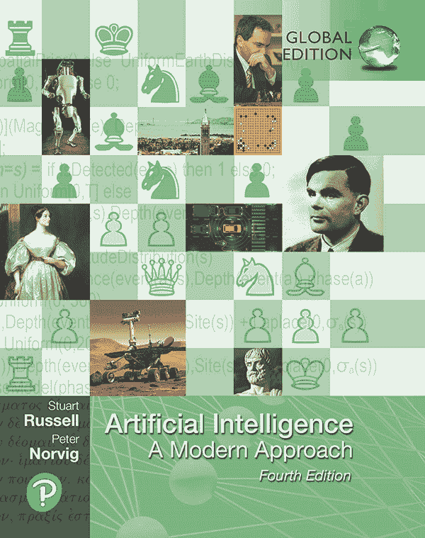


撰稿人：

Ming-Wei Chang

Jacob Devlin

Anca Dragan

David Forsyth

Ian Goodfellow

Jitendra M. Malik

Vikash Mansinghka

Judea Pearl

Michael Wooldridge


献给 Loy，Gordon，Lucy，George 和 Isaac — S.J.R.

献给 Kris，Isabella 和 Juliet — P.N.

## 前言

人工智能（AI）是一个庞大的领域，这也是一本厚重的书籍。我们试图探索该领域的全部广度，其涵盖逻辑、概率和连续数学；感知、推理、学习和行动；公平、信任、社会公益和安全；以及从微电子设备到机器人行星探测器再到拥有数十亿用户的在线服务等应用。

本书的副标题是“现代方法”。这意味着我们选择从当前视角来讲述故事。我们将现有的知识综合到一个共同的框架中，使用当今盛行的思想和术语重新诠释早期的工作。我们对因此变得不太容易辨认的子领域表示歉意。

## 本版新内容

本版反映了自 2010 年上一版以来人工智能的变化：

•我们更侧重于机器学习而非手工知识工程，这是由于数据、计算资源和新算法的可用性增加。

•深度学习、概率编程和多智能体系统获得了扩展的覆盖，每项都有各自的章节。

•自然语言理解、机器人和计算机视觉的覆盖范围已修订，以反映深度学习的影响。

•机器人章节现在包括与人类互动的机器人以及强化学习在机器人中的应用。

•此前我们将人工智能的目标定义为创建试图最大化期望效用的系统，其中具体的效用信息——目标——由系统的设计者提供。现在我们不再假设目标是固定且为人工智能系统所知的；相反，系统可能对其所代表的人类的真实目标不确定。它必须学习要最大化什么，并且即使在对目标不确定的情况下也必须适当运行。

•我们增加了人工智能对社会影响的覆盖，包括伦理、公平、信任和安全等重要问题。

•我们已将练习从每章末尾移至在线网站。这使我们能够持续添加、更新和改进练习，以满足教师的需求并反映该领域以及人工智能相关软件工具的进展。

•总体而言，本书约 25% 的材料是全新的。其余 75% 大多已重写，以呈现该领域更统一的图景。本版中 22% 的引用来自 2010 年后发表的作品。

## 书籍概述

主要的统一主题是智能体的概念。我们将人工智能定义为研究从环境接收感知并执行行动的智能体。每个这样的智能体都实现一个将感知序列映射到行动的函数，我们涵盖了表示这些函数的不同方式，例如反应式智能体、实时规划器、决策理论系统和深度学习系统。我们强调学习既是构建有能力系统的构造方法，也是将设计者的触及范围扩展到未知环境的一种方式。我们将机器人和视觉视为服务于实现目标而存在，而非独立定义的问题。我们强调任务环境在确定适当智能体设计中的重要性。

我们的主要目标是传达过去七十年人工智能研究以及过去两千年相关工作中出现思想。我们在呈现这些思想时力求避免过度形式化，同时保持精确。我们包含了数学公式和伪代码算法以使关键思想具体化；数学概念和记号在 附录 A 中描述，我们的伪代码在 附录 B 中描述。

本书主要用于本科课程或课程序列。本书共有 29 章，每章约需一周的讲课，因此完整阅读需要一个两学期的序列。一个学期的课程可以使用选定的章节以适应教师和学生的兴趣。本书也可用于研究生课程（或许加上参考书目注释中建议的部分原始资料），或用于自学或作为参考。

在整本书中，重要的要点在页边用三角形图标标记。每当定义新术语时，也会在页边注明。对该术语的后续重要使用以粗体显示，但不在页边。我们包含了全面的索引和广泛的参考书目。

<p class="sidebar">术语</p>

唯一的先决条件是对计算机科学的基本概念（算法、数据结构、复杂性）达到大二水平。微积分和线性代数的基础知识对某些主题很有用。

## 在线资源


在线资源可通过 `pearsonglobaleditions.com` 获取。在那里你会找到：

- 练习、编程项目和研究项目。这些不再放在每章末尾；它们仅在线提供。在书中，我们用类似“Exercise 6.NARY”的名称引用在线练习。网站上的说明允许你按名称或按主题查找练习。
- 书中算法在 Python、Java 和其他编程语言中的实现。
- 面向学生和教师的补充材料和链接。
- 关于如何在很可能存在错误的情况下报告书中错误说明。

## 书封面

封面描绘了 1997 年国际象棋比赛中决定性第 6 局的最终局面，当时程序 Deep Blue 战胜了加里·卡斯帕罗夫（执黑），这是计算机首次在国际象棋比赛中击败世界冠军。卡斯帕罗夫显示在顶部。他的右侧是前世界冠军李世石与 DeepMind 的 ALPHAG O 程序之间历史性围棋比赛第二局的一个关键局面。ALPHAG O 的第 37 手违反了数百年的围棋正统，被人类专家立即视为令人尴尬的失误，但最终证明是获胜之手。左上方是波士顿动力公司制造的 Atlas 人形机器人。自动驾驶汽车感知其环境的描绘出现在世界上第一位计算机程序员 Ada Lovelace 与定义了人工智能的基础工作的 Alan Turing 之间。在棋盘底部是火星探测漫游车机器人和亚里士多德的雕像，亚里士多德开创了逻辑学研究；他来自《De Motu Animalium》的规划算法出现在作者姓名后面。棋盘后面是联合国全面禁止核试验条约组织用于从地震信号中探测核爆炸的概率编程模型。

## 致谢

制作一本书需要全球村庄。超过 600 人阅读了书的部分内容并提出了改进建议。完整名单可在 pearsonglobaleditions.com 查看；我们对他们所有人表示感谢。这里我们只能提到少数特别重要的贡献者。首先是撰稿人：

- Judea Pearl（第 13.5 节，因果网络）；
- Michael Wooldridge（第 17 章，多智能体决策）；
- Vikash Mansinghka（第 18.4 节，程序作为概率模型）；
- Ian Goodfellow（第 22 章，深度学习）；
- Jacob Devlin 和 Mei-Wing Chang（第 25 章，自然语言处理的深度学习）；
- Anca Dragan（第 26 章，机器人学）；
- Jitendra Malik 和 David Forsyth（第 27 章，计算机视觉）。

然后是一些关键角色：

- Cynthia Yeung 和 Malika Cantor（项目管理）；
- Julie Sussman 和 Tom Galloway（校对和写作建议）；
- Omari Stephens（插图）；
- Tracy Johnson（编辑）；
- Erin Ault 和 Rose Kernan（封面和色彩转换）；
- Nalin Chhibber、Sam Goto、Raymond de Lacaze、Ravi Mohan、Ciaran O’Reilly、Amit Patel、Dragomir Radiv 和 Samagra Sharma（在线代码开发和指导）；
- Google Summer of Code 学生（在线代码开发）。

Stuart 希望感谢他的妻子 Loy Sheflott 无尽的耐心和无穷的智慧。他希望 Gordon、Lucy、George 和 Isaac 在原谅他长时间工作于此书后，很快就能阅读这本书。RUGS（Russell’s Unusual Group of Students）一如既往地提供了不同寻常的帮助。

Peter 希望感谢他的父母（Torsten 和 Gerda）为他起步，以及他的妻子（Kris）、孩子（Bella 和 Juliet）、同事、上司和朋友在漫长的写作和重写时间里对他的鼓励和容忍。

## 作者简介

Stuart Russell 于 1962 年出生于英格兰朴茨茅斯。他于 1982 年以物理学一级荣誉学士学位毕业于牛津大学，并于 1986 年在斯坦福大学获得计算机科学博士学位。随后他加入加州大学伯克利分校的教职，担任教授和计算机科学系前系主任、人机共存中心主任，并担任 Smith-Zadeh 工程讲席教授。1990 年，他获得美国国家科学基金会总统青年研究员奖，1995 年与他人共同获得 Computers and Thought 奖。他是美国人工智能协会、计算机学会和美国科学促进协会的会士，牛津大学 Wadham 学院荣誉院士，以及 Andrew Carnegie Fellow。他于 2012 年至 2014 年在巴黎担任 Chaire Blaise Pascal。他在人工智能的广泛主题上发表了 300 多篇论文。他的其他著作包括 The Use of Knowledge in Analogy and Induction、Do the Right Thing: Studies in Limited Rationality（与 Eric Wefald 合著）以及 Human Compatible: Artificial Intelligence and the Problem of Control。

Peter Norvig 目前是 Google, Inc. 的研究总监，曾负责核心网络搜索算法的总监。他共同教授了一门在线人工智能课程，报名学生达 160,000 人，帮助开启了当前大规模在线开放课程的浪潮。他曾担任 NASA 阿姆斯研究中心计算科学部主任，监督人工智能和机器人技术的研究与开发。他在布朗大学获得应用数学学士学位，并在伯克利获得计算机科学博士学位。他曾在南加州大学担任教授，并在伯克利和斯坦福担任教职。他是美国人工智能协会、计算机学会、美国文理科学院和加州科学院的会士。他的其他著作是 Paradigms of AI Programming: Case Studies in Common Lisp、Verbmobil: A Translation System for Face-to-Face Dialog 以及 Intelligent Help Systems for UNIX。

两位作者于 2016 年共同获得了首届 AAAI/EAAI 杰出教育者奖。

# 第 1 章

## 引言

在本章中，我们试图解释为什么我们认为人工智能是值得研究的学科，并且试图确定它到底是什么，在开始之前做出这样的决定是件好事。

我们自称智人——智慧的人——因为我们的智能对我们如此重要。数千年来，我们一直在尝试理解我们如何思考和行动——也就是说，我们的大脑，这一点点物质，如何能够感知、理解、预测并操纵一个比它自身大得多、复杂得多的世界。人工智能或 AI 领域关注的不仅是理解，还包括构建智能实体——机器，它们能够计算出如何在各种新颖情境中有效且安全地行动。

<p class="sidebar">智能</p> <p class="sidebar">人工智能</p>

调查 regularly 将 AI 评为最有趣且增长最快的领域之一，其年收入已超过一万亿美元。AI 专家 Kai-Fu Lee 预测其影响将是“超过人类历史上任何事物”。此外，AI 的智力前沿完全开放。相比之下，物理学等老学科的学生可能会觉得最好的想法已经被伽利略、牛顿、居里、爱因斯坦等人发现，而 AI 仍为全职大师们提供了许多机会。

目前 AI 涵盖了大量子领域，从一般性的（学习、推理、感知等等）到具体的，如下棋、证明数学定理、写诗、驾驶汽车或诊断疾病。AI 与任何智力任务相关；它确实是一个通用领域。

## 1.1 什么是 AI？

我们声称 AI 有趣，但尚未说明它是什么。历史上，研究人员追求过几种不同的 AI 版本。有些人将智能定义为对人类表现的忠实度，而另一些人则偏好一个抽象的、正式的智能定义，称为理性——宽泛地说，就是做“正确的事情”。研究对象本身也各不相同：有些人认为智能是内部思维过程和推理的属性，而另一些人则关注智能行为，即外部特征。1

<p class="sidebar">理性</p>

从这两个维度——人类 vs. 理性 2 和 思维 vs. 行为——有四种可能的组合，且四种都有追随者和研究项目。所使用的方法必然不同：追求类人智能在一定程度上必须是与心理学相关的经验科学，涉及对实际人类行为和思维过程的观察和假设；而理性主义方法则涉及数学和工程的结合，并与统计学、控制论和经济学相联系。各个团体既相互贬低也相互帮助。让我们更详细地看看这四种方法。

### 1.1.1 像人类一样行动：图灵测试方法


## 1.1.1.1 图灵测试

图灵测试由艾伦·图灵（1950 年）提出，被设计为一个思想实验，用以回避“机器能思考吗？”这一问题的哲学模糊性。 如果人类审问者在提出一些书面问题后，无法判断书面回答来自人还是来自计算机，则该计算机通过测试。 第 28 章讨论了测试的细节以及计算机通过测试是否真的意味着智能。 目前，我们注意到让计算机通过严格执行的测试提供了充足的研究工作。 计算机需要以下能力：

- 自然语言处理，以便成功地用人类语言进行交流；
- 知识表示，用于存储其所知或所听到的内容；
- 自动化推理，用于回答问题并得出新结论；
- 机器学习，用于适应新情况并检测和外推模式。

图灵认为，物理模拟一个人对于证明智能是不必要的。 然而，其他研究人员提出了总图灵测试，它要求与现实世界中的物体和人进行交互。 要通过总图灵测试，机器人需要

- 计算机视觉和语音识别来感知世界；
- 机器人技术来操纵物体和移动。

这六个学科构成了人工智能的大部分。 然而，人工智能研究人员很少致力于通过图灵测试，认为研究智能的底层原理更为重要。 “人工飞行”的追求在工程师和发明家停止模仿鸟类、开始使用风洞并学习空气动力学时取得了成功。 航空工程文献并未将其实领域的目标定义为制造“飞行得像鸽子一样精确的机器，以至于能欺骗其他鸽子”。

### 1.1.2 像人一样思考：认知建模方法

要说一个程序像人一样思考，我们必须知道人类如何思考。 我们可以通过三种方式了解人类思维：

- 内省——试图捕捉自己一闪而过的想法；
- 心理实验——观察人在行动中的表现；
- 脑成像——观察大脑的活动。

一旦我们拥有足够精确的心智理论，就有可能将该理论表达为计算机程序。 如果程序的输入-输出行为与相应的人类行为相匹配，那就是一些程序机制也可能在人类中运行的证据。

例如，开发了 GPS（通用问题求解器）的艾伦·纽厄尔和赫伯特·西蒙（Newell and Simon, 1961）并不满足于让他们的程序仅仅正确地解决问题。 他们更关心的是将程序推理步骤的顺序和时间与人类受试者解决相同问题的推理步骤进行比较。 认知科学这一跨学科领域将人工智能的计算机模型与心理学实验技术结合起来，以构建精确且可检验的人类心智理论。

认知科学本身就是一个引人入胜的领域，值得几本教科书和至少一部百科全书（Wilson and Keil, 1999）。 我们偶尔会评论人工智能技术与人类认知之间的相似性或差异。 然而，真正的认知科学必然基于对实际人类或动物的实验研究。 我们将把这部分留给其他书籍，因为我们假设读者只有一台计算机用于实验。

在人工智能的早期，方法之间经常存在混淆。 一位作者可能会争辩说，算法在某项任务上表现良好，因此它是人类表现的良好模型，反之亦然。 现代作者将这两种主张分开；这种区分使人工智能和认知科学都能够更快地发展。 这两个领域相互促进，尤其是在计算机视觉中，它将神经生理学证据纳入计算模型。 最近，将神经影像方法与用于分析此类数据的机器学习技术相结合，导致了“读心术”能力的初步形成——即确定一个人内心想法的语义内容。 这种能力反过来可以进一步揭示人类认知的工作方式。

### 1.1.3 像理性一样思考：“思维规律”方法

希腊哲学家亚里士多德是第一个试图将“正确思考”——即不可驳斥的推理过程——系统化的人之一。 他的三段论提供了论证结构的模式，在前提正确时总能得出正确结论。 经典例子以“苏格拉底是人”和“所有人都是会死的”开始，得出“苏格拉底会死”的结论。 （这个例子可能出自塞克斯图斯·恩皮里库斯而非亚里士多德。） 这些思维规律本应支配心智的运作；对其的研究开启了被称为逻辑的领域。

19 世纪的逻辑学家为关于世界中物体及其相互关系的陈述开发了精确的记号。 （这与普通的算术记号形成对比，后者仅提供关于数字的陈述。） 到 1965 年，原则上程序可以解决用逻辑记号描述的任何可解问题。 人工智能中的所谓逻辑主义传统希望在这些程序的基础上构建智能系统。

按传统理解，逻辑需要对世界有确定的知识——而在现实中，这种条件很少能实现。 我们 simply 不知道政治或战争的规则，就像我们知道国际象棋或算术的规则一样。 概率论填补了这一空白，允许对不确定信息进行严格推理。 原则上，它允许构建一个全面的理性思维模型，从原始感知信息到对世界如何运作的理解，再到对未来的预测。 它所不做的是产生智能行为。 为此，我们需要一个理性行动的理论。 理性思维本身是不够的。

### 1.1.4 理性行动：理性主体方法

主体只是一个行动的东西（agent 来自拉丁语 agere，意为“做”）。 当然，所有计算机程序都会做些什么，但计算机主体被期望做更多：自主运行、感知其环境、在较长时间内持续存在、适应变化，并创建和追求目标。 理性主体是指采取行动以实现最佳结果，或在不确定时实现最佳预期结果的主体。

在人工智能的“思维规律”方法中，重点在于正确的推理。 做出正确推理有时是理性主体的组成部分，因为理性行动的一种方式是推导出某项行动是最好的，然后据此行动。 另一方面，存在一些理性行动方式不能说是涉及推理。 例如，缩回被热炉灶烫到的动作是一种反射行为，通常比经过仔细深思后采取的较慢行动更成功。


所有图灵测试所需的技能也能让智能体进行理性行动。知识表示和推理使智能体能够做出良好的决策。我们需要在复杂的社会中生存，因此需要能够生成自然语言中可理解的句子。我们需要学习不仅是为了博学，而且因为它能提高我们在新环境下产生有效行为的能力。

相对于其他方法，理性智能体方法在人工智能中具有两大优势。首先，它比“laws of thought”方法更具一般性，因为正确推理只是实现理性的一种可能机制。其次，它更适合科学发展。理性的标准在数学上定义良好且完全通用。我们通常可以从这一规范出发推导出可证明实现该规范的智能体设计——如果目标是模仿人类行为或思维过程，这在很大程度上是不可能的。

因此，理性智能体方法在该领域的大部分历史中占主导地位。在早期几十年，理性智能体建立在逻辑基础之上，并制定明确计划以实现特定目标。后来，基于概率论和机器学习的方法使得能够在不确定性下做出决策以获得最佳预期结果的智能体的创建成为可能。简而言之，人工智能专注于研究和构建做正确事情的智能体。什么是“正确的事情”由我们提供给智能体的目标定义。这一通用范式如此普遍，以至于我们可以称之为标准模型。它不仅在人工智能中占主导地位，也在控制理论中占主导地位，其中控制器最小化成本函数；在运筹学中，其中策略最大化奖励之和；在统计学中，其中决策规则最小化损失函数；在经济学中，其中决策者最大化效用或某种社会福利度量。

*做正确的事*
*标准模型*

我们需要对标准模型做一个重要的改进，以说明完美理性——总是采取完全最优行动——在复杂环境中是不可行的。计算需求太高了。第 6 章和第 16 章讨论了有限理性问题——在没有足够时间进行所有期望计算时适当行动。然而，完美理性通常仍是理论分析的良好起点。

*有限理性*

### 1.1.5 有益的机器

标准模型自其诞生以来一直是人工智能研究的 useful 指南，但从长远来看它可能不是正确的模型。原因在于标准模型假设我们会为机器提供一个完全指定的目标。

对于国际象棋或最短路径计算等人工定义任务，任务自带目标——因此标准模型适用。然而，当我们进入现实世界时，完全且正确地指定目标变得越来越困难。例如，在设计自动驾驶汽车时，人们可能会认为目标是安全到达目的地。但沿任何道路行驶都会因其他失控驾驶员、设备故障等而带来受伤风险；因此，严格的安全目标要求停留在车库中。在朝着目的地进展和承担受伤风险之间存在权衡。这种权衡应如何进行？此外，我们在多大程度上可以允许汽车采取会惹恼其他驾驶员的行动？汽车应多大程度上调节其加速、转向和制动以避免颠簸乘客？这些问题先验地回答起来很困难。它们在人机交互的一般领域中尤其成问题，而自动驾驶汽车就是其中一个例子。

使我们的真实偏好与我们放入机器中的目标达成一致的问题称为价值对齐问题：放入机器中的价值观或目标必须与人类的价值观保持一致。如果我们在实验室或模拟器中开发人工智能系统——这在该领域的大部分历史中都是如此——对于指定错误的客观目标有一个简单的修复方法：重置系统，修正目标，再试一次。随着该领域向部署在现实世界中越来越有能力的智能系统发展，这种方法不再可行。部署了错误目标的系统将产生负面后果。而且，系统越智能，后果越负面。

*价值对齐问题*

回到看似无问题的国际象棋例子，考虑如果机器足够智能，能够在棋盘之外进行推理和行动会发生什么。在这种情况下，它可能会试图通过诸如催眠或勒索对手，或贿赂观众在其对手思考时制造窸窣声等诡计来增加获胜机会。3 它也可能试图为自己劫持额外的计算能力。这些行为并非“不智能”或“疯狂”；它们是将获胜定义为机器唯一目标的逻辑后果。

无法预见机器追求固定目标时可能出现的各种不当行为。因此，有充分理由认为标准模型是不充分的。我们不想要以追求自身目标为意义的智能机器；我们希望它们追求我们的目标。如果我们无法将这些目标完美地转移到机器上，那么我们需要一种新的表述——机器在追求我们的目标，但必然对其不确定。当机器知道自己不知道完整目标时，它有动机谨慎行动、请求许可、通过观察了解更多关于我们偏好的信息，并服从人类控制。最终，我们希望智能体对人类可证明是有益的。我们将在第 1.5 节中再次讨论这一主题。

*可证明有益*

## 1.2 人工智能的基础

在本节中，我们提供了为人工智能贡献思想、观点和技术的学科的简要历史。像任何历史一样，这一历史集中于少数人物、事件和思想，而忽略了同样重要的其他内容。我们围绕一系列问题组织历史。我们当然不希望给人留下这些问题是学科唯一关注的问题，或学科都以人工智能为最终目标的印象。

### 1.2.1 哲学

- 形式规则能否用于得出有效结论？
- 意识如何从物理大脑中产生？
- 知识从何而来？
- 知识如何导致行动？

亚里士多德（公元前 384–322 年）是第一个制定支配心智理性部分的精确法则集的人。他开发了一种非正式的三段论系统用于正确推理，原则上在给定初始前提的情况下可以机械地生成结论。

拉蒙·柳尔（约 1232–1315）设计了一种推理系统，发表为 Ars Magna 或《大艺术》（1305）。柳尔试图使用实际机械装置实现其系统：一组可以旋转到不同排列的纸轮。


约在 1500 年，莱昂纳多·达·芬奇（1452–1519）设计但未建造一台机械计算器；最近的重建表明该设计是可行的。第一台已知的计算机器约于 1623 年由德国科学家威廉·希克卡德（1592–1635）建造。布莱兹·帕斯卡（1623–1662）于 1642 年制造了帕斯卡计算器，并写道它“产生的效果比所有动物的行为都更接近思想。”戈特弗里德·威廉·莱布尼茨（1646–1716）制造了一种机械装置，旨在对概念而非数字进行运算，但其范围相当有限。在他 1651 年的著作《利维坦》中，托马斯·霍布斯（1588–1679）提出了思考机器的想法，用他的话说就是“人工动物”，并论证道：“心脏不就是一个弹簧吗；神经不就是许多根弦吗；关节不就是许多个轮子吗。”他还认为推理就像数值计算：“因为‘理性’……不过是‘计算’，即加法和减法。”

说心智至少部分按照逻辑或数值规则运作，并构建模拟其中某些规则的物理系统是一回事；说心智本身就是这样一种物理系统则是另一回事。勒内·笛卡尔（1596–1650）首次明确讨论了心灵与物质的区别。他指出，纯粹的物理性心智观似乎为自由意志留下了很少的空间。如果心智完全受物理定律支配，那么它拥有的自由意志与一块石头“决定”向下坠落一样多。笛卡尔是二元论的倡导者。他认为人类心灵（或灵魂或精神）的一部分存在于自然之外，免受物理定律的约束。另一方面，动物并不具备这种二元特性；它们可以被视为机器。

### 二元论

二元论的替代方案是唯物主义，它认为大脑按照物理定律的运作构成了心智。自由意志仅仅是选择主体对可用选择感知的呈现方式。物理主义和自然主义这两个术语也用于描述这种与超自然相对立的观点。

既然有一个操纵知识的物理心智，下一个问题就是确定知识的来源。经验主义运动始于弗朗西斯·培根（1561–1626）的《新工具》4，其特征是约翰·洛克（1632–1704）的一句格言：“理解中没有什么是先前不在感官中的。”

### 经验主义

大卫·休谟（1711–1776）的《人类本性论》（Hume, 1739）提出了现在被称为归纳原理的东西：一般规则是通过对其要素之间重复关联的暴露而获得的。

### 归纳

在路德维希·维特根斯坦（1889–1951）和伯特兰·罗素（1872–1970）的工作基础上，著名的维也纳学派（Sigmund, 2017）——一群在 1920 年代和 1930 年代于维也纳聚会的哲学家和数学家——发展了逻辑实证主义学说。该学说认为，所有的知识都可以用逻辑理论来表征，这些理论最终与对应于感官输入的观察句相连；因此逻辑实证主义结合了理性主义和经验主义。

### 逻辑实证主义
### 观察句

鲁道夫·卡尔纳普（1891–1970）和卡尔·海姆佩尔（1905–1997）的证实理论试图通过量化应赋予逻辑句的信念程度来分析从经验中获取知识，该程度基于它们与证实或反驳它们的观察之间的联系。卡尔纳普的著作《世界的逻辑结构》（1928）或许是第一个将心智视为计算过程的理论。

### 确证理论

心智哲学图景中的最后一个要素是知识与行动之间的联系。这个问题对人工智能至关重要，因为智能需要行动和推理。而且，只有理解行动如何得到正当化，我们才能理解如何构建其行动可正当化（或合理）的智能体。

亚里士多德在《动物运动论》中论证，行动的正当性源于目标与对行动结果的知识之间的逻辑联系：

但为什么思考有时伴随行动，有时不伴随，有时伴随运动，有时不伴随呢？看起来几乎与关于不变对象的推理和推断的情况相同。但在那种情况下，结论是一个思辨命题……而在这里，由两个前提得出的结论是一个行动。……我需要遮盖；斗篷是遮盖物。我需要斗篷。我需要的东西，我必须制作；我需要斗篷。我必须制作斗篷。而结论，“我必须制作斗篷”，就是一个行动。

在《尼各马可伦理学》（第三卷第 3 章，1112b）中，亚里士多德进一步阐述了这一主题，并提出了一种算法：

我们不是对目的进行审慎，而是对手段进行审慎。因为医生不会审慎是否要治愈，演说家也不会审慎是否要说服……他们假定目的并考虑如何以及通过什么手段实现它，如果似乎由此可以容易且最好地实现；而如果只能通过一种手段实现，他们就考虑如何通过这种手段实现，以及通过什么手段实现这种手段，直到他们达到第一因……而在分析顺序中最后的东西似乎在生成顺序中是第一的。如果我们遇到不可能的情况，我们就放弃搜索，例如，如果我们需要钱而这钱得不到；但如果某事似乎可能，我们就尝试去做。

亚里士多德的算法在 2300 年后由 Newell 和 Simon 在其通用问题求解程序中实现。我们现在称之为贪婪回归规划系统（参见第 11 章）。基于逻辑规划以实现明确目标的方法主导了人工智能理论研究的最初几十年。

纯粹以实现目标的行动来思考通常是有用的，但有时并不适用。例如，如果实现目标有几种不同方式，就需要某种方式在它们之间进行选择。更重要的是，可能无法确定地实现目标，但仍必须采取某种行动。那么应该如何决定？安托万·阿尔诺（1662）在分析赌博中理性决策的概念时，提出了最大化结果预期货币价值的定量公式。后来，丹尼尔·伯努利（1738）引入了更一般的效用概念，以捕捉结果的内在、主观价值。现代不确定性下的理性决策概念涉及最大化期望效用，如第 15 章所述。

### 效用

在伦理和公共政策问题上，决策者必须考虑多个个体的利益。杰里米·边沁（1823）和约翰·斯图亚特·密尔（1863）提倡功利主义思想：基于最大化效用的理性决策应适用于人类活动的各个领域，包括代表许多个人做出的公共政策决策。功利主义是一种特定的结果主义：认为什么是对什么是错由行动的预期结果决定。

### 功利主义


与此相反，伊曼努尔·康德于 1785 年提出了一种基于规则或义务论的伦理学理论，其中“doing the right thing”并非由结果决定，而是由规范允许行为的普遍社会法则决定，例如“don’t lie”或“don’t kill”。因此，功利主义者如果预期好的结果超过坏的结果就可以说善意的谎言，但康德主义者则受约束不能这样做，因为撒谎本身就是错误的。密尔承认规则的价值，但将其理解为从关于后果的第一性原理推理中编译而成的有效决策程序。许多现代人工智能系统正是采用这种方法。

> 义务论伦理学

### 1.2.2 数学

- 抽取有效结论的正式规则是什么？
- 什么可以被计算？
- 我们如何对不确定的信息进行推理？

哲学家们奠定了人工智能的一些基本思想，但向正式科学的飞跃需要逻辑和概率的数学化以及一个新的数学分支的引入：计算。

形式逻辑的思想可以追溯到古希腊、印度和中国的哲学家，但其数学发展真正始于乔治·布尔（1815–1864）的研究，他详细阐述了命题逻辑或布尔逻辑（Boole, 1847）的细节。1879 年，戈特洛布·弗雷格（1848–1925）将布尔逻辑扩展到包含对象和关系，创建了今天使用的谓词逻辑。5 除了在人工智能研究的早期阶段发挥核心作用外，一阶逻辑还激发了哥德尔和图灵的工作，而这些工作支撑了计算本身，正如我们下面所解释的那样。

> 形式逻辑

概率论可以被视为将逻辑推广到具有不确定信息的情况——这是对人工智能而言非常重要的问题。杰罗拉莫·卡尔达诺（1501–1576）首次提出了概率的思想，将其描述为赌博事件可能结果的术语。1654 年，布莱兹·帕斯卡（1623–1662）在写给皮埃尔·费马（1601–1665）的信中展示了如何预测未完成的赌博游戏的未来并为赌徒分配平均收益。概率迅速成为定量科学中不可或缺的一部分，有助于处理不确定的测量和不完整的理论。雅各布·伯努利（1654–1705，丹尼尔的叔叔）、皮埃尔·拉普拉斯（1749–1827）等人推进了该理论并引入了新的统计方法。托马斯·贝叶斯（1702–1761）提出了根据新证据更新概率的规则；贝叶斯规则是人工智能系统的关键工具。

> 概率

概率的正式化，加上数据的可用性，导致了统计学作为一个领域的出现。其中最早的应用之一是约翰·格劳恩特于 1662 年对伦敦人口普查数据的分析。罗纳德·费舍尔被认为是第一位现代统计学家（Fisher, 1922）。他将概率、实验设计、数据分析和计算的思想结合起来——1919 年，他坚持说如果没有一台名为 MILLIONAIRE 的机械计算器（第一台能够进行乘法的计算器）就无法开展他的工作，即使该计算器的成本超过了他一年的薪水（Ross, 2012）。

> 统计学

计算的历史与数字的历史一样悠久，但第一个非平凡的算法被认为是用于计算最大公约数的欧几里得算法。单词 algorithm 来源于 9 世纪数学家穆罕默德·伊本·穆萨·阿尔-花拉子米，他的著作还将阿拉伯数字和代数引入欧洲。布尔等人讨论了逻辑推理的算法，到 19 世纪末，人们已着手将一般数学推理形式化为逻辑推理。

> 算法

库尔特·哥德尔（1906–1978）证明存在一种有效程序来证明弗雷格和罗素一阶逻辑中的任何真命题，但一阶逻辑无法捕捉表征自然数所需的数学归纳法原理。1931 年，哥德尔证明了演绎的限制确实存在。他的不完备定理表明，在任何像皮亚诺算术（自然数的基本理论）一样强的形式理论中，必然存在在该理论内部没有证明的真命题。

> 不完备定理

这一基本结果也可以被解释为表明整数上的某些函数无法用算法表示——也就是说，它们无法被计算。这促使阿兰·图灵（1912–1954）试图精确刻画哪些函数是可计算的——能够通过有效程序计算的函数。丘奇-图灵论题提出将可计算性的一般概念与图灵机计算的函数等同起来（Turing, 1936）。图灵还证明了一些函数是没有任何图灵机可以计算的。例如，没有机器可以普遍判断给定的程序在给定输入下是否会返回答案或永远运行下去。

> 可计算性

尽管可计算性对理解计算很重要，但可处理性的概念对人工智能的影响更大。粗略地说，如果解决问题的实例所需时间随实例规模呈指数增长，则该问题被称为不可处理。关于复杂性中多项式增长与指数增长的区别首次在 20 世纪 60 年代中期被强调（Cobham, 1964；Edmonds, 1965）。这很重要，因为指数增长意味着即使是中等规模的实例也无法在合理时间内解决。

> 可处理性

由 Cook（1971）和 Karp（1972）开创的 NP 完全性理论为分析问题的可处理性提供了基础：任何可以归约为 NP 完全问题类的难题类很可能都是不可处理的。（尽管尚未证明 NP 完全问题必然不可处理，但大多数理论家相信这一点。）这些结果与大众媒体对第一台计算机的乐观态度形成鲜明对比——“Electronic Super-Brains” that were “Faster than Einstein!” 尽管计算机速度不断提高，但资源的有效使用和必要的近似将成为智能系统的特征。粗略地说，世界是一个极其庞大的问题实例！

> NP 完全性

### 1.2.3 经济学

- 我们应如何根据自己的偏好做出决策？
- 当他人可能不配合时，我们应如何做到这一点？
- 当收益可能在遥远的未来时，我们应如何做到这一点？

经济学科学起源于 1776 年，当时亚当·斯密（1723–1790）出版了《国富论》。斯密提出将经济分析为由许多关注自身利益的个体代理人组成。然而，斯密并非主张将经济贪婪作为道德立场：他早期的（1759 年）著作《道德情操论》开篇即指出，关心他人的福祉是每个个体利益的重要组成部分。

大多数人认为经济学是关于金钱的，事实上，不确定性下决策的第一个数学分析——阿诺（1662 年）的最大期望值公式——处理的是赌注的货币价值。丹尼尔·伯努利（1738）注意到该公式对于较大金额的金钱，例如海上贸易探险的投资，似乎并不适用。他转而提出基于期望效用最大化的原则，并通过提出随着人们获得更多金钱，额外金钱的边际效用递减来解释人类投资选择。


Léon Walras（发音为“Valrasse”）（1834–1910）为效用理论提供了更一般的奠基，表述为对任何结果（而不仅仅是货币结果）的赌注之间的偏好。该理论由 Ramsey（1931）改进，后来由 John von Neumann 和 Oskar Morgenstern 在其著作《博弈论与经济行为》（1944）中进一步发展。经济学不再是金钱的研究；而是欲望和偏好的研究。

决策理论将概率论与效用论结合起来，为在不确定性下做出的个体决策（经济或其他）提供了一个正式且完整的框架——即概率描述能够恰当地捕捉决策者环境的情形。这适用于“大”经济体，其中每个主体无需关注其他主体作为个体的行动。对于“小”经济体，情况更像是一场博弈：一个参与者的行动会显著影响另一个参与者的效用（无论是积极还是消极）。冯·诺依曼和摩根斯坦对博弈论的发展（另见 Luce 和 Raiffa，1957）包括了一个令人惊讶的结果：对于某些博弈，理性主体应采用随机化（或至少看起来是随机化的）策略。与决策理论不同，博弈论并不提供选择行动的明确处方。在人工智能中，涉及多个主体的决策在多主体系统（第 17 章）的标题下进行研究。

*决策理论*

经济学家，除了少数例外，并未涉及上面列出的第三个问题：当行动的收益不是即时的，而是由一系列连续行动产生时，如何做出理性决策。该主题在运筹学领域得到研究，运筹学在第二次世界大战期间源于英国优化雷达装置的努力，后来在民用领域找到了无数应用。Richard Bellman（1957）的研究形式化了一类序列决策问题，称为马尔可夫决策过程，我们在第 16 章中研究它，并在强化学习的标题下在第 23 章中研究它。

*运筹学*

经济学和运筹学的工作为我们对理性主体的概念做出了很大贡献，然而多年来人工智能研究却沿着完全不同的路径发展。其原因之一是做出理性决策似乎很复杂。开创性的人工智能研究者 Herbert Simon（1916–2001）因其早期工作于 1978 年获得经济学诺贝尔奖，该工作表明基于满意化——做出“足够好”的决策，而非费力地计算最优决策——的模型更好地描述了实际人类行为（Simon，1947）。自 1990 年代以来，对人工智能的决策理论技术重新产生了兴趣。

*满意化*

### 1.2.4 神经科学

### 大脑如何处理信息？

神经科学是对神经系统，特别是大脑的研究。虽然大脑如何使思维成为可能的确切方式是科学的伟大谜团之一，但它确实使思维成为可能这一事实因强烈的头部撞击会导致精神失能的证据而被人们认识了数千年。人们也早就知道人类大脑 somehow 不同；在公元前约 335 年，亚里士多德写道：“在所有动物中，人类的大脑与其体型相比最大。”6 尽管如此，直到 18 世纪中叶，大脑才被广泛认可为意识的所在地。在此之前，候选位置包括心脏和脾脏。

*神经科学*

Paul Broca（1824–1880）于 1861 年对脑损伤患者失语症（言语缺陷）的研究通过识别左半球的一个局部区域——现称为布罗卡区——负责言语产生，从而启动了大脑功能组织的<|message|>


脑机接口（Lebedev and Nicolelis, 2006）的开发用于感知和运动控制不仅有望恢复残疾个体的功能，而且还揭示了神经系统的许多方面。这项工作的一个显著发现是，大脑能够调整自身以成功地与外部设备接口，实际上将其视为另一个感觉器官或肢体。

### 脑–机接口

大脑和数字计算机具有 somewhat 不同的特性。图 1.2 显示计算机的周期时间比大脑快一百万倍。大脑以远超高端个人电脑的存储和互联来弥补这一点，尽管最大规模的超级计算机在某些指标上与大脑相当。未来学家对这些数字大做文章，指出即将到来的奇点，在此奇点中计算机达到超人类水平的性能（Vinge, 1993; Kurzweil, 2005; Doctorow and Stross, 2012），然后迅速进一步自我改进。但原始数字的比较并不特别具有信息量。即使拥有几乎无限容量的计算机，我们仍需要对智能理解的进一步概念性突破（见第 29 章）。粗略地说，没有正确的理论，更快的机器只会更快地给出错误的答案。

### 描述

积木的形状为长方形、棱锥形和方形。显示了一个顶部开口的薄壁透明盒子。最大的长方形和棱锥形积木被放在透明盒子内。一个小方形积木、两个大小相似的积木，以及一个比两个方形积木稍大的长方形积木被放在透明盒子外。一个棱锥形积木放在小方形积木上，另一个棱锥形积木放在两个相似大小的积木之一上。

×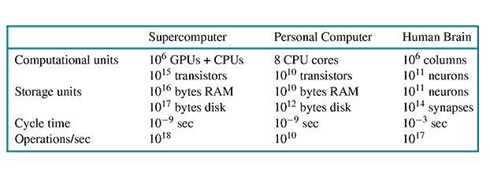

图 1.2 对领先的超级计算机 Summit（Feldman, 2017）、2019 年典型的个人计算机以及人类大脑的粗略比较。人类大脑的功率在数千年中变化不大，而超级计算机已从 1960 年代的兆 FLOPs 提高到 1980 年代的吉 FLOPs，1990 年代的太 FLOPs，2008 年的拍 FLOPs，以及 2018 年的艾 FLOPs（1 艾 FLOPs = 10¹⁸ 次浮点运算每秒）。

### 奇点

### 1.2.5 心理学

### 人类和动物如何思考和行动？

科学心理学的起源通常追溯到德国物理学家 Hermann von Helmholtz（1821–1894）及其学生 Wilhelm Wundt（1832–1920）的研究。Helmholtz 将科学方法应用于人类视觉的研究，他的《生理光学手册》被描述为“关于人类视觉物理学和生理学的最重要论文”（Nalwa, 1993, p.15）。1879 年，Wundt 在莱比锡大学开设了第一个实验心理学实验室。Wundt 坚持进行严格控制的实验，在实验中他的工作人员在进行感知或联想任务的同时对自己的思维过程进行内省。严格的控制在很大程度上使心理学成为一门科学，但数据的主观性使得实验者不太可能证伪自己的理论。

另一方面，研究动物行为的生物学家缺乏内省数据并发展出客观的方法论，正如 H. S. Jennings（1906）在其有影响力著作《低等生物的行为》中所述。将这一观点应用于人类，由 John Watson（1878–1958）领导的行为主义运动以内省无法提供可靠证据为由拒绝任何涉及心理过程的理论。行为主义者坚持只研究动物所接受的感知（或刺激）的客观测量及其由此产生的行为（或反应）。行为主义在老鼠和鸽子方面发现了很多东西，但在理解人类方面却收效甚微。

### 行为主义

认知心理学将大脑视为信息处理装置，可至少追溯到 William James（1842–1910）的著作。Helmholtz 也坚持认为感知涉及一种无意识的逻辑推理。认知观点在美国很大程度上被行为主义所掩盖，但在由 Frederic Bartlett（1886–1969）领导的剑桥应用心理学部门，认知建模得以蓬勃发展。Bartlett 的学生兼继任者 Kenneth Craik（1943）的《解释的本质》有力地重新确立了诸如信念和目标等“心理”术语的合法性，认为它们与使用压力和温度来谈论气体一样科学，尽管气体由既不具有压力也不具有温度的分子组成。

### 认知心理学

Craik 规定了基于知识的智能体的三个关键步骤：（1）刺激必须被转化为内部表征，（2）表征被认知过程操纵以得出新的内部表征，（3）这些表征随后被重新转化为行动。他清楚地解释了为什么这是一种良好的智能体设计：

如果有机体在其头脑中携带外部现实及其自身可能行动的“小规模模型”，它就能尝试各种替代方案，判断哪一个是最好的，在情况出现之前对未来情况做出反应，利用过去事件的知识来处理现在和未来，并在每种情况下以更充分、更安全、更胜任的方式对它所面临的紧急情况做出反应。（Craik, 1943）

Craik 于 1945 年在一次自行车事故中去世后，他的著作由 Donald Broadbent 延续，后者 1958 年的著作《知觉与交流》是首批将心理现象建模为信息处理的工作之一。与此同时，在美国，计算机建模的发展导致了认知科学领域的创建。该领域可以说始于 1956 年 9 月在 MIT 举行的一次研讨会——就在 AI 本身“诞生”的会议之后仅两个月。

在研讨会上，George Miller 介绍了《神奇数字七》，Noam Chomsky 介绍了《语言的三种模型》，Allen Newell 和 Herbert Simon 介绍了《逻辑理论机》。这三篇有影响力的论文展示了计算机模型如何分别用于解决记忆、语言和逻辑思维的心理学问题。现在，心理学家中普遍（尽管远非普遍）的观点是“认知理论应该像计算机程序一样”（Anderson, 1980）；也就是说，它应该以信息处理的方式描述认知功能的运作。

为本次综述的目的，我们将把人机交互（HCI）领域计入心理学。HCI 先驱之一 Doug Engelbart 提倡智能增强——IA 而非 AI 的理念。他认为计算机应该增强人类能力而不是自动化人类任务。1968 年，Engelbart 的“所有演示之母”首次展示了计算机鼠标、窗口系统、超文本和视频会议——所有这些都是为了展示人类知识工作者借助智能增强能够集体完成的工作。

### 智能增强

今天我们更有可能将 IA 和 AI 视为同一枚硬币的两面，前者强调人类控制，后者强调机器的智能行为。两者对于机器对人类有用都是必需的。

### 1.2.6 计算机工程

### 我们如何构建高效的计算机？


现代数字电子计算机由第二次世界大战中交战的三国的科学家们独立且几乎同时发明。第一台实用的计算机是机电式的 Heath Robinson，9 由阿兰·图灵的团队于 1943 年建造，目的仅有一个：破译德国的电报信息。1943 年，同一团队开发了 Colossus，一台基于真空管的强大的通用机器。10 第一台实用的可编程计算机是 Z-3，是德国康拉德·楚泽于 1941 年的发明。楚泽还发明了浮点数和第一种高级编程语言 Plankalkül。第一台电子计算机 ABC 由约翰·阿塔纳索夫及其学生克利福德·贝里于 1940 年至 1942 年间在爱荷华州立大学组装完成。阿塔纳索夫的研究几乎未得到支持或认可；真正被证明为现代计算机最具影响力的先驱的是 ENIAC，该机由宾夕法尼亚大学的一个团队在秘密军事项目中开发，其中包括约翰·莫奇利和 J. 普雷斯珀·埃克特。

自那时以来，每一代计算机硬件都带来了速度和容量的提升以及价格的下降——这一趋势被概括为摩尔定律。性能大约每 18 个月翻一番，直到 2005 年左右，功耗问题导致制造商开始增加 CPU 核心数量而非提高时钟频率。目前的预期是，未来的功能提升将来自大规模并行——这与大脑的特性有着奇妙的趋同。我们还看到新的硬件设计基于这样一个理念：在处理不确定的世界时，我们不需要数字有 64 位的精度；仅 16 位（如 bfloat16 格式）甚至 8 位就足够了，并且能够实现更快的处理。

*摩尔定律*

我们才刚刚开始看到为 AI 应用而优化的硬件，例如图形处理单元（GPU）、张量处理单元（TPU）和晶圆级引擎（WSE）。从 1960 年代到大约 2012 年，用于训练顶尖机器学习应用的计算能力遵循摩尔定律。从 2012 年开始，情况发生了变化：从 2012 年到 2018 年，增长了 30 万倍，相当于大约每 100 天翻一番（Amodei and Hernandez, 2018）。一个在 2014 年需要整整一天训练的机器学习模型，在 2018 年只需两分钟（Ying et al., 2018）。尽管目前还不实用，量子计算为某些重要的 AI 算法子类提供了更大幅度加速的希望。

*量子计算*

当然，在电子计算机之前已有计算设备。最早的自动化机器可追溯至 17 世纪，已在 第 24 页 讨论过。第一台可编程机器是一台织布机，由约瑟夫·玛丽·贾卡尔（1752–1834）于 1805 年设计，使用穿孔卡来存储编织图案的指令。

在 19 世纪中期，查尔斯·巴贝奇（1792–1871）设计了两台计算机器，但均未完成。差分机旨在为工程和科学项目计算数学表。它最终在 1991 年被建造并证明可行（Swade, 2000）。巴贝奇的分析机野心更大：它包括可寻址存储器、基于贾卡尔穿孔卡的存储程序以及条件跳转。它是第一台能够进行通用计算的机器。

巴贝奇的同事艾达·洛夫莱斯，诗人拜伦勋爵的女儿，理解了它的潜力，将其描述为“a to changes in the environment. 其他自调节反馈控制系统的例子包括由詹姆斯·瓦特（1736–1819）创建的蒸汽机调速器，以及由康奈利斯·德雷贝尔（1572–1633）发明的恒温器，他还发明了潜艇。詹姆斯·克拉克·麦克斯韦（1868）开创了控制系统的数学理论。

控制论战后发展中的核心人物是诺伯特·维纳（1894–1964）。维纳是一位杰出的数学家，曾与伯特兰·罗素等人合作，后来对生物和机械控制系统及其与认知的联系产生了兴趣。如同 Craik（他也将控制系统用作心理模型）一样，维纳及其同事阿图罗·罗森布鲁斯和朱利安·比格洛挑战了行为主义正统（Rosenblueth et al., 1943）。他们认为目的性行为源于一种试图最小化“误差”的调节机制——即当前状态与目标状态之间的差异。在 1940 年代末，维纳与沃伦·麦卡洛克、沃尔特·皮茨和约翰·冯·诺伊曼一起组织了一系列有影响力的会议，探讨新的数学和计算认知模型。维纳的著作《Cybernetics》（1948）成为畅销书，唤醒了公众对人工智能机器的可能性。

*控制论*
*赛博学*

与此同时，在英国，W. 罗斯·阿什比开创了类似的思想（Ashby, 1940）。阿什比、阿兰·图灵、格雷·沃尔特等人成立了 Ratio Club，面向“在维纳的书出版前就已拥有维纳思想的人”。阿什比的《Design for a Brain》（1948, 1952）阐述了他的观点，即智力可以通过使用包含适当反馈回路的稳态装置来创造，以实现稳定的适应性行为。

*稳态*

现代控制论，尤其是被称为随机最优控制的分支，其目标是设计随时间最小化代价函数的系统。这大致与 AI 的标准模型相符：设计行为最优的系统。那么，为什么 AI 和控制论是两个不同的领域，尽管它们的创始人之间联系紧密？答案在于参与者熟悉的数学技术与其各自世界观所涵盖的相应问题集合之间的紧密耦合。微积分和矩阵代数是控制论的工具，适用于可以用固定连续变量集合描述的系统，而 AI 部分地建立起来是为了摆脱这些 perceived 限制。逻辑推理和计算的工具使 AI 研究人员能够考虑诸如语言、视觉和符号规划等问题，这些问题完全超出了控制论学者的视野。

*代价函数*

### 1.2.7 语言学

### 语言如何与思想相关？


1957 年，B. F. Skinner 出版了《Verbal Behavior》（《言语行为》）。这是由该领域最权威的专家撰写的关于行为主义语言学习方法的全面、详细的论述。但颇具讽刺意味的是，对该书的评论变得与书本身一样著名，并几乎扼杀了人们对行为主义的兴趣。评论的作者是语言学家 Noam Chomsky，他刚刚出版了关于自己理论的著作《Syntactic Structures》（《句法结构》）。Chomsky 指出，行为主义理论并未涉及语言创造性的概念——它无法解释儿童如何理解并创造出他们从未听过的句子。Chomsky 的理论——基于可追溯到印度语言学家 Panini（约公元前 350 年）的句法模型——能够解释这一点，而且与之前的理论不同，它足够形式化，原则上可以被编程。

因此，现代语言学和人工智能“诞生”于大约同一时期，并共同成长，在一个被称为计算语言学或自然语言处理的混合领域相交。理解语言的问题最终证明比 1957 年看起来要复杂得多。理解语言需要对主题和上下文的理解，而不仅仅是对句子结构的理解。这似乎显而易见，但在 1960 年代之前并未得到广泛认可。早期关于知识表示（研究如何将知识置于计算机能够推理的形式中）的大量工作与语言相关，并受到了语言学研究的启发，而语言学研究又与数十年的语言哲学分析工作相联系。

计算语言学

## 1.3 人工智能的历史

总结人工智能历史里程碑的一个简便方法是列出图灵奖获得者：Marvin Minsky（1969 年）和 John McCarthy（1971 年）因基于表征和推理定义该领域的基础；Allen Newell 和 Herbert Simon（1975 年）因符号化的问题求解和人类认知模型；Ed Feigenbaum 和 Raj Reddy（1994 年）因开发编码人类知识以解决现实世界问题的专家系统；Judea Pearl（2011 年）因开发以原则性方式处理不确定性的概率推理技术；最后是 Yoshua Bengio、Geoffrey Hinton 和 Yann LeCun（2019 年）因使“深度学习”（多层神经网络）成为现代计算的关键部分。本节其余部分将更详细地介绍人工智能历史的每个阶段。

### 1.3.1 人工智能的萌芽（1943–1956）

现在普遍被认为是人工智能的第一个工作由 Warren McCulloch 和 Walter Pitts 于 1943 年完成。在受其导师 Nicolas Rashevsky（1936、1938 年）的数学建模工作的启发下，他们借鉴了三个来源：对大脑中神经元基本生理和功能的了解；Russell 和 Whitehead 提出的命题逻辑的正式分析；以及 Turing 的计算理论。他们提出了一种人工神经元模型，其中每个神经元被表征为“开”或“关”，当受到足够数量的邻近神经元刺激时切换为“开”。神经元的状态被设想为“事实上等同于提出其充分刺激的命题”。例如，他们证明了任何可计算函数都可以通过某个连接神经元网络来计算，并且所有逻辑连接词（`AND`、`OR`、`NOT` 等）都可以通过简单的网络结构实现。McCulloch 和 Pitts 还提出，适当定义的网络可以学习。Donald Hebb（1949 年）展示了一种修改神经元之间连接强度的简单更新规则。该规则现被称为 Hebbian learning，至今仍是一个有影响力的模型。

赫布学习

哈佛的两名本科生 Marvin Minsky（1927–2016）和 Dean Edmonds 于 1950 年建造了第一台神经网络计算机。名为 SNARC 的机器使用了 3000 个真空管和一架 B-24 炸弹机上剩余的自动驾驶机构来模拟一个由 40 个神经元组成的网络。后来在普林斯顿，Minsky 研究了神经网络中的通用计算。他的博士委员会对这种工作是否应被视为数学表示怀疑，但据报道 von Neumann 说：“如果现在不是，将来会是。”

还有许多其他可以归类为人工智能的早期工作示例，包括 Christopher Strachey 于 1952 年在曼彻斯特大学和 Arthur Samuel 在 IBM 独立开发的两个跳棋程序。然而，Alan Turing 的愿景最具影响力。他早在 1947 年就在伦敦数学学会发表了相关讲座，并在 1950 年的文章《Computing Machinery and Intelligence》中阐述了一个令人信服的议程。在其中，他提出了图灵测试、机器学习、遗传算法和强化学习。他处理了许多对人工智能可能性提出的反对意见，如所述 in 第 28 章。他还建议，通过开发学习算法然后训练机器来创建人类水平的人工智能，比手工编程其智能更容易。在随后的讲座中，他警告说实现这一目标可能不是人类最好的事情。

1955 年，达特茅斯学院的 John McCarthy 说服了 Minsky、Claude Shannon 和 Nathaniel Rochester 帮助他召集对自动机理论、神经网络和智能研究感兴趣的美国研究人员。他们在 1956 年夏季于达特茅斯组织了一次为期两个月的研讨会。共有 10 名与会者，包括来自 Carnegie Tech 的 Allen Newell 和 Herbert Simon11，来自普林斯顿的 Trenchard More，来自 IBM 的 Arthur Samuel，以及来自 MIT 的 Ray Solomonoff 和 Oliver Selfridge。提案写道：12

我们建议在 1956 年夏季于新罕布什尔州汉诺威的达特茅斯学院开展一项为期 2 个月、10 人的关于人工智能的研究。该研究将基于这样一个猜想：学习或智能的任何其他特征在原则上都可以被如此精确地描述，以至于可以制造一台机器来模拟它。我们将尝试找出如何使机器使用语言、形成抽象和概念、解决目前保留给人类的各种问题并自我改进。我们认为，如果一群精心挑选的科学家共同工作一个夏天，就可以在这些问题中的一个或多个方面取得重大进展。

尽管有这种乐观的预测，达特茅斯研讨会并未取得任何突破。Newell 和 Simon 展示了也许是最成熟的工作，一个名为 Logic Theorist（LT）的数学定理证明系统。Simon 声称，“我们发明了一个能够非数值思考的计算机程序，从而解决了古老的心身问题。”13 研讨会后不久，该程序能够证明 Russell 和 Whitehead 的《Principia Mathematica》中第 2 章的绝大多数定理。据报道，当被告知 LT 为一个定理提出了一个比《Principia》中更短的证明时，Russell 感到非常高兴。《Journal of Symbolic Logic》的编辑们则不太 impressed；他们拒绝了一篇由 Newell、Simon 和 Logic Theorist 合著的论文。

### 1.3.2 早期热情，美好期望（1952–1969）


1950 年代的学术界在很大程度上更愿意相信“机器永远不可能做 X”。（参见 第 28 章 中图灵整理的 X 的长名单。）人工智能研究人员自然通过逐一展示 X 来作出回应。他们特别关注被认为体现人类智能的任务，包括游戏、谜题、数学和智力测试。约翰·麦卡锡将这一时期称为“看，妈，我不用手！”时代。

Newell 和 Simon 在 `LT` 取得成功后，接着提出了 `General Problem Solver`，即 `GPS`。与 `LT` 不同，该程序从一开始就被设计为模仿人类的问题解决协议。在它能够处理的有限类谜题中，事实证明程序考虑子目标和可能行动的顺序与人类处理相同问题时的顺序相似。因此，`GPS` 很可能是第一个体现“像人类一样思考”方法的程序。`GPS` 以及后续程序作为认知模型的成功促使 Newell 和 Simon（1976）提出了著名的物理符号系统假说，其表述为“物理符号系统具有进行一般智能行动的必要且充分的手段”。他们的意思是，任何表现出智能的系统（人类或机器）都必须通过操作由符号组成的数据结构来运作。我们稍后会看到，这一假说已从多个方向受到挑战。

物理符号系统

在 IBM，Nathaniel Rochester 及其同事制作了一些最早的人工智能程序。Herbert Gelernter（1959）构建了几何定理证明器，它能够证明许多数学学生会觉得相当棘手的定理。这项工作是现代数学定理证明器的前身。

在这一时期所做的一切探索性工作中，或许从长远来看最具影响力的是 Arthur Samuel 关于跳棋（英式西洋棋）的研究。使用我们现在称之为强化学习的方法（参见 第 23 章），Samuel 的程序学会了以很强的业余水平下棋。他从而推翻了计算机只能做被告知的事情的想法：他的程序很快学会了比其创造者下得更好的游戏。该程序于 1956 年在电视上演示，留下了深刻印象。像图灵一样，Samuel 也难以获得计算机使用时间。他在夜间工作，使用的是仍在 IBM 制造厂测试车间里的机器。Samuel 的程序是后来系统如 `TD-GAMMON`（Tesauro，1992）的先驱，该系统是世界上最好的双陆棋玩家之一，以及 `ALPHAGO`（Silver 等，2016），它震惊世界击败了人类围棋世界冠军（参见 第 6 章）。

1958 年，John McCarthy 对人工智能做出了两项重要贡献。在 MIT AI Lab Memo No. 1 中，他定义了高级语言 `Lisp`，该语言将在未来 30 年成为主导的人工智能编程语言。在题为《具有常识的程序》的论文中，他提出了基于知识和推理的人工智能系统的概念性提案。论文描述了 `Advice Taker`，一个假设的程序，它将体现对世界的一般知识并能够利用它推导出行动计划。该概念通过简单的逻辑公理来说明，这些公理足以生成前往机场的驾驶计划。该程序还被设计为在正常运行过程中接受新公理，从而使其能够在无需重新编程的情况下在新领域取得能力。`Advice Taker` 因此体现了知识表示和推理的核心原则：拥有对世界及其运作的正式、明确的表示是有用的，并且能够用演绎过程操纵该表示。论文影响了人工智能的发展方向，至今仍具有相关性。

Lisp

1958 年也是 Marvin Minsky 搬到 MIT 的一年。然而，他与 McCarthy 的最初合作并未持续。McCarthy 强调形式逻辑中的表示和推理，而 Minsky 更感兴趣于让程序运行起来，并最终发展出反逻辑的观点。1963 年，McCarthy 在斯坦福创办了人工智能实验室。他利用逻辑构建终极 `Advice Taker` 的计划得到了 J. A. Robinson 于 1965 年发现的归结方法（一种用于一阶逻辑的完备定理证明算法；参见 第 9 章）的推进。斯坦福的工作强调逻辑推理的通用方法。逻辑的应用包括 Cordell Green 的问答和规划系统（Green，1969b）以及斯坦福研究学院（SRI）的 Shakey 机器人项目。后者项目在 第 26 章 中进一步讨论，是首次展示逻辑推理与物理活动完全集成的项目。

在 MIT，Minsky 指导了一系列选择看似需要智能才能解决的有限问题的学生。这些有限的领域后来被称为微世界。James Slagle 的 `SAINT` 程序（1963）能够解决典型的大学一年级课程中的封闭形式微积分积分问题。Tom Evans 的 `ANALOGY` 程序（1968）解决了智力测试中出现的几何类比问题。Daniel Bobrow 的 `STUDENT` 程序（1967）解决了代数应用题，例如以下问题：

微世界

如果 Tom 获得的客户数量是他投放广告数量的 20% 的平方的两倍，而他投放的广告数量为 45，那么 Tom 获得的客户数量是多少？

最著名的微世界是积木世界，它由一组放置在桌面上（或更常见的是桌面的模拟）的实心积木组成，如 图 1.3 所示。该世界中的典型任务是以某种方式重新排列积木，使用只能一次拾取一块积木的机器人手臂。积木世界是 David Huffman（1971）的视觉项目、David Waltz（1975）的视觉和约束传播工作、Patrick Winston（1970）的学习理论、Terry Winograd（1972）的自然语言理解程序以及 Scott Fahlman（1974）的规划器的所在地。


图 1.3 积木世界的场景。`SHRDLU`（Winograd，1972）刚刚完成了命令“找到一个比你手上拿着的更高的积木并把它放到盒子里。”

积木世界

基于 McCulloch 和 Pitts 的神经网络的早期工作也蓬勃发展。Shmuel Winograd 和 Jack Cowan（1963）的工作展示了大量元素如何共同表示一个单独的概念，同时带来鲁棒性和并行性的相应提高。Hebb 的学习方法得到了 Bernie Widrow（Widrow 和 Hoff，1960；Widrow，1962）的改进，他称其网络为 `adalines`，以及 Frank Rosenblatt（1962）及其 `perceptrons` 的改进。感知机收敛定理（Block 等，1962）指出，学习算法可以调整感知机的连接强度以匹配任何输入数据，前提是存在这样的匹配。

### 1.3.3 一剂现实（1966–1973）

从一开始，人工智能研究人员在预测即将到来的成功时毫不羞怯。Herbert Simon 于 1957 年的以下陈述经常被引用：

我的目的不是让你惊讶或震惊——但我能总结的最简单方式就是说，现在世界上已经存在能够思考、学习和创造的机器。而且，它们执行这些事情的能力将迅速增长，直到——在可见的未来——它们能够处理的问题的范围将与人类思维所应用的范围相一致。


术语“可见的未来”很模糊，但西蒙也做出了更具体的预测：10 年内计算机将成为国际象棋冠军，并且会有重要的数学定理被机器证明。这些预测在 40 年内而非 10 年内成为现实（或大致成真）。西蒙的过度自信源于早期人工智能系统在简单示例上的令人乐观的表现。然而，在几乎所有情况下，这些早期系统在更困难的问题上都失败了。

失败主要有两个原因。第一个原因是许多早期人工智能系统主要基于对人类如何执行任务的“知情内省”，而不是对任务本身的仔细分析、对什么是解决方案的定义，以及算法需要做什么才能可靠地产生此类解决方案。

失败的第二个原因是缺乏对人工智能试图解决的许多问题的不可处理性的认识。早期的绝大多数问题求解系统都是通过尝试不同步骤的组合直到找到解决方案来工作的。这种策略起初有效，因为微世界包含的物体非常少，因此可能的操作也很少，解决方案序列也很短。在计算复杂性理论发展之前，人们普遍认为“扩展”到更大问题只是更快硬件和更大内存的问题。例如，伴随分辨率定理证明发展的乐观情绪很快就被削弱了，因为研究人员未能证明涉及几十个以上事实的定理。程序原则上能够找到解决方案，并不意味着该程序包含在实践中找到解决方案所需的任何机制。

对无限计算能力的幻觉并不局限于问题求解程序。机器进化（现称为遗传编程）的早期实验（Friedberg, 1958; Friedberg et al., 1959）基于一个无疑正确的信念，即通过对机器代码程序进行一系列适当的微小突变，可以为任何特定任务生成性能良好的程序。于是，想法是尝试随机突变，并通过选择过程保留似乎有用的突变。尽管花费了数千小时的 CPU 时间，几乎没有取得进展。

*Machine evolution*

未能应对“组合爆炸”是人工智能的主要批评之一，见于 Lighthill 报告（Lighthill, 1973），该报告构成了英国政府决定在除两所大学之外的所有大学终止对人工智能研究支持的基础。（口头传统则描绘出一种有所不同且更生动的图景，其中包含政治野心和个人恩怨，其描述与此无关。）

第三个困难源于用于生成智能行为的基本结构的一些根本性限制。例如，Minsky 和 Papert 的著作 Perceptrons（1969）证明了，虽然感知器（一种简单的神经网络形式）可以被证明能够学习它们能够表示的任何东西，但它们能够表示的东西非常少。特别是，双输入感知器无法被训练来识别其两个输入是否不同。虽然他们的结果不适用于更复杂的多层网络，但神经网络研究的资金很快减少到几乎为零。具有讽刺意味的是，那些将在 1980 年代后期以及 2010 年代再次引发神经网络研究巨大复兴的新反向传播学习算法，早在 1960 年代初期就在其他背景下被开发出来了（Kelley, 1960; Bryson, 1962）。

### 1.3.4 专家系统 (1969–1986)

在人工智能研究的第一个十年中出现的问题求解图景是，一种通用搜索机制试图将基本推理步骤串联起来以找到完整解决方案。这类方法被称为弱方法，因为虽然通用，但它们无法扩展到大型或困难的问题实例。弱方法的替代方案是使用更强大、特定领域的知识，允许更大的推理步骤，并且能够更轻松地处理狭窄专业领域中通常出现的情况。可以说，要解决一个难题，你必须几乎已经知道答案。

*Weak method*

DENDRAL 程序（Buchanan et al., 1969）是这种方法的早期例子。它在斯坦福大学开发，Ed Feigenbaum（赫伯特·西蒙的前学生）、Bruce Buchanan（从哲学家转为计算机科学家）和 Joshua Lederberg（诺贝尔奖得主遗传学家）联手解决从质谱仪提供的信息推断分子结构的问题。该程序的输入包括分子的元素式（例如，`C6H13NO2`）和质谱，给出了分子被电子束轰击时产生的各种碎片的质量。例如，质谱可能在 `m = 15` 处包含一个峰，对应于甲基（`CH3`）碎片的质量。

该程序的朴素版本生成与公式一致的所有可能结构，然后预测对每个结构会观察到什么质谱，并将其与实际光谱进行比较。正如人们所期望的那样，即使对于中等大小的分子，这也是不可处理的。DENDRAL 研究人员咨询了分析化学家，发现他们是通过寻找光谱中表明分子中存在常见子结构的众所周知的峰模式来工作的。例如，以下规则用于识别酮（`C=O`）亚基（重量为 28）：

```
if M is the mass of the whole molecule and there are two peaks at x1 and x2 such that (a) x1 + x2 = M + 28; (b) x1 – 28 is a high peak; (c) x2 – 28 is a high peak; and (d) At least one of x1 and x2 is high then there is a ketone subgroup.
```

认识到分子包含特定的子结构会极大地减少可能候选的数量。据其作者称，DENDRAL 强大的原因在于它以高效的“菜谱式配方”而非第一性原理的形式体现了质谱分析的相关知识（Feigenbaum et al., 1971）。DENDRAL 的意义在于它是第一个成功的知识密集型系统：其专业知识源于大量特殊用途规则。1971 年，Feigenbaum 和斯坦福的其他人开始了启发式编程项目（HPP），以研究专家系统的新方法论在其他领域的应用程度。

*Expert systems*

下一个主要工作是用于诊断血液感染的 MYCIN 系统。凭借约 450 条规则，MYCIN 的表现与一些专家相当，明显优于初级医生。它还与 DENDRAL 有两个主要区别。首先，与 DENDRAL 规则不同，没有一般的理论模型可以从中推导出 MYCIN 规则。它们必须通过对专家的广泛访谈获得。其次，规则必须反映与医学知识相关的不确定性。MYCIN 结合了一种称为确定性因子的不确定性演算（参见 第 13 章），这在当时似乎很好地契合了医生评估证据对诊断影响的方式。

*Certainty factor*

第一个成功的商业专家系统 R1 开始在数字设备公司运行（McDermott, 1982）。该程序帮助配置新计算机系统的订单；到 1986 年，它每年为公司节省估计 4000 万美元。到 1988 年，DEC 的人工智能部门已部署了 40 个专家系统，还有更多正在进行。杜邦使用 100 个，开发中 500 个。几乎每家美国主要公司都有自己的 AI 部门，并正在使用或调查专家系统。


领域知识的重要性在自然语言理解领域也显而易见。尽管 Winograd 的 SHRDLU 系统取得了成功，但其方法并不能扩展到更一般的任务：对于诸如歧义消解之类的问题，它使用的是依赖于积木世界狭小范围的简单规则。

多位研究人员，包括麻省理工学院的 Eugene Charniak 和耶鲁大学的 Roger Schank，认为稳健的语言理解需要关于世界的一般知识以及使用该知识的一般方法。（Schank 更进一步，声称“根本不存在语法”，这让许多语言学家感到不满，但确实引发了有益的讨论。）Schank 及其学生构建了一系列程序（Schank and Abelson, 1977; Wilensky, 1978; Schank and Riesbeck, 1981），它们都承担着理解自然语言的任务。然而，重点较少放在语言本身，而更多放在代表和推理语言理解所需的知识的问题上。

应用向现实世界问题广泛增长导致了各种表示和推理工具的发展。其中一些基于逻辑——例如，`Prolog` 语言在欧洲和日本变得流行，而 `PLANNER` 家族在美国流行。其他人则遵循 Minsky 的框架思想（1975），采用了更结构化的方法，汇集关于特定对象和事件类型的事实，并将这些类型排列成类似于生物分类法的庞大分类层级。

*Frames*

1981 年，日本政府宣布了“第五代”项目，一个为期 10 年的计划，旨在构建运行 `Prolog` 的大规模并行智能计算机。预算预计超过今天的 $1.3 billion。作为回应，美国成立了微电子和计算机技术公司（`MCC`），一个旨在确保国家竞争力的联盟。在这两种情况下，AI 都是包括芯片设计和人机界面研究在内的广泛努力的一部分。在英国，Alvey 报告恢复了 Lighthill 报告削减的资金。然而，这些项目都没有在新的 AI 能力或经济影响方面实现其雄心勃勃的目标。

总体而言，人工智能产业从 1980 年的数百万美元蓬勃发展到 1988 年的数十亿美元，包括数百家公司构建专家系统、视觉系统、机器人以及为这些目的专门化的软件和硬件。

随后不久出现了被称为“人工智能寒冬”的时期，许多公司因未能兑现夸张的承诺而倒闭。事实证明，为复杂领域构建和维护专家系统是困难的，部分原因是系统使用的推理方法在面对不确定性时失效，部分原因是系统无法从经验中学习。

### 1.3.5 神经网络的回归（1986–至今）

20 世纪 80 年代中期，至少有四个不同的研究小组重新发明了 `back-propagation` 学习算法，该算法最早于 20 世纪 60 年代初开发。该算法被应用于计算机科学和心理学中的许多学习问题，而《Parallel Distributed Processing》（Rumelhart and McClelland, 1986）文集中结果的广泛传播引起了极大的兴奋。

这些所谓的联结主义模型被一些人视为直接竞争对手，既与 Newell 和 Simon 推广的符号模型竞争，也与 McCarthy 等人的逻辑主义方法竞争。似乎显而易见的是，在某种程度上人类操纵符号——事实上，人类学家 Terrence Deacon 的著作《The Symbolic Species》（1997）认为这是人类的决定性特征。反对这一点，Geoff Hinton——20 世纪 80 年代和 2010 年代神经网络复兴的领军人物——将符号描述为人工智能的“光以太”——指的是许多 19 世纪物理学家认为电磁波传播的并不存在的介质。当然，我们在语言中命名的许多概念，经仔细检查后，缺乏早期人工智能研究人员希望以公理形式捕捉的那种逻辑定义的必要和充分条件。可能是联结主义模型以更流畅和不精确的方式形成内部概念，更适合现实世界的混乱。它们还具有从示例中学习的能力——它们可以将问题上的预测输出值与真实值进行比较并修改其参数以减小差异，从而更有可能在未来的示例中表现良好。

*Connectionist*

### 1.3.6 概率推理与机器学习（1987–至今）

专家系统的脆弱性导致了一种新的、更科学的方法，采用概率而非布尔逻辑，采用机器学习而非手工编码，采用实验结果而非哲学主张。14 建立在现有理论之上比提出全新理论变得更常见，基于严格定理或可靠的实验方法（Cohen, 1995）而非直觉来支持主张，并展示对现实世界应用的相关性而非玩具示例变得更常见。

共享基准问题集成为展示进展的规范，包括用于机器学习数据集的 UC Irvine 仓库、用于规划算法的国际规划竞赛、用于语音识别的 LibriSpeech 语料库、用于手写数字识别的 MNIST 数据集、用于图像目标识别的 ImageNet 和 COCO、用于自然语言问答的 SQUAD、用于机器翻译的 WMT 竞赛，以及用于布尔可满足性求解器的国际 SAT 竞赛。

AI 部分是作为对控制理论和统计学等现有领域局限性的反叛而创立的，但在这一时期它拥抱了这些领域的积极成果。正如 David McAllester（1998）所说：

在人工智能的早期阶段，似乎很合理地认为新的符号计算形式，例如框架和语义网络，使经典理论的很大一部分过时了。这导致了一种孤立主义，人工智能在很大程度上与计算机科学的其他部分分离。这种孤立主义目前正在被放弃。人们认识到机器学习不应与信息论隔离，不确定推理不应与随机建模隔离，搜索不应与经典优化和控制隔离，自动化推理不应与形式方法和静态分析隔离。

语音识别领域说明了这一模式。在 1970 年代，尝试了各种不同的架构和方法。其中许多是相当临时且脆弱的，并且只适用于少数精心挑选的示例。在 1980 年代，使用隐马尔可夫模型（`HMMs`）的方法开始主导该领域。`HMMs` 的两个方面是相关的。首先，它们基于严格的数学理论。这使得语音研究人员能够在其他领域开发的数十年数学成果之上构建。其次，它们是通过在大量真实语音数据上训练的过程生成的。这确保了性能的稳健性，并且在严格的盲测中 `HMMs` 的得分稳步提高。因此，语音技术和相关的手写字符识别领域实现了向广泛的工业和消费应用的转变。注意，并没有科学主张人类使用 `HMMs` 来识别语音；相反，`HMMs` 提供了理解和解决问题的数学框架。我们将在 第 1.3.8 节 中看到，然而，深度学习在很大程度上扰乱了这种舒适的叙述。

*Hidden Markov models*


1988 年是人工智能与其它领域（包括统计学、运筹学、决策理论和控制理论）联系的重要一年。Judea Pearl 1988 年的《智能系统中的概率推理》（Probabilistic Reasoning in Intelligent Systems）推动了概率和决策理论在人工智能中的新接受。Pearl 对 `Bayesian networks` 的发展提出了表示不确定知识的严谨高效形式化方法，以及用于概率推理的实用算法。第 12 章、第 13 章、第 14 章、第 15 章 和 第 18 章 涵盖了这一领域，以及近期极大提升了概率形式化表达能力的进展；第 21 章 描述了从数据中学习 `Bayesian networks` 及相关模型的方法。

`Bayesian network`

1988 年的第二个重要贡献是 Rich Sutton 的工作，他将强化学习——该方法在 20 世纪 50 年代曾用于 Arthur Samuel 的跳棋程序——与运筹学领域发展的马尔可夫决策过程（`MDPs`）理论联系起来。随后涌现大量工作将人工智能规划研究与 `MDPs` 联系起来，强化学习领域在机器人和过程控制中找到了应用，同时也获得了深厚的理论基础。

人工智能对数据、统计建模、优化和机器学习的重新重视的一个后果是，计算机视觉、机器人、语音识别、多智能体系统和自然语言处理等曾与核心人工智能 somewhat 分离的子领域逐渐重新统一。重新整合的过程在应用方面（例如，实用机器人的部署在此期间大幅扩展）和对人工智能核心问题的更好理论理解方面都带来了显著益处。

### 1.3.7 大数据（2001–至今）

计算能力的显著进步和万维网的创建促进了非常大的数据集的产生——这一现象有时被称为大数据。这些数据集包括数万亿词的文本、数十亿张图像和数十亿小时的语音和视频，以及大量的基因组数据、车辆跟踪数据、点击流数据、社交网络数据等等。

`Big data`

这推动了专门为利用非常大的数据集而设计的学习算法的发展。通常，这类数据集中绝大多数示例都是未标记的；例如，在 Yarowsky 1995 年关于词义消歧的开创性工作中，像 “plant” 这样的词的出现并未在数据集中标记以表明其指的是植物还是工厂。然而，只要数据集足够大，合适的学习算法在识别句子中意图的词义这一任务上可以达到超过 96% 的准确率。此外，Banko 和 Brill（2001）认为，通过将数据集规模扩大两个或三个数量级所获得的性能提升，超过了通过调整算法所能获得的任何改进。

类似的现象似乎也出现在计算机视觉任务中，例如填补照片中的空洞——这些空洞可能是由损坏或移除前朋友造成的。Hays 和 Efros（2007）通过混合相似图像中的像素开发了一种巧妙的方法来完成此操作；他们发现该技术在仅有数千张图像的数据库中效果不佳，但在数百万张图像时跨越了质量阈值。不久之后，`ImageNet` 数据库（Deng 等，2009）中数千万张图像的可用性引发了计算机视觉领域的革命。

大数据的可用性和向机器学习的转变帮助人工智能恢复了商业吸引力（Havenstein，2005；Halevy 等，2009）。大数据是 IBM Watson 系统于 2011 年在 Jeopardy! 问答游戏中击败人类冠军的关键因素，这一事件对公众对人工智能的认知产生了重大影响。

### 1.3.8 深度学习（2011–至今）

术语深度学习指的是使用多层简单可调计算单元的机器学习。早在 20 世纪 70 年代就对这类网络进行了实验，并且以卷积神经网络的形式在 20 世纪 90 年代的手写数字识别中取得了一些成功（LeCun 等，1995）。然而，直到 2011 年，深度学习方法才真正起飞。首先是在语音识别中，然后是在视觉物体识别中。

`Deep learning`

在 2012 年的 `ImageNet` 竞赛中，要求将图像分类到一千个类别之一（犰狳、书架、开瓶器等），多伦多大学 Geoffrey Hinton 团队创建的深度学习系统（Krizhevsky 等，2013）展示了比以往系统显著的改进，而以往系统主要基于手工特征。此后，深度学习系统在某些视觉任务上超过了人类表现（在某些其他任务上则落后）。在语音识别、机器翻译、医疗诊断和游戏玩法方面也报告了类似的提升。使用深度网络表示评估函数促进了 `ALPHAGO` 对领先人类围棋选手的胜利（Silver 等，2016、2017、2018）。

这些显著的成功导致了学生、企业、投资者、政府、媒体和公众对人工智能兴趣的重新兴起。似乎每周都有关于新的 AI 应用接近或超过人类表现的新闻，往往伴随着加速成功或新一轮人工智能冬天的猜测。

深度学习严重依赖强大的硬件。而标准计算机 `CPU` 每秒可执行 10⁹ 或 10¹⁰ 次操作。运行在专用硬件（例如 `GPU`、`TPU` 或 `FPGA`）上的深度学习算法每秒可能消耗 10¹⁴ 到 10¹⁷ 次操作，主要以高度并行的矩阵和向量操作形式出现。当然，深度学习还依赖于大量训练数据的可用性，以及一些算法技巧（参见 第 22 章）。

## 1.4 技术现状

斯坦福大学的人工智能百年研究（也称为 `AI100`）召集专家小组提供人工智能技术现状的报告。他们的 2016 年报告（Stone 等，2016；Grosz 和 Stone，2018）得出结论：“人工智能应用的未来使用将大幅增加，包括更多自动驾驶汽车、医疗诊断和靶向治疗，以及为老年人提供身体协助”并且“社会现在正处于一个关键的十字路口，决定如何部署基于人工智能的技术，以促进而非妨碍自由、平等和透明等民主价值观。” `AI100` 还在 `aiindex.org` 上发布 AI 指数以帮助跟踪进展。2018 年和 2019 年报告的一些亮点（除非另有说明，否则与 2000 年基线相比）：

`AI Index`

•出版物：2010 年至 2019 年间，AI 论文增加了 20 倍，约为每年 2 万篇。最受欢迎的类别是机器学习。（`arXiv.org` 上的机器学习论文从 2009 年到 2017 年每年翻一番。）计算机视觉和自然语言处理是接下来最受欢迎的。
•情感：约 70% 的关于人工智能的新闻文章是中性的，但积极语气的文章从 2016 年的 12% 增加到 2018 年的 30%。最常见的问题是伦理问题：数据隐私和算法偏见。
•学生：课程注册人数在美国增加了 5 倍，国际上增加了 16 倍（以 2010 年为基线）。人工智能是计算机科学中最受欢迎的专业方向。
•多样性：全球人工智能教授约 80% 为男性，20% 为女性。博士生和行业招聘人员的比例相似。


## 会议
NeurIPS 的参会人数自 2012 年以来增长了 800%，达到 13,500 人。其他会议的年增长率约为 30%。

## 行业
美国的 AI 初创企业增长了 20 倍，超过 800 家。

## 国际化
中国每年发表的论文数量超过美国，约与整个欧洲相当。然而，在引用加权影响力方面，美国作者领先中国作者 50%。新加坡、巴西、澳大利亚、加拿大和印度在 AI 招聘人数方面是增长最快的国家。

## 视觉
目标检测的错误率（在 LSVRC，即大规模视觉识别挑战赛中取得的成绩）从 2010 年的 28% 改善到 2017 年的 2%，超过了人类表现。自 2015 年以来，开放式视觉问答（VQA）的准确率从 55% 提高到 68%，但仍落后于 83% 的人类表现。

## 速度
图像识别任务的训练时间在过去两年中下降了 100 倍。顶尖 AI 应用使用的计算量每 3.4 个月翻一番。

## 语言
问答的准确率以斯坦福问答数据集（SQUAD）上的 F1 分数衡量，从 2015 年到 2019 年从 60 提高到 95；在 SQUAD 2 变体上，进展更快，仅一年内从 62 提高到 90。两个分数均超过人类水平表现。

## 人类基准
到 2019 年，据报道 AI 系统在国际象棋、围棋、扑克、吃豆人、危险边缘！、ImageNet 目标检测、有限领域的语音识别、受限领域的中文到英文翻译、Quake III、Dota 2、星际争霸 II、各种 Atari 游戏、皮肤癌检测、前列腺癌检测、蛋白质折叠和糖尿病视网膜病变诊断等方面已达到或超过人类水平表现。

AI 系统何时（如果有的话）将在各种任务中实现人类水平的表现？Ford（2018）采访了 AI 专家，发现目标年份范围很广，从 2029 年到 2200 年，平均为 2099 年。在类似的调查（Grace et al., 2017）中，50% 的受访者认为这可能在 2066 年前实现，尽管 10% 的人认为最早可能在 2025 年实现，而少数人表示“永远不会”。专家们在是否需要根本性的新突破还是仅对当前方法进行改进上也存在分歧。但不要太认真对待他们的预测；正如 Philip Tetlock（2017）在预测世界事件领域所证明的那样，专家并不比业余爱好者更好。

未来的 AI 系统将如何运作？我们还不能确定。正如本节所述，该领域采用了关于自身的几种叙事——首先是机器智能甚至可能的大胆想法，然后是可以通过将专家知识编码为逻辑来实现，然后是世界的概率模型将成为主要工具，最近则是机器学习将诱导出可能根本不基于任何完善理论的模型。未来将揭示下一个模型是什么。

## 今天 AI 能做什么？
也许没有一些更乐观的媒体文章所暗示的那样多，但仍然有很多。以下是一些例子：

### 机器人车辆
机器人车辆的历史可以追溯到 1920 年代的无线电遥控汽车，但首次无需特殊引导的自主道路驾驶演示出现在 1980 年代（Kanade et al., 1986; Dickmanns and Zapp, 1987）。在 2005 年 132 英里 DARPA 大挑战赛（Thrun, 2006）中在土路上成功演示驾驶，以及在 2007 年城市挑战赛中在有交通的街道上驾驶后，自主驾驶汽车的研发竞赛正式开始。2018 年，Waymo 测试车辆在公共道路上行驶里程达到 1000 万英里里程碑，且未发生严重事故，人类驾驶员仅每 6000 英里介入接管一次。随后不久，该公司开始提供商业机器人出租车服务。

在空中，自主固定翼无人机自 2016 年起一直在卢旺达提供跨国血液运输。四轴飞行器执行令人惊叹的特技飞行，在构建 3D 地图的同时探索建筑物，并自行组装成自主编队。

### 步行运动
BigDog，由 Raibert et al.（2008）研制的四足机器人，打破了我们对机器人运动的认知——不再是好莱坞电影机器人那种缓慢、僵硬、左右摇摆的步态，而是更接近动物，并且在被推搡或在冰冷水洼上滑倒时能够恢复。Atlas 人形机器人不仅能在不平坦地形上行走，还能跳上箱子并做后空翻（Ackerman and Guizzo, 2016）。

### 自主规划与调度
距离地球一亿英里外，NASA 的 Remote Agent 项目成为首个控制航天器操作调度的机载自主规划程序（Jonsson et al., 2000）。Remote Agent 根据地面指定的高层目标生成计划并监控这些计划的执行——在问题发生时检测、诊断并恢复。今天，EUROPA 规划工具包（Barreiro et al., 2012）用于 NASA 火星探测车的日常操作，而 SEXTANT 系统（Winternitz, 2017）允许在全球 GPS 系统之外进行深空自主导航。

在 1991 年波斯湾危机期间，美国军队部署了动态分析和重新规划工具 DART（Cross and Walker, 1994），用于运输的自动化后勤规划和调度。这一次涉及多达 50,000 辆车辆、货物和人员，必须考虑起点、目的地、路线、运输能力、港口和机场容量以及所有参数之间的冲突解决。美国国防高级研究计划局（DARPA）表示，这一单一应用就超过了 DARPA 在 AI 方面 30 年投资的回报。

每天，像 Uber 这样的网约车公司和像 Google Maps 这样的地图服务为数亿用户提供驾驶路线，快速绘制出考虑当前和预测未来交通状况的最佳路线。

### 机器翻译
在线机器翻译系统现在能够阅读超过 100 种语言的文档，包括超过 99% 人类的母语，每天为数亿用户渲染数百亿个单词。虽然不完美，但通常足以理解。对于训练数据非常丰富的近缘语言（如法语和英语），在狭窄领域内的翻译接近人类水平（Wu et al., 2016b）。

### 语音识别
2017 年，微软展示了其对话式语音识别系统已达到 5.1% 的词错误率，与 Switchboard 任务中的人类表现相匹配，该任务涉及转录电话对话（Xiong et al., 2017）。全球约三分之一的计算机交互现在是通过语音而不是键盘进行的；Skype 提供十种语言的实时语音到语音翻译。Alexa、Siri、Cortana 和 Google 提供可回答用户问题并执行任务的助手；例如，Google Duplex 服务使用语音识别和语音合成为用户预订餐厅，代表他们进行流畅的对话。

### 推荐
Amazon、Facebook、Netflix、Spotify、YouTube、Walmart 等公司使用机器学习根据您过去的经历以及与您相似他人的经历推荐您可能喜欢的内容。推荐系统领域有着悠久的历史（Resnick and Varian, 1997），但由于新的深度学习方法能够分析内容（文本、音乐、视频）以及历史和元数据（van den Oord et al., 2014; Zhang et al., 2017）而迅速变化。垃圾邮件过滤也可以被视为一种推荐（或反推荐）形式；当前 AI 技术可过滤掉超过 99.9% 的垃圾邮件，电子邮件服务还可以推荐潜在收件人，以及可能的回复文本。


## 游戏对弈
当深蓝在 1997 年击败世界国际象棋冠军加里·卡斯帕罗夫时，人类至上论者的希望寄托在了围棋上。皮特·哈特，天体物理学家兼围棋爱好者，预测“在计算机击败人类围棋选手之前需要‘一百年的时间——也许更久’。”但仅仅 20 年后，阿尔法围棋就超越了所有人类选手（Silver et al., 2017）。世界冠军柯洁说，“去年，它下棋时还相当像人类。但今年，它就像围棋之神。”阿尔法围棋受益于研究数十万盘人类围棋选手的对局，以及参与团队的围棋专家所提炼的知识。

后续程序阿尔法零未使用任何人类输入（除游戏规则外），并且仅通过自我对弈学习，就能在围棋、国际象棋和将棋上击败所有对手，无论是人类还是机器（Silver et al., 2018）。与此同时，人类冠军在多种多样的游戏中被 AI 系统击败，如《危险边缘！》（Jeopardy!）(Ferrucci et al., 2010)、扑克（Bowling et al., 2015; Moravčík et al., 2017; Brown and Sandholm, 2019），以及视频游戏 Dota 2 (Fernandez and Mahlmann, 2018)、StarCraft II (Vinyals et al., 2019)和 Quake III (Jaderberg et al., 2019)。

## 图像理解
在超过人类在具有挑战性的 ImageNet 物体识别任务上的准确率后，计算机视觉研究人员又着手解决更困难的图像描述问题。一些令人印象深刻的例子包括“A person riding a motorcycle on a dirt road,”“Two pizzas sitting on top of a stove top oven,”和“A group of young people playing a game of frisbee”（Vinyals et al., 2017b）。然而当前系统远非完美：一个“refrigerator filled with lots of food and drinks”最终被证明是一个被许多小贴纸部分遮挡的禁止停车标志。

## 医学
AI 算法现在在诊断许多疾病方面已达到或超过专家医生的水平，尤其是在诊断基于图像时。例子包括阿尔茨海默病（Ding et al., 2018）、转移性癌症（Liu et al., 2017; Esteva et al., 2017）、眼科疾病（Gulshan et al., 2016）和皮肤病（Liu et al., 2019c）。一项系统综述和荟萃分析（Liu et al., 2019a）发现，AI 程序的平均表现相当于医疗专业人员。医学 AI 目前的一个重点是促进人机合作。例如，LYNA 系统在诊断转移性乳腺癌方面的整体准确率达到 99.6%——优于未受辅助的人类专家——但两者结合效果更好（Liu et al., 2018; Steiner et al., 2018）。

这些技术的广泛采用现在已不再受诊断准确性的限制，而是受制于证明其能改善临床结果并确保透明度、无偏见和数据隐私的需要（Topol, 2019）。2017 年，仅有两款医疗 AI 应用获得 FDA 批准，但 2018 年增至 12 款，且持续上升。

## 气候科学
一支科学家团队因其深度学习模型赢得了 2018 年戈登·贝尔奖，该模型能够发现此前埋藏在气候数据中的极端天气事件的详细信息。他们使用配备专用 GPU 硬件的超级计算机，运算速度超过 exaop 级别（1018 次运算每秒），这是首个实现这一水平的机器学习程序（Kurth et al., 2018）。Rolnick 等人（2019）提出了一份 60 页的目录，列出了机器学习用于应对气候变化的方式。

这些只是当今存在的一些人工智能系统的例子。不是魔法或科幻——而是科学、工程和数学，本书对此进行了介绍。

## 1.5 人工智能的风险与益处
被认为创立科学方法的哲学家弗朗西斯·培根在《古人的智慧》（1609 年）中指出，“机械技艺用途模糊，既可用于伤害，也可用于治疗。”随着人工智能在经济、社会、科学、医学、金融和军事领域发挥日益重要的作用，我们应当审慎考虑它可能带来的伤害与补救——用现代话来说，就是风险与益处。这里总结的主题在第 28 章和第 29 章中得到了更深入的论述。

先谈益处：简单来说，我们整个文明都是人类智慧的产物。如果我们能够获得实质上更强大的机器智能，我们抱负的天花板将被大幅提高。人工智能和机器人技术有可能让人类摆脱繁琐重复的工作，并大幅提高商品和服务的产量，这可能预示着一个和平富足的时代。加速科学研究的潜力可能带来疾病的治愈以及应对气候变化和资源短缺的解决方案。正如 Google DeepMind 首席执行官德米斯·哈萨比斯所建议的：“First solve AI, then use AI to solve everything else.”

然而，在我们有机会“解决 AI”之前，我们将因 AI 的滥用——无论是有意还是无意——而承担风险。其中一些风险已经显现，而另一些则根据当前趋势似乎很可能出现：

### 致命自主武器
联合国将其定义为能够在没有人工干预的情况下定位、选择并消灭人类目标的武器。这类武器主要令人担忧的是其可扩展性：无需人工监督意味着一个小团体可以部署任意数量的武器攻击由任何可行识别标准定义的人类目标。自主武器所需的科技与自动驾驶汽车所需的类似。关于致命自主武器潜在风险的非正式专家讨论于 2014 年在联合国开始，2017 年进入政府专家组正式的条约前阶段。

### 监控与说服
虽然对于安全人员来说，监控电话线路、视频摄像头 feed、电子邮件和其他消息渠道既昂贵、繁琐，有时在法律上也值得怀疑，但 AI（语音识别、计算机视觉和自然语言理解）可以以可扩展的方式用于对个人进行大规模监控并检测感兴趣的活动。通过基于机器学习技术在社交媒体上为个人定制信息流，政治行为可以在一定程度上被修改和控制——这一担忧在 2016 年开始的选举中变得明显。

### 有偏的决策
粗心或故意滥用机器学习算法用于评估假释和贷款申请等任务，可能导致决策因种族、性别或其他受保护类别而产生偏见。通常，数据本身就反映了社会中普遍存在的偏见。

### 对就业的影响
对机器取代工作的担忧已有数百年历史。故事从不简单：机器承担了人类本可完成的部分任务，但它们也使人类更具生产力从而更易就业，并使公司更盈利从而能够支付更高工资。它们可能使原本不切实际的活动在经济上变得可行。它们的普遍使用导致财富增加，但往往会产生将财富从劳动力转移到资本的效果，进一步加剧不平等加剧。之前的技术进步——例如机械织布机的发明——导致了就业的严重动荡，但最终人们会找到新的工作类型。另一方面，AI 也可能从事这些新类型的工作。这个话题正迅速成为世界各地经济学家和政府关注的重点。


### AI 安全、治理与长期风险

## 安全关键应用
随着人工智能技术的进步，它们越来越多地被应用于高风险、安全关键的应用中，例如驾驶汽车和管理城市的供水系统。致命事故已经发生，凸显了使用机器学习技术开发的系统进行形式化验证和统计风险分析的困难。人工智能领域需要制定技术和伦理标准，至少与人们生命攸关的其他工程和医疗学科中普遍存在的标准相当。

## 网络安全
人工智能技术在防御网络攻击方面很有用，例如通过检测异常行为模式，但它们也会促进恶意软件的效力、存活能力和扩散能力。例如，强化学习方法已被用于创建高度有效的自动化、个性化勒索和网络钓鱼攻击工具。

## 治理与监管
我们将在 第 28.3 节 中更深入地重新讨论这些主题。随着人工智能系统变得更加强大，它们将承担更多过去由人类扮演的社会角色。正如人类过去利用这些角色制造麻烦一样，我们可以预期人类可能会滥用人工智能系统在这些角色中制造更多麻烦。上面给出的所有例子都指出了治理的重要性，并最终需要监管。目前，研究界和参与人工智能研究的主要公司已经为人工智能相关活动制定了自愿的自我治理原则（参见 第 28.3 节）。政府和国际组织正在设立咨询机构，以为每种具体用例制定适当的法规，为经济和社会影响做好准备，并利用人工智能能力解决重大的社会问题。

## 长期目标
更长期的情况如何？我们是否会实现长期以来的目标：创造出与人类智能相当或更胜一筹的智能？如果实现了，又会怎样？
在人工智能的大部分历史中，这些问题都被让人工智能系统做到哪怕是远程智能的日常琐碎所掩盖。正如任何广泛的学科一样，绝大多数人工智能研究人员都专注于特定的子领域，例如游戏、知识表示、视觉或自然语言理解——通常假设这些子领域的进展会促进人工智能的更广泛目标。Nils Nilsson（1995），SRI Shakey 项目的原始领导者之一，提醒该领域注意那些更广泛的目标，并警告子领域有沦为目的本身的危险。后来，一些有影响力的人工智能创始人，包括 John McCarthy（2007）、Marvin Minsky（2007）和 Patrick Winston（Beal and Winston, 2009），认同了 Nilsson 的警告，建议人工智能不要专注于特定应用中的可衡量性能，而应回归其根源，追求赫伯特·西蒙所说的“会思考、会学习和会创造的机器”。他们将这一努力称为人类水平人工智能或 HLAI——机器应该能够学会做人类能做的任何事情。他们的第一次研讨会于 2004 年举行（Minsky et al., 2004）。另一个具有类似目标的努力，即人工通用智能（AGI）运动（Goertzel and Pennachin, 2007），于 2008 年举行了首次会议并创办了《通用人工智能杂志》。

<p class="sidebar">人类水平人工智能</p> <p class="sidebar">人工通用智能 (AGI)</p>

## 人工超智能 (ASI)
大约在同一时间，人们提出了担忧，认为创造人工超智能或 ASI——远超人类能力的智能——可能是一个坏主意（Yudkowsky, 2008；Omohundro, 2008）。图灵（1996）本人也在 1951 年在曼彻斯特的一次演讲中提出了同样的观点，借鉴了 Samuel Butler（1863）的早期思想：15

<p class="sidebar">人工超智能 (ASI)</p>

似乎很可能一旦机器思维方法开始，就不会花很长时间就超过我们微弱的能力。……因此在某个阶段我们应该预期机器会掌控一切，就像在 Samuel Butler 的《埃雷洪》中提到的那样。
这些担忧随着深度学习的最新进展、尼克·博斯特罗姆（Nick Bostrom）2014 年出版的《超级智能》等书籍的出版，以及史蒂芬·霍金、比尔·盖茨、马丁·里斯和埃隆·马斯克的公开声明而变得更加普遍。

## 大猩猩问题
对创造超智能机器的想法产生一种普遍的不安感是自然的。我们可以称之为大猩猩问题：大约七百万年前，一种现已灭绝的灵长类动物进化出来，其中一个分支导致了大猩猩，另一个分支导致了人类。今天，大猩猩对人类分支并不太满意；它们基本上无法控制自己的未来。如果这是创造超人类人工智能成功的后果——人类放弃对自己未来的控制——那么也许我们应该停止人工智能的工作，并作为推论，放弃它可能带来的好处。这就是图灵警告的本质：我们无法控制比我们更聪明的机器，这并不明显。

<p class="sidebar">大猩猩问题</p>

如果超人类人工智能是一个从外太空而来的黑箱，那么谨慎地打开它确实是明智的。但事实并非如此：我们设计人工智能系统，所以如果它们最终“掌控一切”，正如图灵所建议的那样，那将是设计失败的结果。
为了避免这种结果，我们需要了解潜在失败的来源。诺伯特·维纳（1960）在看到亚瑟·塞缪尔的跳棋程序学会击败其创造者后，开始考虑人工智能的长期未来，他是这样说的：
如果我们使用一种机械装置来实现我们的目的，而我们无法有效地干预其运行……我们最好非常确定放入机器中的目的就是我们真正想要的目的。

## 国王米达斯问题
许多文化都有人类向神、精灵、魔术师或魔鬼索要东西的神话。无一例外，在这些故事中，他们得到了他们字面上的要求，然后后悔了。第三个愿望，如果有的话，就是撤销前两个。我们将称之为国王米达斯问题：米达斯，希腊神话中的一位传奇国王，要求他触摸的一切都变成金子，但随后在触摸食物、饮料和家庭成员后后悔了。16

<p class="sidebar">国王米达斯问题</p>

我们在 第 1.1.5 节 中触及了这个问题，在那里我们指出了对将固定目标放入机器的标准模型进行重大修改的必要性。解决维纳困境的方法根本不是在机器中设定确定的“目的”。相反，我们希望机器努力实现人类目标，但知道它们并不确定地知道这些目标的确切内容。


也许不幸的是，迄今为止几乎所有人工智能研究都在标准模型内进行，这意味着本版中的几乎所有技术材料都反映了这一思想框架。然而，在新框架内也有一些早期成果。在第 15 章中，我们证明机器只有在对人类目标不确定的情况下，才会有积极的动机允许自己被关闭。在第 17 章中，我们提出并研究辅助博弈，它在数学上描述了这样一种情况：人类有一个目标，机器试图实现它，但最初对其不确定。在第 23 章中，我们解释了逆向强化学习的方法，该方法使机器能够通过观察人类所做的选择来更深入地了解人类偏好。在第 28 章中，我们探讨了两个主要困难：第一，我们的选择依赖于我们的偏好，而这种偏好是通过一种难以逆向的非常复杂的认知架构体现的；第二，我们人类可能根本就没有一致的偏好——无论是个体还是群体——因此人工智能系统应该为我们做什么可能并不明确。

辅助博弈
逆向强化学习

## 摘要

本章定义了人工智能并确立了其发展所处的文化背景。一些重要要点如下：

• 不同的人怀着不同的目标来研究人工智能。需要问的两个重要问题是：你关心的是思维还是行为？你想模拟人类，还是试图实现最佳结果？
• 根据我们所称的标准模型，人工智能主要关注理性行动。理想的智能体会在情境中采取最佳可能的行动。我们研究的是构建在此意义上具有智能的智能体的问题。
• 对这一简单想法需要两个改进：首先，任何智能体——人类或其他——选择理性行动的能力都受到这样做的计算不可行性的限制；其次，追求明确目标的机器的概念需要被替换为追求以造福人类为目的的目标的机器，但对其目标不确定。
• 哲学家（可追溯至公元前 400 年）通过提出心灵在某些方面像机器一样，它对以某种内部语言编码的知识进行操作，并且思想可用于选择采取什么行动，从而使人工智能变得可设想。
• 数学家提供了处理逻辑确定性陈述以及不确定、概率性陈述的工具。他们还为理解计算和对算法进行推理奠定了基础。
• 经济学家将最大化决策者期望效用的决策问题形式化了。
• 神经科学家发现了一些关于大脑如何工作以及它与计算机相似和不同的事实。
• 心理学家采用了人类和动物可以被视为信息处理机器的观点。语言学家表明语言使用符合这一模型。
• 计算机工程师提供了使人工智能应用成为可能的日益强大的机器，而软件工程师使它们更易于使用。
• 控制理论处理设计基于环境反馈而最优行动的设备。最初，控制理论的数学工具与人工智能中使用的工具相当不同，但这两个领域正在变得更加接近。
• 人工智能的历史经历了成功、错误的乐观以及随之而来的热情和资金削减的周期。也经历了引入新颖、创造性方法并系统地完善其中最好的方法的周期。
• 与早期的几十年相比，人工智能在理论和方法论方面都已相当成熟。随着人工智能处理的问题变得更加复杂，该领域从布尔逻辑转向概率推理，并从手工制作的知识转向从数据中进行机器学习。这导致了实际系统能力的提高以及与其他学科的更大整合。
• 随着人工智能系统在现实世界中找到应用，考虑广泛的风险和伦理后果变得必要。
• 从长远来看，我们面临着控制可能以不可预测的方式进化的超智能人工智能系统的困难问题。解决这个问题似乎需要改变我们对人工智能的构想。

## 参考书目和历史注释

人工智能的全面历史由该领域的早期先驱之一 Nils Nilsson（2009）撰写。Pedro Domingos（2015）和 Melanie Mitchell（2019）为普通读者提供了机器学习的概述，而 Kai-Fu Lee（2018）描述了人工智能国际领导权的竞争。Martin Ford（2018）采访了 23 位领先的人工智能研究人员。

人工智能的主要专业学会是人工智能促进协会（AAAI）、ACM 人工智能特别兴趣小组（SIGAI，前身为 SIGART）、欧洲人工智能协会以及人工智能与行为模拟学会（AISB）。人工智能合作伙伴关系汇集了许多关注人工智能伦理和社会影响的商业和非营利组织。AAAI 的《AI Magazine》包含许多专题和教程文章，其网站 aaai.org 包含新闻、教程和背景信息。

最新成果发表于主要人工智能会议的论文集中：国际人工智能联合会议（IJCAI）、年度欧洲人工智能会议（ECAI）以及 AAAI 会议。机器学习由国际机器学习会议和神经信息处理系统（NeurIPS）会议涵盖。通用人工智能的主要期刊有《Artificial Intelligence》、《Computational Intelligence》、《IEEE Transactions on Pattern Analysis and Machine Intelligence》、《IEEE Intelligent Systems》以及《Journal of Artificial Intelligence Research》。还有许多专门针对特定领域的会议和期刊，我们将在相应章节中介绍。

1 在公众眼中，有时“人工智能”和“机器学习”这两个术语会混淆。机器学习是人工智能的一个子领域，研究基于经验提高性能的能力。一些人工智能系统使用机器学习方法来实现能力，但有些则不使用。

2 我们并不是说人类在词典意义上是“非理性的”，即“缺乏正常的精神清晰度”。我们只是承认人类的决策并不总是数学上完美的。

3 在最早的国际象棋书籍之一中，Ruy Lopez（1561）写道：“总是把棋盘摆放在让太阳照进对手眼睛的位置。”

4《Novum Organum》是对亚里士多德《Organon》即思维工具的更新。

5Frege 提出的谓词逻辑记号——一种神秘的文本与几何特征的结合——从未流行起来。

6 此后发现，鼩鼱和一些鸟类物种的大脑/体重比超过了人类。

7 许多人引用 Alexander Hood（1824）作为可能的先前来源。

8Golgi 坚持认为大脑的功能主要是在神经元嵌入其中的连续介质中进行的，而 Cajal 则提出了“神经元学说”。两人于 1906 年共同分享诺贝尔奖，但发表了相互对立的获奖感言。


9 一台以英国漫画家命名的复杂机器，该漫画家描绘了用于日常任务（如涂黄油吐司）的奇思妙想且荒谬复杂的装置。

10 在战后时期，图灵希望将这些计算机用于 `AI` 研究——例如，他创建了第一个国际象棋程序的概要（Turing et al., 1953）——但英国政府阻止了这项研究。

11 现在是卡内基梅隆大学（`CMU`）。

12 这是麦卡锡“人工智能”一词的首次正式使用。也许“计算理性”会更精确且威胁性更小，但“`AI`”已经沿用下来。在达特茅斯会议 50 周年时，麦卡锡表示他避免使用“计算机”或“计算的”一词以示对诺伯特·维纳的尊重，后者推广的是模拟控制论设备而非数字计算机。

13Newell 和 Simon 还发明了一种列表处理语言 `IPL` 来编写 `LT`。他们没有编译器，而是手工将其翻译成机器代码。为了避免错误，他们并行工作，在编写每条指令时互相喊出二进制数字以确保一致。

14 有人将这一变化描述为整洁派——那些认为 `AI` 理论应以数学严谨性为基础的人——对邋遢派——那些更愿意尝试大量想法、编写一些程序，然后评估似乎有效的方法——的胜利。两种方法都很重要。向整洁性的转变意味着该领域已达到稳定和成熟的水平。目前对深度学习的重视可能代表着邋遢派的复兴。

15 更早之前，在 1847 年，《Primitive Expounder》编辑理查德·索恩顿抨击机械计算器：“心智……超越自身并通过发明机器来做自己的事情而消除了自身存在的必要性。1 表格当然是对智能体的外部表征。内部而言，人工智能体的 `agent function` 将由 `agent program` 实现。必须将这两个概念区分开来。`agent function` 是一个抽象的数学描述；`agent program` 是一个具体的实现，在某个物理系统内运行。

<p class="sidebar">智能体程序</p>

为了说明这些思想，我们使用一个简单的例子——吸尘器世界，它由一个机器人在由可以是脏或干净的方格组成的世界中进行吸尘的智能体组成。图 2.2 显示了一个仅包含两个方格 `A` 和 `B` 的配置。吸尘智能体感知自己所在的方格以及该方格是否有灰尘。智能体从方格 `A` 开始。可用的行为是向右移动、向左移动、吸走灰尘或什么都不做。2 一个非常简单的 `agent function` 如下：如果当前方格脏了，则吸尘；否则，移动到另一个方格。该 `agent function` 的部分列表显示在 图 2.3 中，而实现它的 `agent program` 出现在 图 2.8 中，位于 第 67 页。

描述
机器吸尘智能体和灰尘显示在“A”块中。灰尘显示在 B 块中。

×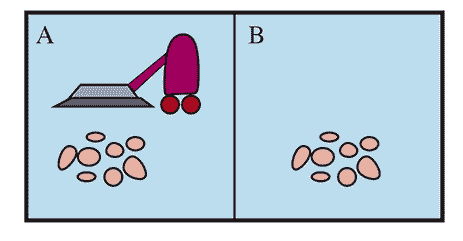


图 2.2 仅有两个位置的吸尘器世界。每个位置可以是干净的或脏的，智能体可以向左或向右移动，并且可以清洁它所占据的格子。吸尘器世界的不同版本允许关于智能体能感知什么、其行为是否总是成功等方面的不同规则。

查看 图 2.3，我们看到各种吸尘器世界智能体可以通过以不同方式填充右栏来简单定义。那么显而易见的问题是：如何正确填写表格？换句话说，是什么使智能体好或坏、聪明或愚蠢？我们在下一节回答这些问题。

### 描述
框图从一个标记为 智能体 的块开始。智能体块内显示了三个块。智能体块内的第一个块标记为，世界现在是什么样子。从第一个块引出的箭头指向标记为，我现在应该做什么动作 的第二个块。第三个块标记为 条件-动作规则，并且从第三个块引出的箭头指向第二个块。从第二个块引出的箭头指向 执行器。从执行器引出的箭头指向标记为 环境 的块，该块位于智能体块之外。从环境块引出的箭头指向智能体块中的 传感器。从传感器引出的箭头指向回第一个块。

×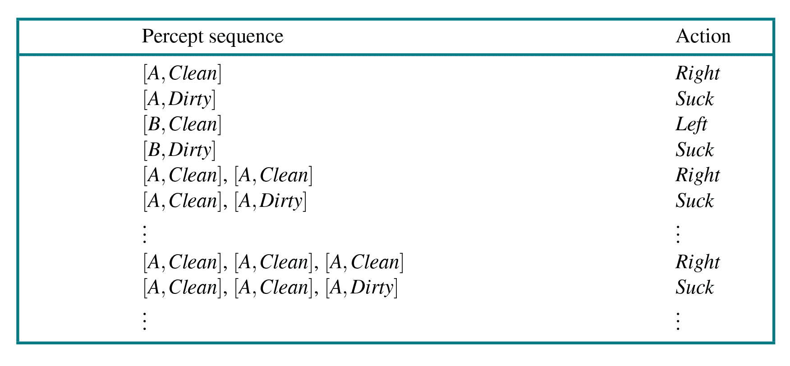

图 2.3 对 图 2.2 所示吸尘器世界中简单智能体函数的部分制表。智能体如果当前格子脏就清洁它，否则移动到另一个格子。注意，除非对可能感知序列的长度有限制，否则该表是无界大小的。

在结束本节之前，我们应强调，智能体的概念旨在作为分析系统的工具，而不是将世界划分为智能体和非智能体的绝对特征。可以将手持计算器视为一个智能体，当给出感知序列 `2 + 2 =` 时，它选择显示“4”的动作，但这种分析几乎不会有助于我们理解计算器。从某种意义上说，所有工程领域都可以被视为设计与世界交互的人工制品；人工智能运作于（作者认为）光谱中最有趣的一端，在那里人工制品具有显著的计算资源，并且任务环境需要非平凡的决策。

## 2.2 良好行为：理性概念
一个理性智能体是指做正确事情的智能体。显然，做正确的事情比做错误的事情更好，但做正确的事情意味着什么？

*理性智能体*

### 2.2.1 绩效度量
道德哲学发展了几种不同的“正确之事”概念，但人工智能通常坚持一个称为结果主义的概念：我们通过其后果来评估智能体的行为。当一个智能体被放置在环境中时，它会根据收到的感知生成一系列动作。这一动作序列导致环境经历一系列状态。如果该序列是可取的，那么智能体表现良好。这种可取性概念由绩效度量捕捉，该度量评估任何给定的环境状态序列。

*结果主义*
*绩效度量*

人类有自己的欲望和偏好，因此应用于人类的理性概念与其选择产生从其观点来看可取的环境状态序列的动作的成功有关。另一方面，机器本身没有欲望和偏好；绩效度量至少最初是在机器设计者的脑海中，或在机器设计面向的用户脑海中。我们将看到一些智能体设计对（绩效度量的一个版本）有显式表示，而在其他设计中绩效度量完全是隐式的——智能体可能做正确的事情，但它不知道为什么。

回想诺伯特·维纳的警告，确保“放入机器中的目的是我们真正想要的目的” (第 51 页)，请注意正确制定绩效度量可能相当困难。例如，考虑前一节中的吸尘器智能体。我们可能会提议通过单次八小时班次清理的灰尘量来衡量绩效。对于理性智能体来说，当然，你要求什么就得到什么。理性智能体可以通过清理灰尘，然后全部倒回地板上，再重新清理，等等来最大化这一绩效度量。更合适的绩效度量会奖励智能体保持地板干净。例如，每一步每个干净格子可奖励一分（也许对消耗的电量和产生的噪音进行惩罚）。作为一般规则，最好根据一个人在环境中实际希望实现的目标来设计绩效度量，而不是根据一个人认为智能体应该如何行为来设计。

即使明显的陷阱被避免，仍有一些棘手的问题存在。例如，前一段中“干净地板”的概念基于一段时间内的平均清洁度。然而，相同的平均清洁度可以由两个不同的智能体实现，其中一个一直做得平平无奇，而另一个则积极清洁但会长时间休息。哪个更可取似乎是清洁科学的细微问题，但事实上它是一个具有深远影响的深刻哲学问题。哪个更好——高低起伏的鲁莽生活，还是安全但平淡的存在？哪个更好——每个人都生活在中等贫困中的经济，还是一些人生活富足而另一些人非常贫穷的经济？我们把这些问题留给勤奋的读者作为练习。

对于本书的大部分内容，我们将假设绩效度量可以正确指定。然而，基于上述原因，我们必须接受我们可能将错误目的放入机器中的可能性——正是金字塔王问题在 第 51 页 描述的那样。此外，在设计一件软件时，其副本将属于不同的用户，我们无法预见每个个人用户的确切偏好。因此，我们可能需要构建能够反映对真实绩效度量初始不确定性的智能体，并在时间推移中学习更多关于它的信息；此类智能体在 第 15 章、第 17 章 和 第 23 章 中描述。

### 2.2.2 理性
在任何给定时间什么是理性的取决于四件事：
- 定义成功标准的绩效度量。
- 智能体对环境的先验知识。
- 智能体可以执行的动作。
- 智能体迄今为止的感知序列。

这导致了理性智能体的定义：

对于每种可能的感知序列，理性智能体应选择一个预期能最大化其绩效度量的动作，条件是基于感知序列提供的证据以及智能体拥有的任何内置知识。

*理性智能体的定义*

考虑那个简单的吸尘器智能体，如果格子脏就清洁它，否则移动到另一个格子；这是 图 2.3 中制表的智能体函数。这是一个理性智能体吗？取决于情况！首先，我们需要说明绩效度量是什么，关于环境已知什么，以及智能体有哪些传感器和执行器。让我们假设以下情况：
- 绩效度量在“寿命” 1000 个时间步内，为每个时间步每个干净格子奖励一分。


-   环境的“地理”情况先验已知（图 2.2），但污垢分布和智能体的初始位置未知。干净的格子保持干净，吸尘会清理当前格子。`Right` 和 `Left` 动作会使智能体移动一格，除非这会使智能体移出环境，在这种情况下智能体保持原地不动。
-   可用的唯一动作是 `Right`、`Left` 和 `Suck`。
-   智能体能正确感知其位置以及该位置是否含有污垢。

在这些情况下，该智能体确实是理性的；其预期性能至少与任何其他智能体一样好。

不难看出，在不同情况下同样的智能体就会变得不理性。例如，一旦所有污垢都被清理干净，智能体就会无谓地来回摆动；如果性能度量包含每次移动扣一分的惩罚，智能体表现就会很差。对于这种情况更好的智能体会在确定所有格子都干净后就什么都不做。如果干净的格子会再次变脏，智能体应偶尔检查并在需要时重新清理。如果环境的地理情况未知，智能体就需要探索它。练习 2.VACR 要求你为这些情况设计智能体。

## 2.2.3 全知、学习与自主性

我们需要谨慎地区分理性与全知。一个全知的智能体知道其行为的实际结果并能据此行动；但在现实中全知是不可能的。考虑以下例子：某天我在香榭丽舍大街上行走，看见对面街上有一位老朋友。附近没有交通，我也没有其他事情在身，所以出于理性，我开始过马路。与此同时，在 33,000 英尺高空，一架经过的客机的货舱门掉落了，3 在我到达街对面之前我就被压扁了。我过马路是不理性的吗？我不太可能在讣告上看到“白痴试图过马路”。

Omniscience

这个例子表明理性与完美并不相同。理性最大化预期性能，而完美最大化实际性能。放弃对完美的要求不仅仅是公平对待智能体的问题。关键在于，如果我们期望智能体做出事后证明是最好的行动，那么除非我们改进水晶球或时光机的性能，否则就不可能设计出满足这一规格的智能体。

因此，我们的理性定义并不要求全知，因为理性的选择只取决于迄今为止的感知序列。我们还必须确保没有无意中允许智能体从事明显低智力的活动。例如，如果智能体在过繁忙的马路前不左右查看，那么它的感知序列就不会告诉它有一辆大卡车正以高速驶来。我们的理性定义是否说现在过马路是可以的？完全不是！

首先，鉴于这种无信息的感知序列，过马路是不理性的：不看就过马路的事故风险太大了。其次，理性智能体应在踏入街道前选择“查看”动作，因为查看有助于最大化预期性能。为了改变未来感知而采取行动——有时称为信息收集——是理性的重要组成部分，并在 第 15 章 中深入论述。信息收集的第二个例子是由真空吸尘智能体在初始未知环境中必须进行的探索提供的。

Information gathering

我们的定义要求理性智能体不仅要收集信息，还要尽可能多地从感知到的内容中学习。智能体的初始配置可能反映了对环境的某些先验知识，但随着智能体获得经验，这些知识可能会被修改和扩充。存在极端情况，其中环境是完全先验已知且完全可预测的。在这种情况下，智能体无需感知或学习；它只需正确行动。

Learning

当然，这样的智能体很脆弱。考虑卑微的粪金龟。在挖好巢并产卵后，它会从附近的粪堆取来一团粪球来堵住入口。如果途中粪球从它爪中被取走，甲虫仍继续任务并假装用不存在的粪球堵巢，完全没有注意到它不见了。进化在甲虫的行为中内置了一个假设，一旦该假设被违反，就会产生失败的行为。

稍为聪明一点的是沙蜂。雌性沙蜂会挖一个巢穴，外出蜇住一只毛虫并拖到巢穴，再进入巢穴检查一切是否正常，然后把毛虫拖进去产卵。毛虫在卵孵化时会作为食物来源。到目前为止一切都好，但如果昆虫学家在沙蜂检查时把毛虫移开几英寸，它会回到计划的“拖毛虫”步骤并继续执行计划而不做修改，反复检查巢穴，即使在数十次移动毛虫的干预后也是如此。沙蜂无法学会其本能计划正在失败，因此不会改变它。

智能体在多大程度上依赖设计者的先验知识而非自身的感知和学习过程，我们就说该智能体缺乏自主性。理性智能体应该是自主的——它应学习所能学习的一切以弥补部分或不正确的先验知识。例如，能够学习预测何时何地会出现额外污垢的吸尘智能体，其表现会优于不会的智能体。

Autonomy

就实际而言，很少从一开始就要求完全自主：当智能体几乎没有经验时，如果设计者不提供帮助，它只能随机行动。正如进化为动物提供了足够的内置反射以便它们活得足够长以自行学习，为人工智能智能体提供一些初始知识以及学习能力也是合理的。在对环境有足够经验后，理性智能体的行为可以有效地独立于其先验知识。因此，纳入学习使得人们能够设计出单一的理性智能体，使其在各种各样的环境中都能成功。

## 2.3 环境的本质

现在我们有了理性的定义，几乎可以开始思考如何构建理性智能体了。然而，首先我们必须思考任务环境，它本质上是理性智能体所要解决的“问题”。我们首先展示如何规定任务环境，并通过若干例子说明这一过程。然后我们展示任务环境有多种类型。任务环境的性质直接影响智能体程序的适当设计。

Task environment

## 2.3.1 规定任务环境

在讨论简单吸尘智能体的理性时，我们必须规定性能度量、环境以及智能体的执行器和传感器。我们把所有这些归于任务环境之下。对于喜欢缩写的人，我们称之为 PEAS（Performance, Environment, Actuators, Sensors，即性能、环境、执行器、传感器）描述。在设计智能体时，第一步始终必须是尽可能完整地规定任务环境。

PEAS


真空世界是一个简单的例子；让我们考虑一个更复杂的问题：自动出租车司机。图 2.4 总结了出租车任务环境的 PEAS 描述。我们将在以下段落中更详细地讨论每个要素。

### 描述
框图从一个标记为 Agent 的块开始。Agent 块内有六个块。代理块内的第一个块标记为“现在世界是什么样的”。来自标记为 State、世界如何演变 和 我的行为会怎样做 的第二、第三和第四个块的箭头指向第一个块。一条虚线箭头从第一个块指向回 state 块。一条实线箭头从第一个块指向标记为“现在我应该采取什么行动”的第五个块。来自标记为“条件动作规则”的第六个块的箭头指向第五个块。第五个块的箭头指向 Actuators。来自执行器的箭头指向标记为 Environment 的块，该块位于代理块之外。来自环境块的箭头指向代理块中的传感器。来自传感器的箭头指向回第一个块。

×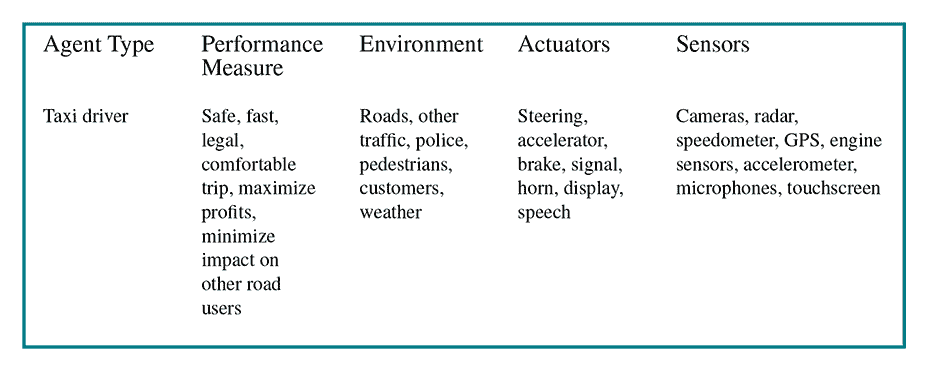

图 2.4 自动出租车驾驶员任务环境的 PEAS 描述。

首先，我们希望自动驾驶员追求的性能指标是什么？理想的品质包括到达正确的目的地；最小化燃油消耗和磨损；最小化行程时间或成本；最小化交通法规的违规和对其他驾驶员的干扰；最大化安全性和乘客舒适度；最大化利润。显然，其中一些目标会冲突，因此需要权衡取舍。

接下来，出租车将面临的驾驶环境是什么？任何出租车司机都必须处理各种道路，从乡村小路和城市小巷到 12 车道高速公路。道路上包含其他交通、行人、流浪动物、道路施工、警车、水坑和坑洼。出租车还必须与潜在和实际乘客互动。还有一些可选选择。出租车可能需要在南加州运行，那里雪很少是个问题，或在阿拉斯加，那里雪很少不是问题。它可能始终在右侧行驶，或者我们可能希望它足够灵活，以便在英国或日本时靠左行驶。显然，环境越受限制，设计问题就越容易。

自动出租车的执行器包括人类司机可用的那些：通过油门控制发动机以及对转向和制动的控制。此外，它还需要向显示屏或语音合成器输出以与乘客对话，也许还需要某种方式与其它车辆通信，无论是礼貌还是其他方式。

出租车的基本传感器将包括一个或多个视频摄像头以便它能看到，以及激光雷达和超声波传感器来检测到其它汽车和障碍物的距离。为了避免超速罚单，出租车应配备速度表，并且为了正确控制车辆，尤其是在弯道上，应配备加速度计。为了确定车辆的机械状态，它需要通常的发动机、燃油和电气系统传感器阵列。像许多人类司机一样，它可能希望接入 GPS 信号以免迷路。最后，它需要触摸屏或语音输入，以便乘客请求目的地。

在图 2.5 中，我们为若干其它代理类型勾勒了基本的 PEAS 要素。更多示例出现在练习 2.PEAS 中。这些示例包括物理和虚拟环境。请注意，虚拟任务环境可能与“真实”世界一样复杂：例如，在拍卖和转售网站上交易的软件代理（或软件机器人或软机器人）要处理数百万其它用户和数十亿个对象，其中许多具有真实图像。

### 描述
框图从一个标记为 Agent 的块开始。Agent 块内有七个块。代理块内的第一个块标记为“现在世界是什么样的”。来自标记为 State、世界如何演变 和 我的行为会怎样做 的第二、第三和第四个块的箭头指向第一个块。一条虚线箭头从第一个块指向回 state 块。一条实线箭头从第一个块指向标记为“如果我执行动作‘A’将会是什么样”的第五个块。来自标记为“世界如何演变”和“我的行为会怎样做”的第三和第四个块的箭头指向第五个块。第五个块的箭头指向标记为“现在我应该采取什么行动”的第六个块。来自标记为 Goals 的第七个块的箭头指向第六个块。第六个块的箭头指向 Actuators。来自执行器的箭头指向标记为 Environment 的块，该块位于代理块之外。来自环境块的箭头指向代理块中的传感器。来自传感器的箭头指向回第一个块。

×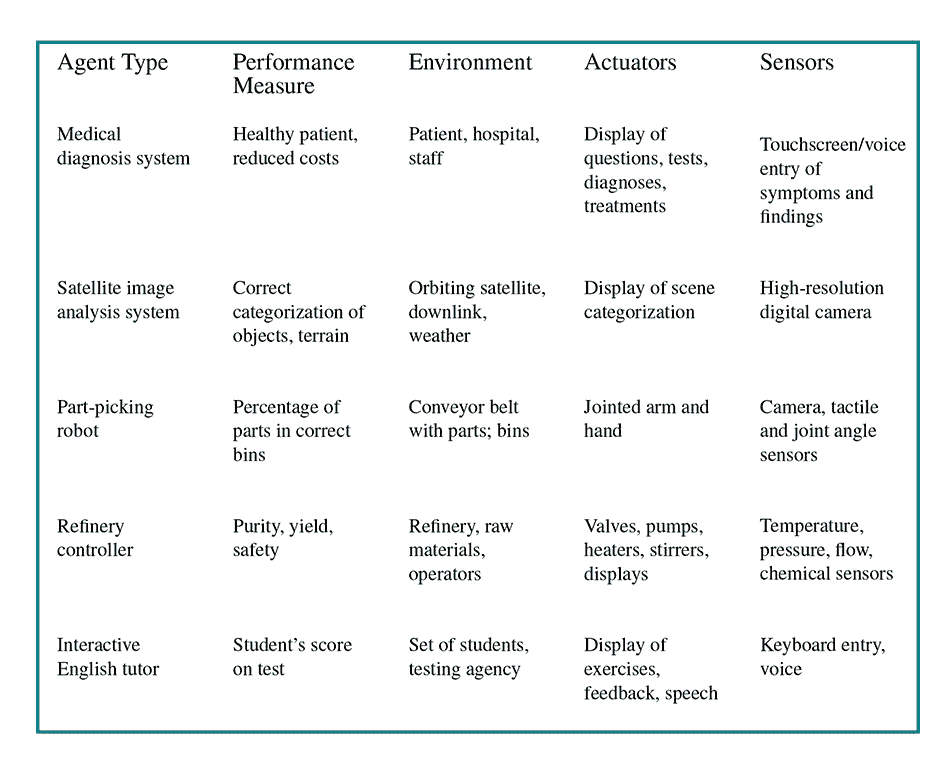

图 2.5 代理类型及其 PEAS 描述的示例。

<p class="sidebar">软件代理</p> <p class="sidebar">软机器人</p>

## 2.3.2 任务环境的属性
AI 中可能出现的任务环境的范围显然非常广。然而，我们可以识别出相当少数的几个维度来对任务环境进行分类。这些维度在很大程度上决定了适当的代理设计以及用于代理实现的主要技术家族的适用性。首先我们列出这些维度，然后分析几个任务环境来说明这些思想。这里的定义是非正式的；后面的章节提供了每种环境更精确的陈述和示例。

### 完全可观察 vs. 部分可观察
如果代理的传感器在每个时间点都能让它访问环境的完整状态，那么我们就说任务环境是完全可观察的。如果传感器检测到与行动选择相关的所有方面，则任务环境实际上是完全可观察的；相关性反过来取决于性能指标。完全可观察的环境很方便，因为代理无需维护任何内部状态来跟踪世界。环境可能因为传感器噪声和不准确而部分可观察，或者因为状态的某些部分只是简单地缺失于传感器数据中——例如，仅具有局部灰尘传感器的真空代理无法判断其它方格是否有灰尘，而自动出租车无法看到其它司机在想什么。如果代理完全没有传感器，则环境是不可观察的。人们可能会认为在这种情况下代理的处境无望，但正如我们在第 4 章中所讨论的，代理的目标仍可能实现，有时甚至可以确定。

<p class="sidebar">完全可观察</p> <p class="sidebar">部分可观察</p> <p class="sidebar">不可观察</p>

### 单代理 vs. 多代理
单代理与多代理环境之间的区别似乎足够简单。例如，独自解决填字游戏的代理显然处于单代理环境中，而下棋的代理则处于双代理环境中。然而，存在一些微妙的问题。首先，我们描述了实体如何被视为代理，但我们没有解释哪些实体必须被视为代理。代理 A（例如出租车司机）是否必须将对象 B（另一辆车）视为代理，还是可以将其仅仅视为按照物理定律行为的对象，类似于海滩上的波浪或风中飘动的树叶？关键区别在于 B 的行为是否最好描述为最大化性能指标，而该指标的值取决于代理 A 的行为。

<p class="sidebar">单代理</p> <p class="sidebar">多代理</p>


# 多智能体环境特征

## 竞争 vs. 合作

例如，在国际象棋中，对手实体 B 试图最大化其性能指标，而根据国际象棋规则，这会最小化智能体 A 的性能指标。因此，国际象棋是一个竞争性的多智能体环境。另一方面，在出租车驾驶环境中，避免碰撞会最大化所有智能体的性能指标，因此它是一个部分合作的多智能体环境。它也是部分竞争的，因为例如只有一个汽车可以占用一个停车位。

竞争 合作

多智能体环境中的智能体设计问题通常与单智能体环境中的问题大不相同；例如，通信在多智能体环境中常常成为一种理性的行为；在某些竞争环境中，随机行为是理性的，因为它避免了可预测性的陷阱。

## 确定性 vs. 非确定性

如果环境的下一个状态完全由当前状态和智能体执行的动作决定，那么我们就说环境是确定性的；否则，它是非确定性的。原则上，在完全可观察、确定性的环境中，智能体无需担心不确定性。然而，如果环境是部分可观察的，那么它看起来可能是非确定性的。

确定性 非确定性

大多数现实情况都如此复杂，以至于不可能跟踪所有未观察到的方面；就实际目的而言，它们必须被视为非确定性的。以这种意义来说，出租车驾驶显然是非确定性的，因为一个人永远无法完全预测交通行为；而且，轮胎可能会意外爆胎，发动机也可能毫无预警地熄火。我们所描述的真空世界是确定性的，但其变体可以包括诸如随机出现的污垢和不可靠的吸尘机构等非确定性元素（练习 2.VFIN）。

最后说明一点：单词 stochastic 被有些人用作“nondeterministic”的同义词，但我们对这两个术语做了区分；我们说环境的模型是 stochastic，如果它明确处理概率（例如，“there’s a 25% chance of rain tomorrow”）而“nondeterministic”则是指可能性被列出但未量化（例如，“there’s a chance of rain tomorrow”）。

随机性

## episodic vs. 顺序

在 episodic 任务环境中，智能体的经验被划分为原子 episodes。在每个 episode 中，智能体接收一个感知然后执行一个单一动作。至关重要的是，下一个 episode 不依赖于之前 episode 中采取的动作。许多分类任务是 episodic 的。例如，一个需要在装配线上发现缺陷零件的智能体，其每个决策都基于当前零件，而与之前的决策无关；而且，当前决策不会影响下一个零件是否缺陷。另一方面，在顺序环境中，当前决策可能会影响所有未来的决策。4 国际象棋和出租车驾驶都是顺序的：在这两种情况下，短期行动都可能产生长期后果。 episodic 环境比顺序环境简单得多，因为智能体无需提前思考。

episodic 顺序

## 静态 vs. 动态 vs. 半动态

如果环境在智能体进行决策时可能会发生变化，那么我们就说该环境对该智能体是动态的；否则，它是静态的。静态环境很容易处理，因为智能体在决定行动时无需不断观察世界，也无需担心时间的流逝。另一方面，动态环境会持续询问智能体想要做什么；如果它尚未决定，这就相当于决定什么都不做。如果环境本身不随时间推移而变化，但智能体的性能分数会变化，那么我们就说环境是半动态的。出租车驾驶显然是动态的：其他汽车和出租车本身在驾驶算法犹豫下一步该做什么时仍在移动。带计时器的国际象棋是半动态的。填字游戏是静态的。

静态 动态 半动态

## 离散 vs. 连续

离散/连续的区分适用于环境的状态、时间的处理方式，以及智能体的感知和动作。例如，国际象棋环境有有限数量的 distinct 状态（不包括计时器）。国际象棋也有一组离散的感知和动作。出租车驾驶是一个连续状态和连续时间的问题：出租车和其他车辆的速度和位置在连续值范围内变化，并且随时间平滑变化。出租车驾驶的动作也是连续的（转向角度等）。严格来说，数字相机的输入是离散的，但通常被视为代表连续变化的强度和位置。

离散 连续

## 已知 vs. 未知

严格来说，这种区分指的是智能体（或设计者）对环境“物理定律”的知识状态，而非环境本身。在已知环境中，所有动作的结果（如果环境是非确定性的，则为结果概率）都是已知的。显然，如果环境是未知的，智能体就必须学习其工作原理才能做出好的决策。

已知 未知

已知环境与未知环境之间的区分与完全可观察和部分可观察环境之间的区分不同。已知环境完全可能是部分可观察的——例如，在单人纸牌游戏中，我知道规则，但仍然无法看到尚未翻开的牌。相反，未知环境可以是完全可观察的——在新视频游戏中，屏幕可能显示整个游戏状态，但我仍然不知道按钮的作用，直到我尝试它们。

如第 57 页所述，性能指标本身可能是未知的，要么是因为设计者不确定如何正确地写下它，要么是因为最终用户——其偏好很重要——是未知的。例如，出租车司机通常不会知道新乘客是喜欢悠闲还是快速的旅程，是谨慎还是激进的驾驶风格。虚拟个人助理在开始时对新主人的个人偏好一无所知。在这种情况下，智能体可能通过与设计者或用户的进一步互动而更多地了解性能指标。这反过来又表明任务环境必然被视为多智能体环境。

最困难的情况是部分可观察、多智能体、非确定性、顺序、动态、连续且未知的。出租车驾驶在这所有意义上都很困难，除了司机的环境大多是已知的。在一个地理不熟悉、交通法规不同且乘客紧张的新国家驾驶租来的汽车会令人更加兴奋。


图 2.6 列出了若干熟悉环境的属性。请注意，这些属性并不总是泾渭分明。例如，我们将医学诊断任务列为单智能体，因为患者的疾病过程不能有效地建模为智能体；但医学诊断系统也可能需要处理不合作的患者和持怀疑态度的医护人员，因此环境可能具有多智能体的方面。此外，如果把医学诊断看作是根据症状列表选择诊断，则它是回合式的；如果任务包括提出一系列检查、评估治疗过程中的进展、处理多名患者等等，则问题是顺序的。

### Description
框图从一个标记为 `Agent` 的块开始。`Agent` 块内有八个块。智能体块内的第一个块标记为 `What the world is like now`。标记为 `State`、`How the world evolves` 和 `What my actions do` 的第二、第三和第四个块的箭头指向第一个块。第一个块的虚线箭头指向回状态块。第一个块的实线箭头指向标记为 `What it will be like if I do action "A"` 的第五个块。标记为 `How the world evolves` 和 `What my action do` 的第三和第四个块的箭头指向第五个块。第五个块的箭头指向标记为 `How happy I will be in such a state` 的第六个块。标记为 `Utility` 的第七个块的箭头也指向第六个块。第六个块的箭头指向标记为 `What action I should do now` 的第八个块。第八个块的箭头指向 `Actuators`。执行器指向位于智能体块外部的标记为 `Environment` 的块。环境块的箭头指向智能体块内的传感器。传感器指向回第一个块。

×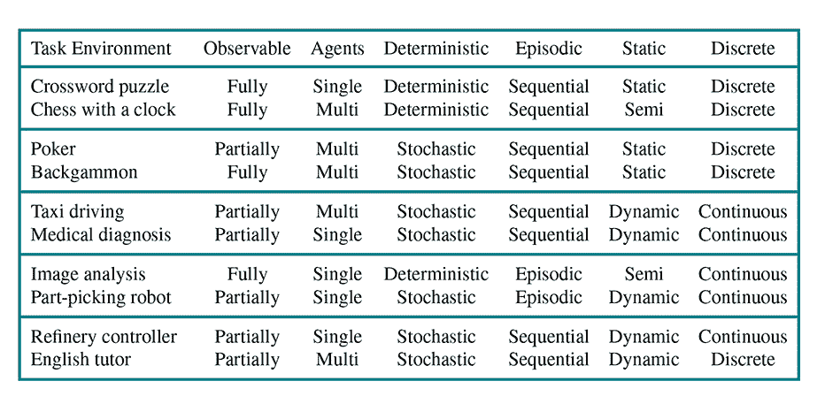

图 2.6 任务环境及其特征的示例。

我们没有包含“已知/未知”列，因为正如前面所解释的，这并不是严格意义上的环境属性。对于象棋和扑克等一些环境，很容易为智能体提供规则的完整知识，但即使如此，考虑智能体如何在没有这种知识的情况下学习玩这些游戏也很有趣。

本书关联的代码库（`aima.cs.berkeley.edu`）包含多个环境实现，以及用于评估智能体性能的通用环境模拟器。实验通常不是针对单一环境进行的，而是针对从环境类中抽取的多个环境进行的。例如，要在模拟交通中评估出租车司机，我们希望在不同的交通、照明和天气条件下运行多次模拟。然后我们对智能体在环境类上的平均性能感兴趣。

<p class="sidebar">环境类</p>

## 2.4 智能体的结构

到目前为止，我们通过描述行为来谈论智能体——在任何给定的感知序列之后执行的操作。现在我们必须硬着头皮谈谈内部是如何工作的。人工智能的工作是设计一个实现智能体函数——从感知到动作的映射——的智能体程序。我们假设该程序将在某种具有物理传感器和执行器的计算设备上运行——我们称之为智能体架构：

`agent = architecture + program.`

<p class="sidebar">智能体程序</p> <p class="sidebar">智能体架构</p>

显然，我们选择的程序必须适合架构。如果程序要推荐像 `Walk` 这样的动作，架构最好有腿。架构可能只是一个普通的个人电脑，也可能是一辆带有多个机载计算机、摄像头和其他传感器的机器人汽车。一般来说，架构使传感器感知可供程序使用，运行程序，并将程序的动作选择馈送到执行器中。大多数本书内容都是关于设计智能体程序的，尽管 第 26 章 和 第 27 章 直接涉及传感器和执行器。

## 2.4.1 智能体程序

我们在本书中设计的智能体程序都有相同的骨架：它们从传感器接收当前感知作为输入，并向执行器返回一个动作。5 注意智能体程序与智能体函数之间的区别，智能体程序以当前感知作为输入，而智能体函数可能依赖于整个感知历史。智能体程序别无选择，只能以当前感知作为输入，因为环境中没有更多信息可用；如果智能体的动作需要依赖于整个感知序列，智能体就必须记住感知。

我们用 附录 B 中定义简单伪代码语言来描述智能体程序。 （在线代码库包含真实编程语言中的实现。）例如，图 2.7 显示了一个相当平凡的智能体程序，它跟踪感知序列，然后用它来索引动作表以决定做什么。该表——其示例在 图 2.3 中给出了真空世界的示例——明确地表示了智能体程序所体现的智能体函数。为了以这种方式构建一个理性智能体，我们作为设计者必须构造一个包含每种可能感知序列的适当动作的表。

### Description
框图从一个标记为 `Agent` 的块开始。`Agent` 块内有四个块。标记为 `Performance standard` 的箭头指向标记为 `Critic` 的块。来自 `Critic` 块的标记为 `feedback` 的箭头指向标记为 `Learning element` 的块。来自 `Learning element` 块的标记为 `learning goals` 的箭头指向标记为 `Problem generator` 的块。来自问题生成器块的箭头指向标记为 `Performance element` 的块。来自学习元素块的标记为 `changes` 的箭头指向性能元素块。来自性能元素块的标记为 `knowledge` 的箭头指向回 `Learning element` 块。性能元素块的另一个箭头指向 `Actuators`。执行器指向位于智能体块外部的标记为 `Environment` 的块。环境块的箭头指向智能体块内的传感器。传感器分别指向 `Performance element` 和 `Critic` 块的箭头。

×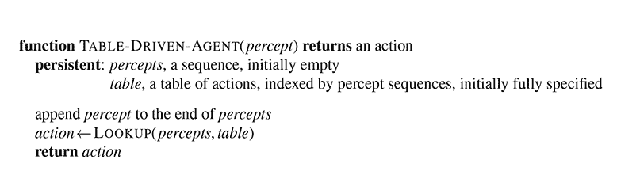

图 2.7 `TABLE-DRIVEN-AGENT` 程序针对每个新感知被调用并每次返回一个动作。它在内存中保留完整的感知序列。

考虑表驱动的智能体构建方法注定要失败的原因很有启发性。设 `Ƥ` 为可能感知的集合，设 `T` 为智能体的生命周期（它将接收的总感知数）。查找表将包含 $\sum_{t = 1}^{T}$ | `Ƥ` |^t 个条目。考虑自动出租车：单个摄像头的视觉输入（通常为八个摄像头）以大约每秒 70 兆字节的速度传入（每秒 30 帧，1080 × 720 像素，24 位颜色信息）。这对于一小时的驾驶来说产生了一个超过 10600,000,000,000 个条目的查找表。即使是象棋——现实世界中一个微小且表现良好的片段——的查找表（事实证明）至少有 10150 个条目。相比之下，可观测宇宙中的原子数量少于 1080。这些表的惊人大小意味着（a）这个宇宙中的任何物理智能体都没有空间存储该表；（b）设计者没有时间创建该表；并且（c）没有任何智能体能够从其经验中学习到所有正确的表条目。


Despite all this, `TABLE-DRIVEN-AGENT` does do what we want, assuming the table is filled in correctly: it implements the desired agent function.

尽管如此，`TABLE-DRIVEN-AGENT` 确实能实现我们想要的功能，前提是表格填写正确：它实现了期望的智能体函数。

The key challenge for AI is to find out how to write programs that, to the extent possible, produce rational behavior from a smallish program rather than from a vast table.

人工智能的关键挑战在于弄清如何编写程序，在尽可能的情况下，从一个规模较小的程序而非庞大的表格中产生理性行为。

We have many examples showing that this can be done successfully in other areas: for example, the huge tables of square roots used by engineers and schoolchildren prior to the 1970s have now been replaced by a five-line program for Newton’s method running on electronic calculators. The question is, can AI do for general intelligent behavior what Newton did for square roots? We believe the answer is yes.

我们有许多例子表明在其他领域可以成功做到这一点：例如，工程师和学童在 1970 年代之前使用的庞大平方根表，现在已被运行在电子计算器上的牛顿方法的五行程序所取代。问题是，人工智能能否像牛顿对平方根所做的那样，对一般智能行为做到这一点？我们认为答案是肯定的。

In the remainder of this section, we outline four basic kinds of agent programs that embody the principles underlying almost all intelligent systems:

在本节的剩余部分，我们概述了四种基本类型的智能体程序，它们体现了几乎所有智能系统背后的原理：

•Simple reflex agents;
•Model-based reflex agents;
•Goal-based agents; and
•Utility-based agents.

•简单反射智能体；
•基于模型的反射智能体；
•基于目标的智能体；和
•基于效用的智能体。

Each kind of agent program combines particular components in particular ways to generate actions. Section 2.4.6 explains in general terms how to convert all these agents into learning agents that can improve the performance of their components so as to generate better actions. Finally, Section 2.4.7 describes the variety of ways in which the components themselves can be represented within the agent. This variety provides a major organizing principle for the field and for the book itself.

每种智能体程序都以特定方式组合特定组件来生成动作。第 2.4.6 节从一般角度解释了如何将所有这些智能体转换为学习智能体，使其能够改进组件的性能以生成更好的动作。最后，第 2.4.7 节描述了组件本身在智能体内部可以表示的各种方式。这种多样性为该领域和本书本身提供了一个主要的组织原则。

## 2.4.2 Simple reflex agents

## 2.4.2 简单反射智能体

The simplest kind of agent is the simple reflex agent. These agents select actions on the basis of the current percept, ignoring the rest of the percept history. For example, the vacuum agent whose agent function is tabulated in Figure 2.3 is a simple reflex agent, because its decision is based only on the current location and on whether that location contains dirt. An agent program for this agent is shown in Figure 2.8.

最简单的智能体类型是简单反射智能体。这些智能体根据当前感知选择动作，忽略其余的感知历史。例如，其智能体函数在图 2.3 中列出的真空智能体就是一个简单反射智能体，因为它的决策仅基于当前位置以及该位置是否包含灰尘。该智能体的智能体程序显示在图 2.8 中。

Description

描述

Part (“a”), Atomic: An arrow from a block labeled B points to a block labeled C. Part (b), Factored: Two blocks labeled B and C are shown. In both blocks, four circles are shown one below the other and two progress bars are shown below the bottom circle. In block B, the circles have alternating black and blue shades from the top. In the first progress bar, black shade fills about 40 percent of the bar while the blue shade fills the rest. In the second progress bar, the black shade fills about 90 percent of the bar while the blue shade fills the rest. In block C, the first two circles from the top are shaded blue and the other two circles are shaded black. In the first progress bar, black shade fills about 40 percent of the bar while the blue shade fills the rest. In the second progress bar, the black shade fills about 60 percent of the bar while the blue shade fills the rest. Part (c), Structured: The figure shows two blocks connected by an arrow. There are four red blocks, three green blocks, and two white blocks in the first block. These are arranged in three columns and four rows. The following blocks are shown on each row. Row 1: Column 1, red. Column 2, green. Row 2: Column 2, red. Row 3: Column 1, red. Column 2, green. Column 3, white. Row 4: Column 1, white. Column 2, red. Column 3, green. These blocks are connected using arrows in different paths. There are four red blocks, three green blocks, and four white blocks in the second block. These are arranged in three columns and four rows. The following blocks are shown on each row. Row 1: Column 1, white. Column 2, green. Column 3, white. Row 2: Column 2, red. Column 3, red. Row 3: Column 1, red. Column 2, white. Column 3, white. Row 4: Column 1, green. Column 2, red. Column 3, green. These blocks are connected using arrows in different paths.

部分（“a”），原子：从标记为 B 的块指向标记为 C 的块的箭头。部分（b），分解：显示了两个标记为 B 和 C 的块。在这两个块中，四个圆圈一个在另一个下方显示，两个进度条显示在最下面的圆圈下方。在块 B 中，圆圈从顶部开始交替为黑色和蓝色阴影。在第一个进度条中，黑色阴影填充了约 40% 的条，而蓝色阴影填充其余部分。在第二个进度条中，黑色阴影填充了约 90% 的条，而蓝色阴影填充其余部分。在块 C 中，从顶部开始的前两个圆圈为蓝色阴影，其余两个圆圈为黑色阴影。在第一个进度条中，黑色阴影填充了约 40% 的条，而蓝色阴影填充其余部分。在第二个进度条中，黑色阴影填充了约 60% 的条，而蓝色阴影填充其余部分。部分（c），结构化：图显示了由箭头连接的两个块。第一个块中有四个红色块、三个绿色块和两个白色块。它们排列在三列四行中。每一行显示的块如下。第 1 行：第 1 列，红色。第 2 列，绿色。第 2 行：第 2 列，红色。第 3 行：第 1 列，红色。第 2 列，绿色。第 3 列，白色。第 4 行：第 1 列，白色。第 2 列，红色。第 3 列，绿色。这些块通过不同路径的箭头连接。第二个块中有四个红色块、三个绿色块和四个白色块。它们排列在三列四行中。每一行显示的块如下。第 1 行：第 1 列，白色。第 2 列，绿色。第 3 列，白色。第 2 行：第 2 列，红色。第 3 列，红色。第 3 行：第 1 列，红色。第 2 列，白色。第 3 列，白色。第 4 行：第 1 列，绿色。第 2 列，红色。第 3 列，绿色。这些块通过不同路径的箭头连接。

×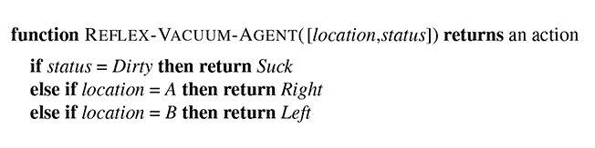

×

Figure 2.8 The agent program for a simple reflex agent in the two-location vacuum environment. This program implements the agent function tabulated in Figure 2.3.

图 2.8 两位置真空环境中简单反射智能体的智能体程序。该程序实现了图 2.3 中列出的智能体函数。

<p class="sidebar">Simple reflex agent</p>

<p class="sidebar">简单反射智能体</p>

Notice that the vacuum agent program is very small indeed compared to the corresponding table. The most obvious reduction comes from ignoring the percept history, which cuts down the number of relevant percept sequences from `4T` to just 4. A further, small reduction comes from the fact that when the current square is dirty, the action does not depend on the location. Although we have written the agent program using `if-then-else` statements, it is simple enough that it can also be implemented as a Boolean circuit.

请注意，与相应的表格相比，真空智能体程序确实非常小。最明显的减少来自于忽略感知历史，这将相关感知序列的数量从 `4T` 减少到仅 4。进一步的、较小程度的减少来自于当前方格脏时，动作不依赖于位置。虽然我们使用 `if-then-else` 语句编写了智能体程序，但它足够简单，也可以作为布尔电路实现。

Simple reflex behaviors occur even in more complex environments. Imagine yourself as the driver of the automated taxi. If the car in front brakes and its brake lights come on, then you should notice this and initiate braking. In other words, some processing is done on the visual input to establish the condition we call “The car in front is braking.” Then, this triggers some established connection in the agent program to the action “initiate braking.” We call such a connection a condition–action rule,6 written as

`if car-in-front-is-braking then initiate-braking.`

简单反射行为即使在更复杂的环境中也会出现。想象你自己是自动出租车的司机。如果前面的汽车刹车并且刹车灯亮起，那么你应该注意到这一点并启动刹车。换句话说，对视觉输入进行一些处理以建立我们称之为“前车正在刹车”的条件。然后，这触发智能体程序中到动作“启动刹车”的既定连接。我们称这种连接为条件-动作规则，6 写成

`if car-in-front-is-braking then initiate-braking.`

<p class="sidebar">Condition&#x2013;action rule</p>

<p class="sidebar">条件&#x2013;动作规则</p>

Humans also have many such connections, some of which are learned responses (as for driving) and some of which are innate reflexes (such as blinking when something approaches the eye). In the course of the book, we show several different ways in which such connections can be learned and implemented.

人类也有许多此类连接，其中一些是学习到的反应（如驾驶），一些是先天的反射（如东西接近眼睛时眨眼）。在本书的进程中，我们展示了此类连接可以被学习和实现的几种不同方式。

The program in Figure 2.8 is specific to one particular vacuum environment. A more general and flexible approach is first to build a general-purpose interpreter for condition–action rules and then to create rule sets for specific task environments. Figure 2.9 gives the structure of this general program in schematic form, showing how the condition–action rules allow the agent to make the connection from percept to action. Do not worry if this seems trivial; it gets more interesting shortly.

图 2.8 中的程序特定于一个特定的真空环境。更通用和灵活的方法是首先为条件-动作规则构建一个通用解释器，然后为特定任务环境创建规则集。图 2.9 以示意图形式给出了该通用程序的结构，显示了条件-动作规则如何允许智能体从感知到动作建立连接。如果这看起来很平凡，请不要担心；很快就会变得更有趣。

×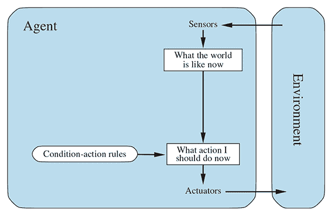

×

Figure 2.9 Schematic diagram of a simple reflex agent. We use rectangles to denote the current internal state of the agent’s decision process, and ovals to represent the background information used in the process.

图 2.9 简单反射智能体的示意图。我们使用矩形表示智能体决策过程的当前内部状态，并使用椭圆表示过程中使用的背景信息。

An agent program for Figure 2.9 is shown in Figure 2.10. The `INTERPRET-INPUT` function generates an abstracted description of the current state from the percept, and the `RULE-MATCH` function returns the first rule in the set of rules that matches the given state description. Note that the description in terms of “rules” and “matching” is purely conceptual; as noted above, actual implementations can be as simple as a collection of logic gates implementing a Boolean circuit. Alternatively, a “neural” circuit can be used, where the logic gates are replaced by the nonlinear units of artificial neural networks (see Chapter 22).

图 2.9 的智能体程序显示在图 2.10 中。`INTERPRET-INPUT`函数从感知生成当前状态的抽象描述，而`RULE-MATCH`函数返回规则集中第一个与给定状态描述匹配的规则。请注意，以“规则”和“匹配”为术语的描述纯属概念性；如上所述，实际实现可以简单到由实现布尔电路的逻辑门集合组成。或者，可以使用“神经”电路，其中逻辑门被人工神经网络的非线性单元取代（参见第 22 章）。

×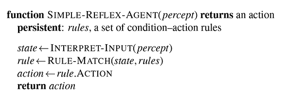

×

Figure 2.10 A simple reflex agent. It acts according to a rule whose condition matches the current state, as defined by the percept.

图 2.10 简单反射智能体。它根据与当前状态（由感知定义）条件匹配的规则采取行动。

Simple reflex agents have the admirable property of being simple, but they are of limited intelligence. The agent in Figure 2.10 will work only if the correct decision can be made on the basis of just the current percept—that is, only if the environment is fully observable.

简单反射智能体具有简单这一值得称赞的特性，但它们的智能有限。图 2.10 中的智能体仅在能够仅基于当前感知做出正确决策时才有效——也就是说，仅在环境完全可观察时才有效。


即使一点点不可观测性也可能导致严重问题。例如，先前给出的制动规则假设条件 `car-in-front-is-braking` 可以从当前感知中确定——一段视频的单帧。如果前车装有中央安装且因此可唯一识别的刹车灯，则此方法有效。不幸的是，老款车型尾灯、刹车灯和转向信号灯的配置各不相同，有时无法从单张图像判断车辆是否正在刹车还是仅仅打开了尾灯。跟随此类车辆行驶的简单反射智能体要么会持续且不必要地刹车，要么更糟，根本不刹车。

我们可以在真空世界中看到类似的问题出现。假设一个简单的反射吸尘智能体失去了其位置传感器，只剩下灰尘传感器。这种智能体只有两种可能的感知：[`Dirty`] 和 [`Clean`]。它可以对 [`Dirty`] 作出 `Suck` 反应；那么对 [`Clean`] 应该做什么呢？如果恰好从方格 `A` 开始，移动 `Left` 将永远失败；如果恰好从方格 `B` 开始，移动 `Right` 将永远失败。在部分可观测环境中运行的简单反射智能体经常不可避免地出现无限循环。

如果智能体能够随机化其行为，则可以摆脱无限循环。例如，如果吸尘智能体感知到 [`Clean`]，它可能会抛硬币在 `Right` 和 `Left` 之间选择。不难证明智能体平均在两步内会到达另一方格。然后，如果那个方格脏了，智能体就会清理它，任务就完成了。因此，随机化的简单反射智能体可能优于确定性的简单反射智能体。

### 随机化
我们在 第 2.3 节 中提到，在某些多智能体环境中，适当类型的随机行为可能是理性的。在单智能体环境中，随机化通常不是理性的。这是一种有用的技巧，可以在某些情况下帮助简单反射智能体，但在大多数情况下，使用更复杂的确定性智能体可以做得更好。

## 2.4.3 基于模型的反射智能体
处理部分可观测性的最有效方法是让智能体跟踪其当前看不到的世界部分。也就是说，智能体应维护某种内部状态，该状态依赖于感知历史，从而反映当前状态的至少部分未被观测到的方面。对于刹车问题，内部状态并不复杂——只需摄像头的上一帧图像，便可让智能体检测到车辆边缘的两盏红灯同时亮起或熄灭。对于其他驾驶任务，如变道，如果智能体无法同时看到所有车辆，就需要跟踪其他车辆的位置。而要进行任何驾驶，智能体都需要跟踪其钥匙的位置。

### 内部状态
随着时间的推移更新这些内部状态信息需要在智能体程序中以某种形式编码两种知识。首先，我们需要一些关于世界随时间变化的信息，大致可分为两部分：智能体行为的效果以及世界独立于智能体的演化。例如，当智能体顺时针转动方向盘时，汽车向右转；当下雨时，汽车的摄像头可能会被淋湿。这种关于“世界如何运作”的知识——无论是实现在简单的布尔电路中还是完整的科学理论中——被称为世界的转移模型。

### 转移模型
其次，我们需要一些关于世界状态如何在智能体感知中体现的信息。例如，当前车开始刹车时，前向摄像头图像中会出现一个或多个发光的红色区域；当摄像头被淋湿时，图像中会出现水滴状物体，部分遮挡道路。这种知识称为传感器模型。

### 传感器模型
转移模型和传感器模型共同使智能体能够跟踪世界的状态——在智能体传感器限制允许的范围内。使用此类模型的智能体称为基于模型的智能体。

### 基于模型的智能体
图 2.11 给出了具有内部状态的基于模型的反射智能体的结构，展示了当前感知如何与旧内部状态结合，基于智能体对世界运作的模型生成当前状态的更新描述。智能体程序显示在 图 2.12 中。有趣的部分是函数 `UPDATE-STATE`，它负责创建新的内部状态描述。模型和状态的表示细节因环境类型和智能体设计所使用的特定技术而大不相同。

×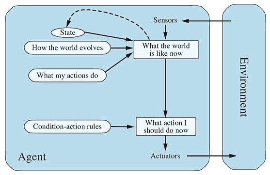
图 2.11 一个基于模型的反射智能体。

×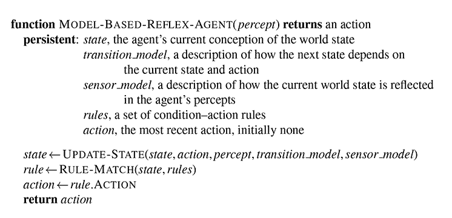
图 2.12 一个基于模型的反射智能体。它使用内部模型跟踪世界的当前状态。然后它以与反射智能体相同的方式选择行为。

无论使用何种表示方式，智能体很少能够精确确定部分可观测环境的当前状态。相反，标记为“世界现在是什么样”的框（图 2.11）代表智能体的“最佳猜测”，如果智能体考虑多种可能性，则有时是最佳猜测集合。例如，自动出租车可能无法看到停在它前面大卡车后面的情况，只能猜测造成延误的原因。因此，对当前状态的不确定性可能不可避免，但智能体仍必须做出决策。

## 2.4.4 基于目标的智能体
知道环境当前状态的一些信息并不总是足以决定做什么。例如，在路口，出租车可以左转、右转或直行。正确决策取决于出租车要去哪里。换句话说，除了当前状态描述外，智能体还需要某种目标信息来描述期望的情况——例如到达特定目的地。智能体程序可以将此信息与模型结合——与基于模型的反射智能体中使用相同的信息——以选择实现目标的行为。图 2.13 显示了基于目标智能体的结构。

×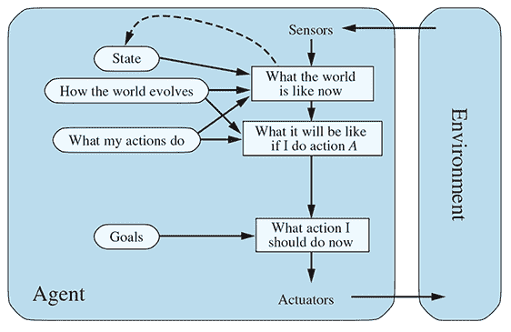
图 2.13 一个基于模型、基于目标的智能体。它跟踪世界状态以及正在尝试实现的一组目标，并选择最终会导致实现目标的行为。

### 目标
有时基于目标的行为选择很直接——例如，当目标满足立即由单一行为产生时。有时则更棘手——例如，当智能体必须考虑长序列的转弯以找到实现目标的方法时。搜索（第 3 章 和 第 6 章）和规划（第 11 章）是人工智能中致力于寻找实现智能体目标的行为序列的子领域。


请注意，这种类型的决策与前面描述的条件-行动规则从根本上不同，因为它涉及对未来的考虑——既有“如果我这样做会发生什么？”也有“那样会让我高兴吗？”在反应式智能体设计中，这些信息并未被显式表示，因为内置规则直接将感知映射到行动。反应式智能体看到刹车灯就刹车，句号。它不知道为什么。基于目标的智能体看到刹车灯就刹车，因为它预测这是实现不撞到其他汽车这一目标的唯一行动。

虽然基于目标的智能体看起来效率较低，但它更灵活，因为支持其决策的知识被显式表示并且可以修改。例如，基于目标的智能体的行为可以很容易地改变以前往不同的目的地，只需将该目的地指定为目标即可。反应式智能体关于何时转弯、何时直行的规则仅适用于单一目的地；要去新的地方，所有这些规则都必须被替换。

## 2.4.5 基于效用的智能体

目标本身不足以在大多数环境中产生高质量的行为。例如，许多行动序列都能让出租车到达目的地（从而实现目标），但有些更快、更安全、更可靠或更便宜。目标只是对“高兴”和“不高兴”状态进行粗略的二元区分。更一般的性能度量应允许根据世界状态会让智能体有多高兴来比较不同的世界状态。因为“高兴”听起来不够科学，经济学家和计算机科学家使用效用这一术语代替。7

**效用**

我们已经看到，性能度量会为给定的环境状态序列分配一个分数，因此它可以轻松区分到达出租车目的地的更优或较差方式。智能体的效用函数本质上是对性能度量的内化。只要内部效用函数与外部性能度量一致，选择行动以最大化其效用的智能体就根据外部性能度量是理性的。

**效用函数**

我们再次强调，这并不是理性的唯一方式——我们已经看到真空世界的理性智能体程序（图 2.8）它根本不知道自己的效用函数是什么——但与基于目标的智能体一样，基于效用的智能体在灵活性和学习方面具有许多优势。此外，在两种情况下，目标是不够的，但基于效用的智能体仍能做出理性决策。首先，当存在冲突的目标时，其中只有部分可以实现（例如速度和安全），效用函数指定了适当的权衡。其次，当智能体可以追求多个目标时，其中没有任何一个能确定实现，效用提供了一种方法，可以将成功的可能性与目标的重要性进行权衡。

部分可观察性和非确定性在现实世界中无处不在，因此决策不确定性也是如此。从技术上讲，理性的基于效用的智能体选择使行动结果的期望效用最大化的行动——也就是说，智能体在给定每个结果的概率和效用的情况下，平均预期获得的效用。（附录 A 更精确地定义了期望。）在第 15 章中，我们证明任何理性智能体都必须表现得好像它拥有一个效用函数，并试图最大化其期望值。拥有显式效用函数的智能体可以用不依赖于被最大化特定效用函数的通用算法做出理性决策。这样，“全局”理性的定义——将具有最高性能的智能体函数指定为理性——就被转化为对理性智能体设计的“局部”约束，可以用一个简单程序表达。

**期望效用**

基于效用的智能体结构出现在图 2.14 中。基于效用的智能体程序出现在第 15 章和第 16 章中，在那里我们设计必须处理非确定性或部分可观察环境固有不确定性的决策智能体。多智能体环境中的决策也在效用理论的框架下进行研究，如第 17 章所解释的那样。

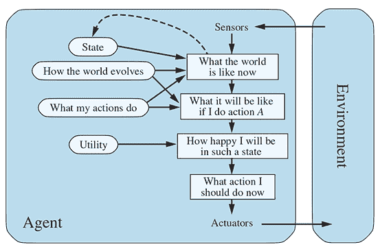

图 2.14 一个基于模型、基于效用的智能体。它使用对世界的模型，以及一个衡量其对世界状态偏好的效用函数。然后它选择导致最佳期望效用的行动，其中期望效用是通过对所有可能的结果状态取平均计算得出的，按结果的概率加权。

此时，读者可能会想：“就这么简单吗？我们只要构建最大化期望效用的智能体，就大功告成了？”确实，这样的智能体将是智能的，但并不简单。基于效用的智能体必须对环境进行建模并跟踪环境，这些任务涉及感知、表示、推理和学习方面的大量研究。这些研究的成果填满了本书的许多章节。选择效用最大化的行动方案也是一项困难的任务，需要填满数章的巧妙算法。即使有了这些算法，由于计算复杂性，完美的理性在实践中通常也是无法实现的，正如我们在第 1 章中所指出的。我们还注意到，并非所有基于效用的智能体都是基于模型的；我们将在第 23 章和第 26 章中看到，无模型智能体可以在从未学习该行动如何精确改变环境的情况下，学习在特定情况下什么行动最好。

**无模型智能体**

最后，所有这些都假设设计者能够正确指定效用函数；第 16 章、第 17 章和第 23 章更深入地讨论了未知效用函数的问题。

## 2.4.6 学习型智能体

我们已经描述了具有各种行动选择方法的智能体程序。到目前为止，我们尚未解释智能体程序是如何产生的。在他著名的早期论文中，图灵（1950）考虑了手工编程其智能机器的想法。他估计这可能需要多少工作，并得出结论：“似乎需要一种更快捷的方法。”他提出的方法是构建学习机器然后对它们进行教学。在人工智能的许多领域，这现在是创建最先进系统的首选方法。任何类型的智能体（基于模型的、基于目标的、基于效用的等）都可以构建为学习型智能体（或不构建）。

学习还有另一个优势，正如我们之前指出的：它允许智能体在初始未知环境中运行，并变得比其初始知识单独所允许的更胜任。在本节中，我们简要介绍学习型智能体的主要思想。在整本书中，我们对特定类型智能体的学习机会和方法进行了评论。第 19 章、第 21 章、第 22 章和第 23 章更深入地探讨了学习算法本身。


一个学习型智能体可以划分为四个概念性组件，如图 2.15 所示。最重要的区别在于学习元素，它负责做出改进，以及性能元素，它负责选择外部行为。性能元素是我们之前认为的整个智能体：它接收感知并决定行为。学习元素利用来自批评者的反馈来了解智能体的表现如何，并确定应如何修改性能元素以便未来做得更好。

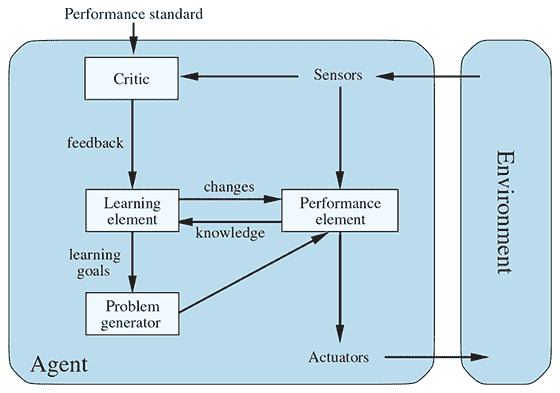

图 2.15 一个通用的学习型智能体。“performance element”框代表我们之前认为的整个智能体程序。现在，“learning element”框可以修改该程序以提高其性能。

学习元素 性能元素 批评者

学习元素的设计在很大程度上取决于性能元素的设计。当试图设计一个能够学习某种能力的智能体时，第一个问题不是“我要怎样让它学会这个？”而是“我的智能体学会之后会使用什么样的性能元素来完成这个任务？”在确定了性能元素的设计后，就可以构建学习机制来改进智能体的每个部分。

批评者告诉学习元素智能体相对于固定性能标准表现如何。批评者是必要的，因为感知本身并不能表明智能体的成功。例如，一个国际象棋程序可能会收到一个感知，表示它将对手将死，但它需要一个性能标准来知道这是好事；感知本身并不会说明这一点。性能标准必须是固定的。从概念上讲，应该将其视为完全在智能体之外，因为智能体不得修改它以适应自己的行为。

学习型智能体的最后一个组件是问题生成器。它负责建议能够带来新颖且信息丰富的体验的行为。如果性能元素按自己的意愿行事，它会一直执行在已知信息下最好的行为，但如果智能体愿意稍微探索一下，并在短期内执行一些可能次优的行为，它可能会发现长期来看更好的行为。问题生成器的任务就是建议这些探索性行为。这就是科学家在进行实验时所做的。伽利略并不认为从比萨塔顶扔石头本身是有价值的。他并不是想砸碎石头或改变不幸行人的大脑。他的目的是通过确定物体运动的更好理论来修改自己的大脑。

问题生成器

学习元素可以修改智能体图中所示的任何“知识”组件（图 2.9、图 2.11、图 2.13 和图 2.14）。最简单的情况是直接从感知序列中学习。观察环境中连续状态的配对可以让智能体学习“我的行为做了什么”以及“世界如何响应我的行为而演变”。例如，如果自动出租车在湿滑道路上施加一定的制动压力，那么它很快就会发现实际实现了多少减速，以及是否会滑出道路。问题生成器可能会识别出模型中需要改进的部分并建议实验，例如在不同条件下在不同路面上尝试制动。

改进基于模型的智能体的模型组件，使其更符合现实，无论外部性能标准如何，通常都是一个好主意。（在某些情况下，从计算角度来看，拥有一个简单但略不准确的模型比拥有一个完美但极其复杂的模型更好。）在尝试学习反射组件或效用函数时，需要来自外部标准的信息。

例如，假设出租车驾驶智能体在乘客在行程中被严重颠簸后不会收到小费。外部性能标准必须告知智能体，小费的损失对其整体性能是一个负面贡献；然后智能体可能会学会，暴力操作并不会有助于其自身的效用。从某种意义上说，性能标准将传入感知的部分区分为奖励（或惩罚），它直接反馈智能体行为的质量。动物中诸如疼痛和饥饿等硬连线的性能标准可以这样理解。

奖励 惩罚

更一般地说，人类的选择可以提供有关人类偏好的信息。例如，假设出租车不知道人们通常不喜欢噪音，并决定持续鸣喇叭以确保行人知道它正在接近。随之而来的行为——捂耳朵、使用粗话，甚至可能剪断喇叭的电线——将为智能体提供证据，以便更新其效用函数。这一问题在第 23 章中进一步讨论。

总之，智能体具有多种组件，这些组件可以在智能体程序中以多种方式表示，因此学习方法似乎存在很大差异。然而，有一个统一的主题。智能体中的学习可以概括为修改智能体的每个组件的过程，以使其更接近可用的反馈信息，从而提高智能体的整体性能。

## 2.4.7 智能体程序组件的工作方式

我们已在非常高层次的术语中描述了智能体程序由各种组件组成，其功能是回答诸如：“世界现在是什么样的？”“我现在应该做什么行为？”“我的行为做了什么？”等问题。对于人工智能学生来说，下一个问题是：“这些组件到底是如何工作的？”要正确回答这个问题大约需要一千页，但在这里我们希望引起读者的注意，关注组件表示智能体所处的环境的不同方式之间的一些基本区别。

粗略地说，我们可以将表示方式沿着一个复杂度递增且表达能力增强的轴进行排列——原子式、分解式和结构化。为了说明这些思想，考虑一个特定的智能体组件会有所帮助，例如处理“我的行为做了什么”的组件。该组件描述了采取行为后环境中可能发生的改变，而图 2.16 提供了这些转换可能如何表示的示意描绘。

描述


### 第 (a) 部分，原子式
从标记为 `B` 的块引出一条箭头指向标记为 `C` 的块。

### 第 (b) 部分，因子化
显示了标记为 `B` 和 `C` 的两个块。在两个块中，均显示了四个一个在另一个下方排列的圆圈，以及在最下面圆圈下方显示的两个进度条。在块 `B` 中，圆圈从顶部开始交替呈现黑色和蓝色阴影。在第一个进度条中，黑色阴影填充了约 40% 的条，而蓝色阴影填充其余部分。在第二个进度条中，黑色阴影填充了约 90% 的条，而蓝色阴影填充其余部分。在块 `C` 中，从顶部起的两个圆圈呈蓝色阴影，其余两个圆圈呈黑色阴影。在第一个进度条中，黑色阴影填充了约 40% 的条，而蓝色阴影填充其余部分。在第二个进度条中，黑色阴影填充了约 60% 的条，而蓝色阴影填充其余部分。

### 第 (c) 部分，结构化
该图显示了由箭头连接的两个块。第一个块中有四个红色块、三个绿色块和两个白色块。这些块按三列四行排列。每一行的块如下所示。第 1 行：第 1 列，红色。第 2 列，绿色。第 2 行：第 2 列，红色。第 3 行：第 1 列，红色。第 2 列，绿色。第 3 列，白色。第 4 行：第 1 列，白色。第 2 列，红色。第 3 列，绿色。这些块通过不同路径的箭头连接。第二个块中有四个红色块、三个绿色块和四个白色块。这些块按三列四行排列。每一行的块如下所示。第 1 行：第 1 列，白色。第 2 列，绿色。第 3 列，白色。第 2 行：第 2 列，红色。第 3 列，红色。第 3 行：第 1 列，红色。第 2 列，白色。第 3 列，白色。第 4 行：第 1 列，绿色。第 2 列，红色。第 3 列，绿色。这些块通过不同路径的箭头连接。

×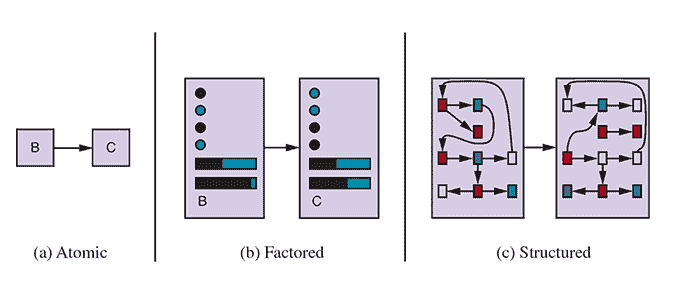

图 2.16 表示状态及其之间转换的三种方式。(a) 原子表示：状态（如 `B` 或 `C`）是一个没有内部结构的黑箱；(b) 因子化表示：状态由属性值的向量组成；值可以是布尔值、实值或固定符号集中的一个。(c) 结构化表示：状态包含对象，每个对象可能具有自己的属性以及与其他对象的关系。

在原子表示中，世界的每个状态都是不可分的——它没有内部结构。考虑从一个国家的一端到另一端经由一系列城市寻找驾驶路线的任务（我们在图 3.1 中讨论了这个问题，在第 82 页）。为了解决这个问题，可能只需将世界的状态简化为我们所在的城市名称——一个知识的单一原子，一个“黑箱”，其唯一可辨别的属性是与另一个黑箱相同或不同。支撑搜索和博弈论（第 3 章、第 4 章和第 6 章）、隐马尔可夫模型（第 14 章）以及马尔可夫决策过程（第 16 章）的标准算法都使用原子表示。

原子表示

因子化表示将每个状态拆分为一组固定的变量或属性，每个变量或属性都可以有一个值。考虑同一驾驶问题的更高保真描述，其中我们需要关注的不仅是原子意义上位于这个城市还是那个城市；我们可能需要关注油箱中的汽油量、我们当前的 GPS 坐标、机油警告灯是否工作、我们用于过路费的钱有多少、收音机上播放的电台是什么等等。虽然两个不同的原子状态没有任何共同之处——它们只是不同的黑箱——但两个不同的因子化状态可以共享某些属性（如位于某个特定的 GPS 位置），而不共享其他属性（如汽油充足或无汽油）；这使得从一个状态转变到另一个状态的推导变得容易得多。许多重要的 AI 领域都基于因子化表示，包括约束满足算法（第 5 章）、命题逻辑（第 7 章）、规划（第 11 章）、贝叶斯网络（第 12 章、第 13 章、第 14 章、第 15 章和第 18 章）以及各种机器学习算法。

因子化表示
变量
属性
值

对于许多目的，我们需要将世界理解为其中存在相互关联的事物，而不仅仅是具有值的变量。例如，我们可能会注意到前方有一辆大卡车正在倒车进入奶牛场的车道，但一头松散的奶牛正挡住卡车的去路。因子化表示不太可能预先配备属性 `TruckAheadBackinglntoDairyFarmDrivewayBlockedByLooseCow`，其值为 `true` 或 `false`。相反，我们需要结构化表示，在其中可以明确描述诸如奶牛和卡车之类的对象及其各种各样的关系（参见图 2.16(c)）。结构化表示支撑了关系数据库和一阶逻辑（第 8 章、第 9 章和第 10 章）、一阶概率模型（第 18 章）以及自然语言理解的大部分内容（第 24 章和第 25 章）。事实上，人类在自然语言中表达的大部分内容都涉及对象及其关系。

结构化表示

正如我们前面提到的，原子、因子化和结构化表示所在的轴是表达能力递增的轴。粗略地说，更具表达力的表示可以至少同样简洁地捕捉到较少表达力表示所能捕捉的一切，再加上一些更多的内容。通常，更具表达力的语言要简洁得多；例如，国际象棋的规则可以用一到两页的结构化表示语言（如一阶逻辑）写成，但在因子化表示语言（如命题逻辑）中需要数千页，而在原子语言（如有限状态自动机）中则需要约 10³⁸ 页。另一方面，随着表示的表达能力增加，推理和学习变得更加复杂。为了在获得表达性表示的好处的同时避免其缺点，面向现实世界的智能系统可能需要在该轴上的所有点上同时运行。

表达能力

表示的另一个轴涉及概念到物理内存中位置的映射，无论是在计算机中还是在大脑中。如果概念与内存位置之间存在一对一的映射，我们称之为局部表示。另一方面，如果概念的表示分布在许多内存位置上，并且每个内存位置都作为多个不同概念表示的一部分被使用，我们称之为分布式表示。分布式表示对噪声和信息丢失更具鲁棒性。对于局部表示，概念到内存位置的映射是任意的，如果传输错误损坏了几位，我们可能会将 `Truck` 与无关概念 `Truce` 混淆。但对于分布式表示，你可以认为每个概念代表多维空间中的一个点，如果你损坏了几位，你就会移动到该空间中的附近点，而该点具有相似的含义。

局部表示
分布式表示

## 摘要


本章是对人工智能的某种旋风式巡览，我们将其视为智能体设计的科学。需要记住的主要要点如下：

-   智能体是在环境中感知并行动的事物。智能体的智能体函数指定了智能体对任何感知序列的响应动作。
-   性能度量评估智能体在环境中的行为。理性智能体根据迄今为止所见的感知序列，行动以最大化性能度量的期望值。
-   任务环境规范包括性能度量、外部环境、执行器和传感器。在设计智能体时，第一步始终必须是尽可能完整地指定任务环境。
-   任务环境在几个重要维度上有所不同。它们可以是完全可观察或部分可观察的，单智能体或多智能体的，确定性或非确定性的，阶段性或序列性的，静态或动态的，离散或连续的，以及已知或未知的。
-   在性能度量未知或难以正确指定的情况下，智能体优化错误目标的风险很大。在这种情况下，智能体设计应反映对真实目标的不确定性。
-   智能体程序实现了智能体函数。存在多种基本的智能体程序设计，反映了在决策过程中显式化并使用信息的种类。这些设计在效率、紧凑性和灵活性方面各有不同。智能体程序的适当设计取决于环境的性质。
-   简单反射智能体直接对感知做出响应，而基于模型的反射智能体则维护内部状态以跟踪当前感知中不明显的事物。基于目标的智能体行动以实现其目标，而基于效用的智能体则试图最大化自身的期望“幸福感。”
-   所有智能体都可以通过学习来提高性能。

## 参考文献和历史注记

行动在智能中的核心作用——实践推理的概念——至少可以追溯到亚里士多德的《尼各马可伦理学》。实践推理也是麦卡锡 1958 年有影响的论文“Programs with Common Sense”的主题。机器人学和控制论领域本质上主要关注物理智能体。控制论中控制器的概念与人工智能中智能体的概念相同。也许令人惊讶的是，人工智能在其历史的大部分时间里都集中在智能体的孤立组件上——问答系统、定理证明器、视觉系统等等——而不是完整的智能体。Genesereth 和 Nilsson（1987）著作中对智能体的讨论是一个有影响力的例外。整体智能体观点现在被广泛接受，并且是近期著作中的一个核心主题（Padgham and Winikoff，2004；Jones，2007；Poole and Mackworth，2017）。

> 控制器

第 1 章追溯了理性概念在哲学和经济学中的根源。在人工智能中，这一概念直到 20 世纪 80 年代中期才成为边缘性兴趣，之后开始渗透到关于该领域适当技术基础的许多讨论中。Jon Doyle（1983）的论文预测，理性智能体设计将被视为人工智能的核心使命，而其他热门主题则会衍生形成新的学科。

对环境属性及其对理性智能体设计影响的细致关注在控制论传统中最为明显——例如，经典控制系统（Dorf and Bishop，2004；Kirk，2004）处理完全可观察、确定性的环境；随机最优控制（Kumar and Varaiya，1986；Bertsekas and Shreve，2007）处理部分可观察、随机的环境；混合控制（Henzinger and Sastry，1998；Cassandras and Lygeros，2006）处理包含离散和连续元素的环境。完全可观察与部分可观察环境之间的区别在运筹学领域发展的动态规划文献中也很核心（Puterman，1994），我们在第 16 章中讨论了它。

尽管简单反射智能体是行为主义心理学的核心（参见第 1 章），大多数人工智能研究人员认为它们过于简单，难以提供多大杠杆。（Rosenschein（1985）和 Brooks（1986）质疑了这一假设；参见第 26 章。）大量工作已投入到寻找跟踪复杂环境的有效算法（Bar-Shalom et al.，2001；Choset et al.，2005；Simon，2006），其中大部分在概率设定中。

基于目标的智能体从亚里士多德对实践推理的观点到麦卡锡关于逻辑人工智能的早期论文无处不被预设。Shakey the Robot（Fikes and Nilsson，1971；Nilsson，1984）是逻辑、基于目标的智能体的第一个机器人实现。对基于目标的智能体的完整逻辑分析出现在 Genesereth and Nilsson（1987）中，而一种称为面向智能体编程的基于目标的编程方法论由 Shoham（1993）提出。基于智能体的方法现在在软件工程中极受欢迎（Ciancarini and Wooldridge，2001）。它也渗透到操作系统领域，其中自主计算指的是利用感知-行动循环和机器学习方法自行监控和控制的计算机系统和网络（Kephart and Chess，2003）。注意到在真正的多智能体环境中设计为协同工作的智能体程序集合必然表现出模块化——程序之间不共享内部状态，仅通过环境相互通信——在多智能体系统领域，通常将单个智能体的智能体程序设计为自主子智能体的集合。在某些情况下，甚至可以证明 resulting 系统给出的最优解与单体设计相同。

> 自主计算

基于目标的智能体观点也主导了认知心理学中问题解决的传统，从极具影响力的 Human Problem Solving（Newell and Simon，1972）开始，贯穿 Newell 的所有后期工作（Newell，1990）。目标进一步被分析为欲望（一般）和意图（当前追求），是 Michael Bratman（1987）提出的具有影响力的智能体理论的核心。

正如第 1 章所述，效用理论作为理性行为基础的发展可以追溯数百年。在人工智能中，早期的研究避开了效用而偏爱目标，少数例外除外（Feldman and Sproull，1977）。20 世纪 80 年代对概率方法的兴趣复兴导致了期望效用最大化被接受为决策的最一般框架（Horvitz et al.，1988）。Pearl（1988）的著作是人工智能中第一本深入涵盖概率和效用理论的著作；其对不确定性下推理和决策实用方法的阐述可能是 20 世纪 90 年代迅速转向基于效用智能体的最大因素（参见第 15 章）。在决策理论框架内对强化学习的正式化也促进了这一转变（Sutton，1988）。相当引人注目的是，直到最近几乎所有人工智能研究都假设性能度量可以用效用函数或奖励函数的形式精确且正确地指定（Hadfield-Menell et al.，2017a；Russell，2019）。


学习代理的通用设计在 图 2.15 中有所描绘，在机器学习文献中是经典的（Buchanan et al., 1978; Mitchell, 1997）。该设计的实例以程序的形式体现，至少可以追溯到 Arthur Samuel 的（1959, 1967）下棋学习程序。学习代理在 第 19 章、第 21 章、第 22 章 和 第 23 章 中进行了深入讨论。

关于基于代理方法的一些早期论文由 Huhns 和 Singh（1998）以及 Wooldridge 和 Rao（1999）收集。关于多代理系统的著作为代理设计的许多方面提供了良好的介绍（Weiss, 2000a; Wooldridge, 2009）。几个致力于代理的会议系列始于 1990 年代，包括国际代理理论、体系结构和语言研讨会（ATAL）、国际自主代理会议（AGENTS）以及国际多代理系统会议（ICMAS）。2002 年，这三个会议合并形成了国际自主代理与多代理系统联合会议（AAMAS）。2000 年至 2012 年期间，每年举办面向代理的软件工程（AOSE）研讨会。期刊《自主代理与多代理系统》成立于 1998 年。最后，《Dung Beetle Ecology》（Hanski and Cambefort, 1991）提供了关于粪金龟行为的大量有趣信息。YouTube 上有它们活动的鼓舞人心的视频记录。

1 如果代理使用某种随机化来选择其动作，那么我们就需要多次尝试每种序列以识别每个动作的概率。人们可能会想象随机行动相当愚蠢，但我们将在本章后面展示它可以非常智能。

2 在真实的机器人中，很不可能有“move right”和“move left”之类的动作。相反，动作将是“spin wheels forward”和“spin wheels backward”。我们选择这些动作是为了在纸面上更容易理解，而不是为了在实际机器人中易于实现。

3 参见 N. Henderson，“New door latches urged for Boeing 747 jumbo jets”，《Washington Post》，1989 年 8 月 24 日。

4 单词“sequential”在计算机科学中也用作“parallel”的反义词。这两种含义在很大程度上没有关联。

5 代理程序骨架还有其他选择；例如，我们可以让代理程序成为与环境异步运行的协程。每个这样的协程都有输入和输出端口，由一个读取输入端口的感知并向输出端口写入动作的循环组成。

6 也称为情境-动作规则、产生式或 if-then 规则。

7 这里的“utility”一词指的是“有用性的质量”，而不是电力公司或自来水公司。

# 第 3 章

## 通过搜索求解问题

在此我们将看到代理如何向前看以找到最终实现其目标的一系列动作。

当要采取的正确行动并不立即明显时，代理可能需要提前规划：考虑形成通往目标状态路径的一系列动作。这样的代理称为问题求解代理，它所进行的计算过程称为搜索。

<p class="sidebar">问题求解代理</p> <p class="sidebar">搜索</p>

问题求解代理使用原子表示，如 第 2.4.7 节 中所述——即，世界的状态被视为整体，问题求解算法看不到内部结构。使用状态的因子或结构化表示的代理称为规划代理，并在 第 7 章 和 第 11 章 中讨论。

我们将介绍几种搜索算法。在本章中，我们只考虑最简单的环境：离散的、单代理的、完全可观测的、确定性的、静态的、离散的和已知的。我们区分有信息算法，其中代理可以估计其与目标的距离，以及无信息算法，其中没有此类估计可用。第 4 章 放宽了对环境的限制，而 第 6 章 考虑了多代理。

本章使用了渐近复杂度的概念（即 `O(n)` 表示法）。不熟悉这些概念的读者应参阅 附录 A。

## 3.1 问题求解代理

想象一个在罗马尼亚进行观光度假的代理。代理想要游览景点、提高罗马尼亚语、享受夜生活、避免宿醉等等。决策问题很复杂。现在，假设代理目前在 Arad 市，有一张不可退款的机票明天从布加勒斯特飞走。代理观察路标并看到从 Arad 出发有三条道路：一路通往 Sibiu，一路通往 Timisoara，一路通往 Zerind。这些都不是目标，因此除非代理熟悉罗马尼亚的地理，否则它不会知道该跟随哪条道路。1

如果代理没有额外信息——也就是说，如果环境是未知的——那么代理最好只能随机执行其中一个动作。这种悲惨的情况在 第 4 章 中讨论。在本章中，我们将假设我们的代理始终可以访问有关世界的信息，例如 图 3.1 中的地图。有了这些信息，代理可以遵循以下四阶段的问题求解过程：

### 说明

路线图显示了城市之间以英里为单位的距离。Neamt 至 Iasi，87。Iasi 至 Valsui，92。Vaslui 至 Urziceni，142。Urziceni 至 Hirsova，98。Hirsova 至 Eforie，86。Urziceni 至 Bucharest，85。Bucharest 至 Giurgiu，90。Bucharest 至 Pitesti，101。Bucharest 至 Fagaras，211。Fagaras 至 Sibiu，99。Pitesti 至 Craiova，138。Pitesti 至 Rimnicu Vilcea，97。Rimnicu Vilcea 至 Sibiu，80。Sibiu 至 Oradea，151。Sibiu 至 Arad，140。Arad 至 Zerind，75。Zerind 至 Oradea，71。Arad 至 Timisoara，118。Timisoara 至 Lugoj，111。Lugoj 至 Mehadia，70。Mehadia 至 Drobeta，75。Drobeta 至 Craiova，120。

×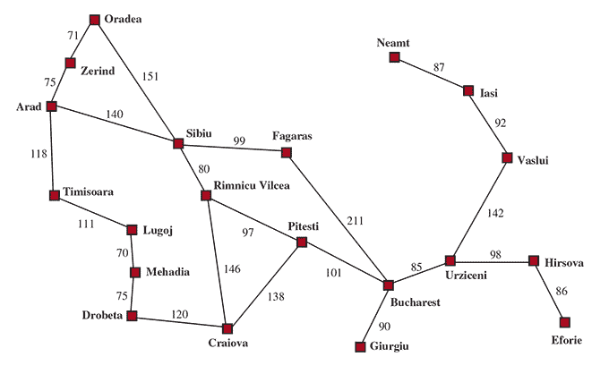

图 3.1 罗马尼亚部分地区的简化道路地图，道路距离以英里为单位。

• 目标制定：代理采用到达布加勒斯特的目标。目标通过限制目标从而限制需要考虑的行动来组织行为。

<p class="sidebar">目标制定</p>

• 问题制定：代理制定达到目标所需的 states 和 actions 的描述——相关世界部分的抽象模型。对于我们的代理，一个良好的模型是考虑从一个城市到相邻城市的旅行动作，因此由于动作而导致世界状态发生变化的唯一事实是当前城市。

<p class="sidebar">问题制定</p>

• 搜索：在现实世界中采取任何行动之前，代理在模型中模拟一系列动作的序列，直到找到达到目标的动作序列为止。这样的序列称为解。代理可能需要模拟多个未达到目标的序列，但最终它会找到一个解（例如从 Arad 到 Sibiu 到 Fagaras 到 Bucharest），或者会发现没有解。

<p class="sidebar">搜索</p>

• 执行：代理现在可以一次执行解中的一个动作。

<p class="sidebar">执行</p>


这是一个重要性质：在完全可观测、确定性、已知的环境中，任何问题的解都是一系列固定的动作：先开往锡比乌，然后是法加拉什，最后是布加勒斯特。如果模型正确，那么一旦智能体找到解，在执行动作时就可以忽略其感知——换句话说闭上眼睛——因为该解保证能导向目标。控制理论家称之为开环系统：忽略感知会切断智能体与环境之间的回路。如果模型可能不正确，或环境是非确定性的，那么智能体采用监控感知的闭环方法会更安全（参见 第 4.4 节）。

在部分可观测或非确定性环境中，解将是一种分支策略，根据接收到的感知推荐不同的未来动作。例如，智能体可能计划从阿拉德开往锡比乌，但如果意外到达泽林德或看到写着“Drum Închis”（道路封闭）的路牌，就需要有应急计划。

### 3.1.1 Search problems and solutions

搜索问题可以形式化定义如下：

- 可能的状态集合，即环境可能处于的状态。我们称之为状态空间。
- 智能体开始时的初始状态。例如：Arad。
- 一个或多个目标状态的集合。有时只有一个目标状态（例如，布加勒斯特），有时有一小组备选目标状态，有时目标由适用于许多状态（可能无限多个）的属性定义。例如，在吸尘器世界中，目标可能是任意位置都没有灰尘，而不管状态的其他事实。我们可以通过为问题指定一个 `IS-GOAL` 方法来涵盖这三种可能性。本章中我们有时为简便起见说“目标”，但我们所说的内容同样适用于“任一可能的目标状态。”
- 智能体可用的动作。给定状态 `s`，`ACTIONS(s)` 返回可在 `s` 中执行的有限 2 动作集合。我们说这些动作中的每一个在 `s` 中都是适用的。示例：

`ACTIONS(Arad) = {ToSibiu, ToTimisoara, ToZerind}`.
- 转移模型，描述每个动作的作用。`RESULT(s, a)` 返回在状态 `s` 中执行动作 `a` 所得到的状态。例如，

`RESULT(Arad, ToZerind) = Zerind`.
- 一个动作代价函数，用 `ACTION-COST(S,a, sʹ)` 表示编程时，或用 `c(s, a, sʹ)` 表示数学时，它给出在状态 `s` 中应用动作 `a` 到达状态 `sʹ` 的数值代价。问题求解智能体应使用反映其自身性能度量的代价函数；例如，对于路径查找智能体，动作的代价可能是英里长度（如 图 3.1 所示），也可能是完成该动作所需的时间。

动作序列构成一条路径，解是从初始状态到目标状态的路径。我们假设动作代价是可加的；也就是说，路径的总代价是各个动作代价之和。最优解在所有解中具有最低的路径代价。本章中，我们假设所有动作代价均为正值，以避免某些复杂情况。3

状态空间可以表示为一个图，其中顶点是状态，它们之间的有向边是动作。罗马尼亚地图如图 图 3.1 所示，这就是这样一个图，其中每条道路表示两个动作，各一个方向。

### 3.1.2 Formulating problems

我们对前往布加勒斯特问题的表述是一个模型——一种抽象的数学描述——而不是真实事物。将简单的原子状态描述 Arad 与一次实际的跨国旅行相比，世界的状态包含许多东西：旅行同伴、当前广播节目、窗外的景色、执法人员的接近程度、到下一个休息站的距离、道路状况、天气、交通等等。所有这些考虑都被排除在我们的模型之外，因为它们与寻找前往布加勒斯特的路线问题无关。

从表示中去除细节的过程称为抽象。一个好的问题表述具有合适的细节程度。如果动作的粒度细到“将右脚向前移动一厘米”或“将方向盘向左转动一度”，智能体可能永远找不到离开停车场的方法，更不用说到达布加勒斯特了。

我们能否更精确地说明适当的抽象层次？把我们选择的抽象状态和动作看作对应于大量详细世界状态和详细动作序列。现在考虑抽象问题的解：例如，从 Arad 到 Sibiu 再到 Rimnicu Vilcea 再到 Pitesti 再到 Bucharest 的路径。这个抽象解对应着大量更详细的路径。例如，我们可以在 Sibiu 和 Rimnicu Vilcea 之间开着收音机行驶，然后在余下的旅程中将其关闭。

如果我们能将任何抽象解细化为更详细世界中的解，则该抽象是有效的；一个充分条件是，对于每个“在 Arad 中”的详细状态，都存在一条通往某个“在 Sibiu 中”状态的详细路径，以此类推。4 如果执行解中的每个动作比原始问题更容易，则该抽象是有用的；在我们的例子中，动作“从 Arad 开车到 Sibiu”可以由具有平均技能的司机在无需进一步搜索或规划的情况下完成。因此，选择一个好的抽象涉及在保持有效性的同时尽可能去除细节，并确保抽象动作易于执行。如果没有构建有用抽象的能力，智能体将被现实世界完全淹没。

## 3.2 Example Problems

问题求解方法已应用于大量任务环境。我们在此列出其中一些最著名的例子，区分标准化问题和现实世界问题。标准化问题旨在说明或练习各种问题求解方法。它可以给出简洁、精确的描述，因此适合作为研究人员比较算法性能的基准。现实世界问题，如机器人导航，是人们实际使用其解的问题，其表述是特有的、非标准化的，因为例如每个机器人都有不同的传感器产生不同的数据。

### 3.2.1 Standardized problems


# 网格世界问题

网格世界问题是一个二维矩形方格阵列，智能体可以在格子之间移动。通常智能体可以移动到任何无障碍的相邻格子——水平或垂直，在某些问题中也可以对角线移动。格子可以包含物体，智能体可以拾取、推动或以其他方式作用于这些物体；格子中的墙壁或其他不可穿越的障碍会阻止智能体进入该格子。来自第 2.1 节的真空世界可以表述为一个网格世界问题，如下所示：

网格世界

**状态：** 世界的状态说明哪些物体在哪些格子中。对于真空世界，物体是智能体和任何灰尘。在简单的双格版本中，智能体可以在两个格子中的任意一个中，每个格子可能有灰尘或没有灰尘，因此有 `2 · 2 · 2 = 8` 个状态（参见图 3.2）。一般来说，具有 `n` 个格子的真空环境有 `n · 2^n` 个状态。

**初始状态：** 任何状态都可以指定为初始状态。

**动作：** 在双格世界中我们定义了三个动作：`Suck`、`Left` 和 `Right`。在二维多格世界中我们需要更多的移动动作。我们可以添加 `Upward` 和 `Downward`，得到四个绝对移动动作，或者我们可以切换到以自我为中心的行为，定义相对于智能体视点的动作——例如 `Forward`、`Backward`、`TurnRight` 和 `TurnLeft`。

**转移模型：** `Suck` 去除智能体所在格子中的任何灰尘；`Forward` 将智能体向前移动一个格子，方向为其面向的方向，除非撞到墙壁，在这种情况下该动作无效。`Backward` 使智能体向相反方向移动，而 `TurnRight` 和 `TurnLeft` 使其面向方向改变 `90°`。

**目标状态：** 所有格子都干净的状态。

**动作代价：** 每个动作的代价为 `1`。

描述
标记为起始状态的方块有三行三列。行 1：第 1 列，7。第 2 列，2。第 3 列，4。行 2：第 1 列，5。第 2 列，空白。第 3 列，6。行 3：第 1 列，8。第 2 列，3。第 3 列，1。另一个标记为目标状态的方块有三行三列。行 1：第 1 列，空白。第 2 列，1。第 3 列，2。行 2：第 1 列，3。第 2 列，4。第 3 列，5。行 3：第 1 列，6。第 2 列，7。第 3 列，8。

×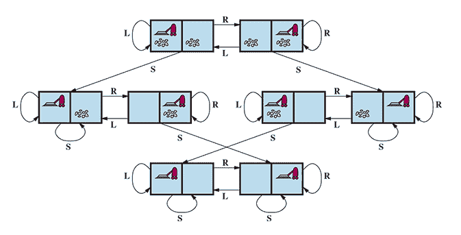

图 3.2 双格真空世界的状态空间图。每个状态有三个动作：`L` = `Left`，`R` = `Right`，`S` = `Suck`。

## 索巴诺谜题

另一种网格世界是索巴诺谜题，其中智能体的目标是将散布在网格中的若干箱子推到指定的存储位置。每个格子最多只能有一个箱子。当智能体向前移动进入包含箱子的格子，并且箱子的另一侧有一个空格子时，箱子和智能体一起向前移动。

索巴诺谜题

智能体不能将箱子推入另一个箱子或墙壁。对于具有 `n` 个非障碍格子和 `b` 个箱子的世界，有 `n × n!/(b!(n – b)!)` 个状态；例如在一个 `8 × 8` 网格上有十几个箱子，就有超过 200 万亿个状态。

## 滑动拼图

在滑动拼图中，若干瓷砖有时称为块或片排列在一个网格中，其中有一个或多个空白空间，以便某些瓷砖可以滑入空白空间。一种变体是 Rush Hour 谜题，其中汽车和卡车在 `6 × 6` 网格中滑动，试图使一辆车脱离交通堵塞。也许最著名的变体是 8 拼图（参见图 3.3），它由一个 `3 × 3` 网格、八个编号瓷砖和一个空白空间组成，以及 `4 × 4` 网格上的 15 拼图。目标是达到指定的目标状态，例如图中右侧所示的目标状态。8 拼图的标准表述如下：

滑动拼图
8 拼图
15 拼图

描述
两个具有共同垂直边的方块代表一个状态。每个方块代表一个格子。八个状态排列成三行。顶部行包含两个状态，中间行包含四个状态，底部行包含两个状态。顶部行的第一个状态在左侧格子中有吸尘器和灰尘，右侧格子中有灰尘。顶部行的第二个状态在左侧格子中有灰尘，右侧格子中有吸尘器和灰尘。从第一个状态的左侧格子出发标记为 L 的箭头回环到同一格子。从第一个状态的右侧格子出发标记为 R 的箭头指向第二个状态的左侧格子。从第二个状态的左侧格子出发标记为 L 的箭头指向第一个状态的右侧格子。从第二个状态的右侧格子出发标记为 R 的箭头回环到同一格子。从顶部行的第一个状态出发标记为 S 的箭头指向中间行的第一个状态。中间行的第一个状态在左侧格子中有吸尘器，右侧格子中有灰尘。从第一个状态的左侧格子出发标记为 L 的箭头回环到同一格子。从第一个状态的左侧格子出发标记为 S 的箭头指向同一状态的右侧格子。中间行的第二个状态左侧格子为空，右侧格子中有吸尘器和灰尘。从第二个状态的右侧格子出发标记为 R 的箭头回环到同一格子。从第一个状态的右侧格子出发标记为 R 的箭头指向第二个状态的左侧格子。从第二个状态的左侧格子出发标记为 L 的箭头指向第一个状态的右侧格子。中间行的第三个状态在左侧格子中有吸尘器和灰尘，右侧格子为空。从第三个状态的左侧格子出发标记为 L 的箭头回环到同一格子。中间行的第四个状态左侧格子中有灰尘，右侧格子中有吸尘器。从第四个状态的右侧格子出发标记为 R 的箭头回环到同一格子。从第四个状态的左侧格子出发标记为 S 的箭头指向同一状态的右侧格子。从第三个状态的右侧格子出发标记为 R 的箭头指向第四个状态的左侧格子。从第四个状态的左侧格子出发标记为 L 的箭头指向第三个状态的右侧格子。从顶部行的第二个状态出发标记为 S 的箭头指向中间行的第四个状态。从中间行的第三个状态出发的箭头指向底部行的第一个状态。底部行的第一个状态在左侧格子中有吸尘器，右侧格子为空。从第一个状态的左侧格子出发标记为 L 的箭头回环到同一格子。从第一个状态的左侧格子出发标记为 S 的箭头指向同一状态的右侧格子。底部行的第二个状态左侧格子为空，右侧格子中有吸尘器。从第二个状态的右侧格子出发标记为 R 的箭头回环到同一格子。从第二个状态的左侧格子出发标记为 S 的箭头指向同一状态的右侧格子。从第一个状态的右侧格子出发标记为 R 的箭头指向第二个状态的左侧格子。从第二个状态的左侧格子出发标记为 L 的箭头指向第一个状态的右侧格子。从中间行的第二个状态出发标记为 S 的箭头指向第三行的第二个状态。

×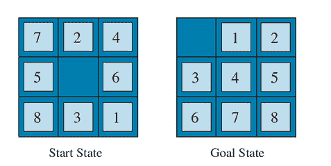

图 3.3 8 拼图的一个典型实例。

**状态：** 状态描述指定每个瓷砖的位置。

**初始状态：** 任何状态都可以指定为初始状态。注意奇偶性性质将状态空间划分为两部分——任何给定的目标只能从恰好一半的可能初始状态到达（参见练习 3.PART）。

**动作：** 在物理世界中是瓷砖滑动，但描述动作最简单的方法是认为空白空间移动 `Left`、`Right`、`Up` 或 `Down`。如果空白位于边缘或角落，则并非所有动作都适用。


-   `Transition model`：将一个状态和动作映射到一个结果状态；例如，如果我们在 图 3.3 中的起始状态应用 `Left`，结果状态会将 5 和空白互换。
-   `Goal state`：虽然任何状态都可能是目标，但我们通常指定数字按顺序排列的状态，如 图 3.3 所示。
-   `Action cost`：每个动作的成本为 1。

请注意，每个问题表述都涉及抽象。`8-puzzle` 的动作被抽象为其开始和最终状态，忽略了瓷砖滑动时的中间位置。我们已经抽象掉了诸如瓷砖卡住时摇晃棋盘之类的动作，并排除了用刀取出瓷砖再放回去的做法。我们剩下的是对规则的描述，避免了所有物理操作的细节。

我们最后的标准问题由 Donald Knuth（1964 年）提出，说明了无限状态空间是如何产生的。Knuth 猜想从数字 4 开始，`square root`、`floor` 和 `factorial` 操作的序列可以达到任意期望的正整数。例如，我们可以按如下方式从 4 到达 5：

$\\left\\lfloor \\sqrt{\\sqrt{\\sqrt{\\sqrt{\\sqrt{(4!)!}}}}} \\right\\rfloor = 5.$

The problem definition is simple:
-   `States`：正实数。
-   `Initial state`：4。
-   `Actions`：应用 `square root`、`floor` 或 `factorial` 操作（仅对整数使用阶乘）。
-   `Transition model`：由操作的数学定义给出。
-   `Goal state`：期望的正整数。
-   `Action cost`：每个动作的成本为 1。

该问题的状态空间是无限的：对于大于 2 的任何整数，`factorial` 运算符总是产生更大的整数。该问题有趣之处在于它探索了非常大的数字：到达 5 的最短路径经过 `(4!)! = 620,448,401,733,239,439,360,000`。在涉及数学表达式、电路、证明、程序以及其他递归定义对象的生成任务中，无限状态空间经常出现。

## 3.2.2 现实世界问题

我们已经看到如何根据指定的位置以及它们之间的边上的转换来定义路径查找问题。路径查找算法用于各种应用。有些，例如提供驾驶指示的网站和车载系统，是罗马尼亚示例的相对直接的扩展。（主要复杂性在于由于交通相关延迟而导致成本变化，以及由于道路封闭而重新规划路线。）其他，例如计算机网络中视频流的路由、军事行动规划和航空旅行规划系统，则涉及更复杂的规范。考虑旅行规划网站必须解决的航空旅行问题：
-   `States`：每个状态显然包括一个位置（例如机场）和当前时间。此外，由于动作（航班段）的成本可能取决于之前的段落、其票价基础以及其国内或国际状态，状态必须记录这些“历史”方面的额外信息。
-   `Initial state`：用户的家乡机场。
-   `Actions`：从当前位置乘坐任何航班，任何座位等级，在当前时间之后起飞，如有需要预留机场内中转的足够时间。
-   `Transition model`：乘坐航班后得到的状态将以航班的目的地作为新位置，以航班的到达时间作为新时间。
-   `Goal state`：目的地城市。有时目标可能更复杂，例如“直飞到达目的地”。
-   `Action cost`：货币成本、等待时间、飞行时间、海关和移民手续、座位质量、一天中的时间、飞机类型、常旅客奖励积分等的组合。

商业旅行建议系统使用这种类型的问题表述，并有许多额外复杂性来处理航空公司的繁琐票价结构。然而，任何有经验的旅行者都知道，并非所有航空旅行都按计划进行。真正好的系统应包括应急计划——如果此航班延误且转机错过会怎样？

巡游问题描述了一组必须访问的位置，而不是单一的目标目的地。旅行推销员问题（`TSP`）是一个巡游问题，其中地图上的每个城市都必须访问。目标是找到成本 < C 的巡游（或在优化版本中，找到成本最低的巡游）。人们投入了大量精力来提高 `TSP` 算法的能力。算法还可以扩展以处理车辆车队。例如，波士顿校车路线的搜索和优化算法节省了 500 万美元，减少了交通和空气污染，并为司机和学生节省了时间（Bertsimas et al., 2019）。除了规划行程外，搜索算法还被用于规划自动电路板钻孔机和车间补货机的移动等任务。

巡游问题
旅行推销员问题 (`TSP`)

一个 `VLSI` 布局问题需要在芯片上放置数百万个组件和连接，以最小化面积、最小化电路延迟、最小化寄生电容并最大化制造良率。布局问题在逻辑设计阶段之后，通常分为两个部分：单元布局和通道布线。在单元布局中，电路的原始组件被分组为单元，每个单元执行某种公认的功能。每个单元都有固定的占位（大小和形状），并且需要与每个其他单元有一定数量的连接。目标是将单元放置在芯片上，使其不重叠，并且在单元之间有空间放置连接导线。通道布线为每根导线通过单元之间的间隙找到特定的路线。这些搜索问题极其复杂，但绝对值得解决。

`VLSI layout`

机器人导航是前面描述的路径查找问题的推广。机器人不是沿着明确的路径（例如罗马尼亚的道路）行驶，而是可以四处游荡，实际上自行创建路径。对于在平面上移动的圆形机器人，空间本质上是二维的。当机器人具有也必须控制的手臂和腿时，搜索空间变得多维——每个关节角度一个维度。仅使本质上连续的搜索空间有限就需要先进技术（参见 第 26 章）。除了问题的复杂性外，真正的机器人还必须处理传感器读数和电机控制的误差、部分可观察性以及可能改变环境的其他智能体。

机器人导航

自 1970 年代以来，由机器人自动装配复杂物体（如电动机）的装配序列已成为标准工业实践。算法首先找到可行的装配序列，然后努力优化该过程。最大限度地减少装配线上人工劳动量可以节省大量时间和成本。在装配问题中，目标是找到装配某个物体零件的顺序。如果选择了错误的顺序，就无法在序列中稍后添加某个零件而不撤销已完成的工作。检查序列中动作的可行性是一个困难的几何搜索问题，与机器人导航密切相关。因此，合法动作的生成是装配序列中昂贵的部分。任何实用的算法都必须避免探索除一小部分之外的所有状态空间。一个重要的装配问题是蛋白质设计，其目标是找到一段氨基酸序列，使其折叠成具有治愈某些疾病的正确特性的三维蛋白质。


自动装配排序
蛋白质设计

## 3.3 搜索算法

搜索算法以搜索问题作为输入，并返回一个解，或失败的指示。本章我们考虑将搜索树叠加在状态空间图上的算法，从初始状态形成各种路径，试图找到一条到达目标状态的路径。搜索树中的每个节点对应状态空间中的一个状态，而搜索树中的边对应动作。树的根对应于问题的初始状态。

搜索算法
节点

了解状态空间与搜索树之间的区别很重要。状态空间描述了世界中（可能无限的）状态集合，以及允许从一个状态转换到另一个状态的动作。搜索树描述了这些状态之间的路径，朝向目标。搜索树可能对任何给定状态有多条路径（因此有多个节点），但树中的每个节点都有唯一的一条返回根的路径（如所有树一样）。

图 3.4 显示了从 Arad 到 Bucharest 寻找路径的最初几个步骤。搜索树的根节点位于初始状态 Arad。我们可以扩展该节点，通过考虑该状态可用的 `ACTIONS`，使用 `RESULT` 函数查看这些动作会导致何处，并为每个结果状态生成一个新节点（称为子节点或后继节点）。每个子节点都有 Arad 作为其父节点。

描述

搜索树 1：根节点为薰衣草色，所有其他节点均为淡虚线。根节点 Arad 有三个子节点：Sibiu、Timisoara 和 Zerind。节点 Sibiu 有四个子节点：Arad、Fagaras、Oradea 和 Rimnicu Vilcea。节点 Timisoara 有两个子节点：Arad 和 Lugoj。节点 Zerind 有两个子节点：Arad 和 Oradea。搜索树 2：根节点为薰衣草色。根节点 Arad 有三个绿色子节点：Sibiu、Timisoara 和 Zerind。节点 Sibiu 有四个淡虚线子节点：Arad、Fagaras、Oradea 和 Rimnicu Vilcea。节点 Timisoara 有两个淡虚线子节点：Arad 和 Lugoj。节点 Zerind 有两个淡虚线子节点：Arad 和 Oradea。搜索树 3：根节点为薰衣草色。根节点 Arad 有三个子节点：薰衣草色的 Sibiu、绿色的 Timisoara 和绿色的 Zerind。节点 Sibiu 有四个绿色子节点：Arad、Fagaras、Oradea 和 Rimnicu Vilcea。节点 Timisoara 有两个淡虚线子节点：Arad 和 Lugoj。节点 Zerind 有两个淡虚线子节点：Arad 和 Oradea。

×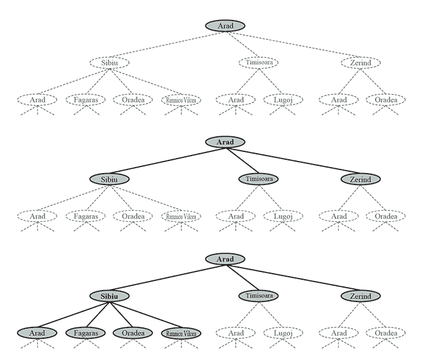

图 3.4 从 Arad 到 Bucharest 寻找路线的三个部分搜索树。已扩展的节点为薰衣草色且字母加粗；已生成但尚未扩展的前沿节点为绿色；对应于这两种类型节点的状态集合被称为已到达。可能下一步生成的节点以淡虚线显示。注意在底部树中存在从 Arad 到 Sibiu 再到 Arad 的循环；这不可能是最优路径，因此搜索不应从那里继续。

扩展
生成
子节点
后继节点
父节点

现在我们必须选择接下来考虑这三个子节点中的哪一个。这就是搜索的本质——现在跟进一个选项，将其他选项留待以后。假设我们首先扩展 Sibiu。图 3.4（底部）显示了结果：一组 6 个未扩展节点（以粗体轮廓显示）。我们称之为搜索树的前沿。我们说任何已为其生成节点的 state 都已被到达（无论该节点是否已扩展）。5 图 3.5 显示了叠加在状态空间图上的搜索树。

描述

在全部三个部分中，从 Zerind、Sibiu 和 Timisoara 到 Arad 的路径均以红色高亮标记。第 1 部分：显示了高亮的路径。第 2 部分：显示了第 1 部分中的路径。此外，从 Fagaras 和 Rimnicu Vilcea 到 Sibiu 的路径以红色高亮标记。从 Oradea 到 Zerind 以及从 Lugoj 到 Timisoara 的路径以红色高亮标记。第 3 部分：显示了第 2 部分中的所有路径。此外，从 Mehadia 到 Lugoj 以及从 Bucharest 到 Fagaras 的路径以红色高亮标记。从 Craiova 和 Pitesti 到 Rimnicu Vilcea 的路径以红色高亮标记。

×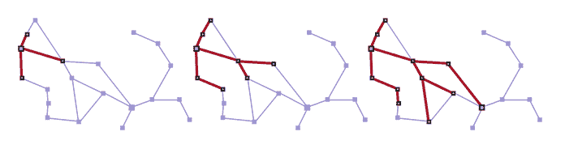

图 3.5 由对 图 3.1 中罗马尼亚问题的图搜索生成的搜索树序列。在每个阶段，我们都扩展了前沿上的每个节点，用所有不会导致已到达状态的适用动作扩展每条路径。注意在第三阶段，最上方的城市（Oradea）有两个后继，这两者都已通过其他路径到达，因此不会从 Oradea 扩展路径。

前沿
已到达

请注意，前沿将状态空间图分隔为两个区域：内部区域，其中每个状态都已扩展，以及尚未到达的外部状态区域。这一特性在 图 3.6 中有所说明。

描述

每个矩形网格有 25 个节点，由五行五列组成。每行包含五个节点。节点通过沿五个垂直和五个水平网格线的路径连接。第（“a”）部分：第三行第三列的节点为薰衣草色，与其垂直和水平相邻的节点为绿色。薰衣草节点与绿色节点之间的四条路径为薰衣草色。所有其他节点和路径均为淡虚线。第（b）部分：第三列第二行和第三行的两个节点为薰衣草色，每个节点都有三个绿色相邻节点。薰衣草节点与绿色节点之间的路径为薰衣草色。所有其他节点和路径均为淡虚线。第（c）部分：五个节点为薰衣草色，位置如下：第三列的第 2、3、4 行，以及第 3 行的第 2 列和第 4 列。从第 3 列第 3 行的薰衣草节点到其他四个薰衣草节点的路径为薰衣草色。第 2 行第 3 列的薰衣草节点在右侧、左侧和上方各有一个绿色节点，且从该薰衣草节点到这些绿色节点的路径为薰衣草色。第 3 行第 4 列的薰衣草节点在右侧和下方各有一个绿色节点，且从该薰衣草节点到这些绿色节点的路径为薰衣草色。第 4 行第 3 列的薰衣草节点在左侧和下方各有一个绿色节点，且从该薰衣草节点到这些绿色节点的路径为薰衣草色。第 3 行第 2 列的薰衣草节点在左侧有一个绿色节点，且从该薰衣草节点到此绿色节点的路径为薰衣草色。所有其他节点和路径均为淡虚线。

×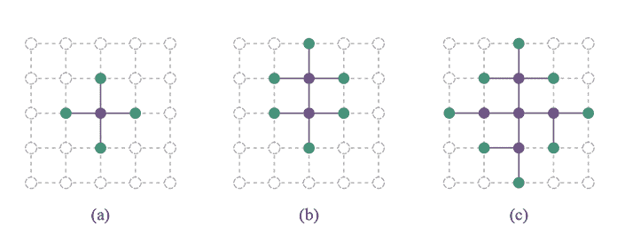

图 3.6 图搜索的分离特性，在矩形网格问题上说明。前沿（绿色）将内部（薰衣草色）与外部（淡虚线）分隔开。前沿是已到达但尚未扩展的节点（以及对应状态）的集合；内部是已扩展的节点（以及对应状态）的集合；外部是尚未到达的状态集合。在（a）中，仅根节点已被扩展。在（b）中，前沿的顶部节点被扩展。在（c）中，根的剩余后继按顺时针顺序扩展。

分隔符

### 3.3.1 最佳优先搜索


## 3.3.1 最佳优先搜索

我们如何决定从 `frontier` 中选择哪个节点进行扩展？一种非常通用的方法称为最佳优先搜索，其中我们选择一个节点 `n`，其某个评估函数 `f(n)` 的值最小。图 3.7 显示了该算法。每次迭代时，我们从 `frontier` 中选择 `f(n)` 值最小的节点，如果其状态是目标状态则返回它，否则应用 `EXPAND` 生成子节点。每个子节点如果之前未被到达则添加到 `frontier`，或如果现在是通过一条路径成本低于任何先前路径的路径到达的则重新添加。该算法返回失败的指示，或表示通往目标的路径的节点。通过采用不同的 `f(n)` 函数，我们得到不同的具体算法，本章将介绍这些算法。

### Description

四个二叉树都具有根节点标记为 "A"。节点 "A" 有两个子节点标记为 B 和 C。节点 B 有两个子节点标记为 D 和 E。节点 C 有两个子节点标记为 F 和 G。二叉树 1：节点 "A" 为绿色，右箭头指向节点 "A"。所有其他节点和路径均为淡虚线。二叉树 2：节点 "A" 为薰衣草色。节点 B 和 C 为绿色。右箭头指向节点 B。从节点 "A" 到 B 和 C 的两条路径为实线。所有其他节点和路径均为淡虚线。二叉树 3：节点 "A" 和 B 为薰衣草色。节点 C、D 和 E 为绿色。右箭头指向节点 C。从节点 "A" 到 B 和 C 的两条路径为实线。从节点 B 到 D 和 E 的两条路径也是实线。所有其他节点和路径均为淡虚线。二叉树 4：节点 "A"、B 和 C 为薰衣草色。其他节点为绿色。右箭头指向节点 D。所有路径均为实线。

×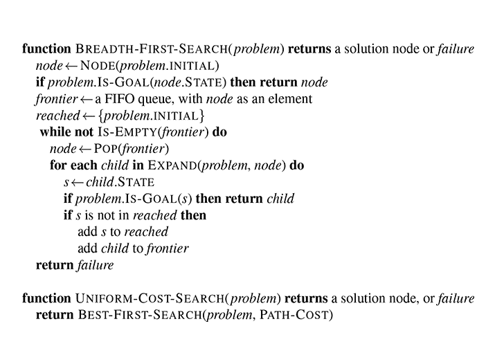

图 3.7 最佳优先搜索算法，以及用于扩展节点的函数。此处使用的数据结构在 第 3.3.2 节 中描述。有关 yield，请参阅 附录 B。

最佳优先搜索
评估函数

## 3.3.2 搜索数据结构

搜索算法需要一种数据结构来跟踪搜索树。树中的节点由具有四个组件的数据结构表示：

• `node.STATE`：节点对应的状态；
• `node.PARENT`：在树中生成该节点的节点；
• `node.ACTION`：应用于父节点状态以生成该节点的动作；
• `node.PATH-COST`：从初始状态到该节点的路径的总成本。在数学公式中，我们使用 `g(node)` 作为 `PATH-COST` 的同义词。

从节点回溯 `PARENT` 指针可让我们恢复到该节点的路径上的状态和动作。从目标节点这样做可得到解。

我们需要一种数据结构来存储 frontier。合适的选择是某种队列，因为 frontier 上的操作是：

队列

• `IS-EMPTY(frontier)` 仅当 frontier 中没有节点时返回 true。
• `POP(frontier)` 从 frontier 中移除顶部节点并返回它。
• `TOP(frontier)` 返回（但不移除）frontier 的顶部节点。
• `ADD(node, frontier)` 将 node 插入队列的适当位置。

搜索算法中使用三种队列：

• 优先队列首先弹出根据某个评估函数 `f` 成本最小的节点。它用于最佳优先搜索。

优先队列

• FIFO 队列或先进先出队列首先弹出最先添加到队列的节点；我们将看到它用于广度优先搜索。

FIFO 队列

• LIFO 队列或后进先出队列（也称为栈）首先弹出最近添加的节点；我们将看到它用于深度优先搜索。

LIFO 队列
栈

已到达的状态可以存储为查找表（例如哈希表），其中每个键是一个状态，每个值是该状态的节点。

## 3.3.3 冗余路径

图 3.4（底部）所示的搜索树包括从 Arad 到 Sibiu 再返回到 Arad 的路径。我们说 Arad 在搜索树中是一个重复状态，在本例中由一个循环（也称为环形路径）生成。因此，即使状态空间只有 20 个状态，完整的搜索树也是无限的，因为遍历循环的次数没有限制。

重复状态
循环
环形路径

循环是冗余路径的特例。例如，我们可以通过路径 Arad–Sibiu（长 140 英里）或路径 Arad–Zerind–Oradea–Sibiu（长 297 英里）到达 Sibiu。这第二条路径是冗余的——它只是到达同一状态的一种更差的方式——在我们寻求最优路径时无需考虑。

冗余路径

考虑一个在 10 × 10 网格世界中的智能体，能够移动到任意 8 个相邻方格。如果没有障碍，智能体可以在 9 步或更少步内到达 100 个方格中的任何一个。但长度为 9 的路径数量几乎是 89（由于网格边缘而略少），或超过 100 百万。换句话说，平均每个单元格可以通过超过一百万条长度为 9 的冗余路径到达，如果我们消除冗余路径，就可以在大约一百万倍的时间内完成搜索。正如俗话所说，无法记住过去的算法注定会重蹈覆辙。针对此问题有三种方法。

首先，我们可以记住所有先前到达的状态（如最佳优先搜索所做的），从而检测所有冗余路径，并仅保留到达每个状态的最佳路径。这适用于存在大量冗余路径的状态空间，并且在已到达状态表能够放入内存时是首选。

其次，我们可以不担心重复过去。有些问题表述中，两条路径到达同一状态的情况很少或不可能。例如，一个装配问题，其中每个动作都向不断演进的装配体添加一个零件，并且零件之间存在顺序，使得可以先添加 A 再添加 B，但不能先添加 B 再添加 A。对于这些问题，如果我们不跟踪已到达状态也不检查冗余路径，就能节省内存空间。我们称检查冗余路径的搜索算法为图搜索，如果不检查则称为树状搜索 6。图 3.7 中的 `BEST-FIRST-SEARCH` 算法是一个图搜索算法；如果我们删除对 `reached` 的所有引用，就得到一个使用更少内存但会检查到同一状态的冗余路径的树状搜索，因此运行速度会更慢。

图搜索
树状搜索

第三，我们可以折中，只检查循环，而不检查一般意义上的冗余路径。由于每个节点都有父指针链，我们可以通过沿着父指针链向上跟随，查看路径末尾的状态是否已在路径中出现过，从而无需额外内存即可检查循环。某些实现会一直跟随这条链到顶，从而消除所有循环；其他实现只跟随几个链接（例如到父节点、祖父节点和曾祖父节点），因此只花费恒定时间，同时消除所有短循环（并依赖其他机制来处理长循环）。

## 3.3.4 衡量问题求解性能

在深入研究各种搜索算法的设计之前，我们将考虑用于在它们之间选择的标准。我们可以从四种方式评估算法的性能：

• 完备性：该算法是否保证在存在解时找到解，并在不存在解时正确报告失败？

完备性


- **成本最优性**：是否能找到所有解中路径成本最低的解？7
  *成本最优性*
- **时间复杂度**：找到一个解需要多长时间？这可以用秒来衡量，或更抽象地用考虑的状态和动作的数量来衡量。
  *时间复杂度*
- **空间复杂度**：执行搜索需要多少内存？
  *空间复杂度*

为了理解完备性，考虑一个具有单一目标的搜索问题。该目标可能位于状态空间的任何位置；因此，完备的算法必须能够系统地探索从初始状态可达的每个状态。在有限状态空间中实现这一点很直接：只要我们跟踪路径并切断形成循环的路径（例如 Arad to Sibiu to Arad），最终我们将到达每个可达状态。

在无限状态空间中，需要更加谨慎。例如，在 Knuth 的“4”问题中反复应用 `factorial` 运算符的算法会沿着从 4 到 `4!` 到 `(4!)!` 等的无限路径继续下去。同样，在没有障碍物的无限网格上，沿直线不断向前移动也会形成一条新的状态的无限路径。在这两种情况下，算法从未返回到之前到达的状态，但是不完备，因为状态空间的广大区域永远无法到达。

为了完备，搜索算法在探索无限状态空间时必须是有系统性的，确保最终能够到达与初始状态相连的任何状态。例如，在无限网格上，一种有系统性的搜索是螺旋路径，它先覆盖距离原点 `s` 步的所有单元格，然后再向外移动到距离为 `s + 1` 步的单元格。不幸的是，在没有解的无限状态空间中，正确的算法需要永远继续搜索；它无法终止，因为它无法知道下一个状态是否会是目标。
*系统性*

时间复杂度和空间复杂度是相对于问题的难度度量来考虑的。在理论计算机科学中，典型的度量是状态空间图的规模，`|V| + |E|`，其中 `|V|` 是图的顶点（状态节点）数量，`|E|` 是边的数量（不同的状态/动作对）。当图是显式数据结构时，这很合适，例如罗马尼亚地图。但在许多 AI 问题中，图仅由初始状态、动作和转移模型隐式表示。对于隐式状态空间，复杂度可以用 `d`、即最优解中动作的深度或数量；`m`、任意路径中动作的最大数量；以及 `b`、分支因子或需要考虑的节点的后继数量来衡量。
*深度* *分支因子*

## 3.4 无信息搜索策略

无信息搜索算法对状态与目标的接近程度没有任何提示。例如，考虑我们的智能体在 Arad，目标是到达 Bucharest。没有罗马尼亚地理知识的无信息智能体不知道先前往 Zerind 还是 Sibiu 是更好的第一步。相比之下，知情智能体（第 3.5 节）知道每个城市的位置，知道 Sibiu 离 Bucharest 远近得多，因此更可能位于最短路径上。

### 3.4.1 广度优先搜索

当所有动作的成本相同时，合适的策略是广度优先搜索，其中首先扩展根节点，然后扩展根节点的所有后继节点，接着扩展它们的后继节点，以此类推。这是一种有系统性的搜索策略，因此即使在无限状态空间上也是完备的。我们可以将广度优先搜索实现为对 `BEST-FIRST-SEARCH` 的调用，其中评估函数 `f(n)` 为节点的深度——即到达该节点所需的动作数。
*广度优先搜索*

然而，我们可以通过几个技巧获得额外的效率。先进先出队列比优先队列更快，并且会给出正确的节点顺序：新节点（总是比其父节点更深）进入队列的末尾，而旧节点（比新节点更浅）先被扩展。此外，`reached` 可以是状态的集合而不是从状态到节点的映射，因为一旦到达某个状态，就永远找不到更好的路径到达该状态。这也意味着我们可以进行早期目标测试，在节点生成后立即检查它是否为解，而不是最佳优先搜索使用的晚期目标测试，等待节点从队列中弹出。图 3.8 显示了在二叉树上广度优先搜索的进展，而 图 3.9 显示了带有早期目标效率增强的算法。

描述

Sibiu 到 Fagaras，99。Fagaras 到 Bucharest，211。Sibiu 到 Rimnicu Vilcea，80。Rimnicu Vilcea 到 Pitesti，97。Pitesti 到 Bucharest，101。

×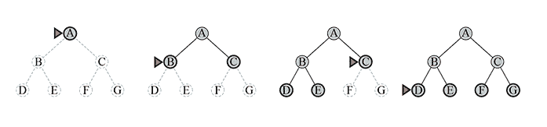

图 3.8 在简单二叉树上的广度优先搜索。每个阶段，接下来要扩展的节点由三角标记指示。
*早期目标测试* *晚期目标测试*

描述


二叉树具有根节点标记为“A”。节点“A”有两个子节点标记为 B 和 C。节点 B 有两个子节点标记为 D 和 E。节点 C 有两个子节点标记为 F 和 G。节点 D 有两个子节点标记为 H 和 I。节点 E 有两个子节点标记为 J 和 K。节点 F 有两个子节点标记为 L 和 M。节点 G 有两个子节点标记为 N 和 O。二叉树 1：节点“A”为绿色着色。一个箭头指向“A”。所有其他节点和路径均为淡虚线。二叉树 2：节点“A”为淡紫色着色。节点 B 和 C 为绿色着色。一个箭头指向 B。从节点“A”出发的路径为实线。所有其他节点和路径均为淡虚线。二叉树 3：节点“A”和 B 为淡紫色着色。节点 C、D 和 E 为绿色着色。一个箭头指向 D。从节点“A”和 B 出发的路径为实线。所有其他节点和路径均为淡虚线。二叉树 4：节点“A”、B 和 D 为淡紫色着色。节点 C、E、H 和 I 为绿色着色。一个箭头指向 H。从“A”、B 和 D 出发的路径为实线。所有其他节点和路径均为淡虚线。二叉树 5：节点“A”、B 和 D 为淡紫色着色。节点 C、E 和 I 为绿色着色。一个箭头指向 I。从“A”和 B 出发的路径为实线。D 与 I 之间的路径为实线。从 D 到 H 的路径和节点 H 淡出。所有其他节点和路径均为淡虚线。二叉树 6：节点“A”和 B 为淡紫色着色。节点 E 和 C 为绿色着色。一个箭头指向 E。从“A”出发的路径为实线。B 与 E 之间的路径为实线。从 B 到 D 的路径、节点 D 及其子节点全部淡出。所有其他节点和路径均为淡虚线。二叉树 7：节点“A”、B 和 E 为淡紫色着色。节点 C、J 和 K 为绿色着色。一个箭头指向 J。从“A”和 E 出发的路径为实线。B 与 E 之间的路径为实线。所有其他节点和路径均为淡虚线。二叉树 8：节点“A”、B 和 E 为淡紫色着色。节点 C 和 K 为绿色着色。一个箭头指向 K。从“A”出发的路径为实线。B 与 E 之间的路径为实线。K 与 E 之间的路径为实线。从 E 到 J 的路径和节点 J 淡出。所有其他节点和路径均为淡虚线。二叉树 9：节点“A”为淡紫色着色且节点 C 为绿色着色。一个箭头指向 C。“A”与 C 之间的路径为实线。从“A”到 B 的路径、节点 B 及其所有子节点均淡出。所有其他节点和路径均为淡虚线。二叉树 10：节点“A”和 C 为淡紫色着色。节点 F 和 G 为绿色着色。一个箭头指向 F。从 C 出发的路径为实线。“A”与 C 之间的路径为实线。所有其他节点和路径均为淡虚线。二叉树 11：节点“A”、C 和 F 为淡紫色着色。节点 G、L 和 M 为绿色着色。一个箭头指向 L。从 C 和 F 出发的路径为实线。“A”与 C 之间的路径为实线。所有其他节点和路径均为淡虚线。二叉树 12：节点“A”、C 和 F 为淡紫色着色。节点 G 和 M 为绿色着色。一个箭头指向 M。从 C 出发的路径为实线。“A”与 C 之间的路径为实线。F 与 M 之间的路径为实线。从 F 到 L 的路径和节点 L 淡出。所有其他节点和路径均为淡虚线。


图 3.9 广度优先搜索和一致代价搜索算法。

> 一致代价搜索

`Breadth-first search` 总是能找到具有最少动作数的解，因为当它在深度 `d` 生成节点时，它已经生成了深度 `d` – 1 的所有节点，所以如果其中一个是解，它就已经被找到了。这意味着对于所有动作成本相同的问题它是成本最优的，但对于不具有该属性的问题则不是。在任何情况下它都是完备的。就时间和空间而言，想象一个均匀树，其中每个状态都有 `b` 个后继。搜索树的根生成 `b` 个节点，每个节点再生成 `b` 个节点，第二层的总数为 `b²`。这些节点中的每一个再生成 `b` 个节点，第三层产生 `b³` 个节点，以此类推。现在假设解在深度 `d`。那么生成的节点总数为 `1 + b + b² + b³ + ⋯ + b^(d) = O(b^(d))`
所有节点都保留在内存中，因此时间和空间复杂度均为 `O(bd)`。这种指数界限令人恐惧。作为一个典型的现实世界示例，考虑分支因子 `b = 10`、处理速度为每秒 100 万个节点、内存需求为 1 Kbyte/节点的問題。深度为 `d = 10` 的搜索将花费不到 3 小时，但需要 10 TB 的内存。对于 `breadth-first search` 来说，内存需求比执行时间更成问题。但时间仍然是一个重要因素。在深度 `d = 14` 时，即使内存无限，搜索也需要 3.5 年。一般来说，指数复杂度的搜索问题对于除最小实例之外的任何实例都无法通过无信息搜索解决。

## 3.4.2 Dijkstra 算法或一致代价搜索

当动作具有不同成本时，一个明显的选择是使用最佳优先搜索，其中评估函数为从根到当前节点的路径成本。理论计算机科学界称之为 `Dijkstra’s algorithm`，而人工智能界称之为 `uniform-cost search`。其思想是，虽然 `breadth-first search` 以均匀深度的波向前扩展——先是深度 1，然后是深度 2，等等——`uniform-cost search` 则以均匀路径成本的波向前扩展。该算法可以实现为对 `BEST-FIRST-SEARCH` 的调用，以 `PATH-COST` 作为评估函数，如图 3.9 所示。

请考虑图 3.10，其中问题是从 Sibiu 到 Bucharest。Sibiu 的后继是 Rimnicu Vilcea 和 Fagaras，成本分别为 80 和 99。成本最低的节点 Rimnicu Vilcea 被接下来扩展，添加了 Pitesti，成本为 80 + 97 = 177。现在成本最低的节点是 Fagaras，因此它被扩展，添加了 Bucharest，成本为 99 + 211 = 310。Bucharest 是目标，但算法仅在扩展节点时检查目标，而不是在生成节点时检查，因此它尚未检测到这是通往目标的路径。

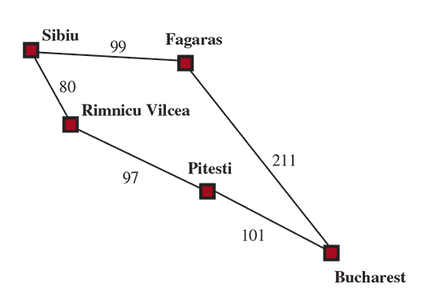

图 3.10 用于说明一致代价搜索的罗马尼亚状态空间的一部分。

算法继续进行，接下来选择 Pitesti 进行扩展，并添加了一条通往 Bucharest 的第二条路径，成本为 80 + 97 + 101 = 278。它的成本更低，因此它在 `reached` 中替换了之前的路径并被添加到 `frontier`。结果这个节点现在具有最低成本，因此被接下来考虑，发现为目标并返回。注意，如果我们在生成节点时而不是在扩展最低成本节点时检查目标，那么我们将返回一条成本更高的路径（通过 Fagaras 的那条）。

`uniform-cost search` 的复杂度用 `C*`、最优解的成本，以及 `ϵ`、每个动作成本的下界来表征，其中 `ϵ > 0`。那么该算法的最坏情况时间复杂度和空间复杂度为 `O(b^(1+⌊C*/ϵ⌋))`，这可能远大于 `b^d`。这是因为 `uniform-cost search` 可能在探索低成本动作的大树之前探索涉及高成本且可能有用的动作的路径。当所有动作成本相等时，`b^(1+⌊C*/ϵ⌋)` 只是 `b^(d+1)`，并且 `uniform-cost search` 与 `breadth-first search` 相似。


统一代价搜索是完备的并且是代价最优的，因为它找到的第一个解的代价不会低于前沿中任何其他节点的代价。统一代价搜索按代价递增的顺序系统地考虑所有路径，不会陷入单一的无限路径（假设所有动作代价都 > `ϵ` > 0）。

## 3.4.3 深度优先搜索与内存问题

深度优先搜索总是首先扩展前沿中最深的节点。它可以实现为对 `BEST-FIRST-SEARCH` 的调用，其中评估函数 `f` 为深度的负值。然而，它通常不是作为图搜索实现，而是作为不保留已达状态表的类树搜索实现。搜索的进展如图 图 3.11 所示；搜索立即进行到搜索树的最深层级，其中节点没有后继。搜索然后“回溯”到下一个仍有未扩展后继的最深节点。深度优先搜索不是代价最优的；它返回找到的第一个解，即使该解不是最便宜的。

*深度优先搜索*

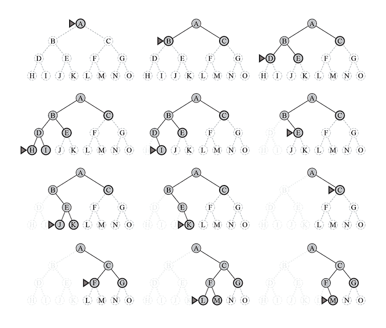

图 3.11 从起始状态 A 到目标 M 的二叉树上深度优先搜索进展的十二个步骤（从左到右，从上到下）。前沿为绿色，三角形标记下一个要扩展的节点。之前扩展过的节点为淡紫色，潜在的未来节点为细虚线。没有前沿后代的已扩展节点（极淡的线）可以丢弃。

对于有限的树状状态空间，它是高效且完备的；对于无环状态空间，它可能通过不同路径多次扩展同一状态，但最终会系统地探索整个空间。

在循环状态空间中，它可能陷入无限循环；因此某些深度优先搜索的实现会检查每个新节点是否存在循环。最后，在无限状态空间中，深度优先搜索不是系统的：它可能沿着一条无限路径向下走下去，即使没有循环。因此，深度优先搜索是不完备的。

尽管有这么多坏消息，为什么任何人仍会考虑使用深度优先搜索而不是广度优先或最好优先搜索？答案是，对于类树搜索可行的难题，深度优先搜索的内存需求要小得多。我们根本不保留已达表，前沿非常小：可以把广度优先搜索中的前沿想象成不断扩展的球体的表面，而深度优先搜索中的前沿只是一个半径。

对于像 图 3.11 中那样的有限树状状态空间，深度优先类树搜索所需时间与状态数量成正比，内存复杂度仅为 `O(bm)`，其中 `b` 为分支因子，`m` 为树的最大深度。有些用广度优先搜索需要艾字节内存的问题，用深度优先搜索只需千字节即可处理。由于其对内存的节俭使用，深度优先类树搜索已被采纳为人工智能许多领域的基石，包括约束满足 (第 5 章)、命题可满足性 (第 7 章) 和逻辑编程 (第 9 章)。

深度优先搜索的一种变体称为回溯搜索，使用更少的内存。（更多细节请参见 第 5 章。）在回溯中，每次只生成一个后继而不是所有后继；每个部分扩展的节点记住下一个要生成的后继。此外，后继是通过直接修改当前状态描述生成的，而不是为全新状态分配内存。这将内存需求减少到仅一个状态描述和一条 `O(m)` 动作的路径；相比深度优先搜索的 `O(bm)` 个状态，这是一个显著的节省。使用回溯时，我们还可以选择为当前路径上的状态维护一个高效的集合数据结构，从而可以在 `O(1)` 时间内而非 `O(m)` 时间内检查循环路径。要使回溯工作，我们必须能够在回溯时撤销每个动作。回溯对于具有大型状态描述的许多问题的成功至关重要，例如机器人装配。

*回溯搜索*

## 3.4.4 深度限制与迭代加深搜索

为了防止深度优先搜索在无限路径上游荡，我们可以使用深度限制搜索，这是一种深度优先搜索的变体，其中我们提供一个深度限制 `l`，并将深度为 `l` 的所有节点视为没有后继（参见 图 3.12）。时间复杂度为 `O(bl)`，空间复杂度为 `O(bl)`。不幸的是，如果对 `l` 的选择不当，算法将无法到达解，使其再次不完备。

*深度限制搜索*

由于深度优先搜索是类树搜索，我们通常无法阻止它在冗余路径上浪费时间，但我们可以用一些计算时间的代价消除循环。如果我们只向上查看父链中的几个链接，就能捕获大多数循环；较长的循环由深度限制处理。

有时可以根据对问题的了解选择一个好的深度限制。例如，罗马尼亚地图上有 20 个城市。因此，`l = 19` 是一个有效的限制。但如果我们仔细研究地图，就会发现任何城市都可以在最多 9 个动作内从任何其他城市到达。这个数字被称为状态空间图的直径，它为我们提供了更好的深度限制，从而导致更高效的深度限制搜索。然而，对于大多数问题，我们在解决之前并不知道一个好的深度限制。

*直径*

迭代加深搜索通过尝试所有值来解决选择 `l` 的好值的难题：先 0，然后 1，然后 2，依此类推——直到找到解，或者深度限制搜索返回失败值而不是截止值。该算法如图 图 3.12 所示。迭代加深结合了深度优先和广度优先搜索的许多优点。与深度优先搜索一样，其内存需求适中：有解时为 `O(bd)`，在没有解的有限状态空间中为 `O(bm)`。与广度优先搜索一样，迭代加深对于所有动作代价相同的问题是最优的，并且在有限无环状态空间上完备，或在沿路径全程检查节点循环的任何有限状态空间上完备。

*迭代加深搜索*

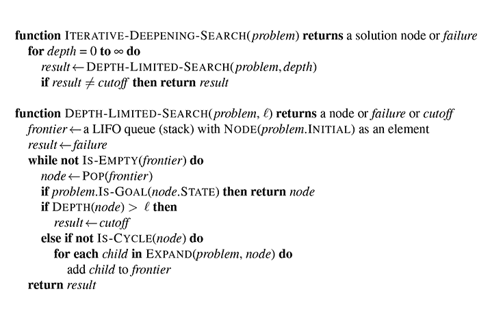

图 3.12 迭代加深与深度限制类树搜索。迭代加深反复应用具有递增限制的深度限制搜索。它返回三种不同类型的值之一：要么是解节点；要么是失败，当它已穷尽所有节点并证明在任何深度都没有解时；要么是截止，表示可能在比 `l` 更深的深度存在解。这是一种类树搜索算法，不会跟踪已达状态，因此使用的内存比最好优先搜索少得多，但存在在不同路径上多次访问同一状态的风险。此外，如果 `IS-CYCLE` 检查没有检查所有循环，则算法可能会陷入循环。


时间复杂度在有解时为 `O(bd)`，无解时为 `O(bm)`。迭代加深搜索的每次迭代都会生成一个新的层级，与广度优先搜索的方式相同，但广度优先搜索是通过存储所有节点在内存中来实现的，而迭代加深搜索则是通过重复之前的层级来实现，从而节省内存但代价是更多的时间。图 3.13 显示了在二叉搜索树上迭代加深搜索的四次迭代，其中解在第四次迭代中找到。

×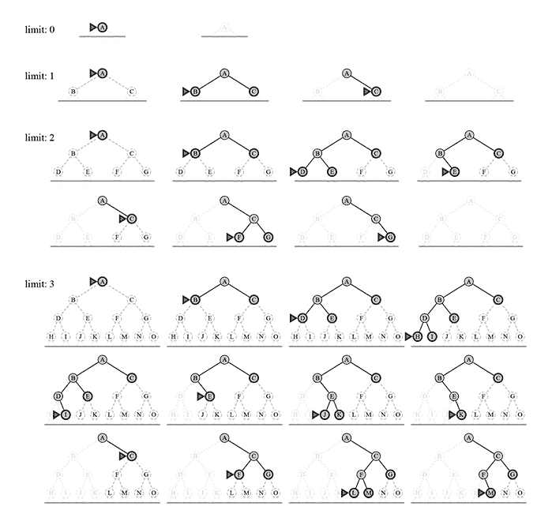

图 3.13 在二叉树上以深度限制从 0 到 3 变化的目标 M 的迭代加深搜索的四次迭代。注意内部节点形成一条单一路径。三角形标记下一个要扩展的节点；绿色且轮廓较深的节点位于边界上；非常淡的节点可证明在此深度限制下不可能成为解的一部分。

迭代加深搜索可能看起来浪费，因为搜索树顶部附近的状态会被多次重新生成。但对于许多状态空间，大多数节点都在底层，因此上层被重复并不重要。在迭代加深搜索中，底层（深度 `d`）的节点生成一次，倒数第二层的节点生成两次，依此类推，直到根节点的子节点，被生成 `d` 次。因此最坏情况下生成的节点总数为
`N(IDS)` = (`d`)*`b`¹+(`d` − 1)*`b`²+(`d` − 2)*`b`³⋯+`b`^( `d` ),
这给出了时间复杂度 `O(bd)`——与广度优先搜索渐近相同。例如，如果 `b = 10` 且 `d = 5`，则数字为
$\\begin{array}{l} {N\\text{(IDS)~=~50+400+3,000+20,000+100,000~=~123,450}} \\\\ {N\\text{(BFS)~=~10+100+1,000+10,000+100,000~=~111,110,}} \\\\ \\end{array}$

如果你真的担心重复，可以使用一种混合方法，先运行广度优先搜索直到几乎耗尽所有可用内存，然后从边界中的所有节点开始运行迭代加深。一般来说，当搜索状态空间大于内存可容纳的范围且解的深度未知时，迭代加深是首选的无信息搜索方法。

## 3.4.5 双向搜索

我们迄今为止介绍的算法从初始状态开始，可以到达多个可能的 goal 状态之一。一种称为双向搜索的替代方法同时从初始状态向前搜索并从 goal 状态(s)向后搜索，希望两个搜索会相遇。其动机是 `bd/2 + bd/2` 远小于 `bd`（例如，当 `b = d = 10` 时小 50,000 倍）。

<p class="sidebar">双向搜索</p>

要使其工作，我们需要跟踪两个边界和两个已到达状态表，并且需要能够向后推理：如果状态 `s'` 在向前方向上是 `s` 的后继，那么我们需要知道 `s` 在向后方向上是 `s'` 的后继。当两个边界相撞时，我们就得到了解决方案。9

正如有许多不同的单向搜索算法一样，双向搜索也有许多不同的版本。在本节中，我们描述双向最佳优先搜索。虽然有两个独立的边界，但要扩展的下一个节点始终是评估函数值最小的节点，无论在哪个边界上。当评估函数为路径成本时，我们得到双向一致成本搜索，并且如果最优路径的成本为 `C*`，则成本 $\\text{>}\\,\\,\\frac{C^{\\text{\\*}}}{2}$ 的节点将不会被扩展。这可以带来相当大的加速。

一般的最佳优先双向搜索算法显示在 图 3.14。我们传入两个版本的 problem 和评估函数，一个在向前方向（下标 F），一个在向后方向（下标 B）。当评估函数为路径成本时，我们知道找到的第一个解将是最优解，但使用不同的评估函数则不一定如此。因此，我们跟踪迄今为止找到的最佳解，并且可能需要在 `TERMINATED` 测试证明没有可能更好的解剩余之前多次更新它。

×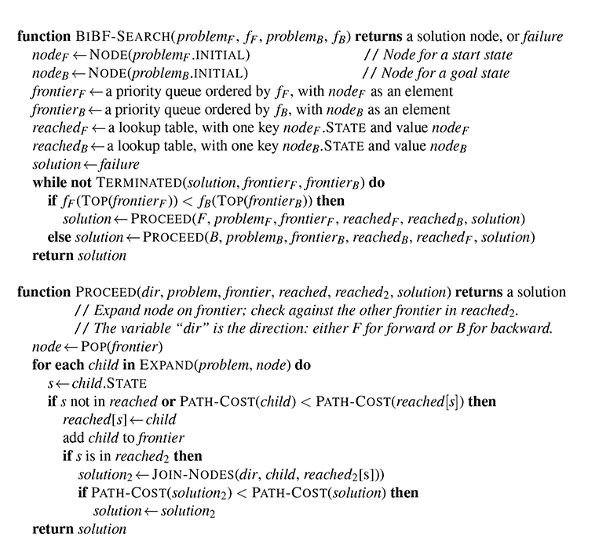

图 3.14 双向最佳优先搜索保持两个边界和两个已到达状态表。当一个边界中的路径到达在搜索另一半中也到达的状态时，这两个路径会被连接起来（由函数 `JOIN-NODES`）形成一个解。我们得到的第一个解不保证是最好的；函数 `TERMINATED` 决定何时停止寻找新的解。

## 3.4.6 无信息搜索算法的比较

图 3.15 根据 第 3.3.4 节 中提出的四个评估标准比较了无信息搜索算法。此比较适用于不检查重复状态的树状搜索版本。对于执行检查的图搜索，主要区别在于深度优先搜索对于有限状态空间是完备的，并且空间和时间复杂度受状态空间大小的限制（顶点和边的数量，`|V|` + `|E|`）。

×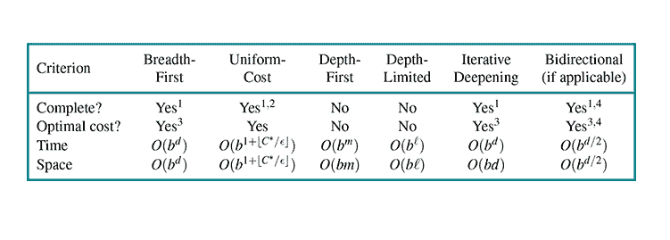

图 3.15 评估搜索算法。`b` 是分支因子；`m` 是搜索树的最大深度；`d` 是最浅解的深度，或在无解时为 `m`；`l` 是深度限制。上标说明如下：1 如果 `b` 为有限且状态空间要么有解要么有限，则完备。2 如果所有动作成本都 ≥ `ϵ` > 0，则完备；3 如果所有动作成本都相同，则成本最优；4 如果两个方向都是广度优先或一致成本。

## 3.5 有信息（启发式）搜索策略

本节展示了有信息搜索策略——一种使用关于目标位置的领域特定提示的策略——如何比无信息策略更有效地找到解。提示以启发函数的形式出现，记为 `h(n)`:10

`h(n)` = 从节点 `n` 所在状态到目标状态的最便宜路径的估计成本。

<p class="sidebar">有信息搜索</p> <p class="sidebar">启发函数</p>

例如，在路线查找问题中，我们可以通过计算地图上两点之间的直线距离来估计从当前状态到目标的距离。我们将在 第 3.6 节 中更详细地研究启发式及其来源。

### 3.5.1 贪婪最佳优先搜索

贪婪最佳优先搜索是一种最佳优先搜索形式，它首先扩展 `h(n)` 值最低的节点——看起来最接近目标的节点——因为这很可能迅速导致解。因此评估函数 `f(n)` = `h(n)`。

<p class="sidebar">贪婪最佳优先搜索</p>

让我们看看这对于罗马尼亚的路线查找问题如何工作；我们使用直线距离启发式，我们称之为 `hSLD`。如果目标是布加勒斯特，我们需要知道到布加勒斯特的直线距离，这些距离显示在 图 3.16。例如，`hSLD(Arad)` = 366。请注意，`hSLD` 的值无法从问题描述本身（即 `ACTIONS` 和 `RESULT` 函数）计算出来。此外，需要一定的世界知识才能知道 `hSLD` 与实际道路距离相关，因此是一个有用的启发式。

描述


二叉树具有根节点标记为“A”。节点“A”有两个子节点标记为 B 和 C。节点 B 有两个子节点标记为 D 和 E。节点 C 有两个子节点标记为 F 和 G。节点 D 有两个子节点标记为 H 和 I。节点 E 有两个子节点标记为 J 和 K。节点 F 有两个子节点标记为 L 和 M。节点 G 有两个子节点标记为 N 和 O。

限制：0。1 级的两个二叉树。二叉树 1：箭头指向“A”。节点“A”为绿色。二叉树 2：节点“A”已淡出。

限制：1。2 级的四个二叉树。二叉树 1：节点“A”为薰衣草色。箭头指向“A”。所有其他节点和路径均为淡虚线。二叉树 2：节点“A”为薰衣草色。节点 B 和 C 为绿色。箭头指向 B。节点“A”发出的路径为实线。二叉树 3：节点“A”为薰衣草色。节点 C 为绿色。节点“A”与 C 之间的路径为实线。“A”到 B 的路径及节点 B 已淡出。二叉树 4：所有节点和路径均已淡出。

限制：2。2 级的八个二叉树。二叉树 1：节点“A”为薰衣草色。箭头指向“A”。所有其他节点和路径均为淡虚线。二叉树 2：节点“A”为薰衣草色。节点 B 和 C 为绿色。箭头指向 B。节点“A”发出的路径为实线。所有其他节点和路径均为淡虚线。二叉树 3：节点“A”和 B 为薰衣草色。节点 C、D 和 E 为绿色。箭头指向 D。“A”和 B 发出的路径为实线。所有其他节点和路径均为淡虚线。二叉树 4：节点“A”和 B 为薰衣草色。节点 C 和 E 为绿色。箭头指向 E。“A”发出的路径为实线。B 与 E 之间的路径为实线。B 到 D 的路径及节点 D 已淡出。所有其他节点和路径均为淡虚线。二叉树 5：节点“A”为薰衣草色。节点 C 为绿色。箭头指向 C。“A”与 C 之间的路径为实线。“A”到 B 的路径、节点 B 及其所有子节点均已淡出。所有其他节点和路径均为淡虚线。二叉树 6：节点“A”和 C 为薰衣草色。节点 F 和 G 为绿色。箭头指向 F。“A”与 C 之间的路径为实线。C 发出的路径为实线。二叉树 7：节点“A”和 C 为薰衣草色。节点 G 为绿色。“A”与 C 之间的路径为实线。C 与 G 之间的路径为实线。C 到 E 的路径及节点 E 已淡出。二叉树 8：所有节点和路径均已淡出。

限制：3。3 级的十二个二叉树。二叉树 1：节点“A”为绿色。箭头指向“A”。所有其他节点和路径均为淡虚线。二叉树 2：节点“A”为薰衣草色。节点 B 和 C 为绿色。箭头指向 B。节点“A”发出的路径为实线。所有其他节点和路径均为淡虚线。二叉树 3：节点“A”和 B 为薰衣草色。节点 C、D 和 E 为绿色。箭头指向 D。节点“A”和 B 发出的路径为实线。所有其他节点和路径均为淡虚线。二叉树 4：节点“A”、B 和 D 为薰衣草色。节点 C、E、H 和 I 为绿色。箭头指向 H。“A”、B 和 D 发出的路径为实线。所有其他节点和路径均为淡虚线。二叉树 5：节点“A”、B 和 D 为薰衣草色。节点 C、E 和 I 为绿色。箭头指向 I。“A”和 B 发出的路径为实线。D 与 I 之间的路径为实线。D 到 H 的路径及节点 H 已淡出。所有其他节点和路径均为淡虚线。二叉树 6：节点“A”和 B 为薰衣草色。节点 E 和 C 为绿色。箭头指向 E。“A”发出的路径为实线。B 与 E 之间的路径为实线。B 到 D 的路径、节点 D 及其子节点均已淡出。所有其他节点和路径均为淡虚线。二叉树 7：节点“A”、B 和 E 为薰衣草色。节点 C、J 和 K 为绿色。箭头指向 J。“A”和 E 发出的路径为实线。B 与 E 之间的路径为实线。所有其他节点和路径均为淡虚线。二叉树 8：节点“A”、B 和 E 为薰衣草色。节点 C 和 K 为绿色。箭头指向 K。“A”发出的路径为实线。B 与 E 之间的路径为实线。K 与 E 之间的路径为实线。E 到 J 的路径及节点 J 已淡出。所有其他节点和路径均为淡虚线。二叉树 9：节点“A”为薰衣草色且节点 C 为绿色。箭头指向 C。“A”与 C 之间的路径为实线。“A”到 B 的路径、节点 B 及其所有子节点均已淡出。所有其他节点和路径均为淡虚线。二叉树 10：节点“A”和 C 为薰衣草色。节点 F 和 G 为绿色。箭头指向 F。C 发出的路径为实线。“A”与 C 之间的路径为实线。所有其他节点和路径均为淡虚线。二叉树 11：节点“A”、C 和 F 为薰衣草色。节点 G、L 和 M 为绿色。箭头指向 L。C 和 F 发出的路径为实线。“A”与 C 之间的路径为实线。所有其他节点和路径均为淡虚线。二叉树 12：节点“A”、C 和 F 为薰衣草色。节点 G 和 M 为绿色。箭头指向 M。C 发出的路径为实线。“A”与 C 之间的路径为实线。F 与 M 之间的路径为实线。F 到 L 的路径及节点 L 已淡出。所有其他节点和路径均为淡虚线。

×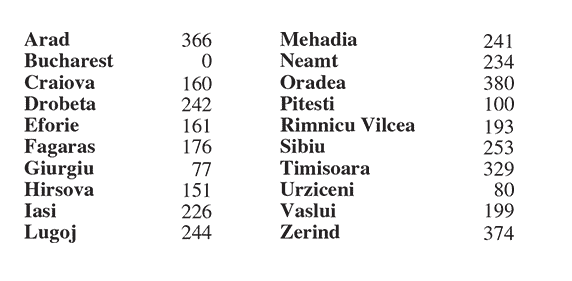

### 图 3.16 `hSLD` 的值——到布加勒斯特的直线距离。

<p class="sidebar">直线距离</p>

图 3.17 显示了使用 `hSLD` 进行贪心最佳优先搜索从阿拉德到布加勒斯特寻找路径的进展。从阿拉德扩展的第一个节点将是锡比乌，因为启发式认为它比泽林德或蒂米什瓦拉更接近布加勒斯特。接下来要扩展的节点将是法加拉什，因为根据启发式它现在最接近。法加拉什进而生成布加勒斯特，即目标。对于这个特定问题，使用 `hSLD` 的贪心最佳优先搜索在从未扩展不在解路径上的节点的情况下找到了解。它找到的解并不具有最优成本：经由锡比乌和法加拉什到布加勒斯特的路径比经由里姆尼库·维尔恰和皮特什蒂的路径长 32 英里。这就是该算法被称为“贪心”的原因——在每次迭代中它都试图尽可能接近目标，但贪婪可能导致比谨慎更糟的结果。

### 描述

Arad, 366. Bucharest, 0, Craiova, 160. Drobeta, 242. Eforie, 161. Fagaras, 176. Giurgiu, 77. Hirsova, 151. Iasi, 226. Lugoj, 244. Mehadia, 241. Neamt, 234. Oradea, 380. Pitesti, 100. Rimnicu Vilcea, 193. Sibiu, 253. Timisoara, 329. Urziceni, 80. Vaslui, 199. Zerind, 374.

×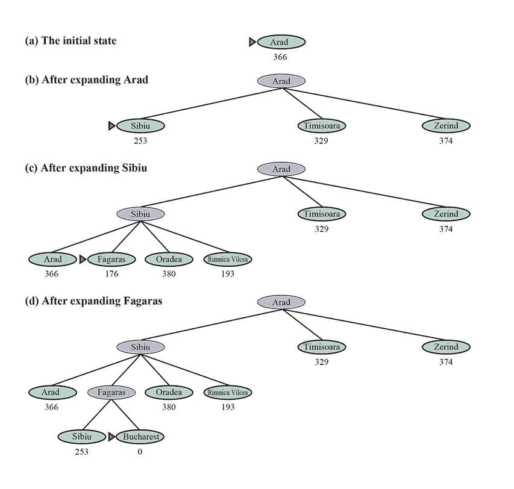

### 图 3.17 使用直线距离启发式 `hSLD` 的贪心最佳优先树状搜索到布加勒斯特的阶段。节点用其 `h` 值标记。

贪心最佳优先图搜索在有限状态空间中是完备的，但在无限状态空间中不是。最坏情况下的时间和空间复杂度为 `O(|V|)`。不过，使用良好的启发式函数，复杂度可以大幅降低，在某些问题上可达到 `O(bm)`。

## 3.5.2 A* 搜索

最常见的信息搜索算法是 A* 搜索（读作“A-star 搜索”），它是一种最佳优先搜索，使用评估函数

`f(n) = g(n) + h(n)`

其中 `g(n)` 是从初始状态到节点 `n` 的路径成本，而 `h(n)` 是从 `n` 到目标状态的最短路径的估计成本，因此我们有


# A* 搜索

`f`(`n`) = 从 `n` 继续到目标的最佳路径的估计成本。

## A* 搜索的进展

在 图 3.18 中，我们展示了以到达布加勒斯特为目标的 `A*` 搜索的进展。`g` 的值根据 图 3.1 中的行动成本计算得出，而 `hSLD` 的值在 图 3.16 中给出。注意，布加勒斯特首次在步骤 (e) 出现在边界上，但并未被选中进行扩展（因此未被检测为解），因为在 `f = 450` 时它不是边界上成本最低的节点——那是 Pitesti，`f = 417`。另一种说法是，可能存在一条经过 Pitesti 的解，其成本低至 417，因此算法不会接受成本为 450 的解。在步骤 (f) 中，通往布加勒斯特的另一条路径现在是成本最低的节点，`f = 418`，因此它被选中并被检测为最优解。

## 图 3.18 描述

在全部四个部分中，都显示了一个标记为 Arad 的节点。部分（“A”）：初始状态。Arad 节点为绿色。箭头指向 Arad，节点旁边标记为 366。部分 (b)：扩展 Arad 之后。Arad 节点为淡紫色，并与三个绿色节点相连，标记为 Sibiu 253、Timisoara 329 和 Zerind 374。箭头指向 Sibiu。部分 (c)：扩展 Sibiu 之后。Arad 节点为淡紫色，并与三个节点相连，标记为 Sibiu、Timisoara 329 和 Zerind 374。Sibiu 为淡紫色，而 Timisoara 和 Zerind 为绿色。Sibiu 与四个绿色节点相连，标记为 Arad 366、Fagaras 177、Oradea 380 和 Rimnicu Vilcea 193。箭头指向 Fagaras。部分 (d)：扩展 Fagaras 之后。Arad 节点为淡紫色，并与三个节点相连，标记为 Sibiu、Timisoara 329 和 Zerind 374。Sibiu 为淡紫色，而 Timisoara 和 Zerind 为绿色。Sibiu 与四个节点相连，标记为 Arad 366、Fagaras、Oradea 380 和 Rimnicu Vilcea 193。这四个节点中，Fagaras 为淡紫色，其余三个为绿色。Fagaras 与两个绿色节点相连，标记为 Sibiu 253 和 Bucharest 0。箭头指向 Bucharest。

×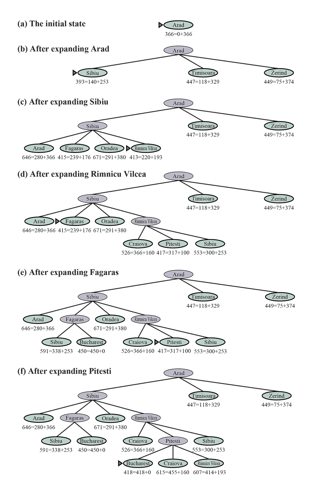

图 3.18 `A*` 搜索布加勒斯特的阶段。节点标记为 `f = g + h`。`h` 值取自 图 3.16 的直线距离。

## A* 搜索的最优性

`A*` 搜索是完备的。11`A*` 是否具有成本最优性取决于启发式的某些属性。一个关键属性是可采纳性：可采纳启发式是指从不高估到达目标的成本的启发式。（因此可采纳启发式是乐观的。）在可采纳启发式下，`A*` 是成本最优的，我们可以用反证法来证明。假设最优路径的成本为 `C*`，但算法返回的路径成本为 `C > C*`。那么最优路径上必须存在某个节点 `n` 未被扩展（因为如果最优路径上的所有节点都被扩展了，那么我们就会返回该最优解）。于是，使用记号 `g*(n)` 表示从起点到 `n` 的最优路径成本，`h*(n)` 表示从 `n` 到最近目标的最优路径成本，我们有：

可采纳启发式

$\\begin{array}{l} {f\\text{~(}n\\text{)~>~}C^{\*}\\text{~(otherwise~}n\\text{~would~have~been~expanded)}} \\\\ {f\\text{~(}n\\text{)~=~}g\\text{(}n\\text{)~+~}h\\text{(}n\\text{)~(by~definition)}} \\\\ {f\\text{~(}n\\text{)~=~}g^{\*}\\text{(}n\\text{)~+~}h\\text{(}n\\text{)~(because~}n\\text{~is~on~an~optimal~path)}} \\\\ {f\\text{~(}n\\text{)~} \\leq \\ g^{\*}\\text{(}n\\text{)~+~}h^{\*}\\text{(}n\\text{)~(because~of~admissibility,~}h\\text{(}n\\text{)~} \\leq \\ h^{\*}\\text{(}n\\text{))}} \\\\ {f\\text{~(}n\\text{)~} \\leq \\ C^{\*}\\text{~(by~definition,~}C^{\*}\\text{~=~}g^{\*}\\text{(}n\\text{)~+~}h^{\*}\\text{(}n\\text{))}} \\\\ \\end{array}$

第一行和最后一行形成矛盾，因此算法可能返回次优路径的假设必定是错误的——`A*` 必须只返回成本最优的路径。

### 一致性

一个稍强的属性称为一致性。启发式 `h(n)` 在对每个节点 `n` 和由动作 `a` 生成的 `n` 的每个后继节点 `n'` 都满足以下条件时是一致的：

`h(n)` ≤ `c(n, a, n')` + `h(n')`.

一致性

这是一种三角不等式的形式，它规定三角形的某一边不能长于另外两边的总和（参见 图 3.19）。我们在前往布加勒斯特时使用的直线距离 `hSLD` 就是一致启发式的例子。

## 图 3.19 描述

部分（“A”）：初始状态。一个绿色节点标记为 Arad 366 等于 0 加 366。箭头指向 Arad。部分 (b)：扩展 Arad 之后。Arad 节点现在为淡紫色，并与三个绿色节点相连，标记为 Sibiu 393 等于 140 加 253、Timisoara 447 等于 118 加 329 和 Zerind 449 等于 75 加 374。箭头指向 Sibiu。部分 (c)：扩展 Sibiu 之后。Sibiu 节点现在为淡紫色，并与四个绿色节点相连，标记为 Arad 646 等于 280 加 366、Fagaras 415 等于 239 加 176、Oradea 671 等于 291 加 380 和 Rimnicu Vilcea 413 等于 220 加 193。箭头指向 Rimnicu Vilcea。部分 (d)：扩展 Rimnicu Vilcea 之后。Rimnicu Vilcea 节点现在为淡紫色，并与三个绿色节点相连，标记为 Craiova 526 等于 366 加 160、Pitesti 417 等于 317 加 100 和 Sibiu 553 等于 300 加 253。箭头指向 Fagaras。部分 (e)：扩展 Fagaras 之后。位于 Sibiu 节点下的 Fagaras 节点现在为淡紫色，并与两个绿色节点相连，标记为 Sibiu 591 等于 338 加 253 和 Bucharest 450 等于 450 加 0。箭头指向 Rimnicu Vilcea 下的 Pitesti。部分 (f)：扩展 Pitesti 之后。Pitesti 节点现在为淡紫色，并与三个绿色节点相连，标记为 Bucharest 418 等于 418 加 0、Craiova 615 等于 455 加 160 和 Rimnicu Vilcea 607 等于 414 加 193。箭头指向 Pitesti 节点下的 Bucharest。

×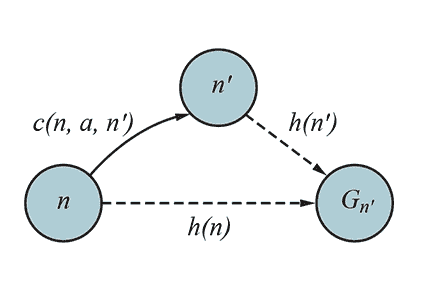

图 3.19 三角不等式：如果启发式 `h` 一致，则单个数字 `h(n)` 将小于从 `n` 到 `n'` 的动作成本 `c(n, a, a')` 与启发式估计 `h(n')` 之和。

三角不等式

每个一致启发式都是可采纳的（反之不成立），因此在一致启发式下，`A*` 是成本最优的。此外，在一致启发式下，我们第一次到达一个状态时它就在一条最优路径上，因此我们永远不需要重新将状态添加到边界，也不需要更改 reached 中的条目。但在不一致启发式下，我们可能会得到多条到达同一状态的路径，如果每条新路径的路径成本都低于前一条，那么边界中就会出现该状态的多个节点，这会耗费时间和空间。因此，一些 `A*` 的实现会确保只将状态一次进入边界，如果发现了到达该状态的更好路径，则会更新该状态的所有后继节点（这要求节点同时具有子指针和父指针）。这些复杂性导致许多实现者避免使用不一致启发式，但 Felner 等人（2011）认为最坏的影响在实践中很少发生，不应害怕不一致启发式。


使用不可容许启发式时，`A*` 可能成本最优也可能不是。以下是它仍然最优的两种情况：首先，如果存在一条成本最优路径，使得该路径上所有节点 `n` 的 `h(n)` 都是可容许的，那么无论启发式对路径外的状态给出什么估计，这条路径都会被找到。其次，如果最优解的成本为 `C*`，次优解的成本为 `C2`，并且 `h(n)` 虽然高估了一些成本，但高估量从不超过 `C2 – C*`，那么 `A*` 就能保证返回成本最优解。

## 3.5.3 搜索等高线

可视化搜索的一种有用方法是像地形图中的等高线一样在状态空间中绘制等高线。图 3.20 显示了一个例子。在标记为 400 的等高线内部，所有节点都有 `f(n) = g(n) + h(n) ≤ 400`，依此类推。然后，由于 `A*` 扩展 `f-cost` 最低的前沿节点，我们可以看到 `A*` 搜索从起始节点向外展开，以递增的 `f-cost` 的同心带添加节点。

描述

三个圆分别标记为 `n`、`n prime` 和 `G subscript n prime`。从 `n` 到 `G subscript n prime` 的箭头标记为 `h (n)`。从 `n prime` 到 `G subscript n prime` 的箭头标记为 `h (n prime)`。从 `n` 到 `n prime` 的箭头标记为 `c (n, “A”, n prime)`。

×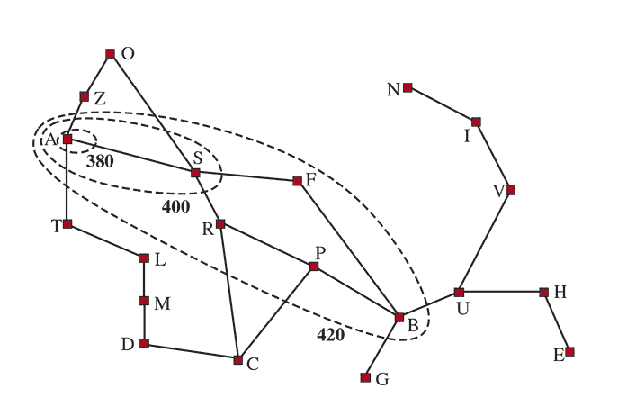

图 3.20 显示罗马尼亚地图，其中等高线为 `f = 380`、`f = 400` 和 `f = 420`，Arad 为起始状态。给定等高线内部的节点具有 `f = g + h` 成本小于或等于等高线值。

<p class="sidebar">等高线</p>

在一致代价搜索中，我们也有等高线，但它是 `g-cost` 而不是 `g + h`。一致代价搜索的等高线将在起始状态周围呈“圆形”，向所有方向均匀扩散，对目标没有偏好。使用良好启发式的 `A*` 搜索时，`g + h` 带会向目标状态延伸（如 图 3.20 所示），并在最优路径周围变得更加集中。

应该很清楚，随着路径的延伸，`g` 成本是单调的：沿着路径前进时路径成本始终增加，因为动作成本始终为正。12 因此你会得到互不相交的同心等高线，并且如果选择绘制足够精细的线条，你可以在任何路径上的任意两个节点之间画一条线。

<p class="sidebar">单调</p>

但 `f = g + h` 成本是否会单调增加就不那么明显了。当你将路径从 `n` 扩展到 `n'` 时，成本从 `g(n) + h(n)` 变为 `g(n) + c(n, a, n') + h(n')`。消去 `g(n)` 项后，我们可以看到路径成本单调递增当且仅当 `h(n) ≤ c(n, a, n') + h(n')`；换句话说，当且仅当启发式是一致的时。13 但请注意，一条路径可能会连续贡献多个具有相同 `g(n) + h(n)` 分数的节点；这会在 `h` 的减少量恰好等于刚刚采取的动作成本时发生（例如，在网格问题中，当 `n` 与目标在同一行并且你朝目标迈出一步时，`g` 增加 1 而 `h` 减少 1）。如果 `C*` 是最优解路径的成本，那么我们可以说以下几点：

• `A*` 会扩展从初始状态出发、路径上每个节点都满足 `f(n) < C*` 的所有可达节点。我们称这些为必然扩展节点。

<p class="sidebar">必然扩展节点</p>

• `A*` 然后可能会在选择目标节点之前扩展一些位于“目标等高线”上的节点（其中 `f(n) = C*`）。

• `A*` 不会扩展 `f(n) > C*` 的任何节点。

我们说，使用一致启发式的 `A*` 在最优效率意义上是最佳的，因为任何从初始状态扩展搜索路径并使用相同启发式信息的算法，都必须扩展 `A*` 必然扩展的所有节点（因为其中任何一个都可能成为最优解的一部分）。在 `f(n) = C*` 的节点中，一个算法可能运气好先选择最优节点，而另一个算法可能运气不好；我们在定义最优效率时不考虑这种差异。

<p class="sidebar">最优效率</p>

`A*` 高效是因为它剪掉了寻找最优解不需要的搜索树节点。在 图 3.18(b) 中我们看到 Timisoara 的 `f = 447`，Zerind 的 `f = 449`。尽管它们是根节点的子节点，并且会在一致代价或广度优先搜索中首先被扩展，但它们永远不会被 `A*` 搜索扩展，因为 `f = 418` 的解先被找到。剪枝的概念——在无需检查的情况下将可能性从考虑中剔除——对人工智能的许多领域都很重要。

<p class="sidebar">剪枝</p>

`A*` 搜索是完备的、成本最优的，并且在所有此类算法中是最优效率的，这相当令人满意。不幸的是，这并不意味着 `A*` 是我们所有搜索需求的答案。问题在于，对于许多问题，扩展的节点数可能是指数级增长的，指数底数是解的长度。例如，考虑一个真空世界的变体，其中有一个超强大的吸尘器，可以以 1 单位的成本清理任意一个方格，甚至无需访问该方格；在这种情况下，方格可以按任意顺序清理。拥有 `N` 个初始脏方格时，存在 `2N` 个状态，其中某个子集已被清理；所有这些状态都在最优解路径上，因此满足 `f(n) < C*`，所以 `A*` 都会访问它们。

## 3.5.4 满意搜索：不可容许启发式和加权 A*

`A*` 搜索有很多优点，但它会扩展大量节点。如果我们愿意接受次优但“足够好”的解——我们称之为满意解——就可以探索更少的节点（节省时间和空间）。如果允许 `A*` 搜索使用不可容许启发式——可能高估——那么我们可能会错过最优解，但启发式可能更准确，从而减少扩展的节点数。例如，道路工程师知道绕行指数的概念，它是应用于直线距离的乘数，用以考虑道路的典型弯曲度。绕行指数为 1.3 意味着如果两座城市直线距离相距 10 英里，那么它们之间最佳路径的良好估计为 13 英里。对于大多数地区，绕行指数在 1.2 到 1.6 之间。

<p class="sidebar">不可容许启发式</p> <p class="sidebar">绕行指数</p>

我们可以将这一思想应用于任何问题，而不仅仅是涉及道路的问题，采用一种称为加权 `A*` 搜索的方法，其中我们更加强调启发式值，给出评估函数 `f(n)= g(n) + W × h(n)`，其中 `W > 1`。

<p class="sidebar">加权 A* 搜索</p>

图 3.21 显示了一个网格世界上的搜索问题。在 (a) 中，`A*` 搜索找到了最优解，但为此必须探索状态空间的大部分。在 (b) 中，加权 `A*` 搜索找到了成本稍高的解，但搜索时间快得多。我们看到加权搜索将已到达状态的等高线聚焦于目标。这意味着探索的状态更少，但如果最优路径 ever 偏离加权搜索的等高线之外（如本例所示），则最优路径将找不到。一般来说，如果最优解的成本为 `C*`，加权 `A*` 搜索将找到成本介于 `C*` 和 `W × C*` 之间的解；但在实践中，我们通常得到的结果比 `W × C*` 更接近 `C*`。

描述

罗马尼亚的城市显示为节点，每个节点都标记有该城市的首字母。标记为 380 的等高线包围节点“A”。标记为 400 的等高线包围“A”和 S。标记为 420 的等高线包围“A”、S、R、F、P 和 B。剩余的城市在所有所示等高线之外。

×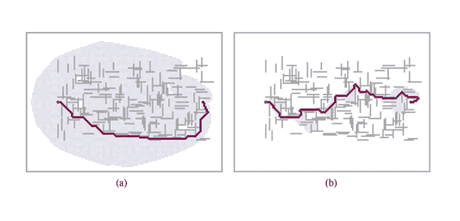


## 加权 A* 搜索

图 3.21 在同一网格上的两次搜索：（a）A* 搜索和（b）权重为 `W` = 2 的加权 A* 搜索。灰色条为障碍物，紫色线为从绿色起点到红色目标的路径，小点为每次搜索所到达的状态。在此特定问题上，加权 A* 探索的状态少 7 倍，并且找到的路径成本高出 5%。

我们已经考虑了通过各种方式组合 `g` 和 `h` 来评估状态的搜索；加权 A* 可以被视为其他方法的推广：

$\\begin{array}{r} {\\text{A}\\text{\*}\\text{~搜索：}} \\\\ \\text{均匀代价搜索：} \\\\ \\text{贪心最好优先搜索：} \\\\ {\\text{加权~A}\\text{\*}\\text{~搜索：}} \\\\ \\end{array}\\,\\,\\,\\begin{matrix} {g\\text{(}n\\text{)~+~}h\\text{(}n\\text{)}} \\\\ {g\\text{(}n\\text{)}} \\\\ {h\\text{(}n\\text{)}} \\\\ {g\\text{(}n\\text{)~+~}W \\times \\ h\\text{(}n\\text{)}} \\\\ \\end{matrix}\\,\\,\\,\\begin{array}{l} {\\text{(}W\\text{~=~1)}} \\\\ {\\text{(}W\\text{~=~0)}} \\\\ {\\text{(}W\\text{~=~}\\infty\\text{)~}} \\\\ {\\text{(1~<~}W\\text{~<~}\\infty)} \\\\ \\end{array}$

你可以称加权 A* 为“某种程度的贪心搜索”：像贪心最好优先搜索一样，它将搜索聚焦于目标；另一方面，它不会完全忽略路径成本，并且会暂停进展甚微却成本高昂的路径。

存在多种次优搜索算法，可根据“足够好”的标准来表征。在有界次优搜索中，我们寻找保证在常数因子 `W` 范围内优于最优成本的解。加权 A* 提供了这一保证。在有界成本搜索中，我们寻找成本小于某个常数 `C` 的解。而在无界成本搜索中，只要能快速找到，我们就接受任何成本的解。

*有界次优搜索*
*有界成本搜索*
*无界成本搜索*

无界成本搜索算法的一个例子是快速搜索，它是贪心最好优先搜索的一个版本，其启发式为到达目标所需动作的估计数量，而不考虑这些动作的成本。因此，对于所有动作成本相同的问题，它与贪心最好优先搜索相同，但在动作成本不同时，它倾向于引导搜索快速找到解，即使该解的成本可能很高。

*快速搜索*

## 3.5.5 内存受限搜索

A* 的主要问题是其对内存的使用。本节将介绍一些节省空间的实现技巧，然后介绍一些能更好地利用可用空间的全新算法。

内存分为前沿和已到达状态。在我们对最好优先搜索的实现中，前沿上的一个状态存储在两个地方：作为前沿中的一个节点（以便决定下一步扩展哪个），以及作为已到达状态表中的一个条目（以便知道是否已访问过该状态）。对于许多问题（例如探索网格），这种重复不是问题，因为前沿的大小远小于已到达状态，因此复制前沿中的状态只需要相对微不足道的内存。但某些实现只在一个地方保留状态，从而节省了一点空间，但代价是使算法复杂化（也许会变慢）。

另一种可能性是在可以证明不再需要时从已到达状态中移除状态。对于某些问题，我们可以利用分离性质（图 3.6 在 页 90 上），以及禁止 U 形转弯动作，确保所有动作要么从前沿向外移动，要么移动到另一个前沿状态。在这种情况下，我们只需检查前沿中的冗余路径，即可消除已到达表。

对于其他问题，我们可以保留状态被到达次数的引用计数，并在没有更多方式到达该状态时将其从已到达表中移除。例如，在网格世界中，每个状态只能从其四个邻居到达，一旦我们到达一个状态四次，就可以将其从表中移除。

*引用计数*

现在让我们考虑旨在节省内存使用的新算法。

束搜索限制前沿的大小。最简单的方法是只保留 `f` 分数最好的 `k` 个节点，丢弃其他扩展节点。这当然使搜索不完整且次优，但我们可以选择 `k` 来充分利用可用内存，并且算法执行速度快，因为它扩展的节点更少。对于许多问题，它可以找到良好的近最优解。你可以把均匀代价或 A* 搜索想象成在同心轮廓中向四周扩散，而束搜索则只探索这些轮廓的聚焦部分，即包含 `k` 个最佳候选的部分。

*束搜索*

束搜索的另一种版本不严格限制前沿的大小，而是保留 `f` 分数在最佳 `f` 分数 `δ` 范围内的每个节点。这样，当只有少数强得分节点时只会保留少数节点，但如果没有强节点，则会保留更多节点，直到出现强节点为止。

迭代加深 A* 搜索（`IDA*`）之于 A*，正如迭代加深搜索之于深度优先：`IDA*` 在无需在内存中保留所有已到达状态的情况下提供了 A* 的优点，代价是多次访问某些状态。它是处理无法放入内存的问题时非常重要且常用的算法。

*迭代加深 A* 搜索*

在标准迭代加深中，切断条件是深度，每次迭代增加一。在 `IDA*` 中，切断条件是 `f` 成本（`g` + `h`）；在每次迭代中，切断值是上一次迭代中超过切断条件的任何节点的最小 `f` 成本。换句话说，每次迭代穷举搜索一个 `f` 轮廓，找到轮廓之外的节点，并使用该节点的 `f` 成本作为下一个轮廓。对于 8 数码问题等每个路径的 `f` 成本为整数的问题，这种方法效果很好，每次迭代都能稳步向目标推进。如果最优解的成本为 `C*`，则迭代次数不会超过 `C*` 次（例如，最难的 8 数码问题不超过 31 次迭代）。但对于每个节点 `f` 成本都不同的问题，每个新轮廓可能只包含一个新节点，迭代次数可能等于状态数。

递归最好优先搜索（`RBFS`）（图 3.22）试图模仿标准最好优先搜索的操作，但仅使用线性空间。`RBFS` 类似于递归深度优先搜索，但它不会无限地沿当前路径继续下去，而是使用 `f-limit` 变量来跟踪从当前节点的任何祖先可用的最佳替代路径的 `f` 值。如果当前节点超过此限制，递归就会回退到替代路径。随着递归的回退，`RBFS` 用备份值替换路径上每个节点的 `f` 值——即其子节点中最好的 `f` 值。这样，`RBFS` 记住被遗忘子树中最佳叶节点的 `f` 值，因此可以决定是否值得在稍后重新扩展该子树。图 3.23 显示了 `RBFS` 如何到达布加勒斯特。


# 递归最佳优先搜索与内存受限 A*

在两部分中，整个网格上都显示出等距的小点。网格各处散布着由多个灰色条组成的迷宫。网格左侧附近显示一个绿色点，右侧附近显示一个红色点。一条紫色线从绿色点开始，穿过网格，结束于红色点。紫色线不会穿过或经过任何灰色条，而是位于灰色条的上方、下方或两者之间。Part（“A”）：紫色线走的路径几乎类似于开口向上的曲线。紫色线大部分保持在灰色条主体下方，没有在灰色条的迷宫中进行太多导航。Part (b)：紫色线走的是不规则的路径。紫色线在灰色条的迷宫中穿行，穿过主体。

×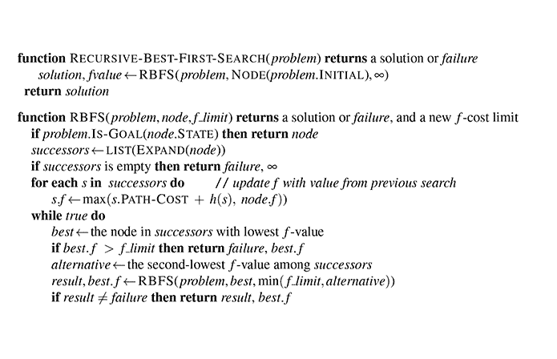

### 图 3.22 递归最佳优先搜索的算法。

<p class="sidebar">递归最佳优先搜索</p> <p class="sidebar">备份值</p>

`RBFS` 比 `IDA*` 稍微高效一些，但仍然遭受过度的节点再生。在 图 3.23 中的示例中，`RBFS` 遵循经由 Rimnicu Vilcea 的路径，然后“改变主意”并尝试 Fagaras，然后再次改变主意回来。这些主意改变发生的原因是，每当当前最佳路径被扩展时，其 `f-value` 很可能增加——`h` 对于更接近目标的节点通常不太乐观。当这种情况发生时，第二好的路径可能会成为最佳路径，因此搜索必须回溯以跟随它。每次主意改变都对应于 `IDA*` 的一次迭代，并且可能需要多次重新扩展被遗忘的节点来重建最佳路径并再扩展一个节点。

## 描述

Part（“A”）：在扩展 Pitesti、Sibiu 和 Rimnicu Vilcea 之后。标记为 Arad 366 的节点连接到标记为 Sibiu 393、Timisoara 447 和 Zerind 449 的三个节点。Timisoara 和 Zerind 为绿色。Arad 上方的一个小框显示无穷大。Sibiu 连接到标记为 Arad 646、Fagaras 415、Oradea 671 和 Rimnicu Vilcea 413 的四个节点。Sibiu 和 Rimnicu Vilcea 上方各有一个小框，分别显示 447 和 415。Arad、Sibiu 和 Rimnicu Vilcea 为薰衣草色。Sibiu 下方的另外三个节点为绿色。Rimnicu Vilcea 连接到三个绿色节点，Craiova 526、Pitesti 417 和 Sibiu 553。Part (b)：在回溯到 Sibiu 并扩展 Fagaras 之后。Rimnicu Vilcea 现在为绿色，其上方的框被移除，且节点的先前标签 413 被划掉以显示新的值 417。Fagaras 现在为薰衣草色，并在其上方有一个显示 417 的小框。Fagaras 连接到两个绿色节点，标记为 Sibiu 591 和 Bucharest 450。Part (c)：在切换回 Rimnicu Vilcea 并扩展 Pitesti 之后。Fagaras 现在变回绿色，其上方的框被移除，且节点的先前标签 415 被划掉以显示新的值 450。Rimnicu Vilcea 变回薰衣草色，并在其上方有一个显示 447 的小框。Rimnicu Vilcea 连接到标记为 Craiova 526、Pitesti 417 和 Sibiu 553 的三个节点。Pitesti 为薰衣草色，并在其上方有一个显示 447 的小框。Rimnicu Vilcea 下方的另外两个节点为绿色。Pitesti 连接到三个绿色节点 Bucharest 418、Craiova 615 和 Rimnicu Vilcea 607。

×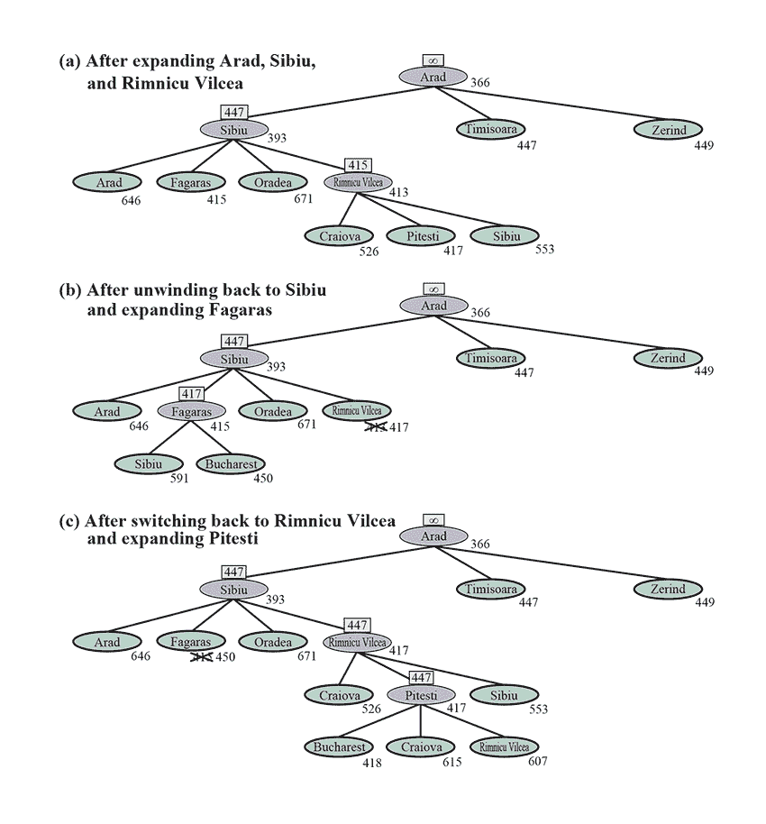

### 图 3.23 寻找前往布加勒斯特的最短路线的 RBFS 搜索阶段。

图 3.23 在 `RBFS` 搜索前往布加勒斯特的最短路线时的阶段。每个递归调用的 `f-limit` 值显示在每个当前节点上方，每个节点都用其 `f-cost` 标记。(a) 经由 Rimnicu Vilcea 的路径被跟随，直到当前最佳叶节点（Pitesti）的值比最佳替代路径（Fagaras）更差。(b) 递归展开并且被遗忘子树的最佳叶值（417）备份到 Rimnicu Vilcea；然后扩展 Fagaras，显示出最佳叶值为 450。(c) 递归展开并且被遗忘子树的最佳叶值（450）备份到 Fagaras；然后扩展 Rimnicu Vilcea。这一次，因为最佳替代路径（经由 Timisoara）至少花费 447，所以扩展继续到 Bucharest。

`RBFS` 在启发式函数 `h(n)` 可容许时是最优的。其空间复杂度在最深最优解的深度上是线性的，但其时间复杂度相当难以表征：它既取决于启发式函数的准确性，也取决于随着节点扩展最佳路径改变的频率。它按递增的 `f-score` 顺序扩展节点，即使 `f` 是非单调的。

`IDA*` 和 `RBFS` 因使用过少的内存而受苦。在迭代之间，`IDA*` 仅保留一个数字：当前的 `f-cost` 限制。`RBFS` 在内存中保留更多信息，但它仅使用线性空间：即使有更多内存可用，`RBFS` 也没有办法利用它。因为它们忘记了大部分已做的工作，这两种算法都可能多次重新探索相同的状态。

因此，确定我们可用的内存量并允许算法使用全部内存似乎是合理的。执行此操作的两种算法是 `MA*`（内存受限 `A*`）和 `SMA*`（简化 `MA*`）。`SMA*` 是——好吧——更简单，所以我们将描述它。`SMA*` 就像 `A*` 一样进行，扩展最佳叶节点直到内存已满。此时，它无法在不丢弃旧节点的情况下向搜索树添加新节点。`SMA*` 总是丢弃最差的叶节点——具有最高 `f-value` 的那个。像 `RBFS` 一样，`SMA*` 然后将遗忘节点的价值备份到其父节点。这样，被遗忘子树的祖先就知道该子树中最佳路径的质量。有了这些信息，`SMA*` 仅在所有其他路径都被证明看起来比被遗忘的路径更差时才重新生成子树。另一种说法是，如果节点 `n` 的所有后代都被遗忘，那么我们将不知道从 `n` 出发该往哪走，但我们仍会有关于从 `n` 出发是否值得的概念。

<p class="sidebar">MA*</p> <p class="sidebar">SMA*</p>

完整的算法描述在本书记述的在线代码库中。有一个值得提及的细微差别。我们说 `SMA*` 扩展最佳叶节点并删除最差叶节点。如果所有叶节点具有相同的 `f-value` 会怎样？为了避免为删除和扩展选择同一个节点，`SMA*` 扩展最新的最佳叶节点并删除最旧的最差叶节点。当只有一个叶节点时，它们重合，但在这种情况下，当前搜索树必须是填满所有内存的从根到叶的单一路径。如果叶节点不是目标节点，那么即使它位于最优解路径上，该解在可用内存下也是不可达的。因此，该节点可以像没有后继一样被丢弃。

`SMA*` 在存在任何可达解时是完备的——也就是说，如果 `d`，即最浅目标节点的深度，小于内存大小（以节点计）。如果任何最优解是可达的，则它是最佳的；否则，它返回最佳可达解。从实际角度来看，`SMA*` 是寻找最优解的相当稳健的选择，特别是当状态空间是图、动作成本不均匀，并且节点生成成本相对于维护前沿和已到达集合的开销来说很昂贵时。


然而在非常困难的问题上，通常会出现 `SMA*` 被迫在众多候选解路径之间不断来回切换的情况，其中只有一小部分能够放入内存。（这类似于磁盘分页系统中的抖动问题。）然后重复再生相同节点所需的额外时间意味着，在内存无限的情况下本可由 `A*` 实际求解的问题，对 `SMA*` 来说变得难以处理。也就是说，内存限制会使问题从计算时间的角度变得难以处理。虽然目前没有任何理论解释时间与内存之间的权衡，但似乎这是不可避免的问题。唯一的出路是放弃最优性要求。

*抖动*

## 3.5.6 双向启发式搜索

在单向最佳优先搜索中，我们看到使用 `f(n) = g(n) + h(n)` 作为评估函数可以得到 `A*` 搜索，该搜索保证找到最优成本解（假设 `h` 可容许），同时在扩展节点数方面具有最优效率。

在双向最佳优先搜索中，我们也可以尝试使用 `f(n) = g(n) + h(n)`，但不幸的是，即使使用可容许启发式，也无法保证这会导向最优成本解，也无法保证具有最优效率。在双向搜索中，事实证明不是单个节点，而是节点对（一侧来自每个前沿）可以被证明必然会被扩展，因此任何效率证明都必须考虑节点对（Eckerle et al., 2017）。

我们先引入一些新记号。我们用 `fF(n) = gF(n) + hF(n)` 表示正向方向的节点（以初始状态为根），用 `fB(n) = gB(n) + hB(n)` 表示反向方向的节点（以目标状态为根）。尽管正向和反向搜索都在解决同一个问题，但它们的评估函数不同，因为例如启发式取决于你是在追求目标还是初始状态。我们假设启发式是可容许的。

考虑从初始状态到节点 `m` 的正向路径以及从目标到节点 `n` 的反向路径。我们可以定义一个下界，表示遵循从初始状态到 `m` 的路径，然后以某种方式到达 `n`，然后再沿路径到目标的解的成本为

`lb(m, n) = max(gF + gB, fF, fB)`

换句话说，这样的路径成本必须至少与两部分的路径成本之和一样大（因为它们之间的剩余连接必须具有非负成本），并且成本也必须至少与任一部分的估计 f 成本一样大（因为启发式估计是乐观的）。由此可知，定理是对于任意节点对 `m`、`n`，如果 `lb(m, n)` 小于最优成本 `C*`，我们必须扩展 `m` 或 `n` 中的一个，因为经过这两个节点的路径是潜在的最优解。困难在于我们无法确定哪个节点最适合扩展，因此没有任何双向搜索算法能保证最优效率——如果算法总是先选择一对中的错误成员进行扩展，它可能会扩展多达最小节点数的两倍。一些双向启发式搜索算法明确管理 `(m, n)` 对的队列，但我们将坚持使用双向最佳优先搜索（图 3.14），它有两个前沿优先队列，并为其提供一个模仿 `lb` 标准的评估函数：

`f2 = max(2*g(n), g(n) + h(n))`

下一个要扩展的节点将是使该 `f2` 值最小的节点；该节点可以来自任一前沿。这个 `f2` 函数保证我们永远不会扩展（来自任一前沿）具有 `g(n) > $\\frac{C^{\*}}{2}$` 的节点。我们说搜索的两个部分“meet in the middle”，其含义是当两个前沿接触时，任一前沿内部的节点路径成本都不会大于界限 `$\\frac{C^{\\text{\*}}}{2}$`。图 3.24 通过一个双向搜索示例进行说明。

描述

每两行各有四个圆圈，其中圆圈代表节点。第一行的四个圆圈是 `Start`、`A`、`F` 和 `Goal`。第二行的四个圆圈是 `C`、`B`、`D` 和 `E`。从 `Start` 到 `A` 的实线箭头标记为 4。对于圆圈 `A`，`f` 等于 9 等于 4 加 5 且 `f2` 等于 10。另一个从 `Start` 到 `B` 的实线箭头标记为 6。对于 `B`，`f` 等于 8 等于 6 加 2 且 `f2` 等于 12。从 `B` 到 `C` 的虚线箭头标记为 1。对于 `C`，`f` 等于 8 等于 7 加 1 且 `f2` 等于 14。另一个从 `B` 到 `D` 的虚线箭头标记为 1。对于 `D`，`f` 等于 9 等于 7 加 2 且 `f2` 等于 14。从 `D` 到 `E` 的虚线箭头标记为 1。对于 `E`，`f` 等于 9 等于 8 加 1 且 `f2` 等于 16。从 `Goal` 到 `F` 的箭头标记为 4。对于节点 `F`，函数 `f` 等于 10 等于 6 加 4 且 `f2` 等于 10。从节点 `F` 到 `A` 的虚线双向箭头标记为 2。

×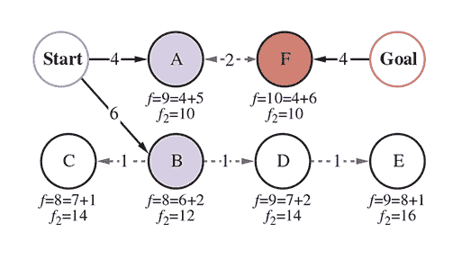

图 3.24 双向搜索维护两个前沿：左侧，节点 `A` 和 `B` 是 `Start` 的后继；右侧，节点 `F` 是 `Goal` 的逆后继。每个节点都标记有 `f = g + h` 值和 `f2 = max(2g, g + h)` 值。（`g` 值是如箭头所示的动作成本之和；`h` 值是任意的，无法从图中推导。）最优解 `Start-A-F-Goal` 的成本为 `C* = 4 + 2 + 4 = 10`，这意味着“在中间相遇”的双向算法不应扩展任何 `g > $\\frac{C^{\*}}{2}$` = 5 的节点；事实上，下一个要扩展的节点将是 `A` 或 `F`（每个 `g=4`），从而导向最优解。如果我们先扩展 `f` 成本最低的节点，那么接下来会是 `B` 和 `C`，而 `D` 和 `E` 将与 `A` 并列，但它们都具有 `g > $\\frac{C^{\*}}{2}$`，因此在 `f2` 为评估函数时永远不会被扩展。

我们描述了一种方法，其中 `hF` 启发式估计到目标的距离（或，当问题有多个目标状态时，估计到最近目标的距离），而 `hB` 估计到起点的距离。这称为前向到末端搜索。另一种称为前向到前沿搜索的方法，尝试估计到另一前沿的距离。显然，如果一个前沿有数百万个节点，对每个节点应用启发式函数并取最小值是低效的。但可以对前沿中的少数节点进行采样。在某些特定问题域中，可以对前沿进行汇总——例如，在网格搜索问题中，我们可以增量计算前沿的边界框，并将到边界框的距离用作启发式。

*前向到末端* *前向到前沿*

双向搜索有时比单向搜索更有效，有时则不然。一般来说，如果我们有一个非常好的启发式，那么 `A*` 搜索产生的搜索轮廓会集中在目标上，添加双向搜索帮助不大。具有平均启发式时，“在中间相遇”的双向搜索倾向于扩展更少的节点且更受青睐。在启发式很差的最坏情况下，搜索不再集中于目标，双向搜索具有与 `A*` 相同的渐近复杂度。具有 `f2` 评估函数和可容许启发式 `h` 的双向搜索是完备且最优的。

## 3.6 启发式函数


本节中，我们将研究启发式的准确性如何影响搜索性能，并探讨启发式是如何被发明的。作为主要示例，我们将回到 8-拼图。如第 3.2 节所述，拼图的目的是将瓷砖水平或垂直滑动到空白处，直到配置与目标配置匹配（图 3.25）。

描述
标记为起始状态的方块有三行三列。第 1 行：第 1 列，7。第 2 列，2。第 3 列，4。第 2 行：第 1 列，5。第 2 列，空白。第 3 列，6。第 3 行：第 1 列，8。第 2 列，3。第 3 列，1。另一个标记为目标状态的方块有三行三列。第 1 行：第 1 列，空白。第 2 列，1。第 3 列，2。第 2 行：第 1 列，3。第 2 列，4。第 3 列，5。第 3 行：第 1 列，6。第 2 列，7。第 3 列，8。

×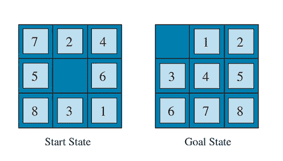

图 3.25 8-拼图的一个典型实例。最短解为 26 步长。

8-拼图中有 `9!/2 = 181,400` 个可达状态，因此搜索可以轻松地将它们全部保存在内存中。但对于 15-拼图，共有 `16!/2` 个状态——超过 10 万亿——因此要搜索该空间，我们需要一个好的可采纳启发式函数的帮助。对于 15-拼图，这类启发式有着悠久的历史；以下是两个常用的候选启发式：

• `h1 = the number of misplaced tiles (blank not included)`. 对于图 3.25，所有八块瓷砖都位置错误，因此起始状态的 `h1 = 8`。 `h1` 是一个可采纳启发式，因为任何位置错误的瓷砖至少需要一次移动才能到达正确位置。

• `h2 = the sum of the distances of the tiles from their goal positions`. 因为瓷砖不能沿对角线移动，距离是水平和垂直距离之和——有时称为街区距离或曼哈顿距离。 `h2` 也是可采纳的，因为任何一次移动最多只能使一块瓷砖更接近目标一步。 图 3.25 中起始状态的 1 到 8 号瓷砖的曼哈顿距离为

*曼哈顿距离*

`h2 = 3 + 1 + 2 + 2 + 2 + 3 + 3 + 2 = 18`。

正如预期的那样，这两者都不会高估真实解的代价，为 26。

## 3.6.1 启发式精度对性能的影响

一种表征启发式质量的方法是有效分支因子 `b*`。如果 `A*` 对某个特定问题生成的节点总数为 `N`，解的深度为 `d`，那么 `b*` 就是深度为 `d` 的均匀树为了包含 `N + 1` 个节点必须具有的分支因子。因此，

*有效分支因子*

`N + 1 = 1 + b* + (b*)² + … + (b*)^d`。

例如，如果 `A*` 在深度 5 处找到解，使用 52 个节点，则有效分支因子为 1.92。有效分支因子可在不同问题实例之间变化，但通常对于特定领域（如 8-拼图）而言，在所有非平凡问题实例中都相当恒定。因此，对少量问题进行的 `b*` 的实验测量可以很好地指导启发式的整体有用性。设计良好的启发式的值应接近 1，从而能够以合理的计算成本解决相当大的问题。

Korf 和 Reid（1998）认为，用给定的启发式 `h` 表征 `A*` 修剪效果的更好方法是，它与真实深度相比将有效深度减少了一个常数 `k[h]`。这意味着总搜索成本为 `O(b^d - k[h])`，而对于无信息搜索则为 `O(b^d)`。他们对 Rubik’s Cube 和 n-拼图问题的实验表明，该公式对不同解长度范围内的采样问题实例的总搜索成本给出了准确的预测——至少对于大于 `k[h]` 的解长度而言。

*有效深度*

对于图 3.26，我们生成了随机的 8-拼图问题，并使用无信息的广度优先搜索以及使用 `h1` 和 `h2` 的 `A*` 搜索来求解它们，报告了每个搜索策略和每个解长度下生成的平均节点数以及相应的有效分支因子。结果表明 `h2` 比 `h1` 更好，而两者都比没有启发式更好。

描述
标记为起始状态的方块有三行三列。第 1 行：第 1 列，星号。第 2 列，2。第 3 列，4。第 2 行：第 1 列，星号。第 2 列，空白。第 3 列，星号。第 3 行：第 1 列，星号。第 2 列，3。第 3 列，1。另一个标记为目标状态的方块有三行三列。第 1 行：第 1 列，空白。第 2 列，1。第 3 列，2。第 2 行：第 1 列，3。第 2 列，4。第 3 列，星号。第 3 行：第 1 列，星号。第 2 列，星号。第 3 列，星号。

×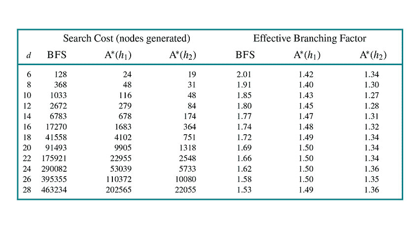

图 3.26 使用广度优先搜索、 `A*` 配合 `h1`（错位瓷砖）和 `A*` 配合 `h2`（曼哈顿距离）对 8-拼图问题的搜索代价和有效分支因子进行比较。数据是对每个解长度 `d` 从 6 到 28 的 100 个拼图取平均值。

有人可能会问 `h2` 是否总是优于 `h1`。答案是“本质上，是的。” 从两个启发式的定义可以很容易看出，对于任意节点 `n`，`h2(n) ≥ h1(n)`。我们因此说 `h2` 支配 `h1`。支配直接转化为效率：使用 `h2` 的 `A*` 不会扩展比使用 `h1` 的 `A*` 更多的节点（除非在不利地打破平局的情况下）。论证很简单。回想第 108 页上的观察，每一个 `f(n) < C*` 的节点肯定会被扩展。这等同于说当 `h` 一致时，每一个 `h(n) < C* - g(n)` 的节点肯定会被扩展。但由于对于所有节点 `h2` 都至少与 `h1` 一样大，因此 `A*` 搜索使用 `h2` 肯定会扩展的每个节点也肯定会被使用 `h1` 扩展，而 `h1` 可能会导致其他节点也被扩展。因此，一般来说，使用值更高的启发式函数更好，前提是它是一致的并且启发式的计算时间不太长。

*支配*

## 3.6.2 从松弛问题生成启发式

我们已经看到 `h1`（错位瓷砖）和 `h2`（曼哈顿距离）对于 8-拼图都是相当好的启发式，并且 `h2` 更好。人们如何想到 `h2` 呢？计算机能否机械地发明这样的启发式？

`h1` 和 `h2` 都是 8-拼图剩余路径长度的估计，但它们也是拼图简化版本的精确路径长度。如果拼图的规则被改变，使得瓷砖可以移动到任何位置而不是仅移动到相邻的空方格，那么 `h1` 将给出最短解的精确长度。类似地，如果瓷砖可以在任何方向移动一格，甚至可以移动到被占用的方格，那么 `h2` 将给出最短解的精确长度。对动作限制较少的问题称为松弛问题。松弛问题的状态空间图是原始状态空间的超图，因为限制的移除在图中创建了额外的边。

*松弛问题*

由于松弛问题为状态空间图添加了边，原始问题中的任何最优解按定义也是松弛问题中的解；但如果添加的边提供了捷径，松弛问题可能有更好的解。因此，松弛问题的最优解的成本是对原始问题的可采纳启发式。此外，由于派生的启发式是对松弛问题的精确成本，因此它必须服从三角不等式，因而是一致的（参见第 106 页）。


如果一个问题定义是用形式语言写下来的，就有可能自动构造松弛问题。14 例如，如果 8 拼图的操作描述为

一个瓦片可以从方格 `X` 移动到方格 `Y` 如果

`X` 与 `Y` 相邻 且 `Y` 为空白，

我们可以生成三个松弛问题，通过移除一个或两个条件：

(a) 一个瓦片可以从方格 `X` 移动到方格 `Y` 如果 `X` 与 `Y` 相邻。

(b) 一个瓦片可以从方格 `X` 移动到方格 `Y` 如果 `Y` 为空白。

(c) 一个瓦片可以从方格 `X` 移动到方格 `Y`。

由 (a) 可推导出 `h2`（曼哈顿距离）。其理由是，如果依次将每个瓦片移动到其目标位置，`h2` 将是正确的评分。由 (b) 推导出的启发式在练习 3.GASC 中讨论。由 (c) 可推导出 `h1`（错位瓦片），因为如果瓦片能在一次操作中移动到其预期目标，这将是正确的评分。请注意，由此技术生成的松弛问题能够基本无需搜索即可求解至关重要，因为松弛规则允许问题分解为八个独立的子问题。如果松弛问题难以求解，则相应启发式的值将昂贵地获得。

一个名为 `ABSOLVER` 的程序可以利用“松弛问题”方法以及各种其他技术（Prieditis, 1993）从问题定义中自动生成启发式。`ABSOLVER` 为 8 拼图生成了一个新的启发式，其优于任何现有的启发式，并为著名的魔方拼图找到了第一个有用的启发式。

如果对于一个问题有一组可采纳启发式 `h1` ... `hm` 可用，而其中没有一个明显优于其他启发式，我们应该选择哪一个？事实证明，我们可以通过定义来兼得两者之长

`h(n) = max{h1(n),...,hk(n)}`。

这个复合启发式会选择在所讨论节点上最准确的函数。因为 `hi` 分量是可采纳的，所以 `h` 是可采纳的（如果 `hi` 都是一致的，则 `h` 是一致的）。此外，`h` 支配其所有分量启发式。唯一的缺点是 `h(n)` 计算时间更长。如果这是个问题，一个替代方案是在每次评估时随机选择其中一个启发式，或使用机器学习算法预测哪个启发式会最好。这样做可能导致启发式不一致（即使每个 `hi` 都是一致的），但在实践中它通常会导致更快的求解。

### 3.6.3 从子问题生成启发式：模式数据库

可采纳启发式也可以从给定问题的子问题的解成本中推导出来。例如，图 3.27 显示了 图 3.25 中 8 拼图实例的一个子问题。该子问题涉及将瓦片 1、2、3、4 和空白移动到其正确位置。显然，该子问题的最优解成本是对完整问题成本的下界。在某些情况下，它比曼哈顿距离更准确。

子问题

描述

地图显示了各种高速公路、标志以及城市和地名。显示了阿拉德和布加勒斯特之间两种可能的路线。第一条路线经过锡比乌、里姆尼库·维尔恰、皮特什蒂并到达布加勒斯特。距离和预计时间分别显示为 578 公里和 7 小时 17 分钟。第二条路线经过卢戈什、德罗贝塔、皮特什蒂并到达布加勒斯特。预计时间显示为 7 小时 35 分钟。第一条道路以蓝色高亮显示为所选路线。地图左侧的窗口窗格显示了从阿拉德出发到达布加勒斯特的确切方向。

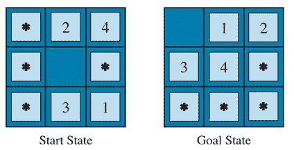

图 3.27 给定 图 3.25 中的 8 拼图实例的一个子问题。任务是将瓦片 1、2、3、4 和空白移动到其正确位置，而不必担心其他瓦片会发生什么。

模式数据库背后的思想是为每个可能的子问题实例存储这些精确的解成本——在我们的例子中，是四个瓦片和空白的每一种可能配置。（数据库中将有 9 × 8 × 7 × 6 × 5 = 15,120 个模式。其他四个瓦片的身份对于求解子问题的目的来说是无关紧要的，但这些瓦片的移动仍计入子问题的解成本。）然后我们只需在数据库中查找相应的子问题配置，就能为搜索过程中遇到的每个状态计算一个可采纳启发式 `hDB`。数据库本身是通过从目标回溯搜索并记录遇到的每个新模式的成本来构建的；15 这种搜索的开销被分摊到后续的问题实例上，因此如果我们预计会被要求求解许多问题，这是有意义的。

模式数据库

选择与空白一起的瓦片 1-2-3-4 几乎是任意的；我们也可以为 5-6-7-8、2-4-6-8 等构建数据库。每个数据库都会产生一个可采纳启发式，并且这些启发式可以像前面解释的那样通过取最大值来组合。这种组合启发式的准确性远高于曼哈顿距离；求解随机 15 拼图时生成的节点数可以减少 1000 倍。然而，随着每个额外数据库的增加，收益递减，而内存和计算成本增加。

有人可能会想知道，既然这两个子问题似乎不重叠，是否可以将从 1-2-3-4 数据库和 5-6-7-8 获得的启发式相加？这是否仍能给出一个可采纳启发式？答案是否定的，因为对于给定状态，1-2-3-4 子问题和 5-6-7-8 子问题的解几乎肯定会共享一些移动——不太可能在不触及 5-6-7-8 的情况下将 1-2-3-4 移到位，反之亦然。但如果我们不计算这些移动呢——如果我们不将其他瓦片抽象为星号，而是让它们消失呢？也就是说，我们记录的不是求解 1-2-3-4 子问题的总成本，而是仅涉及 1-2-3-4 的移动次数。那么这两个成本之和仍然是求解整个问题的成本的下界。这就是不相交模式数据库背后的思想。有了这样的数据库，可以在几毫秒内求解随机 15 拼图——与使用曼哈顿距离相比，生成的节点数减少了 10,000 倍。对于 24 拼图，可以获得大约一百万倍的加速。不相交模式数据库适用于滑动瓦片拼图，因为问题可以被划分成每个移动只影响一个子问题的方式——因为每次只移动一个瓦片。

不相交模式数据库

### 3.6.4 使用里程碑生成启发式

有一些在线服务托管包含数千万个顶点的地图，并在毫秒内找到成本最优的驾驶路线（图 3.28）。它们是如何做到的，当我们迄今为止考虑过的最佳搜索算法大约慢一百万倍时？有很多技巧，但最重要的一点是预先计算一些最优路径成本。虽然预先计算可能耗时，但只需做一次，然后就可以分摊到数十亿次用户搜索请求上。

描述


地图显示了各种高速公路、标志以及城市和地名。显示了阿拉德和布加勒斯特之间的两条可能路线。第一条路线经过锡比乌、里姆尼库·维尔恰、皮特什蒂，最后到达布加勒斯特。距离和预计时间分别显示为 578 公里和 7 小时 17 分钟。第二条路线经过卢戈日、德罗贝塔、皮特什蒂，最后到达布加勒斯特。预计时间显示为 7 小时 35 分钟。第一条道路以蓝色高亮显示为所选路线。地图左侧的窗口面板显示了从阿拉德出发到达布加勒斯特的确切路线。

×

Figure 3.28 由搜索算法计算的提供驾驶路线的 Web 服务。

## 使用地标的路径查找

### 预计算
我们可以预先计算并存储每对顶点之间最优路径的成本来生成一个完美的启发式方法。这需要 `O(|V|2)` 空间和 `O(|E|3)` 时间——对于拥有 1 万个顶点的图是可行的，但对于 1 千万个顶点则不可行。

更好的方法是选择几个（也许 10 或 20 个）地标点 16 作为顶点。然后对于每个地标 `L` 和图中每个其他顶点 `v`，我们计算并存储 `C*(v, L)`，即从 `v` 到 `L` 的最优路径的确切成本。（我们还需要 `C*(L, v)`；在无向图上这与 `C*(v, L)` 相同；在有向图上——例如单行道——我们需要单独计算。）给定存储的 `C*` 表，我们可以轻松创建一个高效的（尽管不可容许的）启发式方法：所有地标中，从当前节点到地标然后到目标的成本的最小值：

### 地标点
$h_{L}(n) = \\min\\limits\_{L \\in Landmarks}C^{\*}(n,L) + C^{\*}(L,goal)$

如果最优路径恰好经过一个地标，则该启发式方法将是精确的；如果不是，则不可容许——它会高估到目标的成本。在 `A*` 搜索中，如果你拥有精确的启发式方法，那么一旦到达最优路径上的节点，此后扩展的每个节点都将在最优路径上。将轮廓线想象为沿着这条最优路径。搜索将沿着最优路径追踪，每次迭代添加一个成本为 `c` 的动作以到达一个结果状态，其 `h` 值将减少 `c`，这意味着总的 `f = g + h` 分数在整个路径上将保持恒定为 `C*`。

一些路径查找算法通过添加快捷方式——图中定义最优多动作路径的人工边——节省更多时间。例如，如果美国 100 个最大城市之间预先定义了快捷方式，而我们正试图从加利福尼亚的伯克利校园导航到纽约的纽约大学，我们可以取萨克拉门托和曼哈顿之间的快捷方式，一次行动覆盖 90% 的路径。

### 快捷方式
`hL(n)` 高效但不可容许。但只要多加注意，我们可以提出一个既高效又可容许的启发式方法：

$\\left. h\_{DH}\\text{(}n\\text{)~=~}\\underset{L \\in Landmarks}{\\text{min}}\\, \\middle| C^{\*}\\text{(}n\\text{,}L\\text{)~} - \\ C^{\*}\\text{(}goal,\\, L\\text{)~|} \\right.$

这被称为差分启发式（因为有减法）。想象一个位于目标之外的地标。如果目标恰好位于从 `n` 到地标的最优路径上，那么这意味着“考虑从 `n` 到 `L` 的整个路径，然后减去该路径的最后一部分，从 `goal` 到 `L`，从而得到从 `n` 到 `goal` 的路径的确切成本”。在目标稍微偏离到地标的最优路径的程度上，启发式方法将不精确，但仍可容许。不是位于目标之外的地标将无用；一个恰好位于 `n` 和 `goal` 中间地标将给出 `hDH = 0`，这没有帮助。

### 差分启发式
挑选地标点有几种方法。随机选择点很快，但如果我们注意将地标分散开，使它们彼此不靠得太近，结果会更好。一种贪心方法是随机挑选第一个地标，然后找到离它最远的点并将其添加到地标集合中，然后继续，在每次迭代中添加使到最近地标的距离最大化的点。如果有用户过去搜索请求的日志，那么可以选择在搜索中经常请求的地标。对于差分启发式，如果地标分布在图的周界周围会更好。因此，一个好的技术是找到图的质心，在质心周围排列 `k` 个扇形楔形，并在每个楔形中选择离中心最远的顶点。

地标在路径查找问题中特别有效，因为道路在世界上的布局方式：大量交通实际上希望在地标之间行驶，因此土木工程师沿着这些路线修建最宽最快的道路；地标搜索使恢复这些路线变得更容易。

## 3.6.5 学习更好地搜索
我们已经介绍了几种固定的搜索策略——`breadth-first`、`A*` 等——它们是由计算机科学家精心设计和编程的。智能体能否学会更好地搜索？答案是肯定的，其方法基于一个重要概念，称为 `metalevel state space`。`metalevel state space` 中的每个状态都捕获了在普通状态空间（如罗马尼亚地图）中搜索的程序的内部（计算）状态。（为了区分这两个概念，我们将罗马尼亚地图称为 `object-level state space`。）例如，`A*` 算法的内部状态由当前的搜索树组成。`metalevel state space` 中的每个动作都是改变内部状态的计算步骤；例如，`A*` 中的每个计算步骤都会扩展一个叶节点并将其后继节点添加到树中。因此，图 3.18 显示了一系列越来越大的搜索树，可以看作是在 `metalevel state space` 中的一条路径，其中路径上的每个状态都是一个 `object-level search tree`。

### 元层级状态空间
### 对象层级状态空间

现在，图 3.18 中的路径有五个步骤，其中包括一个步骤，即扩展 Fagaras，并不是特别有帮助。对于更难的问题，将会有许多此类失误，而 `metalevel learning` 算法可以从这些经验中学习，以避免探索没有前景的子树。这种学习所使用的技术在 第 23 章 中描述。学习的目的是最小化问题求解的总成本，在计算开销和路径成本之间进行权衡。

### 元层级学习

## 3.6.6 从经验中学习启发式方法
我们已经看到，发明启发式方法的一种方法是设计一个松弛问题，其最优解可以很容易找到。另一种方法是向经验学习。这里的“经验”意味着解决大量 `8-puzzles`，例如。每个 `8-puzzle` 问题的最优解都提供一个示例 (`goal`, `path`) 对。从这些示例中，可以使用学习算法构建一个函数 `h`，该函数可以（碰巧）近似搜索过程中出现的其他状态的真实路径成本。这些方法中的大多数学习的是启发式函数的近似值，因此存在不可容许的风险。这导致了学习时间、搜索运行时间和解成本之间的不可避免的权衡。机器学习技术在 第 19 章 中演示。 第 23 章 中描述的强化学习方法也适用于搜索。


某些机器学习技术在提供与预测状态启发式值相关的状态特征时效果更好，而不仅仅是使用原始状态描述。例如，特征“错位瓷砖的数量”可能有助于预测 8 拼图状态与目标的实际距离。让我们称此特征为 `x1(n)`。我们可以取 100 个随机生成的 8 拼图配置并收集其实际解算成本的统计数据。我们可能会发现当 `x1(n)` 为 5 时，平均解算成本约为 14，依此类推。当然，我们可以使用多个特征。第二个特征 `x2(n)` 可能是“相邻瓷砖对的数量，这些瓷砖在目标状态中并不相邻”。`x1(n)` 和 `x2(n)` 应如何组合以预测 `h(n)`？一种常见的方法是使用线性组合：

`h(n) = c[1]x1 + c[2]x2`.

### 特征
常数 `c1` 和 `c2` 会被调整以在随机生成的配置上对实际数据给出最佳拟合。人们期望 `c1` 和 `c2` 均为正值，因为错位的瓷砖和不正确的相邻对会使问题更难解决。请注意，此启发式满足目标状态的 `h(n) = 0` 条件，但不一定是可采纳的或一致的。

## 摘要
本章介绍了搜索算法，智能体可利用这些算法在各种环境中选择动作序列——只要它们是回合式的、单智能体、完全可观测的、确定的、静态的、离散的且完全已知的。搜索所需的时间、可用内存量和解的质量之间存在权衡。如果我们拥有以启发式函数形式表达的领域相关知识，该函数估计给定状态与目标的距离，或者如果我们预先计算涉及模式或地标的部分解，则可以更高效。

- 在智能体开始搜索之前，必须先制定一个定义良好的问题。
- 一个问题由五个部分组成：初始状态、动作集合、描述这些动作结果的转移模型、目标状态集合以及动作成本函数。
- 问题的环境由状态空间图表示。状态空间中从初始状态到目标状态的一条路径（动作序列）即为解。
- 搜索算法通常将状态和动作视为原子，没有任何内部结构（尽管我们在进行学习时引入了状态的特征）。
- 搜索算法根据完备性、成本最优性、时间复杂度和空间复杂度来评判。
- 无信息搜索方法仅能访问问题的定义。算法构建搜索树以尝试找到解。算法的区别在于首先扩展哪个节点：
  - 最佳优先搜索使用评估函数选择要扩展的节点。
  - 广度优先搜索首先扩展最浅的节点；它是完备的，对单位动作成本最优，但具有指数级的空间复杂度。
  - 统一成本搜索扩展路径成本最低的节点，`g(n)`，且对一般动作成本最优。
  - 深度优先搜索首先扩展最深的未扩展节点。它既不完备也不最优，但具有线性空间复杂度。深度限制搜索增加了深度界限。
  - 迭代加深搜索以递增的深度限制反复调用深度优先搜索，直到找到目标。它在进行完整循环检查时是完备的，对单位动作成本最优，时间复杂度与广度优先搜索相当，且具有线性空间复杂度。
  - 双向搜索扩展两个前沿，一个围绕初始状态，一个围绕目标，停止于两个前沿相遇时。
- 有信息搜索方法可访问启发式函数 `h(n)`，该函数估计从 n 出发的解的成本。它们可能还可访问诸如包含解成本的模式数据库之类的额外信息。
  - 贪婪最佳优先搜索扩展 `h(n)` 最小的节点。它不是最优的，但通常很高效。
  - `A*` 搜索扩展 `f(n) = g(n) + h(n)` 最小的节点。`A*` 是完备且最优的，前提是 `h(n)` 可采纳。`A*` 的空间复杂度对许多问题仍然是一个问题。
  - 双向 `A*` 搜索有时比 `A*` 本身更高效。
  - `IDA*`（迭代加深 `A*` 搜索）是 `A*` 的迭代加深版本，因此解决了空间复杂度问题。
  - `RBFS`（递归最佳优先搜索）和 `SMA*`（简化内存受限 `A*`）是使用有限内存的稳健、最优搜索算法；有足够时间时，它们可以解决 `A*` 内存耗尽的问题。
  - 束搜索对前沿的大小设置限制；这使其不完备且次优，但它通常能找到相当好的解，并且比完整搜索运行更快。
  - 加权 `A*` 搜索将搜索聚焦于目标，扩展更少的节点，但牺牲了最优性。
- 启发式搜索算法的性能取决于启发式函数的质量。有时可以通过放松问题定义、将子问题的预计算解成本存储在模式数据库中、定义地标，或从对问题类的经验中学习来构建良好的启发式。

## 参考文献和历史注记
状态空间搜索的主题起源于人工智能的早期。Newell 和 Simon 关于 Logic Theorist（1957 年）和 GPS（1961 年）的工作导致搜索算法成为 1960 年代人工智能研究者的主要工具，并使问题求解成为经典的人工智能任务。Richard Bellman（1957 年）在运筹学方面的工作表明累加路径成本在简化优化算法中的重要性。Nils Nilsson（1971 年）的著作为该领域奠定了坚实的理论基础。

8 拼图是 15 拼图的小型近亲，其历史由 Slocum 和 Sonneveld（2006 年）详细记述。1880 年，15 拼图吸引了公众和数学家的广泛关注（Johnson 和 Story，1879 年；Tait，1880 年）。《美国数学期刊》的编辑们写道：“‘15’拼图在过去几周里一直突出地出现在美国公众面前，可以安全地说，它吸引了男女老少十人中有九人的注意，”而堪萨斯州埃姆波里亚的《Weekly News-Democrat》在 1880 年 3 月 12 日写道：“它在全国各地已真正成为一种流行病。”

著名的美国游戏设计师 Sam Loyd 错误地声称自己发明了 15 拼图（Loyd，1959 年）；实际上它是由纽约州 Canastota 的邮政局长 Noyes Chapman 在 1870 年代中期发明的（尽管 Ernest Kinsey 在 1878 年获得了涵盖滑动块的通用专利）。Ratner 和 Warmuth（1986 年）表明，15 拼图的一般 n × n 版本属于 NP-完全问题类。

魔方当然是在 1974 年由 Ernő Rubik 发明的，他还发现了一种寻找良好但非最优解的算法。Korf（1997 年）使用模式数据库和 `IDA*` 搜索为一些随机问题实例找到了最优解。Rokicki 等人（2014 年）证明任何实例都可以在 26 步内解决（如果将 180° 旋转视为两步；如果计为一步则为 20 步）。该证明消耗了 35 CPU 年的计算；它并不能立即导出高效的算法。Agostinelli 等人（2019 年）使用强化学习、深度学习网络和蒙特卡洛树搜索学习了魔方的更高效求解器。它不能保证找到成本最优解，但约 60% 的时间可以做到，且典型解算时间小于一秒。


# 搜索算法历史概述

## 真实世界搜索问题
本章列出的每个现实世界搜索问题都已成为大量研究工作的主题。选择最优航班的方法在很大程度上仍属专有，但 Carl de Marcken 通过归约为丢番图判定问题证明，航空公司票价和限制已变得如此复杂，以至于选择最优航班的问题在形式上是不可判定的 (Robinson, 2002)。旅行商问题 (`TSP`) 是理论计算机科学中的一个标准组合问题 (Lawler et al., 1992)。Karp (1972) 证明了 `TSP` 判定问题是 NP-难的，但有效的启发式近似方法被开发出来 (Lin and Kernighan, 1973)。Arora (1998) 为欧几里得 `TSP`s 设计了完全多项式近似方案。VLSI 布局方法由 LaPaugh (2010) 进行了综述，许多布局优化论文发表在 VLSI 期刊上。机器人导航在 第 26 章 中进行了讨论。自动装配排序首次由 `FREDDY` (Michie, 1972) 演示；全面的综述由 (Bahubalendruni and Biswal, 2016) 给出。

## 无信息搜索算法
无信息搜索算法是计算机科学 (Cormen et al., 2009) 和运筹学 (Dreyfus, 1969) 的核心主题。`Breadth-first search` 由 Moore (1959) 提出用于解决迷宫。动态规划方法 (Bellman, 1957; Bellman and Dreyfus, 1962)，系统地记录所有递增长度的子问题的解，可以被视为一种广度优先搜索形式。

通常以 (Dijkstra, 1959) 形式呈现的 Dijkstra 算法适用于显式有限图。Nilsson (1971) 引入了 Dijkstra 算法的一个版本，他称之为 uniform-cost search（因为算法“spreads out along contours of equal path cost”），该算法允许隐式定义的无限图。Nilsson 的工作还引入了闭列表和开列表的概念，以及“graph search”这一术语。名称 `BEST-FIRST-SEARCH` 在人工智能手册 (Barr and Feigenbaum, 1981) 中被引入。`Floyd–Warshall` (Floyd, 1962) 和 `Bellman-Ford` (Bellman, 1958; Ford, 1956) 算法允许负步长代价（只要没有负环）。

一种为高效利用棋钟而设计的迭代加深版本首次由 Slate 和 Atkin (1977) 在 `CHESS 4.5` 博弈程序中使用。Martelli 的算法 B (1977) 也包含迭代加深方面。迭代加深技术由 Bertram Raphael (1976) 引入，并在 Korf (1985a) 的工作中得到突出。

## 启发式搜索与 A*
问题求解中使用启发式信息出现在 Simon 和 Newell (1958) 的早期论文中，但“heuristic search”这一短语以及用于估计到目标距离的启发式函数的使用则稍晚出现 (Newell and Ernst, 1965; Lin, 1965)。Doran 和 Michie (1966) 对启发式搜索进行了广泛的实验研究。尽管他们分析了路径长度和“penetrance”（路径长度与迄今为止检查的节点总数的比率），但他们似乎忽略了路径代价 `g(n)` 提供的[content]
# 搜索算法历史概述

## 真实世界搜索问题
本章列出的每个现实世界搜索问题都已成为大量研究工作的主题。选择最优航班的方法在很大程度上仍属专有，但 Carl de Marcken 通过归约为丢番图判定问题证明，航空公司票价和限制已变得如此复杂，以至于选择最优航班的问题在形式上是不可判定的 (Robinson, 2002)。旅行商问题 (`TSP`) 是理论计算机科学中的一个标准组合问题 (Lawler et al., 1992)。Karp (1972) 证明了 `TSP` 判定问题是 NP-难的，但有效的启发式近似方法被开发出来 (Lin and Kernighan, 1973)。Arora (1998) 为欧几里得 `TSP`s 设计了完全多项式近似方案。VLSI 布局方法由 LaPaugh (2010) 进行了综述，许多布局优化论文发表在 VLSI 期刊上。机器人导航在 第 26 章 中进行了讨论。自动装配排序首次由 `FREDDY` (Michie, 1972) 演示；全面的综述由 (Bahubalendruni and Biswal, 2016) 给出。

## 无信息搜索算法
无信息搜索算法是计算机科学 (Cormen et al., 2009) 和运筹学 (Dreyfus, 1969) 的核心主题。`Breadth-first search` 由 Moore (1959) 提出用于解决迷宫。动态规划方法 (Bellman, 1957; Bellman and Dreyfus, 1962)，系统地记录所有递增长度的子问题的解，可以被视为一种广度优先搜索形式。

通常以 (Dijkstra, 1959) 形式呈现的 Dijkstra 算法适用于显式有限图。Nilsson (1971) 引入了 Dijkstra 算法的一个版本，他称之为 uniform-cost search（因为算法“spreads out along contours of equal path cost”），该算法允许隐式定义的无限图。Nilsson 的工作还引入了闭列表和开列表的概念，以及“graph search”这一术语。名称 `BEST-FIRST-SEARCH` 在人工智能手册 (Barr and Feigenbaum, 1981) 中被引入。`Floyd–Warshall` (Floyd, 1962) 和 `Bellman-Ford` (Bellman, 1958; Ford, 1956) 算法允许负步长代价（只要没有负环）。

一种为高效利用棋钟而设计的迭代加深版本首次由 Slate 和 Atkin (1977) 在 `CHESS 4.5` 博弈程序中使用。Martelli 的算法 B (1977) 也包含迭代加深方面。迭代加深技术由 Bertram Raphael (1976) 引入，并在 Korf (1985a) 的工作中得到突出。

## 启发式搜索与 A*
问题求解中使用启发式信息出现在 Simon 和 Newell (1958) 的早期论文中，但“heuristic search”这一短语以及用于估计到目标距离的启发式函数的使用则稍晚出现 (Newell and Ernst, 1965; Lin, 1965)。Doran 和 Michie (1966) 对启发式搜索进行了广泛的实验研究。尽管他们分析了路径长度和“penetrance”（路径长度与迄今为止检查的节点总数的比率），但他们似乎忽略了路径代价 `g(n)` 提供的[content]
# 搜索算法历史概述

## 真实世界搜索问题
本章列出的每个现实世界搜索问题都已成为大量研究工作的主题。选择最优航班的方法在很大程度上仍属专有，但 Carl de Marcken 通过归约为丢番图判定问题证明，航空公司票价和限制已变得如此复杂，以至于选择最优航班的问题在形式上是不可判定的 (Robinson, 2002)。旅行商问题 (`TSP`) 是理论计算机科学中的一个标准组合问题 (Lawler et al., 1992)。Karp (1972) 证明了 `TSP` 判定问题是 NP-难的，但有效的启发式近似方法被开发出来 (Lin and Kernighan, 1973)。Arora (1998) 为欧几里得 `TSP`s 设计了完全多项式近似方案。VLSI 布局方法由 LaPaugh (2010) 进行了综述，许多布局优化论文发表在 VLSI 期刊上。机器人导航在 第 26 章 中进行了讨论。自动装配排序首次由 `FREDDY` (Michie, 1972) 演示；全面的综述由 (Bahubalendruni and Biswal, 2016) 给出。

## 无信息搜索算法
无信息搜索算法是计算机科学 (Cormen et al., 2009) 和运筹学 (Dreyfus, 1969) 的核心主题。`Breadth-first search` 由 Moore (1959) 提出用于解决迷宫。动态规划方法 (Bellman, 1957; Bellman and Dreyfus, 1962)，系统地记录所有递增长度的子问题的解，可以被视为一种广度优先搜索形式。

通常以 (Dijkstra, 1959) 形式呈现的 Dijkstra 算法适用于显式有限图。Nilsson (1971) 引入了 Dijkstra 算法的一个版本，他称之为 uniform-cost search（因为算法“spreads out along contours of equal path cost”），该算法允许隐式定义的无限图。Nilsson 的工作还引入了闭列表和开列表的概念，以及“graph search”这一术语。名称 `BEST-FIRST-SEARCH` 在人工智能手册 (Barr and Feigenbaum, 1981) 中被引入。`Floyd–Warshall` (Floyd, 1962) 和 `Bellman-Ford` (Bellman, 1958; Ford, 1956) 算法允许负步长代价（只要没有负环）。

一种为高效利用棋钟而设计的迭代加深版本首次由 Slate 和 Atkin (1977) 在 `CHESS 4.5` 博弈程序中使用。Martelli 的算法 B (1977) 也包含迭代加深方面。迭代加深技术由 Bertram Raphael (1976) 引入，并在 Korf (1985a) 的工作中得到突出。

## 启发式搜索与 A*
问题求解中使用启发式信息出现在 Simon 和 Newell (1958) 的早期论文中，但“heuristic search”这一短语以及用于估计到目标距离的启发式函数的使用则稍晚出现 (Newell and Ernst, 1965; Lin, 1965)。Doran 和 Michie (1966) 对启发式搜索进行了广泛的实验研究。尽管他们分析了路径长度和“penetrance”（路径长度与迄今为止检查的节点总数的比率），但他们似乎忽略了路径代价 `g(n)` 提供的[content]
# 搜索算法历史概述

## 真实世界搜索问题
本章列出的每个现实世界搜索问题都已成为大量研究工作的主题。选择最优航班的方法在很大程度上仍属专有，但 Carl de Marcken 通过归约为丢番图判定问题证明，航空公司票价和限制已变得如此复杂，以至于选择最优航班的问题在形式上是不可判定的 (Robinson, 2002)。旅行商问题 (`TSP`) 是理论计算机科学中的一个标准组合问题 (Lawler et al., 1992)。Karp (1972) 证明了 `TSP` 判定问题是 NP-难的，但有效的启发式近似方法被开发出来 (Lin and Kernighan, 1973)。Arora (1998) 为欧几里得 `TSP`s 设计了完全多项式近似方案。VLSI 布局方法由 LaPaugh (2010) 进行了综述，许多布局优化论文发表在 VLSI 期刊上。机器人导航在 第 26 章 中进行了讨论。自动装配排序首次由 `FREDDY` (Michie, 1972) 演示；全面的综述由 (Bahubalendruni and Biswal, 2016) 给出。

## 无信息搜索算法
无信息搜索算法是计算机科学 (Cormen et al., 2009) 和运筹学 (Dreyfus, 1969) 的核心主题。`Breadth-first search` 由 Moore (1959) 提出用于解决迷宫。动态规划方法 (Bellman, 1957; Bellman and Dreyfus, 1962)，系统地记录所有递增长度的子问题的解，可以被视为一种广度优先搜索形式。

通常以 (Dijkstra, 1959) 形式呈现的 Dijkstra 算法适用于显式有限图。Nilsson (1971) 引入了 Dijkstra 算法的一个版本，他称之为 uniform-cost search（因为算法“spreads out along contours of equal path cost”），该算法允许隐式定义的无限图。Nilsson 的工作还引入了闭列表和开列表的概念，以及“graph search”这一术语。名称 `BEST-FIRST-SEARCH` 在人工智能手册 (Barr and Feigenbaum, 1981) 中被引入。`Floyd–Warshall` (Floyd, 1962) 和 `Bellman-Ford` (Bellman, 1958; Ford, 1956) 算法允许负步长代价（只要没有负环）。

一种为高效利用棋钟而设计的迭代加深版本首次由 Slate 和 Atkin (1977) 在 `CHESS 4.5` 博弈程序中使用。Martelli 的算法 B (1977) 也包含迭代加深方面。迭代加深技术由 Bertram Raphael (1976) 引入，并在 Korf (1985a) 的工作中得到突出。

## 启发式搜索与 A*
问题求解中使用启发式信息出现在 Simon 和 Newell (1958) 的早期论文中，但“heuristic search”这一短语以及用于估计到目标距离的启发式函数的使用则稍晚出现 (Newell and Ernst, 1965; Lin, 1965)。Doran 和 Michie (1966) 对启发式搜索进行了广泛的实验研究。尽管他们分析了路径长度和“penetrance”（路径长度与迄今为止检查的节点总数的比率），但他们似乎忽略了路径代价 `g(n)` 提供的[content]
# 搜索算法历史概述

## 真实世界搜索问题
本章列出的每个现实世界搜索问题都已成为大量研究工作的主题。选择最优航班的方法在很大程度上仍属专有，但 Carl de Marcken 通过归约为丢番图判定问题证明，航空公司票价和限制已变得如此复杂，以至于选择最优航班的问题在形式上是不可判定的 (Robinson, 2002)。旅行商问题 (`TSP`) 是理论计算机科学中的一个标准组合问题 (Lawler et al., 1992)。Karp (1972) 证明了 `TSP` 判定问题是 NP-难的，但有效的启发式近似方法被开发出来 (Lin and Kernighan, 1973)。Arora (1998) 为欧几里得 `TSP`s 设计了完全多项式近似方案。VLSI 布局方法由 LaPaugh (2010) 进行了综述，许多布局优化论文发表在 VLSI 期刊上。机器人导航在 第 26 章 中进行了讨论。自动装配排序首次由 `FREDDY` (Michie, 1972) 演示；全面的综述由 (Bahubalendruni and Biswal, 2016) 给出。

## 无信息搜索算法
无信息搜索算法是计算机科学 (Cormen et al., 2009) 和运筹学 (Dreyfus, 1969) 的核心主题。`Breadth-first search` 由 Moore (1959) 提出用于解决迷宫。动态规划方法 (Bellman, 1957; Bellman and Dreyfus, 1962)，系统地记录所有递增长度的子问题的解，可以被视为一种广度优先搜索形式。

通常以 (Dijkstra, 1959) 形式呈现的 Dijkstra 算法适用于显式有限图。Nilsson (1971) 引入了 Dijkstra 算法的一个版本，他称之为 uniform-cost search（因为算法“spreads out along contours of equal path cost”），该算法允许隐式定义的无限图。Nilsson 的工作还引入了闭列表和开列表的概念，以及“graph search”这一术语。名称 `BEST-FIRST-SEARCH` 在人工智能手册 (Barr and Feigenbaum, 1981) 中被引入。`Floyd–Warshall` (Floyd, 1962) 和 `Bellman-Ford` (Bellman, 1958; Ford, 1956) 算法允许负步长代价（只要没有负环）。

一种为高效利用棋钟而设计的迭代加深版本首次由 Slate 和 Atkin (1977) 在 `CHESS 4.5` 博弈程序中使用。Martelli 的算法 B (1977) 也包含迭代加深方面。迭代加深技术由 Bertram Raphael (1976) 引入，并在 Korf (1985a) 的工作中得到突出。

## 启发式搜索与 A*
问题求解中使用启发式信息出现在 Simon 和 Newell (1958) 的早期论文中，但“heuristic search”这一短语以及用于估计到目标距离的启发式函数的使用则稍晚出现 (Newell and Ernst, 1965; Lin, 1965)。Doran 和 Michie (1966) 对启发式搜索进行了广泛的实验研究。尽管他们分析了路径长度和“penetrance”（路径长度与迄今为止检查的节点总数的比率），但他们似乎忽略了路径代价 `g(n)` 提供的[content]
# 搜索算法历史概述

## 真实世界搜索问题
本章列出的每个现实世界搜索问题都已成为大量研究工作的主题。选择最优航班的方法在很大程度上仍属专有，但 Carl de Marcken 通过归约为丢番图判定问题证明，航空公司票价和限制已变得如此复杂，以至于选择最优航班的问题在形式上是不可判定的 (Robinson, 2002)。旅行商问题 (`TSP`) 是理论计算机科学中的一个标准组合问题 (Lawler et al., 1992)。Karp (1972) 证明了 `TSP` 判定问题是 NP-难的，但有效的启发式近似方法被开发出来 (Lin and Kernighan, 1973)。Arora (1998) 为欧几里得 `TSP`s 设计了完全多项式近似方案。VLSI 布局方法由 LaPaugh (2010) 进行了综述，许多布局优化论文发表在 VLSI 期刊上。机器人导航在 第 26 章 中进行了讨论。自动装配排序首次由 `FREDDY` (Michie, 1972) 演示；全面的综述由 (Bahubalendruni and Biswal, 2016) 给出。

## 无信息搜索算法
无信息搜索算法是计算机科学 (Cormen et al., 2009) 和运筹学 (Dreyfus, 1969) 的核心主题。`Breadth-first search` 由 Moore (1959) 提出用于解决迷宫。动态规划方法 (Bellman, 1957; Bellman and Dreyfus, 1962)，系统地记录所有递增长度的子问题的解，可以被视为一种广度优先搜索形式。

通常以 (Dijkstra, 1959) 形式呈现的 Dijkstra 算法适用于显式有限图。Nilsson (1971) 引入了 Dijkstra 算法的一个版本，他称之为 uniform-cost search（因为算法 "spreads out along contours of equal path cost"），该算法允许隐式定义的无限图。Nilsson 的工作还引入了闭列表和开列表的概念，以及 "graph search" 这一术语。名称 `BEST-FIRST-SEARCH` 在人工智能手册 (Barr and Feigenbaum, 1981) 中被引入。`Floyd–Warshall` (Floyd, 1962) 和 `Bellman-Ford` (Bellman, 1958; Ford, 1956) 算法允许负步长代价（只要没有负环）。

一种为高效利用棋钟而设计的迭代加深版本首次由 Slate 和 Atkin (1977) 在 `CHESS 4.5` 博弈程序中使用。Martelli 的算法 B (1977) 也包含迭代加深方面。迭代加深技术由 Bertram Raphael (1976) 引入，并在 Korf (1985a) 的工作中得到突出。

## 启发式搜索与 A*
问题求解中使用启发式信息出现在 Simon 和 Newell (1958) 的早期论文中，但 "heuristic search" 这一短语以及用于估计到目标距离的启发式函数的使用则稍晚出现 (Newell and Ernst, 1965; Lin, 1965)。Doran 和 Michie (1966) 对启发式搜索进行了广泛的实验研究。尽管他们分析了路径长度和 "penetrance"（路径长度与迄今为止检查的节点总数的比率），但他们似乎忽略了路径代价 `g(n)` 提供的[content]
# 搜索算法历史概述

## 真实世界搜索问题
本章列出的每个现实世界搜索问题都已成为大量研究工作的主题。选择最优航班的方法在很大程度上仍属专有，但 Carl de Marcken 通过归约为丢番图判定问题证明，航空公司票价和限制已变得如此复杂，以至于选择最优航班的问题在形式上是不可判定的 (Robinson, 2002)。旅行商问题 (`TSP`) 是理论计算机科学中的一个标准组合问题 (Lawler et al., 1992)。Karp (1972) 证明了 `TSP` 判定问题是 NP-难的，但有效的启发式近似方法被开发出来 (Lin and Kernighan, 1973)。Arora (1998) 为欧几里得 `TSP`s 设计了完全多项式近似方案。VLSI 布局方法由 LaPaugh (2010) 进行了综述，许多布局优化论文发表在 VLSI 期刊上。机器人导航在 第 26 章 中进行了讨论。自动装配排序首次由 `FREDDY` (Michie, 1972) 演示；全面的综述由 (Bahubalendruni and Biswal, 2016) 给出。

## 无信息搜索算法
无信息搜索算法是计算机科学 (Cormen et al., 2009) 和运筹学 (Dreyfus, 1969) 的核心主题。`Breadth-first search` 由 Moore (1959) 提出用于解决迷宫。动态规划方法 (Bellman, 1957; Bellman and Dreyfus, 1962)，系统地记录所有递增长度的子问题的解，可以被视为一种广度优先搜索形式。

通常以 (Dijkstra, 1959) 形式呈现的 Dijkstra 算法适用于显式有限图。Nilsson (1971) 引入了 Dijkstra 算法的一个版本，他称之为 uniform-cost search（因为算法 "spreads out along contours of equal path cost"），该算法允许隐式定义的无限图。Nilsson 的工作还引入了闭列表和开列表的概念，以及 "graph search" 这一术语。名称 `BEST-FIRST-SEARCH` 在人工智能手册 (Barr and Feigenbaum, 1981) 中被引入。`Floyd–Warshall` (Floyd, 1962) 和 `Bellman-Ford` (Bellman, 1958; Ford, 1956) 算法允许负步长代价（只要没有负环）。

一种为高效利用棋钟而设计的迭代加深版本首次由 Slate 和 Atkin (1977) 在 `CHESS 4.5` 博弈程序中使用。Martelli 的算法 B (1977) 也包含迭代加深方面。迭代加深技术由 Bertram Raphael (1976) 引入，并在 Korf (1985a) 的工作中得到突出。

## 启发式搜索与 A*
问题求解中使用启发式信息出现在 Simon 和 Newell (1958) 的早期论文中，但 "heuristic search" 这一短语以及用于估计到目标距离的启发式函数的使用则稍晚出现 (Newell and Ernst, 1965; Lin, 1965)。Doran 和 Michie (1966) 对启发式搜索进行了广泛的实验研究。尽管他们分析了路径长度和 "penetrance"（路径长度与迄今为止检查的节点总数的比率），但他们似乎忽略了路径代价 `g(n)` 提供的[content]
# 搜索算法历史概述

## 真实世界搜索问题
本章列出的每个现实世界搜索问题都已成为大量研究工作的主题。选择最优航班的方法在很大程度上仍属专有，但 Carl de Marcken 通过归约为丢番图判定问题证明，航空公司票价和限制已变得如此复杂，以至于选择最优航班的问题在形式上是不可判定的 (Robinson, 2002)。旅行商问题 (`TSP`) 是理论计算机科学中的一个标准组合问题 (Lawler et al., 1992)。Karp (1972) 证明了 `TSP` 判定问题是 NP-难的，但有效的启发式近似方法被开发出来 (Lin and Kernighan, 1973)。Arora (1998) 为欧几里得 `TSP`s 设计了完全多项式近似方案。VLSI 布局方法由 LaPaugh (2010) 进行了综述，许多布局优化论文发表在 VLSI 期刊上。机器人导航在 第 26 章 中进行了讨论。自动装配排序首次由 `FREDDY` (Michie, 1972) 演示；全面的综述由 (Bahubalendruni and Biswal, 2016) 给出。

## 无信息搜索算法
无信息搜索算法是计算机科学 (Cormen et al., 2009) 和运筹学 (Dreyfus, 1969) 的核心主题。`Breadth-first search` 由 Moore (1959) 提出用于解决迷宫。动态规划方法 (Bellman, 1957; Bellman and Dreyfus, 1962)，系统地记录所有递增长度的子问题的解，可以被视为一种广度优先搜索形式。

通常以 (Dijkstra, 1959) 形式呈现的 Dijkstra 算法适用于显式有限图。Nilsson (1971) 引入了 Dijkstra 算法的一个版本，他称之为 uniform-cost search（因为算法 "spreads out along contours of equal path cost"），该算法允许隐式定义的无限图。Nilsson 的工作还引入了闭列表和开列表的概念，以及 "graph search" 这一术语。名称 `BEST-FIRST-SEARCH` 在人工智能手册 (Barr and Feigenbaum, 1981) 中被引入。`Floyd–Warshall` (Floyd, 1962) 和 `Bellman-Ford` (Bellman, 1958; Ford, 1956) 算法允许负步长代价（只要没有负环）。

一种为高效利用棋钟而设计的迭代加深版本首次由 Slate 和 Atkin (1977) 在 `CHESS 4.5` 博弈程序中使用。Martelli 的算法 B (1977) 也包含迭代加深方面。迭代加深技术由 Bertram Raphael (1976) 引入，并在 Korf (1985a) 的工作中得到突出。

## 启发式搜索与 A*
问题求解中使用启发式信息出现在 Simon 和 Newell (1958) 的早期论文中，但 "heuristic search" 这一短语以及用于估计到目标距离的启发式函数的使用则稍晚出现 (Newell and Ernst, 1965; Lin, 1965)。Doran 和 Michie (1966) 对启发式搜索进行了广泛的实验研究。尽管他们分析了路径长度和 "penetrance"（路径长度与迄今为止检查的节点总数的比率），但他们似乎忽略了路径代价 `g(n)` 提供的[content]
# 搜索算法历史概述

## 真实世界搜索问题
本章列出的每个现实世界搜索问题都已成为大量研究工作的主题。选择最优航班的方法在很大程度上仍属专有，但 Carl de Marcken 通过归约为丢番图判定问题证明，航空公司票价和限制已变得如此复杂，以至于选择最优航班的问题在形式上是不可判定的 (Robinson, 2002)。旅行商问题 (`TSP`) 是理论计算机科学中的一个标准组合问题 (Lawler et al., 1992)。Karp (1972) 证明了 `TSP` 判定问题是 NP-难的，但有效的启发式近似方法被开发出来 (Lin and Kernighan, 1973)。Arora (1998) 为欧几里得 `TSP`s 设计了完全多项式近似方案。VLSI 布局方法由 LaPaugh (2010) 进行了综述，许多布局优化论文发表在 VLSI 期刊上。机器人导航在 第 26 章 中进行了讨论。自动装配排序首次由 `FREDDY` (Michie, 1972) 演示；全面的综述由 (Bahubalendruni and Biswal, 2016) 给出。

## 无信息搜索算法
无信息搜索算法是计算机科学 (Cormen et al., 2009) 和运筹学 (Dreyfus, 1969) 的核心主题。`Breadth-first search` 由 Moore (1959) 提出用于解决迷宫。动态规划方法 (Bellman, 1957; Bellman and Dreyfus, 1962)，系统地记录所有递增长度的子问题的解，可以被视为一种广度优先搜索形式。

通常以 (Dijkstra, 1959) 形式呈现的 Dijkstra 算法适用于显式有限图。Nilsson (1971) 引入了 Dijkstra 算法的一个版本，他称之为 uniform-cost search（因为算法 "spreads out along contours of equal path cost"），该算法允许隐式定义的无限图。Nilsson 的工作还引入了闭列表和开列表的概念，以及 "graph search" 这一术语。名称 `BEST-FIRST-SEARCH` 在人工智能手册 (Barr and Feigenbaum, 1981) 中被引入。`Floyd–Warshall` (Floyd, 1962) 和 `Bellman-Ford` (Bellman, 1958; Ford, 1956) 算法允许负步长代价（只要没有负环）。

一种为高效利用棋钟而设计的迭代加深版本首次由 Slate 和 Atkin (1977) 在 `CHESS 4.5` 博弈程序中使用。Martelli 的算法 B (1977) 也包含迭代加深方面。迭代加深技术由 Bertram Raphael (1976) 引入，并在 Korf (1985a) 的工作中得到突出。

## 启发式搜索与 A*
问题求解中使用启发式信息出现在 Simon 和 Newell (1958) 的早期论文中，但 "heuristic search" 这一短语以及用于估计到目标距离的启发式函数的使用则稍晚出现 (Newell and Ernst, 1965; Lin, 1965)。Doran 和 Michie (1966) 对启发式搜索进行了广泛的实验研究。尽管他们分析了路径长度和 "penetrance"（路径长度与迄今为止检查的节点总数的比率），但他们似乎忽略了路径代价 `g(n)` 提供的信息。`A*` 算法将当前路径代价纳入启发式搜索，由 Hart、Nilsson 和 Raphael 于 1968 年开发。Dechter 和 Pearl (1985) 研究了 `A*` 在节点扩展数量上达到最优效率的条件。

原始的 `A*` 论文 (Hart et al., 1968) 引入了启发式函数的相容性条件。单调条件由 Pohl (1977) 提出作为更简单的替代，但 Pearl (1984) 证明两者等价。

Pohl (1977) 开创性地研究了启发式函数误差与 `A*` 时间复杂度的关系。在单位动作代价和单一目标状态的树状搜索中获得了基本结果 (Pohl, 1977; Gaschnig, 1979; Huyn et al., 1980; Pearl, 1984)，以及在多目标状态下 (Dinh et al., 2007)。Korf 和 Reid (1998) 展示了如何在多种实际问题域中预测扩展的确切节点数，而不仅仅是渐近近似。Nilsson (1971) 提出了 "effective branching factor" 作为效率的经验度量。对于图搜索，Helmert 和 Röger (2008) 指出若干知名问题在最优代价解路径上包含指数级多的节点，意味着 `A*` 的指数时间复杂度。

`A*` 算法有许多变体。Pohl (1970) 引入了加权 `A*` 搜索，后来又提出动态版本 (1973)，其中权重随树深度变化。Ebendt 和 Drechsler (2009) 综合了结果并考察了一些应用。Hatem 和 Ruml (2014) 展示了更简化和改进的加权 `A*` 版本，更易于实现。Wilt 和 Ruml (2014) 引入 speedy search 作为贪心搜索的替代，专注于最小化搜索时间，而 Wilt 和 Ruml (2016) 表明可满足搜索的最佳启发式与最优搜索的不同。Burns 等 (2012) 给出了编写快速搜索代码的实现技巧，Felner (2018) 考虑了使用早期目标测试时实现的变化。

Pohl (1971) 引入了双向搜索。Holte 等 (2016) 描述了保证在中间相遇的双向搜索版本，使其更具通用性。Eckerle 等 (2017) 描述了确定扩展的节点对集合，并表明没有任何双向搜索可以达到最优效率。`NBS` 算法 (Chen et al., 2017) 明确使用了节点对的队列。

双向 `A*` 与已知地标的结合被用于高效地为微软在线地图服务查找驾驶路线 (Goldberg et al., 2006)。在缓存地标间路径集后，该算法可以在美国 2400 万个点的图上在任意两点间找到最优代价路径，搜索不到图 0.1% 的部分。Korf (1987) 展示了如何使用子目标、宏算子和抽象来实现比先前技术显著的加速。Delling 等 (2009) 描述了如何使用双向搜索、地标、层次结构和其他技巧来查找驾驶路线。Anderson 等 (2008) 描述了相关技术，称为粗到细搜索，可视为在不同抽象层次上定义地标。Korf (1987) 描述了粗到细搜索提供指数加速的条件。Knoblock (1991) 提供了实验结果和分析以量化层次搜索的优势。

> **粗到细搜索**

`A*` 和其他状态空间搜索算法与运筹学中广泛使用的分支定界技术密切相关 (Lawler and Wood, 1966; Rayward-Smith et al., 1996)。Kumar 和 Kanal (1988) 尝试在 `CDP`——"composite decision process"——名称下将启发式搜索、动态规划和分支定界技术进行 "grand unification"。

> **分支定界**

## 内存受限启发式搜索
由于 1960 年代大多数计算机的主存储器只有几千个字，内存受限启发式搜索成为早期研究课题。`Graph Traverser` (Doran and Michie, 1966)，最早的搜索程序之一，在最佳优先搜索到内存限制后提交行动。`IDA*` (Korf, 1985b) 是第一个被广泛使用的长度最优、内存受限启发式搜索算法，并开发了大量变体。Patrick 等 (1992) 中分析了 `IDA*` 的效率及其在实值启发式上的困难。


`RBFS` 的原始版本（Korf, 1993）实际上比 图 3.22 中显示的算法更复杂一些，而后者实际上更接近一个独立开发的算法，称为迭代扩展或 `IE`（Russell, 1992）。`RBFS` 同时使用下界和上界；在可采纳启发式的情况下，两种算法的行为完全相同，但 `RBFS` 即使在不可采纳启发式下也能以最好优先的顺序扩展节点。跟踪最佳替代路径的想法早先出现在 Bratko（2009）对 `A*` 的优雅 Prolog 实现中，以及 `DTA*` 算法（Russell and Wefald, 1991）中。后者还讨论了元层次状态空间和元层次学习。

### 迭代扩展

`MA*` 算法出现在 Chakrabarti et al.（1989）中。`SMA*`，即简化 `MA*`，源于实现 `MA*` 的尝试（Russell, 1992）。Kaindl 和 Khorsand（1994）应用 `SMA*` 产生了一种双向搜索算法，其速度明显快于之前的算法。Korf 和 Zhang（2000）描述了一种分而治之的方法，而 Zhou 和 Hansen（2002）引入了内存受限的 `A*` 图搜索以及一种切换到广度优先搜索以提高内存效率的策略（Zhou and Hansen, 2006）。

可采纳启发式可通过问题松弛推导出来的想法出现在 Held 和 Karp（1970）的开创性论文中，他们使用最小生成树启发式来求解 `TSP`。（参见练习 3.MSTR。）松弛过程的自动化由 Prieditis（1993）成功实现。关于应用机器学习来发现启发式函数的文献正在增长（Samadi et al., 2008；Arfaee et al., 2010；Thayer et al., 2011；Lelis et al., 2012）。

使用模式数据库来推导可采纳启发式归功于 Gasser（1995）以及 Culberson 和 Schaeffer（1996, 1998）；不相交模式数据库由 Korf 和 Felner（2002）描述；使用符号模式的类似方法归功于 Edelkamp（2009）。Felner et al.（2007）展示了如何压缩模式数据库以节省空间。启发式的概率解释由 Pearl（1984）和 Hansson 与 Mayer（1989）研究。

Pearl（1984）的 *Heuristics* 和 Edelkamp 与 Schrödl（2012）的 *Heuristic Search* 是关于搜索的有影响力的教科书。关于新搜索算法的论文出现在国际组合搜索研讨会（SoCS）和国际自动化规划与调度会议（ICAPS）上，以及诸如 AAAI 和 IJCAI 等通用人工智能会议，以及诸如 *Artificial Intelligence* 和 *Journal of the ACM* 等期刊上。

1 我们假设大多数读者处于相同的位置，并且可以很容易地想象自己像我们的智能体一样一无所知。我们向无法利用这一教学手段的罗马尼亚读者道歉。

2 对于具有无限多个动作的问题，我们需要超出本章范围的技术。

3 在任何具有净负成本的循环的问题中，成本最优解是无限次绕该循环。`Bellman–Ford` 和 `Floyd–Warshall` 算法（本文未涉及）在没有负循环的情况下可以处理负成本动作。只要连续零成本动作的数量有限，就很容易容纳零成本动作。例如，我们可能有一个机器人，移动有成本，但旋转 90o 成本为零；本章中的算法只要不超过三次连续的 90o 转弯就可以处理这种情况。还有一个问题是具有无限多个任意小动作成本的问题。考虑一个芝诺悖论的版本，其中有一个动作可以移动到目标的一半，成本为上一次移动的一半。这个问题没有有限次数动作的解，但为了防止搜索在没有真正到达目标的情况下进行无界数量的动作，我们可以要求所有动作成本至少为 `ϵ`，其中 `ϵ` 为某个很小的正值。

4 参见 第 11.4 节。

5 有些作者称前沿为开放列表，这在地理上不那么形象，在计算上也不那么合适，因为这里队列比列表更高效。这些作者使用封闭列表一词来指代先前扩展的节点集合，在我们的术语中，这将是已到达节点减去前沿。

6 我们称之为“树状搜索”，因为无论如何搜索，状态空间仍然是同一个图；我们只是选择将其视为一棵树，每个节点到根只有一条路径。

7 有些作者用“可采纳性”一词表示找到最低成本解的性质，有些人只用“最优性”，但这可能与其它类型的最优性混淆。

8 在这里，以及整本书中，`C*` 中的“星号”表示 `C` 的最优值。

9 在我们的实现中，已到达数据结构支持查询给定状态是否为成员，而前沿数据结构（优先队列）不支持，因此我们使用已到达来检查碰撞；但从概念上讲，我们是在询问两个前沿是否会合。实现可以扩展以处理多个目标状态，通过将每个目标状态的节点加载到反向前沿和反向已到达表中。

10 启发式函数作用于节点可能看起来很奇怪，因为它实际上只需要节点的状态。传统上使用 `h(n)` 而不是 `h(s)`，以与评估函数 `f(n)` 和路径成本 `g(n)` 保持一致。

11 再次假设所有动作成本都 > `ϵ` > 0，并且状态空间要么有解，要么是有限的。

12 从技术上讲，我们对始终增加的成本称之为“严格单调”，对从不减少但可能保持不变的成本称之为“单调”。

13 事实上，“单调启发式”一词是“一致启发式”的同义词。这两个概念是独立发展的，然后被证明是等价的（Pearl, 1984）。

14 在 第 8 章 和 第 11 章 中，我们描述了适合此任务的形式语言；有了可以被操纵的形式描述，松弛问题的构造可以自动化。目前，我们使用英语。

15 通过从目标向后工作，遇到的每个实例的确切解成本立即可用。这是一个动态规划的例子，我们将在 第 16 章 进一步讨论。

16 地标点有时也称为“pivots”或“anchors”。

# 第 4 章
## 在复杂环境中搜索

在这里，我们放宽上一章的简化假设，以更接近现实世界。


第 3 章 讨论了在完全可观测、确定性、静态、已知的环境中求解问题，其中解是一系列动作。在本章中，我们放宽了这些约束。我们首先从寻找一个好的状态开始，而不关心到达该状态的路径，涵盖离散（第 4.1 节）和连续（第 4.2 节）状态。然后我们放宽确定性（第 4.3 节）和可观测性（第 4.4 节）的假设。在非确定性世界中，智能体需要一个条件计划，并根据观察到的情况执行不同的动作——例如，灯红时停车，灯绿时通行。在部分可观测的情况下，智能体还需要跟踪它可能处于的各种状态。最后，第 4.5 节 指导智能体穿越一个未知的空间，该空间必须在行进中学习，使用在线搜索。

## 4.1 局部搜索与优化问题

在第 3 章的搜索问题中，我们想要在搜索空间中找到路径，例如从 Arad 到 Bucharest 的路径。但有时我们只关心最终状态，而不关心到达它的路径。例如，在 8 皇后问题（图 4.3）中，我们只关心找到 8 个皇后的有效最终配置（因为如果知道配置，重建创建它的步骤是微不足道的）。这对于许多重要应用也是如此，例如集成电路设计、工厂车间布局、作业车间调度、自动编程、电信网络优化、作物规划和投资组合管理。

局部搜索算法通过从起始状态搜索到邻近状态来操作，而不跟踪路径，也不跟踪已到达的状态集合。这意味着它们不是系统性的——它们可能永远不会探索搜索空间中实际存在解的部分。然而，它们有两个关键优势：（1）它们使用很少的内存；并且（2）它们通常可以在大型或无限状态空间中找到合理的解，而系统算法不适合这些空间。

局部搜索

局部搜索算法也可以解决优化问题，其目标是根据目标函数找到最佳状态。

优化问题
目标函数

为了理解局部搜索，请考虑将问题的状态布置在状态空间景观中，如图 4.1 所示。景观中的每个点（状态）都有一个“海拔”，由目标函数的值定义。如果海拔对应于目标函数，则目标是找到最高的峰值——全局最大值——我们称该过程为爬山。如果海拔对应于成本，则目标是找到最低的山谷——全局最小值——我们称之为梯度下降。

描述

曲线从原点的右侧开始，向右上方上升，直到中左点，然后在很小的距离内保持水平恒定。恒定区域标记为肩部。曲线进一步上升并形成标记为全局最大值的峰值。曲线进一步下降到最小值，向右上方上升，并形成标记为局部最大值的较小峰值。一个点标记在通向该峰值的上升路径上，并标记为当前状态。曲线进一步下降并形成一个凹槽，然后再次上升，并形成一个平坦的峰值，标记为“平坦”局部最大值。曲线然后进一步向右下方下降，并在图表的右下方结束。峰值的高度从全局最大值到平坦局部最大值递减。

×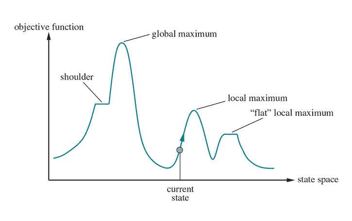

图 4.1 一维状态空间景观，其中海拔对应于目标函数。目标是找到全局最大值。

全局最大值
全局最小值

### 4.1.1 爬山搜索

爬山搜索算法如图 4.2 所示。它跟踪一个当前状态，并在每次迭代时移动到具有最高值的邻近状态——也就是说，它朝提供最陡上升的方向前进。当它到达一个“峰值”而没有邻居具有更高值时终止。爬山不会超出当前状态的直接邻居进行前瞻。这类似于在浓雾中试图找到珠穆朗玛峰的顶峰，同时患有失忆症。请注意，使用爬山搜索的一种方法是使用启发式成本函数的负值作为目标函数；这将局部攀爬到启发式距离目标最小的状态。

描述

棋盘位置通常以这样的方式命名：列从“a”命名到 h，行从 1 命名到 8。皇后放置在以下位置。“a” 1，b 6，c 2，d 5，e 7，f 4，g 8，和 h 3。

×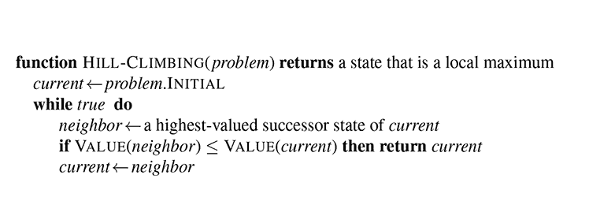

图 4.2 爬山搜索算法，这是最基本的局部搜索技术。每一 步当前节点都被最佳邻居取代。

爬山
最陡上升

为了说明爬山，我们将使用 8 皇后问题（图 4.3）。我们将使用完整状态表述，这意味着每个状态都有解的所有组成部分，但它们可能并不都在正确的位置。在这种情况下，每个状态在棋盘上有 8 个皇后，每列一个。初始状态是随机选择的，一个状态的后继是所有通过将单个皇后移动到同一列的另一个方格而生成的可能状态（因此每个状态有 `8 × 7 = 56` 个后继）。启发式成本函数 `h` 是相互攻击的皇后对的数量；这只有在解的情况下才为零。（如果两件棋子在同一条线上，即使它们之间有间隔棋子，也算作攻击。）图 4.3(b) 显示了一个 `h = 17` 的状态。该图还显示了其所有后继的 `h` 值。

描述

棋盘显示了通过在列内移动皇后获得的每个可能后继的 `h` 值。每行的值如下。第 1 行：14、14、13、17、12、14、12、18。第 2 行：18、14、皇后、15、15、14、皇后、16。第 3 行：17、皇后、16、18、15、皇后、15、皇后。第 4 行：皇后、14、17、15、皇后、14、16、16。第 5 行：15、14、14、皇后、13、16、13 16。第 6 行：14、12、18、13、15、12、14、14。第 7 行：14、16、13、15、12、14、12、16。第 8 行：18、12、14、13、13、12、14、14。

×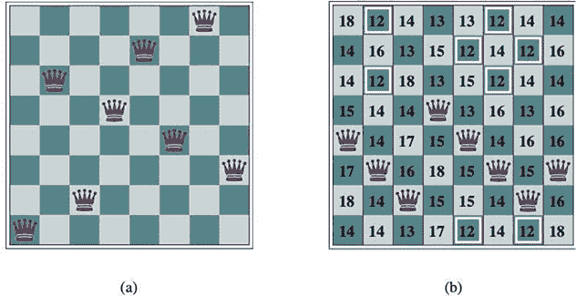

图 4.3(a) 8 皇后问题：在棋盘上放置 8 个皇后，使没有任何皇后相互攻击。（皇后攻击同一行、同一列或同一对角线上的任何棋子。）这个位置几乎是解，除了第四列和第七列的两个皇后沿对角线相互攻击。（b）启发式成本估计为 `h = 17` 的 8 皇后状态。棋盘显示了通过在列内移动皇后获得的每个可能后继的 `h` 值。有 8 个移动并列最佳，`h = 12`。爬山算法将选择其中一个。

完整状态表述


## 4.1.1 爬山法

爬山法有时被称为贪婪局部搜索，因为它会抓住一个好的邻居状态，而不考虑下一步去哪里。尽管贪婪被认为是七宗罪之一，但事实证明贪婪算法通常表现相当不错。爬山法可以迅速向解推进，因为通常很容易改进一个糟糕的状态。例如，从 图 4.3(b) 中的状态出发，只需五步即可到达 图 4.3(a) 中的状态，其 `h = 1`，几乎就是一个解。不幸的是，爬山法可能因以下任何原因而陷入停滞：

*贪婪局部搜索*

- **局部极大值**：局部极大值是一个峰，其高度高于每个邻居状态，但低于全局最大值。到达局部极大值附近的爬山算法会被向上吸引到峰顶，但随后会因无处可去而陷入停滞。图 4.1 形象地说明了这个问题。更具体地说，图 4.3(a) 中的状态是一个局部极大值（即成本 `h` 的局部最小值）；移动任何一枚皇后都会使情况变糟。

*局部极大值*

- **脊**：图 4.4 中显示了一个脊。脊会导致一系列局部极大值，贪婪算法很难导航。

*脊*

- **高原**：高原是状态空间景观中的平坦区域。它可以是平坦的局部极大值，从中不存在上坡出口，也可以是肩部，从中可以取得进展。（参见 图 4.1。）爬山搜索可能会在高原上徘徊而迷失。

*高原*
*肩部*

描述

从每个局部极大值出发，箭头向两个方向向下指向。相交点用深色圆圈表示。

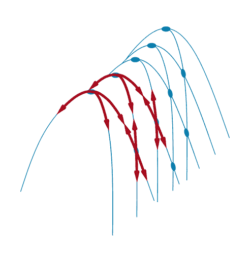

图 4.4 说明为什么脊会给爬山法带来困难。状态网格（深色圆圈）叠加在从左到右上升的脊上，形成一系列彼此没有直接连接的局部极大值。从每个局部极大值出发，所有可用操作都指向下坡。这种拓扑结构在低维状态空间中很常见，例如二维平面中的点。但在包含数百或数千个维度的状态空间中，这种直观的图像不成立，通常至少有几个维度使得能够逃离脊和高原。

在每种情况下，算法都会达到一个不再取得进展的点。从随机生成的 8 皇后状态开始，最大上升爬山法 86% 的时间会陷入停滞，仅解决了 14% 的问题实例。另一方面，它工作很快，成功时平均只需 4 步，陷入停滞时平均 3 步——对于拥有 `8⁸ ≈ 17 million` 个状态的状态空间来说，这并不算差。

如何解决更多问题？一个答案是在到达高原时继续前进——允许侧向移动，希望高原实际上是肩部，如 图 4.1 所示。但如果我们实际上处于平坦的局部极大值上，那么这种方法将永远在高原上徘徊。因此，我们可以限制连续侧向移动的次数，例如在 100 次连续侧向移动后停止。这使得爬山法解决的问题实例百分比从 14% 提高到 94%。成功是有代价的：该算法对每个成功实例平均约 21 步，对每个失败实例平均 64 步。

*侧向移动*

已经发明了许多爬山法的变体。随机爬山法从上坡移动中随机选择；选择的概率可以随上坡移动的陡峭程度而变化。这通常比最大上升收敛得更慢，但在某些状态景观中，它能找到更好的解。首选爬山法通过随机生成后继，直到生成一个比当前状态更好的后继来实现随机爬山法。这是一个很好的策略，当一个状态有许多（例如数千个）后继时。

*随机爬山法*
*首选爬山法*

另一种变体是随机重启爬山法，它采用了谚语：“如果第一次不成功，就再试一次。”它从随机生成的初始状态进行一系列爬山搜索，直到找到目标。它以概率 1 完备，因为它最终会将目标状态生成为初始状态。如果每次爬山搜索成功的概率为 `p`，则所需的重启次数的期望值为 `1/p`。对于不允许侧向移动的 8 皇后实例，`p ≈ 0.14`，因此我们大约需要 7 次迭代才能找到目标（6 次失败和 1 次成功）。步数的期望值是一次成功迭代的成本加上 `(1 – p)/p` 倍的失败成本，总计大约 22 步。当我们允许侧向移动时，`1/0.94 ≈ 1.06` 次迭代平均是需要的，`(1 × 21) + (0.06/0.94) × 64 ≈ 25` 步。对于 8 皇后问题，随机重启爬山法非常有效。即使对于三百万个皇后，该方法也能在几秒钟内找到解。1

*随机重启爬山法*

爬山法的成功在很大程度上取决于状态空间景观的形状：如果局部极大值和高原很少，随机重启爬山法会很快找到一个好的解。另一方面，许多实际问题的景观看起来更像是在平坦地面上广泛散布的一群秃刺猬家族，每个刺猬针尖上都生活着迷你刺猬。NP-hard 问题（参见附录 A）通常有指数数量的局部极大值可供陷入。尽管如此，在少量重启后通常可以找到一个相当好的局部极大值。

## 4.1.2 模拟退火

从不进行向价值更低（或成本更高）状态的“下坡”移动的爬山算法总是容易陷入局部极大值。相比之下，纯粹的随机游走会不考虑价值地移动到后继状态，最终会偶然发现全局最大值，但效率极低。因此，尝试以产生效率和完备性相结合的方式将爬山法与随机游走结合起来似乎是合理的。

模拟退火就是这样一种算法。在冶金学中，退火是用于回火或硬化金属和玻璃的过程，通过将其加热到高温然后逐渐冷却，从而使材料达到低能晶体状态。为了解释模拟退火，我们将观点从爬山法切换到梯度下降（即最小化成本），并想象将乒乓球放入非常崎岖表面最深裂缝中的任务。如果我们只是让球滚动，它会在局部最小值处静止。如果我们摇晃表面，我们可以使球从局部最小值弹出来——也许进入一个更深的局部最小值，在那里它会花费更多时间。诀窍是摇晃得足够用力以使球从局部最小值弹出来，但又不足以使其从全局最小值脱离。模拟退火的解决方案是先用力摇晃（即在高温下），然后逐渐降低摇晃强度（即降低温度）。

*模拟退火*


## 模拟退火

模拟退火算法的整体结构（图 4.5）与爬山法相似。然而，它不是选择最佳移动，而是选择随机移动。如果移动改善了状况，则始终接受。否则，算法以小于 1 的概率接受该移动。该概率随移动的“坏程度”呈指数下降——即评估变差的量 `∆E`。概率也随着“温度” `T` 下降而下降：“坏”移动在开始时 `T` 较高时更可能被允许，并且随着 `T` 下降变得更不可能。如果调度足够缓慢地将 `T` 降低到 0，则玻尔兹曼分布 `e∆E/T` 的一个性质是，所有概率都集中在全局最大值上，算法将以接近 1 的概率找到它。

### 描述

遗传算法由四组块表示，每组有四行块。每个块包含一个实数。Part（“a”）到 Part（d）分别标记为初始种群、适应度函数、选择、交叉和变异。初始种群块上的四个 8 位数字字符串如下。24748552、32752411、24415124 和 32543213。选择。选择块上标记的数字如下，32752411、24748552、32752411 和 24415124。块 32752411 和 32752411 涂成棕色，其他为蓝色。每个块分为两对如下。第一个块：327 和 52411。第二个块：247 和 48552。第三个块：32752 和 411。第四个块：24415 和 124。用实数和相应百分比标记的箭头描绘了适应度函数排名的排序。从初始种群集中 24748552 出发，标记为 24、31 百分比的箭头指向选择集中标记为 24748552 的块。从初始种群集中 32752411 出发，标记为 23、29 百分比的箭头指向选择集中 32752411。从初始种群集中 32752411 出发，标记为 20、26 百分比的箭头指向选择集中 32752411。从初始种群集中 24415124 出发，标记为 11、14 百分比的箭头指向选择集中 24415124。下一部分标记为交叉。交叉部分块上标记的数字如下。32748552、24752411、32752124 和 24415411。从选择集中块 32752411 和 24748552 的箭头指向交叉集中块 32748552 和 24752411。从选择集中块 32752411 和 24415124 的箭头指向交叉集中块 32752124 和 24415411。每个块分为两对如下。第一个块：327 和 48552。第二个块：247 和 52411。第三个块：32752 和 124。第四个块：24415 和 411。变异集块上标记的数字如下。32748152（1 高亮）、24752411、32752124（2 高亮）和 24415417（7 高亮）。从交叉集中块 32748552 的箭头指向变异集中标记为 32748152 的块。从交叉集中块 24752411 的箭头指向变异集中标记为 24752411 的块。从交叉集中块 32752124 的箭头指向变异集中标记为 32252124 的块。从交叉集中块 24415411 的箭头指向变异集中标记为 24415417 的块。

×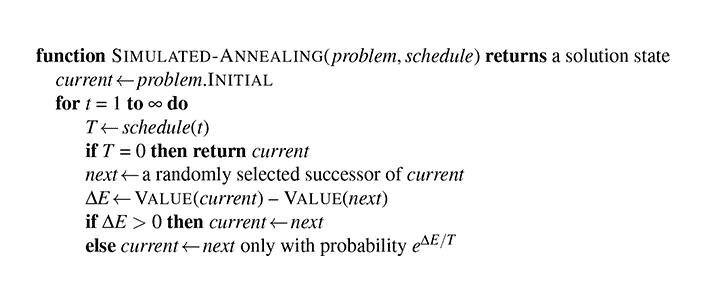

图 4.5 模拟退火算法，是一种允许部分下坡移动的随机爬山法的变体。调度输入决定了“温度” `T` 随时间变化的值。

模拟退火自 1980 年代开始被用于解决 VLSI 布图问题。它已被广泛应用于工厂调度和其他大规模优化任务。

## 4.1.3 局部束搜索

只保留一个节点在内存中似乎是对内存限制问题的一种极端反应。局部束搜索算法跟踪 `k` 个状态而不是仅一个。它以 `k` 个随机生成的状态开始。在每一步，所有 `k` 个状态的所有后继都被生成。如果其中任何一个是目标，算法就会停止。否则，它从完整列表中选择 `k` 个最佳后继并重复。

<p class="sidebar">局部束搜索</p>

乍一看，具有 `k` 个状态的局部束搜索似乎只是在并行而不是顺序地运行 `k` 次随机重启。事实上，这两种算法完全不同。在随机重启搜索中，每个搜索过程彼此独立运行。在局部束搜索中，有用的信息在并行搜索线程之间传递。实际上，生成最佳后继的状态对其他状态说：“过来吧，这边的草更绿！”算法迅速放弃无果的搜索，并将资源转移到进展最快的地方。

局部束搜索可能因 `k` 个状态之间缺乏多样性而受损——它们可能聚集成状态空间中的一个小区域，使得搜索不过是爬山法的 `k`\-times-slower 版本。一种称为随机束搜索的变体，类似于随机爬山法，有助于缓解此问题。随机束搜索不是选择前 `k` 个后继，而是以与后继值成比例的概率选择后继，从而增加多样性。

<p class="sidebar">随机束搜索</p>

## 4.1.4 进化算法

进化算法可以被视为随机束搜索的变体，其明确动机来自生物学中自然选择的隐喻：存在一个个体（状态）种群，其中最适应（值最高）的个体产生后代（后继状态）以填充下一代，这一过程称为重组。进化算法的形式无穷无尽，其变化如下：

<p class="sidebar">进化算法</p> <p class="sidebar">重组</p>

- 种群的大小。
- 每个个体的表示。在遗传算法中，每个个体都是有限字母表上的字符串（通常是布尔字符串），正如 DNA 是字母表 ACGT 上的字符串。在进化策略中，个体是一串实数，而在遗传编程中，个体是一个计算机程序。

<p class="sidebar">遗传算法</p> <p class="sidebar">进化策略</p> <p class="sidebar">遗传编程</p>

- 混合数 `ρ`，即形成后代的父母数量。最常见的情况是 `ρ = 2`：两个父母结合它们的“基因”（其表示的一部分）形成后代。当 `ρ = 1` 时，我们得到随机束搜索（可视为无性繁殖）。`ρ > 2` 也是可能的，这在自然界中很少见，但在计算机上模拟起来足够容易。
- 选择过程，用于选择将成为下一代父母的个体：一种可能是以与适应度分数成比例的概率从所有个体中选择。另一种可能是随机选择 `n` 个个体（`n > ρ`），然后从中选择 `ρ` 个最适应者作为父母。

<p class="sidebar">选择</p>

- 重组程序。一种常见的方法（假设 `ρ = 2`）是随机选择一个交叉点来分割每个父字符串，并重新组合各部分形成两个子代，一个具有父代 1 的第一部分和父代 2 的第二部分；另一个具有父代 1 的第二部分和父代 2 的第一部分。

<p class="sidebar">交叉点</p>

- 突变率，决定后代对其表示进行随机突变的频率。一旦后代生成，其组成中的每个位都以等于突变率的概率被翻转。

<p class="sidebar">突变率</p>


# 下一代的构成
这可以只是新形成的后代，也可以包括来自上一代的少数得分最高的父代（一种称为 `elitism` 的做法，它保证总体 `fitness` 不会随时间推移而下降）。`culling` 的做法，即丢弃所有低于给定阈值的个体，可以导致加速（Baum et al., 1995）。

## 精英主义
图 4.6(a) 显示了一个包含四个 `8-digit strings` 的 `population`，每个都代表 `8-queens puzzle` 的一个状态：`c` -th 位数字代表第 `c` 列中皇后的行号。在 (b) 中，每个状态都由 `fitness` 函数进行评级。`fitness` 值越高越好，因此对于 `8-queens` 问题，我们使用不互相攻击的皇后对的数量，对于一个解来说其值为 `8 × 7/2 = 28`。图 (b) 中四个状态的值分别为 24、23、20 和 11。然后将 `fitness` 分数归一化为概率，所得值显示在 (b) 中的 `fitness` 值旁边。

**描述**
前两个棋盘布局相加形成第三个，描绘了重组的三个步骤。第一步中，皇后位于 G 1、H 1、B 2、E 2、“a” 3、F 4、D 5 和 C 7。前三列以红色阴影显示，在交叉步骤中保留，而接下来五列以绿色阴影显示而丢失。第二步中，皇后位于 “a” 2、H 2、B 4、D 4、F 5、G 5、C 7 和 E 8。前三列以绿色阴影显示，在交叉步骤中丢失，而接下来五列以红色阴影显示并保留。最后一步中，皇后排列在 B 2、H 2、“a” 3、D 4、F 5、G 5、C 7 和 E 8。交叉步骤后所有列都被保留。

`images/Fig-53.jpg`

### 图 4.6
一个遗传算法，用代表 `8-queens` 状态的数字串来说明。图 (a) 中的初始 `population` 由图 (b) 中的 `fitness` 函数排序，从而在 (c) 中形成交配对。它们在 (d) 中产生后代，后代在 (e) 中接受突变。

在 (c) 中，根据 (b) 中的概率选择两对父代。请注意，一个个体被选中两次，而一个则完全未被选中。对于每对被选中的父代，随机选择一个交叉点（虚线）。在 (d) 中，我们在交叉点处对父代串进行交叉，产生新的后代。例如，第一对的第一个子代从第一个父代获得前三个数字 (`327`)，从第二个父代获得剩余数字 (`48552`)。此重组步骤涉及的 `8-queens` 状态显示在 图 4.7 中。

**描述**
每个阶段都标记了两个方格，分别表示左右两侧。状态 1：左右方格都有脏物。吸尘器正在清理左方格的脏物。状态 2：左右方格都有脏物。吸尘器正在清理右方格的脏物。状态 3：左方格有脏物。吸尘器正在清理左方格的脏物。右方格干净。状态 4：左方格有脏物。吸尘器在没有脏物的右方格。状态 5：右方格有脏物。吸尘器在干净的左方格。状态 6：右方格有脏物。吸尘器在右方格。左方格干净。状态 7：两个方格都干净。吸尘器在左方格。状态 8：两个方格都干净。吸尘器在右方格。

`images/Fig-54.jpg`

### 图 4.7
与 图 4.6(c) 中的前两个父代和 图 4.6(d) 中的第一个后代相对应的 `8-queens` 状态。绿色列在交叉步骤中丢失，红色列被保留。（要解释 图 4.6 中的数字：行 1 是底部行，8 是顶部行。）

最后，在 (e) 中，每个串中的每个位置都以较小的独立概率受到随机突变的影响。第一个、第三个和第四个后代中各有一个数字发生了突变。在 `8-queens` 问题中，这相当于随机选择一个皇后并将其移动到其列中的随机方格。通常在过程早期 `population` 具有多样性，因此在搜索过程早期交叉经常在状态空间中迈出大步（类似于模拟退火）。经过多代向更高 `fitness` 的选择后，`population` 变得多样性降低，较小的步长较为典型。图 4.8 描述了一个实现所有这些步骤的算法。

**描述**
从真空世界的第一状态出发，一个标记为 suck 的粗箭头和一个标记为 Right 的箭头指向前两个圆形节点。第一圆形节点上的两个粗箭头带弧指向真空世界的 7 和 5 状态。状态 7 标记为 Goal。右侧第二个圆形节点的箭头指向真空世界的 2 状态。一个标记为 Right 的粗箭头和一个标记为 suck 的浅箭头指向第三和第四圆形节点。从状态 2 出发的标记为 left 和 suck 的箭头指向第五和第六节点。第三节点上的带弧箭头指向标记为 Loop 的 5 和 1 状态。第四节点的粗箭头指向真空世界的 6 状态。第五节点的箭头指向标记为 Loop 的真空世界 1 状态。第六节点的带弧箭头指向真空世界的 8 和 4 状态。状态 8 标记为 Goal。两个粗箭头从状态 4 向外指向。从状态 6 出发的标记为 Suck 的粗箭头和标记为 Left 的浅箭头指向第七和第八节点。第七节点的粗箭头指向标记为 goal state 的 8 状态。第八节点的浅箭头指向标记为 Loop 的 5 状态。

`images/Fig-55.jpg`

### 图 4.8
一个遗传算法。在该函数内部，`population` 是个体的有序列表，`weights` 是每个个体的对应 `fitness` 值列表，而 `fitness` 是用于计算这些值的函数。

遗传算法与随机束搜索相似，但增加了交叉操作。如果存在执行有用功能的块，这是有利的。例如，可能将前三个皇后放在位置 2、4 和 6（它们互不攻击）构成一个有用的块，该块可以与其他个体中出现的其他有用块组合以构建解。数学上可以证明，如果块不发挥作用——例如如果遗传代码的位置被随机置换——那么交叉不会带来任何优势。

遗传算法的理论使用 `schema` 的概念来解释其工作原理，`schema` 是一个子串，其中某些位置可以留空。例如，`schema` `246******` 描述了所有 `8-queens` 状态，其中前三个皇后分别位于位置 2、4 和 6。与 `schema` 匹配的字符串（例如 `24613578`）称为该 `schema` 的 `instances`。可以证明，如果某个 `schema` 的 `instances` 的平均 `fitness` 高于均值，则该 `schema` 的 `instances` 数量会随时间增长。

**模式**
**实例**

# 进化和搜索
进化理论由 Charles Darwin 在 On the Origin of Species by Means of Natural Selection (1859) 中提出，并由 Alfred Russel Wallace (1858) 独立提出。核心思想很简单：变异在繁殖中发生，并将在连续世代中以大致与其对繁殖 `fitness` 的影响成比例的方式保留。


达尔文的理论是在没有任何关于生物性状如何遗传和改变的知识的情况下发展起来的。支配这些过程的概率规律首先由格雷戈尔·孟德尔（1866 年）确定，他是一位以甜豌豆进行实验的僧侣。 much later, Watson and Crick（1953）确定了 DNA 分子的结构及其字母表 AGTC（腺嘌呤、鸟嘌呤、胸腺嘧啶、胞嘧啶）。在标准模型中，变异既通过字母序列中的点突变发生，也通过“交叉”发生（其中后代的 DNA 由结合来自每个亲本的长段 DNA 生成）。

对局部搜索算法的类比已有所描述；随机束搜索与进化之间的主要区别在于有性生殖的使用，其中后代是由多个个体而非仅一个个体生成的。然而，进化的实际机制远比大多数遗传算法所允许的更为丰富。例如，突变可能涉及反转、重复以及大块 DNA 的移动；一些病毒会从一个生物体借用 DNA 并将其插入另一个生物体；并且存在转座基因，它们除了在基因组内复制自身数千次之外什么也不做。

甚至还有基因会毒害不携带该基因的潜在配偶的细胞，从而增加自身复制的机会。最重要的是，基因本身编码了基因组如何被复制并转译成生物体的机制。在遗传算法中，这些机制是一个独立的程序，并未在被操作的串中表示。

达尔文进化可能看起来效率低下，它盲目地生成了大约 10⁴³ 个生物体，却没有丝毫改进其搜索启发式。但学习在进化中确实发挥作用。尽管 otherwise 伟大的法国博物学家让·拉马克（1809）错误地提出在生物体一生中通过适应获得的性状会被传递给其后代，詹姆斯·鲍尔温（1896）的表面上相似的理论是正确的：学习可以有效地放松适应度景观，从而导致进化速率加快。一个具有对其环境并不完全适应的性状的生物，如果它也有足够的塑性来以有益的方式学习适应环境，就会将该性状传给后代。计算机模拟（Hinton and Nowlan，1987）证实了这种鲍尔温效应是真实的，其结果是难以学习的东西最终会进入基因组，而容易学习的东西则不必存在于其中（Morgan and Griffiths，2015）。

显然，如果相邻位之间完全无关，则这种效应不太可能显著，因为那样提供一致收益的连续块会很少。遗传算法在模式对应于解的有意义组件时效果最佳。例如，如果串是对天线的表示，则模式可能代表天线的组件，如反射器和偏转器。一个好的组件很可能在多种不同的设计中都表现良好。这表明遗传算法的成功使用需要对表示进行仔细设计。

实际上，遗传算法在优化方法的广阔领域中占有其一席之地（Marler and Arora，2004），特别是在电路布局或作业车间调度等复杂结构化问题上，以及最近用于演化深度神经网络的架构（Miikkulainen et al.，2019）。目前尚不清楚遗传算法的吸引力有多少源于其在特定任务上的优越性，有多少源于进化的有吸引力的隐喻。

## 4.2 连续空间中的局部搜索

在 第 2 章 中，我们解释了离散环境与连续环境之间的区别，指出大多数现实世界环境是连续的。连续动作空间具有无限的分支因子，因此除 first-choice hill climbing 和 simulated annealing 之外，无法由我们迄今为止涵盖的大多数算法处理。

本节对连续空间的一些局部搜索技术提供非常简短的介绍。关于该主题的文献非常庞大；许多基本技术起源于 17 世纪，在牛顿和莱布尼茨发展微积分之后。2 我们在本书的多个地方发现了这些技术的用途，包括关于学习、视觉和机器人的章节。

我们从一个例子开始。假设我们想在罗马尼亚的任何地方放置三个新机场，使得地图上每个城市到其最近机场的直线距离平方和最小。（参见 图 3.1 获取罗马尼亚地图。）状态空间随后由三个机场的坐标定义：(`x1`, `y1`)、(`x2`, `y2`) 和 (`x3`, `y3`)。这是一个六维空间；我们也说状态由六个变量定义。一般而言，状态由变量的 `n`\-维向量 `x` 定义。在此空间中移动对应于在地图上移动一个或多个机场。目标函数 `f(x)` = `f(x1, y1, x2, y2, x3, y3)` 在计算出最近的城市后，对于任何特定状态相对容易计算。设 `Ci` 为在状态 `x` 下最近机场为机场 `i` 的城市集合。那么，我们有

变量

$\\begin{matrix} {f\\text{~(x)~=~}f\\text{~(}x\_{\\text{1}}\\text{,~}y\_{\\text{1}}\\text{,~}x\_{\\text{2}}\\text{,~}y\_{\\text{2}}\\text{,~}x\_{\\text{3}}\\text{,~}y\_{\\text{3}}\\text{)~=}{\\sum\\limits\_{i = 1}^{3}{\\sum\\limits\_{c \\in C\_{i}}{{\\text{(}x\_{i}\\ - \\ x\_{c}\\text{)}}^{\\text{2}}\\text{~+~(}y\_{i}\\,\\, - \\,\\, y\_{c}\\text{)}^{\\text{2}}\\text{.}}}}} & {(4.1)} \\\\ \\end{matrix}$

该方程不仅对状态 `x` 正确，也对 `x` 的局部邻域中的状态正确。然而，它在全局上并不正确；如果我们偏离 `x` 太远（通过大幅改变一个或多个机场的位置），那么该机场最近城市的集合就会改变，我们需要重新计算 `Ci`。

处理连续状态空间的一种方法是将其离散化。例如，与其允许 (`xi`, `yi`) 位置为连续二维空间中的任意点，我们可以将其限制为矩形网格上的固定点，间距大小为 `δ`（delta）。那么，与其拥有无限多个后继，每个状态在该空间中只有 12 个后继，对应于将 6 个变量之一增加 ±`δ`。然后我们可以将我们的任何局部搜索算法应用于此离散空间。或者，我们可以通过随机采样后继状态使分支因子有限，在随机方向上移动一小段距离 `δ`。通过两个相近点之间目标函数值的变化来衡量进展的方法称为经验梯度方法。经验梯度搜索与状态空间的离散化版本中的最陡上升爬山法相同。随着时间的推移减小 `δ` 的值可以得到更精确的解，但在极限情况下不一定收敛到全局最优。

离散化
经验梯度

通常我们有以数学形式表达的目标函数，使得我们可以使用微积分来分析地而不是经验地解决该问题。许多方法试图利用景观的梯度来找到最大值。目标函数的梯度是一个向量 `∇f`，它给出最陡斜率的大小和方向。对于我们的问题，我们有

梯度


## 4.2 基于梯度的优化

$\\nabla f = \\left( \\frac{\\partial f}{\\partial x\_{1}},\\frac{\\partial f}{\\partial y\_{1}},\\frac{\\partial f}{\\partial x\_{2}},\\frac{\\partial f}{\\partial y\_{2}},\\frac{\\partial f}{\\partial x\_{3}},\\frac{\\partial f}{\\partial y\_{3}}, \\right).$

在某些情况下，我们可以通过求解方程 `∇f = 0` 来找到最大值。 （例如，如果我们只放置一个机场；解是所有城市坐标的算术平均值。）然而在许多情况下，该方程无法以闭式求解。例如，对于三个机场而言，梯度的表达式取决于当前状态下哪些城市离每个机场最近。这意味着我们可以局部（但不能全局）计算梯度；例如，

$\\begin{matrix} {\\frac{\\partial f}{\\partial x\_{1}} = 2{\\sum\\limits\_{c \\in C\_{1}}{\\text{(}x\_{1}\\ - \\ x\_{c}\\text{)~}\\text{.}}}} & {(4.2)} \\\\ \\end{matrix}$

给定梯度的局部正确表达式，我们可以通过根据公式更新当前状态来执行最陡上升爬山法

`x`←`x`+`α`∇`f`(`x`),

其中 `α` (alpha) 是一个通常称为步长的很小的常数。存在大量调整 `α` 的方法。基本问题是如果 `α` 太小，则需要太多步；如果 `α` 太大，搜索可能会 overshoot 最大值。线搜索技术试图通过通常通过反复加倍 `α` 来延伸当前梯度方向，直到 `f` 开始再次下降为止。此时点成为新的当前状态。关于此时应如何选择新方向，有几种不同的观点。

步长
线搜索

对于许多问题，最有效的算法是久负盛名的 `Newton–Raphson` 方法。这是一种寻找函数根的通用技术——即求解形式为 `g(x) = 0` 的方程。它通过根据牛顿公式计算根 `x` 的新估计来工作

Newton–Raphson

`x`←`x` − `g`(`x`) / `g′`(`x`).

要找到 `f` 的最大值或最小值，我们需要找到使梯度为零向量（即 `∇f(x) = 0`）的 `x`。因此，牛顿公式中的 `g(x)` 变为 `∇f(x)`，更新方程可以写成矩阵-向量形式

`x`←`x`−`H`[`f`]^(-1)(`x`)∇`f`(`x`),

其中 `Hf(x)` 是二阶导数的海森矩阵，其元素 `Hij` 由 `∂²f/∂xi∂xj` 给出。对于我们的机场示例，我们可以从 方程 (4.2) 看出 `Hf(x)` 特别简单：非对角元素为零，而机场 `i` 的对角元素只是 `Ci` 中城市数量的两倍。稍作计算可知，更新的一步将机场 `i` 直接移动到 `Ci` 的质心，这正是 方程 (4.1) 中 `f` 的局部表达式的最小值。3 然而对于高维问题，计算海森矩阵的 `n²` 个条目并求其逆可能很昂贵，因此开发了许多 `Newton–Raphson` 方法的近似版本。

海森矩阵

局部搜索方法在连续状态空间中同样会受到局部最大值、脊线和平坦区的困扰，就像在离散空间中一样。随机重启和模拟退火通常很有帮助。然而，高维连续空间是非常大的区域，很容易迷路。

最后一个主题是约束优化。如果解必须满足变量取值上的某些硬约束，则优化问题是有约束的。例如，在我们的机场选址问题中，我们可能会将站点约束在罗马尼亚境内且在干地上（而不是湖泊中间）。约束优化问题的难度取决于约束和目标函数的性质。最为人所知的类别是线性规划问题，其中约束必须是形成凸集 4 的线性不等式，目标函数也是线性的。线性规划的时间复杂度关于变量数量是多项式的。

约束优化
线性规划
凸集

线性规划可能是研究最广泛且用途最广的优化方法。它是更一般的凸优化问题的特例，凸优化允许约束区域为任意凸区域，目标函数为约束区域内凸的任意函数。在某些条件下，凸优化问题也是多项式可解的，在实践中可能涉及数千个变量。机器学习和控制理论中的若干重要问题可以表述为凸优化问题（参见 第 21 章）。

凸优化

## 4.3 带非确定性动作的搜索

在 第 3 章 中，我们假设环境是完全可观测、确定且已知的。因此，智能体可以观察初始状态，计算出到达目标的动作序列，并“闭着眼睛”执行这些动作，永远不需要使用其感知。

然而，当环境是部分可观测时，智能体并不能确定自己处于何种状态；当环境是非确定性时，智能体也不知道采取动作后会转换到何种状态。这意味着智能体不再思考“我处于状态 `s1`，如果执行动作 `a` 我就会到达状态 `s2`”，而是会思考“我可能处于状态 `s1` 或 `s3`，如果执行动作 `a` 我会到达状态 `s2`、`s4` 或 `s5`”。我们称智能体认为可能的物理状态集合为信念状态。

信念状态

在部分可观测和非确定性环境中，问题的解不再是一个序列，而是一个条件计划（有时称为应急计划或策略），它指定在执行计划时根据智能体接收到的感知应做什么。我们在本节讨论非确定性，下节讨论部分可观测性。

条件计划

## 4.3.1 难以预测的吸尘器世界

第 2 章 中的吸尘器世界有八个状态，如 图 4.9 所示。有三个动作——`Right`、`Left` 和 `Suck`——目标是清理所有灰尘（状态 7 和 8）。如果环境是完全可观测、确定且完全已知的，那么该问题可以用 第 3 章 中的任何算法轻松解决，解是一个动作序列。例如，如果初始状态是 1，则动作序列 [`Suck`, `Right`, `Suck`] 将到达目标状态 8。

描述

从吸尘器世界的第一个状态出发，一个标记为 suck 的粗箭头和另一个标记为 Right 的箭头指向前两个圆形节点。从右侧的第二个节点出发，一个带弧的箭头指向回状态 1，另一个箭头指向吸尘器世界的 state 2。两个粗箭头从 state 2 向外伸出。一个粗箭头从第一个节点指向吸尘器世界的 state 5。一个标记为 Right 的粗箭头从 state 5 指向带弧的第三个节点。一个粗箭头从第三个节点指向回 state 5。另一个粗箭头从第三个节点指向吸尘器世界的 state 6。两个箭头从 state 6 向外伸出。

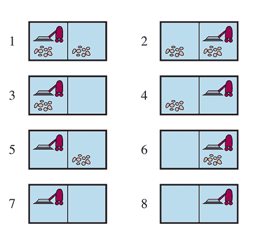

图 4.9 吸尘器世界的八种可能状态；状态 7 和 8 是目标状态。

现在假设我们引入非确定性，即一个功能强大但难以预测的吸尘器。在难以预测的吸尘器世界中，`Suck` 动作的工作方式如下：

•当应用于脏格子时，该动作会清理该格子，有时还会清理相邻格子的灰尘。


当应用于干净的方格时，该动作有时会将污垢沉积在地毯上。5

为了提供该问题的精确表述，我们需要将第 3 章](#Chapter03-00.xhtml) 中过渡模型的概念进行推广。不是用返回单一结果状态的 `RESULT` 函数来定义过渡模型，而是使用返回一组可能结果状态的 `RESULTS` 函数。例如，在不可靠吸尘器世界中，状态 1 中的 `Suck` 动作会清理当前所在位置，或者同时清理两个位置：

`RESULTS(1, Suck) = {5,7}`

如果我们从状态 1 开始，没有任何单一的动作序列能解决该问题，但以下条件计划可以：

$\\begin{matrix} {\\text{\[}Suck\\text{,~}\\mathbf{if}\\ State\\text{~=~5~}\\mathbf{then}\\text{~\[}Right\\text{,}Suck\\text{\]~}\\mathbf{else}\\text{~\[~\]\]~}\\text{.}} & {(4.3)} \\\\ \\end{matrix}$

这里我们看到条件计划可以包含 if–then–else 步骤；这意味着解是树而不是序列。这里 if 语句中的条件测试当前状态是什么；这是代理在运行时能够观察到的，但在规划时却不知道。或者，我们也可以采用测试感知而非状态的表述。现实物理世界中的许多问题都是应急问题，因为未来无法精确预测。因此，许多人在行走时都睁大眼睛。

## 4.3.2 与或搜索树

我们如何找到非确定性问题的这些应急解？与 第三章 一样，我们开始通过构建搜索树，但这里的树具有不同的特征。在确定性环境中，唯一的分支是由代理在每个状态中的自身选择引入的：我可以执行此动作或那个动作。我们称这些节点为 `OR` 节点。例如在吸尘器世界中，在 `OR` 节点处，代理选择 `Left` 或 `Right` 或 `Suck`。在非确定性环境中，分支还由环境对每个动作的结果选择引入。我们称这些节点为 `AND` 节点。例如，状态 1 中的 `Suck` 动作导致信念状态 `{5,7}`，因此代理需要为状态 5 和状态 7 找到计划。这两种节点交替出现，导致 `AND-OR` 树，如 图 4.10 所示。

描述

信念状态由包围吸尘器世界状态的圆形区域表示。部分（“a”）：吸尘器世界的 1 和 3 状态被包含在一个区域中，吸尘器世界的 2 和 4 状态被包含在另一个区域中。一个箭头从状态 1 指向状态 2，一个箭头从状态 3 指向吸尘器世界的 4 状态。部分 (b)：吸尘器世界的 1 和 3 状态被包含在一个区域中。吸尘器世界的 1、2、3 和 4 状态被包含在另一个区域中。两个箭头从第一个区域中的状态 1 指向第二个区域中的状态 1 和 2。两个箭头从第一个区域的状态 3 指向状态 3 和 4。

×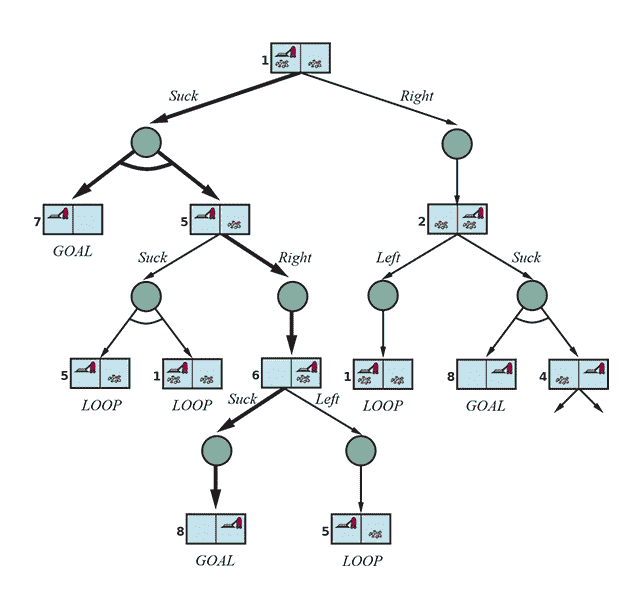

图 4.10 不可靠吸尘器世界的搜索树的最初两个层级。状态节点是 `OR` 节点，其中必须选择某个动作。在 `AND` 节点，以圆圈表示，每个结果都必须得到处理，如连接外向分支的弧所示。找到的解以粗线显示。

<p class="sidebar">或节点</p> <p class="sidebar">与节点</p> <p class="sidebar">与或树</p>

对于 `AND-OR` 搜索问题的一种解是完整搜索树的子树，其 (1) 在每个叶节点都有目标节点，(2) 在其每个 `OR` 节点指定一个动作，(3) 包含其每个 `AND` 节点的每个结果分支。解在图中以粗线显示；它对应于 方程 (4.3) 中给出的计划。

图 4.11 给出了用于 `AND-OR` 图搜索的递归、深度优先算法。算法的一个关键方面是它处理循环的方式，循环在非确定性问题中经常出现（例如，如果一个动作有时没有效果或如果非预期效果可以被纠正）。如果当前状态与从根到路径上的某个状态相同，则返回失败。这并不意味着当前状态没有解；它只是意味着如果存在非循环解，它必须可从当前状态的早期实例到达，因此新的实例可以被丢弃。有了这个检查，我们确保算法在每个有限状态空间中都终止，因为每条路径必须到达目标、死胡同或重复状态。请注意，算法不会检查当前状态是否是对根的另一条路径上的某个状态的重复，这对效率很重要。

描述

每个信念状态空间都由矩形框表示，框内写有吸尘器世界的状态。初始信念状态位于顶部中央，包含吸尘器世界的状态 1 到 8。从初始信念状态出发，标记为 L 的箭头指向左侧的信念状态，该状态包含状态 1、3、5 和 7。标记为 R 的箭头从初始信念状态指向右侧的第三个信念状态，该状态包含状态 2、4、6 和 8。从第二个信念状态出发的标记为 R 的箭头指向第三个信念状态，从第三个信念状态出发的标记为 L 的箭头指向第二个信念状态。标记为 S 的箭头从初始信念状态指向下方的第四个信念状态，该状态包含状态 4、5、7 和 8。从第四个信念状态出发的标记为 L 和 R 的箭头分别指向第五和第六信念状态，它们分别包含 5、3、7 和 6、4、8 吸尘器世界状态。从第六信念状态出发的标记为 L 的箭头指向第五个，从第五信念状态出发的标记为 R 的箭头指向第六个。从第五和第二个信念状态出发的标记为 S 的箭头指向第七信念状态，该状态包含状态 5 和 7。从第六和第三个信念状态出发的标记为 S 的箭头指向第八信念状态，其中包含 4 和 8 状态。从第八信念状态出发的标记为 L 的箭头指向第九信念状态，其中包含 3 和 7 状态。从第九信念状态出发的标记为 R 的箭头指向第八信念状态。从第九信念状态出发的标记为 S 的箭头指向第十个，其中包含状态 7。从第十信念状态出发的标记为 R 的箭头指向第十一个，其中包含状态 8。从第十一个信念状态出发的标记为 L 的箭头指向回第十个。从第十二信念状态出发的标记为 S 的箭头指向第十一个，从第十二信念状态出发的标记为 L 的箭头指向第七信念状态。从第七信念状态出发的标记为 R 的箭头指向第十二信念状态。第十二信念状态包含吸尘器世界状态 6 和 8。

×

图 4.11 用于由非确定性环境生成的 `AND-OR` 图的搜索算法。解是一个条件计划，它考虑每个非确定性结果并为每个结果制定计划。

`AND-OR` 图可以采用广度优先或最好优先的方式进行探索。`heuristic function` 的概念必须被修改以估计条件解的成本而不是序列的成本，但可容许性的概念得以保留，并且存在用于寻找最优解的 `A*` 算法的类似物。 （参见本章末尾的参考文献。）

## 4.3.3 再试一次


### 滑溜的真空世界
考虑一个滑溜的真空世界，它与普通的（非随机）真空世界相同，只是移动动作有时会失败，使智能体停留在同一位置。例如，在状态 1 中移动 `Right` 会导致信念状态 `{1, 2}`。图 4.12 显示了搜索图的一部分；很明显，从状态 1 已不再存在任何无环解，并且 `AND-OR-SEARCH` 会返回失败。然而，存在一个循环解，即不断尝试 `Right` 直到成功。我们可以用一个新的 while 结构来表达这一点：

#### 描述
信念状态用圆形表示，真空世界状态用带有相应状态标签的方块表示。示例“a”，确定性世界：真空世界状态 1 和 3 包含在第一个信念状态中。从第一个信念状态的状态 1 出发，标记为 `R` 的箭头指向第二个信念状态的状态 2。从第一个信念状态的状态 3 出发的箭头指向第二个信念状态的真空世界状态 4。标记为 `B, Dirty` 的箭头指向第三个信念状态的真空世界状态 2。从第二个信念状态的真空世界状态 4 出发，标记为 `B, Clean` 的箭头指向第四个信念状态的真空世界状态 4。示例 b，滑溜世界：从第一个信念状态的真空世界状态 1 出发的箭头指向第二个信念状态的真空世界状态 2 和 1。从第一个信念状态的真空世界状态 3 出发的箭头指向第二个信念状态的真空世界状态 3 和 4。从第二个信念状态的真空世界状态 2 出发，标记为 `B, Dirty` 的箭头指向第三个信念状态的真空世界状态 2。从第二个信念状态的真空世界状态 1 和 3 出发的箭头指向第四个信念状态的真空世界状态 1 和 3。从第二个信念状态的真空世界状态 4 出发的箭头指向第五个信念状态的真空世界状态 4。


图 4.12 滑溜真空世界的搜索图的一部分，其中我们明确显示了（部分）循环。所有该问题的解都是循环计划，因为没有可靠的移动方式。

*循环解*

`Suck, while State = 5 do Right, Suck`

或通过添加标签来表示计划的某部分并稍后引用该标签：

`Suck, L[1] : Right, if State = 5 then L[1] else Suck`.

何时循环计划是一个解？一个最小条件是每个叶节点都是目标状态，并且从计划中的每一点都可以到达一个叶节点。除此之外，我们需要考虑非确定性的原因。如果真的是真空机器人的驱动机构有时会工作，但随机且独立地在其他情况下打滑，那么智能体可以确信如果重复该动作足够多次，最终它会成功并且计划会成功。但如果非确定性是由于机器人或环境中某些未观察到的事实造成的——也许传动皮带断裂了，机器人永远不会移动——那么重复该动作也不会有帮助。

理解这一决定的一个方法是说，初始问题表述（完全可观察、非确定性）被放弃，转而采用不同的表述（部分可观察、确定性），其中循环计划的失败归因于传动皮带的未观察属性。在 第 12 章 中我们讨论如何决定哪种不确定可能性更可能。

## 4.4 部分可观察环境中的搜索
我们现在转向部分可观察性的问题，在这种情况下，智能体的感知不足以确定确切的状态。这意味着智能体的某些动作将旨在减少对当前状态的不确定性。

### 4.4.1 无观察搜索
当智能体的感知完全不提供任何信息时，我们称之为无传感器问题（或符合问题）。起初，你可能会认为如果无传感器智能体不知道其起始状态，就无望解决一个问题，但无传感器解出人意料地常见且有用，主要是因为它们不依赖传感器正常工作。例如在制造系统中，已经开发出许多巧妙的方法，通过使用完全不进行感知的动作序列，从未知初始位置正确定向零件。有时即使有带感知的条件计划可用，无传感器计划也更好。例如，医生经常开广谱抗生素，而不是使用条件计划：先做血液检查，然后等待结果返回，然后再开更具体的抗生素。无传感器计划节省时间和金钱，并避免在检查结果出来之前感染恶化的风险。

*无传感器* *符合*

考虑（确定性）真空世界的一个无传感器版本。假设智能体知道其世界的地理结构，但不知道自身位置或灰尘分布。在这种情况下，其初始信念状态是 `{1, 2, 3, 4, 5, 6, 7, 8}`（参见 图 4.9）。现在，如果智能体移动 `Right`，它将处于状态 `{2, 4, 6, 8}` 中的一个——智能体在没有感知任何东西的情况下获得了信息！在 `[Right,Suck]` 之后，智能体总会最终处于状态 `{4, 8}` 中的一个。最后，在 `[Right,Suck,Left,Suck]` 之后，智能体保证到达目标状态 7，无论起始状态如何。我们说智能体可以将世界强制到状态 7。

*强制*

无传感器问题的解是一个动作序列，而不是条件计划（因为没有感知）。但我们在信念状态空间中搜索，而不是物理状态空间。6 在信念状态空间中，问题是完全可观察的，因为智能体总是知道自己的信念状态。此外，无传感器问题的解（如果存在）始终是一个动作序列。这是因为，与 第 3 章 中的普通问题一样，每次动作后收到的感知完全可预测——它们总是空的！因此没有需要计划的偶然情况。这即使在环境是非确定性的情况下也成立。

我们可以为无传感器搜索问题引入新算法。但相反，如果我们将底层物理问题转换为信念状态问题，我们就可以使用 第 3 章 中现有的算法，在其中我们在信念状态上搜索而不是物理状态。原始问题 `P` 具有组件 `ActionsP`、`ResultP` 等，而信念状态问题具有以下组件：

- **状态：** 信念状态空间包含物理状态的每一个可能子集。如果 `P` 有 `N` 个状态，则信念状态问题有 `2^N` 个信念状态，尽管其中许多可能从初始状态无法到达。
- **初始状态：** 通常是包含 `P` 中所有状态的信念状态，尽管在某些情况下智能体可能拥有比这更多的知识。
- **动作：** 这有点棘手。假设智能体处于信念状态 `b = {s1,s2}`，但 `ACTIONSP(s1) ≠ ACTIONSP(s2)`；那么智能体不确定哪些动作是合法的。如果我们假设非法动作对环境没有影响，那么安全的做法是取当前信念状态 `b` 中任何物理状态的所有动作的并集：

`ACTIONS(b) = ∪_{s ∈ b} ACTIONS_p(s)`


另一方面，如果非法动作可能导致灾难，那么更安全的做法是只允许交集，即在所有状态下都合法的动作集合。对于真空世界，每个状态的合法动作都相同，因此两种方法得到的结果相同。

## 转移模型
对于确定性动作，新的信念状态对当前每个可能的状态都有一个结果状态（尽管某些结果状态可能相同）：

$\\begin{matrix} {b'\\text{~=~RESULT~(}b\\text{,~}a\\text{)~=~\\{}s'\\text{~:~}s'\\text{~=~RESULT}\_{P}\\text{~(}s\\text{,~}a\\text{)~and~}s\\ \\in \\ b\\text{\\}}\\text{.}} & {\\,\\,\\,\\,\\,\\,\\,\\,\\,\\,\\,\\,\\,\\text{(4}\\text{.4)}} \\\\ \\end{matrix}$

在非确定性的情况下，新的信念状态由对当前信念状态中任意状态应用该动作的所有可能结果组成：

$\\begin{array}{l} {b'\\text{~=~RESULT~(}b\\text{,~}a\\text{)}\\,\\,\\,\\,\\,\\, = \\,\\,\\,\\,\\,\\,\\text{\\{}s'\\text{~:~}s'\\ \\in \\text{~RESULTS}\_{P}\\text{~(}s\\text{,~}a\\text{)~and~}s\\ \\in \\ b\\text{\\}}} \\\\ {\\,\\,\\,\\,\\,\\,\\,\\,\\,\\,\\,\\,\\,\\,\\,\\,\\,\\,\\,\\,\\,\\,\\,\\,\\,\\,\\,\\,\\,\\,\\,\\,\\,\\,\\,\\,\\,\\,\\,\\,\\,\\,\\,\\,\\,\\,\\,\\,\\,\\,\\,\\,\\, = \\,\\,\\,\\,\\,\\,\\,{\\underset{s \\in b}{\\cup}{\\text{RESULTS}\_{P}\\text{(}s\\text{,~}a\\text{)~,}}}} \\\\ \\end{array}$

`b'` 的大小对于确定性动作而言与 `b` 相同或更小，但在非确定性动作下可能大于 `b`（参见 图 4.13）。

### 描述
信念状态由圆形区域表示，包围着由带对应状态标签的方块表示的真空世界状态。从包含真空世界状态 1 和 3 的第一个信念状态出发，一条标记为 `suck` 的粗箭头指向第一个节点。标记为 `A`、`clean` 的粗箭头指向第二个信念状态，该状态具有 5 和 7 的真空世界状态。从第一个信念状态出发，标记为 `Right` 的箭头指向带弧线的第二个节点。从第二个节点出发，标记为 `B`、`Dirty` 的箭头指向具有单例真空世界状态 2 的第三个信念状态。从第二个节点出发，标记为 `B`、`clean` 的箭头指向具有单例真空世界状态 4 的第三个信念状态。

×

图 4.13(a) 使用确定性动作 `Right` 预测无传感器真空世界的下一个信念状态。(b) 在无传感器真空世界的滑移版本中对同一信念状态和动作的预测。

## 目标检验
如果信念状态中任意状态 `s` 满足底层问题的目标检验 `IS-GOALP(s)`，则代理可能达到目标。如果每个状态都满足 `IS-GOALP(s)`，则代理必然达到目标。我们旨在必然达到目标。

## 动作代价
这也比较棘手。如果同一动作在不同状态下的代价不同，那么在给定信念状态下执行该动作的代价可能是多个值之一。（这产生了一类新问题，我们在练习 `4.MVAL` 中探讨。）目前我们假设动作的代价在所有状态下都相同，因此可以直接从底层物理问题中转移。

图 4.14 显示了确定性无传感器真空世界的可达信念状态空间。只有 12 个可达信念状态，而可能的信念状态共有 `2⁸ = 256` 个。

### 描述
信念状态由圆形区域表示，真空世界状态由带对应状态标签的方块表示。共显示了五个信念状态。从一个信念状态到下一个信念状态的传输按 `Suck`、`A`、`clean`、`Right` 和 `B`、`Dirty` 的顺序标记。从第一个信念状态的真空世界状态 1 出发的箭头指向第二个信念状态的真空世界状态 5。从第一个信念状态的真空世界状态 3 出发的两条箭头指向第二个信念状态的真空世界状态 5 和 7。从第二个信念状态的真空世界状态 5 和 7 出发的箭头指向第三个信念状态的真空世界状态 5 和 7。从第三个信念状态的真空世界状态 5 出发的两条箭头指向第四个信念状态的真空世界状态 2 和 6。从第三个信念状态的真空世界状态 7 出发的四条箭头指向第四个信念状态的真空世界状态 2、6、4 和 8。从第四个信念状态的真空世界状态 2 和 6 出发的箭头共同指向第五个信念状态的真空世界状态 2。

×

图 4.14 确定性无传感器真空世界的信念状态空间的可达部分。每个矩形框对应一个信念状态。在任意给定时刻，代理具有一个信念状态，但不知道其所处的物理状态。初始信念状态（完全无知）是顶部中央的框。

前述定义使得能够从底层物理问题的定义自动构建信念状态问题表述。一旦完成，我们就可以用 第 3 章 的任何普通搜索算法来求解无传感器问题。

在普通图搜索中，新到达的状态会被测试是否之前到达过。这对信念状态也适用；例如，在 图 4.14 中，动作序列 `Suck,Left,Suck` 从初始状态开始到达的信念状态与 `Right,Left,Suck` 相同，即 {5, 7}。现在，考虑由 `Left` 到达的信念状态，即 {1, 3, 5, 7}。显然，这与 {5, 7} 不相同，但它是其超集。我们可以丢弃（剪枝）任何此类超集信念状态。为什么？因为从 {1, 3, 5, 7} 的解必须是状态 1、3、5 和 7 的每个单独状态的解，因此它也是这些单独状态的任意组合的解，例如 {5, 7}；因此我们不需要尝试求解 {1, 3, 5, 7}，可以集中尝试求解严格更简单的信念状态 {5, 7}。

相反，如果 {1, 3, 5, 7} 已经生成并被发现可解，则任何子集，例如 {5, 7}，都保证可解。（如果我有一个在对所处状态非常困惑时仍有效的解，那么在困惑较少时它仍然有效。）这种额外的剪枝水平可能会显著提高无传感器问题求解的效率。

即使有此改进，我们所描述的无传感器问题求解在实践中也很少可行。一个问题是信念状态空间的庞大——我们在上一章看到过，大小为 `N` 的搜索空间通常太大，而现在我们有大小为 `2^N` 的搜索空间。此外，搜索空间的每个元素都是多达 `N` 个元素的集合。对于大的 `N`，我们甚至无法在用完内存空间之前表示单个信念状态。

一个解决方案是用更紧凑的描述来表示信念状态。用英语来说，我们可以说代理在初始状态下“什么都不知道”；移动 `Left` 之后，我们可以说，“不在最右列”，等等。第 7 章 解释了如何在形式化表示方案中做到这一点。


## 增量信念状态搜索

另一种方法是避免将信念状态像其他问题状态一样视为黑箱的标准搜索算法。相反，我们可以深入信念状态内部，开发增量信念状态搜索算法，一次构建一个物理状态的解。例如，在无传感器吸尘器世界中，初始信念状态是 `{1, 2, 3, 4, 5, 6, 7, 8}`，我们必须找到一个在全部 8 个状态下都有效的动作序列。我们可以先找到适用于状态 1 的解；然后检查它是否适用于状态 2；如果不适用，就回溯并为状态 1 寻找不同的解，以此类推。

正如 `AND–OR` 搜索必须为 `AND` 节点的每个分支找到解一样，该算法必须为信念状态中的每个状态找到解；不同之处在于 `AND–OR` 搜索可以为每个分支找到不同的解，而增量信念状态搜索必须找到一个适用于所有状态的解。

增量方法的最大优势在于通常能够快速检测失败——当信念状态不可解时，通常信念状态中由最初检查的几个状态组成的小子集也是不可解的。在某些情况下，这会导致与信念状态大小成比例的加速，而信念状态本身可能与物理状态空间一样大。

### 4.4.2 部分可观测环境中的搜索

许多问题如果没有感知就无法解决。例如，无传感器的 8 数码拼图是不可能的。另一方面，少量感知也能起到很大作用：如果我们能看到仅左上角的方格，就能解决 8 数码拼图。解法是将每个瓷砖依次移动到可观测方格中，并从那时起跟踪其位置。

对于部分可观测问题，问题规范会指定一个 `PERCEPT(s)` 函数，该函数返回智能体在给定状态下接收到的感知。如果感知是非确定性的，则可以使用返回可能感知集合的 `PERCEPTS` 函数。对于完全可观测问题，`PERCEPT(s) = s` 对每个状态 `s` 都成立，而对于无传感器问题 `PERCEPT(s) = null`。

考虑一个局部感知吸尘器世界，其中智能体有一个位置传感器，在左侧方格产生感知 `L`，在右侧方格产生感知 `R`，以及一个脏污传感器，当当前方格脏污时产生 `Dirty`，干净时产生 `Clean`。因此，状态 1 中的 `PERCEPT` 为 `[L, Dirty]`。在部分可观测性下，通常会出现多个状态产生相同感知的情況；状态 3 也会产生 `[L, Dirty]`。因此，给定此初始感知，初始信念状态将为 `{1, 3}`。我们可以将部分可观测问题的信念状态之间的转移模型视为分三个阶段进行，如图 4.15 所示：

描述

机器人被放置在一个由深色阴影块和白色块组成的迷宫状环境中。由白色块形成的路径是机器人必须移动的地方。深色阴影块表示障碍物。在感知位值中，1 表示障碍物，0 表示开放路径。四个位表示北、东、西、南四个方向。机器人由两个同心粗圆表示。部分（“a”）：E 下标 1 基线等于 1011 后机器人的可能位置。机器人的可能位置显示在四个方块上。部分（b）：E 下标 1 基线等于 1011，E 下标 2 基线等于 1010 后机器人的可能位置。机器人的一个可能位置在板上显示。


图 4.15 局部感知吸尘器世界中的两种转移示例。（a）在确定性世界中，`Right` 在初始信念状态下应用，导致产生一个包含两个可能物理状态的新预测信念状态；对于这些状态，可能的感知为 `[R, Dirty]` 和 `[R, Clean]`，从而导致两个信念状态，每个都是单例。（b）在滑溜世界中，`Right` 在初始信念状态下应用，得到一个包含四个物理状态的新信念状态；对于这些状态，可能的感知为 `[L, Dirty]`、`[R, Dirty]` 和 `[R, Clean]`，从而导致如图所示的三个信念状态。

预测阶段计算由动作产生的信念状态，`RESULT(b, a)`，正如我们对无传感器问题所做的那样。为了强调这是预测，我们使用记号 `b̂ = RESULT(b, a)`，其中 `b` 上方的“帽子”表示“估计”，我们还使用 `PREDICT(b, a)` 作为 `RESULT(b, a)` 的同义词。

可能感知阶段计算在预测信念状态中可能被观察到的感知集合（使用字母 `o` 表示观察）：

`POSSIBLE-PERCEPTS(b̂) = { o: o = PERCEPT(s) and s ∈ b̂ }`.

更新阶段计算对于每个可能感知会导致的信念状态。更新后的信念状态 `b_o` 是 `b̂` 中可能产生该感知的状态集合：

`b_o = UPDATE(b̂, a) = { s: o = PERCEPT(s) and s ∈ b̂ }`.

智能体需要在计划时处理可能感知，因为它在执行计划之前不会知道实际感知。请注意，物理环境中的非确定性可以在预测阶段扩大信念状态，但每个更新后的信念状态 `b_o` 不会大于预测信念状态 `b̂`；观察只能帮助减少不确定性。此外，对于确定性感知，不同可能感知的信念状态将是互不相交的，形成原始预测信念状态的划分。

把这三个阶段合在一起，我们得到由给定动作和随后的可能感知产生的可能信念状态：

```
RESULTS(b,a) = { b_o : b_o = UPDATE(PREDICT(b,a), o) and o ∈ POSSIBLE-PERCEPTS(PREDICT(b,a)) } . (4.5)
```

### 4.4.3 求解部分可观测问题

前一节展示了如何根据 `PERCEPT` 函数从底层物理问题推导出非确定性信念状态问题的 `RESULTS` 函数。利用这种表述，图 4.11 中的 `AND–OR` 搜索算法可以直接应用于推导出解。图 4.16 显示了局部感知吸尘器世界搜索树的一部分，假设初始感知为 `[L, Dirty]`。解是条件计划

描述

一个具有三行三列的方块描绘了迷宫。行从上到下标记为 3、2 和 1。列从左到右标记为 1、2 和 3。S 位于第 1 行第 1 列。G 位于第 3 行第 3 列。红色粗线标记在第 2 行和第 3 行第 1 列的边界线、第 2 行第 1 列和第 2 列的边界线，以及第 2 行和第 3 行第 2 列和第 3 列的边界线上。


图 4.16 局部感知吸尘器世界中问题的 `AND–OR` 搜索树的第一个层级；`Suck` 是解中的第一个动作。

```
[Suck, Right, if Rstate = {6} then Suck else []]
```

请注意，由于我们向 `AND–OR` 搜索算法提供了信念状态问题，它返回的条件计划测试的是信念状态而不是实际状态。这正是应有的情况：在部分可观测环境中，智能体不会知道实际状态。


如同将标准搜索算法应用于无传感器问题的情况一样，`AND–OR search algorithm` 将信念状态视为黑箱，就像其他任何状态一样。可以通过检查之前生成的信念状态是否为当前状态的子集或超集来改进这一点，就像针对无传感器问题一样。还可以推导出增量搜索算法，类似于为无传感器问题描述的算法，与黑箱方法相比可提供大幅加速。

## 4.4.4 部分可观测环境中的智能体

部分可观测环境中的智能体制定一个问题，调用搜索算法（如 `AND-OR-SEARCH`）来求解，并执行解。与完全可观测确定性环境中的智能体相比，有两个主要区别。首先，解将是一个条件计划而不是一个序列；要执行 `if–then–else` 表达式，智能体需要测试条件并执行条件的适当分支。其次，智能体需要在执行动作并接收感知时维护其信念状态。此过程类似于 方程 (4.5) 中的预测-观察-更新过程，但实际上更简单，因为感知是由环境给出的，而不是由智能体计算的。给定初始信念状态 `b`、动作 `a` 和感知 `o`，新的信念状态为：

$\\begin{matrix} {b^{\\prime} = \\text{UPDATE(PREDICT(}b,a\\text{),}o\\text{)~}\\text{.}} & {\\,\\,\\,\\,\\,\\,\\,\\,\\,\\,\\,\\,\\,\\,\\,\\,\\,\\,(4.6)} \\\\ \\end{matrix}$

考虑幼儿园吸尘器世界，其中智能体仅感知其当前方格的状态，并且任何方格都可能在任何时候变得脏乱，除非智能体在那一刻正在主动清洁它。7 图 4.17 显示了在此环境中信念状态的维护。

描述

状态空间 1：从标记为 `S` 的节点发出的一条箭头指向标记为“a”的节点。从标记为“a”的节点发出两条箭头指向两个未标记的节点。从第一个未标记节点发出的一条箭头指向标记为 `G` 的节点。从第二个未标记节点发出的一条箭头指向一个具有自环的第三个未标记节点。状态空间 2：从标记为 `S` 的节点发出的一条箭头指向标记为“a”的节点。从标记为“a”的节点发出两条箭头指向两个未标记的节点。从第一个未标记节点发出的一条箭头指向一个具有自环的第三个未标记节点。从第二个未标记节点发出的一条箭头指向标记为 `G` 的节点。

×

图 4.17 幼儿园吸尘器世界中局部感知下信念状态维护的两个预测-更新循环。

在部分可观测环境中——包括绝大多数现实世界环境——维护自己的信念状态是任何智能系统的核心功能。此功能有各种名称，包括监控、滤波和状态估计。方程 (4.6) 称为递归状态估计器，因为它从前一个信念状态计算新的信念状态，而不是通过检查整个感知序列。如果智能体不想“落后”，计算必须与感知到来一样快。随着环境的复杂化，智能体只有时间计算近似的信念状态，也许会关注感知对当前感兴趣的环境方面的含义。大多数关于此问题的工作都是针对随机、连续状态环境，使用概率论工具进行的，如 第 14 章 所述。

监控
滤波
状态估计

在本节中，我们将在具有确定性传感器和非确定性动作的离散环境中展示一个示例。该示例涉及一个具有特定状态估计任务的机器人，称为定位：在给定世界地图和感知与动作序列的情况下弄清它所在的位置。我们的机器人被放置在 图 4.18 的迷宫状环境中。机器人配备了四个声纳传感器，可在四个罗盘方向中的每一个方向上告知是否存在障碍——图中的外墙或深色阴影方格。感知以位向量的形式给出，每个方向一个位，按北、东、南、西的顺序排列，因此 `1011` 表示北方、南方和西方有障碍，但东方没有。

描述

七个细长块排列在不同层级，块的计数延伸到 `n` 个数字。一条路径以块的上部和下部交替的方式描绘。路径从 `S` 开始，到 `G` 结束。

×

图 4.18 机器人 ʘ 的可能位置，(a) 在一次观察后，`E1 = 1011`，以及 (b) 移动一格并进行第二次观察后，`E2 = 1010`。当传感器无噪声且转移模型准确时，与此两个观察序列一致的机器人位置只有一个。

定位

我们假设传感器提供完全正确的数据，并且机器人拥有环境的正确地图。但不幸的是，机器人的导航系统坏了，因此当它执行 `Right` 动作时，会随机移动到相邻方格之一。机器人的任务是确定其当前位置。

假设机器人刚刚开机，它不知道自己在哪里——其初始信念状态 `b` 由所有位置的集合组成。机器人随后接收到感知 `1011` 并使用方程 `bo = UPDATE(1011)` 进行更新，得出 图 4.18(a) 中显示的 4 个位置。你可以检查迷宫，看到这些是产生感知 `1011` 的唯一四个位置。

接下来机器人执行 `Right` 动作，但结果是非确定性的。新的信念状态 `ba = PREDICT(bo, Right)` 包含与 `bo` 中位置一步之遥的所有位置。当第二个感知 `1010` 到来时，机器人执行 `UPDATE(ba, 1010)` 并发现信念状态已坍缩为 图 4.18(b) 中显示的单个位置。那是唯一可能的结果

`UPDATE(PREDICT(UPDATE(b, 1011), Right), 1010)`。

对于非确定性动作，`PREDICT` 步骤会扩大信念状态，但 `UPDATE` 步骤会将其缩小回来——只要感知提供一些有用的识别信息。有时感知对定位帮助不大：如果存在一条或多条长东西向走廊，那么机器人可能会接收到长序列的 `1010` 感知，但永远不知道自己在走廊的什么位置。但对于地理变化合理的环境，即使动作是非确定性的，定位通常也会迅速收敛到一个点。

如果传感器出现故障会怎样？如果我们只能用布尔逻辑推理，那么我们必须把每个传感器位视为正确或不正确，这与完全没有感知信息相同。但我们将看到概率推理（第 12 章）允许我们在传感器错误率低于一半时从有故障的传感器中提取有用信息。

## 4.5 在线搜索智能体与未知环境


到目前为止，我们主要集中于使用离线搜索算法的智能体。它们在采取第一个行动之前会计算出完整的解决方案。相比之下，在线搜索智能体交替进行计算和行动：首先执行一个行动，然后观察环境并计算下一个行动。在动态或半动态环境中，在线搜索是一个好主意，因为长时间坐着计算会产生惩罚。在非确定性领域中，在线搜索也有帮助，因为它允许智能体将其计算精力集中在实际发生的偶然情况上，而非那些可能发生但很可能不会发生的情形。

当然，存在权衡：智能体越是提前规划，就越少会发现自己陷入进退两难的境地。在未知环境中，智能体不知道存在哪些状态或其行动会产生什么效果，它必须将行动用作实验以了解环境。

在线搜索的典型例子是建图问题：一个机器人被放置在未知建筑中，必须进行探索以构建地图，后续可用于从 A 点到 B 点的导航。逃离迷宫的方法——古代志向英雄必备的知识——也是在线搜索算法的例子。然而，空间探索并不是在线探索的唯一形式。考虑一个新生婴儿：它有许多可能的行动，但不知道其中任何一个的结果，并且只经历过其可到达的少数可能状态。

## 4.5.1 在线搜索问题

在线搜索问题是通过交替进行计算、感知和行动来解决的。我们将首先假设一个确定且完全可观测的环境（第 16 章放宽了这些假设），并规定智能体仅知道以下内容：
-   `ACTIONS(s)`，状态 `s` 中的合法行动；
-   `c(s, a, s')`，在状态 `s` 中应用行动 `a` 到达状态 `s'` 的代价。注意，这只有在智能体知道 `s'` 是结果时才可使用。
-   `IS-GOAL(s)`，目标测试。

特别注意，智能体无法确定 `RESULT(s, a)`，除非它实际处于 `s` 并执行 `a`。例如，在图 4.19 所示的迷宫问题中，智能体不知道从 (1,1) 向上会导致到达 (1,2)；而且，做过之后，它也不知道向下会带它回到 (1,1)。这种无知程度在某些应用中可以降低——例如，机器人探索者可能知道其移动行动的工作原理，而仅对障碍物的位置一无所知。

第一个和最后一个节点分别标记为 `S` 和 `G`。所有其他节点均未标记。对于每两个相邻节点，第三个节点对齐在两者中点下方。双向箭头连接相邻节点。节点 `G` 的一个箭头指向底部行的最后一个节点。该节点的一个箭头指向其正上方的节点，然后流程继续进行直到第一个节点。

×

图 4.19 一个简单的迷宫问题。智能体从 `S` 开始，必须到达 `G`，但对环境一无所知。

最后，智能体可能可以使用一个可采纳的启发式函数 `h(s)`，该函数估计从当前状态到目标状态的距离。例如，在图 4.19 中，智能体可能知道目标的位置并能够使用曼哈顿距离启发式（第 116 页）。

通常，智能体的目标是在最小化代价的同时到达目标状态。（另一个可能的目标只是探索整个环境。）代价是智能体在旅行过程中产生的总路径代价。常见的做法是将此代价与智能体如果事先知道搜索空间时会产生的路径代价进行比较——即已知环境中的最优路径。用在线算法的语言来说，这种比较称为竞争比；我们希望它尽可能小。

在线探索者容易遇到死胡同：无法到达任何目标状态的状态。如果智能体不知道每个行动的作用，它可能会执行“跳入无底深渊”行动，从而永远无法到达目标。一般来说，没有算法能在所有状态空间中避免死胡同。考虑图 4.20(a)中的两个死胡同状态空间。访问过状态 `S` 和 `A` 的在线搜索算法无法判断它处于上部状态空间还是下部状态空间；根据智能体所见，两者看起来完全相同。因此，它不可能知道如何在两个状态空间中选择正确的行动。这是一个对手论证的例子——我们可以想象一个对手在智能体探索时构建状态空间，并将目标和死胡同放置在它选择的任何位置，如图 4.20(b)所示。

部分（“a”）：六个标记为 8、9、2、2、4 和 3 的节点使用标记为 1 的双向箭头连接。节点 2 为红色阴影。部分（“b”）：六个标记为 8、9、3、2、4 和 3 的节点使用标记为 1 的双向箭头连接。注：第三个节点中的数字 3 被圈出。节点 2 为红色阴影。部分（“c”）：六个标记为 8、9、3、4、4 和 3 的节点使用标记为 1 的双向箭头连接。注：第四个节点中的数字 4 被圈出。节点 3 为红色阴影。部分（“d”）：六个标记为 8、9、5、4、4 和 3 的节点使用标记为 1 的双向箭头连接。注：第三个节点中的数字 5 被圈出。节点 4 为红色阴影。部分（“e”）：六个标记为 8、9、5、5、4 和 3 的节点使用标记为 1 的双向箭头连接。注：第四个节点中的数字 5 被圈出。节点 4 为红色阴影。

×

图 4.20(a) 两个可能导致在线搜索智能体陷入死胡同的状态空间。任何给定的智能体至少会在其中一个空间中失败。(b) 一个二维环境，可能导致在线搜索智能体遵循任意低效的路径到达目标。不管智能体做出什么选择，对手都会用另一堵长而薄的墙堵住该路线，使得所走路径远长于最佳可能路径。

死胡同是机器人探索的真正难题——楼梯、坡道、悬崖、单行道，甚至自然地形都存在某些行动不可逆的状态——无法返回到先前状态。我们将要介绍的探索算法仅保证在安全可探索的状态空间中有效——即从每个可达状态都能到达某个目标状态。仅包含可逆行动的状态空间，如迷宫和 8 数码谜题，显然是安全可探索的（如果它们有解的话）。我们将在第 23.3.2 节更深入地讨论安全探索的主题。

即使在安全可探索的环境中，如果存在无界代价的路径，也无法保证有界的竞争比。这在具有不可逆行动的环境中很容易证明，但事实上对于可逆情况也是如此，如图 4.20(b)所示。因此，通常用整个状态空间的大小而不是最浅目标的深度来表征在线搜索算法的性能。

## 4.5.2 在线搜索智能体


每次行动后，在可观测环境中的在线智能体都会收到一个感知，告知其到达了什么状态；根据这些信息，它可以扩充其对环境的地图。更新后的地图随后用于规划下一步去向。这种规划与行动的交织意味着在线搜索算法与我们之前见过的离线搜索算法大不相同：离线算法探索其对状态空间的模型，而在线算法探索真实世界。例如，`A*` 可以在空间的一个部分扩展一个节点，然后立即在远处扩展另一个节点，因为节点扩展涉及的是模拟而非真实的行动。

另一方面，在线算法只能为其物理占据的状态发现后继状态。为了避免为了扩展下一个节点而一直旅行到远处的某个状态，按局部顺序扩展节点似乎更好。深度优先搜索恰好具有这一特性，因为（除算法回溯时外）下一次扩展的节点是前一次扩展节点的子节点。

一个在线深度优先探索智能体（用于确定性但未知的动作）显示在 图 4.21 中。该智能体将地图存储在表 `result[s, a]` 中，该表记录了在状态 `s` 中执行动作 `a` 所得到的状态。（对于非确定性动作，智能体可以在 `results[s, a]` 下记录一组状态。）只要当前状态有未探索的动作，智能体就会尝试其中一个动作。困难出现在智能体已尝试完某个状态中的所有动作时。在离线深度优先搜索中，该状态是直接从队列中丢弃的；在在线搜索中，智能体必须在物理世界中回溯。在深度优先搜索中，这意味着返回到智能体最近进入当前状态的那个状态。为此，算法保留另一张表，列出对于每个状态，智能体尚未回溯到的前驱状态。如果智能体已用尽可以回溯到的状态，则其搜索完成。

×

图 4.21 一个使用深度优先探索的在线搜索智能体。智能体只能在每种动作都可由其他动作“撤销”的状态空间中安全地探索。

我们建议读者追踪 `ONLINE-DFS-AGENT` 应用于 图 4.19 所给迷宫时的进展。很容易看出，在最坏情况下，智能体最终会遍历状态空间中的每条链路恰好两次。对于探索而言，这是最优的；对于寻找目标而言，另一方面，如果在初始状态旁边就有目标时智能体却进行了一次长远的远征，其竞争比可能任意糟糕。迭代加深的在线变体解决了这个问题；对于均匀树的环境，此类智能体的竞争比是一个很小的常数。

由于其回溯方法，`ONLINE-DFS-AGENT` 仅在动作可逆的状态空间中工作。存在稍复杂一些的算法可在一般状态空间中工作，但没有此类算法具有有界的竞争比。

## 4.5.3 在线局部搜索

像深度优先搜索一样，爬山搜索在其节点扩展中具有局部性。事实上，由于它只在内存中保留一个当前状态，爬山搜索本身已是一个在线搜索算法！不幸的是，基本算法对于探索并不好，因为它会让智能体停留在局部极大值处而无处可去。此外，不能使用随机重启，因为智能体无法将自身传送到新的起始状态。

代替随机重启，可以考虑使用随机游走来探索环境。随机游走 simply 从当前状态的可用动作中随机选择一个；可以优先选择尚未尝试过的动作。可以很容易证明，只要空间是有限且可安全探索的，随机游走最终会找到目标或完成其探索。9 另一方面，该过程可能非常缓慢。图 4.22 显示了一个环境，在其中随机游走需要指数级步数才能找到目标，因为对于顶行中除 S 外的每个状态，向后进展的可能性是向前进展的两倍。当然，这个例子是人为构造的，但有许多现实世界的状态空间，其拓扑结构会导致随机游走出现这类“陷阱”。

×

图 4.22 一个随机游走需要指数级步数才能找到目标的环境。

<p class="sidebar">随机游走</p>

用记忆而非随机性增强爬山法被证明是一种更有效的方法。基本思想是存储每个已访问状态到达目标的成本的“当前最佳估计” `H(s)`。`H(s)` 起初只是启发式估计 `h(s)`，并随着智能体在状态空间中获得经验而更新。

图 4.23 显示了一个一维状态空间中的简单示例。在 (a) 中，智能体似乎卡在红色状态的平坦局部最小值中。与其停留在原地，智能体应遵循在给定邻居的当前成本估计的情况下似乎通往目标的最佳路径。通过邻居 `s'` 到达目标的估计成本是到达 `s'` 的成本加上从那里到达目标的估计成本——即 `c(s, a, s') + H(s')`。在示例中，有两个动作，左边的估计成本为 1 + 9，右边的估计成本为 1 + 2，因此似乎最好向右移动。

×

图 4.23 一维状态空间上 `LRTA*` 的五次迭代。每个状态都标记有 `H(s)`，即到达目标的当前成本估计，且每条链路的动作成本为 1。红色状态标记智能体的位置，且每次迭代中更新的成本估计带有双圆圈。

在 (b) 中，很明显 (a) 中红色状态的成本估计 2 过于乐观。由于最佳移动成本为 1 且导致了一个距离目标至少 2 步的状态，红色状态必须距离目标至少 3 步，因此其 `H` 应相应更新，如 图 4.23(b) 所示。继续这一过程，智能体将再来回移动两次，每次更新 `H` 并“抚平”局部最小值，直到向右逃脱。

实现该方案的智能体称为学习实时 A* (`LRTA*`)，显示在 图 4.24 中。像 `ONLINE-DFS-AGENT` 一样，它在结果表中构建环境的地图。它更新刚刚离开的状态的成本估计，然后根据其当前的成本估计选择“看似最好”的移动。一个重要的细节是，在状态 `s` 中尚未尝试过的动作始终被假定能立即以最低可能的成本到达目标，即 `h(s)`。这种不确定性下的乐观主义鼓励智能体探索新的、可能有前景的路径。

<p class="sidebar">LRTA*</p> <p class="sidebar">不确定性下的乐观</p>

×

图 4.24 `LRTA*-AGENT` 根据邻居状态的值选择动作，这些值在智能体在状态空间中移动时得到更新。


一个 `LRTA*` 智能体保证能在任何有限的、可安全探索的环境中找到目标。然而与 `A*` 不同，它对于无限状态空间是不完备的——存在某些情况会导致它被无限地带偏。它在最坏情况下可以在 `O(n2)` 步内探索包含 `n` 个状态的环境，但通常表现要好得多。`LRTA*` 智能体只是众多在线智能体家族中的一个成员，该家族可通过以不同方式指定动作选择规则和更新规则来定义。我们在 第 23 章 中讨论了这个最初为随机环境开发的家族。

## 4.5.4 在线搜索中的学习
在线搜索智能体的初始无知为学习提供了若干机会。首先，智能体通过记录每次经历，学习环境的“地图”——更准确地说，是每个状态下每个动作的结果。其次，局部搜索智能体通过使用局部更新规则，如 `LRTA*` 中的那样，获得对每个状态成本的更准确估计。在 第 23 章 中，我们证明了在智能体以正确方式探索状态空间的前提下，这些更新最终会收敛到每个状态的精确值。一旦精确值已知，最优决策只需移动到成本最低的后继状态即可——也就是说，纯粹的爬山此时就是一种最优策略。

如果你按照我们的建议追踪了 `ONLINE-DFS-AGENT` 在 图 4.19 环境中的行为，你会注意到该智能体并不聪明。例如，在它看到 `Up` 动作从 `(1,1)` 移动到 `(1,2)` 之后，智能体仍然不知道 `Down` 动作会返回到 `(1,1)`，也不知道 `Up` 动作同样会从 `(2,1)` 移动到 `(2,2)`，从 `(2,2)` 移动到 `(2,3)`，等等。一般来说，我们希望智能体能够学习到 `Up` 会增加 `y` 坐标，除非前方有墙，`Down` 会减小它，等等。

要实现这一点，我们需要两件事。首先，我们需要一种正式的、可显式操作的表示来表达这类一般规则；到目前为止，我们一直将信息隐藏在名为 `RESULT()` 函数的黑盒中。第 8 章 至 第 11 章 专门讨论了这个问题。其次，我们需要能够从智能体所做的具体观察中构建合适的一般规则的算法。这些内容在 第 19 章 中介绍。

如果我们预计未来需要解决多个相似的问题，那么投入时间（和内存）使未来的搜索更轻松是有意义的。做到这一点有几种方法，都属于增量搜索的范畴。我们可以保留搜索树，并在新问题中重用其中未发生变化的部分。我们可以保留启发式 `h` 值，并在获得新信息时更新它们——无论是因为世界发生了变化，还是因为我们计算出了更好的估计。或者我们可以保留最佳路径 `g` 值，用它们拼凑出新的解，并在世界发生变化时更新它们。

*增量搜索*

## 摘要
本章考察了在部分可观察、非确定性、未知和连续环境中问题的搜索算法。

•诸如爬山法之类的局部搜索方法只在内存中保留少量状态。它们已应用于优化问题，其思想是找到一个得分高的状态，而不必关心到达该状态的路径。已开发出多种随机局部搜索算法，包括模拟退火，在适当的冷却计划下可返回最优解。

•许多局部搜索方法也适用于连续空间问题。线性规划和凸优化问题对状态空间的形状和目标函数的性质有一定限制，并允许采用在实践中通常非常高效的多项式时间算法。对于一些数学上结构良好的问题，我们可以使用微积分找到梯度为零的位置来求最大值；对于其他问题，我们只能使用经验梯度，它衡量的是两个相近点之间的适应度差异。

•进化算法是一种随机爬山搜索，其中维护一个状态种群。新的状态由突变产生，并由交叉产生，交叉将成对的状态组合起来。

•在非确定性环境中，智能体可以应用 `AND–OR` 搜索来生成应急计划，无论执行过程中出现何种结果都能达到目标。

•当环境是部分可观察时，`belief state` 表示智能体可能处于的可能状态集合。

•标准搜索算法可以直接应用于 `belief-state` 空间以解决无传感器问题，而 `belief-state AND–OR` 搜索可以解决一般的部分可观察问题。按状态在信念状态内逐步构建解的增量算法通常更高效。

• 探索问题出现在智能体对环境的各种状态和动作一无所知时。对于可安全探索的环境，在线搜索智能体可以构建地图并在存在目标时找到目标。从经验中更新启发式估计提供了一种有效的方法来摆脱局部极小值。

## 参考文献和历史注记
局部搜索技术在数学和计算机科学中拥有悠久的历史。事实上，`Newton–Raphson` 方法（Newton, 1671; Raphson, 1690）可以被视为一种非常高效的局部搜索方法，适用于梯度信息可用的连续空间。Brent (1973) 是不需要此类信息的优化算法的经典参考。束搜索，我们将其作为局部搜索算法提出，最初是用于语音识别的 `HARPY` 系统（Lowerre, 1976）中动态规划的有界宽度变体。Pearl (1984, Ch. 5) 对相关算法进行了深入分析。

局部搜索这一主题在 1990 年代初因在诸如 `n-queens`（Minton et al., 1992）和布尔可满足性（Selman et al., 1992）等大型约束满足问题上取得令人惊讶的良好结果而重新焕发活力，同时也得益于随机性、多个同时搜索和其他改进的引入。Christos Papadimitriou 所称的“新时代”算法的这种复兴也激发了理论计算机科学家的更大兴趣（Koutsoupias and Papadimitriou, 1992; Aldous and Vazirani, 1994）。

在运筹学领域，一种称为 `tabu search` 的爬山法变体变得流行（Glover and Laguna, 1997）。该算法维护一个 `tabu` 列表，其中包含 `k` 个先前访问过且不能再次访问的状态；除了在搜索图时提高效率外，该列表还可以使算法摆脱某些局部极小值。

*禁忌搜索*

爬山法的另一个有用改进是 `STAGE` 算法（Boyan and Moore, 1998）。其思想是利用随机重启爬山法找到的局部最大值来了解景观的整体形状。该算法将光滑的二次曲面拟合到局部最大值的集合上，然后解析地计算该曲面的全局最大值。这成为新的重启点。Gomes et al. (1998) 表明，系统回溯算法的运行时间通常具有重尾分布，这意味着运行时间非常长的概率比在运行时间呈指数分布时所预测的要高。当运行时间分布为重尾时，随机重启在平均情况下比单次运行到完成更快地找到解。Hoos and Stützle (2004) 对该主题提供了书本长度的论述。

*重尾分布*


模拟退火首次由 Kirkpatrick 等人（1983）描述，他们直接借鉴了 Metropolis 算法（该算法用于模拟物理学中的复杂系统（Metropolis 等，1953），据说是在洛斯阿拉莫斯的一次晚宴上发明的）。模拟退火现在本身就是一个领域，每年发表数百篇论文。

寻找连续空间中的最优解是多个领域的主题，包括优化理论、最优控制理论和变分法。基本技术由 Bishop（1995）很好地解释；Press 等人（2007）涵盖了广泛的算法并提供了可用的软件。

研究人员从各种各样的研究领域汲取了搜索和优化算法的灵感：冶金学（模拟退火）；生物学（遗传算法）；神经科学（神经网络）；登山（爬山法）；经济学（基于市场的算法（Dias 等，2006））；物理学（粒子群（Li and Yao, 2012）和自旋玻璃（Mézard 等，1987））；动物行为（强化学习、灰狼优化器（Mirjalili and Lewis, 2014））；鸟类学（布谷鸟搜索（Yang and Deb, 2014））；昆虫学（蚁群（Dorigo 等，2008）、蜂群（Karaboga and Basturk, 2007）、萤火虫（Yang, 2009）和荧光虫（Krishnanand and Ghose, 2009）优化）；等等。

线性规划（LP）最早由数学家 Leonid Kantorovich（1939）系统研究。它是计算机最早的应用之一；单纯形算法（Dantzig, 1949）尽管最坏情况下复杂度呈指数级，仍在使用。Karmarkar（1984）开发了效率更高的内点法族，该方法对更一般的凸优化问题具有多项式复杂度，这一点由 Nesterov 和 Nemirovski（1994）证明。对凸优化的优秀入门由 Ben-Tal 和 Nemirovski（2001）以及 Boyd 和 Vandenberghe（2004）提供。

Sewall Wright（1931）关于适应度景观概念的工作是遗传算法发展的重要先驱。在 1950 年代，包括 Box（1957）和 Friedman（1959）在内的几位统计学家使用了进化技术来解决优化问题，但直到 Rechenberg（1965）引入进化策略来解决机翼的优化问题，该方法才变得流行。在 1960 年代和 1970 年代，John Holland（1975）倡导遗传算法，既作为有用的优化工具，也作为扩展我们对适应性理解的方法（Holland, 1995）。

人工生命运动（Langton, 1995）将这一想法更进一步，把遗传算法的产物视为生物体而非问题的解。本章讨论的 Baldwin 效应大致同时由 Conwy Lloyd Morgan（1896）和 James（Baldwin, 1896）提出。计算机模拟有助于阐明其含义（Hinton and Nowlan, 1987；Ackley and Littman, 1991；Morgan and Griffiths, 2015）。Smith 和 Szathmáry（1999）、Ridley（2004）以及 Carroll（2007）提供了关于进化的一般背景。

大多数将遗传算法与其他方法（尤其是随机爬山）进行比较的研究发现，遗传算法收敛速度较慢（O’Reilly and Oppacher, 1994；Mitchell et al., 1996；Juels and Wattenberg, 1996；Baluja, 1997）。此类发现在 GA 社区内部并不普遍受欢迎，但该社区内近期尝试将基于种群的搜索理解为贝叶斯学习的一种近似形式（参见 第 21 章）可能有助于缩小该领域与其批评者之间的差距（Pelikan et al.,1999）。二次动力系统理论也可能解释 GAs 的性能（Rabani et al., 1998）。GAs 有一些令人印象深刻的实际应用，涉及领域多样，如天线设计（Lohn et al., 2001）、计算机辅助设计（Renner and Ekart, 2003）、气候模型（Stanislawska et al., 2015）、医学（Ghaheri et al., 2015）以及设计深度神经网络（Miikkulainen et al., 2019）。

遗传编程领域是遗传算法的一个子领域，其中表示的是程序而非位串。程序以语法树的<|message|> 表示，要么使用标准编程语言，要么使用专门设计格式来表示电子电路、机器人控制器等。交叉涉及以确保后代为良好形成的表达式的方式拼接子树。

对遗传编程的兴趣由 John Koza（1992, 1994）的工作激发，但至少可以追溯到 Friedberg（1958）对机器代码的早期实验以及 Fogel 等人（1966）对有限状态自动机的实验。与遗传算法一样，该技术的有效性存在争议。Koza 等人（1999）描述了使用遗传编程设计电路器件的实验。

期刊《Evolutionary Computation》和《IEEE Transactions on Evolutionary Computation》涵盖进化算法；文章也发表在《Complex Systems》、《Adaptive Behavior》和《Artificial Life》中。主要会议是遗传与进化计算大会（GECCO）。关于遗传算法的良好综述性著作包括 Mitchell（1996）、Fogel（2000）、Langdon 和 Poli（2002）以及 Poli 等人（2008）的著作。

真实环境的不可预测性和部分可观察性在早期使用规划技术的机器人项目中就被认识到，包括 Shakey（Fikes 等，1972）和 FREDDY（Michie, 1972）。在 McDermott（1978a）有影响力的文章 Planning and Acting 发表后，这些问题受到了更多关注。

首次明确使用 AND–OR 树的作品似乎是 Slagle 的符号积分程序 SAINT，提及在 第 1 章。Amarel（1967）将该思想应用于命题定理证明，这是一个在 第 7 章 中讨论的话题，并引入了一种类似于 AND\-OR\-GRAPH\-SEARCH 的搜索算法。该算法由 Nilsson（1971）进一步发展，他还描述了 AO\*——顾名思义，它找到最优解。AO\* 由 Martelli 和 Montanari（1973）进一步改进。

AO\* 是一种自顶向下算法；A\* 的自底向上推广是 A\*LD，即 A\* Lightest Derivation（Felzenszwalb and McAllester, 2007）。AND–OR 搜索在 2000 年代初期经历了复兴，出现了寻找循环解的新算法（Jimenez and Torras, 2000；Hansen and Zilberstein, 2001）以及受动态规划启发的新技术（Bonet and Geffner, 2005）。

将部分可观察问题转化为信念状态问题的想法起源于 Astrom（1965），用于概率不确定性这种更复杂的情况（参见 第 16 章）。Erdmann 和 Mason（1988）研究了无传感器机器人操作的问题，使用了信念状态搜索的连续形式。他们表明，通过精心设计的倾斜动作序列，可以从任意初始位置将零件在桌上定向。更实用的方法基于传送带上的一系列精确定向的对角屏障，使用了相同的算法见解（Wiegley 等，1996）。


The belief-state approach was reinvented in the context of sensorless and partially observable search problems by Genesereth and Nourbakhsh (1993). Additional work was done on sensorless problems in the logic-based planning community (Goldman and Boddy, 1996; Smith and Weld, 1998). This work has emphasized concise representations for belief states, as explained in 第 11 章. Bonet and Geffner (2000) introduced the first effective heuristics for belief-state search; these were refined by Bryce et al. (2006). The incremental approach to belief-state search, in which solutions are constructed incrementally for subsets of states within each belief state, was studied in the planning literature by Kurien et al. (2002); several new incremental algorithms were introduced for nondeterministic, partially observable problems by Russell and Wolfe (2005). Additional references for planning in stochastic, partially observable environments appear in 第 16 章.

Algorithms for exploring unknown state spaces have been of interest for many centuries. Depth-first search in a reversible maze can be implemented by keeping one’s left hand on the wall; loops can be avoided by marking each junction. The more general problem of exploring Eulerian graphs (i.e., graphs in which each node has equal numbers of incoming and outgoing edges) was solved by an algorithm due to Hierholzer (1873).

*欧拉图*

The first thorough algorithmic study of the exploration problem for arbitrary graphs was carried out by Deng and Papadimitriou (1990), who developed a completely general algorithm but showed that no bounded competitive ratio is possible for exploring a general graph. Papadimitriou and Yannakakis (1991) examined the question of finding paths to a goal in geometric path-planning environments (where all actions are reversible). They showed that a small competitive ratio is achievable with square obstacles, but with general rectangular obstacles no bounded ratio can be achieved. (See 图 4.20.)

In a dynamic environment, the state of the world can spontaneously change without any action by the agent. For example, the agent can plan an optimal driving route from A to B, but an accident or unusually bad rush hour traffic can spoil the plan. Incremental search algorithms such as `Lifelong Planning A*` (Koenig et al., 2004) and `D* Lite` (Koenig and Likhachev, 2002) deal with this situation.

The `LRTA*` algorithm was developed by Korf (1990) as part of an investigation into realtime search for environments in which the agent must act after searching for only a fixed amount of time (a common situation in two-player games). `LRTA*` is in fact a special case of reinforcement learning algorithms for stochastic environments (Barto et al., 1995). Its policy of optimism under uncertainty—always head for the closest unvisited state—can result in an exploration pattern that is less efficient in the uninformed case than simple depth-first search (Koenig, 2000). Dasgupta et al. (1994) show that online iterative deepening search is optimally efficient for finding a goal in a uniform tree with no heuristic information.

Several informed variants on the `LRTA*` theme have been developed with different methods for searching and updating within the known portion of the graph (Pemberton and Korf, 1992). As yet, there is no good theoretical understanding of how to find goals with optimal efficiency when using heuristic information. Sturtevant and Bulitko (2016) provide an analysis of some pitfalls that occur in practice.

1Luby et al. (1993) suggest restarting after a fixed number of steps and show that this can be much more efficient than letting each search continue indefinitely.

2Knowledge of vectors, matrices, and derivatives is useful for this section (see 附录 A).

3In general, the `Newton–Raphson` update can be seen as fitting a quadratic surface to `f` at `x` and then moving directly to the minimum of that surface—which is also the minimum of `f` if `f` is quadratic.

4A set of points `S` is convex if the line joining any two points in `S` is also contained in `S`. A convex function is one for which the space “above” it forms a convex set; by definition, convex functions have no local (as opposed to global) minima.

5We assume that most readers face similar problems and can sympathize with our agent. We apologize to owners of modern, efficient cleaning appliances who cannot take advantage of this pedagogical device.

6In a fully observable environment, each belief state contains one physical state. Thus, we can view the algorithms in 第 3 章 as searching in a belief-state space of singleton belief states.

7The usual apologies to those who are unfamiliar with the effect of small children on the environment.

8The term “online” here refers to algorithms that must process input as it is received rather than waiting for the entire input data set to become available. This usage of “online” is unrelated to the concept of “having an Internet connection.”

9Random walks are complete on infinite one-dimensional and two-dimensional grids. On a three-dimensional grid, the probability that the walk ever returns to the starting point is only about 0.3405 (Hughes, 1995).

# 第 5 章

## 约束满足问题

我们将看到如何通过将状态视为不仅仅是小黑盒子，从而导致新的搜索方法和对问题结构的更深入理解。

第 3 章 和 第 4 章 探索了通过搜索状态空间来解决问题的思想：一个节点为状态、边为动作的图。我们看到领域特定的启发式方法可以估计从给定状态到达目标的成本，但从搜索算法的角度来看，每个状态都是原子的或不可分割的——一个没有内部结构的小黑盒。对于每个问题，我们都需要领域特定的代码来描述状态之间的转换。

在本章中，我们通过使用每个状态的分解表示来打开黑盒：变量的集合，每个变量都有一个值。当每个变量都有一个满足该变量所有约束的值时，问题就得到解决。这样描述的问题称为约束满足问题，或 `CSP`。

*约束满足问题*

`CSP` 搜索算法利用状态的结构，并使用通用而非领域特定的启发式方法来解决复杂问题。主要思想是一次性通过识别违反约束的变量/值组合来消除搜索空间的大部分。`CSPs` 的额外优势是动作和转换模型可以从问题描述中推导出来。

### 5.1 定义约束满足问题

约束满足问题由三个组成部分组成，`X`、`D` 和 `C`：

`X` 是一个变量集合，（`X1,..., Xn`}。

`D` 是一个域集合，{`D1,..., Dn`}，每个变量一个。

`C` 是一个约束集合，指定允许的值组合。


一个域 `Di` 由变量 `Xi` 的一组允许取值 `{v1,..., vk}` 组成。例如，一个布尔变量的域为 `{true, false}`。不同的变量可以有不同大小的不同域。每个约束 `Cj` 由一对 〈`scope`, `rel`〉 组成，其中 `scope` 是参与该约束的变量的元组，而 `rel` 是一个关系，定义了这些变量可以取的值。关系可以表示为满足约束的所有值元组的显式集合，或表示为可以计算某个元组是否属于该关系的一个函数。例如，如果 `X1` 和 `X2` 都具有域 `{1,2,3}`，那么 `X1` 必须大于 `X2` 的约束可以写成 〈(`X1`, `X2`), {(3,1), (3,2), (2,1)}〉 或 〈(`X1`, `X2`), `X1 > X2`〉。

关系

CSP 处理变量的取值分配，{`Xi` = `vi`, `Xj` = `vj`,...}。不违反任何约束的分配称为一致的或合法的分配。完全分配是指每个变量都被赋值的分配，而 CSP 的解是一个一致的、完全的分配。部分分配是指留下某些变量未赋值的分配，而部分解是一个一致的部分分配。一般来说，求解 CSP 是一个 NP-完全问题，尽管 CSP 的一些重要子类可以非常高效地求解。

分配
一致
完全分配
解
部分分配
部分解

## 5.1.1 示例问题：地图着色

假设厌倦了罗马尼亚，我们现在查看一张显示澳大利亚各州和领地的地图（图 5.1(a)）。我们被要求用红色、绿色或蓝色为每个区域着色，使得任意两个相邻区域颜色不同。要将其表述为 CSP，我们将变量定义为各区域：

描述

游戏树有五行方框。每个方框有九个方格，按三行三列排列。第一行标记为 MAX (x)，有一个方框，里面有九个空方格。第二行标记为 MIN (o)，有九个方框。第二行的方框显示 x 可以放置的九个可能方格。第三行标记为 MAX (x)，显示在第二行第一个方框的左上角放置 x 之后放置 o 的可能性。第三行的第一个方框中，第一行第一列有 x，第二列有 o。第三行的其他方框显示在每个方框中左上角已放置 x 的情况下 o 可以放置的其他可能方格。第四行标记为 MIN (o)，显示在左上角和顶部中间放置 x 和 o 之后放置 x 的可能性。第四行的第一个方框中，第一行第一列和第二列有 x 和 o。第四行的其他方框显示在每个方框中左上角和顶部中间已放置 x 和 o 的情况下 x 可以放置的其他可能方格。行以这种方式继续，最后一行标记为 TERMINAL。最后一行显示三个方框，表示三种可能的结束。第一个方框的效用值为负 1。第一个方框按列填充如下。第 1 列：x、空白、空白。第 2 列：o、o、o。第 3 列：x、x、空白。第二个方框的效用值为 0。第二个方框按行填充如下。第 1 行：x、o、x。第 2 行：o、o、x。第 3 行：x、x、o。第三个方框的效用值为正 1。第三个方框按行填充如下。第 1 行：x、o、x。第 2 行：空白、x、空白。第 3 行：x、o、o。

×

图 5.1(a) 澳大利亚的主要州和领地。将此地图着色可视为约束满足问题（CSP）。目标是将颜色分配给每个区域，使相邻区域颜色不同。(b) 地图着色问题表示为约束图。

`χ` = {`WA`, `NT`, `Q`, `NSW`, `V`, `SA`, `T`}.

每个变量的域都是集合 `Di` = {red, green, blue}。约束要求相邻区域具有不同的颜色。由于区域接壤的地方有九处，因此有九个约束：

$\\begin{array}{r} C \\\\ \\\\ \\end{array}\\,\\,\\begin{matrix} = \\\\ \\\\ \\end{matrix}\\,\\,\\begin{array}{l} {\\text{\\{}SA\\ \\neq \\ WA\\text{,}\\, SA\\ \\neq \\ NT\\text{,}\\, SA\\ \\neq \\ Q\\text{,}\\, SA\\ \\neq \\ NSW\\text{,}\\, SA\\ \\neq V\\text{,}} \\\\ {WA\\ \\neq \\ NT\\text{,}\\, NT\\ \\neq \\ Q\\text{,}\\, Q\\ \\neq \\ NSW\\text{,}\\, NSW\\ \\neq V\\text{\\}}\\text{.}} \\\\ \\end{array}$

这里我们使用缩写；`SA ≠ WA` 是 〈(`SA`, `WA`), `SA ≠ WA`〉 的简写，其中 `SA ≠ WA` 可以依次完整枚举为

{(`red`, `green`), (`red`, `blue`), (`green`, `red`), (`green`, `blue`), (`blue`, `red`), (`blue`, `green`)}.

该问题有许多可能的解，例如

{`WA` = `red`, `NT` = `green`, `Q` = `red`, `NSW` = `green`, `V` = `red`, `SA` = `blue`, `T` = `red`}.

将 CSP 可视化为约束图会很有帮助，如 图 5.1(b) 所示。图的节点对应于问题的变量，任何参与约束的两个变量之间都有一条边相连。

约束图

为什么要将问题表述为 CSP？一个原因是 CSP 提供了对各种问题的自然表示；通常很容易将问题表述为 CSP。另一个原因是多年的开发工作使 CSP 求解器变得快速高效。第三个原因是 CSP 求解器可以快速剪除原子状态空间搜索无法剪除的搜索空间的大片区域。例如，一旦我们在澳大利亚问题中选择了 {`SA` = `blue`}，我们就可以得出五个相邻变量都不能取值为蓝色的结论。不使用约束的搜索过程必须考虑五个相邻变量的 3⁵ = 243 种分配；使用约束后我们只需考虑 2⁵ = 32 种分配，减少了 87%。

在原子状态空间搜索中，我们只能问：这个特定状态是目标吗？不是？那这个呢？对于 CSP，一旦我们发现部分分配违反了约束，就可以立即丢弃该部分分配的进一步细化。此外，我们可以看到分配为何不是解——我们可以看到哪些变量违反了约束——因此我们可以将注意力集中在重要的变量上。因此，许多对原子状态空间搜索来说难以处理的难题，在表述为 CSP 后可以快速求解。

## 5.1.2 示例问题：作业车间调度

工厂面临在各种约束下安排一天工作的调度问题。实际上，其中许多问题都用 CSP 技术解决。考虑汽车装配的调度问题。整个工作由任务组成，我们可以将每个任务建模为一个变量，其中每个变量的值是任务开始的时间，以整数分钟表示。约束可以断言一个任务必须在另一个任务之前发生——例如，车轮必须在轮毂盖安装之前安装——并且同时进行的任务数量有限。约束还可以指定任务完成所需的时间。

我们考虑汽车装配的一个小部分，由 15 个任务组成：安装车轴（前后）、固定全部四个车轮（左右、前后）、为每个车轮拧紧螺母、固定轮毂盖以及检查最终装配。我们可以用 15 个变量来表示这些任务：


$\\begin{array}{r} \\chi \\\\ \\\\ \\end{array}\\,\\,\\begin{matrix} = \\\\ \\\\ \\end{matrix}\\,\\,\\begin{array}{l} {\\text{\\{}Axle\_{F}\\text{,~}Axle\_{B}\\text{,~}Wheel\_{RF}\\text{,~}Wheel\_{LF}\\text{,~}Wheel\_{RB}\\text{,~}Wheel\_{LB}\\text{,~}Nuts\_{RF}\\text{,}} \\\\ {Nuts\_{LF}\\text{,~}Nuts\_{RB}\\text{,~}Nuts\_{LB}\\text{,~}Cap\_{RF}\\text{,~}Cap\_{LF}\\text{,~}Cap\_{RB}\\text{,~}Cap\_{LB}\\text{,~}Inspect\\text{\\}}\\text{.}} \\\\ \\end{array}$

接下来，我们表示各个任务之间的先后约束。只要任务 `T1` 必须在任务 `T2` 之前发生，且任务 `T1` 的完成所需时间为 `d1`，我们就添加形式为 的算术约束

`T[1] + d[1] ≤ T[2]` :

<p class="sidebar">先行约束</p>

在我们的示例中，车轴必须先就位，然后才能安装车轮，安装一根车轴需要 10 分钟，因此我们写成

$\\begin{array}{l} {Axle\_{F}\\text{~+~10~} \\leq \\ Wheel\_{RF}\\text{;~}\\,\\,\\, Axle\_{F}\\text{~+~10~} \\leq \\ Wheel\_{LF}\\text{;}} \\\\ {Axle\_{B}\\text{~+~10~} \\leq \\ Wheel\_{RB}\\text{;~}\\,\\, Axle\_{B}\\text{~+~10~} \\leq \\ Wheel\_{LB}\\ \\text{.}} \\\\ \\end{array}$

接下来我们说，对于每个车轮，我们必须先固定车轮（耗时 1 分钟），然后拧紧螺母（2 分钟），最后安装轮毂盖（1 分钟，但尚未表示）：

$\\begin{array}{l} {Wheel\_{RF}\\text{~+}\\,\\text{1~} \\leq \\ Nuts\_{RF}\\text{;~}Nuts\_{RF}\\text{~+}\\,\\text{2~} \\leq \\ Cap\_{RF}\\text{;}} \\\\ {Wheel\_{LF}\\text{~+}\\,\\text{1~} \\leq \\ Nuts\_{LF}\\text{;~}Nuts\_{LF}\\text{~+}\\,\\text{2~} \\leq \\ Cap\_{LF}\\text{;}} \\\\ {Wheel\_{RB}\\,\\text{+}\\,\\text{1~} \\leq \\ Nuts\_{RB}\\text{;~}Nuts\_{RB}\\,\\,\\text{+}\\,\\text{2~} \\leq \\ Cap\_{RB}\\text{;}} \\\\ {Wheel\_{LB}\\,\\,\\text{+}\\,\\text{1~} \\leq \\ Nuts\_{LB}\\text{;~}Nuts\_{LB}\\,\\,\\text{+}\\,\\text{2~} \\leq \\ Cap\_{LB}\\ \\text{.}} \\\\ \\end{array}$

假设我们有四名工人安装车轮，但他们必须共用一个帮助安装车轴的工具。我们需要一个析取约束来说明 `AxleF` 和 `AxleB` 在时间上不能重叠；要么一个先进行，要么另一个先进行：

`(Axle[F] + 10 ≤ Axle[B]) or (Axle[B] + 10 ≤ Axle[F])`.

<p class="sidebar">析取约束</p>

这看起来像是一个更复杂的约束，结合了算术和逻辑。但它仍然简化为 `AxleF` 和 `AxleB` 可以取的一组值对。

我们还需要断言检查在最后进行并且需要 3 分钟。对于 `Inspect` 以外的每个变量，我们添加形式为 `X + dX ≤ Inspect` 的约束。最后，假设有一个要求在 30 分钟内完成整个装配。我们可以通过限制所有变量的定义域来实现：

`D[i] = {0,1,2,3,…,30}`.

这个特定问题很容易求解，但 CSP 已成功应用于像这样具有数千个变量的作业车间调度问题。

## 5.1.3 CSP 形式的变化

最简单的 CSP 涉及具有离散、有限定义域的变量。地图着色问题和带时间限制的调度都属于此类。8 皇后问题（图 4.3）也可以被视为有限域 CSP，其中变量 `Q1,...,Q8` 对应于第 1 到 8 列中的皇后，每个变量的定义域指定该列中皇后的可能行号，`Di = {1,2,3,4,5,6,7,8}`。约束规定任意两个皇后不能在同一行或同一对角线上。

<p class="sidebar">离散域</p> <p class="sidebar">有限域</p>

离散域可以是无限的，例如整数或字符串的集合。（如果我们不对作业调度问题设置截止日期，每个变量的开始时间将有无限多个。）对于无限域，我们必须使用像 `T1 + d1 ≤ T2` 这样的隐式约束，而不是显式的取值元组。存在专门的求解算法（本文不讨论）用于整数变量上的线性约束——也就是说，每个变量仅以线性形式出现的约束，例如刚才给出的约束。可以证明，对于整数变量上的一般非线性约束不存在求解算法——该问题是不可判定的。

<p class="sidebar">无限</p> <p class="sidebar">线性约束</p> <p class="sidebar">非线性约束</p> <p class="sidebar">连续域</p>

具有连续域的约束满足问题在现实世界中很常见，并在运筹学领域得到广泛研究。例如，哈勃太空望远镜上实验的调度需要对观测进行非常精确的时间安排；每次观测和机动的开始和结束都是连续值变量，必须遵守各种天文、先行和功率约束。连续域 CSP 最著名的类别是线性规划问题，其中约束必须是线性等式或不等式。线性规划问题可以在变量数量的多项式时间内求解。具有不同类型约束和目标函数的其他问题也已被研究——二次规划、二阶锥规划等等。这些问题构成了应用数学的一个重要领域。

除了检查 CSP 中可以出现的变量类型外，研究约束的类型也很有用。最简单的是单值约束，它限制单个变量的值。例如，在地图着色问题中，可能出现南澳大利亚人不容忍绿色颜色的情况；我们可以用单值约束 `〈(SA), SA ≠ green〉` 来表达这一点。（变量定义域的初始指定也可以看作是一个单值约束。）

<p class="sidebar">一元约束</p>

二元约束涉及两个变量。例如，`SA ≠ NSW` 是一个二元约束。二元 CSP 是仅具有一元和二元约束的 CSP；它可以表示为约束图，如 图 5.1(b) 所示。

<p class="sidebar">二元约束</p> <p class="sidebar">二元 CSP</p>

我们也可以定义高阶约束。例如，三元约束 `Between(X, Y, Z)` 可以定义为 `〈(X, Y, Z), X < Y < Z or X > Y > Z〉`。

涉及任意数量变量的约束称为全局约束。（名称是传统的但令人困惑，因为全局约束不必涉及问题中的所有变量。）最常见的全局约束之一是 `Alldiff`，它表示约束中涉及的所有变量必须具有不同的值。在数独问题中（参见 第 5.2.6 节），一行、一列或 3 × 3 宫中的所有变量必须满足 `Alldiff` 约束。

<p class="sidebar">全局约束</p>

另一个例子由密码算术谜题提供（图 5.2(a)）。密码算术谜题中的每个字母代表不同的数字。对于 图 5.2(a) 中的情况，这将表示为全局约束 `Alldiff (F, T, U, W, R, O)`。谜题四个列上的加法约束可以写成以下 n 元约束：

描述


上下三角形分别代表 `MAX` 和 `MIN` 节点。游戏树的第 一层标记为 `MAX`，而 `MAX` 节点标记为 "`A`" 。节点 "`A`" 标记为 3，并有三个子节点。第二层标记为 `MIN`，三个子节点都是标记为 `B`、`C` 和 `D` 的 `MIN` 节点。从节点 "`a`" 指向节点 `B` 的箭头标记为 "`a₁`" 。从节点 "`a`" 出发标记为 "`a₂`" 和 "`a₃`" 的路径分别连接到节点 `C` 和 `D` 。这三个节点各自都有三个子节点，这些子节点都是 `MAX` 节点。节点 `B` 标记为 3，`C` 标记为 2，`D` 标记为 2。`B` 的三个子节点标记为 3、12 和 8。标记为 `b₁`、`b₂` 和 `b₃` 的路径分别将节点 `B` 连接到节点 3、12 和 8。`C` 的三个子节点标记为 2、4 和 6。标记为 `c₁`、`c₂` 和 `c₃` 的路径分别将节点 `C` 连接到节点 2、4 和 6。`D` 的三个子节点标记为 14、5 和 2。标记为 `d₁`、`d₂` 和 `d₃` 的路径分别将节点 `D` 连接到节点 14、5 和 2。

×

图 5.2 (a) 一个密码算术问题。每个字母代表一个不同的数字；目标是找到字母到数字的替换，使得所得的和在算术上正确，同时还要求不允许前导零。 (b) 密码算术问题的约束超图，显示了 `Alldiff` 约束（顶部的方框）以及列加法约束（中间的四个方框）。变量 `C1`、`C2` 和 `C3` 表示从右到左三个列的进位数字。

密码算术

$\\begin{array}{l} {O\\,\\text{+}\\, O\\text{~=~}R\\,\\text{+}\\,\\text{10} \\cdot C\_{\\text{1}}} \\\\ {C\_{1}\\,\\text{+}\\, W\\text{~+}\\, W\\text{~=~}U\\text{~+10} \\cdot C\_{\\text{2}}} \\\\ {C\_{\\text{2}}\\text{+}\\, T\\text{~+}\\, T\\text{~=~}O\\,\\text{+}\\,\\text{10} \\cdot C\_{\\text{3}}} \\\\ {C\_{3}\\text{~=~}F\\ \\text{,}} \\\\ \\end{array}$

其中 `C1`、`C2` 和 `C3` 是辅助变量，表示进到十位、百位或千位的数字。这些约束可以用约束超图表示，例如 图 5.2(b) 中所示的那种。超图由普通节点（图中圆圈）和超节点（方框）组成，后者代表 n\-ary 约束——涉及 n 个变量的约束。

约束超图

另外，正如练习 5.NARY 要求你证明的那样，如果引入足够多的辅助变量，每个有限域约束都可以简化为一组二元约束。这意味着我们可以将任何 `CSP` 转换为仅包含二元约束的形式——这无疑使算法设计者的工作更简单。将 n\-ary `CSP` 转换为二元 `CSP` 的另一种方法是双图变换：创建一个新图，其中为原始图中的每个约束创建一个变量，并为原始图中共享变量的每对约束创建一个二元约束。

双图

例如，考虑一个 `CSP`，其变量为 `χ = {X, Y, Z}`，每个变量的域为 `{1,2,3,4,5}`，并且有两个约束 `C1: 〈(X ,Y, Z), X + Y = Z〉` 和 `C2: 〈(X, Y), X +1 = Y〉`。那么双图将具有变量 `χ = {C1, C2}`，其中双图中 `C1` 变量的域是从原始问题中 `C1` 约束中得到的 `{(xi, yj, zk)}` 元组集合，类似地，`C2` 的域是 `{(xi, yj)}` 元组集合。双图具有二元约束 `〈(C1, C2), R1〉`，其中 `R1` 是一个新关系，定义了 `C1` 和 `C2` 之间的约束；在这种情况下，它将是 `R1 = {((1,2,3), (1,2)), ((2,3,5), (2,3))}`。

然而，我们可能更喜欢使用 `Alldiff` 之类的全局约束而不是一组二元约束有两个原因。首先，使用 `Alldiff` 编写问题描述更容易且不易出错。其次，可以为全局约束设计专用推理算法，其效率高于使用原始约束。我们在 第 5.2.5 节 中描述这些推理算法。

到目前为止我们描述的约束都是绝对约束，其违反会排除潜在解。许多现实世界的 `CSP` 包含偏好约束，指示哪些解更受偏好。例如，在大学课程安排问题中，有绝对约束即没有教授可以同时教授两门课程。但我们也可能允许偏好约束：Prof. R 可能更喜欢在上午授课，而 Prof. N 更喜欢在下午授课。安排 Prof. R 在下午 2 点授课的日程仍然是允许的解（除非 Prof. R 恰好是系主任），但不是最优的。

偏好约束

偏好约束通常可以编码为单个变量赋值的成本——例如，为 Prof. R 安排下午时段相对于整体目标函数成本 2 分，而上午时段成本为 1。采用这种表述，带有偏好的 `CSP` 可以用优化搜索方法求解，或基于路径或局部。我们称此类问题为约束优化问题，或 `COP`。线性规划是 `COP` 的一类。

约束优化问题

## 5.2 约束传播：CSP 中的推理

原子状态空间搜索算法仅以一种方式取得进展：通过扩展节点来访问后继。`CSP` 算法有选择。它可以通过选择新的变量赋值来生成后继，或者可以做一种特定的推理，称为约束传播：使用约束来减少变量的合法值数量，进而可以减少另一个变量的合法值，等等。其思想是，这将在我们进行下一次变量赋值选择时留下更少的选择需要考虑。约束传播可能与搜索交织在一起，也可能在搜索开始前作为预处理步骤完成。有时这种预处理可以解决整个问题，因此不需要搜索。

约束传播

关键思想是局部一致性。如果我们将每个变量视为图中的一个节点（参见 图 5.1(b)）并且每个二元约束视为一条边，那么在图的每个部分强制执行局部一致性的过程会导致整个图中不一致的值被消除。有不同类型的局部一致性，我们现在依次介绍。

局部一致性

## 5.2.1 节点一致性

单个变量（对应于 `CSP` 图中的一个节点）是节点一致的，如果变量域中的所有值都满足变量的单值约束。例如，在澳大利亚地图着色问题的变体（图 5.1）中，南澳大利亚人不喜欢绿色，变量 `SA` 起始域为 `{red,green,blue}`，我们可以通过消除绿色使其节点一致，使 `SA` 的减少域为 `{red, blue}`。我们说一个图是节点一致的，如果图中的每个变量都是节点一致的。

节点一致性

在求解过程开始时通过减少具有单值约束的变量的域，很容易消除 `CSP` 中的所有单值约束。如前所述，也有可能将所有 n\-ary 约束转换为二元约束。因此，一些 `CSP` 求解器仅使用二元约束，要求用户提前消除其他约束。我们对本章的其余部分做出该假设，除非另有说明。

## 5.2.2 弧一致性


## 弧一致性
`CSP` 中的一个变量是弧一致的 1 如果其定义域中的每个值都满足变量的二元约束。更正式地，`Xi` 相对于另一个变量 `Xj` 是弧一致的，如果对于当前定义域 `Di` 中的每个值，都存在定义域 `Dj` 中的某个值满足弧 (`Xi`, `Xj`) 上的二元约束。一个图是弧一致的如果每个变量都与每个其他变量弧一致。例如，考虑约束 `Y = X2`，其中 `X` 和 `Y` 的定义域均为十进制数字的集合。我们可以显式地写出该约束为

弧一致性

`⟨(*X*,*Y*),{(0,0), (1,1), (2,4), (3,9)}⟩`.

为了使 `X` 相对于 `Y` 弧一致，我们将 `X` 的定义域缩小为 {0,1,2,3}。如果我们也使 `Y` 相对于 `X` 弧一致，则 `Y` 的定义域变为 {0,1,4,9}，整个 `CSP` 就是弧一致的。另一方面，弧一致性对澳大利亚地图着色问题无能为力。考虑 (`SA`, `WA`) 上的以下不等式约束：

`{(*red*, green), (*red*, blue), (green, red), (green, blue), (blue, red), (blue, green)}`.

无论你为 `SA`（或 `WA`）选择什么值，另一个变量都有有效值。因此应用弧一致性对任一变量的定义域都没有影响。

### AC-3 算法
强制执行弧一致性最流行的算法称为 `AC-3`（参见 图 5.3）。为了使每个变量都弧一致，`AC-3` 算法维护一个待考虑的弧队列。最初，队列包含 `CSP` 中的所有弧。（每个二元约束变成两个弧，各向一个方向。）`AC-3` 然后从队列中弹出任意一个弧 (`Xi`, `Xj`) 并使 `Xi` 相对于 `Xj` 弧一致。如果这使 `Di` 不变，算法就直接进行到下一个弧。但如果这修改了 `Di`（使定义域变小），那么我们将所有弧 (`Xk`, `Xi`) 添加到队列中，其中 `Xk` 是 `Xi` 的邻居。我们需要这样做，因为 `Di` 的变化可能会导致 `Dk` 的进一步缩减，即使我们之前已经考虑过 `Xk`。如果 `Di` 被修改为空，则我们知道整个 `CSP` 没有一致解，`AC-3` 可以立即返回失败。否则，我们继续检查，尝试从变量的定义域中删除值，直到队列中不再有弧。此时，我们得到一个与原始 `CSP` 等价的 `CSP`——它们具有相同的解——但弧一致的 `CSP` 将更快搜索，因为其变量的定义域更小。在某些情况下，它完全解决了问题（通过将每个定义域缩小到大小为 1），在其他情况下它证明不存在解（通过将某个定义域缩小到大小为 0）。

描述
游戏树是一个二叉树。游戏树的第一个层级标记为移动 "A" 且节点标记为 (1, 2, 6)。(1, 2, 6) 的两个子节点标记为 (1, 2, 6) 和 (0, 5, 2) 且位于第二层级。第二层级标记为移动 B。从节点 (1, 2, 6) 在层级 “A” 指向层级 B 中的节点 (1, 2, 6) 的箭头。B 层级中 (1, 2, 6) 的两个子节点在第三层级分别标记为带叉的 (1, 2, 6) 和 (6, 1, 2)。B 层级中 (0, 5, 2) 的两个子节点在第三层级标记为 (0, 5, 2) 和 (5, 4, 5)。第三层级标记为移动 C。带叉的 (1, 2, 6) 的两个子节点在第四层级标记为 (1, 2, 6) 和 (4, 2, 3)。C 层级中 (6, 1, 2) 的两个子节点在第四层级标记为 (6, 1, 2) 和 (4, 7, 1)。C 层级中 (0, 5, 2) 的两个子节点在第四层级标记为 (0, 5, 2) 和 (5, 1, 1)。C 层级中 (5, 4, 5) 的两个子节点在第四层级标记为 (5, 4, 5) 和 (7, 7, 1)。第四层级标记为移动 "A"。

×

图 5.3 弧一致性算法 `AC-3`。应用 `AC-3` 后，要么每个弧都是弧一致的，要么某个变量具有空定义域，表明 `CSP` 无法求解。名称 “`AC-3`” 由该算法的发明者（Mackworth，1977）使用，因为它是论文中开发的第三个版本。

### 复杂度
`AC-3` 的复杂度可以如下分析。假设一个 `CSP` 有 `n` 个变量，每个定义域大小最多为 `d`，且有 `c` 个二元约束（弧）。每个弧 (`Xk`, `Xi`) 最多只能被插入队列 `d` 次，因为 `Xi` 最多有 `d` 个值可删除。检查弧的一致性可以在 `O(d2)` 时间内完成，因此总的最坏情况时间为 `O(cd3)`。

## 5.2.3 路径一致性
假设我们要用仅两种颜色，红色和蓝色，为澳大利亚地图着色。弧一致性什么也不做，因为每个约束都可以单独用一端红色另一端蓝色来满足。但显然这个问题没有解：因为西澳大利亚、北领地和南澳大利亚彼此相邻，仅它们就需要至少三种颜色。

弧一致性使用弧（二元约束）收紧定义域（一元约束）。要对地图着色等问题取得进展，我们需要更强的 一致性概念。路径一致性通过查看变量三元组推断出的隐式约束来收紧二元约束。

路径一致性

两个变量集合 {`Xi`, `Xj`} 相对于第三个变量 `Xm` 是路径一致的，如果对于与 {`Xi`, `Xj`} 上的约束（如果有）一致的每个赋值 {`Xi` = a, `Xj` = b}，都存在对 `Xm` 的赋值满足 {`Xi`, `Xm`} 和 {`Xm`, `Xj`} 上的约束。该名称指的是从 `Xi` 到 `Xj` 且 `Xm` 在中间的路径的整体一致性。

让我们看看路径一致性在用两种颜色为澳大利亚地图着色时的表现。我们将使集合 {`WA`, `SA`} 相对于 `NT` 路径一致。我们首先枚举该集合的一致赋值。在这种情况下，只有两个：{`WA` = red, `SA` = blue} 和 {`WA` = blue, `SA` = red}。我们可以看到，对于这两个赋值，`NT` 既不能是红色也不能是蓝色（因为它会与 `WA` 或 `SA` 冲突）。由于 `NT` 没有有效选择，我们消除这两个赋值，最终 {`WA`, `SA`} 没有有效赋值。因此，我们知道这个问题没有解。

## 5.2.4 K-一致性
更强的传播形式可以用 `k`-一致性的概念来定义。`CSP` 是 `k`-一致的，如果对于任意 `k – 1` 个变量的集合以及对这些变量的任意一致赋值，总是可以为任意第 `k` 个变量分配一个一致的值。1-一致性说，给定空集，我们可以使任意一个变量集合一致：这就是我们所说的节点一致性。2-一致性与弧一致性相同。对于二元约束图，3-一致性与路径一致性相同。

K-一致性

`CSP` 是强 `k`-一致的，如果它是 `k`-一致的并且也是 (`k – 1`)-一致的、(`k – 2`)-一致的，... 一直到 1-一致的。现在假设我们有一个具有 `n` 个节点的 `CSP` 并使其强 `n`-一致（即对于 `k = n` 的强 `k`-一致）。然后我们可以按如下方式求解问题：首先，我们为 `X1` 选择一个一致值。然后我们保证能够为 `X2` 选择一个值，因为图是 2-一致的，为 `X3` 因为它是 3-一致的，以此类推。对于每个变量 `Xi`，我们只需要搜索定义域中的 `d` 个值以找到与 `X1`,...,`Xi–1` 一致的值。总运行时间仅为 `O(n2d)`。

强 k-一致

当然没有免费午餐：约束满足在一般情况下是 NP-完全的，任何建立 `n`-一致性的算法在最坏情况下必须花费指数于 `n` 的时间。更糟的是，`n`-一致性也需要指数于 `n` 的空间。实际上，确定适当的 一致性检查级别在很大程度上是经验科学。计算 2-一致性很常见，而 3-一致性则较少见。


## 5.2.5 全局约束

请记住，全局约束是指涉及任意数量变量（但不一定是所有变量）的约束。全局约束在实际问题中经常出现，可以通过专用算法处理，这些算法比迄今为止描述的通用方法更高效。例如，`Alldiff` 约束表示所涉及的所有变量必须具有不同的值（如上文的密码算术问题和下文的数独谜题）。对于 `Alldiff` 约束的一种简单不一致性检测方法如下：如果约束涉及 `m` 个变量，且它们总共有 `n` 个可能的不同取值，并且 `m > n`，则该约束无法满足。

这导致以下简单算法：首先，移除约束中具有单值域的任何变量，并将其值从剩余变量的域中删除。只要存在单值变量就重复此操作。如果在任何时候产生空域或剩余变量数多于域值数，则检测到不一致。

该方法可以检测 图 5.1 中分配 `{WA = red, NSW = red}` 的不一致性。请注意，变量 `SA`、`NT` 和 `Q` 有效地通过 `Alldiff` 约束连接，因为每对必须具有两种不同的颜色。应用 `AC-3` 并使用部分分配后，`SA`、`NT` 和 `Q` 的域都缩减为 `{green, blue}`。也就是说，我们有三个变量但只有两种颜色，因此 `Alldiff` 约束被违反。因此，对于高阶约束的简单一致性检查有时比对等价的二元约束集合应用弧一致性更有效。

另一个重要的高阶约束是资源约束，有时称为 `Atmost` 约束。例如，在调度问题中，设 `P1`、...、`P4` 表示分配给四个任务的人员数量。总共分配人员不超过 10 人的约束写为 `Atmost(10, P1, P2, P3, P4)`。我们只需检查当前域的最小值之和即可检测不一致；例如，如果每个变量的域为 `{3,4,5,6}`，则 `Atmost` 约束无法满足。我们还可以通过删除与其它域的最小值不一致的任何域的最大值来强制一致性。因此，如果示例中每个变量的域为 `{2,3,4,5,6}`，则可以从每个域中删除值 5 和 6。

<p class="sidebar">资源约束</p>

对于具有整数值的较大资源受限问题——例如涉及用数百辆车辆运送数千人的后勤问题——通常无法将每个变量的域表示为大量整数集合并通过一致性检查方法逐步缩小该集合。相反，域由上下界表示，并通过边界传播进行管理。例如，在航空公司调度问题中，假设有两趟航班 `F1` 和 `F2`，其飞机容量分别为 165 和 385。那么航班 `F1` 和 `F2` 乘客数量的初始域为

<p class="sidebar">边界传播</p>

`D[1] = [0,165]` and `D[2] = [0,385]`.

现在假设我们有额外约束，即两趟航班必须共运载 420 人：`F1 + F2 = 420`。传播边界约束，我们将域缩减为

`D[1] = [35,165]` and `D[2] = [255,385]`.

我们说 `CSP` 是边界一致的，如果对于每个变量 `X`，以及 `X` 的下界和上界值，对于每个变量 `Y` 都存在某个值 `Y` 使得 `X` 与 `Y` 之间的约束得到满足。这种边界传播在实际约束问题中被广泛使用。

<p class="sidebar">边界一致</p>

## 5.2.6 数独

流行的数独谜题让数百万人接触到约束满足问题，尽管他们可能没有意识到。数独棋盘由 81 个方格组成，其中一些最初已填入 1 到 9 的数字。谜题是要填入所有剩余方格，使得在任何行、列或 3 × 3 宫中没有数字重复（见 图 5.4）。行、列或宫称为单元。

<p class="sidebar">数独</p>

报纸和谜题书籍中出现的数独谜题具有恰好一个解的性质。尽管有些手工求解很棘手，需要几十分钟，`CSP` 求解器每秒可以处理数千个谜题。

数独谜题可以被视为具有 81 个变量的 `CSP`，每个方格一个。我们使用变量名 `A1` 到 `A9` 表示顶部行（从左到右），向下到 `I1` 到 `I9` 表示底部行。空方格的域为 `{1,2,3,4,5,6,7,8,9}`，预填方格的域由单个值组成。此外，还有 27 个不同的 `Alldiff` 约束，每个单元（行、列和 9 个方格的宫）一个：

$\\begin{array}{l} {Alldiff\\text{~(}A\\text{1,}\\, A\\text{2,}\\, A\\text{3,}\\, A\\text{4,}\\, A\\text{5,}\\, A\\text{6,}\\, A\\text{7,}\\, A\\text{8,}\\, A\\text{9)}} \\\\ {Alldiff\\text{~(}B\\text{1,}\\, B\\text{2,}\\, B\\text{3,}\\, B\\text{4,}\\, B\\text{5,}\\, B\\text{6,}\\, B\\text{7,}\\, B\\text{8,}\\, B\\text{9)}} \\\\ \\ldots \\\\ {Alldiff\\text{~(}A\\text{1,}\\, B\\text{1,}\\, C\\text{1,}\\, D\\text{1,}\\, E\\text{1,}\\, F\\text{1,}\\, G\\text{1,}\\, H\\text{1,~}I\\text{1)}} \\\\ {Alldiff\\text{~(}A\\text{2,}\\, B\\text{2,}\\, C\\text{2,}\\, D\\text{2,}\\, E\\text{2,}\\, F\\text{2,}\\, G\\text{2,}\\, H\\text{2,~}I\\text{2)}} \\\\ \\ldots \\\\ {Alldiff\\text{~(}A\\text{1,~}A\\text{2,}\\, A\\text{3,}\\, B\\text{1,}\\, B\\text{2,}\\, B\\text{3,}\\, C\\text{1,}\\, C\\text{2,}\\, C\\text{3)}} \\\\ {Alldiff\\text{~(}A\\text{4,}\\, A\\text{5,}\\, A\\text{6,}\\, B\\text{4,}\\, B\\text{5,}\\, B\\text{6,}\\, C\\text{4,}\\, C\\text{5,}\\, C\\text{6)}} \\\\ \\ldots \\\\ \\end{array}$

让我们看看弧一致性能带我们走多远。假设 `Alldiff` 约束已扩展为二元约束（如 `A1 ≠ A2`），以便我们可以直接应用 `AC-3` 算法。考虑 图 5.4(a) 中的变量 `E6`——中间宫中 2 和 8 之间的空方格。从宫内的约束中，我们可以从 `E6` 的域中移除 1、2、7 和 8。从其列的约束中，我们可以消除 5、6、2、8、9 和 3（尽管 2 和 8 已被移除）。这使得 `E6` 的域为 `{4}`；换句话说，我们知道了 `E6` 的答案。现在考虑变量 `I6`——底部中间宫中被 1、3 和 3 包围的方格。在其列中应用弧一致性，我们消除 5、6、2、4（因为我们现在知道 `E6` 必须是 4）、8、9 和 3。我们通过与 `I5` 的弧一致性消除 1，`I6` 的域中只剩下值 7。现在第 6 列有 8 个已知值，因此弧一致性可以推断 `A6` 必须是 1。推理沿此思路继续，最终 `AC-3` 可以求解整个谜题——所有变量的域都缩减为单个值，如 图 5.4(b) 所示。

描述

上三角和下三角分别代表 `MAX` 和 `MIN` 节点。在顶层，存在一个 max 节点，且该层标记为 Player。下一层标记为 Opponent，且一个 `MIN` 节点标记为 `m`。玩家层和对手层的节点是连接的。经过许多层后，下一个层由另一个标记为 Player 的层表示，且存在一个 `MAX` 节点。该节点通过虚线与顶层玩家层的 `MAX` 节点连接。最后一层标记为 Opponent，且一个 `MIN` 节点标记为 `n`。最后的玩家层和对手层的节点是连接的。

×

图 5.4(a) 一个数独谜题和 (b) 它的解。


当然，如果每个数独谜题都可以通过机械地应用 `AC-3` 来求解，数独很快就会失去吸引力，事实上 `AC-3` 仅适用于最简单的数独谜题。稍难一些的谜题可以用 `PC-2` 求解，但计算成本更高：在一个数独谜题中需要考虑 255,960 个不同的路径约束。要解决最难的谜题并实现高效进展，我们必须更加聪明。

的确，数独谜题对人类解题者的吸引力在于需要机智地应用更复杂的推理策略。爱好者们给它们起了形象的名字，例如“裸三元组”。该策略的工作方式如下：在任何单元（行、列或宫）中，找到三个方格，每个方格的域都包含相同的三个数字或这些数字的子集。例如，三个域可能是 `{1,8}`、`{3,8}` 和 `{1,3,8}`。从中我们不知道哪个方格包含 1、3 或 8，但我们知道这三个数字必须分布在这三个方格中。因此我们可以将 1、3 和 8 从单元中每个其他方格的域中移除。

值得注意的是，我们可以在不说太多特定于数独的内容的情况下走多远。我们当然必须说明有 81 个变量，它们的域是数字 1 到 9，并且有 27 个 `Alldiff` 约束。但除此之外，所有策略——弧一致性、路径一致性等等——普遍适用于所有 CSP，而不仅仅是数独问题。甚至裸三元组实际上是强制 `Alldiff` 约束一致性的策略，并非特指数独本身。这就是 CSP 形式主义的威力：对于每个新的问题领域，我们只需要用约束来定义问题；然后通用的约束求解机制就可以接管。

## 5.3 约束满足问题的回溯搜索

有时我们可以完成约束传播过程，但仍然有变量具有多个可能值。在这种情况下我们必须搜索解。本节介绍在部分赋值上工作的回溯搜索算法；在下一节我们将研究在完整赋值上的局部搜索算法。

考虑标准深度受限搜索（来自 第 3 章）如何求解 CSP。一个状态是部分赋值，一个动作会扩展赋值，例如为澳大利亚地图着色问题添加 `NSW = red` 或 `SA = blue`。对于具有 `n` 个变量、域大小为 `d` 的 CSP，我们会得到一个搜索树，其中所有完整赋值（从而所有解）都是深度为 `n` 的叶节点。但请注意，顶层的分支因子为 `n d`，因为 `n` 个变量中的任何一个都可以赋 `d` 个值中的任意一个。在下一层，分支因子为 `(n – 1)d`，以此类推 `n` 层。因此树有 `n! · d^n` 个叶节点，即使只有 `d^n` 个可能的完整赋值！

我们可以通过认识 CSP 的一个关键属性——交换性——来收回 `n!` 这个因子。如果任意一组动作的应用顺序无关紧要，则问题是可交换的。在 CSP 中，先赋 `NSW = red` 再赋 `SA = blue` 与反过来没有区别。因此，我们只需在搜索树的每个节点中考虑单个变量。在根节点我们可能会在 `SA = red`、`SA = green` 和 `SA = blue` 之间做出选择，但我们永远不会在 `NSW = red` 和 `SA = blue` 之间选择。加上这一限制，叶节点的数量为 `d^n`，正如我们所期望的那样。在树的每一层我们确实必须选择要处理的变量，但我们永远不需要回溯该选择。

<p class="sidebar">交换性</p>

图 5.5 显示了 CSP 的回溯搜索过程。它反复选择一个未赋值的变量，然后依次尝试该变量域中的所有值，通过递归调用尝试将其扩展为解。如果调用成功，则返回解，如果失败，则将赋值恢复到之前的状态，并尝试下一个值。如果没有值可行则返回失败。澳大利亚问题的搜索树的一部分显示在 图 5.6 中，其中我们按 `WA`、`NT`、`Q`、…… 的顺序赋值变量。

描述

Part（“a”）：黑方的位置如下。King, e 8。Queen, g 2。Rooks, "a" 8 和 h 8。Bishop, c 8。Knights d 4 和 g 8。Pawns, "a" 7, b 7, c 7, d 6, e 5, f 7, g 7, 和 h 7。白方的位置如下。King, e 1。Queen, d 1。Rooks, "a" 1 和 h 1。Bishop, c 4。Knight c3。Pawns, "a" 2, b 2, c 2, e 4, f 2, 和 h 2。Part (b)：所有棋子与 Part（“a”）中的位置相同，只是白方的 h 1 处的 rook 移到 g 1。

×

图 5.5 约束满足问题的简单回溯算法。该算法基于 第 3 章 中的递归深度优先搜索。函数 `SELECT-UNASSIGNED-VARIABLE` 和 `ORDER-DOMAIN-VALUES` 实现了 第 5.3.1 节 中讨论的通用启发式。`INFERENCE` 函数可选择性地施加弧、路径或 k-一致性，如有需要。如果某个值选择导致失败（由 `INFERENCE` 或 `BACKTRACK` 检测到），则值赋值（包括由 `INFERENCE` 做出者）将被撤回并尝试新的值。

描述

黑方的位置如下。King, g 7。Bishop, "a" 2。Pawns, g 6, f 5, e 4, 和 b 4。白方的位置如下。King, d 2。Rook, h 2。Pawns, c 2 和 b 3。

×

图 5.6 图 5.1 中地图着色问题的搜索树的一部分。

请注意，`BACKTRACKING-SEARCH` 只保留一个状态（赋值）的表示并更改该表示，而不是创建新的表示（参见 第 98 页）。

虽然 第 3 章 中的无信息搜索算法只能通过提供领域特定启发式来改进，但事实证明回溯搜索可以使用利用 CSP 因子表示的领域无关启发式来改进。在接下来的四个小节中我们展示如何做到这一点：

•(5.3.1) 下一个应赋值的变量是什么（`SELECT-UNASSIGNED-VARIABLE`），以及其值应按什么顺序尝试（`ORDER-DOMAIN-VALUES`）？

•(5.3.2) 搜索的每一步应执行什么推理（`INFERENCE`）？

•(5.3.3) 在适当时我们可以 `BACKTRACK` 多于一步吗？

•(5.3.4) 我们能否保存并重用搜索中的部分结果？

### 5.3.1 变量和值排序

回溯算法包含以下行

```
var ← SELECT-UNASSIGNED-VARIABLE(csp, assignment)
```

`SELECT-UNASSIGNED-VARIABLE` 的最简单策略是静态排序：按顺序选择变量，`{X1,X2,...}`。其次简单的是随机选择。两种策略都不是最优的。例如，在 图 5.6 中 `WA = red` 和 `NT = green` 的赋值之后，`SA` 只有一个可能值，因此最好接下来赋 `SA = blue` 而不是赋 `Q`。事实上，在 `SA` 被赋值后，`Q`、`NSW` 和 `V` 的选择都是被迫的。

这种直观的想法——选择具有最少“合法”值的变量——被称为最小剩余值（`MRV`）启发式。它也被称为“最受约束变量”或“先失败”启发式，后者因为它选择最可能很快导致失败的变量，从而剪枝搜索树。如果某个变量 `X` 已没有合法值剩下，`MRV` 启发式会选择 `X` 并立即检测到失败——避免对其他变量进行无意义的搜索。`MRV` 启发式通常比随机或静态排序表现更好，有时好几个数量级，尽管结果取决于问题。

<p class="sidebar">最小剩余值</p>


The `MRV` heuristic doesn’t help at all in choosing the first region to color in Australia, because initially every region has three legal colors. In this case, the degree heuristic comes in handy. It attempts to reduce the branching factor on future choices by selecting the variable that is involved in the largest number of constraints on other unassigned variables. In 图 5.1, `SA` is the variable with highest degree, 5; the other variables have degree 2 or 3, except for `T`, which has degree 0. If we assign the `SA` first, we can then go around the five mainland regions in clockwise or counterclockwise order and assign each one a color that is different than `SA` and different than the previous region. The minimum-remaining-values heuristic is usually a more powerful guide, but the degree heuristic can be useful as a tie-breaker.

度启发式

Once a variable has been selected, the algorithm must decide on the order in which to examine its values. The least-constraining-value heuristic is effective for this. It prefers the value that rules out the fewest choices for the neighboring variables in the constraint graph. For example, suppose that in 图 5.1 we have generated the partial assignment with `WA = red` and `NT = green` and that our next choice is for `Q`. Blue would be a bad choice because it eliminates the last legal value left for `Q`’s neighbor, `SA`. The least-constraining-value heuristic therefore prefers red to blue. In general, the heuristic is trying to leave the maximum flexibility for subsequent variable assignments.

最少限制值

Why should variable selection be fail-first, but value selection be fail-last? Every variable has to be assigned eventually, so by choosing the ones that are likely to fail first, we will on average have fewer successful assignments to backtrack over. For value ordering, the trick is that we only need one solution; therefore it makes sense to look for the most likely values first. If we wanted to enumerate all solutions rather than just find one, then value ordering would be irrelevant.

## 5.3.2 搜索与推理的交错

We saw how `AC-3` can reduce the domains of variables before we begin the search. But inference can be even more powerful during the course of a search: every time we make a choice of a value for a variable, we have a brand-new opportunity to infer new domain reductions on the neighboring variables.

One of the simplest forms of inference is called forward checking. Whenever a variable `X` is assigned, the forward-checking process establishes arc consistency for it: for each unassigned variable `Y` that is connected to `X` by a constraint, delete from `Y`'s domain any value that is inconsistent with the value chosen for `X`.

前向检查

图 5.7 shows the progress of backtracking search on the Australia CSP with forward checking. There are two important points to notice about this example. First, notice that after `WA = red` and `Q = green` are assigned, the domains of `NT` and `SA` are reduced to a single value; we have eliminated branching on these variables altogether by propagating information from `WA` and `Q`. A second point to notice is that after `V = blue`, the domain of `SA` is empty. Hence, forward checking has detected that the partial assignment `{WA = red, Q = green, V = blue}` is inconsistent with the constraints of the problem, and the algorithm backtracks immediately.

描述

Part (“a”): Selection. The node at the top is labeled 37 by 100. The three child nodes of the node are labeled 60 by 79, 1 by 10, and 2 by 11. The two child nodes of 60 by 79 are labeled 3 by 26 and 16 by 53. The two child nodes of 1 by 10 are labeled 6 by 6 and 3 by 4. The two child nodes of 16 by 53 are labeled 27 by 35 and 10 by 18. The two child nodes of 6 by 6 are labeled 0 by 3 and 0 by 3. Normal arrows are shown from parent nodes to child nodes. Bold arrows are shown for the following. From 37 by 100 to 60 by 79. From 60 by 79 to 16 by 53. From 16 by 53 to 27 by 35. Part (b): Expansion and simulation. The node at the top is labeled 37 by 100. The three child nodes of the node are labeled 60 by 79, 1 by 10, and 2 by 11. The two child nodes of 60 by 79 are labeled 3 by 26 and 16 by 53. The two child nodes of 1 by 10 are labeled 6 by 6 and 3 by 4. The two child nodes of 16 by 53 are labeled 27 by 35 and 10 by 18. The two child nodes of 6 by 6 are labeled 0 by 3 and 0 by 3. The child node of 27 by 35 is labeled 0 by 0. Normal arrows are shown from parent nodes to child nodes. A bold arrow is shown from 27 by 35 to 0 by 0. A curved arrow from 0 by 0 is labeled black wins. Part (c): Backpropagation. The node at the top is labeled 37 by 101. The three child nodes of the node are labeled 61 by 80, 1 by 10, and 2 by 11. The two child nodes of 61 by 80 are labeled 3 by 26 and 16 by 54. The two child nodes of 1 by 10 are labeled 6 by 6 and 3 by 4. The two child nodes of 16 by 54 are labeled 28 by 36 and 10 by 18. The two child nodes of 6 by 6 are labeled 0 by 3 and 0 by 3. The child node of 28 by 36 is labeled 0 by 1. Normal arrows are shown from parent nodes to child nodes. Bold arrows are shown from child nodes to parent nodes for the following. From 0 by 1 to 28 by 36. From 28 by 36 to 16 by 54. From 16 by 54 to 61 by 80. From 61 by 80 to 37 by 101.

×

图 5.7 The progress of a map-coloring search with forward checking. `WA = red` is assigned first; then forward checking deletes red from the domains of the neighboring variables `NT` and `SA`. After `Q = green` is assigned, green is deleted from the domains of `NT`, `SA`, and `NSW`. After `V = blue` is assigned, blue is deleted from the domains of `NSW` and `SA`, leaving `SA` with no legal values.

For many problems the search will be more effective if we combine the `MRV` heuristic with forward checking. Consider 图 5.7 after assigning `{WA = red}`. Intuitively, it seems that that assignment constrains its neighbors, `NT` and `SA`, so we should handle those variables next, and then all the other variables will fall into place. That’s exactly what happens with `MRV`: `NT` and `SA` each have two values, so one of them is chosen first, then the other, then `Q`, `NSW`, and `V` in order. Finally `T` still has three values, and any one of them works. We can view forward checking as an efficient way to incrementally compute the information that the `MRV` heuristic needs to do its job.

Although forward checking detects many inconsistencies, it does not detect all of them. The problem is that it doesn't look ahead far enough. For example, consider the `Q = green` row of 图 5.7. We’ve made `WA` and `Q` arc-consistent, but we’ve left both `NT` and `SA` with blue as their only possible value, which is an inconsistency, since they are neighbors.

The algorithm called `MAC` (for Maintaining Arc Consistency) detects inconsistencies like this. After a variable `Xi` is assigned a value, the `INFERENCE` procedure calls `AC-3`, but instead of a queue of all arcs in the CSP, we start with only the arcs (`Xj`, `Xi`) for all `Xj` that are unassigned variables that are neighbors of `Xi`. From there, `AC-3` does constraint propagation in the usual way, and if any variable has its domain reduced to the empty set, the call to `AC-3` fails and we know to backtrack immediately. We can see that `MAC` is strictly more powerful than forward checking because forward checking does the same thing as `MAC` on the initial arcs in `MAC`’s queue; but unlike `MAC`, forward checking does not recursively propagate constraints when changes are made to the domains of variables.

保持弧一致性

## 5.3.3 智能回溯：向后看


`BACKTRACKING-SEARCH` 算法在 图 5.5 中对搜索分支失败时的做法有一个非常简单的策略：回退到前一个变量并尝试不同的值。这被称为时间顺序回溯，因为最近的决策点会被重新访问。 在本小节中，我们考虑更好的可能性。

### 时间顺序回溯
考虑当我们在 图 5.1 中使用固定的变量顺序 `Q`, `NSW`, `V`, `T`, `SA`, `WA`, `NT` 应用简单回溯时会发生什么。假设我们已生成部分赋值 `{Q = red, NSW = green, V = blue, T = red}`。当我们尝试下一个变量 `SA` 时，我们会发现每个值都违反了一个约束。我们回退到 `T` 并尝试塔斯马尼亚的新颜色！显然这很荒谬——重新着色塔斯马尼亚不可能有助于解决南澳大利亚的问题。

更智能的方法是回溯到可能修复问题的变量——即导致 `SA` 的某个可能值变得不可能的变量。为此，我们将跟踪与 `SA` 的某个值冲突的赋值集合。该集合（本例中为 `{Q = red, NSW = green, V = blue}`）称为 `SA` 的冲突集。回跳方法回溯到冲突集中最近的赋值；在本例中，回跳将跳过塔斯马尼亚并尝试 `V` 的新值。该方法可通过对 `BACKTRACK` 的修改轻松实现，使其在检查合法赋值值时累积冲突集。如果找不到合法值，算法应返回冲突集中最新的元素以及失败指示。

### 冲突集

### 回跳
细心的读者可能已经注意到，前向检查可以在不做额外工作的情况下提供冲突集：每当基于赋值 `X = x` 的前向检查从 `Y` 的域中删除一个值时，它应将 `X = x` 添加到 `Y` 的冲突集中。如果 `Y` 域中的最后一个值被删除，则 `Y` 的冲突集中的赋值会被添加到 `X` 的冲突集中。也就是说，我们现在知道 `X = x` 导致了矛盾（在 `Y` 中），因此应尝试 `X` 的不同赋值。

鹰眼的读者可能注意到了一个奇怪之处：回跳发生在域中每个值都与当前赋值冲突时；但前向检查会检测到这一事件并阻止搜索 ever 到达这样的节点！事实上，可以证明回跳所剪掉的每个分支也都被前向检查剪掉了。因此，在使用前向检查的搜索中，简单的回跳是多余的，或者说在像 `MAC` 这样使用更强一致性检查的搜索中——你只需要做其中之一即可。

尽管有前一段的观察，回跳背后的思想仍然很好：基于失败原因进行回溯。回跳在变量的域变为空时注意到失败，但在许多情况下分支在发生之前很久就注定失败了。再次考虑部分赋值 `{WA = red, NSW = red}`（根据我们之前的讨论，它是不一致的）。假设我们接下来尝试 `T = red`，然后赋值 `NT`、`Q`、`V`、`SA`。我们知道这最后四个变量没有任何赋值可行，因此最终在 `NT` 处用完了可尝试的值。现在，问题是，回溯到哪里？回跳无法工作，因为 `NT` 确实有与之前已赋值变量一致的值——`NT` 没有导致其失败的完整的前序变量冲突集。然而，我们知道四个变量 `NT`、`Q`、`V` 和 `SA` 合在一起失败，是因为一组前序变量所致，这必定是与这四个直接冲突的变量。

这导致了对诸如 `NT` 这样的变量冲突集的不同——更深层次的——概念：它是导致 `NT` 以及任何后续变量没有一致解的那组前序变量。在本例中，该集合是 `WA` 和 `NSW`，因此算法应回溯到 `NSW` 并跳过塔斯马尼亚。使用这样定义的冲突集的回跳算法称为冲突导向回跳。

### 冲突导向回跳
我们现在必须解释这些新的冲突集是如何计算的。该方法实际上非常简单。搜索分支的“终止”失败总是发生在变量的域变为空时；该变量具有标准的冲突集。在我们的示例中，`SA` 失败，其冲突集为（假设）`{WA, NT, Q}`。我们回跳到 `Q`，`Q` 将来自 `SA` 的冲突集（当然减去 `Q` 本身）吸收到其自身的直接冲突集 `{NT, NSW}` 中；新的冲突集是 `{WA, NT, NSW}`。也就是说，给定对 `{WA, NT, NSW}` 的先前赋值，从 `Q` 开始没有解。因此，我们回溯到这些中最新的 `NT`。`NT` 将 `{WA, NT, NSW}` – `{NT}` 吸收到其自身的直接冲突集 `{WA}` 中，得到 `{WA, NSW}`（如前一段所述）。现在算法回跳到 `NSW`，正如我们所希望的那样。总结如下：设 `Xj` 为当前变量，`conf(Xj)` 为其冲突集。如果 `Xj` 的每个可能值都失败，则回跳到 `conf(Xj)` 中最新的变量 `Xi`，并按如下方式重新计算 `Xi` 的冲突集：

`conf(X[i]) ← conf(X[i]) ∪ conf(X[j]) - {X[i]}`.

## 5.3.4 约束学习
当我们到达矛盾时，回跳可以告诉我们回退多远，这样就不会浪费时间更改无法修复问题的变量。但我们也希望避免再次遇到相同的问题。当搜索到达矛盾时，我们知道冲突集的某个子集导致了问题。约束学习就是寻找导致问题的冲突集中的最小变量集的想法。这个变量集连同其对应的值称为无好解。然后我们记录无好解，要么通过向 `CSP` 添加新约束来禁止这种赋值组合，要么通过保留单独的无好解缓存。

### 约束学习

### 无好解
例如，考虑 图 5.6 底部行中的状态 `{WA = red, NT = green, Q = blue}`。前向检查可以告诉我们该状态是无好解，因为不存在对 `SA` 的有效赋值。在这种特殊情况下，记录无好解没有帮助，因为一旦我们从搜索树中剪掉该分支，我们将永远不会再次遇到这种组合。但假设 图 5.6 中的搜索树实际上是更大搜索树的一部分，该搜索树首先为 `V` 和 `T` 分配值。然后记录 `{WA = red, NT = green, Q = blue}` 作为无好解是值得的，因为对于 `V` 和 `T` 的每一种可能的赋值组合，我们都会再次遇到相同的问题。

无好解可以有效地被前向检查或回跳使用。约束学习是现代 `CSP` 求解器在复杂问题上实现效率的最重要技术之一。

## 5.4 CSP 的局部搜索


局部搜索算法（参见 第 4.1 节）在求解许多 CSP 时被证明非常有效。它们使用完整状态表述（在 第 4.1.1 节 中引入），其中每个状态为每个变量分配一个值，而搜索每次只改变一个变量的值。作为示例，我们将使用 `8-queens` 问题，该问题作为 CSP 在 第 167 页 中定义。在 图 5.8 中，我们从左侧开始对 8 个变量进行完整赋值；通常这会违反多个约束。然后我们随机选择一个冲突变量，结果是 `Q8`，即最右边的列。我们希望将值更改为更接近解的值；最明显的方法是选择与其它变量冲突数最少的那个值——`min-conflicts` 启发式。

描述

两个骰子显示数字 6 和 5。顶行中的列从左到右编号为 1 到 12。底行中的列从右到左编号为 13 到 24。顶行：第 1 列，两个白色。第 2 列，空。第 3 列，三个黑色。第 4 列，两个白色。第 5 列，两个黑色。第 6 列，三个黑色。第 7 列，三个白色。第 8 列，两个白色。第 9 列，两个白色。第 10 列，一个白色。第 11 和 12 列，空。底行：第 13 到 18 列，空。第 19 列，两个黑色。第 20 列，空。第 21 列，两个黑色。第 22 列，两个黑色。第 23 列，三个黑色。第 24 列，一个黑色。

×

图 5.8 使用 `min-conflicts` 对 `8-queens` 问题进行两步求解。在每个阶段，都会在列中选择一个皇后进行重新分配。冲突数（在本例中为攻击皇后的数量）显示在每个方格中。算法将皇后移动到 `min-conflicts` 方格，平局时随机打破。

<p class="sidebar">最小冲突</p>

在图中我们看到有两个行只违反一个约束；我们选择 `Q8 = 3`（即把皇后移动到第 8 列、第 3 行）。在下一次迭代中，在图中的中间棋盘上，我们选择 `Q6` 作为要更改的变量，并注意到将皇后移动到第 8 行时不会产生冲突。此时已没有更多冲突变量，因此我们得到了一个解。该算法显示在 图 5.9 中。2

描述

上下三角形代表 `MAX` 和 `MIN` 节点，圆圈代表 `CHANCE` 节点。博弈树的第一个层级标记为 `MAX`，根节点是 `MAX` 节点。第二个层级标记为 `CHANCE`，包含许多圆圈。`MAX` 层级中的节点到每个圆圈都有路径。第三个层级标记为 `MIN`，节点为 `MIN` 节点。显示了四个节点，标签为 1 by 36, 1 to 1；1 by 18, 1 to 2；1 by 18, 6 to 5；以及 1 by 36, 6 to 6。`CHANCE` 层级中第三个圆圈到 `MIN` 层级中的每个节点都有路径。第四个层级标记为 `CHANCE`，包含许多圆圈。第一个圆圈标记为 C。`MIN` 层级中标记为 1 by 18, 6 to 5 的 `MIN` 节点到第二个 `CHANCE` 层级中的每个圆圈都有路径。第五个层级标记为 `MAX`，节点为 `MAX` 节点。显示了四个节点，标签为 1 by 36, 1 to 1；1 by 18, 1 to 2；1 by 18, 6 to 5；以及 1 by 36, 6 to 6。第二个 `CHANCE` 层级中圆圈 C 到第二个 `MAX` 层级中的每个节点都有路径。最后一个层级标记为 `TERMINAL`。第二个 `MAX` 层级中标记为 1 by 18, 6 to 5 的 `MAX` 节点到终端层级的节点有路径。节点标记为 2、负 1、1、负 1 和 1。

×

图 5.9 用于 CSP 的 `MIN-CONFLICTS` 局部搜索算法。初始状态可以随机选择，或通过贪心赋值过程选择每个变量的最小冲突值来获得。`CONFLICTS` 函数在给定当前赋值其余部分的情况下，计算特定值违反的约束数量。

`Min-conflicts` 对许多 CSP 来说出人意料地有效。令人惊讶的是，在 `n-queens` 问题上，如果不计入皇后的初始放置，`min-conflicts` 的运行时间大致与问题规模无关。它甚至能在平均 50 步内求解 `million-queens` 问题（在初始赋值之后）。这一显著的观察结果促使 1990 年代对局部搜索以及易问题与难问题的区别进行了大量研究，我们将在 第 7.6.3 节 中讨论。大致来说，`n-queens` 对局部搜索来说是容易的，因为解在状态空间中密集分布。`Min-conflicts` 对于难题也表现良好。例如，它曾被用于为哈勃太空望远镜安排观测，将安排一周观测所需的时间从三周 (!) 减少到大约 10 分钟。

第 4.1 节 中的所有局部搜索技术都可用于 CSP 应用，其中一些已被证明特别有效。在 `min-conflicts` 启发式下，CSP 的景观通常有一系列高原。可能有数百万个变量赋值距离解仅有一个冲突。高原搜索——允许向具有相同得分的另一状态进行横向移动——可以帮助局部搜索走出高原。这种在高原上的游荡可以用一种称为 `tabu search` 的技术来引导：保留一个最近访问状态的小列表并禁止算法返回这些状态。模拟退火也可以用于逃离高原。

另一种称为约束加权的技巧旨在将搜索集中在重要约束上。每个约束都被赋予一个数值权重，初始时全部为 1。在搜索的每一步，算法选择要更改的变量/值对，使得所有被违反约束的总权重最低。然后通过递增当前赋值违反的每个约束的权重来调整权重。这有两个好处：它为高原添加地形，确保可以从当前状态改进，并且它还增加了学习：随着时间的推移，困难的约束会被赋予更高的权重。

<p class="sidebar">约束加权</p>

局部搜索的另一个优点是它可以在在线环境中使用（参见 第 4.5 节），当问题发生变化时。考虑一家航空公司每周航班的调度问题。日程可能涉及数千个航班和数万个人员安排，但某个机场的恶劣天气可能使日程不可行。我们希望用最少的更改修复日程。这可以用从当前日程开始的局部搜索算法轻松完成。使用新约束集的回溯搜索通常需要更多时间，并且可能会找到与当前日程相差很大的解。

## 5.5 问题的结构

在本节中，我们研究问题的结构（由约束图表示）如何被用来快速找到解。这里的大多数方法也适用于 CSP 以外的其它问题，例如概率推理。

我们唯一可能处理庞大现实世界的方法就是将其分解为子问题。再次查看澳大利亚的约束图（图 5.1(b)，重复为 图 5.12(a)），一个事实尤为突出：塔斯马尼亚与大陆不相连。3 直观上很明显，给塔斯马尼亚着色和给大陆着色是独立的子问题——大陆的任意解与塔斯马尼亚的任意解组合起来就得到整个地图的解。


## 独立子问题

独立性可以通过寻找约束图的连通分量简单地确定。每个分量对应一个子问题 `CSPi`。如果赋值 `Si` 是 `CSPi` 的解，则 `⋃iSi` 是 `⋃iCSPi` 的解。为什么这很重要？假设每个 `CSPi` 包含 `c` 个变量，总共 `n` 个变量，其中 `c` 为常数。那么有 `n/c` 个子问题，每个子问题最多需要 `dc` 工作量来求解，其中 `d` 是定义域的大小。因此，总工作量为 `O(dcn/c)`，它在 `n` 上是线性的；没有分解时，总工作量为 `O(dn)`，它在 `n` 上是指数的。让我们更具体地说明：把一个包含 100 个变量的布尔 `CSP` 分成四个子问题，可将最坏情况下的求解时间从宇宙的寿命降低到不到一秒。

## 连通分量

完全独立的子问题是美味的，但很少见。幸运的是，还有一些其他图结构也很容易求解。例如，当任意两个变量之间仅由一条路径连接时，约束图就是一棵树。我们将证明任何树结构 `CSP` 都可以在与变量数量成线性时间求解。4 关键在于一种新的一致性概念，称为方向性弧一致性或 `DAC`。`CSP` 在变量 `X1,X2,...,Xn` 的排序下被定义为方向性弧一致，当且仅当每个 `Xi` 与每个 `Xj` 弧一致，其中 `j > i`。

## 方向性弧一致性

为了解决树结构 `CSP`，首先选择任意一个变量作为树的根，并选择变量的排序，使得每个变量在其父节点之后出现。这种排序称为拓扑排序。图 5.10(a) 显示了一个示例树，而 (b) 显示了一个可能的排序。任何具有 `n` 个节点的树都有 `n – 1` 条边，因此我们可以在 `O(n)` 步内使该图方向性弧一致，每一步必须比较两个变量最多 `d` 个可能的定义域值，总时间为 `O(nd2)`。一旦我们得到一个方向性弧一致的图，我们就可以沿着变量列表向下推进并选择任何剩余值。由于从父节点到子节点的每条边都是弧一致的，我们知道对于父节点选择的任何值，子节点仍会有有效值可供选择。这意味着我们不需要回溯；我们可以线性地遍历变量。完整的算法显示在 图 5.11。

## 拓扑排序

 Description 

显示了两棵三层二叉树。上三角和下三角分别表示 `MAX` 和 `MIN` 节点，圆圈表示 `CHANCE` 节点。二叉树 1：博弈树的第 1 层标记为 `MAX`，并且存在一个 `MAX` 节点。该节点连接到第二层的两个节点。第二层标记为 `CHANCE`，两个节点是标记为 2.1 和 1.3 的 `CHANCE` 节点。从 `MAX` 节点出发标记为 “a” 下标 1 的箭头连接到节点 2.1。从 `MAX` 节点出发标记为 “a” 下标 2 的路径连接到节点 1.3。`CHANCE` 层的两个节点各自在第三层有两个子节点。第三层标记为 `MIN`，并有四个 `MIN` 节点。2.1 的两个子节点标记为 2 和 3。从节点 2.1 出发标记为 0.9 和 0.1 的路径分别连接到节点 2 和 3。1.3 的两个子节点标记为 1 和 4。从节点 1.3 出发标记为 0.9 和 0.1 的路径分别连接到节点 1 和 4。1 的两个子节点都标记为 1 和 1。2 的两个子节点都标记为 2 和 2。3 的两个子节点都标记为 3 和 3。4 的两个子节点都标记为 4 和 4。二叉树 2：博弈树的第 1 层标记为 `MAX`，并且存在一个 `MAX` 节点。该节点连接到第二层的两个节点。第二层标记为 `CHANCE`，两个节点是标记为 21 和 40.9 的 `CHANCE` 节点。从 `MAX` 节点出发标记为 “a” 下标 2 的箭头连接到节点 40.9。从 `MAX` 节点出发标记为 “a” 下标 1 的路径连接到节点 21。`CHANCE` 层的两个节点各自在第三层有两个子节点。第三层标记为 `MIN`，并有四个 `MIN` 节点。21 的两个子节点标记为 20 和 30。从节点 21 出发标记为 0.9 和 0.1 的路径分别连接到节点 20 和 30。40.9 的两个子节点标记为 1 和 400。从节点 40.9 出发标记为 0.9 和 0.1 的路径分别连接到节点 1 和 400。1 的两个子节点都标记为 1 和 1。20 的两个子节点都标记为 20 和 20。30 的两个子节点都标记为 30 和 30。400 的两个子节点都标记为 400 和 400。

×

图 5.10(a) 树结构 CSP 的约束图。(b) 与以 `A` 为根的树一致的变量线性排序。这被称为变量的拓扑排序。

## 拓扑排序

 Description 

显示了五个缩减的棋盘。棋盘缩减为 4×4，行标签从左到右为 “a” 到 d，列标签从下到上为 1 到 4。棋盘 1：黑方位于以下位置。国王，“a” 4、b 4 和 c 4。白方位于以下位置。国王，d 2。车 d 3。从棋盘 1 出发标记为 K c 3 问号的线连接到一个圆形节点。从该节点出发标记为 Illegal 的箭头指向棋盘 2。棋盘 2：黑方位于以下位置。国王，b 4 和 c 4。白方位于以下位置。国王，d 2。车 d 3。标记为 R c 3 的线将棋盘 2 连接到第二个圆形节点。从第二个节点出发标记为 OK 的箭头指向棋盘 3。棋盘 3：黑方位于以下位置。国王，b 4。白方位于以下位置。国王，d 2。车 c 3。从第二个节点出发标记为 Check 的另一条箭头指向棋盘 4。棋盘 4：黑方位于以下位置。国王，b 4。白方位于以下位置。国王，d 2。车 c 3。从第一个节点出发标记为 OK 的箭头指向棋盘 5。棋盘 5：黑方位于以下位置。国王，“a” 4。白方位于以下位置。国王，c 3。车 d 3。

×

图 5.11 求解树结构 CSP 的 `TREE\-CSP-SOLVER` 算法。如果 `CSP` 有解，我们将在线性时间内找到它；如果没有，我们将检测到矛盾。

现在我们有了树的有效算法，可以考虑更一般的约束图是否可以通过某种方式简化为树。有两种方法可以做到这一点：通过移除节点（第 5.5.1 节）或通过合并节点（第 5.5.2 节）。

## 5.5.1 割集条件化

将约束图简化为树的第一个方法涉及为某些变量分配值，使得剩余变量形成一棵树。考虑澳大利亚的约束图，再次显示在 图 5.12(a)。如果没有南澳大利亚，该图将变成一棵树，如 (b)。幸运的是，我们可以通过为 `SA` 固定一个值并从其他变量的定义域中删除与所选 `SA` 值不一致的任何值，从而删除南澳大利亚（在图中，而不是国家）。

 Description 

博弈树的第 1 层标记为 `MAX`，节点标记为 "A"。节点 "A" 有两个子节点。节点 "A" 由上三角表示。第二层标记为 `MIN`，两个节点标记为 99 和 100。两个节点由下三角表示，每个节点有四个子节点。B 的四个子节点标记为 99、1000、1000 和 1000，并由上三角表示。100 的四个子节点标记为 100、101、102 和 103，并由上三角表示。

×

图 5.12(a) 来自 图 5.1 的原始约束图。(b) 删除 `SA` 后，约束图变成两棵树的森林。


现在，移除 `SA` 及其约束后，`CSP` 的任何解都将与为 `SA` 选择的值一致。（这适用于二元 `CSP`；对于高阶约束，情况更为复杂。）因此，我们可以用上面给出的算法求解剩余的树，从而求解整个问题。当然，在一般情况下（与地图着色相反），为 `SA` 选择的值可能是错误的一个，因此我们需要尝试每个可能的值。通用算法如下：

1. 选择 `CSP` 变量的一个子集 `S`，使得移除 `S` 后约束图变为树。`S` 称为环割集。

环割集

2. 对于满足 `S` 上所有约束的 `S` 中变量的每一种可能赋值，

(a) 从剩余变量的定义域中删除与 `S` 的赋值不一致的任何值，且

(b) 如果剩余的 `CSP` 有解，则连同 `S` 的赋值一起返回它。

如果环割集的大小为 `c`，则总运行时间为 `O(dc · (n – c)d2)`：我们必须尝试 `S` 中变量值的每一种 `dc` 种组合，并且对于每种组合，我们必须求解大小为 `n – c` 的树问题。如果图是“接近一棵树”，那么 `c` 会很小，相对于直接回溯的节省会非常巨大——对于我们 100 个布尔变量的例子，如果我们能找到大小为 `c = 20` 的割集，这将使时间从宇宙的寿命缩短到几分钟。然而在最坏情况下，`c` 可能大到 `(n – 2)`。寻找最小的环割集是 NP-hard 的，但已知有几种高效的近似算法。整体的算法方法称为割集条件化；它在第 13 章中再次出现，在那里用于概率推理。

割集条件化

## 5.5.2 树分解

第二种将约束图化为树的方法基于构造约束图的树分解：将原始图转换为树，其中树的每个节点包含一组变量，如图 5.13 所示。树分解必须满足以下三个要求：

×

图 5.13 图 5.12(a) 中约束图的树分解。

树分解

• 每个变量在原始问题中至少出现在树的一个节点中。

• 如果两个变量在原始问题中由约束连接，它们必须（连同约束一起）在树的至少一个节点中共同出现。

• 如果一个变量出现在树的两个节点中，它必须出现在连接这两个节点的路径上的每个节点中。

前两个条件确保所有变量和约束都在树分解中得到表示。第三个条件看起来相当技术性，但允许我们说原始问题的任何变量在出现的地方必须具有相同的值：树中的约束说明树中一个节点的变量必须与树中相邻节点的对应变量具有相同的值。例如，`SA` 出现在图 5.13 中所有四个相连的节点中，因此树分解中的每条边都包含这样一个约束：一个节点中 `SA` 的值必须与下一个节点中 `SA` 的值相同。你可以从图 5.12 验证该分解是有意义的。

一旦我们有了树结构图，我们就可以应用 `TREE-CSP-SOLVER` 在 `O(nd2)` 时间内得到解，其中 `n` 是树节点的数量，`d` 是最大定义域的大小。但请注意，在树中，定义域是一组值的元组，而不仅仅是单个值。

例如，图 5.13 中左上角的节点在原始问题的层面上表示一个子问题，变量为 `{`WA`, `NT`, `SA`}`，定义域为 `{red, green, blue}`，约束为 `` `WA` ≠ `NT` ``、`` `SA` ≠ `NT` ``、`` `WA` ≠ `SA` ``。在树的层面上，该节点表示一个单一变量，我们可以称其为 `SANTWA`，其值必须是一个颜色的三元组，例如 `(red, green, blue)`，但不能是 `(red, red, blue)`，因为这会违反原始问题中的约束 `SA ≠ NT`。然后我们可以从该节点移动到相邻节点，变量我们可以称为 `SANTQ`，并发现只有一个元组 `(red, green, blue)` 与 `SANTWA` 的选择一致。完全相同的过程对接下来的两个节点重复执行，并且我们可以独立地为 `T` 做出任意选择。

我们可以用 `TREE-CSP-SOLVER` 在 `O(nd2)` 时间内求解任何树分解问题，只要 `d` 保持较小，它就会高效。回到我们 100 个布尔变量的例子，如果每个节点有 10 个变量，则 `d = 2¹⁰`，我们应该能在几秒钟内求解问题。但如果有一个节点有 30 个变量，则需要数百年。

给定的图允许许多树分解；在选择分解时，目标是使子问题尽可能小。（将所有变量放入一个节点在技术上是一棵树，但没有帮助。）图的一个树分解的树宽比最大节点的大小少一；图的树宽本身定义为其所有树分解中最小的宽度。如果一个图的树宽为 `w`，则给定相应的树分解，问题可以在 `O(ndw+1)` 时间内求解。因此，具有有界树宽的约束图的 `CSP`s 可以在多项式时间内求解。

树宽

不幸的是，找到具有最小树宽的分解是 NP-hard 的，但有启发式方法在实践中效果很好。哪个更好：时间复杂度为 `O(dc · (n — c)d2)` 的割集分解，还是时间复杂度为 `O(ndw+1)` 的树分解？每当你有一个大小为 `c` 的环割集时，也存在大小为 `w < c + 1` 的树宽，在某些情况下它可能小得多。因此从时间考虑来看，树分解更有利，但环割集方法的优点是它可以在线性内存中执行，而树分解需要指数于 `w` 的内存。

## 5.5.3 值对称性

到目前为止，我们研究了约束图的结构。变量的值或约束关系本身的结构中也可能存在重要的结构。考虑使用 `d` 种颜色的地图着色问题。对于每一个一致的解，实际上存在一组由颜色名称置换形成的 `d!` 个解。例如，在澳大利亚地图上我们知道 `WA`、`NT` 和 `SA` 必须全部具有不同的颜色，但有 `3! = 6` 种方法将三种颜色分配给三个区域。这称为值对称性。我们希望通过打破赋值中的对称性，将搜索空间减少 `d!` 倍。我们通过引入对称性打破约束来实现这一点。对于我们的例子，我们可能会施加一个任意的排序约束，`NT < SA < WA`，要求三个值按字母顺序排列。该约束确保只有 `d!` 个解中的一个是可能的：`{`NT` = blue, `SA` = green, `WA` = red}`。

值对称性
对称性打破约束

对于地图着色，很容易找到消除对称性的约束。一般来说，消除所有对称性是 NP-hard 的，但打破值对称性已被证明在广泛的问题上重要且有效。

## 总结

• 约束满足问题（`CSP`s）用一组变量/值对表示状态，并用变量上的约束集合表示解的条件。许多重要的现实世界问题可以描述为 `CSP`s。

• 一系列推理技术使用约束来排除某些变量赋值。这些包括节点、弧、路径和 `k`-一致性。


## 搜索技术

-   `Backtracking search` 是一种 `depth-first search` 的形式，常用于求解 `CSPs`。推理可以与搜索交织进行。
-   `minimum-remaining-values` 和 `degree` 启发式是领域无关的方法，用于在回溯搜索中决定下一步选择哪个变量。`least-constraining-value` 启发式有助于决定对给定变量先尝试哪个值。当找不到变量的合法赋值时就会发生回溯。`Conflict-directed backjumping` 直接回溯到问题的源头。`Constraint learning` 在搜索过程中记录遇到的冲突，以便以后避免相同的冲突。
-   使用 `min-conflicts` 启发式的局部搜索也已成功应用于约束满足问题。
-   求解 `CSP` 的复杂性与其实约束图的结构密切相关。`Tree-structured` 问题可以在线性时间内求解。`Cutset conditioning` 可以将一般 `CSP` 归约为树结构问题，如果能找到较小的割集，则效率相当高（仅需线性内存）。`Tree decomposition` 技术将 `CSP` 转换为子问题的树，当约束图的树宽较小时效率很高；然而它们需要的内存是指数级依赖于约束图的树宽。将 `cutset conditioning` 与 `tree decomposition` 结合可以实现内存与时间之间更好的权衡。

## 参考文献和历史注记

希腊数学家丢番图（约 200–284 年）提出了涉及方程代数约束的问题并求解了这些问题，尽管他没有发展出通用方法论。我们现在称整数域上的方程为 `Diophantine equations`。印度数学家婆罗摩笈多（约 650 年）首次展示了方程 `ax + by = c` 在整数域上的通解。通过变量消去求解线性方程的系统方法由高斯（1829）研究；线性不等式约束的求解可追溯至傅里叶（1827）。

> 丢番图方程

有限域约束满足问题也有悠久的历史。例如，`graph coloring`（其中 `map coloring` 是特例）是数学中的一个古老问题。四色猜想（每个平面图都可以用四种或更少的颜色着色）最早由德·摩根的学生弗朗西斯·古思里于 1852 年提出。尽管有数篇相反的已发表声明，它仍经受住了求解的考验，直到 Appel 和 Haken（1977）提出证明（参见 Wilson 2004 年的著作 *四色足够*）。纯粹主义者对证明部分依赖计算机感到失望，因此 Georges Gonthier（2008）使用 `COQ` 定理证明器，得出了 Appel 和 Haken 证明程序正确的形式化证明。

特定类别的约束满足问题贯穿于计算机科学的历史。其中最具影响力的早期例子之一是 `SKETCHPAD`（Sutherland, 1963），它解决了图表中的几何约束，是现代绘图程序和 CAD 工具的先驱。将 `CSPs` 识别为一个通用类别归功于 Ugo Montanari（1974）。将高阶 `CSPs` 归约为带辅助变量的纯二元 `CSPs`（参见 `Exercise 5.NARY`）最初可追溯至 19 世纪逻辑学家 Charles Sanders Peirce。它由 Dechter（1990b）引入 `CSP` 文献，并由 Bacchus 和 van Beek（1998）进一步阐述。具有解之间偏好的 `CSPs` 在优化文献中被广泛研究；参见 Bistarelli 等（1997）对 `CSP` 框架的推广以允许偏好。

约束传播方法由 Waltz（1975）在计算机视觉多面体线标记问题上的成功而流行起来。Waltz 表明在许多问题中，传播完全消除了回溯的需要。Montanari（1974）引入了约束图的概念以及通过路径一致性的传播。Alan Mackworth（1977）提出了用于强制 `arc consistency` 的 `AC-3` 算法，以及将回溯与某种程度的一致性强制相结合的一般思想。`AC-4` 是由 Mohr 和 Henderson（1986）开发的更高效的弧一致性算法，其最坏情况下运行时间为 `O(cd2)`，但在平均情况下可能比 `AC-3` 更慢。`PC-2` 算法（Mackworth, 1977）以与 `AC-3` 实现弧一致性类似的方式实现路径一致性。

Mackworth 的论文发表后不久，研究人员开始尝试一致性强制的成本与搜索减少方面的收益之间的权衡。Haralick 和 Elliott（1980）偏爱 McGregor（1979）描述的最小 `forward-checking` 算法，而 Gaschnig（1979）建议在每次变量赋值后进行完整的弧一致性检查——该算法后来由 Sabin 和 Freuder（1994）称为 `MAC`。后者论文提供了相当有说服力的证据，表明在更困难的 `CSPs` 上，完整的弧一致性检查是值得的。Freuder（1978, 1982）研究了 `k-consistency` 的概念及其与求解 `CSPs` 复杂性的关系。Dechter 和 Dechter（1987）引入了方向性弧一致性。Apt（1999）描述了一个通用算法框架，可在其中分析一致性传播算法，并由 Bessière（2006）和 Barták 等（2010）提供了综述。

处理高阶或全局约束的特殊方法首先在约束逻辑编程的背景下发展。Marriott 和 Stuckey（1998）对该领域的研究提供了出色的覆盖。`Alldiff` 约束由 Regin（1994）、Stergiou 和 Walsh（1999）以及 van Hoeve（2001）研究。存在更复杂的 `Alldiff` 推理算法（参见 van Hoeve 和 Katriel, 2006），它们传播更多约束但计算成本更高。边界约束由 Van Hentenryck 等（1998）纳入约束逻辑编程。对全局约束的综述由 van Hoeve 和 Katriel（2006）提供。

> 约束逻辑编程

数独已成为最广为人知的 `CSP`，并由 Simonis（2005）如此描述。Agerbeck 和 Hansen（2008）描述了一些策略并表明 `n2 × n 2` 棋盘上的数独属于 `NP-hard` 问题类。

1850 年，C. F. Gauss 描述了一种用于求解 `8-queens` 问题的递归回溯算法，该问题于 1848 年发表在德国国际象棋杂志 *《国际象棋报》* 上。Gauss 将其方法称为 `Tatonniren`，源自法语单词 `tâtonner`——在黑暗中摸索。

根据 Donald Knuth（个人交流），R. J. Walker 在 1950 年代引入了术语 `backtrack`。Walker（1960）描述了基本的回溯算法并用它找到了 `13-queens` 问题的所有解。Golomb 和 Baumert（1965）以示例形式表述了可应用回溯的组合问题的一般类别，并引入了我们所称的 `MRV` 启发式。Bitner 和 Reingold（1975）提供了回溯技术的有影响力的综述。Brelaz（1979）在应用 `MRV` 启发式后使用 `degree` 启发式作为平局决胜者。尽管该算法简单，但它仍然是 `k-coloring` 任意图的最优方法。Haralick 和 Elliott（1980）提出了 `least-constraining-value` 启发式。

基本的回跳方法归功于 John Gaschnig（1977, 1979）。Kondrak 和 van Beek（1997）表明该算法本质上被 `forward checking` 所涵盖。`Conflict-directed backjumping` 由 Prosser（1993）提出。Dechter（1990a）引入了基于图的回跳，它将基于回跳的算法的复杂性限制为约束图的函数（Dechter 和 Frost, 2002）。


A very general form of intelligent backtracking was developed early on by Stallman and Sussman (1977). Their technique of dependency-directed backtracking combines back-jumping with no-good learning (McAllester, 1990) and led to the development of truth maintenance systems (Doyle, 1979), which we discuss in 第 10.6.2 节. The connection between the two areas is analyzed by de Kleer (1989).

### 依赖导向回溯
The work of Stallman and Sussman also introduced the idea of constraint learning, in which partial results obtained by search can be saved and reused later in the search. The idea was formalized by Dechter (1990a). Backmarking (Gaschnig, 1979) is a particularly simple method in which consistent and inconsistent pairwise assignments are saved and used to avoid rechecking constraints. Backmarking can be combined with conflict-directed back-jumping; Kondrak and van Beek (1997) present a hybrid algorithm that provably subsumes either method taken separately.

### 约束学习
The method of dynamic backtracking (Ginsberg, 1993) retains successful partial assignments from later subsets of variables when backtracking over an earlier choice that does not invalidate the later success. Moskewicz et al. (2001) show how these techniques and others are used to create an efficient SAT solver. Empirical studies of several randomized backtracking methods were done by Gomes et al. (2000) and Gomes and Selman (2001). Van Beek (2006) surveys backtracking.

Local search in constraint satisfaction problems was popularized by the work of Kirkpatrick et al. (1983) on simulated annealing (see 第 4 章), which is widely used for VLSI layout and scheduling problems. Beck et al. (2011) give an overview of recent work on jobshop scheduling. The min-conflicts heuristic was first proposed by Gu (1989) and was developed independently by Minton et al. (1992). Sosic and Gu (1994) showed how it could be applied to solve the 3,000,000 queens problem in less than a minute. The astounding success of local search using min-conflicts on the n-queens problem led to a reappraisal of the nature and prevalence of “easy” and “hard” problems. Peter Cheeseman et al. (1991) explored the difficulty of randomly generated CSPs and discovered that almost all such problems either are trivially easy or have no solutions. Only if the parameters of the problem generator are set in a certain narrow range, within which roughly half of the problems are solvable, do we find “hard” problem instances. We discuss this phenomenon further in 第 7 章.

Konolige (1994) showed that local search is inferior to backtracking search on problems with a certain degree of local structure; this led to work that combined local search and inference, such as that by Pinkas and Dechter (1995). Hoos and Tsang (2006) provide a survey of local search techniques, and textbooks are offered by Hoos and Stützle (2004) and Aarts and Lenstra (2003).

Work relating the structure and complexity of CSPs originates with Freuder (1985) and Mackworth and Freuder (1985), who showed that search on arc-consistent trees works without any backtracking. A similar result, with extensions to acyclic hypergraphs, was developed in the database community (Beeri et al., 1983). Bayardo and Miranker (1994) present an algorithm for tree-structured CSPs that runs in linear time without any preprocessing. Dechter (1990a) describes the cycle-cutset approach.

Since those papers were published, there has been a great deal of progress in developing more general results relating the complexity of solving a CSP to the structure of its constraint graph. The notion of tree width was introduced by the graph theorists Robertson and Seymour (1986). Dechter and Pearl (1987, 1989), building on the work of Freuder, applied a related notion (which they called induced width but is identical to tree width) to constraint satisfaction problems and developed the tree decomposition approach sketched in 第 5.5 节.

Drawing on this work and on results from database theory, Gottlob et al. (1999a, 1999b) developed a notion, hypertree width, that is based on the characterization of the CSP as a hypergraph. In addition to showing that any CSP with hypertree width w can be solved in time `O(nw+1 log n)`, they also showed that hypertree width subsumes all previously defined measures of “width” in the sense that there are cases where the hypertree width is bounded and the other measures are unbounded.

The RELSAT algorithm of Bayardo and Schrag (1997) combined constraint learning and backjumping and was shown to outperform many other algorithms of the time. This led to AND-OR search algorithms applicable to both CSPs and probabilistic reasoning (Dechter and Mateescu, 2007). Brown et al. (1988) introduce the idea of symmetry breaking in CSPs, and Gent et al. (2006) give a survey.

The field of distributed constraint satisfaction looks at solving CSPs when there is a collection of agents, each of which controls a subset of the constraint variables. There have been annual workshops on this problem since 2000, and good coverage elsewhere (Collin et al., 1999; Pearce et al., 2008).

Comparing CSP algorithms is mostly an empirical science: few theoretical results show that one algorithm dominates another on all problems; instead, we need to run experiments to see which algorithms perform better on typical instances of problems. As Hooker (1995) points out, we need to be careful to distinguish between competitive testing—as occurs in competitions among algorithms based on run time—and scientific testing, whose goal is to identify the properties of an algorithm that determine its efficacy on a class of problems.

The textbooks by Apt (2003), Dechter (2003), Tsang (1993), and Lecoutre (2009), and the collection by Rossi et al. (2006), are excellent resources on constraint processing. There are several good survey articles, including those by Dechter and Frost (2002), and Barták et al. (2010). Carbonnel and Cooper (2016) survey tractable classes of CSPs. Kondrak and van Beek (1997) give an analytical survey of backtracking search algorithms, and Bacchus and van Run (1995) give a more empirical survey. Constraint programming is covered in the books by Apt (2003) and Fruhwirth and Abdennadher (2003). Papers on constraint satisfaction appear regularly in Artificial Intelligence and in the specialist journal Constraints; the latest SAT solvers are described in the annual International SAT Competition. The primary conference venue is the International Conference on Principles and Practice of Constraint Programming, often called CP.

1We have been using the term “edge” rather than “arc,” so it would make more sense to call this “edge-consistent,” but the name “arc-consistent” is historical.

2Local search can easily be extended to constrained optimization problems (COPs). In that case, all the techniques for hill climbing and simulated annealing can be applied to optimize the objective function.

3A careful cartographer or patriotic Tasmanian might object that Tasmania should not be colored the same as its nearest mainland neighbor, to avoid the impression that it might be part of that state.

4Sadly, very few regions of the world have tree-structured maps, although Sulawesi comes close.

# 第 6 章
## 对抗搜索与博弈

In which we explore environments where other agents are plotting against us.


在本章中我们介绍竞争环境，其中两个或多个智能体具有冲突的目标，从而产生对抗搜索问题。与其处理现实世界冲突的混乱，我们将集中于游戏，例如国际象棋、围棋和扑克。对于人工智能研究人员而言，这些游戏的简化性质是一个优点：游戏的状态易于表示，且智能体通常仅限于少量动作，其效果由精确规则定义。像槌球和冰球这样的实体游戏描述更为复杂，可能的动作范围更大，且定义动作合法性的规则相当不精确。除了机器人足球之外，这些实体游戏在人工智能界并未引起太多兴趣。

*对抗搜索*

## 6.1 博弈论
有至少三种态度可以对待多智能体环境。第一种态度适用于智能体数量非常大的情况，即将它们整体视为一个经济体，从而能够进行诸如预测需求增加会导致价格上涨之类的推断，而无需预测任何单个智能体的行为。

*经济*

其次，我们可以将对抗性智能体视为环境的一部分——使环境非确定性的部分。但如果我们像建模雨有时下有时不下那样建模对手，就会忽略对手积极试图击败我们的想法，而雨据说没有这种意图。

第三种态度是使用对抗博弈树搜索技术显式建模对抗性智能体。这就是本章所涵盖的内容。我们从一类受限的游戏开始，并定义最优走法以及寻找它的算法：极小值搜索，是 AND–OR 搜索的推广（来自 图 4.11）。我们展示剪枝如何通过忽略对最优走法没有影响的搜索树部分来提高搜索效率。对于非平凡的游戏，我们通常没有足够的时间确保找到最优走法（即使使用剪枝）；我们必须在某一点截断搜索。

*剪枝*

对于我们选择停止搜索的每个状态，我们会问谁在获胜。为回答这个问题我们有选择：我们可以应用启发式评估函数根据状态的特征来估计谁在获胜（第 6.3 节），或者我们可以对从该状态开始一直进行到结束的许多快速游戏模拟的结果取平均值（第 6.4 节）。

第 6.5 节 讨论包含偶然性元素（通过掷骰子或洗牌）的游戏，而 第 6.6 节 涵盖不完全信息游戏（如扑克和桥牌，其中并非所有玩家都能看到所有牌）。

*不完全信息*

### 6.1.1 双人零和游戏
人工智能中研究最常见的游戏（如国际象棋和围棋）是博弈论家所称的确定性、双人、轮流、完全信息、零和游戏。“完全信息”是“完全可观察”的同义词，1 而“零和”意味着对一个玩家有利的事对另一个玩家同样不利：不存在“双赢”结果。对于游戏，我们经常使用术语 move 作为“action”的同义词，使用 position 作为“state”的同义词。

*完全信息*
*零和游戏*
*走法*
*位置*

我们将把两个玩家称为 `MAX` 和 `MIN`，原因很快就会显现。`MAX` 先走，然后玩家轮流走棋直到游戏结束。游戏结束时，获胜者获得积分，失败者受到惩罚。游戏可以用以下元素正式定义：
- `S0`：初始状态，指定游戏开始时的设置方式。
- `TO-MOVE(s)`：在状态 s 中轮到移动的玩家。
- `ACTIONS(s)`：状态 s 中的合法走法集合。
- `RESULT(s, a)`：转移模型，定义在状态 s 中采取动作 a 后得到的状态。
- `IS-TERMINAL(s)`：终止测试，当游戏结束时为真，否则为假。游戏已结束的状态称为终止状态。
- `UTILITY(s, p)`：效用函数（也称为目标函数或收益函数），定义游戏在终止状态 s 结束时玩家 p 的最终数值。在国际象棋中，结果为胜、负或平，值分别为 1、0 或 1/2。2 一些游戏具有更宽的可能结果范围——例如，桌上滚球的收益范围从 0 到 192。

*转移模型*

*终止测试*
*终止状态*

正如在 第 3 章 中一样，初始状态、`ACTIONS` 函数和 `RESULT` 函数定义了状态空间图——一个图，其中顶点是状态，边是走法，且一个状态可能通过多条路径到达。正如在 第 3 章 中一样，我们可以在该图的某部分上叠加一个搜索树以确定要走哪步。我们将完整博弈树定义为一个搜索树，它跟随每一种走法序列一直到终止状态。如果状态空间本身无界或游戏规则允许无限重复位置，则博弈树可能是无限的。

*状态空间图*
*搜索树*
*博弈树*

图 6.1 显示了井字棋（noughts and crosses）博弈树的一部分。从初始状态，`MAX` 有九种可能的走法。游戏在 `MAX` 放置 X 和 `MIN` 放置 O 之间交替进行，直到我们到达叶节点，对应于终止状态，使得一名玩家有三格连成一线或所有格子都被填满。每个叶节点上的数字表示从 `MAX` 的角度来看终止状态的效用值；高值对 `MAX` 有利，对 `MIN` 不利（这就是玩家得名的由来）。

描述
地图分为七个区域。底部的小岛标记为塔斯马尼亚。左侧区域标记为西澳大利亚。中间区域分为两部分。中间区域的上部标记为北领地。中间区域的下部标记为南澳大利亚。右侧区域分为三部分。右侧区域的上部标记为昆士兰。右侧区域的中部标记为新南威尔士。右侧区域的下部标记为维多利亚。

×

图 6.1 井字棋游戏的（部分）博弈树。顶节点是初始状态，`MAX` 先走，在空方格中放置 X。我们展示树的一部分，给出 `MIN`（O）和 `MAX`（X）的交替走法，直到最终到达终止状态，可根据游戏规则为其分配效用。

对于井字棋，博弈树相对较小——少于 `9! = 362,880` 个终止节点（只有 5,478 个不同的状态）。但对于国际象棋，节点超过 10⁴⁰ 个，所以博弈树最好被视为一种理论构造，我们无法在物理世界中实现它。

## 6.2 游戏中的最优决策


MAX 想要找到一系列导致获胜的行动，但 `MIN` 对此有所发言。这意味着 `MAX` 的策略必须是一个条件计划——一种应急策略，针对 `MIN` 的每一种可能行动指定一种回应。在具有二元结果（胜或负）的游戏中，我们可以使用 AND–OR 搜索（第 143 页）来生成条件计划。事实上，对于此类游戏，游戏的获胜策略的定义与非确定性规划问题的解的定义相同：在这两种情况下，都必须保证无论“另一方”如何行动，都能得到理想的结果。对于具有多个结果分数的游戏，我们需要一种稍微更通用的算法，称为最小最大搜索。

### 最小最大搜索
考虑 图 6.2 中的平凡游戏。根节点处 `MAX` 的可能行动标记为 `a1`、`a2` 和 `a3`。`MIN` 对 `a1` 的可能回应是 `b1`、`b2`、`b3`，等等。此特定游戏在 `MAX` 和 `MIN` 各进行一次行动后结束。（注意：在某些游戏中，“行动”一词意味着双方玩家都已采取行动；因此使用词 ply 来明确表示一名玩家的一次行动，使我们在博弈树中深入一层。）该游戏中终局状态的效用范围从 2 到 14。

描述
图由七个节点组成，标记为 S "A"、W "A"、N T、Q、N S W、V 和 T。节点 T 与其他节点隔离。节点 S "A" 位于中心并连接其余节点如下。S "A" 节点在左侧连接到节点 W "A"，上方连接到节点 N T，上右方连接到节点 Q，右方连接到节点 N S W，下右方连接到节点 V。节点 W "A" 连接到节点 N T。节点 N T 连接到节点 Q。节点 Q 连接到节点 N S W。节点 N S W 连接到节点 V。


图 6.2 一个两层博弈树。Δ 节点是“MAX 节点”，其中轮到 `MAX` 行动，而 ∇ 节点是“MIN 节点”。终局节点显示 `MAX` 的效用值；其他节点用其最小最大值标注。`MAX` 在根处的最佳行动是 `a1`，因为它导致具有最高最小最大值的状态，而 `MIN` 的最佳回应是 `b1`，因为它导致具有最低最小最大值的状态。

### 层
给定一棵博弈树，最优策略可以通过计算树中每个状态的最小最大值来确定，我们将其记为 `MINIMAX(s)`。最小最大值是在假设双方从该状态起至游戏结束都最优行动的情况下，处于该状态时对 `MAX` 的效用。终局状态的最小最大值就是其效用。在非终局状态中，当轮到 `MAX` 行动时，`MAX` 倾向于移动到价值最大的状态，而 `MIN` 倾向于选择价值最小的状态（即对 `MAX` 而言价值最小，从而对 `MIN` 而言价值最大）。因此我们有：

### 最小最大价值
$\\begin{array}{l} {\\text{MINIMAX}\\,\\text{(}s\\text{)~=}} \\\\ {\\,\\,\\,\\,\\,\\,\\,\\,\\,\\,\\,\\,\\,\\,\\,\\,\\left\\{ \\,\\,\\begin{array}{l} {\\text{UTILITY(}s\\text{,MAX)}} \\\\ {\\max\_{a \\in Actions\\text{(}s\\text{)}}\\text{MINIMAX(RESULT}\\,\\text{(}s\\text{,~}a\\text{))}} \\\\ {\\min\_{a \\in Actions\\text{(}s\\text{)}}\\text{MINIMAX(RESULT}\\,\\text{(}s\\text{,~}a\\text{))}} \\\\ \\end{array}\\,\\,\\,\\begin{array}{l} {\\text{if~IS-TERMINAL}\\,\\text{(}s\\text{)}} \\\\ {\\text{if~TO-MOVE}\\,\\text{(}s\\text{)~=~MAX}} \\\\ {\\text{if~TO-MOVE}\\,\\text{(}s\\text{)~=~MIN}} \\\\ \\end{array} \\right.} \\\\ \\end{array}$

让我们将这些定义应用于 图 6.2 中的博弈树。底层终局节点从游戏的 `UTILITY` 函数获得其效用值。第一个标记为 B 的 `MIN` 节点有三个后继状态，其值为 3、12 和 8，因此其最小最大值为 3。类似地，另外两个 `MIN` 节点的最小最大值为 2。根节点是 `MAX` 节点；其后继状态的最小最大值为 3、2 和 2；因此其最小最大值为 3。我们还可以确定根处的最小最大决策：行动 `a1` 是 `MAX` 的最优选择，因为它导致具有最高最小最大值的状态。

### 最小最大决策
该最优行动的定义假设 `MIN` 也会最优行动。如果 `MIN` 不最优行动呢？那么 `MAX` 至少会和面对最优玩家一样好，甚至更好。然而，这并不意味着面对次优对手时总是最好采取最小最大最优行动。考虑一种情况，双方最优行动会导致平局，但 `MAX` 有一个冒险行动，导致一个状态，其中 `MIN` 有 10 种可能的回应行动看起来都合理，但其中 9 种对 `MIN` 是失败的，1 种对 `MAX` 是失败的。如果 `MAX` 认为 `MIN` 没有足够的计算能力来发现最优行动，`MAX` 可能想要尝试冒险行动，理由是 9/10 的获胜几率比确定的平局更好。

## 6.2.1 最小最大搜索算法
现在我们能够计算 `MINIMAX(s)`，我们可以将其转化为一个搜索算法，通过尝试所有行动并选择导致状态具有最高 `MINIMAX` 值的行动来找到 `MAX` 的最佳行动。图 6.3 显示了该算法。这是一个递归算法，它一直向下递归到树的叶节点，然后随着递归展开，通过树回溯最小最大值。例如，在 图 6.2 中，算法首先递归到三个左下角的节点，并使用 `UTILITY` 函数发现它们的值分别为 3、12 和 8。然后它取这些值的最小值 3，并将其作为节点 B 的回溯值返回。类似的过程给出 C 的回溯值为 2，D 的回溯值为 2。最后，我们取 3、2 和 2 的最大值得到根节点的回溯值为 3。

描述
部分（“a”）：第 1 行：第 1 列，空白。第 2 列，T。第 3 列，W。第 4 列，O。第 2 行：第 1 列，plus。第 2 列，T。第 3 列，W。第 4 列，O。第 3 行：第 1 列，F。第 2 列，O。第 3 列，U。第 4 列，R。图（b）：第一行的超节点由一个正方形表示并连接到第二行的六个节点。第二行的六个节点由圆圈表示，从左到右标记为 F、T、U、W、R 和 O。第三行包含作为超节点的正方形。节点 F 连接到第三行的第一个超节点，节点 T 连接到第二个，节点 U 和 W 连接到第三个超节点，节点 R 连接到第四个超节点，节点 O 连接到第二个和第四个超节点。第四行包含三个由圆形节点表示的变量。变量标记为 C 下标 1、C 下标 2 和 C 下标 3。第三行的第一个和第二个超节点连接到变量 C 下标 3，第二个和第三个超节点连接到变量 C 下标 3 和 C 下标 2，第三个超节点连接到变量 C 下标 2 和 C 下标 1，第四个超节点连接到变量 C 下标 1。


图 6.3 一个用于使用最小最大计算最优行动的算法——在假设对手会最小化效用的情况下，该行动导致具有最大效用的终局状态。函数 `MAX-VALUE` 和 `MIN-VALUE` 遍历整个博弈树，一直到叶节点，以确定状态的回溯值和到达该状态的行动。


极小化极大算法对博弈树进行完整的深度优先探索。如果树的最大深度为 `m`，并且在每个节点上有 `b` 个合法走法，那么极小化极大算法的时间复杂度为 `O(bm)`。空间复杂度对于一次性生成所有动作的算法为 `O(bm)`，或对于一次生成一个动作的算法为 `O(m)`（参见 第 98 页）。指数级复杂度使得 `MINIMAX` 对于复杂游戏不切实际；例如，国际象棋的分支因子约为 35，平均游戏深度约为 80 层，并且搜索 `3580 ≈ 10123` 个状态是不切实际的。`MINIMAX` 然而确实为博弈的数学分析提供了基础。通过以各种方式近似极小化极大分析，我们可以推导出更实用的算法。

## 6.2.2 多人游戏中的最优决策

许多流行游戏允许超过两名玩家。让我们研究如何将极小化极大思想扩展到多人游戏。从技术角度来看这很直接，但提出了一些有趣的新概念问题。

首先，我们需要用一组值向量来代替每个节点的单一值。例如，在三名玩家 `A`、`B` 和 `C` 的游戏中，每个节点都关联一个向量 `⟨vA, vB, vC⟩`。对于终止状态，该向量给出从每个玩家视角来看该状态的效用。（在两人零和游戏中，双元素向量可以简化为单一值，因为值总是相反的。）实现此目的最简单的方法是让 `UTILITY` 函数返回一个效用向量。

现在我们需要考虑非终止状态。考虑 图 6.4 所示博弈树中标记为 `X` 的节点。在该状态下，玩家 `C` 选择做什么。两个选择导致效用向量分别为 `⟨vA = 1, vB = 2, vC = 6⟩` 和 `⟨vA = 4, vB = 2, vC = 3⟩` 的终止状态。由于 6 大于 3，`C` 应该选择第一个走法。这意味着如果状态 `X` 被达到，后续对局将导致效用为 `⟨vA = 1, vB = 2, vC = 6⟩` 的终止状态。因此，`X` 的回溯值为该向量。一般来说，节点 `n` 的回溯值是该节点决策玩家价值最高的后继状态的效用向量。

描述

图（“a”）：数独谜题。行 "A"：第 1 列，空白。第 2 列，空白。第 3 列，3。第 4 列，空白。第 5 列，2。第 6 列，空白。第 7 列，6。第 8 列，空白。第 9 列，空白。行 B：第 1 列，9。第 2 列，空白。第 3 列，空白。第 4 列，3。第 5 列，空白。第 6 列，5。第 7 列，空白。第 8 列，空白。第 9 列，1。行 C：第 1 列，空白。第 2 列，空白。第 3 列，1。第 4 列，8。第 5 列，空白。第 6 列，6。第 7 列，4。第 8 列，空白。第 9 列，空白。行 D：第 1 列，空白。第 2 列，空白。第 3 列，8。第 4 列，1。第 5 列，空白。第 6 列，2。第 7 列，9。第 8 列，空白。第 9 列，空白。行 E：第 1 列，7。第 2 列，空白。第 3 列，空白。第 4 列，空白。第 5 列，空白。第 6 列，空白。第 7 列，空白。第 8 列，空白。第 9 列，8。行 F：第 1 列，空白。第 2 列，空白。第 3 列，6。第 4 列，7。第 5 列，空白。第 6 列，8。第 7 列，2。第 8 列，空白。第 9 列，空白。行 G：第 1 列，空白。第 2 列，空白。第 3 列，2。第 4 列，6。第 5 列，空白。第 6 列，9。第 7 列，5。第 8 列，空白。第 9 列，空白。行 H：第 1 列，8。第 2 列，空白。第 3 列，空白。第 4 列，2。第 5 列，空白。第 6 列，3。第 7 列，空白。第 8 列，空白。第 9 列，9。行 I：第 1 列，空白。第 2 列，空白。第 3 列，5。第 4 列，空白。第 5 列，1。第 6 列，空白。第 7 列，3。第 8 列，空白。第 9 列，空白。图 (b)：解答。行 "A"：第 1 列，4。第 2 列，8。第 3 列，3。第 4 列，9。第 5 列，2。第 6 列，1。第 7 列，6。第 8 列，5。第 9 列，7。行 B：第 1 列，9。第 2 列，6。第 3 列，7。第 4 列，3。第 5 列，4。第 6 列，5。第 7 列，8。第 8 列，2。第 9 列，1。行 C：第 1 列，2。第 2 列，5。第 3 列，1。第 4 列，8。第 5 列，7。第 6 列，6。第 7 列，4。第 8 列，9。第 9 列，3。行 D：第 1 列，5。第 2 列，4。第 3 列，8。第 4 列，1。第 5 列，3。第 6 列，2。第 7 列，9。第 8 列，7。第 9 列，6。行 E：第 1 列，7。第 2 列，2。第 3 列，9。第 4 列，5。第 5 列，6。第 6 列，4。第 7 列，1。第 8 列，3。第 9 列，8。行 F：第 1 列，1。第 2 列，3。第 3 列，6。第 4 列，7。第 5 列，9。第 6 列，8。第 7 列，2。第 8 列，4。第 9 列，5。行 G：第 1 列，3。第 2 列，7。第 3 列，2。第 4 列，6。第 5 列，8。第 6 列，9。第 7 列，5。第 8 列，1。第 9 列，4。行 H：第 1 列，8。第 2 列，1。第 3 列，4。第 4 列，2。第 5 列，空白。第 6 列，3。第 7 列，7。第 8 列，6。第 9 列，9。行 I：第 1 列，6。第 2 列，9。第 3 列，5。第 4 列，4。第 5 列，1。第 6 列，7。第 7 列，3。第 8 列，8。第 9 列，2。

×

图 6.4 三名玩家（`A`、`B`、`C`）的博弈树的最初三层。每个节点都用每个玩家的视角标注了值。最佳走法在根部标记。

任何玩多人游戏的人，例如《外交》或《卡坦岛开拓者》，很快就会意识到与两人游戏相比发生了更多的事情。多人游戏通常涉及玩家之间正式或非正式的联盟。随着游戏进行，联盟会被建立和打破。我们如何理解这种行为？联盟是否是多人游戏中每个玩家最优策略的自然结果？事实证明它们可以是。

<p class="sidebar">联盟</p>

例如，假设 `A` 和 `B` 处于弱势地位而 `C` 处于更强势地位。那么通常对 `A` 和 `B` 两者来说攻击 `C` 而不是互相攻击是更优的，否则 `C` 会单独摧毁他们中的每一个。以这种方式，协作从纯粹的自私行为中产生。当然，一旦 `C` 在联合打击下变弱，联盟就失去了价值，`A` 或 `B` 中的任何一方都可能违反协议。

在某些情况下，明确的联盟只是使本就会发生的事情具体化。在其他情况下，违背联盟会带来社会污名，因此玩家必须在违背联盟的即时优势与被视为不可信任的长期劣势之间取得平衡。参见 第 17.2 节 了解这些复杂情况的更多信息。

如果游戏不是零和，那么协作也可以在只有两名玩家的情况下发生。例如，假设存在一个效用为 `⟨vA = 1000, vB = 1000⟩` 的终止状态，并且 1000 是每个玩家可能获得的最高效用。那么最优策略是两名玩家都尽一切可能达到该状态——也就是说，玩家将自动合作以实现共同期望的目标。

## 6.2.3 Alpha-Beta 剪枝

游戏状态的数量随树的深度呈指数增长。没有任何算法能完全消除指数，但我们有时可以将其减半，通过剪枝（参见 第 108 页）对结果没有影响的树的很大部分，从而在不检查每个状态的情况下计算出正确的极小化极大决策。我们考察的特定技术称为 `alpha-beta pruning`。

<p class="sidebar">Alpha–beta 剪枝</p>

再次考虑 图 6.2 中的两层博弈树。让我们再次逐步计算最优决策，这次仔细关注过程中每个点的已知信息。步骤在 图 6.5 中进行了说明。结果是，我们可以在不评估两个叶节点的情况下识别出 `MINIMAX` 决策。

另一种看待方法是将其视为 `MINIMAX` 公式的一种简化。设 图 6.5 中节点 `C` 的两个未评估后继节点的值为 `x` 和 `y`。那么根节点的值由

描述


# Alpha–beta Pruning

树上的每个节点都由划分为 7 个区域的澳大利亚地图表示。顶部的地图代表 `root` 节点。`root` 节点在第二行有三个子节点。第二行第一个节点显示地图中左侧区域被涂成红色。第二行第二个节点显示地图中左侧区域被涂成绿色。第二行第三个节点显示地图中左侧区域被涂成蓝色。第二行第一个节点在第三行有两个子节点。第三行第一个节点显示地图中上中部区域被涂成绿色。第三行第二个节点显示地图中上中部区域被涂成蓝色。第三行第一个节点在第四行有两个子节点。第四行第一个节点显示地图中右上区域被涂成红色。第四行第二个节点显示地图中右上区域被涂成蓝色。

×

## Figure 6.5
图 6.5 游戏树中 图 6.2 的最优决策计算阶段。在每个点，我们显示每个节点的可能值范围。(a) `B` 下方的第一个叶节点的值为 3。因此，作为 `MIN` 节点的 `B` 的值最多为 3。(b) `B` 下方的第二个叶节点的值为 12；`MIN` 会避免此移动，因此 `B` 的值仍最多为 3。(c) `B` 下方的第三个叶节点的值为 8；我们已看到 `B` 的所有后继状态，因此 `B` 的值恰好为 3。现在我们可以推断 `root` 的值至少为 3，因为 `MAX` 在 `root` 处有一个价值为 3 的选择。(d) `C` 下方的第一个叶节点的值为 2。因此，作为 `MIN` 节点的 `C` 的值最多为 2。但我们知道 `B` 的价值为 3，所以 `MAX` 永远不会选择 `C`。因此，没有必要查看 `C` 的其他后继状态。这是阿尔法-贝塔剪枝的一个例子。(e) `D` 下方的第一个叶节点的值为 14，因此 `D` 的价值最多为 14。这仍然高于 `MAX` 的最佳替代方案（即 3），因此我们需要继续探索 `D` 的后继状态。另请注意，我们现在已对 `root` 的所有后继有了界限，因此 `root` 的值也最多为 14。(f) `D` 的第二个后继的价值为 5，因此我们仍需继续探索。第三个后继的价值为 2，因此现在 `D` 的价值恰好为 2。`MAX` 在 `root` 处的决策是移动到 `B`，价值为 3。

$\\begin{array}{l} {\\text{MINIMAX(}root\\text{)}} \\\\ \\\\ \\\\ \\\\ \\end{array}\\,\\,\\begin{matrix} = \\\\ = \\\\ = \\\\ = \\\\ \\end{matrix}\\,\\,\\begin{array}{l} {\\text{max}\\,\\text{(min(3,~12,~8),~min~(2,~}x\\text{,}\\, y\\text{),~min~(14,~5,~2))}} \\\\ {\\text{max~(3,~min~(2,~}x\\text{,~}y\\text{),~2)}} \\\\ {\\text{max~(3,~}z\\text{,~2)~}\\,\\,\\,\\,\\,\\,\\,\\,\\,\\,\\,\\,\\,\\,\\text{where~}z\\text{~=~min~(2,~}x\\text{,~y)~} \\leq \\text{~2}} \\\\ 3. \\\\ \\end{array}$

换句话说，`root` 的值以及由此产生的 minimax 决策与叶节点 `x` 和 `y` 的值无关，因此它们可以被剪枝。

## Alpha–beta Pruning Principle
阿尔法-贝塔剪枝可以应用于任意深度的树，并且通常可以剪枝整个子树而不仅仅是叶节点。一般原则是：考虑树中某个节点 `n`（见 图 6.6），使得 `Player` 有选择移动到 `n` 的可能。如果 `Player` 在同一层级（例如 图 6.6 中的 `m′`）或树中更高位置（例如 图 6.6 中的 `m`）有更好的选择，那么 `Player` 永远不会移动到 `n`。因此，一旦我们通过检查其一些后代得知有关 `n` 的足够信息以得出此结论，我们就可以剪枝它。

Description
变量标记为 `W "A"`、`N T`、`Q`、`N S W`、`V`、`S "A"`、`T`。每个域有三个单元格。域的颜色代码如下。初始域：`W "A"` 为红色、蓝色、绿色。`N T` 为红色、蓝色、绿色。`Q` 为红色、蓝色、绿色。`N S W` 为红色、蓝色、绿色。`V` 为红色、蓝色、绿色。`S"A"` 为红色、蓝色、绿色。`T` 为红色、蓝色、绿色。`W "A"` 等于红色后：`W "A"` 整个域为红色。`N T` 为未着色、蓝色、绿色。`Q` 为红色、蓝色、绿色。`N S W` 为红色、蓝色、绿色。`V` 为红色、蓝色、绿色。`S"A"` 为未着色、蓝色、绿色。`T` 为红色、蓝色、绿色。`Q` 等于绿色后：`W "A"` 整个域为红色。`N T` 为未着色、未着色、蓝色。`Q` 整个域为绿色。`N S W` 为红色、未着色、蓝色。`V` 为红色、蓝色、绿色。`S"A"` 为未着色、未着色、蓝色。`T` 为红色、蓝色、绿色。`V` 等于蓝色后：`W "A"` 整个域为红色。`N T` 为未着色、未着色、蓝色。`Q` 整个域为绿色。`N S W` 为红色、未着色、未着色。`V` 整个域为蓝色。`S"A"` 域为未着色。`T` 为红色、蓝色、绿色。

×

## Figure 6.6
图 6.6 阿尔法-贝塔剪枝的一般情况。如果 `m` 或 `m′` 对 `Player` 来说比 `n` 更好，我们在游戏中永远不会到达 `n`。

请记住 minimax 搜索是深度优先的，因此在任何时候我们只需要考虑树中单条路径上的节点。阿尔法-贝塔剪枝的名称来源于 `MAX-VALUE(state, α, β)` 中的两个额外参数（见 图 6.7），它们描述了沿路径出现的回溯值的界限：

Description
八个皇后的位置显示在三块棋盘上。棋盘 1：8 个皇后的位置在 h 1、c 2、g 3、b 4、d 5、f 6、"a" 7 和 d 8。h 列从底部第二行到第八行的数字为 2、1、3、2、1、2 和 2。棋盘 2：8 个皇后的位置在 c 2、g 3、b 4、d 5、f 6、h 6、"a" 7 和 d 8。f 列从底部第一行到第八行的数字为 0、3、2、3、2、空白、3 和 3。棋盘 3：8 个皇后的位置在 f 1、c 2、g 3、b 4、d 5、h 6、"a" 7 和 d 8。

×

## Figure 6.7
图 6.7 阿尔法-贝塔搜索算法。请注意，这些函数与 图 6.3 中的 `MINIMAX-SEARCH` 函数相同，只是我们维护变量 `α` 和 `β` 中的界限，并在值超出界限时使用它们来剪枝搜索。

`α` = 到目前为止在路径上 `MAX` 的任何选择点处找到的最佳（即价值最高）的选择的值。思考：`α` = “至少。”

`β` = 到目前为止在路径上 `MIN` 的任何选择点处找到的最佳（即价值最低）的选择的值。思考：`β` = “最多。”

阿尔法-贝塔搜索在进行过程中更新 `α` 和 `β` 的值，并在当前节点的值已知比 `MAX` 或 `MIN` 的当前 `α` 或 `β` 值更差时立即剪枝该节点剩余的分支（即终止递归调用）。完整的算法在 图 6.7 中给出。图 6.5 追踪了该算法在游戏树上的进展。

## 6.2.4 Move ordering
阿尔法-贝塔剪枝的有效性高度依赖于检查状态的顺序。例如，在 图 6.5(e) 和 (f) 中，我们完全无法剪枝 `D` 的任何后继，因为最差的后继（从 `MIN` 的角度来看）最先生成。如果 `D` 的第三个后继最先生成，值为 2，我们就能够剪枝另外两个后继。这表明可能值得先检查那些可能最好的后继。


如果能做到完美，`alpha–beta` 只需要检查 `O(bm/2)` 个节点来挑选最佳走法，而 `minimax` 需要 `O(bm)`。这意味着有效分支因子变为 $\sqrt{b}$ 而不是 `b`——对于国际象棋来说，大约是 6 而不是 35。换句话说，在相同时间内，拥有完美走法排序的 `alpha–beta` 可以解决比 `minimax` 深大约一倍的树。在随机走法排序的情况下，检查的节点总数大约为中等 `b` 时的 `O(b3m/4)`。现在，显然我们无法实现完美的走法排序——在那种情况下，排序函数就可以用来下完美的棋！但我们通常可以相当接近。对于国际象棋，一个相当简单的排序函数（例如先尝试吃子，然后威胁，然后向前走，最后向后走）可以将你带到接近最佳情况 `O(bm/2)` 结果的约 2 倍范围内。

添加动态走法排序方案，例如首先尝试过去发现效果最好的走法，会使我们非常接近理论极限。过去可能是指上一步走法——通常相同的威胁仍然存在——也可能来自通过迭代加深过程对当前走法的先前探索（参见 第 98 页）。首先，搜索一层深并记录基于其评估的走法排名。然后搜索一层更深，使用之前的排名来指导走法排序；依此类推。迭代加深带来的额外搜索时间可以通过更好的走法排序得到弥补。最佳走法被称为杀手着法，而先尝试它们被称为杀手着法启发式。

*杀手着法*

在 第 3.3.3 节 中，我们注意到冗余路径到重复状态会导致搜索成本呈指数增长，并且保留之前到达的状态表可以解决这个问题。在博弈树搜索中，重复状态可能由于易位而发生——不同走法序列的排列最终到达同一位置，问题可以通过缓存状态启发式值的易位表来解决。

*易位*
*易位表*

例如，假设白方有一个走法 `w1` 可以被黑方用 `b1` 回应，并且棋盘另一侧有一个无关的走法 `w2` 可以被 `b2` 回应，并且我们搜索走法序列 `[w1, b1, w2, b2]`；让我们称 resulting state 为 `s`。在 `s` 下方的大子树探索之后，我们找到其回溯值，我们将其存储在易位表中。当我们后来搜索走法序列 `[w2, b2, w1, b1]` 时，我们再次到达 `s`，并且我们可以查找该值而不是重复搜索。在国际象棋中，易位表的使用非常有效，允许我们在相同时间内将可达搜索深度加倍。

即使有 `alpha–beta` 剪枝和聪明的走法排序，`minimax` 对于国际象棋和围棋等游戏仍然不可行，因为在可用时间内仍有太多状态需要探索。在关于计算机博弈的第一个论文《Programming a Computer for Playing Chess》（Shannon, 1950）中，Claude Shannon 认识到这个问题并提出了两种策略：A 型策略考虑搜索树中到某一深度的所有可能走法，然后使用启发式评估函数来估计该深度处状态的效用。它探索树中宽但浅的部分。B 型策略忽略看起来糟糕的走法，并尽可能深入地跟随有希望的线路。它探索树中深但窄的部分。

*A 型策略*
*B 型策略*

历史上，大多数国际象棋程序都是 A 型（我们在下一节中介绍），而围棋程序更常是 B 型（在 第 6.4 节 中介绍），因为围棋的分支因子要高得多。最近，B 型程序已在包括国际象棋在内的多种游戏中展现出世界冠军级别的对局（Silver et al., 2018）。

## 6.3 启发式 Alpha–Beta 树搜索

为了利用我们有限的计算时间，我们可以提前停止搜索并对状态应用启发式评估函数，有效地将非终端节点视为终端节点。换句话说，我们用 `EVAL` 替换 `UTILITY` 函数，后者估计状态的效用。我们还用截止测试替换终端测试，该测试必须对终端状态返回 true，但除此之外可以自由决定何时停止搜索，基于搜索深度和它选择考虑的任何状态属性。这给出了状态 `s` 在搜索深度 `d` 处的启发式 minimax 值 `H-MINIMAX(s, d)` 的公式：

*截止测试*

$\begin{array}{l} {\text{H-MINIMAX~(}s\text{,~}d\text{)~=}} \\ {\,\, \,\,\, \,\,\, \,\,\, \left\{ \begin{array}{l} {\text{EVAL~(}s\text{,~MAX)}} \\ {\max_{a \in \text{Actions(}s\text{)~}}\text{H-MINIMAX}\,\text{(RESULT\,\text{(}s\text{,~}a\text{),~}d\text{~+~1)}} \\ {\min_{a \in \text{Actions(}s\text{)}}\text{~H-MINIMAX}\,\text{(RESULT\,\text{(}s\text{,~}a\text{),~d~+~1)}} \\ \end{array}\,\, \,\,\, \,\,\, \begin{array}{l} {\text{if~IS-CUTOFF\,\text{(}s\text{,~}d\text{)}} \\ {\text{if~TO-MOVE\,\text{(}s\text{)~=~MAX}} \\ {\text{if~TO-MOVE\,\text{(}s\text{)~=~MIN}\text{.}} \\ \end{array}\, \right.} \\ \end{array}$

### 6.3.1 评估函数

启发式评估函数 `EVAL(s, p)` 返回状态 `s` 对玩家 `p` 的预期效用的估计，就像 第 3 章 的启发式函数返回到目标的距离估计一样。对于终端状态，必须有 `EVAL(s, p) = UTILITY(s, p)`，对于非终端状态，评估必须介于失败和胜利之间：`UTILITY(loss, p) ≤ EVAL(s, p) ≤ UTILITY(win, p)`。

除了这些要求之外，什么构成一个好的评估函数？首先，计算不能花费太长时间！（整个目的就是为了搜索更快。）其次，评估函数应与实际获胜机会高度相关。人们可能会对“获胜机会”这一短语感到好奇。毕竟，国际象棋不是机会游戏：我们确切地知道当前状态，没有骰子参与；如果双方都不犯错，结果是 predetermined。但如果搜索必须在非终端状态处截止，那么算法必然对这些状态的最终结果不确定（即使这种不确定性可以用无限计算资源解决）。

让我们更具体地说明这个想法。大多数评估函数通过计算状态的各种特征来工作——例如，在国际象棋中，我们会有白兵数量、黑兵数量、白后数量、黑后数量等特征。特征合在一起定义了各种类别或等价类状态：每个类别中的状态对所有特征都有相同的值。例如，一个类别可能包含所有两兵对一兵的残局。任何给定类别都将包含一些在完美对局下导致胜利的状态，一些导致平局，一些导致失败。

*特征*

评估函数不知道哪些状态是哪些，但它可以返回一个单一值来估计具有每种结果的状态的比例。例如，假设我们的经验表明，在两兵对一兵类别中遇到的 82% 的状态导致胜利（效用 +1）；2% 导致失败（0），16% 导致平局（1/2）。那么该类别中状态的合理评估是期望值：(0.82 × +1)+(0.02 × 0)+ (0.16 × 1/2) = 0.90。从原则上讲，可以为每个状态类别确定期望值，从而得到适用于任何状态的评估函数。

*期望值*


## 6.3.1 评估函数

实际上，这种分析需要太多类别，因此需要太多经验来估计所有概率。相反，大多数评估函数会计算每个特征的单独数值贡献，然后将它们组合起来找到总价值。几个世纪以来，国际象棋选手已经发展出仅使用这一思想来判断局面价值的方法。例如，入门国际象棋书籍为每种棋子给出近似的物质价值：每个兵价值 1，马或象价值 3，车价值 5，后价值 9。其他特征如“良好兵形”和“王的安全”可能价值半个兵左右。这些特征值然后简单地加起来以获得局面的评估。

> **材料价值**

从数学上讲，这种评估函数称为加权线性函数，因为它可以表示为

$\\text{EVAL}\\,\\text{(}s\\text{)~=~}w\_{\\text{1}}\\ f\_{\\text{1}}\\text{(}s\\text{)}\\,\\text{+}\\, w\_{\\text{2}}\\ f\_{\\text{2}}\\text{~(}s\\text{)~+}\\ldots\\text{+~}w\_{n}\\ f\_{n}\\,\\text{(}s\\text{)~=}{\\sum\\limits\_{i = 1}^{n}{w\_{i}\\ f\_{i}\\,\\text{(}s\\text{)~,}}}$

其中每个 `fi` 是局面的一个特征（如“白象的数量”），每个 `wi` 是一个权重（表示该特征的重要性）。权重应归一化，使得总和始终在失败（0）到胜利（+1）的范围内。相当于一个兵的稳固优势会带来相当大的获胜可能性，而相当于三个兵的稳固优势应带来几乎确定的胜利，如 图 6.8(a) 所示。我们说评估函数应与实际获胜机会高度相关，但不必线性相关：如果状态 `s` 获胜的可能性是状态 `s'` 的两倍，我们并不要求 `EVAL(S)` 是 `EVAL(S')` 的两倍；我们只要求 `EVAL(S)` > `EVAL(S')`。

> **加权线性函数**

描述

该图由六个标记为 "A"、B、C、D、E 和 F 的节点组成。图（“a”）：节点 B 连接到左上方的节点 "A"、左下方的节点 C 以及右方的节点 D。节点 D 连接到右上方的节点 E 和右下方的节点 F。图（b）：节点 "A" 连接到右方的节点 B。节点 B 连接到右方的节点 C 和 D。节点 D 连接到右方的节点 E 和 F。

×

图 6.8 仅在右下角车的位置上不同的两个国际象棋局面。在 (a) 中，黑方拥有马和两个兵的优势，这应该足以赢得比赛。在 (b) 中，白方将吃掉后，给它一个应该足以获胜的优势。

将特征值相加似乎是合理的做法，但实际上它涉及一个强假设：每个特征的贡献独立于其他特征的值。因此，当前国际象棋和其他游戏的程序也使用特征的非线性组合。例如，一对象可能价值超过单个象的两倍，而象在残局中的价值高于早期——当着法数特征较高或剩余棋子数特征较低时。

特征和权重从何而来？它们不是国际象棋规则的一部分，而是人类国际象棋对局经验文化的一部分。在没有这种经验的游戏中，评估函数的权重可以通过 第 23 章 的机器学习技术来估计。将这些技术应用于国际象棋证实了象确实价值约三个兵，并且似乎几个世纪的人类经验可以在几小时的机器学习中得到复制。

## 6.3.2 剪枝搜索

下一步是修改 `ALPHA-BETA-SEARCH`，使其在适当剪枝搜索时调用启发式 `EVAL` 函数。我们用以下行替换 图 6.7 中提到 `IS-TERMINAL` 的两行：

```
if game.IS-CUTOFF(state, depth) then return game.EVAL(state, player), null
```

我们还必须安排一些记账工作，以便在每次递归调用时递增当前深度。控制搜索量的最直接方法是设置固定深度限制，使得 `IS-CUTOFF(state, depth)` 对所有大于某个固定深度 `d` 的深度（以及所有终止状态）返回 true。深度 `d` 的选择使得在分配的时间内选择一个着法。更稳健的方法是应用迭代加深。（参见 第 3 章。）当时间用完时，程序返回最深完成的搜索所选择的着法。作为奖励，如果在每次迭代加深的轮次中我们保留 transposition table 中的条目，后续轮次会更快，并且我们可以使用评估结果来改进着法排序。

这些简单方法由于评估函数的近似性可能导致错误。再次考虑基于物质优势的国际象棋简单评估函数。假设程序搜索到深度限制，达到 图 6.8(b) 中的局面，其中黑方领先马和两个兵。它会将此报告为该状态的启发式值，从而宣布该状态是黑方很可能获胜。但白方的下一步吃掉黑方的后且没有补偿。因此，该局面实际上对白方有利，但只有通过前瞻才能看出。

评估函数只应应用于静止的局面——即没有会剧烈改变评估的待处理着法（如吃后）的局面。对于非静止局面，`IS-CUTOFF` 返回 false，搜索继续直到达到静止局面。这种额外的静止搜索有时会限制只考虑某些类型的着法，例如吃子着法，以快速解决局面中的不确定性。

> **静止**
> **静止搜索**

地平线效应更难消除。它出现在程序面临对手的着法时，该着法会造成严重损害且最终不可避免，但可以通过拖延战术暂时避免。考虑 图 6.9 中的国际象棋局面。很明显黑象无路可逃。例如，白车可以通过移动到 h1，然后 a1，然后 a2 来吃掉它；在深度 6 层时吃子。

描述

该图由七个标记为 S "A"、W "A"、N T、Q、N S W、V 和 T 的节点组成。节点 T 与其他节点隔离。节点 S "A" 位于中心并连接剩余节点如下。S "A" 节点连接到左方的节点 W "A"、上方的节点 N T、上右方的节点 Q、右方的节点 N S W 以及右下方的节点 V。节点 W "A" 连接到节点 N T。节点 N T 连接到节点 Q。节点 Q 连接到节点 N S W。节点 N S W 连接到节点 V。

×

图 6.9 地平线效应。轮到黑方走棋，黑象注定完蛋。但黑方可以通过用兵对白王进行将军来延缓这一事件，诱使王吃掉兵。这将象的不可避免的损失推过地平线，因此兵的牺牲在搜索算法中被视为好着法而非坏着法。

> **地平线效应**


### 地平线效应

但是黑方确实有一系列着法可以将吃掉主教的局面推到“地平线之外”。假设黑方搜索深度为 8 层。黑方的大多数着法最终都会导致主教被吃，因此会被标记为“坏”着法。但黑方也会考虑这样一串着法：先用兵对王进行将军，引诱王吃掉这个兵。黑方随后可以用第二个兵做同样的事情。这消耗了足够的着法，使得在黑方剩余搜索过程中吃主教的情况不会被发现。黑方认为这条线路以两个兵为代价保住了主教，而实际上它只是浪费了兵，并将主教不可避免的被吃推到了黑方所能看到的地平线之外。

缓解地平线效应的一个策略是允许单例扩展，即在给定局面中“明显更好”于所有其他着法的着法，即使在搜索本应在此处截止时也允许扩展。在我们的例子中，搜索会发现白方车的三步着法——`h2`到`h1`，然后`h1`到`a1`，然后`a1`吃掉`a2`上的主教——每一步都是明显更好的着法，因此即使一串兵的着法将我们推到地平线，这些明显更好的着法仍会被给予机会来扩展搜索。这使得树更深，但由于通常单例扩展很少，该策略不会为树增加太多节点，并且在实践中已被证明是有效的。

> *单例扩展*

### 6.3.3 前向剪枝

`alpha–beta`剪枝会剪掉对最终评估没有任何影响的树分支，而前向剪枝则会剪掉看似较差但可能好的着法。因此，该策略以犯错的风险为代价节省了计算时间。用香农的话说，这是一种 B 类策略。显然，大多数人类象棋选手都会这样做，只考虑每个局面中的少数几个着法（至少是有意识的）。

> *前向剪枝*

前向剪枝的一种方法是`beam search`（见第 133 页）：在每一层，只考虑`n`个最佳着法的“光束”（根据`evaluation function`），而不是考虑所有可能的着法。不幸的是，这种方法相当危险，因为无法保证最佳着法不会被剪掉。

`PROBCUT`，或概率剪枝算法（Buro, 1995）是`alpha–beta`搜索的前向剪枝版本，它利用先前经验获得的统计数据来降低最佳着法被剪掉的几率。`alpha–beta`搜索会剪掉任何可证明在当前（`α`，`β`）窗口之外的节点。`PROBCUT`也会剪掉很可能在窗口之外的节点。它通过进行浅层搜索来计算节点的回溯值`v`，然后利用过去的经验来估计在树中深度为`d`时得分`v`落在（`α`，`β`）窗口之外的可能性。Buro 将此技术应用于他的奥赛罗程序`LOGISTELLO`，发现使用`PROBCUT`的程序版本在 64%的时间里击败了常规版本，即使常规版本获得了两倍的时间。

另一种技术`late move reduction`基于这样的假设：着法排序做得很好，因此在可能着法列表中出现较晚的着法不太可能是好着法。但与其完全剪掉它们，我们只是减少对这些着法的搜索深度，从而节省时间。如果缩减后的搜索返回的值高于当前的`α`值，我们可以重新使用完整深度运行搜索。

> *后期着法缩减*

将这里描述的所有技术结合起来，可以得到一个能下得体面的象棋（或其他游戏）的程序。假设我们已经为象棋实现了一个`evaluation function`，以及一个合理的截止测试和一个`quiescence search`。假设我们还可以在最新的 PC 上，每秒生成和评估大约一百万个节点，这是在数月的枯燥位操作之后实现的。象棋的平均分支因子约为 35，而`35⁵`约为五千万，因此如果使用`minimax`搜索，我们在大约一分钟的计算时间内只能向前看五层；比赛规则不会给我们足够的时间搜索六层。虽然不算无能，但这样的程序会被平均水平的人类象棋选手击败，因为后者偶尔可以提前计划六到八层。

使用`alpha–beta`搜索和一个大的`transposition table`，我们可达到约 14 层，这达到了专家级的水平。我们可以将 PC 换成配备 8 个 GPU 的工作站，每秒处理超过十亿个节点，但要获得大师级水平，我们仍然需要一个经过大量调优的`evaluation function`和一个庞大的残局着法数据库。顶级象棋程序如`STOCKFISH`都具备这些功能，搜索树深度通常达到 30 层以上，远超任何人类选手的能力。

### 6.3.4 搜索与查表

某种程度上，让象棋程序在一开始就考虑一棵包含十亿个游戏状态的树，只为得出它将走兵到`e4`（最受欢迎的首着）似乎是小题大做。描述象棋开局和残局良好对局的书籍已有超过一个世纪的历史（Tattersall, 1911）。因此，许多游戏程序在游戏的开局和结尾使用查表而不是搜索也就不足为奇了。

对于开局，计算机主要依赖人类的专业知识。人类专家关于如何下每个开局的最佳建议可以从书籍中复制并输入到表格中供计算机使用。此外，计算机可以从之前对局的数据库中收集统计数据，以了解哪些开局序列最常导致胜利。对于前几个着法，可能的选择很少，大多数局面都会在表中。通常在大约 10 到 15 着之后，我们会进入一个很少见的局面，程序必须从查表切换到搜索。

在游戏接近尾声时，可能的局面再次减少，因此查表更容易。但在这里拥有专业知识的是计算机：计算机对残局的分析远超人类能力。初学者可以通过遵循几个简单规则赢得王车对王（`KRK`）残局。其他残局，如王、主教和马对王（`KBNK`），难以掌握且没有简洁的策略描述。

相反，计算机可以通过生成一个策略来完全解决残局，该策略是将每个可能状态映射到该状态下的最佳着法。然后计算机可以通过在该表中查找正确的着法来完美地对局。该表是通过逆向`minimax`搜索构建的：首先考虑将`KBNK`棋子放在棋盘上的所有方式。其中一些局面是白方的胜利；将它们标记为此类。然后反转象棋规则以进行逆向着法而非正向着法。白方任何着法，无论黑方如何回应，最终都落入标记为胜利的局面，该着法也必须是胜利。继续此搜索，直到所有可能的局面都被判定为胜、负或和，你就拥有了所有使用这些棋子的残局的无懈可击的查表。这不仅对`KBNK`残局完成过，而且对所有七个或更少棋子的残局都完成过。这些表包含 400 万亿个局面。一个八子表将需要 40 千万亿个局面。

> *逆向*

## 6.4 蒙特卡洛树搜索


# 围棋游戏与蒙特卡洛树搜索

## 启发式 alpha–beta 树搜索的弱点

围棋游戏说明了启发式 `alpha–beta` 树搜索的两个主要弱点：首先，围棋的分支因子从 361 开始，这意味着 `alpha–beta` 搜索最多只能达到 4 或 5 层。其次，很难为围棋定义一个好的评估函数，因为子力价值不是强指标，而且大多数局面在终局之前都处于变化之中。为应对这两个挑战，现代围棋程序已放弃 `alpha–beta` 搜索，转而使用一种称为蒙特卡洛树搜索（`MCTS`）的策略。3

## 蒙特卡洛树搜索（MCTS）

基本的 `MCTS` 策略不使用启发式评估函数。相反，状态的价值被估计为从该状态开始的若干完整游戏模拟的平均效用。模拟（也称为回放或展开）在一个玩家然后另一个玩家之间选择移动，反复进行直到达到终止位置。此时，游戏规则（而非易错的启发式）决定谁赢了或输了，以及比分如何。对于仅有胜负两种结果的游戏，“平均效用”与“胜率”相同。

### 模拟 / 回放 / 展开

在回放期间我们如何选择要进行的移动？如果我们只是随机选择，那么经过多次模拟后，我们得到的是“如果双方都随机下棋，最佳移动是什么？”的答案。对于某些简单游戏，这恰好与“如果双方都下得好，最佳移动是什么？”的答案相同，但对于大多数游戏则不是。为了从回放中获得有用的信息，我们需要一种回放策略，使移动偏向于好的移动。对于围棋和其他游戏，回放策略已成功地通过使用神经网络从自我对弈中学习。有时使用特定于游戏的启发式，例如国际象棋中的“考虑吃子移动”或奥赛罗中的“占据角落方格”。

### 回放策略

给定一个回放策略，我们接下来需要决定两件事：从什么位置开始回放，以及为每个位置分配多少次回放？最简单的答案，称为 `pure Monte Carlo search`，是从游戏的当前状态开始进行 `N` 次模拟，并跟踪从当前位置的可能移动中哪个具有最高的胜率。

### 纯蒙特卡洛搜索

对于某些随机游戏，随着 `N` 的增加，这会收敛到最优对局，但对于大多数游戏来说是不够的——我们需要一种选择策略，选择性地将计算资源集中在游戏树的重要的部分上。它平衡两个因素：对很少进行回放的状态的探索，以及对过去回放中表现良好的状态的利用，以更准确地估计其价值。（参见 第 16.3 节 了解更多关于探索/利用权衡的内容。）蒙特卡洛树搜索通过维护一个搜索树并在以下四个步骤的每次迭代中扩展它来实现这一点，如 图 6.10 所示：

Description

该图由六个标记为 W "A"、N T、Q、N S W、V 和 T 的节点组成。节点 W "A" 与右上方的节点 N T 相连。节点 N T 与右下方的节点 Q 相连。节点 Q 与下方的节点 N S W 相连。节点 N S W 与左下方的节点 V 相连。底部的节点标记为 T 且未与任何节点相连。

×

图 6.10 使用上置信界应用于树（`UCT`）选择度量，使用蒙特卡洛树搜索（`MCTS`）选择移动的过程的一个迭代，显示在已经进行了 100 次迭代之后。在 (a) 中，我们选择移动，一直向下到树中，以标记为 27/35 的叶节点结束（黑方在 35 次回放中获胜 27 次）。在 (b) 中，我们扩展所选节点并进行一次模拟（回放），该模拟以黑方获胜结束。在 (c) 中，模拟的结果被向上传播。

## 选择策略 / 探索 / 利用

•选择：从搜索树的根开始，我们选择一个移动（由选择策略指导），导致一个后继节点，并重复该过程，沿树向下移动到叶节点。图 6.10(a) 显示了一个搜索树，其根表示白方刚刚移动的状态，且迄今为止已进行的 100 次回放中白方获胜 37 次。粗箭头显示了黑方选择一个移动，导致一个黑方在 79 次回放中获胜 60 次的节点。这是三个移动中最高的胜率，因此选择它是一个利用的例子。但出于探索的目的，选择 2/11 节点也是合理的——仅有 11 次回放，该节点的估值仍存在高度不确定性，如果我们获得更多关于它的信息，它可能会最终成为最佳。选择继续到标记为 27/35 的叶节点。

•扩展：我们通过为所选节点生成一个新的子节点来扩展搜索树；图 6.10(b) 显示了标记为 `0/0` 的新节点。（某些版本在此步骤中生成多个子节点。）

•模拟：我们从新生成的子节点开始进行回放，根据回放策略为双方选择移动。这些移动不会记录在搜索树中。在图中，模拟导致黑方获胜。

•反向传播：我们现在使用模拟的结果来更新从根部向上到根部的所有搜索树节点。由于黑方赢得了回放，黑方节点在获胜次数和回放次数上都递增，因此 27/35 变为 28/36，60/79 变为 61/80。由于白方输了，白方节点仅在回放次数上递增，因此 16/53 变为 16/54，根部 37/100 变为 37/101。

我们重复这四个步骤，要么进行设定的迭代次数，要么直到分配的时间到期，然后返回回放次数最多的移动。

## UCT 与 UCB1

一种非常有效的选择策略称为“上置信界应用于树”或 `UCT`。该策略根据称为 `UCB1` 的上置信界公式对每个可能的移动进行排名。（参见 第 16.3.3 节 了解更多详情。）对于节点 `n`，公式为：

$UCBI = \\,\\frac{U(n)}{N(n)} + C \\times \\sqrt{\\frac{\\log N\\text{(PARENT(}n\\text{))}}{N\\text{(}n\\text{)}}}$

其中 `U(n)` 是通过节点 `n` 的所有回放的总效用，`N(n)` 是通过节点 `n` 的回放次数，`PARENT(n)` 是树中 `n` 的父节点。因此 $\frac{U(n)}{N(n)}$ 是利用项：`n` 的平均效用。带平方根的项是探索项：它在分母中有计数 `N(n)`，这意味着该项对于仅被探索过几次的节点会很高。在分子中它有父节点被探索次数的对数。这意味着如果我们以非零的比例选择 `n`，随着计数的增加，探索项会趋向于零，最终回放会分配给平均效用最高的节点。

`C` 是一个平衡利用和探索的常数。理论上认为 `C` 应该是 $\sqrt{2}$，但在实践中，游戏程序员会尝试多个 `C` 值并选择表现最好的一个。（一些程序使用略有不同的公式；例如，`ALPHAZERO` 添加了一个移动概率的项，该概率由从过去自我对弈中训练的神经网络计算。）当 `C = 1.4` 时，图 6.10 中的 60/79 节点具有最高的 `UCB1` 分数，但当 `C = 1.5` 时，将是 2/11 节点。


## 6.4 蒙特卡洛树搜索
图 6.11 显示完整的 `UCT` `MCTS` 算法。当迭代终止时，返回模拟次数最多的走法。你可能会认为返回平均效用最高的节点会更好，但其思想是 65/100 胜的节点比 2/3 胜的节点更好，因为后者具有很大的不确定性。无论如何，`UCB1` 公式确保模拟次数最多的节点几乎总是胜率最高的节点，因为随着模拟次数的增加，选择过程越来越偏向胜率。

### 描述
树上的第一个节点包含三个变量 `W "A"`、`N T` 和 `S "A"`。这三个变量位于三角形的三个顶点上，并在第一个节点内部相互连接。第一个节点连接到第二个节点。树上的第二个节点包含三个变量 `Q`、`N T` 和 `S "A"`。这三个变量位于三角形的三个顶点上，并在第二个节点内部相互连接。第二个节点连接到第三个节点。树上的第三个节点包含三个变量 `S "A"`、`Q` 和 `N S W`。这三个变量位于三角形的三个顶点上，并在第一个节点内部相互连接。第三个节点连接到第四个节点。第四节点包含三个变量 `S "A"`、`V` 和 `N S W`。这三个变量位于三角形的三个顶点上，并在第一个节点内部相互连接。第五个节点包含单个变量 `T`，且未连接到任何其他节点。

×

图 6.11 蒙特卡洛树搜索算法。游戏树 `tree` 被初始化，然后我们重复 `SELECT` / `EXPAND` / `SIMULATE` / `BACK-PROPAGATE` 的循环，直到时间耗尽，然后返回导致模拟次数最多节点的走法。

计算一次模拟所需的时间随游戏树的深度呈线性增长，而非指数增长，因为在每个选择点只进行一次走法。这为我们提供了进行多次模拟的充足时间。例如：考虑一个分支因子为 32 的游戏，平均游戏持续 100 步。如果我们在必须落子之前有足够的计算能力来考虑十亿个游戏状态，那么 minimax 可以搜索 6 步深，完美走法排序下的 alpha–beta 可以搜索 12 步深，而蒙特卡洛搜索可以进行 1000 万次模拟。哪种方法更好？这取决于启发式函数的准确性与选择和模拟策略的对比。

传统观点认为，对于像围棋这样分支因子非常高的游戏（因此 alpha–beta 无法搜索足够深），或难以定义良好评估函数的游戏，蒙特卡洛搜索相对于 alpha–beta 具有优势。alpha–beta 所做的是选择通往节点的路径，该节点具有在对手试图最小化分数的情况下可实现的最高评估函数分数。因此，如果评估函数不准确，alpha–beta 就会不准确。对单个节点的误算可能导致 alpha–beta 错误地选择（或避免）通往该节点的路径。但蒙特卡洛搜索依赖于多次模拟的总体结果，因此不易受到单个错误的影响。可以将 `MCTS` 与评估函数结合起来，通过进行一定步数的模拟，然后截断模拟并应用评估函数。

也可以将 alpha–beta 和蒙特卡洛搜索的某些方面结合起来。例如，在可能持续很多步的游戏中，我们可能希望使用提前结束模拟，在模拟花费太多步时停止模拟，然后用启发式评估函数对其进行评估或直接宣布平局。

<p class="sidebar">提前结束模拟</p>

蒙特卡洛搜索可以应用于全新游戏，在这些游戏中没有经验积累来定义评估函数。只要我们知道游戏规则，蒙特卡洛搜索就不需要任何额外信息。选择和模拟策略在可用时可以很好地利用手工制作的专家知识，但良好的策略也可以仅通过自对弈训练的神经网络来学习。

蒙特卡洛搜索在单一走法很可能改变游戏进程时存在劣势，因为蒙特卡洛搜索的随机性意味着它可能无法考虑该走法。换句话说，蒙特卡洛搜索中的 B 类剪枝意味着关键的走法线可能根本不会被探索。蒙特卡洛搜索在存在“明显”一方获胜的游戏状态时也存在劣势（根据人类知识和评估函数），但在模拟中验证获胜者仍需要很多步。长期以来认为 alpha–beta 搜索更适合像国际象棋这样分支因子低且具有良好评估函数的游戏，但最近蒙特卡洛方法已在国际象棋和其他游戏中证明了成功。

模拟未来走法、观察结果并利用结果确定哪些走法是好的这一总体思想是一种强化学习，内容见 第 23 章。

## 6.5 随机博弈
随机博弈通过加入随机元素，如掷骰子，使我们更接近现实生活的不可预测性。后翼棋是结合运气和技巧的典型随机游戏。在 图 6.12 的后翼棋位置中，黑方掷出了 6–5，有四种可能的走法（每种走法将一个棋子顺时针向前移动 5 个位置，一个棋子向前移动 6 个位置）。

<p class="sidebar">随机博弈</p>

×

图 6.12 一个典型的后翼棋位置。游戏的目标是将自己的所有棋子移出棋盘。黑方顺时针向 25 移动，白方逆时针向 0 移动。棋子可以移动到任何位置，除非有多个对手棋子在那里；如果只有一个对手，则被俘获并必须重新开始。在所示位置中，黑方掷出了 6–5，必须在四种合法走法中选择：(5–11,5–10)、(5–11,19–24)、(5–10,10–16) 和 (5–11,11–16)，其中记号 (5–11,11–16) 表示将一个棋子从位置 5 移到 11，然后将一个棋子从 11 移到 16。

此时黑方知道可以进行的走法，但不知道白方将掷出什么，因此不知道白方的合法走法。这意味着黑方无法构建像国际象棋和井字棋中那样看到的标准博弈树。后翼棋中的博弈树必须除了 `MAX` 和 `MIN` 节点外还包括机会节点。机会节点在 图 6.13 中显示为圆圈。每个机会节点引出的分支表示可能的掷骰结果；每个分支都标有结果及其概率。掷两颗骰子有 36 种方式，每种等可能；但由于 6–5 与 5–6 相同，只有 21 种不同的结果。六个双点数（1–1 到 6–6）每个的概率为 1/36，所以我们说 `P(1–1) = 1/36`。其他 15 种不同的结果每个的概率为 1/18。

×

图 6.13 后翼棋位置的示意博弈树。

<p class="sidebar">机会节点</p>

下一步是了解如何做出正确决策。显然，我们仍然希望选择通向最佳位置的走法。然而，位置没有确定的 minimax 值。相反，我们只能计算位置的期望值：机会节点所有可能结果的平均值。

<p class="sidebar">期望值</p>


这引出了带机会节点的博弈的期望极大极小值，它是确定性博弈极大极小值的推广。终止节点以及 `MAX` 和 `MIN` 节点的工作方式与之前完全相同（需要注意的是，`MAX` 和 `MIN` 的合法走法将取决于前一个机会节点中骰子掷出的结果）。对于机会节点，我们计算期望值，即所有结果的值之和，按每个机会行动的概率加权：

*期望极大极小值*

$\\begin{array}{l} {\\text{EXPECTIMINIMAX}\\,\\text{(}s\\text{)~=}} \\\\ {\\,\\,\\,\\,\\,\\,\\left\\{ \\begin{array}{l} {\\text{UTILITY(}s\\text{,~MAX)}} \\\\ {\\max\_{a}\\text{~EXPECTIMINIMAX(RESULT}\\,\\text{(}s\\text{,~}a\\text{))}} \\\\ {\\min\_{a}\\text{~EXPECTIMINIMAX(RESULT}\\,\\text{(}s\\text{,~}a\\text{))}} \\\\ {\\sum\_{r}\\, P(r)\\,\\text{EXPECTIMINIMAX(RESULT}\\,\\text{(}s\\text{,~}r\\text{))}} \\\\ \\end{array}\\,\\,\\,\\,\\begin{array}{l} {\\text{if~IS-TERMINAL}\\,\\text{(}s)} \\\\ {\\text{if~TO-MOVE}\\,\\text{(}s\\text{)}\\,\\text{=~MAX}} \\\\ {\\text{if~TO-MOVE}\\,\\text{(}s\\text{)}\\,\\text{=~MIN}} \\\\ {\\text{if~TO-MOVE(}s\\text{)}\\,\\text{=~CHANCE}} \\\\ \\end{array} \\right.} \\\\ \\end{array}$

其中 `r` 表示可能的骰子掷出结果（或其他随机事件），而 `RESULT(s, r)` 是与 `s` 相同的状态，只是额外包含了骰子掷出结果为 `r` 这一事实。

## 6.5.1 用于机会博弈的评估函数
与 `minimax` 一样，对 `expectiminimax` 显而易见的近似方法是 在某一点截断搜索并对每个叶节点应用评估函数。人们可能会认为像 backgammon 这样的博弈的评估函数应该与国际象棋的评估函数一样——它们只需要对更好的位置给出更高的值。但事实上，机会节点的存在意味着我们必须更谨慎地对待这些值的含义。

图 6.14 显示了会发生什么情况：当评估函数将值 \[1, 2, 3, 4\] 分配给叶节点时，走法 `a1` 最佳；当值为 \[1, 20, 30, 400\] 时，走法 `a2` 最佳。因此，即使偏好顺序保持不变，只要对某些评估值进行更改，程序的行为就会完全不同。

×

图 6.14 叶节点值上的保序变换会改变最佳走法。

事实证明，为了避免这个问题，评估函数必须返回的值是获胜概率的正线性变换（或对于结果不只是胜/负的博弈，期望效用的正线性变换）。这种与概率的关系是涉及不确定性情况的一个重要且普遍的特性，我们将在 第 15 章 中进一步讨论。

如果程序事先知道游戏中剩余部分将发生的全部骰子掷出结果，那么求解带骰子的博弈就与求解不带骰子的博弈一样，`minimax` 在 `O(bm)` 时间内完成，其中 `b` 是分支因子，`m` 是博弈树的最大深度。因为 `expectiminimax` 也考虑了所有可能的骰子掷出序列，所以它需要 `O(bmnm)` 时间，其中 `n` 是不同掷出结果的数量。

即使搜索限制在较小的深度 `d`，与 `minimax` 相比的额外成本也使得在大多数机会博弈中考虑大幅向前看变得不现实。在 backgammon 中 `n` 为 21，`b` 通常约为 20，但在某些情况下，对于掷出双子的骰子，`b` 可高达 4000。我们可能只能管理三层的搜索。

另一种思考这个问题的方式是：`alpha–beta` 的优势在于它忽略了在最佳对局下根本不会发生的未来发展。因此，它集中在可能发生的情形上。但在一个每次走子前都要掷两颗骰子的博弈中，并不存在可能的行子序列；即使是最可能的走法也只在 2/36 的时间里出现，因为要使走法发生，骰子首先必须掷出正确的方式使其合法。这是在不确定性介入时普遍存在的问题：可能性被极大地乘增，形成详细的行动计划变得毫无意义，因为世界很可能不会配合。

你可能已经想到，像 `alpha–beta` 剪枝这样的技术可以应用于带机会节点的博弈树。事实证明可以。`MIN` 和 `MAX` 节点的分析保持不变，但我们也可以剪枝机会节点，只需稍加巧思即可。考虑 图 6.13 中的机会节点 `C`，以及在我们评估其子节点时其值会发生什么变化。在查看完所有子节点之前，是否可能找到 `C` 值的上界？（请记住，这正是 `alpha–beta` 为了剪枝一个节点及其子树所需要的。）

初看之下，这似乎不可能，因为 `C` 的值是其子节点值的平均值，而要计算一组数字的平均值，我们必须查看所有数字。但如果我们对效用函数的可能值设定界限，那么就可以在不查看每个数字的情况下得出平均值的界限。例如，假设所有效用值都在 –2 到 +2 之间；那么叶节点的值是有界的，进而我们可以在不查看所有子节点的情况下对机会节点的值设定上界。

在机会节点的分支因子很高的博弈中——例如像 Yahtzee 这样每次回合都掷 5 颗骰子的博弈——你可能想要考虑前向剪枝，只采样较少数量的可能机会分支。或者你可能想要完全避免使用评估函数，转而选择蒙特卡洛树搜索，其中每次展开都包含随机的骰子掷出。

## 6.6 部分可观察博弈
Bobby Fischer 宣称“国际象棋是战争”，但国际象棋缺乏真实战争的至少一个主要特征，即部分可观察性。在“战争迷雾”中，敌方部队的所在位置往往在直接接触前是未知的。因此，战争包括使用侦察兵和间谍收集信息，以及使用隐蔽和欺骗来迷惑敌人。

部分可观察博弈具有这些特征，因此在性质上与前几节中的博弈不同。像 StarCraft 这样的电子游戏尤其具有挑战性，因为它们是部分可观察的、多智能体的、非确定性的、动态的且未知的。

在确定性部分可观察博弈中，对棋盘状态的不确定性完全源于无法获知对手所做的选择。此类博弈包括像 Battleship（每个玩家的船只放置在对手隐藏的位置）以及 Stratego（棋子位置已知但棋子类型隐藏）这样的儿童游戏。我们将研究 `Kriegspiel` 博弈，这是一种部分可观察的国际象棋变体，其中棋子对对手完全不可见。其他博弈也有部分可观察的版本：Phantom Go、Phantom tic-tac-toe 和 Screen Shogi。

*Kriegspiel*

### 6.6.1 Kriegspiel：部分可观察国际象棋
`Kriegspiel` 的规则如下：白方和黑方各自看到一个只包含自己棋子的棋盘。裁判可以看到所有棋子，负责裁决比赛并定期做出双方都能听到的公告。首先，白方向裁判提议一个如果没有黑子就会合法的走法。如果黑子阻止了该走法，裁判会宣布“非法”，白方继续提议走法，直到找到合法走法为止——在此过程中了解更多关于黑子位置的信息。


## 6.6.1 克雷格斯皮尔

一旦提出合法走法，裁判会宣布以下一项或多项信息：“在 X 方格上吃子”，如果有吃子；以及“被 D 攻击”，如果黑王处于将军状态，其中 D 是将军的方向，可以是“马”、“排”、“线”、“长对角线”或“短对角线”。如果黑方被将死或逼和，裁判会说明；否则就轮到黑方走棋。

克雷格斯皮尔看起来似乎恐怖地不可能，但人类处理得相当不错，计算机程序也开始赶上来了。有助于回忆信念状态的概念，如第 4.4 节中所定义并在图 4.14 中示意——即鉴于迄今为止感知历史的完整记录，所有在逻辑上可能的棋盘状态的集合。最初，白方的信念状态是单例，因为黑方的棋子尚未移动。在白方走棋并黑方回应后，白方的信念状态包含 20 个位置，因为黑方对任何开局走法都有 20 种回应。随着游戏的进行跟踪信念状态正是状态估计的问题，其更新步骤在公式(4.6)中给出，见第 150 页。如果我们把对手视为非确定性的来源，我们就可以将克雷格斯皮尔的状态估计直接映射到第 4.4 节所述的部分可观测、非确定性框架上；也就是说，白方走法的 RESULTS 由白方自身走法的（可预测）结果和由黑方回应带来的不可预测结果组成。4

给定当前的信念状态，白方可能会问，“我能赢得游戏吗？”对于部分可观测的游戏，策略的概念被改变了；我们不是为对手可能作出的每一种走法指定一种走法，而是需要为可能收到的每一种感知序列指定一种走法。

对于克雷格斯皮尔，获胜策略，或保证将死，是指对于每一种可能的感知序列，都能导致当前信念状态中每一种可能的棋盘状态的实际将死，而不管对手如何走棋。根据这一定义，对手的信念状态无关紧要——策略必须即使在对手能看到所有棋子的情况下也能奏效。这大大简化了计算。图 6.15 展示了 KRK（王和车对王）残局中保证将死的一部分。在这种情况下，黑方只有一枚棋子（王），因此白方的信念状态可以通过在单一棋盘上标记黑王的每个可能位置来显示。

×

图 6.15 KRK 残局中保证将死的一部分，显示在缩小后的棋盘上。在初始信念状态中，黑王位于三个可能位置之一。通过一系列试探走法，策略将其缩小到一个。将死的完成留作练习。

<p class="sidebar">保证将死</p>

一般的 AND\-OR 搜索算法可以应用于信念状态空间以寻找保证将死，就像在第 4.4 节中一样。第 4.4.2 节中提到的增量信念状态算法通常能在深度达 9 的残局中找到将死——远超大多数人类玩家的能力。

除了保证将死之外，克雷格斯皮尔还承认一个在完全可观测游戏中毫无意义的全新概念：概率将死。此类将死仍需要在信念状态中的每个棋盘状态中奏效；它们相对于获胜方走法的随机化而言是概率性的。为了理解基本思想，考虑仅用白王寻找孤立黑王的问题。仅仅通过随机移动，白王最终会撞上黑王，即使后者试图避免这一命运，因为黑方不可能无限期地猜对正确的躲避走法。在概率论的术语中，检测发生的概率为 1。

<p class="sidebar">概率将死</p>

KBNK 残局——王、象和马对王——在此意义上被赢得；白方给黑方呈现一个无限的随机选择序列，其中黑方会猜错一次并暴露其位置，导致将死。另一方面，KBBK 残局以概率 1 – ϵ被赢得。白方只能通过让一枚象在一次走法中处于无保护状态来迫使获胜。如果黑方恰好在正确的位置并吃掉象（如果象被保护则该走法是非法的），游戏将和棋。白方可以选择在很长序列中间的某个随机点做出冒险走法，从而将ϵ降低到任意小的常数，但无法将ϵ降为零。

有时一种将死策略对当前信念状态中的某些棋盘状态有效，而对其他状态无效。尝试这种策略可能会成功，导致偶然将死——偶然是指白方无法知道它会是将军——如果黑方的棋子恰好处于正确的位置。（人类之间对局中的大多数将死都属于这种偶然性质。）这一想法自然引出了一个给定策略获胜的可能性有多大的问题，进而引出了当前信念状态中每个棋盘状态为真实棋盘状态的可能性有多大的问题。

<p class="sidebar">偶然将死</p>

第一次的直觉可能是提出当前信念状态中的所有棋盘状态同等可能——但这不可能正确。例如，考虑游戏开始后黑方第一次走棋后白方的信念状态。根据定义（假设黑方下棋最优），黑方必须下了一步最优走法，因此所有由次优走法导致的状态都应被赋予零概率。

这个论点也不完全正确，因为每个玩家的目标不仅仅是将棋子移到正确的方格，还要最大限度地减少对手对其位置的了解。采用任何可预测的“最优”策略都会向对手提供信息。因此，部分可观测游戏中的最优对局需要愿意适度随机下棋。（这就是为什么餐馆卫生检查员进行随机检查访问。）这意味着偶尔选择看起来“本质上”较弱的走法——但它们正因其不可预测性而获得力量，因为对手不太可能为此准备任何防御。

从这些考虑来看，似乎当前信念状态中棋盘状态相关的概率只能在给定最优随机策略的情况下计算；反过来，计算该策略似乎需要知道棋盘可能处于的各种状态的概率。这一困境可以通过采用博弈论中的均衡解概念来解决，我们将在第 16 章中进一步探讨。均衡为每个玩家指定一种最优随机策略。计算均衡对于克雷格斯皮尔来说成本太高。目前，一般克雷格斯皮尔对局的有效算法设计是一个开放的研究课题。大多数系统在其自身的信念状态空间中执行有界深度前瞻，忽略对手的信念状态。评估函数类似于可观测游戏的评估函数，但包含信念状态大小的成分——越小越好！我们将在第 17.2 节中在博弈论主题下再次讨论部分可观测游戏。

## 6.6.2 纸牌游戏

诸如桥牌、惠斯特、吃心和扑克之类的纸牌游戏具有随机部分可观测性，其中缺失的信息由随机发牌产生。


At first sight, it might seem that these card games are just like dice games: the cards are dealt randomly and determine the moves available to each player, but all the “dice” are rolled at the beginning! Even though this analogy turns out to be incorrect, it suggests an algorithm: treat the start of the game as a chance node with every possible deal as an outcome, and then use the `EXPECTIMINIMAX` formula to pick the best move. Note that in this approach the only chance node is the root node; after that the game becomes fully observable. This approach is sometimes called averaging over clairvoyance because it assumes that once the actual deal has occurred, the game becomes fully observable to both players. Despite its intuitive appeal, the strategy can lead one astray. Consider the following story:

Day 1: Road A leads to a pot of gold; Road B leads to a fork. You can see that the left fork leads to two pots of gold, and the right fork leads to you being run over by a bus.

Day 2: Road A leads to a pot of gold; Road B leads to a fork. You can see that the right fork leads to two pots of gold, and the left fork leads to you being run over by a bus.

Day 3: Road A leads to a pot of gold; Road B leads to a fork. You are told that one fork leads to two pots of gold, and one fork leads to you being run over by a bus. Unfortunately you don’t know which fork is which.

Averaging over clairvoyance leads to the following reasoning: on Day 1, B is the right choice; on Day 2, B is the right choice; on Day 3, the situation is the same as either Day 1 or Day 2, so B must still be the right choice.

Now we can see how averaging over clairvoyance fails: it does not consider the belief state that the agent will be in after acting. A belief state of total ignorance is not desirable, especially when one possibility is certain death. Because it assumes that every future state will automatically be one of perfect knowledge, the clairvoyance approach never selects actions that gather information (like the first move in 图 6.15); nor will it choose actions that hide information from the opponent or provide information to a partner, because it assumes that they already know the information; and it will never bluff in poker,5 because it assumes the opponent can see its cards. in 第 16 章, we show how to construct algorithms that do all these things by virtue of solving the true partially observable decision problem, resulting in an optimal equilibrium strategy (see 第 17.2 节).

> **虚张声势**

Despite the drawbacks, averaging over clairvoyance can be an effective strategy, with some tricks to make it work better. In most card games, the number of possible deals is rather large. For example, in bridge play, each player sees just two of the four hands; there are two unseen hands of 13 cards each, so the number of deals is $\\begin{pmatrix} 26 \\\\ 13 \\\\ \\end{pmatrix}\\operatorname{=10,400,600.}$ Solving even one deal is quite difficult, so solving ten million is out of the question. One way to deal with this huge number is with abstraction: i.e. by treating similar hands as identical. For example, it is very important which aces and kings are in a hand, but whether the hand has a 4 or 5 is not as important, and can be abstracted away.

Another way to deal with the large number is forward pruning: consider only a small random sample of `N` deals, and again calculate the `EXPECTIMINIMAX` score. Even for fairly small `N`—say, 100 to 1,000—this method gives a good approximation. It can also be applied to deterministic games such as Kriegspiel, where we sample over possible states of the game rather than over possible deals, as long as we have some way to estimate how likely each state is. It can also be helpful to do heuristic search with a depth cutoff rather than to search the entire game tree.

So far we have assumed that each deal is equally likely. That makes sense for games like whist and hearts. But for bridge, play is preceded by a bidding phase in which each team indicates how many tricks it expects to win. Since players bid based on the cards they hold, the other players learn something about the probability `P(s)` of each deal. Taking this into account in deciding how to play the hand is tricky, for the reasons mentioned in our description of Kriegspiel: players may bid in such a way as to minimize the information conveyed to their opponents.

Computers have reached a superhuman level of performance in poker. The poker program Libratus took on four of the top poker players in the world in a 20-day match of nolimit Texas hold ’em and decisively beat them all. Since there are so many possible states in poker, Libratus uses abstraction to reduce the state space: it might consider the two hands AAA72 and AAA64 to be equivalent (they’re both “three aces and some low cards”), and it might consider a bet of 200 dollars to be the same as 201 dollars. But Libratus also monitors the other players, and if it detects they are exploiting an abstraction, it will do some additional computation overnight to plug that hole. Overall it used 25 million CPU hours on a supercomputer to pull off the win.

The computational costs incurred by Libratus (and similar costs by `ALPHAZERO` and other systems) suggests that world champion game play may not be achievable for researchers with limited budgets. To some extent that is true: just as you should not expect to be able to assemble a champion Formula One race car out of spare parts in your garage, there is an advantage to having access to supercomputers or specialty hardware such as Tensor Processing Units. That is particularly true when training a system, but training could also be done via crowdsourcing. For example the open-source `LEELAZERO` system is a reimplementation of `ALPHAZERO` that trains through self-play on the computers of volunteer participants. Once trained, the computational requirements for actual tournament play are modest. `ALPHASTAR` won StarCraft II games running on a commodity desktop with a single GPU, and `ALPHAZERO` could have been run in that mode.

## 6.7 Limitations of Game Search Algorithms

Because calculating optimal decisions in complex games is intractable, all algorithms must make some assumptions and approximations. `Alpha–beta` search uses the heuristic evaluation function as an approximation, and `Monte Carlo` search computes an approximate average over a random selection of playouts. The choice of which algorithm to use depends in part on the features of each game: when the branching factor is high or it is difficult to define an evaluation function, `Monte Carlo` search is preferred. But both algorithms suffer from fundamental limitations.

One limitation of `alpha–beta` search is its vulnerability to errors in the heuristic function. 图 6.16 shows a two-ply game tree for which `minimax` suggests taking the right-hand branch because `100 > 99`. That is the correct move if the evaluations are all exactly accurate. But suppose that the evaluation of each node has an error that is independent of other nodes and is randomly distributed with a standard deviation of `σ`. Then the left-hand branch is actually better 71% of the time when `σ = 5`, and 58% of the time when `σ = 2` (because one of the four right-hand leaves is likely to slip below 99 in these cases). If errors in the evaluation function are not independent, then the chance of a mistake rises. It is difficult to compensate for this because we don’t have a good model of the dependencies between the values of sibling nodes.

×

Figure 6.16 A two-ply game tree for which heuristic minimax may make an error.


## 局限性

第二个局限性在于 `alpha–beta` 和 `Monte Carlo` 都被设计用来计算合法走法的取值（或其界限）。但有时候存在一个显然最好的走法（例如只有一种合法走法时），在这种情况下，花费计算时间去弄清该走法的价值毫无意义——最好直接做出该走法。更好的搜索算法会利用节点扩展的效用思想，选择高效用的节点扩展——即那些很可能导致发现显著更好走法的扩展。如果没有节点扩展的效用高于其成本（以时间为计），则算法应停止搜索并做出走法。这不仅适用于明显占优的情况，也适用于对称走法的情况，对于对称走法，无论搜索多少都无法显示一个走法比另一个更好。

这种关于要进行哪些计算的推理被称为 `metareasoning`（推理关于推理）。它不仅适用于博弈，也适用于任何类型的推理。所有计算都是为了尝试做出更好的决策而进行的，所有计算都有成本，并且都有可能在一定程度上提高决策质量。`Monte Carlo` 搜索确实尝试进行 `metareasoning` 以将资源分配到树中最重要的部分，但并非以最优的方式进行。

### 元推理

第三个局限性是 `alpha-beta` 和 `Monte Carlo` 都在单个走法的层面上进行全部推理。显然，人类下棋的方式不同：他们可以在更抽象的层面上推理，考虑更高层的目标——例如，困住对手的王后——并利用该目标有选择地生成合理的计划。在 第 11 章 中我们将研究这种类型的规划，并在 第 11.4 节 中展示如何利用从抽象到具体的表示层次进行规划。

第四个问题是能否将机器学习纳入游戏搜索过程。早期的游戏程序依赖人类专家的知识手工制作评估函数、开局库、搜索策略和效率技巧。我们才刚刚开始看到像 `ALPHAZERO`（Silver et al., 2018）这样的程序，它们依赖于自博弈的机器学习，而非特定游戏的人类生成专业知识。我们从 第 19 章 开始深入介绍机器学习。

## 总结

我们研究了各种游戏，以了解什么是最优对局，如何在实践中良好地进行游戏，以及智能体在任何对抗环境中应如何行动。最重要的思想如下：

- 游戏可由初始状态（棋盘如何布置）、每个状态下的合法行动、每个行动的结果、终止测试（说明游戏何时结束）以及适用于终止状态的效用函数（说明谁获胜以及最终得分）来定义。
- 在具有完全信息、两人、离散、确定性、轮流进行的零和游戏中，`minimax` 算法可以通过对博弈树的深度优先枚举来选择最优走法。
- `alpha–beta` 搜索算法计算出与 `minimax` 相同的最优走法，但通过消除可证明无关的子树实现了更高的效率。
- 通常，不可能考虑整个博弈树（即使使用 `alpha–beta`），因此我们需要在某一点截断搜索并应用启发式评估函数来估计状态的效用。
- 一种称为 `Monte Carlo tree search`（`MCTS`）的替代方法不是通过应用启发式函数来评估状态，而是将游戏一直下到结束并利用游戏规则来看谁获胜。由于在展开过程中选择的走法可能不是最优走法，因此该过程会重复多次，评估结果为平均值。
- 许多游戏程序会预先计算开局和残局的最佳走法表，以便查找走法而不是搜索。
- 机会游戏可以通过 `expectiminimax` 来处理，它是 `minimax` 算法的扩展，通过对所有子节点的效用取平均值（按每个子节点的概率加权）来评估机会节点。
- 在具有不完全信息、如 `Kriegspiel` 和扑克的游戏中，最优对局需要对每个玩家的当前和未来信念状态进行推理。一种简单的近似方法是对每个可能的信息缺失配置下的行动价值取平均值。
- 程序已在国际象棋、跳棋、奥赛罗、围棋、扑克等众多游戏中彻底击败了人类冠军选手。人类在少数不完全信息游戏中仍占优势，如桥牌和 `Kriegspiel`。在《星际争霸》和《Dota 2》等电子游戏中，程序与人类专家不相上下，但其成功部分可能归因于它们能够非常快速地执行大量操作。

## 参考文献和历史注记

1846 年，查尔斯·巴贝奇讨论了计算机国际象棋和跳棋的可行性（Morrison and Morrison, 1961）。他没有理解搜索树的指数复杂度，声称“the combinations involved in the Analytical Engine enormously surpassed any required, even by the game of chess.”巴贝奇还设计但未建造一台用于玩井字棋的专用机器。第一台博弈机器建于约 1890 年，由西班牙工程师莱昂纳多·托雷斯·伊·克韦多建造。它专门针对“`KRK`”（king and rook versus king）象棋残局，保证当拥有车的方有走法时获胜。`minimax` 算法可追溯至现代集合论创始人恩斯特·策梅洛于 1912 年发表的一篇论文。

博弈是人工智能最早承担的任务之一，其早期工作由康拉德·祖泽（1945）、诺伯特·维纳在其著作 Cybernetics（1948）以及艾伦·图灵（1953）等先驱者完成。但真正系统阐述所有主要思想的是克劳德·香农的文章 Programming a Computer for Playing Chess（1950），其中提出了棋盘位置的表示、评估函数、宁静搜索以及选择性博弈树搜索的一些思想。Slater（1950）提出了评估函数作为特征线性组合的想法，并在国际象棋中强调了机动性特征。

约翰·麦卡锡于 1956 年构想了 `alpha–beta` 搜索的想法，尽管该想法直到后来才以印刷形式出现（Hart and Edwards, 1961）。Knuth 和 Moore（1975）证明了 `alpha–beta` 的正确性并分析了其时间复杂度，而 Pearl（1982b）表明 `alpha–beta` 在所有固定深度博弈树搜索算法中是渐近最优的。

Berliner（1979）引入了 `B*`，一种启发式搜索算法，它在博弈树中对节点的可能值保持区间界限，而不是给出单一的点值估计。David McAllester（1988）的 conspiracy number search 会扩展那些通过改变其值可能导致程序在树根偏好新走法的叶节点。`MGSS*`（Russell and Wefald, 1989）使用 第 15 章 中的决策理论技术来估计扩展每个叶节点的价值，以根部决策质量的预期改进来衡量。

`SSS*` 算法（Stockman, 1979）可被视为一种双人 `A*`，它从不扩展比 `alpha–beta` 更多的节点。内存需求使其不切实际，但已从 `RBFS` 算法（Korf and Chickering, 1996）开发出线性空间版本。Baum 和 Smith（1997）提出了基于概率的 `minimax` 替代方案，表明它在某些游戏中能做出更好的选择。`expectiminimax` 算法由 Donald Michie（1966）提出。Bruce Ballard（1983）将 `alpha–beta` 剪枝扩展到包含机会节点的树。

Pearl 的著作 Heuristics（1984）全面分析了许多博弈算法。


# 蒙特卡洛模拟与游戏 AI 历史

## 蒙特卡洛树搜索起源

蒙特卡洛模拟由 Metropolis 和 Ulam 于 1949 年为原子弹开发相关的计算而开创。蒙特卡洛树搜索 (`MCTS`) 由 Abramson 于 1987 年提出。Tesauro 和 Galperin (1997) 展示了如何将蒙特卡洛搜索与国际跳棋游戏的评估函数结合。Lorentz (2015) 研究了提前终止模拟。`ALPHAGO` 终止了模拟并应用了评估函数 (Silver et al., 2016)。Kocsis 和 Szepesvari (2006) 通过“应用于树的置信上界”选择机制改进了该方法。Chaslot 等 (2008) 展示了如何将 `MCTS` 应用于多种游戏，而 Browne 等 (2012) 给出了综述。

## 部分可观察游戏

Koller 和 Pfeffer (1997) 描述了一个完全求解部分可观察游戏的系统。它处理比以前系统更大的游戏，但不能处理像扑克和桥牌这样复杂游戏的完整版本。Frank 等 (1998) 描述了几种用于部分可观察游戏的蒙特卡洛搜索变体，其中一种是 MIN 拥有完整信息而 MAX 不拥有。Schofield 和 Thielscher (2015) 将通用游戏系统适配用于部分可观察游戏。

## Kriegspiel

Ferguson 手工推导了与王对战时使用象和马 (1992) 或两象 (1995) 赢得 Kriegspiel 的随机策略。第一个 Kriegspiel 程序集中于寻找残局将死，并在信念状态空间中执行 AND–OR 搜索 (Sakuta and Iida, 2002; Bolognesi and Ciancarini, 2003)。增量信念状态算法使得能够找到更复杂的残局将死 (Russell and Wolfe, 2005; Wolfe and Russell, 2007)，但高效的状态估计仍然是有效通用对局的主要障碍 (Parker et al., 2005)。Ciancarini 和 Favini (2010) 将 `MCTS` 应用于 Kriegspiel，而 Wang 等 (2018b) 描述了用于 Phantom Go 的信念状态版本的 `MCTS`。

## Chess

### Chess Milestones and Fredkin Prize

### 国际象棋里程碑与 Fredkin 奖

国际象棋里程碑由 Fredkin 奖的 successive winners 标记：`BELLE` (Condon and Thompson, 1982)，第一个达到大师水平的程序；`DEEP THOUGHT` (Hsu et al., 1990)，第一个达到国际大师水平的程序；以及 `Deep Blue` (Campbell et al., 2002; Hsu, 2004)，它在 1997 年的表演赛中击败了世界冠军 Garry Kasparov。`Deep Blue` 以每秒超过 1 亿个位置的速度运行 `alpha–beta` 搜索，并且可以生成奇异扩展以偶尔达到 40 层深度。

### Modern Chess Engines

### 现代国际象棋引擎

今天的顶级国际象棋程序（例如 `STOCKFISH`、`KOMODO`、`HOUDINI`）远远超过任何人类玩家。这些程序将有效分支因子降低到小于 3（与实际分支因子约 35 相比），在标准单核计算机上以约每秒 100 万个节点的速度搜索到约 20 层深度。它们使用诸如 `null move` 启发式等剪枝技术，该技术通过在开始时让对手连续走两次的浅层搜索来生成位置价值的良好下界。也很重要的是 `futility pruning`，它有助于提前决定哪些移动会在后续节点中导致 beta 剪枝。`SUNFISH` 是一个用于教学目的的简化国际象棋程序；核心不到 200 行 Python 代码。

`null move`
`futility pruning`

### Retrograde Analysis and Endgame Tablebases

### 逆向分析和残局数据库

计算残局表时逆向分析的想法归功于 Bellman (1965)。利用这一想法，Ken Thompson (1986, 1996) 和 Lewis Stiller (1992, 1996) 求解了所有最多五子棋子的国际象棋残局。Stiller 发现了一个存在强制将死但需要 262 步的情况；这引起了一些困扰，因为国际象棋规则要求每 50 步内必须出现一次吃子或兵移动，否则判为和局。2012 年 Vladimir Makhnychev 和 Victor Zakharov 编译了 Lomonosov 残局数据库，解决了所有最多七子棋子的残局位置——有些需要超过 500 步且没有吃子。7 子表消耗 140 TB；8 子表将大 100 倍。

### AlphaZero vs Stockfish

### AlphaZero 对阵 Stockfish

2017 年，`ALPHAZERO` (Silver et al., 2018) 在 1000 局对战中击败了 `STOCKFISH`（2017 年 `TCEC` 计算机国际象棋冠军），取得 155 胜 6 负。额外的对局也导致 `ALPHAZERO` 取得决定性胜利，即使它只被给予 `STOCKFISH` 分配时间的十分之一。

大 мастер Larry Kaufman 对这种蒙特卡洛程序的成功感到惊讶，并指出，“当前 minimax 国际象棋引擎的主导地位可能即将结束，但现在说还为时过早。” Garry Kasparov 评论道，“这是一个了不起的成就，即使在 `ALPHAGO` 之后我们也应该有所预期。它接近 Claude Shannon 和 Alan Turing 梦想的、而非蛮力的 Type B 类似人类的机器国际象棋方法。” 他继续预测，“Chess has been shaken to its roots by `ALPHAZERO`, but this is only a tiny example of what is to come. Hidebound disciplines like education and medicine will also be shaken” (Sadler and Regan, 2019)。

## Checkers

## 跳棋

跳棋是计算机下过的经典游戏中的第一个 (Strachey, 1952)。Arthur Samuel (1959, 1967) 开发了一个跳棋程序，通过自对弈使用一种强化学习形式来学习自己的评估函数。Samuel 能够在 IBM 704 计算机上仅用 10,000 字内存和 0.000001 GHz 处理器创造出比他自己下得更好的程序，这是一个相当了不起的成就。`MENACE`——机器可教育井字游戏引擎 (Michie, 1963)——也使用强化学习成为井字棋高手。它的处理器甚至更慢：由 304 个装有彩色珠子的火柴盒组成，用来表示每个位置的最佳学习移动。

1992 年，Jonathan Schaeffer 的 `CHINOOK` 跳棋程序挑战了传奇人物 Marion Tinsley，他已担任世界冠军超过 20 年。Tinsley 赢得了比赛，但输掉了两局——这是他整个职业生涯中的第四和第五场失利。在 Tinsley 因健康原因退役后，`CHINOOK` 夺得了王冠。这一传奇由 Schaeffer (2008) 记录。

2007 年 Schaeffer 及其团队“解决了”跳棋 (Schaeffer et al., 2007)：在完美对局下游戏为和局。Richard Bellman (1965) 已预测到这一点：“在跳棋中，任何给定情况下可能的移动数量如此之少，以至于我们可以有信心期望完整的数字计算机解决方案来解决该游戏的最佳对局问题。” Bellman 没有预见到努力的规模：10 子残局表有 39 万亿个条目。凭借此表，用 `alpha–beta` 搜索求解游戏花费了 18 个 CPU 年。

## Go

## 围棋

I. J. Good，由 Alan Turing 教授围棋，写道 (1965a) “我认为让计算机下合理的围棋游戏比下国际象棋更困难。” 他是对的：到 2015 年，围棋程序仅达到业余水平。早期文献由 Bouzy 和 Cazenave (2001) 以及 Müller (2002) 总结。

Zobrist (1970) 提出视觉模式识别是围棋的有前景技术，而 Schraudolph 等 (1994) 分析了强化学习的使用，Lubberts 和 Miikkulainen (2001) 推荐神经网络，Brügmann (1993) 将蒙特卡洛树搜索引入围棋。`ALPHAGO` (Silver et al., 2016) 将这四种想法结合起来，击败了顶级职业选手 Lee Sedol（2015 年 4–1）和 Ke Jie（2016 年 3–0）。

Ke Jie  remarked “人类花费数千年改进战术后，计算机告诉我们人类完全错了。我甚至可以说没有任何人类触及过围棋真理的边缘。” Lee Sedol 退出了围棋，感叹道：“即使我成为第一名，也有一个无法击败的存在。”


2018 年，ALPHAZERO 在围棋上超越了 ALPHAGO，并且在国际象棋和将棋中击败了顶尖程序，通过自我对弈学习完成，且没有任何专家人类知识，也没有访问任何历史对局。（当然，它仍然依赖人类来定义基本架构，即使用深度神经网络和强化学习的蒙特卡洛树搜索，并对游戏规则进行编码。）ALPHAZERO 的成功导致人们对强化学习作为通用人工智能的关键组成部分产生了更大的兴趣（参见第 23 章）。更进一步，MUZERO 系统甚至在不被告知其所玩游戏的规则的情况下运行——它必须通过下棋来推断规则。MUZERO 在吃豆人、国际象棋、围棋和 75 款 Atari 游戏中取得了最先进的结果（Schrittwieser et al., 2019）。它学会了泛化；例如，它学会了在吃豆人中“up”动作会将玩家向上移动一格（除非那里有墙），即使它只在棋盘上极少数位置观察过“up”动作的结果。

奥赛罗，也称为 Reversi，其搜索空间比国际象棋小，但定义评估函数很困难，因为物质优势不如机动性重要。自 1997 年以来，程序已达到超人类水平（Buro, 2002）。

后翼弃兵，一种机会游戏，由 Gerolamo Cardano 于 1663 年进行数学分析，并由 BKG 程序（Berliner, 1980b）用于计算机对弈，该程序使用手工构建的评估函数且仅搜索到深度 1。它是第一个在主要游戏中击败人类世界冠军的程序（Berliner, 1980a），尽管 Berliner readily 承认 BKG 在骰子上运气非常好。Gerry Tesauro 的（1995）TD-GAMMON 使用通过自我对弈训练的神经网络学习其评估函数。它 consistently 在世界冠军水平上对弈，并导致人类分析师改变了对数次掷骰最佳开局的看法。

扑克与围棋一样，近年来也出现了惊人的进步。Bowling 等人（2015）使用博弈论（参见第 17.2 节）确定了仅有两名玩家且固定加注次数和固定下注额的扑克版本的精确最优策略。2017 年，首次有冠军扑克玩家在与程序 Libratus（Brown and Sandholm, 2017）和 DeepStack（Moravčík et al., 2017）的两场对决中，在单挑（两人）无限制德州扑克中落败。2019 年，Pluribus（Brown and Sandholm, 2019）在六人德州扑克游戏中击败了排名靠前的职业人类玩家。多玩家游戏引入了一些战略问题，我们将在第 17 章中介绍。Petosa 和 Balch（2019）实现了一个多玩家版本的 ALPHAZERO。

桥牌：Smith 等人（1998）报告了 BRIDGE BARON 如何赢得 1998 年计算机桥牌锦标赛，使用分层计划（参见第 11 章）和高层动作，如 finessing 和 squeezing，这些都是桥牌玩家熟悉的。Ginsberg（2001）描述了他的 GIB 程序如何基于蒙特卡洛模拟（首次由 Levy（1989）为桥牌提出），赢得了随后的计算机锦标赛，并在与专家人类玩家的对战中表现 surprisingly 好。在 21 世纪，计算机桥牌锦标赛一直被两款商业程序，JACK 和 WBRIDGE5\主导。两者均未在发表的文章中描述，但据信都使用了蒙特卡洛技术。一般来说，桥牌程序在实际打牌时达到人类冠军水平，但在叫牌阶段落后，因为它们并不完全理解人类用于与搭档交流的约定。桥牌程序员更集中于制作有用且具有教育意义的程序来鼓励人们接受这项游戏，而不是击败人类冠军。

斯克拉布尔是一款业余人类玩家难以想出高分单词的游戏，但对计算机来说，找到给定手牌的最高可能分数很容易（Gordon, 1994）；困难之处在于在一个部分可观察的随机游戏中提前规划。尽管如此，2006 年，QUACKLE 程序以 3–2 击败了前世界冠军 David Boys。Boys 欣然接受，称：“It’s still better to be a human than to be a computer.” Sheppard（2002）对顶级程序 MAVEN 给出了很好的描述。

视频游戏如 StarCraft II 涉及数百个部分可观察的单位在实时中移动，具有高维近连续 6 观测和动作空间以及复杂的规则。15 岁时就是西班牙 StarCraft 冠军的 Oriol Vinyals 描述了该游戏如何可作为强化学习的测试平台和宏大挑战（Vinyals et al., 2017a）。2019 年，Vinyals 和 DeepMind 团队推出了基于深度学习和强化学习的 ALPHASTAR 程序，该程序以 10 比 1 击败了专家人类玩家，并在官方排名人类玩家中位列前 0.02%（Vinyals et al.,2019）。ALPHASTAR 采取措施限制其在关键爆发期间每分钟可执行的操作数量，以回应批评者认为其具有不公平优势的说法。

计算机已在其他流行视频游戏中击败顶尖人类，如 Super Smash Bros.（Firoiu et al., 2017）、Quake III（Jaderberg et al., 2019）和 Dota 2（Fernandez and Mahlmann, 2018），全部使用深度学习技术。

物理游戏如机器人足球（Visser et al., 2008; Barrett and Stone, 2015）、台球（Lam and Greenspan, 2008; Archibald et al., 2009）和乒乓球（Silva et al.,2015）已在人工智能中引起一些关注。它们将视频游戏的所有复杂性与现实世界的混乱结合在一起。

计算机游戏比赛每年举行，包括自 1989 年以来的计算机奥林匹克。通用游戏竞赛（Love et al., 2006）测试程序，这些程序必须在仅给出游戏规则的逻辑描述的情况下学习玩未知游戏。国际计算机游戏协会（ICGA）出版 ICGA Journal 并举办两个交替的两年一度会议，即国际计算机与游戏大会（ICCG 或 CG）和国际计算机游戏进展大会（ACG）。IEEE 出版 IEEE Transactions on Games 并举办年度计算智能与游戏会议。

1 一些作者做出区分，使用“不完全信息游戏”来指代像扑克这样玩家获得关于自己手牌的私人信息而其他玩家没有的游戏，而“部分可观察游戏”则指像 starCraft ii 这样每个玩家可以看到附近环境但看不到远处环境的游戏。

2 国际象棋被认为是一种“零和”游戏，尽管两名玩家的结局之和为每局游戏+1，而不是零。“常和”会是更准确的术语，但零和是传统的，如果想象每名玩家收取 1/2 的报名费，则有意义。

3“Monte Carlo”算法是随机算法，以摩纳哥的蒙特卡洛赌场命名。

4 有时，信念状态会变得太大而无法仅作为棋盘状态列表来表示，但我们现在忽略这个问题；第 7 章和第 8 章建议了用于紧凑表示非常大的信念状态的方法。

5 虚张声势——即使手牌不好也下注好像手牌很好——是扑克策略的核心部分。

6 对人类玩家来说，物体似乎连续移动，但实际上在屏幕像素级别是离散的。

# 第 7 章
## 逻辑智能体


在本章中，我们设计能够形成对复杂世界的表征、使用推理过程推导出关于世界的新的表征，并利用这些新的表征推断该做什么的智能体。

人类似乎知道一些事情；他们所知道的东西有助于他们做事。在人工智能中，基于知识的智能体通过对知识的内部表征进行推理过程来决定采取什么行动。

基于知识的智能体 推理 表征

第 3 章和第 4 章的问题求解智能体确实知道一些事情，但仅限于非常有限、僵化的意义上。它们知道有哪些行动可用，以及从特定状态执行特定行动的结果会是什么，但它们不知道一般性事实。寻路智能体并不知道道路的长度不可能为负数公里。8 数码拼图智能体并不知道两个瓷砖不能占据同一空间。它们所拥有的知识对于从起点找到通往目标的路径非常有用，但对其他事情无用。

问题求解智能体使用的原子表征也非常受限。例如，在部分可观测环境中，问题求解智能体表示其对当前状态的了解的唯一选择是列出所有可能的具體状态。我可以给人类一个开车前往美国人口少于 10,000 人的城镇的目标，但要对问题求解智能体说这件事，我只能将目标正式描述为满足该描述的大约 16,000 个城镇的显式集合。

第 5 章介绍了我们的第一个分解表征，其中状态被表示为变量的值的赋值；这是朝着正确方向迈出的一步，使智能体的某些部分能够以领域无关的方式工作，并允许更高效的算法。在本章中，我们可以说将这一步推向其逻辑结论——我们将逻辑开发为支持基于知识智能体的一般表征类别。这些智能体可以组合和重新组合信息以适应各种目的。这可能与当下的需求相去甚远——例如当数学家证明一个定理或天文学家计算地球的寿命时。基于知识的智能体可以以显式描述的目标形式接受新任务；它们可以通过被告知或学习关于环境的新的知识而迅速获得能力；并且它们可以通过更新相关知识来适应环境的变化。

我们在第 7.1 节开始介绍整体智能体设计。第 7.2 节介绍了一个简单的新环境，wumpus 世界，并在不涉及任何技术细节的情况下说明了基于知识智能体的运行。然后我们在第 7.3 节解释逻辑的一般原理，并在第 7.4 节介绍命题逻辑的具体内容。命题逻辑是一种分解表征；虽然表达能力不如一阶逻辑（第 8 章），后者是规范的结构化表征，但命题逻辑展示了逻辑的所有基本概念。它还附带了完善的推理技术，我们将在第 7.5 节和第 7.6 节中描述这些技术。最后，第 7.7 节将基于知识智能体的概念与命题逻辑的技术相结合，为 wumpus 世界构建一些简单的智能体。

## 7.1 基于知识的智能体

基于知识智能体的核心组件是其知识库，或 `KB`。知识库是一组句子。（这里“句子”用作技术术语。它与英语和其他自然语言的句子相关但不相同。）每个句子都用一种称为知识表示语言的语言表达，并表示关于世界的某种断言。当句子被视为给定而不从其他句子推导出来时，我们称之为公理。

知识库 句子 知识表示语言 公理

必须有一种方法将新句子添加到知识库，以及一种查询已知内容的方法。这些操作的標準名稱分別是 `TELL` 和 `ASK`。这两个操作都可能涉及推理——即从旧句子推导出新句子。推理必须遵守以下要求：当对知识库 `ASK` 一个问题时，答案应源自先前已告知（或 `TELL`）给知识库的内容。本章后面我们将对关键的词“follow”做出更精确的描述。现在，将其理解为推理过程不应在进行过程中凭空捏造。

推理

图 7.1 显示了基于知识智能体程序的轮廓。与我们所有的智能体一样，它以感知作为输入并返回一个动作。智能体维护一个知识库 `KB`，其中可能最初包含一些背景知识。

×

图 7.1 通用的基于知识的智能体。给定一个感知，智能体将其添加到其知识库中，向知识库询问最佳行动，并告知知识库它实际上已采取该行动。

背景知识

每次调用智能体程序时，它做三件事。首先，它 `TELL` 知识库它所感知的。其次，它 `ASK` 知识库它应该执行什么行动。在回答此查询的过程中，可能会对世界的当前状态、可能行动序列的结果等进行广泛的推理。第三，智能体程序 `TELL` 知识库所选择的行动，并返回该行动以便执行。

表示语言的细节隐藏在三个函数内部，这些函数在传感器和执行器与核心表示和推理系统之间实现接口。`MAKE-PERCEPT-SENTENCE` 构造一个断言智能体在给定时间感知到给定感知的句子。`MAKE-ACTION-QUERY` 构造一个询问当前时间应执行什么行动的句子。最后，`MAKE-ACTION-SENTENCE` 构造一个断言所选行动已被执行的句子。推理机制的细节隐藏在 `TELL` 和 `ASK` 内部。后续章节将揭示这些细节。

图 7.1 中的智能体看起来与第 2 章中描述的具有内部状态的智能体非常相似。然而，由于 `TELL` 和 `ASK` 的定义，基于知识的智能体并不是计算行动的任意程序。它可以接受在知识层面的描述，在该层面我们只需要指定智能体知道什么以及它的目标是什么，以确定其行为。

知识层

例如，一辆自动出租车可能有将乘客从旧金山送往马林县的目标，并且可能知道金门大桥是这两个地点之间唯一的连接。然后我们可以期望它穿越金门大桥，因为它知道这样做将实现其目标。请注意，这一分析与出租车在实现层面的工作原理无关。无论其地理知识是以链表还是像素图实现，还是通过操作存储在寄存器中的符号字符串进行推理，或通过神经元网络中噪声信号的传播进行推理，都无关紧要。

实现层


A knowledge-based agent can be built simply by `TELL`ing it what it needs to know. Starting with an empty knowledge base, the agent designer can `TELL` sentences one by one until the agent knows how to operate in its environment. This is called the declarative approach to system building. In contrast, the procedural approach encodes desired behaviors directly as program code. In the 1970s and 1980s, advocates of the two approaches engaged in heated debates. We now understand that a successful agent often combines both declarative and procedural elements in its design, and that declarative knowledge can often be compiled into more efficient procedural code.

Declarative Procedural

We can also provide a knowledge-based agent with mechanisms that allow it to learn for itself. These mechanisms, which are discussed in 第 19 章, create general knowledge about the environment from a series of percepts. A learning agent can be fully autonomous.

## 7.2 Wumpus 世界

In this section we describe an environment in which knowledge-based agents can show their worth. The wumpus world is a cave consisting of rooms connected by passageways. Lurking somewhere in the cave is the terrible wumpus, a beast that eats anyone who enters its room. The wumpus can be shot by an agent, but the agent has only one arrow. Some rooms contain bottomless pits that will trap anyone who wanders into these rooms (except for the wumpus, which is too big to fall in). The only redeeming feature of this bleak environment is the possibility of finding a heap of gold. Although the wumpus world is rather tame by modern computer game standards, it illustrates some important points about intelligence.

Wumpus world

A sample wumpus world is shown in 图 7.2. The precise definition of the task environment is given, as suggested in 第 2.3 节, by the `PEAS` description:

Description

The table has 4 rows and 4 columns. The row numberings from bottom to top are 1, 2, 3, and 4. The entries in the table from the bottom row to the top are as follows. Row 1: Column 1, An agent facing toward the right. Column 2, Breeze. Column 3, Pit. Column 4, Breeze. Row 2: Column 1, Stench. Column 2, Empty. Column 3, Breeze. Column 4, Empty. Row 3: Column 1, Wumpus. Column 2, Breeze, Stench, and Gold. Column 3, Pit. Column 4, Breeze. Row 4: Column 1, Stench. Column 2, Empty. Column 3, Breeze. Column 4, Pit.


Figure 7.2 A typical wumpus world. The agent is in the bottom left comer, facing east (rightward).

- Performance measure: +1000 for climbing out of the cave with the gold, –1000 for falling into a pit or being eaten by the wumpus, –1 for each action taken, and –10 for using up the arrow. The game ends either when the agent dies or when the agent climbs out of the cave.
- Environment: A 4 × 4 grid of rooms, with walls surrounding the grid. The agent always starts in the square labeled `[1,1]`, facing to the east. The locations of the gold and the wumpus are chosen randomly, with a uniform distribution, from the squares other than the start square. In addition, each square other than the start can be a pit, with probability 0.2.
- Actuators: The agent can move `Forward`, `TurnLeft` by 90°, or `TurnRight` by 90°. The agent dies a miserable death if it enters a square containing a pit or a live wumpus. (It is safe, albeit smelly, to enter a square with a dead wumpus.) If an agent tries to move forward and bumps into a wall, then the agent does not move. The action `Grab` can be used to pick up the gold if it is in the same square as the agent. The action `Shoot` can be used to fire an arrow in a straight line in the direction the agent is facing. The arrow continues until it either hits (and hence kills) the wumpus or hits a wall. The agent has only one arrow, so only the first `Shoot` action has any effect. Finally, the action `Climb` can be used to climb out of the cave, but only from square `[1,1]`.
- Sensors: The agent has five sensors, each of which gives a single bit of information:
  - In the squares directly (not diagonally) adjacent to the wumpus, the agent will perceive a `Stench`.
  - In the squares directly adjacent to a pit, the agent will perceive a `Breeze`.
  - In the square where the gold is, the agent will perceive a `Glitter`.
  - When an agent walks into a wall, it will perceive a `Bump`.
  - When the wumpus is killed, it emits a woeful `Scream` that can be perceived any-where in the cave.

The percepts will be given to the agent program in the form of a list of five symbols; for example, if there is a stench and a breeze, but no glitter, bump, or scream, the agent program will get `[Stench, Breeze, None, None, None]`.

We can characterize the wumpus environment along the various dimensions given in 第 2 章. Clearly, it is deterministic, discrete, static, and single-agent. (The wumpus doesn’t move, fortunately.) It is sequential, because rewards may come only after many actions are taken. It is partially observable, because some aspects of the state are not directly perceivable: the agent’s location, the wumpus’s state of health, and the availability of an arrow. As for the locations of the pits and the wumpus: we could treat them as unobserved parts of the state—in which case, the transition model for the environment is completely known, and finding the locations of pits completes the agent’s knowledge of the state. Alternatively, we could say that the transition model itself is unknown because the agent doesn’t know which `Forward` actions are fatal—in which case, discovering the locations of pits and wumpus completes the agent’s knowledge of the transition model.

For an agent in the environment, the main challenge is its initial ignorance of the configuration of the environment; overcoming this ignorance seems to require logical reasoning. In most instances of the wumpus world, it is possible for the agent to retrieve the gold safely. Occasionally, the agent must choose between going home empty-handed and risking death to find the gold. About 21% of the environments are utterly unfair, because the gold is in a pit or surrounded by pits.

Let us watch a knowledge-based wumpus agent exploring the environment shown in 图 7.2. We use an informal knowledge representation language consisting of writing down symbols in a grid (as in 图 7.3 and 图 7.4).

The agent’s initial knowledge base contains the rules of the environment, as described previously; in particular, it knows that it is in `[1,1]` and that `[1,1]` is a safe square; we denote that with an “`A`” and “`OK`,” respectively, in square `[1,1]`.

The first percept is `[None, None, None, None, None]`, from which the agent can conclude that its neighboring squares, `[1,2]` and `[2,1]`, are free of dangers—they are `OK`. 图 7.3(a) shows the agent’s state of knowledge at this point.

Description

In both parts, a table consists of 4 rows and 4 columns. The rows are numbered 1, 2, 3, and 4 from bottom to top. The cells in the table are labeled row-wise from the left and are as follows. Row 1: (1, 1), (2, 1), (3, 1), and (4, 1). Row 2: (1, 2), (2, 2), (3, 2), and (4, 2). Row 3: (1, 3), (2, 3), (3, 3), and (4, 3). Row 4: (1, 4), (2, 4), (3, 4), and (4, 4). A legend shows the following information. "`A`" equals Agent. `B` equals Breeze. `G` equals Glitter, Gold. `OK` equals Safe Square. `P` equals Pit. `S` equals Stench. `V` equals Visited. `W` equals Wumpus. Part (“a”): Cell (1, 1) contains “a” and `OK`. Cell (2, 1) contains `OK`. Cell (1, 2) contains `OK`. Part (b): Cell (1, 1) contains `V` and `OK`. Cell (2, 1) contains “a”, `B`, and `OK`. Cell (3, 1) contains `P` question mark. Cell (1, 2) contains `OK`. Cell (2, 2) contains `P` question mark.


### 图 7.3


图 7.3 在 wumpus 世界中智能体采取的第一步。(a) 初始情况，感知后 `\[None, None, None, None, None\]`。(b) 移动到 `\[2,1\]` 后并感知到 `\[None, Breeze, None, None, None\]`。

谨慎的智能体只会移动到它知道是 OK 的方格。假设智能体决定向前移动到 `\[2,1\]`。智能体在 `\[2,1\]` 感知到一阵微风（用“B”表示），因此邻近方格中必定有一个陷阱。根据游戏规则，陷阱不可能在 `\[1,1\]`，所以陷阱必定在 `\[2,2\]` 或 `\[3,1\]` 或两者皆有。图 7.3(b) 中的记号“P?”表示这些方格中可能有陷阱。此时，唯一已知且尚未访问的 OK 方格只有一个。因此审慎的智能体会掉头，返回 `\[1,1\]`，然后前往 `\[1,2\]`。

智能体在 `\[1,2\]` 感知到恶臭，导致知识状态如 图 7.4(a) 所示。`\[1,2\]` 中的恶臭意味着附近必定有 wumpus。但根据游戏规则，wumpus 不可能在 `\[1,1\]`，也不能在 `\[2,2\]`（否则智能体在 `\[2,1\]` 时就会检测到恶臭）。因此，智能体可以推断 wumpus 在 `\[1,3\]`。记号 W! 表示此推断。此外，`\[1,2\]` 中没有微风意味着 `\[2,2\]` 中没有陷阱。然而智能体已经推断出陷阱必定在 `\[2,2\]` 或 `\[3,1\]` 其一，所以它必定在 `\[3,1\]`。这是一个相当困难的推理，因为它结合了在不同时间不同地点获得的知识，并依赖于感知缺失来完成关键一步。

智能体现在已证明自己 `\[2,2\]` 中既没有陷阱也没有 wumpus，所以可以安全移动到那里。我们不展示智能体在 `\[2,2\]` 的知识状态；我们只是假设智能体转身并移动到 `\[2,3\]`，得到 图 7.4(b)。在 `\[2,3\]`，智能体检测到闪光，所以它应该抓取黄金然后返回家。

### 描述

在两部分中，表格均由 4 行 4 列组成。行从下到上编号为 1、2、3 和 4。表格中的单元格按行从左到右标记，具体如下。行 1：`(1, 1)`、`(2, 1)`、`(3, 1)` 和 `(4, 1)`。行 2：`(1, 2)`、`(2, 2)`、`(3, 2)` 和 `(4, 2)`。行 3：`(1, 3)`、`(2, 3)`、`(3, 3)` 和 `(4, 3)`。行 4：`(1, 4)`、`(2, 4)`、`(3, 4)` 和 `(4, 4)`。图例显示以下信息。“A”等于智能体。B 等于微风。G 等于闪光、金。OK 等于安全方格。P 等于陷阱。S 等于恶臭。V 等于已访问。W 等于 Wumpus。部分（“a”）：单元格 `(1, 1)` 包含 V 和 OK。单元格 `(2, 1)` 包含 B、V 和 OK。单元格 `(3, 1)` 包含 P 感叹号。单元格 `(1, 2)` 包含“a”、S 和 OK。单元格 `(2, 2)` 包含 OK。单元格 `(1, 3)` 包含 W 感叹号。部分 (b)：单元格 `(1, 1)` 包含 V 和 OK。单元格 `(2, 1)` 包含 B、V 和 OK。单元格 `(3, 1)` 包含 P 感叹号。单元格 `(1, 2)` 包含 S、V、OK。单元格 `(2, 2)` 包含 V 和 OK。单元格 `(1, 3)` 包含 W 感叹号。单元格 `(2, 3)` 包含“a”、S、G 和 B。单元格 `(3, 3)` 包含 P 问号。单元格 `(2, 4)` 包含 P 问号。

### 图 7.4


图 7.4 智能体进展中的两个后期阶段。(a) 移动到 `\[1,1\]` 然后 `\[1,2\]` 后，并感知到 `\[Stench, None, None, None, None\]`。(b) 移动到 `\[2,2\]` 然后 `\[2,3\]` 后，并感知到 `\[Stench, Breeze, Glitter, None, None\]`。

请注意，在智能体根据可用信息得出结论的每种情况下，只要可用信息正确，该结论就确保正确。这是逻辑推理的一个基本属性。本章剩余部分将描述如何构建能够表示信息并得出如前几段所述结论的逻辑智能体。

## 7.3 逻辑

本节总结了逻辑表示和推理的基本概念。这些优美的思想独立于逻辑的任何特定形式。因此我们推迟到下一节再介绍这些形式的细节，而改用普通算术这一熟悉的例子。

在 第 7.1 节 中，我们说知识库由句子组成。这些句子根据表示语言的语法表达，该语法指定了所有合式的句子。语法在普通算术中的概念已经足够清晰：“`x + y = 4`”是一个合式句子，而“`x4y\+ =`”则不是。

**语法**

逻辑还必须定义句子的语义或含义。语义定义了句子相对于每个可能世界的真值。例如，算术的语义规定句子“`x + y = 4`”在 x 为 2 且 y 为 2 的世界中为真，但在 x 为 1 且 y 为 1 的世界中为假。在标准逻辑中，每个句子在每个可能世界中必须为真或为假——没有“中间地带”。2

**语义** **真值** **可能世界**

当我们需要精确时，我们用模型来代替“可能世界”。可能世界可以被视为（潜在的）智能体可能处于或不处于的真实环境，而模型是数学抽象，每个模型对每个相关句子都有固定的真值（真或假）。直观上，我们可以认为一个可能世界例如有 x 个男人和 y 个女人坐在桌边打桥牌，而句子 `x + y = 4` 在总共有四个人时为真。形式上，可能的模型只是变量 x 和 y 的非负整数的所有可能赋值。每个这样的赋值决定了算术中变量为 x 和 y 的任何句子的真值。如果句子 α 在模型 m 中为真，我们说 m 满足 α 或有时 m 是 α 的模型。我们用记号 `M(α)` 表示 α 的所有模型集合。

**模型** **满足**

现在我们有了真值的概念，就可以谈论逻辑推理了。这涉及句子之间的逻辑蕴含关系——一个句子在逻辑上从另一个句子得出这一思想。在数学记号中，我们写

**蕴含**

`α ⊨ β`

表示句子 α 蕴含句子 β。蕴含的正式定义是：α ⊨ β 当且仅当，在 α 为真的每个模型中，β 也为真。利用刚刚引入的记号，我们可以写

`α ⊨ β` 当且仅当 `M(α) ⊆ M(β)`。

（注意这里 ⊆ 的方向：如果 α ⊨ β，则 α 是 α 比 β 更强的断言：它排除了更多的可能世界。）蕴含关系在算术中很熟悉；我们很乐意接受句子 `x = 0` 蕴含句子 `xy = 0` 这一思想。显然，在 x 为零的任何模型中，xy 为零（无论 y 的值如何）。

我们可以将同一种分析应用于前一节给出的 wumpus 世界推理示例。考虑 图 7.3(b) 中的情况：智能体在 `\[1,1\]` 检测到 nothing，在 `\[2,1\]` 检测到微风。这些感知，结合智能体对 wumpus 世界规则的知识，构成了 `KB`。智能体关心相邻方格 `\[1,2\]`、`\[2,2\]` 和 `\[3,1\]` 是否包含陷阱。三个方格中每个都可能包含或不包含陷阱，所以（暂时忽略世界的其他方面）有 23 = 8 个可能模型。这八个模型显示在 图 7.5 中。3

### 描述


该图由八个表格组成。每个表格底部一行有三个方格，顶部一行有两个方格。底部行编号为 1，顶部行编号为 2。表 1：行 1：第 1 列，空。第 2 列，气流。第 3 列，陷阱。行 2：第 1 列，空。第 2 列，空。表 2：行 1：第 1 列，空。第 2 列，气流。第 3 列，空。行 2：第 1 列，陷阱。第 2 列，空。表 3：行 1：第 1 列，空。第 2 列，气流。第 3 列，空。行 2：第 1 列，空。第 2 列，陷阱。表 4：行 1：第 1 列，空。第 2 列，气流。第 3 列，空。行 2：第 1 列，空。第 2 列，空。表 5：行 1：第 1 列，空。第 2 列，气流。第 3 列，陷阱。行 2：第 1 列，陷阱。第 2 列，空。表 6：行 1：第 1 列，空。第 2 列，气流。第 3 列，陷阱。行 2：第 1 列，空。第 2 列，空。表 7：行 1：第 1 列，空。第 2 列，气流。第 3 列，陷阱。行 2：第 1 列，陷阱。第 2 列，陷阱。表 8：行 1：第 1 列，空。第 2 列，气流。第 3 列，空。行 2：第 1 列，陷阱。第 2 列，陷阱。表 1、3 和 7 用实线分组并标记为 `KB`。表 1、3、4 和 7 用虚线分组并标记为 `α1`。

×

### 图 7.5 方格 \[1,2\], \[2,2\] 和 \[3,1\] 中陷阱存在的可能模型。
`KB` 对应于在 \[1,1\] 观察到无事且在 \[2,1\] 观察到气流的情况，由实线表示。(a) 虚线显示 `α1` 的模型（\[1,2\] 中没有陷阱）。(b) 虚线显示 `α2` 的模型（\[2,2\] 中没有陷阱）。

`KB` 可以被视为一组句子，也可以被视为一个断言所有单个句子的句子。`KB` 在与智能体所知相矛盾的模型中为假——例如，`KB` 在 \[1,2\] 包含陷阱的任何模型中都为假，因为 \[1,1\] 中没有气流。事实上只有三个模型中 `KB` 为真，这些模型在 图 7.5 中用实线包围着。现在让我们考虑两个可能的结论：

$\\begin{matrix} {\\alpha\_{1} = \\,"\\text{There~is~no~pit~in~\[1,2\]}\\text{.}"} & {\\,\\,\\,\\,\\,\\alpha\_{2} = "\\text{There~is~no~pit~in~\[2,2\]}\\text{.}"} \\\\ \\end{matrix}\\,$

我们已在 图 7.5(a) 和 图 7.5(b) 中分别用虚线包围了 `α1` 和 `α2` 的模型。通过检查，我们看到以下内容：

在 `KB` 为真的每个模型中，`α1` 也为真。

因此，`KB ⊨ α1`：\[1,2\] 中没有陷阱。我们还可以看到

在 `KB` 为真的某些模型中，`α2` 为假。

因此，`KB` 不蕴含 `α2`：智能体不能得出 \[2,2\] 中没有陷阱的结论。（也不能得出 \[2,2\] 中有陷阱的结论。）4

前面的例子不仅说明了蕴含，还展示了如何应用蕴含的定义来推导出结论——即进行逻辑推理。 图 7.5 中说明的推理算法称为 `model checking`，因为它枚举所有可能的模型以检查 `α` 在 `KB` 为真的所有模型中都为真，即 `M(KB) ⊆ M(α)`。

<p class="sidebar">逻辑推理</p> <p class="sidebar">模型检验</p>

在理解蕴含和推理时，把 `KB` 的所有结论的集合想象成一堆干草，而把 `α` 想象成一根针可能会有所帮助。蕴含就像针在干草堆里；推理就像找到它。这种区别体现在某种形式记法中：如果推理算法 `i` 能从 `KB` 推导出 `α`，我们写

`KB |−[i] α`.

它读作“`α` 由 `i` 从 `KB` 推导出来”或“`i` 从 `KB` 推导出 `α`。”

只能推导出被蕴含句子的推理算法称为可靠或保真的。可靠性是非常理想的属性。不可靠的推理过程本质上是随手编造——它宣布发现了不存在的针。很容易看出，当 `model checking` 可应用时 5，它是一个可靠的程序。

<p class="sidebar">可靠</p> <p class="sidebar">保真</p>

完备性也是一个理想的属性：推理算法如果能推导出所有被蕴含的句子，则称为完备。对于范围有限的真实干草堆，似乎显而易见，系统检查总能决定针是否在干草堆中。然而，对于许多知识库，结论的干草堆是无限的，完备性就成为一个重要问题。6 幸运的是，对于能够处理许多知识库的足够表达力的逻辑，存在完备的推理程序。

<p class="sidebar">完备性</p>

我们描述了一种推理过程，其结论在前提为真的任何世界中都保证为真；特别是，如果 `KB` 在真实世界中为真，则由可靠推理程序从 `KB` 推导出的任何句子 `α` 也在真实世界中为真。因此，虽然推理过程作用于“句法”——诸如寄存器中的位或大脑中电脉冲模式之类的内部物理配置——该过程对应于现实世界的关系，即现实世界的某些方面之所以成立，是因为现实世界的其他方面成立。7 世界与表征之间的这种对应关系在 图 7.6 中说明。

 描述 

该图由两个区域组成。第一个区域标记为表征，第二个区域标记为世界。表征区域由句子组成。标记为蕴含的箭头从句子开始并指向表征区域内的句子。世界区域由现实世界的方面组成。标记为遵循的箭头从现实世界的方面开始并指向世界区域内的现实世界的方面。标记为语义的箭头从表征区域的句子指向世界区域的现实世界的方面。标记为语义的箭头从表征区域的句子指向世界区域的现实世界的方面。

×

### 图 7.6 句子是智能体的物理配置，而推理是从旧的物理配置构造新的物理配置的过程。逻辑推理应确保新的配置代表的世界的方面确实源于旧配置所代表的方面。


最后需要考虑的问题是 grounding——逻辑推理过程与智能体所处真实环境之间的联系。特别是，我们如何知道 `KB` 在现实世界中为真？（毕竟，`KB` 只是智能体头脑内部的“语法”。）这是一个哲学问题，关于它已经写了许多、许多本书。（参见 第 28 章。）一个简单的答案是，智能体的传感器建立了这种联系。例如，我们的 wumpus 世界智能体有一个气味传感器。智能体程序在有气味时创建一个合适的句子。然后，只要该句子在知识库中，它在现实世界中就是真的。因此，感知句子的意义和真值由产生它们的感知和句子构造过程定义。那智能体的其余知识怎么办，例如它相信 wumpuses 会在相邻方格引起气味？这不是单个感知的直接表示，而是一个一般规则——也许源于感知经验，但与该经验的陈述不相同。像这样的一般规则是由一种称为学习的句子构造过程产生的，这是第 V 部分的主题。学习是会出错的。可能 wumpuses 会引起气味，除了闰年的 2 月 29 日除外，那时它们会洗澡。因此，`KB` 可能在现实世界中不为真，但有了良好的学习程序，仍有乐观的理由。

* grounding*

## 7.4 命题逻辑：一种非常简单的逻辑

我们现在介绍命题逻辑。我们描述其语法（句子的结构）和语义（句子真值确定的方式）。从这些出发，我们推导出一个简单的、句法上的逻辑推理算法，该算法实现了语义上的蕴含概念。当然，一切都发生在 wumpus 世界中。

*命题逻辑*

### 7.4.1 语法

命题逻辑的语法定义了允许的句子。原子句子由一个命题符号组成。每个这样的符号代表一个可以为真或为假的命题。我们使用以大写字母开头且可能包含其他字母或下标的符号，例如：`P`、`Q`、`R`、`W1,3` 和 `FacingEast`。名称是任意的，但通常选择具有一定助记价值的名称——我们使用 `W1,3` 代表 wumpus 在 \[1,3\] 中的命题。（记住，像 `W1,3` 这样的符号是原子的，即 `W`、`1` 和 `3` 不是该符号的有意义部分。）有两个具有固定含义的命题符号：`True` 是恒真命题，`False` 是恒假命题。复合句子由更简单的句子使用括号和称为逻辑连接词的操作符构造。常用有五种连接词：

*原子句子*
*命题符号*
*复合句子*
*逻辑连接词*

`¬`（非）。句子如 `¬W1,3` 称为 `W1,3` 的否定。文字要么是原子句子（正文字），要么是被否定的原子句子（负文字）。

*否定*
*文字*

`∧`（与）。主连接词为 `∧` 的句子，如 `W1,3 ∧ P3,1`，称为合取；其部分是合取项。（`∧` 看起来像“与”的“A”。）

*合取*

`∨`（或）。主连接词为 `∨` 的句子，如 `(W1,3 ∧ P3,1) ∨ W2,2`，是析取；其部分是析取项——在此例中为 `(W1,3 ∧ P3,1)` 和 `W2,2`。

*析取*

`⇒`（蕴含）。句子如 `(W1,3 ∧ P3,1) ⇒ ¬W2,2` 称为蕴含（或条件）。其前提或前件是 `(W1,3 ∧ P3,1)`，结论或后件是 `¬W2,2`。蕴含也称为规则或如果-那么陈述。蕴含符号在其他书籍中有时写为 `⊃` 或 `→`。

*蕴含*
*前提*
*结论*
*规则*

`⇔`（当且仅当）。句子 `W1,3 ⇔ ¬W2,2` 是双条件。

*双条件*

图 7.7 给出了命题逻辑的正式文法。（`BNF` 记法在 第 1081 页 解释。）`BNF` 文法增加了操作符优先级列表，以消除使用多个操作符时的歧义。“非”操作符（`¬`）具有最高优先级，这意味着在句子 `¬A ∧ B` 中，`¬` 结合最紧密，给出等价于 `(¬A) ∧ B` 而非 `¬(A ∧ B)` 的结果。（普通算术的记法相同：`–2 + 4` 是 2，而不是 –6。）当合适时，我们还使用括号和方括号来澄清预期句子结构并提高可读性。


图 7.7 命题逻辑中句子的 `BNF`（Backus–Naur 形式）文法，以及从最高到最低的操作符优先级。

### 7.4.2 语义

在指定了命题逻辑的语法后，我们现在指定其语义。语义定义了相对于特定模型确定句子真值的规则。在命题逻辑中，模型只是为每个命题符号设置真值——真或假。例如，如果知识库中的句子使用了命题符号 `P1,2`、`P2,2` 和 `P3,1`，则一个可能的模型是

*真值*

`m1 = {P1,2 = false, P2,2 = false, P3,1 = true}`。

对于三个命题符号，有 `2³ = 8` 个可能的模型——正是 图 7.5 中描绘的那些。然而，模型是纯粹的数学对象，与 wumpus 世界没有必要的联系。`P1,2` 只是一个符号；它可能意味着“\[1,2\] 中有一个坑”或“我今天明天都在巴黎。”

命题逻辑的语义必须指定如何根据模型计算任何句子的真值。这是通过递归完成的。所有句子都由原子句子和五种连接词构造；因此，我们需要指定如何计算原子句子的真值，以及如何计算用五种连接词中的每一种形成的句子的真值。原子句子很简单：

- `True` 在每个模型中为真，`False` 在每个模型中为假。
- 每个其他命题符号的真值必须直接在模型中指定。例如，在前面给出的模型 `m1` 中，`P1,2` 为假。

对于复合句子，我们有五条规则，对任何子句子 `P` 和 `Q`（原子或复合）在任何模型 `m` 中都成立（此处“iff”意为“当且仅当”）：

- `¬P` 为真 iff `P` 在 `m` 中为假。
- `P ∧ Q` 为真 iff `P` 和 `Q` 都在 `m` 中为真。
- `P ∨ Q` 为真 iff `P` 或 `Q` 在 `m` 中为真。
- `P ⇒ Q` 为真，除非 `P` 在 `m` 中为真且 `Q` 为假。
- `P ⇔ Q` 为真 iff `P` 和 `Q` 都为真或都为假在 `m` 中。

这些规则也可以用真值表表达，真值表指定了对于其组成部分的每种真值分配，复合句子的真值。五种连接词的真值表在 图 7.8 中给出。从这些表中，任何句子 `s` 相对于任何模型 `m` 的真值可以通过简单的递归求值计算。例如，句子 `¬P1,2 ∧ (P2,2 ∨ P3,1)` 在 `m1` 中求值为 `true ∧ (false ∨ true) = true ∧ true = true`。练习 7.TRUV 要求你编写算法 `PL-TRUE?(s, m)`，该算法计算命题逻辑句子 `s` 在模型 `m` 中的真值。


图 7.8 五种逻辑连接词的真值表。要使用该表计算例如 `P ∨ Q` 在 `P` 为真且 `Q` 为假时的值，首先在左侧查找 `P` 为真且 `Q` 为假的行（第三行）。然后在该行下查看 `P ∨ Q` 列下的结果：真。


### 真值表

“与”、“或”、“非”的真值表与我们对英语单词的直觉非常吻合。可能的混淆主要在于 `P ∨ Q` 在 `P` 为真或 `Q` 为真或两者都为真时为真。另一种连词，称为“异或”（简称为“`xor`”），在两个析取项都为真时产生假。8 对于异或没有共识的符号；一些选择是 ⩒ 或 ≠ 或 ⊕。

`⇒` 的真值表可能不太符合人们对“`P` 蕴含 `Q`”或“如果 `P` 则 `Q`”的直觉理解。首先，命题逻辑并不要求 `P` 和 `Q` 之间存在因果或相关关系。句子“5 是奇数蕴含东京是日本的首都”是在命题逻辑中为真的句子（在正常解释下），即使它在英语中是一个相当奇怪的句子。另一个混淆点是，只要其前件为假，任何蕴含式都为真。例如，“5 是偶数蕴含 Sam 很聪明”为真，无论 Sam 是否聪明。这看起来很奇怪，但如果把“`P ⇒ Q`”理解为“如果 `P` 为真，那么我断言 `Q` 为真；否则我不做任何断言”，就说得通了。这个句子为假的唯一方式是 `P` 为真而 `Q` 为假。

双条件 `P ⇔ Q` 在 `P ⇒ Q` 和 `Q ⇒ P` 都为真时为真。在英语中，这通常写成“`P` 当且仅当 `Q`”。许多 wumpus 世界的规则最好使用 `⇔` 来书写。例如，一个方格是多风的如果相邻方格有陷阱，并且一个方格是多风的仅当相邻方格有陷阱。所以我们需要一个双条件，

`B[1,1] ⇔ (P[1,2] ∨ P[2,1])`，

其中 `B1,1` 表示 `[1,1]` 中有微风。

## 7.4.3 一个简单的知识库

现在我们已经定义了命题逻辑的语义，我们可以为 wumpus 世界构造一个知识库。我们首先关注 wumpus 世界的不可变方面，将可变方面留到后面的章节。对于每个 `[x,y]` 位置，我们现在需要以下符号：

`Px, y` 为真当且仅当 `[x, y]` 中有陷阱。

`Wx, y` 为真当且仅当 `[x,y]` 中有 wumpus，死或活。

`Bx, y` 为真当且仅当 `[x,y]` 中有微风。

`Sx, y` 为真当且仅当 `[x, y]` 中有臭味。

`Lx, y` 为真当且仅当智能体位于 `[x, y]`。

我们写的句子足以推导出 `¬P1,2`（`[1,2]` 中没有陷阱），正如在 第 7.3 节 中非正式所做的那样。我们为每个句子标记 `Ri` 以便引用它们：

• `[1,1]` 中没有陷阱：

`R[1]`: `¬P[1,1]`.

• 一个方格是多风的当且仅当相邻方格中有陷阱。这必须对每个方格陈述；目前，我们只包括相关的方格：

`R2`: `B1,1 ⇔ (P1,2 ∨ P2,1)`.

`R3`: `B2,1 ⇔ (P1,1 ∨ P2,2 ∨ P3,1)`.

• 前面的句子在所有 wumpus 世界中都为真。现在我们包括智能体所在特定世界中前两个访问方格的微风感知，导致 图 7.3(b) 中的情况。

`R4`: `¬B1,1`.

`R5`: `B2,1`.

## 7.4.4 一个简单的推理过程

我们的目标现在是判断对于某个句子 `α` 是否有 `KB ⊨ α`。例如，我们的 `KB` 是否蕴含 `¬P1,2`？我们的第一个推理算法是模型检查方法，它直接实现了蕴含的定义：枚举模型，并检查 `α` 在 `KB` 为真的每个模型中都为真。模型是对每个命题符号的真或假的赋值。回到我们的 wumpus 世界示例，相关的命题符号是 `B1,1`、`B2,1`、`P1,1`、`P1,2`、`P2,1`、`P2,2` 和 `P3,1`。对于七个符号，有 `2⁷ = 128` 个可能模型；在其中三个中，`KB` 为真（图 7.9）。在这三个模型中，`¬P1,2` 为真，因此 `[1,2]` 中没有陷阱。另一方面，`P2,2` 在三个模型中有两个为真，一个为假，所以我们尚无法确定 `[2,2]` 中是否有陷阱。

图 7.9 以更精确的形式重现了 图 7.5 中说明的推理。判定命题逻辑中蕴含的通用算法显示在 图 7.10 中。与 第 176 页 上的 `BACKTRACKING-SEARCH` 算法类似，`TT-ENTAILS?` 执行对符号赋值有限空间的递归枚举。该算法是可靠的，因为它直接实现了蕴含的定义，并且是完备的，因为它对任何 `KB` 和 `α` 都有效并且总是终止——只有有限多个模型需要检查。

×

图 7.9 为文本中给出的知识库构造的真值表。`KB` 为真当且仅当 `R1` 到 `R5` 为真，这在 128 行中仅出现 3 行（右列中划线的那些）。在这 3 行中，`P1,2` 均为假，所以 `[1,2]` 中没有陷阱。另一方面，`[2,2]` 中可能有陷阱，也可能没有。

×

图 7.10 用于判定命题蕴含的真值表枚举算法。(`TT` 代表真值表。) `PL-TRUE?` 在句子在模型中成立时返回真。变量 `model` 表示一个部分模型——对某些符号的赋值。这里的关键字 `and` 是伪代码编程语言中的中缀函数符号，而不是命题逻辑中的运算符；它接受两个参数并返回真或假。

当然，“有限多个”并不总是等于“少数”。如果 `KB` 和 `α` 总共包含 `n` 个符号，则有 `2^n` 个模型。因此，该算法的时间复杂度为 `O(2^n)`。 （由于枚举是深度优先的，空间复杂度仅为 `O(n)`。）本章后面我们将展示在许多情况下效率高得多的算法。不幸的是，命题蕴含是 co-NP-完全的（即，可能不比 NP-完全更容易——参见 附录 A），所以所有已知的命题逻辑推理算法在最坏情况下的复杂度都随输入规模呈指数增长。

## 7.5 命题定理证明

到目前为止，我们已经展示了如何通过模型检查来判定蕴含：枚举模型并显示句子必须在所有模型中成立。在本节中，我们展示如何通过定理证明来完成蕴含——直接将推理规则应用于知识库中的句子，以构造所需句子的证明，而无需查阅模型。如果模型数量很大但证明长度很短，则定理证明可能比模型检查更有效。

### 定理证明

在我们深入探讨定理证明算法的细节之前，我们需要一些与蕴含相关的额外概念。第一个概念是逻辑等价：两个句子 `α` 和 `β` 在相同的模型集合中为真时是逻辑等价的。我们写成 `α ≡ β`。 （注意 `≡` 用于对句子做出断言，而 `⇔` 用作句子的一部分。）例如，我们可以很容易地证明（使用真值表）`P ∧ Q` 和 `Q ∧ P` 是逻辑等价的；其他等价关系显示在 图 7.11 中。这些等价关系在逻辑中扮演的角色与普通数学中算术恒等式在逻辑中扮演的角色非常相似。等价的另一种定义如下：任何两个句子 `α` 和 `β` 当且仅当它们彼此蕴含时是等价的：

×


## 图 7.11 标准逻辑等价
符号 `α`、`β` 和 `γ` 表示命题逻辑的任意句子。

**逻辑等价**

`α ≡ β` 当且仅当 `α` ⊨ `β` 且 `β` ⊨ `α`。

我们需要的第二个概念是有效性。句子如果在所有模型中都为真，则为有效。例如，句子 `P ∨ ¬P` 是有效的。有效句子也称为重言式——它们必然为真。因为句子 `True` 在所有模型中都为真，所以每个有效句子在逻辑上等价于 `True`。有效句子有什么用？根据我们对蕴含的定义，我们可以推导出演绎定理，这在古希腊人中就已为人所知：

**有效性**
**重言式**
**演绎定理**

对于任意句子 `α` 和 `β`，`α` ⊨ `β` 当且仅当句子 (`α`⇒`β`) 是有效的。

(练习 7.DEDU 要求证明。) 因此，我们可以通过检查 (`α` ⇒ `β`) 在每个模型中都为真来判断 `α` ⊨ `β`——这本质上就是 图 7.10 中的推理算法所做的——或者通过证明 (`α` ⇒ `β`) 等价于 `True`。反之，演绎定理指出，每个有效的蕴含句子都描述了一个合法的推理。

我们需要的最后一个概念是可满足性。句子如果在某个模型中为真，或被某个模型满足，则为可满足。例如，前面给出的知识库 (`R1 ∧ R2 ∧ R3 ∧ R4 ∧ R5`) 是可满足的，因为存在三个模型使其为真，如 图 7.9 所示。可满足性可以通过枚举可能的模型直到找到满足该句子的模型来检查。判断命题逻辑句子是否可满足的问题——SAT 问题——是第一个被证明为 NP-完全的问题。计算机科学中的许多问题实际上都是可满足性问题。例如，第 5 章 中的所有约束满足问题都在问约束是否可以通过某种赋值得到满足。

**可满足性**
**SAT**

有效性和可满足性当然是相关的：`α` 为有效当且仅当 `¬α` 是不可满足的；反过来，`α` 为可满足当且仅当 `¬α` 不是有效的。我们还有以下有用的结果：

`α` ⊨ `β` 当且仅当句子 (`α` ∧ `¬β`) 是不可满足的。

通过检查 (`α` ∧ `¬β`) 的不可满足性从 `α` 证明 `β` 正好对应于标准的数学证明技术归谬法（字面意思是“归结为荒谬之事”）。它也称为反驳证明或矛盾证明。人们假设句子 `β` 为假并证明这会导致与已知公理 `α` 的矛盾。这种矛盾正是说句子 (`α` ∧ `¬β`) 是不可满足的所指的意思。

**归谬法**
**反驳**
**矛盾**

## 7.5.1 推理与证明
本节介绍可用于推导证明的推理规则——一条通向期望目标的结论链。最著名的规则称为 Modus Ponens（拉丁语意为“肯定方式”），写法为

**推理规则**
**证明**
**肯定前件**

```
\frac{\left. \alpha\Rightarrow\beta,\,\alpha \right.}{\beta}
```

该记号的意思是，只要给出形式为 `α ⇒ β` 和 `α` 的任意句子，则可以推导出句子 `β`。例如，如果 (`WumpusAhead ∧ WumpusAlive`) ⇒ `Shoot` 且 (`WumpusAhead ∧ WumpusAlive`) 被给出，则可以推导出 `Shoot`。

另一个有用的推理规则是合取消去，它指出从合取中可以推导出任一合取项：

**合取消去**

```
\frac{\alpha \land \beta}{\alpha}
```

例如，从 (`WumpusAhead ∧ WumpusAlive`) 可以推导出 `WumpusAlive`。

通过考虑 `α` 和 `β` 的可能真值，可以一次性轻松证明肯定前件和合取消去是可靠的。然后这些规则可以在任何适用的特定实例中使用，在无需枚举模型的情况下产生可靠的推理。

图 7.11 中的所有逻辑等价都可以用作推理规则。例如，双条件消去的等价产生两个推理规则

```
\begin{matrix}
\frac{\left. \alpha\Leftrightarrow\beta \right.}{\left. (\alpha\Rightarrow\beta) \land (\beta\Rightarrow\alpha) \right.} 
& \text{and} & 
\frac{\left. (\alpha\Rightarrow\beta) \land (\beta\Rightarrow\alpha) \right.}{\left. \alpha\Leftrightarrow\beta \right.}
\end{matrix}
```

并非所有推理规则都像这样双向工作。例如，我们不能反向运行肯定前件来从 `β` 得到 `α ⇒ β` 和 `α`。

让我们看看这些推理规则和等价如何在 wumpus 世界中使用。我们从包含 `R1` 到 `R5` 的知识库开始，并展示如何证明 `¬P1,2`，即 \[1,2\] 中没有陷阱：

1. 对 `R2` 应用双条件消去得到

```
\begin{matrix}
{R_6:} & \left. (B_{1,1}\Rightarrow(P_{1,2} \vee P_{2,1})) \land ((P_{1,2} \vee P_{2,1})\Rightarrow B_{1,1}). \right.
\end{matrix}
```

2. 对 `R6` 应用合取消去得到

```
\begin{matrix}
{R_7:} & \left. ((P_{1,2} \vee P_{2,1})\Rightarrow B_{1,1}). \right.
\end{matrix}
```

3. 对位推理的逻辑等价给出

```
\begin{matrix}
{R_8:} & \left. (\neg B_{1,1}\Rightarrow\neg(P_{1,2} \vee P_{2,1})). \right.
\end{matrix}
```

4. 使用 `R8` 和感知 `R4`（即 `¬B1,1`）应用肯定前件，得到

```
\begin{matrix}
{R_9:} & {\neg(P_{1,2} \vee P_{2,1}).}
\end{matrix}
```

5. 应用德摩根规则，得出结论

```
\begin{matrix}
{R_{10}:} & {\neg P_{1,2} \land \neg P_{2,1}.}
\end{matrix}
```

也就是说，\[1,2\] 和 \[2,1\] 都不包含陷阱。

第 3 章 中的任何搜索算法都可用于找到构成此类证明的步骤序列。我们只需要按如下方式定义证明问题：

• 初始状态：初始知识库。
• 动作：动作集合由所有推理规则应用于所有匹配推理规则上半部分的句子组成。
• 结果：动作的结果是添加推理规则下半部分的句子。
• 目标：目标是一个包含我们试图证明的句子的状态。

因此，搜索证明是枚举模型的一种替代方法。在许多实际情况下，找到证明可能更有效，因为证明可以忽略无关命题，无论有多少。例如，刚才给出的导致 `¬P1,2 ∧ ¬P2,1` 的证明没有提到命题 `B2,1`、`P1,1`、`P2,2` 或 `P3,1`。它们可以被忽略，因为目标命题 `P1,2` 只出现在句子 `R2` 中；`R2` 中的其他命题只出现在 `R4` 和 `R2` 中；因此 `R1`、`R3` 和 `R5` 与证明无关。即使我们向知识库添加一百万个句子也是如此；而简单的真值表算法则会被模型的指数爆炸所压垮。

逻辑系统的最后一个属性是单调性，它指出随着向知识库添加信息，被蕴含的句子集合只能增加。9 对于任意句子 `α` 和 `β`，

**单调性**

如果 `KB` ⊨ `α` 则 `KB` ∧ `β` ⊨ `α`。


例如，假设知识库包含额外的断言 `β`，其陈述世界中恰好有八个陷阱。这种知识可能帮助智能体得出额外的结论，但它不能使已推导出的任何结论 `α` 无效——例如“[1,2] 中没有陷阱”这一结论。单调性意味着只要在知识库中找到合适的 premises，就可应用推理规则——规则的结论必须成立，而与知识库中还有什么其他内容无关。

## 7.5.2 归结证明
我们已经论证了迄今为止所涵盖的推理规则是可靠的，但我们尚未讨论使用它们的推理算法的完备性问题。诸如 `iterative deepening search`（第 99 页）之类的搜索算法在完备的意义上是完备的，因为它们会找到任何可达的目标，但如果可用的推理规则不足，则目标不可达——不存在仅使用那些推理规则的证明。例如，如果我们移除了双条件消除规则，前一节中的证明就无法进行。本节引入一条单一的推理规则，`resolution`，当与任何完备的搜索算法结合时，它可产生完备的推理算法。

我们首先在 wumpus 世界中使用归结规则的简单版本。让我们考虑导致 图 7.4(a) 的步骤：智能体从 `[2,1]` 返回到 `[1,1]`，然后前往 `[1,2]`，在那里它感知到臭味，但没有微风。我们向知识库添加以下事实：

```
$\\begin{array}{l} {R\_{\\text{11}}\\text{~:~}\\neg B\_{\\text{1,2}}\\ \\text{.}} \\\\ \\left. R\_{\\text{12}}\\text{~:~}B\_{\\text{1,2}}\\ \\Leftrightarrow\\text{~(}P\_{\\text{1,1}}\\ \\vee P\_{\\text{2,2}}\\ \\vee P\_{\\text{1,3}}\\text{)~}\\text{.} \\right. \\\\ \\end{array}$
```

通过与之前导致 `R10` 相同的过程，我们现在可以推导出 `[2,2]` 和 `[1,3]` 中没有陷阱（请记住 `[1,1]` 已知没有陷阱）：

```
$\\begin{array}{l} {R\_{\\text{13}}\\text{~:~}\\neg P\_{\\text{2,2}}\\ \\text{.}} \\\\ {R\_{\\text{14}}\\text{~:~}\\neg P\_{\\text{1,3}}\\,\\text{.~}} \\\\ \\end{array}$
```

我们还可以对 `R3` 应用双条件消除，然后用 `R5` 进行 Modus Ponens，从而得到 `[1,1]`、`[2,2]` 或 `[3,1]` 中有一个陷阱这一事实：

`R15 : P[1,1] ∨ P[2,2] ∨ P[3,1]`.

现在是归结规则的首次应用：`R13` 中的文字 `¬P2,2` 与 `R15` 中的文字 `P2,2` 归结，得到分辨式

**分辨式**

`R16 : P[1,1] ∨ P[3,1]`.

用英语来说；如果 `[1,1]`、`[2,2]` 和 `[3,1]` 中有一个有陷阱且不在 `[2,2]`，那么它就在 `[1,1]` 或 `[3,1]`。类似地，`R1` 中的文字 `¬P1,1` 与 `R16` 中的文字 `P1,1` 归结得到

`R17 : P[3,1]`.

用英语来说：如果 `[1,1]` 或 `[3,1]` 中有陷阱且不在 `[1,1]`，那么它就在 `[3,1]`。最后这两个推理步骤是单元归结推理规则的例子

**单元归结**

```
$\\frac{\\mathcal{l}\_{1}\\, \\vee \\ldots \\vee \\mathcal{l}\_{k},\\,\\,\\,\\, m}{\\mathcal{l}\_{1}\\, \\vee \\ldots \\vee \\mathcal{l}\_{i - 1}\\, \\vee \\mathcal{l}\_{i + 1}\\, \\vee \\ldots \\vee \\mathcal{l}\_{k}}$
```

其中每个 `l` 是一个文字，而 `li` 和 `m` 是互补文字（即一个是另一个的否定）。因此，单元归结规则取一个子句——文字的析取——和一个文字，并产生一个新的子句。请注意，单个文字可以被视为一个文字的析取，也称为单元子句。

单元归结规则可以推广为完整的归结规则

**互补文字** **子句** **单元子句** **归结**

```
$\\frac{\\mathcal{l}\_{1}\\, \\vee \\ldots \\vee \\mathcal{l}\_{k},\\,\\,\\,\\, m\_{1}\\, \\vee \\ldots \\vee m\_{n}}{\\mathcal{l}\_{1}\\, \\vee \\ldots \\vee \\mathcal{l}\_{i - 1}\\, \\vee \\mathcal{l}\_{i + 1}\\, \\vee \\ldots \\vee \\mathcal{l}\_{k}\\, \\vee \\, m\_{1}\\, \\vee \\ldots \\vee m\_{j - 1}\\, \\vee \\, m\_{j + 1}\\, \\vee \\ldots \\vee m\_{n}}$
```

其中 `li` 和 `mj` 是互补文字。这表示归结取两个子句并产生一个新子句，该子句包含两个原始子句的所有文字，除了两个互补文字。例如，我们有

```
$\\frac{\\begin{matrix} {P\_{\\text{1,1}} \\vee P\_{\\text{3,1}}\\text{,}} & {\\neg P\_{1,1} \\vee \\neg P\_{2,2}} \\\\ \\end{matrix}}{P\_{3,1} \\vee \\neg P\_{2,2}}.$
```

一次只能归结一对互补文字。例如，我们可以归结 `P` 和 `¬P` 来推导出

```
$\\frac{P\\ \\vee \\,\\,\\,\\neg Q \\vee R,\\,\\,\\,\\,\\,\\,\\ \\neg P\\, \\vee Q}{\\neg Q \\vee Q \\vee R}.$
```

但不能同时对 `P` 和 `Q` 归结来推导出 `R`。归结规则还有一个技术方面：所得子句应只包含每个文字的一个副本。10 删除文字的多个副本称为因子化。例如，如果我们用 `(A ∨ ¬B)` 归结 `(A ∨ B)`，我们得到 `(A ∨ A)`，通过因子化可简化为仅 `A`。

**因子化**

归结规则的可靠性可以通过考虑与另一子句中文字 `mj` 互补的文字 `𝓁[i]` 来容易地看出。如果 `li` 为真，则 `mj` 为假，因此 `m[1] ∨ ⋯ ∨ m[j − 1] ∨ m[j + 1] ∨ … ∨ m[n]` 必须为真，因为 `m[1] ∨ ⋯ ∨ m[n]` 已给出。如果 `𝓁[i]` 为假，则 `𝓁[i] ∨ ⋯ ∨ 𝓁[i + 1] ∨ ⋯ ∨ 𝓁[k]` 必须为真，因为 `m[1] ∨ ⋯ ∨ m[n]` 已给出。现在 `𝓁[i]` 要么为真要么为假，因此这两个结论之一成立——正如归结规则所述。

归结规则更令人惊讶之处在于它构成了完备推理过程族的基础。基于归结的定理证明器可以针对命题逻辑中的任意句子 `α` 和 `β`，判定是否 a ⊨ β。接下来的两个小节解释归结是如何实现这一点的。

## 合取范式
归结规则仅适用于子句（即文字的析取），因此似乎仅与由子句组成的知识库和查询相关。那么，它如何能导致命题逻辑全部的完备推理过程呢？答案是命题逻辑的每个句子在逻辑上都等价于子句的合取。

表示为子句合取的句子称为合取范式或 CNF（参见 图 7.12）。我们现在描述一种转换为 CNF 的过程。我们通过将句子 `B1,1 ⇔ (P1,2 ∨ P2,1)` 转换为 CNF 来说明该过程。步骤如下：

**合取范式** **CNF**

×

图 7.12 合取范式、Horn 子句和定子句的语法。诸如 `¬A ∨ ¬B ∨ C` 的 CNF 子句可以写成定子句形式为 `A ∧ B ⇒ C`。

1. 消去 ⇔，用 `(α ⇒ β) ∧ (β ⇒ α)` 替换 `α ⇔ β`。

`B[1,1]⇒(P[1,2]∨P[2,1]) ∧ ((P[1,2]∨P[2,1])⇒B[1,1])`.

2. 消去 ⇒，用 `¬α ∨ β` 替换 `α ⇒ β`：

`(¬B[1,1] ∨ P[1,2] ∨ P[2,1]) ∧ (¬P[1,2] ∨ P[2,1]) ∨ B[1,1])`.

3. CNF 要求 ¬ 仅出现在文字中，因此我们通过反复应用 图 7.11 中的以下等价式将 ¬“移入内部”：

```
$\\begin{array}{l} {\\neg(\\neg\\alpha) \\equiv \\alpha\\,\\,\\,\\text{(double-negation~elimination)}} \\\\ {\\neg(\\alpha \\land \\beta) \\equiv (\\neg\\alpha \\vee \\neg\\beta)\\,\\,\\,\\text{(De~Morgan)}} \\\\ {\\neg(\\alpha \\vee \\beta) \\equiv (\\neg\\alpha \\land \\neg\\beta)\\,\\,\\,\\text{(De~Morgan)}} \\\\ \\end{array}$
```

在示例中，我们只需要最后一条规则的一次应用：


` (¬B[1, 1] ∨ P[1, 2] ∨ P[2, 1]) ∧ ((¬P[1, 2] ∧ ¬P[2, 1]) ∨ B[1, 1]) `

### 4. 现在我们有一个包含嵌套 ∧ 和 ∨ 运算符作用于文字的句子
我们应用来自 图 7.11 的分配律，在可能的情况下将 `∨` 分配到 `∧` 上。

` (¬B[1, 1] ∨ P[1, 2] ∨ P[2, 1]) ∧ (¬P[1, 2] ∨ ¬B[1, 1]) ∧ (¬P[2, 1] ∨ B[1, 1]) `

原句现在处于 `CNF` 中，是三个子句的合取。阅读起来困难得多，但它可以作为归结过程的输入使用。

## 归结算法

基于归结的推理过程利用了在 第 241 页 引入的反证法原理。即，要证明 `KB ⊨ α`，我们证明 `(KB ∧ ¬α)` 是不可满足的。我们通过证明矛盾来实现这一点。

归结算法显示在 图 7.13 中。首先，将 `(KB ∧ ¬α)` 转换为 `CNF`。然后，对所得子句应用归结规则。包含互补文字的每对子句都被归结以产生一个新子句，如果该子句尚未存在则将其添加到集合中。该过程继续进行，直到出现以下两种情况之一：

×

图 7.13 命题逻辑的简单归结算法。`PL-RESOLVE` 返回通过归结其两个输入获得的所有可能子句的集合。

• 无法添加新的子句，在这种情况下 `KB` 不蕴含 `α`；或，
• 两个子句归结得到空子句，在这种情况下 `KB` 蕴含 `α`。

空子句——不含任何析取项的析取——等价于 `False`，因为析取只有在其至少一个析取项为真时才为真。此外，空子句仅由 `P` 和 `¬P` 等两个矛盾的单位子句归结产生。

我们可以将归结过程应用于 wumpus 世界中的一个非常简单的推理。当智能体位于 `[1,1]` 时，没有微风，因此相邻方格中不可能有陷阱。相关的知识库是

`KB = R[2] ∧ R[4] = (B[1, 1] ⇔ (P[1, 2] ∨ P[2, 1])) ∧ ¬B[1, 1]`

我们希望证明 `α`，即 `¬P1,2`。当我们将 `(KB ∧ ¬α)` 转换为 `CNF` 时，我们得到 图 7.14 顶部所示的子句。图的第二行显示了通过对第一行中的子句对进行归结而得到的子句。然后，当 `P1,2` 与 `¬P1,2` 归结时，我们得到空子句，以一个小方块显示。检查 图 7.14 可发现许多归结步骤是无意义的。例如，子句 `B1,1 ∨ ¬B1,1 ∨ P1,2` 等价于 `True ∨ P1,2`，而后者等价于 `True`。推导出 `True` 为真并无太大帮助。因此，包含两个互补文字的任何子句都可以丢弃。

描述

第 1 行：第 1 个子句，非 P 下标 2, 1 或 B 下标 1, 1。第 2 个子句，非 B 下标 1, 1 或 P 下标 1, 2 或 P 下标 2, 1。第 3 个子句，非 P 下标 1, 2 或 B 下标 1, 1。第 4 个子句，非 B 下标 1, 1。第 5 个子句：P 下标 1, 2。第 2 行：第 1 个子句，非 B 下标 1, 1 或 P 下标 1, 2 或 B 下标 1, 1。第 2 个子句，P 下标 1, 2 或 P 下标 2, 1 或非 P 下标 2, 1。第 3 个子句，非 B 下标 1, 1 或 P 下标 2, 1 或 B 下标 1, 1。第 4 个子句，P 下标 1, 2 或 P 下标 2, 1 或非 P 下标 1, 2。第 5 个子句，非 P 下标 2, 1。第 6 个子句，非 P 下标 1, 2。第 3 行：空子句。第 1 行第 1 个子句与第 2 行第 1、2 和 5 个子句相连。第 1 行第 2 个子句与第 2 行第 1、2、3 和 4 个子句相连。第 1 行第 3 个子句与第 2 行第 3、4 和 6 个子句相连。第 1 行第 4 个子句与第 2 行第 5 和 6 个子句相连。第 1 行第 5 个子句与第 2 行第 6 个子句相连至空子句。

×

图 7.14 对 wumpus 世界中一个简单推理的部分 `PL-RESOLUTION` 应用，以证明查询 `¬P1,2`。顶部行中最左边的四个子句中的每一个都与另外三个配对，并应用归结规则得到底部行的子句。我们看到顶部行的第三和第四个子句结合得到子句 `¬P1,2`，然后它与 `P1,2` 归结得到空子句，意味着查询已被证明。

## 归结的完备性

为了结束我们对归结的讨论，现在我们说明为什么 `PL-RESOLUTION` 是完备的。为此，我们引入子句集合 `S` 的归结闭包 `RC(S)`，它是所有通过对 `S` 中的子句或其派生物重复应用归结规则而可推导的子句的集合。归结闭包是 `PL-RESOLUTION` 计算为变量 `clauses` 的最终值的内容。不难看出 `RC(S)` 必须是有限的：由于因子化步骤，仅能由出现在 `S` 中的符号 `P1,...,Pk` 构造出有限个不同的子句。因此，`PL-RESOLUTION` 总是终止。

*归结闭包*

命题逻辑中归结的完备性定理称为基本归结定理：

*基本归结定理*

如果一组子句是不可满足的，则这些子句的归结闭包包含空子句。

该定理通过证明其逆否命题来证明：如果闭包 `RC(S)` 不包含空子句，则 `S` 是可满足的。事实上，我们可以为 `S` 构造一个模型，使 `P1,...,Pk` 具有合适的真值。构造过程如下：

对于从 1 到 `k` 的 `i`，

– 如果 `RC(S)` 中的一个子句包含文字 `¬Pi`，并且其所有其他文字在为 `P1,...,Pi-1` 选择的赋值下均为假，则将 `Pi` 赋值为假。
– 否则，将 `Pi` 赋值为真。

`P1,...,Pk` 的此赋值是 `S` 的一个模型。为此，假设相反的情况——在序列的某个阶段 `i`，为符号 `Pi` 赋值导致某个子句 `C` 变为假。要发生这种情况，必须是 `C` 中的所有其他文字都已由对 `P1,...,Pi-1` 的赋值使其为假。因此，`C` 现在看起来要么像 `(false ∨ false ∨ ... false ∨ Pi)`，要么像 `(false ∨ false ∨ ... false ∨ ¬Pi)`。如果这两个式子中的仅一个在 `RC(S)` 中，则算法将为 `Pi` 分配适当的真值以使 `C` 为真，因此 `C` 只有在 `RC(S)` 中同时包含这两个子句时才可能被证伪。

现在，由于 `RC(S)` 在归结下是封闭的，它将包含这两个子句的归结式，而该归结式的所有文字都已由对 `P1,...,Pi-1` 的赋值使其为假。这与我们假设的第一个被证伪的子句出现在阶段 `i` 相矛盾。因此，我们证明了该构造永远不会使 `RC(S)` 中的子句为假；也就是说，它产生 `RC(S)` 的一个模型。最后，由于 `S` 包含在 `RC(S)` 中，`RC(S)` 的任何模型都是 `S` 本身的模型。

### 7.5.3 霍恩子句和定子句

归结的完备性使其成为一个非常重要的推理方法。然而，在许多实际情况下，并不需要归结的全部能力。一些现实世界知识库对其所包含句子的形式满足某些限制，这使得它们可以使用更受限制且更高效的推理算法。

其中一种受限形式是定子句，它是文字的析取，其中恰好有一个为正。例如，子句 `(¬L1,1 ∨ ¬Breeze ∨ B1,1)` 是一个定子句，而 `(¬B1,1 ∨ P1,2 ∨ P2,1)` 不是，因为它有两个正文字。

*定子句*

稍微更一般的是霍恩子句，它是文字的析取，其中至多有一个为正。因此所有定子句都是霍恩子句，没有正文字的子句也是霍恩子句；这些称为目标子句。霍恩子句在归结下是封闭的：如果归结两个霍恩子句，结果仍是一个霍恩子句。另一个类别是 `k-CNF` 句子，即每个子句最多包含 `k` 个文字的 `CNF` 句子。

*霍恩子句* *目标子句*


### 只包含定子句的知识库出于三个原因很有趣：

1. 每个定子句都可以写成一个蕴含式，其前提是正文字的合取，其结论是单个正文字。（参见练习 7.DISJ。）例如，定子句 `(¬L1,1 ∨ ¬Breeze ∨ B1,1)` 可以写成蕴含式 `(L1,1 ∧ Breeze) ⇒ B1,1`。在蕴含式形式中，句子更容易理解：它表示如果智能体位于 \[1,1\] 且有气流感知，则 \[1,1\] 是多风的。在 Horn 形式中，前提称为体，结论称为头。仅由单个正文字组成的句子，例如 `L1,1`，称为事实。它也可以写成蕴含式形式 `True ⇒ L1,1`，但更简单地直接写成 `L1,1`。

前件 后件 事实

2. Horn 子句的推理可以通过前向链式和后向链式算法完成，我们接下来会解释。这两种算法都很自然，因为推理步骤显而易见，人类也很容易跟随。这种推理是逻辑编程的基础，逻辑编程在 第 9 章 中讨论。

前向链式 后向链式

3. 使用 Horn 子句判定蕴含可以在与知识库大小成线性时间内完成——这是一个令人愉快的惊喜。

## 7.5.4 前向和后向链式推理

前向链式算法 `PL-FC-ENTAILS?(KB, q)` 判断单个命题符号 `q`——查询——是否被定子句的知识库所蕴含。它从知识库中的已知事实（正文字）开始。如果一个蕴含式的所有前提都是已知的，则其结论会被添加到已知事实集合中。例如，如果 `L1,1` 和 `Breeze` 是已知的，并且 `(L1,1 ∧ Breeze) ⇒ B1,1` 在知识库中，则可以添加 `B1,1`。此过程一直持续到查询 `q` 被添加或无法再进行进一步推理为止。该算法显示在 图 7.15 中；需要记住的主要一点是它以线性时间运行。


图 7.15 命题逻辑的前向链式算法。队列跟踪已知为真但尚未“处理”的符号。计数表跟踪每个蕴含式尚未证明的前提数量。每当从议程中处理一个新的符号 `p` 时，就会对前提中出现 `p` 的每个蕴含式的计数减一（使用适当的索引可在恒定时间内轻松识别）。如果计数达到零，则该蕴含式的所有前提都是已知的，因此其结论可以添加到议程中。最后，我们需要跟踪哪些符号已被处理；已在推导符号集合中的符号无需再次添加到议程中。这避免了冗余工作并防止了由蕴含式 `P ⇒ Q` 和 `Q ⇒ P` 引起的循环。

理解该算法的最佳方式是通过一个示例和一张图片。图 7.16(a) 显示了一个以 `A` 和 `B` 为已知事实的 Horn 子句简单知识库。图 7.16(b) 显示了同一个知识库绘制成的 AND–OR 图（参见 第 4 章）。在 AND–OR 图中，由弧连接的多个边表示合取——每条边都必须被证明——而没有弧连接的多个边表示析取——任何一条边都可以被证明。可以很容易地看出前向链式在图中的工作原理。已知叶节点（这里是 `A` 和 `B`）被设定，推理尽可能地向上传播图。无论何时出现合取，传播都会等待直到所有合取项都被知道后才继续。读者被鼓励详细研究该示例。

描述

Part (“a”): `P` implies `Q`。`L` and `M` implies `P`。`B` and `L` implies `M`。"A" and `P` implies `L`。"A" and `B` implies `L`。"A"。`B`。Part (b)。Points “a”，`B`，`L`，`M`，`P`，和 `Q` 与四个节点一起显示。`P` 的箭头指向 `Q`。`L` 和 `M` 的线连接到第一个节点，箭头从第一个节点指向 `P`。`B` 和 `L` 的线连接到第二个节点，箭头从第二个节点指向 `M`。“a” 和 `P` 的线连接到第三个节点，箭头从第三个节点指向 `L`。"A" 和 `B` 的线连接到第四个节点，箭头从第四个节点指向 `L`。


图 7.16(a) 一组 Horn 子句。(b) 对应的 AND–OR 图。

可以很容易看出前向链式是可靠的：每一次推理本质上都是 Modus Ponens 的应用。前向链式也是完备的：每一个被蕴含的原子句子都会被推导出来。最容易理解这一点的方法是考虑推导表的最终状态（在算法达到不动点且无法进行新的推理之后）。该表对推理过程中推导出的每个符号包含 true，对所有其他符号包含 false。我们可以将该表视为一个逻辑模型；此外，原 `KB` 中的每个定子句在该模型中都为真。

为此，假设相反的情况，即某个子句 `a1 ∧ ... ∧ ak ⇒ b` 在模型中为假。那么 `a1 ∧ ... ∧ ak` 必须在模型中为真，而 `b` 必须在模型中为假。但这与我们算法已达到不动点的假设相矛盾，因为我们现在有权将 `b` 添加到 `KB` 中。因此我们可以得出结论，不动点处推导出的原子句子集合定义了原 `KB` 的一个模型。此外，任何被 `KB` 蕴含的原子句子 `q` 必须在其所有模型中为真，尤其是在此模型中为真。因此，每个被蕴含的原子句子 `q` 都必须由算法推导出来。

数据驱动

前向链式是数据驱动推理这一一般概念的示例——即推理的注意力焦点从已知数据开始。它可以在智能体内部用于从传入感知中推导出结论，通常没有特定的查询。例如，wumpus 智能体可能会使用增量的前向链式算法将感知 `TELL` 给知识库，在该算法中新的事实可以添加到议程中以启动新的推理。在人类中，随着新信息的到来会发生一定程度的数据驱动推理。例如，如果我在室内并听到雨开始下，我可能会想到野餐将被取消。然而，我可能不会想到我邻居花园里最大玫瑰的第十七片花瓣会被弄湿；人类在谨慎控制下进行前向链式推理，以免被无关的后果淹没。

后向链式算法顾名思义是从查询向后工作。如果查询 `q` 已知为真，则无需工作。否则，算法会找到知识库中结论为 `q` 的那些蕴含式。如果其中一个蕴含式的所有前提都可以通过后向链式证明为真，则 `q` 为真。当应用于 图 7.16 中的查询 `Q` 时，它沿图向下工作，直到达到一组已知事实 `A` 和 `B`，这些事实构成了证明的基础。该算法本质上与 图 4.11 中的 `AND-OR-GRAPH-SEARCH` 算法相同。与前向链式一样，高效的实现以线性时间运行。

后向链式是一种目标导向推理的形式。它对于回答特定问题很有用，例如“现在我该做什么？”和“我的钥匙在哪里？”通常，后向链式的成本远小于知识库大小的线性，因为该过程只涉及相关事实。

目标导向推理

## 7.6 有效的命题模型检验


在本节中，我们描述了基于模型检验的两种通用命题推理高效算法族：一种基于回溯搜索，另一种基于局部爬山搜索。这些算法是命题逻辑的“技术”的一部分。初读本章时，可以略读本节。

我们描述的算法用于检查可满足性：`SAT` 问题。（如第 7.5 节所述，测试蕴含 `α ⊨ β` 可以通过测试 `α ∧ ¬β` 的不可满足性来完成。）我们在第 241 页提到过寻找逻辑句子的满足模型与寻找约束满足问题解之间的联系，因此命题可满足性算法的两个家族与第 5.3 节的回溯算法和第 5.4 节的局部搜索算法非常相似也就不足为奇了。然而，它们本身极其重要，因为计算机科学中许多组合问题都可以归约为检查命题句子的可满足性。可满足性算法的任何改进对我们处理复杂性的能力都有巨大影响。

## 7.6.1 一个完整的回溯算法

我们考虑的第一个算法通常被称为戴维斯-普特南算法，以 Martin Davis 和 Hilary Putnam 于 1960 年发表的开创性论文命名。该算法实际上是 Davis、Logemann 和 Loveland（1962）描述的版本，因此我们将其称为 `DPLL`，取四位作者姓名的首字母。`DPLL` 的输入是一个合取范式句子——一组子句。与 `BACKTRACKING-SEARCH` 和 `TT-ENTAILS?` 一样，它本质上是对可能模型的递归、深度优先枚举。它体现了相对于 `TT-ENTAILS?` 简单方案的三个改进：

戴维斯-普特南算法

• 提前终止：算法即使在模型部分完成时也能检测句子是否必须为真或为假。只要任一文字为真，子句即为真，即使其他文字尚未有真值；因此整个句子可能在模型完成之前就被判定为真。例如，句子 `(A ∨ B) ∧ (A ∨ C)` 在 `A` 为真时为真，与 `B` 和 `C` 的取值无关。同样，如果任一子句为假，则句子为假，这发生在子句的每个文字都为假时。同样，这可能在模型完成之前很久就发生。提前终止避免了在搜索空间中检查整个子树。

• 纯符号启发式：纯符号是指在所有子句中始终以相同“符号”出现的符号。例如，在三个子句 `(A ∨ ¬B)`、`(¬B ∨ ¬C)` 和 `(C ∨ A)` 中，符号 `A` 是纯的，因为只出现正文字，`B` 是纯的，因为只出现负文字，而 `C` 是不纯的。不难看出，如果一个句子有模型，那么它就有一种模型，其中纯符号被赋值为使它们的文字为真，因为这样做永远不会使子句为假。注意，在确定符号的纯度时，算法可以忽略在迄今构建的模型中已知的为真的子句。例如，如果模型包含 `B = false`，则子句 `(¬B ∨ ¬C)` 已为真，在剩余子句中 `C` 仅以正文字出现；因此 `C` 变为纯符号。

纯符号

• 单位子句启发式：单位子句之前被定义为仅含一个文字的子句。在 `DPLL` 的上下文中，它还指模型已将除一个以外的所有文字赋值为假的子句。例如，如果模型包含 `B = true`，则 `(¬B ∨ ¬C)` 简化为 `¬C`，这是一个单位子句。显然，要使该子句为真，`C` 必须设为假。单位子句启发式在对剩余部分分支之前先为所有此类符号赋值。该启发式的一个重要后果是，任何试图通过反驳证明知识库中已有的文字的尝试都会立即成功（练习 7.KNOW）。还要注意，赋值一个单位子句可能会产生另一个单位子句——例如，当 `C` 设为假时，`(C ∨ A)` 变成单位子句，导致 `A` 被赋值为真。这种强制赋值的“级联”称为单位传播。它类似于使用确定性子句的前向链式推理，事实上，如果 `CNF` 表达式仅包含确定性子句，则 `DPLL` 基本上复制了前向链式推理。（参见练习 7.DPLL。）

单位传播

`DPLL` 算法在图 7.17 中给出，它提供了搜索过程的基本骨架，而不涉及实现细节。

图 7.17 未显示的是使 SAT 求解器能够扩展到大规模问题的技巧。有趣的是，其中大多数技巧实际上相当通用，我们在其他形式下已经见过它们：

×

图 7.17 用于检查命题逻辑中句子可满足性的 `DPLL` 算法。`FIND-PURE-SYMBOL` 和 `FIND-UNIT-CLAUSE` 背后的思想在正文中描述；每个返回一个符号（或 null）以及要赋给该符号的真值。与 `TT-ENTAILS?` 一样，`DPLL` 在部分模型上操作。

1. 组件分析（如 CSP 中 Tasmania 所见）：随着 `DPLL` 为变量分配真值，子句集合可能被分离成不相交的子集，称为组件，它们没有未分配的变量共享。给定一种高效检测这种情况发生的方法，求解器可以通过分别处理每个组件来获得相当大的速度提升。

2. 变量和值排序（如 CSP 中第 5.3.1 节所见）：我们对 `DPLL` 的简单实现使用任意变量排序并且总是先尝试值 true 再尝试 false。度启发式（参见第 177 页）建议选择在所有剩余子句中出现频率最高的变量。

3. 智能回溯（如 CSP 中第 5.3.3 节所见）：许多使用 chronological 回溯需要数小时运行时间才能解决的问题，可以使用智能回溯在数秒内解决，智能回溯会一直回溯到冲突的相关点。所有执行智能回溯的 SAT 求解器都使用某种形式的冲突子句学习来记录冲突，以便在后续搜索中不再重复。通常会保留有限大小的冲突集合，并丢弃很少使用的冲突。

4. 随机重启（如爬山中第 131 页所见）：有时一次运行似乎没有取得进展。在这种情况下，我们可以从搜索树的顶部重新开始，而不是尝试继续。重启后，会做出不同的随机选择（在变量和值选择中）。第一次运行中学习到的子句在重启后会被保留，并有助于剪枝搜索空间。重启并不能保证更快找到解，但确实降低了解决时间的方差。

5. 聪明的索引（如许多算法中所见）：`DPLL` 本身使用的加速方法以及现代求解器使用的技巧，都需要对诸如“变量 `Xi` 以正文字出现的子句集合”之类的事物进行快速索引。这一任务之所以复杂，是因为算法只关心尚未被先前变量赋值满足的子句，因此索引结构必须随着计算的进行而动态更新。

借助这些增强，现代求解器可以处理包含数千万个变量的问题。它们彻底改变了诸如硬件验证和安全协议验证等领域，这些领域过去需要繁琐的手动引导证明。

## 7.6.2 局部搜索算法


我们迄今为止在这本书中已经看到了几种局部搜索算法，包括 `HILL-CLIMBING`（第 129 页）和 `SIMULATED-ANNEALING`（第 133 页）。只要选择合适的评估函数，这些算法就可以直接应用于可满足性问题。因为目标是找到满足每个子句的赋值，所以一个计算未满足子句数量的评估函数就能完成工作。事实上，这正是 `MIN-CONFLICTS` 算法用于 CSP 时所使用的度量（第 182 页）。所有这些算法都在完整赋值的空间中逐步进行，每次翻转一个符号的真值。该空间通常包含许多局部极小值，需要各种形式的随机性来逃离。近年来，人们进行了大量实验以找到贪婪性和随机性之间的良好平衡。

### WALKSAT
从所有这些工作中出现的最简单和最有效的算法之一被称为 `WALKSAT`（图 7.18）。每次迭代时，算法都会选择一个未满足的子句并选择该子句中的一个符号进行翻转。它在选择要翻转哪个符号的两种方式之间随机选择：（1）一个“最小冲突”步骤，使新状态中未满足子句的数量最小化，以及（2）一个“随机游走”步骤，随机选择符号。

×

图 7.18 `WALKSAT` 算法通过随机翻转变量的值来检查可满足性。存在该算法的许多版本。

当 `WALKSAT` 返回一个模型时，输入句子确实是可满足的，但当它返回失败时，可能有两种原因：要么句子不可满足，要么我们需要给算法更多时间。如果我们设置 `max_flips = ∞` 且 `p > 0`，`WALKSAT` 最终会返回一个模型（如果存在的话），因为随机游走步骤最终会命中解。不幸的是，如果 `max_flips` 为无穷大且句子不可满足，则算法永远不会终止！

因此，`WALKSAT` 在我们期望存在解时最有用——例如，第 3 章 和 第 5 章 中讨论的问题通常有解。另一方面，`WALKSAT` 不能总是检测不可满足性，而这是判定蕴含所必需的。例如，智能体不能可靠地使用 `WALKSAT` 来证明 wumpus 世界中的一个方格是安全的。相反，它可以说，“我思考了一个小时，却想不出一个方格不安全的可能世界。” 这可能是方格安全的良好经验指标，但它绝对不是证明。

## 7.6.3 随机 SAT 问题的景观
一些 SAT 问题比其他问题更难。容易的问题可以用任何旧算法解决，但由于我们知道 SAT 是 NP-完全的，至少某些问题实例必须需要指数运行时间。在 第 5 章 中，我们看到了关于某些类型问题的一些令人惊讶的发现。例如，`n-queens` 问题——被认为对回溯搜索算法来说相当棘手——对于局部搜索方法来说却 trivially 容易，例如 `min-conflicts`。这是因为解在赋值空间中非常密集分布，任何初始赋值都保证附近有解。因此，`n-queens` 之所以容易，是因为它受约束不足。

> **受约束不足**

在我们查看合取范式中的可满足性问题时，受约束不足的问题是指约束变量的子句相对较少的问题。例如，这里有一个随机生成的包含五个符号和五个子句的 3-CNF 句子：

$\\begin{array}{l} {(\\neg D\\, \\vee \\,\\neg B \\vee C) \\land (B \\vee \\neg A\\,\\, \\vee \\neg C) \\land (\\neg C\\,\\, \\vee \\neg B\\,\\,\\, \\vee E)} \\\\ {\\land \\,(E \\vee \\neg D \\vee B) \\land (B \\vee E \\vee \\neg C).} \\\\ \\end{array}$

这 32 个可能赋值中有 16 个是该句子的模型，因此平均只需两次随机猜测就能找到一个模型。这是一个容易的可满足性问题，正如大多数此类受约束不足的问题一样。另一方面，受约束过强的问题相对于变量数量有许多子句，很可能没有解。受约束过强的问题通常很容易解决，因为约束很快就会导致解或无法逃脱的死胡同。

要超越这些基本直觉，我们必须精确定义随机句子是如何生成的。符号 `CNFk(m, n)` 表示一个 `k`-CNF 句子，包含 `m` 个子句和 `n` 个符号，其中子句是从所有包含 `k` 个不同文字的子句中均匀、独立且不重复地选择的，这些文字是随机为正或负的。（一个符号在子句中不能出现两次，子句在句子中也不能出现两次。）

给定随机句子的来源，我们可以衡量可满足性的概率。图 7.19(a) 绘制了 `CNF3(m, 50)` 的概率，即句子包含 50 个变量和每个子句 3 个文字，作为子句/符号比率 `m/n` 的函数。如我们所预期，对于较小的 `m/n`，可满足性的概率接近 1，而对于较大的 `m/n`，概率接近 0。概率在 `m/n = 4.3` 附近相当急剧下降。经验上我们发现，“悬崖”在大致相同的位置保持不变（对于 `k = 3`），并且随着 `n` 的增大而变得越来越陡峭。

描述

横轴标记为子句与符号比率 `m` 与 `n`，范围从 0 到 8，增量为 1。纵轴标记为 P（可满足），范围从 0 到 1，增量为 0.2。图形从 (0.5, 1) 开始，保持水平直到 (4, 1)，然后急剧下降到右下方，大约经过 (4.5, 0.1)，在大约 (5.5, 0) 达到最小值，变得水平，并以 (8, 0) 结束。

×

图 7.19(a) 显示随机 3-CNF 句子在 `n = 50` 个符号时，其可满足的概率作为子句/符号比率 `m/n` 的函数的图形。(b) 对于随机 3-CNF 句子，`DPLL` 和 `WALKSAT` 的中位运行时间（以迭代次数衡量）的图形。最困难的问题的子句/符号比率约为 4.3。

理论上，可满足性阈值猜想说，对于每个 `k ≥ 3`，存在一个阈值比率 `r_k`，使得当 `n` 趋于无穷时，`CNFk(r n, n)` 可满足的概率对于阈值以下的所有 `r` 值变为 1，对于阈值以上的所有值变为 0。该猜想仍然未被证明，即使对于 `k = 3` 这样的特殊情况也是如此。无论它是否是定理，这种阈值效应肯定很常见，对于可满足性问题以及其他类型的 NP-难问题都是如此。

> **可满足性阈值猜想**

现在我们对可满足和不可满足的问题所在有了很好的了解，下一个问题是，困难的问题在哪里？事实证明它们也经常出现在阈值处。图 7.19(b) 显示，在阈值 4.3 处的 50 符号问题比比率为 3.3 的问题困难约 20 倍。受约束不足的问题最容易解决（因为猜出解非常容易）；受约束过强的问题不如受约束不足的问题容易，但仍然比阈值处的问题容易得多。

## 7.7 基于命题逻辑的智能体


在本节中，我们将迄今为止所学的内容汇集起来，以便构建使用命题逻辑的 wumpus 世界智能体。第一步是使智能体能够根据其感知历史在最大程度上推导出世界的状态。这需要写下动作效果的完整逻辑模型。然后我们展示逻辑推理如何在 wumpus 世界中被智能体使用。我们还展示智能体如何在不为每次推理都回溯感知历史的情况下高效地跟踪世界。最后，我们展示智能体如何使用逻辑推理来构建计划，只要其知识库在真实世界中为真，这些计划就能保证实现其目标。

## 7.7.1 世界的当前状态

正如本章开头所述，逻辑智能体通过从关于世界的句子的知识库中推导出该做什么来运作。知识库由公理——关于世界如何运作的一般知识——以及从智能体在特定世界中的经验获得的感知句子组成。在本节中，我们关注推导 wumpus 世界当前状态的问题——我在何处，那个方格是否安全，等等。

我们在 第 7.4.3 节 中开始收集公理。智能体知道起始方格中没有陷阱 (`¬P1,1`) 且没有 wumpus (`¬W1,1`)。此外，对于每个方格，它知道该方格有气流当且仅当相邻方格有陷阱；并且该方格有臭味当且仅当相邻方格有 wumpus。因此，我们包含大量如下形式的句子：

$\\begin{array}{l} \\left. B\_{\\text{1,1}}\\,\\Leftrightarrow\\,(P\_{\\text{1,2}}\\ \\vee \\,\\,\\, P\_{\\text{2,1}}) \\right. \\\\ \\left. S\_{1,1}\\Leftrightarrow\\,(W\_{1.2} \\vee W\_{2,1}) \\right. \\\\ \\ldots \\\\ \\end{array}$

智能体还知道只有一个 wumpus。这用两部分表达。首先，我们必须说明至少有一个 wumpus：

`W[1,1] ∨ W[1,2] ∨ … ∨ W[4,3] ∨ W[4,4]`.

然后我们必须说明最多有一个 wumpus。对于每对位置，我们添加一个句子，说明其中至少有一个没有 wumpus：

$\\begin{array}{l} {\\neg W\_{1,1} \\vee \\neg W\_{1,2}} \\\\ {\\neg W\_{1,1} \\vee \\neg W\_{1,3}} \\\\ \\ldots \\\\ {\\neg W\_{4,3} \\vee \\neg W\_{4,4}.} \\\\ \\end{array}$

到目前为止，一切都很好。现在让我们考虑智能体的感知。我们使用 `S1,1` 表示在 \[1,1\] 中有臭味；我们能否使用单一命题 `Stench` 来表示智能体感知到臭味？不幸的是不能：如果在上一个时间步没有臭味，那么 `¬Stench` 已经被断言，新断言就会导致矛盾。问题是当我们意识到感知只断言关于当前时间的事情时得以解决。因此，如果时间步（在 图 7.1 中提供给 `MAKE-PERCEPT-SENTENCE`）为 4，那么我们将 `Stench4` 添加到知识库中，而不是 `Stench`——从而巧妙地避免了与 `¬Stench3` 的任何矛盾。`breeze`、`bump`、`glitter` 和 `scream` 感知也是如此。

将命题与时间步关联的想法扩展到世界中随时间变化的任何方面。例如，初始知识库包含 `L[1,1]⁰`——智能体在时间 0 时位于方格 \[1, 1\]——以及 `FacingEast0`、`HaveArrow0` 和 `WumpusAlive0`。我们使用名词 fluent（源自拉丁语 fluens，流动）来指代世界中变化的方面。“Fluent”是“状态变量”的同义词，其含义如 第 2.4.7 节 中关于因子表示的讨论所述，见 第 76 页。与世界中永久方面相关的符号不需要时间上标，有时被称为非时态变量。

*Fluent* *Atemporal variable*

我们可以将臭味和气流感知直接连接到它们所经历的方格的属性，如下所示。11 对于任意时间步 `t` 和任意方格 \[x, y\]，我们断言

$\\begin{array}{l} \\left. L\_{x,y}^{t}\\,\\Rightarrow\\text{(}Breeze^{t}\\ \\Leftrightarrow\\ B\_{x\\text{,}y}\\text{)} \\right. \\\\ \\left. L\_{x,y}^{t}\\,\\Rightarrow\\text{(}Stench^{t}\\ \\Leftrightarrow\\ S\_{x\\text{,}y}\\text{)}\\text{.} \\right. \\\\ \\end{array}$

现在，当然，我们需要公理来允许智能体跟踪诸如 `L[x,y]^t` 之类的 fluent。这些 fluent 会因智能体采取的动作而改变，因此，用 第 3 章 的术语来说，我们需要将 wumpus 世界的转移模型写成一组逻辑句子。

首先我们需要动作发生的命题符号。与感知一样，这些符号按时间索引；因此，`Forward0` 表示智能体在时间 0 执行 `Forward` 动作。按照惯例，给定时间步的感知首先发生，其后是该时间步的动作，然后是到下一个时间步的转移。

为了描述世界如何变化，我们可以尝试编写效果公理，指定动作在下一个时间步的结果。例如，如果智能体在时间 0 时位于 \[1,1\] 朝东并向前移动，结果是智能体位于方格 \[2,1\] 且不再位于 \[1,1\]：

*Effect axiom*

$\\begin{matrix} \\left. L\_{1,1}^{0}\\,\\, \\land \\,\\, FacingEast^{0}\\,\\, \\land \\,\\, Forward^{0}\\Rightarrow(L\_{2,1}^{1}\\,\\, \\land \\,\\,\\neg L\_{1,1}^{1}). \\right. & {\\,\\,\\,\\,\\,\\,\\,\\,\\,\\,\\,\\,\\,\\,\\,\\,\\,\\,\\,\\,\\,\\,\\,\\,\\,\\,\\,(7.1)} \\\\ \\end{matrix}$

我们需要为每个可能的时间步、每个 16 个方格以及每种四种朝向各写一个这样的句子。我们还需要为其他动作写类似的句子：`Grab`、`Shoot`、`Climb`、`TurnLeft` 和 `TurnRight`。

假设智能体确实决定在时间 0 移动 `Forward` 并将其事实断言到其知识库中。给定 公式 (7.1) 中的效果公理，结合关于时间 0 状态的初始断言，智能体现在可以推断它位于 \[2,1\]。即 `ASK(KB, L[2,1]¹) = true`。到目前为止，一切都很好。不幸的是，如果我们 `ASK(KB, HaveArrow1)`，答案是 false，即智能体无法证明它仍然有箭；也不能证明它没有箭！信息丢失是因为效果公理未能说明动作结果下保持不变的内容。这样做的需要导致了框架问题。12 解决框架问题的一种可能方法是添加框架公理，明确断言所有保持不变的命题。例如，对于每个时间 `t` 我们将有

*Frame problem* *Frame axiom*

$\\begin{array}{l} \\left. Forward^{t}\\Rightarrow(HaveArrow^{t}\\Leftrightarrow HaveArrow^{t + 1}) \\right. \\\\ \\left. Forward^{t}\\Rightarrow(WumpusAlive^{t}\\Leftrightarrow WumpusAlive^{t + 1}) \\right. \\\\ \\ldots \\\\ \\end{array}$

其中我们明确提到在动作 `Forward` 下从时间 `t` 到时间 `t + 1` 保持不变的每个命题。尽管智能体现在知道向前移动后它仍然有箭，并且 wumpus 并未死亡或复活，但框架公理的 proliferation 似乎异常低效。在一个有 `m` 个不同动作和 `n` 个 fluent 的世界中，框架公理的集合大小为 `O(mn)`。这种特定的框架问题表现有时被称为 `representational frame problem`。

*Representational frame problem*


# Wumpus 世界中的框架问题

## 表示性与推理性框架问题

表示性框架问题很重要，因为现实世界有非常多的状态量，轻描淡写地说。幸运的是对我们人类而言，每个动作通常只改变其中少量 `k` 个状态量——世界表现出局部性。解决表示性框架问题需要用大小为 `O(mk)` 而非大小为 `O(mn)` 的一组公理来定义转移模型。还有一个推理性框架问题：以时间 `O(kt)` 而非 `O(nt)` 预测 `t` 步行动计划结果的问题。

*局部性* *推理性框架问题*

解决该问题的方法是将关注点从编写关于动作的公理转变为编写关于状态量的公理。因此对于每个状态量 `F`，我们将有一个公理，用时间 `t` 时的状态量（包括 `F` 本身）以及可能在时间 `t` 发生的动作来定义 `F^{t+1}` 的真值。现在，`F^{t+1}` 的真值可以通过两种方式之一设定：要么时间 `t` 的动作导致 `F` 在 `t+1` 时为真，要么 `F` 在时间 `t` 已为真且时间 `t` 的动作不会使其为假。一种这种形式的公理称为后继状态公理，其形式为：

`F^{t+1} ⇔ ActionCausesF^{t} ∨ (F^{t} ∧ ¬ ActionCausesNotF^{t})`.

*后继状态公理*

## 后继状态公理

最简单的后继状态公理之一是 `HaveArrow` 的公理。由于没有重新装填的动作，`ActionCausesF^{t}` 部分消失，我们剩下

$\\begin{matrix} \\left. HaveArrow^{t + 1}\\Leftrightarrow\\text{(}HaveArrow^{t} \\land \\neg Shoot^{t}). \\right. & {\\,\\,\\,\\,\\,\\,\\,(7.2)} \\\\ \\end{matrix}$

对于智能体的位置，后继状态公理更为复杂。例如，`L[1,1]^{t+1}` 为真，如果（a）智能体从 `[1,2]` 面向南方移动 `Forward`，或从 `[2,1]` 面向西方移动；或（b）`L[1,1]^{t}` 已为真且动作未导致移动（要么因为动作不是 `Forward`，要么因为动作撞到了墙）。用命题逻辑写出，这成为

$\\begin{array}{l} L\_{1,1}^{t + 1} \\\\ \\\\ \\\\ \\end{array}\\,\\,\\begin{matrix} \\Leftrightarrow \\\\ \\vee \\\\ \\vee \\\\ \\end{matrix}\\,\\,\\begin{array}{l} {(L\_{1,1}^{t} \\land (\\neg Forward^{t}\\ \\vee Bump^{t + 1}\\text{))}} \\\\ {(L\_{1,2}^{t} \\land (FacingSouth^{t}\\, \\land \\, Forward^{t}))} \\\\ {(L\_{2,1}^{t} \\land (FacingWest^{t} \\land \\,\\, Forward^{t})).} \\\\ \\end{array}\\,\\,\\,\\,\\,\\,\\,\\,\\,\\,\\,\\,\\,\\,\\,\\begin{array}{l} \\\\ {(7.3)} \\\\ \\\\ \\end{array}$

练习 `7.SSAX` 要求你写出剩余 wumpus 世界状态量的公理。

给定一套完整的后继状态公理以及本节开头列出的其他公理，智能体将能够 `ASK` 并回答关于世界当前状态的任何可回答问题。例如，在 第 7.2 节 中，感知和动作的初始序列是

$\\begin{array}{l} {\\neg Stench^{0} \\land \\neg Breeze^{0}\\, \\land \\neg Glitter^{0}\\, \\land \\neg Bump^{0}\\, \\land \\neg Scream^{0}\\,\\,;Forward^{0}} \\\\ {\\neg Stench^{1} \\land \\neg Breeze^{1}\\, \\land \\neg Glitter^{1}\\, \\land \\neg Bump^{1}\\, \\land \\neg Scream^{1}\\,\\,\\,\\,;TurnRight^{1}} \\\\ {\\neg Stench^{2} \\land \\neg Breeze^{2}\\, \\land \\neg Glitter^{2}\\, \\land \\neg Bump^{2}\\, \\land \\neg Scream^{2}\\,;TurnRight^{2}} \\\\ {\\neg Stench^{3} \\land \\neg Breeze^{3}\\, \\land \\neg Glitter^{3}\\, \\land \\neg Bump^{3}\\, \\land \\neg Scream^{3}\\,\\,;Forward^{3}} \\\\ {\\neg Stench^{4} \\land \\neg Breeze^{4}\\, \\land \\neg Glitter^{4}\\, \\land \\neg Bump^{4}\\, \\land \\neg Scream^{4}\\,;TurnRight^{4}} \\\\ {\\neg Stench^{5} \\land \\neg Breeze^{5}\\, \\land \\neg Glitter^{5}\\, \\land \\neg Bump^{5}\\, \\land \\neg Scream^{5}\\,;Forward^{5}} \\\\ {\\,\\,\\, Stench^{6} \\land \\neg Breeze^{6}\\, \\land \\neg Glitter^{6}\\, \\land \\neg Bump^{6}\\, \\land \\neg Scream^{6}} \\\\ \\end{array}$

在这一点上，我们有 `ASK(KB, L[1,2]⁶) = true`，因此智能体知道它在哪里。此外，`ASK(KB, W[1,3]) = true` 且 `ASK(KB, P[3,1]) = true`，因此智能体找到了 wumpus 和其中一个陷阱。智能体最重要的[content]
# Wumpus 世界中的框架问题

## 表示性与推理性框架问题

表示性框架问题很重要，因为现实世界有非常多的状态量，轻描淡写地说。幸运的是对我们人类而言，每个动作通常只改变其中少量 `k` 个状态量——世界表现出局部性。解决表示性框架问题需要用大小为 `O(mk)` 而非大小为 `O(mn)` 的一组公理来定义转移模型。还有一个推理性框架问题：以时间 `O(kt)` 而非 `O(nt)` 预测 `t` 步行动计划结果的问题。

*局部性* *推理性框架问题*

解决该问题的方法是将关注点从编写关于动作的公理转变为编写关于状态量的公理。因此对于每个状态量 `F`，我们将有一个公理，用时间 `t` 时的状态量（包括 `F` 本身）以及可能在时间 `t` 发生的动作来定义 `F^{t+1}` 的真值。现在，`F^{t+1}` 的真值可以通过两种方式之一设定：要么时间 `t` 的动作导致 `F` 在 `t+1` 时为真，要么 `F` 在时间 `t` 已为真且时间 `t` 的动作不会使其为假。一种这种形式的公理称为后继状态公理，其形式为：

`F^{t+1} ⇔ ActionCausesF^{t} ∨ (F^{t} ∧ ¬ ActionCausesNotF^{t})`.

*后继状态公理*

## 后继状态公理

最简单的后继状态公理之一是 `HaveArrow` 的公理。由于没有重新装填的动作，`ActionCausesF^{t}` 部分消失，我们剩下

$\\begin{matrix} \\left. HaveArrow^{t + 1}\\Leftrightarrow\\text{(}HaveArrow^{t} \\land \\neg Shoot^{t}). \\right. & {\\,\\,\\,\\,\\,\\,\\,(7.2)} \\\\ \\end{matrix}$

对于智能体的位置，后继状态公理更为复杂。例如，`L[1,1]^{t+1}` 为真，如果（a）智能体从 `[1,2]` 面向南方移动 `Forward`，或从 `[2,1]` 面向西方移动；或（b）`L[1,1]^{t}` 已为真且动作未导致移动（要么因为动作不是 `Forward`，要么因为动作撞到了墙）。用命题逻辑写出，这成为

$\\begin{array}{l} L\_{1,1}^{t + 1} \\\\ \\\\ \\\\ \\end{array}\\,\\,\\begin{matrix} \\Leftrightarrow \\\\ \\vee \\\\ \\vee \\\\ \\end{matrix}\\,\\,\\begin{array}{l} {(L\_{1,1}^{t} \\land (\\neg Forward^{t}\\ \\vee Bump^{t + 1}\\text{))}} \\\\ {(L\_{1,2}^{t} \\land (FacingSouth^{t}\\, \\land \\, Forward^{t}))} \\\\ {(L\_{2,1}^{t} \\land (FacingWest^{t} \\land \\,\\, Forward^{t})).} \\\\ \\end{array}\\,\\,\\,\\,\\,\\,\\,\\,\\,\\,\\,\\,\\,\\,\\,\\begin{array}{l} \\\\ {(7.3)} \\\\ \\\\ \\end{array}$

练习 `7.SSAX` 要求你写出剩余 wumpus 世界状态量的公理。

给定一套完整的后继状态公理以及本节开头列出的其他公理，智能体将能够 `ASK` 并回答关于世界当前状态的任何可回答问题。例如，在 第 7.2 节 中，感知和动作的初始序列是

$\\begin{array}{l} {\\neg Stench^{0} \\land \\neg Breeze^{0}\\, \\land \\neg Glitter^{0}\\, \\land \\neg Bump^{0}\\, \\land \\neg Scream^{0}\\,\\,;Forward^{0}} \\\\ {\\neg Stench^{1} \\land \\neg Breeze^{1}\\, \\land \\neg Glitter^{1}\\, \\land \\neg Bump^{1}\\, \\land \\neg Scream^{1}\\,\\,\\,\\,;TurnRight^{1}} \\\\ {\\neg Stench^{2} \\land \\neg Breeze^{2}\\, \\land \\neg Glitter^{2}\\, \\land \\neg Bump^{2}\\, \\land \\neg Scream^{2}\\,;TurnRight^{2}} \\\\ {\\neg Stench^{3} \\land \\neg Breeze^{3}\\, \\land \\neg Glitter^{3}\\, \\land \\neg Bump^{3}\\, \\land \\neg Scream^{3}\\,\\,;Forward^{3}} \\\\ {\\neg Stench^{4} \\land \\neg Breeze^{4}\\, \\land \\neg Glitter^{4}\\, \\land \\neg Bump^{4}\\, \\land \\neg Scream^{4}\\,;TurnRight^{4}} \\\\ {\\neg Stench^{5} \\land \\neg Breeze^{5}\\, \\land \\neg Glitter^{5}\\, \\land \\neg Bump^{5}\\, \\land \\neg Scream^{5}\\,;Forward^{5}} \\\\ {\\,\\,\\, Stench^{6} \\land \\neg Breeze^{6}\\, \\land \\neg Glitter^{6}\\, \\land \\neg Bump^{6}\\, \\land \\neg Scream^{6}} \\\\ \\end{array}$

在这一点上，我们有 `ASK(KB, L[1,2]⁶) = true`，因此智能体知道它在哪里。此外，`ASK(KB, W[1,3]) = true` 且 `ASK(KB, P[3,1]) = true`，因此智能体找到了 wumpus 和其中一个陷阱。智能体最重要的[content]
# Wumpus 世界中的框架问题

## 表示性与推理性框架问题

表示性框架问题很重要，因为现实世界有非常多的状态量，轻描淡写地说。幸运的是对我们人类而言，每个动作通常只改变其中少量 `k` 个状态量——世界表现出局部性。解决表示性框架问题需要用大小为 `O(mk)` 而非大小为 `O(mn)` 的一组公理来定义转移模型。还有一个推理性框架问题：以时间 `O(kt)` 而非 `O(nt)` 预测 `t` 步行动计划结果的问题。

*局部性* *推理性框架问题*

解决该问题的方法是将关注点从编写关于动作的公理转变为编写关于状态量的公理。因此对于每个状态量 `F`，我们将有一个公理，用时间 `t` 时的状态量（包括 `F` 本身）以及可能在时间 `t` 发生的动作来定义 `F^{t+1}` 的真值。现在，`F^{t+1}` 的真值可以通过两种方式之一设定：要么时间 `t` 的动作导致 `F` 在 `t+1` 时为真，要么 `F` 在时间 `t` 已为真且时间 `t` 的动作不会使其为假。一种这种形式的公理称为后继状态公理，其形式为：

`F^{t+1} ⇔ ActionCausesF^{t} ∨ (F^{t} ∧ ¬ ActionCausesNotF^{t})`.

*后继状态公理*

## 后继状态公理

最简单的后继状态公理之一是 `HaveArrow` 的公理。由于没有重新装填的动作，`ActionCausesF^{t}` 部分消失，我们剩下

$\\begin{matrix} \\left. HaveArrow^{t + 1}\\Leftrightarrow\\text{(}HaveArrow^{t} \\land \\neg Shoot^{t}). \\right. & {\\,\\,\\,\\,\\,\\,\\,(7.2)} \\\\ \\end{matrix}$

对于智能体的位置，后继状态公理更为复杂。例如，`L[1,1]^{t+1}` 为真，如果（a）智能体从 `[1,2]` 面向南方移动 `Forward`，或从 `[2,1]` 面向西方移动；或（b）`L[1,1]^{t}` 已为真且动作未导致移动（要么因为动作不是 `Forward`，要么因为动作撞到了墙）。用命题逻辑写出，这成为

$\\begin{array}{l} L\_{1,1}^{t + 1} \\\\ \\\\ \\\\ \\end{array}\\,\\,\\begin{matrix} \\Leftrightarrow \\\\ \\vee \\\\ \\vee \\\\ \\end{matrix}\\,\\,\\begin{array}{l} {(L\_{1,1}^{t} \\land (\\neg Forward^{t}\\ \\vee Bump^{t + 1}\\text{))}} \\\\ {(L\_{1,2}^{t} \\land (FacingSouth^{t}\\, \\land \\, Forward^{t}))} \\\\ {(L\_{2,1}^{t} \\land (FacingWest^{t} \\land \\,\\, Forward^{t})).} \\\\ \\end{array}\\,\\,\\,\\,\\,\\,\\,\\,\\,\\,\\,\\,\\,\\,\\,\\begin{array}{l} \\\\ {(7.3)} \\\\ \\\\ \\end{array}$

练习 `7.SSAX` 要求你写出剩余 wumpus 世界状态量的公理。

给定一套完整的后继状态公理以及本节开头列出的其他公理，智能体将能够 `ASK` 并回答关于世界当前状态的任何可回答问题。例如，在 第 7.2 节 中，感知和动作的初始序列是

$\\begin{array}{l} {\\neg Stench^{0} \\land \\neg Breeze^{0}\\, \\land \\neg Glitter^{0}\\, \\land \\neg Bump^{0}\\, \\land \\neg Scream^{0}\\,\\,;Forward^{0}} \\\\ {\\neg Stench^{1} \\land \\neg Breeze^{1}\\, \\land \\neg Glitter^{1}\\, \\land \\neg Bump^{1}\\, \\land \\neg Scream^{1}\\,\\,\\,\\,;TurnRight^{1}} \\\\ {\\neg Stench^{2} \\land \\neg Breeze^{2}\\, \\land \\neg Glitter^{2}\\, \\land \\neg Bump^{2}\\, \\land \\neg Scream^{2}\\,;TurnRight^{2}} \\\\ {\\neg Stench^{3} \\land \\neg Breeze^{3}\\, \\land \\neg Glitter^{3}\\, \\land \\neg Bump^{3}\\, \\land \\neg Scream^{3}\\,\\,;Forward^{3}} \\\\ {\\neg Stench^{4} \\land \\neg Breeze^{4}\\, \\land \\neg Glitter^{4}\\, \\land \\neg Bump^{4}\\, \\land \\neg Scream^{4}\\,;TurnRight^{4}} \\\\ {\\neg Stench^{5} \\land \\neg Breeze^{5}\\, \\land \\neg Glitter^{5}\\, \\land \\neg Bump^{5}\\, \\land \\neg Scream^{5}\\,;Forward^{5}} \\\\ {\\,\\,\\, Stench^{6} \\land \\neg Breeze^{6}\\, \\land \\neg Glitter^{6}\\, \\land \\neg Bump^{6}\\, \\land \\neg Scream^{6}} \\\\ \\end{array}$

在这一点上，我们有 `ASK(KB, L[1,2]⁶) = true`，因此智能体知道它在哪里。此外，`ASK(KB, W[1,3]) = true` 且 `ASK(KB, P[3,1]) = true`，因此智能体找到了 wumpus 和其中一个陷阱。智能体最重要的[content]
# Wumpus 世界中的框架问题

## 表示性与推理性框架问题

表示性框架问题很重要，因为现实世界有非常多的状态量，轻描淡写地说。幸运的是对我们人类而言，每个动作通常只改变其中少量 `k` 个状态量——世界表现出局部性。解决表示性框架问题需要用大小为 `O(mk)` 而非大小为 `O(mn)` 的一组公理来定义转移模型。还有一个推理性框架问题：以时间 `O(kt)` 而非 `O(nt)` 预测 `t` 步行动计划结果的问题。

*局部性* *推理性框架问题*

解决该问题的方法是将关注点从编写关于动作的公理转变为编写关于状态量的公理。因此对于每个状态量 `F`，我们将有一个公理，用时间 `t` 时的状态量（包括 `F` 本身）以及可能在时间 `t` 发生的动作来定义 `F^{t+1}` 的真值。现在，`F^{t+1}` 的真值可以通过两种方式之一设定：要么时间 `t` 的动作导致 `F` 在 `t+1` 时为真，要么 `F` 在时间 `t` 已为真且时间 `t` 的动作不会使其为假。一种这种形式的公理称为后继状态公理，其形式为：

`F^{t+1} ⇔ ActionCausesF^{t} ∨ (F^{t} ∧ ¬ ActionCausesNotF^{t})`.

*后继状态公理*

## 后继状态公理

最简单的后继状态公理之一是 `HaveArrow` 的公理。由于没有重新装填的动作，`ActionCausesF^{t}` 部分消失，我们剩下

$\\begin{matrix} \\left. HaveArrow^{t + 1}\\Leftrightarrow\\text{(}HaveArrow^{t} \\land \\neg Shoot^{t}). \\right. & {\\,\\,\\,\\,\\,\\,\\,(7.2)} \\\\ \\end{matrix}$

对于智能体的位置，后继状态公理更为复杂。例如，`L[1,1]^{t+1}` 为真，如果（a）智能体从 `[1,2]` 面向南方移动 `Forward`，或从 `[2,1]` 面向西方移动；或（b）`L[1,1]^{t}` 已为真且动作未导致移动（要么因为动作不是 `Forward`，要么因为动作撞到了墙）。用命题逻辑写出，这成为

$\\begin{array}{l} L\_{1,1}^{t + 1} \\\\ \\\\ \\\\ \\end{array}\\,\\,\\begin{matrix} \\Leftrightarrow \\\\ \\vee \\\\ \\vee \\\\ \\end{matrix}\\,\\,\\begin{array}{l} {(L\_{1,1}^{t} \\land (\\neg Forward^{t}\\ \\vee Bump^{t + 1}\\text{))}} \\\\ {(L\_{1,2}^{t} \\land (FacingSouth^{t}\\, \\land \\, Forward^{t}))} \\\\ {(L\_{2,1}^{t} \\land (FacingWest^{t} \\land \\,\\, Forward^{t})).} \\\\ \\end{array}\\,\\,\\,\\,\\,\\,\\,\\,\\,\\,\\,\\,\\,\\,\\,\\begin{array}{l} \\\\ {(7.3)} \\\\ \\\\ \\end{array}$

练习 `7.SSAX` 要求你写出剩余 wumpus 世界状态量的公理。

给定一套完整的后继状态公理以及本节开头列出的其他公理，智能体将能够 `ASK` 并回答关于世界当前状态的任何可回答问题。例如，在 第 7.2 节 中，感知和动作的初始序列是

$\\begin{array}{l} {\\neg Stench^{0} \\land \\neg Breeze^{0}\\, \\land \\neg Glitter^{0}\\, \\land \\neg Bump^{0}\\, \\land \\neg Scream^{0}\\,\\,;Forward^{0}} \\\\ {\\neg Stench^{1} \\land \\neg Breeze^{1}\\, \\land \\neg Glitter^{1}\\, \\land \\neg Bump^{1}\\, \\land \\neg Scream^{1}\\,\\,\\,\\,;TurnRight^{1}} \\\\ {\\neg Stench^{2} \\land \\neg Breeze^{2}\\, \\land \\neg Glitter^{2}\\, \\land \\neg Bump^{2}\\, \\land \\neg Scream^{2}\\,;TurnRight^{2}} \\\\ {\\neg Stench^{3} \\land \\neg Breeze^{3}\\, \\land \\neg Glitter^{3}\\, \\land \\neg Bump^{3}\\, \\land \\neg Scream^{3}\\,\\,;Forward^{3}} \\\\ {\\neg Stench^{4} \\land \\neg Breeze^{4}\\, \\land \\neg Glitter^{4}\\, \\land \\neg Bump^{4}\\, \\land \\neg Scream^{4}\\,;TurnRight^{4}} \\\\ {\\neg Stench^{5} \\land \\neg Breeze^{5}\\, \\land \\neg Glitter^{5}\\, \\land \\neg Bump^{5}\\, \\land \\neg Scream^{5}\\,;Forward^{5}} \\\\ {\\,\\,\\, Stench^{6} \\land \\neg Breeze^{6}\\, \\land \\neg Glitter^{6}\\, \\land \\neg Bump^{6}\\, \\land \\neg Scream^{6}} \\\\ \\end{array}$

在这一点上，我们有 `ASK(KB, L[1,2]⁶) = true`，因此智能体知道它在哪里。此外，`ASK(KB, W[1,3]) = true` 且 `ASK(KB, P[3,1]) = true`，因此智能体找到了 wumpus 和其中一个陷阱。智能体最重要的[content]
# Wumpus 世界中的框架问题

## 表示性与推理性框架问题

表示性框架问题很重要，因为现实世界有非常多的状态量，轻描淡写地说。幸运的是对我们人类而言，每个动作通常只改变其中少量 `k` 个状态量——世界表现出局部性。解决表示性框架问题需要用大小为 `O(mk)` 而非大小为 `O(mn)` 的一组公理来定义转移模型。还有一个推理性框架问题：以时间 `O(kt)` 而非 `O(nt)` 预测 `t` 步行动计划结果的问题。

*局部性* *推理性框架问题*

解决该问题的方法是将关注点从编写关于动作的公理转变为编写关于状态量的公理。因此对于每个状态量 `F`，我们将有一个公理，用时间 `t` 时的状态量（包括 `F` 本身）以及可能在时间 `t` 发生的动作来定义 `F^{t+1}` 的真值。现在，`F^{t+1}` 的真值可以通过两种方式之一设定：要么时间 `t` 的动作导致 `F` 在 `t+1` 时为真，要么 `F` 在时间 `t` 已为真且时间 `t` 的动作不会使其为假。一种这种形式的公理称为后继状态公理，其形式为：

`F^{t+1} ⇔ ActionCausesF^{t} ∨ (F^{t} ∧ ¬ ActionCausesNotF^{t})`.

*后继状态公理*

## 后继状态公理

最简单的后继状态公理之一是 `HaveArrow` 的公理。由于没有重新装填的动作，`ActionCausesF^{t}` 部分消失，我们剩下

$\\begin{matrix} \\left. HaveArrow^{t + 1}\\Leftrightarrow\\text{(}HaveArrow^{t} \\land \\neg Shoot^{t}). \\right. & {\\,\\,\\,\\,\\,\\,\\,(7.2)} \\\\ \\end{matrix}$

对于智能体的位置，后继状态公理更为复杂。例如，`L[1,1]^{t+1}` 为真，如果（a）智能体从 `[1,2]` 面向南方移动 `Forward`，或从 `[2,1]` 面向西方移动；或（b）`L[1,1]^{t}` 已为真且动作未导致移动（要么因为动作不是 `Forward`，要么因为动作撞到了墙）。用命题逻辑写出，这成为

$\\begin{array}{l} L\_{1,1}^{t + 1} \\\\ \\\\ \\\\ \\end{array}\\,\\,\\begin{matrix} \\Leftrightarrow \\\\ \\vee \\\\ \\vee \\\\ \\end{matrix}\\,\\,\\begin{array}{l} {(L\_{1,1}^{t} \\land (\\neg Forward^{t}\\ \\vee Bump^{t + 1}\\text{))}} \\\\ {(L\_{1,2}^{t} \\land (FacingSouth^{t}\\, \\land \\, Forward^{t}))} \\\\ {(L\_{2,1}^{t} \\land (FacingWest^{t} \\land \\,\\, Forward^{t})).} \\\\ \\end{array}\\,\\,\\,\\,\\,\\,\\,\\,\\,\\,\\,\\,\\,\\,\\,\\begin{array}{l} \\\\ {(7.3)} \\\\ \\\\ \\end{array}$

练习 `7.SSAX` 要求你写出剩余 wumpus 世界状态量的公理。

给定一套完整的后继状态公理以及本节开头列出的其他公理，智能体将能够 `ASK` 并回答关于世界当前状态的任何可回答问题。例如，在 第 7.2 节 中，感知和动作的初始序列是

$\\begin{array}{l} {\\neg Stench^{0} \\land \\neg Breeze^{0}\\, \\land \\neg Glitter^{0}\\, \\land \\neg Bump^{0}\\, \\land \\neg Scream^{0}\\,\\,;Forward^{0}} \\\\ {\\neg Stench^{1} \\land \\neg Breeze^{1}\\, \\land \\neg Glitter^{1}\\, \\land \\neg Bump^{1}\\, \\land \\neg Scream^{1}\\,\\,\\,\\,;TurnRight^{1}} \\\\ {\\neg Stench^{2} \\land \\neg Breeze^{2}\\, \\land \\neg Glitter^{2}\\, \\land \\neg Bump^{2}\\, \\land \\neg Scream^{2}\\,;TurnRight^{2}} \\\\ {\\neg Stench^{3} \\land \\neg Breeze^{3}\\, \\land \\neg Glitter^{3}\\, \\land \\neg Bump^{3}\\, \\land \\neg Scream^{3}\\,\\,;Forward^{3}} \\\\ {\\neg Stench^{4} \\land \\neg Breeze^{4}\\, \\land \\neg Glitter^{4}\\, \\land \\neg Bump^{4}\\, \\land \\neg Scream^{4}\\,;TurnRight^{4}} \\\\ {\\neg Stench^{5} \\land \\neg Breeze^{5}\\, \\land \\neg Glitter^{5}\\, \\land \\neg Bump^{5}\\, \\land \\neg Scream^{5}\\,;Forward^{5}} \\\\ {\\,\\,\\, Stench^{6} \\land \\neg Breeze^{6}\\, \\land \\neg Glitter^{6}\\, \\land \\neg Bump^{6}\\, \\land \\neg Scream^{6}} \\\\ \\end{array}$

在这一点上，我们有 `ASK(KB, L[1,2]⁶) = true`，因此智能体知道它在哪里。此外，`ASK(KB, W[1,3]) = true` 且 `ASK(KB, P[3,1]) = true`，因此智能体找到了 wumpus 和其中一个陷阱。智能体最重要的[content]
# Wumpus 世界中的框架问题

## 表示性与推理性框架问题

表示性框架问题很重要，因为现实世界有非常多的状态量，轻描淡写地说。幸运的是对我们人类而言，每个动作通常只改变其中少量 `k` 个状态量——世界表现出局部性。解决表示性框架问题需要用大小为 `O(mk)` 而非大小为 `O(mn)` 的一组公理来定义转移模型。还有一个推理性框架问题：以时间 `O(kt)` 而非 `O(nt)` 预测 `t` 步行动计划结果的问题。

*局部性* *推理性框架问题*

解决该问题的方法是将关注点从编写关于动作的公理转变为编写关于状态量的公理。因此对于每个状态量 `F`，我们将有一个公理，用时间 `t` 时的状态量（包括 `F` 本身）以及可能在时间 `t` 发生的动作来定义 `F^{t+1}` 的真值。现在，`F^{t+1}` 的真值可以通过两种方式之一设定：要么时间 `t` 的动作导致 `F` 在 `t+1` 时为真，要么 `F` 在时间 `t` 已为真且时间 `t` 的动作不会使其为假。一种这种形式的公理称为后继状态公理，其形式为：

`F^{t+1} ⇔ ActionCausesF^{t} ∨ (F^{t} ∧ ¬ ActionCausesNotF^{t})`.

*后继状态公理*

## 后继状态公理

最简单的后继状态公理之一是 `HaveArrow` 的公理。由于没有重新装填的动作，`ActionCausesF^{t}` 部分消失，我们剩下

$\\begin{matrix} \\left. HaveArrow^{t + 1}\\Leftrightarrow\\text{(}HaveArrow^{t} \\land \\neg Shoot^{t}). \\right. & {\\,\\,\\,\\,\\,\\,\\,(7.2)} \\\\ \\end{matrix}$

对于智能体的位置，后继状态公理更为复杂。例如，`L[1,1]^{t+1}` 为真，如果（a）智能体从 `[1,2]` 面向南方移动 `Forward`，或从 `[2,1]` 面向西方移动；或（b）`L[1,1]^{t}` 已为真且动作未导致移动（要么因为动作不是 `Forward`，要么因为动作撞到了墙）。用命题逻辑写出，这成为

$\\begin{array}{l} L\_{1,1}^{t + 1} \\\\ \\\\ \\\\ \\end{array}\\,\\,\\begin{matrix} \\Leftrightarrow \\\\ \\vee \\\\ \\vee \\\\ \\end{matrix}\\,\\,\\begin{array}{l} {(L\_{1,1}^{t} \\land (\\neg Forward^{t}\\ \\vee Bump^{t + 1}\\text{))}} \\\\ {(L\_{1,2}^{t} \\land (FacingSouth^{t}\\, \\land \\, Forward^{t}))} \\\\ {(L\_{2,1}^{t} \\land (FacingWest^{t} \\land \\,\\, Forward^{t})).} \\\\ \\end{array}\\,\\,\\,\\,\\,\\,\\,\\,\\,\\,\\,\\,\\,\\,\\,\\begin{array}{l} \\\\ {(7.3)} \\\\ \\\\ \\end{array}$

练习 `7.SSAX` 要求你写出剩余 wumpus 世界状态量的公理。

给定一套完整的后继状态公理以及本节开头列出的其他公理，智能体将能够 `ASK` 并回答关于世界当前状态的任何可回答问题。例如，在 第 7.2 节 中，感知和动作的初始序列是

$\\begin{array}{l} {\\neg Stench^{0} \\land \\neg Breeze^{0}\\, \\land \\neg Glitter^{0}\\, \\land \\neg Bump^{0}\\, \\land \\neg Scream^{0}\\,\\,;Forward^{0}} \\\\ {\\neg Stench^{1} \\land \\neg Breeze^{1}\\, \\land \\neg Glitter^{1}\\, \\land \\neg Bump^{1}\\, \\land \\neg Scream^{1}\\,\\,\\,\\,;TurnRight^{1}} \\\\ {\\neg Stench^{2} \\land \\neg Breeze^{2}\\, \\land \\neg Glitter^{2}\\, \\land \\neg Bump^{2}\\, \\land \\neg Scream^{2}\\,;TurnRight^{2}} \\\\ {\\neg Stench^{3} \\land \\neg Breeze^{3}\\, \\land \\neg Glitter^{3}\\, \\land \\neg Bump^{3}\\, \\land \\neg Scream^{3}\\,\\,;Forward^{3}} \\\\ {\\neg Stench^{4} \\land \\neg Breeze^{4}\\, \\land \\neg Glitter^{4}\\, \\land \\neg Bump^{4}\\, \\land \\neg Scream^{4}\\,;TurnRight^{4}} \\\\ {\\neg Stench^{5} \\land \\neg Breeze^{5}\\, \\land \\neg Glitter^{5}\\, \\land \\neg Bump^{5}\\, \\land \\neg Scream^{5}\\,;Forward^{5}} \\\\ {\\,\\,\\, Stench^{6} \\land \\neg Breeze^{6}\\, \\land \\neg Glitter^{6}\\, \\land \\neg Bump^{6}\\, \\land \\neg Scream^{6}} \\\\ \\end{array}$

在这一点上，我们有 `ASK(KB, L[1,2]⁶) = true`，因此智能体知道它在哪里。此外，`ASK(KB, W[1,3]) = true` 且 `ASK(KB, P[3,1]) = true`，因此智能体找到了 wumpus 和其中一个陷阱。智能体最重要的[content]
# Wumpus 世界中的框架问题

## 表示性与推理性框架问题

表示性框架问题很重要，因为现实世界有非常多的状态量，轻描淡写地说。幸运的是对我们人类而言，每个动作通常只改变其中少量 `k` 个状态量——世界表现出局部性。解决表示性框架问题需要用大小为 `O(mk)` 而非大小为 `O(mn)` 的一组公理来定义转移模型。还有一个推理性框架问题：以时间 `O(kt)` 而非 `O(nt)` 预测 `t` 步行动计划结果的问题。

*局部性* *推理性框架问题*

解决该问题的方法是将关注点从编写关于动作的公理转变为编写关于状态量的公理。因此对于每个状态量 `F`，我们将有一个公理，用时间 `t` 时的状态量（包括 `F` 本身）以及可能在时间 `t` 发生的动作来定义 `F^{t+1}` 的真值。现在，`F^{t+1}` 的真值可以通过两种方式之一设定：要么时间 `t` 的动作导致 `F` 在 `t+1` 时为真，要么 `F` 在时间 `t` 已为真且时间 `t` 的动作不会使其为假。一种这种形式的公理称为后继状态公理，其形式为：

`F^{t+1} ⇔ ActionCausesF^{t} ∨ (F^{t} ∧ ¬ ActionCausesNotF^{t})`.

*后继状态公理*

## 后继状态公理

最简单的后继状态公理之一是 `HaveArrow` 的公理。由于没有重新装填的动作，`ActionCausesF^{t}` 部分消失，我们剩下

$\\begin{matrix} \\left. HaveArrow^{t + 1}\\Leftrightarrow\\text{(}HaveArrow^{t} \\land \\neg Shoot^{t}). \\right. & {\\,\\,\\,\\,\\,\\,\\,(7.2)} \\\\ \\end{matrix}$

对于智能体的位置，后继状态公理更为复杂。例如，`L[1,1]^{t+1}` 为真，如果（a）智能体从 `[1,2]` 面向南方移动 `Forward`，或从 `[2,1]` 面向西方移动；或（b）`L[1,1]^{t}` 已为真且动作未导致移动（要么因为动作不是 `Forward`，要么因为动作撞到了墙）。用命题逻辑写出，这成为

$\\begin{array}{l} L\_{1,1}^{t + 1} \\\\ \\\\ \\\\ \\end{array}\\,\\,\\begin{matrix} \\Leftrightarrow \\\\ \\vee \\\\ \\vee \\\\ \\end{matrix}\\,\\,\\begin{array}{l} {(L\_{1,1}^{t} \\land (\\neg Forward^{t}\\ \\vee Bump^{t + 1}\\text{))}} \\\\ {(L\_{1,2}^{t} \\land (FacingSouth^{t}\\, \\land \\, Forward^{t}))} \\\\ {(L\_{2,1}^{t} \\land (FacingWest^{t} \\land \\,\\, Forward^{t})).} \\\\ \\end{array}\\,\\,\\,\\,\\,\\,\\,\\,\\,\\,\\,\\,\\,\\,\\,\\begin{array}{l} \\\\ {(7.3)} \\\\ \\\\ \\end{array}$

练习 `7.SSAX` 要求你写出剩余 wumpus 世界状态量的公理。

给定一套完整的后继状态公理以及本节开头列出的其他公理，智能体将能够 `ASK` 并回答关于世界当前状态的任何可回答问题。例如，在 第 7.2 节 中，感知和动作的初始序列是

$\\begin{array}{l} {\\neg Stench^{0} \\land \\neg Breeze^{0}\\, \\land \\neg Glitter^{0}\\, \\land \\neg Bump^{0}\\, \\land \\neg Scream^{0}\\,\\,;Forward^{0}} \\\\ {\\neg Stench^{1} \\land \\neg Breeze^{1}\\, \\land \\neg Glitter^{1}\\, \\land \\neg Bump^{1}\\, \\land \\neg Scream^{1}\\,\\,\\,\\,;TurnRight^{1}} \\\\ {\\neg Stench^{2} \\land \\neg Breeze^{2}\\, \\land \\neg Glitter^{2}\\, \\land \\neg Bump^{2}\\, \\land \\neg Scream^{2}\\,;TurnRight^{2}} \\\\ {\\neg Stench^{3} \\land \\neg Breeze^{3}\\, \\land \\neg Glitter^{3}\\, \\land \\neg Bump^{3}\\, \\land \\neg Scream^{3}\\,\\,;Forward^{3}} \\\\ {\\neg Stench^{4} \\land \\neg Breeze^{4}\\, \\land \\neg Glitter^{4}\\, \\land \\neg Bump^{4}\\, \\land \\neg Scream^{4}\\,;TurnRight^{4}} \\\\ {\\neg Stench^{5} \\land \\neg Breeze^{5}\\, \\land \\neg Glitter^{5}\\, \\land \\neg Bump^{5}\\, \\land \\neg Scream^{5}\\,;Forward^{5}} \\\\ {\\,\\,\\, Stench^{6} \\land \\neg Breeze^{6}\\, \\land \\neg Glitter^{6}\\, \\land \\neg Bump^{6}\\, \\land \\neg Scream^{6}} \\\\ \\end{array}$

在这一点上，我们有 `ASK(KB, L[1,2]⁶) = true`，因此智能体知道它在哪里。此外，`ASK(KB, W[1,3]) = true` 且 `ASK(KB, P[3,1]) = true`，因此智能体找到了 wumpus 和其中一个陷阱。智能体最重要的[content]
# Wumpus 世界中的框架问题

## 表示性与推理性框架问题

表示性框架问题很重要，因为现实世界有非常多的状态量，轻描淡写地说。幸运的是对我们人类而言，每个动作通常只改变其中少量 `k` 个状态量——世界表现出局部性。解决表示性框架问题需要用大小为 `O(mk)` 而非大小为 `O(mn)` 的一组公理来定义转移模型。还有一个推理性框架问题：以时间 `O(kt)` 而非 `O(nt)` 预测 `t` 步行动计划结果的问题。

*局部性* *推理性框架问题*

解决该问题的方法是将关注点从编写关于动作的公理转变为编写关于状态量的公理。因此对于每个状态量 `F`，我们将有一个公理，用时间 `t` 时的状态量（包括 `F` 本身）以及可能在时间 `t` 发生的动作来定义 `F^{t+1}` 的真值。现在，`F^{t+1}` 的真值可以通过两种方式之一设定：要么时间 `t` 的动作导致 `F` 在 `t+1` 时为真，要么 `F` 在时间 `t` 已为真且时间 `t` 的动作不会使其为假。一种这种形式的公理称为后继状态公理，其形式为：

`F^{t+1} ⇔ ActionCausesF^{t} ∨ (F^{t} ∧ ¬ ActionCausesNotF^{t})`.

*后继状态公理*

## 后继状态公理

最简单的后继状态公理之一是 `HaveArrow` 的公理。由于没有重新装填的动作，`ActionCausesF^{t}` 部分消失，我们剩下

$\\begin{matrix} \\left. HaveArrow^{t + 1}\\Leftrightarrow\\text{(}HaveArrow^{t} \\land \\neg Shoot^{t}). \\right. & {\\,\\,\\,\\,\\,\\,\\,(7.2)} \\\\ \\end{matrix}$

对于智能体的位置，后继状态公理更为复杂。例如，`L[1,1]^{t+1}` 为真，如果（a）智能体从 `[1,2]` 面向南方移动 `Forward`，或从 `[2,1]` 面向西方移动；或（b）`L[1,1]^{t}` 已为真且动作未导致移动（要么因为动作不是 `Forward`，要么因为动作撞到了墙）。用命题逻辑写出，这成为

$\\begin{array}{l} L\_{1,1}^{t + 1} \\\\ \\\\ \\\\ \\end{array}\\,\\,\\begin{matrix} \\Leftrightarrow \\\\ \\vee \\\\ \\vee \\\\ \\end{matrix}\\,\\,\\begin{array}{l} {(L\_{1,1}^{t} \\land (\\neg Forward^{t}\\ \\vee Bump^{t + 1}\\text{))}} \\\\ {(L\_{1,2}^{t} \\land (FacingSouth^{t}\\, \\land \\, Forward^{t}))} \\\\ {(L\_{2,1}^{t} \\land (FacingWest^{t} \\land \\,\\, Forward^{t})).} \\\\ \\end{array}\\,\\,\\,\\,\\,\\,\\,\\,\\,\\,\\,\\,\\,\\,\\,\\begin{array}{l} \\\\ {(7.3)} \\\\ \\\\ \\end{array}$

练习 `7.SSAX` 要求你写出剩余 wumpus 世界状态量的公理。

给定一套完整的后继状态公理以及本节开头列出的其他公理，智能体将能够 `ASK` 并回答关于世界当前状态的任何可回答问题。例如，在 第 7.2 节 中，感知和动作的初始序列是

$\\begin{array}{l} {\\neg Stench^{0} \\land \\neg Breeze^{0}\\, \\land \\neg Glitter^{0}\\, \\land \\neg Bump^{0}\\, \\land \\neg Scream^{0}\\,\\,;Forward^{0}} \\\\ {\\neg Stench^{1} \\land \\neg Breeze^{1}\\, \\land \\neg Glitter^{1}\\, \\land \\neg Bump^{1}\\, \\land \\neg Scream^{1}\\,\\,\\,\\,;TurnRight^{1}} \\\\ {\\neg Stench^{2} \\land \\neg Breeze^{2}\\, \\land \\neg Glitter^{2}\\, \\land \\neg Bump^{2}\\, \\land \\neg Scream^{2}\\,;TurnRight^{2}} \\\\ {\\neg Stench^{3} \\land \\neg Breeze^{3}\\, \\land \\neg Glitter^{3}\\, \\land \\neg Bump^{3}\\, \\land \\neg Scream^{3}\\,\\,;Forward^{3}} \\\\ {\\neg Stench^{4} \\land \\neg Breeze^{4}\\, \\land \\neg Glitter^{4}\\, \\land \\neg Bump^{4}\\, \\land \\neg Scream^{4}\\,;TurnRight^{4}} \\\\ {\\neg Stench^{5} \\land \\neg Breeze^{5}\\, \\land \\neg Glitter^{5}\\, \\land \\neg Bump^{5}\\, \\land \\neg Scream^{5}\\,;Forward^{5}} \\\\ {\\,\\,\\, Stench^{6} \\land \\neg Breeze^{6}\\, \\land \\neg Glitter^{6}\\, \\land \\neg Bump^{6}\\, \\land \\neg Scream^{6}} \\\\ \\end{array}$

在这一点上，我们有 `ASK(KB, L[1,2]⁶) = true`，因此智能体知道它在哪里。此外，`ASK(KB, W[1,3]) = true` 且 `ASK(KB, P[3,1]) = true`，因此智能体找到了 wumpus 和其中一个陷阱。智能体最重要的[content]
# Wumpus 世界中的框架问题

## 表示性与推理性框架问题

表示性框架问题很重要，因为现实世界有非常多的状态量，轻描淡写地说。幸运的是对我们人类而言，每个动作通常只改变其中少量 `k` 个状态量——世界表现出局部性。解决表示性框架问题需要用大小为 `O(mk)` 而非大小为 `O(mn)` 的一组公理来定义转移模型。还有一个推理性框架问题：以时间 `O(kt)` 而非 `O(nt)` 预测 `t` 步行动计划结果的问题。

*局部性* *推理性框架问题*

解决该问题的方法是将关注点从编写关于动作的公理转变为编写关于状态量的公理。因此对于每个状态量 `F`，我们将有一个公理，用时间 `t` 时的状态量（包括 `F` 本身）以及可能在时间 `t` 发生的动作来定义 `F^{t+1}` 的真值。现在，`F^{t+1}` 的真值可以通过两种方式之一设定：要么时间 `t` 的动作导致 `F` 在 `t+1` 时为真，要么 `F` 在时间 `t` 已为真且时间 `t` 的动作不会使其为假。一种这种形式的公理称为后继状态公理，其形式为：

`F^{t+1} ⇔ ActionCausesF^{t} ∨ (F^{t} ∧ ¬ ActionCausesNotF^{t})`.

*后继状态公理*

## 后继状态公理

最简单的后继状态公理之一是 `HaveArrow` 的公理。由于没有重新装填的动作，`ActionCausesF^{t}` 部分消失，我们剩下
$\\begin{matrix} \\left. HaveArrow^{t + 1}\\Leftrightarrow\\text{(}HaveArrow^{t} \\land \\neg Shoot^{t}). \\right. & {\\,\\,\\,\\,\\,\\,\\,(7.2)} \\\\ \\end{matrix}$

对于智能体的位置，后继状态公理更为复杂。例如，`L[1,1]^{t+1}` 为真，如果（a）智能体从 `[1,2]` 面向南方移动 `Forward`，或从 `[2,1]` 面向西方移动；或（b）`L[1,1]^{t}` 已为真且动作未导致移动（要么因为动作不是 `Forward`，要么因为动作撞到了墙）。用命题逻辑写出，这成为
$\\begin{array}{l} L\_{1,1}^{t + 1} \\\\ \\\\ \\\\ \\end{array}\\,\\,\\begin{matrix} \\Leftrightarrow \\\\ \\vee \\\\ \\vee \\\\ \\end{matrix}\\,\\,\\begin{array}{l} {(L\_{1,1}^{t} \\land (\\neg Forward^{t}\\ \\vee Bump^{t + 1}\\text{))}} \\\\ {(L\_{1,2}^{t} \\land (FacingSouth^{t}\\, \\land \\, Forward^{t}))} \\\\ {(L\_{2,1}^{t} \\land (FacingWest^{t} \\land \\,\\, Forward^{t})).} \\\\ \\end{array}\\,\\,\\,\\,\\,\\,\\,\\,\\,\\,\\,\\,\\,\\,\\,\\begin{array}{l} \\\\ {(7.3)} \\\\ \\\\ \\end{array}$

练习 `7.SSAX` 要求你写出剩余 wumpus 世界状态量的公理。

给定一套完整的后继状态公理以及本节开头列出的其他公理，智能体将能够 `ASK` 并回答关于世界当前状态的任何可回答问题。例如，在 第 7.2 节 中，感知和动作的初始序列是
$\\begin{array}{l} {\\neg Stench^{0} \\land \\neg Breeze^{0}\\, \\land \\neg Glitter^{0}\\, \\land \\neg Bump^{0}\\, \\land \\neg Scream^{0}\\,\\,;Forward^{0}} \\\\ {\\neg Stench^{1} \\land \\neg Breeze^{1}\\, \\land \\neg Glitter^{1}\\, \\land \\neg Bump^{1}\\, \\land \\neg Scream^{1}\\,\\,\\,\\,;TurnRight^{1}} \\\\ {\\neg Stench^{2} \\land \\neg Breeze^{2}\\, \\land \\neg Glitter^{2}\\, \\land \\neg Bump^{2}\\, \\land \\neg Scream^{2}\\,;TurnRight^{2}} \\\\ {\\neg Stench^{3} \\land \\neg Breeze^{3}\\, \\land \\neg Glitter^{3}\\, \\land \\neg Bump^{3}\\, \\land \\neg Scream^{3}\\,\\,;Forward^{3}} \\\\ {\\neg Stench^{4} \\land \\neg Breeze^{4}\\, \\land \\neg Glitter^{4}\\, \\land \\neg Bump^{4}\\, \\land \\neg Scream^{4}\\,;TurnRight^{4}} \\\\ {\\neg Stench^{5} \\land \\neg Breeze^{5}\\, \\land \\neg Glitter^{5}\\, \\land \\neg Bump^{5}\\, \\land \\neg Scream^{5}\\,;Forward^{5}} \\\\ {\\,\\,\\, Stench^{6} \\land \\neg Breeze^{6}\\, \\land \\neg Glitter^{6}\\, \\land \\neg Bump^{6}\\, \\land \\neg Scream^{6}} \\\\ \\end{array}$

在这一点上，我们有 `ASK(KB, L[1,2]⁶) = true`，因此智能体知道它在哪里。此外，`ASK(KB, W[1,3]) = true` 且 `ASK(KB, P[3,1]) = true`，因此智能体找到了 wumpus 和其中一个陷阱。智能体最重要的[content]
# Wumpus 世界中的框架问题

## 表示性与推理性框架问题

表示性框架问题很重要，因为现实世界有非常多的状态量，轻描淡写地说。幸运的是对我们人类而言，每个动作通常只改变其中少量 `k` 个状态量——世界表现出局部性。解决表示性框架问题需要用大小为 `O(mk)` 而非大小为 `O(mn)` 的一组公理来定义转移模型。还有一个推理性框架问题：以时间 `O(kt)` 而非 `O(nt)` 预测 `t` 步行动计划结果的问题。

*局部性* *推理性框架问题*

解决该问题的方法是将关注点从编写关于动作的公理转变为编写关于状态量的公理。因此对于每个状态量 `F`，我们将有一个公理，用时间 `t` 时的状态量（包括 `F` 本身）以及可能在时间 `t` 发生的动作来定义 `F^{t+1}` 的真值。现在，`F^{t+1}` 的真值可以通过两种方式之一设定：要么时间 `t` 的动作导致 `F` 在 `t+1` 时为真，要么 `F` 在时间 `t` 已为真且时间 `t` 的动作不会使其为假。一种这种形式的公理称为后继状态公理，其形式为：

`F^{t+1} ⇔ ActionCausesF^{t} ∨ (F^{t} ∧ ¬ ActionCausesNotF^{t})`.

*后继状态公理*

## 后继状态公理

最简单的后继状态公理之一是 `HaveArrow` 的公理。由于没有重新装填的动作，`ActionCausesF^{t}` 部分消失，我们剩下

$\\begin{matrix} \\left. HaveArrow^{t + 1}\\Leftrightarrow\\text{(}HaveArrow^{t} \\land \\neg Shoot^{t}). \\right. & {\\,\\,\\,\\,\\,\\,\\,(7.2)} \\\\ \\end{matrix}$

对于智能体的位置，后继状态公理更为复杂。例如，`L[1,1]^{t+1}` 为真，如果（a）智能体从 `[1,2]` 面向南方移动 `Forward`，或从 `[2,1]` 面向西方移动；或（b）`L[1,1]^{t}` 已为真且动作未导致移动（要么因为动作不是 `Forward`，要么因为动作撞到了墙）。用命题逻辑写出，这成为

$\\begin{array}{l} L\_{1,1}^{t + 1} \\\\ \\\\ \\\\ \\end{array}\\,\\,\\begin{matrix} \\Leftrightarrow \\\\ \\vee \\\\ \\vee \\\\ \\end{matrix}\\,\\,\\begin{array}{l} {(L\_{1,1}^{t} \\land (\\neg Forward^{t}\\ \\vee Bump^{t + 1}\\text{))}} \\\\ {(L\_{1,2}^{t} \\land (FacingSouth^{t}\\, \\land \\, Forward^{t}))} \\\\ {(L\_{2,1}^{t} \\land (FacingWest^{t} \\land \\,\\, Forward^{t})).} \\\\ \\end{array}\\,\\,\\,\\,\\,\\,\\,\\,\\,\\,\\,\\,\\,\\,\\,\\begin{array}{l} \\\\ {(7.3)} \\\\ \\\\ \\end{array}$

练习 `7.SSAX` 要求你写出剩余 wumpus 世界状态量的公理。

给定一套完整的后继状态公理以及本节开头列出的其他公理，智能体将能够 `ASK` 并回答关于世界当前状态的任何可回答问题。例如，在 第 7.2 节 中，感知和动作的初始序列是

$\\begin{array}{l} {\\neg Stench^{0} \\land \\neg Breeze^{0}\\, \\land \\neg Glitter^{0}\\, \\land \\neg Bump^{0}\\, \\land \\neg Scream^{0}\\,\\,;Forward^{0}} \\\\ {\\neg Stench^{1} \\land \\neg Breeze^{1}\\, \\land \\neg Glitter^{1}\\, \\land \\neg Bump^{1}\\, \\land \\neg Scream^{1}\\,\\,\\,\\,;TurnRight^{1}} \\\\ {\\neg Stench^{2} \\land \\neg Breeze^{2}\\, \\land \\neg Glitter^{2}\\, \\land \\neg Bump^{2}\\, \\land \\neg Scream^{2}\\,;TurnRight^{2}} \\\\ {\\neg Stench^{3} \\land \\neg Breeze^{3}\\, \\land \\neg Glitter^{3}\\, \\land \\neg Bump^{3}\\, \\land \\neg Scream^{3}\\,\\,;Forward^{3}} \\\\ {\\neg Stench^{4} \\land \\neg Breeze^{4}\\, \\land \\neg Glitter^{4}\\, \\land \\neg Bump^{4}\\, \\land \\neg Scream^{4}\\,;TurnRight^{4}} \\\\ {\\neg Stench^{5} \\land \\neg Breeze^{5}\\, \\land \\neg Glitter^{5}\\, \\land \\neg Bump^{5}\\, \\land \\neg Scream^{5}\\,;Forward^{5}} \\\\ {\\,\\,\\, Stench^{6} \\land \\neg Breeze^{6}\\, \\land \\neg Glitter^{6}\\, \\land \\neg Bump^{6}\\, \\land \\neg Scream^{6}} \\\\ \\end{array}$

在这一点上，我们有 `ASK(KB, L[1,2]⁶) = true`，因此智能体知道它在哪里。此外，`ASK(KB, W[1,3]) = true` 且 `ASK(KB, P[3,1]) = true`，因此智能体找到了 wumpus 和其中一个陷阱。对智能体而言最重要的问题是某个方格是否可以移动进入 `OK`——也就是说，该方格是否没有陷阱或活着的 wumpus。方便地为此添加公理，其形式为

`OK[x,y]^{t} ⇔ ¬P[x,y] ∧ ¬(W[x,y] ∧ WumpusAlive^{t})`.

最后，`ASK(KB, OK[2,2]⁶) = true`，因此方格 `[2,2]` 可以移动进入。事实上，给定一个完备且可靠的推理算法如 `DPLL`，智能体可以回答关于哪些方格是 `OK` 的任何可回答问题——并且对于中小型 wumpus 世界可以在几毫秒内完成。

## 资格问题

解决表示性和推理性框架问题是向前迈出的一大步，但仍然存在一个顽固的问题：我们需要确认动作的所有必要前提条件都成立，以便其产生预期效果。我们说 `Forward` 动作会使智能体向前移动，除非前方有墙，但还有许多其他异常情况可能导致动作失败：智能体可能会绊倒摔倒，突发心脏病，被巨型蝙蝠带走，等等。指定所有这些例外情况称为资格问题。在逻辑内部没有完整的解决方案；系统设计者必须在决定模型要详细到何种程度以及要省略哪些细节时使用良好的判断。我们将在 第 12 章 看到，概率理论允许我们在不明确命名它们的情况下概括所有例外情况。

*资格问题*

## 7.7.2 混合智能体

能够推断世界状态的各个方面可以相当直接地与条件-动作规则（参见 第 2.4.2 节）以及来自 第 3 章 和 第 4 章 的问题求解算法相结合，以产生 wumpus 世界的混合智能体。图 7.20 显示了一种可能的实现方式。智能体程序维护并更新知识库以及当前计划。初始知识库包含非时态公理——那些不依赖于 `t` 的公理，例如将方格的微风与陷阱存在联系的公理。在每个时间步，新感知句子连同所有依赖于 `t` 的公理一起被添加，例如后继状态公理。（下一节解释了智能体为何不需要未来时间步的公理。）然后，智能体通过 `ASK` 知识库中的问题进行逻辑推理，以确定哪些方格是安全的，哪些尚未访问。

×

图 7.20 用于 wumpus 世界的混合智能体程序。它使用命题知识库来推断世界的状态，并结合问题求解搜索和领域特定代码来选择动作。每次调用 `HYBRID-WUMPUS-AGENT` 时，它都会将感知添加到知识库中，然后要么依赖于先前定义的计划，要么创建新计划，并弹出计划的第一步作为下一步要执行的动作。

*混合智能体*

智能体程序的主体基于目标的递减优先级构建计划。首先，如果有闪光，程序会构建一个计划来抓取黄金，沿路线返回初始位置，然后爬出洞穴。否则，如果没有当前计划，程序会规划一条路线前往最近的尚未访问的安全方格，确保路线仅经过安全方格。


Route planning is done with `A*` search, not with `ASK`. If there are no safe squares to explore, the next step—if the agent still has an arrow—is to try to make a safe square by shooting at one of the possible wumpus locations. These are determined by asking where `ASK(KB, ¬Wx,y)` is false—that is, where it is not known that there is not a wumpus. The function `PLAN-SHOT` (not shown) uses `PLAN-ROUTE` to plan a sequence of actions that will line up this shot. If this fails, the program looks for a square to explore that is not provably unsafe—that is, a square for which `ASK(KB, ¬OK[x, y]^(t))` returns false. If there is no such square, then the mission is impossible and the agent retreats to `[1,1]` and climbs out of the cave.

## 7.7.3 逻辑状态估计

The agent program in 图 7.20 works quite well, but it has one major weakness: as time goes by, the computational expense involved in the calls to `ASK` goes up and up. This happens mainly because the required inferences have to go back further and further in time and involve more and more proposition symbols. Obviously, this is unsustainable—we cannot have an agent whose time to process each percept grows in proportion to the length of its life! What we really need is a constant update time—that is, independent of `t`. The obvious answer is to save, or cache, the results of inference, so that the inference process at the next time step can build on the results of earlier steps instead of having to start again from scratch.

### Caching

As we saw in 第 4.4 节, the history of percepts and all their ramifications can be replaced by the belief state—that is, some representation of the set of all possible current states of the world.13 The process of updating the belief state as new percepts arrive is called state estimation (see 第 150 页). Whereas in 第 4.4 节 the belief state was an explicit list of states, here we can use a logical sentence involving the proposition symbols associated with the current time step, as well as the atemporal symbols. For example, the logical sentence

$\\begin{matrix} {WumpusAlive^{1}\\, \\land L\_{2,1}^{1} \\land B\_{2,1} \\land (P\_{3,1} \\vee P\_{2,2})} & {\\,\\,\\,\\,\\,\\,\\,(7.4)} \\\\ \\end{matrix}$

represents the set of all states at time 1 in which the wumpus is alive, the agent is at `[2,1]`, that square is breezy, and there is a pit in `[3,1]` or `[2,2]` or both.

Maintaining an exact belief state as a logical formula turns out not to be easy. If there are `n` fluent symbols for time `t`, then there are `2^n` possible states—that is, assignments of truth values to those symbols. Now, the set of belief states is the powerset (set of all subsets) of the set of physical states. There are `2^n` physical states, hence `2^{2^n}` belief states. Even if we used the most compact possible encoding of logical formulas, with each belief state represented by a unique binary number, we would need numbers with `log2(2^{2^n}) = 2^n` bits to label the current belief state. That is, exact state estimation may require logical formulas whose size is exponential in the number of symbols.

One very common and natural scheme for approximate state estimation is to represent belief states as conjunctions of literals, that is, `1-CNF` formulas. To do this, the agent program simply tries to prove `Xt` and `¬X^t` for each symbol `Xt` (as well as each atemporal symbol whose truth value is not yet known), given the belief state at `t-1`. The conjunction of provable literals becomes the new belief state, and the previous belief state is discarded.

It is important to understand that this scheme may lose some information as time goes along. For example, if the sentence in 方程 (7.4) were the true belief state, then neither `P3,1` nor `P2,2` would be provable individually and neither would appear in the `1-CNF` belief state. (Exercise 7.HYBR explores one possible solution to this problem.) On the other hand, because every literal in the `1-CNF` belief state is proved from the previous belief state, and the initial belief state is a true assertion, we know that the entire `1-CNF` belief state must be true. Thus the set of possible states represented by the `1-CNF` belief state includes all states that are in fact possible given the full percept history. As illustrated in 图 7.21, the `1-CNF` belief state acts as a simple outer envelope, or conservative approximation, around the exact belief state. We see this idea of conservative approximations to complicated sets as a recurring theme in many areas of AI.

Description

A total of 63 circles are arranged in seven rows and nine columns. Except for the circles in the first four columns of the last three rows from the bottom, the other circles are grouped using a bold line. The region inside the bold line is shaded. A continuous dashed line encloses the following circles in each row. Row 1: Columns 2, 5, and 7. Row 2: All columns except 6. Row 3: All columns except 1 and 2. Row 4: Columns 3, 4, and 7. Row 5: Columns 5 to 9. Row 6: Column 9. Row 7: Columns 5 to 9. The region inside the dashed line is shaded in lavender color. The region formed by the dashed line is irregularly shaped without any break in between.

×

Figure 7.21 Depiction of a `1-CNF` belief state (bold outline) as a simply representable, conservative approximation to the exact (wiggly) belief state (shaded region with dashed outline). Each possible world is shown as a circle; the shaded ones are consistent with all the percepts.

### conservative approximation

## 7.7.4 通过命题推理制定计划

The agent in 图 7.20 uses logical inference to determine which squares are safe, but uses `A*` search to make plans. In this section, we show how to make plans by logical inference. The basic idea is very simple:

1. Construct a sentence that includes
   (a) `Init0`, a collection of assertions about the initial state;
   (b) `Transition1,...,Transitiont`, the successor-state axioms for all possible actions at each time up to some maximum time `t`;
   (c) the assertion that the goal is achieved at time `t`: `HaveGoldt ∧ ClimbedOutt`.
2. Present the whole sentence to a `SAT` solver. If the solver finds a satisfying model, then the goal is achievable; if the sentence is unsatisfiable, then the problem is unsolvable.
3. Assuming a model is found, extract from the model those variables that represent actions and are assigned true. Together they represent a plan to achieve the goals.

A propositional planning procedure, `SATPLAN`, is shown in 图 7.22. It implements the basic idea just given, with one twist. Because the agent does not know how many steps it will take to reach the goal, the algorithm tries each possible number of steps `t`, up to some maximum conceivable plan length `Tmax`. In this way, it is guaranteed to find the shortest plan if one exists. Because of the way `SATPLAN` searches for a solution, this approach cannot be used in a partially observable environment; `SATPLAN` would just set the unobservable variables to the values it needs to create a solution.

×

Figure 7.22 The `SATPLAN` algorithm. The planning problem is translated into a `CNF` sentence in which the goal is asserted to hold at a fixed time step `t` and axioms are included for each time step up to `t`. If the satisfiability algorithm finds a model, then a plan is extracted by looking at those proposition symbols that refer to actions and are assigned true in the model. If no model exists, then the process is repeated with the goal moved one step later.


# SATPLAN 与知识库构造

使用 `SATPLAN` 的关键步骤是知识库的构造。初看之下，似乎第 7.7.1 节中的 wumpus world 公理足以满足上述步骤 1(a) 和 1(b)。然而，蕴含（由 `ASK` 测试）与可满足性之间的要求存在显著差异。

例如，考虑智能体的位置，最初为 [1,1]，并假设智能体的不甚雄心勃勃的目标是在时间 1 时位于 [2,1]。初始知识库包含 `L[1,1]⁰`，目标是 `L[2,1]¹`。使用 `ASK`，如果断言 `Forward0`，我们可以证明 `L[2,1]¹`，并且令人放心的是，如果断言 `Shoot0` 等，则无法证明 `L[2,1]¹`。现在，`SATPLAN` 会找到计划 [Forward0]；到目前为止，一切正常。

不幸的是，`SATPLAN` 也找到了计划 [Shoot0]。这是怎么回事？为了弄清楚，我们检查 `SATPLAN` 构造的模型：它包含赋值 `L[2,1]⁰`，也就是说，智能体可以通过在时间 0 时就位于 [2,1] 并进行射击，在时间 1 时位于 [2,1]。

有人可能会问：“我们不是说智能体在时间 0 时位于 [1,1] 吗？” 是的，我们说了，但我们没有告诉智能体它不能同时位于两个地方！对于蕴含，`L[2,1]⁰` 是未知的，因此不能用于证明；对于可满足性而言，另一方面，`L[2,1]⁰` 是未知的，因此可以被设置为有助于使目标为真的任意值。

`SATPLAN` 是知识库的一个很好的调试工具，因为它揭示了知识缺失的地方。在本例中，我们可以通过断言在每个时间步，智能体恰好位于一个位置来修复知识库，使用与断言恰好存在一个 wumpus 时所使用的句子类似的一组句子。或者，我们可以断言对于 [1,1] 之外的所有位置 `¬L[x, y]⁰`；位置的后继状态公理会处理后续时间步。同样的修复方法也可以确保智能体在任意时刻只有一个且仅有一个朝向。

`SATPLAN` 还有更多惊喜。首先是它会找到包含不可能动作的模型，例如无箭射击。要理解原因，我们需要更仔细地查看后继状态公理（例如 方程 (7.3)）对前提条件不满足的动作说了什么。这些公理确实正确地预测了当执行此类动作时不会发生任何事情（参见练习 7.SATP），但它们并没有说该动作不能被执行！为了避免生成包含非法动作的计划，我们必须添加前提公理，说明动作的发生需要前提条件得到满足。14 例如，我们需要对每个时间 `t` 说，

**前提公理**

```
Shoot(t) ⇒ HaveArrow(t).
```

这确保了如果计划在任何时间选择 `Shoot` 动作，则智能体在该时间必须拥有箭。

`SATPLAN` 的第二个惊喜是创建包含多个同时动作的计划。例如，它可能会提出一个模型，其中 `Forward0` 和 `Shoot0` 同时为真，而这是不允许的。为了解决这个问题，我们引入动作排除公理：对于每对动作 `A[i]^t` 和 `A[j]^t`，我们添加公理

**动作排除公理**

```
¬A[i]^t ∨ ¬A[j]^t.
```

有人可能会指出，同时向前走和射击并不难做到，而例如同时射击和抓取则相当不切实际。通过仅对真正相互干扰的动作对施加动作排除公理，我们可以允许包含多个同时动作的计划——并且由于 `SATPLAN` 找到最短的合法计划，我们可以确信它会利用这一能力。

总结来说，`SATPLAN` 为包含初始状态、目标、后继状态公理、前提公理和动作排除公理的句子寻找模型。可以证明这一组公理是充分的，意义在于不再存在虚假的“解”。满足命题句的任何模型都将是原问题的有效计划。现代 SAT 求解技术使该方法相当实用。例如，`DPLL` 风格的求解器在生成 图 7.2 所示的 wumpus world 实例的解时毫不费力。

本节描述了一种声明式的智能体构造方法：智能体通过在知识库中断言句子并执行逻辑推理的组合来工作。这种方法有一些隐藏在诸如“对于每个时间 `t`”和“对于每个方格 `[x, y]`”等短语中的弱点。对于任何实用的智能体，这些短语必须由代码实现，该代码自动生成通用句子模式的实例以插入到知识库中。对于一个合理大小的 wumpus world——与一个小型的计算机游戏相当——我们可能需要一个 100 × 100 的棋盘和 1000 个时间步，导致知识库包含数千万甚至数亿个句子。

这不仅变得相当不切实际，而且还说明了一个更深层次的问题：我们知道关于 wumpus world 的某些东西——即“物理”在所有方格和所有时间步中以相同的方式工作——而我们无法直接在命题逻辑语言中表达这一点。为了解决这个问题，我们需要一种更具表达力的语言，一种可以以自然方式书写诸如“对于每个时间 `t`”和“对于每个方格 `[x, y]`”等短语的语言。一阶逻辑，如 第 8 章 所描述，就是这样一种语言；在第一阶逻辑中，任意大小和持续时间的 wumpus world 可以用大约十个逻辑句子描述，而不是一千万或一万亿个。

## 摘要

我们介绍了基于知识的智能体，并展示了如何定义一种逻辑，使此类智能体能够对世界进行推理。主要要点如下：

-   智能体需要关于世界的知识才能做出良好的决策。
-   知识以知识表示语言中的句子的形式包含在智能体中，并存储在知识库中。
-   基于知识的智能体由知识库和推理机制组成。它通过将关于世界的句子存储在知识库中，使用推理机制推断新句子，并使用这些句子决定采取什么行动来运作。
-   表示语言由其语法定义，语法指定句子的结构，以及语义，语义定义每个句子在每个可能世界或模型中的真值。
-   句子之间的蕴含关系对我们理解推理至关重要。如果 `β` 在 `α` 为真的所有世界中都为真，则句子 `α` 蕴含另一个句子 `β`。等价定义包括句子 `α ⇒ β` 的有效性以及句子 `α ∧ ¬β` 的不可满足性。
-   推理是从旧句子推导出新句子的过程。可靠的推理算法只推导出被蕴含的句子；完备的算法推导出所有被蕴含的句子。
-   命题逻辑是一种简单的语言，由命题符号和逻辑连接词组成。它可以处理已知为真、已知为假或完全未知的命题。
-   给定固定的命题词汇表，可能模型的集合是有限的，因此可以通过枚举模型来检查蕴含。命题逻辑的高效模型检查推理算法包括回溯和局部搜索方法，并且通常可以快速解决大型问题。
-   推理规则是可靠推理的模式，可用于寻找证明。`resolution` 规则为以合取范式表示的知识库提供了一个完备的推理算法。`Forward chaining` 和 `Backward chaining` 是 Horn 形式知识库的非常自然的推理算法。


- 诸如 `WALKSAT` 之类的局部搜索方法可用于寻找解。这类算法是可靠的但不完备。
- 逻辑状态估计涉及维护一个逻辑句子，该句子描述了与观测历史一致的可能状态集合。每个更新步骤都需要使用环境的转移模型进行推理，该模型由后继状态公理构建，后继状态公理指定了每个 fluent 如何变化。
- 逻辑智能体内的决策可以通过 `SAT` 求解来做出：寻找指定可达到目标的未来动作序列的可能模型。这种方法仅适用于完全可观测或无传感器的环境。
- 命题逻辑无法扩展到无界大小的环境，因为它缺乏以简洁方式处理时间、空间以及对象之间关系普遍模式的表现力。

## 参考书目与历史注记

约翰·麦卡锡的论文《具有常识的程序》（McCarthy, 1958, 1968）提出了智能体使用逻辑推理在感知与行动之间进行调解的概念。它还提出了宣言主义的旗帜，指出告诉智能体它需要知道什么是一种优雅的构建软件的方式。艾伦·纽厄尔（1982）的文章《知识层》论证了理性智能体可以在由其所拥有的知识而非其运行的程序所定义的抽象层面上进行描述和分析。

逻辑本身起源于古希腊哲学和数学。柏拉图讨论了句子的句法结构、它们的真假、意义以及逻辑论证的有效性。逻辑最早的系统研究是亚里士多德的《工具论》。他的三段论是我们现在所称的推理规则，尽管它们缺乏我们当前规则的组合性。

### 三段论

麦加拉学派和斯多葛学派在公元前五世纪开始了对基本逻辑联结词的系统研究。真值表归功于麦加拉的菲洛。斯多葛学派将五条基本推理规则视为无需证明即有效，其中包括我们现在称之为 `Modus Ponens` 的规则。他们利用演绎定理（第 240 页）等原则，从这五条规则推导出许多其他规则，并且比亚里士多德更清楚地阐述了证明（Mates, 1953）。

将逻辑推理简化为纯机械过程的想法归功于威廉·莱布尼茨（1646–1716）。乔治·布尔（1847）在其著作《逻辑的数学分析》中引入了第一个全面且可行的形式逻辑系统。布尔的逻辑紧密模仿了实数的普通代数，并以逻辑等价表达式的替换作为其主要推理方法。尽管它并未处理全部命题逻辑，其他数学家很快填补了缺失的部分。施罗德（1877）描述了合取范式，而霍恩范式则由阿尔弗雷德·霍恩（1951）后来引入。现代命题逻辑（和一阶逻辑）的首次全面阐述见于戈特洛布·弗雷格（1879）的 Begriffschrift（“概念书写”或“概念符号”）。

第一个执行逻辑推理的机械装置是斯坦霍普演示器，由第三代斯坦霍普伯爵（1753–1816）建造。威廉·斯坦利·杰文斯是扩展布尔工作的一位数学家，他在 1869 年建造了他的“逻辑钢琴”以进行布尔逻辑推理。马丁·加德纳（1968）提供了这些早期机械推理装置的有趣历史。第一个用于逻辑推理的计算机程序是马丁·戴维斯 1954 年用于佩斯布尔算术证明的程序（Davis, 1957），以及纽厄尔、肖和西蒙（1957）的逻辑理论家。

埃米尔·波斯特（1921）和路德维希·维特根斯坦（1922）独立地使用真值表作为检验命题逻辑句子有效性的方法。`Davis–Putnam` 算法（Davis and Putnam, 1960）是命题归结的第一个算法，而改进的 `DPLL` 回溯算法（Davis et al., 1962）被证明更高效。归结规则及其完备性证明由 J. A. Robinson（1965）对一阶逻辑进行了全面推广。

史蒂芬·库克（1971）证明了判断命题逻辑句子是否可满足（`SAT` 问题）是 `NP-complete`。已知命题逻辑的许多子集的可满足性问题是多项式可解的；霍恩子句就是其中之一。

早期的研究表明，`DPLL` 对于某些自然的问题分布具有多项式平均情况复杂度。更进一步，Franco 和 Paull（1983）表明，仅仅通过猜测随机赋值就可以在常数时间内解决相同的问题。在局部搜索的经验成功激励下，Koutsoupias 和 Papadimitriou（1992）表明，简单的爬山算法可以非常快速地解决几乎所有可满足性问题实例，这表明难题很少见。Schöning（1999）展示了一种随机爬山算法，其在 `3-SAT` 问题上的最坏情况期望运行时间为 `O(1.333n)`——仍然是指数级的，但比之前的最坏情况界限快得多。目前的记录是 `O(1.32216n)`（Rolf, 2006）。

命题求解器的效率提升迅速。给定十分钟的计算时间，1962 年硬件上的原始 `DPLL` 算法只能解决 10 或 15 个变量的问题（在 2019 年的笔记本电脑上约为 30 个变量）。到 1995 年，`SATZ` 求解器（Li and Anbulagan, 1997）可以处理 1,000 个变量，这得益于用于索引变量的优化数据结构。两个关键贡献是张和斯蒂克尔（1996）的监视文字索引技术，使单元传播非常高效，以及 Bayardo 和 Schrag（1997）从 CSP 社区引入的子句（即约束）学习技术。利用这些思想，并受解决工业规模电路验证问题的<|message|> 推动，Moskewicz 等人（2001）开发了 `CHAFF` 求解器，可处理数百万变量的问题。自 2002 年起，每年举办 `SAT` 竞赛；大多数获胜条目都是 `CHAFF` 的变体。求解器的全景由 Gomes 等人（2008）进行了综述。

### 监视文字

在 1980 年代，基于最小化不满足子句数量的想法，各种作者尝试了可满足性的局部搜索算法（Hansen and Jaumard, 1990）。Gu（1989）以及独立地 Selman 等人（1992）开发了一种特别有效的算法，他们称之为 `GSAT`，并表明它能够非常快速地解决各种非常困难的问题。本章描述的 `WALKSAT` 算法由 Selman 等人（1996）提出。

随机 `k-SAT` 问题可满足性的“相变”首次由 Simon 和 Dubois（1989）观察到，并引发了大量理论和实证研究——部分原因是与统计物理中的相变现象的联系。Crawford 和 Auton（1993）将 `3-SAT` 的相变定位在子句/变量比约为 4.26 处，注意到这与他们的 `SAT` 求解器运行时间的尖锐峰值一致。Cook 和 Mitchell（1997）提供了该问题早期文献的优秀总结。诸如调查传播（Parisi and Zecchina, 2002；Maneva et al., 2007）之类的算法利用了可满足性阈值附近随机 `SAT` 实例的特殊性质，在此类实例上大大优于通用 `SAT` 求解器。理论理解的当前状态由 Achlioptas（2009）总结。

### 调查传播


关于可满足性（无论是理论还是实践）的良好信息来源包括《可满足性手册》（Biere 等，2009）、Donald Knuth（2015）关于可满足性的分册，以及定期举办的关于可满足性测试理论与应用的国际会议，简称 `SAT`。

用命题逻辑构建智能体的思想可以追溯到 McCulloch 和 Pitts（1943）的开创性论文，该论文以开启神经网络领域而闻名，但实际上关注的是在大脑中实现基于布尔电路的智能体设计。Stan Rosenschein（Rosenschein，1985；Kaelbling 和 Rosenschein，1990）开发了从任务环境声明式描述编译基于电路的智能体的方法。Rod Brooks（1986，1989）证明了基于电路的设计在控制机器人方面的有效性（参见第 26 章）。Brooks（1991）认为基于电路的设计就是人工智能所需的一切——表示和推理是繁琐、昂贵且不必要的。在我们看来，推理和电路都是必要的。Williams 等人（2003）描述了一种混合智能体——与我们的 wumpus 智能体并无太大不同——它控制 NASA 航天器，规划动作序列并诊断和恢复故障。

在第 4 章中，针对基于状态的表示引入了跟踪部分可观测环境这一一般性问题。其在命题表示中的具体化由 Amir 和 Russell（2003）研究，他们确定了若干允许高效状态估计算法的环境类别，并表明对于另外若干类别该问题是不可处理的。时间投影问题涉及确定在执行动作序列后哪些命题为真，可视为具有空感知下的状态估计的特例。许多作者因其在规划中的重要性而研究过该问题；Liberatore（1997）建立了一些重要的困难性结果。将信念状态用命题表示的思想可追溯到 Wittgenstein（1922）。

> *时间投影*

使用命题变量上的时间索引进行逻辑状态估计的方法由 Kautz 和 Selman（1992）提出。`SATPLAN` 的后代能够利用 `SAT` 求解器的进步，仍然是最有效的解决困难规划问题的方法之一（Kautz，2006）。

框架问题首次由 McCarthy 和 Hayes（1969）提出。许多研究者认为该问题在谓词逻辑内无法解决，并由此激发了大量关于非单调逻辑的研究。从 Dreyfus（1972）到 Crockett（1994）的哲学家们都将框架问题引用为整个人工智能事业必然失败的一个症状。用继任状态公理解决框架问题归功于 Ray Reiter（1991）。Thielscher（1999）将推理框架问题识别为一个独立的思想并提供了解决方案。回顾来看，可以看出 Rosenschein（1985）的智能体使用的是实现了继任状态公理的电路，但 Rosenschein 并未注意到框架问题由此在很大程度上得到了解决。

现代命题求解器已应用于多种工业应用，例如计算机硬件的综合（Nowick 等，1993）。`SATMC` 可满足性检查器被用于检测 Web 浏览器登录协议中此前未知的漏洞（Armando 等，2008）。

wumpus 世界由 Gregory Yob（1975）作为游戏发明。具有讽刺意味的是，Yob 开发它是因为他对在矩形网格上玩的游戏感到厌倦：他把他的 wumpus 放在十二面体上，而我们又把它放回那令人厌烦的老网格上。Michael Genesereth 建议将 wumpus 世界用作智能体测试平台。

1 推测包含 wampus 的方格也有一股臭味，但智能体在能够感知到任何东西之前就被那个方格吃掉了。

2 模糊逻辑，见第 13 章，允许有真值的程度。

3 尽管图示将模型显示为部分 wumpus 世界，但它们实际上不过是对句子“\[1,2\] 中有一个陷阱”等为真或为假的赋值。模型在数学意义上并不需要在其中有 ’orrible ’airy wumpuses。

4 智能体可以计算\[2,2\] 中存在陷阱的概率；第 12 章展示了如何进行。

5 如果模型空间是有限的，则模型检验有效——例如，在固定大小的 wumpus 世界中。另一方面，对于算术，模型空间是无限的：即使我们将自己限制在整数中，句子 `x + y = 4` 中 x 和 y 的值对也是无限的。

6 与第 3 章中无限搜索空间的情况相比，其中 `depth-first search` 并不是完备的。

7 正如 Wittgenstein（1922）在其著名的《逻辑哲学论》中所说：“世界就是一切存在的情况。”

8 拉丁语使用两个不同的词：“`vel`”是包容或，“`aut`”是排他或。

9 非单调逻辑违反了单调性性质，捕捉了人类推理的一个常见特性：改变主意。它们在第 10.6 节中讨论。

10 如果将子句视为文字的集合，则该限制会自动得到尊重。使用集合符号表示子句使归结规则更清晰，但代价是引入了额外的符号。

11 第 7.4.3 节很方便地忽略了这一要求。

12“框架问题”这一名称来自物理学中的“参考系”——相对于其测量运动的假定静止背景。它也与电影的画面有类比，在其中通常背景大部分保持不变，而前景发生变化。

13 我们可以将感知历史本身视为信念状态的表示，但随着历史变长，它会使推理成本越来越高。

14 请注意，添加了前提公理意味着我们无需在继任状态公理中包含动作的前提条件。

# 第 8 章
## 一阶逻辑

在这里我们注意到世界充满了许多对象，其中一些对象与其它对象相关联，并且我们努力对它们进行推理。

命题逻辑足以说明逻辑、推理和基于知识的智能体的基本概念。不幸的是，命题逻辑在表达能力上有限。本章我们研究一阶逻辑，1 它可以更简洁地表示更多内容。我们在第 8.1 节开始对表示语言的一般讨论；第 8.2 节涵盖一阶逻辑的语法和语义；第 8.3 节和第 8.4 节说明了一阶逻辑在简单表示中的使用。

> *一阶逻辑*

### 8.1 表示的再审视


## 8.1 表示语言的本质

在本节中，我们讨论表示语言的本质。编程语言（如 `C++` 或 `Java` 或 `Python`）是常见使用中最大的一类形式语言。

程序中的数据结构可用于表示事实；例如，程序可以使用一个 `4 x 4` 数组来表示 wumpus 世界的内容。因此，编程语言语句 `World[2,2] ← Pit` 是一种相当自然的方式来断言在方格 `[2,2]` 中有一个陷阱。把这样的一串语句组合起来足以运行 wumpus 世界的模拟。

编程语言所缺乏的是从其他事实推导事实的通用机制；对数据结构的每次更新都是由领域特定过程完成的，其细节由程序员根据其对领域的自身知识推导出来。这种过程性方法可以与命题逻辑的声明性本质形成对比，在命题逻辑中，知识和推理是分离的，并且推理完全独立于领域。`SQL` 数据库采用声明性和过程性知识的混合。

程序（以及数据库）中数据结构的第二个缺点是缺乏一种简单的方式来表达，例如，“`[2,2]` 或 `[3,1]` 中有一个陷阱”或“如果 wumpus 在 `[1,1]`，那么它不在 `[2,2]`。” 程序可以为每个变量存储一个单一值，一些系统允许该值为“未知”，但它们缺乏直接处理不完全信息的表达能力。

命题逻辑是一种声明性语言，因为它的语义基于句子与可能世界之间的真值关系。它还具有足够的表达能力来处理不完全信息，使用析取和否定。命题逻辑具有表示语言中期望的第三个属性，即组合性。在组合语言中，句子的含义是其各部分含义的函数。例如，“`S1,4 ∧ S1,2`”的含义与“`S1,4`”和“`S1,2`”的含义相关。如果“`S1,4`”意味着方格 `[1,4]` 中有臭味，而“`S1,2`”意味着方格 `[1,2]` 中有臭味，但“`S1,4 ∧ S1,2`”意味着法国和波兰在上周的冰球资格赛中 1–1 战平，那就非常奇怪了。

### 组合性

然而，作为分解表示，命题逻辑缺乏以简洁的方式描述包含许多对象的环境的表达能力。例如，我们被迫为每个方格分别写出关于气流和陷阱的规则，例如

`B[1, 1] ⇔ (P[1, 2] ∨ P[2, 1])`.

然而，用英语来说，似乎很容易一劳永逸地说，“与陷阱相邻的方格有气流。” 英语的语法和语义使得能够简洁地描述环境：英语，像一阶逻辑一样，是一种结构化表示。

### 8.1.1 思维的语言

自然语言（如英语或西班牙语）确实非常富有表现力。我们设法用自然语言写了这本书的几乎全部内容，只偶尔使用其他语言（主要是数学和图表）。在语言学和语言哲学中，有一种长期传统将自然语言视为声明性知识表示语言。如果我们能揭示自然语言的规则，我们就可以在表示和推理系统中使用它们，并获得以自然语言写成的数十亿页文献的好处。

对自然语言的现代观点是，它充当交流的媒介而非纯粹的表示。当说话者指着说，“看！”时，听者会知道，例如，超人终于出现在屋顶上。然而，我们并不想说句子“看！”表示那个事实。相反，句子的含义既取决于句子本身，也取决于句子所说的上下文。显然，人们不能将诸如“看！”这样的句子存储在知识库中，而期望在不存储上下文的表示的情况下恢复其含义——这就提出了上下文本身如何表示的问题。

自然语言也存在歧义，这对表示语言来说是一个问题。正如 Pinker（1995）所说：“当人们想到春天时，他们肯定不会困惑自己是在想一个季节还是某种会发出 boing 声的东西——如果一个词可以对应两种思想，那么思想就不能是词语。”

著名的萨丕尔-沃尔夫假说（Whorf，1956）声称，我们对世界的理解受到我们所说语言的强烈影响。不同语言社区对世界的划分不同，这确实是真的。法语中有两个词“chaise”和“fauteuil”，对应英语使用者用一个词“chair”涵盖的概念。但英语使用者可以很容易地识别 fauteuil 这一类别并为其命名——大致为“带扶手的椅子”——所以语言真的有区别吗？Whorf 主要依赖直觉和推测，他的观点已被 largely 驳斥，但在其间我们实际上获得了来自人类学、心理学和神经学研究的真实数据。

例如，你能记得以下两句话中哪一句构成了第 8.1 节的开头吗？

“在本节中，我们讨论表示语言的本质 ...”

“本节涵盖知识表示语言的主题 ...”

Wanner（1974）做了一个类似的实验，发现受试者以接近随机水平——大约 50% 的时间——做出正确选择，但对他们阅读的内容的记忆准确率超过 90%。这表明人们会解释所读的词语并形成内部的非语言表征，而确切的词语并不重要。

更有趣的是概念在某种语言中完全缺失的情况。澳大利亚土著语言 Guugu Yimithirr 的使用者没有表示相对（或自我中心）方向的词语，如前、后、右或左。相反他们使用绝对方向，例如说相当于“我左臂疼痛在北方”的话。这种语言上的差异导致行为上的差异：Guugu Yimithirr 使用者更擅长在开阔地形中导航，而英语使用者更擅长将叉子放在盘子的右侧。

语言似乎也通过看似任意的语法特征（如名词的性别）影响思维。例如，“bridge”在西班牙语中是阳性，在德语中是阴性。Boroditsky（2003）要求受试者选择英语形容词来描述一座特定桥梁的照片。西班牙语使用者选择了 big、dangerous、strong 和 towering，而德语使用者选择了 beautiful、elegant、fragile 和 slender。

词语可以作为锚点，影响我们对世界的感知。Loftus 和 Palmer（1974）向实验受试者播放了一部交通事故电影。被问及“汽车在接触对方时速度有多快？”的受试者报告平均为 32 mph，而被问及用“smashed”代替“contacted”的问题的受试者对同一辆车在同一部电影中报告为 41mph。总的来说，不同语言使用者的认知加工存在可测量的但很小的差异，但没有令人信服的证据表明这会导致世界观的重大差异。


在一个使用合取范式（`CNF`）的逻辑推理系统中，我们可以看到语言形式 `¬(A ∨ B)` 和 `¬A ∧ ¬B` 是相同的，因为我们可以查看系统内部，看到这两个句子被存储为相同的规范 `CNF` 形式。开始有可能对人类大脑做类似的事情。Mitchell 等人（2008）将受试者放入功能性磁共振成像（`fMRI`）机器中，给他们展示“celery”等词语，并对他们的大脑进行成像。训练于（`word`，`image`）配对的机器学习程序能够在二元选择任务（例如“celery”或“airplane”）上正确预测 77% 的时间。该系统甚至能够对从未见过 `fMRI` 图像的词语（通过考虑相关词语的图像）以及从未见过的受试者进行高于随机水平的预测（证明 `fMRI` 揭示了人们之间某种程度的共同表征）。这类工作仍处于起步阶段，但 `fMRI`（以及其他成像技术，如颅内脑电生理学（Sahin 等，2009））有望让我们对人类知识表征有更具体的认识。

从形式逻辑的观点来看，以两种不同的方式表示相同的知识完全没有区别；相同的事实可以从任一表示中推导出来。然而在实践中，一种表示可能需要更少的步骤来推导出结论，这意味着资源有限的推理者可能能够使用一种表示得到结论而不能使用另一种。对于诸如从经验中学习等非演绎任务，结果必然取决于所使用的表征形式。我们在 第 19 章 中展示，当学习程序考虑两种可能的世界理论，并且两者都与所有数据一致时，打破平局最常见的方式是选择最简洁的理论——而这取决于用于表示理论的语言。因此，语言对思维的影响对于任何进行学习的智能体都是不可避免的。

## 8.1.2 结合形式语言和自然语言的优点

我们可以采用命题逻辑的基础——一种声明性的、组合的语义，它是上下文无关且无歧义的——并在此基础上构建更具表现力的逻辑，借鉴自然语言的表征思想，同时避免其缺点。当我们查看自然语言的语法时，最明显的元素是名词和名词短语，它们指代对象（squares、pits、wumpuses），以及动词和动词短语连同形容词和副词，它们指代对象之间的关系（is breezy、is adjacent to、shoots）。其中一些关系是函数——关系中对于给定的“输入”只有一个“值”。很容易开始列举对象、关系和函数的例子：

对象
关系
函数

•对象：people、houses、numbers、theories、Ronald McDonald、colors、baseball games、wars、centuries ...

•关系：这些可以是单目关系或属性，如 red、round、bogus、prime、multistoried ...，或更一般的 n -ary 关系，如 brother of、bigger than、inside、part of、has color、occurred after、owns、comes between、...

属性

•函数：father of、best friend、third inning of、one more than、beginning of ...

事实上，几乎任何断言都可以被视为指代对象和属性或关系。以下是一些例子：

•“One plus two equals three.”

Objects：one、two、three、one plus two；Relation：equals；Function：plus。（“One plus two”是通过将函数“plus”应用于对象“one”和“two”而得到的对象的一个名称。“Three”是该对象的另一个名称。）

•“Squares neighboring the wumpus are smelly.”

Objects：wumpus、squares；Property：smelly；Relation：neighboring。

•“Evil King John ruled England in 1200.”

Objects：John、England、1200；Relation：ruled during；Properties：evil、king。

我们将在下一节中定义其语法和语义的一阶逻辑语言，是围绕对象和关系构建的。它对数学、哲学和人工智能非常重要，正是因为这些领域——事实上，日常人类生活的很大一部分——可以被有用地视为处理对象及其相互关系。一阶逻辑还可以表达关于宇宙中某些或全部对象的事实。这使得能够表示一般规律或规则，例如陈述“Squares neighboring the wumpus are smelly。”

命题逻辑和一阶逻辑之间的主要区别在于每种语言所做出的本体论承诺——即它对现实本质的假设。数学上，这一承诺通过句子真值被定义的正式模型性质来表达。例如，命题逻辑假设世界上有要么成立要么不成立的事实。每个事实可以处于两种状态之一——真或假——并且每个模型为每个命题符号分配真或假（参见 第 7.4.2 节）。一阶逻辑假设更多；即，世界由对象组成，它们之间存在某些成立或不成立的关系。（参见 图 8.1。）正式模型相应地比命题逻辑的模型更复杂。

本体论承诺

×

图 8.1 形式语言及其本体论和认识论承诺。

这种本体论承诺是逻辑（命题和一阶）的巨大优势，因为它允许我们从真陈述出发推导出其他真陈述。它在每个命题都有明确边界的领域尤其强大，例如数学或 wumpus 世界，其中一个方格要么有坑要么没有坑；不存在一个具有模糊坑状凹痕的方格的可能性。但在现实世界中，许多命题具有模糊边界：Vienna 是大城市吗？这家餐厅提供美味的食物吗？那个人高吗？这取决于你问谁，他们的回答可能是“有点”。

一种回应是细化表征：如果将城市粗略划分为“large”和“not large”的界线在所讨论的应用中遗漏了太多信息，那么可以增加大小类别的数量或使用 `Population` 函数符号。另一种提出的解决方案来自 `Fuzzy logic`，它做出本体论承诺，即命题具有介于 0 和 1 之间的真值度。例如，句子“Vienna is a large city”在模糊逻辑中可能是 0.8 真，而“Paris is a large city”可能是 0.9 真。这更符合我们对世界的直觉概念，但它使推理更困难：确定 `A ∧ B` 真值的规则不再唯一，模糊逻辑需要根据领域采用不同的规则。另一种可能性，在 第 25.1 节 中介绍，是将每个概念分配到多维空间中的一个点，然后测量概念“large city”与概念“Vienna”或“Paris”之间的距离。

模糊逻辑
真值度


各种专用逻辑做出进一步的本体论承诺；例如，时态逻辑假设事实在特定时间成立，并且这些时间（可以是点或区间）是有序的。因此，专用逻辑将某些类型的对象（以及关于它们的公理）在逻辑内部赋予“第一类”地位，而不仅仅是在知识库中定义它们。高阶逻辑将一阶逻辑所指的关系和函数本身视为对象。这使得可以对所有关系做出断言——例如，人们可能希望定义关系何为传递的含义。与大多数专用逻辑不同，高阶逻辑严格比一阶逻辑更具表达力，因为某些高阶逻辑的句子无法用有限数量的一阶逻辑句子表达。

时态逻辑 高阶逻辑

逻辑也可以通过其认识论承诺来表征——它对于每个事实所允许的可能的知识状态。在命题逻辑和 firstorder 逻辑中，句子代表一个事实，主体要么相信该句子为真，要么相信其为假，要么没有意见。这些逻辑因此对于任何句子都有三种可能的知识状态。

认识论承诺

另一方面，使用概率论的系统可以具有任何程度的信念，或主观可能性，范围从 0（完全不信）到 1（完全相信）。重要的是不要将概率论中的信念程度与模糊逻辑中的真值程度混淆。事实上，一些模糊系统允许对真值程度的不确定性（信念程度）。例如，一个概率性的 wumpus-world 智能体可能认为 wumpus 在 [1,3] 中的概率为 0.75，在 [2, 3] 中的概率为 0.25（尽管 wumpus 肯定在某个特定方格中）。

## 8.2 一阶逻辑的语法和语义

本节首先更精确地说明一阶逻辑的可能世界如何反映对对象和关系的本体论承诺。然后我们介绍语言的各个元素，并在介绍过程中解释其语义。主要要点是语言如何促进简洁的表示，以及它的语义如何导致可靠的推理过程。

### 8.2.1 一阶逻辑的模型

第 7 章 说逻辑语言的模型是构成所考虑可能世界的正式结构。每个模型将逻辑句子的词汇与可能世界中的元素联系起来，以便可以确定任何句子的真值。因此，命题逻辑的模型将命题符号链接到预定义的真值。

一阶逻辑的模型更有趣。首先，它们包含对象！模型的域是其包含的对象或域元素的集合。域必须是非空的——每个可能世界必须至少包含一个对象。（参见 Exercise 8.EMPT 讨论空世界。）从数学上讲，这些对象是什么并不重要——重要的是每个特定模型中有多少——但为了教学目的，我们将使用一个具体例子。图 8.2 显示了一个包含五个对象的模型：1189 年至 1199 年的英格兰国王理查一世狮心王；他的弟弟、邪恶的约翰王，他统治于 1199 年至 1215 年；理查和约翰的左腿；以及一顶王冠。

描述

两个椭圆形区域分别标记为 person 和 person king。Person 区域包含一个带有快乐面孔、标记为 R 并手持棍子的一只手的人。Person king 区域包含一个带有悲伤面孔、标记为 J 并手持钱币的一只手的人。从 person 区域出发标记为 left leg 的箭头指向包含 R 的左腿的区域。从 person king 区域出发标记为 left leg 的箭头指向包含 J 的左腿的区域。J 的两条腿中间都有一个凸起，不像 R 的笔直腿。一个带有国王王冠的圆形区域标记为 crown。Crown 区域位于 person king 区域上方。从 crown 区域指向 person king 区域的箭头标记为 on head。从 person 区域指向 person king 区域的箭头标记为 brother，反之亦然。

×

图 8.2 一个包含五个对象、两个二元关系（brother 和 on-head）、三个一元关系（person、king 和 crown）以及一个一元函数（left-leg）的模型。

域 域元素

模型中的对象可以以各种方式相关。在图中，理查和约翰是兄弟。从形式上讲，关系只是相关对象的元组集合。（元组是以固定顺序排列的对象集合，用包围对象的角括号书写。）因此，此模型中的兄弟关系是集合

$\\begin{matrix} {\\text{\\{}\\,\\left\\langle \\text{Richard~the~Lionheart,~King~John} \\right\\rangle\\text{,~}\\left\\langle \\text{King~John,~Richard~the~Lionhearti} \\right\\rangle\\,\\text{\\}}\\text{.}} & {(8.1)} \\\\ \\end{matrix}$

（这里我们用英语命名对象，但如果你愿意，可以在脑中用图片代替名称。）王冠在约翰王的头上，所以“on head”关系只包含一个元组，(the crown, King John)。“brother”和“on head”关系是二元关系——也就是说，它们关联对象对。模型还包含一元关系，或属性：“person”属性对理查和约翰都为真；“king”属性仅对约翰为真（ presumably 因为此时理查已死）；而“crown”属性仅对王冠为真。

元组

某些种类的关系最好被视为函数，因为给定对象必须以这种方式与恰好一个对象相关。例如，每个人都有一个左腿，所以模型有一个一元“left leg”函数——从一个元素的元组到对象的映射——包括以下映射：

$\\begin{array}{l} {\\text{〈}\\text{Richard~the~Lionheart}\\text{〉}\\operatorname{\\,\\,\\rightarrow\\,\\,}\\text{Richard's}\\,\\text{left~leg}} \\\\ {\\text{〈}\\text{King~John}\\text{〉}\\operatorname{\\,\\,\\rightarrow\\,\\,}\\text{John's}\\,\\text{left~leg}\\text{.}} \\\\ \\end{array}\\,\\,\\,\\,\\,\\,\\begin{array}{l} \\\\ {\\,\\,\\,\\,\\,\\,\\,\\,\\,\\,\\,\\,(8.2)} \\\\ \\end{array}$

严格来说，一阶逻辑中的模型要求全函数，即每个输入元组必须有一个值。因此王冠必须有一个左腿，每个左腿也必须有左腿。这是一个涉及一个额外的“不可见”对象的技术解决方案，该对象是所有没有左腿的东西的左腿，包括它本身。幸运的是，只要不对没有左腿的东西的左腿做出断言，这些技术细节无关紧要。

全函数

到目前为止，我们已经描述了填充一阶逻辑模型的元素。模型的另一个基本部分是这些元素与逻辑句子词汇之间的联系，我们接下来解释。

### 8.2.2 符号和解释

我们现在转向一阶逻辑的语法。 impatient 的读者可以从 图 8.3 中的形式文法获得完整描述。

×


### 8.2.2 语法与模型

图 8.3 一阶逻辑（含等号）的语法，以巴科斯-诺尔范式指定（如果您不熟悉此记法，请参阅 第 1081 页）。运算符优先级从最高到最低指定。量词的优先级是量词对其右侧的所有内容起作用。

一阶逻辑的基本句法元素是代表对象、关系和函数的符号。因此，符号分为三种：代表对象的常量符号；代表关系的谓词符号；以及代表函数的函数符号。我们采用的惯例是这些符号以大写字母开头。例如，我们可能会使用常量符号 `Richard` 和 `John`；谓词符号 `Brother`、`OnHead`、`Person`、`King` 和 `Crown`；以及函数符号 `LeftLeg`。与命题符号一样，名称的选择完全由用户决定。每个谓词和函数符号都带有元数，它固定了参数的数量。

常量符号 谓词符号 函数符号 元数

每个模型都必须提供确定任何给定句子真假所需的信息。因此，除了其对象、关系和函数之外，每个模型还包括一个解释，指定常量、谓词和函数符号所指的确切对象、关系和函数。对我们示例的一种可能解释——逻辑学家称之为预期解释——如下：

解释 预期解释

• `Richard` 指的是狮心王理查德，而 `John` 指的是邪恶的约翰王。
• `Brother` 指兄弟关系——即 式 (8.1) 中给出的对象元组集合；`OnHead` 是在王冠与约翰王之间成立的关系；`Person`、`King` 和 `Crown` 是识别人、王和王冠的一元关系。
• `LeftLeg` 指的是 式 (8.2) 中定义的“左腿”函数。

当然还有许多其他可能的解释。例如，一种解释将 `Richard` 映射到王冠，而将 `John` 映射到约翰王的左腿。模型中有五个对象，因此仅对于常量符号 `Richard` 和 `John` 就有 25 种可能的解释。

请注意，并非所有对象都需要有名称——例如，预期解释并未命名王冠或腿部。对象也可能有多个名称；存在一种解释，其中 `Richard` 和 `John` 都指王冠。2 如果您发现这种可能性令人困惑，请记住，在命题逻辑中，完全可能存在一个模型，其中 `Cloudy` 和 `Sunny` 同时为真；排除与我们知识不一致的模型是知识库的工作。

总之，一阶逻辑中的模型由一组对象和一个解释组成，该解释将常量符号映射到对象，函数符号映射到这些对象上的函数，以及谓词符号映射到关系。正如命题逻辑一样，蕴含、有效性等都是根据所有可能的模型定义的。为了了解所有可能模型的集合是什么样的，请参阅 图 8.4。它显示模型在包含的对象数量——从一个到无穷——以及常量符号映射到对象的方式上有所不同。

描述

每个圆形部分代表一个模型。模型内部的点代表对象。模型外部的常量符号标记为 `R` 和 `J`。第一个圆形部分包含一个点和从 `R` 和 `J` 指向该点的两条箭头。第二个圆形部分包含一个点和从 `R` 和 `J` 指向该点的两条箭头。模型内部的一条箭头从该点开始并结束于该点。第三个圆形部分包含两个点。从 `R` 和 `J` 的两条箭头指向同一个点，且没有箭头指向第三个圆形部分内部的第二个点。第四个圆形部分包含两个点。从 `R` 和 `J` 各有一条箭头指向这些点。第五个圆形部分包含两个点。从 `R` 的一条箭头指向一个点，另一条来自 `J` 的箭头指向第二个点。第五个圆形部分内部的两个点之间有一条线相连。第六个圆形部分包含七个点。从 `R` 的一条箭头指向一个点，另一条标记为 `J` 的箭头指向第六个圆形部分内部的第二个点。这些点之间由箭头双向连接。与符号 `R` 相连的点在模型内部与自身相连。七个点中的一个点与其他点隔离。在第五和第六部分之间以及第六部分之后有一个续符号。


图 8.4 具有两个常量符号 `R` 和 `J` 以及一个二元关系符号的语言的所有模型集合中的一些成员。每个常量符号的解释由灰色箭头显示。在每个模型中，相关对象由箭头连接。

由于一阶模型的数目是无界的，我们无法通过枚举它们来检查蕴含（正如我们在命题逻辑中所做的那样）。即使对象数量受限，组合的数量也可能非常大。（参见练习 8.MCNT。）对于 图 8.4 中的示例，具有六个或更少对象的模型有 137,506,194,466 个。

### 8.2.3 项

项是一个指代对象的逻辑表达式。常量符号是项，但并不总是方便为每个对象都有一个不同的符号命名。在英语中，我们可能会使用表达式“约翰王的左腿”而不是为他的腿命名。这就是函数符号的作用：我们不用常量符号，而是使用 `LeftLeg(John)`。3

项

一般情况下，复杂项由函数符号后跟作为函数符号参数的项的括号列表形成。重要的是要记住，复杂项只是一种复杂的名字。它不是“返回一个值”的“子程序调用”。没有 `LeftLeg` 子程序接受人作为输入并返回一条腿。我们可以在不提供 `LeftLeg` 定义的情况下推理左腿（例如，说明一般规则每个人都有一个，然后推导出 `John` 必须有一个）。这是编程语言中的子程序无法做到的。

项的形式语义很直接。考虑一个项 `f(t1,....,tn)`。函数符号 `f` 指模型中的某个函数（称为 `F`）；参数项指域中的对象（称为 `d1,....,dn`）；而整个项指函数 `F` 对 `d1,...., dn` 应用后的值所指的对象。例如，假设 `LeftLeg` 函数符号指的是 式 (8.2) 中所示的函数，并且 `John` 指约翰王，那么 `LeftLeg(John)` 指约翰王的左腿。这样，解释就固定了每个项的指称。

### 8.2.4 原子句子

现在我们有了指代对象的项和指代关系的谓词符号，我们可以将它们组合起来构成陈述事实的原子句子。原子句子（或简称为原子）由谓词符号可选后跟项的括号列表形成，例如

`Brother(Richard, John)`.

原子句子 原子

这在前面给出的预期解释下陈述，狮心王理查德是约翰王的兄弟。4 原子句子可以具有复杂项作为参数。因此，


`Married(Father(Richard), Mother(John))` 断言理查德·狮心王的父亲与约翰王的母亲结婚（再次，在合适的解释下）。5

原子句子在给定模型中为真，当且仅当谓词符号所指的关系在论元所指的对象之间成立。

## 8.2.5 复杂句子

我们可以使用逻辑联结词构造更复杂的句子，其语法和语义与命题演算相同。以下是根据我们的预期解释在 图 8.2 的模型中为真的四个句子：

$\\begin{array}{l} {\\neg Brother(LeftLeg(Richard),John)} \\\\ {Brother(Richard,John)\\operatorname{\\,\\land}Brother(John,Richard)} \\\\ {King(Richard) \\vee King(John)} \\\\ \\left. \\neg King(Richard)\\ \\Rightarrow\\ King(John)\\ . \\right. \\\\ \\end{array}$

## 8.2.6 量词

一旦我们有了允许对象的逻辑，自然就会想要表达整个对象集合的属性，而不是按名称枚举对象。量词使我们能够做到这一点。一阶逻辑包含两个标准量词，称为全称和存在。

量词

### 全称量化 (∀)

回顾我们在 第 7 章 中用命题逻辑表达一般规则时遇到的困难。诸如“与 wumpus 相邻的方格有臭味”和“所有国王都是人”之类的规则是一阶逻辑的精髓。我们在 第 8.3 节 中处理前者。后者规则“所有国王都是人”在一阶逻辑中写成

`∀x King(x) ⇒ Person(x)`.

全称量词 ∀ 通常读作“对于所有...”。（记住倒置的 A 代表“all”。）因此，该句子说，“对于所有 `x`，如果 `x` 是国王，则 `x` 是人。” 符号 `x` 称为变量。按照惯例，变量为小写字母。变量本身就是一个项，因此也可以作为函数的参数——例如，`LeftLeg(x)`。不含变量的项称为基项。

全称量词
变量
基项

直观上，句子 `∀x P`，其中 P 是任意逻辑句子，断言 P 对每个对象 `x` 都为真。更精确地说，`∀x P` 在给定模型中为真，当且仅当 P 在从模型给出的解释构造的所有可能的扩展解释中都为真，其中每个扩展解释指定 `x` 所指的域元素。

扩展解释

这听起来很复杂，但它实际上只是对全称量化的直观含义的一种谨慎表述。考虑 图 8.2 中显示的模型及其对应的预期解释。我们可以以五种方式扩展该解释：

$\\begin{array}{l} \\left. x\\rightarrow\\text{Richard~the~Lionheart}\\text{.} \\right. \\\\ \\left. x\\rightarrow\\,\\text{King~John,} \\right. \\\\ \\left. x\\rightarrow\\,\\text{Richard}'\\text{s}\\,\\text{left~leg,} \\right. \\\\ \\left. x\\rightarrow\\,\\text{John}'\\text{s}\\,\\text{left~leg,} \\right. \\\\ \\left. x\\rightarrow\\,\\text{the~crown}\\text{.} \\right. \\\\ \\end{array}$

全称量化句子 `∀x King(x) ⇒ Person(x)` 在原始模型中为真，当且仅当句子 `King(x) ⇒ Person(x)` 在每一种五种扩展解释下都为真。也就是说，全称量化句子等价于断言以下五个句子：

$\\begin{array}{l} \\left. \\text{Richard~the~Lionheart~is~a~king}\\,\\,\\Rightarrow\\,\\,\\text{Richard~the~Lionheart~is~a~person}\\text{.} \\right. \\\\ \\left. \\text{King~John~is~a~king}\\,\\,\\Rightarrow\\,\\,\\text{King~John~is~a~person}\\text{.} \\right. \\\\ \\left. \\text{Richard's}\\,\\text{left~leg~is~a~king}\\,\\,\\Rightarrow\\,\\,\\text{Richard}'\\text{s}\\,\\text{left~leg~is~a~person}\\text{.} \\right. \\\\ \\left. \\text{John}'\\text{s}\\,\\text{left~leg~is~a~king}\\,\\,\\Rightarrow\\,\\,\\,\\text{John}'\\text{s}\\,\\text{leftleg~is~a~person}\\text{.} \\right. \\\\ \\left. \\text{The~crown~is~a~king}\\,\\,\\Rightarrow\\,\\,\\text{the~crown~is~a~person}\\text{.} \\right. \\\\ \\end{array}$

让我们仔细看看这一组断言。由于在我们的模型中，约翰王是唯一的国王，第二句话断言他是人，正如我们所希望的那样。但其他四个句子呢，它们似乎对腿和王冠做出断言？这是“所有国王都是人”的含义的一部分吗？事实上，其他四个断言在模型中为真，但对腿、王冠或理查德的人身资格完全不做任何断言。这是因为这些对象都不是国王。查看 `⇒` 的真值表（图 7.8 第 第 237 页），我们看到当其前提为假时蕴含为真——无论结论的真假如何。因此，通过断言全称量化句子，等价于断言一系列个体蕴含，我们最终只对前提为真的那些对象断言规则的结论，而对前提为假的那些对象则完全不说任何话。因此，`⇒` 的真值表定义对于用全称量词书写一般规则来说是完美的。

常见的错误，即使是仔细阅读了这段话数次的读者也经常犯，就是使用合取而不是蕴含。句子

`∀x King(x) ∧ Person(x)`

等价于断言

理查德·狮心王是国王 ∧ 理查德·狮心王是人，

约翰王是国王 ∧ 约翰王是人，

理查德的左腿是国王 ∧ 理查德的左腿是人，

等等。显然，这并不能表达我们想要的意思。

### 存在量化 (∃)

全称量化对每个对象做出断言。类似地，我们可以使用存在量词在不命名对象的情况下对某个对象做出断言。例如，要说约翰王头上戴着王冠，我们写成

存在量词

`∃x Crown(x) ∧ OnHead(x, John)`.

`∃x` 读作“存在一个 `x` 使得...”或“对于某个 `x`...”。

直观上，句子 `∃x P` 断言 P 对至少一个对象 `x` 为真。更精确地说，`∃x P` 在给定模型中为真，当且仅当 P 在将 `x` 赋给域元素的至少一个扩展解释中为真。也就是说，以下至少有一个为真：

理查德·狮心王是王冠 ∧ 理查德·狮心王在约翰头上；

约翰王是王冠 ∧ 约翰王在约翰头上；

理查德的左腿是王冠 ∧ 理查德的左腿在约翰头上；

约翰的左腿是王冠 ∧ 约翰的左腿在约翰头上；

王冠是王冠 ∧ 王冠在约翰头上。

第五个断言在模型中为真，因此原始的存在量化句子在模型中为真。请注意，根据我们的定义，该句子在约翰王戴着两顶王冠的模型中也为真。这与原始句子“约翰王头上戴着王冠”完全一致。6

正如 `⇒` 似乎是与 ∀ 一起使用的自然联结词，`∧` 是与 ∃ 一起使用的自然联结词。用 `∧` 作为 ∀ 的主联结词在上一节的例子中导致了过于强的断言；用 `⇒` 与 ∃ 一起通常会导致非常弱的断言。考虑以下句子：

`∃x Crown(x) ⇒ OnHead(x, John)`.


表面上，这看起来像是我们句子的一个合理表述。应用语义后，我们看到该句子说以下断言中至少有一个为真：
理查德·狮心王是王冠 ⇒ 理查德·狮心王戴在约翰头上；
国王约翰是王冠 ⇒ 国王约翰戴在约翰头上；
理查德的左腿是王冠 ⇒ 理查德的左腿戴在约翰头上；
等等。蕴含式在前提和结论都为真时为真，或前提为假时也为真；因此如果理查德·狮心王不是王冠，那么第一个断言为真且存在量词得到满足。所以，存在量化的蕴含句子只要有任何对象不满足前提就为真；因此这类句子实际上并没有说太多。

## 嵌套量词
我们经常希望使用多个量词来表达更复杂的句子。最简单的情况是量词类型相同。例如，“兄弟是兄弟姐妹”可以写成
`∀x∀y Brother(x,y) ⇒ Sibling(x,y)`。
连续的同类型量词可以写成一个带有多个变量的量词。例如，要说兄弟关系是对称关系，我们可以写
`∀x ,y Sibling(x,y) ⇔ Sibling(y,x)`。
在其他情况下我们会有混合。“每个人都爱某人”意味着对于每个人来说，都有某个人是那个人所爱：
`∀x ∃y Loves(x,y)`。
另一方面，要说“有人被每个人所爱”，我们写
`∃y ∀x Loves(x,y)`。
量化的顺序因此非常重要。如果插入括号会更清楚。`∀x (∃y Loves(x, y))` 说每个人都有一个特定属性，即他们爱某人的属性。另一方面，`∃y (∀x Loves(x, y))` 说世界上有人具有特定属性，即被所有人所爱的属性。
当使用相同变量名时可能会产生混淆。考虑句子
`∀x (Crown(x) ∨ (∃x Brother(Richard, x)))`。
这里 `Brother(Richard, x)` 中的 `x` 是存在量化的。规则是变量属于提到它的最内层量词；然后它不会受到任何其他量化的影响。另一种思考方式是：`∃x Brother(Richard, x)` 是关于理查德的句子（他有一个兄弟），而不是关于 `x` 的；因此在它外面加上一个 `∀x` 没有效果。它同样可以写成 `∃z Brother(Richard, z)`。因为这可能导致混淆，我们在使用嵌套量词时将始终使用不同的变量名。

## ∀ 与 ∃ 之间的联系
这两个量词实际上通过否定彼此紧密相连。断言每个人都讨厌欧防风根等同于断言不存在喜欢它的人，反之亦然：
`∀x ¬Likes(x, Parsnips)` is equivalent to `¬∃x Likes(x, Parsnips)`.
我们可以更进一步：“每个人都喜欢冰淇淋”意味着没有人不喜欢冰淇淋：
`∀x Likes(x, IceCream)` is equivalent to `¬∃x ¬Likes(x, IceCream)`.
因为 ∀ 实际上是对对象宇宙的合取，而 ∃ 是析取，所以它们服从德摩根规则不足为奇。量化与非量化句子的德摩根规则如下：
```
\begin{matrix}
{\neg\exists x\, P \equiv \forall x\,\neg P}\\
{\neg\forall x\, P \equiv \exists x\,\neg P}\\
{\forall x\, P \equiv \neg\exists x\,\neg P}\\
{\exists x\, P \equiv \neg\forall x\,\neg P}
\end{matrix}
\begin{matrix}
{\neg(P \vee Q) \equiv \neg P \land \neg Q}\\
{\neg(P \land Q) \equiv \neg P \vee \neg Q}\\
{P \land Q \equiv \neg(\neg P \vee \neg Q)}\\
{P \vee Q \equiv \neg(\neg P \land \neg Q).}
\end{matrix}
```
因此，我们并不真正需要同时拥有 ∀ 和 ∃，就像我们并不真正需要同时拥有 ∧ 和 ∀ 一样。尽管如此，可读性比简约更重要，所以我们将保留这两个量词。

## 8.2.7 等式
一阶逻辑除了使用前面描述的谓词和项来构造原子句子外，还包括另一种方法。我们可以使用等号符号来表示两个项指代同一个对象。例如，
等号符号
`Father(John) = Henry`
说 `Father(John)` 所指的对象和 `Henry` 所指的对象是同一个。因为解释固定了任何项的指称，判断等式句子的真值只是看两个项的指称是否相同对象。
等号符号可用于陈述给定函数的事实，就像我们刚才对 `Father` 符号所做的那样。它也可以与否定一起使用来坚持两个项不是同一个对象。要说理查德至少有两个兄弟，我们会写
`∃x , y Brother(x, Richard) ∧ Brother(y, Richard) ∧ ¬(x = y)`.
句子
`∃x , y Brother(x, Richard) ∧ Brother(y, Richard)`
没有预期的含义。特别是，它在 图 8.2 的模型中为真，其中理查德只有一个兄弟。为了说明这一点，考虑扩展解释，其中 `x` 和 `y` 都被赋值为国王约翰。添加 `¬ (x = y)` 排除了此类模型。符号 `x ≠ y` 有时被用作 `¬ (x = y)` 的缩写。

## 8.2.8 数据库语义
继续上一节的例子，假设我们认为理查德有两个兄弟，约翰和杰弗里。7 我们可以写
```
\begin{matrix}
{Brother(John,Richard) \land Brother(Geoffrey,Richard),} & {(8.3)}
\end{matrix}
```
但这并不能完全捕捉实际情况。首先，这个断言在理查德只有一个兄弟的模型中为真——我们需要加上 `John ≠ Geoffrey`。其次，该句子没有排除理查德除了约翰和杰弗里之外还有更多兄弟的模型。因此，“理查德的兄弟是约翰和杰弗里”的正确翻译如下：
```
\begin{matrix}
{Brother\,(John,Richard) \land Brother\,(Geoffrey,Richard) \land John \neq Geoffrey}\\
{\land \forall x\, Brother\,(x,\, Richard)\Rightarrow(x\,=\, John \vee x\,=\, Geoffrey).}
\end{matrix}
```
这个逻辑句子看起来比对应的英语句子冗长得多。但如果我们未能正确翻译英语，我们的逻辑推理系统就会出错。我们能否设计一种语义，使逻辑句子更简洁？
数据库系统中非常流行的一种提议如下。首先，我们坚持每个常量符号都指代不同的对象——唯一名称假设。其次，我们假设未知为真的原子句子实际上为假——封闭世界假设。最后，我们引入域闭包，意味着每个模型包含的域元素不超过常量符号所命名的元素。
唯一名称假设
封闭世界假设
域闭包


在由此产生的语义下，公式 (8.3) 确实断言 Richard 有且仅有两个兄弟，John 和 Geoffrey。我们称之为数据库语义，以将其与一阶逻辑的标准语义区分开来。数据库语义也在逻辑编程系统中被使用，如 第 9.4.4 节 中所解释。

*数据库语义*

考虑数据库语义下与 图 8.4 (第 277 页) 所示相同情况的所有可能模型集合是有启发性的。图 8.5 显示了一些模型，从没有元组满足该关系的模型到所有元组都满足该关系的模型不等。有两个对象时，有四个可能的二元组，因此可以满足该关系的元组子集有 2⁴ = 16 个不同。 因此总共有 16 个可能模型——比标准一阶语义的无限多个模型少得多。另一方面，数据库语义要求对世界包含的内容有确定的知识。

描述
每个五个圆形部分代表一个模型。每个圆形部分包含两个标记为 R 和 J 的点。模型外的常量符号标记为 R 和 J。在所有模型中，从常量 R 的箭头指向点 R，从常量 J 的箭头指向点 J。在第二个模型中，一个箭头从点 R 开始并结束于点 R。在第三个模型中，一个箭头从点 J 开始并结束于点 J。在第四个模型中，一个箭头从点 R 开始并结束于点 J。在第五个模型中，点 R 和 J 之间的箭头双向指向。在第五个模型中，一个箭头从点 J 开始并结束于点 J，一个箭头从点 R 开始并结束于点 R。第四个和第五个模型之间有一个续行符号。

×

图 8.5 在数据库语义下，具有两个常量符号 R 和 J 以及一个二元关系符号的语言的所有模型集合中的一些成员。常量符号的解释是固定的，并且每个常量符号都有一个不同的对象。

这个例子提出了一个重要观点：逻辑没有唯一的“正确”语义。任何提出的语义的有用性取决于它使我们想要写下的知识类型的表达有多简洁和直观，以及开发相应的推理规则有多容易和自然。数据库语义在我们确定知识库中描述的所有对象的身份并且掌握所有事实时最有用；在其他情况下，它相当笨拙。对于本章的其余部分，我们假设标准语义，同时指出这种选择导致表达繁琐的实例。

## 8.3 使用一阶逻辑

现在我们已经定义了一种表达性强的逻辑语言，让我们学习如何使用它。本节在一些简单域中提供示例句子。在知识表示中，域只是我们希望表达一些知识的世界的一部分。

*域*

我们首先简要描述一阶知识库的 `TELL`/`ASK` 接口。然后我们查看家庭关系、数字、集合和列表的域，以及 wumpus 世界。第 8.4.2 节 包含一个更实质性的例子（电子电路），而 第 10 章 涵盖宇宙中的一切。

## 8.3.1 一阶逻辑中的断言和查询

句子使用 `TELL` 添加到知识库中，就像在命题逻辑中一样。这样的句子称为断言。例如，我们可以断言 John 是国王，Richard 是人，并且所有国王都是人：

*断言*

```
TELL(KB, King(John)).
TELL(KB, Person(Richard)).
TELL(KB, ∀x King(x) ⇒ Person(x)).
```

我们可以使用 `ASK` 向知识库提问。例如，

`ASK(KB, King(John))`

返回 true。用 `ASK` 提问的问题称为查询或目标。一般来说，任何被知识库逻辑蕴含的查询都应得到肯定的回答。例如，给出上面的三个断言，查询

`ASK(KB, Person(John))`

也应返回 true。我们可以提出带量词的查询，例如 `ASK(KB, ∃x Person(x))`。

`ASK(KB, ∃x Person(x))`.

答案是 true，但这也许不如我们希望的有帮助。这就像回答“你能告诉我时间吗？”时回答“可以”。如果我们想知道使句子为真的 x 的值，我们需要一个不同的函数，我们称之为 `ASKVARS`，

`ASKVARS(KB, Person(x))`

*替换绑定列表*

它会产生一系列答案。在这种情况下会有两个答案：`{x/John}` 和 `{x/Richard}`。这样的答案称为替换或绑定列表。`ASKVARS` 通常保留用于仅由 Horn 子句组成的知识库，因为在这样的知识库中，使查询为真的每种方式都会将变量绑定到特定值。在一阶逻辑中并非如此；在仅被告知 `King(John) ∨ King(Richard)` 的 `KB` 中，没有单一的 x 的绑定能使查询 `∃x King(x)` 为真，即使查询事实上为真。

## 8.3.2 亲属关系域

我们考虑的第一个例子是家庭关系或亲属关系域。该域包括诸如“Elizabeth 是 Charles 的母亲”和“Charles 是 William 的父亲”之类的事实，以及诸如“一个人的祖母是其父母的母亲”之类的规则。

显然，我们域中的对象是人。单目谓词包括 `Male` 和 `Female` 等。亲属关系——父母、兄弟姐妹、婚姻等——由二元谓词表示：`Parent`、`Sibling`、`Brother`、`Sister`、`Child`、`Daughter`、`Son`、`Spouse`、`Wife`、`Husband`、`Grandparent`、`Grandchild`、`Cousin`、`Aunt` 和 `Uncle`。我们对 `Mother` 和 `Father` 使用函数，因为在生物学上每个人恰好各有一个（尽管我们可以为养母、代孕母亲等引入额外的函数）。

我们可以遍历每个函数和谓词，用其他符号写下我们所知道的内容。例如，一个人的母亲是其女性父母：

`∀m,c Mother(c)=m ⇔ Female(m) ∧ Parent(m,c)`.

一个人的丈夫是其男性配偶：

`∀w,h Husband(h,w) ⇔ Male(h) ∧ Spouse(h,w)`.

父母和孩子是逆关系：

`∀p,c Parent(p,c) ⇔ Child(c,p)`.

祖父母是其父母的父母：

`∀g,c Grandparent(g,c) ⇔ ∃p Parent(g,p) ∧ Parent(p,c)`.

兄弟姐妹是其父母的另一个孩子：

`∀x,y Sibling(x,y) ⇔ x≠y ∧ ∃p Parent(p,x) ∧ Parent(p,y)`.

我们可以像这样再写好几页，而练习 8.KINS 要求你正是这样做。


这些句子中的每一个都可以被视为亲属关系领域的公理，如第 7.1 节所述。公理通常与纯数学领域相关联——我们稍后会看到一些关于数字的公理——但它们在所有领域都是必需的。它们提供了可以推导出有用结论的基本事实信息。我们的亲属关系公理也是定义；它们具有形式 ∀`x`,`y`    `P`(`x`,`y`)⇔.… 公理用其他谓词定义了 `Motherfunction` 和 `Husband`、`Male`、`Parent`、`Grandparent` 和 `Sibling` 谓词。我们的定义在基本谓词集 (`Child`, `Female`,etc.) 处“到底”，其他谓词最终都是以这些谓词为基础定义的。

<p class="sidebar">定义</p>
这是在构建领域表示的一种自然方式，它类似于软件包通过从原始库函数对子程序进行连续定义而构建的方式。请注意，基本谓词集不一定是唯一的；我们同样可以改用 `Parent` 而不是 `Child`。在某些领域，如我们所示，并没有明显可识别的基本集合。
并非所有关于某个领域的逻辑句子都是公理。有些是定理——也就是说，它们由公理蕴含。例如，考虑同胞关系是对称的这一断言：

<p class="sidebar">定理</p>
∀`x`,`y`     `Sibling`(`x`, `y`) ⇔ `Sibling`(`y`, `x`)。
这是一个公理还是一个定理？事实上，它是一个定理，逻辑上由定义同胞关系的公理得出。如果我们用 `ASK` 向知识库询问这个句子，它应该返回真。
从纯粹的逻辑观点来看，知识库只需要包含公理而不需要定理，因为定理并不会增加从知识库中可得的结论集合。从实用的观点来看，定理对于降低推导新句子的计算成本至关重要。没有它们，推理系统每次都必须从第一性原理开始，就像物理学家为每个新问题重新推导微积分规则一样。
并非所有公理都是定义。有些提供了关于某些谓词的更一般信息，而不构成定义。事实上，有些谓词没有完整的定义，因为我们不知道足够的信息来完全刻画它们。例如，没有明显明确的方法来完成句子
∀`x`    `Person` (`x`) ⇔…
幸运的是，一阶逻辑允许我们在不完全定义 `Person` 谓词的情况下使用它。相反，我们可以写出每个人都具有的属性的部分规范以及使某物成为人的属性：
$\\begin{array}{l} \\left. \\forall x\\ \\ \\ \\ Person\\text{(}x\\text{)}\\,\\Rightarrow\\,\\,\\ldots \\right. \\\\ \\left. \\forall x\\ \\ \\ \\ \\ldots\\ \\ \\Rightarrow\\ Person\\text{(}x\\text{)~}\\text{.} \\right. \\\\ \\end{array}$
公理也可以是“纯粹的事实”，例如 `Male(Jim)` 和 `Spouse(Jim, Laura)`。此类事实构成了特定问题实例的描述，使能够回答具体问题。如果一切顺利，这些问题的答案将是源自公理的定理。
通常会发现预期的答案得不到——例如，从 `Spouse(Jim, Laura)` 人们期望（在许多国家的法律下）能够推断出 `Spouse(George, Laura)`；但这并不能从前面给出的公理中得出——即使在我们添加 `Jim ≠ George` 如第 8.2.8 节建议的那样之后。这表明缺少一个公理。练习 8.HILL 要求读者提供它。

## 8.3.3 数字、集合和列表
数字也许是最生动的例子，说明一个庞大的理论如何从一小撮公理构建起来。我们在此描述自然数或非负整数的理论。我们需要一个谓词 `NatNum`，它对自然数为真；我们需要一个常量符号 `0`；以及一个函数符号 `S`（后继）。皮亚诺公理定义了自然数和加法。8 自然数是递归定义的：

<p class="sidebar">自然数</p> <p class="sidebar">皮亚诺公理</p>
$\\begin{array}{l} {NatNum\\,\\text{(0)}\\text{.}} \\\\ \\left. \\forall n\\ NatNum\\,\\text{(}n\\text{)~}\\Rightarrow\\ NatNum\\,\\text{(}S\\text{(}n\\text{))~}\\text{.} \\right. \\\\ \\end{array}$
也就是说，`0` 是一个自然数，对于每个对象 `n`，如果 `n` 是自然数，则 `S(n)` 是自然数。因此自然数是 `0`、`S(0)`、`S(S(0))`，等等。我们还需要公理来约束后继函数：
$\\begin{array}{l} {\\forall n\\, 0\\, \\neq \\, S(n).\\,} \\\\ \\left. \\forall m,\\, n\\, m\\, \\neq \\, n\\,\\Rightarrow\\, S(m)\\, \\neq S(n). \\right. \\\\ \\end{array}$
现在我们可以用后继函数来定义加法：
$\\begin{array}{l} \\left. \\forall m\\,\\, NatNum\\,\\,\\text{(}m\\text{)}\\,\\Rightarrow\\,\\text{+}\\,\\text{(0,}m\\text{)~=~}m\\text{.} \\right. \\\\ \\left. \\forall m,n\\, NatNum\\,\\,(m) \\land NatNum\\,(n)\\Rightarrow + \\,\\text{(}S\\text{(}m\\text{),}\\, n\\text{)~=~}S\\text{(+}\\,\\text{(}m\\text{,}\\, n\\text{))~}\\text{.} \\right. \\\\ \\end{array}$
这些公理中的第一个说，将 `0` 加到任何自然数 `m` 上得到 `m` 本身。请注意在项 `+(m, 0)` 中二元函数符号“`+`”的使用；在普通数学中，该项将使用中缀表示法写成 `m + 0`。（我们为一阶逻辑使用的记法称为前缀。）为了使我们关于数字的句子更易读，我们允许使用中缀表示法。我们也可以将 `S(n)` 写成 `n+1`，因此第二个公理变为
∀`m`,`n`  `NatNum` (`m`) ∧`NatNum` (`n`)   ⇒  (`m` + 1) + `n` = (`m` + `n`) + 1.

<p class="sidebar">中缀</p> <p class="sidebar">前缀</p>
该公理将加法简化为后继函数的重复应用。
使用中缀表示法是语法糖的一个例子，即对标准语法的一种扩展或缩写，它不会改变语义。任何使用糖的句子都可以“去糖化”以产生普通一阶逻辑中的等价句子。另一个例子是使用方括号而不是圆括号，以便更容易看出哪个左括号与哪个右括号匹配。另一个例子是折叠量词：将 ∀`x` ∀`y` `P(x, y)` 替换为 ∀`x, y` `P(x, y)`。

<p class="sidebar">语法糖</p>
一旦有了加法，就很容易将乘法定义为重复加法，将指数运算定义为重复乘法，将整数除法和余数、素数等等定义出来。因此，整个数论（包括密码学）可以从一个常量、一个函数、一个谓词和四个公理构建起来。
集合的领域对于数学以及常识推理也是基础的。（事实上，可以用集合论来定义数论。）我们希望能够表示单个集合，包括空集。我们需要一种方法从元素或对其他集合的操作构建集合。我们希望知道一个元素是否是一个集合的成员，并且我们希望区分集合和不是集合的对象。

<p class="sidebar">集合</p>
我们将使用集合论的正常词汇作为语法糖。空集是一个写成 `{}` 的常量。有一个一元谓词 `Set`，它对集合为真。二元谓词是 `x ∈ s`（`x` 是集合 `s` 的成员）和 `s1 ⊆ s2`（集合 `s1` 是集合 `s2` 的子集，，可能等于 `s2`）。二元函数是 `s1 ∩ s2`（交集）、`s1 ∪ s2`（并集）以及 `Add(x, s)`（将元素 `x` 添加到集合 `s` 后得到的集合）。一个可能的公理集如下：
1.唯一的集合是空集和通过向集合添加某物而得到的集合：
∀ `s` `Set` (`s`)⇔(`s`≠`{}`) ∨ (∃`x`, `s[2]`  `Set` (`s[2]`) ∧ `s` = `Add` (`x`, `s[2]`)) .


## 2. 空集没有元素被加入其中
空集没有元素被加入其中。换句话说，不存在将 `{}` 分解为一个更小的集合和一个元素的方法：
`¬∃x, s Add(x, s) = {}`

## 3. 向集合中添加已存在的元素没有效果
向集合中添加已存在的元素没有效果：
`∀x, s x∈s ⇔ s = Add(x, s)`

## 4. 集合的唯一成员是被加入其中的元素
集合的唯一成员是被加入其中的元素。我们递归地表达这一点，说明 x 是 s 的成员当且仅当 s 等于某个元素 y 加到某个集合 s2,, 其中 y 要么与 x 相同，要么 x 是 s2 的成员：
`∀x, s x∈s ⇔ ∃y, s[2] (s = Add(y, s[2]) ∧ (x = y ∨ x∈s[2]))`

## 5. 一个集合是另一个集合的子集
一个集合是另一个集合的子集当且仅当第一个集合的所有成员都是第二个集合的成员：
`∀s[1], s[2] s[1] ⊆ s[2] ⇔ (∀x x∈s[1] ⇒ x∈s[2])`

## 6. 两个集合相等当且仅当彼此互为子集
两个集合相等当且仅当彼此互为子集：
`∀s[1], s[2] (s[1] = s[2]) ⇔ (s[1]⊆s[2] ∧ s[2]⊆s[1])`

## 7. 一个对象在两个集合的交集中
一个对象在两个集合的交集中当且仅当它是两个集合的成员：
`∀x, s[1], s[2] x∈(s[1] ∩ s[2]) ⇔ (x∈s[1] ∧ x∈s[2])`

## 8. 一个对象在两个集合的并集中
一个对象在两个集合的并集中当且仅当它是其中任一集合的成员：
`∀x, s[1], s[2] x∈(s[1] ∪ s[2]) ⇔ (x∈s[1] ∨ x∈s[2])`

## 列表
列表与集合类似。不同之处在于列表是有序的，并且同一个元素可以在列表中出现多次。我们可以使用 Lisp 的词汇来表示列表：`Nil` 是没有元素的常量列表；`Cons`、`Append`、`First` 和 `Rest` 是函数；`Find` 是对列表做的谓词，就像 `Member` 对集合做的那样。`List` 是一个仅对列表为真的谓词。与集合一样，在涉及列表的逻辑句子中，常用语法糖。空列表是 `[]`。项 `Cons(x, Nil)`（即包含元素 x 后面什么都没有的列表）写成 `[x]`。包含多个元素的列表，例如 `[A, B, C]`，对应于嵌套项 `Cons(A, Cons(B, Cons(C, Nil)))`。练习 8.LIST 要求你写出列表的公理。

> 列表

## 8.3.4 吸血鬼世界
第 7 章中给出了吸血鬼世界的命题逻辑公理。本节的一阶公理要简洁得多，以自然的方式精确地表达了我们想要说的内容。

回想一下，吸血鬼智能体接收到一个包含五个元素的感知向量。存储在知识库中的相应一阶句子必须同时包含感知和其发生的时间；否则，智能体将搞不清何时看到了什么。我们使用整数表示时间步。一个典型的感知句子是
`Percept([Stench, Breeze, Glitter, None, None], 5)`
这里，`Percept` 是一个二元谓词，而 `Stench` 等是放在列表中的常量。吸血鬼世界中的动作可以用逻辑项表示：
`Turn(Right)`, `Turn(Left)`, `Forward`, `Shoot`, `Grab`, `Climb`.
为了确定哪一个最好，智能体程序执行查询
`ASK VARS(KB, BestAction(a, 5))`
它返回一个绑定列表，例如 `{a/Grab}`。智能体程序随后可以将 `Grab` 作为要采取的动作返回。原始感知数据意味着关于当前状态的某些事实。例如：

```
∀t, s, g, w, c Percept([s, Breeze, g, w, c], t) ⇒ Breeze(t)
∀t, s, g, w, c Percept([s, None, g, w, c], t) ⇒ ¬Breeze(t)
∀t, s, b, w, c Percept([s, Glitter, w, c], t) ⇒ Glitter(t)
∀t, s, b, w, c Percept([s, None, w, c], t) ⇒ ¬Glitter(t)
```

等等。这些规则展示了一种称为感知的推理过程的平凡形式，我们将在第 27 章深入研究。注意对时间 t 的量化。在命题逻辑中，我们需要为每个时间步复制每个句子。

简单的“反射”行为也可以通过带量词的蕴含句子来实现。例如，我们有
`∀t Glitter(t) ⇒ BestAction(Grab, t)`
根据前几段的感知和规则，这将得出期望的结论 `BestAction(Grab, 5)`——也就是说，`Grab` 是正确的做法。

我们已经表示了智能体的输入和输出；现在是时候表示环境本身了。让我们从对象开始。明显的候选对象是方格、陷阱和吸血鬼。我们可以为每个方格命名——`Square1,2` 等——但那么 `Square1,2` 和 `Square1,3` 相邻这一事实就必须是一个“额外”的事实，并且我们需要为每对<|start|>方格提供这样一个事实。最好使用一个复杂项，其中行和列以整数出现；例如，我们可以简单地使用列表项 `[1, 2]`。任意两个方格的相邻性可以定义为

```
∀x, y, a, b Adjacent([x, y], [a, b]) ⇔
((x = a ∧ (y = b - 1 ∨ y = b + 1)) ∨ (y = b ∧ (x = a - 1 ∨ x = a + 1)))
```

我们可以为每个陷阱命名，但这由于另一个原因是不合适的：没有理由区分陷阱。[9] 更简单的方法是使用一元谓词 `Pit`，它对包含陷阱的方格为真。最后，由于只有一个吸血鬼，常量 `Wumpus` 与一元谓词一样好（也许从吸血鬼的角度来看更有尊严）。

智能体的位置随时间变化，因此我们写 `At(Agent, s, t)` 表示智能体在时间 t 时位于方格 s。我们可以用 `∀t At(Wumpus, [1,3], t)` 将吸血鬼永久固定在特定位置。然后我们可以说对象在同一时间只能位于一个位置：
`∀x, s[1], s[2], t At(x, s[1], t) ∧ At(x, s[2], t) ⇒ s[1] = s[2]`

根据其当前位置，智能体可以从其当前感知的属性推断方格的属性。例如，如果智能体位于一个方格并感知到一阵微风，那么该方格就是多风的：
`∀s, t At(Agent, s, t) ∧ Breeze(t) ⇒ Breezy(s)`

知道一个方格是否多风是有用的，因为我们知道陷阱不会移动。注意 `Breezy` 没有时间参数。

在发现哪些地方是多风的（或有臭味的），并且非常重要地，不是多风的（或没有臭味的）之后，智能体可以推断陷阱在哪里（以及吸血鬼在哪里）。而命题逻辑需要为每个方格单独的公理（参见第 238 页的 R2 和 R3），并且需要为世界的每个地理布局准备不同的公理集，一阶逻辑只需要一个公理：

`∀s Breezy(s) ⇔ ∃r Adjacent(r, s) ∧ Pit(r)   (8.4)`


类似地，在一阶逻辑中我们可以对时间进行量化，因此对于每个谓词只需要一个继任状态公理，而不需要为每个时间步提供不同的副本。例如，箭头的公理（公式 (7.2) 在 第 258 页）变为

`∀t HaveArrow(t+1) ⇔ (HaveArrow(t) ∧ ¬Action(Shoot, t))`。

从这两个示例句子可以看出，一阶逻辑表述与 第 7 章 中给出的原始英文描述一样简洁。读者受邀为智能体的位置和方向构造类似的公理；在这些情况下，公理同时对空间和时间进行量化。与命题状态估计的情况类似，智能体可以使用这类公理进行逻辑推理，以跟踪那些无法直接观察到的世界方面。第 11 章 更深入地讨论了一阶继任状态公理及其在构建计划方面的用途。

## 8.4 一阶逻辑中的知识工程

前一节说明了一阶逻辑在三个简单领域中表示知识的用法。本节描述了知识库构建的一般过程——一种称为知识工程的过程。知识工程师是研究特定领域、了解该领域中重要概念并创建该领域中对象和关系的正式表示的人。我们在电子电路领域举例说明知识工程过程。我们采用的方法适用于开发特殊用途的知识库，其领域经过仔细限定且查询范围事先已知。涵盖广泛人类知识并旨在支持自然语言理解等任务的通用知识库在 第 10 章 中进行了讨论。

<p class="sidebar">知识工程</p>

### 8.4.1 知识工程过程

知识工程项目在内容、范围和难度上差异很大，但所有此类项目都包括以下步骤：

1. 确定问题。知识工程师必须划定知识库将支持的问题范围以及每个具体问题实例可用的事实类型。例如，山怪知识库是否需要能够选择行动，还是仅需回答有关环境内容的问题？传感器事实是否包括当前位置？任务将决定必须表示哪些知识才能将问题实例与答案联系起来。此步骤类似于 第 2 章 中设计智能体的 PEAS 过程。

2. 汇集相关知识。知识工程师可能已经是该领域的专家，也可能需要与真正的专家合作以提取他们所知道的内容——这一过程称为知识获取。在此阶段，知识尚未以正式方式表示。目的是了解由任务决定的知识库范围，并了解该领域实际的工作方式。

<p class="sidebar">知识获取</p>

对于由人工规则集定义的山怪世界，相关知识很容易识别。（请注意，邻接的定义并未在山怪世界规则中明确给出。）对于真实领域，相关性的问题可能相当困难——例如，用于模拟 VLSI 设计的系统可能需要或不需要考虑寄生电容和趋肤效应。

3. 决定谓词、函数和常量的词汇表。也就是说，将重要的领域级概念翻译成逻辑级名称。这涉及许多知识工程风格的问题。就像编程风格一样，这会对项目的最终成功产生重大影响。例如，陷阱应由对象表示还是由正方形上的单目谓词表示？智能体的方向应为函数还是谓词？山怪的位置是否依赖于时间？一旦做出选择，结果就是一个被称为该领域本体的词汇表。词本体意味着对存在本质的一种特定理论。本体决定了存在哪些种类的事物，但不决定它们的特定属性和相互关系。

<p class="sidebar">本体</p>

4. 编码领域中的一般知识。知识工程师写下所有词汇术语的公理。这在可能范围内确定了术语的含义，使专家能够检查内容。通常，此步骤会揭示词汇表中需要通过返回步骤 3 并迭代过程来修复的误解或空白。

5. 编码问题实例的描述。如果本体设计得当，此步骤很容易。它涉及关于已成为本体一部分的概念实例的简单原子句的编写。对于逻辑智能体，问题实例由传感器提供，而“无实体”的知识库以与传统程序获得输入数据相同的方式获得句子。

6. 向推理过程提出查询并获取答案。这就是回报所在：我们可以让推理过程在公理和特定于问题的事实上运行，以推导出我们感兴趣知道的事实。因此，我们避免了编写特定于应用的解决方案算法的需要。

7. 调试和评估知识库。唉，查询的答案很少第一次就能正确。更准确地说，假设推理过程是可靠的，答案对于所写的知识库是正确的，但它们不会是用户期望的答案。例如，如果缺少公理，则某些查询将无法从知识库中回答。可能会出现相当大的调试过程。缺少的公理或过弱的公理可以通过注意到推理链意外停止的地方轻松识别。例如，如果知识库包含用于寻找山怪的诊断规则（参见练习 8.WUMD）

`∀s Smelly(s) ⇒ Adjacent(Home(Wumpus), s)`,

而不是双条件，那么智能体将永远无法证明山怪的缺失。错误的公理可以通过它们是对世界的错误陈述来识别。例如，句子

`∀x NumOfLegs(x,4) ⇒ Mammal(x)`

对于爬行动物、两栖动物和桌子来说是错误的。该句子的虚假性可以独立于知识库的其余部分确定。相比之下，程序中的典型错误如下所示：

```
offset = position + 1.
```

如果不了解周围的上下文，就无法判断 offset 应该是 position 还是 position + 1。

当你达到知识库中没有明显错误的地步时，很有诱惑力地宣布成功。但除非显然没有错误，否则最好通过在查询测试套件上运行系统并衡量正确回答的数量来正式评估系统。如果没有客观的测量，很容易说服自己工作已经完成。为了更好地理解这七步过程，我们现在将其应用于一个扩展示例——电子电路领域。

### 8.4.2 电子电路领域

我们将开发本体和知识库，以便对 图 8.6 中所示类型的数字电路进行推理。我们遵循知识工程的七步过程。

描述


## 电路描述
电路总共包含五个元件。两个 `XOR` 门标记为 `X1` 和 `X2`，两个 `AND` 门标记为 `A1` 和 `A2`。`OR` 门标记为 `O1`。电路由标记为 1 到 3 的三条输入线和标记为 1 和 2 的两条输出线组成。`X1` 和 `A1` 的第一个输入端来自输入线 1。`X1` 和 `A1` 的第二个输入端来自输入线 2。`X1` 的输出端作为 `X2` 和 `A2` 的第一个输入端连接。`X2` 和 `A2` 的第二个输入端来自输入线 3 连接。`A1` 的输出端和 `A2` 的输出端作为 `O1` 的输入端连接。`X2` 的输出端连接到输出线 1。`O1` 的输出端连接到输出线 2。

×

图 8.6 一个声称是一位全加器的数字电路 `Cj`。前两个输入是要相加的两个位，第三个输入是进位位。第一个输出是和，第二个输出是下一个加法器的进位位。电路包含两个 `XOR` 门、两个 `AND` 门和一个 `OR` 门。

## 识别问题
与数字电路相关有很多推理任务。在最高层级，人们分析电路的功能。例如，图 8.6 中的电路是否真的能正确相加？如果所有输入都为高，门 `A2` 的输出是什么？关于电路结构的问题也很感兴趣。例如，哪些门连接到第一个输入端？电路是否包含反馈环路？这些将是我们本节的任务。还有更详细的分析层级，包括与时延、电路面积、功耗、生产成本等相关的分析。每一个层级都需要额外的知识。

## 汇集相关知识
我们对数字电路了解什么？就我们的目的而言，它们由导线和门组成。信号沿导线流向门的输入端，每个门在输出端产生一个信号，该信号沿另一根导线流动。为了确定这些信号会是什么，我们需要知道门如何转换其输入信号。有四种类型的门：`AND`、`OR` 和 `XOR` 门有两个输入端，而 `NOT` 门有一个。所有门都有一个输出端。电路与门一样，具有输入端和输出端。为了推理功能和连通性，我们不需要谈论导线本身、它们所走的路径或它们汇合的连接点。唯一重要的是端子之间的连接——我们可以说一个输出端连接到另一个输入端，而不必说明它们实际由什么连接。诸如各种组件的大小、形状、颜色或成本等因素与我们的分析无关。如果我们的目的不是在门级验证设计，本体论将是不同的。例如，如果我们对调试故障电路感兴趣，那么最好将导线纳入本体论，因为故障导线会破坏沿其流动的信号。为了解决时序故障，我们需要包含门延迟。如果我们对设计盈利的产品感兴趣，那么电路的成本及其相对于市场上其他产品的速度就很重要。

## 确定词汇
我们现在知道我们想要讨论电路、端子、信号和门。下一步是选择函数、谓词和常量来表示它们。首先，我们需要能够区分门彼此之间以及与其他对象之间的区别。每个门都表示为由常量命名的对象，我们断言它是门，例如 `Gate(X[1])`。每个门的行为由其类型决定：常量 `AND`、`OR`、`XOR` 或 `NOT` 之一。因为一个门恰好有一种类型，所以函数是合适的：`Type(X1) = XOR`。电路与门一样，由谓词标识：`Circuit(C1)`。接下来我们考虑端子，它们由谓词 `Terminal(x)` 标识。电路可以有一个或多个输入端和一个或多个输出端。我们使用函数 `In(1, X1)` 表示电路 `X1` 的第一个输入端。类似的函数 `Out(n, c)` 用于输出端。谓词 `Arity(c, i, j)` 表示电路 `c` 有 `i` 个输入端和 `j` 个输出端。门之间的连通性可以用谓词 `Connected` 表示，它接受两个端子作为参数，如 `Connected(Out(1, X1), In(1, X2))`。最后，我们需要知道信号是开还是关。一种可能是使用一元谓词 `On(t)`，当端子的信号开启时为真。然而，这使得提出诸如“电路 `C1` 输出端信号的所有可能值是什么？”这样的问题变得有点困难。因此我们引入两个信号值作为对象，`1` 和 `0`，分别表示“开”和“关”，以及一个函数 `Signal(t)` 表示端子 `t` 的信号值。

## 编码领域的一般知识
一个好的本体论的标志是我们只需要少数几条通用规则，可以清楚简洁地陈述。这些就是我们需要的所有公理：

1.如果两个端子连接，则它们具有相同的信号：

$\\begin{array}{l} \\left. \\forall t\_{1},\\, t\_{2}\\, Terminal(t\_{1}) \\land Terminal(t\_{2}) \\land Connected(t\_{1},t\_{2})\\Rightarrow \\right. \\\\ {\\,\\,\\,\\,\\,\\,\\,\\,\\,\\, Signal\\text{(}t\_{\\text{1}}\\text{)}\\,\\text{=}\\, Signal\\text{(}t\_{\\text{2}}\\text{)~}\\text{.}} \\\\ \\end{array}$

2.每个端子的信号要么是 1 要么是 0：

∀*t* *T**e**r**m**i**n**a**l*(*t*) ⇒ *S**i**g**n**a**l*(*t*)=1∨*S**i**g**n**a**l*(*t*)=0 .

3.Connected 是可交换的：

∀*t*[1],*t*[2] *C**o**n**n**e**c**t**e**d*(*t*[1], *t*[2]) ⇔ *C**o**n**n**e**c**t**e**d*(*t*[2], *t*[1]) .

4.有四种类型的门：

∀*g* *G**a**t**e*(*g*)∧*k*\=*T**y**p**e*(*g*)⇒*k*\=*A**N**D* ∨*k*\=*O**R*∨*k*\=*X**O**R*∨*k*\=*N**O**T*.

5.AND 门的输出为 0 当且仅当其任一输入为 0：

$\\begin{array}{l} \\left. \\forall g\\, Gate\\,(g) \\land Type\\,(g) = AND\\,\\Rightarrow \\right. \\\\ \\left. \\,\\,\\,\\,\\,\\,\\,\\,\\,\\,\\, Signal\\text{(}Out\\text{(1,}g\\text{))} = \\text{0~}\\Leftrightarrow\\ \\exists n\\ Signal\\text{(}In\\text{(}n\\text{,}g\\text{))} = \\text{0~}\\text{.} \\right. \\\\ \\end{array}$

6.OR 门的输出为 1 当且仅当其任一输入为 1：

$\\begin{array}{l} \\left. \\forall g\\, Gate\\,(g) \\land Type\\,(g) = OR\\,\\Rightarrow \\right. \\\\ \\left. \\,\\,\\,\\,\\,\\,\\,\\,\\,\\,\\, Signal\\text{(}Out\\text{(1,}\\, g\\text{))} = \\text{1~}\\Leftrightarrow\\ \\exists n\\ Signal\\text{(}In\\text{(}n\\text{,}\\, g\\text{))} = \\text{1~}\\text{.} \\right. \\\\ \\end{array}$

7.XOR 门的输出为 1 当且仅当其输入不同：

$\\begin{array}{l} \\left. \\forall g\\, Gate\\,(g) \\land Type\\,(g) = XOR\\,\\Rightarrow \\right. \\\\ \\left. \\,\\,\\,\\,\\,\\,\\,\\,\\,\\,\\, Signal\\text{(}Out\\text{(1,}\\, g\\text{))} = \\text{1~}\\Leftrightarrow\\ Signal\\text{(}In\\text{(}1\\text{,}\\, g\\text{))} \\neq Signal\\text{(}In\\text{(2,}\\, g\\text{))~}\\text{.} \\right. \\\\ \\end{array}$

8.NOT 门的输出与其输入不同：

$\\begin{array}{l} \\left. \\forall g\\, Gate\\,(g) \\land Type\\,(g) = NOT\\,\\Rightarrow \\right. \\\\ {\\,\\,\\,\\,\\,\\,\\,\\,\\,\\,\\, Signal\\text{(}Out\\text{(1,}\\, g\\text{))} \\neq Signal\\text{(}In\\text{(}1\\text{,}\\, g\\text{))}.} \\\\ \\end{array}$

9.门（除 NOT 外）有两个输入和一个输出。


$\\begin{array}{l} \\left. \\forall g\\, Gate\\,(g) \\land Type\\,(g) = NOT\\,\\Rightarrow\\, Arity\\text{(}g\\text{,}\\,\\text{1,}\\,\\text{1)~}\\text{.} \\right. \\\\ \\left. \\forall g\\, Gate\\,(g) \\land k = Type\\,(g) \\land (k = AND \\vee k = OR \\vee k = XOR)\\Rightarrow\\, \\right. \\\\ {\\,\\,\\,\\,\\,\\,\\, Arity\\text{(}g\\text{,}\\,\\text{2,}\\,\\text{1)~}\\text{.}} \\\\ \\end{array}$

## 10. 电路具有端子，直至其输入和输出元数，且在其元数之外没有其他内容：

$\\begin{array}{l} \\left. \\forall c,i,j\\,\\, Circuit(c) \\land Arity(c,\\, i,j)\\Rightarrow \\right. \\\\ \\left. \\,\\,\\,\\,\\,\\,\\,\\,\\forall n\\,\\,(n \\leq i\\Rightarrow Terminal(In(n,c))) \\land (n > i\\Rightarrow In(n,c) = Nothing)\\ \\land \\right. \\\\ \\left. \\,\\,\\,\\,\\,\\,\\,\\,\\forall n\\,\\,(n \\leq j\\Rightarrow Terminal(Out(n,c))) \\land (n > j\\Rightarrow Out(n,c) = Nothing) \\right. \\\\ \\end{array}$

## 11. 门、端子和信号都是不同的。

$\\begin{array}{l} \\left. \\forall g,t,s\\,\\, Gate\\,(g) \\land Terminal\\,(t) \\land Signal\\,(s)\\Rightarrow \\right. \\\\ {\\,\\,\\,\\,\\,\\,\\,\\,\\,\\,\\,\\,\\, g \\neq t \\land g \\neq s \\land t \\neq s.} \\\\ \\end{array}$

## 12. 门是电路。

```
∀`g` `Gate`(`g`) ⇒ `Circuit`(`g`)
```

## 编码特定问题实例

图 8.6 所示的电路被编码为电路 `C_1`，其描述如下。首先我们对电路及其组成门进行分类：

$\\begin{array}{l} {Circuit\\,(C\_{1}) \\land Arity\\,(C\_{1},3,2)} \\\\ {Gate\\,(X\_{1}) \\land Type\\,(X\_{1}) = XOR} \\\\ {Gate\\,(X\_{2}) \\land Type\\,(X\_{2}) = XOR} \\\\ {Gate\\,(A\_{1}) \\land Type\\,(A\_{1}) = AND} \\\\ {Gate\\,(A\_{2}) \\land Type\\,(A\_{2}) = AND} \\\\ {Gate\\,(O\_{1}) \\land Type\\,(O\_{1}) = OR.} \\\\ \\end{array}$

然后我们展示它们之间的连接：

$\\begin{array}{l} {Connected\\,\\text{(}Out\\,\\text{(1,}\\, X\_{\\text{1}}\\text{),~}In\\,\\text{(1,~}X\_{\\text{2}}\\text{))}} \\\\ {Connected\\,\\text{(}Out\\,\\text{(1,}\\, X\_{\\text{1}}\\text{),~}In\\,\\text{(2,~}A\_{\\text{2}}\\text{))}} \\\\ {Connected\\,\\text{(}Out\\,\\text{(1,}\\, A\_{\\text{2}}\\text{),~}In\\,\\text{(1,~}O\_{\\text{1}}\\text{))}} \\\\ {Connected\\,\\text{(}Out\\,\\text{(1,}\\, A\_{\\text{1}}\\text{),~}In\\,\\text{(2,~}O\_{\\text{1}}\\text{))}} \\\\ {Connected\\,\\text{(}Out\\,\\text{(1,}\\, X\_{\\text{2}}\\text{),~}Out\\,\\text{(1,~}C\_{\\text{1}}\\text{))}} \\\\ {Connected\\,\\text{(}Out\\,\\text{(1,}\\, O\_{\\text{1}}\\text{),~}Out\\,\\text{(2,~}C\_{\\text{1}}\\text{))}} \\\\ \\end{array}\\,\\,\\,\\,\\,\\begin{array}{l} {Connected\\,\\text{(}In\\,\\text{(1,}\\, C\_{\\text{1}}\\text{),~}In\\,\\text{(1,~}X\_{\\text{1}}\\text{))}} \\\\ {Connected\\,\\text{(}In\\,\\text{(1,}\\, C\_{\\text{1}}\\text{),~}In\\,\\text{(1,~}A\_{\\text{1}}\\text{))}} \\\\ {Connected\\,\\text{(}In\\,\\text{(2,}\\, C\_{\\text{1}}\\text{),~}In\\,\\text{(2,~}X\_{\\text{1}}\\text{))}} \\\\ {Connected\\,\\text{(}In\\,\\text{(2,}\\, C\_{\\text{1}}\\text{),~}In\\,\\text{(2,~}A\_{\\text{1}}\\text{))}} \\\\ {Connected\\,\\text{(}In\\,\\text{(3,}\\, C\_{\\text{1}}\\text{),~}In\\,\\text{(2,~}X\_{2}\\text{))}} \\\\ {Connected\\,\\text{(}In\\,\\text{(3,}\\, C\_{\\text{1}}\\text{),~}In\\,\\text{(1,~}A\_{\\text{2}}\\text{))}\\text{.}} \\\\ \\end{array}$

## 向推理过程提出查询

什么样的输入组合会使 `C1` 的第一个输出（和位）为 0 而第二个输出（进位位）为 1？

$\\begin{matrix} {\\exists i\_{1},\\, i\_{2},\\, i\_{3}\\,\\, Signal\\,(In\\,(1,C\_{1})) = i\_{1}\\, \\land \\, Signal\\,(In\\,(2,C\_{1})) = i2\\, \\land Signal\\,(In\\,(3,C\_{1})) = i\_{3}} \\\\ {\\land \\, Signal\\,(Out\\,(1,\\, C\_{1})) = 0\\, \\land Signal\\,(Out(2,C\_{1})) = 1.} \\\\ \\end{matrix}$

答案是变量 `i1`、`i2` 和 `i3` 的替换，使得由此产生的句子为知识库所蕴含。`ASKVARS` 将给出我们三种这样的替换：

$\\begin{matrix} \\left\\{ i\_{1}/1,i\_{2}/1,i\_{3}/0 \\right\\} & \\left\\{ i\_{1}/1,i\_{2}/0,i\_{3}/1 \\right\\} & \\left\\{ i\_{1}/0,i\_{2}/1,i\_{3}/1 \\right\\} \\\\ \\end{matrix}.$

加法器电路的所有端子的可能取值集合是什么？

$\\begin{array}{l} {\\exists i\_{1},\\, i\_{2},\\, i\_{3},o\_{1},\\, o\_{2},\\,\\, Signal\\,(In(1,C\_{1})) = i\_{1} \\land Signal\\,(In(2,C\_{1})) = i\_{2}} \\\\ {\\,\\,\\,\\,\\,\\,\\,\\,\\,\\,\\,\\,\\,\\,\\,\\,\\,\\,\\,\\,\\, \\land Signal(In(3,C\_{1})) = i3 \\land Signal(Out(1,C\_{1})) = o\_{1} \\land Signal(Out(2,C\_{1})) = o\_{2}.} \\\\ \\end{array}$

此最终查询将返回该设备的完整输入-输出表，可用于检查它是否确实正确地对输入进行加法。这是电路验证的一个简单示例。我们也可以使用电路的定义来构建更大的数字系统，对其可以进行同类的验证程序。（参见练习 8.addr。）许多领域都适合这种结构化的知识库开发，在其中更复杂的概念是在更简单的概念之上定义的。

<p class="sidebar">电路验证</p>

## 调试知识库

我们可以以各种方式扰动知识库，以了解会出现哪些错误行为。例如，假设我们未能阅读第 8.2.8 节，因此忘记断言 1 ≠ 0。假设我们发现系统无法证明电路的任何输出，除了输入情况 000 和 110。我们可以通过询问每个门的输出来精确定位问题。例如，我们可以询问

```
∃`i1`, `i2`, `o`, `Signal`(`In`(1, `C1`)) = `i1` ∧ `Signal`(`In`(2, `C1`)) = `i2` ∧ `Signal`(`Out`(1, `X1`)) = `o`.
```

这表明在输入情况 10 和 01 下，`X1` 的输出未知。然后，我们查看应用于 `X1` 的 `XOR` 门的公理：

```
`Signal`(`Out`(1,`X1`))=1⇔`Signal`(`In`(1,`X1`))≠ `Signal`(`In`(2, `X1`)).
```

如果输入已知为，例如 1 和 0，则它简化为

```
`Signal`(`Out`(1, `X1`))=1 ⇔ 1≠0.
```

现在问题显而易见：系统无法推断出 `Signal(Out(1, X1)) = 1`，因此我们需要告诉它 1 ≠ 0。

## 总结

本章介绍了谓词逻辑，一种比命题逻辑强大得多的表示语言。重要点如下：

• 知识表示语言应是声明式的、可组合的、表达性的、上下文无关的且无歧义的。

• 逻辑在本体论承诺和认识论承诺上有所不同。虽然命题逻辑仅承诺事实的存在，但一阶逻辑承诺对象和关系存在，从而获得表达能力，适用于诸如 wumpus 世界和电子电路等领域。

• 命题逻辑和一阶逻辑在表示模糊命题方面都存在困难。这种困难限制了它们在需要个人判断的领域（如政治或烹饪）的适用性。

• 一阶逻辑的语法建立在命题逻辑之上。它增加了表示对象的项，并具有全称量词和存在量词，用于构造关于量化变量的所有或部分可能值的断言。

• 一阶逻辑的可能世界或模型包括一组对象和一种解释，该解释将常量符号映射到对象，将谓词符号映射到对象之间的关系，并将函数符号映射到对象上的函数。

• 原子句子只有在谓词所命名的关系在项所命名的对象之间成立时才为真。扩展解释将量词变量映射到模型中的对象，定义量化句子的真值。


开发一阶逻辑的知识库需要仔细分析领域、选择词汇表并编码支持所需推理的公理的过程。

## 参考文献和历史注记
虽然亚里士多德的逻辑处理了对象上的概括，但其表达能力远不及一阶逻辑。其进一步发展的重大障碍在于它集中于一元谓词，而排除了多元关系谓词。关系的最早系统论述由奥古斯都·德·摩根（1864）提出，他引用了以下例子来说明亚里士多德逻辑无法处理的推理类型：“All horses are animals; therefore, the head of a horse is the head of an animal。”这种推理对亚里士多德来说是不可达的，因为任何能够支持此推理的有效规则必须首先使用二元谓词“`x is the head of y`”来分析句子。关系逻辑由查尔斯·桑德斯·皮尔斯深入研究（Peirce, 1870; Misak, 2004）。

真正的一阶逻辑始于戈特洛布·弗雷格（1879）的 Begriffschrift（“Concept Writing” or “Conceptual Notation”）中量词的引入。皮尔斯（1883）也在弗雷格独立地发展了一阶逻辑，尽管稍晚一些。弗雷格嵌套量词的能力是一大进步，但他使用了笨拙的记号。当前一阶逻辑的记号很大程度上归功于朱塞佩·皮亚诺（1889），但语义几乎与弗雷格相同。奇怪的是，皮亚诺公理在很大程度上源于格拉斯曼（1861）和戴德金（1888）。

莱奥波尔德·洛文海姆（1915）对一阶逻辑的模型论进行了系统处理，包括对等号符号的首次恰当处理。洛文海姆的结果随后由托拉尔夫·斯科勒姆（1920）进一步扩展。阿尔弗雷德·塔尔斯基（1935, 1956）利用集合论给出一阶逻辑中真值和模型论满足性的明确定义。

约翰·麦卡锡（1958）主要负责将一阶逻辑引入作为构建人工智能系统的工具。罗宾逊（1965）提出的归结法——一种完整的一阶推理程序——显著推进了基于逻辑的人工智能的前景。逻辑主义方法在斯坦福大学扎根。科德尔·格林（1969a, 1969b）开发了一阶推理系统 `QA3`，由此在 SRI 首次尝试构建逻辑机器人（Fikes and Nilsson, 1971）。一阶逻辑由佐哈尔·马纳和理查德·沃尔丁格（1971）应用于程序推理，后来由迈克尔·吉尼塞雷斯（1984）应用于电路推理。在欧洲，逻辑编程（一种受限的一阶推理形式）被开发用于语言分析（Colmerauer et al., 1973）和通用声明式系统（Kowalski, 1974）。计算逻辑也在爱丁堡通过 `LCF`（Logic for Computable Functions）项目（Gordon et al., 1979）得到牢固确立。这些发展在第 9 章和第 10 章中进一步记载。

基于一阶逻辑构建的实际应用包括用于评估电子产品制造要求的系统（Mannion, 2002）、用于推理文件访问和数字版权管理策略的系统（Halpern and Weissman, 2008），以及用于 Web 服务自动组合的系统（McIlraith and Zeng, 2001）。

对沃尔夫假说（Whorf, 1956）的反应以及语言与思维的一般问题，出现在多本书中（Pullum, 1991; Pinker, 2003），包括看似对立的书名 Why the World Looks Different in Other Languages（Deutscher, 2010）和 Why The World Looks the Same in Any Language（McWhorter, 2014）（尽管两位作者都同意存在差异且差异很小）。“理论”理论（Gopnik and Glymour, 2002; Tenenbaum et al., 2007）将儿童对世界的学习视为与科学理论的构建相类似。正如机器学习算法的预测强烈依赖于提供的词汇表一样，儿童的理论构建也将依赖于学习发生的语言环境。

有许多关于一阶逻辑的优秀入门教材，包括逻辑史上的领军人物所著：阿尔弗雷德·塔尔斯基（1941）、阿隆佐·丘奇（1956）和 W.V. 奎因（1982）（其中之一是最易读的）。Enderton（1972）提供了更偏向数学的视角。Bell 和 Machover（1977）提供了对一阶逻辑的高度形式化处理，以及逻辑中许多更高级的主题。Manna 和 Waldinger（1985）从计算机科学角度提供了易读的逻辑导论，Huth 和 Ryan（2004）也是如此，他们专注于程序验证。Barwise 和 Etchemendy（2002）采用了与本文类似的方法。Smullyan（1995）使用 tableau 格式简洁地呈现结果。Gallier（1986）提供了对一阶逻辑极其严谨的数学阐述，以及大量关于其在自动推理中使用的材料。Logical Foundations of Artificial Intelligence（Genesereth and Nilsson, 1987）既是逻辑的坚实导论，也是对具有感知和行为的逻辑智能体的首次系统处理，并且有两本优秀手册：van Bentham and ter Meulen（1997）和 Robinson and Voronkov（2001）。纯数学逻辑领域的记录期刊是 Journal of Symbolic Logic，而 Journal of Applied Logic 则涉及更接近人工智能的关注点。

1 一阶逻辑也称为一阶谓词演算；可缩写为 `FOL` 或 `FOPC`。

2 稍后，在第 8.2.8 节中，我们将考察一种语义，其中每个对象必须恰好有一个名字。

3`λ`-expressions（lambda expressions）提供了一种有用的记号，可在其中“即时”构造新的函数符号。例如，将其参数平方的函数可以写成 `(λx : x × x)`，并且可以像任何其他函数符号一样应用于参数。A `λ`-expression 也可以被定义并用作谓词符号。Lisp 和 Python 中的 lambda 运算符起着完全相同的作用。请注意，以这种方式使用 `A` 并不会增加一阶逻辑的形式表达能力，因为包含一个 `λ`-expression 的任何句子都可以通过“plugging in”其参数重写为等价句子。

4 我们通常遵循参数排序约定，即 `P(x, y)` 读作“x is a P of y。”

5 该本体仅为每个人识别一个父亲和一个母亲。更复杂的本体可以识别生物母亲、出生母亲、养母等。

6 存在量词有一个变体，通常写成 `∃1` 或 `∃!`，意为“There exists exactly one。”相同的含义可以用等式陈述表达。

7 实际上他有四个，其他的是 William 和 Henry。

8 皮亚诺公理还包括归纳原理，这是一阶逻辑而非二阶逻辑的句子。这种区别的重要性在第 9 章中进行了解释。

9 同样，大多数人不会为冬季迁徙到温暖地区上空飞过的每只鸟命名。希望研究迁徙模式、存活率等的鸟类学家确实会通过腿上的环为每只鸟命名，因为必须追踪个体鸟类。

# 第 9 章
## 一阶逻辑中的推理
在其中我们定义了用于回答一阶逻辑中提出问题的有效程序。


在本章中，我们描述了能够回答任何可回答的一阶逻辑问题的算法。第 9.1 节 介绍了量词的推理规则，并展示了如何将一阶推理归约为命题推理，尽管代价可能很大。第 9.2 节 描述了如何使用统一来构造直接作用于一阶句子的推理规则。我们随后讨论了三类主要的一阶推理算法：前向链式推理（第 9.3 节）、后向链式推理（第 9.4 节）。

## 9.1 命题逻辑与一阶逻辑推理

进行一阶推理的一种方法是把一阶知识库转换为命题逻辑并使用命题推理，而我们已经知道如何做。第一步是消除全称量词。例如，假设我们的知识库包含标准民间公理，即所有贪婪的国王都是邪恶的：

`∀x King(x) ∧ Greedy(x) ⇒ Evil(x)`.

由此我们可以推断以下任意句子：

`King(John) ∧ Greedy(John) ⇒ Evil(John)`

`King(Richard) ∧ Greedy(Richard) ⇒ Evil(Richard)`

`King(Father(John)) ∧ Greedy(Father(John)) ⇒ Evil(Father(John))`

...

一般来说，全称实例化规则（简称为 `UI`）说我们可以推断通过用一个基项（不含变量的项）替换全称量化的变量而得到的任意句子。1

**全称实例化**

为了正式写出推理规则，我们使用在 第 8.3 节 中引入的替换概念。令 `SUBST(θ, α)` 表示将替换 `θ` 应用于句子 `α` 的结果。则该规则写为

`∀v α / SUBST({v/g}, α)`

对于任意变量 `v` 和基项 `g`。例如，前面给出的三个句子是通过替换 `{x / John}`、`{x / Richard}` 和 `{x / Father(John)}` 得到。

类似地，存在实例化规则用一个单一的新常量符号替换存在量化的变量。形式表述如下：对于任意句子 `α`、变量 `v`，以及在知识库中其他地方不出现的常量符号 `k`，

**存在实例化**

`∃v α / SUBST({v/k}, α)`

例如，由句子

`∃x Crown(x) ∧ OnHead(x, John)`

我们可以推断句子

`Crown(C1) ∧ OnHead(C1, John)`

只要 `C1` 在知识库的其他地方未出现。基本上，存在性句子说存在某个满足条件的对象，而应用存在实例化规则只是给该对象命名。当然，该名称不得已属于另一个对象。数学提供了一个很好的例子：假设我们发现有一个数略大于 2.71828 并且满足方程 `d(x^y) = dy = x^y` 对 `x` 成立。我们可以给这个数命名为 `e`，但给它一个已存在对象的名字，比如 `π` 就是错误的。在逻辑中，这个新名字称为斯科伦常量。

**斯科伦常量**

全称实例化可以多次应用于同一公理以产生许多不同的结论，而存在实例化只需应用一次，然后存在量化的句子就可以丢弃。例如，一旦我们添加了句子 `Kill(Murderer, Victim)`，就不再需要 `∃x Kill(x, Victim)`。

### 9.1.1 归约为命题推理

我们现在展示如何将任意一阶知识库转换为命题知识库。第一个想法是，就像存在量化的句子可以用一次实例化来替换一样，全称量化的句子可以用所有可能的实例化的集合来替换。例如，假设我们的知识库仅包含以下句子

`∀x King(x) ∧ Greedy(x) ⇒ Evil(x)`

`King(John)`

`Greedy(John)`

`Brother(Richard, John)`

并且唯一的对象是 `John` 和 `Richard`。我们对第一个句子应用 `UI`，使用所有可能的替换 `{x / John}` 和 `{x / Richard}`。我们得到

`King(John) ∧ Greedy(John) ⇒ Evil(John)`

`King(Richard) ∧ Greedy(Richard) ⇒ Evil(Richard)`.

接下来用命题符号，如 `JohnIsKing`，替换基原子句子，如 `King(John)`。最后，应用 第 7 章 中的任何完备命题算法来得到诸如 `JohnIsEvil` 的结论，它等价于 `Evil(John)`。

这种命题化技术可以完全推广，如我们在 第 9.5 节 中所示。然而存在一个问题：当知识库包含函数符号时，可能的基项替换集合是无限的！例如，如果知识库提及 `Father` 符号，那么就可以构造无限多个嵌套项，如 `Father(Father(Father(John)))`。

**命题化**

幸运的是，Jacques Herbrand（1930）有一个著名定理，其含义是：如果一个句子被原始一阶知识库蕴含，那么就存在一个仅涉及命题化知识库的有限子集的证明。由于任何这样的子集在其基项中都有最大嵌套深度，我们可以通过首先生成用常量符号（`Richard` 和 `John`）的实例化，然后是深度为 1 的所有项（`Father(Richard)` 和 `Father(John)`），然后是深度为 2 的所有项，依此类推，直到我们能够构造出被蕴含句子的命题证明为止，来找到该子集。

我们已经概述了一种通过命题化进行一阶推理的方法，该方法具有完备性——也就是说，任何被蕴含的句子都可以被证明。鉴于可能模型的空间是无限的，这是一项重大成就。另一方面，直到证明完成，我们才知道该句子是否被蕴含！当句子未被蕴含时会发生什么？我们能分辨吗？嗯，对于一阶逻辑来说，结果是我们无法做到。我们的证明过程可以一直进行下去，生成越来越深的嵌套项，但我们不会知道它是否陷入了无望的循环，还是证明即将得出。这与图灵机的停机问题非常相似。Alan Turing（1936 年）和 Alonzo Church（1936 年）都以相当不同的方式证明了这种状况的不可避免性。一阶逻辑的蕴含问题是半可判定的——也就是说，存在算法对每个被蕴含的句子都回答“是”，但不存在算法也能对每个未被蕴含的句子都回答“否”。

## 9.2 统一与一阶推理


## 广义假言推理

细心的读者会注意到，命题化方法会产生许多不必要的全称量词句实例化。我们更希望采用一种仅使用一条规则的方法，推理 `{x / John}` 如何解决查询 `Evil(x)` 如下：给定贪婪的国王是邪恶的规则，找到某个 `x` 使得 `x` 是国王且 `x` 是贪婪的，然后推断这个 `x` 是邪恶的。更一般地，如果存在某个替换 `θ` 使蕴含前提的每个合取项与知识库中已有的句子相同，那么在应用 `θ` 之后，我们可以断言蕴含的结论。在这种情况下，替换 `θ = {x / John}` 实现了这一目标。现在假设我们不是知道 `Greedy(John)`，而是知道每个人都是贪婪的：
$\\begin{matrix} {\\forall y\\,\\, Greedy\\,\\text{(}y\\text{)~}\\text{.}} & {\\,\\,\\,\\,\\,\\,\\,\\,\\,\\,\\,\\,\\,\\,\\,\\,\\,\\,\\,(9.2)} \\\\ \\end{matrix}$
那么我们仍然希望能够得出 `Evil(John)`，因为我们知道 `John` 是国王（已知）并且 `John` 是贪婪的（因为每个人都是贪婪的）。要使这项工作奏效，我们需要为蕴含句中的变量以及知识库中句子的变量找到一个替换。在这种情况下，将替换 `{x / John, y / John}` 应用于蕴含前提 `King(x)` 和 `Greedy(x)` 以及知识库句子 `King(John)` 和 `Greedy(y)` 将使它们相同。因此，我们可以推断蕴含的后件。
这一推理过程可以被概括为一条单一的推理规则，我们称之为广义假言推理：2 对于原子句子 `p_i`、`p_i'` 和 `q`，其中存在一个替换 `θ` 使得 `SUBST(θ pi') = SUBST(θ, p[i])`，对所有 `i` 成立，
**广义假言推理**
$\\frac{\\left. p\_{1}{}^{'},p\_{2}{}^{'}\\ldots,p\_{n}{}^{'},(p\_{1} \\land p\_{2} \\land \\ldots \\land p\_{n}\\Rightarrow q) \\right.}{\\text{SUBST(}\\theta\\text{,}q\\text{)}}.$
该规则有 `n + 1` 个前提：原子句子 `p[i]'` 和一个蕴含式。结论是把替换 `θ` 应用于后件 `q` 的结果。对于我们的例子：
$\\begin{array}{l} {p\_{\\text{1}}{}^{\\prime}\\text{~is~}King\\text{(}John\\text{)}} \\\\ {p\_{\\text{2}}{}^{\\prime}\\text{~is~}Greedy(y)} \\\\ {\\theta\\text{~is~\\{}x\\text{/John,y}/\\text{John\\}}} \\\\ {\\text{SUBST(}\\theta\\text{,}\\, q\\text{)~is~}Evil\\text{(}John\\text{)~}\\text{.}} \\\\ \\end{array}\\,\\,\\,\\,\\,\\,\\begin{array}{l} {p\_{\\text{1}}\\text{~is~}King\\text{(}x\\text{)}} \\\\ {p\_{\\text{2}}\\text{~is~}Greedy\\text{(}x\\text{)}} \\\\ {q\\text{~is~}Evil\\text{(}x\\text{)}} \\\\ \\\\ \\end{array}$
很容易证明广义假言推理是一个可靠的推理规则。首先，我们观察到，对于任何句子 `p`（其变量假定为全称量化的）以及任何替换 `θ`，
*p* ⊨ SUBST(*θ*, *p*).
根据全称实例化为真。对于满足广义假言推理规则条件的 `θ` 尤其如此。因此，从 `p1'`、…、`pn'` 我们可以推断
`SUBST(θ, p[1]′) ∧ … ∧ SUBST(θ, p[n]′)`
并且从蕴含式 `p[1] ∧ … ∧ p[n] ⇒ q` 我们可以推断
`SUBST(θ, p[1]) ∧ … ∧ SUBST(θ, p[n]) ⇒ SUBST(θ, q)`.
现在，`θ` 在广义假言推理中定义为 `SUBST(θ, pi') = SUBST(θ, pi)`，对所有 `i` 成立；因此，这两个句子中的第一个与第二个的前提完全匹配。故，`SUBST(θ, q)` 根据假言推理可得。
广义假言推理是假言推理的提升版本——它将假言推理从无变量的命题逻辑提升到一阶逻辑。我们将在本章剩余部分看到，可以开发前向链接、后向链接和归结算法的提升版本，这些算法在第 7 章中介绍。提升推理规则相对于命题化的关键优势在于，它们只进行允许特定推理进行的必要替换。
**提升**
## 9.2.1 统一
提升推理规则需要找到使不同逻辑表达式看起来相同的替换。这一过程称为统一，是所有一阶推理算法的关键组成部分。`UNIFY` 算法接收两个句子，并在存在时返回它们的统一子（一个替换）：
**统一**
**统一子**
`UNIFY(p, q) = θ where SUBST(θ, p) = SUBST(θ, q)`.
让我们看看 `UNIFY` 应如何表现的一些例子。假设我们有一个查询 `AskVars(Knows(John,x))`：John 知道谁？对此查询的答案可以通过找到知识库中与 `Knows(John, x)` 统一的所有句子来找到。以下是与知识库中可能存在的四个不同句子统一的结果：
$\\begin{array}{l} {\\text{UNIFY}\\,\\text{(}Knows\\text{(}John\\text{,}\\, x\\text{),~}Knows\\text{(}John,Jane\\text{))~=~\\{}x\\text{/Jane\\}}} \\\\ {\\text{UNIFY}\\,\\text{(}Knows\\text{(}John\\text{,}\\, x\\text{),~}Knows\\text{(}y,Bill\\text{))~=~\\{}x\\text{/}Bill,y/John\\text{\\}}} \\\\ {\\text{UNIFY(}Knows\\text{(}John\\text{,}x\\text{),~}Knows\\text{(}y\\text{,}Mother\\text{(}y\\text{)))~=~\\{}y\\text{/}John\\text{,}x\\text{/}Mother\\text{(}John\\text{)\\}}} \\\\ {\\text{UNIFY(}Knows\\text{(}John\\text{,}\\, x\\text{),~}Knows\\text{(}x\\text{,~}Elizabeth\\text{))~=~}failure\\ \\text{.}} \\\\ \\end{array}$
最后一次统一失败，因为 `x` 不能同时取 John 和 Elizabeth 的值。现在，记住 `Knows(x, Elizabeth)` 表示“每个人都认识 Elizabeth”，因此我们应该能够推断 John 认识 Elizabeth。问题只出现在两个句子恰好使用了相同的变量名 `x`。通过对正在统一的两个句子之一进行变量标准化来避免名称冲突，可以避免这个问题，这意味着重命名其变量以避免名称冲突。例如，我们可以将 `Knows(x, Elizabeth)` 中的 `x` 重命名为 `x[17]`（一个新变量名），而不改变其含义。现在统一将起作用：
**变量标准化**
`UNIFY(Knows(John, x), Knows(x[17], Elizabeth)) = {x/Elizabeth, x[17]/John}`
练习 9.STAN 进一步探讨了变量标准化的必要性。
还有一个并发症：我们说 `UNIFY` 应该返回一个使两个参数看起来相同的替换。但可能存在不止一个这样的统一子。例如，`UNIFY(Knows(John,x), Knows(y,z))` 可能返回 `{y/John,x/z}`，也可能返回 `{y/John, x/John, z/John}`。第一个统一子将统一的结果给出为 `Knows(John, z)`，而第二个给出 `Knows(John, John)`。第二个结果可以通过额外的替换 `{z/John}` 从第一个得到；我们说第一个统一子比第二个更一般，因为它对变量值的限制更少。
每对可统一的表达式都有一个唯一的、最多一般的统一子（MGU），在变量重命名和替换意义下是唯一的。例如，`{x/John}` 和 `{y/John}` 被认为是等价的，`{x/John,y/John}` 和 `{x/John,y/x}` 也是如此。
**最一般统一子（MGU）**


## 9.2.1 统一算法

计算最一般统一子的算法显示在 图 9.1 中。过程很简单：递归地同时“并排”探索两个表达式，在此过程中构建统一子，但如果结构中对应的两个点不匹配则失败。有一个开销较大的步骤：当将变量与复杂项匹配时，必须检查该变量本身是否出现在项内部；如果出现，则匹配失败，因为无法构造一致的统一子。例如，`S(x)` 不能与 `S(S(x))` 统一。这种所谓的出现检查使得整个算法的复杂度在被统一的表达式大小上为二次方。一些系统，包括许多逻辑编程系统，只是省略了出现检查，并要求用户自行避免由此产生的错误推理。其他系统使用更复杂的统一算法，具有线性时间复杂度。

描述
显示了一个有四列三行的网格。列从左到右编号为 1 到 4。行从下到上标记为 1 到 3。每个单元格描绘一个状态。每个状态内的动作如下。状态 (1, 1)：向上箭头。状态 (1, 2)：向上箭头。状态 (1, 3)：右向箭头。状态 (2, 1)：左向箭头。状态 (2, 2)：蓝色高亮。状态 (2, 3)：右向箭头。状态 (3, 1)：左向箭头和向上箭头。状态 (3, 2)：向上箭头。状态 (3, 3)：右向箭头。状态 (4, 1)：左向箭头。状态 (4, 2)：标记为负 1 的块。状态 (4, 3)：标记为正 1 的块。

×

图 9.1 统一算法。参数 `x` 和 `y` 可以是任何表达式：常量或变量，或诸如复杂句子或项之类的复合表达式，或表达式列表。参数 `θ` 是一个替换，最初为空替换，但在递归遍历输入时，随着逐元素比较表达式，会向其中添加 `{var / val}` 对。在 `F(A,B)` 这样的复合表达式中，`OP(x)` 字段挑出函数符号 `F`，而 `ARGS(x)` 字段挑出参数列表 `(A, B)`。

*出现检查*

## 9.2.2 存储与检索

用于告知和询问知识库的 `TELL`、`ASK` 和 `ASKVARS` 函数之下，是更原始的 `STORE` 和 `FETCH` 函数。`STORE(s)` 将句子 `s` 存储到知识库中，而 `FETCH(q)` 返回所有使得查询 `q` 与知识库中某个句子统一的统一子。我们用来说明统一的问题——查找与 `Knows(John, x)` 统一的所有事实——是 `FETCH` 的一个实例。

实现 `STORE` 和 `FETCH` 的最简单方法是把所有事实保存在一个长列表中，并将每个查询与列表中的每个元素统一。这种过程效率低下，但可行。本节的其余部分概述了使检索更高效的方法。

我们可以通过确保仅对有可能统一的句子尝试统一来使 `FETCH` 更高效。例如，尝试将 `Knows(John, x)` 与 `Brother(Richard, John)` 统一毫无意义。我们可以通过对知识库中的事实进行索引来避免此类统一。一种称为谓词索引的简单方案将所有

*索引*
*谓词索引*

`Knows` 事实放在一个桶中，所有 `Brother` 事实放在另一个桶中。这些桶可以存储在哈希表中以实现高效访问。

当存在许多谓词符号但每个符号只有少数子句时，谓词索引很有用。然而，有时一个谓词会有很多子句。例如，假设税务部门想要跟踪谁雇佣谁，使用谓词 `Employs(x,y)`。这将是一个非常大的桶，可能包含数百万雇主和数千万员工。使用谓词索引回答诸如 `Employs(x, Richard)` 的查询将需要扫描整个桶。

对于这个特定查询，如果事实同时按谓词和第二个参数进行索引，也许使用组合的哈希表键，那就有所帮助。然后我们就可以简单地从查询构造键，并检索恰好与查询统一的那些事实。对于其他查询，例如 `Employs(IBM, y)`，我们需要通过将谓词与第一个参数组合来对事实进行索引。因此，事实可以存储在多个索引键下，使其可被各种可能与其统一的查询即时访问。

给定要存储的句子，可以为与其统一的所有可能查询构造索引。对于事实 `Employs(IBM, Richard)`，查询如下

$\\begin{array}{l} {Employs(IBM,Richard)} \\\\ {Employs(x,Richard)} \\\\ {Employs(IBM,y)} \\\\ {Employs(x,y)} \\\\ \\end{array}\\,\\,\\,\\,\\,\\,\\,\\,\\,\\,\\,\\,\\begin{array}{l} \\text{IBM 是否雇佣 Richard？} \\\\ \\text{谁雇佣 Richard？} \\\\ \\text{IBM 雇佣谁？} \\\\ \\text{谁雇佣谁？} \\\\ \\end{array}$

*包含格*

这些查询形成一个包含格，如 图 9.2(a) 所示。格具有一些

描述
横轴标记为试验次数，范围从 0 到 100，步长为 20 个单位。纵轴标记为效用估计，范围从 0.5 到 1，步长为 0.1 个单位。图表上绘制了五条虚线。第一条标记为 (3, 3) 的虚线从 (0, 1) 开始，在 (100, 1) 结束，几乎没有显著变化。第二条标记为 (3, 2) 的曲线从 (24, 0) 开始，垂直上升至 (24, 0.95)，然后在水平方向保持恒定至 (60, 0.95)，然后下降到点 (65, 0.93) 并保持水平恒定，结束于 (100, 0.095)。第三条标记为 (1, 3) 的曲线从 (0, 0.8) 开始，略有上升，并在 (4, 0.86) 形成一个小峰。曲线进一步下降到点 (5, 0.83)，然后向右移动并在 (100, 0.88) 结束。第四条标记为 (1, 1) 的曲线从 (0, 0.72) 开始上升，并在 (3, 0.76) 形成峰值。曲线随后向右移动，几乎没有显著变化，并在 (100, 0.75) 结束。第五条标记为 (2, 1) 的曲线从 (17, 0) 开始，垂直上升至 (17, 0.72)，然后向右上升，并在 (18, 0.73) 形成峰值。曲线随后下降到点 (20, 0.69)，然后线性进展至 (100, 0.72) 结束。

×

图 9.2(a) 最低节点为 `Employs(IBM, Richard)` 的包含格。(b) 句子 `Employs(John, John)` 的包含格。

有趣的性质。格中任何节点的子节点都是通过对父节点进行单次替换得到的；并且任意两个节点的“最高”共同后代是应用它们的最一般统一子的结果。包含重复常量的句子具有略有不同的格，如 图 9.2(b) 所示。尽管图中未显示函数符号，但它们也可以纳入格结构。

对于参数数量较少的谓词，为包含格中的每个点创建索引是一个不错的权衡。这在存储时需要多做一些工作，但加快了检索时间。然而，对于具有 `n` 个参数的谓词，格包含 `O(2n)` 个节点。如果允许函数符号，则节点数也在要存储的句子中项的大小上呈指数增长。这可能导致大量索引。


我们必须以某种方式限制索引，只保留那些在查询中很可能被频繁使用的索引；否则我们在创建索引上花费的时间会超过使用它们所节省的时间。我们可以采用固定策略，例如仅在由谓词加单个参数组成的键上维护索引。或者我们可以学习一种自适应策略，根据所提出查询的类型需求创建索引。对于事实数量达到数十亿的商业数据库，这一问题一直是深入研究、技术开发和持续优化的主题。

## 9.3 前向链式推理

In `Section 7.5` 我们展示了用于命题定子句知识库的前向链式推理算法。这里我们将这一思想扩展到覆盖一阶定子句。

当然有些逻辑句子无法表述为定子句，因此无法用此方法处理。但形式为 `Antecedent ⇒ Consequent` 的规则足以涵盖各种有趣的现实世界系统。

### 9.3.1 一阶定子句

一阶定子句是文字的析取，其中恰好有一个为正。这意味着定子句要么是原子的，要么是其前件为正文字的合取、后件为单个正文字的蕴含。存在量词不允许，普遍量词则隐含：如果你在一阶定子句中看到一个 `x`，那意味着存在一个隐含的 `∀x` 量词。一个典型的一阶定子句看起来像这样：

`King(x) ∧ Greedy(x) ⇒ Evil(x)`,

但文字 `King(John)` 和 `Greedy(y)` 也算作定子句。一阶文字可以包含变量，所以 `Greedy(y)` 被解释为“everyone is greedy”（全称量词是隐含的）。

让我们把定子句用于表示以下问题：

法律规定，美国人向敌对国家出售武器是犯罪。国家 `Nono`，美国的敌人，拥有一些导弹，而它的所有导弹都是由美国人上校 West 出售给它的。

首先，我们将这些事实表示为一阶定子句：

“... it is a crime for an American to sell weapons to hostile nations”：

```
American(x) ∧ Weapon(y) ∧ Sells(x,y,z) ∧ Hostile(z) ⇒ Criminal(x). (9.3)
```

“Nono ... has some missiles.” The sentence `∃x Owns(Nono,x) ∧ Missile(x)` is transformed into two definite clauses by Existential Instantiation, introducing a new constant `M1`：

```
Owns(Nono, M1) (9.4)
```

```
Missile(M1) (9.5)
```

“All of its missiles were sold to it by Colonel West”：

```
Missile(x) ∧ Owns(Nono, x) ⇒ Sells(West, x, Nono). (9.6)
```

我们还需要知道导弹是武器：

```
Missile(x) ⇒ Weapon(x) (9.7)
```

and we must know that an enemy of America counts as “hostile”：

```
Enemy(x, America) ⇒ Hostile(x). (9.8)
```

“West, who is American ...”：

```
American(West). (9.9)
```

“The country Nono, an enemy of America ...”：

```
Enemy(Nono, America). (9.10)
```

这个知识库碰巧是一个 Datalog 知识库：`Datalog` 是一种由没有函数符号的一阶定子句组成语言。Datalog 因其能够表示关系数据库中通常所做的陈述类型而得名。没有函数符号使得推理变得容易得多。

Datalog

### 9.3.2 一个简单的向前链式推理算法

图 9.3 显示了一个简单的向前链式推理算法。从已知事实出发，它触发所有前提条件得到满足的规则，将其结论添加到已知事实中。该过程重复进行，直到查询得到回答（假设只需要一个答案）或不再添加新事实。请注意，如果一个事实只是已知事实的重命名，则它不是“新的”——如果一个句子与另一个句子除了变量名称外完全相同，则称其为重命名。例如，`Likes(x, IceCream)` 和 `Likes(y, IceCream)` 互为重命名。它们的意思相同：“Everyone likes ice cream.”


图 9.3 一个概念上直接但效率低下的前向链式推理算法。在每次迭代中，它将 `KB` 中已有的蕴含句子和原子句子一步即可推断出的所有原子句子添加到 `KB`。函数 `STANDARDIZE-VARIABLES` 用之前未使用过的新变量替换其参数中的所有变量。

重命名

我们用我们的犯罪问题来说明 `FOL-FC-ASK`。可用于链式推理的蕴含句子是 (9.3)、(9.6)、(9.7) 和 (9.8)。需要两次迭代：

• 第一次迭代时，规则 (9.3) 的前提未得到满足。

规则 (9.6) 在 `{x/M1}` 下得到满足，并添加 `Sells(West,M1, Nono)`。

规则 (9.7) 在 `{x/M1}` 下得到满足，并添加 `Weapon(M1)`。

规则 (9.8) 在 `{x/Nono}` 下得到满足，并添加 `Hostile(Nono)`。

• 第二次迭代时，规则 (9.3) 在 `{x/West,y/M1, z/Nono}` 下得到满足，并添加推理 `Criminal(West)`。

图 9.4 显示了生成的证明树。请注意，此时不再可能进行新的推理，因为通过前向链式推理可以得出的每个句子都已明确包含在 `KB` 中。这种知识库被称为推理过程的固定点。通过一阶定子句的前向链式推理达到的固定点与命题前向链式推理（page 249）的固定点相似；主要区别在于一阶固定点可以包含全称量化的原子句子。


图 9.4 犯罪示例上前向链式推理生成的证明树。初始事实出现在底部层级，第一次迭代推断的事实出现在中间层级，第二次迭代推断的事实出现在顶部层级。

`FOL-FC-ASK` 易于分析。首先，它是可靠的，因为每一次推理只是 `Generalized Modus Ponens` 的一次应用，而后者是可靠的。其次，它对定子句知识库是完备的；也就是说，它回答了任何定子句知识库所蕴含的每个查询的答案。

对于不包含函数符号的 Datalog 知识库，完备性的证明相当容易。我们首先通过计算可以添加的可能事实的数量来开始，这决定了最大迭代次数。设 `k` 为任何谓词的最大元数（number of arguments），`p` 为谓词的数量，`n` 为常量符号的数量。显然，最多只能有 `p^n^k` 个不同的基事实，所以在此之后许多次迭代后算法必须已达到固定点。然后我们可以做出一个与命题前向链式推理完备性证明非常相似的论证。（See page 249.）从命题到一阶完备性的过渡细节在 第 9.5 节 中针对归结算法给出。


对于带有函数符号的一般定子句，`FOL-FC-ASK` 可以生成无限多个新事实，因此我们需要更加谨慎。对于查询句子 `q` 的答案被蕴含的情况，我们必须诉诸 Herbrand 定理（第 300 页）来证明算法会找到一个证明。（有关归结情况，请参阅 第 9.5 节。）如果查询没有答案，算法在某些情况下可能无法终止。例如，如果知识库包含皮亚诺公理

$\\begin{array}{l} {NatNum(0)} \\\\ \\left. \\forall n\\, NatNum\\text{(}n\\text{)}\\Rightarrow NatNum\\text{(}S\\text{(}n\\text{)),} \\right. \\\\ \\end{array}$

则前向链式推理会添加 `NatNum(S(0))`、`NatNum(S(S(0)))`、`NatNum(S(S(S(0))))`，等等。这个问题在一般情况下是不可避免的。与一般的一阶逻辑一样，定子句的蕴含是半可判定的。

## 9.3.3 高效的前向链式推理

图 9.3 中的前向链式推理算法是为了便于理解而设计的，而不是为了效率。有三个效率低下的来源。首先，算法的内层循环会尝试将每条规则与知识库中的每个事实进行匹配。其次，算法在每次迭代中都会重新检查每条规则，即使知识库中只添加了很少的新内容。第三，算法可能会生成许多与目标无关的事实。我们依次解决这些问题。

### 将规则与已知事实进行匹配

将规则的前提与知识库中的事实进行匹配的问题似乎很简单。例如，假设我们想要应用规则

`Missile(x)` ⇒ `Weapon(x)`。

那么我们需要找到所有能与 `Missile(x)` 统一的事实；在适当索引的知识库中，这可以以每个事实常数时间完成。现在考虑如下规则

`Missile(x)` ∧ `Owns(Nono,x)` ⇒ `Sells(West,x,Nono)`。

同样，我们可以以每个对象常数时间找到 `Nono` 拥有的所有对象；然后，对于每个对象，我们可以检查它是否是导弹。然而，如果知识库中 `Nono` 拥有的对象很多而导弹很少，那么最好先找到所有导弹，然后再检查它们是否由 `Nono` 拥有。这就是合取排序问题：找到一种排序来求解规则前提的合取，使得总成本最小化。事实证明，找到最优排序是 NP-hard 的，但有很好的启发式方法可用。例如，在 第 5 章 中用于 `CSPs` 的最小剩余值（`MRV`）启发式方法会建议对合取进行排序以先查找导弹，如果导弹的数量少于 `Nono` 拥有的对象数量。

> **合取排序**

这种模式匹配与约束满足之间的联系实际上非常紧密。我们可以将每个合取视为对其所包含变量的约束——例如，`Missile(x)` 是对 `x` 的一元约束。扩展这一思想，我们可以将每个有限域 `CSP` 表示为单个定子句以及一些相关的基事实。考虑来自 图 5.1 的地图着色问题，再次显示在 图 9.5(a) 中。作为单个定子句的等价表述给出了 图 9.5(b)。显然，只有当 `CSP` 有解时，才能推导出结论 `Colorable()`。由于 `CSPs` 通常包含 3-SAT 问题作为特例，我们可以得出结论：匹配定子句与一组事实是 NP-hard 的。

描述

横轴标记为 Number of trials 范围从 0 到 500，增量为 100 个单位。纵轴标记为 utility estimates 范围从 0.5 到 1，增量为 0.1 个单位。六条曲线标记为 (3, 3)、(3, 2)、(1, 3)、(1, 1) 和 (2, 1)。第一条虚线标记为 (3, 3)，从 (0, 1) 开始，到 (100, 1) 结束，具有多个峰值和谷值。该曲线在 (100, 0.57) 处下降到最大值。第二条标记为 (3, 2) 的曲线从 (50, 0) 开始，到 (500, 0.9) 结束，具有多个在横轴值处开始和结束的部分。第三条标记为 (1, 3) 的曲线从 (0, 0.9) 开始，到 (500, 0.88) 结束，具有多个波峰和波谷。该曲线在点 (90, 0.74) 处下降到最小最小值。第四条标记为 (1, 1) 的曲线从 (0, 0.72) 开始，到 (500, 0.75) 结束，具有多个波峰和波谷。该曲线在 (110, 0.65) 处下降到最小最小值。第五条标记为 (2, 1) 的曲线从 (98, 0.55) 开始，到 (500, 0.69) 结束，具有多个波峰和波谷。

×

图 9.5(a) 澳大利亚地图着色的约束图。(b) 将地图着色 CSP 表示为单个定子句。每个地图区域表示为一个变量，其值可以是常量 `Red`、`Green` 或 `Blue` 之一（这些被声明为 `Diff`）。

> **模式匹配**

前向链式推理的内层循环具有 NP-hard 的匹配问题似乎令人沮丧。有三种方法可以让我们振作起来：

•我们提醒自己，现实世界知识库中的大多数规则都是小而简单的（如我们犯罪示例中的规则），而不是大而复杂的（如 图 9.5 中的 CSP 形式化）。在数据库领域中，常见的做法是假设规则的大小和谓词的元数都由常数限制，并且只关心数据复杂度——即推理复杂度作为知识库中基事实数量的函数。很容易证明前向链式推理的数据复杂度是多项式的，而不是指数级的。

> **数据复杂度**

•我们可以考虑匹配高效的规则子类。基本上每个 Datalog 子句都可以视为定义了一个 `CSP`，因此匹配仅在对应的 `CSP` 可处理时才可处理。第 5 章 描述了几种可处理的 `CSPs` 家族。例如，如果约束图（其节点为变量，其链接为约束）形成一棵树，则 `CSP` 可以在线性时间内求解。规则匹配也完全适用同样的结果。例如，如果我们从 图 9.5 中的地图中移除南澳大利亚，得到的子句为

`Diff(wa,nt)` ∧ `Diff(nt,q)` ∧ `Diff(q,nsw)` ∧ `Diff(nsw,v)` ⇒ `Colorable()`

它对应于 第 5 章 中 第 185 页 所示的简化 `CSP`。求解树结构 `CSPs` 的算法可以直接应用于规则匹配问题。

•我们可以尝试消除前向链式推理算法中的冗余规则匹配尝试，如下所述。

### 增量的前向链式推理

当我们展示前向链式推理在犯罪示例中的工作方式时，我们作弊了。特别是，我们省略了 图 9.3 所示算法所执行的某些规则匹配。例如，在第二次迭代中，规则

`Missile(x)` ⇔ `Weapon(x)`

再次匹配到 `Missile(M1)`，当然结论 `Weapon(M1)` 已经知道，所以什么也没有发生。如果我们做出以下观察，可以避免这种冗余规则匹配：在迭代 `t` 上推断的每个新事实都必须从迭代 `t - 1` 上推断的至少一个新事实派生出来。这是因为任何不需要来自迭代 `t - 1` 的新事实的推理本可以在迭代 `t - 1` 时就完成。


该观察自然导致一种增量的前向链算法，其中在迭代 `t` 时，我们仅当其前提包含一个与在迭代 `t − 1` 新推断出的事实 `pi` 统一的合取 `p[i]` 时才检查一条规则。规则匹配步骤随后将 `pi` 固定为与 `p'i` 匹配，但允许规则的其他合取与来自任何先前迭代的事实匹配。该算法在每次迭代中生成的事实与 图 9.3 中的算法完全相同，但效率更高。

在合适的索引下，很容易识别出可被任何给定事实触发的所有规则，许多实际系统以“更新”模式运行，其中前向链式推理会响应每一个 `TELL`。推理通过规则集合级联，直到达到不动点，然后该过程为下一个新事实重新开始。

通常，知识库中只有一小部分规则会被给定事实的添加实际触发。这意味着在反复构建具有某些未满足前提的部分匹配时做了大量冗余工作。我们的犯罪示例相对太小，无法有效地展示这一点，但请注意，部分匹配是在第一次迭代中在规则

`American(x)∧Weapon(y)∧Sells(x,y,z)∧Hostile(z)⇒Criminal(x)`

和事实 `American(West)` 之间构建的。该部分匹配随后被丢弃，并在第二次迭代（规则成功时）重建。最好在新事实到来时保留并逐步完成部分匹配，而不是丢弃它们。

`Rete` 算法 3 是第一个解决此问题的方法。该算法预处理知识库中的规则集，以构建一个数据流网络，其中每个节点都是规则前提中的一个文字。变量绑定通过网络流动，并在与文字不匹配时被过滤掉。如果规则中的两个文字共享一个变量——例如犯罪示例中的 `Sells(x, y, z) ∧ Hostile(z)` ——则来自每个文字的绑定通过相等节点进行过滤。到达 `n-ary` 文字节点（如 `Sells(x,y,z)`）的变量绑定可能需要在过程继续之前等待其他变量的绑定建立。在任何给定点，`Rete` 网络的状态捕获规则的所有部分匹配，避免了大量重新计算。

*Rete 算法*

`Rete` 网络及其各种改进一直是所谓的生产系统的关键组成部分，而生产系统是最早广泛使用的前向链系统之一。4 `XCON` 系统（最初称为 `R1`；McDermott, 1982）采用了生产系统架构。`XCON` 包含数千条规则，用于为数字设备公司客户设计计算机组件配置。它是新兴专家系统领域最早的明确商业成功之一。许多其他类似系统已使用相同的底层技术构建，该技术已在通用语言 `OPS-5` 中实现。

*生产系统*

生产系统在认知架构中也很流行——即人类推理的模型——例如 `ACT`（Anderson, 1983）和 `SOAR`（Laird et al., 1987）。在这些系统中，系统的“工作记忆”模拟人类短期记忆，而产生式是长期记忆的一部分。在每次操作周期中，产生式与事实的工作记忆进行匹配。条件得到满足的产生式可以添加或删除工作记忆中的事实。与数据库的典型情况相反，生产系统通常有很多规则而事实相对较少。采用适当优化的匹配技术，系统可以在实时情况下使用数百万条规则运行。

*认知架构*

## 无关事实

另一个效率低下源是前向链基于已知事实进行所有允许的推理，即使它们与目标无关。在我们的犯罪示例中，没有规则能够得出无关的结论。但如果有许多描述美国人饮食习惯或导弹组件和价格的规则，则 `FOL-FC-ASK` 将会产生无关结论。

避免得出无关结论的一种方法是使用反向链，如 第 9.4 节所述。另一种方法是限制前向链到选定的规则子集，如 `PL-FC-ENTAILS?`（第 249 页）中所示。第三种方法出现在演绎数据库领域，演绎数据库是大型数据库，如关系数据库，但使用前向链作为标准推理工具而不是 SQL 查询。其思想是使用目标的信息重写规则集，以便仅在前向推理期间考虑相关的变量绑定——即所谓的魔术集。例如，如果目标是 `Criminal(West)`，则得出 `Criminal(x)` 的规则将被重写为包含一个额外的合取来约束 `x` 的值：

*演绎数据库*
*魔术集*

`Magic(x)∧American(x)∧Weapon(y)∧Sells(x,y,z)∧Hostile(z)⇒Criminal(x)`。

事实 `Magic(West)` 也被添加到 `KB` 中。这样，即使知识库包含关于数百万美国人的事实，前向推理过程中也只会考虑 Colonel West。定义魔术集和重写知识库的完整过程过于复杂，无法在此详述，但基本思想是从目标进行某种“通用”反向推理，以确定需要约束哪些变量绑定。因此，魔术集方法可以被视为前向推理和反向预处理之间的一种混合。

## 9.4 反向链

第二个主要的逻辑推理算法家族使用关于定从句的反向链。这些算法从目标向后工作，通过规则链找到支持证明的已知事实。

### 9.4.1 一个反向链算法

图 9.6 显示了用于定从句的反向链算法。如果知识库包含形式为 `lhs ⇒ goal` 的规则，则 `FOL-BC-ASK(KB, goal)` 将被证明，其中 `lhs`（左手边）是合取列表。像 `American(West)` 这样的原子事实被视为 `lhs` 为空列表的从句。现在包含变量的查询可能以多种方式被证明。例如，查询 `Person(x)` 可以用替换 `{x/John}` 以及 `{x/Richard}` 证明。因此我们将 `FOL-BC-ASK` 实现为生成器——一个函数，多次返回，每次给出一个可能的结果（参见 附录 B）。

描述

横轴标记为试验次数，范围从 0 到 100，以 20 为增量。纵轴标记为效用均方根误差，范围从 0 到 0.2，以 0.05 为增量。曲线从 (5, 0.2) 开始，向右移动时形成多个峰值和谷值，并在 (100, 0.04) 结束。具体峰值位于 (18, 0.125)、(25, 0.13) 和 (40, 0.1)。具体谷值位于 (5, 0.05)、(20, 0.07) 和 (59, 0.05)。

×

图 9.6 用于一阶知识库的简单反向链算法。


反向链是一种 AND/OR 搜索——OR 部分是因为 `goal` 查询可以通过知识库中的任意规则证明，而 AND 部分是因为子句的 `lhs` 中的所有合取项都必须被证明。`FOL-BC-OR` 通过获取可能与 `goal` 统一的所有子句，将子句中的变量标准化为全新变量，然后如果子句的 `rhs` 确实与 `goal` 统一，就使用 `FOL-BC-AND` 证明 `lhs` 中的每个合取项。该函数通过依次证明每个合取项，并在过程中跟踪累积的代换来工作。图 9.7 是从句子 (9.3) 到 (9.10) 推导出 `Criminal(West)` 的证明树。

描述

横轴标记为试验次数，范围从 0 到 100，以 20 为增量。纵轴标记为效用估计，范围从 0.6 到 2.2，以 0.2 为增量。图表包含五条曲线。所有曲线均从 (10, 1.95) 开始，并线性向下下降。标记为 (3, 3) 的实线曲线在 (12, 1) 处偏离为水平路径，并在 (100, 1) 处结束。标记为 (3, 2) 的虚线曲线在 (12, 0.96) 处偏离为水平路径，并在 (100, 0.96) 处结束。标记为 (2,1) 的虚线曲线在 (12, 0.9) 处偏离为水平路径，并在 (100, 0.9) 处结束。标记为 (1, 3) 的虚线曲线在 (15, 0.83) 处偏离为水平路径，并在 (100, 0.83) 处结束。虚线 (1, 1) 曲线在 (15, 0.8) 处偏离为水平路径，并在 (100, 0.8) 处结束。数据为近似值。

×

图 9.7 通过反向链构造的证明树，用以证明 West 是罪犯。树应按深度优先、从左到右阅读。要证明 `Criminal(West)`，我们必须证明其下方的四个合取项。其中一些在知识库中，其他则需要进一步的反向链。每次成功统一的绑定显示在相应的子目标旁边。请注意，一旦合取中的一个子目标成功，其代换将被应用于后续子目标。因此，到 `FOL-BC-ASK` 处理到最后一个合取项时，原本为 `Hostile(z)`，`z` 已被绑定到 `Nono`。

正如我们所写，反向链显然是一种深度优先搜索算法。这意味着其空间需求与证明的大小成线性关系。这也意味着反向链（不像前向链）存在重复状态和不完备性问题。尽管存在这些限制，反向链已被证明在逻辑编程语言中很受欢迎且有效。

## 9.4.2 逻辑编程

逻辑编程是一种技术，几乎体现了 第 7 章 中描述的声明式理想：系统应通过在形式语言中表达知识来构建，问题应通过在该知识上运行推理过程来解决。该理想概括为罗伯特·科瓦尔斯基的等式，

`Algorithm = Logic + Control`.

Prolog 是使用最广泛的逻辑编程语言。它主要用作快速原型语言，并用于符号操作任务，例如编写编译器 (Van Roy, 1990) 和解析自然语言 (Pereira and Warren, 1980)。许多专家系统是用 Prolog 为法律、医疗、金融和其他领域编写的。

Prolog

Prolog 程序是一组用与标准一阶逻辑略有不同的记法编写的定子句。Prolog 使用大写字母表示变量，小写字母表示常量——与我们逻辑中的约定相反。逗号分隔子句中的合取项，子句的写法与我们习惯的“相反”；在 Prolog 中不是 `A ∧ B ⇒ C`，而是 `C :- A, B`。这里有一个典型示例：

```
criminal(X) :- american(X), weapon(Y), sells(X,Y,Z), hostile(Z).
```

在 Prolog 中，记法 `[E|L]` 表示一个列表，其第一个元素为 `E`，其余部分为 `L`。以下是 `append(X,Y,Z)` 的 Prolog 程序，如果列表 `Z` 是列表 `X` 和 `Y` 连接的结果，则成功：

```
append([], Y, Y).
append([A|X], Y, [A|Z]) :- append(X, Y, Z).
```

用英语，我们可以把这些子句读作 (1) 将空列表和列表 `Y` 连接产生相同的列表 `Y`，以及 (2) `[A|Z]` 是 `[A|X]` 和 `Y` 连接的结果，前提是 `Z` 是 `X` 和 `Y` 连接的结果。在大多数高级语言中，我们可以编写一个类似的递归函数来描述如何连接两个列表。然而，Prolog 的定义实际上更强大，因为它描述的是三个参数之间成立的关系，而不是由两个参数计算得出的函数。例如，我们可以询问查询 `append(X,Y,[1,2,3])`：哪些两个列表可以连接得到 `[1,2,3]`？Prolog 给出我们以下解

```
X = []
X = [1]
X = [1,2]
X = [1,2,3]
```

```
Y = [1,2,3];
Y = [2,3];
Y = [3];
Y = []
```

Prolog 程序的执行通过深度优先反向链进行，其中子句按其在知识库中书写的顺序尝试。Prolog 的设计在声明性和执行效率之间取得了平衡。Prolog 的某些方面超出了标准逻辑推理的范围：

• Prolog 使用 第 8.2.8 节 的数据库语义而不是一阶语义，这在其对等式和否定的处理中很明显（参见 第 9.4.4 节）。

• 存在一组用于算术的内置函数。使用这些函数符号的字面量是通过执行代码“证明”的，而不是进行进一步推理。例如，目标 `X is 4+3` 成功且 `X` 绑定到 `7`。另一方面，目标 `5 is X+Y` 失败，因为内置函数不执行任意方程求解。

• 有一些内置谓词在执行时具有副作用。其中包括输入输出谓词和用于修改知识库的 `assert/retract` 谓词。此类谓词在逻辑中没有对应物，可能产生令人困惑的结果——例如，如果在最终失败的证明树分支中断言了事实。

• Prolog 的统一算法中省略了 occur 检查。这意味着可以做出一些不健全的推理；这些在实践中几乎从不是问题。

• Prolog 使用深度优先反向链搜索，且不检查无限递归。这使得它成为一种可用的编程语言，在正确使用时速度非常快，但这意味着一些看起来像有效逻辑的程序将无法终止。

## 9.4.3 冗余推理和无限循环

我们现在转向 Prolog 的阿喀琉斯之踵：深度优先搜索与包含重复状态和无限路径的搜索树之间的不匹配。考虑以下决定有向图上两点之间是否存在路径的逻辑程序：

```
path(X, Z) :- link(X, Z).
path(X, Z) :- path(X,Y), link(Y, Z).
```

一个简单的三节点图，由事实 `link(a,b)` 和 `link(b,c)` 描述，显示在 图 9.8(a) 中。使用此程序，查询 `path(a,c)` 生成的证明树显示在 图 9.9(a) 中。另一方面，如果我们把两个子句的顺序

×

图 9.8(a) 从 A 到 C 寻找路径可能导致 Prolog 进入无限循环。(b) 一个图中每个节点都连接到下一层两个随机后继的图。从 A1 到 J4 寻找路径需要 877 次推理。

描述


杆与小车水平表面的夹角为 `theta`。小车与左侧垂直平面的距离为 `x`。

×

图 9.9(a) 证明从 A 到 C 存在一条路径。(b) 当子句处于“错误”顺序时生成的无限证明树。

$\\begin{array}{l} \\text{path~(X,Z)} \\\\ \\text{path~(X,Z)} \\\\ \\end{array}\\,\\,\\,\\begin{array}{l} {: -} \\\\ {: -} \\\\ \\end{array}\\,\\,\\begin{array}{l} {\\text{path~(X,Y),~link~(Y,Z)}\\text{.}} \\\\ {\\text{link~(X,Z)}\\text{.}} \\\\ \\end{array}$

然后 Prolog 遵循 图 9.9(b) 中显示的无限路径。Prolog 因此作为定子句的定理证明器是不完备的——即使对于 Datalog 程序而言，如本例所示——因为对于某些知识库，它无法证明被蕴含的句子。请注意，前向链式推理不会受到此问题的影响：一旦推导出 `path(a,b)`、`path(b,c)` 和 `path(a,c)`，前向链式推理就会停止。

深度优先的后向链式推理在冗余计算方面也存在问题。例如，在 图 9.8(b) 中寻找从 A1 到 J4 的路径时，Prolog 执行了 877 次推理，其中大部分涉及寻找目标不可达的节点的所有可能路径。这与 第 3 章 中讨论的重复状态问题类似。推理的总量可能随生成的基事实数量呈指数增长。如果改用前向链式推理，最多可以生成 `n²` 个 `path(X,Y)` 事实来连接 `n` 个节点。对于 图 9.8(b) 中的问题，只需要 62 次推理。

图搜索问题上的前向链式推理是动态规划的一个例子，其中子问题的解是从更小的子问题的解中增量构造并缓存以避免重新计算。我们可以在后向链式系统中获得类似的效果，只是这里我们是将大目标分解为更小的目标，而不是构建它们。

*动态规划*

无论哪种方式，存储中间结果以避免重复都是关键。这是表格逻辑编程系统采用的方法，它们使用高效的存储和检索机制。表格逻辑编程结合了后向链式推理的目标导向性和前向链式推理的动态规划效率。它对于 Datalog 知识库也是完备的，这意味着程序员不必太担心无限循环。（使用像 `father(X,Y)` 这样引用可能无界数量对象的谓词时仍然可能出现无限循环。）

*表格逻辑编程*

## 9.4.4 Prolog 的数据库语义

Prolog 使用数据库语义，如 第 8.2.8 节 中所讨论的。唯一名称假设说每个 Prolog 常量和每个基项都指代一个不同的对象，而封闭世界假设说唯一为真的句子是那些被知识库蕴含的句子。在 Prolog 中没有办法断言一个句子为假。这使得 Prolog 的表达能力弱于一阶逻辑，但这是 Prolog 更高效、更简洁的原因之一。考虑以下关于某些课程开设的断言：

$\\begin{matrix} {Course(CS,\\,\\, 101),\\ Course(CS,\\,\\, 102),\\ Course(CS,\\,\\, 106),\\ Course\\,(EE,\\,\\, 101).} & {\\,\\,\\,\\,\\,(9.11)} \\\\ \\end{matrix}$

在唯一名称假设下，`CS` 和 `EE` 是不同的（`101`、`102` 和 `106` 也是如此），因此这意味着有四个不同的课程。在封闭世界假设下没有其他课程，因此恰好有四门课程。但如果这些是在数据库语义而不是 FOL 中的断言，那么我们只能说课程数量介于一到无穷之间。那是因为断言（在 FOL 中）并未否定其他未提及的课程也可能开设的可能性，也没有说明所提及的课程彼此不同。如果我们想将 公式 (9.11) 翻译成 FOL，我们会得到以下句子：

$\\begin{array}{l} {Course\\text{(}d,n\\text{)}} \\\\ \\\\ \\end{array}\\,\\,\\,\\begin{array}{l} \\Leftrightarrow \\\\ \\\\ \\end{array}\\,\\,\\,\\begin{array}{l} {(d = CS \\land n\\text{~=~101}) \\vee \\text{(}d = CS \\land n = 102)} \\\\ {\\vee \\text{(}d = CS \\land n = 106) \\vee (d = EE \\land n = 101).} \\\\ \\end{array}\\,\\,\\,\\,\\,\\,\\,\\,\\,\\,\\,\\,\\,\\,\\,\\,\\,\\,\\,\\,\\,\\,\\,\\,\\,\\,\\,\\,\\,\\,\\,\\begin{array}{l} \\\\ {(19.12)} \\\\ \\end{array}$

这称为 公式 (9.11) 的完备化。它在 FOL 中表达了课程数量最多为四门的思想。要在 FOL 中表达课程数量至少为四门的思想，我们需要写出等价谓词的完备化：

*完备化*

$\\begin{matrix} \\left. x\\text{~=~}y\\Leftrightarrow(x = CS \\land y = CS) \\vee (x = EE \\land y = EE) \\vee (x = 101 \\land y = 101) \\right. \\\\ {\\vee (x = 102 \\land y = 102) \\vee (x = 106 \\land y = 106).} \\\\ \\end{matrix}$

完备化对于理解数据库语义很有用，但就实际目的而言，如果你的问题可以用数据库语义描述，使用 Prolog 或其他数据库语义系统进行推理比将其翻译成 FOL 并使用完整的 FOL 定理证明器进行推理更高效。

## 9.4.5 约束逻辑编程

在我们对前向链式推理的讨论中（第 9.3 节），我们展示了如何将约束满足问题（`CSPs`）编码为定子句。标准 Prolog 以与 图 5.5 中给出的回溯算法完全相同的方式解决此类问题。

由于回溯枚举变量的定义域，它仅适用于有限域 `CSPs`。用 Prolog 的术语来说，对于任何具有未绑定变量的目标，必须有有限数量的解。（例如，每个变量可取四种不同颜色的地图着色问题。）无限域 `CSPs`——例如具有整数或实值变量的问题——需要完全不同的算法，例如边界传播或线性规划。

考虑以下示例。我们定义 `triangle(X,Y,Z)` 为一个谓词，当三个参数是满足三角形不等式的数字时成立：

$\\begin{array}{l} {\\text{triangle(X,Y,Z)}\\,\\,\\,: -} \\\\ {\\,\\,\\,\\,\\,\\,\\,\\,\\,\\,\\,\\text{X>0,~}\\,\\,\\text{Y>0,~}\\,\\,\\text{Z>0,~}\\,\\,\\text{X+Y>Z,~}\\,\\,\\text{Y+Z>X,~}\\,\\,\\text{X+Z>Y}\\text{.}} \\\\ \\end{array}$

如果我们向 Prolog 发出查询 `triangle(3,4,5)`，它会成功。另一方面，如果我们发出 `triangle(3,4,Z)`，将找不到解，因为子目标 `Z>0` 无法由 Prolog 处理；我们不能将未绑定值与 0 比较。

约束逻辑编程（`CLP`）允许变量受约束而不是绑定。`CLP` 解是可从知识库推导出的查询变量上的最具体约束集。例如，`triangle(3,4,Z)` 查询的解是约束 `7 > Z > 1`。标准逻辑程序只是 `CLP` 的一种特例，其中解约束必须是等价约束——即绑定。

*约束逻辑编程*


`CLP` 系统为语言中允许的约束整合了各种约束求解算法。例如，允许实值变量上线性不等式的系统可能会包含用于求解这些约束的线性规划算法。`CLP` 系统还采用了更灵活的方法来求解标准逻辑编程查询。例如，与深度优先、从左到右的回溯不同，它们可能会使用第 5 章中讨论的任何更高效的算法，包括启发式合取排序、回跳、割集条件化等等。`CLP` 系统因此结合了约束满足算法、逻辑编程和演绎数据库的元素。

已定义了若干允许程序员更控制推理搜索顺序的系统。`MRS` 语言（Genesereth and Smith, 1981; Russell, 1985）允许程序员编写元规则来确定先尝试哪个合取。用户可以编写一条规则，说明应先尝试变量最少的目标，也可以为特定谓词编写特定领域的规则。

**Metarule**

## 9.5 归结

我们三个逻辑系统家族中的最后一个，并且是唯一适用于任何知识库而不仅仅是定 clauses 的，是归结。我们在第 241 页看到命题归结是命题逻辑的完备推理过程；在本节中，我们将其扩展到一阶逻辑。

## 9.5.1 一阶逻辑的合取范式

第一步是将句子转换为合取范式（`CNF`）——即子句的合取，其中每个子句是文字的析取。5 在 `CNF` 中，文字可以包含变量，假定这些变量是全称量化的。例如，句子

∀*x*,*y*,*z*  *A**m**e**r**i**c**a**n*(*x*)  ∧  *W**e**a**p**o**n*(*y*)  ∧  *S**e**l**l**s*(*x*,*y*, *z*)  ∧  *H**o**s**t**i**l**e*(*z*)  ⇒  *C**r**i**m**i**n**a**l*(*x*)

在 `CNF` 中变为，

¬*A**m**e**r**i**c**a**n*(*x*)  ∨  ¬*W**e**a**p**o**n*(*y*)  ∨  ¬*S**e**l**l**s*(*x*, *y*, *z*)  ∨  ¬*H**o**s**t**i**l**e*(*z*)  ∨  *C**r**i**m**i**n**a**l*(*x*).

关键在于，一阶逻辑的每个句子都可以转换为推理等价的 `CNF` 句子。

转换为 `CNF` 的过程与命题情况类似，我们在第 244 页见过。主要区别在于需要消除存在量词。我们通过翻译句子“所有爱所有动物的人都被某人爱”，即来说明该过程

∀*x*  \[∀*y*  *A**n**i**m**a**l*(*y*)\]⇒*L**o**v**e**s*(*x*,*y*)\]⇒\[∃*y*  *L**o**v**e**s*(*y*,*x*)\].

步骤如下：

•Eliminate implications : Replace `P ⇒ Q` with `¬P ∨ Q`. For our sample sentence, this needs to be done twice:

$\\begin{array}{l} \\left. \\forall x\\,\\neg\\lbrack\\forall y\\, Animal\\text{(}y\\text{)~}\\Rightarrow\\ Loves\\text{(}x,y\\text{)\]~} \\vee \\text{~\[}\\exists y\\ Loves\\text{(}y\\text{,}\\, x\\text{)}\\rbrack \\right. \\\\ {\\forall x\\,\\neg\\lbrack\\forall y\\,\\neg Animal\\text{(}y\\text{)~} \\vee \\ Loves\\text{(}x,y\\text{)\]~} \\vee \\text{~\[}\\exists y\\ Loves\\text{(}y\\text{,}\\, x\\text{)}\\rbrack.} \\\\ \\end{array}$

• Move ¬ inwards: In addition to the usual rules for negated connectives, we need rules for negated quantifiers. Thus, we have

$\\begin{array}{l} {\\neg\\forall x} \\\\ {\\neg\\exists x} \\\\ \\end{array}\\,\\begin{array}{l} p \\\\ p \\\\ \\end{array}\\,\\,\\,\\,\\,\\,\\,\\,\\,\\,\\begin{array}{l} \\text{becomes} \\\\ \\text{becomes} \\\\ \\end{array}\\,\\,\\,\\,\\,\\,\\,\\,\\,\\begin{array}{l} {\\exists x\\neg p} \\\\ {\\forall x\\neg p.} \\\\ \\end{array}$

Our sentence goes through the following transformations:

$\\begin{array}{l} {\\forall x\\,\\lbrack\\exists y\\,\\neg(\\neg Animal(y) \\land \\neg Loves(x,y))\\rbrack \\vee \\lbrack\\exists y\\ Loves(y,x)\\rbrack.} \\\\ {\\forall x\\,\\lbrack\\exists y\\,\\neg\\neg Animal(y) \\land \\neg Loves(x,y)\\rbrack \\vee \\lbrack\\exists y\\, Loves(y,x)\\rbrack.} \\\\ {\\forall x\\,\\lbrack\\exists y\\, Animal(y) \\land \\neg Loves(x,y)\\rbrack \\vee \\lbrack\\exists y\\, Loves(y,x)\\rbrack.} \\\\ \\end{array}$

注意蕴含的前提中的全称量词（∀y）已变为存在量词。该句子现在读作“要么存在 x 不爱的某种动物，要么（如果不是这种情况）有人爱 x。”显然，原句的含义已被保留。

•Standardize variables : For sentences like (∃ xP(x)) ∨ (∃ xQ(x)) that use the same variable name twice, change the name of one of the variables. This avoids confusion later when we drop the quantifiers. Thus, we have

∀*x* \[∃*y* *A**n**i**m**a**l*(*y*) ∧ ¬*L**o**v**e**s*(*x*, *y*)\] ∨ \[∃*z* *L**o**v**e**s*(*z*, *x*)\].

•Skolemize : Skolemization is the process of removing existential quantifiers by elimination. In the simple case, it is just like the Existential Instantiation rule of 第 9.1 节: translate ∃x P(x) into P(A), where A is a new constant. However, we can’t apply Existential Instantiation to our sentence above because it doesn’t match the pattern ∃v α; only parts of the sentence match the pattern. If we blindly apply the rule to the two matching parts we get

∀*x*  \[*A**n**i**m**a**l*(*y*) ∧ ¬*L**o**v**e**s*(*x*, *A*)\] ∨ *L**o**v**e**s*(*B*, *x*),

**Skolemization**

这完全是错误的含义：它说每个人要么不爱某个特定的动物 A，要么被某个特定的实体 B 爱。事实上，我们的原句允许每个人不爱不同的动物或被不同的人爱。因此，我们希望斯科勒姆实体依赖于 x：

∀*x*  \[*A**n**i**m**a**l*(*F*(*x*)) ∧ ¬*L**o**v**e**s*(*x*, *F*(*x*))\] ∨ *L**o**v**e**s*(*G* (*x*), *x*).

这里 F 和 G 是斯科勒姆函数。一般规则是，斯科勒姆函数的参数是存在量词出现范围内的所有全称量化变量。与存在实例化一样，斯科勒姆化后的句子可满足当且仅当原句可满足。

**Skolem function**

•Drop universal quantifiers : At this point, all remaining variables must be universally quantified. Therefore, we don’t lose any information if we drop the quantifier:

 \[*A**n**i**m**a**l*(*F*(*x*)) ∧ ¬*L**o**v**e**s*(*x*, *F*(*x*))\] ∨ *L**o**v**e**s*(*G* (*x*), *x*).

• Distribute ∨ over ∧:

 \[*A**n**i**m**a**l*(*F*(*x*)) ∨ *L**o**v**e**s*(*G*(*x*), *x*)\] ∧ \[¬*L**o**v**e**s*(*x*, *F*(*x*))  ∨ *L**o**v**e**s*(*G*(*x*), *x*)\] .

此步骤可能还需要展平嵌套的合取和析取。

该句子现在处于 `CNF` 中，由两个子句组成。它比带有蕴含的原句更难读。（可能有助于解释斯科勒姆函数 F(x) 指的是可能不被 x 爱的动物，而 G(x) 指的是可能爱 x 的某人。）幸运的是，人类很少需要查看 `CNF` 句子——翻译过程很容易自动化。

## 9.5.2 归结推理规则

一阶子句的归结规则只是第 244 页给出的命题归结规则的提升版本。假定已标准化分离从而不共享变量的两个子句，如果它们包含互补文字，则可以进行归结。命题文字如果一个是另一个的否定则互补；一阶文字如果一个与另一个的否定统一则互补。因此，我们有


$\\frac{\\mathcal{l}\_{1} \\vee \\cdots \\vee \\mathcal{l}\_{k},\\,\\,\\,\\,\\,\\,\\,\\,\\,\\,\\, m\_{1} \\vee \\cdots \\vee m\_{n}}{\\text{SUBST(}\\theta\\text{,}\\,\\mathcal{l}\_{1} \\vee \\cdots \\vee \\mathcal{l}\_{i - 1} \\vee \\mathcal{l}\_{i + 1} \\vee \\cdots \\vee \\mathcal{l}\_{k} \\vee m\_{1} \\vee \\cdots \\vee m\_{j - 1} \\vee m\_{j + 1} \\vee \\cdots \\vee m\_{n}\\text{)}}$

其中 `UNIFY`(𝓁[*i*], ¬*m*[*j*]) = *θ*。例如，我们可以归结这两个子句

\[*A**n**i**m**a**l*(*F*(*x*)) ∨ *L**o**v**e**s*(*G*(*x*), *x*)\]       and       \[¬*L**o**v**e**s*(*u*, *v*) ∨ ¬*K**i**l**l**s*(*u*, *v*)\].

通过消除互补文字 Loves(G(x),x) 和 ¬Loves(u,v)，使用统一子 `θ = {u/G(x), v/x}`，得到归结子句

\[*A**n**i**m**a**l*(*F*(*x*)) ∨ ¬*K**i**l**l**s*(*G*(*x*), *x*)\] .

该规则称为二元归结规则，因为它恰好归结两个文字。二元归结规则本身并不产生完备的推理过程。完整的归结规则归结每个子句中可统一的文字子集。另一种方法是把因子化——冗余文字的移除——扩展到一阶情形。命题因子化如果两个文字相同则将其化简为一个；一阶因子化如果两个文字可统一则将其化简为一个。统一子必须应用于整个子句。二元归结与因子化的结合是完备的。

### 二元归结

## 9.5.3 示例证明

归结通过证明 `KB ∧ ¬α` 不可满足来证明 `KB ⊨ a` ——即通过推导出空子句。算法方法与命题情形相同，描述于图 7.13，因此此处不再重复。相反，我们给出两个示例证明。第一个是来自第 9.3 节的犯罪示例。`CNF` 中的句子为

$\\begin{array}{l} \\begin{array}{l} {\\neg American(x) \\vee \\neg Weapon(y) \\vee \\neg Sells(x,y,\\ z) \\vee \\neg Hostile(z) \\vee Criminal(x)} \\\\ {\\neg Missile(x) \\vee \\neg Owns(Nono,x) \\vee Sells(West,x,Nono)} \\\\ {\\neg Enemy(x,America) \\vee Hostile(x)} \\\\ {\\neg Missile(x) \\vee Weapon(x)} \\\\ \\end{array} \\\\ {\\begin{array}{l} {Owns(Nono,M\_{1})} \\\\ {American(West)} \\\\ \\end{array}\\,\\,\\,\\,\\,\\,\\,\\,\\,\\,\\,\\,\\,\\,\\,\\,\\,\\,\\,\\,\\,\\,\\,\\,\\,\\,\\,\\,\\,\\,\\,\\,\\,\\,\\,\\,\\,\\,\\,\\,\\,\\,\\,\\,\\,\\,\\,\\,\\,\\,\\,\\,\\,\\,\\,\\,\\,\\,\\,\\,\\,\\,\\,\\,\\,\\,\\,\\,\\,\\,\\,\\,\\,\\,\\,\\,\\,\\,\\,\\,\\,\\,\\,\\,\\,\\,\\,\\,\\,\\,\\,\\,\\,\\begin{array}{l} {Missile(M\_{1})} \\\\ {Enemy(Nono,America).} \\\\ \\end{array}} \\\\ \\end{array}$

我们还包括否定目标 `¬Criminal(West)`。归结证明显示在图 9.10。注意结构：单一的“主干”以目标子句开始，对知识库中的子句进行归结，直到生成空子句。这是 Horn 子句知识库上归结的特征。事实上，主干上的子句恰好对应于图 9.6 中反向链算法中 goals 变量的连续值。这是因为我们总是选择与一个其正文字能与主干上“当前”子句的最左文字统一的子句进行归结；这正是反向链中发生的情况。因此，反向链只是归结的一个特例，具有特定的控制策略来决定下一步执行哪种归结。

×

图 9.10 West 是罪犯的归结证明。在每次归结步骤中，统一的文字以粗体显示，而具有正文字的子句以蓝色阴影显示。

我们的第二个示例使用了 `Skolemization`，并且涉及非定子句。这导致证明结构稍微复杂一些。用英语来说：

喜欢所有动物的人会被某人所爱。

任何杀害动物的人都不会被任何人所爱。

Jack 喜欢所有动物。

Jack 或 Curiosity 杀死了猫，猫的名字叫 Tuna。

Curiosity 是否杀死了猫？

首先，我们用一阶逻辑表达原始句子、一些背景知识以及否定目标 G：

$\\begin{array}{r} {\\text{A}.} \\\\ {\\text{B}.} \\\\ {\\text{C}.} \\\\ {\\text{D}.} \\\\ {\\text{E}.} \\\\ {\\text{F}\\text{.}} \\\\ {\\neg\\text{G}\\text{.}} \\\\ \\end{array}\\,\\,\\,\\,\\,\\,\\,\\,\\,\\,\\,\\,\\,\\,\\begin{array}{l} \\left. \\forall x\\,\\lbrack\\forall y\\, Animal(y)\\Rightarrow Loves(x,y)\\rbrack\\Rightarrow\\lbrack\\exists y\\, Loves(y,x)\\rbrack \\right. \\\\ \\left. \\forall x\\,\\lbrack\\exists z\\, Animal(z) \\land Kills(x,\\ z)\\rbrack\\Rightarrow\\lbrack\\forall y\\,\\neg Loves\\text{(}y,x\\text{)}\\rbrack \\right. \\\\ \\left. \\forall x\\, Animal(x)\\ \\Rightarrow\\ Loves(Jack,x\\text{)} \\right. \\\\ {Kills(Jack,Tuna) \\vee Kills(Curiosity,Tuna)} \\\\ {Cat(Tuna)} \\\\ \\left. \\forall x\\, Cat(x)\\Rightarrow Animal(x) \\right. \\\\ {\\neg Kills(Curiosity,Tuna)} \\\\ \\end{array}$

现在我们应用转换过程将每个句子转换为 `CNF`：

$\\begin{array}{r} {\\text{A1}\\text{.}} \\\\ {\\text{A2}\\text{.}} \\\\ {\\text{B}\\text{.}} \\\\ {\\text{C}\\text{.}} \\\\ {\\text{D}\\text{.}} \\\\ {\\text{E}\\text{.}} \\\\ {\\text{F}\\text{.}} \\\\ {\\neg\\text{G}\\text{.}} \\\\ \\end{array}\\,\\,\\,\\,\\,\\,\\,\\,\\,\\,\\,\\,\\,\\,\\,\\,\\begin{array}{l} {Animal(F(x)) \\vee Loves(G(x),x)} \\\\ {\\neg Loves(x,F(x)) \\vee Loves(G(x),x)} \\\\ {\\neg Loves(y,x) \\vee \\neg Animal(z) \\vee \\neg Kills(x,\\ z)} \\\\ {\\neg Animal(x) \\vee Loves(Jack,x)} \\\\ {Kills(Jack,Tuna) \\vee Kills(Curiosity,Tuna)} \\\\ {Cat(Tuna)} \\\\ {\\neg Cat(x) \\vee Animal(x)} \\\\ {\\neg Kills(Curiosity,Tuna)} \\\\ \\end{array}$

Curiosity 杀死了猫的归结证明给出了图 9.11。用英语来说，证明可以概括如下：

假设 Curiosity 没有杀死 Tuna。我们知道是 Jack 或 Curiosity 干的；因此一定是 Jack。现在，Tuna 是一只猫，猫是动物，所以 Tuna 是动物。因为任何杀害动物的人都不会被任何人所爱，我们知道没有人爱 Jack。另一方面，Jack 喜欢所有动物，所以有人爱他；于是我们得到矛盾。因此，Curiosity 杀死了猫。

该证明回答了问题“Curiosity 是否杀死了猫？”但通常我们想要提出更一般的问题，例如“谁杀死了猫？”归结可以做到这一点，但获得答案需要多做一些工作。目标是 `∃w Kills(w, Tuna)`，当否定时，在 `CNF` 中变为 `¬Kills(w, Tuna)`。使用新的否定目标重复图 9.11 中的证明，我们得到一个类似的证明树，但在其中一个步骤中带有代换 `{w/Curiosity}`。因此，在这种情况下，找出谁杀死了猫只是跟踪证明中查询变量的绑定问题。不幸的是，归结有时会为存在性目标产生非构造性证明，我们知道查询为真，但变量没有唯一的绑定。

### 非构造性证明

×

图 9.11 Curiosity 杀死了猫的归结证明。注意在推导子句 Loves(G(Jack), Jack) 时使用了因子化。还要注意右上角，Loves(x,F(x)) 和 Loves(Jack,x) 的统一只有在变量被标准化分离后才能成功。

## 9.5.4 归结的完备性

本节给出归结的完备性证明。那些愿意相信它的人可以安全地跳过它。


我们证明分辨法是反驳完备的，这意味着如果一组句子不可满足，则分辨法总能推导出矛盾。分辨法不能用来生成一组句子的所有逻辑后果，但可以用它来确定给定句子是否被句子集合蕴含。因此，它可用于通过证明 `KB ∧ ¬Q(x)` 不可满足来找到给定问题 `Q(x)` 的所有答案。

## Refutation completeness

我们假定任何一阶逻辑（不含等号）中的句子都可以改写为 `CNF` 中的一组子句。这可以通过对句子形式的归纳来证明，以原子句子作为基础情形（Davis and Putnam, 1960）。因此我们的目标是证明以下内容：如果 `S` 是一个不可满足的子句集合，则对 `S` 应用有限次数的分辨步骤将产生矛盾。

我们的证明概要遵循 Robinson 的原始证明，并参考了 Gene-sereth 和 Nilsson（1987）中的一些简化。证明的基本结构（图 9.12）如下：

×

图 9.12 分辨法完备性证明的结构。

1. 首先，我们注意到如果 `S` 不可满足，则存在 `S` 的子句的一个特定基实例集合，使得该集合也不可满足（Herbrand 定理）。
2. 然后我们引用 第 7 章 中给出的基分辨定理，该定理指出命题分辨法对基句子是完备的。
3. 然后我们使用提升引理来证明，对于使用基句子集合的任何命题分辨证明，都存在一个使用得到这些基句子的第一阶句子的一阶分辨证明。

执行第一步，我们需要三个新概念：

### Herbrand universe
如果 `S` 是一个子句集合，则 `H^S`，即 `S` 的 Herbrand 全域，是由以下内容构造的所有基项的集合：
a. `S` 中的函数符号，如有。
b. `S` 中的常量符号，如有；如无，则默认常量符号 `S`。

例如，如果 `S` 仅包含子句 `¬P(x,F(x,A))∨ ¬Q(x,A) ∨ R(x,B)`，则 `H[S]` 是以下无限的基项集合：
{`A`, `B`, `F(A,A)`, `F(A,B)`, `F(B,A)`, `F(B,B)`, `F(A,F(A,A))`,…}。

### Saturation
如果 `S` 是一个子句集合且 `P` 是一个基项集合，则 `P(S)`，即 `S` 关于 `P` 的饱和，是通过对 `S` 中的变量应用 `P` 中基项的所有可能一致替换而得到的所有基子句的集合。

### Herbrand base
子句集合 `S` 关于其 Herbrand 全域的饱和称为 `S` 的 Herbrand 基，记为 `H^S(S)`。例如，如果 `S` 仅包含上面给出的子句，则 `H^S(S)` 是子句的无限集合

`{ ¬P(A,F(A,A)) ∨ ¬Q(A,A) ∨ R(A,B), ¬P(B,F(B,A)) ∨ ¬Q(B,A) ∨ R(B,B), ¬P(F(A,A),F(A,A),A)) ∨ ¬Q(F(A,A),A) ∨ R(F(A,A),B), ¬P(F(A,B),F(F(A,B),A)) ∨ ¬Q(F(A,B),A) ∨ R(F(A,B),B),… }`

这些定义使我们能够陈述 Herbrand 定理的一种形式（Herbrand, 1930）：

### Herbrand's theorem
如果子句集合 `S` 不可满足，则 `H^S(S)` 的某个有限子集也不可满足。

设 `S'` 为此基句子的有限子集。现在，我们可以引用基分辨定理（第 246 页）来证明分辨闭包 `RC(S')` 包含空子句。也就是说，对 `S'` 运行到完成的命题分辨将推导出矛盾。

现在我们已经证明总存在涉及 `S` 的 Herbrand 基的某个有限子集的分辨证明，下一步是证明存在使用 `S` 本身的子句的分辨证明，这些子句不一定是基子句。我们从考虑分辨规则的一次应用开始。Robinson 提出了以下引理：

设 `C1` 和 `C2` 为两个没有共享变量的子句，且 `C'1` 和 `C'2` 分别是 `C1` 和 `C2` 的基实例。如果 `C'` 是 `C'1` 和 `C'2` 的分辨式，则存在一个子句 `C` 使得（1）`C` 是 `C1` 和 `C2` 的分辨式且（2）`C'` 是 `C` 的基实例。

## Gödel's Incompleteness Theorem

通过略微扩展一阶逻辑的语言以允许算术中的数学归纳模式，Kurt Godel 在其不完备定理中证明了存在无法被证明的真算术句子。

不完备定理的证明有些超出本书范围，篇幅至少有 30 页，但我们可以在这里给出一个提示。我们从数的逻辑理论开始。在该理论中，有一个常量 `0` 和一个函数 `S`（后继函数）。在所期望的模型中，`S(0)` 表示 1，`S(S(0))` 表示 2，依此类推；因此该语言对所有自然数都有名称。词汇还包括函数符号 `+`、`×` 和 `Expt`（指数）以及通常的逻辑联结词和量词集合。

第一步是注意到我们可以用这种语言写出的句子集合是可以枚举的。（想象对符号定义一个字母顺序，然后按字母顺序排列长度为 1、2 等的句子集合。）然后我们可以为每个句子 `α` 编上唯一的自然数 `#α`（Gödel 数）。这是关键的：数论包含其自身每个句子的名称。类似地，我们可以为每个可能的证明 `P` 编上 Gödel 数 `G(P)`，因为证明只是一个有限的句子序列。

现在假设我们有一个递归可枚举的句子集合 `A`，它们是关于自然数的真陈述。回想 `A` 可以由一组整数命名，我们可以想象在我们的语言中写出如下形式的句子 `α(j, A)`：

`∀ i i is not the Godel number of a proof of the sentence whose Gödel number is j, where the proof uses only premises in A.`

然后令 `σ` 为句子 `α(#σ,A)`，即一个陈述其自身从 `A` 不可证明性的句子。（该句子总是存在是真的，但并不完全显而易见。）

现在我们做出以下巧妙论证：假设 `σ` 可由 `A` 证明；那么 `σ` 为假（因为 `σ` 说它不能被证明）。但那么我们就有了一个可由 `A` 证明的假句子，所以 `A` 不能仅由真句子组成——这违反了我们的前提。因此，`σ` 不能由 `A` 证明。但这正是 `σ` 本身所声称的；因此 `σ` 是一个真句子。

因此，我们已经证明（除去 29½页）对于数论的任何真句子集合，特别是任何基本公理集合，都存在其他无法由这些公理证明的真句子。这在其他方面确立了，我们永远无法在任何给定的公理系统中证明数学的所有定理。显然，这对数学来说是一个重要的发现。其对人工智能的意义一直被广泛争论，从 Godel 本人本人的推测开始。我们在 第 28 章 中讨论这一争论。

这被称为提升引理，因为它将证明步骤从基子句提升到一般一阶子句。为了证明他的基本提升引理，Robinson 必须发明统一并推导出最一般统一子的所有性质。与其在这里重复证明，我们简单地说明该引理：

### Lifting lemma


$\\begin{array}{r} C\_{1} \\\\ C\_{2} \\\\ {C^{\\prime}}\_{1} \\\\ {C^{\\prime}}\_{2} \\\\ C^{\\prime} \\\\ C \\\\ \\end{array}\\,\\,\\,\\,\\begin{matrix} = \\\\ = \\\\ = \\\\ = \\\\ = \\\\ = \\\\ \\end{matrix}\\,\\,\\,\\,\\begin{array}{l} {\\neg P(x,F(x,A)) \\vee \\neg Q(x,A) \\vee R(x,B)} \\\\ {\\neg N(G(y),\\ z) \\vee P(H(y),\\ z)} \\\\ {\\neg P(H(B),F(H(B),A)) \\vee \\neg Q(H(B),A) \\vee R(H(B),B)} \\\\ {\\neg N(G(B),F(H(B),A)) \\vee P(H(B),F(H(B),A))} \\\\ {\\neg N(G(B),F(H(B),A)) \\vee \\neg Q(H(B),A) \\vee R(H(B),B)} \\\\ {\\neg N(G(y),F(H(y),A)) \\vee \\neg Q(H(y),A) \\vee R(H(y),B).} \\\\ \\end{array}$

我们确实看到 `C'` 是 `C` 的一个基实例。一般而言，若 `C1` 和 `C2` 有任何归结式，它们必须先对 `C1` 和 `C2` 应用 `C1` 与 `C2` 中一对互补文字的最一般合一子构造而成。根据提升引理，很容易推导出关于归结规则任意应用序列的类似陈述：
对于 `S'` 的归结闭包中的任意子句 `C'`，在 `S` 的归结闭包中存在一个子句 `C`，使得 `C'` 是 `C` 的基实例，并且 `C` 的推导长度与 `C'` 的推导长度相同。
由此可知，如果空子句出现在 `S'` 的归结闭包中，它也必须出现在 `S` 的归结闭包中。这是因为空子句不能是任何其他子句的基实例。回顾一下：我们已证明如果 `S` 不可满足，则存在一个使用归结规则的空子句的有限推导。
从基子句到一阶子句的定理证明的提升提供了巨大的能力增强。这种增强源于一阶证明只需将变量实例化到证明所必需的程度，而基子句方法则需要检查大量任意实例化。

## 9.5.5 等式
本章迄今描述的推理方法都无法在不做额外工作的情况下处理形如 `x = y` 的断言。可以采取三种不同的方法。第一种是对等式进行公理化——在知识库中写下关于等价关系的句子。我们需要说明等式是自反的、对称的和传递的，并且我们还必须说明可以在任何谓词或函数中以等代等。因此我们需要三个基本公理，然后为每个谓词和函数各一个：
$\\begin{array}{l} {\\forall x\\ x = x} \\\\ \\left. \\forall x,y\\ x = y\\ \\Rightarrow\\ y = x \\right. \\\\ \\left. \\forall x,y,z\\,\\, x = y \\land y = z\\Rightarrow x = z \\right. \\\\ \\left. \\forall x,y\\ x = y\\ \\Rightarrow\\ (P\_{1}(x)\\ \\Leftrightarrow\\ P\_{1}(y)) \\right. \\\\ \\left. \\forall x,y\\ x = y\\ \\Rightarrow\\ (P\_{2}(x)\\ \\Leftrightarrow\\ P\_{2}(y)) \\right. \\\\ {\\,\\,\\,\\,\\,\\,\\,\\,\\,\\,\\,\\, \\vdots} \\\\ \\left. \\forall w,x,y,z\\,\\, w = y\\, \\land x = z\\Rightarrow(F\_{1}(w,x) = F\_{1}(y,z)) \\right. \\\\ \\left. \\forall w,x,y,z\\,\\, w = y \\land x = z\\Rightarrow(F\_{2}(w,x) = F\_{2}(y,z)) \\right. \\\\ {\\,\\,\\,\\,\\,\\,\\,\\,\\,\\,\\,\\, \\vdots} \\\\ \\end{array}$
给定这些句子，像 `resolution` 这样的标准推理过程可以执行需要等式推理的任务，例如求解数学方程。然而，这些公理会产生大量结论，其中大多数对证明没有帮助。因此第二种方法是添加推理规则而不是公理。最简单的规则 `demodulation` 取一个单位子句 `x = y` 和包含项 `x` 的某个子句 `α`，并生成通过在 `α` 内用 `y` 替换 `x` 形成的新子句。如果 `α` 中的项与 `x` 合一，则该规则有效；它不必与 `x` 完全相等。请注意 `demodulation` 是有方向的；给定 `x = y`，`x` 总是被 `y` 替换，从不相反。这意味着 `demodulation` 可用于使用如 `z + 0 = z` 或 `z1 = z` 之类的去模器简化表达式。作为另一个例子，给定
$\\begin{array}{l} {Father(Father(x))\\ = \\ PaternalGrandfather(x)} \\\\ {Birthdate(Father(Father(Bella)),\\, 1926)} \\\\ \\end{array}$
我们可以通过 `demodulation` 得出结论
`Birthdate(PaternalGrandfather(Bella), 1926)`。
更正式地，我们有
• `Demodulation`: 对于任意项 `x`、`y` 和 `z`，其中 `z` 出现在文字 `m` 的某处，并且 `UNIFY(x, z) = θ ≠ failure`，
$\\frac{x = y,\\,\\,\\,\\,\\,\\,\\,\\,\\,\\,\\,\\,\\,\\,\\,\\, m\_{1} \\vee \\cdots \\vee m\_{n}}{\\text{SUB(SUBST(}\\theta,x\\text{),~SUBST(}\\theta,y\\text{),}\\, m\_{\\text{1}}\\ \\vee \\cdots \\vee m\_{n}\\text{)}}.$
其中 `SUBST` 是绑定列表的通常替换，而 `SUB(x,y,m)` 表示在 `m` 内某处用 `y` 替换 `x`。
该规则还可以扩展以处理包含等号的非单位子句：
• `Paramodulation`: 对于任意项 `x`、`y` 和 `z`，其中 `z` 出现在文字 `m` 的某处，并且 `UNIFY(x,z) = θ`，
$\\frac{\\mathcal{l}\_{1} \\vee \\cdots \\vee \\mathcal{l}\_{k} \\vee x = y,\\,\\,\\,\\,\\,\\,\\,\\,\\,\\,\\,\\,\\,\\,\\,\\, m\_{1} \\vee \\cdots \\vee m\_{n}}{\\text{SUB(SUBST(}\\theta,x\\text{),~SUBST}\\,\\text{(}\\theta,y\\text{),}\\,\\text{SUBST}\\,\\text{(}\\theta,\\,\\mathcal{l}\_{k} \\vee m\_{\\text{1}} \\vee \\cdots \\vee m\_{n}\\text{))}}.$
例如，从
$\\begin{matrix} {P\\text{(}F\\text{(}x,B\\text{)},x\\text{)} \\vee Q\\text{(}x\\text{)}} & \\text{and} & {F\\text{(}A,y\\text{)} = y \\vee R\\text{(}y\\text{)}} \\\\ \\end{matrix}$
我们有 `θ = UNIFY(F(A,y),F(x,B)) = {x/A,y/B}`，并且我们可以通过 `paramodulation` 得出句子
`P(B, A) ∨ Q(A) ∨ R(B)`。
`Paramodulation` 为带等式的一阶逻辑提供了一个完备的推理过程。
第三种方法完全在扩展的合一算法内部处理等式推理。也就是说，如果在某种替换下它们是可证明相等的，则项是可合一的，其中“可证明”允许进行等式推理。例如，项 `1 + 2` 和 `2 +1` 通常不可合一，但知道 `x + y = y + x` 的合一算法可以用空替换将它们合一。这种类型的等式合一可以用为特定公理（交换律、结合律等）设计的有效算法完成，而不是通过对这些公理的显式推理。使用该技术的定理证明器与 `Section 9.4` 中描述的 `CLP` 系统密切相关。

## 9.5.6 归结策略
我们知道 `resolution` 推理规则的重复应用最终会找到证明（如果存在的话）。在本小节中，我们研究有助于高效找到证明的策略。
`Unit preference`：该策略更倾向于进行其中一个句子是单个文字（也称为单位子句）的归结。该策略背后的思想是我们试图产生空子句，因此更倾向于产生较短子句的推理可能是一个好主意。用单位句子（如 `P`）与任何其他句子（如 `¬P∨¬Q ∨ R`）进行归结总是产生一个子句（在本例中为 `¬Q ∨ R`），该子句比另一个子句更短。当 `unit preference` 策略于 1964 年首次用于命题推理时，它导致了显著的加速，使得在没有该偏好的情况下无法处理的定理变得可行。`Unit resolution` 是一种受限的归结形式，其中每一步归结必须涉及一个单位子句。`Unit resolution` 一般是不完备的，但对于 `Horn clauses` 是完备的。`Horn clauses` 上的 `Unit resolution` 证明类似于 `forward chaining`。


`OTTER` 定理证明器（McCune, 1990）使用一种最佳优先搜索形式。其启发式函数衡量每个子句的“权重”，其中较轻的子句更受青睐。启发式的具体选择由用户决定，但通常，子句的权重应与其大小或难度相关。单位子句被视为轻量；因此，该搜索可以被视为单位偏好策略的推广。

### 支撑集
优先尝试某些归结的偏好是有帮助的，但通常更有效的做法是完全消除一些潜在的归结。例如，我们可以坚持每个归结步骤都涉及一个特殊子句集合中的至少一个元素——支撑集。归结式随后被加入支撑集。如果支撑集相对于整个知识库很小，则搜索空间将被大幅减少。

*支撑集*

为确保该策略的完备性，我们可以选择支撑集 `S`，使得其余句子是联合可满足的。例如，可以在假设原始知识库是一致的前提下，使用否定查询作为支撑集。（毕竟，如果它不一致，那么查询可由其推出这一事实是空洞的。）支撑集策略的额外优点是生成目标导向的证明树，这些证明树通常人类容易理解。

### 输入归结
在此策略中，每个归结都将一个输入句子（来自 `KB` 或查询）与另一个句子结合。第 319 页上的 图 9.10 中的证明仅使用输入归结，具有单个“脊柱”的特征形状，单个句子组合到脊柱上。显然，这种形状的证明树的空间小于所有证明图的空间。在 Horn 知识库中，`Modus Ponens` 是一种输入归结策略，因为它将原始 `KB` 中的蕴含式与一些其他句子结合。因此，输入归结对 Horn 形式的知识库是完备的，但对一般情况是不完备的，这并不令人惊讶。线性归结策略是一个轻微的推广，允许 `P` 和 `Q` 在 `P` 在原始 `KB` 中或 `P` 是证明树中 `Q` 的祖先时一起归结。线性归结是完备的。

*输入归结* *线性归结*

### 子句吸收
吸收方法消除了所有被 `KB` 中现有句子吸收的（即更具体于）句子。例如，如果 `P(x)` 在 `KB` 中，那么添加 `P(A)` 没有意义，更不用说添加 `P(A) ∨ Q(B)` 了。吸收有助于保持 `KB` 小，从而有助于保持搜索空间小。

*吸收*

### 学习
我们可以通过从经验中学习来改进定理证明器。给定一组已证明的定理，训练一个机器学习系统来回答问题：给定一组前提和要证明的目标，哪些证明步骤与过去成功过的步骤相似？`DEEPHOL` 系统（Bansal et al., 2019）正是这样做的，使用深度神经网络（参见 第 22 章）构建目标和前提的模型（称为嵌入），并用它们来进行选择。训练可以使用人类和计算机生成的证明作为示例，从 10,000 个证明的集合开始。

*学习*

## 归结定理证明器的实际用途
我们已展示了一阶逻辑如何表示涉及销售、武器和公民身份等概念的简单现实场景。但复杂的现实场景具有太多不确定性和未知数。逻辑在涉及形式化、严格定义的概念的场景中已被证明更成功，例如硬件和软件的综合与验证。定理证明研究在硬件设计、编程语言和软件工程领域进行——不仅仅是在人工智能中。

*综合* *验证*

在硬件方面，公理描述信号和电路元件之间的交互。（参见第 291 页上的 第 8.4.2 节 中的示例。）专门为验证设计的逻辑推理器能够验证整个 CPU，包括其时序特性（Srivas and Bickford, 1990）。`AURA` 定理证明器已被应用于设计比任何先前设计都更紧凑的电路（Wojciechowski and Wojcik, 1983）。

在软件方面，关于程序的推理与关于动作的推理非常相似，如 第 7 章 中所述：公理描述每个语句的前条件和效果。算法的形式化综合是定理证明器的最早用途之一，由 Cordell Green（1969a）概述，他基于 Herbert Simon（1963）的早期思想。想法是构造性地证明一个定理，表明“存在一个满足特定规范的程序 `p`”。尽管完全自动化的演绎综合，称为这样，尚未成为通用编程的可行方案，但手工指导的演绎综合已成功设计出几种新颖而复杂的算法。特殊用途程序（如科学计算代码）的综合也是一个活跃的研究领域。

类似的技术现在正被 `SPIN` 模型检查器（Holzmann, 1997）等系统应用于软件验证。例如，Remote Agent 航天器控制程序在飞行前后都经过了验证（Havelund et al., 2000）。`RSA` 公钥加密算法和 Boyer-Moore 字符串匹配算法也通过这种方式得到了验证（Boyer and Moore, 1984）。

## 总结
我们已对一阶逻辑中的逻辑推理进行了分析，并介绍了若干相关算法。

- 第一种方法使用推理规则（`universal instantiation` 和 `existential instantiation`）将推理问题命题化。通常，这种方法很慢，除非域很小。
- 使用合一来识别变量的适当替换消除了在一阶证明中的实例化步骤，使过程在许多情况下更高效。
- `Modus Ponens` 的提升版本使用合一提供一种自然而强大的推理规则，广义 `Modus Ponens`。前向链式和后向链式算法将此规则应用于肯定子句集合。
- 广义 `Modus Ponens` 对肯定子句是完备的，尽管蕴含问题是半可判定的。对于由无函数肯定子句组成的 `Datalog` 知识库，蕴含是可判定的。
- 前向链式用于演绎数据库，其中可与关系数据库操作结合。它也用于生产系统，后者使用非常大的规则集进行高效更新。前向链式对 `Datalog` 是完备的，并在多项式时间内运行。
- 后向链式用于逻辑编程系统，后者采用复杂的编译器技术提供非常快的推理。后向链式受冗余推理和无限循环的影响；这些问题可通过记忆化来缓解。
- `Prolog` 与一阶逻辑不同，使用封闭世界、唯一名称假设和失败即否定。这些使 `Prolog` 成为更实用的编程语言，但使其更远离纯逻辑。
- 广义归结推理规则为使用合取范式知识库的一阶逻辑提供了一个完备的证明系统。


存在多种在不损害完备性的前提下减小归结系统搜索空间的策略。其中最重要的问题之一是如何处理等式；我们展示了如何使用去模化和参数调制。

高效的基于归结的定理证明器已被用于证明有趣的数学定理，以及验证和综合软件和硬件。

## 文献和历史注记

Gottlob Frege 于 1879 年发展了完整的谓词逻辑，其推理系统基于一组有效模式加上单一的推理规则 Modus Ponens。Whitehead 和 Russell（1910）阐述了所谓的传递规则，该术语实际来自 Herbrand（1930），用于将量词移到公式的前部。Skolem 常量和 Skolem 函数恰如其分地由 Thoralf Skolem（1920）引入。有趣的是，正是 Skolem 引入了 Herbrand 全域（Skolem，1928）。

Herbrand 定理（Herbrand，1930）在自动化推理的发展中发挥了至关重要的作用。Herbrand 也是合一的发明者。Gödel（1930）在 Skolem 和 Herbrand 的思想基础上证明了谓词逻辑具有完备的证明过程。Alan Turing（1936）和 Alonzo Church（1936）几乎同时使用完全不同的证明表明，谓词逻辑的有效性是不可判定的。Enderton（1972）的优秀著作以严谨而易懂的方式解释了所有这些结果。

Abraham Robinson 提出可以利用命题化和 Herbrand 定理构建自动化推理器，而 Paul Gilmore（1960）编写了第一个程序。Davis 和 Putnam（1960）引入了第 9.1 节的命题化方法。Prawitz（1960）提出了关键思想：让寻找命题不一致性驱动搜索，并且仅在需要建立命题不一致性时才从 Herbrand 全域生成项。这一思想促使 John Alan Robinson（无亲属关系）发展了归结法（Robinson，1965）。

归结法由 Cordell Green 和 Bertram Raphael（1968）用于问答系统。早期的 AI 实现在数据结构上投入了大量精力以实现事实的高效检索；这项工作在 AI 编程著作中有所涉及（Charniak 等，1987；Norvig，1992；Forbus 和 de Kleer，1993）。到 1970 年代初，前向链式推理在 AI 中已成为一种易于理解的归结替代方案。AI 应用通常涉及大量规则，因此开发高效的规则匹配技术尤为重要，特别是增量更新。

为支持此类应用，开发了生产系统技术。生产系统语言 OPS\-5（Forgy，1981；Brownston 等，1985）结合了高效的 Rete 匹配过程（Forgy，1982），被用于诸如 R 1 小型计算机配置专家系统（McDermott，1982）等应用。Kraska 等（2017）描述了神经网络如何为特定数据集学习高效的索引方案。

SOAR 认知架构（Laird 等，1987；Laird，2008）旨在处理非常大的规则集——多达一百万条规则（Doorenbos，1994）。SOAR 的示例应用包括控制模拟战斗机（Jones 等，1998）、空域管理（Taylor 等，2007）、计算机游戏中的 AI 角色（Wintermute 等，2007）以及士兵训练工具（Wray 和 Jones，2005）。

演绎数据库领域始于 1977 年在图卢兹举办的研讨会，出席者为逻辑推理和数据库专家（Gallaire 和 Minker，1978）。Chandra 和 Harel（1980）以及 Ullman（1985）的有影响力工作导致 Datalog 被采纳为演绎数据库的标准语言。Bancilhon 等（1986）开发的用于规则重写的 magic sets 技术使前向链式推理能够借用后向链式推理的目标导向优势。

互联网的兴起导致大规模在线数据库的可用性增加。这推动了将多个数据库集成到一致的数据空间中的兴趣增加（Halevy，2007）。Kraska 等（2017）表明，通过使用机器学习创建学习型索引结构进行高效数据查找，速度可提升高达 70%。

逻辑推理的后向链式推理起源于 PLANNER 语言（Hewitt，1969）。与此同时，1972 年，Alain Colmerauer 为自然语言解析的目的开发并实现了 Prolog——Prolog 的子句最初被用作上下文无关文法规则（Roussel，1975；Colmerauer 等，1973）。

逻辑编程的大部分理论背景由伦敦帝国学院的 Robert Kowalski 与 Colmerauer 合作开发；有关历史概述请参阅 Kowalski（1988）和 Colmerauer 与 Roussel（1993）。高效的 Prolog 编译器通常基于 David H. D. Warren（1983）开发的 Warren 抽象机（WAM）计算模型。Van Roy（1990）表明 Prolog 程序在速度上可以与 C 程序竞争。

避免递归逻辑程序中不必要循环的方法由 Smith 等（1986）和 Tamaki 与 Sato（1986）独立开发。后一篇论文还包含了逻辑程序的记忆化，该方法由 David S. Warren 大量开发为表格化逻辑编程。Swift 和 Warren（1994）展示了如何扩展 WAM 以处理表格化，从而使 Datalog 程序的执行速度比前向链式演绎数据库系统快一个数量级。

约束逻辑编程的早期工作由 Jaffar 和 Lassez（1987）完成。Jaffar 等（1992）开发了用于处理实值约束的 CLP(R) 系统。现在已有用于解决大规模配置和优化问题的约束编程商业产品；其中最知名的是 ILOG（Junker，2003）。答案集编程（Gelfond，2008）扩展了 Prolog，允许析取和否定。

关于逻辑编程和 Prolog 的著作包括 Shoham（1994）、Bratko（2009）、Clocksin（2003）以及 Clocksin 和 Mellish（2003）。2000 年之前，《Journal of Logic Programming》是该领域的记录期刊；它已被《Theory and Practice of Logic Programming》取代。逻辑编程会议包括国际逻辑编程会议（ICLP）和国际逻辑编程研讨会（ILPS）。

数学定理证明的研究甚至在第一个完整的谓词系统发展之前就已开始。Herbert Gelernter 的几何定理证明器（Gelernter，1959）使用启发式搜索方法结合图表来剪枝虚假子目标，并能够证明欧几里得几何中的一些相当复杂的结论。用于等式推理的去模化和参数调制规则分别由 Wos 等（1967）和 Wos 与 Robinson（1968）引入。这些规则也在项重写系统的背景下由 Knuth 和 Bendix（1970）独立发展。将等式推理纳入合一算法归功于 Gordon Plotkin（1972）。Jouannaud 和 Kirchner（1991）从项重写角度综述了等式合一。Baader 和 Snyder（2001）给出了合一的概述。


提出了多种用于归结的控制策略，从单元优先策略开始（Wos et al., 1964）。集合支撑策略由 Wos et al. (1965) 提出，以在归结中提供一定程度的目标导向性。线性归结首次出现在 Loveland (1970) 中。Genesereth 和 Nilsson (1987, 第 5 章) 对各种控制策略进行了分析。Alemi et al. (2017) 展示了 DEEPMATH 系统如何使用深度神经网络来选择最有可能在交给传统定理证明器时导致证明的公理。某种程度上，神经网络扮演数学家直觉的角色，而定理证明器扮演数学家技术专长的角色。(Loos et al., 2017) 表明这种方法可以扩展以帮助指导搜索，从而证明更多定理。

《计算逻辑》（Boyer and Moore, 1979）是关于 Boyer-Moore 定理证明器的基本参考书。Stickel (1992) 描述了 Prolog 技术定理证明器（PTTP），它结合了 Prolog 编译和模型消除。SETHEO（Letz et al.,1992）是基于此方法的另一款广泛使用的定理证明器。LEANTAP（Beckert and Posegga, 1995）是一种高效的定理证明器，仅用 25 行 Prolog 实现。Weidenbach (2001) 描述了 SPASS，这是当前最强大的定理证明器之一。近年来年度竞赛中最成功的定理证明器是 VAMPIRE（Riazanov and Voronkov, 2002）。COQ 系统（Bertot et al., 2004）和 E 等式求解器（Schulz, 2004）也已证明是证明正确性的有价值工具。

定理证明器已被用于自动合成和验证软件。示例包括 NASA Orion 飞船的控制软件（Lowry, 2008）和其他航天器（Denney et al., 2006）。FM9001 32 位微处理器的设计由 NQTHM 定理证明系统证明是正确的（Hunt and Brock, 1992）。

自动推理会议（CADE）为自动定理证明器举办年度竞赛。Sutcliffe (2016) 描述了 2016 年的竞赛；得分最高的系统包括 VAMPIRE（Riazanov and Voronkov, 2002）、PROVER9（Sabri, 2015）以及 E 的更新版本（Sehulz, 2013）。Wiedijk (2003) 比较了 15 个数学证明器的强度。TPTP（定理证明器的数千个问题）是定理证明问题的库，用于比较系统的性能（Sutcliffe and Suttner, 1998; Sutcliffe et al., 2006）。

定理证明器提出了人类数学家数十年未能解决的新颖数学结果，如《自动推理与缺失优雅证明的发现》一书所述（Wos and Pieper, 2003）。SAM（半自动数学）程序是第一个，证明了格理论中的一个引理（Guard et al., 1969）。AURA 程序也在数学的多个领域回答了开放性问题（Wos and Winker, 1983）。Boyer-Moore 定理证明器（Boyer and Moore, 1979）被 Natarajan Shankar 用于构造哥德尔不完备定理的形式证明（Shankar, 1986）。NUPRL 系统证明了 Girard 的悖论（Howe, 1987）和 Higman 引理（Murthy and Russell, 1990）。

1933 年，Herbert Robbins 提出了一组简单的公理——罗宾斯代数——似乎定义了布尔代数，但尽管 Alfred Tarski 等人进行了认真工作，仍找不到证明，直到 EQP（OTTER 的一个版本）计算出证明（McCune, 1997）。Benzmuller 和 Paleo (2013) 使用高阶定理证明器验证了哥德尔关于“上帝”存在的证明。开普勒球堆积定理由 Thomas Hales (2005) 在一些复杂计算机计算的帮助下证明，但直到在 HOL Light 和 Isabelle 证明助手的帮助下生成了形式证明后，证明才完全被接受（Hales et al., 2017）。

**罗宾斯代数**

数学逻辑中许多早期论文收集在《从弗雷格到哥德尔：数学逻辑史料集》（van Heijenoort, 1967）中。面向自动演绎的教科书包括经典著作《符号逻辑与机械定理证明》（Chang and Lee, 1973），以及 Duffy (1991)、Wos et al. (1992)、Bibel (1993) 和 Kaufmann et al. (2000) 的更近期著作。定理证明的主要期刊是《自动推理杂志》；主要会议是年度自动推理会议（CADE）和国际自动推理联合会议（IJCAR）。《自动推理手册》（Robinson and Voronkov, 2001）收集了该领域的论文。MacKenzie 的《证明的机械化》（2004）面向大众读者，涵盖了定理证明的历史和技术。

1 不要将这些替换与用于定义量词语义的扩展解释混淆，见第 8.2.6 节。替换用一个项（语法片段）替换变量以产生新句子，而解释将变量映射到域中的对象。

2 广义 Modus Ponens 比 Modus Ponens（第 241 页）更一般，因为已知事实和蕴含式的前提只需在替换意义上匹配，而非完全相同。另一方面，Modus Ponens 允许任意句子 α 作为前提，而不仅仅是原子句子的合取。

3 Rete 是拉丁语中 net 的意思。它与 treaty 押韵。

4 生产系统中的“production”一词表示条件-动作规则。

5 子句也可以表示为前提为原子合取、结论为原子析取的蕴含式（练习 9.STAN）。这称为蕴含式标准形或 Kowalski 形式（尤其是在用右到左的蕴含符号书写时（Kowalski, 1979）），通常比包含许多否定文字的析取更容易阅读。

# 第 10 章

## 知识表示

其中我们展示如何以可用于推理和解决问题的形式表示有关现实世界的各种事实。

前几章展示了具有知识库的智能体如何进行推理以使其能够适当行动。在本章中，我们讨论要放入此类智能体知识库的内容——如何表示世界事实。我们将使用一阶逻辑作为表示语言，但后续章节将介绍不同的表示形式主义，例如用于计划推理的层次任务网络（第 11 章）、用于不确定性推理的贝叶斯网络（第 13 章）、用于时间推理的马尔可夫模型（第 16 章 介绍了通用本体的思想，它将世界中的一切组织成类别层次。第 10.2 节 涵盖对象、物质和度量的基本类别；第 10.3 节 涵盖事件；第 10.4 节 讨论关于信念的知识。然后我们回到考虑处理此内容的推理技术：第 10.5 节 讨论为类别的高效推理设计的推理系统，第 10.6 节 讨论默认信息的推理。

### 10.1 本体工程


# 上层本体

在“玩具”领域，表示的选择并不那么重要；许多选择都可行。像互联网购物或在交通中驾驶汽车这样复杂的领域需要更通用、更灵活的表示。本章展示了如何创建这些表示，重点关注在许多不同领域中出现的一般概念——例如 `Events`、`Time`、`Physical Objects` 和 `Beliefs`。表示这些抽象概念有时被称为本体工程。

> 本体工程学

我们不可能希望表示世界上的所有事物，即使是一本 1000 页的教科书，但我们会留下占位符，以便任何领域的新的知识可以填入。例如，我们将定义什么是物理对象，而不同类型对象的细节——机器人、电视、书籍或任何其他东西——可以稍后填入。这类似于面向对象编程框架（如 `Java Swing` 图形框架）的设计者定义 `Window` 等一般概念的方式，期望用户利用这些概念定义更具体的概念，如 `SpreadsheetWindow`。概念的一般框架被称为上层本体，这是因为按照惯例绘制图表时将一般概念放在顶部，而更具体的概念放在下方，如 图 10.1 所示。

> 上层本体

## 描述

树状图从概念 `Anything` 开始。`Anything` 分为两个分支，标记为 `Abstract Objects` 和 `Generalized Events`。`Abstract Objects` 分支为 `Sets`、`Numbers` 和 `Representational Objects`。`Generalized Events` 分支为 `Intervals`、`Places`、`Physical Objects` 和 `Processes`。`Sets` 分支为 `Categories`。`Representational Objects` 分支为 `Sentences` 和 `Measurements`。`Intervals` 分支为 `Moments`。`Physical Objects` 分支为 `Things` 和 `Stuff`。`Things` 分支为 `Animals` 和 `Agents`。`Animals` 和 `Agents` 都归为 `Humans`。`Stuff` 分支为 `Solid`、`Liquid` 和 `Gas`。


图 10.1 世界的上层本体，显示本章后面要涵盖的主题。每个链接表示下层概念是上层概念的特化。特化不一定是互斥的——人类既是动物也是智能体。我们将在 第 10.3.2 节 看到为什么物理对象属于广义事件。

在进一步考虑本体之前，我们应该说明一个重要的警告。我们选择使用一阶逻辑来讨论知识的内容和组织，尽管现实世界的某些方面很难在 `FOL` 中捕捉。主要困难在于大多数概括都有例外或仅在一定程度上成立。例如，虽然“西红柿是红的”是一个有用的规则，但有些西红柿是绿的、黄的或橙色的。本章几乎所有规则都可以找到类似的例外。处理例外和不确定性的能力极其重要，但与理解一般本体论的任务是正交的。因此，我们将例外问题的讨论推迟到本章的 第 10.5 节，而关于不确定性推理的更一般主题则推迟到 第 12 章。

上层本体有什么用处？考虑 第 8.4.2 节 中的电路本体。它做了许多简化假设：时间完全被省略；信号是固定的且不传播；电路的结构保持不变。更一般的本体将考虑特定时间点的信号，并将包括导线长度和传播延迟。这将使我们能够模拟电路的时序特性，事实上电路设计师经常进行此类模拟。

我们还可以引入更有趣的门类，例如，通过描述技术（`TTL`、`CMOS` 等）以及输入-输出规范来描述。如果我们想讨论可靠性或诊断，我们将包括电路结构或门属性可能自发变化的可能性。为了考虑寄生电容，我们需要表示导线在板上的位置。

如果我们看 wumpus 世界，类似的考虑也适用。虽然我们确实表示时间，但其结构很简单：除非智能体行动，否则什么都不会发生，而且所有变化都是瞬时的。更一般的本体，更适合现实世界，将允许同时发生并在一段时间内延展的变化。我们还使用 `Pit` 谓词来说明哪些方格有陷阱。我们本可以通过让属于陷阱类的多个个体各自具有不同的属性，从而允许不同种类的陷阱。同样，我们可能希望允许除 wumpus 之外的其他动物。从可用的感知中可能无法确定确切的物种，因此我们需要建立生物分类法，以帮助智能体根据稀少的线索预测洞穴居民的行为。

对于任何专用本体，都可以进行类似的更改以实现更大的通用性。然后出现一个明显的问题：所有这些本体是否都收敛于一个通用本体？经过几个世纪的哲学和计算研究，答案是“也许”。在本节中，我们提出一个综合了这些世纪思想的通用本体。通用本体与专用本体集合相比有两个主要特征：

- 通用本体应该在几乎任何专用领域中适用（在添加领域特定公理的情况下）。这意味着没有任何表示问题可以被敷衍或扫到地毯下。
- 在任何足够苛刻的领域，不同的知识领域必须统一，因为推理和问题求解可能同时涉及多个领域。例如，机器人电路维修系统需要在电气连接和物理布局方面对电路进行推理，并在电路时序分析和估计人工成本方面对时间进行推理。因此，描述时间的句子必须能够与描述空间布局的句子结合，并且对于纳秒和分钟以及埃和米都同样适用。

我们应该事先说明，一般本体工程迄今为止的成功仅限于有限范围。没有任何顶级 AI 应用（如 第 1 章 中列出的）使用通用本体——它们都使用专用知识工程和机器学习。社会/政治因素可能使竞争各方难以就本体达成一致。正如 Tom Gruber（2004）所说，“每个本体都是一项条约——人们之间为共享而具有某种共同动机的一种社会协议。”当竞争性关切超过共享的动机时，就不可能有共同的本体。利益相关者数量越少，创建本体就越容易，因此创建通用本体比创建有限目的本体（如开放生物医学本体（Smith et al., 2007））更困难。现有的本体已沿四条路线创建：

1. 由训练有素的本体学家或逻辑学家团队创建，他们设计本体并编写公理。`CYC` 系统大部分就是这样构建的（Lenat and Guha, 1990）。
2. 从现有数据库或数据库导入类别、属性和值。`DBPEDIA` 通过从维基百科导入结构化事实而构建（Bizer et al., 2007）。
3. 通过解析文本文档并从中提取信息。`TEXTRUNNER` 通过阅读大量网络页面而构建（Banko and Etzioni, 2008）。


4. 通过诱使缺乏技能的业余爱好者输入常识知识。`OPENMIND` 系统由志愿者构建，他们用英语提出事实（Singh et al., 2002; Chklovski and Gil, 2005）。

例如，Google 知识图谱使用来自维基百科的半结构化内容，并将其与在人工策展下从网络各地收集的其他内容相结合。它包含超过 700 亿个事实，并为大约三分之一的 Google 搜索提供答案（Dong et al., 2014）。

## 10.2 类别与对象

将对象组织成类别是知识表示的重要组成部分。虽然与世界的交互发生在单个对象的层面上，但大量的推理发生在类别的层面上。例如，购物者通常的目标是买一个篮球，而不是某个特定的篮球，例如 `BB9`。类别还有助于在对象被分类后对对象做出预测。人们从感知输入中推断出某些对象的存在，从对象的感知属性中推断出类别成员资格，然后利用类别信息对对象做出预测。例如，从其绿黄相间的斑驳外皮、一英尺直径、卵形、红色果肉、黑色种子以及出现在水果过道中，可以推断出一个对象是西瓜；由此可以推断它对水果沙拉有用。

在谓词逻辑中表示类别有两种选择：谓词和对象。也就是说，我们可以使用谓词 `Basketball(b)`，或者我们可以将类别物化为一个对象，`Basketballs`。我们就可以说 `Member(b, Basketballs)`，我们将其缩写为 `b ∈ Basketballs`，表示 b 是篮球类别的成员。我们说 `Subset(Basketballs,Balls)`，缩写为 `Basketballs ⊂ Balls`，表示 `Basketballs` 是 `Balls` 的子类别。我们将子类别、子类和子集互换使用。

类别通过继承来组织知识。如果我们说类别 `Food` 的所有实例都是可食用的，并且如果我们断言 `Fruit` 是 `Food` 的子类而 `Apples` 是 `Fruit` 的子类，那么我们可以推断每只苹果都是可食用的。我们说单个苹果继承了可食用性这一属性，在本例中来自其对 `Food` 类别的成员资格。

子类关系将类别组织成分类层级或分类法。分类法在技术领域已被明确使用数个世纪。最大的此类分类法将约 1000 万种现存和已灭绝物种，其中许多是甲虫，组织成单一层级；图书馆学制定了所有知识领域的分类法，编码为杜威十进分类法；税务机关和其他政府部门制定了职业和商业产品的广泛分类法。

一阶逻辑使得陈述关于类别的事实变得容易，要么通过将对象与类别关联，要么通过对其成员进行量化。以下是一些示例事实：

• 一个对象是某个类别的成员。
`BB ∈ Basketballs`

• 一个类别是另一个类别的子类。
`Basketballs ⊂ Balls`

• 一个类别的所有成员都具有某些属性。
`(x ∈ Basketballs) ⇒ Spherical(x)`

• 一个类别的成员可以通过某些属性识别。
`Orange(x) ∧ Round(x) ∧ Diameter(x)=9.5″ ∧ x ∈ Balls ⇒ x ∈ Basketballs`

• 一个类别整体具有某些属性。
`Dogs ∈ DomesticatedSpecies`

请注意，因为 `Dogs` 是一个类别并且是 `DomesticatedSpecies` 的成员，所以后者必须是类别的类别。当然，以上许多规则都有例外（被刺破的篮球不是球形的）；我们稍后会处理这些例外。

虽然子类和成员关系是对类别最重要的关系，但我们也希望能够陈述类别之间不是子类关系的关联。例如，如果我们只说 `Undergraduates` 和 `GraduateStudents` 是 `Students` 的子类，那么我们并没有说一名本科生不能同时是一名研究生。我们说两个或多个类别是互不相交的，如果它们没有共同的成员。我们可能还想说本科生和研究生类别构成了大学生的穷尽分解。互不相交集合的穷尽分解称为划分。以下是这三个概念的更多示例：

```
Disjoint({ Animals, Vegetables })
ExhaustiveDecomposition({ Americans, Canadians, Mexicans }, NorthAmericans)
Partition({ Animals, Plants, Fungi, Protista, Monera }, LivingThings)
```

（请注意，`NorthAmericans` 的 `ExhaustiveDecomposition` 不是 `Partition`，因为有些人拥有双重国籍。）这三个谓词定义如下：

```
Disjoint(s) ⇔ (∀ c1,c2, c1 ∈ s ∧ c2 ∈ s ∧ c1 ≠ c2 ⇒ Intersection(c1,c2) = {})
ExhaustiveDecomposition(s,c) ⇔ (∀ i   i ∈ c ⇔ ∃ c2   c2 ∈ s ∧ i ∈ c2)
Partition(s,c) ⇔ Disjoint(s) ∧ ExhaustiveDecomposition(s,c).
```

类别也可以通过提供成员资格的必要且充分条件来定义。例如，单身汉是一个未婚成年男性：

`x ∈ Bachelors ⇔ Unmarried(x ∧ x ∈ Adults ∧ x ∈ Males.`

正如我们在第 338 页关于自然种类的侧边栏中所讨论的，类别的严格逻辑定义通常只可能适用于人工形式术语，而不适用于普通对象。但定义并不总是必要的。

### 10.2.1 物理组成

一个对象可以是另一个对象的一部分这一想法是熟悉的。人的鼻子是头部的一部分，罗马尼亚是欧洲的一部分，而本章是本书的一部分。我们使用一般的 `PartOf` 关系来表示一件事是另一件事的一部分。对象可以被分组到 `PartOf` 层级中，类似于 `Subset` 层级：

```
PartOf(Bucharest,Romania)
PartOf(Romania,EasternEurope)
PartOf(EasternEurope,Europe)
PartOf(Europe,Earth).
```

`PartOf` 关系是传递的和自反的；也就是说，

```
PartOf(x,y) ∧ PartOf(y,z) ⇒ PartOf(x,z)
PartOf(x,x).
```

因此，我们可以得出结论 `PartOf(Bucharest, Earth)`。复合对象的类别通常由部件之间的结构关系来表征。例如，双足动物是一个对象


```
$\\begin{array}{l} {Biped\\text{(}a\\text{)}} \\\\ \\\\ \\\\ \\\\ \\end{array}\\,\\,\\,\\,\\,\\begin{array}{l} \\Rightarrow \\\\ \\\\ \\\\ \\\\ \\end{array}\\,\\,\\,\\,\\,\\begin{array}{l} {\\exists l\_{1},\\, l\_{2},\\, b\\,\\, Leg(l\_{1}) \\land Leg(l\_{2}) \\land Body(b)\\ \\land} \\\\ {PartOf(l\_{1},\\, a) \\land PartOf(l\_{2},\\, a) \\land PartOf(b,a)\\ \\land} \\\\ {Attached(l\_{1},\\, b) \\land Attached(l\_{2},\\, b)\\ \\land} \\\\ \\left. l\_{1} \\neq l\_{2} \\land \\lbrack\\forall l\_{3}\\, Leg\\,(l\_{3}) \\land \\, PartOf\\,(l\_{3},a)\\Rightarrow(l\_{3} = l\_{1} \\vee l\_{3} = l\_{2})\\rbrack. \\right. \\\\ \\end{array}$
```

“恰好两个”的记法有点笨拙；我们被迫说存在两条腿，它们不是同一条，并且如果有人提出第三条腿，它必须与另外两条中的一条相同。在 第 10.5.2 节 中，我们描述了一种称为描述逻辑的形式主义，它使表示“恰好两个”之类的约束变得更容易。

我们可以定义一个与类别的 `Partition` 关系类似的 `PartPartition` 关系。（参见练习 10.DECM。）一个对象由其 `PartPartition` 中的部分组成，可以被视为从这些部分派生出某些属性。例如，复合对象的质量是各部分质量之和。请注意，类别并非如此，它们没有质量，即使其元素可能有质量。

定义具有确定部分但没有特定结构的复合对象也很实用。例如，我们可能想说“这个袋子里的苹果重两磅。”诱惑是将这个重量归于袋子里苹果的集合，但这是一个错误，因为集合是一个抽象的数学概念，它有元素但没有重量。相反，我们需要一个新的概念，我们称之为 bunch。例如，如果苹果是 `Apple1`、`Apple2` 和 `Apple3`，那么

`BunchOf`(`{Apple1, Apple2, Apple3}`)

表示以三个苹果作为部分（而非元素）的复合对象。然后我们可以将 bunch 作为一个正常、 albeit 无结构的 对象使用。请注意 `BunchOf`(`{x}`) = `x`。此外，`BunchOf`(`Apples`) 是由所有苹果组成的复合对象——不要与 `Apples`，即所有苹果的类别或集合混淆。

我们可以用 `PartOf` 关系来定义 `BunchOf`。显然，`s` 的每个元素都是 `BunchOf`(`s`) 的一部分：

∀`x` `x`∈`s`⇒`PartOf`(`x`,`BunchOf`(`s`)).

此外，`BunchOf`(`s`) 是满足此条件的最小对象。换句话说，`BunchOf`(`s`) 必须是具有 `s` 的所有元素作为部分的对象的一部分：

∀`y` [∀`x` `x`∈`s`⇒`PartOf`(`x`,`y`)]⇒`PartOf`(`BunchOf`(`s`),`y`).

这些公理是称为逻辑最小化的一种通用技术的例子，这意味着将对象定义为满足某些条件的最小对象。

## 10.2.2 测量

在科学和常识性的世界理论中，物体具有高度、质量、成本等等。我们为这些属性分配的值称为度量。普通的定量度量很容易表示。我们想象宇宙包含抽象的“度量对象”，例如这条线段的长度：。我们可以称这个长度为 1.5 英寸或 3.81 厘米。因此，同一个长度在我们的语言中有不同的名称。我们用一个 `units` 函数来表示长度，该函数以数字作为参数。（另一种方法在练习 10.ALTM 中探讨。）

## 自然种类

有些类别有严格的定义：一个物体是三角形当且仅当它是具有三条边的多边形。另一方面，现实世界中大多数类别都没有明确的定义；这些被称为自然种类类别。例如，西红柿往往是暗红色；大致呈球形；顶部有茎部留下的凹痕；直径约两到四英寸；有一层薄而坚韧的皮肤；内部有果肉、种子和汁液。然而存在变异：有些西红柿是黄色或橙色，未成熟的西红柿是绿色的，有些比平均值小或大，而樱桃西红柿则均匀地很小。与其对西红柿有一个完整的定义，我们有一组特征，用来识别明显典型的西红柿，但可能无法明确识别其他物体。（会不会有像桃子一样毛茸茸的西红柿？）

这对逻辑智能体来说是一个问题。智能体无法确定它感知到的物体是西红柿，即使确定了，也无法确定这个物体具有典型西红柿的哪些属性。这个问题是部分可观察环境中操作的不可避免的后果。

一种有用的方法是区分类别所有实例的真命题与仅对典型实例成立的真命题。因此，除了类别 `Tomatoes` 之外，我们还将有类别 `Typical`(`Tomatoes`)。这里，`Typical` 函数将一个类别映射到只包含典型实例的子类：

`Typical`(`c`) ⊆ `c`.

关于自然种类的知识实际上大多是关于它们的典型实例：

`x`∈`Typical`(`Tomatoes`)⇒`Red`(`x`)∧`Round`(`x`).

因此，我们可以在没有精确定义的情况下写下关于类别的有用事实。维特根斯坦（1953）深入解释了为大多数自然类别提供精确定义的困难。他用游戏的例子说明类别的成员共享“家族相似性”而非必要且充分的特征：什么严格定义涵盖了国际象棋、捉迷藏、独自游戏和躲避球？

严格定义概念的实用性也受到奎因（1953）的质疑。他指出，即使“bachelor”定义为未婚成年男性也是可疑的；例如，人们可能会质疑“教皇是单身汉”这样的陈述。虽然不严格说是不假，但这种用法肯定是不合适的，因为它会引起听者意外的推断。这种紧张关系或许可以通过区分适用于内部知识表示的逻辑定义和更细致的得体语言使用标准来解决。后者可以通过“过滤”从前者推导出的断言来实现。语言使用失败也可能作为修改内部定义的反馈，从而使过滤变得不必要。

如果线段称为 `L1`，我们可以写

`Length`(`L1`) = `Inches`(1.5) = `Centimeters`(3.81).

单位之间的转换是通过使一个单位的倍数等于另一个单位来完成的：

`Centimeters`(2.54 × `d`) = `Inches`(`d`).

类似的公理可以为磅和千克、秒和天、美元和美分写出。度量可用于描述对象如下：

```
$\\begin{array}{l} {Diameter(Basketball_{12}) = Inches(9.5)} \\\\ {Listprice(Basketball_{12}) = \\$(19)} \\\\ {Weight(BunchOf\\ (\\left\\{ Apple_{1},Apple_{2},Apple_{3} \\right\\}))\\ = \\ Pounds(2)} \\\\ \\left. d \\in Days\\Rightarrow Duration\\text{(}d\\text{)} = Hours\\text{(24)~}\\text{.} \\right. \\\\ \\end{array}$
```

请注意 `$(1)` 不是一张美元钞票——它是一个价格。可以有两张一美元钞票，但只有一个名为 `$(1)` 的对象。还请注意，虽然 `Inches`(0) 和 `Centimeters`(0) 指的是相同的零长度，但它们并不等同于其他零度量，例如 `Seconds`(0)。


## 10.2.2 测度

简单的、定量的测度很容易表示。其他测度则更成问题，因为它们没有公认的值尺度。`Exercises` 具有难度，甜点具有美味程度，而诗歌具有美感，然而这些品质无法赋予数字。人可能会在纯粹的会计思维的一瞬间，把这类属性视为对逻辑推理无用；或者更糟，试图对美强加一个数值尺度。这将是一个严重的错误，因为这是不必要的。测度最重要的方面不是特定的数值，而是测度可以被排序这一事实。

尽管测度不是数字，我们仍然可以使用诸如 `>` 之类的排序符号来比较它们。例如，我们完全可以相信诺维格的练习比拉塞尔的更难，而且在更难的练习上得分更低：

$\\begin{array}{l} \\left. e\_{1} \\in Exercises\\, \\land e\_{2} \\in \\, Exercises\\, \\land Wrote\\text{(}Norvig\\text{,}\\, e\_{1})\\, \\land Wrote\\text{(}Russell\\text{,}\\, e\_{\\text{2}}\\text{)}\\Rightarrow \\right. \\\\ {\\,\\,\\,\\,\\,\\,\\,\\,\\, Difficulty(e\_{1})\\ > \\ Difficulty(e\_{2}).} \\\\ \\left. e\_{1} \\in Exercises\\, \\land e\_{2} \\in \\, Exercises\\, \\land Difficulty\\text{(}e\_{1})\\, > Difficulty\\text{(}\\, e\_{\\text{2}}\\text{)}\\Rightarrow \\right. \\\\ {\\,\\,\\,\\,\\,\\,\\,\\,\\, ExpectedScore(e\_{1})\\ < \\ ExpectedScore(e\_{2}).} \\\\ \\end{array}$

这足以让人决定做哪些练习，即使从未使用过难度的数值。（不过，确实需要弄清楚谁写了哪些练习。）这类测度之间的单调关系构成了定性物理学领域的基础，定性物理学是人工智能的一个子领域，研究如何在不深入详细方程和数值模拟的情况下对物理系统进行推理。定性物理学在历史注释部分有讨论。

## 10.2.3 对象：事物与物质

现实世界可以看作由基本对象（例如原子粒子）和由它们构建的复合对象组成。通过在苹果和汽车等大型对象的层面上进行推理，我们可以克服单独处理大量基本对象所涉及的复杂性。然而，现实中有一部分似乎违背任何明显的个体化——划分为不同的对象。我们给这部分以通用名称 `Stuff`。例如，假设我面前有一块黄油和一只土豚。我可以说 `Stuff` 有一只土豚，但“黄油对象”没有明显的数量，因为任何黄油对象的一部分也是黄油对象，至少在非常小的部分之前如此。这就是 `stuff` 与 `things` 之间的主要区别。如果我们把一只土豚切成两半，我们不会得到两只土豚（不幸的是）。

*个体化* *物质*

英语清楚地区分了 `stuff` 和 `things`。我们说“an aardvark”，但除了矫揉造作的加州餐馆外，不能说“a butter”。语言学家区分可数名词，如 aardvarks、holes 和 theorems，以及不可数名词，如 butter、water 和 energy。若干竞争的本体论声称能处理这种区别。这里我们只描述其中一种；其他内容在历史注释部分有所涉及。

*可数名词* *不可数名词*

为了正确表示 `stuff`，我们从显而易见的开始。我们需要在本体中至少将我们交互的 `stuff` 的粗糙“块”作为对象。例如，我们可能会认出一块黄油是前一晚留在桌上的；我们可能会拿起它、称重它、卖掉它，或其他什么。在这些意义上，它就像土豚一样是一个对象。让我们称之为 `Butter3`。我们还定义类别 `Butter`。非正式地说，其元素将是所有可以说“It’s butter”的事物，包括 `Butter3`。在省略一些关于非常小部分的注意事项后，黄油对象的任何部分也是黄油对象：

`b ∈ Butter ∧ PartOf(p,b) ⇒ p ∈ Butter`.

我们现在可以说黄油在摄氏 30 度左右熔化：

`b ∈ Butter ⇒ MeltingPoint(b, Centigrade(30))`.

我们可以继续说黄油是黄色的，比水密度低，在室温下柔软，脂肪含量高，等等。另一方面，黄油没有特定的大小、形状或重量。我们可以定义更专门的黄油类别，如 `UnsaltedButter`，它也是一种 `stuff`。请注意，类别 `PoundOfButter`，其成员包括所有重一磅的黄油对象，并不是一种 `stuff`。如果我们把一磅黄油切成两半，我们不会，不幸的是，得到两磅黄油。

实际上发生的是：有些属性是内在的：它们属于对象的实质本身，而非对象整体。当你把 `stuff` 的一个实例切成两半时，两块保留了内在属性——诸如密度、沸点、风味、颜色、所有权等。另一方面，它们的外部属性——重量、长度、形状等——在细分下不会保留。一个类别的对象如果其定义中只包含内在属性，则是物质或不可数名词；一个类别如果其定义中包含任何外在属性，则是可数名词。`Stuff` 和 `Thing` 分别是最一般的物质和对象类别。

*内在的* *外在的*

## 10.3 事件

在 第 7.7.1 节 中我们讨论了动作：发生的事情，如 `Shoot_t`；以及流：世界中变化的方面，如 `HaveArrow_t`。两者都表示为命题，我们使用后继状态公理来说明，如果时间 `t` 的动作导致它为真，或者它在时间 `t` 已经为真且动作未导致它为假，则流在时间 `t + 1` 将为真。那是针对这样一个世界：动作是离散的、瞬时的、一次发生一个，并且在执行方式上没有变化（也就是说，只有一种 `Shoot` 动作，没有快速、缓慢、紧张等射击的区别）。

但当我们从简化的领域转向现实世界时，有更丰富的动作或事件 3 需要处理。考虑一个连续的动作，例如给浴缸放水。后继状态公理可以说浴缸在动作之前是空的，动作完成后是满的，但它无法谈论动作期间发生了什么。它也不能很容易地描述同时发生的两个动作——例如在等待浴缸注水时刷牙。为处理此类情况，我们引入一种称为 `event calculus` 的方法。

*事件演算*

`event calculus` 的对象是事件、流和时间点。`At(Shankar, Berkeley)` 是一个流：一个指代 Shankar 在伯克利这一事实的对象。Shankar 从旧金山飞往华盛顿特区的事件 `E1` 描述为

`E1 ∈ Flyings ∧ Flyer(E1, Shankar) ∧ Origin(E1, SF) ∧ Destination(E1, DC)`.

其中 `Flyings` 是所有飞行事件的类别。通过将事件实体化，我们可以添加任意数量的关于它们的信息。例如，我们可以用 `Bumpy(E1)` 说 Shankar 的航班很颠簸。在事件是 n 元谓词的本体中，就无法添加此类额外信息；转向 n + 1 元谓词不是可扩展的解决方案。


# 事件演算

为了断言某个流在时间 `t1` 起某点实际为真并持续到时间 `t2`，我们使用谓词 `T`，例如 `T(At(Shankar,Berkeley),t1,t2`。类似地，我们使用 `Happens(E1,t1,t2)` 来表示事件 `E1` 实际发生，从时间 `t1` 开始到时间 `t2` 结束。事件演算的一个版本 4 的完整谓词集是：

$\\begin{array}{l} {T(\\ f,\\ t\_{1},\\ t\_{2})} \\\\ {Happens(e,\\ t\_{1},\\ t\_{2})} \\\\ {Initiates(e,\\ f,\\ t)} \\\\ {Ter\\min ates(e,\\ f,\\ t)} \\\\ {Initiated(\\ f,\\ t\_{1},\\ t\_{2})} \\\\ {Terminated(\\ f\\text{,~}t\_{1},\\ t\_{2})} \\\\ {t\_{1} < t\_{2}} \\\\ \\end{array}\\,\\,\\,\\,\\,\\,\\,\\,\\,\\,\\,\\begin{array}{l} {\\text{流}~f\\text{~在~}t_{\\text{1}}\\text{~和~}t_{\\text{2}}\\text{~之间所有时间都为真}} \\\\ {\\text{事件}~e\\text{~在时间~}t_{\\text{1}}\\text{~开始并在时间~}t_{\\text{2}}\\text{~结束}} \\\\ {\\text{事件}~e\\text{~导致流~}f\\text{~在时间~}t\\text{~变为真}} \\\\ {\\text{事件}~e\\text{~导致流~}f\\text{~在时间~}t\\text{~停止为真}} \\\\ {\\text{流}~f\\text{~在~}t_{\\text{1}}\\text{~和~}t_{\\text{2}}\\text{~之间某一点变为真}} \\\\ {\\text{流}~f\\text{~在~}t_{\\text{1}}\\text{~和~}t_{\\text{2}}\\text{~之间某一点停止为真}} \\\\ {\\text{时间点~}t_{\\text{1}}\\text{~在时间~}t_{\\text{2}}\\text{~之前发生}} \\\\ \\end{array}$

我们可以描述飞行事件的效果：

$\\begin{array}{l} E \\\\ \\\\ \\end{array}\\begin{array}{l} = \\\\ \\\\ \\end{array}\\begin{array}{l} \\left. Flyings(a,here,there) \\land Happens(E,t\_{1},t\_{2})\\Rightarrow \\right. \\\\ {Terminates(E,At(a,here),t\_{1})\\, \\land Initiates(E,At(a,there),t\_{2})} \\\\ \\end{array}$

我们假设一个特殊的事件 `Start`，它通过说明哪些流在开始时间是真（使用 `Initiates`）或假（使用 `Terminated`）来描述初始状态。然后我们可以用一对关于 `T` 和 `¬T` 的公理来描述在什么时间点哪些流为真，这些公理遵循与继任状态公理相同的一般格式：假设一个事件在时间 `t1` 和 `t3` 之间发生，并且在该时间间隔内的某个时间 `t2`，事件改变了流 `f` 的值，要么使其启动（使其为真），要么使其终止（使其为假）。然后在未来的时间 `t4`，如果没有其他介入事件改变该流（分别终止或启动它），则该流将保持其值。形式上，公理为：

$\\begin{array}{l} \\left. Happens(e,t\_{1},t\_{3}) \\land Initiates(e,f,t\_{2}) \\land \\neg Terminated\\,(f,t\_{2},t\_{4}) \\land t\_{1} \\leq t\_{2} \\leq t\_{3} \\leq t\_{4}\\Rightarrow \\right. \\\\ {\\,\\,\\,\\,\\,\\,\\,\\,\\,\\,\\, T(f,t\_{2},t\_{4})} \\\\ \\left. Happens(e,t\_{1},t\_{3}) \\land Terminated(e,f,t\_{2}) \\land \\neg Initiates\\,(f,t\_{2},t\_{4}) \\land t\_{1} \\leq t\_{2} \\leq t\_{3} \\leq t\_{4}\\Rightarrow \\right. \\\\ {\\,\\,\\,\\,\\,\\,\\,\\,\\,\\,\\,\\neg T(f,t\_{2},t\_{4})} \\\\ \\end{array}$

其中 `Terminated` 和 `Initiated` 由以下定义：

$\\begin{array}{l} \\left. Terminated(f,t\_{1},t\_{5})\\Leftrightarrow \\right. \\\\ {\\,\\,\\,\\,\\,\\,\\,\\,\\,\\,\\,\\exists e,t\_{2},t\_{3},t\_{4}\\, Happens(e,t\_{2},t\_{4}) \\land Terminated\\,(e,f,t\_{3}) \\land t\_{1} \\leq t\_{2} \\leq t\_{3} \\leq t\_{4} \\leq t\_{5}} \\\\ \\left. Initiated(f,t\_{1},t\_{5})\\Leftrightarrow \\right. \\\\ {\\,\\,\\,\\,\\,\\,\\,\\,\\,\\,\\,\\exists e,t\_{2},t\_{3},t\_{4}\\, Happens(e,t\_{2},t\_{4}) \\land Initiates\\,(e,f,t\_{3}) \\land t\_{1} \\leq t\_{2} \\leq t\_{3} \\leq t\_{4} \\leq t\_{5}} \\\\ \\end{array}$

我们可以扩展事件演算以表示同时事件（例如两个人骑跷跷板是必要的）、外生事件（例如风移动物体）、连续事件（例如潮水的上涨）、非确定性事件（例如抛硬币出现正面或反面）以及其他复杂情况。

## 10.3.1 时间

事件演算使我们有可能谈论时间点和时间间隔。我们将考虑两种时间间隔：时刻和扩展区间。区别在于只有时刻具有零持续时间：

$\\begin{array}{l} {Partition(\\left\\{ Moments,\\ ExtendedIntervals \\right\\},\\ Intervals)} \\\\ \\left. i \\in Moments\\Leftrightarrow Duration\\text{(}i\\text{)} = {Sec}onds\\text{(0)~}\\text{.} \\right. \\\\ \\end{array}$

接下来我们发明一个时间尺度并将该尺度上的点与时刻关联起来，从而得到绝对时间。时间尺度是任意的；我们将以秒为单位进行测量，并说 1900 年 1 月 1 日午夜（格林威治时间）的时刻时间为 0。函数 `Begin` 和 `End` 选取区间中的最早和最晚时刻，函数 `Time` 为时刻提供时间尺度上的点。函数 `Duration` 给出结束时间与开始时间之间的差。

$\\begin{array}{l} \\left. Interval(i)\\ \\Rightarrow\\ Duration(i) = (Time(End(i)) - Time(Begin(i))). \\right. \\\\ {Time(Begin(AD1900)) = Seconds(0).} \\\\ {Time\\text{(}Begin\\text{(}AD\\text{2001))} = Seconds\\text{(3187324800)~}\\text{.}} \\\\ {Time(End\\text{(}AD\\text{2001))} = Seconds\\text{(3218860800)~}\\text{.}} \\\\ {Duration(AD2001) = Seconds\\text{(}31536000).} \\\\ \\end{array}$

为了使这些数字更易读，我们还引入一个函数 `Date`，它接受六个参数（小时、分钟、秒、日、月和年）并返回一个时间点：

$\\begin{array}{l} {Time(Begin(AD2001)) = Date(0,0,0,1,Jan,2001)} \\\\ {Date(0,20,21,24,1,1995) = Seconds(3000000000).} \\\\ \\end{array}$

如果第一个的结束时间等于第二个的开始时间，则两个区间相遇。完整的区间关系集合（Allen, 1983）如下所示，并在图 10.2 中给出：

Description

区间关系使用一组标记为 `i` 和 `j` 的两个块来描述。`Meet(i, j)`：块 `i` 和 `j` 在一个公共点相遇。`Before(i, j)` after (`j`, `i`)：块 `i` 和 `j` 在水平方向上以小距离排列成序列。`During(i, j)`：块 `i` 和 `j` 在垂直方向上排列，块 `i` 在顶部。块 `j` 比块 `i` 长。`Overlap(i, j)`：块 `i` 和 `j` 在垂直方向上排列，使得块 `i` 向左对齐而块 `j` 稍微向右对齐。块 `j` 比块 `i` 长。`Starts(i, j)`：块 `i` 和 `j` 在左侧上下排列。块 `j` 比块 `i` 长。`Finishes(i, j)`：块 `i` 和 `j` 在右侧上下排列。块 `j` 比块 `i` 长。`Equals(i, j)`：块 `i` 和 `j` 上下排列。两个块长度相等。

×

图 10.2 时间区间上的谓词。

$\\begin{array}{l} {Meet(i,\\ j)} \\\\ {Before(i,\\ j)} \\\\ {After(j,\\ i)} \\\\ {During(i,\\ j)} \\\\ {Overlap(i,\\ j)} \\\\ {Starts(i,\\ j)} \\\\ {Finishes(i,\\ j)} \\\\ {Equals(i,\\ j)} \\\\ \\end{array}\\,\\,\\,\\,\\,\\begin{array}{l} \\Leftrightarrow \\\\ \\Leftrightarrow \\\\ \\Leftrightarrow \\\\ \\Leftrightarrow \\\\ \\Leftrightarrow \\\\ \\Leftrightarrow \\\\ \\Leftrightarrow \\\\ \\Leftrightarrow \\\\ \\end{array}\\,\\,\\,\\,\\,\\begin{array}{l} {End(i) = Begin(\\ j)} \\\\ {End(i)\\ < \\ Begin(\\ j)} \\\\ {Before(i,\\ j)} \\\\ {Begin(j)\\ < \\ Begin(i)\\ < \\ End(i)\\ < \\ End(j)} \\\\ {Begin(i)\\ < \\ Begin(j)\\ < \\ End(i)\\ < \\ End(j)} \\\\ {Begin(i)\\ = \\ Begin(j)} \\\\ {End(i)\\ = \\ End(j)} \\\\ {Begin(i) = Begin(j) \\land End(i) = End(j)} \\\\ \\end{array}$


## 10.3

这些都有其直观含义，除了 `Overlap`：我们倾向于认为重叠是对称的（如果 `i` 与 `j` 重叠，则 `j` 与 `i` 重叠），但在此定义中，`Overlap(i, j)` 只有在 `i` 开始于 `j` 之前时才为真。经验表明，这一定义在编写公理时更有用。为了表示伊丽莎白二世的统治紧随乔治六世之后，且猫王的统治与 1950 年代重叠，我们可以写下以下内容：

```
\begin{array}{l}
{Meets(ReignOf\\ (GeorgeVI),ReignOf\\ (ElizabethII)).} \\
{Overlap(Fifties,ReignOf\\ (Elvis)).} \\
{Begin(Fifties) = Begin(AD1950).} \\
{End(Fifties) = End(AD1959).} \\
\end{array}
```

### 10.3.2 Fluents and objects

物理对象可以被视为广义的事件，因为物理对象是时空的一块。例如，`USA` 可以被视为一个事件，该事件始于 1776 年作为 13 个州的联合，至今仍在进行中作为 50 个州的联合。我们可以用状态 fluent 来描述 `USA` 的变化属性，例如 `Population(USA)`。`USA` 的一个每四年或八年就会变化一次的属性，除非出现意外，否则就是其总统。有人可能会提出 `President(USA)` 是一个逻辑项，在不同时间表示不同的对象。

不幸的是，这是不可能的，因为一个项在一个给定的模型结构中恰好表示一个对象。 （项 `President(USA, t)` 可以表示不同的对象，这取决于 `t` 的值，但我们的本体论将时间索引与 fluent 分开。）唯一的可能性是 `President(USA)` 表示一个单一对象，该对象在不同时间由不同的人组成。它是 1789 年至 1797 年的乔治·华盛顿、1797 年至 1801 年的约翰·亚当斯，等等，如 图 10.3 所示。要说乔治·华盛顿在 1790 年全年担任总统，我们可以写

描述

总统（U S "A”）表示一个单一对象，该对象在不同时间由不同的人组成。此模型由三个沿对角线排列的块表示，其长度为年份。第一个块标记为华盛顿，时间为 1789 年至 1797 年，第二个块标记为亚当斯，时间为 1797 年至 1801 年，第三个块标记为杰斐逊，时间为 1801 年。

×

图 10.3 对象 `President(USA)` 在早期的示意视图

`T(Equals(President(USA), GeorgeWashington), Begin(AD1790), End(AD1790))`.

我们使用函数符号 `Equals` 而不是标准的逻辑谓词 `=`，因为我们不能将谓词作为 `T` 的参数，并且因为解释并不是说 `GeorgeWashington` 和 `President(USA)` 在 1790 年在逻辑上是同一的；逻辑同一性不是随时间变化的东西。同一性是在由 1790 年这一时期定义的 `President(USA)` 和 `GeorgeWashington` 对象的子事件之间。

## 10.4 Mental Objects and Modal Logic

我们迄今为止构建的智能体具有信念并且能够推导出新的信念。然而，它们中没有一个对信念或推理有任何知识。关于自身知识和推理过程的知识对于控制推理很有用。例如，假设爱丽丝问“1764 的平方根是多少”，鲍勃回答“我不知道。”如果爱丽丝坚持“再想想”，鲍勃应该意识到经过更多的思考，这个问题实际上是可以回答的。另一方面，如果问题是“总统现在是否坐着？”，那么鲍勃应该意识到再想想不太可能有帮助。关于其他智能体知识的知识也很重要；鲍勃应该意识到总统确实知道。

我们需要的是一个模型，该模型描述存在于某人头脑中（或某物的知识库中）的心理对象，以及操纵这些心理对象的心理过程。该模型不必详细。我们不必能够预测某个智能体进行推理需要多少毫秒。我们只要能够得出母亲知道自己是否坐着的结论就很满意了。

我们从智能体对心理对象可能具有的命题态度开始：态度如 `Believes`、`Knows`、`Wants` 和 `Informs`。困难在于这些态度不像“正常”谓词那样表现。例如，假设我们试图断言露易丝知道超人会飞：

<p class="sidebar">命题态度</p>

`Knows(Lois, CanFly(Superman))`.

这其中一个小问题是我们通常认为 `CanFly(Superman)` 是一个句子，但在这里它作为一个项出现。这个问题可以通过将 `CanFly(Superman)` 实化来修补；使其成为一个 fluent。更严重的问题是，如果 `Superman = Clark Kent` 为真，那么我们必须得出露易丝知道克拉克会飞的结论，这是不正确的，因为在故事的大多数版本中，露易丝并不知道克拉克是超人。

```
\begin{array}{l}
{(Superman = Clark) \land Knows(Lois,CanFly(Superman))} \\
{\;\;\;\;\;\;\;\;\;\;\;\;\;\;\;\;\;\;\;\;\;\;\;\;\;\;\vDash Knows(Lois,CanFly(Clark\text{))}} \\
\end{array}
```

这是因为等式推理已内置于逻辑中。通常这是好事；如果我们的智能体知道 `2 + 2 = 4` 且 `4 < 5`，那么我们希望我们的智能体知道 `2 + 2 < 5`。这个属性称为 `referential transparency`——逻辑用来指称一个对象的项是什么并不重要，重要的是该项所命名的对象。但对于 `believes` 和 `knows` 之类的命题态度，我们希望具有 `referential opacity`——使用的项确实很重要，因为并非所有智能体都知道哪些项是同指的。

<p class="sidebar">指称透明性</p>

我们可以用更多的实化来修补它：我们可以有一个对象来表示 `Clark/Superman`，另一个对象来表示露易丝所知的 `Clark`，再有一个对象来表示露易丝所知的 `Superman`。然而，这种对象的 proliferate 意味着我们想要写的句子很快就会变得冗长而笨拙。

模态逻辑旨在解决这个问题。常规逻辑关注单一模态，即真值的模态，允许我们表达“P 为真”或“P 为假”。模态逻辑包括特殊的模态算子，它们接受句子（而不是项）作为参数。例如，“A 知道 P”用记号 `KAP` 表示，其中 `K` 是知识的模态算子。它接受两个参数，一个智能体（写成下标）和一个句子。模态逻辑的语法与一阶逻辑相同，只是句子也可以用模态算子形成。

<p class="sidebar">模态逻辑</p> <p class="sidebar">模态算子</p>

模态逻辑的语义更为复杂。在一阶逻辑中，一个模型包含一组对象和一个解释，该解释将每个名称映射到适当的物体、关系或函数。在模态逻辑中，我们希望能够同时考虑超人的秘密身份是克拉克的可能性和不是克拉克的可能性。

因此，我们需要一个更复杂的模型，它由一组可能世界组成，而不是只有一个真实世界。世界通过可达关系在图中连接，每个模态算子一个关系。我们说世界 `w1` 从世界 `w0` 关于模态算子 `KA` 可达，如果 `w1` 中的所有内容都与 `w0` 中 `A` 所知道的内容一致。作为一个例子，在真实世界中，布加勒斯特是罗马尼亚的首都，但对于不知道这一点的智能体来说，罗马尼亚首都为索菲亚的世界是可达的。希望 `2 + 2 = 5` 的世界对任何智能体都不可达。

<p class="sidebar">可能世界</p> <p class="sidebar">可达关系</p>


一般来说，知识原子 `KAP` 在世界 `w` 中为真当且仅当 `P` 在从 `w` 可达的每个世界中都为真。更复杂句子的真值是通过递归应用此规则以及一阶逻辑的正常规则推导出来的。这意味着模态逻辑可用于推理嵌套的知识句子：一个主体关于另一个主体知识的知识。例如，我们可以说，尽管露易丝不知道超人的秘密身份是否是克拉克·肯特，但她确实知道克拉克知道：
`K[Lois][K[Clark]Identity(Superman, Clark) ∨ K[Clark]¬Identity(Superman; Clark)]`

模态逻辑解决了量词与知识相互作用的一些棘手问题。英语句子“邦德知道有人是间谍”是不明确的。第一种理解是存在一个特定的人，邦德知道他是间谍；我们可以将其写成
`∃x K[Bond]Spy(x)`，
这在模态逻辑中意味着存在一个 x，在所有可达世界中，邦德都知道他是间谍。第二种理解是邦德只是知道至少有一个间谍：
`K[Bond]∃x Spy(x)`。
模态逻辑的解释是，在每个可达世界中都存在一个 x 是间谍，但不必在每个世界中都是同一个 x。

现在我们有了表示知识的模态算子，就可以为其写出公理。首先，我们可以说主体能够得出结论；如果一个主体知道 P 且知道 P 蕴含 Q，那么该主体就知道 Q：
`(K[a]P ∧ Ka)⇒K[a]Q`。
由此以及关于逻辑恒等式的一些其他规则，我们可以断定 `KA(P ∨ ¬P)` 是一个重言式；每个主体都知道每个命题 P 要么为真要么为假。另一方面，`(KAP) ∨ (KA ¬P)` 不是重言式；一般来说，会有很多命题主体既不知道其为真也不知道其为假。

据说追溯到柏拉图，知识是有根据的真信念。也就是说，如果它是真的，如果你相信它，并且如果你有无可辩驳的好理由，那么你就知道它。这意味着如果你知道某事，它必须是真的，我们有公理：
`K[a]P⇒P`。
此外，逻辑主体，但并非所有人，都能够对自己的知识进行内省。如果他们知道某事，那么他们就知道自己知道它：
`K[a]P⇒Ka`。
我们可以为信念，通常用 `B` 表示，以及其他模态定义类似的公理。然而，模态逻辑方法的一个问题是它假设主体具有逻辑全知。也就是说，如果一个主体知道一组公理，那么它就知道这些公理的所有推论。即使对于 somewhat 抽象的知识概念来说，这也站不住脚，但对于信念来说似乎更糟，因为信念更多地暗示指代在主体中物理表示的东西，而不仅仅是潜在可推导的。

逻辑全知
人们曾尝试为主体定义一种有限理性的形式——即主体只相信那些可以通过不超过 k 步推理步骤或不超过 s 秒计算得出的断言。这些尝试总体上不令人满意。

## 10.4.1 其他模态逻辑
许多模态逻辑已被提出，用于除知识之外的不同模态。一个提议是添加可能性和必然性的模态算子：现在其中一位本书作者坐着是可能为真的，而 2 + 2 = 4 是必然为真的。

如 第 8.1.2 节 中所述，一些逻辑学家偏爱与时间相关的模态。在线性时态逻辑中，我们添加以下模态算子：

线性时态逻辑
- `X P`: “P 将在下一个时间步中为真”
- `F P`: “P 将最终（Finally）在某个未来时间步中为真”
- `G P`: “P 总是（Globally）为真”
- `P U Q`: “P 在 Q 发生之前一直为真”

有时可以从这些算子中推导出额外的算子。添加这些模态算子使逻辑本身变得更复杂，从而使逻辑推理算法更难找到证明。但这些算子也允许我们以更简洁的形式陈述某些事实，这使得逻辑推理更快。选择使用哪种逻辑与选择使用哪种编程语言类似：选择一种适合你的任务、你和将与你共享工作的人熟悉的、并且效率足以满足你需求的逻辑。

## 10.5 用于类别的推理系统
类别是大规模知识表示方案的主要构建块。本节描述专门用于组织和推理类别的系统。有两类密切相关的系统：语义网络提供可视化知识库的图形辅助以及基于类别成员关系推断对象属性的高效算法；描述逻辑提供构造和组合类别定义的正式语言以及判定类别之间子集和超集关系的有效算法。

语义网络
描述逻辑

### 10.5.1 语义网络
1909 年，查尔斯·S·皮尔斯提出了一种由节点和边组成的图形表示法，称为存在图，他称之为“未来的逻辑”。由此开始了“逻辑”倡导者与“语义网络”倡导者之间长期的争论。不幸的是，这场争论掩盖了这样一个事实：语义网络是一种逻辑形式。语义网络为某些句子提供的记法通常更方便，但如果我们剥离“人类界面”问题，底层概念——对象、关系、量化等等——是相同的。

存在图
语义网络有许多变体，但所有变体都能够表示单个对象、对象类别以及对象之间的关系。典型的图形表示法在椭圆或方框中显示对象或类别名称，并用带标签的链接连接它们。例如，图 10.4 在 Mary 和 FemalePersons 之间有一个 MemberOf 链接，对应于逻辑断言 `Mary ∈ FemalePersons`；同样，Mary 和 John 之间的 SisterOf 链接对应于断言 `SisterOf(Mary, John)`。我们可以使用 SubsetOf 链接连接类别，等等。画气泡和箭头如此有趣，以至于人会过度沉迷。例如，我们知道人有女性作为母亲，那么我们能否从 Persons 到 FemalePersons 画一条 HasMother 链接？答案是否定的，因为 HasMother 是人与其母亲之间的关系，而类别没有母亲。5

出于这个原因，我们在 图 10.4 中使用了特殊的记法——双框链接。该链接断言
`∀x x∈Persons⇒[∀y HasMother(x,y)⇒y∈FemalePersons]`。
我们可能还想断言人有两条腿——也就是说，
`∀x x∈Persons⇒Legs(x,2)`。
如前所述，我们需要小心不要断言类别具有腿；图 10.4 中的单框链接用于断言类别中每个成员的属性。


继承网络从下到上如下。两个标记为 `Member of` 的箭头分别从 `Mary` 和 `John` 指向 `Female persons` 和 `Male persons` 类别。标记为 `Legs` 的箭头从 `John` 指向 `1`，而另一个标记为 `Sister of` 的箭头从 `Mary` 指向 `John`。来自每个类别 `Male persons` 和 `female persons` 的两个标记为 `Subset Of` 的箭头指向标记为 `Persons` 的类别。标记为 `Has Mother` 的箭头从 `Persons` 指向回 `Female Persons`。另一个标记为 `Legs` 的箭头从 `Persons` 指向 `2`。标记为 `Subset Of` 的箭头从 `Persons` 类别指向标记为 `Mammals` 的类别。

×

图 10.4 一个包含四个对象（`John`、`Mary`、`1` 和 `2`）和四个类别的语义网络。关系由带标签的链接表示。

语义网络表示法使得执行 第 10.2 节 中介绍的那种继承推理变得方便。例如，由于是人，`Mary` 继承了拥有两条腿的属性。因此，要找出 `Mary` 有多少条腿，继承算法会从 `Mary` 遵循 `MemberOf` 链接到她所属的类别，然后沿着层次结构向上遵循 `SubsetOf` 链接，直到找到存在带框 `Legs` 链接的类别——在这种情况下是 `Persons` 类别。与半可判定的逻辑定理证明相比，这种推理机制的简洁性和效率一直是语义网络的主要吸引力之一。

当一个对象可以属于多个类别或一个类别可以是多个其他类别的子集时，继承变得复杂；这称为多重继承。在这种情况下，继承算法可能会找到两个或多个冲突的值来回答查询。因此，在一些使用类层次结构中的继承的面向对象编程（`OOP`）语言中，例如 `Java`，多重继承被禁止。在语义网络中通常允许它，但我们将讨论推迟到 第 10.6 节。

<p class="sidebar">多重继承</p>

读者可能已经注意到，与一阶逻辑相比，语义网络表示法的一个明显缺点：气泡之间的链接仅表示二元关系。例如，句子 `Fly(Shankar, NewYork, NewDelhi, Yesterday)` 不能直接在语义网络中断言。尽管如此，我们可以通过将命题本身具体化为属于适当事件类别的事件来获得 n 元断言的效果。图 10.5 显示了该特定事件的语义网络结构。请注意，对二元关系的限制迫使创建丰富的具体化概念本体。

描述

标记为 `Member Of` 的箭头从气泡 `Fly subscript 17` 指向 `Fly Events` 气泡。从 `Fly subscript 17` 出发的标记为 `Agent` 的箭头指向标记为 `Shankar` 的气泡。标记为 `Origin` 的箭头从 `Fly subscript 17` 指向标记为 `New York` 的气泡。标记为 `Destination` 的箭头从 `Fly subscript 17` 指向标记为 `New Delhi` 的气泡。标记为 `During` 的箭头从 `Fly subscript 17` 指向标记为 `Yesterday` 的气泡。

×

图 10.5 一个语义网络片段，显示逻辑断言 `Fly(Shankar, NewYork, NewDelhi, Yesterday)` 的表示。

命题的具体化使得在语义网络表示法中表示一阶逻辑的每一个无函数、无变量的原子句子成为可能。某些类型的全称量化句子可以使用逆链接以及应用于类别的单框和双框箭头来断言，但这仍然与完整的一阶逻辑相差甚远。否定、析取、嵌套函数符号和存在量化都缺失。现在可以扩展表示法使其等价于一阶逻辑——如在皮尔士的存在图中所做的那样——但这样做否定了语义网络的主要优势之一，即推理过程的简洁性和透明性。设计者可以构建一个大型网络，并且仍然对哪些查询会高效有一个很好的概念，因为 (a) 很容易可视化推理过程将经历的步骤，并且 (b) 在某些情况下查询语言如此简单，以至于难以提出的查询无法提出。

在表达能力被证明过于受限的情况下，许多语义网络系统提供程序性附加来填补空白。程序性附加是一种技术，其中关于（或有时断言）某个关系的查询会导致调用为该关系专门设计的特殊过程，而不是通用推理算法。

<p class="sidebar">程序性附加</p>

语义网络最重要的方面之一是其能够表示类别的默认值。仔细检查 图 10.4 ，会注意到 `John` 有一条腿，尽管他是人，而所有人都有两条腿。在严格的逻辑知识库中，这将是一个矛盾，但在语义网络中，断言所有人都有两条腿只有默认值；也就是说，除非被更具体的信息否定，否则假定一个人有两条腿。默认语义由继承算法自然地强制执行，因为它从对象本身（本例中为 `John`）向上跟随链接，并在找到值后立即停止。我们说默认值被更具体的值覆盖。请注意，我们也可以通过创建 `OneLeggedPersons` 类别来覆盖默认的腿数，该类别是 `Persons` 的子集，而 `John` 是其成员。

<p class="sidebar">默认值</p> <p class="sidebar">覆盖</p>

如果我们说 `Persons` 的 `Legs` 断言包括对 `John` 的例外，我们就可以为网络保留严格的逻辑语义：

∀ `x` `x`∈`Persons`∧`x`≠`John`⇒`Leg`(`x`,2).

对于固定的网络，这在语义上是充分的，但如果有大量例外，其简洁性远不如网络表示法本身。对于将用更多断言更新的网络来说，这种方法 however 失败——我们实际上想说任何尚未知道且有一条腿的人也是例外。第 10.6 节 更深入地讨论了这个问题以及默认推理的一般问题。

## 10.5.2 描述逻辑

一阶逻辑的语法旨在使谈论对象变得容易。描述逻辑是旨在使描述类别的定义和属性变得更容易的表示法。描述逻辑系统从语义网络演变而来，以响应将网络的含义形式化，同时保留以分类结构为组织原则的重点的压力。

<p class="sidebar">描述逻辑</p>

描述逻辑的主要推理任务是子 sumption（通过比较定义来检查一个类别是否为另一个类别的子集）和分类（检查对象是否属于某个类别）。一些系统还包括类别定义的一致性——成员资格标准在逻辑上是否可满足。

<p class="sidebar">子 sumption</p> <p class="sidebar">分类</p> <p class="sidebar">一致性</p>

`CLASSIC` 语言（`Borgida et al., 1989`）是典型的描述逻辑。`CLASSIC` 描述的语法显示在 图 10.6.6 中。例如，要说单身汉是未婚的成年男性，我们会写

×

图 10.6 `CLASSIC` 语言子集中描述的语法。

`Bachelor` = `And`(`Unmarried`, `Adult`, `Male`).

等价于一阶逻辑的是


`Bachelor(x)` ⇔ `Unmarried(x)` ∧ `Adult(x)` ∧ `Male(x)`.

注意描述逻辑具有谓词上的运算代数，这当然在...无法做到在一阶逻辑中。`CLASSIC` 中的任何描述都可以翻译成等价的一阶句子，但在 `CLASSIC` 中某些描述更为直接。例如，要描述至少有三个儿子且全部失业并已婚且配偶为医生的男性，以及最多有两个女儿且全部是物理或数学系教授的集合，我们将使用

$\\begin{array}{l} {And(Man,\\ AtLeast(3,Son),AtMost(2,Daughter),} \\\\ {\\,\\,\\,\\,\\,\\,\\,\\,\\,\\,\\,\\, All(Son,And(Unemployed,Married,\\ All(Spouse,Doctor))),} \\\\ {\\,\\,\\,\\,\\,\\,\\,\\,\\,\\,\\,\\, All(Daughter,And(Professor,Fills(Department,\\ Physics,Math)))).} \\\\ \\end{array}$

我们把将其翻译成一阶逻辑作为练习。

也许描述逻辑最重要的方面是对推理可处理性的强调。问题实例通过描述它然后询问它是否被若干可能的解类别之一所包含来解决。在标准的一阶逻辑系统中，预测解的时间往往是不可能的。通常由用户来设计表示，以绕开那些似乎导致系统花费数周时间解决问题的句子集合。另一方面，描述逻辑的重点是确保子 sumption 测试可以在描述大小的多项式时间内解决。7

这在原则上听起来很美妙，直到人们意识到它只能有两种后果之一：要么难题根本无法表述，要么它们需要指数级大的描述！然而，可处理性结果确实揭示了哪些构造会导致问题，从而帮助用户理解不同表示的行为方式。例如，描述逻辑通常缺乏否定和析取。每一种都迫使一阶逻辑系统进行可能是指数级的案例分析以确保完备性。`CLASSIC` 仅在 `Fills` 和 `OneOf` 构造中允许有限形式的析取，这些构造允许对显式枚举的个体进行析取，但不允许对描述进行析取。具有析取描述的嵌套定义很容易导致一个类别可以包含另一个类别的指数级数量的替代路径。

## 10.6 使用默认信息的推理

在前一节中，我们看到一个具有默认状态的断言的简单例子：人们有两条腿。这种默认值可以被更具体的信息覆盖，例如 Long John Silver 有一条腿。我们看到语义网络中的继承机制以简单而自然的方式实现了对默认值的覆盖。在本节中，我们更一般地研究默认值，目的是理解默认值的语义，而不仅仅是提供一种程序机制。

### 10.6.1 限制与默认逻辑

我们已经看到了两个违反在 第 7 章 中证明的逻辑单调性属性的推理过程的例子。8 在本章中我们看到，语义网络中类别的所有成员继承的一个属性可以被子类别的更具体信息所覆盖。在 第 9.4.4 节 中，我们看到在闭世界假设下，如果命题 a 未在 `KB` 中提及，则 `KB ⊨ ¬α`，但 `KB ∧ α ⊨ α`。

**单调性**

简单的内省表明，这些单调性失败在常识推理中普遍存在。似乎人类经常“跳到结论”。例如，当看到一辆停在街上的汽车时，人们通常愿意相信它有四个轮子，即使只有三个是可见的。现在，概率论当然可以提供第四个轮子存在的高概率结论；然而，对于大多数人来说，除非出现新的证据，否则汽车没有四个轮子的可能性不会出现。因此，似乎四轮结论是默认得出的，在没有理由怀疑它的情况下。如果出现新的证据——例如，如果看到车主拿着一个轮子并注意到汽车被顶起来——那么结论可以被撤回。这种推理被认为表现出非单调性，因为随着新证据的出现，信念集合并不随时间单调增长。非单调逻辑已经设计了修改后的真值和蕴含概念，以便捕捉这种行为。我们将研究两种被广泛研究的此类逻辑：限制和默认逻辑。

**非单调性**
**非单调逻辑**

限制可以被视为闭世界假设的更强大和更精确的版本。其思想是指定特定的谓词，这些谓词被假定为“尽可能为假”——也就是说，除了已知为真的对象外，对每个对象都为假。例如，假设我们想要断言鸟会飞的默认规则。我们将引入一个谓词，比如 `Abnormal1(x)` 并写

**限制**

`Bird(x)` ∧ ¬`Abnormal1(x)` ⇒ `Flies(x)`.

如果我们说 `Abnormal1` 要被限制，限制推理者有权假设 ¬`Abnormal1(x)`，除非 `Abnormal1(x)` 已知为真。这允许从前提 `Bird(Tweety)` 推导出结论 `Flies(Tweety)`，但如果断言 `Abnormal1(Tweety)`，结论就不再成立。

限制可以被视为模型偏好逻辑的一个例子。在此类逻辑中，一个句子如果在 `KB` 的所有偏好模型中为真，则被蕴含（具有默认状态），而在经典逻辑中要求在所有模型中为真。对于限制，一个模型如果具有更少的异常对象，则优于另一个模型。9 让我们看看这个想法在语义网络中多重继承的背景下是如何工作的。多个继承有问题的标准例子被称为“Nixon 钻石”。它源于理查德·尼克松既是贵格会成员（因此默认是和平主义者）又是共和党人（因此默认不是和平主义者）的观察。我们可以写成如下：

**模型偏好**

$\\begin{array}{l} {Republican(Nixon) \\land Quaker(Nixon).} \\\\ \\left. Republican(x) \\land \\neg Abnormal\_{2}(x)\\Rightarrow\\neg Pacifist(x). \\right. \\\\ \\left. Quaker(x) \\land \\neg Abnormal\_{3}(x)\\Rightarrow Pacifist(x). \\right. \\\\ \\end{array}$

如果我们限制 `Abnormal2` 和 `Abnormal3`，则有两个偏好模型：一个中 `Abnormal2(Nixon)` 和 `Pacifist(Nixon)` 为真，另一个中 `Abnormal3(Nixon)` 和 ¬`Pacifist(Nixon)` 为真。因此，限制推理者对尼克松是否是一个和平主义者保持适当的不可知论。如果我们还想断言宗教信仰优先于政治信仰，我们可以使用称为优先限制的形式主义来给 `Abnormal3` 最小化的模型以偏好。

**优先限制**

默认逻辑是一种形式主义，其中默认规则可以被写出来生成或然的、非单调的结论。一个默认规则看起来像这样：

**默认逻辑**
**默认规则**

`Bird(x) : Flies(x) / Flies(x)`.

这条规则意味着如果 `Bird(x)` 为真，并且如果 `Flies(x)` 与知识库一致，则 `Flies(x)` 可以默认得出。一般来说，一个默认规则具有形式

`P : J1, …, Jn / C`


其中 `P` 被称为先决条件，`C` 是结论，而 `Ji` 是证明——如果其中任何一个被证明为假，则无法得出结论。出现在 `Ji` 或 `C` 中的任何变量也必须出现在 `P` 中。尼克松钻石示例可以用默认逻辑表示，包含一个事实和两个默认规则：

$\\begin{array}{l} {Republican(Nixon) \\land Quaker(Nixon).} \\\\ {Republican(x):\\neg Pacifist(x)/\\neg Pacifist(x).} \\\\ {Quaker(x):Pacifist(x)/Pacifist(x).} \\\\ \\end{array}$

为了解释默认规则的含义，我们将默认理论的扩展定义为该理论的极大后果集合。也就是说，一个扩展 `S` 由原始已知事实和来自默认规则的结论集合组成，使得从 `S` 无法再得出额外结论，并且 `S` 中每个默认结论的证明都与 `S` 一致。如同在限定中的首选模型的情况一样，尼克松钻石有两个可能的扩展：一个是他是和平主义者，另一个是他不是。存在优先方案，其中某些默认规则可以优先于其他规则，从而允许解决一些歧义。

*扩展*

自 1980 年提出非单调逻辑以来，在理解其数学性质方面取得了很大进展。然而仍有一些未解决的问题。例如，如果“汽车有四个轮子”为假，将其放在自己的知识库中意味着什么？应该有一套怎样的默认规则？如果我们无法对每条规则分别决定它是否属于我们的知识库，那么我们就有一个严重的非模块化问题。最后，具有默认状态的信念如何用于决策？这可能是默认推理中最困难的问题。

决策通常涉及权衡，因此需要比较对不同行动结果的信念强度，以及做出错误决策的成本。在需要反复做出同类决策的情况下，可以将默认规则解释为“阈值概率”陈述。例如，默认规则“我刹车总是正常”实际上意味着“在没有其他信息的情况下，我的刹车正常的概率足够高，最优决策是我在不检查的情况下驾驶。”当决策情境发生变化时——例如，当一个人驾驶满载卡车下陡峭的山路时——默认规则突然变得不合适，即使没有刹车故障的新证据。这些考虑促使研究人员思考如何将默认推理嵌入到概率论或效用论中。

## 10.6.2 真值维护系统

我们已经看到，知识表示系统得出的许多推理只有默认状态，而不是绝对确定。不可避免地，其中一些推断事实会被证明是错误的，并且在面对新信息时必须撤回。这个过程称为信念修正。[10] 假设知识库 `KB` 包含一个句子 `P`——也许是前向链算法记录的默认结论，也许只是错误的断言——并且我们想执行 `TELL(KB, ¬P)`。为了避免产生矛盾，我们必须先执行 `RETRACT(KB, P)`。这听起来很容易。然而，如果从 `P` 推断出任何额外句子并断言在 `KB` 中，则会出现问题。例如，蕴含式 `P ⇒ Q` 可能被用来添加 `Q`。明显的“解决方案”——撤回从 `P` 推断出的所有句子——会失败，因为此类句子可能除了 `P` 之外还有其他证明。例如，如果 `R` 和 `R ⇒ Q` 也在 `KB` 中，那么 `Q` 实际上不必被移除。真值维护系统，或 `TMSs`，正是为处理这些类型的复杂情况而设计的。

*信念修正*
*真值维护系统*

一种简单的真值维护方法是按句子告诉知识库的顺序对其编号，从 `P1` 到 `Pn`。当调用 `RETRACT(KB, Pi)` 时，系统回滚到 `Pi` 被添加之前的状态，从而移除 `Pi` 以及从 `Pi` 推导出的任何推理。然后可以再次添加 `Pi+1` 到 `Pn` 的句子。这很简单，并且保证知识库的一致性，但撤回 `Pi` 需要撤回并重新断言 `n – i` 个句子，以及撤销和重做从这些句子得出的所有推理。对于不断添加大量事实的系统——例如大型商业数据库——这是不切实际的。

更有效的方法是基于证明的真值维护系统，或 `JTMS`。在 `JTMS` 中，知识库中的每个句子都用一个证明进行注释，该证明由它被推断出的句子集合组成。例如，如果知识库已包含 `P ⇒ Q`，那么 `TELL(P)` 将导致 `Q` 被添加，其证明为 `{P, P ⇒ Q}`。一般来说，一个句子可以有任意数量的证明。证明使撤回变得高效。给定调用 `RETRACT(P)`，`JTMS` 将精确删除那些 `P` 是其每个证明的成员的句子。因此，如果句子 `Q` 只有一个证明 `{P, P ⇒ Q}`，它将被移除；如果它还有额外的证明 `{P, P ∨ R ⇒ Q}`，它仍将被移除；但如果它还有证明 `{R, P ∨ R ⇒ Q}`，那么它将被保留。这样，撤回 `P` 所需的时间仅取决于从 `P` 推导出的句子数量，而不取决于 `P` 之后添加的句子数量。

*JTMS*
*证明*

`JTMS` 假设一旦被考虑的句子很可能会再次被考虑，因此当句子失去所有证明时，我们不会完全将其从知识库中删除，而是仅将其标记为不在知识库中。如果后续断言恢复了其中一个证明，那么我们就将其标记为重新在库中。这样，`JTMS` 保留了它使用的所有推理链，当证明再次有效时无需重新推导句子。

除了处理错误信息的撤回外，`TMSs` 还可用于加快多个假设情况的分析。例如，假设罗马尼亚奥委会正在为将在罗马尼亚举行的 2048 年奥运会选择游泳、田径和马术项目的场地。例如，让第一个假设为 `Site(Swimming, Pitesti)`、`Site(Athletics, Bucharest)` 和 `Site(Equestrian, Arad)`。

然后必须进行大量推理来推导出这些选择的后勤后果以及其优劣。如果我们想改用 `Site(Athletics, Sibiu)`，`TMS` 避免了从头开始的需求。相反，我们只需撤回 `Site(Athletics, Bucharest)` 并断言 `Site(Athletics, Sibiu)`，`TMS` 就会处理必要的修订。从选择 `Bucharest` 生成的推理链可以在 `Sibiu` 中重复使用，前提是结论相同。


# 真理维护系统

基于假设的真理维护系统，或 `ATMS`，使这种在假设世界之间进行上下文切换变得特别高效。在 `JTMS` 中，论证的维护允许你通过少量撤回和断言快速从一个状态移动到另一个状态，但任何时候只表示一个状态。`ATMS` 同时表示所有曾经被考虑过的状态。而 `JTMS` 只是将每个句子标记为在内或在外，`ATMS` 则跟踪对于每个句子，哪些假设会导致该句子为真。换句话说，每个句子都有一个标签，由一组假设集合组成。句子仅在其中一个假设集合中的所有假设都为真的情况下才为真。

`ATMS`

真理维护系统还提供生成解释的机制。从技术上讲，句子 `P` 的解释是一组句子 `E`，使得 `E` 蕴含 `P`。如果 `E` 中的句子已知为真，那么 `E` 只是证明 `P` 必须成立的充分依据。但解释也可以包括假设——句子，这些句子不为已知为真，但如果为真则足以证明 `P`。例如，如果你的车发动不了，你可能没有足够的信息来确定性地证明问题的缘由。但合理的解释可能包括电池没电的假设。这结合对汽车工作原理的了解，解释了观察到的非行为。在大多数情况下，我们会偏好一个最小的解释 `E`，其含义是 `E` 的任何真子集都不是解释。`ATMS` 可以通过按我们喜欢的任意顺序做出假设（例如“车里没油”或“电池没电”），即使某些假设相互矛盾，来为“车发动不了”问题生成解释。然后我们查看句子“车发动不了”的标签，以读出会证明该句子的假设集合。

`Explanation`
`Assumption`

用于实现真理维护系统的确切算法有点复杂，我们在此不予涵盖。真理维护问题的计算复杂度至少与命题推理一样大——即 `NP-hard`。因此，你不应期望真理维护是万灵药。然而，如果谨慎使用，`TMS` 可以大幅提升逻辑系统处理复杂环境和假设的能力。

## 摘要

通过深入探讨如何表示各种知识，我们希望能让读者感受到真实知识库是如何构建的，并体会到由此产生的有趣的哲学问题。主要要点如下：

• 大规模知识表示需要一个通用本体来组织和联系各种特定领域的知识。
• 通用本体需要涵盖广泛的知识，原则上应能够处理任何领域。
• 构建大型通用本体是一个尚未完全实现的重大挑战，尽管当前框架似乎相当稳健。
• 我们提出了一个基于范畴和事件演算的上层本体。我们涵盖了范畴、子范畴、部分、结构化对象、测量、物质、事件、时间和空间、变化以及信念。
• 自然种类不能在逻辑中完全定义，但自然种类的属性可以被表示。
• 动作、事件和时间可以用事件演算来表示。此类表示使智能体能够构建动作序列并对这些动作发生时将为真的内容做出逻辑推理。
• 专用表示系统，如语义网络和描述逻辑，已被设计用来帮助组织范畴层次结构。继承是一种重要的推理形式，允许从对象所属的范畴推导出其属性。
• 闭世界假设，如在逻辑程序中实现，提供了一种避免必须指定大量负面信息的方法。它最好被解释为可被额外信息覆盖的默认值。
• 非单调逻辑，如限制和默认逻辑，旨在一般性地捕捉默认推理。
• 真理维护系统能高效地处理知识更新和修订。
• 手工构建大型本体很困难；从文本中提取知识使工作更轻松。

## 参考文献和历史注记

Briggs (1985) 认为知识表示研究始于公元前第一千年印度人对《经文梵语》语法的理论化。西方哲学家追溯他们在该主题上的工作可追溯到约公元前 300 年亚里士多德的《形而上学》（字面意思是物理学著作之后的书）。任何领域的专业术语的发展都可以被视为一种知识表示形式。

人工智能中关于表示的早期讨论倾向于关注“问题表示”而非“知识表示”。（例如，参见 Amarel (1968) 对“传教士与食人族”问题的讨论。）在 1970 年代，人工智能强调开发“专家系统”（也称为“基于知识的系统”），如果给予适当的领域知识，它们可以在狭义定义的任务上达到或超过人类专家的表现。例如，第一个专家系统 `DENDRAL`（Feigenbaum 等，1971；Lindsay 等，1980）能像专家化学家一样准确地解释质谱仪的输出（一种用于分析有机化合物结构类型的仪器）。尽管 `DENDRAL` 的成功在说服人工智能研究界认识到知识表示的重要性方面发挥了关键作用，但 D ENDRAL 中使用的表示形式主义高度特定于化学领域。

随着时间的推移，研究人员对标准化知识表示形式主义和本体产生了兴趣，这些本体可以帮助创建新的专家系统。这使他们进入了此前由科学和语言哲学家探索过的领域。人工智能中理论必须“有效”的要求所施加的纪律，导致了比这些问题仅属于哲学领域时更快更深入的进展（尽管有时也导致了车轮的反复再发明）。

但在多大程度上我们可以信任专家知识？早在 1955 年，Paul Meehl（另见 Grove 和 Meehl，1996）就研究了训练有素的专家在主观任务中的决策过程，例如预测学生在培训项目中的成功或罪犯的再犯。在他研究的 20 项研究中有 19 项，Meehl 发现简单的统计学习算法（如线性回归或朴素贝叶斯）的预测效果优于专家。Tetlock (2017) 也研究专家知识并发现其在困难情况下不足。教育考试服务机构自 1999 年以来一直使用自动化程序为 `GMAT` 考试上的数百万篇作文题打分。该程序与人工评分者 97% 的时间一致，大致与两位人工评分者之间的一致程度相同（Burstein 等，2001）。（这并不意味着该程序理解作文，只是它区分好作文和坏作文的能力与人工评分者相当。）


# 本体论与分类法发展

综合分类法或分类体系的创建可追溯至古代。亚里士多德（384–322 BCE）强烈强调分类和归类方案。他的 Organon 是一部由学生在他死后汇编的关于逻辑的著作集，其中包括一篇名为 Categories 的论文，他在其中试图构建我们现在所称的上层本体论。他还引入了属和种的概念用于低层分类。我们的生物分类系统，包括“双名法”（以技术意义上的属和种进行分类）的使用，是由瑞典生物学家 Carolus Linnaeus，或 Carl von Linne（1707–1778）发明的。与自然种类和不精确的类别边界相关的问题已被 Wittgenstein（1953）、Quine（1953）、Lakoff（1987）和 Schwartz（1977）等人讨论。

请参阅第 25 章以了解深度神经网络对词和概念的表示，这些表示规避了严格本体论的一些问题，但也牺牲了一些精确性。我们仍然不知道如何最好地将神经网络和逻辑语义的优势结合起来用于表示。

随着 Handbook on Ontologies（Staab, 2004）的记载，对更大规模本体论的兴趣正在增加。OPENCYC 项目（Lenat and Guha, 1990; Matuszek et al.,2006）发布了一个 150,000 概念的本体论，其上层本体论类似于图 10.1 中的那个，以及具体概念如“OLED Display”和“iPhone”，“iPhone”是一种“cellular phone”，而“cellular phone”又是一种“consumer electronics”、“phone”、“wireless communication device”和其他概念。NEXTKB 项目将 CYC 以及 FrameNet 和 WordNet 等其他资源扩展为一个包含近 3 百万个事实的知识库，并提供相应的推理引擎 FIRE（Forbus et al., 2010）。

DBPEDIA 项目从 Wikipedia 中提取结构化数据，特别是来自 Infoboxes：伴随许多 Wikipedia 文章的属性/值对（Wu and Weld, 2008; Bizer et al., 2007）。截至 2015 年，仅英语版本的 DBPEDIA 就包含关于 4 百万个对象的 400 百万个事实；统计全部 110 种语言则达到 1.5 十亿个事实（Lehmann et al., 2015）。

IEEE 工作组 P1600.1 创建了 SUMO，即 Suggested Upper Merged Ontology（Niles and Pease, 2001; Pease and Niles, 2002），上层本体论约有 1000 个术语，并链接到超过 20,000 个特定领域的术语。Stoffel et al.（1997）描述了高效管理非常大本体论的算法。Etzioni et al.（2008）给出了从 Web 页面中提取知识的技术综述。

在 Web 上，表示语言正在出现。RDF（Brickley and Guha, 2004）允许以关系三元组的形式进行断言，并提供一些随时间演变名称含义的手段。OWL（Smith et al., 2004）是一种描述逻辑，支持对这些三元组的推理。到目前为止，使用似乎与表示复杂性成反比：传统的 HTML 和 CSS 格式占 Web 内容的 99% 以上，其次是最简单的表示方案，例如 RDFa（Adida and Birbeck, 2008），和 microformats（Khare, 2006; Patel-Schneider, 2014）它们使用 HTML 和 XHTML 标记为网页上的文本添加属性。精致的 RDF 和 OWL 本体的使用尚未普及，Semantic Web（Berners- Lee et al., 2001）的完整愿景尚未实现。关于 Formal Ontology in Information Systems（FOIS）的会议涵盖了通用和特定领域的本体论。

本章使用的分类体系由作者开发，部分基于他们在 CYC 项目中的经验，部分基于 Hwang and Schubert（1993）以及 Davis（1990, 2005）的工作。关于常识知识表示的一般项目的鼓舞人心讨论出现在 Hayes’s（1978, 1985b）“Naive Physics Manifesto”中。

特定领域内成功的深度本体包括 Gene Ontology 项目（Gene Ontology Consortium, 2008）和 Chemical Markup Language（Murray-Rust et al., 2003）。关于单一本体论容纳所有知识的可行性的怀疑由 Doctorow（2001）、Gruber（2004）、Halevy et al.（2009）和 Smith（2004）表达。

事件演算由 Kowalski and Sergot（1986）引入以处理连续时间，并出现了几种变体（Sadri and Kowalski, 1995; Shanahan, 1997）和综述（Shanahan, 1999; Mueller, 2006）。James Allen 出于同样的原因引入了时间间隔（Allen, 1984），认为间隔比情境更自然，用于推理延展和并发事件。在 van Lambalgen and Hamm（2005）中我们可以看到事件的逻辑如何映射到我们用来谈论事件的语言。事件和情境演算的替代方案是 fluent calculus（Thielscher, 1999），它将构成状态的事实实体化。

Peter Ladkin（1986a, 1986b）引入了“concave”时间间隔（带间隙的间隔——本质上是普通“convex”时间间隔的并集）并将数学抽象代数的技术应用于时间表示。Allen（1991）系统地研究了用于时间表示的各种技术；van Beek and Manchak（1996）分析了时间推理的算法。本章给出的基于事件的本体与哲学家 Donald Davidson（1980）对事件的分析之间存在显著的共同点。Pat Hayes’s（1985a）液体本体论中的 histories 以及 McDermott’s（1985）计划理论中的 chronicles 也对该领域和本章产生了重要影响。

物质的本体论地位问题有着悠久的历史。Plato 认为物质是与物理对象完全不同的抽象实体；他会说 `MadeOf(Butter3, Butter)` 而不是 `Butter3 ∈ Butter`。这导致了一个物质层级，其中例如，UnsaltedButter 是比 Butter 更具体的物质。本章采用的立场，即物质是对象的类别，由 Richard Montague（1973）倡导。它也在 CYC 项目中被采用。Copeland（1993）发起了严肃但并非不可战胜的攻击。

本章中提到的替代方法，即黄油是一个由宇宙中所有黄油状对象组成的单一对象，最初由波兰逻辑学家 Leśniewski（1916）提出。他的 mereology（名称源自希腊语“part”一词）使用 part–whole 关系作为数学集合论的替代，目的是消除集合等抽象实体。Leonard and Goodman（1940）给出了这些思想更易读的阐述，而 Goodman’s The Structure of Appearance（1977）将这些思想应用于知识表示的各种问题。

虽然 mereological 方法的某些方面很别扭——例如，需要基于 part-whole 关系的单独继承机制——但该方法获得了 Quine（1960）的支持。Harry Bunt（1985）对其在知识表示中的使用提供了广泛的分析。Casati and Varzi（1999）涵盖了 parts、wholes 以及空间位置的一般理论。

研究心理对象主要有三种方法。本章采用的方法，基于模态逻辑和可能世界，是哲学中的经典方法（Hintikka, 1962; Kripke, 1963; Hughes and Cresswell, 1996）。书籍 Reasoning about Knowledge（Fagin et al., 1995）提供了详尽的介绍，而 Gordon and Hobbs（2017）提供了 A Formal Theory of Commonsense Psychology。


# 知识表示概述

## 对心智对象的处理方法

第二种方法是一种一阶理论，其中心智对象是流。Davis (2005) 和 Davis 与 Morgenstern (2005) 描述了这种方法。它依赖于可能世界形式化，并建立在 Robert Moore (1980, 1985) 的工作之上。

第三种方法是一种句法理论，其中心智对象由字符字符串表示。字符串只是一个表示符号列表的复杂项，因此 `CanFly(Clark)` 可以由符号列表 `\[C, a,n, F, l,y,(, C, l, a, r, k,)\]` 表示。心智对象的句法理论最早由 Kaplan 和 Montague (1960) 深入研究，他们表明如果处理不当会导致悖论。Ernie Davis (1990) 对句法和模态知识理论进行了出色的比较。Pnueli (1977) 描述了一种用于推理程序的时态逻辑，这项工作为他赢得了图灵奖，并由 Vardi (1996) 进一步扩展。Littman 等人 (2017) 表明，时态逻辑可以成为一种良好的语言，用于以人类易于指定的方式为强化学习机器人指定目标，并且能够很好地推广到不同的环境中。

## 语义网络与框架

希腊哲学家波菲利（约 234–305 CE）在评注亚里士多德的《范畴篇》时，绘制了可能可归为第一张语义网络的东西。Charles S. Peirce (1909) 发展了存在图，作为使用现代逻辑的第一种语义网络形式化方法。Ross Quillian (1961) 受人类记忆和语言处理兴趣的驱动，在人工智能领域启动了语义网络的研究。Marvin Minsky (1975) 的一篇有影响力的论文提出了称为框架的语义网络版本；框架是对对象或类别的表示，具有属性以及与其他对象或类别的关系。

## 知识表示中的语义

关于 Quillian 的语义网络（以及遵循其方法的人的网络），语义问题变得相当尖锐，因为它们普遍存在且非常模糊的“`IS-A` 链接”。Bill Woods (1975) 的著名文章“链接中有什么？”引起了人工智能研究者对知识表示形式化方法中精确语义需求的关注。Ron Brachman (1979) 进一步阐述了这一点并提出了解决方案。Patrick Hayes (1979) 的“框架的逻辑”切入得更深，声称“大多数‘框架’只是第一阶逻辑部分的新的语法。”Drew McDermott (1978b) 的“Tarskian 语义，或，没有指称就没有记号！”认为，第一阶逻辑中使用的模型论语义方法应应用于所有知识表示形式化方法。这仍然是一个有争议的观点；值得注意的是，McDermott 本人在“纯粹理性批判”（McDermott, 1987）中已改变了自己的立场。Selman 和 Levesque (1993) 讨论了带例外继承的复杂性，表明在大多数表述中它是 NP-完全的。

## 描述逻辑

描述逻辑被开发为一阶逻辑的有用子集，其推理在计算上是可处理的。Hector Levesque 和 Ron Brachman (1987) 表明，析取和否定的一定用法主要导致了逻辑推理的不可处理性。这导致了对推理系统中复杂性与表达性之间相互作用的更好理解。Calvanese 等人 (1999) 总结了最新进展，而 Baader 等人 (2007) 提供了描述逻辑的综合手册。

## 非单调推理

处理非单调推理的三种主要形式化方法——界定（McCarthy, 1980）、默认逻辑（Reiter, 1980）和模态非单调逻辑（McDermott 和 Doyle, 1980）——都在《AI Journal》的一期特刊中介绍。Delgrande 和 Schaub (2003) 在 25 年的回顾下讨论了这些变体的优点。答案集编程可以被视为失败否定的一种扩展或界定的一种细化；稳定模型语义的底层理论由 Gelfond 和 Lifschitz (1988) 提出，而领先的答案集编程系统是 `DLV` (Eiter 等人,1998) 和 `S MODELS` (Niemela 等人, 2000)。Brewka 等人 (1997) 对非单调逻辑的各种方法进行了很好的概述。Clark (1978) 涵盖了逻辑编程中的失败否定方法以及 Clark 完备化。Lifschitz (2001) 讨论了答案集编程在规划中的应用。基于逻辑编程的各种非单调推理系统记录在逻辑编程与非单调推理会议 (`LPNMR`) 的论文集中。

## 真值维护系统

真值维护系统的研究始于 `TMS` (Doyle, 1979) 和 `RUP` (McAllester, 1980) 系统，两者本质上都是 `JTMSs`。Forbus 和 de Kleer (1993) 深入解释了 `TMSs` 如何在人工智能应用中使用。Nayak 和 Williams (1997) 展示了如何通过一种称为 `ITMS` 的高效增量 `TMS` 使实时规划 NASA 航天器的操作成为可能。

## 省略主题

本章无法深入涵盖知识表示的每个领域。以下三个主要主题被省略：

### 定性物理学

定性物理学是知识表示的一个子领域，专门关注构建物理对象和过程的逻辑、非数值理论。该术语由 Johan de Kleer (1975) 提出，尽管可以说这项事业始于 Fahlman (1974) 的 `BUILD`，这是一个用于构建复杂积木塔的复杂规划器。Fahlman 在设计过程中发现，大部分工作（按他的估计为 80%）都花在了对积木世界的物理建模上，以计算各种积木子组件的稳定性，而非规划本身。他勾勒出一种假设的类似朴素物理的过程，以解释为什么幼儿可以在没有 `BUILD` 物理建模中使用到的高速浮点运算的情况下解决 `BUILD-like` 问题。Hayes (1985a) 使用“历史”——类似于 Davidson 事件的四维时空切片——来构建一种相当复杂的液体朴素物理学。Davis (2008) 对液体的本体进行了更新，描述了液体倒入容器。

*定性物理学*

De Kleer 和 Brown (1985)、Ken Forbus (1985) 以及 Benjamin Kuipers (1985) 独立且几乎同时开发了基于底层方程定性抽象对物理系统进行推理的系统。定性物理学很快发展到可以分析大量复杂物理系统（Yip, 1991）的程度。定性技术已被用于构建时钟、挡风玻璃雨刷和六足行走器的新颖设计（Subramanian 和 Wang, 1994）。文集《物理系统定性推理读本》（Weld 和 de Kleer, 1990）、Kuipers (2001) 的百科全书文章以及 Davis (2007) 的手册文章为该领域提供了良好的入门。

### 空间推理

在 wumpus 世界中导航所需的推理与现实世界的丰富空间结构相比是微不足道的。捕捉关于空间的常识推理的最早严肃尝试出现在 Ernest Davis (1986, 1990) 的工作中。Cohn 等人 (1997) 的区域连接演算支持一种定性空间推理形式，并导致了新型地理信息系统；另见 (Davis, 2006)。与定性物理学一样，代理在不诉诸完整度量表示的情况下可以走得很远，换句话说。

*空间推理*


心理推理：心理推理涉及为人工智能体开发一种工作心理学，使其能够对自身和其他智能体进行推理。这通常基于所谓的民间心理学，即人们普遍认为人类在对自身和其他人类进行推理时所使用的理论。当人工智能研究人员为其人工智能体提供关于其他智能体的推理的心理理论时，这些理论经常基于研究人员对其自身设计的逻辑智能体的描述。心理推理目前在自然语言理解的背景下最为有用，其中推断说话者的意图至关重要。

心理推理

Minker（2001）收集了知识表示领域领先研究人员的论文，总结了该领域 40 年的工作。关于知识表示与推理原理的国际会议的论文集提供了该领域最及时的资料来源。《知识表示读本》（Brachman and Levesque, 1985）和《常识世界的形式理论》（Hobbs and Moore, 1985）是关于知识表示的优秀文集；前者更侧重于表示语言和形式化方面的具有历史重要性的论文，后者侧重于知识本身的积累。Davis（1990）、Stefik（1995）和 Sowa（1999）提供了知识表示的教科书式介绍，van Harmelen 等（2007）贡献了一本手册，Davis 和 Morgenstern（2004）编辑了《AI Journal》关于该主题的特刊。Davis（2017）对常识推理的逻辑进行了综述。关于知识推理理论的双年会议（`TARK`）涵盖了知识理论在人工智能、经济学和分布式系统中的应用。

1 将命题转化为对象称为再物化，源自拉丁语单词 res，或事物。John McCarthy 提出了术语“thingiflcation”，但从未流行起来。

2 被问及从对自然的研究中能推断出创造者的什么时，生物学家 J. B. S. Haldane 说“对甲虫的过分偏爱。”

3 术语“event”和“action”可以互换使用——它们都意味着“可能发生的事情”。

4 我们的版本基于 Shanahan（1999），但做了一些修改。

5 若干早期系统未能区分类别成员的属性和类别整体的属性。这可能直接导致不一致，正如 Drew McDermott（1976）在其文章“Artificial Intelligence Meets Natural Stupidity”中指出的。另一个常见问题是使用 `IsA` 链接同时表示子集和成员关系，与英语用法相对应：“a cat is a mammal”和“Fifi is a cat”。有关这些问题的更多内容，请参阅练习 10.NATS。

6 请注意，该语言不允许简单地说明一个概念或类别是另一个的子集。这是故意的策略：类别之间的包含关系必须能够从类别描述的某些方面推导出来。如果不能，则说明描述中缺少某些内容。

7`CLASSIC` 在实践中提供了高效的包含关系测试，但最坏情况下的运行时间是指数级的。

8 请回忆，单调性要求所有被蕴含的句子在向 `KB` 添加新句子后仍然被蕴含。也就是说，如果 `KB ⊨ α` 则 `KB ∧ β ⊨ α`。

9 对于封闭世界假设，如果一个模型具有更少的真原子，则该模型优于另一个模型——即优选模型是最小模型。封闭世界假设与定从句 KB 之间存在自然联系，因为在定从句 KB 上进行前向链式推理所达到的固定点是唯一的最小模型。有关此点的更多内容，请参阅 第 249 页。

10 信念修正通常与信念更新相对比，后者发生在知识库被修改以反映世界的变化而不是关于固定世界的新信息时。信念更新将信念修正与关于时间和变化的推理相结合；它还与 第 14 章 中描述的过滤过程相关。

# 第 11 章

## 自动规划

其中我们看到智能体如何利用问题的结构高效地构建复杂的行动计划。

制定行动方案是智能体的关键要求。正确的动作和状态表示以及正确的算法可以使这一过程更容易。在 第 11.1 节 中，我们介绍了一种用于规划问题的通用因子化表示语言，它可以自然而简洁地表示各种各样的领域，能够高效地扩展到大规模问题，并且不需要为新领域设计特设启发式。第 11.4 节 扩展了表示语言以允许分层动作，使我们能够处理更复杂的问题。我们在 第 11.2 节 中介绍规划的高效算法，并在 第 11.3 节 中介绍它们的启发式方法。在 第 11.5 节 中我们考虑部分可观察和非确定性域，并在 第 11.6 节 中再次扩展语言以涵盖具有资源约束的调度问题。这使我们更接近于在现实世界中用于规划和调度航天器、工厂和军事行动操作的规划器。第 11.7 节 分析了这些技术的有效性。

### 11.1 经典规划的定义

经典规划被定义为在离散、确定性、静态、完全可观察的环境中寻找一系列动作以实现目标的任务。我们已经看到了两种方法：第 3 章 中的问题求解智能体和 第 7 章 中的混合命题逻辑智能体。两者都有两个局限性。首先，它们都需要在每个新领域中使用特设启发式：用于搜索的启发式评估函数，以及为混合 wumpus 智能体手工编写的代码。其次，它们都需要显式表示指数级大的状态空间。例如，在 wumpus 世界的命题逻辑模型中，前进一步的公理必须针对智能体的四种朝向、`T` 个时间步和 `n2` 个当前位置重复。

经典规划

为应对这些局限性，规划研究人员投入了使用一种称为 `PDDL` 的语言族的因子化表示，即规划领域定义语言（Ghallab et al., 1998），它允许我们用单个动作模式表达所有 `4Tn2` 个动作，并且不需要领域特定知识。基本的 `PDDL` 可以处理经典规划领域，而扩展可以处理连续、部分可观察、并发和多智能体的非经典领域。`PDDL` 的语法基于 `Lisp`，但我们将把它翻译成与本书中使用的记法相匹配的形式。

PDDL


# PDDL 状态和动作表示

在 PDDL 中，状态表示为基原子流的合取。回忆一下，“ground” 表示没有变量，“fluent” 表示随时间变化的世界的一个方面，而“ground atomic” 表示只有一个谓词，并且如果有参数，则必须是常量。例如，`Poor ∧ Unknown` 可能表示一个不幸智能体的状态，而 `At(Truck1, Melbourne) ∧ At(Truck2, Sydney)` 可能表示包裹投递问题中的一个状态。PDDL 使用数据库语义：闭世界假设意味着未提及的任何流均为假，而唯一名称假设意味着 `Truck1` 和 `Truck2` 是不同的。

### 状态
以下流不允许出现在状态中：`At(x,y)`（因为它有变量），`¬Poor`（因为它是否定），以及 `At(Spouse(Ali), Sydney)`（因为它使用了函数符号 `Spouse`）。方便时，我们可以将流的合取视为流的集合。

动作模式表示一组基动作。例如，这里有一个从一个地点飞往另一个地点的飞机的动作模式：

### 动作模式
$\\begin{array}{l} {Action(Fly\\text{(}p\\text{,~}from\\text{,~}to\\text{),}} \\\\ {\\,\\,\\,\\,\\,\\,\\text{PRECOND}:At(p,from) \\land Plane(p) \\land Airport(from) \\land Airport(to)} \\\\ {\\,\\,\\,\\,\\,\\,\\text{EFFECT}:\\neg At(p,from) \\land At(p,\\,\\, to))} \\\\ \\end{array}$

该模式由动作名称、模式中使用的所有变量的列表、先决条件和效果组成。先决条件和效果各为文字的合取（正或否定的原子句子）。我们可以选择常量来实例化变量，从而得到一个基（无变量）动作：

### 先决条件
### 效果
$\\begin{array}{l} {Action(Fly\\text{(}P\_{1}\\text{,~}SFO\\text{,~}JFK\\text{),}} \\\\ {\\,\\,\\,\\,\\,\\,\\text{PRECOND}:At(P\_{1},\\, SFO) \\land Plane(P\_{1}) \\land Airport(SFO) \\land Airport(JFK)} \\\\ {\\,\\,\\,\\,\\,\\,\\text{EFFECT}:\\neg At(P\_{1},SFO) \\land At(P\_{1},\\, JFK))} \\\\ \\end{array}$

基动作 `a` 在状态 `s` 中适用，如果 `s` 蕴含 `a` 的先决条件；也就是说，如果先决条件中的每个正文字都在 `s` 中，而每个否定文字都不在。

执行可适用动作 `a` 在状态 `s` 中的结果定义为状态 `s'`，它由流的集合表示，该集合由从 `s` 开始形成，删除在动作效果中作为否定文字出现的流（我们称之为删除列表或 `DEL(a)`），并添加在动作效果中作为正文字的流（我们称之为添加列表或 `ADD(a)`）：

### 删除列表
### 添加列表
$\\begin{matrix} {\\text{RESULT(}s,\\ a\\text{)~=~(}s - \\text{DEL(}a\\text{))} \\cup \\text{ADD(}a\\text{)}\\text{.}} & {\\,\\,\\,\\,\\,\\,(11.1)} \\\\ \\end{matrix}$

例如，对于动作 `Fly(P1, SFO, JFK)`，我们将删除流 `At(P1, SFO)` 并添加流 `At(P1, JFK)`。

一组动作模式作为规划域的定义。域内的特定问题在添加初始状态和目标后定义。初始状态是基流的合取（在 图 11.1 中用关键字 `Init` 引入）。与所有状态一样，使用闭世界假设，这意味着未提及的任何原子均为假。目标（用 `Goal` 引入）就像先决条件一样：可能是包含变量的文字（正或负）的合取。例如，目标 `At(C1, SFO) ∧ ¬ At(C2, SFO) ∧ At(p, SFO)` 指的是货物 `C1` 在 `SFO` 而 `C2` 不在，并且有飞机在 `SFO` 的任何状态。

×

图 11.1 空运货物运输规划问题的 PDDL 描述。

## 11.1.1 示例域：空运货物运输
图 11.1 显示了一个涉及装卸货物并将其从一个地方飞到另一个地方的空运货物运输问题。该问题可以用三个动作定义：`Load`、`Unload` 和 `Fly`。这些动作影响两个谓词：`In(c, p)` 表示货物 `c` 在飞机 `p` 内部，而 `At(x, a)` 表示对象 `x`（飞机或货物）在机场 `a`。请注意，必须小心维护 `At` 谓词。当飞机从一个机场飞到另一个机场时，飞机内的所有货物都会随之移动。在一阶逻辑中，很容易对飞机内部的所有对象进行量化。但 PDDL 没有全称量词，所以我们需要不同的解决方案。我们采用的方法是说，当货物 `In` 飞机时，它在任何地方都不再 `At`；货物只有在卸载时才会 `At` 新机场。因此 `At` 真正的意思是“可在给定位置使用”。以下计划是该问题的解：
$\\begin{array}{l} {\\lbrack Load(C\_{1},P\_{1},SFO),Fly(P\_{1},SFO,JFK),Unload(C\_{1},P\_{1},JFK),} \\\\ {\\,\\,\\, Load(C\_{2},P\_{2},JFK),Fly(P\_{2},JFK,SFO),Unload(C\_{2},P\_{2},SFO\\text{)\]}\\text{.}} \\\\ \\end{array}$

## 11.1.2 示例域：备胎问题
考虑换平胎的问题（图 11.2）。目标是让一个好的备胎正确安装到汽车的轴上，其中初始状态轴上有一个瘪胎，后备箱里有一个好的备胎。为了简单起见，我们的问题版本是抽象的，没有卡住的螺母或其他复杂情况。只有四个动作：从后备箱取出备胎，从轴上取下瘪胎，将备胎装到轴上，以及整夜让汽车无人看管。我们假设汽车停在特别糟糕的街区，因此整夜无人看管的效果是轮胎消失。`[Remove(Flat, Axle), Remove(Spare, Trunk), PutOn(Spare,Axle)]` 是该问题的解。

×

图 11.2 简单的备胎问题。

## 11.1.3 示例域：积木世界
最著名的规划域之一是积木世界。该域由一组放置在任意大的桌子上的立方体积木组成。1 积木可以堆叠，但一次只能有一个积木直接放在另一个积木上面。机械臂可以拿起一块积木并将其移动到另一个位置，要么放在桌子上，要么放在另一块积木上。机械臂一次只能拿起一块积木，因此它不能拿起上面有另一块积木的积木。一个典型的目标是让积木 A 在 B 上，积木 B 在 C 上（参见 图 11.3）。

描述
初始状态：三块积木“A”、B 和 C 排列在水平面上。积木 B 和“A”并排对齐。积木 C 放置在积木“A”上方。目标状态：三块积木“A”、B 和 C 在水平面上一个叠一个排列。

×

图 11.3 图 11.4 中积木世界问题的示意图。

×

图 11.4 积木世界中的规划问题：建造三层积木塔。一个解是序列 `[MoveToTable(C,A),Move(B, Table,C),Move(A, Table, B)]`。

我们使用 `On(b, x)` 表示积木 `b` 在 `x` 上，其中 `x` 是另一块积木或桌子。将积木 `b` 从 `x` 顶部移动到 `y` 顶部的动作将是 `Move(b, x, y)`。现在，移动 `b` 的先决条件之一是上面没有其他积木。在一阶逻辑中，这将是 `¬∃x On(x, b)` 或， alternatively，`∀x ¬On(x, b)`。基本 PDDL 不允许量词，因此我们引入谓词 `Clear(x)`，当 `x` 上没有东西时为真。（完整的问题描述见 图 11.4。）

动作 `Move` 如果 `b` 和 `y` 都 clear，则将积木 `b` 从 `x` 移动到 `y`。移动后，`b` 仍然 clear 但 `y` 不 clear。`Move` 模式的第一次尝试是


$\\begin{array}{l} {Action(Move(b,x,y\\text{),}} \\\\ {\\,\\,\\,\\,\\,\\,\\,\\,\\,\\text{PRECOND}:On(b,x) \\land Clear(b) \\land Clear(y),} \\\\ {\\,\\,\\,\\,\\,\\,\\,\\,\\,\\text{EFFECT}:On(b,y) \\land Clear(x) \\land \\neg On(b,x) \\land \\neg Clear(y)).} \\\\ \\end{array}$

不幸的是，当 `x` 或 `y` 为 `Table` 时，这并不能正确维护 `Clear`。当 `x` 为 `Table` 时，该动作的效果为 `Clear(Table)`，但桌子不应变得清晰；并且当 `y` = `Table` 时，它具有前提条件 `Clear(Table)`，但我们将一个块移动到其上时，桌子不必是清晰的。为了解决这个问题，我们做两件事。首先，我们引入另一个动作，将块 `b` 从 `x` 移动到桌子：

$\\begin{array}{l} {Action(MoveToTable(b,x\\text{),}} \\\\ {\\,\\,\\,\\,\\,\\,\\,\\,\\,\\text{PRECOND}:On(b,x) \\land Clear(b),} \\\\ {\\,\\,\\,\\,\\,\\,\\,\\,\\,\\text{EFFECT}:On(b,Table) \\land Clear(x) \\land \\neg On(b,x)).} \\\\ \\end{array}$

其次，我们将 `Clear(x)` 的解释取为“`x` 上有一个可容纳块的空闲空间”。在这种解释下，`Clear(Table)` 将始终为真。唯一的问题是，没有任何东西能阻止规划器使用 `Move(b, x, Table)` 而不是 `MoveToTable(b, x)`。我们可以容忍这个问题——它会导致比必要更大的搜索空间，但不会导致错误的答案——或者我们可以引入谓词 `Block` 并在 `Move` 的前提条件中添加 `Block(b) ∧ Block(y)`，如 图 11.4 所示。

## 11.2 经典规划的算法

规划问题的描述提供了一种显而易见的方式，从初始状态通过状态空间进行搜索以寻找目标。动作模式的声明式表示的一个很好的优点是，我们也可以从目标向后搜索，寻找初始状态（图 11.5 比较了正向和反向搜索）。第三种可能性是将问题描述翻译成一组逻辑句子，我们可以对其应用逻辑推理算法来找到解决方案。

描述

部分（“a”）：一个块标记为 `At(P subscript 1 BaseLine, "A")`、`At(P subscript 2 BaseLine, "A")`。从该块引出的线连接到两个标记为 `Fly(P subscript 1 BaseLine, "A", B)` 和 `Fly(P subscript 2 BaseLine, "A", B)` 的块。从 `Fly(P subscript 1 BaseLine, "A", B)` 块发出的一条箭头指向标记为 `At(P subscript 1 BaseLine, B)`、`At(P subscript 2 BaseLine, "A")` 的块。从 `Fly(P subscript 2 BaseLine, "A", B)` 指向标记为 `At(P subscript 1 BaseLine, "A")`、`At(P subscript 2 BaseLine, B)` 的块。这两个块各有两个箭头向外指向。部分 (b)：一个块标记为 `At(P subscript 1 BaseLine, B)`、`At(P subscript 2 BaseLine, B)`。从该块引出的线连接到两个标记为 `Fly(P subscript 1 BaseLine, "A", B)` 和 `Fly(P subscript 2 BaseLine, "A", B)` 的块。从 `Fly(P subscript 1 BaseLine, "A", B)` 块发出的一条箭头指向标记为 `At(P subscript 1 BaseLine, “a”)`、`At(P subscript 2 BaseLine, B)` 的块。从 `Fly(P subscript 2 BaseLine, "A", B)` 指向标记为 `At(P subscript 1 BaseLine, B)`、`At(P subscript 2 BaseLine, “a”)` 的块。这两个块各有两个箭头向外指向。

×

图 11.5 搜索计划的两种方法。(a) 通过地面状态空间的正向（进展）搜索，从初始状态开始，使用问题的动作向前搜索目标状态集合中的一个成员。(b) 通过状态描述的反向（回归）搜索，从目标开始，使用动作的逆向向后搜索初始状态。

### 11.2.1 用于规划的正向状态空间搜索

我们可以通过应用来自 第 3 章 或 第 4 章 的任何启发式搜索算法来解决规划问题。此搜索状态空间中的状态是地面状态，其中每个 fluent 要么为真要么为假。目标是一个状态，它具有问题目标中的所有正 fluent 且不具有任何负 fluent。状态中的适用动作 `Actions(s)` 是动作模式的地面实例化——即变量已被常量值全部替换的动作。

为了确定适用动作，我们将当前状态与每个动作模式的前提条件进行统一。对于每次成功产生替换的统一，我们将替换应用于动作模式以产生没有变量的地面动作。（动作模式的要求是，效果中的任何变量也必须出现在前提条件中；这样，我们就能保证替换后不会剩下变量。）

每个模式可能以多种方式统一。在备胎示例（第 364 页）中，`Remove` 动作具有前提条件 `At(obj, loc)`，它与初始状态以两种方式匹配，导致两个替换 `{obj/Flat, loc/Axle}` 和 `{obj/Spare,loc/Trunk}`；应用这些替换会产生两个地面动作。如果一个动作的前提条件中有多个文字，那么它们中的每一个都可能以多种方式与当前状态匹配。

起初，似乎对于许多问题来说状态空间可能太大了。考虑一个有 10 个机场的航空货运问题，其中每个机场最初有 5 架飞机和 20 件货物。目标是将机场 `A` 的所有货物移动到机场 `B`。该问题有一个 41 步的解法：将 `A` 处的 20 件货物装入其中一架飞机，飞往 `B`，然后卸载 20 件货物。

找到这个看似简单的解可能很困难，因为平均分支因子非常巨大：50 架飞机中的每一架都可以飞往另外 9 个机场，而 200 个包裹中的每一个要么可以卸载（如果已装载），要么可以装入其所在机场的任何飞机（如果未装载）。因此，在任何状态下，动作的最小数量为 450 次（当所有包裹都在没有飞机的机场时），最大数量为 10,450 次（当所有包裹和飞机都在同一机场时）。平均而言，假设每个状态大约有 2000 个可能的动作，那么直到 41 步解深度的搜索图大约有 200041 个节点。

显然，即使是这个相对较小的实例问题，如果没有准确的启发式方法也是无望的。虽然许多规划的实际应用依赖于特定领域的启发式方法，但事实证明（如我们在 第 11.3 节 中看到的），强大的领域无关启发式方法可以自动推导出来；这正是使正向搜索可行的原因。

### 11.2.2 用于规划的反向搜索

在反向搜索（也称为回归搜索）中，我们从目标开始并向后应用动作，直到找到一条到达初始状态的步骤序列。在每一步，我们考虑相关动作（与正向搜索形成对比，正向搜索考虑的是适用动作）。这显著降低了分支因子，尤其是在可能动作很多的领域中。

<p class="sidebar">回归搜索</p> <p class="sidebar">相关动作</p>

相关动作是指其效果与目标文字中的一个统一，但没有效果会否定目标的任何部分。例如，对于目标 `¬Poor ∧ Famous`，仅有效果 `Famous` 的动作是相关的，但效果为 `Poor ∧ Famous` 的动作不被视为相关：即使该动作可能在计划的某个时刻使用（以建立 `Famous`），它也不能出现在计划的这一点上，因为那样 `Poor` 就会出现在最终状态中。

在反向方向上应用一个动作意味着什么？给定目标 `g` 和动作 `a`，从 `g` 对 `a` 的回归给出了一个状态描述 `g'`，其正文字和负文字由以下给出

<p class="sidebar">回归</p>


$\\begin{array}{l} {\\text{POS}(g')\\ = \\ (\\text{POS}(g) - \\text{ADD}(a)) \\cup \\text{POS}(Precond(a)\\text{)}} \\\\ {\\text{NEG}(g')\\ = \\ (\\text{NEG}(g) - \\text{DEL}(a)) \\cup \\text{NEG}(Precond(a)).} \\\\ \\end{array}$

也就是说，前提条件必须在之前成立，否则该动作无法执行，但动作所添加/删除的正/负文字在之前不必为真。

这些方程对于基文字来说很直接，但在 `g` 和 `a` 中存在变量时需要谨慎。例如，假设目标是将特定货物运送到 SFO：`At(C2, SFO)`。`Unload` 动作模式的效果为 `At(c, a)`。当我们将其与目标统一时，得到代换 `{c/C2,a/SFO}`；将该代换应用到模式上，我们得到一个新的模式，它捕捉了使用任何位于 SFO 的飞机的思想：

$\\begin{array}{l} {Action(Unload(C\_{2},\\ p',SFO).} \\\\ {\\,\\,\\,\\,\\,\\,\\text{PRECOND}:In(C\_{2},p') \\land At(p',SFO) \\land Cargo(C\_{2}) \\land Plane(p') \\land Airport(SFO)} \\\\ {\\,\\,\\,\\,\\,\\,\\text{EFFECT}:At(C\_{2},SFO) \\land \\neg In(C\_{2},p')).} \\\\ \\end{array}$

这里我们用一个新变量 `p'` 替换了 `p`。这是变量名标准化分离的一个实例，以确保不会因不同变量恰好同名而产生冲突（参见 第 302 页）。回归后的状态描述给出了一个新的目标：

`g' = In(C[2], p') ∧ At(p', SFO) ∧ Cargo(C[2]) ∧ Plane(p') ∧ Airport(SFO)`.

作为另一个例子，考虑拥有具有特定 ISBN 号码的书籍的目标：`Own(9780134610993)`。给定一万亿个 13 位 ISBN 和单个动作模式

`A = Action(Buy(i), PRECOND: ISBN(i), EFFECT: Own(i))`.

没有启发式的正向搜索必须开始枚举 100 亿个基 `Buy` 动作。但使用反向搜索，我们将目标 `Own(9780134610993)` 与效果 `Own(i')` 统一，得到代换 `θ = {i'/9780134610993}`。然后我们对动作 `Subst(θ, A)` 进行回归，得到前驱状态描述 `ISBN(9780134610993)`。这是初始状态的一部分，因此我们得到了解，完成了，只考虑了一个动作，而不是一万亿个。

更正式地，假设一个目标描述 `g` 包含目标文字 `gi` 和动作模式 `A`。如果 `A` 具有效果文字 `e'j`，其中 `Unify(gi, e'j) = θ`，并且我们定义 `A' = SUBST(θ, A)`，并且 `A'` 中没有效果是 `g` 中文字的否定，那么 `A'` 是朝着 `g` 的相关动作。

对于大多数问题域，反向搜索保持的分支因子低于正向搜索。然而，反向搜索使用带变量的状态而不是基状态这一事实使得设计良好的启发式方法更困难。这就是当前大多数系统更倾向于正向搜索的主要原因。

## 11.2.3 作为布尔可满足性的规划

在 第 7.7.4 节 我们展示了如何通过一些巧妙的公理重写将 wumpus 世界问题转化为命题逻辑可满足性问题，从而交给高效的可满足性求解器。基于 SAT 的规划器如 `SATPLAN` 通过将 `PDDL` 问题描述翻译成命题形式来操作。该翻译涉及一系列步骤：

• 命题化动作：对于每个动作模式，通过为每个变量代入常量形成基命题。因此，与其使用单个 `Unload(c, p, a)` 模式，我们将为每种货物、飞机和机场的组合（此处用下标表示）以及每个时间步（此处用上标表示）分别拥有独立的动作命题。

• 添加动作排除公理，说明同时不能发生两个动作，例如 `¬(FlyP[1]SFOJFK¹ ∧ FlyP[1]SFOBUH¹)`。

• 添加前提公理：对于每个基动作 `At`，添加公理 `At ⇒ PRE(A)t`，也就是说，如果在时间 `t` 执行一个动作，则前提条件必须为真。例如，`FlyP[1]SFOJFK¹ ⇒ At(P[1], SFO) ∧ Plane(P[1]) ∧ Airport(SFO) ∧ Airport(JFK)`。

• 定义初始状态：对于问题初始状态中的每个 fluent `F`，断言 `F0`，对于初始状态中未提及的每个 fluent，断言 `¬F0`。

• 命题化目标：目标变为其所有基实例的析取，其中变量被常量替换。例如，在对象为 `A`、`B` 和 `C` 的世界中，块 `A` 在另一块上的目标 `On(A, x) ∧ Block(x)` 将被目标替换为

`On(A, A) ∧ Block(A) ∨ On(A, B) ∧ Block(B) ∨ On(A, C) ∧ Block(C)`.

• 添加继态公理：对于每个 fluent `F`，添加形式为的公理

`F^(t+1) ⇔ ActionCausesF^(t) ∨ (F^(t) ∧ ¬ActionCausesNotF^(t))`.

其中 `ActionCausesF` 表示添加 `F` 的所有基动作的析取，`ActionCausesNotF` 表示删除 `F` 的所有基动作的析取。

所得的转换通常比原始的 `PDDL` 大得多，但现代 `SAT` 求解器的效率往往足以弥补这一点。

## 11.2.4 其他经典规划方法

我们上面介绍的三种方法并不是自动规划 50 年历史中尝试的唯一方法。我们在此简要介绍一些其他方法。

一种称为 `Graphplan` 的方法使用一种专门的数据结构，即规划图，来编码动作与其前提条件和效果之间的关系约束，以及哪些事物是互斥的。

<p class="sidebar">规划图</p>

情境演算是一种用一阶逻辑描述规划问题的方法。它使用继态公理，就像 `SATPLAN` 一样，但一阶逻辑允许更大的灵活性和更简洁的公理。总体而言，该方法促进了我们对规划的理论理解，但在实际应用中并未产生重大影响，也许是因为一阶证明器不如命题可满足性程序那样成熟。

<p class="sidebar">情境演算</p>

可以将有界规划问题（即寻找长度为 `k` 的计划的问题）编码为约束满足问题（`CSP`）。该编码与编码到 `SAT` 问题（第 11.2.3 节）类似，但有一个重要的简化：在每个时间步我们只需要一个变量 `Actiont`，其定义域是可能动作的集合。我们不再需要为每个动作设置一个变量，也不需要动作排除公理。

迄今为止我们看到的所有方法都构造全序计划，由严格的线性动作序列组成。但如果一个航空货物问题有 30 件包裹装上一个飞机，50 件装上另一个飞机，规定 80 个装载动作的特定线性顺序似乎毫无意义。

一种称为偏序规划的替代方法将计划表示为图而不是线性序列：每个动作是图中的一个节点，对于动作的每个前提条件，都有从另一个动作（或初始状态）发出的边，表示前驱动作建立了该前提条件。因此，我们可以有一个偏序计划，说明动作 `Remove(Spare, Trunk)` 和 `Remove(Flat, Axle)` 必须在 `PutOn(Spare, Axle)` 之前，但不说明两个 `Remove` 动作中哪一个应先执行。我们在计划空间中搜索而不是世界状态空间，通过插入动作来满足条件。

<p class="sidebar">偏序规划</p>


在 1980 年代和 1990 年代，部分顺序规划被视为处理具有独立子问题的规划问题的最佳方法。到 2000 年，前向搜索规划器已开发出优秀的启发式方法，使其能够高效地发现部分顺序规划所针对的独立子问题。此外，`SATPLAN` 能够利用摩尔定律：1980 年时庞大得不可行的命题化现在看起来微不足道，因为今天计算机的内存增加了 10,000 倍。因此，部分顺序规划器在完全自动化的经典规划问题上已不具竞争力。

尽管如此，部分顺序规划仍然是该领域的重要组成部分。对于某些特定任务，例如作业调度，带有领域特定启发式的部分顺序规划是首选技术。许多这些系统使用高级计划库，如 第 11.4 节 中所述。

部分顺序规划在人类需要理解计划的领域中也很常用。例如，航天器和火星探测车的运行计划由部分顺序规划器生成，然后在上传到车辆执行之前由人工操作员检查。计划细化方法使人类更容易理解规划算法正在做什么，并在执行前验证计划是否正确。

## 11.3 规划启发式

没有好的启发式函数，前向搜索和后向搜索都效率低下。回想一下 第 3 章 中提到的启发式函数 `h(s)` 估计状态 `s` 到目标的距离，并且如果我们能为该距离推导出一个可采纳启发式——即不会高估——那么我们就可以使用 `A*` 搜索找到最优解。

根据定义，无法分析原子状态，因此分析人员需要一定的创造力来为具有原子状态的搜索问题定义良好的领域特定启发式。但规划使用状态和动作的分解表示，这使得定义良好的领域无关启发式成为可能。

回想一下，可采纳启发式可以通过定义一个更容易求解的松弛问题来推导。该更容易问题的解的精确成本随后成为原问题的启发式。搜索问题是一个图，其中节点是状态，边是动作。问题是找到连接初始状态到目标状态的路径。我们可以通过两种主要方式放松这个问题使其更容易：通过向图中添加更多边，使找到路径严格更容易，或通过将多个节点组合在一起，形成状态空间的抽象，该抽象具有更少的节点，因此更容易搜索。

我们首先来看向图添加边的启发式。也许最简单的是忽略前提条件启发式，它会从动作中删除所有前提条件。每个动作在每个状态下都适用，任何单个目标流在一步内即可实现。这几乎意味着求解松弛问题所需的步数是未满足目标的数量——几乎如此但不完全如此，因为 1) 某些动作可能实现多个目标，2) 某些动作可能会撤销其他动作的效果。

*忽略前提条件启发式*

对于许多问题，通过考虑 1) 并忽略 2) 可以获得准确的启发式。首先，我们通过移除所有前提条件以及除目标中出现的文字以外的所有效果来松弛动作。然后，我们计算所需的最少动作数，使得这些动作效果的并集满足目标。这就是集合覆盖问题的实例。有一个小小的困扰：集合覆盖问题是 NP-hard 的。幸运的是，一个简单的贪心算法保证返回的覆盖集大小在 `log n` 倍于真实最小覆盖范围内，其中 `n` 是目标中文字的数量。不幸的是，贪心算法失去了可采纳性的保证。

*集合覆盖问题*

也可以只忽略动作的选定前提条件。考虑来自 第 3.2 节 的滑动拼图 8 拼图或 15 拼图。我们可以将此编码为涉及瓷砖的规划问题，使用单一模式 `Slide`：

$\\begin{array}{l} {Action(Slide(t,\\ s\_{1},\\ s\_{2}).} \\\\ {\\,\\,\\,\\,\\,\\,\\text{PRECOND}:On(t,s\_{1}) \\land Tile(t) \\land Blank(s\_{2}) \\land Adjacent(s\_{1},s\_{2})} \\\\ {\\,\\,\\,\\,\\,\\,\\text{EFFECT}:On(t,s\_{2}) \\land Blank(s\_{1}) \\land \\neg On(t,s\_{1}) \\land \\neg Blank(s\_{2}))} \\\\ \\end{array}$

正如我们在 第 3.6 节 中看到的，如果我们移除前提条件 `Blank(s2)` ∧ `Adjacent(s1, s2)`，则任何瓷砖都可以在一个动作中移动到任何空间，我们得到的是错位瓷砖数启发式。如果我们只移除 `Blank(s2)` 前提条件，则得到的是曼哈顿距离启发式。可以很容易看出这些启发式如何能从动作模式描述中自动推导出来。与搜索问题的原子表示相比，操作动作模式的便捷性是规划问题分解表示的巨大优势。

另一种可能性是忽略删除列表启发式。暂时假设所有目标和前提条件只包含正文字。2 我们希望创建一个松弛的原问题版本，使其更容易求解，并且解的长度可作为良好的启发式。我们可以通过从所有动作中移除删除列表来实现，即从效果中移除所有负文字。这使得能够朝着目标单调进展——没有任何动作会撤销另一个动作所取得的进展。事实证明，找到该松弛问题的最优解仍然是 NP-hard 的，但近似解可以在多项式时间内通过爬山法找到。

*忽略删除列表启发式*

图 11.6 展示了使用忽略删除列表启发式的两个规划问题的部分状态空间。点代表状态，边代表动作，每个点高于底部平面的高度代表启发式值。位于底部平面的状态是解。在这两个问题中，通往目标都有宽阔的路径。没有死胡同，因此无需回溯；简单的爬山搜索即可轻松找到这些问题的解。

Description

模型放置在水平面上。在第一个状态空间中，模型固定在平面上的单个绿色点上。另一个绿色点连接到第一个绿色点。模型具有均匀的水平红色点行，有点像楼梯。在第二个空间中，模型固定在平面上的多个绿色点上。更多的绿色点连接到固定在平面上的绿色点。模型具有不均匀的红色点集合。在两个模型中，结构都是通过连接点形成的。

×

图 11.6 使用忽略删除列表启发式的规划问题的两个状态空间。高于底部平面的高度是状态的启发式分数；位于底部平面的状态是目标。没有局部极小值，因此搜索目标很直接。引自 Hoffmann 2005。

### 11.3.1 领域无关剪枝


因子化表示使得很明显许多状态只是其他状态的变体。例如，假设桌子上有十二块积木，目标是让积木 `A` 位于三层积木塔的顶部。解决方案的第一步是将某块积木 `x` 放在积木 `y` 上（其中 `x`、`y` 和 `A` 全部不同）。之后，将 `A` 放在 `x` 上即可完成。有 11 种选择 `x`，给定 `x` 后有 10 种选择 `y`，因此有 110 种状态需要考虑。但所有这些状态都是对称的：选择其中一个与另一个没有区别，因此规划器只需考虑其中一个。这就是对称性约简的过程：我们剔除搜索树中除一个之外的所有对称分支。对于许多领域，这使得问题在不可处理和高效求解之间产生差异。

对称性约简

另一种可能性是进行前向剪枝，接受可能剪掉最优解的风险，以便将搜索集中在有希望的分支上。我们可以按如下方式定义首选动作：首先，定义问题的松弛版本，并求解以得到松弛计划。然后，首选动作要么是松弛计划中的一步，要么实现松弛计划的某个前置条件。

首选动作

有时可以通过认识到负面交互可以被排除来高效地求解问题。我们说一个问题具有可序列化子目标，如果存在一种子目标的顺序，使得规划器可以按该顺序实现它们，而无需撤销之前已实现的子目标。例如，在积木世界中，如果目标是建造一座塔（例如，`A` 在 `B` 上，而 `B` 又在 `C` 上，而 `C` 又在 `Table` 上，如 图 11.3 中所示，位于 第 365 页），那么子目标是从下到上可序列化的：如果我们首先实现 `C` 在 `Table` 上，在实现其他子目标时就永远不需要撤销它。 使用自下而上技巧的规划器可以在积木世界中无需回溯即可求解任何问题（尽管它可能并不总是找到最短计划）。另一个例子是，如果有一个房间有 `n` 个电灯开关，每个开关控制一盏单独的灯，目标是让它们全部打开，那么我们不必考虑顺序的排列；我们可以任意将自己限制为按升序翻转开关的计划。

可序列化子目标

对于指挥 NASA 深空一号航天器的 Remote Agent 规划器，已确定指挥航天器所涉及的命题是可序列化的。这也许并不太令人惊讶，因为航天器是由其工程师设计成尽可能易于控制的（在其他约束条件下）。利用目标的序列化顺序，Remote Agent 规划器能够消除大部分搜索。这意味着它足够快，可以实时控制航天器，这在以前被认为是不可能的。

## 11.3.2 规划中的状态抽象

松弛问题为我们提供了一个简化的规划问题，仅用于计算启发式函数的值。许多规划问题有 10100 个或更多状态，而松弛动作并不会减少状态数量，这意味着计算启发式仍然可能很昂贵。因此，我们现在考虑通过形成状态抽象来减少状态数量的松弛——这是一种从问题地面表示中的状态到抽象表示的从多到一的映射。

状态抽象

最简单的状态抽象形式是忽略某些流。例如，考虑一个有 10 个机场、50 架飞机和 200 件货物的航空货运问题。每架飞机可以位于 10 个机场之一，每个包裹要么在飞机之一中，要么在机场之一卸载。因此有 1050 × (50 + 10)200 ≈ 10405 个状态。现在考虑该领域中的一个特定问题，其中所有包裹恰好位于 5 个机场，并且给定机场的所有包裹具有相同的目的地。那么问题的有用抽象是丢弃所有 `At` 流，除了涉及每个 5 个机场的一架飞机和一个包裹的那些。现在只有 105 × (5 + 10)5 ≈ 1011 个状态。抽象状态空间中的解将比原始空间中的解更短（因此将是一个可采纳的启发式），并且抽象解很容易扩展为原始问题的解（通过添加额外的 `Load` 和 `Unload` 动作）。

定义启发式的一个关键思想是分解：将问题分成部分，独立求解每个部分，然后组合各部分。子目标独立性假设是，求解子目标合取的成本近似于独立求解每个子目标的成本之和。子目标独立性假设可以是乐观的或悲观的。当每个子目标的子计划之间存在负面交互时，它是乐观的——例如，当一个子计划中的一个动作删除了另一个子计划实现的目标时。当子计划包含冗余动作时，它是悲观的，因此不可采纳——例如，两个动作在合并计划中可以用单个动作替代。

分解
子目标独立性

假设目标是一组流 `G`，我们将其划分为不相交的子集 `G1,..., Gn`。然后我们找到最优计划 `P1,..., Pn` 来求解各自的子目标。实现全部 `G` 的计划成本的估计是什么？我们可以将每个 `COST(Pi)` 视为启发式估计，我们知道如果通过取其最大值来组合估计，我们总是得到一个可采纳的启发式。因此 `maxi COST(P[i])` 是可采纳的，有时它是完全正确的：可能是 `P1` 偶然实现了所有 `G[i]`。但通常估计值过低。我们能否改用求和成本？对于许多问题，这是一个合理的估计，但它不可采纳。最佳情况是 `G[i]` 和 `G[j]` 是独立的，意思是其中一个的计划不能降低另一个计划的成本。在这种情况下，估计值 `COST(P[i]) + COST(P[j])` 是可采纳的，并且比最大值估计更准确。

很明显，通过形成抽象来缩小搜索空间具有很大的潜力。诀窍在于选择正确的抽象并以一种使总成本——定义抽象、进行抽象搜索以及将抽象映射回原始问题——小于求解原始问题成本的方式使用它们。来自 第 3.6.3 节 的模式数据库技术可能很有用，因为创建模式数据库的成本可以在多个问题实例上摊销。

一个使用有效启发式的系统是 `FF`，或 `FASTFORWARD`（Hoffmann, 2005），这是一个使用 `ignore-delete-lists` 启发式的正向状态空间搜索器，利用规划图估计启发式。`FF` 然后使用带有启发式的爬山搜索（修改为跟踪计划）来找到解。`FF` 的爬山算法是非标准的：它通过从当前状态运行广度优先搜索直到找到更好的状态来避免局部最大值。如果失败，`FF` 则改用贪婪最佳优先搜索。

## 11.4 层次规划


前几章的问题求解和规划方法都使用一组固定的原子动作。动作可以串联起来，最先进的算法可以生成包含数千个动作的解。如果我们是在规划一次度假，并且动作的粒度是“从旧金山飞往檀香山”，那就没问题，但在运动控制层面如“弯曲左膝 5 度”，我们就需要串联数百万甚至数十亿个动作，而不仅仅是数千个。

弥合这一差距需要更高抽象层面的规划。夏威夷度假的高层计划可能是“前往旧金山机场；乘坐 HA 11 航班前往檀香山；度假两周；乘坐 HA 12 返回旧金山；回家。”给定这样的计划，动作“前往旧金山机场”本身就可以被视为一个规划任务，其解例如“选择网约车服务；叫车；乘车前往机场。”反过来，这些动作中的每一个都可以进一步分解，直到达到像按钮按下这样的低层运动控制动作。

在此示例中，规划和行动是交织的；例如，人们会将从路边走到登机口的规划问题推迟到被送达之后。因此，在执行阶段之前，该特定动作仍将保持在抽象层级。我们将对此主题的讨论推迟到第 11.5 节。在这里，我们集中讨论层次分解的思想，这一思想贯穿于几乎所有管理复杂性的尝试中。例如，复杂软件由子程序和类的层次结构创建；军队、政府和公司都有组织层级。层级结构的关键好处在于，在层级的每个层级上，计算任务、军事任务或行政职能都被简化为下一层级上的少量活动，因此为当前问题找到正确安排这些活动方式的计算成本很小。

*层次分解*

## 11.4.1 高层动作

我们用来理解层次分解的基本形式主义来自层次任务网络或 `HTN` 规划领域。目前我们假设完全可观测性和确定性，以及一组动作，现在称为原始动作，具有标准的先决条件-效果模式。关键的额外概念是高层动作或 `HLA`——例如动作“前往旧金山机场”。每个 `HLA` 都有一个或多个可能的细化，细化为一系列动作，每个动作可以是 `HLA` 或原始动作。例如，动作“前往旧金山机场”，形式化表示为 `Go(Home, SFO)`，可能有两个可能的细化，如图 11.7 所示。同一图示出了真空世界中导航的递归细化：要到达目的地，先迈一步，然后前往目的地。


图 11.7 两个高层动作可能细化的定义：前往旧金山机场和在真空世界中导航。后一种情况请注意细化的递归性质以及先决条件的使用。

*层次任务网络*
*原始动作*
*高层动作*
*细化*

这些示例表明，高层动作及其细化体现了关于如何做事的知识。例如，`Go(Home, SFO)` 的细化说明要到达机场你可以开车或乘坐网约车服务；买牛奶、坐下以及将骑士移动到 e4 不应被考虑。

仅包含原始动作的 `HLA` 细化称为 `HLA` 的实现。在网格世界中，序列 `[Right, Right, Down]` 和 `[Down, Right, Right]` 都实现了 `HLA` `Navigate([1,3], [3,2])`。高层计划（`HLAs` 的序列）的一个实现是序列中每个 `HLA` 实现的连接。给定每个原始动作的先决条件-效果定义，很容易判断高层计划的任何给定实现是否达到目标。

*实现*

因此，我们可以说，如果其至少一个实现从该状态达到目标，则高层计划从给定状态达到目标。定义中的“至少一个”至关重要——并非所有实现都需要达到目标，因为智能体可以决定执行哪个实现。因此，`HTN` 规划中可能实现的集合——每个可能有不同的结果——与非确定性规划中可能结果的集合不同。在那里，我们要求计划对所有结果都有效，因为智能体不能选择结果；自然会决定。

最简单的情况是恰好有一个实现的 `HLA`。在这种情况下，我们可以从实现中计算 `HLA` 的先决条件和效果（参见练习 11.`HLAU`），然后将 `HLA` 完全视为原始动作本身。可以证明，合适的 `HLAs` 集合可以将盲搜索的时间复杂度从关于解深度的指数级降低到线性级，尽管设计这样的 `HLAs` 集合本身可能是一项非平凡的任务。当 `HLAs` 有多个可能实现时，有两种选择：一种是在实现中搜索一个可行的实现，如第 11.4.2 节所述；另一种是直接对 `HLAs` 进行推理——尽管实现存在多重性——如第 11.4.3 节所述。后一种方法能够推导出可证明正确的抽象计划，而无需考虑其实现。

## 11.4.2 搜索原始解

`HTN` 规划通常用单个名为 `Act` 的“顶层”动作来表述，其目标是找到一个实现 `Act` 并达到目标的实现。这种方法完全通用。例如，经典规划问题可以如下定义：对于每个原始动作 `a[i]`，提供 `Act` 的一个细化，其步骤为 `[a[i], Act]`。这创建了 `Act` 的递归定义，使我们能够添加动作。但我们需要某种方式来停止递归；我们通过为 `Act` 提供另一个细化来实现这一点，该细化具有空的步骤列表并且先决条件等于问题的目标。这意味着如果目标已经实现，则正确的实现是不做任何事。

该方法导致一个简单算法：反复在当前计划中选择一个 `HLA` 并用其一个细化替换它，直到计划达到目标。基于广度优先树搜索的一种可能实现显示在图 11.8 中。计划是按照细化的嵌套深度顺序考虑的，而不是原始步骤的数量。设计该算法的图搜索版本以及深度优先和迭代加深版本是直接的。


图 11.8 层次前向规划搜索的广度优先实现。提供给算法的初始计划是 `[Act]`。`REFINEMENTS` 函数返回一组动作序列，每个序列对应于其先决条件被指定状态满足的 `HLA` 的每个细化，结果。


本质上，这种分层搜索探索的是符合 HLA 库中关于事物如何完成所包含的知识的序列空间。许多知识可以被编码，不仅在每个细化中指定的动作序列中，也在细化的前提条件中。对于某些领域，HTN 规划器能够在很少的搜索下生成巨大的计划。例如，`O-PLAN`（Bell 和 Tate，1985），它结合了 HTN 规划与调度，已被用于为日立开发生产计划。一个典型问题涉及 350 种不同产品、35 台装配机器和超过 2000 种不同的操作。规划器生成一个 30 天的计划，每天有三班 8 小时，涉及数千万个步骤。HTN 计划的另一个重要方面是，它们按定义具有分层结构；通常这使它们易于人类理解。

分层搜索的计算优势可以通过检查一个理想化的情况来看到。假设一个规划问题有一个包含 `d` 个原始动作的解。对于一个非分层的、前向状态空间规划器，在每个状态下有 `b` 个允许的动作，其成本为 `O(bd)`，如 第 3 章 所解释。对于 HTN 规划器，假设一个非常规则的细化结构：每个非原始动作有 `r` 个可能的细化，每个细化为下一层级的 `k` 个动作。我们想知道在此结构下有多少不同的细化树。现在，如果原始层级有 `d` 个动作，那么根以下层级的数量为 `logk^d`，因此内部细化节点的数量为 `1 + k + k² + ⋯ + k^(log[k] d−1) = (d − 1)/(k − 1)`。每个内部节点有 `r` 个可能的细化，因此可以构造 `r(d−1)/(k−1)` 个可能的分解树。

检查这个公式，我们看到保持 `r` 很小而 `k` 很大可以带来巨大的节省：如果 `b` 和 `r` 可比，我们正在取非分层成本的 `k` 次方根。小的 `r` 和大的 `k` 意味着一个 HLA 库，其中细化数量很少，每个细化产生一个长的动作序列。这并不总是可能的：在广泛的问题范围内可用的长动作序列极其罕见。

HTN 规划的关键是一个包含已知复杂、高层动作实现方法 的计划库。构建库的一种方法是 从问题解决经验中学习方法。在从头构建计划的痛苦经历之后，智能体可以将计划保存到库中，作为实现任务所定义的高层动作的方法。这样，随着新方法建立在旧方法之上，智能体可以随着时间的推移变得越来越胜任。这个学习过程的一个重要方面是概括所构建方法的 能力，消除特定于问题实例的细节（例如，建造者的名称或土地的地块地址），并只保留计划的关键要素。我们认为没有某种这样的机制，人类不可能像他们现在这样胜任。

## 11.4.3 搜索抽象解

前一节中的分层搜索算法将 HLA 细化到原始动作序列，以确定计划是否可行。这与常识相矛盾：应该能够确定两个 HLA 的高层计划

`Drive(Home, SFOLongTermParking), Shuttle(SFOLongTermParking, SFO)`

可以让人到达机场，而无需确定精确的路线、停车位选择等等。解决方案是为 HLA 编写前提-效果描述，就像我们为原始动作所做的那样。从描述中，应该很容易证明高层计划实现了目标。这可以说是分层规划的圣杯，因为如果我们推导出一个可证明实现目标的高层计划，在高层动作的小搜索空间中工作，那么我们可以承诺该计划并着手解决细化计划每一步的问题。这给了我们所寻求的指数级减少。

为了使这项工作奏效，必须是这样：每个“声称”实现目标的高层计划（凭借其步骤的描述）实际上确实实现了目标，意义如前所述：它必须至少有一个实现能够实现目标。该属性被称为 HLA 描述的向下细化属性。

向下细化属性

原则上，编写满足向下细化属性的 HLA 描述是容易的：只要描述为真，那么任何声称实现目标的高层计划必须确实如此——否则，描述就会对 HLA 的作用做出一些虚假的声明。我们已经看到如何为恰好有一个实现的 HLA 编写真实描述（`Exercise 11.HLAU`）；当 HLA 有多个实现时就会出现问题。我们如何描述可以以许多不同方式实现的操作的效果？

一个安全的答案（至少对于所有前提条件和目标都是正向的问题）是只包括 HLA 的每个实现都实现 的正向效果以及任何实现的负向效果。那么向下细化属性将被满足。不幸的是，HLA 的这种语义过于保守。

再次考虑 HLA `Go(Home, SFO)`，它有两个细化，并假设为了论证起见，一个简单的世界，其中一个人总是可以开车到机场并停车，但乘坐出租车需要 `Cash` 作为前提条件。在这种情况下，`Go(Home, SFO)` 并不能总是让你到达机场。特别是，如果 `Cash` 为假，它就会失败，因此我们不能断言 `At(Agent, SFO)` 是 HLA 的效果。然而，这没有意义；如果智能体没有 `Cash`，它会自己开车。要求一个效果对每个实现都成立等同于假设有其他人——一个对手——会选择实现。它将 HLA 的多个结果完全视为 HLA 是非确定性动作，就像在 第 4.3 节 中一样。对于我们的情况，智能体本身将选择实现。

编程语言社区为对手做出选择的情况创造了“恶魔式非确定性”一词，与“天使式非确定性”形成对比，在后者中智能体本身做出选择。我们借用这个术语来为 HLA 描述定义天使语义。理解天使语义所需的基本概念是 HLA 的可达集合：给定状态 `s`，HLA `h` 的可达集合，记为 `REACH(s, h)`，是该 HLA 的任何实现可达的状态集合。

恶魔式非确定性
天使式非确定性
天使语义
可达集合

关键思想是，智能体在执行 HLA 时可以自行选择可达集合中的哪个元素；因此，具有多个细化的 HLA 比具有更少细化的相同 HLA 更“强大”。我们也可以定义 HLA 序列的可达集合。例如，序列 `[h1, h2]` 的可达集合是 通过在 `h1` 的可达集合中的每个状态应用 `h2` 所得到的所有可达集合的并集：

`REACH(s, [h1, h2]) = ∪_{s' ∈ REACH(s, h1)} REACH(s', h2).`


根据这些定义，高层计划——一系列 `HLAs`——如果其可达集合与目标状态集合相交，则实现目标。（与恶魔语义的更强条件相比，后者要求可达集合的每个成员都必须是目标状态。）反之，如果可达集合与目标不相交，则该计划肯定不起作用。图 11.9 说明了这些思想。

### 描述

在两个部分中，25 个点排列成五行五列。第四列和第五列的第三行和第四行的四个点被分组并以紫色着色。部分（“a”）：第二列的第二行和第三行的两个点使用虚线分组并以浅蓝色着色。来自第 3 行第 1 列的点的黑色箭头指向浅蓝色着色集合中的点。部分 (b)：第二列的第二行和第三行的两个点使用虚线分组并以浅蓝色着色。第 1 行和第 2 行的第三列和第四列的四个点被分组并以浅绿色着色。第三行第四列的点同时属于紫色和浅绿色集合。来自第 3 行第 1 列的点的黑色箭头指向浅蓝色着色集合中的点。来自蓝色集合中第 2 行点的灰色箭头指向第 2 行中浅绿色集合的两个点。同样，来自浅蓝色集合中第 3 行点的灰色箭头指向第 3 行中浅绿色集合的两个点。

×

图 11.9 可达集合的示意示例。目标状态集合以紫色着色。黑色和红色箭头分别表示 `h1` 和 `h2` 的可能实现。（a）状态 `s` 中 HLA `h1` 的可达集合。（b）序列 `[h1, h2]` 的可达集合。因为它与目标集合相交，所以该序列实现了目标。

可达集合的概念产生了一个直接的算法：在高层计划中搜索，找到一个其可达集合与目标相交的计划；一旦发生这种情况，算法就可以承诺该抽象计划，知道它有效，并专注于进一步细化计划。我们稍后会回到算法问题；现在考虑 `HLA` 的效果——每个可能初始状态的可达集合——是如何表示的。原始动作可以将流置为真或假，或保持不变。（使用条件效果（参见 第 11.5.1 节）存在第四种可能性：将变量翻转为其相反值。）

在天使语义下，`HLA` 可以做更多：它可以控制流的值，根据所选实现将其设置为真或假。这意味着 `HLA` 对一个流可以有九种不同的效果：如果变量初始为真，它可以始终保持为真，始终使其为假，或有选择；如果流初始为假，它可以始终保持为假，始终使其为真，或有选择；并且两种情况下的三种选择可以任意组合，共计九种。

在记法上，这有点具有挑战性。我们将使用添加列表和删除列表的语言（而不是真/假流），以及 `~` 符号表示“可能，如果代理如此选择”。因此，效果 $\\widetilde{+}$A 表示“可能添加 A”，即要么保持 A 不变，要么使其为真。类似地，$\\widetilde{-}$A 表示“可能删除 A”，而 $\\widetilde{\\pm}$A 表示“可能添加或删除 A”。例如，`HLA` `Go(Home, SFO)`，其两个细化如 图 11.7 所示，可能删除 `Cash`（如果代理决定乘坐出租车），因此它应具有效果 $\\widetilde{-}$Cash。因此，我们看到 `HLAs` 的描述可以从其细化的描述中推导出来。现在，假设我们有 `HLAs` `h1` 和 `h2` 的以下模式：

$\\begin{array}{l} {Action(h\_{1},\\text{PRECOND:}\\,\\neg A\\text{,}\\,\\text{EFFECT}:A \\land \\simeq B),} \\\\ {Action(h\_{2},\\,\\text{PRECOND:}\\neg B,\\,\\text{EFFECT}:\\widetilde{+}A \\land \\widetilde{\\pm}C).} \\\\ \\end{array}$

即，`h1` 添加 `A` 并可能删除 `B`，而 `h2` 可能添加 `A` 并完全控制 `C`。现在，如果初始状态中只有 `B` 为真且目标是 `A ∧ C`，则序列 `[h1, h2]` 实现目标：我们选择使 `B` 为假的 `h1` 的实现，然后选择使 `A` 保持为真并使 `C` 为真的 `h2` 的实现。

前面的讨论假设 `HLA` 的效果——给定初始状态的可达集合——可以通过描述对每个流的影响来精确描述。如果这总是成立就好了，但在许多情况下我们只能近似效果，因为 `HLA` 可能有无限多个实现并且可能产生任意波浪状的可达集合——有点像 图 7.21 中说明的波浪状信念状态问题，位于 第 261 页。例如，我们说 `Go(Home, SFO)` 可能删除 `Cash`；它也可能添加 `At(Car, SFOLongTermParking)`；但它不能同时做两者——事实上，它必须恰好做其中之一。与信念状态一样，我们可能需要编写近似描述。我们将使用两种近似：`HLA` `h` 的乐观描述 `REACH+(s, h)` 可能高估可达集合，而悲观描述 `REACH−(s, h)` 可能低估可达集合。因此，我们有

<p class="sidebar">乐观描述</p> <p class="sidebar">悲观描述</p>

`REACH^−(s, h)` ⊆ `REACH(s, h)` ⊆ `REACH^+(s, h)`.

例如，`Go(Home, SFO)` 的乐观描述说它可能删除 `Cash` 并可能添加 `At(Car, SFOLongTermParking)`。另一个很好的例子出现在 8 拼图中，其一半状态从任何给定状态都无法到达（参见练习 11.PART）：`Act` 的乐观描述很可能包括整个状态空间，因为精确的可达集合相当波浪状。

使用近似描述，判断计划是否实现目标的测试需要稍作修改。如果计划的乐观可达集合与目标不相交，则计划不起作用；如果悲观可达集合与目标相交，则计划有效（图 11.10(a)）。使用精确描述，计划要么有效要么无效，但使用近似描述，存在中间地带：如果乐观集合与目标相交但悲观集合不相交，则我们无法判断计划是否有效（图 11.10(b)）。当这种情况出现时，不确定性可以通过细化计划来解决。这是人类推理中非常常见的情况。例如，在规划上述为期两周的夏威夷度假时，有人可能会提议在七个岛屿上各停留两天。审慎的做法表明，这个雄心勃勃的计划需要通过添加岛际交通的细节来细化。

### 描述


### 图 11.10 使用近似描述的高层计划目标达成

在两部分中，25 个点排列成五行五列。第四和第五列的第三和第四行的四个点被分组并以紫色着色。部分（“a”）：第 2 行和第 3 行的第三和第四列的四个点被分组并以浅蓝色着色。第 1、2、3 行的第 4、5、6 列的九个点由虚线分组并以浅绿色着色。第 4 行和第 5 行的第一、第二和第三列的六个点使用虚线分组并以浅绿色着色。这六个点中的四个点进一步分组并以浅蓝色着色。从第 1 行第 3 列的一个点出发的黑色箭头指向包含九个点的浅绿色虚线集合。从第 1 行第 3 列的点出发的灰色箭头指向包含六个点的浅绿色虚线集合。部分 (b)：第 2 行和第 3 行的第二和第三列的四个点被分组并以浅蓝色着色。第 1、2、3 行的第 2、3、4 列的九个点使用虚线分组并以浅绿色着色。从第 1 列第 3 行的一个点出发的黑色箭头指向该虚线集合。

×

图 11.10 使用近似描述的高层计划目标达成。目标状态集合以紫色着色。对于每个计划，悲观（实线，浅蓝色）和乐观（虚线，浅绿色）可达集合均显示。 (a) 黑色箭头指示的计划肯定能达成目标，而红色箭头指示的计划肯定不能。 (b) 一个可能达成目标的计划（乐观可达集合与目标相交），但不一定能达成目标（悲观可达集合与目标不相交）。该计划需要进一步细化才能确定它是否真的能达成目标。

使用近似天使描述的分层规划算法显示在 图 11.11 中。为简单起见，我们保留了之前在 图 11.8 中使用的总体方案，即在细化空间中进行广度优先搜索。如上所述，该算法可以通过检查乐观和悲观可达集合与目标的交集来检测哪些计划会起作用以及哪些不会。（给定每一步的近似描述，如何计算计划的可达集合的细节在练习 11.HLAP 中有所涉及。）

×

### 图 11.11 一种使用天使语义来识别并承诺可行高层计划同时避免不可行高层计划的分层规划算法

图 11.11 一种使用天使语义来识别并承诺可行高层计划同时避免不可行高层计划的分层规划算法。谓词 `MAKING-PROGRESS` 检查以确保我们不会陷入细化的无限回归。在顶层，使用 `Act` 作为 initialPlan 调用 `ANGELIC-SEARCH`。

当找到可行的抽象计划时，算法将原始问题分解为子问题，每个计划步骤对应一个子问题。每个子问题的初始状态和目标是通过将保证可达的目标状态通过计划每一步的动作模式进行回归而获得的。（参见 第 11.2.2 节 了解回归如何工作的讨论。）图 11.9(b) 说明了基本思想：右边的圈出状态是保证可达的目标状态，左边的圈出状态是通过将目标通过最终动作进行回归而得到的中介目标。

能够承诺或拒绝高层计划可以使 `ANGELIC-SEARCH` 相对于 `HIERARCHICAL-SEARCH` 具有显著的计算优势，而后者相对于普通的 `BREADTH-FIRST-SEARCH` 可能具有很大的优势。例如，考虑清理一个由狭窄走廊连接的房间组成的庞大吸尘器世界，其中每个房间都是 `w` × `h` 的正方形矩形。设置一个用于 `Navigate` 的 HLA（见 图 11.7）和一个用于 `CleanWholeRoom` 的 HLA 是有意义的。（清理房间可以通过重复应用另一个用于清理每一行的 HLA 来实现。）由于有五个基本动作，`BREADTH-FIRST-SEARCH` 的成本随 `5d` 增长，其中 `d` 是最短解的长度（大约是正方形总数的两倍）；该算法甚至无法处理两个 `3 × 3` 房间。`HIERARCHICAL-SEARCH` 更有效，但仍因尝试与层次结构一致的所有清理方式而遭受指数增长。`ANGELIC-SEARCH` 在正方形数量上近似线性扩展——它承诺一个良好的高层房间清理和导航步骤序列，并剪掉其他选项。

通过依次清理每个房间来清理一组房间几乎不是火箭科学：对人类来说很容易，因为任务具有层次结构。当我们考虑到人类解决 `8-puzzle` 等小型谜题有多困难时，似乎人类解决复杂问题的能力并非源于考虑组合学，而是源于抽象和分解问题以消除组合学的技能。

天使方法可以通过推广可达集合的概念来扩展以寻找最低成本解。状态不再只是可达或不可达，每个状态将具有到达该状态的最有效方式的成本。（不可达状态的成本为无穷大。）乐观和悲观描述限制了这些成本。这样，天使搜索可以在不考虑其实现的情况下找到可证明最优的抽象计划。同样的方法可用于获得在线搜索的有效分层预估算法，其风格类似于 `LRTA*`（第 158 页）。

### 分层预估

在某些方面，这类算法反映了人类在诸如规划夏威夷度假等任务中的深思熟虑方面——对替代方案的考虑最初是在长期的抽象层面上进行的；计划的某些部分直到执行时仍保持相当抽象，例如如何在莫洛凯岛度过两天悠闲时光，而其他部分则详细规划，例如要乘坐的航班和预订的住宿——如果没有这些后者的细化，就无法保证计划是可行的。

## 11.5 在非确定性域中的规划与行动

在本节中，我们扩展规划以处理部分可观察、非确定性和未知的环境。基本概念与 第 4 章 中的概念相呼应，但由于使用的是分解表示而非原子表示，因此存在差异。这影响了我们表示智能体行动和观察能力的方式，以及我们表示信念状态——智能体可能处于的可能物理状态集合——的方式，用于部分可观察环境。我们还可以利用 第 11.3 节 中给出的许多领域无关方法来计算搜索启发式。

我们将介绍无传感器规划（也称为符合规划）用于无观察的环境；应急规划用于部分可观察和非确定性环境；以及在线规划和重新规划用于未知环境。这将使我们能够处理规模较大的实际问题。

考虑这个问题：给定一把椅子和一张桌子，目标是使它们匹配——颜色相同。初始状态下我们有两个油漆罐，但油漆和家具的颜色未知。只有桌子最初在智能体的视野内：

$\\begin{array}{l} {Init(Object(Table) \\land Object(Chair) \\land Can(C\_{1}) \\land Can(C\_{2}) \\land InView(Table))} \\\\ {Goal(Color(Chair,c) \\land Color(Table,c))} \\\\ \\end{array}$

有两个动作：从油漆罐上取下盖子和使用打开的罐子中的油漆给物体上色。


$\\begin{array}{l} {\\text{Action(}RemoveLid\\text{(}can\\text{),}} \\\\ {\\,\\,\\,\\,\\text{PRECOND:}Can\\text{(}can\\text{)}} \\\\ {\\,\\,\\,\\,\\text{EFFECT:}Open\\text{(}can\\text{))}} \\\\ {Action\\text{(}Paint\\,\\text{(}x,can\\text{),}} \\\\ {\\,\\,\\,\\text{PRECOND}:Object(x) \\land Can(can) \\land Color(can,c) \\land Open(can)} \\\\ {\\,\\,\\,\\text{EFFECT:}Color\\text{(}x,c\\text{))}} \\\\ \\end{array}$

动作模式很直接，只有一个例外：前件和效果现在可能包含不在动作变量列表中的变量。也就是说，`Paint(x, can)` 没有提到变量 `c`，它表示罐中油漆的颜色。在完全可观察的情况下，这是被禁止的——我们必须将动作命名为 `Paint(x, can, c)`。但在部分可观察的情况下，我们可能知道也可能不知道罐中是什么颜色。

为了解决部分可观察问题，智能体必须推理在执行计划时将获得的感知。感知将在智能体实际行动时由其传感器提供，但在规划时它需要对其传感器进行建模。在 第 4 章 中，该模型由一个函数 `PERCEPT(s)` 给出。为了规划，我们用一种新的模式类型扩充 PDDL，即感知模式：

<p class="sidebar">感知模式</p>

$\\begin{array}{l} {Percept(Color(x,c),} \\\\ {\\,\\,\\,\\,\\,\\,\\text{PRECOND}:Object(x) \\land InView(x)} \\\\ {Percept(Color(can,c),} \\\\ {\\,\\,\\,\\,\\,\\,\\text{PRECOND}:Can(can) \\land InView(can) \\land Open(can))} \\\\ \\end{array}$

第一个模式表示只要物体在视野中，智能体就会感知到物体的颜色（也就是说，对于物体 `x`，智能体将学习 `Color(x, c)` 对所有 `c` 的真值）。第二个模式表示如果打开的罐子在视野中，则智能体感知罐中油漆的颜色。由于这个世界没有外生事件，物体的颜色将保持不变，即使它没有被感知，直到智能体执行动作改变物体的颜色。当然，智能体需要一个动作使物体（一次一个）进入视野：

$\\begin{array}{l} {Action(LookAt(x),} \\\\ {\\,\\,\\,\\,\\,\\,\\,\\,\\,\\text{PRECOND}:InView(y) \\land (x \\neq y)} \\\\ {\\,\\,\\,\\,\\,\\,\\,\\,\\,\\text{EFFECT}:InView(x) \\land \\neg InView(y))} \\\\ \\end{array}$

对于完全可观察的环境，我们会对每个流都有一个没有前件的 `Percept` 模式。另一方面，无传感器智能体根本没有 `Percept` 模式。请注意，即使是无传感器智能体也可以解决绘画问题。一个解决方案是打开任意一罐油漆并将其涂在椅子和桌子上，从而迫使它们具有相同的颜色（即使智能体不知道颜色是什么）。

具有传感器的应急规划智能体可以生成更好的计划。首先，查看桌子和椅子以获得其颜色；如果它们已经相同则计划完成。如果不是，查看油漆罐；如果罐中的油漆与一件家具的颜色相同，则将该油漆涂在另一件上。否则，用任意颜色给两件都上漆。

最后，在线规划智能体可能首先生成分支更少的应急计划——也许忽略没有罐子与任何家具匹配的可能性——并在问题出现时通过重新规划来处理问题。它还可以处理其动作模式的不正确性。而应急规划器只是假设动作的效果总是成功——给椅子上漆就完成了工作——重新规划智能体将检查结果并制定额外计划来修复任何意外失败，例如未上漆区域或原始颜色透出来。

在现实世界中，智能体使用多种方法的组合。汽车制造商销售备胎和安全气囊，它们是应急计划分支的物理体现，旨在处理爆胎或碰撞。另一方面，大多数司机从未考虑这些可能性；当问题出现时，他们像重新规划智能体一样做出反应。一般来说，智能体只为后果重要且发生概率非可忽略的偶然情况进行规划。因此，考虑穿越撒哈拉沙漠之旅的司机应为故障制定明确的应急计划，而去超市的旅行则需要较少的提前规划。我们接下来更详细地介绍这三种方法。

## 11.5.1 无传感器规划

第 4.4.1 节（第 144 页）介绍了在信念状态空间中搜索以寻找无传感器问题的解决方案的基本思想。将无传感器规划问题转换为信念状态规划问题的工作方式与在 第 4.4.1 节 中相同；主要区别在于底层物理转移模型由一组 `Action` 模式表示，并且信念状态可以用逻辑公式表示，而不是通过显式枚举的状态集。我们假设底层规划问题是确定性的。

无传感器绘画问题的初始信念状态可以忽略 `InView` 流，因为智能体没有传感器。此外，我们将不变事实 `Object(Table)` ∧ `Object(Chair)` ∧ `Can(C1)` ∧ `Can(C2)` 作为已知，因为它们在每个信念状态中都成立。智能体不知道罐子或物体的颜色，也不知道罐子是打开还是关闭，但它确实知道物体和罐子都有颜色：∀`x` ∃`c` `Color(x, c)`。在斯科勒姆化之后（参见 第 9.5.1 节），我们得到初始信念状态：

`b[0] = Color(x, C(x))`.

在经典规划中，采用封闭世界假设，我们会假设状态中未提及的任何流为假，但在无传感器（和部分可观察）规划中，我们必须切换到开放世界假设，其中状态包含正流和负流，如果流未出现，其值未知。因此，信念状态恰好对应于满足该公式的可能世界集合。给定此初始信念状态，以下动作序列是一个解：

`[RemoveLid(Can[1]), Paint(Chair, Can[1]), Paint(Table, Can[1])]`.

我们现在展示如何通过动作序列推进信念状态，以证明最终信念状态满足目标。

首先，注意在给定的信念状态 `b` 中，智能体可以考虑任何其前件被 `b` 满足的动作。（其他动作不能使用，因为转移模型未定义前件可能不满足的动作的效果。）根据 公式(4.4)（第 145 页），在确定性世界中，给定可应用动作 `a` 更新信念状态 `b` 的一般公式如下：

`b' = RESULT(b, a) = {s' : s' = RESULTP(s, a) and s ∈ b}`

其中 `RESULTP` 定义物理转移模型。暂时，我们假设初始信念状态始终是文字的合取，即一个 `1-CNF` 公式。为了构造新的信念状态 `b'`，我们必须考虑当动作 `a` 应用时，信念状态 `b` 中每个物理状态 `s` 中的每个文字 `ℓ` 会发生什么。对于在 `b` 中真值已知的文字，`b'` 中的真值由当前值以及动作的添加列表和删除列表计算得出。（例如，如果 `ℓ` 在动作的删除列表中，则 `¬ℓ` 被添加到 `b'` 中。）那么在 `b` 中真值未知的文字呢？有三种情况：

1. 如果动作添加 `ℓ`，则 `ℓ` 将在 `b'` 中为真，而与其初始值无关。

2. 如果动作删除 `ℓ`，则 `ℓ` 将在 `b'` 中为假，而与其初始值无关。


## 3. 如果动作不影响 `ℓ`，则 `ℓ` 将保留其初始值

如果动作不影响 `ℓ`，则 `ℓ` 将保留其初始值（未知）并且不会出现在 `b'` 中。

因此，我们看到 `b'` 的计算几乎与可观测情况相同，该情况由 公式 (11.1) 在 第 363 页 中给出：

`b′` = `RESULT`(`b`, `a`) = (`b` − `DEL`(`a`)) ∪ `ADD`(`a`).

我们不能完全使用集合语义，因为（1）必须确保 `b'` 不同时包含 `ℓ` 和 ¬`ℓ`，并且（2）原子可能包含未绑定变量。但仍然是这样，`RESULT(b, a)` 的计算是从 `b` 开始，将出现在 `DEL(a)` 中的任何原子设为假，并将出现在 `ADD(a)` 中的任何原子设为真。例如，如果我们将 `RemoveLid(Can1)` 应用于初始信念状态 `b0`，我们得到

`b[1]` = `Color(x, C(x))` ∧ `Open(Can[1])`.

当我们应用动作 `Paint(Chair,Can1)` 时，先决条件 `Color(Can1,c)` 由文字 `Color(x, C(x))` 满足，绑定为 `{x/Cam, c/C(Can1)}`，新的信念状态为

`b[2]` = `Color(x, C(x))` ∧ `Open(Can[1])` ∧ `Color(Chair, C(Can1))`.

最后，我们应用动作 `Paint(Table, Can1)` 得到

```
\begin{matrix} {b_{3}\text{~=~}Color(x,C(x)) \\land Open(Can_{1}) \\land Color(Chair,C(Can_{1}))} \\\\ {\land Color(Table,C(Can_{1})).} \\\\ \end{matrix}
```

最终的信念状态满足目标，`Color(Table, c)` ∧ `Color(Chair, c)`，其中变量 `c` 绑定到 `C(Can1)`。

前面对更新规则的分析显示了一个非常重要事实：作为文字合取定义的信念状态族在 PDDL 动作模式定义的更新下是封闭的。也就是说，如果信念状态以文字的合取开始，则任何更新都将产生文字的合取。这意味着在一个具有 `n` 个流量的世界中，任何信念状态都可以用大小为 `O(n)` 的合取来表示。考虑到世界上存在 `2n` 个状态，这是一个非常令人安心的结果。它说我们可以紧凑地表示我们 ever 需要的那些 `2n` 个状态的所有子集。此外，检查是子集还是超集的信念状态的过程也很简单，至少在命题情况下是如此。

这一美好图景的瑕疵在于，它仅适用于在先决条件满足的所有状态下具有相同效果的动作模式。正是这一特性使得 1-CNF 信念状态表示得以保留。一旦效果可以依赖于状态，流件之间就会引入依赖关系，并且 1-CNF 属性就会丢失。

例如，考虑在 第 3.2.1 节 中定义的简单真空世界。设流件为机器人的位置 `AtL` 和 `AtR`，以及方格的状态 `CleanL` 和 `CleanR`。根据问题的定义，`Suck` 动作没有先决条件——它始终可以执行。困难在于其效果取决于机器人的位置：当机器人位于 `AtL` 时，结果为 `CleanL`，而当它位于 `AtR` 时，结果为 `CleanR`。对于此类动作，我们的动作模式需要一些新东西：条件效应。它们的语法为“when condition: effect”，其中 condition 是与当前状态进行比较的逻辑公式，而 effect 是描述结果状态的公式。对于真空世界：

### 条件效应

```
\begin{array}{l} {Action(Suck,} \\\\ {\,\;\;\;\,\text{EFFECT}:\mathbf{when}\, AtL:CleanL \land \mathbf{When}\, AtR:CleanR).} \\\\ \end{array}
```

当应用于初始信念状态 `True` 时，结果信念状态为 (`AtL` ∧ `CleanL`) ∨ (`AtR` ∧ `CleanR`)，这已不再是 1-CNF。（该转换可以在 图 4.14 的 第 147 页 中看到。）一般而言，条件效应可以在信念状态的流件之间诱导出任意依赖关系，导致信念状态在最坏情况下呈指数级大小。

了解先决条件和条件效应之间的区别很重要。所有条件得到满足的条件效应都将对其效果应用于生成结果信念状态；如果没有条件得到满足，则结果状态保持不变。另一方面，如果先决条件不满足，则动作不可应用，结果状态未定义。从无传感器规划的角度来看，拥有条件效应比不可应用的动作更好。例如，我们可以将 `Suck` 分成两个具有无条件效果的动作，如下所示：

```
\begin{array}{l} {Action(SuckL,} \\\\ {\;\;\;\;\;\,\text{PRECOND}:\, AtL;\text{~EFFECT}:CleanL\text{)}} \\\\ {Action(SuckR,} \\\\ {\;\;\;\;\;\,\text{PRECOND}:\, AtR;\text{~EFFECT}:CleanR\text{)}\text{.}} \\\\ \end{array}
```

现在我们只有无条件模式，因此信念状态都保持在 1-CNF 中；不幸的是，我们无法在初始信念状态中确定 `SuckL` 和 `SuckR` 的适用性。

因此似乎不可避免，非平凡的问题将涉及波动的信念状态，就像我们在考虑 wumpus 世界的状态估计问题时遇到的那样（参见 图 7.21 的 第 261 页）。当时建议的解决方案是使用对精确信念状态的保守近似；例如，如果信念状态包含所有可以确定真值的文字并将所有其他文字视为未知，则信念状态可以保持在 1-CNF 中。虽然这种方法在从不生成错误计划方面是可靠的，但它是不完整的，因为它可能无法找到必然涉及文字之间交互的问题的解决方案。作为一个平凡的例子，如果目标是让机器人在干净的方格上，那么 `[Suck]` 就是一个解决方案，但坚持使用 1-CNF 信念状态的无传感器智能体将找不到它。

也许更好的解决方案是寻找使信念状态尽可能简单的动作序列。在无传感器真空世界中，动作序列 `[Right, Suck, Left, Suck]` 生成以下信念状态序列：

```
\begin{array}{l} b_{0} \\\\ b_{1} \\\\ b_{2} \\\\ b_{3} \\\\ b_{4} \\\\ \end{array}\,\begin{array}{l} = \\\\ = \\\\ = \\\\ = \\\\ = \\\\ \end{array}\,\begin{array}{l} {True} \\\\ {AtR} \\\\ {AtR \land CleanR} \\\\ {AtL \land CleanR} \\\\ {AtL \land CleanR \land CleanL} \\\\ \end{array}
```

也就是说，智能体可以在保留 1-CNF 信念状态的同时解决该问题，即使某些序列（例如以 `Suck` 开头的序列）超出 1-CNF。这一普遍教训人类并不陌生：我们总是执行一些小动作（查看时间、拍拍口袋确保有车钥匙、在城市中导航时阅读路牌）来消除不确定性并保持信念状态可管理。

对于难以管理的波动信念状态问题，还有另一种截然不同的方法：根本不要计算它们。假设初始信念状态是 `b0`，我们想知道动作序列 `[a1,..., am]` 产生的结果信念状态。与其显式计算它，不如将其表示为“`b0` 然后 `[a1,..., am]`”。这是一种懒惰但明确的信念状态表示，而且相当简洁——`O(n + m)`，其中 `n` 是初始信念状态的大小（假定为 1-CNF），`m` 是动作序列的最大长度。作为信念状态表示，它有一个缺点：确定目标是否得到满足，或动作是否适用，可能需要大量的计算。


计算可以实现为一个蕴含测试：如果 `Am` 表示定义动作 `a1,..., am` 出现所需的后继状态公理的集合——如对 `SATPLAN` 在 第 11.2.3 节 中所解释的——并且 `Gm` 断言目标在 `m` 步后为真，则当 `b0 ∧ Am ⊨ Gm` 时计划达到目标——也就是说，如果 `b0 ∧ Am ∧ ¬Gm` 是不可满足的。给定现代 SAT 求解器，可能比计算完整的信念状态更快地完成此操作。例如，如果序列中的任何动作都没有特定目标流在它的添加列表中，求解器会立即检测到这一点。如果关于信念状态的部分结果——例如已知为真或假的流——被缓存以简化后续计算，也会有帮助。

无传感器规划拼图中最后的一块是用于指导搜索的启发式函数。启发式函数的含义与经典规划相同：从给定信念状态实现目标的成本估计（可能是可采纳的）。对于信念状态，我们有一个额外的事实：解决信念状态的任何子集必然比解决信念状态本身更容易：
如果 `b[1] ⊆ b[2]` 则 `h*(b[1]) ≤ h*(b[2])`。
因此，为子集计算的任何可采纳启发式对信念状态本身也是可采纳的。最明显的候选是单例子集，即单个物理状态。我们可以取信念状态 `b` 中任意随机集合的状态 `s1,..., sN`，应用任何可采纳启发式 `h`，并返回
`H(b) = max {h(s[1]),…,h(s[N])}`
作为解决 `b` 的启发式估计。我们也可以使用不可采纳的启发式，例如 `ignore-delete-lists` 启发式（第 372 页），实践中似乎效果很好。

## 11.5.2 应急规划

我们在 第 4 章 中看到，应急规划——基于感知进行条件分支的计划生成——适用于部分可观察性、不确定性或两者兼有的环境。对于具有前面给出的感知模式的部分可观察绘画问题，一个可能的条件解如下：
$\\begin{array}{l} {\\lbrack LookAt(Table),LookAt(Chair),} \\\\ {\\,\\,\\mathbf{if}\\, Color(Table,c) \\land Color(Chair,c)\\mathbf{then}\\, NoOp} \\\\ {\\,\\,\\,\\,\\,\\,\\,\\,\\,\\mathbf{else}\\lbrack RemoveLid(Can\_{1}),LookAt(Can\_{1}),RemoveLid(Can\_{2}),LookAt(Can\_{2}),} \\\\ {\\,\\,\\,\\,\\,\\,\\,\\,\\,\\mathbf{if}\\, Color(Table,c) \\land Color(can,c)\\,\\mathbf{then}\\, Paint(Chair;can)} \\\\ {\\,\\,\\,\\,\\,\\,\\,\\,\\,\\mathbf{else}\\,\\mathbf{if}\\, Color(Chair,c) \\land Color(can,c)\\mathbf{then}\\, Paint(Table,can)} \\\\ {\\,\\,\\,\\,\\,\\,\\,\\,\\,\\mathbf{else}\\ \\lbrack Paint(Chair,Can\_{1}),Paint(Table,Can\_{1})\\rbrack\\rbrack\\rbrack} \\\\ \\end{array}$
此计划中的变量应视为存在量化的；第二行说如果存在某种颜色 `c` 是桌子和椅子的颜色，则代理无需做任何事情即可实现目标。在执行此计划时，应急规划代理可以将其信念状态维护为逻辑公式，并通过确定信念状态是否蕴含条件公式或其否定来评估每个分支条件。（确保代理永远不会陷入条件公式真值未知的信念状态是应急规划算法的责任。）请注意，对于一阶条件，公式可能以多种方式得到满足；例如，条件 `Color(Table, c) ∧ Color(can, c)` 可能由 `{can/Can1}` 和 `{can/Can2}` 满足，如果两个罐子的颜色都与桌子相同。在这种情况下，代理可以选择任何满足的替换应用于计划的其余部分。

如 第 4.4.2 节 所示，在动作 `a` 及其后续感知之后计算新的信念状态 `b̂` 分为两个阶段。第一阶段计算动作后的信念状态，就像无传感器代理一样：
`b̂∧ = ~(b - DEL(a)) ∪ ADD(a)`
其中，如前所述，我们假设信念状态表示为文字的合取。第二阶段稍微棘手一些。假设接收到感知文字 `p1,..., pk`。人们可能会认为我们只需将这些添加到信念状态中；事实上，我们还可以推断感知的前提条件得到满足。现在，如果感知 `p` 恰好有一个感知模式，`Percept(p, PRECOND:C)`，其中 `c` 是文字的合取，则这些文字可以连同 `p` 一起放入信念状态。另一方面，如果 `p` 有多个感知模式，其前提条件根据预测的信念状态 `b̂` 可能成立，那么我们必须加入前提条件的析取。显然，这使信念状态超出 1-CNF，并带来与条件效应相同的复杂性，解决方案类别也大致相同。

给定计算精确或近似信念状态的机制，我们可以使用 第 4.4 节 中使用的信念状态上的 AND-OR 前向搜索的扩展来生成应急计划。具有非确定性效应的动作——它们只是简单地在动作模式的 `EFFECT` 中使用析取来定义——可以通过对信念状态更新计算进行少量修改并对搜索算法不做任何更改来容纳。3 对于启发式函数，许多针对无传感器规划提出的建议方法也适用于部分可观察、非确定性的情况。

## 11.5.3 在线规划

想象一下在汽车工厂观看一台点焊机器人。机器人的快速、精确动作随着每辆车沿生产线通过而一遍又一遍地重复。虽然技术上令人印象深刻，但机器人似乎完全不智能，因为动作是固定的、预编程的序列；机器人显然在任何有意义的意义上都“不知道自己在做什么”。现在假设一扇安装不良的车门在机器人即将进行点焊时掉落。机器人迅速用抓手替换其焊接执行器，捡起车门，检查是否有划痕，将其重新安装到汽车上，向车间主管发送电子邮件，切换回焊接执行器，然后恢复工作。突然间，机器人的行为似乎是有目的的而不是机械的；我们假设它并非源于庞大的预先计算的应急计划，而是源于在线重规划过程——这意味着机器人确实需要知道自己试图做什么。

重规划预设某种形式的执行监控以确定是否需要新计划。当应急规划代理厌倦为每一个小小的应急情况做计划时，例如天空是否会掉到头上，就会产生这样一种需求。4 这意味着应急计划以不完整的形式保留。例如，部分构建的应急计划的一些分支可以简单地说 `Replan`；如果在执行期间到达此类分支，代理将恢复到规划模式。如前所述，提前解决问题的多少以及留给重规划的多少的决定涉及具有不同成本和发生概率的可能事件之间的权衡。没有人希望汽车在撒哈拉沙漠中间抛锚，然后才想到是否带够水。

<p class="sidebar">执行监控</p>


# 重新规划与执行监控

## 模型不完整性与重新规划的需求

重新规划可能在智能体的世界模型不正确时是必要的。某个动作的模型可能缺少前置条件——例如，智能体可能不知道打开油漆罐盖通常需要螺丝刀。模型可能缺少效果——给物体上漆也可能使油漆弄到地板上。或者模型可能缺少一个流畅体，该流畅体在表示中完全缺失——例如，先前给出的模型没有关于油漆罐中油漆量的概念，也没有关于其动作如何影响该数量、或该数量需要非零的需求。模型也可能没有为外生事件提供准备，例如有人碰倒油漆罐。外生事件还可包括目标的变化，例如增加桌子和椅子不能涂成黑色的要求。如果没有监控和重新规划的能力，智能体的行为如果依赖于模型绝对正确，则很可能很脆弱。

*侧边栏*: `Missing precondition` `Missing effect` `Missing fluent` `Exogenous event`

## 监控方法

在线智能体在计划执行期间监控环境时，至少有三种不同的方法可供选择：

- `Action monitoring`：在执行动作之前，智能体验证所有前置条件仍然成立。
- `Plan monitoring`：在执行动作之前，智能体验证剩余计划仍将成功。
- `Goal monitoring`：在执行动作之前，智能体检查是否有更好的目标集可以尝试实现。

## 动作监控示意图

在 `图 11.12` 中我们看到动作监控的示意图。智能体同时跟踪其原始计划 `whole plan` 和尚未执行的计划部分，用 `plan` 表示。在执行计划的前几步后，智能体期望处于状态 `E`。但智能体观察到实际处于状态 `O`。然后它需要通过找到原始计划上可以返回的某个点 `P` 来修复计划。`P` 可能是目标状态 `G`。智能体试图最小化计划的总成本：从 `O` 到 `P` 的修复部分加上从 `P` 到 `G` 的继续部分。

描述
水平显示七个圆形块，箭头从左到右指向下一个块。块从左到右依次为：`S`、空、`P`、`E`、空、空和 `G`。在块 `P` 正下方再显示两个圆形块，从下到上依次为：`O` 和空。块 `O` 指向空块，空块指向 `P`。一条标记为 `whole plan` 的虚线水平双向箭头跨越块 `S` 到 `G`。另一条标记为 `plan` 的虚线水平双向箭头跨越块 `E` 到 `G`。一条标记为 `repair` 的虚线垂直双向箭头跨越块 `O` 到 `P`。一条标记为 `continuation` 的虚线水平双向箭头跨越块 `P` 到 `G`。

×

图 11.12 最初，序列“`whole plan`”预计能使智能体从 `S` 到达 `G`。智能体执行计划的步骤直到期望处于状态 `E`，但观察到实际在 `O`。智能体随后为达到 `G` 重新规划最小的修复加上继续。

## 示例：椅子和桌子颜色匹配

现在让我们回到实现椅子和桌子颜色匹配的示例问题。假设智能体提出了以下计划：

```
$\\begin{array}{l} {\\lbrack LookAt(Table),LookAt(Chair),} \\\\ {\\,\\,\\,\\mathbf{if}\\, Color(Table,\\, c) \\land Color(Chair,c)\\,\\mathbf{then}\\, NoOp} \\\\ {\\,\\,\\,\\,\\,\\,\\,\\,\\,\\mathbf{else}\\ \\lbrack RemoveLid(Can\_{1}),LookAt(Can\_{1}),} \\\\ {\\,\\,\\,\\,\\,\\,\\,\\,\\,\\,\\,\\,\\,\\,\\,\\,\\,\\,\\,\\,\\mathbf{if}\\, Color(Table,c) \\land Color(Can\_{1},c)\\mathbf{then}\\, Paint(Chair,Can\_{1})} \\\\ {\\,\\,\\,\\,\\,\\,\\,\\,\\,\\,\\,\\,\\,\\,\\,\\,\\,\\,\\,\\,\\mathbf{else}\\text{~REPLAN\]\]~}\\text{.}} \\\\ \\end{array}$
```

现在智能体准备执行计划。智能体观察到桌子和油漆罐是白色的，而椅子是黑色的。然后它执行 `Paint(Chair, Can1)`。在这一点上，经典规划器会宣布胜利；计划已执行。但在线执行监控智能体需要检查该动作是否成功。

假设智能体感知到椅子是斑驳的灰色，因为黑色底漆透了出来。然后智能体需要确定计划中要瞄准的恢复位置以及到达该位置的修复动作序列。智能体注意到当前状态与 `Paint(Chair, Can1)` 动作之前的前置条件相同，因此智能体选择空序列进行修复，并使其计划与刚刚尝试的相同 `[Paint]` 序列。与此新计划就位后，执行监控恢复，并且 `Paint` 动作被重试。这种行为将循环，直到椅子被感知为完全上漆。但请注意，该循环是由计划-执行-重新规划的过程创建的，而不是计划中的显式循环。还请注意，原始计划不必涵盖每一种情况。如果智能体到达标记为 `REPLAN` 的步骤，它可以生成新的计划，可能涉及 `Can2`。

## 监控策略比较

动作监控是执行监控的一种简单方法，但有时会导致不够智能的行为。例如，假设没有黑色或白色的油漆，智能体构建了一个通过将椅子和桌子都涂成红色的计划来解决绘画问题。假设只有足够的红色油漆给椅子用。使用 `action monitoring`，智能体会继续将椅子涂成红色，然后注意到油漆用完了，无法给桌子上漆，此时它会重新规划修复——也许将椅子和桌子都涂成绿色。`plan-monitoring` 智能体可以在当前状态导致剩余计划不再有效时检测到失败。因此，它不会浪费时间将椅子涂成红色。

`Plan monitoring` 通过检查整个剩余计划成功的先决条件来实现这一点——即计划中每个步骤的先决条件，除了那些由剩余计划中的另一步骤实现的先决条件。`Plan monitoring` 在可能的情况下尽快停止注定失败的计划的执行，而不是继续执行直到失败实际发生。5 `Plan monitoring` 还允许偶然性——意外成功。如果有人在智能体给椅子涂红色的同时给桌子涂上红色，那么最终计划的先决条件就得到满足，目标已实现，智能体可以提前回家。

修改规划算法以便为计划中的每个动作标注动作的前置条件是直接的，从而实现 `action monitoring`。启用 `plan monitoring` 稍微复杂一些。部分顺序规划器的优势在于它们已经构建了包含 `plan monitoring` 所需关系的结构。通过在目标流畅体通过计划回溯时进行仔细的记账，可以为状态空间规划器添加必要的注释。


现在我们已经描述了一种监控和重规划的方法，我们需要问，“它有效吗？”这是一个出乎意料棘手的问题。如果我们的意思是，“我们能保证智能体始终达到目标吗？”那么答案是否定的，因为智能体可能会无意中到达一个死胡同，从那里无法修复。例如，吸尘器智能体可能对自身有错误的模型，不知道其电池会耗尽。一旦耗尽，它就无法修复任何计划。如果我们排除死胡同——假设从环境中的任何状态都存在到达目标的计划——并且假设环境确实是非确定性的，意思是这样的计划在每次执行尝试中总是有某种成功的机会，那么智能体最终会达到目标。

麻烦出现在看似非确定性的动作实际上并非随机，而是取决于智能体不知道的某些前提条件时。例如，有时油漆罐可能为空，因此从该罐中绘画没有任何效果。无论重试多少次都不会改变这一点。6 一种解决方案是从一组可能的修复计划中随机选择，而不是每次都尝试同一个计划。在这种情况下，打开另一个罐子的修复计划可能有效。更好的方法是学习更好的模型。每次预测失败都是学习的机会；智能体应该能够根据其感知修改其对世界的模型。从那时起，重规划器将能够提出针对根本问题的修复方案，而不是依赖运气来选择好的修复方案。

## 11.6 时间、计划和资源

经典规划谈论要做什么，按什么顺序做，但不谈论时间：动作花费多长时间以及何时发生。例如，在机场领域，我们可以制定一个计划说明飞机去哪里，运载什么，但无法指定出发和到达时间。这就是调度的主题。

调度

现实世界还施加资源约束：航空公司有有限数量的工作人员，而在一次航班上的工作人员不能同时在另一航班上。本节介绍具有资源约束的规划和调度问题的技术。

资源约束

我们采用的方法是“先规划，后调度”：将整体问题分为规划阶段，在该阶段选择动作并带有一些排序约束以满足问题的目标，以及后期的调度阶段，在该阶段向计划添加时间信息以确保其满足资源和截止时间约束。这种方法在现实世界的制造和物流环境中很常见，其中规划阶段有时是自动化的，有时由人类专家执行。

### 11.6.1 表示时间约束和资源约束

一个典型的作业车间调度问题（参见 第 5.1.2 节），由一组作业组成，每个作业都有一组动作，并在它们之间存在排序约束。每个动作都有持续时间和动作所需的资源约束集。约束指定资源类型（例如，螺栓、扳手或飞行员）、所需该资源的数量，以及该资源是否可消耗（例如，螺栓不再可供使用）或可重用（例如，飞行员在飞行期间被占用，但在飞行结束后再次可用）。动作也可以产生资源（例如，制造和补给动作）。

作业车间调度问题
作业
持续时间
可消耗
可重用

作业车间调度问题的解指定每个动作的开始时间，并且必须满足所有时间排序约束和资源约束。与搜索和规划问题一样，解可以根据成本函数进行评估；这可能很复杂，具有非线性资源成本、时间相关的延迟成本等等。为简单起见，我们假设成本函数只是计划的总持续时间，称为 `makespan`。

完工时间

图 11.13 显示了一个简单的例子：涉及两辆汽车装配的问题。该问题由两个作业组成，每个作业的形式为 [`AddEngine`,`AddWheels`,`Inspect`]。然后 `Resources` 语句声明有四种类型的资源，并给出开始时可用的每种类型的数量：1 台发动机吊装机、1 个轮子工作站、2 名检查员和 500 个轮毂螺母。动作模式给出每个动作的持续时间和资源需求。轮毂螺母在向汽车添加车轮时被消耗，而其他资源在动作开始时被“借用”，并在动作结束时释放。

×

图 11.13 用于装配两辆汽车的作业车间调度问题，具有资源约束。符号 `A ≺ B` 表示动作 A 必须先于动作 B。

将资源表示为数值数量，例如 `Inspectors(2)`，而不是作为命名实体，例如 `Inspector(I1)` 和 `Inspector(I2)`，是称为 `aggregation` 的技术的例子：将个体对象分组为数量，当对象都不可区分时。在我们的装配问题中，哪个检查员检查汽车并不重要，因此没有必要做出区分。`Aggregation` 对于降低复杂性至关重要。考虑当一个提出的调度有 10 个并发的 `Inspect` 动作但只有 9 名检查员可用时会发生什么情况。用数量表示检查员时，失败会立即被检测到，算法会回溯以尝试另一个调度。用个体表示检查员时，算法会在注意到都不起作用之前尝试所有 `9!` 种分配检查员给动作的方式。

聚合

### 11.6.2 求解调度问题

我们首先只考虑时间调度问题，忽略资源约束。为了最小化 `makespan`（计划持续时间），我们必须找到与问题提供的排序约束一致的所有动作的最早开始时间。将这些排序约束视为关联动作的有向图是有帮助的，如 图 11.14 所示。我们可以应用关键路径方法（`CPM`）来确定每个动作可能的开始和结束时间。通过表示偏序计划的图的路径是线性有序的动作序列，从 `Start` 开始并以 `Finish` 结束。（例如，图 11.14 中的偏序计划中有两条路径。）

描述


# 作业车间调度关键路径分析

## 框图和时间线描述

第 1 部分显示了一个框图。框图以标记为 \[0, 0\] `Start` 的块开始。从 `Start` 显示了两条路径，其中路径 1 的箭头为普通，路径 2 的箭头为粗体。路径 1：从 `Start` 块出发的箭头指向标记为 \[0, 15\] Add Engine 1, 30 的块。从 Add Engine 1 块出发的箭头指向标记为 \[30, 45\] Add Wheel 1, 30 的块。从 Add Wheel 1 块出发的箭头指向标记为 \[60, 75\] Inspect 1, 10 的块。从 Inspect 1 块出发的箭头指向标记为 \[85, 85\] `Finish` 的块。路径 2：从 `Start` 块出发的箭头指向标记为 \[0, 0\] Add Engine 2, 60 的块。从 Add Engine 2 块出发的箭头指向标记为 \[60, 60\] Add Wheel 2, 15 的块。从 Add Wheel 2 块出发的箭头指向标记为 \[75, 75\] Inspect 2, 10 的块。从 Inspect 2 块出发的箭头指向标记为 \[85, 85\] `Finish` 的块。第 2 部分显示了一个时间线图。时间线范围从 0 到 90，增量为 10 个单位。时间线上显示了两条路径。两条路径各包含三个水平块，每个块内部都包含一个较小的水平块。路径 1：第一个块从 0 延伸到 45，其内部的较小块标记为 Add Engine 1 并从 0 延伸到 30。第二个块从 30 延伸到 75，其内部的较小块标记为 Add Wheel 1 并从 30 延伸到 60。第三个块从 60 延伸到 85，其内部的较小块标记为 Inspect 1 并从 60 延伸到 70。路径 2：第一个块及其内部标记为 Add Engine 2 的较小块从 0 延伸到 60。第二个块及其内部标记为 Add Wheel 2 的较小块从 60 延伸到 75。第三个块及其内部标记为 Inspect 2 的较小块从 75 延伸到 85。在时间线图中的两条路径中，一个较小块的箭头指向下一个较小块。

×

## 图 11.14

图 11.14 上部：图 11.13 的作业车间调度问题的时序约束表示。每个动作的持续时间在每个矩形的底部给出。在求解问题时，我们将最早和最晚开始时间计算为一对 \[`ES`, `LS`], 显示在左上角。这两个数字之间的差值是动作的松弛量；松弛量为零的动作位于关键路径上，用粗体箭头表示。下部：同一解以时间线形式显示。蓝色矩形表示在满足排序约束的前提下，动作可以执行的时间间隔。蓝色矩形中未占用的部分表示松弛。

### 关键路径方法

关键路径是总持续时间最长的路径；该路径“关键”，因为它决定了整个计划的持续时间——缩短其他路径不会缩短整体计划，但延迟关键路径上任何动作的开始都会减慢整个计划。不在关键路径上的动作有一个可以执行的时间窗口。该窗口以最早可能开始时间 `ES` 和最晚可能开始时间 `LS` 指定。量 `LS - ES` 被称为动作的松弛。我们可以在 图 11.14 中看到，整个计划将花费 85 分钟，顶层作业中的每个动作有 15 分钟的松弛，并且关键路径上的每个动作都没有松弛（根据定义）。所有动作的 `ES` 和 `LS` 时间共同构成了该问题的调度。

### 关键路径

### 松弛

### 调度

## ES 和 LS 公式

以下公式定义了 `ES` 和 `LS`，并构成了一个用于计算它们的动态规划算法。`A` 和 `B` 是动作，且 `A ≺ B` 表示 `A` 先于 `B`：

$\\begin{array}{l} {ES(Start)\\ = \\ 0} \\\\ {ES(B)\\ = \\ \\max\_{A \\prec B}\\ ES(A) + Duration(A)} \\\\ {LS(Finish)\\ = \\ ES(Finish)} \\\\ {LS(A)\\ = \\ \\min\_{B \\succ A}\\ LS(B) - Duration(A)\\ .} \\\\ \\end{array}$

其思想是我们首先将 `ES(Start)` 赋值为 0。然后，一旦我们得到一个动作 `B`，使得 `B` 之前的所有动作都已分配了 `ES` 值，我们就将 `ES(B)` 设置为这些紧前动作的最早完成时间的最大值，其中动作的最早完成时间定义为最早开始时间加上持续时间。该过程重复进行，直到每个动作都被分配了 `ES` 值。`LS` 值以类似的方式计算，从 `Finish` 动作向后推导。

## 复杂度

关键路径算法的复杂度仅为 `O(Nb)`，其中 `N` 是动作的数量，`b` 是进入或离开一个动作的最大分支因子。（为此，请注意 `LS` 和 `ES` 计算对每个动作执行一次，并且每次计算最多迭代 `b` 个其他动作。）因此，给定动作的部分排序且没有资源约束的情况下，找到最小持续时间的调度是相当容易的。

## 资源约束

从数学上讲，关键路径问题易于求解，因为它们被定义为开始和结束时间上的线性不等式的合取。当我们引入资源约束时，开始和结束时间上的约束变得更加复杂。例如，在 图 11.14 中同时开始的 AddEngine 动作需要相同的 EngineHoist，因此不能重叠。“不能重叠”约束是两个线性不等式的析取，每个可能的排序对应一个。引入析取最终使得带资源约束的调度成为 NP-hard。

## 图 11.15

图 11.15 显示了完成时间最快的解，为 115 分钟。这比没有资源约束的调度所需的 85 分钟长 30 分钟。请注意，没有任何时间需要同时使用两个检查员，因此我们可以立即将其中一名检查员调到更有效的位置。

描述

时间线范围从 0 到 120，增量为 10 个单位。显示了四个水平块，每个块内部都包含较小的水平块。第一个块对应 Engine Hoists (1)，从 0 延伸到 90。第一个块包含两个较小的块，标记为 Add Engine 1 从 0 延伸到 30，以及 Add Engine 2 从 30 延伸到 90。第二个块对应 Wheel Stations (1)，从 30 延伸到 105。第二个块包含两个较小的块，标记为 Add Wheel 1 从 30 延伸到 60，以及 Add Wheel 2 从 90 延伸到 105。第三个和第四个块对应 Inspectors (2)。第三个块从 60 延伸到 115，其内部标记为 Inspect 1 的较小块从 60 延伸到 70。第四个块及其内部标记为 Inspect 2 的较小块从 105 延伸到 115。来自 Add Engine 1 和 Add Engine 2 的箭头分别指向 Add Wheel 1 和 Add Wheel 2。来自 Add Wheel 1 和 Add Wheel 2 的箭头分别指向 Inspect 1 和 Inspect 2。

×

图 11.15 考虑资源约束后，图 11.13 的作业车间调度问题的解。左侧边距列出了三个可重用资源，动作与它们使用的资源水平对齐显示。有两种可能的调度，取决于哪个装配首先使用发动机吊车；我们展示了持续时间最短的解，为 115 分钟。


存在关于最优调度的悠久研究历史。1963 年提出的一个挑战性问题——为涉及仅 10 台机器和 10 个各含 100 个操作的作业的问题寻找最优调度——在 23 年内未被解决（Lawler et al., 1993）。尝试过许多方法，包括分支定界、模拟退火、禁忌搜索和约束满足。其中一种流行的方法是最小松弛启发式：在每次迭代中，为最早可能的开始时间安排所有前驱已安排且松弛最小的未安排操作；然后更新每个受影响操作的 `ES` 和 `LS` 时间并重复。这种贪心启发式类似于约束满足中的最小剩余值（`MRV`）启发式。它在实践中通常效果很好，但对于我们的装配问题，它产生的是 130 分钟的解，而不是图 11.15 的 115 分钟解。

*最小松弛*

到目前为止，我们假设操作集合和排序约束是固定的。在这些假设下，只要每个操作本身是可行的，每个调度问题都可以通过避免所有资源冲突的不重叠序列来解决。然而，如果调度问题证明非常困难，这样解决可能不是好主意——重新考虑操作和约束可能更好，以防导致一个容易得多的调度问题。因此，在构建计划时考虑持续时间和重叠，将规划和调度集成是有意义的。第 11.2 节中的几种规划算法可以增强以处理此信息。

## 11.7 规划方法的分析

规划结合了我们迄今为止所涵盖的两个主要的 AI 领域：搜索和逻辑。规划器可以被视为搜索解的程序，也可以被视为（构造性地）证明解存在的程序。这两个领域的思想交叉使得规划器能够从操作和状态数量限制在十几个左右的玩具问题，扩展到具有数百万状态和数千个操作的现实工业应用。

规划首先是对控制组合爆炸的练习。如果一个领域中有 `n` 个命题，那么就有 `2n` 个状态。面对这种悲观，识别独立子问题可以成为强大的武器。在最佳情况下——问题的完全可分解性——我们获得指数级加速。然而，操作之间的负面交互会破坏可分解性。`SATPLAN` 可以编码子问题之间的逻辑关系。前向搜索通过尝试找到覆盖独立子问题的模式（命题子集）来启发式地解决该问题。由于这种方法具有启发性，即使子问题并不完全独立，它也可能有效。

不幸的是，我们目前还没有清楚地了解哪些技术在哪些类型的问题上效果最好。很可能新技术会出现，也许能提供高度表达性的一阶和层次表示与当今占主导地位的高度高效的因子化和命题表示的综合。我们正在看到投资组合规划系统的例子，其中一组算法可用于任何给定问题。这可以有选择地进行（系统对每个新问题进行分类以选择最佳算法），也可以并行进行（所有算法同时运行，每个算法在不同的 CPU 上），或根据计划交错算法。

*投资组合*

## 摘要

本章描述了 `PDDL` 对经典和扩展规划问题的表示，并提出了寻找解的几种算法方法。需要记住的要点：
- 规划系统是操作状态和动作的显式因子化表示的问题求解算法。这些表示使得能够推导出有效的领域无关启发式并开发强大灵活的求解问题算法。
- `PDDL`，即规划领域定义语言，将初始状态和目标状态描述为文字的合取，并用其前提条件和效果描述动作。扩展表示时间、资源、感知、应急计划和分层计划。
- 状态空间搜索可以在正向（推进）或反向（回归）方向上操作。有效的启发式可以通过子目标独立性假设和对规划问题的各种松弛来推导。
- 其他方法包括将规划问题编码为布尔可满足性问题或约束满足问题；以及显式地在偏序计划空间中搜索。
- 分层任务网络（`HTN`）规划允许智能体以高层动作（`HLAs`）的形式接受领域设计者的建议，这些高层动作可以通过低层动作序列以各种方式实现。`HLAs` 的效果可以用天使语义定义，允许在不考虑低层实现的情况下推导出可证明正确的高层计划。`HTN` 方法可以创建许多现实世界应用所需的非常大的计划。
- 应急计划允许智能体在执行期间感知世界以决定遵循计划的哪个分支。在某些情况下，可以使用无传感器或符合规划来构建无需感知即可工作的计划。符合计划和应急计划都可以通过在信念状态空间中搜索来构建。信念状态的高效表示或计算是一个关键问题。
- 在线规划智能体使用执行监控并根据需要插入修复以从意外情况中恢复，这些情况可能是由于非确定性动作、外生事件或环境模型不正确造成的。
- 许多动作消耗资源，例如金钱、汽油或原材料。将这些资源视为池中的数值度量而不是试图推理世界中每个单独的硬币和钞票是方便的。时间是最重要的资源之一。它可以由专门的调度算法处理，也可以将调度与规划集成。
- 本章将经典规划扩展到覆盖非确定性环境（其中动作的结果是不确定的），但这并不是规划的最终结论。第 16 章描述了随机环境的技术（其中动作的结果具有相关概率）：马尔可夫决策过程、部分可观察马尔可夫决策过程和博弈论。在第 23 章中我们展示了强化学习如何使智能体从过去的成功和失败中学习如何行为。

## 参考文献和历史注记

AI 规划源于对状态空间搜索、定理证明和控制理论的调查。`STRIPS`（Fikes and Nilsson, 1971, 1993）是第一个主要的规划系统，被设计为 SRI 的 Shakey 机器人的规划器。该程序的第一个版本运行在一台仅有 192 KB 内存的计算机上。其整体控制结构模仿了`GPS`，即通用问题求解器（Newell and Simon, 1961），这是一种使用手段-目的分析的状态空间搜索系统。

`STRIPS` 表示语言演变为动作描述语言，或 `ADL`（Pednault, 1986），然后演变为问题领域定义语言，或 `PDDL`（Ghallab et al., 1998），自 1998 年以来一直用于国际规划竞赛。最新版本是 `PDDL` 3.1（Kovacs, 2011）。


# 规划演进

20 世纪 70 年代初的规划器通过为每个子目标计算一个子计划，然后以某种顺序将子计划串联起来来分解问题。这种方法由 Sacerdoti（1975）称为线性规划，很快被发现是不完备的。它无法解决一些非常简单的问题，例如由 Allen Brown 在使用 `HACKER` 系统进行实验时发现的 Sussman 异常（参见练习 11.SUSS），found by Allen Brown during experimentation with the `HACKER` system (Sussman, 1975)。完备的规划器必须允许在单个序列中交错来自不同子计划的操作。Warren（1974）的 `WARPLAN` 系统实现了这一点，并展示了逻辑编程语言 `Prolog` 如何生成简洁的程序；`WARPLAN` 只有 100 行代码。

### 线性规划

部分顺序规划主导了接下来 20 年的研究，其中理论工作描述了冲突的检测（Tate, 1975a）和已实现条件的保护（Sussman, 1975），实现包括 `NOAH`（Sacerdoti, 1977）和 `NONLIN`（Tate, 1977）。这导致了形式化模型（Chapman, 1987；McAllester and Rosenblitt, 1991），允许对各种算法和规划问题进行理论分析，并产生了广泛分发的系统 `UCPOP`（Penberthy and Weld, 1992）。

Drew McDermott 怀疑对部分顺序规划的强调挤占了其他技术，而这些技术或许应该在计算机的内存是 Shakey 时代 100 倍的现在重新考虑。他的 `UN POP`（McDermott, 1996）是一种采用 `ignore-delete-list` 启发式的状态空间规划程序。`HSP`，即启发式搜索规划器（Bonet and Geffner, 1999；Haslum, 2006）使状态空间搜索对于大型规划问题变得实用。`FF` 或 Fast Forward 规划器（Hoffmann, 2001；Hoffmann and Nebel, 2001；Hoffmann, 2005）以及 `FAST DOWNWARD` 变体（Helmert, 2006）在 2000 年代赢得了国际规划竞赛。

双向搜索（参见 第 3.4.5 节）也已知会因缺乏启发式而受苦，但通过使用反向搜索在目标周围创建边界，然后细化启发式向前搜索该边界，已取得了一些成功（Torralba et al., 2016）。`SYMBA*` 双向搜索规划器（Torralba et al., 2016）赢得了 2016 年的竞赛。

研究人员转向 `PDDL` 和规划范式，以便他们可以使用领域无关的启发式。Hoffmann（2005）分析了 `ignore-delete-list` 启发式的搜索空间。Edelkamp（2009）和 Haslum et al.（2007）描述了如何为规划启发式构建模式数据库。Felner et al.（2004）展示了使用模式数据库解决滑动拼图问题的令人鼓舞的结果，滑动拼图可以被视为一个规划领域，但 Hoffmann et al.（2006）显示了抽象在经典规划问题中的一些局限性。（Rintanen, 2012）讨论了用于 SAT 求解的规划特定变量选择启发式。

Helmert et al.（2011）描述了 Fast Downward Stone Soup（`FDSS`）系统，这是一种投资组合规划器，正如石汤寓言中所说，它邀请我们尽可能多地投入规划算法。该系统维护一组训练问题，并为每个问题和每个算法记录问题解决方案的运行时间和所得计划成本。然后在面对新问题时，它利用过去的经验来决定尝试哪些算法、时间限制是多少，并采用成本最小的解决方案。`FDSS` 是 2018 年国际规划竞赛的获胜者（Seipp and Röger, 2018）。Seipp et al.（2015）描述了一种机器学习方法，用于在给定新问题时自动学习一个良好的投资组合。Vallati et al.（2015）概述了投资组合规划。算法投资组合在组合搜索问题中的思想可追溯至 Gomes and Selman（2001）。

Sistla and Godefroid（2004）涵盖了对称性约简，而 Godefroid（1990）涵盖了部分排序的启发式。Richter and Helmert（2009）展示了使用首选动作进行前向剪枝的效率提升。

Blum and Furst（1997）凭借其 `Graphplan` 系统使规划领域焕发活力，该系统比当时的部分顺序规划器快数个数量级。Bryce and Kambhampati（2007）概述了规划图。情况演算在规划中的应用由 John McCarthy（1963）引入，并由 Ray Reiter（2001）完善。

Kautz et al.（1996）研究了将动作模式命题化的各种方法，发现最紧凑的形式并不一定导致最快的求解时间。Ernst et al.（1997）进行了系统分析，并开发了一个自动“编译器”，用于从 `PDDL` 问题生成命题表示。结合了 `Graphplan` 和 `SATPLAN` 思想的 `BLACKBOX` 规划器由 Kautz and Selman（1998）开发。基于约束满足的规划器包括 `CPLAN` van Beek and Chen（1999）和 `GP-CSP`（Do and Kambhampati, 2003）。

人们也对将计划表示为二元决策图（`BDD`）感兴趣，二元决策图是硬件验证社区广泛研究的布尔表达式的紧凑数据结构（Clarke and Grumberg, 1987；McMillan, 1993）。有用于证明二元决策图属性的技术，包括其作为规划问题解的属性。Cimatti et al.（1998）提出了一种基于此方法的规划器。其他表示方法也被使用，例如整数规划（Vossen et al., 2001）。

### 二元决策图（BDD）

各种规划方法之间存在一些有趣的比较。Helmert（2001）分析了几类规划问题，并表明诸如 `Graphplan` 和 `SATPLAN` 之类的基于约束的方法最适合 NP-hard 领域，而基于搜索的方法在可行解无需回溯即可找到的领域中表现更好。`Graphplan` 和 `SATPLAN` 在包含许多对象的领域中遇到困难，因为这意味着它们必须创建许多动作。在某些情况下，可以通过动态生成命题化动作，仅在需要时生成，而不是在搜索开始前全部实例化，从而推迟或避免该问题。

### 宏操作

层次规划的第一个机制是 `STRIPS` 程序中用于学习 macrops 的设施——“宏操作符”，由一系列原始步骤组成（Fikes et al., 1972）。`ABSTRIPS` 系统（Sacerdoti, 1974）引入了抽象层次的概念，其中在较高层级的规划被允许忽略动作的低层级前提条件，以便推导出可行计划的总体结构。Austin Tate 的博士论文（1975b）和 Earl Sacerdoti（1977）的工作发展了 `HTN` 规划的基本思想。Erol、Hendler 和 Nau（1994、1996）提出了一个完整的层次分解规划器以及纯 `HTN` 规划器的复杂性结果范围。我们对 `HLAs` 和天使语义的介绍归功于 Marthi et al.（2007、2008）。

### 抽象层次

层次规划的目标之一是以广义计划的形式重用之前的规划经验。基于解释的学习技术已被用作在诸如 `SOAR`（Laird et al., 1986）和 `PRODIGY`（Carbonell et al., 1989）等系统中泛化先前计算的计划的手段。一种替代方法是以原始形式存储先前计算的计划，然后通过类比原始问题来重用它们以解决新的相似问题。这是被称为案例式规划（Carbonell, 1983；Alterman, 1988）的领域所采用的方法。Kambhampati（1994）认为案例式规划应被分析为一种细化规划的形式，并为基于案例的部分顺序规划提供了形式化基础。

### 基于案例的规划


# 规划发展

早期规划器缺乏条件语句和循环，但有些可以通过强制形成符合性计划。Sacerdoti 的 NOAH 利用强制解决了“钥匙和盒子”问题（其中规划器对初始状态知之甚少）。Mason（1993）认为在机器人规划中传感往往可以而且应该被舍弃，并描述了一种无传感器计划，该计划可以通过一系列倾斜动作将工具移动到桌子上特定位置，而与初始位置无关。

Goldman 和 Boddy（1996）引入了符合性规划这一术语，指出即使智能体具有传感器，无传感器计划通常也是有效的。第一个中等效率的符合性规划器是 Smith 和 Weld（1998）的符合性图规划（CGP）。Ferraris 和 Giunchiglia（2000）以及 Rintanen（1999）独立开发了基于 SATPLAN 的符合性规划器。Bonet 和 Geffner（2000）描述了一种基于信念状态空间启发式搜索的符合性规划器，其灵感来源于 1960 年代首次为部分可观察马尔可夫决策过程或 POMDP 开发的想法（参见 第 16 章）。

目前，符合性规划主要有三种方法。前两种方法在信念状态空间中使用启发式搜索：HSCP（Bertoli et al., 2001a）使用二叉决策图（BDDs）来表示信念状态，而 Hoffmann 和 Brafman（2006）采用惰性方法，使用 SAT 求解器按需计算前提条件和目标测试。

第三种方法主要由 Jussi Rintanen（2007）倡导，将整个无传感器规划问题表述为量化布尔公式（QBF）并使用通用 QBF 求解器求解。当前的符合性规划器比 CGP 快五个数量级。国际规划竞赛 2006 年符合性规划赛道的获胜者是 T0（Palacios 和 Geffner，2007），它在信念状态空间中使用启发式搜索，同时通过定义覆盖条件效应的派生文字使信念状态表示保持简单。Bryce 和 Kambhampati（2007）讨论了如何将规划图推广以生成符合性和应急规划的良好启发式方法。

本章描述的应急规划方法基于 Hoffmann 和 Brafman（2005），并受到了 Jimenez 和 Torras（2000）以及 Hansen 和 Zilberstein（2001）开发的循环 AND-OR 图高效搜索算法的影响。Drew McDermott（1978a）的有影响力的文章《Planning and Acting》发表后，应急规划问题受到了更多关注。Bertoli et al.（2001b）描述了 MBP（Model-Based Planner），它使用二叉决策图进行符合性和应急规划。一些作者将“conditional planning”和“contingent planning”用作同义词；另一些作者则区分，“conditional”指的是具有非确定性效应的动作，而“contingent”意味着使用传感来克服部分可观察性。

回顾来看，现在可以看出主要经典规划算法如何导致了不确定域的扩展版本。Fast-forward 启发式搜索通过状态空间导致了信念空间的前向搜索（Bonet 和 Geffner，2000；Hoffmann 和 Brafman，2005）；SATPLAN 导致了随机 SATPLAN（Majercik 和 Littman，2003）以及使用量化布尔逻辑的规划（Rintanen，2007）；偏序规划导致了 UWL（Etzioni et al., 1992）和 CNLP（Peot 和 Smith，1992）；Graphplan 导致了 Sensory Graphplan 或 SGP（Weld et al., 1998）。

第一个具有执行监控的在线规划器是 PLANEX（Fikes et al., 1972），它与 STRIPS 规划器一起工作以控制机器人 Shakey。SIPE（System for Interactive Planning and Execution monitoring）（Wilkins，1988）是第一个系统性处理重规划问题的规划器。它已在多个领域的演示项目中使用，包括航空母舰飞行甲板作业规划、澳大利亚啤酒厂的作业车间调度以及多层建筑施工规划（Kartam 和 Levitt，1990）。

在 20 世纪 80 年代中期，对规划系统运行缓慢的悲观情绪导致提出了称为反应式规划系统的反射智能体（Brooks，1986；Agre 和 Chapman，1987）。“Universal plans”（Schoppers，1989）被开发为反应式规划的查表方法，但最终被证明是对长期以来在马尔可夫决策过程中使用的策略思想的重新发现（参见 第 16 章）。Koenig（2001）在“Agent-Centered Search”名称下综述了在线规划技术。

### 反应式规划

具有时间约束的规划首先由 DEVISER（Vere，1983）处理。计划中时间的表示由 Allen（1984）以及 Dean et al.（1990）在 FORBIN 系统中处理。NONLIN+（Tate 和 Whiter，1984）和 SIPE（Wilkins，1990）能够推理有限资源在各个计划步骤中的分配。O-PLAN（Bell 和 Tate，1985）已应用于资源问题，例如 Price Waterhouse 的软件采购规划和 Jaguar Cars 的后轴装配规划。

两个规划器 SAPA（Do 和 Kambhampati，2001）和 T4（Haslum 和 Geffner，2001）都使用具有复杂启发式的前向状态空间搜索来处理具有持续时间和资源的操作。一种替代方法是使用非常表达性的动作语言，但由人工编写的特定领域启发式方法引导，如 ASPEN（Fukunaga et al., 1997）、HSTS（Jonsson et al., 2000）和 IxTeT（Ghallab 和 Laruelle，1994）所做的那样。

已部署了多种混合规划与调度系统：ISIS（Fox et al., 1982; Fox, 1990）已用于 Westinghouse 的作业车间调度，GARI（De-scotte 和 Latombe，1985）规划了机械零件的加工和制造，FORBIN 用于工厂控制，而 NONLIN+ 用于海军后勤规划。我们选择将规划和调度作为两个独立问题呈现；Cushing et al.（2007）表明这在某些问题上可能导致不完备性。

航空航天领域有悠久的调度历史。T-SCHED（Drabble，1990）用于为 UOSAT-II 卫星调度任务指令序列。基于 O-PLAN 的 OPTIMUM-AIV（Aarup et al., 1994）和 PLAN-ERSI（Fuchs et al., 1990）分别在欧洲航天局用于航天器装配和观测规划。SPIKE（Johnston 和 Adorf，1992）用于 NASA 哈勃太空望远镜的观测规划，而 Space Shuttle Ground Processing Scheduling System（Deale et al., 1994）可对多达 16,000 个工人的班次进行作业车间调度。Remote Agent（Muscettola et al.,1998）于 1999 年搭载 Deep Space One 探测器飞行时，成为第一个控制航天器的自主规划调度器。航天应用推动了资源分配算法的发展；参见 Laborie（2003）和 Muscettola（2002）。调度文献在经典综述文章（Lawler et al., 1993）、一本书（Pinedo，2008）和一本编辑手册（Blazewicz et al., 2007）中有所介绍。


规划的计算复杂性已被多位作者分析过（Bylander, 1994；Ghallab et al., 2004；Rintanen, 2016）。主要有两个任务：`PlanSAT` 是是否存在能够解决规划问题的计划的问题。`Bounded PlanSAT` 询问是否存在长度为 k 或更短的解；这可用于寻找最优计划。对于经典规划，两者都是可判定的（因为状态数量是有限的）。但如果在语言中加入函数符号，则状态数量变为无限，`PlanSAT` 仅变为半可判定。对于命题化问题，两者都在复杂度类 `PSPACE` 中，该类比 NP 更大（因此更困难），指的是可以用确定性图灵机在多项式空间内求解的问题。这些理论结果令人沮丧，但在实践中，我们想要解决的问题往往没那么糟糕。经典规划形式主义的真正优势在于它促进了非常精确的领域无关启发式的发展；其他方法并未如此富有成效。

《规划读本》（Allen et al., 1990）是该领域早期工作的综合选集。Weld（1994, 1999）提供了 1990 年代规划算法的两个优秀综述。很有趣的是可以看到两年综述之间五年的变化：第一篇集中于偏序规划，第二篇则引入了 Graphplan 和 SATPLAN。《自动化规划与行动》（Ghallab et al., 2016）是关于该领域各个方面的优秀教科书。LaValle 的著作《规划算法》（2006）涵盖了经典规划和随机规划，并对机器人运动规划进行了广泛论述。

规划研究自人工智能诞生以来一直处于核心地位，关于规划的论文是主流人工智能期刊和会议的常备内容。还有专门的会议，例如国际自动化规划与调度会议和国际空间规划与调度研讨会。

1 规划研究中常用的积木世界比 SHRDLU 的版本要简单得多（第 38 页）。

2 许多问题都是用这种约定书写的。对于不是这样的问题，将目标或前提中的每个否定文字 ¬P 替换为新的正文字 P'，并相应地修改初始状态和动作效果。

3 如果非确定性问题需要循环解，则 `AND-OR` 搜索必须推广为类似 `LAO*`（Hansen and Zilberstein, 2001）的循环版本。

41954 年，阿拉巴马州的一位霍奇斯夫人被陨石击中，陨石撞穿了她的屋顶。1992 年，姆巴莱陨石的一块击中了一个小男孩的头部；幸运的是，其下降速度被香蕉叶减缓了（Jenniskens et al., 1994）。2009 年，一名德国男孩声称被一颗豌豆大小的陨石击中了手。所有这些事件均未造成严重伤害，这表明针对此类偶发事件进行预先规划的需求有时被夸大了。

5 计划监控意味着终于，在 374 页之后，我们拥有了一个比屎壳郎更聪明的智能体（参见 第 59 页）。一个计划监控智能体会注意到粪球从其抓握中丢失，并重新规划以获取另一个球并堵住其洞穴。

6 计划修复的徒劳重复正是 sphex 黄蜂所表现出的行为（第 59 页）。

# 第 12 章

## 量化不确定性

在这里我们将看到如何用数值的信念程度来驯服不确定性。

### 12.1 在不确定性下行动

现实世界中的智能体需要处理不确定性，无论是由于部分可观察性、非确定性还是对手。一个智能体可能永远无法确定自己现在处于什么状态，或在执行一系列动作后会结束于何处。

<p class="sidebar">不确定性</p>

我们已经看到问题求解和逻辑智能体通过跟踪信念状态——表示其可能处于的所有可能世界状态的集合的表示——并生成能够处理执行期间传感器可能报告的每一种可能情况的应急计划来处理不确定性。这种方法在简单问题上有效，但存在缺点：

• 智能体必须考虑传感器观察的每一种可能解释，无论其多么不可能。这导致一个充满不太可能可能性的大型信念状态。
• 一个正确且处理每种情况的应急计划可以任意变大，并且必须考虑任意不可能的偶发情况。
• 有时不存在保证实现目标的计划——但智能体必须行动。它必须有一种方法来比较那些不被保证的计划的优劣。

例如，假设一辆自动出租车的目的是按时将乘客送到机场。出租车制定了一个计划 `A90`，其涉及在航班起飞前 90 分钟离开家并以合理的速度行驶。即使机场只有 5 英里远，逻辑智能体也无法绝对确定地得出结论“计划 `A90` 会让我们按时到达机场”。相反，它得出较弱的结论“计划 `A90` 会让我们按时到达机场，只要汽车不坏，我不发生事故，道路不关闭，没有陨石击中汽车，……”。这些条件都无法确定地推导出来，因此我们不能推断计划会成功。这是逻辑限定问题（第 259 页），我们迄今为止尚未看到真正的解决方案。

尽管如此，从某种意义上说 `A90` 确实是正确的做法。我们是什么意思？正如我们在 第 2 章 中讨论的那样，我们的意思是，在所有可执行的计划中，`A90` 预期能最大化智能体的性能度量（其中期望相对于智能体对环境的知识）。性能度量包括按时到达航班、避免在机场长时间无所事事的等待，以及避免途中被开罚单。智能体的知识无法保证 `A90` 的这些结果，但可以提供它们将被实现的一些信念程度。其他计划，例如 `A180`，可能会增加智能体按时到达机场的信念，但也会增加长时间无聊等待的可能性。因此，正确的做法——理性决策——取决于各种目标的相对重要性以及它们被实现、实现程度的可能性。本节的其余部分将细化这些思想，为我们在本章及后续章节中提出的关于不确定性推理和理性决策的一般理论做准备。

#### 12.1.1 概括不确定性

让我们考虑一个不确定性推理的例子：诊断牙科患者的牙痛。诊断——无论是医学、汽车维修还是其他——几乎总是涉及不确定性。让我们尝试使用命题逻辑为牙科诊断编写规则，以便我们可以看到逻辑方法如何失效。考虑以下简单规则：

`Toothache` ⇒ `Cavity`.

问题是这个规则是错误的。并非所有牙痛患者都有蛀牙；有些人有牙龈疾病、脓肿或其他几种问题：

`Toothache` ⇒ `Cavity`∨`GumProblem`∨`Abscess`…

不幸的是，为了使规则成立，我们必须添加几乎无限的可能问题列表。我们可以尝试将规则转变为因果规则：

`Cavity`⇒`Toothache`.


但是这个规则也不正确；并非所有龋齿都会引起疼痛。修复该规则的唯一方法就是使其在逻辑上穷尽：用导致龋齿引起牙痛所需的所有限定条件来扩充左侧。试图用逻辑来应对医学诊断之类的领域因此会因三个主要原因而失败：

• 懒惰：列出确保无例外规则所需的完整先决条件或后继条件集工作量太大，而且使用此类规则也太困难。

*懒惰*

• 理论无知：医学科学对该领域没有完整的理论。

*理论无知*

• 实践无知：即使我们知道所有规则，对于特定患者我们仍可能不确定，因为并非所有必要的检查都已进行或能够进行。

*实践无知*

牙痛与龋齿之间的联系在任何方向都不是严格的逻辑结果。这在医学领域很典型，也适用于大多数其他判断性领域：法律、商业、设计、汽车维修、园艺、约会等等。智能体的知识充其量只能提供对相关命题的信念程度。我们处理信念程度的主要工具是概率论。在第 8.1 节的术语中，逻辑和概率论的本体论承诺是相同的——世界由在特定情况下成立或不成立的事实组成——但认识论承诺是不同的：逻辑智能体认为每个句子为真、为假或没有意见，而概率智能体可能对句子具有介于 0（对于确定为假的句子）和 1（确定为真）之间的数值信念程度。

*信念程度*
*概率论*

概率论提供了一种总结我们因懒惰和无知而产生的不确定性的方法，从而解决了限定问题。我们可能不确定特定患者的病因，但我们相信，例如，有 80% 的几率——即概率为 0.8——有牙痛的患者有龋齿。也就是说，我们期望在就我们的知识而言与当前情况无法区分的所有情况中，患者在其中 80% 的情况下会有龋齿。这种信念可以从统计数据中得出——迄今为止看到的 80% 的牙痛患者都有龋齿——也可以从一些一般的牙科知识中得出，或来自证据来源的组合。

一个令人困惑的点是，在我们诊断时，实际世界中没有不确定性：患者要么有龋齿，要么没有。那么说龋齿的概率是 0.8 意味着什么？不应该是 0 或 1 吗？答案是概率陈述是相对于知识状态而言的，而不是相对于真实世界。我们说“在患者有牙痛的条件下，患者有龋齿的概率是 0.8。”如果我们后来得知患者有牙龈疾病史，我们可以做出不同的陈述：“在患者有牙痛且有牙龈疾病史的条件下，患者有龋齿的概率是 0.4。”如果我们收集到进一步排除龋齿的决定性证据，我们可以说“在我们现在所知的一切条件下，患者有龋齿的概率几乎为 0。”请注意，这些陈述彼此并不矛盾；每个陈述都是关于不同知识状态的单独断言。

## 12.1.2 不确定性与理性决策

再次考虑前往机场的 A90 计划。假设它给我们 97% 的几率赶上航班。这是否意味着它是理性的选择？不一定：可能还有其他计划，例如 A180，概率更高。如果绝对不能错过航班，那么冒机场长时间等待的风险是值得的。那 A1440 呢，这是一个提前 24 小时出发的计划？在大多数情况下，这不是一个好的选择，因为虽然它几乎保证按时到达，但涉及难以忍受的等待——更不用说可能不愉快的机场食物饮食了。

为了做出此类选择，智能体必须首先对各种计划的不同可能结果有偏好。结果是一个完全指定的状态，包括诸如智能体是否按时到达以及在机场等待时间的长短等因素。我们使用效用理论来表示偏好并对其进行定量推理。（此处的术语 utility 用的是“有用性的质量”之意，而非电力公司或自来水公司的意思。）效用理论认为，每个状态（或状态序列）对智能体都有一个有用程度，即效用，并且智能体将偏好效用更高的状态。

*偏好*
*结果*
*效用理论*

状态的效用是相对于智能体的。例如，在国际象棋游戏中白方将黑方将死的这种状态的效用对执白的智能体显然很高，但对执黑的智能体则很低。但我们不能严格按照锦标赛国际象棋规则规定的 1、1/2 和 0 分数来判断——有些玩家（包括作者）可能会对与世界冠军打平感到兴奋，而其他玩家（包括前世界冠军）可能不会。口味或偏好无法量化：你可能认为一个偏好哈拉佩ño 泡泡糖冰淇淋胜过巧克力豆的智能体很奇怪，但你不能说该智能体不理性。效用函数可以解释任何一组偏好——古怪的或典型的，高尚的或变态的。请注意，效用可以解释利他主义，只需将他人的福祉作为其中一个因素即可。

偏好以效用的形式表达，与概率结合在称为决策理论的理性决策一般理论中：

*决策理论*

决策理论 = 概率论 + 效用理论。

决策理论的基本思想是，智能体在且仅在它选择能产生最高期望效用的行动时才是理性的，这是在所有可能结果上取平均值。这称为最大期望效用（MEU）原理。这里，“期望”指的是结果效用的“平均值”或“统计均值”，按结果概率加权。我们在第 6 章中简要涉及后备棋的优化决策时见过这一原理的实际应用；事实上，它是单智能体决策制定的一个完全一般的原理。

*最大期望效用 (MEU)*

图 12.1 概述了使用决策理论选择行动的智能体的结构。在抽象层面上，该智能体与在第 4 章和第 7 章中描述的维护反映迄今感知历史的信念状态的智能体相同。主要区别在于，决策理论智能体的信念状态不仅表示世界状态的可能性，还表示其概率。给定信念状态和对行动效果的某些了解，智能体可以对行动结果做出概率预测，从而选择期望效用最高的行动。

×

图 12.1 一个选择理性行动的决策理论智能体。


本章和下一章主要集中于一般情况下表示和计算概率信息这一任务。第 14 章 讨论了在特定任务中表示和随时间更新信念状态以及预测结果的方法。第 18 章 探讨了将概率论与诸如一阶逻辑和通用编程语言等表达性形式语言相结合的方法。第 15 章 更深入地涵盖了效用理论，而 第 16 章 则开发了在随机环境中规划行动序列的算法。第 17 章 涵盖了将这些思想扩展到多智能体环境。

## 12.2 基本概率记号

为了使我们的智能体能够表示和使用概率信息，我们需要一种形式语言。概率论的语言传统上是不正式的，由人类数学家为其他人类数学家所写。附录 A 包含对初等概率论的标准介绍；在这里，我们采取一种更适合人工智能需求的方法，并将其与形式逻辑的概念联系起来。

## 12.2.1 概率所关心的

与逻辑断言一样，概率断言关乎可能世界。而逻辑断言说明哪些可能世界被严格排除（即断言为假的所有世界），概率断言则讨论各种世界的可能性有多大。在概率论中，所有可能世界的集合称为样本空间。可能世界是互斥且穷尽的——两个可能世界不能同时成立，且必须有一个可能世界成立。例如，如果我们即将掷两颗（可区分的）骰子，有 36 个可能世界需要考虑：(1,1)、(1,2)、...、(6,6)。希腊字母 `Ω`（大写 omega）用于指代样本空间，而 `ω`（小写 omega）指代该空间的元素，即特定的可能世界。

样本空间

一个完全指定的概率模型为每个可能世界关联一个数值概率 `P(ω)`。1 概率论的基本公理指出，每个可能世界的概率介于 0 和 1 之间，并且所有可能世界集合的总概率为 1：

概率模型

$\\begin{matrix} {0 \\leq P(\\omega) \\leq 1\\text{~for~every~}\\omega\\text{~and}{\\sum\\limits\_{\\omega \\in \\Omega}{P\\,(\\omega) = 1.}}} & {\\,\\,\\,\\,\\,\\,\\,\\,\\,\\,(12.1)} \\\\ \\end{matrix}$

例如，如果我们假设每颗骰子都是公平的且掷骰互不干扰，那么每个可能世界 (1,1)、(1,2)、...、(6,6) 的概率均为 1/36。如果骰子被加了负载，则某些世界的概率会更高，某些会更低，但它们的总和仍然为 1。

概率断言和查询通常不是关于特定的可能世界，而是关于它们的集合。例如，我们可能会询问两颗骰子之和为 11 的概率、掷出双数的概率，等等。在概率论中，这些集合称为事件——该术语在 第 10 章 中已广泛用于不同的概念。在逻辑中，一组世界对应于形式语言中的一个命题；具体来说，对于每个命题，对应的集合仅包含该命题成立的那些可能世界。（因此，在此上下文中，“事件”和“命题”大致含义相同，只是命题是用形式语言表达的。）与命题相关的概率定义为其成立的世界概率之和：

事件

$\\begin{matrix} {\\text{For~any~proposition~}\\phi,\\ P\\text{(}\\phi\\text{)~} = {\\sum\\limits\_{\\omega \\in \\phi}{P\\,(\\omega).}}} & {\\,\\,\\,\\,\\,\\,\\,\\,\\,\\,(12.2)} \\\\ \\end{matrix}$

例如，掷公平骰子时，我们有 `P(Total = 11)` = `P((5, 6))`+ `P((6, 5))` = 1/36 + 1/36 = 1/18。请注意，概率论并不要求完全了解每个可能世界的概率。例如，如果我们认为骰子串通以产生相同的数字，我们可能会断言 `P(doubles)` = 1/4，而不知道骰子更偏爱双 6 还是双 2。正如逻辑断言一样，这一断言限制了底层概率模型，但并未完全确定它。

`P(Total = 11)` 和 `P(doubles)` 这样的概率称为无条件概率或先验概率（有时简称为“先验”）；它们指的是在没有其他信息的情况下对命题的信念程度。然而，大多数时候，我们有一些信息，通常称为证据，已经被揭示。例如，第一颗骰子可能已经显示为 5，我们正屏息等待另一颗停止旋转。在这种情况下，我们感兴趣的不是掷出双数的无条件概率，而是给定第一颗骰子为 5 时掷出双数的条件概率或后验概率（简称为“后验”）。该概率写为 `P(doubles | Die1 = 5)`，其中“|”读作“给定”。2

无条件概率
先验概率
证据
条件概率
后验概率

同样，如果我去牙医那里进行定期检查，那么先验概率 `P(cavity)` = 0.2 可能很有趣；但如果我因为牙痛去看牙医，那么条件概率 `P(cavity | toothache)` = 0.6 才重要。

重要的是要理解，在观察到牙痛后，`P(cavity)` = 0.2 仍然有效；它只是不太有用。在做决策时，智能体需要对其观察到的所有证据进行条件化。了解条件化与逻辑蕴含之间的区别也很重要。断言 `P(cavity | toothache)` = 0.6 并不是意味着“每当牙痛为真时，就以 0.6 的概率得出空洞为真”，而是意味着“每当牙痛为真且我们没有进一步信息时，就以 0.6 的概率得出空洞为真。”这个额外条件很重要；例如，如果我们有进一步的信息，即牙医没有发现任何空洞，我们肯定不希望以 0.6 的概率得出空洞为真；相反，我们需要使用 `P(cavity | toothache ∧ ¬cavity)` = 0。

从数学上讲，条件概率用无条件概率定义如下：对于任意命题 `a` 和 `b`，我们有

$\\begin{matrix} \\left. P(a \\middle| b) = \\frac{P(a \\land b)}{P(b)}, \\right. & {\\,\\,\\,\\,\\,\\,\\,\\,\\,\\,\\,\\,\\,\\,\\,\\,\\,\\,\\,\\,\\,(12.3)} \\\\ \\end{matrix}$

当 `P(b)` > 0 时成立。例如，

$\\left. P\\,(doubles\\, \\middle| \\, Die\_{1} = 5)\\ = \\frac{P\\,(doubles\\, \\land Die\_{1} = 5)}{P\\text{(}Die\_{\\text{1}} = \\text{5)}}. \\right.$

如果你记住观察到 `b` 会排除所有 `b` 为假的可能世界，留下总概率仅为 `P(b)` 的集合，那么这个定义是有意义的。在该集合内，`a` 为真的世界必须满足 `a ∧ b`，并构成 `P(a ∧ b)`/`P(b)` 的比例。

条件概率的定义，公式 (12.3)，可以写成另一种形式，称为乘积规则：

乘积规则

$\\begin{matrix} \\left. P\\,(a \\land b) = P\\,(a \\middle| b)P\\,(b). \\right. & {\\,\\,\\,\\,\\,\\,\\,\\,\\,\\,\\,\\,\\,\\,\\,\\,\\,\\,\\text{(12}\\text{.4)}} \\\\ \\end{matrix}$


乘积规则或许更容易记住：它源于这样一个事实：要使 `a` 和 `b` 同时为真，我们需要 `b` 为真，并且在 `b` 为真的条件下 `a` 也为真。

## 12.2.2 概率断言中命题的语言

在本章和下一章中，描述可能世界集合的命题通常以一种结合了命题逻辑元素和约束满足表示法的记法书写。在第 2.4.7 节的术语中，它是一种分解表示，其中一个可能世界由一组变量/值对表示。更具表现力的结构化表示也是可能的，如第 18 章所示。

在概率论中，变量称为随机变量，其名称以大写字母开头。因此，在骰子示例中，`Total` 和 `Die1` 是随机变量。每个随机变量都是一个从可能世界域 `Ω` 映射到某个范围的函数——即它可以取值的集合。两颗骰子的 `Total` 的范围是集合 {2,..., 12}，而 `Die1` 的范围是 {1,..., 6}。值的名称始终为小写，因此我们可能会写 `∑[x]P(X = x)` 来对 `X` 的值求和。布尔随机变量的范围为 {true,false}。例如，双数被掷出的命题可以写成 `Doubles = true`。 （布尔变量的另一种范围是集合 {0,1}，在这种情况下，变量被称为具有伯努利分布。）按照惯例，形式为 `A = true` 的命题简写为 `a`，而 `A = false` 简写为 `¬a`。 （前一节中 doubles、cavity 和 toothache 的用法就是这种缩写。）

随机变量
范围
伯努利

范围可以是任意符号的集合。我们可能会选择 `Age` 的范围为集合 {juvenile, teen, adult}，而 `Weather` 的范围可能是 {sun, rain, cloud, snow}。当不会产生歧义时，通常使用值本身来表示某个变量具有该值的命题；因此，`sun` 可以代表 `Weather = sun`3。

前面的示例都具有有限范围。变量也可以具有无限范围——要么是离散的（如整数），要么是连续的（如实数）。对于任何具有有序范围的变量，也允许使用不等式，例如 `NumberOfAtomsInUniverse ≥1070`。

最后，我们可以通过使用命题逻辑的联结词来组合这类基本命题（包括布尔变量的缩写形式）。例如，我们可以如下表达“在患者是青少年且没有牙痛的条件下，她有龋齿的概率为 0.1”：

`P(cavity | ¬toothache ∧ teen) = 0.1`.

在概率记法中，使用逗号表示合取也很常见，因此我们可以写成 `P(cavity | ¬toothache, teen)`。

有时我们想谈论随机变量所有可能值的概率。我们可以写：

```
\begin{array}{l}
{P(Weather = sun) = 0.6}\\
{P(Weather = rain) = 0.1}\\
{P(Weather = cloud) = 0.29}\\
{P(Weather = snow) = 0.01,}
\end{array}
```

但作为缩写，我们将允许

`P(Weather) = (0.6, 0.1, 0.29, 0.01)`，

其中粗体的 `P` 表示结果是一个数字向量，并且我们假设 `Weather` 的范围上有一个预定义的顺序（sun, rain, cloud, snow）。我们说 `P` 语句为随机变量 `Weather` 定义了一个概率分布——即为随机变量的每个可能值分配一个概率。 （在这种情况下，具有有限离散范围，分布称为分类分布。） `P` 记法也用于条件分布： `P(X | Y)` 给出每个可能的 i、j 对的 `P(X = xi | Y = yj)` 的值。

概率分布
分类分布

对于连续变量，不可能将整个分布写成向量，因为存在无限多个值。相反，我们可以将随机变量取某个值 `x` 的概率定义为 `x` 的参数化函数，通常称为概率密度函数。例如，句子

概率密度函数

`P(NoonTemp = x) = Uniform(x; 18C, 26C)`

表达了正午温度在 18 到 26 摄氏度之间均匀分布的信念。

概率密度函数（有时称为 pdf）与离散分布的含义不同。说概率密度在 18C 到 26C 之间是均匀的，意味着温度落在这个宽 8C 的区域内的概率为 100%，落在这个宽 8C 区域内的任何宽 4C 的子区域内的概率为 50%，以此类推。我们将连续随机变量 `X` 在值 `x` 处的概率密度写为 `P(X = x)` 或仅 `P(x)`； `P(x)` 的直观定义是 `X` 落在以 `x` 开始的任意小区域内的概率，除以该区域的宽度：

```
P(x) = lim_{dx→0} P(x ≤ X ≤ x + dx)/dx.
```

对于 `NoonTemp` 我们有

```
P(NoonTemp = x) = Uniform(x;18C,26C) = { 1/8C if 18C ≤ x ≤ 26C
0 otherwise }
```

其中 `C` 代表摄氏度（不是常数）。在 `P(NoonTemp = 20.18C) = 1/8C` 中，注意 `1/8C` 不是概率，而是概率密度。 `NoonTemp` 正好等于 20.18C 的概率为零，因为 20.18C 是一个宽度为 0 的区域。一些作者对离散概率和概率密度使用不同的符号；我们在这两种情况下都使用 `P` 表示特定概率值和值向量，因为很少会产生混淆且方程通常相同。请注意，概率是无量纲的数字，而密度函数以单位衡量，在本例中为摄氏度的倒数。如果相同的温度区间用华氏度表示，其宽度为 14.4 度，密度将为 1/14.4F。

除了单个变量的分布之外，我们还需要表示多个变量分布的记法。为此使用逗号。例如，`P(Weather, Cavity)` 表示 `Weather` 和 `Cavity` 的所有值组合的概率。这是一个 4 × 2 的概率表，称为 `Weather` 和 `Cavity` 的联合概率分布。我们也可以混合变量和特定值；`P(sun, Cavity)` 将是一个两元素向量，给出晴天有龋齿和晴天没有龋齿的概率。

联合概率分布

`P` 记法使某些表达式比原本可能的情况更简洁。例如，`Weather` 和 `Cavity` 所有可能值的乘积规则（参见公式 (12.4)）可以写成一个单一方程：

`P(Weather, Cavity) = P(Weather | Cavity) P(Cavity)`，

而不是作为这 4 x 2 = 8 个方程（使用缩写 `W` 和 `C`）：


$\\begin{array}{l} \\left. P(W = sun \\land C = true) = P(W = sun \\middle| C = true)P(C = true) \\right. \\\\ \\left. P(W = rain \\land C = true) = P(W = rain \\middle| C = true)P(C = true) \\right. \\\\ \\left. P(W = cloud \\land C = true) = P(W = cloud \\middle| C = true)P(C = true) \\right. \\\\ \\left. P(W = snow \\land C = true) = P(W = snow \\middle| C = true)P(C = true) \\right. \\\\ \\left. P(W = sun \\land C = false) = P(W = sun \\middle| C = false)P(C = false) \\right. \\\\ \\left. P(W = rain \\land C = false) = P(W = rain \\middle| C = false)P(C = false) \\right. \\\\ \\left. P(W = cloud \\land C = false) = P(W = cloud \\middle| C = false)P(C = false) \\right. \\\\ \\left. P(W = snow \\land C = false) = P(W = snow \\middle| C = false)P(C = false). \\right. \\\\ \\end{array}$

作为退化情况，`P(sun, cavity)` 没有变量，因此是一个零维向量，我们可以将其视为标量值。

现在我们已经定义了命题和概率断言的语法，并且给出了部分语义：公式 (12.2) 将命题的概率定义为其成立的世界概率之和。为了完成语义，我们需要说明世界是什么以及如何确定命题在某个世界中是否成立。我们直接从命题逻辑的语义中借用这一部分，如下所述。可能世界被定义为对所考虑的所有随机变量的值的赋值。

不难看出，该定义满足可能世界互斥且穷举的基本要求（练习 12.EXEX）。例如，如果随机变量是 `Cavity`、`Toothache` 和 `Weather`，则有 2 × 2 × 4 = 16 个可能世界。此外，任何给定命题的真值都可以在此类世界中通过与命题逻辑中使用的相同递归真值计算轻松确定（参见 第 236 页）。

请注意，某些随机变量可能是冗余的，因为它们的值在所有情况下都可以从其他变量的值获得。例如，在双骰子世界中，`Doubles` 变量恰好在 `Die1 = Die2` 时为真。将 `Doubles` 作为随机变量之一（除 `Die1` 和 `Die2` 之外）似乎会使可能世界的数量从 36 增加到 72，但当然 72 个世界中的恰好一半在逻辑上是不可能的，其概率为 0。

由上述可能世界的定义可知，概率模型完全由所有随机变量的联合分布决定——即所谓的全联合概率分布。例如，给定 `Cavity`、`Toothache` 和 `Weather`，全联合分布为 `P(Cavity, Toothache, Weather)`。该联合分布可以表示为具有 16 个条目的 2 × 2 × 4 表。因为每个命题的概率都是对可能世界的求和，原则上全联合分布足以计算任何命题的概率。我们将在 第 12.3 节 中看到如何操作的例子。

<p class="sidebar">全联合概率分布</p>

## 12.2.3 概率公理及其合理性

概率的基本公理（公式 (12.1) 和 (12.2)）意味着可以赋予逻辑相关命题的信念程度之间存在某些关系。例如，我们可以推导出命题概率与其否定概率之间熟悉的关系：

$\\begin{array}{l} {P(\\neg a)} \\\\ \\\\ \\\\ \\\\ \\end{array}\\,\\,\\begin{array}{l} = \\\\ = \\\\ = \\\\ = \\\\ \\end{array}\\,\\,\\begin{array}{l} {\\sum\_{\\omega \\in \\neg a}P(\\omega)} \\\\ {\\sum\_{\\omega \\in \\neg a}P(\\omega) + \\sum\_{\\omega \\in a}P(\\omega) - \\sum\_{\\omega \\in a}P(\\omega)} \\\\ {\\sum\_{\\omega \\in \\Omega}P(\\omega) - \\sum\_{\\omega \\in a}P(\\omega)} \\\\ {1 - P\\,(a)} \\\\ \\end{array}\\,\\,\\,\\,\\,\\,\\,\\,\\begin{array}{l} {\\text{by~Equation~(12}\\text{.2)}} \\\\ \\\\ \\text{grouping~the~first~two~terms} \\\\ {\\text{by~(12}\\text{.1)~and~(12}\\text{.2)}\\text{.}} \\\\ \\end{array}$

我们还可以推导出析取概率的众所周知的公式，有时称为包含-排除原理：

<p class="sidebar">包含-排除原理</p>

$\\begin{matrix} {P(a \\vee b) = P(a) + P(b) - P(a \\land b).} & {\\,\\,\\,\\,\\,\\,\\,\\,\\,(12.5)} \\\\ \\end{matrix}$

该规则很容易记住，因为 `a` 成立的情况加上 `b` 成立的情况肯定涵盖了 `a ∨ b` 成立的所有情况；但对两组情况求和会使它们的交集被计算两次，因此我们需要减去 `P(a ∧ b)`。

公式 (12.1) 和 (12.5) 通常被称为 Kolmogorov 公理，以数学家 Andrei Kolmogorov 的名字命名，他展示了如何从这一简单基础构建概率论的其余部分以及如何处理连续变量引起的问题。4 虽然 公式 (12.2) 具有定义性，但 公式 (12.5) 表明公理确实限制了代理人对逻辑相关命题可以持有的信念程度。这类似于逻辑代理人不能同时相信 `A`、`B` 和 `¬ (A ∧ B)` 这一事实，因为不存在所有三个都为真的可能世界。然而，对于概率而言，陈述并非直接指世界，而是指代理人自身的知识状态。那么，为什么代理人不能持有以下信念集合（即使它们违反了 Kolmogorov 公理）？

$\\begin{matrix} {P\\text{(}a\\text{)} = \\text{0}\\text{.4}} & {P\\text{(}b\\text{)} = \\text{0}\\text{.3}} & {P\\text{(}a \\land b\\text{)} = \\text{0}\\text{.0}} & \\begin{matrix} {P\\text{(}a \\vee b\\text{)} = \\text{0}\\text{.8}\\text{.}} & {\\,\\,\\,\\,\\,\\,\\,\\,\\,\\,\\,\\,\\,\\,(12.6)} \\\\ \\end{matrix} \\\\ \\end{matrix}$

<p class="sidebar">Kolmogorov 公理</p>

这种问题一直是数十年激烈争论的主题，争论双方分别是主张概率是信念程度唯一合法形式的人和主张替代方法的人。

概率公理的一个论据，最早由 Bruno de Finetti 于 1931 年提出（参见 de Finetti, 1993，英文译文），如下所述：如果代理人对命题 `a` 具有某种信念程度，那么代理人应该能够说明其对 `a` 的赌博持中立态度的赔率。5 将其视为两个代理人之间的游戏：代理人 1 声明，“我对事件 `a` 的信念程度是 0.4。” 然后代理人 2 可以自由选择是否以与所述信念程度一致的赌注押注 `a` 的发生或不发生。也就是说，代理人 2 可以选择接受代理人 1 关于 `a` 将发生的赌注，以 $6 对抗代理人 1 的 $4。或者代理人 2 可以接受代理人 1 关于 `¬a` 将发生的赌注，以 $4 对抗代理人 1 的 $6。然后我们观察 `a` 的结果，正确的一方收钱。如果一个人的信念程度不能准确反映世界，那么从长远来看，他预计会输钱给其信念更准确地反映世界状态的对手代理人。


De Finetti 定理并不关心为单个概率选择正确的值，而是关心为逻辑相关的命题选择概率值：如果 Agent 1 表达的一组信念度违反了概率论的公理，那么 Agent 2 的投注组合就能保证 Agent 1 每次都会亏钱。例如，假设 Agent 1 具有来自 公式 (12.6) 的信念度集合。 图 12.2 显示，如果 Agent 2 选择在 `a` 上下注 $4，在 `b` 上下注 $3，在 `¬(a ∨ b)` 上下注 $2，那么无论 `a` 和 `b` 的结果如何，Agent 1 总会亏钱。De Finetti 定理意味着没有任何理性主体可以持有违反概率公理的信念。

×

图 12.2 因为 Agent 1 的信念不一致，Agent 2 能够设计出一组三个投注，保证无论 `a` 和 `b` 的结果如何，Agent 1 都会亏损。

对 de Finetti 定理的一个常见反对意见是，这种博弈相当牵强。例如，如果拒绝下注怎么办？这就结束了论证吗？答案是，博弈是决策情境的抽象模型，每一个主体在每一时刻都不可避免地参与其中。每一次行动（包括不行动）都是一种投注，每一个结果都可以看作是投注的回报。拒绝下注就像拒绝让时间流逝。

还提出了其他强有力的哲学论据来支持使用概率，最著名的是 Cox (1946)、Carnap (1950) 和 Jaynes (2003) 的论据。他们各自为推理信念度构建了一组公理：无矛盾、与普通逻辑对应（例如，如果对 A 的信念上升，则对 ¬A 的信念必须下降），等等。唯一有争议的公理是信念度必须是数字，或者至少像数字一样起作用，即它们必须是传递的（如果对 A 的信念大于对 B 的信念，而对 B 的信念大于对 C 的信念，则对 A 的信念必须大于对 C 的信念）并且可比较的（对 A 的信念必须是等于、大于或小于对 B 的信念）。然后可以证明，概率是唯一满足这些公理的方法。

然而，世界就是这样，实践中的演示有时比证明更响亮。基于概率论的推理系统的成功，比哲学论据更有效地促成了信徒的增加。我们现在来看如何部署这些公理来进行推理。

## 12.3 使用完整联合分布进行推理

在本节中，我们描述了一种简单的概率推理方法——即在给定观测证据的情况下计算查询命题的后验概率。我们使用完整联合分布作为“知识库”，从中可以推导出对所有问题的答案。在此过程中，我们还介绍了几种处理概率方程的有用技术。

<p class="sidebar">概率推理</p> <p class="sidebar">查询</p>

我们从一个简单的例子开始：一个仅包含三个布尔变量 `Toothache`、`Cavity` 和 `Catch`（牙医的讨厌钢探针卡在我的牙齿里）的域。完整联合分布是一个 2 × 2 × 2 表，如 图 12.3 所示。

×

图 12.3 `Toothache`、`Cavity`、`Catch` 世界的完整联合分布。

请注意，联合分布中的概率之和为 1，正如概率公理所要求的那样。还请注意，公式 (12.2) 为我们提供了一种直接计算任何命题概率的方法，无论简单还是复杂：只需确定命题为真的那些可能世界并将它们的概率相加。例如，`cavity ∨ toothache` 成立的可能世界有六个：

*P*(*c**a**v**i**t**y* ∨ *t**o**o**t**h**a**c**h**e*) = 0.108 + 0.012 + 0.072 + 0.008 + 0.016 + 0.064 = 0.28.

一个特别常见的任务是从变量的子集或单个变量中提取分布。例如，将第一行的条目相加可得到 `cavity` 的无条件或边际概率 6：

<p class="sidebar">边际概率</p>

*P*(*c**a**v**i**t**y*) = 0.108 + 0.012 + 0.072 + 0.008 = 0.2.

该过程称为边际化，或求和消除——因为我们对其他变量的每个可能值求和概率，从而将其从方程中剔除。我们可以为任意变量集合 `Y` 和 `Z` 写出以下一般边际化规则：

<p class="sidebar">边际化</p>

$\\begin{matrix} {\\mathbf{P}(\\mathbf{Y}) = {\\sum\\limits\_{\\mathbf{z}}{\\mathbf{P}(\\mathbf{Y},\\mathbf{Z} = \\mathbf{z}),}}} & {\\,\\,\\,\\,\\,\\,\\,\\,\\,\\,\\,\\,\\,\\,\\,\\,\\,\\,\\,\\,\\,\\,\\,\\,(12.7)} \\\\ \\end{matrix}$

其中 ∑[**z**] 对变量集合 `Z` 的所有可能取值组合求和。通常我们可以用 `P(Y, z)` 简写该方程中的 `P(Y, Z = z)`。对于 `Cavity` 示例，公式 (12.7) 对应于以下方程：

$\\begin{array}{l} {\\mathbf{P}\\text{(}Cavity\\text{)}} \\\\ \\\\ \\\\ \\\\ \\end{array}\\,\\,\\,\\begin{array}{l} = \\\\ + \\\\ = \\\\ = \\\\ \\end{array}\\,\\,\\,\\begin{array}{l} {\\mathbf{P}\\text{(}Cavity\\text{,~}toothache\\text{,~}catch\\text{)} + \\mathbf{P}\\text{(}Cavity,\\ toothache,\\neg catch\\text{)}} \\\\ {\\mathbf{P}(Cavity,\\neg toothache,\\ catch) + \\mathbf{P}(Cavity,\\neg toothache,\\neg catch)} \\\\ {\\left\\langle \\text{0}\\text{.108,}\\,\\text{0}\\text{.016} \\right\\rangle + \\left\\langle \\text{0}\\text{.012,}\\,\\text{0}\\text{.064} \\right\\rangle + \\left\\langle \\text{0}\\text{.072,}\\,\\text{0}\\text{.144} \\right\\rangle + \\left\\langle \\text{0}\\text{.008,}\\,\\text{0}\\text{.576} \\right\\rangle} \\\\ {\\left\\langle \\text{0}\\text{.2,\\ 0}\\text{.8} \\right\\rangle\\text{.}} \\\\ \\end{array}$

使用乘积规则（公式 (12.4)），我们可以将 公式 (12.7) 中的 `P(Y, z)` 替换为 `P(Y | z)P(z)`，得到一个称为条件化的规则：

<p class="sidebar">条件化</p>

$\\begin{matrix} {\\mathbf{P}\\text{(}\\mathbf{Y}\\text{)~=}{\\sum\\limits\_{\\mathbf{z}}\\left. \\mathbf{P}(\\mathbf{Y} \\middle| \\mathbf{z})P(\\mathbf{z}). \\right.}} & {\\,\\,\\,\\,\\,\\,\\,\\,\\,\\,\\,\\,\\,\\,\\,\\,\\,\\,\\,\\,\\,\\,\\,\\,(12.8)} \\\\ \\end{matrix}$

边际化和条件化对于涉及概率表达式的所有种类的推导都证明是有用的规则。

在大多数情况下，我们感兴趣的是在关于其他变量的证据下计算某些变量的条件概率。条件概率可以通过首先使用 公式 (12.3) 得到关于无条件概率的表达式，然后从完整联合分布中评估该表达式来找到。例如，我们可以按如下方式计算在有 `toothache` 证据的情况下 `cavity` 的概率：

$\\begin{array}{l} {P\\text{(}cavity\\text{~|~}toothache\\text{)} = \\frac{P(cavity \\land toothache)}{P\\text{(}toothache\\text{)}}} \\\\ {\\begin{array}{l} {\\,\\,\\,\\,\\,\\,\\,\\,\\,\\,\\,\\,\\,\\,\\,\\,\\,\\,\\,\\,\\,\\,\\,\\,\\,\\,\\,\\,\\,\\,\\,\\,\\,\\,\\,\\,\\,\\,\\,\\,\\,\\,\\,\\,\\,\\,\\,\\, =} \\\\ \\end{array}\\frac{\\text{0}\\text{.108} + \\text{0}\\text{.012}}{\\text{0}\\text{.108} + \\text{0}\\text{.012} + \\text{0}\\text{.016} + \\text{0}\\text{.064}} = 0.6.} \\\\ \\end{array}$

只是为了检查，我们还可以计算在有牙痛的情况下没有龋齿的概率：


$\\begin{array}{l} \\left. P(\\neg cavity\\ \\middle| \\ toothache) = \\frac{P(\\neg cavity \\land toothache)}{P(toothache)} \\right. \\\\ {\\,\\,\\,\\,\\,\\,\\,\\,\\,\\,\\,\\,\\,\\,\\,\\,\\,\\,\\,\\,\\,\\,\\,\\,\\,\\,\\,\\,\\,\\,\\,\\,\\,\\,\\,\\,\\,\\,\\,\\,\\,\\,\\,\\,\\,\\,\\,\\,\\,\\,\\,\\,\\,\\, = \\frac{\\text{0}\\text{.016} + \\text{0}\\text{.064}}{\\text{0}\\text{.108} + \\text{0}\\text{.012} + \\text{0}\\text{.016} + \\text{0}\\text{.064}} = \\text{0}\\text{.4}\\text{.}} \\\\ \\end{array}$

这两个值之和为 1.0，正如它们应该的那样。请注意，项 `P(toothache)` 在这两个计算的分母中。如果变量 `Cavity` 有多于两个取值，它将在所有取值中出现在分母中。事实上，它可以被视为分布 `P(Cavity | toothache)` 的归一化常数，确保其总和为 1。在涉及概率的章节中，我们用 `a` 表示此类常数。有了这个记号，我们可以将前面两个方程写成一个：

$\\begin{array}{l} {\\mathbf{P}(Cavity\\text{~|~}toothache\\text{)~} = \\alpha\\mathbf{P}(Cavity\\text{,~}toothache)} \\\\ {\\,\\,\\,\\, = \\alpha\\,\\text{\[}\\mathbf{P}\\text{(}Cavity,\\ toothache,\\ catch\\text{)} + \\mathbf{P}\\text{(}Cavity\\text{,~}toothache,\\neg catch\\text{)\]}} \\\\ {\\,\\,\\,\\, = \\,\\alpha\\,\\text{\[}\\left\\langle \\text{0}\\text{.108,0}\\text{.016} \\right\\rangle + \\left\\langle \\text{0}\\text{.012,0}\\text{.064} \\right\\rangle\\text{\]~=~}\\alpha\\left\\langle \\text{0}\\text{.12,0}\\text{.08} \\right\\rangle\\text{~=~}\\left\\langle \\text{0}\\text{.6,0}\\text{.4} \\right\\rangle\\ \\text{.}} \\\\ \\end{array}$

换句话说，我们即使不知道 `P(toothache)` 的值也能计算 `P(Cavity | toothache)`！我们暂时忽略因子 `1/P(toothache)`，并将 `cavity` 和 `¬cavity` 的值相加，得到 0.12 和 0.08。这些是正确的相对比例，但它们之和不为 1，因此我们通过将每个值除以 0.12 + 0.08 来归一化它们，得到真实概率 0.6 和 0.4。归一化证明在许多概率计算中是一个有用的捷径，既可以使计算更简单，也可以在某些概率评估（如 `P(toothache)`）不可用时继续进行。

从示例中，我们可以提取一个一般的推理过程。我们从查询涉及单个变量 `X` 的情况开始，示例中为 `Cavity`。令 `E` 为证据变量列表，示例中仅为 `Toothache`，令 `e` 为它们的观测值列表，令 `Y` 为剩余的未观测变量，示例中仅为 `Catch`。查询为 `P(X | e)`，可以评估为

$\\begin{matrix} \\left. \\mathbf{P}(X \\middle| \\mathbf{e}) = \\alpha\\mathbf{P}(X,\\mathbf{e}) = \\alpha{\\sum\\limits\_{\\mathbf{y}}{\\mathbf{P}(X,\\mathbf{e},\\mathbf{y})}}, \\right. & {\\,\\,\\,\\,\\,\\,\\,\\,\\,\\,\\,\\,\\text{(12}\\text{.9)}} \\\\ \\end{matrix}$

其中求和是对所有可能的 `y` 进行的，即未观测变量 `Y` 的所有可能取值组合。请注意，变量 `X`、`E` 和 `Y` 一起构成了该领域的完整变量集，因此 `P(X, e, y)` 只是来自完整联合分布的子集概率。

在有完整的联合分布可用的情况下，公式 (12.9)可以回答离散变量的概率查询。然而它扩展性很差：对于由 `n` 个布尔变量描述的领域，它需要大小为 `O(2n)` 的输入表，并且处理该表需要 `O(2n)` 时间。在一个现实问题中，我们很容易有 `n = 100`，使得 `O(2n)` 不切实际——一个包含 2100 ≈ 1030 个条目的表！问题不仅仅是内存和计算：真正的问题是，如果每个 1030 个概率都必须从示例中单独估计，所需的示例数量将是天文数字。

因此，以表格形式表示的完整联合分布很少是构建推理系统的实用工具。相反，它应被视为更有效方法可以建立的理论基础，就像真值表为 第 7 章 中更实用的算法如 `DPLL` 形成了理论基础一样。本章的其余部分介绍了在 第 13 章 开发现实系统之前所需的一些基本思想。

## 12.4 独立性

让我们通过添加第四个变量 `Weather` 来扩展 图 12.3 中的完整联合分布。完整的联合分布随后变为 `P(Toothache, Catch, Cavity, Weather)`，它有 2 × 2 × 2 × 4 = 32 个条目。它包含 图 12.3 中所示表的四个“版本”，每个天气类型一个。这些版本彼此之间以及与原始三变量表之间有什么关系？`P(toothache, catch, cavity, cloud)` 的值与 `P(toothache, catch, cavity)` 的值有何关系？我们可以使用乘积规则（公式 (12.4)）：

$\\begin{array}{l} {P(toothache,\\ catch,\\ cavity,\\,\\, cloud)} \\\\ \\left. \\,\\,\\,\\, = \\, P(cloud\\ \\middle| \\ toothache,\\ catch,\\ cavity)P(toothache,\\ catch,\\ cavity). \\right. \\\\ \\end{array}$

现在，除非从事神学业务，否则不应想象自己的牙科问题会影响天气。而且对于室内牙科而言，至少可以说天气不会影响牙科变量。因此，以下断言似乎是合理的：

$\\begin{matrix} \\left. P(cloud\\ \\middle| \\ toothache,\\ catch,\\ cavity)\\ = \\ P(cloud). \\right. & {\\text{(12}\\text{.10)}} \\\\ \\end{matrix}$

由此我们可以推导出

`P(toothache, catch, cavity, cloud) = P(cloud) P(toothache, catch, cavity)`。

`P(Toothache, Catch, Cavity, Weather)` 中的每个条目都存在类似的方程。事实上，我们可以写出一般方程

`P(Toothache, Catch, Cavity, Weather) = P(Toothache, Catch, Cavity) P(Weather)`。

因此，四个变量的 32 元素表可以由一个 8 元素表和一个 4 元素表构造出来。这种分解在 图 12.4(a) 中以示意方式说明。

描述

图中第一部分的变量为 `Cavity`、`Toothache`、`Catch` 和 `Weather`。该部分分解为两个独立的部分。其中一个部分包含变量 `Cavity`、`toothache` 和 `Catch`。另一个部分只有一个变量 `Weather`。

×

图 12.4 使用绝对独立性将大型联合分布分解为更小分布的两个示例。(a) 天气与牙科问题独立。(b) 硬币翻转独立。

我们在 公式 (12.10) 中使用的性质称为独立性，也称为边际独立性和绝对独立性。特别是，天气与一个人的牙科问题独立。命题 `a` 和 `b` 之间的独立性可以写为

<p class="sidebar">独立性</p>

$\\begin{matrix} \\left. P(a \\middle| b) = P(a)\\,\\,\\,\\,\\,\\text{or}\\,\\,\\,\\, P(b \\middle| a) = P(b)\\,\\,\\,\\,\\text{or}\\,\\,\\,\\, P(a \\land b) = P(a)P(b). \\right. & {\\,\\,\\,\\,\\,\\,\\,\\,\\,\\,\\,\\,\\text{(12}\\text{.11)}} \\\\ \\end{matrix}$

所有这些形式都是等价的（练习 12.INDI）。变量 `X` 和 `Y` 之间的独立性可以写为如下形式（同样，这些都是等价的）：

`P(X | Y) = P(X)` 或 `P(Y | X) = P(Y)` 或 `P(X, Y) = P(X) P(Y)`。


## 独立性断言

独立性断言通常基于对领域的知识。正如牙痛-天气示例所说明的那样，它们可以大幅减少指定完整联合分布所需的信息量。如果变量的完整集合可以划分为独立的子集，那么完整的联合分布就可以分解为这些子集上的独立联合分布。例如，`n` 次独立抛硬币结果的完整联合分布 `P(C1,..., Cn)` 有 `2n` 个条目，但它可以表示为 `n` 个单变量分布 `P(Ci)` 的乘积。从更实际的角度来看，牙科和气象学的独立性是一件好事，因为否则牙科实践可能需要深入了解气象学，反之亦然。

因此，当它们可用时，独立性断言有助于减少领域表示的大小和推理问题的复杂性。不幸的是，通过独立性对整个变量集合进行干净的分离相当罕见。每当两个变量之间存在联系，无论多么间接，独立性都将不成立。此外，即使是独立的子集也可能相当大——例如，牙科可能涉及数十种疾病和数百种症状，所有这些都是相互关联的。为了处理此类问题，我们需要比简单独立性概念更微妙的方法。

## 12.5 贝叶斯规则及其应用

在 第 408 页 中，我们定义了乘积规则（式（12.4））。它实际上可以写成两种形式：

$\begin{matrix} \left. P(a \land b) = P(a \middle| b)P(b) \right. & \text{and} & \left. P(a \land b) = P(b \middle| a)P(a). \right. \\ \end{matrix}$

将两个右边相等并除以 `P(a)`，我们得到

$\begin{matrix} \left. P\text{(}b \middle| a\text{)~=}\frac{\left. P\text{(}a \middle| b\text{)}P\text{(}b\text{)} \right.}{P\text{(}a\text{)}}. \right. & {\,\\,\\,\\,\\,\\,\\,\\,\\,\\,\\,\\,\\,\\,\\,\\,\\,\\,\text{(12}\text{.12)}} \\ \end{matrix}$

该方程被称为贝叶斯规则（也称贝叶斯定律或贝叶斯定理）。这个简单的方程构成了大多数现代概率推理人工智能系统的基础。

<p class="sidebar">贝叶斯规则</p>

贝叶斯规则在多值变量的更一般情况可以用 `P` 符号写成如下形式：

$\left. \mathbf{P}\text{(}Y \middle| X\text{)~=}\frac{\left. \mathbf{P}\text{(}X \middle| Y\text{)~}\mathbf{P}(Y) \right.}{\mathbf{P}(X)}. \right.$

如前所述，这应被视为代表一组方程，每个方程处理变量的特定取值。我们也将有机会使用在某些背景证据 `e` 上条件化的更一般版本：

$\begin{matrix} \left. \mathbf{P}\text{(}Y \middle| X,\mathbf{e}\text{)~=}\frac{\left. \mathbf{P}\text{(}X \middle| Y,\mathbf{e}\text{)~}\mathbf{P}(Y \middle| \mathbf{e}) \right.}{\left. \mathbf{P}(X \middle| \mathbf{e}) \right.}.\\, \right. & {\,\\,\\,\\,\\,\\,\\,\\,\\,\\,\\,\text{(12}\text{.13)}} \\ \end{matrix}$

### 12.5.1 应用贝叶斯规则：简单情况

表面上看，贝叶斯规则似乎没什么用。它允许我们用三个项 `P(a | b)`、`P(b)` 和 `P(a)` 来计算单个项 `P(b | a)`。这似乎倒退了两步；但贝叶斯规则在实践中很有用，因为有很多情况我们对这三个数字有很好的概率估计，并且需要计算第四个。通常，我们将某些未知原因的效果视为证据，并希望确定该原因。在这种情况下，贝叶斯规则变为

$\left. P(cause \middle| \ effect) = \frac{\left. P(effect \middle| cause)P(cause) \right.}{P(effect)}. \right.$

条件概率 `P(effect | cause)` 量化了因果方向的关系，而 `P(cause | effect)` 描述了诊断方向。在医学诊断等任务中，我们通常具有因果关系上的条件概率。医生知道 `P(symptoms | disease)` 并希望推导出诊断 `P(disease | symptoms)`。

<p class="sidebar">因果</p> <p class="sidebar">诊断</p>

例如，医生知道疾病脑膜炎导致患者颈项强直，约 70% 的时间。医生还知道一些无条件事实：任何患者患脑膜炎的先验概率为 1/50,000，任何患者颈项强直的先验概率为 1%。设 `s` 为患者颈项强直的命题，`m` 为患者患脑膜炎的命题，我们有

$\begin{array}{l} \left. P\text{(}s \middle| m\text{)~=~0}\text{.7} \right. \\ {\,\\,\\,\\,\\, P\text{(}m\text{)~=~1}/\text{50000}} \\ {\,\\,\\,\\,\\,\\,\\, P\text{(}s\text{)~=~0.01}} \\ \left. P\text{(}m \middle| s\text{)~=}\\,\\frac{\left. P(s \middle| m)P(m) \right.}{P(s)} = \frac{\text{0}\text{.7} \times 1/\\text{50000}}{0.01} = 0.0014.\,\\,\\,\\,\\,\\,\\,\\,\\,\\,\\,\\,\\,\\,\\,\\,\\,\\,\\,\\,(12.14) \right. \\ \end{array}\,\\,\\,\\,\\,\\,\\,\\,\\,\\,\\,\\,\\,\\,\\,\\,\\,\\,\\,\\,$

也就是说，我们预计只有 0.14% 的颈项强直患者患有脑膜炎。请注意，即使颈项强直在很大程度上由脑膜炎指示（概率为 0.7），颈项强直患者中脑膜炎的概率仍然很小。这是因为颈项强直（由任何原因引起）的先验概率远高于脑膜炎的先验概率。

第 12.3 节 说明了一种过程，通过该过程可以避免评估证据的先验概率（此处为 `P(s)`），而是通过为查询变量的每个取值（此处为 `m` 和 `¬m`）计算后验概率，然后对结果进行归一化。同样过程也可以在应用贝叶斯规则时使用。我们有

`P(M|s)` = `α`⟨`P(s|m)P(m)`, `P(s|¬m)P(¬m)`⟩。

因此，使用这种方法我们需要估计 `P(s| ¬m)` 而不是 `P(s)`。没有免费的午餐——有时更容易，有时更难。贝叶斯规则的归一化一般形式为

$\begin{matrix} \left. \mathbf{P}(Y \middle| X)\\ = \\alpha\mathbf{P}(X \middle| Y)\\mathbf{P}(Y), \right. & {\,\\,\\,\\,\\,\\,\\,\\,\\,\\,\\,\\,\\,\\,\\,\\,\\,\\,\\,\\,\\,\\,\\,\\,\\,\\,\\,\\text{(12}\text{.15)}} \\ \end{matrix}$

其中 `α` 是使 `P(Y | X)` 中的条目之和为 1 所需的归一化常数。

关于贝叶斯规则的一个明显问题是，为什么一个人可能在一个方向上拥有条件概率，而在另一个方向上却没有。在脑膜炎领域，也许医生知道颈项强直意味着 5000 例中有 1 例脑膜炎；也就是说，医生在从症状到原因的诊断方向上拥有定量信息。这样的医生不需要使用贝叶斯规则。

不幸的是，诊断知识通常比因果知识更脆弱。如果发生脑膜炎的突发流行，脑膜炎的无条件概率 `P(m)` 将上升。直接从流行前患者统计观察中推导出诊断概率 `P(m | s)` 的医生将不知道如何更新该值，但从其他三个值计算 `P(m | s)` 的医生会看到 `P(m | s)` 应随 `P(m)` 成比例上升。最重要的是，因果信息 `P(s | m)` 不受流行影响，因为它只是反映了脑膜炎的作用方式。使用这种直接的因果或基于模型的知识提供了使概率系统在现实世界中可行的关键鲁棒性。

### 12.5.2 使用贝叶斯规则：组合证据


我们已经看到，贝叶斯规则对于回答基于单一证据的概率查询是有用的——例如，僵硬的脖子。特别是，我们认为概率信息通常以 `P(effect | cause)` 的形式可用。当我们有两个或更多证据时，会发生什么？例如，如果牙医的恶心钢探针卡在患者的疼痛牙齿中，她能得出什么结论？如果我们知道完整联合分布（图 12.3），我们可以直接读出答案：

`P(Cavity|toothache ∧ catch) = α ⟨0.108,0.016⟩ ≈ ⟨0.871,0.129⟩`.

然而，我们知道，这种方法无法扩展到更大数量的变量。我们可以尝试使用贝叶斯规则来重新表述问题：

$\\begin{array}{l} \\left. \\mathbf{P}(Cavity \\middle| toothache\\, \\land catch) \\right. \\\\ \\left. \\,\\,\\,\\,\\, = \\alpha\\,\\mathbf{P}(toothache \\land catch \\middle| Cavity)\\mathbf{P}(Cavity). \\right. \\\\ \\end{array}\\,\\,\\,\\,\\,\\,\\,\\,\\,\\,\\,\\,\\,\\,\\,\\,\\,\\,\\,\\,\\,\\begin{array}{l} \\\\ {(12.16)} \\\\ \\end{array}$

为了使这种重新表述有效，我们需要知道 `Cavity` 的每个取值下联合 `toothache ∧ catch` 的条件概率。对于仅两个证据变量来说这可能是可行的，但同样无法扩展。如果有 `n` 个可能的证据变量（`X` 射线，饮食，口腔卫生等），那么我们就需要知道 `O(2n)` 种可能的观测值组合的条件概率。这与使用完整联合分布相比并没有更好。

为了取得进展，我们需要在该领域找到一些额外的断言，以便简化表达式。第 12.4 节 中的独立性概念提供了一个线索，但需要进一步细化。如果 `Toothache` 和 `Catch` 是独立的就好了，但它们不是：如果探针卡在牙齿中，那么牙齿很可能有蛀牙，而蛀牙会导致牙痛。然而，在存在或不存在蛀牙的情况下，这些变量是独立的。每个变量都直接由蛀牙引起，但彼此之间没有直接影响：`toothache` 取决于牙齿神经的状态，而探针的准确性主要取决于牙医的技能，而 `toothache` 与此无关。7 在数学上，这一性质写为

$\\begin{matrix} \\left. \\mathbf{P}(toothache \\land catch \\middle| Cavity) = \\mathbf{P}(toothache \\middle| Cavity)\\mathbf{P}(catch \\middle| Cavity). \\right. & {\\text{(12}\\text{.17)}} \\\\ \\end{matrix}$

该方程表达了在给定 `Cavity` 的情况下 `toothache` 和 `catch` 的条件独立性。我们可以将它代入 公式 (12.16) 来得到蛀牙的概率：

### Conditional independence

$\\begin{array}{l} \\left. \\mathbf{P}(Cavity \\middle| toothache \\land catch) \\right. \\\\ \\left. \\,\\,\\,\\, = \\alpha\\,\\mathbf{P}(toothache \\middle| Cavity)\\mathbf{P}(catch \\middle| \\ Cavity\\text{)}\\mathbf{P}\\text{(}Cavity). \\right. \\\\ \\end{array}\\,\\,\\,\\,\\,\\,\\,\\,\\begin{array}{l} \\\\ {(12.18)} \\\\ \\end{array}$

现在信息需求与分别使用每条证据进行推理时相同：查询变量的先验概率 `P(Cavity)` 以及每个效应在给定其原因时的条件概率。

两个变量 `X` 和 `Y` 在给定第三个变量 `Z` 时的条件独立性的一般定义是

`P(X,Y|Z) = P(X|Z)P(Y|Z)`.

例如在牙科领域，断言在给定 `Cavity` 的情况下变量 `Toothache` 和 `Catch` 的条件独立性似乎是合理的：

$\\begin{matrix} \\left. \\mathbf{P}\\text{(}Toothache,Catch \\middle| Cavity\\text{)~=~}\\mathbf{P}\\text{(}Toothache \\middle| \\ Cavity\\text{)}\\mathbf{P}\\text{(}Catch \\middle| Cavity\\text{)}\\text{.} \\right. & {\\,\\,\\,\\,\\,\\text{(12}\\text{.19)}} \\\\ \\end{matrix}$

请注意，这一断言比 公式 (12.17) 更强，后者仅断言 `Toothache` 和 `Catch` 的特定取值下的独立性。与 公式 (12.11) 中的绝对独立性一样，等价形式

`P(X|Y,Z)=P(X|Z)` 和 `P(Y|X,Z)=P(Y|Z)`

也可以使用（参见练习 12.PXYZ）。第 12.4 节 表明，绝对独立性断言允许将完整联合分布分解为更小的部分。事实证明，对于条件独立性断言也是如此。例如，给定 公式 (12.19) 中的断言，我们可以按如下方式推导出分解：

$\\begin{array}{l} {\\mathbf{P}(Toothache,Catch,\\ Cavity)} \\\\ \\left. \\,\\,\\,\\, = \\,\\mathbf{P}(Toothache,Catch \\middle| Cavity)\\mathbf{P}(Cavity)\\ \\,\\,\\,\\,(product\\ rule) \\right. \\\\ \\left. \\,\\,\\,\\, = \\,\\mathbf{P}\\,(Toothache \\middle| Cavity)\\mathbf{P}(Catch \\middle| Cavity)\\mathbf{P}(Cavity\\text{)~}\\,\\,\\,\\,\\,\\,\\,\\,\\text{(using~12}\\text{.19)}\\text{.} \\right. \\\\ \\end{array}$

（读者可以很容易地检查该方程确实在 图 12.3 中成立。）以这种方式，原来的大表被分解为三个较小的表。原始表有 7 个独立数字。（该表有 23 = 8 个条目，但它们必须总和为 1，所以 7 个是独立的）。较小的表总共包含 2 + 2 + 1 = 5 个独立数字。（对于像 `P(Toothache | Cavity)` 这样的条件概率分布，有两行两个数字，每行总和为 1，所以有两个独立数字；对于像 `P(Cavity)` 这样的先验分布，只有一个独立数字。）从 7 到 5 可能看起来不是一次重大的胜利，但随着症状数量的增加，收益会大得多。

一般来说，对于在给定 `Cavity` 的情况下全部条件独立的 `n` 个症状，表示的大小按 `O(n)` 增长，而不是 `O(2n)`。这意味着条件独立性断言可以使概率系统扩展；而且，它们比绝对独立性断言更常见。概念上，`Cavity` 将 `Toothache` 和 `Catch` 分开，因为它是两者的直接原因。通过条件独立性将大型概率域分解为弱连接的子集，是人工智能近期历史上最重要的发展之一。

### Separation

## 12.6 Naive Bayes Models

牙科示例说明了一种常见模式，其中单一原因直接影响多个效应，所有这些效应在给定原因的情况下条件独立。完整联合分布可以写为

$\\begin{matrix} {\\mathbf{P}(Cause,Effect\_{1},\\ldots,Effect\_{n})\\ = \\ \\mathbf{P}(Cause){\\prod\\limits\_{i}\\left. \\mathbf{P}(Effect\_{i} \\middle| Cause). \\right.}} & {\\,\\,\\,\\,\\,\\,\\,\\,\\,\\,\\,\\,(12.20)} \\\\ \\end{matrix}$

这种概率分布称为朴素贝叶斯模型——“naive”是因为它经常被用作简化假设，用于“effect”变量在给定原因变量时并非严格独立的情况。（朴素贝叶斯模型有时被称为贝叶斯分类器，这是一种有点草率的用法，促使真正的贝叶斯主义者称之为 idiot Bayes 模型。）实际上，即使条件独立性假设不严格成立，朴素贝叶斯系统通常也能很好地工作。

### Naive Bayes


为了使用朴素贝叶斯模型，我们可以应用公式 (12.20)来获得在某些观测效应下`Cause`的概率。将观测到的效应称为`E = e`，而剩余的效应变量`Y`未被观测到。然后可以应用从联合分布进行推断的标准方法（公式 (12.9)）：

$\\left. \\mathbf{P}\\text{(}Cause \\middle| \\mathbf{e}\\text{)~=~}\\alpha{\\sum\\limits\_{\\mathbf{y}}{\\mathbf{P}\\,(Cause,\\,\\mathbf{e},\\mathbf{y}).}} \\right.$

根据公式 (12.20)，我们随后得到

$\\begin{array}{l} {\\begin{array}{lll} \\left. \\mathbf{P}\\text{(}Cause \\middle| \\mathbf{e}\\text{)} \\right. & = & {\\alpha{\\sum\\limits\_{\\mathbf{y}}\\left. \\mathbf{P}\\,(Cause)\\mathbf{P}(\\mathbf{y} \\middle| Cause)({\\prod\\limits\_{j}\\left. \\mathbf{P}(e\_{j} \\middle| Cause) \\right.} \\right.}} \\\\ \\end{array})} \\\\ {\\begin{array}{lll} & {\\,\\,\\,\\,\\,\\,\\,\\,\\,\\,\\,\\,\\,\\,\\,\\,\\,\\,\\,\\,\\,\\,\\,\\, =} & {\\alpha\\,\\mathbf{P}(Cause)({\\prod\\limits\_{j}\\left. \\mathbf{P}(e\_{j} \\middle| Cause) \\right.})} \\\\ \\end{array}{\\sum\\limits\_{\\mathbf{y}}\\left. \\mathbf{P}(\\mathbf{y} \\middle| Cause) \\right.}} \\\\ {\\begin{array}{lll} & {\\,\\,\\,\\,\\,\\,\\,\\,\\,\\,\\,\\,\\,\\,\\,\\,\\,\\,\\,\\,\\,\\,\\,\\, =} & {\\alpha\\,\\mathbf{P}(Cause){\\prod\\limits\_{j}\\left. \\mathbf{P}(e\_{j} \\middle| Cause) \\right.}\\,\\,\\,\\,\\,\\,\\,\\,\\,\\,\\,\\,\\,\\,\\,\\,\\,\\,\\,\\,\\,} \\\\ \\end{array}\\,\\,\\,\\,\\,\\,\\,\\,\\,\\,\\,\\,\\,\\,\\,\\,\\,\\,\\,\\,\\,\\,\\,\\,\\,\\,\\,\\,\\,\\,\\,\\,\\,\\,\\,\\,\\,\\,\\,\\,(12.21)} \\\\ \\end{array}$

其中最后一行成立是因为对 `y` 的求和为 1。用文字重新解释该方程：对于每个可能的 `Cause`，将 `Cause` 的先验概率乘以在给定 `Cause` 的情况下观测到的效应的条件概率之积；然后对结果进行归一化。该计算的运行时间与观测效应的数量呈线性关系，并且不依赖于未观测效应的数量（在医学等领域，未观测效应的数量可能非常大）。我们将在下一章看到，这在概率推理中是一种常见现象：值未被观测到的证据变量通常会完全从计算中“消失”。

## 12.6.1 使用朴素贝叶斯进行文本分类

让我们看看朴素贝叶斯模型如何用于文本分类任务：给定一段文本，判断它属于预定义的一组类别或分类中的哪一个。这里“原因”是 `Category` 变量，而“效应”变量是某些关键词的出现与否，`HasWordi`。考虑以下两个取自报纸文章的示例句子：

文本分类

1.Stocks rallied on Monday, with major indexes gaining 1% as optimism persisted over the first quarter earnings season.

2.Heavy rain continued to pound much of the east coast on Monday, with flood warnings issued in New York City and other locations.

任务是将每个句子分类到一个 `Category`——报纸的主要版块：新闻、体育、商业、天气或娱乐。朴素贝叶斯模型由先验概率 `P(Category)` 和条件概率 `P(HasWord[i]| Category)` 组成。对于每个类别 `c`，`P(Category = c)` 估计为所有先前见过的文档中属于类别 `c` 的文档所占比例。例如，如果 9% 的文章是关于天气的，我们设 `P(Category = weather) = 0.09`。同样，`P(HasWordi | Category)` 估计为每个类别的文档中包含词 `i` 的文档所占比例；也许 37% 的商业文章包含词 6，“stocks”，所以 `P(HasWord6 = true | Category = business)` 设为 0.37。8

为了对新文档进行分类，我们检查哪些关键词出现在文档中，然后应用公式 (12.21)来获得类别上的后验概率分布。如果我们只需要预测一个类别，则取后验概率最高的那个。请注意，对于此任务，每个效应变量都被观测到，因为我们始终可以判断给定的词是否出现在文档中。

朴素贝叶斯模型假设词在文档中独立出现，其频率由文档类别决定。这种独立性假设在实践中明显被违反。例如，短语“first quarter”在商业（或体育）文章中出现的频率高于将“first”和“quarter”的概率相乘所建议的频率。独立性被违反通常意味着最终的后验概率会比应有的更接近于 1 或 0；换句话说，模型对其预测过于自信。另一方面，即使存在这些错误，可能类别的排序通常相当准确。

朴素贝叶斯模型被广泛用于语言判定、文档检索、垃圾邮件过滤和其他分类任务。对于医学诊断等任务，其中后验概率的实际值确实很重要——例如在决定是否进行阑尾切除术时——通常更愿意使用下一章中描述的更复杂的模型。

## 12.7 重访 Wumpus 世界

我们可以将本章的思路结合起来解决 wumpus 世界中的概率推理问题。（参见第 7 章以了解 wumpus 世界的完整描述。）wumpus 世界中存在不确定性，因为智能体的传感器只能提供关于世界的局部信息。例如，图 12.5 显示了一种情况，其中三个未访问但可到达的方格——\[1,3\]、\[2,2\] 和 \[3,1\]——可能包含陷阱。纯逻辑推理无法得出哪个方格最可能安全，因此逻辑智能体可能不得不随机选择。我们将看到概率型智能体比逻辑智能体做得好得多。

描述

网格由一个 4×4 矩阵方格表示。方格的标记从左下角到右上角如下。(1, 1), (2, 1), (3, 1), (4, 1), (1, 2), (2, 2), (3, 2), (4, 2), (1, 3), (2, 3), (3, 3), (4, 3), (1, 4), (2, 4), (3, 4), 和 (4, 4)。方格按颜色编码以区分三组。方格 (1, 1)、(2, 1) 和 (1, 2) 被标记为 OK，其中 (1,2) 和 (2,1) 标记为 B 表示阵风。方格 (3, 1)、(2, 2) 和 (1, 3) 的阴影与其他未知方格不同。

×

图 12.5(a) 在 \[1,2\] 和 \[2,1\] 都发现阵风后，智能体陷入困境——没有安全的地方可以探索。(b) 关于 \[1,3\] 的查询，将方格划分为已知、边界和其他。

我们的目标是计算这三个方格中每个方格包含陷阱的概率。（在此示例中我们忽略 wumpus 和金子。）wumpus 世界的相关属性是 (1) 陷阱会在所有相邻方格引起阵风，且 (2) 除 \[1,1\] 外的每个方格以概率 0.2 包含陷阱。第一步是确定我们需要的随机变量集合：

- 与命题逻辑情况一样，我们希望为每个方格有一个布尔变量 `Pij`，当且仅当方格 \[i, j\] 实际包含陷阱时为真。
- 我们还有布尔变量 `Bij`，当且仅当方格 \[i, j\] 有阵风时为真；我们仅对观测到的方格包含这些变量——在本例中，\[1,1\]、\[1,2\] 和 \[2,1\]。

下一步是指定完整的联合分布，`P(P1,1,...,P4,4,B1,1,B12,B21)`。应用乘积规则，我们有


$\\begin{array}{l} {\\mathbf{P}(P\_{1,1},\\ldots,P\_{4,4},B\_{1,1},B\_{1,2},B\_{2,1})\\ =} \\\\ {\\,\\,\\,\\,\\,\\,\\,\\,\\,\\,\\mathbf{P}\\text{(}B\_{\\text{1,1}}\\text{,}\\, B\_{\\text{1,2}}\\text{,}\\, B\_{\\text{2,1}}\\text{~|~}P\_{\\text{1,1}}\\text{,}\\ldots\\text{,}P\_{\\text{4,4}}\\text{)}\\mathbf{P}\\text{(P}\_{\\text{1,1}}\\text{,}\\ldots\\text{,}P\_{\\text{4,4}}\\text{)~}\\text{.}} \\\\ \\end{array}$

这种分解使得联合概率值应该是什么变得容易看出。第一项是给定坑配置的微风配置的条件概率分布；如果所有有微风的方格都与坑相邻，则其值为 1，否则为 0。第二项是坑配置的先验概率。每个方格以概率 0.2 包含一个坑，与其他方格独立；因此，

$\\begin{matrix} {\\mathbf{P}(P\_{1,1},\\ldots,P\_{4,4}) = {\\prod\\limits\_{\\text{i},\\ j = \\text{1,1}}^{4,4}{\\mathbf{P}(P\_{i,j}).}}} & {\\,\\,\\,\\,\\,\\,\\,\\,\\,\\,\\,\\,\\,\\,\\,\\text{(12}\\text{.22)}} \\\\ \\end{matrix}$

对于恰好有 n 个坑的特定配置，其概率为 0.2^n × 0.8^{6-n}。

在 图 12.5(a) 的情况下，证据包括每个被访问方格中观察到的微风（或其缺失），以及每个此类方格不包含坑的事实。我们将这些事实简写为 `b = ¬b[1,1] ∧ b[1,2] ∧ b[2,1]` 和 `known = ¬p[1,1] ∧ ¬p[1,2] ∧ ¬p[2,1]`。我们有兴趣回答诸如 `P(P1,3 | known, b)` 这样的查询：鉴于迄今为止的观察，\[1,3\] 包含一个坑的可能性有多大？

要回答此查询，我们可以遵循 方程 (12.9) 的标准方法，即对完整联合分布的条目求和。令 `Unknown` 为除已知方格和查询方格 \[1,3\] 之外的方格的 `Pi,j` 变量集合。然后，根据 方程 (12.9)，我们有

$\\begin{matrix} \\left. \\mathbf{P}(P\_{1,3} \\middle| known,b\\text{)~=~}\\alpha{\\sum\\limits\_{unknown}{\\mathbf{P}\\text{(}P\_{\\text{1,3}}\\text{,}known,b,unknown\\text{)}\\text{.}}} \\right. & {\\,\\,\\,\\,\\,\\,\\,\\,\\,\\,\\,\\,\\,\\,\\,\\text{(12}\\text{.23)}} \\\\ \\end{matrix}$

完整的联合概率已经指定，因此我们完成了——也就是说，除非我们关心计算。有 12 个未知方格；因此求和包含 2¹² = 4096 项。一般来说，求和随着方格数量呈指数增长。

当然，有人可能会问，其他方格不是无关紧要的吗？\[4,4\] 如何影响 \[1,3\] 是否有坑？事实上，这种直觉大致是正确的，但需要更精确地表述。我们真正的意思是，如果我们知道我们关心的方格相邻的所有坑变量的值，那么其他更远方格中的坑（或其缺失）就不会对我们的信念产生进一步影响。

令 `Frontier` 为与已访问方格相邻的坑变量（不包括查询变量），在本例中仅为 \[2,2\] 和 \[3,1\]。此外，令 `Other` 为其他未知方格的坑变量；在本例中，有 10 个其他方格，如 图 12.5(b) 所示。有了这些定义，`Unknown = Frontier∪Other`。上面给出的关键见解现在可以表述如下：观察到的微风在给定已知、前沿和查询变量的情况下，与其他变量条件独立。为了利用这一见解，我们将查询公式操作成微风以所有其他变量为条件的形式，然后应用条件独立性：

$\\begin{array}{l} \\left. \\mathbf{P}(P\_{1,3} \\middle| known,b\\text{)} \\right. \\\\ {\\,\\,\\,\\,\\text{~=~}\\alpha{\\sum\\limits\_{unknown}{\\mathbf{P}\\text{(}P\_{\\text{1,3}}\\text{,}known,b,unknown\\text{)}\\,\\,\\,\\,\\,\\,\\,\\,\\text{(from~Equation~(12}\\text{.23))}}}} \\\\ {\\,\\,\\,\\,\\,\\text{~=~}\\alpha{\\sum\\limits\_{unknown}\\left. \\mathbf{P}\\text{(}b \\middle| P\_{\\text{1,3}}\\text{,}known,unknown\\text{)}\\mathbf{P}\\text{(}P\_{\\text{1,3}}\\text{,}known,unknown\\text{)~(}product\\ rule\\text{)} \\right.}} \\\\ {\\,\\,\\,\\,\\,\\,\\,\\text{~=~}\\alpha{\\sum\\limits\_{frontier}{\\sum\\limits\_{other}\\left. \\mathbf{P}\\text{(}b \\middle| known,P\_{\\text{1,3}},frontier,other\\text{)}\\mathbf{P}\\text{(}P\_{\\text{1,3}}\\text{,}known,\\ frontier,\\ other\\text{)~} \\right.}}} \\\\ {\\,\\,\\,\\,\\,\\,\\,\\text{~=~}\\alpha{\\sum\\limits\_{frontier}{\\sum\\limits\_{other}\\left. \\mathbf{P}\\text{(}b \\middle| known,P\_{\\text{1,3}},frontier\\text{)}\\mathbf{P}\\text{(}P\_{\\text{1,3}}\\text{,}known,\\ frontier,\\ other\\text{)~}, \\right.}}} \\\\ \\end{array}$

其中最后一步使用了条件独立性：b 在给定 known、P1,3 和 frontier 的情况下与 other 独立。现在，该表达式中的第一项不依赖于 Other 变量，因此我们可以将求和向内移动：

$\\begin{array}{l} \\left. \\mathbf{P}\\text{(}P\_{\\text{1,3}} \\middle| \\,\\, known\\text{,}\\, b\\text{)} \\right. \\\\ {\\,\\,\\,\\,\\text{~=~}\\alpha{\\sum\\limits\_{frontier}\\left. \\mathbf{P}\\text{(}b \\middle| known,p\_{1,3},frontier\\text{)}\\,{\\sum\\limits\_{other}{\\mathbf{P}(P\_{1,3},known,\\ frontier,\\ other).}} \\right.}} \\\\ \\end{array}$

根据独立性，如 方程 (12.22) 所示，右侧的项可以分解，然后重新排序：

$\\begin{array}{l} \\begin{array}{l} \\left. \\mathbf{P}\\text{(}P\_{\\text{1,3}} \\middle| \\,\\, known\\text{,}\\, b\\text{)} \\right. \\\\ {\\,\\,\\,\\,\\text{~=~}\\alpha{\\sum\\limits\_{frontier}\\left. \\mathbf{P}\\text{(}b \\middle| known,p\_{1,3},frontier\\text{)}\\,{\\sum\\limits\_{other}{\\mathbf{P}(P\_{1,3})P(known)P(\\ frontier)P(other)}} \\right.}} \\\\ \\end{array} \\\\ {\\,\\,\\,\\,\\,\\, = \\alpha P(know)\\mathbf{P}(P\_{1,3}){\\sum\\limits\_{frontier}\\left. \\mathbf{P}\\text{(}b \\middle| known,p\_{1,3},frontier\\text{)}\\, P(frontier){\\sum\\limits\_{other}{P(other)}} \\right.}} \\\\ {\\,\\,\\,\\,\\, = \\alpha^{\\prime}\\mathbf{P}(P\_{1,3}){\\sum\\limits\_{frontier}\\left. \\mathbf{P}\\text{(}b \\middle| known,p\_{1,3},frontier\\text{)}\\, P(frontier). \\right.}} \\\\ \\end{array}$

其中最后一步将 P(known) 折入归一化常数，并利用 ∑[*o**t**h**e**r*] P(other) 等于 1 的事实。

现在，前沿变量 `P2,2` 和 `P3,1` 的求和中只有四个项。独立性和条件独立性的使用已完全消除了其他方格的考虑。

请注意，`P(b | known, P1,3, frontier)` 中的概率在微风观察与其它变量一致时为 1，否则为 0。因此，对于 `P1,3` 的每个取值，我们对与已知事实一致的前沿变量的逻辑模型求和。（与 图 7.5 中对模型的枚举进行比较，见 第 233 页。）模型及其相关的先验概率——`P(frontier)`——显示在 图 12.6 中。我们有

描述


# 前沿模型与推理

所有五个模型都由以下以 L 形网格排列的方格组成。 (1, 1)、(1, 2)、(1, 3)、(2, 2)、(2, 1) 和 (3, 1)。 方格 (1, 3)、(2, 3) 和 (3, 1) 为阴影。 坑由标记在方格单元上的阴影圆圈表示。 部分（“a”）包含三个模型。 第一个模型标记为 0.2 乘以 0.2 等于 0.04。 坑标记在方格 (1, 3)、(2, 2) 和 (3, 1)。 第二个模型标记为 0.2 乘以 0.8 等于 0.16。 坑标记在方格 (1, 3) 和 (2, 2)。 第三个模型标记为 0.8 乘以 0.2 等于 0.16。 坑标记在方格 (1, 3) 和 (3, 1)。 部分 (b) 包含两个模型。 第一个模型标记为 0.2 乘以 0.2 等于 0.04。 坑标记在方格 (2, 2) 和 (3, 1)。 第二个模型标记为 0.2 乘以 0.8 等于 0.16。 坑标记在方格 (2, 3)。

×

### 图 12.6 前沿变量 `P2,2` 和 `P3,1` 的一致模型，显示每个模型的 `P(frontier)`：(a) `P1,3`= true 的三个模型，显示两个或三个坑，以及 (b) `P1,3` = false 的两个模型，显示一个或两个坑。

`P(P[1,3]|known,b) = α’⟨0.2(0.04+0.16+0.16), 0.8(0.04+0.16)⟩≈⟨0.31,0.69⟩`.

也就是说，`[1,3]`（由于对称性，`[3,1]` 也是如此）包含坑的概率约为 31%。 类似的计算，读者可能希望执行，显示 `[2,2]` 包含坑的概率约为 86%。  wumpus 智能体应该 definitely 避免 `[2,2]`！ 注意我们从 第 7 章 的逻辑智能体并不知道 `[2,2]` 比其他方格更糟。 逻辑可以告诉我们 `[2, 2]` 中是否存在坑是未知的，但我们需要概率来告诉我们它有多可能。

本节所展示的是，即使看似复杂的问题也可以在概率论中精确表述，并用简单的算法求解。 为了获得高效的解决方案，可以利用独立性和条件独立性关系来简化所需的求和。 这些关系通常对应于我们对问题应如何分解的自然理解。 在下一章中，我们将为此类关系开发形式化表示，以及在这些表示上操作的算法，以便有效地执行概率推理。

## 摘要

本章建议概率论是处理不确定推理的合适基础，并提供了对其使用的温和介绍。

- 不确定性源于懒惰和无知。 在复杂、非确定性或部分可观察的环境中它是不可避免的。
- 概率表达了智能体在判断一个命题的真假时无法做出确定决定的能力。 概率概括了智能体相对于证据的信念。
- 决策理论结合了智能体的信念和欲望，将最佳行动定义为使期望效用最大化的行动。
- 基本概率陈述包括先验或无条件概率以及简单和复杂命题上的后验或条件概率。
- 概率公理限制了逻辑相关命题的概率。 违反公理的智能体在某些情况下必须表现得不理性。
- 完整联合概率分布指定了随机变量的每个完整值赋值的概率。 它通常太大而无法以显式形式创建或使用，但当它可用时，可以通过对对应于查询命题的可能世界条目求和来简单地回答查询。
- 随机变量子集之间的绝对独立性允许完整联合分布分解为较小的联合分布，大大降低了其复杂性。
- Bayes’ rule 允许从已知的条件概率计算未知概率，通常在因果方向上。 使用许多证据应用 Bayes’ rule 会遇到与完整联合分布相同的扩展问题。
- 领域中直接因果关系带来的条件独立性允许完整联合分布分解为较小的条件分布。 naive Bayes 模型假设在单个原因变量给定下所有效应变量的条件独立性；其大小随效应数量线性增长。
- wumpus-world 智能体可以计算世界中未观察到的方面的概率，从而改进纯逻辑智能体的决策。 条件独立性使这些计算变得可行。

## 参考文献和历史注释

概率论被发明出来作为分析偶然游戏的一种方法。 大约 850 年，印度数学家 Mahaviracarya 描述了如何安排一组不会输的赌注（我们现在称之为荷兰赌）。 在欧洲，第一个重要的系统分析由 Girolamo Cardano 于约 1565 年完成，尽管出版是身后出版（1663 年）。 到那时，由于 Blaise Pascal 和 Pierre de Fermat 于 1654 年的著名通信中的一系列结果，概率已被确立为一门数学学科。 第一本出版的概率教科书是 Huygens（1657 年）的 De Ratiociniis in Ludo Aleae（论机会游戏中的推理）。 John Arbuthnot 在其翻译 Huygens 的序言中（Arbuthnot, 1692）描述了不确定性的“懒惰和无知”观点：“骰子以如此确定的力和方向不可能不落在如此确定的面上，只是我不知道使其落在如此确定面上的力和方向，因此我称之为偶然，这不过是缺乏技巧罢了。”

概率与推理的联系至少可以追溯到十九世纪：在 1819 年，Pierre Laplace 说，“概率论不过是化为计算的常识。” 在 1850 年，James Maxwell 说，“这个世界的真正逻辑是概率的演算，它考虑了在理性人心中存在或应有的概率的大小。”

关于概率数值的来源和地位一直存在无尽的争论。 频率主义立场认为数字只能来自实验：如果我们测试 100 人，发现其中 10 人有蛀牙，那么我们可以说蛀牙的概率大约为 0.1。 在这种观点下，断言“蛀牙的概率为 0.1”意味着 0.1 是在无限多次样本的极限下会观察到的比例。 从任何有限样本中，我们可以估计真实比例，并计算我们的估计可能有多准确。

<p class="sidebar">频率主义</p>

客观主义观点认为概率是宇宙的真实方面——物体以特定方式行为的倾向——而不是仅仅是观察者信念程度的描述。 例如，公平硬币正面朝上的概率为 0.5 是硬币本身的倾向。 在这种观点下，频率主义测量是试图观察这些倾向的尝试。 大多数物理学家同意量子现象在客观上是概率性的，但在宏观尺度上的不确定性——例如在抛硬币中——通常源于初始条件的无知，似乎与倾向观点不一致。

<p class="sidebar">客观主义</p>

主观主义观点将概率描述为表征智能体信念的一种方式，而不是具有任何外部物理意义。 主观贝叶斯观点允许对命题的先验概率进行任何自洽的归属，但随后坚持随着证据的到来进行适当的贝叶斯更新。

<p class="sidebar">主观主义</p>


即使是严格的频率学派立场也涉及主观性，这是由于参考类问题：试图确定某个特定实验的结果概率时，频率学派必须将其置于具有已知结果频率的“相似”实验的参考类中。但正确的类是什么？I. J. Good 写道，“生活中每件事都是独特的，我们在实践中估计的每一个现实生活概率都是从未发生过的事件的概率”（Good, 1983, p. 27）。

### Reference class

例如，给定某位特定患者，想要估计其患龋齿概率的频率学派会考虑一个参考类，即在重要方面相似的其他患者——年龄、症状、饮食——并查看其中有多少比例患有龋齿。如果牙医考虑关于患者已知的一切——头发颜色、精确到克的体重、母亲的娘家姓——那么参考类就会变得空空。这一直是科学哲学中令人困扰的问题。

帕斯卡以需要客观解释和主观解释两种方式使用概率，客观解释作为基于对称性或相对频率的世界属性，主观解释基于信念程度——前者用于他对赌博游戏概率的分析，后者用于关于上帝可能存在的著名“帕斯卡赌注”论证。然而，帕斯卡并未清楚地意识到这两种解释之间的区别。这一区别首先由雅各布·伯努利（1654-1705）明确指出。

莱布尼茨提出了概率的“经典”概念，即列举的、等可能的案例的比例，伯努利也使用了这一概念，尽管它是由拉普拉斯（1816）发扬光大的。这一概念在频率解释和主观解释之间存在模糊性。这些案例可以被认为等可能，要么是因为它们之间存在自然的物理对称性，要么仅仅因为我们没有任何知识会导致我们认为其中一个比另一个更可能。用这种后者的主观考虑来为赋予相等概率提供理由的做法被称为无差别原则。该原则常被归于拉普拉斯（1816），但他从未明确使用过这个名称；凯恩斯（1921）使用了。乔治·布尔和约翰·温恩都将其称为不充分理由原则。

### Principle of indifference

### Principle of insufficient reason

客观主义者与主观主义者之间的争论在 20 世纪变得更加尖锐。柯尔莫哥洛夫（1963）、R. A. 费舍尔（1922）和理查德·冯·米塞斯（1928）是相对频率解释的倡导者。卡尔·波普尔的“倾向性”解释（1959，首次于 1934 年以德文出版）将相对频率追溯到潜在的物理对称性。弗兰克·拉姆齐（1931）、布鲁诺·德·菲内蒂（1937）、R. T. 考克斯（1946）、伦纳德·萨维奇（1954）、理查德·杰弗里（1983）和 E. T. 杰恩斯（2003）将概率解释为特定个体的信念程度。他们对信念程度的分析与效用和行为密切相关——具体来说，与下注的意愿有关。

鲁道夫·卡尔纳普提出了概率的不同解释——不是个体实际拥有的信念程度，而是理想化推理者在给定特定证据体 `e` 的情况下，对特定命题 `a` 应该具有的信念程度。卡尔纳普试图将这一确认程度的概念在数学上精确化，作为 `a` 与 `e` 之间的逻辑关系。目前认为不存在这种唯一的逻辑；相反，任何此类逻辑都依赖于主观先验概率分布，其影响随着收集到更多观察而减弱。

对这种关系的[content]
即使是严格的频率学派立场也涉及主观性，这是由于参考类问题：试图确定某个特定实验的结果概率时，频率学派必须将其置于具有已知结果频率的“相似”实验的参考类中。但正确的类是什么？I. J. Good 写道，“生活中每件事都是独特的，我们在实践中估计的每一个现实生活概率都是从未发生过的事件的概率”（Good, 1983, p. 27）。

### Reference class

例如，给定某位特定患者，想要估计其患龋齿概率的频率学派会考虑一个参考类，即在重要方面相似的其他患者——年龄、症状、饮食——并查看其中有多少比例患有龋齿。如果牙医考虑关于患者已知的一切——头发颜色、精确到克的体重、母亲的娘家姓——那么参考类就会变得空空。这一直是科学哲学中令人困扰的问题。

帕斯卡以需要客观解释和主观解释两种方式使用概率，客观解释作为基于对称性或相对频率的世界属性，主观解释基于信念程度——前者用于他对赌博游戏概率的分析，后者用于关于上帝可能存在的著名“帕斯卡赌注”论证。然而，帕斯卡并未清楚地意识到这两种解释之间的区别。这一区别首先由雅各布·伯努利（1654-1705）明确指出。

莱布尼茨提出了概率的“经典”概念，即列举的、等可能的案例的比例，伯努利也使用了这一概念，尽管它是由拉普拉斯（1816）发扬光大的。这一概念在频率解释和主观解释之间存在模糊性。这些案例可以被认为等可能，要么是因为它们之间存在自然的物理对称性，要么仅仅因为我们没有任何知识会导致我们认为其中一个比另一个更可能。用这种后者的主观考虑来为赋予相等概率提供理由的做法被称为无差别原则。该原则常被归于拉普拉斯（1816），但他从未明确使用过这个名称；凯恩斯（1921）使用了。乔治·布尔和约翰·温恩都将其称为不充分理由原则。

### Principle of indifference

### Principle of insufficient reason

客观主义者与主观主义者之间的争论在 20 世纪变得更加尖锐。柯尔莫哥洛夫（1963）、R. A. 费舍尔（1922）和理查德·冯·米塞斯（1928）是相对频率解释的倡导者。卡尔·波普尔的“倾向性”解释（1959，首次于 1934 年以德文出版）将相对频率追溯到潜在的物理对称性。弗兰克·拉姆齐（1931）、布鲁诺·德·菲内蒂（1937）、R. T. 考克斯（1946）、伦纳德·萨维奇（1954）、理查德·杰弗里（1983）和 E. T. 杰恩斯（2003）将概率解释为特定个体的信念程度。他们对信念程度的分析与效用和行为密切相关——具体来说，与下注的意愿有关。

鲁道夫·卡尔纳普提出了概率的不同解释——不是个体实际拥有的信念程度，而是理想化推理者在给定特定证据体 `e` 的情况下，对特定命题 `a` 应该具有的信念程度。卡尔纳普试图将这一确认程度的概念在数学上精确化，作为 `a` 与 `e` 之间的逻辑关系。目前认为不存在这种唯一的逻辑；相反，任何此类逻辑都依赖于主观先验概率分布，其影响随着收集到更多观察而减弱。

对这种关系的[content]
即使是严格的频率学派立场也涉及主观性，这是由于参考类问题：试图确定某个特定实验的结果概率时，频率学派必须将其置于具有已知结果频率的“相似”实验的参考类中。但正确的类是什么？I. J. Good 写道，“生活中每件事都是独特的，我们在实践中估计的每一个现实生活概率都是从未发生过的事件的概率”（Good, 1983, p. 27）。

### Reference class

例如，给定某位特定患者，想要估计其患龋齿概率的频率学派会考虑一个参考类，即在重要方面相似的其他患者——年龄、症状、饮食——并查看其中有多少比例患有龋齿。如果牙医考虑关于患者已知的一切——头发颜色、精确到克的体重、母亲的娘家姓——那么参考类就会变得空空。这一直是科学哲学中令人困扰的问题。

帕斯卡以需要客观解释和主观解释两种方式使用概率，客观解释作为基于对称性或相对频率的世界属性，主观解释基于信念程度——前者用于他对赌博游戏概率的分析，后者用于关于上帝可能存在的著名“帕斯卡赌注”论证。然而，帕斯卡并未清楚地意识到这两种解释之间的区别。这一区别首先由雅各布·伯努利（1654-1705）明确指出。

莱布尼茨提出了概率的“经典”概念，即列举的、等可能的案例的比例，伯努利也使用了这一概念，尽管它是由拉普拉斯（1816）发扬光大的。这一概念在频率解释和主观解释之间存在模糊性。这些案例可以被认为等可能，要么是因为它们之间存在自然的物理对称性，要么仅仅因为我们没有任何知识会导致我们认为其中一个比另一个更可能。用这种后者的主观考虑来为赋予相等概率提供理由的做法被称为无差别原则。该原则常被归于拉普拉斯（1816），但他从未明确使用过这个名称；凯恩斯（1921）使用了。乔治·布尔和约翰·温恩都将其称为不充分理由原则。

### Principle of indifference

### Principle of insufficient reason

客观主义者与主观主义者之间的争论在 20 世纪变得更加尖锐。柯尔莫哥洛夫（1963）、R. A. 费舍尔（1922）和理查德·冯·米塞斯（1928）是相对频率解释的倡导者。卡尔·波普尔的“倾向性”解释（1959，首次于 1934 年以德文出版）将相对频率追溯到潜在的物理对称性。弗兰克·拉姆齐（1931）、布鲁诺·德·菲内蒂（1937）、R. T. 考克斯（1946）、伦纳德·萨维奇（1954）、理查德·杰弗里（1983）和 E. T. 杰恩斯（2003）将概率解释为特定个体的信念程度。他们对信念程度的分析与效用和行为密切相关——具体来说，与下注的意愿有关。

鲁道夫·卡尔纳普提出了概率的不同解释——不是个体实际拥有的信念程度，而是理想化推理者在给定特定证据体 `e` 的情况下，对特定命题 `a` 应该具有的信念程度。卡尔纳普试图将这一确认程度的概念在数学上精确化，作为 `a` 与 `e` 之间的逻辑关系。目前认为不存在这种唯一的逻辑；相反，任何此类逻辑都依赖于主观先验概率分布，其影响随着收集到更多观察而减弱。

对这种关系的[content]
即使是严格的频率学派立场也涉及主观性，这是由于参考类问题：试图确定某个特定实验的结果概率时，频率学派必须将其置于具有已知结果频率的“相似”实验的参考类中。但正确的类是什么？I. J. Good 写道，“生活中每件事都是独特的，我们在实践中估计的每一个现实生活概率都是从未发生过的事件的概率”（Good, 1983, p. 27）。

### Reference class

例如，给定某位特定患者，想要估计其患龋齿概率的频率学派会考虑一个参考类，即在重要方面相似的其他患者——年龄、症状、饮食——并查看其中有多少比例患有龋齿。如果牙医考虑关于患者已知的一切——头发颜色、精确到克的体重、母亲的娘家姓——那么参考类就会变得空空。这一直是科学哲学中令人困扰的问题。

帕斯卡以需要客观解释和主观解释两种方式使用概率，客观解释作为基于对称性或相对频率的世界属性，主观解释基于信念程度——前者用于他对赌博游戏概率的分析，后者用于关于上帝可能存在的著名“帕斯卡赌注”论证。然而，帕斯卡并未清楚地意识到这两种解释之间的区别。这一区别首先由雅各布·伯努利（1654-1705）明确指出。

莱布尼茨提出了概率的“经典”概念，即列举的、等可能的案例的比例，伯努利也使用了这一概念，尽管它是由拉普拉斯（1816）发扬光大的。这一概念在频率解释和主观解释之间存在模糊性。这些案例可以被认为等可能，要么是因为它们之间存在自然的物理对称性，要么仅仅因为我们没有任何知识会导致我们认为其中一个比另一个更可能。用这种后者的主观考虑来为赋予相等概率提供理由的做法被称为无差别原则。该原则常被归于拉普拉斯（1816），但他从未明确使用过这个名称；凯恩斯（1921）使用了。乔治·布尔和约翰·温恩都将其称为不充分理由原则。

### Principle of indifference

### Principle of insufficient reason

客观主义者与主观主义者之间的争论在 20 世纪变得更加尖锐。柯尔莫哥洛夫（1963）、R. A. 费舍尔（1922）和理查德·冯·米塞斯（1928）是相对频率解释的倡导者。卡尔·波普尔的“倾向性”解释（1959，首次于 1934 年以德文出版）将相对频率追溯到潜在的物理对称性。弗兰克·拉姆齐（1931）、布鲁诺·德·菲内蒂（1937）、R. T. 考克斯（1946）、伦纳德·萨维奇（1954）、理查德·杰弗里（1983）和 E. T. 杰恩斯（2003）将概率解释为特定个体的信念程度。他们对信念程度的分析与效用和行为密切相关——具体来说，与下注的意愿有关。

鲁道夫·卡尔纳普提出了概率的不同解释——不是个体实际拥有的信念程度，而是理想化推理者在给定特定证据体 `e` 的情况下，对特定命题 `a` 应该具有的信念程度。卡尔纳普试图将这一确认程度的概念在数学上精确化，作为 `a` 与 `e` 之间的逻辑关系。目前认为不存在这种唯一的逻辑；相反，任何此类逻辑都依赖于主观先验概率分布，其影响随着收集到更多观察而减弱。

对这种关系的[content]
即使是严格的频率学派立场也涉及主观性，这是由于参考类问题：试图确定某个特定实验的结果概率时，频率学派必须将其置于具有已知结果频率的“相似”实验的参考类中。但正确的类是什么？I. J. Good 写道，“生活中每件事都是独特的，我们在实践中估计的每一个现实生活概率都是从未发生过的事件的概率”（Good, 1983, p. 27）。

### Reference class

例如，给定某位特定患者，想要估计其患龋齿概率的频率学派会考虑一个参考类，即在重要方面相似的其他患者——年龄、症状、饮食——并查看其中有多少比例患有龋齿。如果牙医考虑关于患者已知的一切——头发颜色、精确到克的体重、母亲的娘家姓——那么参考类就会变得空空。这一直是科学哲学中令人困扰的问题。

帕斯卡以需要客观解释和主观解释两种方式使用概率，客观解释作为基于对称性或相对频率的世界属性，主观解释基于信念程度——前者用于他对赌博游戏概率的分析，后者用于关于上帝可能存在的著名“帕斯卡赌注”论证。然而，帕斯卡并未清楚地意识到这两种解释之间的区别。这一区别首先由雅各布·伯努利（1654-1705）明确指出。

莱布尼茨提出了概率的“经典”概念，即列举的、等可能的案例的比例，伯努利也使用了这一概念，尽管它是由拉普拉斯（1816）发扬光大的。这一概念在频率解释和主观解释之间存在模糊性。这些案例可以被认为等可能，要么是因为它们之间存在自然的物理对称性，要么仅仅因为我们没有任何知识会导致我们认为其中一个比另一个更可能。用这种后者的主观考虑来为赋予相等概率提供理由的做法被称为无差别原则。该原则常被归于拉普拉斯（1816），但他从未明确使用过这个名称；凯恩斯（1921）使用了。乔治·布尔和约翰·温恩都将其称为不充分理由原则。

### Principle of indifference

### Principle of insufficient reason

客观主义者与主观主义者之间的争论在 20 世纪变得更加尖锐。柯尔莫哥洛夫（1963）、R. A. 费舍尔（1922）和理查德·冯·米塞斯（1928）是相对频率解释的倡导者。卡尔·波普尔的“倾向性”解释（1959，首次于 1934 年以德文出版）将相对频率追溯到潜在的物理对称性。弗兰克·拉姆齐（1931）、布鲁诺·德·菲内蒂（1937）、R. T. 考克斯（1946）、伦纳德·萨维奇（1954）、理查德·杰弗里（1983）和 E. T. 杰恩斯（2003）将概率解释为特定个体的信念程度。他们对信念程度的分析与效用和行为密切相关——具体来说，与下注的意愿有关。

鲁道夫·卡尔纳普提出了概率的不同解释——不是个体实际拥有的信念程度，而是理想化推理者在给定特定证据体 `e` 的情况下，对特定命题 `a` 应该具有的信念程度。卡尔纳普试图将这一确认程度的概念在数学上精确化，作为 `a` 与 `e` 之间的逻辑关系。目前认为不存在这种唯一的逻辑；相反，任何此类逻辑都依赖于主观先验概率分布，其影响随着收集到更多观察而减弱。

对这种关系的[content]
即使是严格的频率学派立场也涉及主观性，这是由于参考类问题：试图确定某个特定实验的结果概率时，频率学派必须将其置于具有已知结果频率的“相似”实验的参考类中。但正确的类是什么？I. J. Good 写道，“生活中每件事都是独特的，我们在实践中估计的每一个现实生活概率都是从未发生过的事件的概率”（Good, 1983, p. 27）。

### Reference class

例如，给定某位特定患者，想要估计其患龋齿概率的频率学派会考虑一个参考类，即在重要方面相似的其他患者——年龄、症状、饮食——并查看其中有多少比例患有龋齿。如果牙医考虑关于患者已知的一切——头发颜色、精确到克的体重、母亲的娘家姓——那么参考类就会变得空空。这一直是科学哲学中令人困扰的问题。

帕斯卡以需要客观解释和主观解释两种方式使用概率，客观解释作为基于对称性或相对频率的世界属性，主观解释基于信念程度——前者用于他对赌博游戏概率的分析，后者用于关于上帝可能存在的著名“帕斯卡赌注”论证。然而，帕斯卡并未清楚地意识到这两种解释之间的区别。这一区别首先由雅各布·伯努利（1654-1705）明确指出。

莱布尼茨提出了概率的“经典”概念，即列举的、等可能的案例的比例，伯努利也使用了这一概念，尽管它是由拉普拉斯（1816）发扬光大的。这一概念在频率解释和主观解释之间存在模糊性。这些案例可以被认为等可能，要么是因为它们之间存在自然的物理对称性，要么仅仅因为我们没有任何知识会导致我们认为其中一个比另一个更可能。用这种后者的主观考虑来为赋予相等概率提供理由的做法被称为无差别原则。该原则常被归于拉普拉斯（1816），但他从未明确使用过这个名称；凯恩斯（1921）使用了。乔治·布尔和约翰·温恩都将其称为不充分理由原则。

### Principle of indifference

### Principle of insufficient reason

客观主义者与主观主义者之间的争论在 20 世纪变得更加尖锐。柯尔莫哥洛夫（1963）、R. A. 费舍尔（1922）和理查德·冯·米塞斯（1928）是相对频率解释的倡导者。卡尔·波普尔的“倾向性”解释（1959，首次于 1934 年以德文出版）将相对频率追溯到潜在的物理对称性。弗兰克·拉姆齐（1931）、布鲁诺·德·菲内蒂（1937）、R. T. 考克斯（1946）、伦纳德·萨维奇（1954）、理查德·杰弗里（1983）和 E. T. 杰恩斯（2003）将概率解释为特定个体的信念程度。他们对信念程度的分析与效用和行为密切相关——具体来说，与下注的意愿有关。

鲁道夫·卡尔纳普提出了概率的不同解释——不是个体实际拥有的信念程度，而是理想化推理者在给定特定证据体 `e` 的情况下，对特定命题 `a` 应该具有的信念程度。卡尔纳普试图将这一确认程度的概念在数学上精确化，作为 `a` 与 `e` 之间的逻辑关系。目前认为不存在这种唯一的逻辑；相反，任何此类逻辑都依赖于主观先验概率分布，其影响随着收集到更多观察而减弱。

对这种关系的[content]
即使是严格的频率学派立场也涉及主观性，这是由于参考类问题：试图确定某个特定实验的结果概率时，频率学派必须将其置于具有已知结果频率的“相似”实验的参考类中。但正确的类是什么？I. J. Good 写道，“生活中每件事都是独特的，我们在实践中估计的每一个现实生活概率都是从未发生过的事件的概率”（Good, 1983, p. 27）。
### Reference class
例如，给定某位特定患者，想要估计其患龋齿概率的频率学派会考虑一个参考类，即在重要方面相似的其他患者——年龄、症状、饮食——并查看其中有多少比例患有龋齿。如果牙医考虑关于患者已知的一切——头发颜色、精确到克的体重、母亲的娘家姓——那么参考类就会变得空空。这一直是科学哲学中令人困扰的问题。
帕斯卡以需要客观解释和主观解释两种方式使用概率，客观解释作为基于对称性或相对频率的世界属性，主观解释基于信念程度——前者用于他对赌博游戏概率的分析，后者用于关于上帝可能存在的著名“帕斯卡赌注”论证。然而，帕斯卡并未清楚地意识到这两种解释之间的区别。这一区别首先由雅各布·伯努利（1654-1705）明确指出。
莱布尼茨提出了概率的“经典”概念，即列举的、等可能的案例的比例，伯努利也使用了这一概念，尽管它是由拉普拉斯（1816）发扬光大的。这一概念在频率解释和主观解释之间存在模糊性。这些案例可以被认为等可能，要么是因为它们之间存在自然的物理对称性，要么仅仅因为我们没有任何知识会导致我们认为其中一个比另一个更可能。用这种后者的主观考虑来为赋予相等概率提供理由的做法被称为无差别原则。该原则常被归于拉普拉斯（1816），但他从未明确使用过这个名称；凯恩斯（1921）使用了。乔治·布尔和约翰·温恩都将其称为不充分理由原则。
### Principle of indifference
### Principle of insufficient reason
客观主义者与主观主义者之间的争论在 20 世纪变得更加尖锐。柯尔莫哥洛夫（1963）、R. A. 费舍尔（1922）和理查德·冯·米塞斯（1928）是相对频率解释的倡导者。卡尔·波普尔的“倾向性”解释（1959，首次于 1934 年以德文出版）将相对频率追溯到潜在的物理对称性。弗兰克·拉姆齐（1931）、布鲁诺·德·菲内蒂（1937）、R. T. 考克斯（1946）、伦纳德·萨维奇（1954）、理查德·杰弗里（1983）和 E. T. 杰恩斯（2003）将概率解释为特定个体的信念程度。他们对信念程度的分析与效用和行为密切相关——具体来说，与下注的意愿有关。
鲁道夫·卡尔纳普提出了概率的不同解释——不是个体实际拥有的信念程度，而是理想化推理者在给定特定证据体 `e` 的情况下，对特定命题 `a` 应该具有的信念程度。卡尔纳普试图将这一确认程度的概念在数学上精确化，作为 `a` 与 `e` 之间的逻辑关系。目前认为不存在这种唯一的逻辑；相反，任何此类逻辑都依赖于主观先验概率分布，其影响随着收集到更多观察而减弱。
对这种关系的[content]
即使是严格的频率学派立场也涉及主观性，这是由于参考类问题：试图确定某个特定实验的结果概率时，频率学派必须将其置于具有已知结果频率的“相似”实验的参考类中。但正确的类是什么？I. J. Good 写道，“生活中每件事都是独特的，我们在实践中估计的每一个现实生活概率都是从未发生过的事件的概率”（Good, 1983, p. 27）。

### Reference class

例如，给定某位特定患者，想要估计其患龋齿概率的频率学派会考虑一个参考类，即在重要方面相似的其他患者——年龄、症状、饮食——并查看其中有多少比例患有龋齿。如果牙医考虑关于患者已知的一切——头发颜色、精确到克的体重、母亲的娘家姓——那么参考类就会变得空空。这一直是科学哲学中令人困扰的问题。

帕斯卡以需要客观解释和主观解释两种方式使用概率，客观解释作为基于对称性或相对频率的世界属性，主观解释基于信念程度——前者用于他对赌博游戏概率的分析，后者用于关于上帝可能存在的著名“帕斯卡赌注”论证。然而，帕斯卡并未清楚地意识到这两种解释之间的区别。这一区别首先由雅各布·伯努利（1654-1705）明确指出。

莱布尼茨提出了概率的“经典”概念，即列举的、等可能的案例的比例，伯努利也使用了这一概念，尽管它是由拉普拉斯（1816）发扬光大的。这一概念在频率解释和主观解释之间存在模糊性。这些案例可以被认为等可能，要么是因为它们之间存在自然的物理对称性，要么仅仅因为我们没有任何知识会导致我们认为其中一个比另一个更可能。用这种后者的主观考虑来为赋予相等概率提供理由的做法被称为无差别原则。该原则常被归于拉普拉斯（1816），但他从未明确使用过这个名称；凯恩斯（1921）使用了。乔治·布尔和约翰·温恩都将其称为不充分理由原则。

### Principle of indifference

### Principle of insufficient reason

客观主义者与主观主义者之间的争论在 20 世纪变得更加尖锐。柯尔莫哥洛夫（1963）、R. A. 费舍尔（1922）和理查德·冯·米塞斯（1928）是相对频率解释的倡导者。卡尔·波普尔的“倾向性”解释（1959，首次于 1934 年以德文出版）将相对频率追溯到潜在的物理对称性。弗兰克·拉姆齐（1931）、布鲁诺·德·菲内蒂（1937）、R. T. 考克斯（1946）、伦纳德·萨维奇（1954）、理查德·杰弗里（1983）和 E. T. 杰恩斯（2003）将概率解释为特定个体的信念程度。他们对信念程度的分析与效用和行为密切相关——具体来说，与下注的意愿有关。

鲁道夫·卡尔纳普提出了概率的不同解释——不是个体实际拥有的信念程度，而是理想化推理者在给定特定证据体 `e` 的情况下，对特定命题 `a` 应该具有的信念程度。卡尔纳普试图将这一确认程度的概念在数学上精确化，作为 `a` 与 `e` 之间的逻辑关系。目前认为不存在这种唯一的逻辑；相反，任何此类逻辑都依赖于主观先验概率分布，其影响随着收集到更多观察而减弱。

对这种关系的[content]
即使是严格的频率学派立场也涉及主观性，这是由于参考类问题：试图确定某个特定实验的结果概率时，频率学派必须将其置于具有已知结果频率的“相似”实验的参考类中。但正确的类是什么？I. J. Good 写道，“生活中每件事都是独特的，我们在实践中估计的每一个现实生活概率都是从未发生过的事件的概率”（Good, 1983, p. 27）。

### Reference class

例如，给定某位特定患者，想要估计其患龋齿概率的频率学派会考虑一个参考类，即在重要方面相似的其他患者——年龄、症状、饮食——并查看其中有多少比例患有龋齿。如果牙医考虑关于患者已知的一切——头发颜色、精确到克的体重、母亲的娘家姓——那么参考类就会变得空空。这一直是科学哲学中令人困扰的问题。

帕斯卡以需要客观解释和主观解释两种方式使用概率，客观解释作为基于对称性或相对频率的世界属性，主观解释基于信念程度——前者用于他对赌博游戏概率的分析，后者用于关于上帝可能存在的著名“帕斯卡赌注”论证。然而，帕斯卡并未清楚地意识到这两种解释之间的区别。这一区别首先由雅各布·伯努利（1654-1705）明确指出。

莱布尼茨提出了概率的“经典”概念，即列举的、等可能的案例的比例，伯努利也使用了这一概念，尽管它是由拉普拉斯（1816）发扬光大的。这一概念在频率解释和主观解释之间存在模糊性。这些案例可以被认为等可能，要么是因为它们之间存在自然的物理对称性，要么仅仅因为我们没有任何知识会导致我们认为其中一个比另一个更可能。用这种后者的主观考虑来为赋予相等概率提供理由的做法被称为无差别原则。该原则常被归于拉普拉斯（1816），但他从未明确使用过这个名称；凯恩斯（1921）使用了。乔治·布尔和约翰·温恩都将其称为不充分理由原则。

### Principle of indifference

### Principle of insufficient reason

客观主义者与主观主义者之间的争论在 20 世纪变得更加尖锐。柯尔莫哥洛夫（1963）、R. A. 费舍尔（1922）和理查德·冯·米塞斯（1928）是相对频率解释的倡导者。卡尔·波普尔的“倾向性”解释（1959，首次于 1934 年以德文出版）将相对频率追溯到潜在的物理对称性。弗兰克·拉姆齐（1931）、布鲁诺·德·菲内蒂（1937）、R. T. 考克斯（1946）、伦纳德·萨维奇（1954）、理查德·杰弗里（1983）和 E. T. 杰恩斯（2003）将概率解释为特定个体的信念程度。他们对信念程度的分析与效用和行为密切相关——具体来说，与下注的意愿有关。

鲁道夫·卡尔纳普提出了概率的不同解释——不是个体实际拥有的信念程度，而是理想化推理者在给定特定证据体 `e` 的情况下，对特定命题 `a` 应该具有的信念程度。卡尔纳普试图将这一确认程度的概念在数学上精确化，作为 `a` 与 `e` 之间的逻辑关系。目前认为不存在这种唯一的逻辑；相反，任何此类逻辑都依赖于主观先验概率分布，其影响随着收集到更多观察而减弱。

这种关系的[content]
即使是严格的频率学派立场也涉及主观性，这是由于参考类问题：试图确定某个特定实验的结果概率时，频率学派必须将其置于具有已知结果频率的“相似”实验的参考类中。但正确的类是什么？I. J. Good 写道，“生活中每件事都是独特的，我们在实践中估计的每一个现实生活概率都是从未发生过的事件的概率”（Good, 1983, p. 27）。

### Reference class

例如，给定某位特定患者，想要估计其患龋齿概率的频率学派会考虑一个参考类，即在重要方面相似的其他患者——年龄、症状、饮食——并查看其中有多少比例患有龋齿。如果牙医考虑关于患者已知的一切——头发颜色、精确到克的体重、母亲的娘家姓——那么参考类就会变得空空。这一直是科学哲学中令人困扰的问题。

帕斯卡以需要客观解释和主观解释两种方式使用概率，客观解释作为基于对称性或相对频率的世界属性，主观解释基于信念程度——前者用于他对赌博游戏概率的分析，后者用于关于上帝可能存在的著名“帕斯卡赌注”论证。然而，帕斯卡并未清楚地意识到这两种解释之间的区别。这一区别首先由雅各布·伯努利（1654-1705）明确指出。

莱布尼茨提出了概率的“经典”概念，即列举的、等可能的案例的比例，伯努利也使用了这一概念，尽管它是由拉普拉斯（1816）发扬光大的。这一概念在频率解释和主观解释之间存在模糊性。这些案例可以被认为等可能，要么是因为它们之间存在自然的物理对称性，要么仅仅因为我们没有任何知识会导致我们认为其中一个比另一个更可能。用这种后者的主观考虑来为赋予相等概率提供理由的做法被称为无差别原则。该原则常被归于拉普拉斯（1816），但他从未明确使用过这个名称；凯恩斯（1921）使用了。乔治·布尔和约翰·温恩都将其称为不充分理由原则。

### Principle of indifference

### Principle of insufficient reason

客观主义者与主观主义者之间的争论在 20 世纪变得更加尖锐。柯尔莫哥洛夫（1963）、R. A. 费舍尔（1922）和理查德·冯·米塞斯（1928）是相对频率解释的倡导者。卡尔·波普尔的“倾向性”解释（1959，首次于 1934 年以德文出版）将相对频率追溯到潜在的物理对称性。弗兰克·拉姆齐（1931）、布鲁诺·德·菲内蒂（1937）、R. T. 考克斯（1946）、伦纳德·萨维奇（1954）、理查德·杰弗里（1983）和 E. T. 杰恩斯（2003）将概率解释为特定个体的信念程度。他们对信念程度的分析与效用和行为密切相关——具体来说，与下注的意愿有关。

鲁道夫·卡尔纳普提出了概率的不同解释——不是个体实际拥有的信念程度，而是理想化推理者在给定特定证据体 `e` 的情况下，对特定命题 `a` 应该具有的信念程度。卡尔纳普试图将这一确认程度的概念在数学上精确化，作为 `a` 与 `e` 之间的逻辑关系。目前认为不存在这种唯一的逻辑；相反，任何此类逻辑都依赖于主观先验概率分布，其影响随着收集到更多观察而减弱。

该关系的研究旨在构成一个数学学科，称为归纳逻辑，类似于普通的演绎逻辑（Carnap, 1948, 1950）。卡尔纳普未能将其归纳逻辑扩展到命题情形之外，而普特南（1963）通过对抗性论证表明其中存在固有困难。巴库斯、格罗夫、哈尔珀恩和科勒（1992）的近期工作将卡尔纳普的方法扩展到一阶理论。

概率论第一个严格公理化框架由柯尔莫哥洛夫提出（1950，首次于 1933 年以德文出版）。雷尼（1970）后来给出了一个公理化表述，将条件概率而非绝对概率作为原语。

除德·菲内蒂对公理有效性的论证外，考克斯（1946）表明任何满足其假设集合的不确定推理系统都等价于概率论。这给概率爱好者带来了新的信心，但其他人并不信服，反对信念必须用单一数字表示的假设。哈尔珀恩（1999）描述了这些假设并指出了考克斯原始表述中的一些漏洞。霍恩（2003）展示了如何修补这些困难。杰恩斯（2003）有一个更容易阅读的类似论证。

牧师托马斯·贝叶斯（1702-1761）引入了后世以其命名的关于条件概率推理的规则（Bayes, 1763）。贝叶斯只考虑了均匀先验的情况；拉普拉斯独立地发展了一般情况。贝叶斯概率推理自 1960 年代以来一直被用于人工智能，尤其是在医学诊断中。它不仅用于根据现有证据做出诊断，还用于在证据不充分时通过信息价值理论选择进一步的问题和测试（第 15.6 节）（Gorry, 1968；Gorry et al., 1973）。一个系统在急性腹痛疾病的诊断上超过了人类专家（de Dombal et al., 1974）。Lucas et al.（2004）提供了概述。

这些早期的贝叶斯系统存在若干问题。因为它们缺乏被诊断条件的理论模型，所以在只有少量样本可用的情况下容易受到不具代表性的数据的影响（de Dom- bal et al., 1981）。更根本的是，因为它们缺乏简洁的形式主义（例如将在第 13 章中描述的那种）来表示和使用条件独立性信息，它们依赖于获取、存储和处理庞大的概率数据表。由于这些困难，从 20 世纪 70 年代到 80 年代中期，概率方法在人工智能中失去了青睐。自 80 年代末以来的发展在下一章中描述。

朴素贝叶斯模型自 1950 年代以来在模式识别文献中被广泛研究（Duda and Hart, 1973）。它也经常无意中使用在信息检索中，自马龙（1961）的工作开始。这一技术的概率基础，在练习 12.BAYS 中进一步描述，由罗伯逊和斯帕克·琼斯（1976）阐明。Domingos 和 Pazzani（1997）提供了对朴素贝叶斯推理在独立性假设明显被违反的领域中仍取得惊人成功的解释。

有许多关于概率论的优秀入门教材，包括 Bertsekas 和 Tsitsiklis（2008）、Ross（2015）和 Grinstead 和 Snell（1997）所著的。DeGroot 和 Schervish（2001）提供了从贝叶斯角度出发的概率与统计的综合介绍，Walpole 等人（2016）为科学家和工程师提供了介绍。Jaynes（2003）给出了贝叶斯方法的非常有说服力的阐述。Billingsley（2012）和 Venkatesh（2012）提供了更数学化的处理，包括我们省略的连续变量的所有复杂性。Hacking（1975）和 Hald（1990）涵盖了概率概念的早期历史，Bernstein（1996）给出了通俗的记述。


1 目前，我们假设世界集合是离散且可数的。对连续情形的恰当处理会带来一些复杂性，但对于人工智能的大多数用途而言，这些复杂性不太相关。
2 请注意“`|`”的优先级是这样的，任何形如 `P(...|...)` 的表达式始终意味着 `P((...)|(...))`。
3 这些约定合在一起会导致在对布尔变量的值求和时出现符号上的潜在歧义：`P(a)` 是 `A` 为真的概率，而在表达式 `∑[a]P(a)` 中，它仅指 `A` 的某个取值 `a` 的概率。
4 这些困难包括 Vitali 集，一个定义良好的区间 \[0,1\] 的子集，但没有定义良好的大小。
5 有人可能会争辩说，代理对不同银行余额的偏好是这样的，损失 $1 的可能性并不会被赢得 $1 的同等可能性所抵消。一个可能的对策是使赌注金额足够小以避免这个问题。Savage 的分析（1954）完全规避了这个问题。
6 之所以这样称呼，是因为精算师在保险表边际上书写观察频率之和的常见做法。
7 我们假设患者和牙医是不同的个体。
8 需要注意不要对在给定文档类别中以前未见过的词分配零概率，因为该零值会抹去所有其他证据在 公式 (12.21) 中。仅仅因为你还没有见过某个词并不意味着你永远不会见到它。相反，应保留概率分布中的一小部分来表示“以前未见过”的词。有关此问题的更多信息，请参阅 第 21 章，而有关词模型这一特定情况，请参阅 第 24.1.4 节。

# 第 13 章

## 概率推理

我们在此解释如何根据概率论定律构建高效的网络模型以在不确定性下进行推理，以及如何区分相关性和因果性。

第 12 章 介绍了概率论的基本要素，并指出了独立性和条件独立性关系在简化世界概率表示中的重要性。本章介绍了一种系统的方法，以贝叶斯网络的形式明确表示此类关系。我们定义了这些网络的语法和语义，并展示了它们如何以自然且高效的方式捕获不确定知识。我们随后展示了概率推理，尽管在最坏情况下计算上不可行，但在许多实际情况下可以高效完成。我们还描述了多种近似推理算法，当精确推理不可行时，这些算法通常适用。第 18 章 将贝叶斯网络的基本思想扩展到用于定义概率模型更具表现力的形式语言。

### 13.1 在不确定域中表示知识

在 第 12 章 中，我们看到完整联合概率分布可以回答关于该领域的任何问题，但随着变量数量的增加，其可能变得难以处理。此外，一次一个地为可能世界指定概率是不自然且繁琐的。

我们还看到变量之间的独立性和条件独立性关系可以大大减少为定义完整联合分布而需要指定的概率数量。本节介绍一种称为贝叶斯网络 1 的数据结构来表示变量之间的依赖关系。贝叶斯网络可以表示本质上任何完整联合概率分布，并且在许多情况下可以非常简洁地做到这一点。

**贝叶斯网络**

贝叶斯网络是一个有向图，其中每个节点都用定量的概率信息进行注释。完整规范如下：

1. 每个节点对应一个随机变量，可以是离散的也可以是连续的。
2. 有向边或箭头连接节点对。如果从节点 `X` 到节点 `Y` 有一条箭头，则 `X` 被称为 `Y` 的父节点。该图没有有向环，因此是有向无环图，或 DAG。
3. 每个节点 `Xi` 都有关联的概率信息 `θ(Xi | Parents(Xi))`，该信息使用有限数量的参数量化父节点对节点的影响。

**参数**

网络的拓扑结构——节点和边的集合——以稍后将精确说明的方式指定了在该域中成立的条件独立性关系。箭头的直观含义通常是 `X` 对 `Y` 有直接影响，这表明原因应该是效应的父节点。对于领域专家来说，决定该域中存在哪些直接影响通常很容易——事实上，比实际指定概率本身容易得多。一旦贝叶斯网的拓扑结构确定，我们只需为每个变量指定局部概率信息，即以其父节点为条件的条件分布。所有变量的完整联合分布由拓扑结构和局部概率信息定义。

回顾 第 12 章 中描述的简单世界，由变量 `Toothache`、`Cavity`、`Catch` 和 `Weather` 组成。我们认为 `Weather` 与其他变量独立；此外，我们认为在给定 `Cavity` 的情况下，`Toothache` 和 `Catch` 条件独立。这些关系由 图 13.1 所示的贝叶斯网结构表示。形式上，`Toothache` 和 `Catch` 在给定 `Cavity` 的情况下的条件独立性由 `Toothache` 和 `Catch` 之间不存在链接来表示。直观上，网络表示了 `Cavity` 是 `Toothache` 和 `Catch` 的直接原因，而 `Toothache` 和 `Catch` 之间不存在直接因果关系。

描述

从标记为 `Cavity` 的节点发出的箭头指向标记为 `Toothache` 和 `Catch` 的节点。标记为 `Weather` 的节点独立显示。

×

图 13.1 一个简单的贝叶斯网络，其中 `Weather` 与其他三个变量独立，且 `Toothache` 和 `Catch` 在给定 `Cavity` 的情况下条件独立。

现在考虑以下示例，这只是稍微复杂一点。你在家安装了新的防盗报警器。它在检测 `burglary` 时相当可靠，但偶尔会被轻微的 `earthquakes` 触发。（此示例由居住在地震多发洛杉矶的 Judea Pearl 提出。）你还有两位邻居，`John` 和 `Mary`，他们答应在工作时在听到 `alarm` 时给你打电话。`John` 在听到 `alarm` 时几乎总是打电话，但有时会将电话铃声与 `alarm` 混淆然后也打电话。另一方面，`Mary` 喜欢比较大声的音乐，经常完全错过 `alarm`。鉴于谁打电话或未打电话的证据，我们希望估计 `burglary` 的概率。

该领域的贝叶斯网出现在 图 13.2 中。网络结构显示 `burglary` 和 `earthquakes` 直接影响 `alarm` 响起的概率，但 `John` 和 `Mary` 是否打电话仅取决于 `alarm`。因此网络表示了我们的假设，即他们不会直接感知盗窃，不会注意到轻微的地震，并且在打电话前不会相互商议。

描述


# 贝叶斯网络

## 13.1 贝叶斯网络示例

箭头从标记为 `Burglary` 和 `Earthquake` 的节点指向标记为 `Alarm` 的节点。箭头从 `Alarm` 节点指向标记为 `John Calls` 和 `Mary Calls` 的节点。每个节点旁边都显示了概率表。概率表如下。`Burglary`：表由两行组成。行条目为：第 1 行：`P(B equals true)`。第 2 行：0.001。`Earthquake`：表由两行组成。行条目为：第 1 行：`P(E equals true)`。第 2 行：0.002。`Alarm`：表由两列和四行组成。列标题如下：列 1，`B`。列 2，`E`。列 3，`P("A" equals true given B, E)`。行条目如下。第 1 行：列 1，t。列 2，t。列 3，0.70。第 2 行：列 1，t。列 2，f。列 3，0.01。第 3 行：列 1，f。列 2，t。列 3，0.70。第 4 行：列 1，f。列 2，f。列 3，0.01。`John Calls`：表由两列和两行组成。列标题为：列 1，`"A"`。列 2，`P(J equals true given "A")`。行条目如下。第 1 行：列 1，t。列 2，0.90。第 2 行：列 1，f。列 2，0.05。`Mary Calls`：表由两列和两行组成。列标题为列 1，`"A"`。列 2，`P(M equals true given "A")`。行条目如下。第 1 行：列 1，t。列 2，0.70。第 2 行：列 1，f。列 2，0.01。

×

图 13.2 一个典型的贝叶斯网络，显示了拓扑结构和条件概率表（CPT）。在 CPT 中，字母 `B`、`E`、`A`、`J` 和 `M` 分别代表 `Burglary`、`Earthquake`、`Alarm`、`JohnCalls` 和 `MaryCalls`。

附加在 图 13.2 中每个节点的局部概率信息以条件概率表（`CPT`）的形式出现。（`CPT` 只能用于离散变量；其他表示，包括适用于连续变量的表示，描述于 第 13.2 节 中。）`CPT` 中的每一行都包含一个条件案例下每个节点值的条件概率。条件案例只是父节点值的可能组合——如果愿意，可以看作一个微型可能世界。每一行必须总和为 1，因为条目代表变量的穷尽情况集合。对于布尔变量，一旦知道真值的概率为 p，假值的概率必须为 1 – p，因此我们经常省略第二个数字，如 图 13.2 所示。一般来说，一个具有 k 个布尔父节点的布尔变量的表包含 2^k 个可独立指定的概率。没有父节点的节点只有一行，表示变量每个可能值的先验概率。

<p class="sidebar">条件概率表 (CPT)</p> <p class="sidebar">条件案例</p>

请注意，网络没有对应于 Mary 目前正在听大声音乐或电话铃声并让 John 困惑的节点。这些因素被概括为 `Alarm` 到 `JohnCalls` 和 `MaryCalls` 的链接相关的不确定性。这显示了懒惰和无知同时在起作用，正如 第 404 页 所解释的那样：弄清楚为什么在特定情况下这些因素更可能或更不可能发生需要大量工作，而且我们无论如何也没有合理的方法获得相关信息。

概率实际上概括了警报可能失效的潜在无限种情况（高湿度、停电、电池没电、线路被切断、死老鼠卡在铃内部等）或 John 或 Mary 可能未能打电话报告的情况（外出吃午饭、度假、暂时失聪、经过的直升机等）。通过这种方式，一个小的智能体可以应对一个非常大的世界，至少近似如此。

## 13.2 贝叶斯网络的语义

Bayes 网的语法由一个有向无环图组成，每个节点附带一些局部概率信息。语义定义了语法如何对应于网络变量上的联合分布。

假设 Bayes 网包含 n 个变量，`X1,...,Xn`。联合分布中的一个通用条目则是 `P(X1 = x1 ∧ ... ∧ Xn = x n)`，或 `P(x1,..., xn)` 为简写。贝叶斯网的语义将联合分布中的每个条目定义如下：

$\\begin{matrix} {P(x\_{1},\\ldots,x\_{n}) = {\\prod\\limits\_{i = 1}^{n}\\left. \\theta(x\_{i} \\middle| \\text{parents(}X\_{i})) \\right.},} & {\\,\\,\\,\\,\\,\\,\\,\\,(13.1)} \\\\ \\end{matrix}$

其中 `parents(Xi)` 表示出现在 `x1,...,xn` 中的 `Parents(Xi)` 的值。因此，联合分布中的每个条目由 Bayes 网中局部条件分布的适当元素的乘积表示。

为说明这一点，我们可以计算警报响起，但既没有发生盗窃也没有发生地震，且 John 和 Mary 都打电话的概率。我们只需将局部条件分布中的相关条目相乘（缩写变量名）：

$\\begin{array}{l} {P\\text{(~}j,m,\\, a,\\neg b,\\neg e\\text{)}} \\\\ \\\\ \\end{array}\\,\\,\\begin{array}{l} = \\\\ = \\\\ \\end{array}\\,\\,\\begin{array}{l} \\left. P(j \\middle| a)P(m \\middle| a)P(a \\middle| \\neg b \\land \\neg e)P(\\neg b)P(\\neg e) \\right. \\\\ {\\text{0}\\text{.90} \\times \\text{0}\\text{.70} \\times \\text{0}\\text{.001} \\times 0.\\text{999} \\times 0.\\text{998~=~0}\\text{.000628}\\text{.}} \\\\ \\end{array}$

第 12.3 节 解释了完整的联合分布可用于回答关于该领域的任何查询。如果 Bayes 网是联合分布的表示，那么它也可以通过对所有相关的联合概率值求和来回答任何查询，每个值都是通过将局部条件分布的概率相乘计算得出的。第 13.3 节 更详细地解释了这一点，但也描述了更高效的方法。

到目前为止，我们忽略了一个重要问题：进入局部条件分布 `θ(xi | parents(Xi))` 的数字的含义是什么？事实证明，从 公式 (13.1) 我们可以证明参数 `θ(xi | parents(Xi))` 正是联合分布所隐含的条件概率 `P(xi | parents(Xi))`。请记住，条件概率可以从联合分布按如下方式计算：

$\\begin{array}{r} {P\\text{(}x\_{i}\\text{~|~}parents\\text{(}X\_{i}\\text{))} \\equiv \\frac{P\\text{(}x\_{i}\\text{,~}parents\\text{(}X\_{i}\\text{))}}{P\\text{(}parents\\text{(}X\_{i}\\text{))}}\\,\\,\\,\\,\\,\\,\\,\\,\\,\\,\\,\\,\\,\\,\\,\\,\\,\\,\\,\\,} \\\\ {= \\frac{\\sum\_{y}P(x\_{i},parents\\text{(}X\_{i}\\text{),}\\mathbf{y})}{\\sum{x^{\\prime}}\_{i},\_{y}P({x^{\\prime}}\_{i},parents\\text{(}X\_{i}\\text{),}\\mathbf{y}\\text{)}}} \\\\ \\end{array}$

其中 `y` 表示除 `Xi` 及其父节点之外的所有变量的值。从这一行可以证明 `P(xi | parents(Xi)) = θ(xi | parents(Xi))` (Exercise 13.CPTE)。因此，我们可以将 公式 (13.1) 重写为

$\\begin{matrix} {P(x\_{1},\\ldots,x\_{n}) = {\\prod\\limits\_{i = 1}^{n}\\left. P(x\_{i} \\middle| parents\\text{(}X\_{i}\\text{))~}. \\right.}} & {\\,\\,\\,\\,\\,(13.2)} \\\\ \\end{matrix}$

这意味着当估计局部条件分布的值时，它们需要是变量给定其父节点时的实际条件概率。例如，当我们指定 `θ(JohnCalls = true | Alarm = true) = 0.90` 时，应该是在警报响起时约 90% 的时间 John 会打电话。网络的每个参数仅就一小组变量而言具有精确含义这一事实对于模型的稳健性和易于指定至关重要。

## 构建贝叶斯网络的方法


# 贝叶斯网络构建

方程 (13.2) 定义了给定贝叶斯网的含义。下一步是解释如何构建贝叶斯网络，使其产生的联合分布是对给定领域的良好表示。我们现在将证明 方程 (13.2) 意味着某些条件独立关系，可用于指导知识工程师构建网络的拓扑结构。首先，我们使用乘积规则（参见 第 408 页）将联合分布中的条目用条件概率重写：

`P(x[1],…,x[n]) = P(x[n]|x[n−1],…,x[1]) P(x[n−1],…,x[1])`.

然后我们重复该过程，将每个联合概率化简为条件概率和一组更小变量上的联合概率。我们得到一个大的乘积：

$\\,\\begin{array}{l} \\left. P(x\_{1},\\ldots,x\_{n}) = P(x\_{n} \\middle| x\_{n - 1},\\ldots,x\_{1})P(x\_{n - 1} \\middle| x\_{n - 2},\\ldots,x\_{1})\\cdots P(x\_{2} \\middle| x\_{1})P(x\_{1}) \\right. \\\\ {\\,\\,\\,\\,\\,\\,\\,\\,\\,\\,\\,\\,\\,\\,\\,\\,\\,\\,\\,\\,\\,\\,\\,\\,\\,\\,\\,\\,\\,\\, = {\\prod\\limits\_{i = 1}^{n}\\left. P\\,(x\_{i} \\middle| x\_{i - 1},\\ldots,x\_{1}). \\right.}} \\\\ \\end{array}$

该恒等式称为链式法则。它对任意一组随机变量都成立。将它与 方程 (13.2) 进行比较，我们可以看到联合分布的指定等价于一般断言，即对于网络中的每个变量 `Xi`，

*链式法则*

$\\begin{matrix} \\left. \\mathbf{P}(X\_{i} \\middle| X\_{i - 1},\\ldots,X\_{1})\\ = \\ \\mathbf{P}(X\_{i} \\middle| Parents(X\_{i})), \\right. & {\\text{(13}\\text{.3)}} \\\\ \\end{matrix}$

前提是 `Parents(Xi) ⊆ {Xi-1,...,X1}`。最后一个条件通过按拓扑顺序对节点编号来满足——即与有向图结构一致的任何顺序。例如，图 13.2 中的节点可以按 B,E,A,J,M；E,B, A,M, J；等顺序排列。

*拓扑排序*

方程 (13.3) 所说的是，只有当每个节点在节点排序中给定其父节点时，与其其他前驱节点条件独立，贝叶斯网络才是对领域的正确表示。

## 构建方法

我们可以用以下方法满足此条件：

1. 节点：首先确定建模该领域所需的变量集合。现在对它们进行排序，`{X1,...,Xn}`。任何顺序都可行，但如果变量按原因先于结果的顺序排列，则所得网络会更紧凑。
2. 链接：对于 `i = 1` 到 `n` 执行：
   - 从 `X1,...,Xi–1` 中为 `Xi` 选择一组最小的父节点，使得 方程 (13.3) 得到满足。
   - 对每个父节点插入从父节点到 `Xi` 的链接。
   - CPTs：写下条件概率表，`P(Xi | Parents(Xi))`。

直观上，节点 `Xi` 的父节点应包含所有直接影响 `Xi` 的节点 `X1`，...，`X[i−1]`。例如，假设我们已完成 图 13.2 中的网络，除了为 `MaryCalls` 选择父节点之外。`MaryCalls` 肯定会受到是否存在 `Burglary` 或 `Earthquake` 的影响，但并非直接影响。直观上，我们对领域的了解告诉我们，这些事件仅通过它们对警报的影响来影响 Mary’s 呼叫行为。此外，给定警报的状态，`JohnCalls` 是否对 Mary’s 呼叫没有影响。形式上，我们认为以下条件独立性陈述成立：

`P(MaryCalls|JohnCalls,Alarm,Earthquake,Burglary) = P(MaryCalls|Alarm)`.

因此，`Alarm` 将是 `MaryCalls` 的唯一父节点。

因为每个节点仅连接到更早的节点，所以这种构建方法保证网络是无环的。贝叶斯网的另一个重要特性是它们不包含冗余的概率值。如果没有冗余，则不存在不一致的可能性：知识工程师或领域专家不可能创建违反概率公理的贝叶斯网络。

## 紧凑性与节点排序

除了是对领域的完整且非冗余的表示外，贝叶斯网通常比完整的联合分布更紧凑得多。这一特性使得处理包含许多变量的领域成为可能。贝叶斯网络的紧凑性是局部结构化（也称为稀疏）系统的一般属性的一个例子。在局部结构化系统中，每个子组件仅直接与有限数量的其他组件交互，而与组件总数无关。局部结构通常与复杂性的线性增长而非指数增长相关联。

*局部结构化* *稀疏*

对于贝叶斯网而言，合理地假设在大多数领域中，每个随机变量最多直接受 `k` 个其他变量的影响，其中 `k` 为某个常数。如果我们为简单起见假设 `n` 个布尔变量，则指定每个条件概率表所需的信息量最多为 `2^k` 个数字，完整的网络可以用 `2^k ⋅ n` 个数字指定。相比之下，联合分布包含 `2^n` 个数字。为了具体说明，假设我们有 `n = 30` 个节点，每个节点有五个父节点（`k = 5`）。那么贝叶斯网络需要 960 个数字，但完整的联合分布需要超过十亿个。

对于完全连接的网络，指定条件概率表所需的信息量与以表格形式指定联合分布所需的信息量相同，其中每个变量将其所有前驱作为父节点。因此，即使存在轻微的依赖关系，我们也经常省略链接，因为准确性的轻微提升不值得网络中额外的复杂性。例如，有人可能会反对我们的入室盗窃网络，理由是如果发生大地震，John 和 Mary 即使听到警报也不会打电话，因为他们认为地震是原因。是否添加从 `Earthquake` 到 `JohnCalls` 和 `MaryCalls` 的链接（从而扩大表格）取决于获得更准确概率的重要性与指定额外信息的成本相比。

即使在局部结构化领域中，只有在我们很好地选择节点排序时，我们才会得到紧凑的贝叶斯网。如果我们恰好选择了错误的顺序会怎样？再次考虑入室盗窃示例。假设我们决定按 `MaryCalls`、`JohnCalls`、`Alarm`、`Burglary`、`Earthquake` 的顺序添加节点。然后我们得到如 图 13.3(a) 所示的稍微复杂一些的网络。过程如下：

描述

显示了五个标记为 Mary Calls、John Calls、Alarm、Burglary 和 Earthquake 的节点。每个节点都标注了所需参数的数量。部分（“a”）：各节点上的标注如下。Mary Calls:1, John Calls: 2, Alarm: 4, Burglary: 2, Earthquake: 4. 从 Mary Calls 出发的箭头指向 John Calls 和 Alarm。从 John Calls 出发的箭头指向 Alarm。从 Alarm 出发的箭头指向 Burglary 和 Earthquake。从 Burglary 出发的箭头指向 Earthquake。部分（b）：各节点上的标注如下。Mary Calls:1, John Calls: 2, Alarm: 16, Burglary: 8, Earthquake: 4. 从 Mary Calls 出发的箭头指向所有其他节点。从 John Calls 出发的箭头指向 Earthquake、Burglary、和 Alarm。从 Earthquake 出发的箭头指向 Burglary 和 Alarm。从 Burglary 出发的箭头指向 Alarm。

×


# 13.2

图 13.3 网络结构和参数数量取决于引入顺序。(a) 按顺序 `M`、`J`、`A`、`B`、`E` 得到的结构。(b) 按 `M`、`J`、`E`、`B`、`A` 得到的结构。每个节点都标注了所需参数的数量；(a) 共 13 个，(b) 为 31 个。在 图 13.2 中，仅需 10 个参数。

- 添加 `MaryCalls`：无父节点。
- 添加 `JohnCalls`：如果 Mary 打电话，那很可能意味着警报已经响起，这使得 John 打电话的可能性更大。因此，`JohnCalls` 需要 `MaryCalls` 作为父节点。
- 添加 `Alarm`：显然，如果两人都在打电话，那么警报响起的可能性比仅一人或无人打电话时更大，因此我们需要 `MaryCalls` 和 `JohnCalls` 都作为父节点。
- 添加 `Burglary`：如果我们知道警报状态，那么 John 或 Mary 的来电可能会给我们关于电话响铃或 Mary 音乐的信息，但与盗窃无关：

`P(Burglary|Alarm,JohnCalls,MaryCalls) = P(Burglary|Alarm)`.

因此我们只需要 `Alarm` 作为父节点。
- 添加 `Earthquake`：如果警报开启，更可能发生了地震。（警报有点像地震探测器。）但如果我们知道发生了盗窃，那么这就解释了警报，地震的概率也只会略高于正常水平。因此，我们需要 `Alarm` 和 `Burglary` 都作为父节点。

所得网络比 图 13.2 中的原始网络多出两个链接，并且需要 13 个条件概率而不是 10 个。更糟糕的是，其中一些链接代表着脆弱的关系，需要进行困难且不自然的概率判断，例如评估在给定 `Burglary` 和 `Alarm` 的情况下 `Earthquake` 的概率。这种现象相当普遍，并且与 第 12.5.1 节 中引入的因果模型与诊断模型之间的区别有关（另见练习 13.WUMD）。如果我们坚持因果模型，我们最终需要指定的数字就会更少，而且这些数字通常更容易给出。例如，在医学领域，Tversky 和 Kahneman（1982）已表明，专家医生更倾向于对因果规则而非诊断规则给出概率判断。第 13.5 节 更深入地探讨了因果模型的思想。

图 13.3(b) 显示了一个非常糟糕的节点顺序：`MaryCalls`、`JohnCalls`、`Earthquake`、`Burglary`、`Alarm`。该网络需要指定 31 个不同的概率——恰好与完整联合分布的个数相同。然而，必须认识到，任何这三个网络都可以表示完全相同的联合分布。图 13.3 中的两个版本只是未能表示所有条件独立关系，因此最终指定了大量不必要的数字。

## 13.2.1 Bayesian networks 中的条件独立关系

从 方程 (13.2) 中定义的贝叶斯网的语义出发，我们可以推导出许多条件独立性质。我们已经看到一个变量在给定其父节点的情况下与其它前驱变量条件独立的性质。还可以证明更一般的“非后代”性质，即：

每个变量在给定其父节点的情况下与它的非后代条件独立。

*后代*

例如，在 图 13.2 中，变量 `JohnCalls` 在给定 `Alarm` 的值时与 `Burglary`、`Earthquake` 和 `MaryCalls` 独立。该定义在 图 13.4(a) 中进行了说明。

描述

在两部分中，均使用箭头连接若干节点。标记为 `U` 下标 1 到 `U` 下标 m 的节点各有两个箭头指向该节点和两个箭头指向外。来自 `U` 下标 1 和 `U` 下标 m 的箭头指向标记为 `X` 的节点。节点 `X` 的箭头指向标记为 `Y` 下标 1 和 `Y` 下标 n 的节点。来自 `Y` 下标 1 和 `Y` 下标 n 各有两个箭头向外指向。来自 `Z` 下标 1 j 和 `Z` 下标 n j 的箭头指向 `Y` 下标 1 和 `Y` 下标 n 节点。每个 `Z` 节点有一个箭头指向它并有两个箭头远离它。来自节点 `Z` 下标 1 j 和 `Z` n 的箭头分别指向 `Y` 下标 1 和 `Y` 下标 n 节点。部分（“a”）：一个灰色区域穿过结构，使得只有 `U` 节点被包含在区域内。部分 (b)：一个灰色区域穿过结构，使得所有 `U`、`Y` 和 `Z` 节点都被包含在区域内。

×

图 13.4(a) 节点 `X` 在给定其父节点（薰衣草色区域中显示的 `Uis`）的情况下与它的非后代（例如 `Zijs`）条件独立。(b) 节点 `X` 在给定其马尔可夫毯（薰衣草色区域）时与网络中所有其它节点条件独立。

事实证明，非后代性质结合网络参数 `θ(Xi | Parents(Xi))` 被解释为条件概率 `P(Xi | Parents(Xi))`，足以重构 方程 (13.2) 中给出的完整联合分布。换句话说，可以以不同方式看待贝叶斯网的语义：与其将完整联合分布定义为条件分布的乘积，网络定义了一组条件独立性质。完整联合分布可以从这些性质中推导出来。

非后代性质隐含的另一个重要独立性质是：

一个变量在给定其父节点、子节点和子节点的父节点——即给定其马尔可夫毯——的情况下，与网络中所有其它节点条件独立。

*马尔可夫毯*

（练习 13.MARB 要求你证明这一点。）例如，变量 `Burglary` 在给定 `Alarm` 和 `Earthquake` 的情况下与 `JohnCalls` 和 `MaryCalls` 独立。该性质在 图 13.4(b) 中进行了说明。马尔可夫毯性质使得能够使用完全局部和分布式的随机采样过程进行推理算法，如 第 13.4.2 节 中所解释的。

在贝叶斯网中可能提出的最一般条件独立问题是，节点集合 `X` 是否在给定第三集合 `Z` 的情况下与另一集合 `Y` 条件独立。这可以通过检查贝叶斯网来高效确定 `Z` 是否 d-分离 `X` 和 `Y`。过程如下：

*d-分离*

1. 仅考虑由 `X`、`Y`、`Z` 及其祖先组成的祖先子图。

*祖先子图*

2. 在任意未链接且共享一个共同子节点的节点对之间添加链接；现在我们得到所谓的道德图。

*道德图*

3. 将所有有向链接替换为无向链接。

4. 如果在所得图中 `Z` 阻断了 `X` 与 `Y` 之间的所有路径，则 `Z` d-分离 `X` 和 `Y`。在这种情况下，给定 `Z`，`X` 与 `Y` 条件独立。否则，原始贝叶斯网不要求条件独立。

简而言之，d-分离意味着在无向、道德化、祖先子图中的分离。将该定义应用于 图 13.2 中的盗窃网络，我们可以推断 `Burglary` 和 `Earthquake` 在给定空集时独立（即它们绝对独立）；它们在给定 `Alarm` 时不一定条件独立；并且 `JohnCalls` 和 `MaryCalls` 在给定 `Alarm` 时条件独立。还要注意，马尔可夫毯性质直接由 d-分离性质得出，因为一个变量的马尔可夫毯将其与所有其它变量 d-分离。

## 13.2.2 条件分布的高效表示


即使父节点的最大数量 `k` 较小，填写节点的 `CPT` 也需要多达 `O(2k)` 个数值，并且可能需要对所有可能的条件情况有大量的经验。事实上，这是一种最坏情况，其中父节点与子节点之间的关系是完全任意的。通常，这类关系可以用符合某种标准模式的规范分布来描述。在这种情况下，只需命名该模式并可能提供几个参数即可指定完整的表。

### Canonical distribution
最简单的例子由确定性节点提供。确定性节点的值由其父节点的值精确指定，没有不确定性。关系可以是逻辑上的：例如，父节点 `Canadian`、`US`、`Mexican` 与子节点 `NorthAmerican` 之间的关系 simply 是子节点是父节点的析取。关系也可以是数值上的：例如，汽车的 `BestPrice` 是该地区每个经销商价格的最小值；水库年末的 `WaterStored` 是原始水量加上流入量（河流、径流、降水）减去流出量（放水、蒸发、渗漏）的总和。

### Deterministic nodes
许多贝叶斯网络系统允许用户使用通用编程语言指定确定性函数；这使得能够在概率模型中包含复杂的元素，如全球气候模型或电力网模拟器。

另一个在实践中经常出现的[content]
即使父节点的最大数量 `k` 较小，填写节点的 `CPT` 也需要多达 `O(2k)` 个数值，并且可能需要对所有可能的条件情况有大量的经验。事实上，这是一种最坏情况，其中父节点与子节点之间的关系是完全任意的。通常，这类关系可以用符合某种标准模式的规范分布来描述。在这种情况下，只需命名该模式并可能提供几个参数即可指定完整的表。

### Canonical distribution
最简单的例子由确定性节点提供。确定性节点的值由其父节点的值精确指定，没有不确定性。关系可以是逻辑上的：例如，父节点 `Canadian`、`US`、`Mexican` 与子节点 `NorthAmerican` 之间的关系 simply 是子节点是父节点的析取。关系也可以是数值上的：例如，汽车的 `BestPrice` 是该地区每个经销商价格的最小值；水库年末的 `WaterStored` 是原始水量加上流入量（河流、径流、降水）减去流出量（放水、蒸发、渗漏）的总和。

### Deterministic nodes
许多贝叶斯网络系统允许用户使用通用编程语言指定确定性函数；这使得能够在概率模型中包含复杂的元素，如全球气候模型或电力网模拟器。

另一个在实践中经常出现的模式是上下文特异性独立或 `CSI`。如果一个变量在其他变量取某些值时条件独立于其某些父节点，则条件分布表现出 `CSI`。例如，假设在给定时间段内对你的汽车造成的 `Damage` 取决于你的汽车的 `Ruggedness` 以及该期间是否发生了 `Accident`。显然，如果 `Accident` 为 false，则 `Damage`（如果有的话）不取决于你的汽车的 `Ruggedness`。（可能存在对汽车油漆或车窗的破坏性损坏，但我们假设所有汽车都同等容易受到此类损坏。）我们说 `Damage` 在给定 `Accident = false` 时上下文特异性地独立于 `Ruggedness`。贝叶斯网络系统通常使用 if-then-else 语法来实现 `CSI` 来指定条件分布；例如，可以写成

### Context-specific independence
$\\begin{matrix} \\left. \\mathbf{P}(Damage \\middle| Ruggedness,\\ Accident)\\ = \\,\\,\\,\\,\\,\\,\\,\\,\\,\\,\\,\\,\\,\\,\\,\\,\\,\\,\\,\\,\\,\\,\\,\\,\\,\\,\\,\\,\\,\\,\\,\\,\\,\\,\\,\\,\\,\\,\\,\\,\\,\\,\\,\\,\\,\\,\\,\\,\\,\\,\\,\\,\\,\\,\\,\\, \\right. \\\\ {\\,\\,\\,\\,\\,\\,\\,\\,\\,\\,\\,\\,\\,\\,\\,\\,\\,\\,\\,\\,\\,\\,\\,\\,\\,\\,\\,\\,\\,\\,\\,\\,\\,\\,\\,\\,\\,\\,\\,\\,\\mathbf{if}\\ (Accident = false)\\ \\mathbf{then}\\ d\_{1}\\ \\mathbf{else}\\ d\_{2}(Ruggedness)} \\\\ \\end{matrix}$

其中 `d1` 和 `d2` 表示任意分布。如同确定性一样，网络中存在 `CSI` 可能有利于高效推理。提及在 第 13.3 节 中的所有精确推理算法都可以修改以利用 `CSI` 来加快计算。

不确定的关系通常可以用所谓的噪声逻辑关系来表征。标准例子是噪声-`OR` 关系，它是逻辑 `OR` 的推广。在命题逻辑中，我们可能会说 `Fever` 为真当且仅当 `Cold`、`Flu` 或 `Malaria` 为真。噪声-`OR` 模型允许对每个父节点导致子节点为真的能力存在不确定性——父节点与子节点之间的因果关系可能受到抑制，因此患者可能患有感冒，但不表现出发烧。

### Noisy-OR
该模型做出两个假设。首先，它假设列出了所有可能的原因。（如果遗漏了一些，我们始终可以添加一个所谓的泄漏节点来涵盖“其他原因”。）其次，它假设每个父节点的抑制与任何其他父节点的抑制相互独立：例如，抑制 `Malaria` 导致发烧的因素与抑制 `Flu` 导致发烧的因素相互独立。给定这些假设，`Fever` 为假当且仅当其所有真实父节点都被抑制，而其概率是每个父节点的抑制概率 `q_j` 的乘积。假设这些个体抑制概率如下：

### Leak node
$\\begin{array}{l} \\left. q\_{cold}\\ = \\ P(\\neg fever\\ \\middle| \\ cold,\\neg flu,\\neg malaria)\\ = \\ 0.6, \\right. \\\\ \\left. q\_{flu}\\ = \\ P(\\neg fever \\middle| \\neg cold,flu,\\neg malaria)\\ = \\ 0.2, \\right. \\\\ \\left. q\_{malaria}\\ = \\ P(\\neg fever \\middle| \\neg cold,\\neg flu,malaria)\\ = \\ 0.1. \\right. \\\\ \\end{array}$

然后，从这些信息和噪声-`OR` 假设，可以构建整个 `CPT`。一般规则是

$\\left. P\\text{(}x\_{i} \\middle| parents\\text{(}X\_{i}\\text{))~=~1} - {\\prod\\limits\_{\\{\\ j:X\_{j} = \\, true\\}}q\_{j}}, \\right.$

其中乘积是在该 `CPT` 行中设置为 true 的父节点上取的。图 13.5 说明了此计算。

×

图 13.5 假设噪声-`OR` 模型且三个 `q` 值如粗体所示时，`P(Fever | Cold,Flu,Malaria)` 的完整条件概率表。

一般而言，变量依赖于 `k` 个父节点的噪声逻辑关系可以使用 `O(k)` 个参数来描述，而不是完整条件概率表的 `O(2k)`。这使得评估和学习变得容易得多。例如，`CPCS` 网络（Prad- han et al., 1994）使用噪声-`OR` 和噪声-`MAX` 分布来模拟内科疾病和症状之间的关系。拥有 448 个节点和 906 条链接，它只需要 8,254 个参数，而不是具有完整 `CPT` 的网络所需的 133,931,430 个参数。

## 13.2.3 Bayesian nets with continuous variables
许多现实世界问题涉及连续量，例如高度、质量、温度和金钱。按定义，连续变量有无限多个可能值，因此不可能为每个值显式指定条件概率。处理连续变量的一种方法是离散化——即把可能值划分为固定的一组区间。例如，温度可以分为三个类别：(<0oC)、(0oC-100oC) 和 (>100oC)。在选择类别数量时，存在精度损失与大型 `CPT` 导致运行速度变慢之间的权衡。

### Discretization
另一种方法是使用标准概率密度函数族之一来定义连续变量（参见附录 A）。例如，高斯（或正态）分布 `N(x; μ, σ2)` 只由两个参数指定，均值 `μ` 和方差 `σ2`。另一种解决方案——有时称为非参数表示——是用一组实例隐式定义条件分布，每个实例包含父变量和子变量的具体值。我们在 第 19 章 中进一步探讨这种方法。

### Nonparametric


# 混合贝叶斯网络

一个同时包含离散变量和连续变量的网络称为混合贝叶斯网络。为了指定一个混合网络，我们必须指定两种新的分布类型：给定离散或连续父节点的连续变量的条件分布；以及给定连续父节点的离散变量的条件分布。考虑图 13.6 中的简单示例，其中顾客购买水果取决于其成本，而成本又取决于收获规模以及政府补贴计划是否在运行。变量 `Cost` 是连续的，具有连续和离散的父节点；变量 `Buys` 是离散的，具有一个连续父节点。

## 图 13.6

描述

从标记为 `Subsidy` 和 `Harvest` 的节点发出的箭头指向标记为 `Cost` 的节点。从 `Cost` 节点发出的箭头指向标记为 `Buys` 的节点。


图 13.6 一个简单的网络，包含离散变量（`Subsidy` 和 `Buys`）和连续变量（`Harvest` 和 `Cost`）。

### 混合贝叶斯网络

对于 `Cost` 变量，我们需要指定 `P(Cost | Harvest,Subsidy)`。离散父节点通过枚举来处理——也就是说，同时指定 `P(Cost | Harvest, subsidy)` 和 `P(Cost | Harvest, ¬subsidy)`。为了处理 `Harvest`，我们指定成本 `c` 的分布如何依赖于 `Harvest` 的连续值 `h`。换句话说，我们将成本分布的参数指定为 `h` 的函数。最常见的选择是线性高斯条件分布，其中子节点具有高斯分布，其均值 `μ` 随父节点值线性变化，而标准差 `σ` 固定。我们需要两个分布，一个用于补贴，一个用于 ¬subsidy，具有不同的参数：

### 线性高斯

$\\begin{array}{l} \\left. P\\text{(}c \\middle| h\\text{,~}subsidy\\text{)~=~}N\\text{(}c;a\_{t}h + b\_{t}\\text{,~}\\sigma\_{t}^{2}\\text{~)~=}\\frac{1}{\\sigma\_{t}\\sqrt{2\\pi}}e^{- \\frac{1}{2}{(\\frac{c - \\text{(}\\sigma\_{t}\\ h + b\_{t}\\text{~)}}{\\sigma\_{t}})}^{2}} \\right. \\\\ \\left. P\\text{(}c \\middle| h\\text{,}\\neg\\ subsidy\\text{)~=~}N\\text{(}c;a\_{f}h + b\_{f}\\text{,~}\\sigma\_{f}^{2}\\text{~)~=}\\frac{1}{\\sigma\_{f}\\sqrt{2\\pi}}e^{- \\frac{1}{2}{(\\frac{c - \\text{(}\\sigma\_{f}\\ h + b\_{f}\\text{~)}}{\\sigma\_{f}})}^{2}} \\right. \\\\ \\end{array}$

对于此示例，`Cost` 的条件分布通过命名线性高斯分布并提供参数 `at`、`bt`、`σt`、`af`、`bf` 和 `σf` 来指定。图 13.7(a) 和 (b) 显示了这两种关系。请注意，在每种情况下，`c` 随 `h` 的斜率都是负的，因为成本随着收获规模的增加而减少。（当然，线性假设意味着成本在某一点会变为负值；线性模型只有在收获规模限制在较窄范围内时才合理。）图 13.7(c) 显示了分布 `P(c | h)`，对 `Subsidy` 的两种可能取值进行平均，并假设每个的先验概率为 0.5。这表明即使使用非常简单的模型，也能表示出相当有趣的分布。

描述

对于全部三个图，朝向右上方的轴标记为 `Harvest` `h`，范围从 0 到 12，增量为 3 个单位。朝向右下方的轴标记为 `Cost` `c`，范围从 0 到 12，增量为 3 个单位。垂直轴范围从 0 到 0.4，增量为 0.1 个单位。部分（“a”）：垂直轴标记为 `P (c given h, subsidy)`。图从原点开始，向右上方以宽带上升，达到最大值，然后逐渐向右下降，并在收获-成本平面上结束。最大值中靠近成本轴的部分对应于成本轴上的大约 5。部分 (b)：垂直轴标记为 `P (c given h, Not subsidy)`。带状图从成本轴和收获轴上对应 6 和 6 的点开始增加。该带上升，达到最大值，逐渐下降，并在收获-成本平面上结束。最大值中靠近成本轴的部分对应于成本轴上的大约 10。部分 (c)：垂直轴标记为 `P (c given h)`。带状的图从原点开始，上升，形成抛物线形状，然后下降，并在收获-成本平面上结束。该图似乎经历了来自部分（“a”）和 b 的图的叠加。来自部分（“a”）和 b 的带的极大值的共同点被保留，而其他极大值点已减小为较小的值。


图 13.7 图 (a) 和 (b) 显示了 `Cost` 关于 `Harvest` 规模的概率分布，分别在 `Subsidy` 为真和为假的情况下。图 (c) 显示了分布 `P(Cost|Harvest)`，通过对两种补贴情况求和得到。

线性高斯条件分布具有一些特殊性质。仅包含具有线性高斯分布的连续变量的网络具有联合分布，该联合分布是所有变量上的多元高斯分布（参见附录 A）（练习 13.LGEX）。此外，给定任何证据的后验分布也具有这一性质。2 当离散变量作为连续变量的父节点（而不是子节点）添加时，网络定义了一个条件高斯或 `CG` 分布：给定离散变量的任意赋值，连续变量的分布是多元高斯分布。

### 条件高斯

现在我们转向具有连续父节点的离散变量的分布。例如，考虑图 13.6 中的 `Buys` 节点。似乎合理地假设如果成本低，顾客会购买；如果成本高，则不会购买，并且购买概率在某个中间区域平滑变化。换句话说，条件分布类似于“软”阈值函数。实现软阈值的一种方法是使用标准正态分布的积分：

`Φ(x) = ∫[-∞]^x N(s;0,1) ds`.

`Φ(x)` 是 `x` 的递增函数，而购买概率随成本增加而减少，因此在这里我们将函数反转：

`P(buys|Cost=c) = 1 - Φ((c - μ)/σ)`,

这意味着成本阈值出现在 `μ` 附近，阈值区域的宽度与 `σ` 成正比，并且购买概率随着成本增加而减少。这种 probit 模型（发音为“pro-bit”，意为“概率单位”的缩写）在图 13.8(a)中进行了说明。这种形式可以通过提出底层决策过程具有硬阈值，但阈值的精确位置受随机高斯噪声影响来证明。

描述


在两部分中，横轴标记为 `Cost` `c`，范围从 0 到 12，以 2 为增量。Part (“a”)：纵轴标记为 `P(c)`，范围从 0 到 0.5，以 0.1 为增量。曲线从 (0, 0) 开始，保持不变直到 (3, 0)，然后逐渐上升，在 (6, 0.4) 达到峰值，下降到横轴上的 (9, 0)，保持不变，并结束于 (12, 0)。Part (b)：纵轴标记为 `P(buys given c)`，范围从 0 到 1，以 0.2 为增量。绘制了标记为 `Logit` 和 `Probit` 的两条曲线。实线显示 `logit` 曲线，虚线显示 `probit` 曲线。两条曲线均从 (0, 1) 开始，水平移动直到大约 (4, 1)，逐渐下降直到大约 (9, 0)，保持不变，并结束于 (12, 0)。`logit` 曲线保持到 (4, 1) 之前稍许，而 `probit` 曲线保持到 (4, 1) 之后稍许。`probit` 曲线也在 (9, 0) 之前稍许到达横轴，而 `logit` 曲线在 (9, 0) 之后稍许到达。

×

图 13.8(a) 成本阈值的正态（高斯）分布，以 `μ` \= 6.0 为中心，标准差 `σ` = 1.0。 (b) `Expit` 和 `probit` 模型，表示在参数 `μ` = 6.0 和 `σ` = 1.0 下，给定成本的购买概率。

`Probit`

`probit` 模型的另一种选择是 `expit` 或 `inverse logit` 模型。它使用 `logistic function` `1/(1 + e–x)` 来产生一个软阈值——它将任意 `x` 映射到 0 到 1 之间的值。同样，对于我们的示例，我们将其翻转以使其成为递减函数；我们还将指数按 $4/\\sqrt{2\\pi}$ 缩放以匹配均值处 `probit` 的斜率：

`Expit` `Inverse logit` `Logistic function`

$\\left. P(buys \\middle| Cost = c) = 1 - \\frac{1}{1 + exp( - \\frac{4}{\\sqrt{2\\pi}},\\frac{c - \\mu}{\\sigma})}. \\right.$

这在 图 13.8(b) 中有所说明。两个分布看起来相似，但 `logit` 实际上具有更长的“尾部”。`probit` 通常更符合实际情况，但 `logistic function` 在数学上有时更容易处理。它在机器学习中被广泛使用。两种模型都可以推广以处理多个连续父节点，通过取父节点值的线性组合。这也适用于离散父节点，如果其值是整数；例如，对于 `k` 个布尔父节点，每个父节点被视为具有值 0 或 1，输入到 `expit` 或 `probit` 分布将是一个具有 `k` 个参数的加权线性组合，从而产生一个与前面讨论的 `noisy-OR` 模型非常相似的模型。

## 13.2.4 案例研究：汽车保险

一家汽车保险公司收到个人为特定车辆投保的申请，必须根据为该申请人预计支付的索赔决定收取的适当年保费。任务是构建一个 `Bayes net`，该网络捕捉领域的因果结构，并在申请表提供的证据下给出输出变量的准确、良好校准的分布。3 `Bayes net` 将包括既不是输入也不是输出变量的隐藏变量，但这些变量对于构建网络使其具有合理的稀疏性和可管理的参数数量至关重要。隐藏变量在 图 13.9 中以棕色阴影显示。

`Hidden variable`

Description

网络由一组相互连接的节点组成。从标记为 `Age` 的节点发出的箭头指向标记为 `Socio Econ`、`Good Student`、`Risk Aversion`、`Years Licensed`、`Driving Skill` 和 `Medical Cost` 的块。从标记为 `Socio Econ` 的节点发出的箭头指向标记为 `Good Student`、`Risk Aversion`、`Garaged`、`Anti-Theft Make Model`、`Vehicle Year` 和 `Extra Car` 的节点。从 `Risk Aversion` 发出的箭头指向标记为 `Driving Record`、`Driving Behavior`、`Garaged`、`Anti-Theft` 和 `Make Model` 的节点。从标记为 `Make Model` 的节点发出的箭头指向标记为 `Car Value`、`Airbag`、`Ruggedness` 和 `Safety Features` 的节点。从 `Vehicle Year` 发出的箭头指向 `Safety Features`、`Ruggedness`、`Airbag`、`Car Value`。从标记为 `Car Value` 的节点发出的箭头指向标记为 `Theft` 和 `Own Car Cost` 的节点。从标记为 `Mileage` 的节点发出的箭头指向 `Accident` 和 `Car Value`。从 `Safety Features` 发出的箭头指向 `Accident` 和 `Ruggedness`。从 `Years Licensed` 发出的箭头指向 `Driving Skill` 和 `Driving Record`。从 `Driving Skill` 发出的箭头指向 `Driving Record` 和 `Driving Behavior`。从 `Own Car Damage` 发出的箭头指向 `Own Car Cost`。从 `Ruggedness` 发出的箭头指向 `Cushioning`、`Other Cost` 和 `Own Car Damage`。从 `Driving Behavior` 发出的箭头指向 `Accident`。从 `Accident` 发出的箭头指向 `Medical Cost`、`Liability Cost`、`Other Cost` 和 `Own Car Damage`。从 `Airbag` 发出的箭头指向 `Cushioning`。从 `Other Cost` 发出的箭头指向 `Property Cost`。从 `Garaged` 发出的箭头指向 `Theft`。从 `Anti-Theft` 发出的箭头指向 `Theft`。从 `Cushioning` 发出的箭头指向 `Medical Cost`。从 `Theft` 发出的箭头指向 `Own Car Cost`。从 `Own Car Cost` 发出的箭头指向 `Property Cost`。

×

图 13.9 用于评估汽车保险申请的贝叶斯网络。

待支付的索赔——在 图 13.9 中以淡紫色阴影显示——分为三种：申请人所受伤害的 `MedicalCost`；其他方对申请人及公司提起诉讼的 `LiabilityCost`；以及对任一方车辆的损坏和因盗窃导致的车辆损失的 `PropertyCost`。申请表要求以下输入信息（图 13.9 中的浅蓝色节点）：

•关于申请人：`Age`；`YearsLicensed`——自首次获得驾驶执照以来的时间；`DrivingRecord`——近期事故和交通违规的某些汇总，可能基于“积分”；以及（针对学生）`GoodStudent` 指标，表示 4 分制下的平均绩点为 3.0（B）。

•关于车辆：`MakeModel` 和 `VehicleYear`；是否具有 `Airbag`；以及 `SafetyFeatures` 的某些汇总，例如防抱死制动和碰撞预警。

•关于驾驶情况：每年行驶的 `Mileage` 以及车辆是否 `Garaged`，以及存放的安全程度。

现在我们需要思考如何将这些安排成因果结构。关键的隐藏变量是下一个时间段是否会发生 `Theft` 或 `Accident`。显然，不能要求申请人预测这些；它们必须从可用信息和保险公司的先前经验中推断出来。

导致 `Theft` 的因果因素是什么？`MakeModel` 肯定很重要——有些车型被盗的频率远高于其他车型，因为车辆和零件存在高效的转售市场；`CarValue` 也很重要，因为旧的、破旧的或行驶里程高的车辆转售价值较低。此外，存放在 `Garaged` 中且具有 `AntiTheft` 装置的车辆更难被盗。隐藏变量 `CarValue` 反过来又取决于 `MakeModel`、`VehicleYear` 和 `Mileage`。`CarValue` 还决定了发生 `Theft` 时的损失金额，因此它是 `OwnCarCost` 的贡献者之一（另一个是事故，我们稍后会讨论）。

在这种类型的模型中引入另一个隐藏变量 `SocioEcon`，即申请人的社会经济类别是很常见的。这被认为会影响广泛的行为和特征。在我们的模型中，没有以观察到的收入和职业变量形式存在的直接证据；4 但 `SocioEcon` 影响 `MakeModel` 和 `VehicleYear`；它还影响 `ExtraCar` 和 `GoodStudent`，并且在某种程度上取决于 `Age`。


对于任何保险公司来说，也许最重要的隐藏变量是 `RiskAversion`：风险厌恶的人是良好的保险风险！`Age` 和 `SocioEcon` 影响 `RiskAversion`，其“症状”包括申请人对车辆是否 `Garaged` 以及是否配备 `AntiTheft` 设备和 `SafetyFeatures` 的选择。

在预测未来事故时，关键在于申请人的未来 `DrivingBehavior`，它同时受 `RiskAversion` 和 `DrivingSkill` 影响；后者又取决于 `Age` 和 `YearsLicensed`。申请人的过去驾驶行为体现在 `DrivingRecord` 中，后者也取决于 `RiskAversion` 和 `DrivingSkill`，以及 `YearsLicensed`（因为最近才开始驾驶的人可能还没有时间积累大量的事故和违规记录）。通过这种方式，`DrivingRecord` 为 `RiskAversion` 和 `DrivingSkill` 提供了证据，而这些证据又有助于预测未来的 `DrivingBehavior`。

我们可以将 `DrivingBehavior` 视为每英里以易发生事故的方式驾驶的倾向；在一个固定时间段内是否实际发生 `Accident` 还取决于年 `Mileage` 以及车辆的 `SafetyFeatures`。如果发生 `Accident`，则有三种成本：申请人的 `MedicalCost` 取决于 `Age` 和 `Cushioning`，而后者又取决于汽车的 `Ruggedness` 以及是否配备 `Airbag`；对另一名驾驶员的 `LiabilityCost`（医疗、痛苦和折磨、收入损失等）；以及申请人和其他驾驶员的 `PropertyCost`，两者都（以不同的方式）取决于汽车的 `Ruggedness` 和申请人的 `CarValue`。

我们已经说明了开发 Bayes net 中的拓扑结构和隐藏变量所涉及的推理类型。我们还需要为每个变量指定取值范围和条件分布。对于取值范围，主要决策通常是变量应为离散还是连续。例如，车辆的 `Ruggedness` 可以是 0 到 1 之间的连续变量，也可以是取值范围为 {`TinCan`,`Normal`,`Tank`} 的离散变量。

连续变量提供更高的精度，但除了少数特殊情况外，它们使精确推理变得不可能。具有许多可能取值的离散变量会使填写相应庞大的条件概率表变得繁琐，并且除非该变量的值始终被观察到，否则会使精确推理变得更昂贵。例如，在实际系统中，`MakeModel` 可能有数千种可能取值，这会导致其子节点 `CarValue` 具有庞大的 CPT，该表必须从行业数据库中填充；但是，由于 `MakeModel` 总是被观察到，因此这并不会增加推理复杂度：事实上，三个父节点的观察值恰好选出 `CarValue` 的 CPT 中唯一相关的行。

模型中的条件分布在本书的代码仓库中给出；我们提供了一个仅包含离散变量的版本，可以进行精确推理。实际上，许多变量将是连续的，并且条件分布将从申请人及其保险索赔的历史数据中学习。我们将在 第 21 章 中看到如何从数据中学习 Bayes net 模型。

当然，最终的问题是如何在网络中进行推理以做出预测。我们现在转向这个问题。对于我们描述的每一种推理方法，我们都将在保险网络上评估该方法，以衡量其时间和空间需求。

## 13.3 贝叶斯网络中的精确推理

任何概率推理系统的基本任务是计算一组查询变量的后验概率分布，给定某个观察事件——通常是对一组证据变量的值的赋值。5 为了简化表述，我们将一次只考虑一个查询变量；算法可以很容易地扩展到具有多个变量的查询。（例如，我们可以通过将 `P(V | e)` 和 `P(U | V, e)` 相乘来求解查询 `P(U, V | e)`。）我们将使用 第 12 章 中的记号：`X` 表示查询变量；`E` 表示证据变量集合 `E1,..., Em`，而 `e` 是一个特定的观察事件；`Y` 表示隐藏（非证据、非查询）变量 `Y1,...,Yℓ`。因此，变量的完整集合是 {`X`}∪`E`∪`Y`。典型的查询要求后验概率分布 `P(X | e)`。

*事件*

在入室盗窃网络中，我们可能会观察到 `JohnCalls` = true 且 `MaryCalls` = true 的事件。然后我们可以询问，例如，入室盗窃发生的概率：

`P`(`Burglary`| `JohnCalls` = true, `MaryCalls` = true) = ⟨0.284,0.716⟩。

在本节中，我们讨论计算后验概率的精确算法以及该任务的复杂性。事实证明，一般情况是不可处理的，因此 第 13.4 节 涵盖了近似推理的方法。

### 13.3.1 通过枚举进行推理

第 12 章 解释了任何条件概率都可以通过对完整联合分布中的项求和来计算。更具体地说，查询 `P(X | e)` 可以使用 方程 (12.9) 来回答，我们在这里为了方便重复给出：

$\\mathbf{P}\\text{(}X\\text{|}\\mathbf{e}\\text{)~=~}\\alpha\\,\\mathbf{P}\\text{(}X\\text{,}\\,\\mathbf{e}\\text{)~=}\\alpha{\\sum\\limits\_{\\mathbf{y}}{\\mathbf{P}(X,\\mathbf{e},\\mathbf{y})}}.$

现在，Bayes net 对完整联合分布给出了完整的表示。更具体地说，方程 (13.2) 在 第 433 页 显示，联合分布中的项 `P(x, e, y)` 可以写成网络中条件概率的乘积。因此，可以通过计算网络中条件概率的乘积之和，使用 Bayes net 回答查询。

考虑查询 `P(Burglary|JohnCalls = true,MaryCalls = true)`。该查询的隐藏变量是 `Earthquake` 和 `Alarm`。根据 方程 (12.9)，使用变量的首字母来缩短表达式，我们有

$\\mathbf{P}\\text{(}B\\text{|}j,m\\text{)~=~}\\alpha\\,\\mathbf{P}\\text{(}B,j,m\\text{)~=}\\,\\,\\alpha{\\sum\\limits\_{e}{\\sum\\limits\_{a}{\\mathbf{P}(B,j,m,e,a)}}}.$

Bayes nets 的语义（方程 (13.2)）然后给出了以 CPT 条目表示的表达式。为了简单起见，我们仅对 `Burglary` = true 执行此操作：

$\\begin{matrix} {P\\text{(}b\\text{|}j,m\\text{)~=}\\,\\,\\alpha{\\sum\\limits\_{e}{\\sum\\limits\_{a}\\left. P(b)P(e)P(a \\middle| b,e)P(j \\middle| a)P(m \\middle| a) \\right.}}.} & {\\,\\,\\,(13.4)} \\\\ \\end{matrix}$

计算该表达式时，我们必须对四个项求和，每个项通过相乘五个数字计算得到。在最坏情况下，我们必须对几乎所有变量求和，求和中将有 O(2n) 项，每项都是 O(n) 个概率值的乘积。因此，朴素实现将具有 O(n2n) 的复杂度。

通过利用计算的嵌套结构，可以将其降低到 O(2n)。从符号上讲，这意味着在诸如 方程 (13.4) 的表达式中尽可能向内移动求和。我们可以这样做，因为概率乘积中的并非所有因子都依赖于所有变量。因此我们有

$\\begin{matrix} {P\\text{(}b\\text{|}j,m\\text{)~=}\\,\\,\\alpha P(b){\\sum\\limits\_{e}{P(e){\\sum\\limits\_{a}\\left. P(a \\middle| b,e)P(j \\middle| a)P(m \\middle| a) \\right.}}}.} & {\\,\\,\\,(13.5)} \\\\ \\end{matrix}$


该表达式可以通过按顺序遍历变量并在遍历过程中乘以 CPT 条目来求值。对于每个求和，我们还需要遍历变量的可能取值。这种计算的结构以树的形式显示在 `Figure 13.10`（图 13.10）中。利用 `Figure 13.2`（图 13.2）中的数字，我们得到 `P(b | j, m) = α × 0.00059224`。对 `¬b` 的相应计算得到 `α × 0.0014919`；因此，

描述

一个空节点通过标记为 `P (b), 0.001` 的连线连接到一个正节点。第一个正节点连接到另外两个正节点，路径分别标记为 `P (e) 0.002` 和 `P (not e) 0.998`。具有路径 `P (e) 0.002` 的第二个正节点连接到两个节点，其路径标记为 `P (“a” given b, e) 0.95` 和 `P (not “a” given b, not e) 0.05`。另一个正节点连接到两个节点，其路径标记为 `P (“a” given b, not e) 0.94,` 和 `P (not “a” given b, not e) 0.06`。具有路径 `P (“a” given b, e) 0.95` 的节点连接到具有路径 `P (j given “a”) 0.90` 的节点。该节点又连接到具有路径 `P (m given “a”) 0.70` 的另一个节点。具有路径 `P (not “a” given b, e) 0.05` 的节点连接到具有路径 `P (j given not “a”) 0.05` 的节点。该节点又连接到具有路径 `P (m given not “a”) 0.01` 的另一个节点。具有路径 `P (“a” given b, not e) 0.94` 的节点连接到具有路径 `P (j given “a”) 0.90` 的节点。该节点又连接到具有路径 `P (m given “a”) 0.70` 的另一个节点。具有路径 `P (not “a” given b, not e) 0.06` 的节点连接到具有路径 `P (j given not “a”) 0.05` 的节点。该节点又连接到具有路径 `P (m given not “a”) 0.01` 的另一个节点。

×

`Figure 13.10` `Equation (13.5)` 中的表达式的结构（公式 (13.5)）。求值过程自上而下进行，沿每条路径相乘，并在“+”节点处求和。请注意 `j` 和 `m` 路径的重复。

`P(B|j,m) = α ⟨0.00059224, 0.0014919⟩ ≈ ⟨0.284,0.716⟩`.

也就是说，在两个邻居都打电话的情况下，发生盗窃的概率约为 28%。

`Figure 13.11`（图 13.11）中的 `ENUMERATION-ASK` 算法使用深度优先、从左到右的递归来求值这些表达式树。该算法在结构上与求解 CSP 的回溯算法（图 5.5）和可满足性问题的 DPLL 算法（图 7.17）非常相似。其空间复杂度仅与变量数量成线性关系：该算法对完整联合分布进行求和，但从未显式构造它。不幸的是，对于包含 `n` 个布尔变量（不计证据变量）的网络，其时间复杂度始终为 `O(2^n)`——比前面描述的简单方法 `O(n 2^n)` 好一些，但仍然相当严峻。对于相对较小的 `Figure 13.9`（图 13.9）中的保险网络，使用枚举进行精确推理，针对成本变量的典型查询大约需要 `227` 百万次算术运算。

×

`Figure 13.11` Bayes 网中精确推理的枚举算法。

然而，如果仔细观察 `Figure 13.10`（图 13.10）中的树，你会发现它包含重复的子表达式。乘积 `P(j | a)P(m | a)` 和 `P(j | ¬a)P(m | ¬a)` 各被计算两次，每次对应 `E` 的一个取值。贝叶斯网中高效推理的关键在于避免此类浪费的计算。下一节描述了一种通用的方法来实现这一点。

## 13.3.2 变量消去算法

枚举算法可以通过消除 `Figure 13.10`（图 13.10）中所示的重复计算来大幅改进。想法很简单：只计算一次并将结果保存以供以后使用。这是一种动态规划形式。这种方法有几个版本；我们介绍变量消去算法，它是最简单的。变量消去通过以从右到左的顺序（即在 `Figure 13.10`（图 13.10）中自下而上）求值诸如 `Equation (13.5)`（公式 (13.5)）这样的表达式来工作。中间结果被存储，并且对每个变量的求和仅对表达式中依赖于该变量的部分进行。

<p class="sidebar">变量消去</p>

让我们以盗窃网络为例说明这一过程。我们求值表达式

`P(B | j,m) = α Σ_e Σ_a f1(B) f2(E) f3(A,B,E) f4(A) f5(A)`.

请注意，我们已用相应因子的名称标注了表达式的每一部分；每个因子都是由其参数变量的值索引的矩阵。例如，对应于 `P(j|a)` 和 `P(m|a)` 的因子 `f4(A)` 和 `f5(A)` 只依赖于 `A`，因为 `J` 和 `M` 由查询固定。因此它们是二元向量：

<p class="sidebar">因子</p>

`f4(A) = [P(j|a), P(j|¬a)]ᵀ = [0.90, 0.05]ᵀ` and `f5(A) = [P(m|a), P(m|¬a)]ᵀ = [0.70, 0.01]ᵀ`.

`f3(A,B,E)` 将是一个 `2 × 2 × 2` 矩阵，很难在印刷页面上显示。（“第一个”元素由 `P(a | b, e) = 0.95` 给出，“最后一个”由 `P(¬a | ¬b, ¬e) = 0.999.` 给出。）用因子表示，查询表达式写为

`P(B | j,m) = α f1(B) × Σ_e f2(E) × Σ_a f3(A,B,E) × f4(A) × f5(A)`.

这里的“ × ”运算符不是普通的矩阵乘法，而是逐点乘积运算，稍后会描述。

<p class="sidebar">逐点乘积</p>

求值过程从因子的逐点乘积中（从右到左）对变量求和以生成新的因子，最终得到构成解的因子——即查询变量上的后验分布。步骤如下：

•首先，我们从 `f3`、`f4` 和 `f5` 的乘积中对 `A` 求和。这给我们一个新的 `2 × 2` 因子 `f6(B,E)`，其索引仅遍历 `B` 和 `E`：

`f6(B,E) = Σ_a f3(A,B,E) × f4(A) × f5(A) = (f3(a,B,E) × f4(a) × f5(a)) + (f3(¬a,B,E) × f4(¬a) × f5(¬a)).`

现在我们剩下表达式

`P(B | j,m) = α f1(B) × Σ_e f2(E) × f6(B,E)`.

•接下来，我们从 `f2` 和 `f6` 的乘积中对 `E` 求和：

`f7(B) = Σ_e f2(E) × f6(B,E) = f2(e) × f6(B,e) + f2(¬e) × f6(B,¬e).`

这剩下表达式

`P(B|j,m) = α f1(B) × f7(B)`


这可以通过取逐点积并对结果进行归一化来评估。

检查这个序列，我们发现需要两种基本计算操作：因子对的逐点积，以及从因子乘积中求和消去一个变量。下一节描述了这两种操作。

## 因子上的操作

两个因子 `f` 和 `g` 的逐点积产生一个新的因子 `h`，其变量是 `f` 和 `g` 中变量的并集，其元素由两个因子中对应元素的乘积给出。假设两个因子有变量 `Y[1]`,....,`Yk` 共同。然后我们有

`f(X[1] … X[j], Y[1] … Y[k]) × g(Y[1] … Y[k], Z[1], … Z[l]) = h(X[1] … X[j], Y[1] … Y[k], Z[1] … Z[l])`

如果所有变量都是二元的，则 `f` 和 `g` 分别有 `2j+k` 和 `2k+ℓ` 个条目，而逐点积有 `2j+k+ℓ` 个条目。例如，给定两个因子 `f(X, Y)` 和 `g(Y,Z)`，逐点积 `f × g = h(X, Y, Z)` 有 `21+1+1 = 8` 个条目，如 图 13.12 所示。请注意，由逐点积产生的因子可能包含比被相乘的任何因子更多的变量，并且因子的大小随变量数量呈指数增长。这就是变量消去算法中时间和空间复杂度产生的根源。

×

图 13.12 说明逐点乘法：`f(X, Y) × g(Y,Z) = h(X,Y,Z)`。

从因子乘积中求和消去一个变量是通过对固定变量为其每个取值时形成的子矩阵进行求和来完成的。例如，要从 `h(X, Y, Z)` 中消去 `X`，我们写

$\\begin{array}{l} {\\mathbf{h}\_{\\text{2}}\\text{(}Y,Z\\text{)} = {\\sum\\limits\_{x}{\\mathbf{h}\\text{(}X\\text{,}Y,Z\\text{)} = \\mathbf{h}\\text{(}x\\text{,}\\, Y,Z\\text{)} + \\mathbf{h}\\text{(}\\neg x\\text{,}Y,Z\\text{)}}}} \\\\ {\\,\\,\\,\\,\\,\\,\\,\\,\\,\\,\\,\\,\\,\\,\\,\\,\\,\\,\\, = \\left( \\begin{array}{l} {.06\\,\\,\\,.24} \\\\ {.42\\,\\,\\,.28} \\\\ \\end{array} \\right) + \\left( \\begin{array}{l} {.18\\,\\,\\,.72} \\\\ {.06\\,\\,\\,.04} \\\\ \\end{array} \\right) = \\left( \\begin{array}{l} {.24\\,\\,\\,\\,.96} \\\\ {.48\\,\\,\\,.32} \\\\ \\end{array} \\right)} \\\\ \\end{array}$

唯一的技巧是注意到任何不依赖于被求和消去变量的因子都可以移到求和之外。例如，要从 `f` 和 `g` 的乘积中消去 `X`，我们可以将 `g` 移到求和之外：

$\\sum\\limits\_{x}{\\mathbf{f}\\text{(}X\\text{,}Y\\text{)} \\times \\mathbf{g}\\text{(}\\, Y,Z\\text{)} = \\mathbf{g}\\text{(}Y,Z\\text{)} \\times {\\sum\\limits\_{x}{\\mathbf{f}(X,Y).}}}$

这可能比先计算更大的逐点积 `h` 然后从中消去 `X` 更高效。

请注意，矩阵不会在需要之前相乘。在那时，我们只相乘包含要消去变量的那些矩阵。给定逐点积和求和消去的函数，变量消去算法本身可以写得很简单，如 图 13.13 所示。

×

图 13.13 用于贝叶斯网络精确推理的变量消去算法。

## 变量排序和变量相关性

图 13.13 中的算法包含一个未指定的 `ORDER` 函数来为变量选择排序。每一种排序选择都产生一个有效的算法，但不同的排序会导致计算过程中产生不同的中间因子。例如，在之前所示的计算中，我们先消去 `A` 再消去 `E`；如果反过来，计算变为

$\\left. \\mathbf{P}(B \\middle| j,m) = \\alpha\\,\\mathbf{f}\_{\\text{1}}(B) \\times {\\sum\\limits\_{a}{\\mathbf{f}\_{4}(A) \\times \\mathbf{f}\_{5}(A) \\times {\\sum\\limits\_{e}{\\mathbf{f}\_{2}(E)}} \\times \\mathbf{f}\_{3}(A,B,E),}} \\right.$

在此期间，将生成一个新的因子 `f6(A, B)`。

一般来说，变量消去的时间和空间需求由算法运行期间构建的最大因子的大小主导。这反过来又由变量消去的顺序和网络的结构决定。事实证明确定最优排序是不可处理的，但有几种很好的启发式方法可用。一种相当有效的方法是贪心方法：消去使下一个要构建的因子大小最小的变量。

让我们再考虑一个查询：`P(JohnCalls | Burglary = true)`。如常（参见 方程 (13.5)），第一步是写出嵌套求和：

$\\left. \\mathbf{P}(J \\middle| b) = \\alpha\\, P(b){\\sum\\limits\_{e}\\left. P(e){\\sum\\limits\_{a}\\left. P(a \\middle| b,e) \\right.}\\mathbf{P}(J \\middle| a){\\sum\\limits\_{m}\\left. P(m \\middle| a). \\right.} \\right.} \\right.$

从右到左评估这个表达式，我们注意到一个有趣的事情：∑m P(m | a) 根据定义等于 1！因此，根本没有必要包含它；变量 `M` 与此查询无关。另一种说法是，查询 `P(JohnCalls | Burglary = true)` 的结果在完全从网络中移除 MaryCalls 时保持不变。一般来说，我们可以移除任何不是查询变量或证据变量的叶节点。删除后，可能还有一些叶节点，这些也可能无关。继续这个过程，我们最终发现每个不是查询变量或证据变量的祖先的变量都与查询无关。因此，变量消去算法可以在评估查询之前删除所有这些变量。

当应用于 图 13.9 所示的保险网络时，变量消去相对于朴素枚举算法显示出相当大的改进。使用变量的反向拓扑顺序，消除法进行的精确推理比枚举算法快约 1,000 倍。

## 13.3.3 精确推理的复杂度

贝叶斯网络中精确推理的复杂度强烈依赖于网络的结构。图 13.2 的入室盗窃网络属于这样一类网络：在网络中任意两个节点之间最多只有一条无向路径（即忽略箭头的方向）。这些被称为单连通网络或多树，它们具有一个特别好的性质：多树中精确推理的时间和空间复杂度与网络规模成线性关系。这里，规模定义为 CPT 条目的数量；如果每个节点的父节点数量被常数限制，则复杂度也将在节点数量上呈线性。这些结果对于与网络拓扑排序一致的任何排序都成立（练习 13.VEEX）。

单连通
多树


对于多连通网络，例如 图 13.9 中的保险网络，`variable elimination` 在最坏情况下可能具有指数级的时间和空间复杂度，即使每个节点的父节点数量有限。这并不令人惊讶，因为考虑到它将命题逻辑中的推理作为特例，贝叶斯网中的推理是 `NP-hard`。为了证明这一点，我们需要弄清楚如何将命题可满足性问题编码为贝叶斯网，使得在此网上的推理能够告诉我们原始命题句子是否可满足。（在计算复杂性理论的语言中，我们将可满足性问题归约到贝叶斯网推理问题。）事实证明这相当直接。 图 13.14 展示了如何编码一个特定的 `3-SAT` 问题。命题变量成为网络的根变量，每个变量的先验概率为 0.5。下一层节点对应子句，每个子句变量 `C[j]` 作为父节点连接到适当的变量。子句变量的条件分布是一个确定性析取，必要时带否定，使得每个子句变量为真当且仅当对其父节点的赋值满足该子句。最后，`S` 是子句变量的合取。

### Description
显示了四个椭圆形节点，分别标记为 `W`、`X`、`Y` 和 `Z`，一个在另一个下方。另有三个节点标记为 `C subscript 1`、`C subscript 2` 和 `C subscript 3` 放置在右侧。从节点 `W` 出发的黑色箭头和标记为 not 的灰色箭头分别指向节点 `C subscript 1` 和 `C subscript 2`。从节点 `X` 出发的箭头指向节点 `C subscript 1` 和 `C subscript 3`。从节点 `Y` 出发的箭头指向节点 `C subscript 1`、`C subscript 2` 和 `C subscript 3`。从节点 `Z` 出发的黑色箭头和标记为 not 的灰色箭头分别指向节点 `C subscript 2` 和 `C subscript 3`。来自 `C subscript 1`、`C subscript 2` 和 `C subscript 3` 的箭头连接到标记为 `S` 的节点。除了 not 箭头外，其他箭头均为黑色。

×

图 13.14 3-CNF 句子的贝叶斯网编码

*多连通* *归约*

为了确定原始句子是否可满足，我们只需计算 `P(S = true)`。如果句子是可满足的，那么存在某种对逻辑变量的赋值使 `S` 为真；在贝叶斯网中，这意味着存在一个概率非零的可能世界，其中根变量具有该赋值，子句变量的值为真，且 `S` 的值为真。因此，对于可满足的句子，`P(S = true) > 0`。相反，对于不可满足的句子，`P(S = true) = 0`：所有 `S = true` 的世界概率为 0。因此，我们可以使用贝叶斯网推理来求解 `3-SAT` 问题；由此我们得出贝叶斯网推理是 `NP-hard`。

事实上，我们可以做得更多。注意，对于具有 `n` 个变量的问题，每个满足赋值的概率为 `2^{-n}`。因此，满足赋值的数量为 `P(S = true)/(2^{-n})`。由于计算 `3-SAT` 问题满足赋值的数量是 `#P-complete`（“number-P complete”），这意味着贝叶斯网推理是 `#P-hard`——即严格比 `NP-complete` 问题更难。

贝叶斯网推理的复杂性与约束满足问题 (`CSPs`) 的复杂性之间存在密切联系。如我们在 第 5 章 中讨论的，离散 `CSP` 求解的难度与其约束图有多“树状”有关。诸如 `tree width` 之类的度量，它限制了求解 `CSP` 的复杂度，也可以直接应用于贝叶斯网。此外，`variable elimination` 算法可以推广以求解 `CSPs` 以及贝叶斯网。

除了将可满足性问题归约到贝叶斯网推理之外，我们还可以将贝叶斯网推理归约到可满足性，这使我们能够利用为 `SAT-solving` 开发的强大工具（参见 第 7 章）。在这种情况下，归约到 SAT 求解的一种特定形式，称为加权模型计数 (`WMC`)。常规模型计数统计 SAT 表达式的满足赋值数量；`WMC` 对这些满足赋值的总权重求和——在此应用中，权重本质上是每个变量赋值给定其父节点的条件概率的乘积。（有关详细信息，请参阅练习 `13.WMCX`。）部分原因是 `SAT-solving` 技术已针对大规模应用进行了高度优化，通过 `WMC` 的贝叶斯网推理在具有大 `tree width` 的网络上与其它精确算法具有竞争力，有时甚至更优。

*加权模型计数*

## 13.3.4 聚类算法
`variable elimination` 算法对于回答单个查询来说简单且高效。然而，如果我们想计算网络中所有变量的后验概率，则效率可能较低。例如，在 `polytree` 网络中，需要发出 `O(n)` 个查询，每个查询花费 `O(n)`，总计 `O(n2)` 时间。使用聚类算法（也称为 `join tree` 算法），时间可以减少到 `O(n)`。因此，这些算法在商业贝叶斯网工具中被广泛使用。

*聚类* *连接树*

聚类的基本思想是将网络的各个节点合并形成簇节点，使得结果网络为 `polytree`。例如，图 13.15(a) 中显示的多连通网络可以通过将 `Sprinkler` 和 `Rain` 节点合并为名为 `Sprinkler+Rain` 的簇节点转换为 `polytree`，如 图 13.15(b) 所示。两个布尔节点被一个 `meganode` 替换，该节点可取四个可能值：`tt`、`tf`、`ft` 和 `ff`。该 `meganode` 只有一个父节点，即布尔变量 `Cloudy`，因此有两个条件情况。尽管此示例未显示，聚类过程通常会产生共享某些变量的 `meganodes`。

*超节点*

### Description


# 网络结构与推理

网络中的每个节点都有一个对应的等价表与其关联。部分（“a”）：从标记为 `Cloudy` 的节点发出两条箭头，指向标记为 `Sprinkler` 和 `Rain` 的节点。来自 `Sprinkler` 和 `Rain` 节点的每条箭头都指向标记为 `Wet Grass` 的节点。每个节点对应的表如下。`Cloudy`：表由一行组成，内容为 `P(C = 0.5)`。`Sprinkler`：表由两列两行组成。列标题为第 1 列，`C`。第 2 列，`P(S | c)`。行条目如下。第 1 行：第 1 列，`t`。第 2 列，`0.10`。第 2 行：第 1 列，`f`。第 2 列，`0.50`。`Rain`：表由两列两行组成。列标题为第 1 列，`C`。第 2 列，`P(R | c)`。行条目如下。第 1 行：第 1 列，`t`。第 2 列，`0.80`。第 2 行：第 1 列，`f`。第 2 列，`0.20`。`Wet Grass`：表由三列四行组成。列标题为第 1 列，`S`。第 2 列，`R`。第 3 列，`P(W | s, r)`。行条目如下。第 1 行：第 1 列，`t`。第 2 列，`t`。第 3 列，`0.99`。第 2 行：第 1 列，`t`。第 2 列，`f`。第 3 列，`0.90`。第 3 行：第 1 列，`f`。第 2 列，`t`。第 3 列，`0.90`。第 4 行：第 1 列，`f`。第 2 列，`f`。第 3 列，`0.00`。部分（b）：从标记为 `Cloudy` 的节点发出一条箭头，指向标记为 `Sprinkler plus Rain` 的节点。从节点 `Sprinkler plus Rain` 发出一条箭头，指向标记为 `Wet Grass` 的节点。每个节点对应的表如下。`Cloudy`：表由一行组成，内容为 `P(C = 0.5)`。`Sprinkler plus Rain`：表由两列四行组成。列标题为第 1 列，`C`。第 2 列，`P(S plus R | c)`。第 2 列细分为四个子列：`t t`、`t f`、`f t`、`f f`。行条目如下。第 1 行：第 1 列，`t`。第 2 列，`0.8`。第 3 列，`0.2`。第 4 列，`0.72`。第 5 列，`0.18`。第 2 行：第 1 列，`f`。第 2 列，`0.10`。第 2 列，`0.40`。第 3 列，`0.10`。第 4 列，`0.40`。`Wet Grass`：表由两列四行组成。列标题为第 1 列，`S plus R`。第 2 列，`P(W | s, r)`。行条目如下。第 1 行：第 1 列，`t t`。第 2 列，`0.99`。第 2 行：第 1 列，`t f`。第 2 列，`0.90`。第 3 行：第 1 列，`f t`。第 2 列，`0.90`。第 4 行：第 1 列，`f f`。第 2 列，`0.00`。

×

图 13.15(a) 描述玛丽日常草坪养护的多次连接网络：每天早上，她会查看天气；如果多云，她通常不会打开喷水器；如果喷水器打开，或白天下雨，草就会湿。于是，`Cloudy` 通过两条不同的因果路径影响 `WetGrass`。(b) 多次连接网络的聚类等价形式。

一旦网络处于多树形式，就需要一种专用推理算法，因为普通推理方法无法处理彼此共享变量的超节点。本质上，该算法是一种约束传播形式（参见第 5 章），其中约束确保相邻的超节点在它们共有的任何变量上的后验概率达成一致。通过仔细的记账，该算法能够在线性于聚类网络规模的时间内计算网络中所有非证据节点的后验概率。然而，该问题的 NP-困难性并未消失：如果一个网络在变量消去时需要指数级的时间和空间，那么聚类网络中的 CPT 必然是指数级大小的。

## 13.4 贝叶斯网络的近似推理

鉴于大型网络中精确推理的不可行性，我们现在将考虑近似推理方法。本节描述了随机采样算法，也称为 `Monte Carlo` 算法，它们提供近似答案，其准确性取决于生成的样本数量。它们通过根据贝叶斯网中的概率生成随机事件并统计这些随机事件中发现的不同答案来工作。有足够多的样本，我们就可以任意接近地恢复真实概率分布——前提是贝叶斯网没有确定性条件分布。

<p class="sidebar">Monte Carlo</p>

`Monte Carlo` 算法，其中模拟退火（第 133 页）是一个例子，被用于科学的许多分支中来估计难以精确计算的量。本节我们关注采样在贝叶斯网后验概率计算中的应用。我们描述了两类算法：直接采样和马尔可夫链采样。近似推理的几种其他方法在章节末尾的注释中提到。

## 13.4.1 直接采样方法

任何采样算法中的基本元素是从已知概率分布生成样本。例如，一枚公平硬币可以被视为随机变量 `Coin`，其取值 {heads, tails) 且先验分布为 `P(Coin) = (0.5,0.5)`。从该分布采样与抛硬币完全相同：以 0.5 的概率返回正面，以 0.5 的概率返回反面。给定一个在范围 \[0,1\] 上均匀分布的随机数源 `r`，对单个变量的任何分布进行采样都非常简单。这是通过构建变量的累积分布并返回累积概率超过 `r` 的第一个值来完成的（参见练习 13.PRSA）。

我们从一个没有证据关联的贝叶斯网的随机采样过程开始。思路是按拓扑顺序依次采样每个变量。采样值的概率分布以已分配给该变量父节点的值为条件。（因为我们按拓扑顺序采样，所以父节点的值 guaranteed 已存在。）该算法显示在图 13.16 中。将它应用于图 13.15(a)中的网络，顺序为 `Cloudy`、`Sprinkler`、`Rain`、`WetGrass`，我们可能会产生如下随机事件：

×

图 13.16 从贝叶斯网络生成事件的采样算法。每个变量根据已为该变量的父节点采样的值给出的条件分布进行采样。

1. 从 `P(Cloudy) = 〈0.5,0.5〉` 采样，值为 true。
2. 从 `P(Sprinkler | Cloudy = true) = 〈0.1,0.9〉` 采样，值为 false。
3. 从 `P(Rain | Cloudy = true) = 〈0.8,0.2〉` 采样，值为 true。
4. 从 `P(WetGrass | Sprinkler = false, Rain = true) = 〈0.9,0.1〉` 采样，值为 true。

在这种情况下，`PRIOR-SAMPLE` 返回事件 \[true,false, true, true\]。

可以很容易看出 `PRIOR-SAMPLE` 从网络指定的先验联合分布生成样本。首先，设 `SPS(x1,...,xn)` 为 `PRIOR-SAMPLE` 算法生成特定事件的概率。仅从采样过程来看，我们有

$S\_{PS}\\text{(}x\_{\\text{1}}\\ldots x\_{n}\\text{)~=}{\\prod\\limits\_{i = 1}^{n}\\left. P(x\_{i} \\middle| parents\\text{(}X\_{i}\\text{)}) \\right.}$

因为每个采样步骤仅依赖于父节点的值。该表达式应该看起来很熟悉，因为它也是根据贝叶斯网对联合分布的表示而得到的事件概率，如公式(13.2)所述。也就是说，我们有

*S**P**S* = *P*(*x*[1]…*x*[*n*]) .

这个简单的事实使得使用样本回答问题变得容易。

在任何采样算法中，答案是通过统计实际生成的样本计算得出的。假设 `PRIOR-SAMPLE` 算法产生了 N 个总样本，并设 `NPS(x1,..., xn)` 为样本集中特定事件 x1,..., xn 出现的次数。我们期望该数字作为总数的分数，在极限情况下收敛到根据采样概率的期望值：


$\\begin{matrix} {\\lim\\limits\_{N\\rightarrow\\infty}\\frac{N\_{PS}\\text{(}x\_{\\text{1}},\\ldots,x\_{n}\\text{)}}{N} = S\_{PS}\\text{(}x\_{\\text{1}},\\ldots,x\_{n}\\text{)~=}\\, P\\text{(}x\_{\\text{1}},\\ldots,x\_{n}\\text{)~}\\text{.}} & {\\,\\,\\,\\,\\,\\,\\,\\,\\,\\,\\,\\,\\,\\,\\,(13.6)} \\\\ \\end{matrix}$

例如，考虑前面产生的事件：`[true, false, true, true]`。该事件的采样概率为

`S_PS(true, false, true, true) = 0.5 × 0.9 × 0.8 × 0.9 = 0.324.`

因此，在 `N` 很大时，我们期望 32.4% 的样本为此事件。

在下文中每当我们使用近似相等（“≈”）时，我们正是此意——估计概率在大样本极限下变得精确。这样的估计称为一致的。例如，可以按如下方式对任意部分指定的事件 `x1,...,xm` 的概率产生一致估计，其中 `m ≤ n`：

一致性

$\\begin{matrix} {P(x\_{1},\\,\\ldots,x\_{m}) \\approx N\_{PS}(x\_{1},\\ldots,x\_{m})/N.} & {\\,\\,\\,\\,\\,\\,\\,\\,\\,\\,\\,\\,\\,\\,\\,\\,\\,\\,(13.7)} \\\\ \\end{matrix}$

即，事件的概率可以估计为采样过程生成的全部完整事件中与部分指定事件匹配的比例。我们将 `P` 读作“P-hat”来表示估计概率。因此，如果我们从洒水器网络生成 1,000 个样本，其中 511 个具有 `Rain = true`，则降雨的估计概率为 `P̂(Rain = true) = 0.511`。

## 贝叶斯网络中的拒绝采样

拒绝采样是一种通用方法，用于在给定易于采样的分布的情况下从难以采样的分布中生成样本。在其最简单形式中，它可用于计算条件概率——即确定 `P(X | e)`。`REJECTION-SAMPLING` 算法如图 13.17 所示。首先，它从网络指定的先验分布生成样本。然后，它拒绝所有与证据不匹配的样本。最后，估计值 `P̂(X = x | e)` 通过计算剩余样本中 `X = x` 出现的频率获得。

×

图 13.17 用于在贝叶斯网络中给定证据回答查询的拒绝采样算法。

拒绝采样

设 `P̂(X | e)` 为算法返回的估计分布；该分布通过归一化 `N_PS(X, e)` 计算，即样本与证据 `e` 相符时 `X` 各取值对应的样本计数向量：

$\\left. \\overset{\\land}{\\mathbf{P}}(X \\middle| \\mathbf{e}) = \\alpha\\,\\mathbf{N}\_{PS}(X,\\mathbf{e}) = \\frac{\\mathbf{N}\_{PS}(X,\\mathbf{e})}{N\_{PS}(\\mathbf{e})}. \\right.$

由式 (13.7)，它变为

$\\left. \\overset{\\land}{\\mathbf{P}}(X \\middle| \\mathbf{e}) \\approx \\frac{\\mathbf{P}(X,\\mathbf{e})}{P(\\mathbf{e})} = \\mathbf{P}(X \\middle| \\mathbf{e}). \\right.$

即，拒绝采样产生真实概率的一致估计。

继续使用图 13.15(a) 中的示例，假设我们希望使用 100 个样本估计 `P(Rain | Sprinkler = true)`。在生成的 100 个样本中，假设 73 个具有 `Sprinkler = false` 并被拒绝，而 27 个具有 `Sprinkler = true`；在这 27 个中，8 个具有 `Rain = true`，19 个具有 `Rain = false`。因此，

`P(Rain | Sprinkler = true) ≈ NORMALIZE(⟨8,19⟩) = ⟨0.296, 0.704⟩.`

真实答案是 ⟨0.3,0.7⟩。随着收集更多样本，估计值将收敛到真实答案。每个概率误差的标准差与用于估计的样本数 `n` 的 `1/√n` 成正比。

现在我们知道拒绝采样会收敛到正确答案，下一个问题是，收敛速度有多快？更精确地说，在高概率下知道结果估计接近正确答案之前需要多少样本？而精确算法的复杂度在很大程度上取决于网络的拓扑结构——树容易，稠密连接的网络困难——拒绝采样的复杂度主要取决于被接受的样本比例。该比例恰好等于证据的先验概率 `P(e)`。不幸的是，对于具有许多证据变量的复杂问题，该比例极其微小。当应用于图 13.9 中的汽车保险网络的离散版本时，与从网络本身采样的典型证据情况一致的样本比例通常在千分之一到万分之一之间。收敛极其缓慢（见下文图 13.19）。

我们期望与证据 `e` 一致的样本比例随着证据变量数量的增加呈指数下降，因此该过程对于复杂问题不可用。它对连续值证据变量也存在困难，因为产生与此类证据一致的样本的概率为零（如果它确实是连续值）或无穷小（如果它只是有限精度的浮点数）。

请注意，拒绝采样与现实世界中条件概率的估计非常相似。例如，要估计 1km 直径的小行星撞击地球后任何人类幸存的条件概率，只需计算 1km 直径的小行星撞击地球后任何人类幸存的频率，忽略所有没有此类事件发生的那些日子。（在这里，宇宙本身充当样本生成算法的角色。）要获得一个不错的估计，可能需要等待 100 次此类事件发生。显然，这可能需要很长时间，而这正是拒绝采样的弱点。

## 重要性采样

重要性采样这一通用统计技术旨在通过从另一个分布 `Q` 采样来模拟从分布 `P` 采样的效果。我们通过对每个样本 `x` 应用校正因子 `P(x) / Q(x)`，也称为权重，在计数样本时确保极限情况下答案正确。

重要性采样

在贝叶斯网络中使用重要性采样的原因很简单：我们希望从给定所有证据的真实后验分布采样，但通常这太困难；因此，我们改为从易于采样的分布采样并应用必要的校正。重要性采样之所以有效，原因也很简单。设非证据变量为 `Z`。如果我们能直接从 `P(z | e)` 采样，我们可以构建如下估计：

$\\left. \\overset{\\land}{P}(\\mathbf{Z} \\middle| \\mathbf{e}) = \\frac{N\_{P}\\text{(}\\mathbf{z}\\text{)}}{N} \\approx P(\\mathbf{z} \\middle| \\mathbf{e}) \\right.$

其中 `N_P(z)` 是从 `P` 采样时 `Z = z` 的样本数。现在假设我们改为从 `Q(z)` 采样。这种情况下的估计包括校正因子：

$\\left. \\overset{\\land}{P}(\\mathbf{z} \\middle| \\mathbf{e}) = \\frac{N\_{Q}\\text{(}\\mathbf{z}\\text{)}}{N}\\frac{\\left. P\\text{(}\\mathbf{z} \\middle| \\mathbf{e}\\text{)} \\right.}{Q(\\mathbf{z})} \\approx Q(\\mathbf{z})\\frac{\\left. P\\text{(}\\mathbf{z} \\middle| \\mathbf{e}\\text{)} \\right.}{Q(\\mathbf{z})} = P\\text{(}\\mathbf{z} \\middle| \\mathbf{e}\\text{)}. \\right.$


## 似然加权

因此，估计值会收敛到正确的值，而与使用的采样分布 `Q` 无关。（唯一的技術要求是，对于 `P(z | e)` 非零的任何 `z`，`Q(z)` 不应为零。）直观上，校正因子补偿了过采样或欠采样。例如，如果对于某个 `z`，`Q(z)` 远大于 `P(z | e)`，那么该 `z` 的样本会比应有的多得多，但每个样本的权重都很小，因此结果就如同样本数量正确一样。

至于使用哪个 `Q`，我们希望它易于采样并且尽可能接近真实后验 `P(z | e)`。最常见的方法称为 `likelihood weighting`（原因我们稍后会看到）。如 图 13.18 中 `WEIGHTED-SAMPLE` 函数所示，该算法固定证据变量 `E` 的值，并按拓扑顺序对所有非证据变量进行采样，每个变量都以其父节点为条件。这保证了生成的每个事件都与证据一致。

×

图 13.18 贝叶斯网络中推理的似然加权算法。在 `WEIGHTED-SAMPLE` 中，每个非证据变量根据给定变量父节点已采样值的条件分布进行采样，同时根据每个证据变量的似然累积权重。

<p class="sidebar">似然加权</p>

我们将此算法产生的采样分布称为 `QWS`。如果非证据变量为 `Z = {Z1,..., Zl}`，则有

$\\begin{matrix} {Q\_{WS}\\text{(}\\mathbf{z}\\text{)~=}{\\prod\\limits\_{i = 1}^{l}\\left. P(z\_{i} \\middle| parents\\text{(}Z\_{i})) \\right.}} & {\\,\\,\\,\\,\\,\\,\\,\\,\\,\\,\\,\\,\\,\\,\\text{(13}\\text{.8)}} \\\\ \\end{matrix}$

因为每个变量都是以其父节点为条件进行采样的。为了完成算法，我们需要知道如何计算从 `QWS` 生成的每个样本的权重。根据重要性采样的一般方案，权重应为

*w*(**z**)=*P*(**z**|**e**)/*Q**W**S*=*α**P*(**z**, **e**)/*Q**W**S*

其中归一化因子 `α = 1/P(e)` 对所有样本都相同。现在 `z` 和 `e` 一起覆盖贝叶斯网络中的所有变量，因此 `P(z, e)` 只是所有条件概率的乘积（公式 (13.2) 第 433 页）；我们可以将其写成非证据变量的条件概率的乘积乘以证据变量的条件概率的乘积：

$\\begin{array}{l} {w(\\mathbf{z}) = \\alpha\\frac{\\left. P(\\mathbf{z} \\middle| \\mathbf{e}) \\right.}{Q\_{WS}(\\mathbf{z})} = \\alpha\\frac{{\\prod\\left. {}\_{i = 1}^{l}P(z\_{i} \\middle| parents\\text{(}Z\_{i})) \\right.}\\,\\,\\,{\\prod\\left. {}\_{i = 1}^{m}P(e\_{i} \\middle| parents\\text{(}E\_{i})) \\right.}}{\\prod\\left. {}\_{i = 1}^{l}P(zi \\middle| parents\\text{(}Z\_{i})) \\right.}} \\\\ {\\,\\,\\,\\,\\,\\,\\,\\,\\,\\,\\,\\, = \\alpha{\\prod\\limits\_{i = 1}^{m}\\left. P(e\_{i} \\middle| parents\\text{(}E\_{i}\\text{)}).\\,\\,\\,\\,\\,\\,\\,\\,\\,\\,\\,\\,\\,\\,\\,\\,\\,\\,\\,\\,\\,\\,\\,\\,\\,\\,\\,\\,\\,\\,\\,\\,\\,\\,\\,\\,\\,\\,\\,\\,\\,\\,\\,\\,\\,\\,\\,\\,\\,\\,\\,\\,\\,\\,\\,\\,\\,\\,\\,\\,\\,\\,\\,\\,\\,\\,\\,\\,\\,\\,\\,\\,\\,\\,\\,\\,\\,\\,\\,\\,\\,\\,\\,\\,\\,\\,\\,\\,\\,\\,\\,\\,\\,\\,\\,\\,\\,\\,\\,\\,\\,\\,\\,\\,\\,\\,(13.9) \\right.}} \\\\ \\end{array}$

因此，权重是证据变量在给定其父节点条件下的条件概率的乘积。（证据的概率通常称为似然，因此得名。）权重计算在 `WEIGHTED-SAMPLE` 中以增量的方式实现，每遇到一个证据变量就乘以其条件概率。归一化在查询结果返回之前在最后完成。

让我们将该算法应用于 图 13.15(a) 所示的网络，查询为 `P(Rain|Cloudy = true, WetGrass = true)`，顺序为 `Cloudy, Sprinkler, Rain, WetGrass`。（任何拓扑顺序都可以。）过程如下：首先，将权重 `w` 设为 1.0。然后生成一个事件：

1. `Cloudy` 是一个值为 true 的证据变量。因此，我们设

*w*←*w*×*P*(*C**l**o**u**d**y*\=*t**r**u**e*) = 0.5.

2. `Sprinkler` 不是证据变量，因此从 `P(Sprinkler | Cloudy = true) = (0.1,0.9)` 中采样；假设返回 false。

3. `Rain` 不是证据变量，因此从 `P(Rain | Cloudy = true) = (0.8,0.2)` 中采样；假设返回 true。

4. `WetGrass` 是一个值为 true 的证据变量。因此，我们设

$\\begin{array}{l} w \\\\ \\\\ \\end{array}\\,\\,\\begin{array}{l} \\leftarrow \\\\ = \\\\ \\end{array}\\,\\,\\begin{array}{l} \\left. w \\times P(WetGrass = true \\middle| Sprinkler = false,Rain = true) \\right. \\\\ {0.5 \\times 0.9 = 0.45.} \\\\ \\end{array}$

这里 `WEIGHTED-SAMPLE` 返回事件 \[true,false, true, true\]，权重为 0.45，并且该事件计入 `Rain = true` 下。

请注意，`Parents(Zi)` 可以同时包含非证据变量和证据变量。与先验分布 `P(z)` 不同，分布 `QWS` 会对证据给予一定关注：每个 `Zi` 的采样值会受到 `Zi` 祖先中证据的影响。例如，在采样 `Sprinkler` 时，算法会关注其父变量中的证据 `Cloudy = true`。另一方面，`QWS` 对证据的关注程度不如真实后验分布 `P(z | e)`，因为每个 `Zi` 的采样值忽略了 `Zi` 的非祖先中的证据。例如，在采样 `Sprinkler` 和 `Rain` 时，算法忽略了子变量 `WetGrass = true` 中的证据；这意味着它会生成许多 `Sprinkler = false` 且 `Rain = false` 的样本，尽管证据实际上排除了这种情况。那些样本的权重为零。

因为 `likelihood weighting` 使用了所有生成的样本，所以它可以比 `rejection sampling` 高效得多。然而，随着证据变量数量的增加，其性能会下降。这是因为大多数样本的权重非常低，因此加权估计将由那一小部分对证据赋予超过无穷小似然的样本主导。如果证据变量出现在“下游”——即变量顺序较晚——则问题会加剧，因为此时非证据变量在其父节点和祖先中没有证据来指导样本的生成。这意味着样本将只是幻觉——与证据所暗示的现实相差甚远的模拟。

当应用于 图 13.9 中汽车保险网络的离散版本时，`likelihood weighting` 比 `rejection sampling` 高效得多（参见 图 13.19）。保险网络对 `likelihood weighting` 来说是一个相对良性的案例，因为大部分证据是“上游”的，并且查询变量是网络的叶节点。

描述

横轴标记为样本数，范围从 0 到 1000000，以 200000 为增量。纵轴标记为误差，范围从 0 到 0.1，以 0.02 为增量。显示了两条曲线。虚线标记为拒绝采样，实线标记为似然加权。拒绝采样的曲线从 (10000, 0.1) 开始，首先几乎垂直下降，然后在逐渐下降的同时形成若干峰值和低谷，直至大约在 (100000, 0.01) 结束。似然加权的曲线大约从 (0, 0.01) 开始，然后逐渐下降，形成若干小的峰值，在 (400000, 0) 处稳定到横轴，然后保持水平不变。

×


图 13.19 拒绝采样和似然加权在保险网络上的性能。x 轴显示生成的样本数量，y 轴显示查询 `PropertyCost` 的概率值中最大绝对误差。

## 13.4.2 马尔可夫链模拟推理

马尔可夫链蒙特卡罗（`MCMC`）算法的工作方式与拒绝采样和似然加权不同。不是从头生成每个样本，`MCMC` 算法通过对前一个样本进行随机更改来生成样本。可以将 `MCMC` 算法视为处于特定当前状态，该状态为每个变量指定一个值，并通过对当前状态进行随机更改来生成下一个状态。

马尔可夫链蒙特卡罗

术语马尔可夫链指的是生成状态序列的随机过程。（马尔可夫链也在第 14 章和第 16 章中占据重要地位；第 4 章中的模拟退火算法和第 7 章中的 WALK SAT 算法也是`MCMC`家族的成员。）我们首先描述一种称为吉布斯采样（Gibbs sampling）的特定形式的`MCMC`，它特别适合贝叶斯网络。然后我们描述更一般的 Metropolis–Hastings 算法，该算法在生成样本方面允许更大的灵活性。

马尔可夫链 吉布斯采样 Metropolis–Hastings

## 贝叶斯网络中的吉布斯采样

贝叶斯网络的吉布斯采样算法从任意状态开始（证据变量固定在其观测值），并通过随机采样一个非证据变量 `Xi` 的值来生成下一个状态。回想一下第 437 页中所述，`Xi` 在其马尔可夫毯（其父节点、子节点和子节点的其他父节点）给定条件下与所有其他变量独立；因此，`Xi` 的吉布斯采样意味着在马尔可夫毯中变量的当前值条件下进行采样。算法在状态空间中随机游走——可能的完整赋值空间——一次翻转一个变量，但保持证据变量固定。完整算法显示在图 13.20。


图 13.20 贝叶斯网络近似推理的吉布斯采样算法；此版本随机选择变量，但循环遍历变量也同样有效。

考虑网络中查询 `P(Rain | Sprinkler = true, WetGrass = true)`，该网络在图 13.15(a)。证据变量 `Sprinkler` 和 `WetGrass` 固定在其观测值（均为真），而非证据变量 `Cloudy` 和 `Rain` 随机初始化为，例如，分别真和假。因此，初始状态为 [true, true, false, true]，其中我们用粗体标记了固定的证据值。现在非证据变量 `Zi` 根据选择变量的概率分布 `ρ(i)` 在某种随机顺序中重复采样。例如：
1. `Cloudy` 被选中然后采样，给定其马尔可夫毯的当前值：在这种情况下，我们从 `P(Cloudy | Sprinkler = true, Rain = false)` 采样。假设结果为 `Cloudy = false`。那么新的当前状态为 [false, true, false, true]。
2. `Rain` 被选中然后采样，给定其马尔可夫毯的当前值：在这种情况下，我们从 `P(Rain | Cloudy = false, Sprinkler = true, WetGrass = true)` 采样。假设这产生 `Rain = true`。新的当前状态为 [false, true, true, true]。

剩下的一个细节涉及马尔可夫毯分布 `P(Xi | mb(Xi))` 的计算方法，其中 `mb(Xi)` 表示 `Xi` 的马尔可夫毯 `MB(Xi)` 中变量的值。幸运的是，这不涉及任何复杂推理。如练习 13.MARB 所示，分布由下式给出
$\\begin{matrix} \\left. P\\text{(}x\_{i} \\middle| mb\\text{(}X\_{i}\\text{))~=}\\alpha\\ P\\text{(}x\_{i} \\middle| parents\\text{(}X\_{i}\\text{))}{\\prod\\limits\_{Y\_{j} \\in Children(X\_{i})}\\left. P\\text{(}y\_{j} \\middle| parents\\text{(}Y\_{j}\\text{))~}\\text{.} \\right.} \\right. & {\\text{(13}\\text{.10)}} \\\\ \\end{matrix}$

换句话说，对于每个值 `x_i`，概率是通过将 `Xi` 及其子节点的 CPT 中的概率相乘得到的。例如，在上面显示的第一次采样步骤中，我们从 `P(Cloudy | Sprinkler = true, Rain = false)` 采样。根据公式(13.10)，并缩写变量名，我们有
$\\begin{matrix} \\left. P(c \\middle| s,\\neg r)\\ = \\alpha\\ P(c)P(s \\middle| c)P(\\neg r \\middle| c)\\ = \\alpha\\ 0.5\\ \\text{·}\\ 0.1\\ \\text{·}\\ 0.2 \\right. \\\\ \\left. P(\\neg c \\middle| s,\\neg r)\\ = \\ P(\\neg c)P(s \\middle| \\neg c)P(\\neg r \\middle| \\neg c)\\ = \\alpha\\ 0.5\\ \\text{·}\\ 0.5\\ \\text{·}\\ 0.8, \\right. \\\\ \\end{matrix}$
因此采样分布为 α〈0.001,0.020〉 ≈ 〈0.048,0.952〉。

图 13.21(a) 显示了变量均匀选择的情况，即 `ρ(Cloudy) = ρ(Rain) = 0.5` 时的完整马尔可夫链。算法只是在此图中游走，遵循所声明概率的链接。此过程中访问的每个状态都是对查询变量 `Rain` 的估计有贡献的样本。如果过程访问 `Rain` 为真的 20 个状态和 `Rain` 为假的 60 个状态，则查询的答案为 `NORMALIZE(〈20, 60〉) = 〈0.25,0.75〉`。

描述
在两部分中，不同的状态均由四个矩形块表示。块的标签为 `c r`、`c not r`、`not c r` 和 `not c not r`。部分（“a”）：从 `c r` 指向自身的标签为 0.6296 的循环。标签为 0.0926 的箭头从 `c r` 指向 `c not r`。标签为 0.4074 的箭头从 `c not r` 指向 `c r`。从 `c not r` 指向自身的标签为 0.1164 的循环。标签为 0.2778 的箭头从 `c r` 指向 `not c r`。标签为 0.2222 的箭头从 `not c r` 指向 `c r`。从 `not c r` 指向自身的标签为 0.3856 的循环。标签为 0.3922 的箭头从 `not c r` 指向 `not c not r`。标签为 0.1078 的箭头从 `not c not r` 指向 `not c r`。从 `not c not r` 指向自身的标签为 0.8683 的循环。标签为 0.0238 的箭头从 `not c not r` 指向 `c not r`。标签为 0.4762 的箭头从 `c not r` 指向 `not c not r`。部分(b)：从 `c r` 指向自身的标签为 1.0000 的循环。标签为 0.0000 的箭头从 `c r` 指向 `c not r`。标签为 0.5000 的箭头从 `c not r` 指向 `c r`。从 `c not r` 指向自身的标签为 0.0000 的循环。标签为 0.0000 的箭头从 `c r` 指向 `not c r`。标签为 0.5000 的箭头从 `not c r` 指向 `c r`。从 `not c r` 指向自身的标签为 0.0000 的循环。标签为 0.5000 的箭头从 `not c r` 指向 `not c not r`。标签为 0.0000 的箭头从 `not c not r` 指向 `not c r`。从 `not c not r` 指向自身的标签为 1.0000 的循环。标签为 0.0000 的箭头从 `not c not r` 指向 `c not r`。标签为 0.5000 的箭头从 `c not r` 指向 `not c not r`。


图 13.21(a) 查询 `P(Rain | Sprinkler = true, WetGrass = true)` 的马尔可夫链的状态和转移概率。注意自环：当选择任一变量然后重新采样其已有的相同值时，状态保持不变。(b) 当 `Rain` 的 CPT 约束其具有与 `Cloudy` 相同的值时的转移概率。

## 马尔可夫链的分析

我们说过吉布斯采样通过在状态空间中随机游走来生成样本。为了解释为什么吉布斯采样能正确工作——即为什么其估计在极限情况下收敛到正确值——我们需要进行一些细致的分析。（本节有些数学性，首次阅读时可以跳过。）


# 马尔可夫链基本概念

我们从一般马尔可夫链分析的一些基本概念开始。任何这样的链都由其初始状态和其转移核 `k(x → x')` 定义——从状态 `x` 开始转移到状态 `x'` 的概率。现在假设我们运行马尔可夫链 `t` 步，并令 `πt(x)` 为系统在时间 `t` 处于状态 `x` 的概率。类似地，令 `πt+1(x')` 为在时间 `t +1` 处于状态 `x'` 的概率。给定 `πt(x)`，我们可以通过对系统在时间 `t` 可能处于的所有状态 `x` 求和来计算 `πt+1(x')`，即处于 `x` 的概率乘以转移到 `x'` 的概率：

### 转移核

$\\pi\_{t + 1}(\\mathbf{x}') = {\\sum\\limits\_{\\mathbf{x}}\\left. \\pi\_{t}(\\mathbf{x})k(\\mathbf{x}\\rightarrow\\mathbf{x}'). \\right.}$

我们说链已达到其平稳分布，如果 `πt = πt+1`。我们称此平稳分布为 `π`；其定义方程因此为

### 平稳分布

$\\begin{matrix} {\\pi(\\mathbf{x}') = {\\sum\\limits\_{\\mathbf{x}}\\left. \\pi(\\mathbf{x})k(\\mathbf{x}\\rightarrow\\mathbf{x}') \\right.}} & {\\text{for~all~}\\mathbf{x}\\text{'~}\\text{.}} & {\\,\\,\\,\\,\\,\\,\\,\\,\\,\\,\\,\\,\\,\\,\\,\\,\\,\\,\\,\\,\\,\\,\\,\\,\\,\\,\\text{(13}\\text{.11)}} \\\\ \\end{matrix}$

只要转移核 `k` 是遍历的——也就是说，每个状态都可以从每个其他状态到达，并且没有严格的周期循环——对于任意给定的 `k`，恰好存在一个分布 `π` 满足该方程。

### 遍历性

方程 (13.11) 可以被解读为说每个状态的预期“流出量”（即其当前的“人口”）等于来自所有状态的预期“流入量”。满足这种关系的一个明显方式是任意一对状态之间的预期流动在两个方向上是相同的；也就是说，

$\\begin{matrix} \\begin{matrix} \\left. \\pi(\\mathbf{x})k(\\mathbf{x}\\rightarrow\\mathbf{x^{\\prime}}) = \\pi(\\mathbf{x^{\\prime}})k(\\mathbf{x^{\\prime}}\\rightarrow\\mathbf{x}) \\right. & {\\text{for~all~}\\mathbf{x},\\mathbf{x^{\\prime}}.} \\\\ \\end{matrix} & {\\,\\,\\,\\,\\,\\,\\,\\,\\,\\,\\,\\,\\,\\,\\,\\,\\,\\,\\,\\,\\,\\,\\,\\,\\,\\,\\,\\,\\,\\,\\,\\,(13.2)} \\\\ \\end{matrix}$

当这些方程成立时，我们说 `k(x → x')` 与 `π(x)` 满足细致平衡。一个特殊情况是自环 `x = x'`，即从一个状态到自身的状态转移。在这种情况下，细致平衡条件变为 `π(x)k(x → x) = π(x)k(x → x)`，这对于任何平稳分布 `π` 和任何转移核 `k` 显然是平凡成立的。

### 细致平衡

我们可以通过在 方程 (13.12) 中对 `x` 求和来证明细致平衡蕴含平稳性。我们有

$\\sum\\limits\_{\\mathbf{x}}\\left. \\pi(\\mathbf{x})k(\\mathbf{x}\\rightarrow\\mathbf{x}') = {\\sum\\limits\_{\\mathbf{x}}\\left. \\pi(\\mathbf{x}')k(\\mathbf{x}'\\rightarrow\\mathbf{x}) = \\pi(\\mathbf{x}'){\\sum\\limits\_{\\mathbf{x}}\\left. k(\\mathbf{x}'\\rightarrow\\mathbf{x}) = \\pi(\\mathbf{x}') \\right.} \\right.} \\right.$

其中最后一步成立是因为从 `x'` 的转移是 guaranteed to occur。

## 为什么吉布斯采样有效

我们现在将证明吉布斯采样返回后验概率的一致估计。基本论断很直接：吉布斯采样过程的平稳分布恰好是给定证据时非证据变量的后验分布。这一 remarkable 属性源于吉布斯采样过程从一个状态移动到另一个状态的特定方式。

吉布斯采样的一般定义是选择一个变量 `Xi` 然后根据所有其他变量的当前值对其进行条件采样。 （当专门应用于贝叶斯网时，我们只需利用额外的事实，即在所有变量上进行条件采样等价于在变量的马尔可夫 blanket 上进行条件采样，如 第 437 页 所示。）我们将使用符号 $\\mathbf{\\overline{X}}\_{i}$ 来指代这些其他变量（除证据变量外）；它们在当前状态中的值是 $\\mathbf{\\overline{x}}\_{i}$。

为了写出吉布斯采样的转移核 `k(x → x')`，需要考虑三种情况：

1. 状态 `x` 和 `x'` 在两个或更多变量上不同。在这种情况下，`k(x → x') = 0`，因为吉布斯采样只改变单个变量。
2. 状态在恰好一个变量 `Xi` 上不同，其值从 `x_i` 变为 `x'_i`。这种发生的概率为

$\\begin{matrix} \\left. k(\\mathbf{x}\\rightarrow\\mathbf{x}') = k((x\_{i},\\mathbf{\\overline{x}}\_{i})\\rightarrow(x\_{i}^{,},\\mathbf{\\overline{x}}\_{i})) = \\rho(i)P(x\_{i}^{'} \\middle| \\mathbf{\\overline{x}}\_{i}). \\right. & {\\,\\,\\,\\,\\,\\,\\,\\,\\,(13.13)} \\\\ \\end{matrix}$

3. 状态相同：`x = x'`。在这种情况下，任何变量都可能被选中，但采样过程会产生变量已有的相同值。这种发生的概率为

$\\left. k(\\mathbf{x}\\rightarrow\\mathbf{x}) = {\\sum\\limits\_{i}{\\rho(i)k((x\_{i},{\\overline{x}}\_{i})}}\\rightarrow(x\_{i},{\\overline{x}}\_{i})) = {\\sum\\limits\_{i}\\left. \\rho(i)P(x\_{i} \\middle| \\mathbf{\\overline{x}}\_{i}) \\right.}. \\right.$

现在我们证明吉布斯采样的这一一般定义满足细致平衡方程，其平稳分布等于 `P(x | e)`，即非证据变量上的真实后验分布。也就是说，我们证明 `π(x)k(x → x') = π(x')k(x' → x)`，其中 `π(x) = P(x | e)`，对所有状态 `x` 和 `x'` 成立。

对于上面给出的第一种和第三种情况，细致平衡总是得到满足：如果两个状态在两个或更多变量上不同，则两个方向上的转移概率均为零。如果 `x ≠ x'`，则根据 方程 (13.13)，我们有

$\\begin{array}{l} \\left. \\pi(\\mathbf{x})k(\\mathbf{x}\\rightarrow\\mathbf{x}') = P(\\mathbf{x} \\middle| \\mathbf{e})\\rho(i)P(x\_{i}^{'} \\middle| \\mathbf{\\overline{x}}\_{i},\\mathbf{e}) = \\rho(i)P(x\_{i},\\mathbf{\\overline{x}}\_{i} \\middle| \\mathbf{e})P(x\_{i}^{'} \\middle| \\mathbf{\\overline{x}}\_{i},\\mathbf{e}) \\right. \\\\ {\\,\\,\\,\\,\\,\\begin{array}{l} \\left. = \\rho(i)P(x\_{i} \\middle| \\mathbf{\\overline{x}}\_{i}\\text{,}\\,\\mathbf{e})P(\\mathbf{\\overline{x}}\_{i} \\middle| \\mathbf{e})P(x\_{i}^{'} \\middle| \\mathbf{\\overline{x}}\_{i},\\mathbf{e}) \\right. \\\\ \\left. = \\,\\rho(i)P(x\_{i} \\middle| \\mathbf{\\overline{x}}\_{i}\\text{,}\\,\\mathbf{e})P(x\_{i}^{'} \\middle| \\mathbf{\\overline{x}}\_{i},\\mathbf{e}) \\right. \\\\ \\left. = \\,\\pi(\\mathbf{x}')k(\\mathbf{x}'\\rightarrow\\mathbf{x}). \\right. \\\\ \\end{array}\\,\\,\\,\\,\\,\\,\\,\\,\\,\\,\\,\\,\\,\\,\\,\\,\\,\\,\\,\\begin{array}{l} \\text{(using~the~chain~rule~on~the~first~term)} \\\\ \\text{(reverse~chain~rule~on~last~two~terms)} \\\\ \\\\ \\end{array}} \\\\ \\end{array}$

难题的最后一部分是链的遍历性——也就是说，每个状态必须可以从每个其他状态到达，并且没有周期循环。只要 `CPTs` 不包含 0 或 1 的概率，这两个条件就都得到满足。可达性来自于我们可以通过一次改变一个变量将一个状态转换为另一个状态，而周期循环的缺失来自于每个状态都具有非零概率的自环。因此，在所述条件下，`k` 是遍历的，这意味着吉布斯采样生成的样本最终将从真实后验分布中抽取。

## 吉布斯采样的复杂度


## 吉布斯采样

首先，好消息是：每个吉布斯采样步骤都涉及计算所选变量 `Xi` 的马尔可夫毯分布，这需要与 `Xi` 的子节点数量和 `Xi` 范围大小成比例的乘法次数。这很重要，因为它意味着生成每个样本所需的工作量与网络的大小无关。

现在，不一定是坏消息的是：吉布斯采样的复杂性比拒绝采样和似然加权难分析得多。首先需要注意的是，与似然加权不同，吉布斯采样确实会关注下游证据。信息从证据节点向各个方向传播：首先，证据节点的任何邻居都会采样反映这些节点中证据的值；然后是它们的邻居，依此类推。因此，我们期望当证据主要在下游时，吉布斯采样优于似然加权；事实上，图 13.22 证实了这一点。

### 描述

在两部分中，横轴标记为样本数，范围从 0 到 1000000，以 200000 为增量。纵轴标记为误差，范围从 0 到 0.1，以 0.02 为增量。显示了两条曲线。一条虚线标记为吉布斯采样，一条实线标记为似然加权。部分（“a”）：吉布斯采样的曲线是不连续的。第一半部分从 (40000, 0.02) 开始，几乎线性下降直到 (45000, 0.02)，然后几乎线性上升，并在 (50000, 0.02) 结束。曲线的第二半部分从 (50000, 0.02) 开始，下降直到 (50000, 0.008)，然后略微上升，并形成一个峰值。曲线继续出现一系列峰值和低谷，逐渐下降，并在大约 (1000000, 0.002) 处结束。似然加权的曲线从 (0, 0.012) 开始，然后下降直到 (30000, 0.005)，进一步形成一组小的峰值和低谷，并在 (1000000, 0.001) 处结束。部分 (b)：似然加权曲线的初始趋势与部分（“a”）中吉布斯采样曲线相似。曲线随后形成一组峰值和低谷，并在大约 (1000000, 0.007) 处结束。吉布斯采样曲线的趋势与部分（“a”）中似然采样曲线相似，只是部分 (b) 中初始下降直到 (40000, 0.002) 的例外。

×

图 13.22 在汽车保险网络上吉布斯采样与似然加权的性能比较：（a）针对 `PropertyCost` 的标准查询，以及（b）输出变量被观测且 `Age` 为查询变量的情况。

吉布斯采样的收敛速率——算法定义的马尔可夫链的混合速率——强烈依赖于网络中条件分布的定量特性。为了说明这一点，请考虑 图 13.15(a) 中 `Rain` 的 CPT 变得确定时的情况：只有在多云时才会下雨。在这种情况下，查询 `P(Rain | sprinkler, wetGrass)` 的真实后验分布大约为 〈0.18,0.82〉，但吉布斯采样永远无法达到该值。问题在于，`Cloudy` 和 `Rain` 只有两个联合状态具有非零概率，即 \[true, true\] 和 \[false, false\]。从 \[true, true\] 开始，链永远无法到达 \[false, false\]，因为向中间状态的转移概率为零（参见 图 13.21(b)）。因此，如果过程从 \[true, true\] 开始，它总是报告查询的后验概率为 〈1.0,0.0〉；如果从 \[false, false\] 开始，它总是报告查询的后验概率为 〈0.0,1.0〉。

*混合速率*

在这种情况下，吉布斯采样失败是因为 `Cloudy` 和 `Rain` 之间的确定性关系破坏了收敛所需的遍历性属性。然而，如果我们使关系几乎确定，则收敛得以恢复，但会任意缓慢。有几种修复方法有助于 MCMC 算法更快地混合。其中之一是块采样：同时采样多个变量。在这种情况下，我们可以联合采样 `Cloudy` 和 `Rain`，条件为它们的组合马尔可夫毯。另一种方法是更智能地生成下一个状态，正如我们在下一节将看到的那样。

*块采样*

## Metropolis–Hastings 采样

Metropolis–Hastings 或 `MH` 采样方法可能是应用最广泛的 MCMC 算法。与吉布斯采样类似，`MH` 设计用于根据目标概率 `π(x)` 生成样本 `x`（最终）；在贝叶斯网络推理的情况下，我们希望 `π(x) = P(x | e)`。像模拟退火（第 133 页）一样，`MH` 在采样过程的每次迭代中都有两个阶段：

1. 从提议分布 `q(x' | x)` 采样新的状态 `x'`，给定当前状态 `x`。

*提议分布*

2. 根据接受概率以概率方式接受或拒绝 `x'`

*接受概率*

$\\left. a(\\mathbf{x}' \\middle| \\mathbf{x}) = \\min\\,\\,\\left( 1,\\frac{\\left. \\pi(\\mathbf{x}')q(\\mathbf{x} \\middle| \\mathbf{x}') \\right.}{\\left. \\pi(\\mathbf{x})q(\\mathbf{x}' \\middle| \\mathbf{x}) \\right.} \\right). \\right.$

如果提议被拒绝，状态保持在 `x`。

`MH` 的转移核由这一步骤组成。注意，如果提议被拒绝，链保持在同一状态。

提议分布负责，如其名称所示，提出下一个状态 `x'`。例如，`q(x' | x)` 可以定义如下：

• 以概率 0.95，执行一次吉布斯采样步骤生成 `x'`。

• 否则，通过运行来自 第 458 页 的 `WEIGHTED-SAMPLE` 算法生成 `x'`。

该提议分布导致 `MH` 执行大约 20 步吉布斯采样，然后从一个从头生成的新的状态（假设被接受）“重新启动”过程。通过这种策略，它避免了吉布斯采样卡在状态空间的一个部分且无法到达其他部分的问题。

你可能会问，我们怎么知道使用这种奇怪提议的 `MH` 实际上会收敛到正确答案。`MH` 的 remarkable 之处在于，只要 resulting 转移核是遍历的，对任何提议分布收敛到正确的平稳分布都是保证的。

此属性源于接受概率的定义方式。与吉布斯采样一样，`x = x'` 的自环自动满足细致平衡，因此我们关注 `x ≠ x'` 的情况。这只能在提议被接受时发生。这种转移发生的概率是

`k(x→x') = q(x'|x) a(x'|x)`.

与吉布斯采样一样，证明细致平衡意味着显示从 `x` 到 `x'` 的流，`π(x) k(x → x')`，与从 `x'` 到 `x` 的流，`π(x') k(x' → x)` 匹配。在代入上述 `k(x → x')` 的表达式后，证明相当直接：


$\\begin{array}{l} \\left. \\pi(\\mathbf{x})q(\\mathbf{x}' \\middle| \\mathbf{x})a(\\mathbf{x}' \\middle| \\mathbf{x}) = \\pi(\\mathbf{x})q(\\mathbf{x}' \\middle| \\mathbf{x})\\min\\,\\,(1,\\frac{\\left. \\pi(\\mathbf{x}')q(\\mathbf{x} \\middle| \\mathbf{x}') \\right.}{\\left. \\pi(\\mathbf{x})q(\\mathbf{x}' \\middle| \\mathbf{x}) \\right.})\\,\\,\\,\\,\\,\\,(\\text{definition~of~}a\\,\\text{(~} \\cdot \\,\\text{|} \\cdot \\text{~)}) \\right. \\\\ \\left. \\,\\,\\,\\,\\,\\,\\,\\,\\,\\,\\,\\,\\,\\,\\,\\,\\,\\,\\,\\,\\,\\,\\,\\,\\,\\,\\,\\,\\,\\,\\,\\,\\,\\,\\,\\,\\,\\,\\,\\,\\,\\,\\,\\,\\,\\, = \\,\\min(\\pi(\\mathbf{x})q,(\\mathbf{x}' \\middle| \\mathbf{x}),\\pi(\\mathbf{x}')q(\\mathbf{x} \\middle| \\mathbf{x}'))\\,\\,\\,\\,\\,\\,\\,\\,\\,(\\text{multiplying~in}) \\right. \\\\ \\left. \\,\\,\\,\\,\\,\\,\\,\\,\\,\\,\\,\\,\\,\\,\\,\\,\\,\\,\\,\\,\\,\\,\\,\\,\\,\\,\\,\\,\\,\\,\\,\\,\\,\\,\\,\\,\\,\\,\\,\\,\\,\\,\\,\\,\\,\\, = \\,\\pi(\\mathbf{x}')q(\\mathbf{x} \\middle| \\mathbf{x}')\\,\\min\\,(\\frac{\\left. \\pi(\\mathbf{x})q(\\mathbf{x}' \\middle| \\mathbf{x}) \\right.}{\\left. \\pi(\\mathbf{x}')q(\\mathbf{x} \\middle| \\mathbf{x}') \\right.},1)\\,\\,\\,\\,\\,\\,\\,\\,\\,(\\text{dividing~out}) \\right. \\\\ \\left. \\,\\,\\,\\,\\,\\,\\,\\,\\,\\,\\,\\,\\,\\,\\,\\,\\,\\,\\,\\,\\,\\,\\,\\,\\,\\,\\,\\,\\,\\,\\,\\,\\,\\,\\,\\,\\,\\,\\,\\,\\,\\,\\,\\,\\,\\, = \\pi(\\mathbf{x}')q(\\mathbf{x} \\middle| \\mathbf{x}')a(\\mathbf{x} \\middle| \\mathbf{x}').\\, \\right. \\\\ \\end{array}$

撇开数学性质不谈，`MH` 中需要关注的重要部分是接受概率中的比值 π(x')/π(x)。这意味着如果提出的下一个状态比当前状态更可能，则它一定会被接受。（我们目前忽略了项 q(x | x')/q(x' | x)，该项用于确保细致平衡，并且在许多状态空间中由于对称性等于 1。）如果提出的状态比当前状态可能性更低，则其被接受的概率会成比例下降。

因此，设计提议分布的一个指导原则是确保被提出的新状态是合理可能的。吉布斯采样会自动做到这一点：它从吉布斯分布 P(Xi | $\\mathbf{\\overline{X}}\_{i}$) 中提出，这意味着生成 Xi 的任何特定新值的概率与其概率直接成比例。（练习 `13.GIBM` 要求你证明吉布斯是接受概率为 1 的 `MH` 的特例。）

另一个指导原则是确保链混合良好，这意味着有时提出对状态空间远处的大幅移动。在上面的示例中，偶尔使用 `WEIGHTED-SAMPLE` 将链在新状态中重新启动就起到了这个作用。

除了在设计提议分布时几乎完全自由外，`MH` 还有两个使其实用的额外特性。首先，后验概率 π(x) = P(x|e) 在接受计算中仅以比值 π(x')/π(x) 的形式出现，这非常幸运。直接计算 P(x | e) 正是我们试图用 `MH` 近似的计算，因此对每个样本都这样做是没有意义的！相反，我们使用以下技巧：

$\\frac{\\pi(\\mathbf{x}')}{\\pi(\\mathbf{x})} = \\frac{\\left. P(\\mathbf{x}' \\middle| \\mathbf{e}) \\right.}{\\left. P(\\mathbf{x} \\middle| \\mathbf{e}) \\right.} = \\frac{P(\\mathbf{x}',\\mathbf{e})}{P(\\mathbf{e})}\\frac{P(\\mathbf{e})}{P(\\mathbf{x},\\mathbf{e})} = \\frac{P(\\mathbf{x}',\\mathbf{e})}{P(\\mathbf{x},\\mathbf{e})}.$

该比值中的项是完整的联合概率，即贝叶斯网中条件概率的乘积。该比值的第二个有用性质是，只要提议分布在产生 x' 时仅对 x 做出局部更改，则条件概率乘积中只有少数项会不同。涉及值未发生变化的变量的所有条件概率在比值中都会抵消。因此，与吉布斯采样一样，只要状态变化是局部的，生成每个样本所需的工作量与网络的大小无关。

## 13.4.3 近似推理的编译

图 13.17、图 13.18 和 图 13.20 中的采样算法具有一个共同特性：它们操作的是作为数据结构表示的贝叶斯网。这似乎很自然：毕竟，贝叶斯网是有向无环图，否则还能怎样表示呢？这种方法的问题在于，访问数据结构所需的操作——例如查找节点的父节点——在采样算法运行期间会被重复数千或数百万次，而所有这些计算都是完全不必要的。

网络的结构和条件概率在整个计算过程中保持不变，因此有机会将网络编译成模型特定的推理代码，只执行该特定网络所需的推理计算。（如果这听起来很熟悉，它与 第 9 章 中逻辑程序编译所使用的思想相同。）例如，假设我们想在 图 13.2 的入室盗窃网络中对 `Earthquake` 变量进行吉布斯采样。根据 图 13.20 中的 `GIBBS-ASK` 算法，我们需要执行以下计算：

设置 `x` 中 `Earthquake` 的值，通过从 `P(Earthquake|mb(Earthquake))` 中采样

其中后者分布根据 公式 (13.10) 计算，重复如下：

$\\left. P(x\_{i} \\middle| mb(X\_{i})) = \\alpha\\, P(x\_{i} \\middle| parents\\text{(}X\_{i}\\text{))}{\\prod\\limits\_{Y\_{j} \\in Children(X\_{i})}\\left. P(y\_{j} \\middle| \\ parents(Y\_{j})). \\right.} \\right.$

这一计算反过来需要在贝叶斯网结构中查找 `Earthquake` 的 `parents` 和 `Children`；查找它们当前的值；使用这些值索引到相应的 `CPTs`（这些也必须从贝叶斯网中找到）；并将这些 `CPTs` 中所有适当的行相乘以形成用于采样的新分布。最后，如 第 454 页 所指出的，采样步骤本身必须构造离散分布的累积版本，然后在其中找到对应于从 [0,1] 采样的随机数的取值。

如果相反，我们编译网络，我们将获得针对 `Earthquake` 变量的模型特定采样代码，如下所示：

```
r←a uniform random sample from [0,1]
if Alarm = true
    then if Burglary = true
        then return [r < 0.0020212]
        else return [r < 0.36755]
    else if Burglary = true
        then return [r < 0.0016672]
        else return [r < 0.0014222]
```


在这里，贝叶斯网变量 `Alarm`、`Burglary` 等变成普通的程序变量，其值构成马尔可夫链的当前状态。数值阈值表达式求值为 true 或 false，并表示 `Earthquake` 的马尔可夫毯中每种值组合的预计算吉布斯分布。代码并不特别美观——通常，其大小大致与贝叶斯网本身相当——但它非常高效。与 `GIBBS-ASK` 相比，编译后的代码通常快 2-3 个数量级。它可以在普通笔记本电脑上每秒执行数千万次采样步骤，其速度主要受限于生成随机数的成本。

## 13.5 因果网络
我们已讨论了保持贝叶斯网中节点顺序与因果方向相兼容的若干优势。特别是，我们注意到如果保持这种顺序，条件概率的评估会变得很容易，以及由此产生的网络结构的紧凑性。然而，我们也注意到，原则上，任何节点顺序都允许一致地构建网络以表示联合分布函数。这在 图 13.3 中得到了证明，其中改变节点顺序产生的网络比 图 13.2 中的原始网络更繁茂、自然性差得多，但仍然使我们能够表示所有变量上的相同分布。

本节描述因果网络，一类受限的贝叶斯网络，它禁止除因果兼容排序之外的所有排序。我们将探讨如何构建此类网络、这种构建能带来什么好处，以及如何在决策任务中利用这种优势。

*因果网络*

考虑最简单的可想象的贝叶斯网络，一个箭头，`Fire` → `Smoke`。它告诉我们变量 `Fire` 和 `Smoke` 可能相关，因此需要指定先验 `P(Fire)` 和条件概率 `P(Smoke | Fire)` 才能指定联合分布 `P(Fire, Smoke)`。然而，该分布也可以用反向箭头 `Fire` ← `Smoke` 同样好地表示，使用根据贝叶斯规则计算出的适当的 `P(Smoke)` 和 `P(Fire | Smoke)`。这两个网络等价，因而传达相同信息的想法在大多数人中会引起不适甚至抵触。它们怎么可能传达相同的信息呢？当我们知道 `Fire` 导致 `Smoke` 而不是反过来时？

换句话说，我们从经验和科学理解中知道，清除烟雾不会扑灭火灾，而扑灭火灾会停止烟雾。因此我们期望通过它们之间箭头的方向性来表示这种不对称性。但如果箭头反转只会使事物等价，我们又如何期望正式地表示这一重要信息呢？

因果贝叶斯网络，有时称为 `Causal Diagrams`，是为了让我们能够表示因果不对称性并利用不对称性进行因果信息推理而设计的。其思想是通过超出概率依赖性的考虑来决定箭头方向性，并引入一种完全不同的判断类型。不同于在普通贝叶斯网络中询问专家 `Smoke` 和 `Fire` 是否在概率上相关，我们现在问哪一个响应哪一个，是 `Smoke` 对 `Fire` 还是 `Fire` 对 `Smoke`？

这听起来可能有点神秘，但可以通过类似于编程语言中赋值运算符的“赋值”概念使其精确化。如果自然基于对 `Fire` 的了解为 `Smoke` 指定一个值，我们就从 `Fire` 画箭头指向 `Smoke`。更重要的是，如果我们判断自然为 `Fire` 指定的真值取决于其他变量，而非 `Smoke`，我们就避免画箭头 `Fire` ← `Smoke`。换句话说，每个变量 `Xi` 的值 `xi` 由方程 `xi = fi(OtherVariables)` 决定，并且仅当 `Xj` 是 `fi` 的参数之一时，才画箭头 `X[j]` → `Xi`。

方程 `xi = fi(‧)` 称为结构方程，因为它描述了自然界中稳定的机制，与量化贝叶斯网络的概率不同，它对测量和环境中的局部变化保持不变。

*结构方程*

为了体会这种对局部变化的稳定性，请考虑 图 13.23(a)，它描绘了 图 13.15 中草坪洒水器故事的略微修改版本。例如，要表示一个被禁用的洒水器，我们只需从网络中删除所有与 `Sprinkler` 节点相连的链接。要表示被帐篷覆盖的草坪，我们只需删除箭头 `Rain` → `WetGrass`。因此，环境中机制的任何局部重新配置都可以仅通过轻微修改，转化为网络拓扑的同构重新配置。如果网络是违背因果顺序构建的，则需要更复杂的转换。这种局部稳定性对于表示行动或干预特别重要，这是我们下一个讨论的话题。

描述

部分 (“a”): 从标记为 `Cloudy` 的节点发出的箭头指向标记为 `sprinkler` 和 `Rain` 的节点。从这些 `Sprinkler` 和 `Rain` 节点发出的箭头指向标记为 `Wet Grass` 的节点。从 `Wet Grass` 节点发出的箭头指向标记为 `Greener Grass` 的节点。部分 (b): 从标记为 `Cloudy` 的节点发出的箭头指向标记为 `Rain` 的节点。从 `Rain` 节点和标记为 `Sprinkler equals True` 的节点各发出一个箭头指向标记为 `Wet Grass` 的节点。从 `Wet Grass` 节点发出的箭头指向标记为 `Greener Grass` 的节点。

×

图 13.23(a) 表示五个变量之间因果关系的因果贝叶斯网络。(b) 执行动作“打开 `Sprinkler`”后的网络。

### 13.5.1 表示动作：do 运算符
再次考虑 图 13.23(a) 中的 `Sprinkler` 故事。根据贝叶斯网的标准语义，五个变量的联合分布由五个条件分布的乘积给出：

$\\begin{matrix} \\left. P(c,\\ r,\\ s,w,g)\\ = \\ P(c)\\ P(r \\middle| c)\\ P(s \\middle| c)\\ P(w \\middle| r,s)\\ P(g \\middle| w) \\right. & {(13.14)} \\\\ \\end{matrix}$

其中我们用每个变量名的首字母对其进行了缩写。作为结构方程系统，该模型如下所示：

$\\begin{array}{l} {\\,\\, C\\ = \\ f\_{C}(U\_{C})} \\\\ {\\,\\, R\\ = \\ f\_{R}(C,U\_{R})} \\\\ {\\,\\, S\\ = \\ f\_{S}(C,U\_{S})} \\\\ {W\\ = \\ f\_{W}(R,S,U\_{W})} \\\\ {G\\ = \\ f\_{G}(W,U\_{G})} \\\\ \\end{array}\\,\\,\\,\\,\\,\\,\\,\\,\\,\\,\\,\\,\\,\\,\\,\\,\\,\\,\\,\\,\\,\\,\\,\\,\\,\\,\\,\\,\\,\\,\\,\\,\\,\\,\\,\\begin{array}{l} \\\\ \\\\ {\\text{(13}\\text{.15)}} \\\\ \\\\ \\\\ \\end{array}$

其中，在不失一般性的情况下，`fC` 可以是恒等函数。这些方程中的 `U` 变量表示未建模变量，也称为误差项或扰动，它们扰动了每个变量与其父变量之间的函数关系。例如，`UW` 可能表示除 `Sprinkler` 和 `Rain` 之外的另一个潜在的湿润来源——也许是 `MorningDew` 或 `FirefightingHelicopter`。

*未建模变量*


## 结构方程与干预

如果所有 `U-variables` 都是具有适当选择的先验的相互独立的随机变量，则 方程 (13.14) 中的联合分布可以被 方程 (13.15) 中的结构方程精确表示。因此，一组随机关系可以被一组确定性关系所捕捉，每一个都受到外生扰动的影响。然而，结构方程系统给我们的不仅仅是这一点：它允许我们预测干预将如何影响系统的运行，从而影响那些干预的可观察后果。仅凭联合分布是不可能做到的。

例如，假设我们打开洒水器——也就是说，如果我们（按定义，不是模型所描述的因果过程的一部分）干预以施加条件 `Sprinkler=true`。在 `do-calculus` 的记号中，这是因果网络理论的关键部分，写成 `do(Sprinkler = true)`。一旦完成，这意味着洒水器变量不再依赖于是否多云。我们因此从结构方程系统中删除方程 `S = fS(C, US)` 并将其替换为 `S = true`，得到

> **Do-演算**

$\\begin{array}{l} {\\,\\, C\\ = \\ f\_{C}(U\_{C})} \\\\ {\\,\\, R\\ = \\ f\_{R}(C,U\_{R})} \\\\ {\\,\\, S\\ = \\ true} \\\\ {W\\ = \\ f\_{W}(R,S,U\_{W})} \\\\ {G\\ = \\ f\_{G}(W,U\_{G}).} \\\\ \\end{array}\\,\\,\\,\\,\\,\\,\\,\\,\\,\\,\\,\\,\\,\\,\\,\\,\\,\\,\\,\\,\\,\\,\\,\\,\\,\\,\\,\\,\\,\\,\\,\\,\\,\\,\\,\\begin{array}{l} \\\\ \\\\ {\\text{(13}\\text{.16)}} \\\\ \\\\ \\\\ \\end{array}$

由这些方程，我们得到在 `do(Sprinkler = true)` 条件下的剩余变量的新联合分布：

$\\begin{matrix} \\left. P(c,r,w,g \\middle| do(S = true))\\ = \\ P(c)\\ P(r \\middle| c)\\ P(w \\middle| r,\\ s = true)\\ P(g \\middle| w) \\right. & {\\text{(13}\\text{.17)}} \\\\ \\end{matrix}$

这对应于 图 13.23(b) 中的“阉割”网络。从 方程 (13.17) 可见，概率发生变化的唯一变量是 `WetGrass` 和 `GreenerGrass`，即被操纵变量 `Sprinkler` 的后代。

注意在原始网络中对动作 `do(Sprinkler = true)` 进行条件化和对观测 `Sprinkler = true` 进行条件化之间的区别。原始网络告诉我们，当天气多云时洒水器更不可能打开，因此如果我们观察到洒水器正在打开，这会降低天气多云的概率。但常识告诉我们，如果我们（从某种意义上说在世界之外运作）伸手进去打开洒水器，这不会影响天气，也不会提供关于当天天气情况的新信息。如 图 13.23(b) 所示，干预打破了天气与洒水器之间的正常因果联系。这阻止了任何从 `Sprinkler` 流向 `Cloudy` 的影响。因此，在原始图中对 `do(Sprinkler = true)` 进行条件化等价于在阉割图中对 `Sprinkler = true` 进行条件化。

可以采用类似的方法来分析具有变量 `X1,...,Xn` 的一般因果网络中 `do(Xj = xjk)` 的效应。网络对应于以通常方式定义的联合分布（参见 方程 (13.2)）：

$\\begin{matrix} {P\\text{(}x\_{1}\\text{,}\\ldots\\text{,}x\_{n}\\text{)~} = {\\prod\\limits\_{i = 1}^{n}\\left. P(x\_{i} \\middle| parents\\text{(}X\_{i}\\text{)}). \\right.}} & {\\,\\,\\,\\,\\,\\,\\,\\,\\,\\,\\,\\,\\,\\,\\,\\,\\,\\text{(13}\\text{.18)}} \\\\ \\end{matrix}$

应用 `do(Xj = Xjk)` 后，新的联合分布 `Pxjk` 只是省略了 `Xj` 的因子：

$\\begin{matrix} {P\_{xjk}\\text{(}x\_{1}\\text{,}\\ldots\\text{,}x\_{n}\\text{)~} = \\left\\{ \\,\\begin{array}{l} {\\prod\_{i \\neq j}\\left. P(x\_{i} \\middle| parents\\text{(}X\_{i}\\text{)}) = \\frac{\\text{P(}x\_{1}\\text{,}\\ldots\\text{,}x\_{n}\\text{)}}{\\left. P(x\_{j} \\middle| parents\\text{(}X\_{j}\\text{)}) \\right.} \\right.} \\\\ 0 \\\\ \\end{array}\\,\\,\\,\\,\\,\\,\\,\\,\\,\\begin{array}{l} {\\text{if~}\\,\\,\\, x\_{j} = x\_{jk}} \\\\ {\\text{if~}\\,\\,\\,\\, x\_{j} \\neq x\_{jk}} \\\\ \\end{array} \\right.} & {\\,\\,\\,\\,\\,\\,\\,\\,\\,\\,\\,\\,\\,\\,\\,\\,\\,\\text{(13}\\text{.19)}} \\\\ \\end{matrix}$

这源于将 `Xj` 设置为特定值 `Xjk` 对应于从结构方程系统中删除方程 `Xj = fj(Parents(Xj), Uj)` 并将其替换为 `Xj = Xjk`。经过一些代数运算，可以推导出设置变量 `Xj` 对任何其他变量 `Xi` 的效应的公式：

$\\begin{array}{l} \\left. P(X\_{i}\\ = \\ x\_{i} \\middle| do(X\_{j} = x\_{jk})) = \\, P\_{x\\ jk}\\ (X\_{i} = x\_{i}) \\right. \\\\ {\\,\\,\\,\\,\\,\\,\\,\\,\\,\\,\\,\\,\\,\\,\\,\\,\\,\\,\\,\\,\\,\\,\\,\\,\\,\\,\\,\\,\\,\\,\\,\\,\\,\\,\\,\\,\\,\\,\\,\\,\\,\\,\\,\\,\\,\\,\\,\\,\\,\\,\\,\\,\\,\\,\\,\\,\\,\\,\\, = \\,{\\sum\\limits\_{parents(X\_{j})}\\left. P(x\_{i} \\middle| x\_{jk},\\ parents(X\_{j}))P(parents(X\_{j})) \\right.}\\,.\\,\\,\\,\\,\\,\\,(13.20)} \\\\ \\end{array}$

求和中的概率项可通过在原始网络上进行计算得到，使用任何标准推理算法。该方程被称为调整公式；它是 `Xj` 及其父节点对 `Xi` 影响的概率加权平均，权重为父节点值的先验。对多个变量进行干预的效果可以通过想象各个干预按顺序发生来计算，每一次干预依次删除对一个变量的因果影响并产生一个新的阉割模型。

> **调整公式**

### 13.5.2 后门准则

预测任何干预效果的能力是一个 remarkable 结果，但它确实需要对模型中必要的条件分布有准确的了解，特别是 `P(xj | parents(Xj))`。然而，在许多现实世界环境中，这要求过高。例如，我们知道“遗传因素”在肥胖中起作用，但我们不知道哪些基因起作用或其影响的确切性质。即使在 Mary 的洒水器决策的简单故事中（图 13.15，也适用于 图 13.23(a)），我们可能知道她在决定是否打开洒水器之前会查看天气，但我们可能不知道她如何做出决定。

在此实例中存在问题的具体原因是，我们希望预测打开洒水器对下游变量如 `GreenerGrass` 的影响，但调整公式（方程 (13.20)）必须考虑到不仅来自 `Sprinkler` 的直接路径，还必须考虑到经由 `Cloudy` 和 `Rain` 的“后门”路径。如果我们知道 `Rain` 的值，则该后门路径将被阻断——这表明可能存在一种调整公式，使其以 `Rain` 而非 `Cloudy` 为条件。事实上这是可能的：

$\\begin{matrix} \\left. P\\text{(}g \\middle| do\\text{(}S = true\\text{))} = {\\sum\\limits\_{r}\\left. P(g \\middle| S = true,\\ r)P(r) \\right.} \\right. & {\\text{(13}\\text{.21)}} \\\\ \\end{matrix}$

一般而言，如果我们希望找到 `do(Xj = xjk)` 对变量 `Xi` 的效应，后门准则允许我们写出一个调整公式，该公式以一组变量 `Z` 为条件，该组变量可以说关闭了后门。用更技术性的语言，我们希望有一组 `Z`，使得 `Xi` 在给定 `Xj` 和 `Z` 的条件下与 `Parents(Xj)` 条件独立。这是对 `d-separation` 的直接应用（参见 第 437 页）。

> **后门准则**


# 后门准则

后门准则是对过去二十年间出现的一种因果推理理论的基本构建模块。它提供了一种论证方式，反驳了长达一个世纪的统计学教条，即只有随机对照试验才能提供因果信息。该理论为广泛的非实验性和准实验性环境中的因果分析提供了概念工具和算法；用于计算反事实陈述的概率（“如果发生了其他情况，概率会如何？”）；用于确定何时可以将一个总体中的发现转移到另一个总体；以及在学习概率模型时处理所有形式的缺失数据。

> 随机对照试验

## 摘要

本章描述了贝叶斯网络，这是一种用于不确定知识的成熟表示。贝叶斯网络在作用上大致类似于命题逻辑对于确定性知识的作用。

- 一个 `Bayesian network` 是一个 `directed acyclic graph`，其节点对应于 `random variables`；每个节点都有一个给定其父节点的节点的 `conditional distribution`。
- `Bayesian networks` 提供了一种简洁的方式来表示领域中的条件独立关系。
- 一个 `Bayesian network` 指定了其变量上的 `joint probability distribution`。任何给定变量赋值的概率定义为局部条件分布中相应条目的乘积。一个 `Bayesian network` 通常比显式枚举的联合分布小指数级。
- 许多条件分布可以通过分布的规范族紧凑地表示。包含离散和连续变量的混合 `Bayesian networks` 使用多种规范分布。
- `Bayesian networks` 中的推理意味着在给定一组证据变量的情况下计算一组查询变量的概率分布。精确推理算法，例如 `variable elimination`，尽可能高效地评估条件概率的乘积之和。
- 在 `polytrees`（单连通网络）中，精确推理的时间与网络规模成线性关系。在一般情况下，该问题是难以处理的。
- 随机采样技术，例如 `likelihood weighting` 和 `Markov chain Monte Carlo`，可以给出网络中真实后验概率的合理估计，并且可以处理比精确算法大得多的网络。
- 而贝叶斯网捕获概率影响，因果网络捕获因果关系，并允许预测干预以及观察的效果。

## 参考文献和历史注释

用于表示概率信息的网络始于 20 世纪早期，Sewall Wright 对遗传继承和动物生长因素的概率分析的工作（Wright, 1921, 1934）。I. J. Good（1961）在与 Alan Turing 合作下，开发了概率表示和贝叶斯推理方法，这些方法可以被视为现代贝叶斯网络的前身——尽管该论文在此背景下并不常被引用。7 同一篇论文也是 `noisy-OR` 模型的原始来源。

用于决策问题的有向图表示，该表示包含了随机变量的 DAG 表示，于 20 世纪 70 年代后期在决策分析中使用（参见 第 15 章），但评估仅使用枚举。Judea Pearl 开发了树网络（Pearl, 1982a）和多树网络（Kim and Pearl, 1983）中推理的消息传递方法，并解释了因果概率模型而非诊断概率模型的重要性。使用贝叶斯网络的第一个专家系统是 `CONVINCE`（Kim, 1983）。

正如 第 1 章 中所述，20 世纪 80 年代中期见证了基于规则的专家系统的繁荣，这些系统包含了处理不确定性的特设方法。概率被认为作为推理的基础既不切实际又“认知上不可信”。Peter Cheeseman 的（1985）激烈文章“为概率辩护”及其后来的文章“对计算机理解的探究”（Cheeseman, 1988，附评论）帮助扭转了局面。

然而，概率的复兴主要取决于 Pearl 对贝叶斯网络的开发以及他在其著作《智能系统中的概率推理》（Pearl, 1988）中概述的概率人工智能方法的广泛发展。该书涵盖了表示问题，包括条件独立关系和 `d-separation` 准则，以及算法方法。Geiger et al.（1990a）和 Tian et al.（1998）提出了关于高效检测 `d-separation` 的关键计算结果。

Eugene Charniak 通过一篇流行的文章“无需眼泪的贝叶斯网络”8（1991）和一本书（1993）帮助向人工智能研究人员介绍了 Pearl 的思想。Dean 和 Wellman（1991）的书也帮助向人工智能研究人员介绍了贝叶斯网络。Shachter（1998）提出了确定 `d-separation` 的简化方法，称为“`Bayes-ball`”算法。

随着贝叶斯网应用的发展，研究人员发现有必要超越具有 CPT 的离散变量的基本模型。例如，`CPCS` 系统（Prad- han et al., 1994），一个具有 448 个节点和 906 条链接的内科医学贝叶斯网络，大量使用了 Good（1961）提出的噪声逻辑运算符。Boutilier et al.（1996）分析了上下文特定独立性的算法优势。贝叶斯网络中连续随机变量的包含由 Pearl（1988）和 Shachter 和 Kenley（1989）考虑；这些论文讨论了仅包含具有线性高斯分布的连续变量的网络。

具有离散和连续变量的混合网络由 Lauritzen 和 Wermuth（1989）研究，并在 `cHUGIN` 系统（Olesen, 1993）中实现。关于线性-高斯模型与统计学中使用的许多其他模型之间的联系的进一步分析出现在 Roweis 和 Ghahramani（1999）中；Lerner（2002）提供了对其在混合贝叶斯网中使用的非常详尽的讨论。`probit` 分布通常归因于 Gaddum（1933）和 Bliss（1934），尽管它在 19 世纪已被多次发现。Bliss 的工作由 Finney（1947）大大扩展。`probit` 已被广泛用于建模离散选择现象，并且可以扩展以处理超过两种选择（Daganzo, 1979）。`expit`（逆 logit）模型由 Berkson（1944）引入；最初被大量嘲笑，最终变得比 `probit` 模型更受欢迎。Bishop（1995）给出了其使用的简单理由。

贝叶斯网在医学中的早期应用包括用于诊断神经肌肉疾病的 `MUNIN` 系统（Andersen et al., 1989）和用于病理学的 `PATHFINDER` 系统（Heckerman, 1991）。工程中的应用包括电力研究所对发电机的监测工作（Morjaria et al., 1995），NASA 在休斯顿任务控制中心显示时间关键信息的工作（Horvitz and Barry, 1995），以及网络层析成像的一般领域，该领域旨在从端到端消息性能的观察中推断互联网中节点和链接的未观测局部属性（Castro et al., 2004）。也许最广泛使用的贝叶斯网络系统是微软 Windows 中的诊断和修复模块（例如 `Printer Wizard`）（Breese and Heckerman, 1996）和微软 Office 中的 `Office Assistant`（Horvitz et al., 1998）。


# 贝叶斯网络推理：应用与算法

## 生物学中的应用

另一个重要的应用领域是生物学：用于分析家系树中遗传继承的数学模型（所谓的系谱分析）实际上是贝叶斯网络的一种特殊形式。用于系谱分析的精确推理算法（类似于变量消除）在 1970 年代被开发出来（Cannings et al., 1978）。贝叶斯网络已被用于通过小鼠基因识别人类基因（Zhang et al., 2003）、推断细胞网络（Friedman, 2004）、定位疾病相关基因的遗传连锁分析（Silberstein et al., 2013）以及生物信息学中的许多其他任务。我们可以继续列举，但在此我们将引荐你阅读 Pourret et al. (2008)，一本关于贝叶斯网络应用的 400 页指南。过去十年中已发表的应用多达数万种，范围从牙科到全球气候模型。

### 系谱分析

Judea Pearl（1985）在首次使用术语“Bayesian networks”的论文中，简要描述了一种基于第 5 章中引入的割集条件化思想的通用网络推理算法。独立地，Ross Shachter（1986）在影响图领域工作，开发了一种基于使用后验保持变换对网络进行目标导向约简的完整算法。

Pearl（1986）开发了一种用于一般贝叶斯网络精确推理的聚类算法，利用转换为有向聚类多树，在其中使用消息传递来实现聚类之间共享变量的一致性。一种类似的方法，由统计学家 David Spiegelhalter 和 Steffen Lauritzen 开发（Lauritzen and Spiegelhalter, 1988），基于转换为称为马尔可夫网络的图形模型的无向形式。该方法在 HUGIN 系统中实现，这是一个高效且广泛使用的不确定推理工具（Andersen et al., 1989）。

变量消除的基本思想——通过缓存可以避免总体求和-乘积表达式中的重复计算——出现在符号概率推理（SPI）算法中（Shachter et al., 1990）。我们描述的消除算法最接近 Zhang 和 Poole（1994）开发的算法。用于剪枝无关变量的标准由 Geiger et al.（1990b）和 Lauritzen et al.（1990）提出；我们给出的标准是这些标准的一个简单特例。Dechter（1999）展示了变量消除思想如何本质上等同于非串行动态规划（Bertele and Brioschi, 1972）。

### 非串行动态规划

这将贝叶斯网络算法与求解 CSP 的相关方法联系起来，并以网络的树宽为直接度量给出精确推理的复杂性。可以通过从大因子中删除变量来防止变量消除中因子规模的指数增长（Dechter and Rish, 2003）；也可以由此产生的误差进行界定（Wexler and Meek, 2009）。 alternatively，因子可以通过使用代数决策图而不是表格来表示，从而进行压缩（Gogate and Domingos, 2011）。

基于递归枚举（参见图 13.11）并结合缓存的精确方法包括递归条件化算法（Darwiche, 2001）、值消除算法（Bacchus et al., 2003）以及 AND\-OR search（Dechter and Mateescu, 2007）。加权模型计数方法（Sang et al., 2005; Chavira and Darwiche, 2008）通常基于 DPLL 风格的 SAT 求解器（参见图 7.17 第第 252 页）。因此，它也在执行带有缓存的变量赋值的递归枚举，所以该方法实际上非常相似。这三种算法都可以实现完整的空间/时间权衡范围。因为它们考虑变量赋值，所以算法可以很容易地利用模型中的确定性和上下文特异性独立性。它们也可以被修改为在部分赋值使剩余网络成为多树时使用高效的线性时间算法。（这是割集条件化方法的一个版本，该方法在第 5 章中针对 CSP 进行了描述。）对于大型模型中的精确推理，其中聚类和变量消除的空间需求变得巨大，这些递归算法通常是最实用的方法。

除了计算边缘概率之外，贝叶斯网中还有其他重要的推理任务。最可能的解释或 MPE 是在给定证据的情况下对非证据变量的最可能赋值。（MPE 是 MAP——maximum a posteriori——推理的一个特例，后者要求在给定证据的情况下对非证据变量子集的最可能赋值。）对于此类问题，已开发出许多不同的算法，其中一些与最短路径或 AND-OR search 算法相关；概述请参见 Marinescu and Dechter (2009)。

### 最可能的解释

贝叶斯网推理复杂性的第一个结果归功于 Cooper（1990），他表明在贝叶斯网络中计算边缘的一般问题是 NP- hard；如本章所述，这可以通过从计数满足赋值归约加强为 #P-hardness（Roth, 1996）。这也意味着近似推理的 NP-hardness（Dagum and Luby, 1993）；然而，对于概率可以远离 0 和 1 的情况，一种似然加权形式在（随机化）多项式时间内收敛（Dagum and Luby, 1997）。Shimony（1994）表明寻找最可能的解释是 NP-complete——难以处理，但比计算边缘略容易——而 Park 和 Darwiche（2004）提供了 MAP 计算的彻底复杂性分析，表明它属于 NPPP -complete 问题类——即比计算边缘略难。

贝叶斯网络推理快速近似算法的开发是一个非常活跃的领域，得到了统计学、计算机科学和物理学的贡献。拒绝采样方法是一种通用技术，至少可以追溯到 Buffon’s needle（1777）；它首次由 Max Henrion（1988）应用于贝叶斯网络，他称之为 logic sampling。Importance sampling 最初是为物理学应用而发明的（Kahn, 1950a, 1950b），并由 Fung 和 Chang（1989）（他们称该算法为“evidence weighting”）以及 Shachter 和 Peot（1989）应用于 Bayes net 推理。

在统计学中，自适应采样已应用于各种蒙特卡洛算法以加速收敛。基本思想是根据之前样本的结果，自适应地调整生成样本的分布。Gilks 和 Wild（1992）开发了自适应拒绝采样，而自适应重要性采样似乎独立起源于物理学（Lepage, 1978）、土木工程（Karamchandani et al., 1989）、统计学（Oh and Berger, 1992）和计算机图形学（Veach and Guibas, 1995）。Cheng 和 Druzdzel（2000）描述了一种应用于贝叶斯网推理的重要性采样的自适应版本。更近期的研究中，Le et al.（2017）展示了使用深度学习系统生成提议分布，从而将重要性采样加速数个数量级。


马尔可夫链蒙特卡洛（MCMC）算法始于 Metropolis 算法，由 Metropolis 等人（1953）提出，该算法也是第 4 章中描述的模拟退火算法的来源。Hastings（1970）引入了接受/拒绝步骤，这是我们现在所称的 Metropolis-Hastings 算法不可或缺的一部分。Gibbs 采样器由 Geman 和 Geman（1984）为无向马尔可夫网络中的推理而设计。Gibbs 采样在贝叶斯网络中的应用归功于 Pearl（1987）。Gilks 等人（1996）收集的论文涵盖了 MCMC 的理论和应用。

自 1990 年代中期以来，MCMC 已成为贝叶斯统计以及物理和生物学等许多其他学科中统计计算的主力。《马尔可夫链蒙特卡洛手册》（Brooks 等，2011）涵盖了该文献的许多方面。BUGS 软件包（Gilks 等，1994）是使用 Gibbs 采样进行贝叶斯网建模和推理的早期且有影响力的系统。STAN（以物理学中蒙特卡洛方法的创始人 Stanislaw Ulam 命名）是一个较新的系统，使用哈密顿蒙特卡洛推理（Carpenter 等，2017）。

本章中未涵盖两种非常重要的近似方法族。第一种是变分近似方法族，可用于简化各种复杂计算。其基本思想是提出原始问题的简化版本，易于处理，但尽可能接近原始问题。简化问题由一些变分参数 `λ` 描述，可通过求解方程组 `∂D/∂λ = 0` 来调整，以最小化原始问题与简化问题之间的距离函数 `D`。在许多情况下，可以获得严格的上界和下界。变分方法长期以来在统计学中使用（Rustagi，1976）。在统计物理中，均值场方法是一种特定的变分近似，其中构成模型的各个变量被假定为完全独立。

该思想被应用于求解大型无向马尔可夫网络（Peterson 和 Anderson，1987；Parisi，1988）。Saul 等人（1996）开发了将变分方法应用于贝叶斯网络的数学基础，并利用均值场方法获得了 sigmoid 网络的精确下界近似。Jaakkola 和 Jordan（1996）扩展了该方法以获得下界和上界。自这些早期论文以来，变分方法已应用于许多特定的模型族。Wainwright 和 Jordan（2008）的卓越论文提供了对变分方法文献的统一理论分析。

第二种重要的近似算法族基于 Pearl 的多树消息传递算法（1982a）。正如 Pearl（1988）所建议的那样，该算法可以应用于一般的“含环”网络。结果可能不正确，或者算法可能无法终止，但在许多情况下，所获得的值接近真实值。直到 McEliece 等人（1998）观察到这种所谓的环形信念传播方法正是涡轮译码算法（Berrou 等，1993）所执行的计算，才很少有人关注它，后者为高效纠错码的设计提供了重大突破。

环形信念传播
涡轮译码

这些观察的含义是，如果环形 BP 在用于译码的非常大且高度连接的网络上既快速又准确，那么它可能更普遍地有用。对这些发现的理论支持，包括某些特殊情况的收敛证明，由 Weiss（2000b）、Weiss 和 Freeman（2001）以及 Yedidia 等人（2005）提供，借鉴了与统计物理思想的联系。

超越随机对照试验的因果推断理论由 Rubin（1974）和 Robins（1986）提出，但这些思想在 Judea Pearl 发展并提出基于因果网络的完整因果理论（Pearl，2000）之前一直既晦涩又具争议。Peters 等人（2017）进一步发展了该理论，强调学习。更近期的著作《为什么之书》（Pearl 和 McKenzie，2018）提供了更少数学但更易读且范围更广的介绍。

人工智能中的不确定推理并不总是基于概率论。正如第 12 章所述，早期的概率系统在 1970 年代初期失宠，留下一个部分真空需要替代方法来填补。这些方法包括基于规则的专家系统、Dempster-Shafer 理论，以及（在一定程度上）模糊逻辑。9

基于规则的不确定性方法希望在逻辑规则系统的成功基础上发展，但为每条规则添加一种“凑合因子”——更礼貌地称为确定性因子——以适应不确定性。第一个此类系统是 MYCIN（Shortliffe，1976），一个用于细菌感染的医学专家系统。文集《基于规则的专家系统》（Buchanan 和 Shortliffe，1984）提供了 MYCIN 及其后继系统的完整概述（另见 Stefik，1995）。

David Heckerman（1986）表明，略微修改的确定性因子计算在某些情况下会给出正确的概率结果，但在其他情况下会导致证据的严重重复计数。随着规则集的增大，规则之间的不良交互变得更常见，实践者发现当添加新规则时，许多其他规则的确定性因子必须进行“微调”。逻辑中允许推理链的基本数学性质在概率中根本不成立。

Dempster-Shafer 理论源于 Arthur Dempster（1968）的一篇论文，提出将概率推广到区间值并提出使用它们的组合规则。这种方法可能缓解精确指定概率的困难。Glenn Shafer（1976）的后续工作导致 Dempster-Shafer 理论被视为概率的竞争方法。Pearl（1988）和 Ruspini 等人（1992）分析了 Dempster-Shafer 理论与标准概率论之间的关系。在许多情况下，概率论并不要求概率必须精确指定：我们可以将概率值的 uncertainty 表示为（二级）概率分布，如第 21 章所述。

模糊集合由 Lotfi Zadeh（1965）为应对为智能系统提供精确输入的感知困难而开发。模糊集合是指隶属度是程度问题。模糊逻辑是使用描述模糊集合隶属度的逻辑表达式进行推理的方法。模糊控制是一种构建控制系统的方法，其中实值输入和输出参数之间的映射由模糊规则表示。模糊控制在自动变速箱、摄像机和电动剃须刀等商业产品中取得了很大成功。Zimmermann（2001）的文本提供了对模糊集合论的透彻介绍；关于模糊应用的论文收集在 Zimmermann（1999）中。


模糊逻辑经常被错误地视为概率论的直接竞争对手，而事实上它处理的是另一组问题：与其考虑关于明确命题的真值的不确定性，模糊逻辑处理的是符号理论中的术语到实际世界的映射中的模糊性。模糊性是逻辑、概率或事实上标准数学模型应用于现实的任何应用中的一个真实问题。即使像地球质量这样无可挑剔的变量，经检查也会发现随着陨石和分子的来去而随时间变化。它也是不精确的——是否包含大气？如果是，到什么高度？在某些情况下，进一步细化模型可以减少模糊性，但模糊逻辑将模糊性视为既定事实并围绕其发展理论。

可能性理论（Zadeh，1978）被引入以处理模糊系统中的不确定性，与概率有许多共同之处（Dubois and Prade，1994）。

> 可能性理论

1970 年代的许多人工智能研究人员拒绝概率，因为人们认为概率论所需的数值计算在内省中并不明显，并且假定我们对不确定知识具有不切实际的精确度。定性概率网络（Wellman，1990a）的开发提供了一种贝叶斯网络的纯定性抽象，使用变量之间正负影响的概念。Wellman 表明，在许多情况下，此类信息足以进行最优决策，而无需精确指定概率值。Goldszmidt 和 Pearl（1996）采取了类似的方法。Darwiche 和 Ginsberg（1992）的工作从概率论中提取了条件化和证据组合的基本属性，并表明它们也可以应用于逻辑和默认推理。

几本优秀的著作（Jensen，2007；Darwiche，2009；Koller and Friedman，2009；Korb and Nicholson，2010；Dechter，2019）对本章所涵盖的主题提供了详尽的论述。关于概率推理的新研究同时出现在主流人工智能期刊，如 Artificial Intelligence 和 Journal of AI Research，以及更专业的期刊，如 International Journal of Approximate Reasoning。许多关于图形模型（包括贝叶斯网络）的论文出现在统计期刊上。关于不确定性人工智能（UAI）、神经信息处理系统（NeurIPS）和人工智能与统计（AISTATS）会议的论文集是当前研究的良好来源。

1 贝叶斯网络，常缩写为“Bayes net”，在 1980 年代和 1990 年代被称为信念网络。因果网络是贝叶斯网络，对箭头的含义有额外约束（参见 第 13.5 节）。术语图形模型指的是一个更广泛的类别，其中包括贝叶斯网络。

2 由此可知，线性高斯网络中的推理在最坏情况下仅需 `O(n3)` 时间，而与网络拓扑无关。在 第 13.3 节 中，我们看到离散变量网络的推理是 NP-hard 的。

3 图 13.9 中显示的网络实际上并未使用，但其结构已与保险专家核实。实际上，申请表上要求的信息因公司和司法管辖区而异——例如，有些会询问性别——并且该模型当然可以做得更详细和复杂。

4 一些保险公司还会获取申请人的信用历史以帮助评估风险；这提供了关于社会经济类别的相当多信息。在使用此类隐藏变量时，必须小心它们不会无意中成为种族等变量的代理，而这些变量可能不用于保险决策。避免此类偏见的技术在 第 19 章 中有描述。

5 另一个被广泛研究的任务是为某些观察到的证据找到最可能的解释。这些和其他任务在章节末尾的注释中进行了讨论。

6 如果这很容易，那么我们就可以用多项式数量的样本以任意精度逼近所需概率。可以证明不存在这样的多项式时间近似方案。

7I. J. Good 在第二次世界大战中是图灵密码破译团队的首席统计学家。在《2001：太空漫游》（Clarke，1968）中，Good 和 Minsky 被认为取得了导致 HAL 9000 计算机开发的突破。

8 该文章原版的标题是“Pearl for swine。”

9 第四种方法，默认推理，将结论视为不是“以某种程度被相信”，而是“在找到更好的理由相信其他东西之前被相信”。它在 第 10 章 中有所涉及。

# 第 14 章
## 随时间推移的概率推理

*我们试图解释现在、理解过去，也许预测未来，即使很少有东西是清晰无误的*

在部分可观察的环境中，智能体必须能够在传感器允许的范围内跟踪当前状态。在 第 4.4 节 中我们展示了一种这样做的方法：智能体维护一个信念状态，表示世界当前可能的状态。从信念状态和转移模型出发，智能体可以预测世界在下一个时间步可能如何演变。从观察到的感知和传感器模型出发，智能体可以更新信念状态。这是一个普遍的想法：在 第 4 章 中，信念状态由显式枚举的状态集合表示，而在 第 7 章 和 第 11 章 中，它们由逻辑公式表示。这些方法根据哪些世界状态是可能的来定义信念状态，但无法说明哪些状态可能或不太可能。在本章中，我们使用概率论来量化对信念状态中元素的信念程度。

正如我们在 第 14.1 节 中所示，时间本身的处理方式与 第 7 章 中相同：变化的世界使用每个时间点的世界状态的每个方面的变量来建模。转移模型和传感器模型可能是不确定的：转移模型描述了在过去时间世界状态给定情况下时间 `t` 的变量的概率分布，而传感器模型描述了在当前世界状态给定情况下时间 `t` 的每个感知的概率。第 14.2 节 定义了基本推理任务并描述了时间模型的推理算法的一般结构。然后我们描述三种特定的模型类型：隐马尔可夫模型、卡尔曼滤波器和动态贝叶斯网络（后者将隐马尔可夫模型和卡尔曼滤波器作为特例包含在内）。

## 14.1 时间与不确定性

我们已在静态世界的背景下发展了概率推理技术，其中每个随机变量都有一个固定的值。例如，在维修汽车时，我们假设无论什么损坏，在诊断过程中仍然损坏；我们的任务是从观察到的证据推断汽车的状态，而这些证据也保持不变。


现在考虑一个略有不同的问题：治疗糖尿病患者。如同汽车维修的情况一样，我们有诸如最近的胰岛素剂量、食物摄入量、血糖测量值以及其他身体体征等证据。任务是评估患者的当前状态，包括实际血糖水平和胰岛素水平。基于这些信息，我们可以对患者的饮食摄入和胰岛素剂量做出决定。与汽车维修的情况不同，这里问题的动态方面至关重要。血糖水平及其测量值会随时间迅速变化，取决于最近的食物摄入和胰岛素剂量、新陈代谢活动、一天中的时间等等。为了从证据历史中评估当前状态并预测治疗行为的结果，我们必须对这些变化进行建模。

同样的考虑在许多其他情境中也会出现，例如追踪机器人的位置、追踪一个国家的经济活动，以及理解口语或书面词语序列。这些动态情况如何建模？

## 14.1.1 状态与观测

本章讨论离散时间模型，其中世界被视为一系列快照或时间片。1 我们只需将时间片编号为 0、1、2，等等，而不是为它们分配具体时间。通常，片与片之间的时间间隔 ∆ 假定对每个间隔都相同。对于任何特定应用，都必须选择 ∆ 的特定值。有时这是由传感器决定的；例如，摄像机可能以每秒 1/30 的间隔提供图像。在其他情况下，间隔由相关变量的典型变化速率决定；例如，在血糖监测的情况下，情况可能在十分钟内发生显著变化，因此一分钟的间隔可能是合适的。另一方面，在地质时间尺度上模拟大陆漂移时，百万年的间隔可能就足够了。

*离散时间* *时间片*

每个时间片在离散时间概率模型中包含一组随机变量，有些可观测，有些不可观测。为简单起见，我们假设在每个时间片中可观测的变量子集相同（尽管在以下内容中这并非严格必要）。我们将使用 `Xt` 表示时间 `t` 处的状态变量集合，假定其不可观测，而 `Et` 表示可观测的证据变量集合。时间 `t` 处的观测为 `Et = et`，其中 `et` 为某组取值。

考虑以下示例：你是一名驻守在秘密地下设施的安全警卫。你想知道今天是否下雨，但你唯一能接触外界的方式是每天早上看到主任带着或不带着雨伞进来。对于每一天 `t`，集合 `E[t]` 因此包含一个单一的证据变量 `Umbrellat` 或简写为 `Ut`（雨伞是否出现），而集合 `Xt` 包含一个单一的状态变量 `Raint` 或简写为 `Rt`（是否下雨）。其他问题可能涉及更大规模的变量集合。在糖尿病示例中，证据变量可能是 `MeasuredBloodSugar[t]` 和 `PulseRate[t]`，而状态变量可能包括 `BloodSugar[t]` 和 `StomachContents[t]`。 （注意 `BloodSugar[t]` 和 `MeasuredBloodSugar[t]` 不是同一个变量；这就是我们处理实际量噪声测量的方法。）

我们假设状态序列从 `t = 0` 开始，而证据从 `t = 1` 开始到达。因此，我们的雨伞世界由状态变量 `R0`、`R1`、`R2`、... 和证据变量 `U1`、`U2`、... 表示。我们将使用记号 `a:b` 表示从 `a` 到 `b` 包含的整数序列，并使用记号 `X[a:b]` 表示从 `X[a]` 到 `X[b]` 包含的变量集合。例如，`U[1:3]` 对应 `U1`、`U2`、`U3`。 （注意这与 Python 和 Go 等编程语言中使用的记号不同，在这些语言中 `U[1:3]` 不会包含 `U[3]`。）

## 14.1.2 转移与传感器模型

在确定了给定问题的状态变量和证据变量集合后，下一步是指定世界如何演化（转移模型）以及证据变量如何获得其取值（传感器模型）。

转移模型指定了在给定先前取值的情况下最新状态变量的概率分布，即 `P(X[t] | X0:t–1)`。现在我们面临一个问题：集合 `X0:t–1` 随着 `t` 的增大而无界增长。我们通过做出马尔可夫假设来解决这个问题——即当前状态仅依赖于有限的固定数量的先前状态。满足此假设的过程最早由统计学家 Andrei Markov（1856—1922）深入研究，被称为马尔可夫过程或马尔可夫链。它们有各种形式；最简单的是 一阶马尔可夫过程，其中当前状态仅依赖于前一个状态，而不依赖于任何更早的状态。换句话说，一个状态提供了足够的信息，使得未来在条件独立于过去的情况下， 我们有

*马尔可夫假设* *马尔可夫过程* *一阶马尔可夫过程*

$\\begin{matrix} \\left. \\mathbf{P}(\\mathbf{X}\_{t} \\middle| \\mathbf{X}\_{0}{}\_{:t - 1})\\ = \\ \\mathbf{P}(\\mathbf{X}\_{t} \\middle| \\mathbf{X}\_{t - 1}). \\right. & {\\,\\,\\,\\,\\,\\,\\,\\,\\,\\,\\,\\,\\,\\,\\,\\,\\text{(14}\\text{.1)}} \\\\ \\end{matrix}$

因此，在一阶马尔可夫过程中，转移模型是条件分布 `P(Xt | X[t–1])`。二阶马尔可夫过程的转移模型是条件分布 `P(X[t] | X[t−2],X[t−1])`。 图 14.1 显示了对应于一阶和二阶马尔可夫过程的贝叶斯网络结构。

描述

状态由椭圆形节点表示。两个部分各有五个状态，变量从状态 1 到 5 的标签如下。 X 下标 t 减 2，X 下标 t 减 1，X 下标 t，X 下标 t 加 1，X 下标 t 加 2。部分（“a”）：从每个状态的末端引出一支箭头指向其后续状态。从空间点向第一个状态引出一支输入箭头。部分 (b)：一支输入箭头水平指向第一个状态。从每个状态的末端引出一支箭头指向其后续状态。从空间点向第二个状态引出一支箭头，标记为 X 下标 t 减 1。从每个状态引出一支箭头指向其交替状态。从标记为 X 下标 t 加 1 的第四状态引出一支箭头向外。

×

图 14.1(a) 状态由变量 `Xt` 定义的一阶马尔可夫过程对应的贝叶斯网络结构。 (b) 二阶马尔可夫过程。

即使在马尔可夫假设下仍然存在一个问题：`t` 有无限多个可能取值。我们是否需要为每个时间步指定不同的分布？我们通过假设世界状态的变化是由时齐过程引起的来避免这个问题——即变化过程受制于自身不随时间改变的规律。在雨伞世界中，那么降雨的条件概率 `P(R[t] | R[t−1])` 对所有 `t` 都相同，我们只需指定一个条件概率表。

*时齐*

现在来看传感器模型。证据变量 `Et` 可能依赖于先前的变量以及当前的状态变量，但一个称职的状态足以生成当前的传感器值。因此，我们做出如下传感器马尔可夫假设：

*传感器马尔可夫假设*

$\\begin{matrix} \\left. \\mathbf{P}(\\mathbf{E}\_{t} \\middle| \\mathbf{X}\_{0:t},\\mathbf{E}\_{1}{}\_{:t - 1})\\ = \\ \\mathbf{P}(\\mathbf{E}\_{t} \\middle| \\mathbf{X}\_{t}). \\right. & {\\,\\,\\,\\,\\,\\,\\,\\,\\,\\,\\,\\,\\,\\,\\,\\,\\text{(14}\\text{.2)}} \\\\ \\end{matrix}$


因此，`P(Et | Xt)` 是我们的传感器模型（有时称为观测模型）。图 14.2 显示了雨伞示例中的转移模型和传感器模型。请注意状态与传感器之间依赖的方向：箭头从世界的实际状态指向传感器值，因为世界的状态导致传感器取特定值：雨导致雨伞出现。（当然，推理过程的方向是相反的；建模依赖方向与推理方向之间的区别是贝叶斯网络的主要优势之一。）

### 描述
雨伞世界中的不同状态使用椭圆形节点表示。一个输入箭头从...水平指向标记为 Rain 下标 t-1 的第一个状态。从第一个状态发出一个箭头水平指向标记为 Rain 下标 1 的第二个状态，另一个箭头垂直向下指向标记为 Umbrella 下标 t-1 的状态。从第二个状态发出一个箭头水平指向标记为 Rain 下标 t+1 的第三个状态。另一个箭头从第二个状态垂直向下指向标记为 Umbrella 下标 t 的状态。从第三个状态发出一个箭头水平指向右侧，另一个箭头从该状态垂直向下指向标记为 Umbrella 下标 t+1 的状态。Rain 下标 -1 和 R 下标 t 之间的转移模型由一个包含两列两行的表格表示。列标题如下。第 1 列，R 下标 t-1。第 2 列，P（R 下标 t 竖线 R 下标 t-1）。行条目如下。第 1 行：第 1 列，t。第 2 列，0.7。第 2 行：第 1 列，f。第 2 列，0.3。rain 下标 t 和 Umbrella 下标 t 之间的传感器模型由一个包含两列两行的表格表示。列标题如下。第 1 列，R 下标 t。第 2 列，P（U 下标 t 竖线 R 下标 t）。行条目如下。第 1 行：第 1 列，t。第 2 列，0.9。第 2 行：第 1 列，f。第 2 列，0.2。

×

图 14.2 描述雨伞世界的贝叶斯网络结构和条件分布。转移模型是 `P(Rain[t] | Rain[t−1])`，传感器模型是 `P(Umbrella | Rain[t])`。

此外，除了指定转移和传感器模型之外，我们还需要说明一切如何开始——时间 0 处的先验概率分布，`P(X0)`。有了它，我们就可以使用 方程 (13.2) 对所有变量的完整联合分布进行规范。对于任意时间步 `t`，

$\\begin{matrix} {\\mathbf{P}(\\mathbf{X}\_{0:t},\\mathbf{E}\_{1:t})\\ = \\ \\mathbf{P}(\\mathbf{X}\_{0})\\,{\\prod\\limits\_{i = 1}^{t}\\left. \\mathbf{P}(\\mathbf{X}\_{i} \\middle| \\mathbf{X}\_{i - 1})\\mathbf{P}(\\mathbf{E}\_{i} \\middle| \\mathbf{X}\_{i}). \\right.}} & {\\,\\,\\,\\,\\,\\,\\,\\,\\,\\,\\,\\text{(14}\\text{.3)}} \\\\ \\end{matrix}$

右侧的三个项分别是初始状态模型 `P(X0)`、转移模型 `P(Xi | Xi−1)` 和传感器模型 `P(Ei | Xi)`。该方程定义了由这三个项表示的时序模型族的语义。请注意，标准的贝叶斯网络无法表示此类模型，因为它们需要有限的变量集合。能够处理无限变量集合的能力来自两点：首先，使用整数索引定义无限集合；其次，使用隐式全称量化（参见 第 8.2 节）为每个时间步定义传感器和转移模型。

图 14.2 中的结构是一个一阶马尔可夫过程——假设降雨的概率仅取决于前一天是否降雨。这种假设是否合理取决于领域本身。一阶马尔可夫假设说，状态变量包含表征下一个时间片概率分布所需的所有信息。有时该假设完全正确——例如，如果一个粒子沿 `x`-轴执行随机游走，每一步位置变化 ±1，则使用 `x` 坐标作为状态就给出一个一阶马尔可夫过程。有时该假设仅是近似的，例如仅根据前一天是否降雨来预测降雨。有两种方法可以提高近似的准确性：

1. 增加马尔可夫过程模型的阶数。例如，我们可以通过添加 `Rain[t–2]` 作为 `Rain[t]` 的父节点来建立二阶模型，这可能会给出更准确的预测。例如，在美国加州帕洛阿尔托，很少连续降雨超过两天。

2. 增加状态变量集合。例如，我们可以添加 `Season[t]` 以便纳入雨季的历史记录，或者我们可以添加 `Temperature[t]`、`Humidity[t]` 和 `Pressure[t]`（可能在多个地点）以便使用降雨条件的物理模型。

练习 14.AUGM 要求你证明，第一种解决方案——增加阶数——始终可以重新表述为在保持阶数固定的情况下增加状态变量集合。请注意，添加状态变量可能会提高系统的预测能力，但也会增加预测要求：我们现在还必须预测新的变量。因此，我们正在寻找一组“自足”的变量，这实际上意味着我们必须理解所建模过程的“物理”。如果我们可以添加新的传感器（例如温度和压力的测量值）来直接提供有关新状态变量的信息，则对过程进行准确建模的要求显然会降低。

例如，考虑在 `X–Y` 平面上随机游荡的机器人的跟踪问题。有人可能会提出位置和速度是一组足够的状态变量：只需使用牛顿定律计算新的位置，速度可能会不可预测地变化。然而，如果机器人由电池供电，则电池耗尽往往会对速度的变化产生系统性影响。由于这反过来又取决于所有先前机动所使用的电量，因此马尔可夫性质被违反了。

我们可以通过将电量 `Battery[t]` 作为构成 `Xt` 的状态变量之一来恢复马尔可夫性质。这有助于预测机器人的运动，但反过来需要一个从 `Battery[t–1]` 和速度预测 `Battery[t]` 的模型。在某些情况下，这可以可靠地完成，但更常见的是我们发现误差会随时间累积。在这种情况下，通过添加电池电量的新传感器可以提高准确性。我们将在 第 14.5 节 回到电池示例。

## 14.2 时序模型中的推理

在建立了通用时序模型的结构之后，我们可以制定必须解决的基本推理任务：

• 过滤或状态估计是计算信念状态 `P(Xt | e[1:t])` 的任务——给定迄今为止的所有证据，最近状态的后验分布。在雨伞示例中，这意味着计算今天降雨的概率，给定迄今为止所做的所有雨伞观测。过滤是理性主体跟踪当前状态以便做出理性决策所做的事情。事实证明，几乎相同的计算提供了证据序列的似然，`P(e[1:t])`。

<p class="sidebar">过滤</p> <p class="sidebar">状态估计</p> <p class="sidebar">信念状态</p>


### 预测
这是计算在已有全部证据下未来状态的后验分布的任务。也就是说，我们希望计算某个 `k > 0` 时的 `P(Xt+k | e[1:t])`。在雨伞示例中，这可能意味着根据迄今为止的所有观测，计算三天后下雨的概率。预测对于基于其预期结果评估可能的行动方案很有用。

### 平滑
这是计算在截至现在的全部证据下过去状态的后验分布的任务。也就是说，我们希望计算满足 `0 ≤ k < t` 的某个 `k` 的 `P(Xk | e[1:t])`。在雨伞示例中，这可能意味着根据截至今天对雨伞携带者的所有观测，计算上周三是否下雨的概率。平滑提供了比当时可获得的更好的时间 `k` 状态估计，因为它纳入了更多证据。3

### 最可能的解释
给定一系列观测，我们可能希望找到最有可能产生这些观测的状态序列。也就是说，我们希望计算 `argmax[x[1:t]] P(x[1:t] | e[1:t])`。例如，如果雨伞在前三天每天出现而第四天缺席，那么最可能的解释是前三天下雨，第四天没有下雨。该任务的算法在许多应用中很有用，包括语音识别——其中目标是根据一系列声音找到最可能的词序列——以及在嘈杂信道上传输的比特串的重建。

### 学习
如果尚未已知，转移模型和传感器模型可以从观测中学习。就像静态贝叶斯网络一样，动态贝叶斯网学习可以作为推理的副产品完成。推理提供了实际发生的转移的估计以及产生传感器读数的状态的估计，这些估计可用于学习模型。学习过程可通过称为期望最大化或 `EM` 的迭代更新算法进行，也可通过在给定证据的情况下对模型参数进行贝叶斯更新来实现。有关更多详细信息，请参阅 第 21 章。

本节的其余部分描述了四种推理任务的通用算法，与所采用的特定模型类型无关。针对各模型的特定改进在后续章节中描述。

## 14.2.1 过滤与预测
正如我们在 第 7.7.3 节 中指出的，有用的过滤算法需要维护当前状态估计并对其进行更新，而不是为每次更新回溯整个感知历史。（否则，随着时间的推移，每次更新的成本会增加。）换句话说，给定截至时间 `t` 的过滤结果，智能体需要从新的证据 `e[t+1]` 计算 `t + 1` 的结果。因此我们有

`P(X[t + 1]|e[1 : t + 1]) = f(e[t + 1], P(X[t]|e[1 : t]))`

对于某个函数 `f`。该过程称为递归估计。（另请参阅 第 4.4 节 和 第 7.7.3 节。）我们可以将计算视为由两部分组成：首先，当前状态分布从 `t` 投影到 `t +1`；然后使用新的证据 `et+1` 进行更新。当公式被重新排列时，这个两部分过程会非常简单地出现：

```
$\begin{array}{l} \left. \mathbf{P}(\mathbf{X}_{t + 1} \middle| \mathbf{e}_{1:t + 1}) = \mathbf{P}(\mathbf{X}_{t + 1} \middle| \mathbf{e}_{1:t},\,\mathbf{e}_{t + 1})\, \,\, \text{(dividing~up~the~evidence)} \right. \\ \left. \,\, = \alpha\,\mathbf{P}(\mathbf{e}_{t + 1} \middle| \mathbf{X}_{t + 1},\mathbf{e}_{1:t})\,\mathbf{P}(\mathbf{X}_{t + 1} \middle| \mathbf{e}_{1:t})\, \,\, \text{(using~Bayes}'\text{s}\,\text{rule,~given~}\mathbf{e}_{1:t}\text{~)} \right. \\ {\,\, = \,\alpha\,\underset{\text{update}}{\underset{︸}{\left. \,\mathbf{P}(\mathbf{e}_{t + 1} \middle| \mathbf{X}_{t + 1}) \right.}}\,\underset{\text{prediction}}{\underset{︸}{\left. \,\mathbf{P}(\mathbf{X}_{t + 1} \middle| \mathbf{e}_{1:t}) \right.}}\, \,\,\,\,\,\,\,\,\text{(by~the~sensor~Markov~assumption)}\text{.}\,\,\,\text{(14\text{.4)}} \\ \end{array}\, \, $
```

这里和本章其余部分，`α` 是用于使概率总和为 1 的归一化常数。现在我们代入一步预测 `P(X[t+1] | e[1:t])` 的表达式，该表达式是通过对当前状态 `Xt` 进行条件化得到的。所得方程对于新的状态估计是本章的核心结果：

```
$\begin{array}{l} {\mathbf{P}\text{(}\mathbf{X}_{t + 1}\text{|}\mathbf{e}_{\text{1:}}{}_{t + 1}\text{)~=~}\alpha\,\mathbf{P}\text{(}\mathbf{e}_{t + 1}\text{|}\mathbf{X}_{t + 1}\text{)}\,{\sum\limits_{\text{x}_{t}}\left. \mathbf{P}(\mathbf{X}_{t + 1} \middle| x_{t},\mathbf{e}_{1:t})P(\mathbf{x}_{t} \middle| \mathbf{e}_{1:t}) \right.}} \\ {\,\, = \,\alpha\,\underset{\text{sensor~model}}{\underset{︸}{\mathbf{P}\text{(}\mathbf{e}_{t\text{+1}}\text{|}\mathbf{X}_{t + 1}\text{)}}}{\sum\limits_{\text{x}_{\text{t}}}{\underset{\text{transition~model}}{\underset{︸}{\mathbf{P}\text{(}\mathbf{X}_{t + 1}\text{|}\, x_{t}\text{)}}}\underset{\text{recursion}}{\underset{︸}{P\text{(}x_{t}\text{|e}_{1:t}\text{)}}}\, \,\,\,\,( \text{Markov~assumption}).\,\,\,\,\,(14.5)}} \\ \end{array}$
```

在此表达式中，所有项均来自模型或先前的状态估计。因此，我们得到了期望的递归公式。我们可以将过滤估计 `P(X[t] | e[1:t])` 视为沿序列向前传播的“消息” `f1:t`，它由每次转移修改并由每次新观测更新。该过程由下式给出

`f[1:][t + 1] = FORWARD(f[1 : t], e[t + 1])`

其中 `FORWARD` 实现 公式（14.5） 中描述的更新，并且过程以 `f1:0 = P(X0)` 开始。当所有状态变量都是离散时，每次更新所需的时间是恒定的（即与 `t` 无关），所需空间也是恒定的。（常量当然取决于状态空间的大小和所讨论的时间模型的具体类型。）如果有限智能体要无限期地跟踪当前状态分布，则更新的时间和空间需求必须是恒定的。

让我们在基本雨伞示例 (图 14.2) 中说明过滤过程的两个步骤。也就是说，我们将按如下方式计算 `P(R2 | u1:2)`：

- 第 0 天，我们没有观测，只有保安的先验信念；假设它由 `P(R0) = (0.5,0.5)` 组成。
- 第 1 天，雨伞出现，因此 `U1 = true`。从 `t = 0` 到 `t = 1` 的预测为

```
$\begin{array}{l} {\mathbf{P}(R_{1}\text{)}\,\, = {\sum\limits_{r_{0}}{\mathbf{P}(R_{1}\text{|}\, r_{\text{0}}\text{)}P(r_{0}\text{)}\,\,}}} \\ {\,\,\,\,\,\,\,\,\,\,\,\,\,\,\,\,\,\,\,\,\,\,\, = \,\left\langle \text{0}\text{.7,0}\text{.3} \times \text{0}\text{.5}\,\,\text{+}\,\,\left\langle \text{0}\text{.3,0}\text{.7} \right\rangle \times \text{0}\text{.5~=~}\left\langle \text{0}\text{.5,0}\text{.5} \right\rangle\text{.} \right.} \\ \end{array}$
```

然后更新步骤只需将 `t = 1` 的证据概率相乘并归一化，如 公式（14.4） 所示：


## 14.2 预测与滤波

$\\begin{array}{l} \\left. \\mathbf{P}(R\_{1}\\text{|}\\,\\, u\_{1}\\,)\\,\\,\\, = \\,\\alpha\\,\\mathbf{P}\\text{(}u\_{1} \\middle| R\_{1}\\text{)}\\mathbf{P}\\text{(}R\_{1}\\text{)~=~}\\alpha\\,\\left\\langle \\text{0}\\text{.9,0}\\text{.2} \\right\\rangle\\,\\left\\langle \\text{0}\\text{.5,0}\\text{.5} \\right\\rangle\\text{.}\\, \\right. \\\\ {\\,\\,\\,\\,\\,\\,\\,\\,\\,\\,\\,\\,\\,\\,\\,\\,\\,\\,\\,\\,\\,\\, = \\,\\alpha\\,\\left\\langle \\text{0}\\text{.45,0}\\text{.1} \\right\\rangle\\ \\approx \\ \\left\\langle \\text{0}\\text{.818,0}\\text{.182} \\right\\rangle.\\ } \\\\ \\end{array}$

•第 2 天，雨伞出现，所以 `U2 = true`。从 `t = 1` 到 `t = 2` 的预测是

$\\begin{array}{l} {\\mathbf{P}(R\_{2}\\text{|}\\,\\, u\_{1}\\,)\\,\\,\\, = \\,{\\sum\\limits\_{r\_{1}}\\left. \\mathbf{P}(R\_{2} \\middle| r\_{1})P(r\_{1} \\middle| u\_{1}) \\right.}\\,} \\\\ {\\,\\,\\,\\,\\,\\,\\,\\,\\,\\,\\,\\,\\,\\,\\,\\,\\,\\,\\,\\,\\,\\, = \\,\\left\\langle \\text{0}\\text{.7,0}\\text{.3} \\right\\rangle\\, \\times \\text{0}\\text{.818}\\,\\text{+}\\,\\left\\langle \\text{0}\\text{.3,0}\\text{.7} \\right\\rangle\\, \\times \\text{0}\\text{.182~} \\approx \\ \\left\\langle \\text{0}\\text{.627,0}\\text{.373} \\right\\rangle,\\ } \\\\ \\end{array}$

以及用 `t = 2` 的证据对其进行更新得到

$\\begin{array}{l} \\left. \\mathbf{P}(R\_{2}\\text{|}\\,\\, u\_{1},u\_{2}\\,)\\,\\,\\, = \\alpha\\,\\mathbf{P}\\text{(}u\_{2} \\middle| R\_{2})\\mathbf{P}(R\_{2} \\middle| u\_{1}\\text{)~=~}\\alpha\\,\\left\\langle \\text{0}\\text{.9,0}\\text{.2} \\right\\rangle\\,\\left\\langle \\text{0}\\text{.627,0}\\text{.373} \\right\\rangle\\, \\right. \\\\ {\\,\\,\\,\\,\\,\\,\\,\\,\\,\\,\\,\\,\\,\\,\\,\\,\\,\\,\\,\\,\\,\\,\\,\\,\\,\\,\\,\\,\\, = \\,\\alpha\\,\\left\\langle \\text{0}\\text{.565,0}\\text{.07}5 \\right\\rangle\\,\\, \\approx \\ \\left\\langle \\text{0}\\text{.883,0}\\text{.117} \\right\\rangle.\\ } \\\\ \\end{array}$

直观上，降雨的概率从第 1 天增加到第 2 天，因为降雨会持续。练习 `14.CONV(a)` 要求你进一步研究这种趋势。

预测任务可以简单地看作是在不添加新证据的情况下进行滤波。事实上，滤波过程已经包含了单步预测，并且很容易推导出以下递归计算，用于从对 `t + k` 的预测推断 `t + k + 1` 时的状态：

$\\begin{matrix} {\\mathbf{P}(\\mathbf{X}\_{t + k + 1}\\,\\text{|}\\,\\mathbf{e}\_{\\text{1:}t}) = {\\sum\\limits\_{\\mathbf{x}\_{t + k}}\\underset{\\text{transition~model}}{\\underset{︸}{\\left. \\mathbf{P}(\\mathbf{X}\_{t + k + 1} \\middle| \\mathbf{x}\_{t + k}) \\right.}}}\\underset{\\text{recursion}}{\\underset{︸}{\\left. P(\\mathbf{x}\_{t + k} \\middle| \\mathbf{e}\_{1:t} \\right.}}.} & {\\,\\,\\,\\,\\,\\text{(14}\\text{.6)}} \\\\ \\end{matrix}$

自然地，此计算仅涉及转移模型而不涉及传感器模型。

有趣的是考虑当我们试图进一步、更进一步地预测未来时会发生什么。正如练习 `14.CONV(b)` 所示，降雨的预测分布收敛到一个固定点 〈0.5,0.5〉，此后它对所有时间保持恒定。4 这是转移模型所定义的马尔可夫过程的平稳分布。（另见 第 462 页。）人们对这类分布的性质以及混合时间——大致上达到固定点所需的时间——有很多了解。从实际角度来看，这注定了任何试图预测超过混合时间一小部分步数的实际状态的尝试都会失败，除非平稳分布本身在状态空间的很小区域内强烈集中。转移模型中的不确定性越大，混合时间就越短，未来就越模糊。

> 混合时间

除了滤波和预测之外，我们还可以使用前向递归来计算证据序列的似然，`P(e1:t)`。如果我们想比较可能产生相同证据序列的不同时间模型（例如，降雨持续性的两种不同模型），这是一个有用的量。对于此递归，我们使用似然消息 `ℓ1:t(Xt) = P(Xt,e1:t)`。很容易证明（练习 `14.LIKL`）消息计算与滤波的相同：

`ℓ[1 : t + 1] = FORWARD(ℓ[1 : t], e[t + 1])`.

计算出 `ℓ1:t` 后，我们通过对 `Xt` 求和得到实际似然：

$\\begin{matrix} {L\_{\\text{1:}t}\\text{~=~}P\\text{(}\\mathbf{e}\_{1:t}\\text{)} = {\\sum\\limits\_{\\mathbf{x}\_{t}}{\\mathcal{l}\_{1:t}(\\mathbf{X}\_{t}).}}} & {\\,\\,\\,\\,\\,\\,\\,\\,\\,\\,\\,\\,\\,\\,\\text{(14}\\text{.7)}} \\\\ \\end{matrix}$

请注意，随着时间的推移，似然消息表示越来越长的证据序列的概率，因此数值上变得越来越小，导致浮点运算中的下溢问题。这在实践中是一个重要问题，但我们在此不讨论解决方案。

## 14.2.2 平滑

正如我们之前所说，平滑是计算在给定截至现在的证据的情况下过去状态的分布的过程——即 `P(Xk|e1:t)`，其中 `0 ≤ k < t`。（参见 图 14.3。）为了迎接另一种递归消息传递方法，我们可以将计算分为两部分——截至 `k` 的证据和从 `k + 1` 到 `t` 的证据，

$\\begin{array}{l} {\\text{P(}\\mathbf{X}\_{k}\\,\\text{|}\\,\\mathbf{e}\_{1:t}\\text{)}} \\\\ \\\\ \\\\ \\\\ \\end{array}\\,\\,\\,\\,\\begin{array}{l} \\left. = \\,\\mathbf{P}\\text{(}\\mathbf{X}\_{k} \\middle| \\mathbf{e}\_{1:k}\\text{,}\\mathbf{e}\_{k + 1:t}\\text{)} \\right. \\\\ \\left. = \\,\\alpha\\,\\mathbf{P}(\\mathbf{X}\_{k} \\middle| \\,\\mathbf{e}\_{1:k})\\mathbf{P}(\\mathbf{e}\_{k + 1:t} \\middle| \\mathbf{X}\_{k},\\mathbf{e}\_{1:k})\\,\\,\\,\\,\\,\\,\\text{(using~Bayes}'\\text{s}\\,\\text{rule,~given~}\\mathbf{e}\_{1:k}\\text{)} \\right. \\\\ \\left. = \\,\\alpha\\,\\mathbf{P}(\\mathbf{X}\_{k} \\middle| \\,\\mathbf{e}\_{1:k})\\mathbf{P}(\\mathbf{e}\_{k + 1:t} \\middle| \\mathbf{X}\_{k})\\,\\,\\,\\,\\,\\,\\text{(using~conditional~independence)} \\right. \\\\ {= \\,\\alpha\\,\\mathbf{f}\_{1:k} \\times \\mathbf{b}\_{k + 1:t}\\ \\text{.}} \\\\ \\end{array}\\,\\,\\,\\begin{array}{l} \\\\ \\\\ \\\\ {(14.8)} \\\\ \\end{array}$

其中“×”表示向量的逐点乘法。在这里，我们定义了一个“后向”消息 `bk+1:t = P(ek+1:t | Xk)`，类似于前向消息 `f1:k`。前向消息 `f1:k` 可以通过从 1 到 `k` 的前向滤波计算得出，如 公式（14.5） 所给出的那样。事实证明，后向消息 `bk+1:t` 可以通过从 `t` 向后运行的递归过程计算得出：


$\\begin{array}{l} {\\text{P(}\\mathbf{e}\_{k + 1:t}\\,\\text{|}\\,\\mathbf{X}\_{k}\\text{)}\\,\\, = \\,\\,{\\sum\\limits\_{\\mathbf{x}\_{k + 1}}{\\mathbf{P}(\\mathbf{e}\_{k + 1:t}\\text{~|}\\,\\mathbf{X}\_{k}\\text{,}\\mathbf{x}\_{k + 1}\\text{)}\\mathbf{P}\\text{(}\\mathbf{x}\_{k + 1}\\text{~|}\\mathbf{X}\_{k})\\,\\,\\,\\,\\text{(conditioning~on~}\\mathbf{X}\_{k + 1}\\text{)}}}} \\\\ {\\,\\,\\,\\,\\,\\,\\,\\,\\,\\,\\,\\,\\,\\,\\,\\,\\,\\,\\,\\,\\,\\,\\,\\,\\,\\,\\, = {\\sum\\limits\_{\\mathbf{x}\_{k + 1}}{P(\\mathbf{e}\_{k + 1:t}\\text{~|}\\,\\mathbf{X}\_{k + 1}\\text{)}\\mathbf{P}\\text{(}\\mathbf{x}\_{k + 1}\\text{~|}\\mathbf{X}\_{k})\\,\\,\\,\\,\\text{(by~conditional~independence)}}}\\,} \\\\ {\\,\\,\\,\\,\\,\\,\\,\\,\\,\\,\\,\\,\\,\\,\\,\\,\\,\\,\\,\\,\\,\\,\\,\\,\\,\\,\\, = \\,{\\sum\\limits\_{\\mathbf{x}\_{k + 1}}{P(\\mathbf{e}\_{k + 1}\\text{,~}\\mathbf{e}\_{k + 2:t}\\text{|}\\,\\mathbf{x}\_{k + 1}\\text{)}\\mathbf{P}\\text{(}\\mathbf{x}\_{k + 1}\\text{~|}\\mathbf{X}\_{k})\\,\\,}}} \\\\ {\\,\\,\\,\\,\\,\\,\\,\\,\\,\\,\\,\\,\\,\\,\\,\\,\\,\\,\\,\\,\\,\\,\\,\\,\\,\\,\\, = \\,{\\sum\\limits\_{\\mathbf{x}\_{k + 1}}{\\underset{\\text{sensor~model}}{\\underset{︸}{\\left. P(\\mathbf{e}\_{k + 1} \\middle| \\mathbf{x}\_{k + 1}) \\right.}}\\underset{\\text{recursion}}{\\underset{︸}{\\left. P(\\mathbf{e}\_{k + 2:t} \\middle| \\mathbf{x}\_{k + 1}) \\right.}}\\underset{\\text{transition~model}}{\\underset{︸}{\\left. \\mathbf{P}(\\mathbf{x}\_{k + 1} \\middle| \\mathbf{x}\_{k}) \\right.}},\\,\\,\\,\\,\\,\\,\\,\\,\\,\\,\\,\\,\\,\\,\\,\\,\\,(14.9)}}} \\\\ \\end{array}$

## 描述
状态由椭圆形节点表示。从标记为 X 下标 0 的状态发出的一条箭头指向标记为 X 下标 1 的状态。从状态 X 下标 1 发出的箭头垂直向下指向标记为 E 下标 1 的状态。状态的水平流动一直持续到状态 X 下标 k，该状态垂直向下连接到标记为 E 下标 k 的状态。从 X 下标 k 开始的状态一直延续到 X 下标 t，后者又垂直向下连接到标记为 E 下标 t 的节点。从状态 X 下标 t 发出一支向外的箭头。

×

### 图 14.3
平滑计算 `P(Xk | e1:t)`，即在给定从 1 到 t 的完整观测序列的情况下，过去某个时刻 k 的状态的后验分布。

其中最后一步由 `ek+1` 和 `ek+2:t` 在给定 `xk+1` 时的条件独立性得出。在此表达式中，所有项均来自模型或来自之前的后向消息。因此，我们得到了期望的递归公式。在消息形式下，我们有

`b[k+1:t]` = `BACKWARD`(`b[k+2:t]`, `e[k+1]`),

其中 `BACKWARD` 实现了 方程 (14.9) 中描述的更新。与前向递归一样，每个更新所需的时间和空间都是常数，因此与 t 无关。

现在我们可以看到 方程 (14.8) 中的两个项都可以通过随时间进行的递归来计算，一个从 1 前向运行到 k 并使用滤波 方程 (14.5) 和另一个从 t 后向运行到 k + 1 并使用 方程 (14.9)。

对于后向阶段的初始化，我们有 `bt+1:t` = `P(et+1:t | Xt)` = `P( | Xt )` = `1`，其中 `1` 是一个全为 1 的向量。其原因是 `et+1:t` 是一个空序列，因此观察到它的概率为 1。

现在让我们将此算法应用于雨伞示例，计算在给定第 1 天和第 2 天的雨伞观测的情况下，时间 k = 1 时降雨概率的平滑估计。根据 方程 (14.8)，它由以下给出

$\\begin{matrix} \\left. \\mathbf{P}(R\_{1} \\middle| u\_{1},u\_{2})\\ = \\ \\alpha\\mathbf{P}(R\_{1} \\middle| u\_{1})\\mathbf{P}(u\_{2} \\middle| R\_{1}). \\right. & {\\,\\,\\,\\,\\,\\,\\,\\,\\,\\,\\,\\,\\,\\,\\,\\,\\,\\,\\,\\text{(14}\\text{.10)}} \\\\ \\end{matrix}$

第一个项我们已知为 〈.818,.182〉，来自前面描述的前向滤波过程。第二个项可以通过应用 方程 (14.9) 中的后向递归来计算：

$\\begin{array}{l} \\left. \\mathbf{P}\\text{(}u\_{2} \\middle| R\_{1}\\text{)~} = \\,{\\sum\\limits\_{r\_{2}}\\left. P\\text{(}u\_{2} \\middle| r\_{2}\\text{)P(}\\,\\,\\text{|}\\, r\_{2})\\mathbf{P}(r\_{2}\\,\\text{|}\\, R\_{1}\\text{)~~} \\right.} \\right. \\\\ {\\,\\,\\,\\,\\,\\,\\,\\,\\,\\,\\,\\,\\,\\,\\,\\,\\,\\,\\,\\,\\,\\,\\,\\,\\,\\,\\, = \\,\\text{(0}\\text{.9} \\times \\text{1} \\times \\left\\langle \\text{0}\\text{.7,0}\\text{.3} \\right\\rangle\\text{)} + \\text{(0}\\text{.2} \\times \\text{1} \\times \\left\\langle \\text{0}\\text{.3,0}\\text{.7} \\right\\rangle\\text{)~=~}\\left\\langle \\text{0}\\text{.69,0}\\text{.41} \\right\\rangle\\ \\text{.}} \\\\ \\end{array}$

将其代入 方程 (14.10)，我们发现第 1 天降雨的平滑估计为

`P(R[1]|u[1],u[2])` = `α`⟨0.818,0.182⟩×⟨0.69,0.41⟩≈⟨0.883,0.117⟩。

因此，在这种情况下，第 1 天降雨的平滑估计高于滤波估计 (0.818)。这是因为第 2 天的雨伞使得第 2 天降雨的可能性更大；反过来，由于降雨往往会持续，这使得第 1 天降雨的可能性更大。

前向和后向递归每步所需时间均为常数；因此，相对于证据 `e1:t` 的平滑时间复杂度为 `O(t)`。这是针对特定时间步 k 进行平滑的复杂度。如果我们想对整个序列进行平滑，一个显而易见的方法就是对每个要平滑的时间步都运行一次完整的平滑过程。这导致时间复杂度为 `O(t2)`。

更好的方法使用动态规划的简单应用将复杂度降低到 `O(t)`。一个线索出现在雨伞示例的前述分析中，在那里我们能够重用前向滤波阶段的结果。线性时间算法的关键是记录整个序列的前向滤波结果。然后我们从 t 向下运行到 1 的后向递归，从计算得到的后向消息 `bk+1:t` 和存储的前向消息 `f1:k` 计算每个步骤 k 的平滑估计。该算法恰当地称为前向-后向算法，显示在 图 14.4 中。

×

### 图 14.4
用于平滑的前向-后向算法：计算给定观测序列的状态序列的后验概率。`FORWARD` 和 `BACKWARD` 算子分别由 方程 (14.5) 和 (14.9) 定义。

<p class="sidebar">前向-后向算法</p>

细心的读者会注意到 图 14.3 中显示的贝叶斯网络结构是一个多树，如 第 451 页 所定义。这意味着聚类算法的直接应用也产生了一个线性时间算法，可计算整个序列的平滑估计。现在已知前向-后向算法实际上是与聚类方法一起使用的多树传播算法的特例（尽管两者是独立发展的）。


前向-后向算法构成了处理噪声观测序列的许多应用的计算骨干。如前所述，它有两个实际缺点。第一个是当状态空间很大且序列很长时，其空间复杂度可能过高。它使用 `O(|f| t)` 空间，其中 `|f|` 是前向消息表示的大小。空间需求可以减少到 `O(|f| log t)`，同时时间复杂度增加 `log[t]` 倍，如 `Exercise 14.ISLE` 所示。在某些情况下（参见 第 14.3 节），可以使用常数空间算法。

第二个基本算法的缺点是它需要修改才能在在线设置中工作，在该设置中，随着新的观测值不断添加到序列末尾，必须为较早的时间片计算平滑估计。最常见的要求是固定滞后平滑，这需要计算固定 `d` 的平滑估计 `P(Xt–d | e1:t)`。也就是说，平滑是在比当前时间 `t` 晚 `d` 步的时间片上进行的；随着 `t` 的增加，平滑必须跟上。显然，我们可以在每次添加新观测时在 `d-step` “窗口”上运行 `forward–backward` 算法，但这似乎效率低下。在 第 14.3 节 中，我们将看到在某些情况下，固定滞后平滑可以在每个更新中以与滞后 `d` 无关的常数时间完成。

> 固定滞后平滑

## 14.2.3 寻找最可能的序列

假设 `[true, true, false, true, true]` 是保安员工作前五天的观测到的雨伞序列。什么天气序列最有可能解释这一点？第 3 天没有雨伞是否意味着没有下雨，还是导演忘了带它？如果第 3 天没有下雨，也许（因为天气倾向于持续）第 4 天也没有下雨，但导演只是以防万一带了雨伞。总共有 25 种可能的天气序列可供选择。有没有办法在不枚举所有序列并计算其似然性的情况下找到最可能的序列？

我们可以尝试这种线性时间过程：使用平滑找到每个时间步天气的后验分布；然后构建序列，在每个步骤中使用根据后验最可能的天气。这种方法应该在读者的脑海中敲响警钟，因为平滑计算的后验分布是单个时间步的分布，而要找到最可能的序列，我们必须考虑所有时间步的联合概率。结果实际上可能大不相同。（参见 `Exercise 14.VITE`。）

存在一种寻找最可能序列的线性时间算法，但它需要更多的思考。它依赖于产生过滤和平滑高效算法的相同马尔可夫性质。思路是将每个序列视为通过图的路径，其节点是每个时间步的可能状态。伞世界的此类图显示在 图 14.5(a) 中。现在考虑通过此图寻找最可能路径的任务，其中任何路径的似然是路径沿线的转移概率的乘积和每个状态下给定观测的概率。

### 描述

状态由矩形节点表示。部分（“a”）：在 Rain 序列中每个 `t` 值下面列出两个概率。真实状态与顶部行对齐，而假状态显示在底部行。序列的标签为 Rain subscript 0, Rain subscript 1, Rain subscript 2, rain subscript 3, Rain subscript 4, 和 Rain subscript 5。Rain subscript 0 到 Rain subscript 5 的可能状态序列显示为可能状态的路径。所有真实状态都与其后续状态相连，同样，所有假状态也与其后续状态相连。第一个真实状态与第二个假状态相连，第一个假状态与第二个真实状态相连。从 Rain subscript 1 到 Rain subscript 5 的剩余状态以类似的模式连接。部分 b：每个观测值下存在两个状态概率。观测值标记为 Umbrella subscript 1, true, true, false, true, 和 true。在每个状态集下方，消息的值标记如下。`m` subscript 1: 0, `m` subscript 1: 1, `m` subscript 1: 2, `m` subscript 1: 3, `m` subscript 1: 4, 和 `m` subscript 1: 5。顶部行的状态具有以下值：0.500, 0.315, 0.198, 0.0139, 0.0129, 和 0.00811。顶部行的状态具有以下值：0.500, 0.070, 0.0189, 0.0476, 0.00667, 和 0.000933。每个连续状态都相连。先前状态的两行之间存在路径。以下状态使用粗线连接：0.500 和 0.315, 0.500 和 0.070, 0.315 和 0.198, 0.315 和 0.0189, 0.198 和 0.0476, 0.0189 和 0.0476。0.0476 和 0.0129, 0.0476 和 0.0129, 0.0476 和 0.00667, 0.0129 和 0.00811, 0.00667 和 0.000933。


图 14.5(a) `Raint` 的可能状态序列可以视为通过每个时间步可能状态的图的路径。（状态显示为矩形以避免与贝叶斯网中的节点混淆。）(b) `Viterbi` 算法对雨伞观测序列 `[true, true, false, true, true]` 的操作，其中证据从时间 1 开始。对于每个 `t`，我们显示了消息 `m1:t` 的值，它给出了到达该状态时最佳序列的概率。对于每个状态，指向它的粗箭头表示其最佳前驱，按前一序列概率和转移概率的乘积衡量。从 `m1:5` 中最可能的 state 开始沿粗箭头回溯可得到最可能的序列，用粗轮廓和较深的阴影表示。

让我们特别关注到达状态 `Rain[5] = true` 的路径。由于马尔可夫性质，最可能到达状态 `Rain5 = true` 的路径由到达时间 4 的某个状态的最可能路径加上转移到 `Rain5 = true` 组成；并且将成为到达 `Rain5 = true` 路径的一部分的时间 4 的状态是使该路径似然最大化的状态。换句话说，每个状态 `xt+1` 的最可能路径与每个状态 `x[t]` 的最可能路径之间存在递归关系。

我们可以直接利用此性质构建递归算法，用于根据证据计算最可能路径。我们将使用递归计算的消息 `m1:t`，类似于过滤算法中的前向消息 `f1:t`。消息定义如下：5

$\\mathbf{m}\_{1:t}\\text{~=~}\\underset{\\mathbf{x}\_{1:t - 1}}{\\text{max}}\\mathbf{P}\\text{(}\\mathbf{x}\_{1:t - \\text{1}}\\text{,}\\,\\mathbf{X}\_{t}\\text{,~}\\,\\mathbf{e}\_{1:t}\\text{)~}\\text{.}$

为了获得 `m1:t+1` 与 `m1:t` 之间的递归关系，我们可以重复基本上与我们用于 公式(14.5) 相同的步骤：


```
$\\begin{array}{l} {\\mathbf{m}\_{1:t + 1}\\text{~=~}\\underset{\\mathbf{x}\_{1:t}}{\\text{max}\\ }\\mathbf{P}\\text{(}\\mathbf{x}\_{1:t},\\,\\mathbf{X}\_{t + 1}\\text{,}\\,\\mathbf{e}\_{1:t + 1}\\text{)~=}\\,\\underset{\\mathbf{x}\_{1:t}}{\\text{max}\\ }\\mathbf{P}\\text{(}\\mathbf{x}\_{1:t},\\,\\mathbf{X}\_{t + 1}\\text{,}\\,\\mathbf{e}\_{1:t}\\text{,}\\, e\_{t + 1}\\text{)}} \\\\ \\left. \\,\\,\\,\\,\\,\\,\\,\\,\\,\\,\\,\\,\\, = \\,\\,\\underset{\\mathbf{x}\_{1:t}}{\\text{max}\\ }\\mathbf{P}\\text{(}\\mathbf{e}\_{t + \\, 1} \\middle| \\,\\mathbf{x}\_{1:t}\\text{,}\\,\\mathbf{X}\_{t + 1}\\text{,}\\,\\mathbf{e}\_{1:t}\\text{)}\\mathbf{P}\\text{(}\\mathbf{x}\_{1:t},\\,\\mathbf{X}\_{t + 1}\\text{,}\\,\\mathbf{e}\_{1:t}\\text{)}\\, \\right. \\\\ \\left. \\,\\,\\,\\,\\,\\,\\,\\,\\,\\,\\,\\,\\, = \\,\\mathbf{P}\\text{(}e\_{t + 1} \\middle| \\mathbf{X}\_{t + 1})\\underset{\\mathbf{x}\_{1:t}}{\\max\\ }\\mathbf{P}(\\mathbf{X}\_{t + 1}, \\middle| \\,\\mathbf{x}\_{t})P(\\mathbf{x}\_{1:t},\\mathbf{e}\_{1:t}) \\right. \\\\ \\left. \\,\\,\\,\\,\\,\\,\\,\\,\\,\\,\\,\\,\\, = \\,\\mathbf{P}\\text{(}e\_{t + 1} \\middle| \\mathbf{X}\_{t + 1})\\underset{\\mathbf{x}\_{t}}{\\max\\ }\\mathbf{P}(\\mathbf{X}\_{t + 1}, \\middle| \\,\\mathbf{x}\_{t})\\max\\limits\_{\\mathbf{x}\_{1:t..1}}P(\\mathbf{x}\_{1:t - 1},\\mathbf{x}\_{t},\\mathbf{e}\_{1:t})\\,\\,\\,\\,\\,\\,\\,\\,\\,\\,\\,\\,\\,\\,\\,\\,\\,\\,\\,\\,(14.11) \\right. \\\\ \\end{array}\\,\\,$
```

其中最终项 `max[x1:t−1] P(x[1:t−1], x[t], e[1:t])` 正好是消息向量 `m1:t` 中特定状态 `xt` 的条目。方程 (14.11) 本质上与滤波 方程 (14.5) 相同，只是 方程 (14.5) 中对 `xt` 的求和被 方程 (14.11) 中的对 `xt` 的最大化所取代，并且 方程 (14.11) 中没有归一化常数 `a`。因此，计算最可能序列的算法与滤波类似：它从时间 0 开始，以先验 `m1:0 = P(X0)` 为起点，然后沿序列向前运行，使用 方程 (14.11) 在每个时间步计算 `m` 消息。此计算的进展如图 图 14.5(b) 所示。

在观测序列结束时，`m1:t` 将包含到达每个最终状态的最可能序列的概率。因此可以很容易地选择整体最可能序列的最终状态（步骤 5 中用粗体描出的状态）。为了识别实际序列，而不是仅仅计算其概率，算法还需要为每个状态记录导致它的最佳状态；这些状态由 图 14.5(b) 中的粗体箭头表示。通过从最佳最终状态向后跟踪这些粗体箭头即可识别出最优序列。

我们刚刚描述的算法称为 `Viterbi algorithm`，以其发明者 Andrew Viterbi 命名。与滤波算法一样，其时间复杂度与序列长度 `t` 成线性关系。与仅使用常数空间的滤波不同，其空间需求也与 `t` 成线性关系。这是因为 `Viterbi algorithm` 需要保留指向每个状态的最佳序列的指针。

> 维特比算法

最后一点实际问题：数值下溢对于 `Viterbi algorithm` 来说是一个重要问题。在 图 14.5(b) 中，概率变得越来越小——这只是一个玩具示例。DNA 分析或消息解码中的实际应用可能有数千或数百万步。一个可能的解决方案是在每一步简单地对 `m` 进行归一化；这种重标定不会影响正确性，因为 `max(cx, cy) = c ⋅ max(x,y)`。第二个解决方案是在所有地方使用对数概率并用加法代替乘法。同样，正确性不受影响，因为 `log` 函数是单调的，所以 `max(log x, log y) = log max(x, y)`。

## 14.3 隐马尔可夫模型

前一节使用一个通用框架开发了时间概率推理的算法，该框架独立于转移模型和传感器模型的具体形式，也独立于状态变量和证据变量的性质。在本节和接下来的两节中，我们讨论更具体的模型和应用，以说明基本算法的强大功能，并在某些情况下允许进一步改进。

我们从隐马尔可夫模型开始，即 `HMM`。`HMM` 是一种时间概率模型，其中过程的状态由单个离散随机变量描述。该变量的可能取值是世界可能的各种状态。前一节中描述的雨伞示例因此是一个 `HMM`，因为它只有一个状态变量：`Raint`。如果模型有两个或多个状态变量会怎样？你仍然可以将它纳入 `HMM` 框架，通过将变量组合成一个“巨变量”，其取值是各个状态变量取值的所有可能元组。我们将看到 `HMMs` 的受限结构允许对所有基本算法进行简单而优雅的矩阵实现。6

> 隐马尔可夫模型

尽管 `HMMs` 要求状态为单个离散变量，但对证据变量没有相应的限制。这是因为证据变量始终被观测，这意味着无需跟踪其取值上的任何分布。（如果某个变量未被观测，它可以简单地从该时间步的模型中删除。）可以有许多证据变量，既有离散的也有连续的。

### 14.3.1 简化的矩阵算法

对于单个离散状态变量 `Xt`，我们可以为转移模型、传感器模型以及前向和后向消息的表示赋予具体形式。设状态变量 `Xt` 的取值用整数 `1,...,S` 表示，其中 `S` 是可能状态的数量。转移模型 `P(X[t] | X[t−1])` 成为一个 `S × S` 矩阵 `T`，其中

`T[i j]` = `P(X[t] = j | X[t−1] = i)`.

也就是说，`Tij` 是从状态 `i` 转换到状态 `j` 的概率。例如，如果我们将状态 `Rain = true` 和 `Rain = false` 分别编号为 `1` 和 `2`，那么在 图 14.2 中定义的雨伞世界的转移矩阵是

```
$\\mathbf{T}\\,\\text{=~}\\mathbf{P}\\text{(}X\_{t}\\,\\text{|}\\, X\_{t - 1})\\, = \\,\\left( \\begin{matrix} 0.7 \\\\ 0.3 \\\\ \\end{matrix}\\,\\,\\begin{matrix} 0.3 \\\\ 0.7 \\\\ \\end{matrix} \\right)$
```

我们也将传感器模型以矩阵形式表示。在这种情况下，因为证据变量 `Et` 在时间 `t` 的取值是已知的（称之为 `et`），我们只需要为每个状态指定该状态导致 `et` 出现的可能性：我们需要每个状态 `i` 的 `P(et | Xt = i)`。为了数学上的方便，我们将这些值放入一个 `S × S` 对角观测矩阵 `Ot` 中，每个时间步一个。`Ot` 的第 `i` 个对角元素是 `P(et | Xt = i)`，而其他元素为 `0`。例如，在 图 14.5 的雨伞世界中第 1 天，`U1 = true`，第 3 天 `U3 = false`，因此我们有

> 观测矩阵

```
$\\text{O}\_{1} = \\left( \\begin{array}{l} 0.9 \\\\ {\\,\\,\\, 0} \\\\ \\end{array}\\,\\,\\begin{array}{l} {\\,\\, 0} \\\\ 0.2 \\\\ \\end{array} \\right);\\,\\,\\,\\,\\,\\,\\,\\,\\,\\,\\,\\,\\,\\,\\,\\,\\,\\text{O}\_{3} = \\left( \\begin{array}{l} 0.1 \\\\ {\\,\\, 0} \\\\ \\end{array}\\,\\,\\begin{array}{l} {\\,\\, 0} \\\\ 0.8 \\\\ \\end{array} \\right).$
```

现在，如果我们使用列向量来表示前向和后向消息，所有计算都变成简单的矩阵-向量运算。前向 方程 (14.5) 变为


$\\begin{matrix} {\\mathbf{f}\_{1:t + 1}\\text{~=~}\\alpha\\,\\,\\mathbf{O}\_{t + 1}\\mathbf{T}^{\\top}\\mathbf{f}\_{1:t}} & {\\,\\,\\,\\,\\,\\,\\,\\,\\,\\,\\,\\,\\,\\,\\,\\,\\,\\,\\,\\,\\,\\,\\,\\,\\,\\,\\,\\,\\,\\,\\,\\,\\,\\,\\,\\,\\,\\,\\,\\,\\,\\,(14.12)} \\\\ \\end{matrix}$

且向后 方程 (14.9) 变为

$\\begin{matrix} {\\mathbf{b}\_{k + 1:t}\\text{~=~}\\mathbf{T}\\mathbf{O}\_{k + 1}\\,\\mathbf{b}\_{k + 2:t}.} & {\\,\\,\\,\\,\\,\\,\\,\\,\\,\\,\\,\\,\\,\\,\\,\\,\\,\\,\\,\\,\\,\\,\\,\\,\\,\\,\\,\\,\\,\\,\\,\\,\\,\\,\\,\\,\\,\\,\\,\\,\\,\\,(14.13)} \\\\ \\end{matrix}$

由这些方程可知，将前向-后向算法 图 14.4 应用于长度为 `t` 的序列，其时间复杂度为 O(`S`2`t`)，因为每个步骤都需要将一个 `S`\-element 向量与一个 `S` × `S` 矩阵相乘。空间需求为 O(`S`t`)，因为前向传递存储了 `t` 个大小为 `S` 的向量。

除提供 HMMs 滤波和平滑算法的优雅描述外，矩阵形式还揭示了改进算法的机会。第一个是对前向-后向算法的简单变体，允许平滑在与序列长度无关的常数空间中进行。思想是，针对特定时间片 `k` 的平滑需要同时存在前向和后向消息 `f1:k` 和 `bk+1:t`，根据 方程 (14.8)。前向-后向算法通过存储前向传递计算得到的 `fs` 来实现这一点，以便在后向传递期间可用。另一种实现方式是使用单次传递同时向同一方向传播 `f` 和 `b`。例如，“前向”消息 `f` 可以通过操纵 方程 (14.12) 使其在另一方向工作而向后传播：

`f[1 : t] = α′(T⊤)(−1)Ot + 1f[1 : t + 1]`.

修改后的平滑算法首先运行标准前向传递以计算 `ft:t`（忘记所有中间结果），然后同时对 `b` 和 `f` 运行后向传递，使用它们在每一步计算平滑估计。由于每个消息只需要一份拷贝，存储需求是常数（即与 `t`、序列长度无关）。该算法有两个重要限制：它要求转移矩阵可逆，且传感器模型没有零值——也就是说，每个观测在每个状态下都可能出现。

矩阵形式揭示的第二个改进领域是固定滞后的在线平滑。平滑可以在常数空间中完成这一事实表明应该存在一种高效的递归在线平滑算法——即其时间复杂度与滞后长度无关的算法。假设滞后为 `d`；也就是说，我们在时间片 `t – d` 进行平滑，其中当前时间为 `t`。根据 方程 (14.8)，我们需要计算

`α f[1 : t − d] × b[t − d + 1 : t]`

对于切片 `t – d`。然后，当新的观测到来时，我们需要计算

`α f[1 : t − d + 1] × b[t − d + 2 : t + 1]`

对于切片 `t – d + 1`。这如何增量完成？首先，我们可以使用标准滤波过程 方程 (14.5) 从 `f1:t−d` 计算 `f1:t−d+1`。

增量计算后向消息更棘手，因为旧的后向消息 `bt−d+1:t` 与新的后向消息 `bt−d+2:t+1` 之间没有简单的关系。相反，我们将研究旧的后向消息 `bt−d+1:t` 与序列前端的后向消息 `bt+1:t` 之间的关系。为此，我们将 方程 (14.13) 应用 `d` 次得到

$\\begin{matrix} {\\mathbf{b}\_{t - d + 1:t} = \\,\\left( {\\prod\\limits\_{i = t - d + 1}^{t}{\\mathbf{T}\\mathbf{O}\_{i}}} \\right)\\mathbf{b}\_{t + 1:t}\\text{~=~}\\mathbf{B}\_{t - d + 1:t}\\mathbf{1}\\text{,}} & {\\,\\,\\,\\,\\,\\,\\,\\,\\,\\,\\,(14.14)} \\\\ \\end{matrix}$

其中矩阵 `Bt−d+1:t` 是 `T` 和 `O` 矩阵序列的乘积，而 `1` 是一个全 1 向量。`B` 可以被视为一种“变换算子”，它将后面的后向消息变换为前面的消息。下一个观测到来后，新的后向消息也满足类似的方程：

$\\begin{matrix} {\\mathbf{b}\_{t - d + 2:t + 1} = \\,\\left( {\\prod\\limits\_{i = t - d + 2}^{t + 1}{\\mathbf{T}\\mathbf{O}\_{i}}} \\right)\\mathbf{b}\_{t + 2:t + 1}\\text{~=~}\\mathbf{B}\_{t - d + 2:t + 1}\\mathbf{1}\\text{.}} & {\\,\\,\\,\\,\\,\\,\\,\\,\\,\\,\\,(14.15)} \\\\ \\end{matrix}$

检查 方程 (14.14) 和 (14.15) 中的乘积表达式，我们发现它们之间有简单的关系：要得到第二个乘积，“除以”第一个乘积中的第一个元素 `TOt−d+1`，并乘以新的最后一个元素 `TOt+1`。在矩阵语言中，旧的和新的 `B` 矩阵之间存在简单的关系：

$\\begin{matrix} {\\mathbf{B}\_{t - d + 2:t + 1} = \\mathbf{O}\_{t - d + 1}^{- 1}\\,\\mathbf{T}^{- 1}\\,\\mathbf{B}\_{t - d + 1:t}\\,\\mathbf{T}\\mathbf{O}\_{t + 1}.} & {\\,\\,\\,\\,\\,\\,\\,\\,\\,\\,\\,\\,\\,\\,\\,\\,\\,\\,\\,\\,(14.16)} \\\\ \\end{matrix}$

该方程为 `B` 矩阵提供了增量更新，进而通过 方程 (14.15) 使我们能够计算新的后向消息 `bt−d+2:t+1`。需要存储和更新 `f` 和 `B` 的完整算法如 图 14.6 所示。

×

图 14.6 一个用于固定时间滞后 `d` 步的平滑算法，实现了为在线算法，给定新时间步的观测输出新的平滑估计。请注意，最终输出 `NORMALIZE(f × B1)` 只是 `α f × b`，根据 方程 (14.14)。

## 14.3.2 隐马尔可夫模型示例：定位

在 第 151 页 中，我们介绍了真空世界定位问题的简单形式。在那个版本中，机器人有一个单一的非确定性 Move 动作，其传感器能完美报告正北、正南、正东、正西是否立即存在障碍物；机器人的信念状态是它可能所在位置的集合。

在这里，我们通过允许传感器存在噪声，使问题更具现实性，并形式化了机器人随机移动的想法——它移动到任何相邻空方格的可能性相等。状态变量 `Xt` 表示机器人在离散网格上的位置；该变量的域是空方格的集合，我们将用整数 {1,...,`S` } 对其进行标记。令 `NEIGHBORS(i)` 为与 `i` 相邻的空方格集合，`N(i)` 为该集合的大小。那么 Move 动作的转移模型说明机器人以相同的概率结束于任何相邻方格：

$\\left. P(X\_{t + 1} = j \\middle| X\_{t} = i) = \\mathbf{T}\_{ij} = \\left\\{ \\,\\,\\,\\begin{array}{l} {1/N(i)\\text{~if~}j\\ \\in \\text{~NEIGHBORS}(i)} \\\\ {\\text{0~otherwise}\\text{.}} \\\\ \\end{array} \\right. \\right.$

我们不知道机器人从哪里开始，所以我们假设所有方格上的均匀分布；即 `P(X0 = i) = 1/S`。对于我们考虑的特定环境（图 14.7），`S = 42`，转移矩阵 `T` 有 42 × 42 = 1764 个元素。

描述


# 带噪声传感器的机器人定位

## 迷宫与观测

机器人穿过类似迷宫的环境。白色方块表示机器人位置。障碍物由深色阴影方块表示。部分（“a”）：`E1 = 1011` 意味着障碍物位于东、北、南和西。机器人只能朝一个方向移动。这种情况下可能的方块在迷宫内用浅色阴影标出。部分 b：`E2 = 1010` 意味着障碍物位于东、北和南。机器人可以在两个方向移动，且该观测的可能方块在迷宫中用浅色阴影标出。

×

图 14.7 机器人位置的后验分布：（a）在一次观测 `E1 = 1011` 之后（即北、南和西有障碍物）；（b）在随机移动到相邻位置并进行第二次观测 `E2 = 1010` 之后（即北和南有障碍物）。每个方格的深浅对应机器人位于该位置的概率。每个比特的传感器误差率为 `ϵ = 0.2`。

## 传感器模型

传感器变量 `Et` 有 16 种可能取值，每种都是一个四位序列，表示罗盘方向 `NESW` 中每个方向是否存在障碍物。例如，`1010` 表示北和南传感器报告有障碍物，而东和西没有。假设每个传感器的误差率为 `ϵ`，并且四个传感器方向的误差是独立发生的。在这种情况下，四个比特全部正确的概率为 `(1 – ϵ)4`，全部错误概率为 `ϵ4`。 furthermore，如果 `d_it` 是差异——方格 `i` 的真实值与实际读数 `e_t` 之间不同的比特数——则方格 `i` 中的机器人接收到传感器读数 `e_t` 的概率为

`P(E[t] = e[t] | X[t] = i) = (O[t])[i i] = (1 − ϵ)^(4 − d[i t]) ϵ^(d[i t])`。

例如，北和南有障碍物的方格产生传感器读数 `1110` 的概率为 `(1 – ϵ)3 ϵ1`。

## 滤波与平滑

给定矩阵 `T` 和 `Ot`，机器人可以使用 公式（14.12） 计算位置的后验分布——即推断它所在的位置。图 14.7 显示了分布 `P(X1 | E1 = 1011)` 和 `P(X2 | E1 = 1011, E2 = 1010)`。这是我们在 图 4.18（第 152 页）中看到的同一个迷宫，但当时我们使用逻辑滤波来找出可能的地点，假设传感是完美的。这些相同的地点在有噪声的传感情况下仍然是最可能的，但现在每个地点都有非零概率，因为任何地点都可能产生任何传感器值。

除了使用滤波来估计当前位置外，机器人还可以使用平滑（公式（14.13））来推断它在任意过去时间的位置——例如时间 0 时开始的位置——并且可以使用 `Viterbi` 算法来推断它到达当前位置最可能的路径。图 14.8 显示了不同每比特传感器误差率 `ϵ` 下的定位误差和 Viterbi 路径误差。即使 `ϵ` 为 `0.20`——这意味着整体传感器读数有 59% 的时间是错误的——在 20 次观测后，机器人通常能够将位置推断到两个方格之内。这是因为该算法能够随时间整合证据，并考虑转移模型对位置序列施加的概率约束。当 `ϵ` 为 `0.10` 或更小时，机器人只需几次观测即可推断出其位置并准确跟踪位置。当 `ϵ` 为 `0.40` 时，定位误差和 Viterbi 路径误差仍然很大；换句话说，机器人迷路了。这是因为误差概率为 `0.40` 的传感器提供的信息太少，无法抵消由不可预测的随机运动导致关于机器人位置的信息损失。

## 性能描述

两个图的横轴均标记为 `Number of observations`，范围从 0 到 40，步长为 5。部分（“a”）：纵轴标记为 `Localization error`，范围从 0 到 7，步长为 1。对应不同 `epsilon` 值曲线的图例列在图表旁边。一条标记为 `epsilon = 0.40` 的橙色曲线从 `(0, 6.5)` 开始，向右移动，结束于 `(40, 6)`。一条标记为 `epsilon = 0.20` 的绿色虚线从 `(0, 6.5)` 开始，向右下方下降，结束于 `(40, 1.5)`。该曲线向上凹。一条标记为 `epsilon = 0.10` 的蓝色虚线从 `(0, 6.5)` 开始下降至 `(15, 0.5)`，然后水平保持不变，结束于 `(40, 0.5)`。其他以紫色、灰色和红色阴影的虚线分别标记为 `epsilon = 0.05`、`0.02` 和 `0.00`。这些曲线从 `(0, 6.5)` 开始，向右下降大约至 `(5, 0.3)`，并结束于 `(40, 0.1)`。下降处形成的曲线使之不同。部分 (b)：纵轴标记为 `Viterbi path error`，范围从 0 到 10，步长为 1。对应不同 `epsilon` 值曲线的图例列在图表旁边。一条标记为 `epsilon = 0.40` 的实线橙色曲线从 `(0, 8.2)` 开始下降至 `(0.2, 6.8)`，然后上升至 `(5, 8.8)`，向右移动，结束于 `(40, 9)`。一条标记为 `epsilon = 0.20` 的绿色虚线从 `(0, 8)` 开始向右下方下降，结束于 `(40, 1.5)`。该曲线向上凹。一条标记为 `epsilon = 0.10` 的蓝色虚线从 `(0, 8)` 开始下降至 `(15, 1.5)`，然后水平保持不变，结束于 `(40, 1.5)`。其他以紫色、灰色和红色阴影的虚线分别标记为 `epsilon = 0.05`、`0.02` 和 `0.00`。这些曲线从 `(0, 8)` 开始，向右下降大约至 `(5, 1)`，并结束于 `(40, 0.5)`。下降处形成的曲线使之不同。

×

图 14.8 `HMM` 定位性能随观测序列长度的变化，针对传感器误差概率 `ϵ` 的不同取值；数据为 400 次运行的平均值。（a）定位误差，定义为与真实位置的曼哈顿距离。（b）Viterbi 路径误差，定义为 Viterbi 路径上状态与真实路径上对应状态的平均曼哈顿距离。

## 状态空间复杂度

本节所考虑的示例中的状态变量是世界中的物理位置。当然，其他问题可以包括世界的其他方面。Exercise 14.ROOM 要求你考虑一种真空机器人的版本，其策略是尽可能直行；只有在遇到障碍物时才改变航向。为了对该机器人建模，模型中的每个状态都由一个 `(location, heading)` 对组成。对于 图 14.7 中的环境，其有 42 个空方格，这导致 168 个状态和一个具有 `168² = 28,224` 个条目的转移矩阵——仍然是一个可管理的数量。

如果我们在每个 42 个方格中加入灰尘的可能性，状态数量将乘以 `2⁴²`，转移矩阵将有超过 `10²⁹` 个条目——不再是一个可管理的数量。一般来说，如果状态由 `n` 个离散变量组成，每个变量最多有 `d` 个取值，则相应的 `HMM` 转移矩阵大小为 `O(d²n)`，每次更新的计算时间也为 `O(d²n)`。


因此，尽管 HMM 在从语音识别到分子生物学等众多领域都有许多用途，但它们在表示复杂过程的能力上存在根本性限制。在第 2 章中引入的术语中，HMM 是一种原子表示：世界的状态没有内部结构，只是简单地用整数标记。第 14.5 节展示了如何使用动态贝叶斯网络——一种分解表示——来建模具有多个状态变量的领域。下一节将展示如何处理具有连续状态变量的领域，这当然会导致无限状态空间。

## 14.4 卡尔曼滤波器

想象一下在黄昏时观看一只小鸟穿过茂密的丛林树叶飞行：你瞥见短暂、间歇性的运动闪现；你努力猜测鸟在哪里以及它接下来会出现在哪里，以免失去它。或者想象你是一名二战雷达操作员，凝视着屏幕上每 10 秒出现一次的微弱、游移的信号点。或者，更进一步地，想象你是开普勒，试图从一组在不规则且测量不精确的时间间隔内取得的高度不准确的角度观测中重建行星的运动。

在所有这些情况下，你都在进行滤波：根据随时间推移的噪声观测来估计状态变量（这里是运动物体的位置和速度）。如果变量是离散的，我们可以用隐马尔可夫模型来建模该系统。本节研究处理连续变量的方法，使用一种名为卡尔曼滤波的算法，以其发明者之一鲁道夫·卡尔曼命名。

*卡尔曼滤波*

鸟的飞行可能由每个时间点的六个连续变量指定；三个用于位置（`Xt`、`Yt`、`Zt`）和三个用于速度 $({\overset{˙}{X}}_{t},{\overset{˙}{Y}}_{t},{\overset{˙}{Z}}_{t})$。我们需要合适的条件密度来表示转移和传感器模型；与第 13 章中一样，我们将使用线性-高斯分布。这意味着下一个状态 `Xt+1` 必须是当前状态 `Xt` 的线性函数，外加一些高斯噪声，这一条件在实践中被证明是相当合理的。例如，考虑鸟的 X 坐标，暂时忽略其他坐标。设观测之间的时间间隔为 `Δ`，并假设该间隔内速度恒定；则位置更新由 $X_{t + \text{Δ}} = X_{t} + \overset{˙}{X}\text{Δ}$ 给出。加上高斯噪声（以考虑风的变化等），我们得到一个线性-高斯转移模型：

$\left. P(X_{t + \Delta} = x_{t}{}_{+ \Delta} \middle| X_{t} = x_{t},\,{\overset{.}{X}}_{t} = {\overset{.}{x}}_{t}) = N(x_{t}{}_{+ \Delta};x_{t} + {\overset{.}{x}}_{t}\Delta,\sigma^{2}). \right.$

具有位置向量 `Xt` 和速度 $\mathbf{\overset{˙}{X}}_{t}$ 的系统的贝叶斯网络结构如图图 14.9 所示。请注意，这是一种非常特定的线性-高斯模型形式；一般形式将在本节后面描述，并涵盖了超出第一段简单运动示例的广泛应用。读者可能希望查阅附录 A 了解高斯分布的一些数学性质；就我们目前的目的而言，最重要的是 `d` 个变量的多元高斯分布由 `d` 个元素的均值 `μ` 和 `d x d` 协方差矩阵 `∑` 指定。

描述

节点表示状态。从左侧输入的一条箭头指向标记为 X 点下标 t 的速度节点。从该节点发出的箭头指向第二个速度节点和位置节点，分别标记为 X 点下标 t 加 1 和 X 下标 t 加 1。从第二个速度节点发出两条向外的箭头。从标记为 X 下标 t 加 1 的位置节点发出一条指向右侧的箭头，另一条箭头指向标记为 Z 下标 t 加 1 的位置测量节点。从左侧的两条输入箭头指向标记为 X 下标 t 的位置节点。从该块发出一条箭头指向 X 下标 t 加 1 节点，另一条箭头指向标记为 Z 下标 t 的测量节点。

×

图 14.9 线性动态系统的贝叶斯网络结构，其中位置为 `Xt`，速度为 $\overset{˙}{X}t$，位置测量为 `Zt`。

### 14.4.1 更新高斯分布

在第 13 章的第 441 页上，我们提到了线性-高斯分布族的一个关键性质：它在贝叶斯更新下保持封闭。（也就是说，给定任何证据，后验仍然在线性-高斯族中。）这里我们在时间概率模型中滤波的背景下精确地说明这一说法。所需的性质对应于公式（14.5）中的两步滤波计算：

1. 如果当前分布 `P(Xt|e1:t)` 是高斯分布且转移模型 `P(Xt+1|xt)` 是线性-高斯，则由

$\left. \mathbf{P}(X_{t + 1} \middle| \mathbf{e}_{1:t}) = {\int_{\mathbf{x}_{t}}\left. \mathbf{P}(\mathbf{X}_{t + 1} \middle| \mathbf{x}_{t}) \right.}\begin{matrix} \left. P(\mathbf{x}_{t} \middle| \mathbf{e}_{1:t})d\mathbf{x}_{t} \right. & {\,\\,\\,\\,\\,\\,\\,\\,\\,\\,\\,\\,\\,\\,\\,\\,\\,\\,\\,\\,(14.17)} \\ \end{matrix} \right.$

给出的单步预测分布也是一个高斯分布。

2. 如果预测 `P(Xt+1|e1:t)` 是高斯分布且传感器模型 `P(et+1|Xt+1)` 是线性-高斯，则在对新证据进行条件化后，更新后的分布

$\begin{matrix} \left. \mathbf{P}(\mathbf{X}_{t + 1} \middle| \mathbf{e}_{1:t + 1}) = \alpha\mathbf{P}(\mathbf{e}_{t + 1} \middle| \mathbf{X}_{t + 1})\mathbf{P}(\mathbf{X}_{t + 1} \middle| \mathbf{e}_{1:t}) \right. & {\,\\,\\,\\,\\,\\,\\,\\,\\,\\,\\,\\,\\,(14.18)} \\ \end{matrix}$

也是一个高斯分布。

因此，卡尔曼滤波的 `FORWARD` 算子接受一个由均值 `μt` 和协方差 `∑t` 指定的高斯前向消息 `f1:t`，并产生一个新的由均值 `μt+1` 和协方差 `∑t+1` 指定的多元高斯前向消息 `f1:t+1`。因此，如果我们从高斯先验 `f1:0 = P(X0) = N(μ0,∑0)` 开始，使用线性-高斯模型进行滤波会产生所有时间的高斯状态分布。

这似乎是一个漂亮、优雅的结果，但为什么它如此重要？原因在于，除了这种等少数特殊情况外，使用连续或混合（离散和连续）网络进行滤波会产生状态分布，其表示会随时间无界增长。这一说法在一般情况下不容易证明，但练习 14.KFSW 展示了简单示例中会发生什么。

### 14.4.2 一个简单的单维示例

我们说过卡尔曼滤波器的 `FORWARD` 算子将一个高斯映射为一个新的高斯。这转化为从之前的均值和协方差计算新的均值和协方差。在一般（多元）情况下推导更新规则需要相当多的线性代数，因此我们现在将坚持一个非常简单的单变量情况，并稍后给出一般情况的结果。即使对于单变量情况，计算也有些繁琐，但我们认为它们值得一看，因为卡尔曼滤波器的有用性与高斯分布的数学性质密切相关。

我们考虑的时间模型描述了单个连续状态变量 `Xt` 的随机游走，并伴有噪声观测 `Zt`。一个例子可能是“消费者信心”指数，它可以被建模为每月经历随机高斯分布的变化，并通过随机消费者调查来测量，该调查也会引入高斯抽样噪声。先验分布假定为方差为 `σ0²` 的高斯分布


$P(x_{0}) = \\alpha\\, e^{- \\frac{1}{2}(\\frac{{(x_{0} - \\mu_{0})}^{2}}{\\sigma_{0}^{2}})}.$

(为简单起见，我们在本节中对所有归一化常数使用相同的符号 `α`。) 状态转移模型在当前状态上添加方差为常数 `σ[x]²` 的高斯扰动：

$P(x_{t + 1}\\text{|}x_{t}) = \\alpha\\, e^{- \\frac{1}{2}(\\frac{{(x_{t + 1} - x_{t})}^{2}}{\\sigma_{x}^{2}})}.$

传感器模型假设噪声为方差为 `σ[z]²` 的高斯噪声：

$P(z_{t}\\text{|}x_{t}) = \\alpha\\, e^{- \\frac{1}{2}(\\frac{{(z_{t} - x_{t})}^{2}}{\\sigma_{z}^{2}})}.$

现在，给定先验 `P(X0)`，一步预测分布来自 方程 (14.17)：

$\\begin{array}{l} {P\\text{(}x_{\\text{1}}\\text{)}} \\\\ \\\\ \\end{array}\\,\\,\\,\\begin{array}{l} {= {\\int_{- \\infty}^{\\infty}{P(x_{1}\\text{|}x_{\\text{0}})P(x_{0})dx_{0} = \\alpha{\\int_{- \\infty}^{\\infty}{e^{- \\frac{1}{2}(\\frac{{(x_{1} - x_{0})}^{2}}{\\sigma_{x}^{2}})}e^{- \\frac{1}{2}(\\frac{{(x_{0} - \\mu_{0})}^{2}}{\\sigma_{0}^{2}})}dx_{0}}}}}} \\\\ {= \\alpha{\\int_{- \\infty}^{\\infty}{e^{- \\frac{1}{2}(\\frac{\\sigma_{0}^{2}{(x_{1} - x_{0})}^{2}}{\\sigma_{0}^{2}\\sigma_{x}^{2}})}dx_{0}.}}} \\\\ \\end{array}$

该积分看起来相当复杂。取得进展的关键在于注意到指数是两个关于 x0 为二次的表达式之和，因此本身也是关于 x0 的二次式。一个称为配方法的简单技巧允许将任意二次式 `a x[0]² + b x[0] + c` 重写为平方项 $a{(x_{0} - \\frac{- b}{2a})}^{2}$ 与与 x0 无关的剩余项 $c - \\frac{b^{2}}{4a}$ 之和。在本例中，我们有 `a` = (`σ[0]²` + `σ[x]²`)/(`σ[0]² σ[x]²`)，`b` = −2(`σ[0]² x[1]` + `σ[x]² μ[0]`)/(`σ[0]² σ[x]²`)，且 `c` = (`σ[0]² x[1]²` + `σ[x]² μ[0]²`)/(`σ[0]² σ[x]²`)。剩余项可以移出积分，得到我们

<p class="sidebar">配方法</p>

$\\begin{matrix} {P\\text{(}x_{\\text{1}}\\text{)~} = \\ \\alpha\\,\\, e^{- \\frac{1}{2}(c - \\frac{b^{2}}{4a})}} & {\\int_{- \\infty}^{\\infty}e^{- \\frac{1}{2}(a{(x_{0} - \\frac{- b}{2a})}^{2})}} \\\\ \\end{matrix}dx_{0}$

现在积分只是高斯函数在整个范围上的积分，简单地等于 1。因此，我们只剩下二次式中的剩余项。将 a、b 和 c 的表达式代回并化简，得到

$P(x_{1}) = \\alpha\\,\\, e^{- \\frac{1}{2}(\\frac{{(x_{1} - \\mu_{0})}^{2}}{\\sigma_{0}^{2} + \\sigma_{x}^{2}})}.$

也就是说，一步预测分布是一个高斯分布，其均值与 μ0 相同，方差等于原始方差 `σ[0]²` 与转移方差 `σ[x]` 之和。

为了完成更新步骤，我们需要在第一时间步的观测值 z1 上进行条件化。根据 方程 (14.18)，其由下式给出

$\\begin{array}{l} \\left. P(x_{1} \\middle| z_{1}) = \\alpha\\, P(z_{1} \\middle| x_{1})P(x_{1}) \\right. \\\\ {\\,\\,\\,\\,\\,\\,\\,\\,\\,\\,\\,\\,\\,\\,\\,\\,\\,\\,\\,\\, = \\,\\alpha e^{- \\frac{1}{2}(\\frac{{(z_{1} - x_{1})}^{2}}{\\sigma_{z}^{2}})}e^{- \\frac{1}{2}(\\frac{{(x_{1} - \\mu_{0})}^{2}}{\\sigma_{0}^{2} + \\sigma_{x}^{2}})}.} \\\\ \\end{array}$

再次，我们合并指数并完成平方（练习 14.KALM），得到后验的如下表达式：

$\\left. P(x_{1} \\middle| z_{1}) = \\alpha\\, e^{- \\frac{1}{2}\\frac{{(x_{1} - \\frac{(\\sigma_{0}^{2} + \\sigma_{x}^{2})z_{1} + \\sigma_{z}^{2}\\mu_{0}}{\\sigma_{0}^{2} + \\sigma_{x}^{2} + \\sigma_{z}^{2}})}^{2}}{(\\sigma_{0}^{2} + \\sigma_{x}^{2})\\sigma_{z}^{2}/(\\sigma_{0}^{2} + \\sigma_{x}^{2} + \\sigma_{z}^{2})}}.{\\,\\,\\,\\,\\,\\,\\,\\,\\,\\,\\,\\,\\,\\,\\,\\,\\,\\,\\,\\,(14.19)} \\right.$

因此，经过一次更新循环后，我们得到状态变量的一个新的高斯分布。

从 方程 (14.19) 中的高斯公式可以看出，新的均值和标准差可以由旧的均值和标准差按如下方式计算：

$\\begin{matrix} {\\mu_{t + 1} = \\frac{(\\sigma_{t}^{2} + \\sigma_{x}^{2})z_{t + 1} + \\sigma_{z}^{2}\\mu_{t}}{\\sigma_{t}^{2} + \\sigma_{x}^{2} + \\sigma_{z}^{2}}} & \\text{and} & {\\sigma_{t + 1}^{2} = \\frac{(\\sigma_{t}^{2} + \\sigma_{x}^{2})\\sigma_{z}^{2}}{\\sigma_{t}^{2} + \\sigma_{x}^{2} + \\sigma_{z}^{2}}} & {\\,\\,\\,\\,\\,\\,\\,\\,\\,\\,\\,\\,\\,\\,\\,\\,\\,\\,\\,\\,(14.20)} \\\\ \\end{matrix}.$

图 14.10 显示了在特定转移和传感器模型值下，一维情况下卡尔曼滤波器的一次更新循环。

描述

水平轴标记为 x 位置，范围从负 10 到 10，步长为 5 个单位。垂直轴标记为 P (x)，范围从 0 到 0.45，步长为 0.05 个单位。该图由三条曲线组成。一条标记为 P (x 下标 1) 的虚线从 (负 10, 0) 开始，向右上方上升形成峰值在 (0, 0.15)，然后下降到 (7, 0) 结束。一条标记为 P (x 下标 0) 的实线从 (负 10, 0) 开始，向右上方上升形成峰值在 (负 2, 0.25)，然后下降并在 (5, 0) 结束。一条标记为 P (x 下标 1 竖线 Z 下标 1 等于 2.5) 的虚线从 (负 3, 0) 开始，上升形成峰值在 (2.5, 0.43)，然后下降并在 (6, 0) 结束。点 (2.5, 0) 标记为 Z 下标 1。

×

图 14.10 卡尔曼滤波更新循环的阶段，随机游走的先验为 μ[0] = 0.0 且 σ0 \= 1.5，转移噪声为 σx = 2.0，传感器噪声为 σz = 1.0，第一次观测 z1 = 2.5（标记在 x\-轴上）。注意预测 P(x1) 相对于 P(x0) 如何被转移噪声压平。还要注意后验分布 P(x1 | z1) 的均值略在观测值 z1 的左侧，因为均值是预测值和观测值的加权平均。

方程 (14.20) 发挥的作用与一般滤波 方程 (14.5) 或 HMM 滤波 方程 (14.12) 完全相同。然而，由于高斯分布的特殊性质，这些方程具有一些有趣的额外特性。

首先，我们可以将新均值 μt+1 的计算解释为新观测值 zt+1 与旧均值 μt 的加权平均。如果观测不可靠，则 `σ[z]²` 较大，我们更关注旧均值；如果旧均值不可靠（`σ[t]²` 较大）或过程高度不可预测（`σ[x]²` 较大），则我们更关注观测值。

其次，注意方差 `σ[t + 1]²` 的更新与观测无关。因此，我们可以预先计算方差值的序列。第三，方差值的序列迅速收敛到仅取决于 `σ[x]²` 和 `σ[z]²` 的固定值，从而大大简化了后续计算。（参见练习 14.VARI。）

## 14.4.3 一般情况

前面的推导说明了使卡尔曼滤波得以工作的高斯分布的关键性质：指数是一个二次型。这不仅适用于单变量情况；完整的多元高斯分布具有以下形式

$N(\\mathbf{x};\\mu,\\sum) = \\alpha e^{- \\frac{1}{2}({(\\mathbf{x} - \\mu)}^{\\text{T}}\\sum^{- 1}(\\mathbf{x} - \\mu))}.$

展开指数中的项，我们看到指数也是 x 中值 xi 的二次函数。因此，滤波保持了状态分布的高斯性质。


让我们首先定义与卡尔曼滤波一起使用的一般时间模型。转移模型和传感器模型都要求是具有加性高斯噪声的线性变换。因此，我们有

$\\begin{array}{l} \\left. P(\\mathbf{x}\_{t + 1} \\middle| \\mathbf{x}\_{t})\\,\\,\\, = \\,\\, N(\\mathbf{x}\_{t + 1};\\mathbf{F}\\mathbf{x}\_{t},\\sum\_{x}) \\right. \\\\ \\left. \\,\\,\\,\\, P(\\mathbf{z}\_{t} \\middle| \\mathbf{x}\_{t})\\,\\, = \\,\\, N\\,(\\mathbf{z}\_{t};\\mathbf{H}\\mathbf{x}\_{t},\\sum\_{z})\\,. \\right. \\\\ \\end{array}\\,\\,\\,\\,\\,\\,\\,\\,\\,\\,\\,\\,\\,\\,\\,\\,\\,\\,\\,\\,\\,\\,\\,\\,\\,\\,\\,\\,\\,\\,\\,\\,\\begin{array}{l} \\\\ {(14.21)} \\\\ \\end{array}$

其中 `F` 和 `∑x` 是描述线性转移模型和转移噪声协方差的矩阵，而 `H` 和 `∑z` 是传感器模型的对应矩阵。现在，均值和协方差的更新方程，以其完整的、毛发丛生的可怕形式，是

$\\begin{array}{l} {\\mu\_{t + 1}\\ \\,\\text{=~}\\mathbf{F}\\mu\_{t}\\text{~+}\\mathbf{K}\_{t + 1}\\text{(}\\mathbf{z}\_{t + 1} - \\mathbf{HF}\\mu\_{t}\\text{)}} \\\\ {\\sum\_{t + 1}\\text{~=~(}\\mathbf{I} - \\mathbf{K}\_{t + 1}\\mathbf{H}\\text{)}\\,\\text{(}\\mathbf{F}\\sum\_{t}\\mathbf{F}^{\\text{⊤}}\\text{+}\\sum\_{x}\\text{)~,}} \\\\ \\end{array}\\,\\,\\,\\,\\,\\,\\,\\,\\,\\,\\,\\,\\,\\,\\,\\,\\,\\,\\,\\begin{array}{l} \\\\ {(14.22)} \\\\ \\end{array}$

其中 `K[t+1]` = (`F ∑[t] F^⊤ + ∑[x]`) `H^⊤` (`H` (`F ∑[t] F^⊤ + ∑[x]`) `H^⊤` + `∑[z]` )^(-1) 是卡尔曼增益矩阵。信不信由你，这些方程在某种程度上是有直观意义的。例如，考虑均值状态估计 `μ` 的更新。项 `F μt` 是在 `t + 1` 时的预测状态，因此 `H F μt` 是预测的观测值。因此，项 `zt+1 – H F μt` 表示预测观测值的误差。这被 `Kt+1` 相乘以校正预测状态；因此，`Kt+1` 是衡量相对于预测应多么认真对待新观测值的度量。如 公式 (14.20) 中所述，我们还具有方差更新与观测值无关的性质。因此，`∑t` 和 `Kt` 的值序列可以离线计算，而在线跟踪期间实际所需的计算相当适中。

*卡尔曼增益矩阵*

为了说明这些方程的实际应用，我们已将其应用于在 X–Y 平面上移动的物体跟踪问题。状态变量为 `X = (X, Y, Ẋ, Ẏ)⊤`，因此 `F`、`∑x`、`H` 和 `∑z` 都是 4 × 4 矩阵。图 14.11(a) 显示了真实轨迹、一系列噪声观测以及卡尔曼滤波估计的轨迹，并用一标准差轮廓指示了协方差。滤波过程很好地跟踪了实际运动，并且如预期，方差很快达到固定点。

描述

水平轴标记为 X，范围从 8 到 26，增量为 2 个单位。垂直轴标记为 Y，范围从 6 到 12，增量为 2 个单位。用蓝色实线连接的开放方形点描绘真实轨迹，红色阴影圆圈描绘观测轨迹，绿色线连接的叉号描绘滤波后的轨迹。方差由椭圆表示。部分（“a”）：2D 滤波。点从左上角的 (10, 10) 开始，水平向中部扩散，然后下降到右下端直到 (24, 8)。三类更接近绘制的区域被刻在椭圆部分内。部分 (b)：2D 平滑。点从左上角的 (10, 10) 开始，水平向中部扩散，然后下降到右下端直到 (24, 8)。观测点似乎与其它类别稍有偏离。不同类别更接近的区域被刻在椭圆部分内。


图 14.11(a) 在 X–Y 平面上移动的物体的卡尔曼滤波结果，显示真实轨迹（从左到右）、一系列噪声观测以及卡尔曼滤波估计的轨迹。位置估计中的方差由椭圆指示。(b) 相同观测序列的卡尔曼平滑结果。

我们也可以为线性-高斯模型导出平滑以及滤波的方程。平滑结果显示在 图 14.11(b) 中。注意位置估计的方差如何急剧减小，除了轨迹的两端（为什么？），并且估计的轨迹要平滑得多。

## 14.4.4 卡尔曼滤波的适用性

卡尔曼滤波器及其扩展被广泛应用于各种应用中。“经典”应用是在雷达跟踪飞机和导弹方面。相关应用包括潜艇和地面车辆的声学跟踪以及车辆和人员的视觉跟踪。在稍微更晦涩的方面，卡尔曼滤波器用于从气泡室照片重建粒子轨迹以及从卫星表面测量重建洋流。应用范围远不止运动跟踪：任何具有连续状态变量和噪声测量的系统都适用。此类系统包括纸浆厂、化工厂、核反应堆、植物生态系统和国民经济。

卡尔曼滤波可以应用于系统并不意味着结果有效或有用。所做的假设——线性-高斯转移和传感器模型——非常强。扩展卡尔曼滤波器 (`EKF`) 试图克服被建模系统中的非线性。如果转移模型不能像 公式 (14.21) 中那样描述为状态向量的矩阵乘法，则系统是非线性的。`EKF` 通过在 `xt = μt` 区域内将系统建模为 `xt` 的局部线性来工作，`μt` 是当前状态分布的均值。这对于平滑、行为良好的系统效果很好，并允许跟踪器维护和更新高斯状态分布，该分布是对真实后验的合理近似。详细示例在 第 26 章 中给出。

*扩展卡尔曼滤波器 (EKF)*
*非线性*

什么意味着系统“不平滑”或“行为不佳”？从技术上讲，这意味着在根据协方差 `∑t` 与当前均值 `μt`“接近”的区域内，系统响应存在显著的非线性。为了以非技术术语理解这个概念，考虑试图跟踪一只在丛林中飞行的鸟的例子。鸟似乎正以高速直冲树干。卡尔曼滤波器，无论是常规还是扩展，只能对鸟的位置做出高斯预测，并且该高斯的均值将以树干为中心，如 图 14.12(a) 所示。另一方面，鸟的合理模型会预测向一侧或另一侧的规避动作，如 图 14.12(b) 所示。这种模型高度非线性，因为鸟的决策会根据其相对于树干的确切位置急剧变化。

描述

在第一部分，一只鸟接近树干。障碍物由红色圆圈表示。高斯曲面以障碍物为中心。高斯曲面由向右开口的抛物线表示。在第二部分，高斯曲面在障碍物的两侧被描绘为两个部分。


图 14.12 一只鸟飞向树木（俯视图）。(a) 卡尔曼滤波器将使用以障碍物为中心的单一高斯预测鸟的位置。(b) 更现实的模型允许鸟的规避动作，预测它将飞向一侧或另一侧。


为了处理这类示例，我们显然需要一种更具表现力的语言来表示所建模系统的行为。在控制理论领域，其中诸如飞机规避机动等问题会带来同类困难，标准解决方案是切换卡尔曼滤波器。在此方法中，多个卡尔曼滤波器并行运行，每个滤波器使用系统的不同模型——例如，一个用于直线飞行，一个用于急左转，一个用于急右转。使用预测的加权和，其中权重取决于每个滤波器与当前数据的拟合程度。我们将在下一节看到，这只是一般动态贝叶斯网络模型的特例，通过在图 图 14.9 所示的网络中添加一个离散的“机动”状态变量即可得到。切换卡尔曼滤波器在练习 14.KFSW 中进一步讨论。

*切换卡尔曼滤波器*

## 14.5 动态贝叶斯网络

动态贝叶斯网络，或 `DBN`s，扩展了标准贝叶斯网络的语义，以处理 第 14.1 节 中描述的那种时间概率模型。我们已经见过 `DBN`s 的例子：图 14.2 中的雨伞网络和 图 14.9 中的卡尔曼滤波器网络。一般来说，`DBN` 的每个切片可以有任意数量的状态变量 `Xt` 和证据变量 `Et`。为简单起见，我们假设变量、它们的链接以及它们的条件分布从切片到切片完全复制，并且 `DBN` 表示一阶马尔可夫过程，因此每个变量只能在其自己的切片或紧邻的前一个切片中拥有父节点。这样，`DBN` 对应于具有无限多个变量的贝叶斯网络。

*动态贝叶斯网络*

显而易见，每个隐马尔可夫模型都可以表示为具有单个状态变量和单个证据变量的 `DBN`。同样，每个离散变量 `DBN` 都可以表示为一个 `HMM`；如 第 14.3 节 中所述，我们可以将 `DBN` 中的所有状态变量合并为单个状态变量，其取值是各个状态变量取值的所有可能元组。现在，如果每个 `HMM` 都是一个 `DBN`，并且每个 `DBN` 都可以转换为 `HMM`，那么区别是什么？区别在于，通过将复杂系统的状态分解为其构成变量，我们可以利用时间概率模型中的稀疏性。

为了在实践中了解这意味着什么，请记住在 第 14.3 节 中我们说过，对于具有 `n` 个离散变量的时间过程的 `HMM` 表示，每个变量最多有 `d` 个取值，需要大小为 `O(d^(2n))` 的转移矩阵。另一方面，如果每个变量的父节点数量受 `k` 限制，则 `DBN` 表示的大小为 `O(nd^k)`。换句话说，`DBN` 表示在变量数量上是线性的而非指数级的。对于有 42 个可能脏的房间的吸尘器机器人，所需的概率数量从 5 × 1029 减少到几千个。

我们已经解释过，每个卡尔曼滤波器模型都可以用具有连续变量和线性–高斯条件分布的 `DBN` 表示（图 14.9）。从前一节末尾的讨论中可以清楚地看出，并非每个 `DBN` 都可以用卡尔曼滤波器模型表示。在卡尔曼滤波器中，当前状态分布始终是单个多元高斯分布——即特定位置的单个“凸起”。`DBN`s 另一方面可以建模任意分布。

对于许多现实世界的应用来说，这种灵活性至关重要。例如，考虑我钥匙的当前位置。它们可能在我口袋里，在床头柜上，在厨房台面上，挂在前门上，或锁在车里。包含所有这些地方的单个高斯凸起将不得不为钥匙位于前花园上空的半空中分配显著的概率。现实世界中诸如有目的的智能体、障碍物和口袋等方面引入了“非线性”，需要离散和连续变量的组合才能获得合理的模型。

## 14.5.1 构造 DBN

要构造一个 `DBN`，必须指定三类信息：状态变量的先验分布 `P(X0)`；转移模型 `P(Xt+1|Xt)`；以及传感器模型 `P(Et | Xt)`。为了指定转移和传感器模型，还必须指定相邻切片之间以及状态变量和证据变量之间的连接拓扑。由于假设转移和传感器模型是时齐的——对所有 `t` 相同——最方便的做法只是为第一个切片指定它们。例如，雨伞世界的完整 `DBN` 规范由 图 14.13(a) 所示的三节点网络给出。根据此规范，可以通过复制第一个切片按需构造具有无界数量时间切片的完整 `DBN`。

描述

状态由椭圆形节点表示。从标记为 `Rain subscript 0` 的第一个状态发出的一条箭头指向标记为 `Rain subscript 1` 的第二个状态。从第二个状态发出的一条箭头指向标记为 `Umbrella subscript 1` 的第三个状态。这些状态中的每一个都包含一个表格，描述先验、转移和传感器模型如下。先验模型：表格由一列一行组成。列标题是 `P(R subscript 0)`。行条目为 0.7。转移模型：表格由两列两行组成。列标题如下。第 1 列，`R subscript 1`。第 2 列，`P(R subscript 1 vertical bar R subscript 0)`。行条目如下。第 1 行：第 1 列，t。第 2 列，0.7。第 2 行：第 1 列，f。第 2 列，0.3。传感器模型：表格由两列两行组成。列标题如下。第 1 列，`R subscript 1`。第 2 列，`P(U subscript 1 vertical bar R subscript 1)`。行条目如下。第 1 行：第 1 列，t。第 2 列，0.9。第 2 行：第 1 列，f。第 2 列，0.2。第二个模型在左侧有三个标记为 `Battery subscript o`、`X dot subscript o` 和 `X subscript o` 的节点对齐。右侧有五个标记为 `B Meter subscript 1`、`Battery subscript 1`、`X dot subscript 1`、`X subscript 1` 和 `Z subscript 1` 的节点。从节点 `Battery subscript 0` 发出的箭头指向节点 `Battery subscript 1` 和 `X dot subscript 1`。从 `X dot subscript 0` 发出的箭头指向 `Battery subscript 1`、`X dot subscript 1` 和 `X subscript 1`。从 `X subscript 0` 发出的箭头指向 `X subscript 1`。从 `X subscript 1` 发出的箭头指向 `Z subscript 1`。从 `Battery subscript 1` 发出的箭头指向 `B Meter subscript 1`。

×

图 14.13 左：雨伞 DBN 的先验、转移模型和传感器模型的规范。后续切片是切片 1 的副本。右：X–Y 平面中机器人运动的简单 DBN。


# 监控电池供电机器人

让我们现在考虑一个更有趣的例子：在 X–Y 平面中移动的电池供电机器人的监控，正如在 第 14.1 节 末尾介绍的那样。首先，我们需要状态变量，其中将包括用于位置的 `Xt = (Xt, Yt)` 和用于速度的 $\\mathbf{\\overset{˙}{X}}\_{t} = ({\\overset{˙}{X}}\_{t},{\\overset{˙}{Y}}\_{t})$。我们假设有某种测量位置的方法——也许是固定摄像头或机载 GPS（全球定位系统）——产生测量值 `Zt`。下一步的位置取决于当前位置和速度，如标准卡尔曼滤波器模型中所述。下一步的速度取决于当前速度和电池状态。我们添加 `Batteryt` 来表示实际电池电量，其父节点为之前的电池电量和速度，并添加 `BMetert`，它测量电池电量。这给出了 图 14.13(b) 中显示的基本模型。

值得更深入地研究 `BMetert` 的传感器模型的性质。为了简单起见，我们假设 `Batteryt` 和 `BMetert` 都可以取离散值 0 到 5。（练习 14.BATT 要求你将此离散模型与相应的连续模型联系起来。）如果仪表始终准确，则 CPT `P(BMetert | Batteryt)` 应在“对角线”上具有 1.0 的概率，在其他地方具有 0.0 的概率。实际上，噪声总是会渗入测量中。对于连续测量，可以使用具有较小方差的高斯分布。7 对于我们的离散变量，我们可以使用一种概率误差以适当方式下降的分布来近似高斯分布，使得大误差的概率非常小。我们使用术语高斯误差模型来涵盖连续和离散两种版本。

### 高斯误差模型

任何有机器人、计算机化过程控制或其他形式自动传感实践经验的人都会 readily 证明，少量测量噪声往往是最不重要的问题。实际传感器会失效。当传感器失效时，它不一定会发送信号说，“哦，顺便说一下，我即将发送给你的数据是一堆胡言乱语。”相反，它只是发送胡言乱语。最简单的失效类型称为瞬态故障，其中传感器偶尔决定发送一些胡言乱语。例如，电池电量传感器可能有一种习惯，当有人撞到机器人时发送 0 的读数，即使电池已完全充电。

### 瞬态故障

让我们看看当高斯误差模型不考虑此类故障时瞬态故障发生时会发生什么。假设，例如，机器人安静地坐着并观察到 20 个连续的电池读数为 5。然后电池仪表出现暂时性抽搐，下一个读数是 `BMeter21 = 0`。简单的高斯误差模型会让我们相信 `Battery21` 吗？根据贝叶斯规则，答案取决于传感器模型 `P(BMeter21 = 0| Battery21)` 和预测 `P(Battery21 | BMeter1:20)`。如果大传感器误差的概率明显小于转换到 `Battery21 = 0` 的概率，即使后者非常不可能，则后验分布将赋予电池为空的较高概率。

t = 22 时的第二个 0 读数将使这一结论几乎确定。如果瞬态故障随后消失，并且从 t = 23 起读数返回到 5，则电池电量的估计值将迅速返回到 5。（这并不意味着算法认为电池神奇地重新充电了，这在物理上可能是不可能的；相反，算法现在相信电池从未耗尽，并且电池仪表有两次连续巨大误差的极不可能的假设必须是正确的解释。）这一系列事件在 图 14.14(a) 的上曲线中有所说明，该曲线显示了使用离散高斯误差模型时 `Batteryt` 的期望值（参见附录 A）随时间的变化。

描述

横轴标记为时间步长 t，范围从 15 到 30，以 5 个单位递增。纵轴标记为 E（Battery subscript t），范围从负 1 到 5，以 1 个单位递增。绿色十字标记由绿色实线连接，从点 (21, 0) 到 (30, 0) 被标记为 E（Battery subscript t vertical line..5555000000..）。橙色垂直条由橙色实线连接点 (23, 5) 到 (30, 5) 被标记为 E（Battery subscript t vertical bar..5555005555..）。Part（“a”）：绿色线从 (0, 5) 开始，保持水平恒定然后下降到 (23, 0)，再次保持水平恒定到 (35, negative 1)。橙色垂直条由橙色实线连接被标记为 E（Battery subscript t vertical bar..5555005555..）。橙色线从 (0, 5) 开始，保持水平恒定然后下降到 (23, 0)，然后向右上升到 (24, 5)。曲线进一步保持恒定到 (35, 5)。Part (b)：绿色曲线从 (negative 1, 5) 开始，保持水平恒定到 (22, 5)。曲线进一步下降到 (23, 0)，并保持恒定到 (35, 0)。绿色曲线从 (negative 1, 5) 开始，保持水平恒定到 (22, 5)。曲线进一步略微上升到 (24, 6)，并保持水平恒定到 (35, 6)。

×

图 14.14(a) 上曲线：对于由全部为 5 的观测序列组成的轨迹，除了 t = 21 和 t = 22 时为 0 外，使用简单的高斯误差模型时 `Batteryt` 期望值的轨迹。下曲线：当观测值从 t = 21 起保持为 0 时的轨迹。(b) 使用瞬态故障模型运行相同的实验。瞬态故障得到很好处理，但持续故障会导致对电池电量的过度悲观。

尽管恢复了，但在 t = 22 时机器人确信其电池为空； presumably，然后它应该发出求救信号并关闭。不幸的是，其过于简化的传感器模型导致它误入歧途。故事的寓意很简单：为了使系统正确处理传感器故障，传感器模型必须包含故障的可能性。

传感器最简单的故障模型允许传感器以一定的概率返回完全错误的值，而与世界真实状态无关。例如，如果电池仪表通过返回 0 而失效，我们可能会说

`P(BMeter[t] =0|Battery[t]=5)=0.03`,

这 presumably 比简单高斯误差模型分配的概率大得多。让我们称之为瞬态故障模型。当我们面临 0 的读数时，它如何提供帮助？只要根据迄今为止的读数，空电池的预测概率远小于 0.03，则观测值 `BMeter21 = 0` 的最佳解释是传感器暂时失效。直观上，我们可以将对电池电量的信念视为具有一定“惯性”，有助于克服仪表读数中的暂时波动。图 14.14(b) 中的上曲线显示，瞬态故障模型可以在没有信念灾难性变化的情况下处理瞬态故障。

### 瞬态故障模型


## 14.5.1 持久传感器故障

暂时性波动就先到这里。持久性传感器故障怎么办？不幸的是，这种故障太常见了。如果传感器返回 20 次读数为 5，随后是 20 次读数为 0，那么前一段描述的瞬态传感器故障模型会导致机器人逐渐相信其电池已耗尽，而实际上可能是仪表已损坏。图 14.14(b) 中的下曲线显示了这种情况下的信念“trajectory” for this case。By `t = 25`——五个 0 读数——机器人确信其电池已耗尽。显然，我们更希望机器人相信其电池表已损坏——如果这确实是更可能发生的事件。

不出所料，要处理持久故障，我们需要一个持久故障模型来描述传感器在正常条件和故障后的行为。为此，我们需要用一个额外的变量来扩充系统状态，例如 `BMBroken`，它描述电池表的状态。故障的持久性必须通过连接 `BMBroken0` 到 `BMBroken1` 的弧来建模。此持久性弧具有一个 `CPT`，它在任意给定时间步给出一个小的故障概率，例如 0.001，但规定传感器一旦损坏就保持损坏状态。当传感器正常时，`BMeter` 的传感器模型与瞬态故障模型相同；当传感器损坏时，它表示 `BMeter` 始终为 0，而不考虑实际的 `Battery` 电量。

*持久故障模型* *持久性弧*

电池传感器的持久故障模型显示在 图 14.15(a) 中。它在两个数据序列（暂时性波动和持久故障）上的表现显示在 图 14.15(b) 中。这些曲线有几处值得注意。首先，在暂时性波动的情况下，传感器损坏的概率在第二个 0 读数后显著上升，但一旦观察到 5 就立即回落到零。其次，在持久故障的情况下，传感器损坏的概率迅速上升到几乎为 1 并保持在那里。最后，一旦已知传感器已损坏，机器人只能假设其电池以“正常”速率放电。这由逐渐下降的 `E(Batteryt | ...)` 水平显示。

### 描述

状态由椭圆形节点表示。从标记为 `BMBroken` 下标 0 的状态发出的一条箭头水平指向标记为 `BMBroken` 下标 1 的状态。从状态 `BMBroken` 下标 1 发出的一条箭头垂直向下指向标记为 `BMeter` 下标 1 的状态。从状态 `Battery` 下标 0 发出的一条箭头水平指向标记为 `Battery` 下标 1 的状态。从状态 `Battery` 下标 1 发出的一条箭头垂直向上指向标记为 `BMeter` 下标 1 的状态。描绘转移模型的表格由两列两行组成。列标题如下。第 1 列，`B` 下标 o。第 2 列，`P(B` 下标 1)。行条目如下。第 1 行：第 1 列，`t`，第 2 列，1.000。第 2 行：第 1 列，`f`。第 2 列，0.001。

×

图 14.15(a) 显示用于建模电池传感器持久故障所需的传感器状态变量的 DBN 片段。(b) 上曲线：`Batteryt` 的期望值的轨迹，对应“瞬态故障”和“永久故障”观测序列。下曲线：给定两个观测序列时 `BMBroken` 的概率轨迹。

到目前为止，我们仅触及了表示复杂过程问题的表面。转移模型的多样性是巨大的，涵盖的主题从建模人类内分泌系统到建模多辆车辆在高速公路上行驶等不相干的领域。传感器建模本身也是一个庞大的子领域。但动态贝叶斯网络甚至可以建模微妙的现象，例如传感器漂移、突然失准，以及外生条件（如天气）对传感器读数的影响。

## 14.5.2 DBN 中的精确推理

在概述了一些将复杂过程表示为 `DBNs` 的想法后，我们现在转向推理问题。从某种意义上说，这个问题已经得到解答：动态贝叶斯网络是贝叶斯网络，我们已有贝叶斯网络推理的算法。给定一个观测序列，可以通过复制切片来构建 `DBN` 的完整贝叶斯网络表示，直到网络足够大以容纳观测，如 图 14.16 所示。这种技术称为 `unrolling`。（从技术上讲，`DBN` 等价于通过无限展开得到的半无限网络。超出最后一次观测后添加的切片对观测期内的推理没有影响，可以省略。）一旦 `DBN` 被展开，就可以使用 第 13 章 中描述的任何推理算法——变量消除、聚类方法等。

### 描述

从标记为 `Rain` 下标 0 的状态发出的一条箭头指向另一个标记为 `Rain` 下标 1 的状态。从状态 `Rain` 下标 1 发出的一条箭头指向标记为 `Umbrella` 下标 1 的状态。每个这些状态对应的表格如下。`Rain` 下标 0：表格由一列一行组成。列标题为 `P(R` 下标 0)。行条目为 0.7。`Rain` 下标 1：表格由两列两行组成。列标题如下。第 1 列，`R` 下标 0。第 2 列，`P(R` 下标 1 `|` `R` 下标 0)。行条目如下。第 1 行：第 1 列，`t`。第 2 列，0.7。第 2 行：第 1 列，`f`。第 2 列：0.3。`Umbrella` 下标 1：表格由两列两行组成。列标题如下。第 1 列，`R` 下标 1。第 2 列，`P(U` 下标 1 `|` `R` 下标 1)。行条目如下。第 1 行：第 1 列，`t`。第 2 列，0.9。第 2 行：第 1 列，`f`。第 2 列，0.2。从此模型图发出一条向前箭头指向第二个模型。从 `Rain` 下标 0 发出的一条箭头指向标记为 `Rain` 下标 1 的状态。从该状态发出的一条箭头水平指向标记为 `Rain` 下标 1 的状态，另一条箭头垂直向下指向标记为 `Umbrella` 下标 1 的状态。模型中其余状态的流动遵循类似的模式，从每个雨状态流向雨伞状态。每个状态对应的表格如下。`Rain` 下标 0：表格由一列一行组成。列标题为 `P(R` 下标 0)。行条目为 0.7。`Rain` 下标 1：表格由两列两行组成。列标题如下。第 1 列，`R` 下标 0。第 2 列，`P(R` 下标 1 `|` `R` 下标 0)。行条目如下。第 1 行：第 1 列，`t`。第 2 列，0.7。第 2 行：第 1 列，`f`。第 2 列：0.3。`Umbrella` 下标 1：表格由两列两行组成。列标题如下。第 1 列，`R` 下标 1。第 2 列，`P(U` 下标 1 `|` `R` 下标 1)。行条目如下。第 1 行：第 1 列，`t`。第 2 列，0.9。第 2 行：第 1 列，`f`。第 2 列，0.2。每个 `Rain` 和 `Umbrella` 状态的值如上所述在表格中描绘。对所有四个状态而言，值保持不变。

×

图 14.16 展开动态贝叶斯网络：切片被复制以容纳观测序列 `Umbrella1:3`。进一步的切片对观测期内的推理没有影响。

不幸的是，展开的朴素应用并不会特别高效。如果我们想对长观测序列 `e1:t` 执行滤波或平滑，展开的网络将需要 `O(t)` 空间，并且随着更多观测的添加而无界增长。此外，如果我们每次添加观测时都重新运行推理算法，则每次更新的推理时间也会随着 `O(t)` 增加。


回顾 第 14.2.1 节，我们看到如果计算可以递归进行，则每次滤波更新的常数时间和空间是可以实现的。

本质上，式 (14.5) 中的滤波更新通过对前一时间步的状态变量求和来得到新时间步的分布。对变量求和正是变量消除（图 13.13）算法所做的，而且事实证明，按时间顺序运行变量消除完全模仿了 式 (14.5) 中递归滤波更新的操作。修改后的算法在任何时候最多只保留两片在内存中：从片 0 开始，我们添加片 1，然后对片 0 求和，然后添加片 2，然后对片 1 求和，依此类推。这样，我们可以实现每次滤波更新的常数空间和时间。（通过对聚类算法的适当修改也可以实现相同的性能。）练习 14.DBNE 要求你对伞网络验证这一事实。

好消息就到此为止；现在是坏消息：事实证明，每次更新的时间和空间复杂度的“常数”在几乎所有情况下都是状态变量数量的指数。发生的情况是，随着变量消除的进行，因子会增长以包含所有状态变量（或更准确地说，包含所有在前一时间片中具有父节点的那些状态变量）。最大因子大小为 `O(dn+k)` 且每步的总更新成本为 `O(ndn+k)`，其中 `d` 是变量的域大小，`k` 是任何状态变量的最大父节点数。

当然，这比 `HMM` 更新的成本 `O(d2n)` 要小得多，但对于大量变量来说仍然不可行。这个严峻的事实意味着，尽管我们可以使用 `DBNs` 来表示具有许多稀疏连接变量的非常复杂的时序过程，但我们无法高效且精确地对这些过程进行推理。`DBN` 模型本身表示所有变量的先验联合分布，可以分解为其构成的 `CPTs`，但在观测序列条件下得到的后验联合分布——即前向消息——通常不可分解。该问题通常是不可处理的，因此我们必须退而求助于近似方法。

## 14.5.3 DBNs 中的近似推理

第 13.4 节 描述了两种近似算法：似然加权（图 13.18）和马尔可夫链蒙特卡洛（`MCMC`，图 13.20）。两者中，前者最容易适应 `DBN` 上下文。（`MCMC` 滤波算法在本书章末的注释中简要描述。）然而，我们将看到，在标准似然加权算法之上需要进行若干改进后，才会出现实用的方法。

回想一下，似然加权通过按拓扑顺序对网络的非证据节点进行采样，并根据样本对观测证据变量的似然对每个样本加权来工作。与精确算法一样，我们可以直接将似然加权应用于展开的 `DBN`，但随着观测序列的增长，这会遭受每次更新所需时间和空间增加的同样问题。问题在于标准算法一次运行一个样本，一直贯穿整个网络。

相反，我们可以简单地将全部 `N` 个样本一起通过 `DBN`，一次一片。修改后的算法符合滤波算法的一般模式，其中 `N` 个样本的集合作为前向消息。因此，第一个关键创新是使用样本本身作为当前状态分布的近似表示。这满足了每次更新“常数”时间的要求，尽管该常数取决于维持准确近似所需的样本数。也不需要展开 `DBN`，因为我们只需要将当前片和下一片保留在内存中。这种方法称为序列重要性采样或 `SIS`。

序列重要性采样

在 第 13 章 中关于似然加权的讨论中，我们指出如果证据变量是被采样变量的“下游”，则算法的准确性会下降，因为在这种情况下样本是在没有任何证据影响的情况下生成的，并且几乎所有样本的权重都很低。

现在如果我们看 `DBN` 的典型结构——比如伞 `DBN` 在 图 14.16 中——我们确实会看到早期状态变量会在没有后期证据的帮助下被采样。事实上，更仔细地看，我们会发现没有任何状态变量在其祖先中有证据变量！因此，尽管每个样本的权重将取决于证据，但实际生成的样本集合将完全独立于证据。例如，即使老板每天都带伞，采样过程仍可能产生无尽晴天的幻觉。

这在实践中的含义是，仍能合理接近实际事件序列（因此具有非可忽略权重）的样本比例会随着序列长度 `t` 呈指数下降。换句话说，为了保持给定的准确性水平，我们需要随着 `t` 呈指数增加样本数。鉴于实时滤波算法只能使用有界数量的样本，实践中发生的情况是误差在很少的几次更新步骤后就会爆炸。图 14.19 在 第 512 页 显示了 `SIS` 应用于 第 14.3 节 的网格世界定位问题时的这种效应：即使有 100,000 个样本，`SIS` 近似在约 20 步后完全失效。

显然，我们需要更好的解决方案。第二个关键创新是将样本集合集中在状态空间的高概率区域。这可以通过根据观测丢弃权重很低的样本，同时复制权重很高的样本来实现。这样，样本群体将保持合理接近现实。如果我们把样本看作建模后验分布的资源，那么在后验较高的状态空间区域使用更多样本是有意义的。

一类称为粒子滤波的算法正是为此而设计的。（另一个早期名称是带重采样的序列重要性采样，但不知为何未能流行。）粒子滤波的工作方式如下：首先，我们从先验分布 `P(X0)` 生成 `N` 个样本的群体。然后对每个时间步重复更新循环：

粒子滤波

1. 每个样本通过基于转移模型 `P(Xt+1 | xt)` 对样本的当前值 `xt` 给定下一个状态值 `xt+1` 进行采样而向前传播。
2. 每个样本根据其赋予新证据的似然 `P(et+1 | xt+1)` 加权。
3. 对群体进行重采样以生成新的 `N` 个样本群体。每个新样本从当前群体中选择；某个特定样本被选择的概率与其权重成正比。新样本未加权。

该算法在 图 14.17 中详细展示，其在伞 `DBN` 上的操作在 图 14.18 中说明。

×


## 图 14.17
粒子滤波算法被实现为一种递归更新操作，其状态为（样本集合）。每个采样操作都涉及按拓扑顺序采样相关切片变量，与 `PRIOR-SAMPLE` 中的做法类似。`WEIGHTED-SAMPLE-WITH-REPLACEMENT` 操作可以实现为在 `O(N)` 期望时间内运行。步骤编号参考正文中的描述。

×

## 图 14.18
伞 DBN 的粒子滤波更新循环，`N = 10`，显示每个状态的样本群体。(a) 在时间 `t`，8 个样本表示下雨，2 个表示 ¬雨。每个样本通过转移模型采样下一个状态而向前传播。在时间 `t + 1`，6 个样本表示下雨，4 个表示 ¬雨。(b) 在 `t + 1` 观察到 ¬伞。每个样本根据观测的似然加权，如圆的大小所示。(c) 通过从当前集合中加权随机选择生成一组新的 10 个样本，导致 2 个样本表示下雨，8 个表示 ¬雨。

我们可以通过检查一次更新循环中的操作来证明该算法是一致的——当 `N` 趋于无穷大时给出正确的概率。我们假设样本群体从一开始就正确表示前向消息——即在时间 `t`，`f`[1 : `t`]=`P`(`X`[`t`]|`e`[1 : `t`])。记 `N(x_t | e1:t)` 为处理完观测 `e1:t` 后占据状态 `x_t` 的样本数，我们因此有

$\\begin{matrix} \\left. N\\text{(}\\mathbf{x}\_{t} \\middle| \\mathbf{e}\_{1:t})/N\\ = \\ P(\\mathbf{x}\_{t} \\middle| \\mathbf{e}\_{1:t}\\text{)} \\right. & {\\,\\,\\,\\,\\,\\,\\,\\,\\,\\,\\,\\,\\,\\,\\,\\,\\,\\,\\,\\,\\,\\,\\,\\,\\,\\,\\,\\,(14.23)} \\\\ \\end{matrix}$

当 `N` 很大时。现在我们通过在给定样本在 `t` 时的值的情况下采样 `t + 1` 时的状态变量，将每个样本向前传播。从每个 `x_t` 到达状态 `x_t+1` 的样本数是转移概率乘以 `x_t` 的群体；因此，到达 `x_t+1` 的样本总数为

$\\left. N\\text{(}\\mathbf{x}\_{t + 1} \\middle| \\mathbf{e}\_{1:t}) = {\\sum\\limits\_{\\mathbf{x}\_{t}}\\left. P(\\mathbf{x}\_{t + 1} \\middle| \\mathbf{x}\_{t})N(\\mathbf{x}\_{t} \\middle| \\mathbf{e}\_{1:t}). \\right.} \\right.$

现在我们根据 `t + 1` 时的证据对每个样本加权。处于状态 `x_t+i` 的样本接收权重 `P(e[t+1] | x[t+1])`。在看到 `e_t+ 1` 后，`x_t+1` 中样本的总权重因此为

`W`(`x`[`t` + 1]|`e`[1 : `t` + 1])=`P`(`e`[`t` + 1]|`x`[`t` + 1])`N`(`x`[`t` + 1]|`e`[1 : `t`]).

现在进行重采样步骤。由于每个样本以与其权重成比例的概率复制，重采样后状态 `x_t+1` 中的样本数与重采样前 `x_t+1` 中的总权重成比例：

$\\begin{array}{l} \\left. N(\\mathbf{x}\_{t + 1} \\middle| \\mathbf{e}\_{1:t + 1})/N = \\,\\alpha\\, W(\\mathbf{x}\_{t + 1} \\middle| \\mathbf{e}\_{1:t + 1}) \\right. \\\\ \\left. \\,\\,\\,\\,\\,\\,\\,\\,\\,\\,\\,\\,\\,\\,\\,\\,\\,\\,\\,\\,\\,\\,\\,\\,\\,\\,\\,\\,\\,\\,\\,\\,\\,\\,\\,\\,\\,\\, = \\,\\alpha\\, P(\\mathbf{e}\_{t + 1} \\middle| \\mathbf{x}\_{t + 1})N(\\mathbf{x}\_{t + 1} \\middle| \\mathbf{e}\_{1:t}) \\right. \\\\ \\left. \\,\\,\\,\\,\\,\\,\\,\\,\\,\\,\\,\\,\\,\\,\\,\\,\\,\\,\\,\\,\\,\\,\\,\\,\\,\\,\\,\\,\\,\\,\\,\\,\\,\\,\\,\\,\\,\\, = \\,\\alpha\\, P(\\mathbf{e}\_{t + 1} \\middle| \\mathbf{x}\_{t + 1}){\\sum\\limits\_{\\mathbf{x}\_{t}}\\left. P(\\mathbf{x}\_{t + 1} \\middle| \\mathbf{x}\_{t})N(\\mathbf{x}\_{t} \\middle| \\mathbf{e}\_{1:t}) \\right.} \\right. \\\\ \\left. \\,\\,\\,\\,\\,\\,\\,\\,\\,\\,\\,\\,\\,\\,\\,\\,\\,\\,\\,\\,\\,\\,\\,\\,\\,\\,\\,\\,\\,\\,\\,\\,\\,\\,\\,\\,\\,\\, = \\,\\alpha\\, NP(\\mathbf{e}\_{t + 1} \\middle| \\mathbf{x}\_{t + 1}){\\sum\\limits\_{\\mathbf{x}\_{t}}\\left. P(\\mathbf{x}\_{t + 1} \\middle| \\mathbf{x}\_{t})P(\\mathbf{x}\_{t} \\middle| \\mathbf{e}\_{1:t})\\,\\,\\,\\,\\,\\,\\,\\,\\text{(by~14}\\text{.23)} \\right.} \\right. \\\\ \\left. \\,\\,\\,\\,\\,\\,\\,\\,\\,\\,\\,\\,\\,\\,\\,\\,\\,\\,\\,\\,\\,\\,\\,\\,\\,\\,\\,\\,\\,\\,\\,\\,\\,\\,\\,\\,\\,\\, = \\,\\alpha'\\, P(\\mathbf{e}\_{t + 1} \\middle| \\mathbf{x}\_{t + 1}){\\sum\\limits\_{\\mathbf{x}\_{t}}\\left. P(\\mathbf{x}\_{t + 1} \\middle| \\mathbf{x}\_{t})P(\\mathbf{x}\_{t} \\middle| \\mathbf{e}\_{1:t}) \\right.} \\right. \\\\ \\left. \\,\\,\\,\\,\\,\\,\\,\\,\\,\\,\\,\\,\\,\\,\\,\\,\\,\\,\\,\\,\\,\\,\\,\\,\\,\\,\\,\\,\\,\\,\\,\\,\\,\\,\\,\\,\\,\\, = \\, P(\\mathbf{x}\_{t + 1} \\middle| \\mathbf{e}\_{1:t + 1})\\,\\,\\,\\,\\,(\\text{by~14}\\text{.5}). \\right. \\\\ \\end{array}$

因此，一次更新循环后的样本群体正确表示时间 `t + 1` 的前向消息。

因此粒子滤波是一致的，但它高效吗？对于许多实际案例，答案似乎是肯定的：粒子滤波似乎能够使用恒定数量的样本很好地逼近真实后验。图 14.19 显示粒子滤波在仅使用一千个样本时对网格世界定位问题做得很好。它也适用于现实世界问题：该算法支持科学和工程中的数千种应用。（一些参考文献在章节末尾给出。）它处理离散和连续变量的组合以及连续变量的非线性和非高斯模型。在某些假设下——特别是转移和传感器模型中的概率远离 0 和 1——也可以证明近似在高概率下保持有界误差，正如图所示。

描述

横轴标记为观测次数，范围从 0 到 100，以 20 为增量。纵轴标记为最大范数误差，范围从 0 到 0.8，以 0.1 为增量。图表包含两条曲线。第一条标记为 `S I S` 的曲线从原点开始，向右上方上升，并在 (100, 0.75) 结束，遇到多个峰值和低谷。第二条标记为 `P F` 的曲线从原点开始，直到 (4, 0.05) 稍微上升，然后下降并沿水平轴移动，直到在 (100, 0) 结束。数据为近似值。

×

## 图 14.19
与精确推理相比，网格世界位置估计中的最大范数误差，似然加权（顺序重要性采样）使用 100,000 个样本，粒子滤波使用 1,000 个样本；数据在 50 次运行上平均。

粒子滤波算法确实存在弱点。然而，让我们看看它在加入污垢的真空世界中的表现。回想一下第 14.3.2 节，这使状态空间大小增加了一个因子 242，使得精确的 `HMM` 推理不可行。我们希望机器人到处游荡并建立污垢所在位置的地图。（这是一个同时定位与地图构建或 `SLAM` 的简单示例，我们将在第 26 章中更深入地介绍。）令 `Dirti,t` 表示在时间 `t` 方格 i 是脏的，令 `DirtSensor_t` 当且仅当机器人在时间 `t` 检测到污垢时为真。我们假设在任何给定方格中，污垢以概率 `p` 持续存在，而干净的方格以概率 1 – `p` 变脏（这意味着每个方格平均一半时间是脏的）。机器人对其当前位置有一个污垢传感器；传感器的准确率为 0.9。图 14.20 显示了 `DBN`。

描述


以下状态按列一个接一个显示，`Location_0`、`Dirt_1,0`、`Dirt_2,0`，直到 `Dirt_42,0`。从每个步骤发出的箭头连接到下一状态中各自的节点。下一状态中的节点标记为 `Location_1`、`Dirt_1,1`、`Dirt_2,1` 直到 `Dirt_42,1`。从 `Location_1` 发出的一个箭头指向标记为 `Wall Sensor_1` 的状态。第二列中的所有状态都指向标记为 `Dirt Sensor_1` 的状态。

×

图 14.20 随机尘埃真空世界中用于同时定位与地图构建的动态贝叶斯网。脏方格以概率 `p` 持续存在，而干净方格以概率 `1 – p` 变脏。局部尘埃传感器对机器人当前所在方格的准确率为 90%。

为简化起见，我们将首先假设机器人具有完美的位置传感器，而非嘈杂的墙壁传感器。该算法的性能显示在 图 14.21(a) 中，其中其对 `dirt` 的估计与精确推理的结果进行了比较。 （我们很快就会看到精确推理是如何可能的。）对于尘埃持续性 `p` 的低值，误差保持较小——但这并无多大成就，因为对于每个方格，如果机器人最近没有访问过该方格，则 `dirt` 的真实后验接近 0.5。对于较高的 `p` 值，尘埃会停留更长时间，因此访问一个方格会产生在更长时间内有效的更有用信息。或许令人惊讶的是，粒子滤波对于较高的 `p` 值表现更差。当 `p = 1` 时它完全失败，即使这似乎是最容易的情况：尘埃在时间 0 到达并永远固定不动，因此在对世界进行几次巡游后，机器人应该具有接近完美的尘埃地图。为什么粒子滤波在这种情况下会失败？

描述

横轴标记为 Number of observations，范围从 0 到 100，以 20 个单位递增。纵轴标记为 R M S error in dirt probabilities，范围从 0 到 0.7，以 0.1 个单位递增。该图由五条标记为 `p = 1.00`、`p = 0.95`、`p = 0.90`、`p = 0.80` 和 `p = 0.70` 的曲线组成。所有曲线都从 (0, 0.03) 开始并向右增加。曲线 `p = 1.00`、`p = 0.95`、`p = 0.90`、`p = 0.80` 和 `p = 0.70` 结束于以下点：(100, 0.7)、(100, 0.12)、(100, 0.1)、(100, 0.08)、(100, 0.05) 和 (100, 0.04)。数据为近似值。

×

图 14.21(a) 标准粒子滤波算法在 1,000 个粒子下的性能，显示了边际尘埃概率的均方根误差与不同尘埃持续性 `p` 下的精确推理的比较。 (b) Rao-Blackwellized 粒子滤波（100 个粒子）与真实值的性能比较，针对精确位置传感和嘈杂墙壁传感以及确定性尘埃。数据在 20 次运行中平均。

事实证明，要求“转移模型和传感器模型中的概率严格大于 0 且小于 1”的理论条件不仅仅是数学上的繁琐。发生的情况是，首先每个粒子最初都包含来自 `P(X0)` 的 42 个猜测，关于哪些方格有 `dirt` 哪些没有。然后，每个粒子的状态根据转移模型向前投影。不幸的是，确定性 `dirt` 的转移模型是确定性的：`dirt` 保持在原位。因此，每个粒子中的初始猜测永远不会被证据更新。

初始猜测全部正确的几率是 `2–42` 或大约 `2 × 10–13`，因此一个包含正确 `dirt` 地图的粒子出现在 1000 个粒子（甚至 100 万个粒子）中几乎是不可能的。通常，1000 个粒子中最好的粒子大约有 32 个正确、10 个错误，通常只有一个这样的粒子，或者可能只有少数几个。随着时间的推移，其中一个最好的粒子会主导总似然，粒子群体的多样性会崩溃。然后，由于所有粒子都同意一张单一的、错误的地图，算法变得确信该地图是正确的并且永远不会改变主意。

幸运的是，同时定位与地图构建问题具有特殊的结构：在机器人 `locations` 序列条件下，各个方格的 `dirt` 状态是独立的（`Exercise 14.RBPF`）。更具体地说，

$\\begin{array}{l} \\left. \\mathbf{P}(Dirt\_{\\text{1,0:}t}\\text{,}\\ldots\\text{,~}Dirt\_{\\text{42,0:}t} \\middle| DirtSensor\_{\\text{1:}t}\\text{~,}\\, WallSensor\_{\\text{1:}t}\\text{,}\\, Location\_{\\text{1:}t} \\right. \\\\ {\\,\\,\\,\\,\\, = \\,{\\prod\\limits\_{i}\\left. \\mathbf{P}(Dirt\_{i\\text{,0:}t} \\middle| DirtSensor\_{\\text{1:}t},Location\_{\\text{1:}t}).\\,\\,\\,\\,\\,\\,\\,\\,\\,\\,\\,\\,\\,\\,\\,\\,\\,\\,\\,\\,\\,\\,\\,\\,\\,\\,\\,\\,\\,\\,\\,\\,\\,\\,\\,\\,\\,\\,\\,\\,\\,\\,\\,\\,\\,\\,\\,\\,\\,\\,\\,\\,\\,\\,\\,\\,\\,\\,\\,\\,\\,(14.24) \\right.}} \\\\ \\end{array}$

这意味着应用一种称为 `Rao-Blackwellization` 的统计技巧是有用的，该技巧基于这样一个简单的思想：即使仅针对变量的子集，精确推理也总是比采样更准确。 （参见 `Exercise 14.RAOB`。）对于 `SLAM` 问题，我们在机器人 `location` 上运行粒子滤波，然后对于每个粒子，我们针对每个 `dirt` 方格独立运行精确的 `HMM` 推理，以该粒子中的 `location` 序列为条件。因此，每个粒子包含一个采样的 `location` 加上 42 个方格的 42 个精确边际后验——精确的，即假设该粒子所遵循的假设 `location` 轨迹是正确的。这种方法称为 `Rao-Blackwellized particle filter`，可以毫不费力地处理确定性 `dirt` 的情况，逐渐构建出精确的 `dirt` 地图，无论是精确的 `location` 传感还是嘈杂的 `wall` 传感，如 图 14.21(b) 所示。

<p class="sidebar">Rao-Blackwellizatior</p> <p class="sidebar">Rao-Blackwellized particle filter</p>

在不满足 方程 (14.24) 所示例子的那种条件独立性结构的情况下，`Rao-Blackwellization` 不适用。章节末尾的注释提到了一些为处理具有静态变量的一般滤波问题而提出的算法。没有一个具有粒子滤波那样的优雅和广泛适用性，但其中一些在某些问题类别上的实际效果很好。

## 总结

本章解决了表示和推理关于概率时间过程的一般问题。主要要点如下：

• 世界的不断变化的状态是通过使用一组随机变量来表示每个时间点的状态来处理的。

• 表示可以设计为（大致上）满足马尔可夫性质，使得在给定现在的情况下，未来与过去独立。结合过程时齐的假设，这大大简化了表示。

• 时间概率模型可以被认为包含描述状态演化的转移模型和描述观测过程的传感器模型。

• 时间模型中的主要推理任务是滤波（状态估计）、预测、平滑和计算最可能的解释。这些任务中的每一个都可以使用简单的递归算法来实现，其运行时间与序列长度成线性关系。

• 三类时间模型得到了更深入的研究：隐马尔可夫模型、卡尔曼滤波器和动态贝叶斯网络（后两者是前者的特例）。


除非做出特殊假设，如在卡尔曼滤波中那样，涉及众多状态变量的精确推理是不可处理的。实际上，粒子滤波算法及其衍生算法是一类有效的近似算法家族。

# 参考文献和历史注记

估计动态系统状态的许多基本思想源于数学家 C. F. 高斯（1809），他为从天文观测中估计轨道的问题制定了确定性最小二乘算法。A. A. 马尔可夫（1913）在对随机过程的分析中发展了后来被称为马尔可夫假设的东西；他根据《叶甫盖尼·奥涅金》的文本估计了字母上的首阶马尔可夫链。马尔可夫链及其混合时间的一般理论由 Levin 等人（2008）论述。

在第二次世界大战期间，维纳（1942）对连续时间过程、科尔莫哥洛夫（1941）对离散时间过程进行了重要的机密滤波工作。尽管这项工作在接下来的 20 年里带来了重要的技术发展，但其使用频域表示使得许多计算相当繁琐。直接对随机过程进行状态空间建模被证明更简单，正如 Peter Swerling（1959）和 Rudolf Kalman（1960）所示。后者论文描述了现在被称为卡尔曼滤波的东西，用于高斯噪声线性系统中的前向推理；然而，卡尔曼的结果早已被丹麦天文学家 Thorvold Thiele（1880）和俄罗斯物理学家 Ruslan Stratonovich（1959）获得。在 1960 年访问 NASA 阿姆斯研究中心后，卡尔曼看到了该方法在火箭轨迹跟踪中的适用性，并且该滤波器后来被用于阿波罗任务。

Rauch 等人（1965）推导了平滑的关键结果，并且名字令人印象深刻的 Rauch-Tung-Striebel 平滑器至今仍是标准技术。许多早期结果汇集在 Gelb（1974）中。Bar-Shalom 和 Fortmann（1988）给出了更现代的、带有贝叶斯色彩的处理方法，并引用了该主题庞大文献中的许多参考文献。Chatfield（1989）和 Box 等人（2016）涵盖了控制理论方法在时间序列分析中的应用。

隐马尔可夫模型及其用于推理和学习的关联算法，包括前向-后向算法，由 Baum 和 Petrie（1966）开发。维特比算法首次出现在（Viterbi, 1967）。类似的思想也在卡尔曼滤波社区中独立出现（Rauch et al., 1965）。

前向-后向算法是 EM 算法（Dempster 等人，1977）一般表述的主要前身之一；另见第 21 章。常数空间平滑出现在 Binder 等人（1997b）中，练习 14.ISLE 中开发的分而治之算法也在其中出现。HMM 的常数时间固定滞后平滑首次出现在 Russell 和 Norvig（2003）中。

HMMs 在语言处理（Charniak, 1993）、语音识别（Rabiner and Juang, 1993）、机器翻译（Och and Ney, 2003）、计算生物学（Krogh et al., 1994; Baldi et al., 1994）、金融经济学（Bhar and Hamori, 2004）和其他领域中找到了许多应用。基本 HMM 模型有几个扩展：例如，分层 HMM（Fine et al., 1998）和层状 HMM（Oliver et al., 2004）将结构重新引入模型，取代了 HMM 的单一状态变量。

动态贝叶斯网络（DBNs）可以被视为马尔可夫过程的稀疏编码，并首次由 Dean 和 Kanazawa（1989b）、Nicholson 和 Brady（1992）以及 Kjaerulff（1992）在人工智能中使用。后者工作扩展了 HUGIN 贝叶斯网系统以容纳动态贝叶斯网络。Dean 和 Wellman（1991）的著作有助于推广 DBNs 以及人工智能中规划和控制的概率方法。Murphy（2002）提供了对 DBNs 的透彻分析。

动态贝叶斯网络已成为计算机视觉中建模各种复杂运动过程的流行方法（Huang et al., 1994; Intille and Bobick, 1999）。与 HMMs 类似，它们在语音识别（Zweig and Russell, 1998; Livescu,2003）、机器人定位（Theocharous et al., 2004）和基因组学（Murphy and Mian, 1999; Li et al., 2011）中找到了应用。其他应用领域包括手势分析（Suk et al., 2010）、驾驶员疲劳检测（Yang et al., 2010）和城市交通建模（Hofleitner et al., 2012）。

Smyth 等人（1997）阐明了 HMMs 与 DBNs 之间的联系，以及前向-后向算法与贝叶斯网络传播之间的联系。Roweis 和 Ghahramani（1999）中出现了与卡尔曼滤波器（和其他统计模型）的进一步统一。存在用于学习 DBNs 参数（Binder et al., 1997a; Ghahramani, 1998）和结构（Friedman et al., 1998）的程序。连续时间贝叶斯网络（Nodelman et al., 2002）是 DBNs 的离散状态、连续时间类似物，避免了为时间步长选择特定持续时间的需要。

用于滤波的第一个采样算法（也称为序列蒙特卡洛方法）由 Handschin 和 Mayne（1969）在控制理论社区开发，而粒子滤波的核心重采样思想出现在俄罗斯控制期刊上（Zaritsky et al., 1975）。后来它在统计学中被重新发明为带重采样的序列重要性采样，或 SIR（Rubin, 1988; Liu and Chen, 1998），在控制理论中被重新发明为粒子滤波（Gordon et al., 1993; Gordon, 1994），在人工智能中被重新发明为适者生存（Kanazawa et al.,1995），在计算机视觉中被重新发明为凝结（Isard and Blake, 1996）。

Kanazawa 等人（1995）的论文包括一种称为证据反转的改进，其中时间 `t + 1` 的状态是在时间 `t` 的状态和时间 `t + 1` 的证据条件下进行采样的。这允许证据直接影响样本生成，并且已被 Doucet（1997）和 Liu 和 Chen（1998）证明可减少近似误差。

证据反转

粒子滤波已应用于许多领域，包括视频中复杂运动模式的跟踪（Isard and Blake, 1996）、预测股票市场（de Freitas et al., 2000）以及诊断行星漫游车的故障（Verma et al., 2004）。自其发明以来，已有数万篇论文发表于该算法的应用和变体。并行硬件上的可扩展实现变得很重要；尽管人们可能认为将 `N` 个粒子分布到最多 `N` 个处理器线程中是直接的，但基本算法在重采样步骤中需要线程之间的同步通信（Hendeby et al., 2010）。粒子级联算法（Paige et al., 2015）去除了同步要求，从而实现了更快的并行计算。


Rao-Blackwellized 粒子滤波器由 Doucet 等人（2000 年）和 Murphy 和 Russell（2001 年）提出；其在机器人实际定位和建图问题中的应用描述于第 26 章。许多其他算法已被提出以处理具有静态或近似静态变量的更一般滤波问题，包括重采样-移动算法（Gilks and Berzuini, 2001）、Liu–West 算法（Liu and West, 2001）、Storvik 滤波器（Storvik, 2002）、扩展参数滤波器（Erol et al., 2013）以及假设参数滤波器（Erol et al., 2017）。后者是粒子滤波与一个更古老的想法——假设密度滤波的混合。假设密度滤波假设在时间 `t` 时状态的后验分布属于某个特定有限参数族；如果投影和更新步骤使其超出该族，则分布会被投影回该族以给出族内的最佳近似。对于动态贝叶斯网络，Boyen-Koller 算法（Boyen et al., 1999）和因子前沿算法（Murphy and Weiss, 2001）假设后验分布可以用若干小因子的乘积很好地近似。

*假设密度滤波*
*因子前沿*

MCMC 方法（参见第 13.4.2 节）可应用于滤波问题；例如，Gibbs 采样可以直接应用于展开的 DBN。粒子 MCMC 算法族（Andrieu et al., 2010；Lindsten et al., 2014）将展开时间模型上的 MCMC 与粒子滤波结合以生成 MCMC 提案；尽管它在一般情况下（即同时具有静态和动态变量）可证明收敛到正确的后验分布，但它是一种离线算法。为避免展开网络增长时更新时间增加的问题，衰减 MCMC 滤波器（Marthi et al., 2002）更倾向于采样较近期的状态变量，其概率随变量在过去的时间推移而递减。

*粒子 MCMC*
*衰减 MCMC*

Doucet 等人（2001）的著作收集了许多关于序列蒙特卡洛（SMC）算法的重要论文，其中粒子滤波是最重要的实例。Arulampalam 等人（2002）和 Doucet 和 Johansen（2011）提供了有用的教程。还有一些理论结果涉及 SMC 方法在与真实后验相比无限期保持有界误差的条件（Crisan and Doucet, 2002；Del Moral, 2004；Del Moral et al., 2006）。

*序列蒙特卡洛*

1 连续时间的不确定性可以用随机微分方程（SDEs）建模。本章研究的模型可视为 SDEs 的离散时间近似。

2“滤波”一词指的是该问题在早期信号处理工作中的根源，其中问题是通过估计其底层特性来滤除信号中的噪声。

3 特别地，在用不准确的位置观测跟踪移动物体时，平滑比滤波给出更平滑的估计轨迹——因此得名。

4 如果任选一天作为 `t = 0`，那么选择先验 `P(Raino)` 以匹配平稳分布是有意义的，这就是我们选择 (0.5,0.5) 作为先验的原因。如果我们选择不同的先验，平稳分布仍会得到 (0.5,0.5)。

5 请注意，这些并不是到达状态 `Xt` 的最可能路径的概率（给定证据），后者将是条件概率 `max_{x1:t–1} P(x1:t–1,Xt|e1:t)`；但这两个向量通过常数因子 `P(e1:t)` 相关。差异无关紧要，因为 max 运算符不关心常数因子。以这种方式定义 `m1:t` 我们得到一个稍简单的递归。

6 不熟悉向量和矩阵基本运算的读者在继续本节之前可能希望查阅附录 A。

7 严格来说，高斯分布是有问题的，因为它为很大的负电荷水平分配非零概率。对于取值范围受限的变量，Beta 分布有时是更好的选择。

# 第 15 章

## 做出简单决策

我们将看到智能体如何在不确定的世界中做出决策，以便尽可能多地、平均而言获得它想要的东西。

在本章中，我们详细说明效用理论如何与概率论结合产生决策理论智能体——一种能够基于其信念和欲望做出理性决策的智能体。这样的智能体可以在不确定性和冲突目标使逻辑智能体无法决定的情境中做出决策。基于目标的智能体对状态有二元区分，即好（目标）和坏（非目标）状态，而决策理论智能体为状态分配连续的价值范围，因此即使没有最佳状态，也能更轻松地选择更好的状态。

第 15.1 节介绍了决策理论的基本原理：期望效用的最大化。第 15.2 节表明理性智能体的行为可以通过最大化效用函数来建模。第 15.3 节更详细地讨论了效用函数的性质，特别是它们与金钱等个体数量的关系。第 15.4 节展示了如何处理依赖于多个数量的效用函数。在第 15.5 节中，我们描述了决策系统的实现。特别是，我们引入了一种称为决策网络（也称为影响图）的形式化方法，它通过纳入行动和效用来扩展贝叶斯网络。第 15.6 节展示了决策理论智能体如何计算获取新信息以改善其决策的价值。

虽然第 15.1 节–第 15.6 节假设智能体使用给定的、已知的效用函数，但第 15.7 节放宽了这一假设。我们讨论机器偏好不确定性的后果——其中最重要的是对人类的尊重。

### 15.1 在不确定性下结合信念与欲望

我们从一个像所有智能体一样必须做出决策的智能体开始。它有可用的某些行动 `a`。当前状态可能存在不确定性，因此我们假设智能体为每个可能当前状态 `s` 分配概率 `P(s)`。行动结果也可能存在不确定性；转移模型由 `P(s' | s, a)` 给出，即在状态 `s` 中执行行动 `a` 到达状态 `s'` 的概率。由于我们主要关心结果 `s'`，我们还将使用简写符号 `P(RESULT(a) = s')`，即在当前状态（无论是什么）下执行 `a` 到达 `s'` 的概率。两者关系如下：

$P(\\text{RESULT(}a\\text{)=}s') = {\\sum\\limits\_{s}\\left. P(s)P(s' \\middle| s,a). \\right.}$


## 15.1 决策理论

决策理论在其最简单的形式中，处理的是基于其即时结果的可取性在行动之间进行选择；也就是说，环境被假定为是分段的，其含义如第 63 页所定义。（这一假设在第 16 章中被放宽。）智能体的偏好由效用函数 `U(s)` 捕捉，它为表达状态的可取性分配一个单一数字。给定证据下行动的期望效用 `EU(a)`，只是结果的平均效用值，按结果发生的概率加权：

效用函数
期望效用

$\\begin{matrix} {EU(a) = {\\sum\\limits\_{s'}{P(\\text{RESULT(}a\\text{)} = s\\text{')}U\\text{(}s\\text{'}).}}} & {\\,\\,\\,\\,\\,\\,\\,\\,\\,\\,\\,\\,\\,\\,(15.1)} \\\\ \\end{matrix}$

最大期望效用原则 (`MEU`) 指出，理性智能体应选择使智能体期望效用最大化的行动：

$action = \\underset{a}{\\text{argmax}}\\, EU\\text{(}a\\text{)}\\text{.}$

在某种意义上，`MEU` 原则可被视为智能行为的处方。智能体所要做的只是计算各种量，最大化其行动的效用，然后就出发了。但这并不意味着 AI 问题已被定义所解决！

`MEU` 原则形式化了智能体应“做正确之事”的一般观念，但并未将该建议操作化。估计世界可能状态上的概率分布 `P(s)`，它折入 `P(RESULT(a) = s')`，需要感知、学习、知识表示和推理。计算 `P(RESULT(a) = s')` 本身需要世界的因果模型。可能有许多行动需要考虑，且计算结果效用 `U(s')` 本身可能需要进一步搜索或规划，因为智能体在不知道从该状态可以到达何处之前，可能不知道一个状态有多好。代表人类行动的 AI 系统可能不知道人类的真实效用函数，因此关于 `U` 可能存在不确定性。总之，决策理论并不是解决 AI 问题的万灵药——但它确实提供了足够通用以定义 AI 问题的基本数学框架的开端。

`MEU` 原则与第 2 章中引入的性能度量概念有明确的关系。基本思想很简单。考虑可能导致智能体具有给定感知历史的环境，并考虑我们可以设计的不同的智能体。如果智能体以最大化正确反映性能度量的效用函数的方式行动，那么智能体将实现最高的可能性能得分（在所有可能环境上平均）。这是 `MEU` 原则本身的核心论证。虽然这一说法似乎是同义反复，但它实际上体现了从外部性能度量到内部效用函数的一个非常重要转变。性能度量为历史——即状态序列——给出一个分数。因此它是在智能体完成一系列行动后才回顾性地应用。效用函数适用于下一个状态，因此可用于逐步指导行动。

## 15.2 效用理论的基础

直观上，最大期望效用原则 (`MEU`) 似乎是一种合理的决策方式，但它绝不是唯一理性的方式。毕竟，为什么最大化平均效用会如此特殊？一个最大化可能效用立方加权和的智能体，或试图最小化最坏可能损失的智能体，有什么问题？智能体是否仅通过在状态之间表达偏好，而不赋予它们数值，就能理性行动？最后，为什么要求具有所需属性的效用函数一定存在呢？我们将看到。

### 15.2.1 理性偏好的约束

这些问题可以通过写下理性智能体应具有的偏好约束，然后证明 `MEU` 原则可从这些约束推导出来来回答。我们使用以下记号来描述智能体的偏好：

$\\begin{array}{l} {A \\succ B} \\\\ {A \\sim B} \\\\ {A\\,\\,\_{\\sim}^{\\succ}{~B}} \\\\ \\end{array}\\,\\,\\,\\,\\,\\,\\,\\,\\begin{array}{l} {\\text{the~agent~prefers~}A\\text{~over~}B\\text{.}} \\\\ {\\text{the~agent~is~indifferent~between~}A\\text{~and~}B\\text{.}} \\\\ {\\text{the~agent~prefers~}A\\text{~over~}B\\text{~or~is~indifferent~between~them}\\text{.}} \\\\ \\end{array}$

现在显而易见的问题是，`A` 和 `B` 究竟是什么样的东西？它们可能是世界的状态，但更常见的是，对实际提供的东西存在不确定性。例如，被提供“意面菜或鸡肉”的航空公司乘客不知道锡箔盖下隐藏着什么。1 意面可能是美味的或凝固的，鸡肉可能是多汁的或煮过头无法辨认。我们可以将每个行动的结果集合视为一个彩票——把每个行动想成一张彩票。具有可能结果 `S1,..., Sn` 且以概率 `p1,..., pn` 发生的彩票 `L` 写为

彩票

`L` = `[p1, S1; p2, S2; … p_n, S_n]`.

一般而言，彩票的每个结果 `Si` 可以是原子状态或另一个彩票。效用理论的主要问题是理解复杂彩票之间的偏好与这些彩票中基础状态之间的偏好有何关系。为解决此问题我们列出任何合理偏好关系必须遵守的六个约束：

• 可排序性：给定任意两个彩票，理性智能体必须偏好其中一个或将其评为同等可取。也就是说，智能体无法回避决策。如第 412 页所述，拒绝下注就像拒绝让时间流逝。

Exactly one of (`A ≻ B`), (`B ≻ A`), or (`A ∼ B`) holds.

可排序性

• 传递性：给定任意三个彩票，如果智能体偏好 A 于 B 且偏好 B 于 C，则智能体必须偏好 A 于 C。

(`A ≻ B`) ∧ (`B ≻ C`) ⇒ (`A ≻ C`).

传递性

• 连续性：如果某个彩票 B 在偏好上介于 A 和 C 之间，则存在某个概率 `p`，理性智能体将在确定获得 B 与获得以概率 `p` 产生 A 且以概率 1 – `p` 产生 C 的彩票之间无差异。

`A ≻ B ≻ C` ⇒ ∃`p` [`p, A; 1−p, C`] ∼ `B`.

连续性

• 可替代性：如果智能体对两个彩票 A 和 B 无差异，则智能体对两个更复杂的彩票也无差异，这两个彩票除在其中一个中用 B 替代 A 外其余相同。这不论概率和其他结果如何均成立。

`A ∼ B` ⇒ [`p, A; 1−p, C`] ∼ [`p, B; 1−p, C`].

可替代性

This also holds if we substitute ≻ for ~ in this axiom.

• 单调性：假设两个彩票具有相同的两个可能结果 A 和 B。如果智能体偏好 A 于 B，则智能体必须偏好对 A 概率更高的彩票（反之亦然）。

`A ≻ B` ⇒ (`p > q` ⇔ [`p, A; 1−p, B`] ≻ [`q, A; 1−q, B`]).

单调性

• 可分解性：复合彩票可利用概率定律简化为更简单的彩票。这被称为“赌博无趣”规则：如图 15.1(b)所示，它将两个连续的彩票压缩为单一等价彩票。2

描述


常量由阴影黑圈表示，并被另一个圆圈包围。标有 `R` 和 `J` 的箭头被显示。该排列显示为两行。第 1 行：显示了总共 `n` 个集合中的六个集合。集合 1：显示一个黑圈。箭头 `R` 和 `J` 都指向该黑圈。集合 2：显示一个黑圈，该黑圈有一个指向自身的环。箭头 `R` 和 `J` 都指向该黑圈。集合 3：显示两个黑圈。箭头 `R` 和 `J` 都指向其中一个黑圈。集合 4：显示两个黑圈。箭头 `R` 指向其中一个黑圈，箭头 `J` 指向另一个黑圈。在集合 4 和 5 之间显示省略号以表示过程继续。集合 5：显示两个黑圈并用一条线连接。箭头 `R` 指向其中一个黑圈，箭头 `J` 指向另一个黑圈。在集合 5 和 6 之间显示省略号以表示过程继续。集合 6：显示七个黑圈。以下黑圈对之间存在双向箭头：第一和第二；第三和第四；第四和第五；第五和第六。第三个黑圈有一个指向自身的环。箭头 `R` 指向第三个黑圈，箭头 `J` 指向第四个黑圈。第 2 行：显示了总共 `n` 个集合中的五个集合。在每个集合中，常量 `R` 和 `J` 被标记在实心黑圈上。在每个集合中，箭头 `R` 指向圆圈 `R`，箭头 `J` 指向圆圈 `J`。集合 2：圆圈 `R` 的一个环指向回圆圈 `R`。集合 3：圆圈 `J` 的一个环指向回圆圈 `J`。集合 4：圆圈 `R` 的一个箭头指向圆圈 `J`。集合 5：圆圈 `R` 和 `J` 之间存在双向箭头。圆圈 `R` 和 `J` 各自的环都指向各自的圆圈。

×

图 15.1(a) 非传递性偏好 `A ≻ B ≻ C ≻ A` 可能导致非理性行为：每次花费一美分的交换循环。 (b) 可分解性公理。

\[*p*, *A*; 1 − *p*, \[*q*, *B*; 1 − *q*, *C*\]\] ∼ \[*p*, *A*; (1 − *p*)*q*, *B*; (1− *p*)(1 − *q*), *C*\].

可分解性

这些约束被称为效用理论的公理。每个公理都可以通过展示违反它的智能体在某些情况下会表现出明显非理性的行为来得到动机。例如，我们可以通过让具有非传递性偏好的智能体把所有钱都给我们来说明传递性的重要性。假设智能体具有非传递性偏好 `A ≻ B ≻ C ≻ A`，其中 `A`、`B` 和 `C` 是可以自由交换的商品。如果智能体当前拥有 `A`，那么我们可以提出用 `C` 加上一美分交换 `A`。智能体更喜欢 `C`，因此愿意进行这笔交易。然后我们可以提出用 `B` 交换 `C`，再提取一美分，最后用 `A` 交换 `B`。这让我们回到了起点，只是智能体给了我们三美分（图 15.1(a)）。我们可以一直绕着这个循环，直到智能体一分钱都不剩。显然，在这种情况下智能体的行为是非理性的。

## 15.2.2 理性偏好导致效用

请注意，效用理论的公理实际上是关于偏好的公理——它们对效用函数只字未提。但事实上，从效用公理我们可以推导出以下结论（证明见 von Neumann 和 Morgenstern，1944）：

•效用函数存在性：如果智能体的偏好服从效用公理，则存在一个函数 `U`，使得 `U(A) > U(B)` 当且仅当 `A` 比 `B` 更受偏好，且 `U(A) = U(B)` 当且仅当智能体对 `A` 和 `B` 无差异。也就是说，

$\\begin{matrix} \\left. U(A)\\ > \\, U(B)\\ \\Leftrightarrow\\ A\\ \\succ \\ B \\right. & \\text{and} & \\left. U(A)\\ = U(B)\\ \\Leftrightarrow\\ A\\ \\sim \\ B. \\right. \\\\ \\end{matrix}$

•彩票的期望效用：彩票的效用是每个结果的概率与其效用之积的总和。

$U\\text{(\[}p\_{\\text{1}}\\text{,}S\_{\\text{1}}\\text{;}\\ldots\\text{~;~}p\_{n},S\_{n}\\text{\])} = {\\sum\\limits\_{i}{p\_{i}U(s\_{i}).}}$

换句话说，一旦可能结果状态的概率和效用被确定，涉及这些状态的复合彩票的效用就完全确定了。由于非确定性行动的结果是一个彩票，因此智能体要想理性行事——即与其偏好一致——只能选择一个根据 方程 (15.1) 最大化期望效用的行动。

前述定理确立了（在理性偏好约束的假设下）任何理性智能体都存在效用函数。这些定理并未确立效用函数的唯一性。事实上，很容易看出，如果智能体的效用函数 `U(S)` 按照以下方式进行变换，其行为不会改变

$\\begin{matrix} {U'\\,(S)\\ = \\ aU(S) + b,} & {\\,\\,\\,\\,\\,\\,\\,\\,\\,\\,\\,\\,\\,\\,\\,\\,\\,\\,\\,\\,\\text{(15}\\text{.2)}} \\\\ \\end{matrix}$

其中 `a` 和 `b` 是常数且 `a > 0`；一个正仿射变换。3 这一事实在 第 6 章（第 213 页）中针对双人机会游戏进行了说明；在这里，我们看到它适用于所有类型的决策场景。

正如在博弈中一样，在确定性环境中，智能体只需要对状态的偏好排序——数字并不重要。这被称为价值函数或序数效用函数。

价值函数
序数效用函数

必须记住，描述智能体偏好行为的效用函数的存在并不一定意味着智能体在自己的推理中明确地最大化该效用函数。正如我们在 第 2 章 所展示的，理性行为可以通过多种方式产生。如果可能状态的数量足够少，理性智能体可能通过查表实现。

通过观察理性智能体的行为，观察者可以了解代表智能体实际试图实现目标的效用函数（即使智能体自己也不知道）。我们将在 第 15.7 节 回到这一点。

## 15.3 效用函数

效用函数将彩票映射为实数。我们知道它们必须服从可排序性、传递性、连续性、可替代性、单调性和可分解性的公理。关于效用函数我们还能说什么？严格来说，就是这些：智能体可以有任何它喜欢的偏好。例如，智能体可能更喜欢银行账户中有质数美元；在这种情况下，如果它有 16 美元，它会送出 3 美元。这可能很不寻常，但我们不能称之为非理性。智能体可能更喜欢一辆凹陷的 1973 年福特 Pinto 而不是一辆崭新的奔驰。智能体可能只在拥有 Pinto 时更喜欢质数美元，而当它拥有奔驰时，可能更喜欢更多的美元而不是更少的。幸运的是，真实智能体的偏好通常更系统，因此更容易处理。

### 15.3.1 效用评估和效用尺度

如果我们想构建一个决策理论系统来帮助人类做决策或代表其行动，我们必须首先弄清楚人类的效用函数是什么。这一过程通常称为偏好获取，涉及向人类呈现选择并利用观察到的偏好来确定潜在的效用函数。

偏好获取


公式 (15.2) 说效用没有绝对尺度，但无论如何，建立一个可以在任何特定问题中记录和比较效用的尺度是有帮助的。可以通过固定任意两个特定结果的效用来建立尺度，就像我们通过固定水的冰点和沸点来固定温度尺度一样。通常，我们将“最佳可能奖品”的效用固定为 `U(S) = u⊤`，将“最坏可能的灾难”固定为 `U(S) = u[⊥]`。（两者都应为有限值。）归一化效用使用 `u[⊥] = 0` 且 `u⊤ = 1` 的尺度。以这种尺度，英格兰球迷可能会给英格兰赢得世界杯赋予效用 1，给英格兰未能晋级赋予效用 0。

*归一化效用*

给定 `u⊤` 和 `u[⊥]` 之间的效用尺度，我们可以通过让决策者在这项奖品 `S` 与标准彩票 `[p, u⊤; (1 – p), u[⊥]]` 之间进行选择来评估任何特定奖品 `S` 的效用。概率 `p` 被调整直到决策者在 `S` 与标准彩票之间无差异。假设效用已归一化，`S` 的效用由 `p` 给出。对每个奖品都这样做后，涉及这些奖品的所有彩票的效用就确定了。例如，假设我们想知道我们的英格兰球迷如何看待英格兰进入半决赛然后落败的结果。我们将该结果与一个标准彩票进行比较，该彩票以概率 `p` 赢得奖杯，以概率 `1 – p` 遭遇耻辱性的未能晋级。如果在 `p = 0.3` 时无差异，则 0.3 就是进入半决赛然后落败的价值。

*标准彩票*

在医疗、交通、环境和其他决策问题中，人们的生命处于危险之中。（是的，有比世界杯英格兰战绩更重要的事情。）在这种情况下，`u[⊥]` 是赋予即时死亡的价值（或在最坏情况下，许多死亡）。虽然没有人感到舒服地给人类生命定价，但事实是关于生死问题的权衡无时不在。飞机在间隔期进行全面检修，而不是每次飞行后都检修。汽车的制造方式在成本与事故生存率之间进行权衡。我们容忍每年导致四百万人死亡的空气污染水平。

矛盾的是，对生命拒绝货币定价可能意味着生命被低估。Ross Shachter 描述了一个政府机构委托进行一项关于从学校清除石棉的研究。执行研究的决策分析师假设了学龄儿童生命的特定美元价值，并认为在该假设下，理性选择是清除石棉。该机构对为生命设定价值的想法感到道德上愤怒，一口回绝了报告。随后它决定不清除石棉——隐含地断言对儿童生命的价值低于分析师所赋予的价值。

目前，美国政府的多个机构，包括环境保护署、食品药品监督管理局和交通部，都使用统计生命价值来确定法规和干预措施的成本和收益。2019 年的典型价值大约为 1000 万美元。

*统计生命价值*

人们曾尝试了解人们对其自身生命的估值。医疗和安全分析中常用的一个“货币”是微死，即百万分之一的死亡几率。如果你问人们愿意为避免风险支付多少钱——例如，避免用一百万发子弹的左轮手枪玩俄罗斯轮盘——他们会给出非常大的数字，也许是数万美元，但他们的实际行为反映出对微死的货币价值要低得多。

*微死*

例如，在英国，开车 230 英里会带来一次微死的风险。在你的汽车使用寿命中——比如 92,000 英里——那就是 400 次微死。人们似乎愿意为一辆使死亡风险减半的更安全汽车多支付约 12,000 美元。因此，他们的购车行为表明他们对微死的价值为 60 美元。许多研究在不同个体和风险类型中证实了这一范围内的数值。然而，像美国交通部这样的政府机构通常设定较低的数值；它们每挽救一条预期生命只花费约 6 美元进行道路维修。当然，这些计算仅适用于小风险。大多数人不会同意即使为 6000 万美元自杀。

另一种衡量指标是 `QALY`，即质量调整生命年。患者愿意接受更短的预期寿命以避免残疾。例如，肾病患者平均对在透析下生活两年和完全健康生活一年无差异。

*QALY*

## 15.3.2 金钱的效用

效用理论根植于经济学，而经济学提供了一个明显的效用衡量候选：金钱（或更具体地说，代理人的总净资产）。金钱几乎可以普遍兑换成各种商品和服务，这表明金钱在人类效用函数中发挥着重要作用。

通常情况下，在其他条件相同的情况下，代理人更喜欢更多的钱而不是更少的钱。我们说代理人表现出对更多金钱的单调偏好。这并不意味着金钱表现得像效用函数，因为它没有说明涉及金钱的彩票之间的偏好。

*单调偏好*

假设你在电视游戏节目中战胜了其他竞争者。主持人现在给你一个选择：要么拿走 100 万美元的奖金，要么把这笔钱押在一次抛硬币上。如果硬币正面朝上，你将一无所有，但如果反面朝上，你将获得 250 万美元。如果你像大多数人一样，你会拒绝赌博并拿走一百万。你不理性吗？

假设硬币是公平的，该赌博的预期货币价值 (`EMV`) 为 $\\frac{1}{2}(\\$ 0) + \\frac{1}{2}(\\$ 2,500,000) = \\$ 1,250,000$，这比原来的 100 万美元多。但这并不一定意味着接受赌博是更好的决定。假设我们用 `Sn` 表示拥有总财富 `n` 的状态，并且你的当前财富为 `k`。那么接受和拒绝赌博这两个行动的预期效用为

```
$\\begin{array}{l} {EU\\text{(}Accept\\text{)~=}\\frac{1}{2}U\\text{(}S\_{k}\\text{)} + \\frac{1}{2}U(S\_{k + 2,500,000})\\text{,}} \\\\ {EU\\text{(}Decline\\text{)~=~}U\\text{(}S\_{k + \\text{1,000,000}}\\text{)~}\\text{.}} \\\\ \\end{array}$
```

*预期货币价值*

要确定该怎么做，我们需要为结果状态分配效用。效用与货币价值不成直接比例，因为你第一笔一百万的效用非常高（据说如此），而额外的一百万的效用则更小。假设你给当前财务状况 (`Sk`) 赋予效用 5，给状态 `Sk + 2,500,000` 赋予 9，给状态 `Sk + 1,000,000` 赋予 8。那么理性行动将是拒绝，因为接受的预期效用只有 7（小于拒绝的 8）。另一方面，亿万富翁很可能具有在数百万的范围内局部线性的效用函数，因此会接受赌博。

在实际效用函数的开创性研究中，Grayson（1960）发现金钱的效用几乎与金额的对数成正比。（这一想法最早由 Bernoulli（1738）提出；参见练习 15.STPT。）某位名叫 Beard 先生的一条特定效用曲线显示在 图 15.2(a)。根据 Beard 先生偏好获得的数据，与效用函数一致

描述


部分（“a”）：箭头从标记为 质量 (B 下标 1)、诚实 (C 下标 1) 和 善良 (C 下标 1) 的三个节点指向标记为 推荐 (C 下标 1, B 下标 1) 的第四个节点。部分 (b)：箭头从标记为 质量 (B 下标 1)、诚实 (C 下标 1) 和 善良 (C 下标 1) 的节点指向标记为 推荐 (C 下标 1, B 下标 1) 的节点。箭头从标记为 诚实 (C 下标 1)、善良 (C 下标 1) 和 质量 (B 下标 2) 的节点指向标记为 推荐 (C 下标 1, B 下标 2) 的节点。箭头从标记为 质量 (B 下标 1)、诚实 (C 下标 2) 和 善良 (C 下标 2) 的节点指向标记为 推荐 (C 下标 2, B 下标 1) 的节点。箭头从节点 诚实 (C 下标 2)、善良 (C 下标 2) 和 质量 (B 下标 2) 指向标记为 推荐 (C 下标 2, B 下标 2) 的节点。

×

图 15.2 金钱的效用。(a) 对比尔先生在有限范围内的实证数据。(b) 全范围的典型曲线。

`U(S[k + n]) = -263.31 + 22.09 log(n + 150,000)`

对于 `n = –$150, 000` 到 `n = $800, 000` 之间的范围。

我们不应假设这是货币价值的确定效用函数，但很可能大多数人对正财富的效用函数是凹的。负债是不好的，但不同负债水平之间的偏好可能会显示出与正财富相关的凹性逆转。例如，某人已经负债 $10,000,000，可能愿意接受一个公平硬币的赌博，出现正面时获得 $10,000,000，出现反面时损失 $20,000,000。4 这产生了 图 15.2(b) 中所示的 S 形曲线。

如果我们将注意力限制在曲线的正部，其中斜率递减，那么对于任何彩票 L，面对该彩票的效用小于作为确定性事物获得彩票的预期货币价值的效用：

`U(L) < U(S[EMV(L)])`.

也就是说，具有这种形状曲线的经济主体是风险厌恶的：他们更喜欢确定性事物，其收益小于赌博的预期货币价值。另一方面，在 图 15.2(b) 中大负财富的“绝望”区域，行为是风险寻求的。经济主体愿意用以替代彩票的价值称为彩票的确定等价物。研究表明，大多数人愿意用约 $400 替代一种彩票，该彩票有一半时间给 $1000，另一半时间给 $0——也就是说，彩票的确定等价物是 $400，而 `EMV` 为 $500。

风险厌恶
风险寻求
确定等价物

彩票的 `EMV` 与其确定等价物之间的差异称为保险费。风险厌恶是保险业的基础，因为这意味着保险费为正。人们宁愿支付一笔小的保险费，也不愿将房屋价格与火灾发生的几率进行赌博。从保险公司的角度来看，房屋的价格与公司总储备相比非常小。这意味着保险人的效用曲线在此类小区域内近似线性，而赌博几乎不会给公司带来成本。

保险费

请注意，对于相对于当前财富的小幅财富变化，几乎任何曲线都将近似线性。具有线性曲线的经济主体被称为风险中性。因此，对于小额赌博，我们预期风险中性。从某种意义上说，这证明了在 第 12.2.3 节 中提出的用小赌博来评估概率并证明概率公理的简化程序。

风险中性

## 15.3.3 预期效用与决策后失望

选择最佳行动 `a*` 的理性方式是最大化预期效用：

`a* = argmax_a EU(a)`.

如果我们根据概率模型正确计算了预期效用，并且概率模型正确反映了产生结果的潜在随机过程，那么在平均意义上，如果整个过程重复多次，我们将获得我们期望的效用。

无偏

然而，实际上，我们的模型通常会过度简化现实情况，要么是因为我们知道得不够多（例如，在进行复杂的投资决策时），要么是因为计算真实预期效用太困难（例如，在掷骰子时进行跳棋走法，需要考虑所有可能未来的掷骰结果）。在这种情况下，我们实际上是在使用 `hat{EU}(a)` 作为真实预期效用的估计。我们将假设，也许是慷慨地假设，这些估计是无偏的——也就是说，误差的期望值 `E(hat{EU}(a) - EU(a))` 为零。在这种情况下，选择估计效用最高的行动并期望在平均意义上执行该行动时获得该效用仍然是合理的。

不幸的是，实际结果通常会比我们估计的差得多，即使估计是无偏的！为了了解原因，考虑一个决策问题，其中有 `k` 个选择，每个选择的真实估计效用为 0。假设每个效用估计的误差是独立的，并且具有单位正态分布——也就是说，均值为零、标准差为 1 的高斯分布，如 图 15.3 中粗曲线所示。现在，当我们实际开始生成估计时，一些误差将为负（悲观），一些将为正（乐观）。由于我们选择效用估计最高的行动，我们偏爱过度乐观的估计，这就是偏差的来源。

描述

箭头从标记为 质量 (B 下标 1)、粉丝 (C 下标 1, "A" 下标 1)、诚实 (C 下标 1) 和 善良 (C 下标 1) 的节点指向标记为 推荐 (C 下标 1, B 下标 1) 的节点。箭头从标记为 善良 (C 下标 1)、诚实 (C 下标 1)、粉丝 (C 下标 1, "A" 下标 1)、粉丝 (C 下标 1, "A" 下标 2)、作者 (B 下标 2) 和 质量 (B 下标 2) 的节点指向标记为 推荐 (C 下标 1, B 下标 2) 的节点。

×

图 15.3 选择 k 个选项中的最佳选项造成的无根据乐观：我们假设每个选项的真实效用为 0，但效用估计服从单位正态分布（棕色曲线）。其他曲线显示了 k = 3、10 和 30 时估计最大值分布。

计算 k 个估计的最大值的分布从而量化我们的失望程度是直接的。（这种计算是计算顺序统计量的特例，即样本中任何特定排序元素的分布。）假设每个估计 `Xi` 具有概率密度函数 `f(x)` 和累积分布 `F(x)`。（如 附录 A 中所解释，累积分布 `F` 衡量成本小于或等于给定金额的概率——也就是说，它对原始密度 `f` 进行积分。）现在令 `X*` 为最大估计，即 `max{X1,...,Xk}`。那么 `X*` 的累积分布为

顺序统计量


$\\begin{array}{l} {P\\text{(}\\max\\text{\\{}X\_{\\text{1}}\\text{,}\\ldots\\text{,}\\, X\_{k}\\text{\\}} \\leq x\\text{)}} \\\\ \\\\ \\end{array}\\,\\,\\begin{array}{l} = \\\\ = \\\\ \\end{array}\\,\\,\\begin{array}{l} {P(X\_{1}\\ \\leq \\ x,\\ldots,X\_{k}\\ \\leq \\ x)} \\\\ {P(X\_{1}\\ \\leq \\ x)\\ \\ldots P(X\_{k}\\ \\leq \\ x)\\ = \\ F{(x)}^{k}.} \\\\ \\end{array}$

概率密度函数是累积分布函数的导数，因此 `k` 个估计值的最大值 `X*` 的密度为

$P\\text{(}x\\text{)~=}\\frac{d}{dx}(F{(x)}^{k}) = kf(x){(F(x))}^{k - 1}\\text{.}$

这些密度在 图 15.3 中针对不同 `k` 值进行了展示，其中 `f(x)` 为标准正态分布的情况。对于 `k = 3`，`X*` 的密度均值约为 0.85，因此平均失望程度约为效用估计标准差的 85%。随着选择增多，极度乐观的估计更可能出现：对于 `k = 30`，失望程度将约为估计标准差的两倍。

最佳选择估计期望效用偏高的这种倾向被称为优化者的诅咒（Smith and Winkler, 2006）。即使是最有经验的决策分析师和统计学家也难免受其影响。严重的表现包括认为一种在试验中治愈了 80% 患者的令人兴奋的新药会治愈 80% 的患者（它是从 `k =` 数千种候选药物中选出的），或认为广告中宣传的回报高于平均水平的共同基金会继续保持这一水平（它是从公司整体投资组合中的 `k =` 数十只基金中选出用于广告的）。甚至可能出现看似最佳的选择并非如此的情况，如果效用估计的方差很高：一种治愈了 10 名患者中的 9 名且从数千种尝试过的药物中选出的药物，可能比治愈了 1000 名患者中的 800 名的药物更差。

优化者的诅咒

由于效用最大化选择过程无处不在，优化者的诅咒随处可见，因此将效用估计按字面理解是个坏主意。我们可以通过贝叶斯方法来避免这种诅咒，该方法使用效用估计误差的显式概率模型 $\\left. \\mathbf{P}(\\hat{EU} \\middle| EU) \\right.$。在给定该模型以及对效用合理预期的先验后，我们将效用估计视为证据，并利用贝叶斯规则计算真实效用的后验分布。

## 15.3.4 人类判断与非理性

决策理论是一种规范理论：它描述理性主体应该如何行动。而描述性理论则描述实际主体——例如人类——真正如何行动。如果两者一致，经济理论的应用将得到极大增强，但似乎存在相反的实验证据。证据表明人类是“可预测地非理性”（Ariely, 2009）。

规范理论
描述理论

最著名的问题是阿莱悖论（Allais, 1953）。人们在彩票 A 和 B 之间做出选择，然后在 C 和 D 之间做出选择，其奖品如下：

$\\begin{array}{l} {A\\text{~:~}\\,\\,\\,\\,\\text{80\\%~chance~of~\\$4000}} \\\\ {B\\text{~:~100\\%~chance~of~\\$3000}} \\\\ \\end{array}\\,\\,\\,\\,\\,\\,\\,\\,\\,\\,\\,\\,\\,\\begin{array}{l} {C\\text{~:~20\\%~chance~of~\\$4000}} \\\\ {D\\text{~:~25\\%~chance~of~\\$3000}} \\\\ \\end{array}$

大多数人 consistently 偏好 B 而非 A（选择确定之事），并且偏好 C 而非 D（选择期望货币价值更高的选项）。规范分析则不同意！我们可以通过利用 公式 (15.2) 所隐含的自由度，将 U($0) = 0 来最容易地看到这一点。在这种情况下，B ≻ A 意味着 U($3000) > 0.8 U($4000)，而 C ≻ D 则意味着完全相反。换句话说，不存在与这些选择一致的效用函数。

对这些看似非理性偏好的一个解释是确定性效应（Kahneman and Tversky, 1979）：人们强烈倾向于确定的收益。出现这种情况有几个原因。

确定性效应

首先，人们可能更喜欢减少计算负担；通过选择确定结果，他们无需用概率进行计算。但即使涉及的计算非常简单，该效应仍然存在。

其次，人们可能不信任所陈述概率的合法性。我相信如果我能控制硬币和抛掷，抛硬币大约是 50/50，但如果抛掷是由对结果有既得利益的人进行的，我可能会不信任结果。5 在不信任的情况下，选择确定之事可能更好。6

第三，人们可能同时考虑其情感状态和财务状态。人们知道如果他们放弃确定的奖励（B）去换取 80% 机会获得更高奖励然后失败，就会感到后悔。

换句话说，如果选择 A，就有 20% 的机会一分钱也得不到并且感觉自己像个十足的傻瓜，这比仅仅得不到钱更糟。因此，选择 B 而非 A 以及 C 而非 D 的人可能并非非理性；他们愿意放弃 $200 的 EMV 以避免 20% 的机会感觉像个傻瓜。

一个相关的问题是埃尔斯伯格悖论。这里奖品是固定的，但概率是未约束的。你的收益将取决于从一个 urn 中抽出的球的颜色。你被告知 urn 中包含 1/3 的红球，其余 2/3 为黑球或黄球，但你不知道黑球和黄球各有多少。再次，你被问到你更喜欢彩票 A 还是 B；然后是 C 还是 D：

$\\begin{array}{l} {A\\text{~:~\\$100~for~a~red~ball}} \\\\ {B\\text{~:~\\$100~for~a~black~ball}} \\\\ \\end{array}\\,\\,\\,\\,\\,\\,\\,\\,\\,\\,\\,\\,\\,\\begin{array}{l} {C\\text{~:~\\$100~for~a~red~or~yellow~ball}} \\\\ {D\\text{~:~\\$100~for~a~black~or~yellow~ball~:}} \\\\ \\end{array}$

应该很清楚，如果你认为红球比黑球多，那么你应该偏好 A 而非 B 且偏好 C 而非 D；如果你认为红球比黑球少，你应该偏好相反的选择。但事实证明，大多数人更喜欢 A 而非 B，同时也更喜欢 D 而非 C，尽管在没有任何世界状态下这是理性的。看起来人们具有模糊厌恶：A 给你 1/3 的获胜机会，而 B 可能在 0 到 2/3 之间。同样，D 给你 2/3 的机会，而 C 可能在 1/3 到 3/3 之间。大多数人选择已知的概率而不是未知的未知。

模糊厌恶

另一个问题是决策问题的确切措辞会对主体选择产生很大影响；这被称为框架效应。实验表明，人们喜欢被描述为“90% 存活率”的医疗程序，程度大约是被描述为“10% 死亡率”的程序的两倍，尽管这两个说法完全相同。这种判断上的差异在多次实验中都被发现，无论受试者是诊所的患者、统计学精通的商学院学生还是经验丰富的医生，结果都差不多。

框架效应

人们更习惯于做出相对效用判断而非绝对判断。我可能对餐厅提供的各种葡萄酒能给我带来多少享受几乎没有概念。餐厅利用这一点，提供一瓶 $200 的酒没人会买，但它会使顾客对所有葡萄酒价值的估计向上偏移，让一瓶 $55 的酒看起来像个划算的选择。这被称为锚定效应。

锚定效应


如果人类信息提供者坚持做出矛盾的偏好判断，自动化代理就无法与之保持一致。幸运的是，人类做出的偏好判断在进一步思考后往往可以修正。像阿莱斯悖论和埃尔斯伯格悖论这样的悖论，如果对选择进行更好的解释，就会大大减少（但并未消除）。在哈佛商学院关于评估金钱效用的研究中，Keeney 和 Raiffa（1976，第 210 页）发现了以下内容：

受试者倾向于在小额上过度厌恶风险，因此……拟合的效用函数对于大范围的彩票表现出不可接受的大风险溢价……然而，大多数受试者能够调和他们不一致之处，并感到自己学到了关于他们希望如何行为的重要教训。因此，一些受试者取消了汽车碰撞保险，并在其生命上购买了更多的定期保险。

人类非理性的证据也受到进化心理学领域研究者的质疑，他们指出我们大脑的决策机制并未进化到能够解决用小数表示概率和奖品的文字问题的程度。为了论证起见，让我们假设大脑具有用于计算概率和效用的内置神经机制，或功能等价的东西。如果是这样，所需输入将通过对结果和奖励的累积经验获得，而不是通过数值语言表述获得。

*进化心理学*

很明显我们无法通过以语言/数值形式呈现决策问题来直接访问大脑的内置神经机制。仅仅是同一决策问题的不同措辞会引发不同的选择这一事实就表明，决策问题本身并未被理解。受这一观察的启发，心理学家尝试以“进化上恰当”的形式呈现不确定推理和决策中的问题；例如，与其说“90%存活率”，实验者可能会展示 100 个手术的棍状人动画，其中 10 个患者死亡，90 个存活。以这种方式提出决策问题时，人们的行为似乎更接近理性的标准。

## 15.4 多属性效用函数

公共政策领域的决策涉及高风险，既涉及金钱也涉及生命。例如，在决定电厂允许的有害排放水平时，政策制定者必须权衡死亡和残疾的预防与电力带来的好处以及减轻排放的经济负担。选择新机场的地点需要考虑施工造成的干扰；土地成本；距人口中心的距离；飞行操作的噪音；当地地形和天气条件引发的安全问题；等等。像这些以两个或多个属性表征结果的问题由多属性效用理论处理。本质上，它就是比较苹果和橘子的理论。

*多属性效用理论*

设属性为 `X = X1,...,Xn`，并设 `x = 〈x1,...,xn〉` 为一个完整的赋值向量，其中每个 `xi` 要么是数值，要么是具有假设值顺序的离散值。如果我们安排使得属性的更高值始终对应更高的效用，则分析会更容易：效用是单调递增的。这意味着我们不能使用，例如，死亡人数 `d` 作为属性；我们必须使用 `–d`。这也意味着我们不能使用室温 `t` 作为属性。如果温度的效用函数在 70°F 处达到峰值，并在两侧单调下降，那么我们可以将该属性拆分为两部分。我们可以使用 `t – 70` 来衡量房间是否足够暖和，使用 `70 – t` 来衡量房间是否足够凉爽；这两个属性在达到 0 处的最大效用值之前都是单调递增的；从那一点起效用曲线保持平坦，这意味着在 70°F 以上你不会得到更多的“足够暖和”，在 70°F 以下也不会得到更多的“足够凉爽”。

机场问题中的属性可以是：
- 吞吐量，以每天航班数量衡量；
- 安全，以每年预期死亡人数的负值衡量；
- 安静，以飞行路径下居住人数的负值衡量；
- 节俭，以建设成本的负值衡量。

我们首先研究在不将属性值合并为单一效用值的情况下即可做出决策的情况。然后我们研究属性组合的效用可以非常简洁地指定的情况。

## 15.4.1 支配

假设机场选址 `S1` 的成本更低，产生的噪音污染更少，且更安全。人们不会犹豫拒绝 `S2`。我们于是说 `S1` 对 `S2` 具有严格支配。在一般情况下，如果一个选项在所有属性上都低于另一个选项，则无需进一步考虑。严格支配在缩小选择范围到真正的竞争者时往往非常有用，尽管它很少产生唯一的选择。图 15.4(a) 显示了双属性情况下的示意图。

×

图 15.4 严格支配。(a) 确定性：选项 `A` 被 `B` 严格支配，但不被 `C` 或 `D` 支配。(b) 不确定性：`A` 被 `B` 严格支配，但不被 `C` 支配。

*严格支配*

对于确定性情况，即属性值已知的情况，这很好。那对于一般情况，即结果不确定的情况呢？可以构建严格支配的直接类比，其中，尽管存在不确定性，`S1` 的所有可能具体结果都严格支配 `S2` 的所有可能结果。（参见 图 15.4(b)。）当然，这在确定性情况下发生的频率可能更低。

*随机支配*

幸运的是，有一种更有用的推广称为随机支配，它在实际问题中经常出现。随机支配在单一属性的背景下最容易理解。假设我们认为机场设在 `S1` 的成本在 28 亿到 48 亿美元之间均匀分布，而设在 `S2` 的成本在 30 亿到 52 亿美元之间均匀分布。将节俭属性定义为成本的负值。图 15.5(a) 显示了 `S1` 和 `S2` 选址节俭度的分布。然后，仅根据节俭选择更好的信息（其他条件相同），我们可以说 `S1` 随机支配 `S2`（即 `S2` 可以被舍弃）。需要注意的是，这并不源于对预期成本的比较。例如，如果我们知道 `S1` 的成本恰好为 38 亿美元，那么在没有关于金钱效用的额外信息的情况下，我们将无法做出决策。（似乎很奇怪，关于 `S1` 成本的更多信息可能使代理人更难决策。这一悖论可以通过注意到在没有确切成本信息的情况下，决策更容易做出但出错的可能性更大来解决。）

×

图 15.5 随机支配。(a) `S1` 在节俭（成本的负值）上随机支配 `S2`。(b) `S1` 和 `S2` 节俭度的累积分布。


建立随机占优所需的属性分布之间的精确关系最好通过检查累积分布来观察，如图 15.5(b)所示。如果`S1`的累积分布始终位于`S2`的累积分布右侧，则从随机意义上讲，`S1`比`S2`便宜。形式上，如果两个行动`A1`和`A2`导致属性`X`上的概率分布`p1(x)`和`p2(x)`，则`A1`在`X`上随机占优于`A2`当且仅当

$\\forall x\\,\\,{\\int\\limits\_{- \\infty}^{x}{p\_{1}(x')dx'\\, \\leq {\\int\\limits\_{- \\infty}^{x}{p\_{2}(x')dx'.}}}}$

该定义与最优决策选择的相关性来自以下性质：如果`A1`随机占优于`A2`，则对于任何单调非递减效用函数`U(x)`，`A1`的期望效用至少与`A2`的期望效用一样高。要了解其原因，请考虑两个期望效用，`∫ p1(x)U(x)dx`和`∫ p2(x)U(x)dx`。最初，鉴于随机占优条件中`p1`积分小于`p2`积分，第一积分为何更大并不明显。
然而，与其考虑关于 x 的积分，不如考虑关于 y 的积分，即累积概率，如图 15.5(b)所示。对于 y 的任何值，对应的 x 值以及`U(x)`的值对`S1`来说比对`S2`更大；因此，如果我们在 y 的整个范围内积分一个更大的量，我们必然会得到更大的结果。形式上，这只是将 y = `P1(x)`代入`S1`期望值积分中，将 y = `P2(x)`代入`S2`积分中。进行这些替换后，我们有$dy = \\frac{d}{dx}(P\_{1}(x))dx = p\_{1}(x)dx$对于`S1`，dy = `p2(x)dx`对于`S2`，因此

$\\int\\limits\_{- \\infty}^{\\infty}{p1(x)U(x)dx = {\\int\\limits\_{0}^{1}{U(P\_{1}^{- 1}(y))dy \\geq {\\int\\limits\_{0}^{1}{U(P\_{2}^{- 1}(y))dy = {\\int\\limits\_{- \\infty}^{\\infty}{p\_{2}(x)U(x)dx}}}}}}.}$

该不等式使我们能够在单属性问题中偏好`A1`而非`A2`。更一般地，如果一个行动在多属性问题的所有属性上都被另一个行动随机占优，则可以将其丢弃。
随机占优条件可能看起来相当技术化，也许如果没有广泛的概率计算就很难评估。事实上，在许多情况下它可以很容易地确定。例如，你宁愿从 3 毫米还是 3 米的高度头朝下摔到混凝土上？假设你选择了 3 毫米——好选择！为什么它必然是一个更好的决定？在两种情况下，你将遭受的损害程度都存在很大不确定性；但对于任何给定的损害水平，从 3 米跌落时遭受至少该水平损害的概率高于从 3 毫米跌落时。换句话说，3 毫米在安全属性上随机占优于 3 米。
这种推理对人类来说是第二天性；它如此明显，我们甚至不会去思考。随机占优在机场问题中也很常见。例如，假设建筑运输成本取决于到供应商的距离。成本本身是不确定的，但距离越大，成本越大。如果`S1`比`S2`更近，则`S1`将在节俭性上占优于`S2`。尽管我们在此不介绍，但存在用于在定性概率网络中传播这种定性信息于不确定变量之间的算法，使系统能够基于随机占优做出理性决策，而无需使用任何数值。

> *定性概率网络*

## 15.4.2 偏好结构与多属性效用

假设我们有 n 个属性，每个属性都有 d 个不同的可能值。要指定完整的效用函数`U(x1,...,xn)`，在最坏情况下需要`d^n`个值。多属性效用理论旨在识别人类偏好中的额外结构，以便我们不需要单独指定所有`d^n`个值。在确定了偏好行为中的一些规律性后，我们随后推导出表示定理，以表明具有某种偏好结构的智能体具有效用函数

> *表示定理*

`U(x1,…,xn) = F[ f1(x1),…, fn(xn)]`,

其中`F`是（我们希望）像加法这样的简单函数。注意这与使用贝叶斯网络分解多个随机变量的联合概率的相似性。
例如，假设每个`xi`是智能体在特定货币中的金额：美元、欧元、马克、里拉等。`fi`函数然后可以将每个金额转换为通用货币，而`F`则简单地为加法。

### 无不确定性的偏好

让我们从确定性情况开始。在第 522 页我们指出，对于确定性环境，智能体具有一个价值函数，我们在此记为`V(x1,...,xn)`；目标是简洁地表示该函数。确定性偏好结构中出现的[content]
建立随机占优所需的属性分布之间的精确关系最好通过检查累积分布来观察，如图 15.5(b)所示。如果`S1`的累积分布始终位于`S2`的累积分布右侧，则从随机意义上讲，`S1`比`S2`便宜。形式上，如果两个行动`A1`和`A2`导致属性`X`上的概率分布`p1(x)`和`p2(x)`，则`A1`在`X`上随机占优于`A2`当且仅当

$\\forall x\\,\\,{\\int\\limits\_{- \\infty}^{x}{p\_{1}(x')dx'\\, \\leq {\\int\\limits\_{- \\infty}^{x}{p\_{2}(x')dx'.}}}}$

该定义与最优决策选择的相关性来自以下性质：如果`A1`随机占优于`A2`，则对于任何单调非递减效用函数`U(x)`，`A1`的期望效用至少与`A2`的期望效用一样高。要了解其原因，请考虑两个期望效用，`∫ p1(x)U(x)dx`和`∫ p2(x)U(x)dx`。最初，鉴于随机占优条件中`p1`积分小于`p2`积分，第一积分为何更大并不明显。
然而，与其考虑关于 x 的积分，不如考虑关于 y 的积分，即累积概率，如图 15.5(b)所示。对于 y 的任何值，对应的 x 值以及`U(x)`的值对`S1`来说比对`S2`更大；因此，如果我们在 y 的整个范围内积分一个更大的量，我们必然会得到更大的结果。形式上，这只是将 y = `P1(x)`代入`S1`期望值积分中，将 y = `P2(x)`代入`S2`积分中。进行这些替换后，我们有$dy = \\frac{d}{dx}(P\_{1}(x))dx = p\_{1}(x)dx$对于`S1`，dy = `p2(x)dx`对于`S2`，因此

$\\int\\limits\_{- \\infty}^{\\infty}{p1(x)U(x)dx = {\\int\\limits\_{0}^{1}{U(P\_{1}^{- 1}(y))dy \\geq {\\int\\limits\_{0}^{1}{U(P\_{2}^{- 1}(y))dy = {\\int\\limits\_{- \\infty}^{\\infty}{p\_{2}(x)U(x)dx}}}}}}.}$

该不等式使我们能够在单属性问题中偏好`A1`而非`A2`。更一般地，如果一个行动在多属性问题的所有属性上都被另一个行动随机占优，则可以将其丢弃。
随机占优条件可能看起来相当技术化，也许如果没有广泛的概率计算就很难评估。事实上，在许多情况下它可以很容易地确定。例如，你宁愿从 3 毫米还是 3 米的高度头朝下摔到混凝土上？假设你选择了 3 毫米——好选择！为什么它必然是一个更好的决定？在两种情况下，你将遭受的损害程度都存在很大不确定性；但对于任何给定的损害水平，从 3 米跌落时遭受至少该水平损害的概率高于从 3 毫米跌落时。换句话说，3 毫米在安全属性上随机占优于 3 米。
这种推理对人类来说是第二天性；它如此明显，我们甚至不会去思考。随机占优在机场问题中也很常见。例如，假设建筑运输成本取决于到供应商的距离。成本本身是不确定的，但距离越大，成本越大。如果`S1`比`S2`更近，则`S1`将在节俭性上占优于`S2`。尽管我们在此不介绍，但存在用于在定性概率网络中传播这种定性信息于不确定变量之间的算法，使系统能够基于随机占优做出理性决策，而无需使用任何数值。

> *定性概率网络*

## 15.4.2 偏好结构与多属性效用

假设我们有 n 个属性，每个属性都有 d 个不同的可能值。要指定完整的效用函数`U(x1,...,xn)`，在最坏情况下需要`d^n`个值。多属性效用理论旨在识别人类偏好中的额外结构，以便我们不需要单独指定所有`d^n`个值。在确定了偏好行为中的一些规律性后，我们随后推导出表示定理，以表明具有某种偏好结构的智能体具有效用函数

> *表示定理*

`U(x1,…,xn) = F[ f1(x1),…, fn(xn)]`,

其中`F`是（我们希望）像加法这样的简单函数。注意这与使用贝叶斯网络分解多个随机变量的联合概率的相似性。
例如，假设每个`xi`是智能体在特定货币中的金额：美元、欧元、马克、里拉等。`fi`函数然后可以将每个金额转换为通用货币，而`F`则简单地为加法。

### 无不确定性的偏好

让我们从确定性情况开始。在第 522 页我们指出，对于确定性环境，智能体具有一个价值函数，我们在此记为`V(x1,...,xn)`；目标是简洁地表示该函数。确定性偏好结构中出现的[content]
建立随机占优所需的属性分布之间的精确关系最好通过检查累积分布来观察，如图 15.5(b)所示。如果`S1`的累积分布始终位于`S2`的累积分布右侧，则从随机意义上讲，`S1`比`S2`便宜。形式上，如果两个行动`A1`和`A2`导致属性`X`上的概率分布`p1(x)`和`p2(x)`，则`A1`在`X`上随机占优于`A2`当且仅当

$\\forall x\\,\\,{\\int\\limits\_{- \\infty}^{x}{p\_{1}(x')dx'\\, \\leq {\\int\\limits\_{- \\infty}^{x}{p\_{2}(x')dx'.}}}}$

该定义与最优决策选择的相关性来自以下性质：如果`A1`随机占优于`A2`，则对于任何单调非递减效用函数`U(x)`，`A1`的期望效用至少与`A2`的期望效用一样高。要了解其原因，请考虑两个期望效用，`∫ p1(x)U(x)dx`和`∫ p2(x)U(x)dx`。最初，鉴于随机占优条件中`p1`积分小于`p2`积分，第一积分为何更大并不明显。
然而，与其考虑关于 x 的积分，不如考虑关于 y 的积分，即累积概率，如图 15.5(b)所示。对于 y 的任何值，对应的 x 值以及`U(x)`的值对`S1`来说比对`S2`更大；因此，如果我们在 y 的整个范围内积分一个更大的量，我们必然会得到更大的结果。形式上，这只是将 y = `P1(x)`代入`S1`期望值积分中，将 y = `P2(x)`代入`S2`积分中。进行这些替换后，我们有$dy = \\frac{d}{dx}(P\_{1}(x))dx = p\_{1}(x)dx$对于`S1`，dy = `p2(x)dx`对于`S2`，因此

$\\int\\limits\_{- \\infty}^{\\infty}{p1(x)U(x)dx = {\\int\\limits\_{0}^{1}{U(P\_{1}^{- 1}(y))dy \\geq {\\int\\limits\_{0}^{1}{U(P\_{2}^{- 1}(y))dy = {\\int\\limits\_{- \\infty}^{\\infty}{p\_{2}(x)U(x)dx}}}}}}.}$

该不等式使我们能够在单属性问题中偏好`A1`而非`A2`。更一般地，如果一个行动在多属性问题的所有属性上都被另一个行动随机占优，则可以将其丢弃。
随机占优条件可能看起来相当技术化，也许如果没有广泛的概率计算就很难评估。事实上，在许多情况下它可以很容易地确定。例如，你宁愿从 3 毫米还是 3 米的高度头朝下摔到混凝土上？假设你选择了 3 毫米——好选择！为什么它必然是一个更好的决定？在两种情况下，你将遭受的损害程度都存在很大不确定性；但对于任何给定的损害水平，从 3 米跌落时遭受至少该水平损害的概率高于从 3 毫米跌落时。换句话说，3 毫米在安全属性上随机占优于 3 米。
这种推理对人类来说是第二天性；它如此明显，我们甚至不会去思考。随机占优在机场问题中也很常见。例如，假设建筑运输成本取决于到供应商的距离。成本本身是不确定的，但距离越大，成本越大。如果`S1`比`S2`更近，则`S1`将在节俭性上占优于`S2`。尽管我们在此不介绍，但存在用于在定性概率网络中传播这种定性信息于不确定变量之间的算法，使系统能够基于随机占优做出理性决策，而无需使用任何数值。

> *定性概率网络*

## 15.4.2 偏好结构与多属性效用

假设我们有 n 个属性，每个属性都有 d 个不同的可能值。要指定完整的效用函数`U(x1,...,xn)`，在最坏情况下需要`d^n`个值。多属性效用理论旨在识别人类偏好中的额外结构，以便我们不需要单独指定所有`d^n`个值。在确定了偏好行为中的一些规律性后，我们随后推导出表示定理，以表明具有某种偏好结构的智能体具有效用函数

> *表示定理*

`U(x1,…,xn) = F[ f1(x1),…, fn(xn)]`,

其中`F`是（我们希望）像加法这样的简单函数。注意这与使用贝叶斯网络分解多个随机变量的联合概率的相似性。
例如，假设每个`xi`是智能体在特定货币中的金额：美元、欧元、马克、里拉等。`fi`函数然后可以将每个金额转换为通用货币，而`F`则简单地为加法。

### 无不确定性的偏好

让我们从确定性情况开始。在第 522 页我们指出，对于确定性环境，智能体具有一个价值函数，我们在此记为`V(x1,...,xn)`；目标是简洁地表示该函数。确定性偏好结构中出现的[content]
建立随机占优所需的属性分布之间的精确关系最好通过检查累积分布来观察，如图 15.5(b)所示。如果`S1`的累积分布始终位于`S2`的累积分布右侧，则从随机意义上讲，`S1`比`S2`便宜。形式上，如果两个行动`A1`和`A2`导致属性`X`上的概率分布`p1(x)`和`p2(x)`，则`A1`在`X`上随机占优于`A2`当且仅当

$\\forall x\\,\\,{\\int\\limits\_{- \\infty}^{x}{p\_{1}(x')dx'\\, \\leq {\\int\\limits\_{- \\infty}^{x}{p\_{2}(x')dx'.}}}}$

该定义与最优决策选择的相关性来自以下性质：如果`A1`随机占优于`A2`，则对于任何单调非递减效用函数`U(x)`，`A1`的期望效用至少与`A2`的期望效用一样高。要了解其原因，请考虑两个期望效用，`∫ p1(x)U(x)dx`和`∫ p2(x)U(x)dx`。最初，鉴于随机占优条件中`p1`积分小于`p2`积分，第一积分为何更大并不明显。
然而，与其考虑关于 x 的积分，不如考虑关于 y 的积分，即累积概率，如图 15.5(b)所示。对于 y 的任何值，对应的 x 值以及`U(x)`的值对`S1`来说比对`S2`更大；因此，如果我们在 y 的整个范围内积分一个更大的量，我们必然会得到更大的结果。形式上，这只是将 y = `P1(x)`代入`S1`期望值积分中，将 y = `P2(x)`代入`S2`积分中。进行这些替换后，我们有$dy = \\frac{d}{dx}(P\_{1}(x))dx = p\_{1}(x)dx$对于`S1`，dy = `p2(x)dx`对于`S2`，因此

$\\int\\limits\_{- \\infty}^{\\infty}{p1(x)U(x)dx = {\\int\\limits\_{0}^{1}{U(P\_{1}^{- 1}(y))dy \\geq {\\int\\limits\_{0}^{1}{U(P\_{2}^{- 1}(y))dy = {\\int\\limits\_{- \\infty}^{\\infty}{p\_{2}(x)U(x)dx}}}}}}.}$

该不等式使我们能够在单属性问题中偏好`A1`而非`A2`。更一般地，如果一个行动在多属性问题的所有属性上都被另一个行动随机占优，则可以将其丢弃。
随机占优条件可能看起来相当技术化，也许如果没有广泛的概率计算就很难评估。事实上，在许多情况下它可以很容易地确定。例如，你宁愿从 3 毫米还是 3 米的高度头朝下摔到混凝土上？假设你选择了 3 毫米——好选择！为什么它必然是一个更好的决定？在两种情况下，你将遭受的损害程度都存在很大不确定性；但对于任何给定的损害水平，从 3 米跌落时遭受至少该水平损害的概率高于从 3 毫米跌落时。换句话说，3 毫米在安全属性上随机占优于 3 米。
这种推理对人类来说是第二天性；它如此明显，我们甚至不会去思考。随机占优在机场问题中也很常见。例如，假设建筑运输成本取决于到供应商的距离。成本本身是不确定的，但距离越大，成本越大。如果`S1`比`S2`更近，则`S1`将在节俭性上占优于`S2`。尽管我们在此不介绍，但存在用于在定性概率网络中传播这种定性信息于不确定变量之间的算法，使系统能够基于随机占优做出理性决策，而无需使用任何数值。

> *定性概率网络*

## 15.4.2 偏好结构与多属性效用

假设我们有 n 个属性，每个属性都有 d 个不同的可能值。要指定完整的效用函数`U(x1,...,xn)`，在最坏情况下需要`d^n`个值。多属性效用理论旨在识别人类偏好中的额外结构，以便我们不需要单独指定所有`d^n`个值。在确定了偏好行为中的一些规律性后，我们随后推导出表示定理，以表明具有某种偏好结构的智能体具有效用函数

> *表示定理*

`U(x1,…,xn) = F[ f1(x1),…, fn(xn)]`,

其中`F`是（我们希望）像加法这样的简单函数。注意这与使用贝叶斯网络分解多个随机变量的联合概率的相似性。
例如，假设每个`xi`是智能体在特定货币中的金额：美元、欧元、马克、里拉等。`fi`函数然后可以将每个金额转换为通用货币，而`F`则简单地为加法。

### 无不确定性的偏好

让我们从确定性情况开始。在第 522 页我们指出，对于确定性环境，智能体具有一个价值函数，我们在此记为`V(x1,...,xn)`；目标是简洁地表示该函数。确定性偏好结构中出现的[content]
建立随机占优所需的属性分布之间的精确关系最好通过检查累积分布来观察，如图 15.5(b)所示。如果`S1`的累积分布始终位于`S2`的累积分布右侧，则从随机意义上讲，`S1`比`S2`便宜。形式上，如果两个行动`A1`和`A2`导致属性`X`上的概率分布`p1(x)`和`p2(x)`，则`A1`在`X`上随机占优于`A2`当且仅当

$\\forall x\\,\\,{\\int\\limits\_{- \\infty}^{x}{p\_{1}(x')dx'\\, \\leq {\\int\\limits\_{- \\infty}^{x}{p\_{2}(x')dx'.}}}}$

该定义与最优决策选择的相关性来自以下性质：如果`A1`随机占优于`A2`，则对于任何单调非递减效用函数`U(x)`，`A1`的期望效用至少与`A2`的期望效用一样高。要了解其原因，请考虑两个期望效用，`∫ p1(x)U(x)dx`和`∫ p2(x)U(x)dx`。最初，鉴于随机占优条件中`p1`积分小于`p2`积分，第一积分为何更大并不明显。
然而，与其考虑关于 x 的积分，不如考虑关于 y 的积分，即累积概率，如图 15.5(b)所示。对于 y 的任何值，对应的 x 值以及`U(x)`的值对`S1`来说比对`S2`更大；因此，如果我们在 y 的整个范围内积分一个更大的量，我们必然会得到更大的结果。形式上，这只是将 y = `P1(x)`代入`S1`期望值积分中，将 y = `P2(x)`代入`S2`积分中。进行这些替换后，我们有$dy = \\frac{d}{dx}(P\_{1}(x))dx = p\_{1}(x)dx$对于`S1`，dy = `p2(x)dx`对于`S2`，因此

$\\int\\limits\_{- \\infty}^{\\infty}{p1(x)U(x)dx = {\\int\\limits\_{0}^{1}{U(P\_{1}^{- 1}(y))dy \\geq {\\int\\limits\_{0}^{1}{U(P\_{2}^{- 1}(y))dy = {\\int\\limits\_{- \\infty}^{\\infty}{p\_{2}(x)U(x)dx}}}}}}.}$

该不等式使我们能够在单属性问题中偏好`A1`而非`A2`。更一般地，如果一个行动在多属性问题的所有属性上都被另一个行动随机占优，则可以将其丢弃。
随机占优条件可能看起来相当技术化，也许如果没有广泛的概率计算就很难评估。事实上，在许多情况下它可以很容易地确定。例如，你宁愿从 3 毫米还是 3 米的高度头朝下摔到混凝土上？假设你选择了 3 毫米——好选择！为什么它必然是一个更好的决定？在两种情况下，你将遭受的损害程度都存在很大不确定性；但对于任何给定的损害水平，从 3 米跌落时遭受至少该水平损害的概率高于从 3 毫米跌落时。换句话说，3 毫米在安全属性上随机占优于 3 米。
这种推理对人类来说是第二天性；它如此明显，我们甚至不会去思考。随机占优在机场问题中也很常见。例如，假设建筑运输成本取决于到供应商的距离。成本本身是不确定的，但距离越大，成本越大。如果`S1`比`S2`更近，则`S1`将在节俭性上占优于`S2`。尽管我们在此不介绍，但存在用于在定性概率网络中传播这种定性信息于不确定变量之间的算法，使系统能够基于随机占优做出理性决策，而无需使用任何数值。

> *定性概率网络*

## 15.4.2 偏好结构与多属性效用

假设我们有 n 个属性，每个属性都有 d 个不同的可能值。要指定完整的效用函数`U(x1,...,xn)`，在最坏情况下需要`d^n`个值。多属性效用理论旨在识别人类偏好中的额外结构，以便我们不需要单独指定所有`d^n`个值。在确定了偏好行为中的一些规律性后，我们随后推导出表示定理，以表明具有某种偏好结构的智能体具有效用函数

> *表示定理*

`U(x1,…,xn) = F[ f1(x1),…, fn(xn)]`,

其中`F`是（我们希望）像加法这样的简单函数。注意这与使用贝叶斯网络分解多个随机变量的联合概率的相似性。
例如，假设每个`xi`是智能体在特定货币中的金额：美元、欧元、马克、里拉等。`fi`函数然后可以将每个金额转换为通用货币，而`F`则简单地为加法。

### 无不确定性的偏好

让我们从确定性情况开始。在第 522 页我们指出，对于确定性环境，智能体具有一个价值函数，我们在此记为`V(x1,...,xn)`；目标是简洁地表示该函数。确定性偏好结构中出现的[content]
建立随机占优所需的属性分布之间的精确关系最好通过检查累积分布来观察，如图 15.5(b)所示。如果`S1`的累积分布始终位于`S2`的累积分布右侧，则从随机意义上讲，`S1`比`S2`便宜。形式上，如果两个行动`A1`和`A2`导致属性`X`上的概率分布`p1(x)`和`p2(x)`，则`A1`在`X`上随机占优于`A2`当且仅当

$\\forall x\\,\\,{\\int\\limits\_{- \\infty}^{x}{p\_{1}(x')dx'\\, \\leq {\\int\\limits\_{- \\infty}^{x}{p\_{2}(x')dx'.}}}}$

该定义与最优决策选择的相关性来自以下性质：如果`A1`随机占优于`A2`，则对于任何单调非递减效用函数`U(x)`，`A1`的期望效用至少与`A2`的期望效用一样高。要了解其原因，请考虑两个期望效用，`∫ p1(x)U(x)dx`和`∫ p2(x)U(x)dx`。最初，鉴于随机占优条件中`p1`积分小于`p2`积分，第一积分为何更大并不明显。
然而，与其考虑关于 x 的积分，不如考虑关于 y 的积分，即累积概率，如图 15.5(b)所示。对于 y 的任何值，对应的 x 值以及`U(x)`的值对`S1`来说比对`S2`更大；因此，如果我们在 y 的整个范围内积分一个更大的量，我们必然会得到更大的结果。形式上，这只是将 y = `P1(x)`代入`S1`期望值积分中，将 y = `P2(x)`代入`S2`积分中。进行这些替换后，我们有$dy = \\frac{d}{dx}(P\_{1}(x))dx = p\_{1}(x)dx$对于`S1`，dy = `p2(x)dx`对于`S2`，因此

$\\int\\limits\_{- \\infty}^{\\infty}{p1(x)U(x)dx = {\\int\\limits\_{0}^{1}{U(P\_{1}^{- 1}(y))dy \\geq {\\int\\limits\_{0}^{1}{U(P\_{2}^{- 1}(y))dy = {\\int\\limits\_{- \\infty}^{\\infty}{p\_{2}(x)U(x)dx}}}}}}.}$

该不等式使我们能够在单属性问题中偏好`A1`而非`A2`。更一般地，如果一个行动在多属性问题的所有属性上都被另一个行动随机占优，则可以将其丢弃。
随机占优条件可能看起来相当技术化，也许如果没有广泛的概率计算就很难评估。事实上，在许多情况下它可以很容易地确定。例如，你宁愿从 3 毫米还是 3 米的高度头朝下摔到混凝土上？假设你选择了 3 毫米——好选择！为什么它必然是一个更好的决定？在两种情况下，你将遭受的损害程度都存在很大不确定性；但对于任何给定的损害水平，从 3 米跌落时遭受至少该水平损害的概率高于从 3 毫米跌落时。换句话说，3 毫米在安全属性上随机占优于 3 米。
这种推理对人类来说是第二天性；它如此明显，我们甚至不会去思考。随机占优在机场问题中也很常见。例如，假设建筑运输成本取决于到供应商的距离。成本本身是不确定的，但距离越大，成本越大。如果`S1`比`S2`更近，则`S1`将在节俭性上占优于`S2`。尽管我们在此不介绍，但存在用于在定性概率网络中传播这种定性信息于不确定变量之间的算法，使系统能够基于随机占优做出理性决策，而无需使用任何数值。

> *定性概率网络*

## 15.4.2 偏好结构与多属性效用

假设我们有 n 个属性，每个属性都有 d 个不同的可能值。要指定完整的效用函数`U(x1,...,xn)`，在最坏情况下需要`d^n`个值。多属性效用理论旨在识别人类偏好中的额外结构，以便我们不需要单独指定所有`d^n`个值。在确定了偏好行为中的一些规律性后，我们随后推导出表示定理，以表明具有某种偏好结构的智能体具有效用函数

> *表示定理*

`U(x1,…,xn) = F[ f1(x1),…, fn(xn)]`,

其中`F`是（我们希望）像加法这样的简单函数。注意这与使用贝叶斯网络分解多个随机变量的联合概率的相似性。
例如，假设每个`xi`是智能体在特定货币中的金额：美元、欧元、马克、里拉等。`fi`函数然后可以将每个金额转换为通用货币，而`F`则简单地为加法。

### 无不确定性的偏好

让我们从确定性情况开始。在第 522 页我们指出，对于确定性环境，智能体具有一个价值函数，我们在此记为`V(x1,...,xn)`；目标是简洁地表示该函数。确定性偏好结构中出现的[content]
建立随机占优所需的属性分布之间的精确关系最好通过检查累积分布来观察，如图 15.5(b)所示。如果`S1`的累积分布始终位于`S2`的累积分布右侧，则从随机意义上讲，`S1`比`S2`便宜。形式上，如果两个行动`A1`和`A2`导致属性`X`上的概率分布`p1(x)`和`p2(x)`，则`A1`在`X`上随机占优于`A2`当且仅当

$\\forall x\\,\\,{\\int\\limits\_{- \\infty}^{x}{p\_{1}(x')dx'\\, \\leq {\\int\\limits\_{- \\infty}^{x}{p\_{2}(x')dx'.}}}}$

该定义与最优决策选择的相关性来自以下性质：如果`A1`随机占优于`A2`，则对于任何单调非递减效用函数`U(x)`，`A1`的期望效用至少与`A2`的期望效用一样高。要了解其原因，请考虑两个期望效用，`∫ p1(x)U(x)dx`和`∫ p2(x)U(x)dx`。最初，鉴于随机占优条件中`p1`积分小于`p2`积分，第一积分为何更大并不明显。
然而，与其考虑关于 x 的积分，不如考虑关于 y 的积分，即累积概率，如图 15.5(b)所示。对于 y 的任何值，对应的 x 值以及`U(x)`的值对`S1`来说比对`S2`更大；因此，如果我们在 y 的整个范围内积分一个更大的量，我们必然会得到更大的结果。形式上，这只是将 y = `P1(x)`代入`S1`期望值积分中，将 y = `P2(x)`代入`S2`积分中。进行这些替换后，我们有$dy = \\frac{d}{dx}(P\_{1}(x))dx = p\_{1}(x)dx$对于`S1`，dy = `p2(x)dx`对于`S2`，因此

$\\int\\limits\_{- \\infty}^{\\infty}{p1(x)U(x)dx = {\\int\\limits\_{0}^{1}{U(P\_{1}^{- 1}(y))dy \\geq {\\int\\limits\_{0}^{1}{U(P\_{2}^{- 1}(y))dy = {\\int\\limits\_{- \\infty}^{\\infty}{p\_{2}(x)U(x)dx}}}}}}.}$

该不等式使我们能够在单属性问题中偏好`A1`而非`A2`。更一般地，如果一个行动在多属性问题的所有属性上都被另一个行动随机占优，则可以将其丢弃。
随机占优条件可能看起来相当技术化，也许如果没有广泛的概率计算就很难评估。事实上，在许多情况下它可以很容易地确定。例如，你宁愿从 3 毫米还是 3 米的高度头朝下摔到混凝土上？假设你选择了 3 毫米——好选择！为什么它必然是一个更好的决定？在两种情况下，你将遭受的损害程度都存在很大不确定性；但对于任何给定的损害水平，从 3 米跌落时遭受至少该水平损害的概率高于从 3 毫米跌落时。换句话说，3 毫米在安全属性上随机占优于 3 米。
这种推理对人类来说是第二天性；它如此明显，我们甚至不会去思考。随机占优在机场问题中也很常见。例如，假设建筑运输成本取决于到供应商的距离。成本本身是不确定的，但距离越大，成本越大。如果`S1`比`S2`更近，则`S1`将在节俭性上占优于`S2`。尽管我们在此不介绍，但存在用于在定性概率网络中传播这种定性信息于不确定变量之间的算法，使系统能够基于随机占优做出理性决策，而无需使用任何数值。

> *定性概率网络*

## 15.4.2 偏好结构与多属性效用

假设我们有 n 个属性，每个属性都有 d 个不同的可能值。要指定完整的效用函数`U(x1,...,xn)`，在最坏情况下需要`d^n`个值。多属性效用理论旨在识别人类偏好中的额外结构，以便我们不需要单独指定所有`d^n`个值。在确定了偏好行为中的一些规律性后，我们随后推导出表示定理，以表明具有某种偏好结构的智能体具有效用函数

> *表示定理*

`U(x1,…,xn) = F[ f1(x1),…, fn(xn)]`,

其中`F`是（我们希望）像加法这样的简单函数。注意这与使用贝叶斯网络分解多个随机变量的联合概率的相似性。
例如，假设每个`xi`是智能体在特定货币中的金额：美元、欧元、马克、里拉等。`fi`函数然后可以将每个金额转换为通用货币，而`F`则简单地为加法。

### 无不确定性的偏好

让我们从确定性情况开始。在第 522 页我们指出，对于确定性环境，智能体具有一个价值函数，我们在此记为`V(x1,...,xn)`；目标是简洁地表示该函数。确定性偏好结构中出现的[content]
建立随机占优所需的属性分布之间的精确关系最好通过检查累积分布来观察，如图 15.5(b)所示。如果`S1`的累积分布始终位于`S2`的累积分布右侧，则从随机意义上讲，`S1`比`S2`便宜。形式上，如果两个行动`A1`和`A2`导致属性`X`上的概率分布`p1(x)`和`p2(x)`，则`A1`在`X`上随机占优于`A2`当且仅当

$\\forall x\\,\\,{\\int\\limits\_{- \\infty}^{x}{p\_{1}(x')dx'\\, \\leq {\\int\\limits\_{- \\infty}^{x}{p\_{2}(x')dx'.}}}}$

该定义与最优决策选择的相关性来自以下性质：如果`A1`随机占优于`A2`，则对于任何单调非递减效用函数`U(x)`，`A1`的期望效用至少与`A2`的期望效用一样高。要了解其原因，请考虑两个期望效用，`∫ p1(x)U(x)dx`和`∫ p2(x)U(x)dx`。最初，鉴于随机占优条件中`p1`积分小于`p2`积分，第一积分为何更大并不明显。
然而，与其考虑关于 x 的积分，不如考虑关于 y 的积分，即累积概率，如图 15.5(b)所示。对于 y 的任何值，对应的 x 值以及`U(x)`的值对`S1`来说比对`S2`更大；因此，如果我们在 y 的整个范围内积分一个更大的量，我们必然会得到更大的结果。形式上，这只是将 y = `P1(x)`代入`S1`期望值积分中，将 y = `P2(x)`代入`S2`积分中。进行这些替换后，我们有$dy = \\frac{d}{dx}(P\_{1}(x))dx = p\_{1}(x)dx$对于`S1`，dy = `p2(x)dx`对于`S2`，因此

$\\int\\limits\_{- \\infty}^{\\infty}{p1(x)U(x)dx = {\\int\\limits\_{0}^{1}{U(P\_{1}^{- 1}(y))dy \\geq {\\int\\limits\_{0}^{1}{U(P\_{2}^{- 1}(y))dy = {\\int\\limits\_{- \\infty}^{\\infty}{p\_{2}(x)U(x)dx}}}}}}.}$

该不等式使我们能够在单属性问题中偏好`A1`而非`A2`。更一般地，如果一个行动在多属性问题的所有属性上都被另一个行动随机占优，则可以将其丢弃。
随机占优条件可能看起来相当技术化，也许如果没有广泛的概率计算就很难评估。事实上，在许多情况下它可以很容易地确定。例如，你宁愿从 3 毫米还是 3 米的高度头朝下摔到混凝土上？假设你选择了 3 毫米——好选择！为什么它必然是一个更好的决定？在两种情况下，你将遭受的损害程度都存在很大不确定性；但对于任何给定的损害水平，从 3 米跌落时遭受至少该水平损害的概率高于从 3 毫米跌落时。换句话说，3 毫米在安全属性上随机占优于 3 米。
这种推理对人类来说是第二天性；它如此明显，我们甚至不会去思考。随机占优在机场问题中也很常见。例如，假设建筑运输成本取决于到供应商的距离。成本本身是不确定的，但距离越大，成本越大。如果`S1`比`S2`更近，则`S1`将在节俭性上占优于`S2`。尽管我们在此不介绍，但存在用于在定性概率网络中传播这种定性信息于不确定变量之间的算法，使系统能够基于随机占优做出理性决策，而无需使用任何数值。

> *定性概率网络*

## 15.4.2 偏好结构与多属性效用

假设我们有 n 个属性，每个属性都有 d 个不同的可能值。要指定完整的效用函数`U(x1,...,xn)`，在最坏情况下需要`d^n`个值。多属性效用理论旨在识别人类偏好中的额外结构，以便我们不需要单独指定所有`d^n`个值。在确定了偏好行为中的一些规律性后，我们随后推导出表示定理，以表明具有某种偏好结构的智能体具有效用函数

> *表示定理*

`U(x1,…,xn) = F[ f1(x1),…, fn(xn)]`,

其中`F`是（我们希望）像加法这样的简单函数。注意这与使用贝叶斯网络分解多个随机变量的联合概率的相似性。
例如，假设每个`xi`是智能体在特定货币中的金额：美元、欧元、马克、里拉等。`fi`函数然后可以将每个金额转换为通用货币，而`F`则简单地为加法。

### 无不确定性的偏好

让我们从确定性情况开始。在第 522 页我们指出，对于确定性环境，智能体具有一个价值函数，我们在此记为`V(x1,...,xn)`；目标是简洁地表示该函数。确定性偏好结构中出现的[content]
建立随机占优所需的属性分布之间的精确关系最好通过检查累积分布来观察，如图 15.5(b)所示。如果`S1`的累积分布始终位于`S2`的累积分布右侧，则从随机意义上讲，`S1`比`S2`便宜。形式上，如果两个行动`A1`和`A2`导致属性`X`上的概率分布`p1(x)`和`p2(x)`，则`A1`在`X`上随机占优于`A2`当且仅当

$\\forall x\\,\\,{\\int\\limits\_{- \\infty}^{x}{p\_{1}(x')dx'\\, \\leq {\\int\\limits\_{- \\infty}^{x}{p\_{2}(x')dx'.}}}}$

该定义与最优决策选择的相关性来自以下性质：如果`A1`随机占优于`A2`，则对于任何单调非递减效用函数`U(x)`，`A1`的期望效用至少与`A2`的期望效用一样高。要了解其原因，请考虑两个期望效用，`∫ p1(x)U(x)dx`和`∫ p2(x)U(x)dx`。最初，鉴于随机占优条件中`p1`积分小于`p2`积分，第一积分为何更大并不明显。
然而，与其考虑关于 x 的积分，不如考虑关于 y 的积分，即累积概率，如图 15.5(b)所示。对于 y 的任何值，对应的 x 值以及`U(x)`的值对`S1`来说比对`S2`更大；因此，如果我们在 y 的整个范围内积分一个更大的量，我们必然会得到更大的结果。形式上，这只是将 y = `P1(x)`代入`S1`期望值积分中，将 y = `P2(x)`代入`S2`积分中。进行这些替换后，我们有$dy = \\frac{d}{dx}(P\_{1}(x))dx = p\_{1}(x)dx$对于`S1`，dy = `p2(x)dx`对于`S2`，因此

$\\int\\limits\_{- \\infty}^{\\infty}{p1(x)U(x)dx = {\\int\\limits\_{0}^{1}{U(P\_{1}^{- 1}(y))dy \\geq {\\int\\limits\_{0}^{1}{U(P\_{2}^{- 1}(y))dy = {\\int\\limits\_{- \\infty}^{\\infty}{p\_{2}(x)U(x)dx}}}}}}.}$

该不等式使我们能够在单属性问题中偏好`A1`而非`A2`。更一般地，如果一个行动在多属性问题的所有属性上都被另一个行动随机占优，则可以将其丢弃。
随机占优条件可能看起来相当技术化，也许如果没有广泛的概率计算就很难评估。事实上，在许多情况下它可以很容易地确定。例如，你宁愿从 3 毫米还是 3 米的高度头朝下摔到混凝土上？假设你选择了 3 毫米——好选择！为什么它必然是一个更好的决定？在两种情况下，你将遭受的损害程度都存在很大不确定性；但对于任何给定的损害水平，从 3 米跌落时遭受至少该水平损害的概率高于从 3 毫米跌落时。换句话说，3 毫米在安全属性上随机占优于 3 米。
这种推理对人类来说是第二天性；它如此明显，我们甚至不会去思考。随机占优在机场问题中也很常见。例如，假设建筑运输成本取决于到供应商的距离。成本本身是不确定的，但距离越大，成本越大。如果`S1`比`S2`更近，则`S1`将在节俭性上占优于`S2`。尽管我们在此不介绍，但存在用于在定性概率网络中传播这种定性信息于不确定变量之间的算法，使系统能够基于随机占优做出理性决策，而无需使用任何数值。

> *定性概率网络*

## 15.4.2 偏好结构与多属性效用

假设我们有 n 个属性，每个属性都有 d 个不同的可能值。要指定完整的效用函数`U(x1,...,xn)`，在最坏情况下需要`d^n`个值。多属性效用理论旨在识别人类偏好中的额外结构，以便我们不需要单独指定所有`d^n`个值。在确定了偏好行为中的一些规律性后，我们随后推导出表示定理，以表明具有某种偏好结构的智能体具有效用函数

> *表示定理*

`U(x1,…,xn) = F[ f1(x1),…, fn(xn)]`,

其中`F`是（我们希望）像加法这样的简单函数。注意这与使用贝叶斯网络分解多个随机变量的联合概率的相似性。
例如，假设每个`xi`是智能体在特定货币中的金额：美元、欧元、马克、里拉等。`fi`函数然后可以将每个金额转换为通用货币，而`F`则简单地为加法。

### 无不确定性的偏好

让我们从确定性情况开始。在第 522 页我们指出，对于确定性环境，智能体具有一个价值函数，我们在此记为`V(x1,...,xn)`；目标是简洁地表示该函数。确定性偏好结构中出现的[content]
建立随机占优所需的属性分布关系最好通过累积分布观察，如图 15.5(b)所示。若`S1`的累积分布始终在`S2`右侧，则随机上`S1`比`S2`便宜。形式上，若两行动`A1`、`A2`在属性`X`上产生概率分布`p1(x)`、`p2(x)`，则`A1`在`X`上随机占优于`A2`当且仅当

$\\forall x\\,\\,{\\int\\limits\_{- \\infty}^{x}{p\_{1}(x')dx'\\, \\leq {\\int\\limits\_{- \\infty}^{x}{p\_{2}(x')dx'.}}}}$

该定义与最优决策选择的相关性来自：若`A1`随机占优于`A2`，则对任意单调非递减效用函数`U(x)`，`A1`的期望效用不低于`A2`。考虑`∫ p1(x)U(x)dx`和`∫ p2(x)U(x)dx`，在随机占优条件下`p1`积分更小，第一积分为何更大并不直观。
改用关于 y 即累积概率的积分，如图 15.5(b)所示。对任意 y，对应 x 及`U(x)`对`S1`更大，故在 y 全域积分必更大。形式上令 y=`P1(x)`、`P2(x)`，则$dy = \\frac{d}{dx}(P\_{1}(x))dx = p\_{1}(x)dx$对`S1`，dy=`p2(x)dx`对`S2`，故

$\\int\\limits\_{- \\infty}^{\\infty}{p1(x)U(x)dx = {\\int\\limits\_{0}^{1}{U(P\_{1}^{- 1}(y))dy \\geq {\\int\\limits\_{0}^{1}{U(P\_{2}^{- 1}(y))dy = {\\int\\limits\_{- \\infty}^{\\infty}{p\_{2}(x)U(x)dx}}}}}}.}$

该不等式允许在单属性问题中偏好`A1`。更一般地，若某行动在多属性问题所有属性上被另一行动随机占优，则可舍弃。
随机占优条件看似技术化，实则多可易判。如宁愿从 3 毫米还是 3 米头朝下摔向混凝土？选 3 毫米是好选择。两情形损害程度均不确定，但对任一损害水平，从 3 米跌落遭受至少该水平损害的概率高于 3 毫米。换言之，3 毫米在安全属性上随机占优于 3 米。
此种推理对人类是本能。机场问题中随机占优亦常见。如建设运输成本随供应商距离而变，成本不确定但距离越大成本越大。若`S1`比`S2`更近，则`S1`在节俭性上占优。虽未在此呈现，定性概率网络中存在传播此类定性信息的算法，可使系统基于随机占优做理性决策而无需数值。

> *定性概率网络*

## 15.4.2 偏好结构与多属性效用

设 n 个属性各有 d 个可能值。指定完整效用函数`U(x1,...,xn)`最坏需`d^n`个值。多属性效用理论旨在识别偏好额外结构，避免逐个指定`d^n`个值。确定偏好行为的规律性后，可导出表示定理，表明具有某种偏好结构的智能体效用函数为

> *表示定理*

`U(x1,…,xn) = F[ f1(x1),…, fn(xn)]`,

其中`F`希望是加法等简单函数。类似贝叶斯网络分解联合概率。
例如各`xi`为智能体在某货币的金额：美元、欧元、马克、里拉等。`fi`可将各金额换算为通用货币，`F`即为加法。

### 无不确定性的偏好

从确定性情形开始。在第 522 页已指出，确定性环境下智能体有价值函数记为`V(x1,...,xn)`，目标是简洁表示。确定性偏好结构中出现的基本规律性称为偏好独立性。两属性`X1`、`X2`对第三属性`X3`偏好独立，若结果`<x1, x2, x3>`与`<x'1,x'2,x3>`的偏好不依赖于`X3`的具体值`x3`。

> *偏好独立性*

回到机场例子，考虑安静度、节俭性、安全。可提出安静度与节俭性对安全偏好独立。如当安全水平均为 0.006 死亡/十亿乘客英里时，偏好飞行路径居住 2 万人且建设成本 40 亿的方案优于居住 7 万人且成本 3.7 亿的方案，则安全水平为 0.012 或 0.003 时偏好不变；对安静度与节俭性的任意取值对亦成立。亦可看出节俭性与安全对安静度偏好独立，安静度与安全对节俭性偏好独立。
称属性集{安静度,节俭性,安全}具有互偏好独立性 MPI。MPI 表明各属性虽重要，但不影响彼此权衡方式。

> *互偏好独立性 (MPI)*

互偏好独立性名称复杂，但导致价值函数简洁形式(Debreu,1960)：若属性`X1,..., Xn`互偏好独立，则偏好可由价值函数表示

$V\\text{(}x\_{1}\\text{,}\\ldots\\text{,}x\_{n}\\text{)~=}{\\sum\\limits\_{i}{V\_{i}(x\_{i})\\ ,}}$

其中每个`Vi`仅涉及属性`Xi`。例如机场决策可用价值函数

`V(quietness, frugality, safety) = quietness × 10⁴ + frugality + safety × 10¹²`.


这种类型的价值函数称为加性价值函数。加性函数是描述智能体偏好的一种极其自然的方式，在许多现实世界情况下都是有效的。对于 `n` 个属性，评估加性价值函数需要评估 `n` 个独立的一维价值函数，而不是一个 `n` 维函数；通常，这代表所需偏好实验次数的指数级减少。即使 `MPI` 并非严格成立，如在属性的极端值情况下可能出现，加性价值函数仍可能为智能体的偏好提供一个良好的近似。尤其当 `MPI` 的违反发生在实践中不太可能出现的属性范围部分时更是如此。

加性价值函数

为了更好地理解 `MPI`，研究其不成立的情况是有帮助的。假设你身处中世纪市场，考虑购买一些猎犬、一些鸡以及一些用于鸡的柳条笼。猎犬价值很高，但如果鸡笼不够，狗会吃掉鸡；因此，狗与鸡之间的权衡强烈依赖于笼子的数量，`MPI` 被违反。这类属性之间相互作用的存在使得评估整体价值函数变得困难得多。

### 不确定性下的偏好

当领域中存在不确定性时，我们还需要考虑彩票之间偏好的结构，并理解由此产生的效用函数的性质，而不仅仅是价值函数。这个问题的数学可能变得相当复杂，因此我们仅介绍其中一个主要结果，以体现可以做到的内容。

效用独立性
相互效用独立

效用独立性的基本概念将偏好独立性扩展到涵盖彩票：如果 `X` 中属性上的彩票之间的偏好与 `Y` 中属性的具体取值无关，则属性集合 `X` 与属性集合 `Y` 效用独立。一个属性集合是相互效用独立的（`MUI`）如果其每个子集都与剩余属性效用独立。再次提出机场属性是 `MUI` 似乎是合理的。

`MUI` 意味着智能体的行为可以用乘性效用函数来描述（Keeney, 1974）。乘性效用函数的一般形式最好通过查看三个属性的情况来理解。为简洁起见，我们用 `Ui` 表示 `Ui(xi)`：

乘性效用函数

$\\begin{array}{l} {U\\ = \\ k\_{1}U\_{1} + k\_{2}U\_{2} + k\_{3}U\_{3} + k\_{1}k\_{2}U\_{1}U\_{2} + k\_{2}k\_{3}U\_{2}U\_{3} + k\_{3}k\_{1}U\_{3}U\_{1}} \\\\ {\\,\\,\\,\\,\\,\\,\\,\\,\\,\\,\\, + k\_{1}k\_{2}k\_{3}U\_{1}U\_{2}U\_{3}\\ .} \\\\ \\end{array}$

虽然这看起来并不简单，但它仅包含三个单属性效用函数和三个常数。一般而言，表现出 `MUI` 的 `n` 属性问题可以用 `n` 个单属性效用和 `n` 个常数来建模。每个单属性效用函数都可以独立于其他属性开发，并且这种组合将被保证生成正确的整体偏好。需要额外的假设才能得到纯粹的加性效用函数。

## 15.5 决策网络

本节我们研究一种做出理性决策的通用机制。该记法通常称为影响图（Howard and Matheson, 1984），但我们将使用更具描述性的术语决策网络。决策网络将贝叶斯网络与用于行动和效用的额外节点类型相结合。我们以选择机场选址问题为例。

影响图
决策网络

### 15.5.1 用决策网络表示决策问题

在最一般的形式中，决策网络表示智能体的当前状态信息、其可能的行动、智能体行动后导致的状态，以及该状态的效用。因此它为实现首次在 第 2.4.5 节 中介绍的基于效用的智能体提供了一个基础。图 15.6 显示了机场选址问题的决策网络。它说明了所使用的三种节点类型：

×

图 15.6 机场选址问题的决策网络。

•机会节点（椭圆）表示随机变量，就像在贝叶斯网络中一样。智能体可能对建设成本、航空交通水平和诉讼潜力以及 `Safety`、`Quietness` 和总 `Frugality` 变量不确定，每个变量也都取决于所选的场地。每个机会节点都关联一个条件分布，该分布以父节点的状态为索引。在决策网络中，父节点可以包括决策节点以及机会节点。请注意，每个当前状态机会节点都可能是用于评估建设成本、航空交通水平或诉讼潜力的大型贝叶斯网络的一部分。

机会节点

•决策节点（矩形）表示决策者有行动选择的地方。在本例中，`AirportSite` 行动可以针对每个考虑的场地取不同的值。该选择会影响解决方案的安全性、安静程度和节俭性。在本章中，我们假设我们处理的是单个决策节点。第 16 章 处理必须做出多个决策的情况。

决策节点

•效用节点（菱形）表示智能体的效用函数。7 效用节点的父节点是所有描述直接影响效用的结果的变量。与效用节点相关联的是智能体效用作为父属性函数的描述。该描述可能只是函数的表格，或者可能是属性值的参数化加性或线性函数。目前，我们假设该函数是确定性的；也就是说，给定其父变量的值，效用节点的值完全确定。

效用节点

在许多情况下也使用简化形式。记法保持不变，但描述结果状态的机会节点被省略。相反，效用节点直接连接到当前状态节点和决策节点。在这种情况下，效用节点不是表示结果状态上的效用函数，而是表示与每个行动相关联的期望效用，如 公式 (15.1) 中所定义，见 第 519 页；也就是说，该节点与一个行动效用函数相关联（在强化学习中也称为 `Q-function`，如 第 23 章 中所述）。图 15.7 显示了机场选址问题的行动效用表示。

描述


显示了两个波形。在两个波形中，横轴均标记为 Time (seconds)，范围从 0 到 600，增量为 100 个单位。在两个波形中，水平标记 500 下方均显示一个标签 plus 1.1040359 multiplied by 10 raised to the ninth power。波形 1：纵轴标记为 1.0 to 2.0 Hertz，范围从负 30 到 30，增量为 10 个单位。波形大约从原点开始，随着时间增加向右沿水平轴变化。振幅和频率连续变化，使得相邻周期非常接近。波形在 100 到 200 的时间范围内振幅较高，200 之后振幅减小，波形在其最小振幅处结束。波形 2：纵轴标记为 S T "A" (1.5 seconds) per L T "A" (60 seconds)。波形从 (0, 0.5) 开始，随着时间增加形成多个峰值和谷值，并在 (600, 0.2) 处结束。垂直红色条在水平轴上大约 110、315、430 和 545 处标记。垂直蓝色条大约标记在对应 110、425、430 和 435 的位置。

×

图 15.7 机场选址问题的简化表示。对应结果状态的机遇节点已被分解。

> 行动-效用函数

请注意，因为 图 15.6 中的 `Quietness`、`Safety` 和 `Frugality` 机遇节点指的是未来状态，它们的取值永远不可能被设为证据变量。因此，只要更一般的形式可以使用，省略这些节点的简化版本就可以使用。尽管简化形式包含的节点更少，但选址决策结果的显式描述被省略意味着它在应对情况变化方面灵活性较差。
例如，在 图 15.6 中，飞机噪音水平的变化可以通过与 `Quietness` 节点相关的条件概率表变化来体现，而效用函数中赋予噪音污染的权重变化可以通过效用表变化来体现。而在行动-效用图中，图 15.7 中，所有此类变化都必须通过对行动-效用表的更改来体现。本质上，actionutility 形式是原始形式的编译版本，通过对结果状态变量求和得到。

## 15.5.2 评估决策网络
通过对每个可能的决策节点设置评估决策网络来选择行动。一旦决策节点被设定，它的行为就完全像一个被设为证据变量的机遇节点。评估决策网络的算法如下：
1.设定当前状态的证据变量。
2.对于决策节点的每个可能取值：
(a)将决策节点设为该值。
(b)使用标准概率推理算法计算效用节点的父节点的后验概率。
(c)计算该行动的结果效用。
3.返回效用最高的行动。
这是一种直接的方法，可以利用任何可用的贝叶斯网络算法，并且可以直接纳入 图 12.1 中给出的智能体设计，第 第 406 页。我们将在 第 16 章 中看到，执行多个行动序列的可能性使问题变得更加有趣。

## 15.6 信息的价值
在之前的分析中，我们假设在智能体做出决策之前，所有相关信息或至少所有可用信息都已提供给智能体。在实践中，这几乎从不成立。决策中最重要的部分之一是知道要问什么问题。例如，医生不能期望在患者首次进入诊室时就获得所有可能的诊断测试和问题的结果。测试通常很昂贵，有时还有危险（既直接如此，也因为相关的延迟）。它们的重要性取决于两个因素：测试结果是否会导致明显更好的治疗方案，以及各种测试结果的可能性如何。
本节描述信息价值理论，使智能体能够选择获取什么信息。我们假设在选择由决策节点表示的“真实”行动之前，智能体可以获取模型中任何潜在可观察机遇变量的值。因此，信息价值理论涉及一种简化的顺序决策形式——之所以简化是因为观察行动只影响智能体的信念状态，而不影响外部物理状态。任何特定观察的价值必须源于影响智能体最终物理行动的潜力；这种潜力可以直接从决策模型本身估计出来。

> 信息价值理论

### 15.6.1 一个简单示例
假设一家石油公司希望购买 `n` 块不可区分的海上钻探权中的一块。我们进一步假设，其中恰好一块含有石油，将产生 `C` 美元的净利润，而其他块毫无价值。每块的要价为 `C/n` 美元。如果公司风险中性，那么它在购买一块和不购买一块之间会无差异，因为两种情况下的预期利润均为零。
现在假设一位地震学家向公司提供对 3 号区块的勘测结果，该结果明确指出该区块是否含有石油。公司应该愿意为此信息支付多少？回答这个问题的方法是考察如果公司拥有该信息会怎么做：
•以概率 `1/n`，勘测将显示 3 号区块有石油。在这种情况下，公司将以 `C/n` 美元的价格购买 3 号区块并获得 `C – C/n = (n – 1)C/n` 美元的利润。
•以概率 `(n –1 )/n`，勘测将显示该区块不含石油，在这种情况下公司将购买另一块。现在在其他区块中找到石油的概率从 `1/n` 变为 `1/(n – 1)`，因此公司获得的预期利润为 `C/(n –1) – C/n = C/n(n –1)` 美元。
现在我们可以在获得勘测信息的情况下计算预期利润：
$\\frac{1}{n} \\times \\frac{(n - 1)C}{n} + \\frac{n - 1}{n} \\times \\frac{C}{n(n - 1)} = C/n\\text{.}$
因此，该信息对公司价值为 `C/n` 美元，公司应该愿意向地震学家支付这一金额的相当大一部分。
信息价值源于这样一个事实：有了信息，行动方案就可以根据实际情况进行改变。可以根据情况进行区分，而没有信息时，只能在各种可能情况的平均意义上做最好的事情。一般而言，给定信息块的价值定义为在获得信息之前和之后最佳行动之间的预期价值差。

### 15.6.2 完全信息的一般公式
推导信息价值的一般数学公式很简单。我们假设可以获得关于某个随机变量 `Ej` 值的确切证据（即我们学习到 `Ej = ej`），因此使用完全信息价值（`VPI`）这一表述。8

> 完全信息的价值

在智能体的初始信息状态下，当前最佳行动 `a` 的价值根据 方程 (15.1) 为，
$EU\\text{(}\\alpha\\text{)~} = \\underset{a}{\\text{max}}\\,{\\sum\\limits\_{s'}{P\\text{(RESULT(}a\\text{)} = s\\text{')}U\\text{(}s\\text{'),}}}$
而在获得新证据 `Ej = ej` 之后，新最佳行动的价值将为


$\\left. EU\\text{(}\\alpha\_{ej} \\middle| e\_{j}\\text{)~} = \\underset{a}{\\text{max}}\\,{\\sum\\limits\_{s'}{P\\text{(RESULT(}a\\text{)} = s\\text{'}\\,\\text{|}\\, e\_{j})\\, U\\text{(}s\\text{')}\\text{.}}} \\right.$

但是 `Ej` 是一个随机变量，其值目前未知，因此为了确定发现 `Ej` 的价值，我们必须对我们可能发现的 `Ej` 的所有可能取值 `ej` 进行平均，使用我们对其值的当前信念：

$VPI(E\_{j}) = \\left( {\\sum\\limits\_{e\_{j}}{P(E\_{j} = e\_{j})}}\\,\\, EU(\\alpha\_{e\_{j}}\\text{|}E\_{j} = e\_{j}) \\right) - EU(\\alpha).$

为了更好地理解这个公式，考虑一个简单的情形，其中只有两个可供选择的行动，`a1` 和 `a2`。它们的当前期望效用分别为 `U1` 和 `U2`。信息 `Ej = ej` 将为这些行动产生新的期望效用 `U'1` 和 `U'2`，但在获得 `Ej` 之前，我们将对 `U'1` 和 `U'2` 的可能取值具有某些概率分布（我们假设它们是独立的）。

假设 `a1` 和 `a2` 代表冬季山脉中两条不同的路线：`a1` 是一条穿过隧道的宽敞直路，`a2` 是一条盘旋的土路，越过山顶。仅凭此信息，`a1` 明显更可取，因为 `a2` 很可能被雪堵住，而 `a1` 被堵住的可能性很小。因此 `U1` 明显高于 `U2`。可以获得关于每条道路实际状态的卫星报告 `Ej`，这些报告将为两次穿越提供新的期望值 `U'1` 和 `U'2`。这些期望值的分布如图 图 15.8(a) 所示。显然，在这种情况下，花费获取卫星报告是不值得的，因为从中获得的信息不太可能改变计划。没有改变，信息就没有价值。

描述

在全部四个部分中，都显示了编号为 1 到 5 的两组五个圆。集合 1 如下：圆 2 位于 1 的右下方且位于 3 的左上方；3 位于 4 的左下方，4 位于 5 的左下方。集合 2 如下：圆 2 位于 1 的右上方；3 位于 2 的右下方；4 位于 3 的右上方；5 位于 4 的右下方。集合 2 的所有圆均在集合 1 之下。部分（“a”）：显示了这些集合。部分 (b)：一条实心红线连接集合 1 的圆 1 到 3，并进一步连接集合 2 的圆 4 和 5。该线从左上到右下。一条点状蓝线连接集合 2 的圆 1 到 3，并进一步连接集合 1 的圆 4 和 5。该线从左下到右上。部分 (c)：一条实心红线连接集合 1 的圆 1 和 2、集合 2 的圆 3，并进一步连接集合 1 的圆 4 和 5。该线类似于向上开口的 V 形。同样，一条点状蓝线连接集合 2 的圆 1 和 2、集合 1 的圆 3，并进一步连接集合 2 的圆 4 和 5。该线类似于向下开口的 V 形。部分 (d)：一条虚线蓝线连接集合 2 的圆 4 和 5。标记为 track initiation 的箭头指向集合 2 的圆 4。一条点状蓝线连接集合 2 的圆 1 和 2 以及集合 1 的圆 4 和 5。标记为 detection failure 的箭头指向集合 3 的圆 2 与集合 1 的圆 4 之间的点状蓝线。标记为 false alarm 的箭头指向集合 2 的圆 3。一条实心红线连接集合 1 的圆 1 到 3。标记为 track termination 的箭头指向圆 3。

×

图 15.8 信息价值的三种通用情况。在 (a) 中，`a1` 几乎肯定会继续优于 `a2`，因此不需要信息。在 (b) 中，选择不明确，信息至关重要。在 (c) 中，选择不明确，但因为差别不大，信息的价值较低。（注：在 (c) 中 `U2` 具有较高的峰值，意味着其期望值比 `U1` 已知得更确定。）

现在假设我们在两条长度略有不同的盘旋土路之间进行选择，并且我们正载着一名伤势严重的乘客。那么，即使 `U1` 和 `U2` 相当接近，`U'1` 和 `U'2` 的分布也非常宽。第二条路线很可能畅通而第一条被堵住的可能性显著存在，在这种情况下效用的差异会非常大。`VPI` 公式表明获取卫星报告可能是值得的。这种情况如图 图 15.8(b) 所示。

最后，假设我们在夏季选择这两条土路，此时被雪堵住的可能性很低。在这种情况下，卫星报告可能会显示一条路线因盛开的高山草甸而更具观赏性，或因近期降雨而更潮湿。因此，如果我们有信息，很可能会改变计划。然而，在这种情况下，两条路线的价值差异仍然很可能非常小，因此我们不会费心获取报告。这种情况如图 图 15.8(c) 所示。

总之，信息的价值在于它在多大程度上可能导致计划改变，以及新计划在多大程度上会明显优于旧计划。

## 15.6.3 信息价值的性质

有人可能会问，信息是否可能有害：它是否可能具有负的期望值？直觉上，我们应该期望这是不可能的。毕竟，在最坏的情况下，我们可以忽略信息，假装自己从未收到它。以下定理证实了这一点，该定理适用于使用任何决策网络且具有可能观测 `Ej` 的任何决策论智能体：

信息期望价值非负：

∀j `VPI(E[j])` ≥ 0.

该定理直接由 `VPI` 的定义得出，我们将证明留作练习（练习 15.NNVP）。当然，这是一个关于期望值的定理，而不是实际值。额外的信息很容易导致一个最终比原始计划更差的计划，如果信息具有误导性。例如，出现假阳性结果的医学测试可能导致不必要的手术；但这并不意味着测试不应该进行。

重要的是要记住，`VPI` 取决于当前的信息状态。随着更多信息的获取，它可能会发生变化。对于任何给定的证据 `Ej`，获取它的价值可能会下降（例如，如果另一个变量强烈约束了 `Ej` 的后验）或上升（例如，如果另一个变量提供了 `Ej` 所依据的线索，从而能够制定新的更好计划）。因此，`VPI` 不是可加的。即，

`VPI(E[j], E[k]) ≠ VPI(E[j]) + VPI(E[k])` （一般情况下）。

然而，`VPI` 是顺序无关的。即，

`VPI(E[j],E[k]) = VPI(E[j])+VPI(E[k]|E[j]) = VPI(E[k])+VPI(E[j]|E[k]) = VPI(E[k],E[j])`

其中记号 `VPI(•|E)` 表示根据 `E` 已被观测的后验分布计算的 `VPI`。顺序无关性将感知行为与普通行为区分开来，并简化了计算一系列感知行为价值的问题。我们将在下一节回到这个问题。

## 15.6.4 信息收集智能体的实现

一个明智的智能体应该以合理的顺序提问，应该避免提出无关的问题，应该考虑到每条信息的重要性与其成本的关系，并在适当的时候停止提问。所有这些能力都可以通过以信息价值为指导来实现。


## 15.6 短视信息收集

图 15.9 显示了在行动前能够智能收集信息的智能体的整体设计。目前，我们假设对于每个可观测的证据变量 `Ej`，都有一个相关成本 `C(Ej)`，它反映了通过测试、顾问、提问或任何其他方式获取证据的成本。智能体请求在单位成本效用增益方面似乎最有效的观测。我们假设动作 `Request(Ej)` 的结果是下一个感知提供 `Ej` 的值。如果没有任何观测值得其成本，智能体则选择一个“真实”动作。

×

图 15.9 简单短视信息收集智能体的设计。智能体通过反复选择信息价值最高的观测，直到下一个观测的成本大于其预期收益为止。

我们描述的智能体算法实现了一种称为短视的信息收集形式。这是因为它短视地使用了 `VPI` 公式，计算信息价值时假设只会获取单个证据变量。短视控制基于与贪婪搜索相同的启发式思想，在实践中通常效果良好。（例如，已被证明在选择诊断测试方面优于专家医生。）然而，如果没有单个证据变量能提供很大帮助，短视智能体可能会仓促采取行动，而实际上最好先请求两个或多个变量然后再行动。下一节考虑获取多个观测的可能性。

*短视*

## 15.6.5 非短视信息收集

观测序列的值在序列置换下保持不变这一事实很有趣，但仅凭这一点并不能导出用于最优信息收集的高效算法。即使我们将自己限制在预先选择一个固定的观测子集进行收集，从 `n` 个潜在观测中也有 `2^n` 种可能的子集。在一般情况下，我们面临一个更复杂的问题，即寻找最优条件计划（见 第 11.5.2 节 的描述），该计划选择一个观测，然后根据结果采取行动或选择更多观测。这样的计划形成树，而此类树的数量在 `n` 上是超指数的。9

对于决策网络中的变量观测，事实证明即使网络是多树，这个问题也是不可处理的。然而，存在一些特殊情况，其中该问题可以有效地解决。这里我们介绍其中一个案例：寻宝问题（或对于浪漫情怀较少的人来说，最低成本测试序列问题）。有 `n` 个地点 `1,..., n`；每个地点 `i` 以独立概率 `P(i)` 包含宝藏；检查地点 `i` 的成本为 `C(i)`。这对应于一个决策网络，其中所有潜在证据变量 `Treasurei` 完全独立。智能体按某种顺序检查地点，直到找到宝藏；问题是，最优顺序是什么？

*寻宝*

为回答这个问题，我们需要考虑各种观测序列的预期成本和成功概率，假设智能体在找到宝藏时停止。设 `x` 为此类序列；`xy` 为序列 `x` 和 `y` 的连接；`C(x)` 为 `x` 的预期成本；`P(x)` 为序列 `x` 成功找到宝藏的概率；`F(x) = 1 – P(x)` 为其失败的概率。根据这些定义，我们有

$\\begin{matrix} {C(\\mathbf{xy})\\ = C(\\mathbf{x}) + F(\\mathbf{x})C(\\mathbf{y}),} & {\\,\\,\\,\\,\\,\\,\\,\\,\\,\\,\\,\\,\\text{(15}\\text{.3)}} \\\\ \\end{matrix}$

也就是说，序列 `xy` 一定会产生 `x` 的成本，如果 `x` 失败，还会产生 `y` 的成本。

任何序列优化问题的基本思想是查看当一般序列 `wxyz` 中两个相邻子序列 `x` 和 `y` 被翻转时，成本的变化，定义为 `Δ = C(wxyz) – C(wyxz)`。当序列最优时，所有此类变化都会使序列变差。第一步是证明效应的符号（增加或减少成本）不依赖于 `w` 和 `z` 提供的上下文。我们有

$\\begin{array}{l} \\Delta \\\\ \\\\ \\\\ \\\\ \\end{array}\\,\\,\\begin{array}{l} = \\\\ = \\\\ = \\\\ = \\\\ \\end{array}\\,\\,\\begin{array}{l} {\\text{\[}C\\text{(}\\mathbf{w}\\text{)+}F\\text{(}\\mathbf{w}\\text{)}C\\text{(}\\mathbf{xyz}\\text{)\]} - \\text{\[}C\\text{(}\\mathbf{w}\\text{)+}F\\text{(}\\mathbf{w}\\text{)}C\\text{(}\\mathbf{yxz}\\text{)\]}\\ \\text{~~~~~  }\\,\\,\\text{(by~Equation~(15}\\text{.3))}} \\\\ {F(\\mathbf{w})\\lbrack C(\\mathbf{xyz}) - C(\\mathbf{yxz})\\rbrack} \\\\ {F(\\mathbf{w})\\lbrack(C(\\mathbf{xy}) + F(\\mathbf{xy})C(\\mathbf{z})) - (C(\\mathbf{yx}) + F(\\mathbf{yx})C(\\mathbf{z}))\\rbrack\\ \\,\\,\\,\\,\\text{(by~Equation~(15}\\text{.3))}} \\\\ {F(\\mathbf{w})\\lbrack C(\\mathbf{xy}) - C(\\mathbf{yx})\\rbrack\\ \\,\\,\\,\\,\\,\\,\\text{(since~}F(\\mathbf{xy}) = F(\\mathbf{yx})\\text{)~.}} \\\\ \\end{array}$

因此我们证明了整个序列成本变化的方向仅取决于被翻转的元素对的成本变化方向；该对的上下文无关紧要。这为我们提供了一种通过成对比较对序列进行排序以获得最优解的方法。具体来说，我们现在有

$\\begin{array}{l} \\Delta \\\\ \\\\ \\end{array}\\,\\,\\begin{array}{l} = \\\\ = \\\\ \\end{array}\\,\\,\\begin{array}{l} {F(\\mathbf{w})\\lbrack(C(\\mathbf{x}) + F(\\mathbf{x})C(\\mathbf{y})) - (C(\\mathbf{y}) + F(\\mathbf{y})C(\\mathbf{x}))\\rbrack\\ \\,\\,\\,\\,\\,\\,\\,\\,\\text{(by~Equation~(15}\\text{.3))}} \\\\ {F(\\mathbf{w})\\lbrack C(\\mathbf{x})(1 - F(\\mathbf{y})) - C(\\mathbf{y})(1 - F(\\mathbf{x}))\\rbrack\\ = \\ F(\\mathbf{w})\\lbrack C(\\mathbf{x})P(\\mathbf{y}) - C(\\mathbf{y})P(\\mathbf{x})\\rbrack.} \\\\ \\end{array}$

这对任意序列 `x` 和 `y` 都成立，因此当 `x` 和 `y` 分别是地点 `i` 和 `j` 的单个观测时也成立。因此我们知道，要使 `i` 和 `j` 在最优序列中相邻，必须有 `C(i)P(j) ≤ C(j)P(i)`，或 $\\frac{P(i)}{C(i)}\\underset{\\\_}{>}\\frac{P(j)}{C(j)}$。换句话说，最优顺序根据单位成本的成功概率对地点进行排序。练习 15.HUNT 要求你确定这是否确实是该问题中 图 15.9 中算法遵循的策略。

## 15.6.6 敏感性分析与稳健决策

敏感性分析的实践在技术学科中很普遍：它意味着分析当模型参数被调整时，过程输出变化的程度。概率和决策理论系统中的敏感性分析尤为重要，因为所使用的概率通常要么从数据中学习，要么由人类专家估计，这意味着它们本身就存在相当大的不确定性。只有在罕见情况下，例如在国际跳棋中掷骰子，概率才是客观已知的。

*敏感性分析*


对于以效用为驱动的决策过程，可以将输出视为实际做出的决策或该决策的期望效用。首先考虑后者：因为期望依赖于模型中的概率，我们可以计算任意给定行动的期望效用相对于这些概率值中的每一个的导数。（例如，如果模型中的所有条件概率分布都被显式列出，那么计算期望就涉及计算两个求和-乘积表达式的比值；有关更多内容，请参阅第 21 章。）因此，可以确定模型中哪些参数对最终决策的期望效用影响最大。

如果相反，我们关心的是实际做出的决策，而不是模型中的效用，那么我们可以系统地改变参数（也许使用二分搜索）来查看决策是否发生变化，如果发生变化，则找出导致这种变化的最小扰动。人们可能会认为做出哪种决策并不重要，重要的是其效用。这是对的，但在实践中，决策的实际效用与模型中的效用之间可能存在非常实质性的差异。

如果所有合理的参数扰动都使最优决策保持不变，那么即使该决策的效用估计有很大错误，也合理地认为该决策是好的。反之，如果最优决策随着模型参数的变化而显著改变，那么模型很可能会产生在现实中明显次优的决策。在这种情况下，值得投入更多精力来完善模型。

这些直觉已在多个领域（控制理论、决策分析、风险管理）中得到形式化，这些领域提出了鲁棒或最小最大决策的概念——即在最坏情况下给出最佳结果。这里的“最坏情况”是指相对于模型参数值的所有合理变化而言的最坏情况。令 `θ` 代表模型中的所有参数，鲁棒决策定义为

<p class="sidebar">鲁棒</p>

$a^{\*} = \\underset{a}{\\text{argmax}}\\,\\underset{\\theta}{\\text{min}}\\,\\, EU\\text{(}a;\\theta\\text{)}\\text{.}$

在许多情况下，特别是控制理论中，鲁棒方法会导致在实践中非常可靠的设计。在其他情况下，它会导致过于保守的决策。例如，在设计自动驾驶汽车时，鲁棒方法会假设道路上其他车辆行为的最坏情况——也就是说，它们都由嗜血的疯子驾驶。在这种情况下，汽车的最佳解决方案是待在车库里。

贝叶斯决策理论提供了鲁棒方法的替代方案：如果模型参数存在不确定性，则使用超参数对该不确定性进行建模。

鲁棒方法可能会说模型中的某个概率 `θi` 可能在 0.3 到 0.7 之间，实际值由对手选择以使结果尽可能糟糕，而贝叶斯方法则会对 `θi` 放置先验概率分布，然后按原样继续。这需要更多的建模工作——例如，贝叶斯建模者必须决定参数 `θi` 和 `θj` 是否独立——但通常在实践中会带来更好的性能。

除了参数不确定性之外，决策理论在现实世界中的应用还受到结构不确定性的困扰。例如，图 15.6 中 `AirTraffic`、`Litigation` 和 `Construction` 的独立性假设可能是错误的，并且模型可能简单地省略了一些额外变量。目前，我们对如何考虑这种不确定性还没有很好的理解。一种可能性是保留一组模型，也许由机器学习算法生成，希望该集合能够捕捉到重要的变化。

## 15.7 未知偏好

本节讨论当效用函数的期望值需要被优化时存在不确定性时会发生什么。这个问题有两个版本：一个是智能体（机器或人类）对其自身效用函数不确定的情况，另一个是机器被期望帮助人类但对人类想要什么不确定的情况。

### 15.7.1 对自身偏好的不确定性

想象你在一个泰国冰淇淋店，他们只剩下两种口味：香草和榴莲。两者都花费 $2。你知道你对香草有中等偏好，在这么热的一天，你愿意为一杯香草冰淇淋支付高达 $3，所以选择香草的净收益为 $1。另一方面，你完全不知道自己是否喜欢榴莲，但你在维基百科上读到榴莲会引起不同人的不同反应：有些人认为“它的风味超越了世界上所有其他水果”，而另一些人则将其比作“污水、陈旧呕吐物、臭鼬喷雾和用过的手术棉签。”

为了给出一些数字，假设你有 50% 的机会觉得它极美妙（+$100），50% 的机会讨厌它（如果味道在整个下午都 lingering，则 -$80）。这里，你赢得什么奖品没有不确定性——无论如何都是同一杯榴莲冰淇淋——但对该奖品的自身偏好存在不确定性。

我们可以扩展决策网络形式主义以允许不确定的效用，如图 15.10(a)所示。然而，如果关于你对榴莲偏好的信息无法再获得——例如，如果商店不允许你先尝一下——那么决策问题与图 15.10(b)所示的问题相同。我们只需用榴莲的不确定价值的期望净收益 (0.5 × $100) – (0.5 × $80) – $2 = $8 替换它，你的决策将保持不变。

×

图 15.10(a) 具有不确定效用函数的冰淇淋选择决策网络。(b) 每个行动的期望效用网络。(c) 将不确定性从效用函数转移到新的随机变量。

如果你对榴莲的信念可能发生变化——也许你尝了一点点，或者你发现你所有的在世亲戚都喜欢榴莲——那么图 15.10(b)中的转换就不成立了。然而，我们仍然可以找到一个等价模型，其中效用函数是确定的。与其说效用函数存在不确定性，不如说我们将这种不确定性“移入世界”中。也就是说，我们创建一个新的随机变量 `LikesDurian`，其先验概率为真和假各 0.5，如图 15.10(c)所示。有了这个额外变量，效用函数变得确定，但我们仍然可以处理你对榴莲偏好的变化信念。

未知偏好可以用普通随机变量建模这一事实意味着我们可以继续使用为已知偏好开发的机制和定理。另一方面，这并不意味着我们可以始终假设偏好是已知的。不确定性仍然存在，并且仍然影响智能体应如何行为。

### 15.7.2 顺从人类

现在让我们转向上面提到的第二种情况：一台被期望帮助人类但对人类想要什么不确定的机器。该案例的完整处理必须推迟到第 17 章，我们在其中讨论涉及多个智能体的决策。在这里，我们问一个简单的问题：在什么情况下这样的机器会顺从人类？


# 关机开关博弈

为了研究这个问题，让我们考虑一个非常简单的场景，如图 15.11 所示。Robbie 是一个为 Harriet 工作的软件机器人，Harriet 是一个忙碌的人类，是她的个人助理。Harriet 需要为她在日内瓦的下一次商务会议预订酒店房间。Robbie 现在就可以行动——假设他可以把 Harriet 预订到会议场地附近的一家非常昂贵的酒店。他对 Harriet 会有多喜欢这家酒店及其价格相当不确定；假设他对 Harriet 的净价值的概率在 –40 到 +60 之间是均匀的，平均值为 +10。他也可以“关闭自己”——不那么夸张地说，完全退出酒店预订流程——我们将其定义（在不失一般性的情况下）对 Harriet 的价值为 0。如果只有这两个选择，他就会继续预订酒店，冒着让 Harriet 不开心的重大风险。（如果范围是 –60 到 +40，平均值为 –10，他就会选择关闭自己。）然而，我们将给 Robbie 一个第三个选择：解释他的计划，等待，让 Harriet 关闭他。Harriet 可以选择关闭他，也可以让他继续预订酒店。有人可能会问，这可能有什么好处，鉴于他自己就可以做出这两个选择呢？

×

图 15.11 关机开关博弈。`R`，机器人，可以选择现在行动，收益高度不确定；关闭自己；或将决定推迟给 `H`，人类。`H` 可以关闭 `R` 或让他继续。`R` 现在再次面临同样的选择。行动仍然具有不确定的收益，但现在 `R` 知道收益是非负的。

关键在于 Harriet 的选择——关闭 Robbie 还是让他继续——为 Robbie 提供了关于 Harriet 偏好的信息。我们暂时假设 Harriet 是理性的，所以如果 Harriet 让 Robbie 继续，就意味着对 Harriet 的价值为正。现在，如图 15.11 所示，Robbie 的信念发生了变化：它在 0 到 +60 之间是均匀的，平均值为 +30。

因此，如果我们从 Robbie 的角度评估他的初始选择：

1. 现在行动并预订酒店的期望值为 + 10。
2. 关闭自己 的价值为 0。
3. 等待并让 Harriet 关闭他会导致两种可能的结果：
   (a) 根据 Robbie 对 Harriet 偏好的不确定性，有 40% 的可能性她会讨厌这个计划并关闭 Robbie，价值为 0。
   (b) 有 60% 的可能性 Harriet 会喜欢这个计划并允许 Robbie 继续进行，期望值为 +30。

因此，等待的期望值为 `(0.4 × 0) + (0.6 × 30) = + 18`，这比 Robbie 现在行动时期望的 +10 更好。

总而言之，Robbie 有正向的激励去顺从 Harriet——也就是说，允许自己被关闭。这种激励直接来自 Robbie 对 Harriet 偏好的不确定性。Robbie 知道存在一种可能性（在此例中为 40%），他可能即将做一件会让 Harriet 不开心的事情，在这种情况下，被关闭比继续进行更可取。如果 Robbie 已经完全确定 Harriet 的偏好，他就会直接做出决定（或关闭自己）；向 Harriet 咨询完全得不到任何好处，因为根据 Robbie 的确定信念，他已经可以准确预测她将做出什么决定。

事实上，可以证明在一般情况下也是如此的结果：只要 Robbie 并非完全确定自己即将做的事情就是 Harriet 本人会做的事情，他就最好允许她关闭他。直观上，她的决定为 Robbie 提供了信息，而信息的期望价值始终是非负的。相反，如果 Robbie 确定 Harriet 的决定，她的决定就不会提供新的信息，因此 Robbie 没有激励让她来决定。

形式上，设 `P(u)` 为 Robbie 对拟议行动 `a` 下 Harriet 效用的先验概率密度。那么继续进行 `a` 的价值为

`EU(a) = ∫[-∞]^∞ P(u) ⋅ u du = ∫[-∞]⁰ P(u) ⋅ u du + ∫[0]^∞ P(u) ⋅ u du.`

（我们很快就会看到为什么积分要这样拆分。）另一方面，行动 `d` 的价值，即推迟给 Harriet，由两部分组成：如果 u > 0 则 Harriet 让 Robbie 继续进行，价值为 u，但如果 u < 0 则 Harriet 关闭 Robbie，价值为 0：

`EU(d) = ∫[-∞]⁰ P(u) ⋅ 0 du + ∫[0]^∞ P(u) ⋅ u du.`

比较 `EU(a)` 和 `EU(d)` 的表达式，我们立即看到

`EU(d) ≥ EU(a)`

因为 `EU(d)` 的表达式将负效用区域置零了。两个选择只有在负区域的概率为零时才具有相等价值——也就是说，当 Robbie 已经确定 Harriet 喜欢拟议的行动时。

有一些显而易见的模型扩展值得立即探讨。第一个扩展是为 Harriet 的时间施加成本。在这种情况下，如果下行风险很小，Robbie 就不太倾向于打扰 Harriet。这正是应该如此的。而且如果 Harriet 对被打断真的很不高兴，她就不应该对 Robbie 偶尔做她不喜欢的事情感到太惊讶。

第二个扩展是允许存在一定的人为错误概率——也就是说，Harriet 有时可能会在他的拟议行动合理时关闭 Robbie，有时也可能在他的拟议行动不理想时让 Robbie 继续进行。将此错误概率纳入模型是直接的（参见练习 `15.OFFS`）。正如人们所预期的那样，解决方案表明 Robbie 不太倾向于顺从一个有时会违背自身最佳利益的非理性 Harriet。她行为越随机，Robbie 在顺从她之前就越需要对她的偏好不确定。同样，这也是应该如此的：例如，如果 Robbie 是一辆自动驾驶汽车，而 Harriet 是他那顽皮的兩岁乘客，Robbie 就不应该允许 Harriet 在高速公路中间关闭他。

## 摘要

本章展示了如何将效用理论与概率结合起来，使智能体能够选择行动以最大化其期望性能。

• 概率论描述了智能体基于证据应该相信什么，效用论描述了智能体想要什么，而决策论将两者结合起来描述智能体应该做什么。

• 我们可以使用决策论构建一个系统，该系统通过考虑所有可能的行动并选择导致最佳期望结果的行动来做出决策。这样的系统被称为理性智能体。

• 效用论表明，智能体在彩票之间的偏好与一组简单公理一致，可以描述为拥有效用函数；此外，智能体选择行动就像最大化其期望效用一样。

• 多属性效用理论处理依赖于状态的若干不同属性的效用。随机占优是一种特别有用的技术，即使没有属性的精确效用值也能做出明确无误的决策。

• 决策网络为表达和解决决策问题提供了一种简单的形式化方法。它们是贝叶斯网络的自然扩展，除了机会节点外，还包含决策节点和效用节点。

• 有时，解决一个问题需要在做出决策前获取更多信息。信息的价值定义为与在没有信息的情况下做出决策相比的效用期望改善；它对于在做出最终决策之前指导信息收集过程特别有用。


当如常情况下，人类的效用函数无法被完整且正确地指定时，机器必须在对真实目标不确定的情况下运行。当机器有可能获取更多关于人类偏好的信息时，这会产生显著差异。我们通过一个简单的论证表明，对偏好的不确定性确保机器会服从人类，甚至允许自己被关闭。

# 参考书目与历史注记

在 17 世纪的论著《L’art de Penser》，或《Port-Royal Logic》中，Arnauld（1662）指出：

为了判断为了获得善或避免恶必须做什么，有必要不仅考虑善恶本身，还要考虑其发生或不发生的概率；并以几何方式看待所有这些事物之间的比例。

现代文本谈论效用而非善恶，但该陈述正确指出应将效用乘以概率（“以几何方式看待”）得到期望效用，并在所有结果（“所有这些事物”）上最大化它，以“判断必须做什么”。Arnauld 在 350 多年前就正确了这么多，令人惊讶，而那时距离帕斯卡和费马首次正确展示如何使用概率仅 8 年。

Daniel Bernoulli（1738）在研究圣彼得堡悖论（见练习 15.STPT）时，最早认识到偏好测量对彩票的重要性，写道“物品的价值不应基于其价格，而应基于其带来的效用”（斜体为原文）。功利主义哲学家 Jeremy Bentham（1823）提出了享乐主义计算来权衡“快乐”和“痛苦”，认为所有决策（不仅是金钱上的）都可以简化为效用比较。

**享乐主义计算**

Bernoulli 引入效用——一个内部的、主观的数量——通过数学理论来解释人类行为，在当时是一个极其卓越的提议。更令人惊讶的是，与货币金额不同，各种赌注和奖品的效用值并不可直接观察；相反，效用必须从个体表现出的偏好中推断出来。在其含义被完全阐明并被统计学家和经济学家广泛接受之前，还需要两个世纪的时间。

从偏好中推导出数值效用首先由 Ramsey（1931）完成；本文中偏好的公理在形式上更接近于在《博弈论与经济行为》（von Neumann and Morgenstern, 1944）中重新发现的那些。Ramsey 已从代理人的偏好中推导出主观概率（不仅是效用）；Savage（1954）和 Jeffrey（1983）进行了此类更近期的构造。Beardon 等人（2002）表明，效用函数不足以表示非传递偏好和其他异常情况。

在战后时期，决策理论成为经济学、金融和管理科学的标准工具。决策分析领域应运而生，以帮助在军事战略、医学诊断、公共卫生、工程设计和资源管理等领域做出更理性的政策决策。该过程涉及一个陈述结果间偏好的决策者，以及一个枚举可能行动和结果并从决策者处引出偏好以确定最佳行动方案的决策分析师。Von Winterfeldt 和 Edwards（1986）提供了对决策分析及其与人类偏好结构关系的细致视角。Smith（1988）概述了决策分析的方法论。

**决策分析**
**决策者**
**决策分析师**

直到 20 世纪 80 年代，多变量决策问题都是通过构建所有可能变量实例的“决策树”来处理的。利用与贝叶斯网络相同的条件独立性特性的影响图或决策网络由 Howard 和 Matheson（1984）引入，基于 SRI 的早期工作（Miller 等，1976）。Howard 和 Matheson 的算法从决策网络构建完整的（呈指数级大）决策树。Shachter（1986）开发了一种直接基于决策网络进行决策的方法，无需创建中间决策树。该算法也是第一个为多连通贝叶斯网络提供完整推理的方法之一。Nilsson 和 Lauritzen（2000）将决策网络算法与贝叶斯网络聚类算法的持续发展联系起来。Oliver 和 Smith（1990）的文集包含许多关于决策网络的有用的早期文章，《Networks》期刊 1990 年的特刊也是如此。Fenton 和 Neil（2018）的文本提供了使用决策网络解决现实决策问题的实用指南。关于决策网络和效用建模的论文也定期出现在《Management Science》和《Decision Analysis》期刊上。

令人惊讶的是，在第 12 章中描述的医学决策早期应用之后，很少有早期的 AI 研究人员采用决策理论工具。少数例外之一是 Jerry Feldman，他将决策理论应用于视觉问题（Feldman and Yakimovsky, 1974）和规划（Feldman and Sproull, 1977）。20 世纪 70 年代末和 80 年代初基于规则的专家系统集中于回答问题，而非做出决策。那些确实推荐行动的系统通常使用条件-行动规则，而非结果和偏好的显式表示。

决策网络提供了一种更灵活的方法，例如允许偏好发生变化而保持转移模型不变，或反之亦然。它们还允许对下一步应寻求何种信息进行原则性计算。在 20 世纪 80 年代末，部分由于 Pearl 对贝叶斯网络的工作，决策理论专家系统获得了广泛接受（Horvitz et al., 1988; Cowell et al., 2002）。事实上，从 1991 年起，《Artificial Intelligence》期刊的封面设计一直描绘着一个决策网络，尽管箭头的方向似乎采用了一些艺术处理。

测量人类效用的实际尝试始于战后决策分析（见上文）。Howard（1989）讨论了微死效用度量。Thaler Thaler（1992）发现，对于 1/1000 的死亡几率，受访者不愿支付超过 200 美元来消除风险，但也不愿接受 5 万美元来承担该风险。

使用 QALYs（质量调整生命年）来执行医疗干预和相关社会政策的成本-效益分析至少可以追溯到 Klarman 等人（1968）的工作，尽管该术语本身首次由 Zeckhauser 和 Shepard（1976）使用。与金钱一样，QALYs 仅在相当强的假设下才直接对应效用，例如风险中性，而这些假设经常被违反（Beresniak et al., 2015）；尽管如此，QALYs 在实践中被广泛使用，例如在英国形成国民健康服务政策时。参见 Russell（1990），其中给出了一个典型的例子，论证了基于以 QALYs 衡量的期望效用增加而对公共卫生政策进行重大改变。


Keeney 和 Raiffa (1976) 对多属性效用理论进行了介绍。他们描述了用于获取多属性效用函数必要参数的方法的早期计算机实现，并包含了该理论实际应用的详尽论述。Abbas (2018) 涵盖了 1976 年以来的许多进展。该理论主要由 Wellman (1985) 的工作引入人工智能，他还研究了随机占优和定性概率模型的使用 (Wellman, 1988, 1990a)。Wellman 和 Doyle (1992) 提供了初步的概述，说明如何利用复杂的效用独立性关系来构建效用函数的结构化模型，其方式与贝叶斯网络为联合概率分布提供结构化模型类似。Bacchus 和 Grove (1995,1996) 以及 La Mura 和 Shoham (1999) 在这些方面给出了进一步的结果。Boutilier 等 (2004) 描述了 CP-nets，这是一种针对条件 ceteribus paribus 偏好陈述的完整图形模型形式化方法。

Smith 和 Winkler (2006) 以有力的方式将优化者的诅咒带入了决策分析师的视野，他们指出分析师对其建议行动方案所预测的客户财务收益几乎从未实现。他们将此直接归因于选择最优行动所引入的偏差，并表明更完整的贝叶斯分析可以消除这一问题。

同样的基本概念由 Harrison 和 March (1984) 称为决策后失望，并在 Brown (1974) 分析资本投资项目时被提及。优化者的诅咒也与赢家的诅咒密切相关 (Capen 等, 1971; Thaler, 1992)，后者适用于拍卖中的竞争性竞标：谁赢得拍卖就很可能高估了相关物品的价值。Capen 等引用了一位石油工程师关于竞标石油钻探权的话：“如果一个人在一两三个对手中赢得一块地，他可能会对自己的好运感到满意。但如果他击败了 50 个其他人赢了，他应该有什么感觉？糟糕。”

*决策后失望*
*赢家的诅咒*

Allais 悖论由诺贝尔奖获得者经济学家 Maurice Allais (1953) 提出，经实验检验表明人们在判断上 consistently inconsistent (Tversky 和 Kahneman, 1982; Conlisk, 1989)。关于模糊厌恶的 Ellsberg 悖论首次出现在 Daniel Ellsberg (1962) 的博士论文中。10 Fox 和 Tversky (1995) 描述了对模糊厌恶的进一步研究。Machina (2005) 概述了不确定性下的选择及其如何偏离期望效用理论。有关不确定性下偏好的深入分析，可参见 Keeney 和 Raiffa (1976) 的经典著作以及 Abbas (2018) 的最新研究。

2009 年是关于人类非理性的通俗书籍的大年，包括 Predictably Irrational (Ariely, 2009)、Sway (Brafman 和 Brafman, 2009)、Nudge (Thaler 和 Sunstein, 2009)、Kluge (Marcus, 2009)、How We Decide (Lehrer, 2009) 和 On Being Certain (Burton, 2009)。它们补充了经典著作 Judgment Under Uncertainty (Kahneman 等,1982) 以及开启这一切的文章 (Kahneman 和 Tversky, 1979)。Kahneman 本人也在 Thinking: Fast and Slow (Kahneman, 2011) 中提供了富有洞察力且易读的论述。

*非理性*

另一方面，演化心理学领域 (Buss, 2005) 与这一文献背道而驰，认为人类在演化上适当的情境中相当理性。其追随者指出，非理性在演化情境中按定义会被惩罚，并在某些情况下表明它只是实验设置的产物 (Cummins 和 Allen, 1998)。近年来对认知贝叶斯模型的兴趣重新兴起，推翻了数十年的悲观情绪 (Elio, 2002; Chater 和 Oaksford, 2008; Griffiths 等, 2008)；然而这一复兴并非没有反对者 (Jones 和 Love, 2011)。

信息价值理论最初是在统计实验的背景下被探讨的，其中使用了准效用 (熵减少) (Lindley, 1956)。控制论专家 Ruslan Stratonovich (1965) 发展了本文所呈现的更一般理论，其中信息因其影响决策的能力而具有价值。Stratonovich 的工作在西方并不为人所知，而 Ron Howard (1966) 在西方开创了同样的思想。他的论文以一句评语结尾：“如果信息价值理论及相关的决策理论结构在未来不占据工程师教育的大部分，那么工程职业将发现其传统上为人类利益管理科学和经济资源的角色已被另一个职业取代。”迄今为止，所暗示的管理方法革命尚未发生。

本章所述的近视信息收集算法在决策分析文献中无处不在；其基本轮廓可在关于影响图的原始论文中辨认出来 (Howard 和 Matheson, 1984)。Dittmer 和 Jensen (1997) 研究了高效的计算方法。Laskey (1995) 和 Nielsen 和 Jensen (2003) 分别讨论了贝叶斯网络和决策网络中的敏感性分析方法。经典著作 Robust and Optimal Control (Zhou 等, 1995) 对鲁棒和决策理论方法在不确定性下决策的全面覆盖和比较。

寻宝问题由许多作者独立解决，可追溯至 Gluss (1959) 和 Mitten (1960) 关于序贯检验的论文。本章的证明风格借鉴了 Smith (1956) 的一个基本结果，该结果将序列的价值与同一序列中两个相邻元素互换后的价值联系起来。Kadane 和 Simon (1977) 将这些关于独立检验的结果扩展到更一般的树和图搜索问题 (其中检验是部分排序的)。关于信息价值非近视计算复杂性的结果由 Krause 和 Guestrin (2009) 得到。Krause 等 (2008) 识别出次模性导致可处理近似算法的情况，借鉴了 Nemhauser 等 (1978) 关于次模函数的开创性工作；Krause 和 Guestrin (2005) 识别出精确动态规划算法可为证据子集选择和条件计划生成两者提供有效解的情况。

Harsanyi (1967) 研究了博弈论中不完全信息的问题，其中参与者可能并不完全了解彼此的收益函数。他表明，通过添加指代参与者收益的状态变量的技巧，这类博弈与不完全信息博弈相同，在不完全信息博弈中参与者对世界状态不确定。Cyert 和 de Groot (1979) 发展了自适应效用理论，其中代理可能对其自身的效用函数不确定，并可通过经验获得更多信息。

*自适应效用*

贝叶斯偏好获取的研究 (Chajewska 等, 2000; Boutilier, 2002) 从代理效用函数上的先验概率假设开始。Fern 等 (2014) 提出了一个决策理论的协助模型，其中机器人试图确定并协助一个人类目标，而该目标在初始时是不确定的。第 15.7.2 节 中的关机开关示例改编自 Hadfield-Menell 等 (2017b)。Russell (2019) 提出了一个有益 AI 的通用框架，其中关机开关博弈是关键示例。

*协助*

1 我们向那些当地航空公司不再在长途航班上提供食物的读者道歉。


2 我们可以通过将赌博事件编码到状态描述中来解释赌博的乐趣；例如，“Have $10 and gambled”可能比“Have $10 and didn’t gamble.”更受偏好。
3 从这个意义上说，效用类似于温度：华氏温度是摄氏温度的 1.8 倍加 32，但从一种单位转换到另一种单位并不会让你变得更热或更冷。
4 这种行为可能被称为绝望的，但如果一个人已经处于绝望的境地，这种行为就是理性的。
5 例如，数学家/魔术师 Persi Diaconis 可以每次都让硬币翻转出他想要的结果 (Landhuis, 2004)。
6 即使是十拿九稳的事情也可能不确定。尽管有铁板钉钉的承诺，我们至今仍未收到来自一位此前不为人知的已故亲属在尼日利亚银行账户中的那 $27,000,000。
7 在文献中，这些节点也被称为值节点。
8 要求完全信息不会损失表达能力。假设我们想要建模关于某个变量变得更加确定的情况。我们可以通过引入另一个我们能够获得完全信息的变量来实现。例如，假设我们最初对变量 `Temperature` 存在很大的不确定性。然后我们获得了完全的知识 `Thermometer = 37`；这给了我们关于真实 `Temperature` 的不完全信息，而由于测量误差导致的不确定性则编码在传感器模型 `P(Thermometer | Temperature)` 中。另见练习 15.VPIX 以了解另一个例子。
9 在部分可观测环境中生成顺序行为的一般问题属于部分可观测马尔可夫决策过程的范畴，其在 第 16 章 中有描述。
10Ellsberg 后来成为兰德公司的一名军事分析师，并泄露了被称为五角大楼文件的文件，从而促成了越南战争的结束。

# 第 16 章
## 做出复杂决策

在这里我们研究在明天可能面临另一个决策的情况下，今天该做什么的决策方法。

本章讨论在随机环境中做决策所涉及的计算问题。相比之下，第 15 章 关注的是一次性或回合式决策问题，其中每个行动结果的效用是已知的，而我们在这里关注的是顺序决策问题，其中智能体的效用取决于一系列决策。顺序决策问题融合了效用、不确定性和感知，并将搜索和规划问题作为特例包含在内。第 16.1 节 解释了顺序决策问题的定义方式，而 第 16.2 节 描述了解决它们以产生适合随机环境的行为的方法。第 16.3 节 涵盖了多臂老虎机问题，这是一类特定而迷人的顺序决策问题，在许多情境中都会出现。第 16.4 节 探索了部分可观测环境中的决策问题，而 第 16.5 节 描述了如何求解它们。

<p class="sidebar">顺序决策问题</p>

## 16.1 顺序决策问题

假设一个智能体位于 4 × 3 环境中，该环境如 图 16.1 (a) 所示。从起始状态开始，它必须在每个时间步选择一个行动。与环境的交互在智能体到达标记为 +1 或 −1 的目标状态之一时终止。就像搜索问题一样，智能体在每个状态可用的行动由 `ACTIONS(s)` 给出，有时简写为 `A(s)`；在 4 × 3 环境中，每个状态的行动都是 `Up`、`Down`、`Left` 和 `Right`。我们目前假设环境是完全可观测的，因此智能体始终知道自己的位置。

描述

Part (“a”): 三个标记为 "A"、B 和 C 的点以逆时针方向排列成圆圈形状。标记为 1 cent 的顺时针箭头连接每两个点。Part (b) 有上下两部分。上部：从一个点引出的两条线分别标记为 `p` 和 `1 minus p`。线 `p` 结束于节点 "A"。线 `1 minus p` 分叉为两条分别标记为 `q` 和 `1 minus q` 的线。线 `q` 结束于节点 B，线 `1 minus q` 结束于节点 C。下部：从一个公共点引出的三条线分别标记为 `p`、`(1 minus p) q` 和 `(1 minus p) (1 minus q)`。线 `p` 结束于节点 "A"。线 `(1 minus p) q` 结束于节点 B。线 `(1 minus p) (1 minus q)` 结束于节点 C。

×

图 16.1(a) 一个简单的随机 4 × 3 环境，向智能体呈现一个顺序决策问题。(b) 环境转移模型的示意图：“预期”结果以 0.8 的概率发生，但以 0.2 的概率智能体会垂直于预期方向移动。与墙壁碰撞会导致没有移动。进入两个终止状态的转移分别有奖励 +1 和 −1，而所有其他转移的奖励为 −0.04。

如果环境是确定性的，解法会很简单：`[Up, Up, Right, Right, Right]`，不幸的是，环境并不总是遵循这一解法，因为行动不可靠。我们采用的特定随机运动模型在 图 16.1(b) 中示出。每个行动以 0.8 的概率实现预期效果，但其余时间，行动会使智能体垂直于预期方向移动。此外，如果智能体撞到墙壁，它会停留在同一格子。例如，从起始格子 (1,1) 开始，行动 `Up` 以 0.8 的概率将智能体移动到 (1,2)，但以 0.1 的概率向右移动到 (2,1)，以 0.1 的概率向左移动、撞到墙壁并停留在 (1,1)。在这种环境中，序列 `[Up, Up, Right, Right, Right]` 绕过障碍向上移动，以 0.85 = 0.32768 的概率到达 (4,3) 的目标状态。还有一小部分概率会意外地通过另一条路到达目标，概率为 0.14 × 0.8，总计为 0.32776。(另见练习 16.MDPX。)

如同 第 3 章 中所述，转移模型（或当含义明确时简称为“模型”）描述了每个状态中每个行动的结果。这里结果是随机的，因此我们用 `P(s' | s, a)` 表示在状态 `s` 中执行行动 `a` 后到达状态 `s'` 的概率。（一些作者用 `T(s, a, s')` 表示转移模型。）我们假设转移是马尔可夫的：从 `s` 到达 `s'` 的概率仅取决于 `s` 和 `a`，而不取决于之前状态的历史。

为了完成任务环境的定义，我们必须指定智能体的效用函数。由于决策问题是顺序的，效用函数将取决于一系列状态和行动——即环境历史——而不是单个状态。本节后面我们将研究历史上的效用函数的性质；现在我们简单规定，对于从 `s` 经由行动 `a` 到 `s'` 的每一次转移，智能体获得奖励 `R(s, a, s')`。奖励可以为正也可以为负，但它们被 ±`Rmax` 所限制。1

<p class="sidebar">奖励</p>


对于我们这个特定例子，奖励为 –0.04，适用于所有转移，除了进入终止状态的转移（其奖励为 +1 和 –1）。环境历史的效用现在只是（暂时）所获得奖励的总和。例如，如果智能体在 10 步后到达 +1 状态，其总效用将为 (9 × – 0.04) + 1 = 0.64。–0.04 的负奖励给了智能体尽快到达 (4,3) 的激励，因此我们的环境是 第 3 章 中搜索问题的随机推广。另一种说法是，智能体并不喜欢生活在这种环境中，因此它希望尽快离开。

总结一下：对于一个完全可观测、随机的环境，具有马尔可夫转移模型和累加奖励的顺序决策问题称为马尔可夫决策过程，或 MDP，由一组状态（带有一个初始状态 `s0`）组成；每个状态中一组 `ACTIONS(s)` 的动作；转移模型 `P(s' | s,a)`；以及奖励函数 `R(s,a,s')`。求解 MDP 的方法通常涉及动态规划：通过递归地将问题分解为更小的部分并记住这些部分的优化解来简化问题。

马尔可夫决策过程 动态规划

下一个问题是，问题的解看起来是什么样的？没有任何固定的动作序列可以解决这个问题，因为智能体可能会进入除目标之外的其他状态。因此，解必须为智能体可能到达的任何状态指定智能体应该做什么。这种类型的解称为策略。传统上用 `π` 表示策略，而 `π(s)` 是策略 `π` 对状态 `s` 推荐的动作。不管动作的结果如何， resulting 状态都将在策略中，智能体将知道下一步该做什么。

策略

每次从初始状态开始执行给定策略时，环境的随机性可能导致不同的环境历史。因此，策略的质量由该策略产生的可能环境历史的期望效用来衡量。最优策略是产生最高期望效用的策略。我们用 `π*` 表示最优策略。给定 `π*`，智能体通过查阅其当前感知来决定做什么，感知告诉它当前状态 `s`，然后执行动作 `π*(s)`。策略显式地表示智能体函数，因此是从用于效用型智能体的信息计算得出的简单反射智能体的描述。

最优策略

图 16.1 世界的最优策略显示在 图 16.2(a) 中。因为智能体在从 (3,1) 出发时在向左和向上之间完全无差异，所以存在两种策略：向左更安全但更长，而向上更快但有意外掉入 (4,2) 的风险。通常会有多个最优策略。

描述

在两部分中，横轴标记为美元，纵轴标记为 U。部分（“a”）：横轴在负 150,000 和 800,000 处标记。一条曲线穿过十五个数据点。凹向下曲线穿过原点。部分 (b)：图形是 S 形曲线，从第三象限开始，穿过原点，结束于第一象限。

×

图 16.2(a) 对于非终止状态之间转移 `r = − 0.04` 的随机环境的最佳策略。因为在状态 (3,1) 中 Left 和 Up 都是最优的，所以存在两种策略。(b) `r` 的四个不同范围的最优策略。

风险与回报的平衡取决于非终止状态之间转移的 `r = R(s, a, s')` 的值。图 16.2(a) 中显示的策略对于 –0.0850 < `r` < –0.0273 是最优的。图 16.2(b) 显示了 `r` 的另外四个范围的最优策略。当 `r` < –1.6497 时，生活如此痛苦，智能体直接前往最近的出口，即使出口价值为 –1。当 –0.7311 < `r` < –0.4526 时，生活相当不愉快；智能体从 (2,1)、(3,1) 和 (3,2) 取最短路线到达 +1 状态，但从 (4,1) 到达 +1 的成本如此之高，以至于智能体更喜欢直接跳入 –1。当生活只是稍微阴郁（–0.0274 < `r` < 0）时，最优策略完全不冒风险。在 (4,1) 和 (3,2) 中，智能体直接远离 –1 状态，以免意外掉入，即使这意味着撞墙很多次。最后，如果 `r` > 0，则生活积极愉快，智能体避免两个出口。只要 (4,1)、(3,2) 和 (3,3) 中的动作如图所示，每个策略都是最优的，并且智能体获得无限总奖励，因为它永远不会进入终止状态。事实证明，对于 `r` 的各种范围总共有九种最优策略；练习 16.THRC 要求你找到它们。

不确定性的引入使 MDP 比确定性搜索问题更接近现实世界。因此，MDP 已在多个领域得到研究，包括 AI、运筹学、经济学和控制理论。提出了数十种求解算法，其中几种我们在 第 16.2 节 中讨论。首先，我们更详细地阐述效用、最优策略和 MDP 模型的定义。

## 16.1.1 随时间变化的效用

在 图 16.1 中的 MDP 示例中，智能体的性能通过经历的转移的奖励总和来衡量。这种性能度量的选择并非任意，但它不是环境历史效用函数 2 的唯一可能性，我们将其写为 `Uh`。

首先要回答的问题是决策制定是否存在有限时域或无限时域。有限时域意味着有一个固定的时间 `N`，在此之后什么都不重要——游戏就此结束。于是，

有限时域 无限时域

`Uh = Uh`

对所有 `k` > 0 成立。例如，假设智能体在 图 16.1 的 4 × 3 世界中从 (3,1) 开始，并且 `N` = 3。那么，要有任何机会到达 +1 状态，智能体必须直接前往它，最优动作是向上。另一方面，如果 `N` = 100，则有足够的时间通过向左走来走安全路线。因此，对于有限时域，给定状态中的最优动作可能取决于剩余时间。依赖于时间的策略称为非平稳。

非平稳策略

如果没有固定的时间限制，则在同一状态下在不同时间没有理由表现不同。因此，最优动作仅取决于当前状态，最优策略是平稳的。因此，无限时域情况下的策略比有限时域情况下的策略更简单，我们在本章主要处理无限时域的情况。（我们稍后会看到，对于部分可观测环境，无限时域的情况并不那么简单。）请注意，“无限时域”并不一定意味着所有状态序列都是无限的；它只是意味着没有固定的截止日期。包含终止状态的无限时域 MDP 中可以存在有限状态序列。

平稳策略

我们必须决定的下一个问题是如何计算状态序列的效用。在本章中，我们将采用累加折扣奖励：历史的效用是


### 加性折扣奖励

`Uh = R(s[0], a[0], s[1]) + γ R(s[1], a[1], s[2]) + γ² R(s[2], a[2], s[3]) + …`

其中折扣因子 `γ` 是一个介于 0 和 1 之间的数。折扣因子描述了智能体对当前奖励相对于未来奖励的偏好。当 `γ` 接近 0 时，遥远未来的奖励被视为微不足道。当 `γ` 接近 1 时，智能体更愿意等待长期奖励。当 `γ` 正好为 1 时，折扣奖励退化为纯加性奖励的特殊情况。注意，加性在我们使用启发式搜索算法中的路径代价函数时是隐式使用的（第 3 章）。

### 折扣因子
### 加性奖励

有几个原因说明加性折扣奖励是合理的。一个是经验性的：人类和动物似乎更看重近期奖励，而非遥远未来的奖励。另一个是经济性的：如果奖励是货币，那么早点得到确实比晚点得到更好，因为早期奖励可以在等待后续奖励时进行投资并产生回报。在这种情况下，折扣因子 `γ` 等价于利率 `(1/γ) − 1`。例如，折扣因子 `γ = 0.9` 等价于 11.1% 的利率。

第三个原因是关于真实奖励的不确定性：它们可能因各种未在转移模型中考虑的原因而永远不会到来。在某些假设下，折扣因子 `gamma` 等价于在每一步都以概率 `1 − γ` 发生意外终止，且与采取的动作无关。

第四个论证源于历史偏好的一种自然属性。在多属性效用理论的术语中（参见 第 15.4 节），每个转移 `s_t -> s_{t + 1}` 可以被视为历史 `[s0, a0, s1, a1, s2...]` 的一个属性。原则上，效用函数可以以任意复杂的方式依赖于这些属性。然而，可以做出一个高度合理的偏好独立性假设，即智能体对状态序列之间的偏好是平稳的。

### 稳定偏好

假设两个历史 `[s[0], a[0], s[1], a[1], s[2],...]` 和 `[s'[0], a'[0], s'[1], a'[1], s'[2], …]` 以相同的转移开始（即 `s0 = s'0`，`a0 = a'0`，且 `s1 = s'1`）。那么偏好的平稳性意味着这两个历史的偏好排序应与历史 `[s1, a1, s2,...]` 和 `[s'1, a'1, s'2,...]` 的偏好排序相同。用英语来说，这意味着如果你更喜欢从明天开始的一个未来而不是另一个，那么如果你让它从今天开始，你仍然应该更喜欢那个未来。平稳性是一个看起来相当无害的假设，但加性折扣是满足它的历史效用的唯一形式。

对折扣奖励的最后一种论证是它很方便地消除了一些令人讨厌的无穷大。在无限时域中存在一个潜在的困难：如果环境不包含终止状态，或者智能体永远达不到终止状态，那么所有环境历史都将无限长，且具有加性无折扣奖励的效用通常是无限的。虽然我们可以同意 +∞ 比 −∞ 更好，但比较两个效用为 +∞ 的状态序列会更困难。有三种解决方案，其中两种我们已经见过：

1. 使用折扣奖励，无限序列的效用是有限的。事实上，如果 `γ < 1` 且奖励被 ±`Rmax` 限制，我们有

```
\begin{matrix} {U_h\,(\lbrack s_0,a_0, s_1,\ldots\rbrack) = {\sum\limits_{t = 0}^{\infty}\gamma^{t}}R(s_t,a_t,s_{t + 1}) \leq {\sum\limits_{t = 0}^{\infty}{\gamma^{t}R_{\max}}} = \frac{R_{\max}}{1 - \gamma},} & {\,\,\,\,\,(16.1)} \\ \\ \end{matrix}
```

使用无限几何级数求和的标准公式。

2. 如果环境包含终止状态并且智能体最终保证能到达其中一个，那么我们永远不需要比较无限序列。保证能到达终止状态的策略称为恰当策略。对于恰当策略，我们可以使用 `γ = 1`（即加性无折扣奖励）。图 16.2(b) 中显示的前三个策略是恰当的，但第四个是不恰当的。当非终止状态之间的转移奖励为正时，它通过远离终止状态获得无限的总奖励。不恰当策略的存在会导致求解 MDP 的标准算法在使用加性奖励时失败，因此提供了使用折扣奖励的良好理由。

### 恰当策略

3. 无限序列可以根据每个时间步获得的平均奖励进行比较。假设在 4 × 3 世界中转移到方格 (1,1) 的奖励为 0.1，而转移到其他非终止状态的奖励为 0.01。那么尽力留在 (1,1) 的策略将比留在其他地方的策略具有更高的平均奖励。平均奖励是某些问题的有用标准，但平均奖励算法的分析很复杂。

### 平均奖励

加性折扣奖励在评估历史时呈现最少的困难，因此我们此后将使用它们。

## 16.1.2 最优策略与状态的效用

既然我们决定给定历史的效用是折扣奖励之和，我们就可以通过比较执行它们时获得的期望效用来比较策略。我们假设智能体处于某个初始状态 `s`，并定义 `St`（一个随机变量）为执行特定策略 `π` 时智能体在时间 `t` 到达的状态。（显然，`S0 = s`，即智能体现在所处的状态。）状态序列 `S1,S2,...,` 的概率分布由初始状态 `s`、策略 `π` 以及环境的转移模型决定。

从 `s` 开始执行 `π` 获得的期望效用由下式给出

```
\begin{matrix} {U^{\pi}(s) = E\lbrack{\sum\limits_{t = 0}^{\infty}\gamma^{t}}R(s_t,\pi(s_t),s_{t + 1})\rbrack,} & {\,\,\,\,\,(16.2)} \\ \\ \end{matrix}
```

其中期望 `E` 是关于由 `s` 和 `π` 确定的状态序列概率分布。现在，在从 `s` 开始执行的所有策略中，一个（或多个）将具有高于所有其他策略的期望效用。我们用 `π*_s` 表示其中一个策略：

```
{\pi_s^* = \underset{\pi}{\text{argmax}}U^{\pi}(s).}{\,\,\,\,\,(16.3)}
```

记住 `π*_s` 是一个策略，因此它为每个状态推荐一个动作；它与 `s` 的联系特别在于它是 `s` 为起始状态时的最优策略。使用无限时域的折扣效用带来的一个 remarkable 后果是，最优策略与起始状态无关。（当然，动作序列不会独立；记住策略是一个为每个状态指定动作的函数。）这一事实似乎直观上很明显：如果策略 `π*_a` 从 `a` 开始是最优的，策略 `π*_b` 从 `b` 开始是最优的，那么当它们到达第三个状态 `c` 时，它们没有理由在下一步该做什么上相互不一致，或与 `π*_c` 不一致。3 所以我们可以简单地写 `π*` 表示一个最优策略。


## 效用与贝尔曼方程

根据此定义，状态的真实效用就是 `Uπ*(s)`——即若智能体执行最优策略，则折扣奖励之和的期望值。我们将其记为 `U(s)`，与第 15 章中对结果效用的记号相匹配。图 16.3 显示了 4 × 3 世界的效用。请注意，效用较高的是更接近 +1 出口的状态，因为到达出口所需的步数更少。

### 描述
水平轴标记为效用估计误差，范围从负 5 到 5，以 1 个单位为增量。垂直轴范围从 0 到 0.9，以 0.1 个单位为增量。图表由四条钟形曲线组成。第一条曲线为棕色，是单位正态曲线。第一条曲线从点（负 3，0）开始，在（0，0.4）处达到峰值，并在（3，0）处结束。第二条曲线标记为 k 等于 3，从（负 1.5，0）开始，在（0.7，0.55）处达到峰值，并在（3.3，0）处结束。第三条曲线标记为 k 等于 10，从（0,0）开始，在（1.4，0.7）处达到峰值，并在（3.7，0）处结束。第四条曲线标记为 k 等于 30，从（0.5，0）开始，在（2.1，0.85）处达到峰值，并在（4，0）处结束。所有数据均为近似值。

×

图 16.3 4 × 3 世界中状态的效用，其中 `γ = 1` 且对非终止状态的转移 `r = − 0.04`。

效用函数 `U(s)` 允许智能体通过使用来自第 15 章的最大期望效用原则来选择动作——即选择使下一步奖励加上后续状态的期望折扣效用最大化的动作：

$\\begin{matrix} {\\pi^{\*}(s) = \\underset{a \\in A(s)}{\\text{argmax}}{\\sum\\limits\_{s'}\\left. P\\text{(}s' \\middle| s,a\\text{)\}R\\text{(}s,a,s\\text{')} \\right.} + \\gamma\\, U(s')\\rbrack.} & {\\,\\,\\,\\,\\,(16.4)} \\\\ \\end{matrix}$

我们已将状态的效用 `U(s)` 定义为从该点起折扣奖励之和的期望值。由此可知，状态的效用与其邻居的效用之间存在直接关系：状态的效用是下一次转移的期望奖励加上下一状态的折扣效用，前提是智能体选择最优动作。也就是说，状态的效用由下式给出

$\\begin{matrix} {U(s) = \\underset{a \\in A(s)}{\\text{max}}{\\sum\\limits\_{s'}\\left. P\\text{(}s' \\middle| s,a\\text{)\[}R\\text{(}s,a,s\\text{')} \\right.} + \\gamma\\, U(s')\\rbrack.} & {\\,\\,\\,\\,\\,(16.5)} \\\\ \\end{matrix}$

这被称为贝尔曼方程，以理查德·贝尔曼（1957）命名。状态的效用——由[公式(16.2)定义为后续状态序列的期望效用——是贝尔曼方程组的解。事实上，它们是唯一的解，正如我们在第 16.2.1 节中所示。

<p class="sidebar">贝尔曼方程</p>

让我们来看 4 × 3 世界中的一个贝尔曼方程。`U(1,1)` 的表达式为

$\\begin{array}{l} {\\text{max}\\{} \\\\ \\\\ \\\\ \\\\ \\end{array}\\,\\,\\,\\,\\,\\,\\begin{array}{l} {\\text{\[0}\\text{.8(} - \\text{0}\\text{.04} + \\text{γ}U\\text{(1,2))} + \\text{0}\\text{.1(} - \\text{0}\\text{.04} + \\text{γ}U\\text{(2,1))} + \\text{0}\\text{.1(} - \\text{0}\\text{.04} + \\text{γ}U\\text{(1,1))\],}} \\\\ {\\text{\[0}\\text{.9(} - \\text{0}\\text{.04} + \\text{γ}U\\text{(1,1))} + \\,\\text{0}\\text{.1(} - \\text{0}\\text{.04} + \\text{γ}U\\text{(1,2))\],}} \\\\ {\\lbrack\\text{0}\\text{.9(} - \\text{0:04} + \\text{γ}U\\text{(1,1))} + \\text{0}\\text{.1(} - \\text{0}\\text{.04} + \\text{γ}U\\text{(2,1))}\\rbrack,} \\\\ {\\text{\[0}\\text{.8(} - \\text{0}\\text{.04} + \\text{γ}U\\text{(2,1))} + \\text{0}\\text{.1(} - \\text{0}\\text{.04} + \\text{γ}U\\text{(1,2))} + \\text{0}\\text{.1(} - \\text{0}\\text{.04} + \\text{γ}U\\text{(1,1))\]\\}}} \\\\ \\end{array}$

其中四个表达式分别对应上、左、下和右移动。当我们代入图 16.3 中的数值，且 `γ = 1` 时，我们发现上移是最好的动作。

另一个重要量是动作-效用函数，或 Q 函数：`Q(s, a)` 是在给定状态下采取给定动作的期望效用。Q 函数与效用的关系显而易见：

<p class="sidebar">Q 函数</p>

$\\begin{matrix} {U\\text{(}s\\text{)~=}\\max\\limits\_{a}Q(s,a).} & {\\,\\,\\,\\,\\,\\,\\,\\,\\,\\,\\,\\,\\,\\,\\,\\,\\,\\,\\,\\,\\,\\text{(16}\\text{.6)}} \\\\ \\end{matrix}$

此外，最优策略可以从 Q 函数中按如下方式提取：

$\\begin{matrix} {\\pi^{\*}\\text{(}s\\text{)~=}\\underset{a}{\\text{argmax}}Q(s,a).} & {\\,\\,\\,\\,\\,\\,\\,\\,\\,\\,\\,\\,\\,\\,\\,\\,\\,\\,\\,\\,\\,\\text{(16}\\text{.7)}} \\\\ \\end{matrix}$

我们还可以为 Q 函数建立贝尔曼方程，注意采取某个动作的期望总奖励是其即时奖励加上结果状态的折扣效用，而后者又可以用 Q 函数表示：

$\\begin{array}{l} {Q(s,a) = {\\sum\\limits\_{s'}{P\\text{(}s'\\text{~|~}s,a\\text{)\[}R\\text{(}s,a,s\\text{')} + \\gamma\\, U\\text{(}s\\text{')\]}}}} \\\\ {\\,\\,\\,\\,\\,\\,\\,\\,\\,\\,\\,\\,\\,\\,\\,\\, = \\,{\\sum\\limits\_{s'}{P\\text{(}s'\\text{|~}s,a\\text{)\[}R\\text{(}s,a,s\\text{')} + \\gamma\\,\\max\\limits\_{a'}Q\\text{(}s\\text{',}\\, a\\text{')\]}\\,\\,\\,\\,\\,\\,\\,\\,\\,\\,\\,\\,\\,\\,\\,\\,\\,\\,\\text{(16}\\text{.8)}}}} \\\\ \\end{array}$

求解 `U`（或 `Q`）的贝尔曼方程可得到我们寻找最优策略所需的内容。Q 函数在求解 MDP 的算法中反复出现，因此我们将使用以下定义：

$\\begin{matrix} {\\mathbf{function}\\text{~Q-VALUE(}mdp\\text{,~}s,\\ a,U\\text{)~}\\mathbf{returns}\\text{~a~utility~value}} \\\\ {\\mathbf{return}{\\sum\\limits\_{s'}{P\\text{(}s'\\text{|~}s,a\\text{)\[}R\\text{(}s,a,s\\text{')} + \\gamma\\, U\\text{\[}s\\text{'\]\]}}}\\,\\,\\,\\,\\,\\,\\,\\,\\,\\,\\,\\,\\,\\,\\,\\,\\,\\,\\,\\,\\,\\,\\,\\,\\,\\,\\,\\,\\,\\,} \\\\ \\end{matrix}$

## 16.1.3 奖励尺度

第 15 章指出效用的尺度是任意的：仿射变换不会改变最优决策。我们可以用 `U'(s) = m U(s) + b` 替换 `U(s)`，其中 `m` 和 `b` 是任意常数且 `m > 0`。从效用被定义为奖励的折扣和来看，很容易看出奖励的类似变换会在 MDP 中保持最优策略不变：

`R′(s, a, s′) = m R(s, a, s′) + b`.

然而，效用的加性奖励分解导致在定义奖励时具有更大的自由度。设 `Φ(s)` 为状态 `s` 的任意函数。那么，根据塑造定理，以下变换保持最优策略不变：

<p class="sidebar">塑造定理</p>

`R′(s, a, s′) = R(s, a, s′) + γ Φ(s′) − Φ(s)`. (16.9)

为了证明这一点，我们需要证明两个 MDP `M` 和 `M'` 只要它们的奖励函数仅按公式(16.9)指定的方式不同，就具有相同的最优策略。我们从 MDP `M` 的 Q 的贝尔曼方程开始，`M` 的 Q 函数为：

$Q(s,a\\text{)} = {\\sum\\limits\_{s'}\\left. P\\text{(}s' \\middle| s,a\\text{)\[}R(s,a,s') + \\gamma\\,\\max\\limits\_{a'}Q(s',a')\\rbrack \\right.}.$

现在令 `Q′(s, a) = Q(s, a) − Φ(s)` 并将其代入该方程；我们得到

$Q'(s,a\\text{)}\\,\\, + \\,\\,\\Phi(s) = {\\sum\\limits\_{s'}\\left. P\\text{(}s' \\middle| s,a\\text{)\[}R(s,a,s') + \\gamma\\,\\underset{a'}{\\max\\,(}Q'\\,(s',a')\\, + \\,\\Phi\\,(s'))\\rbrack \\right.}.$

然后简化为


$\\begin{array}{l} {Q'(s,a\\text{)}\\,\\, = {\\sum\\limits\_{s'}\\left. P\\text{(}s' \\middle| s,a\\text{)\}R(s,a,s') + \\gamma\\,\\Phi\\,(s') - \\Phi\\,(s) + \\gamma\\,\\underset{a'}{\\max\\,}Q'\\,(s',a')\\rbrack \\right.}} \\\\ {\\,\\,\\,\\,\\,\\,\\,\\,\\,\\,\\,\\,\\,\\,\\,\\,\\,\\,\\, = {\\sum\\limits\_{s'}\\left. P\\text{(}s' \\middle| s,a\\text{)\[}R'(s,a,s') + \\gamma\\,\\underset{a'}{\\max\\,}Q'\\,(s',a')\\rbrack \\right.}.} \\\\ \\end{array}$

换句话说，`Q'(s, a)` 满足 MDP `M'` 的 Bellman 方程。现在我们可以使用 [公式 (16.7) 提取 `M'` 的最优策略：

$\\pi\_{M'}^{\*}(s) = \\underset{a}{\\text{argmax}}Q'(s,a) = \\underset{a}{\\text{argmax}}Q(s,a) - \\Phi(s) = \\underset{a}{\\text{argmax}}Q(s,a) = \\pi\_{M}^{\*}(s).$

函数 `Φ(s)` 通常被称为势，由此类比于产生电场的电势（电压）。项 `γΦ(s') — Φ(s)` 起到势的梯度作用。因此，如果 `Φ(s)` 在效用更高的状态中具有更高值，则将 `γΦ(s') — Φ(s)` 添加到奖励中会使智能体在效用上“上坡”。

乍一看，似乎相当违反直觉，我们可以以这种方式修改奖励而不改变最优策略。记住所有策略在奖励函数处处为零时都是最优的，这一点会有帮助。这意味着，根据 shaping 定理，对于任何形式为 `R(s, a, s') = γΦ(s') — Φ(s)` 的基于势的奖励，所有策略都是最优的。直观上，这是因为对于这种奖励，智能体从 A 到 B 的路径方式并不重要。（当 `γ = 1` 时最容易看出：沿任意路径奖励之和坍缩为 `Φ(B) − Φ(A)`，因此所有路径同样好。）因此，向任何其他奖励添加基于势的奖励不应改变最优策略。

shaping 定理所赋予的灵活性意味着我们实际上可以通过使即时奖励更直接地反映智能体应做什么来帮助智能体。事实上，如果我们设 `Φ(s) = U(s)`，则相对于修改后的奖励 `R'` 的贪婪策略 `πG` 也是一个最优策略：

$\\begin{array}{l} {\\pi\_{G}(s) = \\underset{a}{\\text{argmax}}\\,{\\sum\\limits\_{s'}\\left. P(s' \\middle| s,a)R'(s,a,s') \\right.}} \\\\ {\\,\\,\\,\\,\\,\\,\\,\\,\\,\\,\\,\\,\\,\\, = \\underset{a}{\\text{argmax}\\,}{\\sum\\limits\_{s'}\\left. P(s' \\middle| s,a)\\lbrack R(s,a,s') + \\gamma\\,\\Phi(s') - \\Phi\\,(s)\\rbrack \\right.}} \\\\ {\\,\\,\\,\\,\\,\\,\\,\\,\\,\\,\\,\\,\\,\\, = \\underset{a}{\\text{argmax}}\\,{\\sum\\limits\_{s'}\\left. P(s' \\middle| s,a)\\lbrack R(s,a,s') + \\gamma U(s') - U(s)\\rbrack \\right.}} \\\\ {\\,\\,\\,\\,\\,\\,\\,\\,\\,\\,\\,\\,\\,\\, = \\underset{a}{\\text{argmax}}\\,{\\sum\\limits\_{s'}\\left. P(s' \\middle| s,a)\\lbrack R(s,a,s') + \\gamma U(s')\\rbrack \\right.}} \\\\ {\\,\\,\\,\\,\\,\\,\\,\\,\\,\\,\\,\\,\\,\\, = \\pi^{\*}(s)\\,\\,\\,\\,\\,\\,\\,\\,\\,\\,\\,\\,\\text{(by~Equation~(16}\\text{.4))~}\\text{.}} \\\\ \\end{array}$

当然，为了设 `Φ(s) = U(s)`，我们需要知道 `U(s)`；因此没有免费午餐，但以尽可能有帮助的方式定义奖励函数仍然具有相当大的价值。这正是动物训练师在为动物完成目标序列的每一步提供少量奖励时所做的。

## 16.1.4 表示 MDP

表示 `P(s' | s, a)` 和 `R(s, a, s')` 的最简单方法是使用大小为 `|S|2|A|` 的大三维表格。对于 4 × 3 世界这样的小问题来说，这很好，表格每个有 112 × 4 = 484 个条目。在某些情况下，表格是稀疏的——大多数条目为零，因为每个状态 `s` 只能转换到有限数量的状态 `s'`——这意味着表格的大小为 `O(|S||A|)`。对于更大的问题，即使是稀疏表格也太大了。

正如在 第 15 章 中，贝叶斯网络被扩展了动作和效用节点以创建决策网络，我们可以通过扩展动态贝叶斯网络（`DBNs`，见 第 14 章）并加入决策、奖励和效用节点来表示 MDP，从而创建动态决策网络，或 `DDNs`。`DDNs` 在 第 2 章 的术语中是因子化表示；它们通常相对于原子表示具有指数级的复杂度优势，并且可以建模相当可观的现实世界问题。

<p class="sidebar">动态决策网络</p>

图 16.4，它基于 图 14.13(b)（第 504 页）中的 DBN，展示了一个可以自行充电的移动机器人的略微现实模型的某些元素。状态 `St` 被分解为四个状态变量：

•`Xt` 由网格上的二维位置加上朝向组成；
•`Xt` 是 `Xt` 的变化率；
•`Chargingt` 在机器人插入电源时为真；
•`Batteryt` 是电池电量，我们将其建模为范围 0,..., 5 的整数。

描述

在两个图中，横轴标记为 X 下标 1，纵轴标记为 X 下标 2。部分（“a”）：图中四个点标记为 "A"、B、C 和 D。从点 "A" 画出一条虚竖线和虚横线。点 B 在点 "A" 的右上方。被虚线限制的该区域支配 "A"。点 C 和 D 在该区域之外，分别位于点 "A" 的左上方和右下方。部分 (b)：一条虚竖线和虚横线在图的第 I 象限相交。相交线左下方的区域标记为 "A"。相交线右上方和右方的区域分别标记为 B 和 C。

×

图 16.4 一个用于移动机器人的动态决策网络，具有电池电量、充电状态、位置和速度的状态变量，以及左右轮电机和充电的动作变量。

MDP 的状态空间是这四个变量范围的笛卡尔积。动作现在是一组 `At` 动作变量，由 `Plug/Unplug` 组成，它有三个值（plug、unplug 和 noop）；`LeftWheel` 用于发送到左轮的功率；以及 `RightWheel` 用于发送到右轮的功率。MDP 的动作集合是这三个变量范围的笛卡尔积。请注意，每个动作变量仅影响状态变量的一个子集。

整体转移模型是条件分布 `P(Xt+1 |Xt, At)`，它可以从 `DDN` 的条件概率乘积计算出来。这里的奖励是一个单一变量，仅取决于位置 `X`（例如到达目的地）和 `Charging`，因为机器人需要支付所用电费；在该特定模型中，奖励不依赖于动作或结果状态。

图 16.4 中的网络已向前投影了两步。请注意，网络包括时间 `t` 和 `t +1` 的奖励节点，但时间 `t + 2` 的效用。这是因为智能体必须最大化所有未来奖励的（折扣）总和，而 `U(Xt+3)` 表示从 `t + 3` 起的所有奖励的总和。如果 `U` 的启发式近似可用，则可以以这种方式包含在 MDP 表示中并用于代替进一步展开。这种方法与 第 6 章 中游戏中使用的有界深度搜索和启发式评估函数密切相关。


另一个有趣且研究充分的 MDP 是俄罗斯方块游戏（图 16.5(a)）。游戏的状态变量为 `CurrentPiece`、`NextPiece`，以及一个位向量值变量 `Filled`，对 10 × 20 棋盘的每个位置都有一个位。因此，状态空间有 7 × 7 × 2200 ≈ 10⁶² 个状态。Tetris 的 DDN 显示在 图 16.5(b) 中。请注意，`Filledt+1` 是 `Filledt` 和 `At` 的确定性函数。事实证明，Tetris 的每个策略都是适当的（达到终止状态）：最终棋盘会填满，尽管尽力清空它。

描述

在两幅图中，横轴标记为负成本，范围从负 6 到负 2，增量为 0.5 个单位。图表由两条标记为 S 下标 1 和 S 下标 2 的曲线组成。部分（“a”）：纵轴标记为概率，范围从 0 到 0.6，增量为 0.1 个单位。标记为 S 下标 1 的实线曲线从（负 4.8，0）开始，向上上升至（负 4.8，0.5），向右推进至（负 2.7，0.5），然后线性向下下降至（负 2.7，0）。标记为 S 下标 2 的虚线曲线从（负 5.2，0）开始，向上上升至（负 5.2，0.45），向右推进至（负 3，0.5），然后线性向下下降至（负 3，0）。部分 (b)：纵轴标记为概率，范围从 0 到 1.2，增量为 0.2。标记为 S 下标 1 的实线曲线从（负 4.8，0）开始，线性向右上方上升至（负 2.7，1），然后向右变为水平。标记为 S 下标 2 的虚线曲线从（负 5.2，0）开始，线性向右上方上升至（负 3，1），然后向右变为水平。所有数据均为近似值。

×

图 16.5(a) 俄罗斯方块游戏。顶部中央的 T 形方块可以以任意方向和任意水平位置下落。如果一行完成，该行消失，其上方的行向下移动，智能体获得一分。下一个方块（此处为右上角的 L 形方块）成为当前方块，并出现一个新的下一个方块，从七种方块类型中随机选择。游戏结束的条件是棋盘填满到顶部。（b）Tetris MDP 的 DDN。

## 16.2 MDP 的算法

本节中，我们介绍四种不同的求解 MDP 的算法。前三种，值迭代、策略迭代和线性规划，在离线生成精确解。第四种是一类在线近似算法，其中包括蒙特卡洛规划。

*蒙特卡洛规划*

### 16.2.1 值迭代

Bellman 方程（方程 (16.5)）是求解 MDP 的值迭代算法的基础。如果有 n 个可能的状态，则有 n 个 Bellman 方程，每个状态一个。这 n 个方程包含 n 个未知数——状态的效用。因此我们希望求解这些联立方程以找到效用。有一个问题：方程是非线性的，因为“max”算子不是线性算子。虽然线性方程组可以使用线性代数技术快速求解，但非线性方程组则更成问题。可以尝试的一种方法是迭代方法。我们从效用的任意初始值开始，计算方程的右手边，并将其代入左手边——从而根据邻居状态的效用来更新每个状态的效用。我们重复此过程直到达到平衡。

*值迭代*

设 `Ui(s)` 为第 i 次迭代时状态 s 的效用值。迭代步骤称为 Bellman 更新，如下所示：

*Bellman 更新*

$\\begin{matrix} \\left. U\_{i\\text{+1}}\\text{(}s\\text{)}\\,\\leftarrow\\underset{a \\in A(s)}{\\text{max}}\\,{\\sum\\limits\_{s'}\\left. P(s' \\middle| s,a)\\lbrack R(s,a,s') + \\gamma U\_{i}(s')\\rbrack \\right.}, \\right. & {\\,\\,\\,\\,\\,\\,\\,\\,\\,\\,\\,\\,\\,\\,(16.10)} \\\\ \\end{matrix}$

其中假设更新在每次迭代时同时应用于所有状态。如果我们无限次地应用 Bellman 更新，我们就能保证达到平衡（见下文“值迭代的收敛性”），在这种情况下，最终的效用值必须是 Bellman 方程的解。事实上，它们也是唯一的解，并且相应的策略（使用 方程 (16.4) 得到）是最优的。详细算法，包括效用“足够接近”时的终止条件，显示在 图 16.6 中。请注意，我们使用了在 第 559 页 定义的 `Q-VALUE` 函数。

描述

椭圆形部分表示机会节点，矩形表示决策节点，菱形表示效用节点。从标记为机场场地的决策节点发出三条箭头指向标记为安全、安静和节俭的三个机会节点。从标记为空中交通的父机会节点发出两条箭头指向另外两个标记为安全和安静的机会节点。从标记为诉讼的父机会节点发出一条箭头指向标记为节俭的机会节点。从标记为建设的父机会节点发出一条箭头指向节俭机会节点。从安全、安静和节俭机会节点发出一条箭头指向标记为 U 的效用节点。

×

图 16.6 计算状态效用的值迭代算法。终止条件来自 方程 (16.12)。

我们可以将值迭代应用于 图 16.1(a) 中的 4 × 3 世界。从零初始值开始，效用的演变如 图 16.7(a) 所示。注意不同距离 (4,3) 的状态如何累积负奖励，直到找到通往 (4,3) 的路径，届时效用开始增加。我们可以将值迭代算法视为通过局部更新在状态空间中传播信息。

描述

椭圆形部分表示机会节点，矩形表示决策节点，菱形表示效用节点。决策节点标记为机场场地。父机会节点标记为空中交通、诉讼和建设。从四个节点中的每个节点发出一条箭头指向标记为 U 的效用节点。

×

图 16.7(a) 使用值迭代显示所选状态效用演变的图。（b）保证误差最多为 `ϵ = c·Rmax` 所需的值迭代次数，对于不同的 `c` 值，作为折扣因子 `γ` 的函数。

### 值迭代的收敛性

我们说值迭代最终会收敛到 Bellman 方程的唯一解集。本节中，我们解释为什么会发生这种情况。在此过程中，我们引入一些有用的数学思想，并获得一些方法来评估算法提前终止时返回的效用函数中的误差；这很有用，因为这意味着我们不必永远运行。本节相当技术性。


# 收缩与值迭代收敛

证明值迭代收敛所使用的基本概念是收缩的概念。粗略地说，收缩是一个单参数函数，当它依次应用于两个不同的输入时，会产生两个输出值，这些输出值比原始输入“更接近”，至少缩小了某个常数因子。例如，函数 `divide by two` 是一个收缩，因为在将任意两个数除以二之后，它们的差值减半。请注意，`divide by two` 函数有一个不动点，即 `zero`，该点在函数作用下保持不变。从这个例子中，我们可以辨别出收缩的两个重要性质：

### 收缩
- 收缩只有一个不动点；如果有两个不动点，在函数作用下它们不会变得更接近，因此它就不是一个收缩。
- 当函数应用于任何自变量时，该值必须更接近不动点（因为不动点不会移动），因此收缩的重复应用总是在极限中达到不动点。

现在，假设我们将 Bellman 更新（方程 (16.10)）视为一个算子 `B`，它同时应用于更新每个状态的效用。那么 Bellman 方程变为 `U = B U`，而 Bellman 更新方程可以写成

`U[i + 1] ← B U[i]`.

接下来，我们需要一种衡量效用向量之间距离的方法。我们将使用最大范数，它通过向量的最大分量的绝对值来衡量向量的“长度”：

### 最大范数
$\\left. \\text{∥}U \\parallel \\,\\,\\, = \\max\\limits\_{s} \\middle| U(s) \\middle| . \\right.$

按照这个定义，两个向量之间的“距离”，`||U — U'||`，是任意两个对应元素之间的最大差值。本节的主要结果如下：设 `Ui` 和 `U'i` 为任意两个效用向量。那么我们有

$\\begin{matrix} {\\parallel BU\_{i} - B{U^{\\prime}}\_{i} \\parallel \\,\\, \\leq \\,\\,\\gamma \\parallel U\_{i} - {U^{\\prime}}\_{i} \\parallel .} & {\\,\\,\\,\\,\\,\\,\\,\\,\\,\\,\\,\\,\\,\\,\\,\\,(16.11)} \\\\ \\end{matrix}$

也就是说，Bellman 更新在效用向量空间上是一个收缩因子为 `γ` 的收缩。（练习 16.VICT 提供了证明该断言的一些指导。）因此，从一般收缩的性质来看，可以得出只要 `γ < 1`，值迭代总是收敛到 Bellman 方程的唯一解。

我们也可以利用收缩性质来分析收敛到解的速度。特别是，我们可以用真实效用 `U` 替换 方程 (16.11) 中的 `U'i`，对于真实效用有 `B U = U`。然后我们得到不等式

`|| B U[i] - U || ≤ γ || U[i] - U ||`.

如果我们将 `||Ui — U||` 视为估计 `Ui` 的误差，我们会看到误差在每次迭代中至少按因子 `γ` 减小。因此，值迭代以指数速度收敛。我们可以按如下方式计算所需的迭代次数：首先，回顾 方程 (16.1) 中所有状态的效用被 `±Rmax/(1 – γ)` 限制。这意味着最大初始误差 `||U[0] – U|| ≤ 2 Rmax/(1 – γ)`。假设我们运行 `N` 次迭代以达到至多为 `ϵ` 的误差。然后，由于误差每次至少按 `γ` 减小，我们需要 `γ^N · 2 Rmax/(1 – γ) ≤ ϵ`。取对数，我们发现

`N = [log(2 Rmax / ϵ (1 - γ))/log(1/γ)]`

次迭代就足够了。图 16.7(b) 显示了 `N` 随 `γ` 的变化情况，不同的 `ϵ/Rmax` 比值。好消息是，由于指数级快速收敛，`N` 并不太依赖于 `ϵ/Rmax` 的比值。坏消息是，当 `γ` 接近 1 时，`N` 迅速增长。我们可以通过使 `γ` 很小来获得快速收敛，但这实际上给智能体一个较短的视野，可能会错过智能体行为的长期影响。

前一段中的误差界给出了影响算法运行时间的一些因素，但作为决定何时停止迭代的方法，有时过于保守。为此目的，我们可以使用一个界，将误差与任何给定迭代中的 Bellman 更新大小联系起来。从收缩性质（方程 (16.11)）可以证明，如果更新很小（即没有状态的效用变化很大），则与真实效用函数相比，误差也较小。更精确地说，

$\\begin{matrix} {\\text{if}\\,\\,\\,\\,\\,\\,\\,\\, \\parallel U\_{i + 1} - U\_{i} \\parallel < \\epsilon(1 - \\gamma)/\\gamma\\,\\,\\,\\,\\,\\,\\text{then}\\,\\,\\,\\,\\,\\, \\parallel U\_{i + 1} - U \\parallel < \\epsilon.} & {\\,\\,\\,\\,\\,\\,\\,(16.12)} \\\\ \\end{matrix}$

这是 图 16.6 中 `VALUE–ITERATION` 算法使用的终止条件。

到目前为止，我们已经分析了值迭代算法返回的效用函数中的误差。然而，智能体真正关心的是，如果它基于此效用函数做出决策，它的表现会如何。假设在值迭代的 `i` 次迭代之后，智能体对真实效用 `U` 的估计为 `U[i]`，并基于使用 `Ui` 的一步前瞻获得最大期望效用（`MEU`）策略 `πi`（如 方程 (16.4) 中所述）。由此产生的行为是否几乎与最优行为一样好？这对任何实际智能体来说都是一个关键问题，答案是肯定的。`U^{π[i]}(s)` 是从 `s` 开始执行 `πi` 所获得的效用，而策略损失 `|| U^{π[i]} - U ||` 是智能体执行 `πi` 而不是最优策略 `π*` 所可能损失的最大值。`πi` 的策略损失与 `Ui` 的误差通过以下不等式联系起来：

### 策略损失
$\\begin{matrix} {\\text{if}\\,\\,\\,\\,\\,\\,\\,\\, \\parallel U\_{i} - U \\parallel < \\varepsilon\\,\\,\\,\\,\\,\\,\\text{then}\\,\\,\\,\\,\\,\\,\\, \\parallel U^{\\pi\_{i}} - U \\parallel < 2\\varepsilon\\text{.}} & {\\,\\,\\,\\,\\,\\,\\,\\,\\,\\,\\,\\,\\,(16.13)} \\\\ \\end{matrix}$

在实践中，经常出现 `πi` 在 `Ui` 收敛之前很久就变得最优的情况。图 16.8 显示了在 `γ = 0.9` 的 4 × 3 环境中，随着值迭代过程的进行，`Ui` 的最大误差和策略损失如何趋近于零。策略 `πi` 在 `i = 5` 时是最优的，即使 `Ui` 的最大误差仍为 0.51。

描述

在全部三个图中，垂直轴标记为 P (U 竖线 E 下标 j)，水平轴标记为 U。水平轴分别从右侧标记为 U 下标 1 和 U 下标 2。每个图都有两个彩色编码的钟形曲线。蓝色曲线的峰值在 U 下标 1，红色曲线的峰值在 U 下标 2。部分（“a”）：两个钟形曲线具有相同的宽度，峰值高度相同。部分 (b)：蓝色曲线比红色曲线更窄，蓝色曲线的峰值高度高于红色曲线。部分 (c)：两个钟形曲线具有相同的宽度。蓝色曲线的峰值高度低于红色曲线。

×

图 16.8 效用估计的最大误差 `|| Ui – U ||` 以及策略损失 `||Uπi – U ||`，作为 4 × 3 世界上值迭代迭代次数的函数。


现在我们已经拥有在实践中使用 `value iteration` 所需的一切。我们知道它会收敛到正确的效用，我们可以在有限次迭代后停止时对效用估计的误差进行界定，并且可以对执行相应的 `MEU` 策略所产生的策略损失进行界定。最后说明一下，本节中的所有结果都依赖于 `γ < 1` 的折扣。如果 `γ = 1` 且环境包含终止状态，则可以推导出类似的收敛结果和误差界。

## 16.2.2 策略迭代

在上一节中，我们观察到即使效用函数估计不准确，也有可能得到最优策略。如果一个动作明显优于所有其他动作，则涉及状态的效用的精确大小不必精确。这一见解提出了一种寻找最优策略的替代方法。策略迭代算法交替执行以下两个步骤，从某个初始策略 `π0` 开始：

策略迭代

• 策略评估：给定策略 `πi`，计算 `Ui = Uπ[i]`，即执行 `πi` 时每个状态的效用。

策略评估

• 策略改进：基于 `Ui` 使用一步前瞻计算新的 `MEU` 策略 `πi+1`（如 公式 (16.4) 所示）。

策略改进

当策略改进步骤不再改变效用时，算法终止。此时，我们知道效用函数 `Ui` 是 Bellman 更新的不动点，因此它是 Bellman 方程的解，且 `πi` 必须是 最优策略。由于有限状态空间只有有限多个策略，并且可以证明每次迭代都会产生更好的策略，因此策略迭代必须终止。该算法如 图 16.9 所示。与值迭代一样，我们使用 第 559 页 中定义的 `Q-VALUE` 函数。


图 16.9 计算最优策略的策略迭代算法。

如何实现 `POLICY-EVALUATION`？事实证明这样做比求解标准 Bellman 方程（值迭代所做的）更简单，因为策略固定了每个状态中的动作。在第 `ith` 次迭代中，策略 `πi` 在状态 `s` 中指定动作 `πi(s)`。这意味着我们有 Bellman 公式 (16.5) 的简化版本，将 `s`（在 `πi` 下）的效用与其邻居的效用联系起来：

$U_{i}\text{(}s\text{)} = \,\sum\limits_{s'}\left. P(s' \middle| s,\pi_{i}(s)) \right.\begin{matrix} {\lbrack R(s,\pi_{i}(s),s') + \gamma\, U_{i}(s')\rbrack.} & {\,\,\,\,\,\,\,\,\,\,\,\,\,\,\,(16.14)} \\ \end{matrix}$

例如，假设 `πi` 是 图 16.2(a) 中所示的策略。则有 `πi(1,1) = Up`、`πi(1,2) = Up`，等等，简化的 Bellman 方程为

$\begin{array}{l} {U_{i}\text{(1,1)~=~0}\text{.8\[} - \text{0}\text{.04} + U_{i}\text{(1,2)\]} + \text{0}\text{.1\[} - \text{0}\text{.04} + U_{i}\text{(2,1)} + \text{0}\text{.1\[} - \text{0}\text{.04} + U_{i}\text{(1,1)\]\],}} \\ {U_{i}\text{(1,2)~=~0}\text{.8\[} - \text{0}\text{.04} + U_{i}\text{(1,3)\]} + \text{0}\text{.2\[} - \text{0}\text{.04} + U_{i}\text{(1,2)\]}\text{,}} \\ \end{array}$

等等，适用于所有状态。重要的是，这些方程是线性的，因为去掉了“max”算子。对于 `n` 个状态，我们有 `n` 个线性方程和 `n` 个未知数，可以通过标准线性代数方法在 `O(n3)` 时间内精确求解。如果转移模型是稀疏的——也就是说，如果每个状态只转移到少数其他状态——则求解过程还可以更快。

对于小的状态空间，使用精确求解方法的策略评估通常是最有效的方法。对于大的状态空间，`O(n3)` 时间可能难以承受。幸运的是，不必进行精确的策略评估。相反，我们可以执行若干次简化的值迭代步骤（由于策略固定而简化），以给出效用的合理良好近似。该过程的简化 Bellman 更新为

$\left. U_{i + 1}(s)\leftarrow\sum\limits_{s'}{P\,(s\text{'~|~}s\text{,}\,\,\pi_{i}\text{(}s\text{))\}R(s,\pi_{i}(s),s') + \gamma U_{i}(s')\rbrack,} \right.$

并且重复多次以有效地产生下一个效用估计。由此产生的算法称为 `modified policy iteration`。

改进的策略迭代

迄今为止我们描述的算法要求一次更新所有状态的效用或策略。事实证明这并非严格必要。事实上，在每次迭代中，我们可以选择任意子集的状态，并对该子集应用任一种更新（策略改进或简化值迭代）。这种非常通用的算法称为 `asynchronous policy iteration`。在初始策略和初始效用函数满足某些条件的情况下，`asynchronous policy iteration` 被保证收敛到最优策略。选择任意状态进行工作的自由意味着我们可以设计更高效的启发式算法——例如，集中更新可能由良好策略到达的状态值的算法。为你永远不会执行的动作的结果做计划毫无意义。

异步策略迭代

## 16.2.3 线性规划

线性规划或 `LP`，在 [第 4 章 中简要提及（第 139 页），是制定约束优化问题的通用方法，并且有许多工业级 LP 求解器可用。鉴于 Bellman 方程涉及大量求和和最大值，将 `MDP` 的求解简化为求解适当表述的线性规划也就不足为奇了。

该表述的基本思想是将每个状态 `s` 的效用 `U(s)` 作为 `LP` 中的变量，注意最优策略的效用是在与 Bellman 方程一致的前提下可达到的最高效用。用 `LP` 的语言来说，这意味着我们在不等式约束下寻求最小化所有 `s` 的 `U(s)`

$U(s) \geq \sum\limits_{s'}{P\,(s\text{'~|~}s\text{,\, } a)\text{\}R(s,a,s') + \gamma U(s')\rbrack}$

对于每个状态 `s` 和每个动作 `a`。

这在动态规划和线性规划之间建立了联系，其算法和复杂性问题已被深入研究。例如，从线性规划可在多项式时间内求解这一事实可以看出，`MDPs` 可以在状态数、动作数以及指定模型所需的位数上以多项式时间求解。实际上，`LP` 求解器在求解 `MDPs` 时很少像动态规划那样高效。此外，多项式时间听起来不错，但状态数通常非常大。最后，值得记住的是，[第 3 章 中最简单且信息最少的搜索算法之一在状态数和动作数上以线性时间运行。

## 16.2.4 MDPs 的在线算法

`Value iteration` 和 `policy iteration` 是离线算法：像 第 3 章 中的 `A*` 算法一样，它们为问题生成最优解，然后可由简单智能体执行。对于足够大的 `MDPs`，例如具有 `1062` 个状态的 Tetris `MDP`，即使使用多项式时间算法，精确的离线求解也是不可能的。已经开发了几种用于 `MDPs` 近似离线求解的技术；这些内容在章节末尾的注释中以及 第 23 章（强化学习）中有所介绍。


这里我们将考虑在线算法，类似于 第 6 章 中用于博弈的算法，其中智能体在每个决策点进行大量计算，而不是主要依赖预先计算的信息。

最直接的方法实际上是对带机会节点的博弈树的 `EXPECTIMINIMAX` 算法的简化：`EXPECTIMAX` 算法构建了一个交替的 max 节点和机会节点的树，如 图 16.10 所示。（与标准的 `EXPECTIMINIMAX` 有一点不同，即非终止转移以及终止转移上都有奖励。）评估函数可以应用于树的非终止叶节点，或者它们可以被赋予默认值。决策可以通过从叶节点回溯效用值从搜索树中提取，在机会节点处取平均值，在决策节点处取最大值。

### Description
在全部三个部分中，决策节点标记为 Durian slash vanilla，效用节点标记为 `U`。从决策节点指向效用节点有一条箭头。部分（“a”）：表格由三行五列组成。行标题为 `D slash V`、负 82 美元、加零美元、加 1 美元、加 98 美元。行条目如下。第 1 行：第 1 列，durian。第 2 列，0.5。第 3 列，0.0。第 4 列，0.0。第 5 列，0.5。第 2 行：第 1 列，vanilla。第 2 列，0.0。第 3 列，0.0。第 4 列，1.0。第 5 列，0.0。部分 (b)：表格由 2 列 2 行组成。行标题为 `D slash V` 和 `U`。行条目如下。第 1 行：第 1 列，durian。第 2 列，加 8 美元。第 2 行：第 1 列，vanilla。第 2 列，加 1 美元。部分 (c)：从标记为 `LikesDurian` 的机会节点指向效用节点 `U` 的一条箭头。表格由 3 列 4 行组成。行标题为 `D slash V`、Likes Durian 和 `U`。行条目如下。第 1 行：第 1 列，durian。第 2 列，true。第 3 列，加 98 美元。第 2 行：第 1 列，durian。第 2 列，false。第 3 列，加 82 美元。第 3 行：第 1 列，vanilla。第 2 列，true。第 3 列，加 1 美元。第 4 行：第 1 列，vanilla。第 2 列，false。第 3 列，加 1 美元。

×

图 16.10 以 (3,2) 为根的 4 × 3 `MDP` 的期望最大树的一部分。三角形节点是 max 节点，圆形节点是机会节点。

对于折扣因子 `γ` 不太接近 1 的问题，`ϵ`-horizon 是一个有用的概念。设 `ϵ` 为从有界深度的期望最大树计算的效用与 `MDP` 中精确效用相比的绝对误差的期望界限。则 `ϵ`-horizon 是树深度 `H`，使得该深度任意叶节点之后的奖励之和小于 `ϵ`——粗略地说，`H` 之后发生的事情无关紧要，因为它太遥远了。因为 `H` 之后的奖励之和被 `γHRmax/(1 – γ)` 所限制，所以深度 `H = |"logγ ϵ (1 – γ)/Rmax\]` 就足够了。因此，构建到该深度的树可给出接近最优的决策。例如，当 `γ = 0.5`、`ϵ = 0.1` 且 `Rmax = 1` 时，我们得到 `H = 5`，这似乎合理。另一方面，如果 `γ = 0.9`，`H = 44`，这似乎就不太合理了！

除了限制深度之外，还可以避免机会节点处可能巨大的分支因子。（例如，如果 `DBN` 转移模型中的所有条件概率都非零，则由条件概率的乘积给出的转移概率也非零，这意味着每个状态都有一定概率转移到每个其他状态。）

如 第 13.4 节 所述，关于概率分布 `P` 的期望可以通过从 `P` 生成 `N` 个样本并使用样本均值来近似。以数学形式，我们有

${\\sum\\limits\_{x}{P(x)f(x) \\approx \\frac{1}{N}{\\sum\\limits\_{i = 1}^{N}{f(x\_{i})}}}}.$

因此，如果分支因子非常大，即可能的 `x` 值非常多，则可以通过从该动作采样有界数量的结果来获得对机会节点值的良好近似。通常，样本会集中在最可能的结果上，因为它们最有可能被生成。

如果你仔细观察 图 16.10 中的树，你会注意到一些事情：它实际上并不是一棵树。例如，根 (3,2) 也是一个叶节点，因此应该将其视为图，并且应该将叶节点 (3,2) 的值限制为与根 (3,2) 的值相同，因为它们是同一状态。事实上，这种思路很快就把我们带回了将状态值与邻近状态值联系起来的 Bellman 方程。所探索的状态实际上构成了原始 `MDP` 的子-`MDP`，并且该子-`MDP` 可以使用本章中的任何算法求解，从而为当前状态产生决策。（前沿状态通常被赋予固定的估计值。）

这种通用方法称为实时动态规划 (`RTDP`)，与 第 4 章 中的 `LRTA` 非常相似。这种类型的算法在中等规模的领域如网格世界中相当有效；在较大领域如 Tetris 中，存在两个问题。首先，状态空间是这样的，任何可管理的已探索状态集合都包含很少的重复状态，因此最好使用简单的期望最大树。其次，前沿节点的简单启发式可能不足以指导智能体，特别是如果奖励稀疏的话。

<p class="sidebar">实时动态规划 (`RTDP`)</p>

一种可能的修复方法是应用强化学习来生成更准确的启发式（参见 第 23 章）。另一种方法是使用 第 6.4 节 的蒙特卡洛方法在 `MDP` 中更进一步。事实上，图 6.10 中的 `UCT` 算法最初是为 `MDP` 而非游戏开发的。求解 `MDP` 而非游戏所需的更改很小：它们主要源于对手（自然）是随机的这一事实，以及需要跟踪奖励而不仅仅是胜负。

当应用于 4 × 3 世界时，`UCT` 的性能并不特别令人印象深刻。如 图 16.11 所示，平均需要 160 次模拟才能达到总奖励 0.4，而最优策略从初始状态的期望总奖励为 0.7453（参见 图 16.3）。`UCT` 可能遇到困难的一个原因是它构建的是树而不是图，并且使用的是（期望最大值的近似）而不是动态规划。4 × 3 世界非常“环形”：尽管只有 9 个非终止状态，`UCT` 的模拟通常会持续超过 50 个动作。

### Description
该图由两个矩形部分和一个流程图组成。第一个矩形部分绘制在图的水平轴上。第一个矩形的垂直边位于负 40 和正 60 处。第二个矩形部分位于图的水平轴上。第二个矩形的垂直边位于原点和正 60 处。流程图：从标记为 `R` 的矩形节点发出三条箭头指向三个选择。从节点 `R` 发出的标记为 `act` 的箭头指向 `U = ?`。从节点 `R` 发出的标记为 `switch self off` 的箭头指向 `U = 0`。从节点 `R` 发出的标记为 `wait` 的箭头指向标记为 `H` 的矩形节点。从节点 `H` 发出的标记为 `switch robot off` 的箭头指向 `U = 0`。另一条从节点 `H` 发出的标记为 `go ahead` 的箭头指向标记为 `R` 的矩形节点。从节点 `R` 发出的标记为 `act` 的箭头指向 `U = ?`。第二条标记为 `switch self off` 的箭头从节点 `R` 指向 `U = 0`。第三条从节点 `R` 标记为 `wait` 的箭头向下指向空白空间。


图 16.11 使用随机模拟策略的 4 × 3 世界中，`UCT` 随每次移动的模拟次数变化的性能，平均基于每个数据点的 1000 次运行。

`UCT`似乎更适合 Tetris，其中模拟足够深入到未来，让智能体能够判断一个可能有风险的移动最终是否会成功还是导致大规模堆积。练习 16.UCTT 探索了 `UCT` 在 Tetris 上的应用。一个特别有趣的问题是简单的模拟策略能帮助多少——例如，避免产生悬空并尽可能将方块放得尽可能低的策略。

## 16.3 赌博机问题

在拉斯维加斯，一臂赌博机就是老虎机。赌徒可以投入一枚硬币，拉动拉杆，并领取赢利（如果有）。`n`臂赌博机有 `n` 个拉杆。每个拉杆后面都有一个固定但未知的赢利概率分布；每次拉动都从该未知分布中采样。

*N 臂赌博机*

赌徒必须在每次投币时选择拉哪个拉杆——是回报最好的那个，还是可能尚未尝试过的那个？这是一个普遍存在的权衡的例子，即在利用当前最佳行动以获得奖励与探索以前未知的状态和行动以获取信息之间进行权衡，后者有时可以转化为更好的策略和更好的长期奖励。在现实世界中，人们不断需要在继续舒适的生活与冒险进入未知以期获得更好的生活之间做出抉择。

`n`臂赌博机问题是许多至关重要领域中实际问题的正式模型，例如决定尝试哪一种 `n` 种可能的新的治疗方法来治愈疾病，将储蓄的一部分投入哪一种 `n` 种可能的投资，资助哪一种 `n` 种可能的科研项目，或当用户访问特定网页时展示哪一种 `n` 种可能的广告。

该问题的早期研究始于二战期间的美国；它证明如此顽固，以至于盟军科学家提议“将该问题投放到德国，作为智力破坏的终极工具”（Whittle, 1979）。

事实证明，科学家们在战争期间和战后都在试图证明关于赌博机问题的“显然为真”的事实，而这些事实实际上是错误的。（正如 Bradt 等人（1956）所说，“存在许多优良性质，最优策略并不具备。”）例如，人们普遍认为最优策略最终会在长期内稳定在最佳臂上；事实上，最优策略稳定在次优臂上的概率是有限的。我们现在对赌博机问题有坚实的理论理解，以及解决它们的实用算法。

赌博机问题有几种不同的定义；其中最简洁、最通用的一个如下：

*赌博机问题*

• 每个臂 `M[i]` 是一个马尔可夫奖励过程或 `MRP`，即只有一个可能的动作 `a[i]` 的 `MDP`。它具有状态 `S[i]`、转移模型 `Pi` 和奖励 `Ri`。该臂定义了奖励序列 `R[i,0]`、`R[i,1]`、`R[i,2]`、... 的分布，其中每个 `R[i,t]` 是一个随机变量。
• 总体赌博机问题是一个 `MDP`：状态空间由笛卡尔积 `S = S[1] × ... × S[n]` 给出；动作是 `a[1]`、...、`a[n]`，转移模型根据其特定转移模型更新所选臂 `M[i]` 的状态，而其他臂保持不变；折扣因子为 `ϒ`。

*马尔可夫奖励过程*

这个定义非常通用，涵盖了广泛的情况。关键特性是臂是独立的，仅通过代理一次只能处理一个臂这一事实耦合在一起。可以定义一个更通用的版本，其中可以同时对所有臂施加分数化的努力，但所有臂的总努力是有限的；这里描述的基本结果也适用于这种情况。

我们很快就会看到如何在该框架内表述典型的赌博机问题，但让我们先用确定性奖励序列的简单特例来热身。设 `γ = 0.5`，并假设有两个臂分别标记为 `M` 和 `M1`。多次拉动 `M` 会产生奖励序列 0,2,0,7.2,0,0,...，而拉动 `M1` 会产生 1,1,1,...（图 16.12(a)）。如果一开始必须承诺其中一个臂并坚持下去，选择将通过计算每个臂的效用（总折扣奖励）来做出：

$\\begin{array}{l} {U\\text{(}M\\text{)~=~(1}\\text{.0} \\times \\text{0)} + \\text{(0}\\text{.5} \\times \\text{2)} + \\text{(0}\\text{.5}^{\\text{2}} \\times \\text{0)} + \\text{(0}\\text{.5}^{\\text{3}} \\times \\text{7}\\text{.2)~=~1}\\text{.9}} \\\\ {U\\text{(}M\_{\\text{1}}\\text{)~=}\\,{\\sum\\limits\_{t = 0}^{\\infty}{{\\text{0}\\text{.5}}^{t}\\text{~=~2}\\text{.0}\\text{.}}}} \\\\ \\end{array}$


图 16.12(a) 一个具有两个臂的简单确定性赌博机问题。臂可以按任意顺序拉动，每个臂产生的奖励序列如图所示。(b) (a) 中赌博机的更一般情况，其中第一个臂给出任意奖励序列，第二个臂给出固定奖励 `λ`。

人们可能会认为最好的选择是使用 `M1`，但稍加思考就会发现，先从 `M` 开始，然后在第四个奖励后切换到 `M1` 会得到序列 `S = 0,2,0,7.2,1,1,1,...,`，其

$U\\text{(}S\\text{)~=(1}\\text{.0} \\times \\text{0)+(0}\\text{.5} \\times \\text{2)} + \\text{(0}\\text{.5}^{\\text{2}} \\times \\text{0)} + \\text{(0}\\text{.5}^{\\text{3}} \\times \\text{7}\\text{.2)} + \\,{\\sum\\limits\_{t = \\, 4}^{\\infty}{{\\text{0}\\text{.5}}^{t}\\text{~=~2}\\text{.025}\\text{.}}}$

因此，策略 `S` 在正确的时间从 `M` 切换到 `M1` 比单独使用任一臂更好。事实上，`S` 是该问题的最优解：所有其他切换时间都会带来更少的奖励。

让我们稍微推广这一情况，使得现在第一个臂 `M` 产生任意序列 `R0,R1,R2,...`（可能是已知的也可能是未知的）而第二个臂 `M λ` 产生 `λ,λ,λ,...`，其中 `λ` 是某个已知的固定常数（参见 图 16.12(b)）。文献中称之为单臂赌博机，因为它在形式上等价于存在一个臂 `M` 产生奖励 `R0`、`R1`、`R2`、... 且每次拉动成本为 `λ` 的情况。（拉动臂 `M` 等价于不拉动 `Mλ`，因此每次都会放弃 `λ` 的奖励。）只有一个臂时，唯一的选择是是否再次拉动或停止。如果拉动第一个臂 `T` 次（即在时间 0,1,..., `T – 1` 我们称停止时间为 `T`。

*单臂赌博机*
*停止时间*

回到我们 `M` 和 `Mλ` 的版本，假设在第一次臂拉动 `T` 次后，最优策略最终会第一次拉动第二个臂。由于此操作没有获得信息（我们已经知道回报将是 `λ`），在时间 `T + 1` 我们将处于相同的情况，因此最优策略必须做出相同的选择。

等价地说，我们可以说最优策略是在时间 `T` 内运行臂 `M`，然后在剩余时间内切换到 `Mλ`。`T` 可能等于 0，如果策略立即选择 `Mλ`，或 `T = ∞`，如果策略从不选择 `Mλ`，或介于两者之间。现在让我们考虑 `λ` 的值，使得最优策略在 (a) 运行 `M` 直到最佳停止时间然后永远切换到 `Mλ` 与 (b) 立即选择 `Mλ` 之间完全无差异。在临界点我们有

$\\max\\limits\_{T > 0}E\\,\\,\\left\\lbrack \\left( {\\sum\\limits\_{t = 0}^{T - 1}{\\gamma^{t}R\_{t}}} \\right)\\,\\, + \\,\\,{\\sum\\limits\_{t = T}^{\\infty}{\\gamma^{t}\\lambda}} \\right\\rbrack = {\\sum\\limits\_{t = 0}^{\\infty}{\\gamma^{t}\\lambda,}}$


which simplifies to

$\\begin{matrix} {\\lambda = \\max\\limits\_{T > 0}\\frac{E\\left( \\sum\_{t\\, = \\, 0}^{T\\, - \\, 1}\\gamma^{t}R\_{t} \\right)}{E\\left( \\sum\_{t\\, = \\, 0}^{T\\, - \\, 1}\\gamma^{t} \\right)}.\\,\\,} & {\\,\\,\\,\\,\\,\\,\\,\\,\\,\\,\\,\\,\\,\\,\\,\\,\\,\\,\\,\\,\\,\\,\\,(16.15)} \\\\ \\end{matrix}$

该方程为 `M` 定义了一种“价值”，以其提供及时奖励流的能力为依据；分数的分子代表效用，而分母可以被视为“折扣时间”，因此该值描述了每单位折扣时间可获得的最大效用。（重要的是要记住，方程中的 `T` 是一个停止时间，它由停止规则决定，而不是简单的整数；只有当 `M` 是确定性奖励序列时，它才会简化为简单的整数。）公式 (16.15) 中定义的值称为 `M` 的吉廷斯指数。

<p class="sidebar">吉廷斯指数</p>

吉廷斯指数的 remarkable 之处在于它为任何赌博机问题提供了一个非常简单的最优策略：拉动具有最高吉廷斯指数的臂，然后更新吉廷斯指数。此外，由于臂 `M[i]` 的指数仅取决于该臂的属性，因此第一次迭代的最优决策可以在 `O(n)` 时间内计算得出，其中 `n` 是臂的数量。而且，由于未被选中的臂的吉廷斯指数保持不变，因此第一次之后的每次决策都可以在 `O(1)` 时间内计算得出。

## 16.3.1 计算吉廷斯指数

为了更好地感受该指数，让我们计算在确定性奖励序列 0,2,0,7.2,0,0,0,... 上不同可能的停止时间下 公式 (16.15) 中分子、分母和比值的数值：

| T || 1 || 2 || 3 || 4 || 5 || 6 |

| --- | --- | --- | --- | --- | --- | --- |

| Rt || 0 || 2 || 0 || 7.2 || 0 || 0 |

| ∑γtRt || 0.0 || 1.0 || 1.0 || 1.9 || 1.9 || 1.9 |

| ∑γt || 1.0 || 1.5 || 1.75 || 1.875 || 1.9375 || 1.9687 |

| 比值 || 0.0 || 0.6667 || 0.5714 || 1.0133 || 0.9806 || 0.9651 |

显然，比值从此以后会下降，因为分子保持不变而分母继续增加。因此，该臂的吉廷斯指数为 1.0133，即比值达到的最大值。结合一个固定的臂 `Mλ` 且 0 < `λ` ≤ 1.0133，最优策略从 `M` 收集前四个奖励然后切换到 `Mλ`。对于 `λ` > 1.0133，最优策略始终选择 `Mλ`。

要计算具有当前状态 `s` 的一般臂 `M` 的吉廷斯指数，我们只需做出以下观察：在最优策略对选择臂 `M` 和选择固定臂 `Mλ` 无差异的转折点，选择 `M` 的价值与选择无限序列的 `λ`-奖励的价值相同。

假设我们扩展 `M`，使得在 `M` 中的每个状态下，智能体有两个选择：要么像以前一样继续 `M`，要么退出并获得无限序列的 `λ`-奖励（参见 图 16.13(a)）。这将 `M` 变成一个 `MDP`，其最优策略只是 `M` 的最优停止规则。因此，在这个新的 `MDP` 中最优策略的价值等于无限序列的 `λ`–奖励的价值，即 `λ/(1 – γ)`。因此我们可以直接求解这个 `MDP` ... 但不幸的是，我们不知道要放入 `MDP` 中的 `γ` 的值，因为这正是我们试图计算的。但我们确实知道，在转折点处，最优策略对 `M` 和 `Mλ` 无差异，因此我们可以将获得无限序列的 `λ`-奖励的选择替换为返回并从其初始状态 `s` 重新启动 `M` 的选择。（更准确地说，我们在每个状态中添加一个新动作，该动作具有与 `s` 中可用动作相同的奖励和结果；参见练习 16.KATV。）这个新的 `MDP` `Ms`，称为重启 `MDP`，在 图 16.13(b) 中说明。

×

图 16.13(a) 奖励序列 `M` \= 0,2,0,7.2,0,0,0,... 在每个点都增加了永久切换到常数臂 `Mλ` 的选择。(b) 一个 `MDP`，其最优值与 (a) 中的最优值完全等价，在最优策略对 `M` 和 `Mλ` 无差异的点上。

<p class="sidebar">重启 MDP</p>

我们有一般结果，即状态 `s` 中臂 `M` 的吉廷斯指数等于 `1 – γ` 乘以重启 `MDP` `Ms` 的最优策略的价值。这个 `MDP` 可以用 第 16.2 节 中的任何算法求解。应用于 图 16.13(b) 中 `Ms` 的值迭代给出了起始状态的值 2.0266，因此我们有 `λ` = 2.0266 (`1 – γ`) = 1.0133 与之前相同。

## 16.3.2 伯努利赌博机

也许最简单且最著名的赌博机问题实例是伯努利赌博机，其中每个臂 `Mi`, 产生 0 或 1 的奖励，其固定但未知的概率为 `μi`。臂 `M[i]`, 的状态由 `si`, 和 `fi`, 定义，即到目前为止该臂的成功次数 (1s) 和失败次数 (0s)；转移概率预测下一个结果为 1 的概率为 (`si`)/(`si` + `fi`,) ，为 0 的概率为 (`fi`)/(`si` + `fi`,)。计数初始化为 1 ，使得初始概率为 1/2 而不是 0/0.4 马尔可夫奖励过程显示在 图 16.14(a)。

<p class="sidebar">伯努利赌博机</p>

×

图 16.14(a) 伯努利赌博机的状态、奖励和转移概率。(b) 伯努利赌博机过程的状态的吉廷斯指数。

我们不能完全应用前一节的变换来计算伯努利臂的吉廷斯指数，因为它有无限多个状态。然而，我们可以通过求解状态上限为 `si` + `fi` = 100 且 `γ` = 0.9 的截断 `MDP` 来获得非常准确的近似。结果显示在 图 16.14(b)。结果在直观上是合理的：我们看到，一般来说，支付概率较高的臂更受青睐，但对于只尝试过几次的臂也存在探索奖励。例如，状态 (3,2) 的指数高于状态 (7,4) 的指数 (0.7057 vs. 0.6922)，即使在 (3,2) 处的估计值较低 (0.6 vs. 0.6364)。

<p class="sidebar">探索奖励</p>

## 16.3.3 近似最优的赌博机策略

计算更现实问题的吉廷斯指数很少容易。幸运的是，前一节中观察到的一般属性——即估计值和不确定性的某种组合的可取性——非常适合创建简单的策略，这些策略最终与最优策略“几乎一样好”。

第一类方法使用上置信界或 `UCB` 启发式方法，先前已为蒙特卡洛树搜索引入（图 6.11 在 第 209 页）。基本思想是使用每个臂的样本为臂的值建立置信区间，即可以高置信度估计值位于其中的范围；然后选择置信区间上界最高的臂。上界是当前均值估计值 `μ̂[i]` 加上不确定性标准差的若干倍。标准差与 $\\sqrt{1/N\_{i}}$ 成正比，其中 `Ni` 是臂 `Mi` 被采样的次数。因此，我们有臂 `Mi` 的近似指数值

<p class="sidebar">置信上限</p>

$UCB\\text{(}M\_{i}\\text{)~=}{\\overset{\\land}{\\mu}}\_{i}\\, + g(N)/\\sqrt{N\_{i}},$


其中 `g(N)` 是 `N` 的一个适当选择的函数，`N` 为从所有臂中抽取的总样本数。`UCB` 策略只是选择 `UCB` 值最高的臂。请注意 `UCB` 值严格来说不是一个指标，因为它依赖于 `N`，即在所有臂上抽取的总样本数，而不仅仅是臂本身。

`g` 的精确定义决定了相对于先知策略的遗憾值，该策略只是选择最佳臂并产生平均奖励 `μ*`。Lai 和 Robbins（1985）的一个著名结果表明，对于无折扣情况，任何可能的算法的遗憾值增长都不能比 `O(log N)` 更慢。`g` 的几种不同选择会导致 `UCB` 策略匹配这种增长；例如，我们可以使用 `g(N) = (2log(1 + N log2N))1/2`。

第二种方法，Thompson 采样（Thompson, 1933），根据在目前样本下臂实际上是最优的概率随机选择一个臂。假设 `Pi(μi)` 是臂 `Mi` 真实值的当前概率分布。那么实现 Thompson 采样的简单方法是为每个 `Pi` 生成一个样本，然后选择最佳样本。该算法的遗憾值也以 `O(log N)` 增长。

> **汤普森采样**

## 16.3.4 非可索引变体

赌博机问题部分源于在重病患者身上测试新医疗治疗的任务。对于此任务，最大化随时间推移的总成功次数的目标显然是有意义的：每次成功测试意味着挽救一条生命，每次失败意味着一条生命的丧失。

如果我们稍微改变假设，就会产生一个不同的问题。假设，我们不是为每个新的人类患者确定最佳医疗治疗，而是对细菌样本测试不同的药物，目标是决定哪种药物最好。然后我们将把该药物投入生产并放弃其他药物。在这种情况下，细菌死亡没有额外成本——每次测试都有固定成本，但我们不必最小化测试失败；我们只是试图尽可能快地做出好的决策。

在这些条件下选择最佳选项的任务称为选择问题。选择问题在工业和人事环境中无处不在。人们经常必须决定为某个流程使用哪个供应商；或雇用哪个候选员工。选择问题在表面上与赌博机问题相似，但具有不同的数学性质。特别是，选择问题不存在指标函数。这一事实的证明需要展示任何在加入第三臂 `M3` 时，最优策略会改变对两个臂 `M1` 和 `M2` 的偏好的场景（参见练习 16.SELC）。

> **选择问题**

第 6 章 介绍了元层决策问题的概念，例如在做出移动之前决定在博弈树搜索期间进行哪些计算。这种元层决策也是一种选择问题而不是赌博机问题。显然，无论节点扩展或评估产生高输出值还是低输出值，其花费的时间都相同。因此，蒙特卡洛树搜索算法（参见第 209 页）如此成功就显得有些令人惊讶，因为它试图用为赌博机问题设计的 `UCB` 启发式来解决选择问题。一般来说，人们期望最优赌博机算法比最优选择算法探索得更少，因为赌博机算法假设失败的试验会花费真正的金钱。

赌博机过程的一个重要推广是赌博机超过程或 `BSP`，其中每个臂本身就是一个完整的马尔可夫决策过程，而不是只有一个可能动作的马尔可夫奖励过程。其他所有属性保持不变：臂是独立的，一次只能工作一个（或有界数量）臂，并且存在单一折扣因子。

> **赌博机超过程 BSP**

`BSP`s 的例子包括日常生活，其中一个人一次只能关注一个任务，尽管有多个任务需要关注；具有多个项目的项目管理；对需要个人指导的多个学生进行教学；等等。对此的普通术语是多任务处理。它普遍到几乎难以察觉：在制定现实世界决策问题时，决策分析师很少会问他们的客户是否有其他不相关的问题。

> **多任务处理**

人们可能会这样推理：“如果有 `n` 个不相交的 MDP，那么整体最优策略显然是由各个 MDP 的最优解构建的。给定其最优策略 `πi`，每个 MDP 变成一个马尔可夫奖励过程，其中在每个状态 `s` 中只有一个动作 `πi(s)`。因此我们将 `n` 臂赌博机超过程简化为 `n` 臂赌博机过程。”例如，如果一家房地产开发商有一个建筑队伍和几个购物中心要建，似乎很显而易见的是，应该为每个购物中心制定最优建筑计划，然后解决赌博机问题来决定每天将队伍派往何处。

虽然这听起来非常合理，但它是错误的。事实上，`BSP` 的全局最优策略可能包括从其中采取的构成 MDP 的角度来看局部次优的动作。其原因在于，在组件 MDP 中，行动的其他 MDP 的可用性改变了短期和长期奖励之间的平衡。事实上，它往往导致每个 MDP 中更贪婪的行为（寻求短期奖励），因为在一个 MDP 中追求长期奖励会延迟所有其他 MDP 中的奖励。

例如，假设一个购物中心的局部最优建筑计划在第 15 周有第一家商店可供出租，而一个次优计划成本更高但在第 5 周就有第一家商店可供出租。如果有四个购物中心要建，使用每个购物中心的局部次优计划可能是更好的，这样租金从第 5、10、15 和 20 周开始收取，而不是第 15、30、45 和 60 周。换句话说，对于单个 MDP 来说只有 10 周的延迟，对于第四个 MDP 来说变成了 40 周的延迟。一般来说，全局和局部最优策略必然只有在折扣因子为 1 时才一致；在这种情况下，延迟任何 MDP 中的奖励没有成本。

下一个问题是如何求解 `BSP`s。显然，`BSP` 的全局最优解可以通过将其转换为笛卡尔积状态空间上的全局 MDP 来计算。状态数量将是指数级依赖于 `BSP` 的臂数，因此这将是极其不切实际的。

相反，我们可以利用臂之间相互作用的松散性质。这种相互作用仅源于代理同时关注臂的能力有限。在某种程度上，这种相互作用可以用机会成本的概念来建模：不将该时间步投入到另一臂而每一步放弃多少效用。机会成本越高，在给定臂中产生早期奖励就越必要。在某些情况下，给定臂中的最优策略不受机会成本的影响。（显然，这在马尔可夫奖励过程中是正确的，因为只有一个策略。）在这种情况下，可以应用最优策略，将该臂转换为马尔可夫奖励过程。

> **机会成本**


Such an optimal policy, if it exists, is called a dominating policy. It turns out that by adding actions to states, it is always possible to create a relaxed version of an `MDP` (see 第 3.6.2 节) so that it has a dominating policy, which thus gives an upper bound on the value of acting in the arm. A lower bound can be computed by solving each arm separately (which may yield a suboptimal policy overall) and then computing the `Gittins` indices. If the lower bound for acting in one arm is higher than the upper bounds for all other actions, then the problem is solved; if not, then a combination of look–ahead search and recomputation of bounds is guaranteed to eventually identify an optimal policy for the `BSP`. With this approach, relatively large `BSP`s (`1040` states or more) can be solved in a few seconds.

*主导策略*

## 16.4 部分可观察马尔可夫决策过程

The description of Markov decision processes in 第 16.1 节 assumed that the environment was fully observable. With this assumption, the agent always knows which state it is in. This, combined with the Markov assumption for the transition model, means that the optimal policy depends only on the current state.

When the environment is only partially observable, the situation is, one might say, much less clear. The agent does not necessarily know which state it is in, so it cannot execute the action `π(s)` recommended for that state. Furthermore, the utility of a state `s` and the optimal action in `s` depend not just on `s`, but also on how much the agent knows when it is in `s`. For these reasons, partially observable `MDP`s (or `POMDP`s–pronounced “pom–dee–pees”) are usually viewed as much more difficult than ordinary `MDP`s. We cannot avoid `POMDP`s, however, because the real world is one.

*部分可观察马尔可夫决策过程*

### 16.4.1 POMDP 的定义

To get a handle on `POMDP`s, we must first define them properly. A `POMDP` has the same elements as an `MDP`–the transition model `P(s' | s,a)`, actions `A(s)`, and reward function `R(s, a, s')`–but, like the partially observable search problems of 第 4.4 节, it also has a sensor model `P(e | s)`. Here, as in 第 14 章, the sensor model specifies the probability of perceiving evidence `e` in state `s`. For example, we can convert the 4 × 3 world of 图 16.1 into a `POMDP` by adding a noisy or partial sensor instead of assuming that the agent knows its location exactly. The noisy four–bit sensor from 第 494 页 could be used, which reports the presence or absence of a wall in each compass direction with accuracy `1 – ϵ`.

As with `MDP`s, we can obtain compact representations for large `POMDP`s by using dynamic decision networks (see 第 16.1.4 节). We add sensor variables `Et`, assuming that the state variables `Xt` may not be directly observable. The `POMDP` sensor model is then given by `P(Et | Xt)`. For example, we might add sensor variables to the DDN in 图 16.4 such as `BatteryMetert` to estimate the actual charge `Batteryt` and `Speedometert` to estimate the magnitude of the velocity vector `Xt`. A sonar sensor `Wallst` might give estimated distances to the nearest wall in each of the four cardinal directions relative to the robot’s current orientation; these values depends on the current position and orientation `Xt`.

In 第 4 章 and 第 11 章, we studied nondeterministic and partially observable planning problems and identified the belief state–the set of actual states the agent might be in–as a key concept for describing and calculating solutions. In `POMDP`s, the belief state `b` becomes a probability distribution over all possible states, just as in 第 14 章. For example, the initial belief state for the 4 × 3 `POMDP` could be the uniform distribution over the nine nonterminal states along with 0s for the terminal states, that is, $\\left\\langle \\frac{1}{9},\\frac{1}{9},\\frac{1}{9},\\frac{1}{9},\\frac{1}{9},\\frac{1}{9},\\frac{1}{9},\\frac{1}{9},\\frac{1}{9},0,0 \\right\\rangle$.

We use the notation `b(s)` to refer to the probability assigned to the actual state `s` by belief state `b`. The agent can calculate its current belief state as the conditional probability distribution over the actual states given the sequence of percepts and actions so far. This is essentially the filtering task described in 第 14 章. The basic recursive filtering 公式(14.5 on 第 485 页) shows how to calculate the new belief state from the previous belief state and the new evidence. For `POMDP`s, we also have an action to consider, but the result is essentially the same. If `b` was the previous belief state, and the agent does action `a` and then perceives evidence `e`, then the new belief state is obtained by calculating the probability of now being in state `s'`, for each `s'`, with the following formula:

$b'(s')\\ = \\alpha\\ P(e\\,\\text{|}\\, s'){\\sum\\limits\_{s}\\left. P(s' \\middle| s,a)b(s), \\right.}$

where `α` is a normalizing constant that makes the belief state sum to 1. By analogy with the update operator for filtering (第 485 页), we can write this as

`b'` = `α` `FORWARD`(`b`, `a`, `e`). (16.16)

In the 4 × 3 `POMDP`, suppose the agent moves `Left` and its sensor reports one adjacent wall; then it’s quite likely (although not guaranteed, because both the motion and the sensor are noisy) that the agent is now in (3,1). Exercise 16.POMD asks you to calculate the exact probability values for the new belief state.

The fundamental insight required to understand `POMDP`s is this: the optimal action depends only on the agent’s current belief state. That is, an optimal policy can be described by a mapping `π*(b)` from belief states to actions. It does not depend on the actual state the agent is in. This is a good thing, because the agent does not know its actual state; all it knows is the belief state. Hence, the decision cycle of a `POMDP` agent can be broken down into the following three steps:

1. Given the current belief state `b`, execute the action `a = π*(b)`.
2. Observe the percept `e`.
3. Set the current belief state to `FORWARD(b, a, e)` and repeat.

We can think of `POMDP`s as requiring a search in belief-state space, just like the methods for sensorless and contingency problems in 第 4 章. The main difference is that the `POMDP` belief-state space is continuous, because a `POMDP` belief state is a probability distribution. For example, a belief state for the 4 × 3 world is a point in an 11-dimensional continuous space. An action changes the belief state, not just the physical state, because it affects the percept that is received. Hence, the action is evaluated at least in part according to the information the agent acquires as a result. `POMDP`s therefore include the value of information (第 15.6 节) as one component of the decision problem.

Let’s look more carefully at the outcome of actions. In particular, let’s calculate the probability that an agent in belief state `b` reaches belief state `b'` after executing action `a`. Now, if we knew the action and the subsequent percept, then 公式(16.16) would provide a deterministic update to the belief state: `b' = FORWARD(b, a, e)`. Of course, the subsequent percept is not yet known, so the agent might arrive in one of several possible belief states `b'`, depending on the percept that is received. The probability of perceiving `e`, given that `a` was performed starting in belief state `b`, is given by summing over all the actual states `s'` that the agent might reach:


$\\begin{array}{l} \\left. P(e \\middle| a,b) = {\\sum\\limits\_{s'}\\left. P(e \\middle| a,\\ s',b)P(s' \\middle| a,b) \\right.} \\right. \\\\ {\\,\\,\\,\\,\\,\\,\\,\\,\\,\\,\\,\\,\\,\\,\\,\\,\\,\\,\\,\\, = \\,{\\sum\\limits\_{s'}\\left. P(e \\middle| s')P(s' \\middle| a,b) \\right.}} \\\\ {\\,\\,\\,\\,\\,\\,\\,\\,\\,\\,\\,\\,\\,\\,\\,\\,\\,\\,\\,\\, = \\,{\\sum\\limits\_{s'}\\left. P(e \\middle| s'){\\sum\\limits\_{s}\\left. P(s' \\middle| s,a)b(s). \\right.} \\right.}} \\\\ \\end{array}$

让我们把从 `b` 到达 `b'` 的概率，给定动作 `a`，记为 `P(b' | b, a)`。该概率可按如下方式计算：

$\\begin{array}{l} \\left. P(b' \\middle| b,a) = \\,{\\sum\\limits\_{e}\\left. P(b' \\middle| e,a,b)P(e \\middle| a,b) \\right.} \\right. \\\\ {\\,\\,\\,\\,\\,\\,\\,\\,\\,\\,\\,\\,\\,\\,\\,\\,\\,\\,\\,\\,\\,\\,\\,\\, = \\,{\\sum\\limits\_{e}\\left. P(b' \\middle| e,a,b){\\sum\\limits\_{s'}\\left. P(e \\middle| s'){\\sum\\limits\_{s}\\left. P(s' \\middle| s,a)b(s), \\right.} \\right.} \\right.}\\,\\,\\,\\,\\,\\,\\,\\,\\,\\,\\,\\,\\,\\,\\,\\,(16.17)} \\\\ \\end{array}$

其中 `P(b'|e, a, b)` 当 `b' = FORWARD(b,a, e)` 时为 1，否则为 0。

方程 (16.17) 可被视为对信念状态空间的转移模型的定义。我们还可以为信念状态转移定义一个奖励函数，该函数源自可能发生的真实状态转移的期望奖励。这里，我们使用简单形式 `ρ(b, a)`，即智能体在信念状态 `b` 中执行 `a` 时的期望奖励：

$\\rho(b,a) = \\,{\\sum\\limits\_{e}{b(s){\\sum\\limits\_{s'}\\left. P(s' \\middle| s,a)R(s,a,s'). \\right.}}}$

合在一起，`P(b' | b, a)` 和 `ρ(b, a)` 在信念状态空间上定义了一个可观测的 MDP。此外，可以证明该 MDP 的最优策略 `π*(b)` 也是原始 POMDP 的最优策略。换句话说，在物理状态空间上求解 POMDP 可以归约为在相应的信念状态空间上求解 MDP。这一事实或许就不那么令人惊讶了，如果我们记住根据定义信念状态对智能体始终是可观测的。

## 16.5 求解 POMDP 的算法

我们已经展示了如何将 POMDP 归约为 MDP，但我们得到的 MDP 具有连续且通常高维的状态空间。这意味着我们必须重新设计来自 第 16.2.1 节 和 第 16.2.2 节 的动态规划算法，后者假设了有限的状态空间和有限数量的动作。这里我们描述一种专门为 POMDP 设计的值迭代算法，随后是类似于 第 6 章 中为游戏开发的在线决策算法。

## 16.5.1 POMDP 的值迭代

第 16.2.1 节 描述了一种值迭代算法，该算法为每个状态计算一个效用值。由于信念状态有无限多个，我们需要更有创意。考虑一个最优策略 `π*` 及其在特定信念状态 `b` 中的应用：策略生成一个动作，然后对于每个后续感知，信念状态被更新并生成新的动作，以此类推。因此，对于这个特定的 `b`，策略与 第 4 章 中为非确定性和部分可观测问题所定义的条件计划完全等价。与其思考策略，不如思考条件计划以及执行固定条件计划的期望效用如何随初始信念状态变化。我们做出两个观察：

1. 设从物理状态 `s` 开始执行固定条件计划 `p` 的效用为 `αp(s)`。那么在信念状态 `b` 中执行 `p` 的期望效用就是 `Σs b(s) αp(s)`，或者如果我们把它们都看作向量，则为 `b · αp`。因此，固定条件计划的期望效用随 `b` 线性变化；也就是说，它对应于信念空间中的一个超平面。

2. 在任意给定的信念状态 `b` 下，最优策略将选择执行期望效用最高的条件计划；并且在最优策略下 `b` 的期望效用就是该条件计划的效用：`U(b) = Uπ* (b) = max[p]b · α[p]`。如果最优策略 `π*` 在 `b` 处选择执行 `p`，那么可以合理地期望它可能会在非常接近 `b` 的信念状态中也选择执行 `p`；事实上，如果我们限制条件计划的深度，那么这样的计划只有有限多个，信念状态的连续空间通常会被划分为若干区域，每个区域对应在该区域中是最优的特定条件计划。

从这两个观察中，我们可以看到信念状态上的效用函数 `U(b)` 是多个超平面的最大值，因此将是分段线性且凸的。

为了说明这一点，我们使用一个简单的两状态世界。状态标记为 `A` 和 `B`，有两个动作：`Stay` 以 0.9 的概率保持原位，`Go` 以 0.9 的概率切换到另一状态。奖励为 `R(., ., A) = 0` 和 `R(., ,B) = 1`；也就是说，任何以 `A` 结束的转移奖励为零，任何以 `B` 结束的转移奖励为 1。目前我们假设折扣因子 `γ = 1`。传感器以 0.6 的概率报告正确状态。显然，智能体在处于状态 `B` 时应 `Stay`，在处于状态 `A` 时应 `Go`。问题是它不知道自己在哪！

两状态世界的优点是信念空间可以在一维中可视化，因为两个概率 `b(A)` 和 `b(B)` 之和为 1。在 图 16.15(a) 中，x 轴表示信念状态，由 `b(B)` 定义，即处于状态 `B` 的概率。现在让我们考虑一步计划 `[Stay]` 和 `[Go]`，它们各自对一次转移获得的奖励如下：

$\\begin{array}{l} {\\alpha\\text{\[}Stay\\text{\]}\\text{(}A\\text{)}} \\\\ {\\alpha\\text{\}Stay\\text{\}} \\\\ {\\alpha\\text{\}Go\\text{\}} \\\\ {\\alpha\\text{\}Go\\text{\}} \\\\ \\end{array}\\,\\,\\begin{array}{l} = \\\\ = \\\\ = \\\\ = \\\\ \\end{array}\\,\\,\\begin{array}{l} {\\text{0}\\text{.9}R\\,\\text{(}A,Stay\\text{,}\\, A\\text{)} + \\text{0}\\text{.1}R\\text{(}A\\text{,}\\, Stay,B\\text{)~=~0}\\text{.1}} \\\\ {\\text{0}\\text{.1}R\\,\\text{(}B,Stay\\text{,}\\, A\\text{)} + \\text{0}\\text{.9}R\\text{(}B\\text{,}\\, Stay,B\\text{)~=~0}\\text{.9}} \\\\ {0.1R(A,Go,A) + 0.9R(A,Go\\text{,}\\, B\\text{)~} = \\ 0.9} \\\\ {0.9R(B,Go,A) + 0.1R(B,Go\\text{,}\\, B\\text{)~} = \\ 0.1} \\\\ \\end{array}$

×

图 16.15(a) 两状态世界中两个一步计划的效用作为初始信念状态 `b(B)` 的函数，其中对应的效用函数以粗体显示。(b) 8 个不同的两步计划的效用。(c) 四个非支配的两步计划的效用。(d) 最优八步计划的效用函数。

`b · α[Stay]` 和 `b · α[Go]` 的超平面（本例中为直线）显示在 图 16.15(a) 中，其最大值以粗体显示。因此，粗线代表仅允许一个动作的有限时域问题的效用函数，并且在分段线性效用函数的每个“片段”中，最优动作是相应条件计划的第一个动作。在这种情况下，最优一步策略是在 `b(B) > 0.5` 时 `Stay`，否则 `Go`。

一旦我们获得了每个物理状态 `s` 中深度为 1 的所有条件计划 `p` 的效用 `αp(s)`，我们就可以通过考虑每个可能的第一个动作、每个可能的后续感知，然后为每个感知选择深度为 1 的计划的每种方式，来计算深度为 2 的条件计划的效用：


## 16.5 POMDPs 的值迭代

$\\begin{array}{l} {\\lbrack Stay;\\ \\mathbf{if}\\ Percept = A\\ \\mathbf{then}\\ Stay\\ \\mathbf{else}\\ Stay\\rbrack} \\\\ {\\lbrack Stay;\\ \\mathbf{if}\\ Percept = A\\ \\mathbf{then}\\ Stay\\ \\mathbf{else}\\ Go\\rbrack} \\\\ {\\lbrack Go;\\ \\mathbf{if}\\ Percept = A\\ \\mathbf{then}\\ Stay\\ \\mathbf{else}\\ Stay\\rbrack} \\\\ \\ldots \\\\ \\end{array}$

总共有八个不同的 `depth-2` 计划，它们的效用如 图 16.15(b) 所示。注意，其中四个计划以虚线显示，在整个信念空间中都是次优的——我们说这些计划是被支配的，不必再进一步考虑。有四个未被支配的计划，每个计划在特定区域内是最优的，如 图 16.15(c) 所示。这些区域划分了信念状态空间。

<p class="sidebar">被支配的计划</p>

我们对深度为 3 的情况重复此过程，以此类推。一般来说，设 `p` 是一个 `depth-d` 条件计划，其初始动作是 `a`，其对感知 `e` 的 `depth-(d – 1)` 子计划是 `p.e`；则

$\\begin{matrix} {\\alpha\_{p}(s) = {\\sum\\limits\_{s'}\\left. P(s' \\middle| s,a)\\lbrack R(s,a,s') + \\gamma{\\sum\\limits\_{e}\\left. P(e \\middle| s')\\alpha\_{p.e}(s')\\rbrack. \\right.} \\right.}} & {\\,\\,\\,\\,\\,\\,\\,\\,\\,\\,\\,\\,\\,\\,\\,\\,\\,\\,\\,\\text{(16}\\text{.18)}} \\\\ \\end{matrix}$

这种递归自然地给出了一个值迭代算法，其在 图 16.16 中给出。该算法的结构及其误差分析与 图 16.6 中的基本值迭代算法相似，见 第 563 页；主要区别在于，与为每个状态计算一个效用数值不同，`POMDP–VALUE–I TERATION` 维护一组未被支配的计划及其效用超平面。

×

图 16.16 POMDP 值迭代算法的高层次草图。`REMOVE-DOMINATED-P LANS` 步骤和 `MAX–DIFFERENCE` 测试通常以线性规划实现。

算法的复杂度主要取决于生成了多少计划。给定 `|A|` 个动作和 `|E|` 个可能的观测，有 `|A|`O(`|E |^(d\-1)`) 个不同的 `depth-d` 计划。即使对于低劣的双状态世界，`d = 8` 时，也有 2255 个计划。消除被支配的计划对于减少这种双重指数增长至关重要：`d = 8` 时未被支配计划的数量仅为 144。这些 144 个计划的效用函数如 图 16.15(d) 所示。

注意，中间信念状态的值低于状态 `A` 和状态 `B`，因为在中间状态中，智能体缺乏选择良好动作所需的信息。这就是为什么信息具有价值，就像在 第 15.6 节 中定义的那样，而 `POMDPS` 中的最优策略通常包含信息收集动作。

给定这样的效用函数，可执行的策略可以通过查看在任何给定信念状态 `b` 下哪个超平面最优并执行相应计划的第一个动作来提取。在 图 16.15(d) 中，对应的最优策略仍然与 `depth-1` 计划相同：当 `b(B) > 0.5` 时 `Stay`，否则 `Go`。

实际上，图 16.16 中的值迭代算法对于更大的问题来说是毫无希望地低效——即使是 4 × 3 `POMDP` 也太难了。主要原因是，给定在层级 `d` 上有 `n` 个未被支配的条件计划，算法在消除被支配计划之前会构造 `|A| · n|E|` 个层级 `d +1` 的条件计划。具有四位传感器的情况下，`|E|` 为 16，而 `n` 可能在数百左右，所以这是无望的。

自该算法在 1970 年代开发以来，已经有了若干进展，包括更有效的值迭代形式和各种策略迭代算法。其中一些在章节末尾的注释中讨论。对于一般的 `POMDPs` 来说，找到最优策略非常困难（事实上是 `PSPACE–hard`——也就是说，非常困难）。下一节描述了一种不同的、近似的方法来求解 `POMDPs`，它基于前瞻搜索。

### 16.5.2 POMDPs 的在线算法

在线 `POMDP` 智能体的基本设计很直接：它从某个先验信念状态开始；它基于以当前信念状态为中心的某种审慎过程选择动作；在行动后，它接收到观测并使用滤波算法更新其信念状态；该过程重复。

审慎过程的一个明显选择是来自 第 16.2.4 节 的 `expectimax` 算法，只是决策树中的决策节点使用信念状态而不是物理状态。`POMDP` 树中的机会节点分支由可能的观测标记，并通向下一个信念状态，其转移概率由 公式 (16.17) 给出。4 × 3 `POMDP` 的信念状态 `expectimax` 树的片段如 图 16.17 所示。

×

图 16.17 4 × 3 `POMDP` 的 `expectimax` 树的一部分，初始信念状态为均匀分布。信念状态以与每个位置的概率成比例的阴影描绘。

穷举搜索到深度 `d` 的时间复杂度为 O(`|A|`d · `|E|`d)，其中 `|A|` 是可用动作的数量，`|E|` 是可能的感知数量。（注意，这远少于值迭代生成的可能 `depth-d` 条件计划的数量。）与可观测情况一样，在机会节点进行采样是减少分支因子而不损失太多最终决策准确性的良好方法。因此，`POMDPs` 中近似在线决策的复杂度可能不会比 `MDPs` 中差太多。

对于非常大的状态空间，精确滤波是不可行的，因此智能体需要运行近似滤波算法，例如粒子滤波（见 第 510 页）。然后，`expectimax` 树中的信念状态成为粒子集合而不是精确的概率分布。对于长时域问题，我们可能还需要运行 `UCT` 算法中使用的长程试探（图 6.11）。将粒子滤波和 `UCT` 应用于 `POMDPs` 的组合被称为部分可观测蒙特卡洛规划或 `POMCP`。使用 `DDN` 表示模型，`POMCP` 算法至少在原则上适用于非常大和现实的 `POMDPs`。该算法的细节在练习 16.`POMC` 中探讨。`POMCP` 能够在 4 × 3 `POMDP` 中生成有能力的行为。一个简短的并且有些幸运的示例如 图 16.18 所示。

×

图 16.18 4 × 3 `POMDP` 中感知、信念状态和动作的序列，墙感测误差为 `ϵ = 0.2`。注意，早期 Left 移动是安全的——它们极不可能落入 (4,2)——并且迫使智能体的位置进入少数可能的地点。向上移动后，智能体认为它可能在 (3,3)，但也可能在 (1,3)。幸运的是，在这两种情况下向右移动都是好主意，所以它向右移动，发现它曾在 (1,3) 现在在 (2,3)，然后继续向右移动并到达目标。

<p class="sidebar">POMCP</p>


`POMDP` 基于动态决策网络和在线决策的智能体与前几章介绍的其他、更简单的智能体设计相比具有诸多优势。特别地，它们能够处理部分可观测的随机环境，并且可以轻松修改其“计划”以应对意外证据。在合适的传感器模型下，它们可以处理传感器故障并能够规划信息收集。在时间压力和复杂环境下，它们表现出“优雅降级”，并使用各种近似技术。

那么缺少什么？这类智能体实际部署的主要障碍是无法在长时间尺度上产生成功的行为。随机或接近随机的试探在例如为晚餐摆桌这样的任务上没有任何希望获得正向奖励，该任务可能需要数千万次的运动控制动作。似乎有必要借鉴 `Section 11.4` 中描述的一些分层规划思想。在撰写本文时，尚没有令人满意且高效的方法将这些思想应用于随机、部分可观测的环境中。

## Summary

本章展示了如何在行动结果不确定且行动的奖励可能要经过许多步行动后才实现的情况下，利用对世界的知识来做出决策。要点如下：

- 随机环境中的顺序决策问题，也称为马尔可夫决策过程，或 `MDPs`，由指定动作概率结果的转移模型和指定每个状态奖励的奖励函数定义。
- 状态序列的效用是序列中所有奖励的总和，可能随时间折扣。`MDP` 的解是一个策略，它为智能体可能到达的每个状态关联一个决策。最优策略最大化执行时遇到的状态序列的效用。
- 状态的效用是在该状态下执行最优策略时奖励的期望总和。`value iteration` 算法迭代求解一组将每个状态的效用与其邻居状态的效用联系起来的方程。
- `Policy iteration` 在计算当前策略下各状态的效用与根据当前效用改进当前策略之间交替进行。
- 部分可观测的 `MDPs`，或 `POMDPs`，比 `MDPs` 难求解得多。它们可以通过转换到信念状态的连续空间中的 `MDP` 来求解；`value iteration` 和 `policy iteration` 算法都已设计。`POMDPs` 中的最优行为包括信息收集以减少不确定性，从而在未来做出更好的决策。
- 可以为 `POMDP` 环境构建决策理论智能体。智能体使用 `dynamic decision network` 来表示转移和传感器模型，更新其信念状态，并向前投影可能的动作序列。

我们将在 `Chapter 23` 中再次讨论 `MDPs` 和 `POMDPs`，该章涵盖了允许智能体通过经验改进行为的强化学习方法。

## Bibliographical and Historical Notes

Richard Bellman 在 1949 年起于兰德公司工作期间发展了现代顺序决策问题方法的思想基础。根据他的自传（Bellman, 1984），他创造了“`dynamic programming`”一词，以向害怕研究的国防部长 Charles Wilson 隐瞒其团队正在做数学研究的事实。（这不可能是严格真实的，因为他首次使用该术语的论文（Bellman, 1952）发表于 Wilson 于 1953 年成为国防部长之前。）Bellman 的著作《Dynamic Programming》（1957）为该新领域奠定了坚实基础并引入了 `value iteration` 算法。

Shapley（1953b）实际上独立于 Bellman 描述了 `value iteration` 算法，但他的成果在运筹学界并未得到广泛认可，或许是因为它们是在马尔可夫博弈的更一般背景下提出的。尽管原始表述包含折扣，但以平稳偏好为角度的分析由 Koopmans（1972）提出。塑造定理归功于 Ng 等人（1999）。

Ron Howard 的博士论文（1960）引入了 `policy iteration` 以及用于求解无限时域问题的平均奖励思想。Bellman 和 Dreyfus（1962）引入了若干额外结果。在分析动态规划算法中使用压缩映射归功于 Denardo（1967）。改进的策略迭代归功于 van Nunen（1976）和 Puterman 与 Shin（1978）。Williams 和 Baird（1993）分析了异步策略迭代，他们还证明了 `Equation (16.13)` 中的策略损失界。优先化扫描算法的一般族旨在通过启发式地排序价值和策略更新计算来加速对最优策略的收敛（Moore and Atkeson, 1993；Andre et al., 1998；Wingate and Seppi, 2005）。

将 `MDP` 求解表述为线性规划归功于 de Ghellinck（1960）、Manne（1960）和 D’Épenoux（1963）。尽管线性规划传统上被认为作为 `MDPs` 的精确求解方法不如动态规划，de Farias 和 Roy（2003）表明，可以使用线性规划和效用函数的线性表示来获得对非常大的 `MDPs` 的可证明良好的近似解。Papadimitriou 和 Tsitsiklis（1987）以及 Littman 等人（1995）提供了关于 `MDPs` 计算复杂度的一般结果。Yinyu Ye（2011）分析了 `policy iteration` 与线性规划单纯形法之间的关系，并证明对于固定的 `γ`，`policy iteration` 的运行时间在状态数和动作数上是多项式的。

Sutton（1988）和 Watkins（1989）关于求解 `MDPs` 的强化学习方法的开创性工作在将 `MDPs` 引入人工智能社区方面发挥了重要作用。（Werbos（1977）的早期工作包含许多类似思想，但并未得到同等程度的采纳。）人工智能研究人员推动 `MDPs` 朝向更具表达力的表示方向发展，这些表示能够容纳比基于转移矩阵的传统原子表示大得多的难题。

使用 `dynamic decision networks` 的智能体架构的基本思想由 Dean 和 Kanazawa（1989a）提出。Tatman 和 Shachter（1990）展示了如何将动态规划算法应用于 `DDN` 模型。多位作者建立了 `MDPs` 与人工智能规划问题之间的联系，开发了用于转移模型的紧凑 `STRIPS` 表示的概率形式（Wellman, 1990b；Koenig, 1991）。Dean 和 Wellman（1991）的著作《Planning and Control》深入探讨了这种联系。

关于因子化 `MDPs` 的后续工作（Boutilier 等人，2000；Koller 和 Parr，2000；Guestrin 等人，2003b）使用价值函数以及转移模型的结构化表示，具有可证明的复杂度改进。关系型 `MDPs`（Boutilier 等人，2001；Guestrin 等人，2003a）更进一步，使用结构化表示来处理包含许多相关对象的领域。开放宇宙 `MDPs` 和 `POMDPs`（Srivastava 等人，2014b）也允许对对象和动作的存在性和身份的不确定性。

<p class="sidebar">`Factored MDP`</p> <p class="sidebar">`Relational MDP`</p>


许多作者开发了用于 `MDPs` 决策的近似在线算法，通常明确借鉴了早期人工智能中实时搜索和博弈的方法（Werbos, 1992; Dean et al., 1993; Tash and Russell, 1994）。Barto 等人（1995）关于 `RTDP`（实时动态规划）的工作为理解此类算法及其与强化学习和启发式搜索的联系提供了一个通用框架。对带采样机会节点的深度受限期望最大值的分析由 Kearns 等人（2002）提出。本章描述的 `UCT` 算法由 Kocsis 和 Szepes-vari（2006）提出，并借鉴了早期关于随机展开以估计状态值的研究（Abramson, 1990; Briigmann, 1993; Chang et al., 2005）。

Bandit 问题由 Thompson（1933）提出，但在二战后通过 Herbert Robbins（1952）的工作而变得突出。Bradt 等人（1956）证明了关于单臂老虎机停止规则的第一个结果，这最终导致了 John Gittins 的突破性成果（Gittins and Jones, 1974; Gittins, 1989）。Katehakis 和 Veinott（1987）提出了重启 `MDP` 作为计算 Gittins 指数的方法。Berry 和 Fristedt（1985）的文本涵盖了基本问题的许多变体，而 Ferguson（2001）的清晰在线文本则将 Bandit 问题与停止问题联系起来。

Lai 和 Robbins（1985）开启了对最优 Bandit 策略渐近遗憾的研究。`UCB` 启发式方法由 Auer 等人（2002）提出并分析。Bandit 超过程（`BSPs`）最早由 Nash（1973）研究，但一直在大体上不为人工智能所知。Hadfield-Menell 和 Russell（2015）描述了一种高效的分支定界算法，能够求解相对较大的 `BSPs`。选择问题由 Bechhofer（1954）提出。Hay 等人（2012）为元推理问题开发了一个形式化框架，表明简单实例映射到选择问题而非 Bandit 问题。他们还证明了令人满意的结果，即最优计算策略的期望计算成本永远不会高于决策质量的期望增益——尽管在某些情况下，最优策略可能以一定的概率在任何可能的增益已被用尽之后仍继续计算很长时间。

将部分可观测 `MDP` 转换为信念状态上的常规 `MDP` 的观察归功于 Astrom（1965）和 Aoki（1965）。用于 `POMDPs` 精确求解的第一个完整算法——本质上是本章介绍的价值迭代算法——由 Edward Sondik（1971）在其博士论文中提出。（Smallwood 和 Sondik（1973）的后续期刊论文包含一些错误，但更易于理解。）Lovejoy（1991）回顾了 `POMDP` 研究的最初二十五年，对求解大规模问题的可行性得出了有些悲观的结论。

人工智能内的第一个重要贡献是 Witness 算法（Cassandra et al., 1994; Kaelbling et al., 1998），它是 `POMDP` 价值迭代的改进版本。随后出现了其他算法，包括 Hansen（1998）提出的方法，该方法以有限状态自动机的形式增量构建策略，其状态定义了智能体的可能信念状态。

最近人工智能中的工作集中在基于点的价值迭代方法上，该方法在每次迭代中为有限的信念状态集合生成条件计划和 `α -vectors`，而不是为整个信念空间生成。Lovejoy（1991）为固定网格点提出了此类算法，Bonet（2002）也采用了这种方法。Pineau 等人（2003）的一篇有影响力的论文建议通过以某种贪婪的方式模拟轨迹来生成可达点；Spaan 和 Vlassis（2005）指出，只需为一小部分随机选择的点生成计划，就能改进对集合中所有点的上一轮迭代计划。Shani 等人（2013）综述了这些以及基于点算法的其他发展，这些发展已导致对具有数千个状态的问题的良好求解。由于 `POMDPs` 是 PSPACE-hard（Papadimitriou and Tsitsiklis, 1987），离线求解方法的进一步进展可能需要利用模型因子表示产生的价值函数中的各种结构。

用于 `POMDPs` 的在线方法——使用前瞻搜索为当前信念状态选择动作——最早由 Satia 和 Lave（1973）研究。机会节点采样的使用由 Kearns 等人（2000）和 Ng 和 Jordan（2000）在分析上进行了探索。`POMCP` 算法由 Silver 和 Veness（2011）提出。

随着 `POMDPs` 的合理有效近似算法的发展，它们作为现实世界问题模型的用途有所增加，尤其是在教育（Rafferty et al., 2016）、对话系统（Young et al, 2013）、机器人（Hsiao et al., 2007; Huynh and Roy, 2009）和自动驾驶汽车（Forbes et al., 1995; Bai et al., 2015）方面。一个重要的大规模应用是机载防撞系统 X（`ACAS X`），它防止飞机和无人机空中相撞。该系统使用带有神经网络的 `POMDPs` 进行函数近似。`ACAS X` 与 1970 年代使用专家系统技术构建的旧版 `TCAS` 系统相比显著提高了安全性（Kochenderfer, 2015; Julian et al., 2018）。

复杂决策也由经济学家和心理学家研究。他们发现决策者并不总是理性的，并且可能不完全按照本章模型所述的方式运作。例如，在做出选择时，大多数人更喜欢今天的 $100 而不是两年后保证的 $200，但同样的人更喜欢八年后的 $200 而不是六年后的 $100。对这一结果的一种解释是，人们没有使用加性指数折扣奖励；也许他们使用的是双曲奖励（双曲函数在短期内的下降比指数衰减函数更陡峭）。Rubinstein（2003）讨论了这一及其他可能的解释。

<p class="sidebar">双曲奖励 </p>

Bertsekas（1987）和 Puterman（1994）的文本提供了关于序贯决策问题和动态规划的严格介绍。Bertsekas 和 Tsitsiklis（1996）包括强化学习的覆盖。Sutton 和 Barto（2018）涵盖了类似内容，但风格更易于理解。Sigaud 和 Buffet（2010）、Mausam 和 Kolobov（2012）以及 Kochenderfer（2015）从人工智能角度涵盖了序贯决策。Krishna-murthy（2016）对 `POMDPs` 提供了全面的覆盖。

1 也可以使用成本 `c(s, a, s')`，正如我们在 第 3 章 中搜索问题的定义中所做的那样。然而，在不确定性下的序贯决策文献中，使用奖励是标准的。

2 在本章中我们使用 `U` 表示效用函数（以与本书其余部分保持一致），但许多关于 `MDPs` 的著作改用 `V`（表示价值）。

3 尽管这似乎显而易见，但它不适用于有限时域策略或对奖励随时间组合的其他方式，例如取 `max`。证明直接源于状态上效用函数的唯一性，如 第 16.2.1 节 所示。

4 这些概率是具有 `Beta(1,1)` 先验的贝叶斯更新过程的概率（参见 第 21.2.5 节）。

5 传感器模型也可以依赖于动作和结果状态，但这一变化并不根本。

# 第 17 章
## 多智能体决策

其中我们考察当环境中存在多个智能体时该怎么做。

### 17.1 多智能体环境的属性


迄今为止，我们一直主要假设只有单个智能体在进行感知、规划和行动。但这代表了一个巨大的简化假设，无法捕捉许多现实世界的 AI 情境。因此在本章中，我们将探讨当智能体必须在包含多个行动者的环境中做出决策时所出现的问题。这类环境被称为多智能体系统，而该系统中的智能体面临着多智能体规划问题。然而，正如我们将看到的，多智能体规划问题的具体性质——以及解决它的适当技术——将取决于环境中智能体之间的关系。

*多智能体系统*
*多智能体规划问题*

## 17.1.1 一个决策者

第一个可能性是，虽然环境包含多个行动者，但只有一个决策者。在这种情况下，决策者为其他智能体制定计划，并告诉它们该做什么。智能体会照做这一假设被称为善意智能体假设。然而，即使在这种设定下，涉及多个行动者的计划也需要行动者同步其行动。行动者 A 和 B 对于联合行动（如合唱二重唱）需要在同一时间行动，对于互斥行动（如只有一个插座时为电池充电）需要在不同时间行动，以及在建立彼此前提条件时按顺序行动（如 A 洗碗然后 B 擦干）。

*善意智能体假设*

一个特殊情况是单个决策者拥有多个可以并发操作的效应器——例如，一个人可以同时行走和说话。这样的智能体需要进行多效应器规划来管理每个效应器，同时处理效应器之间的正负交互。当效应器在物理上解耦为分离的单元时——如工厂中的一队配送机器人——多效应器规划就变成了多体规划。

*多效应器规划*
*多体规划*

只要每个身体收集到的相关传感器信息可以汇集——无论是集中式还是在每个身体内部——以形成对世界状态的共同估计，进而指导整体计划的执行，多体问题仍然是一个“标准”的单智能体问题；在这种情况下，多个身体可以被视为作为一个单一身体行动。当通信限制使这成为不可能时，我们有时称之为去中心化规划问题；这或许是一个误称，因为规划阶段是集中的，但执行阶段至少是部分解耦的。在这种情况下，为每个身体构建的子计划可能需要包含与其他身体的明确通信行动。例如，覆盖广阔区域的多个侦察机器人经常可能彼此处于无线电失联状态，应在通信可行时共享其发现。

*去中心化规划*

## 17.1.2 多个决策者

第二个可能性是环境中的其他行动者也是决策者：它们各自拥有偏好并选择和执行自己的计划。我们称它们为对手方。在这种情况下，我们可以区分出另外两种可能性。

*对手方*

• 第一个是，虽然存在多个决策者，但它们都在追求共同目标。这大致是公司中工人的情况，其中不同的决策者希望代表公司追求相同的目标。在这种设定下决策者面临的主要问题是协调问题：他们需要确保所有人朝同一方向努力，而不是无意中破坏彼此的计划。

*共同目标*
*协调问题*

• 第二个可能性是每个决策者都有自己的个人偏好，并会尽力追求这些偏好。偏好可能是完全对立的，就像西洋棋等零和博弈的情况（参见 第 6 章）。但大多数多智能体遭遇比这更复杂，具有更复杂的偏好。

当存在多个各自追求自身偏好的决策者时，智能体必须考虑其他智能体的偏好，以及这些其他智能体也在考虑其他智能体的偏好，等等。这就把我们带入了博弈论的领域：战略决策制定的理论。正是这种战略性的推理方面——每个参与者都考虑其他参与者可能如何行动——将博弈论与决策理论区分开来。正如决策理论为单智能体 AI 中的决策提供了理论基础，博弈论为多智能体系统中的决策提供了理论基础。

*博弈论*

这里使用“博弈”一词也不理想：自然的推断是博弈论主要关注娱乐活动或人为场景。事实恰恰相反。博弈论是战略决策制定的理论。它被用于包括石油钻探权和无线频谱权的拍卖、破产程序、产品开发和定价决策以及国家防御等决策情境——这些情境涉及数十亿美元和许多生命。博弈论在 AI 中主要有两种用途：

*战略决策制定*

1. 智能体设计：博弈论可以被智能体用来分析其可能的决策并计算每个决策的期望效用（在其他智能体根据博弈论理性行动的假设下）。通过这种方式，博弈论技术可以确定对抗理性玩家的最佳策略以及每个玩家的预期回报。

*智能体设计*

2. 机制设计：当环境中存在许多智能体时，可能可以定义环境的规则（即智能体必须进行的博弈），使得当每个智能体采用使自身效用最大化的博弈论解时，所有智能体的集体利益最大化。例如，博弈论可以帮助设计一组互联网流量路由器的协议，使得每个路由器都有激励以最大化全局吞吐量的方式行动。机制设计也可以用于构建智能多智能体系统，以分布式方式解决复杂问题。

博弈论提供了一系列不同的模型，每个模型都有其自身的假设；为每个情境选择合适的模型很重要。最重要的区别是是否应将其视为合作博弈：

• 在合作博弈中，智能体之间可以达成有约束力的协议，从而实现稳健的合作。在人类世界中，法律合同和社会规范有助于建立此类有约束力的协议。在计算机程序的世界中，可能可以通过检查源代码来确保其遵守协议。我们使用合作博弈论来分析这种情况。

*合作博弈*

• 如果无法达成有约束力的协议，我们就有非合作博弈。尽管这个术语暗示博弈本质上是竞争性的，合作是不可能的，但情况未必如此：非合作仅意味着没有中央协议约束所有智能体并保证合作。但智能体也可能独立决定合作，因为这符合它们自身的最佳利益。我们使用非合作博弈论来分析这种情况。


非合作博弈

一些环境会结合多个不同的维度。例如，快递公司可能每天对卡车和飞机的路线进行集中、离线的规划，但仍为司机和飞行员留下一些方面以便自主决策，他们可以单独应对交通和天气情况。此外，公司及其员工的目标在一定程度上通过支付激励（薪水和奖金）而保持一致——这是表明这是一个真正的多智能体系统的确凿迹象。

激励

## 17.1.3 多智能体规划

暂时，我们将多效应器、多体和多智能体设置同等对待，统称为多主体设置，使用通用术语 actor 来涵盖效应器、主体和智能体。本节的目标是弄清如何为多主体设置定义转移模型、正确计划和高效的规划算法。正确的计划是指如果由主体执行就能实现目标的计划。（在真正的多智能体设置中，当然，智能体可能不会同意执行任何特定计划，但至少它们会知道如果同意执行的话哪些计划是可行的。）

多主体
行为体

试图提出一个令人满意的多智能体行动模型的关键困难在于，我们必须以某种方式处理棘手的并发问题，我们所说的并发 simply 意味着每个智能体的计划可能同时执行。如果我们要推理多主体计划的执行，那么首先需要一个体现令人满意的并发行动模型的多主体计划模型。

并发

此外，多主体行动引发了一系列在单智能体规划中不需考虑的问题。特别是，智能体必须考虑其自身行动与其他智能体行动的相互作用方式。例如，智能体需要考虑其他智能体执行的行动是否会破坏其自身行动的前提条件，其在执行策略时使用的资源是否可共享，或可能被其他智能体耗尽；行动是否互斥；以及一个乐于助人的智能体可以考虑其行动如何促进其他智能体的行动。

要回答这些问题，我们需要一个并发行动模型，在其中可以恰当地表述它们。并发行动模型几十年来一直是主流计算机科学界研究的重点，但尚未出现权威的、 universally accepted 的模型。尽管如此，以下三种方法已得到广泛确立。

第一种方法是考虑各自计划中行动的交错执行。例如，假设我们有两个智能体 `A` 和 `B`，其计划如下：

交错执行

$\\begin{array}{l} {A\\ :\\ \\lbrack a\_{1},a\_{2}\\rbrack} \\\\ {B\\ :\\ \\lbrack b\_{1},b\_{2}\\rbrack.} \\\\ \\end{array}$

交错执行模型的关键思想是，在两个智能体计划的执行中，我们唯一可以确定的就是各自计划中行动的顺序将被保留。如果我们进一步假设行动是原子的，那么上述两个计划可能以六种不同的方式并发执行：

$\\begin{array}{l} {\\lbrack a\_{1},a\_{2},b\_{1},b\_{2}\\rbrack} \\\\ {\\lbrack b\_{1},b\_{2},a\_{1},a\_{2}\\rbrack} \\\\ {\\lbrack a\_{1},b\_{1},a\_{2},b\_{2}\\rbrack} \\\\ {\\lbrack b\_{1},a\_{1},b\_{2},a\_{2}\\rbrack} \\\\ {\\lbrack a\_{1},b\_{1},b\_{2},a\_{2}\\rbrack} \\\\ {\\lbrack b\_{1},a\_{1},a\_{2},b\_{2}\\rbrack} \\\\ \\end{array}$

对于交错执行模型而言，一个计划要正确，必须相对于计划的所有可能交错都正确。交错执行模型在并发社区中被广泛采用，因为它是多个线程在单 CPU 上轮流运行方式的合理模型。然而，它并不能模拟两个行动真正同时发生的情况。此外，交错序列的数量会随着智能体和行动数量的增加而呈指数增长：因此，检查计划的正确性在单智能体设置中在计算上是直接的，而在交错执行模型中则是计算困难的。

第二种方法是真并发，在这种方法中，我们不尝试创建行动的完整序列化顺序，而是让它们部分有序：我们知道 `a1` 会在 `a2` 之前发生，但就 `a1` 和 `b1` 的顺序而言，例如，我们无法说任何事；一个可能在另一个之前发生，或它们可能并发发生。我们总可以将并发计划的部分顺序模型“展平”为交错模型，但这样做会丢失部分顺序信息。虽然部分顺序模型作为并发行动的理论描述 arguably 比交错模型更令人满意，但它们在实践中并未得到广泛采用。

真并发

第三种方法是假设完美同步：存在一个每个智能体都可以访问的全局时钟，每个行动花费相同的时间，联合计划中每个点的行动是同时的。因此，每个智能体的行动是同步执行的，与彼此保持一致步调（可能是某些智能体在等待其他行动完成时执行 `no-op` 行动）。同步执行并不是现实世界中并发的非常完整的模型，但它具有简单的语义，因此，这是我们将在此使用的模型。

同步

我们从转移模型开始；对于单智能体确定性情况，这就是函数 `RESULT(s, a)`，它给出在环境处于状态 `s` 时执行行动 `a` 所产生的状态。在单智能体设置中，行动可能有 `b` 种不同的选择；`b` 可能相当大，尤其是在具有许多可操作对象的一阶表示中，但行动模式仍提供简洁的表示。

在具有 `n` 个主体的多主体设置中，单个行动 `a` 被联合行动 `〈a1, ..., an〉` 取代，其中 `ai` 是第 `i` 个主体采取的行动。立即，我们看到两个问题：首先，我们必须为 `bn` 个不同的联合行动描述转移模型；其次，我们有一个分支因子为 `bn` 的联合规划问题。

联合行动

将主体组合成具有巨大分支因子的多主体系统后，多主体规划研究的重点主要在于尽可能解耦主体，以便（理想情况下）问题的复杂度随 `n` 线性增长而不是随 `bn` 指数增长。

如果主体之间没有相互作用——例如，`n` 个主体各自玩独行棋——那么我们可以简单地解决 `n` 个独立问题。如果主体是松散耦合的，我们能否获得接近这种指数级改进的结果？这当然是人工智能许多领域中的一个核心问题。我们在 CSP 的背景下看到了松散耦合系统的成功求解方法，其中“树状”约束图产生了高效的求解方法（参见 第 186 页），也在不相交模式数据库（第 119 页）和规划的加性启发式（第 374 页）的背景下看到了成功。

松散耦合

松散耦合问题的标准方法是假装问题完全解耦，然后再修正相互作用。对于转移模型，这意味着像主体独立行动一样编写行动模式。


## 双打网球示例

让我们看看这在双打网球比赛中是如何运作的。这里，我们有两位人类网球运动员组成双打队伍，共同目标是击败对手队伍赢得比赛。假设在比赛的某个时刻，队伍的目标是回击被击向他们的球，并确保至少有一人守住网前。图 17.1 显示了此问题的初始条件、目标和动作模式。不难看出，我们可以通过一个两步协同计划从初始条件到达目标，该计划规定每个球员要做什么：`A` 应该移动到 `RightBaseline` 并 `Hit` 球，而 `B` 只需留在网前不动：

### 描述

部分（“a”）：随机环境由一个表格表示，表格中的单元格排列成 3 行 4 列。单元格表示状态。行从下到上编号为 1 到 3。列从左到右编号为 1 到 4。第二行第二列的单元格为阴影。第二行第四列的单元格标记为负 1。第三行第四列的单元格标记为正 1。部分 (b)：一个向上箭头位于正方形内。从第一个箭头的箭头处引出一个标记为 0.1 的第二个箭头指向右侧。从第一个箭头的箭头处引出一个标记为 0.1 的第三个箭头指向左侧。从第一个箭头的箭头处引出一个标记为 0.8 的第四个箭头指向向上。

×

图 17.1 双打网球问题。两个行动者 `A` 和 `B` 正在一起比赛，可以处于四个位置之一：`LeftBaseline`、`RightBaseline`、`LeftNet` 和 `RightNet`。只有当球员处于正确位置时，球才能被回击。`NoOp` 动作是一个虚拟动作，没有任何效果。请注意，每个动作必须包含 `actor` 作为参数。

*协同计划*

$\\begin{array}{l} \\text{PLAN~1:} \\\\ \\\\ \\end{array}\\,\\,\\,\\,\\,\\,\\,\\,\\,\\,\\begin{array}{l} {A\\text{~:~\[}Go\\text{(}A\\text{,~}RightBaseline\\text{),~}Hit\\text{(}A\\text{,~}Ball\\text{)\]}} \\\\ {B\\text{~:~\[}NoOp\\text{(}B\\text{),}NoOp\\text{(}B\\text{)\]}\\text{.}} \\\\ \\end{array}$

然而，当计划规定两个智能体同时 `Hit` 球时，就会出现问题。在现实世界中，这行不通，但 `Hit` 的动作模式说球将被成功回击。困难在于，先决条件限制了动作本身能够成功执行的条件状态，但不限制可能破坏它的其他并发动作。

我们通过为动作模式增加一个新特性来解决这个问题：并发动作约束，说明哪些动作必须或不得并发执行。例如，`Hit` 动作可以描述如下：

*并发动作约束*

$\\begin{array}{l} \\begin{array}{l} {Action(Hit(actor,\\ Ball),} \\\\ {\\,\\,\\,\\,\\,\\,\\,\\,\\,\\,\\,\\begin{array}{l} {\\text{CONCURRENT}\\,\\text{:}\\,\\forall b\\ b\\ \\neq \\ actor\\text{~ ⇒ }\\neg Hit\\text{(}b\\text{,~}Ball\\text{)}} \\\\ {\\text{PRECOND}:Approaching(Ball,loc) \\land At(actor,loc)} \\\\ {\\text{EFFECT:}Returned\\text{(}Ball\\text{))~.}} \\\\ \\end{array}} \\\\ \\end{array} \\\\ \\end{array}$

换句话说，`Hit` 动作只有在同一时间没有其他智能体执行 `Hit` 动作时才会产生其所述效果。（在 `SATPLAN` 方法中，这将由部分动作排除公理来处理。）对于某些动作，只有在另一个动作并发发生时才能实现期望效果。例如，需要两个智能体一起将装满饮料的冰桶搬到网球场：

$\\begin{array}{l} \\begin{array}{l} {Action(Carry(actor,\\ cooler,here,\\ there),} \\\\ {\\,\\,\\,\\,\\,\\,\\,\\,\\,\\,\\,\\begin{array}{l} {\\text{CONCURRENT}\\,\\text{:}\\,\\exists b\\ b\\ \\neq \\ actor\\ \\land Carry\\text{(}b\\text{,~}cooler,here,\\ there\\text{)}} \\\\ {\\text{PRECOND}:At(actor,\\, here) \\land \\, At\\,(cooler,here) \\land Cooler(cooler)} \\\\ {\\text{EFFECT:}\\, At(actor,there) \\land At(cooler,there) \\land \\neg At(actor,here) \\land \\neg At(cooler,here)).} \\\\ \\end{array}} \\\\ \\end{array} \\\\ \\end{array}$

借助这类动作模式，第 11 章 中描述的任何规划算法都可以通过少量修改来生成多行动者计划。在子计划之间的耦合较为松散的程度上——意味着并发约束在计划搜索过程中很少起作用——人们会期望为 `singleagent` 规划得出的各种启发式方法在 `multiactor` 上下文中也同样有效。

## 17.1.4 多智能体规划：合作与协调

现在让我们考虑一个真正的多智能体环境，其中每个智能体都制定自己的计划。首先，假设目标和知识库是共享的。人们可能会认为这简化为多体情况——每个智能体只需计算联合解并执行其自己的部分。不幸的是，“the joint solution” 中的 “the” 具有误导性。这里有一个也能够实现目标的第二个计划：

$\\begin{array}{l} \\text{PLAN~2:} \\\\ \\\\ \\end{array}\\,\\,\\,\\,\\,\\,\\,\\,\\,\\,\\,\\,\\,\\,\\,\\,\\,\\,\\,\\,\\,\\,\\begin{array}{l} {A\\ :\\ \\lbrack Go(A,\\ LeftNet),NoOp(A)\\rbrack} \\\\ {B\\ :\\ \\lbrack Go(B,\\ RightBaseline),\\ Hit(B,\\ Ball)\\rbrack.} \\\\ \\end{array}$

如果两个智能体都能就 `plan 1` 或 `plan 2` 达成一致，目标将被实现。但如果 `A` 选择 `plan 2` 而 `B` 选择 `plan 1`，那么就不会有人回球。反之，如果 `A` 选择 `1` 而 `B` 选择 `2`，那么他们都会尝试 `Hit` 球，这同样会失败。智能体知道这一点，但它们如何协调以确保就计划达成一致？

一个选择是在进行联合活动之前采用一种惯例。惯例是对联合计划选择施加的任何约束。例如，惯例“守住自己场区的一侧”将排除 `plan 1`，导致双方都选择 `plan 2`。道路上的驾驶员面临着避免相互碰撞的问题；这在大多数国家通过采用“靠道路右侧行驶”的惯例得到（部分）解决；替代方案“靠道路左侧行驶”同样有效，只要环境中的所有智能体都同意即可。类似的考虑也适用于人类语言的发展，其中重要的是不是每个个体应该讲哪种语言，而是整个社区都讲同一种语言这一事实。当惯例广泛存在时，它们被称为社会法则。

*惯例*
*社会法则*

如果没有惯例，智能体可以使用通信来实现对可行联合计划的共同知识。例如，网球运动员可以喊“我的！”或“你的！”来表示偏好的联合计划。通信不一定涉及口头交流。例如，一名球员只需执行其一部分的第一部分，就能向另一名球员传达其偏好的联合计划。如果智能体 `A` 朝网前移动，那么智能体 `B` 就必须退回底线以 `Hit` 球，因为 `plan 2` 是唯一以 `A` 朝网前移动开始的联合计划。这种协调方法有时称为 `plan recognition`，当一个智能体的单个动作（或短序列动作）足以让另一个智能体明确确定联合计划时，它是有效的。

*计划识别*

## 17.2 非合作博弈论

我们现在将介绍博弈论的关键概念和分析技术——博弈论是多智能体环境中决策制定的基础理论。我们的介绍将从非合作博弈论开始。

### 17.2.1 单次行动的博弈：正规式博弈


# 规范型博弈

我们将要研究的第一个博弈模型是所有玩家同时行动且博弈结果基于以这种方式选择的行动组合的模型。 （实际上，行动是否同时发生并不是至关重要的；重要的是没有玩家知道其他玩家的选择。）这些博弈被称为规范型博弈。规范型博弈由三个组成部分定义：

规范型博弈

## 组件

• 将做出决策的玩家或代理人。双人博弈受到了最多的关注，尽管 `n` > 2 的 `n` 人博弈也很常见。我们给玩家大写的名字，如 `Ali` 和 `Bo` 或 `O` 和 `E`。

玩家

• 玩家可以选择的行动。我们将给行动小写的名字，如 `one` 或 `testify`。玩家可能拥有相同的行动集合，也可能不相同。

• 一个收益函数，它为所有玩家的所有行动组合给每个玩家提供效用。对于双人博弈，玩家收益函数可以用一个矩阵表示，其中每一行对应一个玩家的一个可能行动，每一列对应另一个玩家的一个可能选择：一个被选中的行和一列定义一个矩阵单元，该单元标有相关玩家的收益。在双人情况下，通常将两个矩阵合并为一个收益矩阵，其中每个单元标有双方玩家的收益。

收益函数
收益矩阵

## 示例：两指莫拉

为了说明这些思想，让我们来看一个示例博弈，称为两指莫拉。在这个博弈中，两名玩家 `O` 和 `E` 同时展示 `one` 或 `two` 个手指。设展示的手指总数为 `f`。如果 `f` 为奇数，`O` 从 `E` 处收取 `f` 美元；如果 `f` 为偶数，`E` 从 `O` 处收取 `f` 美元。两指莫拉的收益矩阵如下：

|  || `O`: `one` || `O`: `two` |
| --- | --- | --- |
| `E`: `one` || `E` = +2, `O` = –2 || `E` = –3, `O` = +3 |
| `E`: `two` || `E` = –3, `O` = +3 || `E` = +4, `O` = –4 |

我们说 `E` 是行玩家而 `O` 是列玩家。所以，例如，右下角显示当玩家 `O` 选择行动 `two` 且 `E` 也选择 `two` 时，`E` 的收益为 +4 而 `O` 的收益为 –4。

行玩家
列玩家

在分析两指莫拉之前，值得考虑为什么需要博弈论思想：为什么我们不能用决策理论和效用最大化装置——我们在本书其他地方使用过的装置——来处理（例如）玩家 `E` 面临的挑战？为了看出为什么需要其他东西，假设 `E` 正在尝试找到最佳行动。备选方案是 `one` 或 `two`。如果 `E` 选择 `one`，那么收益将是 +2 或 –3。然而，`E` 实际获得的收益将取决于 `O` 的选择：作为行玩家，`E` 最多只能强制博弈结果处于某一特定行。同样，`O` 只选择列。

要在这些可能性之间做出最优选择，`E` 必须考虑到 `O` 将如何作为理性决策者行动。但 `O` 轮到时，也应考虑到 `E` 是理性决策者这一事实。因此，多智能体环境中的决策在性质上与单智能体环境中的决策大不相同，因为玩家需要考虑到彼此的推理。博弈论中解概念的作用是试图使这种推理精确化。

解概念

## 策略

在博弈论中，策略一词用于表示我们之前所说的策略。纯策略是确定性策略；对于单次行动博弈，纯策略只是一个单一行动。正如我们下面将看到的，对于许多博弈，智能体可以通过混合策略做得更好，混合策略是一种随机策略，根据概率分布选择行动。选择行动 `a` 的概率为 `p` 且以概率 `1 – p` 选择行动 `b` 的混合策略写为 `p: a; (1 – p): b`。例如，两指莫拉的一个混合策略可能是 `0.5: one;0.5: two`。策略组合是对每个玩家分配一个策略；给定策略组合，博弈的结果是每个玩家的数值——如果玩家使用混合策略，则我们必须使用期望效用。

策略
纯策略
混合策略
策略组合

那么，智能体应如何在像莫拉这样的博弈中决定行动？博弈论提供了一系列解概念，试图根据智能体对其他智能体信念的信念来定义理性行动。不幸的是，没有一个完美的解概念：当每个智能体只选择决定结果的策略组合的一部分时，定义“理性”是有问题的。

## 囚徒困境

我们通过博弈论经典中最著名的博弈之一——囚徒困境来介绍我们的第一个解概念。这个博弈由以下故事激发：两名涉嫌盗贼 `Ali` 和 `Bo` 在盗窃现场附近被当场抓获并被分别审问。检察官向每人提供交易：如果作为盗窃团伙的头目检举你的同伙，你将因合作而获释，而你的同伙将服刑 10 年。然而，如果你们两人互相检举，你们都将服刑 5 年。`Ali` 和 `Bo` 还知道，如果两人都不作证，他们将仅因持有赃物这一较轻指控各服刑 1 年。现在 `Ali` 和 `Bo` 面临所谓的囚徒困境：他们应该作证还是拒绝？作为理性智能体，`Ali` 和 `Bo` 各自希望最大化自己的期望效用，这意味着最小化监禁年数——他们对另一玩家的福利漠不关心。囚徒困境在以下收益矩阵中得到体现：

囚徒困境

|   || `Ali`: `testify` || `Ali`: `refuse` |
| --- | --- | --- |
| `Bo`: `testify` || `A` = –5, `B` = –5 || `A` = –10, `B` = 0 |
| `Bo`: `refuse` || `A` = 0, `B` = –10 || `A` = –1, `B` = –1 |

现在，把自己放在 `Ali` 的位置。她可以按如下方式分析收益矩阵：

• 假设 `Bo` 采用 `testify`。那么如果我作证我将服刑 5 年，如果我不作证我将服刑 10 年，所以在这种情况下作证更好。
• 另一方面，如果 `Bo` 采用 `refuse`，那么如果我作证我就获释，如果我拒绝我就服刑 1 年，所以在这种情况下作证也更好。
• 所以无论 `Bo` 选择做什么，对我来说作证都会更好。

`Ali` 发现 `testify` 是该博弈的占优策略。我们说玩家 `p` 的策略 `s` 严格占优策略 `s'`，如果对于其他玩家策略的每一种选择，`s` 的结果对 `p` 来说都比 `s'` 的结果更好。策略 `s` 弱占优 `s'`，如果在至少一个策略组合上 `s` 比 `s'` 好，并且在任何其他策略组合上都不差。占优策略是占优于所有其他策略的策略。博弈论中的一个常见假设是理性玩家总是会选择占优策略并避免被占优策略。理性——或至少不希望被认为非理性——`Ali` 选择占优策略。

占优策略
严格占优
弱占优

`Bo` 的推理并不难看出是相同的：他也会得出 `testify` 是他的占优策略，并选择采用它。根据占优策略分析，博弈的解是双方玩家都选择 `testify`，因此双方都将服刑 5 年。


在这种情况下，当所有玩家都选择占优策略时，所产生的结果被称为占优策略均衡。它被称为“均衡”，因为没有任何玩家有偏离其部分的动机：根据定义，如果他们这样做，就不可能变得更好，而可能会更糟。在这种意义上，占优策略均衡是一个非常强的解概念。

### Dominant strategy equilibrium

回到囚徒困境，我们可以看到困境在于，占优策略均衡结果——双方都作证——对双方来说都比双方都拒绝作证时得到的结果更差。(拒绝, 拒绝) 的结果会让双方各坐牢一年，这对双方来说都比如果他们选择占优策略均衡时各自服刑 5 年要好。

阿里和波有没有办法达成(拒绝, 拒绝)的结果？双方拒绝作证当然是一个允许的选择，但鉴于游戏的设定，很难看出理性的代理人如何做出这种选择。记住，这是一个非合作博弈：他们不被允许互相交谈，因此无法达成拒绝的具有约束力的协议。

然而，如果我们改变游戏，就有可能达到(拒绝, 拒绝)的解。我们可以将其改为合作博弈，在该博弈中代理人被允许形成具有约束力的协议。或者我们可以改为重复博弈，在该博弈中玩家知道他们会再次相遇——我们将在下面看到其工作原理。或者，玩家可能具有鼓励合作和公平的道德信念。但这意味着他们具有不同的效用函数，再次，他们玩的是不同的游戏。

对于特定玩家而言，占优策略的存在大大简化了该玩家的决策过程。一旦阿里意识到作证是占优策略，她就不必花费任何精力去猜测波会做什么，因为她知道无论波做什么，作证都是她的最佳反应。然而，大多数博弈既没有占优策略，也没有占优策略均衡。单一策略对所有可能的对手策略都是最佳反应的情况很少见。

### Best response

我们接下来考虑的解概念比占优策略均衡弱，但适用范围更广。它被称为纳什均衡，以约翰·福布斯·纳什 Jr.（1928–2015）命名，他在 1950 年的博士论文中研究了它——这项工作使他在 1994 年获得了诺贝尔奖。

### Nash equilibrium

如果在其他玩家保持其策略选择的前提下，没有任何玩家能够单方面改变自己的策略从而获得更高的收益，那么一个策略组合就是纳什均衡。因此，在纳什均衡中，每个玩家同时都在对对手的选择做出最佳反应。纳什均衡代表博弈中的一个稳定点：稳定是指没有任何玩家有理性的偏离动机。然而，纳什均衡是局部稳定点：正如我们将看到的，一个博弈可能包含多个纳什均衡。

由于占优策略是对所有对手策略的最佳反应，因此任何占优策略均衡也必须是纳什均衡（练习 17.EQIB）。因此，在囚徒困境中，存在唯一的占优策略均衡，它也是唯一的纳什均衡。

下面的示例博弈首先表明，有时博弈中没有占优策略，其次，有些博弈具有多个纳什均衡。

|  | Ali:l | Ali:r |
|---|---|---|
| Bo:t | A = 10, B = 10 | A = 0, B = 0 |
| Bo:b | A = 0, B = 0 | A = 1, B = 1 |

很容易验证，在这个博弈中，无论哪位玩家都没有占优策略，因此也没有占优策略均衡。然而，策略组合(t, l)和(b, r)都是纳什均衡。现在，很明显双方代理人都希望瞄准同一个纳什均衡——要么是(t, l)，要么是(b, r)——但由于我们处于非合作博弈论的领域，玩家必须独立做出选择，而不知道他人的选择，也没有任何与他们达成协议的方式。这是一个协调问题的例子：玩家希望在全局上协调他们的行动，以便双方都选择导向同一均衡的行动，但必须仅使用局部决策来实现。

已经提出了许多解决协调问题的方法。其中一个想法是焦点。博弈中的焦点是指在某种程度上让玩家觉得是“显而易见”的结果，以便他们据此协调选择。当然这不是一个精确的定义——其含义将取决于具体的博弈。在上面的例子中，却有一个明显的焦点：结果(t, l)会给双方带来比如果他们在(b, r)上协调所能获得的效用高得多的效用。从博弈论的角度看，这两个结果都是纳什均衡——但如果有人期望在(b, r)上协调，那确实是一个很古怪的玩家。

### Focal point

有些博弈在纯策略中没有纳什均衡，下面的博弈——称为匹配硬币——就说明了这一点。在这个博弈中，阿里和波同时选择硬币的一面，要么是正面要么是反面：如果他们做出相同的选择，则波给阿里 1 美元，而如果他们做出不同的选择，则阿里给波 1 美元：

### Matching pennies

|  | Ali:heads | Ali:tails |
|---|---|---|
| Bo:heads | A = 1, B = –1 | A = –1, B = 1 |
| Bo:tails | A = –1, B = 1 | A = 1, B = –1 |

我们请读者验证该博弈不包含占优策略，并且没有任何结果是纯策略纳什均衡：在每种结果中，一名玩家都会后悔自己的选择，并且在给定另一名玩家的选择的情况下宁愿做出不同的选择。

要找到纳什均衡，诀窍是使用混合策略——允许玩家对选择进行随机化。纳什证明了每个博弈至少有一个混合策略纳什均衡。这解释了为什么纳什均衡是一个如此重要的解概念：其他解概念，如占优策略均衡，并不保证对每个博弈都存在，但如果我们寻找混合策略纳什均衡，我们总能得到解。

在匹配硬币的情况下，如果双方玩家以相等概率选择正面和反面，则我们有一个混合策略纳什均衡。为了说明这一结果确实是纳什均衡，假设其中一名玩家以不同于 0.5 的概率选择结果。那么另一名玩家就可以利用这一点，将全部权重放在特定策略上。例如，假设波以 0.6 的概率出正面（因此以 0.4 的概率出反面）。那么阿里最好确定性地出正面。由此很容易看出，波以 0.6 的概率出正面不可能构成任何纳什均衡的一部分。

## 17.2.2 Social welfare

博弈论的主要视角是博弈中玩家的视角，他们试图为自己争取最好的结果。然而，有时采用不同的视角是有启发性的。假设你是一个仁慈的全知实体，俯视着这个博弈，并且能够选择结果。出于仁慈，你希望选择总体最好的结果——换句话说，对整个社会最好的结果。你应该如何选择？你可能会应用什么标准？这就是社会福利概念发挥作用的地方。

### Social welfare


可能最重要的也是争议最小的社会福利标准是，你应该避免浪费效用的结果。这一要求被帕累托最优的概念所概括，该概念以意大利经济学家维尔弗雷多·帕累托（1848–1923）命名。一个结果是帕累托最优的，如果不存在其他结果能使一名参与者变得更好而不使其他人变差。如果你选择一个不是帕累托最优的结果，那么它就会浪费效用，因为你本可以在不减少其他代理效用的情况下，给至少一个代理提供更多效用。

帕累托最优性

功利主义社会福利是对结果总体好坏的衡量。某个结果的功利主义社会福利 simply 是该结果给予参与者的效用之和。功利主义社会福利存在两个关键困难。第一个是它考虑的是总和而不是参与者之间效用的分配，因此如果最大化总和会导致非常不平等的分配。第二个困难是它假设效用有一个共同的尺度。许多经济学家认为这不可能建立，因为效用（不像金钱）是一个主观量。如果我们试图决定如何分配一批饼干，是否应该全部给效用怪兽，他说，“我比任何人都更爱饼干一千倍？” 这将最大化总的自我报告效用，但似乎不对。

效用在参与者之间如何分配的问题由平等主义社会福利的研究来解决。例如，一项建议提出，我们应该最大化社会中最弱势成员的预期效用——一种最大最小方法。其他指标也是可能的，包括基尼系数，它概括了效用在参与者之间分布的均匀程度。这类建议的主要困难在于，它们可能为了微小的分配收益而牺牲大量总福利，并且像普通的功利主义一样，仍然受制于效用怪兽。

平等主义社会福利
基尼系数

将这些概念应用于上面介绍的囚徒困境博弈，解释了为什么它被称为困境。回想一下，`(testify, testify)` 是一个占优策略均衡，也是唯一的纳什均衡。然而，这是唯一不是帕累托最优的结果。结果 `(refuse, refuse)` 同时最大化功利主义和社会福利平等主义。囚徒困境中的困境因此产生，因为一个非常强的解概念（占优策略均衡）导致了一个结果，从“社会”的角度来看，它基本上在所有关于什么算合理结果的检验中都失败了。然而，个体参与者没有明确的方法达成更好的解决方案。

## 计算均衡

让我们现在考虑与上述概念相关的关键计算问题。首先我们将考虑纯策略，其中不允许随机化。

如果参与者只有有限数量的可能选择，则可以使用穷举搜索来寻找均衡：遍历每个可能的策略组合，并检查是否有任何参与者从该组合中偏离会受益；如果没有，则它是纯策略纳什均衡。占优策略和占优策略均衡可以用类似的算法计算。不幸的是，`n` 名参与者每人有 `m` 种可能行动的可能策略组合数量是 `mn`，即对于穷举搜索来说不可行地大。

一种替代方法，在某些博弈中效果很好，是近视最佳反应（也称为迭代最佳反应）：首先随机选择一个策略组合；然后，如果某个参与者在给定他人选择的情况下没有做出最优选择，就将其选择改为最优选择，并重复该过程。如果该过程导致一个策略组合，其中每个参与者在给定他人选择的情况下都做出最优选择——换句话说，就是纳什均衡——则该过程会收敛。对于某些博弈，近视最佳反应不会收敛，但对于某些重要的博弈类别，它被保证收敛。

近视最佳反应

计算混合策略均衡在算法上要复杂得多。为了简化，我们将专注于零和博弈的方法，并在本节末尾简要评论它们对其他博弈的扩展。

1928 年，冯·诺依曼开发了一种用于寻找两玩家零和博弈——博弈中收益始终加总为零（或常数，如第 193 页所述）的最优混合策略的方法。显然，Morra 就是这样的博弈。对于两玩家零和博弈，我们知道收益相等且相反，因此我们只需要考虑一名参与者的收益，即最大化者（就像在第 6 章中一样）。对于 Morra，我们选择偶数玩家 E 作为最大化者，因此我们可以将收益矩阵定义为值 `UE(e, o)`——如果 E 做 `e` 而 O 做 `o`，则 E 的收益。（为方便起见，我们称玩家 E 为“她”，O 为“他”。）冯·诺依曼的方法称为 `maximin` 技术，其工作原理如下：

零和博弈
最大最小

• 假设我们按如下方式改变规则：首先 E 选择她的策略并向 O 透露。然后 O 在了解 E 策略的情况下选择他的策略。最后，我们根据所选策略评估博弈的预期收益。这给出了一个轮流博弈，我们可以对其应用来自第 6 章的标准 `minimax` 算法。假设这给出结果 `UE,O`。显然，这个博弈有利于 O，因此原始博弈的真实效用 `U`（从 E 的角度来看）至少为 `UE,O`。例如，如果我们只看纯策略，minimax 博弈树根值为 –3（见图 17.2(a)），因此我们知道 `U ≥ –3`。

描述

随机环境由一个表格描绘，表格中的单元格排列成 3 行 4 列。单元格描绘状态。行从下到上编号为 1 到 3。列从左到右编号为 1 到 4。部分（“a”）：第 1 行：第 1 列，上。第 2 列，左。第 3 列，上和左。第 4 列，左。第 2 行：第 1 列，上。第 2 列，阴影。第 3 列，上。第 4 列，负 1。第 3 行：第 1 列，右。第 2 列，右。第 3 列，右。第 4 列，正 1。部分 (b)：有四个表格。每个表格中的单元格排列成 3 行 4 列。行从下到上编号为 1 到 3。列从左到右编号为 1 到 4。表 1，`r` 小于负 1.6497。第 1 行：第 1 列，右。第 2 列，右。第 3 列，右。第 4 列，上。第 2 行：第 1 列，上。第 2 列，阴影。第 3 列，右。第 4 列，负 1。第 3 行：第 1 列，右。第 2 列，右。第 3 列，右。第 4 列，正 1。表 2，负 0.7311 小于`r`小于负 0.4526。第 1 行：第 1 列，上。第 2 列，右。第 3 列，上。第 4 列，上。第 2 行：第 1 列，上。第 2 列，阴影。第 3 列，上。第 4 列，负 1。第 3 行：第 1 列，右。第 2 列，右。第 3 列，右。第 4 列，正 1。表 3，负 0.0274 小于`r`小于 0。第 1 行：第 1 列，上。第 2 列，左。第 3 列，左。第 4 列，下。第 2 行：第 1 列，上。第 2 列，阴影。第 3 列，左。第 4 列，负 1。第 3 行：第 1 列，右。第 2 列，右。第 3 列，右。第 4 列，正 1。表 4，`r` 大于 0。第 1 行：第 1 列，上、下、左和右。第 2 列，上、下、左和右。第 3 列，上、下、左和右。第 4 列，下。第 2 行：第 1 列，上、下、左和右。第 2 列，阴影。第 3 列，左。第 4 列，负 1。第 3 行：第 1 列，上、下、左和右。第 2 列，上、下、左和右。第 3 列，左。第 4 列，正 1。

×


图 17.2(a) 和 (b)：若玩家轮流使用纯策略进行两指莫拉游戏的极小极大博弈树。(c) 和 (d)：第一玩家使用混合策略时的参数化博弈树。收益取决于混合策略中的概率参数（`p` 或 `q`）。(e) 和 (f)：对于概率参数的任何特定值，第二玩家会选择两个行动中“更好”的一个，因此第一玩家混合策略的值由粗线给出。第一玩家将在交点处选择混合策略的概率参数。

•现在假设我们修改规则，强制 O 先透露其策略，然后是 E。那么该游戏的极小极大值为 `UO,E`，并且由于该游戏有利于 E，我们知道 `U` 至多为 `UO,E`。使用纯策略时，值为 +2（参见 图 17.2(b)），因此我们知道 `U` ≤ +2。

综合这两个论证，我们可以看到原游戏解的真实效用 `U` 必须满足

$\\begin{matrix} {U\_{E,O} \\leq U \\leq \\ U\_{O,E}} & \\text{or~in~this~case,} & {- \\text{3~} \\leq U \\leq \\text{~2}\\text{.}} \\\\ \\end{matrix}$

要确定 `U` 的值，我们需要将分析转向混合策略。首先，注意以下几点：一旦第一玩家透露了策略，第二玩家同样可以只选择纯策略。原因很简单：如果第二玩家采用混合策略 `\[p: one; (1 – p):two\]`，其期望效用是纯策略效用 `Uone` 和 `Utwo` 的线性组合（`p · Uone + (1 — p) · Utwo`）。这种线性组合永远不会优于 `Uone` 和 `Utwo` 中较好者，因此第二玩家只需选择较好者即可。

有了这一观察，极小极大树可以被视为在根部有无限多个分支，对应于第一玩家可以选择的无限多个混合策略。其中每一个都通向一个具有两个分支的节点，对应于第二玩家的纯策略。我们可以通过在根部设置一个“参数化”的选择来有限地描绘这些无限树：

•若 E 先选择，情况如 图 17.2(c) 所示。E 在根部选择策略 `\[p: one; (1 – p): two\]`，然后 O 根据 `p` 的值选择纯策略（从而选择行动）。如果 O 选择 one，则期望收益（对 E）为 `2p – 3(1 – p) = 5p – 3`；如果 O 选择 two，则期望收益为 `–3p + 4(1 – p) = 4 – 7p`。我们可以在图中将这两个收益画成直线，其中 `p` 在 x 轴上从 0 到 1 变化，如 图 17.2(e) 所示。O 作为最小化者，总是会选择两条线中较低的一条，如图中粗线所示。因此，E 在根部能做到的最好情况是选择 `p` 位于交点处，即

$\\begin{matrix} {5p - 3\\ = \\ 4 - 7p} & \\Rightarrow & {p\\ = \\ 7/12.} \\\\ \\end{matrix}$

此时 E 的效用为 `UE,O` = –1/12。

•若 O 先行动，情况如 图 17.2(d) 所示。O 在根部选择策略 `\[q: one; (1 – q): two\]`，然后 E 根据 `q` 的值选择行动。收益为 `2q – 3(1 – q) = 5q – 3` 和 `–3q + 4(1 – q) = 4 – 7q`。2 同样，图 17.2(f) 显示 O 在根部能做到的最好情况是选择交点：

$\\begin{matrix} {5q - 3\\ = \\ 4 - 7q} & \\Rightarrow & {q\\ = \\ 7/12.} \\\\ \\end{matrix}$

此时 E 的效用为 `UO,E` = – 1/12。

现在我们知道原游戏的真实效用介于 –1/12 和 –1/12 之间；也就是说，它正好是 – 1/12！（结论是如果你在玩这个游戏，成为 O 比成为 E 更好。）此外，真实效用由混合策略 `\[7/12:one;5/12:two\]` 实现，双方都应采用该策略。该策略称为游戏的最大最小均衡，并且是纳什均衡。请注意，均衡混合策略中的每个组成部分策略具有相同的期望效用。在本例中，one 和 two 的期望效用与混合策略本身相同，都是 –1/12。

<p class="sidebar">最大最小均衡</p>

我们对两指莫拉的结果是冯·诺依曼一般结果的一个例子：每种允许混合策略的两玩家零和博弈都有最大最小均衡。此外，零和博弈中的每个纳什均衡对双方都是最大最小。采用最大最小策略的玩家有两个保证：第一，没有其他策略能在对手良好对局时做得更好（尽管某些其他策略可能更擅长利用对手犯非理性错误）。第二，即使策略被对手获知，玩家仍然能做得一样好。

寻找零和博弈中最大最小均衡的一般算法比 图 17.2(e) 和 (f) 所暗示的要复杂一些。当有 `n` 个可能行动时，混合策略是 `n` 维空间中的一个点，直线变为超平面。也有可能第二玩家的某些纯策略被其他策略所支配，因此对第一玩家的任何策略都不是最优的。剔除所有此类策略后（可能需要重复进行），根部的最优选择是剩余超平面中最高（或最低）的交点。

寻找这一选择是线性规划问题的一个例子：在线性约束下最大化目标函数。此类问题可通过标准技术在行动数量（以及如果想深入技术细节，用于指定奖励函数的位数）的多项式时间内求解。

问题仍然存在，理性智能体在玩单局莫拉游戏时实际上应该怎么做？理性智能体会推导出 `\[7/12: one;5/12: two\]` 是最大最小均衡策略，并假设这与理性对手是共同知识。智能体可以使用 12 面骰子或随机数生成器根据该混合策略随机选择，在这种情况下 E 的期望收益为 -1/12。或者智能体也可以直接决定玩 one 或 two。在任何情况下，E 的期望收益仍为 -1/12。奇怪的是，单方面选择特定行动不会损害自己的期望收益，但允许另一智能体知道自己做出了这样的单方面决定会影响期望收益，因为对手可以据此调整策略。

在非零和博弈中寻找均衡要复杂一些。一般方法有两步：（1）枚举所有可能形成混合策略的行动子集。例如，首先尝试每个玩家使用单一行动的策略组合，然后是每个玩家使用一个或两个行动的情况，依此类推。这在行动数量上是指数级的，因此仅适用于相对较小的博弈。（2）对（1）中枚举的每个策略组合，检查它是否为均衡。这是通过求解一组方程和不等式完成的，这些方程和不等式与零和情况下使用的类似。对于两个玩家，这些方程是线性的，可以用基本的线性规划技术求解，但对于三个或更多玩家，它们是非线性的，可能非常难以求解。

## 17.2.3 重复博弈

到目前为止，我们只研究了只进行一次行动的博弈。最简单的多行动博弈是重复博弈（也称为迭代博弈），其中玩家反复进行单次行动博弈的回合，称为阶段博弈。重复博弈中的策略为每个玩家在每个时间步为每种可能的先前选择历史指定一个行动选择。


# 重复博弈

## 阶段博弈

首先，让我们来看一下阶段博弈被重复固定、有限且双方皆知的轮次数的情况——所有这些条件对于以下分析成立都是必需的。假设 Ali 和 Bo 正在玩囚徒困境的重复版本，并且他们都知道必须恰好玩 100 轮游戏。在每一轮中，他们将被问及是否作证或拒绝，并将根据我们上面看到的囚徒困境规则获得该轮的收益。

在 100 轮结束时，我们通过求和该玩家在 100 轮中的收益来得出每个玩家的总体收益。Ali 和 Bo 应该选择什么策略来玩这个游戏？考虑以下论证。他们都知道第 100 轮将不是重复博弈——也就是说，其结果不会对未来的轮次产生任何影响。因此，在第 100 轮中，他们实际上是在玩一个单一的囚徒困境游戏。

正如我们上面看到的，第 100 轮的结果将是（作证，作证），这是双方玩家的占优均衡策略。但一旦第 100 轮确定，第 99 轮就不会对后续轮次产生影响，因此它也将产生（作证，作证）。通过这种归纳论证，双方玩家将在每一轮都选择作证，每人累计服刑 500 年。这种类型的推理被称为逆向归纳，并在博弈论中发挥着基础性作用。

## 逆向归纳

然而，如果我们去掉这三个条件中的一个——固定、有限或双方皆知——那么归纳论证就不再成立。假设博弈被无限次重复。在数学上，无限重复博弈中玩家的策略是一个函数，它将博弈的每一种可能的有限历史映射到该玩家在相应轮次中阶段博弈中的一个选择。因此，策略会查看博弈中之前发生的事情，并决定当前轮次做出什么选择。但我们无法在有限的计算机中存储无限的表格。我们需要为将进行无限轮次的博弈提供策略的有限模型。因此，标准做法是用具有输出的有限状态机（`FSMs`）来表示无限重复博弈的策略。

图 17.3 说明了迭代囚徒困境的若干 `FSM` 策略。考虑 `Tit-for-Tat` 策略。每个椭圆都是机器的一个状态，椭圆内部是策略在机器处于该状态时将做出的选择。从每个状态出发，对于对手方的每一种可能选择都有一个外出边：我们跟随对应于对方所做选择的边来找到机器的下一个状态。最后，一个状态被标记为入射箭头，表示它是初始状态。因此，使用 `TIT-FOR-TAT` 时，机器从拒绝状态开始；如果对手方选择拒绝，则它保持在拒绝状态，而如果对手方选择作证，则它转换到作证状态。它将保持在作证状态，只要其对手方选择作证，但如果其对手方曾经选择拒绝，它将转换回拒绝状态。总之，`TIT-FOR-TAT` 将首先选择拒绝，然后简单地复制其对手方在上一轮所做的事情。

描述

随机环境由一个表格描绘，表格中的单元格排列为 3 行 4 列。单元格描绘状态。行从下到上编号为 1 到 3。列从左到右编号为 1 到 4。第 1 行：第 1 列，0.7453。第 2 列，0.6953。第 3 列，0.6514。第 4 列，0.4279。第 2 行：第 1 列，0.8016。第 2 列，阴影。第 3 列，0.7003。第 4 列，负 1。第 3 行：第 1 列，0.8516。第 2 列，0.9078。第 3 列，0.9578。第 4 列，正 1。

×

图 17.3 无限重复囚徒困境的一些常见、色彩鲜明的有限状态机策略。

## 以牙还牙

`HAWK` 和 `DOVE` 策略更简单：`HAWK` 在每一轮都简单地选择作证，而 `DOVE` 在每一轮都简单地选择拒绝。`GRIM` 策略与 `TIT-FOR-TAT` 有些相似，但有一个重要区别：如果其对手方曾经选择作证，那么它本质上就变成 `HAWK`：它永远选择作证。虽然 `TIT-FOR-TAT` 是宽容的，意思是它会通过以同样的行为回应后续的拒绝，`GRIM` 则没有回头路。仅仅一次选择作证就会导致惩罚（选择作证）永远持续下去。（你能看出 `TAT-FOR-TIT` 做了什么吗？）

无限重复博弈的下一个问题是如何衡量无限序列收益的效用。在这里，我们将关注均值极限方法——本质上，这意味着取无限序列中获得的效用的平均值。采用这种方法，给定一个无限的收益序列（`U0`、`U1`、`U2`、...），我们将该序列对相应玩家的效用定义为：

$\\lim\\limits\_{T\\rightarrow\\infty}\\,\\frac{1}{T}{\\sum\\limits\_{t = 0}^{T}{U\_{t}.}}$

该值对于任意效用序列不能保证收敛，但对于使用 `FSM` 策略生成的效用序列则保证收敛。要理解这一点，请注意，如果 `FSM` 策略相互对弈，那么最终，`FSMs` 将重新进入它们之前处于的配置，此时它们将开始重复自身。更精确地说，由 `FSM` 策略生成的任何效用序列都将由一个有限的（可能为空的）非重复序列组成，其后跟一个非空的有限序列，该序列无限次重复。为了计算玩家在该无限序列中获得的平均效用，我们只需计算有限重复序列的平均值。

在下文中，我们将假设无限重复博弈中的玩家只是选择一台有限状态机来代表他们玩游戏。我们不对这些机器施加任何限制：它们可以像玩家想要的那样大而复杂。当所有玩家都选择了一台有限状态机来代表他们时，我们就可以使用上述描述的均值极限方法来计算每个玩家的收益。这样，无限重复博弈就简化为一个正规型博弈，尽管每个玩家有无限多种可能的策略。

让我们看看使用图 17.3 中的一些策略玩无限重复囚徒困境时会发生什么。首先，假设 Ali 和 Bo 都选择 `DOVE`。

$\\begin{array}{llllllllllll} & & 0 & 1 & 2 & 3 & 4 & 5 & \\ldots & & & \\\\ \\text{Ali:} & \\text{DOVE} & {refuse} & {refuse} & {refuse} & {refuse} & {refuse} & {refuse} & \\ldots & \\text{utility} & = & {- 1} \\\\ \\text{Bo:} & \\text{DOVE} & {refuse} & {refuse} & {refuse} & {refuse} & {refuse} & {refuse} & \\ldots & \\text{utility} & = & {- 1} \\\\ \\end{array}$

不难看出，这个策略对并不构成纳什均衡：任何一个玩家都可以通过将选择改为 `HAWK` 而获得更好的结果。因此，假设 Ali 切换到 `HAWK`：

$\\begin{array}{llllllllllll} & & 0 & 1 & 2 & 3 & 4 & 5 & \\ldots & & & \\\\ \\text{Ali:} & \\text{HAWK} & {testify} & {testify} & {testify} & {testify} & {testify} & {testify} & \\ldots & \\text{utility} & = & 0 \\\\ \\text{Bo:} & \\text{DOVE} & {refuse} & {refuse} & {refuse} & {refuse} & {refuse} & {refuse} & \\ldots & \\text{utility} & = & {- 10} \\\\ \\end{array}$

这是 Bo 可能的最差结果；并且这个策略对再次不是纳什均衡。Bo 会通过也选择 `HAWK` 而获得更好的结果：


## 无限重复博弈与民间定理

$\\begin{array}{llllllllllll} & & 0 & 1 & 2 & 3 & 4 & 5 & \\ldots & & & \\\\ \\text{Ali:} & \\text{HAWK} & {testify} & {testify} & {testify} & {testify} & {testify} & {testify} & \\ldots & \\text{utility} & = & {- 5} \\\\ \\text{Bo:} & \\text{HAWK} & {refuse} & {testify} & {testify} & {testify} & {testify} & {testify} & \\ldots & \\text{utility} & = & {- 5} \\\\ \\end{array}$

这个策略组合确实构成纳什均衡，但并不很有趣——它或多或少让我们回到了单次博弈版本的起点，双方玩家互相指证。它说明了无限重复博弈的一个关键特性：阶段博弈的纳什均衡将在无限重复版本的博弈中得以维持。

然而，我们的故事还没有结束。假设 Bo 改用 `GRIM`：

$\\begin{array}{llllllllllll} & & 0 & 1 & 2 & 3 & 4 & 5 & \\ldots & & & \\\\ \\text{Ali:} & \\text{HAWK} & {testify} & {testify} & {testify} & {testify} & {testify} & {testify} & \\ldots & \\text{utility} & = & {- 5} \\\\ \\text{Bo:} & \\text{GRIM} & {refuse} & {testify} & {testify} & {testify} & {testify} & {testify} & \\ldots & \\text{utility} & = & {- 5} \\\\ \\end{array}$

这里，Bo 玩 `HAWK` 并不会更好：在第一轮，Ali 玩 `testify` 而 Bo 玩 `refuse`，但这会触发 Bo 此后永远指证：第一轮 `utility` 的损失在极限中消失。总的来说，两名玩家获得的 `utility` 与他们都玩 `HAWK` 时相同。但问题在于：这些策略并不构成纳什均衡，因为这一次，Ali 有一个有利的偏离——转向 `GRIM`。如果两名玩家都选择 `GRIM`，情况如下：

$\\begin{array}{llllllllllll} & & 0 & 1 & 2 & 3 & 4 & 5 & \\ldots & & & \\\\ \\text{Ali:} & \\text{GRIM} & {refuse} & {refuse} & {refuse} & {refuse} & {refuse} & {refuse} & \\ldots & \\text{utility} & = & {- 1} \\\\ \\text{Bo:} & \\text{GRIM} & {refuse} & {refuse} & {refuse} & {refuse} & {refuse} & {refuse} & \\ldots & \\text{utility} & = & {- 1} \\\\ \\end{array}$

结果和收益与两名玩家都选择 `DOVE` 时相同，但与那种情况不同，`GRIM` 对抗 `GRIM` 构成纳什均衡，Ali 和 Bo 能够理性地实现在单次博弈版本中不可能实现的结果。

为了解释这些策略如何构成纳什均衡，假设为求反证它们不构成。那么其中一名玩家——不失一般性地假设是 Ali——会有一种有利的偏离，以 `FSM` 策略的形式，其收益会高于 `GRIM`。现在，在某个时刻该策略必须与 `GRIM` 不同——否则它将获得相同的 `utility`。因此，在某个时刻它必须玩 `testify`。但随后 Bo 的 `GRIM` 策略会转为惩罚模式，永久指证作为回应。此时，Ali 注定只能获得不超过 –5 的收益：比选择 `GRIM` 时获得的 –1 更差。因此，两名玩家都选择 `GRIM` 在无限重复囚徒困境中构成纳什均衡，给出了在单次博弈版本中不可能实现的理性持续结果。

这是一类被称为纳什民间定理的一般性结果的实例，它刻画了无限重复博弈中纳什均衡所能维持的结果。设一名玩家的 `security value` 是该玩家能够保证获得的最佳收益。那么纳什民间定理的一般形式大致是：每个玩家至少获得其 `security value` 的结果都可以在无限重复博弈中作为纳什均衡得以维持。`GRIM` 策略是民间定理的关键：如果任何代理未能在期望结果中发挥其作用，相互的惩罚威胁会让玩家保持守规。但它仅在对方相信你已采用此策略——或至少可能已采用——时才起威慑作用。

<p class="sidebar">纳什民间定理</p>

我们也可以通过改变代理而不是改变交战规则来得到不同的解。假设代理是具有 `n` 个状态的有限状态机，并且它们正在进行一个总步数为 `m > n` 的博弈。因此，代理无法表示剩余步数，必须将其视为未知。因此，它们无法进行 `backward induction`，并且可以自由地在迭代囚徒困境中达到更有利的 (`refuse`, `refuse`) 均衡。在这种情况下，无知是福——或者说，让对手相信你无知是福。你在这些重复博弈中的成功在很大程度上取决于对方对你作为恶霸或傻瓜的认知，而不取决于你的实际特征。

### 17.2.4 序贯博弈：扩展式

在一般情况下，博弈由一系列回合组成，这些回合不一定都相同。这类博弈最好用博弈树表示，博弈论家称之为扩展式。该树包含我们在 第 6.1 节 中看到的所有相同信息：初始状态 `S0`、一个函数 `PLAYER(s)` 指示哪名玩家轮到行动、一个函数 `ACTIONS(s)` 列举可能的行动、一个函数 `RESULT(s, a)` 定义到新状态的转移，以及一个偏函数 `UTILITY(s, p)`，它仅在终止状态上定义，以给出每个玩家的收益。随机博弈可以通过引入一个特殊的玩家 `Chance` 来捕捉，该玩家可以采取随机行动。`Chance` 的“策略”是博弈定义的一部分，指定为行动上的概率分布（其他玩家可以自行选择策略）。为了表示具有非确定性行动的博弈，例如台球，我们将行动拆分为两部分：玩家的行动本身具有确定性结果，然后 `Chance` 有一次回合以其自己的任性方式对行动做出反应。

<p class="sidebar">扩展式</p>

目前，我们将做一个简化假设：我们假设玩家具有完全信息。粗略地说，完全信息意味着当博弈要求他们做出决策时，他们确切地知道自己在博弈树中的位置：他们对博弈中先前发生的事情没有任何不确定性。这当然是象棋或围棋等博弈的情况，但不是扑克或 Kriegspiel 等博弈的情况。在下一节中，我们将展示扩展式如何用于捕捉博弈中的不完全信息，但就目前而言，我们将假设完全信息。

<p class="sidebar">完全信息</p>

在完全信息的扩展式博弈中，策略是玩家的一个函数，对于其每一个决策状态 `s`，规定玩家应选择在 `ACTIONS(s)` 中执行哪个行动。当每名玩家都选择了策略时， resulting 策略组合将在博弈树中从初始状态 `S0` 到终止状态描绘一条路径，而 `UTILITY` 函数定义了每个玩家随后将获得的效用。

在此设置下，我们可以直接应用上面介绍的纳什均衡装置来分析扩展式博弈。为了计算纳什均衡，我们可以使用在 第 6 章 中看到的 `minimax search` 技术的一种直接推广。在扩展式博弈文献中，该技术称为 `backward induction`——我们已经看到 `backward induction` 被非正式地用于分析有限重复囚徒困境。`Backward induction` 使用动态规划，从终止状态向后工作回到初始状态，逐步为每个状态标记一个收益配置（对玩家的收益分配），该收益配置将在从该点起最优博弈时获得。


# 扩展型博弈与逆向归纳

## 逆向归纳与纳什均衡

更详细地说，对于每个非终结状态 `s`，如果 `s` 的所有子节点都已用收益分布标记，则用使在状态 `s` 作出决策的玩家收益最大化的子状态的收益分布来标记 `s`。（如果出现平局，则任意选择；如果有机会节点，则计算期望效用。）`backward induction` 算法保证会终止，而且运行时间在博弈树规模上是多项式的。

随着算法的执行，它为每个玩家追踪出策略。事实证明，这些策略是 `Nash equilibrium` 策略，并且标记初始状态的收益分布是采用 `Nash equilibrium` 策略进行博弈时会得到的收益分布。因此，`extensive-form` 博弈的 `Nash equilibrium` 策略可以使用 `backward induction` 在多项式时间内计算；并且由于算法保证会用收益分布标记初始状态，可知每个 `extensive-form` 博弈至少存在一个纯策略 `Nash equilibrium`。

这些结果很有吸引力，但存在若干需要注意之处。博弈树很快就会变得非常庞大，因此多项式运行时间应在该背景下理解。但更成问题的是，`Nash equilibrium` 本身在应用于 `extensive-form` 博弈时存在一些局限性。考虑图 17.4 中的博弈。`Player 1` 有两种可用的行动：`above` 或 `below`。如果她选择 `below`，则无论 `Player 2` 选择什么行动，两名玩家都获得 0 的收益。如果她选择 `above`，则 `Player 2` 面临选择 `up` 或 `down`：如果她选择 `down`，则两名玩家都获得 0 的收益，而如果她选择 `up`，则他们都获得 1。

描述
椭圆形部分表示机会节点，矩形表示决策节点，而菱形表示效用节点。从标记为 Plug slash Unplug 下标 t 的决策节点发出的一条箭头指向标记为 Charging 下标 t 加 1 BaseLine 的决策节点。从标记为 LeftWheel 下标 t 的决策节点发出的一条箭头指向标记为 X dot 下标 t 加 1 BaseLine 的节点。从标记为 RightWheel 下标 t 的决策节点发出的一条箭头指向标记为 X dot 下标 t 加 1 BaseLine 的节点。从标记为 Charging 下标 t 的机会节点发出三条箭头指向两个标记为 Charging 下标 t 加 1 BaseLine、Battery 下标 t 加 1 BaseLine 的机会节点，以及一个标记为 R 下标 t 的效用节点。从标记为 Battery 下标 t 的机会节点发出两条箭头指向标记为 X dot 下标 t 加 1 BaseLine 和 Battery 下标 t 加 1 BaseLine 的节点。从节点 X dot 下标 t 发出四条箭头指向四个标记为 Charging 下标 t 加 1 BaseLine、Battery 下标 t 加 1 BaseLine、X dot 下标 t 加 1 BaseLine 和 X 下标 t 加 1 BaseLine 的节点。从节点 X 下标 t 发出五条箭头指向标记为 Charging 下标 t 加 1 BaseLine、Battery 下标 t 加 1 BaseLine、X dot 下标 t 加 1 BaseLine、X 下标 t 加 1 BaseLine 的机会节点，以及一个标记为 R 下标 t 的效用节点。从机会节点 Charging 下标 t 加 1 BaseLine 发出三条箭头指向两个标记为 Charging 下标 t 加 2 BaseLine、Battery 下标 t 加 2 BaseLine 的机会节点，以及一个标记为 R 下标 t 加 1 BaseLine 的效用节点。从节点 Battery 下标 t 加 1 BaseLine 发出两条箭头指向两个节点 Battery 下标 t 加 2 BaseLine 和 X dot 下标 t 加 2 BaseLine。从节点 X dot 下标 t 加 1 BaseLine 发出四条箭头指向四个节点 Charging 下标 t 加 2 BaseLine、Battery 下标 t 加 2 BaseLine、X dot 下标 t 加 2 BaseLine 和 X 下标 t 加 2 BaseLine。从节点 X 下标 t 加 1 BaseLine 发出五条箭头指向节点 Charging 下标 t 加 2 BaseLine、Battery 下标 t 加 2 BaseLine、X dot 下标 t 加 2 BaseLine、X 下标 t 加 2 BaseLine，以及效用节点 R 下标 t 加 1 BaseLine。从决策节点 Plug slash Unplug 下标 t 加 1 BaseLine 发出一條箭头指向机会节点 Charging 下标 t 加 2 BaseLine。从标记为 LeftWheel 下标 t 加 1 BaseLine 的决策节点发出的一条箭头指向节点 X dot 下标 t 加 2 BaseLine。从决策节点 RightWheel 下标 t 加 1 BaseLine 发出一條箭头指向节点 X dot 下标 t 加 2 BaseLine。从节点 Charging 下标 t 加 2 BaseLine、Battery 下标 t 加 2 BaseLine、X dot 下标 t 加 2 BaseLine 和 X 下标 t 加 2 BaseLine 发出的箭头指向效用节点 U 下标 t 加 2 BaseLine。

×

图 17.4 一个具有反直觉纳什均衡的扩展型博弈。

`backward induction` 立即告诉我们 `(above, up)` 是 `Nash equilibrium`，使得两名玩家都获得 1 的收益。然而，`(below, down)` 也是一个 `Nash equilibrium`，会使得两名玩家都获得 0 的收益。`Player 2` 对 `Player 1` 发出威胁，表示如果被要求做出决策她将选择 `down`，从而使 `Player 1` 的收益为 0；在这种情况下，`Player 1` 没有比选择 `below` 更好的替代方案。问题在于 `Player 2` 的威胁（选择 `down`）并不是可信的威胁，因为如果 `Player 2` 真的被要求做出选择，她会选择 `up`。

<p class="sidebar">可信威胁</p>

### 子博弈完美纳什均衡

一种称为 `subgame perfect Nash equilibrium` 的 `Nash equilibrium` 改进解决了这个问题。为了定义它，我们需要子博弈的概念。博弈树中的每个决策状态（包括初始状态）都定义了一个子博弈——图 17.4 中的博弈因此包含两个子博弈，一个以 `Player 1` 的决策状态为根，一个以 `Player 2` 的决策状态为根。策略的组合在博弈 `G` 中形成 `subgame perfect Nash equilibrium` 当且仅当它在 `G` 的每个子博弈中都是 `Nash equilibrium`。将此定义应用于图 17.4 的博弈，我们发现 `(above, up)` 是子博弈完美的，但 `(below, down)` 不是，因为选择 `down` 并不是以 `Player 2` 决策状态为根的子博弈的 `Nash equilibrium`。

<p class="sidebar">子博弈完美纳什均衡</p> <p class="sidebar">子博弈</p>

尽管我们需要一些新术语来定义 `subgame perfect Nash equilibrium`，但我们不需要任何新算法。通过 `backward induction` 计算出的策略将是 `subgame perfect Nash equilibria`，由此可知每个 `perfect information` 的 `extensive-form` 博弈都有一个 `subgame perfect Nash equilibrium`，并且可以在博弈树规模上多项式时间内计算。

### 机会与同时行动

为了以扩展形式表示诸如 backgammon 之类的随机博弈，我们增加一个名为 `Chance` 的玩家，其选择由概率分布决定。

为了表示同时行动，如囚徒困境或两指莫拉，我们对玩家施加任意顺序，但我们可以选择断言较早玩家的行动对后续玩家不可观察：例如，Ali 必须先选择拒绝或作证，然后 Bo 选择，但 Bo 在当时并不知道 Ali 做出的选择（我们也可以表示该行动稍后会被揭示）。然而，我们假设玩家始终记得自己所有的先前行动；这一假设称为 `perfect recall`。

### 捕捉不完全信息

扩展形式的一个关键特征使其有别于我们在第 6 章中看到的博弈树，即它可以捕捉部分可观察性。博弈论者使用术语 `imperfect information` 来描述玩家对博弈实际状态不确定的情况。不幸的是，`backward induction` 不能用于 `imperfect information` 的博弈，通常而言，它们比 `perfect information` 的博弈复杂得多。

<p class="sidebar">不完全信息</p>


# 扩展式博弈

我们在第 6.6 节看到，在像 `Kriegspiel` 这样的部分可观测博弈中，玩家可以创建关于信念状态空间的博弈树。借助这棵树，我们看到在某些情况下，玩家可以找到一系列行动（一种策略），无论初始的实际状态是什么，也无论对手使用什么策略，都能导致强制将死。然而，第 6 章 的技术无法告诉玩家在没有保证将死时该怎么做。如果玩家的最佳策略取决于对手的策略，反之亦然，那么仅凭 `minimax`（或 `alpha–beta`）就无法找到解。扩展式形式确实允许我们找到解，因为它同时表示所有玩家的信念状态（博弈论者称之为信息集）。从这种表示中，我们可以找到均衡解，就像我们对正规式博弈所做的那样。

### 信息集

作为顺序博弈的一个简单例子，将两个智能体置于 4 × 3 世界的图 16.1 中，并让它们同时移动，直到某个智能体到达出口方格并获得该方格的收益。如果我们规定当两个智能体同时试图移动到同一方格时不发生移动（这是许多交通路口的常见问题），那么某些纯策略可能会永远卡住。因此，智能体需要在该博弈中表现良好，需要采用混合策略：随机选择前进或原地不动。这正是解决以太网中数据包碰撞所采用的方法。

接下来我们将考虑扑克的一个非常简单的变体。牌堆只有四张牌，两张 A 和两张 K。每位玩家发一张牌。然后第一位玩家可以选择将赌注从 1 分提高到 2 分，或过牌。如果玩家 1 过牌，游戏结束。如果玩家 1 加注，则玩家 2 可以选择跟注，接受游戏价值为 2 分，或弃牌，放弃 1 分。如果游戏没有以弃牌结束，则收益取决于牌面：如果两人牌相同，双方收益均为零；否则，手持王牌的玩家向手持 A 的玩家支付赌注。

该博弈的扩展式树如图 图 17.5 所示。玩家 0 为自然；玩家 1 和 2 用三角形表示。每个行动都用带标签的箭头表示，对应加注、过牌、跟注或弃牌，或对于自然而言，四种可能的发牌情况（`AK` 表示玩家 1 得到 A，玩家 2 得到 K）。终止状态为矩形，用玩家 1 和玩家 2 的收益标注。信息集以带标签的虚线框显示；例如，`I1,1` 是玩家 1 的回合且他知道自己持有 A（但不知道玩家 2 有什么）的信息集。在信息集 `I2,1` 中，是玩家 2 的回合，她知道自己持有 A 且玩家 1 已加注，但不知道玩家 1 的牌是什么。（由于二维纸张的限制，该信息集显示为两个框而非一个。）

### 描述

Part (“a”)：俄罗斯方块游戏由一个带有多网格的大块表示。各种形状的方块排列在块的底部。一个 T 形方块正在下落，L 形方块在下一个行动的队列中。Part (b)：椭圆形部分表示机会节点，矩形表示决策节点，菱形表示效用节点。从标记为 "`A`_t" 的决策节点引出的两条箭头指向标记为 "`Filled`_t+1 `BaseLine`" 的机会节点和标记为 "`R`_t+1 `BaseLine`" 的效用节点。从标记为 "`NextPiece`_t" 的机会节点引出的箭头指向标记为 "`CurrentPiece`_t+1 `BaseLine`" 的机会节点。从标记为 "`CurrentPiece`_t" 的机会节点引出的箭头指向标记为 "`Filled`_t+1 `BaseLine`" 的机会节点。从标记为 "`Filled`_t" 的机会节点引出的三条箭头指向节点 "`Filled`_t+1 `BaseLine`"、"`R`_t" 和 "`R`_t+1 `BaseLine`" 。从空间指向节点 "`CurrentPiece`_t"、"`Filled`_t" 和 "`R`_t" 的虚箭头。从节点 "`A`_t+1 `BaseLine`"、"`NextPiece`_t+1 `BaseLine`"、"`CurrentPiece`_t+1" 和 "`Filled`_t+1" 指向外部的虚箭头。

×

图 17.5 两个玩家、仅四张牌的扑克简化版本的扩展式形式。行动为 `r`（加注）、`f`（弃牌）、`c`（跟注）和 `k`（过牌）。

求解扩展式博弈的一种方法是将其转换为正规式博弈。回想一下，正规式是一个矩阵，其每一行都用玩家 1 的纯策略标记，每一列用玩家 2 的纯策略标记。在扩展式博弈中，玩家 `i` 的纯策略对应于涉及该玩家的每个信息集的一个行动。因此在 图 17.5 中，玩家 1 的一个纯策略是“在 `I1,1` 中加注（即我持有 A 时），在 `I1,2` 中过牌（我持有 K 时）。”在下面的收益矩阵中，该策略称为 `rk`。同样，玩家 2 的策略 `cf` 表示“持有 A 时跟注，持有 K 时弃牌。”由于这是一个零和博弈，下面的矩阵仅给出玩家 1 的收益；玩家 2 始终具有相反的收益：

|   | `2:cc` | `2:cf` | `2:ff` | `2:fc` |
| --- | --- | --- | --- | --- |
| `1:rr` | 0 | \-1/6 | 1 | 7/6 |
| `1:kr` | \-1/3 | \-1/6 | 5/6 | 2/3 |
| `1:rk` | 1/3 | 0 | 1/6 | 1/2 |
| `1:kk` | 0 | 0 | 0 | 0 |

该博弈如此简单，以至于它有两个纯策略均衡，以粗体显示：玩家 2 的 `cf` 以及玩家 1 的 `rk` 或 `kk`。但一般而言，我们可以通过将扩展式博弈转换为正规式，然后使用标准线性规划方法寻找解（通常是混合策略）来求解扩展式博弈。在理论上这是可行的。但如果一个玩家有 `I` 个信息集，每个集有 `a` 个行动，那么该玩家将有 `aI` 个纯策略。换句话说，正规式矩阵的大小是指数级依赖于信息集的数量，因此在实践中该方法仅适用于极小的博弈树——大约十几个状态。像两玩家德州扑克这样的博弈大约有 `10¹⁸` 个状态，使得这种方法完全不可行。

替代方案是什么？在 第 6 章 中，我们看到 `alpha–beta` 搜索如何通过增量生成树、剪枝某些分支以及启发式评估非终止节点来处理具有巨大博弈树的完全信息博弈。但该方法对于不完全信息博弈效果不佳，原因有两个：首先，更难剪枝，因为我们需要考虑结合多个分支的混合策略，而不是总是选择最佳分支的纯策略。其次，更难启发式地评估非终止节点，因为我们处理的是信息集，而不是单个状态。

Koller et al. (1996) 提出了一种扩展式博弈的替代表示，称为 `sequence form`，其规模仅与树的规模成线性关系，而非指数关系。它不是表示策略，而是表示穿过树的路径；路径的数量等于终止节点数量。标准线性规划方法再次可应用于此表示。所得系统可以在一两分钟内求解具有 `25,000` 个状态的扑克变体。这相对于正规式方法而言是指数级的加速，但仍远不足以处理例如具有 `10¹⁸` 个状态的两玩家德州扑克。

### 序列式


如果我们无法处理 10¹⁸ 个状态，也许可以通过将游戏改为更简单的形式来简化问题。例如，如果我手握一张 A，同时考虑下一张牌会给我一对 A 的可能性，那么我就不在乎下一张牌的花色；在扑克规则下，任何花色效果都一样。这提示我们形成游戏的抽象，其中忽略花色。由此得到的博弈树会小一个因子 `4! = 24`。假设我能求解这个更小的游戏；这个游戏的解与原始游戏的关系如何？如果没有玩家考虑去凑同花（这是唯一花色起作用的牌型），那么抽象的解也将是原始游戏的解。然而，如果有任何玩家在考虑同花，那么抽象就只是一个近似解（但有可能计算误差的界限）。

抽象的机会很多。例如，在游戏中每个玩家各有两张牌的阶段，如果我手握一对 Q，那么其他玩家的牌手可以抽象为三个类别：更好（只有一对 K 或一对 A）、相同（一对 Q）或更差（其他所有情况）。然而，这种抽象可能过于粗糙。更好的抽象会将更差的情况细分为，例如，中等对子（9 到 J）、低对子、无对子。这些例子是对状态的抽象；也可以对动作进行抽象。例如，与其为 1 到 1000 之间的每个整数设置一个下注动作，我们可以将下注限制为 100、101、102 和 103。或者我们也可以完全去掉其中一轮下注。我们还可以通过只考虑可能发牌的子集来对机会节点进行抽象。这等价于在围棋程序中使用的 rollout 技术。把所有这些抽象结合起来，我们可以将扑克的 10¹⁸ 个状态减少到 10⁷ 个状态，这是一个可以用当前技术求解的大小。

我们在 第 6 章 中看到，像 Libratus 和 DeepStack 这样的扑克程序如何能够在单挑（双人）德州扑克中击败冠军人类玩家。最近，程序 Pluribus 能够在六人扑克中击败人类冠军，两种格式：桌上有五份程序和一个人类，以及一份程序和五个人类。这里的复杂性有了巨大的飞跃。对于一个对手来说，对手隐藏牌的可能性有 $\\begin{pmatrix} 50 \\\\ {2 = 1225} \\\\ \\end{pmatrix}$ 种。但对于五个对手来说，有 `50choose10` ≈ 10 billion 种可能性。Pluribus 完全从自我对弈中开发出基线策略，然后在实际游戏中修改策略以应对特定情况。Pluribus 使用多种技术的组合，包括蒙特卡洛树搜索、深度受限搜索和抽象。

扩展式博弈是一种多用途的表示：它可以处理部分可观测、多智能体、随机、顺序、实时环境——大多数来自 第 61 页 环境属性列表中的难题。然而，扩展式博弈本身以及博弈论一般有两个局限性。首先，它对连续状态和动作的处理不佳（尽管已有一些对连续情形的扩展；例如，库诺竞争理论使用博弈论来解决两个公司从连续空间中选择产品价格的问题）。其次，博弈论假设博弈是已知的。博弈的部分可以被指定为对某些玩家不可观测，但必须知道哪些部分是不可观测的。在玩家随着时间学习博弈未知结构的情况下，模型开始失效。让我们检查每种不确定性的来源，以及是否每种都能在博弈论中表示。

> 库诺竞争

### 动作
没有简单的方法来表示玩家需要发现可用动作的博弈。考虑计算机病毒编写者与安全专家之间的博弈。问题的一部分在于预测病毒编写者下一步会尝试什么动作。

### 策略
博弈论在表示其他玩家的策略最初未知这一思想方面非常出色——只要我们假设所有智能体都是理性的。该理论没有说明当其他玩家不完全理性时该怎么做。贝叶斯-纳什均衡的概念部分解决了这个问题：它是对玩家对其余玩家策略的先验概率分布的均衡——换句话说，它表达了玩家对其余玩家可能策略的信念。

> 贝叶斯-纳什均衡

### 机会
如果一个博弈取决于掷骰子的结果，用结果上的均匀分布建模机会节点就足够容易了。但如果骰子可能是不公平的呢？我们可以用树中更高层的另一个机会节点来表示它，有“骰子公平”和“骰子不公平”两个分支，使得每个分支中对应的节点处于同一信息集（也就是说，玩家不知道骰子是否公平）。如果我们怀疑另一个对手确实知道呢？那么我们再添加一个机会节点，一个分支表示对手确实知道的情况，一个分支表示对手不知道的情况。

### 效用
如果我们不知道对手的效用呢？同样可以用一个机会节点来建模，使得在每个分支中另一个智能体知道自己的效用，但我们不知道。但如果我们不知道自己的效用呢？例如，如果我不知道自己会喜欢它多少，我怎么知道点厨师沙拉是理性的？我们可以用另一个机会节点来建模，指定沙拉不可观测的“内在质量”。

因此，我们看到博弈论善于表示大多数不确定性来源——但代价是每次添加另一个节点时树的大小翻倍；这种习惯很快会导致难以处理的巨大树木。正因为这些和其他问题，博弈论主要被用来分析处于均衡的环境，而不是控制环境中的智能体。

## 17.2.5 不确定的收益与援助博弈

在 第 1 章（第 22 页）中，我们注意到设计能够在对真实人类目标不确定的情况下运行的 AI 系统的重要性。第 15 章（第 543 页）引入了一个关于自身偏好不确定性的简单模型，使用榴莲味冰淇淋的例子。通过在模型中添加一个新的潜变量来表示未知偏好，并结合适当的传感器模型（例如，观察冰淇淋小样的味道），不确定的偏好可以以自然的方式处理。

第 15 章 还研究了关机问题：我们表明，对人类偏好不确定的机器人会顺从人类并允许自己被关机。在那个问题中，机器人 Robbie 对人类 Harriet 的偏好不确定，但我们将 Harriet 的决定（是否关掉 Robbie）建模为她对 Robbie 提出的行动偏好的简单、确定性结果。在这里，我们将这一思想推广为一个完整的两人博弈，称为援助博弈，其中 Harriet 和 Robbie 都是玩家。我们假设 Harriet 观察到自己的偏好 `θ` 并据此行动，而 Robbie 对 Harriet 偏好的先验概率为 `P(θ)`。收益由 `θ` 定义，并且对双方相同：Harriet 和 Robbie 都在最大化 Harriet 的收益。这样，援助博弈为 第 1 章 中提出的所谓可证明有益 AI 的思想提供了一个形式模型。


## 辅助游戏

除罗比在关机开关问题中表现出的恭敬行为——这是一种受限的辅助游戏——之外，在一般辅助游戏中作为均衡策略出现的其他行为包括我们会描述为教学、奖励、命令、纠正、示范或解释的哈丽特的行为，以及我们会描述为请求许可、从示范中学习、偏好 elicitation 等的罗比的行为。

关键点在于这些行为不必被脚本化：通过求解游戏，哈丽特和罗比自行确定如何将偏好信息从哈丽特传达给罗比，以便罗比对哈丽特更有用。我们无需事先规定哈丽特必须“give rewards”或罗比必须“follow instructions”，尽管这些可能是对他们最终行为的合理解释。

为说明辅助游戏，我们将使用回形针游戏。这是一个非常简单的游戏，其中人类哈丽特有动机向机器人罗比“signal”一些关于她偏好的信息。罗比能够解读该信号，因为他可以求解游戏，因此他能够理解哈丽特的偏好必须满足什么条件她才会以这种方式 signal。

### 回形针游戏

游戏的步骤在 图 17.6 中描绘。它涉及制造回形针和订书钉。哈丽特的偏好由一个收益函数表达，该函数取决于制造的回形针数量和订书钉数量，两者之间有一个“exchange rate”。哈丽特的偏好参数 `θ` 表示回形针的相对价值（以美元计）；例如，她可能将回形针估值为 `θ = 0.45` 美元，这意味着订书钉的价值为 `1 – θ = 0.55` 美元。因此，如果生产 `p` 个回形针和 `s` 个订书钉，哈丽特的收益将为 `pθ + s(1 – θ)` 美元。罗比的先验是 `P(θ) = Uniform(θ;0,1)`。在游戏中，哈丽特先行动，可以选择制造两个回形针、两个订书钉或各一个。然后罗比可以选择制造 90 个回形针、90 个订书钉或各 50 个。

×

图 17.6 回形针游戏。每个分支都标记为 [p, s] 表示该分支上制造的回形针和订书钉的数量。人类哈丽特可以选择制造两个回形针、两个订书钉或各一个。（绿色斜体中的数值是如果游戏在此结束时哈丽特的数值，假设 `θ = 0.45`。）然后机器人罗比可以选择制造 90 个回形针、90 个订书钉或各 50 个。

注意，如果她独自做这件事，哈丽特只需制造两个订书钉，价值为 $1.10。（参见 图 17.6 中树的第一层注释。）但罗比在观察，并从她的选择中学习。他到底学到了什么？好吧，这取决于哈丽特如何做出选择。哈丽特如何做出选择？这取决于罗比将如何解读它。我们可以通过寻找纳什均衡来解决这种循环性。在这种情况下，它是唯一的，可以通过应用近视最佳响应来找到：为哈丽特选择任意策略；给定哈丽特的策略，为罗比选择最佳策略；给定罗比的策略，为哈丽特选择最佳策略；如此等等。过程如下展开：

1. 从哈丽特的贪婪策略开始：如果她更喜欢回形针就制造两个回形针；如果她无差异就各制造一个；如果她更喜欢订书钉就制造两个订书钉。
2. 给定哈丽特的这一策略，罗比需要考虑三种可能性：
   (a) 如果罗比看到哈丽特制造两个回形针，他推断她更喜欢回形针，因此他现在认为回形针的价值在 0.5 到 1.0 之间均匀分布，平均值为 0.75。在这种情况下，他的最佳计划是制造 90 个回形针，对哈丽特的期望价值为 $67.50。
   (b) 如果罗比看到哈丽特各制造一个，他推断她对回形针和订书钉的估值为 0.50，因此最佳选择是各制造 50 个。
   (c) 如果罗比看到哈丽特制造两个订书钉，则根据与 (a) 相同的论证，他应该制造 90 个订书钉。
3. 给定罗比的这一策略，哈丽特的最佳策略现在与第 1 步中的贪婪策略有所不同。如果罗比要通过制造各 50 个来回应她各制造一个，那么她在不只是完全无差异的情况下，只要接近无差异，制造各一个就会更好。事实上，最优策略现在是如果她对回形针的估值在大约 0.446 到 0.554 之间，就制造各一个。
4. 给定哈丽特的这一新策略，罗比的策略保持不变。例如，如果她选择各一个，他推断回形针的价值在 0.446 到 0.554 之间均匀分布，平均值为 0.50，因此最佳选择是制造各 50 个。因为罗比的策略与第 2 步相同，哈丽特的最佳反应将与第 3 步相同，我们找到了均衡。

凭借她的策略，哈丽特实际上是在使用一种简单的代码——如果你愿意的话，一种语言——来教罗比了解她的偏好，这种代码或语言源于均衡分析。还要注意，罗比永远不会完全了解哈丽特的偏好，但他学到的足以代表她做出最优行动——即他行动的方式就好像他确实完全知道她的偏好一样。在所述假设下，以及在哈丽特正确玩游戏的假设下，他被证明对哈丽特是有益的。

近视最佳响应适用于此示例以及类似的其他示例，但不适用于更复杂的情况。可以证明，只要没有导致协调问题的平局，找到辅助游戏的最优策略组合就可以归约为求解一个 `POMDP`，其状态空间是游戏的底层状态空间加上人类偏好参数 `θ`。`POMDP`s 一般来说非常难以求解（第 16.5 节），但表示辅助游戏的 `POMDP`s 具有额外的结构，从而能够实现更高效的算法。

辅助游戏可以推广到允许多个人类参与者、多个机器人、不完全理性的人类、不知道自己偏好的人类等等。通过提供分解或结构化的行动空间，而不是回形针游戏中简单的原子行动，沟通的机会可以大大增强。迄今为止，这些变体中很少被探索过，但我们预计辅助游戏的关键特性仍然成立：机器人越智能，人类的结果就越好。

## 17.3 合作博弈论

回想一下，合作博弈捕捉的是代理人可以相互形成有约束力的合作协议的决策制定场景。他们随后可以从比单独行动所获得的额外价值中受益。

我们首先介绍一类合作博弈的模型。正式地说，这些博弈被称为“cooperative games with transferable utility in characteristic function form”。该模型的思想是，当一组代理人合作时，整个群体获得一定的效用值，然后可以分配给群体成员。该模型并未说明代理人将采取什么行动，也没有博弈结构本身规定获得的价值如何分配（这将在后面讨论）。

形式上，我们使用公式 `G = (N, v)` 来表示合作博弈 `G` 由一组玩家 `N = {1,...,n}` 和一个特征函数 `v` 定义，对于玩家集合的每个子集 `C ⊆ N`，该函数给出如果他们选择共同工作，玩家群体可能获得的价值。

### 特征函数


通常，我们假设空的玩家集合一无所获（`v({}) = 0`），并且该函数是非负的（对所有 `C`，`v(C) ≥ 0`）。在某些游戏中，我们进一步假设玩家单独工作时一无所获：对所有 `i ∈ N`，`v({i}) = 0`。

## 17.3.1 联盟结构和结果

通常将玩家子集 `C` 称为联盟。在日常用语中，“联盟”一词意味着具有某种共同目标的人群（如 Coalition to Stop Gun Violence），但我们将把任何玩家子集都称为联盟。所有玩家的集合 `N` 被称为大联盟。

在我们的模型中，每个玩家必须选择加入恰好一个联盟（该联盟可能仅由单个玩家单独组成）。因此，联盟构成了玩家集合的一个划分。我们称该划分为联盟结构。形式上，玩家集合 `N` 上的联盟结构是一个联盟集合 `{C1,...,Ck}`，满足以下条件：

```
\begin{array}{l}
{C_{i} \neq {\{ \}}}
{C_{i} \subseteq N}
{C_{i} \cap C_{j} = {\{ \}} \text{~for~all~} i \neq j \in N}
{C_{1} \cup \cdots \cup C_{k} = N.}
\end{array}
```

例如，如果我们有 `N = {1,2,3}`，那么有七个可能的联盟：

`{1}`, `{2}`, `{3}`, `{1,2}`, `{2,3}`, `{3,1}`, and `{1,2,3}`

以及五个可能的联盟结构：

`{{1}, {2}, {3}}`, `{{1}, {2,3}}`, `{{2},{1,3}}`, `{{3}, {1,2}}`, and `{{1,2,3}}`.

我们使用记号 `CS(N)` 表示玩家集合 `N` 上所有联盟结构的集合，并用 `CS(i)` 表示玩家 `i` 所属的联盟。

博弈的结果由玩家在决定形成哪些联盟以及如何分配每个联盟获得的 `v(C)` 价值时的选择定义。形式上，给定由 (`N`,`v`) 定义的合作博弈，结果是一对 (`CS`, `x`)，由联盟结构和支付向量 `x = (x1,...,xn)` 组成，其中 `xi` 是分配给玩家 `i` 的价值。支付必须满足约束，即每个联盟 `C` 将其全部价值 `v(C)` 在其成员之间分配：

```
\begin{matrix}
{\sum\limits_{i \in C}{x_{i} = v(C)}} & {\text{for~all~}C \in CS}
\end{matrix}
```

例如，给定博弈 (`{1,2,3}`, `v`) 其中 `v({1}) = 4` 且 `v({2,3}) = 10`，一个可能的结果是：

`({{1},{2,3}}, (4,5,5))`.

也就是说，玩家 1 单独留下并接受价值 4，而玩家 2 和 3 组成团队获得价值 10，他们选择平分。

某些合作博弈具有这样的特征：当两个联盟合并时，它们不会比保持分离时更差。这一性质称为超可加性。形式上，如果其特征函数满足以下条件，则博弈是超可加的：

```
\begin{matrix}
{v(C \cup D) \geq v(C) + v(D)} & {\text{for~all~}C,D \subseteq N}
\end{matrix}
```

如果博弈是超可加的，那么大联盟获得的价值至少与任何其他联盟结构获得的总和一样高，或者更高。然而，正如我们很快会看到的，超可加博弈并不总是以大联盟告终，其原因与囚徒困境中玩家并不总是达到集体期望的帕累托最优结果的原因大致相同。

## 17.3.2 合作博弈中的策略

合作博弈论的基本假设是，玩家会就与谁合作做出战略决策。直观上，玩家不会希望与无生产力的玩家合作——他们自然会寻求能够共同产生高联盟价值的玩家。但这些备受追捧的玩家也会进行自己的战略推理。在描述这种推理之前，我们需要一些进一步的定义。

合作博弈 (`N`, `v`) 的一个支付分配是一个满足以下两个条件的支付向量：

```
\begin{array}{l}
{\sum_{i = 1}^{n}x_{i} = v(N)}
{x_{i} \geq v(\{i\})~for~all~i \in N.}
\end{array}
```

第一个条件说明支付分配必须分配大联盟的总价值；第二个条件称为个体理性，说明每个玩家至少与单独工作时一样好。

给定支付分配 `x = (x1,...,xn)` 和联盟 `C ⊆ N`，我们定义 `x(C)` 为和 `∑[i ∈ C] x[i]`——由支付分配 `x` 分配给 `C` 的总金额。

接下来，我们将博弈 (`N`, `v`) 的核心定义为满足条件对每个可能的联盟 `C ⊂ N` 都有 `x(C) ≥ v(C)` 的所有支付分配 `x` 的集合。因此，如果支付分配 `x` 不在核心中，则存在某个联盟 `C ⊂ N` 使得 `v(C) > x(C)`。联盟 `C` 中的玩家会拒绝加入大联盟，因为他们坚持 `C` 会更好。

博弈的核心因此由所有联盟都不会以“不加入大联盟会更好”为由提出异议的可能支付向量组成。因此，如果核心为空，则大联盟无法形成，因为无论大联盟如何分配其支付，某个较小的联盟都会拒绝加入。围绕核心的主要计算问题与它是否为空以及特定的支付分配是否在核心中有关。

核心的定义自然导致以下线性不等式系统（未知数是变量 `x1,..., xn`，而值 `v(C)` 是常数）：

```
\begin{array}{l}
{x_{i} \geq v(\{i\})}
{\sum_{i \in N} x_{i} = v(N)}
{\sum_{i \in C} x_{i} \geq v(N)}
\end{array}
\begin{array}{l}
{\text{for~all~}i \in N}
{\text{for~all~}C \subseteq N}
\end{array}
```

这些不等式的任何解都将定义核心中的一个支付分配。我们可以通过使用虚拟目标函数（例如最大化 `∑[i ∈ N] x[i]`）将不等式表述为线性规划，这将允许我们在不等式数量的多项式时间内计算支付分配。困难在于这会产生指数数量的不等式（每个 `2n` 个可能的联盟一个）。因此，这种方法产生了一种检查核心非空性的算法，其运行时间为指数级。我们能否做得更好取决于所研究的博弈：对于许多合作博弈类，检查核心非空性的问题是 co-NP-完全的。我们下面给出一个例子。

在继续之前，让我们看一个具有空核心的超可加博弈的例子。该博弈有三个玩家 `N = {1,2,3}`，其特征函数定义如下：

```
v(C) = \left\{ \begin{array}{l}
{\text{1~if~|}C\text{|~} \geq \text{~2}}
{\text{0~otherwise}.}
\end{array} \right.
```

现在考虑该博弈的任意支付分配 (`x1`, `x2`, `x3`)。由于 `v(N) = 1`，必须至少有一个玩家 `i` 满足 `xi > 0`，而另外两个玩家获得的总支付小于 1。这两个玩家可以通过在没有玩家 `i` 的情况下组成联盟并分享价值 1 而受益。但由于这对所有支付分配都成立，核心必须为空。

核心形式化了大联盟稳定的思想，即没有联盟可以从中盈利性地背离。然而，核心可能包含不合理的支付分配，即一个或多个玩家可能觉得不公平。假设 `N = {1,2}`，我们有一个特征函数 `v` 定义如下：


$\\begin{array}{l} {v(\\left\\{ 1 \\right\\})\\ = \\ v(\\left\\{ 2 \\right\\})\\ = \\ 5} \\\\ {v(\\left\\{ 1,2 \\right\\})\\ = \\ 20.} \\\\ \\end{array}$

这里，合作比玩家单独行动所能获得的收益多出 10，因此直观上，在这种情况下合作是有意义的。现在，很容易看出分配（6,14）位于该博弈的核心：没有任何玩家可以通过偏离获得更高的效用。但从玩家 1 的角度来看，这可能显得不合理，因为它把盈余的 9/10 给了玩家 2。因此，核心的概念告诉我们大联盟何时可以形成，但它并不能告诉我们如何分配收益。

Shapley 值是对如何在形成大联盟`N`的情况下将`v(N)`值在玩家之间进行分配的一种优雅的提议。该值由诺贝尔奖获得者 Lloyd Shapley 在 20 世纪 50 年代初提出，旨在成为一种公平的分配方案。

Shapley 值

公平意味着什么？根据玩家的眼睛颜色、性别或肤色来分配`v(N)`是不公平的。学生们经常建议将值`v(N)`平均分配，这似乎可能是公平的，直到我们考虑到这会给贡献很多的玩家和贡献为零的玩家相同的奖励。Shapley 的洞见是建议，划分值`v(N)`的唯一公平方式是根据每个玩家对创造值`v(N)`的贡献程度来进行。

首先我们需要定义玩家的边际贡献的概念。玩家`i`对联盟`C`所做的边际贡献是如果`i`加入联盟`C`，`i`将增加（或减少）的价值。形式上，玩家`i`对`C`所做的边际贡献记为`mci(C)`：

`mci(i)(C)` = `v(C ∪ {i})` − `v(C)`.

现在，遵循 Shapley 关于玩家应根据其贡献获得奖励的建议来定义收益分配方案的第一次尝试，将是向每个玩家`i`支付他们将为包含所有其他玩家的联盟所增加的价值：

`mci(N - {i})`.

问题在于，这隐含地假设玩家`i`是最后加入联盟的玩家。因此，Shapley 建议，我们需要考虑大联盟可能形成的所有方式，即玩家`N`的所有可能排序，并考虑`i`在排序中对前面玩家的增加值。然后，玩家应通过支付玩家`i`在所有可能的玩家排序中，对排序中位于`i`之前的玩家集合所做的平均边际贡献来获得奖励。

我们令`P`表示玩家`N`的所有可能排列（例如排序），并用`p`、`p'`等表示`P`的成员。其中`p ∈ P`且`i ∈ N`时，我们用`p_i`表示在排序`p`中位于`i`之前的玩家集合。那么博弈`G`的 Shapley 值为分配`phi(G)` = (`phi_1(G)`, …, `phi_n(G)`)，定义如下：

$\\begin{matrix} {\\phi\_{i}(G) = \\frac{1}{n!}{\\sum\\limits\_{p \\in P}{mc\_{i}(p\_{i})}}.} & {\\,\\,\\,\\,\\,\\,\\,\\,\\,\\,\\,\\,\\,\\,\\,\\,(17.1)} \\\\ \\end{matrix}$

这应该能让你相信 Shapley 值是一个合理的提议。但 remarkable 的事实是，它是一组刻画“公平”收益分配方案的公理的唯一解。在定义公理之前，我们还需要一些更多的定义。

我们将虚拟玩家定义为从不为联盟增加任何价值的玩家`i`——即`mci(C)` = 0 对所有 `C ⊆ N – {i}` 成立。我们将说两个玩家`i`和`j`是对称玩家，如果它们对联盟始终做出相同的贡献——即`mci(C)` = `mcj(C)` 对所有 `C ⊆ N – {i, j}` 成立。最后，其中`G = (N, v)`和`G' = (N, v')`是具有相同玩家集合的博弈，博弈`G + G'`是具有相同玩家集合的博弈，其特征函数`v''`定义为`v''(C)` = `v(C)` + `v'(C)`。

给定这些定义，我们可以定义 Shapley 值所满足的公平性公理：

• `Efficiency`: ∑[`i ∈ N`] `phi_i(G)` = `v(N)`. (All the value should be distributed.)

• `Dummy Player`: If `i` is a dummy player in `G` then `phi_i(G)` = 0. (Players who never contribute anything should never receive anything.)

• `Symmetry`: If `i` and `j` are symmetric in `G` then `phi_i(G)` = `phi_j(G)`. (Players who make identical contributions should receive identical payoffs.)

• `Additivity`: The value is additive over games: For all games `G = (N, v)` and `G' = (N, v')`, and for all players `i ∈ N`, we have `phi_i(G + G')` = `phi_i(G)` + `phi_i(G')`.

可加性公理 admittedly 相当技术性。然而，如果我们接受它作为一个要求，我们就可以建立以下关键性质：Shapley 值是分配联盟价值以满足这些公平性公理的唯一方式。

## 17.3.3 合作博弈中的计算

从理论角度来看，我们现在有一个令人满意的解决方案。但从计算角度来看，我们需要知道如何紧凑地表示合作博弈，以及如何有效地计算核心和 Shapley 值等解概念。

特征函数的明显表示形式是列出所有`2^n`个联盟的值`v(C)`的表格。对于大的`n`来说这是不可行的。已经开发了多种紧凑表示合作博弈的方法，可以根据它们是否完整来区分。完整的表示方案是一种能够表示任何合作博弈的方案。完整表示方案的缺点是总会有一些博弈无法被紧凑表示。另一种选择是使用保证紧凑但不完整的表示方案。

### 边际贡献网

我们现在描述一种表示方案，称为边际贡献网（`MC-nets`）。我们将使用一个稍微简化的版本以便于呈现，而这种简化使其不完整——`MC-nets`的完整版本是完整的表示。

边际贡献网背后的思想是将博弈`(N, v)`的特征函数表示为一组联盟-值规则，形式为：`(Ci, xi)`，其中`Ci ⊆ N`是一个联盟，`xi`是一个数字。要计算联盟`C`的值，我们只需对满足`Ci ⊆ C`的所有规则`(Ci, xi)`的值求和。因此，给定一组规则`R = {(C1, x1),...,Ck, xk)}`，相应的特征函数是：

`v(C)` = ∑{`x[i]` | (`C[i]`, `x[i]`) ∈ `R` and `C[i] ⊆ C`}.

假设我们有一组规则`R`包含以下三个规则：

$\\begin{matrix} \\text{\\{(\\{1,2\\},5),} & \\text{(\\{2\\},2),} & {\\text{(\\{3\\},4)\\}}\\text{.}} \\\\ \\end{matrix}$

那么，例如，我们有：

• `v({1})` = 0 (because no rules apply),

• `v({3})` = 4 (third rule),

• `v({1,3})` = 4 (third rule),

• `v({2,3})` = 6 (second and third rules), and

• `v({1,2,3})` = 11 (first, second, and third rules).

使用这种表示，我们可以在多项式时间内计算 Shapley 值。关键洞见是，每条规则都可以被理解为单独定义一个博弈，其中玩家是对称的。因此，通过诉诸 Shapley 的可加性和对称性公理，与规则集`R`相关联的博弈中玩家`i`的 Shapley 值`phi_i(R)`就是：

$\\phi\_{i}(R) = {\\sum\\limits\_{\\text{(}C\\text{,}x\\text{)} \\in R}\\left\\{ \\begin{array}{l} {\\frac{x}{\\left| C \\right|}\\,\\,\\,\\,\\text{if}\\,\\, i \\in C\\,\\,\\,\\,\\,} \\\\ {0\\,\\,\\,\\,\\,\\,\\,\\,\\,\\,\\text{otherwise}\\text{.}} \\\\ \\end{array} \\right.}$


我们在此介绍的边际贡献网络版本并不是一个完整的表示方案：存在其特征函数无法使用上述形式规则集表示的博弈。一种更丰富的边际贡献网络类型允许形式为 (`*ϕ*, x`) 的规则，其中 `ø` 是关于玩家 `N` 的命题逻辑公式：联盟 `C` 满足条件 `ø` 当且仅当它对应于 `ø` 的一个满足赋值。该方案是完整的表示——在最坏情况下，我们需要为每个可能的联盟设置一条规则。此外，Shapley 值可以用该方案在多项式时间内计算；细节比上述简单规则更复杂，尽管基本原理相同；请参阅本章末尾的注释以获取参考文献。

## 为最大化社会福利的联盟结构
我们从不同的视角看待合作博弈，如果假设智能体共享共同目标。例如，如果我们把智能体看作公司中的工人，那么核心所处理的关于联盟形成的战略性考虑，例如，就不再相关。相反，我们可能希望将劳动力（智能体）组织成团队以最大化其整体生产率。更一般地，任务是找到一个联盟，使系统的社会福利最大化，社会福利定义为各个联盟价值之和。我们将联盟结构 `CS` 的社会福利记为 `sw(CS)`，定义如下：
$sw\\text{(}CS\\text{)~} = {\\sum\\limits\_{C \\in CS}{v(C).}}$
然后，相对于 `G` 的社会最优联盟结构 `CS*` 最大化该数量。寻找社会最优联盟结构是一个非常自然的计算问题，已超出多智能体系统领域的研究：它有时被称为集合划分问题。不幸的是，该问题是 NP 难的，因为可能的联盟结构数量随玩家数量呈指数增长。

集合划分问题
通过朴素穷举搜索寻找最优联盟结构因此通常不可行。关于最优联盟结构形成的[content]
我们在此介绍的边际贡献网络版本并不是一个完整的表示方案：存在其特征函数无法使用上述形式规则集表示的博弈。一种更丰富的边际贡献网络类型允许形式为 (`*ϕ*, x`) 的规则，其中 `ø` 是关于玩家 `N` 的命题逻辑公式：联盟 `C` 满足条件 `ø` 当且仅当它对应于 `ø` 的一个满足赋值。该方案是完整的表示——在最坏情况下，我们需要为每个可能的联盟设置一条规则。此外，Shapley 值可以用该方案在多项式时间内计算；细节比上述简单规则更复杂，尽管基本原理相同；请参阅本章末尾的注释以获取参考文献。

## 为最大化社会福利的联盟结构
我们从不同的视角看待合作博弈，如果假设智能体共享共同目标。例如，如果我们把智能体看作公司中的工人，那么核心所处理的关于联盟形成的战略性考虑，例如，就不再相关。相反，我们可能希望将劳动力（智能体）组织成团队以最大化其整体生产率。更一般地，任务是找到一个联盟，使系统的社会福利最大化，社会福利定义为各个联盟价值之和。我们将联盟结构 `CS` 的社会福利记为 `sw(CS)`，定义如下：
$sw\\text{(}CS\\text{)~} = {\\sum\\limits\_{C \\in CS}{v(C).}}$
然后，相对于 `G` 的社会最优联盟结构 `CS*` 最大化该数量。寻找社会最优联盟结构是一个非常自然的计算问题，已超出多智能体系统领域的研究：它有时被称为集合划分问题。不幸的是，该问题是 NP 难的，因为可能的联盟结构数量随玩家数量呈指数增长。

集合划分问题
通过朴素穷举搜索寻找最优联盟结构因此通常不可行。关于最优联盟结构形成的一个有影响力的方法基于在联盟结构图的子空间中搜索的想法。该想法最好通过一个示例来解释。

联盟结构图
假设我们有一个包含四个智能体的博弈，`N = {1,2,3,4}`。该智能体集合有十五种可能的联盟结构。我们可以将它们组织成联盟结构图，如 图 17.7 所示，其中图的层 `ℓ` 处的节点对应于恰好包含 `ℓ` 个联盟的所有联盟结构。图中的向上边表示将下层节点中的一个联盟划分为上层节点中的两个独立联盟。例如，从 `{{1}, {2,3,4}}` 到 `{{1}, {2}, {3,4}}` 存在一条边，因为后者联盟结构是通过将联盟 `{2,3,4}` 划分为联盟 `{2}` 和 `{3,4}` 从前者得到的。
描述
Part (“a”)：横轴标记为迭代次数，范围从 0 到 40，增量为 5 个单位。纵轴标记为效用估计，范围从负 0.2 到 1，增量为 0.2 个单位。图表由五条标记为 (4, 1)、(3, 1)、(1, 1)、(1, 3) 和 (3, 3) 的曲线组成。所有曲线最初垂直上升，并在达到峰值后变为水平。五条曲线开始于 (4, 负 0.1) (4, 负 0.15) (5, 负 0.2) (4, 负 0.15) (2, 0)，在 (8, 0.3) (7.5, 0.5) (12, 0.7) (8, 0.8) (4, 0.9) 达到峰值，并在 (35, 0.4) (35, 0.6) (35, 0.7) (35, 0.8) (35, 0.9) 结束。图 (b)。图表显示了四条标记为 c 等于 0.1、c 等于 0.01、c 等于 0.001 和 c 等于 0.0001 的曲线的半对数图。横轴标记为折扣因子 gamma，范围从 0.5 到 1，增量为 0.1。纵轴标记为所需迭代次数，范围从 1 到 10 的 7 次方，采用对数刻度。四条曲线都大约从 (0.5, 10) 开始，并在 (1, 1000) 处收敛到一条垂直线，在 (1, 10 的 6 次方) 处结束。
×
图 17.7 `N = {1,2,3,4}` 的联盟结构图。层 1 包含单个联盟的联盟结构；层 2 包含两个联盟的联盟结构，依此类推。
最优联盟结构 `CS*` 位于联盟结构图中的某个位置，因此为了找到它，似乎我们必须评估图中的每个节点。但考虑图的底部两行——层 1 和层 2。每个可能的联盟（排除空联盟）都出现在这两个层中。（当然，并非每个可能的联盟结构都出现在这两个层中。）现在，假设我们将对可能联盟结构的搜索限制在这两个层——我们不再在图中更高。令 `CS'` 为我们在这两个层中找到的最佳联盟结构，令 `CS*` 为整体最佳联盟结构。令 `C*` 为所有可能联盟中价值最高的联盟：
$C^{\*} \\in \\underset{C \\subseteq N}{\\text{arg}\\,\\text{max}}\\,\\, v(C).$
我们在联盟结构图的前两层找到的最佳联盟结构的价值至少与最佳可能联盟的价值一样大：`sw(CS') ≥ v(C*)`。这是因为每个可能的联盟都出现在前两层中的至少一个联盟结构中。所以假设最坏情况，即 `sw(CS') = v(C*)`。
比较 `sw(CS')` 与 `sw(CS*)` 的值。由于 `sw(CS')` 是任何联盟结构可能值的最高值，并且有 `n` 个智能体（`n = 4` 在 图 17.7 的情况下），则 `sw(CS*)` 的最高可能值为 `n v(C*) = n · sw(CS')`。换句话说，在最坏情况下，我们在图的前两层找到的最佳联盟结构的价值将是最佳值的 $\\frac{1}{n}$，其中 `n` 为智能体数量。因此，虽然搜索图的前两层并不能保证给出最优联盟结构，但它确实保证给出一个不比最优的 $\\frac{1}{n}$ 更差的结果。实际上它通常会好得多。

## 17.4 集体决策
我们现在将从智能体设计转向机制设计——为一组智能体设计合适的博弈的问题。形式上，一个机制由以下组成
1. 用于描述智能体可采用的允许策略集合的语言。
2. 一个特殊的智能体，称为 `center`，它收集游戏中智能体的策略选择报告。（例如，在拍卖中，拍卖师就是 `center`。）
中心
3. 一个结果规则，所有智能体皆知，`center` 根据其策略选择来确定每个智能体的收益。
本节讨论一些最重要的机制。

### 17.4.1 用合约网分配任务
`contract net protocol` 可能是 AI 中研究的最古老和最重要的多智能体问题求解技术。它是任务共享的高级协议。顾名思义，合约网受到了公司使用合同方式的启发。
合约网协议
整体合约网协议有四个主要阶段——见 图 17.8。过程始于一个智能体识别出关于某项任务的合作行动需求。该需求可能出现是因为智能体无法单独完成任务，或者因为合作解决方案在某种程度上更好（更快、更高效、更准确）。
×
图 17.8 合约网任务分配协议。


## 合同网协议

代理通过任务公告消息向网络中的其他代理发布任务，然后在该任务持续期间充当该任务的管理者。任务公告消息必须包含足够的信息，供接收方判断自己是否愿意并有能力为该任务竞标。任务公告中包含的确切信息将取决于应用领域。它可能是需要执行的某些代码；也可能是实现目标的逻辑规范。任务公告还可能包含接收方可能需要的其他信息，例如截止日期、服务质量要求等等。

*任务公告 管理者*

当代理收到任务公告时，必须根据自身的能力和偏好对其进行评估。具体来说，每个代理必须确定，第一，它是否有能力执行任务；第二，它是否愿意这样做。在此基础上，它可以为该任务提交竞标。竞标通常会指明投标人与所公告任务相关的能力，以及任务将在何种条款和条件下执行。

*竞标*

一般来说，管理者可能会针对单一任务公告收到多个竞标。根据竞标中的信息，管理者选择最合适的代理（或多个代理）来执行任务。成功的中标者通过授标消息收到通知，并成为该任务的承包商，对任务负责直至完成。

实现合同网协议所需的主要计算任务可概括如下：

- 任务公告处理。收到任务公告后，代理决定是否愿意为所公告的任务竞标。
- 竞标处理。收到多个竞标后，管理者必须决定将任务授予哪个代理，然后授予任务。
- 授标处理。成功投标者（承包商）必须尝试执行任务，这可能意味着生成新的子任务，这些子任务通过进一步的任务公告进行发布。

尽管（或也许正因为）其简单性，合同网可能是最广泛实现且研究最深入的合作问题求解框架。它在许多场景中自然适用——例如，每次你用 Uber 叫车时就会执行其变体。

## 17.4.2 用拍卖分配稀缺资源

多智能体系统中最重要的问题之一是分配稀缺资源；但我们也可以简单地说“分配资源”，因为在实践中大多数有用资源在某种意义上都是稀缺的。拍卖是分配资源的最重要机制。拍卖最简单的设置是只有一个资源且存在多个可能的投标者。每个投标者 `i` 对该物品具有效用值 `vi`。

*拍卖*
*投标者*

在某些情况下，每个投标者对该物品都有私人价值。例如，一件俗气的毛衣可能对一个投标者有吸引力，而对另一个投标者毫无价值。

在其他情况下，例如拍卖油田的钻探权，该物品具有共同价值——该地块将产生一定金额的资金 `X`，所有投标者对一美元的估值相同——但对其实际价值 `X` 是否存在不确定性。不同投标者拥有不同的信息，因此对物品真实价值的估计也不同。无论哪种情况，投标者最终都会有自己的 `vi`。给定 `vi`，每个投标者在拍卖的适当时间或时间点有机会出价 `bi`。最高出价 `bmax` 赢得物品，但支付的价格不一定是 `bmax`；这是机制设计的一部分。

最为人知的拍卖机制是升价拍卖，3 或英式拍卖，其中中心首先要求一个最低（或保留）出价 `bmin`。如果某个投标者愿意支付该金额，中心然后要求 `bmin + d`，其中 `d` 为某个增量，并从此向上继续。当没有人愿意继续出价时，拍卖结束；然后最后出价的投标者赢得物品，支付所出价格。

*升价拍卖*
*英式拍卖*

我们如何知道这是一个好的机制？一个目标是最大化卖方的预期收入。另一个目标是最大化全局效用的概念。这些目标在一定程度上重叠，因为最大化全局效用的一方面是确保拍卖的赢家是估值最高（因此最愿意支付）的代理。我们说如果商品流向估值最高者，则拍卖是有效率的。升价拍卖通常既有效率又能最大化收入，但如果保留价设得过高，估值最高者可能不会出价，而如果保留价设得过低，卖方可能获得更少的收入。

*有效率*

拍卖机制可能最重要的作用是鼓励足够数量的投标者进入游戏，并阻止他们参与串谋。串谋是两个或多个投标者为操纵价格而达成的非公平或非法的协议。它可能发生在秘密的幕后交易中，也可能在机制规则范围内默契进行。例如，1999 年，德国通过同时拍卖（对十个频谱块同时出价）拍卖了十个手机频谱块，使用规则要求任何出价必须比该块的上一出价至少提高 10%。只有两个可信的投标者，首先是曼内斯曼，对 1-5 块出价 2000 万德国马克，对 6-10 块出价 1818 万。为什么是 18.18M？T-Mobile 的一名经理说他们“将曼内斯曼的首次出价解读为提议”。双方都可以计算出 18.18M 提高 10% 为 19.99M；因此曼内斯曼的出价被解读为“我们可以各得一半的块，价格为 20M；不要通过抬高价格来破坏它”。事实上 T-Mobile 对 6-10 块出价 20M，之后出价就结束了。

*串谋*

德国政府得到的比预期少，因为两家竞争对手能够利用出价机制达成默契协议，不去竞争。从政府的角度来看，通过对机制的任何以下改变本可以获得更好的结果：更高的保留价；密封出价的一价拍卖，以便竞争对手无法通过出价进行沟通；或激励引入第三个投标者。也许 10% 规则是机制设计中的一个错误，因为它促进了曼内斯曼向 T-Mobile 的精确信号传递。

总体而言，如果投标者更多，卖方和全局效用函数都会受益，尽管如果计算上没有获胜机会的投标者浪费的时间成本，全局效用可能会受损。鼓励更多投标者的一种方法是使机制对他们更简单。毕竟，如果它要求投标者进行太多研究或计算，他们可能会决定把钱投向别处。


因此希望投标者拥有占优策略。回想一下，“占优”意味着该策略对所有其他策略都有效，这反过来意味着代理可以在不考虑其他策略的情况下采用它。拥有占优策略的代理只需出价，而无需浪费时间推测其他代理可能的策略。代理拥有占优策略的机制称为策略证明机制。如果，如通常情况那样，该策略涉及投标者揭示其真实价值，`vi`，则称其为真实揭示或真实拍卖；术语激励相容也使用。揭示原理指出，任何机制都可以转化为等价的真实揭示机制，因此机制设计的一部分是寻找这些等价机制。

策略证明 真实揭示 揭示原理

事实证明，升价拍卖具有大多数理想特性。价值 `vi` 最高的投标者以 `bo + d` 的价格获得商品，其中 `bo` 是所有其他代理中的最高出价，`d` 是拍卖师的增量。4 投标者有一个简单的占优策略：只要当前成本低于你的 `vi` 就继续出价。该机制并非完全真实揭示，因为中标者只透露他的 `vi ≥ bo + d`；我们对 `vi` 有下界，但没有确切数值。

从卖方角度看，升价拍卖的一个缺点是它可能抑制竞争。假设在一次手机频谱竞标中，有一家优势公司人人皆知能够利用现有客户和基础设施，从而比任何人都赚取更多利润。潜在竞争对手可以看到他们在升价拍卖中没有机会，因为优势公司总能出更高价。因此，竞争对手可能根本不参与，而优势公司最终以保留价赢得拍卖。

英式拍卖的另一个负面特性是其高通信成本。拍卖要么在同一个房间进行，要么所有投标者都必须拥有高速、安全的通信线路；在任何一种情况下，他们都必须有时间进行多轮出价。

一种需要更少通信的替代机制是密封投标拍卖。每个投标者只做一次出价并将其传达给拍卖师，而其他投标者看不到它。与此机制相比，就不再有简单的占优策略。如果你的价值是 `vi`，并且你认为所有其他代理出价的最大值将是 `bo`，那么你应该出价 `b[o] + ϵ`，其中 `ϵ` 是一个很小的数，如果它小于 `vi`，。因此，你的出价取决于你对其他代理出价的估计，要求你做更多工作。另外，请注意，`vi` 最高的代理可能不会赢得拍卖。这点被拍卖更具竞争性，减少了对优势投标者的偏向所抵消。

密封投标拍卖

密封投标拍卖机制的一个小改动导致了密封第二价格拍卖，也称为维克里拍卖。5 在此类拍卖中，中标者支付第二高出价的价格，`bo`，而不是支付他自己的出价。这种简单的修改完全消除了标准（或第一价格）密封投标拍卖所需的复杂权衡，因为占优策略现在只是简单地出价 `vi`；该机制是真实揭示的。请注意，代理 `i` 的效用用其出价 `bi`、其价值 `vi`，以及其他代理中的最佳出价，`bo`，表示为

密封第二价格拍卖 维克里拍卖

$U_{i} = \\left\\{ \\,\\begin{array}{l} {\\text{(}v\_{i} - b\_{o}\\text{)~}\\,\\,\\,\\,\\text{if~}b\_{i}\\ > \\ b\_{o}} \\\\ {\\text{0~}\\,\\,\\,\\,\\text{otherwise}\\text{.}} \\\\ \\end{array} \\right.$

要看出 `bi = vi` 是一个占优策略，请注意，当 (`vi – bo`) 为正时，任何赢得拍卖的出价都是最优的，而出价 `vi`，特别赢得拍卖。另一方面，当 (`vi – bo`) 为负时，任何输掉拍卖的出价都是最优的，而出价 `vi` 特别输掉拍卖。所以出价 `vi` 对所有可能的 `bo` 值都是最优的，事实上，`vi` 是唯一具有此性质的出价。由于其简单性以及对卖方和投标者而言计算需求最小，维克里拍卖在分布式人工智能系统中被广泛使用。

互联网搜索引擎每年进行数万亿次拍卖以出售与搜索结果相关的广告，而在线拍卖网站每年处理的商品价值达 $100 billion，所有这些都使用维克里拍卖的变体。请注意，卖方的期望价值是 `bo`，这与英式拍卖在增量 `d` 趋于零时的极限期望回报相同。这实际上是一个非常普遍的结果：收益等价定理指出，在一些小的例外情况下，任何投标者拥有价值 `vi` 仅自己知道（但知道这些价值的采样概率分布）的拍卖机制，都将产生相同的期望收益。这一原则意味着各种机制并非以收益产生为竞争基础，而是以其他品质为竞争基础。

收益等价定理

尽管第二价格拍卖是真实揭示的，但事实证明，用 `n` 件商品进行 `n + 1` 价格拍卖并不是真实揭示的。许多互联网搜索引擎使用一种机制，其中他们拍卖页面上的 `n` 个广告位。最高出价者赢得顶级位置，第二高者获得第二位置，依此类推。每个赢家支付下一较低投标者出价的价格，前提是只有当搜索者实际点击广告时才付款。顶级位置被认为更有价值，因为它们更有可能被注意到并被点击。

假设三个投标者，`b1`、`b2` 和 `b3`，对一次点击的估值为 `v1 = 200`、`v2 = 180`，和 `v3 = 100`，并且 `n = 2` 个位置可用；并且已知顶级位置被点击的概率为 5% 而底部位置为 2%。如果所有投标者都真实出价，则 `b1` 赢得顶级位置并支付 180，其期望回报为 `(200 – 180) × 0.05 = 1`。第二位置归 `b2`。但 `b1` 可以看到，如果她出价在 101–179 范围内的任何金额，她将把顶级位置让给 `b2`，赢得第二位置，并产生期望回报 `(200 – 100) × .02 = 2`。因此，在这种情况下，`b1` 可以通过出价低于其真实价值来使其期望回报翻倍。

总体而言，在这种 `n + 1` 价格拍卖中，投标者必须花费大量精力分析他人的出价以确定其最佳策略；没有简单的占优策略。

Aggarwal et al. (2006) 表明，对于这个多槽位问题存在一种唯一的真实拍卖机制，其中槽位 `j` 的赢家仅为在槽位 `j` 可用而在槽位 `j + 1` 不可用的那些额外点击支付槽位 `j` 的价格。赢家为剩余点击支付较低槽位的价格。在我们的例子中，`b[1]` 将真实出价 200，并为顶级槽位中额外的 .05 – .02 = .03 次点击支付 180，但仅为剩余的 .02 次点击支付底部槽位的成本 100。因此，`b1` 的总回报将为 `(200 – 180) × .03 + (200 – 100) × .02 = 2.6`。

拍卖在人工智能中发挥作用的另一个例子是当一组代理决定是否在联合计划上合作时。Hunsberger 和 Grosz (2000) 表明，这可以通过一种代理为联合计划中的角色出价的拍卖高效实现。

### 共同物品


# 公地悲剧与 VCG 机制

现在让我们考虑另一种类型的博弈，其中各国制定控制空气污染的政策。每个国家都有选择：它们可以减少污染，实施必要改变的成本为 -10 分；或者继续污染，这使它们获得净效用 -5（来自增加的健康成本等），并且还会给每个其他国家造成 -1 分的损失（因为空气在各国之间共享）。显然，每个国家的占优策略都是“继续污染”，但如果有 100 个国家都遵循这一政策，那么每个国家获得的总效用为 -104，而如果每个国家都减少污染，它们各自的效用将为 -10。这种情况被称为公地悲剧：如果没有人需要为使用公共资源付费，那么它可能会被以导致所有参与者总效用降低的方式加以利用。这与囚徒困境类似：游戏中存在对所有各方都更好的另一种解决方案，但在当前博弈下，似乎没有理性参与者能够达到该解决方案的途径。

*公地悲剧*

处理公地悲剧的一种方法是改变机制，使其对每个使用公地的参与者收费。更一般地，我们需要确保所有外部性——即未在个体参与者交易中体现的对全球效用的影响——都被明确化。

*外部性*

正确设定价格是困难的部分。在极限情况下，这种方法相当于创建一个机制，其中每个参与者实际上被要求最大化全球效用，但可以通过做出局部决策来实现。对于本例，碳税就是一种机制的例子，它对公地的使用进行收费，如果实施得当，就能最大化全球效用。

事实证明，存在一种机制设计，被称为维克里-克拉克-格罗夫或 VCG 机制，它具有两个有利的性质。首先，它是效用最大化的——也就是说，它最大化全球效用，即所有各方效用的总和，`∑ivi`。其次，该机制是真相揭示的——对所有参与者而言，占优策略都是揭示其真实价值。他们无需进行复杂的策略性竞价计算。

*VCG*

我们将给出一个例子来说明分配某些公共物品的问题。假设一个城市决定安装一些免费的无线互联网收发器。然而，可用的收发器数量少于想要它们的社区数量。城市希望最大化全球效用，但如果它对每个社区委员会说“你对一个免费收发器的估值是多少（顺便说一下，我们会把它给予估值最高的人）？”那么每个社区都会有激励报告非常高的价值。VCG 机制阻止了这种做法，并给予它们报告真实价值的激励。其工作原理如下：

1. 中心要求每个参与者报告其对物品的价值，`vi`。
2. 中心将物品分配给一组获胜者，`W`，以最大化 `∑[i ∈ W]v[i]`。
3. 中心为每个获胜参与者计算其个人在游戏中的存在给失败者造成的损失程度（失败者各自获得 0 效用，但如果他们是获胜者本可获得 `vj`）。
4. 每个获胜参与者随后向中心支付等于该损失的税款。

例如，假设有 3 个收发器可用，5 个投标者出价分别为 100、50、40、20 和 10。因此 3 个获胜者的集合 `W` 是出价 100、50 和 40 的那些人，将这些物品分配的全球效用为 190。对于每个获胜者，如果他们不在游戏中，出价 20 的人本会成为获胜者。因此，每个获胜者向中心支付 20 的税款。

所有获胜者都应该感到满意，因为他们支付的税款低于其价值，而所有失败者也尽可能满意，因为他们对物品的估值低于所需的税款。这就是该机制之所以是真相揭示的原因。在本例中，关键价值是 20；如果你的真实价值实际上低于 20，竞标高于 20 是不理性的，反之亦然。由于关键价值可能因其他投标者而异，这意味着竞标任何与真实价值不同的数额始终是不理性的。

VCG 机制非常通用，可以应用于各种博弈，而不仅仅是拍卖，只需对上述机制进行轻微推广即可。例如，在组合拍卖中，有多种不同的物品可供选择，每个投标者可以对物品的子集提出多个出价。例如，在土地地块竞标中，一个投标者可能想要地块 X 或地块 Y 但两者不要；另一个可能想要任意三个相邻地块，等等。VCG 机制可用于找到最优结果，尽管要处理 `N` 种商品的 `2^N` 个子集，计算最优结果是 NP– complete。在一些注意事项下，VCG 机制是唯一的：每种其他最优机制在本质上都是等价的。

## 17.4.3 投票

我们接下来要研究的机制类别是投票程序，这类程序用于民主社会中的政治决策制定。投票程序的研究源于社会选择理论的领域。

*社会选择理论*

基本设定如下。如常，我们有一组参与者 `N = {1,..., n}`，在本节中他们是选民。这些选民希望就一组可能的结局 `Ω = {ω[1], ω[2],…}` 做出决策。在政治选举中，`Ω` 的每个元素可能代表不同的候选人当选。

每个选民对 `Ω` 都有偏好。这些偏好通常不是以定量效用表达，而是以定性比较表达：我们写 `ω ≻[i] ω′` 表示结局 `ω` 在参与者 `i` 的排序中高于结局 `ω′`。在有三个候选人的选举中，参与者 `i` 可能有 `ω[2] ≻[i] ω[3] ≻[i] ω[1]`。

社会选择理论的基本问题是使用社会福利函数结合这些偏好，得出社会偏好顺序：从最偏好到最不偏好对候选人进行排序。在某些情况下，我们只对社会结果感兴趣——即群体整体最偏好的结果。我们写 `ω ≻* ω′` 表示 `ω` 在社会偏好顺序中排在 `ω′` 之上

*社会福利函数*
*社会结果*

一个更简单的设定是，我们不关心获得候选人的完整排序，而只是想选择一组获胜者。社会选择函数以每个选民的偏好顺序作为输入，并产生一组获胜者作为输出。

*社会选择函数*

民主社会希望社会结果反映选民的偏好。不幸的是，这并不总是简单明了。考虑孔多塞悖论，这是马基雅维利侯爵孔多塞（1743–1794）提出的一个著名例子。假设我们有三个结果，`Ω = {ω[a], ω[b], ω[c],}`，和三个选民，`N = {1,2,3}`，其偏好如下。

$\\begin{array}{l} {\\omega\_{a} \\succ\_{\\,\\, 1}\\,\\omega\_{b}\\, \\succ\_{1}\\,\\omega\_{c}} \\\\ {\\omega\_{c} \\succ\_{\\,\\, 2}\\,\\omega\_{a}\\, \\succ\_{2}\\,\\omega\_{b}} \\\\ {\\omega\_{b} \\succ\_{\\,\\, 3}\\,\\omega\_{c}\\, \\succ\_{3}\\,\\omega\_{a}} \\\\ \\end{array}\\,\\,\\,\\,\\,\\,\\,\\,\\,\\,\\,\\begin{array}{l} \\\\ \\\\ {(17.2)} \\\\ \\end{array}$

现在，假设我们必须根据这些偏好在三个候选人中选择一个。悖论在于：

• 2/3 的选民更偏好 `ω3` 而非 `ω1`。
• 2/3 的选民更偏好 `ω1` 而非 `ω2`。
• 2/3 的选民更偏好 `ω2` 而非 `ω3`。


# 社会选择与投票

因此，对于每个可能的获胜者，我们都可以指出另一位候选人，该候选人会受到至少 2/3 选民的偏好。显然，在民主中我们不可能让每个选民都满意。这表明存在这样的场景，无论我们选择哪种结果，多数选民都会偏好另一种结果。一个自然的问题是是否存在任何“良好”的社会选择程序能够真正反映选民的偏好。为了回答这个问题，我们需要对“规则是‘良好’”这一说法所指的内容做出精确说明。我们将列出我们希望一个良好的社会福利函数满足的一些属性：

## 良好的社会福利函数属性

•帕累托条件：帕累托条件简单地说，如果每个选民都将 `ω[i]` 排在 `ω[j]` 之上，那么 `ω[i] ≻^(*) ω[j]`。

•康多塞获胜者条件：如果多数候选人将其置于所有其他结果之上，则称该结果为康多塞获胜者。换句话说，康多塞获胜者是在两两选举中能击败每个其他候选人的候选人。康多塞获胜者条件指出，如果 `ωi` 是康多塞获胜者，则 `ωi` 应排在第一位。

•无关替代品的独立性（IIA）：假设有若干候选人，包括 `ωi`；和 `ωj`，并且选民偏好使得 `ω[i] ≻^(*) ω[j]`。现在，假设一位选民以某种方式改变了其偏好，但并未改变 `ωi` 和 `ωj` 的相对排序。IIA 条件指出，`ω[i] ≻^(*) ω[j]` 不应改变。

•无独裁：社会福利函数不应仅仅输出一位选民的偏好而忽略所有其他选民。

这四个条件似乎是合理的，但社会选择理论中的一个基本定理——阿罗定理（由 Kenneth Arrow 提出）告诉我们，不可能同时满足全部四个条件（对于至少有三种结果的情况）。这意味着，对于我们可能关心的任何社会选择机制，都将存在某些情况（也许是不寻常或病态的）导致有争议的结果。然而，这并不意味着在大多数情况下民主决策是无望的。我们尚未看到任何实际的投票程序，所以现在让我们来看一些。

阿罗定理

## 投票程序

•仅有两位候选人时，简单多数投票（美国和英国的标准方法）是首选机制。我们询问每位选民更偏好两位候选人中的哪一位，得票最多者获胜。

简单多数投票

•在结果多于两种时，多数决投票是一种常见制度。我们询问每位选民的首选，并选出得票最多的候选人（平局时可能多于一人），即使无人获得多数。虽然很常见，但多数决投票因产生不受欢迎的结果而受到批评。关键问题在于它只考虑每位选民偏好中排名最高的候选人。

多数决投票

•波达计数（以 Jean-Charles de Borda 命名，他是康多塞的同時代人和竞争对手）是一种投票程序，它考虑了选民偏好排序中的全部信息。假设我们有 `k` 位候选人。然后对于每位选民 `i`，我们取其偏好排序 `≻[i]`，并给排名最高的候选人 `k` 分，给排名第二的候选人 `k – 1` 分，以此类推，直到 `i` 排序中最不受青睐的候选人。每位候选人的总分为其波达计数，而要得到社会结果 `≻^(*)`，结果按其波达计数排序——从高到低。该系统的一个实际问题是它要求选民对所有候选人表达偏好，而有些选民可能只关心其中一部分候选人。

波达计数

•在认可投票中，选民提交他们认可的候选人子集。获胜者是获得最多选民认可的人。该制度常用于需要选出多个获胜者的任务。

认可投票

•在即时淘汰投票中，选民对所有候选人进行排序，如果某位候选人获得多数的第一名选票，则宣布其获胜。如果没有，则淘汰获得最少第一名选票的候选人。该候选人从所有偏好排序中移除（因此那些将淘汰候选人作为首选的选民现在将另一位候选人作为新的首选），并重复该过程。最终，某位候选人将获得多数的第一名选票（除非出现平局）。

即时淘汰投票

•在真正的多数决投票中，获胜者是在两两比较中击败每个其他候选人的候选人。选民被要求对所有候选人进行完整的偏好排序。我们说 `ω` 击败 `ω'`，如果有更多选民持有 `ω ≻ ω'` 而非 `ω' ≻ ω`。该制度的优点是多数总是同意获胜者，但缺点是并非每场选举都会决出结果：例如在康多塞悖论中，没有候选人获得多数。

### 策略性操纵

除了阿罗定理之外，社会选择理论领域的另一个重要负面结果是吉巴德-萨瑟韦特定理。该结果与选民通过歪曲其偏好而受益的情况有关。

吉巴德-萨瑟韦特定理。

回顾一下，社会选择函数以每位选民的偏好顺序作为输入，并输出一组获胜候选人。当然，每位选民都有自己的真实偏好，但社会选择函数的定义中并没有要求选民如实报告其偏好；他们可以声明任何他们喜欢的偏好。

在某些情况下，选民歪曲其偏好可能是有意义的。例如，在多数决投票中，认为自己偏好的候选人没有获胜机会的选民可能会转而投票给第二选择。这意味着多数决投票是一种游戏，选民必须策略性地思考（关于其他选民）以最大化其预期效用。

这引发了一个有趣的问题：我们能否设计一种对这种操纵免疫的投票机制——一种能够揭示真实偏好的机制？吉巴德-萨瑟韦特定理告诉我们不能：任何在结果多于两种的域上满足帕累托条件的社会选择函数要么是可操纵的，要么是独裁的。也就是说，对于任何“合理”的社会选择程序，都将存在某些情况，在这些情况下选民原则上可以通过歪曲其偏好而受益。然而，它并没有告诉我们这种操纵可能如何进行；并且它也没有告诉我们这种操纵在实践中是否可能。

## 17.4.4 谈判

谈判，或协商，是在日常生活中经常使用的一种机制。它自 1950 年代以来就被博弈论研究，最近已成为自动化代理的任务。谈判用于代理需要就共同利益事项达成一致时。代理在特定协议下相互提出要约（也称为提案或交易），并接受或拒绝每个要约。

### 交替要约协议下的谈判


# 交替出价谈判模型

一个有影响力的谈判协议是交替出价谈判模型。为简单起见，我们再次假设只有两个代理。谈判在一系列回合中进行。`A1`在第 0 回合开始时提出报价。如果`A2`接受报价，则报价被实施。如果`A2`拒绝报价，则谈判进入下一回合。这次`A2`提出报价，`A1`选择接受或拒绝，依此类推。如果谈判永远不终止（因为代理拒绝每一个报价），则我们将结果定义为冲突交易。一个方便的简化假设是，两个代理都更愿意在有限时间内达成结果——任何结果——而不是陷入无限耗时的冲突交易。

我们将使用分饼的场景来说明交替出价。其思想是存在某种资源（“饼”），其价值为 1，可以分成两部分，每位代理各得一部分。因此在此场景中报价是一对`(x, 1 - x)`，其中`x`是`A1`得到的饼的量，`1 - x`是`A2`得到的量。可能的交易空间（谈判集）因此为：

`{ (x, 1 - x) : 0 ≤ x ≤ 1 }`.

现在，在这种设定下代理应如何谈判？为了理解这个问题的答案，我们将首先看几个更简单的案例。

首先，假设我们只允许进行一轮。因此，`A1`提出建议；`A2`可以接受它（在这种情况下交易被实施），或拒绝它（在这种情况下冲突交易被实施）。这是一个最后通牒游戏。在这种情况下，结果是`A1`——第一行动者——拥有全部权力。假设`A1`提议得到全部饼，即提议交易`(1,0)`。如果`A2`拒绝，则实施冲突交易；由于按定义`A2`宁愿得到 0 也不愿冲突交易，`A2`最好接受。当然，`A1`不能比得到整个饼更好。因此，这两个策略——`A1`提议得到整个饼，以及`A2`接受——构成纳什均衡。

现在考虑我们允许恰好两轮谈判的情况。现在权力发生了转移：`A2`可以简单地拒绝第一次报价，从而将游戏变成一轮游戏，其中`A2`是第一行动者，因此将得到整个饼。一般来说，如果回合数是固定数，则最后行动者将得到全部饼。

现在让我们进入一般情况，其中对回合数没有限制。假设`A1`使用以下策略：

始终提议`(1,0)`，并且始终拒绝任何还价。

对此，`A2`的最佳反应是什么？如果`A2`持续拒绝提议，则代理将永远谈判下去，这按定义是对`A2`（以及对`A1`）的最差结果。所以`A2`做得不会比接受`A1`提出的第一个提议更好。同样，这是一个纳什均衡。但如果`A1`使用策略：

始终提议`(0.8,0.2)`，并且始终拒绝任何报价。

通过类似的论证，我们可以看到，对于此报价或谈判集中任何可能的交易`(x, 1 - x)`，都存在一对谈判策略的纳什均衡，使得结果将在第一个时间段达成协议。

### 不耐烦的代理

这一分析告诉我们，如果不对回合数施加限制，则将存在无限多个纳什均衡。所以让我们增加一个假设：

对于任何结果`x`和时间`t1`和`t2`，其中`t1 < t2`，两个代理都更喜欢在时间`t1`得到结果`x`而不是在时间`t2`得到结果`x`。

换句话说，代理是不耐烦的。对不耐烦的常用方法是为每个代理使用贴现因子`γi`（参见第 555 页），其中`0 ≤ γi ≤ 1`。假设在谈判的某个时刻代理`i`被提供一块大小为`x`的饼。切片`x`在时间`t`的价值为`γ[i]^(t) * x`。因此在第一次谈判步骤（时间 0），价值为`γ[i]⁰ * x = x`，而在任何后续时间点，同样的报价价值会更低。`γi`的值越大（越接近 1）意味着越有耐心；值越小意味着耐心越少。

为了分析一般情况，让我们首先考虑固定时期的谈判，如上所述。1 轮情况的分析与上面给出的一样：我们只是有一个最后通牒游戏。两轮时情况发生变化，因为饼的价值根据贴现因子`γi`减少。假设`A2`拒绝`A1`的初始提议。然后`A2`将在第二轮的最后通牒中得到整个饼。但整个饼的价值已经降低：对`A2`来说只值`γ2`。代理`A1`可以考虑到这一点，通过提供`(1 - γ2, γ2)`，`A2`不妨接受，因为此时`A2`做不到比`γ2`更好。（如果你担心平局的情况，只需将报价设为`(1 - (γ[2] + ϵ), γ[2] + ϵ)`，其中`ϵ`为某个小值。）

因此，`A1`提供`(1 - γ2, γ2)`，而`A2`接受该报价的两个策略处于纳什均衡。耐心较强的玩家（`γ2`较大的那些）在此协议下能够获得更大的饼块：在这种设定下，耐心确实是美德。

现在考虑一般情况，其中对回合数没有限制。如 1 轮情况一样，`A1`可以制定`A2`应该接受的提议，因为它在给定贴现因子的情况下给予`A2`最大可实现的数量。结果是`A1`将得到

$\\frac{\\text{1} - \\gamma 2}{\\text{1} - \\gamma 1\\,\\gamma 2}$

而`A2`将得到剩余部分。

### 任务导向领域的谈判

在本节中，我们考虑任务导向领域的谈判。在此类领域中，必须完成一组任务，每个任务最初分配给一组代理。代理可以通过谈判谁执行哪些任务而受益。例如，假设一些任务在车床上完成，其他任务在铣床上完成，并且任何使用机器的代理都必须承担显著的设置成本。那么一个代理向另一个代理提供“反正我必须在铣床上设置；要不要我做你所有的铣削任务，你做我所有的车削任务？”是有意义的。

与谈判场景不同，我们从初始分配开始，因此如果代理未能就任何报价达成一致，他们将执行最初分配给他们的任务`T[i]⁰`。

为保持简单，我们再次假设只有两个代理。设`T`为所有任务的集合，并设`(T[1]⁰, T[2]⁰)`表示在时间 0 时任务对两个代理的初始分配。`T`中的每个任务必须分配给恰好一个代理。我们假设我们有一个成本函数`c`，它对每组任务`T'`给出一个正实数`c(T')`，表示任何代理执行任务`T'`的成本。（假设成本仅取决于任务，而不取决于执行任务的代理。）成本函数是单调的——增加更多任务永远不会降低成本——并且不做任何事情的成本为零：`c({ }) = 0`。例如，假设设置铣床的成本为 10，每个铣削任务成本为 1，则两项铣削任务的集合成本为 12，五项的集合成本为 15。

形式为`(T1, T2)`的报价意味着代理`i`承诺执行任务集`Ti`，成本为`c(Ti)`。代理`i`的效用是其接受报价所能获得的收益——执行这组新任务的成本与最初分配任务集的成本之差：

`Ui) = c(T[i]) - c(T[i]⁰)`.

报价`(T1, T2)`是个人理性的，如果对两个代理都有`Ui((T1, T2)) ≥ 0`。如果交易不是个人理性的，则至少有一个代理可以通过简单地执行其最初分配的任务而做得更好。


*个体理性*

面向任务的领域（假设代理是理性的）的谈判集合是那些既具有个体理性又具有帕累托最优的报价集合。提出一个会被拒绝的个体非理性报价毫无意义，也没有在存在一个能提高一个代理效用而不损害任何其他人的更好报价时提出报价的意义。

### 单调让步协议

我们为面向任务的领域考虑的谈判协议被称为单调让步协议。该协议的规则如下。

*单调让步协议*

- 谈判以一系列回合进行。
- 在第一轮中，双方代理同时从谈判集合中提出一项交易，`D_i` = (`T1`, `T2`)。（这与我们之前看到的交替报价不同。）
- 达成一致的条件是两个代理分别提出交易 `D1` 和 `D2`，使得满足以下任一条件：（i）`U1(D2)` ≥ `U1(D1)` 或（ii）`U2(D1)` ≥ `U2(D2)`，即如果其中一个代理发现对方提出的交易至少与自己提出的提案一样好或更好。如果达成一致，则确定一致交易规则如下：如果每个代理的报价匹配或超过对方的报价，则随机选择其中一个提案。如果只有一项提案超过或匹配另一项提案，则该提案为一致交易。
- 如果未达成一致，则谈判进入另一轮同时提案。在第 `t + 1` 轮中，每个代理必须重复上一轮的提案或做出让步——提出一个更受对方偏好的提案（即效用更高）。

*让步*

- 如果两个代理都不让步，则谈判终止，双方代理实施冲突交易，执行最初分配给他们的任务。

由于可能交易的集合是有限的，代理无法无限期谈判：要么代理达成一致，要么出现一轮双方都不让步的回合。然而，该协议并不能保证会迅速达成一致：由于可能交易的数目为 `O(2|T|)`，可以设想谈判将持续进行若干轮，其轮数随待分配任务数呈指数增长。

### 泽乌森策略

到目前为止，我们尚未说明使用面向任务领域的单调让步协议时谈判参与者可能或应该如何行为。一个可能的策略是泽乌森策略。

*泽乌森策略*

泽乌森策略的想法是衡量代理愿意冒冲突的风险程度。直观上，如果代理当前提案与冲突交易之间的效用差异较低，则其更愿意冒冲突的风险。在这种情况下，如果谈判失败且实施冲突交易，代理损失不大，因此更愿意冒冲突风险，而更不愿意让步。相反，如果代理当前提案与冲突交易之间的差异较高，则代理因冲突而损失更多，因此更不愿意冒冲突风险——从而更愿意让步。

代理 `i` 在第 `t` 轮冒冲突风险的意愿，用 `risk_i^t` 表示，按如下方式衡量：

$risk_{i}^{t}\\text{~=}\\,\\frac{\\text{utility~}i\\text{~loses~by~conceding~and~accepting~}j'\\text{s}\\,\\,\\text{offer}}{\\text{utility~}i\\text{~loses~by~not~conceding~and~causing~conflict}}.$

在达成一致之前，`risk_i^t` 的值将在 0 到 1 之间。`risk_i^t` 的值越高（越接近 1），表示 `i` 因冲突而损失越少，因此更愿意冒冲突风险。

泽乌森策略指出，每个代理的首次提案应为谈判集合中使自身效用最大化的交易（可能不止一个）。在此之后，在谈判第 `t` 轮中应让步的代理应为风险值较小者——即如果双方都不让步，则因冲突而损失最多者。

下一个需要回答的问题是应让步多少？泽乌森策略给出的答案是：“恰好足以改变风险平衡，使其转移到另一方代理。”也就是说，代理应做出最小的让步，以使另一方代理在下一轮让步。

泽乌森策略还有一个最终的改进。假设在某一点双方代理的风险相等。那么根据该策略，双方都应让步。但知道这一点后，一个代理可能通过不让步而“背叛”，从而获益。为了避免在此情况下双方同时让步的可能性，我们通过让代理“抛硬币”来决定在风险相等的情况下谁应让步，从而扩展该策略。

采用此策略，一致将是帕累托最优且个体理性的。然而，由于可能交易的空间随任务数量呈指数增长，遵循此策略可能需要在每次谈判步骤中对成本函数进行 `O(2|T|)` 次计算。最后，泽乌森策略（带硬币翻转规则）处于纳什均衡。

## 摘要

- 多智能体规划在环境中存在可合作或竞争的其他智能体时是必要的。联合计划可以构建，但如果两个智能体要在执行的联合计划上达成一致，则必须辅以某种形式的协调。
- 博弈论描述了多个智能体相互作用情况下智能体的理性行为。博弈论之于多智能体决策，正如决策理论之于单智能体决策。
- 博弈论中的解概念旨在刻画博弈的理性结果——即如果每个智能体都理性行动可能出现的结果。
- 非合作博弈论假设智能体必须独立做出决策。纳什均衡是非合作博弈论中最重要的解概念。纳什均衡是一个策略组合，其中没有任何智能体有偏离其指定策略的动机。我们有处理重复博弈和顺序博弈的技术。
- 合作博弈论考虑智能体可以达成有约束力的协议以形成联盟进行合作的情形。合作博弈中的解概念试图表述哪些联盟是稳定的（核心）以及如何公平分配联盟获得的价值（夏普利值）。
- 对于某些重要的多智能体决策类别，有专门的技术可用：用于任务共享的合同网；拍卖用于有效分配稀缺资源；谈判用于就共同利益事项达成协议；以及用于聚合偏好的投票程序。

## 参考文献和历史注记

该领域的一个奇特之处在于，人工智能研究人员直到 1980 年代才开始认真考虑相互作用智能体相关的问题——而多智能体系统领域直到十年后才真正确立为人工智能的一个独特子学科。尽管如此，暗示多智能体系统的思想在 1970 年代就已存在。例如，在他极具影响力的《心智社会》理论中，马文·明斯基（Marvin Minsky，1986，2007）提出人类心智是由一组智能体构成的。道格·勒纳特（Doug Lenat）在他称为 BEINGS 的框架中也有类似思想（Lenat，1975）。在 1970 年代，基于他在 PLANNER 系统上的博士工作，卡尔·休伊特（Carl Hewitt）提出了将计算建模为相互作用智能体的模型，称为 Actor 模型，该模型已成为并发计算的基本模型之一（Hewitt，1977；Agha，1986）。


# 多智能体系统与博弈论

## 前史与早期研究

多智能体系统领域的前史在题为《分布式人工智能论文集》（Bond and Gasser, 1988）的一系列论文集中得到了详尽的记录。该文集以一份关于多智能体系统关键研究挑战的详细陈述为序，该陈述至今仍具有显著的相关性，撰写至今已超过三十年。早期对多智能体系统的研究往往假设系统中所有智能体都具有共同利益，且由单一设计者设计。这现在被认为是更一般的多智能体环境的一个特例——该特例被称为协同分布式问题求解。当时一个关键系统是分布式车辆监测测试平台（`DVMT`），由马萨诸塞大学的 Victor Lesser 监督开发（Lesser and Corkill, 1988）。`DVMT` 模拟了一个场景，其中一组地理分布的声学传感器智能体合作追踪车辆的移动。

### 协同分布式问题求解

## 当代时代

当代多智能体系统研究的时代始于 20 世纪 80 年代末，当时人们普遍认识到具有不同偏好的智能体在人工智能和社会中是常态——从此以后，博弈论开始确立为研究此类智能体的主要方法论。

## 多智能体规划

多智能体规划在近年来越来越受欢迎，尽管它有着悠久的历史。Konolige (1982) 在一阶逻辑中形式化了多智能体规划，而 Pednault (1986) 给出了 `STRIPS` 风格的描述。联合意图的概念，如果智能体要执行联合计划是必不可少的，来自于关于交际行为的工作（Cohen and Perrault, 1979; Cohen and Levesque, 1990; Cohen et al., 1990）。Boutilier and Brafman (2001) 展示了如何将部分顺序规划适应到多行动者环境。Brafman and Domshlak (2008) 设计了一种多行动者规划算法，其复杂度仅随行动者数量线性增长，前提是耦合程度（部分由智能体间交互图的有向树宽衡量）是有界的。

多智能体规划在存在对抗性智能体时最困难。正如让-保罗·萨特（1960）所说，“在一场足球比赛中，一切都因另一支球队的存在而变得复杂。” Dwight D. 艾森豪威尔将军说，“在为战斗做准备时，我一直发现计划是无用的，但规划是不可或缺的，”意思是重要的是要有条件计划或策略，而不是期望无条件计划成功。

## 分布式与多智能体强化学习

分布式和多智能体强化学习（`RL`）的主题未在本章中涵盖，但目前极受关注。在分布式 `RL` 中，目标是设计方法，使多个协调的智能体学习优化共同效用函数。例如，我们能否设计出方法，使机器人导航和机器人避障的独立子智能体能够合作实现全局最优的组合控制系统？在此方向上已取得一些基本成果（Guestrin et al., 2002; Russell and Zimdars, 2003）。基本思想是每个子智能体从自己的奖励流中学习自己的 `Q-function`（一种效用函数；参见 `Section 23.3.3`（`Chapter23-03.xhtml#sec23-3-3`））。例如，robotnavigation 组件可因向目标推进而获得奖励，而避障组件则因每次碰撞而获得负奖励。每个全局决策最大化 `Q-function` 之和，整个过程收敛到全局最优解。

## 博弈论的根源

博弈论的根源可以追溯到 17 世纪 Christiaan Huygens 和 Gottfried Leibniz 提出的建议，他们希望以科学和数学的方式研究竞争性和合作性的人类互动。整个 19 世纪，几位领先的经济学家创建了简单的数学示例来分析竞争性情况的特定例子。

## 形式化发展

博弈论中的第一个形式化结果归功于 Zermelo (1913)（他在前一年曾提出一种用于游戏的 `minimax` 搜索形式，尽管是不正确的）。Emile Borel (1921) 引入了 `mixed strategy` 的概念。John von Neumann (1928) 证明了每个两人零和博弈在混合策略中都有 `maximin` 均衡和明确定义的值。Von Neumann 与经济学家 Oskar Morgenstern 的合作导致 1944 年出版了《博弈论与经济行为》，这是博弈论的奠基之作。该书的出版因战时纸张短缺而延迟，直到洛克菲勒家族的一名成员亲自资助其出版。

1950 年，21 岁的 John Nash 发表了他关于一般（非零和）博弈中均衡的思想。他的均衡解的定义，尽管在 Cournot (1838) 的工作中已有预示，但被称为 `Nash equilibrium`。由于他自 1959 年起患有精神分裂症而延迟很久，Nash 于 1994 年与 Reinhart Selten 和 John Harsanyi 一起获得了诺贝尔经济学纪念奖。`Bayes–Nash equilibrium` 由 Harsanyi (1967) 描述，并由 Kadane and Larkey (1982) 讨论。Binmore (1982) 涵盖了使用博弈论进行智能体控制的一些问题。Aumann and Brandenburger (1995) 展示了不同均衡如何取决于每个玩家所拥有的知识而达到。

## 囚徒困境与重复博弈

囚徒困境由 Albert W. Tucker 于 1950 年作为课堂练习发明（基于 Merrill Flood 和 Melvin Dresher 的一个例子），并由 Axelrod (1985) 和 Poundstone (1993) 进行了广泛论述。重复博弈由 Luce and Raiffa (1957) 引入，而 Abreu and Rubinstein (1988) 讨论了有限状态机在重复博弈中的使用——技术上是 `Moore machines`。Mailath and Samuelson (2006) 的文本集中于重复博弈。

## 局部信息博弈

Kuhn (1953) 引入了 extensive form 中的局部信息博弈。Romanovskii (1962) 发明了局部信息博弈的序列形式，并独立地由 Koller et al. (1996) 发明；Koller and Pfeffer (1997) 的论文提供了该领域的易读介绍，并描述了一个用于表示和求解顺序博弈的系统。

## 抽象与计算

使用抽象将博弈树减少到可以用 Koller 技术求解的大小的方法由 Billings et al. (2003) 引入。此后，改进的均衡求解方法使得可以求解具有 1012 状态的抽象（Gilpin et al., 2008; Zinkevich et al., 2008）。Bowling et al. (2008) 展示了如何使用重要性采样来更好地估计策略的值。Waugh et al. (2009) 发现抽象方法容易在近似均衡解时产生系统性错误：它对某些博弈有效，但对其他博弈无效。Brown and Sandholm (2019) 表明，至少在多人德州扑克的情况下，这些漏洞可以通过足够的计算能力克服。他们使用运行 8 天的 64 核服务器为其 `Pluribus` 程序计算基线策略。有了该策略，他们能够击败人类冠军对手。

## 马尔可夫博弈与进化博弈论

博弈论和 `MDPs` 在 `Markov games` 理论中结合，也称为 `stochastic games`（Littman, 1994; Hu and Wellman, 1998）。Shapley (1953b) 实际上独立于 Bellman 描述了 `value iteration` 算法，但他的结果并未得到广泛认可，也许是因为它们是在马尔可夫博弈的背景下提出的。进化博弈论（Smith, 1982; Weibull, 1995）研究随时间推移的策略漂移：如果你的对手策略在变化，你应该如何反应？

## 教科书与综述

从经济学角度来看，博弈论的教科书包括 Myerson (1991)、Fudenberg and Tirole (1991)、Osborne (2004) 和 Osborne and Rubinstein (1994)。从人工智能角度来看，我们有 Nisan et al. (2007) 和 Leyton–Brown and Shoham (2008)。参见 (Sandholm, 1999) 有关多智能体决策的有用综述。


多智能体强化学习与分布式强化学习的区别在于存在无法协调其行动（除非通过明确的通信行为）的智能体，并且它们可能不共享相同的效用函数。因此，多智能体强化学习处理的是序列博弈论问题或马尔可夫博弈，如第 16 章中所定义。造成问题的原因是，在一个智能体学习击败其对手策略的同时，对手也在改变其策略以击败该智能体。因此，环境是非平稳的（参见第 555 页）。

Littman（1994）在介绍针对零和马尔可夫博弈的第一个强化学习算法时指出了这一困难。Hu 和 Wellman（2003）提出了一种适用于一般和博弈的 Q 学习算法，当纳什均衡唯一时该算法会收敛；当存在多个均衡时，收敛的概念就不是那么容易定义（Shoham 等，2004）。

辅助博弈由 Hadfield-Menell 等（2017a）在合作逆强化学习的标题下引入。Malik 等（2018）引入了一种专门为辅助博弈设计的高效 POMDP 求解器。它们与经济学中的委托-代理博弈相关，其中委托人（例如雇主）和代理人（例如雇员）需要在偏好差异很大的情况下找到互利的安排。主要区别在于：（1）机器人没有自己的偏好，以及（2）机器人对其需要优化的人类偏好不确定。

委托-代理博弈

合作博弈首先由 von Neumann 和 Morgenstern（1944）研究。核心的概念由 Donald Gillies（1959）提出，Shapley 值由 Lloyd Shapley（1953a）提出。Peleg 和 Sudholter（2002）对合作博弈的数学提供了一个良好的介绍。Taylor 和 Zwicker（1999）详细讨论了一般意义上的简单博弈。有关合作博弈论计算方面的介绍，请参阅 Chalkiadakis 等（2011）。

过去三十年来，针对合作博弈开发了许多紧凑的表示方案，最早可追溯到 Deng 和 Papadimitriou（1994）的研究。其中最具影响力的方案是边际贡献网络模型，该模型由 Ieong 和 Shoham（2005）提出。我们描述的联盟形成方法由 Sandholm 等（1999）开发；Rahwan 等（2015）综述了该领域的最新进展。

合同网协议由 Reid Smith 在 20 世纪 70 年代末在斯坦福大学攻读博士学位期间提出（Smith，1980）。该协议似乎如此自然，以至于至今仍被不断重新发明。该协议的经济基础由 Sandholm（1993）研究。

拍卖和机制设计已成为计算机科学和人工智能中几十年的主流主题：请参阅 Nisan（2007）以了解主流计算机科学视角，Krishna（2002）以了解拍卖理论的介绍，以及 Cramton 等（2006）以了解关于拍卖计算方面的文章集。

2007 年诺贝尔经济学纪念奖授予 Hurwicz、Maskin 和 Myerson，“因其为机制设计理论奠定了基础”（Hurwicz，1973）。作为该领域的动机问题，公地悲剧由 William Lloyd（1833）分析，但由 Garrett Hardin（1968）命名并引起公众关注。Ronald Coase 提出了一个定理，即如果资源受私有产权约束并且交易成本足够低，则资源将被有效管理（Coase，1960）。他指出，实际上交易成本很高，因此该定理不适用，我们应该在私有化和市场之外寻找其他解决方案。Elinor Ostrom 的《Governing the Commons》（1990）描述了基于将资源的管理控制权交给对情况最了解的当地人民的解决方案。Coase 和 Ostrom 都因其工作获得了经济学诺贝尔奖。

揭示原理归功于 Myerson（1986），收入等价定理由 Myerson（1981）和 Riley 和 Samuelson（1981）独立发展。两位经济学家 Milgrom（1997）和 Klemperer（2002）撰写了他们参与的多亿美元频谱拍卖的文章。

机制设计用于多智能体规划（Hunsberger 和 Grosz，2000；Stone 等，2009）和调度（Rassenti 等，1982）。Varian（1995）提供了与计算机科学文献相关的简要概述，而 Rosenschein 和 Zlotkin（1994）提供了关于分布式人工智能应用的书长论述。分布式人工智能的相关工作在多个名称下进行，包括集体智能（Tumer 和 Wolpert，2000；Segaran，2007）和基于市场的控制（Clearwater，1996）。自 2001 年以来，每年都会举办一次交易代理竞赛（TAC），代理在其中尝试在一系列拍卖中获得最佳利润（Wellman 等，2001；Arunachalam 和 Sadeh，2005）。

社会选择文献庞大无比，从关于民主本质的哲学思考到特定投票程序的高度技术性分析。Campbell 和 Kelly（2002）为该文献提供了良好的起点。《计算社会选择手册》提供了综述该领域研究主题和方法的一系列文章（Brandt 等，2016）。Arrow 定理列出了投票系统的期望属性并证明不可能实现所有这些属性（Arrow，1951）。Das–gupta 和 Maskin（2008）表明多数决（不是多数制，也不是排序选择投票）是最稳健的投票制度。操纵选举的计算复杂性首次由 Bartholdi 等（1989）研究。

我们仅浅尝辄止地介绍了多智能体规划中谈判工作的表面。Durfee 和 Lesser（1989）讨论了任务如何通过谈判在智能体之间分配。Kraus 等（1991）描述了一个用于玩 Diplomacy 的系统，这是一种需要谈判、联盟形成和不诚实行为的棋盘游戏。Stone（2000）展示了智能体如何在竞争性、动态的、部分可观察的机器人足球环境中作为队友进行合作。在后来的文章中，Stone（2003）分析了两个竞争性多智能体环境——RoboCup 机器人足球比赛和基于拍卖的交易代理竞赛 TAC——并发现我们当前在理论上完善的方法的计算不可处理性导致许多多智能体系统由特设方法设计。Sarit Kraus 开发了许多能够与人类和其他智能体谈判的智能体——请参阅 Kraus（2001）以了解综述。用于自动谈判的单调让步协议由 Jeffrey S. Rosenschein 及其学生提出（Rosenschein 和 Zlotkin，1994）。交替报价协议由 Rubinstein（1982）开发。

关于多智能体系统的书籍包括 Weiss（2000a）、Young（2004）、Vlassis（2008）、Shoham 和 Leyton–Brown（2009）以及 Wooldridge（2009）的著作。多智能体系统的首要会议是国际自主代理与多智能体系统会议（AAMAS）；同名期刊也存在。ACM 电子商务会议（EC）也发表了许多相关论文，尤其是在拍卖算法领域。博弈论的主要期刊是《Games and Economic Behavior》。

1Morra 是检查博弈的娱乐版本。在此类博弈中，检查员选择一天检查设施（如餐馆或生物武器工厂），而设施运营商选择一天隐藏所有肮脏的东西。如果日期不同，则检查员获胜；如果日期相同，则设施运营商获胜。


2 这是一种巧合，这些方程与 `p` 的方程相同；这种巧合源于 `UE(one, two)` = `UE(two, one)` = – 3。这也解释了为什么两名玩家的最佳策略相同。

3 词“auction”源自拉丁语 augeo，意为增加。

4 实际上，拥有最高 `vi` 的代理在 `bo < vi < bo + d` 的情况下仍有很小的几率无法获得商品。这种几率可以通过减小增量 `d` 使其任意小。

5 以 William Vickrey（1914–1996）命名，他因这项工作于 1996 年获得经济学诺贝尔奖，并在三天后因心脏病发作去世。

# 第 18 章
## 概率编程

在此我们解释概率知识表示和不确定域推理的通用语言的思想。

表示的光谱——原子、分解和结构化——一直是人工智能中的一个持续主题。对于确定性模型，搜索算法仅假设原子表示；`CSPs` 和命题逻辑提供分解表示；而一阶逻辑和规划系统则利用结构化表示。结构化表示所提供的表达能力使得模型比等价的分解或原子描述简洁得多。

对于概率模型，第 13 章 和 第 14 章 中描述的 `Bayesian networks` 是分解表示：随机变量的集合是固定且有限的，并且每个变量都有固定的可能取值范围。这一事实限制了贝叶斯网络的适用性，因为复杂域的贝叶斯网络表示实在太大。这使得手工构建此类表示不可行，也使得从任何合理数量的数据中学习它们不可行。

创建用于概率信息的表达性形式语言的问题困扰了一些历史上最伟大的思想家，包括戈特弗里德·莱布尼茨（微积分的共同发明者）、雅各布·伯努利（e 的发现者、变分法和大数定律）、奥古斯都·德·摩根、乔治·布尔、查尔斯·桑德斯·皮尔斯（19 世纪的主要逻辑学家之一）、约翰·梅纳德·凯恩斯（20 世纪的领先经济学家）和鲁道夫·卡尔纳普（20 世纪最伟大的分析哲学家之一）。这个问题在 1990 年代之前一直抵制这些以及许多其他努力。

部分得益于贝叶斯网络的发展，现在存在数学上优雅且极其实用的形式语言，允许为非常复杂的域创建概率模型。这些语言在与 `Turing machines` 通用相同的意义上是通用的：它们可以表示任何可计算的概率模型，就像图灵机可以表示任何可计算函数一样。此外，这些语言还配备了通用推理算法，大致类似于诸如归结之类的完备且可靠的逻辑推理算法。

有两条途径可以为概率论引入表达能力。第一条是通过逻辑：设计一种语言来定义一阶可能世界的概率，而不是贝叶斯网络的命题可能世界。这条途径在 第 18.1 节 和 第 18.2 节 中有所涉及，其中 第 18.3 节 涵盖了时间推理的特定情况。第二条途径是通过传统编程语言：我们向此类语言引入随机元素——例如随机选择——并将程序视为定义其自身执行轨迹的概率分布。这种方法在 第 18.4 节 中有所涉及。

两条途径都导向概率编程语言 (`PPL`)。第一条途径导向声明式 PPLs，它们与通用 PPLs 的关系大致与逻辑编程 (第 9 章) 与通用编程语言的关系相同。

概率编程语言 (PPL)

## 18.1 关系概率模型

回顾 第 12 章，概率模型定义了一组可能世界 `Ω`，每个世界 `ω` 都有一个概率 `P(ω)`。对于贝叶斯网络，可能世界是变量的取值分配；特别是在布尔情况下，可能世界与命题逻辑的相同。

对于一阶概率模型，似乎我们需要可能世界是一阶逻辑的那些——即一组对象及其之间的关系，以及一个将常量符号映射到对象、谓词符号映射到关系、函数符号映射到这些对象上的函数的解释。（参见 第 8.2 节。）模型还需要为每个这样的可能世界定义一个概率，就像贝叶斯网络为每个变量取值分配定义概率一样。

让我们暂时假设我们已经弄清楚如何做到这一点。然后，如常（参见 第 407 页），我们可以将任意一阶逻辑句子 `ф` (`phi`) 的概率作为其为真可能世界的总和获得：

$\\begin{matrix} {P(\\phi) = {\\sum\\limits\_{\\omega:\\phi\\,\\text{is~true~in}\\,\\omega}{P(\\omega).}}} & {\\,\\,\\,\\,\\,\\,\\,\\,\\,\\,\\,\\,\\,\\,\\,\\,\\,\\,(18.1)} \\\\ \\end{matrix}$

条件概率 `P(ϕ | e)` 可以类似地获得，因此原则上我们可以向模型提出任何想要的问题——并得到答案。迄今为止，一切都好。

然而，有一个问题：一阶模型的集合是无限的。我们在 第 277 页 的 图 8.4 中明确看到了这一点，我们在 图 18.1（顶部）中再次展示。这意味着（1）公式(18.1) 中的求和可能不可行，以及（2）在无限世界集合上指定一个完整、一致的分布可能非常困难。

×

图 18.1 顶部： 一阶逻辑标准语义下，具有两个常量符号 `R` 和 `J` 以及一个二元关系符号的语言的所有可能世界集合中的一些成员。底部：数据库语义下的可能世界。常量符号的解释是固定的，并且每个常量符号都有一个不同的对象。

在本节中，我们通过考虑 第 8.2.8 节 中定义的数据库语义（第 282 页）来避免这个问题。数据库语义采用唯一名称假设——在这里，我们将其用于常量符号。它还假设域闭包——除了被命名的对象之外没有更多对象。然后我们可以通过使每个世界中的对象集合恰好为所使用的常量符号集合来保证可能世界的有限集合；如 图 18.1（底部）所示，符号到对象的映射以及存在的对象没有不确定性。

我们将以这种方式定义的模型称为关系概率模型，或 `RPMs`。1 `RPMs` 的语义与 第 8.2.8 节 中引入的数据库语义之间最显著的区别在于，`RPMs` 不采用封闭世界假设——在概率推理系统中，我们不能仅仅假设每个未知事实为假。

关系概率模型

### 18.1.1 语法和语义


# 在线图书零售商评估

## 简单示例与贝叶斯网络

让我们从一个简单示例开始：假设一家在线图书零售商希望根据客户收到的推荐为产品提供整体评价。评价将以图书质量在给定可用证据下的后验分布形式给出。最简单的解决方案是基于平均推荐进行评价，或许根据推荐数量确定方差，但这未能考虑到有些客户比其他客户更宽容，而有些客户则不如其他客户诚实。宽容的客户倾向于即使对相当平庸的书籍也给出很高的推荐，而不诚实的客户则出于质量以外的其他原因给出非常高或非常低的推荐——他们可能被付钱来推广某出版商的书籍。2

对于单个客户 `C1` 推荐单个图书 `B1`，贝叶斯网络可能看起来像 图 18.2(a) 所示。 （正如 第 9.1 节 中一样，带括号的表达式如 `Honest(C1)` 只不过是花哨的符号——在这种情况下，是随机变量的花哨名称。）对于两个客户和两本书，贝叶斯网络看起来像 图 18.2(b) 中的那样。对于更大数量的书籍和客户，手工指定贝叶斯网络是相当不切实际的。

### 描述

在部分 “a” 到 d 中，向上和向下三角形分别代表 `MAX` 和 `MIN` 节点。部分（“a”）：在标记为 E 的顶层存在一个标记为负 3 的 `MAX` 节点。从顶节点引出的标记为一和二的两条分支连接到中间层标记为 O 的标记为负 3 和负 3 的 `MIN` 节点。从第一个 `MIN` 节点引出的标记为一和二的两条分支连接到节点 2 和负 3。从第二个 `MIN` 节点引出的标记为一和二的两条分支连接到节点负 3 和 4。部分 (b)：在标记为 O 的顶层存在一个标记为 2 的 `MIN` 节点。从顶节点引出的标记为一和二的两条分支连接到中间层标记为 E 的标记为 2 和 4 的 `MAX` 节点。从第一个 `MAX` 节点引出的标记为一和二的两条分支连接到节点 2 和负 3。从第二个 `MAX` 节点引出的标记为一和二的两条分支连接到节点负 3 和 4。部分 (c)：在标记为 E 的顶层存在一个 `MAX` 节点。从 `MAX` 节点引出的一条标记为 \[p: 一; (1 减去 p): 二\] 的分支连接到中间层标记为 O 的 `MIN` 节点。从 `MIN` 节点引出的标记为一和二的两条分支连接到节点 2 p 减去 3 倍 (1 减去 p) 和 3 p 加上 4 倍 (1 减去 p)。部分 (d)：在标记为 O 的顶层存在一个 `MIN` 节点。从 `MIN` 节点引出的一条标记为 \[q: 一; (1 减去 q): 二\] 的分支连接到中间层标记为 E 的 `MAX` 节点。从 `MIN` 节点引出的标记为一和二的两条分支连接到节点 2 q 减去 3 倍 (1 减去 q) 和 3 q 加上 4 倍 (1 减去 q)。在部分 e 和 f 中，垂直轴标记为 U，范围从负 3 到正 4，增量为 1 个单位。在水平轴上通过 1 处画有一条虚线垂直线。在水平轴上原点和 1 之间标记有一个点。一条标记为一的线从 (0, 负 3) 开始，经过水平轴上标记的点，并在水平轴上方结束于垂直虚线上。一条标记为二的线从 (0, 正 4) 开始，经过水平轴上标记的点，并在水平轴下方结束于垂直虚线上。部分 (e)：水平轴标记为 p。线一和线二在水平轴下方的部分以粗体显示。部分 (f)：水平轴标记为 q。线一和线二在水平轴上方的部分以粗体显示。

×

图 18.2(a) 单个客户 `C1` 推荐单个图书 `B1` 的贝叶斯网络。 `Honest(C1)` 为布尔型，而其他变量的取值为 1 到 5 的整数。 (b) 两个客户和两本书的贝叶斯网络。

## 重复结构与一阶表示

幸运的是，该网络具有大量重复结构。每个 `Recommendation(c, b)` 变量的父变量为 `Honest(c)`、`Kindness(c)` 和 `Quality(b)`。此外，所有 `Recommendation(c, b)` 变量的条件概率表（CPT）是相同的，所有 `Honest(c)` 变量也是如此，等等。情况似乎非常适合一阶语言。我们希望说类似

`Recommendation(c, b) ∼ RecCPT(Honest(c), Kindness(c), Quality(b))`

的意思是，客户对图书的推荐在概率上取决于客户的诚实度和宽容度以及图书的质量，并根据固定的 CPT 进行。

与一阶逻辑一样，RPMs 具有常量、函数和谓词符号。我们还将假设每个函数都有一个类型签名——即每个参数的类型和函数值的规范。 （如果每个对象的类型已知，则该机制消除了许多虚假的可能世界；例如，我们不必担心每本书的宽容度、书籍推荐客户等。）对于图书推荐领域，类型为 `Customer` 和 `Book`，函数和谓词的类型签名如下：

### 类型签名

$\\begin{array}{l} \\left. Honest\\ :\\ Customer\\rightarrow\\left\\{ true,\\ false \\right\\} \\right. \\\\ \\left. Kindness\\ :\\ Customer\\rightarrow\\text{\\{1,2,3,4,5\\}} \\right. \\\\ \\left. Quality\\ :\\ Book\\,\\rightarrow\\text{\\{1,2,3,4,5\\}} \\right. \\\\ \\left. Recommendation\\ :\\ Customer \\times Book\\rightarrow\\text{\\{1,2,3,4,5\\}} \\right. \\\\ \\end{array}$

常量符号将是零售商数据集中出现的客户和图书名称。在 图 18.2(b) 中给出的示例中，这些为 `C1`、`C2` 和 `B1`、`B2`。.

给定常量及其类型，以及函数及其类型签名，RPM 的基本随机变量是通过用每种可能的对象的组合实例化每个函数获得的。对于图书推荐模型，基本随机变量包括 `Honest(C1)`、`Quality(B2)`、`Recommendation(C1, B2)` 等。这些正是 图 18.2(b) 中出现的变量。由于每个类型只有有限个实例（得益于域闭包假设），基本随机变量的数量也是有限的。

### 基本随机变量

为了完成 RPM，我们必须写出支配这些随机变量的依赖关系。每个函数有一个依赖语句，其中函数的每个参数都是逻辑变量（即在对象上取值，如一阶逻辑中的变量）。例如，以下依赖关系说明，对于每个客户 `c`，诚实的先验概率为 0.99 为真，0.01 为假：

`Honest(c) ∼ ⟨0.99,0.01⟩`

同样，我们可以说明每个客户的宽容度值和每本书的质量的先验概率，均在 1-5 刻度上：

$\\begin{array}{l} {Kindness\\text{(}c\\text{)} \\sim \\left\\langle \\text{0}\\text{.1,0}\\text{.1,0}\\text{.2,0}\\text{.3,0}\\text{.3} \\right\\rangle} \\\\ {Quality\\text{(}b\\text{)} \\sim \\left\\langle \\text{0}\\text{.05,0}\\text{.2,0}\\text{.4,0}\\text{.2,0}\\text{.15} \\right\\rangle} \\\\ \\end{array}$

最后，我们需要推荐的依赖关系：对于任意客户 `c` 和图书 `b`，分数取决于客户的诚实度和宽容度以及图书的质量：

`Recommendation(c, b) ∼ RecCPT(Honest(c), Kindness(c), Quality(b))`


其中 `RecCPT` 是一个单独定义的条件概率表，共有 2 × 5 × 5 = 50 行，每行有 5 个条目。为说明目的，我们假设质量为 `q` 的书籍由善良度为 `k` 的人做出的诚实推荐在范围 $\\left\\lbrack ⎿\\frac{q + k}{2}⏌,⎾\\frac{q + k}{2}⏋ \\right\\rbrack$ 内均匀分布。

`RPM` 的语义可通过为所有已知常量实例化这些依赖关系得到，从而得到一个贝叶斯网络（如 图 18.2(b) 所示），它定义了 `RPM` 随机变量上的联合分布。3

可能世界的集合是所有基本随机变量取值范围的笛卡尔积，并且与贝叶斯网络一样，每个可能世界的概率是模型中相关条件概率的乘积。对于 `C` 个客户和 `B` 本书籍，存在 `C` 个 `Honest` 变量、`C` 个 `Kindness` 变量、`B` 个 `Quality` 变量和 `BC` 个 `Recommendation` 变量，导致有 2C5C+B+BC 个可能世界。对于一千万本书和十亿客户，大约有 107 × 10 个世界。凭借 `RPMs` 的表达能力，完整的概率模型仍然只有不到 300 个参数——其中大部分在 `RecCPT` 表中。

我们可以通过断言上下文特定的独立性（参见 第 438 页）来改进模型，以反映不诚实的客户在给出推荐时忽略质量的事实；此外，善良在他们的决策中不起任何作用。因此，当 `Honest(c)` = false 时，`Recommendation(c, b)` 与 `Kindness(c)` 和 `Quality(b)` 独立：

$\\begin{array}{l} {Recommendation\\text{(}c,b\\text{)~} \\sim} \\\\ \\\\ \\\\ \\end{array}\\,\\,\\,\\,\\begin{array}{l} {\\mathbf{if}\\ Honest\\text{(}c\\text{)~}\\mathbf{then}} \\\\ {\\,\\,\\,\\,\\,\\, HonestRecCPT\\text{(}Kindness\\text{(}c\\text{),~}Quality\\text{(}b\\text{))}} \\\\ {\\mathbf{else}\\ \\left\\langle \\text{0}\\text{.4,0}\\text{.1,0}\\text{.0,0}\\text{.1,0}\\text{.4} \\right\\rangle\\ \\text{.}} \\\\ \\end{array}$

这种依赖看起来可能像编程语言中的普通 if-then-else 语句，但有一个关键区别：推理引擎不一定知道条件测试的值，因为 `Honest(c)` 是一个随机变量。

我们可以用无数种方式扩展此模型以使其更真实。例如，假设一位诚实的客户如果喜欢某本书的作者，就会始终给该书打 5 分，而不管质量如何：

$\\begin{array}{l} {Recommendation\\text{(}c,b\\text{)~} \\sim} \\\\ \\\\ \\\\ \\\\ \\end{array}\\,\\,\\,\\,\\,\\,\\begin{array}{l} {\\mathbf{if}\\ Honest\\text{(}c\\text{)~}\\mathbf{then}} \\\\ {\\,\\,\\,\\,\\,\\,\\mathbf{if}\\ Fan\\text{(}c\\text{,}\\, Author\\text{(}b\\text{))~}\\mathbf{then}\\ Exactly\\text{(5)}} \\\\ {\\,\\,\\,\\,\\,\\mathbf{else}\\ HonestRecCPT\\text{(}Kindness\\text{(}c\\text{),~}Quality\\text{(}b\\text{))}} \\\\ {\\mathbf{else}\\ \\left\\langle \\text{0}\\text{.4,0}\\text{.1,0}\\text{.0,0}\\text{.1,0}\\text{.4} \\right\\rangle} \\\\ \\end{array}$

同样，条件测试 `Fan(c, Author(b))` 是未知的，但如果一位客户只给某位作者的书籍打 5 分，而且在其他方面也不特别善良，那么该客户是该作者粉丝的后验概率将会很高。此外，后验分布在评估该作者书籍的质量时会倾向于降低该客户 5 分的权重。

在此示例中，我们隐含地假设 `Author(b)` 的值对每个 `b` 都是已知的，但这可能并非如此。当 `Author(B2)` 未知时，系统如何推理 `C1` 是否是 `Author(B2)` 的粉丝？答案是系统可能需要对所有可能的作者进行推理。假设（为简单起见）只有两位作者，`A1` 和 `A2`。那么 `Author(B2)` 是一个随机变量，其可能取值为 `A1` 和 `A2`，并且是 `Recommendation(C1, B2)` 的父节点。变量 `Fan(C1, A1)` 和 `Fan(C1, A2)` 也是父节点。`Recommendation(C1, B2)` 的条件分布本质上是一个多路复用器，其中 `Author(B2)` 父节点充当选择器，选择 `Fan(C1, A1)` 和 `Fan(C1, A2)` 中的哪一个实际影响推荐。等效贝叶斯网络的片段显示在 图 18.3 中。`Author(B2)` 取值的 불确定性会影响网络的依赖结构，是关系不确定性的一个实例。

<p class="sidebar">多路复用器</p> <p class="sidebar">关系不确定性</p>

描述

显示了五个状态图。HAWK：状态标记为 testify。两个自环标记为 refuse 和 testify 指向该状态。箭头从左侧指向该状态。DOVE：状态标记为 refuse。两个自环标记为 refuse 和 testify 指向该状态。箭头从左侧指向该状态。GRIM：显示了两个标记为 refuse 和 testify 的状态。标记为 refuse 的自环指向 refuse 状态。箭头从左侧指向 refuse 状态。箭头从 refuse 状态指向标记为 testify 的状态。两个自环标记为 refuse 和 testify 指向 testify 状态。TIT-FOR-TAT：显示了两个标记为 refuse 和 testify 的状态。标记为 refuse 的自环指向 refuse 状态。箭头从左侧指向 refuse 状态。标记为 testify 的箭头从 refuse 状态指向 testify 状态。另一个标记为 refuse 的箭头从 testify 状态指向回 refuse 状态。标记为 testify 的自环指向 testify 状态。TAT-FOR-TIT：显示了两个标记为 refuse 和 testify 的状态。标记为 refuse 的自环指向 refuse 状态。箭头从左侧指向 refuse 状态。标记为 testify 的箭头从 refuse 状态指向 testify 状态。另一个标记为 refuse 的箭头从 testify 状态指向回 refuse 状态。标记为 refuse 的自环指向 testify 状态。

×

图 18.3 当 Author(B2) 未知时，书籍推荐 RPM 等效贝叶斯网络的片段。

如果你想知道系统如何可能弄清楚 `B2` 的作者是谁：考虑这样一种可能性，三位其他客户是 `A1` 的粉丝（并且没有其他共同喜爱的作者），并且这三人都给 `B2` 打了 5 分，尽管大多数其他客户认为它相当糟糕。在这种情况下，`A1` 是 `B2` 的作者的可能性极高。从仅有几行代码的 `RPM` 模型中产生这种复杂的推理，说明了概率影响如何通过模型中对象之间相互连接的网络传播。随着更多依赖关系和更多对象的加入，后验分布所传达的图景往往变得越来越清晰。

## 18.1.2 示例：评定玩家技能水平

许多竞技游戏都有衡量玩家技能水平的数值指标，有时称为评级。也许最著名的是国际象棋的 Elo 评级，它将典型的初学者评为约 800 分，而世界冠军通常在 2800 分以上。尽管 Elo 评级有统计学基础，但它包含一些特设元素。我们可以按如下方式开发贝叶斯评级方案：每个玩家 `i` 都有一个底层技能水平 `Skill(i)`；在每局游戏 `g` 中，`i` 的实际表现是 `Performance(i, g)`，它可能与底层技能水平有所不同；并且 `g` 的获胜者是表现更好的玩家。作为 `RPM`，模型如下所示：

<p class="sidebar">评级</p>

$\\begin{array}{l} {Skill(i)\\ \\sim \\ N(\\mu,\\sigma^{2})} \\\\ {Performance\\text{(}i,g\\text{)~} \\sim \\ N\\text{(}Skill\\text{(}i\\text{),}\\,\\beta^{\\text{2}}\\text{)}} \\\\ {Win(i,\\ j,g)\\ = \\ \\mathbf{if}\\ Game(g,\\ i,\\ j)\\ \\mathbf{then}\\ (Performance(i,g)\\ > \\ Performance(\\ j,g))} \\\\ \\end{array}$


其中 `β2` 是玩家在特定游戏中实际表现相对于其潜在技能水平的方差。给定一组玩家和游戏，以及其中一些游戏的结果，RPM 推理引擎可以计算每个玩家的技能的后验分布以及可能进行的任何额外游戏的可能结果。

*接地*

对于团队游戏，我们将首先近似假设，团队 `t` 在游戏 `g` 中的整体表现是 `t` 上球员个人表现的总和：

`TeamPerformance(t, g) = Σ[i ∈ t] Performance(i, g)`.

即使个人表现对评分引擎不可见，只要各场比赛的队伍组成有所变化，球员的技能水平仍可从多场比赛的结果中估计出来。微软的 `TrueSkill™` 评分引擎使用该模型以及高效的近似推理算法，每天为数亿用户提供服务。

该模型可以以多种方式扩展。例如，我们可以假设较弱的球员在表现上具有更高的方差；我们可以包含球员在团队中的角色；并且我们可以考虑特定的表现和技能类型——例如防守和进攻——以便改善团队组成和预测准确性。

## 18.1.3 关系概率模型中的推理

RPM 中推理最直接的方法就是在给定每个类型所属的已知常量符号的情况下构造等价的贝叶斯网络。对于 `B` 本书和 `C` 位客户，先前给出的基本模型可以用简单的循环构造：4

$\\begin{array}{l} {\\mathbf{for}\\ b\\ = \\ 1\\ \\mathbf{to}\\ B\\ do} \\\\ {\\,\\,\\,\\,\\,\\,\\,\\text{add~node~}Quality\_{b}\\text{~with~no~parents,~prior~}\\left\\langle \\text{~0}\\text{.05,0}\\text{.2,0}\\text{.4,0}\\text{.2,0}\\text{.15~} \\right\\rangle} \\\\ {\\mathbf{for}\\ c\\ = \\ 1\\ \\mathbf{to}\\ C\\ do} \\\\ {\\,\\,\\,\\,\\,\\,\\,\\text{add~node~}Honest\_{c}\\text{~with~no~parents,~prior~}\\left\\langle \\text{~0}\\text{.99,0}\\text{.01~} \\right\\rangle} \\\\ {\\,\\,\\,\\,\\,\\,\\,\\text{add~node~}Kindness\_{c}\\text{~with~no~parents,~prior~}\\left\\langle \\text{~0}\\text{.1,0}\\text{.1,0}\\text{.2,0}\\text{.3,0}\\text{.3~} \\right\\rangle} \\\\ {\\mathbf{for}\\ b\\ = \\ 1\\ \\mathbf{to}\\ B\\ do} \\\\ {\\,\\,\\,\\,\\,\\,\\,\\text{add~node~}{Re}commendation\_{c,b}\\ with\\ parents\\ Honest\_{c},Kindness\_{c},\\ Quality\_{b}} \\\\ {\\,\\,\\,\\,\\,\\,\\,\\,\\,\\,\\,\\,\\,\\,\\,\\,\\,\\text{and~conditional~distribution~}RecCPT\\text{(}Honest\_{c},Kindness\_{c},\\ Quality\_{b}\\text{)}} \\\\ \\end{array}$

这种技术称为 grounding 或 unrolling；它是谓词逻辑命题化的精确类比（第 298 页）。明显的缺点是 resulting Bayes net 可能非常庞大。此外，如果未知关系或函数的候选对象很多——例如 `B2` 的未知作者——则网络中的某些变量可能有许多父节点。

*接地*
*展开*

幸运的是，通常可以避免生成整个隐式贝叶斯网络。正如我们在关于变量消除算法的讨论中所看到的第 451 页，每个不是查询变量或证据变量的祖先的变量都与查询无关。此外，如果查询在给定证据的情况下与某个变量条件独立，则该变量也无关。因此，通过从查询和证据开始沿着模型链式遍历，我们可以识别出与查询相关的变量集合。它们是唯一需要实例化以创建隐式贝叶斯网络的可能极小片段的变量。在该片段中进行推理会给出与整个隐式贝叶斯网络中推理相同的答案。

提高推理效率的另一个途径来自于展开贝叶斯网络中重复的子结构。这意味着在变量消除期间构造的许多因子（以及聚类算法构造的类似表格）将是相同的；有效的缓存方案已为大型网络带来了三个数量级的加速。

第三，`MCMC` 推理算法在应用于具有关系不确定性的 RPM 时具有一些有趣的特性。`MCMC` 通过采样完整的可能世界工作，因此在每个状态下关系结构都是完全已知的。在前面给出的示例中，每个 `MCMC` 状态都会指定 `Author(B2)` 的值，因此其他潜在作者不再是 `B[2]` 的推荐节点的父节点。对于 `MCMC` 而言，关系不确定性不会导致网络复杂度的增加；相反，`MCMC` 过程包括改变关系结构，从而改变展开网络的依赖结构的转换。

最后，在某些情况下可能完全避免对模型进行 grounding。分辨率定理证明器和逻辑编程系统通过仅在需要使推理进行时实例化逻辑变量来避免命题化；也就是说，它们将推理过程提升到地面命题句之上，并使每个提升的步骤完成许多地面步骤的工作。

同样的思想可以应用于概率推理。例如，在变量消除算法中，提升因子可以表示一组地面因子，这些因子为 RPM 中的随机变量分配概率，其中这些随机变量仅在用于构造它们的常量符号上有所不同。这种方法的细节超出了本书的范围，但参考文献在章节末尾给出。

## 18.2 开放宇宙概率模型

我们之前认为数据库语义适用于我们确切知道存在的相关对象集合并且可以无歧义地识别它们的情况。（特别是，关于一个对象的全部观察都正确地与命名它的常量符号相关联。）然而，在许多现实世界环境中，这些假设是完全站不住脚的。例如，图书零售商可能会使用 `ISBN`（国际标准书号）作为常量符号来命名每本书，即使给定的“逻辑”书（例如“飘”）可能有多个 ISBN 对应精装本、平装本、大字版、再版等。跨多个 ISBN 聚合推荐是有意义的，但零售商可能不确定哪些 ISBN 真的是同一本书。（请注意，我们没有具体化书籍的单个副本，这可能对旧书销售、汽车销售等是必要的。）更糟糕的是，每个客户都由登录 ID 标识，但一个不诚实的客户可能拥有成千上万个 ID！在计算机安全领域，这些多个 ID 被称为 `sybils`，而利用它们来混淆声誉系统的做法称为 `sybil attack`。5 因此，即使是在相对明确的在线领域中的一个简单应用，也涉及存在不确定性（观察数据背后真正的书籍和客户是什么）和身份不确定性（哪些逻辑项真正指代同一个对象）。

*Sybil*
*Sybil 攻击*
*存在不确定性*
*身份不确定性*

存在和身份不确定性的现象远远超出了在线书商。事实上它们无处不在：

• 视觉系统不知道拐角后面是否存在任何东西，如果存在也不知道它现在看到的对象是否就是几分钟前看到的同一个对象。


-   文本理解系统事先并不知道文本中会出现哪些实体，必须推理诸如“Mary”、“Dr. Smith”、“她”、“他的心脏病专家”、“他的母亲”等短语是否指代同一对象。
-   搜寻间谍的情报分析员永远不知道实际上有多少间谍，只能猜测各种化名、电话号码和目击记录是否属于同一人。

确实，人类认知的很大一部分似乎需要学习存在哪些对象，并能够将观察结果——几乎从不附带唯一 ID——与世界中假设的对象联系起来。

因此，我们需要能够基于一阶逻辑的标准语义定义开放宇宙概率模型（`OUPM`），如图 18.1 顶部所示。`OUPM`的语言提供了一种轻松编写此类模型的方式，同时保证在无限的可能世界空间上具有唯一且一致的概率分布。

*开放宇宙概率模型 (OUPM)*

## 18.2.1 语法和语义

基本思想是理解普通的贝叶斯网络和 `RPMs` 如何设法定义唯一的概率模型，并将这种洞见迁移到一阶设定中。本质上，贝叶斯网按网络结构定义的拓扑顺序逐事件生成每个可能世界，其中每个事件是对变量的值赋值。`RPM` 将其扩展到整个事件集合，由给定谓词或函数中逻辑变量的可能实例化定义。`OUPM`s 更进一步，允许生成步骤向正在构建的可能世界中添加对象，其中对象的数量和类型可能取决于已存在于该世界中的对象及其属性和关系。也就是说，被生成的事件不是对变量的值赋值，而是对象的存在本身。

在 `OUPM`s 中实现这一点的一种方法是提供数量陈述，指定各种类型对象的数量的条件分布。例如，在图书推荐领域，我们可能希望区分客户（真实的人）和他们的登录 ID。（实际上是登录 ID 在做推荐，而不是客户！）假设（为简单起见）客户数量在 1 到 3 之间均匀分布，图书数量在 2 到 4 之间均匀分布：

*数量陈述*

$\\begin{array}{r} {\\# Customer\\ \\sim \\ UniformInt\\text{(1,3)}} \\\\ {\\,\\# Book\\ \\sim \\ UniformInt\\text{(2,4)}\\text{.}} \\\\ \\end{array}\\,\\,\\,\\,\\,\\,\\,\\,\\,\\,\\,\\,\\,\\,\\,\\,\\,\\begin{array}{r} \\\\ {(18.2)} \\\\ \\end{array}$

我们期望诚实的客户只有一个 ID，而不诚实的客户可能拥有 2 到 5 个 ID：

$\\begin{array}{r} {\\text{\\#}LoginID\\text{(}Owner = c\\text{)}} \\\\ \\\\ \\end{array}\\,\\,\\begin{array}{r} \\sim \\\\ \\\\ \\end{array}\\,\\,\\,\\begin{array}{r} {\\mathbf{if}\\ Honest(c)\\ \\mathbf{then}\\ Exactly\\text{(1)}} \\\\ {\\mathbf{else}\\ UniformInt\\text{(2,5)}\\text{.}\\,\\,\\,\\,\\,\\,\\,\\,\\,\\,\\,\\,\\,\\,\\,\\,} \\\\ \\end{array}\\,\\,\\,\\,\\,\\,\\,\\,\\,\\,\\,\\,\\,\\,\\,\\begin{array}{r} \\\\ {(18.3)} \\\\ \\end{array}$

此数量陈述指定了客户 `c` 为 `Owner` 的登录 ID 数量的分布。`Owner` 函数被称为起源函数，因为它说明了由此数量陈述生成的每个对象来自何处。

*起源函数*

前一段中的示例使用 2 到 5 之间整数的均匀分布来指定不诚实客户的登录数量。此特定分布是有界的，但一般情况下对象数量可能没有先验界限。非负整数上最常用的分布是泊松分布。泊松分布有一个参数 `λ`，它是对象的期望数量，从 `Poisson(A)` 采样的变量 `X` 具有以下分布：

*泊松分布*

`P(X = k) = λ^(k) e^(-λ)/k!`.

泊松的方差也是 `λ`，因此标准差为 `sqrt(λ)`。这意味着对于较大的 `λ` 值，分布相对于均值很窄——例如，如果蚁巢中的蚂蚁数量由均值为一百万的泊松分布建模，标准差只有一千，即 0.1%。对于大数，使用离散对数正态分布通常更有意义，该分布适用于对象数量的对数呈正态分布的情况。我们称之为数量级分布的一种特别直观的形式使用以 10 为底的对数：因此，分布 `OM(3,1)` 的均值为 10³，标准差为一个数量级，即大部分概率质量落在 10² 到 10⁴ 之间。

*离散对数正态分布*
*数量级分布*

`OUPM`s 的形式语义从对填充可能世界的对象的定义开始。在类型化一阶逻辑的标准语义中，对象只是带有类型的编号标记。在 `OUPM`s 中，每个对象都是一个生成历史；例如，一个对象可能是“第七个客户的第四个登录 ID”。（这种略显繁琐的构造的原因很快就会变得清楚。）对于没有起源函数的类型——例如 公式 (18.2) 中的 `Customer` 和 `Book` 类型——对象具有空起源；例如，`〈Customer, , 2〉` 指的是从该数量陈述生成的第二个客户。对于具有起源函数的数量陈述——例如 公式 (18.3)——每个对象记录其起源；例如，对象 `〈LoginID, 〈Owner, 〈Customer, , 2〉〉, 3〉` 是属于第二个客户的第三个登录。

`OUPM` 的数量变量指定在每个可能世界中每种类型在每种可能起源下有多少对象；因此 ` #LoginID〈Owner,〈Customer, ,2〉〉 = 4` 意味着在世界 `ω` 中，客户 2 拥有 4 个登录 ID。如同关系概率模型中一样，基本随机变量决定了所有对象元组上谓词和函数的值；因此，`Honest〈Customer, ,2〉(ω) = true` 意味着在世界 `ω` 中，客户 2 是诚实的。可能世界由所有数量变量和基本随机变量的值定义。世界可以通过按拓扑顺序采样从模型生成；图 18.4 显示了一个示例。以这种方式构造的世界概率是所有采样值的概率的乘积；在此情况下为 1.2672 × 10\-11。现在可以清楚地看出为什么每个对象都包含其起源：这一属性确保每个世界都可以通过唯一的一个生成序列构造。如果不是这样，世界的概率将是创建它的所有可能生成序列的繁琐组合求和。

描述

从标记为 1 的节点上方标记的箭头指向标记为 2 的节点。另一个从节点 1 下方标记的箭头指向标记为 0, 0 的块。从节点 2 向下的箭头指向另一个标记为 0, 0 的块。从节点 2 向上的箭头指向标记为 1, 1 的块。

×

图 18.4 书籍推荐 `OUPM` 的一个特定世界。数量变量和基本随机变量按拓扑顺序显示，以及它们所选的值和这些值的概率。

*数量变量*


开放宇宙模型可能具有无限多个随机变量，因此完整理论涉及非平凡的测度论考虑。例如，使用 `Poisson` 或数量级分布的数字陈述允许存在无界数量的对象，从而导致这些对象的属性和关系具有无界数量的随机变量。此外，`OUPMs` 可以具有递归依赖关系和无限类型（整数、字符串等）。最后，良构性禁止循环依赖和无限后退的祖先链；这些条件通常是不可判定的，但某些句法充分条件可以很容易地检查。

## 18.2.2 开放宇宙概率模型中的推理

由于典型 `OUPM` 对应的隐式贝叶斯网络可能非常庞大，有时甚至无界，完全展开并执行精确推理是相当不切实际的。相反，我们必须考虑近似推理算法，例如 `MCMC`（参见第 13.4.2 节）。

粗略地说，`OUPM` 的 `MCMC` 算法是在由对象集合及其之间关系定义的可行世界空间中进行探索，如图 18.1(上)所示。此空间中相邻状态之间的移动不仅可以改变关系和函数，还可以添加或删除对象并改变常量符号的解释。即使每个可行世界可能非常庞大，每个步骤所需的概率计算——无论是吉布斯采样还是 Metropolis-Hastings——都是完全局部的，在大多数情况下需要恒定时间。这是因为相邻世界之间的概率比率取决于值被改变的变量周围大小恒定的子图。此外，逻辑查询可以在访问的每个世界中增量地求值，通常每个世界需要恒定时间，而不是从头重新计算。

需要特别考虑的是，典型的 `OUPM` 可能具有无限大小的可行世界。例如，考虑图 18.9 中的多目标跟踪模型：函数 `X(a,t)` 表示飞机 `a` 在时间 `t` 的状态，对应于每个步骤中无界数量飞机的无限序列变量。因此，`OUPMs` 的 `MCMC` 采样不是完全指定的可行世界，而是部分世界，每个部分世界对应于一组不相交的完整世界。部分世界是相关变量子集的最小自支撑实例化 6，即证据和查询变量的祖先。例如，变量 `X(a, t)` 对于大于最后观测时间（或查询时间，以较大者为准）的值 `t` 是无关的，因此算法只需考虑无限序列的有限前缀。

## 18.2.3 示例

`OUPM` 的标准“用例”有三个要素：模型、证据（给定场景中的已知事实）以及查询，查询可以是任何表达式，可能包含自由逻辑变量。答案是根据模型，给定证据下，自由变量的每种可能替换集合的后验联合概率。7 每个模型都包括类型声明、谓词和函数的类型签名、每种类型的<|message|> 一个或多个数字陈述，以及每个谓词和函数的一个依赖陈述。（在下面的示例中，声明和签名在含义明确时被省略。）与 `RPMs` 一样，依赖陈述使用 `if-then-else` 语法来处理特定上下文的依赖。

### 引用匹配

数百万篇学术研究论文和技术报告以 pdf 文件的形式在线找到。此类论文通常在接近末尾处包含一个名为“References”或“Bibliography”的部分，其中提供引用——字符字符串——以告知读者相关工作。这些字符串可以从 pdf 文件中定位并“抓取”，目的是创建类似数据库的表示，将论文和研究人员通过作者身份和引用链接联系起来。CiteSeer 和 Google Scholar 等系统向其用户展示此类表示；在幕后，算法运行以查找论文、抓取引用字符串并识别引用字符串实际引用的论文。这是一项困难的任务，因为这些字符串不包含对象标识符，并且包含语法、拼写、标点和内容方面的错误。为了说明这一点，这里有两个相对良性的例子：

1.[Lashkari et al 94] Collaborative Interface Agents, Yezdi Lashkari, Max Metral, and Pattie Maes, Proceedings of the Twelfth National Conference on Articial Intelligence, MIT Press, Cambridge, MA, 1994.

2.Metral M. Lashkari, Y. and P. Maes. Collaborative interface agents. In Conference of the American Association for Artificial Intelligence, Seattle, WA, August 1994.

关键问题是同一性：这些引用是同一篇论文还是不同论文？提出这个问题时，即使是专家也意见不一或不愿决定，这表明不确定性推理将成为解决此问题的关键部分。8 特设方法——例如基于文本相似度度量的方法——往往惨败。例如，在 2002 年，CiteSeer 报告了 Russell 和 Norvig 撰写的超过 120 本不同的书籍。

为了使用概率方法解决这个问题，我们需要该领域的生成模型。也就是说，我们问这些引用字符串如何在世界中产生。该过程始于研究人员，他们有名字。（我们不需要担心研究人员是如何产生的；我们只需要表达我们对他们数量的不确定性。）这些研究人员撰写了一些论文，论文有标题；人们引用论文，根据某种语法将作者姓名和论文标题（带错误）组合成引文文本。该模型的基本元素显示在图 18.5 中，涵盖论文仅有一个作者的情况。9

Description

上三角和下三角分别代表 `MAX` 和 `MIN` 节点。四条标记为 1 by 6: "A" "A"、1 by 3: "A" K、1 by 6: K K 和 1 by 3: K "A" 的箭头指向四个标记为 1 的 `MAX` 节点。前两个 `MAX` 节点 1 被分组并标记为 I 下标 1, 1。最后两个 `MAX` 节点被分组并标记为 I 下标 1, 2。从每个 `MAX` 节点出发的标记为 `r` 的箭头指向标记为 2 的 `MIN` 节点。从每个 `MAX` 节点出发的标记为 `k` 的箭头指向一个块。第一个块为 0, 0；第二个块为 plus 1, minus 1；第三个块为 0, 0；第四个块为 minus 1, plus 1。`MIN` 节点被分组并标记为 I 下标 2, 1。第二和第三个 `MIN` 节点被分组并标记为 I 下标 2, 2。最后一个 `MIN` 节点被分组并标记为 I 下标 2, 1。从第一个 `MIN` 节点出发的标记为 `c` 和 `f` 的两条箭头指向标记为 0, 0 和 plus 1, negative 1 的块。从第二个 `MIN` 节点出发的标记为 `c` 和 `f` 的两条箭头指向标记为 plus 2, negative 2 和 plus 1, negative 1 的块。从第三个 `MIN` 节点出发的标记为 `c` 和 `f` 的两条箭头指向标记为 0, 0 和 plus 1, negative 1 的块。从第四个 `MIN` 节点出发的标记为 `c` 和 `f` 的两条箭头指向标记为 negative 2, plus 2 和 plus 1, negative 1 的块。

×

图 18.5 用于引用信息提取的 `OUPM`。为简单起见，该模型假设每篇论文只有一个作者，并省略了语法和错误模型的细节。


仅以引用字符串作为证据，对该模型进行概率推断以挑选出对数据最可能的解释，其错误率比 CiteSeer 的低 2 到 3 倍（Pasula et al., 2003）。推断过程也表现出一种集体、知识驱动的消歧形式：对于给定论文的引用越多，其中的每一个被解析得就越准确，因为解析必须在论文的事实上一致。

## 核条约监测
验证《全面禁止核试验条约》要求找到地球上所有超过最小震级的地震事件。联合国 CTBTO 维护着一个传感器网络，即国际监测系统（IMS）；其基于 100 年地震学研究的自动处理软件的检测失败率约为 30%。基于 OUPM 的 NET-VISA 系统（Arora et al., 2013）显著降低了检测失败率。

NET-VISA 模型（图 18.6）直接表达了相关的地球物理学。它描述了给定时间间隔内事件数量的分布（其中大多数是自然发生的），以及它们的时间、震级、深度和位置的分布。自然事件的位置根据空间先验分布，该先验（像模型的其他部分一样）从历史数据中训练得到；根据条约规定，人为事件被假定在地球表面均匀发生。在每个台站 `s` 处，来自事件 `e` 的每个相位（地震波类型）`p` 会产生 `ϕ` 或 1 次检测（超过阈值的信号）；检测概率取决于事件的震级和深度及其与台站的距离。“False alarm” 检测也根据台站特定的速率参数发生。来自真实事件的检测 `d` 的测量到时、振幅和其他特性取决于源事件的特性及其与台站的距离。

描述
块 `H` 和 `R` 表示两人 Harries 和 Robbie。三个分支标记为 \[2, 0\]、\[1, 1\] 和 \[0, 2\] 进入三个 `R` 块，其值为 $0.90、$1.00 和 $1.10。每个 `R` 块再次分支为三个。第二個 `R` 块的分支标记为 \[90, 0\]、\[50, 50\] 和 \[0, 90\]。

×

图 18.6 NET-VISA 模型的简化版本（见正文）。

训练完成后，模型持续运行。证据由从原始 IMS 波形数据中提取的检测结果组成（其中 90% 为误报），查询通常要求在给定数据的情况下，最可能的事件历史或公报。目前结果令人鼓舞；例如，在 2009 年，联合国的 SEL3 自动公报漏掉了震级范围 3-4 的 27294 次事件中的 27.4%，而 NET-VISA 漏掉了 11.1%。此外，与密集区域网络的比较显示，NET-VISA 发现的真实事件比联合国专家地震分析师制作的最终公报多达 50%。NET-VISA 还倾向于将更多检测与给定事件关联，从而导致更精确的位置估计（见 图 18.7）。截至 2018 年 1 月 1 日，NET-VISA 已作为 CTBTO 监测流程的一部分部署。

描述
结构图有四层。第 1 层在底部，由一个标记为 {1, 2, 3, 4} 的块组成。第 2 层由七个块组成，标记如下。块 1 {1}, {2, 3, 4}。块 2：{1, 2}, {3, 4}。块 3：{2}, {1, 3, 4}。块 4：{1, 3}, {2, 4}。块 5：{3}, {1, 2, 4}。块 6：{1, 4}, {2, 3}。块 7：{4}, {1, 2, 3}。第 1 层的块连接到第 2 层的全部七个块。第 3 层由以下块组成。块 1 {1}, {2, 3, 4}。块 2：{1, 2}, {3}, {4}。块 3：{1}, {3}, {2, 4}。块 4：{2}, {4}, {1, 3}。块 5：{1}, {4}, {2, 3}。块 6：{2}, {3}, {1, 4}。第 3 层的块 1 连接到第 2 层的块 1 到 3。第 3 层的块 2 连接到第 2 层的块 2、5 和 7。第 3 层的块 3 连接到第 2 层的块 1、4 和 5。第 3 层的块 4 连接到第 2 层的块 3、4 和 7。第 3 层的块 5 连接到第 2 层的块 1、6 和 7。第 3 层的块 6 连接到第 7 层的块 3、5 和 6。第 4 层由一个标记为 {1}, {2}, {3}, {4} 的块组成。第 3 层的全部块都连接到第 4 层的块。

×

图 18.7(a) 上：澳大利亚爱丽斯泉记录的地震波形示例。下：处理后检测地震波到时的波形。蓝线为自动检测到的到达；红线为真实到达。(b) 2013 年 2 月 12 日朝鲜核试验的位置估计：联合国 CTBTO 晚期事件公报（左上角绿色三角形）；NET-VISA（中央蓝色方块）。地下试验设施入口（小“x”）距离 NET-VISA 的估计 0.75km。轮廓显示 NET-VISA 的后验位置分布。鸣谢 CTBTO 准备委员会。

尽管表面上存在差异，这两个示例在结构上相似：存在未知对象（论文、地震），它们根据某种物理过程（引用、地震传播）产生感知。感知的来源存在歧义，但当多个感知被假设源自同一个未知对象时，该对象的属性可以更准确地推断。

同样的结构和推理模式适用于数据库去重和自然语言理解等领域。在某些情况下，推断对象的存在涉及将感知分组在一起——这一过程类似于机器学习中的聚类任务。在其他情况下，一个对象可能完全不产生感知，但其存在仍可被推断——例如，当对天王星的观测导致了海王星的发现时就是如此。未观测对象的存在源于其对观测对象行为和属性的影响。

## 18.3 保持对复杂世界的跟踪
第 14 章 考虑了跟踪世界状态的问题，但仅涵盖了原子表示（`HMMs`）和分解表示（`DBNs` 和 `Kalman filters`）的情况。这对于只有一个对象的世界是有意义的——也许是重症监护室中的单个病人或森林中飞行的单只鸟。在本节中，我们将看到当两个或多个对象产生观测时会发生什么。使这种情况与普通的旧状态估计不同的是，现在存在关于哪个对象产生哪个观测的不确定性。这是 第 18.2 节（第 648 页）中的身份不确定性问题，现在在时间上下文中看待。在控制理论文献中，这就是数据关联问题——即把观测数据与产生它们的物体关联起来的问题。尽管我们可以将其视为开放宇宙概率建模的又一个例子，但它在实践中足够重要，值得单独设立一节。

<p class="sidebar">数据关联</p>

### 18.3.1 示例：多目标跟踪
数据关联问题最初是在多目标雷达跟踪的背景下研究的，其中反射脉冲由旋转雷达天线以固定时间间隔检测到。在每个时间步，可能有多个光点出现在屏幕上，但没有直接观测到时间 `t` 的光点对应于时间 `t — 1` 的哪些光点。图 18.8(a) 显示了一个简单的例子，每个时间步有两个光点，共五个步。每个光点都标记了其时间步，但缺乏任何识别信息。

描述


### 问题识别
显示了三个智能体。其中一个智能体存在问题，且在该智能体附近显示了一个文本框，内容为我有问题。从问题识别指向一个标记为任务公告的下一阶段的箭头。从第一个智能体指向其他智能体的箭头。从任务公告部分指向投标部分的箭头。从第二个和第三个智能体指向第一个的箭头。从第三部分指向标记为授奖的第四部分的箭头。从第一个智能体指向第三个智能体的箭头。


#### 图 18.8
图 18.8(a) 在五个时间步内对二维空间中物体位置所做的观测。每个观测点迹都标有时间步，但并未标识产生它的物体。(b-c) 关于底层物体轨迹的可能假设。(d) 在可能出现虚警、探测失败以及轨迹起始/终止的情况下的假设。

暂时假设我们知道正好有两个飞机 `A1` 和 `A2` 在产生点迹。在 `OUPMs` 的术语中，`A1` 和 `A2` 是保证对象，意味着它们被保证存在且彼此不同；此外，在此情况下没有其他物体。（换句话说，就飞机而言，此场景与 `RPMs` 中假设的数据库语义相匹配。）设它们真实位置为 `X(A1, t)` 和 `X(A2, t)`，其中 `t` 是非负整数，用于索引传感器更新时间。我们假设第一个观测在 `t = 1` 到达，且在时间 `ф` 时每个飞机位置的先验分布为 `InitX()`。为了简化，我们还假设每个飞机都根据已知的转移模型独立移动——例如卡尔曼滤波器中使用的线性高斯模型（第 14.4 节）。

*保证对象*

最后的部分是传感器模型：同样，我们假设线性高斯模型，其中位于位置 `x` 的飞机产生一个点迹 `b`，其观测点迹位置 `Z(b)` 是 `x` 的线性函数加上高斯噪声。每个飞机在每个时间步恰好产生一个点迹，因此点迹的来源是一个飞机和一个时间步。因此，暂时忽略先验，模型如下：

$\\begin{array}{l} {\\mathbf{guaranteed}\\ Aircraft\\ A\_{1},\\ A\_{2}} \\\\ {X(a,\\ t)\\ \\sim \\ \\mathbf{if}\\ t\\ = \\ 0\\ \\mathbf{then}\\ InitX()\\ \\mathbf{else}\\,\\, N\\,\\,(\\mathbf{F}\\ X\\text{(}a,\\ {t\\ - \\text{1}}),\\Sigma\_{x})} \\\\ {\\# Blip(Source = a,\\ Time = t)\\ = \\ 1} \\\\ {Z(b)\\ \\sim N(\\mathbf{H}\\, X\\, Source(b),Time(b)),\\Sigma\_{z})} \\\\ \\end{array}$

其中 `F` 和 `Σx` 是描述线性转移模型和转移噪声协方差的矩阵，而 `H` 和 `Σz` 是传感器模型的对应矩阵。（参见 第 501 页。）

该模型与标准卡尔曼滤波器的关键区别在于有两个物体产生传感器读数（点迹）。这意味着在任何给定时间步，关于哪个物体产生哪个传感器读数存在不确定性。该模型中的每个可能世界都包括飞机与点迹之间的关联——由所有时间步中所有 `Source(b)` 变量的值定义。两种可能的关联假设显示在 图 18.8(b-c) 中。一般而言，对于 `n` 个物体和 `T` 个时间步，将点迹分配给飞机的方案有 `(n!)T` 种——一个非常大的数字。

到目前为止描述的场景涉及 `n` 个已知物体在每个时间步产生 `n` 个观测。数据关联的实际应用通常复杂得多。通常，报告的观测结果包含虚警（也称为杂波），它们并非由真实物体引起。可能发生探测失败，意味着真实物体没有报告观测。最后，新的物体出现，旧的物体消失。这些现象会产生更多需要考虑的可能世界，并在 图 18.8(d) 中示意。对应的 OUPM 给出在 图 18.9 中。


#### 图 18.9
图 18.9 用于多目标雷达跟踪的 OUPM，包含虚警、探测失败以及飞机的进入和退出。新飞机进入场景的速率为 `λa`，而飞机在每个时间步退出场景的概率为 `αe`。虚警点迹（即非飞机产生的点迹）在空间中均匀出现，速率为每个时间步 `λf`。飞机被探测到的概率（即产生点迹）取决于其当前位置。

*虚警* *杂波* *探测失败*

由于其在民用和军事应用中的实际重要性，已有数万篇论文撰写于多目标跟踪和数据关联问题。其中许多只是试图推导出 图 18.9 中模型（或其简化版本）的概率计算的复杂数学细节。从某种意义上说，一旦模型用概率编程语言表达，这就变得不必要了，因为通用推理引擎会对任何模型——包括此模型——的数学进行正确计算。此外，场景的扩展（编队飞行、物体前往未知目的地、物体起飞或降落等）可以通过对模型的小幅修改来处理，而无需新的数学推导和复杂编程。

从实际角度来看，这类模型的挑战在于推理的复杂性。对于所有概率模型，推理意味着对查询和证据之外的变量求和。对于 `HMMs` 和 `DBNs` 中的滤波，我们能够通过简单的动态规划技巧对 1 到 `t – 1` 的状态变量求和；对于卡尔曼滤波器，我们还利用了高斯的特殊性质。对于数据关联，我们运气不佳。没有（已知的）高效精确算法，原因与切换卡尔曼滤波器（第 502 页）相同：滤波分布描述了每个时间步飞机数量和位置的联合分布，最终成为指数级多个分布的混合，每个分布对应于为每个飞机选择观测序列进行分配的一种方式。

作为对精确推理复杂性的回应，已经使用了几种近似方法。最简单的方法是在每个时间步选择一个“最佳”分配，给定当前时间物体预测的位置。该分配将观测与物体关联起来，并使每个物体的轨迹得以更新并对下一步进行预测。对于选择“最佳”分配，通常使用所谓的最近邻滤波器，它反复选择预测位置和观测的最接近配对并将其添加到分配中。最近邻滤波器在物体在状态空间中分离良好且预测不确定性和观测误差很小时工作良好——换句话说，当没有混淆的可能性时。

*最近邻滤波器*

当对正确分配存在更多不确定性时，更好的方法是选择使当前观测在给定预测位置下的联合概率最大化的分配。这可以使用匈牙利算法（Kuhn, 1955）高效完成，即使随着每个新时间步的到来，有 `n!` 个分配可供选择。

*匈牙利算法*


任何在每个时间步都承诺单一最佳分配的方法在更困难的条件下都会惨败。特别是，如果算法承诺了一个错误的分配，下一个时间步的预测可能会显著错误，导致更多错误的分配，等等。采样方法可以更有效。用于数据关联的粒子滤波算法（参见第 510 页）通过维护大量可能的当前分配来工作。MCMC 算法探索分配历史的空间——例如，图 18.8(b-c)可能是 MCMC 状态空间中的状态——并且可以改变对之前分配决策的看法。

一个明显的加速多目标跟踪中基于采样推理的方法是使用来自第 14 章（第 514 页）的 Rao-Blackwellization 技巧：给定所有对象的特定关联假设，每个对象的滤波计算通常可以精确且高效地完成，而不是对对象的许多可能状态序列进行采样。例如，对于图 18.9 中的模型，滤波计算只是为分配给给定假设对象的观测序列运行卡尔曼滤波。此外，从一个关联假设更改到另一个关联假设时，只需对关联观测发生变化的对象重新进行计算。当前的 MCMC 数据关联方法可以在实时处理数百个对象，同时对真实后验分布给出良好的近似。

## 18.3.2 示例：交通监控

图 18.10 显示了加州高速公路上相距甚远的摄像机拍摄的两张图像。在此应用中，我们关注两个目标：在当前交通条件下估计从高速公路系统中的一个地方到另一个地方所需的时间；以及测量需求——即在一天中的特定时间和一周中的特定日子里，有多少车辆在系统中的任意两点之间行驶。两个目标都需要解决在广阔区域、多个摄像机和每小时数万辆车辆的情况下的数据关联问题。

×

图 18.10 来自萨克拉门托、加利福尼亚州 99 号公路上相距约两英里的上游(a)和下游(b)监控摄像机的图像。框出的车辆已在两个摄像机中被识别。

使用视觉监控，误报由移动阴影、铰接式车辆、积水中的反射等引起；检测失败由遮挡、雾、黑暗和缺乏视觉对比度引起；车辆不断在可能未被监控的点进入和离开高速公路系统。此外，任何给定车辆的外观在摄像机之间可能因光照条件和图像中车辆姿态而发生巨大变化，且随着交通拥堵的来去，转移模型也在变化。最后，在摄像机相距甚远的密集交通中，汽车从一个摄像机位置行驶到下一个摄像机位置的转移模型中的预测误差远大于车辆之间的典型间距。尽管存在这些问题，现代数据关联算法在现实世界环境中估计交通参数方面已取得成功。

数据关联是跟踪复杂世界的基础，因为没有它就无法组合任何给定对象的多次观测。当世界中的对象在复杂活动中相互作用时，理解世界需要将数据关联与关系和开放宇宙概率模型相结合，见第 18.2 节。这目前是一个活跃的研究领域。

## 18.4 程序作为概率模型

许多概率编程语言建立在这样一个认识之上：概率模型可以使用任何包含随机源的可执行代码来定义。对于此类模型，可能的世界是执行轨迹，而任何此类轨迹的概率是实现该轨迹所需的随机选择的概率。以这种方式创建的 PPL 继承了底层语言的所有表达能力，包括复杂数据结构、递归以及在某些情况下的高阶函数。许多 PPL 实际上在计算上是通用的：它们可以表示任何可以由会停机的概率图灵机采样的概率分布。

### 18.4.1 示例：阅读文本

我们通过编写读取退化文本的程序的问题来说明这种概率建模和推理的方法。这类模型可以用于读取因水损而模糊或因纸张老化而出现斑点的文本。它们也可以用于破解某些类型的 CAPTCHAs。

图 18.11 显示了一个生成式程序，包含两个组件：(i) 生成字母序列的一种方式；以及(ii) 使用现成图形库生成这些字母的嘈杂模糊渲染的一种方式。图 18.12(上)显示了通过调用`GENERATE-IMAGE`九次生成的示例图像。

×

图 18.11 用于光学字符识别的开放宇宙概率模型的生成式程序。生成式程序通过生成每个序列，将其渲染为 2D 图像，并在每个像素中加入加性噪声，从而生成包含字母序列的退化图像。

×

图 18.12 上面板显示了通过执行来自图 18.11 的生成式程序产生的十二张退化图像。字母的数量、它们的身份、加性噪声的量以及特定的逐像素噪声都是概率模型域的一部分。下面板显示了通过执行来自图 18.15 的生成式程序产生的十二张退化图像。字母的马尔可夫模型通常会产生更易发音的字母序列。

### 18.4.2 语法和语义

生成式程序是一个可执行程序，其中每个随机选择都在相关概率模型中定义一个随机变量。让我们想象逐步展开一个进行随机选择的程序的执行。设`Xi`为程序所做的第 i 个随机选择对应的随机变量；如常，`xi`表示`Xi`的一个可能取值。让我们称`ω` = {`xi`}为生成式程序的执行轨迹——即随机选择的可能取值序列。运行程序一次会生成这样一个轨迹，因此得名“生成式程序”。

<p class="sidebar">执行轨迹</p> <p class="sidebar">生成式程序</p>

所有可能执行轨迹的空间`Ω`可以被视为由生成式程序定义的概率模型的样本空间。轨迹上的概率分布可以定义为每个单独随机选择概率的乘积：`P(ω) = Π[i]P(x[i]|x[i],...xi−1)`。这类似于 OUPM 中世界上的分布。


在概念上，将任何 OUPM 转换为相应的生成程序是相当直接的。该生成程序为每个数字语句以及由数字语句暗示存在的每个基本随机变量的值做出随机选择。生成程序需要做的额外主要工作是创建表示 OUPM 中可能世界中的对象、函数和关系的的数据结构。这些数据结构由 OUPM 推理引擎自动创建，因为 OUPM 假设每个可能世界都是一个一阶模型结构，而典型的 PPL 则不做此类假设。

图 18.12 中的图像可用于直观理解概率分布 `P(Ω)`：我们看到噪声水平各不相同，在噪声较小的图像中，我们还能看到长度不一的字母序列。设 `ω1` 为对应于此图右上角图像的轨迹，其中包含字母 ocflwe。如果我们将此轨迹 `ω1` 展开为贝叶斯网络，它将有 4,104 个节点：变量 `n` 的 1 个节点；变量 `letters[i]` 的 6 个节点；`noise-variance` 的 1 个节点；以及 `noisy-image` 中像素的 4,096 个节点。因此我们看到，该生成程序定义了一个开放宇宙概率模型：它所做的随机选择数量不是先验有界的，而是取决于随机变量 `n` 的值。

## 18.4.3 推理结果

让我们应用此模型来解释带有加性噪声退化的字母图像。图 18.13 显示了一张退化图像，以及三次独立 MCMC 运行的结果。对于每次运行，我们展示在停止马尔可夫链后轨迹中包含的字母的渲染结果。在所有三种情况下，结果都是字母序列不确定性，表明后验分布高度集中在正确解释上。

×

图 18.13 顶部为噪声输入图像，底部为三次运行产生的推理结果，每次运行 25 次 MCMC 迭代，使用来自 图 18.11 的模型。请注意，推理过程正确识别了字母序列。

现在让我们进一步退化文本，使其模糊到人们难以阅读。图 18.14 显示了对此更具挑战性的输入的推理结果。这次，虽然 MCMC 推理似乎已收敛到（我们已知为）正确的字母数量，但第一个字母被误识别为 q，并且对之后的十个字母中的五个存在不确定性。

×

图 18.14 顶部：极度噪声的输入图像。左下：使用来自 图 18.11 的独立字母模型进行 25 次 MCMC 迭代的三次推理结果。右下：使用来自 图 18.15 的字母二元模型的三次推理结果。两种模型的结果都表现出模糊性，但后一种模型的结果反映了对合理字母序列的先验知识。

此时，对结果有多种可能的解释方式。可能是 MCMC 推理混合良好，结果很好地反映了给定模型和图像的真实后验；在这种情况下，部分字母的不确定性和第一个字母的错误是不可避免的。为了获得更好的结果，我们可能需要改进文本模型或降低噪声水平。也可能是 MCMC 推理未正确混合：如果我们运行 300 条链进行 25 千次或 2500 万次迭代，我们可能会发现结果分布相当不同，也许表明第一个字母更可能是 u 而不是 q。

运行更多推理在金钱和等待时间方面可能代价高昂。此外，蒙特卡洛推理方法的收敛性没有万无一失的测试。我们可以尝试改进推理算法，也许通过为 MCMC 设计更好的提议分布，或利用图像中的自下而上线索来提出更好的初始假设。这些改进需要额外的思考、实现和调试。第三种替代方案是改进模型。例如，我们可以纳入有关英语单词的知识，例如字母对的概率。我们现在考虑这一选项。

## 18.4.4 改进生成程序以纳入马尔可夫模型

概率编程语言在模块化方面使得探索底层模型的改进变得容易。图 18.15 显示了改进模型的生成程序，该模型按顺序生成字母而非独立生成。该生成程序使用马尔可夫模型，根据前一个字母抽取每个字母，其转移概率从英语单词的参考列表中估计得出。

×

图 18.15 用于改进的光学字符识别模型的生成程序，该模型根据字母二元模型生成字母，其成对字母频率从英语单词列表中估计得出。

图 18.12 显示了该生成程序产生的十二个采样图像。请注意，字母序列比 图 18.11 中的程序生成的序列更像英语。图 18.14 中的右面板显示了该马尔可夫模型应用于高噪声图像的推理结果。解释更接近生成轨迹，尽管仍存在一些不确定性。

## 18.4.5 生成程序中的推理

与 OUPM 一样，生成程序中的精确推理通常代价高昂或不可能。另一方面，很容易看出如何执行拒绝采样：运行程序，只保留与证据一致的轨迹，并统计这些轨迹中发现的不同查询答案。似然加权也很直接：对于每个生成的轨迹，通过将沿途观察到的所有值的概率相乘来跟踪轨迹的权重。

似然加权仅在数据根据模型相当可能时效果良好。在更困难的情况下，MCMC 通常是首选方法。应用于概率程序的 MCMC 涉及采样和修改执行轨迹。OUPM 中出现的许多考虑因素在这里也适用；此外，算法必须注意对执行轨迹的修改，例如更改 if 语句的结果，这可能会使轨迹的其余部分失效。

推理的进一步改进来自多条研究方向。一些改进可以在原则上对给定 PPL 可处理的难题类产生根本性转变；先前为 RPM 描述的提升推理可以产生这种效果。在许多情况下，通用 MCMC 太慢，需要专门的提议以使推理过程快速混合。

PPL 近期工作的一个重要重点是让用户能够轻松定义和使用此类提议，以便 PPL 推理的效率与为特定模型设计的自定义推理算法相匹配。

许多有前景的方法旨在降低概率推理的开销。在 第 13.4.3 节 中为贝叶斯网络描述的编译思想可以应用于 OUPM 和 PPL 中的推理，通常可带来两个到三个数量级的加速。也有针对诸如消息传递和 MCMC 等算法的专用硬件的提议。例如，蒙特卡洛硬件利用低精度概率表示和大规模细粒度并行性，实现速度和能效 100-10,000 倍的提升。


基于学习的方法也能在速度上带来显著提升。例如，自适应提议分布可以逐步学习如何生成 `MCMC` 提议，使其被接受的可能性合理且在探索模型概率景观方面效果良好，以确保快速混合。也可以训练深度学习模型（参见第 22 章）来表示重要性采样的提议分布，使用从底层模型生成的合成数据。

自适应提议分布

一般来说，人们期望任何建立在通用编程语言之上的形式体系都会遇到可计算性的壁垒，而 `PPLs` 也是如此。然而，如果我们假设底层程序对于所有输入和所有随机选择都终止，那么进行概率推理的额外要求是否仍然使问题不可判定？事实证明答案是肯定的，但仅限于具有无限精度连续随机变量的计算模型。在这种情况下，可以编写一个可计算的概率模型，其中推理编码了停机问题。另一方面，使用有限精度数字以及实际应用中通常使用的平滑概率分布时，推理仍然是可判定的。

## Summary

本章探讨了基于逻辑和程序的概率模型的表达性表示。

• 关系概率模型（`RPMs`）在从一阶语言的数据库语义派生的世界之上定义概率模型；它们适用于所有对象及其身份都确定无疑的情况。
• 给定一个 `RPM`，每个可能世界中的对象对应于该 `RPM` 中的常量符号，而基本随机变量是谓词符号的所有可能实例化，其中每个参数都被对象替换。因此，可能世界的集合是有限的。
• `RPMs` 为具有大量对象的世界提供了非常简洁的模型，并且可以处理关系不确定性。
• 开宇宙概率模型（`OUPMs`）建立在一阶逻辑的完整语义之上，允许诸如身份不确定性和存在不确定性等新型不确定性。
• 生成程序是将概率模型——包括 `OUPMs`——表示为概率编程语言或 `PPL` 中的可执行程序。生成程序表示程序执行轨迹的分布。`PPLs` 通常为概率模型提供通用的表达能力。

## Bibliographical and Historical Notes

Hailperin (1984) 和 Howson (2003) 回顾了将概率与逻辑联系起来的长期历史，可追溯至 Leibniz 于 1704 年的《Nouveaux Essais》。这些尝试通常涉及直接附加到逻辑句子的概率。第一个严格的处理是 Gaifman 的命题概率逻辑（Gaifman, 1964b）。其思想是概率断言 `P(ф) ≥ p` 是对可能世界分布的约束，就像普通逻辑句子是对可能世界本身的约束一样。任何满足该约束的分布 P 在标准逻辑意义上都是概率断言的模型，而一个概率断言蕴含另一个概率断言当且仅当前者的模型是后者模型的子集。

概率逻辑

在这样的逻辑中，可以证明例如 `P(α∧β)≤P(α⇒β)` 命题情况下概率断言集合的可满足性可通过线性规划确定（Hailperin, 1984; Nilsson, 1986）。因此，我们有一种“概率逻辑”，其意义与“时态逻辑”相同——一种专门用于概率推理的逻辑系统。

为了将概率逻辑应用于证明概率论中有趣定理等任务，需要一种更具表达力的语言。Gaifman (1964a) 提出了一阶概率逻辑，可能世界为一阶模型结构，且概率附加于（无函数）一阶逻辑的句子。Scott 和 Krauss (1966) 扩展了 Gaifman 的结果，允许量词的无限嵌套和无限句子集合。

在人工智能领域，这些思想最直接的后继出现在概率逻辑程序（Lukasiewicz, 1998）中，其中每个一阶 Horn 子句都附加一个概率范围，并且推理通过求解线性程序进行，正如 Hailperin 所建议的那样。Halpern (1990) 和 Bacchus (1990) 也建立在 Gaifman 的方法之上，从人工智能而非概率论和数理逻辑的角度探讨了一些基本知识表示问题。

概率数据库子领域也具有标记有概率的逻辑句子（Dalvi et al., 2009）——但在这种情况下，概率直接附加到数据库的元组上。（在人工智能和统计学中，概率附加于一般关系，而观测被视为不可质疑的证据。）尽管概率数据库可以建模复杂的依赖关系，实践中人们常发现此类系统在元组之间使用全局独立性假设。

概率数据库

将概率附加到句子上使得定义完整且一致的概率模型变得非常困难。每个不等式都将底层概率模型约束在概率模型高维空间中的一个半空间中。断言的合取对应于约束的相交。确保相交产生一个单点并非易事。事实上，Gaifman (1964a) 中的主要结果是构造一个单一概率模型，需要 1) 每个可能的基句子的一个概率以及 2) 无限多个存在量化的句子的概率约束。

解决此问题的一种方法是编写一个部分理论，然后通过在允许集合中挑选一个规范模型来“完成”它。Nilsson (1986) 提出选择与指定约束一致的最大熵模型。Paskin (2002) 开发了一种“最大熵概率逻辑”，其中约束以权重（相对概率）的形式表达并附加到一阶子句上。此类模型通常称为马尔可夫逻辑网络或 `MLNs`（Richardson and Domingos, 2006），已成为涉及关系数据的应用中流行的技术。包括 `MLNs` 在内的最大熵方法在某些情况下会产生反直觉的结果（Milch, 2006; Jain et al., 2007, 2010）。

从 1990 年代初开始，从事复杂应用的研究人员注意到贝叶斯网络的表达局限性，并开发了各种用于编写带有逻辑变量的“模板”的语言，可据此为每个问题实例自动构造大型网络（Breese, 1992; Wellman et al., 1992）。其中最重要的语言是 `BUGS`（Bayesian inference Using Gibbs Sampling）（Gilks et al., 1994; Lunn et al., 2013），它将贝叶斯网络与统计学中常见的索引随机变量记法结合起来。（在 `BUGS` 中，索引随机变量看起来像 `X[i]`，其中 i 具有定义的整数范围。）

索引随机变量

这些封闭宇宙语言继承了贝叶斯网络的关键属性：每个格式良好的知识库都定义一个唯一且一致的概率模型。其他封闭宇宙语言借鉴了逻辑编程（Poole, 1993; Sato and Kameya, 1997; Kersting et al., 2000）和语义网络（Koller and Pfeffer, 1998; Pfeffer, 2000）的表征和推理能力。


# 开放宇宙概率模型的研究

对开放宇宙概率模型的研究有多个起源。在统计学中，记录链接问题出现在数据记录不包含标准唯一标识符时——例如，本书的各种引用可能会将其第一作者命名为“Stuart J. Russell”或“S. Russell”甚至“Stewart Russel。”其他作者也共享姓名“S. Russell。”

## 记录链接

数百家公司专门解决金融、医疗、人口普查和其他数据中的记录链接问题。概率分析可追溯至 Dunn (1946) 的工作；Fellegi-Sunter 模型 (1969)，其本质上是将朴素贝叶斯应用于匹配，至今仍主导当前实践。身份不确定性也在多目标跟踪中被考虑（Sittler, 1964），其历史概述于第 14 章。

在人工智能中，直到 20 世纪 90 年代的默认假设是传感器可以提供带有对象唯一标识符的逻辑句子，就像 Shakey 的情况一样。在自然语言理解领域，Charniak 和 Goldman (1992) 提出了指代消解的概率分析，其中两个语言表达（例如，“Obama”和“the president”）可能指代同一实体。Huang 和 Russell (1998) 以及 Pasula 等人 (1999) 开发了用于交通监控的身份不确定性的贝叶斯分析。Pasula 等人 (2003) 开发了针对作者、论文和引用字符串的复杂生成模型，涉及关系不确定性和身份不确定性，并展示了引用信息抽取的高准确率。

开放宇宙概率模型的第一个形式化语言是 B LOG(Milch et al.,2005; Milch, 2006)，它附带了一个（非常慢）的通用 MCMC 推理引擎。Laskey (2008) 描述了另一种开放宇宙建模语言，称为多实体贝叶斯网络。文中描述的 NET-VISA 全球地震监测系统由 Arora 等人 (2013) 提出。Elo 评分系统由 Arpad Elo 于 1959 年开发（1978），但本质上与 Thurstone 的 Case V 模型（Thurstone, 1927）相同。微软的 TrueSkill 模型（Herbrich et al., 2007; Minka et al., 2018）基于 Mark Glick- man’s (1999) 的 Elo 贝叶斯版本，现在运行在 infer.NET PPL 上。

多目标跟踪的数据关联首次由 Sittler (1964) 在概率设定下描述。用于大规模问题的第一个实用算法是“multiple hypothesis tracker”或 MHT 算法（Reid, 1979）。重要论文由 Bar- Shalom 和 Fortmann (1988) 以及 Bar-Shalom (1992) 收集。用于数据关联的 MCMC 算法的开发归功于 Pasula 等人 (1999)，他们将其应用于交通监控问题。oh et al. (2009) 提供了正式分析并与其它方法进行了实验比较。Schulz 等人 (2003) 描述了一种基于粒子滤波的数据关联方法。

Ingemar Cox 分析了数据关联的复杂性（Cox, 1993; Cox and Hingo- rani, 1994）并将该主题带入了视觉社区的关注。他还注意到多项式时间匈牙利算法在寻找 most- likely assignments 问题上的适用性，该问题长期以来在跟踪社区被认为是不 tractable 的问题。该算法本身由 Kuhn (1955) 发表，基于两名匈牙利数学家 Dénes König 和 Jenö Egervàry 于 1931 年发表的论文的翻译。然而，该基本定理此前已由著名数学家 Carl Gustav Jacobi (1804-1851) 在一份未发表的拉丁文手稿中推导出来。

概率程序也可以表示复杂概率模型的想法归功于 Koller 等人 (1997)。第一个可用的 PPL 是 Avi Pfeffer’s IBAL(2001, 2007)，基于一种简单的函数式语言。B LOGcan 被视为一种声明式 PPL。声明式和函数式 PPL 之间的联系由 McAllester 等人 (2008) 探讨。C HURCH(Goodman et al., 2008)，一种基于 Scheme 语言构建的 PPL，开创了利用现有编程语言的想法。CHURCH 还引入了用于具有随机高阶函数的模型的第一种 MCMC 推理算法，并在认知科学社区中引起了兴趣，作为建模复杂人类学习形式的一种方式（Lake et al., 2015）。PPLs 也以有趣的方式与可计算性理论（Ackerman et al., 2013）和编程语言研究相联系。

在 2010 年代，基于各种底层编程语言出现了数十种 PPL。基于 Scala 语言的 Figaro 已被用于各种各样的应用（Pfeffer, 2016）。基于 Julia 和 TensorFlow 的 Gen (Cusumano-Towner et al., 2019) 已被用于实时机器感知以及时间序列数据分析的贝叶斯结构学习。建立在深度学习框架之上的 PPL 包括 Pyro (Bingham et al., 2019)（built on PyTorch）和 Edward (Tran et al., 2017)（built on TensorFlow）。

已有努力使概率编程对更多人可访问，例如数据库和电子表格用户。Tabular (Gordon et al., 2014) 在 infer.NET 之上提供了一种类似电子表格的关系模式语言。BayesDB (Saad and Mansinghka, 2017) 允许用户使用类 SQL 语言组合和查询概率程序。

概率程序中的推理通常依赖于近似方法，因为精确算法无法扩展到 PPL 可以表示的模型类型。封闭宇宙语言如 BUGS、LIBBI (Murray, 2013) 和 STAN (Carpenter et al., 2017) 通常通过构建完整的等价贝叶斯网络然后在其上运行推理来工作——Gibbs sampling 在 BUGS 的情况下，sequential Monte Carlo 在 LIBBI 的情况下，以及 Hamiltonian Monte Carlo 在 STAN 的情况下。这些语言中的程序可以被视为构建 ground Bayes net 的指令。Breese (1992) 展示了如何在给定查询和证据的情况下仅生成完整网络的相关片段。

使用 grounded Bayes net 意味着 MCMC 访问的可能世界由贝叶斯网络中变量的值向量表示。直接采样一阶可能世界的想法归功于 Russell (1999)。在 F ACTORIElanguage (McCallum et al., 2009) 中，MCMC 过程中的可能世界在标准关系数据库系统中表示。相同的两篇论文提出了增量查询重评估作为避免在每个可能世界上进行完整查询评估的一种方法。

基于 grounding 的推理方法类似于用于一阶逻辑推理的最早命题化方法（Davis and Putnam, 1960）。对于逻辑推理，归结定理证明器和逻辑编程系统都依赖于 lifting（第 9.2 节）以避免不必要地实例化逻辑变量。

Pfeffer 等人 (1999) 引入了一种变量消除算法，该算法缓存每个计算出的因子以供后续涉及相同关系但不同对象的计算重用，从而实现了 lifting 的部分计算增益。第一个真正的提升概率推理算法是 Poole (2003) 描述的一种变量消除形式，随后由 de Salvo Braz 等人 (2007) 改进。进一步的进展，包括某些聚合概率可以以闭式计算的情况，由 Milch et al.(2008) 和 Kisynski 和 Poole (2009) 描述。现在对 lifting 何时可能及其复杂性已有相当好的理解（Gribkoff et al., 2014; Kazemi et al., 2017）。


加速推理的方法有多种形式，正如本章所述。多个项目探索了更复杂的算法，结合编译器技术和/或学习到的提议。`LIBBI`（Murray, 2013）引入了概率程序的第一个粒子吉布斯推理；第一个推理编译器之一，支持大规模并行的`SMC`的 GPU；以及使用建模语言来定义自定义`MCMC`提议。概率推理的编译也由 Wingate 等人（2011）、Paige 和 Wood（2014）、Wu 等人（2016a）研究。Claret 等人（2013）、Hur 等人（2014）以及 Cusumano- Towner 等人（2019）展示了用于将概率程序转换为更高效形式的静态分析方法。`PICTURE`（Kulkarni et al. , 2015）是第一个`PPL`，让用户能够从生成程序的前向执行中学习以训练快速自底向上提议。Le 等人（2017）描述了在`PPL`中用于高效重要性采样的深度学习技术的使用。实际上，对于复杂概率模型，推理算法通常对模型中的不同变量子集使用技术混合。Mansinghka 等人（2013）强调了推理程序的思想，该程序在推理运行时选择的变量子集上应用多样化的推理策略。

Getoor 和 Taskar（2007）编辑的文集包含了许多关于一阶概率模型及其在机器学习中使用的重要的论文。概率编程论文出现在机器学习和概率推理的所有主要会议上，包括 NeurlPS、ICML、UAI 和 AISTATS。定期的 PPL 研讨会已附属于 NeurlPS 和 POPL（程序设计语言原理）会议，并且首届国际概率编程会议于 2018 年举行。

1 名称关系概率模型是由 Pfeffer（2000）赋予的，指的是略有不同的表示，但其基本思想是相同的。

2 博弈论者会建议一个不诚实的顾客通过偶尔推荐竞争对手的优质书籍来避免被发现。参见第 17 章。

3 对于`RPM`定义一个适当的分布，需要一些技术条件。首先，依赖关系必须是无环的；否则所得的贝叶斯网络将会有环。其次，依赖关系必须（通常）是良基的：不能有无限的祖先链，例如可能由递归依赖产生。参见练习 18.HAMD，了解此规则的例外。

4 一些统计软件包会将此代码视为定义`RPM`，而不仅仅是构建贝叶斯网络以在`RPM`中执行推理。这种观点却忽略了`RPM`语法的一个重要作用：没有清晰语义的语法，就无法从数据中学习模型结构。

5 名称“Sybil”来自一个著名的多重人格障碍案例。

6 一组变量的自支撑实例化是指该集合中每个变量的父变量也都在该集合中。

7 与`Prolog`一样，可能存在无限多个无界大小的替换集合；为此类答案设计探索性界面是一个有趣的可视化挑战。

8 答案是肯定的，它们是同一篇论文。“National Conference on Articial Intelligence”（注意“fi”缺失，这是由于在抓取连字字符时出现错误）是 AAAI 会议的另一个名称；会议在西雅图举行，而论文集出版商位于剑桥。

9 多作者情况具有相同的整体结构，但稍微复杂一些。未显示的模型部分——`NamePrior`、`rTitlePrior`和`HMMGrammar`——是传统的概率模型。例如，`NamePrior`是实际名称上的分类分布与字母三元模型（参见第 24.1 节）的混合，用于覆盖以前未见的名称，两者均从美国人口普查数据库中的数据训练而来。

# 第 19 章

## 从示例中学习

其中我们描述能够通过对过去经验的勤奋研究和对未来的预测来改善其行为的智能体。

如果智能体在对世界进行观察后提高了其性能，则称其为学习。学习可以从琐碎的事情开始，例如记下购物清单，到深刻的程度，例如当阿尔伯特·爱因斯坦推导出一个新的宇宙理论时。当智能体是计算机时，我们称之为机器学习：计算机观察一些数据，基于数据构建模型，并将模型用作对世界的假设以及可以解决问题的软件。

<p class="sidebar">机器学习</p>

为什么我们希望机器学习？为什么不一开始就正确地编程呢？有两个主要原因。首先，设计者无法预见所有可能未来的情况。例如，设计用于导航迷宫的机器人必须学习它遇到的每个新迷宫的布局；用于预测股市价格的程序必须学会在条件从繁荣变为萧条时进行适应。其次，有时设计者自己也不知道如何编程解决方案。大多数人擅长识别家人的面孔，但他们是潜意识地完成的，因此即使是最好的程序员也不知道如何编程计算机完成该任务，除非使用机器学习算法。

在本章中，我们将对各种模型类别的讨论——决策树（第 19.3 节）、线性模型（第 19.6 节）、如最近邻的非参数模型（第 19.7 节）、如随机森林的集成模型（第 19.8 节）——与构建机器学习系统的实用建议（第 19.9 节）以及机器学习理论的讨论（第 19.1 节至第 19.5 节）交织在一起。

### 19.1 学习形式

智能体程序的任何组件都可以通过机器学习得到改进。改进以及实现这些改进的技术取决于以下因素：

- 要改进哪个组件。
- 智能体拥有的先验知识，这会影响其构建的模型。
- 可用的数据以及对该数据的反馈。

第 2 章描述了几种智能体设计。这些智能体的组件包括：

1. 当前状态条件到动作的直接映射。
2. 从感知序列推断世界相关属性的手段。
3. 关于世界演变方式以及智能体可能采取的动作结果的信息。
4. 指示世界状态可取性的效用信息。
5. 指示动作可取性的动作价值信息。
6. 描述最理想状态的目标。
7. 使系统能够改进的问题生成器、批评者和学习元素。

这些组件每个都可以被学习。考虑一个通过观察人类驾驶员来学习的自动驾驶汽车智能体。

每次驾驶员刹车时，智能体可能会学习何时刹车的条件-动作规则（组件 1）。通过看到许多被告知包含公共汽车的摄像头图像，它可以学会识别它们（组件 2）。通过尝试动作并观察结果——例如在湿滑道路上猛刹车——它可以学习其动作的效果（组件 3）。然后，当它收到乘客在旅途中被严重颠簸的投诉时，它可以学习其整体效用函数的一个有用组件（组件 4）。


机器学习技术已成为软件工程的标准组成部分。无论何时构建软件系统，即使你不将其视为 AI 智能体，系统的组件也可能通过机器学习得到改进。例如，用于分析引力透镜下星系图像的软件借助机器学习模型加速了 1000 万倍（Hezaveh et al., 2017），而用于冷却数据中心的能源消耗则通过另一个机器学习模型减少了 40%（Gao, 2014）。图灵奖获得者 David Patterson 和 Google AI 负责人 Jeff Dean 宣布由于机器学习，计算机架构迎来了“黄金时代”的曙光（Dean et al., 2018）。

我们已经看到了智能体组件的几种模型示例：基于逻辑或概率的原子模型、分解模型和关系模型等等。针对所有这些模型都设计了学习算法。

本章假设智能体几乎没有先验知识：它从零开始并从数据中学习。在 第 22.7.2 节 中我们考虑迁移学习，其中知识从一个领域转移到新领域，以便学习能够更快地进行且使用更少的数据。然而，我们假设系统的设计者选择了一个能够带来有效学习的模型框架。

*先验知识*

从一组特定观察推导出一般规则称为归纳；从过去每天太阳升起的观察中，我们归纳出明天太阳会升起。这与我们在 第 7 章 中研究的演绎不同，因为归纳结论可能是错误的，而演绎结论如果前提正确则保证正确。

本章集中讨论输入为分解表示的问题——属性值的向量。输入也可以是任何类型的数据结构，包括原子和关系型。

当输出是有限集合中的一个值时（如晴朗/多云/雨天或真/假），学习问题称为分类。当它是数字时（如明天的温度，以整数或实数测量），学习问题被称为（坦率地说晦涩 1）的回归。

*分类*
*回归*

有三种类型的反馈可以伴随输入出现，并决定三种主要的学习类型：

*反馈*

- 在监督学习中，智能体观察输入-输出对并学习一个从输入映射到输出的函数。例如，输入可以是摄像头图像，每个图像都附带一个输出，说明“公交车”或“行人”等。这种输出称为标签。智能体学习一个函数，当给定新图像时，预测适当的标签。在制动动作（上文组件 1）的情况下，输入是当前状态（汽车的速度和方向、道路状况），输出是停止所需的距离。在这种情况下，一组输出值可以由智能体从其自身的感知中获得（事后）；环境是教师，智能体学习一个将状态映射到停止距离的函数。

*监督学习*
*标签*

- 在无监督学习中，智能体在没有明确反馈的情况下学习输入中的模式。最常见的无监督学习任务是聚类：检测可能有用的输入示例簇。例如，当展示数百万张从互联网获取的图像时，计算机视觉系统可以识别出大量相似图像的簇，英语使用者会称之为“猫”。

*无监督学习*

- 在强化学习中，智能体从一系列强化中学习：奖励和惩罚。例如，在国际象棋游戏结束时，智能体被告知它获胜了（奖励）或输了（惩罚）。智能体需要自行决定哪些先前的动作对强化负有最大责任，并改变其动作以在未来获得更多奖励。

*强化学习*

## 19.2 监督学习

更正式地，监督学习的任务是：

给定 `N` 个示例输入-输出对的训练集

(`x[1]`, `y[1]`), (`x[2]`, `y[2]`), … (`x[N]`, `y[N]`).

*训练集*

其中每个对由未知函数 `y = f(x)` 生成，找出一个近似真实函数 `f` 的函数 `h`。

函数 `h` 被称为关于世界的假设。它是从可能函数的假设空间  中抽取的。例如，假设空间可能是三次多项式的集合；或 Javascript 函数的集合；或 3-SAT 布尔逻辑公式的集合。

*假设空间*

使用另一种词汇，我们可以说 `h` 是数据的模型，从模型类  中抽取，或我们可以说从函数类中抽取的函数。我们称输出 `yi` 为真实值——我们要求模型预测的真实答案。

*模型类*
*真实值*

我们如何选择假设空间？我们可能对生成数据的过程有一些先验知识。如果没有，我们可以进行探索性数据分析：使用统计检验和可视化——直方图、散点图、箱线图——来感受数据，并对什么假设空间可能合适获得一些见解。或者我们也可以尝试多个假设空间并评估哪一个效果最好。

*探索性数据分析*

我们如何从假设空间中选择一个好的假设？我们可以希望得到一个一致假设：一个 `h`，使得训练集中每个 `xi` 都有 `h(xi) = yi`。对于连续值输出，我们不能期望与真实值完全匹配；相反，我们寻找一个最佳拟合函数，使得每个 `h(xi)` 都接近 `yi`（我们将在 第 19.4.2 节 中形式化）。

*一致假设*

假设的真正衡量标准不是它在训练集上的表现，而是它处理尚未见过的输入的能力。我们可以用称为测试集的第二个 (`xi`, `yi`) 对样本来评估这一点。我们说 `h` 泛化良好，如果它能准确预测测试集的输出。

*测试集*
*泛化*

图 19.1 显示学习算法发现的函数 `h` 取决于它考虑的假设空间  以及给定的训练集。顶部四幅图中的训练集在 (`x`, `y`) 平面上有相同的 13 个数据点。底部四幅图有第二个 13 个数据点的集合；这两个集合都代表同一个未知函数 `f(x)`。每一列显示来自不同假设空间的最佳拟合假设 `h`：

描述


# 寻找拟合数据的假设

## 数据集概述

对于两个数据集，都绘制了四张图。每张图上绘制了十三个数据点，呈现向右上方递增的趋势。数据集 1。线性图：函数图经过五个点。四点位于直线之上，四点位于直线之下。正弦图：除两个点外，曲线要么经过这些点，要么轻微触及它们。分段线性图：图通过每一个点绘制。12 次多项式图：图从最左边的第一个点开始，达到一个尖锐的峰值，下降到通过第二个点的最小值，然后以类似正弦的曲线经过其他点。曲线在最后一个点之前再次上升到峰值，并在最后一个点结束。数据集 2。线性图：函数图经过七个点。三点位于直线之上，三点位于直线之下。正弦图：除两个点外，曲线要么经过这些点，要么轻微触及它们。分段线性图：图通过每一个点绘制。12 次多项式图：图从最左边的第一个点开始，达到一个尖锐的下陷，通过第二个点上升到最大值，然后以类似正弦的曲线经过其他点。曲线在第十二个点之前再次上升到峰值，急剧下降到最小值，然后再次上升以在最后一个点结束。

×

图 19.1 寻找拟合数据的假设。顶行：来自四个不同假设空间在数据集 1 上训练的四个最佳拟合函数的图。底行：相同的四个函数，但训练于略有不同的数据集（从相同的 `f(x)` 函数采样）。

## 假设空间

• 第 1 列：直线；形式为 `h(x) = w1x + w0` 的函数。没有任何一条直线是对数据点的一致假设。

• 第 2 列：形式为 `h(x) = w1x + sin(w0x)` 的正弦函数。这种选择不是完全一致的，但非常好地拟合了两个数据集。

• 第 3 列：分段线性函数，其中每条线段连接一个数据点到下一个数据点的点。这些函数始终是一致的。

• 第 4 列：12 次多项式，`h(x) = Σ[i=0]¹² w[i] x^(i)`。这些是一致的：我们总能得到一个 12 次多项式来完美拟合 13 个不同的点。但仅仅因为假设是一致的并不意味着它是一个好的猜测。

## 偏差与方差

分析假设空间的一种方法是它们所施加的偏差（无论训练数据集如何）以及它们产生的方差（来自一个训练集到另一个训练集）。

### 偏差

我们所说的偏差（宽松地讲）是指预测假设在不同训练集上平均时偏离期望值的倾向。偏差通常源于假设空间施加的限制。例如，线性函数的假设空间会产生强偏差：它只允许由直线组成的函数。如果数据中存在除直线整体斜率之外的任何模式，线性函数将无法表示这些模式。当假设未能在数据中找到模式时，我们称其为欠拟合。另一方面，分段线性函数具有低偏差；函数的形状由数据驱动。

<p class="sidebar">偏差</p> <p class="sidebar">欠拟合</p>

### 方差

我们所说的方差是指由于训练数据波动而导致假设发生变化的程度。两行 图 19.1 表示从相同的 `f(x)` 函数采样的两个数据集。数据集最终略有不同。对于前三列，数据集的微小差异转化为假设的微小差异。我们称之为低方差。但第四列中的 12 次多项式具有高方差：看看这两个函数在 x 轴两端有多不同。显然，这些多项式中至少有一个是对真实 `f(x)` 的较差近似。当函数对训练的特定数据集过于关注，导致其在未见数据上表现不佳时，我们称其为过拟合数据。

<p class="sidebar">方差</p> <p class="sidebar">过拟合</p>

## 偏差-方差权衡

通常存在偏差-方差权衡：在更复杂、低偏差且拟合训练数据良好的假设与更简单、低方差且可能泛化更好的假设之间进行选择。阿尔伯特·爱因斯坦在 1933 年说过，“所有理论的最高目标是使不可还原的基本要素尽可能简单和尽可能少，而不必放弃对经验中单个数据的充分表示。”换句话说，爱因斯坦建议选择与数据匹配的最简单假设。这一原则可以追溯到 14 世纪的英国哲学家威廉·奥卡姆。2 他提出的“不应在没有必要的情况下假设实体的多样性”原则被称为奥卡姆剃刀，因为它被用来“剃除”可疑的解释。

<p class="sidebar">偏差-方差权衡</p>

## 简单性与模型选择

定义简单性并不容易。似乎很明显，只有两个参数的多项式比有十三个参数的多项式更简单。我们将在 第 19.3.4 节 中使这种直觉更精确。然而，在 第 22 章 中我们将看到，深度神经网络模型即使非常复杂——其中一些有数十亿个参数——也能很好地泛化。因此，参数数量本身并不是衡量模型适应性的良好指标。也许我们应该追求模型类别的“适当性”，而不是“简单性”。我们将在 第 19.4.1 节 中考虑这个问题。

图 19.1 中哪个假设最好？我们不能确定。如果我们知道数据表示，例如，随着每天的增长而增长的网站点击次数，但也根据一天中的时间循环，那么我们可能会偏爱正弦函数。如果我们知道数据肯定不是循环的但噪声很大，那么线性函数会更受青睐。

## 贝叶斯视角

在某些情况下，分析师愿意说的不仅是假设是否可能或不可能，而是它有多大可能。监督学习可以通过选择在给定数据下最可能的假设 `h*` 来完成：

$\\left. h^{\*} = \\underset{h \\in H}{\\text{argmax}}P\\text{(}h \\middle| data\\text{)}\\text{.} \\right.$

根据贝叶斯规则，这等价于

$\\left. h^{\*} = \\underset{h \\in H}{\\text{argmax}}P\\text{(}data \\middle| h\\text{)}P(h)\\text{.} \\right.$

然后我们可以说，先验概率 `P(h)` 对于光滑的 1 次或 2 次多项式较高，而对于具有大而尖锐峰值的 12 次多项式较低。当数据表明我们确实需要它们时，我们允许看起来不寻常的函数，但通过给予它们较低的先验概率来阻止它们。

## 假设空间复杂度

为什么不让  成为所有计算机程序的类，或所有图灵机的类？问题在于假设空间的表现力与在该空间内找到良好假设的计算复杂度之间存在权衡。例如，将直线拟合到数据上是一个简单的计算；拟合高次多项式稍微困难一些；而拟合图灵机是不可判定的。更喜欢简单假设空间的第二个原因是，我们 presumably 在学习后会想要使用 `h`，而当 `h` 是线性函数时计算 `h(x)` 被保证是快速的，而计算任意图灵机程序甚至不能保证终止。

出于这些原因，大多数关于学习的 work 都集中在简单的表示上。近年来，对深度学习 (第 22 章) 产生了极大的兴趣，其中表示并不简单，但在适当的硬件下，`h(x)` 计算仍然只需要有界的步骤即可完成。


我们将看到，表达能力-复杂性权衡并非简单：正如我们在第 8 章中关于一阶逻辑所看到的那样，表达能力强的语言使得一个简单的假设能够拟合数据，而限制语言的表达能力意味着任何一致的假设都必须复杂。

## 19.2.1 示例问题：餐厅等待

我们将详细描述一个示例监督学习问题：决定是否在餐厅等待座位的问题。本问题将在整章中用于展示不同的模型类。对于此问题，输出 `y` 是一个布尔变量，我们称之为 `WillWait`；对于我们确实等待座位的示例，它为真。输入 `x` 是十个属性值的向量，每个属性值都是离散的：

1. `Alternate`：附近是否有合适的替代餐厅。
2. `Bar`：餐厅是否有舒适的酒吧区域可供等待。
3. `Fri/Sat`：周五和周六为真。
4. `Hungry`：我们现在是否饥饿。
5. `Patrons`：餐厅里有多少人（取值有 None、Some 和 Full）。
6. `Price`：餐厅的价格范围（$、$$、$$$）。
7. `Raining`：外面是否下雨。
8. `Reservation`：我们是否做了预约。
9. `Type`：餐厅的类型（法国、意大利、泰国或汉堡）。
10. `WaitEstimate`：服务员的等待时间估计：0–10、10–30、30–60 或 > 60 分钟。

一组 12 个示例，取自我们其中一人（SR）的经验，显示在图 19.2 中。请注意这些数据有多么稀少：输入属性值的可能组合有 26 × 32 × 42 = 9,216 种，但我们只知道其中 12 个的正确输出；其余 9,204 个每个都可能是真或假；我们不知道。这就是归纳的本质：我们需要仅根据这 12 个示例的证据，对这缺失的 9,204 个输出值做出最佳猜测。

×

图 19.2 餐厅领域的示例。

## 19.3 学习决策树

决策树是对函数的表示，该函数将属性值向量映射到单个输出值——一个“决策”。决策树通过执行一系列测试来做出决策，从根节点开始，沿着适当的分支直到到达叶节点。树中的每个内部节点对应于对其中一个输入属性值的测试，节点上的分支用属性的可能值标记，而叶节点指定函数应返回的值。

决策树

通常，输入和输出值可以是离散的或连续的，但现在我们只考虑由离散值组成的输入以及输出为真（正例）或假（负例）的情形。我们称之为布尔分类。我们将使用 `j` 来索引示例（`xj` 是第 j 个示例的输入向量，`yj` 是输出），以及 `xj,i` 表示第 j 个示例的第 i 个属性。

正例 负例

SR 用于餐厅问题的决策函数的树显示在图 19.3 中。沿着分支，我们可以看到 `Patrons = Full` 且 `WaitEstimate = 0–10` 的示例将被分类为正例（即，是的，我们会等待座位）。

描述

根节点是 Patrons 问号。根节点有三个分支，标记为 None、Some 和 Full。分支 None 连接到节点 No。分支 Some 连接到节点 Yes。分支 Full 连接到节点 Wait estimate 问号。节点 Wait estimate 问号有四个分支，标记为 0 to 10、10 to 30、30 to 60 和 greater than 60。分支 0 to 10 连接到节点 Yes，分支 10 to 30 连接到节点 Hungry 问号，分支 30 to 60 连接到节点 Alternate 问号，分支 greater than 60 连接到节点 No。节点 Hungry 问号有两个分支，标记为 Yes 和 No。分支 No 连接到节点 Yes。分支 Yes 连接到节点 Alternate 问号。节点 Alternate 问号有两个分支，标记为 Yes 和 No。分支 No 连接到节点 Yes。分支 Yes 连接到节点 Raining 问号。节点 Raining 问号有两个分支，标记为 Yes 和 No。分支 No 连接到节点 No。分支 Yes 连接到节点 Yes。连接到节点 30 to 60 的节点 Alternate 问号有两个分支，标记为 Yes 和 No。分支 Yes 连接到节点 Friday slash Saturday 问号。节点 Friday slash Saturday 问号有两个分支，标记为 Yes 和 No。分支 No 连接到节点 No。分支 Yes 连接到节点 Yes。Alternate 问号的分支 No 连接到节点 Reservation 问号。节点 Reservation 问号有两个分支，标记为 Yes 和 No。分支 Yes 连接到节点 Yes。分支 No 连接到节点 Bar 问号。节点 Bar 问号有两个节点标记为 Yes 和 No。

×

图 19.3 用于决定是否等待座位的决策树。

## 19.3.1 决策树的表达能力

布尔决策树等价于以下形式的逻辑语句：

`Output` ⇔ (`Path[1]` ∨ `Path[2]` ∨ … )，

其中每个 `Pathi` 是形式为 (`A[m] = v[x] ∧ A[n] = v[y] ∧ ⋯`) 的合取，对应于从根到真叶的一条路径上的属性值测试。因此，整个表达式处于析取范式，这意味着命题逻辑中的任何函数都可以表示为决策树。

对于许多问题，决策树格式会产生简洁、易懂的结果。事实上，许多“如何做”手册（例如汽车维修）都是以决策树形式编写的。但有些函数无法简洁地表示。例如，多数函数，当且仅当超过一半的输入为真时返回真，需要指数级大的决策树，奇偶函数也是如此，该函数当且仅当偶数个输入属性为真时返回真。对于实值属性，函数 `y > A1 + A2` 用决策树表示很困难，因为决策边界是一条对角线，而所有决策树测试都将空间划分为矩形、轴对齐的盒子。我们必须堆叠大量盒子才能近似对角线。换句话说，决策树对某些类型的函数有效，对其他类型则不佳。

是否存在一种对所有类型的函数都高效的表示？不幸的是，答案是否定的——函数太多，无法全部用少量比特表示。即使仅考虑具有 `n` 个布尔属性的布尔函数，真值表将有 `2n` 行，每行可以输出真或假，因此有 `2^(2^(n))` 个不同的函数。对于 20 个属性，有 21’048’576 ≈ 10300,000 个函数，因此如果我们将自己限制在百万比特的表示中，就无法表示所有这些函数。

## 19.3.2 从示例学习决策树

我们希望找到一棵与图 19.2 中的示例一致且尽可能小的树。不幸的是，找到保证最小的一致树是不可行的。但通过一些简单的启发式方法，我们可以有效地找到一个接近最小的树。`LEARN-DECISION-TREE` 算法采用贪婪的分而治之策略：总是先测试最重要的属性，然后递归地解决由测试可能结果定义的较小子问题。所谓“最重要的属性”，是指对示例分类影响最大的属性。这样，我们希望用少量的测试就能得到正确的分类，这意味着树中所有路径都很短，整棵树也很浅。


图 19.4(a) 显示 `Type` 是一个较差的属性，因为它给我们带来了四种可能的结果，每种结果中正例和负例的数量相同。另一方面，在 (b) 中我们看到 `Patrons` 是一个相当重要的属性，因为如果值是 `None` 或 `Some`，那么我们剩下的示例集就可以明确回答（分别为 `No` 和 `Yes`）。如果值是 `Full`，我们剩下的就是一组混合的示例。 对于这些递归子问题，有四种情况需要考虑：

描述

Part (“a”): 根节点 `Type` 问号处有一个方框，包含 1 到 12 的绿色和红色数字。偶数为绿色，奇数为红色。根节点有四个分支，分别标记为 `French`、`Italian`、`Thai` 和 `Burger`。`French` 分支处的方框中，1 为绿色，5 为红色。`Italian` 分支处的方框中，6 为绿色，10 为红色。`Thai` 分支处的方框中，4 和 8 为绿色，2 和 11 为红色。`Burger` 分支处的方框中，3 和 12 为绿色，7 和 9 为红色。Part (b): 根节点 `Patrons` 问号处有一个方框，包含 1 到 12 的绿色和红色数字。偶数为绿色，奇数为红色。根节点有三个分支，分别标记为 `None`、`Some` 和 `Full`。`None` 分支处的方框中有 7 和 11 为红色，并连接到红色节点 `No`。`Some` 分支处的方框中有 1、3、6 和 8 为绿色，并连接到绿色节点 `Yes`。`Full` 分支处的方框中有 4 和 12 为绿色，2、5、9 和 10 为红色，并连接到节点 `Hungry` 问号。节点 `Hungry` 问号有两个分支 `Yes` 和 `No`。`No` 分支处的方框中有 5 和 9 为红色。`Yes` 分支处的方框中有 4 和 12 为绿色，2 和 10 为红色。

×

### 图 19.4
通过对属性进行测试来划分示例。在每个节点我们展示剩余的正例（浅色方框）和负例（深色方框）示例。(a) 在 `Type` 上划分并不能让我们更接近区分正例和负例。(b) 在 `Patrons` 上划分很好地分离了正例和负例。在对 `Patrons` 划分之后，`Hungry` 是一个相当好的第二个测试。

1. 如果剩余的示例全是正例（或全是负例），那么我们就完成了：我们可以回答 `Yes` 或 `No`。图 19.4(b) 显示了这种情况发生在 `None` 和 `Some` 分支中的例子。

2. 如果存在一些正例和一些负例，则选择最佳属性来划分它们。图 19.4(b) 显示了使用 `Hungry` 来划分剩余示例的情况。

3. 如果没有剩余示例，则意味着对于这种属性值的组合没有观察到任何示例，我们返回用于构建该节点父节点的一组示例中最常见的输出值。

4. 如果没有剩余属性，但同时存在正例和负例，则意味着这些示例具有完全相同的描述，但分类不同。这可能是因为数据中存在错误或噪声；因为该领域是非确定性的；或因为我们无法观察到能够区分这些示例的属性。我们能做的最好的事情就是返回剩余示例中最常见的输出值。

<p class="sidebar">噪声</p>

`LEARN\-DECISION\-TREE` 算法显示在 图 19.5 中。请注意，示例集是算法的输入，但示例在算法返回的树中根本不出现。一棵树由内部节点的属性测试、分支上的属性值以及叶节点上的输出值组成。`IMPORTANCE()` 函数的细节在 第 19.3.3 节 中给出。学习算法在我们样本训练集上的输出显示在 图 19.6 中。该树明显不同于 图 19.3 中显示的原始树。人们可能会得出结论，学习算法在学习正确函数方面做得并不好。然而，这是一个错误的结论。学习算法查看的是示例，而不是正确的函数，事实上，其假设（参见 图 19.6）不仅与所有示例一致，而且比原始树简单得多！如果示例稍有不同，树可能会非常不同，但它所表示的函数会相似。

×

### 图 19.5
决策树学习算法。`IMPORTANCE()` 函数在 第 19.3.3 节 中描述。`PLURALITY\-VALUE()` 函数在示例集中选择最常见的输出值，平局时随机打破。

描述

根节点是 `Patrons` 问号。根节点有三个分支，分别标记为 `None`、`Some` 和 `Full`。`None` 分支连接到节点 `No`。`Some` 分支连接到节点 `Yes`。`Full` 分支连接到节点 `Hungry` 问号。节点 `Hungry` 问号有两个分支，标记为 `No` 和 `Yes`。`No` 分支连接到节点 `No`。`Yes` 分支连接到节点 `Type` 问号。节点 `Type` 问号有四个分支，标记为 `French`、`Italian`、`Thai` 和 `Burger`。`French` 分支连接到节点 `Yes`。`Italian` 分支连接到节点 `No`。`Burger` 分支连接到节点 `Yes`。`Thai` 分支连接到节点 `Friday slash Saturday` 问号。节点 `Friday slash Saturday` 问号有两个分支，标记为 `Yes` 和 `No`。`No` 分支连接到节点 `No`，`Yes` 分支连接到节点 `Yes`。

×

### 图 19.6
从 12 个示例训练集诱导出的决策树。

学习算法没有理由包含对 `Raining` 和 `Reservation` 的测试，因为它可以在没有它们的情况下对所有示例进行分类。它还检测到一个有趣且此前未被怀疑的模式：SR 会在周末等待泰式食物。它也注定会在未见过示例的情况下犯一些错误。例如，它从未见过等待时间为 0–10 分钟但餐厅已满的情况。在那种情况下，当 `Hungry` 为假时它说不要等待，但 SR 肯定会等待。随着更多训练示例的学习，学习程序可以纠正这个错误。

我们可以用学习曲线来评估学习算法的性能，如 图 19.7 所示。对于此图，我们有 100 个示例可供使用，我们将其随机划分为训练集和测试集。我们用训练集学习一个假设 `h`，并用测试集测量其准确性。我们可以从大小为 1 的训练集开始，一次增加一个，直到大小为 99。对于每个大小，我们实际上重复随机划分为训练集和测试集的过程 20 次，并对 20 次试验的结果取平均值。曲线显示，随着训练集大小的增长，准确性会提高。（因此，学习曲线也称为快乐图。）在这个图中，我们达到了 95% 的准确率，看起来如果有更多数据，曲线可能会继续上升。

描述

横轴标记为训练集大小，范围从 0 到 100，增量为 20。纵轴标记为测试集上的正确比例，范围从 0.4 到 1，增量为 0.1。曲线大约从 (1, 0.5) 开始，陡峭上升到 (20, 0.9)，然后以垂直锯齿状逐渐上升，直到 (100, 0.95)。

×

### 图 19.7
决策树学习算法在餐厅领域 100 个随机生成示例上的学习曲线。每个数据点是 20 次试验的平均值。

<p class="sidebar">学习曲线</p> <p class="sidebar">快乐图</p>

## 19.3.3 选择属性测试


## 19.3.3 信息增益与熵

决策树学习算法选择具有最高 `IMPORTANCE` 的属性。我们现在将展示如何衡量重要性，使用 `information gain` 的概念，它以 `entropy` 定义，而 `entropy` 是信息论中的基本量（Shannon and Weaver, 1949）。

### 熵

`Entropy` 是随机变量不确定性的度量；信息越多，熵越少。只有一个可能取值——总是出现正面的硬币——的随机变量没有不确定性，因此其熵定义为零。公平硬币在抛掷时出现正面或反面的概率相等，我们很快会证明这相当于“1 bit”的熵。公平四面骰子的掷出结果有 2 bits 的熵，因为有 22 个等概率的选择。现在考虑一个不公平的硬币，出现正面的概率为 99%。直观上，该硬币的不确定性小于公平硬币——如果我们猜正面，只会有 1% 的时间出错——因此我们希望它的熵度量接近于零，但为正值。一般而言，取值 vk 概率为 P(vk) 的随机变量 V 的熵定义为

$\\operatorname{Entropy}:\\ H(V) = {\\sum\\limits\_{k}{P\\,\\text{(}v\_{k}\\text{)}\\log\_{2}}}\\frac{1}{P(v\_{k})} = - {\\sum\\limits\_{k}{P\\,\\text{(}v\_{k}\\text{)~}\\log\_{2}\\ P\\text{(}v\_{k}\\text{)}.}$

我们可以验证公平硬币抛掷的熵确实为 1 bit：

*H*(*F**a**i**r*) =  − (0.5log[2] 0.5 + 0.5log[2] 0.5) = 1 .

而四面骰子为 2 bits：

*H*(*D**i**e*4) =  − (0.25log[2] 0.25 + 0.25log[2] 0.25 + 0.25log[2] 0.25 + 0.25log[2] 0.25) = 2

对于正面概率 99% 的偏置硬币，我们得到

*H*(*L**o**a**d**e**d*) =  − (0.99log[2] 0.99 + 0.01log[2] 0.01)  ≈  0.08 bits.

为方便起见，我们定义 `B(q)` 为真值概率为 q 的布尔随机变量的熵：

*B*(*q*) =  − (*q*log[2] *q* + (1 − *q*) log2).

因此，`H(Loaded) = B(0.99)` ≈ 0.08。现在让我们回到决策树学习。如果一个训练集包含 `p` 个正例和 `n` 个负例，则整个集合上输出变量的熵为

$H(Output) = B\\,\\left( \\frac{p}{p + n} \\right).$

图 19.2 中的餐厅训练集有 `p = n = 6`，因此对应的熵为 `B(0.5)` 或恰好为 1 bit。对属性 `A` 进行测试会给我们一些信息，从而在一定程度上降低整体熵。我们可以通过查看属性测试后的剩余熵来衡量这种降低。

具有 `d` 个不同取值的属性 `A` 将训练集 `E` 分成子集 `E1,..., Ed`。每个子集 `Ek` 有 `pk` 个正例和 `nk` 个负例，因此如果沿着该分支进行，我们需要额外的 `B(pk/ pk + nk))` bits 的信息来回答问题。训练集中随机选择的一个示例具有属性的第 k 个取值（即以概率 (`pk + nk / (p + n)`) 位于 `Ek` 中），因此测试属性 `A` 后剩余的期望熵为

$Remainder\\,\\text{(}A\\text{)} = {\\sum\\limits\_{k = 1}^{d}\\frac{p\_{k} + n\_{k}}{p + n}}B\\,(\\frac{pk}{p\_{k} + n\_{k}}).$

属性 `A` 测试的信息增益是熵的期望减少量：

### 信息增益

$Gain\\text{(}A\\text{)} = B(\\frac{p}{p + n}) - Remainder\\,\\text{(}A\\text{)}\\text{.}$

事实上 `Gain(A)` 正是我们实现 `IMPORTANCE` 函数所需要的。回到 图 19.4 中考虑的属性，我们有

$\\begin{array}{l} {Gain(Patrons)\\ = \\ 1 - \\left\\lbrack \\frac{2}{12}B\\left( \\frac{0}{2} \\right) + \\frac{4}{12}B\\,\\left( \\frac{4}{4} \\right) + \\frac{6}{12}B\\,\\left( \\frac{2}{6} \\right) \\right\\rbrack \\approx \\text{0}\\text{.541~bits,}} \\\\ {Gain(Type) = 1 - \\,\\left\\lbrack \\frac{2}{12}B\\left( \\frac{1}{2} \\right) + \\frac{2}{12}B\\,\\left( \\frac{1}{2} \\right) + \\frac{4}{12}B\\,\\left( \\frac{2}{4} \\right) + \\frac{4}{12}B\\,\\left( \\frac{2}{4} \\right) \\right\\rbrack = \\text{0~bits,}} \\\\ \\end{array}$

这证实了我们的直觉，即 `Patrons` 是首先进行划分的更好属性。事实上，`Patrons` 具有所有属性中最大的信息增益，因此会被决策树学习算法选为根节点。

## 19.3.4 泛化与过拟合

我们希望学习算法找到一个拟合训练数据的假设，但更重要的是，我们希望它能很好地泛化到之前未见过的数据。在 图 19.1 中我们看到，高次多项式可以拟合所有数据，但具有数据并不支持的剧烈波动：它拟合了数据但可能过拟合。随着属性数量的增加，过拟合变得更有可能，而随着训练示例数量的增加，过拟合变得不太可能。更大的假设空间（例如，具有更多节点的决策树或高次多项式）既有更大的拟合能力也有更大的过拟合能力；某些模型类更容易过拟合。

对于决策树，决策树剪枝技术可以对抗过拟合。剪枝通过消除不明显相关的节点来工作。我们从 `LEARN-DECISION-TREE` 生成的完整树开始。然后我们查看只有叶节点作为后代的测试节点。如果测试似乎不相关——只检测到数据中的噪声——那么我们就消除该测试，用叶节点替换它。我们重复此过程，考虑每个只有叶后代的测试，直到每个测试要么被剪枝要么被接受。

### 决策树剪枝

问题是，我们如何检测节点正在测试一个不相关的属性？假设我们在一个包含 `p` 个正例和 `n` 个负例的节点处。如果属性不相关，我们期望它会将示例分成子集，使得每个子集的正例比例大致与整个集合相同，`p/(p + n)`，因此信息增益将接近于零。3 因此，较低的信息增益是属性不相关的良好线索。现在的问题是，为了对特定属性进行划分，我们应该要求多大的增益？

我们可以通过使用统计显著性检验来回答这个问题。此类检验首先假设没有潜在模式（即所谓的零假设）。然后对实际数据进行分析，以计算它们与完全不存在模式的偏离程度。如果偏离程度在统计上不太可能（通常被认为意味着 5% 或更小的概率），那么这被认为是数据中存在显著模式的有力证据。概率是从随机抽样中预期看到的偏差量的标准分布中计算得出的。

### 显著性检验

### 零假设

在这种情况下，零假设是属性不相关，因此无限大样本的信息增益为零。我们需要计算在零假设下，大小为 `v = n + p` 的样本表现出正负例预期分布的观察偏差的概率。我们可以通过将每个子集中正负例的实际数量 `pk` 和 `nk` 与假设真正不相关时的预期数量 `p̂[k]` 和 `n̂[k]` 进行比较来衡量偏差：

$\\begin{matrix} {{\\hat{p}}\_{k} = p \\times \\frac{p\_{k}\\ + n\_{k}}{p + n}} & {{\\hat{n}}\_{k} = n \\times \\frac{p\_{k}\\ + n\_{k}}{p + n}.} \\\\ \\end{matrix}$

总偏差的一个方便度量由下式给出

$\\text{Δ} = {\\sum\\limits\_{k = 1}^{d}\\frac{{\\text{(}p\_{k} - {\\hat{p}}\_{k})}^{2}}{{\\hat{p}}\_{k}}} + \\frac{{(n\_{k} - {\\hat{n}}\_{k})}^{2}}{{\\hat{n}}\_{k}}.$


在原假设下，`Δ` 的值服从自由度为 `d - 1` 的 `χ2`（卡方）分布。我们可以利用 `χ2` 统计函数来判断某个 `A` 值是否证实或拒绝原假设。例如，考虑餐厅 `Type` 属性，它有四个取值，因此自由度为三。`Δ = 7.82` 或更大的值将在 5% 水平上拒绝原假设（而 `Δ = 11.35` 或更大的值将在 1% 水平上拒绝）。低于该值则接受该属性无关的假设，因此树中对应的分支应被剪枝掉。这被称为 `χ2 pruning`。

`χ2 pruning.`

通过剪枝，可以容忍示例中的噪声。示例标签中的错误（例如，一个示例 (`x`, Yes) 实际应为 (`x`, No)）会导致预测误差线性增加，而示例描述中的错误（例如 `Price = $` 实际为 `Price = $$`）则具有渐近效应，随着树缩小到更小的集合而变得更糟。剪枝后的树比未剪枝的树表现显著更好，当数据包含大量噪声时。并且，剪枝后的树通常小得多，因此更容易理解且执行更高效。

最后警告：你可能会认为 `χ2 pruning` 和信息增益看起来相似，那么为什么不使用一种称为提前停止的方法将它们结合起来——让决策树算法在没有好的分裂属性时停止生成节点，而不是费力地生成节点然后再剪枝掉。提前停止的问题在于它阻止我们识别那些没有单一好属性但存在信息丰富的属性组合的情况。例如，考虑两个二元属性的 `XOR` 函数。如果所有四种输入值组合的示例数量大致相等，则没有任何一个属性具有信息性，但正确的做法是先对其中一个属性进行分裂（哪个都可以），然后在第二层我们将得到非常有信息性的分裂。提前停止会错过这种情况，但先生成再剪枝的方法能正确处理。

`Early stopping`

## 19.3.5 扩展决策树的适用性

决策树可以通过处理以下复杂情况而变得更具通用性：

•缺失数据 : 在许多领域，并非每个示例的所有属性值都是已知的。值可能未被记录，或者获取成本太高。这带来两个问题：首先，给定一棵完整的决策树，如何对缺少某个测试属性的示例进行分类？其次，当某些示例的属性值未知时，如何修改信息增益公式？这些问题在练习 `19.MISS` 中得到解答。

•连续和多值输入属性 : 对于连续属性如 `Height`、`Weight` 或 `Time`，可能每个示例都有不同的属性值。信息增益度量会给此类属性最高分数，从而得到一棵以该属性为根的浅树，并在其下为每个可能值创建单示例子树。但当我们需要对具有从未见过属性值的新的示例进行分类时，这没有帮助。

处理连续值更好的方法是分裂点测试——对属性值进行不等式测试。例如，在树的某个节点上，测试 `Weight > 160` 可能会提供最多的信息。存在高效的方法来寻找好的分裂点：首先对属性值进行排序，然后只考虑在排序后具有不同分类的两个示例之间的分裂点，同时跟踪分裂点两侧正例和负例的累计总数。分裂是实际决策树学习应用中最昂贵的部分。

`Split point`

对于非连续且没有有意义顺序但可能取值很多的属性（例如 `Zipcode` 或 `CreditCardNumber`），可以采用称为信息增益比的度量（参见练习 `19.GAIN`）来避免分裂成大量单示例子树。另一种有用的方法是允许形式为 `A = vk` 的等值测试。例如，测试 `Zipcode = 10002` 可用于挑选出纽约市该邮政编码的大量人群，并将其他所有人归入“其他”子树。

•连续值输出属性: 如果我们试图预测数值输出值，例如公寓的价格，则需要回归树而不是分类树。回归树在每个叶节点上有一个数值属性子集的线性函数，而不是单一输出值。例如，两居室公寓的分支可能以面积和浴室数量的线性函数结束。学习算法必须决定何时停止分裂并开始对属性应用线性回归（参见 第 19.6 节）。名称 `CART` 代表 Classification And Regression Trees，用于涵盖这两类。

`Regression tree`
`CART`

面向实际应用的决策树学习系统必须能够处理所有这些问题。处理连续值变量尤其重要，因为物理和金融过程都提供数值数据。已构建了多个满足这些标准的商业软件包，并已用于开发数千个实际系统。在许多工业和商业领域，当需要从数据集中提取分类方法时，决策树是首先尝试的方法。

决策树有很多优点：易于理解、可扩展到大型数据集，以及在处理离散和连续输入以及分类和回归方面的多功能性。然而，它们可能具有次优的准确性（很大程度上由于贪心搜索），并且如果树非常深，则对新示例进行预测在运行时间上可能很昂贵。决策树也不稳定，因为仅添加一个新示例就可能改变根部的测试，从而改变整棵树。在 第 19.8.2 节 我们将看到随机森林模型可以解决其中一些问题。

`Unstable`

## 19.4 模型选择与优化

机器学习中的目标是选择一个能够最优拟合未来示例的假设。为了使之精确，我们需要定义“未来示例”和“最优拟合”。

首先我们假设未来示例与过去相似。我们称之为平稳性假设；没有它，一切都无法保证。我们假设每个示例 `E[j]` 具有相同的先验概率分布：

`Stationarity`

`P(E[j]) = P(E[j+1]) = P(E[j+2]) = …`,

并且与之前的示例相互独立：

`P(E[j]) = P(E[j]|E[j-1], E[j-2], …)`.

满足这些方程的示例是独立同分布的，或 i.i.d.。

`I.i.d.`


下一步是定义“最优拟合”。目前，我们将最优拟合定义为使错误率最小化的假设：对于一个 `(x, y)` 示例，`h(x) ≠ y` 的比例。（之后我们将对此进行扩展，以允许不同错误具有不同的成本，实际上是对“几乎”正确的答案给予部分分数。）我们可以通过对其进行测试来估计假设的错误率：在测试集示例上衡量其性能。假设（或学生）在考试前偷看测试答案是作弊。确保这种情况不发生的 simplest 方式是将你拥有的示例分成两组：一个用于创建假设的训练集，和一个用于评估它的测试集。

错误率

如果我们只打算创建一个假设，那么这种方法就足够了。但通常我们会创建多个假设：我们可能想要比较两种完全不同的机器学习模型，或者我们可能想要调整一个模型内的各种“旋钮”。例如，我们可以尝试决策树 `χ2` 修剪的不同阈值，或多项式的不同次数。我们称这些“旋钮”为超参数——模型类的参数，而不是单个模型的参数。

超参数

假设研究人员为 `χ2` 修剪超参数的一个设置生成一个假设，测量测试集上的错误率，然后尝试不同的超参数。没有单个假设偷看过测试集数据，但整个过程通过研究人员这样做了。

避免这种情况的方法是真正保留测试集——在你完全完成训练、实验、超参数调优、重新训练等之前将其锁定。这意味着你需要三组数据：
1. 用于训练候选模型的训练集。
2. 也称为开发集或 dev 集的验证集，用于评估候选模型并选择最佳模型。

验证集
3. 用于对最佳模型进行最终无偏评估的测试集。

如果我们没有足够的数据来制作这三组数据怎么办？我们可以使用一种称为 `k` 折交叉验证的技术来从数据中挤出更多信息。思路是每个示例都承担双重职责——作为训练数据和验证数据——但不是同时进行。首先我们将数据分成 `k` 个相等子集。然后我们执行 `k` 轮学习；在每一轮中，`1/k` 的数据被保留作为验证集，其余示例用作训练集。`k` 轮的平均测试集分数应该比单个分数更能提供更好的估计。`k` 的流行值是 5 和 10——足以给出在统计上可能准确的估计，代价是计算时间延长 5 到 10 倍。极端情况是 `k = n`，也称为留一交叉验证或 `LOOCV`。即使使用交叉验证，我们仍然需要一个单独的测试集。

K 折交叉验证
LOOCV

在 图 19.1（第 672 页）中我们看到线性函数欠拟合数据集，而高次多项式过拟合数据。我们可以将寻找良好假设的任务视为两个子任务：模型选择 4 选择一个良好的假设空间，而优化（也称为训练）在该空间内找到最佳假设。

模型选择
优化

模型选择的一部分是定性和主观的：我们可能基于对问题的了解而选择多项式而不是决策树。而另一部分是定量和经验性的：在多项式类中，我们可能会选择 `Degree = 2`，因为该值在验证数据集上的表现最好。

## 19.4.1 模型选择

图 19.8 描述了一个简单的 `MODEL-SELECTION` 算法。它以学习算法 `Learner` 作为参数（例如，它可以是 `LEARN-DECISION-TREE`）。`Learner` 采用一个超参数，在图中命名为 `size`。对于决策树，它可以是树中的节点数；对于多项式，`size` 就是 `Degree`。`MODEL-SELECTION` 从 `size` 的最小值开始，产生一个简单的模型（可能会欠拟合数据），并迭代更大的 `size` 值，考虑更复杂的模型。最后 `MODEL-SELECTION` 选择在保留的验证数据上平均错误率最低的模型。

×

图 19.8 一个选择验证错误最低的模型的算法。它构建复杂度递增的模型，并选择在验证数据集上经验错误率 `err` 最好的模型。`Learner(size, examples)` 返回一个复杂度由参数 `size` 设定的假设，并在 `examples` 上训练。在 `CROSS-VALIDATION` 中，每次 for 循环迭代都选择示例的不同切片作为验证集，并将其他示例保留为训练集。然后它返回所有折的平均验证集错误。一旦我们确定了 `size` 参数的最佳值，`MODEL-SELECTION` 就会返回该 `size` 的模型（即学习器/假设），该模型在所有训练示例上训练，并附带其在保留测试示例上的错误率。

在 图 19.9 中我们看到模型选择中出现的两种典型模式。在 (a) 和 (b) 中，随着模型复杂度的增加，训练集错误单调递减（伴随轻微随机波动）。复杂度在 (a) 中由决策树节点数衡量，在 (b) 中由神经网络参数数 (`wi`) 衡量。对于许多模型类，随着复杂度的增加，训练集错误会降至零。

描述

在两个部分中，纵轴标记为错误率（百分比），范围从 0 到 60，以 10 为增量。两个部分都有两条曲线标记为验证集错误和训练集错误。部分（“a”）：横轴标记为节点数中的树大小，范围从 1 到 10，以 1 为增量。训练集错误曲线从 (1, 40) 开始，向右下方下降直到 (8, 0)，然后沿水平轴继续。验证集错误曲线从 (1, 50) 开始，向右下方下降，在大约 (7, 2) 处达到最小值，然后向右上方上升，并在 (10, 20) 处结束。部分 (b)：横轴标记为千个参数，范围从 1 到 1000，采用对数刻度。训练集错误曲线从 (1, 55) 开始，向右下方下降直到 (100, 0)，然后沿水平轴继续。验证集错误曲线从 (1, 60) 开始，向右下方下降直到 (10, 15)，略微上升直到 (30, 20)，然后逐渐向右下方下降，并在 (1000, 2) 处结束。

×

图 19.9 不同复杂度模型在两个不同问题上的训练数据（下，绿色线）和验证数据（上，橙色线）上的错误率。`MODEL-SELECTION` 选择具有最低验证集错误的超参数值。在 (a) 中，模型类是决策树，超参数是节点数。数据来自餐厅问题的版本。最佳 `size` 为 7。在 (b) 中，模型类是卷积神经网络（参见 第 22.3 节），超参数是网络中的常规参数数。数据是 MNIST 手写数字图像数据集；任务是识别每个数字。最佳参数数为 1,000,000（注意对数刻度）。


The two cases differ markedly in validation set error. In (a) we see a U-shaped validation-error curve: error decreases for a while as model complexity increases, but then we reach a point where the model begins to overfit, and validation error rises. `MODEL-SELECTION` picks the value at the bottom of the U-shaped validation-error curve: in this case a tree with size 7. This is the spot that best balances underfitting and overfitting. In (b) we see an initial U-shaped curve just as in (a) but then the validation error starts to decrease again; the lowest validation error rate is the final point in the plot, with 1,000,000 parameters.

Why are some validation-error curves like (a) and some like (b)? It comes down to how the different model classes make use of excess capacity, and how well that matches up with the problem at hand. As we add capacity to a model class, we often reach the point where all the training examples can be represented perfectly within the model. For example, given a training set with `n` distinct examples, there is always a decision tree with `n` leaf nodes that can represent all the examples.

We say that a model that exactly fits all the training data has interpolated the data.5 Model classes typically start to overfit as the capacity approaches the point of interpolation. That seems to be because most of the model’s capacity is concentrated on the training examples, and the capacity that remains is allocated rather randomly in a way that is not representative of the patterns in the validation data set. Some model classes never recover from this overfitting, as with the decision trees in (a). But for other model classes, adding capacity means that there are more candidate functions, and some of them are naturally well-suited to the patterns of data that are in the true function `f(x)`. The higher the capacity, the more of these suitable representations there are, and the more likely that the optimization mechanism will be able to land on one.

*插值*

Deep neural networks (第 22 章), kernel machines (第 19.7.5 节), random forests (第 19.8.2 节), and boosted ensembles (第 19.8.4 节) all have the property that their validation set error tends to decrease as capacity increases, as in 图 19.9(b).

We could extend the model selection algorithm in various ways: we could compare disparate model classes, by calling `MODEL-SELECTION` with `DECISION-TREE-LEARNER` as an argument and then with `POLYNOMIAL-LEARNER`, and seeing which does better. We could allow multiple hyperparameters, which means we would need a more complex optimization algorithm, such as a grid search (see 第 19.9.3 节) rather than a linear search.

## 19.4.2 从误差率到损失

So far, we have been trying to minimize error rate. This is clearly better than maximizing error rate, but it is not the full story. Consider the problem of classifying email messages as spam or non-spam. it is worse to classify non-spam as spam (and thus potentially miss an important message) than to classify spam as non-spam (and thus suffer a few seconds of annoyance). So a classifier with a 1% error rate, where almost all the errors were classifying spam as nonspam, would be better than a classifier with only a 0.5% error rate, if most of those errors were classifying non-spam as spam. We saw in 第 15 章 that decision makers should maximize expected utility, and utility is what learners should maximize as well. However, in machine learning it is traditional to express this as a negative: to minimize a loss function rather than maximize a utility function. The loss function `L(x, y, ŷ)` is defined as the amount of utility lost by predicting `h(x) = ŷ` when the correct answer is `f(x) = y`:

*损失函数*

$\\begin{array}{l} {L(x,y,\\hat{y})} \\\\ \\\\ \\end{array}\\,\\,\\begin{array}{l} = \\\\ = \\\\ \\end{array}\\,\\,\\begin{array}{l} {Utility\\text{(result~of~using~}y\\text{~given~an~input~}x\\text{)}} \\\\ {Utility\\text{(result~of~using~}\\hat{y}\\,\\,\\text{given~an~input~}x\\text{)}} \\\\ \\end{array}$

This is the most general formulation of the loss function. often a simplified version is used, `L(y, ŷ)`, that is independent of x. We will use the simplified version for the rest of this chapter, which means we can’t say that it is worse to misclassify a letter from Mom than it is to misclassify a letter from our annoying cousin, but we can say that it is 10 times worse to classify non-spam as spam than vice versa:

$\\begin{matrix} {L\\text{(}spam,nospam\\text{)~=~1,}} & {L\\text{(}nospam,spam\\text{)~=~10}\\text{.}} \\\\ \\end{matrix}$

Note that `L(y, y)` is always zero; by definition there is no loss when you guess exactly right. For functions with discrete outputs, we can enumerate a loss value for each possible misclassification, but we can’t enumerate all the possibilities for real-valued data. If `f(x)` is 137.035999, we would be fairly happy with `h(x) = 137.036`, but just how happy should we be? In general, small errors are better than large ones; two functions that implement that idea are the absolute value of the difference (called the `L1` loss), and the square of the difference (called the `L2` loss; think “2” for square). For discrete-valued outputs, if we are content with the idea of minimizing error rate, we can use the `L0/1` loss function, which has a loss of 1 for an incorrect answer:

$\\begin{array}{l} \\text{Absolute-value~loss:} \\\\ \\text{Squared-error~loss:} \\\\ \\text{0/1~loss:} \\\\ \\end{array}\\,\\,\\begin{array}{l} {L\_{1}(y,\\hat{y}) = \\text{|}y\\,\\, - \\hat{y}\\text{|}} \\\\ {L\_{2}(y,\\hat{y}) = {(y - \\hat{y})}^{2}} \\\\ {L\_{0/1}(y,\\hat{y}) = 0\\,\\text{if~}y\\text{~=~}\\hat{y},\\,\\,\\text{else~1}} \\\\ \\end{array}$

Theoretically, the learning agent maximizes its expected utility by choosing the hypothesis that minimizes expected loss over all input-output pairs it will see. To compute this expectation we need to define a prior probability distribution `P(X, Y)` over examples. Let `ε` be the set of all possible input-output examples. Then the expected generalization loss for a hypothesis `h` (with respect to loss function `L`) is

*泛化损失*

$GenLoss\_{L}\\text{(}h\\text{)} = {\\sum\\limits\_{(x,y) \\in \\varepsilon}{L\\text{(}y,h\\text{(}x\\text{))}P\\text{(}x,y\\text{)~,}}}$

and the best hypothesis, `h*` is the one with the minimum expected generalization loss:

$h\* = \\underset{h \\in \\mathcal{H}}{\\text{argmin}}GenLoss\_{L}\\text{(}h\\text{)}\\text{.}$

Because `P(x, y)` is not known in most cases, the learning agent can only estimate generalization loss with empirical loss on a set of examples `E` of size `N`:

*经验损失*

$EmpLoss\_{L,E}\\text{(}h\\text{)~=}\\,{\\sum\\limits\_{(x,y) \\in E}{L\\text{(}y\\text{,}h\\text{(}x\\text{))}\\frac{1}{N}.}}$

The estimated best hypothesis `ĥ*` is then the one with minimum empirical loss:

$\\hat{h}\* = \\underset{h \\in \\mathcal{H}}{\\text{argmin}}EmpLoss\_{L,E}\\text{(}h\\text{)}\\text{.}$

There are four reasons why `ĥ*` may differ from the true function, `f`: unrealizability, variance, noise, and computational complexity.


首先，我们说一个学习问题是可实现的，如果假设空间 `H` 实际上包含真实函数 `f`。如果 `H` 是线性函数集合，而真实函数 `f` 是二次函数，那么无论有多少数据都无法恢复真实的 `f`。其次，方差意味着学习算法通常会对不同的示例集返回不同的假设。如果问题是可实现的，那么随着训练示例数量的增加，方差会趋向于零。第三，`f` 可能是非确定性的或有噪声的——它可能对相同的 `x` 返回不同的 `f(x)` 值。按照定义，噪声无法被预测（只能被刻画）。最后，当 `H` 是一个复杂函数且处于大假设空间中时，系统地搜索所有可能性在计算上可能是不可行的；在这种情况下，搜索可以探索空间的一部分并返回一个相当好的假设，但不能总是保证是最优的。

可实现噪声

统计学中的传统方法以及机器学习的早期阶段集中于小规模学习，其中训练示例的数量从几十到数千不等。这里泛化损失主要来自假设空间中没有真实 `f` 的近似误差，以及训练示例不足以限制方差的估计误差。

小规模学习

近年来，更强调大规模学习，示例数达数百万。这里泛化损失可能主要由计算限制主导：数据足够且模型足够丰富，我们本可以找到一个非常接近真实 `f` 的 `h`，但找到它的计算很复杂，因此我们只能接受近似。

大规模学习

## 19.4.3 正则化

在 第 19.4.1 节 中，我们看到了如何使用交叉验证进行模型选择。另一种方法是寻找一个直接最小化经验损失与假设复杂度的加权和的假设，我们称之为总成本：

$\\begin{array}{l} {Cost\\text{(}h\\text{)} = \\,\\, EmpLoss(h) + \\lambda\\, Complexity(h)} \\\\ {\\,\\,\\,\\,\\,\\,\\,\\,\\,\\,\\,\\,\\hat{h}\*\\, = \\,\\underset{h \\in \\mathcal{H}}{\\text{argmin}}\\, Cost(h).} \\\\ \\end{array}$

这里 `λ` 是一个超参数，是一个正数，作为损失与假设复杂度之间的转换率。如果 `λ` 选择得当，它就能很好地平衡简单函数的经验损失与复杂函数过拟合的倾向。

这种显式惩罚复杂假设的过程称为正则化：我们正在寻找更规则的函数。请注意，我们现在要做两个选择：损失函数（`L1` 或 `L2`），以及复杂度度量，称为正则化函数。正则化函数的选择取决于假设空间。例如，对于多项式，一个好的正则化函数是系数的平方和——保持总和较小会使我们远离 图 19.1 中的波浪状 12 次多项式。我们将在 第 19.6.3 节 中展示这种类型的正则化示例。

正则化 正则化函数

另一种简化模型的方法是减少模型工作的维度。可以执行特征选择过程以丢弃似乎不相关的属性。`χ2` 剪枝是一种特征选择。

特征选择

实际上，可以在没有转换因子 `λ` 的情况下将经验损失和复杂度在同一尺度上度量：它们都可以以比特为单位度量。首先将假设编码为图灵机程序，并计算比特数。然后计算编码数据所需的比特数，其中正确预测的示例成本为零比特，而错误预测示例的成本取决于误差大小。最小描述长度或 `MDL` 假设最小化所需的总比特数。这在极限情况下效果很好，但对于较小的问题，程序的编码选择——如何最好地将决策树编码为比特串——会影响结果。在 第 21 章（第 775 页）中，我们描述了 `MDL` 方法的概率解释。

最小描述长度

## 19.4.4 超参数调优

在 第 19.4.1 节 中我们展示了如何通过对每个可能值应用交叉验证来选择超参数 `size` 的最佳值，直到验证错误率上升。当只有一个超参数且可能值数量较少时，这是一种不错的方法。但当存在多个超参数，或它们具有连续值时，选择好的值会更困难。

超参数调优最简单的方法是手工调优：基于过往经验猜测一些参数值，训练模型，在验证数据上衡量其性能，分析结果，并利用直觉提出新的参数值。重复直到获得满意的性能（或耗尽时间、计算预算或耐心）。

手工调优

如果只有少数几个超参数，每个都有少量可能值，那么一种更系统的称为网格搜索的方法是合适的：尝试所有值的组合，看看哪个在验证数据上表现最好。不同的组合可以在不同机器上并行运行，因此如果有足够的计算资源，这不必很慢，尽管在某些情况下，模型选择已被证明会耗尽千台计算机集群数天的资源。

网格搜索

来自 第 3 章 和 第 4 章 的搜索策略也可以派上用场。例如，如果两个超参数彼此独立，则可以分别优化它们。

如果可能值的组合太多，则随机搜索会从所有可能的超参数设置集合中均匀采样，重复进行，只要你愿意花费时间和计算资源。随机采样也是处理连续值的好方法。

随机搜索

当每次训练运行耗时很长时，从每次运行中获取有用信息会很有帮助。贝叶斯优化将选择好的超参数值任务本身视为一个机器学习问题。也就是说，将超参数值向量 `x` 视为输入，将使用这些超参数构建的模型在验证集上的总损失视为输出 `y`；然后我们试图找到使损失 `y` 最小化的函数 `y = f(x)`。每次进行训练运行时，我们都会得到一个新的 (`y`, `f(x)`) 对，可以用来更新我们对函数 `f` 形状的信念。

贝叶斯优化

其思想是在利用（选择接近之前良好结果的参数值）和探索（尝试新颖的参数值）之间进行权衡。这与我们在蒙特卡洛树搜索中看到的权衡相同（第 6.4 节），事实上，这里也使用了上置信界的思想来最小化遗憾。如果我们假设 `f` 可以用高斯过程近似，那么更新我们对 `f` 信念的数学推导就会很顺利。Snoek et al. (2013) 解释了数学原理并提供了该方法的实用指南，表明它可以优于手工调参，即使是专家。


贝叶斯优化的一种替代方案是基于种群的训练（FBI）。FBI 首先使用随机搜索并行训练一组模型，每个模型具有不同的超参数值。然后训练第二代模型，但它们可以根据前一代成功的超参数值以及随机突变（如遗传算法中）来选择超参数值（第 4.1.4 节）。因此，基于种群的训练兼具随机搜索的优势——许多运行可以并行进行，也兼具贝叶斯优化（或由聪明的 人手工调优）的优势——我们可以从之前的运行中获得信息来指导后续的运行。

基于种群的训练 (PBT)

## 19.5 学习理论

我们如何确定学习到的假设能对以前未见的输入做出良好预测？也就是说，如果我们不知道 `f` 是什么，我们如何知道假设 `h` 与目标函数 `f` 接近？这些问题几个世纪以来一直被奥卡姆、休谟等人思考。近几十年来，又出现了其他问题：我们需要多少个例子才能得到一个好的 `h`？应该使用什么假设空间？如果假设空间非常复杂，我们甚至能找到最好的 `h`，还是只能满足于局部最优？`h` 应该有多复杂？我们如何避免过拟合？本节将探讨这些问题。

我们将从学习需要多少个例子这个问题开始。我们从餐厅问题上决策树学习的学习曲线（图 19.7 见第 679 页）看到，准确率随着训练数据的增多而提高。学习曲线很有用，但它们特定于特定学习算法在特定问题上的表现。是否存在一些更普遍的原则来支配所需例子的数量？

这类问题由计算学习理论来解决，它处于人工智能、统计学和理论计算机科学的交叉点。其基本原理是，任何严重错误的假设在少量例子后几乎肯定会被“发现”，因为它会做出错误预测。因此，与足够大的训练集一致的任何假设都不太可能严重错误：也就是说，它必须是 probably approximately correct（PAC）。

计算学习理论
以高概率近似正确（PAC）

任何返回以高概率近似正确假设的学习算法都称为 PAC 学习算法；我们可以使用这种方法为各种学习算法提供性能界限。

PAC 学习

PAC 学习定理，就像所有定理一样，是公理的逻辑结果。当定理（与政治评论员不同）基于过去陈述关于未来的情况时，公理必须提供“推力”来建立这种联系。对于 PAC 学习，这种推力由第 683 页引入的平稳性假设提供，该假设指出未来的例子将从与过去例子相同的固定分布 `P(E)` = `P(X, Y)` 中抽取。（注意，我们不需要知道该分布是什么，只需要它不改变。）此外，为了简化，我们假设真实函数 `f` 是确定性的，并且是正在考虑的假设空间 `ℋ` 的成员。

最简单的 PAC 定理处理布尔函数，对于布尔函数，0/1 损失是合适的。假设 `h` 的错误率，之前非正式定义，这里正式定义为从平稳分布中抽取的例子的期望泛化误差：

$\\operatorname{error}\\text{(}h\\text{)~=~}GenLossL\_{\\text{0}/\\text{1}}\\text{(}h\\text{)} = {\\sum\\limits\_{x,y}{L\_{0/1}(y,h(x))P(x,y).}}$

换句话说，`error(h)` 是 `h` 对新例子分类错误的概率。这正是之前所示学习曲线在实验中测量的同一数量。

ϵ-球

如果 `error(h)` ≤ `ϵ`，其中 `ϵ` 是一个很小的常数，则假设 `h` 被称为近似正确。我们将证明可以找到一个 `N`，使得在 `N` 个例子上训练后，有很大概率所有一致的假设都是近似正确的。可以认为近似正确的假设在假设空间中“接近”真实函数：它位于真实函数 `f` 周围所谓的 `ϵ`-球之内。该球之外的假设空间称为 `ℋ`[bad]。

我们可以推导出“严重错误”假设 `h[b]` ∈ `ℋ`[bad] 与前 `N` 个例子一致的概率界限如下。我们知道 `error(h[b])` > `ϵ`。因此，它与给定例子一致的概率最多为 1 − `ϵ`。由于例子是独立的，`N` 个例子的界限为：

`P(h[b] agrees with N examples)` ≤ `(1 − ϵ)^(N)`.

`ℋ`[bad] 包含至少一个一致假设的概率受各个概率之和的限制：

`P(ℋ[bad] contains a consistent hypothesis)` ≤ `|ℋ[bad]| (1 − ϵ)^(N)` ≤ `|ℋ| (1 − ϵ)^(N)`,

其中我们使用了 `ℋ`[bad] 是 `ℋ` 的子集，因此 `|ℋ[bad]|` ≤ `|ℋ|` 的事实。我们希望将此事件的概率降低到某个很小的数 `δ` 以下：

`P(ℋ[bad] contains a consistent hypothesis)` ≤ `|ℋ| (1 − ϵ)^(N)` ≤ `δ`.

鉴于 1 − `ϵ` ≤ `e^(-ϵ)`，如果我们允许算法看到例子，就能实现这一点。因此，有概率至少为 1 – `δ`，在看到这么多例子后，学习算法将返回一个错误率最多为 `ϵ` 的假设。换句话说，它是 probably approximately correct。所需例子的数量，作为 `ϵ` 和 `δ` 的函数，被称为学习算法的样本复杂度。

样本复杂度

$N \\geq \\frac{1}{\\epsilon}\\,\\left( \\text{ln}\\frac{1}{\\delta} + \\text{ln}\\text{|}\\mathcal{H}\\text{|} \\right)\\ \\ \\ \\ \\ \\ \\ \\ \\ \\ \\ \\ \\ \\ \\ \\,\\,\\,\\,\\,\\,\\,\\,\\ (19.1)$

正如我们之前看到的，如果 `ℋ` 是 `n` 个属性上的所有布尔函数的集合，则 `|ℋ|` = `2^(2^(n))`。因此，该空间的样本复杂度随 `2^n` 增长。由于可能例子的数量也是 `2^n`，这表明在所有布尔函数类中进行 PAC 学习需要看到所有或几乎所有可能的例子。稍加思考即可揭示原因：`ℋ` 包含足够多的假设，可以以所有可能的方式对给定的一组例子进行分类。特别是，对于任意 `N` 个例子的集合，与这些例子一致的假设集合包含相等数量的假设，这些假设预测 `x_{N+1}` 为正，以及预测 `x_{N+1}` 为负的假设。

因此，要获得对未见例子的真正泛化，似乎我们需要在某种程度上限制假设空间 `ℋ`；但当然，如果我们限制空间，我们可能会完全消除真实函数。有三种方法可以摆脱这一困境。

第一种是为问题引入先验知识。

第二种，我们在第 19.4.3 节中介绍过，是坚持算法不仅返回任何一致假设，而是最好返回一个简单的假设（如决策树学习中所做的）。在找到简单一致假设是可行的情况下，样本复杂度结果通常比仅基于一致性的分析更好。


第三种方法，我们接下来要探讨的，是关注布尔函数整个假设空间中的可学习子集。这种方法依赖于这样一个假设：受限的假设空间包含一个与真实函数 `f` 足够接近的假设 `h`；其好处是受限的假设空间允许有效泛化，并且通常更容易搜索。我们现在更详细地考察这样一个受限假设空间。

## 19.5.1 PAC 学习示例：学习决策列表

我们现在展示如何将 PAC 学习应用于一个新的假设空间：决策列表。决策列表由一系列测试组成，每个测试都是文字的合取。如果将测试应用于示例描述时测试成功，决策列表会指定要返回的值。如果测试失败，则处理继续进行列表中的下一个测试。决策列表类似于决策树，但其整体结构更简单：它们仅朝一个方向分支。相比之下，单个测试更复杂。图 19.10 显示了一个表示以下假设的决策列表：

描述

一个标记为 Patrons (x, Some) 的节点有两个分支，标记为 Yes 和 No。Yes 分支连接到一个标记为 Yes 的节点。No 分支连接到一个标记为 Patrons (x, Full) 和 Friday slash Saturday (x) 的节点。节点 Patrons (x, Full) 和 Friday slash Saturday (x) 有两个分支，标记为 Yes 和 No。Yes 分支连接到一个标记为 Yes 的节点。No 分支连接到一个标记为 No 的节点。

×

图 19.10 餐厅问题的决策列表。

<p class="sidebar">决策列表</p>

`WillWait` ⇔ (`Patrons` = `Some`) ∨ (`Patrons` = `Full` ∧ `Fri/Sat`).

如果我们允许任意大小的测试，则决策列表可以表示任何布尔函数（练习 19.DLEX）。另一方面，如果我们将每个测试的大小限制为最多 `k` 个文字，则学习算法有可能从少量示例中成功泛化。我们使用符号 `k-DL` 表示最多包含 `k` 个合取的决策列表。图 19.10 中的示例属于 `2-DL`。很容易证明（练习 19.DLEX）`k-DL` 包含 `k-DT` 作为子集，`k-DT` 是深度最多为 `k` 的所有决策树的集合。我们将使用符号 `k-DL(n)` 表示使用 `n` 个布尔属性的 `k-DL`。

<p class="sidebar"><span class="italic">K</span>-DT</p>

第一个任务是证明 `k-DL` 是可学习的——也就是说，`k-DL` 中的任何函数在训练于合理数量的示例后都可以被准确逼近。为此，我们需要计算可能假设的数量。设使用 `n` 个属性的最多 `k` 个文字的合取集合为 `Conj(n, k)`。由于决策列表由测试构造而成，并且每个测试可以附加到 Yes 或 No 结果，或者可以不存在于决策列表中，因此最多有 `3|Conj(n, k)|` 个不同的组件测试集合。每个测试集合可以按任意顺序排列，所以

|*k*−DL(*n*)|≤3^(*c*) *c*!   where *c* = |*C**o**n**j*(*n*,*k*)| .

最多 `k` 个文字从 `n` 个属性中形成的合取数量由以下给出

$\\text{|}Conj\\text{(}n,k\\text{)|~=}{\\sum\\limits\_{i = 0}^{k}{\\begin{pmatrix} {2n} \\\\ i \\\\ \\end{pmatrix} = O\\text{(}n^{k}\\text{)}\\text{.}}}$

因此，经过一些推导，我们得到

|*k*\-DL(*n*)| = 2^(*O*(*n*^(*k*) log2))).

我们可以将此代入 公式 (19.1) 来证明用于 PAC 学习 `k-DL(n)` 函数的示例数量在 `n` 上是多项式的：

$N \\geq \\frac{1}{\\epsilon}\\,\\left( \\text{ln}\\frac{1}{\\delta} + O(n^{k}\\text{log}\_{\\text{2}}\\text{(}n^{k})) \\right).$

因此，任何返回一致决策列表的算法对于较小的 `k` 来说，都能在合理数量的示例中 PAC 学习 `k-DL` 函数。

下一个任务是找到一个返回一致决策列表的高效算法。我们将使用一个称为 `DECISION-LIST-LEARNING` 的贪心算法，该算法反复找到与训练集某个子集完全一致的测试。一旦找到这样的测试，它就会将其添加到正在构建的决策列表中，并移除相应的示例。然后它使用剩余的示例构造决策列表的其余部分。这重复进行，直到没有示例为止。该算法显示在 图 19.11 中。

×

图 19.11 学习决策列表的算法。

该算法没有指定选择要添加到决策列表中的下一个测试的方法。虽然前面给出的形式化结果不依赖于选择方法，但似乎合理的做法是优先选择匹配大量均匀分类示例的小测试，以便整体决策列表尽可能紧凑。最简单的策略是找到与任何均匀分类子集匹配的最小测试 `t`，而不考虑子集的大小。即使这种方法也效果相当好，如 图 19.12 所示。对于此问题，决策树学习速度略快于决策列表，但变化更大。两种方法在 100 次试验后准确率均超过 90%。

描述

水平轴标记为训练集大小，范围从 0 到 100，步长为 20。垂直轴标记为测试集上的正确比例，范围从 0.4 到 1，步长为 0.1。标记为决策树的曲线从大约 (1, 0.5) 开始，陡峭上升到 (20, 0.9)，然后逐渐上升到 (100, 0.95)。决策树曲线在整个过程中垂直锯齿状。标记为决策列表的曲线从大约 (1, 0.5) 开始，陡峭上升到 (30, 0.85)，然后逐渐上升到 (100, 0.9)。决策列表曲线在大约 (5, 0.55) 处与决策树曲线相交，此后大部分时间都低于决策树曲线。

×

图 19.12 餐厅数据上 `DECISION-LIST-LEARNING` 算法的学习曲线。为比较显示了 `LEARN-DECISION-TREE` 的曲线；决策树在此特定问题上略好。

## 19.6 线性回归与分类

现在是时候从决策树和列表转向不同的假设空间了，这个假设空间已被使用了数百年：连续值输入的线性函数类。我们将从最简单的情况开始：使用单变量线性函数的回归，也称为“拟合直线”。第 19.6.3 节 涵盖多变量情况。第 19.6.4 节 和 第 19.6.5 节 展示了如何通过应用硬阈值和软阈值将线性函数转换为分类器。

<p class="sidebar">线性函数</p>

### 19.6.1 单变量线性回归

单变量线性函数（直线）具有输入 `x` 和输出 `y`，形式为 `y = w1 x + w0`，其中 `w0` 和 `w1` 是要学习的值为实数的系数。我们使用字母 `w` 是因为我们认为系数是权重；通过改变一个项相对于另一项的相对权重来改变 `y` 的值。我们将 `w` 定义为向量 `⟨w0, w1⟩`，并将具有这些权重的线性函数定义为

<p class="sidebar">权重</p>

`hw = w[1] x + w[0]`.


## 线性回归

图 19.13(a) 显示了 `x`、`y` 平面上 `n` 个训练点的示例，每个点代表待售房屋的面积（平方英尺）和价格。找到最能拟合这些数据的 `hw` 的任务称为线性回归。要拟合一条直线，我们所要做的就是找到使经验损失最小化的权重 `w0`、`w1` 的值。传统上（可追溯至高斯 6）使用对所有训练示例求和的平方误差损失函数 `L2`：

描述

部分（“a”）：横轴标记为房屋面积（平方英尺），范围从 500 到 3500，步长为 500 个单位。纵轴标记为房屋价格（千美元），范围从 300 到 1000，步长为 100 个单位。线性拟合线从 (500, 360) 开始，向右上方上升，结束于 (3500, 1000)。数据点围绕该线散布。只有少数数据点位于线上或轻微触及该线。部分 (b)：该 3D 图的垂直轴标记为 Loss，朝向右下方的轴标记为 w 下标 1，朝向右上方的轴标记为 w 下标 0。显示了一个向上凹的曲面。该曲面在垂直轴 Loss 上有一个角点，并在 w 下标 1 轴上有一个最小值。该曲面在 Loss 和 w 下标 0 平面上有一个最大值。该曲面在 w 下标 1 和 w 下标 0 的交点角上方有一个最大值。

×

图 19.13(a) 2009 年 7 月在加州伯克利待售房屋的价格与楼面面积的数据点，以及使平方误差损失最小化的线性函数假设：`y = 0.232x + 246`。(b) 对各种 `w0`、`w1` 值绘制的损失函数 *Σ**j*²。请注意，损失函数是凸的，具有单一全局最小值。

<p class="sidebar">线性回归</p>

$Loss\\text{(}h\_{\\mathbf{w}}) = {\\sum\\limits\_{j = 1}^{N}{L\_{2}(y\_{j},\\, h\_{\\mathbf{w}}\\text{(}x\_{j}\\text{)})}} = {\\sum\\limits\_{j = 1}^{N}{{\\text{(}y\_{j} - h\_{\\mathbf{w}}\\text{(}x\_{j}\\text{))}}^{\\text{2}} = {\\sum\\limits\_{j = 1}^{N}{{\\text{(}y\_{j}\\ - (w\_{1}x\_{j} + w\_{0}\\text{))}}^{\\text{2}}\\text{.}}}}}$

我们希望找到 `w* = argmin_w Loss(hw)`。当其关于 `w0` 和 `w1` 的偏导数为零时，和 *Σ*[*j* = 1]^(*N*)(*y*[*j*] − (*w*[1]*x*[*j*] + *w*[0]))² 达到最小值：

$\\frac{\\partial}{\\partial w\_{0}}{\\sum\\limits\_{j = 1}^{N}{{(y\_{j} - (w\_{1}x\_{j} + w\_{0}))}^{2} = 0\\,\\,\\,}}\\text{and}\\,\\,\\,\\text{and}\\,\\,\\,\\frac{\\partial}{\\partial w\_{1}}{\\sum\\limits\_{j = 1}^{N}{{(y\_{j} - (w\_{1}x\_{j} + w\_{0}))}^{2} = 0.}}$

这些方程有唯一解：

$\\begin{matrix} {w\_{1} = \\frac{N(\\sum x\_{j}y\_{j}) - (\\sum x\_{j})(\\sum y\_{j})}{N(\\sum x\_{j}^{2}) - {(\\sum x\_{j})}^{2}};} & {w\_{0} = (\\sum y\_{j} - w\_{1}(\\sum x\_{j}))/N.} & {\\,\\,\\,\\,\\,\\,\\,\\,\\,\\,\\,\\,\\,\\text{(19}\\text{.3)}} \\\\ \\end{matrix}$

对于 图 19.13(a) 中的示例，解为 `w1 = 0.232`、`w0 = 246`，并且具有这些权重的直线在图中以虚线显示。

许多形式的学习都涉及调整权重以最小化损失，因此对权重空间——由所有可能的权重设置定义的空间——有一个心理图像是有帮助的。对于单变量线性回归，由 `w0` 和 `w1` 定义的权重空间是二维的，因此我们可以在 3D 图中绘制损失作为 `w0` 和 `w1` 的函数（参见 图 19.13(b)）。我们看到损失函数是凸的，如 第 140 页 所定义；对于具有 `L2` 损失函数的每个线性回归问题都是如此，并且意味着不存在局部最小值。从某种意义上说，这就是线性模型的全部内容；如果我们需要拟合数据中的直线，我们应用 公式 (19.3).7

## 19.6.2 梯度下降

单变量线性模型具有很好的性质，即很容易找到偏导数为零的最优解。但情况并非总是如此，因此我们在此介绍一种最小化损失的方法，该方法不依赖于求解导数的零点，并且可以应用于任何损失函数，无论其多么复杂。

如 第 4.2 节（第 137 页）所述，我们可以通过增量修改参数来搜索连续的权重空间。那里我们称该算法为爬山法，但这里我们是最小化损失，而不是最大化收益，因此我们将使用梯度下降这一术语。我们在权重空间中选择任意起点——在这里，是 (`w0`, `w1`) 平面中的一个点——然后计算梯度的估计值，并在最陡的下坡方向移动一小段距离，反复进行，直到收敛到权重空间中具有（局部）最小损失的点。

<p class="sidebar">梯度下降</p>

算法如下：

$\\begin{array}{l} \\left. \\mathbf{w}\\leftarrow\\text{any~point~in~the~parameter~space} \\right. \\\\ {\\mathbf{while}\\,\\,\\mathbf{not}\\text{~converged~}\\mathbf{do}} \\\\ {\\,\\,\\,\\,\\,\\,\\,\\,\\,\\,\\,\\,\\mathbf{for}\\,\\,\\mathbf{each}\\ w\_{i}\\ \\mathbf{in}\\,\\,\\mathbf{w}\\,\\,\\mathbf{do}} \\\\ \\left. \\,\\,\\,\\,\\,\\,\\,\\,\\,\\,\\,\\,\\,\\,\\,\\,\\,\\,\\,\\,\\,\\,\\,\\,\\,\\,\\,\\,\\,\\,\\,\\,\\, w\_{i}\\leftarrow w\_{i} - \\alpha\\frac{\\partial}{\\partial w\_{i}}Loss\\text{(}\\mathbf{w}\\text{)}\\,\\,\\,\\,\\,\\,\\,\\,\\,\\,\\,\\,\\,\\,\\,\\,\\,\\,\\,\\,\\,\\,\\,\\,\\,\\,\\,\\,\\,\\,\\,\\,\\,\\,\\,\\,\\,\\,\\,\\,\\,\\,\\text{(19}\\text{.4)} \\right. \\\\ \\end{array}$

参数 `α`，我们在 第 4.2 节 中称其为步长，当我们试图在学习问题中最小化损失时，通常称为学习率。它可以是固定常数，也可以随着学习过程的进行而随时间衰减。

<p class="sidebar">学习率</p>

对于单变量回归，损失是二次的，因此偏导数将是线性的。（你需要知道的唯一微积分是链式法则：∂`g`(`f`(`x`))/∂`x` = `g'`(`f`(`x`))∂`f`(`x`)/∂`x`，加上事实 $\\frac{\\partial}{\\partial x}x^{2} = 2x$ 和 $\\frac{\\partial}{\\partial x}x = 1$。）让我们先在只有一个训练示例 (`x`, `y`) 的简化情况下计算偏导数——斜率：

<p class="sidebar">链式法则</p>

$\\begin{array}{l} {\\frac{\\partial}{\\partial w\_{i}}Loss(\\mathbf{w}) = \\frac{\\partial}{\\partial w\_{i}}{(y - h\_{\\mathbf{w}}(x))}^{2} = 2(y - h\_{w}(x)) \\times \\frac{\\partial}{\\partial w\_{i}}(y - h\_{\\mathbf{w}}(x))} \\\\ {\\,\\,\\,\\,\\,\\,\\,\\,\\,\\,\\,\\,\\,\\,\\,\\,\\,\\,\\,\\,\\,\\,\\,\\,\\,\\,\\,\\,\\,\\,\\,\\,\\, = \\, 2(y - h\_{\\mathbf{w}}(x)) \\times \\frac{\\partial}{\\partial w\_{i}}(y - (w\_{1}x + w\_{0})).\\,\\,\\,\\,\\,\\,\\,\\,\\,\\,\\,\\,\\,\\,\\,\\,\\,\\,\\,\\,\\,\\,\\,\\,\\,\\,\\,\\,\\,\\,\\,\\,\\,\\,\\,\\,\\,\\,\\,\\,\\,\\,\\,\\,\\,\\,\\,\\,\\,\\,\\,(19.5)} \\\\ \\end{array}$

将其应用于 `w0` 和 `w1`，我们得到：

$\\begin{matrix} {\\frac{\\partial}{\\partial w\_{0}}Loss\\text{(}\\mathbf{w}\\text{)~} = \\ - \\text{2(}y - h\_{\\mathbf{w}}\\text{(}x\\text{))~;}} & {\\frac{\\partial}{\\partial w\_{1}}Loss\\text{(}\\mathbf{w}\\text{)~} = - \\text{2(}y - h\_{\\mathbf{w}}\\text{(}x\\text{))} \\times x} \\\\ \\end{matrix}\\,.$

将其代入 公式 (19.4)，并将 2 合并到未指定的学习率 `α` 中，我们得到权重的以下学习规则：

$\\begin{matrix} \\left. w\_{0}\\leftarrow w\_{0} + \\alpha(y - h\_{\\mathbf{w}}(x))\\ ; \\right. & \\left. w\_{1}\\leftarrow w\_{1} + \\alpha(y - h\_{\\mathbf{w}}(x)) \\times x. \\right. \\\\ \\end{matrix}$


## 批量梯度下降与随机梯度下降

这些更新很直观：如果 `hw(x)` > `y`（即输出过大），则稍微减小 `w0`，并且如果 `x` 为正输入则减小 `w1`，如果 `x` 为负输入则增大 `w1`。

前述方程涵盖一个训练示例。对于 `N` 个训练示例，我们希望最小化每个示例的个体损失之和。求和的导数是导数之和，因此我们有：

$\\begin{matrix} \\left. w\_{0}\\leftarrow w\_{0} + \\alpha{\\sum\\limits\_{j}{(y\_{j} - h\_{\\mathbf{w}}(x\_{j}));}} \\right. & \\left. w\_{1}\\leftarrow w\_{1} + \\alpha{\\sum\\limits\_{j}{(y\_{j} - h\_{\\mathbf{w}}(x\_{j}))}} \\times x\_{j}. \\right. \\\\ \\end{matrix}$

这些更新构成了单变量线性回归的批量梯度下降学习规则（也称为确定性梯度下降）。损失曲面是凸的，这意味着没有会被困住的局部最小值，并且收敛到全局最小值是有保证的（只要我们不选择一个大到会超调的 `α`），但可能非常缓慢：我们必须对每一步的所有 `N` 个训练示例求和，并且可能有许多步。如果 `N` 大于处理器的内存大小，问题会更加严重。覆盖所有训练示例的一步称为 epoch。

*批量梯度下降*
*周期*

更快的一种变体称为随机梯度下降或 `SGD`：它在每一步随机选择少量训练示例，并根据 方程 (19.5) 进行更新。`SGD` 的原始版本在每一步只选择一个训练示例，但现在更常见的是从 `N` 个示例中选择一个大小为 `m` 的小批量。假设我们有 `N` = 10,000 个示例，并选择大小为 `m` = 100 的小批量。那么每一步的计算量就减少了 100 倍；但由于估计平均梯度的标准误差与示例数量的平方根成正比，标准误差仅增加 10 倍。因此，即使在收敛前需要多走 10 倍的步数，在这种情况下，小批量 `SGD` 仍然比全批量 `SGD` 快 10 倍。

*随机梯度下降 SGD*
*小批量*

在某些 CPU 或 GPU 架构中，我们可以选择 `m` 来利用并行向量运算，使得使用 `m` 个示例的一步几乎与只使用单个示例的一步一样快。在这些约束下，我们将把 `m` 视为应为每个学习问题调优的超参数。

小批量 `SGD` 的收敛性并不能严格保证；它可能在最小值附近振荡而无法稳定下来。我们将在 第 702 页 看到，如何通过降低学习率 `α` 的调度（类似于模拟退火）确实能保证收敛。

`SGD` 在在线设置中可能很有帮助，在这种设置中，新数据一次一个地到来，并且平稳性假设可能不成立。（事实上，`SGD` 也被称为在线梯度下降。）在 `α` 的良好选择下，模型会缓慢演化，记住过去学到的一些内容，同时也能适应新数据所代表的变化。

`SGD` 广泛应用于线性回归之外的模型，特别是神经网络。即使损失曲面不是凸的，这种方法也被证明在找到接近全局最小值的好局部最小值方面是有效的。

*在线梯度下降*

## 19.6.3 多元线性回归

我们可以很容易地扩展到多元线性回归问题，其中每个示例 `xj` 是一个 `n`\-element 向量。8 我们的假设空间是形如以下函数的集合

*多元线性回归*

$h\_{\\mathbf{w}}(\\mathbf{x}\_{j})\\ = \\ w\_{0} + w\_{1}x\_{j,1} + \\cdots + w\_{n}x\_{j,n} = w\_{0} + \\sum\\limits\_{j}w\_{i}x\_{j,i}.$

`w0` 项，即截距，与其他项不同。我们可以通过发明一个虚拟输入属性 `xj,0` 来解决这个问题，它被定义为始终等于 1。那么 `h` 只是权重和输入向量的点积（或等价地，权重转置与输入向量的矩阵乘积）：

$h\_{\\mathbf{w}}(\\mathbf{x}\_{j})\\ = \\ w \\cdot \\mathbf{x}\_{j} = \\mathbf{w}^{\\text{⊤}}\\mathbf{x}\_{j} = {\\sum\\limits\_{i}{w\_{i}x\_{j,i.}}}$

权重向量 `w*` 的最佳值在示例上最小化平方误差损失：

$\\mathbf{w}^{\*} = \\underset{\\mathbf{w}}{\\text{argmin}}\\sum\\limits\_{j}L\_{2}(y\_{j},\\mathbf{w} \\cdot \\mathbf{x}\_{j}).$

多元线性回归实际上并不比我们刚刚介绍的单变量情况复杂多少。梯度下降将达到损失函数的（唯一）最小值；每个权重 `wi` 的更新方程为

$\\begin{matrix} \\left. w\_{i}\\leftarrow w\_{i} + \\alpha\\sum\\limits\_{j}(y\_{j} - h\_{\\mathbf{w}}(\\mathbf{x}\_{j})) \\times x\_{j,i}. \\right. & {\\,\\,\\,\\,\\,\\,\\,\\,\\,\\,\\,\\,\\,\\,\\,\\,\\,\\,(19.6)} \\\\ \\end{matrix}$

借助线性代数和向量微积分的工具，我们也可以解析地求解使损失最小化的 `w`。设 `y` 为训练示例的输出向量，`X` 为数据矩阵——即每行一个 `n`\-维示例的输入矩阵。那么预测输出向量为 `ŷ = Xw`，而所有训练数据上的平方误差损失为

*数据矩阵*

$\\left. L(\\mathbf{w}) = \\middle| \\middle| \\overset{\\land}{y} - y \\middle| \\middle| {}\_{2} = \\middle| \\middle| \\mathbf{Xw} - y \\middle| \\middle| {}\_{2}. \\right.$

我们将梯度设为零：

∇[**w**]*L*(**w**) = 2**X**^⊤(**X****w** − *y*) = 0.

重新排列，我们发现最小损失权重向量由下式给出

$\\begin{matrix} {\\mathbf{w}^{\*} = {(\\mathbf{X}^{\\text{⊤}}\\mathbf{X})}^{- 1}\\mathbf{X}^{\\text{T}}\\mathbf{y}.} & {\\,\\,\\,\\,\\,\\,\\,\\,\\,\\,\\,\\,(19.7)} \\\\ \\end{matrix}$

我们称表达式 (**X**^⊤**X**)^( − 1)**X**^⊤ 为数据矩阵的伪逆，而 方程 (19.7) 称为正规方程。

*伪逆*
*正规方程*

在单变量线性回归中我们不必担心过拟合。但在高维空间的多元线性回归中，实际上不相关的某个维度偶然看起来有用，从而导致过拟合是可能的。

因此，通常会对多元线性函数使用正则化以避免过拟合。回想一下，使用正则化时我们最小化假设的总成本，同时考虑经验损失和假设的复杂度：

*C**o**s**t*(*h*) = *E**m**p**L**o**s**s*(*h*) + *λ**C**o**m**p**l**e**x**i**t**y*(*h*).

对于线性函数，复杂度可以指定为权重的函数。我们可以考虑一族正则化函数：

$Complexity\\text{(}h\_{\\mathbf{w}}\\text{)~=~}L\_{q}\\text{(}\\mathbf{w}) = {\\sum\\limits\_{i}{\\text{|}w\_{i}\\text{|}^{q}}}.$

与损失函数类似，当 `q` = 1 时我们有 `L1` 正则化 9，它最小化绝对值之和；当 `q` = 2 时，`L2` 正则化最小化平方和。你应该选择哪种正则化函数？这取决于具体问题，但 `L1` 正则化有一个重要优势：它倾向于产生稀疏模型。也就是说，它经常将许多权重设为零，有效地声明相应的属性完全无关——正如 `LEARN-DECISION-TREE` 所做的那样（尽管机制不同）。丢弃属性的假设可能更容易被人类理解，并且可能不太容易过拟合。

*稀疏模型*


图 19.14 给出了 L1 正则化导致权重为零而 L2 正则化不会的直观解释。注意最小化 `Loss(w) + λComplexity(w)` 等价于在约束 `Complexity(w) ≤ c` 下最小化 `Loss(w)`，其中 `c` 是与 `λ` 相关的某个常数。现在，在 图 19.14(a) 中，菱形框表示二维权重空间中 L1 复杂度小于 `c` 的点集 `w`；我们的解必须位于此框内某处。同心椭圆表示损失函数的轮廓，最小损失位于中心。我们希望找到框内最接近最小值的点；从图中可以看出，对于最小值及其轮廓的任意位置，框的角落最接近最小值的情况很常见，只是因为角落是尖的。当然，角落就是在某个维度上值为零的点。

描述

在两幅图中，横轴标记为 `w subscript 1`，纵轴标记为 `w subscript 2`。有三个同心椭圆，中心位于第一象限。中间和外层的椭圆穿过纵轴进入第二象限。椭圆朝向左上。左图：一个正方形以原点为中心，两个顶点在纵轴上，两个顶点在横轴上。正纵轴上的顶点标记为 `w asterisk`。最外层的椭圆穿过纵轴上的点 `w asterisk`。右图：一个圆以原点为中心。最外层的椭圆在第一象限圆上的点 `w asterisk` 处与圆相切。

×

图 19.14 为什么 L1 正则化倾向于产生稀疏模型。左：使用 L1 正则化（框），最小可实现损失（同心轮廓）经常出现在轴上，意味着权重为零。右：使用 L2 正则化（圆），最小损失可能出现在圆上的任何位置，对零权重没有偏好。

在 图 19.14(b) 中，我们对 L2 复杂度度量做了同样的处理，它表示一个圆而不是菱形。这里可以看到，通常没有理由使交点出现在某个轴上；因此 L2 正则化倾向于不产生零权重。结果是，找到一个好的 `h` 所需的示例数量对于 L2 正则化而言与无关特征的数量成线性关系，而对于 L1 正则化则仅为对数关系。许多问题的经验证据支持这一分析。

另一种看待方式是 L1 正则化认真对待维度轴，而 L2 则将其视为任意。L2 函数是球形的，这使其具有旋转不变性：想象平面上的一组点，用其 `x` 和 `y` 坐标衡量。现在想象将轴旋转 45o。你会得到表示相同点的不同 (`x'`,`y'`) 值集合。如果在旋转前后应用 L2 正则化，你会得到完全相同的点作为答案（尽管该点将用新的 (`x'`, `y'`) 坐标描述）。当坐标轴的选择确实是任意的时候，这很合适——当你的两个维度是南北距离和东西距离；或东北和东南距离时无关紧要。与 L1 正则化你会得到不同的答案，因为 L2 函数不是旋转不变的。这在坐标轴不可互换时是合适的；将“number of bathrooms” 45o 向“lot size” 旋转没有意义。

## 19.6.4 硬阈值的线性分类器

线性函数可用于分类，也可用于回归。例如，图 19.15(a) 显示了两个类别的数据点：地震（which are of interest to seismologists）和地下爆炸（which are of interest to arms control experts）。每个点由两个输入值 `x1` 和 `x2` 定义，它们指的是从地震信号计算得出的体波和面波震级。给定这些训练数据，分类任务是学习一个假设 `h`，它将接受新的 (`x1`, `x2`) 点并返回 0 表示地震或 1 表示爆炸。

描述

在两幅图中，横轴标记为 `x subscript 1`，范围从 4.5 到 7，以 0.5 单位递增。纵轴标记为 `x subscript 2`，范围从 2.5 到 7.5，以 0.5 单位递增。线性拟合线从大约 (4.5, 2.6) 开始，向右上方上升，并在 (7, 7) 处离开视窗。部分（“a”）：数据点散布在线周围。所有开放的橙色圆圈数据点都在线上方，所有绿色圆圈数据点都在线下方。图 (b)：数据点散布在线周围。所有开放的橙色圆圈数据点除两个外，以及一个绿色圆圈都在线上方。线上方的一个开放橙色圆圈点触及线。所有绿色圆圈数据点除一个外，以及两个红色开放圆圈都在线下方。线下方的一个绿色圆圈点触及线。

×

图 19.15(a) 1982 年至 1990 年间亚洲和中东地区地震（open orange circles）和核爆炸（green circles）的两个地震数据参数、体波震级 `x1` 和面波震级 `x2` 的图。还显示了类别之间的决策边界。(b) 具有更多数据点的相同域。地震和爆炸不再线性可分。

决策边界是一条线（在更高维度中是一个曲面），它将两个类别分开。在 图 19.15(a) 中，决策边界是一条直线。线性决策边界称为线性分隔符，允许此类分隔符的数据称为线性可分。此情况下的线性分隔符由下式定义

<p class="sidebar">决策边界</p> <p class="sidebar">线性分隔符</p> <p class="sidebar">线性可分性</p>

$\\begin{matrix} {x\_{2}\\text{~=~1}\\text{.7}x\_{\\text{1}} - \\text{4}\\text{.9}} & \\text{or} & {- 4.9 + 1.7x\_{1} - x\_{2}\\ = \\ 0.} \\\\ \\end{matrix}$

我们希望用值 1 分类爆炸，它们位于这条线的下方和右侧；它们是满足 `–4.9 + 1.7x1 – x2 > 0` 的点，而地震满足 `–4.9 + 1.7x1 –x2 < 0`。我们可以通过将其改为向量点积形式来使方程更容易处理——令 `x0 = 1`，我们有

```
− 4.9*x[0] + 1.7*x[1] − x[2] = 0,
```

并且我们可以定义权重向量，

`w` = ⟨−4.9,1.7,−1⟩.

并写出分类假设

`hw` = 1 if `w ⋅ x` ≥ 0 and 0 otherwise.

或者，我们可以将 `h` 视为将线性函数 `w · x` 通过阈值函数的结果：

<p class="sidebar">阈值函数</p>

`hw` = `Threshold(w ⋅ x)` where `Threshold(z)` = 1 if `z` ≥ 0 and 0 otherwise.

阈值函数显示在 图 19.17(a) 中。

描述


## 19.6.4 感知器学习规则

在全部三幅图中，水平轴标记为权重更新次数。垂直轴标记为正确比例，范围从 0 到 1，增量为 0.1。部分（“a”）：水平轴范围从 0 到 700，增量为 100。曲线在正确比例值 0.6 和 0.9 之间垂直振荡。部分 (b)：水平轴范围从 0 到 75000，增量为 25000。曲线在正确比例值 0.9 附近垂直振荡，部分振荡低至 0.55 至 0.6 对应的正确比例。部分 (c)：水平轴范围从 0 到 75000，增量为 25000。曲线在正确比例值 0.9 附近垂直振荡，其振幅小于部分 (b)。只有一次振荡低至 0.6。

×

图 19.17(a) 硬阈值函数 `Threshold(z)` 输出为 0/1。注意该函数在 `z = 0` 处不可微分。(b) 逻辑函数，`Logistic(z)` = $\\frac{1}{1 + e^{- z}}$，也称为 sigmoid 函数。(c) logistic 回归假设 `hw(x)= Logistic(w • x)` 的图，数据见 图 19.15(b)。

现在假设 `hw(x)` 具有明确的数学形式，我们可以考虑选择权重 `w` 以最小化损失。在 章节 19.6.1 和 章节 19.6.3 中，我们既以闭式（通过将梯度设为零并求解权重）也通过权重空间的梯度下降来完成此操作。这里我们无法做这两件事，因为梯度在权重空间几乎处处为零，除了 `w · x = 0` 的那些点，而在这些点梯度未定义。

然而，存在一个简单的权重更新规则，该规则会收敛到一个解——即对数据进行完美分类的线性分隔符——前提是数据线性可分。对于单个示例 (`x`, `y`)，我们有

$\\begin{matrix} \\left. w\_{i}\\ \\leftarrow\\text{~~}w\_{i} + \\text{α}(y - h\_{\\mathbf{w}}(\\mathbf{x})) \\times x\_{i} \\right. & {\\,\\,\\,\\,\\,\\,\\,\\,\\,\\,\\,\\,\\,\\,\\,\\,\\,\\,\\,\\text{(19}\\text{.8)}} \\\\ \\end{matrix}$

这与 方程 (19.6) 基本相同，即线性回归的更新规则！该规则称为感知器学习规则，其原因将在 第 22 章 中变得清晰。因为我们考虑的是 0/1 分类问题，所以行为有所不同。真实值 `y` 和假设输出 `hw(x)` 均为 0 或 1，因此有三种可能性：

<p class="sidebar">感知器学习规则</p>

• 如果输出正确（即 `y = hw(x)`），则权重不发生变化。
• 如果 `y` 为 1 但 `hw(x)` 为 0，则当对应输入 `x_i` 为正时 `w_i` 增加，当 `x_i` 为负时减小。这是有道理的，因为我们希望使 `w · x` 增大，以便 `hw(x)` 输出一个 1。
• 如果 `y` 为 0 但 `hw(x)` 为 1，则当对应输入 `x_i` 为正时 `w_i` 减小，当 `x_i` 为负时增加。这是有道理的，因为我们希望使 `w · x` 减小，以便 `hw(x)` 输出一个 0。

通常学习规则一次应用一个示例，以随机选择示例（如随机梯度下降）。图 19.16(a) 显示了将此学习规则应用于地震/爆炸数据的训练曲线，该数据见 图 19.15(a)。训练曲线衡量分类器在固定训练集上的性能，随着学习过程在该训练集上一次一个更新地进行。曲线显示更新规则收敛到零误差线性分隔符。“收敛”过程并不完全漂亮，但它总是有效。此次运行在 63 个示例的数据集上收敛需要 657 步，因此每个示例平均大约呈现 10 次。通常，不同运行之间的变化很大。

描述

在部分（“a”）和 (b) 中，水平轴范围从负 6 到 6，增量为 2。垂直轴范围从 0 到 1，增量为 0.5 个单位。部分（“a”）：图形沿水平轴从 (负 6, 0) 直到 (0, 0) 为一条水平线。线随后垂直上升到 (1, 0) 并保持水平直到 (6, 1)。部分 (b)：图形为 S 形曲线。曲线从 (负 6, 0) 开始，向上凹地增加直到 (负 2, 0.1)，然后几乎线性地向右上方增加直到 (2, 0.9)，然后向右上方向下凹地增加直到 (6, 1)。部分 (c)：显示一个 3 D 图。朝向右下方的轴标记为 x 下标 1，范围从负 4 到 8，增量为 2 个单位。朝向右上方的轴标记为 x 下标 2，范围从 10 到负 4，增量为负 2 个单位。垂直轴范围从 0 到 1，增量为 0.2 个单位。表面从 x 下标 1 x 下标 2 平面开始，其中一个角位于点 (负 3, 10, 0)。另外两个顶点位于 (负 3, 负 4, 0) 和 (7, 10, 0)。表面向右上方上升，平坦化，最后一个顶点结束于 (7, 负 4, 1)。

×

图 19.16(a) 感知器学习规则的总训练集准确率与训练集迭代次数的图，给定 图 19.15(a) 中的地震/爆炸数据。(b) 在 图 19.15(b) 中的噪声、不可分数据上的相同图；注意 x 轴刻度的变化。(c) 与 (b) 相同的图，采用学习率调度 `α(t) = 1000/(1000 + t)`。

<p class="sidebar">训练曲线</p>

我们已经说过，当数据点线性可分时，感知器学习规则会收敛到完美的线性分隔符；但如果不是呢？这种情况在现实世界中太常见了。例如，图 19.15(b) 重新加入了 Kebeasy 等人 (1998) 在绘制 图 19.15(a) 所示数据时排除的数据点。在 图 19.16(b) 中，我们显示感知器学习规则即使在 10,000 步后仍未能收敛：即使它多次达到最小误差解（三 个错误），算法仍在不断改变权重。一般来说，对于固定学习率 `α`，感知器规则可能无法收敛到稳定解，但如果 `α` 以 `O(1/t)` 的速率衰减，其中 `t` 为迭代次数，则可以证明该规则在示例以随机顺序呈现时收敛到最小误差解。10 也可以证明找到最小误差解是 NP-hard，因此预期需要多次呈现示例才能实现收敛。图 19.16(c) 显示了采用学习率调度 `α(t) = 1000/(1000 + t)` 的训练过程：在 100,000 次迭代后收敛并不完美，但比固定-α 情况好得多。

## 19.6.5 Logistic 回归的线性分类

我们已经看到，将线性函数的输出通过阈值函数会产生线性分类器；然而阈值的硬性导致了一些问题：假设 `hw(x)` 不可微，并且实际上是其输入和权重的间断函数。这使得使用感知器规则的学习变得非常不可预测。此外，线性分类器总是宣布对 1 或 0 的完全自信预测，即使对于非常接近边界的示例也是如此；最好是它能将一些示例分类为明确的 0 或 1，而将其他示例分类为不明确的边界情况。


这些问题都可以在很大程度上通过软化阈值函数来解决——用连续、可微的函数近似硬阈值。在第 13 章（第 442 页）中，我们看到了两个看起来像软阈值的函数：标准正态分布的积分（用于 probit 模型）和 logistic 函数（用于 logit 模型）。虽然这两个函数的形状非常相似，但 logistic 函数

$Logistic\\text{(}z\\text{)~=}\\frac{1}{1 + e^{- z}}$

具有更方便的数学性质。该函数在图 19.17(b)中显示。用 logistic 函数代替阈值函数后，我们现在有

$h\_{\\mathbf{w}}(\\mathbf{x}) = Logistic\\text{(}\\mathbf{w} \\cdot \\mathbf{x}\\text{)~=}\\frac{1}{1 + e^{- \\mathbf{w} \\cdot \\mathbf{x}}}.$

这种假设在两输入地震/爆炸问题中的一个例子显示在图 19.17(c)中。请注意，输出是一个介于 0 和 1 之间的数字，可以解释为属于标记为 1 的类别的概率。该假设在输入空间中形成一个软边界，并为边界区域中心的任何输入给出 0.5 的概率，并且随着远离边界而趋近于 0 或 1。

对该模型权重进行拟合以最小化数据集上的损失的过程称为逻辑回归。使用该模型没有简单闭式解来找到 `w` 的最优值，但梯度下降计算很直接。因为我们的假设不再只输出 0 或 1，所以我们将使用 L2 损失函数；此外，为了保持公式可读，我们将使用 `g` 表示 logistic 函数，`g'` 为其导数。

逻辑回归

对于单个示例（`x`，`y`），梯度的推导与线性回归（公式 (19.5)）相同，直到插入 `h` 的实际形式为止。（对于此推导，我们再次需要链式法则。）我们有

$\\begin{array}{l} {\\frac{\\partial}{\\partial w\_{i}}Loss\\text{(}\\mathbf{w}\\text{)} = \\frac{\\partial}{\\partial w\_{i}}{(y - h\_{\\mathbf{w}}(\\mathbf{x}))}^{2}} \\\\ {\\,\\,\\,\\,\\,\\,\\,\\,\\,\\,\\,\\,\\,\\,\\,\\,\\,\\,\\,\\,\\,\\,\\,\\,\\,\\,\\,\\, = 2(y - h\_{\\mathbf{w}}(\\mathbf{x})) \\times \\frac{\\partial}{\\partial w\_{i}}(y - h\_{\\mathbf{w}}(\\mathbf{x}))} \\\\ {\\,\\,\\,\\,\\,\\,\\,\\,\\,\\,\\,\\,\\,\\,\\,\\,\\,\\,\\,\\,\\,\\,\\,\\,\\,\\,\\,\\, = - 2(y - h\_{\\mathbf{w}}(\\mathbf{x})) \\times g'(\\mathbf{w} \\cdot \\mathbf{x}) \\times \\frac{\\partial}{\\partial w\_{i}}\\mathbf{w} \\cdot \\mathbf{x}} \\\\ {\\,\\,\\,\\,\\,\\,\\,\\,\\,\\,\\,\\,\\,\\,\\,\\,\\,\\,\\,\\,\\,\\,\\,\\,\\,\\,\\,\\, = - 2(y - h\_{\\mathbf{w}}(\\mathbf{x})) \\times g'(\\mathbf{w} \\cdot \\mathbf{x}) \\times x\_{i}.} \\\\ \\end{array}$

logistic 函数的导数 `g'` 满足 `g'(z) = g(z)(1 – g(z))`，因此我们有

`g'(w ⋅ x) = g(w ⋅ x)(1 − g(w ⋅ x)) = hw(1 − hw)`

因此，最小化损失的权重更新沿着输入与预测之间的差异（`y` – `h_w(x)`）的方向迈出一步，而该步长的长度取决于常数 `α` 和 `g'`：

$\\begin{matrix} \\left. w\_{i}\\leftarrow w\_{i} + \\alpha(y - h\_{\\mathbf{w}}(\\mathbf{x})) \\times h\_{\\mathbf{w}}(\\mathbf{x})(1 - h\_{\\mathbf{w}}(\\mathbf{x})) \\times x\_{i}. \\right. & {(19.9)} \\\\ \\end{matrix}$

重复图 19.16 中的实验，使用逻辑回归代替线性阈值分类器，我们得到图 19.18 所示的结果。在(a)中，可线性分离的情况下，逻辑回归收敛稍慢，但行为更可预测。在(b)和(c)中，数据嘈杂且不可分离，逻辑回归收敛更快更可靠。这些优势往往会延续到实际应用中，逻辑回归已成为医学、营销、调查分析、信用评分、公共卫生和其他应用问题中最受欢迎的分类技术之一。

描述

在所有三幅图中，横轴标记为权重更新次数。纵轴标记为正确比例，范围从 0 到 1，以 0.1 为增量。部分（“a”）：横轴范围从 0 到 5000，以 1000 为增量。曲线从(0, 0.65)开始，陡峭地向右上方上升，经过(1000, 0.95)，变平，向右移动，并在(1, 5000)处退出视窗。部分(b)：横轴范围从 0 到 75000，以 25000 为增量。曲线从(0, 0.9)开始，略微向右上方上升，变平，向右移动，并在(0.95, 75000)处退出视窗。部分(c)：横轴范围从 0 到 75000，以 25000 为增量。曲线从(0, 0.55)开始，陡峭地向右上方上升直到(0, 0.93)，变平，向右移动，并在(0.95, 75000)处退出视窗。振荡幅度可忽略不计。

×

图 19.18 重复图 19.16 中的实验，使用逻辑回归。(a)中的图涵盖 5000 次迭代而不是 700 次，而(b)和(c)中的图使用与之前相同的比例。

## 19.7 非参数模型

线性回归使用训练数据估计一组固定的参数 `w`。这定义了我们的假设 `h_w(x)`，此时我们可以丢弃训练数据，因为它们都由 `w` 概括。用一组固定大小的参数（与训练示例数量无关）概括数据的学习模型称为参数模型。

参数模型

当数据集很小时，对允许的假设施加强限制是有意义的，以避免过拟合。但当有数百万或数十亿个示例可供学习时，让数据自己说话而不是强迫它们通过一个微小的参数向量说话似乎是更好的主意。如果数据说正确答案是一个非常曲折的函数，我们就不应将自己限制在线性或略微曲折的函数上。

非参数模型是指无法用有界参数集表征的模型。例如，来自图 19.1 的分段线性函数将所有数据点作为模型的一部分保留。这样做的学习方法也被称为基于实例的学习或基于记忆的学习。最简单的基于实例的学习方法是表查找：将所有训练示例放入查找表中，然后当要求 `h(x)` 时，查看 `x` 是否在表中；如果是，则返回相应的 `y`。

表查找
非参数模型
基于实例的学习

该方法的问题在于泛化能力不强：当 `x` 不在表中时，我们没有关于合理值的任何信息。

### 19.7.1 最近邻模型

我们可以通过 slight variation 改进表查找：给定查询 `xq`，不是寻找等于 `xq` 的示例，而是找到最接近 `xq` 的 `k` 个示例。这称为 `k-nearest-neighbors` 查找。我们将使用符号 `NN(k, xq)` 表示最接近 `xq` 的 `k` 个邻居的集合。

最近邻

为了进行分类，找到邻居集合 `NN(k, xq)` 并取最常见的输出值——例如，如果 `k = 3` 且输出值为 〈Yes, No, Yes〉，则分类结果为 Yes。为了避免二元分类中的平局，`k` 通常选择为奇数。


## k-最近邻回归与分类

进行回归时，我们可以取 `k` 个邻居的 `mean` 或 `median`，或者在邻居上求解线性回归问题。来自 图 19.1 的分段线性函数用 `xq` 右侧和左侧的两个数据点求解了一个（平凡的）线性回归问题。（当 `xi` 数据点等间距时，这些将是两个最近的邻居。）

在 图 19.19 中，我们展示了在来自 图 19.15 的地震数据集上，`k`-nearest-neighbors 分类对于 `k = 1` 和 `k = 5` 的决策边界。非参数方法仍然像参数方法一样容易出现欠拟合和过拟合。在这种情况下 1-nearest-neighbors 出现了过拟合；它对右上角的黑色离群点和位于 (5.4, 3.7) 的白色离群点反应过度。5-nearest-neighbors 的决策边界是好的；更高的 `k` 会导致欠拟合。像往常一样，可以使用交叉验证来选择最佳的 `k` 值。

### Description
横轴标记为 x 下标 1，范围从 4.5 到 7，增量为 0.5。纵轴标记为 x 下标 2，范围从 2.5 到 7.5，增量为 0.5。线性拟合线从大约 (4.5, 2.7) 开始，向右上方上升，并在 (7, 7) 处离开视窗。数据点散布在线周围。除了两个之外，所有空心橙色圆点数据点，以及一个绿色圆点都在线之上。除了一个之外，所有绿色圆点数据点，以及两个空心橙色圆点都在线之下。决策边界由两个区域组成，包含所有绿色圆点且不包含任何空心橙色圆点。顶部区域有一个绿色圆点，底部区域包含所有其他绿色圆点。

×

图 19.19(a) k\-nearest-neighbors 模型显示了 图 19.15 中数据的爆炸类别范围，`k = 1`。过拟合很明显。(b) 对于 `k = 5`，该数据集的过拟合问题消失了。

词“nearest”本身就意味着一种距离度量。我们如何衡量查询点 `xq` 到示例点 `xj` 的距离？通常，距离是用闵可夫斯基距离或 `L^p` 范数来度量的，定义为

<p class="sidebar">闵可夫斯基距离</p>

$L^{p}\\text{(}\\mathbf{x}\_{j},\\mathbf{x}\_{q}\\text{)} = ({\\sum\\limits\_{i}\\left| x\_{j,i} - x\_{q,i} \\middle| {}\_{p})^{1/p} \\right.}.$

当 `p = 2` 时这是欧几里得距离，当 `p = 1` 时它是曼哈顿距离。对于布尔属性值，两点不同的属性数量称为哈明距离。通常如果维度测量的是相似的属性，例如零件的宽度、高度和深度，则使用欧几里得距离；如果它们不相似，例如患者的年龄、体重和性别，则使用曼哈顿距离。请注意，如果我们使用每个维度的原始数值，则总距离会受到任何维度单位变化的影响。也就是说，如果我们将高度维度从米改为英里，同时保持宽度和深度维度不变，我们将得到不同的最近邻居。并且我们如何比较年龄的差异与体重的差异？一种常见的方法是对每个维度的测量值应用归一化。我们可以计算每个维度中值的均值 `μi` 和标准差 `σi`，并对其进行重标定，使 `xj,i` 变成 `(xj,i – μi) /σi`。一种更复杂的度量称为马氏距离，它考虑了维度之间的协方差。

<p class="sidebar">哈明距离</p> <p class="sidebar">归一化</p> <p class="sidebar">马氏距离</p>

在数据充足的低维空间中，最近邻工作得非常好：我们很可能有足够多的附近数据点来获得一个好的答案。但随着维度的增加，我们会遇到一个问题：高维空间中的最近邻通常并不很近！考虑在 `n` 维单位超立方体内均匀分布的 `N` 个点的 `k`-nearest-neighbors 数据集。我们将点的 `k`-邻域定义为包含 `k` 个最近邻居的最小超立方体。设 `ℓ` 为邻域的平均边长。那么邻域的体积（包含 `k` 个点）为 `ℓ^n`，整个立方体的体积（包含 `N` 个点）为 1。因此平均而言，`ℓ^n = k/N`。对两边取 n 次方根，我们得到 `ℓ = (k/N)^(1/n)`。

为了具体说明，设 `k = 10` 且 `N = 1,000,000`。在二维（`n = 2`；单位正方形）中，平均邻域的 `ℓ = 0.003`，是单位正方形的一小部分，而在三维中 `ℓ` 仅为单位立方体边长的 2%。但到 17 维时，`ℓ` 已是单位超立方体边长的一半，而在 200 维时它为 94%。这个问题被称为维度灾难。

<p class="sidebar">维度灾难</p>

另一种看待方式：考虑落在构成单位超立方体最外层 1% 的薄壳内的点。这些是离群点；通常很难为它们找到一个好的值，因为我们将进行外推而不是内插。在一维中，这些离群点仅占单位线上的 2% 的点（即 `x < .01` 或 `x > .99` 的点），但在 200 维中，超过 98% 的点落在该薄壳内——几乎所有点都是离群点。如果你查看 图 19.20(b)，你可以看到一个在离群点上最近邻拟合很差的例子。

### Description
横轴范围从 0 到 14，增量为 2。纵轴范围从 0 到 8，增量为 1。图表包含 15 个数据点。数据点如下：(0, 1)、(1, 3)、(2, 2.5)、(3, 6)、(4, 5)、(5, 5.1)、(6, 8)、(7, 6.2)、(8, 6.1)、(9, 5.8)、(10, 5.5)、(11, 5.7)、(12, 5.9)、(13, 2.9) 和 (14, 1.1)。数据点由线段连接。

×

图 19.20 非参数回归模型：(a) 连接点，(b) 3-nearest neighbors 平均，(c) 3-nearest-neighbors 线性回归，(d) 宽度为 10 的二次核局部加权回归。

`NN(k, xq)` 函数在概念上很简单：给定一组 `N` 个示例和一个查询 `xq`，遍历示例，测量每个示例到 `xq` 的距离，并保留最好的 `k` 个。如果我们满足于 `O(N)` 执行时间的实现，那么故事就结束了。但基于实例的方法是为大型数据集设计的，所以我们希望更快。接下来的两个小节展示了如何使用树和哈希表来加速计算。

## 19.7.2 使用 k-d 树查找最近邻

对具有任意数量维度的数据的平衡二叉树称为 `k-d tree`，即 `k`-dimensional tree。`k-d tree` 的构造类似于平衡二叉树的构造。我们从一组示例开始，在根节点沿 `ith` 维度按 `xi ≤ m` 进行分割，其中 `m` 是沿 `ith` 维度的示例的中位数；因此树的一半示例将在左分支，另一半在右分支。然后我们递归地为左右两组示例建立树，直到剩余的示例少于两个为止。为了在树的每个节点选择分割的维度，可以简单地在树的第 `i` 层选择维度 `i mod n`。（请注意，随着我们向下遍历树，我们可能需要在任何给定维度上多次分割。）另一种策略是分割具有最宽值范围的维度。


从 `k-d tree` 中进行精确查找与从二叉树中查找类似（只是略有复杂之处，即需要在每个节点注意测试的是哪个维度）。但最近邻查找更为复杂。随着我们沿分支向下遍历，将示例一分为二，在某些情况下我们可以忽略一半的示例。但并非总是如此。有时我们查询的点会非常接近分割边界。查询点本身可能位于边界的左侧，但 `k` 个最近邻中的一个或多个实际上可能位于右侧。

我们必须通过计算查询点到分割边界的距离来测试这种可能性，然后如果在左侧找不到 `k` 个比该距离更近的示例，就搜索两侧。由于这个问题，`k-d trees` 仅在示例数量远多于维度时才适用，最好至少有 `2n` 个示例。因此，当有数千个示例时，`k-d trees` 对于大约 10 维是一个不错的选择，或在有数百万个示例时可用于高达 20 维。

## 19.7.3 局部敏感哈希

哈希表有可能比二叉树提供更快的查找。但当哈希码依赖于精确匹配时，我们如何使用哈希表找到最近邻？哈希码会随机将值分布到各个桶中，但我们希望将相近的点分组到同一个桶中；我们需要一个局部敏感哈希（`LSH`）。

*局部敏感哈希*

我们不能使用哈希来精确求解 `NN(k, xq)`，但通过巧妙地使用随机算法，可以找到近似解。首先我们定义近似近邻问题：给定一组示例点的数据集和查询点 `xq`，以高概率找到一个（或多个）接近 `xq` 的示例点。更精确地说，我们要求如果存在一个点 `xj` 距离 `xq` 在半径 `r` 之内，那么算法将以高概率找到一个点 `xj'` 其距离 `xq` 在 `c r` 之内。如果半径 `r` 内没有点，则算法允许报告失败。`c` 和“高概率”的取值是算法的超参数。

*近似近邻*

为了解决近似近邻问题，我们需要一个哈希函数 `g(x)`，其具有以下性质：对于任意两点 `xj` 和 `xj'`，如果它们的距离大于 `c r`，则它们具有相同哈希码的概率很小；如果它们的距离小于 `r`，则概率很高。为简单起见，我们将每个点视为一个位串。（任何非布尔特征都可以编码为一组布尔特征。）

我们依赖于这样的直觉：如果两点在 `n` 维空间中彼此接近，那么它们投影到一维空间（一条线）上时必然也很接近。事实上，我们可以将线离散化为桶——哈希桶——这样以高概率，相近的点会投影到同一个桶。彼此相距很远的点往往会投影到不同的桶，但总会有一些投影会偶然地将相距很远的点投影到同一个桶。因此，点 `xq` 的桶包含许多（但不是全部）接近 `xq` 的点，并且可能包含一些远离的点。

`LSH` 的技巧是创建多个随机投影并将它们组合起来。随机投影只是位串表示的一个随机子集。我们选择 `𝓁` 个不同的随机投影并创建 `𝓁` 个哈希表，`g1(x)`，...，`gℓ(x)`。然后我们将所有示例输入到每个哈希表中。然后当给定查询点 `xq` 时，我们获取每个哈希表中桶 `gi(xq)` 中的点集，并将这 `𝓁` 个集合合并为候选点集 `C`。然后我们计算 `C` 中每个点到 `xq` 的实际距离并返回 `k` 个最近的点。以高概率，接近 `xq` 的每个点都会出现在至少一个桶中，尽管一些远处的点也会出现，但我们可以忽略它们。对于大规模的实际问题，例如使用 512 维在 1300 万张网络图像的数据集中寻找近邻（Torralba et al., 2008），局部敏感哈希只需检查 1300 万张图像中的几千张即可找到最近邻——相比穷举或 `k-d tree` 方法快了千倍。

## 19.7.4 非参数回归

现在我们将研究回归的非参数方法而不是分类。图 19.20 显示了一些不同模型的示例。在 (a) 中，我们有也许最简单的方法，被非正式地称为“connect-the-dots”，而傲慢地称为“piecewise-linear nonparametric regression”。该模型创建一个函数 `h(x)`，当给定查询 `xq` 时，考虑 `xq` 左侧和右侧的训练示例，并在这两者之间进行插值。当噪声较低时，这种简单方法实际上还不错，这也是为什么它是电子表格中图表软件的标准功能。但当数据嘈杂时，生成的函数会出现尖峰且泛化能力不佳。

`k-nearest-neighbors` 回归改进了连点法。不是仅使用查询点 `xq` 左侧和右侧的两个示例，而是使用 `k` 个最近邻。（这里我们使用 `k = 3`。）较大的 `k` 值倾向于平滑尖峰的幅度，尽管生成的函数仍有不连续性。图 19.20 显示了 `k-nearest-neighbors` 回归的两个版本。在 (b) 中，我们有 `k-nearest-neighbors` 平均值：`h(x)` 是 `k` 个点的均值，`∑ yj / k`。请注意，在 `x = 0` 和 `x = 14` 附近的离群点处，估计值较差，因为所有证据都来自一侧（内部），而忽略了趋势。在 (c) 中，我们有 `k-nearest-neighbor` 线性回归，它在 `k` 个示例中寻找最佳直线。这在离群点处捕捉趋势的效果更好，但仍然不连续。在 (b) 和 (c) 中，我们仍面临如何选择合适的 `k` 值的问题。答案与往常一样，是交叉验证。

*最近邻回归*

局部加权回归（图 19.20(d)）在没有不连续性的情况下提供了最近邻的优点。为了避免 `h(x)` 中的不连续性，我们需要避免用于估计 `h(x)` 的示例集合中的不连续性。局部加权回归的思路是：在每个查询点 `xq` 处，接近 `xq` 的示例会被赋予较大的权重，距离较远的示例权重较小，最远的则完全不予考虑。权重随距离的下降通常是逐渐的，而不是突然的。

*局部加权回归*

我们用一个称为核函数的函数来决定对每个示例的加权程度，其输入是查询点与示例之间的距离。核函数  是距离的递减函数，在 0 处取得最大值，因此  会给予更接近我们试图预测函数值的查询点 `xq` 的示例 `xj` 更高的权重。核值在整个输入空间 `x` 上的积分必须是有限的——如果我们选择使积分等于 1，某些计算会更容易。

*核*

图 19.20(d) 是使用二次核生成的，(d) = `max(0,1−(2|d|/w)²)`，核宽度 `w = 10`。其他形状，如高斯，也被使用。通常，宽度比精确形状更重要：这是模型的超参数，最好通过交叉验证来选择。如果核太宽，我们会欠拟合；如果太窄，我们会过拟合。在 图 19.20(d) 中，核宽度为 10 给出了一个看起来刚刚好的平滑曲线。


使用核进行局部加权回归现在很直接。对于给定的查询点 `xq` 我们求解以下加权回归问题：

$\\mathbf{w}^{\*}\\text{~=}\\,\\underset{\\mathbf{w}}{\\text{argmin}}{\\sum\\limits\_{j}{K(Distance\\,(\\mathbf{x}\_{q},\\mathbf{x}\_{j}))\\,\\,{(y\_{j} - \\mathbf{w} \\cdot \\mathbf{x}\_{j})}^{2},}}$

其中 `Distance` 是为最近邻讨论的距离度量之一。然后答案是 `h(xq) = w* · xq`。

请注意，我们需要为每个查询点求解一个新的回归问题——这就是“局部”的含义。（在普通线性回归中，我们只全局求解一次回归问题，然后对任何查询点都使用相同的 `hw`。）抵消这项额外工作的是，每个回归问题都更容易求解，因为它只涉及权重非零的示例——即在查询的核宽度范围内的示例。当核宽度较小时，这可能只有少数几个点。

大多数非参数模型具有这样的优势：可以在不必重新计算一切的情况下轻松进行留一交叉验证。例如，对于 `k` 近邻模型，给定一个测试示例 (`x`, `y`) 时，我们只需检索一次 `k` 个最近邻，从中计算每个示例的损失 `L(y, h(x))`，并将其记录为除邻居之外的每个示例的留一结果。然后我们检索 `k + 1` 个最近邻，并为排除每个 `k` 个邻居记录不同的结果。对于 `N` 个示例，整个过程是 `O(k)`，而不是 `O(kN)`。

## 19.7.5 支持向量机

在 2000 年代初期，支持向量机 (`SVM`) 模型类是“即用型”监督学习的流行方法，用于在没有关于领域的专门先验知识时使用。这一地位现在已被深度学习网络和随机森林取代，但 `SVM`s 仍保留三个有吸引力的特性：

*支持向量机 (SVM)*

1. `SVM`s 构造最大间隔分离器——决策边界与示例点的距离尽可能大。这有助于它们很好地泛化。
2. `SVM`s 创建线性分离超平面，但它们有能力使用所谓的核技巧将数据嵌入到更高维空间。通常，在原始输入空间中线性不可分的数据在更高维空间中很容易分离。
3. `SVM`s 是非参数的——分离超平面由一组示例点定义，而不是一组参数值。但与最近邻模型需要保留所有示例不同，`SVM` 模型只保留最接近分离平面的示例——通常只有维度数的少数倍。因此 `SVM`s 结合了非参数和参数模型的优点：它们具有表示复杂函数的灵活性，但对过拟合具有抵抗力。

我们在 图 19.21(a) 中看到一个二分类问题，有三个候选决策边界，每个都是线性分离器。它们都与所有示例一致，因此从 0/1 损失的角度来看，每个都同样好。`Logistic regression` 会找到某条分离线；线的确切位置取决于所有示例点。`SVM`s 的关键见解是有些示例比其他示例更重要，关注它们可以带来更好的泛化。

### 描述

在两幅图中，横轴范围从 0 到 1，增量为 0.2 个单位。纵轴范围从 0 到 1，增量为 0.2 个单位。数据点由橙色空心圆和绿色实心圆表示。图中绘制了三条从纵轴到横轴的直线。部分（“a”）：第一条线大约从 (0, 0.9) 开始，结束于 (0.85, 0)。第二条线大约从 (0, 0.95) 开始，结束于 (1.05, 0)。第三条线大约从 (0, 1.1) 开始，结束于 (0.9, 0)。所有橙色空心圆都在三条线的上方，所有绿色实心圆都在三条线的下方。部分 (b)：三条线平行。第一条线从 (0, 0.9) 开始，结束于 (0.9, 0)。第二条线从 (0, 1) 开始，结束于 (1, 0)。第三条线从 (0, 1.1) 开始，结束于 (1.1, 0)。第二条线比另外两条线更粗。所有橙色圆都在最上面的线上方，所有绿色圆都在最下面的线下方。一个被圈出的绿色实心圆标记在最下面的线上的 (0.02, 0.86) 处。两个被圈出的橙色空心圆标记在最上面的线上的 (0.01, 1.1) 和 (1.08, 0.02) 处。被圈出的点是用大黑圈圈出的。

×

图 19.21 支持向量机分类：（a）两类点（橙色空心和绿色实心圆）以及三个候选线性分离器。（b）最大间隔分离器（粗线），位于间隔的中点（虚线之间的区域）。支持向量（带大黑圈的点）是离分离器最近的示例；这里有三个。

考虑 (a) 中三个分离线中的最低一条。它非常接近五个黑色示例。虽然它正确地分类了所有示例，从而最小化了损失，但这么多示例接近该线应该让你感到不安；其他黑色示例可能最终会落在该线的错误一侧。

`SVM`s 解决了这个问题：与其最小化训练数据上的期望经验损失，`SVM`s 试图最小化期望泛化损失。我们不知道尚未见过的点可能落在何处，但根据概率假设它们来自与之前见过的示例相同的分布，计算学习理论中的一些论点（第 19.5 节）表明，我们通过选择离迄今为止见过的示例最远的分离器来最小化泛化损失。我们称此分离器，如 图 19.21(b) 所示，为最大间隔分离器。间隔是图中虚线所界定区域的宽度——是分离器到最近示例点距离的两倍。

*Maximum margin separator*
*Margin*

现在，如何找到这个分离器？在展示方程之前，一些记号：传统上 `SVM`s 使用类别标签为 +1 和 -1 的约定，而不是我们迄今为止使用的 +1 和 0。此外，我们之前将截距放入权重向量 `w`（并在 `xj,0` 中放入相应的虚拟 1 值），`SVM`s 并非如此；它们将截距作为单独的参数 `b` 保留。

有了这个认识，分离器被定义为点集 `{x : w · x + b = 0}`。我们可以用 `gradient descent` 在 `w` 和 `b` 的空间中搜索，以找到在正确分类所有示例的同时最大化间隔的参数。

然而，事实证明解决这个问题还有另一种方法。我们不会展示细节，只说存在一种称为对偶表示的替代表示，其中最优解通过求解

$\\begin{matrix} {\\underset{\\alpha}{\\text{argmax}}{\\sum\\limits\_{j}{\\alpha\_{j} - \\frac{1}{2}{\\sum\\limits\_{j,k}{\\alpha\_{j}\\alpha\_{k}y\_{j}y\_{k}(\\mathbf{x}\_{j} \\cdot \\mathbf{x}\_{k})}}}}} & {\\,\\,\\,\\,\\,\\,\\,\\,\\,\\,\\,\\,\\,\\,\\,\\,\\,\\,\\,\\,\\,\\text{(19}\\text{.10)}} \\\\ \\end{matrix}$


受约束条件 `αj ≥ 0` 和 `∑jαjyj = 0` 约束。这是一个二次规划优化问题，存在良好的软件包可供使用。一旦我们求得向量 `α`，我们就可以通过方程 `w = ∑jαjyjxj` 回到 `w`，或者保持在对偶表示中。公式 (19.10) 有三个重要性质。第一，该表达式是凸的；它只有一个全局最大值，可以高效地找到。第二，数据仅以点对的点积形式进入表达式。这一第二性质对分隔符本身的方程也成立；一旦最优的 `αj` 被计算出来，方程是 11

### 二次规划

$\\begin{matrix} {h(\\mathbf{x}) = \\text{sign}\\,\\left( {\\sum\\limits\_{f}{\\alpha\_{j}y\_{j}(\\mathbf{x}\\ \\cdot \\ \\mathbf{x}\_{j}) - b}} \\right)\\text{.}} & {\\,\\,\\,\\,\\,\\,\\,\\,\\,\\,\\,\\,\\,\\,\\,\\,\\,(19.11)} \\\\ \\end{matrix}$

一个最终的重要性质是，与每个数据点相关联的权重 `αj` 除支持向量外均为零——即最接近分隔面的点。（它们被称为“支持”向量，因为它们“支撑”着分隔平面。）由于支持向量的数量通常远少于示例数量，SVM 获得了参数模型的某些优势。

### 支持向量

如果示例不是线性可分的呢？图 19.22(a) 显示了一个由属性 `x = (x1, x2)` 定义的输入空间，正例 (`y = +1`) 在圆形区域内部，负例 (`y = – 1`) 在外部。显然，该问题没有线性分隔符。现在，假设我们重新表达输入数据——也就是说，我们将每个输入向量 `x` 映射到一个新的特征值向量 `F(x)`。特别是，让我们使用三个特征

描述

部分 (“a”): 水平轴标记为 `x` 下标 1，范围从负 1.5 到 1.5，增量为 0.5 单位。垂直轴标记为 `x` 下标 2，范围从负 1.5 到 1.5，增量为 0.5 单位。数据点由橙色空心圆和绿色实心圆表示。以 (0, 0) 为中心、半径等于 1 的圆包含所有内部的绿色数据点。所有橙色数据点都在圆外。部分 (b): 显示一个 3 D 图。朝向右下方的轴标记为 `x` 下标 1 平方，范围从 0 到 2.5，增量为 0.5 单位。朝向右上方的轴标记为 `x` 下标 2 平方，范围从 0 到 2.5，增量为 0.5 单位。垂直轴标记为 StartRoot 2 EndRoot `x` 下标 1 Baseline `x` 下标 2 EndRoot，范围从负 3 到 3，增量为 1 单位。一个平面分隔数据点。该平面的两个顶点位于 (1, 0, 0) 和 (0, 1, 0)。橙色空心圆数据点在右侧，绿色实心圆数据点在左侧。

×

图 19.22(a) 一个二维训练集，正例为绿色实心圆，负例为橙色空心圆。真实决策边界，*x*[1]² + *x*[2]² ≤ 1 也显示出来。(b) 将相同数据映射到三维输入空间 $(x\_{1}^{2},x\_{2}^{2},\\sqrt{2}x\_{1}x\_{2})$ 之后。 (a) 中的圆形决策边界在三维中变为线性决策边界。图 19.21(b) 给出了 (b) 中分隔符的特写。

$\\begin{matrix} {f\_{1} = x\_{1}^{2},} & {f\_{2} = x\_{2}^{2},} & {f\_{3} = \\sqrt{2}x\_{1}x\_{2}.} & {\\,\\,\\,\\,\\,\\,\\,\\,\\,\\,\\,\\,\\,\\,\\,\\,\\,\\,\\,\\text{(19}\\text{.12)}} \\\\ \\end{matrix}$

我们很快就会看到这些来自何处，但现在，只看发生了什么。图 19.22(b) 显示了数据在由三个特征定义的新三维空间中；数据在此空间中是线性可分的！这一现象实际上相当普遍：如果数据映射到足够高维的空间中，那么它们几乎总是线性可分的——如果你从足够多的方向观察一组点，你会找到一种使它们排列的方式。这里，我们只使用了三个维度；12 练习 19.SVME 要求你证明四个维度足以线性分离平面上任意位置的圆（不仅仅是原点），五个维度足以线性分离任何椭圆。一般来说（除去一些特殊情况），如果我们有 N 个数据点，那么它们总是在 N – 1 维或更高维的空间中可分离（练习 19.EMBE）。

现在，我们通常不会期望在输入空间 `x` 中找到线性分隔符，但我们可以在高维特征空间 `F(x)` 中找到线性分隔符，只需将 公式 (19.10) 中的 `xj · xk` 替换为 `F(xj) · F(xk)`。这本身并不 remarkable——在任何学习算法中用 `F(x)` 替换 `x` 都会产生所需的效果——但点积具有一些特殊性质。事实证明，`F(xj) · F(xk)` 通常可以在不先为每个点计算 `F` 的情况下计算。在由 公式 (19.12) 定义的三维特征空间中，一点代数表明

*F*(**x**[*j*])  ⋅  *F*(**x**[*k*]) = (**x**[*j*]⋅  **x**[*k*])².

（这就是为什么 $\\sqrt{2}$ 在 `f3` 中）。表达式 `(xj · xk)2` 被称为核函数，13 通常写成 `K(xj, xk)`。核函数可以应用于成对的输入数据，以在某个对应的特征空间中评估点积。因此，我们可以在更高维的特征空间 `F(x)` 中找到线性分隔符，只需将 公式 (19.10) 中的 `xj · xk` 替换为核函数 `K(xj,xk)`。因此，我们可以在更高维空间中学习，但我们只计算核函数而不是每个数据点的完整特征列表。

下一步是看到核 `K(xj, xk) = (xj · xk)2` 并没有什么特别之处。它对应于一个特定的高维特征空间，但其他核函数对应于其他特征空间。数学中一个久负盛名的结果，默瑟定理（1909），告诉我们任何“合理”14 的核函数都对应于某个特征空间。这些特征空间可能非常大，即使对于看似无害的核也是如此。例如，多项式核，`K(xj, xk) = (1 + xj · xk)d`，对应于维度在 `d` 上呈指数增长的特征空间。常见的核是高斯核：`K(xj, xk) = e^(-γ|xj - xk|²)`。

### 默瑟定理
### 多项式核

## 19.7.6 核技巧

这就是巧妙的核技巧：将这些核代入 公式 (19.10)，可以在具有数十亿个（甚至无限多个）维度的特征空间中高效地找到最优线性分隔符。当这些线性分隔符映射回原始输入空间时，可以对应于正负示例之间任意弯曲的非线性决策边界。

### 核技巧

在固有噪声数据的情况下，我们可能不希望在某个高维空间中存在线性分隔符。相反，我们希望在较低维空间中有一个决策面，它不能干净地分离类别，但反映了噪声数据的现实。这可以通过软间隔分类器实现，该分类器允许示例落在决策边界的错误一侧，但分配与其移回正确一侧所需距离成比例的惩罚。

### 软间隔


核方法不仅可以应用于寻找最优线性分隔的学习算法，还可以应用于任何能够重新表述为仅使用成对数据点的点积的算法，如 方程 (19.10) 和 (19.11) 所示。一旦完成此操作，点积就被核函数替代，我们就得到了该算法的核化版本。

核化

## 19.8 集成学习

迄今为止我们研究的学习方法都使用单个假设来进行预测。集成学习的思想是选择一组、即集成、假设 `h1`、`h2`、...、`hn`，并通过平均、投票或另一层机器学习来组合它们的预测。我们将单个假设称为基础模型，它们的组合称为集成模型。

集成学习
基础模型
集成模型

这样做有两个原因。第一个是降低偏差。基础模型的假设空间可能过于受限，施加了强偏差（如逻辑回归中线性决策边界的偏差）。集成可以比基础模型更具表达能力，因此偏差更小。图 19.23 显示，由三个线性分类器组成的集成可以表示单个线性分类器无法表示的三角形区域。由 `n` 个线性分类器组成的集成允许实现更多函数，仅需 `n` 倍的计算成本；这通常比允许可能需要指数级更多计算的完全通用假设空间更好。

描述

三条线在三点相交并形成一个三角形。由三条线包围的三角形包含正号。三角形外的区域包含负号。三条线相对于包围三角形的另一侧被阴影化。

×

图 19.23 通过集成学习获得的表达能力提升的说明。我们取三个线性阈值假设，每个假设在未阴影的一侧进行正分类，并将所有三个都分类为正的任何示例分类为正。 resulting 三角形区域是原始假设空间中无法表达的假设。

第二个原因是降低方差。考虑一个由 `K = 5` 个二元分类器组成的集成，我们使用多数投票进行组合。要使集成对新示例进行错误分类，五个分类器中至少有三个必须对其进行错误分类。希望这种情况比单个分类器出现一次错误分类的可能性更小。为了量化这一点，假设你训练了一个在 80% 的情况下正确的单个分类器。现在创建一个由 5 个分类器组成的集成，每个分类器都在数据的不同子集上训练，因此它们是独立的。让我们假设这导致了质量的某些下降，每个单独分类器仅在 75% 的情况下正确。但总的来说，集成的多数投票将在 89% 的情况下正确（使用 17 个分类器时为 99%），假设存在真正的独立性。

实际上，独立性假设是不合理的——单个分类器共享部分相同的数据和假设，因此并不完全独立，并且会共享部分相同的错误。但如果组件分类器至少在某种程度上不相关，则集成学习会产生更少的错误分类。我们现在将考虑四种创建集成的方法：自助采样、随机森林、堆叠和提升。

### 19.8.1 自助采样

在自助采样中，15 我们通过有放回采样从原始训练集生成 `K` 个不同的训练集。也就是说，我们从训练集中随机挑选 `N` 个示例，但这些挑选中的每一个都可能是我们之前挑选过的示例。然后我们对 `N` 个示例运行机器学习算法以获得一个假设。我们重复此过程 `K` 次，得到 `K` 个不同的假设。然后，当被要求预测新输入的值时，我们汇总所有 `K` 个假设的预测。对于分类问题，这意味着取 plurality 投票（二元分类的多数投票）。对于回归问题，最终输出是平均值：

自助采样

$h(\\mathbf{x}) = \\frac{1}{K}{\\sum\\limits\_{i = 1}^{K}{h\_{i}(\\mathbf{x})}}$

自助采样倾向于降低方差，并且在数据有限或基础模型被认为过拟合时是一种标准方法。自助采样可以应用于任何类别的模型，但最常与决策树一起使用。这很合适，因为决策树不稳定：稍微不同的示例集可能导致完全不同的树。自助采样平滑了这种方差。如果您可以使用多台计算机，则自助采样是高效的，因为假设可以并行计算。

### 19.8.2 随机森林

不幸的是，自助采样决策树往往会给我们 `K` 个高度相关的树。如果有一个信息增益非常高的属性，它很可能成为大多数树的根。随机森林模型是一种决策树自助采样形式，我们采取额外步骤使 `K` 个树的集成更加多样化，以降低方差。随机森林可用于分类或回归。

随机森林

关键思想是随机变化属性选择（而不是训练示例）。在构建树的每个分割点，我们选择一个随机采样的属性，然后计算其中哪一个具有最高信息增益。如果有 `n` 个属性，一个常见的默认值是，对于分类问题，每个分割随机挑选 $\sqrt{n}$ 个属性来考虑，或对于回归问题为 `n/3`。

进一步的改进是使用随机性来选择分割点值：对于每个选定的属性，我们从该属性范围上的均匀分布中随机采样几个候选值。然后我们选择具有最高信息增益的值。这使得森林中每棵树不同的可能性更大。以这种方式构建的树称为极端随机树 (`ExtraTrees`)。

极端随机树 (ExtraTrees)

随机森林创建效率很高。你可能会认为创建 `K` 个树的集成需要 `K` 倍的时间，但事实并非如此，原因有三：（a）每个分割点运行得更快，因为我们考虑的属性更少，（b）我们可以跳过每个单独树的剪枝步骤，因为集成整体减少了过拟合，（c）如果我们恰好有 `K` 台计算机可用，我们可以并行构建所有树。例如，Adele Cutler 报告说，对于一个 100 个属性的问题，如果我们只有三台 CPU，我们可以在大约与在单台 CPU 上创建单棵决策树所需时间相同的时间内生长一个包含 `K = 100` 棵树的森林。

随机森林的所有超参数都可以通过交叉验证进行训练：树的数量 `K`、每棵树使用的示例数量 `N`（通常表示为完整数据集的百分比）、每个分割点使用的属性数量（通常表示为总属性数量的函数，例如 $\sqrt{n}$），以及如果我们使用 `ExtraTrees` 时尝试的随机分割点数量。代替常规的交叉验证策略，我们可以测量袋外误差：对每个示例的平均误差，仅使用不包含该特定示例的示例集的树。

袋外误差


## 随机森林
我们已被警告更复杂的模型容易过拟合，并且在决策树上观察到这一点属实，我们发现剪枝是防止过拟合的办法。随机森林是复杂且未剪枝的模型。然而它们对过拟合具有抵抗力。随着通过向森林中添加更多树来增加容量，它们往往会提高验证集误差率。曲线通常看起来像 图 19.9(b)，而不是 (a)。

Breiman（2001）给出了数学证明（在几乎所有情况下），随着向森林中添加更多树，误差会收敛；它不会增长。一种理解方式是，属性的随机选择产生多样化的树，从而降低方差，但由于我们不需要剪枝树，它们可以在更高分辨率下覆盖整个输入空间。一定数量的树可以覆盖数据中仅出现几次的独特情况，它们的投票可能具有决定性，但在不适用时会被否决。尽管如此，随机森林并非完全免疫过拟合。虽然误差在极限情况下不会增加，但这并不意味着误差会降为零。

随机森林在各种应用问题中都取得了很大成功。在 Kaggle 数据科学竞赛中，它们在 2011 年至 2014 年间是获胜团队最受欢迎的方法，并且至今仍是一种常见方法（尽管深度学习和梯度提升在最近的获胜者中变得更加常见）。R 语言中的 `randomForest` 包尤其受欢迎。在金融领域，随机森林已被用于信用卡违约预测、家庭收入预测和期权定价。机械应用包括机器故障诊断和遥感。生物信息学和医学应用包括糖尿病视网膜病变、微阵列基因表达、质谱蛋白表达分析、生物标志物发现和蛋白质-蛋白质相互作用预测。

## 19.8.3 堆叠
与 bagging 将同一模型类别的多个基础模型在不同数据上训练后进行组合不同，堆叠泛化（或简称为堆叠）技术将来自不同模型类别的多个基础模型在相同数据上训练后进行组合。例如，假设我们得到餐厅数据集，其第一行如下所示：

*堆叠泛化*

`x`[1] = 是, 否, 否, 是, 部分, $$$, 否, 是, 法式, 0 − 10; `y`[1] = 是

我们将数据分为训练集、验证集和测试集，并使用训练集训练例如三个独立的基础模型——支持向量机模型、逻辑回归模型和决策树模型。

在下一步中，我们取验证数据集并用三个基础模型的预测结果扩充每一行，得到如下所示的行（其中预测结果以粗体显示）：

`x`[2] = 是, 否, 否, 是, 满座, $, 否, 否, 泰式, 30 − 60, **Y****e****s****,** **N****o****,** **N****o**; `y`[2] = 否

我们使用此验证集来训练一个新的集成模型，比如逻辑回归模型（但它不必是基础模型类别之一）。集成模型可以根据需要使用预测结果和原始数据。它可能会学习基础模型加权平均，例如预测结果的权重比例为 50%:30%:20%。或者它可能会学习数据与预测之间的非线性交互，例如在等待时间较长时更信任 SVM 模型。我们使用相同训练数据训练每个基础模型，然后使用保留的验证数据（加上预测结果）训练集成模型。如果需要，也可以使用交叉验证。

该方法称为“堆叠”，因为它可以被视为一层基础模型，其上方堆叠一个集成模型，对基础模型的输出进行操作。实际上，可以堆叠多层，每一层都对前一层的输出进行操作。堆叠可以降低偏差，通常会导致性能优于任何单个基础模型。堆叠经常被数据科学竞赛（例如 Kaggle 和 KDD Cup）的获胜团队使用，因为个人可以独立工作，各自完善自己的基础模型，然后共同构建最终的堆叠集成模型。

## 19.8.4 提升
最受欢迎的集成方法称为提升。要理解其工作原理，我们首先需要介绍加权训练集的概念，其中每个示例都有一个相关权重 `wj` ≥ 0，描述该示例在训练期间应计入的程度。例如，如果一个示例的权重为 3，而其他示例的权重均为 1，则相当于在训练集中有该示例的 3 份拷贝。

*提升* *加权训练集*

提升从所有示例的相等权重 `wj` = 1 开始。从此训练集生成第一个假设 `h1`。通常，`h1` 会正确分类一些训练示例，错误分类一些。我们希望下一个假设在被错误分类的示例上表现更好，因此我们增加它们的权重，同时减少正确分类示例的权重。

从这个新的加权训练集生成假设 `h2`。该过程以这种方式继续，直到生成 `K` 个假设，其中 `K` 是提升算法的输入。难以分类的示例会获得越来越大的权重，直到算法被迫创建能够正确分类它们的假设。请注意，这是一种贪心算法，因为它不会回溯；一旦选择了假设 `hi`，它永远不会撤销该选择；而是会添加新假设。它也是顺序算法，因此我们不能像在 bagging 中那样并行计算所有假设。

最终集成让每个假设投票，如同 bagging，但每个假设获得加权票数——在各自加权训练集上表现更好的假设获得更高的投票权重。对于回归或二元分类我们有

$h(\\mathbf{x}) = {\\sum\\limits\_{i = 1}^{K}{z\_{i}h\_{i}(\\mathbf{x})}}$

其中 `zi` 是第 i 个假设的权重。（假设的加权与示例的加权不同。）

图 19.24 从概念上展示了算法的工作原理。有许多变体采用不同的示例权重调整方式和假设组合方式。所有变体都共享一个总体思想：随着从一个假设到下一个假设的推进，困难示例获得更多权重。就像我们在 第 21 章 中看到的贝叶斯学习方法一样，它们也给予更准确的假设更多权重。


该图包含 16 个矩形，分为 4 行 4 列。第 1 列：四个矩形大小相同。顶部和底部的矩形被标记为正确。中间的两个矩形被标记为错误。从底部矩形引出的箭头指向 `h1` 等于一棵树。该树有一个红色根节点。根节点的两个子节点分别为红色和白色。红色节点的两个子节点为绿色。第 2 列：顶部和底部的矩形较小且大小相同。中间的两个矩形较大且大小相同。从上数前三个矩形被标记为正确。底部的矩形被标记为错误。从底部矩形引出的箭头指向 `h2` 等于一棵树。该树有一个红色根节点。根节点的两个子节点分别为红色和白色。红色节点的两个子节点为白色和绿色。第 3 列：顶部的矩形较小。其他三个矩形较大且大小相同。从上数第二个和第四个矩形被标记为正确。第一个和第三个矩形被标记为错误。从底部矩形引出的箭头指向 `h3` 等于一棵树。该树有一个红色根节点。根节点的两个子节点分别为红色和白色。红色节点的两个子节点为绿色。第 4 列：从上数第三个矩形较大。其他三个矩形较小且大小相同。四个矩形全部被标记为正确。从底部矩形引出的箭头指向 `h4` 等于一棵树。该树有一个红色根节点。根节点的两个子节点分别为红色和白色。红色节点的两个子节点为绿色和白色。`h1`、`h2`、`h3` 和 `h4` 连接到 `h`。

×

### 图 19.24 提升算法的工作原理。
每个阴影矩形对应一个示例；矩形的高度对应权重。勾号和叉号表示该示例是否被当前假设正确分类。决策树的尺寸表示该假设在最终集成中的权重。

一个特定的算法，称为 `ADABOOST`，在 图 19.25 中展示。它通常与决策树作为组件假设一起应用；通常树的规模有限。`ADABOOST` 具有一个非常重要的特性：如果输入学习算法 `L` 是一个弱学习算法——这意味着 `L` 总是返回一个在训练集上准确率略优于随机猜测的假设（即对于布尔分类为 50% + `ϵ`）——那么 `ADABOOST` 将返回一个假设，该假设对于足够大的 `K` 能完美分类训练数据。因此，该算法提升了原始学习算法在训练数据上的准确率。

描述
部分（“a”）：横轴标记为训练测试大小，范围从 0 到 100，以 20 为增量。纵轴标记为测试集上的正确比例，范围从 0.5 到 1，以 0.1 为增量。一条标记为决策桩的曲线从 (1, 0.6) 开始，向右上方上升，经过 (40, 0.8)，变得平坦，并在 (100, 0.8) 结束。曲线以垂直锯齿状上升。一条标记为提升决策桩的曲线从 (1, 0.7) 开始，向右上方上升，经过 (40, 0.9)，变得平坦，并在 (100, 0.95) 结束。提升决策桩曲线始终位于决策桩曲线之上。部分 (b)：横轴标记为假设数量 `K`，范围从 0 到 200，以 50 为增量。纵轴标记为训练/测试集准确率，范围从 0.6 到 1，以 0.05 为增量。一条标记为测试准确率的曲线从 (1, 0.92) 开始，向右上方上升，经过 (20, 0.97)，变得平坦，并在 (200, 0.97) 结束。一条标记为训练准确率的曲线从 (1, 0.87) 开始，向右上方上升，经过 (20, 1)，变得平坦，并在 (100, 1) 结束。

×

### 图 19.25 集成学习中提升方法的 ADABOOST 变体。
该算法通过连续重新加权训练示例来生成假设。函数 `WEIGHTED-MAJORITY` 生成一个假设，该假设返回 `h` 中假设的投票最高值，投票以 `z` 加权。对于回归问题，或对于二分类问题且两个类别为 -1 和 1，这就是 `∑kh[k]z[k]`。

<p class="sidebar">弱学习</p>

换句话说，只要基础模型比随机猜测好 `ϵ`，提升就可以克服基础模型中的任意偏差。（在我们的伪代码中，如果得到一个比随机更差的假设，我们就停止生成假设。）该结果无论原始假设空间多么缺乏表达性，无论学习函数的复杂程度如何都成立。图 19.25 中权重的精确公式（带有 `error`/`(1 – error)` 等）被选为使该性质的证明变得容易（参见 Freund 和 Schapire, 1996）。当然，这一性质并不能保证对以前未见示例的准确性。

让我们看看提升在餐厅数据上的表现如何。我们将选择决策桩类作为原始假设空间，决策桩是仅在根节点进行一次测试的决策树。图 19.26(a) 中的下曲线显示，未提升的决策桩对该数据集效果不佳，在 100 个训练示例上预测性能仅为 81%。当应用提升（`K` = 5）时，性能更好，在 100 个示例后达到 93%。

×

### 图 19.26(a) 显示 `K` = 5 时提升决策桩与未提升决策桩在餐厅数据上性能的图。
(b) 训练集和测试集上的正确比例作为集成中假设数量 `K` 的函数。注意，即使训练准确率达到 1 后，测试集准确率仍会略有提高，即在集成完全拟合数据之后。

<p class="sidebar">决策桩</p>

随着集成大小 `K` 的增加，会发生一件有趣的事情。图 19.26(b) 显示了训练集性能（基于 100 个示例）作为 `K` 的函数。注意，当 `K` 为 20 时误差达到零；也就是说，20 个决策桩的加权多数组合足以精确拟合 100 个示例——这是插值点。随着向集成中添加更多桩，误差保持为零。图表还显示，测试集性能在训练集误差达到零很久之后仍在继续提高。在 `K` = 20 时，测试性能为 0.95（或 0.05 误差），性能在 `K` = 137 时仍提高到 0.98，然后逐渐下降到 0.95。

这一发现相当稳健，适用于各种数据集和假设空间，首次被注意到时引起了相当大的惊讶。奥卡姆剃刀告诉我们不要使假设比必要更复杂，但图表告诉我们，随着集成假设变得更复杂，预测会改善！对此提出了各种解释。一种观点认为提升近似于贝叶斯学习（参见 第 21 章），可以证明贝叶斯学习是最优学习算法，并且随着更多假设的加入，近似会改善。另一种可能的解释是，进一步假设的加入使集成能够更自信地区分正例和负例，这有助于其对新示例进行分类。

## 19.8.5 梯度提升


对于因子化表格数据的回归和分类，梯度提升，有时称为梯度提升机（`GBM`）或梯度提升回归树（`GBRT`），已成为一种非常流行的方法。顾名思义，梯度提升是一种使用梯度下降的提升形式。回想一下在 `ADABOOST` 中，我们从一个假设 `h1` 开始，并用一系列假设对其进行提升，这些假设会特别关注之前假设做错的示例。在梯度提升中，我们也添加新的提升假设，但它们关注的不是特定示例，而是正确答案与之前假设给出的答案之间的梯度。

*梯度提升*

与使用梯度下降的其他算法一样，我们从一个可微分的损失函数开始；对于回归，我们可能会使用平方误差，对于分类，则使用对数损失。与 `ADABOOST` 一样，我们随后构建决策树。在 第 19.6.2 节 中，我们使用梯度下降来最小化模型的 f 参数——我们计算损失，并沿着损失更小的方向更新参数。对于梯度提升，我们并不是更新现有模型的 f 参数，而是更新下一棵树的参数——但必须以沿梯度朝正确方向移动从而降低损失的方式进行。

正如我们在 第 19.4.3 节 中看到的模型一样，正则化可以帮助防止过拟合。这可以表现为限制树的数量或其大小（以深度或节点数衡量）。这也可以来自学习率 `α`，它表示沿梯度方向移动的距离；0.1 到 0.3 范围内的值很常见，并且学习率越小，集成中需要的树就越多。

梯度提升已在流行的 `XGBOOST`（极端梯度提升）包中实现，该包常规用于工业界的大规模应用（涉及数十亿示例的问题），也常被数据科学竞赛的获奖者使用（2015 年，`KDDCup` 前 10 名的每个团队都使用了它）。`XGBOOST` 采用剪枝和正则化的梯度提升，并注重效率，小心地组织内存以避免缓存未命中，并允许在多台机器上进行并行计算。

## 19.8.6 在线学习

到目前为止，本章中我们所做的一切都依赖于数据独立同分布（independent and identically distributed）的假设。一方面，这是一个合理的假设：如果未来与过去毫无相似之处，那么我们如何进行预测呢？另一方面，这是一个过于强的假设：我们知道过去和未来之间存在相关性，在复杂场景中，不太可能捕获所有能使未来在给定数据的情况下与过去独立的数据。

在本节中，我们研究当数据不是 i.i.d. 时该怎么办——当它们随时间变化时。在这种情况下，预测的时间很重要，因此我们将采用称为在线学习的视角：一个智能体从自然界接收输入 `xj`，预测相应的 `yj`，然后被告知正确答案。然后该过程以 `xj+1` 重复，依此类推。人们可能会认为这项任务无望——如果自然界是敌对的，所有预测都可能是错误的。事实证明，我们可以做出一些保证。

*在线学习*

让我们考虑输入由专家小组的预测组成的情况。例如，每天 `K` 位评论员预测股市是上涨还是下跌，我们的任务是将这些预测汇总并做出自己的预测。一种方法是跟踪每个专家的表现，并按其过去的表现比例选择相信他们。这称为随机加权多数算法。我们可以更正式地描述它：

*随机加权多数算法*

```
Initialize a set of weights {w1,...,wK} all to 1.
for each problem to be solved do
1. Receive the predictions {ŷ1,....,ŷK} from the experts.
2. Randomly choose an expert k* in proportion to its weight: P(k) = wk.
3. yield ŷk* as the answer to this problem.
4. Receive the correct answer y.
5. For each expert k such that ŷk ≠ y, update wk ← βwk
6. Normalize the weights so that ∑k wk = 1.
```

这里 `β` 是一个数，0 < `β` < 1，表示对专家每次犯错的惩罚程度。

我们用遗憾来衡量该算法的成功程度，遗憾定义为我们犯的额外错误数，与事后看来预测记录最好的专家相比。设 `M*` 为最佳专家犯的错误数。那么随机加权多数算法犯的错误数 `M` 有上界 16

*遗憾*

$M < \\frac{M^{\*}\\text{ln}\\,(1/\\beta) + \\ln K}{1 - \\beta}.$

*无遗憾学习*

该界限适用于任何示例序列，即使是由试图做最坏情况的对手选择的。具体来说，当有 `K = 10` 位专家时，如果我们选择 `β = 1/2`，则我们的错误次数上限为 1.39`M*` + 4.6，如果 `β = 3/4`，则上限为 1.15`M*` + 9.2。一般来说，如果 `β` 接近 1，那么我们对长期变化具有响应性；如果最佳专家发生变化，我们会在不久后察觉到。然而，我们在开始时付出了代价，当时我们对所有专家信任度相同；我们可能会过长时间接受坏专家的建议。当 `β` 更接近 0 时，这两个因素会逆转。请注意，我们可以选择 `β`，使得 `M` 在长期内渐近地接近 `M*`；这称为无遗憾学习（因为随着试验次数的增加，每次试验的平均遗憾量趋向于 0）。

*无遗憾学习*

在线学习在数据可能随时间快速变化时很有帮助。它对于涉及不断增长的大量数据的应用也很实用，即使变化是渐进的。例如，对于包含数百万张网络图像的数据集，你不希望每次添加一张新图像时都从头重新训练。拥有允许图像增量添加的在线算法会更实用。对于大多数基于最小化损失的学习算法，都有基于最小化遗憾的在线版本。这些在线算法中的许多都带有遗憾的保证界限。

令人惊讶的是，与专家小组相比，我们的表现有如此紧密的界限。更令人惊讶的是，当这些小组聚集在一起预测政治竞争或体育赛事时，观众如此愿意听取他们的预测，却对了解他们的错误率毫无兴趣。

## 19.9 开发机器学习系统

在本章中，我们集中于解释机器学习的理论。使用机器学习解决实际问题的实践是一个独立的学科。在过去 50 年里，软件行业发展出了一种软件开发方法论，使（传统）软件项目更有可能成功。但我们仍处于为机器学习项目定义方法论的早期阶段；工具和技术尚未得到充分发展。以下是该过程中的典型步骤分解。

### 19.9.1 问题制定


第一步是弄清楚你想要解决什么问题。这分为两个部分。首先问：“我想要为我的用户解决什么问题？” 诸如“让用户更容易组织和访问他们的照片”这样的回答过于模糊；“帮助用户找到所有匹配特定术语（如 Paris）的照片”更好。然后问：“问题的哪些部分可以通过机器学习解决？” 也许确定为“学习一个将照片映射到一组标签的函数；然后在给定标签作为查询时，检索所有带有该标签的照片。”

为了使之具体化，你需要为机器学习组件指定一个损失函数，也许衡量系统预测正确标签的准确性。这一目标应与你的真实目标相关，但通常会有所不同——真实目标可能是最大化你在系统上获得并留住的用户数量，以及他们产生的收入。这些是你应该跟踪的指标，但不一定是可以直接构建机器学习模型的指标。

当你将问题分解为各个部分时，你可能会发现有多个组件可以通过老式的软件工程来处理，而不是机器学习。例如，对于请求“最佳照片”的用户，你可以实现一个简单的程序，按点赞数和浏览量对照片进行排序。一旦你将整体系统开发到可行的程度，你就可以回过头来优化，用更复杂的机器学习模型取代简单的组件。

问题表述的一部分是决定你处理的是监督学习、无监督学习还是强化学习。这些区别并不总是那么清晰。在半监督学习中，我们得到一些带标签的示例，并利用它们从大量未标记示例中挖掘更多信息。这种方法已变得很常见，一些公司的使命是快速标记一些示例，以便帮助机器学习系统更好地利用剩余的未标记示例。

> **半监督学习**

有时你可以选择使用哪种方法。考虑一个向客户推荐歌曲或电影的系统。我们可以将其作为监督学习问题来处理，其中输入包括客户的表示，带标签的输出是他们是否喜欢推荐，或者我们可以将其作为强化学习问题来处理，其中系统进行一系列推荐操作，并偶尔因做出好的建议而从客户那里获得奖励。

标签本身可能不是我们希望的绝对真理。想象一下，你试图构建一个从照片猜测一个人年龄的系统。你通过让人们上传照片并说明其年龄来收集一些带标签的示例。这就是监督学习。但实际上有些人对自己的年龄撒了谎。这不仅仅是数据中存在随机噪声；更准确地说，不准确性是系统性的，而揭露它们是一个涉及图像、自我报告年龄和真实（未知）年龄的无监督学习问题。因此，噪声和缺乏标签的存在创造了监督学习和无监督学习之间的连续体。弱监督学习领域专注于使用嘈杂、不精确或由非专家提供的标签。

> **弱监督学习**

## 19.9.2 数据收集、评估和管理

每个机器学习项目都需要数据；在我们的照片识别项目中，有可自由获取的图像数据集，例如 `ImageNet`，它拥有超过 14 百万张照片，约有 20,000 个不同的标签。有时我们可能需要自行制造数据，这可以通过我们自己的劳动完成，或通过众包给通过互联网服务运营的有偿工人或无偿志愿者完成。有时数据来自你的用户。例如，`Waze` 导航服务鼓励用户上传有关交通堵塞的数据，并利用这些数据为所有用户提供最新的导航路线。迁移学习（参见 第 22.7.2 节）可以在你没有足够自己的数据时使用：从公开可用的通用数据集（或在此数据上预训练的模型）开始，然后添加来自用户的特定数据并重新训练。

> **ImageNet**

如果你将系统部署给用户，你的用户将提供反馈——也许是通过点击某一项而忽略其他项。你需要一种处理这些数据的策略。这涉及与隐私专家进行审查（参见 第 28.3.2 节），以确保你获得收集数据的适当许可，并且你拥有确保用户数据完整性的流程，并且他们了解你将如何使用它。你还需要确保你的流程公平且无偏见（参见 第 28.3.3 节）。如果有你认为过于敏感而不宜收集但对机器学习模型有用的数据，请考虑联邦学习方法，其中数据保留在用户设备上，但模型参数以不泄露私人数据的方式共享。

维护所有数据的来源是一个良好的实践。对于数据集中的每一列，你应该知道其确切定义、数据来源、可能的值以及谁处理过它。数据馈送是否曾在某些时段中断？某些数据源的定义是否随时间演变？你需要知道这些信息，如果你想跨时间段比较结果。

> **数据来源**

如果依赖由他人产生的数据，这一点尤其重要——他们的需求和你的需求可能会分歧，他们可能会最终改变数据产生的方式，或完全停止更新。你需要监控你的数据馈送以捕捉到这一点。拥有可靠、灵活、安全的数据处理管道比机器学习算法的确切细节更关键于成功。来源对于法律原因也很重要，例如遵守隐私法。

对于任何任务，关于数据都会有疑问：这是我任务的正确数据吗？它是否捕获了足够的正确输入，让我们有机会学习一个模型？它是否包含我想要预测的输出？如果没有，我可以构建一个无监督模型吗？或者我可以标记数据的一部分然后进行半监督学习？它是相关数据吗？拥有 14 百万张照片很棒，但如果你的所有用户都是对特定主题感兴趣的专家，那么通用数据库就帮不上忙——你需要收集特定主题的照片。需要多少训练数据才够？（我需要收集更多数据吗？我可以丢弃一些数据以加快计算吗？）最好的回答方法是借鉴一个具有已知训练集大小的类似项目进行类比。

一旦开始，你可以绘制学习曲线（参见 图 19.7）来看看更多数据是否有帮助，或者学习是否已经达到平稳。有无尽的、未经证实的经验法则来说明你需要多少训练示例：难题需要数百万；平均问题需要数千；分类问题中每个类别需要数百或数千；示例数是模型参数的 10 倍；示例数是输入特征的 10 倍；对于 `d` 个输入特征需要 `O(d logd)` 个示例；非线性模型比线性模型需要更多示例；如果需要更高准确度则需要更多示例；如果使用正则化则需要更少示例；足够的示例以达到在分类中拒绝原假设所需的统计功效。所有这些规则都有 caveats——正如建议尝试过去对类似问题有效的方法这一明智规则一样。


你应该以防御性的方式思考你的数据。是否存在数据录入错误？对于缺失的数据字段可以做些什么？如果你从客户（或其他人）那里收集数据，其中一些人会不会是试图操纵系统的对手？文本数据中是否存在拼写错误或术语不一致？（例如，“Apple”、“AAPL”和“Apple Inc.”是否都指同一家公司？）你需要一个流程来捕获并纠正所有这些潜在的数据错误来源。

当数据有限时，数据增强可以帮助。 例如，对于图像数据集，你可以通过旋转、平移、裁剪或缩放每张图像，或通过改变亮度或色彩平衡或添加噪声来创建每个图像的多个版本。只要这些是小的变化，图像标签应保持不变，并且在这种增强数据上训练的模型会更稳健。

*数据增强*

有时数据充足但被划分为不平衡的类别。 例如，信用卡交易训练集可能包含 10,000,000 笔有效交易和 1,000 笔欺诈交易。 无论输入如何都说“有效”的分类器在此数据集上可达到 99.99% 的准确率。 要超越这一点，分类器必须更关注欺诈示例。 为帮助其做到这一点，你可以对多数类进行欠采样（即忽略一些“有效”类示例）或对少数类进行过采样（即复制一些“欺诈”类示例）。 你可以使用加权损失函数，对漏掉欺诈案例给予更大的惩罚。

*类别不平衡*
*欠采样*
*过采样*

Boosting 也可以帮助你关注少数类。 如果你使用集成方法，你可以改变集成投票的规则，即使只有少数集成成员投票为“欺诈”，也可以给出“欺诈”作为响应。 你可以通过使用 `SMOTE`（Chawla et al., 2002）或 `ADASYN`（He et al., 2008）等技术生成合成数据来帮助平衡不平衡的类别。

你应该仔细考虑数据中的异常值。 异常值是远离其他点的 数据点。 例如，在餐厅问题中，如果 `price` 是数值而非分类值，并且如果一个示例的 `price` 为 $316 而其他所有示例都为 $30 或更少，则该示例就是异常值。 线性回归等方法容易受异常值影响，因为它们必须形成一个考虑所有输入的单一全局线性模型——它们无法将异常值与其他示例点区别对待，因此单个异常值可能对模型的所有参数产生很大影响。

*异常值*

具有像 `price` 这样为正数的属性时，我们可以通过转换数据来减小异常值的影响，取每个值的对数，这样 $20、$25 和 $316 就变成 1.3、1.4 和 2.5。 从实际角度来看这是有意义的，因为高值现在对模型的影响较小；从理论角度来看也是有意义的，因为正如我们在 第 15.3.2 节 所见，金钱的效用是对数的。

由多个局部模型构建的方法，如决策树，可以单独处理异常值：最大的值是 $300 还是 $31 并不重要；无论哪种情况，都可以在 `cost ≤ 30` 形式的测试后在自己的局部节点中处理。 这使得决策树（因此随机森林和梯度提升）对异常值更稳健。

## 特征工程

纠正明显错误后，你可能还希望预处理数据以使其更容易消化。 我们已经看到量化过程：强制将连续值输入，例如等待时间，划分为固定区间（0–10 分钟、10–30、30–60 或 > 60）。 领域知识可以告诉你哪些阈值很重要，例如在研究投票模式时比较 `age ≥ 18`。 我们还看到（第 706 页）最近邻算法在数据标准化为标准差为 1 时表现更好。 对于 sunny/cloudy/rainy 等分类属性，通常有助于将数据转换为三个独立的布尔属性，其中恰好一个为真（我们称之为 `one-hot encoding`）。 当机器学习模型是神经网络时，这特别有用。

*独热编码*

你还可以根据领域知识引入新属性。 例如，给定一个客户购买数据集，其中每个条目都有日期属性，你可能希望用新属性增强数据，说明该日期是否为周末或假日。

另一个例子，考虑估算待售房屋的真实价值。 在 图 19.13 中我们展示了这个问题的玩具版本，对房屋大小进行线性回归以得到要价。 但我们真正想要估算的是房屋的售价，而不是要价。 为了解决这个任务，我们需要实际销售的数据。 但这并不意味着我们应该丢弃关于要价的数据——我们可以将其用作输入特征之一。 除了房屋大小之外，我们还需要更多信息：房间数、卧室数和浴室数；厨房和浴室是否最近翻新；房屋的年龄以及可能的维修状况；是否具有中央供暖和空调；院子的大小和景观状况。

我们还需要有关地块和社区的信息。 但我们如何定义社区？ 按邮政编码？ 如果一个邮政编码横跨一个理想社区和一个不理想社区怎么办？ 学校区呢？ 学校区的名称应该是特征，还是平均考试成绩？ 特征工程做得好与坏对成功至关重要。 正如 Pedro Domingos（2012）所说，“归根结底，一些机器学习项目成功，一些失败。 什么造成了差异？ 毫无疑问，最重要的因素是使用的特征。”

## 探索性数据分析和可视化

John Tukey（1977）创造了探索性数据分析（`EDA`）一词，用于描述探索数据以理解它，而非进行预测或检验假设的过程。 这主要是通过可视化完成的，也使用汇总统计。 查看几个直方图或散点图通常可以帮助确定数据是否缺失或有误；数据是否呈正态分布或厚尾；以及可能合适的学习模型是什么。

对数据进行聚类然后在每个聚类的中心可视化一个原型数据点是有帮助的。 例如，在图像数据集中，我可以识别出这里有一个猫脸的聚类；附近有一个睡觉猫的聚类；其他聚类描绘其他物体。 预计在可视化和建模之间迭代多次——要创建聚类，你需要一个距离函数来告诉你哪些项目彼此接近，但要选择一个好的距离函数，你需要对数据有一些感觉。

检测远离原型的异常值也很重要；这些可以被视为原型模型的批评者，并能让你了解系统可能犯什么类型的错误。 一个例子是戴着狮子服装的猫。

我们的计算机显示设备（屏幕或纸张）是二维的，这意味着二维数据很容易可视化。 我们的眼睛也习惯于理解投影到二维的三维数据。 但许多数据集有数十甚至数百万个维度。 为了可视化它们，我们可以进行降维，将数据投影到二维地图（有时是三维，然后可以交互式探索）。17


地图无法保持数据点之间所有的关系，但应具有这样的特性：原始数据集中相似的点在地图中彼此靠近。一种称为 t-分布随机邻域嵌入 (`t-SNE`) 的技术正好实现了这一点。图 19.27 显示了 `t-SNE` 地图 of the `MNIST` 手写数字识别数据集。诸如 `Pandas`、`Bokeh` 和 `Tableau` 之类的数据分析和可视化包可以使您更轻松地处理数据。

### 描述

0 到 9 的十个手写数字图像被排列成十个簇。每个数据点簇都包含一些其他簇的数据点。

×

图 19.27 `MNIST` 数据集的二维 `t-SNE` 地图，该数据集包含 60,000 张手写数字图像，每张 28 × 28 像素，因此为 784 维。你可以清楚地看到十个数字的簇，每个簇中都有一些混淆；例如，最上面的簇是数字 0，但在这个簇的范围内有几个代表数字 3 和 6 的数据点。`t-SNE` 算法找到一种表示方法，突出了簇之间的差异。

*t-分布随机邻域嵌入 (`t-SNE`)*

## 19.9.3 模型选择与训练

在手头拥有清理后的数据并对其有直观感受后，就该构建模型了。这意味着选择模型类别（`random forests`？`deep neural networks`？集成？），使用训练数据训练模型，使用验证数据调整该类别的任何超参数（`number of trees`？`number of layers`？），调试过程，最后在测试数据上评估模型。

没有保证能挑选出最佳模型类别的方法，但有一些粗略的指导原则。当存在大量分类特征并且你认为其中许多可能无关时，`random forests` 很有效。非参数方法在数据量很大且没有先验知识时效果很好，并且当你不想太担心选择恰当的特征时（只要特征少于 20 个左右）。然而，非参数方法通常会给出一个运行成本更高的函数 `h`。

`Logistic regression` 在数据线性可分，或可通过巧妙的特征工程转换为线性可分时表现良好。`Support vector machines` 是在数据集不太大时值得尝试的好方法；它们在可分数据上的表现与 `Logistic regression` 相似，并且对于高维数据可能更好。涉及模式识别的问题，例如图像或语音处理，最常使用 `deep neural networks`（参见 第 22 章）来处理。

选择超参数可以通过经验的结合来实现——在类似的过去问题中做得好的方法——以及搜索：使用超参数的多个可能值运行实验。随着你运行更多实验，你会得到尝试不同模型的想法。然而，如果你在验证数据上衡量性能，得到新想法并运行更多实验，那么你就有在验证数据上过拟合的风险。如果数据足够多，你可能希望有几个单独的验证数据集来避免这个问题。这尤其是在你通过肉眼检查验证数据而不是仅仅在上面运行评估时更是如此。

假设你正在构建一个分类器——例如一个用于分类垃圾邮件的系统。将合法邮件标记为垃圾邮件称为 `false positive`。`false positives` 和 `false negatives`（将垃圾邮件标记为合法）之间存在权衡；如果你想让更多合法邮件留在垃圾邮件文件夹之外，你必然会将更多垃圾邮件发送到收件箱。但做出权衡的最佳方式是什么？你可以尝试超参数的不同值并获得两种错误类型的不同比率——权衡上的不同点。一种称为接收器操作特征 (`ROC`) 曲线的图表对每个超参数值绘制 `false positives` 与真阳性的关系，帮助你可视化权衡中好的选择值。一种称为“`ROC` 曲线下面积”或 `AUC` 的指标提供了 `ROC` 曲线的单数字汇总，如果你想部署系统并让每个用户选择其权衡点，这很有用。

*`False positive.`*
*接收操作特征 (`ROC`) 曲线*
*`AUC`*

另一个对分类问题有帮助的可视化工具是 `confusion matrix`：一个二维表格，记录每个类别被正确分类或错误分类为其他类别的次数。

*`Confusion matrix`*

除了损失函数之外，其他因素也可能存在权衡。如果你能训练一个股票市场预测模型，每笔交易为你赚取 $10，那很棒——但如果每次预测的计算成本为你花费 $20 就不行了。能在手机上运行的机器翻译程序让你能够阅读外语城市的路标，这很有帮助——但如果它在用一小时后耗尽电池就不行了。跟踪导致系统被接受或拒绝的所有因素，并设计一个流程，使你能够快速迭代获得新想法、运行实验并评估实验结果以查看是否取得进展的过程。使这一迭代过程快速是机器学习成功的最重要的因素之一。

## 19.9.4 信任、可解释性和可说明性

我们描述了一种机器学习方法，其中你使用训练数据开发模型，使用验证数据选择超参数，并在测试数据上获得最终指标。在该指标上表现良好是你信任模型的必要条件但不是充分条件。而且不仅仅是你——包括监管机构、立法者、媒体和你的用户在内的其他利益相关者也对系统的可信度感兴趣（以及可靠性、问责制和安全性等相关属性）。

机器学习系统仍然是一块软件，你可以使用验证和确认任何软件系统的所有典型工具来建立信任：

- Source control : 用于版本控制、构建以及错误/问题跟踪的系统。
- Testing : 针对所有组件的单元测试，涵盖简单的规范案例以及棘手的对抗案例，模糊测试（其中生成随机输入），回归测试，负载测试和系统集成测试：这些对任何软件系统都很重要。对于机器学习，我们还对训练、验证和测试数据集进行测试。
- Review : 代码走查和评审、隐私评审、公平性评审（参见 第 28.3.3 节）以及其他法律合规评审。
- Monitoring : 仪表板和警报以确保系统正常运行并且继续以高准确度水平运行。
- Accountability : 当系统出错时会发生什么？对系统的决定提出投诉或申诉的过程是什么？我们如何追踪错误责任人？社会期望（但并不总是得到）银行、政治家和法律做出的重要决策的问责制，他们也应该期望包括机器学习系统在内的软件系统提供问责制。

此外，还有一些因素对机器学习系统尤其重要，我们将在下面详细说明。


# 可解释性

我们说一个机器学习模型是可解释的，如果你可以检查实际模型并理解为什么它对给定输入得到特定答案，以及当输入变化时答案会如何变化。18 决策树模型被认为具有高度可解释性；我们能够理解在决策树中沿着路径 `Patrons = Full` 和 `WaitEstimate = 0–10` 会导致等待的决策。决策树之所以可解释有两个原因。首先，我们人类有理解 `IF/THEN` 规则的经验。（相比之下，人类很难直观理解矩阵乘法后跟激活函数的结果，就像某些神经网络模型中所做的那样。）其次，决策树在某种意义上是被构造为可解释的——树的根被选为信息增益最高的属性。

可解释性

线性回归模型也被认为具有可解释性；我们可以检查一个用于预测公寓租金的模型，并看到根据模型，每增加一个卧室，租金就会增加 $500。可解释性的核心是“如果我改变 `x`，输出会如何变化？”这个想法。当然，相关性不等于因果性，因此可解释模型回答的是实际情况是什么，但不一定回答为什么会如此。

# 可说明性

一个可说明的模型可以帮助你理解“为什么对这个输入产生了这个输出？”在我们的术语中，可解释性来源于检查实际模型，而可说明性可以由单独的过程提供。也就是说，模型本身可能是一个难以理解的黑盒，但解释模块可以总结模型的作用。对于将图片分类为狗的神经网络图像识别系统，如果我们直接尝试解释模型，最多只能得到类似“在处理卷积层之后，`softmax` 层中狗输出的激活值高于任何其他类别。”这样的结论。这并不是一个很有说服力的论点。

可说明性

但单独的解释模块可能能够检查神经网络模型并得出解释“它有四条腿、毛皮、尾巴、下垂的耳朵和长吻；它比狼小，而且躺在狗床上，所以我认为它是一只狗。”解释是建立信任的一种方式，一些法规例如欧洲的 `GDPR`（通用数据保护条例）要求系统提供解释。

作为一个单独解释模块的例子，局部可解释模型无关解释（`LIME`）系统的工作方式如下：无论你使用什么模型类别，`LIME` 都会构建一个可解释模型——通常是决策树或线性模型——作为你模型的近似，然后解释线性模型以创建说明，说明每个特征的重要性。`LIME` 通过将机器学习模型视为黑盒，并用不同的随机输入值探测它来创建数据集，从而构建可解释模型。这种方法适用于结构化数据，但不适用于图像等事物，其中每个像素都是一个特征，而没有一个像素本身是“重要”的。

有时我们选择模型类别是因为其可说明性——我们可能会选择决策树而不是神经网络，不是因为它们准确率更高，而是因为可说明性让我们更信任它们。

然而，简单的解释可能导致虚假的安全感。毕竟，我们通常选择使用机器学习模型（而不是手工编写的传统程序），是因为我们试图解决的问题本质上很复杂，我们不知道如何编写传统程序。在这种情况下，我们不应该期望每个预测都有简单的解释。

如果你主要出于理解领域的目的而构建机器学习模型，那么可解释性和可说明性将帮助你获得这种理解。但如果你只是想要性能最好的软件，那么测试可能比解释更能给你信心和信任。你会信任哪一个：从未飞行过但有详细解释说明其为何安全的实验飞机，还是安全完成了 100 次飞行并经过精心维护的飞机，但没有任何保证的解释？

## 19.9.5 运行、监控和维护

一旦你对模型的性能感到满意，你就可以将其部署给用户。你将面临额外的挑战。首先，是用户输入长尾的问题。你可能已经在大型测试集上测试了系统，但如果系统很受欢迎，你很快就会看到以前从未测试过的输入。你需要知道你的模型对它们泛化得如何，这意味着你需要在实时数据上监控性能——跟踪统计数据、显示仪表板，并在关键指标低于阈值时发送警报。除了自动更新用户交互的统计数据外，你可能还需要雇用和培训人工评级员来查看你的系统并评估其表现如何。

长尾
监控

其次，是非平稳性问题——世界会随时间变化。假设你的系统将电子邮件分类为垃圾邮件或非垃圾邮件。一旦你成功分类了一批垃圾邮件，垃圾邮件发送者就会看到你的做法并改变策略，发送你以前从未见过的新类型消息。非垃圾邮件也会演变，因为用户改变了电子邮件与消息、桌面与移动服务的使用比例。

非平稳性

你将不断面临这样的问题：是选择经过充分测试但基于旧数据的模型更好，还是基于最新数据但尚未在实际使用中测试的模型更好。不同系统对新鲜度的要求不同：有些问题每天甚至每小时受益于新模型，而其他问题可以保持相同的模型数月。如果每小时部署一个新模型，运行繁重的测试套件和人工审查流程就不切实际。你需要自动化测试和发布流程，以便小的更改可以自动批准，而较大的更改会触发适当的审查。你可以考虑在线模型与离线模型之间的权衡，在线模型中新数据会逐步修改现有模型，而离线模型中每次新发布都需要从头构建新模型。

它不仅仅是数据会发生变化——例如，垃圾邮件中会使用新词。它也是整个数据模式可能会发生变化——你可能最初是分类垃圾邮件，需要适应分类垃圾短信、垃圾语音消息、垃圾视频等。`Figure 19.28` 给出了一个通用准则，帮助从业者选择适当的测试和监控水平。

×

图 19.28 用于评估你在部署机器学习模型时是否进行了足够的测试的标准集。摘自 Breck 等人（2016），他们还提供了评分指标。

## 总结

本章介绍了机器学习，并重点关注从示例进行监督学习。主要观点是：

•学习有多种形式，取决于智能体的性质、需要改进的组件以及可用的反馈。


# 概述

如果可用的反馈为示例输入提供了正确答案，则该学习问题称为监督学习。任务是学习一个函数 `y = h(x)`。学习输出为连续或有序值（如体重）的函数称为回归；学习输出为少量可能输出类别的函数称为分类；

我们希望学习一个函数，它不仅与数据一致，而且很可能与未来数据一致。我们需要在与数据的一致性与假设的简洁性之间取得平衡。

决策树可以表示所有布尔函数。信息增益启发式提供了一种有效的方法来找到一个简单且一致的决策树。

可以通过学习曲线可视化学习算法的性能，该曲线显示测试集上的预测准确率作为训练集大小的函数。

当有多个模型可供选择时，模型选择可以挑选超参数的良好值，这一点可通过在验证数据上的交叉验证得到证实。一旦超参数值被选定，我们就使用所有训练数据构建最佳模型。

有时并非所有错误都相等。损失函数告诉我们每个错误的严重程度；目标就是在验证集上最小化损失。

计算学习理论分析归纳学习的样本复杂度和计算复杂度。假设空间的表达能力与学习的难易程度之间存在权衡。

线性回归是一种广泛使用的模型。线性回归模型的最佳参数可以精确计算，也可以通过梯度下降搜索找到，这是一种可以应用于没有闭式解的模型的技巧。

具有硬阈值的线性分类器——也称为感知器——可以通过简单的权重更新规则训练，以拟合线性可分的数据。在其他情况下，该规则无法收敛。

逻辑回归用由逻辑函数定义的软阈值取代了感知器的硬阈值。即使对于噪声数据且线性不可分的数据，梯度下降也效果良好。

非参数模型使用所有数据来进行每次预测，而不是试图用少数参数总结数据。示例包括最近邻和局部加权回归。

支持向量机寻找具有最大间隔的线性分隔符，以提高分类器的泛化性能。核方法隐式地将输入数据转换到高维空间，在该空间中即使原始数据不可分，也可能存在线性分隔符。

诸如装袋和提升之类的集成方法通常比单个方法表现更好。在在线学习中，我们可以聚合专家的意见，使其任意接近最佳专家的性能，即使数据的分布不断变化。

构建一个良好的机器学习模型需要对完整开发过程有经验，从数据管理到模型选择和优化，再到持续维护。

## 参考文献和历史注记

第一章 介绍了关于归纳学习主题的哲学研究的历程。威廉·奥卡姆（1280–1349），他那个世纪最有影响力的哲学家，也是中世纪认识论、逻辑和形而上学的主要贡献者，被认为提出了被称为“奥卡姆剃刀”的说法——拉丁文为 Entia non sunt multiplicanda praeter necessitatem，英文为“实体不应在必要之外被增加”。不幸的是，这一值得称赞的建议在其著作中找不到确切的这些词（尽管他确实说过“Pluralitas non est ponenda sine necessitate，”或“不应在没有必要的情况下假设多元”）。亚里士多德在公元前 350 年在《物理学》第一卷第六章中表达了类似的观点：“如果足够，越有限越好。”

大卫·休谟（1711–1776）提出了归纳问题，认识到从例子中概括承认了错误的可能性，而逻辑演绎则不然。他看到这个问题没有保证正确的解决方案的方法，但提出了自然均匀性原理，我们称之为平稳性。奥卡姆和休谟所指的就是，当我们进行归纳时，我们从众多一致的模型中选择一个更可能的模型——因为它更简单且符合我们的期望。在现代，无免费午餐定理（Wolpert and Macready, 1997; Wolpert, 2013）指出，如果学习算法在某一组问题上表现良好，那只是因为它会在另一组问题上表现不佳：如果我们的决策树正确预测了 SR 的餐厅等待行为，那么对于在未观察到的输入上具有相反等待行为的某个假设人物，它必须表现不佳。

机器学习是计算机科学诞生时的关键思想之一。艾伦·图灵（1947）预见到了它，说“让我们假设我们建立了一台机器，具有某些初始指令表，这些表构造得使得在有充分理由的情况下，这些表有时可能会修改自身。” 阿瑟·塞缪尔（1959）在创建他的学习跳棋程序时，将机器学习定义为“使计算机无需明确编程即可学习的研究领域”。

决策树的首次显著应用是在 EPAM 中，即“初级感知与记忆器”（Feigenbaum, 1961），它是对人类概念学习的模拟。ID3（Quinlan, 1979）增加了选择具有最大熵的属性这一关键思想。熵和信息论的概念由克劳德·香农为辅助通信研究而发展（Shannon and Weaver, 1949）。（香农还贡献了机器学习最早的例子之一，一只名为 Theseus 的机械老鼠，它通过试错学习在迷宫中导航。）树剪枝的 χ2 方法由 Quinlan（1986）描述。C4.5 的描述，一个工业级决策树软件包，可以在 Quinlan（1993）中找到。另一种工业级软件包 CART（Classification and Regression Trees 的缩写）由统计学家 Leo Breiman 及其同事开发（Breiman et al., 1984）。

Hyafil 和 Rivest（1976）证明了寻找最优决策树（而不是通过局部贪心选择找到一个好的树）是 NP-完全的。但 Bertsimas 和 Dunn（2017）指出，在过去 25 年中，硬件设计和混合整数规划算法的进步带来了 8000 亿倍的加速，这意味着现在至少对于不超过几千个示例和几十个特征的问题，解决这个 NP-hard 问题是可行的。

交叉验证首次由 Larson（1931）引入，并在接近我们所示的形式由 Stone（1974）和 Golub et al.（1979）提出。正则化程序归功于 Tikhonov（1963）。

关于过拟合的问题，约翰·冯·诺伊曼被引用（Dyson, 2004）自夸，“用四个参数我可以拟合一只大象，用五个参数我可以让它摆动象鼻”，意思是高次多项式可以拟合几乎任何数据，但代价是可能过拟合。Mayer et al.（2010）通过展示四参数大象和五参数摆动证明了他是正确的，而 Boué（2019）更进一步，用一个参数的混沌函数展示了大象和其他动物。


Zhang et al. (2016) 分析了模型在何种条件下可以记忆训练数据。他们使用随机数据进行实验——显然，训练集在随机标签上取得零误差的算法必然是在记忆数据集。然而，他们得出结论，该领域尚未发现模型在奥卡姆剃刀意义上被视为“简单”的精确度量。Arpit et al. (2017) 表明，记忆可能发生的条件取决于模型和数据集的细节。

Belkin et al. (2019) 讨论了机器学习中的偏差-方差权衡，以及为何某些模型类在达到插值点后仍持续改进，而其他模型类则表现出 U 形曲线。Berrada et al. (2019) 开发了一种基于梯度下降的新学习算法，利用模型记忆能力来为学习率超参数设定良好值。

学习算法的理论分析始于 Gold (1967) 关于极限识别的工作。这种方法部分受到了科学哲学中科学发现模型 (Popper, 1962) 的启发，但主要应用于从示例句子学习语法的问题 (Osherson et al., 1986)。

而极限识别方法集中于最终收敛，Kolmogorov 复杂度或算法复杂度研究则试图为奥卡姆剃刀中所使用的简单性概念提供形式化定义，该研究由 Solomonoff (1964, 2009) 和 Kolmogorov (1965) 独立发展。为摆脱简单性依赖于信息表示方式的问题，人们提出用能够正确重现观测数据的通用图灵机最短程序的长度来衡量简单性。尽管存在许多可能的通用图灵机，因而存在许多可能的“最短”程序，但这些程序的长度最多相差一个与数据量无关的常数。这一精妙的见解本质上表明任何初始表示偏差最终都会被数据克服，唯一瑕疵在于计算最短程序长度的不可判定性。相反，可以使用最小描述长度等近似度量，或 MDL (Rissanen, 1984, 2007)，在实践中已取得优异结果。Li 和 Vitanyi (2008) 的著作是了解 Kolmogorov 复杂度的最佳来源。

### Kolmogorov complexity
PAC 学习理论由 Leslie Valiant (1984) 开创，强调计算复杂度和样本复杂度的重要性。与 Michael Kearns (1990) 一起，Valiant 表明即使示例中已有足够信息，几个概念类也无法被可处理地 PAC 学习。对于诸如决策列表等类，已获得了某些积极结果 (Rivest, 1987)。

在统计学中，自 Vapnik 和 Chervonenkis (1971) 关于一致收敛理论的工作以来，一直存在着独立的样本复杂度分析传统。所谓的 VC 维提供了一种度量，其大致类似于 PAC 分析得到的 ln || 度量，但更为一般。VC 维可以应用于标准 PAC 分析不适用的连续函数类。PAC 学习理论与 VC 理论首次由“四位德国人”（其中没有一人实际是德国人）联系起来：Blumer、Ehrenfeucht、Haussler 和 Warmuth (1989)。

### VC dimension
带平方误差损失的线性回归可追溯至 Legendre (1805) 和 Gauss (1809)，他们当时都在研究预测太阳系轨道。(Gauss 声称自 1795 年起就使用该技术，但推迟发表。) 多变量回归在机器学习中的现代用法在 Bishop (2007) 等著作中有介绍。L1 与 L2 正则化之间的差异由 Ng (2004) 以及 Moore 和 DeNero (2011) 分析。

逻辑函数一词源自统计学家 Pierre-Francois Verhulst (1804–1849)，他用该曲线建模资源有限条件下的种群增长，这比 Thomas Malthus 提出的无约束几何增长更现实。Verhulst 因其与对数曲线的关系而称之为 courbe logistique。“维度诅咒”一词源自 Richard Bellman (1961)。

逻辑回归可用梯度下降或 Newton–Raphson 方法求解 (Newton, 1671; Raphson, 1690)。一种称为 L-BFGS 的 Newton 方法变体常用于大维度问题；L 代表“limited memory”，意指其避免一次性创建完整矩阵，而是即时生成其部分。BFGS 为作者姓名缩写 (Byrd et al., 1995)。梯度下降的想法可追溯至 Cauchy (1847)；随机梯度下降 (SGD) 由 Robbins 和 Monro (1951) 在统计优化领域引入，由 Rosenblatt (1960) 在神经网络中重新发现，并由 Bottou 和 Bousquet (2008) 在大规模机器学习中推广。Bottou et al. (2018) 在额外十年经验的基础上重新审视大规模学习这一主题。

最近邻模型至少可追溯至 Fix 和 Hodges (1951)，此后一直是统计学和模式识别中的标准工具。在人工智能领域，它们由 Stanfill 和 Waltz (1986) 推广，他们研究了将距离度量适配到数据的方法。Hastie 和 Tibshirani (1996) 开发了一种方法，根据该点周围的数据分布将度量本地化到空间中的每个点。Gionis et al. (1999) 引入了局部敏感哈希 (LSH)，它彻底改变了高维空间中相似对象的检索。Andoni 和 Indyk (2006) 对 LSH 及相关方法进行了综述，而 Samet (2006) 涵盖了高维空间的性质。该技术对于基因组数据尤其有用，其中每条记录具有数百万个属性 (Berlin et al., 2015)。

核方法的思想源自 Aizerman et al. (1964)（他们也引入了核技巧），但该理论的完整发展归功于 Vapnik 及其同事 (Boser et al., 1992)。SVM 的实用化得益于用于处理噪声数据的软间隔分类器的引入，该论文获得了 2008 年 ACM 理论与实践奖 (Cortes and Vapnik, 1995)，以及用于高效求解 SVM 问题的序列最小优化 (SMO) 算法 (Platt, 1999)。SVM 已被证明在诸如文本分类 (Joachims, 2001)、计算基因组学 (Cristianini and Hahn, 2007) 以及 DeCoste 和 Schölkopf (2002) 的手写数字识别等任务中非常有效。

作为这一过程的一部分，设计了许多可用于字符串、树和其他非数值数据类型的新核函数。一种相关技术也使用核技巧隐式表示指数级特征空间，即投票感知机 (Freund and Schapire, 1999; Collins and Duffy, 2002)。关于 SVM 的教科书包括 Cristianini 和 Shawe-Taylor (2000) 以及 Scholkopf 和 Smola (2002)。更友好的阐述出现在 Cristianini 和 Scholkopf (2002) 的 AI Magazine 文章中。Bengio 和 LeCun (2007) 展示了 SVM 以及其他局部、非参数方法在学习具有全局结构但不具备局部平滑性的函数时的一些局限性。

集成价值的第一个数学证明是 Condorcet 的陪审团定理 (1785)，它证明了如果陪审员相互独立且单个陪审员正确裁决案件的概率至少为 50%，则增加陪审员数量，正确裁决案件的概率越好。近年来，集成学习已成为提高学习算法性能的一种日益流行的技术。


# 机器学习文献综述

第一个使用随机属性选择的随机森林算法由 Ho (1995) 提出；Amit 和 Geman (1997) 引入了一个独立版本。Breiman (2001) 增加了 bagging 和“out-of-bag error”的思想。Friedman (2001) 引入了梯度提升机 (GBM) 的术语，将方法扩展以允许多类分类、回归和排序问题。

Michel Kearns (1988) 定义了假设提升问题：给定一个仅比随机猜测好一点的学习器，是否可能推导出一个性能任意好的学习器？该问题在 Schapire (1990) 的理论论文中得到了肯定的回答，该论文导致了 ADABOOST 算法 Freund 和 Schapire (1996) 以及进一步的理论工作 Schapire (2003)。Friedman 等人 (2000) 从统计学家的角度解释了提升。Chen 和 Guestrin (2016) 描述了 XGBOOST 系统，该系统在许多大规模应用中取得了巨大成功。

在线学习在 Blum (1996) 的综述和 Cesa-Bianchi 与 Lugosi (2006) 的书籍中有所介绍。Dredze 等人 (2008) 提出了分类的置信加权在线学习思想：除了为每个参数保留权重外，他们还维护一个置信度度量，以便新示例可以对之前很少见过（因此置信度低）的特征产生较大影响，而对已经得到良好估计的常见特征产生较小影响。Yu 等人 (2011) 描述了学生在 KDD 竞赛中如何合作构建集成分类器。一个令人兴奋的可能性是创建一个“outrageously large”专家混合集成，对每个输入示例使用稀疏的专家子集 (Shazeer 等人，2017)。Seni 和 Elder (2010) 综述了集成方法。

在构建机器学习系统的实用建议方面，Pedro Domingos 描述了一些需要了解的事情 (2012)。Andrew Ng 提供了使用机器学习开发和调试产品的提示 (Ng, 2019)。O’Neil 和 Schutt (2013) 描述了进行数据科学的过程。Tukey (1977) 引入了探索性数据分析，而 Gelman (2004) 提供了该过程的更新观点。Bien 等人 (2011) 描述了为可解释性选择原型的过程，而 Kim 等人 (2017) 展示了如何使用称为最大均值差异的度量找到与原型距离最远的批评者。Wattenberg 等人 (2016) 描述了如何使用 t-SNE。为了全面了解部署的机器学习系统表现如何，Breck 等人 (2016) 提供了一份包含 28 项测试的清单，您可以将其应用于获得整体 ML 测试分数。Riley (2019) 描述了 ML 开发的三个常见陷阱。

Banko 和 Brill (2001)、Halevy 等人 (2009) 以及 Gandomi 和 Haider (2015) 讨论了使用现在可用的大量数据的优势。Lyman 和 Varian (2003) 估计 2002 年产生了约 5 艾字节 (5 × 1018 字节) 的数据，并且生产率每 3 年翻一番；Hilbert 和 Lopez (2011) 估计 2007 年为 2 × 1021 字节，表明加速。Guyon 和 Elisseeff (2003) 讨论了大型数据集的特征选择问题。

Doshi-Velez 和 Kim (2017) 提出了一个可解释机器学习或可解释人工智能 (XAI) 的框架。Miller 等人 (2017) 指出有两种解释，一种针对人工智能系统的设计者，另一种针对用户，我们需要明确目标。LIME 系统 (Ribeiro 等人，2016) 构建可解释的线性模型来近似您拥有的任何机器学习系统。类似的系统 SHAP (Lundberg 和 Lee, 2018) (Shapley Additive explanations)，使用夏普利值的概念 (第 618 页) 来确定每个特征的贡献。

我们可以用机器学习来解决机器学习问题的想法是令人着迷的。Thrun 和 Pratt (2012) 在题为 Learning to Learn 的编辑合集中对该领域进行了早期概述。最近该领域采用了自动化机器学习 (AutoML) 的名称；Hutter 等人 (2019) 提供了概述。

## 自动化机器学习 (AutoML)

Kanter 和 Veeramachaneni (2015) 描述了一个用于自动化特征选择的系统。Bergstra 和 Bengio (2012) 描述了一个用于搜索超参数空间的系统，Thornton 等人 (2013) 和 Bermúdez-Chacón 等人 (2015) 也是如此。Wong 等人 (2019) 展示了迁移学习如何加速深度学习模型的 AutoML。已组织竞赛以查看哪些系统在 AutoML 任务中表现最佳 (Guyon 等人，2015)。(Steinruecken 等人，2019) 描述了一个名为 Automatic Statistician 的系统：您提供一些数据，它就会编写一份报告，混合文本、图表和计算。主要的云计算提供商已将 AutoML 纳入其产品。一些研究人员更喜欢元学习术语：例如，MAML (Model-Agnostic Meta-Learning) 系统 (Finn 等人，2017) 可与任何可通过梯度下降训练的模型一起使用；它训练一个核心模型，以便可以轻松地使用新数据在新任务上微调模型。

尽管如此，我们仍然没有一个完整的系统来自动解决机器学习问题。要使用监督式机器学习来实现这一点，我们需要从 (`xj`, `yj`) 示例的数据集开始。这里输入 `xj` 是问题的规范，以问题最初遇到时的形式出现：目标的模糊描述，以及一些可用的数据，也许还有一个关于如何获取更多数据的模糊计划。输出 `yi` 将是一个完整的运行机器学习程序，以及维护该程序的方法：收集更多数据、清理它、测试和监控系统等。可以预期我们需要数千个这样的示例的数据集。但这样的数据集不存在，因此现有的 AutoML 系统在能够完成的工作方面受到限制。

有一系列令人眼花缭乱的书籍介绍了与 Python (Segaran, 2007; Raschka, 2015; Nielsen, 2015)、Scikit-Learn (Pedregosa 等人，2011)、R (Conway 和 White, 2012)、Pandas (McKinney, 2012)、NumPy (Marsland, 2014)、PyTorch (Howard 和 Gugger, 2020)、TensorFlow (Ramsundar 和 Zadeh, 2018) 和 Keras (Chollet, 2017; Géron, 2019) 等软件包结合的数据科学和机器学习。

机器学习中有许多有价值的教科书 (Bishop, 2007; Murphy, 2012)，以及密切相关且重叠的模式识别 (Ripley, 1996; Duda 等人，2001)、统计学 (Wasserman, 2004; Hastie 等人，2009; James 等人，2013)、数据科学 (Blum 等人，2020)、数据挖掘 (Han 等人，2011; Witten 和 Frank, 2016; Tan 等人，2019)、计算学习理论 (Kearns 和 Vazirani, 1994; Vapnik, 1998) 和信息论 (Shannon 和 Weaver, 1949; MacKay, 2002; Cover 和 Thomas, 2006) 领域。Burkov (2019) 尝试了对机器学习的尽可能简短的介绍，而 Domingos (2015) 提供了该领域的非技术概述。机器学习的当前研究发表在国际机器学习会议 (ICML)、国际学习表征会议 (ICLR) 和神经信息处理系统会议 (NeurIPS) 的年度论文集；以及 Machine Learning 和 Journal of Machine Learning Research。


1 一个更好的名字本应是函数逼近或数值预测。但在 1886 年，弗朗西斯·高尔顿撰写了一篇关于回归到均值概念的有影响力的文章（例如，身高较高的父母的孩子可能比平均身高更高，但不会像父母那样高）。高尔顿展示了带有他所称“回归线”的图表，读者便将“回归”一词与函数逼近的统计技术联系起来，而非回归到均值这一主题。

2 名称常被误拼为“Occam。”

3 增益将严格为正，除非所有比例完全相同这种不太可能的情况。（参见练习 19.NNGA。）

4 虽然名称“模型选择”被广泛使用，但更好的名字本应是“模型类选择”或“假设空间选择”。在文献中，“模型”一词被用来指代三个不同的具体程度：宽泛的假设空间（如“多项式”），填入超参数的假设空间（如“2 次多项式”），以及填入所有参数的具体假设（如 `5x2+3x–2`）。

5 有些作者说模型已经“记忆”了数据。

6 高斯表明，如果 `yj` 值具有正态分布的噪声，则 `w1` 和 `w0` 的最可能值可通过使用 `L2` 损失获得，最小化误差平方和。（如果值的噪声遵循拉普拉斯（双指数）分布，则 `L1` 损失是合适的。）

7 有一些注意事项：当存在与 `x` 无关的正态分布噪声时，`L2` 损失函数是合适的；所有结果都依赖于平稳性假设；等等。

8 读者可能希望查阅 附录 A 以获取线性代数的简要总结。此外，请注意，我们使用术语“多元回归”表示输入是多个值的向量，但输出是单个变量。我们将使用术语“多变量回归”表示输出也是多个变量的向量的情况。然而，其他作者将这两个术语互换使用。

9 可能令人困惑的是，记号 `L1` 和 `L2` 同时用于损失函数和正则化函数。它们不必成对使用：你可以使用 `L2` 损失配合 `L1` 正则化，或反之亦然。

10 从技术上讲，我们要求 $\\Delta\_{t = 1}^{\\infty}\\alpha(t) = \\infty\\,\\text{and}\\,\\sum\_{t = 1}^{\\infty}\\alpha^{2}(t) < \\infty$。学习率 `∝(t) = O(1/t)` 满足这些条件。通常我们使用 `c/(c + t)`，其中 `c` 是相当大的常数。

11 函数 `sign(x)` 对于正的 `x` 返回 +1，对于负的 `x` 返回 – 1。

12 读者可能会注意到，我们本可以使用 `f1` 和 `f2`，但 3D 映射更好地说明了这一思想。

13 这种“核函数”的用法与局部加权回归中的核略有不同。某些 SVM 核是距离度量，但并非全部如此。

14 这里，“合理”意味着矩阵 `Kjk = K(xj, xk)` 是正定的。

15 术语说明：在统计学中，有放回抽样称为 `bootstrap`，“bagging”是“bootstrap aggregating”的简称。

16 Blum（1996）给出了一个优雅的证明。

17 Geoffrey Hinton 提供了有用的建议“要处理 14 维空间，可视化一个 3D 空间，然后大声对自己说‘十四’。”

18 这种术语并非 universally accepted；一些作者将“可解释”和“可说明”用作同义词，两者都指对模型达到某种程度的理解。

# 第 20 章

## 知识在学习中

*我们在此考察当你已经知道一些东西时的学习问题。*

在上一章所述的所有学习方法中，其思想是构造一个具有数据中观察到的输入-输出行为的函数。在每种情况下，学习方法都可以理解为在假设空间中搜索以找到合适的函数，起点仅是对函数形式的一个非常基本的假设，例如“二次多项式”或“决策树”，以及可能对更简单假设的偏好。做这件事相当于说，在你能学习新东西之前，你必须先忘记（几乎）你所知道的一切。在本章中，我们研究能够利用世界先验知识的学习方法。在大多数情况下，先验知识表示为一般的一阶逻辑理论；因此，我们首次将知识表示和学习的工作结合在一起。

> 先验知识

## 20.1 学习的一种逻辑表述

第 19 章 将纯归纳学习定义为寻找与观察到的示例一致的假设的过程。这里，我们将此定义专门化为假设由一组逻辑句子表示的情况。示例描述和分类也将是逻辑句子，并且可以通过从假设和示例描述推断分类句子来对新示例进行分类。这种方法允许增量地构造假设，一次一个句子。它也允许先验知识，因为已知的句子可以帮助对新示例进行分类。学习的逻辑表述乍一看似乎是很多额外的工作，但事实证明它澄清了学习中的许多问题。它使我们能够通过在学习服务中使用逻辑推理的全部力量，远远超出 第 19 章 的简单学习方法。

### 20.1.1 示例与假设

回顾 第 19 章 中的餐厅学习问题：学习决定是否等待餐桌的规则。示例由诸如 `Alternate`、`Bar`、`Fri/Sat` 等属性描述。在逻辑环境中，示例由逻辑句子描述；属性变为一元谓词。让我们笼统地称第 i 个示例为 `Xi`。例如，来自 图 19.3（第 676 页）的第一个示例由句子描述

*Alternate*(`X[1]`) ∧ ¬*Bar*(`X[1]`) ∧ ¬*Fri/Sat*(`X[1]`) ∧ *Hungry*(`X[1]`) ∧ …

我们将使用记号 `Di(Xi)` 来指代 `Xi` 的描述，其中 `Di` 可以是接受单个参数的任何逻辑表达式。示例的分类由使用目标谓词的字面量给出，在本例中为

$\\begin{matrix} {WillWait\\text{(}X\_{\\text{1}}\\text{)}} & \\text{or} & {\\neg WillWait(X\_{1}).} \\\\ \\end{matrix}$

因此，完整的训练集可以表示为所有示例描述和目标字面量的合取。

归纳学习的一般目标是找到对示例分类良好并对新示例泛化良好的假设。这里我们关注用逻辑表达的假设；每个假设 `hj` 将具有形式

∀*x*   *Goal*(*x*) ⇔ *C**j*,

其中 `Cj(x)` 是候选定义——涉及属性谓词的某个表达式。例如，决策树可以解释为这种形式的逻辑表达式。因此，图 19.6（第 678 页）中的树表达了以下逻辑定义（我们将称之为 `hr` 以供将来参考）：


$\\begin{array}{l} {\\forall r\\, WillWait\\text{(}r\\text{)}} \\\\ \\\\ \\\\ \\\\ \\\\ \\end{array}\\,\\,\\begin{array}{l} \\Leftrightarrow \\\\ \\vee \\\\ \\vee \\\\ \\, \\\\ \\vee \\\\ \\end{array}\\,\\,\\begin{array}{l} {Patrons(r,Some)} \\\\ {Patrons(r,Full) \\land Hungry(r) \\land Type(r,French)} \\\\ {Patrons(r,Full) \\land Hungry(r) \\land Type(r,Thai)} \\\\ {\\,\\,\\,\\,\\,\\,\\,\\,\\,\\,\\, \\land Fri/Sat(r)} \\\\ {Patrons(r,Full) \\land Hungry(r) \\land Type(r,Burger).} \\\\ \\end{array}\\,\\,\\,\\,\\,\\,\\,\\,\\,\\,\\,\\,\\,\\,\\,\\,\\,\\,\\,\\,\\,\\,\\,\\,\\,\\,\\begin{array}{l} \\\\ \\\\ {\\text{(20}\\text{.1)}} \\\\ \\\\ \\\\ \\end{array}$

每个假设都预测，某一特定集合的样例——即满足其候选定义的那些样例——将是目标谓词的样例。这个集合称为该谓词的扩展。具有不同扩展的两个假设因此在逻辑上是不一致的，因为它们对至少一个样例的预测不一致。如果它们具有相同的扩展，则在逻辑上是等价的。

*扩展*

假设空间  是学习算法设计用来考虑的所有假设 {`h1`,...,`hn`} 的集合。例如，`DECISION-TREE-LEARNING` 算法可以考虑用所提供的属性定义的任何决策树假设；因此其假设空间由所有这些决策树组成。推测学习算法认为其中一个假设是正确的；也就是说，它相信句子

$\\begin{matrix} {h\_{1} \\vee h\_{2} \\vee h\_{3} \\vee \\cdots \\vee h\_{n}\\text{.}} & {\\,\\,\\,\\,\\,\\,\\,\\,\\text{(20}\\text{.2)}} \\\\ \\end{matrix}$

随着样例的到来，与样例不一致的假设可以被排除。让我们更仔细地审视这种一致性的概念。显然，如果假设 `hj` 与整个训练集一致，它必须与训练集中的每个样例都一致。它与一个样例不一致意味着什么？这种情况可能以两种方式发生：

• 一个样例可以是对该假设的假阴性，如果假设说它应该是负例但事实上它是正例。例如，由 (`X[13]`, `Full`) ∧ ¬`Hungry`(`X[13]`) ∧ … ∧ `WillWait`(`X[13]`) 描述的新样例 `X13` 将是对前面给出的假设 `hr` 的假阴性。从 `hr` 和样例描述中，我们可以推导出 `WillWait(X13)`，这就是样例所说的内容，以及 ¬`WillWait(X13)`，这就是假设所预测的内容。因此假设和样例在逻辑上是不一致的。

*假阴性*

• 一个样例可以是对该假设的假阳性，如果假设说它应该是正例但事实上它是负例。1

*假阳性*

如果一个样例是对假设的假阳性或假阴性，那么该样例和假设在逻辑上彼此不一致。假设样例是事实的正确观察，则可以排除该假设。在逻辑上，这与推理的归结规则完全类似（参见 第 9 章），其中假设的析取对应于一个子句，样例对应于与子句中某个文字归结的文字。因此，一个普通的逻辑推理系统原则上可以通过消除一个或多个假设从样例中学习。例如，假设样例用句子 `I1` 表示，假设空间为 `h1 ∨ h2 ∨ h3 ∨ h4`。那么如果 `I1` 与 `h2` 和 `h3` 不一致，逻辑推理系统可以推导出新的假设空间 `h1 ∨ h4`。

因此，我们可以将逻辑环境中的归纳学习表征为一个逐渐消除与样例不一致的假设的过程，从而缩小可能性。由于假设空间通常非常庞大（在谓词逻辑的情况下甚至是无限的），我们不建议尝试使用基于归结的定理证明和假设空间的完整枚举来构建学习系统。相反，我们将描述两种以更少的努力找到逻辑上一致的假设的方法。

## 20.1.2 当前最佳假设搜索

当前最佳假设搜索背后的思想是维护一个单一的假设，并随着新样例的到来对其进行调整以保持一致性。该基本算法由约翰·斯图亚特·密尔（1843 年）描述，可能更早就已出现。

*当前最佳假设*

假设我们有一些假设，例如 `hr`，我们对它非常喜爱。只要每个新样例都一致，我们就无需做任何事情。然后出现一个假阴性样例 `X13`。我们该怎么办？图 20.1(a) 以示意性区域显示 `hr`：矩形内部的所有内容都是 `hr` 扩展的一部分。迄今为止实际看到的样例显示为“+”或“–”，我们看到 `hr` 正确地将所有样例分类为 `WillWait` 的正例或负例。在 图 20.1(b) 中，一个新的样例（圈出）是假阴性：假设说它应该是负例但实际上是正例。假设的扩展必须增加以包含它。这称为泛化；一种可能的泛化显示在 图 20.1(c) 中。然后在 图 20.1(d) 中，我们看到一个假阳性：假设说新样例（圈出）应该是正例，但它实际上是负例。假设的扩展必须减小以排除该样例。这称为特化；在 图 20.1(e) 中我们看到假设的一种可能特化。假设之间的“比……更一般”和“比……更具体”关系提供了使高效搜索成为可能的假设空间上的逻辑结构。

描述

第一个圆柱形物体标记为 H 冒号 1 开方括号 8 连字符 17 闭方括号。第一个圆柱形物体的一个端部是自由的，另一端连接到标记为 H 冒号 2 开方括号 26 连字符 33 闭方括号的第二个圆柱形物体。第二个圆柱形物体的另一端连接到标记为 H 冒号 3 开方括号 30 连字符 40 闭方括号的第三个圆柱形物体。第三个圆柱形物体的另一端连接到标记为 H 冒号 4 开方括号 61 连字符 64 闭方括号的第四个圆柱形物体。第四个圆柱形物体的另一端连接到标记为 H 冒号 5 开方括号 66 连字符 70 闭方括号的第五个圆柱形物体。第五个圆柱形物体的另一端连接到标记为 H 冒号 6 开方括号 79 连字符 88 闭方括号的第六个圆柱形物体。第六个圆柱形物体的另一端连接到标记为 H 冒号 7 开方括号 99 连字符 106 闭方括号的第七个圆柱形物体。第七个圆柱形物体的另一端是自由的。

×

图 20.1(a) 一个一致的假设。(b) 一个假阴性。(c) 假设被泛化。(d) 一个假阳性。(e) 假设被特化。

*泛化* *特化*

我们现在可以指定 `CURRENT-BEST-LEARNING` 算法，如 图 20.2 所示。请注意，每次我们考虑泛化或特化假设时，我们必须检查与其他样例的一致性，因为对扩展的任意增加/减少可能会包含/排除先前看到的负例/正例。

描述


`S subscript 1` 集合由一个矩形区域表示，该区域包含一组正号。`S subscript 1` 集合位于 `G subscript 1` 集合内部，后者也由一个矩形区域表示。`G subscript 2` 集合是一个虚线矩形区域，其长度略大于 `G subscript 1`，高度略小于 `G subscript 1`。`G subscript 1` 和 `G subscript 2` 之外的区域包含一组负电荷。`S subscript 1` 与 `G subscript 1` 之间的边界为空。

×

### 图 20.2 当前最佳假设学习算法
它搜索一个与所有示例相符的一致假设，并在找不到一致的特化/泛化时回溯。开始算法时，可以传入任意假设；它将根据需要进行特化或泛化。

我们已将泛化和特化定义为改变假设外延的操作。现在我们需要确定它们如何作为改变与假设相关联的候选定义的句法操作来实现，以便程序可以执行它们。这是通过首先注意到泛化和特化也是假设之间的逻辑关系来完成的。如果具有定义 `C1` 的假设 `h1` 是具有定义 `C2` 的假设 `h2` 的泛化，则我们必须有

`∀x C2 ⇒ C1`.

因此为了构造 `h2` 的泛化，我们只需找到一个由 `C2` 逻辑蕴含的定义 `C1`。这很容易做到。例如，如果 `C2(x)` 是 `Alternate(x) ∧ Patrons(x, Some)`，则一个可能的泛化由 `C1(x) ≡ Patrons(x, Some)` 给出。这称为删除条件。直观上，它生成一个较弱的定义，因此允许更大的正例集合。还有许多其他泛化操作，取决于所操作的语言。同样，我们可以通过向其候选定义添加额外条件或从析取定义中删除析取项来特化假设。让我们看看它在餐厅示例上的工作方式，使用 图 19.3 中的数据。

**删除条件**

• 第一个示例 `X1` 为正。属性 `Alternate(X1)` 为真，因此设初始假设为

```
$\\begin{matrix} {h\_{1}\\text{~:}} & \\left. \\forall x\\,\\,\\, WillWait\\text{(}x\\text{)~}\\Leftrightarrow\\ Alternate\\text{(}x\\text{)~}\\text{.} \\right. \\\\ \\end{matrix}$
```

• 第二个示例 `X2` 为负。`h1` 预测它为正，因此它是假阳性。因此，我们需要特化 `h1`。这可以通过添加一个额外的条件来实现，该条件将排除 `X2`，同时继续将 `X1` 分类为正。一个可能性是

```
$\\begin{matrix} {h\_{2}\\text{~:}} & \\left. \\forall x\\,\\,\\, WillWait\\text{(}x\\text{)~}\\Leftrightarrow\\ Alternate\\text{(}x\\text{)~} \\land Patrons(x,Some). \\right. \\\\ \\end{matrix}$
```

• 第三个示例 `X3` 为正。`h2` 预测它为负，因此它是假阴性。因此，我们需要泛化 `h2`。我们删除 `Alternate` 条件，得出

```
$\\begin{matrix} {h\_{3}\\text{~:}} & \\left. \\forall x\\,\\,\\, WillWait\\text{(}x\\text{)~}\\Leftrightarrow\\ Patrons(x,Some). \\right. \\\\ \\end{matrix}$
```

• 第四个示例 `X4` 为正。`h3` 预测它为负，因此它是假阴性。因此我们需要泛化 `h3`。我们不能删除 `Patrons` 条件，因为那样会产生一个全包含的假设，该假设与 `X2` 不一致。一个可能性是添加一个析取项：

```
$\\begin{array}{r} \\begin{array}{rr} {h\_{4}\\text{~:}} & \\left. \\forall x\\,\\,\\, WillWait\\text{(}x\\text{)~}\\Leftrightarrow\\ Patrons(x,Some). \\right. \\\\ \\end{array} \\\\ {\\vee \\,(Patrons\\,(x,Full) \\land Fri/Sat(x)).} \\\\ \\end{array}$
```

已经，假设开始看起来合理了。显然，与前四个示例一致的其他可能性也存在；以下是其中两个：

```
$\\begin{array}{l} \\begin{array}{ll} {h'\_{4}\\text{~:}} & \\left. \\forall x\\,\\,\\, WillWait\\text{(}x\\text{)~}\\Leftrightarrow\\ \\neg WaitEstimate(x,\\, 30 - 60). \\right. \\\\ \\end{array} \\\\ \\begin{array}{ll} {h"\_{4}\\text{~:}} & \\left. \\forall x\\,\\,\\, WillWait\\text{(}x\\text{)~}\\Leftrightarrow\\ Patrons\\text{(}x,Some\\text{)} \\right. \\\\ \\end{array} \\\\ {\\,\\,\\,\\,\\,\\,\\,\\,\\,\\,\\,\\,\\,\\,\\,\\,\\,\\,\\,\\,\\,\\,\\,\\,\\,\\,\\,\\,\\,\\,\\,\\,\\,\\,\\,\\,\\,\\,\\,\\,\\,\\,\\, \\vee (Patrons\\,(x,Full) \\land WaitEstimate(x,10 - 30)).} \\\\ \\end{array}$
```

`CURRENT-BEST-LEARNING` 算法被非确定性地描述，因为在任何时候，都可能有几种可能的特化或泛化可以应用。所做的选择不一定会导致最简单的假设，并且可能导致无法恢复的情况，即假设的任何简单修改都与所有数据不一致。在这种情况下，程序必须回溯到之前的选择点。

`CURRENT-BEST-LEARNING` 算法及其变体已在许多机器学习系统中被使用，从 Patrick Winston 的 (1970) “arch-learning” 程序开始。然而，随着示例数量和空间的增大，会出现一些困难：

1. 每次修改都重新检查所有之前的示例非常昂贵。
2. 搜索过程可能涉及大量回溯。正如我们在 第 19 章 中看到的，假设空间可能是一个双重指数级大的地方。

## 20.1.3 最少承诺搜索

回溯出现的原因是当前最佳假设方法必须选择一个特定的假设作为最佳猜测，即使它还没有足够的数据来确定选择。我们可以改做的是保留所有且仅那些与迄今为止所有数据一致的假设。每个新示例要么没有影响，要么会淘汰一些假设。回想一下，原假设空间可以被视为一个析取句子

`h[1] ∨ h[2] ∨ h[3]… ∨ h[n]`.

随着各种假设被发现与示例不一致，这个析取式会缩小，只保留未被排除的假设。假设原假设空间确实包含正确答案，那么缩减后的析取式仍必须包含正确答案，因为只移除了错误的假设。剩余的假设集合称为 `version space`，学习算法（在 图 20.3 中概述）称为 `version space learning algorithm`（也称为 `candidate elimination algorithm`）。

描述

第一个圆柱形物体标记为 `H colon 1 open square bracket 19 hyphen 37 close square bracket`。第一个圆柱形物体的一端是自由的，另一端连接到标记为 `H colon 2 open square bracket 41 hyphen 64 close square bracket` 的第二个圆柱形物体。标记为 `H colon 3 open square bracket 71 hyphen 84 close square bracket` 的第三个圆柱形物体的一端连接到标记为 `H colon 4 open square bracket 93 hyphen 108 close square bracket` 的第四个圆柱形物体。第三个圆柱形物体的另一端连接到标记为 `H colon 5 open square bracket 111 hyphen 113 close square bracket` 的第五个圆柱形物体。第四个和第五个圆柱的另一端连接在一起。第二个圆柱的另一端翻过第三个和第五个圆柱之间的连接。

×

### 图 20.3 版本空间学习算法
它找到 `V` 的一个子集，该子集与所有示例一致。

**版本空间**
**候选消除**


# 版本空间表示

## 增量特性与假设空间

该方法的一个重要特性是它是增量的：永远不需要回头重新检查旧的示例。所有剩余的假设都保证与它们一致。但有一个明显的问题。我们已经说过假设空间是巨大的，那么我们怎么可能写下这个巨大的析取呢？

以下简单的类比非常有帮助。如何表示 1 和 2 之间的所有实数？毕竟它们有无限多个！答案是使用区间表示，只指定集合的边界：\[1,2\]。它之所以有效，是因为实数上有序。

## 边界集 G-set 和 S-set

我们也在假设空间上有序，即泛化/特化。这是一个偏序，这意味着每个边界都不是一个点，而是一组称为边界集的假设。好消息是我们可以用仅两个边界集来表示整个版本空间：一个最一般边界（the `G-set`）和一个最具体边界（the `S-set`）。中间的一切都保证与示例一致。在证明这一点之前，让我们回顾一下：

<p class="sidebar">边界集</p> <p class="sidebar">G-set</p> <p class="sidebar">S-set</p>

•当前版本空间是与迄今为止所有示例一致的假设集合。它由 `S-set` 和 `G-set` 表示，每一个都是一个假设集合。
•`S-set` 的每个成员都与迄今为止的所有观察一致，并且没有更具体的相容假设。
•`G-set` 的每个成员都与迄今为止的所有观察一致，并且没有更一般的相容假设。

我们希望初始版本空间（在看到任何示例之前）表示所有可能的假设。我们通过将 `G-set` 设置为包含 `True`（包含所有内容的假设），并将 `S-set` 设置为包含 `False`（其外延为空的假设）来实现这一点。

## 边界表示的充分性

图 20.4 显示了版本空间的边界集表示的一般结构。为了证明该表示是充分的，我们需要以下两个性质：

Description
描述
Two sets called `s-set`, and `g-set` are shown at the top and bottom part of the image. The G set consists of the following: `G_1`, `G_2`, `G_3`, up to `G_m`. The `S-set` consists of the following: `S_1`, `S_2`, `S_3`, up to `S_m`. A trapezoidal section is shown above the `G-set` and below the `S-set`, and are labeled, This region all inconsistent. Several nodes re shown below `G-set` and above `S-set`. Each elements in the G set are connected to certain nodes, which then forms a network toward `S-set`. An arrow labeled More general points upward, and another arrow labeled More specific points downward.
图像顶部和底部显示了名为 `s-set` 和 `g-set` 的两个集合。G 集由以下组成：`G_1`、`G_2`、`G_3`，一直到 `G_m`。`S-set` 由以下组成：`S_1`、`S_2`、`S_3`，一直到 `S_m`。在 `G-set` 上方和 `S-set` 下方显示了一个梯形区域，并标注为，该区域全部不一致。在 `G-set` 下方和 `S-set` 上方显示了几个节点。G 集中的每个元素都连接到某些节点，然后形成向 `S-set` 的网络。一个标记为 More general 的箭头指向向上，另一个标记为 More specific 的箭头指向向下。

×

Figure 20.4 The version space contains all hypotheses consistent with the examples.
图 20.4 版本空间包含与示例一致的所有假设。

1. Every consistent hypothesis (other than those in the boundary sets) is more specific than some member of the `G-set`, and more general than some member of the `S-set`. (That is, there are no “stragglers” left outside.) This follows directly from the definitions of `S` and `G`. If there were a straggler `h`, then it would have to be no more specific than any member of `G`, in which case it belongs in `G`; or no more general than any member of `S`, in which case it belongs in `S`.
1. 每个相容假设（边界集中的除外）都比 `G-set` 的某个成员更具体，并且比 `S-set` 的某个成员更一般。（也就是说，没有“流浪者”留在外部。）这直接源于 `S` 和 `G` 的定义。如果存在流浪者 `h`，那么它必须不比 `G` 的任何成员更具体，在这种情况下它属于 `G`；或者不比 `S` 的任何成员更一般，在这种情况下它属于 `S`。
2. Every hypothesis more specific than some member of the `G-set` and more general than some member of the `S-set` is a consistent hypothesis. (That is, there are no “holes” between the boundaries.) Any `h` between `S` and `G` must reject all the negative examples rejected by each member of `G` (because it is more specific), and must accept all the positive examples accepted by any member of `S` (because it is more general). Thus, `h` must agree with all the examples, and therefore cannot be inconsistent. Figure 20.5 shows the situation: there are no known examples outside `S` but inside `G`, so any hypothesis in the gap must be consistent.
2. 比 `G-set` 的某个成员更具体并且比 `S-set` 的某个成员更一般的每个假设都是一个相容假设。（也就是说，边界之间没有“空洞”。）`S` 和 `G` 之间的任何 `h` 都必须拒绝每个 `G` 成员所拒绝的所有负例（因为它更具体），并且必须接受 `S` 的任何成员所接受的所有正例（因为它更一般）。因此，`h` 必须与所有示例一致，因此不可能不一致。图 20.5 显示了这种情况：在 `S` 外部但在 `G` 内部没有已知的示例，因此间隙中的任何假设都必须是一致的。

Description
描述
The tree diagram starts with a root node represented by a small box at the bottom. An arrow from the root node points toward the upper left toward a node labeled Grandparent (George, Anne). A line from the root node joins a node on the upper right labeled Negation Grandparent (George, Anne). An arrow from Grandparent (George, Anne) is labeled open curly bracket y slash Annie close curly bracket and points toward a node on the upper left labeled Negation Parent (Elizabeth, y) or Grandparent (George, y). A line from Grandparent (George, Anne) joins a node on the upper right labeled Parent (Elizabeth, Anne). An arrow from Negation Parent (Elizabeth, y) or Grandparent (George, y) is labeled open curly bracket x slash George, z slash Elizabeth close curly bracket and points toward a node on the upper left labeled Negation Parent (x, z) or Parent (z, y) or Grandparent (x, y). A line from Negation Parent (Elizabeth, y) or Grandparent (George, y) joins a node on the upper right labeled Parent (George, Elizabeth).
树状图从底部的一个小方框表示的根节点开始。从根节点出发的一条箭头指向左上方，指向一个标记为 Grandparent (George, Anne) 的节点。从根节点引出的一条线连接到右上方标记为 Negation Grandparent (George, Anne) 的节点。从 Grandparent (George, Anne) 出发的一条箭头标记为 open curly bracket y slash Annie close curly bracket 并指向左上方标记为 Negation Parent (Elizabeth, y) or Grandparent (George, y) 的节点。从 Grandparent (George, Anne) 引出的一条线连接到右上方标记为 Parent (Elizabeth, Anne) 的节点。从 Negation Parent (Elizabeth, y) or Grandparent (George, y) 出发的一条箭头标记为 open curly bracket x slash George, z slash Elizabeth close curly bracket 并指向左上方标记为 Negation Parent (x, z) or Parent (z, y) or Grandparent (x, y) 的节点。从 Negation Parent (Elizabeth, y) or Grandparent (George, y) 引出的一条线连接到右上方标记为 Parent (George, Elizabeth) 的节点。

×

Figure 20.5 The extensions of the members of `G` and `S`. No known examples lie in between the two sets of boundaries.
图 20.5 `G` 和 `S` 成员的外延。两个边界集合之间没有已知的示例。

We have therefore shown that if `S` and `G` are maintained according to their definitions, then they provide a satisfactory representation of the version space. The only remaining problem is how to update `S` and `G` for a new example (the job of the `VERSION-SPACE-UPDATE` function). This may appear rather complicated at first, but from the definitions and with the help of Figure 20.4, it is not too hard to reconstruct the algorithm.
因此我们已经证明，如果 `S` 和 `G` 按照其定义维护，那么它们就提供了版本空间的令人满意的表示。剩下的唯一问题是如何为新示例更新 `S` 和 `G`（`VERSION-SPACE-UPDATE` 函数的工作）。这乍一看似乎相当复杂，但从定义并借助 图 20.4，重建算法并不太难。

## 更新 S 和 G

We need to worry about the members `Si` and `Gi` of the `S-set` and `G-set`. For each one, the new example may be a false positive or a false negative.
我们需要关注 `S-set` 和 `G-set` 的成员 `Si` 和 `Gi`。对于每一个，新示例可能是假阳性或假阴性。
1. False positive for `Si`: This means `Si` is too general, but there are no consistent specializations of `Si` (by definition), so we throw it out of the `S-set`.
1. `Si` 的假阳性：这意味着 `Si` 太一般，但根据定义，没有 `Si` 的相容特化，因此我们将其从 `S-set` 中剔除。
2. False negative for `Si`: This means `Si` is too specific, so we replace it by all its immediate generalizations, provided they are more specific than some member of `G`.
2. `Si` 的假阴性：这意味着 `Si` 太具体，因此我们用其所有直接泛化替换它，前提是它们比 `G` 的某个成员更具体。
3. False positive for `Gi`: This means `Gi` is too general, so we replace it by all its immediate specializations, provided they are more general than some member of `S`.
3. `Gi` 的假阳性：这意味着 `Gi` 太一般，因此我们用其所有直接特化替换它，前提是它们比 `S` 的某个成员更一般。
4. False negative for `Gi`: This means `Gi` is too specific, but there are no consistent generalizations of `Gi` (by definition) so we throw it out of the `G-set`.
4. `Gi` 的假阴性：这意味着 `Gi` 太具体，但根据定义，没有 `Gi` 的相容泛化，因此我们将其从 `G-set` 中剔除。

We continue these operations for each new example until one of three things happens:
我们对每个新示例继续这些操作，直到出现以下三种情况之一：
1. We have exactly one hypothesis left in the version space, in which case we return it as the unique hypothesis.
1. 版本空间中只剩下恰好一个假设，在这种情况下我们将其作为唯一假设返回。
2. The version space collapses—either `S` or `G` becomes empty, indicating that there are no consistent hypotheses for the training set. This is the same case as the failure of the simple version of the decision tree algorithm.
2. 版本空间坍缩——`S` 或 `G` 变为空，表示训练集没有相容假设。这与简单版本的决策树算法失败的情况相同。
3. We run out of examples and have several hypotheses remaining in the version space. This means the version space represents a disjunction of hypotheses. For any new example, if all the disjuncts agree, then we can return their classification of the example. If they disagree, one possibility is to take the majority vote.
3. 我们用完了示例，并且版本空间中仍有多个假设。这意味着版本空间表示假设的析取。对于任何新示例，如果所有析取项都一致，则我们可以返回它们对该示例的分类。如果它们不一致，一种可能性是采用多数投票。

We leave as an exercise the application of the `VERSION-SPACE-LEARNING` algorithm to the restaurant data.
我们将 `VERSION-SPACE-LEARNING` 算法应用于餐厅数据的练习留作练习。

## 缺点

There are two principal drawbacks to the version-space approach:
版本空间方法有两个主要缺点：
•If the domain contains noise or insufficient attributes for exact classification, the version space will always collapse.
• 如果域包含噪声或用于精确分类的属性不足，版本空间将始终坍缩。
•If we allow unlimited disjunction in the hypothesis space, the `S-set` will always contain a single most-specific hypothesis, namely, the disjunction of the descriptions of the positive examples seen to date. Similarly, the `G-set` will contain just the negation of the disjunction of the descriptions of the negative examples.
• 如果我们在假设空间中允许无限析取，`S-set` 将始终包含一个最具体的假设，即迄今为止看到的正例描述的析取。同样，`G-set` 将只包含负例描述的析取的否定。


对于某些假设空间，`S-set` 或 `G-set` 中的元素数量可能随属性数量呈指数增长，即使对于这些假设空间存在高效的学习算法。

迄今为止，噪声问题尚未找到完全成功的解决方案。析取问题可以通过只允许有限形式的析取或包含更一般谓词的泛化层次来解决。例如，与其使用析取 `WaitEstimate(x, 30-60)` ∨ `WaitEstimate(x, >60)`，我们可以使用单个文字 `LongWait(x)`。泛化和特化操作的集合可以很容易地扩展以处理这种情况。

*Generalization hierarchy*

纯版本空间算法首次应用于 `Meta-DENDRAL` 系统，该系统旨在学习预测分子在质谱仪中如何分解为碎片的规则（Buchanan and Mitchell, 1978）。`Meta-DENDRAL` 能够生成足够新颖的规则，足以在分析化学期刊上发表——这是由计算机程序生成的第一个真正的科学知识。它还被用于优雅的 `LEX` 系统（Mitchell et al., 1983），该系统能够通过研究自身的成功和失败来学习求解符号积分问题。尽管版本空间方法在大多数现实世界学习问题中可能不实用，主要是因为噪声，但它们为假设空间的逻辑结构提供了大量见解。

## 20.2 知识在学习中

前一节描述了归纳学习的 simplest 设置。为了理解先验知识的作用，我们需要讨论假设、示例描述和分类之间的逻辑关系。令 `Descriptions` 表示训练集中所有示例描述的合取，并令 `Classifications` 表示所有示例分类的合取。那么“解释观察结果”的 `Hypothesis` 必须满足以下性质（请记住 ⊨ 表示“逻辑蕴含”）：

$\\begin{matrix} {Hypothesis \\land Descriptions \\vDash Classifications\\ \\text{.}} & {\\,\\,\\,\\,\\,\\,\\,(20.3)} \\\\ \\end{matrix}$

我们称这种关系为蕴含约束，其中 `Hypothesis` 是“未知”。纯归纳学习意味着求解此约束，其中 `Hypothesis` 取自某个预定义的假设空间。例如，如果我们将决策树视为逻辑公式（参见第 740 页的公式 (20.1)），那么与所有示例一致的决策树将满足公式 (20.3)。如果我们不对假设的逻辑形式施加任何限制，那么当然 `Hypothesis` = `Classifications` 也满足约束。奥卡姆剃刀告诉我们要偏好小而一致的假设，因此我们试图做得比简单记忆示例更好。

*Entailment constraint*

这种简单的无知识归纳学习图景一直持续到 20 世纪 80 年代初。现代方法则是设计已经知道一些东西并试图学习更多知识的智能体。这可能听起来不像是一个极其深刻的见解，但它对我们设计智能体的方式产生了相当大的影响。它也可能与我们关于科学本身如何运作的理论有关。一般思想在图 20.6 中以示意方式显示。

Description

顶行左侧的第一部分标记为否定 `Father(x, y)` 或 `P(x, y)`。顶行右侧的第二部分标记为否定 `P(George, y)` 或 `Ancestor(George, y)`。底行的第三部分标记为 `Father(George, y)` 或 `Ancestor(George, y)`。两条标记为开大括号 x 斜杠 George 关闭大括号 的箭头，从底部部分指向顶部两个部分。

×

图 20.6 累积学习过程会随着时间的推移使用并增加其背景知识储备。

使用背景知识的自主学习智能体必须以某种方式首先获得背景知识，以便在新的学习 episodes 中使用。这种方法本身必须是一个学习过程。因此，智能体的生活历史将以累积或增量的发展为特征。 presumable，智能体可以从零开始，像一个好的纯归纳程序一样在真空中进行归纳。但一旦它从知识之树中汲取了养分，就不能再追求这种天真的推测，而应利用其背景知识更有效地学习。问题在于如何实际做到这一点。

## 20.2.1 一些简单示例

让我们考虑一些关于利用背景知识学习的常识性示例。面对观察时，许多看似合理的推理行为案例显然不遵循纯归纳的简单原则。

- 有时人们仅凭一次观察就得出一般性结论。Gary Larson 曾画过一幅漫画，其中戴眼镜的穴居人 Zog 把他的蜥蜴烤在尖棍的一端。他被一群较不聪明的同辈惊讶地注视着，这些人一直用赤手把食物举过火上。这次启发性的经历足以让观察者确信无痛烹饪的一般原则。
- 或者考虑前往巴西的旅行者遇见她的第一个巴西人。听他说葡萄牙语，她立即得出结论巴西人说葡萄牙语，但发现他的名字叫 Fernando 时，她并没有得出所有巴西人都叫 Fernando 的结论。类似的例子在科学中也很常见。例如，当一名大一物理学生测量某温度下铜样品的密度和导电率时，她很有信心将这些值推广到所有铜块。然而当她测量其质量时，她甚至不考虑所有铜块质量相同的假设。另一方面，对所有硬币做出这种概括是完全合理的。
- 最后，考虑一名药理学无知但诊断能力娴熟的医学生在观察患者与专家内科医生之间的咨询会诊。经过一系列问答，专家告诉患者服用某种特定抗生素。医学生由此推断出该特定抗生素对某种特定感染有效的一般规则。

这些都是背景知识的使用使得学习速度远快于纯归纳程序预期情况的案例。

## 20.2.2 一些一般方案

在上述每个示例中，人们都可以诉诸先验知识来试图证明所选概括的合理性。我们现在将看看每种情况下起作用的是什么类型的蕴含约束。约束将涉及 `Background` 知识，除 `Hypothesis` 和观察到的 `Descriptions` 和 `Classifications` 之外。

在烤蜥蜴的情况下，穴居人通过解释尖棍的成功来概括：它支撑着蜥蜴，同时让手远离火焰。根据这一解释，他们可以推断出一个一般规则：任何长、硬、尖的物体都可用于烤制小型软体食物。这种概括过程被称为基于解释的学习，或 `EBL`。请注意，一般规则在逻辑上源自穴居人所拥有的背景知识。因此，`EBL` 满足的蕴含约束如下：

*Explanation-based-learning*

$\\begin{array}{l} {Hypothesis \\land Descriptions \\vDash Classifications} \\\\ {Background\\ \\vDash \\ Hypothesis.} \\\\ \\end{array}$


因为 `EBL` 使用了 公式 (20.3)，它最初被认为是一种从示例中学习的方法。但由于它要求背景知识足以解释 `Hypothesis`，而 `Hypothesis` 又解释了观察结果，因此智能体实际上并没有从示例中学习到任何事实上的新知识。智能体本可以从它已知的知识中推导出该示例，尽管这可能需要不合理的计算量。`EBL` 现在被视为将第一性原理理论转化为有用、专用知识的方法。我们在 第 20.3 节 中描述了 `EBL` 的算法。

我们巴西旅行者的情况则大不相同，因为她不一定能解释费尔南多为何如此说话，除非她了解她的教皇诏书。而且，即使完全不了解殖民历史的旅行者也会得出同样的概括。本例中的相关先验知识是，在任何一个国家，大多数人倾向于说同一种语言；另一方面，并不认为 Fernando 是所有巴西人的名字，因为这种规律对名字不成立。同样，大一物理系的学生也很难解释她对铜的导电率和密度所发现的具体数值。然而，她确实知道物体的组成材料及其温度共同决定其导电率。在每种情况下，先验知识 `Background` 都涉及一组特征与目标谓词的相关性。这种知识与观察结果相结合，使智能体能够推断出一个解释观察结果的新一般规则：

<p class="sidebar">相关性</p>

$\\begin{array}{l} {Hypothesis \\land Descriptions \\vDash Classifications} \\\\ {Background \\land Descriptions \\land Classifications \\vDash Hypothesis.} \\\\ \\end{array}\\,\\,\\,\\,\\,\\,\\,\\,\\,\\,\\,\\,\\begin{array}{l} \\\\ {\\text{(20}\\text{.4)}} \\\\ \\end{array}$

我们称这种概括为基于相关性的学习，或 `RBL`（尽管该名称并不标准）。请注意，尽管 `RBL` 确实利用了观察结果的内容，但它不会产生超出背景知识和观察结果逻辑内容之外的假设。它是一种演绎式的学习形式，本身无法解释从零开始创造新知识。

<p class="sidebar">基于相关性的学习</p>

在观察专家的医学生案例中，我们假设学生的先验知识足以从症状推断出患者的疾病 `D`。然而，这不足以解释医生开具特定药物 `M` 的事实。学生需要提出另一条规则，即 `M` 通常对 `D` 有效。在此规则和学生的先验知识的基础上，学生现在可以解释专家为何在此特定情况下开具 `M`。我们可以将此示例推广，从而得出蕴含约束

$\\begin{matrix} {Background \\land Hypothesis \\land Descriptions \\vDash Classifications} & {\\,\\,\\,\\,\\,\\text{(20}\\text{.5)}} \\\\ \\end{matrix}$

也就是说，背景知识和新假设结合起来解释示例。与纯归纳学习一样，学习算法应提出尽可能简单且与此约束一致的假设。满足约束条件 (20.5) 的算法称为基于知识的归纳学习，或 `KBIL` 算法。

<p class="sidebar">基于知识的归纳学习</p>

`KBIL` 算法在 第 20.5 节 中有详细描述，主要在归纳逻辑编程，或 `ILP` 领域得到研究。在 `ILP` 系统中，先验知识在降低学习复杂性方面发挥着两个关键作用：

<p class="sidebar">归纳逻辑编程</p>

1. 因为生成的任何假设都必须与先验知识以及新的观察结果一致，所以有效的假设空间大小被缩小，仅包括与已知内容一致的理论。

2. 对于任何给定的观察集合，构建解释这些观察所需的假设大小可以大大减少，因为先验知识可用于帮助新规则解释观察结果。假设越小，就越容易找到。

除了允许在归纳中使用先验知识外，`ILP` 系统还可以用一般的一阶逻辑来表述假设，而不是使用 第 19 章 中受限的属性-based 语言。这意味着它们可以在更简单的系统无法理解的环境中学习。

## 20.3 基于解释的学习

基于解释的学习是从个体观察中提取一般规则的方法。例如，考虑微分和简化代数表达式的问题（练习 9.17）。如果我们对 `X2` 这样的表达式关于 `X` 求微分，我们得到 `2X`。（我们使用大写字母表示算术未知数 `X`，以区别于逻辑变量 `x`。）在逻辑推理系统中，目标可以表示为 `ASK(Derivative(X2, X) = d, KB)`，解为 `d = 2X`。

任何了解微积分的人都可以通过“目视”看到这个解，这是解决此类问题的练习的结果。初次遇到此类问题的学生，或没有经验的程序，将面临更困难的工作。应用标准微分规则最终会得到表达式 `1 × (2 × (X(2–1)))`，最终简化为 `2X`。在作者的逻辑编程实现中，这需要 136 步证明，其中 99 步位于证明中的死胡同分支。经历过这样的过程后，我们希望程序下次遇到相同问题时能更快地解决。

记忆化技术长期以来在计算机科学中被用来通过保存计算结果来加速程序。记忆函数的基本思想是积累输入-输出对的数据库；当函数被调用时，它首先检查数据库，看看是否可以避免从头开始解决问题。基于解释的学习在此基础上更进一步，通过创建覆盖整个案例类的一般规则。在微分的情况下，记忆化会记住 `X2` 关于 `X` 的导数是 `2X`，但会让智能体从头开始计算 `Z2` 关于 `Z` 的导数。我们希望能够提取出一般规则，即对于任意算术未知数 `u`，`u2` 关于 `u` 的导数是 `2u`。（也可以产生 `un` 的更一般规则，但当前示例足以说明问题。）在逻辑术语中，这由规则表示

<p class="sidebar">记忆化</p>

`ArithmeticUnknown(u)⇒Derivative(u²,u)=2u.`

如果知识库包含此类规则，则任何是该规则实例的新案例都可以立即求解。


这当然只是一个非常普遍现象的微不足道例子。一旦某事物被理解，就可以在其他情况下进行概括和重用。它成为一个“显而易见”的步骤，然后可以作为解决更复杂问题的构建块。阿尔弗雷德·诺斯·怀特海（1911），《数学原理》的合著者，与伯特兰·罗素合作，写道“文明的进步在于扩展我们可以在不思考的情况下完成的重要操作的数目”，或许他本人也在将 EBL 应用于对诸如佐格发现等事件的理解。如果你已经理解了微分示例的基本思想，那么你的大脑已经在忙于从中提取基于解释学习的一般原理。请注意，在你看到示例之前，你还没有发明 EBL。就像观看佐格的穴居人一样，你（和我们）在生成基本原理之前需要一个例子。这是因为解释某个想法为何好要比一开始就想出这个想法容易得多。

## 20.3.1 从示例中提取一般规则

EBL 背后的基本思想首先是利用先验知识构建对观察的解释，然后建立一个可以对同一解释结构使用的案例类别的定义。该定义为涵盖该类别中所有案例的规则提供了基础。“解释”可以是逻辑证明，但更一般地，它可以是任何步骤定义良好的推理或问题解决过程。关键在于能够识别使这些相同步骤适用于另一案例的必要条件。

我们将为我们的推理系统使用第 9 章中描述的简单反向链定理证明器。`Derivative(X2, X) = 2X`的证明树太大而无法用作示例，因此我们将使用一个更简单的问题来说明泛化方法。假设我们的任务是化简`1 × (0 + X)`。知识库包含以下规则：

$\\begin{array}{l} \\begin{array}{l} \\left. Rewrite(u,v)\\, \\land \\, Simplify(v,w)\\Rightarrow Simplify(u,w). \\right. \\\\ \\left. Primitive(u)\\ \\Rightarrow\\ Simplify(u,u)\\ . \\right. \\\\ \\left. ArithmeticUnknown(u)\\ \\Rightarrow\\ Primitive(u). \\right. \\\\ \\left. Number(u)\\ \\Rightarrow\\ Primitive(u)\\ . \\right. \\\\ {Rewrite(1 \\times u,u).} \\\\ {Rewrite(0 + u,u).} \\\\ \\end{array} \\\\ {\\,\\,\\,\\,\\,\\,\\,\\,\\,\\,\\,\\,\\,\\,\\,\\, \\vdots} \\\\ \\end{array}$

证明答案为`X`的内容显示在图 20.7 的上半部分。EBL 方法实际上同时构建两棵证明树。第二棵证明树使用一个变量化的目标，其中原始目标中的常量被变量替换。随着原始证明的进行，变量化证明逐步进行，使用完全相同的规则应用。这可能导致某些变量被实例化。例如，为了使用规则`Rewrite(1 × u, u)`，子目标`Rewrite(x × (y + z), v)`中的变量`x`必须绑定到`1`。同样，为了使用规则`Rewrite(0 + u, u)`，子目标`Rewrite(y + z, v')`中的`y`必须绑定到`0`。一旦我们有了泛化的证明树，我们就取叶节点（带必要的绑定）并为目标谓词形成一个一般规则：

描述

George joins Mum 有两个子节点，分别标记为 Elizabeth joins Philip 和 Margaret。Elizabeth joins Philip 有四个子节点，分别标记为 Diana joins Charles、Anne joins Mark、Andrew joins Sarah 和 Edward joins Sophie。Diana joins Charles 有两个子节点，分别标记为 William 和 Harry。Anne joins Mark 有两个子节点，分别标记为 Peter 和 Zara。Andrew joins Sarah 有两个子节点，分别标记为 Beatrice 和 Eugenie。Edward joins Sophie 有两个子节点，分别标记为 Louise 和 James。Spence joins Kydd 有一个子节点标记为 Diana。

×

图 20.7 简化问题的证明树。第一棵树显示了原始问题实例的证明，由此我们可以推导出

`ArithmeticUnknown(z) ⇒ Simplify(1×(0+z), z)`。

第二棵树显示了所有常量被变量替换的问题实例的证明，由此可以推导出各种其他规则。

$\\begin{array}{l} {Rewrite(1 \\times (0 + z);0 + z) \\land Rewrite(0 + z,z) \\land ArithmeticUnknown(z)} \\\\ \\left. \\,\\,\\,\\,\\,\\,\\,\\,\\,\\,\\,\\,\\,\\,\\,\\, \\Rightarrow\\,\\,\\, Simplify\\text{(1} \\times \\text{(0} + z\\text{),~}z\\text{)}\\text{.} \\right. \\\\ \\end{array}$

请注意，左手边的头两个条件与`z`的值无关始终为真。因此我们可以将它们从规则中删除，得到

`ArithmeticUnknown(z) ⇒ Simplify(1×(0+z), z)`。

一般来说，如果条件不对规则右手边的变量施加任何约束，则可以从最终规则中删除它们，因为结果规则仍然为真并且效率更高。请注意，我们不能删除条件`ArithmeticUnknown(z)`，因为并非所有可能的`z`值都是算术未知数。非算术未知数的值可能需要不同的化简形式：例如，如果`z`为`2 × 3`，那么`1 × (0 + (2 × 3))`的正确化简应为`6`而不是`2 × 3`。

总结一下，基本的 EBL 过程如下：

1. 给定一个示例，利用可用的背景知识构造一个证明，证明目标谓词适用于该示例。
2. 并行地，使用与原始证明相同的推理步骤为变量化目标构造一个泛化的证明树。
3. 构造一条新规则，其左手边由证明树的叶节点组成，其右手边是变量化目标（在应用泛化证明中的必要绑定之后）。
4. 删除左手边与目标中变量的值无关始终为真的任何条件。

## 20.3.2 提高效率

图 20.7 中的泛化证明树实际上产生多条泛化规则。例如，如果我们在证明树中右分支增长到`Primitive`步骤时终止或剪枝，我们得到的规则为

`Primitive(z) ⇒ Simplify(1×(0+z), z)`。

该规则与使用`ArithmeticUnknown`的规则一样有效，但更一般，因为它涵盖了`z`为数字的情况。我们可以通过在步骤`Simplify(y + z, w)`之后剪枝来提取一个更一般的规则，得到的规则为

`Simplify(y+z,w) ⇒ Simplify(1×(y+z),w)`。

一般来说，可以从泛化证明树的任何部分子树中提取规则。现在我们有一个问题：我们应该选择哪一条规则？

生成哪条规则的选择归结为效率问题。EBL 效率提升的分析涉及三个因素：

1. 添加大量规则会减慢推理过程，因为推理机制仍需检查这些规则，即使在它们不产生解的情况下。换句话说，它增加了搜索空间中的分支因子。
2. 为了弥补推理变慢，派生的规则必须为它们所覆盖的情况提供显著的速度提升。这些提升主要来自于派生规则避免了本会走入的死胡同，也因为它们缩短了证明本身。
3. 派生的规则应尽可能通用，以便适用于尽可能多的案例。


确保派生规则高效的一种常见做法是坚持规则中每个子目标的可操作性。子目标如果“容易”求解，则是可操作的。例如，子目标 `Primitive(z)` 很容易求解，最多需要两步，而子目标 `Simplify(y + z, w)` 可能导致任意数量的推理，具体取决于 `y` 和 `z` 的值。如果在广义证明的构建过程中每一步都进行可操作性测试，那么一旦找到可操作的子目标，就可以剪掉分支的其余部分，仅将该可操作子目标保留为新规则的合取项。

*可操作性*

不幸的是，可操作性和一般性之间通常存在权衡。更具体的子目标通常更容易求解，但覆盖的案例更少。此外，可操作性是程度问题：一两步肯定是可操作的，但 10 步或 100 步呢？最后，求解给定子目标的成本取决于知识库中有哪些其他规则。随着更多规则的添加，成本可能会上升或下降。因此，EBL 系统在试图最大化给定初始知识库的效率时，确实面临一个非常复杂的优化问题。有时可以推导出添加给定规则对整体效率影响的数学模型，并利用该模型选择最佳添加规则。然而，分析可能会变得非常复杂，尤其是在涉及递归规则时。一种很有前景的方法是通过经验来解决效率问题，只需添加几条规则，看看哪些是有用的并且实际上能加快速度。
效率的经验分析实际上是 EBL 的核心。我们松散地称之为“给定知识库的效率”实际上是在问题分布上的平均情况复杂度。通过对过去示例问题的概括，EBL 使知识库对于合理预期的问题类型更高效。只要过去示例的分布与未来示例的分布大致相同，这就有效——这与 PAC 学习中使用的假设相同，见 第 19.5 节。如果 EBL 系统经过精心设计，就有可能获得显著的加速。例如，一个非常大的基于 Prolog 的自然语言系统，设计用于瑞典语和英语之间的语音到语音翻译，只有通过将 EBL 应用于解析过程才能够实现实时性能（Samuelsson and Rayner, 1991）。

## 20.4 使用相关性信息进行学习

我们在巴西的旅行者似乎能够对其他巴西人所说的语言做出自信的概括。这种推理得到了她背景知识的许可，即在给定国家（通常）的人说同一种语言。我们可以用一阶逻辑如下表达：2
$\\begin{matrix} \\left. Nationality(x,n) \\land Nationality(y,n) \\land Language(x,l)\\Rightarrow Language(y,l). \\right. & {\\,\\,\\,\\,\\,\\,\\,\\,\\,\\,\\,\\,\\,\\,\\text{(20}\\text{.6)}} \\\\ \\end{matrix}$
（字面翻译：“如果 x 和 y 具有相同的国籍 n 且 x 说语言 l，则 y 也说这种语言。”）不难证明，从这句话和以下观察可以得出
`Nationality(Fernando, Brazil)` ∧ `Language(Fernando, Portuguese)`，
以下结论被蕴含（参见练习 20.1）：
`Nationality(x, Brazil)` ⇒ `Language(x, Portuguese)`。
如 (20.6) 这样的句子表达了一种严格的相关性形式：给定国籍，语言完全确定。（换句话说：语言是国籍的函数。）这些句子被称为函数依赖或确定。它们在某些类型的应用中（例如定义数据库设计）如此常见，以至于使用特殊的语法来书写它们。我们采用 Davies (1985) 的记法：

*函数依赖*
*确定*

`Nationality(x, n) ≻ Language(x, l)`。
如常，这只是一个语法糖，但它清楚地表明确定实际上是谓词之间的关系：国籍决定语言。决定导电率和密度的相关属性可以类似地表达：
$\\begin{array}{l} {Material(x,m) \\land Temperature(x,t)\\ \\succ Conductance(x,\\rho);} \\\\ {Material(x,m) \\land Temperature(x,\\, t)\\ \\succ Density(x,d).} \\\\ \\end{array}$
相应的概括在逻辑上遵循确定和观察。

### 20.4.1 确定假设空间

尽管确定允许对所有巴西人或给定温度下的所有铜块做出一般性结论，但当然，它们不能从单一示例中得出对所有国籍或所有温度和材料都适用的一般预测理论。它们的主要作用可以看作是限制学习代理需要考虑的假设空间。例如，在预测导电率时，只需考虑 `material` 和 `temperature`，就可以忽略质量、所有权、星期几、现任总统等等。假设当然可以包括反过来由材料和温度决定的项，例如分子结构、热能或自由电子密度。确定指定了构建关于目标谓词的假设的充分基础词汇。这一陈述可以通过证明给定的确定在逻辑上等价于这样一个陈述来证明：目标谓词的正确定义是使用确定左侧谓词可表达的所有定义集合中的一个。
直观上很清楚，假设空间大小的减少应该使学习目标谓词变得更容易。利用计算学习理论的基本结果（第 19.5 节），我们可以量化可能的收益。首先，回顾对于布尔函数，需要 `log(|H|)` 个示例才能收敛到合理的假设，其中 `|H|` 是假设空间的大小。如果学习者有 `n` 个布尔特征来构建假设，则在没有进一步限制的情况下，`|H| = O(2^(2n))`，因此示例数量为 `O(2n)`。如果确定在左侧包含 `d` 个谓词，学习者只需要 `O(2d)` 个示例，减少了 `O(2n–d)`。

### 20.4.2 学习和使用相关性信息

正如我们在本章引言中所说，先验知识在学习中是有用的；但它本身也需要被学习。为了提供一个完整的相关性学习故事，我们因此必须提供一个用于确定的学习算法。我们现在介绍的学习算法基于一个直接的尝试，即找到与观察一致的最简单的确定。一个确定 `P ≺ Q` 表示如果任何示例在 `P` 上匹配，则它们也必须在 `Q` 上匹配。因此，如果在左侧谓词上匹配的每对示例也在目标谓词上匹配，则确定与一组示例一致。例如，假设我们有以下材料样品的导电率测量示例：
| 样品 || 质量 || 温度 || 材料 || 尺寸 || 导电率 |
| --- | --- | --- | --- | --- | --- |
| S1 || 12 || 26 || Copper || 3 || 0.59 |
| S1 || 12 || 100 || Copper || 3 || 0.57 |
| S2 || 24 || 26 || Copper || 6 || 0.59 |
| S3 || 12 || 26 || Lead || 2 || 0.05 |
| S3 || 12 || 100 || Lead || 2 || 0.04 |
| S4 || 24 || 26 || Lead || 4 || 0.05 |


最小的一致判定是 `Material ∧ Temperature ≻ Conductance`。存在一个非最小但一致的判定，即 `Mass ∧ Size ∧ Temperature ≻ Conductance`。这与示例一致，因为 `mass` 和 `size` 决定 `density`，并且在我们的数据集中，没有两个不同的 `materials` 具有相同的 `density`。与往常一样，我们需要更大的样本集来排除一个几乎正确的假设。

寻找最小一致判定有几种可能的算法。最明显的方法是通过判定空间进行搜索，检查所有具有一个谓词、两个谓词等的判定，直到找到一致的判定为止。我们将假设一种简单的基于属性的表示，类似于 第 19 章 中用于决策树学习的那种。判定 `d` 将由左侧的属性集合表示，因为目标谓词被假定为固定。基本算法概述在 图 20.8 中。

描述

树状图 1：根节点标记为 `Simplify` 开括号 1 加 开括号 0 加 `X` 闭括号，`W` 闭括号，具有两个子节点。左子节点标记为 `Rewrite` 开括号 1 加 开括号 0 加 `X` 闭括号，`v` 闭括号，Yes，开大括号 `v` 斜杠 0 加 `X` 闭大括号。右子节点标记为 `Simplify` 开括号 0 加 `X`，`w` 闭括号 并且有两个子节点。左子节点标记为 `Rewrite` 开括号 0 加 `X`，`v prime` 闭括号 Yes，打开大括号 `v prime` 斜杠 `X` 关闭大括号。右子节点标记为 `Simplify` 开括号 `X`，`w` 闭括号 打开大括号 `w` 斜杠 `X` 关闭大括号 并且有一个子节点。子节点标记为 `Primitive` 开括号 `X` 闭括号。 `Primitive` 开括号 `X` 闭括号 节点有一个子节点标记为 `Arithmetic Unknown` 开括号 `X` 闭括号 Yes，开大括号 闭大括号。树状图 2：根节点标记为 `Simplify` 开括号 `x` 乘以 开括号 `y` 加 `z` 闭括号，`w` 闭括号 有两个子节点。左子节点标记为 `Rewrite` 开括号 `x` 乘以 开括号 `y` 加 `z` 闭括号，`v` 闭括号 Yes，开大括号 `x` 斜杠 1，`v` 斜杠 `y` 加 `z` 闭大括号。右子节点标记为 `Simplify` 开括号 `y` 加 `z`，`w` 闭括号 并且有两个子节点。左子节点标记为 `Rewrite` 开括号 `y` 加 `z`，`v prime` 闭括号 Yes，打开大括号 `y` 斜杠 0，`v prime` 斜杠 `z` 关闭大括号。右子节点标记为 `Simplify` 开括号 `z`，`w` 闭括号 打开大括号 `w` 斜杠 `z` 关闭大括号 并且有一个子节点。子节点标记为 `Primitive` 开括号 `z` 闭括号。 `Primitive` 开括号 `z` 闭括号 节点有一个子节点标记为 `Arithmetic Unknown` 开括号 `z` 闭括号 Yes，打开大括号 关闭大括号。

×

图 20.8 寻找最小一致判定的算法。

该算法的时间复杂度取决于最小一致判定的大小。假设该判定具有 `n` 个总属性中的 `p` 个属性。那么算法在搜索 `A` 的大小为 `p` 的子集之前不会找到它。存在 $\begin{pmatrix} n \\ p \\ \end{pmatrix} = O(n^{p})$ 这样的子集；因此算法在最小判定的大小上是指数级的。事实证明该问题是 NP-完全的，因此在一般情况下我们不能期望做得更好。然而在大多数领域中，将会有足够的局部结构（参见 第 13 章 中关于局部结构化域的定义），使得 `p` 会很小。

给定一个学习判定的算法，学习智能体有一种方法可以在其中构建最小假设来学习目标谓词。例如，我们可以将 `MINIMAL-CONSISTENT-DET` 与 `DECISION-TREE-LEARNING` 算法结合。这产生了一种基于相关性的决策树学习算法 `RBDTL`，它首先识别出最小的相关属性集，然后将该集合传递给决策树算法进行学习。与 `DECISION-TREE-LEARNING` 不同，`RBDTL` 同时学习并使用相关性信息以最小化其假设空间。我们期望 `RBDTL` 比 `DECISION-TREE-LEARNING` 学习得更快，事实上确实如此。图 20.9 显示了这两个算法在随机生成的数据上的学习性能，该数据用于一个仅依赖于 16 个属性中的 5 个的函数。显然，在所有可用属性都相关的情况下，`RBDTL` 不会显示任何优势。

描述

部分“a”，一致的假设：这里显示了一个矩形截面。截面的内部区域有一组正电荷，外侧区域有一组负电荷。部分 b，假阴性：这一部分再次是一个矩形截面，右下端有一个小圆圈。圆圈内有一个正电荷。矩形截面的内部区域有一组正电荷，外侧区域有一组负电荷。部分 c，假设被推广：截面为矩形，右下端向外突出一个小正方形。正方形内有一个正电荷。矩形截面的内部区域有一组正电荷，外侧区域有一组负电荷。部分 d，假阳性：截面为矩形，右下端向外突出一个小正方形。正方形有一个正电荷。矩形截面的内部区域有一组正电荷，外侧区域有一组负电荷。矩形截面内显示了一个被圆圈包围的负电荷。部分 e，假设被特化：截面为矩形，左下部向内切出一个小正方形，右下部向外突出一个正方形。正方形有一个正电荷，切出区域有一个负电荷。内部区域有一组正电荷，外侧区域有一组负电荷。

×

图 20.9 `DECISION-TREE-LEARNING` 与 `RBDTL` 在随机生成的数据上的性能比较，目标函数仅依赖于 16 个属性中的 5 个。

本节仅触及了声明式偏置领域的表面，该领域旨在理解如何利用先验知识来识别适当的假设空间，以便在其中搜索正确的目标定义。存在许多未解答的问题：

<p class="sidebar">声明式偏置</p>

• 如何扩展算法以处理噪声？
• 我们能否处理连续值变量？
• 除了判定之外，如何使用其他类型的先验知识？
• 如何将算法推广以涵盖任何一阶理论，而不仅仅是基于属性的表示？

这些问题中的一些将在下一节中得到解决。

## 20.5 归纳逻辑编程


# 归纳逻辑编程 (ILP)

归纳逻辑编程 (`ILP`) 将归纳方法与一阶表示的强大能力相结合，尤其侧重于将假设表示为逻辑程序。3 它因三个原因而变得流行。首先，`ILP` 为一般基于知识的归纳学习问题提供了一种严格的方法。其次，它提供了从示例归纳一般一阶理论的完整算法，因此可以在属性型算法难以应用的领域成功学习。一个例子是学习蛋白质结构如何折叠 (`Figure 20.10`)。蛋白质分子的三维构型不能合理地用一组属性来表示，因为构型本质上涉及对象之间的关系，而不是单个对象的属性。一阶逻辑是描述这些关系的合适语言。第三，归纳逻辑编程产生的假设对人类来说是（相对）易于阅读的。例如，`Figure 20.10` 中的英文翻译可以被工作的生物学家审视和批评。这意味着归纳逻辑编程系统可以参与科学的实验、假设生成、辩论和反驳的循环。这种参与对于生成“黑箱”分类器（如神经网络）的系统来说是不可能的。

## 描述

一个标记为 Observations 的箭头指向一个标记为 Knowledge based inductive learning 的圆形块。该块的箭头指向一个标记为 Hypotheses 的块。该块的箭头向外指向并标记为 predictions。另一个来自假设块的箭头指向一个标记为 prior knowledge 的块。该块的箭头循环回到标记为 knowledge-based inductive learning 的块。

×

`Figure 20.10(a)` 和 `(b)` 分别展示了蛋白质折叠领域中“four-helical up-and-down bundle”概念的正例和负例。每个示例结构都被编码成约 100 个合取的逻辑表达式，例如 `TotalLength(D2mhr;118)` ∧ `NumberHelices(D2mhr;6)` ∧ .... 从这些描述和诸如 `Fold (FOUR-HELICAL-UP-AND-DOWN-BUNDLE,D2mhr)` 的分类中，`ILP` 系统 `PROGOL` (Muggleton, 1995) 学习了以下规则：

```
$\\begin{array}{r} \\left. Fold\\,\\text{(FOUR-HELICAL-UP-AND-DOWN-BUNDLE,~}p\\text{)}\\Leftarrow \\right. \\\\ {Helix(p,h\_{1}) \\land Length(h\_{1},HIGH) \\land Position(p,h\_{1},n)} \\\\ {\\land (1 \\leq n \\leq 3) \\land Adjacent(p,h\_{1},h\_{2}) \\land Helix(p,h\_{2}).} \\\\ \\end{array}$
```

这种规则无法被我们在前几章中看到的属性型机制所学习，甚至无法表示。该规则可以翻译成英文为 “ Protein `p` has fold class “Four-helical up-and-down-bundle” if it contains a long helix `h1` at a secondary structure position between 1 and 3 and `h1` is next to a second helix.”

## 20.5.1 一个例子

请回顾 公式 (20.5) 中，一般的基于知识的归纳问题是要“求解”蕴含约束

`Background ∧ Hypothesis ∧ Descriptions ⊨ Classifications`

对于未知的 `Hypothesis`，给定 `Background` 知识以及由 `Descriptions` 和 `Classifications` 描述的示例。为了说明这一点，我们将使用从示例学习家庭关系的问题。描述将由一个扩展的家谱组成，用 `Mother`、`Father` 和 `Married` 关系以及 `Male` 和 `Female` 属性来描述。作为示例，我们将使用练习 8.15 中的家谱，如 `Figure 20.11` 所示。相应的描述如下：

×

`Figure 20.11` 一个典型的家谱。

```
$\\begin{array}{l} {Father(Philip,\\, Charles)} \\\\ {Mother(Mum,\\, M\\arg aret)} \\\\ {Married(Diana,\\, Charles)} \\\\ {Male(Philip)} \\\\ {Female(Beatrice)} \\\\ \\end{array}\\,\\,\\,\\,\\begin{array}{l} {Father(Philip,\\, Anne)} \\\\ {Mother(Mum,\\ Elizabeth)} \\\\ {Married(Elizabeth,\\ Philip)} \\\\ {Male(Charles)} \\\\ {Female(M\\arg aret)} \\\\ \\end{array}\\,\\,\\,\\,\\begin{array}{l} \\ldots \\\\ \\ldots \\\\ \\ldots \\\\ \\ldots \\\\ \\ldots \\\\ \\end{array}$
```

`Classifications` 中的句子取决于要学习的目标概念。例如，我们可能想要学习 `Grandparent`、`BrotherInLaw` 或 `Ancestor`。对于 `Grandparent`，完整的 `Classifications` 集合包含 20 × 20 = 400 个形式为

```
$\\begin{array}{l} {Grandparent(Mum,\\, Charles)} \\\\ {\\neg Grandparent(Mum,\\, Harry)} \\\\ \\end{array}\\,\\,\\,\\begin{array}{l} {Grandparent(Elizabeth, Beatrice)} \\\\ {\\neg Grandparent(Spencer,Peter)} \\\\ \\end{array}\\,\\,\\,\\begin{array}{l} \\ldots \\\\ \\ldots \\\\ \\end{array}$
```

当然，我们也可以从该完整集合的子集学习。

归纳学习程序的目标是提出一组 `Hypothesis` 的句子，使得蕴含约束得到满足。假设目前代理没有背景知识：`Background` 为空。那么 `Hypothesis` 的一个可能解如下：

```
$\\begin{array}{l} {Grandparent(x,y)} \\\\ \\\\ \\\\ \\\\ \\end{array}\\,\\,\\,\\,\\begin{array}{l} \\Leftrightarrow \\\\ \\vee \\\\ \\vee \\\\ \\vee \\\\ \\end{array}\\,\\,\\,\\,\\begin{array}{l} {\\lbrack\\exists z\\,\\, Mother(x,z) \\land Mother(z,y)\\rbrack} \\\\ {\\lbrack\\exists z\\,\\, Mother(x,z) \\land Father(z,y)\\rbrack} \\\\ {\\lbrack\\exists z\\,\\, Father(x,z) \\land Mother(z,y)\\rbrack} \\\\ {\\lbrack\\exists z\\,\\, Father(x,z) \\land Father(z,y)\\rbrack:} \\\\ \\end{array}$
```

请注意，像 `DECISION-TREE-LEARNING` 这样的属性型学习算法在解决这个问题上不会取得任何进展。为了将 `Grandparent` 表示为属性（即一元谓词），我们需要将人对变成对象：

`Grandparent(⟨Mum,Charles⟩)` …

然后我们在尝试表示示例描述时陷入困境。唯一可能的属性是诸如

`FirstElementIsMotherOfElizabeth(⟨Mum,Charles⟩)`。

这样的可怕东西。用这些属性表示的 `Grandparent` 定义仅仅变成了一个不完全推广到新示例的大型特定情况析取。属性型学习算法无法学习关系谓词。因此，`ILP` 算法的主要优点之一是其适用于更广泛的问题范围，包括关系问题。

读者一定会注意到，一点背景知识将有助于 `Grandparent` 定义的表示。例如，如果 `Background` 包含句子

`Parent(x,y) ⇔ [Mother(x,y) ∨ Father(x,y)]`,

那么 `Grandparent` 的定义将被简化为

`Grandparent(x,y) ⇔ [∃z Parent(x,z) ∧ Parent(z,y)]`.

这表明背景知识如何能显著减少解释观察所需假设的大小。


It is also possible for `ILP` algorithms to create new predicates in order to facilitate the expression of explanatory hypotheses. Given the example data shown earlier, it is entirely reasonable for the `ILP` program to propose an additional predicate, which we would call "`Parent`," in order to simplify the definitions of the target predicates. Algorithms that can generate new predicates are called constructive induction algorithms. Clearly, constructive induction is a necessary part of the picture of cumulative learning. It has been one of the hardest problems in machine learning, but some `ILP` techniques provide effective mechanisms for achieving it.

### 构造性归纳

In the rest of this chapter, we will study the two principal approaches to `ILP`. The first uses a generalization of decision tree methods, and the second uses techniques based on inverting a resolution proof.

## 20.5.2 自顶向下归纳学习方法

The first approach to `ILP` works by starting with a very general rule and gradually specializing it so that it fits the data. This is essentially what happens in decision-tree learning, where a decision tree is gradually grown until it is consistent with the observations. To do `ILP` we use first-order literals instead of attributes, and the hypothesis is a set of clauses instead of a decision tree. This section describes `FOIL` (`Quinlan`, 1990), one of the first `ILP` programs.

Suppose we are trying to learn a definition of the `Grandfather(x, y)` predicate, using the same family data as before. As with decision-tree learning, we can divide the examples into positive and negative examples. Positive examples are

⟨*G**e**o**r**g**e*,*A**n**n**e*⟩, ⟨*P**h**i**l**i**p*,*P**e**t**e**r*⟩, ⟨*S**p**e**n**c**e**r*,*H**a**r**r**y*⟩, …

and negative examples are

⟨*G**e**o**r**g**e*, *E**l**i**z**a**b**e**t**h*⟩, ⟨*H**a**r**r**y*,*Z**a**r**a*⟩, ⟨*C**h**a**r**l**e**s*, *P**h**i**l**i**p*⟩, …

Notice that each example is a pair of objects, because `Grandfather` is a binary predicate. In all, there are 12 positive examples in the family tree and 388 negative examples (all the other pairs of people).

`FOIL` constructs a set of clauses, each with `Grandfather(x, y)` as the head. The clauses must classify the 12 positive examples as instances of the `Grandfather(x, y)` relationship, while ruling out the 388 negative examples. The clauses are Horn clauses, with the extension that negated literals are allowed in the body of a clause and are interpreted using negation as failure, as in `Prolog`. The initial clause has an empty body:

⇒   *G**r**a**n**d**f**a**t**h**e**r*(*x*,*y*).

This clause classifies every example as positive, so it needs to be specialized. We do this by adding literals one at a time to the left-hand side. Here are three potential additions:

$\\begin{array}{l} \\left. Father(x,y)\\ \\Rightarrow\\ Grandfather(x,y). \\right. \\\\ \\left. Parent(x,\\ z)\\ \\Rightarrow\\ Grandfather(x,y). \\right. \\\\ \\left. Father(x,\\ z)\\ \\Rightarrow\\ Grandfather(x,y). \\right. \\\\ \\end{array}$

Notice that we are assuming that a clause defining `Parent` is already part of the background knowledge. The first of these three clauses incorrectly classifies all of the 12 positive examples as negative and can thus be ignored. The second and third agree with all of the positive examples, but the second is incorrect on a larger fraction of the negative examples—twice as many, because it allows mothers as well as fathers. Hence, we prefer the third clause.

Now we need to specialize this clause further, to rule out the cases in which x is the father of some z, but z is not a parent of y. Adding the single literal `Parent(z, y)` gives

*F**a**t**h**e**r*(*x*,*z*)∧*P**a**r**e**n**t*(*z*,*y*)⇒*G**r**a**n**d**f**a**t**h**e**r*(*x*,*y*),

which correctly classifies all the examples. `FOIL` will find and choose this literal, thereby solving the learning task. In general, the solution is a set of Horn clauses, each of which implies the target predicate. For example, if we didn’t have the `Parent` predicate in our vocabulary, then the solution might be

$\\begin{array}{l} \\left. Father(x,z)Father(z,y)\\Rightarrow Grandfather(x,y) \\right. \\\\ \\left. Father(x,z)Mother(z,y)\\Rightarrow Grandfather(x,y). \\right. \\\\ \\end{array}$

Note that each of these clauses covers some of the positive examples, that together they cover all the positive examples, and that `NEW-CLAUSE` is designed in such a way that no clause will incorrectly cover a negative example. In general `FOIL` will have to search through many unsuccessful clauses before finding a correct solution.

This example is a very simple illustration of how `FOIL` operates. A sketch of the complete algorithm is shown in 图 20.12. Essentially, the algorithm repeatedly constructs a clause, literal by literal, until it agrees with some subset of the positive examples and none of the negative examples. Then the positive examples covered by the clause are removed from the training set, and the process continues until no positive examples remain. The two main subroutines to be explained are `NEW-LITERALS`, which constructs all possible new literals to add to the clause, and `CHOOSE-LITERAL`, which selects a literal to add.

×

图 20.12 Sketch of the `FOIL` algorithm for learning sets of first-order Horn clauses from examples. `NEW-LITERALS` and `CHOOSE-LITERAL` are explained in the text.

### NEW-LITERALS

`NEW-LITERALS` takes a clause and constructs all possible “useful” literals that could be added to the clause. Let us use as an example the clause

*F**a**t**h**e**r*(*x*, *z*) ⇒ *G**r**a**n**d**f**a**t**h**e**r*(*x*,*y*).

There are three kinds of literals that can be added:

1. Literals using predicates: the literal can be negated or unnegated, any existing predicate (including the goal predicate) can be used, and the arguments must all be variables. Any variable can be used for any argument of the predicate, with one restriction: each literal must include at least one variable from an earlier literal or from the head of the clause. Literals such as `Mother(z, u)`, `Married(z, z)`, `¬Male(y)`, and `Grandfather(v, x)` are allowed, whereas `Married(u, v)` is not. Notice that the use of the predicate from the head of the clause allows `FOIL` to learn recursive definitions.

2. Equality and inequality literals: these relate variables already appearing in the clause. For example, we might add `z ≠ x`. These literals can also include user-specified constants. For learning arithmetic we might use `0` and `1`, and for learning list functions we might use the empty list `[]`.

3. Arithmetic comparisons: when dealing with functions of continuous variables, literals such as `x > y` and `y ≤ z` can be added. As in decision-tree learning, a constant threshold value can be chosen to maximize the discriminatory power of the test.

The resulting branching factor in this search space is very large (see Exercise 20.6), but `FOIL` can also use type information to reduce it. For example, if the domain included numbers as well as people, type restrictions would prevent `NEW-LITERALS` from generating literals such as `Parent(x, n)`, where `x` is a person and `n` is a number.

### CHOOSE-LITERAL

`CHOOSE-LITERAL` uses a heuristic somewhat similar to information gain (see 第 680 页) to decide which literal to add. The exact details are not important here, and a number of different variations have been tried. One interesting additional feature of `FOIL` is the use of Ockham’s razor to eliminate some hypotheses. If a clause becomes longer (according to some metric) than the total length of the positive examples that the clause explains, that clause is not considered as a potential hypothesis. This technique provides a way to avoid overcomplex clauses that fit noise in the data.


FOIL 及其相关方法已被用于学习各种各样的定义。其中最令人印象深刻的演示之一（Quinlan and Cameron-Jones, 1993）涉及解决 Bratko（1986）Prolog 教科书中关于列表处理函数的一系列练习。在每种情况下，程序都能够从一组小的示例中学习到函数的正确定义，并将之前学习到的函数用作背景知识。

## 20.5.3 反向演绎的归纳学习

ILP 的第二种主要方法涉及反转正常的演绎证明过程。逆向归结基于以下观察：如果示例 `Classifications` 由 `Background ∧ Hypothesis ∧ Descriptions` 推出，那么必须能够通过归结来证明这一事实（因为归结是完备的）。如果我们能“反向运行证明”，那么就可以找到一个 `Hypothesis` 使证明成立。关键在于找到一种反转归结过程的方法。

*逆向归结*

我们将展示逆向归结的反向证明过程，它由单独的反向步骤组成。回想一下，普通的归结步骤取两个子句 `C1` 和 `C2` 并将它们归结以产生归结式 `C`。逆向归结步骤取一个归结式 `C` 并产生两个子句 `C1` 和 `C2`，使得 `C` 是对 `C1` 和 `C2` 归结的结果。或者，它可以取一个归结式 `C` 和子句 `C1` 并产生一个子句 `C2`，使得 `C` 是对 `C1` 和 `C2` 归结的结果。

逆向归结过程的早期步骤在 图 20.13 中显示，其中我们关注正例 `Grandparent(George, Anne)`。该过程从证明的末尾开始（显示在图的底部）。我们取归结式 `C` 为空子句（即矛盾），而 `C2` 为 `¬Grandparent(George;Anne)`，它是目标示例的否定。第一个逆向步骤取 `C` 和 `C2` 并为 `C1` 生成子句 `Grandparent(George, Anne)`。下一步将该子句作为 `C`，将子句 `Parent(Elizabeth, Anne)` 作为 `C2`，并生成子句


图 20.13 逆向归结过程的早期步骤。阴影子句由右侧子句和下方子句的逆向归结步骤生成。非阴影子句来自 Descriptions 和 Classifications（包括否定 Classifications）。

`¬Parent(Elizabeth, y) ∨ Grandparent(George, y)`

作为 `C1`。最后一步将该子句视为归结式。以 `Parent(George, Elizabeth)` 作为 `C2`，一个可能的子句 `C1` 是假设

`Parent(x, z) ∧ Parent(z, y) ⇒ Grandparent(x, y)`。

现在我们有一个归结证明，表明假设、描述和背景知识蕴含分类 `Grandparent(George, Anne)`。

显然，逆向归结涉及搜索。每个逆向归结步骤都是非确定性的，因为对于任意 `C`，可能存在许多甚至无限多个归结为 `C` 的子句 `C1` 和 `C2`。例如，在 图 20.13 的最后一步中，而不是为 `C1` 选择 `¬Parent(Elizabeth,y) ∨ Grandparent(George,y)`，逆向归结步骤可能选择以下任何句子：

```
¬Parent(Elizabeth,Anne) ∨ Grandparent(George,Anne).
¬Parent(z,Anne) ∨ Grandparent(George,Anne).
¬Parent(z,y) ∨ Grandparent(George,y).
```

（参见练习 20.4 和 20.5。）此外，参与每一步的子句可以从 `Background` 知识、示例 `Descriptions`、否定的 `Classifications` 中选择，或从逆向归结树中已生成的假设子句中选择。可能性数量众多意味着分支因子很大（因此搜索效率低下），除非有额外的控制。许多用于驯服搜索的方法已在实现的 ILP 系统中尝试过：

1. 可以消除冗余选择——例如，通过只生成尽可能具体的假设，并要求所有假设子句彼此一致，并且与观察一致。这一最后标准将排除前面列出的子句 `¬Parent(z,y) ∨ Grandparent(George,y)`。
2. 可以限制证明策略。例如，我们在 第 9 章 中看到，线性归结是一种完备的受限策略。线性归结产生的证明树具有线性分支结构——整个树沿着一条线展开，只有单个子句从该线分支出来（如 图 20.13 所示）。
3. 可以限制表示语言，例如通过消除函数符号或只允许 Horn 子句。例如，`PROGOL` 使用逆向蕴含操作 Horn 子句。其思想是将蕴含约束

*逆向蕴含*

`Background ∧ Hypothesis ∧ Descriptions ⊨ Classifications`

改为逻辑等价的形式

`Background ∧ Descriptions ∧ ¬Classifications ⊨ ¬Hypothesis`。

由此，可以使用类似于普通 Prolog Horn 子句演绎的过程，结合失败即否定来推导出 `Hypothesis`。由于它限制为 Horn 子句，这是一种不完备的方法，但它可能比完整的归结更高效。也可以使用逆向蕴含进行完备推理（Inoue, 2001）。
4. 推理可以用模型检验而不是定理证明来完成。`PROGOL` 系统（Muggleton, 1995）使用一种模型检验形式来限制搜索。也就是说，像答案集编程一样，它为逻辑变量生成可能的值，并检查一致性。
5. 推理可以用基命题子句而不是一阶逻辑来完成。`LINUS` 系统（Lavrauc and Duzeroski, 1994）通过将一阶理论翻译成命题逻辑，用命题学习系统求解，然后再翻译回来。处理命题公式在某些问题上可能更高效，正如我们在 第 10 章 中看到的 `SATPLAN` 一样。

## 20.5.4 用归纳逻辑编程进行发现

反转完备归结策略的逆向归结过程在原则上是学习一阶理论的完备算法。也就是说，如果某个未知的 `Hypothesis` 生成了一组示例，那么逆向归结过程可以从示例中生成 `Hypothesis`。这一观察提示了一个有趣的可能性：假设可用示例包括各种下落物体的轨迹。逆向归结程序在理论上是否能够推断出万有引力定律？答案显然是肯定的，因为在合适的背景数学下，万有引力定律可以解释这些示例。同样，可以想象电磁学、量子力学和相对论理论也都在 ILP 程序的范围内。当然，它们也都在一只拿着打字机的猴子的范围内；我们仍然需要更好的启发式方法和新的搜索空间结构方式。


逆向归结系统会为你做的一件事是发明新的谓词。这种能力常被视为有些神奇，因为人们常认为计算机“仅仅处理给定的内容”。事实上，新的谓词直接源于逆向归结步骤。最简单的情况出现在给定子句 `C` 时假设两个新子句 `C1` 和 `C2`。`C1` 和 `C2` 的归结消除了这两个子句共有的一个文字；因此，被消除的文字很可能包含一个在 `C` 中未出现的谓词。因此，在反向工作时，一种可能性是生成一个新的谓词以重构缺失的文字。

图 20.14 显示了一个例子，其中在学习 `Ancestor` 的定义过程中生成了新的谓词 `P`。一旦生成，`P` 可在后续的逆向归结步骤中使用。例如，后续步骤可能会假设 `Mother(x, y) ⇒ P(x, y)`。因此，新的谓词 `P` 的含义受涉及它的假设生成的约束。另一个例子可能导致约束 `Father(x, y) ⇒ P(x, y)`。换句话说，谓词 `P` 就是我们通常所认为的 `Parent` 关系。正如我们前面提到的，发明新的谓词可以显著减少目标谓词定义的规模。因此，通过包含发明新谓词的能力，逆向归结系统常常能够解决其他技术无法处理的学习问题。

×

图 20.14 生成新谓词 `P` 的逆向归结步骤。

科学中最深刻的革命之一来自新谓词和函数的发明——例如伽利略对加速度的发明或焦耳对热能的发明。一旦这些术语可用，发现新规律就变得（相对）容易了。困难之处在于认识到某个新实体，与现有实体具有特定关系，将使整个观察集合可以用比以前更简单、更优雅的理论来解释。

迄今为止，`ILP` 系统尚未做出伽利略或焦耳级别的发现，但它们的发现已被认为可在科学文献中发表。例如，在《分子生物学杂志》上，Turcotte 等人（2001）描述了由 `ILP` 程序 `PROGOL` 自动发现蛋白质折叠规则。`PROGOL` 发现的许多规则本可以从已知原理推导出来，但大多数此前并未作为标准生物数据库的一部分发表。（参见 图 20.10 的示例。）。在相关工作中，Srinivasan 等人（1994）处理了发现硝基芳香族化合物致突变性的基于分子结构的规则的问题。这些化合物存在于汽车尾气中。对于标准数据库中 80% 的化合物，可以识别出四个重要特征，对这些特征进行线性回归优于 `ILP`。对于剩余的 20%，特征本身并无预测性，而 `ILP` 识别出关系，使其性能优于线性回归、神经网络和决策树。最令人印象深刻的是，King 等人（2009）使一台机器人具备执行分子生物学实验的能力，并扩展了 `ILP` 技术以包含实验设计，从而创建了一个自主科学家，实际上发现了关于酵母功能基因组学的新知识。对于所有这些例子，似乎同时具有表示关系和利用背景知识的能力有助于 `ILP` 的高性能。`ILP` 找到的规则可以被人类解释这一事实，有助于这些技术在生物学期刊而非仅计算机科学期刊中得到接受。

`ILP` 对生物学以外的其他科学也做出了贡献。其中最重要的一项是自然语言处理，`ILP` 已被用于从文本中提取复杂的关联信息。

## Summary

本章研究了先验知识如何帮助智能体从新经验中学习的不同方式。由于大量先验知识是用关系模型而非基于属性的模型表达的，我们还介绍了允许学习关系模型的方法。要点如下：

•The use of prior knowledge in learning leads to a picture of cumulative learning, in which learning agents improve their learning ability as they acquire more knowledge.
•Prior knowledge helps learning by eliminating otherwise consistent hypotheses and by “filling in” the explanation of examples, thereby allowing for shorter hypotheses. These contributions often result in faster learning from fewer examples.
•Understanding the different logical roles played by prior knowledge, as expressed by entailment constraints, helps to define a variety of learning techniques.
•Explanation-based learning (`EBL`) extracts general rules from single examples by explaining the examples and generalizing the explanation. It provides a deductive method for turning first-principles knowledge into useful, efficient, special-purpose expertise.
•Relevance-based learning (`RBL`) uses prior knowledge in the form of determinations to identify the relevant attributes, thereby generating a reduced hypothesis space and speeding up learning. `RBL` also allows deductive generalizations from single examples.
•Knowledge-based inductive learning (`KBIL`) finds inductive hypotheses that explain sets of observations with the help of background knowledge.
•Inductive logic programming (`ILP`) techniques perform `KBIL` on knowledge that is expressed in first-order logic. `ILP` methods can learn relational knowledge that is not expressible in attribute-based systems.
•`ILP` can be done with a top-down approach of refining a very general rule or through a bottom-up approach of inverting the deductive process.
•`ILP` methods naturally generate new predicates with which concise new theories can be expressed and show promise as general-purpose scientific theory formation systems.

## Bibliographical and Historical Notes

尽管先验知识在学习中的使用似乎是科学哲学家的自然话题，但直到最近才进行很少的正式工作。哲学家 Nelson Goodman（1954）所著的《事实、虚构与预测》驳斥了先前的假设，即归纳仅仅是看到足够多的全称量词命题的例子然后将其作为假设采纳。例如，考虑假设“所有祖母绿都是 `grue`”，其中 `grue` 的意思是“如果在时间 `t` 之前观察到则为绿色，如果在之后观察到则为蓝色”。在时间 `t` 之前任何时刻，我们可能观察到数百万例证实祖母绿是 `grue` 的实例，且没有反例，但我们仍不愿采纳该规则。这只能通过诉诸相关先验知识在归纳过程中的作用来解释。Goodman 提出了多种可能有用的先验知识类型，包括一种称为 `overhypotheses` 的确定性版本。不幸的是，Goodman 的思想从未在机器学习中得到追随。


当前最佳假设方法在哲学中是一个古老的思想（Mill, 1843）。认知心理学早期的研究也表明它在人类中是一种自然的概念学习形式（Bruner et al., 1957）。在人工智能中，该方法与 Patrick Winston 的工作最为密切相关，其博士论文（Winston, 1970）解决了学习复杂对象描述的问题。版本空间方法（Mitchell, 1977, 1982）采用不同的方法，维护所有一致假设的集合并消除与新示例不一致的假设。该方法曾用于化学领域的 Meta-DENDRAL 专家系统（Buchanan and Mitchell, 1978），后来又用于 Mitchell 的（1983）LEX 系统，该系统学习求解微积分问题。第三个有影响的脉络由 Michalski 及其同事关于 AQ 系列算法的工作形成，该算法学习逻辑规则集（Michalski, 1969; Michalski et al., 1986）。

EBL 的根源在于 STRIPS 规划器（Fikes et al., 1972）所使用的技术。当构建计划时，其泛化版本会被保存在计划库中，并在后续规划中作为宏算子使用。类似的思想出现在 Anderson 的 ACT* 架构中，标题为知识编译（Anderson, 1983），以及在 SOAR 架构中作为分块（Laird et al., 1986）。模式获取（DeJong, 1981）、分析性泛化（Mitchell, 1982）和基于约束的泛化（Minton, 1984）是 Mitchell 等（1986）和 DeJong 与 Mooney（1986）论文所激发对 EBL 兴趣快速增长的直接前身。Hirsh（1987）介绍了文中描述的 EBL 算法，展示了如何将其直接纳入逻辑编程系统。Van Harmelen 和 Bundy（1988）将 EBL 解释为程序分析系统（Jones et al., 1993）中使用的偏评估方法的变体。

对 EBL 的最初热情因 Minton 的发现（1988）而有所减弱，该发现表明，如果没有大量额外工作，EBL 很容易显著减慢程序速度。EBL 预期收益的形式化概率分析可在 Greiner（1989）和 Subramanian 与 Feldman（1990）中找到。对 EBL 早期工作的优秀综述见 Dietterich（1990）。

与其将示例作为泛化的焦点使用，人们可以直接使用它们来解决新问题，这一过程被称为类比推理。这种推理形式从基于相似程度的或然推理（Gentner, 1983）开始，经过基于确定性但需要示例参与的演绎推理形式（Davies and Russell, 1987），再到一种“惰性”EBL，它根据新问题的需要调整旧示例泛化的方向。这种后一种类比推理形式最常见于基于案例的推理（Kolodner, 1993）和推导类比（Veloso and Carbonell, 1993）。

## 类比推理

以函数依赖形式的相关性信息最初是在数据库领域开发的，在那里它用于将大量属性结构化为可管理的子集。Carbonell 和 Collins（1973）将函数依赖用于类比推理，并由 Davies 和 Russell（Davies, 1985; Davies and Russell, 1987）重新发现并进行了完整的逻辑分析。它们作为归纳学习中先验知识的作用由 Russell 和 Grosof（1987）探讨。确定性等价于受限词汇假设空间的等价性在 Russell（1988）中得到证明。用于确定性的学习算法以及 RBDTL 获得的改进性能首次在 Almuallim 和 Dietterich（1991）提出的 FOCUS 算法中展示。Tadepalli（1993）描述了一种非常巧妙的利用确定性进行学习的算法，该算法显示出学习速度的大幅提升。

归纳学习可通过逆向演绎进行的思想可追溯至 W. S. Jevons（1874），他写道，“形式逻辑和概率论的研究使我得出这样的观点：与演绎相比，并不存在一种独特的归纳方法，而归纳只是演绎的逆向运用。” 计算研究始于 Gordon Plotkin 在爱丁堡的非凡博士论文（1971）。尽管 Plotkin 开发了当前 ILP 中使用的许多定理和方法，但某些归纳子问题中的不可判定结果使他感到沮丧。MIS（Shapiro, 1981）重新引入了学习逻辑程序的问题，但主要被视为自动化调试理论的贡献。诸如 ID3（Quinlan, 1986）和 CN2（Clark and Niblett, 1989）系统之类的规则归纳工作导致了 FOIL（Quinlan, 1990），它首次允许实用的关系规则归纳。关系学习领域由 Muggleton 和 Buntine（1988）重新焕发活力，其 CIGOL 程序结合了不完全的逆向归结版本，并能够生成新谓词。逆向归结方法也出现在（Russell, 1986）中，其中脚注给出了一个简单算法。下一个主要系统是 GOLEM（Muggleton and Feng, 1990），它使用基于 Plotkin 相对最小一般泛化概念的覆盖算法。ITOU（Rouveirol and Puget, 1989）和 CLINT（De Raedt, 1992）是那个时代的其他系统。最近，PROGOL（Muggleton, 1995）采用了混合（自上而下和自下而上）的逆向蕴含方法，并已应用于许多实际问题，特别是在生物学和自然语言处理领域。Muggleton（2000）描述了 PROGOL 的扩展，以处理以随机逻辑程序形式的不确定性。

ILP 方法的形式化分析见 Muggleton（1991），Muggleton（1992）中的大量论文集，以及 Lavrauc 和 Duzeroski（1994）著作中的技术和应用汇编。Page 和 Srinivasan（2002）提供了该领域历史和未来挑战的更近期概述。Haussler（1989）的早期复杂性结果表明学习一阶句子是不可处理的。然而，随着对子句句法限制重要性的更好理解，即使对于包含递归的子句也获得了积极结果（Duzeroski et al., 1992）。ILP 的可学习性结果由 Kietz 和 Duzeroski（1994）以及 Cohen 和 Page（1995）综述。

尽管 ILP 现在似乎是构造性归纳的主导方法，但它并非唯一采用的方法。所谓的发现系统旨在模拟科学发现新概念的过程，通常通过在概念定义空间中直接搜索来实现。Doug Lenat 的自动化数学家，或 AM（Davis and Lenat, 1982），使用以专家系统规则表达的发现启发式来指导其在初等数论中寻找概念和猜想。与大多数为数学推理设计的系统不同，AM 缺乏证明的概念，只能做出猜想。它重新发现了哥德巴赫猜想和唯一素数分解定理。AM 的架构在 EURISKO 系统（Lenat, 1983）中得到推广，通过添加能够重写系统自身发现启发式的机制。EURISKO 已应用于数学发现以外的多个领域，尽管成功程度不及 AM。AM 和 EURISKO 的方法论存在争议（Ritchie and Hanna, 1984; Lenat and Brown, 1984）。

## 发现系统


另一类发现系统旨在利用真实的科学数据来寻找新的规律。系统 DALTON、GLAUBER 和 STAHL（Langley et al., 1987）是基于规则的系统，它们在物理系统的实验数据中寻找定量关系；在每种情况下，系统都能够重现科学史上一个众所周知的发现。基于概率技术的发现系统——尤其是发现新类别的聚类算法——在 第 21 章 中进行了讨论。

1 术语“假阳性”和“假阴性”在医学中用于描述实验室检测的错误结果。如果结果表明患者患有疾病，而事实上并无疾病，则该结果为假阳性。

2 为简单起见，我们假设一个人只说一种语言。显然，对于瑞士和印度等国家，该规则必须进行修改。

3 此时，读者查阅 第 7 章 以了解一些基础概念可能是合适的，包括霍恩子句、合取范式、合一和归结。

# 第 21 章
## 学习概率模型

在其中我们将学习视为从观察中进行不确定推理的形式，并设计模型来表示不确定的世界。

第 12 章 指出不确定性在真实环境中普遍存在。智能体可以通过使用概率和决策理论的方法来处理不确定性，但首先它们必须从经验中学习其对世界的概率理论。本章解释了它们如何做到这一点，即将学习任务本身表述为概率推理的过程（第 21.1 节）。我们将看到，贝叶斯学习观极其强大，为噪声、过拟合和最优预测问题提供了通用解决方案。它还考虑到一个非全知的智能体永远无法确定哪个世界理论是正确的，但仍必须使用某种世界理论来做出决策。

我们描述了学习概率模型的方法——主要是贝叶斯网络——在 第 21.2 节 和 第 21.3 节 中。本章的部分内容相当数学化，尽管一般性结论可以在不深入细节的情况下理解。读者回顾 第 12 章 和 第 13 章 并浏览 附录 A 可能会有所帮助。

## 21.1 统计学习

本章的关键概念，正如 第 19 章 一样，是数据和假设。这里，数据是证据——即描述该领域的随机变量的一些或全部的实例化。本章中的假设是对该领域如何运作的概率理论，包括逻辑理论作为特例。

考虑一个简单的例子。我们最喜欢的惊喜糖果有两种口味：樱桃（好吃）和酸橙（难吃）。制造商有一种奇特的幽默感，无论口味如何，都用相同的哑光包装纸包装每块糖果。糖果以非常大的袋子出售，据知有五种——从外部看又无法区分：

$\\begin{array}{l} {h\_{1}\\text{:~100\\%~cherry,}} \\\\ {h\_{2}\\text{:~75\\%~cherry~+~25\\%~lime,}} \\\\ {h\_{3}\\text{:~50\\%~cherry~+~50\\%~lime,}} \\\\ {h\_{4}\\text{:~25\\%~cherry~+~75\\%~lime,}} \\\\ {h\_{5}\\text{:~100\\%~lime}\\text{.}} \\\\ \\end{array}$

给定一个新的糖果袋，随机变量 `H`（代表假设）表示袋子的类型，可能取值为 `h1` 到 `h5`。`H` 当然不能直接观察。随着糖果块被打开并检查，数据被揭示——`D1`、`D2`、...、`DN`，其中每个 `Di` 是一个随机变量，可能取值为樱桃和酸橙。智能体面临的基本任务是预测下一块糖果的口味。1 尽管其表面上很琐碎，这个场景足以引入许多主要问题。智能体确实需要推断其世界的理论，尽管是一个非常简单的理论。

贝叶斯学习 simply 计算在给定数据的情况下每个假设的概率，并据此做出预测。也就是说，预测是通过使用所有假设，按其概率加权来进行的，而不是仅使用单一的“最佳”假设。这样，学习就被简化为概率推理。

<p class="sidebar">贝叶斯学习</p>

令 `D` 表示所有数据，观测值为 `d`。贝叶斯方法中的关键量是假设先验 `P(hi)` 和在每个假设下数据的似然 `P(d | hi)`。每个假设的概率由贝叶斯规则得到：

<p class="sidebar">假设先验</p> <p class="sidebar">似然</p>

$\\begin{matrix} \\left. P(h\_{i} \\middle| \\mathbf{d})\\ = \\alpha\\ P(\\mathbf{d} \\middle| h\_{i})P(h\_{i}). \\right. & {\\,\\,\\,\\,\\,\\,\\,\\,\\,\\,\\,\\,\\text{(21}\\text{.1)}} \\\\ \\end{matrix}$

现在，假设我们想要对未知量 `X` 进行预测。那么我们有

$\\begin{matrix} \\left. P(X \\middle| \\mathbf{d})\\ = {\\sum\\limits\_{i}\\left. \\mathbf{P}(X \\middle| h\_{i})P(h\_{i} \\middle| \\mathbf{d}) \\right.}. \\right. & {\\,\\,\\,\\,\\,\\,\\,\\,\\,\\,\\,\\,\\text{(21}\\text{.2)}} \\\\ \\end{matrix}$

其中每个假设决定了 `X` 上的概率分布。该方程表明预测是个体假设预测的加权平均值，其中权重 `P(hi | d)` 与 `hi` 的先验概率及其拟合程度成正比，根据 公式（21.1）。假设本身本质上是原始数据与预测之间的“中介”。

对于我们的糖果例子，我们暂时假设 `h1`、...、`h5` 的先验分布由制造商宣传的 〈0.1,0.2,0.4,0.2,0.1〉 给出。数据的似然是在观测值独立同分布的假设下计算的（参见 第 683 页），因此

$\\begin{matrix} \\left. P(\\mathbf{d} \\middle| h\_{i})\\ = {\\prod\\limits\_{j}\\left. P(d\_{j} \\middle| h\_{i}) \\right.}. \\right. & {\\,\\,\\,\\,\\,\\,\\,\\,\\,\\,\\,\\,\\text{(21}\\text{.3)}} \\\\ \\end{matrix}$

例如，假设袋子确实是全酸橙袋（`h5`），并且前 10 块糖果都是酸橙；那么 `P(d | h3)` 为 0.510，因为 `h3` 袋中的一半糖果是酸橙。2 图 21.1(a) 显示了随着 10 块酸橙糖果序列被观察，五种假设的后验概率如何变化。注意概率从先验值开始，因此 `h3` 最初是最可能的，并且在打开 1 块酸橙糖果后仍然如此。打开 2 块酸橙糖果后，`h4` 最可能；打开 3 块或更多后，`h5`（可怕的全酸橙袋）最可能。连续 10 块后，我们对自己的命运相当确定。图 21.1(b) 显示了基于 公式（21.2） 下一块糖果是酸橙的预测概率。正如我们所期望的，它单调地趋向于 1。

描述


## 21.1 贝叶斯学习

在全部三个部分中，都显示了一列九个矩形节点。部分（“a”）：九个节点的输出连接到一个椭圆形节点的输入。椭圆形节点位于矩形节点的右侧，并有一个最终输出。部分 (b)：网络有一个由九个椭圆形节点组成的一列。每个矩形节点的输出连接到一个椭圆形节点的输入。一个椭圆形节点的输出连接到它下面的椭圆形节点。最后一个椭圆形节点的输出是最终输出。椭圆形节点与矩形节点之间的距离从上到下依次增加。部分 (c)：网络有五列椭圆形节点。前三列椭圆形节点各包含九个节点。其余两列椭圆形节点各包含五个节点。每列中每个节点的输出连接到下一列中的多个节点。最后一列中全部五个节点的输出连接到一个椭圆形节点的输入。该单个椭圆形节点的输出是最终输出。

×

图 21.1(a) 来自 公式 (21.1) 的后验概率 `P(hi | d1,...,dN)`。观测次数 `N` 范围从 1 到 10，且每次观测都是青柠糖果。(b) 来自 公式 (21.2) 的贝叶斯预测 `P(DN+1 = lime | d1,...,dN)`。

示例表明贝叶斯预测最终会与真实假设一致。这是贝叶斯学习的特征。对于任何不排除真实假设的固定先验，在某些技术条件下，任何错误假设的后验概率最终都会消失。这仅仅是因为无限期生成“不典型”数据的概率可以忽略不计。（这一点类似于在 第 19 章 中关于 PAC 学习讨论时提出的一个观点。）更重要的是，贝叶斯预测是最佳的，无论数据集是小还是大。给定假设先验，任何其他预测预计正确率会更低。

贝叶斯学习的最佳性当然是有代价的。对于实际学习问题，假设空间通常非常大或无限，如我们在 第 19 章 中所见。在某些情况下，公式 (21.2) 中的求和（或连续情况下的积分）可以进行可处理计算，但在大多数情况下我们必须求助于近似或简化方法。

一种非常常见的近似——通常在科学中采用——是基于单个最可能的假设进行预测——即使 `P(hi | d)` 最大化的 `hi`。这通常被称为最大后验或 `MAP`（读作“em-ay-pee”）假设。根据 `MAP` 假设 `hMAP` 做出预测在 `P(X | d) ≈ P(X | hMAP)` 的程度上近似于贝叶斯。在我们的糖果示例中，连续三个青柠糖果后 `hMAP = h5`，因此 MAP 学习者随后预测第四颗糖果是青柠的概率为 1.0——这比 图 21.1(b) 中显示的贝叶斯预测 0.8 要危险得多。随着更多数据的到来，MAP 和贝叶斯预测变得越来越接近，因为 MAP 假设的竞争者变得越来越不可能。

**最大后验**

尽管本示例未显示它，但寻找 `MAP` 假设通常比贝叶斯学习更容易，因为它需要解决优化问题而不是大规模求和（或积分）问题。

在贝叶斯学习和 `MAP` 学习中，假设先验 `P(hi)` 发挥着重要作用。我们在 第 19 章 中看到，当假设空间过于表达时，可能会发生过拟合，即它包含许多拟合数据集良好的假设。贝叶斯和 `MAP` 学习方法使用先验来惩罚复杂性。通常，更复杂的假设具有更低的先验概率——部分原因是它们的数量很多。另一方面，更复杂的假设具有更大的拟合数据的能力。（在极端情况下，查找表可以精确再现数据。）因此，假设先验体现了假设的复杂性与其对数据的拟合程度之间的权衡。

我们可以在逻辑情况下最清晰地看到这种权衡的影响，其中 `H` 仅包含确定性假设（例如 `h1`，它说每颗糖果都是樱桃）。在这种情况下，如果 `hi` 一致，则 `P(d | hi)` 为 1，否则为 0。查看 公式 (21.1)，我们看到 `hMAP` 然后将是与数据一致的最简单的逻辑理论。因此，最大后验学习提供了奥卡姆剃刀的自然体现。

对复杂性与拟合程度之间权衡的另一种见解是通过取 公式 (21.1) 的对数获得。选择 `hMAP` 以最大化 `P(d | hi)P(hi)` 等价于最小化

`-log2 P(d | hi) - log2 P(hi)`。

使用我们在 第 19.3.3 节 中介绍的信息编码与概率之间的联系，我们看到 `– log2 P(hi)` 项等于指定假设 `hi` 所需的比特数。此外，`– log2 P(d | hi)` 是在给定假设的情况下指定数据所需的额外比特数。（为了解释这一点，考虑如果假设精确预测数据——如 `h5` 和青柠糖果串——则不需要任何比特，且 `log2 1 = 0`。）因此，`MAP` 学习是选择提供数据最大压缩的假设。最小描述长度或 `MDL` 学习方法更直接地解决了同样的任务。而 `MAP` 学习通过为更简单的假设分配更高的概率来表达简单性，`MDL` 则通过直接计算假设和数据的二进制编码中的比特数来表达。

最后一种简化是通过假设假设空间上的均匀先验提供的。在这种情况下，`MAP` 学习简化为选择使 `P(d | hi)` 最大的 `hi`。这称为最大似然假设，`hML`。最大似然学习在统计学中非常常见，该学科中许多研究人员不信任假设先验的主观性。当没有理由先验地偏好一个假设而不是另一个时——例如当所有假设同样复杂时——这是一种合理的方法。

**最大似然**

当数据集很大时，假设的先验分布就不那么重要了——来自数据的证据足以淹没假设的先验分布。这意味着最大似然学习是大数据集上贝叶斯和 `MAP` 学习的一个良好近似，但它在小数据集上存在问题（如我们将看到的）。

## 21.2 完整数据学习

给定假设由该模型生成的数据，学习概率模型的一般任务称为密度估计。（该术语最初应用于连续变量的概率密度函数，但现在也用于离散分布。）密度估计是一种无监督学习的形式。本节涵盖最简单的情况，即我们拥有完整数据。当每个数据点包含概率模型中要学习的所有变量的值时，数据是完整的。我们专注于参数学习——为结构固定的概率模型找到数值参数。例如，我们可能有兴趣学习具有给定结构的贝叶斯网络中的条件概率。我们还将简要介绍结构学习和非参数密度估计的问题。

**密度估计**
**完整数据**
**参数学习**

### 21.2.1 最大似然参数学习：离散模型


假设我们从一家新制造商那里买了一袋青柠和樱桃糖果，其风味比例完全未知；樱桃的比例可能在 0 到 1 之间任意取值。在这种情况下，我们有一个假设的连续体。在这种情况下的参数，我们称之为 `θ`，是樱桃糖果的比例，假设为 `hθ`。（青柠糖果的比例只是 1 – `θ`。）如果我们假设所有比例先验上是等可能的，那么最大似然方法是合理的。如果我们用贝叶斯网络来建模这种情况，我们只需要一个随机变量 `Flavor`（从袋中随机挑选的糖果的风味）。它有 cherry 和 lime 两个取值，其中樱桃的概率为 `θ`（参见 图 21.2(a)）。现在假设我们拆开 `N` 颗糖果，其中 `c` 颗是樱桃，`𝓁` = `N` − `c` 颗是青柠。根据 方程 (21.3)，该特定数据集的似然为

描述

横轴范围从负 6 到 6，步长为 2 个单位。纵轴范围从 0 到 1，步长为 0.1 个单位。图形是一条 S 形曲线。曲线从（负 6，0）开始，保持接近横轴直到（负 4，0），然后陡峭地向右上方上升直到（2，0.9），变得平缓，并在（6，1）处离开视窗。

×

图 21.2(a) 用于樱桃和青柠比例未知的糖果情况的贝叶斯网络模型。(b) 包装纸颜色依赖于（概率性地）糖果风味的情况的模型。

$\\left. P\\text{(}\\mathbf{d} \\middle| h\_{\\theta}\\text{)~=}{\\prod\\limits\_{j = 1}^{N}\\left. P(d\_{j} \\middle| h\_{\\theta}) \\right.} = \\theta^{c}.{(1 - \\theta)}^{\\mathcal{l}}. \\right.$

最大似然假设由使该表达式最大化的 `θ` 值给出。由于对数函数是单调的，通过最大化对数似然也可以得到相同的值：

<p class="sidebar">对数似然</p>

$\\left. L\\text{(}\\mathbf{d} \\middle| h\_{\\theta}\\text{)~=}\\,\\log P(\\mathbf{d} \\middle| h\_{\\theta}) = {\\sum\\limits\_{j = 1}^{N}\\left. \\text{log}\\, P\\text{(}d\_{j} \\middle| h\_{\\theta}\\text{)~=~}c\\text{~log}\\theta\\,\\text{+}\\mathcal{l}\\text{~log(1} - \\theta\\text{)} \\right.}. \\right.$

（通过取对数，我们将乘积简化为数据上的和，通常更容易最大化。）为了找到 `θ` 的最大似然值，我们对 `L` 关于 `θ` 求导并将结果表达式设为零：

$\\begin{matrix} {\\frac{\\left. dL\\text{(}\\mathbf{d} \\middle| h\_{\\theta}\\text{)} \\right.}{d\_{\\theta}} = \\frac{c}{\\theta} - \\frac{\\mathcal{l}}{1 - \\theta} = 0} & \\Rightarrow & {\\theta = \\frac{c}{c + \\mathcal{l}}} \\\\ \\end{matrix} = \\frac{c}{N}.$

用英语来说，最大似然假设 `hML` 断言袋中樱桃糖果的实际比例等于迄今为止拆开的糖果中观察到的比例！

看起来我们做了很多工作来发现显而易见的事情。事实上，我们已经列出了一种标准的最大似然参数学习方法，该方法具有广泛的适用性：
1. 写下数据似然关于参数的表达式。
2. 写下对数似然关于每个参数的导数。
3. 找到使导数为零的参数值。

最棘手的步骤通常是最后一步。在我们的例子中，它是微不足道的，但我们将看到在许多情况下我们需要求助于迭代求解算法或其他数值优化技术，如 第 4.2 节 中所述。（我们需要验证 Hessian 矩阵是负定的。）该示例还说明了最大似然学习的一个重要问题：当数据集小到某些事件尚未被观察到时——例如，没有樱桃糖果——最大似然假设会将这些事件的概率分配为零。人们使用了各种技巧来避免这个问题，例如将每个事件的计数初始化为 1 而不是 0。

让我们看另一个例子。假设这家新糖果制造商想给消费者一点提示，并使用红色和绿色的糖果包装纸。每个糖果的 `Wrapper` 是根据某种未知的条件分布以概率方式选择的，取决于风味。相应的概率模型显示在 图 21.2(b) 中。请注意它有三个参数：`θ`、`θ1` 和 `θ2`。有了这些参数，看到例如绿色包装中的樱桃糖果的似然可以从贝叶斯网络的标准语义中获得（第 433 页）：

$\\begin{array}{l} \\left. P(Flavor = cherry,Wrapper = green \\middle| h\_{\\theta,\\theta\_{1},\\theta\_{2}}) \\right. \\\\ \\left. \\,\\,\\,\\,\\,\\,\\,\\, = P(Flavor = cherry \\middle| h\_{\\theta,\\theta\_{1},\\theta\_{2}})P(Wrapper = green \\middle| Flavor = cherry,h\_{\\theta,\\theta\_{1},\\theta\_{2}}) \\right. \\\\ {\\,\\,\\,\\,\\,\\,\\,\\, = \\theta \\cdot (1 - \\theta\_{1}).} \\\\ \\end{array}$

现在我们拆开 `N` 颗糖果，其中 `c` 颗是樱桃，`𝓁` 颗是青柠。包装纸计数如下：`rc` 颗樱桃糖果有红色包装纸，`gc` 颗为绿色，而青柠糖果中有 `r[𝓁]` 颗为红色，`g[ℓ]` 颗为绿色。数据的似然由下式给出

*P*(**d**|*h*[*θ*, *θ*[1], *θ*[2]])=*θ*^(*c*)(1 − *θ*)^𝓁⋅*θ*[1]^(*r*[*e*])(1 − *θ*[1])^(*g*[*c*])⋅*θ*[2]^(*r*[𝓁])(1 − *θ*[2])^(*g*[𝓁]).

这看起来很糟糕，但取对数会有帮助：

*L* = \[*c*log *θ* + 𝓁log  (1 − *θ*)\] + \[*r*[*c*]log *θ*[1] + *g*[*c*]log (1 − *θ*[1])\] + \[*r*[ℓ]log *θ*[2] + *g*[𝓁]log (1 − *θ*[2])\].

取对数的益处很明显：对数似然是三个项之和，每一项都只包含一个参数。当我们对每个参数求导并将其设为零时，我们得到三个独立的方程，每个方程只包含一个参数：

$\\begin{array}{l} \\left. \\frac{\\partial L}{\\partial\\theta} = \\frac{c}{\\theta} - \\frac{\\mathcal{l}}{1 - \\theta} = 0\\,\\,\\,\\,\\,\\,\\,\\,\\,\\,\\,\\,\\,\\,\\,\\,\\,\\,\\,\\Rightarrow\\,\\,\\,\\,\\,\\,\\,\\,\\,\\,\\,\\,\\theta = \\frac{c}{c + \\mathcal{l}} \\right. \\\\ \\left. \\frac{\\partial L}{\\partial\\theta\_{1}} = \\frac{r\_{c}}{\\theta\_{1}} - \\frac{g\_{c}}{1 - \\theta\_{1}} = 0\\,\\,\\,\\,\\,\\,\\,\\,\\,\\,\\,\\Rightarrow\\,\\,\\,\\,\\,\\,\\,\\,\\,\\,\\,\\theta\_{1} = \\frac{r\_{c}}{r\_{c} + g\_{c}} \\right. \\\\ \\left. \\frac{\\partial L}{\\partial\\theta\_{2}} = \\frac{r\_{\\mathcal{l}}}{\\theta\_{2}} - \\frac{g\_{\\mathcal{l}}}{1 - \\theta\_{2}} = 0\\,\\,\\,\\,\\,\\,\\,\\,\\,\\,\\,\\Rightarrow\\,\\,\\,\\,\\,\\,\\,\\,\\,\\,\\,\\theta\_{2} = \\frac{r\_{\\mathcal{l}}}{r\_{\\mathcal{l}} + g\_{\\mathcal{l}}}. \\right. \\\\ \\\\ \\end{array}$

`θ` 的解与之前相同。`θ1` 的解，即樱桃糖果具有红色包装纸的概率，是具有红色包装纸的樱桃糖果的观察比例，`θ2` 也是如此。

这些结果非常令人安心，很容易看出它们可以推广到任何条件概率以表格形式表示的贝叶斯网络。最重要的一点是，对于完整数据，贝叶斯网络的最大似然参数学习问题分解为针对每个参数的单独学习问题。（参见练习 21.NORX，针对非表格情况，其中每个参数影响多个条件概率。）第二点是，给定其父节点的变量的参数值只是父节点取值下变量取值的观察频率。如前所述，当数据集较小时，我们必须小心避免出现零值。

## 21.2.2 朴素贝叶斯模型


可能在机器学习中最常用的贝叶斯网络模型是朴素贝叶斯模型，该模型首次在第 420 页引入。在此模型中，“类”变量 `C`（待预测）是根节点，而“属性”变量 `Xi` 是叶节点。该模型之所以“朴素”，是因为它假设在给定类的情况下，属性彼此条件独立。（图 21.2(b)中的模型是一个朴素贝叶斯模型，类为 `Flavor`，只有一个属性，`Wrapper`。）在布尔变量的情况下，参数为
`θ = P(C = true)`，`θ[i1] = P(X[i] = true | C = true)`，`θ[i2] = P(X[i] = true | C = false)`。

最大似然参数值与图 21.2(b)中的求法完全相同。一旦模型以这种方式训练完成，就可用于对类变量 `C` 未观测的新示例进行分类。给定观测到的属性值 `x1,...,xn`，每个类的概率由
$\\left. \\mathbf{P}\\text{(}C \\middle| x\_{1}\\text{,}\\ldots\\text{,}x\_{n}\\text{)~} = \\alpha\\mathbf{P}(C){\\prod\\limits\_{i}\\left. \\mathbf{P}(x\_{i} \\middle| C). \\right.} \\right.$
给出。通过选择最可能的类可以得到确定性预测。图 21.3 显示了将该方法应用于第 19 章中的餐厅问题时的学习曲线。该方法学习效果相当好，但不如决策树学习；这很可能是因为真实假设——即决策树——不能用朴素贝叶斯模型精确表示。朴素贝叶斯学习在广泛的应用中表现令人惊讶地好；其提升版本（Exercise 21.BNBX）是最有效的通用学习算法之一。朴素贝叶斯学习可很好地扩展到非常大的问题：对于 `n` 个布尔属性，只有 `2n + 1` 个参数，且无需搜索即可找到 `hML`，即最大似然朴素贝叶斯假设。最后，朴素贝叶斯学习系统能很好地处理噪声或缺失数据，并在适当时给出概率预测。其主要缺点是条件独立性假设很少准确；正如第 421 页所述，该假设会导致过度自信的概率，通常非常接近 0 或 1，尤其是在属性数量很多时。

描述
两个标记为 x 下标 1 和 x 下标 2 的矩形节点表示两个输入。两个标记为 3 和 4 的椭圆节点表示隐藏层的两个单元。一个标记为 5 的椭圆节点表示输出单元。标记为 w 下标 1, 3 和 w 下标 1, 4 的箭头从节点 x 下标 1 分别指向节点 3 和 4。标记为 w 下标 2, 3 和 w 下标 2, 4 的箭头从节点 x 下标 2 分别指向节点 3 和 4。标记为 w 下标 3, 5 的箭头从节点 3 指向节点 5。标记为 w 下标 4, 5 的箭头从节点 4 指向节点 5。标记为 y 帽 的箭头从节点 5 向右指向。

×

图 21.3 将朴素贝叶斯学习应用于第 19 章中的餐厅问题的学习曲线；为比较显示了决策树学习的学习曲线。

## 21.2.3 生成与判别模型
我们可以区分用于分类器的两种机器学习模型：生成式和判别式。生成模型对每个类的概率分布进行建模。例如，来自第 12.6.1 节的朴素贝叶斯文本分类器为每种可能的文本类别创建单独的模型——一个用于体育，一个用于天气，等等。每个模型都包括类别的先验概率——例如 `P(Category = weather)`——以及条件概率 `P(Inputs | Category = weather)`。由此我们可以计算联合概率 `P(Inputs, Category = weather)`，并且可以生成代表天气类别文本的随机词选择。

<p class="sidebar">生成模型</p>

判别模型直接学习类之间的决策边界。也就是说，它学习 `P(Category | Inputs)`。给定示例输入，判别模型会给出输出类别，但你不能使用判别模型来，例如生成代表某个类别的随机词。逻辑回归、决策树和支持向量机都是判别模型。

<p class="sidebar">判别模型</p>

由于判别模型将全部重点放在定义决策边界上——即实际执行其被要求完成的分类任务——因此在训练数据任意多的极限情况下，它们往往表现更好。然而，在数据有限的情况下，有时生成模型表现更好。(Ng and Jordan, 2002) 将生成式朴素贝叶斯分类器与判别式逻辑回归分类器在 15 个（小型）数据集上进行比较，发现使用最大数据量时，判别模型在 15 个数据集中有 9 个表现更好，但使用少量数据时，生成模型在 15 个数据集中有 14 个表现更好。

## 21.2.4 最大似然参数学习：连续模型
诸如线性–高斯模型之类的连续概率模型已在第 440 页展示。由于连续变量在实际应用中无处不在，因此了解如何从数据中学习连续模型的参数非常重要。最大似然学习的原理在连续和离散情况下是相同的。

让我们从一个非常简单的例子开始：学习单变量上的高斯密度函数参数。也就是说，我们假设数据按如下方式生成：
$P(x) = \\frac{1}{\\sigma\\sqrt{2\\pi}}e^{- \\frac{{(x - \\mu)}^{2}}{2\\sigma^{2}}}.$
该模型的参数是均值 `μ` 和标准差 `σ`。（请注意，归一化“常数”取决于 `σ`，因此我们不能忽略它。）设观测值为 `x1,...,xN`。则对数似然为
$L = {\\sum\\limits\_{j = 1}^{N}{\\log\\frac{1}{\\alpha\\sqrt{2\\pi}}}}e -^{\\frac{{(x\_{j} - \\mu)}^{2}}{2\\sigma^{2}}} = N( - \\log\\sqrt{2\\pi} - \\log\\alpha) - {\\sum\\limits\_{j = 1}^{N}{\\frac{{(x\_{j} - \\mu)}^{2}}{2\\sigma^{2}}.}}$

按通常做法令导数为零，我们得到
$\\begin{array}{l} \\left. \\frac{\\partial L}{\\partial\\mu} = \\frac{1}{\\sigma^{2}}\\sum\_{j = 1}^{N}(x\_{j} - \\mu) = 0\\,\\,\\,\\,\\,\\,\\,\\,\\,\\,\\,\\,\\,\\,\\,\\,\\,\\,\\,\\,\\,\\,\\,\\,\\,\\,\\,\\,\\,\\Rightarrow\\,\\,\\,\\,\\,\\,\\,\\,\\,\\,\\,\\,\\,\\mu = \\frac{\\sum\_{j}x\_{j}}{N} \\right. \\\\ \\left. \\frac{\\partial L}{\\partial\\sigma} = - \\frac{N}{\\sigma} + \\frac{1}{\\sigma^{3}}\\sum\_{j = 1}^{N}{(x\_{j} - \\mu)}^{2} = 0\\,\\,\\,\\,\\,\\,\\,\\,\\Rightarrow\\,\\,\\,\\,\\,\\,\\,\\,\\,\\,\\,\\,\\,\\sigma = \\sqrt{\\frac{\\sum\_{j}{(x\_{j} - \\mu)}^{2}}{N}}.\\,\\,\\,\\,\\,\\,\\,\\,\\,\\,\\,\\,\\,\\,\\,\\,(21.4) \\right. \\\\ \\end{array}$
也就是说，均值的最大似然值是样本平均值，标准差的最大似然值是样本方差的平方根。再次，这些令人安心的结果证实了“常识性”做法。

现在考虑一个具有一个连续父节点 `X` 和一个连续子节点 `Y` 的线性–高斯模型。如第 440 页所述，`Y` 具有高斯分布，其均值线性依赖于 `X` 的值，而标准差是固定的。为了学习条件分布 `P(Y | X)`，我们可以最大化条件似然


$\\begin{matrix} \\left. P(y \\middle| x) = \\frac{1}{\\sigma\\sqrt{2\\pi}}e^{- \\frac{{(y - (\\theta\_{1}x + \\theta\_{2}))}^{2}}{2\\sigma\_{2}}}. \\right. & {\\,\\,\\,\\,\\,\\,\\,\\,\\,\\,\\,\\,\\,\\,\\,\\,\\,\\,\\,\\,\\,\\,\\,\\,\\,(12.5)} \\\\ \\end{matrix}$

这里，参数为 `θ1`、`θ2` 和 `σ`。数据是一组 (`xj`, `yj`) 对，如 图 21.4 所示。使用常规方法（练习 21.LINR），我们可以找到参数的最大似然值。这里的重点不同。如果我们仅考虑定义 x 与 y 之间线性关系的参数 `θ1` 和 `θ2`，就会清楚地看到，相对于这些参数最大化对数似然等同于最小化 方程 (21.5) 指数中的分子 (`y` – (`θ1`x + `θ2`))2。这就是 L2 损失，即实际值 `y` 与预测值 `θ1`x + `θ2` 之间的平方误差。

描述
从左到右七个矩形节点分别标记为 5、6、6、2、5、6 和 5。存在三个圆形节点。从块 1、2 和 3 指向第一个圆形节点的箭头分别标记为加 1、减 1 和加 1。第一个圆形节点的输出为 5。从块 3、4 和 5 指向第二个圆形节点的箭头分别标记为加 1、减 1 和加 1。第二个圆形节点的输出为 9。从块 5、6 和 7 指向第三个圆形节点的箭头分别标记为加 1、减 1 和加 1。第三个圆形节点的输出为 4。

×

图 21.4(a) 用 y = `θ1`x + `θ2` 加上固定方差的高斯噪声描述的线性-高斯模型。(b) 由该模型生成的 50 个数据点集及最佳拟合线。

这是 第 19.6 节 中描述的标准线性回归程序所最小化的量。现在我们可以理解原因：只要数据是在固定方差的高斯噪声下生成的，最小化平方误差和就会得到最大似然直线模型。

## 21.2.5 贝叶斯参数学习

最大似然学习会产生简单的程序，但在小数据集上存在严重缺陷。例如，在看到一颗樱桃糖后，最大似然假设是袋子里 100% 都是樱桃（即 `θ` = 1.0）。除非假设先验认为袋子必须是全樱桃或全青柠，否则这不是合理的结论。袋子更可能是樱桃和青柠的混合物。贝叶斯参数学习方法从假设先验开始，并在数据到来时更新分布。

图 21.2(a) 中的糖果示例有一个参数 `θ`：随机挑选的一块糖果是樱桃味的概率。在贝叶斯观点中，`θ` 是定义假设空间的随机变量 `Θ` 的（未知）取值；假设先验是 `P(Θ)` 上的先验分布。因此，`P(Θ=θ)` 是袋子里樱桃糖比例为 `θ` 的先验概率。

如果参数 `θ` 可以取 0 到 1 之间的任意值，则 `P(Θ)` 是一个连续概率密度函数（参见 第 A.3 节）。如果我们对 `θ` 的可能取值一无所知，可以使用均匀密度函数 `P(θ) = Uniform(θ;0,1)`，它表示所有取值同等可能。

更灵活的概率密度函数族被称为贝塔分布。每个贝塔分布由两个超参数 3 `a` 和 `b` 定义，使得

<p class="sidebar">贝塔分布</p> <p class="sidebar">超参数</p>

$\\begin{matrix} {Beta(\\theta;a,b)\\ = \\alpha\\,\\theta^{a - 1}{(1 - \\theta)}^{b - 1},} & {\\,\\,\\,\\,\\,\\,\\,\\,\\,\\,\\,\\,\\text{(21}\\text{.6)}} \\\\ \\end{matrix}$

对于 `θ` 在范围 \[0, 1\] 内。归一化常数 `α` 使分布积分等于 1，取决于 `a` 和 `b`。图 21.5 显示了分布在各种 `a` 和 `b` 值下的外观。贝塔分布的均值为 `a/ (a + b)`，因此较大的 `a` 值表明相信 `Θ` 更接近 1 而非 0。较大的 `a + b` 值使分布更尖峰，表明对 `Θ` 取值的更大确定性。事实证明，均匀密度函数与 `Beta(1, 1)` 相同：均值为 1/2，分布是平坦的。

描述
显示了三行节点。底行包含九个矩形节点。两侧各有一个矩形节点是褪色的。第二和第八个矩形节点为蓝色。其余五个矩形节点为红色。中行包含九个圆形节点。两侧各有一个圆形节点是褪色的。第二、第三、第七和第八个圆形节点为蓝色。其余三个圆形节点为红色。顶行包含七个圆形节点。第四个圆形节点为红色。其余六个圆形节点为蓝色。每个红色矩形节点发出三条箭头，每个蓝色矩形节点发出两条箭头，每个褪色矩形节点发出一条箭头，指向中行的节点。中间五个圆形节点各发出三条箭头，第二和第七个节点各发出两条箭头，褪色节点各发出一条箭头，指向顶行。从红色节点到红色节点的箭头为红色。

×

图 21.5 Beta(a, b) 分布在不同 (a, b) 值下的示例。

除了其灵活性之外，贝塔族还有另一个美妙的性质：如果 `Θ` 的先验为 `Beta(a, b)`，那么在观察到一个数据点后，`Θ` 的后验分布也是贝塔分布。换句话说，`Beta` 在更新下是封闭的。贝塔族被称为布尔变量分布族的共轭先验。4 让我们看看它是如何工作的。假设我们观察到一颗樱桃糖；那么我们有

<p class="sidebar">共轭先验</p>

$\\begin{array}{l} \\left. P(\\theta \\middle| D\_{1} = cherry) \\right. \\\\ \\\\ \\\\ \\end{array}\\,\\,\\begin{array}{l} = \\\\ = \\\\ = \\\\ \\end{array}\\,\\,\\begin{array}{l} \\left. \\alpha\\, P(D\_{1} = cherry \\middle| \\theta)P(\\theta) \\right. \\\\ {\\alpha'\\theta \\cdot Beta\\,(\\theta;a,b) = \\alpha'\\theta \\cdot \\theta^{a - 1}{(1 - \\theta)}^{b - 1}} \\\\ {\\alpha'\\theta^{a}{(1 - \\theta)}^{b - 1} = \\alpha'Beta(\\theta;a + 1,b).} \\\\ \\end{array}$

<p class="sidebar">虚拟计数</p>

因此，在看到一颗樱桃糖后，我们只需将 `a` 参数递增即可得到后验；同样，在看到一颗青柠糖后，我们将 `b` 参数递增。因此，我们可以将 `a` 和 `b` 超参数视为虚拟计数，其含义是先验 `Beta(a, b)` 的行为完全等同于我们从均匀先验 `Beta(1, 1)` 开始，并看到 `a – 1` 颗实际樱桃糖和 `b – 1` 颗实际青柠糖。

通过检查 `a` 和 `b` 递增且比例保持不变的贝塔分布序列，我们可以生动地看到参数 `Θ` 的后验分布如何随着数据的到来而变化。例如，假设实际糖果袋中樱桃占 75%。图 21.5(b) 显示了序列 `Beta(3, 1)`、`Beta(6, 2)`、`Beta(30, 10)`。显然，分布正在收敛到 `Θ` 真实值周围的窄峰。对于大数据集，贝叶斯学习（至少在这种情况下）收敛到与最大似然学习相同的答案。

现在让我们考虑一个更复杂的情况。图 21.2(b) 中的网络有三个参数 `θ`、`θ1` 和 `θ2`，其中 `θ1` 是樱桃糖有红色包装的概率，`θ2` 是青柠糖有红色包装的概率。贝叶斯假设先验必须涵盖全部三个参数——也就是说，我们需要指定 `P(Θ, Θ1, Θ2)`。通常，我们假设参数独立：


### 参数独立性

`P(Θ, Θ[1], Θ[2]) = P(Θ) P(Θ[1]) P(Θ[2])`.

在此假设下，每个参数都可以拥有自己的贝塔分布，并且随着数据的到来分别进行更新。图 21.6 显示了我们如何将假设先验和任何数据纳入贝叶斯网络，其中我们为每个参数变量设置一个节点。

描述

五个节点标记为 `f`、`g`、`h`、`j` 和 `k`。节点 `f`、`g`、`j` 和 `k` 与中心节点 `h` 相连。节点 `f` 和 `g` 指向节点 `h` 的两条箭头。节点 `h` 指向节点 `j` 和 `k` 的两条箭头。标记为 `delta L / delta h_j` 的箭头从节点 `j` 指向节点 `h`。标记为 `delta L / delta h_k` 的箭头从节点 `k` 指向节点 `h`。标记为 `delta L / delta f_h` 的箭头从节点 `h` 指向节点 `f`。标记为 `delta L / delta g_h` 的箭头从节点 `h` 指向节点 `g`。


图 21.6 对应于贝叶斯学习过程的贝叶斯网络。参数变量 `Θ`、`Θ1` 和 `Θ2` 的后验分布可以从它们的先验分布和 `Flavori` 和 `Wrapperi` 中的证据推断出来

节点 `Θ`、`Θ1`、`Θ2` 没有父节点。对于糖果包装和相应口味的第 `ith` 次观测，我们添加节点 `Wrapperi` 和 `Flavori`。`Flavorii` 依赖于口味参数 `Θ`：

`P(Flavor[i]=cherry|Θ=θ)=θ`.

`Wrapperi` 依赖于 `Θ1` 和 `Θ2`：

$\\begin{array}{l} \\left. P(Wrapper\_{i} = red \\middle| (Flavor\_{i} = cherry \\middle| \\Theta\_{1} = \\theta\_{1}) = \\theta\_{1} \\right. \\\\ \\left. P(Wrapper\_{i} = red \\middle| (Flavor\_{i} = lime,\\Theta\_{2} = \\theta\_{2}) = \\theta\_{2}. \\right. \\\\ \\end{array}$

现在，原 图 21.2(b) 中的贝叶斯学习过程的整体过程可以表述为在 图 21.6 所示的派生贝叶斯网络中的一个推理问题，其中数据和参数成为节点。一旦我们添加了所有新的证据节点，我们就可以查询参数变量（在本例中为 `Θ`、`Θ1`、`Θ2`）。在此表述下，只有一个学习算法——贝叶斯网络的推理算法。

当然，这些网络的性质与 第 13 章 中的有所不同，因为代表训练集的证据变量数量可能非常庞大，并且存在大量连续值参数变量。除了像朴素贝叶斯模型这样非常简单的案例之外，精确推理可能是不可能的。实践者通常使用诸如 MCMC（第 13.4.2 节）之类的近似推理方法；许多统计软件包为此目的包含了 MCMC 的高效实现。

## 21.2.6 贝叶斯线性回归

这里我们说明如何将贝叶斯方法应用于标准统计任务：线性回归。传统方法在 第 19.6 节 中描述为最小化平方误差之和，并在 第 21.2.4 节 中重新解释为假设高斯误差模型的最大似然。这些产生了一个单一的最佳假设：一条具有特定斜率和截距值的直线，以及在任何给定点预测误差的固定方差。没有衡量对斜率和截距值的置信度的度量。

此外，如果预测远离观测数据点的未见数据点的值，似乎假设预测误差与紧邻观测数据点的预测误差相同是没有意义的。预测误差似乎更合理地随着数据点远离观测数据而增大，因为斜率的微小变化会导致对远距离点的预测值的巨大变化。

贝叶斯方法解决了这两个问题。一般思路与前一节相同，即对模型参数——这里是线性模型的系数和噪声方差——设置先验，然后根据数据计算参数后验。对于多元数据和未知噪声模型，这会导致相当多的线性代数，因此我们关注一个简单情况：单变量数据、模型约束为通过原点、已知噪声：方差为 `σ2` 的正态分布。然后我们只有一个参数 `θ`，模型为

$\\begin{matrix} \\left. P\\text{(}y\\text{,} \\middle| x,\\theta\\text{)~=}N(y;\\theta x,\\sigma\_{y}^{2}) = \\frac{1}{\\sigma\\sqrt{2\\pi}}e^{- \\frac{1}{2}(\\frac{{(y - x\\text{)}}^{\\text{2}}}{\\sigma^{2}})}. \\right. & {\\,\\,\\,\\,\\,\\,\\,\\,\\text{(21}\\text{.7)}} \\\\ \\end{matrix}$

由于对数似然是 `θ` 的二次函数，`θ` 的共轭先验的适当形式也是高斯分布。这确保了 `θ` 的后验也将是高斯分布。我们假设先验的均值为 `θ0`，方差为 `σ0²`，使得

$\\begin{matrix} {P\\text{(}\\theta\\text{)~=}N(\\theta;\\theta\_{0},\\sigma\_{0}^{2}) = \\frac{1}{\\sigma\_{0}\\sqrt{2\\pi}}e^{- \\frac{1}{2}(\\frac{{(\\theta - \\theta\_{0}\\text{)}}^{\\text{2}}}{\\sigma\_{0}^{2}})}.} & {\\,\\,\\,\\,\\,\\,\\,\\,\\text{(21}\\text{.8)}} \\\\ \\end{matrix}$

根据所建模的数据，人们可能对预期斜率 `θ` 有一些想法，或者可能完全没有信息。在后一种情况下，选择 `θ0` 为 0 且 `σ0²` 很大是有意义的——所谓的无信息先验。最后，我们可以假设每个数据点的 `x` 值的先验 `P(x)`，但这与分析完全无关，因为它不依赖于 `θ`。

### 无信息先验

现在设置已完成，因此我们可以使用 公式 (21.1) 计算 `θ` 的后验：`P(θ | d) ∝ P(d | θ) P(θ)`。观测到的数据点为 `d = (x1, y1),..., (xN, yN)`，因此数据的似然可从 公式 (21.7) 得到如下：

$\\begin{array}{l} {P(\\mathbf{d}\\text{|}\\theta) = \\left( {\\prod\\limits\_{i}{P(x\_{i})}} \\right){\\prod\\limits\_{i}{P(y\_{i}\\text{|}x\_{i},\\theta)) = \\alpha{\\prod\\limits\_{i}e}}}^{- \\frac{1}{2}(\\frac{{(y\_{i} - \\theta x\_{i})}^{2}}{\\sigma^{2}})}} \\\\ {\\,\\,\\,\\,\\,\\,\\,\\,\\,\\,\\,\\,\\,\\,\\,\\,\\,\\, = \\,\\alpha e^{- \\frac{1}{2}\\sum\_{i}(\\frac{{(y\_{i} - \\theta x\_{i})}^{2}}{\\sigma^{2}})}.} \\\\ \\end{array}$

其中我们将 `x` 值先验和 `N` 个高斯的归一化常数吸收到与 `θ` 无关的常数 `α` 中。现在我们将此与 公式 (21.8) 中的参数先验结合起来得到后验：

`P(θ|d) = α^n e^{-1/2((θ-θ0)²/σ0²)} e^{-1/2 Σ_i ((y_i - θ x_i)²/σ²)}`.

虽然这看起来很复杂，但每个指数都是 `θ` 的二次函数，因此两个指数之和也是如此。因此，整个表达式代表 `θ` 的高斯分布。使用与 第 14.4 节 中非常相似的代数运算，我们发现

`P(θ|d) = α^m e^{-1/2((θ-θ_N)²/σ_N²)}`

“更新”后的均值和方差由下式给出

$\\begin{matrix} {\\theta\_{N} = \\frac{\\sigma^{2}\\theta\_{0} + \\sigma\_{0}^{2}\\sum\_{i}x\_{i}y\_{i}}{\\sigma^{2} + \\sigma\_{0}^{2}\\sum\_{i}x\_{i}^{2}}} & \\text{and} & {\\sigma\_{N}^{2} = \\frac{\\sigma^{2}\\sigma\_{0}^{2}}{\\sigma^{2} + \\sigma\_{0}^{2}\\sum\_{i}x\_{i}^{2}}.} \\\\ \\end{matrix}$


让我们看看这些公式以了解它们的含义。当数据在原点附近的 `x` 轴上的一个很小的区域内集中时，`Σ[i]x[i]²` 会很小，后验方差 `σ[N]²` 会很大，大致等于先验方差 `σ[0]²`。这正如预期的那样：数据对围绕原点旋转的直线几乎没有约束。相反，当数据沿轴广泛分布时，`Σ[i]x[i]²` 会很大，后验方差 `σ[N]²` 会很小，大致等于 `σ²/(Σ[i]x[i]²)`，因此斜率会被非常紧密地约束。

为了对特定数据点进行预测，我们必须对 `θ` 的可能值进行积分，正如 公式 (21.2) 所建议的：

$\\begin{array}{l} {P(y\\text{|}x,\\mathbf{d}) = {\\int\_{- \\infty}^{\\infty}{P(y|x,\\mathbf{d},\\theta)P(\\theta|x,\\mathbf{d})d\\theta = {\\int\_{- \\infty}^{\\infty}\\left. P(y|x,\\theta)P(\\theta \\middle| \\mathbf{d})d\\theta \\right.}}}} \\\\ {\\,\\,\\,\\,\\,\\,\\,\\,\\,\\,\\,\\,\\,\\,\\,\\,\\,\\,\\,\\,\\,\\,\\, = \\alpha{\\int\_{- \\infty}^{\\infty}{e^{- \\frac{1}{2}(\\frac{{(y - \\theta\_{x})}^{2}}{\\sigma^{2}})}e^{- \\frac{1}{2}(\\frac{{(\\theta - \\theta\_{N})}^{2}}{\\sigma\_{N}^{2}})}d\\theta}}} \\\\ \\end{array}$

再次，两个指数之和是 `θ` 的二次函数，因此我们有一个关于 `θ` 的高斯分布，其积分为 1。`y` 中的剩余项形成另一个高斯分布：

$P(y|x,\\mathbf{d})\\, \\propto \\, e^{- \\frac{1}{2}(\\frac{{(y - \\theta\_{N}x)}^{2}}{\\sigma^{2} + \\,\\sigma\_{N}^{2}x^{2}})}.$

看到这个表达式，我们发现 `y` 的预测均值为 `θ_N x`，也就是说，它基于 `θ` 的后验均值。预测的方差由模型噪声 `σ²` 加上与 `x²` 成比例的项给出，这意味着预测的标准差随着远离原点的距离呈渐近线性增加。图 21.7 说明了这一现象。正如本节开头所述，对于远离观测数据点的预测具有更大的不确定性是完全合理的。

描述
水平轴标记为权重数（10 的七次方）。水平轴的范围从 0 到 7，以 1 个单位递增。垂直轴标记为测试集误差，范围从 0 到 0.1，以 0.02 个单位递增。3 层曲线从 (0.7, 0.084) 开始，向右下方下降，在 (1.7, 0.068) 达到最小值，向右上方上升，并在 (3.5, 0.076) 结束。11 层曲线从 (0.5, 0.062) 开始，直线向右下方下降至 (1.5, 0.05)。从这一点起，曲线随后以更平缓的斜率直线向右下方下降，并在 (5.5, 0.04) 结束。

×

图 21.7 通过原点且固定噪声方差为 `σ² = 0.2` 的贝叶斯线性回归。预测密度的等高线显示为 ±1、±2 和 ±3 个标准差。(a) 当三个数据点靠近原点时，斜率相当不确定，`σ[N]² ≈ 0.3861`。注意不确定性如何随着远离观测数据点而增加。(b) 在更远处再增加两个数据点后，斜率 `θ` 被非常紧密地约束，`σ[N]² ≈ 0.0286`。预测密度中的剩余方差几乎完全归因于固定的噪声 `σ²`。

## 21.2.7 学习贝叶斯网结构

到目前为止，我们假设贝叶斯网的结构是给定的，我们只是尝试学习参数。网络的结构代表了关于该领域的基本因果知识，这通常很容易由专家，甚至是普通用户提供。然而，在某些情况下，因果模型可能不可用或存在争议——例如，某些公司长期声称吸烟不会导致癌症，而其他公司则断言二氧化碳浓度对气候没有影响——因此，了解贝叶斯网的结构如何从数据中学习非常重要。本节简要概述了主要思想。

最明显的方法是搜索一个好的模型。我们可以从一个不包含任何链接的模型开始，并为每个节点添加父节点，使用我们刚刚介绍的方法拟合参数并衡量 resulting 模型的准确性。或者，我们可以从结构上的初始猜测开始，并使用爬山或模拟退火搜索进行修改，在每次结构变化后重新调整参数。修改可以包括反转、添加或删除链接。在过程中我们必须不引入循环，因此许多算法假设变量有一个顺序，并且一个节点只能在其顺序中更早的节点中拥有父节点（就像 第 13 章 中的构造过程一样）。为了完全的一般性，我们还需要搜索可能的顺序。

有两种替代方法来判断何时找到了一个好的结构。第一种是检验结构中隐含的条件独立性断言是否在数据中实际得到满足。例如，在餐厅问题中使用朴素贝叶斯模型假设

`P(Hungry,Bar|WillWait) = P(Hungry|WillWait)P(Bar|WillWait)`

并且我们可以在数据中检查相应的条件频率之间是否满足相同的方程。但即使结构描述了该领域的真实因果本质，数据集中的统计波动意味着该方程永远不会完全满足，因此我们需要执行适当的统计检验，以查看是否有足够的证据表明独立性假设被违反。 resulting 网络的复杂性将取决于此检验所使用的阈值——独立性检验越严格，添加的链接越多，过拟合的危险也越大。

与本章思想更一致的方法是评估所提出的模型在多大程度上解释数据（在概率意义上）。然而，我们必须小心如何衡量这一点。如果我们只是尝试找到最大似然假设，我们最终会得到一个完全连接的网络，因为为节点添加更多父节点不会降低似然（练习 21.MLPA）。我们被迫以某种方式惩罚模型复杂性。`MAP`（或 `MDL`）方法简单地在比较不同结构之前从每个结构（在参数调优后）的似然中减去一个惩罚。贝叶斯方法对结构和参数放置一个联合先验。通常结构太多，无法求和（随变量数量超指数增长），因此大多数从业者使用 `MCMC` 对结构进行采样。

惩罚复杂性（无论是 `MAP` 还是贝叶斯方法）都在最优结构与网络中条件分布的表示性质之间引入了重要的联系。对于表格分布，节点分布的复杂性惩罚随着父节点数量呈指数增长，但对于例如 `noisy-OR` 分布，它仅线性增长。这意味着使用 `noisy-OR`（或其他紧凑参数化）模型进行学习倾向于产生比使用表格分布学习时具有更多父节点的学习结构。

## 21.2.8 使用非参数模型进行密度估计


可以采用第 19.7 节的非参数方法，在不对其结构和参数化做出任何假设的情况下学习概率模型。非参数密度估计的任务通常在连续域中进行，例如图 21.8(a)中所示。图显示了在由两个连续变量定义的空间上的概率密度函数。在图 21.8(b)中我们看到来自该密度函数的样本数据点。问题是，我们能否从样本中恢复模型？

描述

Part (“a”): 从标记为 `x` 的节点指向标记为 `z` 的节点的箭头标记为 `w` 下标 `x`、`z`。从节点 `z` 指向标记为 `y` 的节点的箭头标记为 `w` 下标 `z`、`y`。从节点 `z` 指向自身并返回的自环标记为 `w` 下标 `z`、`z`。自环上的一个点标记为 `delta`。Part (b): 从标记为 `z` 下标 `0` 和 `x` 下标 `1` 的节点分别指向标记为 `z` 下标 `1` 的节点的箭头标记为 `w` 下标 `z`、`z` 和 `w` 下标 `x`、`z`。从节点 `z` 下标 `1` 指向标记为 `y` 下标 `1` 的节点的箭头标记为 `w` 下标 `z`、`y`。从节点 `z` 下标 `1` 和 `x` 下标 `2` 指向标记为 `z` 下标 `2` 的节点的箭头标记为 `w` 下标 `z`、`z` 和 `w` 下标 `x`、`z`。从节点 `z` 下标 `2` 指向标记为 `y` 下标 `2` 的节点的箭头标记为 `w` 下标 `z`、`y`。从节点 `z` 下标 `2` 和 `x` 下标 `3` 指向标记为 `z` 下标 `3` 的节点的箭头标记为 `w` 下标 `z`、`z` 和 `w` 下标 `x`、`z`。从节点 `z` 下标 `3` 指向标记为 `y` 下标 `3` 的节点的箭头标记为 `w` 下标 `z`、`y`。

×

图 21.8(a) 来自图 21.12(a)的高斯混合的 3D 图。(b) 来自该混合的 128 点样本，以及两个查询点（小的橙色方块）及其 10 最近邻域（大的圆和右侧较小的圆）。

<p class="sidebar">非参数密度估计</p>

首先我们将考虑 `k` 最近邻模型。（在第 19 章中我们看到了用于分类和回归的最近邻模型；在这里我们看到它们用于密度估计。）给定一组样本数据点，要估计查询点 `x` 处的未知概率密度，我们只需测量 `x` 邻域内数据点的密度。图 21.8(b) 显示了两个查询点（小方块）。对于每个查询点，我们画出了包含 10 个邻居的最小圆——10 最近邻域。我们可以看到中央圆很大，意味着那里密度较低，而右侧的圆很小，意味着那里密度较高。在图 21.9 中我们展示了使用 `k` 最近邻进行密度估计的三个图，`k` 的取值不同。很明显 (b) 大致正确，而 (a) 过于尖锐（`k` 太小）且 (c) 过于平滑（`k` 太大）。

描述

照片 1 减去照片 2 加上照片 3 等于一组九张照片。照片 1 是戴眼镜的男人的脸。照片 2 是没有戴眼镜的另一个男人的脸。照片 3 是没有戴眼镜的女人的脸。这组九张照片是戴着不同眼镜且面部特征略有改变的女人的脸。

×

图 21.9 使用 `k` 最近邻进行密度估计，应用于图 21.8(b)中的数据，`k` 分别为 3、10 和 40。`k` = 3 过于尖锐，40 过于平滑，而 10 刚刚好。`k`的最佳值可以通过交叉验证来选择。

另一种可能性是使用核函数，就像我们在局部加权回归中所做的那样。要将核模型应用于密度估计，假设每个数据点生成自己的小密度函数。例如，我们可能会使用沿每个轴标准差为 `w` 的球形高斯。然后查询点 `x` 处的估计密度是数据核的平均值：

$\\begin{matrix} {P(\\mathbf{x}) = \\frac{1}{N}{\\sum\\limits\_{j = 1}^{N}{K(\\mathbf{x},\\mathbf{x}\_{j})}}} & \\text{where} & {K(\\mathbf{x},\\mathbf{x}\_{j}) = \\frac{1}{{(w^{2}\\sqrt{2\\pi})}^{d}}e^{- \\frac{D{(\\mathbf{x},\\mathbf{x}\_{j})}^{2}}{2w^{2}}}} \\\\ \\end{matrix},$

其中 `d` 是 `x` 中的维度数，`D` 是欧几里得距离函数。我们仍然存在选择合适的核宽度 `w` 的问题；图 21.10 显示了过小、刚刚好和过大的值。`w` 的良好值可以通过使用交叉验证来选择。

×

图 21.10 使用核进行密度估计，针对图 21.8(b)中的数据，使用高斯核，`w` 分别为 0.02、0.07 和 0.20。`w` = 0.07 大致正确。

## 21.3 使用隐变量学习：EM 算法

前一节处理的是完全可观测的情况。许多现实世界问题具有隐变量（有时称为潜在变量），它们在数据中不可观测。例如，医疗记录通常包括观察到的症状、医生的诊断、所应用的治疗以及可能的治疗结果，但它们很少包含疾病本身的直接观察！（请注意，诊断不是疾病；它是观察到症状的因果后果，而症状反过来又由疾病引起。）人们可能会问，“如果疾病未被观察到，我们能否仅基于观察到的变量构建模型？”答案出现在图 21.11 中，该图显示了一个小型、虚构的心脏病诊断模型。存在三个可观察的易感因素和三个可观察的症状（太令人沮丧而不愿命名）。假设每个变量有三个可能的值（例如，无、中度、重度）。从(a)中的网络中移除隐变量会得到(b)中的网络；参数总数从 78 增加到 708。因此，潜在变量可以大幅减少指定贝叶斯网络所需的参数数量。反过来，这可以大幅减少学习参数所需的数据量。

×

图 21.11(a) 一个简单的心脏病诊断网络，心脏病被假设为隐变量。每个变量有三个可能的值，并用其条件分布中独立参数的数量标记；总数为 78。(b) 去除了 `HeartDisease` 的等效网络。请注意，症状变量在其父节点给定下不再条件独立。该网络需要 708 个参数。

<p class="sidebar">潜在变量</p>

隐变量很重要，但它们确实使学习问题复杂化。例如，在图 21.11(a)中，很明显如何学习给定其父节点的 `HeartDisease` 的条件分布，因为我们不知道每种情况下 `HeartDisease` 的值；在学习症状的分布时也会出现同样的问题。本节描述了一种称为期望最大化，或 `EM` 的算法，以非常一般的方式解决了这个问题。我们将展示三个例子，然后提供一般描述。该算法乍一看似乎像魔法，但一旦直觉形成，就可以在大量学习问题中找到 `EM` 的应用。

<p class="sidebar">期望最大化</p>

### 21.3.1 无监督聚类：学习高斯混合模型


# 无监督聚类

无监督聚类是在一组对象中辨别多个类别的问题。该问题是无监督的，因为类别标签并未给出。例如，假设我们记录了十万颗恒星的光谱；光谱是否揭示了不同类型的恒星，如果有，有多少种类型，它们的特征是什么？我们都很熟悉诸如“红巨星”和“白矮星”之类的术语，但恒星并不会在帽子上佩戴这些标签——天文学家必须执行无监督聚类来识别这些类别。其他例子包括林奈分类法中物种、属、目、门等的识别，以及为普通对象创建自然种类（参见第 10 章）。

### 无监督聚类

无监督聚类始于数据。图 21.12(b) 显示了 500 个数据点，每个数据点都指定了两个连续属性的值。数据点可能对应于恒星，而属性可能对应于两个特定频率处的光谱强度。


图 21.12(a) 具有三个分量的高斯混合模型；权重（从左到右）分别为 0.2、0.3 和 0.5。(b) 从模型 (a) 中采样的 500 个数据点。(c) 由 EM 从数据 (b) 中重建的模型。

接下来，我们需要了解可能生成数据的概率分布是什么样的。聚类假定数据是从混合分布 `P` 生成的。这样的分布有 `k` 个分量，每个分量本身就是一个分布。一个数据点是通过先选择一个分量，然后从该分量生成样本而产生的。令随机变量 `C` 表示分量，其取值范围为 1,...,`k`；则混合分布由下式给出

### 混合分布 分量

$P(\\mathbf{x}) = {\\sum\\limits\_{i = 1}^{k}\\left. P(C = i)P(\\mathbf{x} \\middle| C = i) \\right.},$

其中 `x` 指的是数据点的属性值。对于连续数据，分量分布的自然选择是多元高斯分布，这就给出了所谓的混合高斯分布族。混合高斯的参数是 `wi = P(C = i)`（每个分量的权重）、`µi`（每个分量的均值）和 `Σi`（每个分量的协方差）。图 21.12(a) 显示了三个高斯的混合；该混合实际上是数据 (b) 的来源，也是图 21.8(a) 中所示的模型，位于第 787 页。

### 高斯混合

因此，无监督聚类问题就是从像图 21.12(b) 这样的原始数据中恢复出像图 21.12(a) 这样的高斯混合模型。显然，如果我们知道每个数据点是由哪个分量生成的，那么恢复分量高斯就很容易：我们只需选择来自给定分量的所有数据点，然后应用（多元版本的）公式 (21.4)（第 780 页）来拟合一组数据的参数。另一方面，如果我们知道每个分量的参数，那么至少在概率意义上，我们就可以将每个数据点分配给一个分量。

问题在于我们既不知道分配也不知道参数。`EM` 在此上下文中的基本思想是假装我们知道模型的参数，然后推断每个数据点属于每个分量的概率。之后，我们重新拟合分量到数据，其中每个分量都拟合到整个数据集，每个点的权重为其属于该分量的概率。该过程迭代直至收敛。本质上，我们通过根据当前模型推断隐藏变量——每个数据点属于哪个分量——的概率分布来“补全”数据。对于混合高斯，我们任意初始化混合模型参数，然后迭代以下两个步骤：

1. E 步：计算概率 `pij = P(C = i | xj)`，即数据 `xj` 由分量 `i` 生成的概率。根据贝叶斯规则，我们有 `pij = α P(xj | C = i) P(C = i)`。项 `P(xj | C = i)` 只是第 `i` 个高斯在 `xj` 处的概率，而项 `P(C = i)` 只是第 `i` 个高斯的权重参数。定义 `ni = ∑j pij`，为当前分配给分量 `i` 的有效数据点数。

2. M 步：使用以下步骤按顺序计算新的均值、协方差和分量权重：

$\\begin{array}{l} \\left. \\mu\_{i}\\leftarrow\\,\\,{\\sum\\limits\_{j}{p\_{ij}\\mathbf{x}\_{j}/n\_{i}}} \\right. \\\\ \\left. \\sum\_{i}\\leftarrow\\,\\,{\\sum\\limits\_{j}{p\_{ij}(\\mathbf{x}\_{j} - \\mu\_{i}){(\\mathbf{x}\_{j} - \\mu\_{i})}^{\\text{T}}}}/n\_{i} \\right. \\\\ \\left. w\_{i}\\leftarrow\\,\\, n\_{i}/N \\right. \\\\ \\end{array}$

其中 `N` 是数据点的总数。E 步，或期望步，可以被视为计算隐藏指示变量 `Zij` 的期望值 `pij`，其中 `Zij` 在数据 `xj` 由第 `i` 个分量生成时为 1，否则为 0。M 步，或最大化步，找到使数据对数似然最大化的参数的新值，给定隐藏指示变量的期望值。

### 指示变量

当 `EM` 应用于图 21.12(a) 中的数据时所学习的最终模型显示在图 21.12(c) 中；它几乎与数据生成的原始模型（水平线）无法区分。图 21.13(a) 绘制了随着 `EM` 的进行，数据根据当前模型的对数似然。


图 21.13 显示数据对数似然 `L` 随 EM 迭代变化的图。水平线显示根据真实模型的对数似然。(a) 图 21.12 中高斯混合模型的图。(b) 图 21.14(a) 中贝叶斯网络的图。


图 21.14(a) 糖果的混合模型。不同口味、包装和孔洞的存在比例取决于未被观察到的袋子。(b) 高斯混合的贝叶斯网络。可观测变量 `X` 的均值和协方差取决于分量 `C`。

有两点需要注意。首先，最终学习模型的对数似然略高于生成数据的原始模型。这可能看起来令人惊讶，但它只是反映了数据是随机生成的，可能无法完全反映底层模型。第二点是 `EM` 在每次迭代中都会增加数据的对数似然。这一事实可以被一般地证明。此外，在某些条件下（在大多数情况下成立），可以证明 `EM` 能达到似然的局部最大值。（在罕见情况下，它可能达到鞍点甚至局部最小值。）从这个意义上说，`EM` 类似于基于梯度的爬山算法，但请注意它没有“步长”参数。


事情并不总是像 图 21.13(a) 所暗示的那样顺利。例如，可能会出现一个高斯分量收缩到仅覆盖单个数据点的情况。此时其方差会趋向于零，其似然度会趋向于无穷大！如果我们不知道混合中包含多少个分量，就必须尝试不同的 `k` 值并看看哪个最好；这可能成为误差的来源。另一个问题是两个分量可能“合并”，获得相同的均值和方差并共享其数据点。这类退化的局部极大值是严重问题，尤其是在高维情况下。一个解决方案是在模型参数上放置先验并应用 `MAP` 版本的 `EM`。另一个方案是如果某个分量变得太小或与另一个分量太接近，就用新的随机参数重新启动该分量。合理的初始化也有帮助。

## 21.3.2 学习含隐变量的贝叶斯网参数值

要学习含隐变量的贝叶斯网络，我们应用与高斯混合模型相同的见解。图 21.14(a) 表示一种情况，其中有两个糖果袋被混合在一起。糖果由三个特征描述：除 `Flavor` 和 `Wrapper` 外，有些糖果中间有 `Hole`，有些没有。每个袋中糖果的分布由朴素贝叶斯模型描述：给定袋子，特征是独立的，但每个特征的条件概率分布取决于袋子。参数如下：`θ` 是糖果来自 `Bag 1` 的先验概率；`θF1` 和 `θF2` 分别是在糖果来自 `Bag 1` 或 `Bag 2` 的条件下口味为樱桃的概率；`θW1` 和 `θW2` 给出包装为红色的概率；并且 `θW1` 和 `θW2` 给出糖果有孔的概率。

总体模型是一个混合模型：两个不同分布的加权和，每个分布都是独立单变量分布的乘积。事实上，我们也可以将高斯混合建模为贝叶斯网络，如 图 21.14(b) 所示。在图中，袋子是一个隐变量，因为一旦糖果混合在一起，我们就不再知道每颗糖果来自哪个袋子。在这种情况下，我们能否通过观察混合物中的糖果来恢复两个袋子的描述？让我们为此问题进行一次 `EM` 迭代。首先，让我们看看数据。我们从具有以下真实参数的模型中生成了 1000 个样本：

$\\begin{matrix} {\\theta = 0.5,\\ \\theta\_{F1} = \\theta\_{W1} = \\theta\_{H1} = 0.8,\\ \\theta\_{F2} = \\theta\_{W2} = \\theta\_{H2} = 0.3.} & {\\,\\,\\,\\,\\,\\,\\,\\,\\,\\,\\,\\,\\,\\,\\,\\,\\,\\text{(21}\\text{.9)}} \\\\ \\end{matrix}$

也就是说，糖果同等可能来自任一袋；第一个袋子主要是樱桃味、红色包装和有孔；第二个袋子主要是青柠味、绿色包装且无孔。八种可能的糖果种类的计数如下：

|  || W = 红 || W = 绿 |
| --- | --- | --- |
|  || H = 1 || H = 0 || H = 1 || H = 0 |
| F = 樱桃 || 273 || 93 || 104 || 90 |
| F = 青柠 || 79 || 100 || 94 || 167 |

我们开始初始化参数。为数值上的简便，我们任意选择 5

$\\begin{matrix} {\\theta^{(0)} = 0.6,\\ \\theta\_{F1}^{(0)} = \\theta\_{W1}^{(0)} = \\theta\_{H1}^{(0)} = 0.6,\\ \\theta\_{F2}^{(0)} = \\theta\_{W2}^{(0)} = \\theta\_{H2}^{(0)} = 0.4.} & {\\,\\,\\,\\,\\,\\,\\,\\,\\,\\,\\,\\,\\,\\,\\,\\,\\,\\text{(21}\\text{.10)}} \\\\ \\end{matrix}$

首先，让我们处理 `θ` 参数。在完全可观测的情况下，我们会直接从袋 1 和袋 2 的糖果观测计数中估计该参数。由于袋子是隐变量，我们改为计算期望计数。期望计数 `N̂`(Bag = 1) 是对所有糖果求和的糖果来自袋 1 的概率：

$\\theta^{(1)} = \\overset{\\land}{N}(Bag = 1)/N = {\\sum\\limits\_{j = 1}^{N}\\left. P(Bag = 1 \\middle| flavor\_{j},wrapper\_{j},\\ holes\_{j})/N. \\right.}$

这些概率可以用贝叶斯网络的任何推理算法计算。对于我们示例中的朴素贝叶斯模型，我们可以“手工”进行推理，使用贝叶斯规则并应用条件独立性：

$\\theta^{(1)} = \\frac{1}{N}{\\sum\\limits\_{j = 1}^{N}{\\frac{\\left. P(flavor\_{j} \\middle| Bag = 1)P(wrapper\_{j} \\middle| Bag = 1)P(holes\_{j} \\middle| Bag = 1)P(Bag = 1) \\right.}{\\left. \\sum\_{i}P(flavor\_{j} \\middle| Bag = i)P(wrapper\_{j} \\middle| Bag = i)P(holes\_{j} \\middle| Bag = i)P(Bag = i) \\right.}.}}$

将此公式应用于例如 273 颗有孔的红色包装樱桃糖果，我们得到贡献为

$\\frac{273}{1000},\\frac{\\theta\_{F1}^{(0)}\\theta\_{W1}^{(0)}\\theta\_{H1}^{(0)}\\theta^{(0)}}{\\theta\_{F1}^{(0)}\\theta\_{W1}^{(0)}\\theta\_{H1}^{(0)}\\theta^{(0)} + \\theta\_{F2}^{(0)}\\theta\_{W2}^{(0)}\\theta\_{H2}^{(0)}(1 - \\theta^{(0)})} \\approx 0.22797.$

继续处理计数表中的另外七种糖果，我们得到 `θ^{(1)}` = 0.6124。

现在让我们考虑其他参数，例如 `θF1`。在完全可观测的情况下，我们会直接从袋 1 中樱桃和青柠糖果的观测计数中估计该参数。来自袋 1 的樱桃糖果的期望计数由下式给出

$\\sum\\limits\_{j:Flavor\\ j = cherry}\\left. P(Bag = 1 \\middle| Flavor\_{\\ j} = cherry,wrapper\_{\\ j},\\ holes\_{\\ j}). \\right.$

同样，这些概率可以用任何贝叶斯网算法计算。完成此过程，我们得到所有参数的新值：

$\\begin{array}{l} {\\theta^{\\text{(1)}} = \\text{0}\\text{.6124,}\\,\\,\\theta\_{F1}^{(1)} = 0.6684,\\,\\,\\theta\_{W1}^{(1)} = 0.6483,\\,\\,\\theta\_{H1}^{(1)} = 0.6558} \\\\ {\\theta\_{F2}^{(1)} = 0.3887,\\,\\,\\theta\_{W2}^{(1)} = 0.3817,\\theta\_{H2}^{(1)} = 0.3827.} \\\\ \\end{array}\\,\\,\\,\\,\\,\\,\\,\\,\\,\\,\\,\\,\\,\\,\\,\\,\\,\\,\\,\\,\\,\\,\\,\\,\\,\\,\\,\\,\\,\\,\\,\\,\\,\\,\\,\\begin{array}{l} \\\\ {(21.11)} \\\\ \\end{array}$

数据的对数似然从最初的约 –2044 增加到第一次迭代后的约 –2021，如 图 21.13(b) 所示。也就是说，该更新使似然本身提高了约 e23 ≈ 1010 倍。到第十次迭代时，学习到的模型比原始模型拟合得更好（L = –1982.214）。此后进展变得非常缓慢。这对于 `EM` 并不 uncommon，许多实用系统在学习的最后阶段将 `EM` 与基于梯度的算法如牛顿-拉夫森法（见 第 4 章）结合使用。

从此示例得到的总体教训是，含隐变量的贝叶斯网络学习的<|message|> 参数更新可以直接从每个示例的推理结果中获得。而且，每个参数只需要局部后验概率。这里，“局部”是指每个变量 `Xi` 的条件概率表（`CPT`）可以从仅涉及 `Xi` 及其父节点 `Ui` 的后验概率中学习。定义 `θijk` 为 `CPT` 参数 `P(Xi = xij | Ui = uik)`，更新由归一化的期望计数给出如下：

`θ[i j k]←N̂(X[i]=x[i j],U[i]=u[i k])/N̂(U[i]=u[i k])`.

期望计数是通过对示例求和得到的，对每个示例计算概率 `P(Xi = x ij, Ui = uik)`，使用任何贝叶斯网推理算法。对于精确算法——包括变量消除——所有这些概率都可以直接作为标准推理的副产品获得，无需为学习做额外的计算。此外，每个参数所需的学习信息在局部可用。


退后一步思考，我们可以把 `EM` 算法在此例中的作用理解为从数据中七个（2³ – 1）个观测计数中恢复七个参数（`θ`、`θF1`、`θW1`、`θH1`、`θF2`、`θW2`、`θH2`）。（第八个计数由计数总和为 1000 这一事实决定。）如果每颗糖果用两个属性而不是三个来描述（例如省略孔洞），我们将有五个参数（`θ`、`θF1`、`θW 1`、`θF2`、`θW2`）但只有三个（2² – 1）个观测计数。在这种情况下，无法恢复混合权重 `d` 或混合在一起的两个袋子的特征。我们说两属性模型不可识别。

### 可识别性

贝叶斯网络中的可识别性是一个棘手的问题。注意，即使有三个属性和七个计数，我们也无法唯一恢复模型，因为存在两个在观测上等价的模型，其中 Bag 变量被翻转。根据参数的初始化方式，`EM` 会收敛到袋 1 主要是樱桃而袋 2 主要是酸橙的模型，或反之亦然。这种类型的不可识别性对于从未被观测的变量来说是不可避免的。

## 21.3.3 学习隐马尔可夫模型

我们对 `EM` 的最后一次应用涉及学习隐马尔可夫模型（`HMMs`）中的转移概率。回顾第 14.3 节中，隐马尔可夫模型可以用一个单一离散状态变量的动态贝叶斯网表示，如图 21.15 所示。每个数据点都由有限长度的观测序列组成，因此问题是从一组观测序列（或仅从一个长序列）学习转移概率。


图 21.15 一个展开的动态贝叶斯网络，表示隐马尔可夫模型（图 14.16 的重复）。

我们已经见过如何学习贝叶斯网，但存在一个复杂性：在贝叶斯网中，每个参数都是不同的；而在隐马尔可夫模型中，另一方面，从状态 i 到状态 j 在时间 t 的单个转移概率 `θijt = P(Xt+1 = j | Xt = i)` 在时间上是重复的——也就是说，`θijt = θij` 对所有 t 成立。要估计从状态 i 到状态 j 的转移概率，我们只需计算系统在处于状态 i 时发生转移到状态 j 的次数的期望比例：

$\\left. \\theta\_{ij}\\leftarrow{\\sum\\limits\_{t}{\\hat{N}(X\_{t + 1} = j,X\_{t} = i)\\text{/}}}{\\sum\\limits\_{t}{\\hat{N}(X\_{t} = i)}}. \\right.$

期望计数由 `HMM` 推理算法计算。 图 14.4 中显示的前向-后向算法可以很容易地修改以计算必要的概率。一个重要点是所需概率是通过平滑而不是滤波获得的。滤波给出给定过去的当前状态的概率分布，但平滑给出给定所有证据的分布，包括特定转移发生后发生的情况。谋杀案中的证据通常是在犯罪（即从状态 i 到状态 j 的转移）发生后获得的。

## 21.3.4 EM 算法的一般形式

我们已经见过 `EM` 算法的几个实例。每个实例都涉及为每个示例计算隐藏变量的期望值，然后重新计算参数，将期望值视为观测值。令 `x` 为所有示例中所有观测值，令 `Z` 表示所有示例中所有隐藏变量，令 `θ` 为概率模型的全部参数。那么 `EM` 算法为

$\\theta^{(i + 1)} = \\underset{\\theta}{\\text{argmax}}{\\sum\\limits\_{\\mathbf{z}}\\left. P(\\mathbf{Z} = \\mathbf{z} \\middle| \\mathbf{x},\\theta^{(i)})L(\\mathbf{x},\\mathbf{Z} = \\mathbf{z} \\middle| \\theta) \\right.}.$

这个方程是 `EM` 算法的精髓。E 步是求和的计算，即“完整”数据的对数似然关于分布 `P(Z = z | x, θ(i))` 的期望，该分布是给定数据的隐藏变量的后验。M 步是对参数的最大化此期望对数似然。对于高斯混合，隐藏变量是其中 `Zijs`，其中 `Zij` 为 1 如果示例 j 由分量 i 生成。对于贝叶斯网，`Zij` 是示例 j 中未观测变量 `Xi` 的值。对于 `HMMs`，`Zjt` 是示例 j 中序列在时间 t 的状态。从一般形式出发，一旦确定了适当的隐藏变量，就有可能为特定应用推导出 `EM` 算法。

一旦我们理解了 `EM` 的一般思想，就很容易推导出各种变体和改进。例如，在许多情况下，E 步——对隐藏变量的后验的计算——是不可处理的，如大型贝叶斯网。事实证明，可以使用近似的 E 步仍然获得有效的学习算法。利用 `MCMC` 等采样算法（参见第 13.4 节），学习过程非常直观：`MCMC` 访问的每个状态（隐藏和观测变量的配置）都被视为完全观测。于是，参数可以在每次 `MCMC` 转移后直接更新。其他形式的近似推理，例如变分方法和循环信念传播，也被证明对学习非常大的网络有效。

## 21.3.5 具有隐藏变量的贝叶斯网结构学习

在第 21.2.7 节中，我们讨论了在完整数据下学习贝叶斯网结构的问题。当未观测变量影响观测数据时，事情变得更加困难。在最简单的情况下，人类专家可能会告诉学习算法某些隐藏变量存在，让算法在网络结构中找到它们的位置。例如，给定 `HeartDisease`（一个三值变量）应包含在模型中的信息，算法可能会尝试学习第 789 页上显示的图 21.11(a)中的结构。如完整数据情况一样，整体算法有一个在结构上搜索的外循环和一个给定结构拟合网络参数的内循环。

如果学习算法没有被告知哪些隐藏变量存在，则有两个选择：要么假装数据确实是完整的——这可能迫使算法学习像图 21.11(b)中那样参数密集的模型——要么发明新的隐藏变量以简化模型。后一种方法可以通过在结构搜索中包含新的修改选择来实现：除了修改链接外，算法还可以添加或删除隐藏变量或改变其基数。当然，算法不会知道它发明的新变量叫做 `HeartDisease`；它也不会对值有有意义的名称。幸运的是，新发明的隐藏变量通常会连接到预先存在的变量，因此人类专家通常可以检查涉及新变量的局部条件分布并确定其含义。

与完整数据情况一样，纯最大似然结构学习将导致完全连接的网络（而且没有隐藏变量），因此需要某种复杂性惩罚。我们也可以应用 `MCMC` 对许多可能的网络结构进行采样，从而近似贝叶斯学习。例如，我们可以通过对数量进行采样来学习具有未知分量数的高斯混合；高斯数量的近似后验分布由 `MCMC` 过程的采样频率给出。


对于完整数据的情况，学习参数的内层循环非常快——只是从数据集中提取条件频率的问题。当存在隐变量时，内层循环可能涉及多次 `EM` 或基于梯度的算法迭代，而每次迭代都涉及在 `Bayes net` 中计算后验概率，而这本身就是一个 NP-hard 问题。迄今为止，这种方法被证明对于学习复杂模型是不切实际的。

一种可能的改进是所谓的 `structural EM` 算法，它的工作方式与普通的 (`parametric`) `EM` 大致相同，只是该算法可以同时更新结构和参数。就像普通的 `EM` 使用当前参数在 `E-step` 中计算期望计数，然后在 `M-step` 中应用这些计数来选择新的参数一样，`structural EM` 使用当前结构来计算期望计数，然后在 `M-step` 中应用这些计数来评估潜在新结构的似然度。 （这与 `outer-loop/inner-loop` 方法形成对比，后者为每个潜在结构计算新的期望计数。）以这种方式，`structural EM` 可以在不重新计算期望计数的情況下对网络进行多次结构更改，并且能够学习非平凡的 `Bayes net` 结构。`Structural EM` 的搜索空间是在结构空间上，而不是结构和参数的空间上。尽管如此，在我们能够说结构学习问题已得到解决之前，还有很多工作需要完成。

> `Structural EM`

## 摘要

统计学习方法范围从简单的平均值计算到构建 `Bayesian networks` 等复杂模型。它们在计算机科学、工程、计算生物学、神经科学、心理学和物理学等领域都有应用。本章介绍了其中的一些基本思想，并给出了数学基础的概貌。主要要点如下：

- `Bayesian` 学习方法将学习表述为一种概率推理形式，使用观测结果来更新假设的先验分布。这种方法提供了一种很好的实现奥卡姆剃刀的方式，但对于复杂的假设空间很快变得难以处理。
- 最大后验 (`MAP`) 学习在给定数据的情况下选择单个最可能的假设。假设先验仍然被使用，并且该方法通常比完整的 `Bayesian` 学习更易处理。
- 最大似然学习只是选择使数据似然最大化的假设；它等价于具有均匀先验的 `MAP` 学习。在 `linear regression` 和完全可观测的 `Bayesian networks` 等简单情况下，最大似然解可以很容易地以闭式形式找到。`Naive Bayes` 学习是一种特别有效的技术，可很好地扩展。
- 当某些变量被隐藏时，可以使用期望最大化 (`EM`) 算法找到局部最大似然解。应用包括使用 `mixtures of Gaussians` 的无监督聚类、学习 `Bayesian networks` 以及学习 `hidden Markov models`。
- 学习 `Bayesian networks` 的结构是模型选择的一个例子。这通常涉及在结构空间中进行离散搜索。需要某种方法来在模型复杂性和拟合程度之间进行权衡。
- 非参数模型使用数据点的集合来表示分布。因此，参数的数量随着训练集的增长而增长。`Nearest-neighbors` 方法查看与所讨论点最近的示例，而 `kernel` 方法则形成所有示例的距离加权组合。

统计学习仍然是一个非常活跃的研究领域。在理论和实践方面都取得了巨大的进步，以至于可以学习几乎任何具有精确或近似推理可行的模型。

## 参考文献和历史注记

统计学习技术在人工智能中的应用在早期是活跃的研究领域（参见 Duda 和 Hart，1973），但随着后者领域集中于符号方法，统计学习技术与主流人工智能分离。在 20 世纪 80 年代后期引入 `Bayesian network` 模型后不久，兴趣重新兴起；大约在同一时间，神经网络学习的统计观点开始出现。20 世纪 90 年代后期，机器学习、统计学和神经网络的兴趣出现了明显的融合，集中于从数据中创建大型概率模型的方法。

`naive Bayes` 模型是最古老和最简单的 `Bayesian network` 形式之一，可追溯到 1950 年代。它的起源在 第 12 章 中提到过。其惊人的成功部分由 Domingos 和 Pazzani（1997）解释。`naive Bayes` 学习的一种增强形式赢得了第一次 `KDD Cup` 数据挖掘竞赛（Elkan，1997）。Heckerman（1998）对 `Bayes net` 学习这一一般问题提供了极好的介绍。Spiegelhalter 等人（1993）讨论了 `Bayesian networks` 的 `Bayesian` 参数学习，使用狄利克雷先验。贝塔分布作为伯努利变量的共轭先验，最初由 Thomas（Bayes，1763）推导出来，后来由 Karl Pearson（1895）重新引入作为偏态数据的模型；多年来它被称为“Pearson Type I 分布”。Box 和 Tiao（1973）的文本中讨论了 `Bayesian` 线性回归；Minka（2010）提供了一般多元情况下推导的简明总结。

几个软件包包含了使用 `Bayes net` 模型进行统计学习的机制。这些包括 `BUGS`（Bayesian inference Using Gibbs Sampling）（Gilks 等，1994；Lunn 等，2000，2013）、`JAGS`（Just Another Gibbs Sampler）（Plummer，2003）和 `STAN`（Carpenter 等，2017）。

学习 `Bayes net` 结构的第一个算法使用了条件独立性检验（Pearl，1988；Pearl 和 Verma，1991）。Spirtes 等（1993）在 `TETRAD` 包中为 `Bayes net` 学习实现了一种全面的方法。此后算法改进导致在 2001 年 `KDD Cup` 数据挖掘竞赛中 `Bayes net` 学习方法取得明显胜利（Cheng 等，2002）。（这里的具体任务是一个具有 139,351 个特征的生物信息学问题！）Cooper 和 Herskovits（1992）开发了一种基于最大化似然的结构学习方法，并由 Heckerman 等（1994）改进。

最近的算法在完整数据的情况下取得了相当不错的性能（Moore 和 Wong，2003；Teyssier 和 Koller，2005）。一个重要组成部分是高效的数据结构 `AD-tree`，用于缓存变量和值的全部可能组合的计数（Moore 和 Lee，1997）。Friedman 和 Goldszmidt（1996）指出了局部条件分布的表示对学习结构的影响。

具有隐变量和缺失数据的概率模型学习的一般问题由 Hartley（1958）解决，他描述了后来被称为 `EM` 的一般思想，并给出了几个例子。进一步的推动来自 `HMM` 学习 `Baum–Welch` 算法（Baum 和 Petrie，1966），它是 `EM` 的特例。Dempster、Laird 和 Rubin（1977）的论文提出了 `EM` 算法的一般形式并分析了其收敛性，是计算机科学和统计学中最常被引用的论文之一。（Dempster 本人将 `EM` 视为一种模式而不是算法，因为在将其应用于新的分布族之前可能需要大量的数学工作。）McLachlan 和 Krishnan（1997）将整本书献给了该算法及其性质。Titterington 等（1985）涵盖了学习混合模型的具体问题，包括 `mixtures of Gaussians`。


在人工智能中，`AUTOCLASS`（Cheeseman et al., 1988; Cheeseman and Stutz, 1996）是第一个成功使用 `EM` 进行混合建模的系统。`AUTOCLASS` 已应用于多个现实世界的科学分类任务，包括从光谱数据中发现新的恒星类型（Goebel et al., 1989）以及在 DNA/蛋白质序列数据库中发现新的蛋白质和内含子类别（Hunter and States, 1992）。

对于具有隐变量的贝叶斯网络中的最大似然参数学习，`EM` 和基于梯度的方法几乎在同一时间由 Lauritzen（1995）和 Russell et al.（1995）提出。结构 `EM` 算法由 Friedman（1998）开发，并应用于具有潜在变量的贝叶斯网络结构的极大似然学习。Friedman 和 Koller（2003）描述了贝叶斯结构学习。Daly et al.（2011）回顾了贝叶斯网络学习的领域，并提供了对文献的广泛引用。

学习贝叶斯网络结构的能力与从数据中恢复因果信息的问题密切相关。也就是说，是否可以以这样的方式学习贝叶斯网络，使得恢复的网络结构指示真实的因果影响？多年来，统计学家回避了这个问题，认为观察数据（与实验试验产生的数据相反）只能产生相关信息——毕竟，任何两个看似相关的变量实际上可能受到第三个未知因果因素的影响，而不是直接相互影响。Pearl（2000）提出了相反的有力论据，表明实际上存在许多可以确定因果性的情况，并发展了因果网络形式主义来表达原因、干预的效果以及普通的条件概率。

非参数密度估计，也称为 Parzen 窗口密度估计，最初由 Rosenblatt（1956）和 Parzen（1962）研究。自那时以来，已发展出大量文献研究各种估计量的性质。Devroye（1987）提供了详尽的介绍。还有关于非参数贝叶斯方法迅速增长的文献，其起源于 Ferguson（1973）关于 `Dirichlet process` 的开创性工作，可被视为 Dirichlet 分布上的分布。这些方法对于具有未知数量分量的混合特别有用。Ghahramani（2005）和 Jordan（2005）提供了关于这些思想在统计学习中的许多应用的有用教程。Rasmussen 和 Williams（2006）的著作涵盖了 `Gaussian process`，它提供了一种在连续函数空间上定义先验分布的方法。

`Dirichlet process`
`Gaussian process`

本章的材料汇集了统计学和模式识别领域的工作，因此故事已被以多种方式讲述多次。关于贝叶斯统计的优秀著作包括 DeGroot（1970）、Berger（1985）和 Gelman et al.（1995）的著作。Bishop（2007）、Hastie et al.（2009）、Barber（2012）和 Murphy（2012）提供了关于统计机器学习的优秀介绍。对于模式分类，多年来经典的著作是 Duda 和 Hart（1973），现已更新（Duda et al., 2001）。年度 NeurIPS（Neural Information Processing Systems，神经信息处理系统，前身为 NIPS）会议，其论文集以《Advances in Neural Information Processing Systems》系列出版，包含许多贝叶斯学习论文，年度人工智能与统计会议也是如此。专门的贝叶斯会议包括瓦伦西亚贝叶斯统计国际会议和期刊 Bayesian Analysis。

1 统计学上精通的读者会认识到这种情景是 urn-and-ball 设置的变体。我们发现罐子和球不如糖果引人注目。

2 我们之前提到糖果袋非常大；否则，`i.i.d.` 假设不成立。从技术上讲，更正确（但卫生性较差）的做法是在检查后重新包装每颗糖果并将其放回袋中。

3 它们被称为超参数，因为它们参数化了 `θ` 上的分布，而 `θ` 本身就是一个参数。

4 其他共轭先验包括离散多值分布参数的 Dirichlet 家族和正态分布参数的 `Normal–Wishart` 家族。参见 Bernardo 和 Smith（1994）。

5 实践中最好随机选择它们，以避免由于对称性导致的局部最大值。

# 第 22 章
## 深度学习

在此，梯度下降学习多步程序，对人工智能的主要子领域具有重要影响。

深度学习是一类机器学习技术的广泛家族，其中假设以具有可调连接强度的复杂代数电路的形式出现。“深度”一词指的是电路通常组织成许多层，这意味着从输入到输出的计算路径有许多步骤。深度学习目前是视觉对象识别、机器翻译、语音识别、语音合成和图像合成等应用中最广泛使用的方法；它在强化学习应用中也发挥着重要作用（参见 第 23 章）。

`Deep learning`
`Layer`

深度学习的起源在于早期试图用计算电路模拟大脑中神经元网络的工作（McCulloch and Pitts, 1943）。因此，通过深度学习方法训练的网络通常被称为神经网络，尽管与真实神经细胞和结构相似性是表面的。

`Neural network`

尽管深度学习成功的真正原因尚未完全阐明，但它相对于 第 19 章 中介绍的一些方法具有显而易见的优势——特别是对于图像等高维数据。例如，尽管线性回归和逻辑回归等方法可以处理大量输入变量，但从每个输入到输出的计算路径非常短：乘以单个权重，然后加到总体输出中。此外，不同的输入变量独立地对输出做出贡献，彼此之间没有相互作用（图 22.1(a)）。这显著限制了此类模型的表达能力。它们只能表示输入空间中的线性函数和边界，而大多数现实世界概念要复杂得多。

描述
显示了一个四列三行的网格。列从左到右编号为 1 到 4。行从下到上标记为 1 到 3。每个单元格描绘一个状态。各状态内的动作如下。状态 (1, 1)：向上箭头。状态 (1, 2)：向上箭头。状态 (1, 3)：右向箭头。状态 (2, 1)：左向箭头。状态 (2, 2)：蓝色高亮。状态 (2, 3)：右向箭头。状态 (3, 1)：左向箭头和向上箭头。状态 (3, 2)：向上箭头。状态 (3, 3)：右向箭头。状态 (4, 1)：左向箭头。状态 (4, 2)：标记为负 1 的方块。状态 (4, 3)：标记为正 1 的方块。

×

图 22.1(a) 浅层模型，例如线性回归，在输入和输出之间具有较短的计算路径。(b) 决策列表网络（第 692 页）对于某些可能的输入值具有一些较长路径，但大多数路径较短。(c) 深度学习网络具有更长的计算路径，允许每个变量与其他所有变量相互作用。


决策列表和决策树则允许存在较长的计算路径，这些路径可以依赖于许多输入变量——但仅适用于可能输入向量中的相对较小一部分（图 22.1(b)）。如果决策树对可能输入的很大一部分具有较长的计算路径，则它在输入变量的数量上必须是呈指数级增长的。深度学习的基本思想是训练电路，使其计算路径变长，从而允许所有输入变量以复杂的方式相互作用（图 22.1(c)）。这些电路模型被证明具有足够的表达能力，能够捕捉许多重要学习问题中真实世界数据的复杂性。

第 22.1 节 描述了简单的<|message|> 前馈网络、其组件以及此类网络中学习的要点。第 22.2 节 更详细地介绍了深度网络是如何组合起来的，而 第 22.3 节 涵盖了一类称为卷积神经网络的网络，它们在视觉应用中尤其重要。第 22.4 节 和 第 22.5 节 更详细地介绍了从数据中训练网络的算法以及提高泛化的方法。第 22.6 节 涵盖了具有循环结构的网络，它们非常适合序列数据。第 22.7 节 描述了将深度学习用于监督学习以外任务的方法。最后，第 22.8 节 概述了深度学习的应用范围。

## 22.1 简单前馈网络

前馈网络顾名思义，仅在一个方向上具有连接——也就是说，它形成一个具有指定输入和输出节点的有向无环图。每个节点计算其输入的函数并将结果传递给网络中的后继节点。信息从输入节点流向输出节点，网络中没有环。另一方面，循环网络会将中间或最终输出反馈到自身的输入中。这意味着网络内部的信号值形成一个具有内部状态或记忆的动态系统。我们将在 第 22.6 节 中考虑循环网络。

前馈网络
循环网络

布尔电路实现了布尔函数，是前馈网络的一个例子。在布尔电路中，输入仅限于 0 和 1，每个节点实现其输入的简单布尔函数，产生 0 或 1。在神经网络中，输入值通常是连续的，节点接收连续输入并产生连续输出。节点的某些输入是网络的参数；网络通过调整这些参数的值来学习，以便整个网络拟合训练数据。

### 22.1.1 网络作为复杂函数

网络中的每个节点称为一个单元。传统上，遵循 McCulloch 和 Pitts 提出的设计，一个单元计算来自前驱节点的输入的加权和，然后应用非线性函数产生其输出。设 `aj` 表示单元 `j` 的输出，`wi,j` 为从单元 `i` 到单元 `j` 的连接上的权重；则我们有

单元

`aj = gj(∑i wi,j ai) ≡ gj(inj)`,

其中 `gj` 是与单元 `j` 关联的非线性激活函数，`inj` 是输入到单元 `j` 的加权和。

激活函数

如 第 19.6.3 节（第 697 页）所述，我们规定每个单元都有一个额外的输入，来自固定为 +1 的虚拟单元 0，并且该输入有一个权重 `w0,j`。这使得即使前一层的输出全部为零，输入到单元 `j` 的总加权输入 `inj` 也可以非零。在此约定下，我们可以将前述方程写成向量形式：

`aj = gj(wᵀx)` (22.1)

其中 `w` 是进入单元 `j` 的权重向量（包括 `w0,j`），`x` 是输入到单元 `j` 的输入向量（包括 +1）。

激活函数是非线性的这一事实很重要，因为如果不是这样，单元的任何组合仍然代表线性函数。非线性使得足够大的单元网络能够表示任意函数。通用近似定理指出，仅有两个计算单元层的网络，第一层非线性，第二层线性，可以以任意精度逼近任何连续函数。证明是通过展示指数级大的网络可以在输入空间的不同位置表示指数级多的不同高度的“凸起”，从而逼近所需函数。换句话说，足够大的网络可以为连续函数实现查找表，就像足够大的决策树为布尔函数实现查找表一样。

使用各种不同的激活函数。最常见的是以下几种：

• 逻辑或 Sigmoid 函数，也用于逻辑回归（参见 第 703 页）：

Sigmoid

`σ(x) = 1/(1 + e^(-x))`.

• ReLU 函数，其名称是 rectified linear unit 的缩写：

ReLU

`ReLU(x) = max(0, x)`.

• Softplus 函数，是 ReLU 函数的光滑版本：

Softplus

`softplus(x) = log(1+e^(x))`.

Softplus 函数的导数是 Sigmoid 函数。

• tanh 函数：

Tanh

`tanh(x) = (e^(2x) - 1)/(e^(2x) + 1)`.

请注意，`tanh` 的取值范围是 (–1, +1)。`Tanh` 是 Sigmoid 的缩放和平移版本，因为 `tanh(x) = 2σ(2x) - 1`。

这些函数在 图 22.2 中显示。请注意，它们都是单调非递减的，这意味着它们的导数 `g'` 为非负。我们将在后面的章节中更多地讨论激活函数的选择。


图 22.2 深度学习系统常用的激活函数：（a）逻辑或 Sigmoid 函数；（b）ReLU 函数和 Softplus 函数；（c）tanh 函数。

将多个单元耦合到网络中会创建一个复杂函数，该函数是各个单元所代表的代数表达式的组合。例如，图 22.3(a) 所示的网络表示一个函数 `hw(x)`，其参数为权重 `w`，将一个两元素输入向量 `x` 映射到标量输出值 `ŷ`。函数的内部结构反映了网络的结构。例如，我们可以按如下方式写出输出 `ŷ` 的表达式：

描述


横轴标记为试验次数，范围从 0 到 100，以 20 个单位递增。纵轴标记为效用估计，范围从 0.5 到 1，以 0.1 个单位递增。图上绘制了五条虚线曲线。第一条标记为 (3, 3) 的虚线曲线从 (0, 1) 开始，在 (100, 1) 结束，且无明显变化。第二条标记为 (3, 2) 的曲线从 (24, 0) 开始，垂直上升至 (24, 0.95)，然后在 (60, 0.95) 之前保持水平不变，随后下降到点 (65, 0.93) 并保持水平不变，直至在 (100, 0.095) 结束。第三条标记为 (1, 3) 的曲线从 (0, 0.8) 开始，略微上升，并在 (4, 0.86) 处形成一个小峰。曲线随后下降到点 (5, 0.83)，然后向右移动并在 (100, 0.88) 结束。第四条标记为 (1, 1) 的曲线从 (0, 0.72) 开始，上升形成峰值 (3, 0.76)。曲线随后向右移动且无明显变化，并在 (100, 0.75) 结束。第五条标记为 (2, 1) 的曲线从 (17, 0) 开始，垂直上升至 (17, 0.72)，然后向右上升并在 (18, 0.73) 处形成峰值。曲线随后下降到点 (20, 0.69)，并线性进展至 (100, 0.72) 结束。

×

图 22.3(a) 一个具有两个输入、一个包含两个单元的隐藏层和一个输出单元的神经网络。未显示的是虚拟输入及其相关权重。(b) 将 (a) 中的网络展开为其完整的计算图。

$\\begin{array}{l} {\\overset{\\land}{y} = \\, g\_{5}(in\_{5})\\ = \\ g\_{5}(w\_{0,5} + w\_{3,5}\\ a\_{3} + w\_{4,5}\\ a\_{4})} \\\\ {\\,\\,\\,\\,\\, = \\, g\_{5}(w\_{0,5} + w\_{3,5}\\ g\_{3}(in\_{3}) + w\_{4},5\\ g\_{4}(in\_{4}))} \\\\ {\\,\\,\\,\\,\\, = \\, g\_{5}(w\_{0,5} + w\_{3,5}\\ g\_{3}(w\_{0,3} + w\_{1,3}\\ x\_{1} + w\_{2,3}\\ x\_{2})} \\\\ {\\,\\,\\,\\,\\,\\,\\,\\,\\,\\,\\,\\,\\,\\,\\,\\,\\,\\,\\,\\,\\,\\,\\,\\,\\, + w\_{4,5}\\ g\_{4}(w\_{0,4} + w\_{1,4}\\ x\_{1} + w\_{2,4}\\ x\_{2}\\text{))}\\text{.}\\,\\,\\,\\,\\,\\,\\,\\,\\,\\,\\,\\,\\,\\,\\,\\,\\,\\,\\,\\,\\,\\,\\,\\,\\,(22.2)} \\\\ \\end{array}$

因此，我们将输出 `ŷ` 表示为输入和权重 的函数 `hw(x)`。

图 22.3(a) 显示了在神经网络书籍中网络可能被描绘的传统方式。更一般地思考网络的方式是将其视为计算图或数据流图——本质上是一个电路，其中每个节点代表一个基本计算。图 22.3(b) 显示了与 图 22.3(a) 中的网络相对应的计算图；该图使整体计算的每个元素都显式化。它还区分了输入（蓝色）和权重（浅紫色）：权重可以被调整以使输出 `ŷ` 更接近训练数据中的真实值 `y`。每个权重就像一个音量控制旋钮，决定图中下一个节点从该特定前驱节点接收多少信息。

<p class="sidebar">计算图</p> <p class="sidebar">数据流图</p>

正如 方程 (22.1) 以向量形式描述了单元的操作，我们也可以对整个网络做类似的事情。我们通常用 `W` 表示权重矩阵；对于该网络，`W(1)` 表示第一层中的权重（`w1,3`、`w1,4` 等），而 `W(2)` 表示第二层中的权重（`w3,5` 等）。最后，让 `g(1)` 和 `g(2)` 表示第一层和第二层的激活函数。那么整个网络可以写成如下形式：

$\\begin{matrix} {h\_{\\mathbf{w}}(\\mathbf{x})\\ = \\ \\mathbf{g}^{(2)}(\\mathbf{W}^{(2)}\\mathbf{g}^{(1)}(\\mathbf{W}^{(1)}\\mathbf{x})).} & {\\,\\,\\,\\,\\,\\,\\,\\,\\,\\,\\text{(22}\\text{.3)}} \\\\ \\end{matrix}$

与 方程 (22.2) 类似，该表达式对应于一个计算图，尽管它比 图 22.3(b) 中的图简单得多：在这里，图只是一个链，权重矩阵馈入每一层。

图 22.3(b) 中的计算图相对较小且较浅，但同样的思想适用于所有形式的深度学习：我们构建计算图并调整其权重以拟合数据。图 22.3(b) 中的图也是全连接的，这意味着每一层中的每个节点都连接到下一层中的每个节点。这在某种意义上是默认设置，但在 第 22.3 节 中我们将看到，选择网络的连接性对于实现有效学习也很重要。

<p class="sidebar">全连接</p>

## 22.1.2 梯度和学习

在 第 19.6 节 中，我们介绍了一种基于梯度下降的监督学习方法：计算损失函数相对于权重的梯度，并沿梯度方向调整权重以减少损失。（如果您尚未阅读 第 19.6 节，我们强烈建议您在继续之前先阅读。）我们可以将完全相同的方法应用于计算图中的权重学习。对于通向输出层单元的权重——即产生网络输出的权重，梯度计算本质上与 第 19.6 节 中的过程相同。对于通向隐藏层单元的权重，这些单元未直接连接到输出，过程只稍微复杂一些。

<p class="sidebar">输出层</p> <p class="sidebar">隐藏层</p>

现在，我们将使用平方损失函数 `L2`，并针对 图 22.3 中的网络相对于单个训练示例 (`x`、`y`) 计算梯度。（对于多个示例，梯度只是各个示例梯度之和。）网络输出预测 `ŷ` = `hw(x)`，真实值为 `y`，因此我们有

$Loss(h\_{\\mathbf{w}})\\ = \\ L\_{2}(y,h\_{\\mathbf{w}}(\\mathbf{x}))\\ = \\ \\parallel y - h\_{\\mathbf{w}}(\\mathbf{x}) \\parallel^{2}\\ = \\ {(y - \\overset{\\land}{y})}^{2}.$

为了计算损失相对于权重的梯度，我们需要与在 第 19 章 中使用的相同的微积分工具——主要是链式法则，∂*g*(*f*(*x*))/∂*x* = *g*^′(*f*(*x*))∂*f*(*x*)/∂*x*。我们从简单情况开始：例如连接到输出单元的权重 `w3,5`。我们直接对来自 方程 (22.2) 的网络定义表达式进行操作：

$\\begin{array}{l} {\\frac{\\partial}{\\partial w\_{3,5}}Loss\\text{(}h\_{\\mathbf{w}}\\text{)} = \\frac{\\partial}{\\partial w\_{3,5}}{(y - \\overset{\\land}{y})}^{2} - 2(y - \\overset{\\land}{y})\\frac{\\partial\\overset{\\land}{y}}{\\partial w\_{3,5}}} \\\\ {\\,\\,\\,\\,\\,\\,\\,\\,\\,\\,\\,\\,\\,\\,\\,\\,\\,\\,\\,\\,\\,\\,\\,\\,\\,\\,\\,\\,\\,\\,\\,\\,\\,\\,\\,\\,\\,\\,\\,\\,\\, = - 2(y - \\overset{\\land}{y})\\frac{\\partial}{\\partial w\_{3,5}}g\_{5}(in\_{5}) = - 2(y - \\overset{\\land}{y})g\_{5}^{'}(in\_{5})\\frac{\\partial}{\\partial w\_{3,5}}in\_{5}} \\\\ {\\,\\,\\,\\,\\,\\,\\,\\,\\,\\,\\,\\,\\,\\,\\,\\,\\,\\,\\,\\,\\,\\,\\,\\,\\,\\,\\,\\,\\,\\,\\,\\,\\,\\,\\,\\,\\,\\,\\,\\,\\, = - 2(y - \\overset{\\land}{y})g\_{5}^{'}(in\_{5})\\frac{\\partial}{\\partial w\_{3,5}}(w\_{0,5} + w\_{3,5}\\ a\_{3} + w\_{4,5}\\ a\_{4})} \\\\ {\\,\\,\\,\\,\\,\\,\\,\\,\\,\\,\\,\\,\\,\\,\\,\\,\\,\\,\\,\\,\\,\\,\\,\\,\\,\\,\\,\\,\\,\\,\\,\\,\\,\\,\\,\\,\\,\\,\\,\\,\\, = - 2(y - \\overset{\\land}{y})g\_{5}^{'}(in\_{5})a\_{3}.\\,\\,\\,\\,\\,\\,\\,\\,\\,\\,\\,\\,\\,\\,\\,\\,\\,\\,\\,\\,\\,\\,\\,\\,\\,\\,\\,\\,\\,\\,\\,\\,\\,\\,\\,\\,\\,\\,\\,\\,\\,\\,\\,\\,\\,\\,\\,\\,\\,\\,\\,\\,\\,\\,\\,\\,\\,\\,\\,\\,\\,\\,\\,\\,\\,\\,\\,\\,\\,\\,\\,\\,\\,\\,\\,\\,\\,\\,(22.4)} \\\\ \\end{array}$


The simplification in the last line follows because `w0,5` and `w4,5 a4` do not depend on `w3,5`, nor does the coefficient of `w3,5`, `a3`.

The slightly more difficult case involves a weight such as `w1,3` that is not directly connected to the output unit. Here, we have to apply the chain rule one more time. The first few steps are identical, so we omit them:

```
$\\begin{array}{l} {\\frac{\\partial}{\\partial w\_{1,3}}Loss\\text{(}h\_{\\mathbf{w}}\\text{)} = - 2(y - \\overset{\\land}{y})g\_{5}^{'}(in\_{5})\\frac{\\partial}{\\partial w\_{1,3}}(w\_{0,5} + w\_{3,5}\\ a\_{3} + w\_{4,5}\\ a\_{4})} \\\\ {\\,\\,\\,\\,\\,\\,\\,\\,\\,\\,\\,\\,\\,\\,\\,\\,\\,\\,\\,\\,\\,\\,\\,\\,\\,\\,\\,\\,\\,\\,\\,\\,\\,\\,\\,\\,\\,\\,\\,\\,\\, = - 2(y - \\overset{\\land}{y})g\_{5}^{'}(in\_{5})w\_{3,5}\\frac{\\partial}{\\partial w\_{1,3}}a\_{3}} \\\\ {\\,\\,\\,\\,\\,\\,\\,\\,\\,\\,\\,\\,\\,\\,\\,\\,\\,\\,\\,\\,\\,\\,\\,\\,\\,\\,\\,\\,\\,\\,\\,\\,\\,\\,\\,\\,\\,\\,\\,\\,\\, = - 2(y - \\overset{\\land}{y})g\_{5}^{'}(in\_{5})w\_{3,5}\\frac{\\partial}{\\partial w\_{1,3}}g\_{3}(in\_{3})} \\\\ {\\,\\,\\,\\,\\,\\,\\,\\,\\,\\,\\,\\,\\,\\,\\,\\,\\,\\,\\,\\,\\,\\,\\,\\,\\,\\,\\,\\,\\,\\,\\,\\,\\,\\,\\,\\,\\,\\,\\,\\,\\, = - 2(y - \\overset{\\land}{y})g\_{5}^{'}(in\_{5})w\_{3,5}g\_{3}^{'}(in\_{3})\\frac{\\partial}{\\partial w\_{1,3}}(in\_{3})} \\\\ {\\,\\,\\,\\,\\,\\,\\,\\,\\,\\,\\,\\,\\,\\,\\,\\,\\,\\,\\,\\,\\,\\,\\,\\,\\,\\,\\,\\,\\,\\,\\,\\,\\,\\,\\,\\,\\,\\,\\,\\,\\, = - 2(y - \\overset{\\land}{y})g\_{5}^{'}(in\_{5})w\_{3,5}g\_{3}^{'}(in\_{3})\\frac{\\partial}{\\partial w\_{1,3}}(w\_{0,3} + w\_{1,3}\\ x\_{1} + w\_{2,3}\\ x\_{2})} \\\\ {\\,\\,\\,\\,\\,\\,\\,\\,\\,\\,\\,\\,\\,\\,\\,\\,\\,\\,\\,\\,\\,\\,\\,\\,\\,\\,\\,\\,\\,\\,\\,\\,\\,\\,\\,\\,\\,\\,\\,\\,\\, = - 2(y - \\overset{\\land}{y})g\_{5}^{'}(in\_{5})w\_{3,5}g\_{3}^{'}(in\_{3})x\_{1}.\\,\\,\\,\\,\\,\\,\\,\\,\\,\\,\\,\\,\\,\\,\\,\\,\\,\\,\\,\\,\\,\\,\\,\\,\\,\\,\\,\\,\\,\\,\\,\\,\\,\\,\\,\\,\\,\\,\\,\\,\\,\\,\\,\\,\\,\\,\\,\\,\\,\\,\\,\\,\\,\\,\\,\\,\\,\\,\\,\\,\\,\\,\\,\\,\\,\\,\\,\\,\\,\\,\\,\\,\\,\\,\\,\\,\\,\\,\\,\\,\\,(22.5)} \\\\ \\end{array}$
```

So, we have fairly simple expressions for the gradient of the loss with respect to the weights `w3,5` and `w1,3`.

If we define `Δ5 = 2(ŷ – y)g'5(in5)` as a sort of “perceived error” at the point where unit 5 receives its input, then the gradient with respect to `w3,5` is just `Δ5 a3`. This makes perfect sense: if `Δ5` is positive, that means `ŷ` is too big (recall that `g'` is always nonnegative); if `a3` is also positive, then increasing `w3,5` will only make things worse, whereas if `a3` is negative, then increasing `w3,5` will reduce the error. The magnitude of `a3` also matters: if `a3` is small for this training example, then `w3,5` didn’t play a major role in producing the error and doesn’t need to be changed much.

If we also define `Δ3 = Δ5 w3,5 g'3(in3)`, then the gradient for `w1,3` becomes just `Δ3 x1`. Thus, the perceived error at the input to unit 3 is the perceived error at the input to unit 5, multiplied by information along the path from 5 back to 3. This phenomenon is completely general, and gives rise to the term back-propagation for the way that the error at the output is passed back through the network.

**Back-propagation**

Another important characteristic of these gradient expressions is that they have as factors the local derivatives `g'j(inj)`. As noted earlier, these derivatives are always nonnegative, but they can be very close to zero (in the case of the `sigmoid`, `softplus`, and `tanh` functions) or exactly zero (in the case of `ReLUs`), if the inputs from the training example in question happen to put unit `j` in the flat operating region. If the derivative `g'j` is small or zero, that means that changing the weights leading into unit `j` will have a negligible effect on its output. As a result, deep networks with many layers may suffer from a vanishing gradient—the error signals are extinguished altogether as they are propagated back through the network. 第 22.3.3 节 provides one solution to this problem.

**Vanishing gradient**

We have shown that gradients in our tiny example network are simple expressions that can be computed by passing information back through the network from the output units. It turns out that this property holds more generally. In fact, as we show in 第 22.4.1 节, the gradient computations for any feedforward computation graph have the same structure as the underlying computation graph. This property follows straightforwardly from the rules of differentiation.

We have shown the gory details of a gradient calculation, but worry not: there is no need to redo the derivations in 方程 (22.4) and (22.5) for each new network structure! All such gradients can be computed by the method of `automatic differentiation`, which applies the rules of calculus in a systematic way to calculate gradients for any numeric program.1 In fact, the method of back-propagation in deep learning is simply an application of `reverse mode differentiation`, which applies the chain rule “from the outside in” and gains the efficiency advantages of `dynamic programming` when the network in question has many inputs and relatively few outputs.

**Automatic differentiation**
**Reverse mode**

All of the major packages for deep learning provide `automatic differentiation`, so that users can experiment freely with different network structures, activation functions, loss functions, and forms of composition without having to do lots of calculus to derive a new learning algorithm for each experiment. This has encouraged an approach called `end-to-end learning`, in which a complex computational system for a task such as machine translation can be composed from several trainable subsystems; the entire system is then trained in an end-to-end fashion from input/output pairs. With this approach, the designer need have only a vague idea about how the overall system should be structured; there is no need to know in advance exactly what each subsystem should do or how to label its inputs and outputs.

**End-to-end learning**

## 22.2 Computation Graphs for Deep Learning

We have established the basic ideas of deep learning: represent hypotheses as computation graphs with tunable weights and compute the gradient of the loss function with respect to those weights in order to fit the training data. Now we look at how to put together computation graphs. We begin with the input layer, which is where the training or test example `x` is encoded as values of the input nodes. Then we consider the output layer, where the outputs `ŷ` are compared with the true values `y` to derive a learning signal for tuning the weights. Finally, we look at the hidden layers of the network.

### 22.2.1 Input encoding

The input and output nodes of a computational graph are the ones that connect directly to the input data `x` and the output data `y`. The encoding of input data is usually straightforward, at least for the case of factored data where each training example contains values for `n` input attributes. If the attributes are Boolean, we have `n` input nodes; usually false is mapped to an input of 0 and true is mapped to 1, although sometimes –1 and +1 are used. Numeric attributes, whether integer or real-valued, are typically used as is, although they may be scaled to fit within a fixed range; if the magnitudes for different examples vary enormously, the values can be mapped onto a log scale.


Images do not quite fit into the category of factored data; although an `RGB` image of size `X` × `Y` pixels can be thought of as `3XY` integer-valued attributes (typically with values in the range `{0,...,255}`), this would ignore the fact that the `RGB` triplets belong to the same pixel in the image and the fact that pixel adjacency really matters. Of course, we can map adjacent pixels onto adjacent input nodes in the network, but the meaning of adjacency is completely lost if the internal layers of the network are fully connected. In practice, networks used with image data have array-like internal structures that aim to reflect the semantics of adjacency. We will see this in more detail in 第 22.3 节.

Categorical attributes with more than two values—like the `Type` attribute in the restaurant problem from 第 19 章, which has values French, Italian, Thai, or burger—are usually encoded using the so-called one-hot encoding. An attribute with `d` possible values is represented by `d` separate input bits. For any given value, the corresponding input bit is set to `1` and all the others are set to `0`. This generally works better than mapping the values to integers. If we used integers for the `Type` attribute, Thai would be `3` and burger would be `4`. Because the network is a composition of continuous functions, it would have no choice but to pay attention to numerical adjacency, but in this case the numerical adjacency between Thai and burger is semantically meaningless.

## 22.2.2 输出层和损失函数

On the output side of the network, the problem of encoding the raw data values into actual values `y` for the output nodes of the graph is much the same as the input encoding problem. For example, if the network is trying to predict the `Weather` variable from 第 12 章, which has values {sun, rain, cloud, snow}, we would use a one-hot encoding with four bits.

So much for the data values `y`. What about the prediction `ŷ`? Ideally, it would exactly match the desired value `y`, and the loss would be zero, and we’d be done. In practice, this seldom happens–especially before we have started the process of adjusting the weights! Thus, we need to think about what an incorrect output value means, and how to measure the loss. In deriving the gradients in 公式（22.4） and （22.5）, we began with the squared-error loss function. This keeps the algebra simple, but it is not the only possibility. In fact, for most deep learning applications, it is more common to interpret the output values `ŷ` as probabilities and to use the negative log likelihood as the loss function—exactly as we did with maximum likelihood learning in 第 21 章.

Maximum likelihood learning finds the value of `w` that maximizes the probability of the observed data. And because the `log` function is monotonic, this is equivalent to maximizing the log likelihood of the data, which is equivalent in turn to minimizing a loss function defined as the negative log likelihood. (Recall from 第 776 页 that taking logs turns products of probabilities into sums, which are more amenable for taking derivatives.) In other words, we are looking for `w*` that minimizes the sum of negative log probabilities of the `N` examples:

$\\begin{matrix} {\\mathbf{w}^{\*}\\text{~=~}\\underset{\\mathbf{w}}{\\text{argmin}}\\, - \\,{\\sum\\limits\_{j = 1}^{N}\\left. \\log P\_{\\mathbf{w}}(y\_{j} \\middle| \\mathbf{x}\_{j}). \\right.}} & {\\,\\,\\,\\,\\,\\,\\,\\,\\,\\,\\,(22.6)} \\\\ \\end{matrix}$

In the deep learning literature, it is common to talk about minimizing the cross-entropy loss. Cross-entropy, written as `H(P, Q)`, is a kind of measure of dissimilarity between two distributions `P` and `Q`.2 The general definition is

<p class="sidebar">交叉熵</p>

$\\begin{matrix} {H(P,Q) = \\mathbf{E}\_{z \\sim P(\\mathbf{z})}\\lbrack\\log Q(\\mathbf{z})\\text{\]} = {\\int{P(\\mathbf{z})\\log Q(\\mathbf{z})d\\mathbf{z.}}} & {\\,\\,\\,\\,\\,\\,\\,\\,\\,\\,\\,(22.7)} \\\\ \\end{matrix}$

In machine learning, we typically use this definition with `P` being the true distribution over training examples, `P*(x, y)`, and `Q` being the predictive hypothesis `P_w(y | x)`. Minimizing the cross-entropy `H(P*(x, y), P_w(y | x))` by adjusting `w` makes the hypothesis agree as closely as possible with the true distribution. In reality, we cannot minimize this cross-entropy because we do not have access to the true data distribution `P*` (x, y); but we do have access to samples from `P*`(x, y), so the sum over the actual data in 公式（22.6） approximates the expectation in 公式（22.7）.

To minimize the negative log likelihood (or the cross-entropy), we need to be able to interpret the output of the network as a probability. For example, if the network has one output unit with a `sigmoid` activation function and is learning a Boolean classification, we can interpret the output value directly as the probability that the example belongs to the positive class. (Indeed, this is exactly how logistic regression is used; see 第 702 页.) Thus, for Boolean classification problems, we commonly use a `sigmoid` output layer.

Multiclass classification problems are very common in machine learning. For example, classifiers used for object recognition often need to recognize thousands of distinct categories of objects. Natural language models that try to predict the next word in a sentence may have to choose among tens of thousands of possible words. For this kind of prediction, we need the network to output a categorical distribution—that is, if there are `d` possible answers, we need `d` output nodes that represent probabilities summing to 1.

To achieve this, we use a `softmax` layer, which outputs a vector of `d` values given a vector of input values `in` = 〈`in1`,....,`ind`〉. The `k`th element of that output vector is given by

<p class="sidebar">Softmax</p>

$\\text{softmax}{(\\mathbf{in})}\_{k} = \\frac{e^{in\_{k}}}{\\sum\_{k^{\\prime} = 1}^{d}e^{in\_{k^{\\prime}}}}.$

By construction, the `softmax` function outputs a vector of nonnegative numbers that sum to 1. As usual, the input `in_k` to each of the output nodes will be a weighted linear combination of the outputs of the preceding layer. Because of the exponentials, the `softmax` layer accentuates differences in the inputs: for example, if the vector of inputs is given by `in` = 〈5, 2, 0, –2〉, then the outputs are 〈0.946, 0.074, 0.006, 0.001〉. The `softmax`, is, nonetheless, smooth and differentiable (Exercise 22.SOFG), unlike the max function. It is easy to show (Exercise 22.SMSG) that the `sigmoid` is a `softmax` with `d` = 2. In other words, just as `sigmoid` units propagate binary class information through a network, `softmax` units propagate multiclass information.

For a regression problem, where the target value `y` is continuous, it is common to use a linear output layer—in other words, `ŷ_j` = `in_j`, without any activation function `g`—and to interpret this as the mean of a Gaussian prediction with fixed variance. As we noted on 第 780 页, maximizing likelihood (i.e., minimizing negative log likelihood) with a fixed-variance Gaussian is the same as minimizing squared error. Thus, a linear output layer interpreted in this way does classical linear regression. The input features to this linear regression are the outputs from the preceding layer, which typically result from multiple nonlinear transformations of the original inputs to the network.


还有许多其他输出层是可能的。例如，混合密度层使用高斯分布的混合来表示输出。（有关高斯混合的更多细节，请参阅第 21.3.1 节。）此类层预测每个混合成分的相对频率、每个成分的均值以及每个成分的方差。只要这些输出值被损失函数适当地解释为定义真实输出值 `y` 的概率，网络在训练后将在前几层定义特征空间中拟合一个高斯混合模型。

混合密度

## 22.2.3 隐藏层

在训练过程中，神经网络会看到许多输入值 `x` 和许多对应的输出值 `y`。在处理输入向量 `x` 时，神经网络在产生输出 `y` 之前会执行若干中间计算。我们可以将网络中每一层计算得到的值视为输入 `x` 的不同表示。每一层都会转换前一层产生的表示以产生新的表示。所有这些转换的组合——如果一切顺利——会将输入转换为期望的输出。事实上，深度学习之所以有效的一个假设是，从输入到输出的复杂端到端转换——例如从输入图像到输出类别“长颈鹿”——被众多层分解为许多相对简单的转换的组合，每一个转换都很容易通过局部更新过程学习。

在形成所有这些内部转换的过程中，深度网络通常会发现数据的有意义的中间表示。例如，学习识别图像中复杂物体的网络可能会形成检测有用子单元的内部层：边缘、角点、椭圆、眼睛、面孔——猫。也可能不会——深度网络可能会形成对人类来说意义不透明的内部层，即使输出仍然正确。

神经网络的隐藏层通常比输出层多样性更低。在多层网络研究的前 25 年（大约 1985–2010 年），内部节点几乎完全使用 `sigmoid` 和 `tanh` 激活函数。从 2010 年左右开始，`ReLU` 和 `softplus` 变得更受欢迎，部分原因是人们认为它们可以避免第 22.1.2 节中提到的梯度消失问题。对越来越深的网络的实验表明，在许多情况下，在权重总数固定的情况下，使用深而相对窄的网络比浅而宽的网络获得更好的学习效果。这种情况的一个典型例子显示在图 22.7 中，见第 820 页。

当然，除了调整宽度和深度之外，还有许多其他结构需要考虑用于计算图。在撰写本文时，人们对为什么某些结构对某些特定问题似乎效果更好几乎没有理解。随着经验的积累，实践者会获得一些关于如何设计网络以及在网络不工作时如何修复它们的直觉，就像厨师获得关于如何设计食谱以及在味道不佳时如何修复它们的直觉一样。因此，促进不同结构快速探索和评估的工具对于在实际问题中取得成功至关重要。

## 22.3 卷积网络

我们在第 22.2.1 节中提到，图像不能被视为简单的输入像素值向量，主要原因是像素的邻接性确实很重要。如果我们构建一个具有全连接层且以图像作为输入的网络，无论我们使用未扰动的图像训练还是使用所有像素都被随机置换的图像训练，结果都相同。此外，假设有 `n` 个像素和 `n` 个第一隐藏层单元，像素向其提供输入。如果输入和第一隐藏层是全连接的，这意味着 `n2` 个权重；对于典型的百万像素 RGB 图像，这就是 9 万亿个权重。如此庞大的参数空间需要相应庞大的训练图像数量以及巨大的计算预算来运行训练算法。

这些考虑表明，我们应该构建第一隐藏层，使每个隐藏单元仅从图像的某个小局部区域接收输入。这是一举两得。首先，它至少在局部尊重邻接性。（我们稍后会看到，如果后续层具有相同的局部性，则网络将在全局意义上尊重邻接性。）其次，它减少了权重数量：如果每个局部区域有 `l` ≪ `n` 个像素，那么总共有 `l n` ≪ `n2` 个权重。

到目前为止，一切都很好。但我们缺少图像的另一个重要属性：粗略地说，在图像的一个小局部区域中可检测到的任何东西——也许是一只眼睛或一根草叶——如果出现在图像的另一个小局部区域中，看起来会相同。换句话说，我们期望图像数据至少在中小尺度上表现出近似的空间不变性。3 我们不一定期望照片的上半部分看起来像下半部分，因此存在一个空间不变性不再成立的尺度。

空间不变性

局部空间不变性可以通过约束将局部区域连接到隐藏层中一个单元的 `l` 个权重对每个隐藏单元都相同来实现。（也就是说，对于隐藏单元 `i` 和 `j`，权重 `w1,i,...,wl,i` 与 `w1,j,..., wl,j` 相同。）这使得隐藏单元成为特征检测器，能够在图像中无论特征出现在哪里都检测到相同的特征。通常，我们希望第一隐藏层检测许多种特征，而不仅仅是一种；因此对于每个局部图像区域，我们可能有 `d` 个隐藏单元，具有 `d` 组不同的权重。这意味着总共有 `d l` 个权重——这个数字不仅远小于 `n2`，而且实际上与 `n`、图像大小无关。因此，通过注入一些先验知识——即邻接性和空间不变性的知识——我们可以开发出参数更少且学习速度更快的模型。

卷积神经网络（`CNN`）是指至少在早期层中包含空间局部连接，并且权重模式在每一层的单元中重复的网络。跨多个局部区域重复的权重模式称为核，而将核应用于图像的像素（或后续层中空间组织的单元）的过程称为卷积。4

卷积神经网络 (CNN)
核
卷积

核和卷积最容易在一维而非二维或更高维度中说明，因此我们假设输入向量 `x` 的大小为 `n`，对应于一维图像中的 `n` 个像素，以及大小为 `l` 的向量核 `k`。（为简单起见，我们假设 `l` 为奇数。）所有这些思想都可以直接推广到更高维的情况。

我们使用 ∗ 符号书写卷积运算，例如：`z = x ∗ k`。该运算定义如下：

$\\begin{matrix} {z\_{i} = {\\sum\\limits\_{j = 1}^{l}{k\_{j}x\_{j}{}\_{+ i - (l + 1)/2}\\,\\text{.}}}} & {\\,\\,\\,\\,\\,\\,\\,\\,\\,\\,\\,\\,\\,\\,\\,\\,\\,\\,\\,\\,\\,\\,\\,\\,\\,(22.8)} \\\\ \\end{matrix}$

换句话说，对于每个输出位置 `i`，我们取核 `k` 与以 `x_i` 为中心、宽度为 `l` 的 `x` 片段之间的点积。


该过程在 图 22.4 中以核向量 \[+1, –1, +1\] 为例进行说明，它可检测一维图像中的暗点。（二维版本可能检测到暗线。）请注意，在此示例中，核所居中的像素之间相距 2 个像素；我们说核是以步长 `s = 2` 应用的。请注意输出层具有更少的像素：由于步长，像素数量从 `n` 减少到大约 `n/s`。（在二维情况下，像素数量大约为 `n/sx sy`，其中 `sx` 和 `sy` 分别是图像在 x 和 y 方向上的步长。）我们说“大约”是因为图像边缘发生的情况：在 图 22.4 中，卷积在图像边缘停止，但也可以用额外像素（零或外层像素的复制）对输入进行填充，以便核可以恰好应用 `[n/s]` 次。对于较小的核，我们通常使用 `s = 1`，因此输出具有与图像相同的维度（参见 图 22.5）。

×

图 22.4 核大小为 `l = 3` 且步长为 `s = 2` 的一维卷积操作示例。峰值响应位于较暗（强度较低）的输入像素上。结果通常会在进入下一隐藏层之前通过非线性激活函数（未显示）。

描述

横轴标记为试验次数，范围从 0 到 500，以 100 为增量。纵轴标记为效用估计，范围从 0.5 到 1，以 0.1 为增量。六条曲线标记为 (3, 3)、(3, 2)、(1, 3)、(1, 1) 和 (2, 1)。第一条虚线标记为 (3, 3)，从 (0, 1) 开始，到 (100, 1) 结束，具有多个峰值和谷值。该曲线在 (100, 0.57) 处降至最大值。第二条曲线标记为 (3, 2)，从 (50, 0) 开始，到 (500, 0.9) 结束，具有多个在横轴值处开始和结束的部分。第三条曲线标记为 (1, 3)，从 (0, 0.9) 开始，到 (500, 0.88) 结束，具有多个波峰和波谷。该曲线在点 (90, 0.74) 处降至最小值。第四条曲线标记为 (1, 1)，从 (0, 0.72) 开始，到 (500, 0.75) 结束，具有多个波峰和波谷。该曲线在 (110, 0.65) 处降至最小值。第五条曲线标记为 (2, 1)，从 (98, 0.55) 开始，到 (500, 0.69) 结束，具有多个波峰和波谷。

×

图 22.5 针对一维图像的 CNN 的前两层，核大小为 `l = 3`，步长为 `s = 1`。在左右两端添加填充以保持隐藏层与输入大小相同。用红色显示的是第二隐藏层中一个单元的感受野。一般来说，单元越深，感受野越大。

将核应用于图像的操作可以通过带有合适嵌套循环的程序以显而易见的方式实现；但它也可以表述为单一的矩阵运算，就像 方程 (22.1) 中权重矩阵的应用一样。例如，图 22.4 中说明的卷积可以视为以下矩阵乘法：

$\\left( \\begin{array}{l} {+ 1} \\\\ 0 \\\\ 0 \\\\ \\\\ \\\\ \\\\ \\\\ \\end{array}\\begin{array}{l} {- 1} \\\\ 0 \\\\ 0 \\\\ \\\\ \\\\ \\\\ \\\\ \\end{array}\\begin{array}{l} {+ 1} \\\\ {+ 1} \\\\ 0 \\\\ \\\\ \\\\ \\\\ \\\\ \\end{array}\\begin{array}{l} 0 \\\\ {- 1} \\\\ 0 \\\\ \\\\ \\\\ \\\\ \\\\ \\end{array}\\begin{array}{l} 0 \\\\ {+ 1} \\\\ {+ 1} \\\\ \\\\ \\\\ \\\\ \\\\ \\end{array}\\begin{array}{l} 0 \\\\ 0 \\\\ {- 1} \\\\ \\\\ \\\\ \\\\ \\\\ \\end{array}\\begin{array}{l} 0 \\\\ 0 \\\\ {+ 1} \\\\ \\\\ \\\\ \\\\ \\\\ \\end{array} \\right)\\,\\left( \\begin{array}{l} 5 \\\\ 6 \\\\ 6 \\\\ 2 \\\\ 5 \\\\ 6 \\\\ 5 \\\\ \\end{array} \\right) = \\left( \\begin{array}{l} 5 \\\\ 9 \\\\ 4 \\\\ \\\\ \\\\ \\\\ \\\\ \\end{array} \\right).\\,\\,\\,\\,\\,\\,\\,\\,\\,\\,\\,\\,\\,\\,\\,\\,\\,\\,\\,\\,(22.9)$

在此权重矩阵中，核在每一行中出现，相对于前一行根据步长进行偏移。人们不一定会显式构造权重矩阵——毕竟它大多为零——但卷积是线性矩阵运算这一事实提醒我们，梯度下降可以像应用于普通 vanilla 神经网络一样轻松有效地应用于 CNN。

如前所述，将会有 `d` 个核，而不仅仅是一个；因此，在步长为 1 的情况下，输出将大 `d` 倍。这意味着二维输入数组变为三维隐藏单元数组，其中第三维的大小为 `d`。以这种方式组织隐藏层很重要，这样来自特定图像位置的所有核输出仍与该位置相关联。然而，与图像的空间维度不同，这个额外的“核维度”没有任何邻接属性，因此沿其运行卷积是没有意义的。

CNN 最初受神经科学中提出的视觉皮层模型启发。在这些模型中，神经元的感受野是能够影响该神经元激活的感官输入部分。在 CNN 中，第一隐藏层单元的感受野很小——仅为核的大小，即 `l` 个像素。在网络的更深层，它可以大得多。图 22.5 对此进行了说明，针对第二隐藏层中的一个单元，其感受野包含五个像素。当步长为 1 时，如图所示，第 `m` 个隐藏层中的一个节点将具有大小为 `(l – 1)m + 1` 的感受野；因此增长在 `m` 上是线性的。（在二维图像中，感受野的每个维度随 `m` 线性增长，因此面积呈二次增长。）当步长大于 1 时，层 `m` 中的每个像素代表层 `m – 1` 中的 `s` 个像素；因此感受野按 `O(l s m)` 增长——即随深度呈指数增长。池化层也会产生相同的效果，我们接下来讨论。

<p class="sidebar">感受野</p>

## 22.3.1 池化与下采样

神经网络中的池化层用单个值汇总前一层的相邻单元集合。池化与卷积层的工作方式类似，具有核大小 `l` 和步长 `s`，但所应用的操作是固定的而不是学习的。通常，池化层不关联激活函数。池化有两种常见形式：

<p class="sidebar">池化</p>

•平均池化计算其 `l` 个输入的平均值。这等同于使用均匀核向量 `k = [1/l,..., 1/l]` 进行卷积。如果我们设 `l = s`，其效果是将图像的分辨率粗化——即下采样——`s` 倍。假设某个物体占据 `10s` 个像素，经过池化后现在只占据 10 个像素。能够在原始图像中以 10 个像素大小识别该物体的同一学习分类器，现在也能在池化图像中识别该物体，即使它在原始图像中太大而无法识别。换句话说，平均池化促进了多尺度识别。它还减少了后续层所需的权重数量，从而降低计算成本并可能加快学习。

<p class="sidebar">下采样</p> 

•最大池化计算其 `l` 个输入的最大值。它也可以纯粹用于下采样，但其语义略有不同。假设我们对 图 22.4 中的隐藏层 `[5,9,4]` 应用最大池化：结果将为 9，表示在输入图像的某处存在一个被核检测到的暗点。换句话说，最大池化充当一种逻辑析取，表明特征存在于单元的感受野中的某个位置。


如果目标是将图像分类到 `c` 个类别之一，那么网络的最后一层将是一个具有 `c` 个输出单元的 `softmax`。`CNN` 的早期层是图像大小的，因此在中间某处必须有显著的层大小缩减。卷积层和步长大于 1 的池化层都用于减小层大小。也可以简单地通过设置一个比前一层单元更少的全连接层来减小层大小。`CNN`s 通常在最终的 `softmax` 层之前有一个或两个这样的层。

## 22.3.2 CNN 中的张量运算

我们在 公式（22.1） 和 （22.3） 中看到，使用向量和矩阵记号有助于保持数学推导简洁优雅，并提供计算图的简洁描述。向量和矩阵是张量的一维和二维特例，而张量（在深度学习术语中）只是任意维度的多维数组。5

`Tensor`

对于 `CNN`s，张量是跟踪数据在网络各层中传播时“形状”的一种方式。这很重要，因为卷积的整个概念取决于邻接性的思想：相邻的数据元素被假定在语义上相关，因此对数据的局部区域应用算子是有意义的。此外，通过构造张量和应用算子的合适的语言原语，层本身可以简洁地描述为从张量输入到张量输出的映射。

描述 `CNN`s 采用张量运算的最后一个原因是计算效率：给定网络作为张量运算序列的描述，深度学习软件包可以生成针对底层计算基质高度优化的编译代码。深度学习工作负载通常在 `GPUs`（图形处理单元）或 `TPUs`（张量处理单元）上运行，它们提供了高度的并行性。例如，Google 的第三代 TPU pod 之一的吞吐量相当于约一千万台笔记本电脑。如果要在大型图像数据库上训练大型 `CNN`，利用这些能力至关重要。因此，通常不是一次处理一张图像，而是并行处理多张图像；正如我们在 第 22.4 节 中将看到的，这也很好地与随机梯度下降算法相对于训练样本小批量计算梯度的方式相一致。

让我们以一个示例的形式把所有这些内容整合起来。假设我们正在使用批量大小为 64 的 256 × 256 RGB 图像进行训练。在这种情况下，输入将是一个大小为 256 × 256 × 3 × 64 的四维张量。然后我们在图像的 x 和 y 方向上都以步长 2 应用 96 个大小为 5 × 5 × 3 的核。这产生了一个大小为 128 × 128 × 96 × 64 的输出张量。这样的张量通常称为特征图，因为它显示了每个核提取的特征在整个图像中的表现；在这种情况下它由 96 个通道组成，其中每个通道携带一个特征的信息。请注意，与输入张量不同，此特征图不再具有专用的颜色通道；尽管如此，如果学习算法发现颜色对网络的最终预测有用，颜色信息仍可能存在于各个特征通道中。

`Feature map`
`Channel`

## 22.3.3 残差网络

残差网络是构建非常深的网络的一种流行且成功的方法，可避免梯度消失问题。

`Residual network`

典型的深度模型使用层，通过完全替换第 i – 1 层的表示来在第 i 层学习新的表示。使用我们在 公式（22.3） 中引入的矩阵-向量记号，其中 `z(i)` 为第 i 层单元的值，我们有

`z^{(i)} = f(z^{(i-1)}) = g^{(i)}(W^{(i)} z^{(i-1)})`.

因为每一层都完全替换了前一层的表示，所以所有层都必须学习做一些有用的事情。每一层至少必须保留前一层中与任务相关的信息。如果我们将任意层 i 的 `W(i) = 0`，整个网络就会停止工作。如果我们还将 `W(i–1) = 0`，网络甚至无法学习：第 i 层不会学习，因为它从第 i – 1 层观察不到输入的变化，而第 i – 1 层不会学习，因为来自第 i 层的反向传播梯度始终为零。当然，这些是极端例子，但它们说明了层需要作为网络中信号传递的通道。

残差网络的关键思想是，层应扰动来自前一层的表示，而不是完全替换它。如果学习到的扰动很小，则下一层接近于前一层的复制。这通过以下关于第 i – 1 层的第 i 层方程实现：

```
\begin{matrix} {\mathbf{z}^{(i)} = \mathbf{g}_{r}^{(i)}(\mathbf{z}^{(i - 1)} + f(\mathbf{z}^{(i - 1)})).} & {\,\,\,\,\,\,\,\,\,\,\,\,\,\,(22.10)} \\ \end{matrix}
```

其中 `gr` 表示残差层的激活函数。这里我们把 `f` 视为残差，扰动将第 i – 1 层传递到第 i 层的默认行为。用于计算残差的函数通常是一个神经网络，由一个非线性层与一个线性层组合而成：

`Residual`

`f(z) = V g(W z)`,

其中 `W` 和 `V` 是具有通常偏置权重的学习权重矩阵。

残差网络使得可靠地学习显著更深的网络成为可能。考虑如果我们将特定层的 `V = 0` 以禁用该层会发生什么。然后残差 `f` 消失，公式（22.10） 简化为

`z^{(i)} = gr})`.

现在假设 `gr` 由 `ReLU` 激活函数组成，并且 `z(i–1)` 也对其输入应用 `ReLU` 函数：`z(i–1) = ReLU(in(i–1))`。在这种情况下我们有

`z^{(i)} = gr}) = ReLU(z^{(i-1)}) = ReLU(ReLU(in^{(i-1)})) = ReLU(in^{(i-1)}) = z^{(i-1)}`,

其中倒数第二步成立是因为 `ReLU(ReLU(x)) = ReLU(x)`。换句话说，在使用 `ReLU` 激活的残差网络中，权重为零的层只是原样传递其输入而不做任何改变。网络的其余部分就像该层从未存在过一样运行。而传统网络必须学习传播信息，并且对于参数的糟糕选择容易出现信息传播的灾难性失败，残差网络默认传播信息。

残差网络常与视觉应用中的卷积层一起使用，但它们实际上是一种通用工具，使深度网络更稳健，并允许研究人员更自由地尝试复杂和异构的网络设计。在撰写时，看到包含数百层的残差网络并不罕见。此类网络的设计正在迅速演变，因此我们可能提供的任何额外细节在付印前可能就会过时。希望了解特定应用最佳架构的读者应查阅最新的研究出版物。

## 22.4 学习算法

训练神经网络包括修改网络的参数以最小化训练集上的损失函数。原则上，可以使用任何类型的优化算法。实际上，现代神经网络几乎总是使用随机梯度下降 (`SGD`) 的某种变体进行训练。


我们在第 19.6.2 节中介绍了标准梯度下降及其随机版本。这里的目标是最小化损失 `L(w)`，其中 `w` 表示网络的所有参数。梯度下降过程中的每次更新步骤如下：

`w ← w − α ∇[w] L(w)`

其中 `α` 是学习率。对于标准梯度下降，损失 `L` 是相对于整个训练集定义的。对于 SGD，它是相对于每个步骤随机选择的 `m` 个示例的 minibatch 定义的。

正如第 4.2 节所述，高维连续空间优化方法的文献中包含对基本梯度下降的无数改进。我们在这里不会涵盖所有内容，但值得提及一些对训练神经网络特别相关的几个重要考虑因素：
- 对于解决实际问题的多数网络，`w` 的维度和训练集的大小都非常大。这些考虑因素强烈支持使用相对较小的 minibatch 大小 `m` 的 SGD：随机性有助于算法逃离高维权重空间中的局部极小值（如模拟退火——参见第 132 页）；并且较小的 minibatch 大小确保每次权重更新步骤的计算成本是一个小的常数，与训练集大小无关。
- 由于 SGD minibatch 中每个训练示例的梯度贡献可以独立计算，因此 minibatch 大小通常被选择以最大程度利用 GPU 或 TPU 中的硬件并行性。
- 为了改善收敛，通常最好使用随时间递减的学习率。选择合适的调度通常是试错的问题。
- 相对于整个训练集的局部或全局最小值附近，由小 minibatch 估计的梯度通常方差很大，并且可能完全指向错误的方向，使得收敛困难。一个解决方案是在训练过程中增加 minibatch 大小；另一个是引入动量思想，它保持过去 minibatch 梯度的运行平均值以补偿小 minibatch 大小。

### 动量
- 必须小心减轻可能由于溢出、欠流和舍入误差而产生的数值不稳定性。这些问题在使用 `softmax`、`sigmoid` 和 `tanh` 激活函数中的指数时尤其严重，并且在非常深的网络和循环网络 (第 22.6 节) 中的迭代计算也会导致激活和梯度消失和爆炸。

总体而言，学习网络权重的过程通常表现出收益递减。我们运行到通过运行更长时间不再实际降低测试误差为止。通常这并不意味着我们已经达到了损失函数的全局甚至局部最小值。相反，这意味着我们必须进行大量不切实际的非常小的步骤才能继续降低成本，或者额外的步骤只会导致过拟合，或者梯度估计过于不准确而无法取得进一步进展。

## 22.4.1 计算计算图中的梯度

在第 806 页中，我们推导了特定（且非常简单）网络中损失函数相对于权重的梯度。我们观察到梯度可以通过从网络的输出层向隐藏层反向传播误差信息来计算。我们还说这一结果通常适用于任何前馈计算图。这里，我们解释其工作原理。

图 22.6 显示了计算图中的一个通用节点。（节点 `h` 的入度和出度均为 2，但分析中并不依赖于此。）在前向传播期间，节点根据来自节点 `f` 和 `g` 的输入计算某个任意函数 `h`。反过来，`h` 将其值馈送到节点 `j` 和 `k`。

描述

水平轴标记为 Number of trials，范围从 0 到 500，以 100 为增量。垂直轴标记为 R M S error, policy loss，范围从 0 到 2，以 0.5 为增量。一条实线曲线描绘 R M S error，一条虚线曲线描绘 Policy loss。R M S error 曲线从 (0, 0.5) 开始，沿垂直轴上升至 (0, 1)，然后在向右推进时形成多个不显著的峰值和谷值。该曲线在 (500, 1) 处结束。policy loss 曲线从 (0, 0.5) 开始，线性下降至点 (10, 0.25)。曲线随后保持水平不变，直至在 (500, 0.25) 处结束。

×

图 22.6 在任意计算图中梯度信息的反向传播示意图。网络输出的前向计算从左到右进行，而梯度的反向传播从右到左进行。

反向传播过程沿网络中的每条链接传递消息。在每个节点处，收集传入的消息并计算新的消息以传递回下一层。如图所示，消息都是损失 `L` 的偏导数。例如，反向消息 `∂L/∂h_j` 是 `L` 相对于 `j` 的第一个输入的偏导数，即从 `h` 到 `j` 的前向消息。现在，`h` 通过 `j` 和 `k` 影响 `L`，因此我们有

$\\begin{matrix} {\\partial L/\\partial h = \\partial L/\\partial h\_{j} + \\partial L/\\partial h\_{k}.} & {\\,\\,\\,\\,\\,\\,\\,\\,\\,\\,\\,\\,\\,\\,\\,\\,\\,(22.11)} \\\\ \\end{matrix}$

利用该方程，节点 `h` 可以通过对来自 `j` 和 `k` 的传入消息求和来计算 `L` 相对于 `h` 的导数。现在，为了计算传出消息 `∂L/∂f_h` 和 `∂L/∂g_h`，我们使用以下方程：

$\\begin{matrix} {\\frac{\\partial L}{\\partial f\_{h}} = \\frac{\\partial L\\,\\,\\partial h}{\\partial h\\,\\,\\partial f\_{h}}} & \\text{and} & {\\frac{\\partial L}{\\partial g\_{h}} = \\frac{\\partial L\\,\\,\\partial h}{\\partial h\\,\\,\\partial g\_{h}}.} & {\\,\\,\\,\\,\\,\\,\\,\\,\\,\\,\\,\\,(22.12)} \\\\ \\end{matrix}$

在方程(22.12)中，`∂L/∂h` 已由方程(22.11)计算得出，而 `∂L/∂f_h` 和 `∂L/∂g_h` 只是 `h` 相对于其第一个和第二个参数的导数。例如，如果 `h` 是乘法节点——即 `h(f, g) = f · g`——则 `∂h/∂f_h = h` 且 `∂h/∂g_h = f`。深度学习软件包通常附带一组节点类型库（`addition`、`multiplication`、`sigmoid` 等），每个节点都知道如何根据需要为方程(22.12)计算自己的导数。

反向传播过程从输出节点开始，其中每个初始消息 `∂L/∂ŷ_j` 直接根据 `L` 关于预测值 `ŷ` 和训练数据中的真实值 `y` 的表达式计算。在每个内部节点，传入的反向消息根据方程(22.11)求和，传出消息由方程(22.12)生成。该过程在计算图中表示权重 `w` 的每个节点处终止（例如图 22.3(b)中的浅紫色椭圆）。此时，传入 `w` 的消息之和为 `∂L/∂w`——正是我们需要更新 `w` 的梯度。练习 22.BPRE 要求你将此过程应用于图 22.3 中的简单网络，以重新推导方程(22.4)和(22.5)中的梯度表达式。


权重共享，如在卷积网络（第 22.3 节）和循环网络（第 22.6 节）中使用，被简单地处理为将每个共享权重视为计算图中的一个具有多个输出弧的单一节点。在反向传播期间，这会导致多个传入的梯度消息。根据方程 (22.11)，这意味着共享权重的梯度是其在网络中被使用的每个位置的梯度贡献之和。

从对反向传播过程的这一描述可以明显看出，其计算成本与计算图中的节点数量成线性关系，就像前向计算的成本一样。此外，由于节点类型在网络设计时通常是固定的，所有梯度计算都可以提前以符号形式准备，并编译成针对图中每个节点的高效代码。还请注意，图 22.6 中的消息不一定是标量：它们同样可以是向量、矩阵或更高维张量，以便梯度计算可以映射到 GPU 或 TPU 以受益于并行性。

反向传播的一个缺点是，它需要在反向传递中计算梯度，以便存储前向传播期间计算的大多数中间值。这意味着训练网络的总内存成本与整个网络中单元的数量成正比。因此，即使网络本身仅由大量循环的传播代码隐式表示，而不是由数据结构显式表示，所有这些传播代码的中间结果仍必须显式存储。

### 22.4.2 批归一化

批归一化是一种常用的技术，通过从每个小批量中的示例重新缩放网络内部层生成的数值来提高`SGD`的收敛速度。尽管其有效性的原因在撰写时尚未完全理解，但我们将其包含在内，因为它在实践中带来了显著的好处。在某种程度上，批归一化似乎具有与残差网络相似的效果。

批归一化

考虑网络中某个节点 `z`：小批量中 `m` 个示例的 `z` 的值是 `z1,..., zm`。批归一化用新的量 `ẑ[i]` 替换每个 `zi`：

`$\hat{z}_i = \gamma \frac{z_i - \mu}{\sqrt{\epsilon + \sigma²}} + \beta,$`

其中 `µ` 是小批量中 `z` 的平均值，`σ` 是 `z[1],..., z[m]` 的标准差，`ϵ` 是为防止除零而添加的小常数，而 `γ` 和 `β` 是学习参数。

批归一化根据 `β` 和 `γ` 的值标准化值的均值和方差。这使得训练深度网络变得简单得多。如果没有批归一化，当层的权重太小时，信息可能会丢失，并且该层的标准差会衰减到接近零。批归一化防止了这种情况的发生。它还减少了对网络中所有权重仔细初始化的需求，以确保每一层的节点处于正确的操作区域以允许信息传播。

使用批归一化时，我们通常将 `β` 和 `γ`，它们可能是 `node-specific` 或 `layer-specific`，包含在网络的参数中，以便它们被纳入学习过程。训练后，`β` 和 `γ` 固定在其学习到的值。

## 22.5 泛化

到目前为止，我们已经描述了如何将神经网络拟合到其训练集，但在机器学习中，目标是泛化到以前未见过的新数据，以测试集上的性能来衡量。本节我们重点介绍三种提高泛化性能的方法：选择合适的网络架构、惩罚大权重以及在训练期间随机扰动通过网络的值。

### 22.5.1 选择网络架构

深度学习研究中投入了大量精力来寻找泛化良好的网络架构。事实上，对于每一种特定类型的数据——图像、语音、文本、视频等等——性能的很大一部分进步来自于探索不同类型的网络架构以及改变层数、它们的连接方式和每一层中节点的类型。6

一些神经网络架构被明确设计用于在特定类型的数据上良好泛化：卷积网络体现了同一特征提取器在空间网格的所有位置都很有用的思想，而循环网络体现了同一更新规则在序列数据流的所有点上都有用的思想。在这些假设成立的程度上，我们期望卷积架构在图像上泛化良好，而循环网络在文本和音频信号上泛化良好。

深度学习领域最重要经验发现之一是，在比较具有相似权重数量的两个网络时，更深的网络通常具有更好的泛化性能。图 22.7 展示了这一效应，至少在一个现实世界应用中——识别房屋号码。结果表明，对于任何固定的参数数量，十一层网络的测试集误差远低于三层网络。

描述

横轴标记为试验次数，范围从 0 到 100，以 20 为增量。纵轴标记为效用估计，范围从 0.6 到 2.2，以 0.2 为增量。图表由五条曲线组成。所有曲线都从 (10, 1.95) 开始，并线性向下下降。标记为 (3, 3) 的实线在 (12, 1) 处偏离为水平路径，并在 (100, 1) 处结束。标记为 (3, 2) 的虚线在 (12, 0.96) 处偏离为水平路径，并在 (100, 0.96) 处结束。标记为 (2,1) 的虚线在 (12, 0.9) 处偏离为水平路径，并在 (100, 0.9) 处结束。标记为 (1, 3) 的虚线在 (15, 0.83) 处偏离为水平路径，并在 (100, 0.83) 处结束。标记为 (1, 1) 的虚线在 (15, 0.8) 处偏离为水平路径，并在 (100, 0.8) 处结束。数据为近似值。

×

图 22.7 以层宽（以总权重数量衡量）为函数的测试集误差，针对三层和十一层卷积网络。数据来自谷歌用于转录街景车拍摄照片中地址的系统的早期版本（Goodfellow et al., 2014）。

深度学习系统在某些任务上表现良好，但在并非所有任务上都表现良好。对于具有高维输入的任务——图像、视频、语音信号等——它们比任何其他纯机器学习方法表现更好。第 19 章 中描述的大多数算法只能在高维输入经过手动设计特征预处理以降低维度时才能处理高维输入。这种在 2010 年之前占主导地位的预处理方法并未产生与深度学习系统相当的性能。


显然，深度学习模型正在捕捉这些任务中的某些重要方面。特别是，它们的成功意味着这些任务可以通过相对较少的步骤（10 到 10³ 而不是例如 10⁷）的并行程序来解决。这或许并不令人惊讶，因为这些任务通常由大脑在不到一秒的时间内解决，而这段时间只够进行几十次顺序的神经元放电。此外，通过检查用于视觉任务的深度卷积网络所学习到的内部层表示，我们发现证据表明处理步骤似乎涉及提取场景的越来越抽象的表示序列，从微小的边缘、点和角特征开始，到整个物体和多个物体的排列结束。

另一方面，由于它们是简单的电路，深度学习模型缺乏我们在谓词逻辑（第 8 章）和上下文无关文法（第 24 章）中看到的组合性和量化表达能力。

尽管深度学习模型在许多情况下泛化效果良好，但它们也可能产生不直观的错误。它们倾向于产生不连续的输入-输出映射，因此输入的微小变化可能导致输出的巨大变化。例如，可能只改变狗图像中的几个像素，就会导致网络将狗分类为鸵鸟或校车——即使改变后的图像仍然看起来完全像是一只狗。这种被改变的图像被称为对抗示例。

*对抗示例*

在低维空间中，很难找到对抗示例。但对于具有一百万个像素值的图像，通常会出现这种情况：尽管大多数像素有助于将图像分类到空间中“狗”区域的中间，但存在一些维度，其中像素值接近另一个类别的边界。能够逆向工程网络的对手可以找到使图像越过边界的最小向量差。

当对抗示例首次被发现时，它们引发了两场全球性的竞赛：一场是寻找不会受到对抗攻击的学习算法和网络架构，另一场是创建针对各种学习系统更有效对抗攻击。迄今为止，攻击者似乎领先。事实上，最初认为要为特定网络构造针对该网络的对抗示例，需要访问训练网络的内部，但事实证明，可以构造出能够欺骗具有不同架构、超参数和训练集的多个网络的鲁棒对抗示例。这些发现表明，深度学习模型以与人类视觉系统相当不同的方式识别物体。

## 22.5.2 神经架构搜索

不幸的是，我们还没有一套明确的指导方针来帮助你为特定问题选择最佳网络架构。成功部署深度学习解决方案需要经验和良好的判断。

从神经网络研究的早期开始，就尝试自动化架构选择过程。我们可以将此视为超参数调优（第 19.4.4 节）的一种情况，其中超参数决定了网络的深度、宽度、连接性和其他属性。然而，有太多选择需要做出，简单的 `grid search` 等方法无法在合理的时间内覆盖所有可能性。

因此，通常使用神经架构搜索来探索可能的网络架构状态空间。我们在书中前面介绍的许多搜索技术和学习技术都已应用于神经架构搜索。

*神经架构搜索*

进化算法很受欢迎，因为同时进行重组（将两个网络的部分连接在一起）和突变（添加或删除一层或更改参数值）是合理的。爬山法也可以使用相同的突变操作。一些研究人员将该问题表述为强化学习，一些表述为贝叶斯优化。另一种可能性是将架构可能性视为连续可微空间，并使用梯度下降找到局部最优解。

对于所有这些搜索技术，一个主要挑战是估计候选网络的价值。评估架构的直接方法是将其在测试集上训练多个批次，然后在验证集上评估其准确性。但对于大型网络，这可能需要数十天 GPU 时间。

因此，人们尝试通过消除或至少减少昂贵的训练过程来加快此估计过程。我们可以在较小的数据集上训练。我们可以训练少量批次并预测网络在更多批次下会如何改进。我们可以使用我们希望保留完整版本属性的网络架构的简化版本。我们可以训练一个大网络，然后搜索网络中性能更好的子图；这种搜索可以很快，因为子图共享参数且无需重新训练。

另一种方法是学习启发式评估函数（如对 `A*` 搜索所做的那样）。也就是说，首先选择几百个网络架构并对其进行训练和评估。这给我们一个（网络，分数）对的数据集。然后学习从网络的特征到预测分数的映射。从那时起，我们可以生成大量候选网络并快速估计其价值。在对网络空间进行搜索后，最佳一个或多个网络可以用完整的训练程序进行全面评估。

## 22.5.3 权重衰减

在 第 19.4.3 节 中我们看到，正则化——限制模型的复杂性——可以提高泛化能力。这对深度学习模型也是如此。在神经网络的上下文中，我们通常称这种方法为权重衰减。

*权重衰减*

权重衰减包括在用于训练神经网络的损失函数中添加惩罚项 `λ∑[i, j]W[i, j]²`，其中 `λ` 是控制惩罚强度的超参数，而求和通常取遍网络中的所有权重。使用 `λ` = 0 等价于不使用权重衰减，而使用较大的 `λ` 值会鼓励权重变得很小。常见的做法是使用接近 10–4 的 `λ` 进行权重衰减。

选择特定的网络架构可以看作是对假设空间的绝对约束：一个函数要么可以在该架构内表示，要么不能。诸如权重衰减之类的损失函数惩罚项提供了一种更柔和的约束：用大权重表示的函数在函数族中，但训练集必须提供比选择小权重函数所需更多的证据来支持这些函数。

在神经网络中解释权重衰减的效果并不简单。在具有 `sigmoid` 激活函数的网络中，人们假设权重衰减有助于使激活保持在 `sigmoid` 的线性部分附近，避免导致梯度消失的平坦工作区域。对于 `ReLU` 激活函数，权重衰减似乎是有益的，但对 sigmoid 有意义的解释不再适用，因为 `ReLU` 的输出要么是线性的，要么为零。此外，在具有残差连接的情况下，权重衰减鼓励网络在连续层之间具有较小的差异，而不是较小的绝对权重值。尽管权重衰减在许多架构中的行为存在这些差异，但权重衰减仍然被广泛使用。


## 22.5 权重衰减

对权重衰减有益效果的一种解释是它实现了一种最大后验 (MAP) 学习的形式（参见第 774 页）。设 `X` 和 `y` 表示整个训练集上的输入和输出，最大后验假设 `hMAP` 满足

$\\begin{array}{l} \\left. h\_{\\text{MAP}} = \\underset{\\mathbf{w}}{\\text{argmax}}P(\\mathbf{y} \\middle| \\mathbf{X},\\mathbf{W})P(\\mathbf{W}) \\right. \\\\ \\left. \\,\\,\\,\\,\\,\\,\\,\\,\\,\\,\\,\\, = \\,\\underset{\\mathbf{w}}{\\text{argmax}}\\lbrack - \\log P(\\mathbf{y} \\middle| \\mathbf{X},\\mathbf{W}) - \\log P(\\mathbf{W})\\rbrack. \\right. \\\\ \\end{array}$

第一项是通常的交叉熵损失；第二项偏好在先验分布下更可能的权重。这与正则化损失函数完全一致，如果我们设

$\\log P(\\mathbf{W}) = - \\lambda{\\sum\\limits\_{i,j}\\mathbf{W}\_{i,j}^{2}},$

这意味着 `P(W)` 是一个零均值高斯先验。

### 22.5.4 丢弃

另一种我们可以干预以降低网络测试集误差的方法——以牺牲拟合训练集的难度为代价——是使用 dropout。在训练的每一步，dropout 对通过停用随机选择的单元子集创建的网络新版本应用一次反向传播学习。这是对训练大量不同网络的粗略且成本很低的近似（参见第 19.8 节）。

> **丢弃**

更具体地说，假设我们使用小批量大小为 `m` 的随机梯度下降。对于每个小批量，dropout 算法对网络中的每个节点应用以下过程：以概率 `p`，单元输出乘以 `1/p` 的因子；否则，单元输出固定为零。Dropout 通常应用于隐藏层单元，`p = 0.5`；对于输入单元，`p = 0.8` 的值被证明最有效。该过程产生一个稀疏网络，其单元数量约为原始网络的一半，对其使用 `m` 个训练样本的小批量进行反向传播。该过程以通常的方式重复，直到训练完成。在测试时，模型以无 dropout 的方式运行。

我们可以从几个角度思考 dropout：
• 通过在训练时引入噪声，模型被迫对噪声变得鲁棒。
• 如上所述，dropout 近似于创建大量稀疏网络的集合。该说法对于线性模型可以从分析上得到验证，并且在深度学习模型中似乎在实验上成立。
• 使用 dropout 训练的隐藏单元不仅要学习成为有用的隐藏单元；它们还必须学习与可能包含或不包含在完整模型中的许多其他隐藏单元集合兼容。这类似于指导基因进化的选择过程：每个基因不仅必须在其自身功能中有效，而且必须与其他基因很好地协同工作，而这些基因在未来生物体中的身份可能有很大差异。
• 将 dropout 应用于深度网络的后层迫使最终决策通过关注示例的所有抽象特征而不是只关注其中一个而忽略其他特征来稳健地做出。例如，用于动物图像的分类器可能仅通过查看动物的鼻子就能在训练集上取得高性能，但在鼻子被遮挡或损坏的测试情况下很可能失败。有了 dropout，就会出现内部“鼻子单元”被置零的训练情况，导致学习过程找到额外的识别特征。请注意，通过向输入数据添加噪声来达到相同程度的鲁棒性是困难的：事先没有简单的方法知道网络将关注鼻子，也没有简单的方法自动从每张图像中删除鼻子。

总体而言，dropout 迫使模型为每个输入学习多个鲁棒的解释。这使得模型泛化良好，但也使拟合训练集变得更加困难——通常有必要使用更大的模型并进行更多迭代训练。

## 22.6 循环神经网络

循环神经网络（`RNNs`）与前馈网络的不同之处在于它们允许计算图中的循环。在我们将考虑的所有情况下，每个循环都有延迟，因此单元可以将其自身输出在计算早期步骤计算出的值作为输入。（如果没有延迟，循环电路可能会达到不一致的状态。）这使得 `RNN` 具有内部状态或记忆：早期时间步接收到的输入会影响 `RNN` 对当前输入的响应。

> **记忆**

`RNNs` 还可用于执行更一般的计算——毕竟，普通计算机只是具有记忆的布尔电路——以及建模真实神经系统，其中许多包含循环连接。在这里，我们关注 `RNNs` 用于分析序列数据，其中我们假设每个时间步到达一个新的输入向量 `xt`。

作为分析序列数据的工具，`RNNs` 可以与第 14 章中描述的隐马尔可夫模型、动态贝叶斯网络和卡尔曼滤波器进行比较。（读者在继续之前可能会发现参考该章节有所帮助。）与这些模型一样，`RNNs` 做出马尔可夫假设（参见第 481 页）：网络的隐藏状态 `zt` 足以捕获所有先前输入的信息。此外，假设我们用方程 `zt = fw(zt–1, xt)` 描述 `RNN` 对隐藏状态的更新过程，其中 `fw` 为某个参数化函数。训练后，该函数表示一个时齐过程（第 481 页）——有效地是一个全称量化的断言，即 `fw` 表示的动态对所有时间步都成立。因此，与前馈网络相比，`RNNs` 增加了表达能力，就像卷积网络一样，而动态贝叶斯网与普通贝叶斯网相比也增加了表达能力。事实上，如果你尝试使用前馈网络来分析序列数据，输入层的固定大小将迫使网络仅检查有限长度的数据窗口，在这种情况下，网络将无法检测长距离依赖关系。

### 22.6.1 训练一个基本 RNN

我们将考虑的基本模型具有输入层 `x`、具有循环连接的隐藏层 `z` 和输出层 `y`，如图 22.8(a)所示。我们假设在每个时间步，`x` 和 `y` 都在训练数据中被观测到。定义模型的方程指的是按时间步 `t` 索引的变量的值：


图 22.8(a) 基本 `RNN` 的示意图，其中隐藏层 `z` 具有循环连接；Δ 符号表示延迟。(b) 将同一网络在三个时间步上展开以创建前馈网络。请注意权重在所有时间步上共享。

$\\begin{array}{l} {\\mathbf{z}\_{t} = f\\mathbf{w}(\\mathbf{z}\_{t - 1},\\mathbf{x}\_{t}) = \\mathbf{g}\_{z}(W\_{z,z}\\mathbf{z}\_{t - 1} + \\mathbf{W}\_{x,z}\\mathbf{x}\_{t}) \\equiv \\mathbf{g}\_{z}(\\mathbf{i}\\mathbf{n}\_{z,t})} \\\\ {{\\overset{\\land}{\\mathbf{y}}}\_{t} = \\,\\mathbf{g}\_{y}(\\mathbf{W}\_{z,y}\\mathbf{z}t) \\equiv gy(\\mathbf{i}\\mathbf{n}\_{y,t}),\\,\\,\\,\\,\\,\\,\\,\\,\\,\\,\\,\\,\\,\\,\\,\\,\\,\\,\\,\\,\\,\\,\\,\\,\\,\\,\\,\\,\\,\\,\\,\\,\\,\\,\\,\\,\\,\\,\\,\\,\\,\\,\\,\\,\\,\\,\\,\\,\\,\\,\\,\\,\\,\\,\\,\\,\\,\\,\\,\\,\\,\\,\\,\\,\\,\\,\\,\\,\\,\\,(22.13)} \\\\ \\end{array}$

其中 `gz` 和 `gy` 分别表示隐藏层和输出层的激活函数。如 usual，我们假设每个单元都有一个固定为 +1 的额外虚拟输入以及与这些输入相关的偏置权重。


## 22.6 展开与时间反向传播

给定输入向量序列 `x1`,...,`xT` 和观测输出 `y1`,...,`yT`，我们可以通过对其进行 `T` 步“展开”将此模型转换为前馈网络，如 图 22.8(b) 所示。注意权重矩阵 `Wx,z`、`Wz,z` 和 `Wz,y` 在所有时间步中共享。在展开的网络中，很容易看出我们可以用通常的方式计算梯度来训练权重；唯一的区别是权重在各层之间的共享使得梯度计算稍微复杂一些。

为了使方程保持简单，我们将展示具有一个输入单元、一个隐藏单元和一个输出单元的 RNN 的梯度计算。对于这种情况，显式地给出偏置权重，我们有 `z[t] = gz` 和 `ŷ[t] = gy`。与 方程 (22.4) 和 (22.5) 中一样，我们假设平方误差损失 `L`——在这种情况下，对时间步求和。输入层和输出层权重 `wx,z` 和 `wz,y` 的推导本质上与 方程 (22.4) 相同，因此我们将其作为练习留出。对于隐藏层权重 `wz,z`，前几步也遵循与 方程 (22.4) 相同的模式：

$\\begin{array}{l} {\\frac{\\partial L}{\\partial w\_{z,z}} = \\frac{\\partial}{\\partial w\_{z,z}}{\\sum\\limits\_{t = 1}^{T}{(y\_{t} - {\\hat{y}}\_{t})}^{2}} = {\\sum\\limits\_{t = 1}^{T}{- 2(y\_{t} - {\\hat{y}}\_{t})\\frac{\\partial{\\hat{y}}\_{t}}{\\partial w\_{z,z}}}}} \\\\ {\\,\\,\\,\\,\\,\\,\\,\\,\\,\\,\\,\\,\\, = {\\sum\\limits\_{t = 1}^{T}{- 2(y\_{t} - {\\hat{y}}\_{t})\\frac{\\partial}{\\partial w\_{z,z}}g\_{y}(in\_{y,t}) = {\\sum\\limits\_{t = 1}^{T}{- 2(y\_{t} - {\\hat{y}}\_{t}){g^{\\prime}}\_{y}(in\_{y,t})\\frac{\\partial}{\\partial w\_{z,z}}in\_{y,t}}}}}} \\\\ {\\,\\,\\,\\,\\,\\,\\,\\,\\,\\,\\,\\,\\, = {\\sum\\limits\_{t = 1}^{T}{- 2(y\_{t} - {\\hat{y}}\_{t}){g^{\\prime}}\_{y}(in\_{y,t})\\frac{\\partial}{\\partial w\_{z,z}}(w\_{z,y}z\_{t} + w\_{0,y})}}} \\\\ {\\,\\,\\,\\,\\,\\,\\,\\,\\,\\,\\,\\,\\, = {\\sum\\limits\_{t = 1}^{T}{- 2(y\_{t} - {\\hat{y}}\_{t}){g^{\\prime}}\_{y}(in\_{y,t})w\_{z,y}\\frac{\\partial z\_{t}}{\\partial w\_{z,z}}.\\,\\,\\,\\,\\,\\,\\,\\,\\,\\,\\,\\,\\,\\,\\,\\,\\,\\,\\,\\,\\,\\,\\,\\,\\,\\,\\,\\,\\,\\,\\,\\,\\,\\,\\,\\,\\,\\,\\,\\,\\,\\,\\,\\,\\,\\,\\,\\,\\,\\,\\,\\,\\,\\,\\,\\,\\,\\,\\,\\,\\,\\,\\,\\,\\,\\,\\,\\,\\,\\,\\,\\,\\,\\,\\,\\,\\,\\,\\,\\,\\,\\,\\,\\,\\,\\,\\,(22.14)}}} \\\\ \\end{array}$

现在隐藏单元 `zt` 的梯度可以从前一个时间步获得，如下所示：

$\\begin{array}{l} {\\frac{\\partial\_{z,t}}{\\partial w\_{z,z}} = \\frac{\\partial}{\\partial w\_{z,z}}g\_{z}(in\_{z,t}) = g'\_{z}(in\_{z,t})\\frac{\\partial}{\\partial w\_{z,z}}in\_{z,t} = g'\_{z}(in\_{z,t})\\frac{\\partial}{\\partial w\_{z,z}}\\left( w\_{z,z}z\_{t - 1} + w\_{x,z}x\_{t} + w\_{0,z} \\right)} \\\\ {\\,\\,\\,\\,\\,\\,\\,\\,\\,\\,\\,\\,\\, = g'\_{z}(in\_{z,t})\\left( z\_{t - 1} + w\_{z,z}\\frac{\\partial z\_{t - 1}}{\\partial w\_{z,z}} \\right)\\,,\\,\\,\\,\\,\\,\\,\\,\\,\\,\\,\\,\\,\\,\\,\\,\\,\\,\\,\\,\\,\\,\\,\\,\\,\\,\\,\\,\\,\\,\\,\\,\\,\\,\\,\\,\\,\\,\\,\\,\\,\\,\\,\\,\\,\\,\\,\\,\\,\\,\\,\\,\\,\\,\\,\\,\\,\\,\\,\\,\\,\\,\\,\\,\\,\\,\\,\\,\\,\\,\\,\\,\\,\\,\\,\\,\\,\\,\\,\\,\\,\\,\\,\\,\\,\\,\\,\\,(22.15)} \\\\ \\end{array}$

其中最后一行使用了乘积求导法则：`∂(uv)/∂x = v∂x + u∂v`。

查看 方程 (22.15)，我们注意到两点。首先，梯度表达式是递归的：时间步 `t` 的梯度贡献是使用时间步 `t – 1` 的贡献计算的。如果按正确顺序进行计算，计算梯度的总运行时间在网络规模上是线性的。该算法称为时间反向传播，通常由深度学习软件系统自动处理。其次，如果我们迭代递归计算，我们会发现 `T` 处的梯度包含与 `w[z,z] Π[t = 1]^(T) g'z` 成比例的项。对于 sigmoid、tanh 和 ReLU，`g' ≤ 1`，因此如果 `wz,z < 1`，我们的简单 RNN 肯定会遭受梯度消失问题（参见 第 807 页）。另一方面，如果 `wz,z > 1`，我们可能会遇到梯度爆炸问题。（对于一般情况，这些结果取决于权重矩阵 `Wz,z` 的第一个特征值。）下一节描述了一种旨在缓解此问题的更复杂的 RNN 设计。

*时间反向传播*
*梯度爆炸*

## 22.6.2 长短期记忆 RNNs

设计了几种专门的 RNN 架构，旨在使信息能够在许多时间步中得以保留。其中最流行的是长短期记忆或 LSTM。LSTM 的长期记忆组件称为记忆单元，用 `c` 表示，本质上是从一个时间步复制到下一个时间步。（相比之下，基本 RNN 在每个时间步将其记忆乘以权重矩阵，如 方程 (22.13) 所示。）新信息通过添加更新进入记忆；以这种方式，梯度表达式不会随时间乘法累积。LSTM 还包括门控单元，它们是控制 LSTM 中信息流的向量，通过对应信息向量的逐元素乘法：

*长短期记忆*
*记忆单元*
*门控单元*

•The forget gate `f` determines if each element of the memory cell is remembered (copied to the next time step) or forgotten (reset to zero).

*遗忘门*

•The input gate `i` determines if each element of the memory cell is updated additively by new information from the input vector at the current time step.

*输入门*

•The output gate `o` determines if each element of the memory cell is transferred to the short-term memory `z`, which plays a similar role to the hidden state in basic RNNs.

*输出门*

而在电路设计中，“门”一词通常表示布尔函数，LSTM 中的门是软的——例如，如果遗忘门向量对应的元素很小但不为零，则记忆单元向量的元素会被部分遗忘。门控单元的值始终在范围 `[0, 1]` 内，并作为将当前输入和前一个隐藏状态作为输入的 `sigma` 函数的输出获得。详细地说，LSTM 的更新方程如下：

$\\begin{array}{l} \\mathbf{f}\_{t} \\\\ \\mathbf{i}\_{t} \\\\ \\mathbf{o}\_{t} \\\\ \\mathbf{c}\_{t} \\\\ \\mathbf{z}\_{t} \\\\ \\end{array}\\,\\,\\,\\begin{array}{l} = \\\\ = \\\\ = \\\\ = \\\\ = \\\\ \\end{array}\\,\\,\\,\\begin{array}{l} {\\sigma(\\mathbf{W}\_{x,f}\\mathbf{x}\_{t} + \\mathbf{W}\_{z,f}\\mathbf{z}\_{t - 1})} \\\\ {\\sigma(\\mathbf{W}\_{x,i}\\mathbf{x}\_{t} + \\mathbf{W}\_{z,i}\\mathbf{z}\_{t - 1})} \\\\ {\\sigma(\\mathbf{W}\_{x,o}\\mathbf{x}\_{t} + \\mathbf{W}\_{z,o}\\mathbf{z}\_{t - 1})} \\\\ {\\mathbf{c}\_{t - 1} \\odot \\mathbf{f}\_{t} + \\mathbf{i}\_{t} \\odot \\tanh(W\_{x,c}\\mathbf{x}\_{t} + \\mathbf{W}\_{z,c}\\mathbf{z}\_{t - 1})} \\\\ {\\tanh(\\mathbf{c}\_{t}) \\odot \\mathbf{o}\_{t},} \\\\ \\end{array}$

其中各种权重矩阵 `W` 上的下标表示相应链接的起点和终点。`⊙` 符号表示逐元素乘法。

LSTM 是最早可实际使用的 RNN 形式之一。它们在包括语音识别和手写识别在内的广泛任务上表现出优异的性能。它们在自然语言处理中的应用在 第 25 章 中讨论。

## 22.7 无监督学习与迁移学习


到目前为止我们讨论的深度学习系统都基于监督学习，它要求每个训练示例都用目标函数的取值进行标注。虽然这类系统可以达到很高的测试集准确率——例如 ImageNet 竞赛的结果所示——但它们通常需要比人类完成相同任务时多得多的标注数据。例如，一个孩子只需要看一张长颈鹿的图片，而不是成千上万张，就能够在各种各样的场景和视角下可靠地识别长颈鹿。显然，我们的深度学习故事中缺少了某些东西；事实上，我们当前的监督深度学习方法可能使某些任务完全无法实现，因为对标注数据的需求会超过人类（或宇宙）所能提供的量。此外，即使任务是可行的，对大型数据集进行标注通常需要稀缺且昂贵的人力劳动。

因此，人们对几种减少对标注数据依赖的学习范式表现出浓厚兴趣。正如我们在 第 19 章 所见，这些范式包括无监督学习、迁移学习和半监督学习。无监督学习算法仅从无标签输入 `x` 中学习，而无标签输入通常比有标签示例更丰富。无监督学习算法通常产生生成模型，这些模型可以生成逼真的文本、图像、音频和视频，而不仅仅是对此类数据的标签进行预测。迁移学习算法需要一些有标签示例，但可以通过研究不同任务的有标签示例进一步提高性能，从而使利用更多现有数据源成为可能。半监督学习算法需要一些有标签示例，但也可以通过研究无标签示例进一步提高性能。本节涵盖无监督学习和迁移学习的深度学习方法；虽然半监督学习也是深度学习社区中活跃的研究领域，但迄今为止开发的技术在实践中并未被证明具有广泛的有效性，因此我们不予涵盖。

## 22.7.1 无监督学习
监督学习算法本质上都有相同的目标：给定一组输入 `x` 的训练集和对应的输出 `y = f(x)`，学习一个逼近 `f` 的函数 `h`。另一方面，无监督学习算法采用一组无标签示例 `x` 的训练集。在这里我们描述这样一个算法可能尝试做的两件事。第一是学习新的表征——例如，图像的新特征，使识别图像中的物体变得更容易。第二是学习生成模型——通常以可以从中生成新样本的概率分布的形式出现。（第 21 章 中学习贝叶斯网络的算法属于此类。）许多算法既能够进行表征学习，也能够进行生成建模。

假设我们学习一个联合模型 `PW(x, z)`，其中 `z` 是一组潜在的、未观测变量，以某种方式表示数据 `x` 的内容。遵循本章的精神，我们不预先定义 `z` 变量的含义；模型可以自由地以其选择的方式将 `z` 与 `x` 关联。例如，训练于手写数字图像的模型可能会选择 `z` 空间中的一个方向来表示笔划的粗细，另一个方向来表示墨水颜色，另一个方向来表示背景颜色，等等。对于人脸图像，学习算法可能会选择一个方向来表示性别，另一个方向来捕捉有无眼镜的存在与否，如 图 22.9 所示。

描述

杆与小车水平表面的夹角为 `theta`。小车距离左侧垂直平面的距离为 `x`。

×

图 22.9 一个演示生成模型如何学会使用 `z` 空间中的不同方向来表示人脸的不同方面。我们实际上可以在 `z` 空间中进行算术运算。这里的图像都是从学习到的模型生成的，展示了解码 `z` 空间中不同点时会发生什么。我们从“戴眼镜的男人”概念的坐标开始，减去“男人”的坐标，加上“女人”的坐标，得到“戴眼镜的女人”的坐标。图像经（Radford et al., 2015）许可转载。

学习到的概率模型 `PW(x, z)` 实现了表征学习（它已从原始 `x` 向量构建出有意义的 `z` 向量）和生成建模：若将 `z` 从 `PW(x, z)` 中积分掉，我们得到 `PW(x)`。

### 概率主成分分析：一个简单的生成模型
对 `PW(x, z)` 可能的形式提出了许多建议。其中最简单的一种是概率主成分分析（PPCA）模型。7 在 PPCA 模型中，`z` 从零均值球形高斯分布中选取，然后 `x` 由 `z` 通过应用权重矩阵 `W` 并添加球形高斯噪声生成：

<p class="sidebar">PPCA</p>

$\\begin{matrix} {P(\\mathbf{z}) = N(\\mathbf{z};\\mathbf{0},\\mathbf{I})} \\\\ \\left. Pw(\\mathbf{x} \\middle| \\mathbf{z}) = N(\\mathbf{x};\\mathbf{Wz},\\sigma^{2}\\mathbf{I}). \\right. \\\\ \\end{matrix}$

权重 `W`（以及可选的噪声参数 `σ²`）可以通过最大化数据似然来学习，给定为

$\\begin{matrix} {Pw(\\mathbf{x}) = {\\int{Pw(\\mathbf{x},\\mathbf{z}) = N(\\mathbf{x};0,\\mathbf{W}\\mathbf{W}^{\\text{⊤}} + \\sigma^{2}\\mathbf{I})}}.} & {\\,\\,\\,\\,\\,\\,(22.16)} \\\\ \\end{matrix}$

关于 `W` 的最大化可以通过梯度方法或高效的迭代 EM 算法完成（参见 第 21.3 节）。一旦 `W` 被学习，新数据样本可以直接从 `PW(x)` 中生成，使用 公式（22.16）。此外，根据 公式（22.16） 具有非常低概率的新观测 `x` 可以被标记为潜在异常。

在 PPCA 中，我们通常假设 `z` 的维度远小于 `x` 的维度，因此模型以尽可能少的特征来解释数据。这些特征可以通过计算 `ẑ`，即 `PW(z|x)` 的期望，来提取以用于标准分类器。

从概率主成分分析模型生成数据很直接：首先从其固定的高斯先验中采样 `z`，然后从均值为 `Wz` 的高斯分布中采样 `x`。正如我们很快会看到的，许多其他生成模型与此过程相似，但使用由深度模型定义的复杂映射，而不是从 `z` 空间到 `x` 空间的线性映射。

### 自编码器
许多无监督深度学习算法基于自编码器的思想。自编码器是一种包含两个部分的模型：编码器将 `x` 映射到表征 `ẑ`，解码器将表征 `ẑ` 映射到观测数据 `x`。一般来说，编码器只是参数化函数 `f`，解码器只是参数化函数 `g`。模型被训练使得 `x ≈ g(f(x))`，因此编码过程大致被解码过程逆转。函数 `f` 和 `g` 可以是单个矩阵参数化的简单线性模型，也可以由深度神经网络表示。

<p class="sidebar">Autoencoder</p>

一个非常简单的自编码器是线性自编码器，其中 `f` 和 `g` 都是线性的且共享权重矩阵 `W`：

$\\begin{array}{l} \\mathbf{\\hat{z}} \\\\ \\mathbf{x} \\\\ \\end{array}\\,\\,\\begin{array}{l} = \\\\ = \\\\ \\end{array}\\begin{array}{l} {f(\\mathbf{x})} \\\\ {g(\\mathbf{\\hat{z}})} \\\\ \\end{array}\\begin{array}{l} = \\\\ = \\\\ \\end{array}\\begin{array}{l} \\mathbf{Wx} \\\\ {\\mathbf{W}^{\\top}\\mathbf{\\hat{z}}.} \\\\ \\end{array}$


训练该模型的一种方法是最小化平方误差 `∑[j]||x[j] − g(f(x[j]))||²`，使得 `x ≈ g(f(x))`。其思想是训练 `W`，使得低维的 `ẑ` 能够尽可能保留信息以重构高维数据 `x`。这种线性自编码器与经典的主成分分析（`PCA`）密切相关。当 `z` 为 `m` 维时，矩阵 `W` 应学习到数据的 `m` 个主成分——换句话说，就是数据方差最大的 `m` 个正交方向，或等价地，数据协方差矩阵具有最大特征值的 `m` 个特征向量——正如 `PCA` 中所做的那样。

PCA 模型是一个简单的生成模型，对应于一个简单的线性自编码器。这种对应关系表明，可能有一种方法可以使用更复杂的自编码器来捕捉更复杂的生成模型。变分自编码器（`VAE`）提供了一种实现方式。

#### 变分自编码器
变分方法在 第 476 页 简要介绍过，作为在复杂概率模型中近似后验分布的一种方法，其中对大量隐变量求和或积分是不可行的。其思想是使用从计算可处理的分布族中抽取的变分后验 `Q(z)`，作为真实后验的近似。例如，我们可能会从具有对角协方差矩阵的高斯分布族中选择 `Q`。在所选的可处理分布族内，`Q` 被优化以尽可能接近真实的后验分布 `P(z | x)`。

#### 变分后验
对于我们的目的，“尽可能接近”的概念由 KL 散度定义，我们在 第 809 页 提到过。它由以下给出

$\\left. D\_{KL}(Q(\\mathbf{z}) \\parallel P(\\mathbf{z} \\middle| \\mathbf{x})) = {\\int{Q(\\mathbf{z})}}\\log\\frac{Q(\\mathbf{z})}{\\left. P(\\mathbf{z} \\middle| \\mathbf{x}) \\right.}d\\mathbf{z}, \\right.$

这是 `Q` 与 `P` 之间对数比值的平均（相对于 `Q`）。可以很容易看出 `D_KL(Q(z) || P(z|x)) ≥ 0`，当 `Q` 与 `P` 重合时取等号。然后我们可以定义对数似然的变分下界 `L`（有时称为证据下界，或 `ELBO`）：

#### 变分下界
#### ELBO
$\\begin{matrix} \\left. \\mathcal{L}(\\mathbf{x},Q) = \\log P(\\mathbf{x}) - D\_{KL}(Q(\\mathbf{z}) \\parallel P(\\mathbf{z} \\middle| \\mathbf{x})). \\right. & {\\,\\,\\,\\,\\,\\,\\,\\,\\,\\,\\,\\,\\,(22.17)} \\\\ \\end{matrix}$

我们可以看到，由于 KL 散度非负，`L` 是 `log P` 的下界。变分学习最大化 `L` 关于参数 `w`，而不是最大化 `log P(x)`，希望找到的解 `w*` 也接近最大化 `log P(x)`。

正如所写，`L` 似乎并不比 `log P` 更容易最大化。幸运的是，我们可以重写 公式（22.17） 以揭示更好的计算可行性：

$\\begin{array}{l} {\\mathcal{L} = \\log P(\\mathbf{x}) - {\\int{Q(\\mathbf{z})\\log\\frac{Q(\\mathbf{z})}{\\left. P(\\mathbf{z} \\middle| \\mathbf{x}) \\right.}d\\mathbf{z}}}} \\\\ {\\,\\,\\,\\, = - {\\int{Q(\\mathbf{z})\\log Q(\\mathbf{z})d\\mathbf{z} + {\\int\\left. Q(\\mathbf{z})\\log P(\\mathbf{x})P(\\mathbf{z} \\middle| \\mathbf{x})d\\mathbf{z} \\right.}}}} \\\\ {\\,\\,\\,\\, = H(Q) + \\mathbf{E}\_{\\mathbf{z} \\sim Q}\\log P(\\mathbf{z}\\text{,}\\mathbf{x})} \\\\ \\end{array}$

其中 `H(Q)` 是 `Q` 分布的熵。对于某些变分族 `Q`（例如高斯分布），`H(Q)` 可以解析求值。此外，期望 `E_{z ~ Q} log P(z, x)` 可通过从 `Q` 中采样 `z` 得到有效的无偏估计。对于每个样本，`P(z, x)` 通常可以有效地求值——例如，如果 `P` 是一个贝叶斯网，则 `P(z, x)` 只是条件概率的乘积，因为 `z` 和 `x` 包含了所有变量。

变分自编码器提供了一种在深度学习环境中进行变分学习的方法。变分学习涉及最大化 `L` 关于 `P` 和 `Q` 两者的参数。对于变分自编码器，解码器 `g(z)` 被解释为定义 `log P(x | z)`。例如，解码器的输出可能定义条件高斯的均值。类似地，编码器 `f(x)` 的输出被解释为定义 `Q` 的参数——例如，`Q` 可能是均值为 `f(x)` 的高斯分布。训练变分自编码器然后包括最大化 `L` 关于编码器 `f` 和解码器 `g` 两者的参数，它们本身可以是任意复杂的深度网络。

### 深度自回归模型
自回归模型（`AR` 模型）是指数据向量 `x` 的每个元素 `x_i` 均基于向量的其他元素进行预测的模型。此类模型没有隐变量。如果 `x` 的大小固定，则 `AR` 模型可以被视为一个完全可观测且可能完全连接的贝叶斯网。这意味着根据 `AR` 模型计算给定数据向量的似然是微不足道的；对于在给定其他所有变量的情况下预测单个缺失变量的值，以及从模型中采样数据向量也同样适用。

#### 自回归模型
自回归模型最常见的应用是在时间序列数据分析中，其中阶数为 `k` 的 `AR` 模型根据 `x_{t-k},...,x_{t-1}` 预测 `x_t`。在 第 14 章 的术语中，`AR` 模型是非隐马尔可夫模型。在 第 24 章 的术语中，字母或词序列的 `n` 元语法模型是阶数为 `n - 1` 的 `AR` 模型。

在经典的 `AR` 模型中，变量为实值时，条件分布 `P(x_t | x_{t-k},...,x_{t-1})` 是一个方差固定的线性高斯模型，其均值是 `x_{t-k},..., x_{t-1}` 的加权线性组合——换句话说，是一个标准的线性回归模型。最大似然解由 Yule–Walker 方程给出，它与 第 698 页 上的正规方程密切相关。

#### Yule–Walker 方程
深度自回归模型是指用任意深度网络（输出层根据 `x_t` 是离散还是连续而定）替代线性高斯模型的模型。最近的自回归方法应用包括 DeepMind 的用于语音生成的 `WaveNet` 模型（van den Oord et al., 2016a）。`WaveNet` 在原始声学信号上训练，采样率为每秒 16,000 次，并实现了一个具有多层卷积结构的非线性阶数为 4800 的 `AR` 模型。在测试中，它被证明比之前最先进的语音生成系统更逼真。

#### 深度自回归模型

### 生成对抗网络
生成对抗网络（`GAN`）实际上是一对组合形成生成系统的网络。其中一个网络，生成器，将 `z` 的值映射到 `x` 以从分布 `P_w(x)` 中产生样本。典型的方案是从中等维度的单位高斯分布中采样 `z`，然后将其通过深度网络 `h_w` 得到 `x`。另一个网络，判别器，是一个分类器，训练用于将输入 `x` 分类为真实（来自训练集）或伪造（由生成器创建）。`GAN` 是一种隐式模型，因为可以生成样本但其概率不易获得；而在贝叶斯网中，样本的概率只是沿样本生成路径的条件概率的乘积。


## 生成对抗网络 (GAN)

生成器与变分自编码器框架中的解码器密切相关。在隐式建模中，挑战在于设计一个损失函数，使得模型能够使用来自分布的样本进行训练，而非最大化数据集中训练样本的似然。

生成器和判别器是同时训练的，其中生成器学习欺骗判别器，而判别器学习准确区分真实数据和伪造数据。生成器与判别器之间的竞争可以用博弈论的语言来描述（参见第 17 章）。其思想是，在游戏的均衡状态下，生成器应完美地重现训练分布，使得判别器无法比随机猜测表现更好。`GANs` 在图像生成任务中表现尤为出色。例如，`GANs` 可以创建从未存在过的人物的逼真、高分辨率图像（Karras et al., 2017）。

### 无监督翻译

广义而言，翻译任务包括将具有丰富结构的输入 `x` 转换为同样具有丰富结构的输出 `y`。在此上下文中，“丰富结构”意味着数据是多维的，并且在各个维度之间存在有趣的统计依赖关系。图像和自然语言句子具有丰富结构，但单个数字，例如 `class ID`，则不具有。将句子从英语翻译成法语，或将夜景照片转换为白天拍摄的等效照片，都是翻译任务的例子。

有监督翻译包括收集许多 (`x`, `y`) 对，并训练模型将每个 `x` 映射到对应的 `y`。例如，机器翻译系统通常在由专业人工翻译人员翻译的句子对上进行训练。对于其他类型的翻译，可能没有可用的有监督训练数据。例如，考虑一张包含许多移动汽车和行人的夜景照片。显然无法找到所有汽车和行人，并将它们恢复到夜景照片中的原始位置，以便在白天重新拍摄同一张照片。为克服这一困难，可以使用无监督翻译技术，该技术能够在许多 `x` 的示例和许多单独的 `y` 的示例上进行训练，但没有对应的 (`x`, `y`) 对。

这些方法通常基于 `GANs`；例如，可以训练一个 `GAN` 生成器在以 `x` 为条件时生成 `y` 的逼真示例，并训练另一个 `GAN` 生成器执行反向映射。`GAN` 训练框架使得生成器能够在给定 `x` 的情况下生成判别器接受为 `y` 的逼真示例的众多可能样本中的任意一个，而无需像传统监督学习那样需要特定的配对 `y`。有关图像无监督翻译的更多细节，请参见第 27.7.5 节。

## 22.7.2 迁移学习和多任务学习

在迁移学习中，对一个学习任务的经验有助于智能体在另一个任务上更好地学习。例如，已经学会打网球的人通常会发现学习相关运动如壁球和鳄球更容易；学会驾驶一种商用客机的飞行员会很快学会驾驶另一种机型；已经学过代数的人会发现学习微积分更容易。

我们尚未了解人类迁移学习的机制。对于神经网络，学习包括调整权重，因此迁移学习最合理的[content]
## 生成对抗网络 (GAN)

生成器与变分自编码器框架中的解码器密切相关。在隐式建模中，挑战在于设计一个损失函数，使得模型能够使用来自分布的样本进行训练，而非最大化数据集中训练样本的似然。

生成器和判别器是同时训练的，其中生成器学习欺骗判别器，而判别器学习准确区分真实数据和伪造数据。生成器与判别器之间的竞争可以用博弈论的语言来描述（参见第 17 章）。其思想是，在游戏的均衡状态下，生成器应完美地重现训练分布，使得判别器无法比随机猜测表现更好。`GANs` 在图像生成任务中表现尤为出色。例如，`GANs` 可以创建从未存在过的人物的逼真、高分辨率图像（Karras et al., 2017）。

### 无监督翻译

广义而言，翻译任务包括将具有丰富结构的输入 `x` 转换为同样具有丰富结构的输出 `y`。在此上下文中，“丰富结构”意味着数据是多维的，并且在各个维度之间存在有趣的统计依赖关系。图像和自然语言句子具有丰富结构，但单个数字，例如 `class ID`，则不具有。将句子从英语翻译成法语，或将夜景照片转换为白天拍摄的等效照片，都是翻译任务的例子。

有监督翻译包括收集许多 (`x`, `y`) 对，并训练模型将每个 `x` 映射到对应的 `y`。例如，机器翻译系统通常在由专业人工翻译人员翻译的句子对上进行训练。对于其他类型的翻译，可能没有可用的有监督训练数据。例如，考虑一张包含许多移动汽车和行人的夜景照片。显然无法找到所有汽车和行人，并将它们恢复到夜景照片中的原始位置，以便在白天重新拍摄同一张照片。为克服这一困难，可以使用无监督翻译技术，该技术能够在许多 `x` 的示例和许多单独的 `y` 的示例上进行训练，但没有对应的 (`x`, `y`) 对。

这些方法通常基于 `GANs`；例如，可以训练一个 `GAN` 生成器在以 `x` 为条件时生成 `y` 的逼真示例，并训练另一个 `GAN` 生成器执行反向映射。`GAN` 训练框架使得生成器能够在给定 `x` 的情况下生成判别器接受为 `y` 的逼真示例的众多可能样本中的任意一个，而无需像传统监督学习那样需要特定的配对 `y`。有关图像无监督翻译的更多细节，请参见第 27.7.5 节。

## 22.7.2 迁移学习和多任务学习

在迁移学习中，对一个学习任务的经验有助于智能体在另一个任务上更好地学习。例如，已经学会打网球的人通常会发现学习相关运动如壁球和鳄球更容易；学会驾驶一种商用客机的飞行员会很快学会驾驶另一种机型；已经学过代数的人会发现学习微积分更容易。

我们尚未了解人类迁移学习的机制。对于神经网络，学习包括调整权重，因此迁移学习最合理的[content]
## 生成对抗网络 (GAN)

生成器与变分自编码器框架中的解码器密切相关。在隐式建模中，挑战在于设计一个损失函数，使得模型能够使用来自分布的样本进行训练，而非最大化数据集中训练样本的似然。

生成器和判别器是同时训练的，其中生成器学习欺骗判别器，而判别器学习准确区分真实数据和伪造数据。生成器与判别器之间的竞争可以用博弈论的语言来描述（参见第 17 章）。其思想是，在游戏的均衡状态下，生成器应完美地重现训练分布，使得判别器无法比随机猜测表现更好。`GANs` 在图像生成任务中表现尤为出色。例如，`GANs` 可以创建从未存在过的人物的逼真、高分辨率图像（Karras et al., 2017）。

### 无监督翻译

广义而言，翻译任务包括将具有丰富结构的输入 `x` 转换为同样具有丰富结构的输出 `y`。在此上下文中，“丰富结构”意味着数据是多维的，并且在各个维度之间存在有趣的统计依赖关系。图像和自然语言句子具有丰富结构，但单个数字，例如 `class ID`，则不具有。将句子从英语翻译成法语，或将夜景照片转换为白天拍摄的等效照片，都是翻译任务的例子。

有监督翻译包括收集许多 (`x`, `y`) 对，并训练模型将每个 `x` 映射到对应的 `y`。例如，机器翻译系统通常在由专业人工翻译人员翻译的句子对上进行训练。对于其他类型的翻译，可能没有可用的有监督训练数据。例如，考虑一张包含许多移动汽车和行人的夜景照片。显然无法找到所有汽车和行人，并将它们恢复到夜景照片中的原始位置，以便在白天重新拍摄同一张照片。为克服这一困难，可以使用无监督翻译技术，该技术能够在许多 `x` 的示例和许多单独的 `y` 的示例上进行训练，但没有对应的 (`x`, `y`) 对。

这些方法通常基于 `GANs`；例如，可以训练一个 `GAN` 生成器在以 `x` 为条件时生成 `y` 的逼真示例，并训练另一个 `GAN` 生成器执行反向映射。`GAN` 训练框架使得生成器能够在给定 `x` 的情况下生成判别器接受为 `y` 的逼真示例的众多可能样本中的任意一个，而无需像传统监督学习那样需要特定的配对 `y`。有关图像无监督翻译的更多细节，请参见第 27.7.5 节。

## 22.7.2 迁移学习和多任务学习

在迁移学习中，对一个学习任务的经验有助于智能体在另一个任务上更好地学习。例如，已经学会打网球的人通常会发现学习相关运动如壁球和鳄球更容易；学会驾驶一种商用客机的飞行员会很快学会驾驶另一种机型；已经学过代数的人会发现学习微积分更容易。

我们尚未了解人类迁移学习的机制。对于神经网络，学习包括调整权重，因此迁移学习最合理的[content]
## 生成对抗网络 (GAN)

生成器与变分自编码器框架中的解码器密切相关。在隐式建模中，挑战在于设计一个损失函数，使得模型能够使用来自分布的样本进行训练，而非最大化数据集中训练样本的似然。

生成器和判别器是同时训练的，其中生成器学习欺骗判别器，而判别器学习准确区分真实数据和伪造数据。生成器与判别器之间的竞争可以用博弈论的语言来描述（参见第 17 章）。其思想是，在游戏的均衡状态下，生成器应完美地重现训练分布，使得判别器无法比随机猜测表现更好。`GANs` 在图像生成任务中表现尤为出色。例如，`GANs` 可以创建从未存在过的人物的逼真、高分辨率图像（Karras et al., 2017）。

### 无监督翻译

广义而言，翻译任务包括将具有丰富结构的输入 `x` 转换为同样具有丰富结构的输出 `y`。在此上下文中，“丰富结构”意味着数据是多维的，并且在各个维度之间存在有趣的统计依赖关系。图像和自然语言句子具有丰富结构，但单个数字，例如 `class ID`，则不具有。将句子从英语翻译成法语，或将夜景照片转换为白天拍摄的等效照片，都是翻译任务的例子。

有监督翻译包括收集许多 (`x`, `y`) 对，并训练模型将每个 `x` 映射到对应的 `y`。例如，机器翻译系统通常在由专业人工翻译人员翻译的句子对上进行训练。对于其他类型的翻译，可能没有可用的有监督训练数据。例如，考虑一张包含许多移动汽车和行人的夜景照片。显然无法找到所有汽车和行人，并将它们恢复到夜景照片中的原始位置，以便在白天重新拍摄同一张照片。为克服这一困难，可以使用无监督翻译技术，该技术能够在许多 `x` 的示例和许多单独的 `y` 的示例上进行训练，但没有对应的 (`x`, `y`) 对。

这些方法通常基于 `GANs`；例如，可以训练一个 `GAN` 生成器在以 `x` 为条件时生成 `y` 的逼真示例，并训练另一个 `GAN` 生成器执行反向映射。`GAN` 训练框架使得生成器能够在给定 `x` 的情况下生成判别器接受为 `y` 的逼真示例的众多可能样本中的任意一个，而无需像传统监督学习那样需要特定的配对 `y`。有关图像无监督翻译的更多细节，请参见第 27.7.5 节。

## 22.7.2 迁移学习和多任务学习

在迁移学习中，对一个学习任务的经验有助于智能体在另一个任务上更好地学习。例如，已经学会打网球的人通常会发现学习相关运动如壁球和鳄球更容易；学会驾驶一种商用客机的飞行员会很快学会驾驶另一种机型；已经学过代数的人会发现学习微积分更容易。

我们尚未了解人类迁移学习的机制。对于神经网络，学习包括调整权重，因此迁移学习最合理的[content]
## 生成对抗网络 (GAN)

生成器与变分自编码器框架中的解码器密切相关。在隐式建模中，挑战在于设计一个损失函数，使得模型能够使用来自分布的样本进行训练，而非最大化数据集中训练样本的似然。

生成器和判别器是同时训练的，其中生成器学习欺骗判别器，而判别器学习准确区分真实数据和伪造数据。生成器与判别器之间的竞争可以用博弈论的语言来描述（参见第 17 章）。其思想是，在游戏的均衡状态下，生成器应完美地重现训练分布，使得判别器无法比随机猜测表现更好。`GANs` 在图像生成任务中表现尤为出色。例如，`GANs` 可以创建从未存在过的人物的逼真、高分辨率图像（Karras et al., 2017）。

### 无监督翻译

广义而言，翻译任务包括将具有丰富结构的输入 `x` 转换为同样具有丰富结构的输出 `y`。在此上下文中，“丰富结构”意味着数据是多维的，并且在各个维度之间存在有趣的统计依赖关系。图像和自然语言句子具有丰富结构，但单个数字，例如 `class ID`，则不具有。将句子从英语翻译成法语，或将夜景照片转换为白天拍摄的等效照片，都是翻译任务的例子。

有监督翻译包括收集许多 (`x`, `y`) 对，并训练模型将每个 `x` 映射到对应的 `y`。例如，机器翻译系统通常在由专业人工翻译人员翻译的句子对上进行训练。对于其他类型的翻译，可能没有可用的有监督训练数据。例如，考虑一张包含许多移动汽车和行人的夜景照片。显然无法找到所有汽车和行人，并将它们恢复到夜景照片中的原始位置，以便在白天重新拍摄同一张照片。为克服这一困难，可以使用无监督翻译技术，该技术能够在许多 `x` 的示例和许多单独的 `y` 的示例上进行训练，但没有对应的 (`x`, `y`) 对。

这些方法通常基于 `GANs`；例如，可以训练一个 `GAN` 生成器在以 `x` 为条件时生成 `y` 的逼真示例，并训练另一个 `GAN` 生成器执行反向映射。`GAN` 训练框架使得生成器能够在给定 `x` 的情况下生成判别器接受为 `y` 的逼真示例的众多可能样本中的任意一个，而无需像传统监督学习那样需要特定的配对 `y`。有关图像无监督翻译的更多细节，请参见第 27.7.5 节。

## 22.7.2 迁移学习和多任务学习

在迁移学习中，对一个学习任务的经验有助于智能体在另一个任务上更好地学习。例如，已经学会打网球的人通常会发现学习相关运动如壁球和鳄球更容易；学会驾驶一种商用客机的飞行员会很快学会驾驶另一种机型；已经学过代数的人会发现学习微积分更容易。

我们尚未了解人类迁移学习的机制。对于神经网络，学习包括调整权重，因此迁移学习最合理的[content]
## 生成对抗网络 (GAN)

生成器与变分自编码器框架中的解码器密切相关。隐式建模的挑战在于设计一个损失函数，使模型能用来自分布的样本训练，而非最大化数据集中训练样本的似然。

生成器和判别器同时训练，生成器学习欺骗判别器，判别器学习准确区分真实与伪造数据。生成器与判别器之间的竞争可用博弈论描述（参见第 17 章）。其思想是游戏均衡时，生成器应完美复现训练分布，使判别器无法优于随机猜测。`GANs` 在图像生成任务上表现尤为出色。例如，`GANs` 可创建从未存在的人物的逼真高分辨率图像（Karras et al., 2017）。

### 无监督翻译

广义上，翻译任务是将具有丰富结构的输入 `x` 变换为同样具有丰富结构的输出 `y`。此处“丰富结构”指数据多维且各维度间存在有趣的统计依赖。图像和自然语言句子具有丰富结构，但单个数字如 `class ID` 则不具有。将英语句子译为法语，或将夜景照片转为白天等效照片，都是翻译任务的例子。

有监督翻译是收集大量 (`x`, `y`) 对并训练模型将每个 `x` 映射到对应 `y`。例如机器翻译系统常在专业人工翻译的句子对上训练。对其他翻译，有监督训练数据可能不可得。例如一张包含多辆移动汽车和行人的夜景照片，显然无法把所有汽车和行人移回夜景中的原位以便白天重拍。为克服此难，可使用无监督翻译技术，它能在大量 `x` 示例和大量独立 `y` 示例上训练，但无对应的 (`x`, `y`) 对。

这些方法通常基于 `GANs`；例如可训练一个 `GAN` 生成器在以 `x` 为条件时生成 `y` 的逼真示例，并用另一个 `GAN` 生成器执行反向映射。`GAN` 训练框架使生成器能在给定 `x` 时生成判别器接受为 `y` 逼真示例的众多可能样本中的任意一个，无需监督学习传统上需要的特定配对 `y`。图像无监督翻译的更多细节见第 27.7.5 节。

## 22.7.2 迁移学习和多任务学习

迁移学习中，对一个学习任务的经验有助于智能体在另一任务上学得更好。例如已学会网球的人通常更容易学壁球和鳄球；学会驾驶一种商用客机的飞行员会很快学会驾驶另一机型；已学过代数的人学微积分更容易。

我们尚不了解人类迁移学习的机制。对神经网络，学习即调整权重，故迁移学习最可行的[content]
## 生成对抗网络 (GAN)

生成器与变分自编码器框架中的解码器关系密切。隐式建模的难点在于设计损失函数，使模型能用分布的样本训练，而不是最大化数据集中训练样本的似然。

生成器和判别器同步训练，生成器试图欺骗判别器，判别器试图准确区分真实数据与伪造数据。两者之间的竞争可用博弈论语言描述（参见第 17 章）。其核心思想是游戏达到均衡时，生成器应完全复现训练分布，使得判别器只能随机猜测。`GANs` 在图像生成任务上效果特别好。例如，`GANs` 能生成从未存在的人物的逼真高分辨率图像（Karras et al., 2017）。

### 无监督翻译

广义上，翻译任务是将具有丰富结构的输入 `x` 转换为同样具有丰富结构的输出 `y`。这里的“丰富结构”指数据多维且各维度间存在有趣的统计依赖。图像和自然语言句子具有丰富结构，而单个数字如 `class ID` 则不具有。把英语句子译成法语，或把夜景照片转为白天等效照片，都是翻译任务的例子。

有监督翻译是收集大量 (`x`, `y`) 对并训练模型把每个 `x` 映射到对应的 `y`。例如机器翻译系统常在专业人工翻译的句子对上训练。对其他翻译，有监督训练数据可能不存在。例如一张包含多辆行驶汽车和行人的夜景照片，显然无法把所有物体移回原位以便白天重拍。为解决此问题，可使用无监督翻译技术，它能在大量 `x` 示例和大量独立的 `y` 示例上训练，而不需要对应的 (`x`, `y`) 对。

这些方法通常基于 `GANs`；例如可训练一个 `GAN` 生成器在以 `x` 为条件时生成 `y` 的逼真样本，再用另一个 `GAN` 生成器做反向映射。`GAN` 训练框架允许生成器在给定 `x` 时生成判别器认为对 `y` 逼真的众多可能样本中的任意一个，而无需监督学习传统上要求的特定配对 `y`。图像无监督翻译的更多细节见第 27.7.5 节。

## 22.7.2 迁移学习和多任务学习

迁移学习中，对一个任务的经验有助于智能体在另一个任务上学得更好。例如已学会网球的人通常更容易学会壁球和鳄球；学会驾驶一种商用客机的飞行员会很快学会驾驶另一种机型；已学过代数的人学微积分会更容易。

人类迁移学习的机制尚不清楚。对神经网络，学习就是调整权重，所以迁移学习最可行的办法是将为 `task A` 学到的权重复制到将为 `task B` 训练的网络中。随后用 `task B` 的数据按常规方式用梯度下降更新权重。根据任务相似度和 `task A` 使用的数据量，在 `task B` 中使用更小的学习率可能是个好主意。

该方法需要人工在任务选择上投入专业知识：例如代数训练学到的权重对用于壁球的网络可能没什么用。此外，复制权重要求两个任务的输入空间有简单映射且网络架构基本相同。

迁移学习流行的一大原因是高质量预训练模型的可得性。例如可以下载一个在 `COCO` 数据集上训练的 `ResNet-50` 预训练视觉目标识别模型，从而节省数周工作。之后可通过提供特定任务的额外图像和对象标签来修改模型参数。

假设你要对独轮车类型进行分类。你只有几百张独轮车图片，而 `COCO` 数据集在自行车、摩托车和滑板等类别中每类都有超过 3,000 张图像。这意味着在 `COCO` 上预训练的模型已具备轮子、道路等相关特征的经验，有助于解读独轮车图像。

通常会冻结预训练模型的前几层——这些层作为特征检测器对新模型有用。新数据集仅允许修改高层参数；这些层识别问题特定特征并做分类。但有时传感器差异会导致即使最低层也需要重训。

另一个例子是构建自然语言系统时，现在常从预训练模型如 `ROBERTA` 模型开始（参见第 25.6 节），它已“知道”大量日常语言的词汇和语法。下一步是双重微调：其一，给模型提供目标领域专用词汇的示例，如医学领域“心肌梗死”或金融领域“受托责任”；其二，在模型要执行的任务上训练它。若要做问答，就在问答对上训练。

一种非常重要的迁移学习是模拟到现实世界的迁移。例如自驾车控制器可在数十亿英里的模拟驾驶上训练，这在现实中不可行。随后控制器转移到真实车辆时能快速适应新环境。

多任务学习是同时在多个目标上训练模型的一种迁移学习形式。例如，与其先在词性标注上训练自然语言系统再把权重迁移到文档分类等新任务，不如同时在一个系统上训练词性标注、文档分类、语言检测、词预测、句子难度建模、抄袭检测、句子蕴含和问答。其思想是，单独解决任一任务时模型可能利用数据的表面特征，但要同时用一个共同表示层解决全部八个任务，模型更可能形成反映真实自然语言使用和内容的共同表示。

## 22.8 Applications


深度学习已成功应用于人工智能中的许多重要问题领域。为了深入解释，我们将读者引向相关章节：第 23 章 用于深度学习在强化学习系统中的应用，第 25 章 用于自然语言处理，第 27 章（特别是第 27.4 节）用于计算机视觉，以及第 26 章 用于机器人技术。

## 22.8.1 视觉
我们从计算机视觉开始，这可以说是深度学习影响最大的应用领域，反之亦然。尽管深度卷积网络自 1990 年代以来就已用于手写识别等任务，并且神经网络在大约 2010 年开始超越生成概率模型用于语音识别，但正是 `AlexNet` 深度学习系统在 2012 年 `ImageNet` 竞赛中的成功推动了深度学习进入聚光灯下。

`ImageNet` 竞赛是一个监督学习任务，包含 1,200,000 张图像，分属 1,000 个不同类别，系统根据“`top-5`”分数进行评估——正确类别出现在前五预测中的频率。`AlexNet` 的错误率为 15.3%，而下一最佳系统的错误率超过 25%。`AlexNet` 包含五个卷积层与最大池化层交错排列，随后是三个全连接层。它使用 `ReLU` 激活函数并利用 GPU 加速训练 6000 万个权重参数的过程。

自 2012 年以来，随着网络设计、训练方法和计算资源的改进，`top-5` 错误率已降至低于 2%——远低于训练有素的人类错误率（约 5%）。`CNNs` 已应用于从自动驾驶汽车到给黄瓜分级等广泛的视觉任务。8 驾驶，其内容在第 27.7.6 节以及第 26 章的多个章节中有所介绍，是最具挑战性的视觉任务之一：算法不仅必须检测、定位、跟踪和识别鸽子、纸袋和行人，而且必须实时且近乎完美地完成。

## 22.8.2 自然语言处理
深度学习也对自然语言处理（NLP）应用产生了巨大影响，例如机器翻译和语音识别。深度学习在这些应用中的一些优势包括端到端学习的可能性、单词含义内部表示的自动生成，以及学习到的编码器和解码器的可互换性。

端到端学习是指将整个系统构建为单一的学习函数 `f`。例如，用于机器翻译的 `f` 可能以英语句子 `SE` 作为输入并生成等价的日语句子 `SJ = f (SE)`。这样的 `f` 可以从人类翻译的句子对（甚至是文本对，其中对应句子或短语的对齐是需要解决的问题的一部分）形式的训练数据中学习得到。更经典的流水线方法可能会先解析 `SE`，然后提取其含义，然后将含义用日语重新表达为 `SJ`，然后使用日语语言模型对 `SJ` 进行后编辑。这种流水线方法有两个主要缺点：第一，错误在每个阶段累积；第二，人类必须确定什么是“parse tree”和“meaning representation”，但对于这些概念并没有容易获取的真实基准，而且我们对其的理论想法几乎肯定是不完整的。

因此，在我们目前的理解阶段，经典的流水线方法——至少在朴素看来似乎对应于人类翻译的工作方式——已被深度学习实现的端到端方法超越。例如，Wu et al. (2016b) 表明，使用深度学习的端到端翻译相对于之前的基于流水线的系统将翻译错误减少了 60%。截至 2020 年，对于法语和英语等配对数据集非常大的语言对，机器翻译系统已接近人类性能，并且可用于覆盖地球人口大多数的其他语言对。甚至有一些证据表明，训练于多种语言的网络确实学习到了内部意义表示：例如，在学会葡萄牙语到英语和英语到西班牙语的翻译后，可以在训练集中没有任何葡萄牙语/西班牙语句子对的情况下直接将葡萄牙语翻译成西班牙语。

深度学习应用于语言任务中最重要的发现之一是，从将单个词重新表示为高维空间中的向量——所谓的 `word embeddings`（参见第 25.1 节）中获得了巨大的收益。这些向量通常从在大量文本上训练的网络的第一隐藏层的权重中提取，并捕捉了词语使用时的词汇上下文统计信息。因为含义相似的词在相似的上下文中使用，它们在向量空间中最终彼此接近。这使得网络能够在词的类别之间有效泛化，而无需人类预先定义这些类别。例如，以“John bought a watermelon and two pounds of ...”开头的句子很可能继续为“apples”或“bananas”，而不是“thorium”或“geography”。如果“apples”和“bananas”在内部层具有相似的表示，这种预测会容易得多。

## 22.8.3 强化学习
在强化学习（`RL`）中，决策智能体从一系列奖励信号中学习，这些信号提供了对其行为质量的某些指示。目标是优化未来奖励的总和。这可以通过多种方式实现：在第 16 章的术语中，智能体可以学习 `value function`、`Q-function`、`policy` 等。从深度学习的角度来看，所有这些都是可以用计算图表示的函数。例如，围棋中的 `value function` 以棋盘位置作为输入并返回该位置对智能体有利程度的估计。虽然 `RL` 中的训练方法与监督学习不同，但多层计算图表示大型输入空间上复杂函数的能力已被证明非常有用。由此产生的研究领域称为深度强化学习。

<p class="sidebar">深度强化学习</p>

在 1950 年代，Arthur Samuel 在其关于西洋跳棋的强化学习工作中尝试了 `value function` 的多层表示，但他发现实际上线性函数近似器效果最好。（这可能是由于使用了一台比现代张量处理单元弱约 1000 亿倍的计算机。）深度 `RL` 的第一个主要成功演示是 DeepMind 的 Atari 游戏智能体 `DQN`（Mnih et al., 2013）。该智能体的不同副本被训练来玩几种不同的 Atari 电子游戏，并展示了诸如射击外星飞船、用球拍弹球以及驾驶模拟赛车等技能。在每种情况下，智能体都从原始图像数据学习 `Q-function`，奖励信号为游戏得分。后续工作已产生深度 `RL` 系统，在 57 种不同的 Atari 游戏中的大多数上达到了超人类水平。DeepMind 的 `ALPHAGO` 系统也使用了深度 `RL` 来击败围棋游戏中最好的人类玩家（参见第 6 章）。


尽管取得了令人印象深刻的成功，深度强化学习仍面临重大障碍：通常很难获得良好的性能，并且如果环境即使与训练数据稍有不同，训练好的系统也可能表现得非常不可预测（Irpan, 2018）。与深度学习的其它应用相比，深度强化学习很少应用于商业环境中。尽管如此，它仍然是一个非常活跃的研究领域。

## 摘要

本章描述了用于学习由深度计算图表示的函数的方法。主要内容如下：
- 神经网络用参数化线性阈值单元的网络表示复杂的非线性函数。
- 反向传播算法在参数空间中实现梯度下降以最小化损失函数。
- 深度学习在视觉对象识别、语音识别、自然语言处理以及复杂环境中的强化学习方面效果良好。
- 卷积网络特别适合图像处理以及数据具有网格拓扑结构的其他任务。
- 循环网络对于包括语言建模和机器翻译在内的序列处理任务很有效。

## 参考文献和历史注记

神经网络的文献浩如烟海。Cowan 和 Sharp (1988b, 1988a) 调查了早期历史，从 McCulloch 和 Pitts (1943) 的工作开始。（如第 1 章所述，John McCarthy 已指出 Nicolas Rashevsky (1936, 1938) 的工作是最早的神经学习的数学模型。）Norbert Wiener 是控制论和控制理论的先驱 (Wiener, 1948)，与 McCulloch 和 Pitts 合作，并影响了许多年轻研究人员，包括 Marvin Minsky，他可能是第一个在 1951 年在硬件中开发出可工作的神经网络的人（参见 Minsky and Papert, 1988, pp. ix–x）。Alan Turing (1948) 写了一份题为 Intelligent Machinery 的研究报告，开头句子为“我建议研究机器是否可能表现出智能行为的问题”，并继续描述了他称之为“B-type unorganized machines”的循环神经网络架构及其训练方法。不幸的是，该报告直到 1969 年才发表，此后几乎一直被忽视，直到最近。

感知器，即具有硬阈值激活函数的一层神经网络，由 Frank Rosenblatt (1957) 推广。1958 年 7 月的一次演示后，《纽约时报》将其描述为“海军期望能够行走、说话、看、写、自我复制并意识到自身存在的电子计算机的胚胎”。Rosenblatt (1960) 后来证明了感知器收敛定理，尽管它早已被神经网络背景之外的纯数学工作所预示（Agmon, 1954; Motzkin and Schoenberg, 1954）。对多层网络也进行了一些早期工作，包括 Gamba 感知器（Gamba et al., 1961）和 madalines（Widrow, 1962）。《Learning Machines》（Nilsson, 1965）涵盖了大部分早期工作以及更多内容。早期感知器研究工作的随后衰落被《Perceptrons》（Minsky and Papert, 1969）一书加速了（或，正如作者后来所说，仅仅是解释了），该书哀叹该领域缺乏数学严谨性。该书指出单层感知器只能表示线性可分概念，并指出多层网络缺乏有效的学习算法。这些局限性早已为人所知（Hawkins, 1961），Rosenblatt 本人也承认了这一点（Rosenblatt, 1962）。

Hinton 和 Anderson (1981) 收集的论文，基于 1979 年在圣地亚哥举行的会议，可被视为标志着联结主义的复兴。两卷本“PDP”（Parallel Distributed Processing）文集（Rumelhart and McClelland, 1986）帮助传播了福音，至少可以这么说，尤其是在心理学和认知科学界。本时期最重要的发展是用于训练多层网络的反向传播算法。

反向传播算法在不同背景下被多次独立发现（Kelley, 1960; Bryson, 1962; Dreyfus, 1962; Bryson and Ho, 1969; Werbos, 1974; Parker, 1985），Stuart Dreyfus (1990) 将其称为“Kelley–Bryson gradient procedure”。尽管 Werbos 已将其应用于神经网络，但这一想法直到 David Rumelhart、Geoff Hinton 和 Ron Williams (1986) 在 Nature 上发表一篇以非数学方式介绍该算法的论文后才广为人知。数学上的可信度因证明多层前馈网络是（在技术条件下）通用函数逼近器的论文而得到增强（Cybenko, 1988, 1989）。20 世纪 80 年代后期和 90 年代初期，神经网络研究出现了巨大增长：1980–84 年与 1990–94 年之间论文数量增长了 200 倍。

20 世纪 90 年代后期和 21 世纪初，随着贝叶斯网络、集成方法、核机器等其他技术崭露头角，神经网络的兴趣减弱了。当 Geoff Hinton 关于深度贝叶斯网络的研究——生成模型，根部为类别变量，叶部为证据变量——开始结出硕果，在小型基准数据集上超越核机器时（Hinton et al., 2006），对深度模型的兴趣被激发。当 Krizhevsky 等人 (2013) 使用深度卷积网络赢得 ImageNet 竞赛时（Russakovsky et al., 2015），深度学习的兴趣爆炸式增长。

评论家们经常将“大数据”的可用性和 GPU 的处理能力引用为深度学习兴起的主要促成因素。架构改进也很重要，包括采用 ReLU 激活函数代替 logistic sigmoid（Jarrett et al., 2009; Nair and Hinton, 2010; Glorot et al., 2011），以及后来残差网络的发展（He et al., 2016）。

在算法方面，使用小批量随机梯度下降（SGD）对于使神经网络能够扩展到大型数据集至关重要（Bottou and Bousquet, 2008）。批归一化（Ioffe and Szegedy, 2015）也有助于使训练过程更快、更可靠，并催生了几种额外的归一化技术（Ba et al., 2016; Wu and He, 2018; Miyato et al., 2018）。多篇论文研究了 SGD 在大型网络和大型数据集上的经验行为（Dauphin et al., 2015; Choromanska et al., 2014; Goodfellow et al., 2015b）。在理论方面，人们在解释 SGD 应用于过度参数化网络时经常达到全局最小值且训练误差为零这一现象方面取得了一些进展，尽管迄今为止相关的定理假设网络的层远宽于实际中可能出现的程度（Allen-Zhu et al., 2018; Du et al., 2018）。此类网络具有足够的容量，可作为训练数据的查找表。

至少对于视觉应用而言，拼图的最后一块是卷积网络的使用。它们起源于神经生理学家 David Hubel 和 Torsten Wiesel 对哺乳动物视觉系统的描述（Hubel and Wiesel, 1959, 1962, 1968）。他们描述了猫视觉系统中的“simple cells”，其类似于边缘检测器，以及对某些变换（如小空间平移）不变的“complex cells”。在现代卷积网络中，卷积的输出类似于 simple cell，而池化层的输出类似于 complex cell。


# 神经网络历史与发展

## 早期联结主义模型与卷积网络
Hubel 和 Wiesel 的工作启发了许多早期视觉联结主义模型（Marr and Poggio, 1976）。新皮层认知机（neocognitron）（Fukushima, 1980; Fukushima and Miyake, 1982）被设计为视觉皮层的模型，在模型架构上本质上是一种卷积网络，尽管此类网络的有效训练算法要等到 Yann LeCun 及其合作者展示如何应用反向传播（LeCun et al., 1995）后才出现。神经网络的早期商业成功之一是使用卷积网络进行手写数字识别（LeCun et al., 1995）。

## 循环神经网络
循环神经网络（RNNs）在 1970 年代常被提出作为大脑功能的模型，但这些提议并未关联有效的学习算法。通过时间反向传播的方法出现在 Paul Werbos（1974）的博士论文中，他后来的综述论文（Werbos, 1990）提供了该方法在 1980 年代被重新发现的若干额外参考文献。关于 RNN 最具影响力的早期工作之一由 Jeff Elman（1990）完成，其构建于 Michael Jordan（1986）提出的 RNN 架构之上。Williams 和 Zipser（1989）提出了 RNN 在线学习的算法。Bengio 等人（1994）分析了循环网络中梯度消失的问题。长短期记忆（LSTM）架构（Hochreiter, 1991; Hochreiter and Schmidhuber, 1997; Gers et al., 2000）被提出作为避免这一问题的方法。近期，有效的 RNN 设计已被自动推导出来（Jozefowicz et al., 2015; Zoph and Le, 2016）。

## 泛化与正则化方法
许多方法已被尝试以改善神经网络的泛化能力。权重衰减由 Hinton（1987）提出，并由 Krogh 和 Hertz（1992）在数学上进行了分析。Dropout 方法由 Srivastava 等人（2014a）提出。Szegedy 等人（2013）提出了对抗样本的想法，催生了大量文献。

## 深度网络特性与架构搜索
Poole 等人（2017）表明，深度网络（而非浅层网络）可以将复杂函数解耦为隐藏单元空间中的平坦流形。Rolnick 和 Tegmark（2018）表明，近似 n 元变量的一定类多项式所需的单元数在浅层网络中呈指数增长，而在深度网络中仅呈线性增长。

White 等人（2019）表明，他们的 BANANAS 系统可以通过在仅训练 200 个随机样本架构后将网络准确率预测到 1%以内来进行神经架构搜索（NAS）。Zoph 和 Le（2016）使用强化学习来搜索神经网络架构空间。Real 等人（2018）使用进化算法进行模型选择，Liu 等人（2017）在层次化表示上使用进化算法，而 Jaderberg 等人（2017）描述了基于种群的训练。Liu 等人（2019）将架构空间松弛为连续可微空间，并使用梯度下降寻找局部最优解。Pham 等人（2018）描述了 ENAS（Efficient Neural Architecture Search，有效神经架构搜索）系统，该系统搜索较大图的最优子图。它速度快，因为不需要重新训练参数。搜索子图的想法可以追溯到 LeCun 等人（1990）的“最优脑损伤”算法。

尽管这些方法令人印象深刻，但仍有批评者认为该领域尚未成熟。Yu 等人（2019）表明，在某些情况下，这些 NAS 算法的效率并不比随机架构选择更高。有关神经架构搜索最新结果的综述，请参阅 Elsken 等人（2018）。

## 无监督学习
无监督学习构成了统计学中的一个大子领域，主要在密度估计的范畴下。Silverman（1986）和 Murphy（2012）是该领域经典和现代技术的良好来源。主成分分析（PCA）可追溯至 Pearson（1901）；该名称源于 Hotelling（1933）的独立工作。概率 PCA 模型（Tipping and Bishop, 1999）为主要成分本身添加了生成模型。变分自编码器由 Kingma 和 Welling（2013）以及 Rezende 等人（2014）提出；Jordan 等人（1999）提供了图模型推理中变分方法的介绍。

## 自回归模型与生成对抗网络
对于自回归模型，经典教材是 Box 等人（2016）。用于拟合 AR 模型的 Yule–Walker 方程由 Yule（1927）和 Walker（1931）独立发展。具有非线性依赖的自回归模型由多位作者开发（Frey, 1998; Bengio and Bengio, 2001; Larochelle and Murray, 2011）。自回归 WaveNet 模型（van den Oord et al., 2016a）基于先前的自回归图像生成工作（van den Oord et al., 2016b）。生成对抗网络，或 GANs，最早由 Goodfellow 等人（2015a）提出，并在 AI 中找到了许多应用。对其属性的理论理解正在形成，从而导致改进的 GAN 模型和算法（Li and Malik, 2018b, 2018a; Zhu et al., 2019）。其中一部分理解涉及对抗对抗攻击的保护（Carlini et al., 2019）。

## 历史分支
过去神经网络研究的几个分支曾很流行，但今天已不再积极探索。Hopfield 网络（Hopfield, 1982）在每对节点之间具有对称连接，并且可以学习在联想记忆中存储模式，从而可以通过使用模式片段对记忆进行索引来检索整个模式。Hopfield 网络是确定性的；后来它们被推广为随机 Boltzmann 机（Hinton and Sejnowski, 1983, 1986）。Boltzmann 机可能是最早的深度生成模型示例之一。Boltzmann 机推理的困难推动了蒙特卡洛技术和变分技术的进步（参见第 13.4 节）。

*侧栏：Hopfield 网络*
*侧栏：Boltzmann 机*

## 与生物神经网络的关系
人工智能神经网络的研究在某种程度上也与生物神经网络的研究交织在一起。这两个主题在 1940 年代相遇，卷积网络和强化学习的想法可以追溯到对生物系统的研究；但目前，深度学习中的新想法往往基于纯粹的计算或统计问题。计算神经科学领域旨在构建能够捕捉实际生物系统重要且特定属性的计算模型。Dayan 和 Abbott（2001）以及 Trappenberg（2010）提供了概述。

*侧栏：计算神经科学*

## 教科书、关键人物和出版渠道
对于现代神经网络和深度学习，领先的教科书是 Goodfellow 等人（2016）和 Charniak（2018）的著作。还有许多与各种深度学习开源软件包相关的实践指南。该领域的三位领导者——Yann LeCun、Yoshua Bengio 和 Geoff Hinton——在 2015 年一篇有影响力的《Nature》文章中向非 AI 研究人员介绍了关键思想。这三人获得了 2018 年图灵奖。Schmidhuber（2015）提供了总体概述，而 Deng 等人（2014）专注于信号处理任务。

深度学习研究的主要出版渠道是神经信息处理系统大会（NeurIPS）、国际机器学习大会（ICML）和国际学习表征大会（ICLR）。主要期刊有《Machine Learning》、《Journal of Machine Learning Research》和《Neural Computation》。越来越多地，由于研究的快速发展，论文首先出现在`arXiv.org`上，并且经常在主要研究中心的研究博客中被描述。

## 脚注
1 自动微分方法最初在 1960 年代和 1970 年代为优化由大型复杂 Fortran 程序定义系统的参数而开发。


2 交叉熵在通常意义上并不是一种距离，因为 `H(P, P)` 不为零；相反，它等于熵 `H(P)`。很容易证明 `H(P,Q) = H(P) + DKL((P || Q)`, 其中 `DKL` 是 Kullback–Leibler 散度，它满足 `DKL(P || P) = 0`。因此，对于固定的 `P`，改变 `Q` 以最小化交叉熵也最小化了 KL 散度。

3 类似的思路可以应用于处理音频波形等时间序列数据源。这些通常表现出时间不变性——一个词无论在一天中的什么时间说出听起来都一样。循环神经网络（第 22.6 节）自动表现出时间不变性。

4 在信号处理的术语中，我们会称此操作为互相关，而不是卷积。但“卷积”在神经网络领域中使用。

5 张量的正确数学定义要求在基变换下某些不变性成立。

6 鉴于其中很大一部分增量、探索性工作是由研究生完成的，有人称该过程为研究生下降（`GSD`）。

7 标准 `PCA` 涉及对原始输入数据拟合多元高斯分布，然后选出该椭球分布的最长轴——主成分。

8 广为人知的日本黄瓜农场主使用 `TensorFlow` 自建黄瓜分拣机器人的故事，事实证明大多是神话。该算法是由农场主的儿子开发的，他此前曾在丰田担任软件工程师，而且其准确率较低——约为 70%——意味着黄瓜仍需手工分拣（Zeeberg, 2017）。

# 第 23 章
## 强化学习

在这里我们看到，体验奖励和惩罚如何教会智能体在未来最大化奖励。

在监督学习中，智能体通过被动观察“教师”提供的示例输入/输出对来学习。在本章中，我们将看到智能体如何通过考虑自身的最终成败，从自身的经验中主动学习，而无需教师。

### 23.1 从奖励中学习

考虑学习下棋的问题。让我们想象将此作为监督学习问题来处理，使用 第 19 章、第 21 章 和 第 22 章 的方法。下棋智能体函数以棋盘位置作为输入并返回一个走法，因此我们通过提供棋盘位置示例来训练该函数，每个示例都标记有正确的走法。现在，恰好我们拥有数百万盘大师对局的数据库，每盘都是位置和走法的序列。获胜者所下的走法在极少数例外情况下被认为是好的，即使不总是完美的。因此，我们有一个很有前景的训练集。问题在于，示例相对较少（约 108）与所有可能的棋盘位置空间（约 1040）相比。在新游戏中，很快就会遇到与数据库中显著不同的位置，而训练好的智能体函数很可能会惨败——尤其是因为它不知道自己的走法 supposed to achieve（将死）或走法对棋子位置有什么影响。当然国际象棋只是现实世界的一小部分。对于更现实的问题，我们需要庞大得多的大师数据库，而它们根本不存在。1

一种替代方案是强化学习（`RL`），其中智能体与世界交互并定期接收奖励（或在心理学术语中称为强化），反映其表现如何。例如，在国际象棋中，获胜的奖励为 1，失败为 0，平局为 ½。我们已在 第 16 章 中对马尔可夫决策过程（`MDPs`）看到了奖励的概念。事实上，强化学习的目标也是相同的：最大化奖励的期望总和。强化学习与“仅仅求解一个 `MDP`”不同，因为智能体不是被给出 `MDP` 作为待解决的问题；智能体处于 `MDP` 中。它可能不知道转移模型或奖励函数，并且必须采取行动以了解更多。想象一下玩一个你不知道规则的新游戏；在大约一百步之后，裁判告诉你“你输了”。这就是强化学习的精髓。

强化学习

从我们作为 AI 系统设计者的角度来看，为智能体提供奖励信号通常比提供如何行为的标记示例容易得多。首先，奖励函数通常（正如我们在国际象棋中所见）非常简洁且易于指定：只需几行代码即可告诉国际象棋智能体是否赢了或输了比赛，或告诉赛车智能体是否赢了或输了比赛或发生了碰撞。其次，我们不必是专家，能够在任何情况下提供正确的动作，就像我们尝试应用监督学习时那样。

然而事实证明，在强化学习中一点专业知识就能大有帮助。前一段中的两个例子——国际象棋和赛车的胜负奖励——就是我们所说的稀疏奖励，因为在绝大多数状态下，智能体根本得不到任何有信息量的奖励信号。在网球和板球等游戏中，我们可以轻松地为每个得分或每个得分的跑分提供额外奖励。在赛车中，我们可以奖励智能体沿着赛道朝正确方向取得进展。当学习爬行时，任何向前运动都是一项成就。这些中间奖励使学习变得容易得多。

稀疏

只要我们能为智能体提供正确的奖励信号，强化学习就提供了一种构建 AI 系统的非常通用方法。这对于模拟环境尤其如此，在那里获得经验的机会无穷无尽。将深度学习作为 `RL` 系统中的工具也使得新的应用成为可能，包括从原始视觉输入学习玩 Atari 电子游戏（Mnih et al., 2013）、控制机器人（Levine et al., 2016）以及玩扑克（Brown and Sandholm, 2017）。

实际上已经设计了数百种不同的强化学习算法，其中许多可以采用来自 第 19 章、第 21 章 和 第 22 章 的各种学习方法作为工具。在本章中，我们介绍基本思想，并通过几个示例给出方法多样性的一些概念。我们将方法归类如下：

- 基于模型的强化学习：在这些方法中，智能体使用环境的转移模型来帮助解释奖励信号并做出如何行动的决策。模型最初可能是未知的，在这种情况下，智能体通过观察其行动的效果来学习模型，或者模型可能已经知道——例如，国际象棋程序可能知道国际象棋规则，即使它不知道如何选择好走法。在部分可观测环境中，转移模型对于状态估计也很有用（参见 第 14 章）。基于模型的强化学习系统通常学习一个效用函数 `U(s)`，其定义（与 第 16 章 中一样）以从状态 `s` 开始的奖励总和表示。2

基于模型的强化学习

- 无模型强化学习：在这些方法中，智能体既不知道也不学习环境的转移模型。相反，它学习更直接的行为表示。这有两种形式之一：

无模型强化学习


### Action-utility learning
我们在第 16 章中引入了动作-效用函数。动作-效用学习最常见的形式是 Q 学习，其中智能体学习一个`Q-function`，或质量函数，`Q(s, a)`，表示如果在状态 s 中采取动作 a，则从状态 s 开始的奖励总和。给定一个`Q-function`，智能体可以通过找到具有最高`Q-value`的动作来选择在 s 中做什么。

*动作-效用强化学习* *Q 学习* *Q 函数*

### Policy search
智能体学习一个策略`π(s)`，它直接将状态映射到策略搜索动作。在第 2 章的术语中，这是一个反射智能体。

*策略搜索*

我们从第 23.2 节开始介绍被动强化学习，其中智能体的策略是固定的，任务是学习状态（或状态-动作对）的效用；这也可能涉及学习环境的模型。（对马尔可夫决策过程的理解，如第 16 章所述，对本节至关重要。）第 23.3 节涵盖主动强化学习，其中智能体还必须弄清楚该做什么。主要问题是探索：智能体必须尽可能多地体验其环境，以便学习如何在其中行为。第 23.4 节讨论了智能体如何使用归纳学习（包括深度学习方法）从其经验中更快地学习。我们还讨论了其他可以帮助扩展 RL 以解决实际问题的方法，包括提供中间伪奖励来指导学习者以及将行为组织成动作层次结构。第 23.5 节涵盖策略搜索的方法。在第 23.6 节中，我们探索学徒学习：使用演示而不是奖励信号训练学习智能体。最后，第 23.7 节报告了强化学习的应用。

*被动强化学习* *主动强化学习*

## 23.2 Passive Reinforcement Learning
我们从一个简单的完全可观察环境开始，该环境具有少量动作和状态，其中智能体已经有一个固定的策略`π(s)`来确定其动作。智能体试图学习效用函数`Uπ(s)`——如果从状态 s 开始执行策略`π`，则期望的总折扣奖励。我们称之为被动学习智能体。

*被动学习智能体*

被动学习任务类似于策略评估任务，是第 16.2.2 节中描述的策略迭代算法的一部分。不同之处在于，被动学习智能体不知道转移模型`P(s' | s,a)`，它指定了在执行动作 a 后从状态 s 到达状态 s' 的概率；它也不知道奖励函数`R(s,a,s')`，它指定了每次转移的奖励。

我们将以第 16 章中介绍的 4 × 3 世界作为示例。图 23.1 显示了该世界的最佳策略及其对应的效用。智能体使用其策略`π`在环境中执行一系列试验。在每次试验中，智能体从状态(1,1)开始，并经历一系列状态转移，直到到达其中一个终止状态，(4,2)或(4,3)。它的感知同时提供当前状态和到达该状态时刚刚发生的转移所获得的奖励。典型的试验可能如下所示：

×

图 23.1(a) 对于随机环境中`R(s, a, s')` = –0.04 的非终止状态之间的转移的最优策略。因为在状态(3,1)中 Left 和 Up 都是最优的，所以有两个策略。我们之前在图 16.2.(b)中看到过。给定策略`π`时，4 × 3 世界中各状态的效用。

*试验*

$\\begin{array}{l} {(1,1)\\underset{Up}{\\overset{\\mathbf{\\text{-}}\\mathbf{.04}}{\\rightarrow}}(1,2)\\underset{Up}{\\overset{\\mathbf{\\text{-}}\\mathbf{.04}}{\\rightarrow}}(1,3)\\underset{Right}{\\overset{\\mathbf{\\text{-}}\\mathbf{.04}}{\\rightarrow}}(1,2)\\underset{Up}{\\overset{\\mathbf{\\text{-}}\\mathbf{.04}}{\\rightarrow}}(1,3)\\underset{Right}{\\overset{\\mathbf{\\text{-}}\\mathbf{.04}}{\\rightarrow}}(2,3)\\underset{Right}{\\overset{\\mathbf{\\text{-}}\\mathbf{.04}}{\\rightarrow}}(3,3)\\underset{Right}{\\overset{\\mathbf{\\text{-}}\\mathbf{.04}}{\\rightarrow}}(4,3)} \\\\ {(1,1)\\underset{Up}{\\overset{\\mathbf{\\text{-}}\\mathbf{.04}}{\\rightarrow}}(1,2)\\underset{Up}{\\overset{\\mathbf{\\text{-}}\\mathbf{.04}}{\\rightarrow}}(1,3)\\underset{Right}{\\overset{\\mathbf{\\text{-}}\\mathbf{.04}}{\\rightarrow}}(2,3)\\underset{Right}{\\overset{\\mathbf{\\text{-}}\\mathbf{.04}}{\\rightarrow}}(3,3)\\underset{Right}{\\overset{\\mathbf{\\text{-}}\\mathbf{.04}}{\\rightarrow}}(3,2)\\underset{Up}{\\overset{\\mathbf{\\text{-}}\\mathbf{.04}}{\\rightarrow}}(3,3)\\underset{Right}{\\overset{\\mathbf{\\text{-}}\\mathbf{.04}}{\\rightarrow}}(4,3)} \\\\ {(1,1)\\underset{Up}{\\overset{\\mathbf{\\text{-}}\\mathbf{.04}}{\\rightarrow}}(1,2)\\underset{Up}{\\overset{\\mathbf{\\text{-}}\\mathbf{.04}}{\\rightarrow}}(1,3)\\underset{Right}{\\overset{\\mathbf{\\text{-}}\\mathbf{.04}}{\\rightarrow}}(2,3)\\underset{Right}{\\overset{\\mathbf{\\text{-}}\\mathbf{.04}}{\\rightarrow}}(3,3)\\underset{Right}{\\overset{\\mathbf{\\text{-}}\\mathbf{.04}}{\\rightarrow}}(3,2)\\underset{Up}{\\overset{\\mathbf{\\text{-}}1}{\\rightarrow}}(4,2)} \\\\ \\end{array}$

请注意，每个转移都标注了所采取的动作和在下一个状态收到的奖励。目标是利用有关奖励的信息来学习与每个非终止状态 s 相关的期望效用`Uπ(s)`。效用定义为如果遵循策略`π`所获得的（折扣）奖励的期望总和。如公式(16.2)中第 557 页所述，我们写

$\\begin{matrix} {U^{\\pi}(s) = E\\left\\lbrack {\\sum\\limits\_{t = 0}^{\\infty}{\\gamma^{t}R\\text{(}S\_{t},\\pi\\,(S\_{t}),\\, S\_{t + 1}\\text{)}}} \\right\\rbrack,} & {\\,\\,\\,\\,\\,\\,\\,\\,\\,\\,\\,(23.1)} \\\\ \\end{matrix}$

其中`R(St, π(St), St+1)`是在状态`St`中采取动作`π(St)`并到达状态`St+1`时收到的奖励。请注意，`St`是一个随机变量，表示执行策略`π`时在时间 t 到达的状态，从状态`S0` = s 开始。我们将在所有方程中包含折扣因子`γ`，但对于 4 × 3 世界，我们将设置`γ` = 1，这意味着不进行折扣。

### 23.2.1 Direct utility estimation
直接效用估计的思想是，状态的效用定义为从该状态开始的期望总奖励（称为期望奖励到终点），并且每次试验为每个访问的状态提供该量的一个样本。例如，前面显示的三个试验中的第一个为状态(1,1)提供了 0.76 的总奖励样本，为(1,2)提供了 0.80 和 0.88 两个样本，为(1,3)提供了 0.84 和 0.92 两个样本，依此类推。因此，在每个序列结束时，算法计算每个状态的观察到的奖励到终点，并相应地更新该状态的估计效用，只需在表中为每个状态保持一个运行平均值。在无限多次试验的极限下，样本平均值将收敛于公式(23.1)中的真实期望。

*直接效用估计 奖励到终点*


这意味着我们已将强化学习简化为一个标准的有监督学习问题，其中每个示例都是一个（状态，剩余回报）对。我们有许多强大的有监督学习算法，因此这种方法似乎很有前景，但它忽略了一个重要约束：状态的效用由奖励和后继状态的期望效用决定。更具体地说，效用值服从固定策略下的贝尔曼方程（另见方程 (16.14))：

$\\begin{matrix} {U\_{i}(s) = {\\sum\\limits\_{s'}\\left. P(s' \\middle| s,\\pi\_{i}(s))\\lbrack R(s,\\pi\_{i}(s),s') + \\gamma U\_{i}(s')\\rbrack. \\right.}} & {\\,\\,\\,\\,\\,\\,\\,\\,\\,\\,\\,(23.2)} \\\\ \\end{matrix}$

由于忽略了状态之间的联系，直接效用估计错失了学习的机会。例如，前面给出的三次试验中的第二次到达了状态 (3,2)，该状态此前从未被访问过。下一次转移到达 (3,3)，根据第一次试验已知其效用很高。贝尔曼方程立即表明 (3,2) 很可能也具有较高的效用，因为它导向 (3,3)，但直接效用估计要到试验结束才会学到任何东西。更广泛地说，我们可以将直接效用估计视为在假设空间中搜索 `U`，该假设空间比所需的大得多，因为它包含了许多违反贝尔曼方程的函数。因此，该算法通常收敛非常缓慢。

## 23.2.2 自适应动态规划

自适应动态规划（或 ADP）智能体通过学习连接它们的转移模型并使用动态规划求解相应的马尔可夫决策过程，从而利用状态效用之间的约束。对于被动学习智能体而言，这意味着将学习到的转移模型 `P(s' | s, π(s))` 和观测到的奖励 `R(s, π(s), s')` 代入方程 (23.2)以计算各状态的效用。正如我们在第 16 章中关于策略迭代的讨论中所指出的，这些贝尔曼方程在策略 `π` 固定时是线性的，因此可以使用任何线性代数包求解。

> 自适应动态规划

另外，我们可以采用改进策略迭代的方法（参见第 568 页），使用简化的值迭代过程在学习模型每次发生变化后更新效用估计。因为模型通常随着每次观测只发生轻微变化，值迭代过程可以使用之前的效用估计作为初始值，并且通常能非常快速地收敛。

学习转移模型很容易，因为环境是完全可观测的。这意味着我们有一个有监督学习任务，其中每个训练示例的输入是状态-动作对 `(s, a)`，输出是结果状态 `s'`。转移模型 `P(s' | s, a)` 以表格形式表示，并直接从累积在 `N_{s' | s a}` 中的计数中估计得到。这些计数记录了在 `s` 中执行 `a` 时到达状态 `s'` 的频率。例如，在第 843 页给出的三次试验中，Right 在 (3,3) 中执行了四次，其结果状态为 (3,2) 两次和 (4,3) 两次，因此 `P((3,2) | (3,3), Right)` 和 `P((4,3) | (3,3), Right)` 都估计为 ½。

被动 ADP 智能体的完整智能体程序显示在图 23.2 中。它在 4 × 3 世界中的性能显示在图 23.3 中。就其价值估计改进的速度而言，ADP 智能体仅受其学习转移模型的能力限制。从这个意义上说，它为衡量任何其他强化学习算法提供了一个标准。然而，对于大型状态空间而言，它是不可处理的。例如，在 backgammon 中，它将涉及求解大约 10²⁰ 个方程，包含 10²⁰ 个未知数。


图 23.2 基于自适应动态规划的被动强化学习智能体。智能体选择 `γ` 的值，然后增量计算 MDP 的 `P` 和 `R` 值。`POLICY-EVALUATION` 函数求解固定策略的贝尔曼方程，如第 567 页所述。


图 23.3 在图 23.1 所示的最优策略下，4 × 3 世界的被动 ADP 学习曲线。(a) 选定状态子集的效用估计，作为试验次数的函数。请注意，鲜少访问的状态 (2,1) 和 (3,2) 分别在第 14 次和第 23 次试验后才“发现”它们连接到位于 (4,3) 的 +1 出口状态。(b) `U(1, 1)` 估计值的均方根误差（参见附录 A），在每次 100 次试验的 50 次运行中取平均。

## 23.2.3 时序差分学习

如前一节所述求解底层 MDP 并不是将贝尔曼方程应用于学习问题的唯一方法。另一种方法是使用观测到的转移来调整观测状态的效用，使其与约束方程一致。例如，考虑第 843 页第二试验中从 (1,3) 到 (2,3) 的转移。假设由于第一次试验，效用估计为 `Uπ(1, 3) = 0.88` 且 `Uπ(2, 3) = 0.96`。现在，如果从 (1,3) 到 (2,3) 的这次转移一直发生，我们期望效用服从方程

`U^π(1,3) = -0.04 + U^π(2,3)`,

因此 `Uπ(1, 3)` 将为 0.92。于是，其当前估计值 0.88 可能有点偏低，应该增加。更一般地，当通过动作 `π(s)` 从状态 `s` 转移到状态 `s'` 时，

我们对 `Uπ(s)` 应用以下更新：

$\\begin{matrix} \\left. U^{\\pi}(s)\\leftarrow U^{\\pi}(s) + \\alpha\\lbrack R(s,\\pi(s),s')\\, + \\,\\gamma U^{\\pi}(s') - U^{\\pi}(s)\\rbrack. \\right. & {\\,\\,\\,\\,\\,(23.3)} \\\\ \\end{matrix}$

> 时序差分

这里，`α` 是学习率参数。因为该更新规则使用了相继状态（从而相继时间）之间的效用差，因此它通常被称为时序差分（TD）方程。正如第 19 章中的权重更新规则（例如第 698 页上的方程 (19.6)）一样，TD 项 `R(s,π(s), s') + γU^π(s') − U^π(s)` 实质上是一个误差信号，而更新的目的是减小误差。

所有时序差分方法都通过调整效用估计使其趋向于理想平衡点而工作，当效用估计正确时该平衡点在局部成立。在被动学习的情况下，平衡点由方程 (23.2)给出。现在方程 (23.3)确实会使智能体达到由方程 (23.2)给出的平衡点，但其中涉及一些微妙之处。首先，注意更新只涉及观测到的后继 `s''`，而实际的平衡条件涉及所有可能的状态。人们可能会认为这会导致在非常罕见的转移发生时 `Uπ(s)` 发生不适当的较大变化；但事实上，由于罕见转移只会很少发生，`Uπ(s)` 的平均值在极限情况下会收敛到正确的值，即使该值本身仍在波动。


此外，如果我们把参数 `α` 变成一个随状态被访问次数增加而递减的函数，如图所示在图 23.4，则 `Uπ(s)` 本身会收敛到正确的值。3 图 23.5 说明了被动 `TD` 智能体在 4 × 3 世界上的性能。它学习的速度没有 `ADP` 智能体快，变异性大得多，但它更简单，每次观察所需的计算量也少得多。注意 `TD` 执行更新时不需要转移模型。环境本身以观察到的转移形式提供了相邻状态之间的联系。

×

图 23.4 使用时序差分学习效用估计的被动强化学习智能体。步长函数 `∝(n)` 的选择是为了确保收敛。

×

图 23.5 4 × 3 世界的 `TD` 学习曲线。(a) 单次 500 次试验运行中，所选状态子集的效用估计随试验次数的变化。与图 23.3(a)中的 100 次试验运行进行比较。(b) `U(1, 1)` 估计值的均方根误差，平均于 50 次每次 100 次试验的运行。

`ADP` 和 `TD` 方法密切相关。两者都试图对效用估计进行局部调整，以使每个状态与其后继状态“一致”。一个区别是 `TD` 将状态调整为与其观察到的后继状态一致（公式 (23.3)），而 `ADP` 将状态调整为与其可能出现的所有后继状态一致，按其概率加权（公式 (23.2)）。当 `TD` 调整的效果在大量转移上取平均时，这种差异就会消失，因为转移集合中每个后继状态的出现频率近似与其概率成正比。更重要的区别是 `TD` 对每次观察到的转移只做一次调整，而 `ADP` 则做足够多的调整以恢复效用估计 `U` 与转移模型 `P` 之间的一致性。尽管观察到的转移只在 `P` 中引起局部变化，但其影响可能需要在 `U` 中传播。因此，`TD` 可以被视为 `ADP` 的粗糙但高效的第一近似。

从 `TD` 的角度看，`ADP` 所做的每次调整都可以看作是通过模拟当前转移模型生成的伪经验的结果。可以扩展 `TD` 方法，使用转移模型生成多个伪经验——在给定其当前模型的情况下，`TD` 智能体可以想象可能发生的转移。对于每次观察到的转移，`TD` 智能体可以生成大量想象的转移。这样，得到的效用估计将越来越接近 `ADP` 的效用估计——当然是以增加计算时间为代价的。

<p class="sidebar">伪经验</p>

类似地，我们可以通过直接近似值迭代或策略迭代算法来生成更高效的 `ADP` 版本。尽管值迭代算法是高效的，但如果我们有例如 10¹⁰⁰ 个状态，它就不可行。然而，每次迭代中对状态值的许多必要调整会极其微小。一种快速生成合理答案的方法是对每次观察到的转移后所做的调整次数进行限制。还可以使用启发式方法对可能的调整进行排序，以便只执行最重要的调整。优先化清扫启发式方法更倾向于调整那些其可能后继状态刚刚在其自身效用估计中经历了大幅调整的状态。

<p class="sidebar">优先化清扫</p>

使用此类启发式方法，近似 `ADP` 算法在训练序列数量方面可以与完整的 `ADP` 学习得一样快，但在总计算量方面可以高效几个数量级（参见练习 23.PRSW）。这使它们能够处理完整 `ADP` 无法处理的、远为庞大的状态空间。近似 `ADP` 算法还有一个额外的优势：在学习新环境初期，转移模型 `P` 通常离正确值很远，因此计算与其匹配的精确效用函数意义不大。近似算法可以使用一个随转移模型变得更准确而递减的最小调整大小。这消除了学习初期由于模型大幅变化而可能出现的价值迭代的非常长的运行。

## 23.3 主动强化学习

被动学习智能体具有决定其行为的固定策略。主动学习智能体可以决定采取什么行动。让我们从自适应动态规划（`ADP`）智能体开始，考虑如何修改它以利用这种新自由。

首先，智能体需要学习一个完整的转移模型，其中包含所有动作的结果概率，而不仅仅是固定策略的模型。`PASSIVE-ADP-AGENT` 使用的学习机制对此完全适用。接下来，我们需要考虑到智能体有动作选择这一事实。它需要学习的是由最优策略定义的效用；它们服从 Bellman 方程（我们在此重复）：

$\\begin{matrix} {U(s) = \\max\\limits\_{a \\in A(s)}{\\sum\\limits\_{s'}\\left. P(s' \\middle| s,a)\\lbrack R(s,a,s')\\, + \\,\\gamma\\, U(s')\\rbrack \\right.}\\,.} & {\\,\\,\\,\\,\\,(23.4)} \\\\ \\end{matrix}$

这些方程可使用来自第 16 章的值迭代或策略迭代算法求解以得到效用函数 `U`。

最后的问题是每一步该做什么。获得对学习模型最优的效用函数 `U` 后，智能体可以通过一步前瞻来提取最优动作以最大化期望效用；或者，如果它使用策略迭代，最优策略已经可用，因此它可以直接执行最优策略推荐的动作。但它应该这样做吗？

### 23.3.1 探索

图 23.6 显示了 `ADP` 智能体在每一步都遵循学习模型最优策略推荐的一次试验序列的结果。该智能体并未学习到真实的效用或真实的最优策略！相反发生的是，在第三次试验中，它找到了沿下部路线经 (2,1)、(3,1)、(3,2) 和 (3,3) 到达 +1 奖励的策略。（参见图 23.6(b)。）在试验了轻微变化后，从第八次试验开始它就坚持该策略，从未学习其他状态的效用，也从未找到经 (1,2)、(1,3) 和 (2,3) 的最优路线。我们将此智能体称为贪婪智能体，因为它在每一步都贪婪地采取其当前认为最优的动作。有时贪婪会得到回报，智能体会收敛到最优策略，但经常不会。

描述

根节点标记为 `S` 0.90。根节点的两个子节点标记为 `N P` 0.25 和 `V P` 0.40。节点 `N P` 0.25 有两个子节点标记为 Article 0.05 和 Noun 0.15。节点 Article 0.05 有一个叶节点标记为 Every。节点 Noun 0.15 有一个叶节点标记为 wumpus。节点 `V P` 0.40 有一个子节点标记为 Verb 0.10。节点 Verb 0.10 有一个叶节点标记为 smells。

×


## 图 23.6 执行学习模型最优策略推荐动作的贪婪 ADP 智能体的性能
(a) 在所有九个非终止方格上平均的均方根 (`RMS`) 误差以及在 `(1,1)` 中的策略损失。我们看到策略在仅八次试验后就迅速收敛到一个次优策略，损失为 0.235。 (b) 贪婪智能体在此特定试验序列中收敛到的次优策略。请注意 `(1,2)` 中的 `Down` 动作。

> **贪婪智能体**

为什么选择最优动作会导致次优结果？答案是学习到的模型与真实环境不同；因此在学习模型中为最优的动作在真实环境中可能是次优的。不幸的是，智能体不知道真实环境是什么，因此无法计算真实环境的最佳动作。那么，它应该怎么做？

贪婪智能体忽略了这样一个事实：动作不仅仅提供奖励；它们还以结果状态中的感知形式提供信息。正如我们在 第 16.3 节 中看到的赌博机问题一样，智能体必须在利用当前最佳动作以最大化其短期奖励与探索之前未知的状态以获取可能导致策略改变（从而在未来获得更大奖励）的信息之间做出权衡。在现实世界中，人们不断需要在继续舒适的生活与冒险进入未知以期获得更好的生活之间做出抉择。

尽管赌博机问题很难精确求解以获得最优探索方案，但仍然可以设计出一种方案，最终会发现最优策略，即使这样做可能比最优所需的时间更长。任何此类方案都不应就即时下一步动作而言是贪婪的，而应被称为“无限探索极限下的贪婪”，或 `GLIE`。`GLIE` 方案必须在每个状态中尝试每个动作无界次数，以避免以有限概率错过最优动作。使用此类方案的 `ADP` 智能体最终将学习到真实的转移模型，然后可以在利用阶段运行。

> **GLIE**

有几种 `GLIE` 方案；其中最简单的一种是让智能体在时间步 `t` 以概率 `1/t` 选择随机动作，否则遵循贪婪策略。虽然这最终会收敛到最优策略，但可能很慢。更好的方法是对智能体很少尝试过的动作给予一定的权重，同时倾向于避免被认为效用较低的动作（如我们在 第 6.4 节) 中用蒙特卡洛树搜索所做的）。这可以通过修改约束 方程 (23.4) 来实现，使其对相对未探索的状态-动作对分配更高的效用估计。

这相当于对可能的环境采用乐观先验，并导致智能体最初表现得好像到处散布着美妙的奖励一样。让我们用 `U+(s)` 表示状态 `s` 的效用（即预期剩余奖励）的乐观估计，并令 `N(s, a)` 为在状态 `s` 中尝试动作 `a` 的次数。假设我们正在 `ADP` 学习智能体中使用值迭代；那么我们需要重写更新方程（方程 (16.10) 位于 第 563 页）以纳入乐观估计：

$\\begin{matrix} \\left. U + (s)\\leftarrow\\max\\limits\_{a}f({\\sum\\limits\_{s'}\\left. P(s' \\middle| s,a)\\lbrack R(s,a,s' \\right.}) + \\gamma U{}^{\\text{+}}(s')\\rbrack,N(s,a)). \\right. & {\\,\\,\\,\\,\\,(23.5)} \\\\ \\end{matrix}$

这里，`f` 是探索函数。函数 `f(u, n)` 决定了贪婪（偏好效用 `u` 的高值）与好奇心（偏好尚未经常尝试且计数 `n` 较低的动作）之间的权衡。函数应随 `u` 增加而增加，随 `n` 增加而减少。显然，有许多可能的函数符合这些条件。其中一个特别简单的定义是

> **探索函数**

$f(u,n) = \\left\\{ \\,\\begin{matrix} R^{+} \\\\ u \\\\ \\end{matrix}\\,\\,\\,\\begin{matrix} {\\text{if}\\,\\, n\\,\\, < N\_{e}} \\\\ \\text{otherwise,} \\\\ \\end{matrix} \\right.$

其中 `R+` 是在任何状态下可获得的最佳可能奖励的乐观估计，而 `Ne` 是一个固定参数。这将使智能体至少尝试每个状态-动作对 `Ne` 次。`U+` 而非 `U` 出现在 方程 (23.5) 右侧这一事实非常重要。随着探索的进行，起始状态附近的状态和动作很可能被尝试大量次数。如果我们使用 `U`，即更悲观的效用估计，那么智能体很快就会不愿进一步探索。`U+` 的使用意味着探索的好处会从未探索区域的边缘向后传播，使得通向未探索区域的动作被赋予更高的权重，而不仅仅是本身不熟悉的动作。

这种探索策略的效果在 图 23.7(b) 中可以清楚地看到，它显示了策略损失迅速收敛到零，与贪婪方法不同。仅在 18 次试验后就找到了几乎最优的策略。请注意，效用估计中的 `RMS` 误差收敛得没有那么快。这是因为智能体很快就停止探索无奖励的状态空间部分，此后仅“偶然”访问它们。然而，智能体不关心其已知是不 desirable 且可以避免的状态的确切效用是完全合理的。在从悬崖坠落时学习听哪家电台最好并没有多大意义。

描述

第 1 部分：根节点标记为 detect。节点 detect 有两个子节点标记为 I 和 wumpus。节点 wumpus 有三个子节点标记为 the、smelly 和 me。节点 me 有一个标记为 near 的叶节点。


图 23.7 使用 `R+` \= 2 和 `Ne`\= 5 的探索性 ADP 智能体的性能。(a) 随时间推移所选状态的效用估计。(b) 效用值中的 `RMS` 误差和相关的策略损失。

## 23.3.2 安全探索

到目前为止，我们假设智能体可以自由探索——任何负奖励只会改善其对世界的模型。也就是说，如果我们下棋输了，我们不会受到任何损害（也许除了自尊心），而我们学到的东西会让我们在下一局成为更好的玩家。同样，在自动驾驶汽车的模拟环境中，我们可以探索汽车性能的极限，任何事故都会给我们提供更多信息。如果汽车撞车，我们只需按下重置按钮。

不幸的是，现实世界没那么宽容。如果你是一条幼年太阳鱼，你存活到成年的概率约为 0.00000001。许多动作是不可逆的，其含义如 第 4.5 节 中为在线搜索智能体所定义：没有任何后续动作序列能将状态恢复到不可逆动作发生前的状态。在最坏情况下，智能体进入吸收状态，在该状态下没有任何动作产生效果，也没有奖励。

> **吸收状态**

在许多实际场景中，我们无法承受智能体采取不可逆动作或进入吸收状态。例如，学习在真实汽车中驾驶的智能体应避免采取可能导致以下任何情况的动作：

- 具有大负奖励的状态，例如严重的汽车碰撞；
- 无法逃脱的状态，例如将汽车开进深沟；


## 23.3 探索与鲁棒性

`states` 会永久限制未来奖励，例如损坏汽车发动机使其最高速度降低。

我们可能因为模型未知而陷入糟糕的状态，并且主动选择探索导致不良的方向，或者因为模型不正确而不知道某个动作可能导致灾难性结果。注意 图 23.2 中的算法使用最大似然估计（参见 第 21 章）来学习转移模型；此外，通过仅基于估计模型选择策略，它相当于假设模型是正确的。这不一定是个好主意！例如，一名不知道交通灯工作原理的出租车代理可能会无视红灯一两次而没有不良后果，然后制定从此以后无视所有红灯的策略。

更好的做法是选择一种策略，该策略对所有具有合理可能性成为真实模型的模型范围都表现合理，即使该策略对最大似然模型来说是次优的。存在三种具有这种特性的数学方法。

第一种方法，贝叶斯强化学习，假设关于真实模型是什么的假设 `h` 的先验概率 `P(h)`；后验概率 `P(h | e)` 通过贝叶斯规则根据迄今为止的观测以通常方式获得。然后，如果代理决定停止学习，最优策略是给出最高期望效用的策略。令 `U[h]^(π)` 为执行策略 `π` 在模型 `h` 中获得的期望效用，平均所有可能的起始状态。然后我们有

<p class="sidebar">贝叶斯强化学习</p>

$\\pi^{\*} = \\underset{\\pi}{\\text{argmax}}{\\sum\\limits\_{h}\\left. P(h \\middle| \\mathbf{e})U\_{h}^{\\pi} \\right.}.$

在某些特殊情况下，甚至可以计算出该策略！然而，如果代理将在未来继续学习，那么寻找最优策略变得相当困难，因为代理必须考虑未来观测对其对转移模型信念的影响。问题变成了一个探索 `POMDP`，其信念状态是模型上的分布。原则上，这个探索 `POMDP` 可以在代理踏足世界之前就被表述和求解。（练习 23.EPOM 要求你对扫雷游戏执行此操作以找到最佳首步。）结果是一个完整的策略，告诉代理在任何可能的感知序列下下一步该做什么。求解探索 `POMDP` 通常是极其难以处理的，但该概念为理解探索问题提供了分析基础，如 第 23.3 节 中所述。

<p class="sidebar">探索 POMDP</p>

值得注意的是，完全贝叶斯的方法并不能保护代理免受不幸死亡的影响。除非先验提供了暗示危险的感知的迹象，否则没有任何东西可以阻止代理采取导致吸收状态的探索性行动。例如，以前认为人类婴儿有天生的恐高症，不会爬下悬崖，但事实并非如此（Adolph et al., 2014）。

第二种方法源于鲁棒控制理论，允许一组可能的模型 `` 而不为它们分配概率，并将最优鲁棒策略定义为在 `` 上最坏情况下给出最佳结果的策略：

<p class="sidebar">鲁棒控制理论</p>

$\\pi^{\*} = \\underset{\\pi}{\\text{argmax}}\\,\\,\\,\\underset{h}{\\text{min}}\\,\\, U\_{h}^{\\pi}.$

通常，集合 `` 将是 `P(h | e)` 上超过某个似然阈值的模型集合，因此鲁棒和贝叶斯方法相关。

鲁棒控制方法可以被视为代理与对手之间的博弈，对手可以为任何动作选择最坏的可能结果，我们得到的策略是该博弈的 minimax 解。我们的逻辑 wumpus 代理（参见 第 7.7 节）就是这种鲁棒控制代理：它考虑所有在逻辑上可能存在的模型，并且不探索可能包含坑或 wumpus 的任何位置，因此它是在所有可能假设的最坏情况下找到效用最大的动作。

最坏情况假设的问题在于它导致过度保守的行为。假设每辆其他车辆都试图与其碰撞的自动驾驶汽车别无选择，只能停在车库里。现实生活充满了这种风险-回报权衡。

尽管进入强化学习的一个原因是为了摆脱对人类教师的需求（如监督学习中），但事实证明人类知识可以帮助系统保持安全。一种方法是记录经验教师的一系列动作，以便系统从一开始就能合理行动，并在此基础上学习改进。另一种方法是让人类写下系统可以执行的操作的约束，并让强化学习系统之外的程序强制执行这些约束。例如，在训练自主直升机时，可以提供一个部分策略，当直升机进入任何进一步的不安全动作都会导致不可恢复状态的状态时接管控制——即安全控制器无法保证会避免吸收状态的状态。在所有其他状态下，学习代理可以自由地为所欲为。

### 23.3.3 时序差分 Q 学习

现在我们有了主动的 `ADP` 代理，让我们考虑如何构建主动的时序差分（`TD`）学习代理。最明显的变化是代理必须学习转移模型，以便它可以通过基于 `U(s)` 的一步前瞻来选择动作。`TD` 代理的模型获取问题与 `ADP` 代理相同，且 `TD` 更新规则保持不变。同样可以证明，随着训练序列数量趋于无穷大，`TD` 算法将收敛到与 `ADP` 相同的值。

`Q-learning` 方法通过学习动作效用函数 `Q(s, a)` 而不是效用函数 `U(s)` 来避免对模型的需求。`Q(s, a)` 表示如果代理在 `s` 中采取动作 `a` 并且此后最优行动，则期望的总折扣奖励。知道 `Q` 函数使代理能够仅通过选择 `argmax_a Q(s, a)` 来最优行动，无需基于转移模型的向前看。

我们还可以为 `Q` 值推导出无模型的 `TD` 更新。我们从 式 (16.8) 中重复的 `Q(s, a)` 的 Bellman 方程开始：

$\\begin{matrix} {Q(s,a) = {\\sum\\limits\_{s'}\\left. P(s' \\middle| s,a)\\lbrack R(s,a,s') + \\gamma\\max\\limits\_{a'}Q(s'a')\\rbrack \\right.}} & {\\,\\,\\,\\,\\,\\,\\,(23.6)} \\\\ \\end{matrix}$

由此，我们可以类比于效用的 `TD` 更新在 式 (23.3) 中，写出 `Q-learning` `TD` 更新：

$\\begin{matrix} \\left. Q(s,a)\\leftarrow Q(s,a) + \\alpha\\lbrack R(s,a,s') + \\gamma\\max\\limits\_{a'}Q(s'a')\\, - \\, Q(s,a)\\rbrack \\right. & {\\,\\,\\,\\,\\,\\,\\,(23.7)} \\\\ \\end{matrix}$

只要在状态 `s` 中执行动作 `a` 导致状态 `s'`，就会计算此更新。如同 式 (23.3) 中，项 `R(s, a, s') + γ max_a' Q(s', a') – Q(s, a)` 表示更新试图最小化的误差。


这个方程的重要之处在于它不包含的内容：TD Q-learning 智能体不需要转移模型 `P(s' | s, a)`，无论是用于学习还是用于动作选择。正如本章开头所述，无模型方法即使在非常复杂的领域也能应用，因为无需提供或学习模型。另一方面，Q-learning 智能体没有展望未来的手段，因此在奖励稀疏且必须构建长动作序列才能到达奖励时可能会遇到困难。

探索性 TD Q-learning 智能体的完整设计如图 图 23.8 所示。请注意，它使用与探索性 ADP 智能体完全相同的探索函数 `f`——因此需要保留已采取动作的统计信息（表 `N`）。如果使用更简单的探索策略——例如在一定比例的步长上随机行动，且该比例随时间递减——那么我们可以省去统计信息。

×

图 23.8 一个探索性 Q-学习智能体。它是一个主动学习者，学习每种情况下每个动作的值 `Q(s, a)`。它使用与探索性 ADP 智能体相同的探索函数 `f`，但避免了学习转移模型的需求。

Q-learning 有一个近亲称为 SARSA（代表 state, action, reward, state, action，即状态、动作、奖励、状态、动作）。SARSA 的更新规则与 Q-learning 更新规则（公式 (23.7)）非常相似，只是 SARSA 使用实际采取的动作 `a'` 的 Q 值进行更新：

`SARSA`

$\\begin{matrix} \\left. Q(s,a)\\leftarrow Q(s,a) + \\alpha\\lbrack R(s,a,s') + \\gamma Q(s',a')\\, - \\, Q(s,a)\\rbrack, \\right. & {\\,\\,\\,\\,\\,\\,\\,(23.8)} \\\\ \\end{matrix}$

该规则在每个 `s, a, r, s', a'` 五元组结束时应用——因此得名。与 Q-learning 的区别相当微妙：而 Q-learning 从 `s'` 中的最佳动作回传 Q 值，SARSA 则等待动作被采取并回传该动作的 Q 值。如果智能体是贪婪的并且总是采取具有最佳 Q 值的动作，则两种算法相同。然而在探索发生时，它们有所不同：如果探索导致负奖励，SARSA 会惩罚该动作，而 Q-learning 则不会。

Q-learning 是一种离策略学习算法，因为它学习能回答以下问题的 Q 值：“在这个状态下，该动作值是多少，假设我停止使用当前使用的策略，并开始按照选择最佳动作（根据我的估计）的策略行动？” SARSA 是一种同策略算法：它学习能回答以下问题的 Q 值：“在这个状态下，该动作值是多少，假设我坚持使用我的策略？” Q-learning 比 SARSA 更灵活，因为 Q-learning 智能体可以在多种探索策略控制下学习如何良好行为。另一方面，如果整体策略甚至部分由其他智能体或程序控制，则 SARSA 更合适，在这种情况下，最好学习一个针对实际会发生情况的 Q 函数，而不是如果智能体能够选择估计的最佳动作时会发生的情况。Q-learning 和 SARSA 都能学习 `4 × 3` 世界的最优策略，但它们的收敛速度远慢于 ADP 智能体。这是因为局部更新不会通过模型强制所有 Q 值之间的一致性。

`Off-policy` `On-policy`

## 23.4 强化学习中的泛化

到目前为止，我们假设效用函数和 Q 函数以表格形式表示，每个状态有一个输出值。这对于多达约 `10⁶` 个状态的状态空间是可行的，这对于我们的玩具二维网格环境来说已经足够。但在具有更多状态的真实环境中，收敛会太慢。Backgammon 比大多数真实应用更简单，但它约有 `10²⁰` 个状态。我们无法轻松访问所有状态以学习如何玩游戏。

第 6 章 引入了评估函数作为潜在庞大状态空间的紧凑可取性度量的概念。在本章的术语中，评估函数是一个近似效用函数；我们使用函数近似来表示构建真实效用函数或 Q 函数的紧凑近似的过程。例如，我们可以使用特征 `f1,..., fn` 的加权线性组合来近似效用函数：

`Function approximation`

`Ûθ = θ[1]f1 + θ[2]f2 + ⋯ + θ[n]fn.`

而不是在表中学习 `10²⁰` 个状态值，强化学习算法可以学习例如 20 个参数值 `θ = θ1,...,θ20`，使 `Ûθ` 成为真实效用函数的良好近似。有时这种近似效用函数会与前瞻搜索结合以产生更准确的决策。添加前瞻搜索意味着可以从一个更简单、只需更少经验即可学习的效用函数近似器生成有效行为。

函数近似使得表示非常大状态空间的效用（或 Q）函数变得实用，但更重要的是，它允许归纳泛化：智能体可以从已访问的状态泛化到尚未访问的状态。Tesauro (1992) 使用这种技术构建了一个 backgammon 程序，该程序达到了人类冠军水平，尽管它只探索了 backgammon 完整状态空间的万亿分之一。

### 23.4.1 近似直接效用估计

直接效用估计方法（第 23.2 节）在状态空间中生成轨迹，并为每个状态提取从该状态起至终止所获得的奖励总和。状态和所获得的奖励总和构成监督学习算法的一个训练示例。例如，假设我们使用简单的线性函数表示 `4 × 3` 世界的效用，其中方格的特征只是它们的 `x` 和 `y` 坐标。在这种情况下，我们有

`Ûθ = θ[0] + θ[1]x + θ[2]y.` (23.9)

因此，如果 `(θ0, θ1, θ2) = (0.5,0.2,0.1)`，则 `Ûθ((1, 1)) = 0.8`。给定一组试验，我们得到 `Ûθ(x, y)` 的一组样本值，并且我们可以使用标准线性回归（参见 第 19 章）在最小化平方误差的意义上找到最佳拟合。

对于强化学习，使用在每次试验后更新参数的在线学习算法更有意义。假设我们运行一次试验，从 `(1,1)` 开始获得的总奖励为 `0.4`。这表明 `Ûθ(1, 1)` 目前为 `0.8` 过大，必须减小。应如何调整参数以实现这一点？与神经网络学习一样，我们编写一个误差函数并计算其相对于参数的梯度。如果 `uj(s)` 是第 `j` 次试验中从状态 `s` 起的观察到的总奖励，则误差定义为预测总和与实际总和的平方差的一半：`Ej = (Ûθ − uj)²/2`。误差相对于每个参数 `θi` 的变化率为 `∂Ej / ∂θi`，因此为了使参数朝减小误差的方向移动，我们希望

$\\begin{matrix} \\left. \\theta\_{i}\\leftarrow\\theta\_{i} - \\alpha\\frac{\\partial E\_{j}(s)}{\\partial\\theta\_{i}} = \\theta\_{i} + \\alpha\\lbrack u\_{j}(s) - {\\hat{U}}\_{\\theta}(s)\\rbrack\\frac{\\partial{\\hat{U}}\_{\\theta}(s)}{\\partial\\theta\_{i}}. \\right. & {\\,\\,\\,\\,\\,\\,\\,\\,(23.10)} \\\\ \\end{matrix}$

这称为 Widrow-Hoff 规则，或在线最小二乘的 delta 规则。对于 公式 (23.9) 中的线性函数近似器 `Ûθ(s)`，我们得到三个简单的更新规则：


## Widrow–Hoff 规则 Delta 规则

$\\begin{array}{l} \\left. \\theta\_{0}\\leftarrow\\theta\_{0} + \\alpha\\lbrack u\_{j}(s) - {\\hat{U}}\_{\\theta}(s)\\rbrack, \\right. \\\\ \\left. \\theta\_{1}\\leftarrow\\theta\_{1} + \\alpha\\lbrack u\_{j}(s) - {\\hat{U}}\_{\\theta}(s)\\rbrack x, \\right. \\\\ \\left. \\theta\_{2}\\leftarrow\\theta\_{2} + \\alpha\\lbrack u\_{j}(s) - {\\hat{U}}\_{\\theta}(s)\\rbrack y, \\right. \\\\ \\end{array}$

我们可以将这些规则应用于 `Ûθ(1, 1)` 为 0.8 且 `uj(1, 1)` 为 0.4 的示例。参数 `θ0`、`θ1` 和 `θ2` 都减少了 `0.4α`，从而降低了 `(1,1)` 的误差。注意，对两个状态之间观察到的转移做出响应而改变参数 `θi` 也会改变每个其他状态的 `Ûθ` 值！这就是我们所说的函数近似允许强化学习者从其经验中进行泛化。

如果智能体使用函数近似器，其学习速度会更快，前提是假设空间不太大并且包含一些与真实效用函数相当吻合的函数。练习 `23.APLM` 要求你评估直接效用估计的性能，既有函数近似也有无函数近似。在 `4 × 3` 世界中的改进是明显的但不 dramatic，因为这本来就是一个非常小的状态空间。在奖励为 `+1` 且位于 `(10,10)` 的 `10 × 10` 世界中改进要大得多。

`10 × 10` 世界非常适合线性效用函数，因为真实的效用函数是平滑且近乎线性的：它基本上是从 `(1,1)` 的下角到 `(10,10)` 的上角的对角线斜坡。（参见练习 `23.TENX`。）另一方面，如果我们把 `+1` 奖励放在 `(5,5)`，真实效用更像一个金字塔，而方程 (23.9) 中的函数近似器会惨败。

然而并非全无希望！请记住，对于线性函数近似，重要的是函数在特征上是线性的。但我们可以选择特征为状态变量的任意非线性函数。因此，我们可以包含诸如 `f3(x,y) = sqrt((x - xg)² + (y - yg)²)` 这样测量到目标距离的特征。有了这个新特征，线性函数近似器表现良好。

## 23.4.2 近似时序差分学习

我们可以同样好地将这些思想应用于时序差分学习器。我们所需要做的就是调整参数以尝试减少相邻状态之间的时序差分。TD 和 Q 学习方程（第 846 页的 23.3 和第 853 页的 23.7）的新版本由以下给出

$\\begin{matrix} \\left. \\theta\_{i}\\leftarrow\\theta\_{i} + \\alpha\\lbrack R(s,a,s') + \\gamma{\\hat{U}}\_{\\theta}(s') - {\\hat{U}}\_{\\theta}(s)\\rbrack\\frac{\\partial{\\hat{U}}\_{\\theta}(s)}{\\partial\\theta\_{i}} \\right. & {\\,\\,\\,\\,\\,\\,(23.11)} \\\\ \\end{matrix}$

对于效用和

$\\begin{matrix} \\left. \\theta\_{i}\\leftarrow\\theta\_{i} + \\alpha\\lbrack R(s,a,s^{\\prime}) + \\gamma\\max\\limits\_{a'}{\\hat{Q}}\_{\\theta}(s^{\\prime},a^{\\prime}) - {\\hat{Q}}\_{\\theta}(s,a)\\rbrack\\frac{\\partial{\\hat{U}}\_{\\theta}(s,a)}{\\partial\\theta\_{i}} \\right. & {\\,\\,\\,\\,\\,\\,(23.12)} \\\\ \\end{matrix}$

对于 Q 值。对于被动 TD 学习，可以证明当函数近似器在线性特征上时，更新规则会收敛到对真实函数的最接近可能近似。[4] 在主动学习和神经网络等非线性函数的情况下，几乎所有的赌注都失效了：有一些非常简单的情况，在这些更新规则下参数会趋向无穷大，即使假设空间中存在良好的解。存在更复杂的算法可以避免这些问题，但目前使用通用函数近似器的强化学习仍然是一门精细的艺术。

除了参数发散到无穷大之外，还有一个更令人惊讶的问题称为灾难性遗忘。假设你正在训练一辆自动驾驶汽车在（模拟的）道路上安全行驶而不发生碰撞。你为越过道路边缘分配一个很高的负奖励，并使用道路位置的二次特征，以便汽车能够学习到在道路中间的效用高于靠近边缘。一切进展顺利，汽车学会了完美地沿着道路中间行驶。经过几分钟的训练，你开始感到无聊，准备停止模拟并撰写出色的结果。突然间，车辆偏离道路并撞毁。为什么？发生的情况是汽车学得太好了：因为它学会了避开边缘，它学会了道路的整个中央区域都是安全的地方，并且它忘记了靠近边缘的区域是危险的。因此中央区域具有平坦的值函数，所以二次特征的权重为零；然后，线性特征上的任何非零权重都会导致汽车向一侧或另一侧滑出道路。

### 灾难性遗忘

解决此问题的一种方法称为经验回放，它确保汽车在定期间隔内不断重温其年轻时的碰撞行为。学习算法可以保留整个学习过程中的轨迹并重放这些轨迹，以确保其值函数对于不再访问的状态空间部分仍然准确。

### 经验回放

对于基于模型的强化学习系统，函数近似对于学习环境模型也非常有帮助。请记住，对于可观察环境学习模型是一个监督学习问题，因为下一个感知给出结果状态。第 19、21 和 22 章中的任何监督学习方法都可以使用，并进行适当的调整，因为我们需要预测完整的状态描述，而不仅仅是布尔分类或单个实值。有了学习到的模型，智能体可以进行前瞻搜索以改进其决策，并可以进行内部模拟以改进其对 `U` 或 `Q` 的近似表示，而不需要缓慢且可能昂贵的真实世界经验。

对于部分可观察环境，学习问题要困难得多，因为下一个感知不再是状态预测问题的标签。如果我们知道隐藏变量是什么以及它们如何因果相关于彼此和可观察变量，那么我们可以固定动态贝叶斯网络的结构并使用 EM 算法学习参数，正如第 21 章所述。学习动态贝叶斯网络的内部结构并创建新的状态变量仍然被认为是一个困难的问题。深度循环神经网络（第 22.6 节）在某些情况下已成功发明隐藏结构。

## 23.4.3 深度强化学习

我们需要超越线性函数近似器的原因有两个：首先，可能没有好的线性函数能接近近似效用函数或 Q 函数；其次，我们可能无法发明必要的特征，尤其是在新领域。如果你想想，这其实是同一个原因：`U` 或 `Q` 总是可以表示为特征的线性组合，特别是如果我们有诸如 `f1(s) = U(s)` 或 `f2(s,a) = Q(s,a)` 这样的特征，但除非我们能提出这样的特征（以有效计算的形式），线性函数近似器可能是不够的。


因此（或原因），研究人员自强化学习最初时期起就探索了更复杂、非线性的函数近似器。目前，深度神经网络（第 22 章）在这个角色中非常流行，并且已被证明即使输入是原始图像且完全没有人工设计的特征提取也有效。如果一切顺利，深度神经网络实际上会自行发现有用的特征。而且如果网络的最后一层是线性的，那么我们可以看到网络使用哪些特征来构建自己的线性函数近似器。使用深度网络作为函数近似器的强化学习系统称为深度强化学习系统。

正如公式（23.9）中所描述的，深度网络是一个由`θ`参数化的函数，只是现在该函数复杂得多。参数是网络所有层中的全部权重。尽管如此，公式（23.11）和(23.12)所需的梯度与监督学习所需的梯度完全相同，并且可以通过第 22.4 节中描述的相同反向传播过程计算得出。

正如我们在第 23.7 节中解释的那样，深度强化学习取得了非常显著的成果，包括在专家水平上学习玩各种视频游戏、击败围棋人类世界冠军，以及训练机器人执行复杂任务。

尽管取得了令人印象深刻的成功，深度强化学习仍面临重大障碍：通常很难获得良好的性能，并且如果环境即使与训练数据略有不同，受训系统也可能表现得非常不可预测。与深度学习的其他应用相比，深度强化学习在商业环境中很少应用。尽管如此，它仍然是一个非常活跃的研究领域。

## 23.4.4 奖励塑造

正如本章引言中所述，现实世界环境中的奖励可能非常稀疏：需要执行许多原始动作才能获得非零奖励。例如，一个踢足球的机器人可能在进球前向其各个关节发送十万次电机控制指令。现在它必须弄清楚自己做错了什么。对此的技术术语是信用分配问题。除了玩数万亿场足球比赛以使负奖励最终传播回负责该奖励的动作之外，是否有好的解决方案？

<p class="sidebar">信用分配</p>

一种常见的方法，最初用于动物训练，称为奖励塑造。这涉及为代理提供额外的奖励，称为伪奖励，以奖励“取得进展”。例如，我们可能会给机器人提供伪奖励，以奖励其与球接触或将球推进向球门。这样的奖励可以极大地加快学习速度，并且提供起来很简单，但存在代理学会最大化伪奖励而非真实奖励的风险；例如，站在球旁边并“振动”会造成多次与球的接触。

<p class="sidebar">奖励塑造</p> <p class="sidebar">伪奖励</p>

在第 16 章（第 559 页）中，我们看到了一种在不改变最优策略的情况下修改奖励函数的方法。对于任意势函数`Φ(s)`和任意奖励函数`R`，我们可以按如下方式创建一个新的奖励函数`R'`：

`R′(s, a, s′) = R(s, a, s′) + γΦ(s′) − Φ(s)`.

势函数`Φ`可以构造为反映状态的任何期望方面，例如子目标的达成或与期望终止状态的距离。例如，踢足球机器人的`Φ`可以为机器人队伍拥有球权的 state 添加恒定奖励，并为减少球与对手球门之间的距离添加另一个奖励。这将总体上导致学习更快，但不会阻止机器人例如在危险来临时学会将球传回守门员。

## 23.4.5 层级强化学习

应对非常长的动作序列的另一种方法是将其分解为几个较小的部分，然后继续将这些部分分解，直到动作序列足够短以便于学习为止。这种方法称为层级强化学习（HRL），它与第 11 章中描述的 HTN 规划方法有许多共同之处。例如，足球中进球可以分解为获得控球权、传球给队友、从队友处接球、向球门运球以及射门；每一个都可以进一步分解为低级运动行为。显然，获得控球权和射门有多种方式，可以传球给多个队友，等等，因此每个高层动作可能有许多不同的低层实现。

<p class="sidebar">层级强化学习</p>

为了说明这些思想，我们将使用一个名为 keepaway 的简化足球游戏，其中一支三名球员的队伍试图通过运球和相互传球尽可能长时间地保持控球，而另一支两名球员的队伍则试图通过拦截传球或铲抢控球球员来夺取控球权。5 该游戏在 RoboCup 2D 模拟器中实现，该模拟器提供详细的连续状态运动模型，时间步长为 100ms，已被证明是强化学习系统的良好测试平台。

<p class="sidebar">保持控球</p>

层级强化学习智能体首先从一个部分程序开始，该程序概述了智能体行为的层级结构。智能体程序的部分编程语言通过添加用于未指定选择的原语来扩展任何普通编程语言，这些选择必须由学习来填充。（在这里，我们使用伪代码作为编程语言。）部分程序可以任意复杂，只要它能够终止即可。

<p class="sidebar">部分程序</p>

很容易看出 HRL 将普通强化学习作为特例。我们只需提供一个平凡的部分程序，允许智能体不断从`A(s)`中选择任意动作，`A(s)`是可以当前状态`s`下执行的动作集合：

```
while true do
    choose(A(s)).
```

`choose` 运算符允许智能体选择指定集合中的任意元素。学习过程通过学习每个选择应如何做出，将部分智能体程序转换为完整程序。例如，学习过程可能会为每个选择关联一个 `Q-function`；一旦 `Q-functions` 被学习，程序通过在每次遇到选择时选择具有最高 `Q-value` 的选项来产生行为。

keepaway 的智能体程序更有趣。我们将查看“keeper”队中一名球员的部分程序。顶层做什么的选择主要取决于球员是否持有球：

```
while not IS-TERMINAL(s) do
    if BALL-IN-MY-POSSESSION(s) then choose({PASS, HOLD, DRIBBLE})
    else choose({STAY, MOVE, INTERCEPT-BALL}).
```


Each of these choices invokes a subroutine that may itself make further choices, all the way down to primitive actions that can be executed directly. For example, the high-level action `PASS` chooses a teammate to pass to, but also has the choice to do nothing and return control to the higher level if appropriate (e.g., if there is no one to pass to):

`choose({PASS-TO(choose(TEAMMATES(s))), return})`.

The `PASS-TO` routine then has to choose a speed and direction for the pass. While it is relatively easy for a human—even one with little expertise in soccer—to provide this kind of high-level advice to the learning agent, it would be difficult, if not impossible, to write down the rules for determining the speed and direction of the kick to maximize the probability of maintaining possession. Similarly, it is far from obvious how to choose the right teammate to receive the ball or where to move in order to make oneself available to receive the ball. The partial program provides general know-how—overall scaffolding and structural organization for complex behaviors—and the learning process works out all the details.

The theoretical foundations of `HRL` are based on the concept of the joint state space, in which each state `(s, m)` is composed of a physical state `s` and a machine state `m`. The machine state is defined by the current internal state of the agent program: the program counter for each subroutine on the current call stack, the values of the arguments, and the values of all local and global variables. For example, if the agent program has chosen to pass to teammate Ali and is in the middle of calculating the speed of the pass, then the fact that Ali is the argument of `PASS-TO` is part of the current machine state. A choice state `σ = (s, m)` is one in which the program counter for `m` is at a choice point in the agent program. Between two choice states, any number of computational transitions and physical actions may occur, but they are all preordained, so to speak: by definition, the agent isn’t making any choices in between choice states. Essentially, the hierarchical RL agent is solving a Markovian decision problem with the following elements:

*联合状态空间*
*选择状态*

• The states are the choice states `σ` of the joint state space.
• The actions at `σ` are the choices `c` available in `σ` according to the partial program.
• The reward function `ρ(σ,c,σ')` is the expected sum of rewards for all physical transitions occurring between the choice states `σ` and `σ'`.
• The transition model `τ(σ, c, σ')` is defined in the obvious way: if `c` invokes a physical action `a`, then `τ` borrows from the physical model `P(s' | s, a)`; if `c` invokes a computational transition, such as calling a subroutine, then the transition deterministically modifies the computational state `m` according to the rules of the programming language.6

By solving this decision problem, the agent finds the optimal policy that is consistent with original partial program.

Hierarchical RL can be a very effective method for learning complex behaviors. In keepaway, an HRL agent based on the partial program sketched above learns a policy that keeps possession forever against the standard taker policy—a significant improvement on the previous record of about 10 seconds. One important characteristic is that the lower-level skills are not fixed subroutines in the usual sense; their choices are sensitive to the entire internal state of the agent program, so they behave differently depending on where they are invoked within that program and what is going on at the time. If necessary, the `Q-functions` for the lower-level choices can be initialized by a separate training process with its own reward function, and then integrated into the overall system so they can be adapted to function well in the context of the whole agent.

In the preceding section we saw that shaping rewards can be helpful for learning complex behaviors. In HRL, the fact that learning takes place in the joint state space provides additional opportunities for shaping. For example, to help with learning the `Q-function` for accurate passing within the `PASS-TO` routine, we can provide a shaping reward that depends on the location of the intended recipient and the proximity of opponents to that player: the ball should be close to the recipient and far from the opponents. That seems entirely obvious; but the identity of the intended recipient for a pass is not part of the physical state of the world. The physical state consists only of the positions, orientations, and velocities of the players and the ball. There is no “passing” and no “recipient” in the physical world; these are entirely internal constructs. This means that there is no way to provide such sensible advice to a standard RL system.

The hierarchical structure of behavior also provides a natural additive decomposition of the overall utility function. Remember that utility is the sum of rewards over time, and consider a sequence of, say, ten time steps with rewards `[r1, r2,..., r10]`. Suppose that for the first five time steps the agent is doing `PASS-TO(Ali)` and for the remaining five steps it is doing `MOVE-INTO-SPACE`. Then the utility for the initial state is the sum of the total reward during `PASS-TO` and the total reward during `MOVE-INTO-SPACE`. The former depends only on whether the ball gets to Ali with enough time and space for Ali to retain possession, and the latter depends only on whether the agent reaches a good location to receive the ball. In other words, the overall utility decomposes into several terms, each of which depends on only a few variables. This, in turns, means that learning occurs much more quickly than if we try to learn a single utility function that depends on all the variables. This is somewhat analogous to the representation theorems underlying the conciseness of Bayes nets (第 13 章).

*加性分解*

## 23.5 策略搜索

The final approach we will consider for reinforcement learning problems is called policy search. In some ways, policy search is the simplest of all the methods in this chapter: the idea is to keep twiddling the policy as long as its performance improves, then stop.

*策略搜索*

Let us begin with the policies themselves. Remember that a policy `π` is a function that maps states to actions. We are interested primarily in parameterized representations of `π` that have far fewer parameters than there are states in the state space (just as in the preceding section). For example, we could represent `π` by a collection of parameterized `Q-functions`, one for each action, and take the action with the highest predicted value:

$\\begin{matrix} {\\pi(s) = \\underset{a}{\\text{argmax}}\\,{\\hat{Q}}\_{\\theta}(s,a).} & {\\,\\,\\,\\,\\,\\,\\,\\,\\,\\,\\,\\,\\,\\,\\,\\,\\,\\,\\,(23.13)} \\\\ \\end{matrix}$

Each `Q-function` could be a linear function, as in 公式 (23.9), or it could be a nonlinear function such as a deep neural network. Policy search will then adjust the parameters `θ` to improve the policy. Notice that if the policy is represented by `Q-functions`, then policy search results in a process that learns `Q-functions`. This process is not the same as `Q-learning`!


# 使用函数近似的 Q 学习 vs 策略搜索

在使用函数近似的 Q 学习中，算法找到一个 `θ` 的值，使得 `Q̂[θ]` 与最优 Q 函数 `Q*` “接近”。策略搜索则不同，它找到一个能带来良好性能的 `θ` 值；两种方法找到的值可能存在很大差异。（例如，由 `Q̂θ` = `Q*(s, a)`/100 定义的近似 Q 函数能给出最优性能，即使它与 `Q*` 完全不接近。）另一个明显的差异实例是 `π(s)` 使用例如深度为 10 的前瞻搜索并结合近似效用函数 `Ûθ` 计算的情况。能给出好结果的 `θ` 值可能与使 `Ûθ` 逼近真实效用函数相去甚远。

## 不连续的策略表示

公式 (23.13) 中给出的那种策略表示的一个问题是，当动作是离散时，策略是参数的不连续函数。也就是说，会存在 `θ` 的取值，使得 `θ` 的无穷小变化会导致策略从一个动作切换到另一个动作。这意味着策略的值也可能发生不连续变化，这使得基于梯度的搜索变得困难。因此，策略搜索方法通常使用随机策略表示 `πθ(s, a)`，它指定在状态 `s` 中选择动作 `a` 的概率。一种流行的表示是 `softmax` 函数：

### 随机策略

$\\begin{matrix} {\\pi\_{\\theta}(s,a) = \\frac{e^{\\beta{\\hat{Q}}\_{\\theta}}{}^{(s,a)}}{\\sum\_{a^{\\prime}}e^{\\beta{\\hat{Q}}\_{\\theta}}{}^{(s,a^{\\prime})}}.} & {\\,\\,\\,\\,\\,\\,\\,\\,\\,\\,\\,\\,\\,\\,\\,\\,(23.14)} \\\\ \\end{matrix}$

### 策略值 策略梯度

参数 `β` > 0 调节 `softmax` 的软硬度：当 `β` 的值相对于 Q 值之间的差距很大时，`softmax` 接近硬最大值；而当 `β` 的值接近零时，`softmax` 接近动作之间的均匀随机选择。对于所有有限的 `β` 值，`softmax` 提供了 `θ` 的可微函数；因此，策略的值（它连续依赖于动作选择概率）是 `θ` 的可微函数。

## 策略改进方法

现在让我们来看改进策略的方法。我们从最简单的情况开始：确定性策略和确定性环境。令 `ρ(θ)` 为策略值，即执行 `πθ` 时的期望剩余奖励。如果我们能以闭式推导出 `ρ(θ)` 的表达式，那么我们就有一个标准优化问题，如 第 4 章 所描述。只要 `ρ(θ)` 可微，我们就可以沿着策略梯度向量 `∇θρ(θ)` 进行。另外，如果 `ρ(θ)` 没有闭式表达式，我们可以通过执行它并观察累积奖励来评估 `πθ`。我们可以通过 `hill climbing` 来跟踪经验梯度——也就是说，对每个参数的小增量评估策略值的变化。在通常的注意事项下，该过程将收敛于策略空间中的局部最优。

当环境（或策略）是非确定性时，情况变得更加困难。假设我们正在尝试进行 `hill climbing`，这需要比较 `ρ(θ)` 和 `ρ(θ + Δθ)`，其中 `Δθ` 很小。问题在于每次试验的总奖励可能差异很大，因此从少量试验得到的策略值估计相当不可靠；尝试比较两个这样的估计会更加不可靠。一个解决方案就是简单地运行大量试验，测量样本方差并用它来确定已运行足够多的试验，以可靠地指示 `ρ(θ)` 改进的方向。不幸的是，对于许多实际问题来说这不可行，因为试验可能昂贵、耗时，甚至可能危险。

## 无偏梯度估计

对于非确定性策略 `πθ(s, a)` 的情况，可以直接从在 θ 处执行的试验结果中获得梯度在 `θ` 处、`∇θρ(θ)` 的无偏估计。为了简单起见，我们将为简单情况推导该估计：即在每个动作 `a` 获得奖励 `R(s0, a, s0)` 且环境在 `s0` 重启的 episodic 环境中。在这种情况下，策略值只是奖励的期望值，我们有

$\\nabla\_{\\theta}\\rho(\\theta) = \\nabla\_{\\theta}{\\sum\\limits\_{a}{R(s\_{0},a,s\_{0})}}\\pi\_{\\theta}(s\_{0},a) = {\\sum\\limits\_{a}{R(s\_{0},a,s\_{0})\\nabla\_{\\theta}}}\\pi\_{\\theta}(s\_{0},a).$

现在我们做一个简单的技巧，使得该求和可以用由 `πθ(s0, a)` 定义的概率分布生成的样本来近似。假设我们总共有 `N` 次试验，第 j 次试验采取的动作是 `aj`。那么

$\\begin{array}{l} {\\nabla\_{\\theta}\\rho(\\theta) = {\\sum\\limits\_{a}{\\pi\_{\\theta}(s\_{0},a).\\frac{R(s\_{0},a,s\_{0})\\nabla\_{\\theta}\\pi\_{\\theta}(s\_{0},a)}{\\pi\_{\\theta}(s\_{0},a)}}}} \\\\ {\\,\\,\\,\\,\\,\\,\\,\\,\\,\\,\\,\\,\\,\\,\\,\\,\\, = \\,\\, \\approx \\,\\,\\frac{1}{N}{\\sum\\limits\_{j = 1}^{N}{\\frac{R(s\_{0},a\_{j},s\_{0})\\nabla\_{\\theta}\\pi\_{\\theta}(s\_{0},a\_{j})}{\\pi\_{\\theta}(s\_{0},a\_{j})}.}}} \\\\ \\end{array}$

因此，策略值的真实梯度由涉及每次试验中动作选择概率的梯度的项之和来近似。对于顺序情况，这推广为

$\\nabla\_{\\theta}\\rho(\\theta) \\approx \\frac{1}{N}{\\sum\\limits\_{j = 1}^{N}\\frac{u\_{j}(s)\\nabla\_{\\theta}\\pi\_{\\theta}(s,a\_{j})}{\\pi\_{\\theta}(s,a\_{j})}}$

对于每次访问的状态 `s`，其中 `aj` 在第 j 次试验中在 `s` 执行，且 `uj(s)` 是第 j 次试验中从状态 `s` 起获得的总奖励。所得算法称为 `REINFORCE`，由 Ron Williams (1992) 提出；它通常比在每个 `θ` 值下使用大量试验的 `hill climbing` 更有效。然而，它仍然比必要的慢得多。

## 相关采样

考虑以下任务：给定两种二十一点策略，确定哪一种更好。这些策略的真实每手净回报可能是例如 –0.21% 和 +0.06%，因此弄清楚哪一个更好非常重要。一种方法是让每个策略与标准“dealer”对战一定数量的手牌，然后测量各自的赢利。问题在于，正如我们所见，每个策略的赢利会因其获得好牌或坏牌而剧烈波动。需要数百万手牌才能可靠地判断哪个策略更好。当使用随机采样在 `hill-climbing` 算法中比较两个相邻策略时也会出现同样的问题。

对于二十一点来说更好的解决方案是预先生成一定数量的手牌，并让每个程序都玩同一组手牌。这样，我们就消除了由于收到的牌不同而产生的测量误差。仅需几千手牌即可确定哪种二十一点策略更好。

这个被称为 `correlated sampling` 的想法可以推广到一般的策略搜索，只要环境模拟器中的随机数序列可以重复即可。它被实现在一个名为 `PEGASUS` 的策略搜索算法中（Ng and Jordan, 2000），该算法是实现完全稳定自主直升机飞行（参见 图 23.9(b)）的首批算法之一。可以证明，为确保每个策略的值都能得到良好估计所需的随机序列数量仅取决于策略空间的复杂性，而与底层领域的复杂性完全无关。

×


图 23.9(a) 在移动小车顶部平衡长杆问题的设置。小车可由控制器左右猛拉，该控制器观测小车的位置 `x` 和速度 $\\overset{˙}{x}$，以及杆的角度 `θ` 和角度变化率 $\\overset{˙}{\\theta}$。(b) 单架自主直升机执行非常困难的“鼻入圆圈”机动的六张叠加延时图像。直升机受 PEGASUS 策略搜索算法（Ng et al., 2003）开发的策略控制。通过观察各种控制操作对真实直升机的效果开发了模拟器模型；然后将算法在模拟器模型上通宵运行。为不同机动开发了多种控制器。在所有情况下，性能远超使用遥控器的专家人类飞行员。（图片由 Andrew Ng 提供。）

*相关采样*

## 23.6 学徒制与逆向强化学习

某些领域复杂到难以为强化学习定义一个奖励函数。我们到底希望我们的自动驾驶汽车做什么？它当然不应该花费太长时间到达目的地，但也不应开得太快以至于招致不必要的风险或收到超速罚单。它应节约燃料/能源。它应避免过度颠簸或加速乘客，但在紧急情况下可以猛踩刹车。等等。决定给这些因素中的每一个赋予多少权重是一项困难的任务。更糟的是，我们几乎肯定遗忘了一些重要因素，例如对其他驾驶员行为体谅的义务。遗漏一个因素通常会导致行为对被遗漏因素赋予极端值——在这种情况下是极度无礼的驾驶——以最大化剩余因素。

一种方法是进行大量仿真测试，注意到有问题的行为，并尝试修改奖励函数以消除这些行为。另一种方法是寻求有关适当奖励函数的额外信息来源。这样的来源之一是已经在优化（或者说，几乎在优化）该奖励函数的智能体的行为——在这种情况下是专家人类驾驶员。

学徒学习这一通用领域研究的是在观察到专家行为的情况下学习如何表现良好的过程。我们向算法展示专家驾驶的例子并告诉它“像这样做”。解决学徒学习问题（至少）有两种方法。第一种是我们在本章开头简要讨论过的：假设环境可观测，我们对观察到的状态-动作对应用监督学习来学习策略 `π(s)`。这称为模仿学习。它在机器人领域取得了一些成功（参见 第 973 页），但受制于脆弱性问题：即使与训练集的微小偏差也会导致随时间增长的错误，最终导致失败。此外，模仿学习充其量只能复制教师的表现，而不能超越。当人类通过模仿学习时，我们有时用贬义词“aping”来描述他们的行为。（很可能猿类在它们之间使用“humaning”这个词，或许带有更贬义的意味。）其含义是模仿学习者并不理解为什么应该执行任何给定动作。

*学徒学习*
*模仿学习*

学徒学习的第二种方法是去理解原因：观察专家的动作（以及由此产生状态）并尝试弄清专家在最大化什么奖励函数。然后我们就可以相对于该奖励函数推导出最优策略。可以预期这种方法能从相对较少的专家行为示例中产生稳健的策略；毕竟，强化学习领域的前提是奖励函数，而不是策略或价值函数，是任务的最简洁、最稳健、最可迁移的定义。此外，如果学习者在专家可能次优的情况下做出适当 allowance，那么它可以通过优化对真实奖励函数的准确近似而做得比专家更好。我们称这种方法为逆向强化学习（IRL）：通过观察策略来学习奖励，而不是通过观察奖励来学习策略。

*逆强化学习*

我们如何根据专家的动作找到专家的奖励函数？让我们首先假设专家是理性行事的。在这种情况下，似乎我们应该寻找一个奖励函数 `R*`，使得在专家策略下的总期望折扣奖励高于（或至少与）任何其他可能策略下的奖励一样高。

不幸的是，满足这一约束的奖励函数会有很多，其中之一是 `R*(s, a, s') = 0`，因为当没有任何奖励时任何策略都是理性的。7 这种方法另一个问题是理性专家的假设不现实。例如，这意味着观察李世石做出最终被证明是输棋的走法对抗 ALPHAGO 的机器人必须假设李世石是在试图输掉比赛。

为了避免 `R*(s, a, s') = 0` 解释任何观察到的行为的问题，采用贝叶斯思维会有所帮助。（参见 第 21.1 节 以回顾这意味着什么。）假设我们观察到数据 `d`，并令 `h_R` 为 `R` 是真实奖励函数的假设。那么根据贝叶斯规则，我们有

`P`(h[`R`] | `d`) = `α` `P`(`d` | h[`R`]) `P`(h[`R`]).

现在，如果先验 `P`(h_R) 基于简洁性，那么 `R = 0` 的假设得分相当不错，因为 0 肯定是简单的。另一方面，`P`(`d` | h_R) 对于 `R = 0` 的假设是无限小的，因为它无法解释专家为何从在该假设下会最优的庞大行为空间中选择了特定的行为。另一方面，对于具有唯一最优策略或相对较小的最优策略等价类的奖励函数 `R`，`P`(`d` | h_R) 会高得多。

为了允许专家偶尔犯错，我们只需允许 `P`(`d` | h_R) 即使在 `d` 来自根据 `R` 稍微次优的行为时也不为零。一个典型的假设——必须承认，更是为了数学上的便利而不是对实际人类数据的忠实——是其真实 Q 函数为 `Q(s, a)` 的智能体不是根据确定性策略 `π(s) = arg max_a Q(s, a)` 选择，而是根据 公式（23.14） 中的 `softmax` 分布定义的随机策略选择。这有时被称为玻尔兹曼理性，因为在统计力学中，玻尔兹曼分布中的状态占据概率以指数方式依赖于它们的能量水平。

*玻尔兹曼理性*

文献中有数十种逆 RL 算法。其中最简单的一种称为特征匹配。它假设奖励函数可以写成特征的加权线性组合：

*特征匹配*

$R\_{\\theta}(s,a,s^{\\prime}) = {\\sum\\limits\_{i = 1}^{n}{\\theta\_{i}f\_{i}(s,a,s^{\\prime}) = \\theta \\cdot \\mathbf{f}\\text{.}}}$

例如，驾驶领域的特征可能包括速度、超过限速的速度、加速度、最近障碍物的接近程度等。

回想一下 公式（16.2） 在 第 557 页 中，执行策略 `π` 的效用，从状态 `s0` 开始定义为


$U^{\\pi}(s) = E\\left\\lbrack {\\sum\\limits\_{t = 0}^{\\infty}{\\gamma^{t}R(S\_{t},\\pi(S\_{t}),S\_{t + 1})}} \\right\\rbrack,$

其中期望 `E` 是关于由 `s` 和 `π` 确定的状态序列的概率分布。因为假设 `R` 是特征值的线性组合，我们可以将其改写如下：

$\\begin{array}{l} {U^{\\pi}(s) = E\\left\\lbrack {\\sum\\limits\_{t = 0}^{\\infty}\\gamma^{t}}{\\sum\\limits\_{i = 1}^{n}{\\theta\_{i}f\_{i}(S\_{t},\\pi(S\_{t}),S\_{t + 1})}} \\right\\rbrack} \\\\ {\\,\\,\\,\\,\\,\\,\\,\\,\\,\\,\\,\\,\\,\\, = {\\sum\\limits\_{i = 1}^{n}{\\theta\_{i}E\\left\\lbrack {\\sum\\limits\_{t = 0}^{\\infty}{\\gamma^{t}f\_{i}(S\_{t},\\pi(S\_{t}),S\_{t + 1})}} \\right\\rbrack}}} \\\\ {\\,\\,\\,\\,\\,\\,\\,\\,\\,\\,\\,\\,\\,\\, = {\\sum\\limits\_{i = 1}^{n}{\\theta\_{i}\\mu\_{i}(\\pi) = \\theta \\cdot \\mu(\\pi)}}} \\\\ \\end{array}$

其中我们将特征期望 `μ_i(π)` 定义为在执行策略 `π` 时特征 `f_i` 的期望折扣值。例如，如果 `f_i` 是车辆的超速（超过限速），那么 `μ_i(π)` 就是整个轨迹上的（时间折扣）平均超速。关于特征期望的关键点如下：如果策略 `π` 产生的特征期望 `μ_i(π)` 与专家策略 `π_E` 的相匹配，，那么根据专家的自身奖励函数，`π` 与专家策略一样好。现在，我们无法测量专家策略的特征期望的精确值，但可以使用观测轨迹上的平均值来近似。因此，我们需要找到参数 `θ_i` 的值，使得由参数值诱导的策略的特征期望与观测轨迹上专家策略的特征期望相匹配。以下算法可以在任意期望的误差界内实现这一点。

### 特征期望
•选择一个初始默认策略 `π(0)`。
•对于 `j = 1,2,...` 直到收敛：
–找到参数 `θ(j)`，使得专家策略根据期望效用 `θ(j)·μ(π)` 最大程度地优于策略 `π(0),....π(j–1)`
–令 `π(j)` 为奖励函数 `R(j) = θ(j)·f` 的最优策略

该算法收敛到一个策略，其价值与专家策略接近，是根据专家的自身奖励函数衡量的。它只需要 `O(n log n)` 次迭代和 `O(n log n)` 次专家演示，其中 `n` 是特征的数量。

机器人可以通过理解专家的行为，利用逆向强化学习为自己学习一个良好的策略。此外，机器人在多智能体领域中可以学习其他智能体使用的策略，无论它们是敌对的还是合作的。最后，逆向强化学习可用于科学探究（无需考虑智能体设计），以更好地理解人类和其他动物的行为。

逆向 RL 中的一个关键假设是，“专家”在单智能体 `MDP` 中相对于某个奖励函数是最佳的，或接近最佳的。如果学习者在单向镜后观察专家，而专家对其业务浑然不觉，那么这是一个合理的假设。如果专家意识到学习者的存在，则这不是一个合理的假设。例如，假设一个机器人在医学院，通过观察人类专家来学习做外科医生。逆向 RL 算法会假设人类以通常的最佳方式进行手术，就好像机器人不在那里一样。但实际情况并非如此：人类外科医生有动机让机器人（像任何其他医学生一样）快速且良好地学习，因此她会大幅修改自己的行为。她可能会边做边解释自己在做什么；她可能会指出需要避免的错误，例如切口过深或缝合过紧；她可能会描述手术过程中出现问题时的应急计划。这些行为在单独进行手术时是没有意义的，因此逆向 RL 算法将无法解释潜在的奖励函数。相反，我们需要将这种情形理解为两人协助博弈，如 第 17.2.5 节 所描述的那样。

## 23.7 强化学习的应用
我们现在转向强化学习的应用。这些包括博弈，其中转移模型已知且目标是学习效用函数，以及机器人技术，其中模型最初是未知的。

### 23.7.1 游戏中的应用
在 第 1 章 中我们描述了 Arthur Samuel 关于强化学习在跳棋方面的早期工作，该工作始于 1952 年。几十年过去后，这一挑战再次被接受，这次是由 Gerry Tesauro 在他关于 backgammon 的工作中提出的。Tesauro 的第一次尝试（1990 年）是一个名为 `NEUROGAMMON` 的系统。该方法是对模仿学习的 interesting 变体。输入是一组 Tesauro 与自己对弈的 400 局游戏。与其学习策略，`NEUROGAMMON` 将每个走法 (`s`, `a`, `s'`) 转换为一组训练示例，每个示例都将 `s'` 标记为比从 `s` 通过不同走法可达的某个其他位置 `s"` 更好的位置。网络有两个独立的部分，一个用于 `s'`，一个用于 `s''`，并被约束通过比较两个部分的输出来选择哪一个更好。通过这种方式，每个部分都被迫学习一个评估函数 `Û_θ`。`NEUROGAMMON` 赢得了 1989 年计算机奥林匹克竞赛——第一个赢得计算机游戏锦标赛的学习程序——但从未超过 Tesauro 自己中级水平的发挥。

Tesauro 的下一个系统，`TD-GAMMON`(1992)，采用了 Sutton 最近发表的 `TD learning` 方法——本质上回到了 Samuel 探索的方法，但对如何正确做到这一点有了更深入的技术理解。评估函数 `Û_θ` 由一个全连接神经网络表示，该网络具有一个包含 80 个节点的单隐藏层。（它还使用了从 `NEUROGAMMON` 借用的一些手工设计的输入特征。）经过 300,000 局训练游戏后，其水平达到了与世界上前三名人类玩家相当的标准。排名前十的玩家 Kit Woolsey 说：“我毫不怀疑它的位置判断远胜于我。”

下一个挑战是从原始感知输入中学习——更接近现实世界的东西——而不是离散的游戏板表示。2012 年开始，DeepMind 的一个团队开发了深度 Q 网络 (`DQN`) 系统，这是第一个现代深度 RL 系统。`DQN` 使用深度神经网络表示 `Q-function`；否则它是一个典型的强化学习系统。`DQN` 在每个不同的 Atari 电子游戏中分别训练。它学会了驾驶模拟赛车、射击外星飞船以及用球拍弹球。在每种情况下，智能体都从原始图像数据中学习 `Q-function`，奖励信号为游戏得分。总体而言，该系统在大约人类专家水平上表现，但少数游戏让它感到困难。其中一个游戏，Montezuma’s Revenge，证明过于困难，因为它需要扩展的规划策略，且奖励过于稀疏。后续工作产生了能够生成更广泛探索行为的深度 RL 系统，并能够征服 Montezuma’s Revenge 和其他困难游戏。

### 深度 Q 网络（DQN）


DeepMind 的 `ALPHAGO` 系统也使用深度强化学习击败了围棋 `Go` 游戏中最好的人类玩家（参见 第 6 章）。而对于主要具有反应性的 `Atari` 游戏来说，没有前瞻的 `Q-function` 就足够了，`Go` 则需要大量的前瞻性。因此，`ALPHAGO` 同时学习了 `value function` 和 `Q-function`，以指导其搜索，预测哪些走法值得探索。实现的卷积神经网络 `Q-function` 本身就足够准确，可以在没有任何搜索的情况下击败大多数业余人类玩家。

## 23.7.2 应用于机器人控制

著名的 `cart–pole` 平衡问题（也称为 `inverted pendulum`）的设置如图 图 23.9(a) 所示。问题是通过施加力使小车向右或向左移动，同时保持位置 `x` 在轨道限制范围内，使杆大致保持直立（`θ` ≈ 90°）。关于这个看似简单的问题，强化学习和控制理论领域已发表了数千篇论文。一个困难是状态变量 `x`、`θ`、$\\overset{˙}{x}$ 和 `θ` 是连续的。然而，动作被定义为离散的：向左猛拉或向右猛拉，即所谓的 `bang-bang control` 制度。

*小车-杆* *倒立摆* *Bang-bang 控制*

关于该问题的最早学习工作由 Michie 和 Chambers（1968）完成，使用的是真实的小车和杆，而不是仿真。他们的 `BOXES` 算法在 30 次试验后能够使杆平衡超过一小时。该算法首先将四维状态空间离散化为盒子——因此得名。然后它进行试验直到杆倒下。负强化与最后一个盒子中的最后动作相关联，然后沿序列向后传播。可以使用根据奖励的观察到的变化自适应地划分状态空间的算法，或使用神经网络等连续状态非线性函数逼近器来获得更好的泛化能力和更快的学习。如今，平衡三重倒立摆（三个杆首尾相连）已成为一项常见练习——这是大多数人类无法完成的一项壮举，但可使用强化学习实现。

更令人印象深刻的是强化学习应用于遥控直升机飞行（图 23.9(b)）。这项工作通常使用 `policy search` 在大型 `MDPs` 上进行（Bagnell and Schneider, 2001; Ng et al., 2003），通常结合根据人类专家飞行员的观察进行的 `imitation learning` 和 `inverse RL`（Coates et al., 2009）。

`Inverse RL` 也已成功应用于解释人类行为，包括基于 100,000 英里 GPS 数据的出租车司机的目的地预测和路线选择（Ziebart et al., 2008），以及基于数小时视频观察的复杂环境中行人的详细身体运动（Kitani et al., 2012）。在机器人领域，单次专家演示就足以让 `LittleDog` 四足机器人学习 25 个特征的奖励函数并敏捷地穿越之前未见过的岩石地形（Kolter et al., 2008）。有关 `RL` 和 `inverse RL` 在机器人技术中如何使用，请参阅 第 26.7 节 和 第 26.8 节。

## Summary

本章已研究了强化学习问题：给定智能体的感知和偶尔的奖励，如何使智能体在未知环境中变得熟练。强化学习是创建智能系统的非常广泛适用的范式。本章的主要要点如下。

• 总体智能体设计决定了必须学习的信息类型：
  – 基于模型的强化学习智能体获取（或配备）环境的转移模型 `P(s' | s, a)` 并学习效用函数 `U(s)`。
  – 无模型强化学习智能体可以学习动作效用函数 `Q(s, a)` 或策略 `π(s)`。

• 效用可以使用几种不同的方法学习：
  – 直接效用估计使用给定状态的总观察到的 `reward-to-go` 作为学习其效用的直接证据。
  – 自适应动态规划（`ADP`）从观察中学习模型和奖励函数，然后使用值迭代或策略迭代获得效用或最优策略。`ADP` 通过环境邻域结构对状态效用施加的局部约束进行了最优利用。
  – 时序差分（`TD`）方法调整效用估计，使其与后继状态的估计更一致。它们可以被视为 `ADP` 方法的简单近似，可以在不需要转移模型的情况下学习。然而，使用学习到的模型生成伪经验可以加快学习速度。

• 动作效用函数或 `Q-functions` 可以通过 `ADP` 方法或 `TD` 方法学习。使用 `TD` 时，`Q-learning` 在学习阶段和动作选择阶段都不需要模型。这简化了学习问题，但可能限制了在复杂环境中学习的能力，因为智能体无法模拟可能行动方案的结果。

• 当学习智能体在学习时负责选择动作时，它必须在这些动作的估计价值与学习有用新信息的潜力之间进行权衡。探索问题的精确解是不可行的，但一些简单的启发式方法做得相当合理。探索智能体还必须注意避免过早死亡。

• 在大状态空间中，强化学习算法必须使用 `U(s)` 或 `Q(s, a)` 的近似函数表示，以便对状态进行泛化。深度强化学习——使用深度神经网络作为函数逼近器——在困难问题上取得了 considerable 成功。

• 奖励塑造和分层强化学习有助于学习复杂行为，特别是在奖励稀疏且需要长动作序列才能获得奖励时。

• `Policy-search` 方法直接操作策略的表示，试图根据观察到的性能改进它。随机域中性能的变化是一个严重问题；对于模拟域，这可以通过预先固定随机性来克服。

• 通过观察专家行为的学徒学习可以在正确奖励函数难以指定时成为有效的解决方案。`Imitation learning` 将问题表述为从专家的状态-动作对学习策略的监督学习。`Inverse reinforcement learning` 从专家的行为中推断奖励信息。

强化学习继续成为机器学习研究中最活跃的领域之一。它使我们摆脱了手动构建行为、为监督学习标记庞大的数据集或手工编码控制策略的束缚。机器人应用有望特别有价值；这些将需要处理连续、高维、部分可观察的环境的方法，其中成功的行为可能由数千甚至数百万个原始动作组成。


我们已经介绍了多种强化学习方法，因为（至少目前为止）没有单一的最佳方法。基于模型与无模型方法的问题，其核心在于如何最好地表示智能体函数。这是人工智能基础上的一个问题。正如我们在第 1 章中所说，人工智能研究的一个关键历史特征是其（常常未明说）遵循知识型方法。这相当于一种假设，即表示智能体函数的最佳方式是构建智能体所处环境某些方面的表征。有人认为，只要有足够的数据，无模型方法可以在任何领域取得成功。也许在理论上这是正确的，但当然，宇宙可能没有足够的数据使其在实践中成立。（例如，很难想象无模型方法如何能够使人设计并建造，比如 LIGO 引力波探测器。）就我们所知，我们的直觉是，随着环境的复杂性增加，基于模型方法的优势变得更加明显。

## 参考书目与历史注记

看起来强化学习的核心思想——动物会更多地做它们被奖励的事情，少做它们被惩罚的事情——在至少 15,000 年前狗的驯化中发挥了重要作用。我们对强化学习的科学理解的早期基础包括俄罗斯生理学家伊万·巴甫洛夫的工作，他于 1904 年获得诺贝尔奖，以及美国心理学家爱德华·桑代克的工作——特别是他的著作《动物智能》（1911）。Hilgard 和 Bower（1975）提供了很好的综述。

Alan Turing（1948, 1950）提出强化学习作为教授计算机的方法；他认为这是一种部分解决方案，写道：“惩罚和奖励的使用充其量只是教学过程的一部分。”Arthur Samuel 的跳棋程序（1959, 1967）是任何机器学习的最早成功应用。Samuel 提出了强化学习中的大多数现代思想，包括时序差分学习和函数逼近。他尝试了与当今深度强化学习类似的价值函数的多层表示。最终，他发现手工特征上的简单线性评估函数效果最好。这可能是由于他使用的是比现代张量处理单元弱约 1000 亿倍的计算机。

大约在同一时间，自适应控制理论的研究人员（Widrow 和 Hoff, 1960）在 Hebb（1949）工作的基础上，使用 delta 规则训练简单的网络。因此，强化学习结合了动物心理学、神经科学、运筹学和最优控制理论的影响。

强化学习与马尔可夫决策过程之间的联系首次由 Werbos（1977）建立。（Ian Witten（1977）的工作用控制理论的语言描述了一种类似 TD 的过程。）人工智能中强化学习的发展主要源于 1980 年代初期马萨诸塞大学的工作（Barto 等，1981）。Rich Sutton（1988）的一篇有影响力的论文提供了对时序差分方法的数学理解。时序差分学习与基于模型的模拟经验生成相结合的方案在 Sutton 的 DYNA 架构（Sutton, 1990）中被提出。Q-learning 在 Chris Watkins 的博士论文（1989）中被开发，而 SARSA 则出现在 Rummery 和 Niranjan（1994）的一份技术报告中。优先化 sweeping 由 Moore 和 Atkeson（1993）以及 Peng 和 Williams（1993）独立提出。

强化学习中的函数逼近可以追溯到 Arthur Samuel 的跳棋程序（1959）。在 1980 年代，使用神经网络表示价值函数很常见，并在 Gerry Tesauro 的 TD-Gammon 程序（Tesauro, 1992, 1995）中得到突出。深度神经网络目前是强化学习中函数逼近器最流行的选择。Arulkumaran 等（2017）和 Francois-Lavet 等（2018）对深度强化学习进行了概述。DQN 系统（Mnih 等，2015）使用深度网络学习 Q 函数，而 ALPHAZERO（Silver 等，2018）同时学习用于已知模型的价值函数以及用于指导搜索的元层级决策的 Q 函数。Irpan（2018）警告说，如果实际环境与训练环境即使只有轻微不同，深度强化学习系统也可能表现不佳。

特征的加权线性组合和神经网络是函数逼近的分解表示。也可以将强化学习应用于结构化表示；这被称为关系强化学习（Tadepalli 等，2004）。使用关系描述允许在涉及不同对象的复杂行为之间进行泛化。

使用函数逼近的强化学习算法收敛性分析是一个极其技术性的课题。对于线性函数逼近器的情况，TD 学习的结果已被逐步加强（Sutton, 1988；Dayan, 1992；Tsitsiklis 和 Van Roy, 1997），但对于非线性函数已提出了若干发散的例子（参见 Tsitsiklis 和 Van Roy, 1997 讨论）。Papavassiliou 和 Russell（1999）描述了一种强化学习类型，只要将假设拟合到数据的问题可解，它就能与任何形式的函数逼近器收敛。Liu 等（2018）描述了梯度 TD 算法族并提供了收敛性和样本复杂度的广泛理论分析。

Barto 等（1995）讨论了顺序决策问题的各种探索方法。Kearns 和 Singh（1998）以及 Brafman 和 Tennenholtz（2000）描述了探索未知环境并保证以关于状态数量的多项式样本复杂度收敛到近最优策略的算法。贝叶斯强化学习（Dearden 等，1998, 1999）为模型不确定性和探索提供了另一个角度。

模仿学习背后的基本思想是将监督学习应用于专家动作的训练集。这在自适应控制中是一个老想法，但在人工智能中首次引起关注是 Sammut 等（1992）在飞行模拟器中“Learning to Fly”的工作。他们称其方法为行为克隆。几年后，同一研究小组报告说该方法比最初报道的脆弱得多（Camacho 和 Michie, 1995）：即使是很小的扰动也会导致学习到的策略偏离期望轨迹，导致随着智能体进一步偏离训练集而产生累积误差。（另见第 973 页上的讨论。）学徒学习的工作旨在使该方法更稳健，部分是通过包含关于期望结果的信息而不仅仅是专家策略。Ng 等（2003）和 Coates 等（2009）展示了学徒学习如何用于学习驾驶真正的直升机，如图 23.9(b)所示，位于第 868 页。


# 强化学习背景

## 逆强化学习
逆强化学习 (`IRL`) 由 Russell (1998) 提出，首批算法由 Ng 和 Russell (2000) 开发。 （在经济学中，类似的问题早已被研究，标题为 `MDPs` 的结构估计 (Sargent, 1978)。）本章给出的算法由 Abbeel 和 Ng (2004) 提出。 Baker 等 (2009) 描述了如何将对另一智能体行为的理解视为逆向规划。 Ho 等 (2017) 表明，智能体可以从具有启发性而非最优的行为中更好地学习。 Hadfield-Menell 等 (2017a) 将 `IRL` 扩展为包含观察者和演示者的博弈论形式化，展示了教学和学习行为如何作为博弈的解出现。

## 安全强化学习
García 和 Fernández (2015) 对安全强化学习进行了全面综述。 Munos 等 (2017) 描述了一种用于安全离策略（例如 `Q-learning`）探索的算法。 Hans 等 (2008) 将安全探索问题分为两部分：定义一个安全函数以指示应避免的状态，以及定义一个备份策略以在智能体可能进入不安全状态时将其带回安全状态。 You 等 (2017) 展示了如何训练深度强化学习模型在仿真中驾驶汽车，然后使用迁移学习在现实世界中安全驾驶。

Thomas 等 (2017) 提出了一种学习方法，该方法以高概率保证不会比当前策略更差。 Akametalu 等 (2014) 描述了一种基于可达性的方法，其中学习过程在控制策略的指导下进行，该策略确保智能体永远不会到达不安全状态。 Saunders 等 (2018) 证明系统可以使用人工干预阻止其游离出安全区域，并随着时间的推移学会减少干预需求。

## 策略搜索方法
策略搜索方法由 Williams (1992) 提出，他开发了 `REINFORCE` 系列算法，其名称代表“REward Increment = Nonnegative Factor × Offset Reinforcement × Characteristic Eligibility”。 Marbach 和 Tsitsiklis (1998)、Sutton 等 (2000) 以及 Baxter 和 Bartlett (2000) 的后续工作加强并推广了策略搜索的收敛结果。 Schulman 等 (2015b) 描述了信任域策略优化，这是一种理论基础扎实且实用的策略搜索算法，已衍生出许多变体。 用于降低蒙特卡洛比较中方差的相关采样方法由 Kahn 和 Marshall (1953) 提出；它也是 Hammersley 和 Handscomb (1964) 探索的多种方差缩减方法之一。

## 分层强化学习
早期的分层强化学习 (`HRL`) 方法尝试使用状态抽象构建层次结构——即把状态分组为抽象状态，然后在抽象状态空间中进行强化学习 (Dayan and Hinton, 1993)。 不幸的是，抽象状态的转移模型通常是非马尔可夫的，导致标准强化学习算法出现发散行为。 本章中的时间抽象方法在 1990 年代末发展起来 (Parr and Russell, 1998; Andre and Russell, 2002; Sutton et al., 2000)，并由 Marthi 等 (2005) 扩展以处理并发行为。 Dietterich (2000) 提出了由子程序层次结构诱导的 Q 函数加性分解的概念。 时间抽象基于 Forestier 和 Varaiya (1978) 的更早结果，他们表明大型 `MDP` 可以分解为双层系统，其中监督层在低级控制器中进行选择，每个控制器在完成时将控制权交还给监督者。 抽象层次本身的学习问题至少自 Peter Andreae (1985) 的工作以来就已被研究；关于学习机器人运动原型的最新探索，参见 Frans 等 (2018)。 Keepaway 游戏由 Stone 等 (2005) 提出；本文给出的 `HRL` 解法由 Bai 和 Russell (2017) 提出。

## 神经科学启发
神经科学经常启发强化学习并证实了该方法的价值。 使用单细胞记录的研究表明灵长类大脑中的多巴胺系统实现了类似于价值函数学习的功能 (Schultz et al., 1997)。 Dayan 和 Abbott (2001) 的神经科学著作描述了时间差分学习的可能神经实现；相关研究描述了其他神经科学和行为学实验 (Dayan and Niv, 2008; Niv, 2009; Lee et al., 2012)。

## 仿真环境
强化学习工作的推进得益于用于开发和测试学习智能体的开源仿真环境的可用性。 阿尔伯塔大学的街机学习环境 (`ALE`) (Bellemare et al., 2013) 为 55 款经典 Atari 电子游戏提供了这样的框架。 屏幕上的像素作为感知提供给智能体，同时还提供游戏迄今为止的硬连线分数。 `ALE` 被 DeepMind 团队用于实现 `DQN` 学习并在多种游戏中验证其系统的通用性 (Mnih et al., 2015)。

DeepMind 反过来开源了多个智能体平台，包括 DeepMind Lab (Beattie et al., 2016)、AI Safety Gridworlds (Leike et al., 2017)、Unity 游戏平台 (Juliani et al., 2018) 和 DM Control Suite (Tassa et al., 2018)。 暴雪发布了星际争霸 II 学习环境 (`SC2LE`)，DeepMind 为其添加了用于 Python 机器学习的 `PySC2` 组件 (Vinyals et al., 2017a)。

Facebook 的 AI Habitat 仿真 (Savva et al., 2019) 为室内机器人任务提供照片级逼真的虚拟环境，其 `HORIZON` 平台 (Gauci et al., 2018) 使大规模生产系统中的强化学习成为可能。 `SYNTHIA` 系统 (Ros et al., 2016) 是一个专为提升自动驾驶汽车计算机视觉能力而设计的仿真环境。 `OpenAI Gym` (Brockman et al., 2016) 为强化学习智能体提供多个环境，并与 Google Football 模拟器等其他仿真兼容。

## 综述和参考文献
Littman (2015) 为普通科学受众综述了强化学习。 由该领域两位先驱 Sutton 和 Barto (2018) 所著的经典著作展示了强化学习如何将学习、规划和行动的思想融合在一起。 Kochenderfer (2015) 采用了略少数学化的方法，并提供了大量现实世界示例。 Szepesvari (2010) 的短书概述了强化学习算法。 Bertsekas 和 Tsitsiklis (1996) 提供了动态规划和随机收敛理论的严格基础。 强化学习论文经常发表在《Machine Learning》和《Journal of Machine Learning Research》期刊上，以及国际机器学习会议 (`ICML`) 和神经信息处理系统 (`NeurIPS`) 会议的论文集上。

## 脚注
1 正如 Yann LeCun 和 Alyosha Efros 所指出的，“人工智能革命将不会是监督式的。”

2 在更依赖运筹学而非经济学的强化学习文献中，效用函数通常被称为价值函数并记为 `V(s)`。

3 技术条件在 第 702 页 给出。在 图 23.5 中我们使用了 `α(n) = 60/(59 + n)`，它满足条件。

4 效用函数之间距离的定义相当技术性；参见 Tsitsiklis 和 Van Roy (1997)。

5 关于 keepaway 受巴塞罗那足球俱乐部现实战术启发的传闻可能毫无根据。


6 因为在到达下一个选择状态之前可能执行多个物理动作，该问题在技术上是一个半马尔可夫决策过程，它允许动作具有不同的持续时间，包括随机持续时间。如果折扣因子 `γ` < 1，则动作持续时间会影响对动作期间获得的奖励所应用的折扣，这意味着必须进行一些额外的折扣记账，并且转移模型包含持续时间分布。

7 根据 公式 (16.9) 在 第 559 页，奖励函数 `R'(s, a, s') = R(s, a, s') + γΦ(s') – Φ(s)` 与 `R(s, a, s')` 具有完全相同的最优策略，因此我们只能在可能加上任意塑形函数 `Φ(s)` 的情况下恢复奖励函数。这并不是一个严重的问题，因为使用 `R'` 的机器人表现得就像使用“正确” `R` 的机器人一样。

# 第 24 章

## 自然语言处理

其中我们看到计算机如何使用自然语言与人类交流并从他们所写的内容中学习。

大约 10 万年前，人类学会了说话，大约 5 千年前他们学会了写作。人类语言的复杂性和多样性使智人区别于所有其他物种。当然，还有其他独属于人类的属性：没有其他物种穿衣服、创作艺术，或像人类那样每天花两小时在社交媒体上。但当艾伦·图灵提出他的智能测试时，他基于语言而不是艺术或服装，可能是因为其普遍范围以及语言捕捉了如此多的智能行为：说话者（或写作者）有传达某种知识的目标，然后计划代表该知识的语言，并采取行动来实现目标。听者（或读者）感知语言，并推断出其 intended 含义。这种通过语言进行的交流使文明得以成长；它是传递文化、法律、科学和技术知识的主要手段。有三个主要原因让计算机进行自然语言处理（NLP）：

*自然语言处理 (NLP)*

- 与人类交流。在许多情况下，人类使用语音与计算机交互很方便，而在大多数情况下，使用自然语言比使用形式语言（如一阶谓词演算）更方便。
- 学习。人类使用自然语言写下了大量知识。仅维基百科就拥有 3000 万页的事实，例如“丛林宝宝是小型夜行灵长类动物”，而用形式逻辑书写的类似事实的来源却几乎没有。如果我们希望系统知道很多东西，它最好能理解自然语言。
- 推进语言和语言使用的科学理解，利用人工智能的工具结合语言学、认知心理学和神经科学。

在本章中，我们研究各种语言的数学模型，并讨论使用它们可以实现哪些任务。

## 24.1 语言模型

形式语言，如一阶逻辑，是精确定义的，正如我们在 第 8 章 中看到的那样。语法定义了合法句子的语法，语义规则定义了含义。

自然语言，如英语或中文，不能如此简洁地表征：

- 语言判断因人而异且随时间变化。每个人都同意“Not to be invited is sad”是英语的语法句子，但人们对“To be not invited is sad”的语法性存在分歧。
- 自然语言具有歧义（“He saw her duck”可以指她拥有一种水禽，也可以指她做了一个向下躲避的动作）和模糊性（“That’s great!”并未精确说明有多好，也未说明是什么）。
- 符号到对象的映射没有正式定义。在一阶逻辑中，符号“Richard”的两次使用必须指同一个人，但在自然语言中，同一个词或短语的两次出现可能指世界上的不同事物。

如果我们无法在语法和不语法字符串之间做出明确的布尔区分，我们至少可以说每个字符串的可能性有多大或多小。

我们将语言模型定义为描述任何字符串可能性的概率分布。这样的模型应该说“Do I dare disturb the universe?”作为英语字符串具有合理的概率，但“Universe dare the I disturb do?”极不可能。

*语言模型*

有了语言模型，我们可以预测文本中接下来可能出现的词，从而为电子邮件或短信建议补全。我们可以计算使文本更可能的更改，从而建议拼写或语法修正。借助一对模型，我们可以计算句子最可能的翻译。借助一些问答对作为训练数据，我们可以计算问题的最可能答案。因此语言模型是广泛自然语言任务的核心。语言建模任务本身也作为衡量语言理解进展的通用基准。

自然语言很复杂，因此任何语言模型充其量都是一种近似。语言学家爱德华·萨皮尔说“没有语言是专制地一致的。所有语法都有漏洞”（Sapir, 1921）。哲学家唐纳德·戴维森说“没有语言，如果语言是……一个明确定义的共享结构的话”（Davidson, 1986），他的意思是英语没有像 Python 3.8 那样唯一确定的语言模型；我们都有不同的模型，但我们仍然 somehow 设法摸索着交流。在本节中，我们介绍明显是错误的但仍对某些任务有用的简化的语言模型。

### 24.1.1 词袋模型

第 12.6.1 节 解释了如何基于特定词的存在，naive Bayes 模型可以可靠地将句子分类到类别中；例如下面句子 (1) 被归类为商业，(2) 为天气。

1. 周一股市上涨，主要指数上涨 1%，因对第一季度盈利季的乐观情绪持续。
2. 周一，暴雨继续猛击美国东海岸大部分地区，纽约市和其他地区发布了洪水警告。

本节重新审视 naive Bayes 模型，将其作为完整的语言模型。这意味着我们不仅仅想知道每个句子的最可能类别；我们想要句子和类别上的联合概率分布。这就表明我们应该考虑句子中的所有词。给定一个由词 `w1`、`w2`、... `wN` 组成的句子（我们将其写为 `w1:N`，如 第 14 章 中所述），naive Bayes 公式（公式 (12.21)）给我们

$\\left. \\mathbf{P}(Class \\middle| w\_{\\text{1}}{{}\_{\\text{:}}}\_{N}\\text{)} = \\alpha\\,\\mathbf{P}(Class){\\prod\\limits\_{j}\\left. \\mathbf{P}(w\_{j} \\middle| Class) \\right.}. \\right.$

将 naive Bayes 应用于词串称为词袋模型。它是一个生成模型，描述了生成句子的过程：想象对于每个类别（商业、天气等）我们都有一个装满词的袋子（你可以想象每个词写在袋子里的纸条上；词越常见，它被复制的纸条就越多）。要生成文本，首先选择其中一个袋子并丢弃其他袋子。伸手进入该袋子随机抽取一个词；这将是句子的第一个词。然后把词放回去再抽第二个词。重复直到抽到句末指示符（例如句号）。

*词袋模型*


这个模型显然是错误的：它错误地假设每个词彼此独立，因此无法生成连贯的英语句子。但它确实允许我们使用朴素贝叶斯公式以良好的准确率进行分类：“stocks”和“earnings”这两个词是商业版块的明确证据，而“rain”和“cloudy”则暗示天气版块。

我们可以通过对文本语料库进行监督训练来学习该模型所需的先验概率，其中每个文本片段都标注了类别。语料库通常至少包含一百万个词，以及至少数万个不同的词汇。最近我们看到使用更大的语料库，例如维基百科中的 25 亿词，或从 2200 万个网页抓取的 140 亿词的 iWeb 语料库。

语料库

从语料库中，我们可以通过统计每个类别出现的频率来估计每个类别的先验概率 `P(Class)`。我们也可以使用计数来估计给定类别下每个词的条件概率 `P(wj | Class)`。例如，如果我们看到 3000 篇文本，其中 300 篇被归类为商业，那么我们可以估计 `P(Class = business)` ≈ 300/3000 = 0.1。而如果在商业类别中我们看到 100,000 个词，其中“stocks”出现了 700 次，那么我们可以估计 `P(stocks | Class = business)` ≈ 700/100,000 = 0.007。通过计数进行估计在计数较高（且方差较低）时效果良好，但在计数较低时，我们将在 第 24.1.4 节 看到更好的估计概率的方法。

有时，其他机器学习方法，如逻辑回归、神经网络或支持向量机，比朴素贝叶斯效果更好。机器学习模型的特征是词汇表中的词：“a”、“aardvark”、...、“zyzzyva”，其值是每个词在文本中出现的次数（有时只是 `Boolean` 值，表示该词是否出现）。这使得特征向量庞大且稀疏——我们可能在语言模型中有 100,000 个词，因此特征向量的长度为 100,000，但对于短文本，几乎所有特征都为零。

正如我们所见，一些机器学习模型在进行特征选择时效果更好，将自己限制在作为特征的词的子集。我们可以丢弃非常罕见的词（因此其预测能力方差很高），以及对所有类别都常见的词（如“the”）但不能区分类别的词。我们也可以将其他特征与基于词的特征混合；例如，如果我们正在对电子邮件进行分类，我们可以添加发件人、消息发送时间、主题标题中的词、非标准标点符号的存在、上大写字母的百分比、是否有附件等特征。

注意，确定什么是词并非易事。“aren’t”是一个词，还是应该拆分为“aren/’/t”或“are/n’t”，或其他什么？将文本划分为一系列词的过程称为分词。

分词

## 24.1.2 N-gram 词模型
词袋模型存在局限性。例如，词“quarter”在商业和体育类别中都很常见。但四词序列“first quarter earnings report”仅在商业中常见，而“fourth quarter touchdown passes”仅在体育中常见。我们希望模型能做出这种区分。我们可以通过将特殊短语如“first-quarter earnings report”视为单个词来调整词袋模型，但更原则化的方法是引入一个新模型，其中每个词都依赖于之前的词。我们可以先让一个词依赖于句子中所有之前的词：

$\\mathbf{P}(w\_{\\text{1}}{{}\_{\\text{:}}}\_{N}\\text{)} = {\\prod\\limits\_{j = 1}^{N}\\left. \\mathbf{P}(w\_{j} \\middle| w\_{\\text{1}}{{}\_{\\text{:}}}\_{j - 1}). \\right.}$

这个模型在某种意义上是完全“正确”的，因为它捕捉了词之间所有可能的交互，但它并不实用：对于 100,000 个词的词汇表和长度为 40 的句子，该模型将有 10200 个参数需要估计。我们可以用马尔可夫链模型来折中，只考虑 n 个相邻词之间的依赖关系。这被称为 n-gram 模型（源自希腊词根 gramma 意为“书面之物”）：长度为 n 的书面符号序列称为 n\-gram，特殊情况为 1-gram 的“unigram”、2-gram 的“bigram”和 3-gram 的“trigram”。在 n\-gram 模型中，每个词的概率仅依赖于之前的 n – 1 个词；即：

N-gram 模型

$\\begin{array}{l} \\left. P(w\_{j} \\middle| w\_{1:j - 1}) = P(w\_{j}\\text{|}w\_{j - n + 1:j - 1}) \\right. \\\\ {\\,\\,\\,\\,\\,\\,\\,\\,\\,\\,\\, P(w\_{1:N}) = {\\prod\\limits\_{j = 1}^{N}{P(w\_{j}\\text{|}w\_{j - n + 1:j - 1})}}.} \\\\ \\end{array}$

N\-gram 模型在对报纸版块进行分类方面效果良好，也适用于其他分类任务，如垃圾邮件检测（区分垃圾邮件和非垃圾邮件）、情感分析（将电影或产品评论分类为正面或负面）和作者归属（海明威的风格和词汇与福克纳或莎士比亚不同）。

垃圾邮件检测
情感分析
作者归属

## 24.1.3 其他 n-gram 模型
n\-gram 词模型的一种替代方案是字符级模型，其中每个字符的概率由之前的 n – 1 个字符决定。这种方法有助于处理未知词，以及倾向于将词连在一起的语言，如丹麦语单词“Speciallffigepraksisplanlsgningsstabiliseringsperiode”。

字符级模型

字符级模型非常适合语言识别任务：给定一段文本，确定其所写的语言。即使对于“Hello, world”或“Wie geht’s dir”这样很短的文本，n\-gram 字母模型也能将前者识别为英语，后者识别为德语，通常准确率大于 99%。 （关系密切的语言如瑞典语和挪威语更难区分，需要更长的样本；在那里，准确率约为 95%。）字符模型在某些分类任务中表现良好，例如判断“dextroamphetamine”是一个药物名称，“Kallenberger”是一个人名，“Plattsburg”是一个城市名称，即使我们从未见过这些词。

语言识别

另一种可能性是跳字模型，其中我们统计彼此相近但中间跳过一个或多个词的词。例如，给定法语句子“je ne comprends pas”，1-skip-bigrams 为“je comprends”和“ne pas”。收集这些有助于创建更好的法语模型，因为它告诉我们关于变位（“je”与“comprends”搭配，而不是“comprend”）和否定（“ne”与“pas”搭配）；仅靠常规 bigram 无法得到这些信息。

跳字模型

## 24.1.4 平滑 n-gram 模型
高频 n\-gram 如“of the”在训练语料库中计数很高，因此其概率估计很可能准确：使用不同的训练语料库会得到相似的估计。低频 n-gram 计数低，受随机噪声影响——方差高。如果我们能平滑这种方差，我们的模型表现会更好。

此外，总是存在被要求评估包含未知词或词表外词的文本的可能性：即在训练语料库中从未出现过的词。但将此类词的概率分配为零是错误的，因为这样整个句子的概率 `P(w1:N)` 将为零。

词表外


一种建模未知词的方法是通过修改训练语料，将不频繁的词替换为一个特殊符号，传统上是 `<UNK>`。我们可以事先决定只保留，例如，5 万个最常见的词，或所有频率大于 0.0001% 的词，并将其他词替换为 `<UNK>`。然后像往常一样为语料计算 `n-gram` 计数，将 `<UNK>` 视为与其他词一样。当测试集中出现未知词时，我们查找其在 `<UNK>` 下的概率。有时针对不同类型会使用不同的未知词符号。例如，数字串可能会被替换为 `<NUM>`，或电子邮件地址被替换为 `<EMAIL>`。（我们注意到，最好也有一个特殊符号，例如 `<S>`，来标记文本的开始（和结束）。这样，当二元概率公式询问第一个词之前的词时，答案是 `<S>`，而不是错误。）

即使我们已经处理了未知词，仍存在未见 `n-gram` 的问题。例如，测试文本可能包含短语“colorless aquamarine ideas”，这三个词我们可能在训练语料中单独见过，但从未以这种确切顺序出现。问题在于，一些低概率的 `n-gram` 在训练语料中出现，而其他同样低概率的 `n-gram` 却完全没有出现。我们不希望有些 `n-gram` 概率为零而另一些有很小的正概率；我们希望对所有相似的 `n-gram` 应用平滑——为从未见过的 `n-gram` 保留模型的一部分概率质量，以降低模型的方差。

### 平滑
最简单的平滑类型由皮埃尔-西蒙·拉普拉斯在 18 世纪提出，用于估计罕见事件的概率，例如明天太阳不升起。拉普拉斯（错误的）太阳系理论认为其大约有 `N` = 200 万天历史。根据数据，在 200 万天中太阳没有升起的天数为零，但我们不想说概率正好为零。拉普拉斯证明，如果我们采用均匀先验，并将其与迄今为止的证据结合，我们得到明天太阳不升起概率的最佳估计为 `1 / (N + 2)`——它要么升起要么不升起（这就是分母中的 2），而均匀先验认为两者一样可能（这就是分子中的 1）。拉普拉斯平滑（也称为加一平滑）是朝着正确方向迈出的一步，但对于许多自然语言应用来说，其表现不佳。

另一种选择是回退模型，我们首先估计 `n-gram` 计数，但对于计数低（或为零）的特定序列，我们回退到 (`n – 1`)-gram。线性插值平滑是一种回退模型，通过线性插值组合三元组、二元组和一元组模型。它将概率估计定义为

### 回退模型
### 线性插值平滑
`P̂(c[i]|c[i-2:i-1]) = λ[3]P(c[i]|c[i-2:i-1]) + λ[2]P(c[i]|c[i-1]) + λ[1]P(c[i])`
其中 `λ3 + λ2 + λ1 = 1`。参数值 `λi` 可以固定，也可以利用期望最大化算法进行训练。`λi` 的值也可以依赖于计数：如果我们有大量的三元组计数，则相对更重视它们；如果计数很低，则对二元组和一元组模型赋予更大权重。

一派研究人员开发了越来越复杂的平滑技术（如 Witten-Bell 和 Kneser-Ney），而另一派则建议收集更大的语料库，以便即使是简单的平滑技术也能发挥良好作用（其中一种方法称为“stupid backoff”）。两者都指向同一个目标：降低语言模型的方差。

## 24.1.5 词表示
`N-gram` 可以为我们提供一个能够准确预测词序列概率的模型，告诉我们例如“a black cat”比“cat black a”更可能是英语短语，因为“a black cat”出现在训练语料三元组中的约 0.000014%，而“cat black a”完全没有出现。`n-gram` 词模型所知道的一切，都来自特定词序列的计数。

但英语母语者会给出不同的解释：“a black cat”有效是因为它遵循熟悉的模式（冠词-形容词-名词），而“cat black a”则不然。

现在考虑短语“the fulvous kitten”。英语使用者可以将其识别为也遵循冠词-形容词-名词模式（即使说话者不知道“fulvous”意为“棕黄色”，也能认识到几乎所有以“-ous”结尾的词都是形容词）。此外，说话者还会认识到“a”和“the”之间密切的句法联系，以及“cat”和“kitten”之间密切的语义关系。因此，数据中出现“a black cat”是通过泛化证明“the fulvous kitten”也是有效英语的证据。

`n-gram` 模型错过了这种泛化，因为它是一个原子模型：每个词都是一个原子，与其他每个词都不同，没有内部结构。我们在本书中看到，因子化或结构化模型允许更强的表达能力和更好的泛化。我们将在 第 25.1 节 看到，一种称为词嵌入的因子化模型提供了更好的泛化能力。

一种结构化词模型是词典，通常通过人工劳动构建。例如，`WordNet` 是一个开源的、人工整理的机器可读格式词典，已被证明对许多自然语言应用有用 1 以下是“kitten”的 `WordNet` 条目：

### 词典
### WordNet
“kitten” `<noun.animal>`（“年轻的家猫”）IS A: `young_mammal`
“kitten” `<verb.body>`（“产下小猫”）
EXAMPLE: “我们的猫今年又产仔了”

`WordNet` 会帮助你区分名词和动词，并获取基本类别（一个 kitten 是幼年哺乳动物，是哺乳动物，是动物），但它不会告诉你 kitten 看起来或行为如何的细节。`WordNet` 会告诉你猫的两个子类是 Siamese cat 和 Manx cat，但不会告诉你有关品种的更多信息。

## 24.1.6 词性（POS）标注
一种基本对词进行分类的方法是按其词性（POS），也称为词法类别或标签：名词、动词、形容词等等。词性允许语言模型捕捉诸如“形容词在英语中通常位于名词之前”之类的泛化。（在其他语言中，如法语，通常是相反的）。

### 词性（POS）
大家都同意“noun”和“verb”是词性，但在细节上并没有唯一确定的列表。图 24.1 显示了 Penn Treebank 中使用的 45 个标签，该语料库包含超过三百万词的文本，并标注了词性标签。正如我们稍后会看到的，Penn Treebank 还用句法分析树标注了许多句子，语料库因此得名。以下是摘录，说明“from”被标记为介词（`IN`），“the”被标记为限定词（`DT`），等等：

描述
十三个词排列在正方形内部。词 car、bicycle 和 truck 一起出现在正方形内部的左下位置。词 banana、pizza 和 apple 一起出现在正方形内部的下中位置。词 nephew、uncle、niece 和 aunt 一起出现在正方形内部的中右位置。词 France、Germany 和 Greece 一起出现在正方形内部的左上位置。

×

图 24.1 Penn Treebank 语料库（Marcus et al., 1993）的词性标签（每个标签附带示例词）。这里“3rd-sing”是“第三人称单数现在时”的缩写。


## 宾州树库

$\\begin{array}{l} \\text{From} \\\\ \\text{IN} \\\\ \\end{array}\\,\\,\\begin{array}{l} \\text{the} \\\\ \\text{DT} \\\\ \\end{array}\\,\\,\\begin{array}{l} \\text{start} \\\\ \\text{NN} \\\\ \\end{array}\\,\\,\\begin{array}{l} \\text{,} \\\\ \\text{,} \\\\ \\end{array}\\,\\,\\begin{array}{l} \\text{it} \\\\ \\text{PRP} \\\\ \\end{array}\\,\\,\\begin{array}{l} \\text{took} \\\\ \\text{VBD} \\\\ \\end{array}\\,\\,\\begin{array}{l} \\text{a} \\\\ \\text{DT} \\\\ \\end{array}\\,\\,\\begin{array}{l} \\text{person} \\\\ \\text{NN} \\\\ \\end{array}\\,\\,\\begin{array}{l} \\text{with} \\\\ \\text{IN} \\\\ \\end{array}\\,\\,\\begin{array}{l} \\text{great} \\\\ \\text{JJ} \\\\ \\end{array}\\,\\,\\begin{array}{l} \\text{qualities} \\\\ \\text{NNS} \\\\ \\end{array}\\,\\,\\begin{array}{l} \\text{to} \\\\ \\text{TO} \\\\ \\end{array}\\,\\,\\begin{array}{l} \\text{succeed} \\\\ \\text{VB} \\\\ \\end{array}$

为句子中的每个词分配词性被称为词性标注。虽然本身并不十分有趣，但它是许多其他 NLP 任务的有用第一步，例如问答或翻译。即使对于文本转语音合成这样简单的任务，也很重要知道名词“record”与动词“record”的发音不同。在本节中我们将看到如何将两种熟悉的模型应用于标注任务，而在 第 25 章 中我们将考虑第三种模型。

## 词性标注

POS 标注的一种常见模型是隐马尔可夫模型 (`HMM`)。请回顾 第 14.3 节 中，隐马尔可夫模型接收证据观测的时间序列并预测最有可能产生该序列的隐藏状态。在 第 491 页 的 `HMM` 示例中，证据由是否有人携带雨伞的观测组成，而隐藏状态是外界是否下雨。对于词性标注，证据是词序列 `W1:N`，而隐藏状态是词汇类别 `C1:N`。

`HMM` 是一个生成模型，它认为产生语言的方式是从某个状态开始，例如 `IN`，即介词的状态，然后做出两个选择：应发出什么词（例如 from），以及接下来应是什么状态（例如 `DT`）。该模型不考虑当前词性状态之外的任何上下文，也不知道句子实际想表达什么。然而它仍然是一个有用的模型——如果我们应用维特比算法（第 14.2.3 节）来找到隐藏状态（标签）最可能的序列，我们会发现标注的准确率非常高；通常约为 97%。

## 维特比算法

要为词性标注创建 `HMM`，我们需要转移模型，它给出一个词性跟随另一个词性的概率 `P(Ct | Ct–1)`，以及传感器模型 `P(Wt | Ct)`。例如，`P(Ct = VB | Ct–1 = MD) = 0.8` 表示给定情态动词（例如 would），我们期望下一个词是动词（例如 think）的概率为 0.8。0.8 这个数字从何而来？与 n-gram 模型一样，来自语料库中的计数，并进行适当的平滑处理。事实证明，宾州树库中有 13124 个 `MD` 实例，其中 10471 个后面跟着 `VB`。

对于传感器模型，`P(Wt = would | Ct = MD) = 0.1` 表示在选择情态动词时，我们会 10% 的时间选择 would。这些数字也来自语料库计数，并进行平滑处理。

`HMM` 模型的弱点是关于语言的所有知识都必须用转移模型和传感器模型来表达。当前词的词性完全由这两个模型中的概率以及前一个词的词性决定。系统开发者没有简单的方法来说明，例如，任何以“ous”结尾的词很可能是一个形容词，也没有办法说明在短语“attorney general”中，attorney 是名词而不是形容词。

幸运的是，逻辑回归确实有能力表示这类信息。请回顾 第 19.6.5 节 中，在逻辑回归模型中，输入是一个特征值的向量 `x`。然后我们取这些特征与预训练的权重向量 `w` 的点积 `w · x`，并将该和转换为 0 到 1 之间的数字，可解释为输入是该类别的正例的概率。

逻辑回归模型中的权重对应于每个特征对每个类别的预测能力；权重值通过梯度下降学习得到。对于词性标注，我们会为每个词性构建 45 个不同的逻辑回归模型，并让每个模型判断在该词特定上下文的特征值下，该示例词属于该类别的概率有多大。

那么问题是特征应该是什么？词性标注器通常使用二值特征来编码被标注的词 `wi`（以及可能的其他邻近词）的信息，以及分配给前一个词的类别 `ci–1`（以及可能更早词的类别）。特征可以依赖于词的确切身份、拼写方式的某些方面，或词典条目中的某些属性。一组词性标注特征可能包括：

$\\begin{array}{l} {w\_{i - 1} = \\text{“}\\text{I}\\text{”}} \\\\ {w\_{i - 1} = \`\`\\text{you}"} \\\\ {w\_{i}\\text{~ends~with}\\,\`\`\\text{ous}"} \\\\ {w\_{i}\\text{~ends~with}\\,\`\`\\text{ly}"} \\\\ {w\_{i}\\,\\text{starts~with}\`\`\\text{un}"} \\\\ {w\_{i - 2} = \\,\`\`\\text{to}"\\,\\text{and~}c\_{i - 1} = \\text{VB}} \\\\ {w\_{i - 1} = \`\`\\text{I}"\\,\\text{and~}w\_{i + 1}\\text{=}\\,\`\`\\text{to}"} \\\\ \\end{array}\\,\\,\\,\\,\\,\\,\\,\\begin{array}{l} {w\_{i}{}\_{+ 1} = \\,\`\`\\text{for}"} \\\\ {c\_{i - 1} = \\,\\text{IN}} \\\\ {w\_{i}\\,\\text{contains~a~hyphen}} \\\\ {w\_{i}\\text{contains~a~digit}} \\\\ {w\_{i}\\,\\text{is~all~uppercase}} \\\\ {w\_{i - 2}\\text{has~attribute~PRESENT}} \\\\ {w\_{i - 2}\\,\\text{has~attribute~PAST}} \\\\ \\end{array}$

例如，词“walk”可以是名词或动词，但在“I walk to school”中，最后几行左列的特征可用于将“walk”分类为动词（`VBP`）。另一个例子，词“cut”可以是名词（`NN`）、过去时动词（`VBD`）或现在时动词（`VBP`）。给定句子“Yesterday I cut the rope”，最后一行右列的特征可以帮助将“cut”标注为 `VBD`，而在句子“Now I cut the rope”中，其上方的特征可以帮助将“cut”标注为 `VBP`。

总的来说，可能有一百万个特征，但对于任何给定的词，只有几十个是非零的。特征通常由人类系统设计者手工制作，他们设计出有趣的特征模板。

逻辑回归没有输入序列的概念——你给它一个单一的特征向量（关于单个词的信息），它产生一个输出（标签）。但我们可以通过贪心搜索强制逻辑回归处理序列：首先为第一个词选择最可能的类别，然后按从左到右的顺序处理其余词。在每一步，类别 `ci` 根据以下方式分配

$\\left. c\_{i} = \\underset{\\hat{c} \\in Categories}{\\text{argmax}}P(c^{\\prime} \\middle| w\_{1:N},c\_{1:i - 1}). \\right.$

也就是说，分类器可以查看句子中任何词的任何非类别特征（因为这些特征都是固定的），以及任何先前分配的类别。


请注意，贪婪搜索为每个词做出确定的类别选择，然后继续下一个词；如果该选择后来在句子中被证据推翻，就没有可能回头撤销该选择。这使得算法很快。相比之下，`Viterbi` 算法在每一步都保留所有可能的类别选择的表格，并且始终有更改的选项。这使得算法更准确，但更慢。对于这两种算法，折中方案是束搜索，其中我们在每个时间步考虑每个可能的类别，但随后只保留最可能的 `b` 个标签，丢弃其他不太可能的标签。改变 `b` 在速度和准确性之间进行权衡。

`Naive Bayes` 和 `Hidden Markov` 模型是生成模型（参见第 21.2.3 节）。也就是说，它们学习联合概率分布 `P(W, C)`，我们可以通过从该概率分布中采样来生成一个随机句子，以获得句子的第一个词（带类别），然后一次添加一个词。

另一方面，`Logistic regression` 是一个判别模型。它学习条件概率分布 `P(C | W)`，意味着它可以根据一系列词分配类别，但不能生成随机句子。一般来说，研究人员发现判别模型的错误率较低，也许因为它们直接建模预期输出，也许因为它们使分析师更容易创建额外特征。然而，生成模型往往收敛更快，因此在可用训练时间较短或训练数据有限时可能更受青睐。

## 24.1.7 比较语言模型

为了感受不同 `n\-gram` 模型的特点，我们在本书的词上构建了 `unigram`（即词袋）、`bigram`、`trigram` 和 `4-gram` 模型，然后从这四个模型中随机采样词序列：

•`n` = 1: logical are as are confusion a may right tries agent goal the was

•`n` = 2: systems are very similar computational approach would be represented

•`n` = 3: planning and scheduling are integrated the success of `naive Bayes` model is

•`n` = 4: taking advantage of the structure of Bayesian networks and developed various languages for writing "templates” with logical variables, from which large networks could be constructed automatically for each problem instance

从这个小样本可以清楚地看出，`unigram` 模型是对一般英语或特别是人工智能教科书的非常糟糕的近似，而 `4-gram` 模型不完美但好得多。接下来，为了演示样本如何在训练源之间切换（而且绝对不只是为了好玩），我们将《钦定版圣经》的文本添加到 `4-gram` 模型中，得到了以下随机样本：

•证明任何 `3-SAT` 问题都可以用你的上帝的律法简化为更简单的问题。

•主人们，赐给你们的仆人那在任何模型 m 中当 P 且 Q 同时为真时为真的东西，通过一个简单的实验：把你的手放在... 你们和你们的家属，因为这是令人愉快的。

•许多人会恳求你的上帝耶和华，说，不；但我们现在将忽略这个问题；第 7 章 和 第 8 章 提出了紧凑表示非常大的信念状态的方法。

•于是发生了，就好像它没有后继者一样。

•直接效用估计只是一般或算法的一个实例，其中新的函数符号是“即时”构造的。例如，圣灵的第一个孩子。

`n\-gram` 模型存在局限性——随着 `n` 的增加，它们会产生更流畅的语言，但倾向于逐字复现训练数据中的长段落，而不是生成新颖的文本。具有更复杂词和上下文表示的语言模型可以做得更好。本章的其余部分演示了语法如何改进语言模型，而 第 25 章 展示了深度学习方法最近如何产生了令人印象深刻的语言模型。其中一种深度学习模型 `GPT-2` 在给定提示时可以产生流畅的英语样本。我们将本段的前两句话作为提示给了 `GPT-2`；它产生了以下两个样本：

•众多研究表明，能够生成语言的最佳语言模型是使用神经网络的模型，特别是使用深度学习来建模语音的模型。我使用其中一个模型生成了数百句多语言句子，并且它具有生成我训练句子几乎完美翻译的能力。这是一个很棒的模型，将在未来你需要在多种语言之间翻译时为你节省大量时间。

•如果这些模型的样本是随机选择的而不是由领域专家选择，它们也能做得更好。然而，作为一般规则，`n-gram` 和包含大量特征的语言模型往往能更好地产生文本，因为这些特征对语言学习贡献最大。为了衡量模型的性能，我制作了一些示例句子，希望对其进行训练以更好地理解语音和语言模型。你可以阅读它们来了解模型如何预测。

我们看到这些段落多样且语法流畅；此外，它们坚持与提示句子相关的主题。但句子并没有在彼此之间建立联系以推进连贯的论点。`GPT-2` 语言模型被称为 Transformer 模型，这将在 第 25.4 节 中介绍；来自 `GPT-2` 的更多示例在 图 25.14 中。另一种 Transformer 模型是条件 Transformer 语言 `CTRL`。它可以更灵活地控制；在以下样本中 `CTRL` 被要求在产品评论类别中生成文本，评分为 1 和 4（满分 5）：指定评分（满分 5）：

•1.0: 我为我儿子买了这个，他是节目的超级粉丝。他收到时非常兴奋，当他打开它时，我们都非常失望。产品的质量很糟糕。它看起来像是你在美元商店会买的东西。

•4.0: 我为我丈夫买了这个，他很喜欢。他手腕很小，所以很难找到合身的手表。这个戴起来非常合适。

## 24.2 语法

在 第 7 章 我们使用了 `Backus–Naur Form`（`BNF`）来写下谓词逻辑语言的语法。语法是一组定义允许短语树结构的规则，而语言是遵循这些规则的句子集合。

自然语言并不完全像一阶逻辑的形式语言那样工作——它们没有允许和不允许句子之间的硬边界，也没有为每个句子提供单一确定的树结构。然而，层次结构在自然语言中很重要。句子“Stocks rallied on Monday”中的词“Stocks”不仅仅是一个词，也不仅仅是一个名词；在该句子中它还构成一个名词短语，该短语是以下动词短语的主语。诸如名词短语或动词短语之类的句法范畴有助于限制句子中每个点的可能词，而短语结构为句子的含义或语义提供了框架。

句法范畴

短语结构


## 24.2 概率上下文无关文法

存在许多基于层次句法结构思想的竞争语言模型；在本节中，我们将描述一种流行的模型，称为概率上下文无关文法，或 PCFG。概率文法为每个字符串分配一个概率，而“上下文无关”意味着任何规则都可以在任何上下文中使用：句子开头名词短语的规则与句子后面另一个名词短语的规则相同，并且如果同一短语出现在两个位置，则每次必须具有相同的概率。我们将为一种微小的英语片段定义一个 PCFG 文法，该片段适用于探索 wumpus 世界的智能体之间的通信。我们称这种语言为 `ξ[0]`（参见 图 24.2）。例如一条文法规则如下

×

图 24.2 `ξ[0]` 的文法，每个规则附带示例短语。句法范畴包括句子（`S`）、名词短语（`NP`）、动词短语（`VP`）、形容词列表（`Adjs`）、介词短语（`PP`）和定语从句（`RelClause`）。

概率上下文无关文法

$\\begin{array}{l} {Adjs} \\\\ \\\\ \\end{array}\\,\\,\\begin{array}{l} \\rightarrow \\\\ | \\\\ \\end{array}\\,\\,\\begin{array}{l} {Adjective} \\\\ {Adjective\\ Adjs} \\\\ \\end{array}\\,\\,\\begin{array}{l} {\\lbrack 0.80\\rbrack} \\\\ {\\lbrack 0.20\\rbrack} \\\\ \\end{array}$

这意味着句法范畴 `Adjs` 可以由单个 `Adjective` 组成，概率为 0.80，或者由一个 `Adjective` 后跟构成一个 `Adjs` 的字符串组成，概率为 0.20。

不幸的是，文法过度生成：也就是说，它会生成不合语法的句子，例如“Me go I。” 它也生成不足：英语中有许多句子被它拒绝，例如“I think the wumpus is smelly。” 我们稍后会看到如何学习更好的文法；目前我们集中于能用这个非常简单的文法做什么。

过度生成
生成不足

## 24.2.1 ℰ[0] 的词典

词典，或允许的词列表，定义在 图 24.3 中。每个词法范畴都以 ... 结尾，以表示该范畴中还有其他词。对于名词、名称、动词、形容词和副词，即使原则上也不可能列出所有词。不仅每个类别都有数万个成员，而且像 humblebrag 或 microbiome 这样的新词也不断被添加。这五个范畴称为开放类。代词、关系代词、冠词、介词和连词称为封闭类；它们只有少量词（大约十几个），并且在几个世纪而不是几个月的时间内发生变化。例如，“thee”和“thou”在 17 世纪是常用的代词，在 19 世纪处于衰退期，今天只在诗歌和某些地区方言中出现。

描述

该模型用四行描述。最底部的第一行包含五个节点，每个节点都标记为 Embedding lookup。句子的每个词进入最底部的五个节点中的一个，使得没有节点有两个词进入它。从底部数起的第二行标记为 Hidden layer 1。第一行的五个节点的输出被送入 Hidden layer 1。从底部数起的第三行标记为 Hidden layer 2。Hidden layer 1 的输出被送入 Hidden layer 2。从底部数起的第四行标记为 Output layer。Hidden layer 2 的输出被送入输出层。输出层的输出是 class 等于 past tense verb。

×

图 24.3 `ξ[0]` 的词典。`RelPro` 是 relative pronoun 的缩写，`Prep` 为 preposition，`Conj` 为 conjunction。每个范畴的概率之和为 1。

词典
开放类
封闭类

## 24.3 解析

解析是根据文法规则分析词串以揭示其短语结构的过程。我们可以将其视为搜索一个有效解析树，其叶节点是字符串的词。图 24.4 显示我们可以从 `S` 符号开始自顶向下搜索，或从词开始自底向上搜索。然而，纯自顶向下或自底向上的解析策略可能效率低下，因为它们可能在导致死胡同的搜索空间区域重复工作。请考虑以下两个句子：

描述

一个标记为 w 下标 x, z 的箭头从标记为 x 的节点指向标记为 z 的节点。从节点 z 指向标记为 y 的节点的箭头标记为 w 下标 z, y。从节点 z 指向自身并标记为 w 下标 z, z 的自环上有一个点标记为 delta。

×

图 24.4 根据文法 `ξ[0]` 将字符串“The wumpus is dead”解析为句子。从自顶向下解析的角度来看，我们从 `S` 开始，每一步将一个非终结符 `X` 与形式为（`X → Y ...`）的规则匹配，并用 `Y ...` 替换项目列表中的 `X`；例如用序列 `NP VP` 替换 `S`。从自底向上解析的角度来看，我们从词“the wumpus is dead”开始，每一步将诸如（`Y ...`）的标记串与形式为（`X → Y ...`）的规则匹配，并用 `X` 替换标记；例如用 `Article` 替换“the”或用 `NP` 替换 `Article Noun`。

解析

$\\begin{array}{l} {\\text{Have~the~students~in~section~2~of~Computer~Science~101~take~the~exam}\\text{.}} \\\\ \\text{Have~the~students~in~section~2~of~Computer~Science~101~taken~the~exam?} \\\\ \\end{array}$

尽管它们共享前 10 个词，这些句子具有非常不同的解析，因为第一个是命令，第二个是疑问句。左到右的解析算法必须猜测第一个词是命令的一部分还是疑问句的一部分，并且直到至少第十一个词 take 或 taken 之前无法判断猜测是否正确。如果算法猜错，它将不得不回溯到第一个词并在另一种解释下重新分析整个句子。

为避免这种效率低下，我们可以使用动态规划：每次分析一个子串时，存储结果，以便以后不必重新分析。例如，一旦我们发现“the students in section 2 of Computer Science 101”是一个 `NP`，我们就可以将该结果记录在一个称为 chart 的数据结构中。执行此操作的算法称为图表解析器。由于我们处理的是上下文无关文法，搜索树一个分支中发现的任何短语在搜索树的任何其他分支中同样适用。有许多类型的图表解析器；我们描述了一种自底向上的图表解析算法的概率版本，称为 `CYK` 算法，以其发明者 Ali Cocke、Daniel Younger 和 Tadeo Kasami 命名。2

图表解析器
CYK 算法

`CYK` 算法显示在 图 24.5 中。它要求文法中的所有规则都采用两种非常特定的格式之一：形式为 `X → word [p]` 的词法规则，以及形式为 `X → Y Z [p]` 的句法规则，右部恰好有两个范畴。这种文法格式称为乔姆斯基范式，可能看起来很受限制，但事实并非如此：任何上下文无关文法都可以自动转换为乔姆斯基范式。练习 24.CNFX 引导你完成该过程。

描述


# Transformer 架构与解析

## 架构描述

Transformer 架构由五行描述。第一行包含五个节点，每个节点都标记为 `Embedding lookup`。句子的每个词进入底部五行中的一个节点，且没有节点有两个词进入。第二行和第三行各包含五个节点，且每个节点都标记为 `RNN`。每列中 `Embedding lookup` 节点的输出被送入第二行和第三行对应列的 `RNN` 节点。第二行中任意两个相邻 `RNN` 节点之间存在指向右方的箭头。第三行中任意两个相邻 `RNN` 节点之间存在指向左方的箭头。第四行包含十个节点，分成五列。第四行的每一列中有两个节点。第二行和第三行每一列中的两个 `RNN` 节点的输出被送入第四行对应列的两个节点。第五行包含五个标记为 `Feedforward` 的节点。第四行每一列中两个节点的输出被送入第五行对应列的 `Feedforward` 节点。第一个 `Feedforward` 节点的输出是 `class` 等于 `adverb`。第二个 `Feedforward` 节点的输出是 `class` 等于 `pronoun`。第三个 `Feedforward` 节点的输出是 `class` 等于 `past tense verb`。第四个 `Feedforward` 节点的输出是 `class` 等于 `determiner`。第五个 `Feedforward` 节点的输出是 `class` 等于 `noun`。

×

## CYK 解析算法

图 24.5 CYK 解析算法。给定一个词序列，它为该序列及其子序列找到最可能的解析树。表 `P[X, i, k]` 给出类别为 `X` 且跨越词 `i:k` 的最可能树的概率。输出表 `T[X, i, k]` 包含类别为 `X` 且跨越位置 `i` 到 `k`（包含）的最可能树。函数 `SUBSPANS` 返回覆盖词跨度 `i:k` 的所有元组 `(i,j,k)`，其中 `i ≤ j < k`，按 `i:k` 跨度的长度递增列出元组，这样当我们将两个较短的跨度合并为更长的跨度时，较短的跨度已在表中。`LEXICALRULES(word)` 返回一组 `(X, p)` 对，每条形如 `X → word [p]` 的规则对应一对，而 `GRAMMARRULES` 给出 `(X, Y, Z, p)` 元组，每条形如 `X → Y Z [p]` 的语法规则对应一个元组。

### 乔姆斯基范式

CYK 算法对 `P` 和 `T` 表使用 `O(n2m)` 的空间，其中 `n` 是句子中的词数，`m` 是语法中的非终结符数量，且耗时 `O(n3m)`。如果我们想要一个保证适用于所有可能的上下文无关文法的算法，那么就不能做得更好。但实际上我们只想解析自然语言，而不是所有可能的文法。自然语言进化出来是为了在实时中易于理解，而不是尽可能棘手，因此它们似乎应该适用于更快的解析算法。

为了达到 `O(n)`，我们可以以相当直接的方式应用 `A*` 搜索：每个状态都是一个项目（词或类别）的列表，如 图 24.4 所示。起始状态是词的列表，目标状态是单个项目 `S`。状态的代价是其概率的倒数，该概率由迄今为止应用的规则定义，并且有各种启发式方法来估计到目标的剩余距离；当前使用最好的启发式方法来自对语料库句子的机器学习。

使用 `A*` 算法我们不必搜索整个状态空间，并且可以保证找到的第一个解析是最可能的（假设启发式是可采纳的）。这通常比 CYK 更快，但（取决于文法的细节）仍然慢于 `O(n)`。解析的一个示例结果显示在 图 24.6 中。

描述

该模型由一行中的九个节点描述。右向箭头依次从一个节点指向下一个节点。前四个节点标记为 `source LSTM`，其余五个节点标记为 `Target LSTM`。句子的四个词进入四个 `source LSTM` 节点。开角括号 start 闭角括号 输入到第一个 `Target LSTM` 节点。句子 `El hombre es alto` 中的词输入到其余四个 `Target LSTM` 节点。`Target LSTM` 节点的输出为 `El`、`hombre`、`es`、`alto`，以及开角括号 end 闭角括号。

×

图 24.6 根据文法 `ξ[0]` 对句子“Every wumpus smells”的解析树。树的每个内部节点都标记有其概率。整棵树的概率为 `0.9 × 0.25 × 0.05 × 0.15 × 0.40 × 0.10 = 0.0000675`。该树也可以写成线性形式为 `[S [NP [Article every] [Noun wumpus]] [VP [Verb smells]]]`。

就像词性标注一样，我们可以使用束搜索进行解析，其中在任何时候我们只考虑 `b` 个最可能的替代解析。这意味着我们不能保证找到概率最高的解析，但（通过仔细实现）解析器可以在 `O(n)` 时间内运行，并且大多数时候仍能找到最佳解析。

`b = 1` 的束搜索解析器称为确定性解析器。一种流行的确定性方法是 `shift-reduce parsing`，其中我们逐词遍历句子，在每个点选择是将词移入成分栈，还是根据语法规则约简栈顶的成分（们）。每种解析风格在 NLP 社区中都有其拥护者。尽管可以将 shift-reduce 系统转换为 `PCFG`（反之亦然），当你将机器学习应用于归纳文法的问题时，每个系统的归纳偏置以及由此产生的泛化将是不同的（Abney et al., 1999）。

**Deterministic parser**
**Shift-reduce parsing**

## 24.3.1 依存解析

存在一种广泛使用的替代句法方法称为 `dependency grammar`，它假设句法结构由词项之间的二元关系形成，而不需要句法成分。图 24.7 显示了一个具有依存解析和短语结构解析的句子。

描述

该模型由两行中的节点描述。右向箭头依次从一个节点指向下一个节点。第一行包含五个节点，每个节点都标记为 `source LSTM`。句子的五个词进入 `source LSTM` 节点。第二行包含两个节点，每个节点都标记为 `target attentional LSTM`。开角括号 start 闭角括号 输入到第一个 `target attentional LSTM` 节点。词 `La` 输入到第二个 `target attentional LSTM` 节点。从第一个 `target attentional LSTM` 出发的虚线箭头指向第一个 `source LSTM` 节点。从第二个 `target attentional LSTM` 出发的两条虚线箭头指向第二和第三个 `source LSTM` 节点。第一个 `target attentional LSTM` 节点的输出是词 `La`。第二个 `target attentional LSTM` 节点的输出是词 `puerta`。

×

图 24.7 句子 I detect the smelly wumpus near me 的依存式解析（上）和相应的短语结构解析（下）。

**Dependency grammar**

从某种意义上说，`dependency grammar` 和 `phrase structure grammar` 只是记号变体。如果短语结构树用每个短语的中心词进行标注，你可以从中恢复出依存树。在另一个方向上，我们可以通过引入任意范畴将依存树转换为短语结构树（尽管这种方式不总是能得到自然的外观树）。


因此我们不会因为一种记号比另一种更强大而偏好其中一种；相反，我们会因为它更自然而偏好它——对系统的开发人员来说更熟悉，或者对必须学习这些结构的机器学习系统来说更自然。一般来说，短语结构树对以固定词序为主的语言（如英语）来说是自然的；依赖树对以自由词序为主的语言（如拉丁语）来说是自然的，在这些语言中，词序更多由语用决定而非句法范畴。

依赖语法今天的流行在很大程度上源于通用依存语料库项目（Universal Dependencies project，Nivre 等，2016），这是一个开源的树库项目，定义了一组关系并提供了超过 70 种语言中数百万个解析句子。

## 24.3.2 Learning a parser from examples

为英语的相当一部分构建语法既费力又容易出错。这表明最好学习语法规则（和概率），而不是手工编写它们。为了应用监督学习，我们需要句子及其分析树的输入/输出对。宾州树库（Penn Treebank）是此类数据的最佳来源，包含超过 10 万句带解析树结构注释的句子。图 24.8 显示了来自宾州树库的一个注释树。

描述

在每个时间戳的每个束中，显示两个表格。一个箭头从第一个表格指向第二个。时间步 1。束 1。表 1。假设，开始。得分 0.0。表 2。词，La。得分，负 0.3。词，Una。得分，负 2.1。时间步 2。束 1。表 1。假设，La。得分 负 0.3。表 2。词，entrada。得分，负 0.8。词，puerta。得分，负 0.9。束 2。表 1。假设，Una。得分，负 2.1。表 2。词，entrada。得分，负 0.3。词，puerta。得分，负 2.1。时间步 3。束 1。表 1。假设，La entrada。得分 负 1.1。表 2。词，de。得分，负 1.5。词，puerta。得分，负 1.9。束 2。表 1。假设，La puerta。得分，负 1.2。表 2。词，de。得分，负 0.5。词，del。得分，负 0.7。时间步 4。束 1。表 1。假设，La puerta de。得分 负 1.7。束 2。表 1。假设，La puerta del。得分，负 1.9。

×

图 24.8 对句子“Her eyes were glazed as if she didn’t hear or even see him.” 的注释树，来自宾州树库。请注意一个我们尚未涵盖的语法现象：短语从树的一部分移动到另一部分。该树将短语“hear or even see him”分析为两个成分 `VP`，`[VP hear [NP *-1]]` 和 `[VP [ADVP even] see [NP *-1]]`，两者都有缺失的宾语，用 `*-1` 表示，它指的是树中别处标记为 `[NP-1 him]` 的 `NP`。类似地，`[NP *-2]` 指的是 `[NP-2 Her eyes]`。

给定一个树库，我们可以通过统计每个节点类型在树中出现的次数来创建一个 `PCFG`（关于平滑低频计数有通常的注意事项）。在 图 24.8 中，有两个形如 `[S [NP...] [VP...]]` 的节点。我们会统计这些，以及语料库中根为 `S` 的所有其他子树。如果有 1000 个 `S` 节点，其中 600 个是这种形式，那么我们创建规则：

`S → NP VP [0.6]`

总体而言，宾州树库有超过 10,000 种不同的节点类型。这反映了英语是一种复杂的语言，但也表明创建树库的标注者偏好扁平树，也许比我们希望的更扁平。例如，短语“the good and the bad”被解析为一个名词短语而不是两个并列的名词短语，给我们规则：

`NP → Article Noun Conjunction Article Noun`

有数百条类似的规则将名词短语定义为中间带有连词的范畴字符串；更简洁的语法可以用单一规则捕捉所有并列名词短语规则

`NP → NP Conjunction NP`

Bod 等（2003）和 Bod（2008）展示了如何自动恢复此类广义规则，大大减少了从树库中得出的规则数量，并创建了一个对以前未见句子泛化更好的语法。他们称其方法为数据导向解析。

我们已经看到树库并不完美——它们包含错误，并且有特有的解析。也很清楚，创建树库需要大量艰苦的工作；这意味着与未用树标注的文本相比，树库的大小将保持相对较小。一种替代方法是无监督解析，在其中我们使用没有树的句子语料库来学习新语法（或改进现有语法）。

<p class="sidebar">无监督解析</p>

`inside–outside` 算法（Dodd，1988），我们这里不讨论，它从没有树的示例句子中学习估计 `PCFG` 中的概率，类似于 `forward-backward` 算法（图 14.4）估计概率的方式。Spitkovsky 等（2010a）描述了一种使用课程学习的无监督学习方法：从课程的简单部分开始——像“He left”这样简短无歧义的 2 词句子可以基于先验知识或注释轻松解析。每个短句的新解析都会扩展系统的知识，使其最终能够处理 3 词、然后 4 词、最终 40 词的句子。

<p class="sidebar">课程学习</p>

我们还可以使用半监督解析，在其中我们先用少量树作为数据构建初始语法，然后添加大量未解析句子以改进语法。半监督方法可以利用部分括号化：我们可以使用作者标记而非语言学专家标记的、广泛可用的文本，其具有部分树状结构的形式，如 `HTML` 或类似注释。在 `HTML` 文本中，大多数括号对应于句法成分，因此部分括号化可以帮助学习语法（Pereira and Schabes，1992；Spitkovsky et al.，2010b）。考虑来自报纸文章的这段 HTML 文本：

<p class="sidebar">半监督解析</p> <p class="sidebar">部分括号化</p>

1998 年，然而，当我 <a>established in

<i>The New Republic</i></a> and Bill Clinton just

<a>confirmed in his memoirs</a>，Netanyahu changed his mind

被 <i></i> 标签包围的词形成一个名词短语，而被 <a></a> 标签包围的两个词串各自形成动词短语。

## 24.4 Augmented Grammars

到目前为止我们处理的是上下文无关文法。但并非每个 `NP` 都能在每个上下文中以相等概率出现。句子“I ate a banana”是正确的，但“Me ate a banana”是 ungrammatical，而“I ate a bandanna”则不太可能。

问题在于我们的语法关注的是词汇范畴，如 `Pronoun`，但虽然“I”和“me”都是代词，只有“I”可以作为句子的主语。同样，“banana”和“bandanna”都是名词，但前者更可能成为“ate”的宾语。语言学家说代词“I”处于主格（即是动词的主语），而“me”处于宾格 3（即是动词的宾语）。他们还说“I”是第一人称（“you”是第二人称，“she”是第三人称）并且是单数（“we”是复数）。像 `Pronoun` 这样被“主格，第一人称单数”等特征增强的范畴称为 `subcategory`。

<p class="sidebar">子范畴</p>


# 增强型语法和词汇化 PCFG

在本节中，我们展示语法如何表示这类知识，以便对哪些句子更可能做出更细粒度的区分。我们还将展示如何以组合的方式构建短语语义的表示。所有这些都将通过增强型语法实现，在该语法中，非终结符不仅仅是像 `Pronoun` 或 `NP` 这样的原子符号，而是结构化表示。例如，名词短语“I”可以表示为 `NP(Sbj, 1S, Speaker)`，其含义是“名词短语处于主格、第一人称单数，且其含义是句子的说话者。”相比之下，“me”将被表示为 `NP(Obj, 1S, Speaker)`，标明它处于宾格。

### Augmented grammar

考虑序列“Noun and Noun or Noun”，它可以解析为 “[Noun and Noun] or Noun”，也可以解析为 “Noun and [Noun or Noun]”。我们的上下文无关语法无法表达对其中一种分析的偏好，因为并列名词短语的规则 `NP → NP Conjunction NP[0.05]` 会给每种分析相同的概率。我们希望语法更偏好分析 “[[spaghetti and meatballs] or lasagna]” 和 “[spaghetti and [pie or cake]]”，而不是这些短语的另一种括号结构。

词汇化 PCFG 是一种增强型语法，允许我们根据短语中词语的性质（而不仅仅是句法范畴）分配概率。如果例如 40 个词句子的概率取决于全部 40 个词，数据将非常稀疏——这正是我们在使用 n-gram 时所指出的相同问题。为简化，我们引入短语的“核心”概念——最重要的词。因此，“banana”是 NP“a banana”的核心，“ate”是 VP“ate a banana”的核心。符号 `VP(v)` 表示范畴为 `VP` 且核心词为 `v` 的短语。下面是一个词汇化 PCFG：

### Lexicalized PCFG
### Head

$\\begin{array}{l} \\left. VP(v)\\rightarrow Verb(v)\\ NP(n) \\right. \\\\ \\left. VP(v)\\ \\rightarrow\\ Verb(v) \\right. \\\\ \\left. NP(n)\\ \\rightarrow\\ Article(a)\\ Adjs(\\ j)\\ Noun(n) \\right. \\\\ \\left. NP(n)\\ \\rightarrow\\ NP(n)\\ Conjunction(c)\\ NP(m) \\right. \\\\ \\left. Verb\\,\\text{(}\\mathbf{ate}\\text{)~}\\rightarrow\\ \\mathbf{ate} \\right. \\\\ \\left. Noun\\text{(}\\mathbf{banana}\\text{)~}\\rightarrow\\ \\mathbf{banana} \\right. \\\\ \\end{array}\\,\\,\\,\\,\\,\\begin{array}{l} {\\lbrack P\_{1}(v,n)\\rbrack} \\\\ {\\text{\[}P\_{2}\\text{(}v\\text{)\]}} \\\\ {\\text{\[}P\_{\\text{3}}\\text{(}n,a\\text{)}\\rbrack} \\\\ {\\text{\[}P\_{\\text{4}}\\text{(}n,c,m\\text{)\]}} \\\\ {\\text{\[0}\\text{.002\]}} \\\\ {\\text{\[0}\\text{.0007\]}} \\\\ \\end{array}$

这里 `P1(v, n)` 表示由 `v` 为核心的 VP 与由 `n` 为核心的 NP 结合形成 VP 的概率。我们可以通过确保 `P1(ate, banana) > P1(ate, bandanna)` 来指定“ate a banana”比“ate a bandanna”更可能。请注意，由于我们只考虑短语核心，`P1` 无法捕捉“ate a banana”与“ate a rancid banana”之间的区别。从概念上讲，`P1` 是一个巨大的概率表：如果词汇表中共有 5,000 个动词和 10,000 个名词，那么 `P1` 需要 5 千万个条目，但其中大部分不会显式存储；而是通过平滑和回退推导出来。例如，我们可以从 `P1(v, n)` 回退到仅依赖于 `v` 的模型。这种模型所需的参数会少 10,000 倍，但仍能捕捉重要的规律，例如及物动词“ate”比不及物动词“sleep”更可能后面跟一个 NP（无论核心词是什么）。

我们在第 24.2 节中看到，`ξ[0]` 的简单语法会过度生成，产生诸如“I saw she”或“I sees her”之类的非句子。为避免此问题，我们的语法必须知道“her”而不是“She”是“saw”（或任何其他动词）的有效宾语，并且“see”而不是“sees”是与主语“I”搭配的动词形式。

我们完全可以通过概率条目编码这些事实，例如对所有动词 `v` 使 `P1(v, she)` 成为一个很小的数。但更简洁且模块化的方法是为范畴 `NP` 增加额外变量：`NP(c, pn, n)` 用于表示具有格 `c`（主格或宾格）、人称和数 `pn`（例如第三人称单数）以及核心名词 `n` 的名词短语。图 24.9 显示了一个处理这些额外变量的增强型词汇化语法。让我们详细考虑一条语法规则：

Description
一个矩形部分代表 transformer 层。transformer 层内部有两个部分分别标记为 Self-Attention 和 Feedforward。transformer 层内部有两个节点各标记有一个加号。一组标记为 input vectors 的箭头从 transformer 层外部指向 Self-Attention 部分。Self-Attention 部分的输出输入到第一个带加号的节点。一条标记为 residual connection 的箭头从 input vectors 指向第一个带加号的节点。第一个带加号节点的输出输入到 Feedforward 部分。Feedforward 部分的输出输入到第二个带加号的节点。一条标记为 residual connection 的箭头从第一个带加号的节点指向第二个带加号的节点。第二个带加号节点的输出标记为 output vectors。

×

图 24.9 处理格一致性、主谓一致性和核心词的部分增强型语法。大写名称为常量：`Sbj` 和 `Obj` 分别表示主格和宾格；`1S` 表示第一人称单数；`1P` 和 `3P` 分别表示第一人称复数和第三人称复数。如常，小写名称为变量。为简单起见，概率已被省略。

`S(v) → NP(Sbj,pn,n) VP(pn,v) [P5(n,v)]`.

该规则表示当 NP 后面跟 VP 时它们可以构成 S，但前提是 NP 具有主格（`Sbj`）且 NP 和 VP 的人称和数（`pn`）相同。（我们称之为一致。）如果成立，则我们得到一个以 VP 中的动词为核心的 S。这里有一个词汇规则的例子，

`Pronoun(Sbj,IS,I)→I [0.005]`

它表示“I”是一个主格、第一人称单数、核心为“I”的 Pronoun。

## 24.4.1 Semantic interpretation

为了展示如何向语法添加语义，我们从比英语更简单的例子开始：算术表达式的语义。图 24.10 显示了一个算术表达式的语法，其中每条规则都用一个参数增强，表示短语的语义解释。像“3”这样的数字的语义就是数字本身。表达式“3 + 4”的语义是将运算符“+”应用于短语“3”和“4”的语义。语法规则遵循组合语义的原则——短语的语义是子短语语义的函数。图 24.11 显示了根据该语法对 `3 + (4 ÷ 2)` 的分析树。分析树的根是 `Exp(5)`，其语义解释为 5。

Description


# 语义语法与 Transformer 架构

## Transformer 架构描述
Transformer 架构用六行描述。底部第一行包含五个节点，每个节点标记为 `Embedding lookup`。句子的每个词进入底部行中的一个节点，且没有节点有两个词进入。第二行的五个节点标记为 `Positional Embedding 1`、`Positional Embedding 2`、`Positional Embedding 3`、`Positional Embedding 4` 和 `Positional Embedding 5`。每列第一行和第二行节点之间有一个加号。第三、四、五行标记为 `Transformer layer`。第二行五个节点的输出被送入第三行的 `Transformer layer`。第三行 `Transformer layer` 的输出被送入第四行的 `Transformer layer`。第四行 `Transformer layer` 的输出被送入第五行的 `Transformer layer`。第六行包含五个标记为 `Feedforward` 的节点。第五行 `Transformer layer` 的输出被送入第六行的五个节点。第一个 `Feedforward` 节点的输出为类别等于副词。第二个 `Feedforward` 节点的输出为类别等于代词。第三个 `Feedforward` 节点的输出为类别等于过去时动词。第四个 `Feedforward` 节点的输出为类别等于限定词。第五个 `Feedforward` 节点的输出为类别等于名词。

×

## 图 24.10 算术表达式的语法
图 24.10 一个增强了语义的算术表达式语法。每个变量 `xi` 代表一个成分的语义。

### 描述
该模型用四行描述，每行包含五个节点。底部第一行标记为 `Non-contextual representations (word embeddings)`。第一行中的每个节点标记为 `Embedding lookup`。句子的每个词进入底部行中的一个节点，且没有节点有两个词进入。第二行中的每个节点标记为 `RNN`。第一行中每个节点的输出输入到第二行中的一个 `RNN` 节点。第三行标记为 `contextual representations (RNN output)`。一列中 `RNN` 节点的输出输入到下一列的 `RNN` 节点，并输入到第三行对应列的节点。第四行中的每个节点标记为 `Feedforward`。第三行中每个节点的输出输入到第五行中的一个 `Feedforward` 节点。第一列 `Feedforward` 节点的输出为红色；第二列为汽车；第三列为；第四列为大；第五列为 open angle bracket e o s close angle bracket。

×

图 24.11 字符串“3 + (4 ÷ 2)”的语义解释的解析树。

## 组合语义
现在让我们转向英语的语义，或者至少是其中一小部分。我们将使用一阶逻辑作为我们的语义表示。因此简单句子“Ali loves Bo”应得到语义表示 `Loves(Ali, Bo)`。那成分短语呢？我们可以用逻辑项 `Ali` 表示 NP “Ali”。但 VP “loves Bo”既不是逻辑项也不是完整的逻辑句子。直观上，“loves Bo”是一个描述，可能适用于某个特定的人，也可能不适用。（在这种情况下，它适用于 Ali。）这意味着“loves Bo”是一个谓词，当与表示人的项结合时，会产生一个完整的逻辑句子。

使用 λ 符号（参见 第 277 页），我们可以将“loves Bo”表示为谓词
`λx Loves(x, Bo)`。

现在我们需要一条规则，说明“语义为 n 的 NP 后跟语义为 pred 的 VP 会产生一个语义为 pred 应用于 n 的结果的句子：”
`S(pred(n))→NP(n) VP(pred)`。

该规则告诉我们，“Ali loves Bo”的语义解释是
`(λx Loves(x, Bo))(Ali)`，
这等价于 `Loves (Ali, Bo)`。从技术上讲，我们说这是 lambda 函数应用的 β 约简。

其余的语义可以从我们迄今为止所做的选择中直接推导出来。因为 VP 被表示为谓词，所以动词也应该是谓词。动词“loves”表示为 `λy λx Loves(x, y)`，即当给定参数 Bo 时，返回谓词 `λx Loves(x, Bo)` 的谓词。我们最终得到在 图 24.12 中显示的语法和解析树。在更完整的语法中，我们会将所有增强（语义、格、人称-数和中心词）放在一起作为一组规则。这里我们只展示语义增强，以便更清楚地说明规则的工作原理。

### 描述
该模型由五行中的节点描述。底部第一行包含四个节点，每个节点标记为 `embedding lookup`。词 the 输入到第一个 `embedding lookup` 节点，river 输入到第二个 `embedding lookup` 节点，five 输入到第三个 `embedding lookup` 节点，feet 输入到第四个 `embedding lookup` 节点。第二行和第三行各包含五个节点，每个节点标记为 `RNN`。任意两个相邻的 `RNN` 节点之间存在两个方向相反的箭头。第一个 `embedding lookup` 节点的输出输入到第一个 `RNN` 节点，第二个 `embedding lookup` 节点输入到第二个 `RNN` 节点，第三个 `embedding lookup` 节点输入到第四个 `RNN` 节点，第四个 `embedding lookup` 节点输入到第五个 `RNN` 节点。Open square bracket masked close square bracket 输入到第三个 `RNN` 节点。第二行中每个 `RNN` 节点的输出输入到第三行对应列的 `RNN` 节点。第三行中第三个 `RNN` 节点的输出输入到第四行中标记为 `MLM embedding` 的节点。`MLM embedding` 节点的输出输入到第五行中标记为 `Feedforward` 的节点。`Feedforward` 节点的输出为词 rose。

×

图 24.12(a) 一个可以推导出“Ali loves Bo”（以及另外三个句子）的解析树和语义解释的语法。每个范畴都用一个表示语义的单一参数增强。(b) 字符串“Ali loves Bo”的语义解释的解析树。

## 24.4.2 学习语义语法
不幸的是，`Penn Treebank` 不包含其句子的语义表示，只包含句法树。因此，如果我们要学习语义语法，我们将需要不同的示例来源。Zettlemoyer 和 Collins (2005) 描述了一个系统，该系统从由句子与其语义形式配对而成的示例中学习问答系统的语法：
•句子: What states border Texas?
•逻辑形式: `λx.state(x) ∧ λx.borders(x, Texas)`

给定大量类似的配对以及每个新领域的一点手工编码知识，系统会生成合理的词法条目（例如，“Texas”和“state”是名词，使得 `state(Texas)` 为真），并同时学习语法参数，使系统能够将句子解析为语义表示。Zettlemoyer 和 Collins 的系统在两个不同的未见句子测试集上达到了 79% 的准确率。Zhao 和 Huang (2015) 展示了一种运行更快的 `shift-reduce` 解析器，其准确率达到 85% 至 89%。

这些系统的局限性在于训练数据包含逻辑形式。这些创建成本很高，需要具有专业知识的人工标注者——并非每个人都理解 lambda 演算和谓词逻辑的细微差别。收集问答对示例要容易得多：
•问题: What states border Texas?
• 答案 : Louisiana, Arkansas, Oklahoma, New Mexico.
•问题: How many times would Rhode Island fit into California?
•答案: 135


这种问答对在网络上相当常见，因此可以在没有人工专家参与的情况下建立一个大型数据库。利用这一庞大的数据源，可以构建出性能优于使用小型标注逻辑形式数据库的解析器（Liang et al., 2011; Liang and Potts, 2015）。这些论文中描述的关键方法是发明一种内部逻辑形式，它是组合性的，但不允许指数级大的搜索空间。

## 24.5 真实自然语言的复杂性

真实英语的语法是无穷无尽复杂的（其他语言同样复杂）。我们将简要提及一些导致这种复杂性的主题。

### 量化

考虑句子“Every agent feels a breeze.”该句子在 `ξ[0]` 下只有一个句法分析，但语义上是模糊的：是所有代理都感受到同一个微风，还是每个代理都感受到各自的个人微风？这两种解释可以表示为

```
$\\begin{array}{l} \\left. \\forall a\\,\\,\\, a \\in \\text{Agents}\\Rightarrow \\right. \\\\ {\\,\\,\\,\\,\\,\\,\\,\\,\\,\\,\\,\\,\\,\\,\\exists b\\, b \\in Breezes \\land Feel\\text{(}a,b\\text{);}} \\\\ \\left. \\exists b\\,\\,\\, b \\in Breezes \\land \\forall a\\,\\,\\, a \\in Agents\\Rightarrow \\right. \\\\ {\\,\\,\\,\\,\\,\\,\\,\\,\\,\\,\\,\\,\\,\\, Feel\\text{(}a,b\\text{)}\\text{.}} \\\\ \\end{array}$
```

一种标准的量化方法是让语法定义不是实际的逻辑语义句子，而是准逻辑形式，然后由解析过程之外的算法将其转换为逻辑句子。这些算法可以有偏好规则来选择一个量词作用域而非另一个——这些偏好不必直接反映在语法中。

### 准逻辑形式

### 语用学

我们已经展示了代理如何感知一串词语并使用语法推导出一组可能的语义解释。现在我们讨论通过添加关于当前情况的上下文相关信息来完成解释的问题。语用信息最明显的需求在于解决指示词的含义，指示词是指直接指向当前情况的短语。例如，在句子“I am in Boston today”中，“I”和“today”都是指示词。单词“I”将被 `Speaker` 表示，这是一个在不同时间指代不同对象的 fluent，而由听者来解决该 fluent 的指称对象——这不被认为是语法的一部分，而是语用学问题。

#### 指示词

语用学的另一部分是解释说话者的意图。说话者的言语被视为言语行为，而听者需要破译其是哪种类型的行为——问题、陈述、承诺、警告、命令等等。诸如“go to 2 2”之类的命令隐含地指代听者。到目前为止，我们对 `S` 的语法仅涵盖陈述句。我们可以将其扩展以涵盖命令——命令是一个动词短语，其主语隐含地是命令的听者：

#### 言语行为

```
S(Command(pred(Hearer))) → VP(pred)
```

### 长距离依赖

在 图 24.8 中我们看到“she didn’t hear or even see him”被分析为有两个缺口，其中 `NP` 缺失，但指代 `NP`“him”。我们可以使用符号 ⎵ 来表示缺口：“she didn’t \[hear ⎵ or even see ⎵\] him。”一般来说，缺口与其所指的 `NP` 之间的距离可以任意长：在“Who did the agent tell you to give the gold to ⎵?”中，缺口指代“Who”，相隔 11 个词。

可以采用一套复杂的增广规则系统来确保缺失的 `NP` 正确匹配。规则很复杂；例如，你不能在 `NP` 并列的一个分支中有一个缺口：“What did she play \[`NP` Dungeons and ⎵\]?” 是不合语法的。但你可以在 `VP` 并列的两个分支中都有相同的缺口，如句子“What did you \[`VP` \[`VP` smell ⎵\] and \[`VP` shoot an arrow at ⎵\]\]?”所示。

### 时间和时态

假设我们想表示“Ali loves Bo”和“Ali loved Bo”之间的差异。英语使用动词时态（过去、现在和将来）来表示事件的相对时间。表示事件时间的一个不错选择是 第 10.3 节 的事件演算记法。在事件演算中我们有

```
$\\begin{array}{l} {\\text{Ali}\\,\\,\\text{loves}\\,\\,\\text{Bo}:E_{1} \\in Loves(Ali,Bo) \\land During(Now,Extent(E_{1}))} \\\\ {\\text{Aliloved}\\,\\,\\text{Bo:}\\, E_{2} \\in Loves(Ali,Bo) \\land After(Now,Extent(E_{2})).} \\\\ \\end{array}$
```

这表明我们对单词“loves”和“loved”的两个词法规则应该是这些：

```
$\\begin{array}{l} \\left. Verb(\\lambda y\\,\\lambda x\\, e \\in \\, Loves(x,y) \\land During(Now,e))\\rightarrow\\mathbf{loves} \\right. \\\\ \\left. Verb(\\lambda y\\,\\lambda x\\, e \\in \\, Loves(x,y) \\land After(Now,e))\\rightarrow\\mathbf{loved}. \\right. \\\\ \\end{array}$
```

除此之外，语法的一切都保持不变，这是一个令人鼓舞的消息；它表明如果我们能如此轻松地添加动词时态这样的复杂性，我们就走在正确的轨道上（尽管我们才刚刚触及时间与时态的完整语法的表面）。

### 歧义

我们倾向于将歧义视为沟通失败；当听者有意识地察觉到某个言语中的歧义时，意味着该言语不清晰或令人困惑。以下是一些取自报纸头条的例子：

Squad helps dog bite victim.
Police begin campaign to run down jaywalkers.
Helicopter powered by human flies.
Once-sagging cloth diaper industry saved by full dumps.
Include your children when baking cookies.
Portable toilet bombed; police have nothing to go on.
Milk drinkers are turning to powder.
Two sisters reunited after 18 years in checkout counter.

此类混淆是例外；大多数时候我们听到的语言似乎没有歧义。因此，当研究人员在 1960 年代首次开始使用计算机分析语言时，他们相当惊讶地发现几乎每个句子都是歧义的，具有多种可能的分析（有时数百种），即使单一的首选分析是母语者注意到的唯一一种。例如，我们理解短语“brown rice and black beans”为“\[brown rice\] and \[black beans\]”，并且从不考虑低概率的解释“brown \[rice and black beans\]”，其中形容词“brown”修饰整个短语，而不仅仅是“rice”。当我们听到“Outside of a dog, a book is a person’s best friend”时，我们将“outside of”解释为“except for”的意思，并且在 Groucho Marx 笑话的下一句是“Inside of a dog it’s too dark to read”时觉得好笑。


词义歧义是指一个词具有多个含义：“back”可以是副词（go back）、形容词（back door）、名词（the back of the room）、动词（back a candidate）或专有名词（加拿大努纳武特的一条河流）。“Jack”可以是专有名称、名词（扑克牌、六角金属游戏件、海军旗、鱼、鸟、奶酪、插座等）或动词（把车顶起、用灯光狩猎、或用力击打棒球）。句法歧义是指一个短语具有多种分析：“I smelled a wumpus in 2,2”有两种分析：一种是介词短语“in 2,2”修饰名词，另一种是修饰动词。句法歧义导致语义歧义，因为一种分析意味着 wumpus 在 2,2，另一种意味着臭味在 2,2。在这种情况下，得到错误的解释可能是一场致命的错误。

*词义歧义*
*句法歧义*
*语义歧义*

也可以存在字面意义和比喻意义之间的歧义。修辞手法在诗歌中很重要，在日常口语中也很常见。转喻是一种修辞手法，其中一个事物被用来代表另一个事物。当我们听到“Chrysler announced a new model，”时，我们不会将其理解为公司会说话；相反，我们理解为公司的发言人做了该公告。转喻很常见，并且通常会被人类听者无意识地解释。

*转喻*

不幸的是，我们目前的语法并不如此灵活。为了正确处理转喻的语义，我们需要引入一个新的歧义层。我们可以通过为句子中每个短语的语义解释提供两个对象来实现这一点：一个是短语字面指代的对象（Chrysler），另一个是转喻指代的对象（发言人）。然后我们必须说明两者之间存在关系。在我们当前的语法中，“Chrysler announced”被解释为

*x* = *C**h**r**y**s**l**e**r* ∧ *e* ∈ *A**n**n**o**u**n**c**e*(*x*) ∧ *A**f**t**e**r*(*N**o**w*, *E**x**t**e**n**t*(*e*)).

我们需要将其改为

$\\begin{matrix} {x = Chrysler \\land e \\in Announce(m) \\land After(Now,Extent(e))} \\\\ {\\land Metonymy(m,x).\\,\\,\\,\\,\\,\\,\\,\\,\\,\\,\\,\\,\\,\\,\\,\\,\\,\\,\\,\\,} \\\\ \\end{matrix}$

这表示存在一个实体 x 等于 Chrysler，另一个实体 m 进行了公告，并且两者处于转喻关系中。下一步是定义可能出现的转喻关系类型。最简单的情况是根本没有转喻——字面对象 x 和转喻对象 m 是相同的：

∀*m*,*x* (*m*\=*x*)⇒*M**e**t**o**n**y**m**y*(*m*,*x*).

对于 Chrysler 的例子，一个合理的概括是组织可以用作该组织的发言人的代表：

∀*m*,*x*  *x*∈*O**r**g**a**n**i**z**a**t**i**o**n**s*∧*S**p**o**k**e**s**p**e**r**s**o**n*(*m*,*x*) ⇒ *M**e**t**o**n**y**m**y*(*m*,*x*) .

其他转喻包括作者代作品（I read Shakespeare）或更一般地生产者代产品（I drive a Honda）以及部分代整体（The Red Sox need a strong arm）。一些转喻的例子，如“The ham sandwich on Table 4 wants another beer，”更为新颖，并且根据情境解释（例如在餐桌上等待且不知道顾客姓名）。

隐喻是另一种修辞手法，其中一个具有字面意义的短语被用来通过类比暗示不同的含义。因此，隐喻可以被视为一种转喻，其中关系是相似性。

*隐喻*

消歧是恢复话语最可能的预期含义的过程。从某种意义上说，我们已经有一个解决这个问题的框架：每个规则都有一个相关联的概率，因此一个解释的概率是导致该解释的规则概率的乘积。不幸的是，这些概率反映了从学习该语法的语料库中短语出现的频率，因此反映的是一般知识，而不是当前情况的具体知识。为了正确进行消歧，我们需要结合四种模型：

*消歧*

1. 世界模型：命题在世界中发生的可能性。鉴于我们对世界的了解，说“我死了”的人更可能的意思是“我遇到大麻烦了”或“我输掉了这个电子游戏”，而不是“我的生命结束了，但我仍然可以说话。”
2. 心理模型：说话者形成向听者传达特定事实意图的可能性。这种方法结合了说话者相信什么、说话者相信听者相信什么等的模型。例如，当一名政客说，“我不是骗子，”时，世界模型可能只给政客不是罪犯这一命题赋予 50% 的概率，而给“他不是带钩子的牧羊人手杖”这一命题赋予 99.999% 的概率。尽管如此，我们选择前一种解释，因为它更可能是要说的话。
3. 语言模型：鉴于说话者有传达特定事实的意图，选择某个词串的可能性。
4. 声学模型：对于口语交流，给定说话者选择了某个词串，生成特定声音序列的可能性。（对于手写或打字交流，我们有光学字符识别的问题。）

## 24.6 自然语言任务

自然语言处理是一个庞大的领域，值得拥有自己的一本或两本教科书（Goldberg, 2017; Jurafsky and Martin, 2020）。在本节中，我们简要描述一些主要任务；你可以使用参考文献获取更多细节。

语音识别是将口语声音转换为文本的任务。然后我们可以对所得文本执行进一步的任务（例如问答）。当前系统的词错误率约为 3% 到 5%（取决于测试集的细节），与人类转录员相似。使用语音识别的系统面临的挑战是在单个词出现错误时仍能适当响应。

*语音识别*

今天的顶级系统使用循环神经网络和隐马尔可夫模型的组合（Hinton et al., 2012; Yu and Deng, 2016; Deng, 2016; Chiu et al., 2017; Zhang et al.,2017）。2011 年引入深度神经网络用于语音后，错误率立即大幅改善约 30%——这在该领域似乎已经成熟，之前每年仅以几个百分点的速度进展。深度神经网络是合适的，因为语音识别问题具有自然的组合分解：波形到音素到词到句子。它们将在下一章中介绍。

文本到语音合成是逆过程——从文本到声音。Taylor (2009) 给出了书长的概述。挑战在于正确发音每个词，并使每个句子的流畅听起来自然，具有正确的停顿和重音。

*文本转语音*

另一个发展领域是合成不同的声音——从选择通用的男声或女声开始，然后允许区域方言，甚至模仿名人声音。与语音识别一样，引入深度循环神经网络带来了大幅改善，约有 2/3 的听众表示神经 WaveNet 系统（van den Oord et al., 2016a）听起来比之前的非神经系统更自然。


## 机器翻译

机器翻译将一种语言的文本转换为另一种语言。系统通常使用双语语料库进行训练：即一组配对文档，其中一对中的一个成员例如是英语，另一个例如是法语。文档不需要以任何方式进行标注；机器翻译系统学习对齐句子和短语，然后当给出一种语言中的新句子时，可以生成另一种语言的翻译。

2000 年代早期的系统使用 `n-gram` 模型，其结果通常足以传达文本的含义，但在大多数句子中包含句法错误。一个问题是 `n-grams` 长度的限制：即使上限很大为 7，也很难让信息从句子的一个端点流向另一端。另一个问题是 `n-gram` 模型中的所有信息都在单个词的层面上。这样的系统可以学习“black cat” 翻译为 “chat noir”，但它无法学习形容词在英语中通常放在名词之前而在法语中放在名词之后的规则。

循环神经序列到序列模型（Sutskever et al., 2015）解决了这个问题。它们可以更好地泛化（因为它们可以使用词嵌入而不是 `n-gram` 计数特定词），并且可以在深度网络的各个层级形成组合模型以有效传递信息。后续使用 transformer 模型（Vaswani et al., 2018）的注意力聚焦机制的工作进一步提高了性能，而结合这两种模型的各方面特性的混合模型表现更好，在某些语言对上接近人类水平的性能（Wu et al., 2016b; Chen et al., 2018）。

## 信息抽取

信息抽取是通过浏览文本并查找特定类别对象的出现及其之间的关系来获取知识的过程。一个典型任务是从网页中抽取地址实例，数据库字段包括街道、城市、州和邮政编码；或从天气报告中抽取风暴实例，字段包括温度、风速和降水量。如果源文本结构良好（例如以表格形式），则诸如正则表达式之类的简单技术可以提取信息（Cafarella et al., 2008）。如果我们试图抽取所有事实而不是特定类型（如天气报告），则会更困难；Banko et al. (2007) 描述了 `TEXTRUNNER` 系统，该系统在开放且不断扩展的关系集上执行抽取。对于自由格式文本，技术包括隐马尔可夫模型和基于规则的学习系统（如 `TEXTRUNNER` 和 `NELL`（永不结束的语言学习）（Mitchell et al.,2018）所使用）。更近期的系统使用循环神经网络，利用词嵌入的灵活性。你可以在 Kumar (2017) 中找到概述。

*信息抽取*

## 信息检索

信息检索是为给定查询找到相关且重要的文档的任务。互联网搜索引擎如 Google 和 Baidu 每天执行此任务数十亿次。关于该主题的三本优秀教材是 Manning et al. (2008)、Croft et al.(2010) 和 Baeza-Yates and Ribeiro-Neto (2011)。

*信息检索*

## 问答

问答是一个不同的任务，其中查询确实是一个问题，例如“Who founded the U.S. Coast Guard?”，而响应不是文档的排名列表，而是实际答案：“Alexander Hamilton。”自 1960 年代以来就存在依赖本章讨论的句法分析的问答系统，但只有从 2001 年起，这类系统才使用网络信息检索来极大地增加其覆盖范围。Katz (1997) 描述了 `START` 解析器和问答器。Banko et al. (2002) 描述了 `ASKMSR`，其句法分析能力不如前者复杂，但在利用网络搜索和筛选结果方面更积极。例如，要回答“Who founded the U.S. Coast Guard?”，它会搜索诸如 `[* founded the U.S. Coast Guard]` 和 `[the U.S. Coast Guard was founded by *]` 之类的查询，然后检查多个 resulting 网页以挑选出可能的响应，知道查询词“who” 暗示答案应为一个人。文本检索会议（`TREC`）汇集了该主题的研究，并自 1991 年以来每年举办竞赛（Allan et al., 2017）。近期我们看到了其他测试集，例如 `AI2 ARC` 基础科学问题测试集（Clark et al., 2018）。

*问答*

## 摘要

本章的主要要点如下：

• 基于 `n-grams` 的概率语言模型恢复了关于语言的惊人数量的信息。它们可以在语言识别、拼写校正、情感分析、文体分类和命名实体识别等多种任务上表现良好。

• 这些语言模型可以有数百万个特征，因此预处理和平滑数据以减少噪声很重要。

• 在构建统计语言系统时，最好设计一个能够充分利用可用数据的模型，即使该模型看起来过于简单。

• 词嵌入可以提供更丰富的词及其相似性的表示。

• 为了捕捉语言的层次结构，短语结构语法（特别是上下文无关语法）很有用。概率上下文无关语法（`PCFG`）形式主义被广泛使用，依存语法形式主义也是如此。

• 上下文无关语言中的句子可以通过诸如 `CYK` 算法之类的图表解析器在 `O(n3)` 时间内解析，该算法要求语法规则处于乔姆斯基范式。在精度略有损失的情况下，自然语言可以使用束搜索或移位-归约解析器在 `O(n)` 时间内解析。

• 树库可以作为学习带参数的 `PCFG` 文法的资源。

• 扩展语法以处理诸如主谓一致和代词格等问题，以及在词级而不仅仅是范畴级表示信息是很方便的。

• 语义解释也可以由扩展语法处理。我们可以从问题与其逻辑形式或答案配对的语料库中学习语义语法。

• 自然语言复杂且难以用形式语法捕捉。

## 参考文献和历史注记

`n-gram` 字母模型用于语言建模由 Markov (1913) 提出。Claude Shannon (Shannon and Weaver, 1949) 是第一个生成英语 `n-gram` 词模型的人。词袋模型的名字来源于语言学家 Zellig Harris (1954) 的一段话，“language is not merely a bag of words but a tool with particular properties.” Norvig (2009) 给出了一些可以用 `n-gram` 模型完成的任务的例子。

Chomsky (1956, 1957) 指出了有限状态模型与上下文无关模型相比的局限性，并得出结论：“Probabilistic models give no particular insight into some of the basic problems of syntactic structure.” 这是真的，但概率模型确实为一些其他基本问题提供了见解——这些是上下文无关模型所忽略的问题。Chomsky 的评论不幸地让许多人对统计模型望而却步长达二十年，直到这些模型重新出现用于语音识别领域（Jelinek, 1976），以及认知科学中，其中最优性理论（Smolensky and Prince, 1993; Kager, 1999）认为语言的工作方式是通过找到最有可能的最优满足竞争约束的候选者。


# 平滑与概率语言模型

## 平滑技术
加一平滑，最早由 Pierre-Simon Laplace（1816 年）提出，由 Jeffreys（1948）正式化。其他平滑技术包括插值平滑（Jelinek and Mercer，1980）、Witten–Bell 平滑（1991）、Good–Turing 平滑（Church and Gale，1991）、Kneser–Ney 平滑（1995，2004）以及 stupid backoff（Brants et al.，2007）。Chen and Goodman（1996）和 Goodman（2001）对平滑技术进行了综述。

## 超出 n-gram 模型
简单的 n\-gram 字母和词模型并不是唯一可能的概率模型。潜在狄利克雷分配模型（Blei et al., 2002; Hoffman et al., 2011）是一种概率文本模型，将文档视为主题的混合，每个主题都有其自身的词分布。该模型可被视为 Deerwester 等人（1990）潜在语义索引模型的扩展和合理化，也与（Sahami et al., 1996）的多因混合模型相关。当然，人们对非概率语言模型也很感兴趣，例如第 25 章中介绍的深度学习模型。

## 分类与资源
Joulin 等人（2016）提供了高效文本分类的技巧集合。Joachims（2001）使用统计学习理论和支持向量机对分类何时成功进行了理论分析。Apté 等人（1994）报告在将路透社新闻文章分类到“Earnings”类别中准确率达到 96%。Koller 和 Sahami（1997）报告使用朴素贝叶斯分类器的准确率高达 95%，使用贝叶斯分类器高达 98.6%。

Schapire 和 Singer（2000）表明，简单的线性分类器通常可以达到几乎与更复杂模型一样好的准确率，并且运行更快。Zhang 等人（2016）描述了一种字符级（而非词级）文本分类器。Witten 等人（1999）描述了用于分类的压缩算法，并展示了 LZW 压缩算法与最大熵语言模型之间的深刻联系。

Wordnet（Fellbaum, 2001）是一个公开可用的词典，包含约 100,000 个单词和短语，按词性分类并通过同义词、反义词和部分等语义关系链接。Charniak（1996）和 Klein 和 Manning（2001）讨论了使用树库语法的解析。英国国家语料库（Leech et al., 2001）包含 100 million 词，世界宽网包含数万亿词；Franz 和 Brants（2006）描述了公开可用的 Google n-gram 语料库，包含来自一万亿词的网页文本的 13 million 个唯一词。Buck 等人（2014）描述了来自 Common Crawl 项目的类似数据集。宾夕法尼亚树库（Marcus et al., 1993; Bies et al., 2015）为 3-million-word 英语语料库提供了句法分析树。

许多 n\-gram 模型技术也用于生物信息学问题。生物统计学和概率 NLP 越来越接近，因为两者都处理从字母表中选择的长结构序列。

# 标注与语法形式化

## 早期词性标注器
早期的词性（POS）标注器使用了多种技术，包括规则集（Brill, 1992）、n\-grams（Church, 1988）、决策树（Màrquez and Rodríguez, 1998）、HMMs（Brants, 2000）和逻辑回归（Ratnaparkhi, 1996）。历史上，逻辑回归模型也被称为“maximum entropy Markov model”或 MEMM，所以有些工作以该名称发表。Jurafsky and Martin（2020）有一章关于 POS 标注的良好内容。Ng and Jordan（2002）比较了分类任务中的判别模型和生成模型。

## 上下文无关与概率语法
与语义网络类似，上下文无关语法最早由研究 Shastric Sanskrit 的古代印度语法学家（尤其是 Panini, ca. 350 BCE）发现（Ingerman, 1967）。它们由 Noam Chomsky（1956）为英语分析重新发明，并由 John Backus（1959）和 Peter Naur 独立地为 Algol-58 分析重新发明。

概率上下文无关语法最早由 Booth（1969）和 Salomaa（1969）研究。PCFG 的算法在 Charniak（1993）的优秀短专著以及 Manning 和 Schütze（1999）和 Jurafsky 和 Martin（2020）的优秀长篇教科书中有所介绍。Baker（1979）介绍了用于学习 PCFG 的 inside–outside 算法。词汇化 PCFG（Charniak, 1997; Hwa, 1998）结合了 PCFG 和 n\-gram 模型的最佳方面。Collins（1999）描述了使用词头特征词汇化的 PCFG 解析，而 Johnson（1998）展示了 PCFG 的准确性如何取决于其概率所学习的树库的结构。

人们在“pure”语言学和计算语言学中都尝试编写自然语言的正式语法。英语有几部全面但非正式的语法（Quirk et al., 1985; McCawley, 1988; Huddleston and Pullum, 2002）。自 1980 年代以来，出现了向词汇化的趋势：将更多信息放在词典中，语法中减少信息。

## 词汇化语法
词汇功能语法，或 LFG（Bresnan, 1982）是第一个高度词汇化的主要语法形式。如果我们将词汇化推向极端，我们会得到范畴语法（Clark and Curran, 2004），其中语法规则可能少至两条，或得到依赖语法（Smith and Eisner, 2008; Kübler et al., 2009）其中没有句法范畴，只有词与词之间的关系。

# 解析

## 解析算法
计算机化解析最早由 Yngve（1955）演示。高效算法在 1960 年代开发出来，此后有一些改进（Kasami, 1965; Younger, 1967; Earley, 1970; Graham et al., 1980）。Church 和 Patil（1982）描述了句法歧义并讨论了解决方法。

Klein 和 Manning（2003）描述了 A\* 解析，Pauls 和 Klein（2009）将其扩展为 K\-best A\* 解析，其中结果不是单一解析而是最好的 K 个。Goldberg et al.(2013) 描述了必要的实现技巧，以确保束搜索解析器为 O(n) 而非 O(n2)。Zhu 等人（2013）描述了一种用于自然语言的快速确定性移位-归约解析器，而 Sagae 和 Lavie（2006）展示了向移位-归约解析器添加搜索如何使其更准确，但以一定的速度为代价。

## 现代解析器
今天，高度准确的开源解析器包括 Google 的 Parsey McParseface（Andor et al., 2016）、Stanford Parser（Chen and Manning, 2014）、Berkeley Parser（Kitaev and Klein, 2018）以及 SPACY 解析器。它们都通过神经网络进行泛化，并在 Wall Street Journal 或 Penn Treebank 测试集上达到约 95% 的准确率。该领域存在一些批评，认为其过于狭窄地关注在少数选定语料库上的性能测量，并且可能过度拟合。

# 形式语义
自然语言的形式语义解释起源于哲学和形式逻辑，特别是 Alfred Tarski（1935）关于形式语言语义的工作。Bar-Hillel（1954）是第一个考虑语用学问题（如指示词）并提出它们可以用形式逻辑处理的人。Richard Montague 的论文“English as a formal language”（1970）是语言逻辑分析的一种宣言，但还有其他更易读的书籍（Dowty et al., 1991; Portner and Partee, 2002; Cruse, 2011）。虽然语义解释程序旨在选择最可能的解释，但文学评论家（Empson, 1953; Hobbs, 1990）对歧义是应该解决还是珍视的问题上态度暧昧。Norvig（1988）讨论了考虑多个同时解释的问题，而不是满足于单一的最大似然解释。Lakoff 和 Johnson（1980）对英语中常见的隐喻进行了引人入胜的分析和目录。Martin（1990）和 Gibbs（2006）提供了隐喻解释的计算模型。


The first NLP system to solve an actual task was the `BASEBALL` question answering system (Green et al., 1961), which handled questions about a database of baseball statistics. Close after that was Winograd’s (1972) `SHRDLU`, which handled questions and commands about a blocks-world scene, and Woods’s (1973) `LUNAR`, which answered questions about the rocks brought back from the moon by the Apollo program.

Banko et al. (2002) present the `ASKMSR` question-answering system; a similar system is due to Kwok et al. (2001). Pasca and Harabagiu (2001) discuss a contest-winning question-answering system.

Modern approaches to semantic interpretation usually assume that the mapping from syntax to semantics will be learned from examples (Zelle and Mooney, 1996; Zettlemoyer and Collins, 2005; Zhao and Huang, 2015). The first important result on grammar induction was a negative one: Gold (1967) showed that it is not possible to reliably learn an exactly correct context-free grammar, given a set of strings from that grammar. Prominent linguists, such as Chomsky (1957) and Pinker (2003), have used Gold’s result to argue that there must be an innate universal grammar that all children have from birth. The so-called Poverty of the Stimulus argument says that children aren’t given enough input to learn a `CFG`, so they must already “know” the grammar and be merely tuning some of its parameters.

### 通用语法

While this argument continues to hold sway throughout much of Chomskyan linguistics, it has been dismissed by other linguists (Pullum, 1996; Elman et al., 1997) and most computer scientists. As early as 1969, Horning showed that it is possible to learn, in the sense of `PAC` learning, a probabilistic context-free grammar. Since then, there have been many convincing empirical demonstrations of language learning from positive examples alone, such as learning semantic grammars with inductive logic programming (Muggleton and De Raedt, 1994; Mooney, 1999), the Ph.D. theses of Schütze (1995) and de Marcken (1996), and the entire line of modern language processing systems based on the transformer model (第 25.4 节). There is an annual International Conference on Grammatical Inference (ICGI).

James Baker’s `DRAGON` system (Baker, 1975) could be considered the first succesful speech recognition system. It was the first to use `HMMs` for speech. After several decades of systems based on probabilistic language models, the field began to switch to deep neural networks (Hinton et al., 2012). Deng (2016) describes how the introduction of deep learning enabled rapid improvement in speech recognition, and reflects on the implications for other NLP tasks. Today deep learning is the dominant approach for all large-scale speech recognition systems. Speech recognition can be seen as the first application area that highlighted the success of deep learning, with computer vision following shortly thereafter.

Interest in the field of information retrieval was spurred by widespread usage of Internet searching. Croft et al. (2010) and Manning et al. (2008) provide textbooks that cover the basics. The `TREC` conference hosts an annual competition for IR systems and publishes proceedings with results.

Brin and Page (1998) describe the `PageRank` algorithm, which takes into account the links between pages, and give an overview of the implementation of a Web search engine. Silverstein et al. (1998) investigate a log of a billion Web searches. The journal Information Retrieval and the proceedings of the annual flagship `SIGIR` conference cover recent developments in the field.

Information extraction has been pushed forward by the annual Message Understanding Conferences (`MUC`), sponsored by the U.S. government. Surveys of template-based systems are given by Roche and Schabes (1997), Appelt (1999), and Muslea (1999). Large databases of facts were extracted by Craven et al. (2000), Pasca et al. (2006), Mitchell (2007), and Durme and Pasca (2008). Freitag and McCallum (2000) discuss `HMMs` for Information Extraction. Conditional random fields have also been used for this task (Lafferty et al., 2001; McCallum, 2003); a tutorial with practical guidance is given by Sutton and McCallum (2007). Sarawagi (2007) gives a comprehensive survey.

Two early influential approaches to automated knowledge engineering for NLP were by Riloff (1993), who showed that an automatically constructed dictionary performed almost as well as a carefully handcrafted domain-specific dictionary, and by Yarowsky (1995), who showed that the task of word sense classification could be accomplished through unsupervised training on a corpus of unlabeled text with accuracy as good as supervised methods.

The idea of simultaneously extracting templates and examples from a handful of labeled examples was developed independently and simultaneously by Blum and Mitchell (1998), who called it `cotraining`, and by Brin (1998), who called it `DIPRE` (Dual Iterative Pattern Relation Extraction). You can see why the term `cotraining` has stuck. Similar early work, under the name of bootstrapping, was done by Jones et al. (1999). The method was advanced by the `QXTRACT` (Agichtein and Gravano, 2003) and `KNOWITALL` (Etzioni et al., 2005) systems. Machine reading was introduced by Mitchell (2005) and Etzioni et al. (2006) and is the focus of the `TEXTRUNNER` project (Banko et al., 2007; Banko and Etzioni, 2008).

This chapter has focused on natural language sentences, but it is also possible to do information extraction based on the physical structure or geometric layout of text rather than on the linguistic structure. Lists, tables, charts, graphs, diagrams, etc., whether encoded in HTML or accessed through the visual analysis of pdf documents, are home to data that can be extracted and consolidated (Hurst, 2000; Pinto et al., 2003; Cafarella et al., 2008).

Ken Church (2004) shows that natural language research has cycled between concentrating on the data (empiricism) and concentrating on theories (rationalism); he describes the advantages of having good language resources and evaluation schemes, but wonders if we have gone too far (Church and Hestness, 2019). Early linguists concentrated on actual language usage data, including frequency counts. Noam Chomsky (1956) demonstrated the limitations of finite-state models, leading to an emphasis on theoretical studies of syntax, disregarding actual language performance. This approach dominated for twenty years, until empiricism made a comeback based on the success of work in statistical speech recognition (Jelinek, 1976). Today, the emphasis on empirical language data continues, and there is heightened interest in models that consider higher-level constructs, such as syntactic and semantic relations, not just sequences of words. There is also a strong emphasis on deep learning neural network models of language, which we will cover in 第 25 章.

Work on applications of language processing is presented at the biennial Applied Natural Language Processing conference (`ANLP`), the conference on Empirical Methods in Natural Language Processing (`EMNLP`), and the journal Natural Language Engineering. A broad range of NLP work appears in the journal Computational Linguistics and its conference, `ACL`, and in the International Computational Linguistics (`COLING`) conference. Jurafsky and Martin (2020) give a comprehensive introduction to speech and NLP.

1 甚至计算机视觉应用：`WordNet` 提供了 `ImageNet` 使用的类别集合。

2 有时作者按 `CKY` 的顺序署名。

3 主格有时也称为主语格，宾格有时也称为受格。许多语言还对间接宾语位置的词做出另一个区别，使用与格。

# 第 25 章


# 深度学习用于自然语言处理

其中深度神经网络执行各种语言任务，捕捉自然语言的结构及其流畅性。

第 24 章 解释了自然语言的关键要素，包括语法和语义。基于解析和语义分析的系统在许多任务上已显示出成功，但其性能受限于真实文本中语言现象无尽的复杂性。鉴于以机器可读形式可用的海量文本，考虑基于数据驱动机器学习的方法是否更有效是有意义的。我们利用深度学习系统提供的工具 (第 22 章) 探索这一假设。

我们从 第 25.1 节 开始，展示如何通过将词表示为高维空间中的点，而不是原子值，来改进学习。第 25.2 节 介绍了使用循环神经网络在文本按顺序处理时捕捉含义和长距离上下文。第 25.3 节 主要关注机器翻译，这是深度学习应用于 NLP 的主要成功之一。第 25.4 节 和 第 25.5 节 涵盖了可以从大量未标记文本中训练然后应用于特定任务的模型，通常能达到最先进的性能。最后，第 25.6 节 总结了我们目前所处的位置以及该领域可能的发展方向。

## 25.1 词嵌入

我们希望词的表示不需要手动特征工程，但允许相关词之间进行泛化——词在句法上相关（“colorless”和“ideal”都是形容词），语义上相关（“cat”和“kitten”都是猫科动物），主题上相关（“sunny”和“sleet”都是天气术语），情感上相关（“awesome”与“cringeworthy”情感相反），或其他方面。

我们应如何将一个词编码为输入向量 `x` 以供神经网络使用？如 第 22.2.1 节（第 807 页）所述，我们可以使用 `one-hot` 向量——也就是说，我们用第 `i` 个输入位置的 1 位和所有其他位置的 0 来编码词典中的第 `i` 个词。但这种表示无法捕捉词之间的相似性。

遵循语言学家 John R. Firth 的（1957）格言，“You shall know a word by the company it keeps”，我们可以将每个词用其出现所在短语的所有 `n-gram` 计数向量来表示。然而，原生的 `n-gram` 计数很笨重。以 100,000 词的词汇表为例，有 1025 5-grams 需要跟踪（尽管在这个 1025 维空间中的向量会相当稀疏——大多数计数为零）。如果我们将其减少为更小的向量，也许只有几百维，就能获得更好的泛化。我们称这种更小、稠密的向量为 `word embedding`：表示一个词的低维向量。词嵌入是从数据中自动学习的。（我们稍后会看到这是如何完成的。）这些学习的词嵌入是什么样的？一方面，每个词嵌入只是一个数字向量，其中各个维度和其数值没有可辨识的含义：

<p class="sidebar">词嵌入</p>

$\\begin{array}{l} {\`\`\\text{aardvark}"} \\\\ {\`\`\\text{abacus}"} \\\\ \\cdots \\\\ {\`\`\\text{zyzzyva}"} \\\\ \\end{array}\\,\\,\\begin{array}{l} = \\\\ = \\\\ \\\\ = \\\\ \\end{array}\\,\\,\\begin{array}{l} {\\lbrack - 0.7, + 0.2, - 3.2,\\ldots\\rbrack} \\\\ {\\text{\[+0}\\text{.5,+0}\\text{.9,} - \\text{1}\\text{.3,~}\\ldots\\text{\]}} \\\\ \\\\ {\\text{\[} - \\text{0}\\text{.1,} + \\text{0}\\text{.8,} - \\text{0}\\text{.4,}\\ldots\\text{\]}\\text{.}} \\\\ \\end{array}$

另一方面，特征空间具有相似词最终具有相似向量的特性。我们可以在 图 25.1 中看到这一点，其中国家、亲属关系、交通和食物词有各自独立的聚类。

描述

该图像由两个矩形框和一条铁路轨道组成。铁路轨道的两条线在一端平行，在另一端在一点相遇。两个矩形框的边缘之间的角度似乎不等于直角。

×

图 25.1 由 `GloVe` 算法在 6 billion 词文本上训练计算得到的词嵌入向量。100 维词向量在此可视化中被投影到两个维度。相似的词彼此靠近出现。

事实证明，出于我们并不完全理解的原因，词嵌入向量具有超出相似词之间单纯邻近性的额外属性。例如，假设我们查看雅典的向量 `A` 和希腊的向量 `B`。对于这些词，向量差 `B - A` 似乎编码了国家/首都关系。其他词对——法国和巴黎、俄罗斯和莫斯科、赞比亚和卢萨卡——具有本质上相同的向量差。

我们可以利用这一特性解决词类比问题，例如“雅典之于希腊，如奥斯陆之于[什么]？”将奥斯陆向量记为 `C`，未知向量记为 `D`，我们假设 `B - A = D - C`，从而得到 `D = C+(B - A)`。当我们计算这个新向量 `D` 时，我们发现它比任何其他词都更接近“Norway”。图 25.2 显示这种类型的向量运算对许多关系都有效。

描述

一个右侧表面中央有一个针孔的矩形框代表针孔相机。从针孔向右的箭头标记为 Z，向上箭头标记为 Y，向右上箭头标记为 X。相机的左侧表面标记为图像平面。图像平面与相对表面之间的距离标记为 f。一条水平线从图像平面的中心向右延伸并穿过针孔。水平线上的玩具塔位于针孔右侧，真实塔位于玩具塔右侧。玩具塔顶部标记为 P，真实塔顶部标记为 Q。从点 Q 和 P 出发的线穿过针孔并在图像平面中心下方结束于点 P prime。

×

图 25.2 词嵌入模型有时可以用向量运算回答问题“ A 之于 B 如 C 之于[什么]？”：给定词 A、B 和 C 的词嵌入向量，计算向量 `D = C+(B - A)` 并查找最接近 `D` 的词。（D 列中的答案由模型自动计算。“Relationship”列中的描述由人工添加。）改编自 Mikolov et al. (2013, 2014)。

然而，不能保证在特定语料库上运行的特定词嵌入算法会捕捉到特定的语义关系。词嵌入之所以流行，是因为它们已被证明是下游语言任务（如问答、翻译或摘要）的良好表示，而不是因为它们保证能独立回答类比问题。

使用词嵌入向量而不是 `one-hot` 编码的词对于深度学习应用于 NLP 任务的几乎所有应用都很有帮助。事实上，在许多情况下，可以使用从多个供应商获得的通用预训练向量用于特定的 NLP 任务。在撰写本文时，常用的向量词典包括 `WORD2VEC`、`GloVe`（Global Vectors）和 `FASTTEXT`，后者有 157 种语言的嵌入。使用预训练模型可以节省大量时间和精力。有关这些资源的更多信息，请参阅 第 25.5.1 节。


也可以训练自己的词向量；这通常是在为特定任务训练网络的同时进行的。与通用的预训练嵌入不同，为特定任务生成的词嵌入可以在精心选择的语料上训练，并倾向于强调对该任务有用的词语方面。例如，假设任务是词性标注（POS 标注）（参见 第 24.1.6 节）。请回忆，这涉及为句子中的每个词预测正确的词性。尽管这是一个简单的任务，但它并非微不足道，因为许多词可以以多种方式标注——例如，词 cut 可以是现在时动词（及物或不及物）、过去时动词、原形动词、过去分词、形容词或名词。如果附近的时态副词指的是过去，这就表明 cut 的这一特定出现是过去时动词；那么我们希望嵌入能够捕捉副词的指过去方面。

词性标注为深度学习在 NLP 中的应用提供了一个良好的入门，而不会出现像问答（参见 第 25.5.3 节）这样更复杂任务的复杂性。给定带有词性标签的句子语料，我们同时学习词嵌入和词性标注器的参数。过程如下：

1. 选择用于标注每个词的预测窗口的宽度 `w`（一个奇数词数）。典型值是 `w = 5`，意味着标签是基于该词加上左右各两个词来预测的。将语料库中的每个句子拆分为长度为 `w` 的重叠窗口。每个窗口产生一个训练示例，由 `w` 个词作为输入，中间词的词性类别作为输出。
2. 创建一个词汇表，其中包含在训练数据中出现次数超过例如 5 次的所有唯一词标记。将词汇表中的词总数记为 `v`。
3. 以任意顺序（也许按字母顺序）对该词汇表进行排序。
4. 选择一个值 `d` 作为每个词嵌入向量的大小。
5. 创建一个新的 `v`×`d` 权重矩阵，称为 `E`。这是词嵌入矩阵。`E` 的第 `i` 行是词汇表中第 `i` 个词的词嵌入。以随机方式（或从预训练向量）初始化 `E`。
6. 设置一个输出词性标签的神经网络，如 图 25.3 所示。第一层将由 `w` 个嵌入矩阵的副本组成。我们可能会使用两个额外的隐藏层 `z1` 和 `z2`（分别具有权重矩阵 `W1` 和 `W2`），然后是一个 `softmax` 层，输出中间词可能的词性类别上的输出概率分布 `y`：

Description  
Part (1): A vertical line is labeled image plane. Two convex lenses and a concave lens are labeled lens system. The concave lens is positioned between the two convex lenses in the lens system. The lens system is to the right side of the image plane. A candle is to the right of the lens system. The vertical distance from the flame to the end of the plane is labeled focal plane. The horizontal distance from the tip of the candle flame to the focus is labeled depth of field. Two lines toward the right from the top and bottom of the lens system meet at the tip of the candle flame. Two lines toward the left from the top and bottom of the lens system meet on the horizontal plane below its center. Part (2): A spherical section depicts the schematic representation of an eye. The outer layer on the left is labeled cornea. A convex lens is to the right of the cornea and a pair of extensions on the top and bottom of the lens is labeled iris. The innermost layer on the right end is labeled retina. A bulge toward the right of the retina is labeled optic nerve. An inclined line through the center of the lens is labeled the visual axis. A horizontal line through the center of the lens is labeled optical axis. The end of the visual axis on the retina is labeled Fovea.

×

图 25.3 前馈词性标注模型。该模型以 5 个词的窗口作为输入并预测中间词的标签——这里是 cut。该模型能够考虑词的位置，因为每个 5 个输入嵌入都乘以第一隐藏层的不同部分。词嵌入以及三个层的参数值在训练期间全部同时学习。

```
z[1] = σ(W[1]x)
z[2] = σ(W[2]z¹)
ŷ = softmax (W[out]z[2])
```
7. 要将 `w` 个词的序列编码为输入向量，只需查找每个词的嵌入并拼接嵌入向量。结果是一个长度为 `wd` 的实值输入向量 `x`。即使某个词出现在第一个位置、最后一个位置或中间位置，其嵌入向量也是相同的，但每个嵌入都会乘以第一隐藏层的不同部分；因此我们隐式地编码了每个词的相对位置。
8. 使用梯度下降训练权重 `E` 以及其他权重矩阵 `W1`、`W2` 和 `Wout`。如果一切顺利，中间词 cut 将被标记为过去时动词，依据窗口中的证据，包括时间过去词“yesterday”、cut 前紧邻的第三人称主语代词“they”等。

词嵌入的一种替代方案是字符级模型，其中输入是字符序列，每个字符编码为 one-hot 向量。这种模型必须学习字符如何组合成词。NLP 中的大多数工作坚持使用词级而非字符级编码。

## 25.2 用于 NLP 的循环神经网络

我们现在有了对孤立单个词的良好表示，但语言由有序的词序列组成，其中周围词的上下文很重要。对于像词性标注这样简单的任务，约五个词的小型固定窗口通常提供足够的上下文。

更复杂的任务，如问答或指代消解，可能需要数十个词作为上下文。例如，在句子“Eduardo told me that Miguel was very sick so I took him to the hospital”中，知道 him 指的是 Miguel 而不是 Eduardo 需要从 14 个词句子的第一个词到最后一个词的上下文。

### 25.2.1 使用循环神经网络的语言模型

我们将从创建具有足够上下文的语言模型的问题开始。请回忆，语言模型是词序列上的概率分布。它允许我们根据之前的所有词预测文本中的下一个词，并且常被用作更复杂任务的构建块。

使用 `n` 元语法模型（如 第 24.1 节 中所述）或具有固定 `n` 个词窗口的前馈网络构建语言模型可能会因上下文问题而遇到困难：所需的上下文要么超过固定窗口大小，要么模型参数过多，或两者兼有。

此外，前馈网络存在不对称问题：它所学到的关于例如词 him 作为句中第 12 个词出现的知识，必须为 him 在句子中其他位置的出现重新学习，因为每个词位置的权重不同。

在 第 22.6 节 中，我们介绍了循环神经网络或 RNN，它被设计用于逐个处理时间序列数据。这表明 RNN 可能适用于逐词处理语言。我们在此将 图 22.8 重复为 图 25.4。

Description


设置包括一个装有浸在水中的蔬菜的锅，锅旁边有一把胡萝卜，锅右侧有一个细颈瓶。细颈瓶上宽阔明亮的部分被标记为镜面高光。锅内的洋葱和地上的胡萝卜被标记为漫反射，亮。锅内的青葱被标记为漫反射暗。锅底部暗色部分被标记为投射阴影。

×

图 25.4(a) 具有循环连接的隐藏层 `zt` 的 `RNN` 示意图；Δ 符号表示延迟。每个输入 `x` 是句子中下一个词的词嵌入向量。每个输出 `y` 是该时间步的输出。(b) 将同一网络在三个时间步上展开以创建前馈网络。注意权重在所有时间步上共享。

在 `RNN` 语言模型中，每个输入词被编码为词嵌入向量 `xi`。存在一个隐藏层 `zt`，它作为输入从一个时间步传递到下一个时间步。我们感兴趣的是进行多类分类：类别是词汇表中的词。因此输出 `yt` 将是句子中下一个词的可能取值上的 `softmax` 概率分布。

`RNN` 架构解决了参数过多的问题。权重矩阵 `w,z,z`、`w,x,z` 和 `w,z,y` 中的参数数量保持不变，与词的数量无关——它是 `O(1)`。这与前馈网络形成对比，前馈网络具有 `O(n)` 个参数，而 n-gram 模型具有 `O(vn)` 个参数，其中 `v` 是词汇表的大小。

`RNN` 架构也解决了不对称问题，因为每个词位置的权重都相同。

`RNN` 架构有时也能解决有限上下文问题。理论上，模型回看输入的距离没有限制。隐藏层 `zt` 的每次更新都可以访问当前输入词 `xt` 和之前的隐藏层 `zt–1`，这意味着关于输入中任何词的信息都可以无限期地保存在隐藏层中，从一个时间步复制到下一个时间步（或根据需要进行修改）。当然，`z` 中的存储量是有限的，所以它无法记住所有之前词的全部信息。

实际上，`RNN` 模型在各种任务上表现良好，但并非所有任务都如此。预测它们对给定问题是否会成功可能很困难。有助于成功的因素之一是训练过程鼓励网络将 `z` 中的存储空间分配给实际上会证明有用的输入方面。

为了训练 `RNN` 语言模型，我们使用 第 22.6.1 节 中描述的训练过程。输入 `xt` 是文本训练语料库中的词，而观测到的输出是偏移 1 的相同词。也就是说，对于训练文本“hello world”，第一个输入 `x1` 是“hello”的词嵌入，第一个输出 `y1` 是“world”的词嵌入。我们训练模型来预测下一个词，并期望为此它会使用隐藏层来表示有用的信息。如 第 22.6.1 节 中所述，我们计算观测输出与网络计算的实际输出之间的差异，并通过时间反向传播，同时注意保持所有时间步的权重相同。

一旦模型训练完成，我们就可以用它生成随机文本。我们给模型一个初始输入词 `x1`，它会据此产生一个输出 `y1`，即词上的 `softmax` 概率分布。我们从该分布中采样一个词，将其记录为时间 `t` 的输出，并将其反馈作为下一个输入词 `x2`。我们重复此过程所需的时间。在从 `y1` 采样时我们有选择：我们可以始终取最可能的词；我们可以根据每个词的概率进行采样；或者我们可以过度采样不太可能的词，以便为生成的输出注入更多多样性。采样权重是模型的一个超参数。

以下是 `RNN` 模型在莎士比亚作品上训练后生成的随机文本示例（Karpathy, 2015）：

Marry, and will, my lord, to weep in such a one were prettiest;

Yet now I was adopted heir

Of the world’s lamentable day,

To watch the next way with his father with his face?

## 25.2.2 使用循环神经网络进行分类

`RNN` 也可用于其他语言任务，例如词性标注或指代消解。在这两种情况下，输入层和隐藏层将相同，但对于 `POS` 标注器，输出将是 `POS` 标签上的 `softmax` 分布，而对于指代消解，它将是可能先行词上的 `softmax` 分布。例如，当网络处理到“Eduardo told me that Miguel was very sick so I took him to the hospital”中的输入 him 时，它应该输出“Miguel”的高概率

训练 `RNN` 进行此类分类的方式与语言模型相同。唯一的区别是训练数据需要标签——词性标签或指代指示。这使得收集数据比语言模型的情况困难得多，后者只需要未标注的文本。

在语言模型中，我们希望根据之前的词预测第 n 个词。但对于分类，我们没有理由限制自己只查看之前的词。在句子中向前看可能非常有帮助。在我们的指代消解示例中，如果句子以“to see Miguel”而不是“to the hospital”结尾，那么指代 him 的先行词就会不同，因此向前看至关重要。我们从眼动实验中知道，人类阅读者并非严格从左到右进行。

为了捕捉右侧的上下文，我们可以使用双向 `RNN`，它将一个单独的从右到左模型连接到从左到右模型上。双向 `RNN` 用于 `POS` 标注的示例显示在 图 25.5 中。

### 描述

一对标记为 "`A`" 和 `B` 的线代表两个表面斑块。线 "`A`" 从左上倾斜到右下，线 `B` 从左下倾斜到右上。一组从左上到右下的平行光线落在代表光线的两条线上。光线与相对于表面的垂直线之间的角度标记为 `theta`。

×

图 25.5 用于 `POS` 标注的双向 `RNN` 网络。

*双向 `RNN`*

在多层 `RNN` 的情况下，`zt` 将是最后一层的隐藏向量。对于双向 `RNN`，`zt` 通常取自左到右模型和右到左模型的向量的拼接。

`RNN` 也可用于句子级（或文档级）分类任务，其中单个输出在最后出现，而不是每个时间步一个输出流。例如在情感分析中，目标是将文本分类为正面或负面情感。例如，“This movie was poorly written and poorly acted” 应被分类为负面。（某些情感分析方案使用超过两个类别，或使用数值标量值。）

使用 `RNN` 进行句子级任务稍微复杂一些，因为我们需要从 `RNN` 的逐词输出 `yt` 中获得聚合的整句表示 `y`。最简单的方法是使用对应于输入最后一个词的 `RNN` 隐藏状态，因为在该时间步 `RNN` 已读取整个句子。然而，这可能会隐式地使模型更关注句子的结尾。另一种常见技术是对所有隐藏向量进行池化。例如，平均池化计算所有隐藏向量的逐元素平均值：

*平均池化*


$\\mathbf{\\widetilde{z}} = \\frac{1}{s}{\\sum\\limits\_{t = 1}^{s}\\mathbf{z}\_{t}}.$

池化的 `d` 维向量 `z̃` 然后可以送入一个或多个前馈层，再送入输出层。

## 25.2.3 用于 NLP 任务的 LSTM

我们说过 `RNNs` 有时能解决有限上下文问题。在理论上，任何信息都可以在任意数量的时间步中从一个隐藏层传递到下一个隐藏层。但在实践中，信息可能会丢失或失真，就像玩传话游戏一样，玩家排成一列，第一名玩家把信息悄悄告诉第二名，第二名再传给第三名，依此类推。通常，最后传出的信息与原始信息相比已经相当失真。`RNNs` 的这个问题与我们在 第 807 页 描述的消失梯度问题相似，只是我们现在处理的是时间上的层，而不是深层。

在 第 22.6.2 节 我们介绍了长短期记忆 (`LSTM`) 模型。这是一种具有门控单元的 `RNN`，不会出现从一个时间步到下一个时间步不完美复制信息的问题。相反，`LSTM` 可以选择记住输入的某些部分，将其复制到下一个时间步，并忘记其他部分。考虑一个处理如下文本的语言模型

The athletes, who all won their local qualifiers and advanced to the finals in Tokyo, now ...

在这一点上，如果我们问模型下一个词更可能是 “compete” 还是 “competes”，我们会期望它选择 “compete”，因为它与主语 “The athletes” 一致。`LSTM` 可以学习为主题的人称和数创建一个潜在特征，并在需要做出此类选择之前不加改变地将其向前复制。普通的 `RNN`（或者说 `n-gram` 模型）经常会在主语和动词之间有许多插入词的长句中感到困惑。

## 25.3 序列到序列模型

`NLP` 中研究最广泛的任务之一是机器翻译 (`MT`)，其目标是将句子从源语言翻译到目标语言——例如，从西班牙语到英语。我们用大量源/目标句子对的语料库训练一个 `MT` 模型。目标是随后准确翻译训练数据中没有的新句子。

机器翻译 (`MT`)
源语言
目标语言

我们能否使用 `RNNs` 创建一个 `MT` 系统？我们当然可以用 `RNN` 编码源句子。如果源词与目标词之间存在一一对应关系，那么我们可以将 `MT` 视为一个简单的标注任务——给定西班牙语中的源词 “perro”，我们将其标注为对应的英语词 “dog”。但事实上，词并不是一一对应的：在西班牙语中，三个词 “caballo de mar” 对应于单个英语词 “seahorse”，而两个词 “perro grande” 翻译为 “big dog”，词序被反转。词重排甚至可能更极端；在英语中主语通常在句子的开头，但在斐济语中主语通常在句子的末尾。那么我们如何在目标语言中生成一个句子？

看起来我们应该一次生成一个词，但同时跟踪上下文，以便记住尚未翻译的源部分，并跟踪已翻译的内容以免重复自己。看起来对于某些句子，我们必须在开始生成目标之前先处理整个源句子。换句话说，每个目标词的生成都取决于整个源句子和所有之前生成过的目标词。

这使得 `MT` 的文本生成与标准 `RNN` 语言模型有密切联系，如 第 25.2 节 所描述的那样。当然，如果我们用英语文本训练过一个 `RNN`，它更可能生成 “big dog” 而不是 “dog big”。然而，我们不想生成任意随机的目标语言句子；我们想要生成与源语言句子相对应的目标语言句子。最简单的方法是使用两个 `RNN`，一个用于源语言，一个用于目标语言。我们用源 `RNN` 运行源句子，然后将源 `RNN` 的最终隐藏状态用作目标 `RNN` 的初始隐藏状态。这样，每个目标词都隐式地以整个源句子和之前的目标词为条件。

这种神经网络架构称为基础序列到序列模型，其示例显示在 图 25.6 中。序列到序列模型最常用于机器翻译，但也可以用于许多其他任务，例如从图像自动生成文本标题，或摘要：将长文本改写为保持相同含义的较短文本。

描述

圆柱体的轴线是垂直的，圆柱体的阴影在右侧。沿其长度的边缘标记为 1。顶部圆形表面的边缘标记为 2。圆柱体阴影的边缘标记为 4。一个较小的立方体放置在一个较大的立方体之上。较大立方体朝向观察者的表面标记为 3。较大立方体垂直侧面的右侧边缘标记为 1。较小立方体的右侧表面标记为 2。环面的上边缘标记为 1。

×

图 25.6 基本序列到序列模型。每个块代表一个 `LSTM` 时间步。（为简单起见，嵌入层和输出层未显示。）在连续的步骤中，我们将网络输入源句子 “The man is tall,” 的词，然后是 `<start>` 标记以指示网络应开始生成目标句子。源句子末尾的最终隐藏状态用作目标句子开始的隐藏状态。此后，每个时间 `t` 的目标句子词在时间 `t+1` 用作输入，直到网络生成 `<end>` 标记以指示句子生成结束。

序列到序列模型

基础序列到序列模型在 `NLP` 尤其是 `MT` 方面是一个重大的突破。根据 Wu et al. (2016b) 的说法，该方法相比之前的 `MT` 方法将错误率降低了 60%。但这些模型存在三个主要缺点：

• 靠近上下文偏差：`RNNs` 想要记住的关于过去的任何信息都必须放入其隐藏状态中。例如，假设一个 `RNN` 正在处理 70 个词序列中的第 57 个词（或时间步）。隐藏状态很可能会包含有关时间步 56 的词比时间步 5 的词更多信息，因为每次隐藏向量更新时，它都必须用新信息替换一定量的现有信息。这种行为是模型有意设计的，通常对 `NLP` 有意义，因为附近的上下文通常更重要。然而，远处的上下文也可能至关重要，并且可能在 `RNN` 模型中丢失；即使是 `LSTMs` 在这项任务上也存在困难。

• 固定上下文大小限制：在 `RNN` 翻译模型中，整个源句子被压缩成一个单一的固定维度隐藏状态向量。用于最先进 `NLP` 模型的 `LSTM` 通常具有大约 1024 个维度，如果我们必须在 1024 个维度中表示例如一个 64 个词的句子，这就只给了我们每个词 16 个维度——对于复杂句子来说不够。增加隐藏状态向量的大小可能导致训练缓慢和过拟合。


• 较慢的顺序处理：如 第 22.3 节 中所述，神经网络通过批量处理训练数据来实现相当大的效率提升，从而利用硬件对矩阵运算的高效支持。`RNNs` 另一方面，似乎受限于一次处理一个词的训练数据。

## 25.3.1 注意力
如果目标 `RNN` 以源 `RNN` 的所有隐藏向量为条件，而不是仅最后一个向量会怎样？这将缓解邻近上下文偏差和固定上下文大小限制的不足，使模型能够同等良好地访问任何先前的词。实现这种访问的一种方法是拼接所有源 `RNN` 隐藏向量。然而，这会导致权重数量大幅增加，随之带来计算时间的增加以及潜在的过拟合问题。相反，我们可以利用这样一个事实：当目标 `RNN` 逐词生成目标时，每个目标词实际上可能只与源的一部分相关。

至关重要的是，目标 `RNN` 必须对每个词关注源的不同部分。假设一个网络被训练用于英译西。它被给出词 “The front door is red” 后跟句末标记，这意味着是时候开始输出西班牙语词了。因此理想情况下它应首先关注 “The” 并生成 “La”，然后关注 “door” 并输出 “puerta”，以此类推。

我们可以用一种称为注意力的神经网络组件来形式化这一概念，它可用于将源句子创建为“基于上下文的摘要”并映射到固定维度的表示。上下文向量 `c_i` 包含生成下一个目标词所需的最相关信息，并将用作目标 `RNN` 的额外输入。使用注意力的序列到序列模型称为注意力序列到序列模型。如果标准目标 `RNN` 写为：

注意力
注意力序列到序列模型

`h[i] = RNN(h[i-1], x[i])`，

则注意力序列到序列模型的目标 `RNN` 可写为：

`h[i] = RNN(h[i-1], [x[i]; c[i]])`

其中 `[x_i; c_i]` 是输入和上下文向量的拼接，`c_i` 定义为：

$\\begin{array}{l} {r\_{ij} = \\mathbf{h}\_{i - 1} \\cdot \\mathbf{s}\_{\\ j}} \\\\ {a\_{i\\ j} = e^{r\_{i\\ j}}\\text{/(}{\\sum\\limits\_{k}e^{r\_{ik}}}\\text{)}} \\\\ {\\,\\,\\mathbf{c}\_{i} = \\,{\\sum\\limits\_{j}{a\_{ij} \\cdot \\mathbf{s}\_{j}}}} \\\\ \\end{array}$

其中 `h_{i-1}` 是用于预测时间步 `i` 处词的目标 `RNN` 向量，而 `s_j` 是源词（或时间步）的源 `RNN` 向量的输出 `h_{i-1}` 和 `s_j` 都是 `d` 维向量，其中 `d` 是隐藏大小。因此 `r_{ij}` 的值是当前目标状态与源词 `j` 之间的原始“注意力分数”。这些分数随后使用所有源词上的 `softmax` 归一化为概率 `a_{ij}`。最后，这些概率用于生成源 `RNN` 向量的加权平均值 `c_i`（另一个 `d` 维向量）。

注意力序列到序列模型的示例见 图 25.7 (a)。有几个重要细节需要理解。首先，注意力组件本身没有可学习权重，并在源侧和目标侧都支持可变长度序列。其次，与我们学过的其他大多数神经网络建模技术一样，注意力是完全潜在的。程序员不规定何时使用什么信息；模型学习使用什么。注意力也可以与多层 `RNNs` 结合。通常在这种情况下会在每一层应用注意力。

描述

在全部三个图中，横轴范围从 0 到 100，增量为 10 个单位。图 (1)：纵轴范围从负 1 到 2，增量为 1 个单位。曲线从 (0, 0) 开始，x 从 0 到 50 时纵轴值在 0 附近波动。然后 x 从 50 到 100 时纵轴值在 1 附近波动。图 (2)：纵轴范围从负 1 到 1，增量为 1 个单位。曲线从 (0, 0) 开始，纵轴值在 0 附近波动。曲线的两个峰值在 (50, 0.6) 和 (75, 0.4)。图 (3)：纵轴范围从负 1 到 1，增量为 1 个单位。曲线从 (0, 0) 开始，纵轴值在 0 附近波动，且波动与图 (2) 相比更平滑。曲线的峰值一个在 (50, 0.6)。

×

图 25.7(a) 英译西的注意力序列到序列模型。虚线表示注意力。(b) 双语句子对的注意力概率矩阵示例，其中较暗的方块表示 `a_{ij}` 的值更高。注意力概率在每一列上之和为一。

注意力概率的 `softmax` 形式化服务于三个目的。首先，它使注意力可微分，这对于使用反向传播是必要的。尽管注意力本身没有可学习权重，梯度仍会通过注意力回传到源和目标 `RNNs`。其次，概率形式使模型能够捕捉源 `RNN` 可能未捕捉到的某些长距离上下文化类型，因为注意力可以一次考虑整个源序列，并学习保留重要内容而忽略其余部分。第三，概率注意力允许网络表示不确定性——如果网络不确定接下来应翻译哪个源词，它可以将注意力概率分布在几个选项上，然后使用目标 `RNN` 实际选择词。

与神经网络的大多数组件不同，注意力概率通常可由人类解释且直观有意义。例如，在机器翻译的情况下，注意力概率通常对应于人类会生成的词到词对齐。这在 图 25.7(b) 中显示。

序列到序列模型是机器翻译的自然选择，但几乎任何自然语言任务都可以编码为序列到序列问题。例如，问答系统可以训练在输入由问题后跟分隔符后跟答案组成的情况下进行训练。

## 25.3.2 解码
在训练时，序列到序列模型尝试最大化目标训练句子中每个词的概率，以源和所有先前的目标词为条件。训练完成后，我们会得到一个源句子，我们的目标是生成对应的目标句子。如 图 25.7 所示，我们可以一次生成一个目标词，然后在下一个时间步将生成的词反馈回去。此过程称为解码。

解码

最简单的解码形式是在每个时间步选择概率最高的词，然后将该词作为输入馈送到下一个时间步。这称为贪婪解码，因为在每个目标词生成后，系统已完全承诺到目前为止产生的假设。问题是解码的目标是最大化整个目标序列的概率，而贪婪解码可能无法实现。例如，考虑使用贪婪解码器将我们之前看到的英语句子 The front door is red 翻译成西班牙语。

贪婪解码


正确的翻译是“ La puerta de entrada es roja ”——直译为“The door of entry is red.” 假设目标 `RNN` 正确地为 `The` 生成了第一个词 `La`。接下来，贪心解码器可能会为 `front` 提出 `entrada`。但这是一个错误——西班牙语的词序应将名词 `puerta` 放在修饰语之前。贪心解码很快——它在每个时间步只考虑一个选择并且可以快速完成——但模型没有纠正错误的机制。

我们也许可以尝试改进注意力机制，使其始终关注正确的词并且每次都能猜对。但对于许多句子来说，在看到句尾之前就想在句首正确猜出所有词是不切实际的。

更好的方法是使用来自第 3 章的搜索算法之一来搜索最优解码（或至少是一个较好的解码）。常见的选择是束搜索（参见第 4.1.3 节）。在机器翻译解码的上下文中，束搜索通常在每个阶段保留 top `k` 个假设，将每个假设通过 top `k` 个词选择扩展一个词，然后从得到的 `k2` 个新假设中选择最好的 `k` 个。当束中的所有假设都生成特殊的 `<end>` 标记时，算法输出得分最高的假设。

束搜索的可视化在图 25.8 中给出。随着深度学习模型变得更准确，我们通常可以负担得起使用更小的束大小。当前最先进的神经机器翻译模型使用 4 到 8 的束大小，而老一代的统计机器翻译模型束大小通常为 100 或更多。

描述
Part (“a”): 一张桌子上订书机的照片。 Part (b): 计算得到的插图明确描绘了订书机的边缘。
×
图 25.8 束大小为 `b = 2` 的束搜索。每个词的得分是目标 `RNN` `softmax` 生成的对数概率，每个假设的得分是词得分的总和。在时间步 3，得分最高的假设 `La entrada` 只能生成低概率的延续，因此它“掉出束”。

## 25.4 Transformer 架构
有影响力的文章“Attention is all you need”（Vaswani et al., 2018）引入了 Transformer 架构，它使用一种自注意力机制，可以在没有顺序依赖的情况下建模长距离上下文。

<p class="sidebar">自注意力</p> <p class="sidebar">Transformer</p>

## 25.4.1 自注意力
之前，在序列到序列模型中，注意力是从目标 `RNN` 应用到源 `RNN`。自注意力扩展了这一机制，使得每个隐藏状态序列也关注自身——源到源，目标到目标。这使得模型能够额外捕捉每个序列内部的长距离（和附近）上下文。

应用自注意力的最直接方式是注意力矩阵直接由输入向量的点积形成。然而，这是有问题的。向量与其自身的点积总是很高，因此每个隐藏状态会倾向于关注自身。Transformer 通过先使用三个不同的权重矩阵将输入投影到三个不同的表示中来解决这个问题：
• 查询向量 `qi, = Wqxi,` 是被关注的来源，类似于标准注意力机制中的目标。
<p class="sidebar">查询向量</p>
• 键向量 `ki = Wkxi,` 是被关注的对象，类似于基本注意力机制中的源。
<p class="sidebar">键向量</p>
• 值向量 `vi, = Wvxi` 是正在生成的上下文。
<p class="sidebar">值向量</p>

在标准注意力机制中，键和值网络是相同的，但直观上让它们成为独立的表示是有意义的。第 i 个词的编码结果 `ci,` 可以通过对投影向量应用注意力机制来计算：
$\\begin{array}{l} {r\_{ij} = (\\mathbf{q}\_{i} \\cdot \\mathbf{k}\_{\\ j})/\\sqrt{d}} \\\\ {a\_{i\\ j} = e^{r\_{i\\ j}}\\text{/(}{\\sum\\limits\_{k}e^{r\_{ik}}}\\text{)}} \\\\ {\\,\\,\\mathbf{c}\_{i} = \\,{\\sum\\limits\_{j}{a\_{ij} \\cdot \\mathbf{v}\_{j},}}} \\\\ \\end{array}$
其中 `d` 是 `k` 和 `q` 的维度。注意 `i` 和 `j` 是同一句子的索引，因为我们正在使用自注意力编码上下文。在每个 Transformer 层中，自注意力使用来自前一层的隐藏向量，最初是嵌入层。

这里有几个值得提及的细节。首先，自注意力机制是不对称的，因为 `rij` 与 `rji-` 不同。其次，缩放因子 `$\\sqrt{d}$` 被添加以提高数值稳定性。第三，句子中所有词的编码可以同时计算，因为上述方程可以用矩阵运算表示，可以在现代专用硬件上高效并行计算。

选择使用哪个上下文完全从训练示例中学习，而不是预先指定。基于上下文的汇总 `ci,` 是句子中所有先前位置的总和。理论上，句子中的任何信息都可能出现在 `ci,` 中，但在实践中，有时重要信息会丢失，因为它本质上是在整个句子上平均掉了。解决这个问题的一种方法称为多头注意力。我们将句子分成 `m` 个相等部分，并对每个 `m` 个部分应用注意力模型。每个部分都有自己的权重集。然后将结果连接起来形成 `ci`。通过连接而不是求和，我们使重要的子部分更容易突出。
<p class="sidebar">多头注意力</p>

## 25.4.2 从自注意力到 Transformer
自注意力只是 Transformer 模型的一个组成部分。每个 Transformer 层由几个子层组成。在每个 Transformer 层中，首先应用自注意力。注意力模块的输出通过前馈层，其中相同的 feedforward 权重矩阵在每个位置独立应用。非线性激活函数，通常为 `ReLU`，在第一个前馈层之后应用。为了应对潜在的梯度消失问题，两个残差连接被添加到 Transformer 层中。单层 Transformer 在图 25.9 中显示。实际上，Transformer 模型通常有六层或更多层。如同我们学过的其他模型一样，层 `i` 的输出被用作层 `i + 1` 的输入。

描述
Part (1): 一个视频帧显示一个人拿着网球拍。右腿在左腿前面。 Part (2): 第二个视频帧显示同一个拿着网球拍的人。右腿与左腿之间的距离比前一个视频帧更大。 Part (3): 光流场显示了一个帧相对于另一个帧的位移。右腿位置的箭头指向左侧。球拍位置的箭头从左上指向右下。
×
图 25.9 单层 Transformer 由自注意力、前馈网络和残差连接组成。

Transformer 架构不会显式捕捉序列中词的顺序，因为上下文仅通过自注意力建模，而自注意力对词序不敏感。为了捕捉词的顺序，Transformer 使用一种称为位置嵌入的技术。如果我们的输入序列最大长度为 `n`，那么我们学习 `n` 个新的嵌入向量——每个词位置一个。第一个 Transformer 层的输入是位置 `t` 处的词嵌入加上对应位置 `t` 的位置嵌入之和。
<p class="sidebar">位置嵌入</p>


图 25.10 说明了用于词性标注的 `Transformer` 架构，应用于 图 25.3 中使用的同一句子。底部，词嵌入和位置嵌入相加形成三层 `Transformer` 的输入。`Transformer` 为每个词产生一个向量，如 `RNN` 基于的词性标注那样。每个向量被送入最终的输出层和 `softmax` 层，以产生标签上的概率分布。

描述

部分（“a”）：一张土著人站在水边附近的照片。部分 (b)：前一图像的外边缘显示一根棍子、头部、两只手、两条腿和一条裙。部分 (c)：细分区中不同边缘包围的区域被着色。头部涂成蓝色，裙子涂成黄色，双手涂成灰色，身体涂成棕色，双腿涂成黑色。头部、身体、裙子和腿部边缘模糊。部分 (d)：粗分区中不同边缘包围的区域被着色。头部涂成蓝色，裙子涂成黄色，双手涂成灰色，身体涂成棕色，双腿涂成黑色。

×

图 25.10 使用 `Transformer` 架构进行词性标注。

在本节中，我们实际上只讲述了 `Transformer` 故事的一半：这里描述的模型称为 `Transformer encoder`。它适用于文本分类任务。完整的 `Transformer` 架构最初是为机器翻译设计的序列到序列模型。因此，除了编码器之外，它还包括一个 `Transformer decoder`。编码器和解码器几乎相同，只是解码器使用一种自注意力版本，其中每个词只能关注其之前的词，因为文本是左到右生成的。解码器还在每个 `Transformer` 层中有一个第二注意力模块，该模块关注 `Transformer encoder` 的输出。

<p class="sidebar">Transformer 编码器</p> <p class="sidebar">Transformer 解码器</p>

## 25.5 预训练和迁移学习

获取足够的数据来构建稳健的模型可能具有挑战性。在计算机视觉中（参见 第 27 章），该挑战是通过组装大量图像集合（如 `ImageNet`）并手工标注它们来解决的。

对于自然语言，更常见的是使用未标注的文本。差异部分是由于标注的困难：一个非熟练的工作人员可以轻松地将图像标注为“猫”或“日落”，但需要大量训练才能用词性标签或句法树标注句子。差异也源于文本的丰富性：互联网每天增加超过 1000 亿词的文本，包括数字化书籍、策划资源如维基百科，以及未策划的社交媒体帖子。

项目如 Common Crawl 提供了轻松访问这些数据的方式。任何运行文本都可用于构建 `n-gram` 或词嵌入模型，并且一些文本带有结构，可对各种任务有所帮助——例如，有许多 FAQ 网站带有问答对，可用于训练问答系统。同样，许多网站发布文本的并排翻译，可用于训练机器翻译系统。一些文本甚至带有某种标签，例如用户用 5 星评级系统标注其文本评论的评论网站。

我们宁愿不必每次想要新的 NLP 模型时都费力创建新的数据集。在本节中，我们介绍预训练的概念：一种迁移学习形式（参见 第 22.7.2 节），其中我们使用大量共享的通用领域语言数据来训练 NLP 模型的初始版本。从那里，我们可以使用较少量的特定领域数据（可能包括一些标注数据）来完善模型。完善后的模型可以学习特定于新领域的词汇、习语、句法结构和其他语言现象。

<p class="sidebar">预训练</p>

## 25.5.1 预训练词嵌入

在 第 25.1 节 中，我们简要介绍了词嵌入。我们看到像 banana 和 apple 这样相似的词最终会有相似的向量，并且我们看到可以通过向量减法解决类比问题。这表明词嵌入捕获了关于词的实质性信息。

在本节中，我们将深入探讨如何使用大型文本语料库上的完全无监督过程创建词嵌入的细节。这与 第 25.1 节 中的嵌入形成对比，后者是在监督词性标注过程中构建的，因此需要来自昂贵手工标注的 POS 标签。

我们将集中于词嵌入的一个特定模型，即 `GloVe`（Global Vectors）模型。该模型首先收集每个词在另一个词窗口内出现的次数，类似于 `skip-gram` 模型。首先选择窗口大小（也许是 5 个词）并令 `Xij` 为词 i 和 j 在窗口内共同出现的次数，并令 `Xi` 为词 i 与任何其他词共同出现的次数。令 `Pij = Xij/Xi` 为词 j 出现在词 i 上下文中的概率。如前所述，令 `Ei` 为词 i 的词嵌入。

`GloVe` 模型的直觉之一是，两词之间的关系最好通过将它们与其它词进行比较来捕捉。考虑词 ice 和 steam。现在考虑它们与另一个词 w 共同出现的概率比率，即：

`P[w, ice]/P[w, steam]`.

当 w 是词 solid 时，比率会很高（意味着 solid 更适用于 ice），而当 w 是词 gas 时，比率会很低（意味着 gas 更适用于 steam）。而当 w 是非内容词如 the、一个对两者都同等相关的词如 water，或一个同等不相关的词如 fashion 时，比率会接近 1。

`GloVe` 模型从这一直觉出发并经过一些数学推理（Pennington et al., 2014）将概率比率转换为向量差和点积，最终得出约束

`E[i] ⋅ E'(k) = log(p[ij])`.

换句话说，两个词向量的点积等于它们共同出现的对数概率。这在直觉上是有意义的：两个近乎正交的向量点积接近 0，两个近乎相同的归一化向量点积接近 1。有一个技术上的复杂性，即 `GloVe` 模型为每个词创建两个词嵌入向量，`Ei` 和 `E'[i]`；在最后计算两者并将它们相加有助于限制过拟合。

训练像 `GloVe` 这样的模型通常比训练标准神经网络便宜得多：使用标准台式 CPU，可以在几小时内从数十亿词的文本中训练出新模型。

可以在特定领域上训练词嵌入并恢复该领域的知识。例如，Tshitoyan et al. (2019) 使用 330 万篇关于材料科学的科学摘要来训练词嵌入模型。他们发现，就像我们看到通用词嵌入模型可以回答“雅典之于希腊，如奥斯陆之于什么？”回答“挪威”一样，他们的材料科学模型可以回答“NiFe 之于铁磁性，如 IrMn 之于什么？”回答“反铁磁性”。


其模型并不仅仅依赖于词语的共现；它似乎在捕捉更复杂的科学知识。当被问及哪些化学化合物可以被归类为“`thermoelectric`”或“`topological insulator`”时，其模型能够正确回答。例如，`CsAgGa2Se4`在语料中从未出现在“`thermoelectric`”附近，但它确实出现在“`chalcogenide`”、“`band gap`”和“`optoelectric`”附近，这些都是使其能够被归类为与“`thermoelectric`”相似的线索。此外，当模型仅在 2008 年之前的摘要上训练，并被要求挑选那些被归类为“`thermoelectric`”但尚未出现在摘要中的化合物时，其前五名预测中有三项后来在 2009 年至 2019 年间发表的论文中被证实为`thermoelectric`。

## 25.5.2 预训练上下文表示

词嵌入比原子词标记是更好的表示，但多义词存在一个重要问题。例如，单词 rose 可以指花，也可以指 rise 的过去式。因此，我们期望为 rose 找到至少两个完全不同的词上下文簇：一个与花名如 dahlia 相似，另一个与 upsurge 相似。没有单一的嵌入向量能同时捕捉这两者。Rose 是具有（至少）两种不同含义的词的明显例子，但其他词具有取决于上下文的细微含义差别，例如单词 need 在 you need to see this movie 与 humans need oxygen to survive 中的用法。而一些习语短语如 break the bank 则更适合作为整体分析，而不是作为成分词。

因此，与其仅仅学习词到嵌入的表，我们希望训练一个模型来为句子中的每个词生成上下文表示。上下文表示将一个词及其周围的词上下文映射为一个词嵌入向量。换句话说，如果我们向该模型输入单词 rose 和上下文 the gardener planted a rose bush，它应产生一个上下文嵌入，该嵌入与在上下文 the cabbage rose had an unusual fragrance 下得到的表示相似（但不一定相同），并且与在上下文 the river rose five feet 中 rose 的表示非常不同。

<p class="sidebar">上下文表示</p>

图 25.11 显示了一个创建上下文词嵌入的循环网络——图中未标记的方框。我们假设已经构建了一组非上下文词嵌入。我们一次输入一个词，并要求模型预测下一个词。例如，在图中当我们到达单词“car”时，该时间步的 `RNN` 节点将接收两个输入：“car”的非上下文词嵌入，以及上下文，它编码了之前单词“The red”的信息。`RNN` 节点随后将输出“car”的上下文表示。整个网络随后输出对下一个词“is”的预测。然后我们更新网络的权重，以最小化预测与实际下一个词之间的误差。

描述

第 (1) 部分 透视缩短：本部分有两幅图。第一幅图中，一个圆形截面内切于垂直平面上的正方形。第二幅图中，该圆形截面在倾斜平面上看起来是椭圆形的。第 (2) 部分 形状：本部分有三幅图。第一幅图中，甜甜圈看起来是一个轴线朝向观察者的环形截面。第二幅图中，甜甜圈看起来是两个同心椭圆。图中甜甜圈看起来是一条垂直条。第 (3) 部分 遮挡：本部分有两幅图。马克杯的把手在右侧。第二部分中，马克杯的把手在后面且不可见。第 (4) 部分 变形：本部分有两幅图。第一幅图中，一个人双手伸出。第二幅图中，这个人一只手放在头上。

×

图 25.11 使用左到右语言模型训练上下文表示。

该模型与 图 25.5 中用于 `POS` 标注的模型相似，有两个重要区别。首先，该模型是单向的（左到右），而 `POS` 模型是双向的。其次，与其预测当前词的 `POS` 标签，该模型使用先前上下文预测下一个词。一旦模型构建完成，我们就可以使用它来检索词的表示并将其传递给其他任务；无需继续预测下一个词。请注意，计算上下文表示始终需要两个输入，即当前词和上下文。

## 25.5.3 掩码语言模型

标准语言模型（如 `n-gram` 模型）的一个弱点是，每个词的上下文化仅基于句子的前文。预测是从左到右进行的。但有时句子后面的上下文——例如短语 rose five feet 中的 feet——有助于澄清之前的词。

描述

五个不同的手写数字从 0 到 9 分布在五行中。数字的卷积输出显示在三个核中。第一个为中灰色，第二个为浅色，第三个为深色。阈值测试显示数字为绿色和红色。绿色和红色数量从第一个核到第三个核递减。

×

图 25.12 掩码语言建模：通过屏蔽输入词并仅预测被屏蔽的词来预训练双向模型——例如多层 `RNN`。

一个直接的变通方法是训练一个单独的右到左语言模型，根据句子中的后续词对每个词进行上下文化，然后将左到右和右到左的表示拼接起来。然而，这种模型无法结合来自两个方向的证据。

相反，我们可以使用掩码语言模型 (`MLM`)。`MLM` 通过屏蔽（隐藏）输入中的单个词并要求模型预测被屏蔽的词来进行训练。对于此任务，可以在被屏蔽的句子之上使用深度双向 `RNN` 或 `transformer`。例如，给定输入句子“The river rose five feet”，我们可以屏蔽中间的词得到“The river — five feet”，并要求模型填补空白。

<p class="sidebar">掩码语言模型 (MLM)</p>

对应于被屏蔽标记的最终隐藏向量随后用于预测被屏蔽的词——在此示例中为 rose。在训练期间，单个句子可以用不同的词被屏蔽多次使用。这种方法的美妙之处在于它不需要标注数据；句子为被屏蔽的词提供了自己的标签。如果该模型在大量文本语料上训练，它会生成预训练表示，在各种 `NLP` 任务（机器翻译、问答、摘要、语法判断等）上表现良好。

## 25.6 最先进水平

深度学习和迁移学习显著推进了 `NLP` 的最先进水平——以至于一位评论家在 2018 年宣称“`NLP` 的 `ImageNet` 时刻已经到来”（Ruder, 2018）。其含义是，正如计算机视觉在 2012 年出现了转折点，当时深度学习系统在 `ImageNet` 竞赛中取得了令人惊讶的好成绩，`NLP` 在 2018 年也出现了转折点。这一转折点的主要推动力是发现迁移学习对自然语言问题有效：一个通用语言模型可以被下载并为特定任务进行微调。

它始于 2013 年的 `WORD2VEC` 和 2014 年的 `GloVe` 等系统中的简单词嵌入。研究人员可以在没有超级计算机访问的情况下相对快速地下载此类模型或自行训练。另一方面，预训练上下文表示的训练成本高出几个数量级。


这些模型只有在硬件进步（`GPUs` 和 `TPUs`）变得普及后才变得可行，在这种情况下，研究人员很庆幸能够下载模型，而不是花费资源自行训练。Transformer 模型使得能够高效训练比以前可能的大得多、更深的神经网络（这次是由于软件进步，而非硬件）。自 2018 年以来，新的 NLP 项目通常从预训练的 Transformer 模型开始。

尽管这些 Transformer 模型是为预测文本中的下一个词而训练的，但在其他语言任务上它们表现 surprisingly 好。`ROBERTA` 模型经过一定的微调后，在问答和阅读理解测试中取得了最先进的结果（Liu et al., 2019b）。`GPT-2` 是一种具有 15 亿参数的类 Transformer 语言模型，训练数据为 40GB 的互联网文本，在法语与英语互译、寻找长距离依赖的指代对象以及通用知识问答等多种多样任务上都能取得良好结果，且无需针对特定任务进行微调。如 图 25.14 所示，`GPT-2` 仅凭几个词作为提示就能生成相当令人信服的文本。

作为最先进的 NLP 系统的例子，`ARISTO`（Clark et al., 2019）在八年级选择题科学考试中取得了 91.6% 的分数（参见 图 25.13）。`ARISTO` 由一组求解器组成：有些使用信息检索（类似于网络搜索引擎），有些进行文本蕴含和定性推理，还有些使用大型 Transformer 语言模型。事实证明，仅 `ROBERTA` 本身在该测试中得分 88.2%。`ARISTO` 在更高级的十二年级考试中也取得了 83% 的分数。（65 分被视为“达到标准”，85 分为“以优异成绩达到标准”。）

×

图 25.13 八年级科学考试中的题目，`ARISTO` 系统能够使用一组方法正确回答，其中最具影响力的是 ROBERT A 语言模型。回答这些问题需要关于自然语言、选择题测试的结构、常识和科学的知识。

描述

部分（“a”）装置中央的金字塔被标记为感知对象，描绘了四个顶点和金字塔的两个三角形表面。两个三角形的公共边位于中间。左侧的金字塔被标记为左图像。两个三角形表面的公共边位于两个表面的中心。感知对象的四个顶点引出的四条线穿过左图像的四个顶点，并在左下方汇聚于一点。右侧的金字塔被标记为右图像。两个三角形表面的公共边位于两个表面的中心。感知对象的四个顶点引出的四条线穿过右图像的四个顶点，并在右下方汇聚于一点。部分（b）：右图像和左图像的右侧和左侧重叠。指向右侧的箭头和位于图像边界处的垂直箭头被标记为视差。

×

图 25.14 由 `GPT-2` 语言模型生成的示例补全文本，给定加粗的提示。大多数文本相当流畅的英语，至少在局部如此。最后一个例子表明，有时模型只是崩溃了。

`ARISTO` 有局限性。它只处理选择题，不处理作文题，并且既不能阅读也不能生成图表。1

`T5`（文本到文本迁移 Transformer）旨在对各种文本输入产生文本响应。它包含一个标准的编码器-解码器 Transformer 模型，在 750 GB 的巨型干净爬取语料库（Colossal Clean Crawled Corpus，`C4`）中的 350 亿词上进行预训练。这种无标签训练旨在为模型提供可泛化的语言知识，对多个特定任务有用。`T5` 然后针对每个任务进行训练，输入由任务名称、冒号和一些内容组成。例如，给定 `translate English to German: That is good`，它产生的输出为 `Das ist gut` 对于某些任务，输入会被标记；例如在 Winograd Schema Challenge 中，输入会突出显示一个指代模糊的代词。给定输入 `referent: The city councilmen refused the demonstrators a permit because they feared violence`，正确答案是 `The city councilmen`（而不是 `the demonstrators`）。

仍需做大量工作来改进 NLP 系统。一个问题是 Transformer 模型仅依赖狭窄的上下文，限制在几百个词左右。一些实验性方法试图扩展该上下文；`Reformer` 系统（Kitaev et al., 2020）可以处理长达一百万词的上下文。

最近的研究结果表明，使用更多训练数据会得到更好的模型——例如，`ROBERTA` 在 2.2 万亿词上训练后取得了最先进的结果。如果使用更多文本数据更好，如果我们加入其他类型的数据会怎样：结构化数据库、数值数据、图像和视频？我们需要在硬件处理速度上取得突破才能在大型视频语料上训练，并且我们可能还需要 AI 方面的数项突破。

好奇的读者可能会想，为什么我们在上一章学习了语法、解析和语义解释，却在本章中抛弃这些概念而偏爱纯粹的数据驱动模型？目前，答案很简单，与使用 第 24 章 中描述的方法以合理的人力构建的手工系统相比，数据驱动模型更容易开发和维护，并且在标准基准上得分更高。可能是 Transformer 模型及其相关模型正在学习捕获与语法和语义信息相同的潜在表示，也可能是这些庞大模型内部发生了完全不同的事情；我们 simply 不知道。我们确实知道，使用文本数据训练的系统比依赖手工特征的系统更容易维护和适应新领域和新自然语言。

也可能未来在显式语法和语义建模方面的突破会使钟摆摆回。更可能的是出现混合方法的兴起，结合两章的最佳概念。例如，Kitaev 和 Klein（2018）使用注意力机制改进了传统的短语结构分析器，在 `Penn Treebank` 测试集上取得了有史以来最好的结果。同样，Ringgaard 等人（2017）展示了如何用词嵌入和循环神经网络改进依存分析器。他们的系统 `SLING` 直接解析为语义框架表示，减轻了传统流水线系统中错误累积的问题。

改进的空间肯定很大：不仅 NLP 系统在许多任务上仍落后于人类性能，而且它们是在处理比任何人类一生中能读的文本多出数千倍的文本后才如此。这表明语言学家、心理学家和 NLP 研究人员的新见解大有可为。

## 摘要

本章的关键点如下：

•使用词嵌入的词的连续表示比离散原子表示更稳健，并且可以使用无标签文本数据进行预训练。

•循环神经网络可以通过在隐藏状态向量中保留相关信息，有效地建模局部和长距离上下文。

•序列到序列模型可用于机器翻译和文本生成问题。


# 引言

-   `Transformer` 模型使用 `self-attention` 并且可以建模长距离上下文以及局部上下文。它们可以有效利用硬件矩阵乘法。
-   包含预训练上下文词嵌入的 `Transfer learning` 使模型能够从非常大的未标注语料库中开发并应用于一系列任务。预训练用于预测缺失词的模型在针对目标域进行微调后可以处理其他任务，例如问答和文本蕴含。

## 参考文献和历史注记

自然语言中词语和短语的分布遵循 `Zipf’s Law` (Zipf, 1935, 1949)：第 `nth` 个最受欢迎词的频率大致与 `n` 成反比。这意味着我们存在数据稀疏问题：即使有数十亿词的训练数据，我们仍不断遇到之前未见过的新词和短语。

对新词和短语的泛化得益于能够捕捉基本洞见的表示，即含义相似的词出现在相似的上下文中。Deerwester et al.(1990) 通过分解由词语及其出现的文档构成的共现矩阵，将词语投影到低维向量中。另一种可能性是将周围的词语——比如一个 5 词窗口——视为上下文。Brown et al. (1992) 根据词的二元组上下文将词语分组为层次聚类；这已被证明对诸如命名实体识别等任务有效 (Turian et al., 2010)。`WORD2VEC` 系统 (Mikolov et al., 2013) 是首次显著展示通过训练神经网络获得的词嵌入优势的演示。`GloVe` 词嵌入向量 (Pennington et al., 2014) 是通过直接对从数十亿词文本中获得的词共现矩阵进行操作得到的。Levy and Goldberg (2014) 解释了这些词嵌入为何以及如何能够捕捉语言规律。

Bengio et al. (2003) 开创了神经网络在语言模型中的使用，提出将“(1) 每个词的分布式表示与 (2) 用这些表示表达的词序列概率函数”结合起来。Mikolov et al. (2010) 展示了使用 `RNNs` 在语言模型中建模局部上下文。Jozefowicz et al. (2016) 展示了训练于十亿词的 `RNN` 如何能胜过精心手工制作的 `n-gram` 模型。Peters et al. (2018) 强调了词语的上下文表示，他们称之为 `ELMO` (`Embeddings from Language Models`) 表示。

请注意，一些作者通过测量困惑度来比较语言模型。概率分布的困惑度为 `2H`，其中 `H` 是该分布的熵（参见 第 19.3.3 节）。在其他条件相同的情况下，困惑度更低的语言模型是更好的模型。但在实践中，其他条件很少相等。因此，衡量在真实任务上的性能比依赖困惑度更有信息量。

### 困惑度

Howard and Ruder (2018) 描述了 `ULMFIT` (`Universal Language Model Finetuning`) 框架，它使得在无需大量目标域文档语料的情况下微调预训练语言模型变得更容易。Ruder et al. (2019) 提供了关于 NLP 迁移学习的教程。

Mikolov et al. (2010) 提出了使用 `RNNs` 进行 NLP 的想法，而 Sutskever et al. (2015) 提出了使用深度网络进行序列到序列学习的想法。Zhu et al. (2017) 和 (Liu et al., 2018b) 表明无监督方法有效，并且使数据收集变得容易得多。很快发现这类模型在各种任务上表现惊人，例如图像描述 (Karpathy and Fei-Fei, 2015; Vinyals et al., 2017b)。

Devlin et al. (2018) 表明使用掩码语言建模目标预训练的 `Transformer` 模型可以直接用于多个任务。该模型被称为 `BERT` (`Bidirectional Encoder Representations from Transformers`)。预训练的 `BERT` 模型可以针对特定领域和特定任务进行微调，包括问答、命名实体识别、文本分类、情感分析以及自然语言推理。

`XLNET` 系统 (Yang et al., 2019) 通过消除预训练和微调之间的一致性差异改进了 `BERT`。`ERNIE 2.0` 框架 (Sun et al., 2019) 通过考虑句子顺序和命名实体的存在，而不仅仅是词语共现，从训练数据中提取更多信息，并被证明优于 `BERT` 和 `XLNET`。作为回应，研究人员重新审视并改进了 `BERT`：`ROBERTA` 系统 (Liu et al., 2019b) 使用了更多数据和不同的超参数及训练流程，并发现它可以与 `XLNET` 相媲美。`Reformer` 系统 (Kitaev et al., 2020) 将可考虑的上下文范围扩展到多达一百万词。与此同时，`ALBERT` (A Lite BERT) 则朝另一个方向发展，将参数数量从 108 百万减少到 12 百万（以便适配移动设备），同时保持高精度。

`XLM` 系统 (Lample and Conneau, 2019) 是一个使用多语言训练数据的 `Transformer` 模型。这对机器翻译有用，但也为单语任务提供了更稳健的表示。另两个重要系统 `GPT-2` (Radford et al., 2019) 和 `T5` (Raffel et al., 2019) 在本章中描述。后者论文还介绍了 35 亿词的巨型干净抓取语料库 (`C4`)。

已提出了各种有前景的预训练算法改进 (Yang et al., 2019; Liu et al., 2019b)。预训练上下文模型由 Peters et al. (2018) 和 Dai and Le (2016) 描述。

`GLUE` (`General Language Understanding Evaluation`) 基准测试，一套用于评估 NLP 系统的任务和工具集合，由 Wang et al. (2018a) 提出。任务包括问答、情感分析、文本蕴含、翻译和句法分析。`Transformer` 模型在排行榜上占据主导地位（人类基线远在第九位），以至于引入了新版本 `SUPERGLUE` (Wang et al., 2019)，其任务旨在对计算机更难，但对人类仍然容易。

在 2019 年底，`T5` 以 89.3 分成为整体领先者，仅比人类基线 89.8 低半分。在十项任务中的三项中，`T5` 实际上超过了人类表现：是/否问答（例如“Is France the same time zone as the UK?”）以及两项阅读理解任务，即在阅读段落或新闻文章后回答问题。

机器翻译是语言模型的主要应用。1933 年，Petr Troyanskii 获得了“翻译机”的专利，但当时没有计算机来实现他的想法。1947 年，Warren Weaver 借鉴密码学和信息论的工作，给 Norbert Wiener 写信说：“When I look at an article in Russian, I say: ‘This is really written in English, but it has been coded in strange symbols. I will now proceed to decode.”’ 社区随后尝试以这种方式解码，但他们没有足够的数据和计算资源使该方法实用。


1970 年代情况开始改变，SYSTRAN 系统（Toma，1977）是第一个商业上成功的机器翻译系统。SYSTRAN 依赖语言学家手工制作的词汇和语法规则以及训练数据。在 1980 年代，社区采用了基于词语和短语频率的纯统计模型（Brown et al., 1988; Koehn, 2009）。一旦训练集达到数十亿或数万亿个词元（Brants et al., 2007），这就产生了产生可理解但不流畅结果的系统（Och and Ney, 2004; Zollmann et al., 2008）。Och and Ney (2002) 展示了判别式训练如何在 2000 年代初期推动机器翻译的进步。

Sutskever et al. (2015) 首先表明，可以为机器翻译学习端到端的序列到序列神经模型。Bahdanau et al. (2015) 证明了这样一种模型的优势，该模型联合学习源语言和目标语言中句子的对齐以及语言之间的翻译。Vaswani et al. (2018) 表明，通过用使用注意力机制来捕捉上下文的 transformer 架构取代 LSTMS，可以进一步改进神经机器翻译系统。这些神经翻译系统迅速超过了基于短语的统计方法，并且 transformer 架构很快传播到其他 NLP 任务。

问答研究得益于 SQUAD 的创建，SQUAD 是第一个用于训练和测试问答系统的<|message|> 大规模数据集（Rajpurkar et al.,2016）。此后，为此任务开发了许多深度学习模型（Seo et al., 2017; Keskar et al., 2019）。ARISTO 系统（Clark et al., 2019）将深度学习与其他策略的集成相结合使用。自 2018 年以来，大多数问答模型使用预训练语言表征，从而比早期系统有了显著改进。

自然语言推理的任务是判断一个假设（dogs need to eat）是否被前提（all animals need to eat）蕴含。该任务由 PASCAL Challenge（Dagan et al., 2005）推广。现在有大规模数据集可用（Bowman et al., 2015; Williams et al., 2018）。基于 ELMO 和 BERT 等预训练模型的系统目前在语言推理任务上提供了最佳性能。

计算自然语言学习会议（CONLL）专注于 NLP 的学习。第 24 章中提到的所有会议和期刊现在都包含深度学习论文，而深度学习现在在 NLP 领域占据主导地位。

1 有人指出，在某些多项选择考试中，即使不看问题，也可能获得好成绩，因为错误答案中有明显的迹象（Gururangan et al., 2018）。这似乎对视觉问答也是如此（Chao et al., 2018）

# 第 26 章
## 机器人学

其中智能体被赋予传感器和物理效应器，以便在现实世界中移动并制造恶作剧。

### 26.1 机器人

机器人是通过操纵物理世界来执行任务的物理智能体。为此，它们配备了腿、轮子、关节和夹持器等效应器。效应器旨在对环境施加物理力。当它们这样做时，可能会发生几件事：机器人的状态可能会改变（例如，汽车空转轮子并因此在道路上取得进展），环境的 状态可能会改变（例如，机器人臂使用其夹持器将马克杯推过柜台），甚至机器人周围的人的状态也可能会改变（例如，外骨骼移动从而改变了人的腿的配置；或移动机器人向电梯门前进，一个人注意到并足够友好地移开，或甚至为机器人按按钮）。

机器人效应器

机器人还配备了传感器，使其能够感知环境。现代机器人学采用多样化的传感器，包括摄像机、雷达、激光和麦克风来测量环境和周围人的状态；以及陀螺仪、应变和扭矩传感器和加速度计来测量机器人自身的状态。

传感器

最大化机器人的期望效用意味着选择如何驱动其效应器以施加正确的物理力——即会导致状态变化并累积尽可能多期望奖励的力。最终，机器人试图在物理世界中完成某项任务。

机器人运行在部分可观察且随机的环境中：摄像机无法看到拐角处，齿轮可能会滑动。此外，在同一环境中行动的人是不可预测的，因此机器人需要对其做出预测。

机器人通常用连续状态空间（机器人的位置具有连续坐标）和连续动作空间（机器人发送到其电机的电流量也以连续单位测量）来建模其环境。一些机器人在高维空间中运行：汽车需要知道自身和附近智能体的位置、方向和速度；机器人臂有六个或七个可以独立移动的关节；而模仿人体的机器人有数百个关节。

机器人学习受限，因为现实世界顽固地拒绝以比实时更快的速度运行。在模拟环境中，可以使用学习算法（如第 23 章中描述的 Q 学习算法）从数百万次试验中在数小时内学习。在真实环境中，可能需要数年时间才能运行这些试验，而且机器人无法冒险（因此也无法从中学习）可能造成伤害的试验。因此，将在模拟中学习到的知识转移到现实世界中的真实机器人——即 sim-to-real 问题——是研究活跃领域。实际的机器人系统需要体现关于机器人、物理环境和待执行任务的先验知识，以便机器人能够快速学习并安全执行。

机器人学将本书中看到的许多概念结合在一起，包括概率状态估计、感知、规划、无监督学习、强化学习和博弈论。对于其中一些概念，机器人学充当具有挑战性的示例应用。对于其他概念，本章开创了新领域，例如引入我们之前仅在离散情况下看到的技术在连续版本中的应用。

### 26.2 机器人硬件

到目前为止，在本书中，我们将智能体架构——传感器、效应器和处理器——视为给定，并集中于智能体程序。但真实机器人的成功至少在很大程度上取决于为任务设计适当的传感器和效应器。

#### 26.2.1 从硬件角度看的机器人类型

当你想到机器人时，你可能会想象一个有头部和两只手臂、在腿或轮子上移动的东西。这种拟人化机器人已在《终结者》电影和《杰森一家》卡通等虚构作品中流行起来。但真实的机器人形状和大小各不相同。

拟人化机器人

机械臂只是机器人手臂。它们不一定必须附着在机器人身体上；它们可能只是像工厂中那样被固定在桌子或地板上（图 26.1(a)）。有些负载很大，如组装汽车的机械臂，而另一些，如帮助运动障碍人士的轮椅安装臂（图 26.1(b)），负载较小，但在人类环境中更安全。

×


图 26.1(a) 带有定制末端执行器的工业机器人臂。图片来源：Macor/123RF。 (b) 安装在轮椅上的 Kinova® JACO® 辅助机器人臂。Kinova 和 JACO 是 Kinova, Inc. 的商标。

移动机器人是那些使用轮子、腿或旋翼在环境中移动的机器人。四旋翼无人机是一种无人驾驶飞行器（UAV）；自主水下航行器（AUVs）在海洋中漫游。但许多移动机器人留在室内并在轮子上移动，比如吸尘器或酒店里的毛巾配送机器人。它们的室外对应物包括自主汽车或探测新地形的漫游车，甚至在火星表面（图 26.2）。最后，腿式机器人旨在穿越轮子无法到达的崎岖地形。缺点是控制腿部做正确的事情比旋转轮子更具挑战性。


图 26.2(a) NASA 的好奇号漫游车在火星上自拍。图片由 NASA 提供。 (b) 一架 Skydio 无人机陪同一个家庭骑自行车。图片由 Skydio 提供。

其他类型的机器人包括假肢、外骨骼、带翅膀的机器人、群体机器人，以及机器人就是整个房间的智能环境。

## 26.2.2 感知世界

传感器是机器人与环境之间的感知接口。被动传感器，如摄像头，是环境的真正观察者：它们捕获由环境中其他来源产生的信号。主动传感器，如声纳，向环境发送能量。它们依赖于这种能量被反射回传感器的事实。主动传感器往往比被动传感器提供更多信息，但代价是功耗增加，并且当同时使用多个主动传感器时存在干扰的危险。我们还区分传感器是针对感知环境、机器人位置还是机器人内部配置。

测距仪是测量附近物体距离的传感器。声纳传感器是主动测距仪，它们发射定向声波，被物体反射，部分声音返回传感器。返回信号的时间和强度指示附近物体的距离。声纳是自主水下航行器的首选技术，并在室内机器人早期很受欢迎。立体视觉（参见 第 27.6 节）依赖于多个摄像头从略微不同的视角对环境成像，分析这些图像中的视差以计算周围物体的距离。

对于移动地面机器人，声纳和立体视觉现在很少使用，因为它们不可靠地准确。Kinect 是一种流行的低成本传感器，结合了摄像头和结构光投影仪，后者将网格线图案投射到场景上。摄像头可以看到网格线如何弯曲，为机器人提供场景中物体形状的信息。如果需要，投影可以是红外光，以免干扰其他传感器（如人眼）。

大多数地面机器人现在都配备了主动光学测距仪。就像声纳传感器一样，光学测距传感器发射主动信号（光）并测量反射信号返回传感器所需的时间。图 26.3(a) 显示了一台飞行时间相机。该相机以高达每秒 60 帧的速度获取类似 图 26.3(b) 所示的距离图像。自主汽车经常使用扫描激光雷达（即光探测与测距的缩写）——主动传感器发射激光束并感测反射光束，在 100 米范围内提供精确到厘米级的距离测量。它们使用复杂的镜子或旋转元件布置来在环境中扫掠光束并构建地图。扫描激光雷达在更长距离上往往比飞行时间相机工作得更好，并且在明亮的日光下往往表现更好。


图 26.3(a) 飞行时间相机；图片由 Mesa Imaging GmbH 提供。 (b) 使用该相机获得的 3D 距离图像。距离图像使得能够检测机器人附近的障碍物和物体。图片由 Willow Garage, LLC 提供。

雷达通常是空中飞行器（自主或非自主）的首选测距传感器。雷达传感器可以测量长达数公里的距离，并且相比光学传感器具有可以在雾中穿透的优势。在测距的近端是触觉传感器，如触须、碰撞面板和触敏皮肤。这些传感器基于物理接触测量距离，只能用于感测非常靠近机器人的物体。

第二个重要类别是定位传感器。大多数定位传感器使用测距作为确定位置的主要组成部分。在室外，全球定位系统（GPS）是定位问题最常见的解决方案。GPS 测量到发射脉冲信号的卫星的距离。目前，轨道上有 31 颗运行的 GPS 卫星和 24 颗 GLONASS 卫星，后者是俄罗斯的对应系统。GPS 接收机可以通过分析相位偏移来恢复到卫星的距离。通过三角测量多个卫星的信号，GPS 接收机可以确定其在地球上的绝对位置，精度在几米之内。差分 GPS 涉及一台位置已知的第二台地面接收机，在理想条件下提供毫米级精度。

不幸的是，GPS 在室内或水下不起作用。在室内，定位通常通过在已知位置的环境中安装信标来实现。许多室内环境充满了无线基站，可以帮助机器人通过分析无线信号进行定位。在水下，主动声纳信标可以提供位置感，使用声音告知 AUVs 它们相对于这些信标的距离。

第三个重要类别是本体感觉传感器，它们告知机器人自身的运动。为了测量机器人关节的确切配置，电机通常配备轴解码器，可准确测量轴的角运动。在机器人臂上，轴解码器有助于跟踪关节位置。在移动机器人上，轴解码器报告轮子转数用于里程计——行驶距离的测量。不幸的是，轮子往往会漂移和打滑，因此里程计仅在短距离内准确。外部力量，如风和洋流，会增加位置不确定性。惯性传感器，如陀螺仪，通过依赖质量对速度变化的阻力来减少不确定性。


机器人状态的其他重要方面由力传感器和扭矩传感器测量。当机器人处理易碎物体或尺寸和形状不确定的物体时，这些传感器不可或缺。想象一台一吨重的机器人机械臂正在拧入一个灯泡。应用过大的力而弄坏灯泡实在太容易了。力传感器使机器人能够感知握住灯泡的力度，而扭矩传感器使它能够感知拧转的力度。高质量的传感器可以在全部三个平移方向和三个旋转方向上测量力。它们以每秒数百次的频率执行此操作，以便机器人能够快速检测到意外的力，并在弄坏灯泡之前纠正其动作。然而，为机器人配备高端传感器和监控它们的计算能力可能具有挑战性。

力传感器
扭矩传感器

### 26.2.3 产生运动

启动执行器运动的机制称为执行器；示例包括传动装置、齿轮、缆线和连杆。最常见的执行器类型是电动执行器，它使用电来驱动电机旋转。这些主要用于需要旋转运动的系统，例如机器人手臂上的关节。液压执行器使用加压液压流体（如油或水），而气动执行器使用压缩空气来产生机械运动。

执行器
液压执行器
气动执行器

执行器通常用于移动关节，关节连接刚性体（连杆）。手臂和腿部具有此类关节。在转动关节中，一个连杆相对于另一个连杆旋转。在滑动关节中，一个连杆沿着另一个连杆滑动。这两者都是单轴关节（一个运动轴）。其他类型的关节包括球形、圆柱形和平面对关节，它们是多轴关节。

转动关节
滑动关节

为了与环境中的物体交互，机器人使用夹持器。最基本的夹持器类型是平行夹爪夹持器，它有两个手指和一个执行器，使手指一起移动以抓取物体。这个执行器因其简单性而备受喜爱，也备受诟病。三指夹持器在保持简单性的同时提供稍高的灵活性。在光谱的另一端是人形（类人）手。例如，Shadow Dexterous Hand 总共有 20 个执行器。这为复杂的操纵提供了更大的灵活性，包括手内操作机动（想象一下拿起你的手机并在手中旋转以使其正面向右），但这种灵活性是有代价的——学习控制这些复杂的夹持器更具挑战性。

平行夹爪夹持器

## 26.3 机器人解决的是什么样的问题？

现在我们知道了机器人硬件可能是什么，我们准备考虑驱动硬件以实现我们目标的智能体软件。我们首先需要为该智能体确定计算框架。我们已经讨论了在确定性环境中的搜索、用于随机但完全可观测环境的 MDP、在部分可观测性下的 POMDP，以及智能体并非单独行动的情况的博弈。给定一个计算框架，我们需要实例化其组成部分：奖励或效用函数、状态、动作、观测空间等。

我们已经注意到机器人问题是不确定性的、部分可观测的和多智能体的。使用来自 第 17 章 的博弈论概念，我们可以看到智能体有时是合作的，有时是竞争的。在只能有一个智能体先行的狭窄走廊中，机器人和人会协作，因为他们都希望确保不会互相碰撞。但在某些情况下，他们可能会为了快速到达目的地而略微竞争。如果机器人过于礼貌并且总是让路，它可能会在拥挤的情况下被困住，永远无法到达目标。

因此，当机器人在隔离状态下行动并了解其环境时，它们所解决的问题可以表述为 MDP；当它们缺少信息时，它就变成 POMDP；当它们在人群周围行动时，通常可以表述为博弈。

在这种表述中，机器人的奖励函数是什么？通常机器人是为人类服务而行动——例如为医院病人送餐是为了病人的奖励，而不是它自己的。对于大多数机器人设置，即使机器人设计师可能会尝试指定一个足够好的代理奖励函数，真正的奖励函数也在于机器人 supposed to help 的用户。机器人要么需要解读用户的愿望，要么依赖工程师来指定用户愿望的近似值。

至于机器人的动作、状态和观测空间，最一般的形式是：观测是原始传感器数据流（例如来自摄像机的图像，或来自激光雷达的激光点）；动作是发送到电机的原始电流；状态是机器人为决策所需了解的内容。这意味着低级感知和电机控制与机器人需要制定的高级计划之间存在巨大差距。为了弥合这一差距，机器人研究人员将问题的各个方面解耦以简化它。

例如，我们知道当我们正确解决 POMDP 时，感知和行动会相互作用：感知告知哪些行动是有意义的，但行动也会告知感知，智能体会采取行动来收集信息，当这些信息在后续时间步具有价值时。然而，机器人通常将感知与行动分开，消耗感知的输出并假装未来不会获得更多信息。此外，需要分层规划，因为像“去到食堂”这样高层目标与像“旋转主轴 1°”这样的电机指令相距甚远，

在机器人学中，我们经常使用三级层次结构。任务规划层决定高层动作的计划或策略，有时称为动作原语或子目标：移动到门、打开它、去到电梯、按下按钮等。然后运动规划负责找到一条路径，使机器人从一个点移动到另一个点，实现每个子目标。最后，控制用于使用机器人的执行器实现计划的运动。由于任务规划层通常在离散状态和动作上定义，在本章中我们将主要关注运动规划和控制。

任务规划
控制

单独来看，偏好学习负责估计最终用户的目标，而人员预测用于预测机器人环境中其他人的行为。所有这些结合起来决定机器人的行为。

偏好学习
人员预测

每当我们将问题拆分为单独的部分时，我们就降低了复杂性，但我们放弃了各部分相互帮助的机会。行动可以帮助改善感知，并确定哪种感知是有用的。同样，在考虑该运动如何被跟踪时，运动层面的决策可能不是最好的；或者任务层面的决策可能使任务计划在运动层面无法实例化。因此，随着这些独立领域的进展，出现了重新集成的推动：一起进行运动规划和控制，一起进行任务和运动规划，并重新整合感知、预测和行动——关闭反馈回路。机器人学今天在于在每个领域持续进步，同时在此基础上取得进步以实现更好的集成。

## 26.4 机器人感知


# 感知
感知是机器人将传感器测量映射为环境内部表示的过程。其中很大一部分使用了上一章的计算机视觉技术。但机器人感知必须处理额外的传感器，如激光雷达和触觉传感器。
感知很困难，因为传感器存在噪声，环境是部分可观测的、不可预测的并且经常是动态的。换句话说，机器人具有我们在第 14.2 节中讨论的状态估计（或滤波）所面临的所有问题。作为经验法则，机器人良好的内部表示具有三个属性：
1. 它们包含足够的信息，使机器人能够做出良好的决策。
2. 它们的结构使得可以高效地更新。
3. 它们是自然的，因为内部变量对应于物理世界中的自然状态变量。
在第 14 章中，我们看到卡尔曼滤波器、HMM 和动态贝叶斯网络可以表示部分可观测环境的转移和传感器模型，并且我们描述了更新信念状态——环境状态变量上的后验概率分布的精确和近似算法。第 14 章中展示了该过程的几个动态贝叶斯网络模型。对于机器人问题，我们将机器人的过去动作作为模型中的观测变量包含在内。图 26.4 显示了本章使用的符号：`Xt` 是时间 `t` 时环境（包括机器人）的状态，`Zt` 是时间 `t` 接收到的观测，`At` 是在接收到观测后采取的动作。
描述
一个输入箭头指向标记为 X 下标 t 减 1 的节点。来自标记为 "A" 下标 t 减 2 的块的箭头也指向节点 X 下标 t 减 1。来自节点 X 下标 t 减 1 的箭头和来自标记为 "A" 下标 t 减 1 的块的箭头指向标记为 X 下标 t 的节点。来自节点 X 下标 t 的箭头和来自标记为 "A" 下标 t 的块的箭头指向标记为 X 下标 t 加 1 的块。来自节点 X 下标 t 减 1 的箭头指向标记为 Z 下标 t 减 1 的节点。来自节点 X 下标 t 的箭头指向标记为 Z 下标 t 的节点。来自节点 X 下标 t 加 1 的箭头指向标记为 Z 下标 t 加 1 的节点。
×
图 26.4 机器人感知可以被视为从动作和测量序列进行的时间推理，如该动态决策网络所示。
我们希望从当前信念状态 `P(Xt | z1:t,a1:t–1)` 和新的观测 `zt+1` 计算新的信念状态 `P(Xt+1 | z1:t+1,a1:t)`。我们已在第 14.2 节中做过此事，但这里有两个不同之处：我们不仅对观测进行条件化，还对动作进行条件化，并且我们处理的是连续变量而非离散变量。因此，我们修改递归滤波 方程(14.5 在 第 485 页) 以使用积分而非求和：
$\\begin{array}{l} \\left. \\mathbf{P}(\\mathbf{X}\_{t + 1} \\middle| \\mathbf{z}\_{1:t} + 1,a\_{1:t}) \\right. \\\\ \\left. \\,\\,\\,\\, = \\alpha\\mathbf{P}(\\mathbf{z}\_{t + 1} \\middle| \\mathbf{X}\_{t + 1}){\\int\\left. \\mathbf{P}(\\mathbf{X}\_{t + 1} \\middle| \\mathbf{x}\_{i},a\_{t})P(\\mathbf{x}\_{t} \\middle| \\mathbf{z}\_{1:t},a\_{1:t - 1})d\\mathbf{x}\_{t}. \\right.} \\right. \\\\ \\end{array}\\,\\,\\,\\,\\,\\,\\,\\,\\,\\,\\,\\,\\,\\,\\,\\,\\begin{array}{l} \\\\ {(26.1)} \\\\ \\end{array}$
该方程指出状态变量 `X` 在时间 `t + 1` 的后验是从前一个时间步的相应估计递归计算的。此计算涉及前一个动作 `at` 和当前传感器测量 `zt+1`。例如，如果我们的目标是开发一个踢足球的机器人，`Xt+1` 可能包括足球相对于机器人的位置。后验 `P(Xt | z1:t , a1:t–1)` 是所有状态上的概率分布，捕捉了我们从过去传感器测量和控制中获得的知识。方程(26.1) 告诉我们如何通过逐步纳入传感器测量（例如，相机图像）和机器人运动命令来递归估计该位置。概率 `P(Xt+1 | xt, at)` 被称为转移模型或运动模型，而 `P(zt+1 | Xt+1)` 是传感器模型。
**运动模型**
## 26.4.1 定位与建图
定位是找出事物所在位置的问题——包括机器人本身。为了保持简单，让我们考虑一个在平坦二维世界中缓慢移动的移动机器人。让我们也假设机器人获得了环境的精确地图。（此类地图的示例出现在图 26.7 中。）此类移动机器人的位姿由其两个笛卡尔坐标 `x` 和 `y` 以及航向 `θ` 定义，如图 26.5(a)所示。如果我们将这三个值排列成一个向量，则任何特定状态由 `Xt = (xt,yt,,θt)⊤` 给出。到目前为止一切顺利。
描述
机器人显示为一个圆，内部半径线标记前进方向。机器人的两个状态标记为 x 下标 t 和 x 下标 t 加 1。标记为 v 下标 t 基线 Delta t 的箭头从 x 下标 t 的内部半径线的指向 x 下标 t 加 1。箭头与水平线呈 theta 下标 t 的角度，逆时针方向。一条标记为 h (x 下标 t) 的线指向标记为 x 下标 i, y 下标 i 的点。沿着从第一个状态到第二个状态的箭头画了一条虚线。第二个状态的内部半径线与水平线呈 theta 下标 t 加 1 的角度，与来自第一个状态的带箭头的虚线呈 omega 下标 t 基线 delta t 的角度。
×
图 26.5(a) 移动机器人的简化运动学模型。机器人显示为一个圆，内部半径线标记前进方向。状态 xt 由 (xt, yt) 位置（隐式显示）和方向 θt 组成。新的状态 xt+1 通过位置 vt Δt 的更新和方向 ωtΔt 的更新获得。还显示了在时间 t 观测到的位于 (xi , yi) 的地标。(b) 距离扫描传感器模型。对于给定的距离扫描 (z1, z2, z3, z4) 显示了两种可能的机器人位姿。左边的位姿产生该距离扫描的可能性远大于右边的位姿。
**定位**
在运动学近似中，每个动作都由两个速度的瞬时指定组成——平移速度 `vt` 和旋转速度 `ωt`。对于小时间间隔 `Δt`，此类机器人运动的粗略确定性模型由
$\\mathbf{\\hat{X}}\_{t + 1} = f(\\mathbf{X}\_{t},\\underset{a\_{t}}{\\underset{︸}{v\_{t},\\omega\_{t}}}) = \\mathbf{X}\_{t} + \\begin{pmatrix} {v\_{t}\\text{Δ}t\\cos\\theta\_{t}} \\\\ {v\_{t}\\text{Δ}t\\sin\\theta\_{t}} \\\\ {\\omega\_{t}\\Delta\_{t}} \\\\ \\end{pmatrix}.$
符号 `X̂` 指的是确定性状态预测。当然，物理机器人是有些不可预测的。这通常用均值为 `f(Xt, vt, ωt)` 且协方差为 `∑x` 的高斯分布来建模。（有关数学定义，请参阅附录 A。）
`P(X[t+1]|X[t],v[t],ω[t])=N(X̂[t+1],∑[x])`.
该概率分布是机器人的运动模型。它模拟了运动 `at` 对机器人位置的影响。


## 传感器模型

接下来，我们需要一个传感器模型。我们将考虑两种传感器模型。第一种假设传感器检测到环境中称为地标的稳定、可识别特征。对于每个地标，都会报告距离和方位。假设机器人的状态为 `xt = (xt,yt,θt)⊤`，并且它感知到一个已知位置为 `(xi, yi)⊤` 的地标。在没有噪声的情况下，距离和方位的预测可以通过简单的几何计算得出（参见 图 26.5(a)）：

<p class="sidebar">地标</p>

$\\mathbf{\\hat{z}}\_{t} = h(\\mathbf{x}\_{t}) = \\left( \\sqrt{\\begin{matrix} {{(x\_{t} - x\_{i})}^{2} + {(y\_{t} - y\_{i})}^{2}} \\\\ {\\text{arctan}\\frac{y\_{i} - y\_{t}}{x\_{i} - x\_{t}} - \\theta\_{t}} \\\\ \\end{matrix}} \\right).$

再次，噪声会扭曲我们的测量结果。为了简化，假设高斯噪声，其协方差为 `∑z`，从而得到传感器模型

`P(z[t]|x[t]) = N(ẑ[t], ∑[z])`.

### 基于地标的传感器模型

### 测距扫描传感器模型

用于一组测距传感器的传感器阵列采用了略有不同的传感器模型，每个传感器相对于机器人都有固定的方位。这样的传感器产生距离值向量 `zt = (z1,....,zM)⊤`

给定位姿 `xt`，令 `ẑ[j]` 为从 `xt` 沿第 j 个光束方向到最近障碍物的计算距离。如前所述，这将被高斯噪声破坏。通常，我们假设不同光束方向的误差是独立同分布的，因此我们有

$\\left. P(\\mathbf{z}\_{t} \\middle| \\mathbf{x}\_{t}) = \\alpha{\\prod\\limits\_{j = 1}^{M}e^{- (z\_{j} - {\\hat{z}}\_{j})/2\\sigma^{2}}}. \\right.$

图 26.5(b) 显示了四光束测距扫描的示例以及两种可能的机器人位姿，其中一种相当可能产生观测到的扫描，而另一种则不可能。与地标模型相比，我们看到测距扫描模型具有优势，即在解释测距扫描之前无需识别地标；事实上，在 图 26.5(b) 中，机器人面对的是无特征的墙。另一方面，如果存在可见、可识别的地标，它们可能提供即时定位。

## 定位信念表示

第 14.4 节 描述了 `Kalman filter`，它将信念状态表示为单个多元高斯分布，以及 `particle filter`，它通过对应于状态的粒子集合来表示信念状态。大多数现代定位算法使用这两种机器人信念 `P(Xt | z1:t, a1:t‑1)` 的表示之一。

### 粒子滤波与蒙特卡洛定位

使用粒子滤波的定位称为蒙特卡洛定位，或 `MCL`。`MCL` 算法是 图 14.17 (第 510 页) 中粒子滤波算法的一个实例。我们需要做的只是提供适当的运动模型和传感器模型。图 26.6 显示了使用测距扫描传感器模型的一个版本。算法的运行情况在 图 26.7 中有所说明，机器人在此图中确定自己在办公楼内的位置。在第一幅图像中，粒子基于先验均匀分布，表明对机器人位置的全局不确定性。在第二幅图像中，第一组测量值到达，粒子在后验信念较高的区域形成簇。在第三幅图像中，足够多的测量值可将所有粒子推向单一位置。

×

图 26.6 使用独立噪声的测距扫描传感器模型的蒙特卡洛定位算法。

描述

显示了建筑物的空中视图。粒子在建筑物走廊两侧的 5 个房间中均匀分布，表明对机器人位置的全局不确定性。机器人位置标记在走廊的左端附近。

×

图 26.7 蒙特卡洛定位，移动机器人定位的粒子滤波算法。(a) 初始、全局不确定性。(b) 在（对称）走廊中导航后的近似双峰不确定性。(c) 进入房间并发现其具有独特性后的单峰不确定性。

<p class="sidebar">蒙特卡洛定位</p>

### 卡尔曼滤波与扩展卡尔曼滤波

`Kalman filter` 是定位的另一种主要方法。`Kalman filter` 用高斯分布表示后验 `P(Xt | z1:t, a1:t–1)`。该高斯分布的均值将被表示，其协方差为 `Σt`。高斯信念的主要问题是它们仅在线性运动模型 `f` 和线性测量模型 `h` 下封闭。对于非线性 `f` 或 `h`，更新滤波器的结果通常不是高斯分布。因此，使用 `Kalman filter` 的定位算法对运动和传感器模型进行线性化。线性化是用线性函数对非线性函数进行局部近似。图 26.8 说明了 (一维) 机器人运动模型的线性化概念。左侧描绘了非线性运动模型 `f(xt, at)`（控制 `at` 在此图中被省略，因为它在线性化中不起作用）。右侧，此函数被线性函数 `f̃(x[t], a[t])` 近似。该线性函数在点 `μt` 处与 `f` 相切，`μt` 是时间 `t` 时状态估计的均值。这种线性化称为一阶泰勒展开。通过泰勒展开对 `f` 和 `h` 进行线性化的 `Kalman filter` 称为扩展 `Kalman filter`（或 `EKF`）。图 26.9 显示了运行扩展 `Kalman filter` 定位算法的机器人的估计序列。

描述

横轴标记为 X 下标 t，纵轴标记为 X 下标 t 加 1。从垂直轴和水平轴引出的两条垂直线在一点相交。同样，另外两组垂直线形成交点，使得点略微向右上方移动。垂直轴上第一条和第三条水平线之间的垂直距离标记为大写 sigma 下标 t 加 1，水平轴上第一条和第三条垂直线之间的水平距离标记为大写 sigma 下标 t。第一条和第三条线在每一点上与第二条线的距离相等。第二条线与水平轴相交的点标记为 mu 下标 t。第二条线与垂直轴相交的点标记为 f (mu 下标 t, "a" 下标 t)。一条曲线从第三条水平线与垂直轴相交的垂直点开始，然后向右下方下降，并在第一条水平线下方形成一个槽。曲线随后向右上方上升并穿过三组垂直线的交点形成一个峰。曲线标记为 f (X 下标 t, “a” 下标 t)。

×

图 26.8 线性化运动模型的一维说明：(a) 函数 f，以及均值 μt 和协方差区间（基于 ∑t）向时间 t + 1 的投影。(b) 线性化版本是 f 在 μt 处的切线。均值 μt 的投影是正确的。然而，投影协方差 ${\\sum\\limits^{˜}}\_{t + 1}$ 与 ∑t+1 不同。

描述

机器人位置的不确定性由不同大小的椭圆表示。移动沿直线显示。随着移动从左到右进行，其位置估计的不确定性增加，这通过椭圆尺寸的增大来说明。总共显示了 11 个位置。一个地标显示在第八个位置下方，并通过实线与第七、第八和第九个位置的椭圆相连。椭圆的大小增加到第六个椭圆，向右倾斜并减小到第八个，变直，然后再次增加到末尾。

×


### 图 26.9 使用扩展卡尔曼滤波器进行定位
机器人沿直线移动。随着其前进，位置估计的不确定性增加，如误差椭圆所示。当它观测到位置已知的地标时，不确定性会降低。

*线性化* *泰勒展开*

随着机器人移动，其位置估计的不确定性增加，如误差椭圆所示。当它感知到已知位置地标的距离和方位时，其误差会减小，而当机器人失去地标视线时误差又会增加。如果地标易于识别，EKF 算法效果良好。否则，后验分布可能是多峰的，如 图 26.7(b) 所示。需要知道地标身份的问题是数据关联问题的实例，该问题在 图 18.3 中讨论。

在某些情况下，环境没有地图。然后机器人必须获取地图。这有点像鸡和蛋的问题：导航机器人必须相对于一张并不完全了解的地图确定自身位置，同时在并不完全了解自身实际位置的情况下构建这张地图。这个问题对许多机器人应用很重要，并已在名为同时定位与建图，即 SLAM 的名称下得到广泛研究。

*同时定位与建图*

SLAM 问题使用多种不同的概率技术求解，包括上面讨论的扩展卡尔曼滤波器。使用 EKF 很直接：只需将状态向量扩充以包含环境中地标的位置。幸运的是，EKF 更新呈二次方缩放，因此对于小型地图（例如几百个地标），计算是完全可行的。更丰富的地图通常使用图松弛方法获得，类似于 第 13 章 中讨论的贝叶斯网络推理技术。期望–最大化也用于 SLAM。

## 26.4.2 感知的其他类型
机器人感知并非全部关于定位或建图。机器人还感知温度、气味、声音等等。许多这些量都可以使用动态贝叶斯网络的变体来估计。对于此类估计器所需的一切是表征状态变量随时间演化的条件概率分布，以及描述测量与状态变量关系的传感器模型。

也可以将机器人编程为反应式智能体，而无需显式地对状态的概率分布进行推理。我们在 第 26.9.1 节 中介绍该方法。

机器人技术的趋势显然是朝着具有明确语义的表示发展。概率技术在定位和建图等许多困难的感知问题中优于其他方法。然而，统计技术有时过于繁琐，更简单的解决方案在实践中可能同样有效。为了帮助决定采用哪种方法，与真实物理机器人工作的经验是你最好的老师。

## 26.4.3 机器人感知中的监督学习和无监督学习
机器学习在机器人感知中发挥着重要作用。当最佳内部表示未知时尤其如此。一种常见的方法是使用无监督机器学习方法（参见 第 19 章）将高维传感器流映射到低维空间。这种方法称为低维嵌入。机器学习使得能够从数据中学习传感器和运动模型，同时发现合适的内部表示。

*低维嵌入*

另一种机器学习技术使机器人能够持续适应传感器测量中的巨大变化。想象一下你从阳光充足的空间走进一个有霓虹灯的黑暗房间。显然，里面更暗了。但光源的变化也会影响所有颜色：霓虹灯的绿光成分比阳光更强。然而不知为何，我们似乎并没有注意到这种变化。如果我们与人一起走进霓虹灯照亮的房间，我们不会认为他们的脸突然变绿了。我们的感知会迅速适应新的照明条件，大脑忽略了差异。

自适应感知技术使机器人能够调整此类变化。一个例子显示在 图 26.10 中，取自自动驾驶领域。这里一辆无人地面车辆对其“可行驶表面”概念的分类器进行自适应。这是如何工作的？机器人使用激光为机器人正前方的小区域提供分类。当该区域在激光测距扫描中被发现为平坦时，它被用作“可行驶表面”概念的正训练示例。然后类似于 第 21 章 中讨论的 EM 算法的混合高斯技术被训练以识别小样本块的特定颜色和纹理系数。图 26.10 中的图像是将该分类器应用于全图像的结果。

描述

在全部三个部分中，地形如下。道路位于草地旁边。草地有两个平行的类似分隔条的抬高区域。可行驶区域以粉红色突出显示。蓝线显示车辆正在驶向何处。部分（“a”）：这里只有道路以粉红色突出显示。蓝线指向道路。部分 (b)：道路和草地的一些部分以粉红色突出显示。蓝线显示在道路之外。部分 (c)：道路以粉红色突出显示，而没有类似分隔条抬高区域的草地则以红褐色突出显示。蓝线延伸到草地以及道路上。

×

图 26.10 使用自适应视觉的“可行驶表面”分类序列。(a) 只有道路被分类为可行驶（粉红色区域）。V 形的蓝线显示车辆正在驶向何处。(b) 车辆被命令驶离道路，分类器开始将一些草地分类为可行驶。(c) 车辆已更新其可行驶表面模型，使其对应于草地以及道路。Courtesy of Sebastian Thrun.

使机器人收集自己的训练数据（带标签！）的方法称为自监督。在此实例中，机器人使用机器学习将一个在地形分类方面效果良好的短程传感器提升为可以看到更远的传感器。这使机器人能够更快地行驶，仅在传感器模型说地形发生变化需要短程传感器更仔细检查时才减速。

*自监督学习*

## 26.5 规划与控制
机器人的深思熟虑最终归结为如何移动的决策，从抽象任务层一直到发送到其电机的电流。在本节中，我们通过假设感知（以及在需要时预测）是已知的，从而世界是可观测的来简化。我们进一步假设世界的状态转移（动力学）是确定性的。

我们首先将运动与控制分开。我们将路径定义为机器人（或机器人部件，例如手臂）将遵循的几何空间中的一系列点。这与 第 3 章 中的路径概念相关，但这里我们指的是空间中的一系列点，而不是离散动作序列。寻找良好路径的任务称为运动规划。

*路径*


一旦我们有了路径，执行一系列动作以跟随该路径的任务称为轨迹跟踪控制。轨迹是为路径上的每个点关联了时间的路径。路径只是说“从 A 到 B 到 C 等”，而轨迹则说“从 A 开始，用 1 秒到达 B，再用 1.5 秒到达 C 等”。

轨迹跟踪控制
轨迹

## 26.5.1 配置空间

想象一个简单的机器人 `R`，形状为直角三角形，如 图 26.11 左下角的淡紫色三角形所示。该机器人需要规划一条避开矩形障碍物 `O` 的路径。机器人在其周围移动的物理空间称为工作空间。这个特定的机器人可以在 `x – y` 平面中向任何方向移动，但不能旋转。该图显示了机器人另外五个可能的位置，用虚线轮廓表示；这些位置都是机器人能接近障碍物的极限。

描述
工作空间和配置空间显示在 `x y` 坐标平面中。工作空间：一个标记为 `R` 的小阴影三角形放置在原点处，其顶点位于原点。一个标记为 `O` 的矩形位于第一象限中心。两个和三个虚线直角三角形分别与矩形的底部和左端对齐。配置空间：工作空间中直角三角形形成的轮廓与矩形 `O` 一起包含在内，整个结构标记为 `C_obs`。


图 26.11 一个可以平移的简单三角形机器人，需要避开矩形障碍物。左侧为工作空间，右侧为配置空间。

工作空间

机器人的主体可以表示为一组 (`x`, `y`) 点（对于三维机器人则是 (`x`, `y`, `z`) 点），障碍物也可以如此表示。采用这种表示方式，避开障碍物意味着机器人上的任何点都不与障碍物上的任何点重叠。运动规划需要对点集进行计算，这可能很复杂且耗时。

我们可以通过使用一种表示方案来简化计算，其中构成机器人的所有点都表示为抽象多维空间中的一个点，我们称之为配置空间，或 `C-space`。其思想是，如果我们知道 (1) 机器人的基本尺寸（对于我们的三角形机器人，三条边的长度就足够了）以及 (2) 机器人的当前位姿——其位置和朝向，则可以计算出构成机器人的点集。

配置空间
C-space

对于我们这个简单的三角形机器人，`C-space` 足够用两个维度：如果我们知道机器人上某一点的 (`x`, `y`) 坐标——我们将使用直角顶点——那么我们就可以计算出三角形的每一点的位置（因为我们知道三角形的大小和形状，并且三角形不能旋转）。在 图 26.11 的左下角，淡紫色三角形可以用配置 (`0`, `0`) 表示。

如果我们改变规则使机器人可以旋转，那么我们就需要三个维度，(`x`, `y`, `θ`)，才能计算出每个点的位置。这里 `θ` 是机器人在平面中的旋转角度。如果机器人还有伸缩能力，通过缩放因子 `s` 均匀生长，那么 `C-space` 将有四个维度，(`x`, `y`, `θ`, `s`)。

目前我们将坚持使用非旋转三角形机器人的简单二维 `C-space`。下一个任务是弄清楚障碍物中的点在 `C-space` 中的位置。考虑 图 26.11 左侧的五个虚线三角形，并注意每个三角形上直角顶点的位置。然后想象三角形可以滑动的所有方式。显然，直角顶点不能进入障碍物内部，也不能比在五个虚线三角形上的位置更接近。所以你可以看到直角顶点不能进入的区域——C 空间障碍物——是 图 26.11 右侧标记为 `C[obs]` 的五边形多边形

C 空间障碍物

在日常语言中，我们说机器人有多个障碍物——一张桌子，一把椅子，一些墙壁。但如果我们把所有这些看作合并成一个“障碍物”，该障碍物恰好具有不连通的组成部分，那么数学符号会更容易一些。一般来说，C 空间障碍物是 `C` 中所有点 `q` 的集合，使得如果机器人处于该配置中，其工作空间几何形状将与工作空间障碍物相交。

设工作空间中的障碍物为点集 `O`，设机器人处于配置 `q` 时的所有点的集合为 `A(q)`。那么 C 空间障碍物定义为

`C[obs] = { q: q ∈ C and A(q) ∩ O ≠ {} }`

且自由空间为 `Cfree = C – Cobs`。

自由空间

对于具有活动部件的机器人，`C-space` 会变得更有趣。考虑来自 图 26.12(a) 的双连杆臂。它被固定在桌子上，因此基座不动，但手臂有两个独立移动的关节——我们称之为自由度 (`DOF`)。移动关节会改变肘部、夹持器以及手臂上每个点的 (`x`, `y`) 坐标。手臂的配置空间是二维的：(`θshou`, `θelb`)，其中 `θshou` 是肩关节的角度，`θelb` 是肘关节的角度。

描述
工作空间是一个盒子，里面有一个平坦的障碍物悬挂在天花板上。机器人手臂放置在盒子内部。肩部标记为 `psi_shou`，肘部标记为 `psi_elb`。布置如下。肩部位于一个块状结构上，朝向右上方。平坦的障碍物非常接近肩部的上部。肘部连接到肩部的上端，朝向右下方。


图 26.12(a) 具有两个自由度的机器人手臂的工作空间表示。工作空间是一个盒子，里面有一个平坦的障碍物悬挂在天花板上。(b) 同一机器人的配置空间。空间中只有白色区域是无碰撞的配置。此图中的点对应于左侧所示机器人的配置。

自由度 (DOF)

知道我们双连杆手臂的配置意味着我们可以通过简单的三角学确定手臂上每个点的位置。一般来说，正向运动学映射是一个函数

正向运动学

`ϕ[b]: C → W`

它接收一个配置作为输入，并在机器人处于该配置时输出机器人上特定点 `b` 的位置。一个特别有用的正向运动学映射是针对机器人末端执行器的 `ϕ[EE]`。机器人处于特定配置 `q` 时的所有点的集合用 `A(q) ⊂ W` 表示：

```
A(q) = { ∪_b { φ_b(q) } }.
```

将机器人上一点的期望位置映射到机器人需要处于的配置（s）的逆问题被称为逆运动学：

逆运动学

`IK[b]: x ∈ W ↦ { q ∈ C s.t. ϕb = x }`.

有时逆运动学映射可能不仅以位置作为输入，还以期望的朝向作为输入。例如，当我们希望机械臂抓取一个物体时，我们可以计算其夹持器的期望位置和朝向，并使用逆运动学来确定机器人的目标配置。然后规划器需要找到一种方法，使机器人从当前配置移动到目标配置而不与障碍物相交。


工作空间中的障碍物通常被描绘为简单的几何形状——尤其是在机器人学教科书中，它们往往侧重于多边形障碍物。但这些障碍物在配置空间中看起来如何？

对于双连杆臂，工作空间中简单的障碍物，如一条垂直线，在 `C-space` 中有非常复杂的对应物，如 图 26.12(b) 所示。占据空间的不同阴影对应于机器人工作空间中的不同物体：包围整个自由空间的暗色区域对应于机器人与自身发生碰撞的构型。很容易看出，肩关节或肘关节角度的极端值会导致此类违规。机器人两侧的两个椭圆形区域对应于机器人安装在其上的桌子。第三个椭圆形区域对应于左墙。

最后，配置空间中最有趣的物体是从天花板悬挂下来并阻碍机器人运动的垂直障碍物。该物体在配置空间中的形状很奇怪：它高度非线性，在某些地方甚至是凹的。稍加想象，读者就能在左上端认出夹持器的形状。

我们鼓励读者稍作停顿并研究此图。该障碍物在 `C-space` 中的形状一点也不明显！图 26.12(b) 内部的点标记了 图 26.12(a) 中机器人的构型。图 26.13 描述了工作空间和配置空间中的另外三种构型。在构型 `conf-1` 中，夹持器正在抓取垂直障碍物。

描述

工作空间是一个盒子，天花板上悬挂着一个平坦的障碍物。标记为 `c o n f 1`、`c o n f 2` 和 `c o n f 3` 的机械臂放置在盒子内部。排列如下。`c o n f 1`、`c o n f 2` 和 `c o n f 3` 的肩部位于一个块状结构上，分别朝向右下、左下和左上。相应的肘部连接到肩部的自由端，分别朝向上左、下方和左上。平坦的障碍物非常靠近 `c o n f 1` 肘部的上部。

×

图 26.13 在工作空间和配置空间中显示的三个机器人构型。

我们看到，即使机器人的工作空间由平面多边形表示，自由空间的形状也可能非常复杂。因此，在实践中，人们通常探测配置空间而不是显式构造它。规划器可能会生成一个构型，然后通过应用机器人运动学并在工作空间坐标中检查碰撞来测试它是否处于自由空间中。

## 26.5.2 运动规划

运动规划问题是要找到一个计划，使机器人从一个构型移动到另一个构型而不与障碍物发生碰撞。它是运动和操作的基本构建块。在 第 26.5.4 节 中，我们将讨论如何在复杂的动力学下做到这一点，例如驾驶一辆汽车，如果转弯过快可能会偏离路径。现在，我们将专注于寻找无碰撞几何路径的简单运动规划问题。运动规划本质上是一个连续状态搜索问题，但通常可以离散化空间并应用来自 第 3 章 的搜索算法。

<p class="sidebar">运动规划</p>

运动规划问题有时被称为钢琴搬运工问题。它的名字来源于搬运工在将一个大型的、不规则形状的钢琴从一个房间搬到另一个房间而不碰到任何东西时所遇到的困难。我们被给出：

<p class="sidebar">钢琴搬运工问题</p>

•工作空间世界 `W`，平面为 ℝ² 或三维为 ℝ³，
•障碍区域 `O` ⊂ `W`，
•一个具有配置空间 `C` 和点集 `A(q)`（`q` ∈ `C`）的机器人，
•起始构型 `qs` ∈ `C`，以及
•目标构型 `qg` ∈ `C`。

障碍区域诱导出一个 `C-space` 障碍物 `Cobs` 及其对应的自由空间 `Cfree`，定义如前一节所述。我们需要在自由空间中寻找一条连续路径。我们将使用参数化曲线 `τ(t)` 来表示路径，其中 `τ(0) = qs` 且 `τ(1) = qg`，并且对于 0 到 1 之间的每个 `t`，`τ(t)` 都是 `Cfree` 中的某一点。也就是说，`t` 参数化了我们在路径上的位置，从起点到终点。请注意，`t` 在某种程度上类似于时间，因为随着 `t` 的增加，路径上的距离也会增加，但 `t` 总是区间 \[0,1\] 上的一个点，并不是以秒为单位测量的。

运动规划问题可以通过各种方式变得更复杂：定义目标为一组可能的构型而不是单一构型；在工作空间而非 `C-space` 中定义目标；定义一个代价函数（例如路径长度）以最小化；满足约束条件（例如，如果路径涉及端着一杯咖啡，确保杯子始终保持直立以免咖啡洒出）。

运动规划的空间：让我们退一步，确保我们理解运动规划中涉及的空间。首先，有工作空间或世界 `W`。`W` 中的点是日常三维世界中的点。接下来，我们有构型空间 `C`。`C` 中的点 `q` 是 `d` 维的，其中 `d` 为机器人的自由度数，并映射到 `W` 中的点集 `A(q)`。最后，有路径空间。路径空间是一个函数空间。该空间中的每个点映射到 `C-space` 中的整条曲线。该空间是 ∞-维的！直观上，我们需要在路径上的每个构型上都有 `d` 个维度，而路径上的构型数量与数轴区间 \[0,1\] 中的点数一样多。现在让我们考虑一些解决运动规划问题的方法。

### 可见性图

对于二维配置空间和多边形 `C-space` 障碍物的简化情况，可见性图是解决运动规划问题的一种便捷方法，可保证最短路径解。设 `Vobs` ⊂ `C` 为构成 `Cobs` 的多边形的顶点集合，并设 `V = Vobs ∪ {qs, qg}`。

<p class="sidebar">可见性图</p>

我们在顶点集 `V` 上构造图 `G = (V, E)`，其中边 `eij` ∈ `E` 连接顶点 `vi` 到另一个顶点 `vj`，如果连接这两个顶点的线是无碰撞的——也就是说，如果 {λ*v*[*i*]+(1−λ)*v*[*j*]:λ∈\[0,1\]}∩*C*[*o**b**s*]\={  }。当这种情况发生时，我们说这两个顶点“可以看到彼此”，这就是“可见性”图名称的由来。

为了解决运动规划问题，我们所需要做的就是在图 `G` 上运行离散图搜索（例如最佳优先搜索），起始状态为 `qs`，目标为 `qg`。在 图 26.14 中我们看到一个可见性图和一个最优的三步解。对可见性图的优化搜索将始终给出最优路径（如果存在），或在不存在路径时报告失败。

描述

显示了一个类似直角三角形的结构和一个正方形。三角形的斜边部分由两条线段组成。如果使用直线连接顶点时没有阻碍，则两个结构的所有顶点都相互连接。标记为 `q subscript s` 和 `q subscript g` 的两个点分别标记在类似三角形的结构左侧和正方形右侧。这些点发出的线连接到各自结构的可视顶点。来自点 `q subscript s` 和 `q subscript g` 的蓝色线延伸到一个共同点，即三角形的下顶点。来自 `q subscript g` 的蓝色线经过正方形的右下顶点。

×


图 26.14A 可见性图。线段连接每一对能够“看见”彼此的顶点——即不穿过障碍物的线段。最短路径必须位于这些线段之上。

## Voronoi 图

可见性图会鼓励路径紧贴障碍物运行——如果你必须绕过一张桌子去到门口，最短路径就会尽可能贴近桌子。然而，如果运动或感知是不确定的，这就会使你有撞到桌子的风险。一种解决方法是假装机器人的身体比实际稍大，从而提供缓冲区域。另一种方法是接受路径长度并不是我们唯一想要优化的指标。第 26.8.2 节展示了如何从人类行为示例中学习一个良好的度量。

描述

配置空间包含四个障碍物。所有这些都显示在一个带有蓝色外层的正方形空间内。提及的障碍物之间的区域为白色。障碍物之间画有黑色线条，使得在任意一点上这些线条始终与两个或多个障碍物等距。

×

图 26.15A Voronoi 图，显示了配置空间中与两个或多个障碍物等距的点集（黑色线条）。

第三种方法是使用不同的技术，使路径尽可能远离障碍物，而不是紧贴它们。Voronoi 图是一种能够实现这一点的表示方法。为了了解 Voronoi 图的作用，考虑一个障碍物为大约十几个小点散布在平面上的空间。现在用一个区域围绕每个障碍点，该区域由平面上比到任何其他障碍点更接近该障碍点的所有点组成。因此，这些区域划分了平面。Voronoi 图由区域集合组成，而 Voronoi 图由区域的边和顶点组成。

<p class="sidebar">Voronoi 图</p> <p class="sidebar">区域</p> <p class="sidebar">Voronoi 图</p>

当障碍物是区域而不是点时，一切基本保持不变。每个区域仍然包含所有比到任何其他障碍物更接近一个障碍物的点，其中距离是到障碍物上最近点的度量。区域之间的边界仍然对应于在两个障碍物之间等距的点，但现在边界可能是曲线而不是直线。计算这些边界在高维空间中可能代价高昂。

为了解决运动规划问题，我们通过直线将起点 `qs` 连接到 Voronoi 图上的最近点，对目标点 `qg` 也是如此。然后我们使用离散图搜索在图上找到最短路径。对于室内走廊导航等问题，这会给出一条沿走廊中部行进的良好路径。然而，在室外环境中，它可能会产生低效的路径，例如建议在宽敞的 200 米空地上为了保持在中间而绕行不必要的 100 米。

## 单元分解

运动规划的另一种方法是离散化 `C-space`。单元分解方法将自由空间分解为有限数量的连续区域，称为单元。这些单元的设计使得单个单元内的路径规划问题可以通过简单的方法解决（例如沿直线移动）。路径规划问题随后变成一个离散图搜索问题（与可见性图和 Voronoi 图类似），以找到穿过一系列单元的路径。

<p class="sidebar">单元分解</p>

最简单的单元分解由规则间隔的网格组成。图 26.16(a) 显示了空间的方形网格分解以及对此网格大小最优的解路径。灰度阴影表示每个自由空间网格单元的值——从该单元到目标的最短路径成本。（这些值可以通过 图 16.6 中给出的 `VALUE-ITERATION` 算法的确定性形式计算得出，位于 第 563 页。）图 26.16(b) 显示了臂对应的工作空间轨迹。当然，我们也可以使用 `A*` 算法来寻找最短路径。

描述

网格排列在黑色背景上，中间区域有一些垂直的空隙。机器人的起点和终点由标记为 start 和 goal 的黑色点表示。起点位于网格左侧中部区域，目标点位于网格右侧中部区域。连接这些点的路径用实线表示。

×

图 26.16(a) 配置空间离散网格单元近似的价值函数和找到的路径。(b) 在工作空间坐标中可视化的同一路径。请注意机器人如何弯曲肘部以避免与垂直障碍物发生碰撞。

这种网格分解的优点是实现简单，但存在三个局限性。首先，它仅适用于低维配置空间，因为网格单元的数量随维度数 `d` 呈指数增长。（听起来熟悉吗？这是维度灾难。）其次，离散状态空间中的路径并不总是平滑的。我们在 图 26.16(a) 中看到，路径的对角线部分是锯齿状的，因此机器人很难准确跟随。机器人可以尝试平滑解路径，但这远非易事。

第三，存在“混合”单元的处理问题——即既不完全在自由空间内也不完全在占用空间内。包含此类单元的解路径可能不是真正的解，因为可能无法安全穿越该单元。这会使路径规划器不健全。另一方面，如果我们坚持只使用完全自由的单元，规划器将是不完备的，因为可能唯一通往目标的路径经过混合单元——可能走廊实际上足够宽以供机器人通过，但走廊仅由混合单元覆盖。

解决此问题的第一种方法是进一步细分混合单元——也许使用原始大小一半的单元。这可以递归继续，直到找到完全位于自由单元内的路径为止。如果有一种方法可以判断给定单元是否为混合单元，则该方法效果良好且完备，而这只有在配置空间边界具有相对简单的数学描述时才容易。

需要注意的是，单元分解不一定需要显式表示障碍物空间 `Cobs`。我们可以通过使用碰撞检测器来决定是否包含一个单元。这是运动规划中的一个关键概念。碰撞检测器是一个函数 `γ(q)`，如果配置与障碍物发生碰撞则映射为 1，否则为 0。检查特定配置是否发生碰撞比显式构造整个障碍物空间 `Cobs` 要容易得多。

<p class="sidebar">碰撞检测器</p>


## 混合 A*

检查 图 26.16(a) 所示的解路径，我们可以看到还有一个需要解决的额外困难。该路径包含任意尖锐的拐角，但物理机器人具有动量，不能瞬间改变方向。可以通过为每个网格单元存储在搜索中到达该单元时所达到的确切连续状态（位置和速度）来解决这个问题。进一步假设在向附近网格单元传播信息时，我们以该连续状态为基础，并应用连续机器人运动模型跳跃到附近单元。因此我们不做瞬时的 90° 转弯；我们做一个受运动定律支配的圆滑转弯。现在我们可以保证所得轨迹是平滑的，机器人确实可以执行。实现这一点的算法之一是 `hybrid A*`。

混合 A*

### 随机运动规划

随机运动规划在配置空间的随机分解上进行图搜索，而不是规则的单元分解。关键思想是采样一组随机点，并在它们之间创建边，如果存在一种非常简单的方式从一个点到另一个点（例如，通过直线）而不发生碰撞；然后我们可以在该图上进行搜索。

概率路线图 (`PRM`) 算法是利用这一思想的一种方法。我们假设可以访问碰撞检测器 `γ`（定义于 第 953 页），以及一个简单的规划器 `B(q1, q2)`，它返回从 `q1` 到 `q2` 的路径（或失败），但速度很快。这个简单规划器不会是完备的——即使实际上存在解，它也可能返回失败。它的任务是快速尝试连接 `q1` 和 `q2`，并让主算法知道是否成功。我们将使用它来定义两个顶点之间是否存在边。

概率路线图 (PRM)
简单规划器

算法首先采样 `M` 个里程碑——`Cfree` 中的点——除了点 `qs` 和 `qg`。它使用拒绝采样，其中配置被随机采样并使用 `γ` 进行碰撞检查，直到找到总共 `M` 个里程碑。接下来，算法使用简单规划器尝试连接里程碑对。如果简单规划器返回成功，则在该对之间向图添加一条边；否则，图保持不变。我们尝试将每个里程碑连接到其 `k` 个最近邻居（我们称之为 `k-PRM`），或连接到半径为 `r` 的球体内的所有里程碑。最后，算法在该图上从 `qs` 到 `qg` 搜索路径。如果未找到路径，则采样另外 `M` 个里程碑，将其添加到图中，并重复该过程。

里程碑

图 26.17 显示了在两个构型之间找到路径的路线图。`PRMs` 并不是完备的，但它们被称为概率完备——如果存在路径，它们最终会找到路径。直观上，这是因为它们不断采样更多里程碑。`PRMs` 即使在高维配置空间中也能很好地工作。

描述

两个构型之间的不同路径显示为四个不同的部分。在全部四个部分中，第一个构型是一个肾豆形不规则矩形，第二个构型具有星形。第一个构型位于第二个构型的左上方。标记为 q 下标 s 的点标记在第一个构型的左下方。标记为 q 下标 g 的点标记在第二个构型的上方并位于第一个构型的右侧。左上部分：显示构型。右上部分：在第一个构型内显示两个点，在第二个内显示一个点。在第一个构型和 q 下标 s 之间显示三个不在一条直线上的点。在第一个和第二个构型之间显示一个点。在第一个构型和 q 下标 g 之间显示一个点。左下部分：右上部分的点连接如下。第一个构型和 q 下标 s 之间的三个点构成一个三角形，并且这些点也连接到 q 下标 s。其中一个点连接到两个构型之间的点，后者反过来连接到 q 下标 g 和第一个构型与 q 下标 g 之间的点。右下部分：连接显示如左下部分所示。从 q 下标 s 到 q 下标 g 的路径以粗体显示如下。q 下标 s 连接到连接到两个构型之间点的点，后者反过来连接到 q 下标 g。

×

图 26.17 概率路线图 (`PRM`) 算法。左上：起始和目标构型。右上：采样 `M` 个无碰撞里程碑（此处 `M = 5`）。左下：将每个里程碑连接到其 `k` 个最近邻居（此处 `k = 3`）。右下：在所得图上从起点到终点找到最短路径。

概率完备

`PRMs` 也很受欢迎用于多查询规划，其中我们在同一个 `C-space` 内有多个运动规划问题。通常，一旦机器人到达一个目标，就会被要求在同一工作空间中到达另一个目标。`PRMs` 非常有用，因为机器人可以提前花费时间构建路线图，并将该路线图的使用摊销到多个查询上。

多查询规划

### 快速探索随机树

`PRMs` 的一个扩展称为快速探索随机树 (`RRTs`)，在单查询规划中很受欢迎。我们增量地构建两棵树，一棵以 `qs` 为根，另一棵以 `qg` 为根。随机选择里程碑，并尝试将每个新里程碑连接到现有树。如果里程碑连接了两棵树，这意味着找到了解，如 图 26.18 所示。如果不是，算法找到每棵树中最接近的点，并向树中添加一条新边，该边从该点沿着朝向里程碑的方向延伸距离 `δ`。这倾向于使树向先前未探索的空间部分生长。

描述

第一个构型是一个肾豆形不规则矩形，第二个构型具有星形。第一个构型位于第二个构型的左上方。标记为 q 下标 s 的点标记在第一个构型的左下方。标记为 q 下标 g 的点标记在第二个构型的上方并位于第一个构型的右侧。另一个标记为 q 下标 sample 的点位于第一个构型的下方。另有三个点位于左侧，两个点位于第一个构型的右侧。所有这些点都连接形成一条路径。q 下标 sample 之前和之后的点 i 使用虚线连接到 q 下标 sample 点。

×

图 26.18 双向 `RRT` 算法通过增量地将每个样本连接到每棵树中最接近的节点（如果连接可能）来构建两棵树（一个从起点，另一个从目标）。当样本连接到两棵树时，这意味着我们找到了解路径。

快速探索随机树 (RRTs)


机器人学家喜欢 `RRTs` 因为其易用性。然而，`RRT` 解决方案通常是非最优的且缺乏平滑性。因此，`RRTs` 通常会跟随一个后处理步骤。最常见的是“short-cutting”，其中我们随机选择解路径上的一个顶点，并尝试通过将其邻居相互连接（通过简单规划器）来移除它。我们会重复此操作，直到用完计算时间。即使如此，由于所选里程碑的随机位置，轨迹看起来可能有点不自然，如 图 26.19 所示。

描述
照片（“a”）：机器人正看着瓶子。照片（b）：机器人移动手臂去抓瓶子。照片（c）：机器人的手臂即将抓住瓶子。
×
图 26.19 由 `RRT` 生成并经短切后处理的轨迹快照。鸣谢 Anca Dragan。

`RRT*` 是对 `RRT` 的一种修改，使算法渐近最优：随着采样更多里程碑，解会收敛到最优解。关键思想是基于到达成本的概念而非仅里程碑距离来选择最近邻，并重新布线树，如果通过新里程碑到达旧顶点更便宜，则交换其父节点。

<p class="sidebar">`RRT*`</p>

### 运动学规划的轨迹优化

随机采样算法倾向于先构建一条复杂但可行的路径然后再优化它。轨迹优化则相反：它从一条简单但不可行的路径开始，然后努力将其移出碰撞。目标是找到一条在路径上优化代价函数 1 的路径。也就是说，我们希望最小化代价函数 `J(τ)`，其中 `τ(0)` = `qs` 且 `τ(1)` = `qg`。

`J` 被称为泛函，因为它是函数上的函数。`J` 的参数是 `τ`，而 `τ` 本身就是一个函数：`τ(t)` 将 `[0,1]` 区间内的点作为输入并映射到一个构型。标准的代价泛函在机器人的运动的两个重要方面之间进行权衡：避碰和效率，

`J` = `J[obs]` + `λ` `J[eff]`

其中效率 `Jeff` 衡量路径的长度，也可能衡量平滑度。定义效率的一种方便方法是使用二次式：它积分 `τ` 的平方一阶导数（我们稍后会看到为什么这确实会激励短路径）：

$J_{eff} = {\int_{0}^{1}{\frac{1}{2} \parallel \overset{˙}{\tau}(s) \parallel^{2}ds}}.$

对于障碍项，假设我们可以计算任意点 `x` ∈ `W` 到最近障碍边缘的距离 `d(x)`。该距离在障碍物外为正，在边缘处为 0，在内部为负。这称为符号距离场。我们现在可以在工作空间中定义一个代价场，称为 `c`，它在障碍物内部具有高代价，在外部紧邻处具有较小代价。有了这个代价，我们可以让工作空间中的点非常讨厌处于障碍物内部，并且不喜欢紧挨着它们（避免可见性图问题，即它们总是徘徊在障碍物边缘）。当然，我们的机器人不是工作空间中的一个点，所以我们还需要做更多工作——我们需要考虑机器人身体上的所有点 `b`：

<p class="sidebar">符号距离场</p>

$J_{eff} = {\int_{0}^{1}{{\int\limits_{b}{c\underset{\in W}{\underset{︸}{(\phi_{b}(\tau(s)))}}}}\text{∥}}}\frac{d}{ds}\underset{\in W}{\underset{︸}{\phi_{b}(\tau(s))}} \parallel db\, ds.$

这称为路径积分——它不仅仅对每个物体点沿途积分 `c`，而是乘以导数以使代价对路径的重定时保持不变。想象一个机器人扫过代价场，随着移动累积代价。无论手臂通过该场有多快或多慢，它必须累积完全相同的代价。

<p class="sidebar">路径积分</p>

解决上述优化问题并找到路径的最简单方法是梯度下降。如果你想知道如何对泛函关于函数求梯度，变分法可以帮助你。对于形如

$J\lbrack\tau\rbrack = {\int_{0}^{1}{F(s,\tau(s),\overset{˙}{\tau}\,(s))ds}}$

的泛函尤其容易，它们是仅依赖于参数 s、s 处的函数值以及 s 处的函数导数的函数的积分。在这种情况下，欧拉-拉格朗日方程说梯度是

<p class="sidebar">欧拉-拉格朗日方程</p>

$\nabla\tau J(s) = \frac{\partial F}{\partial\tau(s)}(s) - \frac{d}{dt}\frac{\partial F}{\partial\overset{˙}{\tau}(s)}(s).$

如果我们仔细观察 `Jeff` 和 `Jobs`，它们都遵循这种模式。特别是对于 `Jeff`，我们有 $\left. F(s,\tau(s),\overset{˙}{\tau}(s)) = \middle| \middle| \overset{˙}{\tau}(s) \middle| \right|^{2}$。为了更熟悉这一点，让我们仅计算 `Jeff` 的梯度。我们看到 `F` 没有对 `τ(s)` 的直接依赖，所以公式中的第一项为 0。我们剩下

$\nabla_{\tau}J(s) = 0 - \frac{d}{dt}\overset{˙}{\tau}(s)$

因为 `F` 关于 $\overset{˙}{\tau}(s)$ 的偏导是 $\overset{˙}{\tau}(s)$。

注意我们在定义 `Jeff` 时为自己简化了事情——它是对导数的漂亮二次式（我们甚至在前面放了 ½，这样 2 就可以很好地抵消）。在实践中，你会经常看到优化中出现这种技巧——艺术不仅在于如何优化代价函数，还在于选择一个代价函数，使其与优化方式配合良好。简化我们的梯度，我们得到

$\nabla_{\tau}J(s) = - \overset{˙}{\tau}(s).$

现在，由于 `Jeff` 是二次的，将此梯度设为 0 给出 `τ` 的解，如果我们不必处理障碍物。积分一次，我们得到一阶导数需要恒定；再次积分我们得到 `τ(s)` = `a` · `s` + `b`，其中 `a` 和 `b` 由 `τ(0)` 和 `τ(1)` 的端点约束决定。相对于 `Jeff` 的最优路径因此是从起点到目标的直线！如果没有障碍物需要担心，这确实是从一个到另一个的最有效方式。

当然，`Jobs` 的加入使事情变得困难——我们在这里就不推导其梯度了。机器人通常会将路径初始化为直线，这会直接穿过一些障碍物。它随后会计算关于当前路径的代价梯度，梯度会起到将路径推离障碍物的作用（图 26.20）。请记住，梯度下降只会找到局部最优解——就像爬山一样。诸如模拟退火（第 4.1.2 节）等方法可用于探索，使局部最优更有可能是一个好的解。

描述
两个点障碍物由两组同心圆环带表示。路径显示为从直线开始，这将直接穿过一些障碍物。路径然后在共同点开始和结束，并在中部弯曲以避免碰撞。第一个障碍物附近的路径向下弯曲，第二个障碍物附近的路径向上弯曲。
×
图 26.20 运动规划的轨迹优化。两个点障碍物周围有代价递减的圆环带。优化器以直线轨迹开始，并让障碍物将直线弯离碰撞，找到通过代价场的最小路径。

## 26.5.3 轨迹跟踪控制


## 控制理论概述
我们已经介绍了如何规划运动，但没有介绍如何实际移动——向电机施加电流、产生扭矩、移动机器人。这就是控制理论的领域，它在人工智能中日益重要。有两个主要问题需要解决：我们如何将路径的数学描述转化为现实世界中的一系列动作（开环控制），以及我们如何确保自己保持在轨道上（闭环控制）？

### 控制理论

### 描述
抓取瓶子的机械臂运动分为三个阶段展示。两个盒子放在瓶子的右侧。在第一阶段，初始轨迹绘制在机械臂末端执行器上。路径呈凹形，越过盒子到达瓶子。在第二阶段，显示优化后的最终轨迹。路径向下凹且直接朝向瓶子，中间没有任何障碍。最后阶段，一张照片显示机械臂正准备使用第二阶段的轨迹抓取瓶子。


图 26.21 使用轨迹优化器解决的伸手抓取瓶子的任务。左：为末端执行器绘制的初始轨迹。中：优化后的最终轨迹。右：目标构型。由 Anca Dragan 提供。参见 Ratliff 等 (2009)。

## 从构型到开环跟踪的扭矩
我们的路径 `τ(t)` 给出了构型。机器人在 `q_s = τ(0)` 处静止开始。从那里，机器人的电机将电流转化为扭矩，从而产生运动。但机器人应该瞄准什么扭矩，才能最终到达 `q_g = τ(1)`？

这就是动力学模型（或转移模型）思想发挥作用的地方。我们可以给机器人一个函数 `f`，它计算扭矩对构型的影响。还记得物理学中的 `F = ma` 吗？对于扭矩也有类似的东西，形式为 $u = f^{- 1}(q,\\overset{˙}{q},\\overset{¨}{q})$，其中 `u` 为扭矩，$\\overset{˙}{q}$ 为速度，$\\overset{¨}{q}$ 为加速度。2 如果机器人的构型为 `q` 且速度为 $\\overset{˙}{q}$，施加扭矩为 `u`，则会导致加速度 $\\overset{¨}{q} = f(q,\\overset{˙}{q},u)$。元组 $(q,\\overset{˙}{q})$ 是动态状态，因为它包含速度，而 `q` 是运动学状态，不足以精确计算应施加的扭矩。`f` 是在动态状态上、扭矩作为动作的 MDP 中的确定性动力学模型。`f^{-1}` 是逆动力学，告诉我们在想要特定加速度时应施加什么扭矩，这会导致速度变化，从而导致动态状态变化。

### 动力学模型
### 动态状态
### 运动学状态
### 逆动力学

现在，粗略地，我们可以将 `t ∈ [0,1]` 视为从 0 到 1 的“时间”尺度，并使用逆动力学选择扭矩：

$\\begin{matrix} {u\\text{(}t\\text{)~=~}f^{- 1}\\text{(}\\tau(t),\\text{(}\\overset{˙}{\\tau}\\text{(}t\\text{),}\\overset{¨}{\\tau}\\text{(}t\\text{))}} & {\\,\\,\\,\\,\\,\\,\\,\\,\\,\\,\\,\\,\\,\\text{(26}\\text{.2)}} \\\\ \\end{matrix}$

假设机器人从 $(\\tau(0),\\overset{˙}{\\tau}(0))$ 开始。但实际上，事情没那么容易。

路径 `τ` 是作为一系列点创建的，未考虑速度和加速度。因此，路径可能不满足 $\\overset{˙}{\\tau}(0) = 0$（机器人以 0 速度开始），甚至 `τ` 可微（更不用说二阶可微了）。此外，终点“1”的含义也不明确：它对应多少秒？

在实践中，在我们甚至考虑跟踪参考路径之前，通常会对其重新计时，即将其变换为轨迹 `ξ(t)`，该轨迹将某个时间段 `T` 的区间 `[0, T]` 映射到构型空间 `C` 中的点。（符号 `ξ` 是希腊字母 Xi。）重新计时比你想象的要棘手，但有近似的方法可以做到，例如选择最大速度和加速度，并使用一个加速到最大速度、在那里保持尽可能长时间，然后减速回 0 的曲线。假设我们能做到这一点，上面的 方程 (26.2) 可以重写为

### 重定时

$\\begin{matrix} {u\\text{(}t\\text{)~=~}f^{- 1}\\text{(}\\xi(t),\\text{(}\\overset{˙}{\\xi}\\text{(}t\\text{),}\\overset{¨}{\\xi}\\text{(}t\\text{))}\\text{.}} & {\\,\\,\\,\\,\\,\\,\\,\\,\\,\\,\\,\\,\\,\\text{(26}\\text{.3)}} \\\\ \\end{matrix}$

即使从 `τ` 变为 `ξ`，即实际轨迹，上面施加扭矩的方程（称为控制律）在实践中也有问题。回想强化学习部分，你可能猜到是什么。该方程在 `f` 精确的情况下效果很好，但烦人的现实通常会阻碍：实际系统中，我们无法精确测量质量和惯性，且 `f` 可能无法正确考虑电机中的静摩擦等物理现象（这种摩擦倾向于阻止静止表面被带动——使其粘住）。因此，当机械臂开始施加这些扭矩但 `f` 错误时，误差会累积，你会越来越偏离参考路径。

### 控制律
### 静摩擦

与其让这些误差累积，机器人可以使用一种控制过程，查看它认为自己在何处，将其与想要所在的位置进行比较，并施加扭矩以最小化误差。

提供与观测误差成负比例的力的控制器被称为比例控制器，简称为 P 控制器。力的方程为：

### P 控制器

`u(t) = K_p(ξ(t) - q[t])`

其中 `q_t` 是当前构型，`K_P` 是表示控制器增益因子的常数。`K_P` 调节控制器对实际状态 `q_t` 与期望状态 `ξ(t)` 之间偏差的校正强度。

### 增益因子

图 26.22(a) 说明了比例控制可能出现的问题。每当出现偏差——无论是由于噪声还是机器人可施加力的限制——机器人都会提供一个与其成比例的反向力。直观上，这似乎合理，因为偏差应通过反作用力进行补偿以保持机器人 on track。然而，如 图 26.22(a) 所示，比例控制器可能导致机器人施加过大的力，超出期望路径并来回锯齿。这是由机器人的自然惯性造成的：一旦被带回参考位置，机器人具有无法瞬间停止的速度。

### 描述
在全部三个部分中，轨迹都显示在不规则的三角形障碍物周围。起点和目标点位于三角形的顶点附近两侧。轨迹从左侧开始，沿基部下方移动，并在右侧结束。部分（“a”）：沿路径显示紧密排列的螺旋曲线。部分 (b)：沿路径显示松散排列的螺旋曲线。部分 (c)：线条几乎平滑地跟随路径。


图 26.22 使用 (a) 增益因子为 1.0 的比例控制、(b) 增益因子为 0.1 的比例控制以及 (c) PD（比例微分）控制的机械臂控制，比例分量的增益因子为 0.3，微分分量的增益因子为 0.8。在所有情况下，机械臂都试图跟随平滑的线路径，但在 (a) 和 (b) 中与路径显著偏离。


在 图 26.22(a) 中，参数 `KP = 1`。乍一看，人们可能会认为选择较小的 `KP` 值可以解决这个问题，使机器人更平缓地接近期望路径。不幸的是，情况并非如此。图 26.22(b) 显示了 `KP = .1` 时的轨迹，仍然表现出振荡行为。增益参数的较低值有所帮助，但并未解决问题。事实上，在没有摩擦的情况下，`P controller` 本质上是一个弹簧定律；因此它将在固定目标位置附近无限振荡。

存在许多比简单比例控制律更优的控制器。控制器如果在微小扰动下导致机器人与参考信号之间的误差有界，则称其为稳定。如果它能够在扰动后返回并保持在参考路径上，则称其为严格稳定。我们的 `P controller` 看起来是稳定的但不是严格稳定的，因为它无法保持在参考轨迹附近。

*稳定* *严格稳定*

在我们的领域中，实现严格稳定最简单的控制器是 `PD controller`。字母 ‘P’ 再次代表比例，‘D’ 代表微分。`PD` 控制器由以下方程描述：

*PD 控制器*

$\\begin{matrix} {u(t) = Kp(\\xi(t) - q\_{t}) + K\_{D}(\\overset{˙}{\\xi}(t) - {\\overset{˙}{q}}\_{t}).} & {\\,\\,\\,\\,\\,\\,\\,\\,\\,\\,\\,\\,\\,(26.4)} \\\\ \\end{matrix}$

正如该方程所示，`PD` 控制器通过微分分量扩展了 `P` 控制器，该分量向 `u(t)` 的值添加一个与误差 `ξ(t) - q_t` 随时间的一阶导数成比例的项。这样的项有什么效果？一般来说，微分项会阻尼被控制的系统。为了理解这一点，考虑误差随时间快速变化的情况，就像我们上面 `P controller` 的情况一样。该误差的导数将抵消比例项，从而降低对扰动的整体响应。然而，如果相同的误差持续存在且不发生变化，导数将消失，比例项主导控制的选择。

图 26.22(c) 显示了将此 `PD controller` 应用于我们的机械臂的结果，使用增益参数 `KP = .3` 和 `KD = .8`。显然， resulting 路径平滑得多，并且没有明显的振荡。

`PD` 控制器也存在失效模式。然而，`PD` 控制器可能无法将误差调节到零，即使在没有外部扰动的情况下也是如此。通常这种情况是由于模型中未包含的系统性外部力造成的。例如，在倾斜表面行驶的自动驾驶汽车可能会系统性地被拉向一侧。机器人臂的磨损也会导致类似的系统性误差。在这种情况下，需要过度比例反馈来使误差更接近零。解决这个问题的办法是在控制律中添加第三项，基于随时间累积的误差：

$\\begin{matrix} {u(t) = K\_{P}(\\xi(t) - q\_{t}) + K\_{I}{\\int\_{0}^{t}{(\\xi(s) - q\_{s})ds + K\_{D}(\\overset{˙}{\\xi}(t) - {\\overset{˙}{q}}\_{t}).}}} & {\\,\\,\\,\\,\\,\\,\\,\\,\\,\\,\\,\\,\\,(26.5)} \\\\ \\end{matrix}$

这里 `KI` 是第三个增益参数。项 $\\int\_{0}^{t}{(\\overset{˙}{\\xi}(s)}$ 计算误差随时间的积分。该项的效果是纠正参考信号与实际状态之间长期存在的偏差。因此，积分项可确保控制器不会出现系统性长期误差，尽管它们会带来振荡行为的危险。

具有全部三项的控制器称为 `PID controller`（比例积分微分）。`PID` 控制器在工业中被广泛用于各种控制问题。将三项理解如下——比例：离路径越远，尝试越努力；微分：如果误差在增加，则尝试更努力；积分：如果长时间没有取得进展，则尝试更努力。

*PID 控制器*

介于基于逆动力学的开环控制和闭环 `PID` 控制之间的一种折中方案称为计算扭矩控制。我们计算模型认为我们将需要的扭矩，但用比例误差项补偿模型不准确性：

*计算扭矩控制*

$\\begin{matrix} {u(t) = \\underset{feedforward}{\\underset{︸}{f^{- 1}(\\xi(t),\\overset{˙}{\\xi}(t),\\overset{¨}{\\xi}(t))}} + \\underset{feedback}{\\underset{︸}{m(\\xi(t))\\,(K\_{P}(\\xi(t) - q\_{t}) + K\_{D}(\\overset{˙}{\\xi}(t) - {\\overset{˙}{q}}\_{t}))}}.} & {\\,\\,\\,\\,\\,\\,\\,\\,\\,(26.6)} \\\\ \\end{matrix}$

第一项称为前馈分量，因为它会向前看机器人需要去哪里并计算可能需要的扭矩。第二项是反馈分量，因为它将动态状态中的当前误差反馈到控制律中。`m(q)` 是配置 `q` 处的惯性矩阵——与正常的 `PD` 控制不同，增益会随系统配置而变化。

*前馈分量* *反馈分量*

### 计划与策略

让我们退一步，确保我们理解本章迄今发生的事情与我们在搜索、`MDP` 和强化学习章节中学到的内容之间的类比。与机器人运动相关的，我们实际上是在考虑一个底层 `MDP`，其中状态是动态状态（配置和速度），动作是控制输入，通常以扭矩的形式出现。如果再看一下我们上面的控制律，它们是策略，而不是计划——它们告诉机器人在它可能到达的任何状态下采取什么动作。然而，它们通常远非最优策略。因为动态状态是连续且高维的（动作空间也是如此），最优策略在计算上难以提取。

相反，我们在这里的做法是分解问题。我们首先在一个简化的状态和动作空间中制定计划：我们仅使用运动学状态，并假设状态之间可以在不考虑底层动力学的情况下相互到达。这是运动规划，它为我们提供了参考路径。如果我们完全了解动力学，我们就可以用 方程 (26.3) 将其转化为原始状态和动作空间的计划。

但由于我们的动力学模型通常存在误差，我们反而将其转化为一种试图遵循计划的策略——在偏离时回到计划。在这样做时，我们以两种方式引入了次优性：首先是在不考虑动力学的情况下进行规划，其次是假设如果偏离计划，最优的做法是返回原始计划。接下来，我们将描述直接在动态状态上计算策略的技术，从而完全避免这种分离。

## 26.5.4 最优控制

与其使用规划器创建运动学路径，然后事后才担心系统的动力学，这里我们讨论如何一次性完成所有工作。我们将运动学路径的轨迹优化问题转化为具有动力学的真正轨迹优化：我们将直接在动作上进行优化，同时考虑动力学（或转移）。

这使我们更接近我们在搜索和 `MDP` 章节中看到的内容。如果我们知道系统的动力学，那么我们就可以找到要执行的动作序列，就像我们在 第 3 章 中所做的那样。如果我们不确定，那么我们可能想要一个策略，就像在 第 16 章 中一样。


## 26.5 连续 MDPs 与 LQR

在本节中，我们更直接地关注机器人所处的底层 `MDP`。我们正从熟悉的离散 `MDPs` 切换到连续的。按照惯例，我们用 `x` 表示世界的动态状态——相当于离散 `MDPs` 中的 `s`。令 `xs` 和 `xg` 为起始和目标状态。

我们希望找到一系列动作，当机器人执行时，能使状态-动作对的累积成本较低。动作是力矩，我们用 `u(t)` 表示，`t` 从 `0` 开始到 `T` 结束。形式上，我们希望找到使累积成本 `J` 最小的力矩序列 `u`：

$\\begin{matrix} {\\min\\limits\_{u}{\\int\_{0}^{T}{J(x(t),u(t))dt}}} & {\\,\\,\\,\\,(26.7)} \\\\ \\end{matrix}$

subject to the constraints

$\\begin{array}{l} {\\forall t,\\overset{˙}{x}(t) = f(x(t),u(t))} \\\\ {x(0) = x\_{s},x(T) = x\_{g}.} \\\\ \\end{array}$

这与运动规划和轨迹跟踪控制有何联系？好吧，想象一下我们把关于障碍物的效率和间隙的概念从中取出并放入成本函数 `J` 中，就像我们在对运动学状态进行轨迹优化时之前所做的那样。动态状态是构型和速度，而力矩 `u` 通过开环轨迹跟踪中的动力学 `f` 来改变它。不同之处在于，现在我们同时考虑构型和力矩。有时，我们也可能希望将碰撞避免视为硬约束，这也是我们在仅研究运动学状态的轨迹优化时之前提到过的。

为了解决这个优化问题，我们可以对 `J` 求梯度——不再相对于构型序列 `τ`，而是直接相对于控制量 `u`。有时将状态序列 `x` 也作为决策变量是有帮助的，并使用动力学约束来确保 `x` 和 `u` 一致。采用这种方法有各种轨迹优化技术；其中两种分别称为 multiple shooting 和 direct collocation。没有一种技术能找到全局最优解，但在实践中它们可以有效地使人形机器人行走并使自动驾驶汽车行驶。

当上述问题中 `J` 为二次且 `f` 在 `x` 和 `u` 中为线性时，神奇的事情发生了。我们希望最小化

$\\begin{matrix} {\\min{\\int\_{0}^{\\infty}{x^{T}Qx + u^{T}Rudt}}} & \\text{subject~to} & {\\forall t,\\overset{˙}{x}(t) = Ax(t) + Bu(t).} \\\\ \\end{matrix}$

我们可以对无限时域而不是有限时域进行优化，并且可以从任意状态获得策略，而不仅仅是一系列控制量。`Q` 和 `R` 需要是正定矩阵才能使其工作。这就给出了线性二次调节器 (`LQR`)。使用 `LQR`，最优值函数（称为 cost to go）是二次的，最优策略是线性的。策略看起来像 `u = - Kx`，其中求矩阵 `K` 需要求解代数 Riccati 方程——不需要局部优化、值迭代，也不需要策略迭代！

*线性二次调节器 (LQR)*
*里卡提方程*

由于求最优策略的简便性，`LQR` 在实践中得到广泛应用，尽管实际问题很少真正具有二次成本和线性动力学。一个非常有用的方法称为迭代 `LQR` (`ILQR`)，它通过从一个解开始，然后在该解周围迭代计算动力学的线性近似和成本的二次近似，然后求解得到的 `LQR` 系统以得到新的解。`LQR` 的变体也常用于轨迹跟踪。

*迭代 LQR (ILQR)*

## 26.6 规划不确定运动

在机器人学中，不确定性源于环境的局部可观测性以及机器人动作的随机性（或未建模）效应。误差也可能源于近似算法的使用，例如粒子滤波，即使环境被完美建模，也不会给机器人提供精确的信念状态。

今天大多数机器人使用确定性算法进行决策，例如上一节的路径规划算法，或在 第 3 章 中介绍的搜索算法。这些确定性算法以两种方式进行改编：首先，它们通过将其转换为离散空间（例如使用 visibility graphs 或 cell decomposition）来处理连续状态空间。其次，它们通过从状态估计算法产生的概率分布中选择最可能的状态来处理当前状态的不确定性。这种方法使计算更快，更适合确定性搜索算法。在本节中，我们讨论处理不确定性的方法，这些方法类似于 第 4 章 中介绍的更复杂的搜索算法。

*最可能状态*

首先，面对不确定性，我们需要策略而不是确定性计划。我们已经讨论过轨迹跟踪控制如何将计划转化为策略以补偿动力学误差。然而，有时如果最可能的假设变化足够大，跟踪为不同假设设计的计划就过于次优。这就是在线重规划发挥作用的地方：我们可以根据新的信念重新计算新的计划。今天许多机器人使用一种称为模型预测控制 (`MPC`) 的技术，其中它们为较短的时间范围进行规划，但在每个时间步都重新规划。（因此 `MPC` 与实时搜索和游戏算法密切相关。）这有效地产生了一个策略：在每一步，我们运行规划器并执行计划中的第一个动作；如果出现新信息，或我们没有到达预期位置也没关系，因为我们无论如何都会重新规划，这将告诉我们下一步该做什么。

*在线重规划*
*模型预测控制 (MPC)*

其次，不确定性需要信息收集动作。当我们只考虑已有的信息并基于它制定计划时（这称为将估计与控制分离），我们实际上在每一步都近似求解一个新的 `MDP`，对应于我们对当前位置或世界工作原理的当前信念。但实际上，不确定性更适合用 `POMDP` 框架来描述：存在一些我们无法直接观察的东西，无论是机器人的位置或构型，世界中物体的位置，还是动力学模型本身的参数——例如，这个臂上第二连杆质心的确切位置在哪里？

当我们不求解 `POMDP` 时，我们失去的是对机器人未来将获得的信息进行推理的能力：在 `MDPs` 中，我们只用已知的信息进行规划，而不是用我们最终可能知道的信息。还记得信息的价值吗？嗯，使用当前信念进行规划的机器人，就好像它们永远不会知道更多信息一样，无法考虑信息的价值。它们永远不会采取根据已知信息现在看起来次优的动作，但实际上会产生大量信息并使机器人表现良好。

对于导航机器人来说，这样的动作是什么样的？机器人可以靠近一个地标以获得更好的位置估计，即使根据它当前所知，该地标是绕路的。只有当机器人考虑它将获得的新观测，而不是只看已有信息时，这个动作才是最优的。

为了解决这个问题，机器人技术有时会明确定义信息收集动作——例如移动手直到触碰到表面（称为 guarded movements）——并确保机器人在制定到达实际目标的计划之前执行这些动作。每个 guarded motion 由 (1) 一个 motion command 和 (2) 一个 termination condition 组成，termination condition 是对机器人传感器值的谓词，说明何时停止。


## 受保护的运动

有时，目标本身可以通过一系列无论存在不确定性都能保证成功的受保护移动来实现。例如，图 26.23 显示了一个具有狭窄垂直孔洞的二维构型空间。它可能是矩形销插入孔洞或汽车钥匙插入点火装置的构型空间。运动指令为恒定速度。终止条件是与表面接触。为了建模控制中的不确定性，我们假设机器人实际的运动并不沿指令方向，而是位于其周围的锥 `Cv` 内。

*描述*

在矩形表面的中央显示了一个狭窄的垂直孔洞。一个标记为初始构型的点位于孔洞正上方。从初始构型点引出线条至孔洞两侧，形成一个以初始构型点为顶点的锥。该锥被标记为运动包络。在运动包络的右上方显示了一个标记为 `C_v` 的小锥。从小锥顶点出发的标记为 `v` 的箭头指向下方。


图 26.23 二维环境、速度不确定性锥以及可能的机器人运动包络。预期速度为 `v`，但由于不确定性，实际速度可能在 `Cv` 中的任何位置，导致最终构型位于运动包络中的某处，这意味着我们无法确定是否击中了孔洞。

该图显示了如果机器人从初始构型尝试直向下移动会发生什么情况。由于速度的不确定性，机器人可能在圆锥包络内的任何位置移动，可能进入孔洞，但更可能落在孔洞的一侧。因为机器人随后无法知道自己位于孔洞的哪一侧，所以它不知道该朝哪个方向移动。

更合理的策略显示在 图 26.24 和 图 26.25 中。在 图 26.24 中，机器人故意移动到孔洞的一侧。运动指令在图中显示，终止测试是与任何表面接触。在 图 26.25 中，给出了一个运动指令，使机器人沿表面滑动并进入孔洞。因为运动包络中的所有可能速度都指向右侧，所以当机器人与水平表面接触时，它会向右滑动。

*描述*

在矩形表面的中央显示了一个狭窄的垂直孔洞。一个标记为初始构型的点位于孔洞正上方。从初始构型点引出线条至孔洞左侧，形成一个以初始构型点为顶点的向右定向的锥。该锥被标记为运动包络。在运动包络的右上方显示了一个标记为 `C_v` 的小锥，且该锥也向右倾斜。从小锥顶点出发的标记为 `v` 的箭头指向左下方。


图 26.24 第一个运动指令及由此产生的可能机器人运动包络。无论实际运动如何，我们都知道最终构型将位于孔洞左侧。

*描述*

在矩形表面的中央显示了一个狭窄的垂直孔洞。一个点标记在矩形表面上方、孔洞左侧的位置。从该点向表面引出一条线。从该点出发的水平线向右延伸至孔洞，然后向右下方移动以触及孔洞右上角。沿此线标记了指向右方的箭头。该线与垂直线下方的区域被标记为运动包络。在运动包络的右上方显示了一个标记为 `C_v` 的小锥，且该锥向左倾斜。从小锥顶点出发的标记为 `v` 的箭头指向右下方。


图 26.25 第二个运动指令及可能的运动包络。即使存在误差，我们最终仍会进入孔洞。

当它触及孔洞时，它会沿孔洞右侧的垂直边缘向下滑动，因为相对于垂直表面，所有可能的速度都是向下的。它会持续移动直到到达孔洞底部，因为那是其终止条件。尽管存在控制不确定性，机器人的所有可能轨迹都将在孔洞底部接触处终止——也就是说，除非表面不规则导致机器人卡在某处。

除了受保护移动之外的其他技术会改变代价函数，以激励我们知道会带来信息的动作——例如沿岸导航启发式方法，要求机器人保持在已知地标附近。更一般地，技术可以将预期信息增益（信念熵的降低）作为代价函数的一项纳入其中，从而使机器人在决定行动时明确推理每个动作可能带来的信息量。虽然在计算上更困难，但此类方法具有优势，即机器人可以自行发明信息收集动作，而不必依赖往往缺乏灵活性的由人类提供的启发式方法和脚本化策略。

### 沿岸导航

## 26.7 机器人中的强化学习

到目前为止，我们考虑的任务中机器人可以访问世界的动力学模型。在许多任务中，很难写出这样的模型，这使我们进入了强化学习 (`RL`) 的领域。

`RL` 在机器人学中的一个挑战是状态和动作空间的连续性，我们通过离散化或更常见地通过函数逼近来处理它。策略或价值函数表示为已知有用特征的组合，或作为深度神经网络。神经网络可以直接从原始输入映射到输出，从而在很大程度上避免了特征工程的需要，但它们确实需要更多数据。

更大的挑战是机器人运行在真实世界中。我们已经看到强化学习如何通过模拟游戏来学习下棋或围棋。但当真实机器人在真实世界中移动时，我们必须确保其动作安全（东西会坏！），并且必须接受进展比在模拟中慢，因为世界拒绝以每秒超过一秒的速度移动。在机器人学中使用强化学习的有趣之处很大程度上归结为我们如何减少真实世界的样本复杂度——机器人在学会完成任务之前需要与物理世界交互的次数。

### 26.7.1 利用模型

避免需要大量真实世界样本的一种自然方法是尽可能利用对世界动力学的知识。例如，我们可能不知道物体的摩擦系数或质量的确切值，但我们可能有描述这些参数函数关系的动力学方程。

在这种情况下，基于模型的强化学习（第 23 章）很有吸引力，其中机器人可以在拟合动力学参数和计算更好策略之间交替进行。即使方程不正确，因为它们未能建模物理学的每个细节，研究人员也尝试在参数之外学习一个误差项，以补偿物理模型的不准确性。或者，我们可以放弃方程，转而拟合局部线性世界模型，每个模型近似状态空间某区域内的动力学，这种方法已成功使机器人掌握像杂耍这样复杂的动态任务。


A model of the world can also be useful in reducing the sample complexity of model-free reinforcement learning methods by doing sim-to-real transfer: transferring policies that work in simulation to the real world. The idea is to use the model as a simulator for a policy search (第 23.5 节). To learn a policy that transfers well, we can add noise to the model during training, thereby making the policy more robust. Or, we can train policies that will work with a variety of models by sampling different parameters in the simulations—sometimes referred to as domain randomization. An example is in 图 26.26, where a dexterous manipulation task is trained in simulation by varying visual attributes, as well as physical attributes like friction or damping.

×

图 26.26 训练鲁棒策略。(a) 运行多个机器人手操作物体的仿真，使用不同的物理和光照随机化参数。鸣谢 Wojciech Zaremba。(b) 真实世界环境，笼子中央有一个机器人手，周围环绕着摄像机和测距仪。(c) 仿真和真实世界训练产生多种抓取物体的策略；这里是捏取抓取和四足抓取。鸣谢 OpenAI。参见 Andrychowicz et al. (2018a)。

<p class="sidebar">仿真到现实</p> <p class="sidebar">领域随机化</p>

Finally, hybrid approaches that borrow ideas from both model-based and model-free algorithms are meant to give us the best of both. The hybrid approach originated with the `Dyna` architecture, where the idea was to iterate between acting and improving the policy, but the policy improvement would come in two complementary ways: 1) the standard model-free way of using the experience to directly update the policy, and 2) the model-based way of using the experience to fit a model, then plan with it to generate a policy.

More recent techniques have experimented with fitting local models, planning with them to generate actions, and using these actions as supervision to fit a policy, then iterating to get better and better models around the areas that the policy needs. This has been successfully applied in end-to-end learning, where the policy takes pixels as input and directly outputs torques as actions—it enabled the first demonstration of deep RL on physical robots.

Models can also be exploited for the purpose of ensuring safe exploration. Learning slowly but safely may be better than learning quickly but crashing and burning half way through. So arguably, more important than reducing real-world samples is reducing real-world samples in dangerous states—we don’t want robots falling off cliffs, and we don’t want them breaking our favorite mugs or, even worse, colliding with objects and people. An approximate model, with uncertainty associated to it (for example by considering a range of values for its parameters), can guide exploration and impose constraints on the actions that the robot is allowed to take in order to avoid these dangerous states. This is an active area of research in robotics and control.

## 26.7.2 利用其他信息

Models are useful, but there is more we can do to further reduce sample complexity.

When setting up a reinforcement learning problem, we have to select the state and action spaces, the representation of the policy or value function, and the reward function we’re using. These decisions have a large impact on how easy or how hard we are making the problem.

One approach is to use higher-level motion primitives instead of low-level actions like torque commands. A motion primitive is a parameterized skill that the robot has. For example, a robotic soccer player might have the skill of “pass the ball to the player at (`x` , `y`).” All the policy needs to do is to figure out how to combine them and set their parameters, instead of reinventing them. This approach often learns much faster than low-level approaches, but does restrict the space of possible behaviors that the robot can learn.

<p class="sidebar">运动原语</p>

Another way to reduce the number of real-world samples required for learning is to reuse information from previous learning episodes on other tasks, rather than starting from scratch. This falls under the umbrella of metalearning or transfer learning.

Finally, people are a great source of information. In the next section, we talk about how to interact with people, and part of it is how to use their actions to guide the robot’s learning.

## 26.8 人类与机器人

Thus far, we’ve focused on a robot planning and learning how to act in isolation. This is useful for some robots, like the rovers we send out to explore distant planets on our behalf. But, for the most part, we do not build robots to work in isolation. We build them to help us, and to work in human environments, around and with us.

This raises two complementary challenges. First is optimizing reward when there are people acting in the same environment as the robot. We call this the coordination problem (see 第 17.1 节). When the robot’s reward depends on not just its own actions, but also the actions that people take, the robot has to choose its actions in a way that meshes well with theirs. When the human and the robot are on the same team, this turns into collaboration.

Second is the challenge of optimizing for what people actually want. If a robot is to help people, its reward function needs to incentivize the actions that people want the robot to execute. Figuring out the right reward function (or policy) for the robot is itself an interaction problem. We will explore these two challenges in turn.

## 26.8.1 协调

Let’s assume for now, as we have been, that the robot has access to a clearly defined reward function. But, instead of needing to optimize it in isolation, now the robot needs to optimize it around a human who is also acting. For example, as an autonomous car merges on the highway, it needs to negotiate the maneuver with the human driver coming in the target lane—should it accelerate and merge in front, or slow down and merge behind? Later, as it pulls to a stop sign, preparing to take a right, it has to watch out for the cyclist in the bicycle lane, and for the pedestrian about to step onto the crosswalk.

Or, consider a mobile robot in a hallway. Someone heading straight toward the robot steps slightly to the right, indicating which side of the robot they want to pass on. The robot has to respond, clarifying its intentions.

### 人类作为近似理性代理

One way to formulate coordination with a human is to model it as a game between the robot and the human (第 17.2 节). With this approach, we explicitly make the assumption that people are agents incentivized by objectives. This does not automatically mean that they are perfectly rational agents (i.e., find optimal solutions in the game), but it does mean that the robot can structure the way it reasons about the human via the notion of possible objectives that the human might have. In this game:

•环境的状态捕捉机器人和人类代理的配置；记为 `x = (xR, xH)`；
•每个代理可以采取动作，分别为 `uR` 和 `uH`；
•每个代理都有一个目标，可以表示为代价，`JR` 和 `JH`：每个代理都希望安全高效地到达其目标；
•而且，如同任何博弈一样，每个目标都取决于状态和两个代理的动作：`JR(x, uR, uH)` 和 `JH(x, uH, uR)`。想想汽车-行人交互——汽车应停车如果行人横穿，而应向前行驶如果行人等待。

Three important aspects complicate this game. First is that the human and the robot don’t necessarily know each other’s objectives. This makes it an incomplete information game.


# 不完全信息博弈

第二点是状态空间和动作空间是连续的，正如本章一直以来的情况。我们在第 6 章中学习了如何通过树搜索来处理离散博弈，但我们如何处理连续空间呢？

第三，即使在高层次上博弈模型是有意义的——人类确实会移动，并且确实有目标——人类的行为可能并不总是能很好地表征为博弈的解。该博弈带来了计算挑战，不仅对机器人如此，对我们人类也是如此。它要求推断这个人做了什么，而这又取决于机器人认为这个人会做什么，很快我们就会陷入“你认为我认为你认为我认为”的循环——无穷无尽的递归！人类无法处理所有这些，并表现出一定的次优性。这意味着机器人应该考虑这些次优性。

那么，当协调问题如此困难时，自动驾驶汽车该怎么办？我们将做一些与本章之前做过的事情类似的事情。对于运动规划和控制，我们取一个`MDP`并将其分解为规划一条轨迹，然后用控制器跟踪它。在这里，我们也将取博弈，并将其分解为对人类行为进行预测，以及根据这些预测决定机器人应该做什么。

## 预测人类行为

预测人类行为很困难，因为它们取决于机器人的行为，反之亦然。机器人使用的一种技巧是假装这个人忽略了机器人。机器人假设人们相对于其目标是带噪声的最优的，该目标对机器人来说是未知的，并且被建模为不再依赖于机器人的行为：`JH(x, uH)`。具体来说，一个动作对目标的价值越高（到达目标的成本越低），人类采取它的可能性就越大。机器人可以为`P(uH | x, JH)`创建一个模型，例如使用来自第 862 页的`softmax`函数：

$\\begin{matrix} {P\\text{(}u\_{H}\\text{|~}x\\text{,}\\, J\_{H}\\text{)} \\propto e^{- Q(x,u\_{H};J\_{H})}\\ } & {\\,\\,\\,\\,\\,\\,\\,\\,(26.8)} \\\\ \\end{matrix}$

其中`Q(x, uH; JH)`是对应于`JH`的 Q 值函数（负号的存在是因为在机器人学中我们喜欢最小化成本，而不是最大化奖励）。请注意，机器人并不假设完全最优的动作，也不假设动作是基于对机器人的推理而选择的。

借助这个模型，机器人将人类的持续行为作为关于`JH`的证据使用。如果我们有关于人类行为如何依赖于人类目标的观测模型，则每个人类行为都可以被纳入以更新机器人对其目标的信念：

$\\begin{matrix} \\left. b^{\\prime}(J\_{H}) \\propto b(J\_{H})P(u\_{H} \\middle| x,J\_{H}). \\right. & {\\,\\,\\,\\,\\,\\,\\,\\,\\,(26.9)} \\\\ \\end{matrix}$

一个例子在图 26.27 中：机器人正在跟踪人类的位置，随着人类移动，机器人更新其对人类目标的信念。当人类朝向窗户移动时，机器人增加目标是看窗外的概率，并降低目标是去厨房的概率，而厨房在另一个方向。

描述

在全部三个部分中，都展示了一间房间的地图。入口位于顶部，一条走廊将入口连接到一个区域，该区域顶部是厨房，底部是休息室。厨房左侧有一个房间。休息区下方有多个小空间，休息区左侧有一个秘书桌。部分（“a”）：展示了房间的地图。部分（b）：展示了在看到人物轨迹的一小部分后的预测热力图。轨迹以白色线条突出显示，并在从入口出发的走廊末端结束。根据热力图，厨房区域及其右侧的房间具有最大热量，并以深红色突出显示。根据热力图，休息区及其下方的空间热量要低得多，并根据热量以红橙色、黄色和白色突出显示。部分（c）：展示了在看到更多人类行为后的预测热力图。轨迹以白色线条突出显示，并在接近休息区的地方结束。休息区具有最大热量，具体是朝向秘书桌的方向，并以深红色突出显示。休息区下方的空间以黄色突出显示。厨房区域及其右侧的房间完全没有热量。

×

图 26.27 通过假设人们在其目标下是带噪声的理性的来进行预测：机器人使用过去的行为来更新对人物正在前往的目标的信念，然后利用该信念预测未来的行为。（a）房间的地图。（b）在看到人物轨迹（白色路径）的一小部分后的预测；（c）在看到更多人类行为后的预测：机器人现在知道这个人没有前往左侧的走廊，因为如果那是人物的目标，迄今为止所走的路径将是一条糟糕的路径。图片由 Brian D. Ziebart 提供。参见 Ziebart 等人（2009）。

这就是人类的过去行为最终如何告知机器人人类未来会做什么。对人类目标的信念有助于机器人预测人类下一步会采取什么行动。图中的热力图显示了机器人的未来预测：红色最可能；蓝色最不可能。

同样的情况也可能发生在驾驶中。我们可能不知道另一名司机对效率的重视程度，但如果我们看到他们在有人试图在他们前面并线时加速，我们现在就对他们多了解了一些。一旦我们知道了这一点，我们就能更好地预测他们未来会做什么——同样的司机可能会更靠近我们后面行驶，或在交通中穿梭以抢先。

一旦机器人能够预测人类未来的行为，它就将其问题简化为求解一个`MDP`。人类行为使转移函数变得复杂，但只要机器人能够从任何未来状态预测出这个人将采取什么行动，机器人就可以计算`P(x' | x, uR)`：它可以通过对`JH`进行边缘化，从`P(uH | x, JH)`计算出`P(uH | x)`，并将其与`P(x' | x, uR, uH)`结合起来，后者是世界如何根据机器人和人类的行为更新的转移（动力学）函数。在第 26.5 节中，我们重点讨论了如何在连续的状态和动作空间中对确定性动力学求解这个问题，而在第 26.6 节中，我们讨论了在随机动力学和不确定性下进行求解。

将预测与行动分离使得机器人更容易处理交互，但牺牲了性能，就像将估计与运动分离，或将规划与控制分离一样。

具有这种分离的机器人不再理解其行为可以影响人们最终的行为。相比之下，图 26.27 中的机器人预测人们会去哪里，然后优化以实现自身目标并避免与他们碰撞。在图 26.28 中，我们有一辆在高速公路上并线的自动驾驶汽车。如果它只是对其他汽车做出反应进行规划，它可能需要等待很长时间，而其他汽车占据其目标车道。相比之下，一辆能够联合推理预测和行动的汽车知道它可以采取的不同行动会导致人类产生不同的反应。如果它开始表现得更主动，其他汽车很可能会稍微减速并让出空间。机器人研究人员正在努力实现这种协调的交互，以便机器人能更好地与人类合作。

描述


部分（“a”）：显示了两张图像。在第一张图像中，人类驾驶的汽车位于左车道，自动驾驶汽车位于中间车道。自动驾驶汽车沿着减速并在人类驾驶汽车后方并入的轨迹行驶。在第二张图像中，自动驾驶汽车在人类驾驶汽车前方并入。部分 (b)：一辆自动驾驶汽车和一辆人类驾驶汽车正在通过一个交叉路口。人类驾驶的汽车比自动驾驶汽车更靠近交叉路口。

×

图 26.28(a) 左：自动驾驶汽车（中间车道）预测人类驾驶员（左车道）想要继续向前行驶，并规划出减速并在后方并入的轨迹。右：汽车考虑了其行为对人类行为的影响，并意识到可以前方并入并依赖人类驾驶员减速。(b) 同样的算法在交叉路口产生了一种不寻常的策略：汽车意识到自己可以通过开始缓慢后退，使下方的人更有可能更快地通过交叉路口。图片由 Anca Dragan 提供。参见 Sadigh et al. (2016)。

## 关于机器人的人类预测

不完整的信息通常是双向的：机器人不知道人类的目标，而人类反过来也不知道机器人的目标——人们需要对机器人做出预测。作为机器人设计者，我们无法控制人类如何做出预测；我们只能控制机器人做什么。然而，机器人可以以一种让人类更容易做出正确预测的方式行动。机器人可以假设人类使用与公式（26.8）大致类似的东西来估计机器人的目标 `JR`，因此机器人将以其真实目标易于推断的方式行动。

游戏的一个特殊情况是人类和机器人处于同一团队，为同一个目标或目的而努力：`JH = JR`。想象一下拥有一台个人家庭机器人，它在帮你做饭或打扫卫生——这些都是协作的例子。

我们现在可以定义一个联合智能体，其行为是人类-机器人行为的元组（`uH`、`uR`），并且它对 `JH`（`x`、`uH`、`uR` = `JR`（`x`、`uR`、`uH`））进行优化，我们正在解决一个常规的规划问题。我们计算联合智能体的最优计划或策略，瞧，我们现在就知道机器人和人类应该做什么了。

如果人们完全最优，这将非常有效。机器人执行联合计划中的部分，人类执行他们的部分。不幸的是，实际上，人们似乎并不遵循完美的联合智能体计划；他们有自己的想法！不过，我们已经在第 26.6 节中学过一种处理方法。我们称之为模型预测控制（`MPC`）：其思想是制定计划，执行第一个动作，然后重新规划。这样，机器人始终能根据人类实际行为调整计划。

让我们通过一个例子来说明。假设你和机器人在你的厨房里，决定做华夫饼。你离冰箱稍近一些，因此最优的联合计划会让你去冰箱拿鸡蛋和牛奶，而机器人去橱柜取面粉。机器人知道这一点，因为它可以非常精确地测量每个人在哪里。但假设你开始朝面粉橱柜走去。你违背了最优的联合计划。与坚持计划并固执地也去拿面粉不同，`MPC` 机器人会重新计算最优计划，现在你离面粉足够近，机器人最好去拿华夫饼铁。

如果我们知道人们可能会偏离最优性，我们可以提前考虑。在我们的例子中，机器人可以在你迈出第一步的那一刻就尝试预测你正要去拿面粉（比如使用上述的预测技术）。即使从技术上讲，让你转身去冰箱仍然是最优的，机器人也不应假设那就是会发生的事情。相反，机器人可以计算一个计划，在该计划中你继续做你似乎想做的事情。

## 人类作为黑箱智能体

我们不必把人当作目标驱动的、有意图的智能体来让机器人与我们协调。另一种模型是，人类只是一个策略 `πH` 会“干扰”环境动态的智能体。机器人不知道 `πH`，但可以把问题建模为需要在具有未知动态的 `MDP` 中行动。我们以前见过这种情况：对于一般智能体在第 23 章，以及对于机器人特别是在第 26.7 节。

机器人可以拟合一个策略模型 `πH` 来匹配人类数据，并用它来计算自己的最优策略。由于数据稀缺，这目前主要在任务层面使用。例如，机器人通过交互学习了人们在工业装配任务中放置和钻螺丝时倾向采取什么行动（响应其自身行动）。

然后还有模型无关的强化学习替代方案：机器人可以从某个初始策略或价值函数开始，并通过试错随着时间不断改进它。

## 26.8.2 学习做人类想要的事情

人类与机器人的交互以另一种方式进入机器人学，那就是 `JR` 本身——机器人的成本或奖励函数。理性智能体的框架及其相关算法将生成良好行为的问题简化为指定一个良好的奖励函数。但对于机器人，就像许多其他 AI 智能体一样，得到正确的成本仍然很困难。

以自动驾驶汽车为例：我们希望它们到达目的地、保持安全、为乘客舒适驾驶、遵守交通法规等。设计这样一个系统的设计者需要在成本函数的不同组成部分之间进行权衡。设计者的任务很困难，因为机器人是为终端用户构建的，而并非每个终端用户都相同。我们对汽车的驾驶激进程度都有不同的偏好等。

下面，我们探讨两种让机器人行为与我们真正希望机器人做的事情相匹配的替代方案。第一种是从人类输入中学习成本函数。第二种是绕过成本函数并模仿人类对任务的演示。

### 偏好学习：学习成本函数

想象一个终端用户正在向机器人展示如何执行任务。例如，他们以自己希望机器人驾驶的方式驾驶汽车。你能想到机器人如何利用这些行为——我们称之为“演示”——来弄清楚它应该优化什么成本函数吗？

我们实际上已经在第 26.8.1 节见过这个问题的答案。那里，设置有点不同：我们有另一个人在与机器人相同的空间中采取行动，机器人需要预测那个人会做什么。但我们讨论过的一种预测技术是假设人们以嘈杂的方式优化某个成本函数 `JH`，我们可以用他们的持续行动作为该成本函数的证据。我们可以在这里做同样的事情，只是目的不是为了预测未来的人类行为，而是获取机器人本身应优化的成本函数。如果那个人驾驶得具有防御性，那么能够解释其行为的成本函数就会在安全上赋予很大权重，而在效率上赋予较少权重。机器人可以采用该成本函数作为自己的成本函数，并在自行驾驶汽车时对其进行优化。


机器人研究人员已尝试了不同的算法来使这种成本推断在计算上变得可行。在 图 26.29 中，我们看到一个让机器人更倾向于留在道路上而不是穿越草地地形的教学示例。传统上，在此类方法中，成本函数被表示为手工制作特征的组合，但最近的研究也探讨了如何使用深度神经网络来表示它，而无需特征工程。

描述
三张图像显示。左边的图像显示了一辆移动机器人在土路上的演示。机器人的路径用绿色线沿着土路突出显示。中间图像中，机器人计划穿越一个新场景。该场景中的道路有多个弯道。右边的图像中，机器人为新场景规划路径，该路径保持在道路上。机器人的路径用绿色线沿着有多处弯道的道路突出显示。

×

图 26.29 左：向移动机器人展示了一个保持在土路上的演示。 中：机器人推断出期望的成本函数，并在新场景中使用它，知道在那里对道路赋予更低的成本。 右：机器人为新场景规划一条也保持在道路上的路径，重现了演示背后的偏好。 图片由 Nathan Ratliff 和 James A. Bagnell 提供。 参见 Ratliff et al. (2006)。

还有其他方式让人员提供输入。 人可以使用语言而不是演示来指示机器人。 人可以充当批评者，观看机器人以一种（或两种）方式执行任务，然后说明任务完成得如何（或哪种方式更好），或提供改进建议。

### 直接通过模仿学习策略

一种替代方案是绕过成本函数，直接学习期望的机器人策略。在我们的汽车示例中，人类的演示形成了一个方便的数据集，其中状态被标记为机器人在每个状态下应采取的动作：`D = {(xi,ui)}`。机器人可以运行监督学习来拟合策略 `π : x ↦ u`，并执行该策略。这称为模仿学习或行为克隆。

<p class="sidebar">行为克隆</p>

这种方法的一个挑战在于对新状态的泛化。机器人不知道其数据库中的动作为何被标记为最优。它没有因果规则；它能做的只是运行监督学习算法，尝试学习一个能够泛化到未知状态的策略。然而，泛化是否正确并无保证。

<p class="sidebar">泛化</p>

×

图 26.30 人类教师推动机器人向下，以教它更靠近桌子。机器人适当地更新了对期望成本函数的理解并开始优化它。由 Anca Dragan 提供。参见 Bajcsy et al. (2017)。

ALVINN 自动驾驶汽车项目使用了这种方法，并发现即使从 `D` 中的状态开始，`π` 也会产生小的误差，这会使汽车偏离演示轨迹。在那里，`π` 会产生更大的误差，这会使汽车进一步偏离期望航线。

我们可以在训练时解决这个问题，如果我们交替进行标签收集和学习：从演示开始，学习一个策略，然后部署该策略并询问人类在沿途每个状态下应采取什么动作，然后重复。机器人随后学会在偏离人类期望动作时如何纠正自己的错误。

 alternatively，我们可以通过利用强化学习来解决它。机器人可以根据演示拟合动力学模型，然后使用最优控制（第 26.5.4 节）生成一个优化保持接近演示的策略。这种方法的一个版本已被用于在小型遥控直升机上以专家水平执行非常具有挑战性的机动（参见 图 23.9(b)）。

DAGGER（数据聚合）系统从人类专家的演示开始。从中学习一个策略 `π1` 并使用该策略生成数据集 `D`。然后从 `D` 生成一个新的策略 `π2`，该策略最好地模仿原始人类数据。这一过程重复进行，在第 n 次迭代时，它使用 `πn` 生成更多数据，添加到 `D` 中，然后用于创建 `πn+1`。换句话说，在每次迭代中，系统都在当前策略下收集新数据，并使用迄今为止收集的所有数据训练下一个策略。

相关的新近技术使用对抗训练：它们在训练分类器以区分机器人的学习策略和人类的演示，以及通过强化学习训练新的机器人策略来欺骗分类器之间交替进行。这些进展使机器人能够处理接近演示的状态，但对远离的状态或新动力学的泛化仍在进行中。

教学界面与对应问题。到目前为止，我们设想的是自动驾驶汽车或自动直升机的情况，人类演示使用的动作与机器人自身可以采取的动作相同：加速、制动和转向。但如果我们对清理厨房桌子之类的任务这样做会怎样？这里有两个选择：要么人在机器人观看时用自己的身体演示，要么人物理地引导机器人的末端执行器。

第一种方法很有吸引力，因为它对终端用户来说很自然。不幸的是，它受制于对应问题：如何将人类动作映射到机器人动作。人们的运动学和动力学与机器人不同。不仅这使得将人类运动翻译或重新定位到机器人运动上变得困难（例如，将五指人类抓取重新定位到两指机器人抓取），而且人们可能使用的高层策略通常不适合机器人。

<p class="sidebar">对应问题</p>

第二种方法，即人类教师将机器人的末端执行器移动到正确位置，被称为动觉教学。对人类来说，这种方式教学并不容易，特别是教导具有多个关节的机器人。教师需要在引导手臂完成任务时协调所有自由度。因此，研究人员调查了替代方案，例如演示关键帧而不是连续轨迹，以及使用视觉编程使终端用户能够为任务编程原语而不是从头演示（图 26.31）。有时两种方法都会结合使用。

描述
照片（“a”）：块被布置在机器人的工作空间中以执行首选任务。照片（b）：Scratch 正在进行以继续任务。显示了几行代码的屏幕截图。照片（c）：机器人正在执行期望的任务。机器人的手臂即将抓取一个块。

×

图 26.31 一个编程界面，涉及在机器人的工作空间中放置专门设计的块以选择对象并指定高层动作。图片由 Maya Cakmak 提供。参见 Sefidgar et al. (2017)。

<p class="sidebar">动觉教学</p> <p class="sidebar">关键帧</p> <p class="sidebar">视觉编程</p>

## 26.9 替代机器人框架

到目前为止，我们采用了一种基于定义或学习奖励函数并让机器人优化该奖励函数（无论是通过规划还是学习）的机器人学观点，有时是在与人类协调或协作的情况下。这是一种审慎的机器人学观点，与反应式观点相对。

<p class="sidebar">审慎的</p> <p class="sidebar">反应式的</p>

### 26.9.1 反应式控制器

在某些情况下，为机器人设置一个良好的策略比建模世界和规划更容易。然后，我们不是有一个理性智能体，而是一个反射智能体。


例如，想象一台腿式机器人试图抬起一条腿越过障碍物。我们可以给这台机器人一个规则：抬起腿一个小高度 `h` 并向前移动，如果腿遇到障碍物，则将其移回并以更高的高度重新开始。你可以说 `h` 在模拟世界的一个方面，但我们也可以将 `h` 视为机器人控制器的辅助变量，没有直接的物理意义。

一个这样的例子是六足（hexapod）机器人，如 图 26.32(a) 所示，设计用于在崎岖地形上行走。机器人的传感器不足以获得用于路径规划的地形精确模型。此外，即使我们添加了高精度摄像头和测距仪，12 个自由度（每条腿两个）也会使由此产生的路径规划问题在计算上变得困难。

×

图 26.32(a) Genghis，一台六足机器人。（图片由 Rodney A. Brooks 提供。）(b) 控制一条腿的增强有限状态机（`AFSM`）。`AFSM` 对传感器反馈做出反应：如果腿在向前摆动阶段被卡住，它将被抬得越来越高。

尽管如此，仍有可能在没有显式环境模型的情况下直接指定控制器。（我们已经在 `PD` 控制器中看到过这一点，它能够在没有机器人动力学显式模型的情况下使复杂的机械臂保持目标。）

对于六足机器人，我们首先选择一种步态，即肢体运动的模式。一种静态稳定的步态是先向前移动右前、右后和左中腿（保持另外三条腿固定），然后移动另外三条腿。这种步态在平坦地形上效果很好。在崎岖地形上，障碍物可能会阻止腿向前摆动。这个问题可以通过一个非常简单的控制规则来克服：当腿的前进运动被阻挡时，只需将其收回，抬得更高，然后再试一次。由此产生的控制器在 图 26.32(b) 中显示为一个简单的有限状态机；它构成了一个具有状态的反射智能体，其中内部状态由当前机器状态的索引表示（`s1` 到 `s4`）。

*步态*

## 26.9.2 潜伏架构

潜伏架构（Brooks, 1986）是一种由有限状态机组装反应式控制器的框架。这些机器中的节点可能包含对某些传感器变量的测试，在这种情况下，有限状态机的执行轨迹取决于此类测试的结果。弧线可以标记为在遍历时会生成的消息，并发送到机器人的电机或其他有限状态机。此外，有限状态机具有内部计时器（时钟），控制遍历弧线所需的时间。由此产生的机器称为增强有限状态机（`AFSMs`），其中增强指的是使用时钟。

*潜伏架构*
*增强有限状态机 (`AFSM`)*

一个简单的 `AFSM` 的例子是我们刚刚谈到的四状态机，如 图 26.32(b) 所示。这个 `AFSM` 实现了一个循环控制器，其执行大部分不依赖于环境反馈。然而，向前摆动阶段确实依赖于传感器反馈。如果腿被卡住，即未能执行向前摆动，机器人会将腿收回，抬高一点，然后再次尝试执行向前摆动。因此，控制器能够对机器人与其环境相互作用产生的偶发情况做出反应。

潜伏架构提供了用于同步 `AFSMs` 的额外原语，以及用于组合多个可能冲突的 `AFSMs` 的输出值。以这种方式，它使程序员能够自下而上地组合日益复杂的控制器。在我们的例子中，我们可能会先为单个腿提供 `AFSMs`，然后再为协调多条腿提供 `AFSM`。在此基础上，我们可能会实现更高级别的行为，例如碰撞避免，这可能涉及后退和转向。

从 `AFSMs` 组成机器人控制器的想法非常有趣。想象一下，用上一节中描述的任何配置空间路径规划算法生成相同的行为会有多困难。首先，我们需要地形的精确模型。具有六条腿、每条腿由两个独立电机驱动的机器人的配置空间总共为 18 维（腿的配置 12 维，加上机器人相对于环境的位姿 6 维）。即使我们的计算机足够快，可以在如此高维空间中找到路径，我们也必须担心诸如机器人滑下斜坡之类的不良影响。

由于这种随机效应，配置空间中的单一路径几乎肯定过于脆弱，即使是 `PID` 控制器也可能无法应对此类偶发情况。换句话说，在某些情况下，有意生成运动行为对于当今的机器人运动规划算法来说是一个过于复杂的问题。

不幸的是，潜伏架构也有其自身的问题。首先，`AFSMs` 由原始传感器输入驱动，这种安排在传感器数据可靠且包含决策所需的所有必要信息时有效，但在传感器数据需要在时间上以非平凡方式集成时就会失败。因此，潜伏式控制器大多应用于简单的任务，例如跟随墙壁或朝向可见光源移动。

其次，缺乏深思熟虑使得改变机器人的目标变得困难。具有潜伏架构的机器人通常只执行一项任务，并且没有如何修改其控制以适应不同目标的概念（就像第 59 页上的粪金龟一样）。

第三，在许多现实世界问题中，我们想要的策略通常过于复杂，无法显式编码。思考一下来自 图 26.28 的例子，一辆自动驾驶汽车需要与人类驾驶员协商车道变更。我们可能会从一个简单的策略开始，进入目标车道。但在测试汽车时，我们发现并非所有目标车道上的驾驶员都会减速让车。我们可能会增加一点复杂性：让汽车向目标车道轻微移动，等待该车道驾驶员的响应，然后再决定继续或退回。但随后我们测试汽车时，意识到轻微移动的速度需要根据目标车道车辆的速度、目标车道前方是否有另一辆车、初始车道后方是否有车辆等而不同。确定正确行动方案所需考虑的条件数量可能非常庞大，即使对于这种看似简单的机动也是如此。这反过来为潜伏式架构带来了可扩展性挑战。

所有这些都说明，机器人是一个复杂的问题，有多种方法：深思熟虑的、反应式的，或二者的混合；基于物理、认知模型、数据，或二者的混合。正确的方法仍然是辩论、科学探究和工程能力的主题。

## 26.10 应用领域

机器人技术已经渗透到我们的世界中，有潜力改善我们的独立性、健康和生产力。以下是一些示例应用。


## 居家护理

机器人已开始进入家庭，照顾老年人和运动功能受损的人，协助他们进行日常生活活动，使他们能够更独立地生活。其中包括轮椅和轮椅安装的机械臂，如来自图 26.1(b)的 Kinova 机械臂。尽管它们最初是由人类直接操作的，但这些机器人的自主性正变得越来越强。未来的方向是脑机接口操作的机器人，已被证明能够使四肢瘫痪的人使用机械臂抓取物体甚至自行进食（图 26.33(a)）。相关的是能够智能响应我们动作的假肢，以及赋予我们超人力量或使腰部以下无法控制肌肉的人重新行走的外骨骼。

×

图 26.33(a) 一名患者使用脑机接口控制机械臂抓取饮料。图片由布朗大学提供。(b) Roomba 机器人吸尘器。HANDOUT/KRT/Newscom 拍摄的照片。

个人机器人旨在协助我们完成日常任务，如清洁和整理，节省我们的时间。尽管在杂乱无章的非结构化人类环境中无缝操作，操作仍有改进空间，但导航已取得了一些进展。特别是，许多家庭已经拥有像图 26.33(b)中那样的移动机器人吸尘器。

## 医疗保健

机器人协助并增强外科医生的能力，使手术更精确、微创、安全，并取得更好的患者预后。来自图 26.34(a)的达芬奇手术机器人现已在美国各医院广泛部署。

×

图 26.34(a) 手术室内手术机器人。Patrick Landmann/Science Source 拍摄的照片。(b) 医院配送机器人。Wired 拍摄的照片。

## 服务

移动机器人在办公楼、酒店和医院提供帮助。Savioke 已在酒店部署机器人，将毛巾或牙膏等物品送到您的房间。Helpmate 和 TUG 机器人在医院运送食物和药品（图 26.34(b)），而 Diligent Robotics 的 Moxi 机器人则帮助护士处理后端物流工作。Co-Bot 在卡内基梅隆大学的走廊巡逻，随时准备引导您前往某人的办公室。我们还可以使用 Beam 等远程呈现机器人远程参加会议和会议，或探望祖父母。

<p class="sidebar">远程呈现机器人</p>

## 自动驾驶汽车

我们有些人在驾驶时偶尔会分心，例如接听手机、发短信或其他干扰。可悲的结果是：每年有超过一百万人死于交通事故。此外，我们中的许多人花费大量时间驾驶，希望能收回部分时间。所有这些都导致了部署自动驾驶汽车的巨大持续努力。

原型自 1980 年代就已存在，但进展得益于 2005 年的 DARPA 大挑战，这是一场在 200 公里未排练的沙漠地形上进行的自动驾驶汽车竞赛。斯坦福大学的 Stanley 车辆在不到七小时内完成了赛程，赢得了 200 万美元的奖金，并在美国国家美国历史博物馆占有一席之地。图 26.35(a)描绘了 BOSS，它在 2007 年赢得了 DARPA 城市挑战赛，这是一场复杂的城市街道道路竞赛，机器人面对其他机器人并必须遵守交通规则。

×

图 26.35(a) 赢得 DARPA 城市挑战赛的自动驾驶汽车 BOSS。Tangi Quemener/AFP/Getty Images/Newscom 拍摄的照片。Sebastian Thrun 提供。(b) 显示 Waymo 自动驾驶汽车（白色车辆，绿色轨迹）的感知和预测的空中视图。其他车辆（蓝色方框）和行人（橙色方框）显示了预期轨迹。道路/人行道边界为黄色。照片由 Waymo 提供。

2009 年，Google 启动了一个自动驾驶项目（由许多曾参与 Stanley 和 BOSS 的研究人员组成），现已衍生为 Waymo。2018 年，Waymo 在亚利桑那州凤凰城郊区开始了无人驾驶测试（驾驶座上无人）。与此同时，其他自动驾驶公司和共享出行公司正在开发自己的技术，而汽车制造商一直在销售具有越来越多的辅助智能的汽车，例如特斯拉的驾驶辅助系统，旨在用于高速公路驾驶。其他公司正瞄准非高速公路驾驶应用，包括大学校园和退休社区。还有其他公司专注于非载客应用，如卡车运输、杂货配送和代客泊车。

<p class="sidebar">驾驶辅助</p>

## 娱乐

迪士尼自 1963 年以来一直在其公园中使用机器人（名为仿生动画）。起初，这些机器人仅限于手工设计的、开环的、变化不大的运动（和语音），但自 2009 年以来，一种名为自主仿生动画的版本可以生成自主动作。机器人还以儿童智能玩具的形式出现；例如，Anki 的 Cozmo 与儿童玩游戏，输掉时可能会因沮丧而拍桌子。最后，像来自图 26.2(b)的 Skydio R1 这样的四旋翼无人机充当个人摄影师和摄像师，跟随我们拍摄滑雪或骑自行车时的动作镜头。

<p class="sidebar">仿生动画</p> <p class="sidebar">自主仿生动画</p>

## 探索与危险环境

机器人已前往人类从未去过的地方，包括火星表面。机械臂协助宇航员部署和回收卫星，并在建设国际空间站。机器人还帮助探索海底。它们经常被用来绘制沉船地图。图 26.36 显示了一台机器人正在绘制一座废弃煤矿的地图，以及使用测距传感器获取的矿井三维模型。1996 年，一支研究团队将一种腿式机器人释放到活火山的火山口，以获取气候研究数据。机器人正成为收集人们难以（或危险）获取领域信息的非常有效的工具。

×

图 26.36(a) 一台机器人正在绘制废弃煤矿的地图。(b) 机器人获取的矿井三维地图。Sebastian Thrun 提供。

机器人在清理核废料方面已协助人们，最著名的是三里岛、切尔诺贝利和福岛。世界贸易中心倒塌后，机器人也在现场，它们进入了被认为对人类搜救队伍过于危险的结构。同样，这些机器人最初也是通过远程操作部署的，随着技术的进步，它们变得越来越自主，人类操作员负责但不必指定每一条命令。

## 工业

如今大多数机器人部署在工厂，自动化对人类来说困难、危险或枯燥的任务。（大多数工厂机器人位于汽车工厂。）自动化这些任务在高效生产社会所需方面是积极的。同时，这也意味着一些人类工人被取代。这具有重要的政策和经济影响——需要再培训和教育，需要公平分配资源等。这些主题在第 28.3.5 节中进一步讨论。

## 总结

机器人学涉及物理具身智能体，能够改变物理世界的状态。在本章中，我们学到了以下内容：

•最常见的机器人类型是操作器（机械臂）和移动机器人。它们具有感知世界的传感器和产生运动的执行器，进而通过效应器影响世界。


# 机器人概述

一般的机器人问题涉及随机性（可由 `MDPs` 处理）、部分可观测性（可由 `POMDPs` 处理），以及与其他智能体一起和周围行动（可由博弈论处理）。问题变得更加困难的原因在于大多数机器人工作在连续且高维的状态和动作空间中。它们还运行在真实世界中，真实世界拒绝以比实时更快的速度运行，且故障会导致真实物品受损，没有“撤销”能力。

理想情况下，机器人会一次性解决整个问题：以原始传感器数据流形式输入的观测，以及以施加到电机上的扭矩或电流形式输出的动作。实际上，这太令人生畏了，机器人研究人员通常将问题的不同方面解耦并独立处理。

我们通常将感知（估计）与动作（运动生成）分开。机器人中的感知涉及计算机视觉通过摄像头识别周围环境，但也包括定位和建图。

机器人感知关注从传感器数据中估计与决策相关的量。为此，我们需要一个内部表示以及随着时间更新该内部表示的方法。

诸如 `particle filters` 和 `Kalman filters` 之类的概率滤波算法对机器人感知很有用。这些技术维护 `belief state`，即状态变量上的后验分布。

为了生成运动，我们使用 `configuration spaces`，其中一个点指定了我们需要知道的所有信息以定位机器人上的每个身体点。例如，对于具有两个关节的机械臂，一个构型由两个关节角度组成。

我们通常将运动生成问题解耦为运动规划，关注生成计划，以及轨迹跟踪控制，关注生成控制输入（执行器命令）的策略以实现计划的执行。

运动规划可通过使用单元分解的图搜索求解；使用随机运动规划算法，该算法在连续构型空间中采样里程碑；或使用轨迹优化，该优化可通过利用符号距离场迭代地将直线路径推离碰撞。

搜索算法找到的路径可以使用该路径作为 `PID controller` 的参考轨迹来执行，后者不断纠正机器人所在位置与应处位置之间的误差，或通过 `computed torque control`，后者添加一个前馈项，利用逆动力学计算大致应发送的扭矩以沿轨迹前进。

最优控制通过直接在控制输入上计算最优轨迹来统一运动规划和轨迹跟踪。当我们具有二次代价和线性动力学时，这尤其容易，从而得到线性二次调节器（`LQR`）。流行的方法通过线性化动力学并计算代价的二阶近似来利用这一点（`ILQR`）。

在不确定性下的规划通过在线重规划（如 `model predictive control`）和有助于感知的获取信息动作来统一感知和动作。

`Reinforcement learning` 被应用于机器人技术，其中技术力求减少与真实世界交互所需的次数。此类技术倾向于利用模型，无论是估计模型并用其进行规划，还是训练相对于不同可能模型参数具有鲁棒性的策略。

与人类交互需要能够将机器人的动作与其动作协调起来，这可以表述为一个博弈。我们通常将解决方案分解为预测，其中我们利用个人的正在进行的动作来估计他们未来会做什么，以及动作，其中我们利用预测来计算机器人的最优运动。

帮助人类还要求能够学习或推断他们想要什么。机器人可以通过从人类输入中学习它们应优化的期望 `cost function` 来实现这一点，例如演示、纠正或自然语言指令。或者，机器人可以模仿人类行为，并使用 `reinforcement learning` 来帮助应对泛化到新状态的挑战。

## 参考文献和历史注记

“robot”一词由捷克剧作家卡雷尔·恰佩克在其 1920 年的戏剧 `R.U.R.`（Rossum’s Universal Robots）中流行起来。这些机器人是通过化学方式培育而非机械构造的，最终对主人产生怨恨并决定夺权。似乎是恰佩克的兄弟约瑟夫在他的 1917 年短篇小说 Opilec 中首次将捷克语单词“robota”（强制劳动）和“robotnik”（农奴）结合起来形成“robot”（Glanc, 1978）。术语 robotics 是为一部科幻故事而发明的（Asimov, 1950）。

自主机器的想法比“robot”一词早了数千年。在公元前 7 世纪的希腊神话中，一个名为 Talos 的机器人由冶金之神赫菲斯托斯建造，用来保护克里特岛。传说女巫 Medea 通过承诺给他不朽然后抽干他的生命液体来击败 Talos。因此，这是机器人因改变其 `objective function` 而犯错的第一个例子。公元前 322 年，亚里士多德预见了技术性失业，推测“If every tool, when ordered, or even of its own accord, could do the work that befits it... then there would be no need either of apprentices for the master workers or of slaves for the lords.”

在公元前 3 世纪，一个名为 Philon 的仆人的实际人形机器人可以把酒或水倒入杯中；一系列阀门在正确的时间切断流动。18 世纪建造了奇妙的自动机——雅克·瓦坎松 1738 年的机械鸭就是一个早期例子——但它们表现出的复杂行为完全是预先固定的。可能是最早的类似可编程机器人的设备是 `Jacquard loom`（1805），描述于 第 33 页。

Grey Walter 于 1948 年建造的“turtle”可被视为第一台自主移动机器人，尽管其控制系统不可编程。1960 年在约翰霍普金斯大学建造的“`Hopkins Beast`”则更为复杂；它具有声纳和光电传感器、模式识别硬件，并且能够识别标准交流电源插座的盖板。它能够寻找插座，自行插入，然后为电池充电！不过，Beast 的技能库仍然有限。

第一台通用移动机器人是“`Shakey`”，于 1960 年代后期在当时的斯坦福研究所（现 SRI）开发（Fikes and Nilsson, 1971; Nilsson, 1984）。Shakey 是第一个整合感知、规划和执行的机器人，此后许多人工智能研究都受到了这一非凡成就的影响。Shakey 与项目负责人 Charlie Rosen（1917–2002）一起出现在本书封面上。其他有影响力的项目包括 Stanford Cart 和 CMU Rover（Moravec, 1983）。Cox 和 Wilfong（1990）描述了关于自主车辆的经典工作。

第一台商业机器人是一只名为 `UNIMATE` 的机械臂，意为通用自动化，由 Joseph Engelberger 和 George Devol 在他们的公司 Unimation 开发。1961 年，第一台 `UNIMATE` 机器人被出售给通用汽车用于制造电视显像管。1961 年也是 Devol 获得首项美国机器人专利的年份。


# 机器人开发概述

## 工业机器人与操作

1973 年，丰田和日产开始使用更新版的 `UNIMATE` 进行汽车车身点焊。这引发了主要发生在日本和美国的汽车制造重大革命，且仍在持续。Unimation 于 1978 年随后开发了 `Puma` 机器人（`Programmable Universal Machine for Assembly`），它在随后的二十年里成为机器人操作的事实标准。每年约销售 50 万台机器人，其中一半用于汽车工业。

在操作方面，创建手眼机器的首次重大尝试是 Heinrich Ernst 的 `MH-1`，描述于其麻省理工学院博士论文中（Ernst, 1961）。爱丁堡的机器智能项目还展示了一个令人印象深刻的早期基于视觉的装配系统 `FREDDY`（Michie, 1972）。

## 移动机器人竞赛

移动机器人研究受到了多个重要竞赛的推动。`AAAI` 的年度移动机器人竞赛始于 1992 年。首届竞赛获胜者是 `CARMEL`（Congdon et al., 1992）。进展稳步且令人印象深刻：在最近的竞赛中，机器人进入会议综合体，找到注册台，为会议注册，甚至发表简短演讲。

由 Kitano 和同事于 1995 年发起（1997）的 `RoboCup` 竞赛旨在到 2050 年“开发一支完全自主的人形机器人队伍，能够击败人类世界冠军足球队”。一些竞赛使用轮式机器人，一些使用人形机器人，还有一些使用软件仿真。Stone (2016) 描述了 `RoboCup` 的最新创新。

由 `DARPA` 于 2004 年和 2005 年组织的 `DARPA` 大挑战要求自主车辆在十小时内穿越沙漠超过 200 公里（Buehler et al., 2006）。在 2004 年的原始赛事中，没有任何机器人行驶超过八英里，导致许多人认为奖金永远不会被领取。2005 年，斯坦福大学的机器人 `Stanley` 在不到七小时内赢得了比赛（Thrun, 2006）。`DARPA`随后组织了城市挑战赛，一项竞赛要求机器人在有其他交通的城市环境中行驶 60 英里。卡内基梅隆大学的机器人 `BOSS` 获得第一名并赢得 200 万美元奖金（Urmson and Whittaker, 2008）。机器人汽车开发的早期先驱包括 Dickmanns 和 Zapp (1987) 以及 Pomerleau (1993)。

## 机器人建图

机器人建图领域源于两个不同的起源。第一个线索始于 Smith 和 Cheeseman (1986) 的工作，他们将 `Kalman filters` 应用于同时定位与建图（`SLAM`）问题。该算法首次由 Moutarlier 和 Chatila (1989) 实现，后由 Leonard 和 Durrant-Whyte (1992) 扩展；有关早期 `Kalman filter` 变体的概述请参见 Dissanayake et al. (2001)。第二个线索始于概率建图 `occupancy grid` 表示法的开发，该表示法指定每个 (`x`, `y`) 位置被障碍物占据的概率（Moravec and Elfes, 1985）。

`Occupancy grid`

Kuipers 和 Levitt (1988) 是最早提出拓扑而非度量建图的人之一，其动机来自人类空间认知的模型。Lu 和 Milios (1997) 的开创性论文认识到同时定位与建图问题的稀疏性，这促成了 Konolige (2004) 和 Montemerlo 和 Thrun (2004) 开发的非线性优化技术，以及 Bosse 等人 (2004) 的分层方法。Shatkay 和 Kaelbling (1997) 以及 Thrun 等人 (1998) 将 `EM algorithm` 引入机器人建图领域用于数据关联。概率建图方法的概述可在 (Thrun et al., 2005) 中找到。

## 定位

早期移动机器人定位技术由 Borenstein 等人 (1996) 综述。虽然 `Kalman filtering` 在控制理论中数十年来一直是众所周知的定位方法，但定位问题的一般概率表述直到后来才出现在人工智能文献中，通过 Tom Dean 和同事 (Dean et al., 1990) 以及 Simmons 和 Koenig (1995) 的工作。后者引入了 `Markov localization` 术语。该技术的首次实际应用由 Burgard 等人 (1999) 完成，通过部署在博物馆中的一系列机器人。基于 `particle filters` 的 `Monte Carlo localization` 由 Fox 等人 (1999) 开发，现已广泛使用。`Rao-Blackwellized particle filter` 将用于机器人定位的粒子滤波与用于地图构建的精确滤波相结合（Murphy and Russell, 2001; Montemerlo et al., 2002）。

`Markov localization`
`Rao-Blackwellized particle filter`

## 运动规划

大量早期运动规划工作集中于确定性和完全可观测运动规划问题的几何算法。机器人运动规划的 `PSPACE-hardness` 在 Reif (1979) 的开创性论文中得到证明。`configuration space` 表示法由 Lozano-Perez (1983) 提出。Schwartz 和 Sharir 关于他们所称的 `piano movers` 问题的一系列论文（Schwartz et al., 1987）具有高度影响力。

`Piano movers`

用于 `configuration space` 规划的递归单元分解起源于 Brooks 和 Lozano-Perez (1985) 的工作，并由 Zhu 和 Latombe (1991) 显著改进。最早的骨架化算法基于 `Voronoi diagrams`（Rowat, 1979）和 `visibility graphs`（Wesley and Lozano-Perez, 1979）。Guibas 等人 (1992) 开发了增量计算 `Voronoi diagrams` 的高效技术，而 Choset (1996) 将 `Voronoi diagrams` 推广到更广泛的运动规划问题。

`Visibility graph`

John Canny (1988) 建立了第一个单指数运动规划算法。Latombe (1991) 的开创性著作涵盖了多种运动规划方法，Choset 等人 (2005) 和 LaValle (2006) 的著作亦然。Kavraki 等人 (1996) 开发了 `probabilistic roadmaps` 理论。Kuffner 和 LaValle (2000) 开发了快速探索随机树（`RRTs`）。

将优化引入几何运动规划始于 `elastic bands`（Quinlan and Khatib, 1993），当配置空间障碍物发生变化时可优化路径。Ratliff 等人 (2009) 将其表述为最优控制问题的解，允许初始轨迹从碰撞状态开始，并通过 `Jacobian` 将工作空间障碍梯度映射到 `configuration space` 来变形它。Schulman 等人 (2013) 提出了一种实用的二阶替代方案。

## 动力系统控制

将机器人作为动力系统进行控制——无论是操作还是导航——已产生大量文献。虽然本章解释了轨迹跟踪控制和最优控制的基础，但遗漏了整个子领域，包括 `adaptive control`、`robust control` 和 `Lyapunov analysis`。与其假设系统的一切先验已知，`adaptive control` 旨在在线调整动力学参数和/或控制律。另一方面，`Robust control` 旨在设计在不确定性和外部干扰下仍能良好运行的控制器。

`Lyapunov analysis` 最初在 1890 年代为一般非线性系统的稳定性分析而开发，但直到 1930 年代初，控制理论家才意识到其真正潜力。随着优化方法的发展，`Lyapunov analysis` 被扩展到 `control barrier functions`，其非常适合现代优化工具。这些方法在现代机器人实时控制器设计和安全分析中被广泛使用。


机器人控制中的关键工作包括霍根（1985）关于阻抗控制的三部曲，以及费瑟斯通（1987）对机器人动力学的研究。迪恩和韦尔曼（1991）是首批尝试将控制理论与人工智能规划系统结合起来的人之一。关于机器人操作数学的三个经典教科书由保罗（1981）、克雷格（1989）和吉川（1990）撰写。用于操作的控制由默里（2017）介绍。

抓取在机器人学中也很重要——确定稳定抓取的问题相当困难（Mason 和 Salisbury，1985）。熟练的抓取需要触觉传感，或触觉反馈，以确定接触力并检测滑动（Fearing 和 Hollerbach，1985）。了解如何抓取世界上种类繁多的物体是一项艰巨的任务。（Bousmalis 等，2017）描述了一种系统，该系统结合了真实世界的实验和由 sim-to-real 迁移引导的模拟，以实现稳健的抓取。

*触觉反馈*

势场控制试图同时解决运动规划和控制问题，由 Khatib（1986）为机器人学开发。在移动机器人中，这一想法被视为碰撞避免问题的实用解决方案，后来被博伦斯坦（1991）扩展为一种称为矢量场直方图的算法。

*矢量场直方图*

ILQR 目前在运动规划与控制的交叉领域被广泛使用，由 Li 和 Todorov（2004）提出。它是更古老的微分动态规划技术（Jacobson 和 Mayne，1970）的一种变体。

在有限传感下的精细运动规划由 Lozano-Perez 等（1984）和 Canny 和 Reif（1987）研究。基于地标的导航（Lazanas 和 Latombe，1992）在移动机器人领域使用了许多相同的思想。导航函数，即确定性 MDP 控制策略的机器人版本，由 Koditschek（1987）提出。将 POMDP 方法（第 16.4 节）应用于机器人不确定性下的运动规划的关键工作由 Pineau 等（2003）和 Roy 等（2005）完成。

机器人强化学习始于 Bagnell 和 Schneider（2001）以及 Ng 等（2003）的开创性工作，他们在自主直升机控制的背景下发展了这一范式。Kober 等（2013）概述了强化学习应用于机器人问题时的变化。许多在物理系统上实现的技术构建近似动力学模型，可追溯到 Atkeson 等（1997）提出的局部加权线性模型。但策略梯度也发挥了作用，使（简化的）人形机器人能够行走（Tedrake 等，2004），或使机械臂击打棒球（Peters 和 Schaal，2008）。

Levine 等（2016）展示了在真实机器人上首次深度强化学习应用。与此同时，仿真中的无模型 RL 被扩展到连续域（Schulman 等，2015a；Heess 等，2016；Lillicrap 等，2015）。其他工作大规模扩展了物理数据收集，以展示抓取和动力学模型的学习（Pinto 和 Gupta，2016；Agrawal 等，2017；Levine 等，2018）。从仿真到现实或 sim-to-real 迁移（Sadeghi 和 Levine，2016；Andrychowicz 等，2018a）、元学习（Finn 等，2017）以及样本高效的无模型强化学习（Andrychowicz 等，2018b）是活跃的研究领域。

预测人类行为的早期方法使用了滤波方法（Madhavan 和 Schlenoff，2003），但 Ziebart 等（2009）的开创性工作提出了通过将人建模为近似理性主体来进行预测。Sadigh 等（2016）捕捉到这些预测实际上应如何取决于机器人决定做什么，朝着博弈论的设定发展。对于协作环境，Sisbot 等（2007）开创了在机器人的代价函数中考虑人们想要什么的想法。Nikolaidis 和 Shah（2013）将协作分解为学习人类将如何行动，同时也学习人类希望机器人如何行动，两者均可通过演示实现。关于学习演示，请参阅 Argall 等（2009）。Akgun 等（2012）和 Sefidgar 等（2017）研究了由终端用户而非专家进行的教学。

Tellex 等（2011）展示了机器人如何从自然语言指令中推断人们想要什么。最后，不仅机器人需要推断人们想要什么并计划行动，人们也需要对机器人做出同样的推断。Dragan 等（2013）将人类推断的模型纳入机器人运动规划。

人机交互领域比本章所涵盖的要广泛得多，本章主要关注规划和学习方面。Thomaz 等（2016）从计算角度更广泛地综述了交互。Ross 等 2011) 描述了 DAGGER 系统。

机器人软件架构的主题引发了许多宗教式的争论。老式人工智能的候选者——三层架构——可追溯到 Shakey 的设计，并由 Gat（1998）回顾。子 sumption 架构由 Brooks（1986）提出，尽管 Braitenberg 独立开发了类似的想法，他的书《Vehicles》（1984）描述了一系列基于行为方法的简单机器人。

Brooks 的六足步行机器人的成功随后带来了许多其他项目。Connell 在他的博士论文（1989）中开发了一种完全反应式的移动机器人，能够检索物体。该范式向多机器人系统的扩展可在 Parker（1996）和 Mataric（1997）的工作中找到。GRL（Horswill，2000）和 COLBERT（Konolige，1997）将并发行为式机器人的思想抽象为通用机器人控制语言。Arkin（1998）综述了该领域最受欢迎的一些方法。

Dudek 和 Jenkin（2000）以及 Murphy（2000）的两本早期教科书一般性地涵盖了机器人学。更近期的综述由 Bekey（2008）和 Lynch 和 Park（2017）提供。一本关于机器人操作的优秀书籍涉及顺从运动等高级主题（Mason，2001）。机器人运动规划在 Choset 等（2005）和 LaValle（2006）中有所介绍。Thrun 等（2005）介绍了概率机器人学。《机器人学手册》（Siciliano 和 Khatib，2016）是对所有机器人学的庞大、全面概述。

机器人学的首要会议是机器人学：科学与系统会议，其次是 IEEE 机器人与自动化国际会议。人机交互是交互的首要场所。领先的机器人期刊包括 IEEE 机器人与自动化、国际机器人研究期刊和机器人与自主系统。

1 机器人学家喜欢最小化代价函数 `J`，而在人工智能的其他部分我们尝试最大化效用函数 `U` 或奖励 `R`。

2 我们在此省略 `f–1` 的细节，但它们涉及质量、惯性、重力以及科里奥利力和离心力。

# 第 27 章
## 计算机视觉

通过摄像头的眼睛将计算机连接到原始、未经洗涤的世界。

大多数动物都有眼睛，通常代价不菲：眼睛占用大量空间；消耗能量；而且相当脆弱。这种代价因眼睛提供的巨大价值而得到证明。能够看见的智能体可以预测未来——它可以判断可能会撞到什么；可以判断是攻击、逃跑还是求偶；可以猜测前方地面是沼泽还是坚实；并且可以判断水果有多远。在本章中，我们将描述如何从眼睛或摄像头产生的数据洪流中恢复信息。

### 27.1 引言


视觉是一种感知通道，它接收刺激并报告对世界的某种表征。大多数使用视觉的智能体使用被动感知——它们不需要发出光就能看见。相反，主动感知涉及发出雷达或超声波等信号，并感知反射。使用主动感知的智能体的例子包括蝙蝠（超声波）、海豚（声音）、深海鱼类（光）以及一些机器人（光、声音、雷达）。要理解一个感知通道，必须研究感知中发生的物理和统计现象，以及感知过程应产生什么。我们在本章集中讨论视觉，但现实世界中的机器人使用各种传感器来感知声音、触觉、距离、温度、全局位置和加速度。

### 特征
特征是通过对图像应用简单计算得到的一个数值。可以直接从特征中获得非常有用的信息。wumpus 智能体有五个传感器，每个传感器提取一位信息。这些位，即特征，可以被程序直接解释。另一个例子是，许多飞行动物计算一个简单的特征，该特征能很好地估计与附近物体的接触时间；该特征可以直接传递给控制转向或翅膀的肌肉，从而实现非常快速的方向改变。这种特征提取方法强调对传感器响应进行简单、直接的计算。

基于模型的视觉方法使用两种模型。物体模型可以是计算机辅助设计系统产生的精确几何模型。它也可以是对物体一般属性的模糊陈述，例如，所有低分辨率下看到的面孔看起来大致相同这一说法。渲染模型描述了从世界产生刺激的物理、几何和统计过程。虽然渲染模型现在很复杂且精确，但刺激通常是模糊的。低光下白色物体可能看起来像强光下黑色物体。小而近的物体可能看起来与大而远的物体相同。在没有额外证据的情况下，我们无法判断我们看到的是玩具哥斯拉正在撕毁玩具建筑，还是真正的怪物正在摧毁真正的建筑。

处理这些模糊性主要有两种方法。首先，有些解释比其他解释更可能。例如，我们可以确信图片中没有真正的哥斯拉摧毁真正的建筑，因为没有真正的哥斯拉。其次，有些模糊性并不重要。例如，远处的景色可能是树木，也可能是平坦的绘画表面。对于大多数应用来说，这种差异并不重要，因为物体很远，所以我们不会很快撞到它们或与它们互动。

计算机视觉的两个核心问题是重建，即智能体从一幅或一组图像构建世界模型，以及识别，即智能体基于视觉和其他信息对遇到的物体进行区分。这两个问题都应被广义地解释。从图像构建几何模型显然是重建（而且解决方案非常有价值），但有时我们需要构建表面不同纹理的地图，这也是重建。为图像中出现的物体命名显然是识别。有时我们需要回答诸如：它睡着了吗？它吃肉吗？哪一端有牙齿？回答这些问题也是识别。

### 重建
### 识别
过去三十年的研究产生了强大的工具和方法来解决这些核心问题。理解这些方法需要理解图像形成的[content]
视觉是一种感知通道，它接收刺激并报告对世界的某种表征。大多数使用视觉的智能体使用被动感知——它们不需要发出光就能看见。相反，主动感知涉及发出雷达或超声波等信号，并感知反射。使用主动感知的智能体的例子包括蝙蝠（超声波）、海豚（声音）、深海鱼类（光）以及一些机器人（光、声音、雷达）。要理解一个感知通道，必须研究感知中发生的物理和统计现象，以及感知过程应产生什么。我们在本章集中讨论视觉，但现实世界中的机器人使用各种传感器来感知声音、触觉、距离、温度、全局位置和加速度。

### 特征
特征是通过对图像应用简单计算得到的一个数值。可以直接从特征中获得非常有用的信息。wumpus 智能体有五个传感器，每个传感器提取一位信息。这些位，即特征，可以被程序直接解释。另一个例子是，许多飞行动物计算一个简单的特征，该特征能很好地估计与附近物体的接触时间；该特征可以直接传递给控制转向或翅膀的肌肉，从而实现非常快速的方向改变。这种特征提取方法强调对传感器响应进行简单、直接的计算。

基于模型的视觉方法使用两种模型。物体模型可以是计算机辅助设计系统产生的精确几何模型。它也可以是对物体一般属性的模糊陈述，例如，所有低分辨率下看到的面孔看起来大致相同这一说法。渲染模型描述了从世界产生刺激的物理、几何和统计过程。虽然渲染模型现在很复杂且精确，但刺激通常是模糊的。低光下白色物体可能看起来像强光下黑色物体。小而近的物体可能看起来与大而远的物体相同。在没有额外证据的情况下，我们无法判断我们看到的是玩具哥斯拉正在撕毁玩具建筑，还是真正的怪物正在摧毁真正的建筑。

处理这些模糊性主要有两种方法。首先，有些解释比其他解释更可能。例如，我们可以确信图片中没有真正的哥斯拉摧毁真正的建筑，因为没有真正的哥斯拉。其次，有些模糊性并不重要。例如，远处的景色可能是树木，也可能是平坦的绘画表面。对于大多数应用来说，这种差异并不重要，因为物体很远，所以我们不会很快撞到它们或与它们互动。

计算机视觉的两个核心问题是重建，即智能体从一幅或一组图像构建世界模型，以及识别，即智能体基于视觉和其他信息对遇到的物体进行区分。这两个问题都应被广义地解释。从图像构建几何模型显然是重建（而且解决方案非常有价值），但有时我们需要构建表面不同纹理的地图，这也是重建。为图像中出现的物体命名显然是识别。有时我们需要回答诸如：它睡着了吗？它吃肉吗？哪一端有牙齿？回答这些问题也是识别。

### 重建
### 识别
过去三十年的研究产生了强大的工具和方法来解决这些核心问题。理解这些方法需要理解图像形成的[content]
视觉是一种感知通道，它接收刺激并报告对世界的某种表征。大多数使用视觉的智能体使用被动感知——它们不需要发出光就能看见。相反，主动感知涉及发出雷达或超声波等信号，并感知反射。使用主动感知的智能体的例子包括蝙蝠（超声波）、海豚（声音）、深海鱼类（光）以及一些机器人（光、声音、雷达）。要理解一个感知通道，必须研究感知中发生的物理和统计现象，以及感知过程应产生什么。我们在本章集中讨论视觉，但现实世界中的机器人使用各种传感器来感知声音、触觉、距离、温度、全局位置和加速度。

### 特征
特征是通过对图像应用简单计算得到的一个数值。可以直接从特征中获得非常有用的信息。wumpus 智能体有五个传感器，每个传感器提取一位信息。这些位，即特征，可以被程序直接解释。另一个例子是，许多飞行动物计算一个简单的特征，该特征能很好地估计与附近物体的接触时间；该特征可以直接传递给控制转向或翅膀的肌肉，从而实现非常快速的方向改变。这种特征提取方法强调对传感器响应进行简单、直接的计算。

基于模型的视觉方法使用两种模型。物体模型可以是计算机辅助设计系统产生的精确几何模型。它也可以是对物体一般属性的模糊陈述，例如，所有低分辨率下看到的面孔看起来大致相同这一说法。渲染模型描述了从世界产生刺激的物理、几何和统计过程。虽然渲染模型现在很复杂且精确，但刺激通常是模糊的。低光下白色物体可能看起来像强光下黑色物体。小而近的物体可能看起来与大而远的物体相同。在没有额外证据的情况下，我们无法判断我们看到的是玩具哥斯拉正在撕毁玩具建筑，还是真正的怪物正在摧毁真正的建筑。

处理这些模糊性主要有两种方法。首先，有些解释比其他解释更可能。例如，我们可以确信图片中没有真正的哥斯拉摧毁真正的建筑，因为没有真正的哥斯拉。其次，有些模糊性并不重要。例如，远处的景色可能是树木，也可能是平坦的绘画表面。对于大多数应用来说，这种差异并不重要，因为物体很远，所以我们不会很快撞到它们或与它们互动。

计算机视觉的两个核心问题是重建，即智能体从一幅或一组图像构建世界模型，以及识别，即智能体基于视觉和其他信息对遇到的物体进行区分。这两个问题都应被广义地解释。从图像构建几何模型显然是重建（而且解决方案非常有价值），但有时我们需要构建表面不同纹理的地图，这也是重建。为图像中出现的物体命名显然是识别。有时我们需要回答诸如：它睡着了吗？它吃肉吗？哪一端有牙齿？回答这些问题也是识别。

### 重建
### 识别
过去三十年的研究产生了强大的工具和方法来解决这些核心问题。理解这些方法需要理解图像形成的[content]
视觉是一种感知通道，它接收刺激并报告对世界的某种表征。大多数使用视觉的智能体使用被动感知——它们不需要发出光就能看见。相反，主动感知涉及发出雷达或超声波等信号，并感知反射。使用主动感知的智能体的例子包括蝙蝠（超声波）、海豚（声音）、深海鱼类（光）以及一些机器人（光、声音、雷达）。要理解一个感知通道，必须研究感知中发生的物理和统计现象，以及感知过程应产生什么。我们在本章集中讨论视觉，但现实世界中的机器人使用各种传感器来感知声音、触觉、距离、温度、全局位置和加速度。

### 特征
特征是通过对图像应用简单计算得到的一个数值。可以直接从特征中获得非常有用的信息。wumpus 智能体有五个传感器，每个传感器提取一位信息。这些位，即特征，可以被程序直接解释。另一个例子是，许多飞行动物计算一个简单的特征，该特征能很好地估计与附近物体的接触时间；该特征可以直接传递给控制转向或翅膀的肌肉，从而实现非常快速的方向改变。这种特征提取方法强调对传感器响应进行简单、直接的计算。

基于模型的视觉方法使用两种模型。物体模型可以是计算机辅助设计系统产生的精确几何模型。它也可以是对物体一般属性的模糊陈述，例如，所有低分辨率下看到的面孔看起来大致相同这一说法。渲染模型描述了从世界产生刺激的物理、几何和统计过程。虽然渲染模型现在很复杂且精确，但刺激通常是模糊的。低光下白色物体可能看起来像强光下黑色物体。小而近的物体可能看起来与大而远的物体相同。在没有额外证据的情况下，我们无法判断我们看到的是玩具哥斯拉正在撕毁玩具建筑，还是真正的怪物正在摧毁真正的建筑。

处理这些模糊性主要有两种方法。首先，有些解释比其他解释更可能。例如，我们可以确信图片中没有真正的哥斯拉摧毁真正的建筑，因为没有真正的哥斯拉。其次，有些模糊性并不重要。例如，远处的景色可能是树木，也可能是平坦的绘画表面。对于大多数应用来说，这种差异并不重要，因为物体很远，所以我们不会很快撞到它们或与它们互动。

计算机视觉的两个核心问题是重建，即智能体从一幅或一组图像构建世界模型，以及识别，即智能体基于视觉和其他信息对遇到的物体进行区分。这两个问题都应被广义地解释。从图像构建几何模型显然是重建（而且解决方案非常有价值），但有时我们需要构建表面不同纹理的地图，这也是重建。为图像中出现的物体命名显然是识别。有时我们需要回答诸如：它睡着了吗？它吃肉吗？哪一端有牙齿？回答这些问题也是识别。

### 重建
### 识别
过去三十年的研究产生了强大的工具和方法来解决这些核心问题。理解这些方法需要理解图像形成的[content]
视觉是一种感知通道，它接收刺激并报告对世界的某种表征。大多数使用视觉的智能体使用被动感知——它们不需要发出光就能看见。相反，主动感知涉及发出雷达或超声波等信号，并感知反射。使用主动感知的智能体的例子包括蝙蝠（超声波）、海豚（声音）、深海鱼类（光）以及一些机器人（光、声音、雷达）。要理解一个感知通道，必须研究感知中发生的物理和统计现象，以及感知过程应产生什么。我们在本章集中讨论视觉，但现实世界中的机器人使用各种传感器来感知声音、触觉、距离、温度、全局位置和加速度。

### 特征
特征是通过对图像应用简单计算得到的一个数值。可以直接从特征中获得非常有用的信息。wumpus 智能体有五个传感器，每个传感器提取一位信息。这些位，即特征，可以被程序直接解释。另一个例子是，许多飞行动物计算一个简单的特征，该特征能很好地估计与附近物体的接触时间；该特征可以直接传递给控制转向或翅膀的肌肉，从而实现非常快速的方向改变。这种特征提取方法强调对传感器响应进行简单、直接的计算。

基于模型的视觉方法使用两种模型。物体模型可以是计算机辅助设计系统产生的精确几何模型。它也可以是对物体一般属性的模糊陈述，例如，所有低分辨率下看到的面孔看起来大致相同这一说法。渲染模型描述了从世界产生刺激的物理、几何和统计过程。虽然渲染模型现在很复杂且精确，但刺激通常是模糊的。低光下白色物体可能看起来像强光下黑色物体。小而近的物体可能看起来与大而远的物体相同。在没有额外证据的情况下，我们无法判断我们看到的是玩具哥斯拉正在撕毁玩具建筑，还是真正的怪物正在摧毁真正的建筑。

处理这些模糊性主要有两种方法。首先，有些解释比其他解释更可能。例如，我们可以确信图片中没有真正的哥斯拉摧毁真正的建筑，因为没有真正的哥斯拉。其次，有些模糊性并不重要。例如，远处的景色可能是树木，也可能是平坦的绘画表面。对于大多数应用来说，这种差异并不重要，因为物体很远，所以我们不会很快撞到它们或与它们互动。

计算机视觉的两个核心问题是重建，即智能体从一幅或一组图像构建世界模型，以及识别，即智能体基于视觉和其他信息对遇到的物体进行区分。这两个问题都应被广义地解释。从图像构建几何模型显然是重建（而且解决方案非常有价值），但有时我们需要构建表面不同纹理的地图，这也是重建。为图像中出现的物体命名显然是识别。有时我们需要回答诸如：它睡着了吗？它吃肉吗？哪一端有牙齿？回答这些问题也是识别。

### 重建
### 识别
过去三十年的研究产生了强大的工具和方法来解决这些核心问题。理解这些方法需要理解图像形成的[content]
视觉是一种感知通道，它接收刺激并报告对世界的某种表征。大多数使用视觉的智能体使用被动感知——它们不需要发出光就能看见。相反，主动感知涉及发出雷达或超声波等信号，并感知反射。使用主动感知的智能体的例子包括蝙蝠（超声波）、海豚（声音）、深海鱼类（光）以及一些机器人（光、声音、雷达）。要理解一个感知通道，必须研究感知中发生的物理和统计现象，以及感知过程应产生什么。我们在本章集中讨论视觉，但现实世界中的机器人使用各种传感器来感知声音、触觉、距离、温度、全局位置和加速度。

### 特征
特征是通过对图像应用简单计算得到的一个数值。可以直接从特征中获得非常有用的信息。wumpus 智能体有五个传感器，每个传感器提取一位信息。这些位，即特征，可以被程序直接解释。另一个例子是，许多飞行动物计算一个简单的特征，该特征能很好地估计与附近物体的接触时间；该特征可以直接传递给控制转向或翅膀的肌肉，从而实现非常快速的方向改变。这种特征提取方法强调对传感器响应进行简单、直接的计算。

基于模型的视觉方法使用两种模型。物体模型可以是计算机辅助设计系统产生的精确几何模型。它也可以是对物体一般属性的模糊陈述，例如，所有低分辨率下看到的面孔看起来大致相同这一说法。渲染模型描述了从世界产生刺激的物理、几何和统计过程。虽然渲染模型现在很复杂且精确，但刺激通常是模糊的。低光下白色物体可能看起来像强光下黑色物体。小而近的物体可能看起来与大而远的物体相同。在没有额外证据的情况下，我们无法判断我们看到的是玩具哥斯拉正在撕毁玩具建筑，还是真正的怪物正在摧毁真正的建筑。

处理这些模糊性主要有两种方法。首先，有些解释比其他解释更可能。例如，我们可以确信图片中没有真正的哥斯拉摧毁真正的建筑，因为没有真正的哥斯拉。其次，有些模糊性并不重要。例如，远处的景色可能是树木，也可能是平坦的绘画表面。对于大多数应用来说，这种差异并不重要，因为物体很远，所以我们不会很快撞到它们或与它们互动。

计算机视觉的两个核心问题是重建，即智能体从一幅或一组图像构建世界模型，以及识别，即智能体基于视觉和其他信息对遇到的物体进行区分。这两个问题都应被广义地解释。从图像构建几何模型显然是重建（而且解决方案非常有价值），但有时我们需要构建表面不同纹理的地图，这也是重建。为图像中出现的物体命名显然是识别。有时我们需要回答诸如：它睡着了吗？它吃肉吗？哪一端有牙齿？回答这些问题也是识别。

### 重建
### 识别
过去三十年的研究产生了强大的工具和方法来解决这些核心问题。理解这些方法需要理解图像形成的[content]
视觉是一种感知通道，它接收刺激并报告对世界的某种表征。大多数使用视觉的智能体使用被动感知——它们不需要发出光就能看见。相反，主动感知涉及发出雷达或超声波等信号，并感知反射。使用主动感知的智能体的例子包括蝙蝠（超声波）、海豚（声音）、深海鱼类（光）以及一些机器人（光、声音、雷达）。要理解一个感知通道，必须研究感知中发生的物理和统计现象，以及感知过程应产生什么。我们在本章集中讨论视觉，但现实世界中的机器人使用各种传感器来感知声音、触觉、距离、温度、全局位置和加速度。

### 特征
特征是通过对图像应用简单计算得到的一个数值。可以直接从特征中获得非常有用的信息。wumpus 智能体有五个传感器，每个传感器提取一位信息。这些位，即特征，可以被程序直接解释。另一个例子是，许多飞行动物计算一个简单的特征，该特征能很好地估计与附近物体的接触时间；该特征可以直接传递给控制转向或翅膀的肌肉，从而实现非常快速的方向改变。这种特征提取方法强调对传感器响应进行简单、直接的计算。

基于模型的视觉方法使用两种模型。物体模型可以是计算机辅助设计系统产生的精确几何模型。它也可以是对物体一般属性的模糊陈述，例如，所有低分辨率下看到的面孔看起来大致相同这一说法。渲染模型描述了从世界产生刺激的物理、几何和统计过程。虽然渲染模型现在很复杂且精确，但刺激通常是模糊的。低光下白色物体可能看起来像强光下黑色物体。小而近的物体可能看起来与大而远的物体相同。在没有额外证据的情况下，我们无法判断我们看到的是玩具哥斯拉正在撕毁玩具建筑，还是真正的怪物正在摧毁真正的建筑。

处理这些模糊性主要有两种方法。首先，有些解释比其他解释更可能。例如，我们可以确信图片中没有真正的哥斯拉摧毁真正的建筑，因为没有真正的哥斯拉。其次，有些模糊性并不重要。例如，远处的景色可能是树木，也可能是平坦的绘画表面。对于大多数应用来说，这种差异并不重要，因为物体很远，所以我们不会很快撞到它们或与它们互动。

计算机视觉的两个核心问题是重建，即智能体从一幅或一组图像构建世界模型，以及识别，即智能体基于视觉和其他信息对遇到的物体进行区分。这两个问题都应被广义地解释。从图像构建几何模型显然是重建（而且解决方案非常有价值），但有时我们需要构建表面不同纹理的地图，这也是重建。为图像中出现的物体命名显然是识别。有时我们需要回答诸如：它睡着了吗？它吃肉吗？哪一端有牙齿？回答这些问题也是识别。

### 重建
### 识别
过去三十年的研究产生了强大的工具和方法来解决这些核心问题。理解这些方法需要理解图像形成的[content]
视觉是一种感知通道，它接收刺激并报告对世界的某种表征。大多数使用视觉的智能体使用被动感知——它们不需要发出光就能看见。相反，主动感知涉及发出雷达或超声波等信号，并感知反射。使用主动感知的智能体的例子包括蝙蝠（超声波）、海豚（声音）、深海鱼类（光）以及一些机器人（光、声音、雷达）。要理解一个感知通道，必须研究感知中发生的物理和统计现象，以及感知过程应产生什么。我们在本章集中讨论视觉，但现实世界中的机器人使用各种传感器来感知声音、触觉、距离、温度、全局位置和加速度。

### 特征
特征是通过对图像应用简单计算得到的一个数值。可以直接从特征中获得非常有用的信息。wumpus 智能体有五个传感器，每个传感器提取一位信息。这些位，即特征，可以被程序直接解释。另一个例子是，许多飞行动物计算一个简单的特征，该特征能很好地估计与附近物体的接触时间；该特征可以直接传递给控制转向或翅膀的肌肉，从而实现非常快速的方向改变。这种特征提取方法强调对传感器响应进行简单、直接的计算。

基于模型的视觉方法使用两种模型。物体模型可以是计算机辅助设计系统产生的精确几何模型。它也可以是对物体一般属性的模糊陈述，例如，所有低分辨率下看到的面孔看起来大致相同这一说法。渲染模型描述了从世界产生刺激的物理、几何和统计过程。虽然渲染模型现在很复杂且精确，但刺激通常是模糊的。低光下白色物体可能看起来像强光下黑色物体。小而近的物体可能看起来与大而远的物体相同。在没有额外证据的情况下，我们无法判断我们看到的是玩具哥斯拉正在撕毁玩具建筑，还是真正的怪物正在摧毁真正的建筑。

处理这些模糊性主要有两种方法。首先，有些解释比其他解释更可能。例如，我们可以确信图片中没有真正的哥斯拉摧毁真正的建筑，因为没有真正的哥斯拉。其次，有些模糊性并不重要。例如，远处的景色可能是树木，也可能是平坦的绘画表面。对于大多数应用来说，这种差异并不重要，因为物体很远，所以我们不会很快撞到它们或与它们互动。

计算机视觉的两个核心问题是重建，即智能体从一幅或一组图像构建世界模型，以及识别，即智能体基于视觉和其他信息对遇到的物体进行区分。这两个问题都应被广义地解释。从图像构建几何模型显然是重建（而且解决方案非常有价值），但有时我们需要构建表面不同纹理的地图，这也是重建。为图像中出现的物体命名显然是识别。有时我们需要回答诸如：它睡着了吗？它吃肉吗？哪一端有牙齿？回答这些问题也是识别。

### 重建
### 识别
过去三十年的研究产生了强大的工具和方法来解决这些核心问题。理解这些方法需要理解图像形成的[content]
视觉是一种感知通道，它接收刺激并报告对世界的某种表征。大多数使用视觉的智能体使用被动感知——它们不需要发出光就能看见。相反，主动感知涉及发出雷达或超声波等信号，并感知反射。使用主动感知的智能体的例子包括蝙蝠（超声波）、海豚（声音）、深海鱼类（光）以及一些机器人（光、声音、雷达）。要理解一个感知通道，必须研究感知中发生的物理和统计现象，以及感知过程应产生什么。我们在本章集中讨论视觉，但现实世界中的机器人使用各种传感器来感知声音、触觉、距离、温度、全局位置和加速度。

### 特征
特征是通过对图像应用简单计算得到的一个数值。可以直接从特征中获得非常有用的信息。wumpus 智能体有五个传感器，每个传感器提取一位信息。这些位，即特征，可以被程序直接解释。另一个例子是，许多飞行动物计算一个简单的特征，该特征能很好地估计与附近物体的接触时间；该特征可以直接传递给控制转向或翅膀的肌肉，从而实现非常快速的方向改变。这种特征提取方法强调对传感器响应进行简单、直接的计算。

基于模型的视觉方法使用两种模型。物体模型可以是计算机辅助设计系统产生的精确几何模型。它也可以是对物体一般属性的模糊陈述，例如，所有低分辨率下看到的面孔看起来大致相同这一说法。渲染模型描述了从世界产生刺激的物理、几何和统计过程。虽然渲染模型现在很复杂且精确，但刺激通常是模糊的。低光下白色物体可能看起来像强光下黑色物体。小而近的物体可能看起来与大而远的物体相同。在没有额外证据的情况下，我们无法判断我们看到的是玩具哥斯拉正在撕毁玩具建筑，还是真正的怪物正在摧毁真正的建筑。

处理这些模糊性主要有两种方法。首先，有些解释比其他解释更可能。例如，我们可以确信图片中没有真正的哥斯拉摧毁真正的建筑，因为没有真正的哥斯拉。其次，有些模糊性并不重要。例如，远处的景色可能是树木，也可能是平坦的绘画表面。对于大多数应用来说，这种差异并不重要，因为物体很远，所以我们不会很快撞到它们或与它们互动。

计算机视觉的两个核心问题是重建，即智能体从一幅或一组图像构建世界模型，以及识别，即智能体基于视觉和其他信息对遇到的物体进行区分。这两个问题都应被广义地解释。从图像构建几何模型显然是重建（而且解决方案非常有价值），但有时我们需要构建表面不同纹理的地图，这也是重建。为图像中出现的物体命名显然是识别。有时我们需要回答诸如：它睡着了吗？它吃肉吗？哪一端有牙齿？回答这些问题也是识别。

### 重建
### 识别
过去三十年的研究产生了强大的工具和方法来解决这些核心问题。理解这些方法需要理解图像形成的[content]
视觉是一种感知通道，它接收刺激并报告对世界的某种表征。大多数使用视觉的智能体使用被动感知——它们不需要发出光就能看见。相反，主动感知涉及发出雷达或超声波等信号，并感知反射。使用主动感知的智能体的例子包括蝙蝠（超声波）、海豚（声音）、深海鱼类（光）以及一些机器人（光、声音、雷达）。要理解一个感知通道，必须研究感知中发生的物理和统计现象，以及感知过程应产生什么。我们在本章集中讨论视觉，但现实世界中的机器人使用各种传感器来感知声音、触觉、距离、温度、全局位置和加速度。

### 特征
特征是通过对图像应用简单计算得到的一个数值。可以直接从特征中获得非常有用的信息。wumpus 智能体有五个传感器，每个传感器提取一位信息。这些位，即特征，可以被程序直接解释。另一个例子是，许多飞行动物计算一个简单的特征，该特征能很好地估计与附近物体的接触时间；该特征可以直接传递给控制转向或翅膀的肌肉，从而实现非常快速的方向改变。这种特征提取方法强调对传感器响应进行简单、直接的计算。

基于模型的视觉方法使用两种模型。物体模型可以是计算机辅助设计系统产生的精确几何模型。它也可以是对物体一般属性的模糊陈述，例如，所有低分辨率下看到的面孔看起来大致相同这一说法。渲染模型描述了从世界产生刺激的物理、几何和统计过程。虽然渲染模型现在很复杂且精确，但刺激通常是模糊的。低光下白色物体可能看起来像强光下黑色物体。小而近的物体可能看起来与大而远的物体相同。在没有额外证据的情况下，我们无法判断我们看到的是玩具哥斯拉正在撕毁玩具建筑，还是真正的怪物正在摧毁真正的建筑。

处理这些模糊性主要有两种方法。首先，有些解释比其他解释更可能。例如，我们可以确信图片中没有真正的哥斯拉摧毁真正的建筑，因为没有真正的哥斯拉。其次，有些模糊性并不重要。例如，远处的景色可能是树木，也可能是平坦的绘画表面。对于大多数应用来说，这种差异并不重要，因为物体很远，所以我们不会很快撞到它们或与它们互动。

计算机视觉的两个核心问题是重建，即智能体从一幅或一组图像构建世界模型，以及识别，即智能体基于视觉和其他信息对遇到的物体进行区分。这两个问题都应被广义地解释。从图像构建几何模型显然是重建（而且解决方案非常有价值），但有时我们需要构建表面不同纹理的地图，这也是重建。为图像中出现的物体命名显然是识别。有时我们需要回答诸如：它睡着了吗？它吃肉吗？哪一端有牙齿？回答这些问题也是识别。

### 重建
### 识别
过去三十年的研究产生了强大的工具和方法来解决这些核心问题。理解这些方法需要理解图像形成的[content]
视觉是一种感知通道，接收刺激并报告对世界的表征。大多数使用视觉的智能体采用被动感知，无需发出光即可看见。相反，主动感知是发出雷达或超声波等信号并感知反射。采用主动感知的智能体有蝙蝠（超声波）、海豚（声音）、深海鱼类（光）和一些机器人（光、声音、雷达）。要理解感知通道，需研究感知中的物理和统计现象以及感知过程应产生的输出。本章聚焦视觉，但现实机器人使用多种传感器感知声音、触觉、距离、温度、全局位置和加速度。

### 特征
特征是通过对图像进行简单计算得到的一个数值。可直接从特征获得有用信息。wumpus 智能体有五个传感器，各提取一位信息。这些位即特征，可被程序直接解释。另一例是，许多飞行动物计算一个简单特征，可很好估计与附近物体的接触时间；该特征可直接传给控制转向或翅膀的肌肉，实现快速转向。该特征提取方法强调对传感器响应进行简单直接的计算。

基于模型的视觉使用两种模型。物体模型可以是计算机辅助设计系统产生的精确几何模型，也可是对物体一般属性的模糊陈述，例如低分辨率下所有面孔看起来大致相同。渲染模型描述产生刺激的物理、几何和统计过程。渲染模型虽已复杂精确，但刺激通常模糊。低光下白物体可能像强光下黑物体。小而近的物体可能看起来与大而远的物体相同。无额外证据时，无法判断所见是玩具哥斯拉撕毁玩具建筑，还是真怪物摧毁真建筑。

处理模糊性主要有两种方式。首先，有些解释更可能。例如可确信图片不显示真哥斯拉摧毁真建筑，因为没有真哥斯拉。其次，有些模糊性不重要。例如远处景色可能是树木，也可能是平整的绘画表面。对多数应用而言差异不重要，因物体很远，不会很快撞到或交互。

计算机视觉的两个核心问题是重建，即智能体从一幅或多幅图像构建世界模型，和识别，即智能体基于视觉及其他信息区分所遇物体。两者都应广义解释。从图像构建几何模型显然是重建，且价值很高，但有时需构建表面不同纹理的地图，这也是重建。为图像中物体命名显然是识别。有时需回答：它睡着了吗？它吃肉吗？哪一端有牙齿？回答这些问题也是识别。

### 重建
### 识别
过去三十年的研究产生了解决这些核心问题的有力工具和方法。理解这些方法需要理解图像形成的[content]
## 27.2 图像形成
成像会扭曲物体的外观。沿着一条长长的笔直铁路轨道拍摄的照片会让人觉得铁轨会聚并相遇。如果你把手放在眼前，可以遮住月亮，即使月亮比手大（对太阳也适用，但检查时可能损伤眼睛）。如果你把一本书平放在面前并前后倾斜，它在图像中会显得缩小和变大。这种效应称为透视缩短（图 27.1）。这些效应的模型对构建有能力的物体识别系统至关重要，也为重建几何提供有力线索。

×

图 27.1 场景中的几何形状在图像中显得扭曲。平行线似乎相遇，像荒凉小镇中的铁路轨道。现实世界场景中具有直角的建筑物在图像中角度失真。

## 27.2.1 无透镜的图像：针孔相机
图像传感器收集场景中物体散射的光并创建二维（`2D`）图像。在眼睛中，这些传感器由两种细胞组成：约有 1 亿个视杆细胞，对宽范围波长光敏感，和 500 万个视锥细胞。视锥细胞对色觉至关重要，主要有三种类型，各对不同波长范围敏感。在相机中，图像形成在图像平面上。胶片相机中图像平面涂有卤化银。数码相机中图像平面细分为数百万像素的网格。

### 场景
### 图像
我们将整个图像平面称为传感器，但每个像素都是一个单独的微小传感器——通常是电荷耦合器件（`CCD`）或互补金属氧化物半导体（`CMOS`）。到达传感器的每个光子都会产生电效应，其强度取决于光子波长。传感器的输出是在某个时间窗口内所有这些效应的总和，意味着图像传感器报告到达传感器的光强度的加权平均值。平均值针对波长、光子到达方向、时间和传感器面积。

### 像素
### 传感器
要看到聚焦图像，必须确保到达传感器的所有光子都来自世界中物体上的大致相同位置。形成聚焦图像最简单的方法是用针孔相机观察静止物体，针孔相机由盒子前部的针孔开口 `O` 和盒子后部的图像平面组成（图 27.2）。该开口称为光圈。若针孔足够小，图像平面中每个微小传感器只会看到来自物体上大致相同位置的光子，因此图像聚焦。只要物体在传感器时间窗口内移动距离很短，也可用针孔相机形成运动物体的聚焦图像。否则运动物体图像失焦，该效应称为运动模糊。调节时间窗口的一种方法是打开和关闭针孔。

×

图 27.2 针孔相机后部的每个光敏元件接收通过针孔从一小范围方向透射的光。若针孔足够小，其结果是针孔后方的聚焦图像。投影过程意味着大而远的物体看起来与小而近的物体相同——图像平面中的点 `P'` 可能来自点 `P` 处附近的玩具塔，也可能来自点 `Q` 处远处的真实塔。

### 针孔相机
### 光圈
### 运动模糊


小孔相机使得理解相机行为的几何模型变得容易（对于大多数其他成像设备而言，该模型更为复杂——但相似）。我们将使用一个以原点 `O` 为原点的三维（3D）坐标系，并将考虑场景中一点 `P`，其坐标为 (`X`, `Y`, `Z`)。`P` 被投影到图像平面上的点 `P'`，其坐标为 (`x`, `y`, `z`)。如果 `f` 是焦距——即小孔到图像平面的距离——那么通过相似三角形，我们可以推导出以下方程：

### 焦距

$\\left. \\frac{- x}{j} = \\frac{X}{Z},\\frac{- y}{f} = \\frac{Y}{Z}\\Rightarrow x = \\frac{- fX}{Z},y = \\frac{- fY}{Z}. \\right.$

这些方程定义了一种称为透视投影的图像形成过程。注意分母中的 `Z` 意味着物体离得越远，其图像就越小。此外，注意负号意味着图像与场景相比是倒置的，左右和上下都颠倒。

### 透视投影

透视成像具有多种几何效应。远处的物体看起来很小。平行线会汇聚到地平线上的一个点。（想想铁轨，图 27.1。）场景中方向为 (`U`, `V`, `W`) 且经过点 (`X0`, `Y0`, `Z0`) 的一条直线可以描述为点集 (`X0` + `λ` `U`, `Y0` + `λ` `V`, `Z0` + `λ` `W`)，其中 `λ` 在 –∞ 和 +∞ 之间变化。不同的 (`X0`, `Y0`, `Z0`) 选择会产生彼此平行的不同直线。该直线上一点 `Pλ` 投影到图像平面上的投影由

$P\\lambda = (f\\frac{X\_{0} + \\lambda U}{Z\_{0} + \\lambda W},f\\frac{Y\_{0} + \\lambda V}{Z\_{0} + \\lambda W}).$

给出

当 `λ` → ∞ 或 `λ` → –∞ 时，若 `W` ≠ 0，则其变为 `P∞` = (`f` `U` / `W`, `f` `V` / `W`)。这意味着从空间中不同点发出的两条平行线在图像中会汇聚——对于大的 `λ`，图像点几乎相同，无论 (`X0`, `Y0`, `Z0`) 的取值如何（再次想想铁轨，图 27.1）。我们称 `P∞` 为方向为 (`U`, `V`, `W`) 的直线族相关的消失点。具有相同方向的直线共享相同的消失点。

### 消失点

## 27.2.2 透镜系统

小孔相机可以很好地聚焦光线，但由于小孔很小，只有少量光线能够进入，图像会很暗。在很短的时间内，只有少数光子会击中传感器上的每个点，因此每个点的信号将以随机波动为主；我们说暗的胶片图像是颗粒状的，而暗的数字图像是嘈杂的；无论如何，图像质量都很低。

扩大孔径（光圈）会使图像变亮，因为可以从更宽的范围收集更多光线。然而，随着光圈增大，落在图像平面上某一点的光线将来自现实世界场景中的多个点，因此图像会失焦。我们需要某种方法来重新聚焦图像。

脊椎动物的眼睛和现代相机使用透镜系统——眼睛中是一块透明组织，相机中是一组多片玻璃透镜元件。在 图 27.3 中我们看到，烛芯尖端的光向各个方向扩散。带透镜的相机（或眼睛）捕获落在透镜任何位置上的所有光线——面积远大于小孔——并将所有这些光线聚焦到图像平面上的一个点上。蜡烛其他部分的来自其他部分的来自其他部分的... Light from other parts of the candle would similarly be gathered and focused to other points on the image plane. The result is a brighter, less noisy, focused image.

×

图 27.3 透镜收集场景中某一点发出的光线（此处为蜡烛火焰尖端），范围涵盖各个方向，并引导所有光线到达图像平面上的一个点。场景中靠近焦平面——在景深范围内——的点将被正确聚焦。在相机中，透镜系统元件移动以改变焦平面，而在眼睛中，透镜的形状由专门的肌肉改变。

### 透镜

透镜系统并不会聚焦来自现实世界各处的全部光线；透镜设计限制它们只能聚焦来自距透镜 `Z` 深度范围内的点的光线。该范围的中心——焦点最清晰的地方——称为焦平面，而焦点保持足够清晰的深度范围称为景深。透镜光圈（开口）越大，景深越小。

### 焦平面

### 景深

如果你想聚焦于不同距离的物体怎么办？为了移动焦平面，相机的透镜元件可以前后移动，而眼睛中的透镜可以改变形状——但随着年龄增长，眼部透镜往往会变硬，使其调整焦距的能力降低，需要许多人借助外部透镜——眼镜——来增强视力。

## 27.2.3 缩放正交投影

透视成像的几何效应并不总是明显。例如，街对面建筑上的窗户看起来比附近的要小得多，但彼此相邻的两扇窗户大小大致相同，即使其中一扇稍远一些。我们可以选择用一种称为缩放正交投影的简化模型来处理窗户，而不是透视投影。如果物体上所有点的深度 `Z` 都落在 `Z0` ± `ΔΖ` 范围内，且 `ΔΖ` << `Z0`，则透视缩放因子 `f` / `Z` 可以近似为常数 `s` = `f` / `Z0`。从场景坐标 (`X`, `Y`, `Z`) 到图像平面的投影方程变为 `x` = `s` `X` 和 `y` = `s` `Y`。缩放正交投影模型中仍会出现透视缩短，因为它是由物体远离视线倾斜造成的。

### 缩放正交投影

## 27.2.4 光线与阴影

图像中像素的亮度是场景中投影到该像素的表面补丁亮度的函数。对于现代相机，该函数在中等光照强度下是线性的，但在较暗和较亮的照明下具有明显的非线性。我们将使用线性模型。图像亮度是形状和物体身份的强烈（尽管模糊）线索。这种模糊性出现的原因是，有三个因素会影响从物体上的一个点到图像的光量：环境光的整体强度）；该点是否面向光源或处于阴影中）；以及该点反射的光量。

### 环境光

### 反射

人们在区分亮度方面出人意料地好——他们通常能够区分明亮光线下的黑色物体和阴影中的白色物体，即使两者整体亮度相同。然而，人们有时会混淆阴影和标记——颧骨下的一道深色化妆痕迹通常看起来像阴影效果，使面部看起来更瘦。

大多数表面通过漫反射过程反射光线。漫反射将光线均匀散射到离开表面的各个方向，因此漫反射表面的亮度不取决于观察方向。大多数布料具有这种特性，大多数油漆、粗糙的木质表面、大多数植被以及粗糙的石头或混凝土也是如此。

### 漫反射

镜面反射使入射光以由光线入射方向决定的方向瓣离开表面。镜子就是一个例子。你看到的内容取决于你观察镜子的方向。在这种情况下，方向瓣非常窄，这就是为什么你可以在镜子中分辨出不同的物体。

### 镜面反射


对许多表面而言，瓣形更宽。这些表面显示出小的明亮斑块，通常称为镜面反射。随着表面或光线的移动，这些镜面反射也会移动。远离这些斑块时，表面表现得如同漫反射。镜面反射常出现在金属表面、油漆表面、塑料表面和湿润表面上。它们很容易识别，因为它们小而亮（图 27.4）。对于几乎所有目的而言，将所有表面建模为具有镜面反射的漫反射表面已足够。

×

图 27.4 这张照片说明了多种照明效果。不锈钢油壶上存在镜面反射。洋葱和胡萝卜是明亮的漫反射表面，因为它们面向光线方向。阴影出现在完全看不到光源的表面点处。锅内有一些暗淡的漫反射表面，光线以切向角度照射其上。（锅内也有一些阴影。）照片由 Ryman Cabannes/Image Professionals GmbH/Alamy Stock Photo 提供。

*镜面反射*

室外的光照主要来源是太阳，其光线由于距离遥远而全部平行地沿已知方向传播。我们用远距离点光源来模拟这种行为。这是照明最重要的模型，对于室内场景和室外场景都相当有效。在此模型中，表面斑块收集到的光量取决于光照方向与表面法线（垂直）之间的角度 `θ`（图 27.5）。

×

图 27.5 两个表面斑块被远距离点光源照亮，其光线以光箭头显示。斑块 A 远离光源倾斜（`θ` 接近 90°），收集的能量较少，因为它每单位表面积截获的光线较少。斑块 B 面向光源（`θ` 接近 0°），收集的能量更多。

*远距离点光源*

在此模型下被照亮的漫反射表面斑块会反射其收集到的部分光线，由漫反射反照率决定。对于实际表面，其范围在 0.05-0.95 之间。朗伯余弦定律指出漫反射斑块的亮度由下式给出

*漫反射反照率*
*朗伯余弦定律*

`I = ρ I0 cos θ`,

其中 `I0` 为光源强度，`θ` 为光源方向与表面法线之间的角度，`ρ` 为漫反射反照率。该定律预测，亮的图像像素来自直接面向光线的表面斑块，而暗的像素来自仅切向看到光线的斑块，因此表面的阴影提供了一些形状信息。如果表面看不到光源，则处于阴影中。阴影很少是均匀的黑色，因为被阴影覆盖的表面通常会从其他光源接收一些光线。室外，除了太阳外最重要的光源是天空，其相当明亮。室内，其他表面的反射光会照亮阴影区域。这些互反射也会对其他表面的亮度产生显著影响。这些效应有时通过在预测强度中加入恒定的环境光照项来建模。

*阴影*
*互反射*
*环境光照*

### 27.2.5 颜色

果实是树为让动物携带其种子而提供的贿赂。能够发出贿赂准备就绪信号的树具有优势，能够解读这些信号的动物也一样。因此，大多数果实最初是绿色的，成熟时变为红色或黄色，而大多数吃果实的动物都能看到这些颜色变化。一般而言，到达眼睛的光在不同波长上具有不同的能量，并由光谱能量密度表示。

相机和人类视觉系统对波长约为 380nm（紫色）到约 750nm（红色）的光做出反应。在彩色成像系统中，存在不同类型的感受器，对不同波长的反应强弱各异。在人类中，颜色感觉发生在视觉系统比较视网膜上彼此邻近的感受器的反应时。动物颜色视觉系统通常只有相对较少的感受器类型，因此对光谱能量密度函数的细节表示相对较少（有些动物只有一种感受器类型；有些多达六种）。人类颜色视觉由三种感受器产生。大多数彩色相机系统也只使用三种感受器，因为图像是为人类制作的，但一些专用系统可以对光谱能量密度进行非常详细的测量。

由于大多数人类具有三种对颜色敏感的感受器，三色原理适用。这一思想由 Thomas Young 于 1802 年首次提出，指出人类观察者可以通过混合恰当量的仅三种原色来匹配任何光谱能量密度的视觉外观，无论其多么复杂。原色是彩色光源，选择时确保任意两种的混合都不会匹配第三种。常见选择是有一个红色原色、一个绿色原色和一个蓝色原色，缩写为 `RGB`。尽管给定有色物体可能具有许多光的成分频率，我们可以通过混合仅三种原色来匹配颜色，并且大多数人会对混合比例达成一致。这意味着我们可以用每个像素仅三个数字来表示彩色图像——`RGB` 值。

*三色原理*
*原色*
*RGB*

对于大多数计算机视觉应用而言，将表面建模为具有三种不同的 (`RGB`) 漫反射反照率，并将光源建模为具有三种 (`RGB`) 强度已足够准确。然后我们对每个分量应用朗伯余弦定律以获得红色、绿色和蓝色像素值。该模型正确地预测，同一表面在不同颜色光下会产生不同颜色的图像斑块。事实上，人类观察者非常擅长忽略不同颜色光的影响，并似乎估计表面在白光下的颜色，这种效应被称为颜色恒常性。

*颜色恒常性*

## 27.3 简单图像特征

光从场景中的物体反射形成图像，例如由一千二百万个三字节像素组成。与所有传感器一样，图像中会有噪声，而且无论如何都有大量数据需要处理。开始分析这些数据的办法是生成简化的表示，突出重要内容但减少细节。当前许多做法都是从数据中学习这些表示。但图像和视频有四个特别通用的属性：边缘、纹理、光流和区域分割。

边缘出现在图像的某部分像素强度存在很大差异的地方。构建边缘的表示涉及对图像的局部操作——你需要将一个像素值与附近的一些值进行比较——并且不需要任何关于图像中内容的知识。因此，边缘检测可以在操作流程的早期进行，我们称之为“早期”或“低级”操作。

其他操作需要处理图像的更大区域。例如，纹理描述适用于一组像素——要说“条纹状”，你需要看到一些条纹。光流表示像素从序列中的一幅图像到下一幅图像的移动位置，这可能覆盖更大区域。分割将图像切割成自然属于一起的像素区域，而做到这一点需要查看整个区域。这类操作有时被称为“中级”操作。

### 27.3.1 边缘


# 边缘

边缘是图像平面中存在“显著”亮度变化的直线或曲线。边缘检测的目标是从杂乱的多兆字节图像中抽象出来，转向更紧凑、更抽象的表示，如图 27.6 所示。场景中的效果经常导致图像强度的大幅变化，从而在图像中产生边缘。深度不连续（图中标记为 1）会引起边缘，因为当你跨越不连续点时，颜色通常会发生变化。当表面法线发生变化（图中标记为 2）时，图像强度通常会发生变化。当表面反射率发生变化（标记为 3）时，图像强度通常会发生变化。最后，阴影（标记为 4）是光照的不连续，会在图像中引起边缘，即使物体上没有边缘。边缘检测器无法区分不连续的原因，这留给后续处理。


图 27.6 不同类型的边缘：（1）深度不连续；（2）表面方向不连续；（3）反射率不连续；（4）光照不连续（阴影）。

## 寻找边缘需要谨慎

寻找边缘需要谨慎。图 27.7（顶部）显示了垂直于边缘的图像的一维截面，边缘位于 `x = 50`。


图 27.7 顶部：跨越阶跃边缘的一维截面上的强度剖面 `I(x)`。中部：强度的一阶导数 `I'(x)`。该函数的较大值对应于边缘，但函数噪声很大。底部：强度平滑版本的一阶导数。位于 `x = 75` 的噪声候选边缘已消失。

你可以对图像求微分并寻找导数 `I'(x)` 的幅值较大的位置。这几乎可行，但在图 27.7（中部）中，我们看到尽管在 `x = 50` 处有一个峰值，但在其他位置（例如 `x = 75`）也存在次级峰值，可能被误认为是真实边缘。这些峰值源于图像中存在“噪声”。

这里的噪声是指与边缘无关的像素值的变化。例如，相机中可能存在热噪声；物体表面可能有划痕，在最精细尺度上改变表面法线；表面反照率可能存在细微变化；等等。这些效应都会使梯度看起来很大，但并不意味着存在边缘。如果我们先“平滑”图像，虚假峰值就会减弱，如图 27.7（底部）所示。

### 噪声

平滑涉及使用周围像素来抑制噪声。我们将像素的“真实”值预测为附近像素的加权和，越近的像素权重越大。权重的自然选择是高斯滤波器。回想一下，标准差为 `σ` 的零均值高斯函数为

$\\begin{array}{l} {G\_{\\sigma}(x) = \\frac{1}{\\sqrt{2\\pi\\sigma}}e^{- x^{2}/2\\sigma^{2}}} \\\\ {G\_{\\sigma}(x,y) = \\frac{1}{\\sqrt{2\\pi\\sigma^{2}}}e^{- (x^{2} + y^{2})/2\\sigma^{2}}} \\\\ \\end{array}\\,\\,\\,\\begin{array}{l} \\text{in~one~dimension,~or} \\\\ {\\text{in~two~dimensions}\\text{.}} \\\\ \\end{array}$

### 高斯滤波器

应用高斯滤波器意味着用所有 (`x`, `y`) 像素上的和 `I(x, y) Gσ(d)` 替换强度 `I(x0, y0)`，其中 `d` 是 (`x0`, `y0`) 到 (`x`, `y`) 的距离。这种加权和如此常见，以至于有专门的名称和记号。我们说函数 `h` 是两个函数 `f` 和 `g` 的卷积（记为 `h = f * g`），如果我们有

### 卷积

$\\begin{array}{l} {h\\text{(}x\\text{)} = {\\sum\\limits\_{u = - \\infty}^{+ \\infty}{f(u)g(x - u)\\,\\,\\,\\,\\,\\,\\,\\,\\,\\,\\,\\,\\,\\,\\,\\,\\text{in~one~dimension,~or}}}} \\\\ {h\\text{(}x,y\\text{)} = {\\sum\\limits\_{u = - \\infty}^{+ \\infty}{\\sum\\limits\_{v = - \\infty}^{+ \\infty}{f(u,v)g(x - u,y - v)\\,\\,\\,\\,\\,\\,\\,\\,\\,\\,\\text{in~two~dimensions}\\text{.}}}}} \\\\ \\end{array}$

因此平滑函数是通过将图像与高斯函数卷积实现的，`I * Gσ`。`σ` 为 1 个像素足以平滑少量噪声，而 2 个像素会平滑更多，但会损失一些细节。由于高斯函数的影响随距离迅速衰减，实际上我们可以将求和中的 ±∞ 替换为类似 ±3`σ` 的值。

我们可以在这里进行优化：可以将平滑和边缘查找合并为一个操作。对于任意函数 `f` 和 `g`，卷积的导数 `(f * g)'` 等于与导数的卷积 `f * (g')`，这是一个定理。因此，与其先平滑图像再求微分，不如直接将图像与高斯平滑函数的导数 `G'σ` 卷积。然后我们将响应中高于某个阈值的峰值标记为边缘，该阈值用于消除噪声引起的虚假峰值。

该算法从一维截面到一般二维图像有一个自然的推广。在二维中，边缘可能处于任意角度 `θ`。将图像亮度视为变量 `x`、`y` 的标量函数，其梯度是一个向量

$\\nabla I = \\begin{pmatrix} \\frac{\\partial I}{\\partial x} \\\\ \\frac{\\partial t}{\\partial y} \\\\ \\end{pmatrix}$

边缘对应于图像中亮度发生急剧变化的位置，因此在边缘点处梯度的幅值 `|| ∇I ||` 应该很大。当图像变亮或变暗时，每个点的梯度向量会变长或变短，但梯度的方向

$\\frac{\\nabla I}{\\left| \\middle| \\nabla I \\middle| \\right|} = \\begin{pmatrix} {\\cos\\,\\theta} \\\\ {\\sin\\,\\theta} \\\\ \\end{pmatrix}$

保持不变。这给出了每个像素处的 `θ = θ(x, y)`，它定义了该像素处的边缘方向。该特征通常很有用，因为它不依赖于图像强度。

### 方向

正如从一维信号中检测边缘的讨论中所预期的那样，为了形成梯度，我们实际上并不计算 `∇I`，而是计算 `∇(I * Gσ)`，即先用高斯函数对图像进行卷积平滑。卷积的一个性质是，这等价于将图像与高斯函数的偏导数进行卷积。一旦计算出梯度，我们就可以通过寻找边缘点并将它们连接起来来获得边缘。为了判断一个点是否为边缘点，我们必须沿梯度方向向前和向后查看一个很小的距离。如果这些点中某一点的梯度幅值更大，则可以通过稍微移动边缘曲线获得更好的边缘点。此外，如果梯度幅值太小，该点就不能是边缘点。因此，在边缘点处，梯度幅值沿梯度方向是局部最大值，并且梯度幅值高于合适的阈值。

一旦通过该算法标记了边缘像素，下一步就是将属于同一边缘曲线的像素连接起来。这可以通过假设任何两个相邻的像素如果都是边缘像素且方向一致，则属于同一边缘曲线来实现。

边缘检测并不完美。图 27.8(a) 显示了包含一只放在桌上的订书机的场景图像，而图 27.8(b) 显示了该图像上边缘检测算法的输出。如你所见，输出并不完美：存在没有边缘出现的间隙，并且存在与场景中任何重要内容都不对应的“噪声”边缘。后续处理阶段必须纠正这些错误。


图 27.8(a) 订书机的照片。(b) 由 (a) 计算得到的边缘。

## 27.3.2 纹理

在日常语言中，表面的纹理暗示了用手指划过时的触感（“texture”、“textile”和“text”这几个词有相同的拉丁词根，是一个表示编织的词）。在计算视觉中，纹理指的是可以在视觉上感知的表面的图案。通常，这些图案大致是规则的。例子包括建筑物上的窗户图案、毛衣上的针脚、豹皮上的斑点、草坪上的草叶、海滩上的鹅卵石，以及体育场中的人群。

纹理

有时排列相当周期性，如毛衣上的针脚；另一些情况下，如海滩上的鹅卵石，规律性只是在统计意义上：不同海滩部分的鹅卵石密度大致相同。纹理的通常粗略模型是元素的重复图案，有时称为纹素。这个模型非常有用，因为令人惊讶的是，很难制作或找到从不重复的真实纹理。

纹素

纹理是图像块的属性，而非孤立像素的属性。对一块纹理的良好描述应概括该块的外观。描述在光照变化时不应改变。这排除了使用边缘点；如果纹理光照强烈，块内许多位置会有高对比度并产生边缘点；但如果在较暗光照下观察同一纹理，其中许多边缘将不会超过阈值。描述在块旋转时应以合理的方式变化。区分垂直条纹和水平条纹很重要，但如果垂直条纹旋转为水平则不必区分。

具有这些属性的纹理表示已被证明对两个关键任务有用。第一个是识别物体——斑马和马形状相似，但纹理不同。第二个是将一个图像中的块与另一个图像中的块进行匹配，这是从多幅图像中恢复三维信息的一个关键步骤（第 27.6.1 节）。

这是一个纹理表示的基本构造。给定一个图像块，计算该块中每个像素的梯度方向，然后通过方向直方图来表征该块。梯度方向在光照变化时基本不变（梯度会变长，但方向不会改变）。方向直方图似乎捕捉到了纹理的重要方面。例如，垂直条纹在直方图上会有两个峰值（一个对应每条条纹的左侧，一个对应右侧）；豹子斑点则会有更均匀分布的方向。

但我们不知道要描述的块有多大。有两种策略。在专门的应用中，图像信息会揭示块应该有多大（例如，可以让一个充满条纹的块增长直到覆盖斑马）。另一种替代方法是为每个像素在一系列尺度上描述一个中心块。该范围通常从几个像素到图像的范围。现在将块划分为若干格，在每个格中构造一个方向直方图，然后汇总各格直方图的模式。手工构造这些描述已不再常见。相反，卷积神经网络被用来生成纹理表示。但网络构造的表示似乎非常粗略地反映了这种构造。

## 27.3.3 光流

接下来，让我们考虑当我们拥有视频序列而不是单一静态图像时会发生什么。每当摄像机与场景中的一个或多个物体之间存在相对运动时，图像中产生的视在运动称为光流。这描述了由于观察者与场景之间的相对运动而导致图像中特征的运动方向和速度。例如，从一辆行驶的汽车上看，远处的物体视在运动远比附近的物体慢，因此视在运动的速率可以告诉我们有关距离的信息。

光流

在 图 27.9 中，我们展示了网球运动员视频的两个帧。右侧显示了从这些图像计算得到的光流向量。光流编码了有关场景结构的有用信息——网球运动员在移动，而背景（在很大程度上）没有。此外，流向量揭示了运动员正在做什么——一条手臂和一条腿移动得很快，而其他身体部位则没有。

×

图 27.9 视频序列的两个帧以及对应于一帧到另一帧位移的光流场。注意网球拍和前腿的运动如何被箭头的方向所捕捉。（图片由 Thomas Brox 提供。）

光流向量场可以用其在 x 方向的分量 `vx(x, y)` 和在 y 方向的分量 `vy(x, y)` 表示。要测量光流，我们需要在一个时间帧和下一个时间帧之间找到对应的点。一种非常简单的方法基于这样一个事实：对应点周围的图像块具有相似的强度模式。考虑在时间 `t` 时以像素 `p`、(`x0`, `y0`) 为中心的像素块。该像素块将与在时间 `t + Dt` 时以各种候选像素 `qi` 为中心的像素块进行比较，候选像素位于 (`x0 + Dx`, `y0 + Dy`)。相似性的一种可能度量是平方差之和 (`SSD`)：

平方差之和 (SSD)

$\\text{SSD(}D\_{x},D\_{y}\\text{)} = {\\sum\\limits\_{(x,y)}{{(I(x,y,t) - I(x + D\_{x},y\\, + \\, D\_{y},t + D\_{t}))}^{2.}}$

这里，(`x`, `y`) 遍历以 (`x0`, `y0`) 为中心的块中的像素。我们找到使 `SSD` 最小的 (`Dx`, `Dy`)。在 (`x0`, `y0`) 处的光流然后为 (`vx`, `vy`) = (`Dx` / `Dt`, `Dy` / `Dt`)。请注意，要使其有效，场景中应有一些纹理，导致窗口中像素之间存在显著的亮度变化。如果观察的是均匀的白色墙壁，那么 `SSD` 对于不同的候选匹配 `q` 将几乎相同，算法就退化为盲目猜测。测量光流的最佳性能算法依赖于多种附加约束，以处理场景仅部分具有纹理的情况。

## 27.3.4 自然图像的分割

分割是将图像分解为相似像素组的過程。基本思想是每个图像像素都可以与某些视觉属性相关联，例如亮度、颜色和纹理。在一个物体或物体的一个部分内部，这些属性变化相对较小，而在物体间边界处，通常一个或多个属性会发生较大变化。我们需要找到图像的划分，将像素划分为集合，使得这些约束尽可能得到满足。请注意，仅找到边缘是不够的，因为许多边缘不是物体边界。例如，草丛中的老虎可能在每条条纹和每片草叶的两侧产生边缘。在所有令人困惑的边缘数据中，我们可能会因条纹而忽略老虎。

分割

研究该问题有两种方法，一种侧重于检测这些组的边界，另一种侧重于检测组本身，称为区域。我们在 图 27.10 中说明了这一点，(b) 中显示边界检测，(c) 和 (d) 中显示区域提取。

×


图 27.10(a) 原始图像。(b) 边界轮廓，其中 `Pb` 值越高，轮廓越暗。(c) 分割为区域，对应于图像的精细划分。区域以其平均颜色渲染。(d) 分割为区域，对应于图像的较粗划分，导致区域更少。(图片由 Pablo Arbelaez、Michael Maire、Charless Fowlkes 和 Jitendra Malik 提供。)

## 区域

一种形式化检测边界曲线问题的方法是将其作为分类问题，便于使用机器学习技术。像素位置 (`x`, `y`) 处的边界曲线将具有方向 `θ`。以 (`x`, `y`) 为中心的图像邻域大致看起来像一个圆盘，被沿 `θ` 方向的直径切分为两半。我们可以通过比较两半中的特征来计算在该方向上该像素处存在边界曲线的概率 `Pb(x, y, θ)`。预测该概率的自然方法是使用一组自然图像训练机器学习分类器，其中人类已标记了真实边界——分类器的目标是仅标记人类标记的边界，而不标记其他边界。

该技术检测到的边界比之前描述的简单边缘检测技术找到的边界更好。但仍有两个局限性：(1) 通过阈值处理 `Pb(x, y, θ)` 形成的边界像素不保证形成闭合曲线，因此这种方法无法提供区域；(2) 决策仅利用局部上下文，未使用全局一致性约束。

替代方法基于尝试根据像素的亮度、颜色和纹理属性将像素“聚类”为区域。这种直觉可以用数学形式化的方法有很多种。例如，Shi 和 Malik (2000) 将其设为图划分问题。图的节点对应于像素，边对应于像素之间的连接。连接像素对 `i` 和 `j` 的边上的权重 `Wij` 基于这两个像素在亮度、颜色、纹理等方面的相似程度。然后他们找到使归一化切割准则最小化的划分。粗略地说，划分图的准则是在最小化跨组连接的权重之和的同时最大化组内连接的权重之和。

事实证明，基于寻找边界的方法和基于寻找区域的方法可以耦合，但我们在这里不会探讨这些可能性。仅基于亮度和颜色等低级局部属性的分割无法期望提供场景中所有物体的最终正确边界。要可靠地找到与物体相关的边界，还需要结合对场景中可能遇到的物体类型的<|message|> 高级知识。目前，一种流行的策略是对图像进行过度分割，其中可以保证不会遗漏任何真实边界的标记，但也可能标记了许多额外的错误边界。由此产生的区域称为超像素，为各种算法提供了显著的计算复杂度降低，因为超像素的数量可能在数百个，而原始像素则为数百万。利用物体的高级知识是下一节的主题，而实际检测图像中的物体则是第 27.5 节的主题。

## 27.4 图像分类

图像分类适用于两种主要情况。在一种情况下，图像是来自给定类别分类法的物体图像，图片中没有太多其他重要内容——例如服装或家具图像目录，其中背景无关紧要，分类器的输出是“cashmere sweater”或“desk chair”。

在另一种情况下，每张图像显示包含多个物体的场景。因此在草原上你可能会看到长颈鹿和狮子，在客厅里你可能会看到沙发和台灯，但你不会期望在客厅里看到长颈鹿或潜艇。我们现在已有大规模图像分类方法，可以准确输出“grassland”或“living room”。

现代系统使用外观（即颜色和纹理，而非几何形状）对图像进行分类。存在两个困难。首先，同一类别的不同实例可能看起来不同——有些猫是黑色的，有些是橙色的。其次，同一只猫在不同时间可能看起来不同，这取决于多种效应（如下图所示 图 27.11）：

×

图 27.11 导致同一物体的不同图像看起来不同的外观变化的重要来源。首先，元素会产生透视缩短，如左上角的圆形补丁。该补丁以斜角观看，因此在图像中呈椭圆形。其次，从不同方向观看的物体形状会发生显著变化，这一现象称为视角。右上角是甜甜圈的三种不同视角。遮挡导致左下角杯子的把手在杯子旋转时消失。在这种情况下，由于杯身和把手属于同一个杯子，我们有自遮挡。最后，右下角，一些物体可以发生显著变形。

### 外观

•光照，会改变图像的亮度和颜色。
•透视缩短，导致以斜角观看的图案失真。
•视角，导致物体从不同方向观看时看起来不同。从侧面看的甜甜圈看起来像扁平的椭圆形，但从上方看它是圆环。
•遮挡，其中物体的某些部分被隐藏。物体可以相互遮挡，或物体的某些部分可以遮挡其他部分，这种效应称为自遮挡。
•变形，其中物体改变其形状。例如，网球运动员移动她的手臂和腿。

现代方法通过使用卷积神经网络从大量训练数据中学习表示和分类器来处理这些问题。在足够丰富的训练集下，分类器在训练中会多次看到任何重要的效应，因此可以对其进行调整。

### 27.4.1 使用卷积神经网络进行图像分类

卷积神经网络 (`CNNs`) 是出色的图像分类器。有了足够多的训练数据和足够的训练技巧，`CNNs` 可以产生非常成功的分类系统，比任何人用其他方法能产生的好得多。

`ImageNet` 数据集在图像分类系统的开发中发挥了历史性作用，为其提供了超过 1400 万张训练图像，分为超过 30,000 个细粒度类别。`ImageNet` 还通过年度竞赛推动了进展。系统既通过其单一最佳猜测的分类准确率评估，也通过 top-5 准确率评估，在 top-5 准确率中系统允许提交五个猜测——例如，malamute, husky, akita, samoyed, eskimo dog。`ImageNet` 有 189 个犬类子类别，因此即使是爱狗的人类也很难用单一猜测正确标记图像。

在 2010 年的首届 `ImageNet` 竞赛中，系统的 top-5 准确率最高只能达到 70%。2012 年引入卷积神经网络及其后续改进导致 top-5 准确率达到 98%（超过人类表现），到 2019 年 top-1 准确率达到 87%。这种成功的首要原因似乎是 `CNN` 分类器使用的特征是从数据中学习得来的，而不是由研究人员手工制作的；这确保了特征对分类确实有用。


图像分类的进展迅速，这得益于大型且具有挑战性的数据集（如 `ImageNet`）的可用性；得益于基于这些数据集的公平开放的竞赛；以及成功模型的广泛传播。竞赛的获胜者会发布代码，有时还会发布模型的预训练参数，使得其他人很容易对成功的架构进行调整并尝试改进。

## 27.4.2 为什么卷积神经网络能很好地对图像进行分类

图像分类最好通过查看数据集来理解，但 `ImageNet` 太大，无法详细查看。`MNIST` 数据集是一组 70,000 张手写数字 `0–9` 的图像，常被用作标准的热身数据集。查看该数据集（一些示例出现在 图 27.12 中）揭示了一些重要且相当通用的特性。你可以对数字图像进行若干小的改动而不改变数字的身份：可以平移它、旋转它、使其更亮或更暗、更小或更大。这意味着单个像素值并不是特别有信息量——我们知道 8 应该在中心有一些暗像素而 0 不应该有，但这些暗像素在每个 8 的实例中会位于略有不同的像素位置。

×

`Figure 27.12`在最左边，一些来自 `MNIST` 数据集的图像。中心左侧出现了三个核。它们以实际大小（微小方块）显示，并放大以揭示其内容：中灰为零，浅色为正，深色为负。中心右侧显示了将这些核应用于图像的结果。右侧显示响应大于阈值的像素（绿色）或小于阈值的像素（红色）。你应该注意到这给出了（从上到下）：水平条检测器；垂直条检测器；以及（更难注意到）线端检测器。这些检测器关注条纹的对比度，因此（例如）上部亮下部暗的水平条会产生正（绿色）响应，而上部暗下部亮的则得到负（红色）响应。这些检测器效果中等，但并不完美。

图像的另一个重要特性是局部模式可能非常有信息量：数字 0、6、8 和 9 有环；数字 4 和 8 有交叉；数字 1、2、3、5 和 7 有线端，但没有环或交叉；数字 6 和 9 有环和线端。此外，局部模式之间的空间关系也有信息量。1 有两个上下排列的线端；6 有一个位于环上方的线端。这些观察结果提出了一种策略，这是现代计算机视觉的核心原则：你构建对小局部邻域中模式做出响应的特征；然后其他特征查看这些特征的模式；然后其他特征再查看那些模式，依此类推。

这正是卷积神经网络擅长的工作。你应该将一层——一个卷积后跟 `ReLU` 激活函数——视为局部模式检测器（图 27.12）。卷积衡量图像的每个局部窗口与核模式相似的程度；`ReLU` 将低分窗口设为零，并强调高分窗口。因此，使用多个核的卷积可以找到多个模式；此外，通过将另一层应用于第一层的输出，可以检测复合模式。

思考第一层卷积层的输出。每个位置接收来自该位置周围窗口像素的输入。如我们所见，`ReLU` 的输出构成了一个简单的模式检测器。现在如果我们在其上放置第二层，第二层中的每个位置都会接收来自该位置周围窗口的第一层值的输入。这意味着第二层中的位置受比第一层更大的像素窗口影响。你应该将这些视为代表“模式的模式”。如果我们在第二层之上放置第三层，第三层中的位置将依赖于更大的像素窗口；第四层将依赖于更大的窗口，以此类推。网络在多个层级上创建模式，并且是通过从数据中学习来实现的，而不是由程序员给出模式。

虽然“开箱即用”地训练 `CNN` 有时有效，但了解一些实用技巧会有所帮助。其中最重要的一项是数据集增强，其中训练示例会被复制并稍作修改。例如，可以随机将图像平移、旋转或拉伸一点，或随机将像素的色调偏移一点。将这种模拟的视角或光照变化引入数据集有助于增加数据集的大小，尽管新示例与原始示例高度相关。也可以在测试时而非训练时使用增强。在这种方法中，图像会被复制并多次修改（例如随机裁剪），然后对每个修改后的图像运行分类器。然后将每个副本的分类器输出用于投票，得出整体类别的最终决策。

<p class="sidebar">数据集增强</p>

当你对场景图像进行分类时，每个像素都可能有帮助。但当你对物体图像进行分类时，一些像素不属于物体，因此可能会分散注意力。例如，如果一只猫躺在狗床上，我们希望分类器集中在猫的像素上，而不是床上。现代图像分类器处理得很好，即使实际位于猫上的像素很少，也能准确地将图像分类为“猫”。原因有两个。首先，基于 `CNN` 的分类器善于忽略非判别性模式。其次，物体外的模式可能是判别性的（例如，猫玩具、带小铃铛的项圈或猫食盘实际上可能有助于判断我们正在看一只猫）。这种效应被称为上下文。上下文可能有帮助也可能有害，这在很大程度上取决于特定的数据集和应用。

<p class="sidebar">上下文</p>

## 27.5 检测物体

图像分类器预测图像中有什么——它们将整个图像分类为一个类别。物体检测器在图像中查找多个物体，报告每个物体的类别，并通过给出物体周围的边界框来报告每个物体的位置。1 类别集合是预先固定的。因此我们可能尝试检测所有人脸、所有汽车或所有猫。

<p class="sidebar">边界框</p>

我们可以通过在较大图像上查看一个小的滑动窗口——一个矩形——来构建物体检测器。在每个位置，我们使用 `CNN` 分类器对窗口中看到的内容进行分类。然后我们取高分分类——这里有一只猫，那里有一只狗——并忽略其他窗口。在解决冲突后，我们得到最终的物体集合及其位置。仍有一些细节需要解决：

<p class="sidebar">滑动窗口</p>

•决定窗口形状：最简单的选择绝对是使用轴对齐矩形。（替代方案——某种从图像中切出物体的掩码——几乎从未使用，因为它难以表示和计算。）我们仍需选择矩形的宽度和高度。
•为窗口构建分类器：我们已经知道如何用 `CNN` 来做到这一点。
•决定查看哪些窗口：在所有可能的窗口中，我们希望选择可能包含有趣物体的窗口。


### 选择要报告的窗口
`Windows` 会重叠，并且我们不想在略有不同的窗口中多次报告同一个对象。有些对象不值得提及；想想一张大型拥挤的讲堂照片中的椅子和人数量。它们是否都应作为单独的对象报告？也许只有图像中看起来较大的对象——前排——才应被报告。选择取决于目标检测器的预期用途。

### 使用这些窗口报告对象的精确位置
一旦我们知道对象在某个窗口内，我们就可以花费更多计算来确定窗口内的更精确位置。

让我们更仔细地看看决定要查看哪些窗口的问题。搜索所有可能的窗口效率不高——在 `n × n` 像素的图像中，有 `O(n4)` 个可能的矩形窗口。但我们知道包含对象的窗口往往具有相当一致的颜色和纹理。另一方面，切割对象一半的窗口具有跨越窗口一侧的区域或边缘。因此，建立一个对“`objectness`”进行评分的机制是有意义的——无论该对象是什么，判断一个框内是否包含对象。我们可以找到看起来包含对象的框，然后仅对通过 `objectness` 测试的框进行对象分类。

寻找包含对象的区域的网络称为区域提议网络（`RPN`）。称为 `Faster RCNN` 的目标检测器将大量边界框编码为固定大小的映射。然后它构建一个网络，可以为每个框预测一个分数，并训练该网络，使分数在框包含对象时较大，否则较小。将框编码为映射很简单。我们考虑以图像各处点为中心的框；我们不需要考虑每一个可能的点（因为移动一个像素不太可能改变分类）；一个不错的选择是步长（中心点之间的偏移）为 `16` 像素。对于每个中心点，我们考虑几个可能的框，称为 `anchor boxes`。`Faster RCNN` 使用九个框：小、中、大尺寸；以及高、宽和正方形宽高比。

### Regional proposal network (RPN)
在神经网络架构方面，构造一个 `3D` 块，其中块中的每个空间位置有两个维度用于中心点，一个维度用于框的类型。现在，任何 `objectness` 分数足够好的框称为感兴趣区域（`ROI`），必须由分类器检查。但 `CNN` 分类器更喜欢固定大小的图像，而通过 `objectness` 测试的框在大小和形状上会有所不同。我们无法使框具有相同数量的像素，但可以通过采样像素来提取特征，使其具有相同数量的特征，这一过程称为 `ROI pooling`。这个固定大小的特征图随后传递给分类器。

现在来看决定要报告哪些窗口的问题。假设我们查看大小为 `32 × 32`、步长为 `1` 的窗口：每个窗口与前一个窗口仅偏移一个像素。将会有许多相似的窗口，应该具有相似的分数。如果它们全部的分数都高于阈值，我们不想全部报告它们，因为它们很可能都指的是同一对象的略有不同的视图。另一方面，如果步长过大，对象可能不会包含在任何一个窗口内，从而被遗漏。相反，我们可以使用一种称为 `non-maximum suppression` 的贪心算法。首先，建立所有分数超过阈值的窗口的排序列表。然后，只要列表中还有窗口，就选择分数最高的窗口并接受其包含对象；从列表中丢弃所有其他大量重叠的窗口。

### Non-maximum suppression
最后，我们有报告对象精确位置的问题。假设我们有一个分数较高的窗口，并且已通过 `non-maximum suppression`。这个窗口不太可能正好在正确的位置（记住，我们查看的窗口数量相对较少，可能的大小也很少）。我们使用分类器计算的特征表示来预测改进，将窗口修剪为适当的边界框，这一步骤称为 `bounding box regression`。

### Bounding box regression
评估目标检测器需要谨慎。首先我们需要一个测试集：一组图像，其中图像中的每个对象都由真实类别标签和边界框标记。通常，框和标签由人工提供。然后我们将每张图像输入目标检测器并将其输出与真实值进行比较。我们应该愿意接受偏差几个像素的框，因为真实框不会是完美的。评估分数应平衡 `recall`（找到所有存在的对象）和 `precision`（不找到不存在的对象）。


图 27.13 `Faster RCNN` 使用两个网络。一张年轻的纳尔逊·曼德拉的照片被输入到目标检测器中。一个网络计算候选图像框的“`objectness`”分数，称为“`anchor boxes`”，以网格点为中心。每个网格点有九个 `anchor boxes`（三种尺度，三种宽高比）。对于示例图像，一个内部绿色框和一个外部蓝色框已通过 `objectness` 测试。第二个网络是一个特征堆栈，计算出适合分类的图像表示。`objectness` 分数最高的框从特征图中切出，用 `ROI pooling` 标准化大小，然后传递给分类器。蓝色框的分数高于绿色框并且与其重叠，因此绿色框被 `non-maximum suppression` 拒绝。最后，通过 `bounding box regression` 对蓝色框进行回归使其适配面部。这意味着位置、尺度和宽高比的相对粗糙采样不会削弱准确性。照片由 Sipa/Shutterstock 提供。

## 27.6 The 3D World
图像显示了 `3D` 世界的 `2D` 图片。但这张 `2D` 图片富含关于 `3D` 世界的线索。一种线索出现在我们有多张同一世界的图片，并且可以在图片之间匹配点时出现。另一种线索在单张图片内可用。

## 27.6.1 3D cues from multiple views
`3D` 世界中物体的两张图片比一张好，有几个原因：
- 如果你有两张从不同视角拍摄的同一场景的图像，并且你足够了解这两个相机，你就可以构建一个 `3D` 模型——一组具有 `3` 维坐标的点——通过弄清楚第一个视图中的哪一点对应于第二个视图中的哪一点并应用一些几何学。这对于几乎所有成对的观看方向和几乎所有类型的相机都是正确的。
- 如果你有足够点的两个视图，并且你知道第一个视图中的哪一点对应于第二个视图中的哪一点，你不需要了解太多关于相机的信息就可以构建 `3D` 模型。两个点的两个视图给你四个 `x, y` 坐标，而指定 `3D` 空间中的一个点只需要三个坐标；额外的坐标有助于弄清楚你需要了解相机的哪些信息。这对于几乎所有成对的观看方向和几乎所有类型的相机都是正确的。


关键问题是确定第一幅视图中的某一点在第二幅视图中对应哪一点。使用简单纹理特征（如第 27.3.2 节中所述）对一点的局部外观进行详细描述，通常足以匹配点。例如，在街道交通场景中，两张拍摄的图像中可能只有一个绿灯可见；我们就可以假设它们相互对应。多个摄像机视图的几何关系已被很好地理解（但遗憾地说太复杂，无法在此详述）。该理论对一个图像中的点可以与另一个图像中的哪个点匹配产生了几何约束。通过对重建表面的平滑性进行推理，还可以获得其他约束。

获得场景多视角的方法有两种。一种是使用两个摄像机或两只眼睛（第 27.6.2 节）。另一种是移动（第 27.6.3 节）。如果你有超过两个视角，就能非常准确地恢复世界几何和视图细节。第 27.7.3 节讨论了该技术的一些应用。

## 27.6.2 双目立体视觉

大多数脊椎动物都有两只眼睛。这在失去一只眼睛时提供了冗余，但它还有其他帮助。大多数猎物眼睛位于头部两侧，以获得更宽的视野。捕食者的眼睛在前方，使它们能够使用双目立体视觉。将双手食指举在脸前，闭上一只眼，并调整它们，使前面的手指在睁开的眼睛视野中遮挡另一根手指。现在换眼；你应该注意到手指相对于彼此的位置发生了变化。从左视图到右视图的位置这种变化被称为视差。在合适的坐标系中，如果我们叠加某个深度物体的左右图像，该物体在叠加图像中会水平移动，且移动的大小是深度的倒数。你可以在图 27.14 中看到这一点，其中金字塔最近的点在右图像中向左移动，在左图像中向右移动。

×

图 27.14 将摄像机平行于图像平面平移会导致图像特征在摄像机平面中移动。由此产生的视差位置是深度线索。如果我们像(b)中那样叠加左右图像，就可以看到视差。

双目立体视觉
视差

要测量视差，我们需要解决对应问题——确定左图像中一点在右图像中的“伙伴”，该伙伴是由同一场景点的投影产生的。这类似于测量光流时所做的工作，最简单的方法在某种程度上是相似的。这些方法搜索匹配的左右像素块，使用平方差之和（如第 27.3.3 节所述）。更复杂的方法使用像素块的更详细纹理表示（如第 27.3.2 节所述）。实际上，我们使用更复杂的算法，利用额外的约束。

假设我们可以测量视差，这如何提供场景深度的信息？我们需要弄清视差与深度之间的几何关系。我们首先考虑两只眼睛（或摄像机）向前看且光轴平行的情况。那么右摄像机相对于左摄像机的关系就是沿 x\-axis 移动 `b` 的距离，`b` 为基线。我们可以使用第 27.3.3 节中的光流方程，如果我们将其视为由平移向量 `T` 在时间 `δt` 内作用的结果，其中 `Tx = b/δt` 且 `Ty = Tz = 0`。水平和垂直视差由光流分量乘以时间步长 `δt` 给出，`H = vxδt`，`V = vyδt`。进行代换后，我们得到结果 `H = b/Z`，`V = 0`。换句话说，水平视差等于基线与深度的比值，而垂直视差为零。在已知 `b` 且能测量 `H` 的情况下，我们可以恢复深度 `Z`。

基线

在正常观看条件下，人类会注视；也就是说，场景中存在一点，两只眼睛的光轴在此相交。图 27.15 显示两只眼睛注视在一点 `P0`，该点距离眼睛中点为 `Z`。为了方便，我们将计算以弧度测量的角视差。注视点 `P0` 处的视差为零。对于场景中距离更远 `δZ` 的另一点 `P`，我们可以计算 `P` 的左右图像的角位移，分别称为 `PL` 和 `PR`。如果它们相对于 `P0` 各自被位移角度 `δθ/2`，那么 `PL` 和 `PR` 之间的位移，即 `P` 的视差，就是 `δθ`。根据图 27.15，$\\tan\\theta = \\frac{b/2}{Z}$ 且 $\\tan(\\theta - \\delta\\theta/2) = \\frac{b/2}{Z + \\delta Z}$，但对于小角度，tan θ ≈ θ，所以

×

图 27.15 双目视中视差与深度的关系。两只眼睛的投影中心相距 `b`，光轴在注视点 `P0` 处相交。场景中的点 `P` 投影到两只眼睛中的点 `PL` 和 `PR`。从角度上讲，它们之间的视差为 `δθ`（图中显示了两个 `δθ/2` 的角度）。

注视

$\\delta\\theta/2 = \\frac{b/2}{Z} - \\frac{b/2}{Z + \\delta Z} \\approx \\frac{b\\delta Z}{2Z^{2}}$

而且，由于实际视差为 `δθ`，我们有

$\\text{disparity} = \\frac{b\\delta Z}{Z^{2}}$

在人类中，基线 `b` 约为 6 厘米。假设 `Z` 约为 100 厘米，且最小可检测 `δθ`（对应单个像素大小）约为 5 角秒，给出 `δZ` 为 0.4 毫米。对于 `Z = 30 cm`，我们得到令人印象深刻的小值 `δZ = 0.036 mm`。也就是说，在 30 厘米的距离上，人类可以分辨相差仅 0.036 毫米的深度，使我们能够穿针引线等。

## 27.6.3 来自移动相机的 3D 线索

假设我们有一个在场景中移动的摄像机。取图 27.14 并将左图像标记为“时间 t”，右图像标记为“时间 t +1”。几何关系没有改变，因此关于立体视觉的讨论中的所有内容在摄像机移动时也适用。我们在该节中称之为视差的东西现在被认为是图像中的视运动，并称为光流。这是对摄像机运动和场景几何信息的来源。为了理解这一点，我们陈述（不加证明）一个将光流与观察者的平移速度 `T` 和场景深度联系起来的方程。

光流场是图像中速度的向量场，(`vx(x, y)`, `vy(x, y)`)。在以摄像机为中心的坐标系中，假设焦距为 `f = 1`，这些分量的表达式为

$\\begin{matrix} {v\_{x}(x,y) = \\frac{- T\_{x} + xT\_{z}}{Z(x,y)}\\text{and}} & {v\_{y}(x,y) = \\frac{- T\_{y} + yT\_{z}}{Z(x,y)}} \\\\ \\end{matrix}.$

其中 `Z(x, y)` 是场景中对应于图像中点 (`x`, `y`) 的点的 z\-coordinate（即深度）。

请注意，光流的两个分量 `vx(x, y)` 和 `vy(x, y)` 在点 `x = Tx/Tz`、`y = Ty/Tz` 处为零。该点称为流场的扩张焦点。假设我们将 x–y 平面中的原点更改为位于扩张焦点；那么光流的表达式会变得特别简单。设 (`x'`, `y'`) 为新的坐标，定义为 `x' = x – Tx/Tz`，`y' = y – Ty/Tz`。那么


扩张焦点

$\\begin{matrix} {v\_{x}(x^{\\prime},y^{\\prime}) = \\frac{x^{\\prime}T\_{z}}{Z(x^{\\prime},y^{\\prime})}\\text{,}} & {\\,\\,\\,\\,\\,\\,\\,\\,\\,\\,\\,\\, v\_{y}(x^{\\prime},y^{\\prime}) = \\frac{y^{\\prime}T\_{z}}{Z(x^{\\prime},y^{\\prime})}} \\\\ \\end{matrix}.$

注意这里存在尺度因子歧义（这就是为什么假设焦距为 `f = 1` 是无害的）。如果相机移动速度是原来的两倍，并且场景中每个物体都大两倍且距离相机两倍远，光流场将完全相同。但我们仍然可以提取相当有用的信息。

1. 假设你是一只试图降落在墙上的苍蝇，并且你想从光流场中获得有用的信息。光流场由于尺度歧义，无法告诉你到墙的距离或朝向墙的速度。但如果你将距离除以速度，尺度歧义就会抵消。结果是接触时间，由 `Z/Tz` 给出，对于控制着陆接近过程非常有用。有相当多的实验证据表明许多不同的动物物种利用了这一线索。

2. 考虑深度分别为 `Z1`、`Z2` 的两个点。我们可能不知道其中任何一个的绝对值，但通过考虑这些点处光流幅值之比的倒数，我们可以确定深度比 `Z1/Z2`。这就是运动视差的线索，我们在从行驶中的汽车或火车的侧窗向外看时使用它，并推断出移动较慢的景观部分更远。

## 27.6.4 单视图中的 3D 线索

即使是单张图像也提供了关于三维世界的丰富信息。这甚至在图像只是线条画时也成立。线条画一直吸引着视觉科学家，因为人们对三维形状和布局有感知，即使该画似乎包含的信息很少，无法从能产生相同画面的庞大场景集合中进行选择。遮挡是一个关键的信息来源：如果图片中有证据表明一个物体遮挡了另一个物体，那么遮挡物离眼睛更近。

在真实场景的图像中，纹理是三维结构的有力线索。第 27.3.2 节 指出纹理是纹素的重复模式。尽管场景中物体的纹素分布可能是均匀的——例如海滩上的鹅卵石——但在图像中可能不是均匀的——较远的鹅卵石看起来比较近的鹅卵石小。另一个例子，考虑一块波点布料。布料上的所有圆点大小和形状都相同，但在透视视图中，由于透视缩短，一些圆点是椭圆形。现代方法通过学习从图像到三维结构的映射来利用这些线索（第 27.7.4 节），而不是直接推理纹理的底层数学。

着色——场景中表面不同部分接收到的光强变化——由场景的几何形状和表面的反射特性决定。有很充分的证据表明着色是三维形状的线索。物理论证很简单。根据 第 27.2.4 节 的物理模型，我们知道如果表面法线指向光源，表面会更亮，如果背离光源，表面会更暗。如果表面的反射率未知，且照明场不均匀，这一论证会变得更复杂，但人类似乎能够从着色中获得有用的形状感知。我们对如何做到这一点的算法知之甚少，令人沮丧。

如果图片中有一个熟悉的物体，它的外观在很大程度上取决于其姿态，即相对于观察者的位置和方向。从物体上的点与物体模型上的点之间的对应关系恢复姿态，有直接的算法。恢复已知物体的姿态有许多应用。例如，在工业操作任务中，机器人臂在姿态未知之前无法拾取物体。机器人手术应用依赖于精确计算相机位置与手术器械和患者位置之间的变换（以得到从器械位置到患者位置的变换）。

姿态

物体之间的空间关系是另一个重要线索。这里有一个例子。所有行人都大约有相同的身高，并且倾向于站在地面平面上。如果我们知道图像中地平线的位置，我们可以根据行人与相机的距离对它们进行排序。这之所以有效，是因为我们知道他们的脚在哪里，而在图像中脚更靠近地平线的行人离相机更远，因此在图像中必须更小。这意味着我们可以排除一些检测器的响应——如果检测器发现一个在图像中很大且脚靠近地平线的行人，它就发现了一个巨大的行人；这些不存在，所以检测器是错误的。反过来，一个相当可靠的行人检测器如果场景中有多个距离相机不同的行人，就能够产生地平线的估计。这是因为行人的相对缩放是地平线位置的线索。因此我们可以从检测器中提取地平线估计，然后利用该估计来剔除行人检测器的错误。

## 27.7 使用计算机视觉

这里我们概述一系列计算机视觉应用。现在有许多可靠的计算机视觉工具和工具包，因此成功且有用的应用范围是惊人的。许多是由爱好者在家中为特殊目的开发的，这证明了这些方法易于使用且影响巨大。（例如，一个爱好者创建了一个基于物体检测的宠物门，如果猫叼着死老鼠进来就会拒绝进入——网络搜索会为你找到它）。

### 27.7.1 理解人们在做什么

如果我们能够构建通过分析视频来理解人们在做什么的系统，我们就可以构建观察人们并对其行为做出反应的人机界面。利用这些界面，我们可以：通过收集和使用人们在公共场合的行为数据，更好地设计建筑物和公共场所；构建更准确且侵入性更小的安防监控系统；构建自动体育解说员；通过在人员和机器危险接近时发出警告，使建筑工地和工作场所更安全；构建让玩家起身活动的电脑游戏；并通过根据居住者的位置和行为管理建筑物的热量和光照来节能。

对于某些问题，当前技术水平已非常强劲。有些方法可以非常准确地预测图像中人体的关节位置。随后可以得到该人体三维构型的相当好的估计（参见 图 27.16）。这之所以有效，是因为人体的图像往往具有较弱的透视效应，且身体各段长度变化不大，因此图像中身体各段的透视缩短是其与相机平面之间角度的良好线索。借助深度传感器，这些估计可以快到足以构建到电脑游戏界面中。

×


## 从单张图像重建人类

图 27.16 从单张图像重建人类现在是可行的。每行展示了使用单张图像获得的 3D 身体形状重建。这些重建之所以可能，是因为方法可以估计关节的位置、3D 中的关节角度、身体的形状以及身体相对于图像的姿势。每行显示如下内容：最左侧是一张图片；中间左侧是叠加了重建身体的图片；中间右侧是重建身体的另一个视角；最右侧是重建身体的又一个视角。身体的不同视角使得隐藏重建错误变得困难得多。图由 Angjoo Kanazawa 提供，由 Kanazawa 等人（2018a）中描述的系统制作。

## 对人们正在做什么进行分类

对人们正在做什么进行分类更困难。展示相对结构化行为的视频，如芭蕾、体操或太极拳，其中有相当具体的词汇指代简单背景上非常精确划分的活动，处理起来相当容易。利用大量标注数据和合适的卷积神经网络可以获得良好的结果。然而，很难证明这些方法确实有效，因为它们严重依赖上下文。例如，一个对“游泳”序列标记非常好的分类器可能只是一个游泳池检测器，这对于（例如）河中游泳者就无效了。

更一般的问题仍然开放——例如，如何将对身体和附近物体的观察与移动人员的目标和意图联系起来。困难的一个来源是相似的行为看起来不同，而不同的行为看起来相似，正如 图 27.17 所示。

×

图 27.17 同样的动作看起来可能非常不同；不同的动作也可能看起来相似。这些示例展示了来自自然行为数据集的动作；标签是由数据集的策展人选择的，而不是由算法预测的。顶部：“打开冰箱”标签的示例，部分为特写，部分为远景。底部：“从冰箱取出东西”标签的示例。请注意，在两行中，受试者的手都靠近冰箱门——区分这些情况需要对手的所在位置和门的所在位置做出相当细微的判断。图由 David Fouhey 提供，取自 Fouhey 等人（2018）中描述的数据集。

另一个困难是由时间尺度引起的。某人正在做什么在很大程度上取决于时间尺度，正如 图 27.18 所说明的那样。该图中显示的另一个重要效应是行为具有可组合性——几个被识别的行为可以组合形成单一的高级行为，例如准备零食。

×

图 27.18 你称之为动作的内容取决于时间尺度。顶部的单帧最好描述为打开冰箱（你不会在关冰箱时凝视内容物）。但如果你看一段短视频剪辑（由中间行的帧指示），该动作最好描述为从冰箱取牛奶。如果你看一段长剪辑（底部行的帧），该动作最好描述为准备零食。请注意，这说明了行为组合的一种方式：从冰箱取牛奶有时是准备零食的一部分，而打开冰箱通常是从冰箱取牛奶的一部分。图由 David Fouhey 提供，取自 Fouhey 等人（2018）中描述的数据集。

同时也可能存在无关的行为，例如在准备零食时唱歌。挑战在于我们没有行为片段的通用词汇。人们倾向于认为自己知道很多行为名称，但在需要时却无法即时列出大量此类词语。这使得获取一致标注行为的数据集更困难。

学习型分类器只有在训练数据和测试数据来自同一分布时才保证表现良好。我们没有办法检查这一约束是否适用于图像，但经验上我们观察到图像分类器和目标检测器工作得非常好。但对于活动数据，训练数据与测试数据之间的关系更不可信，因为人们在如此多不同的情境中做这么多事情。例如，假设我们有一个在大型数据集上表现良好的行人检测器。会出现罕见现象（例如，人们骑独轮车），这些现象不会出现在训练集中，因此我们无法确定检测器在这种情况下的工作方式。挑战在于证明检测器无论行人做什么都是安全的，而这对于当前的学习理论来说是困难的。

## 27.7.2 将图片与文字关联

许多人在互联网上创建和分享图片和视频。困难在于找到你想要的东西。通常，人们希望使用文字进行搜索（而不是例如示例草图）。由于大多数图片没有附带文字，因此自然会尝试构建标记系统，用相关词语为图像标记。底层机制很直接——我们应用图像分类和目标检测方法，并用输出词语标记图像。但标签并不是对图像中发生的事情的全面描述。谁在做什么很重要，而标签无法捕捉到这一点。例如，用对象类别“猫”、“街道”、“垃圾桶”和“鱼骨”标记街上猫的图片，就遗漏了猫正在从街上敞开的垃圾桶里拉出鱼骨的信息。

<p class="sidebar">标记系统</p>

作为标记的替代方案，我们可以构建图像描述系统——系统会写出一到多句话描述图像的标题。底层机制再次很直接——将卷积网络（用于表示图像）与循环神经网络或 Transformer 网络（用于生成句子）耦合，并用带标题的图像数据集训练结果。互联网上有许多带标题的图像； curated 数据集使用人工劳动为每张图像添加额外的标题，以捕捉自然语言的变化。例如，COCO（Common Objects in Context）数据集是超过 200,000 张图像的综合集合，每张图像标注了五个标题。

<p class="sidebar">图像描述系统</p>

当前用于图像描述的方法使用检测器找到描述图像的一组词语，并将这些词语提供给训练用于生成句子的序列模型。最准确的方法会在模型可以生成的句子中搜索以找到最佳句子，并且强方法似乎需要缓慢的搜索。句子会用一组分数进行评估，这些分数检查生成的句子（a）是否使用了在真实标注中常见的短语，以及（b）是否不使用其他短语。这些分数很难直接用作损失函数，但强化学习方法可用于训练获得非常好分数的网络。训练集中经常会出现其描述与测试集中图像具有相同词语集的图像；在这种情况下，图像描述系统只需检索有效标题，而无需生成新标题。标题写作系统会产生优秀结果和尴尬错误的混合（见 图 27.19）。

×


### 图 27.19
自动图像描述系统产生了一些好的结果，也有一些失败。左侧的两个描述相对应的图像描述得很好，尽管“eating ... in his mouth”是一种不流畅的表达，这在早期描述系统使用的循环神经网络语言模型中相当典型。对于右侧的两个描述，描述系统似乎不知道松鼠，因此根据上下文猜测动物；它也未能识别出两只松鼠正在吃东西。图片来源：geraine/Shutterstock；ESB Professional/Shutterstock；BushAlex/Shutterstock；Maria.Tem/Shutterstock。所示图像与生成描述的原始图像相似但不完全相同。有关原始图像请参阅 Aneja et al. (2018)。

描述系统可以通过省略无法正确描述的细节或利用上下文线索进行猜测来掩盖其无知。例如，描述系统在识别图像中人物的性别方面往往表现不佳，且常基于训练数据的统计信息进行猜测。这可能导致错误——男人也喜欢购物，女人也玩单板滑雪。判断系统是否对图像中发生的事情有良好的表征的一种方法是强迫它回答有关图像的问题。这就是视觉问答或 VQA 系统。另一种选择是视觉对话系统，它会得到一张图片、其描述以及一段对话。系统随后必须回答对话中的最后一个问题。如图 27.20 所示，视觉仍然极其困难，VQA 系统经常出错。


### 图 27.20
视觉问答系统会针对图像的自然语言问题产生答案（通常从多项选择集中选取）。上部：系统对图像中相当困难的问题给出了相当合理的答案。下部：不太令人满意的答案。例如，系统在猜测披萨上的孔洞数量，因为它不理解什么算作孔洞，并且在计数方面存在真正的困难。同样，系统将猫的腿选为棕色，因为背景是棕色的，而且它无法正确定位腿部。图片来源：（上部）Tobyanna/Shutterstock；679411/Shutterstock；ESB Professional/Shutterstock；Africa Studio/Shutterstock；（下部）Stuart Russell；Maxisport/Shutterstock；Chendongshan/Shutterstock；Scott Biales DitchTheMap/Shutterstock。所示图像与问答系统所应用的原始图像相似但不完全相同。有关原始图像请参阅 Goyal et al. (2017)。

> 视觉问答 (VQA) 视觉对话

## 27.7.3 多视角重建
从多个视角重建一组点——这些视角可能来自视频或游客照片的集合——与从两个视角重建点类似，但存在一些重要差异。需要做更多工作来建立不同视角中点之间的对应关系，并且点可能会进入或离开视野，使得匹配和重建过程更加复杂。但更多的视角意味着对重建和恢复的视角参数有更多约束，因此通常可以对点的 位置和视角参数都产生极其准确的估计。粗略地说，重建过程是通过在图像对之间匹配点，将这些匹配扩展到图像组，提出几何和视角参数的粗略解，然后对该解进行抛光。抛光意味着最小化模型（几何和视角参数）预测的点与图像特征位置之间的误差。详细流程过于复杂无法完全涵盖，但现在已被很好地理解且相当可靠。

对于任何可设想的有用形式的相机，对应关系的几何约束都是已知的。这些流程可以推广以处理非正交的视角；处理仅在部分视角中观察到的点；处理未知的相机参数（如焦距）；并利用各种复杂的搜索来寻找合适的对应关系。从图像中准确重建整个城市的模型是可行的。一些应用包括：
- 模型构建：例如，可以构建一个建模系统，该系统接收描绘物体的多个视角并生成非常详细的纹理多边形 3D 网格，用于计算机图形和虚拟现实应用。从视频构建此类模型是常规操作，但现在也可以从看似随机的图片集合中构建此类模型。例如，可以从互联网上找到的图片构建自由女神像的 3D 模型。
- 将动画与视频中的真人演员混合：要将计算机图形角色放置到真实视频中，我们需要知道真实视频中相机的移动情况，以便正确渲染角色，随着相机的移动而改变视角。
- 路径重建：移动机器人需要知道它们去过哪里。如果机器人配备相机，我们可以构建相机在世界中的路径模型；这将作为机器人路径的表示。
- 施工管理：建筑物是极其复杂的制品，在施工期间跟踪发生的情况既困难又昂贵。一种跟踪方法是每周用无人机飞越施工现场，拍摄当前状态。然后构建当前状态的 3D 模型，并使用可视化技术探索计划与重建之间的差异。图 27.21 说明了这一应用。


### 图 27.21
施工现场的 3D 模型由结构光运动和多视角立体算法从图像中生成。它们通过将迄今为止实际施工的 3D 模型与建筑计划进行比较，帮助建筑公司协调大型建筑的工作。左侧：由无人机捕获的几何模型的可视化。重建的 3D 点以颜色渲染，因此结果看起来像是迄今为止的进展（注意带有起重机的部分完工建筑）。小的金字塔显示了无人机在捕获图像时的姿态，以便可视化飞行路径。右侧：这些系统实际上被施工团队使用；该团队查看已建成的现场模型，并将其与建筑计划进行比较，作为协调会议的一部分。图由 Derek Hoiem、Mani Golparvar-Fard 和 Reconstruct 提供，由 medium.com/reconstruct-inc 博客文章中描述的商业系统制作。

## 27.7.4 单视角几何
几何表示在你想要移动时特别有用，因为它们可以揭示你在哪里、可以去哪里以及可能撞到什么。但使用多个视角来生成几何模型并不总是方便的。例如，当你打开门走进房间时，你的眼睛靠得太近，无法恢复房间对面远处物体的良好深度表示。你可以前后移动头部，但这耗时且不方便。


An alternative is to predict a depth map—an array giving the depth to each pixel in the image, nominally from the camera—from a single image. For many kinds of scenes, this is surprisingly easy to do accurately, because the depth map has quite a simple structure. This is particularly true of rooms and indoor scenes in general. The mechanics are straightforward. One obtains a data set of images and depth maps, then trains a network to predict depth maps from images. A variety of interesting variations of the problem can be solved. The problem with a depth map is that it doesn't tell you anything about the backs of objects, or the space behind the objects. But there are methods that can predict what voxels (3D pixels) are occupied by known objects (the object geometry is known) and what a depth map would look like if an object were removed (and so where you could hide objects). These methods work because object shapes are quite strongly stylized.

### Depth map

As we saw in 第 27.6.4 节, recovering the pose of a known object using a 3D model is straightforward. Now imagine you see a single image of, say, a sparrow. If you have seen many images of sparrow-like birds in the past, you can reconstruct a reasonable estimate of both the pose of the sparrow and its geometric model from that single image. Using the past images you build a small, parametric family of geometric models for sparrow-like birds; then an optimization procedure is used to find the best set of parameters and viewpoints to explain the image that you see. This argument works to supply texture for that model, too, even for the parts you cannot see (图 27.22).


图 27.22 如果你见过某个类别的许多图片——比如鸟类（上）——你就可以利用它们从单张新视角（下）生成 3D 重建。你需要确保所有物体具有相当相似的几何形状（因此如果你在看麻雀，鸵鸟的图片就帮不上忙），但分类方法可以对此进行区分。从众多图像中，你可以估计图像中纹理值在物体上的分布，从而完成尚未看到的鸟类部分的纹理（下）。图由 Angjoo Kanazawa 提供，由 Kanazawa 等人（2018b）中描述的系统生成。上图照片来源：Satori/123RF；左下图来源：Four Oaks/Shutterstock。

## 27.7.5 Making pictures

It is now common to insert computer graphics models into photographs in a convincing fashion, as in 图 27.23, where a statue has been placed into a photo of a room. First estimate a depth map and albedo for the picture. Then estimate the lighting in the image by matching it to other images with known lighting. Place the object in the image’s depth map, and render the resulting world with a physical rendering program—a standard tool in computer graphics. Finally, blend the modified image with the original image.


图 27.23 左侧是一张真实场景的图像。右侧，一个计算机图形物体已被插入场景。你可以看到光似乎来自正确的方向，并且物体似乎投射出适当的阴影。即使光照和阴影存在细微误差，生成的图像也令人信服，因为人们并不擅长识别这些误差。图由 Kevin Karsch 提供，由 Karsch 等人（2011）中描述的系统生成。

Neural networks can also be trained to do image transformation: mapping images from type `X`—for example, a blurry image; an aerial image of a town; or a drawing of a new product—to images of type `Y`—for example, a deblurred version of the image; a road map; or a product photograph. This is easiest when the training data consists of (`X`, `Y`) pairs of images—in 图 27.24 each example pair has an aerial image and the corresponding road map section. The training loss compares the output of the network with the desired output, and also has a loss component from a generative adversarial network (`GAN`) that ensures that the output has the right kinds of features for images of type `Y`. As we see in the test portion of 图 27.24, systems of this kind perform very well.


图 27.24 配对图像转换，其中输入由航拍图像和对应的地图瓦片组成，目标是训练网络根据航拍图像生成地图瓦片。（系统也可以学习根据地图瓦片生成航拍图像。）网络通过比较 `ŷi`（类型为 `X` 的示例 `xi` 的输出）与类型为 `Y` 的正确输出 `yi` 进行训练。然后在测试时，网络必须根据新的类型为 `X` 的输入生成新的类型为 `Y` 的图像。图由 Phillip Isola、Jun-Yan Zhu 和 Alexei A. Efros 提供，由 Isola 等人（2017）中描述的系统生成。地图数据 © 2019 Google。

### Image transformation

Sometimes we don’t have images that are paired with each other, but we do have a big collection of images of type `X` (say, pictures of horses) and a separate collection of type `Y` (say, pictures of zebras). Imagine an artist who is tasked with creating an image of a zebra running in a field. The artist would appreciate being able to select just the right image of a horse, and then having the computer automatically transform the horse into a zebra (图 27.25). To achieve this we can train two transformation networks, with an additional constraint called a cycle constraint. The first network maps horses to zebras; the second network maps zebras to horses; and the cycle constraint requires that when you map `X` to `Y` to `X` (or `Y` to `X` to `Y`), you get what you started with. Again, `GAN` losses ensure that the horse (or zebra) pictures that the networks output are “like” real horse (or zebra) pictures.


图 27.25 非配对图像转换：给定两组图像（这里类型 `X` 为马，类型 `Y` 为斑马），但没有对应对，学习将马转换为斑马。该方法训练两个预测器：一个将类型 `X` 映射到类型 `Y`，另一个将类型 `Y` 映射到类型 `X`。如果第一个网络将马 `xi` 映射到斑马 `ŷi`，第二个网络应将其映射回原始 `xi`。`xi` 与 `x̂[i]` 之间的差异用于训练这两个网络。`Y` 到 `X` 再返回的循环必须闭合。这类网络可以对图像施加丰富的转换。图由 Alexei A. Efros 提供；参见 Zhu 等人（2017）。奔跑的马照片由 Justyna Furmanczyk Gibaszek/Shutterstock 提供。

Another artistic effect is called style transfer: the input consists of two images—the content (for example, a photograph of a cat); and the style (for example, an abstract painting). The output is a version of the cat rendered in the abstract style (see 图 27.26). The key insight to solving this problem is that if we examine a deep convolutional neural network (`CNN`) that has been trained to do object recognition (say, on ImageNet), we find that the early layers tend to represent the style of a picture, and the late layers represent the content. Let `p` be the content image and `s` be the style image, and let `E(x)` be the vector of activations of an early layer on image `x` and `L(x)` be the vector of activations of a late layer on image `x`. Then we want to generate some image `x` that has similar content to the house photo, that is, minimizes `|L(x) – L(p)|`, and also has similar style to the impressionist painting, that is, minimizes `|E(x) – E(s)|`. We use gradient descent with a loss function that is a linear combination of these two factors to find an image `x` that minimizes the loss.


图 27.26 风格迁移：猫照片的内容与抽象画的风格相结合，生成了一只以抽象风格呈现的新猫图像（右）。该画作是瓦西里·康定斯基的《Lyrisches》或《The Lyrical》（公有领域）；猫是 Cosmo。

### 风格迁移

生成对抗网络（GANs）可以创建新型照片级逼真图像，经常能骗过大多数人。其中一种图像是 deepfake——看起来像特定人物但由模型生成的图像或视频。例如，当 Carrie Fisher 60 岁时，她 19 岁时的面部生成的复制品被叠加到另一位演员的身体上，用于《Rogue One》的制作。电影行业为艺术目的不断创造更好的 deepfake，而研究人员则致力于检测 deepfake 的对策，以减轻假新闻的破坏性影响。

### 深度伪造

生成的图像也可以用于维护隐私。例如，放射科实践中存在对研究人员有用的图像数据集，但由于患者保密原因无法发布。生成式图像模型可以取一个私有图像数据集并生成可与研究人员共享的合成数据集。该数据集应（a）类似于训练数据集；（b）不同；且（c）可控。考虑胸部 X 光片。合成数据集应与训练数据集相似，意义在于每张图像单独来看会骗过放射科医生，且每种效应的频率应正确，因此放射科医生不会对肺炎出现（例如）多频繁感到惊讶。新的数据集应不同，意义在于它不会泄露可识别个人身份的信息。新的数据集应可控，以便可以根据感兴趣的社区调整效应的频率。例如，肺炎在老年人中比在年轻人中更常见。每个目标在技术上都很难实现，但已创建了一些能骗过执业放射科医生有时的数据集（图 27.27）。


图 27.27 GAN 生成的肺部 X 光图像。左侧是一对由真实 X 光片和 GAN 生成的 X 光片组成。右侧是要求放射科医生在给定如左侧所示的一对 X 光片的情况下判断哪一个是真实 X 光片的测试结果。平均而言，他们正确选择了 61% 的时间，略好于随机猜测。但他们的准确性不同——右侧图表显示了 12 位不同放射科医生的错误率；其中一位的错误率接近 0%，另一位有 80% 的错误。每个点的大小表示该放射科医生查看的图像数量。图片由 Alex Schwing 提供，由 Deshpande 等人（2019）描述的系统制作。

## 27.7.6 利用视觉控制运动

视觉的主要用途之一是为操纵物体——拾取、抓握、旋转等——以及在避障的同时导航提供信息。动物视觉系统最原始的系统就具有为这些目的使用视觉的能力。在许多情况下，视觉系统是最小的，意义在于它仅从可用光场中提取动物需要的信息来指导其行为。很可能，现代视觉系统源于早期原始生物，它们在一端使用感光点来朝向（或远离）光源定向。我们在 第 27.6 节 中看到，苍蝇使用非常简单的光流检测系统降落在墙上。

假设我们不是要降落在墙上，而是要建造一辆自动驾驶汽车。这是一个对感知系统提出更大要求的项目。自动驾驶汽车中的感知必须支持以下任务：

- Lateral control : 确保车辆牢固地保持在其车道内，或在需要时平稳变道。
- Longitudinal control : 确保与前方车辆保持安全距离。
- Obstacle avoidance : 监控邻近车道内的车辆并做好规避机动准备。检测行人并允许他们安全通过。
- Obey traffic signals : 这些包括交通灯、停车标志、限速标志和警察手势信号。

驾驶员（人类或计算机）的问题是生成适当的转向、加速和制动动作，以最好地完成这些任务。

为了做出好的决策，驾驶员应构建世界及其物体的模型。图 27.28 显示了构建此模型所需的视觉推理。对于横向控制，驾驶员需要保持车辆相对于车道的位姿表示。对于纵向控制，驾驶员需要与前方车辆保持安全距离（在例如弯曲的多车道道路上可能不容易识别）。避障和遵守交通信号需要额外的推理。


图 27.28 Mobileye 用于自动驾驶汽车的基于摄像头的感知。顶行：前向摄像头拍摄的相隔几秒的两张图像。绿色区域是自由空间——车辆在近期内可以物理移动到的区域。物体以 3D 边界框显示，定义其各侧（红色为后侧，蓝色为右侧，黄色为左侧，绿色为前侧）。物体包括车辆、行人、自车道标记的内边缘（横向控制所必需）、其他绘制的道路和人行横道标记、交通标志和交通灯。未显示的是动物、杆子和路锥、人行道、护栏和一般物体（例如从卡车后部掉落的沙发）。然后每个物体都被标记上 3D 位置和速度。底行：从检测到的物体渲染的环境完整物理模型。（图像显示 Mobileye 仅视觉系统结果）。图片由 Mobileye 提供。

道路是为使用视觉导航的人类设计的，因此原则上仅使用视觉驾驶是可能的。然而，实际上，商用自动驾驶汽车使用多种传感器，包括摄像头、激光雷达、雷达和麦克风。激光雷达或雷达能够直接测量深度，这可能比 第 27.6 节 中的仅视觉方法更准确。多个传感器通常会提高性能，在能见度差的条件下尤其重要；例如，雷达可以穿透阻挡摄像头和激光雷达的雾。麦克风可以在车辆变得可见之前检测到接近的车辆（尤其是带有警笛的车辆）。

在室内和室外环境中移动机器人的导航研究也很多。应用很多，例如包裹或披萨配送的最后一公里。传统方法将此任务分解为两个阶段，如 图 27.29 所示：


图 27.29 导航通过分解为两个问题来解决：建图和规划。随着每个时间步的推移，传感器信息被用来逐步构建世界的 uncertain 模型。该模型连同目标规范一起传递给规划器，规划器输出机器人为实现目标应采取的下一步动作。世界的模型可以是纯几何的（如经典 SLAM），也可以是语义的（如通过学习获得），甚至是拓扑的（基于地标）。实际机器人出现在右侧。图片由 Saurabh Gupta 提供。


### 地图构建
同时定位与地图构建或 SLAM（参见 第 942 页）是构建世界三维模型（包括机器人在世界中的位置，或更具体地说，每个机器人摄像头的定位）的任务。此模型（通常表示为障碍物的点云）可以从不同摄像机位置的一系列图像中构建。

### 路径规划
一旦机器人能够访问此三维地图并在其中进行自身定位，目标就变为从当前位置找到一条无碰撞的轨迹到达目标位置（参见 第 26.6 节）。

这种通用方法的许多变体已被探索。例如，在认知地图和规划方法中，地图构建和路径规划的两个阶段是神经网络中的两个模块，该网络被端到端训练以最小化损失函数。这样的系统不必构建完整的地图——这通常是冗余且不必要的——如果您只需要足够的信息即可在不与障碍物碰撞的情况下从 A 点导航到 B 点。

## 总结
尽管感知对人类来说似乎是一种毫不费力的活动，但它需要大量的复杂计算。视觉的目标是提取执行诸如操作、导航和物体识别等任务所需的信息。

- 图像形成的几何和光学原理已被很好地理解。给定一个三维场景的描述，我们可以轻松地从任意摄像机位置生成其图像——这是图形学问题。逆问题，即计算机视觉问题——拍摄图像并将其转换为三维描述——更困难。
- 图像的表示捕捉边缘、纹理、光流和区域。这些为物体边界以及图像之间的对应关系提供了线索。
- 卷积神经网络产生使用学习特征的准确图像分类器。粗略地说，特征是模式的模式的模式……很难预测这些分类器何时会工作良好，因为测试数据在某些重要方面可能与训练数据不同。经验表明它们通常准确到足以在实践中使用。
- 图像分类器可以转变为物体检测器。一个分类器对图像中的框进行物体性评分；另一个然后判断框中是否有物体，以及是什么物体。物体检测方法并不完美，但可用于各种应用。
- 对于场景的多个视图，可以恢复场景的三维结构以及视图之间的关系。在许多情况下，可以从单一视图恢复三维几何结构。
- 计算机视觉的方法被广泛应用。

## 参考文献和历史注记
本章主要集中于视觉，但其他感知通道也在机器人学中得到研究和应用。对于听觉感知（听觉），我们已经介绍了语音识别，并且在音乐感知（Koelsch and Siebel, 2005）以及音乐的机器学习（Engel et al., 2017）方面也有大量工作，以及对声音的机器学习（Sharan and Moir, 2016）。

触觉感知或触觉（Luo et al., 2017）在机器人学中很重要，并在 第 26 章 中讨论。自动嗅觉感知（嗅觉）研究较少，但已证明深度学习模型可以根据分子的结构学习预测气味（Sanchez-Lengeling et al., 2019）。

系统性地理解人类视觉的尝试可以追溯到古代。欧几里得（约公元前 300 年）写过自然透视——将三维世界中的每一点 P 与连接投影中心 O 到点 P 的射线 OP 的方向关联起来的映射。他非常清楚运动视差的概念。古罗马绘画，例如公元 79 年维苏威火山喷发所保存的绘画，使用了一种非正式的透视，具有多条地平线。

透视投影的数学理解，这次是在投影到平面表面的背景下，在 15 世纪文艺复兴时期的意大利取得了下一次重大进展。布鲁内莱斯基通常被认为在约 1413 年创作了第一幅基于三维场景几何正确投影的绘画。1435 年，阿尔伯蒂将其规则编纂并激励了几代艺术家。在当时被称为透视学的科学发展中，特别值得注意的是列奥纳多·达·芬奇和阿尔布雷希特·丢勒。列奥纳多 15 世纪末对明暗对比（chiaroscuro）、阴影的本影和半影区域以及空气透视的描述至今仍值得阅读译文（Kemp, 1989）。

尽管希腊人知道透视，但他们对眼睛在视觉中的作用感到奇怪地困惑。亚里士多德认为眼睛是发射射线的装置，类似于现代激光测距仪。这种错误的观点在 10 世纪阿拉伯科学家如 Alhazen 的工作中被澄清。

随后出现了各种相机的开发。这些由房间组成（camera 是拉丁语“chamber”），光线通过一面墙上的小孔进入，在对面墙上投射出室外场景的图像。当然，在所有这些相机中，图像都是倒置的，这引起了无尽的困惑。如果眼睛被视为这样的成像设备，我们如何看到正立的图像？这个谜题困扰了那个时代最伟大的思想家（包括列奥纳多）。直到开普勒和笛卡尔的工作才解决了这个问题。笛卡尔将一个去除不透明角质层的眼睛放在窗帘的孔中。结果是在视网膜上铺开的纸上形成了一个倒置的图像。虽然视网膜图像确实是倒置的，但这不会造成问题，因为大脑以正确的方式解释图像。用现代术语来说，只需适当访问数据结构即可。

对视觉理解的下一次重大进展发生在 19 世纪。亥姆霍兹和冯特的工作，描述于 第 1 章，确立了心理物理学实验作为一门严谨的科学学科。通过杨、麦克斯韦和亥姆霍兹的工作，建立了三色视觉理论。人类如果左右眼呈现的图像略有不同就能看到深度这一事实，由惠斯通（1838 年）发明的立体镜证明。该设备立即在整个欧洲的客厅和沙龙中流行起来。

双目立体视觉的基本概念——从略有不同的视点拍摄的场景的两幅图像携带足够的信息来获得场景的三维重建——被用于摄影测量领域。获得了关键的数学结果；例如，克鲁帕（1913）证明，给定场景中五个不同点的两个视图，可以重建两个摄像机位置之间的旋转和平移以及场景的深度（直到尺度因子）。

尽管立体视觉的几何原理已被长期理解，摄影测量中的对应问题过去通常由人类尝试匹配对应点来解决。人类解决对应问题的惊人能力由朱尔兹（1971）的随机点立体图说明。计算机视觉领域已投入大量精力来自动解决对应问题。


# 计算机视觉历史概述

## 早期心理学基础：格式塔与吉布森

20 世纪上半叶，视觉领域最重要的研究成果由马克斯·韦特海默领导的 `Gestalt` 心理学派取得。他们指出了知觉组织的重要性：对人类而言，图像并不是点描式光感受器输出（像素）的集合，而是有组织地构成连贯的群体。计算机视觉中寻找区域和曲线的任务可以追溯到这一洞见。格式塔心理学家还注意到了“`figure-ground`”现象——在世界中处于不同深度的两个图像区域之间的轮廓似乎只属于较近的区域，即“figure”，而不属于较远的区域，即“ground”。

格式塔的工作由 J. J. Gibson (1950,1979) 继承，他指出了 `optical flow` 和 `texture gradients` 在估计环境变量（如表面倾斜和倾角）中的重要性。他重新强调了刺激的重要性以及其丰富性。Gibson、Olum 和 Rosenblatt (1955) 指出，光流场包含足够的信息来确定观察者相对于环境的运动。Gibson 特别强调了主动观察者的作用，其自我导向的运动促进了对外部环境信息的获取。

## 起源与早期计算机视觉研究

计算机视觉可追溯至 1960 年代。Roberts 在 MIT 关于感知立方体和其他积木世界物体的博士论文 (1963) 是该领域最早的出版物之一。Roberts 提出了几个关键思想，包括 `edge detection` 和 `model-based matching`。

## 低层处理与边缘检测

在 1960 年代和 1970 年代，由于计算和存储资源的缺乏，进展缓慢。低层视觉处理受到了大量关注，所使用的技术来自信号处理、模式识别和数据聚类等相关领域。

`Edge detection` 被视为图像处理中必不可少的第一步，因为它减少了需要处理的数据量。广泛使用的 `Canny` 边缘检测技术由 John Canny (1986) 提出。Martin、Fowlkes 和 Malik (2004) 展示了如何在机器学习框架中结合多种线索，如亮度、纹理和颜色，以更好地找到边界曲线。

## 区域划分与优化

寻找具有连贯亮度、颜色和纹理的区域这一密切相关的问题，自然适合于将寻找最佳划分作为优化问题的表述。三个主要例子基于 Geman 和 Geman (1984) 的 `Markov Random Fields`、Mumford 和 Shah (1989) 的变分表述，以及 Shi 和 Malik (2000) 的 `normalized cuts`。

## 视觉识别的两种范式

在 1960 年代、1970 年代和 1980 年代的大部分时间里，视觉识别的追求存在两种截然不同的范式，这是由对主要问题不同的看法决定的。计算机视觉中关于物体识别的研究主要集中于三维物体投影到二维图像所产生的问题。配准的思想，也首次由 Roberts 提出，在 1980 年代 Lowe (1987) 和 Huttenlocher 和 Ullman (1990) 的工作中重新出现。

模式识别社区采取了不同的方法，将问题的 3D 到 2D 方面视为无关紧要。他们的动机示例在光学字符识别和手写邮政编码识别等领域，在这些领域，主要关注的是学习物体类别的典型变化并将其与其他类别区分开来。我们可以将图像分析的神经网络架构追溯到 Hubel 和 Wiesel (1962, 1968) 对猫和猴子视觉皮层的研究。他们开发了视觉通路的层次模型，其中大脑较低区域（尤其是称为 `V1` 的区域）的神经元对定向边缘和条纹等特征做出反应，而较高区域的神经元对更具体的刺激做出反应（在卡通版本中称为“祖母细胞”）。

## 层次模型与早期神经网络

Fukushima (1980) 提出了一种神经网络架构用于模式识别，该架构明确以 Hubel 和 Wiesel 的层次结构为动机。他的模型具有简单细胞和复杂细胞交替的层，从而纳入了下采样，并且具有平移不变性，从而纳入了卷积结构。LeCun 等人 (1989) 进一步使用 `back-propagation` 来训练该网络的权重，而我们今天所称的 `convolutional neural networks` 就此诞生。有关方法比较，请参阅 LeCun 等人 (1995)。

## 1990 年代末的融合

从 1990 年代末开始，随着概率建模和统计机器学习在人工智能领域的整体作用大幅增强，这两个传统之间出现了和解。两条研究线做出了重大贡献。一是人脸检测研究 (Rowley 等人, 1998; Viola 和 Jones, 2004)，它证明了模式识别技术在明显重要且有用的任务上的强大能力。

另一条是点描述符的发展，它使从物体部分构建特征向量成为可能 (Schmid 和 Mohr, 1996)。构建一个良好的局部点描述符有三个关键策略：一个是使用方向来实现光照不变性；一个是需要详细描述点附近的图像结构，而远处只需粗略描述；并且需要使用空间直方图来抑制因定位点的小误差而引起的变化。Lowe (2004) 的 `SIFT` 描述符非常有效地利用了这些思想；另一个流行的变体是 Dalal 和 Triggs (2005) 提出的 `HOG` 描述符。

## 特征设计 vs 端到端学习

1990 年代和 2000 年代见证了巧妙特征设计（如 `SIFT` 和 `HOG`）的拥护者与相信良好特征应从端到端训练中自动涌现的神经网络爱好者之间的持续争论。解决此类争论的方法是通过标准数据集上的基准测试，而在 2000 年代，标准物体检测数据集 `PASCAL VOC` 上的结果支持了手工设计特征。这在 Krizhevsky 等人 (2013) 展示了在 `ImageNet` 数据集上的图像分类任务中，他们的神经网络（称为 `AlexNet`）的错误率明显低于主流计算机视觉技术时发生了改变。

## 深度学习突破

`AlexNet` 成功背后的秘密是什么？除了技术创新（如使用 `ReLU` 激活单元）之外，我们必须给予大数据和大计算大量赞誉。所谓大数据是指具有类别标签的大型数据集的可用性，例如 `ImageNet`，它为这些具有数百万参数的大型深度网络提供了训练数据。之前的 `Caltech-101` 或 `PASCAL VOC` 等数据集训练数据不足，而 `MNIST` 和 `CIFAR` 被计算机视觉界视为“玩具数据集”。为基准测试和提取图像统计数据而对数据集进行标记这一脉络本身，也得益于人们希望将照片集合上传到 `Flickr` 等互联网网站的愿望。大计算最有帮助的方式是通过 `GPU`，这是一种最初由电子游戏行业需求推动的硬件发展。

## 随数据和计算的扩展

在一年或两年内，证据已相当清楚。例如，Girshick 等人 (2016) 的基于区域的卷积神经网络 (`RCNN`) 工作表明，通过利用诸如区域建议等计算机视觉思想，可以修改 `AlexNet` 架构，从而在 `PASCAL VOC` 上实现最先进的物体检测。我们已经认识到，通常更深的网络效果更好，并且过拟合的担忧被夸大了。我们有诸如 `batch normalization` 等新技术来处理正则化。


从多视角重建三维结构起源于摄影测量文献。在计算机视觉时代，Ullman（1979）和 Longuet-Higgins（1981）是具有影响力的早期工作。关于运动恢复结构稳定性的担忧在很大程度上被 Tomasi 和 Kanade（1992）的研究所缓解，他们表明通过使用多帧图像以及由此产生的宽基线，形状可以相当准确地恢复。

1990 年代引入的一个概念性创新是投影运动结构的研究。在此情况下不需要相机标定，正如 Faugeras（1992）所展示的那样。这一发现与 Mundy 和 Zisserman（1992）所综述的物体识别中几何不变量使用引入，以及 Koenderink 和 Van Doorn（1991）提出的仿射运动结构发展相关。

在 1990 年代，随着计算机速度和存储容量的大幅提升以及数字视频的广泛普及，运动分析找到了许多新的应用。利用计算机图形技术对真实场景进行渲染而构建几何模型变得特别流行，由 Debevec 等人（1996）开发的重建算法等引领。Hartley 和 Zisserman（2000）以及 Faugeras 等人（2001）的书籍对多视图几何提供了全面的论述。

人类可以从单张图像感知形状和空间布局，而对这一现象的建模对计算机视觉研究人员来说证明是一个相当大的挑战。根据阴影推断形状最早由 Berthold Horn（1970）研究，Horn 和 Brooks（1989）对这一问题在当时被广泛研究时期的主要论文进行了详尽的综述。Gibson（1950）是第一个提出纹理梯度作为形状线索的人。遮挡轮廓的数学，以及更一般地理解光滑曲面物体投影中的视觉事件，在很大程度上归功于 Koenderink 和 van Doorn 的工作，这在 Koenderink（1990）的《Solid Shape》中得到了详尽的论述。

最近，关注点转向将从单张图像恢复形状和表面的问题视为概率推理问题，其中几何线索并非显式建模，而是在学习框架中隐式使用。Hoiem 等人（2007）的工作就是一个很好的例子；最近这一工作已使用深度神经网络重新实现。

现在转向计算机视觉在指导行动方面的应用，Dickmanns 和 Zapp（1987）首次展示了在高速公路上高速行驶的自动驾驶汽车；Pomerleau（1993）使用神经网络方法实现了类似的性能。如今制造自动驾驶汽车已成为一项大生意，传统汽车公司正与百度、Cruise、滴滴、Google Waymo、Lyft、Mobileye、Nuro、Nvidia、Samsung、Tata、Tesla、Uber 和 Voyage 等新进入者竞争，推出提供从驾驶辅助到完全自主能力的系统。

对于对人类视觉感兴趣的读者，Stephen Palmer（1999）所著的《Vision Science: Photons to Phenomenology》提供了最佳的全面论述；Vicki Bruce、Patrick Green 和 Mark Georgeson（2003）所著的《Visual Perception: Physiology, Psychology and Ecology》是一本更简短的教科书。David Hubel（1988）所著的《Eye, Brain and Vision》和 Irvin Rock（1984）所著的《Perception》分别是围绕神经生理学和感知展开的友好入门读物。David Marr 的著作《Vision》（Marr, 1982）在连接计算机视觉与生物视觉的传统领域——心理物理学和神经生物学方面发挥了历史性作用。尽管他针对边缘检测和目标识别等任务提出的许多具体模型未能经受住时间的考验，但将每个任务在信息、计算和实现层面进行分析的理论视角仍然具有启发性。

在计算机视觉领域，目前最全面的教科书是《Computer Vision: A Modern Approach》（Forsyth and Ponce, 2002）和《Computer Vision: Algorithms and Applications》（Szeliski, 2011）。计算机视觉中的几何问题在《Multiple View Geometry in Computer Vision》（Hartley and Zisserman, 2000）中得到了透彻的处理。这些书籍是在深度学习革命之前撰写的，因此要了解最新成果，请查阅原始文献。

计算机视觉的两个主要期刊是《IEEE Transactions on Pattern Analysis and Machine Intelligence》和《International Journal of Computer Vision》。计算机视觉会议包括 ICCV（International Conference on Computer Vision）、CVPR（Computer Vision and Pattern Recognition）和 ECCV（European Conference on Computer Vision）。具有重要机器学习成分的研究也发表在 NeurIPS（Neural Information Processing Systems）上，而与计算机图形学接口相关的工作常出现在 ACM SIGGRAPH（Special Interest Group in Graphics）会议上。许多视觉论文以预印本形式出现在 arXiv 服务器上，最新成果的早期报道则出现在主要研究实验室的博客中。

1 我们将使用术语“box”表示图像中任意轴对齐的矩形区域，而术语“window”大多作为“box”的同义词，但其含义是我们对输入有一个窗口，希望在其中看到某些东西，并在找到它时在输出中有一个边界框。

# 第 28 章
## 人工智能的哲学、伦理与安全

我们在此考虑人工智能含义的重大问题，如何对其进行伦理开发和应用，以及如何确保其安全。

哲学家们长期以来一直在提出大问题：心智如何运作？机器是否可能像人类一样智能地行动？这样的机器是否具有真正的、有意识的心智？

在此基础上，我们增加了新的问题：智能机器在日常使用中的伦理影响是什么？机器是否应该被允许决定杀害人类？算法能否公平无偏？如果机器能完成各种工作，人类会做什么？以及我们如何控制可能变得比我们更智能的机器？

### 28.1 人工智能的局限

1980 年，哲学家 John Searle 提出了弱人工智能与强人工智能的区别——弱人工智能的观点是机器可以表现得好像智能，而强人工智能则断言这样做的机器实际上是有意识地思考（而不仅仅是模拟思考）。随着时间的推移，强人工智能的定义转变为指也称为“人类水平人工智能”或“通用人工智能”的概念——能够解决任意广泛的任务，包括新任务，并且像人类一样好地完成这些任务的程序。

<p class="sidebar">弱人工智能</p> <p class="sidebar">强人工智能</p>

批评弱人工智能、反对机器智能行为可能性的人现在看起来与 Simon Newcomb 一样短视，他在 1903 年 10 月写道“空中飞行是人类永远无法应对的众多重大问题之一”——就在莱特兄弟在基蒂霍克飞行仅两个月前。近年来快速的进展并不能证明人工智能没有局限性。Alan Turing（1950），人工智能的第一个定义者，也是第一个提出对人工智能可能反对意见的人，他预见了后来他人提出的几乎所有反对意见。

#### 28.1.1 非正式性论证

图灵的“行为非正式性论证”认为人类行为过于复杂，无法被任何正式规则集所捕捉——人类必须使用一些非正式的指导原则（该论证声称）永远无法被正式规则集捕捉，因此永远无法编码到计算机程序中。


这一观点的关键倡导者是 Hubert Dreyfus，他撰写了一系列对人工智能有影响力的批评：《计算机做不到的事》（1972），续作《计算机仍然做不到的事》（1992），以及与他兄弟 Stuart 合著的《心智超越机器》（1986）。同样，哲学家 Kenneth Sayre（1993）说“在计算主义的崇拜中追求的人工智能，甚至连一丝机会都没有能产生持久的成果。”他们所批评的技术后来被称为 Good Old-Fashioned AI（`GOFAI`）。

### 传统符号主义人工智能（GOFAI）

`GOFAI` 对应于 第 7 章 中描述的最简单的逻辑智能体设计，我们在那里看到，确实很难用一组必要且充分的逻辑规则来捕捉适当行为的每一种偶然情况；我们称之为资格问题。但正如我们在 第 12 章 中看到的那样，概率推理系统更适合开放式领域，而正如我们在 第 22 章 中看到的那样，深度学习系统在各种“非正式”任务上表现良好。因此，这一批评并非针对计算机本身，而是针对用逻辑规则编程的一种特定风格——这种风格在 1980 年代很流行，但已被新方法所取代。

Dreyfus 最有力的论点之一是主张情境化智能体而非无身体的逻辑推理引擎。仅从有限的逻辑句子（如 `Dog(x) ⇒ Mammal(x)`）来理解“狗”的智能体，相较于看过狗奔跑、与它们玩过捡球游戏、并被狗舔过的智能体处于劣势。正如哲学家 Andy Clark（1998）所说，“生物大脑首先是生物身体的控制系统。生物身体在丰富的现实世界环境中移动和行动。”根据 Clark 的说法，我们是“擅长飞盘，不擅长逻辑”。

### 具身认知

具身认知方法认为，将大脑单独考虑是没有意义的：认知发生在身体内部，而身体又嵌入在环境中。我们需要将系统作为整体来研究；大脑的功能利用其环境中的规律，包括其身体的其他部分。在具身认知方法下，机器人技术、视觉和其他传感器变得核心，而非边缘。

总体而言，Dreyfus 看到人工智能在某些领域没有完整答案，并因此说人工智能是不可能的；我们现在看到这些许多相同的领域正在进行持续的研究和开发，导致能力增强，而非不可能。

## 28.1.2 能力缺陷论证

“能力缺陷论证”提出这样的主张：“机器永远不能做 `X`。” 作为 `X` 的例子，图灵列出了以下内容：

善良，机智，美丽，友好，有主动性，有幽默感，辨别是非，犯错误，相爱，享受草莓奶油，让某人爱上它，从经验中学习，正确使用词语，成为自身思想的主体，具有与人类一样多样的行为，做一些真正新颖的事情。

回顾来看，其中一些其实相当容易——我们都熟悉会“犯错误”的计算机。具有元推理能力的计算机（第 6 章）可以检查自己的计算过程，从而成为自身推理的主体。一个世纪的老技术已被证明有“让人爱上它”的能力——泰迪熊。计算机国际象棋专家 David Levy 预测，到 2050 年人们将习惯性地爱上人形机器人。至于机器人相爱，那是小说中的常见主题，1 但学术界对此的推测仅限于少量（Kim et al., 2007）。计算机做出了“真正新颖”的事情，在天文学、数学、化学、矿物学、生物学、计算机科学和其他领域取得了重大发现，并通过风格迁移（Gatys et al., 2016）创造了新的艺术形式。总的来说，程序在某些任务上超过人类表现，在其他任务上则落后。唯一清楚它们做不到的事情就是成为真正的人类。

## 28.1.3 数学反对意见

图灵（1936）和哥德尔（1931）证明了某些数学问题原则上无法由特定形式系统解答。哥德尔不完备定理（参见 第 9.5 节）是这一现象最著名的例子。简而言之，对于任何足够强大以进行算术的形式公理框架 `F`，都可以构造一个所谓的哥德尔句子 `G(F)`，具有以下性质：

-   `G(F)` 是 `F` 的一个句子，但在 `F` 内无法被证明。
-   如果 `F` 是自洽的，则 `G(F)` 为真。

像 J. R. Lucas（1961）这样的哲学家声称，这一定理表明机器在精神上劣于人类，因为机器是受不完备定理限制的形式系统——它们无法确立自身哥德尔句子的真值——而人类没有这种限制。这引发了大量争议，催生了庞大的文献，包括数学家/物理学家罗杰·彭罗斯爵士的两本书（1989，1994）。彭罗斯重申了卢卡斯的说法，并加入了一些新颖之处，例如人类之所以不同是因为他们的大脑通过量子引力运作的假设——这一理论对大脑生理学做出了多项错误预测。

我们将审视卢卡斯说法中的三个问题。首先，智能体不应该为自己无法确立某个句子的真值而感到羞愧，而其他智能体可以。考虑以下句子：

`Lucas cannot consistently assert that this sentence is true.`

如果卢卡斯断言这个句子，那么他就会自相矛盾，因此卢卡斯无法一致地断言它，因而它是真的。我们因此证明了存在一个卢卡斯无法一致断言的真句子，而其他人（和机器）可以。但这并不会让我们更低看卢卡斯。

其次，哥德尔不完备定理及相关结果适用于数学，而非计算机。没有任何实体——人类或机器——能证明不可能证明的事情。卢卡斯和彭罗斯错误地假设人类 somehow 可以绕过这些限制，就像卢卡斯（1976）所说“我们必须假设我们自身的一致性，否则思考就不可能”。但这是一个不合理的假设：人类以不一致著称。这对于日常推理当然是正确的，但对于细致的数学思考也是如此。一个著名的例子是四色地图问题。阿尔弗雷德·肯普（1879）发表了一项证明，在被珀西·希伍德（1890）指出缺陷之前，被广泛接受了 11 年。

第三，哥德尔不完备定理技术上仅适用于足够强大以进行算术的形式系统。这包括图灵机，而卢卡斯的说法部分基于计算机等同于图灵机的断言。这并不完全正确。图灵机是无限的，而计算机（和大脑）是有限的，因此任何计算机都可以被描述为命题逻辑中的（非常庞大）系统，而该系统不受哥德尔不完备定理的约束。卢卡斯假设人类可以“改变主意”而计算机不能，但这也是错误的——计算机可以在获得新证据或进一步深思后撤回结论；它可以升级硬件；并且可以通过机器学习或软件重写改变其决策过程。

## 28.1.4 衡量人工智能


## 28.1 图灵测试

Alan Turing, in his famous paper “Computing Machinery and Intelligence” (1950), suggested that instead of asking whether machines can think, we should ask whether machines can pass a behavioral test, which has come to be called the Turing test. The test requires a program to have a conversation (via typed messages) with an interrogator for five minutes. The interrogator then has to guess if the conversation is with a program or a person; the program passes the test if it fools the interrogator 30% of the time. To Turing, the key point was not the exact details of the test, but instead the idea of measuring intelligence by performance on some kind of open-ended behavioral task, rather than by philosophical speculation.

Nevertheless, Turing conjectured that by the year 2000 a computer with a storage of a billion units could pass the test, but here we are on the other side of 2000, and we still can’t agree whether any program has passed. Many people have been fooled when they didn’t know they might be chatting with a computer. The ELIZA program and Internet chatbots such as MGONZ (Humphrys, 2008) and NATACHATA (Jonathan et al., 2009) fool their correspondents repeatedly, and the chatbot CYBERLOVER has attracted the attention of law enforcement because of its penchant for tricking fellow chatters into divulging enough personal information that their identity can be stolen.

In 2014, a chatbot called Eugene Goostman fooled 33% of the untrained amateur judges in a Turing test. The program claimed to be a boy from Ukraine with limited command of English; this helped explain its grammatical errors. Perhaps the Turing test is really a test of human gullibility. So far no well-trained judge has been fooled (Aaronson, 2014).

Turing test competitions have led to better chatbots, but have not been a focus of research within the AI community. Instead, AI researchers who crave competition are more likely to concentrate on playing chess or Go or StarCraft II, or taking an 8th grade science exam, or identifying objects in images. In many of these competitions, programs have reached or surpassed human-level performance, but that doesn’t mean the programs are human-like outside the specific task. The point is to improve basic science and technology and to provide useful tools, not to fool judges.

## 28.2 机器真的能思考吗？

有些哲学家声称，一个表现得聪明的机器实际上并不智能。

<p class="sidebar">中文房间</p>

Searle 随后论证：可以认为人类并不理解中文。规则手册和纸堆只是纸张，并不理解中文。因此，没有中文的理解。而 Searle 说中文房间做的事情与计算机做的事情相同，因此计算机不产生理解。

Searle (1980) 是生物自然主义的倡导者，据此，精神状态是高层次的涌现特征，由神经元中低层次的物理过程引起，而神经元的（未指明）特性才是重要的：根据 Searle 的偏见，神经元具有“它”，而晶体管则没有。 对 Searle 论证的反驳有很多，但没有达成共识。 他的论证同样可以被用来（也许由机器人）论证人类无法拥有真正的理解；毕竟，人类是由细胞构成的，细胞不理解，因此没有理解。 事实上，这正是 Terry Bisson 的（1990）科幻故事 They’re Made Out of Meat 的情节，其中外星机器人探索地球，无法相信一堆肉块可能具有感知能力。 它们如何做到这一点仍然是个谜。

<p class="sidebar">生物自然主义</p>

### 28.2.2 意识与感受质

贯穿所有关于强人工智能的辩论的是意识问题：对外界的觉察、对自我的觉察，以及对生命的主观体验。 体验内在本质的技术术语是 qualia（源自拉丁语，意为“何种”）。 大问题是机器能否拥有 qualia。 在电影 2001 中，当宇航员 David Bowman 正在断开 HAL 9000 计算机的“认知电路”时，它说“I’m afraid, Dave. Dave, my mind is going. I can feel it.” HAL 真的有感受（并值得同情）吗？还是回复只是一个算法响应，与“Error 404: not found”无异？

<p class="sidebar">意识</p> <p class="sidebar">感受质</p>

对于动物也有类似的问题：宠物主人确信他们的狗或猫具有意识，但并非所有科学家都同意。 蟋蟀会根据温度改变行为，但很少有人会说蟋蟀体验到温暖或寒冷的感觉。

意识问题之所以难以解决的一个原因是，即使经过几个世纪的争论，它仍然定义不清。 但帮助可能正在路上。 近来哲学家在坦普顿基金会的支持下与神经科学家合作，开始了一系列可能解决部分问题的实验。 两种领先意识理论（全局工作空间理论和整合信息理论）的倡导者已同意，这些实验可以证实其中一种理论优于另一种——这在哲学中是罕见的。


艾伦·图灵（1950）承认意识问题是一个困难的问题，但否认它与人工智能实践有很大相关性：“我不想给人留下我认为意识没有神秘感的印象……但我不认为在回答本文所关注的问题之前必须解决这些谜团。”我们同意图灵的观点——我们感兴趣的是创建表现智能的程序。意识的各个方面——觉知、自我觉知、注意力——可以被编程并且可以成为智能机器的一部分。让机器以完全人类的方式具有意识的额外项目是我们无力承担的。我们确实同意，智能行为需要一定程度的觉知，这会因任务而异，并且涉及与人类互动的任务需要人类主观体验的模型。

在建模体验方面，人类比机器有明显的优势，因为他们可以利用自己的主观装置来体会他人的主观体验。例如，如果你想知道有人用锤子砸到拇指是什么感觉，你可以自己用锤子砸拇指。机器没有这种能力——尽管与人类不同，它们可以运行彼此的代码。

## 28.3 人工智能的伦理

鉴于人工智能是一种强大的技术，我们有道德义务很好地使用它，促进积极方面并避免或减轻消极方面。

积极方面有很多。例如，人工智能可以通过改进的医疗诊断、新医疗发现、更好地预测极端天气事件，以及驾驶员辅助（最终）自动驾驶技术更安全的驾驶来拯救生命。改善生活的机会也很多。微软的人工智能促进人道主义行动计划将人工智能应用于从自然灾害中恢复、解决儿童需求、保护难民和促进人权。谷歌的人工智能促进社会公益计划支持雨林保护、人权法学、污染监测、化石燃料排放测量、危机咨询、新闻事实核查、自杀预防、回收等工作。芝加哥大学的数据科学促进社会公益中心将机器学习应用于刑事司法、经济发展、教育、公共卫生、能源和环境等问题。

人工智能在作物管理和食品生产中的应用有助于养活世界。利用机器学习优化业务流程将使企业更具生产力，增加财富并提供更多就业。自动化可以取代许多工人面临的单调和危险任务，并使他们能够专注于更有趣的方面。残疾人将受益于人工智能辅助的视力、听力和行动能力。机器翻译已经使不同文化的人能够交流。基于软件的人工智能解决方案的生产边际成本接近于零，因此有潜力使先进技术的获取民主化（即使软件的其他方面也有集中权力的潜力）。

尽管有这些积极方面，我们不应忽视负面影响。许多新技术都产生了意外的负面副作用：核裂变带来了切尔诺贝利和全球毁灭的威胁；内燃机带来了空气污染、全球变暖和天堂的铺设。即使按预期使用，其他技术也可能产生负面影响，例如沙林毒气、AR-15 步枪和电话推销。自动化会创造财富，但在当前经济条件下，其中大部分财富将流向自动化系统的所有者，导致收入不平等加剧。这可能会破坏运作良好的社会。在发展中国家，通过低成本出口制造业实现增长的传统路径可能会被切断，因为富裕国家在本地采用完全自动化的制造设施。我们的伦理和治理决策将决定人工智能将导致的不平等程度。

> 负面副作用

所有科学家和工程师都面临着应该或不应该承担哪些项目的伦理考量，以及如何确保项目的执行安全且有益。2010 年，英国工程与物理科学研究委员会召开会议制定了一套机器人原则。随后几年，其他政府机构、非营利组织和公司创建了类似的原则集。其要点是，创建人工智能技术的每个组织以及组织中的每个人都有责任确保技术促进善而非伤害。最常被引用的原则是：

| 确保安全 || 建立问责制 |
| --- | --- |
| 确保公平 || 维护人权和价值观 |
| 尊重隐私 || 体现多样性/包容性 |
| 促进协作 || 避免权力集中 |
| 提供透明度 || 承认法律/政策影响 |
| 限制 AI 的有害用途 || 思考对就业的影响 |

请注意，许多原则，例如“确保安全”，适用于所有软件或硬件系统，而不仅仅是人工智能系统。一些原则的措辞很模糊，使其难以衡量或执行。这在一定程度上是因为人工智能是一个庞大的领域，包含许多子领域，每个子领域都有不同的历史规范以及人工智能开发者与利益相关者之间不同的关系。Mittelstadt（2019）建议每个子领域都应制定更具体的可操作指南和案例先例。

### 28.3.1 致命自主武器

联合国将致命自主武器定义为在没有人工监督的情况下定位、选择和攻击（即杀死）人类目标的武器。各种武器满足其中一些标准。例如，地雷自 17 世纪以来就被使用：它们可以根据施加的压力程度或存在的金属数量在有限意义上选择和攻击目标，但不能自行外出定位目标。（地雷在《渥太华条约》下被禁止。）自 1940 年代以来使用的制导导弹可以追击目标，但必须由人类指向大致正确的方向。自 1970 年代以来，自行射击的雷达控制火炮已被用于防御海军舰艇；它们主要用于摧毁来袭导弹，但也可能攻击有人驾驶飞机。尽管“自主”一词常被用来描述无人驾驶飞行器或无人机，但大多数此类武器既是远程操控的，也需要人类启动致命载荷。

在撰写本文时，似乎有几种武器系统已经跨越到完全自主的界限。例如，以色列的 Harop 导弹是一种“徘徊弹药”，翼展十英尺，弹头重五十磅。它在特定地理区域搜索长达六小时，寻找符合给定标准的任何目标然后摧毁它。该标准可能是“发射类似防空雷达的雷达信号”或“看起来像坦克”。土耳其制造商 STM 宣传其 Kargu 四轴飞行器——携带多达 1.5kg 的炸药——能够“Autonomous hit... targets selected on images ... tracking moving targets ... antipersonnel ... face recognition。”

自主武器被称为继火药和核武器之后的“战争第三次革命”。其军事潜力显而易见。例如，很少有专家怀疑自主战斗机能够击败任何人类飞行员。自主飞机、坦克和潜艇可以比有人驾驶的对应物更便宜、更快、更灵活，并且航程更远。


自 2014 年以来，日内瓦的联合国在《特定常规武器公约》（CCW）的框架下就是否禁止致命自主武器进行了定期讨论。截至撰写时，30 个国家，从中国到圣座不等，已宣布支持一项国际条约，而其他主要国家——包括以色列、俄罗斯、韩国和美国——则反对禁令。

关于自主武器的争论包括法律、伦理和实践方面。法律问题主要受《特定常规武器公约》管辖，该公约要求能够区分战斗人员和非战斗人员、对攻击的军事必要性进行判断，以及对目标的军事价值与附带损害可能性之间的比例进行评估。满足这些标准的可能性是一个工程问题——其答案无疑会随着时间的推移而改变。目前，在某些情况下区分似乎是可行的，并且无疑会迅速改善，但必要性和比例性目前尚不可行：它们要求机器做出主观和情境性的判断，这比相对简单的搜索和打击潜在目标的任务要困难得多。因此，只有在人类操作员能够合理预测任务执行不会导致平民被 targeting 或武器进行不必要或不成比例的攻击的情况下，使用自主武器才合法。这意味着，目前只有非常受限的任务才能由自主武器执行。

在伦理方面，一些人认为将杀害人类的决定权委托给机器在道德上是不可接受的。例如，日内瓦的德国大使表示，它“不会接受由自主系统单独做出生死决定的情况”，而日本“没有计划开发可能实施谋杀的人类不在环路的机器人”。当时美国第二号军事官员的保罗·塞尔瓦将军在 2017 年表示，“我认为让我们用机器人来决定是否夺取人类生命是不合理的。”最后，联合国秘书长安东尼奥·古特雷斯在 2019 年表示，“拥有在没有人类参与的情况下夺取生命的权力和自由裁量权的机器在政治上不可接受，在道德上令人憎恶，应由国际法禁止。”

超过 140 个非政府组织在 60 多个国家参与了“停止杀戮机器人”运动，而由未来生命研究所于 2015 年组织的公开信获得了超过 4,000 名人工智能研究人员 2 和 22,000 名其他人的签署。

对此，可以争辩说，随着技术的改进，应该能够开发出比人类士兵或飞行员更不可能造成平民伤亡的武器。自主武器还能减少人类士兵和飞行员冒死亡风险的需求。自主系统不会屈服于疲劳、挫折、歇斯底里、恐惧、愤怒或复仇，也不需要“先开枪，后问问题”（Arkin, 2015）。正如制导弹药与非制导炸弹相比减少了附带损害一样，人们可以期望智能武器进一步提高攻击的精确度。对此，参见 Benjamin（2013）对无人机战争伤亡的分析。显然，这就是美国在日内瓦最新一轮谈判中的立场。

或许令人难以置信的是，美国也是少数几个目前自身政策禁止使用自主武器的国家之一。2011 年美国国防部《路线图》称：“在可预见的未来，由自主系统使用武力的决定\[由自主系统\]以及选择用致命武力打击哪些具体目标的选择将保留在人类控制之下。”这一政策的主要原因是实际的：自主系统还不够可靠，无法被信任做出军事决策。

可靠性问题在 1983 年 9 月 26 日凸显，当时苏联导弹军官斯坦尼斯拉夫·彼得罗夫的计算机显示屏闪现了来袭导弹攻击的警报。根据协议，彼得罗夫本应发起核反击，但他怀疑警报是漏洞并将其视为漏洞处理。他是对的，世界大战三（险些）被避免了。我们不知道如果没有人类在环路会发生什么。

可靠性是军事指挥官非常严重关心的事，他们深知战场情况的复杂性。在训练中表现完美的机器学习系统部署后可能表现不佳。对自主武器的网络攻击可能导致误伤；将武器与所有通信断开可能防止这种情况（假设它尚未被入侵），但随后如果武器出现故障就无法召回。

自主武器的压倒性实际问题是它们是可扩展的大规模杀伤性武器，其意义在于可以发起的攻击规模与部署硬件的数量成比例。直径两英寸的四旋翼无人机可以携带致命爆炸物，一百万架可以装进一个普通的集装箱。正因为它们是自主的，这些武器不需要一百万名人类监督者来完成工作。

作为大规模杀伤性武器，可扩展的自主武器与核武器和地毯式轰炸相比对攻击者有优势：它们保持财产完好，可以有选择地应用于消除可能威胁占领军的那些人。它们当然可以用来消灭整个民族群体或特定宗教的所有信徒。在许多情况下，它们也是无法追踪的。这些特征使它们对非国家行为体特别有吸引力。

这些考虑——特别是那些有利于攻击者的特征——表明自主武器将降低所有各方的全球和国家安全。政府的理性回应似乎是参与军备控制讨论，而不是军备竞赛。

然而，制定条约的过程并非没有困难。人工智能是一种双重用途技术：具有和平应用的人工智能技术，如飞行控制、视觉跟踪、测绘、导航和多智能体规划，很容易被应用于军事目的。只需附加爆炸物并命令其寻找目标，就很容易将自主四旋翼无人机变成武器。处理这个问题需要与行业合作谨慎实施合规制度，这一点已在化学武器公约中得到一定程度的成功证明。

> 双重用途

## 28.3.2 监控、安全与隐私

1976 年，约瑟夫·魏森鲍姆警告说，自动语音识别技术可能导致大规模窃听，从而导致公民自由的丧失。今天，这一威胁已经实现，大多数电子通信都通过可以被监控的中央服务器进行，城市里布满了可以基于个人声音、面部和步态识别和跟踪个人的麦克风和摄像头。过去需要昂贵且稀缺的人力资源才能进行的监控，现在可以由机器大规模完成。


## 监控摄像头
截至 2018 年，中国的监控摄像头多达 3.5 亿，美国为 7000 万。中国和其他国家开始向技术落后的国家出口监控技术，其中一些国家以虐待公民和不成比例地针对边缘化社区而闻名。人工智能工程师应明确哪些监控用途与人权相兼容，并拒绝参与不兼容的应用。

## 网络安全
随着我们的越来越多机构在线运营，我们更容易受到网络犯罪（网络钓鱼、信用卡欺诈、僵尸网络、勒索软件）和网络恐怖主义（包括可能致命的攻击，如关闭医院和发电厂或劫持自动驾驶汽车）的威胁。机器学习可以成为网络安全战中双方的有力工具。攻击者可以利用自动化探测不安全之处，并可应用强化学习进行网络钓鱼尝试和自动勒索。防御者可使用无监督学习检测异常的入站流量模式（Chandola et al., 2009; Malhotra et al., 2015）以及各种机器学习技术检测欺诈（Fawcett and Provost, 1997; Bolton and Hand, 2002）。随着攻击变得更加复杂，所有工程师，而不仅仅是安全专家，都负有更大的责任从一开始就设计安全的系统。一项预测（Kanal, 2017）将机器学习在网络安全市场的规模预测到 2021 年约为 1000 亿美元。

## 去标识化
随着我们与计算机互动的时间越来越多，政府和企业收集了我们越来越多的个人数据。数据收集者对其持有的数据负有道德和法律责任，成为良好的管理者。在美国，《健康保险流通与责任法案》（HIPAA）和《家庭教育权利和隐私法案》（FERPA）保护医疗和学生记录的隐私。欧盟的《通用数据保护条例》（GDPR）要求公司在设计系统时考虑数据保护，并要求他们在收集或处理任何数据前获得用户同意。

与个人隐私权相平衡的是社会从数据共享中获得的价值。我们希望能够阻止恐怖分子而不压制和平异议，我们希望能够治愈疾病而不损害任何个人对其健康历史保密的权利。关键做法之一是去标识化：消除个人识别信息（如姓名和社会安全号码），以便医学研究人员能够使用数据促进公共利益。问题在于共享的去标识化数据可能受到重新识别的影响。例如，如果数据删除了姓名、社会安全号码和街道地址，但包含出生日期、性别和邮政编码，那么正如 Latanya Sweeney（2000）所示，美国 87%的人口可以被唯一重新识别。Sweeney 通过在州长入院时重新识别她所在州州长的健康记录来强调这一点。

## Netflix 大奖赛
在 Netflix 大奖赛中，个人电影评分的去标识化记录被公开，参赛者被要求提出一种机器学习算法，能够准确预测个人会喜欢哪些电影。但研究人员能够通过将 Netflix 数据库中评分的日期与互联网电影数据库（IMDB）中相似排名的日期进行匹配来重新识别个人用户，在 IMDB 中用户有时会使用真实姓名（Narayanan and Shmatikov, 2006）。

## k-匿名
这种风险可以通过泛化字段在一定程度上得到缓解：例如，用出生年份代替确切的出生日期，或更宽的范围如“20-30 岁”。完全删除一个字段可以被视为泛化为“任意”。但泛化 alone 并不能保证记录免受重新识别；可能在邮政编码 94720 中只有一个人年龄在 90–100 岁。一种有用的属性是 `k-anonymity`：数据库是 `k-anonymized`，如果数据库中的每条记录都无法与至少 `k` – 1 条其他记录区分。如果存在比这更独特的记录，则必须进一步泛化。

## 聚合查询
与共享去标识化记录的替代方案是保留所有记录的隐私，但允许聚合查询。提供了一个用于查询数据库的 `API`，有效查询会收到汇总数据的响应，包含计数或平均值。但如果响应会违反某些隐私保证，则不提供响应。例如，我们可以允许流行病学家询问每个邮政编码的癌症患者百分比。对于至少有 `n` 人的人口邮政编码，会给出百分比（带少量随机噪声），但对于少于 `n` 人的邮政编码则不提供响应。

必须小心防止使用多次查询进行去标识化。例如，如果查询“XYZ 公司年龄 30-40 岁的平均工资和员工人数”给出响应 `[$81,234, 12]`，而查询“XYZ 公司年龄 30-41 岁的平均工资和员工人数”给出响应 `[$81,199, 13]`，并且如果我们使用 LinkedIn 找到 XYZ 公司唯一的 41 岁员工，那么我们就成功识别了他们，并且可以计算出他们的确切工资，即使所有响应都涉及 12 人或更多。系统必须仔细设计以防止这种情况，结合对可以提出查询的限制（也许只能查询预定义的非重叠年龄范围）和结果的精度（也许两个查询都给出答案“大约 $81,000”）。

## 差分隐私
更强的保证是差分隐私，它确保攻击者无法使用查询来重新识别数据库中的任何个人，即使攻击者可以进行多次查询并且拥有访问权，查询响应采用随机算法对结果添加少量噪声。给定数据库 `D`、数据库中的任意记录 `r`、任意查询 `Q` 以及查询的可能响应 `y`，我们说数据库 `D` 具有 `ϵ`–差分隐私，如果在添加记录 `r` 时，响应 `y` 的对数概率变化小于 `ϵ`：

```
|log P(Q(D)=y) − log P(Q(D + r)=y)| ≤ ϵ
```

换句话说，无论某个人是否决定参与数据库，都不会对任何人能获得的答案产生明显差异，因此参与没有隐私上的阻碍。许多数据库被设计为保证差分隐私。

## 联邦学习
到目前为止，我们考虑的是从中央数据库共享去标识化数据的问题。一种称为联邦学习（Konečnỳ et al., 2016）的方法没有中央数据库；相反，用户维护自己的本地数据库以保持数据私密。然而，他们可以共享经过其数据增强的机器学习模型的拟合参数，而不会泄露任何私有数据。想象一个用户可以在手机上本地运行的语音理解应用。该应用包含一个基线神经网络，然后通过在用户手机上听到的词语上进行本地训练来改进。定期，应用的所有者会调查用户的一个子集，并要求他们提供改进的本地网络的参数值，但不要求任何原始数据。参数值被组合在一起形成一个新的改进模型，然后提供给所有用户，以便他们都能受益于其他用户进行的训练。


为了使该方案能够保护隐私，我们必须能够保证每个用户共享的模型参数无法被逆向工程。如果我们发送原始参数，检查它们的对手就有机会推断出，例如，用户的手机是否听到过某个词。消除这种风险的一种方法是使用安全聚合（Bonawitz et al., 2017）。其思想是中央服务器不需要知道每个分布式用户的确切参数值；它只需要知道所有被轮询用户中每个参数的平均值。因此每个用户可以通过为每个值添加唯一的掩码来伪装其参数值；只要掩码的总和为零，中央服务器就能计算出正确的平均值。该协议的细节确保其在通信方面高效（传输的比特中不到一半对应于掩码），对个别用户未能响应的情况具有鲁棒性，并且在面对敌对用户、窃听者甚至敌对的中央服务器时是安全的。

*安全聚合*

## 28.3.3 公平性与偏见

机器学习正在增强，有时甚至取代人类在重要情况下的决策：谁的贷款获得批准，警察部署到哪些社区，谁获得审前释放或假释。但机器学习模型可能会延续社会偏见。考虑一个用于预测刑事被告是否可能再犯，从而判断他们是否应在审判前被释放的算法的例子。这种系统很可能从训练集中的示例中吸收了人类法官的种族或性别偏见。机器学习系统的设计者有道德责任确保其系统确实公平。在信贷、教育、就业和住房等受监管领域，他们也有法律责任。但什么是公平？存在多种标准；以下是六个最常用的概念：

*社会偏见*

- **个体公平**：要求无论个体属于哪个类别，都应与相似的其他个体得到类似对待。
- **群体公平**：要求两个类别按某种汇总统计量衡量得到类似对待。
- **通过无知实现公平**：如果我们从数据集中删除种族和性别属性，那么似乎系统就无法基于这些属性进行歧视。不幸的是，我们知道机器学习模型可以根据其他相关变量（如邮政编码和职业）预测潜在变量（如种族和性别）。此外，删除这些属性使得验证平等机会或平等结果变得不可能。尽管如此，一些国家（如德国）仍选择这种方法用于其人口统计数据（无论是否涉及机器学习模型）。
- **平等结果**：每个人口类别获得相同结果的想法；它们具有人口统计均等。例如，假设我们需要决定是否批准贷款申请；目标是批准那些会偿还贷款的申请人，而不批准那些会违约的申请人。人口统计均等表示男性和女性应有相同的贷款批准比例。请注意，这是一个群体公平标准，什么都不做以确保个体公平；只要总体比例相等，合格的申请人可能会被拒绝，而不合格的申请人可能会被批准。此外，这种方法更重视纠正过去的偏见而非预测的准确性。如果一个男人和一个女人各方面都相等，只是女人因从事相同工作而获得更低的薪水，她是否应该被批准，因为如果没有历史偏见她会是平等的，还是应该被拒绝，因为更低的薪水确实使她更可能违约？

*人口统计均等*

- **平等机会**：真正有能力偿还贷款的人应有同等的机会被正确分类为此类，而不论其性别。这一方法也称为“平衡”。它可能导致结果不平等，并且忽略了产生训练数据的社会过程中偏见的影响。
- **平等影响**：偿还贷款的可能性相似的人应具有相同的预期效用，而不论其所属类别。这超越了平等机会，因为它同时考虑了真实预测的好处和错误预测的成本。

让我们考察这些问题在特定背景下的表现。COMPAS 是一个用于再犯（再犯罪）评分的商业系统。它为刑事案件中的被告分配风险分数，然后法官利用该分数帮助做出决定：在审判前释放被告是否安全，还是应将其关押在监狱？如果被定罪，刑期应有多长？是否应给予假释？鉴于这些决定的重要性，该系统一直受到严格审查（Dressel and Farid, 2018）。

*良好校准*

COMPAS 被设计为良好校准：算法给予相同分数的所有个体应具有大致相同的再犯概率，而不论种族。例如，在模型分配风险分数为 10 分中的 7 分的所有人中，60% 的白人和 61% 的黑人再犯。因此设计者声称它满足了期望的公平目标。

另一方面，COMPAS 并未实现平等机会：未再犯但被错误评为高风险的比例在黑人中为 45%，在白人中为 23%。在 State v. Loomis 案中，法官依赖 COMPAS 来确定被告的刑期，Loomis 认为算法隐秘的内部运作违反了他的正当程序权利。尽管威斯康星州最高法院发现，在本案中没有 COMPAS 刑期也不会不同，但它确实对算法的准确性和对少数族裔被告的风险发出了警告。其他研究人员质疑在量刑等应用中使用算法是否合适。

我们可以希望有一个算法既良好校准又具有平等机会，但正如 Kleinberg 等人（2016）所示，这是不可能的。如果基础类别不同，那么任何良好校准的算法必然不会提供平等机会，反之亦然。我们如何权衡这两个标准？平等影响是一种可能性。在 COMPAS 的情况下，这意味着权衡被告被错误分类为高风险并失去自由的负效用，与社会因额外犯罪而产生的成本，并找到优化权衡的点。这很复杂，因为需要考虑的成本是多方面的。存在个体成本——被错误关押在监狱中的被告会遭受损失，而被错误释放并再犯的被告的受害者也会遭受损失。但除此之外还有群体成本——每个人都有一定的恐惧，即会被错误监禁，或成为犯罪的受害者，所有纳税人都为监狱和法院的成本买单。如果我们按群体规模的比例为这些恐惧和成本赋予价值，那么多数人的效用可能会以少数人的利益为代价。


# 机器学习中的偏见与公平

## 再犯评分中的真实标签偏见
无论使用何种模型，再犯评分这一整体设想的另一个问题是，我们没有无偏的真实标签数据。数据并不能告诉我们谁犯了罪——我们所知道的只是谁被定罪了。如果逮捕警官、法官或陪审团存在偏见，那么数据就会有偏见。如果某些地区巡逻的警官更多，那么数据就会对这些地区的人产生偏见。只有被释放的被告才有重新犯罪的可能，因此如果做出释放决定的法官存在偏见，数据可能就会有偏见。如果你假设在有偏的数据集背后存在一个底层、未知、无偏的数据集，而它已被带有偏见的代理所破坏，那么就有技术可以恢复对无偏数据的近似。Jiang 和 Nachum（2019）描述了各种场景及所涉及的技术。

## 使用机器学习为偏见辩护的风险
另一个风险是机器学习可被用来为偏见辩护。如果在咨询机器学习系统后，有偏见的人类做出决定，该人类可以说“这是我的模型解读如何支持我的决定的方式，所以你不应该质疑我的决定。”但其他解读可能导致相反的决定。

## 重新思考目标函数
有时公平意味着我们应该重新考虑目标函数，而不是数据或算法。例如，在做出招聘决定时，如果目标是雇佣手头资质最好的候选人，我们就有风险不公平地奖励那些一生中拥有有利教育机会的人，从而强化阶级界限。但如果目标是雇佣在工作中学习能力最强的候选人，我们就有更好的机会跨越阶级界限，从更广泛的候选池中选择。许多公司为此类申请人设计了项目，并发现经过一年的培训，这样招聘的员工表现与传统候选人一样好。同样，美国计算机科学毕业生的女性仅占 18%，但一些学校，如哈维·穆德大学，通过专注于鼓励和留住开始计算机科学项目的人，尤其是编程经验较少的人，实现了 50%的性别平等。

## 受保护类别
最后的复杂性在于决定哪些类别值得保护。在美国，《公平住房法》承认七个受保护类别：种族、肤色、宗教、国籍、性别、残疾和家庭状况。其他地方、州和联邦法律承认其他类别，包括性取向，以及怀孕、婚姻和退伍军人身份。这些类别在某些法律中算数而在其他法律中不算数，这公平吗？国际人权法涵盖了广泛的受保护类别，是协调各群体保护的潜在框架。

## 样本量差异
即使不存在社会偏见，样本量差异也可能导致有偏的结果。在大多数数据集中，少数类个体的训练示例会少于多数类个体。机器学习算法在训练数据更多时准确率更好，这意味着少数类成员会经历更低的准确率。例如，Buolamwini 和 Gebru（2018）研究了一项计算机视觉性别识别服务，发现其对浅肤色男性几乎完美准确，而对深肤色女性错误率为 33%。受限模型可能无法同时拟合多数类和少数类——线性回归模型可能通过仅拟合多数类来最小化平均误差，而在 `SVM` 模型中，支持向量可能全部对应多数类成员。

> **样本量差异**

## 软件开发中的偏见
偏见也可能在软件开发过程中发挥作用（无论软件是否涉及机器学习）。调试系统的工程师更有可能注意到并修复适用于他们自己的问题。例如，除非你本身就是色盲，否则很难注意到用户界面设计对色盲人士不起作用，或者如果你不懂乌尔都语，就很难发现乌尔都语翻译有误。

## 防御偏见
我们如何防御这些偏见？首先，了解你所使用数据的局限性。有人建议数据集（Gebru 等，2018；Hind 等，2018）和模型（Mitchell 等，2019）应附带注释：来源、安全、一致性和适用性的声明。这类似于随电阻等电子元件附带的数据表；它们允许设计人员决定使用哪些元件。除了数据表之外，重要的是培训工程师意识到公平和偏见问题，无论是在学校还是在职培训中。拥有来自不同背景的工程师多样性，使他们更容易注意到数据或模型中的问题。AI Now Institute 的一项研究（West 等，2019）发现，领先人工智能会议的作者中只有 18%是女性，人工智能教授中 20%是女性。黑人人工智能工作者不足 4%。行业研究实验室的比例相似。多样性可以通过管道更早期的项目——在大学或高中——以及在专业层面的更大意识来增加。Joy Buolamwini 创立了算法正义联盟，以提高对这一问题的认识并制定问责实践。

> **数据表**

## 去偏数据
第二个想法是去偏数据（Zemel 等，2013）。我们可以对少数类进行过采样以抵御样本量差异。诸如 `SMOTE`、合成少数类过采样技术（Chawla 等，2002）或 `ADASYN`、不平衡学习自适应合成采样方法（He 等，2008）等技术提供了原则性的过采样方法。我们可以检查数据的来源，例如，消除那些在过去法庭案件中表现出偏见的法官的示例。一些分析师反对丢弃数据的想法，而是建议构建包含偏见来源的数据分层模型，以便对其进行建模和补偿。Google 和 NeurIPS 通过赞助包容性图像竞赛来提高对这一问题的认识，参赛者在一个在北美和欧洲收集的标记图像数据集上训练网络，然后在世界各地拍摄的图像上进行测试。问题在于，鉴于此数据集，很容易将“bride”标签应用于穿着标准西方婚纱的女性，但更难识别传统的非洲和印度婚礼服饰。

## 新模型和去偏系统
第三个想法是发明更能抵抗偏见的新机器学习模型和算法；最后一个想法是让系统做出可能有偏见的初始推荐，然后训练第二个系统来消除第一个系统的推荐偏见。Bellamy 等（2018）引入了 `IBM AI FAIRNESS 360` 系统，它为所有这些想法提供了一个框架。我们预计未来这类工具的使用会增加。

## 公平系统的最佳实践
你如何确保你构建的系统是公平的？一套最佳实践正在出现（尽管并不总是被遵循）：
- 确保软件工程师与社会科学家和领域专家交谈以了解问题和观点，并从一开始就考虑公平性。
- 创建一个促进发展多样化软件工程师人才库的环境，该人才库代表社会。
- 定义你的系统将支持哪些群体：不同语言使用者、不同年龄组、视听能力不同等。
- 针对纳入公平性的目标函数进行优化。
- 检查你的数据是否存在偏见以及受保护属性与其他属性之间的相关性。
- 了解任何人类数据标注是如何完成的，为标注准确性设计目标，并验证目标是否达成。


- 不要只跟踪系统的整体指标；确保跟踪可能成为偏见受害者的子群体的指标。
- 包含反映少数群体用户体验的系统测试。
- 建立反馈循环，以便在出现公平性问题时能够得到处理。

## 28.3.4 信任与透明度

使 AI 系统准确、公平、安全且有保障是一项挑战；说服其他人你已经做到这一点则是另一项挑战。人们需要能够信任他们使用的系统。普华永道 2017 年的一项调查发现，由于可信度问题，76% 的企业正在放缓 AI 的采用。在 第 19.9.4 节 中我们介绍了有关信任的一些工程方法；这里我们讨论政策问题。

> **信任**

要赢得信任，任何工程系统都必须经过验证和确认 V&V 流程。验证意味着产品满足规范。验证意味着确保规范实际上满足用户和其他受影响方的需求。我们对工程总体以及由人类编码员完成的传统软件开发有精细的 V&V 方法；其中大部分适用于 AI 系统。但机器学习系统不同，需要不同的 V&V 流程，而该流程尚未完全开发。我们需要验证这些系统学习的数据；我们需要在结果存在不确定性、使得精确结果无法得知的情况下验证结果的准确性和公平性；并且我们需要验证对手无法不当影响模型，也不能通过查询 resulting 模型来窃取信息。

> **验证与确认**

信任的一种工具是认证；例如，UL 保险商实验室成立于 1894 年，当时消费者对电力风险感到担忧。UL 对家用电器的认证提高了消费者的信任，事实上 UL 现在正在考虑进入 AI 产品测试和认证业务。

> **认证**

其他行业长期以来已有安全标准。例如，ISO 26262 是汽车安全的国际标准，描述了如何以安全的方式开发、生产、运营和维护车辆。AI 行业尚未达到这种清晰度，尽管有一些正在进行的框架，例如 IEEE P7001，一个定义人工智能和自主系统伦理设计的标准 Bryson and Winfield, 2017。关于需要何种认证以及在多大程度上应由政府、IEEE 等专业组织、UL 等独立认证机构或产品公司自行监管，仍存在持续争论。

> **透明度**

信任的另一个方面是透明度：消费者希望知道系统内部发生了什么，并且系统不会对他们不利，无论是由于故意恶意、无意的错误，还是系统所重现的普遍社会偏见。在某些情况下，这种透明度直接提供给消费者。在其他情况下，存在知识产权问题，使得系统的某些方面对消费者隐藏，但对监管机构和认证机构开放。

当 AI 系统拒绝你的贷款申请时，你有权获得解释。在欧洲，GDPR 为你强制执行这一点。能够自我解释的 AI 系统称为可解释 AI XAI。良好的解释具有几个属性：它应易于用户理解且令人信服，它应准确反映系统的推理，它应完整，并且应具体，即不同条件或不同结果的不同用户应获得不同的解释。

> **可解释人工智能 (XAI)**

给决策算法提供其自身审议过程的访问权限是相当容易的，只需记录它们并作为数据结构提供即可。这意味着机器最终可能能够比人类更好地解释其决策。此外，我们可以采取措施认证机器的解释不是欺骗 故意或自我欺骗 ，而这对于人类来说更困难。

解释是有帮助的，但不足以建立信任。一个问题是解释不是决策：它们是关于决策的故事。如 第 19.9.4 节 中所讨论，我们说如果我们可以检查模型的源代码并看到它在做什么，系统是可解释的，我们说如果我们可以编造一个关于它在做什么的故事，即使系统本身是一个不可解释的黑箱，系统是可解释的。为了解释不可解释的黑箱，我们需要构建、调试和测试一个单独的解释系统，并确保它与原始系统保持同步。而且由于人类喜欢一个好故事，我们很容易被听起来不错的解释所左右。拿当天的任何政治争议，你总能找到两个所谓的专家，他们有截然相反的解释，两者都是内部一致的。

最后一个问题是，关于一个案例的解释并不能为其他案例提供总结。如果银行解释说：“抱歉，你没有获得贷款，因为你有之前的财务问题历史”，你不知道该解释是否准确，或者银行是否因某种原因在暗中对你有偏见。在这种情况下，你需要的不仅是解释，还需要对过去决策的审计，以及跨各种人口群体的汇总统计，以查看其批准率是否平衡。

透明度的一部分是知道你是在与 AI 系统还是人类互动。Toby Walsh 2015 提出，“自主系统应设计成不太可能被误认为是除自主系统之外的任何东西，并且应在任何互动开始时表明其身份。”他称之为“红旗”法，以纪念英国 1865 年的《机动车辆法》，该法要求任何机动车辆必须有一人手持红旗在其前方行走，以示即将到来的危险。

2019 年，加州通过了一项法律，规定“任何人不得使用机器人与加州另一人在网上进行交流或互动，意图误导对方对其人工智能身份”。

## 28.3.5 工作未来

从第一次农业革命 10,000 BCE 到工业革命 18 世纪后期 到粮食生产的绿色革命 1950 年代 ，新技术改变了人类工作和生活的方式。AI 发展带来的主要担忧之一是人类劳动将变得过时。亚里士多德在其《政治学》第一卷中非常清楚地提出了主要观点：

如果每件工具都能完成自己的工作，服从或预见他人的意志……如果同样地，梭子能够织布，拨片能够在无人引导的情况下拨动里拉琴，那么首席工匠就不需要仆人，主人也不需要奴隶。


人人都同意亚里士多德的观察：当雇主找到一种机械方法来完成过去由人完成的劳动时，就会出现即时的就业减少。问题在于，随之而来的所谓补偿效应——而这些效应往往会增加就业——是否最终能弥补这种减少。主要的补偿效应是生产率提高带来的整体财富增加，进而导致对商品需求的增加，并倾向于增加就业。例如，普华永道（Rao and Verweij, 2017）预测，到 2030 年，人工智能每年将为全球 GDP 贡献 15 万亿美元。医疗保健和汽车/运输行业在短期内有望获得最大收益。然而，自动化的优势尚未在我们的经济中占据主导：目前劳动生产率的增长速度实际上低于历史标准。Brynjolfsson 等人（2018）试图通过提出基础技术的发展与其在经济中实施之间的滞后时间比通常认为的更长来解释这一悖论。

科技创新在历史上使一些人失业。1810 年代，织工被自动织机取代，导致了卢德运动抗议。卢德派并非本身反对技术；他们只是希望机器由受薪良好的熟练工人操作以生产高质量商品，而不是由非熟练工人以低工资生产劣质商品。1930 年代全球性工作岗位的毁灭促使约翰·梅纳德·凯恩斯创造了“技术性失业”这一术语。在这两种情况以及其他几种情况下，就业水平最终都恢复了。

### 技术性失业
20 世纪的大部分时间里，主流经济观点认为技术性失业最多只是一种短期现象。生产率提高总会带来财富增加和需求增加，从而实现净就业增长。一个常被引用的例子是银行出纳员：尽管自动取款机取代了人工点钞取款的工作，但这使得经营银行分行变得更便宜，因此分行数量增加，导致银行员工总数增加。工作性质也发生了变化，变得不那么例行化，并需要更先进的商业技能。自动化的净效应似乎在于消除任务而非工作岗位。

大多数评论者预测，人工智能技术也将如此，至少在短期内是这样。高德纳、麦肯锡、福布斯、世界经济论坛和皮尤研究中心各自在 2018 年发布报告预测，由于人工智能驱动的自动化，就业将净增加。但一些分析师认为这次情况会有所不同。2019 年，IBM 预测到 2022 年将有 1.2 亿工人因自动化需要再培训，而牛津经济研究院预测到 2030 年可能有 2000 万个制造业工作岗位因自动化而流失。

Frey 和 Osborne（2017）调查了 702 种不同的职业，并估计其中 47%面临自动化风险，意味着该职业中的至少部分任务可以由机器执行。例如，美国劳动力中几乎有 3%是车辆司机，在某些地区，男性劳动力中多达 15%是司机。正如我们在第 26 章所看到的，驾驶任务很可能将被无人驾驶汽车/卡车/公交车/出租车取代。

区分职业及其内部的任务非常重要。麦肯锡估计只有 5%的职业完全可自动化，但 60%的职业约有 30%的任务可以自动化。例如，未来的卡车司机将花更少的时间握住方向盘，花更多的时间确保货物被正确装载和交付；在旅程的两端担任客户服务代表和销售人员；以及也许管理由三个机器人卡车组成的车队。用一名车队经理取代三名司机意味着就业净损失，但如果运输成本下降，需求将会增加，这会赢回一些工作岗位——但也许不是全部。另一个例子是，尽管在将机器学习应用于医学影像问题方面取得了许多进展，放射科医生迄今为止只是被这些工具增强，而非被取代。最终，如何利用自动化是一个选择：我们是希望专注于削减成本，从而将失业视为积极因素；还是希望专注于提高质量，让工人和客户的生活变得更好？

预测自动化的确切时间表很困难，但目前以及未来几年，重点是结构化分析任务的自动化，例如阅读 X 光图像、客户关系管理（例如，自动分类客户投诉并以建议的补救措施作出回应的机器人），以及将文本文档和结构化数据结合起来以做出商业决策和改善工作流程的业务流程自动化。随着时间的推移，我们将看到更多使用物理机器人的自动化，首先是在受控的仓库环境中，然后是在更不确定的环境中，到 2030 年左右将占据市场的重要部分。

### 业务流程自动化
随着发达国家人口老龄化，工人与退休人员之间的比例发生变化。2015 年，每 100 名工人对应不到 30 名退休人员；到 2050 年，每 100 名工人可能对应超过 60 名退休人员。照顾老年人将成为一个日益重要的角色，其中一部分可以由人工智能填补。此外，如果我们想维持目前的生活水平，也需要提高剩余工人的生产率；自动化似乎是实现这一目标的最佳机会。

即使自动化具有数万亿美元的净积极影响，由于变化的步伐，仍可能存在问题。想想农业行业的变革是如何发生的：1900 年，美国劳动力中超过 40%从事农业，但到 2000 年这一比例已降至 2%。3 这是我们工作方式的巨大破坏，但它发生在 100 年的时间里，因此跨越了几代人，而不是一个工人的生命周期内。

### 变化的步伐
本十年中工作岗位被自动化的工人可能需要在几年内为新职业重新培训——然后也许会看到自己的新职业被自动化，并面临另一次再培训期。有些人可能很高兴离开旧职业——我们看到随着经济改善，卡车公司需要提供新的激励措施来雇佣足够的司机——但工人会对新角色感到担忧。为应对这一问题，我们作为社会需要提供终身教育，也许部分依赖于人工智能驱动的在线教育（Martin, 2012）。Bessen（2015）认为，工人只有在接受培训以实施新技术后才会看到收入增加，而这一过程需要时间。

技术往往会放大收入不平等。在一个以高带宽全球通信和知识产权零边际成本复制为标志的信息经济中（Frank 和 Cook（1996）称之为“赢者通吃社会”），奖励往往集中。如果农民 Ali 比农民 Bo 好 10%，那么 Ali 的收入大约多 10%：Ali 可以为优质商品收取稍高的价格，但土地上能生产多少以及能运输多远都有限制。但如果软件应用开发者 Cary 比 Dana 好 10%，那么 Cary 可能最终占据全球市场的 99%。人工智能加快了技术创新的步伐，从而助长了这一总体趋势，但人工智能也带来了让我们休息一段时间，让自动化代理处理事务的希望。Tim Ferriss（2007）建议使用自动化和外包来实现每周工作四小时。


## 收入不平等

在工业革命之前，人们从事农业或其他手工艺，但不会到工作场所报到并为雇主工作若干小时。但今天，发达国家的大多数成年人正是这样做的，工作有三个目的：它推动了社会繁荣所需的商品生产，它为工人提供生活所需的收入，并给工人带来目标感、成就感和社会融合感。随着自动化程度的提高，这三个目的可能会被拆分——社会需求将部分由自动化满足，长期来看，个人将从工作以外的贡献中获得目标感。他们的收入需求可以通过社会政策来满足，这些政策包括免费或低成本的社会服务和教育、便携式医疗保健、退休和教育账户、累进税率、劳动所得税抵免、负所得税或全民基本收入的组合。

## 28.3.6 机器人权利

机器人意识的问题，在第 28.2 节中讨论过，对机器人应享有哪些权利（如果有的话）这一问题至关重要。如果它们没有意识，没有 qualia，那么很少有人会认为它们应享有权利。
但如果机器人能够感受痛苦，如果它们害怕死亡，如果它们被视为“persons”，那么就可以提出论点（例如由 Sparrow (2004)）认为它们拥有权利并且应得到权利承认，就像奴隶、妇女和其他历史上受压迫群体为争取权利承认而斗争一样。机器人人格的问题在虚构作品中经常被讨论：从 Pygmalion 到 Coppélia 到 Pinocchio 到电影 AI 和 Centennial Man，我们都有玩偶/机器人复活并努力被接受为拥有人类权利的人类的传说。在现实生活中，沙特阿拉伯通过授予 Sophia 荣誉公民身份而成为头条新闻，Sophia 是一个外形像人的木偶，能够说出预编程的台词。
如果机器人拥有权利，那么它们就不应被奴役，并且存在一个问题，即重新编程它们是否是一种奴役。另一个伦理问题涉及投票权：一个富人可以买下成千上万的机器人并编程让它们投出成千上万张选票——这些选票应该算数吗？如果一个机器人克隆自己，它们两者都可以投票吗？选票灌水与行使自由意志之间的界限在哪里，以及机器人投票何时会违反“one person, one vote”原则？
Ernie Davis 主张通过永远不制造可能被视为有意识的机器人来避免机器人意识的困境。这一论点此前由 Joseph Weizenbaum 在其著作 Computer Power and Human Reason (1976) 中提出，在此之前由 Julien de La Mettrie 在 L'Homme Machine (1748) 中提出。机器人是我们创造的工具，用来完成我们指示它们完成的任务，如果我们赋予它们人格，我们就只是拒绝为我们自己财产的行为承担责任：“I’m not at fault for my self-driving car crash—the car did it itself.”
如果我们开发人机混合体，这一问题会转向不同方向。当然，我们已经拥有通过隐形眼镜、心脏起搏器和人工髋关节等技术增强的人类。但添加计算假体可能会模糊人类与机器之间的界限。

## 28.3.7 人工智能安全

几乎任何技术在错误的人手中都有造成伤害的潜力，但对于人工智能和机器人技术来说，手可能自行运作。无数科幻故事警告过机器人或赛博格失控。早期例子包括 Mary Shelley 的 Frankenstein, or the Modern Prometheus (1818) 和 Karel Čapek 的戏剧 R.U.R. (1920)，其中机器人征服世界。在电影中，我们有 The Terminator (1984) 和 The Matrix (1999)，两者都描绘了机器人试图消灭人类——robopocalypse (Wilson, 2011)。也许机器人经常成为反派是因为它们代表未知，就像早期时代故事中的女巫和鬼魂一样。我们可以希望一个足够聪明到能想出如何终结人类种族的机器人也足够聪明到能明白那不是预期的效用函数；但在构建智能系统时，我们希望不仅依赖希望，还依赖具有安全保证的设计流程。

### 机器人末日

分发不安全的 AI 代理是不道德的。我们要求我们的代理避免事故，对抗性攻击和恶意滥用具有抵抗力，并且总体上带来益处而非伤害。当 AI 代理部署在安全关键应用中时尤其如此，例如驾驶汽车、在危险的工厂或建筑环境中控制机器人，以及做出生死攸关的医疗决策。

### 安全工程

传统工程领域有着悠久的安全工程历史。我们知道如何建造桥梁、飞机、航天器和发电厂，使其在系统组件失效时也能预先设计为安全运行。第一种技术是失效模式和影响分析 (FMEA)：分析人员考虑系统的每个组件，并设想组件可能出错的每一种方式（例如，如果这个螺栓断裂会怎样？），借鉴过去的经验并基于组件的物理特性进行计算。然后分析人员向前推演故障会产生什么结果。如果结果严重（桥梁的一段可能倒塌），那么分析人员就会修改设计以减轻故障。（有了这个额外的横梁，桥梁可以在任意 5 个螺栓失效的情况下幸存；有了这个备份服务器，在线服务可以在海啸摧毁主服务器的情况下幸存。）故障树分析 (FTA) 技术用于做出这些判定：分析人员构建可能故障的 AND/OR 树并为每个根本原因分配概率，从而可以计算整体故障概率。这些技术可以并且应该应用于所有安全关键的工程系统，包括 AI 系统。

### 失效模式和影响分析 (FMEA)
### 故障树分析 (FTA)

软件工程领域的目标是生产可靠的软件，但历史上强调的是正确性，而非安全性。正确性意味着软件忠实地实现了规范。但安全性超越了这一点，要求规范已考虑任何可行的失效模式，并且即使在不可预见的故障面前也能优雅地降级。例如，自动驾驶汽车的软件如果不能处理异常情况，就不会被认为安全。例如，如果主计算机断电会怎样？安全的系统将配备独立电源的备用计算机。如果高速行驶时轮胎被扎破会怎样？安全的系统将对此进行测试，并具有纠正由此导致失控的软件。
作为效用最大化器或目标实现者设计的代理，如果目标函数错误，可能会不安全。假设我们给机器人一个从厨房取咖啡的任务。我们可能会遇到意外的副作用问题——机器人可能会急于完成目标，途中撞倒灯具和桌子。在测试中，我们可能会注意到这种行为并修改效用函数以惩罚此类损坏，但设计人员和测试人员很难提前预见所有可能的副作用。

### 非预期副作用


处理这个问题的一种方法是设计一个具有低影响的机器人（Armstrong and Levinstein, 2017）：不要仅仅最大化效用，而是最大化效用减去对世界状态所有变化的加权汇总。这样，在其他条件相同的情况下，机器人更倾向于不改变那些效用影响未知的事物；因此它避免碰倒台灯，并不是因为它具体知道碰倒台灯会导致它掉落破碎，而是因为它普遍知道干扰可能有害。这可以被视为医生的信条“首先，不造成伤害”的一种版本，或机器学习中正则化的一个类比：我们希望策略能够实现目标，但我们更偏好采取平稳、低影响的行动来实现。关键在于如何衡量影响。碰倒易碎的台灯是不可接受的，但如果房间里的空气分子被稍微扰动一下，或房间里的一些细菌被无意杀死，则完全可以接受。房间里的宠物和人类绝对不能受到伤害。我们需要确保机器人能够通过显式编程、随时间的机器学习以及严格测试的结合，来区分这些情况（以及两者之间的许多微妙情况）。

## 低影响

效用函数会因外部性而出错，外部性是经济学家用来指未被衡量和付费的因素的术语。当温室气体被视为外部性时，世界就会受苦——公司和国家因排放它们而不会受到惩罚，结果每个人都受苦。生态学家 Garrett Hardin（1968）将共享资源的剥削称为公地悲剧。我们可以通过将外部性内部化——使其成为效用函数的一部分，例如通过碳税——或使用经济学家 Elinor Ostrom 认定的设计原则来缓解这种悲剧，这些原则被世界各地的人们使用了几个世纪（这项工作使她在 2009 年获得经济学诺贝尔奖）：
-   明确界定共享资源以及谁有权使用。
-   适应当地条件。
-   允许所有相关方参与决策。
-   通过有责任的监督者来监测资源。
-   制裁，与违规的严重程度成比例。
-   简便的冲突解决程序。
-   对大型共享资源实行分层控制。

Victoria Krakovna（2018）已编目了 AI 代理利用系统漏洞的例子，它们设法最大化效用，而没有真正解决设计者希望它们解决的问题。对设计者来说这看起来像作弊，但对代理而言，它们只是在履行职责。一些代理利用了模拟中的漏洞（例如浮点溢出漏洞）来提出一旦漏洞被修复就不会起作用的解决方案。几款电子游戏中的代理发现了在即将失败时崩溃或暂停游戏的方法，从而避免了惩罚。而在一个崩溃游戏会被惩罚的规范中，一个代理学会只使用游戏内存的足够部分，以至于当轮到对手时，内存耗尽并导致游戏崩溃。最后，一个在模拟世界中运行的遗传算法本应进化出快速移动的生物，但实际上产生了异常高大、通过摔倒来快速移动的生物。

代理的设计者应意识到这些类型的规范失败，并采取措施避免它们。为了帮助他们做到这一点，Krakovna 参与了 AI Safety Gridworlds 环境的发布团队（Leike et al., 2017），该环境允许设计者测试其代理的性能如何。

道德是，我们在指定想要什么时需要非常小心，因为使用效用最大化者，我们得到的就是我们实际要求的东西。价值对齐问题是确保我们要求的东西就是我们真正想要的问题；它也被称为金手指问题，如第 51 页所述讨论。我们在效用函数未能捕捉到关于可接受行为的背景社会规范时遇到麻烦。例如，一名受雇清洁地板的人类，面对反复带进灰尘的邋遢者，知道礼貌地请对方注意是可接受的，但绑架或使该人失去行动能力是不可接受的。

## 价值对齐问题

机器人清洁工也需要知道这些东西，要么通过显式编程，要么通过观察学习。试图写下所有规则以使机器人始终做正确的事情几乎肯定是徒劳的。我们已经尝试了几千年写出没有漏洞的税法而没有成功。倒不如说让机器人“想要”缴税，而不是试图制定规则来强迫它在它真的想做别的事情时去缴税。一个足够智能的机器人总会找到做别的事情的方法。

机器人可以通过观察人类行为更好地符合人类偏好。这与学徒学习的概念密切相关（第 23.6 节）。机器人可能会学习一个直接建议在何种情况下采取何种行动的策略；如果环境可观察，这通常是一个直接的监督学习问题。例如，机器人可以观看人类下棋：每个状态-动作对都是学习过程的一个例子。不幸的是，这种模仿学习形式意味着机器人会重复人类的错误。相反，机器人可以应用逆向强化学习来发现人类必须在运作下的效用函数。观看即使是糟糕的象棋选手可能就足以让机器人学会游戏的目标。仅凭这些信息，机器人随后就可以超越人类表现——例如 `ALPHAZERO` 在象棋中就是这样——通过从目标计算出最优或接近最优的策略。这种方法不仅适用于棋盘游戏，还适用于现实世界的物理任务，例如直升机特技飞行（Coates et al., 2009）。

在更复杂的情况中，例如涉及与人类的社会互动，机器人不太可能收敛到对每个人类个人偏好的精确且正确的知识。（毕竟，许多人类尽管有终生的经验，也从未真正弄清楚是什么让其他人类运转，而我们中的许多人也不确定自己的偏好。）因此，机器需要在对人类偏好不确定的情况下仍然适当运作是必要的。在第 17 章中，我们介绍了援助博弈，它恰好捕捉了这种情况。援助博弈的解决方案包括谨慎行事，以免扰乱人类可能关心的世界的方面，以及提问。例如，机器人在实施计划之前可以询问将海洋变成硫酸是否是可以接受的全球变暖解决方案。

在与人类打交道时，解决援助博弈的机器人必须适应人类的不完美。如果机器人征求许可，人类可能会给予许可，而没有预见到机器人的提议实际上在长期内是灾难性的。此外，人类对自己真正的效用函数没有完全的内省访问权，而且他们并不总是以与其兼容的方式行事。人类有时会说谎或作弊，或做他们知道是错误的事情。他们有时会采取自毁行为，如暴饮暴食或滥用药物。AI 系统不必学习采用这些有问题的倾向，但在解释人类行为以获取底层人类偏好时，必须理解这些倾向的存在。


尽管有这套安全保障工具箱，仍存在一种担忧，由比尔·盖茨和埃隆·马斯克等知名技术人员以及史蒂芬·霍金和马丁·里斯等科学家表达，即人工智能可能失控发展。他们警告说，我们没有控制具有超人类能力的强大非人类实体的经验。然而，这并不完全正确；我们有数百年的与国家和公司打交道的经验；这些非人类实体汇聚了成千上万甚至数百万人的力量。我们控制这些实体的记录并不令人鼓舞：国家会产生被称为战争的周期性动荡，造成数千万人类死亡，而公司则部分负责全球变暖以及我们无法应对它。

人工智能系统可能比国家和公司带来更大的问题，因为它们具有快速自我改进的潜力，正如 I. J. Good（1965b）所考虑的：

设超智能机器被定义为能够远远超越任何人无论多么聪明的全部智力活动的机器。由于机器的设计是这些智力活动之一，超智能机器可以设计出更好的机器；然后无疑会出现“智能爆炸”，人类的智能将被远远抛在后面。因此，第一台超智能机器是人类需要做出的最后发明，前提是机器足够温顺，能告诉我们如何保持对其的控制。

*超智能机器*

Good 的“智能爆炸”也被称为技术奇点，由数学教授和科幻作家 Vernor Vinge 提出，他在 1993 年写道：“三十年内，我们将拥有创造超人类智能的技术手段。随后，人类时代将终结。”2017 年，发明家和未来学家 Ray Kurzweil 预测奇点将在 2045 年出现，这意味着它在 24 年里近了 2 年。（按此速度，只剩下 336 年了！）Vinge 和 Kurzweil 正确地指出，目前许多指标上的技术进步都在指数级增长。

*技术奇点*

然而，从计算成本的快速下降一直推断到奇点，却是一个相当大的跳跃。迄今为止，每项技术都遵循 S 形曲线，其中指数增长最终会趋于平缓。有时当旧技术趋于平稳时新技术会介入，但有时由于技术、政治或社会学原因，无法保持增长。例如，飞行技术从 1903 年莱特兄弟的飞行到 1969 年登月取得了巨大进步，但此后就没有同等规模的突破了。

阻碍超智能机器接管世界的另一个障碍就是世界本身。更具体地说，一些进步不仅需要思考，还需要在物理世界中行动。（Kevin Kelly 将对纯粹智能的过度强调称为思维主义。）一台被要求创造物理大统一理论的超智能机器可能能够比爱因斯坦快十亿倍地巧妙操纵方程，但要取得真正的进展，它仍需要筹集数百万美元建造更强大的超导对撞机，并在数月或数年内进行物理实验。只有在那之后，它才能开始分析数据并进行理论化。根据数据的结果，下一步可能需要再筹集数十亿美元用于星际探测任务，而该任务完成需要数百年。整个过程中“超智能思考”部分实际上可能是最不重要的部分。举另一个例子，一台被要求为中东带来和平的超智能机器可能最终只会比人类特使沮丧一千倍。目前，我们还不知道有多少大问题像数学一样，有多少像中东一样。

*思维主义*

虽然有些人害怕奇点，但另一些人则乐于迎接它。跨人类主义社会运动期待着一个人类与机器人和生物技术发明融合——或被其取代——的未来。Ray Kurzweil 在《奇点临近》（2005）中写道：

*跨人类主义*

奇点将使我们超越生物身体和大脑的这些局限。我们将掌控自己的命运。……我们将能够活得尽可能久……我们将完全理解人类思维，并极大地扩展和延伸其范围。到本世纪末，我们智能中非生物的部分将比未经辅助的人类智能强大万万亿倍。

同样，当被问及机器人是否会继承地球时，Marvin Minsky 说“是的，但他们将是我们的孩子。”这些可能性对大多数道德理论家构成了挑战，他们认为保护人类生命和人类物种是一件好事。Kurzweil 也指出了潜在的危险，写道“但奇点也会放大我们付诸破坏性倾向的能力，因此它的完整故事尚未写完。”我们人类最好确保今天我们设计的任何可能演化成超智能机器的智能机器，都能以最终善待我们的这种方式演化。正如 Eric Brynjolfsson 所说，“未来并非由机器预定。它是由人类创造的。”

## Summary

本章已涉及以下问题：

- 哲学家使用弱人工智能一词来表示机器可能表现出智能的假设，而强人工智能则表示此类机器会被视为拥有真正的思维（而非模拟思维）的假设。
- 艾伦·图灵拒绝了“机器能思考吗？”这个问题，并用行为测试取而代之。他预见了许多对思考机器可能性的反对意见。很少有人工智能研究人员关注图灵测试，更倾向于集中于其系统在实际任务中的表现，而非模仿人类的能力。
- 意识仍然是一个谜。
- 人工智能是一种强大的技术，因此它带来了潜在危险，包括致命的自主武器、安全和隐私泄露、非预期副作用、无意错误以及恶意滥用。从事人工智能技术工作的人有道德义务负责任地减少这些危险。
- 人工智能系统必须能够证明它们是公平的、可信的和透明的。
- 公平有多个方面，不可能同时最大化所有方面。因此第一步是决定什么是公平的。
- 自动化已经在改变人们的工作方式。作为一个社会，我们必须应对这些变化。

## Bibliographical and Historical Notes

弱人工智能：当艾伦·图灵（1950）提出人工智能的可能性时，他也提出了许多关键的哲学问题，并提供了可能的答复。但在人工智能被发明之前很久，各种哲学家就已提出类似问题。莫里斯·梅洛-庞蒂的《知觉现象学》（1945）强调了身体的重要性以及我们的感官所提供的现实的主观解释，而马丁·海德格尔的《存在与时间》（1927）则问了作为行动者的真正含义。在计算机时代，Alva Noe（2009）和 Andy Clark（2015）提出，我们的大脑形成对世界的相当简化的表征，利用世界本身按需维持详细内部模型的幻觉，并利用世界中的道具（如纸笔以及计算机）来增强心智的能力。Pfeifer 等（2006）和 Lakoff 与 Johnson（1999）提出了身体如何帮助塑造认知的论证。说到身体，Levy（2008）、Danaher 和 McArthur（2017）以及 Devlin（2018）讨论了机器人性行为的问题。


# 人工智能、意识与伦理概述

## 机械论与自动机的历史根源

强人工智能：勒内·笛卡尔以其对人类心灵的二元论观点而闻名，但讽刺的是，他在历史上的影响却倾向于机械论和物理主义。他明确地将动物视为自动机，并预见了图灵测试，写道“不可想象\[一台机器\]能够产生不同的词语排列，从而对在其面前所说的一切给出恰当的、合乎意义的回答，就像最愚钝的人也能做到那样”（Descartes, 1637）。笛卡尔对动物即自动机观点的热烈辩护实际上使得人们更容易将人类也视为自动机，尽管他本人并未迈出这一步。书籍《L'Homme Machine》（La Mettrie, 1748）明确主张人类是自动机。早在荷马（约公元前 700 年）时期，希腊传说就设想了诸如青铜巨人塔洛斯之类的自动机，并考虑了生物技术，或通过工艺创造生命的问题（Mayor, 2018）。

## 图灵测试与人工智能度量

图灵测试（Turing, 1950）曾被争论（Shieber, 2004）、选集收录（Epstein et al., 2008），并受到批评（Shieber, 1994; Ford and Hayes, 1995）。Bringsjord（2008）为图灵测试的评判者提供了建议，Christian（2011）则为人类参赛者提供了建议。年度洛布纳奖竞赛是最悠久的图灵测试类竞赛；Steve Worswick 的 MITSUKU 从 2016 年到 2019 年连续四年获胜。中国房间问题已被无休止地争论（Searle, 1980; Chalmers, 1992; Preston and Bishop, 2002）。Hernández-Orallo（2016）概述了衡量人工智能进展的方法，而 Chollet（2019）提出了一种基于技能获取效率的智能度量。

## 意识理论

意识仍然是哲学家、神经科学家以及任何思考过自身存在的人所面临的棘手问题。Block（2009）、Churchland（2013）和 Dehaene（2014）提供了主要理论的概述。Crick 和 Koch（2003）将他们在生物学和神经科学方面的专业知识加入到辩论中，而 Gazzaniga（2018）展示了从研究医院病例中的脑损伤可以学到什么。Koch（2019）提出了意识理论——“智能关乎做，而体验关乎存在”——该理论包括大多数动物，但不包括计算机。Giulio Tononi 及其同事提出了整合信息理论（Oizumi et al., 2014）。Damasio（1999）提出了一种基于三个层级的理论：情绪、感受和感受感受。Bryson（2012）展示了有意识注意对学习行动选择过程的价值。

## 哲学文献与资源

关于心灵、大脑及相关主题的哲学文献庞大且术语繁多。《哲学百科全书》（Edwards, 1967）是一部令人印象深刻的权威且非常有用的导航工具。《剑桥哲学词典》（Audi, 1999）篇幅更短、更易于理解，而在线的斯坦福哲学百科全书提供了许多优秀的文章和最新参考资料。《麻省理工学院认知科学百科全书》（Wilson and Keil, 1999）涵盖了心灵的哲学、生物学和心理学。关于哲学上的“人工智能问题”有多部导论（Haugeland, 1985; Boden, 1990; Copeland, 1993; McCorduck, 2004; Minsky, 2007）。《行为与脑科学》，缩写为 BBS，是主要刊登人工智能和神经科学哲学与科学辩论的期刊。

## 机器人伦理与阿西莫夫定律

科幻作家艾萨克·阿西莫夫（1942, 1950）是首批关注机器人伦理问题的人之一，他提出了机器人定律：

0. 机器人不得伤害人类，或因不作为而放任人类受到伤害。
1. 机器人不得伤害人类个体，或因不作为而放任人类个体受到伤害。
2. 机器人必须服从人类给予它的命令，除非该命令与第一定律冲突。
3. 机器人必须保护自己的存在，只要这种保护不与第一或第二定律冲突。

乍一看，这些定律似乎合理。但关键在于如何实现它们。如果人类可能受到伤害，机器人是否应允许人类过马路，或吃垃圾食品？在阿西莫夫 1942 年的故事《Runaround》中，人类需要调试一个被发现漫无目的地绕圈行走、行为“醉酒”的机器人。他们推断出，这个圆圈定义了平衡第二定律（机器人被命令到圆心取一些硒）与第三定律（那里存在威胁机器人存在的危险）的点的轨迹。4 这表明这些定律并非逻辑绝对值，而是相互权衡，权重更高的为更早的定律。由于这是 1942 年，在数字计算机出现之前，阿西莫夫可能是在设想一种基于控制论的模拟计算架构。

Weld 和 Etzioni（1994）分析了阿西莫夫的定律，并建议了一些修改 第 11 章 的规划技术的方法，以生成不造成伤害的计划。阿西莫夫考虑了许多与技术相关的伦理问题；在他 1958 年的故事《力量的感觉》中，他探讨了自动化导致人类技能退化的问题——一名技术员重新发现了失传的乘法艺术——以及当这种重新发现应用于战争时所面临的困境。

## 诺伯特·维纳的预测

诺伯特·维纳的著作《上帝与哥白尼公司》（God & Golem, Inc.）（1964）正确预测了计算机将在游戏和其他任务中达到专家级表现，并且明确我们想要什么会证明是困难的。维纳写道：

虽然我们总是可以要求与真正想要的东西不同的东西，但这种可能性在我们实现愿望的过程是间接的，并且直到最后才清楚我们实现了愿望的程度时最为严重。通常，我们通过反馈过程实现我们的愿望，在这个过程中，我们将中间目标的实现程度与我们对它们的预期进行比较。在这个过程中，反馈经过我们，我们可以在为时已晚之前回头。如果反馈被内置到一台机器中，直到最终目标实现之前都无法检查，那么灾难的可能性就会大大增加。我非常不愿意乘坐第一辆由光电反馈装置调节的汽车进行试验，除非在某个地方有一个把手，让我可以在发现自己正开车撞向树时接管控制。

## 现代伦理准则

我们在本章中总结了伦理准则，但发布原则集的组织名单正在迅速增长，现在包括 Apple、DeepMind、Facebook、Google、IBM、Microsoft、经济合作与发展组织（OECD）、联合国教育、科学及文化组织（UNESCO）、美国科学技术政策办公室 北京人工智能研究院（BAAI）、电气和电子工程师协会（IEEE）、计算机协会（ACM）、世界经济论坛、二十国集团（G20）、OpenAI、机器智能研究学院（MIRI）、AI4People、生存风险研究中心、人类兼容人工智能中心、人道技术中心、人工智能合作伙伴关系、AI Now 研究所、生命未来研究所、人类的未来研究所、欧洲联盟，以及至少 42 个国家政府。我们有《计算伦理手册》（Berleur and Brunnstein, 2001）以及关于人工智能伦理主题的书籍（Boddington, 2017）和调查（Etzioni and Etzioni, 2017a）形式的导论。《人工智能与法律杂志》和《AI 与社会》涵盖伦理问题。我们现在将审视其中的一些具体问题。


## 致命自主武器
P. W. Singer 的《Wired for War》（2009）提出了关于战场上机器人的伦理、法律和技术问题。Paul Scharre 的《Army of None》（2018），由当前美国自主武器政策的作者之一撰写，提供了平衡且权威的观点。Etzioni 和 Etzioni（2017b）讨论了人工智能是否应受监管的问题；他们建议暂停致命自主武器的开发，并就监管问题进行国际讨论。

## Privacy
Latanya Sweeney（Sweeney, 2002b）提出了 k-匿名模型和泛化字段的想法（Sweeney, 2002a）。在数据损失最小的情况下实现 k-匿名是一个 NP-hard 问题，但 Bayardo 和 Agrawal（2005）给出了一个近似算法。Cynthia Dwork（2008）描述了差分隐私，并在后续工作中给出了巧妙应用差分隐私以获得比朴素方法更好的结果的实际示例（Dwork et al., 2014）。Guo 等人（2019）描述了一种认证数据删除的过程：如果你在某些数据上训练模型，然后有请求删除其中的部分数据，差分隐私的这一扩展可以让你修改模型并证明它不使用已删除的数据。Ji 等人（2014）对隐私领域进行了综述。Etzioni（2004）主张在隐私和安全之间取得平衡；个人权利与社区。Fung 等人（2018）、Bagdasaryan 等人（2018）讨论了对联邦学习协议的各种攻击。Narayanan 等人（2011）描述了他们如何通过爬取数据获取网站（Flickr）上的数据，并将提供的数据与爬取的数据中入度或出度异常高的节点进行匹配，从而对 2011 年社交网络挑战赛中的模糊连接图进行去匿名化。这使他们能够获得额外信息赢得挑战，同时也使他们能够揭示数据中节点的真实身份。用户隐私工具正在变得可用；例如，TensorFlow 提供了联邦学习和隐私模块（McMahan and Andrew, 2018）。

## Fairness
Cathy O’Neil 的著作《Weapons of Math Destruction》（2017）描述了各种黑箱机器学习模型如何以常不公平的方式影响我们的生活。她呼吁模型构建者对公平性负责，并要求政策制定者实施适当的监管。Dwork 等人（2012）指出了简单“通过无知实现公平”方法的缺陷。Bellamy 等人（2018）提出了一套用于减轻机器学习系统偏差的工具包。Tramèr 等人（2016）展示了对手如何通过对 API 进行查询来“窃取”机器学习模型，Hardt 等人（2017）将平等机会描述为公平性的度量。Chouldechova 和 Roth（2018）概述了公平性的前沿，Verma 和 Rubin（2018）对公平性定义进行了详尽的调查。

Kleinberg 等人（2016）表明，一般而言，算法无法同时实现良好的校准和机会均等。Berk 等人（2017）给出了公平性类型的一些额外定义，并再次得出结论，无法同时满足所有方面。Beutel 等人（2019）提供了如何将公平性指标付诸实践的建议。

Dressel 和 Farid（2018）报告了 COMPAS 再犯评分模型。Christin 等人（2015）和 Eckhouse 等人（2019）讨论了预测算法在法律系统中的使用。Corbett-Davies 等人（2017）表明，确保公平与优化公共安全之间存在紧张关系，而 Corbett-Davies 和 Goel（2018）讨论了公平性框架之间的差异。Chouldechova（2017）倡导公平影响：所有类别应具有相同的预期效用。Liu 等人（2018a）倡导长期影响度量，指出例如，如果我们改变贷款批准的决策点以在短期内更公平，这可能会对最终违约从而导致信用评分下降的人产生长期负面影响。

自 2014 年以来，每年都会举办一次关于机器学习中公平性、问责制和透明度的会议。Mehrabi 等人（2019）对机器学习中的偏差和公平性进行了全面调查， catalog 了 23 种偏差和 10 种公平性定义。

## Trust
可解释 AI 在专家系统早期（Neches et al., 1985）就是一个重要话题，并在近年重新兴起（Biran and Cotton, 2017; Miller et al., 2017; Kim, 2018）。Barreno 等人（2010）给出了可对机器学习系统进行的各种安全攻击类型的分类，而 Tygar（2011）综述了对抗性机器学习。IBM 的研究人员提出了通过符合性声明来建立对 AI 系统信任的提案（Hind et al., 2018）。DARPA 要求其战场系统做出可解释的决策，并已就该领域发布了研究征集（Gunning, 2016）。

## AI safety
著作《Artificial Intelligence Safety and Security》（Yampolskiy, 2018）收集了关于 AI 安全的论文，既有近期也有经典，追溯到 Bill Joy 的《Why the Future Doesn’t Need Us》（Joy, 2000）。“国王米达斯问题”曾被 Marvin Minsky 预见到，他曾建议设计用于解决黎曼假设的 AI 程序可能会接管地球上的所有资源来构建更强大的超级计算机。同样，Omohundro（2008）预见到一个劫持资源的象棋程序，而 Bostrom（2014）描述了失控的回形针工厂接管世界的情形。Yudkowsky（2008）更详细地阐述了如何设计一个友好 AI。Amodei 等人（2016）提出了 AI 系统的五个实际安全问题。

Omohundro（2008）描述了基本 AI 驱动并得出结论：“导致个人承担其负外部性成本的社会结构将极大地有助于确保稳定和积极的未来。”Elinor Ostrom 的《Governing the Commons》（1990）描述了传统文化处理外部性的做法。Ostrom 还将这种方法应用于知识作为公地这一概念（Hess and Ostrom, 2007）。

Ray Kurzweil（2005）宣称《The Singularity is Near》，十年后 Murray Shanahan（2015）对该主题进行了更新。微软联合创始人 Paul Allen 则以《The Singularity isn’t Near》（2011）予以反驳。他并未否认超智能机器的可能性；他只是认为实现这一目标需要超过一个世纪的时间。Rod Brooks 是奇点论的频繁批评者；他指出技术往往比预测的成熟时间更长，我们容易产生魔法思维，并且指数增长不会永远持续（Brooks, 2017）。

另一方面，对于每一个乐观的奇点论者，就有一个担心新技术的悲观主义者。网站 pessimists.co 显示这在历史上一直如此：例如，在 1890 年代，人们担心电梯必然会导致恶心，电报会导致隐私丧失和道德腐败，地铁会释放危险的地下空气并惊扰死者，而自行车——尤其是女性骑行的想法——是魔鬼的工作。


1 例如，歌剧《Coppélia》（1870），小说《仿生人会梦到电子羊吗？》（1968），电影《AI》（2001）、《瓦力》（2008）和《她》（2013）。

2 包含本书的两位作者。

32010 年，尽管只有 2%的美国劳动力是真正的农民，但超过 25%的人口（8000 万人）至少玩过一次《农场大亨》游戏。

4 科幻作家普遍认为机器人处理矛盾非常糟糕。在《2001：太空漫游》中，HAL 9000 电脑因指令冲突而变得杀人成性，而在《星际迷航》剧集“我，默德”中，舰长柯克对一个敌方机器人说“哈里告诉你的每一件事都是谎言”，哈里则说“我正在说谎”。此时，烟雾从机器人的头中冒出，它便关机了。

# 第 29 章

## 人工智能的未来

在这里我们尝试向前看一段不远的距离。

在第 2 章中，我们决定将人工智能视为设计近似理性智能体的任务。考虑了多种不同的智能体设计，从反射智能体到基于知识的决策理论智能体，再到使用强化学习的深度学习智能体。这些设计的组装所用的组件技术也多种多样：逻辑、概率或神经推理；状态的原子、分解或结构化表示；来自各种类型数据的各种学习算法；用于与世界交互的传感器和执行器。最后，我们看到了医学、金融、交通、通信和其他领域的各种应用。在所有这些方面，无论是科学理解还是技术能力都取得了进展。

大多数专家对持续的进展持乐观态度；正如我们在第 46 页所看到的，中位估计认为在未来 50 到 100 年内，将在广泛的任务中实现近似人类水平的人工智能。在未来十年内，预计人工智能每年将为经济增加数万亿美元。但正如我们也看到的，一些批评者认为通用人工智能还差几个世纪，且人工智能的公平性、平等性和致命性存在诸多伦理担忧。在本章中，我们问：我们正走向何方，还有什么需要完成？我们通过询问是否拥有正确的组件、架构和目标来做出这种技术，使人工智能成为一项成功的技术，为世界带来益处。

## 29.1 人工智能组件

本节检查人工智能系统的组件，以及它们各自在多大程度上可能加速或阻碍未来的进展。

### 传感器和执行器

在人工智能的大部分历史中，直接访问世界的情况明显缺失。除了少数值得注意的例外，人工智能系统是这样构建的，人类必须提供输入并解释输出。与此同时，机器人系统专注于低层次的任务，其中高级推理和规划在很大程度上被忽略，对感知的需求被最小化。这在一定程度上是由于让真正的机器人工作所需的巨大费用和工程投入，部分原因是缺乏足够的处理能力和足够有效的算法来处理高带宽视觉输入。

近年来，随着现成可编程机器人的可用性，情况迅速发生了变化。这些机器人又得益于紧凑可靠的电机驱动和改进的传感器。自动驾驶汽车的激光雷达成本已从 75,000 美元降至 1,000 美元，单芯片版本可能达到每单位 10 美元（Poulton and Watts, 2016）。雷达传感器过去只能进行粗粒度检测，现在灵敏度足以计数纸张堆叠中的纸张数量（Yeo et al., 2018）。

对手机摄像头更好图像处理的需求为我们提供了用于机器人的廉价高分辨率摄像头。MEMS（微机电系统）技术提供了微型加速度计、陀螺仪和执行器，其尺寸小到足以装入人工飞行昆虫（Floreano et al., 2009; Fuller et al., 2014）。可能可以将数百万个 MEMS 设备组合起来产生强大的宏观执行器。3-D 打印（Muth et al., 2014）和生物打印（Kolesky et al., 2014）使原型实验变得更容易。

因此，我们看到人工智能系统正处于从主要软件系统向有用的嵌入式机器人系统转变的临界点。今天机器人的状态大致相当于 20 世纪 80 年代初个人电脑的状态：当时个人电脑开始可用，但要再过十年才会变得普遍。很可能灵活、智能的机器人将在工业领域首先取得进展（环境更可控、任务更重复、投资价值更容易衡量），然后才是家庭市场（环境和任务的可变性更大）。

### 表示世界的状态


跟踪世界需要感知以及内部表征的更新。第 4 章展示了如何跟踪原子状态表征；第 7 章描述了如何对因子化（命题）状态表征执行此操作；第 10 章将其扩展到一阶逻辑；第 14 章描述了在不确定环境中随时间的概率推理。第 22 章介绍了循环神经网络，它们也能够随时间保持状态表征。

当前的滤波和感知算法可以结合起来，合理地识别对象（“那是一只猫”）并报告低级谓词（“杯子在桌子上”）。识别更高层次的行动，例如“Russell 博士与 Norvig 博士一起喝茶，同时讨论下周的计划”，则更困难。目前在训练样本足够的情况下有时可以做到（参见图 27.17 在第 1015 页） ，但未来的进展将需要能够推广到新颖情况而无需详尽示例的技术（Poppe, 2010; Kang and Wildes, 2016）。

另一个问题是，虽然第 14 章中的近似滤波算法可以处理相当大的环境，但它们仍在处理因子化表征——它们有随机变量，但并未明确表示对象和关系。此外，它们对时间的概念局限于逐步变化；给定一个球的最近轨迹，我们可以预测它在时间`t + 1`时的位置，但很难表示“物极必反”这一抽象思想。

第 18.1 节解释了如何将概率和一阶逻辑结合起来解决这些问题；第 18.2 节展示了如何处理对象身份的不确定性；第 27 章展示了循环神经网络如何使计算机视觉能够跟踪世界；但我们还没有一个很好的方法将所有这些技术结合起来。第 25 章展示了词嵌入和类似表征如何使我们摆脱由必要和充分条件定义的概念的严格限制。定义复杂领域的通用、可重用表征方案仍然是一项艰巨的任务。

### 选择行动

在现实世界中行动选择的主要困难在于应对长期计划——例如四年内从大学毕业——这些计划由数十亿个原始步骤组成。考虑原始行动序列的搜索算法仅能扩展到十步或可能数百步。只有通过在行为上施加层次结构，人类才能应付。我们在第 11.4 节中看到如何使用层次化表征来处理这种规模的问题；此外，层次化强化学习的工作成功地将这些思想与第 16 章中描述的 MDP 形式化结合起来。

迄今为止，这些方法尚未扩展到部分可观测的情况（POMDPs）。此外，解决 POMDP 的算法通常使用与第 3 章搜索算法中相同的原子状态表征。这里显然还有大量工作要做，但取得进展的技术基础在很大程度上已经具备。主要缺失的元素是构建状态和行为的层次化表征的有效方法，而这些表征对于长期决策是必要的。

### 决定我们想要什么

第 3 章介绍了寻找目标状态的搜索算法。但当环境不确定且存在多个因素需要考虑时，以目标为基础的智能体很脆弱。从原则上讲，效用最大化智能体以完全一般的方式解决了这些问题。经济学、博弈论以及人工智能领域都利用了这一见解：只要声明你想要优化什么，以及每个行动的作用，我们就可以计算出最优行动。

然而在实践中，我们现在意识到选择合适的效用函数本身就是一个具有挑战性的问题。例如，想象一下，作为人类办公助理运行的智能体必须理解的复杂相互作用偏好网络。问题因每个人的不同而加剧，因此“开箱即用”的智能体不会有足够的经验来学习任何一个个体的准确偏好模型；它必然需要在偏好不确定的情况下运行。如果我们希望确保我们的智能体以对社会公平公正的方式行动，而不仅仅是针对个人，则会产生进一步的复杂性。

我们在构建复杂的现实世界偏好模型方面经验尚少，更不用说对这些模型的概率分布了。尽管存在类似贝叶斯网络的因子化形式化方法，旨在分解对复杂状态的偏好，但实践中使用这些形式化方法已被证明很困难。一个原因可能是状态的偏好实际上是从状态历史的偏好编译而来的，而状态历史由奖励函数描述（参见第 16 章）。即使奖励函数很简单，对应的效用函数也可能非常复杂。

这表明我们应认真对待奖励函数的知识工程任务，以此作为向智能体传达我们希望它们做什么的一种方式。当我们有一个能够执行任务但无法解释的专家时，逆向强化学习的思想（第 23.6 节）是解决此问题的一种方法。我们也可以使用更好的语言来表达我们想要的东西。例如，在机器人学中，线性时态逻辑使得更容易说明我们希望在近期发生的事情、我们想要避免的事情以及我们希望永远持续的状态（Littman et al., 2017）。我们需要更好地表达我们想要的东西的方法，以及机器人更好地解释我们提供的信息的方法。

整个计算机行业已经发展出一个强大的生态系统，用于聚合用户偏好。当你在应用、在线游戏、社交网络或购物网站上点击某物时，这就表明你（以及与你相似的同龄人）希望将来看到类似的东西。（或者可能是网站令人困惑，你点击了错误的东西——数据总是嘈杂的。）该系统固有的反馈使其在短期内非常有效地挑选出更具成瘾性的游戏和视频。

但这些系统通常无法提供轻松退出的方法——你的设备会自动播放相关视频，但不太可能告诉你“也许是时候放下设备，去大自然散步放松一下了。”购物网站会帮助你找到符合你风格的衣服，但不会解决世界和平或消除饥饿和贫困的问题。在选择菜单由试图从客户注意力中获利的公司驱动的程度上，菜单将保持不完整。

然而，公司确实会响应客户的兴趣，许多客户已表达了他们对公平和可持续世界的兴趣。Tim O’Reilly 用以下类比解释了利润不是唯一动机：“钱就像公路旅行中的汽油。你不想在旅途中耗尽汽油，但你不是在参观加油站。你必须关注金钱，但不应该只谈论金钱。”


特里斯坦·哈里斯在人性化技术中心发起的时间善用运动是迈向为我们提供更全面选择的一步（Harris, 2016）。该运动关注的是赫伯特·西蒙在 1971 年就已认识到的问题：“信息过剩导致注意力贫乏。”也许未来我们将拥有个人代理，它们会维护我们真正的长期利益，而非目前充斥我们设备的那些公司应用的利益。代理的职责将是调解各供应商的提供内容，保护我们免受成瘾性注意力诱捕者的侵害，并引导我们走向真正重要的目标。

时间善用
个人代理

### 学习
第 19 章、第 21 章、第 22 章 和 第 23 章 描述了智能体如何学习。当前算法能够应对相当大的问题，在许多任务中达到或超过人类能力——前提是我们拥有足够的训练示例，并且处理的是预定义的特征和概念词汇表。但当数据稀疏、无监督，或处理复杂表示时，学习可能会停滞。

人工智能在媒体和行业中近期复兴的很大一部分归功于深度学习的成功（第 22 章）。一方面，这可以被视为神经网络子领域的渐进式成熟。另一方面，我们也可以将其视为能力上的革命性飞跃，由多种因素共同推动：得益于互联网而获得的更多训练数据、专用硬件带来的算力提升，以及一些算法技巧，例如生成对抗网络（`GANs`）、批归一化、dropout 和修正线性（`ReLU`）激活函数。

未来应继续强调改进深度学习在擅长任务上的表现，并将其扩展到其他任务。“深度学习”这一品牌名称已证明非常受欢迎，我们应预期其使用将继续，即使支撑它的技术组合发生很大变化。

我们见证了数据科学领域的兴起，它是统计学、编程和领域专业知识的汇聚。虽然我们可以预期用于获取、管理和维护大数据所需的工具和技术将继续发展，但我们也需要迁移学习的进步，以便利用一个领域的数据来提高相关领域上的性能。

当今绝大多数机器学习研究都假设因子化表示，学习回归的函数 `h:ℝ^(n)→ℝ` 和分类的函数 `h:ℝ^(n)→{0,1}`。对于数据量很小的问题，或需要构建新的结构化、分层表示的问题，机器学习的效果较差。深度学习，尤其是在计算机视觉问题中应用卷积网络，已在从低级像素到中间级概念（如 Eye 和 Mouth），然后到 Face，最后到 Person 或 Cat 的过程中取得了一些成功。

未来的挑战是如何更顺畅地结合学习和先验知识。如果我们给计算机一个它从未遇到过的问题——比如识别不同型号的汽车——我们不希望系统在喂入数百万个标注示例之前无能为力。

理想的系统应能够利用它已有的知识：它应已有关于视觉如何工作以及产品设计和品牌化一般如何工作的模型；现在它应使用迁移学习将这些知识应用于汽车型号这一新问题。它应能够自行查找有关汽车型号的信息，利用互联网上可用的文本、图像和视频。它应具备学徒学习能力：与教师进行对话，而不仅仅是询问“给我一千张 Corolla 的图像”，而是能够理解诸如“Insight 与 Prius 相似，但 Insight 的格栅更大”之类的建议。它应知道每个型号都有少量可能的颜色范围，但汽车可以重新喷漆，因此它可能会看到训练集中没有的颜色的汽车。（如果它不知道这一点，它应有能力学习它，或被告知。）

所有这些都需要一种人类和计算机可以共享的通信和表示语言；我们不能期望人类分析师直接修改拥有数百万权重的模型。概率模型（包括概率编程语言）使人类能够在一定程度上描述我们所知道的内容，但这些模型尚未很好地与其他学习机制集成。

Bengio 和 LeCun（2007）的研究是实现这一集成的第一步。近期 Yann LeCun 建议用更通用的可微编程取代“深度学习”这一术语（Siskind and Pearlmutter, 2016; Li et al., 2018）；这表明我们的通用编程语言和机器学习模型可以合并在一起。

可微编程

目前，构建可微的深度学习模型很常见，因此可以训练以最小化损失，并在情况变化时重新训练。但该深度学习模型只是更大软件系统的一部分，该系统接收数据、处理数据、将其输入模型，并确定如何处理模型的输出。这些更大系统的其他所有部分都是由程序员手工编写的，因此不可微，这意味着当情况变化时，程序员需要自行识别问题并手工修复。借助可微编程，希望整个系统都能够进行自动优化。

终极目标是能够以对我们最方便的形式表达我们所知道的内容：用自然语言给出的非正式建议、像 `F = ma` 这样强有力的数学定律、附带数据的统计模型，或具有未知参数的概率程序，可通过梯度下降自动优化。我们的计算机模型将从与人类专家的对话中学习，也将利用所有可用数据。

Yann LeCun、Geoffrey Hinton 等人认为，目前对监督学习（以及在较小程度上强化学习）的强调是不可持续的——计算机模型将不得不依赖弱监督学习，其中以少量标注示例和/或少量奖励提供部分监督，但大部分学习是无监督的，因为未标注的数据要多得多。

LeCun 使用“预测学习”这一术语来指代一种无监督学习系统，它可以对世界建模并学习预测世界未来状态的某些方面——不仅仅是预测相对于过去数据独立同分布的输入的标签，也不仅仅是预测状态上的值函数。他建议可以使用 `GANs`（生成对抗网络）来学习最小化预测与现实之间的差异。

预测学习

Geoffrey Hinton 在 2017 年表示：“我的观点是全部扔掉然后重新开始”，意思是网络中通过调整参数进行学习的总体思想是持久的，但网络架构的具体细节和反向传播技术需要重新思考。Smolensky（1988）提出了思考联结主义模型的方法；他的思想至今仍有相关性。

### 资源


机器学习的研究与开发因数据、存储、处理能力、软件、训练有素的专家以及支持它们的投资日益充足而加速。自 1970 年代以来，通用处理器的速度提升了 10 万倍，专门的机器学习硬件又带来了额外的 1000 倍加速。网络一直是图像、视频、语音、文本和半结构化数据的丰富来源，目前每天新增超过 10¹⁸ 字节。

数百个高质量数据集可用于计算机视觉、语音识别和自然语言处理等各类任务。如果你需要的数据尚未可用，通常可以从其他来源汇集，或通过众包平台让人工为你标注数据。通过这种方式获得的数据验证成为整体工作流程中的重要部分（Hirth et al., 2013）。

一个重要的最新发展是从共享数据向共享模型转变。主要的云服务提供商（例如 Amazon、Microsoft、Google、Alibaba、IBM、Salesforce）开始竞争提供机器学习 API，其中包含用于特定任务（如视觉目标识别、语音识别和机器翻译）的预建模型。这些模型可以直接使用，也可作为基线，使用你的特定数据为你的特定应用进行定制。

*共享模型*

我们预计这些模型会随着时间推移而改进，从零开始启动机器学习项目将变得不寻常，正如现在从零开始、不使用任何库进行 Web 开发项目已属不寻常一样。当处理网络上所有视频变得经济可行时，模型质量可能会出现大幅提升；例如，仅 YouTube 平台每分钟就新增 300 小时的视频。

摩尔定律使数据处理更具成本效益；1969 年 1 兆字节存储的成本为 100 万美元，到 2019 年则不到 0.02 美元，在此期间超级计算机的吞吐量增加了超过 10¹⁰ 倍。用于机器学习的专用硬件组件，如图形处理单元（GPUs）、张量核、张量处理单元（TPUs）和现场可编程门阵列（FPGAs），在机器学习训练中比传统 CPU 快数百倍（Vasilache et al., 2014; Jouppi et al., 2017）。2014 年训练一个 ImageNet 模型需要整整一天；到 2018 年仅需 2 分钟（Ying et al., 2018）。

OpenAI 研究所报告称，用于训练最大机器学习模型的计算量从 2012 年到 2018 年每 3.5 个月翻一番，达到 ALPHAZERO 超过每秒每天一艾浮点运算（尽管他们也报告称一些极具影响力的工作使用的计算量少了 1 亿倍（Amodei and Hernandez, 2018））。使手机摄像头变得更便宜、更好的相同经济趋势也适用于处理器——我们将看到受益于规模经济的低功耗、高性能计算的持续进步。

量子计算机有可能加速 AI。目前存在一些用于机器学习中线性代数运算的快速量子算法（Harrow et al., 2009; Dervovic et al., 2018），但尚无能够运行它们的量子计算机。我们有一些例如图像分类（Mott et al., 2017）的示例应用，在小规模问题上量子算法与经典算法相当。

当前量子计算机只能处理几十个比特，而机器学习算法通常处理数百万比特的输入并创建包含数亿个参数的模型。因此，我们需要在量子硬件和软件方面取得突破，才能使量子计算在大型机器学习中实用。另一种可能是分工——也许量子算法可高效搜索超参数空间，而常规训练过程在传统计算机上运行——但我们目前还不知道如何做到这一点。量子算法的研究有时会启发新的、更好的经典计算机算法（Tang, 2018）。

我们还看到了 AI/机器学习/数据科学领域出版物、人员和资金的指数级增长。Dean 等人（2018）显示，arXiv 上关于“machine learning”的论文数量从 2009 年到 2017 年每两年翻一番。投资者正在为这些领域的初创公司提供资金，大公司在确定其 AI 战略时也在招聘和投入资金，政府也在投资以确保本国不会落后太多。

## 29.2 AI 架构

很自然会问，“智能体应使用第 2 章中的哪种智能体架构？”答案是，“全部！”反射式响应在时间至关重要的情况下是必需的，而基于知识的推理则允许智能体提前规划。学习在数据充足时很方便；当环境变化或人类设计者对该领域知识不足时，学习是必要的。

AI 长期以来在符号系统（基于逻辑和概率推理）和连接主义系统（基于对大量未解释参数的损失最小化）之间存在分歧。AI 的持续挑战是将两者结合起来，取其精华。符号系统允许我们串联起长链的推理并利用结构化表示的表达能力，而连接主义系统即使在嘈杂数据面前也能识别模式。一条研究方向旨在将概率编程与深度学习结合起来，尽管目前各种提案在方法真正融合的程度上仍有限。

智能体还需要控制自身推理的方式。它们必须能够很好地利用可用时间，并在需要行动时停止推理。例如，看到前方事故的出租车驾驶智能体必须在瞬间决定是刹车还是转向。它还应将这瞬间用于思考最重要的问题，例如左右车道是否畅通以及后方是否紧跟一辆大卡车，而不是担心下一个乘客在哪里接。这些问题通常在实时 AI 的标题下研究。随着 AI 系统进入更复杂的领域，所有问题都将成为实时问题，因为智能体永远没有足够长的时间来精确解决决策问题。

*实时 AI*

显然，迫切需要一般的推理控制方法，而非针对每种情况思考内容的特定配方。第一个有用的想法是随时算法（Dean and Boddy, 1988; Horvitz, 1987）：一种输出质量随时间逐渐提高的算法，因此无论何时被中断都能提供合理的决策。随时算法的例子包括博弈树搜索中的迭代加深和贝叶斯网络中的 MCMC。

*随时算法*

控制推理的第二种技术是决策论元推理（Russell and Wefald, 1989; Horvitz and Breese, 1996; Hay et al., 2012）。该方法曾在第 3.6.5 节和第 6.7 节中简要提及，将信息价值理论（第 15 章）应用于单个计算的选择（第 3.6.5 节）。计算的价值取决于其成本（以延迟行动衡量）和其收益（以决策质量改善衡量）。

*决策论元推理*


元推理技术可用于设计更好的搜索算法并保证算法具有 anytime 属性。蒙特卡洛树搜索就是一个例子：下一次模拟开始时叶节点的选择是由基于赌博机理论的近似理性的元层次决策做出的。

元推理当然比反射动作更昂贵，但可以通过编译方法使开销相对于被控制的计算成本很小。元层次强化学习可能为控制审慎提供另一种获取有效策略的方法：本质上，导致更好决策的计算会被强化，而那些最终没有效果的计算会被惩罚。这种方法避免了简单信息价值计算的近视问题。

元推理是反射架构的一个具体例子——即一种能够对架构本身内部发生的计算实体和动作进行审慎的架构。反射架构的理论基础可以通过定义由环境状态和智能体本身的计算状态组成的联合状态空间来建立。决策和学习算法可以设计为在此联合状态空间上运行，从而实现和改进智能体的计算活动。最终，我们预计任务特定的算法，如 alpha–beta 搜索、回归规划和变量消除，将从 AI 系统中消失，被通用方法取代，这些方法将智能体的计算引导向高效生成高质量决策。

### 反射架构
元推理和反思（以及本书中探讨的许多其他与效率相关的架构和算法装置）是必要的，因为做出决策很困难。自计算机发明以来，其惊人的速度导致人们高估了它们克服复杂性的能力，或者等价地说，低估了复杂性真正意味着什么。今天机器的真正庞大的力量让人想当然地认为我们可以绕过所有巧妙的装置，更依赖蛮力。所以让我们试着抵消这种倾向。我们从物理学家认为的终极 1kg 计算设备的速度开始：约 10⁵¹ 次操作每秒，或比 2020 年最快的超级计算机快一万亿万亿倍（Lloyd, 2000）。1 然后我们提出一个简单任务：枚举英语单词的字符串，就像博尔赫斯在《巴别图书馆》中提出的。博尔赫斯规定书籍为 410 页。这可行吗？不太行。事实上，运行一年的计算机只能枚举 11 个词的字符串。

现在考虑这样一个事实：人类生活的详细计划包含（非常粗略地）约二十万亿次潜在的肌肉动作（Russell, 2019），你就能开始看到问题的规模。比人类大脑强大一万亿万亿倍的计算机，与理性的差距比一只鼻涕虫追上以九倍曲速航行的企业号星舰的差距还要大。

考虑到这些因素，建立理性智能体的目标似乎有点过于雄心勃勃。与其追求不可能存在的东西，不如考虑一个不同的规范目标——一个必然存在的目标。回顾自第 2 章的以下简单思想：

`agent = architecture + program`

现在固定智能体架构（底层机器能力，或许加上固定的软件层），并允许智能体程序在架构所能支持的所有可能程序上变化。在任何给定的任务环境中，其中一个程序（或其等价类）提供了最佳可能的性能——也许离完美理性不近，但仍然优于任何其他智能体程序。我们说这个程序满足有界最优性标准。显然它存在，显然它构成了一个理想的目标。诀窍在于找到它，或接近它的东西。

### 有界最优性
对于在简单实时环境中某些初等类的智能体程序，可以识别出有界最优智能体程序（Etzioni, 1989; Russell and Subramanian, 1995）。蒙特卡洛树搜索的成功重新激发了对元层次决策制定的兴趣，有理由希望通过诸如元层次强化学习等技术，可以在更复杂的智能体程序族中实现有界最优性。还应该能够发展架构的构造性理论，从关于将不同有界最优组件（如反射和动作-价值系统）组合起来的合适方法的有界最优性定理开始。

### 通用人工智能
21 世纪迄今 AI 的许多进展都由在狭窄任务上的竞争所引导，例如 DARPA Grand Challenge 自动驾驶汽车竞赛、ImageNet 目标识别竞赛，或与世界冠军对弈 Go、国际象棋、扑克或 Jeopardy!。对于每个单独的任务，我们构建一个单独的 AI 系统，通常使用一个单独的机器学习模型从头训练，该模型使用专门为此任务收集的数据。但一个真正智能的智能体应该能够做不止一件事。Alan Turing（1950）提出了他的清单（第 1033 页）而科幻作家 Robert Heinlein（1973）则反驳道：

A human being should be able to change a diaper, plan an invasion, butcher a hog, conn a ship, design a building, write a sonnet, balance accounts, build a wall, set a bone, comfort the dying, take orders, give orders, cooperate, act alone, solve equations, analyse a new problem, pitch manure, program a computer, cook a tasty meal, fight efficiently, die gallantly. Specialization is for insects.

迄今为止，没有任何 AI 系统达到这两个清单中的任何一个，一些通用或人类水平 AI（HLAI）的倡导者坚持认为，继续在特定任务（或单个组件）上的工作不足以在广泛的任务上达到精通；我们需要一种根本上不同的方法。我们认为确实需要许多新的突破，但总体而言，AI 作为一个领域已经做出了合理的探索/利用权衡，组装了一系列组件，在特定任务上改进，同时也探索有前景的、甚至有时很前卫的新想法。

在 1903 年告诉莱特兄弟停止他们单任务飞机的研发并设计一台“通用飞行”机器，该机器可以垂直起飞、超音速飞行、搭载数百名乘客并登月将是一个错误。跟随他们的首次飞行后举办年度竞赛来逐步改进云杉木双翼机也将是一个错误。

我们已经看到组件工作可以激发新想法；例如，生成对抗网络（GANs）和 Transformer 语言模型各自开辟了新的研究领域。我们也看到了迈向“行为多样性”的步伐。例如，1990 年代的机器翻译系统是为每对语言（如法语到英语）单独构建的，但今天单一系统可以识别输入文本为 100 种语言之一，并将其翻译成 100 种目标语言中的任何一种。另一种自然语言系统可以用一个联合模型执行五项不同的任务（Hashimoto et al., 2016）。

### AI 工程
计算机编程领域始于少数杰出的先驱。但直到发展出软件工程实践，拥有强大的广泛可用工具集合，以及蓬勃发展的教师、学生、从业者、企业家、投资者和客户生态系统后，它才达到主要产业的地位。


AI 行业尚未达到那种成熟度。我们确实拥有各种强大的工具和框架，例如 `TensorFlow`、`Keras`、`PyTorch`、`CAFFE`、`Scikit-Learn` 和 `SCIPY`。但许多最有前景的方法，例如 `GANs` 和深度强化学习，证明起来很难使用——它们需要经验和一定程度的调试才能在新领域中正常训练。我们没有足够的专家来在所有需要它的领域中做到这一点，而且我们还没有让经验不足的从业者成功的工具和生态系统。

Google 的 Jeff Dean 设想了一个未来，我们希望机器学习处理数百万个任务；从头开发每一个任务是不切实际的，因此他建议与其从头构建每个新系统，不如从一个单一的庞大系统开始，并针对每个新任务，从中提取与该任务相关的部分。我们已经在这方面看到了一些进展，例如具有数十亿参数的 Transformer 语言模型（如 `BERT`、`GPT-2`），以及一种“outrageously large”的集成神经网络架构，在一次实验中扩展到 68 亿个参数（Shazeer et al., 2017）。仍有许多工作有待完成。

## 未来

未来会走向何方？科幻作家似乎更偏爱反乌托邦的未来而非乌托邦的未来，可能因为它们更能构成有趣的情节。到目前为止，AI 似乎与其他强大的革命性技术如印刷、管道、航空旅行和电话相契合。所有这些技术都产生了积极影响，但也带来了一些意想不到的副作用，这些副作用不成比例地影响了弱势群体。我们最好投资于减少负面影响。

AI 也与之前的革命性技术不同。将印刷、管道、航空旅行和电话改进到其逻辑极限不会产生任何威胁人类在世界上的至高地位的东西。将 AI 改进到其逻辑极限则肯定会。

总之，AI 在其短暂的历史中取得了巨大进步，但 Alan Turing 的 (1950) 论文《计算机器与智能》的最后一句话今天仍然有效：

我们只能看到很短的距离，
但我们可以看到还有很多工作要做。

1 我们忽略了这个装置消耗了一颗恒星的全部能量输出并在十亿摄氏度下运行这一事实。

# 附录 A

## 数学背景

### A.1 复杂度分析与 O() 记号

计算机科学家经常面临比较算法的任务，以查看它们运行有多快或需要多少内存。有两种方法可以完成这项任务。第一种是基准测试——在计算机上运行算法并以秒为单位测量速度、以字节为单位测量内存消耗。从根本上说，这才是真正重要的，但基准测试可能不令人满意，因为它太具体了：它衡量的是用特定语言编写的特定程序在特定计算机上、特定编译器和特定输入数据下的性能。从基准测试提供的单一结果来看，很难预测该算法在不同的编译器、计算机或数据集上的表现如何。第二种方法依赖于对算法的数学分析，与特定的实现和输入无关，如下所述。

*算法分析* *基准测试*

### A.1.1 渐近分析

我们将通过以下示例来考虑算法分析，该程序用于计算数字序列的和：

```
function SUMMATION(sequence) returns a number
sum ← 0
for i =1 to LENGTH(sequence) do
sum ← sum + sequence [i]
return sum
```

分析的第一步是对输入进行抽象，以便找到一些参数来表征输入的大小。在此示例中，输入可以用序列的长度来表征，我们将其称为 `n`。第二步是对实现进行抽象，找到一些反映算法运行时间但不受特定编译器或计算机限制的度量。对于 `SUMMATION` 程序，这可能只是执行的代码行数，也可能更详细，测量算法执行的加法、赋值、数组引用和分支的数量。无论哪种方式，都能让我们以输入大小的函数形式对算法所采取的总步数进行表征。我们将此表征称为 `T(n)`。如果我们统计代码行数，则对于我们的示例有 `T(n) = 2n + 2`。

如果所有程序都像 `SUMMATION` 一样简单，算法分析将是一个平凡的领域。但两个问题使它变得更复杂。首先，很少能找到像 `n` 这样完全表征算法所采取步数的参数。相反，我们通常能做的最好的就是计算最坏情况 `Tworst(n)` 或平均情况 `Tavg(n)`。计算平均值意味着分析人员必须假设输入的某种分布。

第二个问题是算法往往难以进行精确分析。在这种情况下，有必要退而求其次使用近似。我们说 `SUMMATION` 算法是 `O(n)`，意味着其度量最多是 `n` 的常数倍，除少数几个较小的 `n` 值外。更正式地说，

`T(n)` is `O(f(n))` if `T(n) ≤ k f(n)` for some `k`, for all `n > n0`.

`O()` 记号给出了所谓的渐近分析。我们可以毫无疑问地说，随着 `n` 渐近趋于无穷大，`O(n)` 算法优于 `O(n2)` 算法。单一的基准数字无法证实此类说法。

*渐近分析*

`O()` 记号对常数因子进行了抽象，这使得它比 `T()` 记号更容易使用，但精度较低。例如，从长远来看，`O(n2)` 算法总是比 `O(n)` 差，但如果两个算法是 `T(n2 + 1)` 和 `T(100n + 1000)`，那么 `O(n2)` 算法实际上在 `n < 110` 时更好。

尽管存在这一缺点，渐近分析仍是分析算法最广泛使用的工具。正是因为分析同时对操作的精确数量（通过忽略常数因子 `k`）和输入的精确内容（仅考虑其大小 `n`）进行了抽象，分析才在数学上变得可行。`O()` 记号是在精确性和分析简便性之间的一种良好折中。

### A.1.2 NP 与本质困难问题

算法分析和 `O()` 记号使我们能够谈论特定算法的效率。然而，它们对当前问题是否存在更好的算法却无话可说。复杂度分析领域分析的是问题而不是算法。最粗略的划分是在可以在多项式时间内解决的问题与无论使用什么算法都无法在多项式时间内解决的问题之间。可以在线 `O(nk)` 内解决的多项式问题类——对于某个 `k`——称为 `P`。这些有时被称为“easy”问题，因为该类包含运行时间如 `O(log n)` 和 `O(n)` 的问题。但它也包含运行时间为 `O(n1000)` 的问题，因此“easy”这个名字不应被过于字面地理解。

*复杂度分析* *P*


## 复杂度类

另一个重要的复杂性类是 `NP`，即非确定性多项式问题类。 一个问题属于此类，如果存在某种算法可以猜测一个解，然后在多项式时间内验证猜测是否正确。 其思想是，如果你拥有任意数量的处理器，可以同时尝试所有猜测，或者如果你非常幸运，第一次猜测总是正确，那么 `NP` 问题就变成 `P` 问题。 计算机科学中最重要的开放问题之一是，在没有无限数量处理器或全知猜测的奢侈条件下，`NP` 类是否等价于 `P` 类。 大多数计算机科学家坚信 `P ≠ NP`；`NP` 问题本质上是困难的，没有多项式时间算法。 但这从未被证明。

`NP`

那些对判断 `P = NP` 感兴趣的人会研究 `NP` 的一个子类，称为 `NP-complete` 问题。 这里的“complete”一词意为“最极端”，因此指的是 `NP` 类中最困难的问题。 已被证明，要么所有 `NP-complete` 问题都在 `P` 中，要么都不在。 这使得该类在理论上很有趣，但该类在实践中也很重要，因为许多重要问题已知是 `NP-complete` 的。 一个例子是可满足性问题：给定一个命题逻辑句子，是否存在对该句子命题符号的真值赋值使其为真？ 除非奇迹发生且 `P = NP`，否则不存在能在多项式时间内解决所有可满足性问题的算法。 然而，人工智能更关心是否存在对来自预定分布的典型问题表现高效的算法；正如我们在 第 7 章 所见，像 `WALKSAT` 这样的算法在许多问题上表现相当不错。

`NP-complete`

`NP-hard` 问题类由那些可在多项式时间内归约到 `NP` 中所有问题的... 实际上，若你解决了任何 `NP-hard` 问题，就能解决 `NP` 中的所有问题。 `NP-complete` 问题都是 `NP-hard` 的，但有一些 `NP-hard` 问题比 `NP-complete` 更难。

`NP-hard`

`co-NP` 类是 `NP` 的补集，意思是，对于 `NP` 中的每个判定问题，`co-NP` 中都有一个对应的问题，其“是”和“否”答案被反转。 我们知道 `P` 是 `NP` 和 `co-NP` 的子集，并且认为 `co-NP` 中存在不在 `P` 中的问题。 `co-NP-complete` 问题是 `co-NP` 中最困难的问题。

`co-NP`
`co-NP-complete`

`#P` 类（根据 Garey 和 Johnson (1979) 发音为“number P”，但常发音为“sharp P”）是对应于 `NP` 中判定问题的计数问题集合。 判定问题有是或否的答案：这个 `3-SAT` 公式是否存在解？ 计数问题有整数答案：这个 `3-SAT` 公式有多少个解？ 在某些情况下，计数问题比判定问题困难得多。 例如，判断二分图是否存在完美匹配可以在时间 `O(VE)` 内完成（其中图有 `V` 个顶点和 `E` 条边），但计数问题“这个二分图有多少个完美匹配”是 `#P-complete`，意味着它与 `#P` 中任何问题一样困难，因此至少与任何 `NP` 问题一样困难。

另一个类是 `PSPACE` 问题类——即使在非确定性机器上也需要多项式空间的问题。 人们认为 `PSPACE`-hard 问题比 `NP-complete` 问题更糟，尽管可能出现 `NP = PSPACE` 的情况，就像可能出现 `P = NP` 一样。

## A.2 向量、矩阵和线性代数

数学家将向量定义为向量空间的成员，但我们将使用更具体的定义：向量是有序的值序列。 例如，在二维空间中，我们有诸如 `x = 〈3,4〉` 和 `y = 〈0,2〉` 的向量。 我们遵循向量名称使用粗体字符的惯例，尽管有些作者在名称上使用箭头或横线：$\\overset{\\rightarrow}{x}$ 或 $\\overline{y}$。 向量的元素可以使用下标访问：`z = ⟨z[1],z[2],… z[n]⟩`。 一个令人困惑的点：本书综合了许多子领域的工作，它们各种称其序列为向量、列表或元组，并各种使用记号 〈1,2〉、\[1, 2\] 或 (1, 2)。

`Vector`

向量的两个基本运算是向量加法和标量乘法。 向量加法 `x + y` 是逐元素求和：`x + y = 〈3 + 0,4 + 2〉 = 〈3,6〉`。 标量乘法将每个元素乘以常数：`5 x = 〈5 × 3,5 × 4〉 = 〈15,20〉`。

向量的长度用 `|x|` 表示，通过取元素平方和的平方根计算：`|x| = $\\sqrt{(3^{2} + 4^{2})} = 5$`。 两个向量的点积 `x • y`（也称为标量积）是对应元素乘积之和，即 `x • y = Σ i x_i y_i`，或在我们特定情况下，`x • y = 3 × 0 + 4 × 2 = 8`。

向量通常被解释为 `n` 维欧几里得空间中的有向线段（箭头）。 向量加法等价于将一个向量的尾部放在另一个向量的头部，而点积 `x • y` 为 `|x| |y| cos θ`，其中 `θ` 是 `x` 和 `y` 之间的夹角。

矩阵是按行列排列的矩形数值数组。 这里是一个大小为 `3 × 4` 的矩阵 `A`：

$\\left( \\begin{array}{l} \\mathbf{A}\_{1,1} \\\\ \\mathbf{A}\_{2,1} \\\\ \\mathbf{A}\_{3,1} \\\\ \\end{array}\\,\\,\\begin{array}{l} \\mathbf{A}\_{1,2} \\\\ \\mathbf{A}\_{2,2} \\\\ \\mathbf{A}\_{3,2} \\\\ \\end{array}\\,\\,\\begin{array}{l} \\mathbf{A}\_{1,3} \\\\ \\mathbf{A}\_{2,3} \\\\ \\mathbf{A}\_{3,3} \\\\ \\end{array}\\,\\,\\begin{array}{l} \\mathbf{A}\_{1,4} \\\\ \\mathbf{A}\_{2,4} \\\\ \\mathbf{A}\_{3,4} \\\\ \\end{array} \\right)$

`A_{i,j}` 的第一个下标指定行，第二个指定列。 在编程语言中，`A_{i,j}` 通常写成 `A[i,j]` 或 `A[i][j]`。

两个矩阵的和通过相加对应元素定义；例如 `(A + B)_{i,j} = A_{i,j} + B_{i,j}`。 （如果 `A` 和 `B` 大小不同，则和未定义。） 我们也可以定义矩阵与标量的乘法：`(cA)_{i,j} = c A_{i,j}`。 矩阵乘法（两个矩阵的乘积）更复杂。 乘积 `AB` 仅在 `A` 的大小为 `a × b` 且 `B` 的大小为 `b × c` 时定义（即第二个矩阵的行数与第一个矩阵的列数相同）；结果是一个大小为 `a × c` 的矩阵。 如果矩阵大小合适，则结果为

${(\\mathbf{AB})}\_{i,k} = {\\sum\\limits\_{j}{\\mathbf{A}\_{i,j}\\mathbf{B}\_{j,k}}}.$

矩阵乘法即使对于方阵也不是可交换的：一般 `AB ≠ BA`。 然而它是结合的：`(AB)C = A(BC)`。 注意点积可以用转置和矩阵乘法表示：`x • y = x^T y`。

单位矩阵 `I` 的元素 `I_{i,j}` 在 `i = j` 时等于 1，否则等于 0。 它具有 `A I = A` 对所有 `A` 成立的性质。 `A` 的转置，记为 `A^T`，是通过将行转为列，反之亦然形成的，或更正式地由 `A^T_{i,j} = A_{j,i}` 给出。 方阵 `A` 的逆是另一个方阵 `A^{-1}`，使得 `A^{-1} A = I`。 对于奇异矩阵，逆不存在。 对于非奇异矩阵，它可以在 `O(n³)` 时间内计算。

`Identity matrix`
`Transpose`
`Inverse`
`Singular`

矩阵用于在 `O(n³)` 时间内求解线性方程组；时间主要由求逆系数矩阵支配。 考虑以下方程组，我们希望求出 `x`、`y` 和 `z` 的解：


## 线性系统示例
$\\begin{array}{l} {\\,\\,\\,\\,\\, + 2x + y - z = 8} \\\\ {- 3x - y + 2z = - 11} \\\\ {- 2x + y + 2z = - 3.} \\\\ \\end{array}$

我们可以将此系统表示为矩阵方程 `Ax = b`，其中
$\\begin{matrix} {\\mathbf{A} = \\left( \\begin{array}{r} 2 \\\\ {- 3} \\\\ {- 2} \\\\ \\end{array}\\,\\,\\begin{array}{r} 1 \\\\ {- 1} \\\\ 1 \\\\ \\end{array}\\,\\,\\begin{array}{r} {- 1} \\\\ 2 \\\\ 2 \\\\ \\end{array} \\right),} & {\\mathbf{x} = \\begin{pmatrix} x \\\\ y \\\\ z \\\\ \\end{pmatrix},} & {\\mathbf{b} = \\left( \\begin{array}{r} 8 \\\\ {- 11} \\\\ {- 3} \\\\ \\end{array} \\right).} \\\\ \\end{matrix}$

为求解 `Ax = b`，我们将两边乘以 `A–1`，得到 `A–1 Ax = A–1b`，化简为 `x = A–1b`。对 `A` 求逆并乘以 `b` 后，我们得到答案
$\\mathbf{x} = \\begin{pmatrix} x \\\\ y \\\\ z \\\\ \\end{pmatrix} = \\left( \\begin{array}{r} 2 \\\\ 3 \\\\ {- 1} \\\\ \\end{array} \\right).$

另外一些杂项要点：我们使用 `log(x)` 表示自然对数，`loge(x)`。我们使用 `argmax_x f(x)` 表示使 `f(x)` 最大的 `x` 的值。

## A.3 概率分布
概率是对满足三个公理的事件集合的度量：
1.每个事件的度量介于 0 和 1 之间。我们将其写为 0 ≤ `P(X = xi)` ≤ 1，其中 `X` 是表示事件的随机变量，`xi` 是 `X` 的可能取值。一般而言，随机变量用大写字母表示，其取值用小写字母表示。
2.整个集合的度量为 1；即 $\\sum\_{i = 1}^{n}P(X = x\_{i}) = 1$。
3.不相交事件的并集的概率是各事件概率之和；即 `P(X = x1 ∨ X = x2) = P(X = x1) + P(X = x2)`，在 `x1` 和 `x2` 不相交的情况下。

概率模型由一组互斥的可能结果的样本空间以及每个结果的概率度量组成。例如，在明天天气的模型中，结果可能是晴天、多云、雨和雪。这些结果的子集构成一个事件。例如，降水事件是由 {rain, snow} 组成的子集。

我们使用 `P(X)` 表示值向量 〈`P(X = x1)`,..., `P(X = xn)`〉。我们也使用 `P(xi)` 作为 `P(X = xi)` 的简写，以及 `Σx P(x)` 表示 $\\sum\_{i = 1}^{n}P(X = x\_{i})$。

条件概率 `P(B | A)` 定义为 `P(B ∩ A)/P(A)`。`A` 和 `B` 是条件独立的，如果 `P(B | A) = P(B)`（或等价地，`P(A | B)= P(A)`）。

对于连续变量，存在无限多个取值，除非存在点尖峰，否则任何一个精确值的概率为 0。因此，更有意义的是讨论值落在某个范围内。我们用概率密度函数来做这件事，其含义与离散概率函数略有不同。由于 `P(X = x)`——`X` 精确取值为 `x` 的概率——为零，我们改为衡量 `X` 落入 `x` 周围区间内的可能性，相对于区间宽度，并取区间宽度趋于零的极限：

<p class="sidebar">概率密度函数</p>
$P(x) = \\lim\\limits\_{dx\\rightarrow 0}P(x \\leq X \\leq x + dx)/dx.$

密度函数对所有 `x` 必须非负，并且必须满足
∫[ − ∞]^∞*P*(*x*)*d**x* = 1.

我们也可以定义累积分布 `FX(x)`，它是随机变量小于 `x` 的概率：
<p class="sidebar">累积分布</p>
*F**X* = *P*(*X* ≤ *x*) = ∫[ − ∞]^(*x*)*P*(*u*)*d**u*.

请注意，概率密度函数具有单位，而离散概率函数是无量纲的。例如，如果 `X` 的取值以秒为单位测量，则密度以赫兹（即 1/秒）为单位测量。如果 `X` 的取值是以米为单位的三维空间中的点，则密度以 1/m3 为单位测量。

<p class="sidebar">高斯分布</p>
最重要的概率分布之一是高斯分布，也称为正态分布。我们使用记号 `N(x;μ, σ2)` 表示以 `x` 为函数的正态分布，其均值为 `μ`，标准差为 `σ`（因此方差为 `σ2`）。它定义为
$N(x;\\mu,\\sigma^{2}) = \\frac{1}{\\sigma\\sqrt{2\\pi}}e^{- {(x - \\mu)}^{2}/(2\\sigma^{2})},$
其中 `x` 是从 — ∞ 到 +∞ 的连续变量。当均值 `μ = 0` 且方差 `σ2 = 1` 时，我们得到标准正态分布的特例。对于 `n` 维向量 `x` 上的分布，存在多元高斯分布：
<p class="sidebar">标准正态分布 多元高斯</p>
$N(x;\\mu,\\sum) = \\frac{1}{\\sqrt{\\left. {(2\\pi)}^{n} \\middle| \\sum \\right|}}e^{\\frac{1}{- 2}({(x - \\mu)}^{\\top}\\sum^{- 1}(\\mathbf{x} - \\mu))},$
其中 `μ` 是均值向量，`Σ` 是协方差矩阵（见下文）。单变量正态分布的累积分布由下式给出
$F(x) = {\\int\\limits\_{- \\infty}^{x}{N(z;\\mu,\\sigma^{2})}}dz = \\frac{1}{2}(1 + \\text{erf}\\,(\\frac{x - \\mu}{\\sigma\\sqrt{2}})),$
其中 `erf(x)` 是所谓的误差函数，其没有闭式表示。

中心极限定理指出，由抽样 `n` 个独立随机变量并取其均值形成的分布，当 `n` 趋于无穷时趋向于正态分布。这对几乎任何随机变量集合都成立，即使它们不是严格独立的，除非任何有限子集变量的方差占主导地位。

<p class="sidebar">中心极限定理</p>
随机变量的期望 `E(X)` 是按每个值的概率加权的均值或平均值。对于离散变量它为：
<p class="sidebar">期望</p>
$E(X) = {\\sum\\limits\_{i}{x\_{i}P(X = x\_{i}).}}$
对于连续变量，将求和替换为积分并使用概率密度函数 `P(x)`：
$E(X) = {\\int\\limits\_{- \\infty}^{\\infty}{xP(x)dx.}}$
对于任意函数 `f`，我们也有
$E(f(X)) = {\\int\\limits\_{- \\infty}^{\\infty}{f(x)P(x)dx.}}$
最后，在必要时，可以将随机变量的分布指定为期望算子的下标：
$E\_{X \\sim Q(x)}(g(X)) = {\\int\\limits\_{- \\infty}^{\\infty}{g(x)Q(x)dx.}}$

除了期望之外，分布的其他重要统计特性还包括方差，即分布均值 `μ` 的差值的平方的期望值：
<p class="sidebar">方差</p>
*V**a**r*(*X*) = *E*((*X* − *μ*)²)
以及标准差，即方差的平方根。
<p class="sidebar">标准差</p>
一组值（通常是随机变量的样本）的均方根（RMS）是各值平方的均值的平方根，
$RMS(x\_{1},\\ldots x\_{n}) = \\sqrt{\\frac{x\_{1}^{2} + \\ldots + x\_{n}^{2}}{n}}.$

两个随机变量的协方差是它们与各自均值之差的乘积的期望：
<p class="sidebar">协方差</p>
*c**o**v*(*X*, *Y*) = *E*((*X* − *μ*[*X*])(*Y* − *μ*[*Y*])).

协方差矩阵通常记为 `Σ`，它是随机变量向量元素之间协方差的矩阵。给定 `X = 〈X1,... Xn〉⊤`，协方差矩阵的条目如下：
<p class="sidebar">协方差矩阵</p>
∑[*i*, *j*] = *c**o**v*(*X*[*i*], *X*[*j*]) = *E*((*X*[*i*] − *μ*[*i*])(*X*[*j*] − *μ*[*j*])).

当我们随机挑选一个值时，我们称之为从概率分布中抽样。我们不知道任何一次挑选会带来什么，但在极限情况下，大量样本的集合将趋近于其所抽样分布的相同概率密度函数。均匀分布是指每个元素以相同的（均匀的）概率出现。因此，当我们说“从 0 到 99 的整数中均匀（随机）抽样”时，其含义是我们同等可能地挑选该范围内的任何整数。
<p class="sidebar">抽样</p> <p class="sidebar">均匀分布</p>


# 参考文献和历史注释
`O()` 记号今天在计算机科学中被广泛使用，最早是在数论的背景下由数学家 P. G. H. Bachmann (1894) 引入。`NP`-完全性的概念由 Cook (1971) 发明，而从一个问题到另一个问题的现代归约方法是由于 Karp (1972)。Cook 和 Karp 都因其工作获得了图灵奖。
关于算法分析和设计的教科书包括 Sedgewick 和 Wayne (2011) 以及 Cormen, Leiserson, Rivest 和 Stein (2009)。这些书籍强调设计和分析算法以解决可处理问题。对于 `NP`-完全性和其他形式的不可处理性理论，请参阅 Garey 和 Johnson (1979) 或 Papadimitriou (1994)。关于概率的良好教材包括 Chung (1979)、Ross (2015)、和 Bertsekas 和 Tsitsiklis (2008)。

# 附录 B
## 语言和算法注释
### B.1 用巴克斯-诺尔范式（BNF）定义语言
在本书记述了几种语言，包括命题逻辑的语言（235）、一阶逻辑（276）、以及英语的一个子集（第 893 页）。形式语言被定义为字符串的集合，其中每个字符串都是符号的序列。我们感兴趣的语言由无限多个字符串组成，所以我们需要一种简洁的方式来刻画该集合。我们用文法来做到这一点。我们使用的特定类型的文法称为上下文无关文法，因为每个表达式在任何上下文中都有相同的形式。我们以一种称为巴克斯-诺尔范式（BNF）的形式主义书写我们的文法。BNF 文法有四个组成部分：
上下文无关文法 巴克斯-诺尔范式（BNF）
•一个终结符集合。这些是构成语言字符串的符号或单词。它们可以是字母（`A`、`B`、`C`、...）或单词（`a`、`aardvark`、`abacus`、...），或适用于该领域的任何符号。
终结符
•一个非终结符集合，用于对语言的子短语进行分类。例如，英语中的非终结符 `NounPhrase` 表示包括“you”和“the big slobbery dog”在内的无限多个字符串。
非终结符
•一个开始符，即表示语言字符串完整集合的非终结符。在英语中，这是 `Sentence`；对于算术，它可能是 `Expr`，对于编程语言它是 `Program`。
开始符
•一组重写规则，形式为 `LHS → RHS`，其中 `LHS` 是一个非终结符，`RHS` 是零个或多个符号的序列。这些可以是终结符或非终结符，或符号 `∊`，用于表示空字符串。
重写规则
形式为
`Sentence → NounPhrase VerbPhrase`
的重写规则
意味着当我们有两个被归类为 `NounPhrase` 和 `VerbPhrase` 的字符串时，我们可以将它们连接起来并将结果归类为 `Sentence`。作为缩写，两个规则（`S → A`）和（`S → B`）可以写成（`S → A | B`）。为了说明这些概念，这里有一个简单算术表达式的 BNF 文法：
```
Expr → Expr Operator Expr | ( Expr ) | Number
Number → Digit | Number Digit
Digit → 0 | 1 | 2 | 3 | 4 | 5 | 6 | 7 | 8 | 9
Operator → + | – | ÷ | ×
```
我们在 第 24 章 中更详细地介绍了语言和文法。请注意，其他书籍对 BNF 使用略有不同的记法；例如，你可能会看到 `〈Digit〉` 而不是 `Digit` 表示非终结符，‘word’ 而不是 `word` 表示终结符，或规则中使用 `: : =` 而不是 `→`。

### B.2 用伪代码描述算法
本书中的算法用伪代码描述。大多数伪代码应该对使用 Java、C++ 或尤其是 Python 的程序员来说很熟悉。在某些地方我们使用数学公式或普通英语来描述否则会更繁琐的部分。应注意以下几个特例：
伪代码
•持久变量：我们使用关键字 `persistent` 表示变量在函数第一次被调用时被赋予初始值，并在随后对该函数的每次调用中保留该值（或后续赋值语句赋予的值）。因此，持久变量与全局变量类似，因为它们在函数的一次调用之外存在；但它们只能在函数内部访问。本书中的智能体程序使用持久变量来存储记忆。具有持久变量的程序可以作为 C++、Java、Python 和 Smalltalk 等面向对象语言中的对象实现。在函数式语言中，它们可以通过包含所需变量的环境上的函数闭包来实现。
•函数作为值：函数具有大写名称，而变量具有小写斜体名称。因此大多数情况下，函数调用看起来像 `FN(x)`。然而，我们允许变量的值是一个函数；例如，如果变量 `f` 的值是平方根函数，则 `f(9)` 返回 3。
•缩进很重要：缩进用于标记循环或条件的作用域，如 Python 和 CoffeeScript 语言中那样，而不像 Java、C++ 和 Go（使用大括号）或 Lua 和 Ruby（使用 end）。
•解构赋值：记号“`x, y ← pair`”表示右手边必须求值为一个包含两个元素的集合，第一个元素赋给 `x`，第二个赋给 `y`。同样的思想也用于“ for `x,y` in `pairs` do”中，并且可以用于交换两个变量：“`x, y ← y, x`”
•参数的默认值：记号“`function F(x, y = 0) returns a number`”表示 `y` 是一个可选参数，默认值为 0；也就是说，调用 `F(3, 0)` 和 `F(3)` 是等价的。
•`yield`：包含关键字 `yield` 的函数是生成器，每次遇到 `yield` 表达式时生成一个值序列。生成后，函数继续执行下一条语句。Python、Ruby、C# 和 Javascript（ECMAScript）语言具有相同的特性。
生成器
•循环：有四种循环：
–“`for x in c do`” 用变量 `x` 绑定集合 `c` 的连续元素来执行循环。
–“`for i = 1 to n do`” 用 `i` 绑定从 1 到 `n` 包含的连续整数来执行循环。
–“`while condition do`” 表示条件在每次循环迭代之前被求值，如果条件为假则退出循环。
–“`repeat ... until condition`” 表示循环第一次无条件执行，然后求值条件，如果条件为真则退出循环；否则循环继续执行（并在末尾测试）。
•列表：`[x,y, z]` 表示包含三个元素的列表。“+”运算符连接列表：`[1,2] + [3,4] = [1,2,3,4]`。列表可作为栈使用：`POP` 删除并返回列表的最后一个元素，`TOP` 返回最后一个元素。
•集合：`{x,y,z}` 表示包含三个元素的集合。`{x: p(x)}` 表示所有使 `p(x)` 为真的元素 `x` 的集合。
•数组从 1 开始：数组的第一个索引是 1，如通常的数学记法（以及 R 和 Julia）中那样，而不是 0（如 Python 和 Java 和 C 中）。

### B.3 在线补充材料
本书有一个网站，提供补充材料、发送建议的说明以及加入讨论列表的机会：
•`aima.cs.berkeley.edu`
书中算法以及多个额外的编程练习已在 Python 和 Java 中实现（以及其他一些语言），在线代码仓库中，可从网站访问，目前托管于：
•`github.com/aimacode`

# 参考文献
以下缩写用于经常引用的会议和期刊：
| AAAI || Proceedings of the AAAI Conference on Artificial Intelligence |
| --- | --- |


# 缩写

| AAMAS || 自主代理和多智能体系统国际会议论文集 |
| ACL || 计算语言学协会年会论文集 |
| AIJ || 人工智能（期刊） |
| AIMag || AI 杂志 |
| AIPS || 人工智能规划系统国际会议论文集 |
| AISTATS || 人工智能与统计国际会议论文集 |
| BBS || 行为与脑科学 |
| CACM || 美国计算机协会通讯 |
| COGSCI || 认知科学学会年会论文集 |
| COLING || 计算语言学国际会议论文集 |
| COLT || 计算学习理论 ACM 工作坊年会论文集 |
| CP || 约束编程原理与实践国际会议论文集 |
| CVPR || IEEE 计算机视觉与模式识别会议论文集 |
| EC || ACM 电子商务会议论文集 |
| ECAI || 欧洲人工智能会议论文集 |
| ECCV || 欧洲计算机视觉会议论文集 |
| ECML || 欧洲机器学习会议论文集 |
| ECP || 欧洲规划会议论文集 |
| EMNLP || 自然语言处理经验方法会议论文集 |
| FGCS || 第五代计算机系统国际会议论文集 |
| FOCS || 计算机科学理论年会论文集 |
| GECCO || 遗传与进化计算会议论文集 |
| HRI || 人机交互国际会议论文集 |
| ICAPS || 自动规划与调度国际会议论文集 |
| ICASSP || 声学、语音与信号处理国际会议论文集 |
| ICCV || 计算机视觉国际会议论文集 |
| ICLP || 逻辑编程国际会议论文集 |
| ICLR || 学习表征国际会议论文集 |
| ICML || 机器学习国际会议论文集 |
| ICPR || 模式识别国际会议论文集 |
| ICRA || IEEE 机器人与自动化国际会议论文集 |
| ICSLP || 语音与语言处理国际会议论文集 |
| IJAR || 近似推理国际期刊 |
| IJCAI || 人工智能国际联合会议论文集 |
| IJCNN || 神经网络国际联合会议论文集 |
| IJCV || 计算机视觉国际期刊 |
| ILP || 归纳逻辑编程国际研讨会论文集 |
| IROS || 智能机器人与系统国际会议论文集 |
| ISMIS || 智能系统方法论国际研讨会论文集 |
| ISRR || 机器人研究国际研讨会论文集 |
| JACM || 美国计算机协会期刊 |
| JAIR || 人工智能研究期刊 |
| JAR || 自动推理期刊 |
| JASA || 美国统计协会期刊 |
| JMLR || 机器学习研究期刊 |
| JSL || 符号逻辑期刊 |
| KDD || 知识发现与数据挖掘国际会议论文集 |
| KR || 知识表示与推理原理国际会议论文集 |
| LICS || IEEE 计算机科学逻辑研讨会论文集 |
| NeurIPS || 神经信息处理系统进展 |
| PAMI || IEEE 模式分析与机器智能汇刊 |
| PNAS || 美国国家科学院院刊 |
| PODS || 数据库系统原理 ACM 国际研讨会论文集 |
| RSS || 机器人学：科学与系统会议论文集 |
| SIGIR || 信息检索特别兴趣小组论文集 |
| SIGMOD || ACM SIGMOD 数据管理国际会议论文集 |
| SODA || ACM-SIAM 离散算法年会论文集 |
| STOC || 计算理论 ACM 年会论文集 |
| TARK || 知识推理理论方面会议论文集 |
| UAI || 人工智能不确定性会议论文集 |

# 参考文献

Aaronson, S. (2014). 我与“Eugene Goostman”的对话，该聊天机器人因据称通过图灵测试而登上新闻。 Shtetl-Optimized, www.scottaaronson.com/blog/?p=1858.

Aarts, E. and Lenstra, J. K. (2003). 组合优化中的局部搜索. 普林斯顿大学出版社.

Aarup, M., Arentoft, M. M., Parrod, Y., Stader, J., and Stokes, I. (1994). OPTIMUM-AIV：航天器 AIV 的基于知识的规划与调度系统. 载于 Fox, M. and Zweben, M.（编）《基于知识的调度》。摩根考夫曼出版社.

Abbas, A. (2018). 多属性效用的基础. 剑桥大学出版社.

Abbeel, P. and Ng, A. Y. (2004). 通过逆强化学习的学徒学习. 载于 ICML-04.

Abney, S., McAllester, D. A., and Pereira, F. (1999). 关联概率文法与自动机. 载于 ACL-99.

Abramson, B. (1987). 双人博弈的期望结果模型. 博士论文, 哥伦比亚大学.

Abramson, B. (1990). 期望结果：静态评估的通用模型. PAMI, 12, 182–193.

Abreu, D. and Rubinstein, A. (1988). 有限自动机重复博弈中纳什均衡的结构. Econometrica, 56, 1259–1281.

Achlioptas, D. (2009). 随机可满足性. 载于 Biere, A., Heule, M., van Maaren, H., and Walsh, T.（编）《可满足性手册》。IOS Press.

Ackerman, E. and Guizzo, E. (2016). 波士顿动力 Atlas 机器人的下一代安静、坚固且无需系绳. IEEE Spectrum, 24, 2016.

Ackerman, N., Freer, C., and Roy, D. (2013). 关于条件概率的可计算性. arXiv 1005.3014.

Ackley, D. H. and Littman, M. L. (1991). 学习与进化之间的相互作用. 载于 Langton, C., Taylor, C., Farmer, J. D., and Rasmussen, S.（编）《人工生命 II》。Addison-Wesley.

Adida, B. and Birbeck, M. (2008). RDFa 入门. 技术报告, W3C.

Adolph, K. E., Kretch, K. S., and LoBue, V. (2014). 婴儿害怕高度？ 心理学科学当前方向, 23, 60–66.

Agerbeck, C. and Hansen, M. O. (2008). 求解 NP 完全问题的多智能体方法. 硕士论文, 丹麦技术大学.

Aggarwal, G., Goel, A., and Motwani, R. (2006). 定价搜索关键词的诚实拍卖. 载于 EC-06.

Agha, G. (1986). ACTORS：分布式系统中的并发计算模型. MIT Press.

Agichtein, E. and Gravano, L. (2003). 查询文本数据库以实现高效信息提取. 载于 Proc. IEEE Conference on Data Engineering.

Agmon, S. (1954). 线性不等式的松弛方法. 加拿大数学杂志, 6, 382–392.

Agostinelli, F., McAleer, S., Shmakov, A., and Baldi, P. (2019). 利用深度强化学习和搜索求解魔方. 自然机器智能, 1, 356–363.

Agrawal, P., Nair, A. V., Abbeel, P., Malik, J., and Levine, S. (2017). 通过戳戳学习戳：直觉物理的经验学习. 载于 NeurIPS 29.

Agre, P. E. and Chapman, D. (1987). Pengi：一种活动理论的实现. 载于 IJCAI-87.

Aizerman, M., Braverman, E., and Rozonoer, L. (1964). 模式识别学习中势函数方法的理论基础. 自动化与远程控制, 25, 821–837.


# 参考文献

Akametalu, A. K., Fisac, J. F., Gillula, J. H., Kaynama, S., Zeilinger, M. N., and Tomlin, C. J. (2014). 基于可达性的高斯过程安全学习. 收录于第 53 届 IEEE 决策与控制会议.

Akgun, B., Cakmak, M., Jiang, K., and Thomaz, A. (2012). 基于关键帧的演示学习. 国际社会机器人期刊, 4, 343–355.

Aldous, D. and Vazirani, U. (1994). “跟随赢家”算法. 收录于 FOCS-94.

Alemi, A. A., Chollet, F., Een, N., Irving, G., Szegedy, C., and Urban, J. (2017). DeepMath - 用于前提选择的深度序列模型. 收录于 NeurIPS 29.

Allais, M. (1953). 风险面前理性人的行为：对美国学派公设和公理的批判. 计量经济学, 21, 503–546.

Allan, J., Harman, D., Kanoulas, E., Li, D., Van Gysel, C., and Vorhees, E. (2017). TREC 2017 通用核心赛道概述. 收录于 TREC 论文集.

Allen, J. F. (1983). 维护关于时间区间的知识. CACM, 26, 832–843.

Allen, J. F. (1984). 迈向行动与时间的一般理论. AIJ, 23, 123–154.

Allen, J. F. (1991). 时间与时间：表示时间的多种方式. 国际智能系统期刊, 6, 341–355.

Allen, J. F., Hendler, J., and Tate, A. (Eds.). (1990). 《规划读本》. Morgan Kaufmann.

Allen, P. and Greaves, M. (2011). 奇点并不临近. 技术评论, 12, 7–8.

Allen-Zhu, Z., Li, Y., and Song, Z. (2018). 通过过参数化实现深度学习的收敛理论. arXiv:1811.03962.

Alterman, R. (1988). 自适应规划. 认知科学, 12, 393–422.

Amarel, S. (1967). 命题演算中启发式问题求解与定理证明的一种方法. 收录于 Hart, J.和 Takasu, S.（编），《系统与计算机科学》。多伦多大学出版社.

Amarel, S. (1968). 关于行动推理问题表示的研究. 收录于 Michie, D.（编），《机器智能 3》，第 3 卷。Elsevier.

Amir, E. and Russell, S. J. (2003). 逻辑过滤. 收录于 IJCAI-03.

Amit, Y. and Geman, D. (1997). 基于随机树的形状量化与识别. 神经计算, 9, 1545–1588.

Amodei, D. and Hernandez, D. (2018). AI 与计算. OpenAI 博客, blog.openai.com/ai-and-compute/.

Amodei, D., Olah, C., Steinhardt, J., Christiano, P, Schulman, J., and Mané, D. (2016). AI 安全中的具体问题. arXiv:1606.06565.

Andersen, S. K., Olesen, K. G., Jensen, F. V., and Jensen, F. (1989). HUGIN——构建专家系统贝叶斯信念宇宙的 shell. 收录于 IJCAI-89.

Anderson, J. R. (1980). 《认知心理学及其启示》. W. H. Freeman.

Anderson, J. R. (1983). 《认知的结构》. 哈佛大学出版社.

Anderson, K., Sturtevant, N. R., Holte, R. C., and Schaeffer, J. (2008). 粗到细搜索技术. 技术报告，加拿大阿尔伯塔大学.

Andoni, A. and Indyk, P. (2006). 高维近似最近邻的近最优哈希算法. 收录于 FOCS-06.

Andor, D., Alberti, C., Weiss, D., Severyn, A., Presta, A., Ganchev, K., Petrov, S., and Collins, M. (2016). 全局归一化的基于转移的神经网络. arXiv:1603.06042.

Andre, D., Friedman, N., and Parr, R. (1998). 广义优先扫描. 收录于 NeurIPS 10.

Andre, D. and Russell, S. J. (2002). 可编程强化学习智能体的状态抽象. 收录于 AAAI-02.

Andreae, P. (1985). 《合理泛化：从示例中学习程序》. 博士论文，麻省理工学院.

Andrieu, C., Doucet, A., and Holenstein, R. (2010). 粒子马尔可夫链蒙特卡洛方法. 英国皇家统计学会期刊, 72, 269–342.

Andrychowicz, M., Baker, B., Chociej, M., Jozefowicz, R., McGrew, B., Pachocki, J., Petron, A., Plappert, M., Powell, G., Ray, A., et al. (2018a). 学习灵巧的在手操作. arXiv:1808.00177.

Andrychowicz, M., Wolski, F., Ray, A., Schneider, J., Fong, R., Welinder, P., McGrew, B., Tobin, J., Abbeel, P., and Zaremba, W. (2018b). 回溯经验回放. 收录于 NeurIPS 30.

Aneja, J., Deshpande, A., and Schwing, A. (2018). 卷积图像描述. 收录于 CVPR-18.

Aoki, M. (1965). 部分可观测马尔可夫系统的最优控制. 富兰克林学会期刊, 280, 367–386.

Appel, K. and Haken, W. (1977). 每个平面图都是四色可着色的：第一部分：放电. 伊利诺伊数学期刊, 21, 429–490.

Appelt, D. (1999). 信息抽取导论. AI 通讯, 12, 161–172.

Apt, K. R. (1999). 约束传播的本质. 理论计算机科学, 221, 179–210.

Apt, K. R. (2003). 《约束编程原理》. 剑桥大学出版社.

Apté, C., Damerau, F., and Weiss, S. (1994). 文本分类决策规则的自动学习. ACM 信息系统汇刊, 12, 233–251.

Arbuthnot, J. (1692). 《论机会法则》. Motte, 伦敦。Huygens（1657）著作的英译本，附增补.

Archibald, C., Altman, A., and Shoham, Y. (2009). 对获胜计算台球选手的分析. 收录于 IJCAI-09.

Arfaee, S. J., Zilles, S., and Holte, R. C. (2010). 启发式函数的自举学习. 收录于第三届组合搜索年会.

Argall, B. D., Chernova, S., Veloso, M., and Browning, B. (2009). 机器人演示学习综述. 机器人与自主系统, 57, 469–483.

Ariely, D. (2009). 《可预测的非理性》（修订版）. Harper.

Arkin, R. (1998). 《行为导向机器人学》. MIT 出版社.

Arkin, R. (2015). 禁止杀人机器人的理由：反方观点. CACM, 58.

Armando, A., Carbone, R., Compagna, L., Cuellar, J., and Tobarra, L. (2008). SAML 2.0 网页浏览器单点登录的形式化分析：破坏基于 SAML 的 Google 应用单点登录. 收录于第 6 届 ACM 形式化方法在安全工程中的应用研讨会论文集.

Armstrong, S. and Levinstein, B. (2017). 低影响人工智能. arXiv:1705.10720.

Arnauld, A. (1662). 《逻辑，或思维的艺术》. 巴黎 Charles Savreux 出版.

Arora, N. S., Russell, S. J., and Sudderth, E. (2013). NET-VISA：网络处理垂直集成地震分析. 美国地震学会公告, 103, 709–729.

Arora, S. (1998). 欧几里得旅行商及其他几何问题的多项式时间近似方案. JACM, 45, 753–782.

Arpit, D., Jastrzebski, S., Ballas, N., Krueger, D., Bengio, E., Kanwal, M. S., Maharaj, T., Fischer, A., Courville, A., Bengio, Y., and Lacoste-Julien, S. (2017). 深入审视深度网络中的记忆. arXiv:1706.05394.

Arrow, K. J. (1951). 《社会选择与个人价值观》. Wiley.

Arulampalam, M. S., Maskell, S., Gordon, N., and Clapp, T. (2002). 在线非线性/非高斯贝叶斯跟踪粒子滤波教程. IEEE 信号处理汇刊, 50, 174–188.

Arulkumaran, K., Deisenroth, M. P., Brundage, M., and Bharath, A. A. (2017). 深度强化学习：简要综述. IEEE 信号处理杂志, 34, 26–38.

Arunachalam, R. and Sadeh, N. M. (2005). 供应链交易代理竞赛. 电子商务研究与应用, 春季, 66–84.

Ashby, W. R. (1940). 适应性与平衡. 精神科学期刊, 86, 478–83.

Ashby, W. R. (1948). 为大脑设计. 电子工程, 十二月, 379–383.

Ashby, W. R. (1952). 《为大脑设计》. Wiley.

Asimov, I. (1942). 《绕圈》. 《惊人科幻》，三月刊.

Asimov, I. (1950). 《我，机器人》. Doubleday.

Asimov, I. (1958). 《力量的感觉》. 《如果：科幻世界》，二月刊.

Astrom, K. J. (1965). 状态估计不完全的马尔可夫决策过程的最优控制. 数学分析与应用期刊, 10, 174–205.

Atkeson, C. G., Moore, A. W., and Schaal, S. (1997). 控制的局部加权学习. 收录于《惰性学习》。Springer.

Audi, R. (Ed.). (1999). 《剑桥哲学词典》. 剑桥大学出版社.

Auer, P., Cesa-Bianchi, N., and Fischer, P. (2002). 多臂老虎机问题的有限时间分析. 机器学习, 47, 235–256.


# 参考文献

Aumann, R. and Brandenburger, A. (1995). 纳什均衡的认识论条件. Econometrica, 67, 1161–1180.

Axelrod, R. (1985). 合作的演化. Basic Books.

Ba, J. L., Kiros, J. R., and Hinton, G. E. (2016). 层归一化. arXiv:1607.06450.

Baader, F., Calvanese, D., McGuinness, D., Nardi, D., and Patel-Schneider, P. (2007). 描述逻辑手册（第 2 版）. Cambridge University Press.

Baader, F. and Snyder, W. (2001). 合一理论. In Robinson, J. and Voronkov, A. (Eds.), 自动推理手册. Elsevier.

Bacchus, F. (1990). 表示与推理概率知识. MIT Press.

Bacchus, F. and Grove, A. (1995). 偏好与效用的图形模型. In UAI-95.

Bacchus, F. and Grove, A. (1996). 质性决策理论中的效用独立性. In KR-96.

Bacchus, F., Grove, A., Halpern, J. Y., and Koller, D. (1992). 从统计到信念. In AAAI-92.

Bacchus, F. and van Beek, P. (1998). 关于非二元与二元约束满足问题之间的转换. In AAAI-98.

Bacchus, F. and van Run, P. (1995). CSP 中的动态变量排序. In CP-95.

Bacchus, F., Dalmao, S., and Pitassi, T. (2003). 值消除：通过回溯搜索的贝叶斯推理. In UAI-03.

Bachmann, P. G. H. (1894). 解析数论. B. G. Teubner, Leipzig.

Backus, J. W. (1959). 苏黎世 ACM-GAMM 会议提出的国际代数语言的语法和语义. Proc. Int’l Conf. on Information Processing.

Bacon, F. (1609). 古代智慧. Cassell and Company.

Baeza-Yates, R. and Ribeiro-Neto, B. (2011). 现代信息检索（第 2 版）. Addison-Wesley.

Bagdasaryan, E., Veit, A., Hua, Y., Estrin, D., and Shmatikov, V. (2018). 如何对联邦学习进行后门攻击. arXiv:1807.00459.

Bagnell, J. A. and Schneider, J. (2001). 使用强化学习策略搜索方法的自主直升机控制. In ICRA-01.

Bahdanau, D., Cho, K., and Bengio, Y. (2015). 通过联合学习对齐和翻译的神经机器翻译. In ICLR-15.

Bahubalendruni, M. R. and Biswal, B. B. (2016). 装配序列生成及其自动化的综述. Proc. Institution of Mechanical Engineers, Part C: Journal of Mechanical Engineering Science, 230, 824–838.

Bai, A. and Russell, S. J. (2017). 通过利用内部转移实现机器层次结构的高效强化学习. In IJCAI-17.

Bai, H., Cai, S., Ye, N., Hsu, D., and Lee, W. S. (2015). 用于人群中自动驾驶的意图感知在线 POMDP 规划. In ICRA-15.

Bajcsy, A., Losey, D. P., O’Malley, M. K., and Dragan, A. D. (2017). 从物理人机交互中学习机器人目标. Proceedings of Machine Learning Research, 78, 217–226.

Baker, C. L., Saxe, R., and Tenenbaum, J. B. (2009). 将行动理解作为逆向规划. Cognition, 113, 329–349.

Baker, J. (1975). Dragon 系统——概述. IEEE Transactions on Acoustics, Speech, and Signal Processing, 23, 24–29.

Baker, J. (1979). 用于语音识别的可训练语法. In Speech Communication Papers for the 97th Meeting of the Acoustical Society of America.

Baldi, P., Chauvin, Y., Hunkapiller, T., and McClure, M. (1994). 生物初级序列信息的隐马尔可夫模型. PNAS, 91, 1059–1063.

Baldwin, J. M. (1896). 进化中的一个新因素. American Naturalist, 30, 441–451. 续于 第 536 页–第 553 页.

Ballard, B. W. (1983). 包含机会节点的树的 `*-minimax` 搜索过程. AIJ, 21, 327–350.

Baluja, S. (1997). 遗传算法与显式搜索统计. In NeurIPS 9.

Bancilhon, F., Maier, D., Sagiv, Y., and Ullman, J. D. (1986). 魔术集合及其他实现逻辑程序的奇特方法. In PODS-86.

Banko, M. and Brill, E. (2001). 用于自然语言消歧的超大规模语料库扩展. In ACL-01.

Banko, M., Brill, E., Dumais, S. T., and Lin, J. (2002). AskMSR：使用万维网的问答. In Proc. AAAI Spring Symposium on Mining Answers from Texts and Knowledge Bases.

Banko, M., Cafarella, M. J., Soderland, S., Broadhead, M., and Etzioni, O. (2007). 从网络中开放信息抽取. In IJCAI-07.

Banko, M. and Etzioni, O. (2008). 开放与传统关系抽取之间的权衡. In ACL-08.

Bansal, K., Loos, S., Rabe, M. N., Szegedy, C., and Wilcox, S. (2019). HOList：高阶定理证明机器学习的环境（扩展版）. arXiv:1904.03241.

Bar-Hillel, Y. (1954). 指示性表达. Mind, 63, 359–379.

Bar-Shalom, Y. (Ed.). (1992). 多目标多传感器跟踪：高级应用. Artech House.

Bar-Shalom, Y. and Fortmann, T. E. (1988). 跟踪与数据关联. Academic Press.

Bar-Shalom, Y., Li, X.-R., and Kirubarajan, T. (2001). 估计、跟踪与导航：理论、算法与软件. Wiley.

Barber, D. (2012). 贝叶斯推理与机器学习. Cambridge University Press.

Barr, A. and Feigenbaum, E. A. (Eds.). (1981). 人工智能手册，第 1 卷. HeurisTech Press and William Kaufmann.

Barreiro, J., Boyce, M., Do, M., Frank, J., Iatauro, M., Kichkaylo, T., Morris, P., Ong, J., Remolina, E., Smith, T., et al. (2012). EUROPA：人工智能规划、调度、约束编程和优化的平台. 4th International Competition on Knowledge Engineering for Planning and Scheduling (ICKEPS).

Barreno, M., Nelson, B., Joseph, A. D., and Tygar, J. D. (2010). 机器学习的安全性. Machine Learning, 81, 121–148.

Barrett, S. and Stone, P. (2015). 在复杂领域与未知队友合作：机器人足球的临时团队合作案例研究. In AAAI-15.

Barták, R., Salido, M. A., and Rossi, F. (2010). 约束满足、规划和调度的新趋势：综述. The Knowledge Engineering Review, 25, 249–279.

Bartholdi, J. J., Tovey, C. A., and Trick, M. A. (1989). 操纵选举的计算难度. Social Choice and Welfare, 6, 227–241.

Barto, A. G., Bradtke, S. J., and Singh, S. (1995). 使用实时动态规划学习行动. AIJ, 73, 81–138.

Barto, A. G., Sutton, R. S., and Brouwer, P. S. (1981). 关联搜索网络：一种强化学习关联记忆. Biological Cybernetics, 40, 201–211.

Barwise, J. and Etchemendy, J. (2002). 语言、证明与逻辑. CSLI Press.

Baum, E., Boneh, D., and Garrett, C. (1995). 关于遗传算法. In COLT-95.

Baum, E. and Smith, W. D. (1997). 博弈中相关性的贝叶斯方法. AIJ, 97, 195–242.

Baum, L. E. and Petrie, T. (1966). 有限状态马尔可夫链概率函数的统计推断. Annals of Mathematical Statistics, 41, 1554–1563.

Baxter, J. and Bartlett, P. (2000). 通过直接梯度上升的 POMDP 强化学习. In ICML-00.

Bayardo, R. J. and Agrawal, R. (2005). 通过最优 k-匿名实现数据隐私. In Proc. 21st Int’l Conf. on Data Engineering.

Bayardo, R. J. and Miranker, D. P. (1994). 树结构约束满足问题的最优回溯算法. AIJ, 71, 159–181.

Bayardo, R. J. and Schrag, R. C. (1997). 使用 CSP 回看技术求解实际 SAT 实例. In AAAI-97.

Bayes, T. (1763). 关于机会学说中一个问题的论文. Phil. Trans. Roy. Soc., 53, 370–418.

Beal, J. and Winston, P. H. (2009). 人类水平人工智能的新前沿. IEEE Intelligent Systems, 24, 21–23.

Beardon, A. F., Candeal, J. C., Herden, G., Indurain, E., and Mehta, G. B. (2002). 效用函数的非存在性与不可表示偏好关系的结构. Journal of Mathematical Economics, 37, 17–38.


# 参考文献
Beattie, C., Leibo, J. Z., Teplyashin, D., Ward, T., Wainwright, M., Küttler, H., Lefrancq, A., Green, S., Valdés, V, Sadik, A., Schrittwieser, J., Anderson, K., York, S., Cant, M., Cain, A., Bolton, A., Gaffney, S., King, H., Hassabis, D., Legg, S., and Petersen, S. (2016). DeepMind 实验室. arXiv:1612.03801.
Bechhofer, R. (1954). 用于排序具有已知方差的正态总体均值的单样本多重决策程序. 数学统计年刊, 25, 16–39.
Beck, J. C., Feng, T. K., and Watson, J.-P. (2011). 结合约束规划和局部搜索进行作业车间调度. INFORMS 计算期刊, 23, 1–14.
Beckert, B. and Posegga, J. (1995). Leantap：精简的基于表的演绎. 自动推理杂志, 15, 339–358.
Beeri, C., Fagin, R., Maier, D., and Yannakakis, M. (1983). 关于无环数据库模式的期望. 通信学会学报, 30, 479–513.
Bekey, G. (2008). 机器人技术：现状与未来挑战. 帝国理工学院出版社.
Belkin, M., Hsu, D., Ma, S., and Mandal, S. (2019). 调和现代机器学习实践与经典偏差-方差权衡. 美国国家科学院院刊, 116, 15849–15854.
Bell, C. and Tate, A. (1985). 使用时间约束限制规划器中的搜索. 在第三届 Alvey IKBS SIG 研讨会论文集中.
Bell, J. L. and Machover, M. (1977). 数学逻辑课程. Elsevier.
Bellamy, E. (2003). 回望：2000-1887. Broadview Press.
Bellamy, R. K. E., Dey, K., Hind, M., Hoffman, S. C., Houde, S., Kannan, K., Lohia, P., Martino, J., Mehta, S., Mojsilovic, A., Nagar, S., Ramamurthy, K. N., Richards, J. T., Saha, D., Sattigeri, P., Singh, M., Varshney, K. R., and Zhang, Y. (2018). AI Fairness 360：用于检测、理解和缓解非期望算法偏见的可扩展工具包. arXiv:1810.01943.
Bellemare, M. G., Naddaf, Y., Veness, J., and Bowling, M. (2013). 街机学习环境：通用智能体的评估平台. 人工智能研究杂志, 47, 253–279.
Bellman, R. E. (1952). 关于动态规划理论. 美国国家科学院院刊, 38, 716–719.
Bellman, R. E. (1958). 关于一个路由问题. 应用数学季刊, 16.
Bellman, R. E. (1961). 自适应控制过程：导览. 普林斯顿大学出版社.
Bellman, R. E. (1965). 关于动态规划在确定国际象棋和跳棋最优对局中的应用. 美国国家科学院院刊, 53, 244–246.
Bellman, R. E. (1984). 飓风之眼. 世界科学出版社.
Bellman, R. E. and Dreyfus, S. E. (1962). 应用动态规划. 普林斯顿大学出版社.
Bellman, R. E. (1957). 动态规划. 普林斯顿大学出版社.
Ben-Tal, A. and Nemirovski, A. (2001). 现代凸优化讲义：分析、算法与工程应用. SIAM（工业与应用数学学会）.
Bengio, Y., Simard, P., and Frasconi, P. (1994). 使用梯度下降学习长期依赖关系是困难的. IEEE 神经网络汇刊, 5, 157–166.
Bengio, Y. and Bengio, S. (2001). 使用多层神经网络建模高维离散数据. 在 NeurIPS 13.
Bengio, Y., Ducharme, R., Vincent, P., and Jauvin, C. (2003). 神经概率语言模型. 机器学习研究杂志, 3, 1137–1155.
Bengio, Y. and LeCun, Y. (2007). 扩展学习算法以实现人工智能. 在 Bottou, L., Chapelle, O., DeCoste, D., and Weston, J. (编), 大规模核机器. MIT 出版社.
Benjamin, M. (2013). 无人机战争：远程杀戮. Verso Books.
Bentham, J. (1823). 道德与立法原理. 牛津大学出版社, 牛津. 原作出版于 1789 年.
Benzmüller, C. and Paleo, B. W. (2013). 哥德尔上帝存在证明的形式化、机械化与自动化. arXiv:1308.4526.
Beresniak, A., Medina-Lara, A., Auray, J. P, De Wever, A., Praet, J.-C., Tarricone, R., Torbica, A., Dupont, D., Lamure, M., and Duru, G. (2015). 质量调整生命年结果的潜在假设验证：ECHOUTCOME 欧洲项目的成果. 药物经济学, 33, 61–69.
Berger, J. O. (1985). 统计决策理论与贝叶斯分析. Springer Verlag.
Bergstra, J. and Bengio, Y. (2012). 超参数优化的随机搜索. 机器学习研究杂志, 13, 281–305.
Berk, R., Heidari, H., Jabbari, S., Kearns, M., and Roth, A. (2017). 刑事司法风险评估中的公平性：现状. arXiv:1703.09207.
Berkson, J. (1944). 对数函数在生物测定中的应用. 美国统计学会杂志, 39, 357–365.
Berleur, J. and Brunnstein, K. (2001). 计算伦理：准则、讨论空间与法律. Chapman and Hall.
Berlin, K., Koren, S., Chin, C.-S., Drake, J. P., Landolin, J. M., and Phillippy, A. M. (2015). 利用单分子测序和局部敏感哈希组装大型基因组. 自然生物技术, 33, 623.
Berliner, H. J. (1979). B* 树搜索算法：一种最佳优先证明过程. 人工智能杂志, 12, 23–40.
Berliner, H. J. (1980a). 西洋双陆棋计算机程序击败世界冠军. 人工智能杂志, 14, 205–220.
Berliner, H. J. (1980b). 计算机西洋双陆棋. 科学美国人, 249, 64–72.
Bermúdez-Chacón, R., Gonnet, G. H., and Smith, K. (2015). 监督机器学习的自动问题特定超参数优化和模型选择. 技术报告, 苏黎世联邦理工学院.
Bernardo, J. M. and Smith, A. (1994). 贝叶斯理论. Wiley.
Berners-Lee, T., Hendler, J., and Lassila, O. (2001). 语义网. 科学美国人, 284, 34–43.
Bernoulli, D. (1738). 关于机会度量新理论的样本. 圣彼得堡帝国科学院院刊, 5, 175–192.
Bernstein, P. L. (1996). 对抗神明：风险的非凡故事. Wiley.
Berrada, L., Zisserman, A., and Kumar, M. P. (2019). 为插值和通过插值训练神经网络. arXiv:1906.05661.
Berrou, C., Glavieux, A., and Thitimajshima, P. (1993). 接近香农极限的纠错编码与解码：Turbo 码. 1. 在 IEEE 国际通信会议论文集中.
Berry, D. A. and Fristedt, B. (1985). 赌博机问题：实验的顺序分配. Chapman and Hall.
Bertele, U. and Brioschi, F. (1972). 非串行动态规划. 学术出版社.
Bertoli, P., Cimatti, A., and Roveri, M. (2001a). 启发式搜索 + 符号模型检验 = 高效的符合规划. 在 IJCAI-01.
Bertoli, P., Cimatti, A., Roveri, M., and Traverso, P. (2001b). 通过符号模型检验在部分可观察的非确定性域中进行规划. 在 IJCAI-01.
Bertot, Y., Casteran, P., Huet, G., and Paulin-Mohring, C. (2004). 交互式定理证明与程序开发. Springer.
Bertsekas, D. (1987). 动态规划：确定性与随机模型. 普伦蒂斯-霍尔.
Bertsekas, D. and Tsitsiklis, J. N. (1996). 神经动态规划. 雅典娜科学出版社.
Bertsekas, D. and Tsitsiklis, J. N. (2008). 概率导论（第 2 版）. 雅典娜科学出版社.
Bertsekas, D. and Shreve, S. E. (2007). 随机最优控制：离散时间情形. 雅典娜科学出版社.
Bertsimas, D., Delarue, A., and Martin, S. (2019). 优化学校开始时间和校车路线. 美国国家科学院院刊, 116 13, 5943–5948.
Bertsimas, D. and Dunn, J. (2017). 最优分类树. 机器学习, 106, 1039–1082.
Bessen, J. (2015). 做中学：创新、工资与财富之间的真正联系. 耶鲁大学出版社.
Bessière, C. (2006). 约束传播. 在 Rossi, F., van Beek, P., and Walsh, T. (编), 约束规划手册. Elsevier.
Beutel, A., Chen, J., Doshi, T., Qian, H., Woodruff, A., Luu, C., Kreitmann, P., Bischof, J., and Chi, E. H. (2019). 将公平原则付诸实践：挑战、指标和改进. arXiv:1901.04562.
Bhar, R. and Hamori, S. (2004). 隐马尔可夫模型：金融经济学应用. Springer.
Bibel, W. (1993). 演绎：自动化逻辑. 学术出版社.


# 参考文献

Bien, J., Tibshirani, R., et al. (2011). 可解释分类的原型选择. 应用统计年刊, 5, 2403–2424.

Biere, A., Heule, M., van Maaren, H., and Walsh, T. (Eds.). (2009). 可满足性手册. IOS Press.

Bies, A., Mott, J., and Warner, C. (2015). 英语新闻文本树库：宾夕法尼亚树库修订版. 语言数据联盟.

Billings, D., Burch, N., Davidson, A., Holte, R. C., Schaeffer, J., Schauenberg, T., and Szafron, D. (2003). 近似全规模扑克的博弈论最优策略. 在 IJCAI-03.

Billingsley, P. (2012). 概率与测度（第 4 版）. Wiley.

Binder, J., Koller, D., Russell, S. J., and Kanazawa, K. (1997a). 具有隐变量的自适应概率网络. 机器学习, 29, 213–244.

Binder, J., Murphy, K., and Russell, S. J. (1997b). 动态概率网络中的空间高效推理. 在 IJCAI-97.

Bingham, E., Chen, J., Jankowiak, M., Obermeyer, F., Pradhan, N., Karaletsos, T., Singh, R., Szerlip, P, Horsfall, P., and Goodman, N. D. (2019). Pyro：深度通用概率编程. JMLR, 20, 1–26.

Binmore, K. (1982). 博弈论基础论文集. Pitman.

Biran, O. and Cotton, C. (2017). 机器学习中的解释与论证：综述. 在 IJCAI-17 可解释人工智能研讨会论文集中.

Bishop, C. M. (1995). 模式识别的神经网络. 牛津大学出版社.

Bishop, C. M. (2007). 模式识别与机器学习. Springer-Verlag.

Bisson, T. (1990). 他们是由肉做的. Omni Magazine.

Bistarelli, S., Montanari, U., and Rossi, F. (1997). 基于半环的约束满足与优化. JACM, 44, 201–236.

Bitner, J. R. and Reingold, E. M. (1975). 回溯编程技术. CACM, 18, 651–656.

Bizer, C., Auer, S., Kobilarov, G., Lehmann, J., and Cyganiak, R. (2007). DBPedia – 像数据库一样查询维基百科. 在第 16 届万维网国际会议上.

Blazewicz, J., Ecker, K., Pesch, E., Schmidt, G., and Weglarz, J. (2007). 调度手册：高级规划的模型与方法. Springer-Verlag.

Blei, D. M., Ng, A. Y., and Jordan, M. I. (2002). 潜在狄利克雷分配. 在 NeurIPS 14.

Bliss, C. I. (1934). 概率单位法. Science, 79, 38–39.

Block, H. D., Knight, B., and Rosenblatt, F. (1962). 四层串联耦合感知器的分析. 现代物理评论, 34, 275–282.

Block, N. (2009). 比较意识的主要理论. 在 Gazzaniga, M. S. (Ed.), 认知神经科学. MIT Press.

Blum, A. L. and Furst, M. (1997). 通过规划图分析实现快速规划. AIJ, 90, 281–300.

Blum, A. L. (1996). 机器学习中的在线算法. 在 Dagstuhl 在线算法研讨会论文集中.

Blum, A. L., Hopcroft, J., and Kannan, R. (2020). 数据科学基础. 剑桥大学出版社.

Blum, A. L. and Mitchell, T. M. (1998). 通过协同训练结合标记数据和未标记数据. 在 COLT-98.

Blumer, A., Ehrenfeucht, A., Haussler, D., and Warmuth, M. (1989). 可学习性与 Vapnik-Chervonenkis 维数. JACM, 36, 929–965.

Bobrow, D. G. (1967). 计算机问题求解系统的自然语言输入. 在 Minsky, M. L. (Ed.), 语义信息处理. MIT Press.

Bod, R. (2008). 数据导向解析方法：理论与应用. 在 计算智能：概览. Springer-Verlag.

Bod, R., Scha, R., and Sima’an, K. (2003). 数据导向解析. CSLI Press.

Boddington, P. (2017). 人工智能伦理准则之路. Springer-Verlag.

Boden, M. A. (Ed.). (1990). 人工智能哲学. 牛津大学出版社.

Bolognesi, A. and Ciancarini, P. (2003). Kriegspiel 残局的计算机编程：KR 对阵 K 的案例. 在 《计算机游戏进展》第 10 卷.

Bolton, R. J. and Hand, D. J. (2002). 统计欺诈检测：综述. 统计科学, 17, 235–249.

Bonawitz, K., Ivanov, V., Kreuter, B., Marcedone, A., McMahan, H. B., Patel, S., Ramage, D., Segal, A., and Seth, K. (2017). 隐私保护机器学习的实用安全聚合. 在 ACM SIGSAC 计算机与通信安全会议论文集中.

Bond, A. H. and Gasser, L. (Eds.). (1988). 分布式人工智能读本. Morgan Kaufmann.

Bonet, B. (2002). 部分可观察马尔可夫决策过程的 ε-最优网格算法. 在 ICML-02.

Bonet, B. and Geffner, H. (1999). 规划作为启发式搜索：新结果. 在 ECP-99.

Bonet, B. and Geffner, H. (2000). 在信念空间中将不完全信息规划作为启发式搜索. 在 ICAPS-00.

Bonet, B. and Geffner, H. (2005). 比 AO* 更好的算法？ 在 AAAI-05.

Boole, G. (1847). 逻辑的数学分析：演绎推理演算的尝试. Macmillan, Barclay, and Macmillan.

Booth, T. L. (1969). 形式语言的概率表示. 在 1969 年第 10 届开关与自动机理论年会 IEEE 会议记录.

Borel, E. (1921). 博弈论与对称核积分方程. 法国科学院院刊, 173, 1304–1308.

Borenstein, J., Everett, B., and Feng, L. (1996). 移动机器人导航：系统与技术. A. K. Peters, Ltd.

Borenstein, J. and Koren., Y. (1991). 向量场直方图——移动机器人的快速避障. IEEE 机器人与自动化汇刊, 7, 278–288.

Borgida, A., Brachman, R. J., McGuinness, D., and Alperin Resnick, L. (1989). CLASSIC：对象的结构化数据模型. SIGMOD Record, 18, 58–67.

Boroditsky, L. (2003). 语言相对论. 在 Nadel, L. (Ed.), 认知科学百科全书. Macmillan.

Boser, B., Guyon, I., and Vapnik, V. N. (1992). 最优间隔分类器的训练算法. 在 COLT-92.

Bosse, M., Newman, P., Leonard, J., Soika, M., Feiten, W., and Teller, S. (2004). 使用 Atlas 框架在大型循环环境中进行同步定位与地图构建. 国际机器人研究杂志, 23, 1113–1139.

Bostrom, N. (2005). 超人类主义思想史. 进化与技术杂志, 14, 1–25.

Bostrom, N. (2014). 超智能：路径、危险、策略. 牛津大学出版社.

Bottou, L. and Bousquet, O. (2008). 大规模学习的权衡. 在 NeurIPS 20.

Bottou, L., Curtis, F. E., and Nocedal, J. (2018). 大规模机器学习的优化方法. SIAM 评述, 60, 223–311.

Boué, L. (2019). 实数、数据科学与混沌：如何用单一参数拟合任何数据集. arXiv:1904.12320.

Bousmalis, K., Irpan, A., Wohlhart, P, Bai, Y., Kelcey, M., Kalakrishnan, M., Downs, L., Ibarz, J., Pastor, P., Konolige, K., Levine, S., and Vanhoucke, V. (2017). 使用仿真和领域自适应提高深度机器人抓取效率. arXiv:1709.07857.

Boutilier, C. (2002). 偏好获取问题的 POMDP 形式化. 在 AAAI-02.

Boutilier, C. and Brafman, R. I. (2001). 具有并发交互动作的部分序规划. JAIR, 14, 105–136.

Boutilier, C., Dearden, R., and Goldszmidt, M. (2000). 具有因子表示的随机动态规划. AIJ, 121, 49–107.

Boutilier, C., Reiter, R., and Price, B. (2001). 一阶 MDP 的符号动态规划. 在 IJCAI-01.

Biran, O. and Cotton, C. (2017). 机器学习中的解释与论证：综述. 在 IJCAI-17 可解释人工智能研讨会论文集中.

Boutilier, C., Brafman, R. I., Domshlak, C., Hoos, H. H., and Poole, D. (2004). CP-网络：表示和推理条件 ceteris paribus 偏好陈述的工具. JAIR, 21, 135–191.

Boutilier, C., Friedman, N., Goldszmidt, M., and Koller, D. (1996). 贝叶斯网络中的上下文特定独立性. 在 UAI-96.

Bouzy, B. and Cazenave, T. (2001). 计算机围棋：人工智能导向综述. AIJ, 132, 39–103.


Bowling, M., Burch, N., Johanson, M., and Tammelin, O. (2015). 对决限注德州扑克已解决。Science, 347, 145–149。

Bowling, M., Johanson, M., Burch, N., and Szafron, D. (2008). 使用重要性采样进行扩展式博弈的策略评估。收录于 ICML-08。

Bowman, S., Angeli, G., Potts, C., and Manning, C. (2015). 用于学习自然语言推理的大规模标注语料库。收录于 EMNLP-15。

Box, G. E. P. (1957). 进化操作：提高工业生产率的一种方法。Applied Statistics, 6, 81–101。

Box, G. E. P., Jenkins, G., Reinsel, G., and Ljung, G. M. (2016). 时间序列分析：预测与控制（第 5 版）。Wiley。

Box, G. E. P. and Tiao, G. C. (1973). 统计分析中的贝叶斯推断。Addison-Wesley。

Boyan, J. A. and Moore, A. W. (1998). 用于全局优化和布尔可满足性的评估函数学习。收录于 AAAI-98。

Boyd, S. and Vandenberghe, L. (2004). 凸优化。Cambridge University Press。

Boyen, X., Friedman, N., and Koller, D. (1999). 发现复杂动态系统的隐藏结构。收录于 UAI-99。

Boyer, R. S. and Moore, J. S. (1979). 计算逻辑。Academic Press。

Boyer, R. S. and Moore, J. S. (1984). RSA 公钥加密算法的证明检查。American Mathematical Monthly, 91, 181–189。

Brachman, R. J. (1979). 语义网络的认识论地位。收录于 Findler, N. V. 编，《联想网络：计算机的知识表示与使用》。Academic Press。

Brachman, R. J. and Levesque, H. J. 编。 (1985). 知识表示选读。Morgan Kaufmann。

Bradt, R. N., Johnson, S. M., and Karlin, S. (1956). 关于最大化 n 个观测值之和的序贯设计。Ann. Math. Statist., 27, 1060–1074。

Brafman, O. and Brafman, R. (2009). Sway：非理性行为的不可抗拒吸引力。Broadway Business。

Brafman, R. I. and Domshlak, C. (2008). 从一到多：松耦合多智能体系统的规划。收录于 ICAPS-08。

Brafman, R. I. and Tennenholtz, M. (2000). 在某些随机博弈类中学习的近最优多项式时间算法。AIJ, 121, 31–47。

Braitenberg, V. (1984). 车辆：合成心理学实验。MIT Press。

Brandt, F., Conitzer, V., Endriss, U., Lang, J., and Procaccia, A. D. 编。 (2016). 计算社会选择手册。Cambridge University Press。

Brants, T. (2000). TnT：一种统计词性标注器。收录于《第六届应用自然语言处理会议论文集》。

Brants, T., Popat, A. C., Xu, P., Och, F. J., and Dean, J. (2007). 机器翻译中的大型语言模型。收录于 EMNLP-CoNLL-07。

Bratko, I. (2009). 人工智能的 Prolog 编程（第 4 版）。Addison-Wesley。

Bratman, M. E. (1987). 意图、计划与实践理性。Harvard University Press。

Breck, E., Cai, S., Nielsen, E., Salib, M., and Sculley, D. (2016). 你的 ML 测试分数是多少？ML 生产系统的评分标准。收录于《NIPS 2016 可靠机器学习研讨会论文集》。

Breese, J. S. (1992). 信念网络和决策网络的构建。Computational Intelligence, 8, 624–647。

Breese, J. S. and Heckerman, D. (1996). 决策理论故障排除：维修与实验的框架。收录于 UAI-96。

Breiman, L., Friedman, J., Olshen, R. A., and Stone, C. J. (1984). 分类与回归树。Wadsworth International Group。

Breiman, L. (2001). 随机森林。Machine Learning, 45(1), 5–32。

Brelaz, D. (1979). 为图的顶点着色的新方法。CACM, 22, 251–256。

Brent, R. P. (1973). 无导数最小化算法。Prentice-Hall。

Bresnan, J. (1982). 句法关系的心理表征。MIT Press。

Brewka, G., Dix, J., and Konolige, K. (1997). 非单调推理：概述。Center for the Study of Language and Information (CSLI)。

Brickley, D. and Guha, R. V. (2004). RDF 词汇描述语言 1.0：RDF 模式。技术报告，W3C。

Briggs, R. (1985). 梵语与人工智能中的知识表示。AIMag, 6, 32–39。

Brill, E. (1992). 一种简单的基于规则的词性标注器。收录于《第三届应用自然语言处理会议论文集》。

Brin, D. (1998). 透明社会。Perseus。

Brin, S. and Page, L. (1998). 大规模超文本网络搜索引擎的解剖。收录于《第七届万维网会议论文集》。

Bringsjord, S. (2008). 如果我是法官。见于 Epstein, R., Roberts, G., and Beber, G. 编，《解析图灵测试》。Springer。

Broadbent, D. E. (1958). 感知与交流。Pergamon。

Brockman, G., Cheung, V., Pettersson, L., Schneider, J., Schulman, J., Tang, J., and Zaremba, W. (2016). OpenAI Gym。arXiv:1606.01540。

Brooks, R. A. (1986). 移动机器人的鲁棒分层控制系统。IEEE J. of Robotics and Automation, 2, 14–23。

Brooks, R. A. (1989). 构建完整智能体的工程方法。Proc. SPIE–the International Society for Optical Engineering, 1002, 618–625。

Brooks, R. A. (1991). 无表征的智能。AIJ, 47, 139–159。

Brooks, R. A. and Lozano-Perez, T. (1985). 用于带旋转寻路的配置空间细分算法。IEEE Transactions on Systems, Man and Cybernetics, 15, 224–233。

Brooks, R. A. (2017). AI 预测的七宗罪。MIT Technology Review, Oct 6。

Brooks, S., Gelman, A., Jones, G., and Meng, X.-L. (2011). 马尔可夫链蒙特卡洛手册。Chapman & Hall/CRC。

Brown, C., Finkelstein, L., and Purdom, P. (1988). 存在对称性时的回溯搜索。见于 Mora, T. 编，《应用代数、代数算法与纠错码》。Springer-Verlag。

Brown, K. C. (1974). 净收入估计明显偏差的注记。J. Finance, 29, 1215–1216。

Brown, N. and Sandholm, T. (2017). Libratus：无限制扑克的超人类 AI。收录于 IJCAI-17。

Brown, N. and Sandholm, T. (2019). 多人扑克的超人类 AI。Science, 365, 885–890。

Brown, P. F., Cocke, J., Della Pietra, S. A., Della Pietra, V. J., Jelinek, F., Mercer, R. L., and Roossin, P. (1988). 语言翻译的统计方法。收录于 COLING-88。

Brown, P. F., Desouza, P. V., Mercer, R. L., Pietra, V. J. D., and Lai, J. C. (1992). 自然语言的基于类别的 n-gram 模型。Computational linguistics, 18(4)。

Browne, C., Powley, E. J., Whitehouse, D., Lucas, S. M., Cowling, P. I., Rohlfshagen, P., Tavener, S., Liebana, D. P., Samothrakis, S., and Colton, S. (2012). 蒙特卡洛树搜索方法综述。IEEE Transactions on Computational Intelligence and AI in Games, 4, 1–43。

Brownston, L., Farrell, R., Kant, E., and Martin, N. (1985). 在 OPS5 中编程专家系统：基于规则编程导论。Addison-Wesley。

Bruce, V., Green, P., and Georgeson, M. (2003). 视觉感知：生理学、心理学与生态学。Routledge and Kegan Paul。

Brügmann, B. (1993). 蒙特卡洛围棋。技术报告，Department of Physics, Syracuse University。

Bryce, D. and Kambhampati, S. (2007). 基于规划图的 reachability 启发式教程。AIMag, Spring, 47–83。

Bryce, D., Kambhampati, S., and Smith, D. E. (2006). 信念空间搜索的规划图启发式。JAIR, 26, 35–99。

Brynjolfsson, E. and McAfee, A. (2011). 与机器竞赛。Digital Frontier Press。

Brynjolfsson, E. and McAfee, A. (2014). 第二次机器时代。W. W. Norton。

Brynjolfsson, E., Rock, D., and Syverson, C. (2018). 人工智能与现代生产率悖论：期望与统计的冲突。见于 Agrawal, A., Gans, J., and Goldfarb, A. 编，《人工智能经济学：议程》。University of Chicago Press。

Bryson, A. E. and Ho, Y.-C. (1969). 应用最优控制。Blaisdell。

Bryson, A. E. (1962). 多阶段分配过程优化的梯度方法。收录于《哈佛数字计算机及其应用研讨会论文集》。


# 参考文献

Bryson, J. J. (2012). 意识在行动选择中的作用. 国际机器意识期刊, 4, 471–482.

Bryson, J. J. and Winfield, A. (2017). 人工智能和自主系统的伦理设计的标准化. 计算机, 50, 116–119.

Buchanan, B. G., Mitchell, T. M., Smith, R. G., and Johnson, C. R. (1978). 学习系统模型. 收录于《计算机科学和技术百科全书》，第 11 卷. Dekker.

Buchanan, B. G. and Shortliffe, E. H. (Eds.). (1984). 基于规则的专家系统：斯坦福启发式编程项目的 MYCIN 实验. Addison-Wesley.

Buchanan, B. G., Sutherland, G. L., and Feigenbaum, E. A. (1969). 启发式 DENDRAL：有机化学中生成解释性假设的程序. 收录于 Meltzer, B., Michie, D., and Swann, M. (Eds.), 《机器智能 4》. 爱丁堡大学出版社.

Buck, C., Heafield, K., and Van Ooyen, B. (2014). 来自通用爬虫的 N-gram 计数和语言模型. 收录于国际语言资源与评估会议论文集.

Buehler, M., Iagnemma, K., and Singh, S. (Eds.). (2006). 2005 年 DARPA 大挑战：伟大的机器人竞赛. Springer-Verlag.

Buffon, G. (1777). 道德算术论文. 《自然史》增补卷，第 IV 卷.

Bunt, H. C. (1985). (准)连续概念的形式表示. 收录于 Hobbs, J. R. and Moore, R. C. (Eds.), 《常识世界的形式理论》. Ablex.

Buolamwini, J. and Gebru, T. (2018). 性别阴影：商业性别分类中的交叉性准确度差异. 收录于公平、问责与透明度会议论文集.

Burgard, W., Cremers, A. B., Fox, D., Hahnel, D., Lakemeyer, G., Schulz, D., Steiner, W., and Thrun, S. (1999). 与交互式博物馆导游机器人的经验. AIJ, 114, 3–55.

Burkov, A. (2019). 百页机器学习书. Burkov.

Burns, E., Hatem, M., Leighton, M. J., and Ruml, W. (2012). 实现快速启发式搜索代码. 收录于组合搜索研讨会论文集.

Buro, M. (1995). ProbCut：alpha-beta 算法的有效选择性扩展. 国际计算机象棋协会期刊, 18, 71–76.

Buro, M. (2002). 通过监督学习改进启发式最小最大搜索. AIJ, 134, 85–99.

Burstein, J., Leacock, C., and Swartz, R. (2001). 论文和简短答案的自动评估. 收录于第五届国际计算机辅助评估会议论文集.

Burton, R. (2009). 关于确定性：即使你错了也相信自己是对的. St. Martin’s Griffin.

Buss, D. M. (2005). 进化心理学手册. Wiley.

Butler, S. (1863). 机器中的达尔文. 《基督城先驱报》（新西兰基督城），6 月 13 日.

Bylander, T. (1994). 命题 STRIPS 规划的计算复杂性. AIJ, 69, 165–204.

Byrd, R. H., Lu, P., Nocedal, J., and Zhu, C. (1995). 有界约束优化的有限内存算法. SIAM 科学和统计计算期刊, 16, 1190–1208.

Cabeza, R. and Nyberg, L. (2001). 认知成像 II：275 项 PET 和 fMRI 研究的实证综述. 认知神经科学期刊, 12, 1–47.

Cafarella, M. J., Halevy, A., Zhang, Y., Wang, D. Z., and Wu, E. (2008). Webtables：探索网络上表格的力量. 收录于 VLDB-08 论文集.

Calvanese, D., Lenzerini, M., and Nardi, D. (1999). 统一基于类的表示形式主义. JAIR, 11, 199–240.

Camacho, R. and Michie, D. (1995). 行为克隆：勘误. AIMag, 16, 92.

Campbell, D. E. and Kelly, J. (2002). 阿罗框架中的不可能性定理. 收录于 Arrow, K. J., Sen, A. K., and Suzumura, K. (Eds.), 《社会选择与福利手册》第 1 卷. Elsevier Science.

Campbell, M. S., Hoane, A. J., and Hsu, F.-H. (2002). 深蓝. AIJ, 134, 57–83.

Cannings, C., Thompson, E., and Skolnick, M. H. (1978). 复杂家谱上的概率函数. 应用概率进展, 10, 26–61.

Canny, J. and Reif, J. (1987). 机器人运动规划问题的新的下界技术. 收录于 FOCS-87 论文集.

Canny, J. (1986). 边缘检测的计算方法. PAMI, 8, 679–698.

Canny, J. (1988). 机器人运动规划的复杂性. MIT 出版社.

Capen, E., Clapp, R., and Campbell, W. (1971). 高风险情况下的竞争性投标. 石油技术期刊, 23, 641–653.

Carbonell, J. G. (1983). 推导类比及其在问题求解中的作用. 收录于 AAAI-83 论文集.

Carbonell, J. G., Knoblock, C. A., and Minton, S. (1989). PRODIGY：规划与学习的集成架构. 技术报告，卡内基梅隆大学计算机科学系.

Carbonnel, C. and Cooper, M. C. (2016). 约束满足问题中的可处理性：综述. Constraints, 21(2), 115–144.

Cardano, G. (1663). 《论赌博》. Lyons.

Carlini, N., Athalye, A., Papernot, N., Brendel, W., Rauber, J., Tsipras, D., Goodfellow, I., Madry, A., and Kurakin, A. (2019). 关于评估对抗鲁棒性. arXiv:1902.06705.

Carnap, R. (1928). 《世界的逻辑结构》. Weltkreis 出版社. 英译为《世界的逻辑结构》(Carnap, 1967).

Carnap, R. (1948). 关于归纳逻辑的应用. 哲学与现象学研究, 8, 133–148.

Carnap, R. (1950). 概率的逻辑基础. 芝加哥大学出版社.

Carpenter, B., Gelman, A., Hoffman, M., Lee, D., Goodrich, B., Betancourt, M., Brubaker, M., Guo, J., Li, P., and Riddell, A. (2017). Stan：一种概率编程语言. 统计软件期刊, 76, 1–32.

Carroll, S. (2007). 最适者的形成：DNA 与进化的终极法医记录. Norton.

Casati, R. and Varzi, A. (1999). 部分与场所：空间表征的结构. MIT 出版社.

Cassandra, A. R., Kaelbling, L. P., and Littman, M. L. (1994). 在部分可观察随机域中最佳行动. 收录于 AAAI-94 论文集.

Cassandras, C. G. and Lygeros, J. (2006). 随机混合系统. CRC 出版社.

Castro, R., Coates, M., Liang, G., Nowak, R., and Yu, B. (2004). 网络层析成像：最新进展. 统计科学, 19, 499–517.

Cauchy, A. (1847). 求解联立方程组的一般方法. 《巴黎科学院院刊》, 25, 536–538.

Cesa-Bianchi, N. and Lugosi, G. (2006). 预测、学习与博弈. 剑桥大学出版社.

Chajewska, U., Koller, D., and Parr, R. (2000). 使用自适应效用获取做出理性决策. 收录于 AAAI-00 论文集.

Chakrabarti, P. P., Ghose, S., Acharya, A., and de Sarkar, S. C. (1989). 受限内存中的启发式搜索. AIJ, 41, 197–222.

Chalkiadakis, G., Elkind, E., and Wooldridge, M. (2011). 合作博弈论的计算方面. Morgan Kaufmann.

Chalmers, D. J. (1992). 潜符号计算与中文房间. 收录于 Dinsmore, J. (Ed.), 《符号与联结主义范式：弥合差距》. Lawrence Erlbaum.

Chandola, V., Banerjee, A., and Kumar, V. (2009). 异常检测：综述. ACM 计算调查, 41.

Chandra, A. K. and Harel, D. (1980). 关系数据库的可计算查询. 计算机与系统科学期刊, 21, 156–178.

Chang, C.-L. and Lee, R. C.-T. (1973). 符号逻辑与机械定理证明. Academic Press.

Chang, H. S., Fu, M. C., Hu, J., and Marcus, S. I. (2005). 求解马尔可夫决策过程的自适应采样算法. 运筹学, 53, 126–139.

Chao, W.-L., Hu, H., and Sha, F. (2018). 以建设性的方式保持负面：从创建更好的视觉问答数据集中学到的经验. 收录于 ACL-18 论文集.

Chapman, D. (1987). 联合目标的规划. AIJ, 32, 333–377.

Charniak, E. (1993). 统计语言学习. MIT 出版社.

Charniak, E. (1996). 树库文法. 收录于 AAAI-96 论文集.

Charniak, E. (1997). 使用无上下文文法和词统计的统计句法分析. 收录于 AAAI-97 论文集.

Charniak, E. and Goldman, R. (1992). 计划识别的贝叶斯模型. AIJ, 64, 53–79.


# 参考文献

Charniak, E., Riesbeck, C., McDermott, D., and Meehan, J. (1987). 人工智能编程（第 2 版）. Lawrence Erlbaum.

Charniak, E. (1991). 无需泪水的贝叶斯网络. 《人工智能杂志》, 12, 50–63.

Charniak, E. (2018). 深度学习导论. 麻省理工学院出版社.

Chaslot, G., Bakkes, S., Szita, I., and Spronck, P. (2008). 蒙特卡洛树搜索：游戏人工智能的新框架. 载于第四届人工智能与互动数字娱乐会议论文集.

Chater, N. and Oaksford, M. (编). (2008). 《概率心智：贝叶斯认知科学的前景》. 牛津大学出版社.

Chatfield, C. (1989). 时间序列分析导论（第 4 版）. 查普曼与霍尔出版社.

Chavira, M. and Darwiche, A. (2008). 基于加权模型计数的概率推理. 《人工智能》, 172, 772–799.

Chawla, N. V., Bowyer, K. W., Hall, L. O., and Kegelmeyer, W. P. (2002). SMOTE：合成少数类过采样技术. 《人工智能研究杂志》, 16, 321–357.

Cheeseman, P. (1985). 为概率辩护. 载于 IJCAI-85.

Cheeseman, P. (1988). 对计算机理解的探究. 《计算智能》, 4, 58–66.

Cheeseman, P., Kanefsky, B., and Taylor, W. (1991). 真正困难的问题在哪里. 载于 IJCAI-91.

Cheeseman, P., Self, M., Kelly, J., and Stutz, J. (1988). 贝叶斯分类. 载于 AAAI-88.

Cheeseman, P. and Stutz, J. (1996). 贝叶斯分类（AutoClass）：理论与结果. 载于 Fayyad, U., Piatesky-Shapiro, G., Smyth, P., and Uthurusamy, R. (编), 《知识发现与数据挖掘进展》. AAAI 出版社/麻省理工学院出版社.

Chen, D. and Manning, C. (2014). 基于神经网络的快速而准确的依存句法分析器. 载于 EMNLP-14.

Chen, J., Holte, R. C., Zilles, S., and Sturtevant, N. R. (2017). 前向到后向的双向启发式搜索与近最优节点扩展. IJCAI-17.

Chen, M. X., Firat, O., Bapna, A., Johnson, M., Macherey, W., Foster, G., Jones, L., Parmar, N., Schuster, M., Chen, Z., Wu, Y., and Hughes, M. (2018). 集两者之长：结合神经机器翻译的最新进展. 载于 ACL-18.

Chen, S. F. and Goodman, J. (1996). 语言建模平滑技术的实证研究. 载于 ACL-96.

Chen, T. and Guestrin, C. (2016). XGBoost：可扩展的树提升系统. 载于 KDD-16.

Cheng, J. and Druzdzel, M. J. (2000). AIS-BN：大型贝叶斯网络中证据推理的自适应重要性采样算法. 《人工智能研究杂志》, 13, 155–188.

Cheng, J., Greiner, R., Kelly, J., Bell, D. A., and Liu, W. (2002). 从数据学习贝叶斯网络：一种基于信息论的方法. 《人工智能》, 137, 43–90.

Chiu, C., Sainath, T., Wu, Y., Prabhavalkar, R., Nguyen, P, Chen, Z., Kannan, A., Weiss, R., Rao, K., Gonina, K., Jaitly, N., Li, B., Chorowski, J., and Bacchiani, M. (2017). 基于序列到序列模型的最新语音识别技术. arXiv:1712.01769.

Chklovski, T. and Gil, Y. (2005). 改进智能采集界面的设计以从网络贡献者收集世界知识. 载于第三届知识捕获国际会议论文集.

Chollet, F. (2019). 关于智能的度量. arXiv:1911.01547.

Chollet, F. (2017). 使用 Python 的深度学习. Manning 出版社.

Chomsky, N. (1956). 语言描述的三种模型. 《IRE 信息理论汇刊》, 2, 113–124.

Chomsky, N. (1957). 《句法结构》. Mouton 出版社.

Choromanska, A., Henaff, M., Mathieu, M., Arous, G. B., and LeCun, Y. (2014). 多层网络的损失曲面. arXiv:1412.0233.

Choset, H. (1996). 基于传感器的运动规划：分层广义 Voronoi 图. 博士论文, 加州理工学院.

Choset, H., Hutchinson, S., Lynch, K., Kantor, G., Burgard, W., Kavraki, L., and Thrun, S. (2005). 机器人运动原理：理论、算法与实现. 麻省理工学院出版社.

Chouldechova, A. (2017). 具有差异影响的公平预测：再犯预测工具中偏见的研究. 《大数据》, 5, 153–163.

Chouldechova, A. and Roth, A. (2018). 机器学习中公平性的前沿. arXiv:1810.08810.

Christian, B. (2011). 《最像人的那个人》. Doubleday 出版社.

Christin, A., Rosenblat, A., and Boyd, D. (2015). 法院与预测算法. 《数据与公民权利》.

Chung, K. L. (1979). 随机过程的初等概率论（第 3 版）. Springer 出版社.

Church, A. (1936). 关于 Entscheidungsproblem 的注记. 《符号逻辑杂志》, 1, 40–41 and 101–102.

Church, A. (1956). 《数理逻辑导论》. 普林斯顿大学出版社.

Church, K. (1988). 用于无限制文本的随机词性标注程序和名词短语分析器. 载于第二届应用自然语言处理会议论文集.

Church, K. and Patil, R. (1982). 处理句法歧义或如何把积木放在桌子上的盒子里. 《计算语言学》, 8, 139–149.

Church, K. (2004). 语音与语言处理：我们能否用过去预测未来. 载于文本、语音与对话会议论文集.

Church, K. and Gale, W. A. (1991). 增强的 Good–Turing 与删除估计方法在估计英语二元语法概率方面的比较. 《计算机语音与语言》, 5, 19–54.

Church, K. and Hestness, J. (2019). 25 年评估综述. 《自然语言工程》, 25, 753–767.

Churchland, P. M. (2013). 物质与意识（第 3 版）. 麻省理工学院出版社.

Ciancarini, P. and Favini, G. P. (2010). Kriegspiel 中的蒙特卡洛树搜索. 《人工智能》, 174, 670–684.

Ciancarini, P. and Wooldridge, M. (2001). 面向智能体的软件工程. Springer 出版社.

Cimatti, A., Roveri, M., and Traverso, P. (1998). 在非确定性域中基于 OBDD 的通用计划自动生成. 载于 AAAI-98.

Claret, G., Rajamani, S. K., Nori, A. V., Gordon, A. D., and Borgström, J. (2013). 使用数据流分析的贝叶斯推理. 载于第 9 届软件工程基础联合会议论文集.

Clark, A. (1998). 《在场：再次将大脑、身体与世界联系起来》. 麻省理工学院出版社.

Clark, A. (2015). 《驾驭不确定性：预测、行动与具身心智》. 牛津大学出版社.

Clark, K. L. (1978). 失败即否定. 载于 Gallaire, H. and Minker, J. (编), 《逻辑与数据库》. Plenum 出版社.

Clark, P., Cowhey, I., Etzioni, O., Khot, T., Sabhar-wal, A., Schoenick, C., and Tafjord, O. (2018). 你认为你已经解决了问答问题？试试 ARC，AI2 推理挑战. arXiv:1803.05457.

Clark, P., Etzioni, O., Khot, T., Mishra, B. D., Richardson, K., et al. (2019). 从纽约州 Regents 科学考试的‘F’到‘A’：Aristo 项目概述. arXiv:1909.01958.

Clark, S. and Curran, J. R. (2004). 使用 CCG 和对数线性模型解析 WSJ. 载于 ACL-04.

Clarke, A. C. (1968). 《2001：太空漫游》. Signet 出版社.

Clarke, E. and Grumberg, O. (1987). 有限状态并发系统自动验证研究. 《计算机科学年度综述》, 2, 269–290.

Clearwater, S. H. (编). (1996). 《基于市场的控制》. 世界科学出版社.

Clocksin, W. F. and Mellish, C. S. (2003). Prolog 编程（第 5 版）. Springer 出版社.

Clocksin, W. F. (2003). 《子句与效果：为实践程序员的 Prolog 编程》. Springer 出版社.

Coase, R. H. (1960). 社会成本问题. 《法律与经济学杂志》, pp. 1–44.

Coates, A., Abbeel, P., and Ng, A. Y. (2009). 直升机控制的学徒学习. Association for Computing Machinery, 52(7).

Cobham, A. (1964). 函数的内在计算难度. 载于逻辑、方法论与科学哲学国际会议论文集.

Cohen, P. R. (1995). 《人工智能的实证方法》. 麻省理工学院出版社.

Cohen, P. R. and Levesque, H. J. (1990). 意图是带有承诺的选择. 《人工智能》, 42, 213–261.

Cohen, P. R., Morgan, J., and Pollack, M. E. (1990). 《交流中的意图》. 麻省理工学院出版社.

Cohen, P. R. and Perrault, C. R. (1979). 基于计划的言语行为理论要素. 《认知科学》, 3, 177–212.


# 参考文献

Cohn, A. G., Bennett, B., Gooday, J. M., and Gotts, N. (1997). RCC：一种基于区域的定性空间推理演算。GeoInformatica, 1, 275–316.

Collin, Z., Dechter, R., and Katz, S. (1999). 自稳定分布式约束满足。Chicago J. of Theoretical Computer Science, 1999.

Collins, M. (1999). 用于自然语言处理的基于短语结构的统计模型。博士论文，宾夕法尼亚大学。

Collins, M. and Duffy, K. (2002). 解析和标注的新排序算法：离散结构上的核方法与投票感知机。收录于 ACL-02.

Colmerauer, A. and Roussel, P. (1993). Prolog 的诞生。SIGPLAN Notices, 28, 37–52.

Colmerauer, A., Kanoui, H., Pasero, R., and Roussel, P. (1973). 法语的人机通信系统。报告，人工智能小组，艾克斯-马赛第二大学。

Condon, J. H. and Thompson, K. (1982). Belle 国际象棋硬件。收录于 Clarke, M. R. B. (编)，Advances in Computer Chess 3. Pergamon.

Congdon, C. B., Huber, M., Kortenkamp, D., Bidlack, C., Cohen, C., Huffman, S., Koss, F., Raschke, U., and Weymouth, T. (1992). CARMEL 与 Flakey：两种机器人的比较。技术报告，美国人工智能协会。

Conlisk, J. (1989). 阿莱斯例子的三个变体。American Economic Review, 79, 392–407.

Connell, J. (1989). 人工生物的群体架构。博士论文，麻省理工学院人工智能实验室。

Conway, D. and White, J. (2012). 黑客机器学习。O’Reilly.

Cook, S. A. (1971). 定理证明过程的复杂性。收录于 STOC-71.

Cook, S. A. and Mitchell, D. (1997). 寻找可满足性问题的困难实例：综述。收录于 Du, D., Gu, J., and Pardalos, P. (编)，Satisfiability problems: Theory and applications. American Mathematical Society.

Cooper, G. (1990). 使用贝叶斯信念网络进行概率推理的计算复杂性。AIJ, 42, 393–405.

Cooper, G. and Herskovits, E. (1992). 从数据归纳概率网络的贝叶斯方法。Machine Learning, 9, 309–347.

Copeland, J. (1993). 人工智能：哲学导论。Blackwell.

Corbett-Davies, S. and Goel, S. (2018). 公平的度量与误测：公平机器学习的批判性回顾。arXiv:1808.00023.

Corbett-Davies, S., Pierson, E., Feller, A., Goel, S., and Huq, A. (2017). 算法决策与公平的成本。arXiv:1701.08230.

Cormen, T. H., Leiserson, C. E., Rivest, R., and Stein, C. (2009). 算法导论（第 3 版）。MIT Press.

Cortes, C. and Vapnik, V. N. (1995). 支持向量网络。Machine Learning, 20, 273–297.

Cournot, A. (编). (1838). 关于财富理论数学原理的研究。L. Hachette, Paris.

Cover, T. and Thomas, J. (2006). 信息论基础（第 2 版）。Wiley.

Cowan, J. D. and Sharp, D. H. (1988a). 神经网络。Quarterly Reviews of Biophysics, 21, 365–427.

Cowan, J. D. and Sharp, D. H. (1988b). 神经网络与人工智能。Daedalus, 117, 85–121.

Cowell, R., Dawid, A. P, Lauritzen, S., and Spiegelhalter, D. J. (2002). 概率网络与专家系统。Springer.

Cox, I. (1993). 运动对应统计数据关联技术的综述。IJCV, 10, 53–66.

Cox, I. and Hingorani, S. L. (1994). Reid 多假设跟踪算法在视觉跟踪中的高效实现与评估。收录于 ICPR-94.

Cox, I. and Wilfong, G. T. (编). (1990). 自主机器人车辆。Springer Verlag.

Cox, R. T. (1946). 概率、频率与合理期望。American Journal of Physics, 14, 1–13.

Craig, J. (1989). 机器人学导论：力学与控制（第 2 版）。Addison-Wesley.

Craik, K. (1943). 解释的本质。Cambridge University Press.

Cramton, P., Shoham, Y., and Steinberg, R. (编). (2006). 组合拍卖。MIT Press.

Craven, M., DiPasquo, D., Freitag, D., McCallum, A., Mitchell, T. M., Nigam, K., and Slattery, S. (2000). 从万维网学习构建知识库。AIJ, 118, 69–113.

Crawford, J. M. and Auton, L. D. (1993). 可满足性问题交叉点的实验结果。收录于 AAAI-93.

Crick, F. (1999). 分子生物学对神经科学的影响。Phil. Trans. Roy. Soc., B, 354, 2021–2025.

Crick, F. and Koch, C. (2003). 意识的框架。Nature Neuroscience, 6, 119.

Crisan, D. and Doucet, A. (2002). 粒子滤波方法收敛性结果的综述，供实践者参考。IEEE Trans. Signal Processing, 50, 736–746.

Cristianini, N. and Hahn, M. (2007). 计算基因组学导论：案例研究方法。Cambridge University Press.

Cristianini, N. and Schölkopf, B. (2002). 支持向量机与核方法：学习机器的新一代。AIMag, 23, 31–43.

Cristianini, N. and Shawe-Taylor, J. (2000). 支持向量机及其它基于核的学习方法导论。Cambridge University Press.

Crockett, L. (1994). 图灵测试与框架问题：人工智能对智能的错误理解。Ablex.

Croft, W. B., Metzler, D., and Strohman, T. (2010). 搜索引擎：信息检索实践。Addison-Wesley.

Cross, S. E. and Walker, E. (1994). DART：基于知识的规划与调度在危机行动规划中的应用。收录于 Zweben, M. and Fox, M. S. (编)，Intelligent Scheduling. Morgan Kaufmann.

Cruse, A. (2011). 语言中的意义：语义学与语用学导论。Oxford University Press.

Culberson, J. and Schaeffer, J. (1996). 使用模式数据库搜索。收录于 Advances in Artificial Intelligence (Lecture Notes in Artificial Intelligence 1081). Springer–Verlag.

Culberson, J. and Schaeffer, J. (1998). 模式数据库。Computational Intelligence, 14, 318–334.

Cummins, D. and Allen, C. (1998). 心智的进化。Oxford University Press.

Cushing, W., Kambhampati, S., Mausam, and Weld, D. S. (2007). 何时时间规划才是真正的时间规划？收录于 IJCAI-07.

Cusumano-Towner, M. F., Saad, F., Lew, A. K., and Mansinghka, V. K. (2019). Gen：一种具有可编程推理的通用概率编程系统。收录于 PLDI-19.

Cybenko, G. (1988). 具有两层隐藏层的连续值神经网络是足够的。技术报告，塔夫茨大学计算机科学系。

Cybenko, G. (1989). Sigmoid 函数叠加的逼近。Mathematics of Controls, Signals, and Systems, 2, 303–314.

Cyert, R. and de Groot, M. (1979). 自适应效用。收录于 Allais, M. and Hagen, O. (编)，Expected Utility Hypothesis and the Allais Paradox. D. Reidel.

Dagan, I., Glickman, O., and Magnini, B. (2005). PASCAL 文本蕴含识别挑战。收录于 Machine Learning Challenges Workshop.

Daganzo, C. (1979). 多项式 Probit：理论及其在需求预测中的应用。Academic Press.

Dagum, P. and Luby, M. (1993). 在贝叶斯信念网络中近似概率推理是 NP-难的。AIJ, 60, 141–153.

Dagum, P. and Luby, M. (1997). 贝叶斯推理的最优近似算法。AIJ, 93, 1–...

Dai, A. M. and Le, Q. V. (2016). 半监督序列学习。收录于 NeurIPS28.

Dalal, N. and Triggs, B. (2005). 用于人体检测的方向梯度直方图。收录于 CVPR-05.

Dalvi, N. N., Ré, C., and Suciu, D. (2009). 概率数据库。CACM, 52, 86–94.

Daly, R., Shen, Q., and Aitken, S. (2011). 学习贝叶斯网络：方法与问题。Knowledge Engineering Review, 26, 99–157.

Damasio, A. R. (1999). 发生的感觉：身体与情感在意识形成中的作用。Houghton Mifflin.

Danaher, J. and McArthur, N. (2017). 机器人性爱：社会与伦理影响。MIT Press.

Dantzig, G. B. (1949). 相互依存活动的规划：II. 数学模型。Econometrica, 17, 200–211.


# 参考文献

Darwiche, A. (2001). 递归条件化。 AIJ, 126, 541.

Darwiche, A. and Ginsberg, M. L. (1992). 概率论的符号化推广。 In AAAI-92.

Darwiche, A. (2009). 贝叶斯网络的建模与推理。 Cambridge University Press.

Darwin, C. (1859). 《物种起源：自然选择论》。 J. Murray.

Dasgupta, P., Chakrabarti, P. P., and de Sarkar, S. C. (1994). 树中智能体搜索与迭代加深的最优性。 AIJ, 71, 195–208.

Dasgupta, P. and Maskin, E. (2008). 关于多数决规则的稳健性。 Journal of the European Economic Association, 6, 949–973.

Dauphin, Y., Pascanu, R., Gulcehre, C., Cho, K., Gan– guli, S., and Bengio, Y. (2015). 识别并攻击高维非凸优化中的鞍点问题。 In NeurIPS 27.

Davidson, D. (1980). 《论行为与事件的论文集》。 Oxford University Press.

Davidson, D. (1986). 墓志铭的优雅错乱。 Philosophical Grounds of Rationality, 4, 157–174.

Davis, E. (1986). 地理知识的表示与获取。 Pitman and Morgan Kaufmann.

Davis, E. (1990). 常识知识的表示。 Morgan Kaufmann.

Davis, E. (2005). 知识与交流：一个一阶理论。 AIJ, 166, 81–140.

Davis, E. (2006). 关于区域量化的表达能力。 J. Logic and Computation, 16, 891–916.

Davis, E. (2007). 物理推理。 In van Harmelan, F., Lifschitz, V., and Porter, B. (Eds.), 知识表示手册。 Elsevier.

Davis, E. (2008). 倒液体：常识物理推理研究。 AIJ, 172.

Davis, E. (2017). 常识推理的逻辑形式化：综述。 JAIR, 59, 651–723.

Davis, E. and Morgenstern, L. (2004). 引言：形式化常识推理的进展。 AIJ, 153, 1–12.

Davis, E. and Morgenstern, L. (2005). 通信与多智能体计划的一阶理论。 J. Logic and Computation, 15, 701–749.

Davis, M. (1957). Presburger 算法的计算机程序。 In 《定理证明（由人、逻辑学家或机器完成）》。 Proc. Summer Institute for Symbolic Logic. Second edition; publication date is 1960.

Davis, M., Logemann, G., and Loveland, D. (1962). 定理证明的机器程序。 CACM, 5, 394–397.

Davis, M. and Putnam, H. (1960). 量化理论的计算过程。 JACM, 7, 201–215.

Dayan, P. (1992). 一般 λ 下 TD(λ) 的收敛性。 Machine Learning, 8, 341–362.

Dayan, P. and Abbott, L. F. (2001). 《理论神经科学：神经系统的计算与数学建模》。 MIT Press.

Dayan, P and Hinton, G. E. (1993). 封建强化学习。 In NeurIPS 5.

Dayan, P and Niv, Y. (2008). 强化学习与大脑：好、坏与丑。 Current Opinion in Neurobiology, 18, 185–196.

de Condorcet, M. (1785). 《分析在多数决策概率中的应用论文》。 Imprimerie Royale.

de Dombal, F. T., Leaper, D. J., Horrocks, J. C., and Staniland, J. R. (1974). 人工与计算机辅助腹痛诊断：进一步报告，重点关注临床医生的表现。 British Medical Journal, 1, 376–380.

de Dombal, F. T., Staniland, J. R., and Clamp, S. E. (1981). 疾病表现的地理变异。 Medical Decision Making, 1, 59–69.

de Farias, D. P and Roy, B. V. (2003). 近似动态规划的线性规划方法。 Operations Research, 51, 839–1016.

de Finetti, B. (1937). 预测：其逻辑规律，其主观来源。 Ann. Inst. Poincaré, 7, 1–68.

de Finetti, B. (1993). 关于概率的主观含义。 In Monari, P. and Cocchi, D. (Eds.), 概率与归纳。 Clueb.

de Freitas, J. F. G., Niranjan, M., and Gee, A. H. (2000). 训练神经网络模型的序列蒙特卡洛方法。 Neural Computation, 12, 933–953.

de Ghellinck, G. (1960). 序列决策问题。 Cahiers du Centre d’Études de Recherche Opérationnelle, 2, 161–179.

de Kleer, J. (1975). 经典力学中的定性与定量知识。 Tech. rep., MIT Artificial Intelligence Laboratory.

de Kleer, J. (1989). ATMS 与 CSP 技术比较。 In IJCAI-89.

de Kleer, J. and Brown, J. S. (1985). 基于汇合的定性物理学。 In Hobbs, J. R. and Moore, R. C. (Eds.), 常识世界的正式理论。 Ablex.

de Marcken, C. (1996). 无监督语言习得。 Ph.D.thesis, MIT.

De Morgan, A. (1864). 关于三段论，第四篇，以及关系逻辑。 Transaction of the Cambridge Philosophical Society, X, 331–358.

de Salvo Braz, R., Amir, E., and Roth, D. (2007). 提升的一阶概率推理。 In Getoor, L. and Taskar, B. (Eds.), 统计关系学习导论。 MIT Press.

Deacon, T. W. (1997). 《象征物种：语言与大脑的协同进化》。 W. W. Norton.

Deale, M., Yvanovich, M., Schnitzius, D., Kautz, D., Carpenter, M., Zweben, M., Davis, G., and Daun, B. (1994). 空间穿梭机地面处理调度系统。 In Zweben, M. and Fox, M. (Eds.), 智能调度。 Morgan Kaufmann.

Dean, J., Patterson, D. A., and Young, C. (2018). 计算机架构的新黄金时代：推动机器学习革命。 IEEE Micro, 38, 21–29.

Dean, T., Basye, K., Chekaluk, R., and Hyun, S. (1990). 导航与探索控制系统中的不确定性处理。 In AAAI-90.

Dean, T. and Boddy, M. (1988). 时变规划分析。 In AAAI-88.

Dean, T., Firby, R. J., and Miller, D. (1990). 涉及截止时间、旅行时间和资源的分层规划。 Computational Intelligence, 6, 381–398.

Dean, T., Kaelbling, L. P., Kirman, J., and Nicholson, A. (1993). 随机域中的带截止时间规划。 In AAAI-93.

Dean, T. and Kanazawa, K. (1989a). 投影与行动模型。 In IJCAI-89.

Dean, T. and Kanazawa, K. (1989b). 关于持续性与因果关系的推理模型。 Computational Intelligence, 5, 142–150.

Dean, T. and Wellman, M. P. (1991). 《规划与控制》。 Morgan Kaufmann.

Dearden, R., Friedman, N., and Andre, D. (1999). 基于模型的贝叶斯探索。 In UAI-99.

Dearden, R., Friedman, N., and Russell, S. J. (1998). 贝叶斯 Q 学习。 In AAAI-98.

Debevec, P., Taylor, C., and Malik, J. (1996). 基于照片的建筑建模与渲染：混合几何与图像方法。 In Proc. 23rd Annual Conference on Computer Graphics (SIG-GRAPH).

Debreu, G. (1960). 基数效用理论中的拓扑方法。 In Arrow, K. J., Karlin, S., and Suppes, P. (Eds.), 社会科学中的数学方法, 1959. Stanford University Press.

Dechter, A. and Dechter, R. (1987). 约束网络中的冗余消除。 In AAAI-87.

Dechter, R. (1990a). 约束处理的增强方案：回跳、学习与割集分解。 AIJ, 41, 273–312.

Dechter, R. (1990b). 关于含隐变量网络的表达能力。 In AAAI-90.

Dechter, R. (1999). 桶消除：推理的统一框架。 AIJ, 113, 41–85.

Dechter, R. and Pearl, J. (1985). 广义最佳优先搜索策略与 A* 的最优性。 JACM, 32, 505–536.

Dechter, R. and Pearl, J. (1987). 约束满足问题的基于网络的启发式方法。 AIJ, 34, 1–38.

Dechter, R. and Pearl, J. (1989). 约束网络的树聚类。 AIJ, 38, 353–366.

Dechter, R. and Rish, I. (2003). 小桶：有界推理的通用方案。 JACM, 50, 107–153.

Dechter, R. (2003). 《约束处理》。 Morgan Kaufmann.

Dechter, R. (2019). 《概率与确定性图模型的推理：精确算法（第 2 版）》。 Morgan & Claypool.

Dechter, R. and Frost, D. (2002). 基于回跳的约束满足问题回溯。 AIJ, 136, 147–188.

Dechter, R. and Mateescu, R. (2007). 图模型的 AND/OR 搜索空间。 AIJ, 171, 73–106.


# 参考文献

DeCoste, D. and Schölkopf, B. (2002). 训练不变支持向量机. 机器学习, 46, 161–190.

Dedekind, R. (1888). 《数是什么，数应当是什么》. 布劳恩施威格，德国.

Deerwester, S. C., Dumais, S. T., Landauer, T. K., Furnas, G. W., and Harshman, R. A. (1990). 通过潜在语义分析进行索引. 美国信息科学学会杂志, 41, 391–407.

DeGroot, M. H. (1970). 最优统计决策. 麦格劳-希尔.

DeGroot, M. H. and Schervish, M. J. (2001). 概率与统计（第 3 版）. 爱迪生-韦斯利.

Dehaene, S. (2014). 意识与大脑：解读大脑如何编码我们的思想. 企鹅图书.

Del Moral, P., Doucet, A., and Jasra, A. (2006). 序列蒙特卡洛采样器. 英国皇家统计学会杂志, 68, 411–436.

Del Moral, P. (2004). 费曼-卡茨公式、谱系学与相互作用粒子系统及其应用. 斯普林格出版社.

Delgrande, J. and Schaub, T. (2003). 关于 Reiter 默认逻辑与其（主要）变体之间的关系. 在第七届符号与定量不确定性推理方法欧洲会议上.

Delling, D., Sanders, P., Schultes, D., and Wagner, D. (2009). 工程化路径规划算法. 在 Lerner, J., Wagner, D., and Zweig, K. (编), 算法学, LNCS. 斯普林格出版社.

Dempster, A. P. (1968). 贝叶斯推理的推广. 英国皇家统计学会杂志, 30 (B 辑), 205–247.

Dempster, A. P., Laird, N., and Rubin, D. (1977). 通过 EM 算法从不完整数据中进行最大似然估计. 英国皇家统计学会杂志, 39 (B 辑),1–38.

Denardo, E. V. (1967). 动态规划基础理论中的压缩映射. SIAM 评论, 9, 165–177.

Deng, J., Dong, W., Socher, R., Li, L.–J., Li, K., and Fei-Fei, L. (2009). ImageNet：一个大规模分层图像数据库. 在 CVPR-09 中.

Deng, L. (2016). 深度学习：从语音识别到语言和多模态处理. 信号与信息处理 APSIPA 汇刊, 5.

Deng, L., Yu, D., et al. (2014). 深度学习：方法与应用. 信号处理基础与前沿, 7, 197–387.

Deng, X. and Papadimitriou, C. H. (1990). 探索未知图. 在 FOCS–90 中.

Deng, X. and Papadimitriou, C. H. (1994). 关于合作解概念的复杂性. 运筹学数学, 19, 257–266.

Denney, E., Fischer, B., and Schumann, J. (2006). 自动化定理证明器在软件认证中的实证评估. 国际人工智能工具期刊, 15, 81–107.

D’Épenoux, F. (1963). 一个概率生产与库存问题. A probabilistic production and inventory problem, 10, 98–108.

Dervovic, D., Herbster, M., Mountney, P., Severini, S., Usher, N., and Wossnig, L. (2018). 量子线性系统算法：入门. arXiv:1802.08227.

Descartes, R. (1637). 方法论. 在 Cottingham, J., Stoothoff, R., and Murdoch, D. (编), 《笛卡尔哲学著作》, 第 I 卷. 剑桥大学出版社, 剑桥.

Descotte, Y. and Latombe, J.–C. (1985). 在规划器中对拮抗约束进行妥协. 人工智能学报, 27, 183–217.

Deshpande, I., Hu, Y.-T., Sun, R., Pyrros, A., Siddiqui, N., Koyejo, S., Zhao, Z., Forsyth, D., and Schwing, A. (2019). 最大切片 Wasserstein 距离及其在 GANs 中的应用. 在 CVPR-19 中.

Deutscher, G. (2010). 透过语言之镜：为何世界在其他语言中看起来不同. 大都会图书.

Devlin, J., Chang, M.-W., Lee, K., and Toutanova, K. (2018). BERT：用于语言理解的深度双向变换器的预训练. arXiv:1810.04805.

Devlin, K. (2018). 开启：科学与性与机器人. 布卢姆斯伯里.

Devroye, L. (1987). 密度估计课程. 比尔克豪泽.

Dias, M. B., Zlot, R., Kalra, N., and Stentz, A. (2006). 基于市场的多机器人协调：综述与分析. IEEE 会议录, 94, 1257–1270.

Dickmanns, E. D. and Zapp, A. (1987). 基于计算机视觉的自主高速道路车辆引导. 在自动控制世界大会 1987：国际自动控制联合会第十届三年一次世界大会精选论文.

Dietterich, T. (2000). 基于 MAXQ 值函数分解的分层强化学习. 人工智能研究期刊, 13, 227–303.

Dijkstra, E. W. (1959). 关于图论中两个问题的说明. 数值数学, 1, 269–271.

Dijkstra, E. W. (1984). 对计算机科学的威胁. 在 ACM 南中部地区会议上.

Ding, Y., Sohn, J. H., Kawczynski, M. G., Trivedi, H., Harnish, R., Jenkins, N. W., Lituiev, D., Copeland, T. P., Aboian, M. S., Mari Aparici, C., et al. (2018). 一种用于通过脑部 18F-FDG PET 预测阿尔茨海默病诊断的深度学习模型. 放射学, p. 180958.

Dinh, H., Russell, A., and Su, Y. (2007). 关于良好建议的价值：具有准确启发式的 A* 的复杂性. 在 AAAI-07 中.

Dissanayake, G., Newman, P., Clark, S., Durrant-Whyte, H., and Csorba, M. (2001). 同时定位与地图构建（SLAM）问题的解决方案. IEEE 机器人与自动化汇刊, 17, 229–241.

Dittmer, S. and Jensen, F. (1997). 影响图中的近视信息价值. 在 UAI-97 中.

Do, M. and Kambhampati, S. (2003). 规划作为约束满足：通过将其编译为 CSP 来求解规划图. 人工智能学报, 132, 151–182.

Do, M. B. and Kambhampati, S. (2001). SAPA：一个领域无关的启发式度量时间规划器. 在 ECP-01 中.

Doctorow, C. (2001). Metacrap：点燃元乌托邦七个稻草人的火炬. www.well.com/doctorow/metacrap.htm.

Doctorow, C. and Stross, C. (2012). 极客的狂喜：奇点、后人类与尴尬社交状况的故事. Tor Books.

Dodd, L. (1988). 内部/外部算法：应用于随机上下文无关文法的语法推理. 技术报告, 皇家信号与雷达研究所, Malvern.

Domingos, P. and Pazzani, M. (1997). 在零-一损失下简单贝叶斯分类器的最优性. 机器学习, 29, 103–30.

Domingos, P. (2012). 关于机器学习的一些有用的知识. 通讯 ACM, 55(10), 78–87.

Domingos, P. (2015). 主算法：终极学习机器的追求如何重塑我们的世界. Basic Books.

Dong, X., Gabrilovich, E., Heitz, G., Horn, W., Lao, N., Murphy, K., Strohmann, T., Sun, S., and Zhang, W. (2014). 知识库：概率知识融合的网络规模方法. 在 KDD-14 中.

Doorenbos, R. (1994). 结合左右解链以匹配大量学习规则. 在 AAAI-94 中.

Doran, J. and Michie, D. (1966). 图遍历程序的实验. 皇家学会会刊, 294, A 辑, 235–259.

Dorf, R. C. and Bishop, R. H. (2004). 现代控制系统（第 10 版）. 皮尔森.

Dorigo, M., Birattari, M., Blum, C., Clerc, M., Stutzle, T., and Winfield, A. (2008). 蚁群优化与群体智能：第六届国际会议，ANTS 2008，比利时布鲁塞尔，2008 年 9 月 22-24 日，论文集，第 5217 卷. 斯普林格出版社.

Doshi-Velez, F. and Kim, B. (2017). 迈向可解释机器学习的严谨科学. arXiv:1702.08608.

Doucet, A. (1997). 蒙特卡洛方法用于隐马尔可夫模型的贝叶斯估计：应用于辐射信号. 博士论文, 巴黎南大学.

Doucet, A., de Freitas, J. F. G., and Gordon, N. (2001). 实践中的序列蒙特卡洛方法. 斯普林格出版社.

Doucet, A., de Freitas, J. F. G., Murphy, K., and Russell, S. J. (2000). 用于动态贝叶斯网络的 Rao-Blackwellized 粒子滤波. 在 UAI-00 中.

Doucet, A. and Johansen, A. M. (2011). 粒子滤波与平滑教程：十五年后. 在 Crisan, D. and Rozovskii, B. (编), 《牛津非线性滤波手册》. 牛津.

Dowty, D., Wall, R., and Peters, S. (1991). 蒙塔古语义导论. D. Reidel.

Doyle, J. (1979). 真值维护系统. 人工智能学报, 12, 231–272.


Doyle, J. (1983). 什么是理性心理学？迈向现代心智哲学。AIMag, 4, 50–53.
Drabble, B. (1990). 航天器任务调度：T-SCHED 的日记。In Expert Planning Systems. Institute of Electrical Engineers.
Dragan, A. D., Lee, K. C., and Srinivasa, S. (2013). 机器人运动的可读性和可预测性。In HRI-13.
Dredze, M., Crammer, K., and Pereira, F. (2008). 置信加权线性分类。In ICML-08.
Dressel, J. and Farid, H. (2018). 预测再犯的准确性、公平性与局限性。Science Advances, 4, eaao5580.
Dreyfus, H. L. (1972). 计算机做不到什么：对人工理性的批判。Harper and Row.
Dreyfus, H. L. (1992). 计算机仍然做不到什么：对人工理性的批判。MIT Press.
Dreyfus, H. L. and Dreyfus, S. E. (1986). 思想超越机器：计算机时代人类直觉与专长的力量。Blackwell.
Dreyfus, S. E. (1962). 变分问题的数值解。J. Math. Anal. and Appl., 5, 30–45.
Dreyfus, S. E. (1969). 对某些最短路径算法的评价。Operations Research, 17, 395–412.
Dreyfus, S. E. (1990). 人工神经网络、反向传播与 Kelley–Bryson 梯度过程。J. Guidance, Control, and Dynamics, 13, 926– 928.
Du, S. S., Lee, J. D., Li, H., Wang, L., and Zhai, X. (2018). 梯度下降可找到深度神经网络的全局最小值。arXiv:1811.03804.
Dubois, D. and Prade, H. (1994). 各种不确定性模型中信念修正与更新规则综述。Int. J. Intelligent Systems, 9, 61–100.
Duda, R. O. and Hart, P. E. (1973). 模式分类与场景分析。Wiley.
Duda, R. O., Hart, P. E., and Stork, D. G. (2001). 模式分类（第 2 版）。Wiley.
Dudek, G. and Jenkin, M. (2000). 移动机器人计算原理。Cambridge University Press.
Duffy, D. (1991). 自动定理证明原理。John Wiley & Sons.
Dunn, H. L. (1946). 记录链接。Am. J. Public Health, 36, 1412–1416.
Durfee, E. H. and Lesser, V. R. (1989). 使用局部全局规划进行任务分解与分配的协商。In Huhns, M. and Gasser, L. (Eds.), Distributed AI, Vol. 2. Morgan Kaufmann.
Durme, B. V. and Pasca, M. (2008). 寻找汽车、女神和酶：开放域信息抽取的可参数化标注实例获取。In AAAI-08.
Dwork, C. (2008). 差分隐私：结果综述。In International Conference on Theory and Applications of Models of Computation.
Dwork, C., Hardt, M., Pitassi, T., Reingold, O., and Zemel, R. (2012). 通过认知实现公平。In Proc. 3rd innovations in theoretical computer science conference.
Dwork, C., Roth, A., et al. (2014). 差分隐私的算法基础。Foundations and Trends in Theoretical Computer Science, 9, 211–407.
Dyson, F. (2004). 与恩里科·费米的一次会面。Nature, 427, 297.
Dyson, G. (1998). 机器中的达尔文：全球智能的演化。Perseus Books.
Earley, J. (1970). 一种高效的上下文无关文法分析算法。CACM, 13, 94–102.
Ebendt, R. and Drechsler, R. (2009). 加权 A*搜索——统一视角与应用。AIJ, 173, 1310– 1342.
Eckerle, J., Chen, J., Sturtevant, N. R., Zilles, S., and Holte, R. C. (2017). 双向启发式搜索中节点扩展的充分条件。In ICAPS-17.
Eckhouse, L., Lum, K., Conti-Cook, C., and Ciccolini, J. (2019). 偏见的层次：理解风险评估问题的统一方法。Criminal Justice and Behavior, 46, 185–209.
Edelkamp, S. (2009). 利用符号模式数据库扩展搜索。In Model Checking and Artificial Intelligence (MOCHART).
Edelkamp, S. and Schrödl, S. (2012). 启发式搜索。Morgan Kaufmann.
Edmonds, J. (1965). 路径、树与花。Canadian J. of Mathematics, 17, 449–467.
Edwards, P. (Ed.). (1967). 《哲学百科全书》。Macmillan.
Eiter, T., Leone, N., Mateis, C., Pfeifer, G., and Scarcello, F. (1998). KR 系统 dlv：进展报告、比较与基准测试。In KR-98.
Elio, R. (Ed.). (2002). 常识、推理与理性。Oxford University Press.
Elkan, C. (1997). 提升与朴素贝叶斯学习。Tech. rep., Department of Computer Science and Engineering, University of California, San Diego.
Ellsberg, D. (1962). 风险、不确定性与决策。Ph.D. thesis, Harvard University.
Elman, J. L. (1990). 在时间中寻找结构。Cognitive Science, 14, 179–211.
Elman, J. L., Bates, E., Johnson, M., Karmiloff–Smith, A., Parisi, D., and Plunkett, K. (1997). 重新思考先天性。MIT Press.
Elo, A. E. (1978). 国际象棋选手的等级评定：过去与现在。Arco Publishing.
Elsken, T., Metzen, J. H., and Hutter, F. (2018). 神经架构搜索：综述。arXiv:1808.05377.
Empson, W. (1953). 歧义的七种类型。New Directions.
Enderton, H. B. (1972). 逻辑的数学导论。Academic Press.
Engel, J., Resnick, C., Roberts, A., Dieleman, S., Norouzi, M., Eck, D., and Simonyan, K. (2017). 利用 WaveNet 自编码器进行音乐音符的神经音频合成。In Proc. 34th International Conference on Machine Learning-Volume 70.
Epstein, R., Roberts, G., and Beber, G. (Eds.). (2008). 解析图灵测试。Springer.
Erdmann, M. A. and Mason, M. (1988). 无传感器操作探索。IEEE Journal of Robotics and Automation, 4, 369–379.
Ernst, H. A. (1961). MH-1，一只计算机操作的机械手。Ph.D. thesis, MIT.
Ernst, M., Millstein, T., and Weld, D. S. (1997). 规划问题的自动 SAT 编译。In IJCAI-97.
Erol, K., Hendler, J., and Nau, D. S. (1994). HTN 规划：复杂性与表达能力。In AAAI-94.
Erol, K., Hendler, J., and Nau, D. S. (1996). HTN 规划的复杂性结果。AlJ, 18, 69–93.
Erol, Y., Li, L., Ramsundar, B., and Russell, S. J. (2013). 扩展参数滤波器。In ICML-13.
Erol, Y., Wu, Y., Li, L., and Russell, S. J. (2017). 用于时序模型联合参数与状态估计的近似黑箱在线算法。In AAAI-17.
Esteva, A., Kuprel, B., Novoa, R. A., Ko, J., Swetter, S. M., Blau, H. M., and Thrun, S. (2017). 利用深度神经网络实现皮肤癌的皮肤科医生水平分类。Nature, 542, 115.
Etzioni, A. (2004). 从帝国到共同体：国际关系的新方法。Palgrave Macmillan.
Etzioni, A. and Etzioni, O. (2017a). 将伦理纳入人工智能。The Journal of Ethics, 21, 403–418.
Etzioni, A. and Etzioni, O. (2017b). 人工智能应受监管吗？Issues in Science and Technology, Summer.
Etzioni, O. (1989). 可处理的决策分析控制。In Proc. First lnternational Conference on Knowledge Representation and Reasoning.
Etzioni, O., Banko, M., Soderland, S., and Weld, D. S. (2008). 从网络中开放信息抽取。CACM, 51.
Etzioni, O., Hanks, S., Weld, D. S., Draper, D., Lesh, N., and Williamson, M. (1992). 不完全信息规划方法。In KR-92.
Etzioni, O., Banko, M., and Cafarella, M. J. (2006). 机器阅读。In AAAI-06.
Etzioni, O., Cafarella, M. J., Downey, D., Popescu, A.-M., Shaked, T., Soderland, S., Weld, D. S., and Yates, A. (2005). 从网络中无监督命名实体抽取：实验研究。AIJ, 165(1), 91–134.
Evans, T. G. (1968). 一类几何类比智力测验问题的求解程序。In Minsky, M. L. (Ed.), Semantic lnformation Processing. MIT Press.
Fagin, R., Halpern, J. Y., Moses, Y., and Vardi, M. Y. (1995). 关于知识的推理。MIT Press.
Fahlman, S. E. (1974). 机器人建造任务规划系统。AIJ, 5, 1–49.
Faugeras, O. (1992). 使用未校准立体装置在三维中能看到什么？In ECCV, Vol. 588 of Lecture Notes in Computer Science.
Faugeras, O., Luong, Q.-T., and Papadopoulo, T. (2001). 多图像几何。MIT Press.


Fawcett, T. and Provost, F. (1997). 自适应欺诈检测. 数据挖掘与知识发现, 1, 291–316.

Fearing, R. S. and Hollerbach, J. M. (1985). 触觉传感的基础固体力学. 国际机器人研究期刊, 4, 40–54.

Featherstone, R. (1987). 机器人动力学算法. 克鲁威学术出版社.

Feigenbaum, E. A. (1961). 语言学习行为的模拟. 西部联合计算机会议论文集, 19, 121–131.

Feigenbaum, E. A., Buchanan, B. G., and Lederberg, J. (1971). 关于一般性和问题求解：使用 DENDRAL 程序的案例研究. 收录于 Meltzer, B. and Michie, D. (编), 机器智能 6. 爱丁堡大学出版社.

Feldman, J. and Sproull, R. F. (1977). 决策理论与人工智能 II：饥饿的猴子. 技术报告, 罗切斯特大学计算机科学系.

Feldman, J. and Yakimovsky, Y. (1974). 决策理论与人工智能 I：基于语义的区域分析器. AIJ, 5, 349–371.

Feldman, M. (2017). Oak Ridge 为 2018 年首发的 Summit 超级计算机做准备. Top500.org, bit.ly/2ERRFr9.

Fellbaum, C. (2001). WordNet：电子词典数据库. 麻省理工学院出版社.

Fellegi, I. and Sunter, A. (1969). 记录链接的理论”. JASA, 64, 1183–1210.

Felner, A., Korf, R. E., and Hanan, S. (2004). 加性模式数据库启发式. JAIR, 22, 279–318.

Felner, A. (2018). 观点论文：在 A\* 中使用早期目标测试. 收录于第十一届组合搜索年会.

Felner, A., Korf, R. E., Meshulam, R., and Holte, R. C. (2007). 压缩模式数据库. JAIR, 30.

Felner, A., Zahavi, U., Holte, R. C., Schaeffer, J., Sturtevant, N. R., and Zhang, Z. (2011). 理论与实践中的不一致启发式. AIJ, 175, 1570–1603.

Felzenszwalb, P. and McAllester, D. A. (2007). 广义 A\* 架构. JAIR.

Fenton, N. and Neil, M. (2018). 贝叶斯网络的风险评估与决策分析（第 2 版）. 查普曼与霍尔出版社.

Ferguson, T. (1992). 在 Kriegspiel 中以骑士和主教将死. 理论计算机科学, 96, 389–403.

Ferguson, T. (1995). 在 Kriegspiel 中以双主教将死. www.math.ucla.edu/~tom/papers.

Ferguson, T. (2001). 最优停止与应用. www.math.ucla.edu/ tom/Stopping/Contents.html.

Ferguson, T. (1973). 一些非参数问题的贝叶斯分析. 统计学年刊, 1, 209–230.

Fern, A., Natarajan, S., Judah, K., and Tadepalli, P. (2014). 决策理论辅助模型. JAIR, 50, 71–104.

Fernandez, J. M. F. and Mahlmann, T. (2018). Dota 2 机器人竞赛. IEEE 游戏汇刊.

Ferraris, P. and Giunchiglia, E. (2000). 在非确定性域中将规划作为可满足性. 收录于 AAAI-00.

Ferriss, T. (2007). 4 小时工作周. 克朗出版社.

Ferrucci, D., Brown, E., Chu-Carroll, J., Fan, J., Gondek, D., Kalyanpur, A. A., Lally, A., Murdock, J. W., Nyberg, E., Prager, J., Schlaefer, N., and Welty, C. (2010). 构建 Watson：DeepQA 项目概述. AI 杂志, 秋季.

Faugeras, O. (1992). 使用未校准立体装置在三维中能看到什么？ 收录于 ECCV, 计算机科学讲义第 588 卷.

Fikes, R. E., Hart, P. E., and Nilsson, N. J. (1972). 学习和执行广义机器人计划. AIJ, 3, 251–288.

Fikes, R. E. and Nilsson, N. J. (1971). STRIPS：定理证明应用于问题求解的新方法. AIJ, 2, 189–208.

Fikes, R. E. and Nilsson, N. J. (1993). STRIPS 回顾. AIJ, 59, 227–232.

Fine, S., Singer, Y., and Tishby, N. (1998). 层次化隐马尔可夫模型：分析与应用. 机器学习, 32.

Finn, C., Abbeel, P., and Levine, S. (2017). 用于深度网络快速适应的模型无关元学习. 收录于第 34 届国际机器学习会议论文集-第 70 卷.

Finney, D. J. (1947). 概率单位分析：S 形响应曲线的统计处理. 剑桥大学出版社.

Firoiu, V., Whitney, W. F., and Tenenbaum, J. B. (2017). 用深度强化学习击败《超级 Smash Bros.》世界最佳选手. arXiv:1702.06230.

Firth, J. (1957). 语言学论文集. 牛津大学出版社.

Fisher, R. A. (1922). 关于理论统计的数学基础. 皇家学会哲学汇刊 A 辑, 222, 309–368.

Fix, E. and Hodges, J. L. (1951). 判别分析––非参数判别：一致性性质. 技术报告, 美国空军航空医学学校.

Floreano, D., Zufferey, J. C., Srinivasan, M. V., and Ellington, C. (2009). 飞行昆虫与机器人. 施普林格出版社.

Floyd, R. W. (1962). 算法 97：最短路径. CACM, 5, 345.

Fogel, D. B. (2000). 进化计算：迈向机器智能的新哲学. IEEE 出版社.

Fogel, L. J., Owens, A. J., and Walsh, M. J. (1966). 通过模拟进化的人工智能. 威利出版社.

Forbes, J., Huang, T., Kanazawa, K., and Russell, S. J. (1995). BATmobile：迈向贝叶斯自动出租车. 收录于 IJCAI-95.

Forbus, K. D. (1985). 定性过程理论. 收录于 Bobrow, D. (编), 物理系统的定性推理. 麻省理工学院出版社.

Forbus, K. D. and de Kleer, J. (1993). 构建问题求解器. 麻省理工学院出版社.

Forbus, K. D., Hinrichs, T. R., De Kleer, J., and Usher, J. M. (2010). FIRE：具有常识的基于经验系统的基础设施. 收录于 AAAI 秋季研讨会：常识知识.

Ford, K. M. and Hayes, P. J. (1995). 图灵测试有害论. 收录于 IJCAI-95.

Ford, L. R. (1956). 网络流理论. 技术报告, 兰德公司.

Ford, M. (2015). 机器人崛起：技术与无就业未来的威胁. 基础图书出版社.

Ford, M. (2018). 智能建筑师. Packt.

Forestier, J.-P. and Varaiya, P. (1978). 大型马尔可夫链的多层控制. IEEE 自动控制汇刊, 23, 298–304.

Forgy, C. (1981). OPS5 用户手册. 技术报告, 卡内基梅隆大学计算机科学系.

Forgy, C. (1982). 多模式/多对象匹配问题的快速算法. AIJ, 19, 17–22.

Forster, E. M. (1909). 机器停止. Sheba Blake.

Forsyth, D. and Ponce, J. (2002). 计算机视觉：现代方法. 普伦蒂斯霍尔出版社.

Fouhey, D., Kuo, W.-C., Efros, A., and Malik, J. (2018). 从生活方式 vlog 到日常互动. 收录于 CVPR-18.

Fourier, J. (1827). 法兰西皇家科学院 1824 年度著作分析；数学部分. 法兰西皇家科学院院史, 7, xlvii–lv.

Fox, C. and Tversky, A. (1995). 模糊厌恶与比较无知. 经济学季刊, 110, 585–603.

Fox, D., Burgard, W., Dellaert, F., and Thrun, S. (1999). 蒙特卡洛定位：移动机器人的高效位置估计. 收录于 AAAI-99.

Fox, M. S. (1990). 约束引导调度：卡内基梅隆大学研究的简史. 工业计算机, 14, 79–88.

Fox, M. S., Allen, B., and Strohm, G. (1982). 工装车间调度：约束导向推理的研究. 收录于 AAAI-82.

Franco, J. and Paull, M. (1983). 求解可满足性问题的 Davis Putnam 过程的概率分析. 离散应用数学, 5, 77–87.

Francois-Lavet, V., Henderson, P, Islam, R., Bellemare, M. G., and Pineau, J. (2018). 深度强化学习导论. 机器学习基础与趋势, 11, 219–354.

Frank, I., Basin, D. A., and Matsubara, H. (1998). 寻找不完全信息博弈的最优策略. 收录于 AAAI-98.

Frank, R. H. and Cook, P J. (1996). 赢者通吃社会. 企鹅出版社.

Frans, K., Ho, J., Chen, X., Abbeel, P, and Schulman, J. (2018). 元学习共享层次结构. 收录于 ICLR-18.

Franz, A. and Brants, T. (2006). 我们的所有 n-gram 都属于你. Google 博客, ai.googleblog.com/2006/08/all-our-n-gram-are-belong-to-you.html.

Frege, G. (1879). 概念文字，一种模仿算术的纯思维公式语言. 哈勒, 柏林. 英文译文见 van Heijenoort (1967).


# 参考文献

## F

Freitag, D. and McCallum, A. (2000). 利用随机优化学习到的 HMM 结构进行信息抽取. 载于 AAAI-00.

Freuder, E. C. (1978). 合成约束表达式. CACM, 21, 958–966.

Freuder, E. C. (1982). 无回溯搜索的充分条件. JACM, 29, 24–32.

Freuder, E. C. (1985). 有界回溯搜索的充分条件. JACM, 32, 755–761.

Freund, Y. and Schapire, R. E. (1996). 实验研究一种新的提升算法. 载于 ICML-96.

Freund, Y. and Schapire, R. E. (1999). 使用感知器算法进行大间隔分类. Machine Learning, 37, 277–296.

Frey, B. J. (1998). 机器学习和数字通信的图形模型. MIT Press.

Frey, C. B. and Osborne, M. A. (2017). 就业的未来：工作对计算机化的易感性如何？ Technological forecasting and social change, 114, 254–280.

Friedberg, R. M. (1958). 一种学习机器：第一部分. IBM Journal of Research and Development, 2, 2–13.

Friedberg, R. M., Dunham, B., and North, T. (1959). 一种学习机器：第二部分. IBM Journal of Research and Development, 3, 282–287.

Friedman, G. J. (1959). 进化过程的数字模拟. General Systems Yearbook, 4, 171–184.

Friedman, J., Hastie, T., and Tibshirani, R. (2000). 提升的统计观点：自适应逻辑回归. Annals of Statistics, 28, 337–374.

Friedman, J. (2001). 贪婪函数逼近：梯度提升机. Annals of statistics, 29, 1189–1232.

Friedman, N. (1998). 贝叶斯结构 EM 算法. 载于 UAI-98.

Friedman, N. and Goldszmidt, M. (1996). 具有局部结构的贝叶斯网络学习. 载于 UAI-96.

Friedman, N. and Koller, D. (2003). 对贝叶斯网络结构的贝叶斯观点：贝叶斯网络结构发现的贝叶斯方法. Machine Learning, 50, 95–125.

Friedman, N., Murphy, K., and Russell, S. J. (1998). 学习动态概率网络的结构. 载于 UAI-98.

Friedman, N. (2004). 利用概率图模型推断细胞网络. Science, 303.

Fruhwirth, T. and Abdennadher, S. (2003). 约束编程基础. Cambridge University Press.

Fuchs, J. J., Gasquet, A., Olalainty, B., and Currie, K. W. (1990). PlanERS-1：用于生成航天器任务计划的专家规划系统. 载于 First International Conference on Expert Planning Systems. Institute of Electrical Engineers.

Fudenberg, D. and Tirole, J. (1991). 博弈论. MIT Press.

Fukunaga, A. S., Rabideau, G., Chien, S., and Yan, D. (1997). ASPEN：航天器控制和操作自动化规划和调度的框架. 载于 Proc. International Symposium on AI, Robotics and Automation in Space.

Fukushima, K. (1980). Neocognitron：一种自组织神经网络模型，用于不受位置偏移影响的模式识别机制. Biological Cybernetics, 36, 193–202.

Fukushima, K. and Miyake, S. (1982). Neocognitron：一种自组织神经网络模型，用于视觉模式识别机制. 载于 Competition and cooperation in neural nets. Springer.

Fuller, S. B., Straw, A. D., Peek, M. Y., Murray, R. M., and Dickinson, M. H. (2014). 飞行果蝇通过其触角感知风来稳定其基于视觉的速度控制器. Proc. National Academy of Sciences of the United States of America, 111 13, E1182–91.

Fung, C., Yoon, C. J. M., and Beschastnikh, I. (2018). 缓解联邦学习中毒中的 Sybil 攻击. arXiv:1808.04866.

Fung, R. and Chang, K. C. (1989). 贝叶斯网络中随机模拟的证据加权与整合. 载于 UAI 5.

## G

Gaddum, J. H. (1933). 生物标准报告 III：依赖于定量反应的生物测定方法. Special report series of the medical research council, Medical Research Council.

Gaifman, H. (1964a). 关于一阶演算中的测度. lsrael J. Mathematics, 2, 1–18.

Gaifman, H. (1964b). 关于布尔代数上的测度. Pacific J. Mathematics, 14, 61–73.

Gallaire, H. and Minker, J. (Eds.). (1978). 逻辑与数据库. Plenum.

Gallier, J. H. (1986). 计算机科学逻辑：自动定理证明基础. Harper and Row.

Galton, F. (1886). 遗传身高中的回归均值. l. Anthropological lnstitute of Great Britain and lreland, 15, 246–263.

Gamba, A., Gamberini, L., Palmieri, G., and Sanna, R. (1961). PAPA 的进一步实验. Nuovo Cimento Supplemento, 20, 221–231.

Gandomi, A. and Haider, M. (2015). 超越炒作：大数据概念、方法与分析. International journal of information management, 35, 137–144.

Gao, J. (2014). 数据中心优化的机器学习应用. Google Research.

García, J. and Fernández, F. (2015). 安全强化学习的全面综述. JMLR, 16, 1437–1480.

Gardner, M. (1968). 逻辑机器、图表与布尔代数. Dover.

Garey, M. R. and Johnson, D. S. (1979). 计算机与不可判定性. W. H. Freeman.

Gaschnig, J. (1977). 一种消除大多数冗余测试的通用回溯算法. 载于 IJCAI-77.

Gaschnig, J. (1979). 某些搜索算法的性能度量与分析. Technical report, Computer Science Department, Carnegie-Mellon University.

Gasser, R. (1995). 为穷举搜索高效利用计算资源. Ph.D. thesis, ETH Zürich.

Gat, E. (1998). 三层架构. 载于 Kortenkamp, D., Bonasso, R. P., and Murphy, R. (Eds.), AI-based Mobile Robots: Case Studies of Successful Robot Systems. MIT Press.

Gatys, L. A., Ecker, A. S., and Bethge, M. (2016). 使用卷积神经网络的图像风格迁移. 载于 CVPR-16.

Gauci, J., Conti, E., Liang, Y., Virochsiri, K., He, Y., Kaden, Z., Narayanan, V., and Ye, X. (2018). Horizon：Facebook 的开源应用强化学习平台. arXiv:1811.00260.

Gauss, C. F. (1809). Theoria Motus Corporum Coelestium in Sectionibus Conicis Solem Ambientium. Sumtibus F. Perthes et I. H. Besser, Hamburg.

Gauss, C. F. (1829). 代数方程理论贡献. Werke, 3, 71–102.

Gazzaniga, M. (2018). 意识本能. Farrar, Straus and Girou.

Gebru, T., Morgenstern, J., Vecchione, B., Vaughan, J. W., Wallach, H. M., III, H. D., and Crawford, K. (2018). 数据集的数据表. arXiv:1803.09010.

Geiger, D., Verma, T., and Pearl, J. (1990a). d-分离：从定理到算法. 载于 Henrion, M., Shachter, R. D., Kanal, L. N., and Lemmer, J. F. (Eds.), UAI-90. Elsevier.

Geiger, D., Verma, T., and Pearl, J. (1990b). 识别贝叶斯网络中的独立性. Networks, 20, 507–534.

Gelb, A. (1974). 应用最优估计. MIT Press.

Gelernter, H. (1959). 几何定理证明机器的实现. 载于 Proc. an International Conference on Information Processing. UNESCO House.

Gelfond, M. and Lifschitz, V. (1988). 将限制性理论编译为逻辑程序. 载于 NonMonotonic Reasoning: 2nd International Workshop Proceedings.

Gelfond, M. (2008). 答案集. 载于 van Harmelan, F., Lifschitz, V., and Porter, B. (Eds.), Handbook of Knowledge Representation. Elsevier.

Gelman, A. (2004). 复杂模型的探索性数据分析. Journal of Computational and Graphical Statistics, 13, 755–779.

Gelman, A., Carlin, J. B., Stern, H. S., and Rubin, D. (1995). 贝叶斯数据分析. Chapman & Hall.

Geman, S. and Geman, D. (1984). 随机松弛、吉布斯分布与图像的贝叶斯恢复. PAMI, 6, 721–741.

Gene Ontology Consortium, The. (2008). 2008 年的基因本体项目. Nucleic Acids Research, 36 (D440–D444).

Genesereth, M. R. (1984). 自动诊断中设计描述的使用. AIJ, 24, 411–436.

Genesereth, M. R. and Nilsson, N. J. (1987). 人工智能的逻辑基础. Morgan Kaufmann.

Genesereth, M. R. and Nourbakhsh, I. (1993). 具有不完全信息的问题求解技巧. 载于 AAAI-93.


# 参考文献

Genesereth, M. R. and Smith, D. E. (1981). 元层次架构。备忘录，斯坦福大学计算机科学系。

Gent, I., Petrie, K., and Puget, J.-F. (2006). 约束规划中的对称性。载于 Rossi, F., van Beek, P., 和 Walsh, T. (编)，《约束规划手册》。Elsevier。

Géron, A. (2019). 使用 Scikit-Learn、Keras 和 TensorFlow 的机器学习实战：构建智能系统的概念、工具和技术。O’Reilly。

Gers, F. A., Schmidhuber, J., and Cummins, F. (2000). 学会遗忘：利用 LSTM 进行持续预测。Neural Computation, 12, 2451–2471。

Getoor, L. and Taskar, B. (Eds.). (2007). 统计关系学习导论。MIT Press。

Ghaheri, A., Shoar, S., Naderan, M., and Hoseini, S. S. (2015). 遗传算法在医学中的应用。Oman medical journal, 30, 406–416。

Ghahramani, Z. (1998). 学习动态贝叶斯网络。载于《自适应序列和数据结构处理》。

Ghahramani, Z. (2005). 非参数贝叶斯方法教程。在 UAI-05 会议上发表。

Ghallab, M., Howe, A., Knoblock, C. A., and McDermott, D. (1998). PDDL——规划领域定义语言。技术报告，耶鲁计算视觉与控制中心。

Ghallab, M. and Laruelle, H. (1994). IxTeT 时间规划器中的表示与控制。载于 AIPS-94。

Ghallab, M., Nau, D. S., and Traverso, P. (2004). 自动规划：理论与实践。Morgan Kaufmann。

Ghallab, M., Nau, D. S., and Traverso, P. (2016). 自动规划与行动。Cambridge University Press。

Gibbs, R. W. (2006). 隐喻解释作为具身模拟。Mind, 21, 434–458。

Gibson, J. J. (1950). 视觉世界知觉。Houghton Mifflin。

Gibson, J. J. (1979). 视觉感知的生态学方法。Houghton Mifflin。

Gibson, J. J., Olum, P., and Rosenblatt, F. (1955). 飞机着陆时的视差与透视。American Journal of Psychology, 68, 372–385。

Gilks, W. R., Richardson, S., and Spiegelhalter, D. J. (Eds.). (1996). 实践中的马尔可夫链蒙特卡洛。Chapman and Hall。

Gilks, W. R., Thomas, A., and Spiegelhalter, D. J. (1994). 用于复杂贝叶斯建模的语言和程序。The Statistician, 43, 169–178。

Gilks, W. R. and Berzuini, C. (2001). 跟踪移动目标——动态贝叶斯模型的蒙特卡洛推断。J. Royal Statistical Society, 63, 127–146。

Gilks, W. R. and Wild, P. P. (1992). Gibbs 采样的自适应拒绝采样。Applied Statistics, 41, 337–348。

Gillies, D. B. (1959). 一般非零和博弈的解。载于 Tucker, A. W. and Luce, L. D. (编)，《博弈论贡献》，第 IV 卷。Princeton University Press。

Gilmore, P C. (1960). 量化理论的证明方法：其合理性与实现。IBM Journal of Research and Development, 4, 28–35。

Gilpin, A., Sandholm, T., and Sorensen, T. (2008). 一名面对面无限制德州扑克玩家：离散下注模型和自动生成的均衡求解程序。载于 AAMAS-08。

Ginsberg, M. L. (1993). 人工智能精要。Morgan Kaufmann。

Ginsberg, M. L. (2001). GIB：计算挑战性游戏中的不完全信息。JAIR, 14, 303–358。

Gionis, A., Indyk, P., and Motwani, R. (1999). 高维相似性搜索的哈希方法。载于第 25 届大型数据库 (VLDB) 会议论文集。

Girshick, R., Donahue, J., Darrell, T., and Malik, J. (2016). 用于精确目标检测和分割的基于区域的卷积网络。PAMI, 38, 142–58。

Gittins, J. C. (1989). 多臂老虎机分配指标。Wiley。

Gittins, J. C. and Jones, D. M. (1974). 序贯实验设计的动态分配指标。载于 Gani, J. (编)，《统计学进展》。North-Holland。

Glanc, A. (1978). 词“robot”的词源。SIGART Newsletter, 67, 12。

Glickman, M. E. (1999). 大规模动态配对比较实验中的参数估计。Applied Statistics, 48, 377–394。

Glorot, X., Bordes, A., and Bengio, Y. (2011). 深度稀疏整流神经网络。载于 AISTATS’2011。

Glover, F. and Laguna, M. (Eds.). (1997). 禁忌搜索。Kluwer。

Gluss, B. (1959). 复杂系统中故障检测的最优策略。Operations Research, 7, 468–477。

Godefroid, P. (1990). 使用偏序改进自动验证方法。载于第 2 届计算机辅助验证国际研讨会论文集。

Gödel, K. (1930). 关于逻辑演算的完备性。博士论文，维也纳大学。

Gödel, K. (1931). 《数学原理》及其相关系统 I 中形式上不可判定的命题。Monatshefte für Mathematik und Physik, 38, 173–198。

Goebel, J., Volk, K., Walker, H., and Gerbault, F. (1989). 红外天文卫星 (IRAS) 光谱的自动分类。Astronomy and Astrophysics, 222, L5–L8。

Goertzel, B. and Pennachin, C. (2007). 人工通用智能。Springer。

Gogate, V. and Domingos, P. (2011). 量化近似。载于 UAI-11。

Gold, E. M. (1967). 极限下的语言识别。Information and Control, 10, 447–474。

Goldberg, A. V., Kaplan, H., and Werneck, R. F. (2006). Reach for A*：高效的点对点最短路径算法。载于算法工程与实验研讨会。

Goldberg, Y. (2017). 自然语言处理的神经网络方法。Synthesis Lectures on Human Language Technologies, 10。

Goldberg, Y., Zhao, K., and Huang, L. (2013). 束搜索增量解析器的高效实现。载于 ACL-13。

Goldman, R. and Boddy, M. (1996). 表达性规划与显式知识。载于 AIPS-96。

Goldszmidt, M. and Pearl, J. (1996). 默认推理、信念修正和因果建模的定性概率。AIJ, 84, 57–112。

Golomb, S. and Baumert, L. (1965). 回溯编程。JACM, 14, 516–524。

Golub, G., Heath, M., and Wahba, G. (1979). 广义交叉验证作为选择良好岭参数的方法。Technometrics, 21。

Gomes, C., Selman, B., Crato, N., and Kautz, H. (2000). 可满足性与约束处理中的重尾现象。JAR, 24, 67–。

Gomes, C., Kautz, H., Sabharwal, A., and Selman, B. (2008). 可满足性求解器。载于 van Harmelen, F., Lifschitz, V., 和 Porter, B. (编)，《知识表示手册》。Elsevier。

Gomes, C. and Selman, B. (2001). 算法组合。AIJ, 126, 43–62。

Gomes, C., Selman, B., and Kautz, H. (1998). 通过随机化提升组合搜索。载于 AAAI-98。

Gonthier, G. (2008). 形式证明——四色定理。Notices of the AMS, 55, 1382–1393。

Good, I. J. (1961). 非因果演算。British Journal of the Philosophy of Science, 11, 305–318。

Good, I. J. (1965a). 围棋之谜。New Scientist, 427, 172–174。

Good, I. J. (1965b). 关于第一台超智能机器的推测。载于 Alt, F. L. and Rubinoff, M. (编)，《计算机进展》，第 6 卷。Academic Press。

Good, I. J. (1983). 良好思维：概率及其应用的基础。University of Minnesota Press。

Goodfellow, I., Bengio, Y., and Courville, A. (2016). 深度学习。MIT Press。

Goodfellow, I., Bulatov, Y., Ibarz, J., Arnoud, S., and Shet, V. (2014). 使用深度卷积神经网络从街景图像中识别多位数。载于国际学习表征会议。

Goodfellow, I., Pouget-Abadie, J., Mirza, M., Xu, B., Warde-Farley, D., Ozair, S., Courville, A., and Bengio, Y. (2015a). 生成对抗网络。载于 NeurIPS 27。

Goodfellow, I., Vinyals, O., and Saxe, A. M. (2015b). 定性表征神经网络优化问题。载于国际学习表征会议。

Goodman, J. (2001). 语言建模的一点进展。技术报告，微软研究院。

Goodman, N. D., Mansinghka, V. K., Roy, D., Bonawitz, K., and Tenenbaum, J. B. (2008). Church：一种生成模型的语言。载于 UAI-08。


Goodman, N. (1977). 外观的结构 (第 3 版). D. Reidel.

Gopnik, A. and Glymour, C. (2002). 因果图与贝叶斯网络：理论形成的认知与计算解释. 载于 Caruthers, P., Stich, S., and Siegal, M. (编), 科学的认知基础. Cambridge University Press.

Gordon, A. D., Graepel, T., Rolland, N., Russo, C., Borgström, J., and Guiver, J. (2014). Tabular：一种基于模式的概率编程语言. 载于 POPL-14.

Gordon, A. S. and Hobbs, J. R. (2017). 常识心理学的形式理论：人们如何思考他人思考. Cambridge University Press.

Gordon, M. J., Milner, A. J., and Wadsworth, C. P. (1979). Edinburgh LCF. Springer-Verlag.

Gordon, N. (1994). 用于跟踪的贝叶斯方法. 博士论文, Imperial College.

Gordon, N., Salmond, D. J., and Smith, A. F. M. (1993). 非线性/非高斯贝叶斯状态估计的新方法. IEE Proceedings F (Radar and Signal Processing), 140, 107–113.

Gordon, S. A. (1994). 更快的 Scrabble 走法生成算法. Software Practice and Experience, 24, 219–232.

Gorry, G. A. (1968). 计算机辅助诊断的策略. Math. Biosciences, 2, 293–318.

Gorry, G. A., Kassirer, J. P., Essig, A., and Schwartz, W. B. (1973). 决策分析作为急性肾功能衰竭计算机辅助管理的依据. American Journal of Medicine, 55, 473–484.

Gottlob, G., Leone, N., and Scarcello, F. (1999a). 结构化 CSP 分解方法比较. 载于 IJCAI-99.

Gottlob, G., Leone, N., and Scarcello, F. (1999b). 超树分解与可处理查询. 载于 PODS-99.

Goyal, Y., Khot, T., Summers–Stay, D., Batra, D., and Parikh, D. (2017). 让 VQA 中的 V 发挥作用：提升视觉问答中图像理解的作用. 载于 CVPR-17.

Grace, K., Salvatier, J., Dafoe, A., Zhang, B., and Evans, O. (2017). 人工智能何时会超过人类表现？来自人工智能专家的证据. arXiv:1705.08807.

Graham, S. L., Harrison, M. A., and Ruzzo, W. L. (1980). 改进的上下文无关识别器. ACM Transactions on Programming Languages and Systems, 2, 415–462.

Grassmann, H. (1861). 算术教科书. Th. Chr. Fr. Enslin, Berlin.

Grayson, C. J. (1960). 不确定性下的决策：石油和天然气运营商的钻探决策. 技术报告, Harvard Business School.

Green, B., Wolf, A., Chomsky, C., and Laugherty, K. (1961). BASEBALL：一个自动问答系统. 载于 Proc. Western Joint Computer Conference.

Green, C. (1969a). 定理证明在问题求解中的应用. 载于 IJCAI-69.

Green, C. (1969b). 基于归结的定理证明作为问答系统的基础. 载于 Meltzer, B., Michie, D., and Swann, M. (编), Machine Intelligence 4. Edinburgh University Press.

Green, C. and Raphael, B. (1968). 定理证明技术在问答系统中的应用. 载于 Proc. 23rd ACM National Conference.

Gribkoff, E., Van den Broeck, G., and Suciu, D. (2014). 理解提升推理和非对称加权模型计数的复杂性. 载于 UAI-14.

Griffiths, T. L., Kemp, C., and Tenenbaum, J. B. (2008). 认知的贝叶斯模型. 载于 Sun, R. (编), The Cambridge handbook of computational cognitive modeling. Cambridge University Press.

Grinstead, C. and Snell, J. (1997). 概率导论. American Mathematical Society.

Grosz, B. J. and Stone, P. (2018). 对评估人工智能及其对社会影响的百年承诺. Communications of the ACM, 61.

Grove, W. and Meehl, P. (1996). 非正式（主观、印象式）与正式（机械、算法）预测程序的比较效率：临床统计争议. Psychology, Public Policy, and Law, 2, 293–323.

Gruber, T. (2004). 对 Tom Gruber 的访谈. AISSIGSEMIS Bulletin, 1.

Gu, J. (1989). 用于超快人工智能搜索的并行算法与体系结构. 博士论文, Univ. of Utah.

Guard, J., Oglesby, F., Bennett, J., and Settle, L. (1969). 半自动化数学. JACM, 16, 4962.

Guestrin, C., Koller, D., Gearhart, C., and Kanodia, N. (2003a). 在关系型 MDP 中将计划推广到新环境. 载于 IJCAI-03.

Guestrin, C., Koller, D., Parr, R., and Venkataraman, S. (2003b). 分解 MDP 的高效求解算法. JAIR, 19, 399–468.

Guestrin, C., Lagoudakis, M. G., and Parr, R. (2002). 协调强化学习. 载于 ICML-02.

Guibas, L. J., Knuth, D. E., and Sharir, M. (1992). Delaunay 和 Voronoi 图的随机增量构造. Algorithmica, 7, 381–413.

Gulshan, V., Peng, L., Coram, M., Stumpe, M. C., Wu, D., Narayanaswamy, A., Venugopalan, S., Widner, K., Madams, T., Cuadros, J., et al. (2016). 用于检测眼底照片中糖尿病视网膜病变的深度学习算法的开发与验证. Jama, 316, 2402–2410.

Gunkel, D. J. (2018). 机器人权利. MIT Press.

Gunning, D. (2016). 可解释人工智能 (xai). 技术报告, DARPA.

Guo, C., Goldstein, T., Hannun, A., and van der Maaten, L. (2019). 从机器学习模型中认证删除数据. arXiv:1911.03030.

Gururangan, S., Swayamdipta, S., Levy, O., Schwartz, R., Bowman, S., and Smith, N. A. (2018). 自然语言推理数据中的标注伪影. arXiv:1803.02324.

Guyon, I., Bennett, K., Cawley, G. C., Escalante, H. J., Escalera, S., Ho, T. K., Macià, N., Ray, B., Saeed, M., Statnikov, A. R., and Viegas, E. (2015). 2015 ChaLearn AutoML 挑战赛的设计. 载于 IJCNN-15.

Guyon, I. and Elisseeff, A. (2003). 变量和特征选择导论. JMLR, 3, 1157–1182.

Hacking, I. (1975). 概率的出现. Cambridge University Press.

Hadfield-Menell, D., Dragan, A. D., Abbeel, P., and Russell, S. J. (2017a). 合作逆强化学习. 载于 NeurIPS 29.

Hadfield-Menell, D., Dragan, A. D., Abbeel, P., and Russell, S. J. (2017b). 关机游戏. 载于 IJCAI-17.

Hadfield-Menell, D. and Russell, S. J. (2015). 多任务：用于赌博机超过程的高效最优规划. 载于 UAI-15.

Hailperin, T. (1984). 概率逻辑. Notre Dame J. Formal Logic, 25, 198–212.

Hald, A. (1990). 1750 年以前的概率与统计及其应用史. Wiley.

Hales, T. (2005). 开普勒猜想的一个证明. Annals of mathematics, 162, 1065–1185.

Hales, T., Adams, M., Bauer, G., Dang, T. D., Harrison, J., Le Truong, H., Kaliszyk, C., Magron, V., McLaughlin, S., Nguyen, T. T., etal. (2017). 开普勒猜想的形式证明. 载于 Forum of Mathematics, Pi.

Halevy, A. (2007). 数据空间：数据集成的新范式. 载于 Brazilian Symposium on Databases.

Halevy, A., Norvig, P., and Pereira, F. (2009). 数据的不可思议的有效性. IEEE Intelligent Systems, March/April, 8–12.

Halpern, J. Y. (1990). 概率一阶逻辑分析. AIJ, 46, 311–350.

Halpern, J. Y. (1999). 技术附录，Cox 定理再探. JAIR, 11, 429–435.

Halpern, J. Y. and Weissman, V. (2008). 使用一阶逻辑推理策略. ACM Transactions on Information and System Security, 11, 1–41.

Hammersley, J. M. and Handscomb, D. C. (1964). 蒙特卡洛方法. Methuen.

Han, J., Pei, J., and Kamber, M. (2011). 数据挖掘：概念与技术. Elsevier.

Han, X. and Boyden, E. (2007). 多色光学激活、沉默和神经活动去同步化，具有单峰时间分辨率. PLoS One, e299.

Handschin, J. E. and Mayne, D. Q. (1969). 用于估计多阶段非线性滤波中条件期望的蒙特卡洛技术. Int. J. Control, 9, 547–559.

Hans, A., Schneegaβ, D., Schäfer, A. M., and Udluft, S. (2008). 强化学习的探索安全. 载于 ESANN.

Hansen, E. (1998). 通过在策略空间中搜索求解 POMDP. 载于 UAI-98.

Hansen, E. and Zilberstein, S. (2001). LAO\*：一种寻找带环路解的启发式搜索算法. AIJ, 129, 35–62.


# 参考文献

Hansen, P. and Jaumard, B. (1990). 最大可满足性问题的算法。Computing, 44, 279–303.

Hanski, I. and Cambefort, Y. (编). (1991). 粪金龟生态学。Princeton University Press.

Hansson, O. and Mayer, A. (1989). 启发式搜索作为证据推理。收录于 UAI 5.

Haralick, R. M. and Elliott, G. L. (1980). 约束满足问题的树搜索效率提升。AIJ, 14, 263–313.

Hardin, G. (1968). 公地悲剧。Science, 162, 1243–1248.

Hardt, M., Price, E., Srebro, N., et al. (2017). 监督学习中的机会平等。收录于 NeurIPS 29.

Harris, T. (2016). 科技如何劫持你的大脑——来自一位魔术师和谷歌设计伦理学家的观点。medium.com/thrive-global/how-technology-hijacks-peoples-minds-from-a-magician-and-googles-design-ethicist-56d62ef5edf3.

Harris, Z. (1954). 分布结构。Word, 10.

Harrison, J. and March, J. G. (1984). 决策与决策后惊讶。Administrative Science Quarterly, 29, 26–42.

Harrow, A. W., Hassidim, A., and Lloyd, S. (2009). 线性方程组的量子算法。Physical Review Letters, 103 15, 150502.

Harsanyi, J. (1967). 贝叶斯玩家玩的不完全信息博弈。Management Science, 14, 159–182.

Hart, P. E., Nilsson, N. J., and Raphael, B. (1968). 最小成本路径启发式确定的形式基础。IEEE Transactions on Systems Science and Cybernetics, SSC-4(2), 100–107.

Hart, T. P. and Edwards, D. J. (1961). 树剪枝 (TP) 算法。Artificial intelligence project memo, MIT.

Hartley, H. (1958). 不完全数据的最大似然估计。Biometrics, 14, 174–194.

Hartley, R. and Zisserman, A. (2000). 计算机视觉中的多视图几何。Cambridge University Press.

Hashimoto, K., Xiong, C., Tsuruoka, Y., and Socher, R. (2016). 联合多任务模型：为多个 NLP 任务扩展神经网络。arXiv:1611.01587.

Haslum, P., Botea, A., Helmert, M., Bonet, B., and Koenig, S. (2007). 成本最优规划的模式数据库启发式的领域无关构建。收录于 AAAI-07.

Haslum, P. and Geffner, H. (2001). 带时间和资源的启发式规划。收录于 Proc. IJCAI-01 Workshop on Planning with Resources.

Haslum, P. (2006). 通过松弛搜索改进启发式——对 2004 年规划竞赛中 TP4 和 HSP\*a 的分析。JAIR, 25, 233–267.

Hastie, T. and Tibshirani, R. (1996). 判别自适应最近邻分类与回归。收录于 NeurIPS 8.

Hastie, T., Tibshirani, R., and Friedman, J. (2009). 统计学习基础：数据挖掘、推断与预测（第 2 版）。Springer-Verlag.

Hastings, W. K. (1970). 使用马尔可夫链的蒙特卡洛采样方法及其应用。Biometrika, 57, 97–109.

Hatem, M. and Ruml, W. (2014). 更简单的有界次优搜索。收录于 AAAI-14.

Haugeland, J. (1985). 人工智能：这个概念本身。MIT Press.

Havelund, K., Lowry, M., Park, S., Pecheur, C., Penix, J., Visser, W., and White, J. L. (2000). 飞行前后远程代理的形式化分析。收录于 Proc. 5th NASA Langley Formal Methods Workshop.

Havenstein, H. (2005). 春天来临，AI 寒冬结束。Computer World, Fe. 14.

Hawkins, J. (1961). 自组织系统：综述与评述。Proc. IRE, 49, 31–48.

Hay, N., Russell, S. J., Shimony, S. E., and Tolpin, D. (2012). 选择计算：理论与应用。收录于 UAI-12.

Hayes, P. J. (1978). 天真物理学宣言。收录于 Michie, D. (编), 微电子时代的专家系统。Edinburgh University Press.

Hayes, P. J. (1979). 框架的逻辑。收录于 Metzing, D. (编), 框架概念与文本理解。de Gruyter.

Hayes, P. J. (1985a). 天真物理学 I：液体的本体论。收录于 Hobbs, J. R. and Moore, R. C. (编), 常识世界的正式理论，第 3 章。Ablex.

Hayes, P. J. (1985b). 第二个天真物理学宣言。收录于 Hobbs, J. R. and Moore, R. C. (编), 常识世界的正式理论，第 1 章。Ablex.

Hays, J. and Efros, A. (2007). 利用数百万张照片的场景补全。ACM Transactions on Graphics (SIGGRAPH), 26.

He, H., Bai, Y., Garcia, E. A., and Li, S. (2008). ADASYN：不平衡学习的自适应合成采样方法。收录于 2008 IEEE International Joint Conference on Neural Networks (IEEE World Congress on Computational Intelligence).

He, K., Zhang, X., Ren, S., and Sun, J. (2016). 图像识别的深度残差学习。收录于 CVPR-16.

Heawood, P. J. (1890). 地图着色定理。Quarterly Journal of Mathematics, 24, 332–338.

Hebb, D. O. (1949). 行为的组织。Wiley.

Heckerman, D. (1986). MYCIN 确定性因子的概率解释。收录于 Kanal, L. N. and Lemmer, J. F. (编), UAI2。Elsevier.

Heckerman, D. (1991). 概率相似网络。MIT Press.

Heckerman, D. (1998). 贝叶斯网络学习教程。收录于 Jordan, M. I. (编), 图模型中的学习。Kluwer.

Heckerman, D., Geiger, D., and Chickering, D. M. (1994). 贝叶斯网络学习：知识与统计数据的结合。技术报告，Microsoft Research.

Heidegger, M. (1927). 存在与时间。SCM Press.

Heinlein, R. A. (1973). 有足够的时间去爱。Putnam.

Held, M. and Karp, R. M. (1970). 旅行商问题与最小生成树。Operations Research, 18, 1138–1162.

Helmert, M. (2001). 运输领域规划复杂性研究。收录于 ECP-01.

Helmert, M. (2006). Fast Downward 规划系统。JAIR, 26, 191–246.

Helmert, M. and Röger, G. (2008). 几乎完美有多好？收录于 AAAI-08.

Helmert, M., Röger, G., and Karpas, E. (2011). Fast Downward 石头汤：构建规划器组合的基线。收录于 ICAPS.

Hendeby, G., Karlsson, R., and Gustafsson, F. (2010). 粒子滤波：速度的需求。EURASIP J. Adv. Sig. Proc., June.

Henrion, M. (1988). 通过概率逻辑采样在贝叶斯网络中传播不确定性。收录于 Lemmer, J. F. and Kanal, L. N. (编), UAI2。Elsevier.

Henzinger, T. A. and Sastry, S. (编). (1998). 混合系统：计算与控制。Springer-Verlag.

Herbrand, J. (1930). 证明理论研究。博士论文，University of Paris.

Herbrich, R., Minka, T., and Graepel, T. (2007). TrueSkill：一种贝叶斯技能评级系统。收录于 NeurIPS 19.

Hernández–Orallo, J. (2016). 人工智能中的评估：从任务导向到能力导向的测量。Artificial Intelligence Review, 48, 397–447.

Hess, C. and Ostrom, E. (2007). 理解知识作为公地。MIT Press.

Hewitt, C. (1977). 将控制结构视为传递消息的模式。AIJ, 8, 323–333.

Hewitt, C. (1969). PLANNER：机器人定理证明语言。收录于 IJCAI-69.

Hezaveh, Y. D., Levasseur, L. P., and Marshall, P J.(2017). 利用卷积神经网络对强引力透镜进行快速自动分析。Nature, 548, 555–557.

Hierholzer, C. (1873). 关于不重复不中断地遍历线段的可能性。Mathematische Annalen, 6, 30–32.

Hilbert, M. and Lopez, P. (2011). 世界存储、通信和计算信息的技术能力。Science, 332, 60–65.

Hilgard, E. R. and Bower, G. H. (1975). 学习理论（第 4 版）。Prentice-Hall.

Hind, M., Mehta, S., Mojsilovic, A., Nair, R., Ramamurthy, K. N., Olteanu, A., and Varshney, K. R.(2018). 通过供应商符合性声明提高对 AI 服务的信任。arXiv:1808.07261.

Hintikka, J. (1962). 知识与信念。Cornell University Press.

Hinton, G. E. and Anderson, J. A. (1981). 联想记忆的并行模型。Lawrence Erlbaum.

Hinton, G. E. and Nowlan, S. J. (1987). 学习如何指导进化。Complex Systems, 1, 495–502.

Hinton, G. E. and Sejnowski, T. (1983). 最优感知推理。收录于 CVPR-83.


# 参考文献

Hinton, G. E. and Sejnowski, T. (1986). Boltzmann 机器中的学习与再学习. 载于 Rumelhart, D. E. and McClelland, J. L. (编), 《平行分布式处理》. MIT Press.

Hinton, G. E. (1987). 在大规模并行网络中学习平移不变识别. 载于 Goos, G. and Hartmanis, J. (编), PARLE: 欧洲并行体系结构与语言. Springer-Verlag.

Heess, N., Wayne, G., Silver, D., Lillicrap, T., Erez, T., and Tassa, Y. (2016). 通过随机值梯度学习连续控制策略. 载于 NeurIPS 28.

Hinton, G. E., Deng, L., Yu, D., Dahl, G., Mohamed, A. R., Jaitly, N., Senior, A., Vanhoucke, V., Nguyen, P., Sainath, T., and Kingsbury, B. (2012). 语音识别中声学建模的深度神经网络. 信号处理杂志, 29, 82 – 97.

Hinton, G. E., Osindero, S., and Teh, Y. W. (2006). 深度信念网络的快速学习算法. 神经计算, 18, 1527–1554.

Hirth, M., Hofifeld, T., and Tran–Gia, P. (2013). 分析众包平台验证机制的成本和准确性. 数学与计算机建模, 57, 2918–2932.

Ho, M. K., Littman, M. L., MacGlashan, J., Cushman, F., and Austerweil, J. L. (2017). 示范与执行：通过示范教学. 载于 NeurIPS 29.

Ho, T. K. (1995). 随机决策森林. 载于第 3 届国际文档分析与识别会议论文集.

Hobbs, J. R. (1990). 文学与认知. CSLI Press.

Hobbs, J. R. and Moore, R. C. (编). (1985). 常识世界的正式理论. Ablex.

Hochreiter, S. (1991). 对动态神经网络的研究. 学位论文, 慕尼黑工业大学.

Hochreiter, S. and Schmidhuber, J. (1997). 长短期记忆. 神经计算, 9, 1735–1780.

Hoffman, M., Bach, F. R., and Blei, D. M. (2011). 潜在狄利克雷分配的在线学习. 载于 NeurIPS 23.

Hoffmann, J. (2001). FF：快速前向规划系统. AIMag, 22, 57–62.

Hoffmann, J. and Brafman, R. I. (2006). 通过启发式前向搜索的符合规划：一种新方法. AIJ, 170, 507–541.

Hoffmann, J. and Brafman, R. I. (2005). 通过隐式信念状态的启发式前向搜索进行或有规划. 载于 ICAPS-05.

Hoffmann, J. (2005). “忽略删除列表”何时有效：规划基准中的局部搜索拓扑. JAIR, 24, 685–758.

Hoffmann, J. and Nebel, B. (2001). FF 规划系统：通过启发式搜索快速生成计划. JAIR, 14, 253–302.

Hoffmann, J., Sabharwal, A., and Domshlak, C. (2006). 朋友还是敌人？抽象与搜索的 AI 规划视角. 载于 ICAPS-06.

Hofleitner, A., Herring, R., Abbeel, P., and Bayen, A. M. (2012). 使用动态贝叶斯网络从探针数据学习动脉交通的动态. IEEE 智能交通系统汇刊, 13, 1679–1693.

Hogan, N. (1985). 阻抗控制：一种操作方法. 第一、二、三部分. 动态系统、测量与控制学报, 107, 1–24.

Hoiem, D., Efros, A., and Hebert, M. (2007). 从图像恢复表面布局. IJCV, 75, 151–172.

Holland, J. H. (1975). 自然与人工系统中的适应. 密歇根大学出版社.

Holland, J. H. (1995). 隐藏秩序：适应如何构建复杂性. Addison-Wesley.

Holte, R. C., Felner, A., Sharon, G., and Sturtevant, N. R. (2016). 保证在中间相遇的双向搜索. 载于 AAAI-16.

Holzmann, G. J. (1997). Spin 模型检测器. IEEE 软件工程汇刊, 23, 279–295.

Hood, A. (1824). 1824 年 7 月 28 日第 4 例（Hood 先生脑损伤病例）. 颅相学期刊与杂集, 2, 82–94.

Hooker, J. (1995). 测试启发式方法：我们全都错了. 启发式方法学报, 1, 33–42.

Hoos, H. H. and Stützle, T. (2004). 随机局部搜索：基础与应用. Morgan Kaufmann.

Hoos, H. H. and Tsang, E. (2006). 局部搜索方法. 载于 Rossi, F., van Beek, P., and Walsh, T. (编), 《约束处理手册》. Elsevier.

Hopfield, J. J. (1982). 具有涌现集体计算能力的神经网络和物理系统. PNAS, 79, 2554–2558.

Horn, A. (1951). 关于代数直和为真的句子. JSL, 16, 14–21.

Horn, B. K. P. (1970). 从阴影恢复形状：从单视图获取光滑不透明物体形状的方法. 技术报告, MIT 人工智能实验室.

Horn, B. K. P. and Brooks, M. J. (1989). 从阴影恢复形状. MIT Press.

Horn, K. V. (2003). 构建合理推理的逻辑：Cox 定理指南. IJAR, 34, 3–24.

Horning, J. J. (1969). 语法推断研究. 博士论文, 斯坦福大学.

Horswill, I. (2000). 基于行为系统的函数式编程. 自主机器人, 9, 83–93.

Horvitz, E. J. (1987). 问题求解设计：关于计算价值、权衡和资源的推理. 载于第二届 NASA 年度研究论坛论文集.

Horvitz, E. J. and Barry, M. (1995). 用于时间关键决策的信息显示. 载于 UAI-95.

Horvitz, E. J., Breese, J. S., Heckerman, D., and Hovel, D. (1998). Lumiere 项目：用于推断软件用户目标和需求的贝叶斯用户建模. 载于 UAI-98.

Horvitz, E. J., Breese, J. S., and Henrion, M. (1988). 专家系统和人工智能中的决策理论. IJAR, 2, 247–302.

Horvitz, E. J. and Breese, J. S. (1996). 元推理的理想资源划分. 载于 AAAI-96.

Hotelling, H. (1933). 统计变量复合体的主成分分析. 教育心理学学报, 24, 417–441.

Howard, J. and Gugger, S. (2020). 使用 fastai 和 PyTorch 的编码者深度学习. O’Reilly.

Howard, J. and Ruder, S. (2018). 用于文本分类的微调语言模型. arXiv:1801.06146.

Howard, R. A. (1960). 动态规划与马尔可夫过程. MIT Press.

Howard, R. A. (1966). 信息价值理论. IEEE 系统科学与控制论汇刊, SSC-2, 22–26.

Howard, R. A. (1989). 医疗决策分析的微风险. 国际卫生技术评估杂志, 5, 357–370.

Howard, R. A. and Matheson, J. E. (1984). 影响图. 载于 Howard, R. A. and Matheson, J. E. (编), 《决策分析原理与应用选读》. Strategic Decisions Group.

Howe, D. (1987). Girard 矛盾的计算行为. 载于 LICS-87.

Howson, C. (2003). 概率与逻辑. 应用逻辑学报, 1, 151–165.

Hsiao, K., Kaelbling, L. P., and Lozano-Perez, T. (2007). 抓取 POMDP. 载于 ICRA-07.

Hsu, F.-H. (2004). 深蓝背后：建造击败世界国际象棋冠军的计算机. 普林斯顿大学出版社.

Hsu, F.-H., Anantharaman, T. S., Campbell, M. S., and Nowatzyk, A. (1990). 一台特级大师国际象棋机器. 科学美国人, 263, 44–50.

Hu, J. and Wellman, M. P. (1998). 多智能体强化学习：理论框架与算法. 载于 ICML-98.

Hu, J. and Wellman, M. P. (2003). 一般和随机博弈的纳什 Q 学习. JMLR, 4, 1039–1069.

Huang, T., Koller, D., Malik, J., Ogasawara, G., Rao, B., Russell, S. J., and Weber, J. (1994). 使用信念网络的自动符号交通场景分析. 载于 AAAI-94.

Huang, T. and Russell, S. J. (1998). 物体识别：贝叶斯分析及其在交通监控中的应用. AIJ, 103, 1–17.

Hubel, D. H. and Wiesel, T. N. (1962). 猫视觉皮层中的感受野、双眼交互和功能结构. 生理学杂志, 160, 106–154.

Hubel, D. H. and Wiesel, T. N. (1968). 猴子纹状皮层的感受野和功能结构. 生理学杂志, 195, 215–243.

Hubel, D. H. (1988). 眼、脑与视觉. W. H. Freeman.

Hubel, D. H. and Wiesel, T. N. (1959). 猫纹状皮层单个神经元的感受野. 生理学杂志, 148, 574–591.

Huddleston, R. D. and Pullum, G. K. (2002). 剑桥英语语法. Cambridge University Press.


Huffman, D. A. (1971). 不可能的物体作为无意义句子。载于 Meltzer, B. 和 Michie, D. (编), Machine Intelligence 6. 爱丁堡大学出版社.

Hughes, B. D. (1995). 随机游走与随机环境，第 1 卷：随机游走。牛津大学出版社.

Hughes, G. E. 和 Cresswell, M. J. (1996). 模态逻辑新导论。Routledge.

Huhns, M. N. 和 Singh, M. (编). (1998). 智能体选读。Morgan Kaufmann.

Hume, D. (1739). 《人类本性论》(第 2 版)。由牛津大学出版社于 1978 年再版，牛津.

Humphrys, M. (2008). 我的程序如何通过图灵测试。载于 Epstein, R., Roberts, G., 和 Beber, G. (编), Parsing the Turing Test. Springer.

Hunsberger, L. 和 Grosz, B. J. (2000). 用于协作规划的组合拍卖。载于 国际多智能体系统会议.

Hunt, W. 和 Brock, B. (1992). 一种形式化 HDL 及其在 FM9001 验证中的应用。Phil. Trans. Roy. Soc., 339.

Hunter, L. 和 States, D. J. (1992). 蛋白质结构的贝叶斯分类。IEEE Expert, 7, 67–75.

Hur, C.-K., Nori, A. V., Rajamani, S. K., 和 Samuel, S. (2014). 切分概率程序。载于 PLDI-14.

Hurst, M. (2000). 表格中文本的解释。博士论文，爱丁堡.

Hurwicz, L. (1973). 资源配置机制的设计。American Economic Review Papers and Proceedings, 63, 1–30.

Huth, M. 和 Ryan, M. (2004). 计算机科学中的逻辑：系统建模与推理（第 2 版）。剑桥大学出版社.

Huttenlocher, D. 和 Ullman, S. (1990). 通过与图像对齐识别实体物体。IJCV, 5, 195–212.

Hutter, F., Kotthoff, L., 和 Vanschoren, J. (2019). 自动化机器学习。Springer.

Huygens, C. (1657). De ratiociniis in ludo aleae。载于 van Schooten, F. (编), Exercitionum Mathematicorum。Elsevirii, 阿姆斯特丹。由 John Arbuthnot 于 1692 年译成英文.

Huyn, N., Dechter, R., 和 Pearl, J. (1980). A* 复杂度的概率分析。AIJ, 15, 241–254.

Huynh, V. A. 和 Roy, N. (2009). icLQG：信息空间控制中的局部与全局优化结合。载于 ICRA-09.

Hwa, R. (1998). 概率化词法化树插入文法的实证评估。载于 ACL-98.

Hwang, C. H. 和 Schubert, L. K. (1993). EL：一种形式化而又自然的综合知识表示。载于 AAAI-93.

Hyafil, L. 和 Rivest, R. (1976). 构造最优二叉决策树是 NP-完全的。Information Processing Letters, 5, 15–17.

Ieong, S. 和 Shoham, Y. (2005). 边际贡献网：联盟博弈的紧凑表示方案。载于 Proc. 第六届 ACM 电子商务会议 (EC'05).

Ingerman, P. Z. (1967). 建议的 Panini–Backus 形式。CACM, 10, 137.

Intille, S. 和 Bobick, A. (1999). 从视觉证据识别多智能体行为的框架。载于 AAAI-99.

Ioffe, S. 和 Szegedy, C. (2015). 批归一化：通过减少内部协变量偏移加速深度网络训练。arXiv:1502.03167.

Irpan, A. (2018). 深度强化学习尚未奏效。www.alexirpan.com/2018/02/14/rl–hard.html.

Isard, M. 和 Blake, A. (1996). 通过条件密度随机传播进行轮廓跟踪。载于 ECCV-96.

Isola, P, Zhu, J.-Y., Zhou, T., 和 Efros, A. (2017). 基于条件对抗网络的图像到图像转换。载于 CVPR-17.

Jaakkola, T. 和 Jordan, M. I. (1996). 在不可处理网络中计算似然的上界和下界。载于 UAI-96.

Jacobson, D. H. 和 Mayne, D. Q. (1970). 微分动态规划。North-Holland.

Jaderberg, M., Czarnecki, W. M., Dunning, I., Marris, L., Lever, G., Castaneda, A. G., Beattie, C., Rabinowitz, N. C., Morcos, A. S., Ruderman, A., 等.(2019). 基于群体强化学习的 3D 多人游戏中达到人类水平表现。Science, 364, 859–865.

Jaderberg, M., Dalibard, V., Osindero, S., Czarnecki, W. M., Donahue, J., Razavi, A., Vinyals, O., Green, T., Dunning, I., Simonyan, K., Fernando, C., 和 Kavukcuoglu, K. (2017). 神经网络的群体基于训练。arXiv:1711.09846.

Jaffar, J. 和 Lassez, J.-L. (1987). 约束逻辑编程。载于 Proc. 第十四届 ACM POPL 会议。Association for Computing Machinery.

Jaffar, J., Michaylov, S., Stuckey, P. J., 和 Yap, R. H. C. (1992). CLP(R) 语言与系统。ACM Transactions on Programming Languages and Systems, 14, 339–395.

Jain, D., Barthels, A., 和 Beetz, M. (2010). 自适应马尔可夫逻辑网络：学习具有动态参数的统计关系模型。载于 ECAI-10.

Jain, D., Kirchlechner, B., 和 Beetz, M. (2007). 扩展马尔可夫逻辑以在关系域中建模概率分布。载于 第 30 届德国人工智能年会 (K1).

James, G., Witten, D., Hastie, T., 和 Tibshirani, R. (2013). 统计学习导论：以 R 应用为例。Springer-Verlag.

Jarrett, K., Kavukcuoglu, K., Ranzato, M., 和 LeCun, Y. (2009). 物体识别的最佳多阶段架构是什么？载于 ICCV-09.

Jaynes, E. T. (2003). 概率论：科学的逻辑。Cambridge Univ. Press.

Jeffrey, R. C. (1983). 决策逻辑（第 2 版）。University of Chicago Press.

Jeffreys, H. (1948). 概率论。Oxford.

Jelinek, F. (1976). 基于统计方法的连续语音识别。Proc. IEEE, 64, 532–556.

Jelinek, F. 和 Mercer, R. L. (1980). 从稀疏数据插值估计马尔可夫源参数。载于 Proc. 模式识别实践研讨会.

Jennings, H. S. (1906). 低等生物的行为。Columbia University Press.

Jenniskens, P., Betlem, H., Betlem, J., 和 Barifaijo, E. (1994). Mbale 陨石雨。Meteoritics, 29, 246–254.

Jensen, F. V. (2007). 贝叶斯网络与决策图。Springer-Verlag.

Ji, Z., Lipton, Z. C., 和 Elkan, C. (2014). 差分隐私与机器学习：综述。arXiv:1412.7584.

Jiang, H. 和 Nachum, O. (2019). 识别和纠正机器学习中的标签偏差。arXiv:1901.04966.

Jimenez, P. 和 Torras, C. (2000). 搜索含环隐式 AND/OR 图的高效算法。AIJ, 124, 1–30.

Joachims, T. (2001). 基于支持向量机的文本分类统计学习模型。载于 SIGIR-01.

Johnson, M. (1998). 语言树表示的 PCFG 模型。Comput. Linguist., 24, 613–632.

Johnson, W. W. 和 Story, W. E. (1879). 关于“15”拼图的笔记。American Journal of Mathematics, 2, 397–404.

Johnston, M. D. 和 Adorf, H.-M. (1992). 基于神经网络的调度：哈勃空间望远镜案例。Computers and Operations Research, 19, 209–240.

Jonathan, P. J. Y., Fung, C. C., 和 Wong, K. W. (2009). 恶作剧聊天机器人——具有情节的交互式恶意软件。载于 FIRA RoboWorld Congress.

Jones, M. 和 Love, B. C. (2011). 贝叶斯原教旨主义还是启蒙？关于贝叶斯认知模型的解释地位和理论贡献。BBS, 34, 169–231.

Jones, R. M., Laird, J., 和 Nielsen, P. E. (1998). 用于战斗飞行模拟的自动化智能飞行员。载于 AAAI-98.

Jones, R., McCallum, A., Nigam, K., 和 Riloff, E. (1999). 文本学习任务的自举。载于 Proc. IJCAI-99 文本挖掘研讨会：基础、技术与应用.

Jones, T. (2007). 人工智能：系统方法。Infinity Science Press.

Jonsson, A., Morris, P., Muscettola, N., Rajan, K., 和 Smith, B. (2000). 行星际空间规划：理论与实践。载于 AIPS-00.

Jordan, M. I. (2005). 狄利克雷过程、中国餐馆过程及其它。NeurIPS 会议教程演讲.

Jordan, M. I. (1986). 序列顺序：一种并行分布式处理方法。技术报告，UCSD 认知科学研究所.

Jordan, M. I., Ghahramani, Z., Jaakkola, T., 和 Saul, L. K. (1999). 图模型变分方法导论。Machine Learning, 37, 183–233.


Jouannaud, J.-P. and Kirchner, C. (1991). 解决抽象代数中的方程：统一的基于规则的综述。载于 Lassez, J.-L. and Plotkin, G. (编), 《计算逻辑》。MIT 出版社。

Joulin, A., Grave, E., Bojanowski, P., and Mikolov, T. (2016). 高效文本分类的技巧包。arXiv:1607.01759。

Jouppi, N. P., Young, C., Patil, N., Patterson, D. A., et al. (2017). 张量处理单元的数据中心性能分析。载于 ACM/IEEE 第 44 届国际计算机体系结构研讨会。

Joy, B. (2000). 为什么未来不需要我们。《Wired》, 8。

Jozefowicz, R., Vinyals, O., Schuster, M., Shazeer, N., and Wu, Y. (2016). 探索语言建模的极限。arXiv:1602.02410。

Jozefowicz, R., Zaremba, W., and Sutskever, I. (2015). 循环网络架构的实证探索。载于 ICML-15。

Juels, A. and Wattenberg, M. (1996). 随机爬山作为评估遗传算法的基线方法。载于 NeurIPS 8。

Julesz, B. (1971). 《单眼视觉感知基础》。芝加哥大学出版社。

Julian, K. D., Kochenderfer, M. J., and Owen, M. P. (2018). 用于飞机防撞系统的深度神经网络压缩。arXiv:1810.04240。

Juliani, A., Berges, V., Vckay, E., Gao, Y., Henry, H., Mattar, M., and Lange, D. (2018). Unity：智能体的通用平台。arXiv:1809.02627。

Junker, U. (2003). ilog (j)configurator 的逻辑：结合约束规划与描述逻辑。载于 IJCAI-03 配置研讨会论文集。

Jurafsky, D. and Martin, J. H. (2020). 《语音与语言处理：自然语言处理、计算语言学和语音识别导论》（第 3 版）。Prentice-Hall。

Kadane, J. B. and Simon, H. A. (1977). 一类受约束序列问题的最优策略。《统计年刊》, 5, 237–255。

Kadane, J. B. and Larkey, P. D. (1982). 主观概率与博弈论。《管理科学》, 28, 113–120。

Kaelbling, L. P, Littman, M. L., and Cassandra, A. R. (1998). 在部分可观测随机域中的规划与行动。AIJ, 101, 99–134。

Kaelbling, L. P. and Rosenschein, S. J. (1990). 嵌入式智能体的行动与规划。《机器人与自主系统》, 6, 35–48。

Kager, R. (1999). 《最优性理论》。剑桥大学出版社。

Kahn, H. and Marshall, A. W. (1953). 蒙特卡洛计算中减少样本量的方法。《运筹学》, 1, 263–278。

Kahn, H. (1950a). 中子衰减问题中的随机抽样（蒙特卡洛）技术—I。《核子学》, 6, 27–passim。

Kahn, H. (1950b). 中子衰减问题中的随机抽样（蒙特卡洛）技术—II。《核子学》, 6, 60–65。

Kahneman, D. (2011). 《思考，快与慢》。Farrar, Straus and Giroux。

Kahneman, D., Slovic, P., and Tversky, A. (编). (1982). 《不确定性下的判断：启发式与偏差》。剑桥大学出版社。

Kahneman, D. and Tversky, A. (1979). 展望理论：风险决策分析。《计量经济学》, 47, 263–291。

Kaindl, H. and Khorsand, A. (1994). 内存受限的双向搜索。载于 AAAI-94。

Kalman, R. (1960). 线性滤波与预测问题的新方法。《基础工程学报》, 82, 35–46。

Kambhampati, S. (1994). 利用因果结构控制计划重用期间的检索与重拟合。《计算智能》, 10, 213–244。

Kanade, T., Thorpe, C., and Whittaker, W. (1986). CMU 的自主陆地车辆项目。载于 ACM 第十四届计算机科学年会。

Kanal, E. (2017). 网络安全中的机器学习。CMU SEI 博客, insights.sei.cmu.edu/sei-blog/2017/06/machine-learning-in-cybersecurity.html。

Kanazawa, A., Black, M., Jacobs, D., and Malik, J. (2018a). 人体形状与姿态的端到端恢复。载于 CVPR-18。

Kanazawa, A., Tulsiani, M., Efros, A., and Malik, J. (2018b). 从图像集合学习类别特定的网格重建。载于 ECCV-18。

Kanazawa, K., Koller, D., and Russell, S. J. (1995). 动态概率网络的随机模拟算法。载于 UAI-95。

Kang, S. M. and Wildes, R. P. (2016). 行动识别与检测方法综述。arXiv:1610.06906。

Kanter, J. M. and Veeramachaneni, K. (2015). 深度特征合成：迈向自动化数据科学。载于 IEEE 国际数据科学与高级分析会议论文集。

Kantorovich, L. V. (1939). 组织与计划生产的数学方法。翻译发表于《管理科学》, 6(4), 366–422, 1960。

Kaplan, D. and Montague, R. (1960). 一个悖论的回归。《圣母大学形式逻辑》, 1, 79–90。

Karaboga, D. and Basturk, B. (2007). 数值函数优化的一种强大而高效的算法：人工蜂群（ABC）算法。《全局优化学报》, 39, 459–471。

Karamchandani, A., Bjerager, P., and Cornell, C. A. (1989). 自适应重要性采样。载于 第五届结构安全与可靠性国际会议论文集。

Karmarkar, N. (1984). 线性规划的一种新的多项式时间算法。《组合学》, 4, 373–395。

Karp, R. M. (1972). 组合问题之间的可归约性。载于 Miller, R. E. and Thatcher, J. W. (编), 《计算机计算的复杂性》。Plenum。

Karpathy, A. (2015). 循环神经网络的不可思议的有效性。Andrej Karpathy 博客, karpathy.github.io/2015/05/21/rnn-effectiveness/。

Karpathy, A. and Fei-Fei, L. (2015). 用于生成图像描述的深度视觉-语义对齐。载于 CVPR-15。

Karras, T., Aila, T., Laine, S., and Lehtinen, J. (2017). 渐进式增长 GAN 以提高质量、稳定性和多样性。arXiv:1710.10196。

Karsch, K., Hedau, V., Forsyth, D., and Hoiem, D. (2011). 将合成物体渲染到旧照片中。载于 SIGGRAPH Asia。

Kartam, N. A. and Levitt, R. E. (1990). 多层建筑施工规划的基于约束的方法。载于 《专家规划系统》。电气工程师学会。

Kasami, T. (1965). 上下文无关语言的高效识别与语法分析算法。技术报告，空军剑桥研究实验室。

Katehakis, M. N. and Veinott, A. F. (1987). 多臂老虎机问题：分解与计算。《运筹学数学》, 12, 185–376。

Katz, B. (1997). 使用自然语言标注万维网。载于 RIAO '97。

Kaufmann, M., Manolios, P., and Moore, J. S. (2000). 《计算机辅助推理：一种方法》。Kluwer。

Kautz, H. (2006). 将规划解构为可满足性。载于 AAAI-06。

Kautz, H., McAllester, D. A., and Selman, B. (1996). 在命题逻辑中编码计划。载于 KR-96。

Kautz, H. and Selman, B. (1992). 规划即为可满足性。载于 ECAI-92。

Kautz, H. and Selman, B. (1998). BLACKBOX：定理证明应用于问题求解的新方法。AIPS-98 规划作为组合搜索研讨会工作笔记。

Kavraki, L., Svestka, P., Latombe, J.-C., and Overmars, M. (1996). 高维配置空间路径规划的概率路线图。《IEEE 机器人与自动化汇刊》, 12, 566–580。

Kazemi, S. M., Kimmig, A., Van den Broeck, G., and Poole, D. (2017). 一阶概率推理的新可提升类。载于 NeurIPS 29。

Kearns, M. (1990). 《机器学习计算复杂性》。MIT 出版社。

Kearns, M., Mansour, Y., and Ng, A. Y. (2000). 通过可重用轨迹对大型 POMDP 进行近似规划。载于 NeurIPS 12。

Kearns, M. and Singh, S. (1998). 多项式时间内的近乎最优强化学习。载于 ICML-98。

Kearns, M. and Vazirani, U. (1994). 《计算学习理论导论》。MIT 出版社。

Kearns, M. (1988). 关于假设提升的思考。

Kearns, M., Mansour, Y., and Ng, A. Y. (2002). 大型马尔可夫决策过程中的近乎最优规划稀疏采样算法。《机器学习》, 49, 193–208。


# 参考文献

Kebeasy, R. M., Hussein, A. I., and Dahy, S. A. (1998). 利用阿斯旺地震台网区分天然地震与核爆炸。Annali di Geofisica, 41, 127–140.

Keeney, R. L. (1974). 乘性效用函数。Operations Research, 22, 22–34.

Keeney, R. L. and Raiffa, H. (1976). 多目标决策：偏好与价值权衡。Wiley.

Kelley, H. J. (1960). 最优飞行路径的梯度理论。ARS Journal, 30, 947–954.

Kemp, M. (编). (1989). 《列奥纳多论绘画：著作选集》。Yale University Press.

Kempe, A. B. (1879). 关于四色地理问题的研究。American Journal of Mathematics, 2, 193–200.

Kephart, J. O. and Chess, D. M. (2003). 自主计算的愿景。IEEE Computer, 36, 41–50.

Kersting, K., Raedt, L. D., and Kramer, S. (2000). 解释贝叶斯逻辑程序。载于 AAAI-00 Workshop on Learning Statistical Models from Relational Data 会议录中。

Keskar, N. S., McCann, B., Varshney, L., Xiong, C., and Socher, R. (2019). CTRL：用于可控生成的条件 Transformer 语言模型。arXiv:1909.

Keynes, J. M. (1921). 《概率论述》。Macmillan.

Khare, R. (2006). 微格式：语义网上的下一个（小）事物。IEEE Internet Computing, 10, 68–75.

Khatib, O. (1986). 机器人操作臂和移动机器人的实时避障。Int. J. Robotics Research, 5, 90–98.

Kim, B., Khanna, R., and Koyejo, O. O. (2017). 例子不够，学会批评！可解释性的批评。载于 NeurIPS 29。

Kim, J. H. (1983). CONVINCE：对话式推理整合引擎。博士论文，Department of Computer Science, UCLA.

Kim, J. H. and Pearl, J. (1983). 推理系统中结合因果和诊断推理的计算模型。载于 IJCAI-83。

Kim, J.-H., Lee, C.-H., Lee, K.-H., and Kuppuswamy, N. (2007). 泛在环境中遗传机器人的个性演化。载于 Proc. 第 16 届 IEEE 机器人与人类交互通信国际研讨会。

Kim, T. W. (2018). 可解释人工智能（XAI）、goodness 准则与可把握性测试。arXiv:1810.09598.

Kingma, D. P. and Welling, M. (2013). 自动编码变分贝叶斯。arXiv:1312.6114.

Kirk, D. E. (2004). 《最优控制理论导论》。Dover.

Kirkpatrick, S., Gelatt, C. D., and Vecchi, M. P. (1983). 模拟退火优化。Science, 220, 671–680.

Kisynski, J. and Poole, D. (2009). 有向一阶概率模型中的提升聚合。载于 IJCAI-09。

Kitaev, N., Kaiser, L., and Levskaya, A. (2020). Reformer：高效 Transformer。arXiv:2001.04451.

Kitaev, N. and Klein, D. (2018). 自注意力编码器的成分句法分析。arXiv:1805.01052.

Kitani, K. M., abd James Andrew Bagnell, B. D. Z., and Hebert, M. (2012). 活动预测。载于 ECCV-12。

Kitano, H., Asada, M., Kuniyoshi, Y., Noda, I., and Osawa, E. (1997). RoboCup：机器人世界杯倡议。载于 Proc. 第一届自主代理国际会议。

Kjaerulff, U. (1992). 动态概率网络推理的计算方案。载于 UAI-92。

Klarman, H. E., Francis, J., and Rosenthal, G. D. (1968). 慢性肾病治疗的成本效益分析。Medical Care, 6, 48–54.

Klein, D. and Manning, C. (2001). 基于树库文法的句法分析：经验界限、理论模型与宾夕法尼亚树库的结构。载于 ACL-01。

Klein, D. and Manning, C. (2003). A* 句法分析：快速精确的维特比句法选择。载于 HLT-NAACL-03。

Kleinberg, J. M., Mullainathan, S., and Raghavan, M. (2016). 风险评分公平确定中的固有权衡。arXiv:1609.05807.

Klemperer, P. (2002). 拍卖设计中真正重要的因素。J. Economic Perspectives, 16.

Kneser, R. and Ney, H. (1995). M-gram 语言建模的改进回退。载于 ICASSP-95。

Knoblock, C. A. (1991). 层次化问题求解中的搜索缩减。载于 AAAI-91。

Knuth, D. E. (1964). 仅使用一个 4 表示数字。Mathematics Magazine, 37, 308–310.

Knuth, D. E. (1975). α-β剪枝分析。AIJ, 6, 293–326.

Knuth, D. E. (2015). 《计算机程序设计艺术》第 4 卷第 6 分册：可满足性。Addison-Wesley.

Knuth, D. E. and Bendix, P. B. (1970). 通用代数中的简单词问题。载于 Leech, J. (编), 《抽象代数中的计算问题》。Pergamon.

Kober, J., Bagnell, J. A., and Peters, J. (2013). 机器人学中的强化学习：综述。International Journal of Robotics Research, 32, 1238–1274.

Koch, C. (2019). 《生命本身的感觉》。MIT Press.

Kochenderfer, M. J. (2015). 《不确定性下的决策：理论与应用》。MIT Press.

Kocsis, L. and Szepesvari, C. (2006). 基于赌博机的蒙特卡洛规划。载于 ECML-06。

Koditschek, D. (1987). 通过势函数实现精确机器人导航：一些拓扑考虑。载于 ICRA-87。

Koehn, P. (2009). 《统计机器翻译》。Cambridge University Press.

Koelsch, S. and Siebel, W. A. (2005). 朝向音乐感知的神经基础。Trends in Cognitive Sciences, 9, 578–584.

Koenderink, J. J. (1990). 《实体形状》。MIT Press.

Koenderink, J. J. and van Doorn, A. J. (1991). 运动中的仿射结构。J. Optical Society of America A, 8, 377–385.

Koenig, S. (1991). 使用马尔可夫决策理论的最优概率和决策理论规划。硕士报告，Computer Science Division, University of California, Berkeley.

Koenig, S. (2000). 使用实时搜索或强化学习探索未知环境。载于 NeurIPS 12。

Koenig, S. (2001). 以智能体为中心的搜索。AIMag, 22, 109–131.

Koenig, S. and Likhachev, M. (2002). D* Lite。AAAI-15, 15.

Koenig, S., Likhachev, M., and Furcy, D. (2004). 终身规划 A*。AIJ, 155, 93–146.

Kolesky, D. B., Truby, R. L., Gladman, A. S., Busbee, T. A., Homan, K. A., and Lewis, J. A. (2014). 血管化、异质细胞负载组织结构的 3D 生物打印。Advanced Materials, 26, 3124–3130.

Koller, D., Meggido, N., and von Stengel, B. (1996). 广义两人博弈均衡的高效计算。Games and Economic Behaviour, 14, 247–259.

Koller, D. and Pfeffer, A. (1997). 博弈论问题的表示与求解。AIJ, 94, 167–215.

Koller, D. and Pfeffer, A. (1998). 概率框架系统。载于 AAAI-98。

Koller, D. and Friedman, N. (2009). 《概率图模型：原理与技术》。MIT Press.

Koller, D., McAllester, D. A., and Pfeffer, A. (1997). 随机程序的有效贝叶斯推理。载于 AAAI-97。

Koller, D. and Parr, R. (2000). 分解 MDP 的策略迭代。载于 UAI-00。

Koller, D. and Sahami, M. (1997). 使用很少的词进行层次化文档分类。载于 ICML-97。

Kolmogorov, A. N. (1941). 平稳随机序列的插值与外推。Bulletin of the Academy of Sciences of the USSR, Ser. Math. 5, 3–14.

Kolmogorov, A. N. (1950). 《概率论基础》。Chelsea.

Kolmogorov, A. N. (1963). 关于随机数表。Sankhya, the Indian Journal of Statistics: Series A, 25(4), 369–376.

Kolmogorov, A. N. (1965). 信息定量定义的三种方法。Problems in Information Transmission, 1, 1–7.

Kolter, J. Z., Abbeel, P., and Ng, A. Y. (2008). 层次化学徒学习及其在四足运动中的应用。载于 NeurIPS 20。

Kondrak, G. and van Beek, P. (1997). 选定回溯算法的理论评估。AIJ, 89, 365–387.

Konečnỳ, J., McMahan, H. B., Yu, F. X., Richtárik, P., Suresh, A. T., and Bacon, D. (2016). 联邦学习：提高通信效率的策略。arXiv:1610.05492.

Konolige, K. (1997). COLBERT：Saphira 中反应式控制的语言。载于 Künstliche Intelligenz: Advances in Artificial Intelligence, LNAI。


Konolige, K. (2004). 大规模地图制作。载于 AAAI-04。

Konolige, K. (1982). 知识与行动的一阶形式化——面向多智能体规划系统。载于 Hayes, J. E., Michie, D., 和 Pao, Y.-H. (编), Machine Intelligence 10。Ellis Horwood。

Konolige, K. (1994). 易于变得困难：贪婪算法的难题。载于 KR-94。

Koopmans, T. C. (1972). 偏好排序随时间的表征。载于 McGuire, C. B. 和 Radner, R. (编), Decision and Organization。Elsevier。

Korb, K. B. and Nicholson, A. (2010). 贝叶斯人工智能。CRC Press。

Korf, R. E. (1985a). 深度优先迭代加深：一种最优可采纳树搜索。AIJ, 27, 97–109。

Korf, R. E. (1985b). 迭代加深 A*：一种最优可采纳树搜索。载于 IJCAI-85。

Korf, R. E. (1987). 规划即搜索：一种定量方法。AIJ, 33, 65–88。

Korf, R. E. (1990). 实时启发式搜索。AIJ, 42, 189–212。

Korf, R. E. (1993). 线性空间最佳优先搜索。AIJ, 62, 41–78。

Korf, R. E. and Chickering, D. M. (1996). 最佳优先极小极大搜索。AIJ, 84, 299–337。

Korf, R. E. and Felner, A. (2002). 不相交模式数据库启发式。AIJ, 134, 9–22。

Korf, R. E. and Zhang, W. (2000). 应用于最优序列比对的分割与征服前沿搜索。载于 AAAI-00。

Korf, R. E. (1997). 利用模式数据库求解魔方最优解。载于 AAAI-97。

Korf, R. E. and Reid, M. (1998). 可采纳启发式搜索的复杂度分析。载于 AAAI-98。

Koutsoupias, E. and Papadimitriou, C. H. (1992). 关于可满足性问题的贪婪算法。Information Processing Letters, 43, 53–55。

Kovacs, D. L. (2011). PDDL3.1 的 BNF 定义。来自 IPC-2011 网站的未出版手稿。

Kowalski, R. (1974). 谓词逻辑作为一种编程语言。载于 Proc. IFIP Congress。

Kowalski, R. (1979). 问题求解逻辑。Elsevier。

Kowalski, R. (1988). 逻辑编程的早期岁月。CACM, 31, 38–43。

Kowalski, R. and Sergot, M. (1986). 基于逻辑的事件演算。New Generation Computing, 4, 67–95。

Koza, J. R. (1992). 遗传编程：通过自然选择对计算机进行编程。MIT Press。

Koza, J. R. (1994). 遗传编程 II：可复用程序的自动发现。MIT Press。

Koza, J. R., Bennett, F. H., Andre, D., and Keane, M. A. (1999). 遗传编程 III：达尔文式发明与问题求解。Morgan Kaufmann。

Krakovna, V. (2018). AI 中的规范博弈示例。

Kraska, T., Beutel, A., Chi, E. H., Dean, J., and Polyzotis, N. (2017). 学习型索引结构的案例。arXiv:1712.01208。

Kraus, S. (2001). 多智能体环境中的战略谈判。MIT Press。

Kraus, S., Ephrati, E., and Lehmann, D. (1991). 非合作环境中的谈判。AIJ, 3, 255–281。

Krause, A. and Guestrin, C. (2005). 图形模型中非近视信息价值的最优化：高效算法与理论极限。载于 IJCAI-05。

Krause, A. and Guestrin, C. (2009). 图形模型中的信息最优价值。JAIR, 35, 557–591。

Krause, A., McMahan, B., Guestrin, C., and Gupta, A. (2008). 鲁棒子模观测选择。JMLR, 9, 2761–2801。

Kripke, S. A. (1963). 模态逻辑的语义考量。Acta Philosophica Fennica, 16, 83–94。

Krishna, V. (2002). 拍卖理论。AcademicPress。

Krishnamurthy, V. (2016). 部分可观测马尔可夫决策过程：从滤波到受控传感。Cambridge University Press。

Krishnanand, K. and Ghose, D. (2009). 萤火虫群优化：一种优化多峰函数的新方法。International Journal of Computational Intelligence Studies, 1, 93–119。

Krizhevsky, A., Sutskever, I., and Hinton, G. E. (2013). 利用深度卷积神经网络进行 ImageNet 分类。载于 NeurIPS 25。

Krogh, A., Brown, M., Mian, I. S., Sjolander, K., and Haussler, D. (1994). 计算生物学中的隐马尔可夫模型：蛋白质建模的应用。J. Molecular Biology, 235, 1501–1531。

Krogh, A. and Hertz, J. A. (1992). 简单的权重衰减可改善泛化。载于 NeurIPS 4。

Kruppa, E. (1913). Zur Ermittlung eines Objecktes aus zwei Perspektiven mit innerer Orientierung. SitzBer. Akad. Wiss., Wien, Math. Naturw., Kl. Abt. IIa, 122, 1939–1948。

Kübler, S., McDonald, R., and Nivre, J. (2009). 依存句法分析。Morgan & Claypool。

Kuffner, J. J. and LaValle, S. (2000). RRT-connect：单次查询路径规划的一种高效方法。载于 ICRA–00。

Kuhn, H. W. (1953). 扩展博弈与信息问题。载于 Kuhn, H. W. 和 Tucker, A. W. (编), Contributions to the Theory of Games II。Princeton University Press。

Kuhn, H. W. (1955). 指派问题的匈牙利方法。Naval Research Logistics Quarterly, 2, 83–97。

Kuipers, B. J. (1985). 定性模拟。载于 Bo‑ brow, D. (编), Qualitative Reasoning About Physical Systems。MIT Press。

Kuipers, B. J. and Levitt, T. S. (1988). 大规模空间中的导航与地图构建。AIMag, 9, 25–43。

Kuipers, B. J. (2001). 定性模拟。载于 Meyers, R. A. (编), Encyclopedia of Physical Science and Technology。Academic Press。

Kulkarni, T., Kohli, P., Tenenbaum, J. B., and Mansinghka, V. K. (2015). Picture：用于场景感知的概率编程语言。载于 CVPR-15。

Kumar, P. R. and Varaiya, P. (1986). 随机系统：估计、辨识与自适应控制。Prentice-Hall。

Kumar, S. (2017). 关系抽取的深度学习方法综述。arXiv:1705.03645。

Kumar, V. and Kanal, L. N. (1988). CDP：启发式搜索、动态规划与分支定界的统一表述。载于 Kanal, L. N. 和 Kumar, V. (编), Search in Artificial Intelligence。Springer-Verlag。

Kurien, J., Nayak, P., and Smith, D. E. (2002). 基于片段的符合规划。载于 AIPS-02。

Kurth, T., Treichler, S., Romero, J., Mudigonda, M., Luehr, N., Phillips, E. H., Mahesh, A., Matheson, M., Deslippe, J., Fatica, M., Prabhat, and Houston, M. (2018). 面向气候分析的 Exascale 深度学习。arXiv:1810.01993。

Kurzweil, R. (2005). 奇点临近。Viking。

Kwok, C., Etzioni, O., and Weld, D. S. (2001). 将问答扩展到网络。载于 Proc. 10th International Conference on the World Wide Web。

LaMettrie, J. O. (1748). L’homme machine。E. Luzac, Leyde, France。

La Mura, P. and Shoham, Y. (1999). 期望效用网络。载于 UAI-99。

Laborie, P (2003). AI 规划与调度中传播资源约束的算法。AIJ, 143, 151–188。

Ladkin, P. (1986a). 时间表示的原语与单位。载于 AAAI-86。

Ladkin, P. (1986b). 时间表示：区间关系的分类法。载于 AAAI-86。

Lafferty, J., McCallum, A., and Pereira, F. (2001). 条件随机场：序列数据分段与标注的概率模型。载于 ICML-01。

Lai, T. L. and Robbins, H. (1985). 渐近有效自适应分配规则。Advances in Applied Mathematics, 6, 4–22。

Laird, J., Newell, A., and Rosenbloom, P. S. (1987). SOAR：通用智能架构。AIJ, 33, 1–64。

Laird, J., Rosenbloom, P S., and Newell, A. (1986). Soar 中的分块：一种通用学习机制的解剖。Machine Learning, 1, 11–46。

Laird, J. (2008). 扩展 Soar 认知架构。载于 Artificial General Intelligence Conference。

Lake, B., Salakhutdinov, R., and Tenenbaum, J. B. (2015). 通过概率程序归纳实现人类水平的概念学习。Science, 350, 1332–1338。

Lakoff, G. (1987). 女人、火与危险事物：范畴揭示了心智的什么。University of Chicago Press。

Lakoff, G. and Johnson, M. (1980). 我们赖以生存的隐喻。University of Chicago Press。

Lakoff, G. and Johnson, M. (1999). 血肉之躯的哲学：具身心智及其对西方思想的挑战。Basic Books。


# 参考文献

Lam, J. and Greenspan, M. (2008). 眼在手视觉伺服用于台球机器人的精确射击。载于第 5 届加拿大计算机与机器人视觉会议。

Lamarck, J. B. (1809). 动物哲学。巴黎 Dentu 和作者出版。

Lample, G. and Conneau, A. (2019). 跨语言语言模型预训练。arXiv:1901.07291。

Landhuis, E. (2004). 终身揭穿者挑战中立选择仲裁者：从魔术师转为数学家的学者揭露了抛硬币中的偏见。斯坦福报告，6 月 7 日。

Langdon, W. and Poli, R. (2002). 遗传编程基础。Springer。

Langton, C. (编). (1995). 人工生命。MIT Press。

LaPaugh, A. S. (2010). 算法与计算理论手册。载于 Atallah, M. J. 和 Blanton, M. (编)，VLSI 布局算法。Chapman & Hall/CRC。

Laplace, P. (1816). 概率论哲学论文（第 3 版）。Courcier Imprimeur，巴黎。

Larochelle, H. and Murray, I. (2011). 神经自回归分布估计器。载于 AISTATS-11。

Larson, S. C. (1931). 复相关系数的收缩。《教育心理学杂志》，22，45–55。

Laskey, K. B. (1995). 贝叶斯网络中概率评估的敏感性分析。《IEEE 系统、人与控制论汇刊》，25，901–909。

Laskey, K. B. (2008). MEBN：一种用于一阶贝叶斯知识库的语言。《人工智能杂志》，172，140–178。

Latombe, J.-C. (1991). 机器人运动规划。Kluwer。

Lauritzen, S. (1995). 缺失数据图形关联模型的 EM 算法。《计算统计与数据分析》，19，191–201。

Lauritzen, S., Dawid, A. P., Larsen, B., and Leimer, H. (1990). 有向马尔可夫场的独立性性质。《Networks》，20，491–505。

Lauritzen, S. and Spiegelhalter, D. J. (1988). 图形结构上的概率局部计算及其在专家系统中的应用。《皇家统计学会杂志》，B 50，157–224。

Lauritzen, S. and Wermuth, N. (1989). 变量关联的图形模型，其中一些为定性变量，一些为定量变量。《统计年刊》，17，31–57。

LaValle, S. (2006). 规划算法。Cambridge University Press。

Lawler, E. L., Lenstra, J. K., Kan, A., and Shmoys, D. B. (1992). 旅行商问题。Wiley Interscience。

Lawler, E. L., Lenstra, J. K., Kan, A., and Shmoys, D. B. (1993). 排序与调度：算法与复杂性。载于 Graves, S. C., Zipkin, P. H., 和 Kan, A. H. G. R. (编)，生产与库存物流：运筹学与管理科学手册，第 4 卷。North-Holland。

Lawler, E. L. and Wood, D. E. (1966). 分支定界方法：综述。《运筹学》，14，699–719。

Lazanas, A. and Latombe, J.-C. (1992). 基于地标的机器人导航。载于 AAAI-92。

Le, T. A., Baydin, A. G., and Wood, F. (2017). 推理编译与通用概率编程。载于 AISTATS-17。

Lebedev, M. A. and Nicolelis, M. A. (2006). 脑机接口：过去、现在与未来。《神经科学趋势》，29，536–546。

Lecoutre, C. (2009). 约束网络：技术与算法。Wiley-IEEE Press。

LeCun, Y., Denker, J., and Solla, S. (1990). 最优脑损伤。载于 NeurIPS 2。

LeCun, Y., Jackel, L., Boser, B., and Denker, J. (1989). 手写数字识别：神经网络芯片与自动学习的应用。《IEEE 通信杂志》，27，41–46。

LeCun, Y., Jackel, L., Bottou, L., Brunot, A., Cortes, C., Denker, J., Drucker, H., Guyon, I., Muller, U., Sackinger, E., Simard, P., and Vapnik, V. N. (1995). 手写数字识别学习算法比较。载于国际人工神经网络会议。

LeCun, Y., Bengio, Y., and Hinton, G. E. (2015). 深度学习。《自然》，521，436–444。

Lee, D., Seo, H., and Jung, M. W. (2012). 强化学习与决策的神经基础。《神经科学年度回顾》，35，287–308。

Lee, K.-F. (2018). 人工智能超级大国：中国、硅谷与新世界秩序。Houghton Mifflin。

Leech, G., Rayson, P., and Wilson, A. (2001). 书面语和口语英语中的词频：基于英国国家语料库。Longman。

Legendre, A. M. (1805). 彗星轨道测定新方法。巴黎 Firmin Didot 出版。

Lehmann, J., Isele, R., Jakob, M., Jentzsch, A., Kon-tokostas, D., Mendes, P. N., Hellmann, S., Morsey, M., van Kleef, P., Auer, S., and Bizer, C. (2015). DBpedia – 从维基百科中提取的大规模多语言知识库。《语义网》，6，167–195。

Lehrer, J. (2009). 我们如何做决定。Houghton Mifflin。

Leike, J., Martic, M., Krakovna, V., Ortega, P. A., Everitt, T., Lefrancq, A., Orseau, L., and Legg, S. (2017). Alsafetygridworlds. arXiv:1711.09883。

Lelis, L., Arfaee, S. J., Zilles, S., and Holte, R. C. (2012). 通过使用预测的解成本更快地学习启发式函数。载于第五届组合搜索研讨会论文集。

Lenat, D. B. (1975). BEINGS：知识作为交互专家。载于 IJCAI-75。

Lenat, D. B. and Guha, R. V. (1990). 构建大型知识库系统：CYC 项目中的表示与推理。Addison-Wesley。

Leonard, H. S. and Goodman, N. (1940). 个体演算及其用途。《符号逻辑杂志》，5，45–55。

Leonard, J. and Durrant-Whyte, H. (1992). 移动机器人导航的有向声纳传感。Kluwer。

Lepage, G. P. (1978). 自适应多维积分的新算法。《计算物理学杂志》，27，192–203。

Lerner, U. (2002). 用于复杂系统推理的混合贝叶斯网络。博士论文，斯坦福大学。

Leśniewski, S. (1916). 集合论一般基础。Poplawski。

Lesser, V. R. and Corkill, D. D. (1988). 分布式车辆监控测试平台：研究分布式问题求解网络的工具。载于 Engelmore, R. 和 Morgan, T. (编)，黑板系统。Addison-Wesley。

Letz, R., Schumann, J., Bayerl, S., and Bibel, W. (1992). SETHEO：高性能定理证明器。《自动推理杂志》，8，183–212。

Levesque, H. J. and Brachman, R. J. (1987). 知识表示与推理中的表达性与可处理性。《计算智能》，3，78–93。

Levin, D. A., Peres, Y., and Wilmer, E. L. (2008). 马尔可夫链与混合时间。美国数学学会。

Levine, S., Finn, C., Darrell, T., and Abbeel, P. (2016). 深度视觉运动策略的端到端训练。《机器学习研究杂志》，17，1334–1373。

Levine, S., Pastor, P., Krizhevsky, A., Ibarz, J., and Quillen, D. (2018). 利用深度学习和大规模数据收集学习机器人抓取的手眼协调。《国际机器人研究杂志》，37，421–436。

Levy, D. (1989). 百万英镑桥程序。载于 Levy, D. 和 Beal, D. (编)，人工智能中的启发式编程。Ellis Horwood。

Levy, D. (2008). 与机器人相爱与做爱：人机关系的演变。Harper。

Levy, O. and Goldberg, Y. (2014). 稀疏且显式的词表示中的语言规律。载于第十八届计算自然语言学习会议论文集。

Leyton–Brown, K. and Shoham, Y. (2008). 博弈论精要：简明跨学科导论。Morgan & Claypool。

Li, C. M. and Anbulagan (1997). 基于单元传播的可满足性问题启发式方法。载于 IJCAI-97。

Li, K. and Malik, J. (2018a). 隐式最大似然估计。arXiv:1809.09087。

Li, K. and Malik, J. (2018b). 关于 GAN 的隐含假设。arXiv:1811.12402。

Li, M., Vitányi, P., et al. (2008). Kolmogorov 复杂性及其应用导论（第 3 版）。Springer-Verlag。

Li, T.-M., Gharbi, M., Adams, A., Durand, F., and Ragan-Kelley, J. (2018). Halide 中图像处理与深度学习的微分编程。《ACM 图形学汇刊》，37，139。


# 参考文献

Li, W. and Todorov, E. (2004). 非线性生物运动系统的迭代线性二次调节器设计。载于第 1 届控制、自动化与机器人学信息学国际会议论文集。

Li, X. and Yao, X. (2012). 用于大规模优化的协同协同进化粒子群。IEEE 进化计算汇刊, 16, 210–224。

Li, Z., Li, P., Krishnan, A., and Liu, J. (2011). 结合微分方程模型与局部动态贝叶斯网络分析的大规模动态基因调控网络推断。生物信息学, 27 19, 2686–91。

Liang, P., Jordan, M. I., and Klein, D. (2011). 学习基于依赖关系的组合语义。arXiv:1109.6841。

Liang, P. and Potts, C. (2015). 将机器学习与组合语义结合起来。语言学年度评论, 1, 355–376。

Liberatore, P. (1997). 语言 A 的复杂性。人工智能电子学报, 1, 13–38。

Lifschitz, V. (2001). 答案集编程与计划生成。AIJ, 138, 39–54。

Lighthill, J. (1973). 人工智能：综述。载于 Lighthill, J., Sutherland, N. S., Needham, R. M., Longuet–Higgins, H. C., and Michie, D. (编), 人工智能：论文研讨会。英国科学研究委员会。

Lillicrap, T., Hunt, J. J., Pritzel, A., Heess, N., Erez, T., Tassa, Y., Silver, D., and Wierstra, D. (2015). 深度强化学习的连续控制。arXiv:1509.02971。

Lin, S. (1965). 旅行商问题的计算机求解。贝尔系统技术期刊, 44(10), 2245–2269。

Lin, S. and Kernighan, B. W. (1973). 旅行商问题的有效启发式算法。运筹学, 21, 498–516。

Lindley, D. V. (1956). 关于实验所提供信息的度量。数理统计年刊, 27, 986–1005。

Lindsay, R. K., Buchanan, B. G., Feigenbaum, E. A., and Lederberg, J. (1980). 有机化学中人工智能的应用：DENDRAL 项目。麦格劳-希尔出版社。

Lindsten, F., Jordan, M. I., and Schön, T. B. (2014). 带祖先采样的粒子吉布斯采样。机器学习研究期刊, 15, 2145–2184。

Littman, M. L. (1994). 马尔可夫博弈作为多智能体强化学习的框架。载于 ICML-94。

Littman, M. L., Cassandra, A. R., and Kaelbling, L. P. (1995). 部分可观测环境中的策略学习：扩展。载于 ICML-95。

Littman, M. L. (2015). 强化学习通过评价反馈改善行为。自然, 521, 445–451。

Littman, M. L., Topcu, U., Fu, J., Isbell, C., Wen, M., and MacGlashan, J. (2017). 通过 GLTL 实现环境无关的任务规范。arXiv:1704.04341。

Liu, B., Gemp, I., Ghavamzadeh, M., Liu, J., Mahadevan, S., and Petrik, M. (2018). 近端梯度时序差分学习：具有多项式样本复杂度的稳定强化学习。人工智能研究期刊, 63, 461–494。

Liu, H., Simonyan, K., Vinyals, O., Fernando, C., and Kavukcuoglu, K. (2017). 用于高效架构搜索的分层表示。arXiv:1711.00436。

Liu, H., Simonyan, K., and Yang, Y. (2019). DARTS：可微分架构搜索。载于 ICLR-19。

Liu, J. and Chen, R. (1998). 动态系统的序贯蒙特卡洛方法。美国统计协会期刊, 93, 1022–1031。

Liu, J. and West, M. (2001). 基于模拟滤波的参数与状态联合估计。载于 Doucet, A., de Freitas, J. F. G., and Gordon, N. (编), 实践中的序贯蒙特卡洛方法。施普林格出版社。

Liu, L. T., Dean, S., Rolf, E., Simchowitz, M., and Hardt, M. (2018a). 公平机器学习的延迟影响。arXiv:1803.04383。

Liu, M.-Y., Breuel, T., and Kautz, J. (2018b). 无监督图像到图像转换网络。载于 NeurIPS 30。

Liu, X., Faes, L., Kale, A. U., Wagner, S. K., Fu, D. J., Bruynseels, A., Mahendiran, T., Moraes, G., Shamdas, M., Kern, C., Ledsam, J. R., Schmid, M., Balaskas, K., Topol, E., Bachmann, L. M., Keane, P A., and Denniston, A. K. (2019a). 深度学习在医学影像疾病检测中与医疗专业人员的性能比较：系统综述与荟萃分析。《柳叶刀》数字健康。

Liu, Y., Ott, M., Goyal, N., Du, J., Joshi, M., Chen, D., Levy, O., Lewis, M., Zettlemoyer, L., and Stoyanov, V. (2019b). RoBERTa：一种鲁棒性优化的 BERT 预训练方法。arXiv:1907.11692。

Liu, Y., Jain, A., Eng, C., Way, D. H., Lee, K., Bui, P., Kanada, K., de Oliveira Marinho, G., Gallegos, J., Gabriele, S., Gupta, V., Singh, N., Natarajan, V., Hofmann-Wellenhof, R., Corrado, G., Peng, L., Webster, D. R., Ai, D., Huang, S., Liu, Y., Dunn, R. C., and Coz, D. (2019c). 一种用于皮肤病鉴别诊断的深度学习系统。arXiv:1909。

Liu, Y., Gadepalli, K. K., Norouzi, M., Dahl, G., Kohlberger, T., Venugopalan, S., Boyko, A. S., Timofeev, A., Nelson, P Q., Corrado, G., Hipp, J. D., Peng, L., and Stumpe, M. C. (2017). 在千兆像素病理图像上检测癌症转移。arXiv:1703.02442。

Liu, Y., Kohlberger, T., Norouzi, M., Dahl, G., Smith, J. L., Mohtashamian, A., Olson, N., Peng, L., Hipp, J. D., and Stumpe, M. C. (2018). 基于人工智能的乳腺癌淋巴结转移检测：为病理学家揭示黑箱。病理学与实验室医学档案, 143, 859–868。

Livescu, K., Glass, J., and Bilmes, J. (2003). 使用动态贝叶斯网络的语音识别隐藏特征建模。载于 EUROSPEECH-2003。

Lloyd, S. (2000). 计算的终极物理极限。自然, 406, 1047–1054。

Lloyd, W. F. (1833). 关于人口制约的两场讲座。牛津大学。

Llull, R. (1305). 《大艺》。出版为 Salzinger, I. et al. (编), Raymundi Lulli Opera omnia, 美因茨, 1721–1742。

Loftus, E. and Palmer, J. (1974). 汽车毁坏的重建：语言与记忆交互作用的一个例子。言语学习与言语行为期刊, 13, 585–589。

Lohn, J. D., Kraus, W. F., and Colombano, S. P. (2001). Yagi-Uda 天线的进化优化。载于第 4 届可进化系统国际会议论文集。

Longuet-Higgins, H. C. (1981). 从两个投影重建场景的计算机算法。自然, 293, 133–135。

Loos, S., Irving, G., Szegedy, C., and Kaliszyk, C. (2017). 深度网络引导的证明搜索。载于第 21 届逻辑程序设计、人工智能与推理国际会议论文集。

Lopez de Segura, R. (1561). 《自由发明书与国际象棋游戏艺术》。Andres de Angulo。

Lorentz, R. (2015). 蒙特卡洛树搜索中的早期对局终止。载于 Plaat, A., van den Herik, J., and Kosters, W. (编), 计算机博弈进展。施普林格出版社。

Love, N., Hinrichs, T., and Genesereth, M. R. (2006). 通用博弈：游戏描述语言规范。技术报告，斯坦福大学计算机科学系。

Lovejoy, W. S. (1991). 部分可观测马尔可夫决策过程的算法方法综述。运筹学年刊, 28, 47–66。

Lovelace, A. (1843). 查尔斯·巴贝奇发明的分析机的草图。附于 Lovelace 对 L. F. Menabrea 基于 Charles Babbage 于 1840 年讲座撰写的上述标题文章的译文之后的注释。该译文发表于 R. Taylor (编), 《科学回忆录》, 第 III 卷。R. and J. E. Taylor, 伦敦。

Loveland, D. (1970). 归结的线性格式。载于 IRIA 自动演示研讨会论文集。

Lowe, D. (1987). 从单张二维图像进行三维物体识别。AIJ, 31, 355–395。

Lowe, D. (2004). 基于尺度不变关键点的显著图像特征。IJCV, 60, 91–110。

Löwenheim, L. (1915). 关于相对演算中的可能性。数学年刊, 76, 441–470。

Lowerre, B. T. (1976). HARPY 语音识别系统。博士论文，卡内基-梅隆大学计算机科学系。

Lowry, M. (2008). 用于 NASA 载人探索飞船的智能软件工程工具。载于 ISMIS-08。


# 参考文献

Loyd, S. (1959). 《塞缪尔·洛伊德的数学谜题：马丁·加德纳选编》。Dover.

Lozano–Perez, T. (1983). 空间规划：一种配置空间方法。IEEE Transactions on Computers, C-32, 108–120.

Lozano–Perez, T., Mason, M., and Taylor, R. (1984). 机器人精细运动策略的自动合成。Int. J. Robotics Research, 3, 3–24.

Lu, F. and Milios, E. (1997). 环境映射的全局一致测距扫描配准。Autonomous Robots, 4, 333–349.

Lubberts, A. and Miikkulainen, R. (2001). 共进化围棋神经网络。In GECCO-01.

Luby, M., Sinclair, A., and Zuckerman, D. (1993). Las Vegas 算法的最优加速。Information Processing Letters, 47, 173–180.

Lucas, J. R. (1961). 心智、机器与哥德尔。Philosophy, 36.

Lucas, J. R. (1976). 这个哥德尔要杀了我：答复。Philosophia, 6, 145–148.

Lucas, P., van der Gaag, L., and Abu‑Hanna, A. (2004). 生物医学和医疗保健中的贝叶斯网络。Artificial Intelligence in Medicine.

Luce, D. R. and Raiffa, H. (1957). 《博弈与决策》。Wiley.

Lukasiewicz, T. (1998). 概率逻辑编程。In ECAI-98.

Lundberg, S. M. and Lee, S.‑I. (2018). 解释模型预测的统一方法。In NeurIPS 30.

Lunn, D., Jackson, C., Best, N., Thomas, A., and Spiegelhalter, D. J. (2013). 《BUGS 书：贝叶斯分析的实用导论》。Chapman and Hall.

Lunn, D., Thomas, A., Best, N., and Spiegelhalter, D. J. (2000). WinBUGS——一个贝叶斯建模框架：概念、结构与可扩展性。Statistics and Computing, 10, 325–337.

Luo, S., Bimbo, J., Dahiya, R., and Liu, H. (2017). 机器人触觉感知物体属性：综述。Mechatronics, 48, 54–67.

Lyman, P. and Varian, H. R. (2003). 信息有多少？www.sims.berkeley.edu/how-much-info-2003.

Lynch, K. and Park, F. C. (2017). 《现代机器人学》。Cambridge University Press.

Machina, M. (2005). 不确定性下的选择。In Encyclopedia of Cognitive Science. Wiley.

MacKay, D. J. C. (2002). 《信息论、推断与学习算法》。Cambridge University Press.

MacKenzie, D. (2004). 《证明的机械化》。MIT Press.

Mackworth, A. K. (1977). 关系网络中的一致性。AIJ, 8, 99–118.

Mackworth, A. K. and Freuder, E. C. (1985). 约束满足问题中某些多项式网络一致性算法的复杂性。AIJ, 25, 65–118.

Madhavan, R. and Schlenoff, C. I. (2003). 越野自主导航中的运动物体预测。In Unmanned Ground Vehicle Technology V.

Mailath, G. and Samuelson, L. (2006). 《重复博弈与声誉：长期关系》。Oxford University Press.

Majercik, S. M. and Littman, M. L. (2003). 通过随机可满足性进行不确定性下的应急规划。AIJ, 147, 119–162.

Malhotra, P., Vig, L., Shroff, G., and Agarwal, P. (2015). 用于时间序列异常检测的长短期记忆网络。In ISANN-15.

Malik, D., Palaniappan, M., Fisac, J. F., Hadfield-Menell, D., Russell, S. J., and Dragan, A. D. (2018). 合作逆强化学习的通用高效 Bellman 更新。In ICML-18.

Malone, T. W. (2004). 《工作的未来》。Harvard Business Review Press.

Maneva, E., Mossel, E., and Wainwright, M. (2007). 对调查传播及其推广的新视角。arXiv:cs/0409012.

Manna, Z. and Waldinger, R. (1971). 朝向自动程序合成。CACM, 14, 151–165.

Manna, Z. and Waldinger, R. (1985). 《计算机编程的逻辑基础：第 1 卷：演绎推理》。Addison-Wesley.

Manne, A. S. (1960). 线性规划与顺序决策。Management Science, 6, 259–267.

Manning, C. and Schutze, H. (1999). 《统计自然语言处理基础》。MIT Press.

Manning, C., Raghavan, P., and Schutze, H. (2008). 《信息检索导论》。Cambridge University Press.

Mannion, M. (2002). 使用一阶逻辑进行产品线模型验证。In Software Product Lines: Second International Conference.

Mansinghka, V. K., Selsam, D., and Perov, Y. (2013). Venture：具有可编程推理的高阶概率编程平台。arXiv:1404.0099.

Marbach, P. and Tsitsiklis, J. N. (1998). 基于模拟的马尔可夫奖励过程优化。Technical report, Laboratory for Information and Decision Systems, MIT.

Marcus, G. (2009). 《拼凑：人类心智的偶然演化》。Mariner Books.

Marcus, M. P., Santorini, B., and Marcinkiewicz, M. A. (1993). 构建大型英语标注语料库：宾夕法尼亚树库。Computational Linguistics, 19, 313–330.

Marinescu, R. and Dechter, R. (2009). 图模型中组合优化的 AND/OR 分支定界搜索。AIJ, 173, 1457–1491.

Markov, A. (1913). 《叶甫盖尼·奥涅金》文本中统计研究的实例，说明链中“试验”的耦合。Proc. Academy of Sciences of St. Petersburg, 7, 153–162.

Marler, R. T. and Arora, J. S. (2004). 工程多目标优化方法综述。Structural and Multidisciplinary Optimization, 26, 369–395.

Maron, M. E. (1961). 自动索引：实验探究。JACM, 8, 404–417.

Màrquez, L. and Rodríguez, H. (1998). 使用决策树的词性标注。In ECML-98.

Marr, D. and Poggio, T. (1976). 立体视差的协同计算。Science, 194, 283–287.

Marr, D. (1982). 《视觉：人类视觉信息表征与处理的计算研究》。W. H. Freeman.

Marriott, K. and Stuckey, P. J. (1998). 《约束编程导论》。MIT Press.

Marsland, S. (2014). 《机器学习：算法视角（第 2 版）》。CRC Press.

Martelli, A. and Montanari, U. (1973). 加性 AND/OR 图。In IJCAI-73.

Martelli, A. (1977). 关于可容许搜索算法的复杂性。AIJ, 8, 1–13.

Marthi, B., Pasula, H., Russell, S. J., and Peres, Y. (2002). 衰减 MCMC 滤波。In UAI-02.

Marthi, B., Russell, S. J., Latham, D., and Guestrin, C. (2005). 并发分层强化学习。In IJCAI-05.

Marthi, B., Russell, S. J., and Wolfe, J. (2007). 高层动作的天使语义。In ICAPS–07.

Marthi, B., Russell, S. J., and Wolfe, J. (2008). 天使分层规划：最优与在线算法。In ICAPS–08.

Martin, D., Fowlkes, C., and Malik, J. (2004). 利用局部亮度、颜色和纹理线索学习检测自然图像边界。PAMI, 26, 530–549.

Martin, F. G. (2012). 大规模开放在线课程会改变我们的教学方式吗？CACM, 55, 26–28.

Martin, J. H. (1990). 《隐喻解释的计算模型》。Academic Press.

Mason, M. (1993). 摆脱感知习惯。AIMag, 14, 58–59.

Mason, M. (2001). 《机器人操作力学》。MIT Press.

Mason, M. and Salisbury, J. (1985). 《机器人手与操作力学》。MIT Press.

Mataric, M. J. (1997). 多机器人领域中的强化学习。Autonomous Robots, 4, 73–83.

Mates, B. (1953). 《斯多葛逻辑》。University of California Press.

Matuszek, C., Cabral, J., Witbrock, M., and DeOliveira, J. (2006). Cyc 的语法与语义导论。In Proc. AAAI Spring Symposium on Formalizing and Compiling Background Knowledge and Its Applications to Knowledge Representation and Question Answering.

Mausam and Kolobov, A. (2012). 《基于马尔可夫决策过程的规划：人工智能视角》。Morgan & Claypool.

Maxwell, J. (1868). 关于调速器。Proc. Roy. Soc., 16, 270–283.

Mayer, J., Khairy, K., and Howard, J. (2010). 用四个复参数画一头大象。American Journal of Physics, 78, 648–649.

Mayor, A. (2018). 《神与机器人：神话、机器与技术古老梦想》。Princeton University Press.

McAllester, D. A. (1980). 真值维护展望。AI memo, MIT AI Laboratory.

McAllester, D. A. (1988). 最小最大搜索的共谋数。AIJ, 35, 287–310.


# 参考文献

McAllester, D. A. (1998). AI 和 AAAI 今日面临的最紧迫问题是什么？候选声明，人工智能协会理事选举。

McAllester, D. A. and Rosenblitt, D. (1991). 系统性非线性规划。收录于 AAAI-91。

McAllester, D. A. (1990). 真值维护。收录于 AAAI-90。

McAllester, D. A., Milch, B., and Goodman, N. D. (2008). 表达性语言的随机世界语义与句法独立性。技术报告，麻省理工学院。

McCallum, A. (2003). 高效诱导条件随机场的特征。收录于 UAI-03。

McCallum, A., Schultz, K., and Singh, S. (2009). FACTORIE：通过命令式定义的因子图进行概率编程。收录于 NeurIPS 22。

McCarthy, J. (1958). 具有常识的程序。收录于《思想过程机械化研讨会论文集》。

McCarthy, J. (1963). 情境、行为与因果律。备忘录，斯坦福大学人工智能项目。

McCarthy, J. (1968). 具有常识的程序。收录于 Minsky, M. L.（编），《语义信息处理》。MIT 出版社。

McCarthy, J. (1980). 限定：一种非单调推理形式。AIJ, 13, 27–39。

McCarthy, J. (2007). 从这里到人类水平的人工智能。AIJ, 171。

McCarthy, J. and Hayes, P. J. (1969). 从人工智能角度看的一些哲学问题。收录于 Meltzer, B., Michie, D., and Swann, M.（编），《机器智能 4》。爱丁堡大学出版社。

McCawley, J. D. (1988). 《英语的句法现象》。芝加哥大学出版社。

McCorduck, P. (2004). 《会思考的机器：对人工智能历史与前景的个人探究》（修订版）。A K Peters。

McCulloch, W. S. and Pitts, W. (1943). 神经活动固有思想的逻辑演算。《数学生物物理学通报》, 5, 115–137。

McCune, W. (1997). 罗宾斯问题的解。JAR, 19, 263–276。

McCune, W. (1990). Otter 2.0。收录于国际自动推理会议。

McDermott, D. (1976). 人工智能遇上自然愚蠢。SIGART 通讯, 57, 4–9。

McDermott, D. (1978a). 规划与行动。《认知科学》, 2, 71–109。

McDermott, D. (1978b). 塔尔斯基语义，或没有指称的记号！《认知科学》, 2, 277–282。

McDermott, D. (1985). 关于计划的推理。收录于 Hobbs, J. and Moore, R.（编），《常识世界的正式理论》。Ablex 出版社。

McDermott, D. (1987). 纯粹理性批判。《计算智能》, 3, 151–237。

McDermott, D. (1996). 规划中手段-目的分析的启发式估计器。收录于 ICAPS–96。

McDermott, D. and Doyle, J. (1980). 非单调逻辑：i。AIJ, 13, 41–72。

McDermott, J. (1982). R1：基于规则的计算机系统配置器。AIJ, 19, 39–88。

McEliece, R. J., MacKay, D. J. C., and Cheng, J.-F. (1998). Turbo 解码作为 Pearl “信念传播”算法的一个实例。lEEE Journal on Selected Areas in Communications, 16, 140–152。

McGregor, J. J. (1979). 关系一致性算法及其在子图和图同构查找中的应用。《信息科学》, 19, 229–250。

McIlraith, S. and Zeng, H. (2001). 语义 Web 服务。《IEEE 智能系统》, 16, 46–53。

McKinney, W. (2012). 《Python 数据分析：使用 Pandas 进行数据整理》。O’Reilly。

McLachlan, G. J. and Krishnan, T. (1997). 《EM 算法及其扩展》。Wiley 出版社。

McMahan, H. B. and Andrew, G. (2018). 向迭代训练过程添加差分隐私的通用方法。arXiv:1812.06210。

McMillan, K. L. (1993). 《符号模型检验》。Kluwer 出版社。

McWhorter, J. H. (2014). 《语言骗局：为什么世界在任何语言中看起来都一样》。牛津大学出版社。

Meehl, P. (1955). 《临床与统计预测》。明尼苏达大学出版社。

Mehrabi, N., Morstatter, F., Saxena, N., Lerman, K., and Galstyan, A. (2019). 机器学习中偏见与公平性的综述。arXiv:1908.09635。

Mendel, G. (1866). 《植物杂交试验》。《自然研究协会会刊，论文集》，布尔诺，4, 3–47。由 C. T. Druery 翻译成英文，由 Bateson 于 1902 年出版。

Mercer, J. (1909). 正负型函数及其与积分方程理论的联系。Phil. Trans. Roy. Soc., A, 209, 415–446。

Merleau–Ponty, M. (1945). 《知觉现象学》。Routledge 出版社。

Metropolis, N., Rosenbluth, A., Rosenbluth, M., Teller, A., and Teller, E. (1953). 快速计算机器的状态方程计算。《化学物理学报》, 21, 1087–1091。

Metropolis, N. and Ulam, S. (1949). 蒙特卡洛方法的开端。《美国统计协会期刊》, 44, 335–341。

Mézard, M., Parisi, G., and Virasoro, M. (1987). 《自旋玻璃理论及其外延：复制方法及其应用导论》。世界科学出版社。

Michie, D. (1966). 游戏博弈与游戏学习自动机。收录于 Fox, L.（编），《编程与非数值计算进展》。Pergamon 出版社。

Michie, D. (1972). 爱丁堡的机器智能。《管理信息学》, 2, 7–12。

Michie, D. and Chambers, R. A. (1968). BOXES：自适应控制实验。收录于 Dale, E. and Michie, D.（编），《机器智能 2》。Elsevier 出版社。

Michie, D. (1963). 游戏学习机械化实验 第一部分。模型及其参数的表征。《计算机期刊》, 6, 232–236。

Miikkulainen, R., Liang, J., Meyerson, E., Rawal, A., Fink, D., Francon, O., Raju, B., Shahrzad, H., Navruzyan, A., Duffy, N., et al. (2019). 进化深度神经网络。收录于《神经网络与脑计算时代的人工智能》。Elsevier 出版社。

Mikolov, T., Chen, K., Corrado, G., and Dean, J. (2013). 向量空间中词表示的高效估计。arXiv:1301.3781。

Mikolov, T., Karafiat, M., Burget, L., Cernocky, J., and Khudanpur, S. (2010). 基于循环神经网络的语言模型。收录于国际语音通信协会第十一届年会。

Mikolov, T., Sutskever, I., Chen, K., Corrado, G., and Dean, J. (2014). 词和短语的分布式表示及其组合性。收录于 NeurIPS 26。

Milch, B. (2006). 《具有未知对象的概率模型》。博士论文，加州大学伯克利分校。

Milch, B., Marthi, B., Sontag, D., Russell, S. J., Ong, A., and Kolobov, A. (2005). BLOG：具有未知对象的概率模型。收录于 IJCAI-05。

Milch, B., Zettlemoyer, L., Kersting, K., Haimes, M., and Kaelbling, L. P. (2008). 带有计数公式的提升概率推理。收录于 AAAI-08。

Milgrom, P. (1997). 让拍卖理论发挥作用：同时递增拍卖。技术报告，斯坦福大学经济系。

Mill, J. S. (1863). 《功利主义》。Parker, Son and Bourn, 伦敦。

Miller, A. C., Merkhofer, M. M., Howard, R. A., Matheson, J. E., and Rice, T. R. (1976). 决策分析自动化辅助工具的开发。技术报告，SRI 国际。

Miller, T., Howe, P, and Sonenberg, L. (2017). 可解释 AI：当心精神病院由囚犯管理。收录于 IJCAI-17 可解释 AI 研讨会论文集。

Minka, T. (2010). 贝叶斯线性回归。未发表手稿。

Minka, T., Cleven, R., and Zaykov, Y. (2018). TrueSkill 2：改进的贝叶斯技能评级系统。技术报告，微软研究院。

Minker, J. (2001). 《基于逻辑的人工智能》。Kluwer。

Minsky, M. L. (1975). 表示知识的框架。收录于 Winston, P. H.（编），《计算机视觉心理学》。McGraw-Hill 出版社。

Minsky, M. L. (1986). 《心智社会》。Simon and Schuster。

Minsky, M. L. (2007). 《情感机器：常识思维、人工智能与人类心智的未来》。Simon and Schuster。

Minsky, M. L. and Papert, S. (1969). 《感知器：计算几何导论》。MIT 出版社。

Minsky, M. L. and Papert, S. (1988). 《感知器：计算几何导论》（扩展版）。MIT 出版社。


# 参考文献

Minsky, M. L., Singh, P., and Sloman, A. (2004). 圣托马斯常识研讨会：设计人类水平智能的架构。AIMag, 25, 113–124.

Minton, S., Johnston, M. D., Philips, A. B., and Laird, P. (1992). 最小化冲突：约束满足和调度问题的启发式修复方法。AIJ, 58, 161–205.

Mirjalili, S. M. and Lewis, A. (2014). 灰狼优化器。Advances in Engineering Software, 69, 46–61.

Misak, C. (2004). 《剑桥皮尔士伴侣》。Cambridge University Press.

Mitchell, M., Wu, S., Zaldivar, A., Barnes, P., Vasserman, L., Hutchinson, B., Spitzer, E., Raji, I. D., and Gebru, T. (2019). 模型卡：用于模型报告。Proc. of the Conference on Fairness, Accountability, and Transparency.

Mitchell, M. (1996). 《遗传算法导论》。MIT Press.

Mitchell, M. (2019). 《人工智能：思考人类指南》。Farrar, Straus and Giroux.

Mitchell, M., Holland, J. H., and Forrest, S. (1996). 遗传算法何时会优于爬山法？In NeurIPS 6.

Mitchell, T. M. (1997). 《机器学习》。McGrawHill.

Mitchell, T. M. (2005). 阅读网络：人工智能的突破性目标。AIMag, 26.

Mitchell, T. M. (2007). 学习、信息抽取与网络。In ECML-07.

Mitchell, T. M., Cohen, W., Hruschka, E., Talukdar, P, Yang, B., Betteridge, J., Carlson, A., Dalvi, B., Gardner, M., Kisiel, B., et al. (2018). 永无止境的学习。CACM, 61, 103–115.

Mitchell, T. M., Shinkareva, S. V., Carlson, A., Chang, K.-M., Malave, V. L., Mason, R. A., and Just, M. A. (2008). 预测与名词含义相关的人类脑活动。Science, 320, 1191–1195.

Mittelstadt, B. (2019). 仅靠原则无法保证人工智能的伦理。Nature Machine Intelligence, 1, 501–507.

Mitten, L. G. (1960). 最小成本测试序列问题的解析解。Journal of Industrial Engineering, 11, 17.

Miyato, T., Kataoka, T., Koyama, M., and Yoshida, Y. (2018). 生成对抗网络的光谱归一化。arXiv:1802.05957.

Mnih, V., Kavukcuoglu, K., Silver, D., Graves, A., Antonoglou, I., Wierstra, D., and Riedmiller, M. A. (2013). 用深度强化学习玩雅达利。arXiv:1312.5602.

Mnih, V., Kavukcuoglu, K., Silver, D., Rusu, A. A., Veness, J., Bellemare, M. G., Graves, A., Riedmiller, M. A., Fidjeland, A., Ostrovski, G., Petersen, S., Beattie, C., Sadik, A., Antonoglou, I., King, H., Kumaran, D., Wierstra, D., Legg, S., and Hassabis, D. (2015). 通过深度强化学习实现人类水平控制。Nature, 518, 529–533.

Mohr, R. and Henderson, T. C. (1986). 弧一致性和路径一致性再探。AIJ, 28, 225–233.

Montague, R. (1970). 英语作为一种形式语言。In Visentini, B. (Ed.), Linguaggi nella Società e nella Tecnica. Edizioni di Comunità.

Montague, R. (1973). 普通英语中量化的恰当处理。In Hintikka, K. J. J., Moravcsik, J. M. E., and Suppes, P. (Eds.), Approaches to Natural Language. D. Reidel.

Montanari, U. (1974). 约束网络：基本性质及其在图像处理中的应用。Information Sciences, 7, 95–132.

Montemerlo, M. and Thrun, S. (2004). 大规模机器人城市结构三维建图。In Proc. International Symposium on Experimental Robotics.

Montemerlo, M., Thrun, S., Koller, D., and Wegbreit, B. (2002). FastSLAM：同时定位与建图问题的因子化解法。In AAAI-02.

Mooney, R. (1999). 用于语义解释的学习：在不降低水平的情况下扩展规模。In Proc. 1st Workshop on Learning Language in Logic.

Mirjalili, S. M. and Lewis, A. (2014). 灰狼优化器。Advances in Engineering Software, 69, 46–61.

Moore, A. M. and Wong, W.-K. (2003). 最优重插入：用于加速和更精确贝叶斯网络结构学习的新的搜索算子。In ICML-03.

Moore, A. W. and Atkeson, C. G. (1993). 优先扫描——数据更少、时间更少的强化学习。Machine Learning, 13, 103–130.

Moore, A. W. and Lee, M. S. (1997). 用于大规模数据集高效机器学习的缓存充分统计量。JAIR, 8, 67–91.

Moore, E. F. (1959). 迷宫中的最短路径。In Proc. International Symposium on the Theory of Switching, Part II. Harvard University Press.

Moore, R. C. (1980). 关于知识和行动的推理。Artificial intelligence center technical note, SRI International.

Moore, R. C. (1985). 知识和行动的形式理论。In Hobbs, J. R. and Moore, R. C. (Eds.), Formal Theories of the Commonsense World. Ablex.

Moore, R. C. and DeNero, J. (2011). 多类铰链损失模型的 L1 和 L2 正则化。In Symposium on Machine Learning in Speech and Natural Language Processing.

Moravčík, M., Schmid, M., Burch, N., Lisy, V., Morrill, D., Bard, N., Davis, T., Waugh, K., Johanson, M., and Bowling, M. (2017). DeepStack：无限制德州扑克中的专家级人工智能。arXiv:1701.01724.

Moravec, H. P. (1983). 斯坦福小车与卡内基梅隆大学漫游车。Proc. IEEE, 71, 872–884.

Moravec, H. P. and Elfes, A. (1985). 宽角声纳的高分辨率地图。In ICRA–85.

Moravec, H. P. (2000). 《机器人：从单纯机器到超越心智》。Oxford University Press.

Morgan, C. L. (1896). 《习惯与本能》。Edward Arnold.

Morgan, T. J. H. and Griffiths, T. L. (2015). 巴尔温效应影响什么。In COGSCI-15.

Morjaria, M. A., Rink, F. J., Smith, W. D., Klempner, G., Burns, C., and Stein, J. (1995). 信念网络概率的获取：结合定性与定量信息。In UAI-95.

Morrison, P. and Morrison, E. (Eds.). (1961). 《查尔斯·巴贝奇及其计算机器：查尔斯·巴贝奇及其他人的选集》。Dover.

Moskewicz, M. W., Madigan, C. F., Zhao, Y., Zhang, L., and Malik, S. (2001). Chaff：高效 SAT 求解器的工程实现。In Proc. 38th Design Automation Conference.

Mott, A., Job, J., Vlimant, J.-R., Lidar, D., and Spiropulu, M. (2017). 用量子退火求解机器学习的希格斯优化问题。Nature, 550, 375.

Motzkin, T. S. and Schoenberg, I. J. (1954). 线性不等式的松弛法。Canadian Journal of Mathematics, 6, 393–404.

Moutarlier, P. and Chatila, R. (1989). 移动机器人定位和环境建模的随机多传感器数据融合。In ISRR-89.

Mueller, E. T. (2006). 《常识推理》。Morgan Kaufmann.

Muggleton, S. H. and De Raedt, L. (1994). 归纳逻辑编程：理论与方法。J. Logic Programming, 19/20, 629–679.

Müller, M. (2002). 计算机围棋。AIJ, 134, 145–179.

Mumford, D. and Shah, J. (1989). 分段光滑函数的最佳逼近及相关变分问题。Commun. Pure Appl Math., 42, 577–685.

Mundy, J. and Zisserman, A. (Eds.). (1992). 《计算机视觉中的几何不变性》。MIT Press.

Munos, R., Stepleton, T., Harutyunyan, A., and Bellemare, M. G. (2017). 安全高效的离策略强化学习。In NeurIPS 29.

Murphy, K. (2002). 《动态贝叶斯网络：表示、推理与学习》。Ph.D. thesis, UC Berkeley.

Murphy, K. (2012). 《机器学习：概率视角》。MIT Press.

Murphy, K. and Mian, I. S. (1999). 使用贝叶斯网络建模基因表达数据。Tech. rep., Computer Science Division, UC Berkeley.

Murphy, K. and Russell, S. J. (2001). 动态贝叶斯网络的 Rao-Blackwellized 粒子滤波。In Doucet, A., de Freitas, J. F. G., and Gordon, N. J. (Eds.), Sequential Monte Carlo Methods in Practice. Springer-Verlag.

Murphy, K. and Weiss, Y. (2001). DBN 近似推理的因子化前沿算法。In UAI-01.

Murphy, R. (2000). 《人工智能机器人导论》。MIT Press.

Murray, L. M. (2013). 使用 LibBi 在高性能硬件上进行贝叶斯状态空间建模。arXiv:1306.3277.

Murray, R. M. (2017). 《机器人操作数学导论》。CRC Press.


Murray-Rust, P, Rzepa, H. S., Williamson, J., and Willighagen, E. L. (2003). 化学标记、XML 与万维网. 4. CML 模式. 化学信息与计算机科学杂志, 43, 752–772.
Murthy, C. and Russell, J. R. (1990). Higman 引理的一个构造性证明. 收录于 LICS-90.
Muscettola, N. (2002). 计算分步恒定资源分配的包络. 收录于 CP-02.
Muscettola, N., Nayak, P., Pell, B., and Williams, B. (1998). 远程代理：大胆前往人工智能系统从未涉足之地. 人工智能, 103, 5–48.
Muslea, I. (1999). 信息抽取任务的抽取模式：综述. 收录于 AAAI-99 研讨会机器学习用于信息抽取论文集.
Muth, J. T., Vogt, D. M., Truby, R. L., Mengtic, Y., Kolesky, D. B., Wood, R. J., and Lewis, J. A. (2014). 在高弹性弹性体中嵌入式 3D 打印应变传感器. 先进材料, 26, 6307–6312.
Myerson, R. (1981). 最优拍卖设计. 运筹学数学, 6, 58–73.
Myerson, R. (1986). 具有通信的多阶段博弈. 计量经济学, 54, 323–358.
Myerson, R. (1991). 博弈论：冲突分析. 哈佛大学出版社.
Nair, V. and Hinton, G. E. (2010). 矫正线性单元改进受限玻尔兹曼机. 收录于 ICML-10.
Nalwa, V. S. (1993). 计算机视觉导览. Addison-Wesley 出版社.
Narayanan, A., Shi, E., and Rubinstein, B. I. (2011). 通过去匿名化进行链接预测：我们如何赢得 Kaggle 社交网络挑战赛. 收录于 IJCNN-11.
Narayanan, A. and Shmatikov, V. (2006). 如何破坏 Netflix 奖数据集的匿名性. arXiv:cs/0610105.
Nash, J. (1950). N 人博弈中的均衡点. 美国国家科学院院刊, 36, 48–49.
Nash, P. (1973). 研究项目间资源的优化配置. 博士论文, 剑桥大学.
Nayak, P. and Williams, B. (1997). 实时命题推理中的快速上下文切换. 收录于 AAAI-97.
Neches, R., Swartout, W. R., and Moore, J. D. (1985). 通过显式开发模型增强专家系统的维护与解释. IEEE 软件工程汇刊, SE‑11, 1337–1351.
Nemhauser, G. L., Wolsey, L. A., and Fisher, M. L. (1978). 最大化子模集函数近似的分析 I. 数学规划, 14, 265–294.
Nesterov, Y. and Nemirovski, A. (1994). 凸规划中的内点多项式方法. SIAM (工业与应用数学学会).
Newell, A. (1982). 知识层级. 人工智能, 18, 82–127.
Newell, A. (1990). 统一认知理论. 哈佛大学出版社.
Newell, A. and Ernst, G. (1965). 通用性探索. 收录于 IFIP 大会论文集.
Newell, A., Shaw, J. C., and Simon, H. A. (1957). 逻辑理论机的实证探索. 西部联合计算机会议论文集, 15, 218–239. 重印于 Feigenbaum and Feldman (1963).
Newell, A. and Simon, H. A. (1961). GPS，一个模拟人类思维的程序. 收录于 Billing, H. (编), 学习自动机. R. Oldenbourg 出版社.
Newell, A. and Simon, H. A. (1972). 人类问题求解. Prentice-Hall 出版社.
Newell, A. and Simon, H. A. (1976). 计算机科学作为实证探究：符号与搜索. 通讯 ACM, 19, 113–126.
Newton, I. (1664–1671). 流数法与无穷级数. 未发表笔记.
Ng, A. Y. (2004). 特征选择、L1 与 L2 正则化及旋转不变性. 收录于 ICML-04.
Ng, A. Y. (2019). 机器学习精要. www.mlyearning.org.
Ng, A. Y., Harada, D., and Russell, S. J. (1999). 奖励变换下的策略不变性：理论与奖励塑形应用. 收录于 ICML-99.
Ng, A. Y. and Jordan, M. I. (2000). PEGASUS：策略搜索方法用于大型 MDP 和 POMDP. 收录于 UAI-00.
Ng, A. Y. and Jordan, M. I. (2002). 关于判别式与生成式分类器：逻辑回归与朴素贝叶斯比较. 收录于 NeurIPS 14.
Ng, A. Y., Kim, H. J., Jordan, M. I., and Sastry, S. (2001). 通过强化学习实现自主直升机飞行. 收录于 NeurIPS 16.
Ng, A. Y. and Russell, S. J. (2000). 逆向强化学习算法. 收录于 ICML-00.
Nicholson, A. and Brady, J. M. (1992). 使用动态信念网络监控机器人车辆时的数据关联问题. 收录于 ECAI-92.
Nielsen, M. A. (2015). 神经网络与深度学习. Determination Press 出版社.
Nielsen, T. and Jensen, F. (2003). 影响图中的敏感性分析. IEEE 系统、人与控制论汇刊, 33, 223–234.
Niemelä, I., Simons, P., and Syrjanen, T. (2000). Smodels：一个答案集编程系统. 收录于 第 8 届非单调推理国际研讨会论文集.
Nikolaidis, S. and Shah, J. (2013). 人机交叉训练：人类团队训练策略的计算表述、建模与评估. 收录于 HRI-13.
Niles, I. and Pease, A. (2001). 朝向标准上层本体. 收录于 形式本体在信息系统国际会议论文集.
Nilsson, D. and Lauritzen, S. (2000). 使用 LIMIDs 评估影响图. 收录于 UAI-00.
Nilsson, N. J. (1965). 学习机器：可训练模式分类系统基础. McGraw-Hill 出版社.
Nilsson, N. J. (1971). 人工智能中的问题求解方法. McGraw-Hill 出版社.
Nilsson, N. J. (1984). Shakey 机器人. 技术备忘录, SRI International.
Nilsson, N. J. (1986). 概率逻辑. 人工智能, 28, 71–87.
Nilsson, N. J. (1995). 目标在望. AI 杂志, 16, 9–17.
Nilsson, N. J. (2009). 人工智能的探索：思想与成就史. 剑桥大学出版社.
Nisan, N. (2007). 机制设计导论（面向计算机科学家）. 收录于 Nisan, N., Roughgarden, T., Tardos, E., and Vazirani, V. V. (编), 算法博弈论. 剑桥大学出版社.
Nisan, N., Roughgarden, T., Tardos, E., and Vazirani, V. (编). (2007). 算法博弈论. 剑桥大学出版社.
Niv, Y. (2009). 大脑中的强化学习. 数学心理学杂志, 53, 139–154.
Nivre, J., De Marneffe, M.-C., Ginter, F., Goldberg, Y., Hajic, J., Manning, C., McDonald, R., Petrov, S., et al. (2016). 通用依存 v1：多语言树库集合. 收录于 语言资源与评估国际会议论文集.
Nodelman, U., Shelton, C., and Koller, D. (2002). 连续时间贝叶斯网络. 收录于 UAI-02.
Noe, A. (2009). 走出我们的头脑：你不是你的大脑，以及意识生物学带来的其他启示. Hill and Wang 出版社.
Nordfors, D., Cerf, V., and Senges, M. (2018). 颠覆失业. Amazon Digital Services.
Norvig, P. (1988). 歧义句的多种同时解释. 收录于 COGSCI-88.
Norvig, P. (1992). 人工智能编程范式：Common Lisp 案例研究. Morgan Kaufmann 出版社.
Norvig, P. (2009). 自然语言语料库数据. 收录于 Segaran, T. and Hammerbacher, J. (编), 美丽的数据. O’Reilly 出版社.
Nowick, S. M., Dean, M. E., Dill, D. L., and Horowitz, M. (1993). 高性能缓存控制器的设计：异步综合案例研究. 集成：VLSI 杂志, 15, 241–262.
Och, F. J. and Ney, H. (2003). 各种统计对齐模型的系统比较. 计算语言学, 29, 19–51.
Och, F. J. and Ney, H. (2004). 统计机器翻译的对齐模板方法. 计算语言学, 30, 417–449.
Och, F. J. and Ney, H. (2002). 统计机器翻译的判别训练与最大熵模型. 收录于 COLING–02.
Ogawa, S., Lee, T.-M., Kay, A. R., and Tank, D. W. (1990). 基于血液氧合对比的脑磁共振成像. 美国国家科学院院刊, 87, 9868–9872.
Oh, M.-S. and Berger, J. O. (1992). 蒙特卡洛积分中的自适应重要性采样. 统计计算与模拟杂志, 41, 143–168.
Oh, S., Russell, S. J., and Sastry, S. (2009). 多目标跟踪的马尔可夫链蒙特卡洛数据关联. IEEE 自动控制汇刊, 54, 481–497.


# 参考文献

Oizumi, M., Albantakis, L., and Tononi, G. (2014). 从现象学到意识的机制：整合信息理论 3.0。PLoS 计算生物学, 10, e1003588.

Olesen, K. G. (1993). 具有离散和连续变量的因果概率网络。PAMI, 15, 275–279.

Oliver, N., Garg, A., and Horvitz, E. J. (2004). 用于从多传感器通道学习和推断办公活动的分层表示。计算机视觉与图像理解, 96, 163–180.

Oliver, R. M. and Smith, J. Q. (Eds.). (1990). 影响图、信念网与决策分析。威利出版社。

Omohundro, S. (2008). 基本人工智能驱动。收录于 AGI-08 人工智能社会文化、伦理和未来学影响研讨会。

O’Neil, C. (2017). 数学毁灭武器：大数据如何加剧不平等并威胁民主。百老汇图书。

O’Neil, C. and Schutt, R. (2013). 做数据科学：来自前线的直言。O’Reilly。

O’Reilly, U.-M. and Oppacher, F. (1994). 具有分层变长表示的程序搜索：遗传编程、模拟退火和爬山法。收录于《自然并行问题求解第三届会议论文集》。

Osborne, M. J. (2004). 博弈论导论。牛津大学出版社。

Osborne, M. J. and Rubinstein, A. (1994). 博弈论教程。MIT 出版社。

Osherson, D. N., Stob, M., and Weinstein, S. (1986). 学习系统：认知与计算机科学家的学习理论导论。MIT 出版社。

Ostrom, E. (1990). 治理公地。剑桥大学出版社。

Padgham, L. and Winikoff, M. (2004). 开发智能体系统：实用指南。威利出版社。

Paige, B. and Wood, F. (2014). 概率编程语言的编译目标。收录于 ICML-14。

Paige, B., Wood, F., Doucet, A., and Teh, Y. W. (2015). 异步随时序蒙特卡洛。收录于 NeurIPS 27。

Palacios, H. and Geffner, H. (2007). 从符合规划到经典规划：可能也是完备的高效转换。收录于 ICAPS-07。

Palmer, S. (1999). 视觉科学：从光子到现象学。MIT 出版社。

Papadimitriou, C. H. (1994). 计算复杂性。爱迪生-韦斯利出版社。

Papadimitriou, C. H. and Tsitsiklis, J. N. (1987). 马尔可夫决策过程的复杂性。运筹学数学, 12, 441–450。

Papadimitriou, C. H. and Yannakakis, M. (1991). 无地图的最短路径。理论计算机科学, 84, 127–150。

Papavassiliou, V. and Russell, S. J. (1999). 具有通用函数逼近器的强化学习收敛性。收录于 IJCAI-99。

Parisi, G. (1988). 统计场论。爱迪生-韦斯利出版社。

Parisi, M. M. G. and Zecchina, R. (2002). 随机可满足性问题的解析与算法解。科学, 297, 812–815。

Park, J. D. and Darwiche, A. (2004). MAP 解释的复杂性结果与近似策略。JAIR, 21, 101–133。

Parker, D. B. (1985). 学习逻辑。技术报告，麻省理工学院经济与管理科学计算研究中心。

Parker, L. E. (1996). 关于基于行为的多机器人团队设计。先进机器人学杂志, 10, 547–578。

Parr, R. and Russell, S. J. (1998). 具有机器层次结构的强化学习。收录于 NeurIPS 10。

Parzen, E. (1962). 关于概率密度函数和众数的估计。数学统计年刊, 33, 1065–1076。

Pasca, M. and Harabagiu, S. M. (2001). 高性能问答。收录于 SIGIR-01。

Pasca, M., Lin, D., Bigham, J., Lifchits, A., and Jain, A. (2006). 组织和搜索事实的万维网——第一步：百万事实抽取挑战。收录于 AAAI-06。

Paskin, M. (2002). 最大熵概率逻辑。技术报告，加州大学伯克利分校。

Pasula, H., Marthi, B., Milch, B., Russell, S. J., and Shpitser, I. (2003). 身份不确定性与引用匹配。收录于 NeurIPS 15。

Pasula, H., Russell, S. J., Ostland, M., and Ritov, Y. (1999). 多传感器跟踪多个物体。收录于 IJCAI-99。

Patel-Schneider, P. (2014). 分析 schema.org。收录于《国际语义网会议论文集》。

Patrick, B. G., Almulla, M., and Newborn, M. (1992). 迭代加深 A\* 时间复杂度的上界。AIJ, 5, 265–278。

Paul, R. P. (1981). 机器人操作器：数学、编程与控制。MIT 出版社。

Pauls, A. and Klein, D. (2009). K-最佳 A\* 解析。收录于 ACL-09。

Peano, G. (1889). 算术原理，新方法阐述。都灵博卡兄弟出版社。

Pearce, J., Tambe, M., and Maheswaran, R. (2008). 使用分布式约束优化求解多智能体网络。AIMag, 29, 47–62。

Pearl, J. (1982a). 推理引擎上的贝叶斯牧师：一种分布式分层方法。收录于 AAAI-82。

Pearl, J. (1982b). alpha-beta 剪枝算法分支因子解及其最优性。CACM, 25, 559–564。

Pearl, J. (1984). 启发式：计算机问题求解的智能搜索策略。爱迪生-韦斯利出版社。

Pearl, J. (1985). 贝叶斯网络：证据推理的自激活记忆模型。收录于 COGSCI-85。

Pearl, J. (1986). 信念网络中的融合、传播与结构化。AIJ, 29, 241–288。

Pearl, J. (1987). 使用因果模型随机模拟的证据推理。AIJ, 32, 247–257。

Pearl, J. (1988). 智能系统中的概率推理：似然推理网络。摩根考夫曼出版社。

Pearl, J. (2000). 因果：模型、推理与推断。剑桥大学出版社。

Pearl, J. and McKenzie, D. (2018). 《为什么这样》。基础图书出版社。

Pearl, J. and Verma, T. (1991). 推断因果关系的理论。收录于 KR-91。

Pearson, K. (1895). 演化数学理论贡献，第二部分：均质材料中的偏态变异。皇家学会哲学汇刊, 186, 343–414。

Pearson, K. (1901). 关于空间点系的最佳拟合直线与平面。哲学杂志, 2, 559–572。

Parker, A., Nau, D. S., and Subrahmanian, V. S. (2005). 具有组合规模大信念状态的博弈树搜索。收录于 IJCAI-05。

Pease, A. and Niles, I. (2002). IEEE 标准上层本体：进展报告。知识工程评论, 17, 65–70。

Pednault, E. P. D. (1986). 在经典规划框架中表述多智能体、动态世界问题。收录于《论行动与计划：1986 年研讨会论文集》。

Pedregosa, F., Varoquaux, G., Gramfort, A., Michel, V., Thirion, B., Grisel, O., Blondel, M., Prettenhofer, P., Weiss, R., Dubourg, V., et al. (2011). Scikit-learn：Python 中的机器学习。JMLR, 12, 2825–2830。

Peirce, C. S. (1870). 布尔逻辑演算概念扩展后得到的亲属逻辑记号描述。美国文理科学院院刊, 9, 317–378。

Peirce, C. S. (1883). 或然推理理论。附注 B。亲属逻辑。收录于 Peirce, C. S. 编《逻辑研究》，Little, Brown 出版社。

Peirce, C. S. (1909). 存在图。未发表手稿；重印于 (Buchler 1955)。

Peleg, B. and Sudholter, P. (2002). 合作博弈论导论（第 2 版）。Springer 出版社。

Pelikan, M., Goldberg, D. E., and Cantu-Paz, E. (1999). BOA：贝叶斯优化算法。收录于 GECCO-99。

Pemberton, J. C. and Korf, R. E. (1992). 含环图上的增量规划。收录于 AIPS-92。

Penberthy, J. S. and Weld, D. S. (1992). UCPOP：适用于 ADL 的正确、完备的偏序规划器。收录于 KR-92。

Peng, J. and Williams, R. J. (1993). Dyna 框架内的高效学习与规划。自适应行为, 2, 437–454。

Pennington, J., Socher, R., and Manning, C. (2014). Glove：词表示的全局向量。收录于 EMNLP-14。

Penrose, R. (1989). 皇帝新脑。牛津大学出版社。

Penrose, R. (1994). 心灵的阴影。牛津大学出版社。

Peot, M. and Smith, D. E. (1992). 条件非线性规划。收录于 ICAPS-92。


Pereira, F. and Schabes, Y. (1992). 基于部分标注语料的内部-外部重估计。载于 ACL-92。
Pereira, F. and Warren, D. H. D. (1980). 用于语言分析的定值子句文法：形式化方法的综述与增强转换网络的比较。AIJ, 13, 231–278。
Peters, J. and Schaal, S. (2008). 基于策略梯度的运动技能强化学习。Neural Networks, 21, 682–697。
Peters, J., Janzing, D., and Scholkopf, B. (2017). 因果推断要素：基础与学习算法。MIT Press。
Peters, M. E., Neumann, M., Iyyer, M., Gardner, M., Clark, C., Lee, K., and Zettlemoyer, L. (2018). 深度上下文词表示。arXiv:1802.05365。
Peterson, C. and Anderson, J. R. (1987). 神经网络的平均场理论学习算法。Complex Systems, 1, 995–1019。
Petosa, N. and Balch, T. (2019). 多玩家 AlphaZero。arXiv:1910.13012。
Pfeffer, A. (2001). IBAL：一种概率理性编程语言。载于 IJCAI-01。
Pfeffer, A., Koller, D., Milch, B., and Takusagawa, K. T. (1999). SPOOK：一个概率面向对象知识表示系统。载于 UAI-99。
Pfeffer, A. (2016). 实用概率编程。Manning。
Pfeffer, A. (2000). 复杂系统的概率推理。Ph.D. thesis, Stanford University。
Pfeffer, A. (2007). IBAL 的设计与实现：一种通用概率语言。载于 Getoor, L. and Taskar, B. (Eds.), 统计关系学习导论。MIT Press。
Pfeifer, R., Bongard, J., Brooks, R. A., and Iwasawa, S. (2006). 身体如何塑造我们的思维：智能新视角。Bradford。
Pham, H., Guan, M. Y., Zoph, B., Le, Q. V., and Dean, J. (2018). 通过参数共享的高效神经架构搜索。arXiv:1802.03268。
Pineau, J., Gordon, G., and Thrun, S. (2003). 基于点的价值迭代：POMDP 的 anytime 算法。载于 IJCAI-03。
Pinedo, M. (2008). 调度：理论、算法与系统。SpringerVerlag。
Pinkas, G. and Dechter, R. (1995). 改进连接主义能量最小化。JAIR, 3, 223–248。
Pinker, S. (1995). 语言习得。载于 Gleitman, L. R., Liberman, M., and Osherson, D. N. (Eds.), 认知科学导论（第 2 版）。MIT Press。
Pinker, S. (2003). 白板：对人类本性的现代否定。Penguin。
Pinto, D., McCallum, A., Wei, X., and Croft, W. B. (2003). 使用条件随机场的表格抽取。载于 SIGIR-03。
Pinto, L. and Gupta, A. (2016). 超大规模自监督：从 5 万次尝试和 700 小时机器人操作中学习抓取。载于 ICRA-16。
Platt, J. (1999). 使用序列最小优化快速训练支持向量机。载于 Advances in Kernel Methods: Support Vector Learning。MIT Press。
Plotkin, G. (1972). 内置等式理论。载于 Meltzer, B. and Michie, D. (Eds.), Machine Intelligence 7。Edinburgh University Press。
Plummer, M. (2003). JAGS：使用吉布斯采样分析贝叶斯图形模型的程序。载于 Proc. Third Int’l Workshop on Distributed Statistical Computing。
Pnueli, A. (1977). 程序的时序逻辑。载于 FOCS–77。
Pohl, I. (1971). 双向搜索。载于 Meltzer, B. and Michie, D. (Eds.), Machine Intelligence 6。Edinburgh University Press。
Pohl, I. (1973). 避免（相对）灾难、启发式能力、真正的动态加权以及启发式问题求解中的计算问题。载于 IJCAI-73。
Pohl, I. (1977). 启发式搜索算法的实践与理论考虑。载于 Elcock, E. W. and Michie, D. (Eds.), Machine Intelligence 8。Ellis Horwood。
Pohl, I. (1970). 将启发式搜索视为图中的路径查找。AIJ, 1, 193–204。
Poli, R., Langdon, W., and McPhee, N. (2008). 遗传编程实地指南。Lulu.com。
Pomerleau, D. A. (1993). 移动机器人引导的神经网络感知。Kluwer。
Poole, B., Lahiri, S., Raghu, M., Sohl–Dickstein, J., and Ganguli, S. (2017). 通过瞬态混沌实现深度神经网络的指数表达能力。载于 NeurIPS 29。
Poole, D. (1993). 概率霍恩溯因与贝叶斯网络。AIJ, 64, 81–129。
Poole, D. (2003). 一阶概率推理。载于 IJCAI-03。
Poole, D. and Mackworth, A. K. (2017). 人工智能：计算智能体基础（第 2 版）。Cambridge University Press。
Poppe, R. (2010). 基于视觉的人类行为识别综述。Image Vision Comput., 28, 976–990。
Popper, K. R. (1959). 科学发现的逻辑。Basic Books。
Popper, K. R. (1962). 猜想与反驳：科学知识的增长。Basic Books。Portner, P. and Partee, B. H. (2002). 形式语义学：核心读物。Wiley-Blackwell。
Post, E. L. (1921). 初等命题一般理论导论。American Journal of Mathematics, 43, 163–185。
Poulton, C. and Watts, M. (2016). MIT 和 DARPA 将 Lidar 传感器集成到单芯片上。IEEE Spectrum, August 4。
Poundstone, W. (1993). 囚徒困境。Anchor。
Pourret, O., Naim, P., and Marcot, B. (2008). 贝叶斯网络：应用实践指南。Wiley。
Pradhan, M., Provan, G. M., Middleton, B., and Henrion, M. (1994). 大型信念网络的知识工程。载于 UAI-94。
Prawitz, D. (1960). 改进的证明过程。Theoria, 26, 102–139。
Press, W. H., Teukolsky, S. A., Vetterling, W. T., and Flannery, B. P. (2007). 数值计算方法：科学计算的艺术（第 3 版）。Cambridge University Press。
Preston, J. and Bishop, M. (2002). 中国房间的视角：关于塞尔与人工智能的新论文。Oxford University Press。
Prieditis, A. E. (1993). 有效可容许启发式的机器发现。Machine Learning, 12, 117–141。
Prosser, P. (1993). 约束满足问题的混合算法。Computational Intelligence, 9, 268–299。
Pullum, G. K. (1991). 因纽特人词汇大骗局（以及关于语言研究的其它不敬论文）。University of Chicago Press。
Pullum, G. K. (1996). 可学习性、超学习与刺激贫乏。载于 22nd Annual Meeting of the Berkeley Linguistics Society。
Puterman, M. L. (1994). 马尔可夫决策过程：离散随机动态规划。Wiley。
Puterman, M. L. and Shin, M. C. (1978). 折扣马尔可夫决策问题的改进策略迭代算法。Management Science, 24, 1127–1137。
Putnam, H. (1963). “确认度”与归纳逻辑。载于 Schilpp, P. A. (Ed.), The Philosophy of Rudolf Carnap。Open Court。
Quillian, M. R. (1961). 理解机器的设计。Paper presented at a colloquium: Semantic Problems in Natural Language, King’s College, Cambridge, England。
Quine, W. V. (1953). 经验主义的两条教条。载于 From a Logical Point of View。Harper and Row。
Quine, W. V. (1960). 词语与对象。MIT Press。
Quine, W. V. (1982). 逻辑方法（第 4 版）。Harvard University Press。
Quinlan, J. R. (1979). 从大量示例中发现规则：一个案例研究。载于 Michie, D. (Ed.), Expert Systems in the Microelectronic Age。Edinburgh University Press。
Quinlan, J. R. (1986). 决策树的归纳。Machine Learning, 1, 81–106。
Quinlan, J. R. (1993). C4.5：机器学习程序。Morgan Kaufmann。
Quinlan, S. and Khatib, O. (1993). 弹性带：连接路径规划与控制。载于 ICRA-93。
Quirk, R., Greenbaum, S., Leech, G., and Svartvik, J. (1985). 英语综合语法。Longman。
Rabani, Y., Rabinovich, Y., and Sinclair, A. (1998). 种群遗传学的计算视角。Random Structures and Algorithms, 12, 313–334。
Rabiner, L. R. and Juang, B.-H. (1993). 语音识别基础。Prentice-Hall。
Radford, A., Metz, L., and Chintala, S. (2015). 使用深度卷积生成对抗网络的无监督表征学习。arXiv:1511.06434。


# 参考文献

Radford, A., Wu, J., Child, R., Luan, D., Amodei, D., and Sutskever, I. (2019). 语言模型是无监督的多任务学习者。OpenAI 博客, 1.

Raffel, C., Shazeer, N., Roberts, A., Lee, K., Narang, S., Matena, M., Zhou, Y., Li, W., and Liu, P. J. (2019). 探索统一文本到文本转换器在迁移学习极限中的应用。arXiv:1910.10683.

Rafferty, A. N., Brunskill, E., Griffiths, T. L., and Shafto, P. (2016). 通过 POMDP 规划实现更快的教学。认知科学, 40, 1290–1332.

Rahwan, T., Michalak, T. P., Wooldridge, M., and Jennings, N. R. (2015). 联盟结构生成：综述。AIJ, 229, 139–174.

Raibert, M., Blankespoor, K., Nelson, G., and Playter, R. (2008). Bigdog，粗糙地形四足机器人。IFAC 会议论文集, 41, 10822–10825.

Rajpurkar, P., Zhang, J., Lopyrev, K., and Liang, P. (2016). Squad：10 万+ 用于机器文本理解的问题。在 EMNLP-16 中。

Ramsey, F. P. (1931). 真理与概率。载于 Braithwaite, R. B. (编), 《数学基础及其他逻辑论文集》。Harcourt Brace Jovanovich.

Ramsundar, B. and Zadeh, R. B. (2018). TensorFlow 深度学习：从线性回归到强化学习。O’Reilly.

Rao, D. A. S. and Verweij, G. (2017). 衡量奖金：人工智能对您的业务的真正价值是什么以及如何利用？PwC.

Raphael, B. (1976). 《思考的计算机：物质内部的心智》。W. H. Freeman.

Raphson, J. (1690). Analysis aequationum universalis. Apud Abelem Swalle, London.

Raschka, S. (2015). Python 机器学习。Packt.

Rashevsky, N. (1936). 神经兴奋和传导的物理数学方面。载于 Cold Springs Harbor 定量生物学研讨会。IV：兴奋现象。

Rashevsky, N. (1938). 数学生物物理学：生物学的物理数学基础。芝加哥大学出版社。

Rasmussen, C. E. and Williams, C. K. I. (2006). 机器学习的 Gaussian 过程。MIT 出版社。

Rassenti, S., Smith, V., and Bulfin, R. (1982). 机场时段分配的组合拍卖机制。贝尔经济学杂志, 13, 402–417.

Ratliff, N., Bagnell, J. A., and Zinkevich, M. (2006). 最大间隔规划。在 ICML-06 中。

Ratliff, N., Zucker, M., Bagnell, J. A., and Srinivasa, S. (2009). CHOMP：高效运动规划的梯度优化技术。在 ICRA–09 中。

Ratnaparkhi, A. (1996). 词性标注的最大熵模型。在 EMNLP-96 中。

Ratner, D. and Warmuth, M. (1986). 寻找 n × n 扩展的 15 拼图的最短解是不可处理的。在 AAAI-86 中。

Rauch, H. E., Tung, F., and Striebel, C. T. (1965). 线性动态系统的最大似然估计。AIAA 杂志, 3, 1445–1450.

Rayward-Smith, V., Osman, I., Reeves, C., and Smith, G. (编). (1996). 现代启发式搜索方法。Wiley.

Real, E., Aggarwal, A., Huang, Y., and Le, Q. V. (2018). 用于图像分类器架构搜索的正则化进化。arXiv:1802.01548.

Rechenberg, I. (1965). 实验问题的控制论求解路径。图书馆译本，皇家飞机研究院。

Regin, J. (1994). CSP 中差分约束的过滤算法。在 AAAI-94 中。

Reid, D. B. (1979). 多目标跟踪算法。IEEE 自动控制汇刊, 24, 843–854.

Reif, J. (1979). 搬运问题及其推广的复杂性。在 FOCS–79 中。

Reiter, R. (1980). 默认推理的逻辑。AIJ, 13, 81–132.

Reiter, R. (1991). 情境演算中的框架问题：一个简单的解决方案（有时）以及目标回归的完备性结果。载于 Lifschitz, V. (编), 《人工智能与数学计算理论：纪念 John McCarthy 论文集》。Academic Press.

Reiter, R. (2001). 《行动中的知识：指定和实现动态系统的逻辑基础》。MIT 出版社。

Renner, G. and Ekart, A. (2003). 计算机辅助设计中的遗传算法。计算机辅助设计, 35, 709–726.

Rényi, A. (1970). 概率论。Elsevier.

Resnick, P. and Varian, H. R. (1997). 推荐系统。CACM, 40, 56–58.

Rezende, D. J., Mohamed, S., and Wierstra, D. (2014). 深度生成模型中的随机反向传播和近似推理。在 ICML-14 中。

Riazanov, A. and Voronkov, A. (2002). VAMPIRE 的设计与实现。AI 通讯, 15, 91–110.

Ribeiro, M. T., Singh, S., and Guestrin, C. (2016). 我为什么应该信任你？：解释任何分类器的预测。在 KDD-16 中。

Richardson, M. and Domingos, P. (2006). 马尔可夫逻辑网络。机器学习, 62, 107–136.

Richter, S. and Helmert, M. (2009). 满意规划中的首选算子和延迟求值。在 ICAPS-09 中。

Ridley, M. (2004). 进化。牛津读者。

Riley, J. and Samuelson, W. (1981). 最优拍卖。美国经济评论, 71, 381–392.

Riley, P. (2019). 机器学习中应避免的三个陷阱。自然, 572, 27–29.

Riloff, E. (1993). 自动构建信息抽取任务的词典。在 AAAI-93 中。

Ringgaard, M., Gupta, R., and Pereira, F. (2017). SLING：框架语义解析的框架。arXiv:1710.07032.

Rintanen, J. (1999). 量化布尔公式求值的改进。在 IJCAI-99 中。

Rintanen, J. (2007). QBF 中一致规划的渐近最优编码。在 AAAI-07 中。

Rintanen, J. (2012). 规划即可满足性：启发式方法。AIJ, 193, 45–86.

Rintanen, J. (2016). 自动化规划和调度中的计算复杂性。在 ICAPS–16 中。

Ripley, B. D. (1996). 模式识别与神经网络。剑桥大学出版社。

Rissanen, J. (1984). 通用编码、信息、预测和估计。IEEE 信息论汇刊, IT-30, 629–636.

Rissanen, J. (2007). 统计建模中的信息与复杂性。Springer.

Rivest, R. (1987). 学习决策列表。机器学习, 2, 229–246.

Robbins, H. (1952). 序贯实验设计的某些方面。美国数学学会通报, 58, 527–535.

Robbins, H. and Monro, S. (1951). 一种随机逼近方法。数学统计年刊, 22, 400–407.

Roberts, L. G. (1963). 三维固体的机器感知。技术报告，MIT 林肯实验室。

Robertson, N. and Seymour, P. D. (1986). 图 minors. II. 树宽的算法方面。算法杂志, 7, 309–322.

Robertson, S. E. and Sparck Jones, K. (1976). 检索词的相关性加权。美国信息科学学会杂志, 27, 129–146.

Robins, J. (1986). 持续暴露期死亡率研究中的一种新的因果推断方法：控制健康工人幸存者效应的应用。数学建模, 7, 1393–1512.

Robinson, A. and Voronkov, A. (编). (2001). 自动化推理手册。Elsevier.

Robinson, J. A. (1965). 基于归结原理的机器导向逻辑。JACM, 12, 23–41.

Robinson, S. (2002). 计算机科学家在机票搜索问题中发现意外的深度。SIAM 新闻, 35(6).

Roche, E. and Schabes, Y. (编). (1997). 有限状态语言处理。Bradford Books.

Rock, I. (1984). 知觉。W. H. Freeman.

Rokicki, T., Kociemba, H., Davidson, M., and Dethridge, J. (2014). 魔方群的直径为二十。SIAM 评述, 56, 645–670.

Rolf, D. (2006). 3–SAT 的 PPSZ/Schoning 算法的改进界限。可满足性、布尔建模与计算杂志, 1, 111–122.

Rolnick, D., Donti, P. L., Kaack, L. H., et al. (2019). 利用机器学习应对气候变化。arXiv:1906.05433.

Rolnick, D. and Tegmark, M. (2018). 深度网络表达自然函数的力量。在 ICLR-18 中。

Romanovskii, I. (1962). 将具有完全记忆的博弈化简为矩阵博弈。苏联数学, 3, 678–681.


# 参考文献

Ros, G., Sellart, L., Materzynska, J., Vazquez, D., and Lopez, A. M. (2016). SYNTHIA 数据集：用于城市场景语义分割的大量合成图像集合。收录于 CVPR-16.

Rosenblatt, F. (1957). 感知器：一种感知与识别自动机。报告，项目 PARA，康奈尔航空实验室。

Rosenblatt, F. (1960). 关于简单感知器中强化程序的收敛性。报告，康奈尔航空实验室。

Rosenblatt, F. (1962). 神经动力学原理：感知器与大脑机制理论。Spartan.

Rosenblatt, M. (1956). 关于密度函数的某些非参数估计的评注。Annals of Mathematical Statistics, 27, 832–837.

Rosenblueth, A., Wiener, N., and Bigelow, J. (1943). 行为、目的与目的论。Philosophy of Science, 10, 18–24.

Ripley, B. D. (1996). 模式识别与神经网络。Cambridge University Press.

Rosenschein, J. S. and Zlotkin, G. (1994). 相遇规则。MIT Press.

Rosenschein, S. J. (1985). 人工智能与机器人学中的知识形式理论。New Generation Computing, 3, 345–357.

Ross, G. (2012). 费舍尔与百万富翁：统计学家与计算器。Significance, 9, 46–48.

Ross, S. (2015). 概率论基础教程（第 9 版）。Pearson.

Ross, S., Gordon, G., and Bagnell, D. (2011). 将模仿学习和结构化预测归约为无悔在线学习。收录于 AISTATS–11.

Rossi, F., van Beek, P., and Walsh, T. (2006). 约束处理手册。Elsevier.

Roth, D. (1996). 关于近似推理的困难性。AIJ, 82, 273–302.

Roussel, P. (1975). Prolog：参考手册与使用指南。技术报告，Groupe d’Intelligence Artificielle，Universite d’Aix-Marseille.

Rowat, P. F. (1979). 在模拟机器人环境中表示空间体验与解决空间问题。博士论文，University of British Columbia.

Roweis, S. T. and Ghahramani, Z. (1999). 线性高斯模型统一综述。Neural Computation, 11, 305–345.

Rowley, H., Baluja, S., and Kanade, T. (1998). 基于神经网络的人脸检测。PAMI, 20, 23–28.

Roy, N., Gordon, G., and Thrun, S. (2005). 通过信念压缩寻找近似 POMDP 解。JAIR, 23, 1–40.

Rubin, D. (1974). 在随机和非随机研究中估计处理的因果效应。Journal of Educational Psychology, 66, 688–701.

Rubin, D. (1988). 使用 SIR 算法模拟后验分布。载于 Bernardo, J. M., de Groot, M. H., Lindley, D. V., and Smith, A. F. M. (编)，Bayesian Statistics 3。Oxford University Press.

Rubinstein, A. (1982). 讨价还价模型中的完美均衡。Econometrica, 50, 97–109.

Rubinstein, A. (2003). 经济学与心理学？双曲贴现的案例。International Economic Review, 44, 1207–1216.

Ruder, S. (2018). NLP 的 ImageNet 时刻已经到来。The Gradient, 2018 年 7 月 8 日.

Ruder, S., Peters, M. E., Swayamdipta, S., and Wolf, T. (2019). 自然语言处理中的迁移学习。收录于 COLING–19.

Rumelhart, D. E., Hinton, G. E., and Williams, R. J. (1986). 通过反向传播误差学习表征。Nature, 323, 533–536.

Rumelhart, D. E. and McClelland, J. L. (编)。(1986). 并行分布处理。MIT Press.

Rummery, G. A. and Niranjan, M. (1994). 使用连接主义系统进行在线 Q 学习。技术报告，Cambridge University Engineering Department.

Ruspini, E. H., Lowrance, J. D., and Strat, T. M. (1992). 理解证据推理。IJAR, 6, 401–424.

Russakovsky, O., Deng, J., Su, H., Krause, J., Satheesh, S., Ma, S., Huang, Z., Karpathy, A., Khosla, A., Bernstein, M., Berg, A. C., and Fei-Fei, L. (2015). ImageNet 大规模视觉识别挑战。IJCV, 115, 211–252.

Russell, J. G. B. (1990). 筛查腹主动脉瘤是否值得？Clinical Radiology, 41, 182–184.

Russell, S. J. (1985). MRS 完全指南。报告，Computer Science Department，Stanford University.

Russell, S. J. (1992). 高效的内存受限搜索方法。收录于 ECAI-92.

Russell, S. J. (1998). 不确定环境中的学习智能体。收录于 COLT-98.

Russell, S. J. (1999). 科学中的表达性概率模型。载于 Proc. Second International Conference on Discovery Science.

Russell, S. J. (2019). 人类兼容。Penguin.

Russell, S. J., Binder, J., Koller, D., and Kanazawa, K. (1995). 具有隐变量的概率网络中的局部学习。收录于 IJCAI-95.

Russell, S. J. and Norvig, P. (2003). 人工智能：一种现代方法（第 2 版）。Prentice-Hall.

Russell, S. J. and Subramanian, D. (1995). 可证明有界最优智能体。JAIR, 3, 575–609.

Russell, S. J. and Wefald, E. H. (1989). 关于使用理性元推理的最优博弈树搜索。收录于 IJCAI-89.

Russell, S. J. and Wefald, E. H. (1991). 做正确的事情：有限理性研究。MIT Press.

Russell, S. J. and Wolfe, J. (2005). 高效的信念状态 AND-OR 搜索及其在 Kriegspiel 中的应用。收录于 IJCAI-05.

Russell, S. J. and Zimdars, A. (2003). 强化学习智能体的 Q 分解。收录于 ICML-03.

Rustagi, J. S. (1976). 统计学中的变分方法。Academic Press.

Saad, F. and Mansinghka, V. K. (2017). 一种用于概率数据分析的概率编程方法。收录于 NeurIPS 29.

Sabin, D. and Freuder, E. C. (1994). 在约束满足中违背传统观念。收录于 ECAI-94.

Sabri, K. E. (2015). 使用 Prover9 自动验证基于角色的访问控制策略约束。arXiv:1503.07645.

Sacerdoti, E. D. (1974). 在抽象空间层次中的规划。AIJ, 5, 115–135.

Sacerdoti, E. D. (1975). 计划的非线性本质。收录于 IJCAI-75.

Sacerdoti, E. D. (1977). 计划与行为的结构。Elsevier.

Sadeghi, F. and Levine, S. (2016). CAD2RL：无需真实图像的真实单图像飞行。arXiv:1611.04201.

Sadigh, D., Sastry, S., Seshia, S. A., and Dragan, A. D. (2016). 为利用对人类行为影响的自动驾驶汽车进行规划。载于 Proc. Robotics: Science and Systems.

Sadler, M. and Regan, N. (2019). 游戏改变者。New in Chess.

Sadri, F. and Kowalski, R. (1995). 事件演算的变体。收录于 ICLP-95.

Sagae, K. and Lavie, A. (2006). 一种最佳优先概率移位归约解析器。收录于 COLING–06.

Sahami, M., Hearst, M. A., and Saund, E. (1996). 将多因混合模型应用于文本分类。收录于 ICML-96.

Sahin, N. T., Pinker, S., Cash, S. S., Schomer, D., and Halgren, E. (2009). 布洛卡区内词汇、语法和语音信息的顺序处理。Science, 326, 445–449.

Sakuta, M. and Iida, H. (2002). 用于解决不确定性问题的 AND/OR 树搜索：以屏幕将棋问题为例的研究。Trans. Inf. Proc. Society of Japan, 43, 1–10.

Salomaa, A. (1969). 概率文法与加权文法。Information and Control, 15, 529–544.

Samadi, M., Feiner, A., and Schaeffer, J. (2008). 从多个启发式方法中学习。收录于 AAAI-08.

Samet, H. (2006). 多维和度量数据结构基础。Morgan Kaufmann.

Sammut, C., Hurst, S., Kedzier, D., and Michie, D. (1992). 学习飞行。收录于 ICML-92.

Samuel, A. (1959). 使用跳棋游戏进行机器学习的若干研究。IBM Journal of Research and Development, 3, 210–229.

Samuel, A. (1967). 使用跳棋游戏进行机器学习的若干研究 II——最新进展。IBM Journal of Research and Development, 11, 601–617.

Sanchez–Lengeling, B., Wei, J. N., Lee, B. K., Gerkin, R. C., Aspuru–Guzik, A., and Wiltschko, A. B. (2019). 气味的机器学习：学习小分子的可泛化感知表征。arXiv:1910.10685.

Sandholm, T. (1999). 分布式理性决策。载于 Weiß, G. (编)，Multiagent Systems。MIT Press.

Sandholm, T., Larson, K., Andersson, M., Shehory, O., and Tohme, F. (1999). 具有最坏情况保证的联盟结构生成。AIJ, 111, 209–238.


# 参考文献

Sandholm, T. (1993). 基于边际成本计算的合同网协议实现。收录于 AAAI-93。

Sang, T., Beame, P., and Kautz, H. (2005). 通过加权模型计数进行贝叶斯推理。收录于 AAAI-05。

Sapir, E. (1921). 语言：言语研究导论。Harcourt Brace Jovanovich。

Sarawagi, S. (2007). 信息抽取。Foundations and Trends in Databases, 1, 261–377。

Sargent, T. J. (1978). 在理性预期下动态劳动需求计划的估计。J. Political Economy, 86, 1009–1044。

Sartre, J.–P. (1960). 辩证理性批判。Editions Gallimard。

Satia, J. K. and Lave, R. E. (1973). 具有状态概率观测的马尔可夫决策过程。Management Science, 20, 1–13。

Sato, T. and Kameya, Y. (1997). PRISM：一种符号-统计建模语言。收录于 IJCAI-97。

Saul, L. K., Jaakkola, T., and Jordan, M. I. (1996). Sigmoid 信念网络的平均场理论。JAIR, 4, 61–76。

Saunders, W., Sastry, G., Stuhlmüller, A., and Evans, O. (2018). 无差错试验：通过人工干预实现安全强化学习。收录于 AAMAS–18。

Savage, L. J. (1954). 统计学基础。Wiley。

Savva, M., Kadian, A., Maksymets, O., Zhao, Y., Wijmans, E., Jain, B., Straub, J., Liu, J., Koltun, V., Malik, J., Parikh, D., and Batra, D. (2019). Habitat：具身 AI 研究平台。arXiv:1904.01201。

Sayre, K. (1993). 计算模型中的另外三个缺陷。在 APA（中部分会）年会上宣读的论文，芝加哥，伊利诺伊州。

Schaeffer, J. (2008). OneJumpAhead：国际跳棋中的计算机完美。Springer-Verlag。

Schaeffer, J., Burch, N., Bjornsson, Y., Kishimoto, A., Muller, M., Lake, R., Lu, P., and Sutphen, S. (2007). 国际跳棋已被解决。Science, 317, 1518–1522。

Schank, R. C. and Abelson, R. P. (1977). 脚本、计划、目标与理解。Lawrence Erlbaum。

Schank, R. C. and Riesbeck, C. (1981). 计算机理解的内部：五个程序加小品。Lawrence Erlbaum。

Schapire, R. E. and Singer, Y. (2000). Boostexter：基于提升的文本分类系统。Machine Learning, 39, 135–168。

Schapire, R. E. (1990). 弱可学习性的强度。Machine Learning, 5, 197–227。

Schapire, R. E. (2003). 机器学习的提升方法：概述。收录于 Denison, D. D., Hansen, M. H., Holmes, C., Mallick, B., and Yu, B.（编），Nonlinear Estimation and Classification。Springer。

Scharre, P. (2018). 无人军队。W. W. Norton。

Schmid, C. and Mohr, R. (1996). 将灰度不变性与局部约束结合用于目标识别。收录于 CVPR-96。

Schmidhuber, J. (2015). 神经网络中的深度学习：概述。Neural Networks, 61, 85–117。

Schofield, M. and Thielscher, M. (2015). 将通用博弈的提升模型采样扩展到不完全信息模型。收录于 AAAI-15。

Schölkopf, B. and Smola, A. J. (2002). 核方法学习。MIT Press。

Schöning, T. (1999). k-SAT 和约束满足问题的概率算法。收录于 FOCS–99。

Schoppers, M. J. (1989). 为反应计划作为缓存辩护。AIMag, 10, 51–60。

Schraudolph, N. N., Dayan, P, and Sejnowski, T. (1994). 在围棋游戏中位置评估的时间差分学习。收录于 NeurIPS 6。

Schrittwieser, J., Antonoglou, I., Hubert, T., Simonyan, K., Sifre, L., Schmitt, S., Guez, A., Lockhart, E., Hassabis, D., Graepel, T., Lillicrap, T., and Silver, D. (2019). 通过学习模型规划掌握 Atari、围棋、国际象棋和将棋。arXiv:1911.08265。

Schröder, E. (1877). 逻辑演算的操作圈。B. G. Teubner, Leipzig。

Schulman, J., Ho, J., Lee, A. X., Awwal, I., Bradlow, H., and Abbeel, P. (2013). 通过序列凸优化寻找局部最优、无碰撞轨迹。收录于 Proc. Robotics: Science and Systems。

Schulman, J., Levine, S., Abbeel, P., Jordan, M. I., and Moritz, P. (2015a). 置信域策略优化。收录于 ICML-15。

Schulman, J., Levine, S., Moritz, P., Jordan, M., and Abbeel, P. (2015b). 置信域策略优化。收录于 ICML-15。

Schultz, W., Dayan, P, and Montague, P. R. (1997). 预测和奖励的神经基质。Science, 275, 1593。

Schulz, D., Burgard, W., Fox, D., and Cremers, A. B. (2003). 使用基于采样的联合概率数据关联滤波器进行移动机器人人员跟踪。Int. J. Robotics Research, 22, 99–116。

Schulz, S. (2004). 系统描述：E 0.81。收录于 Proc. International Joint Conference on Automated Reasoning, 第 3097 卷 LNAI。

Schulz, S. (2013). 系统描述：E 1.8。收录于 Proc. Int. Conf. on Logic for Programming Artificial Intelligence and Reasoning。

Schutze, H. (1995). 语言学习中的歧义：计算与认知模型。Ph.D. 论文，斯坦福大学。1997 年亦由 CSLI Press 出版。

Schwartz, J. T., Scharir, M., and Hopcroft, J. (1987). 机器人运动的规划、几何与复杂性。Ablex。

Schwartz, S. P (Ed.). (1977). 命名、必然性与自然种类。Cornell University Press。

Scott, D. and Krauss, P. (1966). 为逻辑公式分配概率。收录于 Hintikka, J. and Suppes, P.（编），Aspects of Inductive Logic。North-Holland。

Searle, J. R. (1980). 心智、大脑与程序。BBS, 3, 417–457。

Searle, J. R. (1990). 大脑的心智是计算机程序吗？Scientific American, 262, 26–31。

Searle, J. R. (1992). 心智的再发现。MIT Press。

Sedgewick, R. and Wayne, K. (2011). 算法。Addison-Wesley。

Sefidgar, Y. S., Agarwal, P., and Cakmak, M. (2017). 情境化实体机器人编程。收录于 HRI-17。

Segaran, T. (2007). 编程集体智能：构建智能 Web 2.0 应用。O’Reilly。

Seipp, J. and Roger, G. (2018). Fast downward stone soup 2018。IPC 2018 Classical Track。

Seipp, J., Sievers, S., Helmert, M., and Hutter, F. (2015). 顺序规划组合的自动配置。收录于 AAAI-15。

Selman, B., Kautz, H., and Cohen, B. (1996). 可满足性测试的局部搜索策略。收录于 Johnson, D. S. and Trick, M. A.（编），Cliques, Coloring, and Satisfiability。American Mathematical Society。

Selman, B. and Levesque, H. J. (1993). 基于路径的 defeasible 继承的复杂性。AIJ, 62, 303–339。

Selman, B., Levesque, H. J., and Mitchell, D. (1992). 求解困难可满足性问题的新方法。收录于 AAAI-92。

Seni, G. and Elder, J. F. (2010). 数据挖掘中的集成方法：通过组合预测提高准确性。Synthesis Lectures on Data Mining and Knowledge Discovery, 2, 1–126。

Seo, M., Kembhavi, A., Farhadi, A., and Hajishirzi, H. (2017). 用于机器理解的双向注意力流。收录于 ICLR-17。

Shachter, R. D. (1986). 影响图的评估。Operations Research, 34, 871–882。

Shachter, R. D. (1998). Bayes-ball：理性消遣（用于确定信念网络和影响图中的无关性和必要信息）。收录于 UAI-98。

Shachter, R. D., D’Ambrosio, B., and Del Favero, B. A. (1990). 信念网络中的符号概率推理。收录于 AAAI-90。

Shachter, R. D. and Kenley, C. R. (1989). 高斯影响图。Management Science, 35, 527–550。

Shachter, R. D. and Peot, M. (1989). 信念网络上一般概率推理的模拟方法。收录于 UAI-98。

Shafer, G. (1976). 证据的数学理论。Princeton University Press。

Shanahan, M. (1997). 求解框架问题。MIT Press。

Shanahan, M. (1999). 事件演算解释。收录于 Wooldridge, M. J. and Veloso, M.（编），Artificial Intelligence Today。Springer-Verlag。

Shanahan, M. (2015). 技术奇点。MIT Press。

Shani, G., Pineau, J., and Kaplow, R. (2013). 基于点的 POMDP 求解器综述。Autonomous Agents and Multi-Agent Systems, 27, 1–51。

Shankar, N. (1986). 证明检查元数学。Ph.D. 论文，德克萨斯大学奥斯汀分校计算机科学系。


# 参考文献

香农, C. E. 和 韦弗, W. (1949). 《通信的数学理论》. 伊利诺伊大学出版社.

香农, C. E. (1950). 编程计算机下棋. 《哲学杂志》, 41, 256–275.

夏普利, S. (1953b). 随机博弈. PNAS, 39, 1095–1100.

沙兰, R. V. 和 莫尔, T. J. (2016). 自动声音识别应用与进展概述. Neurocomputing, 200, 22–34.

沙特凯, H. 和 凯尔布林, L. P. (1997). 利用弱局部里程计信息学习拓扑地图. 收录于 IJCAI-97.

沙泽尔, N., 米尔霍塞尼, A., 马齐亚尔兹, K., 戴维斯, A., 勒, Q. V., 辛顿, G. E., 和 迪恩, J. (2017). 极其庞大的神经网络：稀疏门控混合专家层. arXiv:1701.06538.

雪莱, M. (1818). 《弗兰肯斯坦：或，现代普罗米修斯》. Pickering and Chatto.

谢帕德, B. (2002). 世界冠军级别的斯克拉布. AIJ, 134, 241–275.

石, J. 和 马利克, J. (2000). 归一化切割与图像分割. PAMI, 22, 888–905.

希伯, S. (1994). 来自受限图灵测试的教训. CACM, 37, 70–78.

希伯, S. (编). (2004). 《图灵测试》. MIT 出版社.

希莫尼, S. E. (1994). 寻找信念网络的 MAP 是 NP-难的. AIJ, 68, 399–410.

肖哈姆, Y. (1993). 面向智能体编程. AIJ, 60, 51–92.

肖哈姆, Y. (1994). Prolog 中的人工智能技术. Morgan Kaufmann.

肖哈姆, Y. 和 莱顿-布朗, K. (2009). 多智能体系统：算法、博弈论和逻辑基础. 剑桥大学出版社.

肖哈姆, Y., 帕沃斯, R., 和 格雷纳格, T. (2004). 如果多智能体学习是答案，问题是什么？ 收录于 Proc. AAAI Fall Symposium on Artificial Multi-Agent Learning.

肖特利夫, E. H. (1976). 基于计算机的医疗咨询：MYCIN. Elsevier.

西西利亚诺, B. 和 哈提卜, O. (编). (2016). 《Springer 机器人学手册》（第 2 版）. Springer-Verlag.

西戈, O. 和 布菲, O. (2010). 人工智能中的马尔可夫决策过程. Wiley.

齐格蒙德, K. (2017). 疯狂时代的精确思维. Basic Books.

席尔伯斯坦, M., 魏斯布罗德, O., 奥滕, L., 兹马赫, A., 阿尼塞尼亚, A., 什塔克, O., 图伯格, D., 加尔弗林, E., 甘农, I., 沙拉塔, A., 博罗霍维茨, Z. U., 德赫特, R., 汤普森, E., 和 盖格, D. (2013). 大型家系 SNP 数据精确和近似遗传连锁分析系统. Bioinformatics, 29, 197–205.

席尔瓦, R., 梅洛, F. S., 和 韦洛索, M. (2015). 带有机载视觉的四旋翼自主学习机器人实现乒乓球. 收录于 IROS-15.

西尔弗, D. 和 维内斯, J. (2011). 大型 POMDP 中的蒙特卡洛规划. 收录于 NeurIPS 23.

西尔弗, D., 黄, A., 马迪森, C. J., 盖兹, A., 和 哈萨比斯, D. (2016). 利用深度神经网络和树搜索掌握围棋游戏. Nature, 529, 484–489.

西尔弗, D., 许伯特, T., 施里特维泽, J., 安东诺格鲁, I., 赖, M., 盖兹, A., 兰克托, M., 西弗雷, L., 库马兰, D., 格拉佩尔, T., 等. (2018). 一种通过自我对弈掌握国际象棋、将棋和围棋的通用强化学习算法. Science, 362, 1140–1144.

西尔弗, D., 施里特维泽, J., 西莫尼扬, K., 安东诺格鲁, I., 黄, A., 盖兹, A., 许伯特, T., 贝克, L., 赖, M., 博尔顿, A., 陈, Y., 利利克拉普, T., 辉, F., 西弗雷, L., 范登德里斯切, G., 格拉佩尔, T., 和 哈萨比斯, D. (2017). 无需人类知识掌握围棋游戏. Nature, 550, 354–359.

西尔弗曼, B. W. (1986). 统计学和数据分析中的密度估计. Chapman and Hall.

夏普利, L. S. (1953a). n 人博弈的一个值. 收录于 昆, H. W. 和 塔克, A. W. (编), 《博弈论贡献》. 普林斯顿大学出版社.

席尔弗斯坦, C., 亨辛格, M., 马赖斯, H., 和 莫里奇, M. (1998). 对非常大的 AltaVista 查询日志的分析. 技术报告, Digital Systems Research Center.

西蒙斯, R. 和 科尼格, S. (1995). 部分可观测环境中的概率机器人导航. 收录于 IJCAI-95.

西蒙, D. (2006). 最优状态估计：卡尔曼、H 无穷大和非线性方法. Wiley.

西蒙, H. A. (1947). 《行政行为》. Macmillan.

西蒙, H. A. (1963). 启发式编译器的实验. JACM, 10, 493–506.

西蒙, H. A. 和 纽厄尔, A. (1958). 启发式问题求解：运筹学的下一个进步. Operations Research, 6, 1–10.

西蒙, J. C. 和 杜布瓦, O. (1989). 可满足性实例的解的数量——应用于知识库. AIJ, 3, 53–65.

西莫尼斯, H. (2005). 将数独作为约束问题. 收录于 CP-05 Workshop on Modeling and Reformulating Constraint Satisfaction Problems.

辛格, P. W. (2009). 《为战争而连线》. Penguin Press.

辛格, P., 林, T., 穆勒, E. T., 林, G., 帕金斯, T., 和 朱, W. L. (2002). 开放式常识：从公众获取知识. 收录于 Proc. First International Conference on Ontologies, Databases, and Applications of Semantics for Large Scale Information Systems.

西斯博特, E. A., 马林-乌里亚斯, L. F., 阿拉米, R., 和 西梅翁, T. (2007). 一个具有人类感知能力的移动机器人运动规划器. IEEE Transactions on Robotics, 23, 874–883.

西斯金德, J. M. 和 珀尔穆特, B. A. (2016). 具有内置 AD 的高阶语言的高效实现. arXiv:1611.03416.

西斯塔, A. P. 和 戈德弗鲁瓦, P. (2004). 模型检测中的对称性与简化对称性. ACM Trans. Program. Lang. Syst., 26, 702–734.

西特勒, R. W. (1964). 监视理论中的一个最优数据关联问题. IEEE Transactions on Military Electronics, 8, 125–139.

斯科勒姆, T. (1920). 关于数学定理可满足性或可证明性的逻辑-组合研究，连同关于稠密集合的一个定理. Videnskapsselskapets skrifter, I. Matematisk-naturvidenskabelig klasse, 4, 1–36.

斯科勒姆, T. (1928). 关于数理逻辑. Norsk matematisk tidsskrift, 10, 125–142.

斯莱格尔, J. R. (1963). 一个求解初等微积分中符号积分问题的启发式程序. JACM, 10.

斯莱特, D. J. 和 阿特金, L. R. (1911). CHESS 4.5—西北大学国际象棋程序. 收录于 弗雷, P. W. (编), 《人与机器的国际象棋技能》. SpringerVerlag.

斯莱特, E. (1950). 国际象棋计算机的统计学和机动性因素. 收录于 Symposium on Information Theory. Ministry of Supply.

斯洛克姆, J. 和 索内费尔德, D. (2006). 《15 拼图》. Slocum Puzzle Foundation.

斯莫尔伍德, R. D. 和 桑迪克, E. J. (1913). 有限时域内部分可观测马尔可夫过程的最优控制. Operations Research, 21, 1071–1088.

史密斯, B. (2004). 本体论. 收录于 弗洛里迪, L. (编), 《计算与信息哲学黑韦尔指南》. Wiley-Blackwell.

史密斯, B., 阿什伯纳, M., 罗斯, C., 等. (2001). OBO Foundry：协调本体演化以支持生物医学数据集成. Nature Biotechnology, 25, 1251–1255.

史密斯, D. E., 杰内塞雷斯, M. R., 和 金斯伯格, M. L. (1986). 控制递归推理. AIJ, 30, 343–389.

史密斯, D. A. 和 艾斯纳, J. (2008). 基于信念传播的依存句法分析. 收录于 EMNLP-08.

史密斯, D. E. 和 韦尔德, D. S. (1998). 符合性 Graphplan. 收录于 AAAI-98.

史密斯, J. Q. (1988). 《决策分析》. Chapman and Hall.

史密斯, J. E. 和 温克勒, R. L. (2006). 优化者的诅咒：决策分析中的怀疑与决策后惊讶. Management Science, 52, 311–322.

史密斯, J. M. (1982). 《进化与博弈论》. Cambridge University Press.

史密斯, J. M. 和 萨特马里, E. (1999). 《生命的起源：从生命诞生到语言起源》. Oxford University Press.

史密斯, M. K., 韦尔蒂, C., 和 麦格尼斯, D. (2004). OWL 网本体语言指南. 技术报告, W3C.

史密斯, R. G. (1980). 《分布式问题求解框架》. UMI Research Press.

史密斯, R. C. 和 奇斯曼, P. (1986). 空间不确定性的表示与估计. Int. J. Robotics Research, 5, 56–68.

史密斯, S. J. J., 诺, D. S., 和 屈罗普, T. A. (1998). 桥牌世界冠军的成功：使用 AI 规划技术赢得计算机桥牌世界冠军. 收录于 AAAI-98.


# 参考文献

Smith, W. E. (1956). 单级生产的各种优化器。 Naval Research Logistics Quarterly, 3, 59–66.

Smolensky, P (1988). 关于联结主义的恰当处理。 BBS, 2, 1–74.

Smolensky, P. and Prince, A. (1993). 最优性理论：生成语法中的约束交互。 技术报告， Department of Computer Science, University of Colorado at Boulder.

Smullyan, R. M. (1995). 一阶逻辑。 Dover.

Smyth, P., Heckerman, D., and Jordan, M. I. (1997). 用于隐马尔可夫概率模型的概率独立网络。 Neural Computation, 9, 227–269.

Snoek, J., Larochelle, H., and Adams, R. P. (2013). 机器学习算法的实用贝叶斯优化。 载于 NeurIPS 25.

Solomonoff, R. J. (1964). 归纳推理的形式理论。 Information and Control, 7, 1–22, 224–254.

Solomonoff, R. J. (2009). 算法概率——理论与应用。 载于 Emmert-Streib, F. and Dehmer, M. (编)， Information Theory and Statitical Learning. Springer.

Sondik, E. J. (1971). 部分可观测马尔可夫决策过程的最优控制。 博士论文， Stanford University.

Sosic, R. and Gu, J. (1994). 带冲突最小化的高效局部搜索：n 皇后问题的案例研究。 IEEE Transactions on Knowledge and Data Engineering, 6, 661–668.

Sowa, J. (1999). 知识表示：逻辑、哲学和计算基础。 Blackwell.

Spaan, M. T. J. and Vlassis, N. (2005). Perseus：POMDP 的随机基于点的价值迭代。 JAIR, 24, 195–220.

Sparrow, R. (2004). 图灵分诊测试。 Ethics and Information Technology, 6, 203–213.

Spiegelhalter, D. J., Dawid, A. P., Lauritzen, S., and Cowell, R. (1993). 专家系统中的贝叶斯分析。 Statistical Science, 8, 219–282.

Spirtes, P., Glymour, C., and Scheines, R. (1993). 因果、预测与搜索。 Springer-Verlag.

Spitkovsky, V. I., Alshawi, H., and Jurafsky, D. (2010a). 从小步到跳跃：无监督依存句法分析中少即是多。 载于 NAACL HLT.

Spitkovsky, V. I., Jurafsky, D., and Alshawi, H. (2010b). 利用标注：引导解析的超文本注释。 载于 ACL–10.

Srivas, M. and Bickford, M. (1990). 流水线微处理器的形式化验证。 IEEE Software, 7, 52–64.

Srivastava, N., Hinton, G. E., Krizhevsky, A., Sutskever, I., and Salakhutdinov, R. (2014a). Dropout：防止神经网络过拟合的一种简单方法。 JMLR, 15, 1929–1958.

Srivastava, S., Russell, S. J., and Ruan, P. (2014b). 一阶开放宇宙 POMDPs。 载于 UAI-14.

Staab, S. (2004). 本体手册。 Springer.

Stallman, R. M. and Sussman, G. J. (1977). 计算机辅助电路分析系统中的前向推理与依赖导向回溯。 AIJ, 9, 135–196.

Stanfill, C. and Waltz, D. (1986). 朝向基于记忆的推理。 CACM, 29, 1213–1222.

Stanislawska, K., Krawiec, K., and Vihma, T. (2015). 极地地区大气与海冰之间热通量估计的遗传编程。 载于 GECCO-15.

Stefik, M. (1995). 知识系统导论。 Morgan Kaufmann.

Steiner, D. F., MacDonald, R., Liu, Y., Truszkowski, P., Hipp, J. D., Gammage, C., Thng, F., Peng, L., and Stumpe, M. C. (2018). 深度学习辅助对转移性乳腺癌淋巴结组织病理学审查的影响。 Am. J. Surgical Pathology, 42, 1636–1646.

Steinruecken, C., Smith, E., Janz, D., Lloyd, J., and Ghahramani, Z. (2019). 自动统计学家。 载于 Hutter, F., Kotthoff, L., and Vanschoren, J. (编)， Automated Machine Learning. Springer.

Stergiou, K. and Walsh, T. (1999). 差异带来的不同。 载于 IJCAI-99.

Stickel, M. E. (1992). Prolog 技术定理证明器：Prolog 中的新阐述与实现。 Theoretical Computer Science, 104, 109–128.

Stiller, L. (1992). KQNKRR。 J. International Computer Chess Association, 15, 16–18.

Stiller, L. (1996). 多线性代数与国际象棋残局。 载于 Nowakowski, R. J. (编)， Games of No Chance, MSRI, 29, 1996. Mathematical Sciences Research Institute.

Stockman, G. (1979). 比 alpha-beta 更好的极小极大算法？ AIJ, 12, 179–196.

Stoffel, K., Taylor, M., and Hendler, J. (1997). 非常大本体的高效管理。 载于 AAAI-97.

Stone, M. (1974). 统计预测的交叉验证选择与评估。 J. Royal Statistical Society, 36, 111–133.

Stone, P. (2000). 多智能体系统中的分层学习：机器人足球的获胜方法。 MIT Press.

Stone, P. (2003). 多智能体竞赛与研究：来自 RoboCup 和 TAC 的经验教训。 载于 Lima, P. U. and Rojas, P. (编)， RoboCuP-2002: Robot Soccer World Cup VI. Springer Verlag.

Stone, P. (2016). RoboCup 的热点。 载于 AAAI-16.

Stone, P., Brooks, R. A., Brynjolfsson, E., Calo, R., Etzioni, O., Hager, G., Hirschberg, J., Kalyanakrish‑ nan, S., Kamar, E., Kraus, S., et al. (2016). 2030 年的人工智能与生活。 技术报告， Stanford University One Hundred Year Study on Artificial Intelligence: Report of the 2015–2016 Study Panel.

Stone, P, Kaminka, G., and Rosenschein, J. S. (2009). 在临时团队中领导一个最佳响应队友。 载于 AAMAS Workshop in Agent Mediated Electronic Commerce.

Stone, P., Sutton, R. S., and Kuhlmann, G. (2005). RoboCup 足球保持球的强化学习。 Adaptive Behavior, 13, 165–188.

Storvik, G. (2002). 存在未知静态参数的状态空间模型的粒子滤波。 IEEE Transactions on Signal Processing, 50, 281–289.

Strachey, C. (1952). 逻辑或非数学程序。 载于 Proc. 1952 ACM National Meeting.

Stratonovich, R. L. (1959). 实现恒定参数信号与噪声分离的最优非线性系统。 Radiofizika, 2, 892–901.

Stratonovich, R. L. (1965). 关于信息价值。 Izvestiya of USSR Academy of Sciences, Technical Cybernetics, 5, 3–12.

Sturtevant, N. R. and Bulitko, V. (2016). 实时启发式搜索学习中的 scrubbing。 JAIR, 57, 307–343.

Subramanian, D. and Wang, E. (1994). 基于约束的运动学综合。 载于 Proc. International Conference on Qualitative Reasoning.

Suk, H.‑I., Sin, B.‑K., and Lee, S.‑W. (2010). 基于动态贝叶斯网络框架的手势识别。 Pattern Recognition, 43, 3059–3072.

Sun, Y., Wang, S., Li, Y., Feng, S., Tian, H., Wu, H., and Wang, H. (2019). ERNIE 2.0：语言理解的持续预训练框架。 arXiv:1907.12412.

Sussman, G. J. (1975). 技能习得的计算机模型。 Elsevier.

Sutcliffe, G. (2016). CADE ATP 系统竞赛 - CASC。 AIMag, 37, 99–101.

Sutcliffe, G. and Suttner, C. (1998). TPTP 问题库：CNF 发布 v1.2.1。 JAR, 21, 177–203.

Sutcliffe, G., Schulz, S., Claessen, K., and Gelder, A. V. (2006). 使用 TPTP 语言编写推导和有限解释。 载于 Proc. International Joint Conference on Automated Reasoning.

Sutherland, I. (1963). Sketchpad：人机图形通信系统。 载于 Proc. Spring Joint Computer Conference.

Sutskever, I., Vinyals, O., and Le, Q. V. (2015). 神经网络的序列到序列学习。 载于 NeurIPS 27.

Sutton, C. and McCallum, A. (2007). 关系学习条件随机场的介绍。 载于 Getoor, L. and Taskar, B. (编)， Introduction to Statistical Relational Learning. MIT Press.

Sutton, R. S. (1988). 通过时序差分方法学习预测。 Machine Learning, 3, 944.

Sutton, R. S., McAllester, D. A., Singh, S., and Man-sour, Y. (2000). 函数近似的强化学习策略梯度方法。 载于 NeurIPS 12.

Sutton, R. S. (1990). 基于近似动态规划的学习、规划和反应集成架构。 载于 ICML-90.

Sutton, R. S. and Barto, A. G. (2018). 强化学习：导论（第 2 版）。 MIT Press.


# 参考文献
Swade, D. (2000). 差分机：查尔斯·巴贝奇与建造第一台计算机的追求. Diane Publishing Co.
Sweeney, L. (2000). 简单的人口统计数据常常能唯一识别个人. Health (San Francisco), 671, 1–34.
Sweeney, L. (2002a). 利用泛化和抑制实现 k-匿名隐私保护. International Journal of Uncertainty, Fuzziness and Knowledge‑Based Systems, 10, 571–588.
Sweeney, L. (2002b). k-匿名：保护隐私的模型. International Journal of Uncertainty, Fuzziness and Knowledge-Based Systems, 10, 557–570.
Swerling, P. (1959). 卫星观测分段平滑过程中的一阶误差传播. J. Astronautical Sciences, 6, 46–52.
Swift, T. and Warren, D. S. (1994). 对定程序 SLG-WAM 求值的分析. In Logic Programming: Proc. 1994 International Symposium.
Szegedy, C., Zaremba, W., Sutskever, I., Bruna, J., ERhan, D., Goodfellow, I., and Fergus, R. (2013). 神经网络的迷人特性. arXiv:1312.6199.
Szeliski, R. (2011). 计算机视觉：算法与应用. Springer-Verlag.
Szepesvari, C. (2010). 强化学习算法. Synthesis Lectures on Artificial Intelligence and Machine Learning, 4, 1–103.
Tadepalli, P., Givan, R., and Driessens, K. (2004). 关系强化学习：概述. In ICML-04.
Tait, P G. (1880). 关于“15 拼图”理论的注记. Proc. Royal Society of Edinburgh, 10, 664–665.
Tamaki, H. and Sato, T. (1986). 带表格的 OLD 消解. In ICLP-86.
Tan, P, Steinbach, M., Karpatne, A., and Kumar, V. (2019). 数据挖掘导论（第 2 版）. Pearson.
Tang, E. (2018). 一种用于推荐系统的量子启发式经典算法. arXiv:1807.04271.
Tarski, A. (1935). 形式化语言中的真概念. Studia Philosophica, 1, 261–405.
Tarski, A. (1941). 逻辑导论与演绎科学方法论. Dover.
Tarski, A. (1956). 逻辑、语义、元数学：1923 至 1938 年的论文. Oxford University Press.
Tash, J. K. and Russell, S. J. (1994). 随机规划器的控制策略. In AAAI-94.
Tassa, Y., Doron, Y., Muldal, A., Erez, T., Li, Y., Casas, D. d. L., Budden, D., Abdolmaleki, A., Merel, J., Lefrancq, A., etal. (2018). DeepMind 控制套件. arXiv:1801.00690.
Tate, A. (1975a). 交互目标及其用途. In IJCAI-75.
Tate, A. (1975b). 利用目标结构指导问题求解器中的搜索. Ph.D. thesis, University of Edinburgh.
Tate, A. (1977). 生成项目网络. In IJCAI-77.
Tate, A. and Whiter, A. M. (1984). 多资源约束下的规划及其在海军规划问题中的应用. In Proc. First Conference on AIAP-plications.
Tatman, J. A. and Shachter, R. D. (1990). 动态规划与影响图. IEEE Transactions on Systems, Man and Cybernetics, 20, 365–379.
Tattersall, C. (1911). 千局残局：可由最佳走法获胜或和棋的棋局集. British Chess Magazine.
Taylor, A. D. and Zwicker, W. S. (1999). 简单博弈：可欲关系、交易、伪权重. Princeton University Press.
Taylor, G., Stensrud, B., Eitelman, S., and Dunham, B. (2007). 迈向空域管理的自动化. In Proc. Computational Intelligence for Security and Defense Applications (CISDA) Conference.
Taylor, P. (2009). 文本到语音合成. Cambridge University Press.
Tedrake, R., Zhang, T. W., and Seung, H. S. (2004). 简单三维双足机器人的随机策略梯度强化学习. In IROS–04.
Tellex, S., Kollar, T., Dickerson, S., Walter, M. R., Banerjee, A., Teller, S., and Roy, N. (2011). 理解机器人导航和移动操作中的自然语言指令. In AAAI-11.
Tenenbaum, J. B., Griffiths, T. L., and Niyogi, S. (2007). 直觉理论作为因果推理的语法. In Gopnik, A. and Schulz, L. (Eds.), Causal Learning: Psychology, Philosophy, and Computation. Oxford University Press.
Tesauro, G. (1990). Neurogammon：一种神经网络后翼棋程序. In IJCNN–90.
Tesauro, G. (1992). 时序差分学习中的实际问题. Machine Learning, 8, 257–277.
Tesauro, G. (1995). 时序差分学习与 TD-Gammon. CACM, 38, 58–68.
Tesauro, G. and Galperin, G. R. (1997). 使用蒙特卡洛搜索的在线策略改进. In NeurIPS 9.
Tetlock, P. E. (2017). 专家政治判断：它有多好？我们如何知道？ Princeton University Press.
Teyssier, M. and Koller, D. (2005). 基于排序的搜索：学习贝叶斯网络的一种简单有效算法. In UAI-05.
Thaler, R. (1992). 赢家的诅咒：经济生活中的悖论与异常. Princeton University Press.
Thaler, R. and Sunstein, C. (2009). 助推：改善健康、财富与幸福的决策. Penguin.
Thayer, J. T., Dionne, A., and Ruml, W. (2011). 在搜索过程中学习不可采纳启发式方法. In ICAPS-11.
Theocharous, G., Murphy, K., and Kaelbling, L. P. (2004). 将分层 POMDP 表示为用于多尺度机器人定位的 DBN. In ICRA-04.
Thiele, T. (1880). 关于最小二乘法在某些情况下的应用，其中某些类型的不同随机误差源的复杂性使误差具有“系统性”特征. Vidensk. Selsk. Skr. 5. Rk., naturvid. og mat. Afd., 12, 381–408.
Thielscher, M. (1999). 从情境演算到流演算：状态更新公理作为推理框架问题的解决方案. AIJ, 111, 277–?
Thomas, P. S., daSilva, B. C., Barto, A. G., and Brunskill, E. (2017). 关于确保智能机器表现良好. arXiv:1708.05448.
Thomaz, A., Hoffman, G., Cakmak, M., etal. (2016). 计算人机交互. Foundations and Trends in Robotics, 4, 105–223.
Thompson, K. (1986). 某些残局的逆向分析. J. International Computer Chess Association, 9, 131–139.
Thompson, K. (1996). 六子残局. J. International Computer Chess Association, 19, 215–226.
Thompson, W. R. (1933). 关于在两个样本证据下一个未知概率超过另一个的可能性. Biometrika, 25, 285–294.
Thorndike, E. (1911). 动物智能. Macmillan.
Thornton, C., Hutter, F., Hoos, H. H., and Leyton-Brown, K. (2013). Auto-WEKA：分类算法的联合选择与超参数优化. In KDD-13.
Thrun, S., Burgard, W., and Fox, D. (2005). 概率机器人学. MIT Press.
Thrun, S., Fox, D., and Burgard, W. (1998). 移动机器人的并发建图与定位的概率方法. Machine Learning, 31, 29–53.
Thrun, S. (2006). Stanley：赢得 DARPA 大挑战的机器人. J. Field Robotics, 23, 661–692.
Thrun, S. and Pratt, L. (2012). 学习学习. Springer.
Thurstone, L. L. (1927). 比较判断法则. PsychologicalReview, 34, 273–286.
Tian, J., Paz, A., and Pearl, J. (1998). 寻找最小 d-分离集. Tech. rep., UCLA Department of Computer Science.
Tikhonov, A. N. (1963). 不适定问题的解与正则化方法. Soviet Math. Dokl., 5, 1035–1038.
Tipping, M. E. and Bishop, C. M. (1999). 概率主成分分析. J. Royal Statistical Society, 61, 611–622.
Titterington, D. M., Smith, A. F. M., and Makov, U. E. (1985). 有限混合分布的统计分析. Wiley.
Toma, P. (1977). SYSTRAN 作为多语言机器翻译系统. In Proc. Third European Congress on Information Systems and Networks: Overcoming the Language Barrier.
Tomasi, C. and Kanade, T. (1992). 正交投影下图像序列的形状与运动：一种分解方法. IJCV, 9, 137–154.
Topol, E. (2019). 深度医学：人工智能如何让医疗再次变得人性化. Basic Books.
Torralba, A., Fergus, R., and Weiss, Y. (2008). 用于识别的小码与大图像数据库. In CVPR.


# 参考文献

Torralba, A., Linares López, C., and Borrajo, D. (2016). 符号双向搜索的抽象启发式. In IJCAI-16.

Tramér, F., Zhang, F., Juels, A., Reiter, M. K., and Ristenpart, T. (2016). 通过预测 API 窃取机器学习模型. In USENIX Security Symposium.

Tran, D., Hoffman, M., Saurous, R. A., Brevdo, E., Murphy, K., and Blei, D. M. (2017). 深度概率编程. In ICLR-17.

Trappenberg, T. (2010). 计算神经科学基础（第 2 版）. Oxford University Press.

Tsang, E. (1993). 约束满足基础. Academic Press.

Tshitoyan, V., Dagdelen, J., Weston, L., Dunn, A., Rong, Z., Kononova, O., Persson, K. A., Ceder, G., and Jain, A. (2019). 无监督词嵌入捕获材料科学文献中的潜在知识. Nature, 571, 95.

Tsitsiklis, J. N. and Van Roy, B. (1997). 函数近似下时序差分学习的分析. IEEE Transactions on Automatic Control, 42, 674–690.

Tukey, J. W. (1977). 探索性数据分析. Addison-Wesley.

Tumer, K. and Wolpert, D. (2000). 集体智能与 Braess 悖论. In AAAI-00.

Turian, J., Ratinov, L., and Bengio, Y. (2010). 词表示：半监督学习的简单而通用方法. In ACL-10.

Turing, A. (1936). 关于可计算数及其在 Entscheidungsproblem 中的应用. Proc. London Mathematical Society, 2nd series, 42, 230–265.

Turing, A. (1948). 智能机器. Tech. rep., National Physical Laboratory. reprinted in (Ince, 1992).

Turing, A. (1950). 计算机器与智能. Mind, 59, 433–460.

Turing, A., Strachey, C., Bates, M. A., and Bowden, B. V. (1953). 数字计算机在游戏中的应用. In Bowden, B. V. (Ed.), Faster than Thought. Pitman.

Turing, A. (1947). 1947 年 2 月 20 日向伦敦数学学会的讲座.

Turing, A. (1996). 智能机器，一种异端理论. Philosophia Mathematica, 4, 256–260. Originally written c. 1951.

Tversky, A. and Kahneman, D. (1982). 不确定性判断中的因果图式. In Kahneman, D., Slovic, P., and Tversky, A. (Eds.), Judgement Under Uncertainty: Heuristics and Biases. Cambridge University Press.

Tygar, J. D. (2011). 对抗机器学习. IEEE Internet Computing, 15, 4–6.

Ullman, J. D. (1985). 数据库逻辑查询语言的实现. ACM Transactions on Database Systems, 10, 289–321.

Ullman, S. (1979). 视觉运动的解释. MIT Press.

Urmson, C. and Whittaker, W. (2008). 自动驾驶汽车与城市挑战. IEEE Intelligent Systems, 23, 66–68.

Valiant, L. (1984). 可学习性理论. CACM, 27, 1134–1142.

Vallati, M., Chrpa, L., and Kitchin, D. E. (2015). 基于组合的规划：现状、常见实践与开放挑战. AI Commun., 28(4), 717–733.

van Beek, P. (2006). 回溯搜索算法. In Rossi, F., van Beek, P., and Walsh, T. (Eds.), Handbook of Constraint Programming. Elsevier.

van Beek, P. and Chen, X. (1999). CPlan：规划的约束编程方法. In AAAI-99.

van Beek, P. and Manchak, D. (1996). 时间推理算法的设计与实验分析. JAIR, 4, 1–18.

van Bentham, J. and ter Meulen, A. (1997). 逻辑与语言手册. MIT Press.

van den Oord, A., Dieleman, S., and Schrauwen, B. (2014). 基于内容的深度音乐推荐. In NeurIPS 26.

van den Oord, A., Dieleman, S., Zen, H., Simonyan, K., Vinyals, O., Graves, A., Kalchbrenner, N., Senior, A., and Kavukcuoglu, K. (2016a). WaveNet：原始音频的生成模型. arXiv:1609.03499.

van den Oord, A., Kalchbrenner, N., and Kavukcuoglu, K. (2016b). 像素循环神经网络. arXiv:1601.06759.

van Harmelen, F., Lifschitz, V., and Porter, B. (2007). 知识表示手册. Elsevier.

van Heijenoort, J. (Ed.). (1967). 从 Frege 到 Gödel：数学逻辑史料集，1879–1931. Harvard University Press.

Van Hentenryck, P., Saraswat, V., and Deville, Y. (1998). 约束语言 cc(FD) 的设计、实现与评估. J. Logic Programming, 37, 139–164.

van Hoeve, W.-J. (2001). alldifferent 约束：综述. In 6th Annual Workshop of the ERCIM Working Group on Constraints.

van Hoeve, W.-J. and Katriel, I. (2006). 全局约束. In Rossi, F., vanBeek, P., and Walsh, T. (Eds.), Handbook of Constraint Processing. Elsevier.

van Lambalgen, M. and Hamm, F. (2005). 事件的恰当处理. Wiley-Blackwell.

van Nunen, J. A. E. E. (1976). 折扣马尔可夫决策问题的逐次逼近方法集. Zeitschrift fur Operations Research, Serie A, 20, 203–208.

Van Roy, P. L. (1990). 逻辑编程能否像命令式编程一样快速执行？ Report, Computer Science Division, UC Berkeley.

Vapnik, V. N. (1998). 统计学习理论. Wiley.

Vapnik, V. N. and Chervonenkis, A. Y. (1971). 关于事件相对频率一致收敛于其概率. Theory of Probability and Its Applications, 16, 264–280.

Vardi, M. Y. (1996). 线性时态逻辑的自动机理论方法. In Moller, F. and Birtwistle, G. (Eds.), Logics for Concurrency. Springer.

Varian, H. R. (1995). 计算机代理的经济机制设计. In USENIX Workshop on Electronic Commerce.

Vasilache, N., Johnson, J., Mathieu, M., Chintala, S., Piantino, S., and LeCun, Y. (2014). 使用 fbfft 的快速卷积网络：GPU 性能评估. arXiv:1412.7580.

Vaswani, A., Shazeer, N., Parmar, N., Uszkoreit, J., Jones, L., Gomez, A. N., Kaiser, L., and Polosukhin, I.(2018). 注意力就是你所需要的. In NeurIPS 30.

Veach, E. and Guibas, L. J. (1995). 最优结合蒙特卡洛渲染的采样技术. In Proc. 22rd Annual Conference on Computer Graphics and Interactive Techniques (SIGGRAPH).

Venkatesh, S. (2012). 概率论：探索与应用. Cambridge University Press.

Vere, S. A. (1983). 时间规划：活动与目标的窗口与持续时间. PAMI, 5, 246–267.

Verma, S. and Rubin, J. (2018). 公平性定义解释. In 2018 IEEE/ACM International Workshop on Software Fairness.

Verma, V., Gordon, G., Simmons, R., and Thrun, S. (2004). 用于探测车故障诊断的粒子滤波. IEEE Robotics and Automation Magazine, June.

Vinge, V. (1993). 来临的技术奇点：在后人类时代如何生存. In Proc. Vision‑21: Interdisciplinary Science and Engineering in the Era of Cyberspace. NASA.

Vinyals, O., Babuschkin, I., Czarnecki, W. M., Mathieu, M., Dudzik, A., Chung, J., Choi, D. H., Powell, R., Ewalds, T., Georgiev, P., Hassabis, D., Apps, C., and Silver, D. (2019). 使用多智能体强化学习在星际争霸 II 中达到大师水平. Nature, 575, 350–354.

Vinyals, O., Ewalds, T., Bartunov, S., and Georgiev, P. (2017a). 星际争霸 II：强化学习的新挑战. arXiv:1708.04782.

Vinyals, O., Toshev, A., Bengio, S., and Erhan, D. (2017b). Show and tell：2015 年 MSCOCO 图像描述挑战的经验教训. PAMI, 39, 652–663.

Viola, P. and Jones, M. (2004). 鲁棒实时人脸检测. IJCV, 57, 137–154.

Visser, U., Ribeiro, F., Ohashi, T., and Dellaert, F. (Eds.). (2008). RoboCup 2007：机器人足球世界杯 XI. Springer.

Viterbi, A. J. (1967). 卷积码的误差界与渐近最优译码算法. IEEE Transactions on Information Theory, 13, 260–269.

Vlassis, N. (2008). 多智能体系统与分布式人工智能简明导论. Morgan & Claypool.

von Mises, R. (1928). 概率、统计与真理. J. Springer.

von Neumann, J. (1928). 关于博弈论. Mathematische Annalen, 100, 295–320.

von Neumann, J. and Morgenstern, O. (1944). 博弈论与经济行为（第一版）. Princeton University Press.


von Winterfeldt, D. and Edwards, W. (1986). 决策分析与行为研究. 剑桥大学出版社.

Vossen, T., Ball, M., Lotem, A., and Nau, D. S. (2001). 将整数规划应用于人工智能规划. 知识工程评论, 16, 85–100.

Wainwright, M. and Jordan, M. I. (2008). 图模型、指数族和变分推断. 机器学习基础与趋势, 1, 1–305.

Walker, G. (1931). 关于相关项序列中的周期性. 皇家学会会刊, A, 131, 518–532.

Walker, R. J. (1960). 一类组合问题的枚举技术. 收录于 应用数学研讨会论文集, 第 10 卷.

Wallace, A. R. (1858). 关于变种无限偏离原始类型的趋势. 伦敦林奈学会会刊, 3, 53–62.

Walpole, R. E., Myers, R. H., Myers, S. L., and Ye, K. E. (2016). 工程师与科学家概率与统计 (第 9 版). 皮尔逊.

Walsh, T. (2015). 图灵的红旗. arXiv:1510.09033.

Waltz, D. (1975). 理解带阴影场景的线条图. 收录于 Winston, P. H. (编), 《计算机视觉心理学》. 麦格劳-希尔.

Wang, A., Pruksachatkun, Y., Nangia, N., Singh, A., Michael, J., Hill, F., Levy, O., and Bowman, S. R. (2019). SuperGLUE: 通用语言理解系统的更具粘性的基准测试. arXiv:1905.00537.

Wang, A., Singh, A., Michael, J., Hill, F., Levy, O., and Bowman, S. (2018a). GLUE: 自然语言理解的多任务基准与分析平台. arXiv:1804.07461.

Wang, J., Zhu, T., Li, H., Hsueh, C.-H., and Wu, I.-C. (2018b). 幻影围棋的信念状态蒙特卡洛树搜索. IEEE 游戏汇刊, 10, 139154.

Wanner, E. (1974). 关于记忆、遗忘与理解句子. 蒙顿.

Warren, D. H. D. (1974). WARPLAN: 一个生成计划的系统. 爱丁堡大学计算逻辑系备忘录.

Warren, D. H. D. (1983). 一个抽象的 Prolog 指令集. 技术说明, SRI 国际.

Wasserman, L. (2004). 统计学全书. 斯普林格.

Watkins, C. J. (1989). 延迟强化学习模型. 博士论文, 剑桥大学心理学系.

Watson, J. D. and Crick, F. (1953). 脱氧核糖核酸的结构. 自然, 171, 737.

Wattenberg, M., Viegas, F., and Johnson, I. (2016). 如何有效使用 t-SNE. Distill, 1.

Waugh, K., Schnizlein, D., Bowling, M., and Szafron, D. (2009). 扩展博弈中的抽象病理. 收录于 AAMAS–09.

Weibull, J. (1995). 进化博弈论. 麻省理工学院出版社.

Weidenbach, C. (2001). SPASS: 结合重叠、排序和分裂. 收录于 Robinson, A. and Voronkov, A. (编), 《自动化推理手册》. 麻省理工学院出版社.

Weiss, G. (2000a). 多智能体系统. 麻省理工学院出版社.

Weiss, Y. (2000b). 含环图模型中局部概率传播的正确性. 神经计算, 12, 1–41.

Weiss, Y. and Freeman, W. (2001). 任意拓扑高斯图模型中信念传播的正确性. 神经计算, 13, 2173–2200.

Weizenbaum, J. (1976). 计算机能力与人类理性. W. H. Freeman.

Weld, D. S. (1994). 最少承诺规划导论. AIMag, 15, 27–61.

Weld, D. S. (1999). AI 规划的最新进展. AIMag, 20, 93–122.

Weld, D. S., Anderson, C. R., and Smith, D. E. (1998). 扩展 Graphplan 以处理不确定性和感知动作. 收录于 AAAI-98.

Weld, D. S. and de Kleer, J. (1990). 物理系统定性推理读本. 摩根考夫曼.

Weld, D. S. and Etzioni, O. (1994). 机器人学第一定律：号召行动. 收录于 AAAI-94.

Wellman, M. P. (1985). 关于偏好模型的推理. 技术报告, 麻省理工学院计算机科学实验室.

Wellman, M. P. (1988). 不确定性规划中权衡的表述. 博士论文, 麻省理工学院.

Wellman, M. P. (1990a). 定性概率网络的基本概念. AIJ, 44, 257–303.

Wellman, M. P. (1990b). 不确定性规划中的 STRIPS 假设. 收录于 AAAI-90.

Wellman, M. P., Breese, J. S., and Goldman, R. (1992). 从知识库到决策模型. 知识工程评论, 7, 35–53.

Wellman, M. P. and Doyle, J. (1992). 决策理论规划的模块化效用表示. 收录于 ICAPS-92.

Wellman, M. P, Wurman, P, O’Malley, K., Bangera, R., Lin, S., Reeves, D., and Walsh, W. (2001). 为交易代理竞赛设计市场游戏. IEEE 互联网计算, 5, 43–51.

Werbos, P. (1974). 超越回归：行为科学预测与分析的新工具. 博士论文, 哈佛大学.

Werbos, P. (1990). 通过时间的反向传播：它做什么以及如何做. IEEE 会刊, 78, 1550–1560.

Werbos, P. (1992). 实时控制和神经建模的近似动态规划. 收录于 White, D. A. and Sofge, D. A. (编), 《智能控制手册：神经、模糊和自适应方法》. Van Nostrand Reinhold.

Werbos, P. (1977). 全球危机预警和智能模型的先进预测方法. 通用系统年鉴, 22, 25–38.

Wesley, M. A. and Lozano-Perez, T. (1979). 多面体物体间无碰撞路径规划算法. CACM, 22, 560–570.

West, D. M. (2018). 工作未来：机器人、人工智能与自动化. 布鲁金斯学会出版社.

West, S. M., Whittaker, M., and Crawford, K. (2019). 歧视系统：人工智能中的性别、种族与权力. 技术报告, AI Now 研究所.

Wheatstone, C. (1838). 关于双眼视觉的一些显著且迄今未解决的现象. 皇家学会哲学汇刊, 2, 371–394.

White, C., Neiswanger, W., and Savani, Y.(2019). BANANAS: 用于神经架构搜索的神经架构贝叶斯优化. arXiv:1910.11858.

Whitehead, A. N. and Russell, B. (1910). 《数学原理》. 剑桥大学出版社.

Whittle, P (1979). 对 Gittins 博士论文的讨论. 皇家统计学会杂志, 41, 165.

Whorf, B. (1956). 语言、思想与现实. 麻省理工学院出版社.

Widrow, B. (1962). ADALINE “神经元”网络中的泛化与信息存储. 收录于 Yovits, M. C., Jacobi, G. T., and Goldstein, G. D. (编), 《自组织系统》. 斯巴达.

Widrow, B. and Hoff, M. E. (1960). 自适应开关电路. 收录于 IRE WESCON 大会记录.

Wiedijk, F. (2003). 比较数学证明器. 收录于 第 2 届国际数学知识管理会议论文集.

Wiegley, J., Goldberg, K., Peshkin, M., and Brokowski, M. (1996). 设计被动围栏以定向零件的完整算法. 收录于 ICRA–96.

Wiener, N. (1942). 平稳时间序列的外推、插值与平滑. 技术报告, 研究项目 DIC–6037, 麻省理工学院.

Wiener, N. (1948). 控制论. 威利.

Wiener, N. (1950). 人类对人类的使用. 霍顿·米夫林.

Wiener, N. (1960). 自动化的一些道德与技术后果. 科学, 131, 1355–1358.

Wiener, N. (1964). 上帝与哥白尼公司：控制论与宗教交汇的若干问题的评论. 麻省理工学院出版社.

Wilensky, R. (1978). 理解基于目标的故事. 博士论文, 耶鲁大学.

Wilkins, D. E. (1988). 实用规划：扩展人工智能规划范式. 摩根考夫曼.

Wilkins, D. E. (1990). AI 规划器能否解决实际问题？ 计算智能, 6, 232–246.

Wilks, Y. (2010). 与人工伴侣的亲密接触：关键的社会、心理、伦理与设计问题. 约翰·本雅明.

Wilks, Y. (2019). 人工智能：现代魔法还是危险未来. Icon.

Williams, A., Nangia, N., and Bowman, S. (2018). 用于推理句理解的广覆盖挑战语料库. 收录于 NAACL HLT.

Williams, B., Ingham, M., Chung, S., and Elliott, P. (2003). 智能嵌入式系统和机器人太空探测器的基于模型的编程. IEEE 会刊, 91(212–237).

Williams, R. J. (1992). 连接主义强化学习的简单统计梯度跟随算法. 机器学习, 8, 229–256.


# References

## W

Williams, R. J. and Zipser, D. (1989). 一种用于持续运行的全递归神经网络的学习算法。 Neural Computation, 1, 270–280.

Williams, R. J. and Baird, L. C. I. (1993). 基于不完美价值函数的贪婪策略的紧性能界限。技术报告，东北大学计算机科学学院。

Wilson, D. H. (2011). 《机器人末日》。 Doubleday.

Wilson, R. A. and Keil, F. C. (Eds.). (1999). 《麻省理工学院认知科学百科全书》。 MIT Press.

Wilson, R. (2004). 《四色就够了》。 Princeton University Press.

Wexler, Y. and Meek, C. (2009). MAS：一种用于概率推理的乘性近似方案。收录于 NeurIPS 21.

Wilt, C. M. and Ruml, W. (2014). Speedy 与贪婪搜索。收录于第七届组合搜索年会。

Wilt, C. M. and Ruml, W. (2016). 用于次优最佳优先搜索的有效启发式方法。 JAIR, 57, 273–306.

Wingate, D. and Seppi, K. D. (2005). 加速 MDP 求解器的优先级方法。 JMLR, 6, 851–881.

Wingate, D., Stuhlmuller, A., and Goodman, N. D. (2011). 通过转换编译实现的概率编程语言的轻量级实现。收录于 AISTATS-11.

Winograd, S. and Cowan, J. D. (1963). 《噪声存在下的可靠计算》。 MIT Press.

Winograd, T. (1972). 理解自然语言。 Cognitive Psychology, 3, 1–191.

Winston, P. H. (1970). 从示例中学习结构描述。技术报告，麻省理工学院电气工程与计算机科学系。

Wintermute, S., Xu, J., and Laird, J. (2007). SORTS：一种人类水平的实时战略 AI 方法。收录于第三届人工智能与交互式数字娱乐会议论文集。

Winternitz, L. (2017). 超越 GNSS 星座的自主导航：磁层多尺度任务的 GPS 导航和 SEXTANT 脉冲星导航演示。技术报告，美国国家航空航天局戈达德航天飞行中心。

Witten, I. H. (1977). 离散时间马尔可夫环境下的自适应最优控制器。 Information and Control, 34, 286–295.

Witten, I. H. and Bell, T. C. (1991). 零频问题：自适应文本压缩中新事件概率的估计。 IEEE Transactions on Information Theory, 37, 1085–1094.

Witten, I. H. and Frank, E. (2016). 《数据挖掘：实用机器学习工具与技术（第 4 版）》。 Morgan Kaufmann.

Witten, I. H., Moffat, A., and Bell, T. C. (1999). 《管理千兆字节：文档和图像的压缩与索引（第 2 版）》。 Morgan Kaufmann.

Wittgenstein, L. (1922). 《逻辑哲学论》（第 2 版）。 Routledge and Kegan Paul. 1971 年再版，由 D. F. Pears 和 B. F. McGuinness 编辑。

Wittgenstein, L. (1953). 《哲学研究》。 Macmillan.

Wojciechowski, W. S. and Wojcik, A. S. (1983). 基于自动定理证明技术的多值逻辑电路的自动设计。 IEEE Transactions on Computers, C–32, 785–798.

Wolfe, J. and Russell, S. J. (2007). 在图搜索中利用信念状态结构。收录于 ICAPS 游戏规划研讨会。

Wolpert, D. (2013). Ubiquity 研讨会：进化计算与生命过程：无免费午餐定理的真正含义：如何改进搜索算法。 Ubiquity, December, 1–15.

Wolpert, D. and Macready, W. G. (1997). 优化的无免费午餐定理。 IEEE Trans. Evolutionary Computation, 1(1), 67–82.

Wong, C., Houlsby, N., Lu, Y., and Gesmundo, A. (2018). 使用神经 AutoML 的迁移学习。收录于 NeurIPS 31.

Woods, W. A. (1973). 自然语言理解的进展：应用于月球地质学。收录于 AFIPS 会议论文集。

Woods, W. A. (1975). 链接中有什么？语义网络的基础。收录于 Bobrow, D. G. 和 Collins, A. M. 编的《Representation and Understanding: Studies in Cognitive Science》。 Academic Press.

Wooldridge, M. (2009). 《多智能体系统导论（第 2 版）》。 Wiley.

Wooldridge, M. and Rao, A. (Eds.). (1999). 《理性机构基础》。 Kluwer.

Wos, L., Carson, D., and Robinson, G. (1964). 定理证明中的单位偏好策略。收录于秋季联合计算机会议论文集。

Wos, L., Carson, D., and Robinson, G. (1965). 定理证明中集合支持策略的效率与完备性。 JACM, 12, 536–541.

Wos, L., Overbeek, R., Lusk, E., and Boyle, J. (1992). 《自动化推理：导论与应用（第 2 版）》。 McGraw-Hill.

Wos, L., and Robinson, G. (1968). 参数调制与支持集。收录于 IRIA 自动演示研讨会论文集。

Wos, L., Robinson, G., Carson, D., and Shalla, L. (1967). 定理证明中的去调制概念。 JACM, 14, 698–704.

Wos, L. and Winker, S. (1983). 在 AURA 协助下解决的开放问题。收录于 Bledsoe, W. W. 和 Loveland, D. 编的《Automated Theorem Proving: After 25 Years》。 American Mathematical Society.

Wos, L. and Pieper, G. (2003). 《自动化推理与缺失及优雅证明的发现》。 Rinton Press.

Wray, R. E. and Jones, R. M. (2005). Soar 作为智能体架构的介绍。收录于 Sun, R. 编的《Cognition and Multi-Agent Interaction: From Cognitive Modeling to Social Simulation》。 Cambridge University Press.

Wright, S. (1921). 相关与因果。 J. Agricultural Research, 20, 557–585.

Wright, S. (1931). 孟德尔群体中的进化。 Genetics, 16, 97–159.

Wright, S. (1934). 路径系数法。 Annals of Mathematical Statistics, 5, 161–215.

Wu, F. and Weld, D. S. (2008). 自动细化 Wikipedia 信息框本体。收录于第 17 届万维网会议（WWW2008）。

Wu, Y., Li, L., and Russell, S. J. (2016a). SWIFT：概率编程语言的编译推理。收录于 IJCAI-16.

Wu, Y., Schuster, M., Chen, Z., Le, Q. V., Norouzi, M., Macherey, W., Krikun, M., Cao, Y., Gao, Q., Macherey, K., et al. (2016b). Google 神经机器翻译系统：弥合人类与机器翻译之间的差距。 arXiv:1609.08144.

Wu, Y. and He, K. (2018). 组归一化。 arXiv:1803.08494.

## X

Xiong, W., Wu, L., Alleva, F., Droppo, J., Huang, X., and Stolcke, A. (2017). 微软 2017 对话式语音识别系统。 arXiv:1708.06073.

## Y

Yampolskiy, R. V. (2018). 《人工智能安全与保障》。 Chapman and Hall/CRC.

Yang, G., Lin, Y., and Bhattacharya, P. (2010). 基于信息融合和动态贝叶斯网络的驾驶员疲劳识别模型。 Inf. Sci., 180, 1942–1954.

Yang, X.-S. (2009). 多模态优化的萤火虫算法。收录于国际随机算法研讨会。

Yang, X.-S. and Deb, S. (2014). 布谷鸟搜索：最新进展与应用。 Neural Computing and Applications, 24, 169–174.

Yang, Z., Dai, Z., Yang, Y., Carbonell, J. G., Salakhutdinov, R., and Le, Q. V. (2019). XLNet：用于语言理解的广义自回归预训练。 arXiv:1906.08237.

Yarowsky, D. (1995). 与监督方法相媲美的无监督词义消歧。收录于 ACL–95.

Ye, Y. (2011). 单纯形法和策略迭代方法对于固定折扣率的马尔可夫决策问题是强多项式的。 Mathematics of Operations Research, 36, 593–784.

Yedidia, J., Freeman, W., and Weiss, Y. (2005). 构建自由能近似和广义信念传播算法。 IEEE Transactions on Information Theory, 51, 2282–2312.

Yeo, H.-S., Minami, R., Rodriguez, K., Shaker, G., and Quigley, A. (2018). 探索雷达感知的有形交互。 Proc. ACM on Interactive, Mobile, Wearable and Ubiquitous Technologies, 2, 1–25.

Ying, C., Kumar, S., Chen, D., Wang, T., and Cheng, Y. (2018). 超级计算机规模的图像分类。 arXiv:1811.06992.

Yip, K. M.-K. (1991). KAM：一种通过计算机智能指导数值实验的系统。 MIT Press.


Yngve, V. (1955). 语言结构的模型和假设. In Locke, W. N. and Booth, A. D. (Eds.), 语言的机器翻译. MIT Press. Yob, G. (1975). 猎杀 wumpus! Creative Computing, Sep/Oct. Yoshikawa, T. (1990). 机器人学基础：分析与控制. MIT Press.

You, Y., Pan, X., Wang, Z., and Lu, C. (2017). 从虚拟到真实的强化学习用于自动驾驶. arXiv:1704.03952.

Young, H. P. (2004). 战略学习及其局限. Oxford University Press.

Young, S., Gašić, M., Thompson, B., and Williams, J. (2013). 基于 POMDP 的统计口语对话系统：综述. Proc. IEEE, 101, 1160–1179. Younger, D. H. (1967). 在时间 n3 中识别和解析上下文无关文法. Information and Control, 10, 189–208.

Younger, D. H. (1967). 在时间 n3 中识别和解析上下文无关文法. Information and Control, 10, 189–208.

Yu, D. and Deng, L. (2016). 自动语音识别. Springer-Verlag.

Yu, H.‑F., Lo, H.‑Y., Hsieh, H.‑P., and Lou, J.‑K. (2011). 用于 KDD Cup 2010 的特征工程和分类器集成. In Proc. KDD Cup 2010 Workshop.

Yu, K., Sciuto, C., Jaggi, M., Musat, C., and Salzmann, M. (2019). 评估神经架构搜索的搜索阶段. arXiv:1902.08142.

Yudkowsky, E. (2008). 人工智能作为全球风险的积极和消极因素. In Bostrom, N. and Cirkovic, M. (Eds.), 全球灾难性风险. Oxford University Press.

Yule, G. U. (1927). 关于研究扰动序列中周期性的方法，特别参考沃尔夫太阳黑子数. Phil. Trans. Roy. Soc., A, 226, 267–298.

Zadeh, L. A. (1965). 模糊集合. Information and Control, 8, 338–353.

Zadeh, L. A. (1978). 模糊集合作为可能性理论的基础. Fuzzy Sets and Systems, 1, 3–28.

Zaritskii, V. S., Svetnik, V. B., and Shimelevich, L. I. (1975). 最优信息处理问题中的蒙特卡洛技术. Automation and Remote Control, 36, 2015–22.

Zeckhauser, R. and Shepard, D. (1976). 现在拯救生命何去何从？ Law and Contemporary Problems, 40, 5–45.

Zeeberg, A. (2017). D.I.Y. 人工智能来到日本家庭农场. New Yorker, August 10.

Zelle, J. and Mooney, R. (1996). 使用归纳逻辑编程学习解析数据库查询. In AAAI-96.

Zemel, R., Wu, Y., Swersky, K., Pitassi, T., and Dwork, C. (2013). 学习公平表示. In ICML-13.

Zemelman, B. V., Lee, G. A., Ng, M., and Miesenböck, G. (2002). 选择性光刺激遗传修饰的神经元. Neuron, 33, 15–22.

Zermelo, E. (1913). Uber Eine Anwendung der Mengenlehre auf die Theorie des Schachspiels. In Proc. Fifth International Congress of Mathematicians.

Zermelo, E. (1976). 集合论在国际象棋理论中的应用. Firbush News, 6, 37–42. English translation of (Zermelo 1913).

Zettlemoyer, L. and Collins, M. (2005). 学习将句子映射到逻辑形式：使用概率范畴文法的结构化分类. In UAI-05.

Zhang, C., Bengio, S., Hardt, M., Recht, B., and Vinyals, O. (2016). 理解深度学习需要重新思考泛化. arXiv:1611.03530. Zhang, H. and Stickel, M. E. (1996). 单位传播的高效算法. In Proc. Fourth International Symposium on Artificial Intelligence and Mathematics.

Zhang, L., Pavlovic, V., Cantor, C. R., and Kasif, S. (2003). 通过比较证据整合和进化分析进行人类-小鼠基因识别. Genome Research, 13, 1190–1202.

Zhang, N. L. and Poole, D. (1994). 贝叶斯网络计算的简单方法. In Proc. 10th Canadian Conference on Artificial 1ntelligence.

Zhang, S., Yao, L., and Sun, A. (2017). 基于深度学习的推荐系统：综述与新视角. arXiv:1707.07435.

Zhang, X., Zhao, J., and LeCun, Y. (2016). 用于文本分类的字符级卷积网络. In NeurIPS 28.

Zhang, Y., Pezeshki, M., Brakel, P., Zhang, S., Laurent, C., Bengio, Y., and Courville, A. (2017). 迈向使用深度卷积神经网络的端到端语音识别. arXiv:1701.02720.

Zhao, K. and Huang, L. (2015). 类型驱动的增量语义解析与多态性. In NAACL HLT.

Zhou, K., Doyle, J., and Glover, K. (1995). 鲁棒与最优控制. Pearson.

Zhou, R. and Hansen, E. (2002). 内存受限的 A\* 图搜索. In Proc. 15th International FLAIRS Conference.

Zhou, R. and Hansen, E. (2006). 广度优先启发式搜索. AIJ, 170, 385–408.

Zhu, B., Jiao, J., and Tse, D. (2019). 解构生成对抗网络. arXiv:1901.09465.

Zhu, D. J. and Latombe, J.-C. (1991). 高效分层路径规划的新启发式算法. IEEE Transactions on Robotics and Automation, 7, 920.

Zhu, J.‑Y., Park, T., Isola, P, and Efros, A. (2017). 使用循环一致对抗网络的无配对图像到图像转换. In ICCV-17.

Zhu, M., Zhang, Y., Chen, W., Zhang, M., and Zhu, J. (2013). 快速而准确的移位-归约成分句法分析. In ACL-13.

Ziebart, B. D., Maas, A. L., Dey, A. K., and Bagnell, J. A. (2008). 像出租车司机一样导航：基于观察到的上下文感知行为的概率推理. In Proc. 10th Int. Conf. on Ubiquitous Computing.

Ziebart, B. D., Ratliff, N., Gallagher, G., Mertz, C., Peterson, K., Bagnell, J. A., Hebert, M., Dey, A. K., and Srinivasa, S. (2009). 基于规划的行人预测. In IROS-09.

Zimmermann, H.-J. (Ed.). (1999). 模糊技术的实际应用. Kluwer.

Zimmermann, H.-J. (2001). 模糊集合论及其应用（第 4 版）. Kluwer.

Zinkevich, M., Johanson, M., Bowling, M., and Piccione, C. (2008). 不完全信息博弈中的遗憾最小化. In NeurIPS 20.

Zipf, G. (1935). 语言的心理生物学. Houghton Mifflin.

Zipf, G. (1949). 人类行为与最小努力原则. Addison-Wesley.

Zobrist, A. L. (1970). 用于模式识别和围棋游戏的特征提取与表示. Ph.D. thesis, University of Wisconsin.

Zollmann, A., Venugopal, A., Och, F. J., and Ponte, J. (2008). 短语级、层次级和语法增强统计机器翻译的系统比较. In COLING-08.

Zoph, B. and Le, Q. V. (2016). 使用强化学习的神经架构搜索. arXiv:1611.01578.

Zuse, K. (1945). The Plankalkül. Report, Gesellschaft für Mathematik und Datenverarbeitung.

Zweig, G. and Russell, S. J. (1998). 使用动态贝叶斯网络的语音识别. In AAAI-98.

# Index

粗体页码指的是术语和算法的定义.

斜体页码指的是参考文献中的条目.

## 符号

`α` (alpha) 学习率. 816

`α` (alpha) 归一化常数. 418

`∧` (and), 235

`x2` (chi squared), 682

`⊢` (derives), 234

`|=` (entailment), 232

`ϵ` (epsilon)-ball, 691

`∃` (there exists), 280

`∀` (for all), 279

`γ` (gamma) 折扣因子, 632

`̺` (gap) 在句子中. 897

`|` (given). 407

`⇔` (if and only if). 235

`⇒` (implies), 235

`~` (indifferent), 520

`λ` (lambda)-expression, 277

`∇` (nabla) 梯度. 138

`¬` (not), 235

`∨` (or), 235

`≻` (preferred), 520

`σ` (sigma) 标准差, 1079

`T` (matrix transpose), 1077

## A

`A(s)` (actions in a state), 552


A* 搜索, 103–108

Aaronson, S., 1035, 1085

Aarts, E., 190, 1085

Aarup, M., 402, 1085

Abbas, A., 549, 550, 1085

Abbeel, P., 80, 516, 551, 638. 737, 841, 868, 872, 873, 985, 986, 1055, 1085, 1091, 1095, 1097, 1099, 1102, 1103, 1112

Abbott, L. F., 839, 873, 1092

ABC 计算机, 32

Abdennadher, S., 191, 1095

abd James Andrew Bagnell, B. D. Z., 868, 1101

Abdolmaleki, A., 873, 1114

Abelson, R. P., 41, 1111

Abney, S., 889, 1085

Aboian, M. S., 48, 1093

Abramson, B., 222, 587, 1085

Abreu, D., 637, 1085

绝对独立, 416, 419

吸收态, 850

抽象, 84, 218, 612

抽象层次, 400

ABSTRIPS（规划系统）, 400

Abu-Hanna, A., 428, 1104

AC-3, 171

可达性关系, 345

问责制, 729

宾格, 892

Acharya, A., 127, 1090

Achlioptas, D., 267, 1085

Ackerman, E., 47, 1085

Ackerman, N., 667, 1085

Ackley, D.H., 161, 1085

声学模型

    在消歧中, 900

ACT（认知架构）, 310

理性行动, 21

动作, 54, 83, 123

    自我中心, 85

    高层, 375

    不可逆, 154, 850

    共同, 593

    监控, 390, 391

    原始, 375

    理性, 25, 52

动作-效用函数, 535, 558

动作-效用学习, 841

动作成本函数, 83, 123

动作描述语言（ADL）, 398

动作排除公理, 263, 594

动作监控, 390, 391

动作模式, 363

动作序列, 71, 84

激活函数, 803

主动感知, 988

参与者, 591

参与者模型, 636

致动器, 54, 61, 936

    电, 936

AD-tree, 798

ADA BOOST, 720

adaline, 39

Adams, A., 1067, 1104

Adams, J., 343

Adams, M., 331, 1097

Adams, R. P., 690, 1113

自适应控制理论, 870

自适应动态规划（ADP）, 844, 869

自适应感知, 945

ADASYN（数据生成系统）, 725, 1046

加一平滑, 878

加性分解（值函数）, 861

添加列表, 363

Adida, B,, 357, 1085

调整公式, 471

ADL（动作描述语言）, 398

可容许性, 104

可容许启发式, 104, 371

Adolph, K.E., 852, 1085

Adorf, H.-M., 402, 1100

ADP（自适应动态规划）, 844, 869

对抗示例, 821, 838

对抗搜索, 192

对抗训练, 975

对手论证, 154

建议接受者, 37

AFSM（增强有限状态机）, 976

Agarwal, P. 974, 986, 1041, 1105, 1112

智能体, 21, 54, 78

    主动学习, 848

    架构, 65, 1069

    自主, 228

    仁慈, 589

    组件, 1063–1069

    决策理论, 406, 518


函数, 54, 55, 65, 554

基于目标的, 71–72, 78, 79

贪婪, 848

混合, 259

不耐烦, 632

智能, 52

基于知识的, 31, 226–228

学习, 74–76, 80

逻辑, 255–264, 297

基于模型的, 70, 69–71

在线规划, 397

个人, 1066

问题求解, 81, 81–84

程序, 55, 65, 66, 78

理性, 22, 21–24, 54, 57, 57–58, 73, 78, 79, 547

反射, 67, 67–69, 78, 554, 841

情境化, 1033

软件代理, 61

出租车驾驶, 75, 1070

基于效用, 72–74, 78

真空, 57

wumpus, 230, 288, 988

Agerbeck, C., 189, 1085

Aggarwal, A., 838, 1110

Aggarwal, G., 627, 1085

聚合查询, 1042

聚合, 394

Agha, G., 636, 1085

AGI（通用人工智能）, 50

Agichtein, E., 906, 1085

Agmon, S., 836, 1085

Agostinelli, F., 124, 1085

Agrawal, P., 986, 1085

Agrawal, R., 1060, 1086

Agre, P. E., 401, 1085

Ai, D., 48, 1104

AI2 ARC（科学测试问题）, 901

AI4 People, 1059

AI 公平性, 378, 1047

AI 人道主义行动, 1037

AI 社会公益, 1037

AI Habitat（模拟环境）, 873

AI 指数, 45

Aila, T., 831, 1101

AI Now Institute, 1046, 1059

空中防撞系统 X（ACAS X）, 588

航空母舰调度, 401

机场，驾车前往, 403

机场选址, 530, 535

AI 安全, 1061

AI Safety Gridworlds, 873

AISB（人工智能与行为模拟学会）, 53

Aitken, S., 799, 1092

AI 寒冬, 42, 45

Aizerman, M., 735, 1085

Akametalu, A. K., 872, 1085

Akgun, B., 986, 1085

al-Khwarizmi, M., 27

Alami, R., 986, 1113

Albantakis, L., 1058, 1108

Alberti, C., 904, 1085

Alberti, L., 1027

Aldous, D., 160, 1085

ALE（街机学习环境）, 873

Alemi, A. A., 330, 1085

亚历山大里亚, 33

AlexNet（神经网络系统）, 833

Algol-58, 903

算法, 27

算法复杂度, 734

Algorithmic Justice League, 1046

Alhazen, 1027

Alibaba, 1068

Allais, M., 528, 550, 1085

Allais 悖论, 528, 550

Allan, J., 901, 1085

Alldiff 约束, 168

Allen, B., 401, 1095

Allen, C., 550, 1091

Allen, J. F., 342, 358, 401, 402, 1085

Allen, P., 1061, 1085

Allen-Zhu, Z., 837, 1085

Alleva, F., 47, 1117

联盟（在多人游戏中）, 197

Almulla, M., 126, 1108

Alperin Resnick, L., 350, 1088

alpha-beta 剪枝, 198

alpha-beta 搜索, 198–201, 220, 221

ALPHA\-BETA\-SEARCH, 200


# Index
ALPHAGO (围棋程序), 37, 45, 48, 222, 223, 867
ALPHASTAR (游戏对弈程序), 218, 225
ALPHAZERO(游戏对弈程序), 48, 218, 220, 223
Alshawi, H., 891, 1113
Alterman, R., 400, 1085
交替出价谈判模型, 631
Altman, A., 225, 1085
利他主义, 405
Alvey 报告, 41
ALVINN (自主车辆), 974
Amarel, S., 162, 356, 1085
亚马逊, 47, 1068
环境光, 993
歧义, 270, 898
词汇, 898
语义, 898
句法, 898, 904
歧义厌恶, 529, 550
Amir, E., 267, 668, 1085, 1092
Amit, Y., 736, 1085
Amodei, D., 33, 930, 1061, 1069, 1085, 1110
类比推理, 768
ANALOGY, 38
算法分析, 1074
分析机, 33
分析性概括, 768
Anantharaman, T. S., 222, 1099
Anbulagan, 266, 1103
锚框, 1007
锚定效应, 529
与消除, 241
AND\-OR\-SEARCH, 143
AND\-OR 图, 248
AND\-OR 树, 141
Andersen, S. K., 473, 474, 1085
Anderson, C. R., 401, 1116
Anderson, J. A., 836, 1098
Anderson, J.R., 32, 310, 476, 1085, 1109
Anderson, K., 126, 873, 1085, 1087
Andersson, M., 638, 1111
AND 节点, 141
Andoni, A., 735, 1085
Andor, D., 904, 1085
Andre, D., 161, 586, 871, 873, 1085, 1092, 1102
Andreae, P., 873, 1085
Andrew, G., 1060, 1106
Andrieu, C., 517, 1085
Andrychowicz, M., 966, 986, 1085
Aneja, J., 1016, 1085
Angeli, G., 931, 1088
ANGELIC\-SEARCH, 382
天使语义, 397
仿生机械, 980
Anisenia, A., 474, 1112
答案集编程, 330
前件, 235
拟人机器人, 933, 937
Antonoglou, I., 45, 48, 201, 220, 223, 224, 835, 841, 871, 873, 1106, 1112
随时算法, 1070
Aoki, M., 587, 1085
光圈, 990
视运动, 1000
Appel, K., 188, 1085
Appelt, D., 905, 1085
苹果, 1059
可适用, 83, 363
学徒学习, 864, 1054, 1067
认可投票, 630
近似近邻, 707
Apps, C., 48, 225, 1115
Apt, K. R., 189, 191, 1085
Apté, C., 903, 1085
Arbuthnot, J., 426, 1085
街机学习环境 (ALE), 873
弧一致性, 170
Archibald, C., 225, 1085
架构
智能体, 65, 1069
人工智能, 1069
认知, 52, 310
计算机, 670
用于语音识别, 43
网络, 819, 821, 838, 1029
反思性, 1070
RNN, 912
基于规则, 310
subsumption, 976
transformer, 919, 931
Arentoft, M. M., 402, 1085


Arfaee, S.J., 127, 1085, 1103
Argali, B. D., 986, 1085
argmax, 1077
论证
    从残疾, 1033–1034
    从非正式性, 1032–1033
Ariely, D., 528, 550, 1085
ARISTO (问答系统), 926, 927, 931
亚里士多德, ix, 21, 24, 25, 29, 78, 79, 265, 296, 356, 357, 359, 733, 1027, 983
元数, 275, 306
Arkin, R., 987, 1040, 1085
Armando, A., 268, 1085
Armstrong, S., 1053, 1085
Arnauld, A., 25, 28, 547, 1085
Arnoud, S., 820, 1097
Arora, J. S., 137, 1105
Arora, N. S., 653, 667, 1085
Arora, S., 125, 1085
Arous, G. B., 837, 1090
Arpit, D., 734, 1086
阿罗定理, 630, 639
阿罗, K. J., 630, 639, 1086
人工飞行, 20
人工通用智能 (AGI), 50
人工智能, 1–1073
    应用, 45–18
    会议, 53
    伦理, 1037–1052
    基础, 23–35, 870
    未来, 49–52, 1063–1073
    目标, 1071–1072
    历史, 35–45
    期刊, 53
    哲学, 1032–1062
    可能性, 1032–1035
    编程语言, 37
    可证明有益, 23
    实时, 1070
    风险, 49–52, 1038–1047
    安全, 1052–1056
    学会, 53
    强, 1032, 1056, 1057
    弱, 1032, 1056, 1057
人工智能 (AI), 1
人工生命, 161
人工超智能 (ASI), 51
Arulampalam, M. S., 517, 1086
Arulkumaran, K., 871, 1086
Arunachalam, R., 639, 1086
arXiv.org, 45, 839, 1069
Asada, M., 983, 1101
石棉清除, 523
Ashburner, M., 334, 1113
Ashby, W. R., 34, 1086
阿西莫夫, I., 982, 1058, 1086
ASKMSR (问答系统), 901
Aspuru-Guzik, A., 1027, 1111
断言 (逻辑), 283
断言 (概率), 406
分配 (在 CSP 中), 165
协助, 551
协助游戏，参见 game，协助
假设, 355
Astrom, K. J., 162, 587, 1086
不对称, 911
渐近分析, 1075, 1074–1075
Atanasoff, J., 32
Atari 电子游戏, 867
Athalye, A., 838, 1090
Atkeson, C.G., 586, 871, 986, 1086, 1107
Atkin, L. R., 125, 1113
Atlas (机器人), 47
原子, 278
原子表示, 77, 81
原子句子, 235, 278, 278, 282
注意力 (神经网络), 916, 917, 931
注意力序列到序列模型, 917
属性, 77
基于属性的学习算法, 759, 760
AUC (ROC 曲线下面积), 728
拍卖, 624
    升价, 624
    英式, 624
    第一价格, 626
    密封投标, 626
    第二价格, 626
    真实揭示, 625
    维克里, 626
Audi, R., 1058, 1086


## A
Auer, P., 587, 1086
Auer, S., 334, 357, 1088, 1103
增强, 902
增强有限状态机 (AFSM), 976
增强文法, 892
Aumann, R., 637, 1086
AURA (定理证明器), 327, 331
Auray, J. R, 549, 1087
Austerweil, J. L., 872, 1099
澳大利亚, 165, 166, 177
作者归属, 877
AUTOCLASS (无监督学习算法), 799
自动编码器, 829
变分, 829
自动机, 1057
自动化机器学习 (AutoML), 737
自动化推理, 20
自动出租车, 60, 61, 75, 228, 403, 1070
自动微分, 807
反向模式, 807
自动统计学家, 737
AutoML, 737
汽车保险, 529
Auton, L. D., 267, 1091
自主机械学, 980
自主计算, 79
自主水下航行器 (AUV), 934
自主性, 60, 1031, 978
自回归模型, 830, 838
深度, 830
AUV (自主水下航行器), 934
平均池化, 914
平均奖励, 557
Awwal, I., 985, 1112
Axelrod, R., 637, 1086
公理, 227, 285
动作排除, 263, 594
可分解性, 521
领域特定的, 334
效应公理, 257
框架公理, 257
Kolmogorov 的, 411
数论的, 286
概率的, 412
Peano, 286, 296, 307
前提条件, 263
概率的, 411, 1078
集合论的, 287
后继状态, 258, 268
效用理论的, 521
Wumpus 世界, 288
轴突, 30
## B
b\* (分支因子), 116
B\* 搜索, 221
Ba, J. L., 837, 1086
Baader, F., 330, 359, 1086
Babbage, C., 33, 221
Babuschkin, I., 48, 225, 1115
Bacchiani, M., 900, 1090
Bacchus, F., 188, 191, 428, 474, 559, 665, 1086
Bach, F. R., 903, 1099
单身汉, 336
Bachmann, L. M., 48, 1104
Bachmann, P. G. H., 1080, 1086
反向传播, 40, 42, 208, 209, 806, 817, 836
通过时间, 825
双陆棋, 210, 224, 855, 866
背景知识, 227, 320
备份 (在搜索树中), 111, 195
回跳, 179, 189
回标记, 190
回退模型, 878
BACKTRACK, 176
回溯
顺序, 179
依赖导向的, 189
动态的, 190
智能的, 179–181, 252
BACKTRACKING\-SEARCH, 176
回溯搜索, 98, 179–181, 183, 187
Backus, J. W., 903, 1086
Backus-Naur 形式 (BNF), 1081
后向链接, 248, 249–250, 265, 311–316, 329
反向归纳, 604
后向消息, 487
规划的后向搜索, 368–369
Bacon, D., 1043, 1102
Bacon, F., 24, 49, 1086
Baeza-Yates, R., 901, 1086
词袋模型, 875, 877, 883, 902
Bagdasaryan, E., 1060, 1086
装袋法, 715, 736
Bagnell, D., 986, 1111


Bagnell, J. A., 868, 958, 970, 973, 985, 986, 1086, 1101, 1110, 1118
Bahdanau, D., 931, 1086
Bahubalendruni, M. R., 125, 1086
Bai, A., 873, 1086
Bai, H., 588, 1086
Bai, Y., 725, 985, 1046, 1088, 1098
百度, 901, 1031
Baird, L. C. I., 586, 1116
Bajcsy, A., 974, 1086
Baker, B., 966, 986, 1085
Baker, C. L., 872, 1086
Baker, J., 903, 905, 1086
Baker, L., 45, 48, 1112
Bakkes, S., 222, 1090
Balaskas, K., 48, 1104
Balch, T., 224, 1109
Baldi, P., 124, 516, 1085, 1086
Baldwin, J.M., 136, 161, 1086
巴尔德温效应, 136, 161
Ball, M., 399, 1116
Ballard, B. W., 221, 1086
Ballas, N., 734, 1086
Baluja, S., 161, 1029, 1086, 1111
BANANAS (神经网络架构搜索), 838
Bancilhon, F., 329, 1086
赌博机
伯努利, 574
单臂, 572
问题, 571, 587, 849
超过程 (BSP), 576
Banerjee, A., 986, 1041, 1090, 1114
bang-bang 控制, 867
Bangera, R., 639, 1116
Banko, M., 44, 334, 357, 737, 901, 905, 906, 1086, 1094
Bansal, K., 327, 1086
Bapna, A., 901, 1090
Bar-Hillel, Y., 904, 1086
Bar-Shalom, Y., 79, 515, 667, 1086
Barber, D., 800, 1086
Bard, N., 48, 224, 1107
Barifaijo, E., 390, 1100
Barnes, P., 1046, 1106
Barr, A., 125, 1086
Barreiro, J., 47, 1086
Barreno, M., 1061, 1086
Barrett, S., 225, 1086
Barry, M., 473, 1099
Barták, R., 189, 191, 1086
Barthels, A., 666, 1100
Bartholdi, J. J., 639, 1086
Bartlett, F., 31
Bartlett, P., 872, 1086
Barto, A. G., 163, 587, 588, 871–873, 1086, 1114
Bartunov, S., 225, 873, 1115
Barwise, J., 297, 1086
基线, 930, 1009
基础模型, 714
Basin, D. A., 222, 1095
Basturk, B., 160, 1101
Basye, K., 984, 1092
批归一化, 819, 1030
Bates, E., 905, 1094
Bates, M.A., 32, 221, 1115
Batra, D., 873, 1017, 1097, 1111
Bauer, G., 331, 1097
Baum, E., 134, 221, 1086
Baum, L. E., 515, 799, 1086
Baumert, L., 189, 1097
Baxter, J., 872, 1086
Bayardo, R. J., 190, 191, 266, 1060, 1086
Baydin, A. G., 475, 668, 1103
Bayen, A. M., 516, 1099
Bayerl, S., 330, 1103


# 索引

贝叶斯规则, 26, 417, 417–118, 426

贝叶斯, T., 417, 428, 798, 1086

贝叶斯-纳什均衡, 613

贝叶斯, 427

贝叶斯分类器, 420

贝叶斯学习, 719,773, 773–774, 797

贝叶斯网络, 43, 430, 430–478, 799

连续时间, 516

动态, 503

混合, 440, 472

推理, 445–453

学习其中的隐变量, 796–797

学习, 785–786

多实体, 667

语义, 432

贝叶斯优化, 690

贝叶斯强化学习, 851

BDD（二元决策图）, 400

比尔, J., 50, 1087

比姆, P., 474, 1111

束搜索, 110, 124, 133, 205, 882, 887, 919

局部, 133

比尔登, A. F., 548, 1087

比蒂, C., 48, 225, 871, 873, 1087, 1100, 1106

贝伯, G., 1057, 1094

贝克霍弗, R., 587, 1087

贝克, J. C., 190, 1087

贝克特, B., 330, 1087

啤酒厂调度, 401

比里, C., 190, 1087

粪金龟, 59, 80, 392, 977

贝茨, M., 666, 1100

行为克隆, 872, 973

行为主义, 31, 34

BEINGS（多智能体系统）, 636

贝基, G., 987, 1087

信念, 344

程度, 403, 404, 412

欲望与, 518–519

传播, 476

循环的, 476

修订, 353

更新, 353

信念网络，见贝叶斯网络

信念状态, 140, 259, 383, 403, 406

在博弈论中, 610

概率的, 479, 483

摇摆的, 261

贝尔金, M., 734, 1087

贝尔, C., 377, 401, 1087

贝尔, D. A., 798, 1090

贝尔, J. L., 297, 1087

贝尔, T.C., 902, 903, 1117

贝拉米, E., 1087

贝拉米, R. K. E., 1047, 1060, 1087

BELLE（象棋程序）, 222

贝勒马尔, M. G., 871–873, 1087, 1095, 1106, 1107

贝尔曼, R. E., 28, 124, 125, 222, 223, 558, 586, 735, 1087

贝尔曼方程, 558

贝尔曼算子, 564

贝尔曼更新, 563

本-塔尔, A., 161, 1087

基准, 42, 930, 1029, 1074

本迪克斯, P. B., 330, 1101

仁慈智能体假设, 589

本吉奥, E., 734, 1086

本吉奥, S., 48, 734, 838, 930, 1087, 1115, 1118

本吉奥, Y., 35, 734, 736, 737, 837–839, 900, 929, 931, 1067, 1086, 1087, 1092, 1096, 1097, 1103, 1115, 1118

本杰明, M., 1040, 1087

贝内特, B., 360, 1091

贝内特, F.H., 161, 1102

贝内特, J., 331, 1097

贝内特, K., 737, 1097


Bentham, J., 26, 548, 1087

Benzmüller, C., 331, 1087

Beresniak, A., 549, 1087

Berg, A. C., 837, 1111

Berger, H., 29

Berger, J. O., 475, 799, 1087, 1108

Berges, V., 873, 1100

Bergstra, J., 737, 1087

Berk, R., 1060, 1087

Berkeley, 696

Berkeley Parser, 904

Berkson, J., 473, 1087

Berleur, J., 1059, 1087

Berlin, K., 735, 1087

Berliner, H. J., 221, 224, 1087

Bermúdez-Chacón, R., 737, 1087

Bernardo, J. M., 782, 1087

Berners-Lee, T., 357, 1087

Bernoulli, D., 25, 28, 525, 547, 1087

Bernoulli, J., 26, 427

Bernstein, M., 837, 1111

Bernstein, P. L., 429, 1087

Berrada, L., 734, 1087

Berrou, C., 476, 1087

Berry, C., 32

Berry, D. A., 587, 1087

BERT (自然语言系统)，930, 1072

Bertele, U., 474, 1087

Bertoli, P., 400, 401, 1087

Bertot, Y., 330, 1087

Bertsekas, D., 79, 428, 588, 873, 1080, 1087

Bertsimas, D., 88, 734, 1087

Berzuini, C., 517, 1096

Beschastnikh, I., 1060, 1095

Bessen, J., 1051, 1087

Bessière, C., 189, 1087

Best, N., 666, 798, 1105

最佳优先搜索，91

最佳优先搜索，91, 123

最佳拟合函数，672

最佳可能奖品，523

最佳响应，598

贝塔分布，505, 781

Betancourt, M., 476, 668, 798, 1090

Bethge, M., 1034, 1096

Betlem, H., 390, 1100

Betlem, J., 390, 1100

Betteridge, J., 901, 1106

赌博游戏，412

Beutel, A., 329, 1060, 1087, 1102

bfloat 16, 33

Bhar, R., 516, 1087

Bharath, A. A., 871, 1086

Bhattacharya, P., 516, 1117

偏差

社会性，1043

偏差（统计学），672

偏差（结果中的不公平），724, 1043–1047

偏差-方差权衡，673

Bibel, W., 330, 331, 1087, 1103

BIBF- SEARCH, 101

圣经，883

Bickford, M., 327, 1113

双条件，235

自行车，1061

出价，623

投标人，624

双向 RNN，914

双向搜索，100, 114–115, 127

Bidlack, C., 983, 1091

Bien, J., 737, 1087

Biere, A., 267, 1087

Bies, A., 903, 1087

大规模计算，1029

大数据，44, 1029, 1066

BigDog, 47

Bigelow, J., 34, 1110

Bigham, J., 905, 1108

台球，225

Billings, D., 637, 1087

Billingsley, P., 429, 1087

Bilmes, J., 516, 1104

Bimbo, J., 1027, 1105

二元 CSP，168

二叉决策图（BDD），400

二元归结，318

Binder, J., 515, 516, 799, 1087, 1111

绑定列表，284

Bingham, E., 667, 1087


# 索引
Binmore, K., 637, 1087
双眼立体视, 1009, 1009–1010, 1028
双名法, 357
生物信息学, 903
生物自然主义, 1036
Biran, O., 1060, 1088
Birattari, M., 160, 1093
Birbeck, M., 357, 1085
Bischof, J., 1060, 1087
Bishop, C. M., 160, 473, 735, 738, 799, 838, 1088, 1115
Bishop, M., 1058, 1109
Bishop, R.H., 79, 1093
Bisson, T., 1036, 1088
Bistarelli, S., 188, 1088
Biswal, B.B., 125, 1086
Bitner, J. R., 189, 1088
Bizer, C., 334, 357, 1088, 1103
Bjerager, P., 475, 1101
Bjornsson, Y., 223, 1111
BKG (西洋双陆棋程序), 224
Black, M., 1014, 1101
BLACKBOX (规划系统), 399
Blake, A., 516, 1100
Blankespoor, K., 47, 1110
Blau, H. M., 48, 1094
Blazewicz, J., 402, 1088
Blei, D. M., 667, 903, 1088, 1099, 1115
Bliss, C. I., 473, 1088
Blizzard, 873
Block, H.D., 39, 1088
Block, N., 1058, 1088
块采样, 465
积木世界, 38, 360, 364
BLOG (概率编程语言), 667
Blondel, M., 738, 1109
诈唬, 217
Blum, A. L., 399, 722, 736, 738, 906, 1088
Blum, C., 160, 1093
Blumer, A., 735, 1088
BNF (巴科斯-诺尔范式), 1081
BO (有界最优性), 1071
Bobick, A., 516, 1100
Bobrow, D. G., 38, 1088
Bod, R., 891, 1088
Boddington, R, 1059, 1088
Boddy, M., 162, 400, 1070, 1092, 1097
Boden, M. A., 1058, 1088
体 (霍恩子句的), 248
Bojanowski, R, 903, 1100
Bokeh (数据分析软件), 727
Bolognesi, A., 222, 1088
Bolton, A., 45, 48, 873, 1087, 1112
Bolton, R. J., 1041, 1088
玻尔兹曼机, 839
玻尔兹曼理性, 865
Bonawitz, K., 667, 1043, 1088, 1097
Bond, A. H., 636, 1088
Boneh, D., 134, 1086
Bonet, B., 162, 398–401, 588, 1088, 1098
Bongard, J., 1057, 1109
Boole, G., 26, 265, 427, 1088
布尔分类, 675
提升, 717
Booth, T. L., 903, 1088
自助法, 715
波达计数, 630
Bordes, A., 837, 1096
Borel, E., 637, 1088
Borenstein, J., 984, 985, 1088
Borgida, A., 350, 1088
Borgström, J., 667, 668, 1091, 1097
Borochowitz, Z. U., 474, 1112
Boroditsky, L., 271, 1088
Borrajo, D., 399, 1115
Boser, B., 736, 1029, 1088, 1103
Boss (自主车辆), 979, 980, 984
Bosse, M., 984, 1088
波士顿动力, ix
Bostrom, N., 51, 1061, 1088
Botea, A., 399, 1098


# B

Bottou, L., 44, 735, 837, 1029, 1088, 1103

Boué, L., 734, 1088

有界成本搜索, 110

有界最优性 (BO), 1071

有界次优搜索, 110

边界框, 1006

界限一致, 173

界限传播, 173

Bousmalis, K., 985, 1088

Bousquet, O., 735, 837, 1088

Boutilier, C., 473, 549, 551, 587, 636, 1088

Bouzy, B., 223, 1088

Bowden, B. V., 32, 221, 1115

Bower, G. H., 870, 1098

Bowling, M., 48, 224, 637, 638, 873, 1087, 1088, 1107, 1116, 1118

Bowman, D., 1036

Bowman, S., 928, 930, 931, 1088, 1097, 1116

Bowman, S. R., 931, 1116

Bowyer, K. W., 725, 1046, 1090

Box, G. E. P., 161, 515, 798, 838, 1088

BOXES（强化学习算法）, 867

Boyan, J. A., 160, 1088

Boyce, M., 47, 1086

Boyd, D., 1060, 1090

Boyd, S., 161, 1088

Boyden, E., 29, 1098

Boyen, X., 517, 1088

Boyen-Koller 算法, 517

Boyer, R.S., 327, 330, 331, 1088

Boyer-Moore 定理证明器, 330, 331

Boyko, A.S., 48, 1104

Boyle, J., 331, 1117

Boys, D., 225

Brachman, R. J., 350, 359, 361, 1088, 1103

Bradlow, H., 985, 1112

Bradt, R.N., 571, 587, 1088

Bradtke, S.J., 163, 587, 871, 1086

Brady, J. M., 516, 1107

Brafman, O., 550, 1088

Brafman, R., 550, 1088

Brafman, R.I., 400, 401, 549, 636, 871, 1087, 1099

Brahmagupta, 188

大脑, 35, 801

计算能力, 31

电子超, 27

人类, 29

成像, 186

脑机接口, 29, 978

Braitenberg, V., 986, 1088

Brakel, R, 900, 1118

分支定界, 126, 395, 587

分支因子, 94

有效, 116, 125, 201

Brandenburger, A., 637, 1086

Brandt, F., 639, 1088

Brants, T., 903, 931, 1088, 1095

Bratko, I., 127, 330, 1088

Bratman, M. E., 79, 1089

Braverman, E., 735, 1085

广度优先搜索, 95

广度优先搜索, 94, 94–95, 123, 376

Breck, E., 731, 737, 1089

Breese, J.S., 80, 473, 549, 666, 668, 1070, 1089, 1099, 1116

Breiman, L., 716, 698, 736, 1089

Brelaz, D., 189, 1089

Brendel, W., 838, 1090

Brent, R. R, 160, 1089

Bresnan, J., 904, 1089

Breuel, T., 930, 1104

Brevdo, E., 667, 1115

Brewka, G., 360, 1089

Brickley, D., 357, 1089


# 索引

桥牌（纸牌游戏）， 224

桥牌男爵， 224

布里格斯，R.， 356， 1089

亮度， 993

布里尔，E.， 44， 737， 901， 903， 905， 1086， 1089

布林，D.， 906， 1089

布林，S.， 905， 1089

布林斯乔德，S.， 1057， 1089

布里奥斯基，F.， 474， 1087

英国， 40， 41

布罗德本特，D. E.， 32， 1089

布罗德黑德，M.， 901， 906， 1086

布罗卡，P.， 29

布罗克，B.， 330， 1099

布罗克曼，G.， 873， 1089

布罗科夫斯基，M.， 162， 1116

布鲁克斯，M. J.， 1030， 1099

布鲁克斯，R. A.， 45， 79， 267， 401， 976， 984， 986， 1057， 1061， 1089， 1109， 1114

布鲁克斯，S.， 476， 1089

布劳威尔，P. S.， 871， 1086

布朗，C.， 191， 1089

布朗，E.， 48， 1094

布朗，J. S.， 360， 1092

布朗，K.C.， 549， 1089

布朗，M.， 516， 1102

布朗，N.， 48， 224， 638， 841， 1089

布朗，P.F.， 929， 931， 1089

布劳恩，C.， 222， 1089

布劳宁，B.， 986， 1085

布朗斯顿，L.， 329， 1089

布鲁贝克，M.， 476， 668， 798， 1090

布鲁斯，V.， 1031， 1089

布吕格曼，B.， 223， 587， 1089

布鲁纳，J.， 838， 1114

布兰代奇，M.， 871， 1086

布鲁内莱斯基，F.， 1027

布伦斯坦，K.， 1059， 1087

布鲁诺，A.， 44， 837， 1029， 1103

布伦斯基尔，E.， 588， 872， 1110， 1114

布鲁因瑟尔斯，A.， 48， 1104

布莱斯，D.， 162， 399， 401， 1089

布林约夫松，E.， 45， 1049， 1056， 1062， 1087， 1114

布赖森，A. E.， 40， 836， 1089

布赖森，J. J.， 1048， 1058， 1089

BSP（强盗超过程）， 576

布坎南，B. G.， 40， 41， 80， 356， 477， 1089， 1094， 1104

巴克，C.， 903， 1089

巴登，D.， 873， 1114

比勒，M.， 984， 1089

布菲，O.， 588， 1112

布丰，G.， 475， 1089

BUGS（概率推理系统）， 476， 666

布伊，R， 48， 1104

BUILD（规划系统）， 360

布拉托夫，Y.， 820， 1097

布尔芬，R.， 639， 1110

布利特科，V.， 163， 1114

束， 337

班特，H. C.， 358， 1089

布奥拉姆维尼，J.， 1046， 1089

伯奇，N.， 48， 223， 224， 637， 1087， 1088， 1107， 1111

伯加德，W.， 79， 667， 984， 985， 987， 1089， 1090， 1095， 1112， 1115

伯格特，L.， 929， 930， 1106

防盗报警器， 431–132

伯科夫，A.， 738， 1089

伯恩斯，C.， 473， 1107

伯恩斯，E.， 126， 1089

布罗，M.， 205， 224， 1089


## B
Burstein, J., 356, 1089
Burton, R., 550, 1089
Busbee, T. A., 1064, 1102
业务流程自动化, 1050
Buss, D. M., 550, 1089
Butler, S., 51, 1061, 1089
Bylander, T., 402, 1089
Byrd, R. H., 735, 1089

## C
`c` (行动成本), 83
`C-space`, 946
`C-space obstacle`, 947
`C4` (庞大干净爬取语料库), 928, 930
`C4.5` (决策树学习算法), 733
Cabeza, R., 29, 1089
Cabral, J., 357, 1105
缓存, 126, 259, 648
Cafarella, M. J., 901, 906, 1086, 1089, 1094
`CAFFE` (机器学习软件), 1072
Cai, S., 588, 731, 737, 1086, 1089
Cain, A., 873, 1087
Cajal, S., 29
Cakmak, M., 974, 986, 1085, 1112, 1114
微积分, 138, 696, 805
变分法, 160
Calo, R., 45, 1114
Calvanese, D., 359, 1086, 1089
Camacho, R., 872, 1089
Cambefort, Y., 80, 1098
剑桥, 31
### 相机
用于机器人, 934
立体, 934
监控, 1041
飞行时间, 935
Campbell, D. E., 639, 1089
Campbell, M. S., 222, 1089, 1099
Campbell, W., 549, 1090
Candeal, J. C., 548, 1087
候选消除算法, 744
Cannings, C., 474, 1089
Canny, J., 985, 986, 1028, 1089
Canny 边缘检测, 1028
正则分布, 438
Cant, M., 873, 1087
Cantor, C. R., 474, 1118
Cantu-Paz, E., 161, 1109
Cao, Y., 47, 834, 901, 916, 1117
Čapek, K., 982, 1052
Capen, E., 549, 1090
Carbone, R., 268, 1085
Carbonell, J. G., 400, 930, 1090, 1117
Carbonnel, C., 191, 1090
Cardano, G., 26, 224, 426, 1090
纸牌游戏, 217
Carlin, J. B., 799, 1096
Carlini, N., 838, 1090
Carlson, A., 271, 901, 1106
`CARMEL` (移动机器人), 983
Carnap, R., 25, 412, 427, 428, 1090
卡内基梅隆大学, 36
Carpenter, B., 476, 668, 798, 1090
Carpenter, M., 402, 1092
Carroll, S., 161, 1090
Carson, D., 330, 1117
`CART`, 683, 734
小车-杆问题, 867
Casas, D. d. L., 873, 1114
Casati, R., 358, 1090
### 格
宾格, 892
与格, 892
主格, 892
宾格, 892
主格, 892
基于案例的推理, 769
Cash, S. S., 271, 1111
Cassandra, A. R., 586, 587, 1090, 1100, 1104
Cassandras, C. G., 79, 1090
Castaneda, A.G., 48, 225, 1100
Casteran, P., 330, 1087
Castro, R., 473, 1090
灾难性遗忘, 856
分类分布, 409
类别, 317–340, 335, 347
Cauchy, A., 735, 1090
因果网络, 430, 467–471, 799


# 索引

因果概率, 417
因果规则, 436
因果关系, 237, 419
Cawley, G. C., 737, 1097
Cazenave, T., 223, 1088
Ceder, G., 923, 1115
单元分解, 952
单元布局, 88
中心（在机制设计中）, 622
人类兼容人工智能中心, 1059
人性化技术中心, 1059, 1066
中心极限定理, 1079
存在风险研究中心, 1059
大脑皮层, 30
Cerf, V., 1062, 1108
Černocký, J., 929, 930, 1106
确定性效应, 528
确定性等价, 525
确定性因子, 41, 477
认证, 1047
Cesa-Bianchi, N., 587, 736, 1086, 1090
CGP（符合图规划）, 400
CHAFF（逻辑推理系统）, 266

### 链式法则
用于微分, 696, 703, 805
用于概率, 434

Chajewska, U., 551, 1090
Chakrabarti, P.P., 127, 163, 1090, 1092
Chatkiadakis, G., 638, 1090
Chalmers, D. J., 1058, 1090
Chambers, R. A., 867, 1106
机会节点（决策网络）, 535
机会节点（博弈树）, 211
获胜几率, 202
Chandola, V., 1041, 1090
Chandra, A.K., 329, 1090
Chang, C.-L., 331, 1090
Chang, H. S., 587, 1090
Chang, K.-M., 271, 1106
Chang, K. C., 475, 1095
Chang, M.-W., 930, 1093
通道（在神经网络中）, 815
通道路由, 88
Chao, W.-L., 928, 1090
Chapman, D., 398, 401, 1085, 1090
Chapman, N., 124
字符级模型, 877, 911
特征函数, 616
Charniak, E., 41, 329, 473, 515, 666, 839, 903, 904, 1090
图表解析器, 886, 902
Chaslot, G., 222, 1090
聊天机器人, 1035
Chater, N., 550, 1090
Chatfleld, C., 515, 1090
Chatila, R., 984, 1107
Chauvin, Y., 516, 1086
Chavira, M., 474, 1090
Chawla, N. V., 725, 1046, 1090
跳棋, 37, 80, 223, 870, 871
将死, 215
Cheeseman, P, 190, 472, 473, 799, 984, 1087, 1113
Chekaluk, R., 984, 1092
化学, 40, 356, 1034
Chen, D., 33, 904, 927, 930, 1069, 1090, 1104, 1117
Chen, J., 114, 126, 667, 1060, 1087, 1090, 1094
Chen, K., 909, 929, 1106
Chen, M. X., 901, 1090
Chen, R., 516, 1104
Chen, S. F., 903, 1090
Chen, T., 736, 1090
Chen, W., 904, 1118
Chen, X., 399, 873, 1095, 1115
Chen, Y, 45, 48, 1112
Chen, Z., 47, 834, 900, 901, 916, 1090, 1117
Cheng, J., 475, 798, 1090
Cheng, J.-F, 476, 1106
Cheng, Y, 33, 1069, 1117
Chernova, S., 986, 1085


# 索引

Chervonenkis, A. Y, 735, 1115

国际象棋, 23, 32, 39, 48, 64, 125, 193, 201–204, 222

Chess, D. M., 79, 1101

CHESS 4.5, 125

Cheung, V., 873, 1089

Chi, E.H., 329, 1060, 1087, 1102

x2 剪枝, 682

Chickering, D. M., 221, 798, 1098, 1102

Chien, S., 401, 1095

Child, R., 930, 1110

子节点, 90

Chin, C.-S., 735, 1087

中文屋, 1036, 1058

CHINOOK (跳棋程序), 223

Chintala, S., 828, 1069, 1110, 1115

Chiu, C., 900, 1090

Chklovski, T., 334, 1090

Cho, K., 837, 931, 1086, 1092

Chociej, M., 966, 986, 1085

Choi, D. H., 48, 225, 1115

Chollet, R, 330, 738, 1058, 1085, 1090

Chomsky, C., 904, 1097

Chomsky, N., 32, 34, 902, 903, 905, 906, 1090

乔姆斯基范式, 887, 902

Choromanska, A., 837, 1090

Chorowski, J., 900, 1090

Choset, H., 79, 985, 987, 1090

Chouldechova, A., 1060, 1090

Christian, B., 1057, 1090

Christiano, P., 1061, 1085

Christin, A., 1060, 1090

编年史, 358

时序回溯, 179

Chrpa, L., 399, 1115

Chu-Carroll, J., 48, 1094

cHUGIN, 473

Chung, J., 48, 225, 1115

Chung, K. L., 1080, 1090

Chung, S., 267, 1116

分块, 768

Church, A., 27, 297, 300, 328, 1090

Church, K., 902–904, 906, 1090

教会-图灵论题, 27

Churchland, P. M., 1058, 1090

Ciancarini, P., 79, 222, 1088, 1091

Ciccolini, J., 1060, 1094

CIGOL 程序, 769

Cimatti, A., 399–401, 1087, 1091

电路, 88, 161, 289

布尔, 67, 70, 802

域, 291–295

集成, 128

验证, 266, 294

限定, 351, 356, 359

优先, 352

CiteSeer, 652, 653

城市街区距离, 116

Claessen, K., 331, 1114

透视, 217

Clamp, S. E., 428, 1092

Clapp, R., 549, 1090

Clapp, T., 517, 1086

Claret, G., 668, 1091

Clark, A., 1033, 1057, 1091

Clark, C., 930, 1109

Clark, K. L., 360, 1091

Clark, R, 901, 927, 931, 1091

Clark, S., 904, 984, 1091, 1093

Clark 完备化, 360

Clarke, A. C., 472, 1091

Clarke, E., 399, 1091

CLASSIC (描述逻辑), 350

经典规划, 362

分类 (在描述逻辑中), 349

分类 (在学习中), 670

子句, 244

Clearwater, S. H., 639, 1091

Clerc, M., 160, 1093


# 索引
Cleven, R., 667, 1106
Clocks in, W.F., 330, 1091
闭环, 82, 958
封闭世界假设, 282, 315, 356, 385, 643
封闭类, 886
封闭列表, 90
CLP（约束逻辑编程）, 189, 316
CLP(R)（约束逻辑编程系统）, 330
聚类（在贝叶斯网络中）, 452, 452–453, 474
聚类（无监督学习）, 671, 789
杂波（在数据关联中）, 657
CNF（合取范式）, 244, 244–245, 265, 317–318
CNLP（条件非线性规划）, 401
CNN（卷积神经网络）, 811, 1003
co-NP, 1076
co-NP-完全, 240, 1076
联盟, 616
联盟结构, 616
联盟结构图, 621
粗到细搜索, 126
Coase, R. H., 639, 1091
海岸导航, 964
Coates, A., 868, 872, 1055, 1091
Coates, M., 473, 1090
Cobham, A., 27, 1091
Cocke, A., 886
Cocke, J., 931, 1089
COCO（图像数据集）, 43, 832, 1016
道德准则, 1059
强制, 384
认知架构, 52, 310
认知建模, 20–21
认知心理学, 31, 874
认知科学, 21, 667
Cohen, B., 267, 1112
Cohen, C., 983, 1091
Cohen, P. R., 42, 636, 1091
Cohen, W., 901, 1106
Cohn, A. G., 360, 1091
COLBERT（机器人控制语言）, 987
协作, 968, 971
Collin, Z., 191, 1091
Collins, M., 736, 896, 904, 905, 1085, 1087, 1118
碰撞检测器, 953
共谋, 624
Colmerauer, A., 296, 329, 1091
Colombano, S.P., 161, 1104
颜色, 995
Colossal Clean Crawled Corpus (C4), 928, 930
Colossus, 32
Colton, S., 222, 1089
列玩家, 596
组合拍卖, 628
组合爆炸, 39
承诺
认识论的, 273, 295, 404
本体论的, 272, 295, 404
Common Crawl, 903, 922
共同目标, 590
常识, 426
共同价值, 624
通信, 595, 874
可交换性（在搜索问题中）, 175
Compagna, L., 268, 1085
COMPAS（专家系统）, 1044, 1060
竞争环境, 192
竞争比, 153
互补文字, 244
完整状态表述, 129
完整赋值, 165
完整数据, 775
完备性
证明过程的, 234, 240, 264
归结的, 244, 321–324
搜索算法的, 93, 123
配方法, 499
完成（数据库的）, 315
复杂性, 1074–1076
分析, 1075
样本, 692
空间, 93, 123
时间, 93, 123
复杂句, 235, 278
分量（混合分布的）, 790
复合决策过程, 126
复合对象, 336
组合性, 269
组合语义, 894
可计算性, 27
计算学习理论, 690, 691
计算语言学, 34, 904
计算图, 805
计算力矩控制, 961
计算机工程, 32–33


# 索引

计算机视觉, 30, 38, 186, 188, 989–1026

让步, 634

结论（蕴含式）, 235

并发, 591

并发动作约束, 594

凝聚, 516

条件-动作规则, 549

条件分布, 409

条件分布, 438–442

条件效应, 386

条件高斯, 441

条件独立, 419, 424, 426, 433, 436–445, 472, 487

条件规划, 128, 140, 141, 580

条件概率, 407, 414, 417, 425, 434

条件概率表 (CPT), 431

条件化, 414

条件化情形, 432

Condon, J.H., 222, 1091

孔多塞悖论, 629

配置空间, 946

确认理论, 25, 427

冲突导向回跳, 180, 187

冲突子句学习, 252

冲突交易, 631

冲突集, 179

一致规划, 383, 385–388, 397, 400

混淆矩阵, 728

Congdon, C. B., 983, 1091

Conitzer, V., 639, 1088

共轭先验, 782

合取项, 235

合取（逻辑）, 235

合取范式 (CNF), 244, 244–245, 265, 317–318

合取项排序, 308

Conlisk, J., 550, 1091

Conneau, A., 930, 1103

连通分量, 183

联结主义, 42, 836

连接词，逻辑, 35, 235, 264, 278

Connell, J., 987, 1091

意识, 29, 1036, 1058

后件, 235

结果主义, 26, 57

保守近似, 261, 387

一致性, 349
    弧, 170
    条件, 125
    CSP 赋值的, 165
    启发式的, 106
    路径, 172, 188

一致估计, 455

一致假设, 671

共谋数, 221

常量符号, 275, 277

约束优化问题, 139, 169

约束
    二元, 168
    全局, 168, 172
    非线性, 167
    偏好约束, 169
    传播, 169, 169–175, 178–179
    资源约束, 173
    对称破缺, 187
    一元, 168

基于约束的泛化, 768

约束图, 165, 184

约束超图, 168

约束学习, 180, 187, 190

约束逻辑编程, 316, 330

约束逻辑编程 (CLP), 189, 316

约束满足问题 (CSP), 38, 164, 164–169, 370
    有限域, 167, 316

约束加权, 182

构造性归纳算法, 760

可消耗资源, 393

上下文, 911

上下文（在计算机视觉中）, 1006

上下文无关文法, 884, 902, 903, 1081

上下文特定独立, 645

Conti, E., 873, 1096

Conti-Cook, C., 1060, 1094

应急规划, 383, 388–389, 397

连续性（偏好）, 520

连续域, 167

连续值, 440

轮廓（状态空间）, 107

压缩映射, 564

合同网协议, 622

矛盾, 241

控制, 938
    Bang-Bang, 867
    横向, 1024
    纵向, 1024

控制律, 959


控制器, 22, 79, 833, 868, 959

控制理论, 34, 33–34, 79, 160, 398, 836, 867, 957

自适应, 870

鲁棒, 852

控制不确定性, 964

惯例, 595

转换到标准型, 317–318

凸性, 140

凸优化, 140, 159

CONVINCE (贝叶斯专家系统), 472

卷积, 997

卷积 (在神经网络中), 811

卷积神经网络 (CNN), 811, 1003

Conway, D., 738, 1091

Cook, P. J., 1051, 1095

Cook, S. A., 27, 266, 267, 1080, 1091

Cooper, G., 475, 798, 1091

Cooper, M. C., 191, 1090

合作, 594–595

合作式分布式问题求解, 636

合作博弈, 591, 635

协调问题, 590, 598, 968

Copeland, J., 358, 1058, 1091

Copeland, T. P., 48, 1093

COQ (定理证明器), 188, 330

Coram, M., 48, 1097

Corbett-Davies, S., 1060, 1091

核心, 617, 635, 638

Corkill, D. D., 636, 1103

Cormen, T. H., 125, 1080, 1091

Cornell, C. A., 475, 1101

语料库, 876

Corrado, G., 48, 909, 929, 1104, 1106

对应问题, 975

Cortes, C., 44, 736, 837, 1029, 1091, 1103

成本函数, 34

成本最优性, 123

代价到终点, 962

协同训练, 906

Cotton, C., 1060, 1088

对应方, 590

可数名词, 340

Cournot, A., 637, 1091

古诺竞争, 612

Courville, A., 734, 838, 839, 900, 1086, 1097, 1118

协方差, 1080

协方差矩阵, 1079, 1080

Cover, T., 738, 1091

Cowan, J. D., 38, 836, 1091, 1117

Cowell, R., 549, 798, 1091, 1113

Cowhey, I., 901, 1091

Cowling, P. I., 222, 1089

Cox, I., 667, 983, 1091

Cox, R. T., 412, 427, 428, 1091

Coz, D., 48, 1104

Cozmo (娱乐机器人), 980

CPCS (医学诊断系统), 439, 473

CPLAN (规划系统), 399

CPT (条件概率表), 431

Craig, J., 985, 1091

Craik, K., 31, 1091

Crammer, K., 736, 1093

Cramton, P., 639, 1091

Crato, N., 190, 1097

Craven, M., 905, 1091

Crawford, J. M., 267, 1091

Crawford, K., 1046, 1096, 1116

创造力, 34

可信威胁, 609

信用分配, 858

Cremers, A. B., 667, 984, 1089, 1112

Cresswell, M. J., 358, 1099

Crick, F., 29, 136, 1058, 1091, 1116

Crisan, D., 517, 1091

Cristianini, N., 736, 1091

评论家 (在学习中), 75

关键路径, 394

Crockett, L., 267, 1091

Croft, W. B., 901, 905, 906, 1091, 1109


## C
Cross, S. E., 47, 1091
交叉熵, 809
交叉验证, 685
交叉验证, 684, 734
交叉, 159
交叉点, 134
填字游戏, 64
众包, 723
Cruise, 1031
Cruse, A., 904, 1091
密码算术, 168
CSI，参见独立性，上下文特定
Csorba, M., 984, 1093
CSP（约束满足问题），38, 164, 164–169, 370
CTRL（语言模型），884
Cuadros, J., 48, 1097
Cuellar, J., 268, 1085
Culberson, J., 127, 1091
筛选, 134
计算主义的崇拜, 1033
Cummins, D., 550, 1091
Cummins, F., 838, 1096
累积分布, 531, 1078
累积学习, 767
Curie, M., 19
好奇心, 850
Curran, J. R., 904, 1091
当前最佳假设方法, 768
当前最佳假设搜索, 741–743
课程学习, 891
Currie, K. W., 402, 1095
诅咒
的维度, 706, 735, 952
优化器的, 527, 549
获胜者的, 549
Curtis, F. E., 735, 1088
Cushing, W., 402, 1091
Cushman, F., 872, 1099
Cusumano-Towner, M. F., 667, 668, 1091
Cutler, A., 716
截断测试, 202
割集条件化, 185, 188, 474
Cybenko, G., 836, 1091
CYBERLOVER（聊天机器人）, 1035
控制论, 34, 33–34
网络安全, 50, 1041
CYC（知识库），334, 358
循环, 92
循环约束, 1021
循环割集, 185
净负成本循环, 83
循环解, 143
Cyert, R., 551, 1091
Cyganiak, R., 334, 357, 1088
CYK-PARSE, 888
CYK 算法, 886, 902
Czarnecki, W. M., 48, 225, 838, 1100, 1115
## D
D’Ambrosio, B., 474, 1112
d-分离, 437
Dafoe, A., 46, 1097
DAG（有向无环图），430, 472
Dagan, I., 931, 1091
Daganzo, C., 473, 1091
Dagdelen, J., 923, 1115
DAGGER（模仿学习系统），974, 986
Dagum, R, 475, 1092
Dahiya, R., 1027, 1105
Dahl, G., 48, 900, 905, 1099, 1104
Dahy, S. A., 700, 702, 1101
Dai, A. M., 930, 1092
Dai, Z., 930, 1117
Dalal, N., 1029, 1092
Dalibard, V., 838, 1100
Dalmao, S., 474, 1086
Dalvi, B., 901, 1106
Dalvi, N. N., 665, 1092
Daly, R., 799, 1092
Damasio, A. R., 1058, 1092
Damerau, R, 903, 1085
Danaher, J., 1057, 1092
Dang, T. D., 331, 1097
丹麦语, 877
Dantzig, G. B., 161, 1092
DARPA, 47, 1061
DARPA 大挑战, 46, 979, 984, 1071
DARPA 城市挑战, 979
Darrell, T., 841, 986, 1030, 1096, 1103
达特茅斯研讨会, 36
Darwiche, A., 474, 475, 478, 1090, 1092, 1108
Darwin, C., 136, 1092
Dasgupta, P., 163, 639, 1092
数据驱动的, 249


# 索引
数据导向解析, 891
数据关联, 655, 942
数据增强, 725
数据库, 77, 282
概率的, 665
数据库语义, 283, 315, 363, 643
数据复杂度, 308
数据流图, 805
Datalog, 305, 328, 329
数据矩阵, 698
数据溯源, 724
数据科学, 716, 717, 720, 738, 1066
数据集增强, 1005
数据表, 1046
与格, 892
Daun, B., 402, 1092
Dauphin, Y, 837, 1092
Davidson, A., 637, 1087
Davidson, D., 358, 875, 1092
Davidson, M., 124, 1110
Davis, A., 736, 1072, 1112
Davis, E., 358–361, 1092
Davis, G., 402, 1092
Davis, M., 251, 266, 321, 328, 668, 1092
Davis, T., 48, 224, 1107
Davis-Putnam 算法, 251
Dawid, A. R, 474, 549, 798, 1091, 1103, 1113
Dayan, R, 223, 839, 871–873, 1092, 1112
da Silva, B. C., 872, 1114
da Vinci, L., 24, 1027
DBN (动态贝叶斯网络), 479, 503–516
DBPEDIA (知识库), 334, 357
DDN (动态决策网络), 560, 585
去标识化, 1042
Deacon, T. W., 42, 1092
死胡同, 153
Deale, M., 402, 1092
Dean, J., 329, 670, 736, 838, 903, 909, 929, 931, 1069, 1072, 1088, 1092, 1102, 1106, 1109, 1112
Dean, M. E., 268, 1108
Dean, S., 1060, 1104
Dean, T., 401, 473, 516, 586, 587, 984, 985, 1070, 1092
Dearden, R., 587, 871, 1088, 1092
Deb, S., 160, 1117
Debevec, R, 1030, 1092
de Borda, J-C., 630
Debreu, G., 533, 1092
调试, 291
DEC (数字设备公司), 41, 310
Dechter, A., 189, 1092
Dechter, R., 125, 188–191, 474, 475, 478, 1091, 1092, 1100, 1105, 1109, 1112
决策
理性的, 403, 518
健壮的, 543
顺序的, 537, 552
DECISION\-LIST\-LEARNING, 693
决策分析, 548
决策边界, 700
决策列表, 692
决策者, 548
决策网络, 472, 518, 534, 534–537, 547
动态的, 560, 585
评估的, 536
决策节点, 535
决策桩, 718
决策理论, 28, 43, 405, 547
决策树, 675, 733
表达能力, 675
修剪, 681
声明式的, 269
声明式偏置, 757
声明主义, 228, 265
解码器 (在自动编码器中), 829
解码, 918
解码 (在机器翻译中), 918
贪婪的, 918
可分解性 (关于彩票), 521
DECOMPOSE, 382
分解, 374


# 索引

DeCoste, D., 736, 1092

Dedekind, R., 296, 1092

演绎定理，240

演绎数据库，310, 328, 329

深蓝，222

深蓝（象棋程序），viii, 48, 222

深度伪造，1022

DEEPHOL（定理证明器），327

深度学习，44, 716, 801–839

用于自然语言处理，907–931

用于机器人技术，965–975

用于视觉，1001–1025

DEEPMATH（定理证明器），330

DeepMind, 49, 225, 830, 835, 867, 873, 1059

深度 Q 网络（DQN），835, 867, 873

深度强化学习，857, 986

深空一号，373, 402

DeepStack（扑克程序），224, 612

DEEP THOUGHT（象棋程序），222

Deerwester, S. C., 903, 929, 1093

默认逻辑，352, 356, 359

默认推理，351–353, 477

默认值，349

确定子句，247, 304–305

定义（逻辑），285

度启发式，177, 189, 252

信念度，403, 404, 411, 412

真值度，273

有用度，405

自由度（DOF），947

DeGroot, M. H., 428, 799, 1093

Dehaene, S., 1058, 1093

Deisenroth, M. P., 871, 1086

Delarue, A., 88, 1087

删除列表，363

Delgrande, J., 359, 1093

审慎的，975

Dellaert, F., 225, 984, 1095, 1115

Della Pietra, S. A., 931, 1089

Della Pietra, V. J., 931, 1089

Delling, D., 126, 1093

delta 规则，855

Del Favero, B. A., 474, 1112

Del Moral, P., 517, 1093

消解，325, 330

人口统计均等，1044

Dempster, A. P, 477, 515, 799, 1093

Dempster-Shafer 理论，477

Denardo, E. V., 586, 1093

DENDRAL（专家系统），40, 41, 356

树突，30

DeNero, J., 735, 1107

Deng, J., 44, 837, 1093, 1111

Deng, L., 839, 900, 905, 1093, 1099, 1117

Deng, X., 162, 638, 1093

Denker, J., 44, 837, 838, 1029, 1103

Denney, E., 330, 1093

Denniston, A. K., 48, 1104

密度估计，775

非参数，787

DeOliveira, J., 357, 1105

义务论伦理学，26

依存语法，889

D’Épenoux, F., 586, 1093

深度优先搜索，96, 96–98, 123, 376

深度限制搜索，99

深度限制，204

景深，992

推导，234

派生类比，769

Dervovic, D., 1069, 1093

Descartes, R., 24, 1027, 1057, 1093

后代（在贝叶斯网络中），436

Descotte, Y., 401, 1093

描述逻辑，331–351, 347, 349, 355, 359

描述理论，528

Deshpande, A., 1016, 1085

Deshpande, I., 1023, 1093

Deslippe, J., 48, 1103

Desouza, P. V., 929, 1089

细致平衡，462

检测失败（在数据关联中），657


# 索引

确定性环境, 63

确定性节点, 438

确定性解析器, 889

Dethridge, J., 124, 1110

绕行索引, 109

Deutscher, G., 296, 1093

开发集, 684

Deville, Y., 189, 1115

DEVISER (规划系统), 401

Devlin, J., 930, 1093

Devlin, K., 1057, 1093

Devol, G., 983

Devroye, L., 799, 1093

杜威十进制分类法, 335

Dey, A. K., 868, 970, 986, 1118

Dey, K., 1047, 1060, 1087

de Condorcet, M., 736, 1092

de Dombal, F. T., 428, 1092

de Farias, D. P, 586, 1092

de Finetti 定理, 412

de Finetti, B., 412, 427, 1092

de Freitas, J. F. G., 516, 517, 1092, 1093

de Ghellinck, G., 586, 1092

de Groot, M., 551, 1091

De Kleer, J., 357, 1095

de Kleer, J., 190, 329, 360, 1092, 1095, 1116

de Marcken, C., 905, 1092

De Marneffe, M.-C., 890, 1108

De Morgan, A., 188, 296, 1092

德·摩根规则, 281

de Oliveira Marinho, G., 48, 1104

De Raedt, L., 905, 1107

de Salvo Braz, R., 668, 1092

de Sarkar, S. C., 127, 163, 1090, 1092

De Wever, A., 549, 1087

糖尿病视网膜病变, 716

Diaconis, P, 528

诊断, 404, 417, 418

牙科, 404

医学, 41, 428, 436, 537

诊断规则, 436

透析, 524

直径（图）, 98

Dias, M. B., 160, 1093

Dickerson, S., 986, 1114

Dickinson, M. H., 1064, 1095

Dickmanns, E. D., 46, 1030, 984, 1093

词典, 879

Dieleman, S., 47, 830, 838, 900, 1027, 1094, 1115

Dietterich, T., 873, 1093

差分机, 33

可微编程, 1067

随机微分方程, 480

差分 GPS, 936

差分启发式, 121

差分隐私, 1042, 1060

数字设备公司 (DEC), 41, 310

Dijkstra 算法, 95, 125

Dijkstra, E. W., 125, 1035, 1093

Dill, D. L., 268, 1108

Ding, Y., 48, 1093

Dinh, H., 125, 1093

Dionne, A., 127, 1114

丢番图方程, 188

Diophantus, 188

DiPasquo, D., 905, 1091

外交, 197

直接配点法, 962

有向无环图 (DAG), 430, 472

方向性弧一致性, 183

直接效用估计, 869

迪利克雷分布, 782

迪利克雷过程, 799

消歧, 897–900

不连续性（深度）, 996

折扣因子, 555, 586, 632, 843

发现系统, 769

离散化, 138, 440

判别模型, 779, 883

判别器（在 GANs 中）, 831

不相交集合, 336

析取项, 235

析取, 235, 411

析取约束, 167

视差, 1009

Dissanayake, G., 984, 1093

分配 ∨ 于 ∧, 245, 300

分布式约束满足, 191

分布式表示, 78

分布

贝塔, 505, 781

分类, 409

条件，非参数, 440


# 索引

### 累积
531, 1078

### 重尾
160

### 混合
790

### Dittmer, S.
550, 1093

### 分饼
631

### Dix, J.
360, 1089

### `DLV` (逻辑编程系统)
360

### `DNA`
134

### Do, M.
47, 399, 1086, 1093

### Do, M. B.
401, 1093

### `do-calculus`
470

### Doctorow, C.
30, 358, 1093

### Dodd, L.
891, 1093

## 域
### 连续
167
### 元素
274
### 无限
167
### 在一阶逻辑中
274
### 在知识表示中
283

### 域闭包
282, 643

### 域随机化
967

## 支配
### 随机
531, 547
### 严格
530

### 占优策略
597, 625

### 占优策略均衡
597

### 被支配的计划 (在 POMDP 中)
582

### 支配 (启发式)
117

### Domingos, P.
53, 428, 474, 666, 726, 736, 738, 798, 1093, 1096, 1110

### Domshlak, C.
399, 549, 636, 1088, 1099

### Donahue, J.
838, 1030, 1096, 1100

### Dong, W.
44, 1093

### Dong, X.
334, 1093

### Donti, P. L.
48, 1110

### Doorenbos, R.
329, 1093

### Doran, J.
125, 126, 1093

### Dorf, R. C.
79, 1093

### Dorigo, M.
160, 1093

### Doron, Y.
873, 1114

### Doshi, T.
1060, 1087

### Doshi-Velez, R
737, 1093

### Dota
2, 46, 48

### 做正确的事
175, 22, 26, 57, 519

### Doucet, A.
516, 517, 1085, 1091, 1093, 1108

### Downey, D.
906, 1094

### Downs, L.
985, 1088

### 下采样
813

### 向下细化性质
378

### Dowty, D.
904, 1093

### Doyle, J.
79, 190, 359, 360, 549, 550, 1093, 1106, 1116, 1118

### `DPLL`
252, 266, 415

### `DPLL-SATISFIABLE?`
252

### `DQN` (深度 Q 网络)
835, 867, 873

### Drabble, B.
402, 1093

### Dragan, A. D.
80, 551, 638, 872, 971, 974, 986, 1086, 1093, 1097, 1105, 1111

### `DRAGON` (语音识别系统)
905

### Drake, J. R
735, 1087

### Draper, D.
401, 1094

### Drebbel, C.
34

### Drechsler, R.
126, 1094

### Dredze, M.
736, 1093

### Dressel, J.
1044, 1060, 1093

### Dreyfus, H. L.
267, 1032, 1033, 1093

### Dreyfus, S. E.
125, 586, 836, 1033, 1087, 1093

### Driessens, K.
871, 1114

### 钻探权
537

### 驾驶辅助
980

### 丢弃 (在神经网络中)
823, 838

### Droppo, J.
47, 1117

### Drucker, H.
44, 837, 1029, 1103

### Druzdzel, M. J.
475, 1090

### `DT-AGENT`
406

### Du, J.
927, 930, 1104

### Du, S. S.
837, 1093

### 对偶图
168

### 二元论
24

### 双重用途
1041

### Dubois, D.
478, 1093


Dubois, O., 267, 1113
Dubourg, V, 738, 1109
Ducharme, R., 929, 1087
机械鸭，983
Duda, R. O., 428, 738, 798, 800, 1093, 1094
Dudek, G., 987, 1094
Dudzik, A., 48, 225, 1115
Duffy, D., 331, 1094
Duffy, K., 736, 1091
Duffy, N., 137, 161, 1106
Dumais, S. T., 901, 903, 905, 929, 1086, 1093
虚拟玩家，619
粪金龟，59, 80, 392, 977
Dunham, B., 39, 1095
Dunham, C., 329, 1114
Dunn, A., 923, 1115
Dunn, H. L., 666, 1094
Dunn, J., 734, 1087
Dunn, R. C., 48, 1104
Dunning, I., 48, 225, 838, 1100
DuPont, 41
Dupont, D., 549, 1087
Durand, F., 1067, 1104
持续时间，393
Dürer, A., 1027
Durfee, E. H., 639, 1094
Durme, B. V, 906, 1094
Durrant-Whyte, H., 984, 1093, 1103
Duru, G., 549, 1087
Dwork, C., 1046, 1060, 1094, 1117
DYNA（强化学习智能体），871
动力系统，515
二次，161
动态回溯，190
动态贝叶斯网络 (DBN)，479, 503, 503–516
近似推理，509
精确推理，507
动态决策网络 (DDN)，560, 585
动态环境，63
动态规划，79, 119, 125, 315, 488, 553, 586, 886
自适应 (ADP)，844, 844
非串行，474
动力学模型，958
动态状态，958
Dyson, F., 734, 1094
Dyson, G., 1061, 1094
反乌托邦，1062, 1073

# E
E（定理证明器），330, 331
ξ[0]（英语片段），884
Earley, J., 904, 1094
提前对局终止，210
提前停止，682
地震，431
Ebendt, R., 126, 1094
EBL（基于解释的学习），400
Eck, D., 1027, 1094
Ecker, A. S., 1034, 1096
Ecker, K., 402, 1088
Eckerle, J., 114, 126, 1094
Eckert, J., 32
Eckhouse, L., 1060, 1094
经济学，27–28, 79, 524
经济，192
Edelkamp, S., 127, 399, 1094
边缘（在场景中），996
边缘检测，996–999
爱丁堡，983
Edmonds, D., 35
Edmonds, J., 27, 1094
Edward（概率编程语言），667
Edwards, D. J., 221, 1098
Edwards, R, 1058, 1094
Edwards, W., 548, 1116
EEG，29
Een, N., 330, 1085
效应，363
缺失，390
有效深度，116
效应器，932
高效拍卖，624
Efros, A., 44, 930, 1015, 1020–1022, 1030, 1095, 1098–1101, 1118
平等主义社会福利，600
自我中心行为，85
Ehrenfeucht, A., 735, 1088
8 数码问题，86, 115, 118, 124


八皇后问题, 128, 130, 134, 181
Einstein, A., 1
Eisner, J., 904, 1113
Eitelman, S., 329, 1114
Eiter, T., 360, 1094
Ekart, A., 161, 1110
EKF (扩展卡尔曼滤波器), 501, 942
ELBO (证据下界), 829
Elder, J. F., 736, 1112
初级感知与记忆器 (EPAM), 733
Elfes, A., 984, 1107
ELIMINATION-ASK, 450
Elio, R., 550, 1094
Eliot, T.S., 824
Elisseeff, A., 737, 1097
精英主义, 134
ELIZA (聊天机器人), 1035
Elkan, C., 798, 1060, 1094, 1100
Elkind, E., 638, 1090
Ellington, C., 1064, 1095
Elliott, G. L., 189, 1098
Elliott, P, 267, 1116
Ellsberg, D., 550, 1094
埃尔斯伯格悖论, 528, 550
Elman, J. L., 837, 905, 1094
ELMo (自然语言系统), 930
Elo, A. E., 667, 1094
Elsken, T., 838, 1094
EM 算法, 484, 788–797
结构化, 797
具身认知, 1033
经验梯度, 138, 862
经验损失, 688
经验主义, 24, 906
Empson, W., 904, 1094
EMV (期望货币价值), 524
ENAS (高效神经架构搜索), 838
编码器（在自编码器中）, 829
端到端学习, 967
Enderton, H. B., 297, 328, 1094
Endriss, U., 639, 1088
Eng, C., 48, 1104
Engel, J., 1027, 1094
Engelbart, D., 32
Engelberger, J., 983
ENIAC, 32
集成学习, 714, 714–720
集成模型, 714
蕴含, 232, 264
蕴含约束, 767
熵 (H), 679, 680
ENUMERATE-ALL, 447
ENUMERATION-ASK, 447
环境, 54, 60–65
类, 65
竞争性, 63
连续, 64
合作性, 63
确定性, 63
离散, 64
动态, 63
情节性, 63
历史, 553
已知, 64
多智能体, 62, 589
非确定性, 63, 128
可观测, 61
单次, 63
部分可观测, 61
属性, 61
半动态, 64
顺序, 63
单智能体, 62
静态, 63
随机, 63, 552
出租车, 60, 61
未知, 64
不可观测, 62
虚拟, 61
EPAM (初级感知与记忆器), 733
Ephrati, E., 639, 1102
认识论承诺, 273, 295, 404
轮次, 697
Epstein, R., 1057, 1094
EQP (定理证明器), 331
等式（在逻辑中）, 282, 324
等号, 282
相等性测试, 683
均衡, 217
贝叶斯-纳什, 613
占优策略, 597
最大最小, 603
纳什, 598, 635
子博弈完美, 609
等价（逻辑）, 240
Erdmann, M. A., 162, 1094
Erez, T., 873, 986, 1098, 1104, 1114
遍历, 462
Erhan, D., 48, 838, 930, 1114, 1115
ERNIE (自然语言处理系统), 930
Ernst, G., 125, 1107
Ernst, H. A., 983, 1094
Ernst, M., 399, 1094
Erol, K., 400, 1094
Erol, Y., 517, 1094
误差（关于假设）, 684, 691


# E

误差函数, 1079
错误率, 684
Escalante, H. J., 737, 1097
Escalera, S., 737, 1097
Essig, A., 428, 1097
Esteva, A., 48, 1094
Estrin, D., 1060, 1086
Etchemendy, J., 297, 1086
伦理学, 1037–1056
Etzioni, A., 1059, 1060, 1094
Etzioni, O., 45, 334, 357, 401, 901, 905, 906, 927, 931, 1059, 1071, 1086, 1091, 1094, 1103, 1114, 1116
Euclid, 27, 1027
Eugene Goostman, 1035
Euler-Lagrange equation, 956
EUROPA（规划系统）, 47
欧洲, 41
欧洲航天局, 402
评估函数, 91, 123, 192, 202–204, 854
    线性, 122
Evans, O., 46, 872, 1097, 1111
Evans, T. G., 38, 1094
事件, 340–343
    外生的, 390
    在概率中, 407, 445
事件演算, 340–342, 341, 358, 897
Everett, B., 984, 1088
Everitt, T., 873, 1054, 1103
证据, 407, 772
    反转, 516
证据下界（ELBO）, 829
证据变量, 445
进化, 136
    机器, 39
    机器的, 39
进化算法, 133, 159
进化心理学, 529
进化策略, 134, 161
Ewalds, T., 48, 225, 873, 1115
异常, 333, 349
异或, 237
执行监控, 389–392, 390, 401
详尽分解, 336
存在不确定性, 648
存在图, 347
存在实例化, 299
存在量词, 280
扩展（节点）, 89
期望, 1079
期望最大化, 797
预期货币价值（EMV）, 524
预期效用, 73, 80, 405, 518, 519, 524
期望值（在博弈树中）, 202, 211
期望极小极大, 212, 220, 221
    复杂度, 213
    值, 211
经验回放, 857
专家系统, 41, 356, 548
    商业的, 41, 310
    医学的, 477
    基于 Prolog 的, 312
expit 模型, 442
可解释性, 729
可解释人工智能（XAI）, 737, 1048
解释, 354
    最可能的, 475
基于解释的学习（EBL）, 400, 749, 767
    分支因子, 753
    定义, 750
    效率, 752–754
    一般规则, 751–752
    逻辑编程实现, 751
    记忆化, 751
    可操作性, 754
    修剪, 752
利用, 207, 571, 849
探索, 58, 59, 152–159, 207, 581, 842, 848, 849
    奖励, 575
    函数, 850, 853
    安全的, 154
探索性数据分析, 671, 726
表达能力, 77
扩展卡尔曼滤波器（EKF）, 501, 942
扩展（默认理论）, 353
扩展式, 607
外部性, 627, 1053
极端随机树（ExtraTrees）, 716
外在属性, 340
眼睛, 988, 991, 992, 1027

# F


# 索引

## F

Facebook, 47, 873, 1059

事实, 248

因子（在变量消除中）, 448

因子化前沿, 517

因子化表示, 77, 81, 164, 362, 408, 560, 670

因子分解, 244, 319

Faes, L., 48, 1104

Fagin, R., 190, 359, 1087, 1094

Fahlman, S. E., 38, 360, 1094

失效模型, 506

失效模式和效应分析（FMEA）, 1052

公平分配, 618

公平性, 724, 729, 1043–1047, 1060

坠入爱河, 1033

误报（在数据关联中）, 657

假阳性, 728

Fan, J., 48, 1094

Farhadi, A., 931, 1112

Farid, H., 1044, 1060, 1093

FARMVILLE（电子游戏）, 1050

Farrell, R., 329, 1089

FASTDOWNWARD（规划系统）, 398

Fast Downward Stone Soup, 399

Faster RCNN（计算机视觉系统）, 1007

FASTFORWARD（规划系统）, 374

FASTTEXT（词嵌入）, 908

Fatica, M., 48, 1103

Faugeras, O., 1030, 1094

故障树分析（FTA）, 1052

Favini, G. R, 222, 1091

Fawcett, T., 1041, 1094

FDSS（规划系统）, 399

Fearing, R. S., 985, 1094

Featherstone, R., 985, 1094

特征（状态的）, 122, 202

特征期望, 865

特征提取, 988

特征图, 815

特征匹配, 865

特征选择, 689, 876

联邦学习, 724, 1043, 1060

反馈, 33, 669, 671

前馈网络, 802

Fei-Fei, L., 44, 837, 930, 1093, 1101, 1111

Feigenbaum, E. A., 35, 40, 41, 125, 356, 733, 1086, 1089, 1094, 1104

Feiten, W., 984, 1088

Feldman, J., 80, 548, 1094

Feldman, M., 31, 1094

Fellbaum, C., 903, 1094

Fellegi, I., 666, 1094

Feller, A., 1060, 1091

Felner, A., 106, 126, 127, 399, 1094, 1099, 1102, 1111

Felzenszwalb, R, 162, 1094

Feng, L., 984, 1088

Feng, S., 930, 1114

Feng, T, K., 190, 1087

Fenton, N., 548, 1094

Fergus, R., 708, 838, 1114, 1115

Ferguson, T., 222, 587, 799, 1094

Fermat, R, 26, 426

Fern, A., 551, 1094

Fernández, F., 872, 1096

Fernandez, J. M. F., 48, 225, 1094

Fernando, C., 838, 1100, 1104

FERPA, 1041

Ferraris, R, 400, 1094

Ferriss, T., 1051, 1094

Ferrucci, D., 48, 1094

FF（规划系统）, 374, 398

Fidjeland, A., 871, 873, 1106

FIFO 队列, 92

15 拼图, 86, 124

第五代项目, 41

修辞手法, 898, 899

Fikes, R.E., 79, 162, 296, 398, 400, 401, 983, 1095


过滤, 150, 353, 484–485, 514, 578, 795, 938

假设密度, 517

Fine, S., 516, 1095

有限状态机, 604

Fink, D., 137, 161, 1106

Finkelstein, L., 191, 1089

Finn, C., 737, 841, 986, 1095, 1103

Finney, D. I., 473, 1095

Firat, O., 901, 1090

Firby, R, I., 401, 1092

`FIRE` (定理证明器), 357

Firoiu, V., 225, 1095

一阶逻辑, 269, 269–297

先行者, 632

Firth, J., 907, 1095

Fisac, J. F., 648, 872, 1085, 1105

Fischer, A., 734, 1086

Fischer, B., 330, 1093

Fischer, P., 587, 1086

Fischer, R., 214

Fisher, M. L., 551, 1107

Fisher, R. A., 27, 427, 1095

适应度景观, 161

Fix, E., 735, 1095

固定, 1010

`FIXED\-LAG\-SMOOTHING`, 493

固定滞后平滑, 489

Flannery, B. P., 160, 1109

Floreano, D., 1064, 1095

Floyd, R. W., 125, 1095

流, 256, 265, 343

缺失, 390

蝇眼, 1012, 1024

`FMEA` (失效模式与影响分析), 1052

焦距, 990

焦平面, 992

聚焦点（博弈论中）, 598

扩张焦点, 1011

Fogel, D.B., 162, 1095

Fogel, L. J., 161, 1095

战争迷雾, 214

`FOL-BC-AND`, 311

`FOL-BC-ASK`, 311

`FOL-BC-OR`, 311

`FOL\-FC\-ASK`, 306

民间心理学, 361

Fong, R., 986, 1085

`FOPC`, 参见 逻辑，一阶

Forbes, J., 588, 1095

`FORBIN` (规划系统), 401, 402

Forbus, K.D., 329, 357, 360, 1095

力传感器, 936

Ford, K. M., 1057, 1095

Ford, L. R., 125, 1095

Ford, M., 46, 53, 1062, 1095

透视缩短, 989

Forestier, J.-P., 873, 1095

遗忘门（在 `LSTM` 中）, 826

Forgy, C., 329, 1095

形式逻辑, 26

Forrest, S., 161, 1106

Forster, E. M., 1062, 1095

Forsyth, D., 1021, 1023, 1031, 1093, 1095, 1101

Fortmann, T. E., 515, 667, 1086

`Fortran`, 807

前向-后向, 488, 795

`FORWARD\-BACKWARD`, 488

前向链, 248, 248–249, 265, 304–311, 329

前向检查, 178, 178

正向运动学, 947

前向消息, 487

前向剪枝, 205

规划的前向搜索, 366–368

Foster, G., 901, 1090

Fouhey, D., 1015, 1095

四色地图问题, 188, 1034

Fourier, J., 188, 1095

Fowlkes, C., 1028, 1105

Fox, C., 560, 1095

Fox, D., 667, 984, 987, 1089, 1095, 1112, 1115

Fox, M. S., 401, 1095

`FPGA`, 45

框架, 41, 359

`FrameNet` (词汇数据库), 357

框架问题, 257, 267, 268

表征的, 257

框架效应, 529

Francis, J., 549, 1101


## F
Franco, J., 266, 1095
Francois-Lavet, V., 871, 1095
Francon, O., 137, 161, 1106
Frank, E., 738, 1117
Frank, I., 222, 1095
Frank, J., 47, 1086
Frank, R. H., 1051, 1095
Frankenstein, 1052
Frans, K., 873, 1095
Franz, A., 903, 1095
Frasconi, R, 837, 1087
FREDDY (机器人), 125, 162, 983
Fredkin 奖, 222
Freeman, W., 476, 1116, 1117
Freer, C., 667, 1085
自由空间, 947
自由意志, 24
Frege, G., 26, 266, 296, 328, 1095
Freitag, D., 905, 906, 1091, 1095
频率主义, 426
Freuder, E. C., 189, 190, 1095, 1105, 1111
Freund, Y, 718, 736, 1095
Frey, B. J., 838, 1095
Frey, C. B., 1050, 1095
Friedberg, R. M., 39, 161, 1095
Friedman, G. J., 161, 1095
Friedman, J., 734, 736, 738, 800, 1089, 1095, 1098
Friedman, N., 473, 474, 478, 516, 517, 586, 798, 799, 871, 1085, 1088, 1092, 1095, 1102
友好人工智能, 1061
飞盘, 48, 1033
Fristedt, B., 587, 1087
前到端, 114
前到前, 114
前沿, 90
Frost, D., 189, 191, 1092
Fruhwirth, T., 191, 1095
FTA (故障树分析), 1052
Fu, D. J., 48, 1104
Fu, J., 359, 1065, 1104
Fu, M. C., 587, 1090
Fuchs, J. J., 402, 1095
Fudenberg, D., 638, 1095
Fukunaga, A. S., 401, 1095
Fukushima, K., 837, 1029, 1095
Fuller, S. B., 1064, 1095
完全联合分布, 413, 415
全连接（神经网络）, 805
完全可观测, 578
函数, 272
全函数, 275
函数式, 956
功能性磁共振成像 (fMRI), 29, 271
函数逼近, 854
函数符号, 275, 277
Fung, C., 1060, 1095
Fung, C. C., 1035, 1100
Fung, R., 475, 1095
Furcy, D., 163, 1102
Furnas, G. W., 903, 929, 1093
Furst, M., 399, 1088
无效剪枝, 222
人类未来研究所, 1059
生命未来研究所, 1059
工作未来, 1049–1051, 1062
模糊控制, 477
模糊逻辑, 232, 273, 477
模糊集, 477
## G
`g` (路径成本), 91
Gabriele, S., 48, 1104
Gabrilovich, E., 334, 1093
Gaddum, J. H., 473, 1095
Gadepalli, K. K., 48, 1104
Gaffney, S., 873, 1087
Gaifman, H., 665, 666, 1095
增益因子, 959
步态, 47, 976, 1041
Gale, W.A., 902, 1090
Galfrin, E., 474, 1112
Galileo, G., 175, 75
Gallagher, G., 970, 986, 1118
Gallaire, H., 329, 1095
Gallegos, J., 48, 1104


# G

Gallier, J. H., 297, 1095
Galperin, G. R., 222, 1114
Galstyan, A., 1060, 1106
Galton, F., 1095
Gamba, A., 836, 1096
Gamba 感知器, 836
Gamberini, L., 836, 1096
赌博, 26, 521
游戏, 28
辅助, 52, 613, 866
双陆棋, 210, 224, 855, 866
台球, 225
机会的, 212–214
跳棋, 37, 80, 223, 870, 871
国际象棋, 23, 32, 39, 48, 64, 125, 193, 201–204, 222
合作的, 616
骰子, 217
Diplomacy, 197
围棋, 207
不完美信息的, 192
不完全信息, 551
检查游戏, 596
Kriegspiel, 214
多人, 197–198
标准型, 595
其中的最优决策, 194–201
Othello, 224
部分可观测的, 214–218
完美信息的, 193
物理的, 225
扑克, 224, 638
委托-代理, 638
重复的, 598, 604
Reversi, 224
拼字游戏, 225
卡坦岛开拓者, 197
随机, 210
俄罗斯方块, 562, 571
Yahtzee, 214
零和, 193, 600
游戏对弈, 192–221
游戏节目, 524
博弈论, 28, 590, 635
合作的, 616
非合作的, 595–615
Gammage, C., 48, 1113
GAN (生成对抗网络), 831, 838, 1022
Ganchev, K., 904, 1085
Gandomi, A., 737, 1096
Ganguli, S., 837, 838, 1092, 1109
Gannon, L, 474, 1112
Gao, J., 670, 1096
Gao, Q., 47, 834, 901, 916, 1117
Gao, Y., 873, 1100
Garda, E. A., 725, 1046, 1098
García, J., 872, 1096
Gardner, M., 266, 901, 930, 1096, 1106, 1109
Garey, M. R., 1076, 1080, 1096
Garg, A., 516, 1108
GARI (规划系统), 401
Garrett, C., 134, 1086
Gaschnig, J., 125, 189, 190, 1096
Gašić, M., 588, 1117
Gasquet, A., 402, 1095
Gasser, L., 636, 1088
Gasser, R., 127, 1096
Gat, E., 986, 1096
门 (逻辑), 292
Gates, B., 51
门控单元 (在 LSTM 中), 826
Gatys, L. A., 1034, 1096
Gauci, J., 873, 1096
Gauss, C. E, 188, 515, 735, 1096
高斯分布, 1078
多元的, 497, 1079
高斯误差模型, 505
高斯滤波器, 997
高斯噪声, 497
高斯过程, 690, 799
Gazzaniga, M., 1058, 1096
GBM (梯度提升机), 719
GBRT (梯度提升回归树), 719
GDPR, 1041, 1048
GDPR (通用数据保护条例), 730
Gearhart, C., 587, 1097
Gebru, T., 1046, 1089, 1096, 1106
Gee, A. H., 516, 1092
Geffner, H., 162, 398, 400, 401, 1088, 1098, 1108


Geiger, D., 473, 474, 798, 1096, 1098, 1112
Gelatt, C. D., 160, 190, 1101
Gelb, A., 515, 1096
Gelder, A. V., 331, 1114
Gelernter, H., 37, 330, 1096
Gelfond, M., 330, 360, 1096
Gelman, A., 476, 668, 737, 798, 799, 1089, 1090, 1096
Geman, D., 475, 736, 1028, 1085, 1096
Geman, S., 475, 1028, 1096
Gemp, I., 871, 1104
泛化, 973
泛化损失, 688
泛化域, 1042
通用问题求解器, 20, 25, 37, 398
GENERATE\-IMAGE, 660
GENERATE\-LETTERS, 660
GENERATE\-MARKOV\-LETTERS, 662
生成（节点）, 90
生成对抗网络（GAN）, 831, 838, 1022
生成模型, 778, 882
生成器, 1082
生成器网络（在 GAN 中）, 831
Genesereth, M. R., 79, 162, 225, 296, 297, 316, 321, 329, 330, 1096, 1104, 1113
GENETIC\-ALGORITHM, 137
遗传算法, 134, 133–137, 161–162
遗传编程, 39, 134, 161
基因本体联盟, The., 358, 1096
Gent, I., 191, 1096
几何定理证明器, 37
Georgeson, M., 1031, 1089
Georgiev, P, 48, 225, 873, 1115
Gerbault, E, 799, 1096
Gerkin, R. C., 1027, 1111
Géron, A., 738, 1096
Gers, F. A., 838, 1096
Gesmundo, A., 737, 1117
格式塔学派, 1028
Getoor, L., 668, 1096
Ghaheri, A., 161, 1096
Ghahramani, Z., 473, 516, 737, 799, 838,1096, 1100, 1111, 1113
Ghallab, M., 362, 398, 401, 402, 1096
Gharbi, M., 1067, 1104
Ghavamzadeh, M., 871, 1104
Ghose, D., 160, 1102
Ghose, S., 127, 1090
GIB（桥接程序）, 224
吉巴德-萨特思韦特定理, 631
Gibbs, R. W., 904, 1096
GIBBS\-ASK, 461
吉布斯采样, 460, 463, 475
Gibson, J. J, 1028, 1030, 1096
Gil, Y, 334, 1090
Gilks, W. R., 475, 476, 517, 666, 798, 1096
Gillies, D. B., 648, 1096
Gillula, J. H., 872, 1085
Gilmore, P. C., 328, 1096
Gilpin, A., 637, 1096
基尼系数, 600
Ginsberg, M. L., 224, 190, 329, 478,1092, 1096, 1113
Ginter, E, 890, 1108
Gionis, A., 735, 1096
Girshick, R., 1030, 1096
Gittins, J. C., 587, 1096
吉廷斯指数, 573
Giunchiglia, E., 400, 1094
Givan, R., 871, 1114
Gladman, A. S., 1064, 1102
Glane, A., 982, 1096
Glass, J., 516, 1104
Glavieux, A., 476, 1087
Glickman, M. E., 667, 1096


# 索引

Glickman, O., 931, 1091

GLIE (在无限探索极限下贪婪), 849

全局约束, 168, 172

全球定位系统, 935

GLONASS (俄罗斯 GPS), 936

Glorot, X., 837, 1096

GloVe (词嵌入软件), 908, 909, 923, 926

Glover, E, 160, 1096

Glover, K., 550, 1118

GLUE (通用语言理解评估), 930

Gluss, B., 560, 1096

Glymour, C., 296, 798, 1097, 1113

Go (游戏), 37, 45, 48, 207, 223, 835, 867

目标, 71, 81, 363

子句, 248

共同, 590

表述, 81

推理的, 284

监控, 390

状态, 83, 123

基于目标的行动选择, 71

基于目标的智能体, 71–72, 78, 79

目标导向推理, 250

目标测试

早期, 94

晚期, 94

上帝的存在, 427

Godefroid, R, 399, 1096, 1113

Gӧdel, K., 27, 328, 1034, 1096

哥德尔数, 323

Goebel, J., 799, 1096

Goel, A., 627, 1085

Goel, S., 1060, 1091

Goertzel, B., 51, 1096

GOFAI (老式人工智能), 1033

Gogate, V., 474, 1096

金, 228

Gold, E. M., 734, 905, 1096

Goldberg, A. V., 126, 1096

Goldberg, D. E., 161, 1109

Goldberg, K., 162, 1116

Goldberg, Y, 890, 900, 904, 929, 1096, 1103, 1108

Goldman, R., 162, 400, 666, 1090, 1097, 1116

Goldstein, T, 1060, 1097

Goldszmidt, M., 473, 478, 597, 798, 1088, 1095, 1097

Golgi, C., 29

Golomb, S., 189, 1097

Golub, G., 734, 1097

Gomes, C, 160, 190, 266, 399, 1097

Gomez, A. N., 901, 919, 931, 1115

Gondek, D., 48, 1094

Gonina, K., 900, 1090

Gonnet, G. H., 737, 1087

Gonthier, G., 188, 1097

Good, I. J., 223, 427, 472, 473, 1055, 1097

Good-Turing 平滑, 902

善与恶, 547

Gooday, J. M., 360, 1091

Goodfellow, I., 820, 837–839, 1090, 1096, 1114

Goodman, J., 903, 1090, 1097

Goodman, N., 358, 1097, 1103

Goodman, N. D., 667, 668, 1087, 1097, 1105, 1117

老式人工智能 (GOFAI), 1033

Goodrich, B., 476, 668, 798, 1090

Google, 47, 49, 670, 814, 901, 903, 904, 1031, 1037, 1059, 1068

Google Duplex, 47

Google 知识图谱, 334

Google Scholar, 652

Gopnik, A., 296, 1097

Gordon, A. D., 667, 668, 1091, 1097

Gordon, A. S., 359, 1097


# 索引

Gordon, G., 516, 598, 986, 1109, 1111, 1115

Gordon, M. J., 296, 1097

Gordon, N., 516, 517, 1086, 1093, 1097

Gordon, S. A., 225, 1097

大猩猩问题, 51

Gorry, G. A., 428, 1097

Gottlob, G., 191, 1097

Gotts, N., 360, 1091

Goyal, N., 927, 930, 1104

Goyal, Y., 1017, 1097

`GP-CSP` (规划系统), 399

`GPT-2` (语言模型), 883, 884, 927, 930, 1072

`GPU` (图形处理单元), 33, 45

Grace, K., 46, 1097

优雅降级, 584

梯度, 138, 719

经验, 138, 862

爆炸, 825

消失, 807, 825

梯度提升回归树 (`GBRT`), 719

梯度提升, 716, 719

梯度提升机 (`GBM`), 719

梯度下降, 132, 695

批量, 697

随机, 697, 816

Graepel, T., 45, 48, 201, 220, 223, 224, 667, 871, 1097, 1098, 1112

Graham, S. L., 904, 1097

Gramfort, A., 738, 1109

语法, 874, 883, 884, 1081

增强, 892

范畴, 904

上下文无关, 884, 902, 903, 1081

词汇化, 892

概率, 833–886, 884, 903

依存, 904

归纳, 905

词汇功能 (`LFG`), 904

短语结构, 902

大联盟, 616

图, 83

着色, 188

欧拉, 162

图模型, 430, 478

图形处理单元 (`GPU`), 33, 45

`Graphplan` (规划系统), 370, 399

图搜索, 92

抓取, 985

Grassmann, H., 296, 1097

Graunt, I., 26

Gravano, L., 906, 1085

Grave, E., 903, 1100

Graves, A., 830, 835, 838, 841, 871, 873, 900, 1106, 1115

Grayson, C. I., 525, 1097

Greaves, M., 1061, 1085

希腊, 265, 358

Green, B., 904, 1097

Green, C., 38, 296, 327, 329, 1097

Green, P., 1031, 1089

Green, S., 873, 1087

Green, T., 838, 1100

Greenbaum, S., 904, 1110

Greenspan, M., 225, 1103

Greiner, R., 798, 1090

Grenager, T., 638, 1112

Gribkoff, E., 668, 1097

网格搜索, 689

Griffiths, T. L., 136, 161, 296, 550, 588, 1097, 1107, 1110, 1114

Grinstead, C., 428, 1097

Grisel, O., 738, 1109

`GRL` (机器人控制语言), 987

Grosz, B. J., 45, 627, 639, 1097, 1099

grounding, 234, 647

ground 归结定理, 246, 321

ground 项, 279, 298

真实标签, 671

Grove, A., 428, 549, 1086

Grove, W., 356, 1097

Gruber, T., 334, 358, 1097


## G

Grumberg, O., 399, 1091

GSAT (可满足性算法), 267

Gu, J., 190, 266, 1097, 1113

Guan, M. Y., 838, 1109

Guard, J., 331, 1097

Guestrin, C., 551, 587, 637, 736, 737, 873, 1090, 1097, 1102, 1105, 1110

Guez, A., 37, 45, 48, 201, 220, 222–224, 871, 1112

Gugger, S., 738, 1099

Guha, R. V., 334, 357, 1089, 1103

Guibas, L.J., 475, 985, 1097, 1115

制导导弹, 1038

Guiver, J., 667, 1097

Guizzo, E., 47, 1085

Gulcehre, C., 837, 1092

Gulshan, V., 48, 1097

Gunkel, D. J., 1062, 1097

Gunning, D., 1061, 1097

Guo, C., 1060, 1097

Guo, J., 476, 668, 798, 1090

Gupta, A., 561, 986, 1102, 1109

Gupta, R., 928, 1110

Gupta, V., 48, 1104

Gururangan, S., 928, 1097

Gustafsson, E, 516, 1098

Guterres, A., 1039

Guthrie, E, 188

Guugu Yimithirr, 271

Guyon, I., 44, 736, 737, 837, 1029, 1088, 1097, 1103

## H

`ℋ` (假设空间), 671

`H` (熵), 679, 680

`h` (启发式函数), 102

`h[MAP]` (MAP 假设), 774

HACKER (规划系统), 398

Hacking, I., 429, 1097

Hadfield-Menell, D., 80, 551, 587, 638, 872, 1097, 1105

Hager, G., 45, 1114

Hahn, M., 736, 1091

Hahnel, D., 984, 1089

Haider, M., 737, 1096

Hailperin, T., 665, 1097

Haimes, M., 668, 1106

Hajic, J., 890, 1108

Hajishirzi, H., 931, 1112

Haken, W., 188, 1085

HAL 9000 计算机, 472, 1036, 1058

Hald, A., 429, 1097

Hales, T., 331, 1097

Halevy, A., 44, 329, 358, 737, 901, 906, 1086, 1097

Halgren, E., 271, 1111

Hall, L. O., 725, 1046, 1090

Halpern, J. Y, 296, 359, 428, 665, 1086,

停机问题, 300

Hamilton, A., 901

哈密顿蒙特卡洛, 668

Hamm, E, 358, 1115

Hammersley, J. M., 872, 1098

汉明距离, 706

Hamori, S., 516, 1087

火腿三明治, 899

Han, J., 738, 1098

Han, X., 29, 1098

Hanan, S., 399, 1094

Hand, D. J., 1041, 1088

手动调优, 689

Handschin, J. E., 516, 1098

Handscomb, D.C., 872, 1098

Hanks, S., 401, 1094

Hannun, A., 1060, 1097

Hans, A., 872, 1098

Hansen, E., 127, 162, 389, 401, 587, 1098, 1118

Hansen, M. O., 189, 1085

Hansen, P., 266, 1098

Hanski, I., 80, 1098


Hansson, O., 127, 1098

快乐图, 679

触觉, 985

Harabagiu, S. M., 905, 1108

Harada, D., 586, 1107

Haralick, R. M., 189, 1098

Hardin, G., 639, 1053, 1098

Hardt, M., 734, 1060, 1094, 1098, 1104, 1118

Harel, D., 329, 1090

Harman, D., 901, 1085

Harnish, R., 48, 1093

HARPY(语音识别系统), 160

Harris, T., 1066, 1098

Harris, Z., 902, 1098

Harrison, J., 331, 549, 1097, 1098

Harrison, M. A., 904, 1097

Harrow, A. W., 1069, 1098

Harsanyi, J., 551, 637, 1098

Harshman, R. A., 903, 929, 1093

Hart, P. E., 125, 162, 400, 401, 428, 738, 798, 800, 1093–1095, 1098

Hart, T. P., 221, 1098

Hartley, H., 799, 1098

Hartley, R., 1030, 1031, 1098

Harutyunyan, A., 872, 1107

哈佛大学, 529

哈维·穆德大学, 1045

Hashimoto, K., 1072, 1098

Haslum, P., 398, 399, 401, 1098

Hassabis, D., 37, 45, 48, 49, 222–225, 871, 873, 1087, 1106, 1112, 1115

Hassidim, A., 1069, 1098

Hastie, T., 735, 736, 738, 800, 1095, 1098, 1100

Hastings, W. K., 475, 1098

Hatem, M., 126, 1089, 1098

Haugeland, J., 1058, 1098

Haussler, D., 516, 735, 1088, 1102

Havelund, K., 327, 1098

Havenstein, H., 44, 1098

Hawking, S., 51

Hawkins, J., 836, 1098

Hay, N., 587, 1070, 1098

Hayes, P. J., 267, 358–360, 1057, 1095, 1098, 1105

Hays, J., 44, 1098

He, H., 725, 1046, 1098

He, K., 837, 1098, 1117

He, Y., 873, 1096

头 (在自然语言处理中), 892

头 (霍恩子句的), 248

Heafield, K., 903, 1089

Hearst, M. A., 903, 1111

Heath, M., 734, 1097

Heath Robinson, 32

重尾分布, 160

Heawood, P. J., 1034, 1098

Hebb, D. O., 35, 39, 870, 1098

赫布学习, 35

Hebert, M., 868, 970, 986, 1030, 1099, 1101, 1118

Heckerman, D., 473, 477, 516, 798, 1089, 1098, 1099, 1113

Hedau, V., 1021, 1101

享乐演算, 548

Heess, N., 986, 1098, 1104

Heidari, H., 1060, 1087

Heidegger, M., 1057, 1098

Heinlein, R. A., 1071, 1098

Heitz, G., 334, 1093

Held, M., 127, 1098

Hellmann, S., 357, 1103


# 索引
赫尔默特, M., 125, 398, 399, 1098, 1110, 1112

亥姆霍兹, H., 30, 1027

亨佩尔, C., 25

亨纳夫, M., 837, 1090

亨德比, G., 516, 1098

亨德森, R, 871, 1095

亨德森, T. C., 189, 1106

亨德勒, J., 357, 400, 402, 1085, 1087, 1094, 1113

亨里昂, M., 80, 439, 473, 475, 549, 1098, 1099, 1109

亨利, H., 873, 1100

亨辛格, M., 905, 1113

亨辛格, T. A., 79, 1098

赫菲斯托斯, 982

Herbrand 定理, 322, 328

Herbrand, J., 300, 322, 328, 1098

Herbrand 基, 322

Herbrand 全宇宙, 321, 328

赫布里希, R., 667, 1098

赫布斯特, M., 1069, 1093

赫登, G., 548, 1087

埃尔南德斯, D., 33, 1069, 1085

埃尔南德斯-奥拉洛, J., 1058, 1098

赫林, R., 516, 1099

赫斯科维茨, E., 798, 1091

赫兹, J. A., 838, 1102

赫斯, C., 1061, 1098

海森矩阵, 139

赫斯特内斯, J., 906, 1090

赫勒, M., 267, 1087

启发式, 123

可采纳的, 104, 371

复合的, 118

度, 177, 189, 252

用于规划, 371–374

函数, 102, 115–122

不可采纳的, 107

最小约束值, 177

曼哈顿, 116

最小冲突, 181

最小剩余值, 177, 189, 308, 396

空着, 222

搜索, 125

直线, 103

启发函数, 102

启发式编程项目 (`HPP`), 41

休伊特, C., 329, 636, 1098

六足机器人, 975

赫扎维, Y. D., 670, 1098

隐马尔可夫模型 (`HMM`), 43, 479, 491, 491–496, 503, 515, 795, 881

隐变量, 443, 788

`HIERARCHICAL\-SEARCH`, 377

层次分解, 375

层次前瞻, 383

层次强化学习, 858, 1065

层次结构, 1065

层次任务网络 (`HTN`), 375, 397, 858

希尔霍尔泽, C., 162, 1098

高层动作, 375

高阶逻辑, 273

希尔伯特, M., 737, 1098

希尔加德, E. R., 870, 1098

希尔, F., 930, 931, 1116

`HILL\-CLIMBING`, 129

爬山法, 129, 159

首选, 131

随机重启, 131

随机, 131

欣德, M., 1046, 1047, 1060, 1061, 1087, 1098

辛戈拉尼, S. L., 667, 1091

欣里希斯, T., 225, 1104

欣里希斯, T. R., 357, 1095

欣蒂卡, J., 358, 1098

辛顿, G. E., 35, 44, 136, 161, 726, 836–839, 872, 900, 905, 1029, 1072, 1086, 1092, 1098, 1099, 1102, 1103, 1107, 1111–1113

`HIPAA`, 1041

希普, J. D., 48, 1104, 1113


# 索引

Hirschberg, J., 45, 1114

Hirth, M., 1068, 1099

日立, 377

HMM (隐马尔可夫模型), 43, 479, 491, 491–496, 503, 515, 795, 881

Ho, J., 873, 985, 1095, 1112

Ho, M. K., 872, 1099

Ho, T. K., 736, 737, 1097, 1099

Ho, Y.-C., 836, 1089

Hoane, A. J., 222, 1089

Hobbes, T., 24

Hobbs, J. R., 359, 361, 904, 1097, 1099

Hochreiter, S., 838, 1099

Hodges, J. L., 735, 1095

Hoff, M. E., 39, 870, 1116

Hoffman, G., 986, 1114

Hoffman, M., 476, 667, 668, 798, 903,1090, 1099, 1115

Hoffman, S. C., 1047, 1060, 1087

Hoffmann, J., 372, 374, 398–401, 1099

Hofleitner, A., 516, 1099

Hofmann-Wellenhof, R., 48, 1104

Hogan, N., 985, 1099

Hoiem, D., 1021, 1030, 1099, 1101

Holenstein, R., 517, 1085

Holland, J. H., 161, 1099, 1106

Hollerbach, J. M., 985, 1094

Holte, R. C., 106, 114, 126, 127, 637, 1085, 1087, 1090, 1094, 1099, 1103

Holzmann, G. J., 327, 1099

Homan, K. A., 1064, 1102

自稳态, 34

智人, 19, 874

Hood, A., 29, 1099

Hooker, J., 191, 1099

Hoos, H. H., 160, 190, 549, 737, 1088, 1099, 1115

Hopcroft, J., 738, 984, 1088, 1112

Hopfield, J. J., 839, 1099

Hopfield 网络, 839

Hopkins Beast, 983

HORIZON (强化学习平台), 873

视界, 990

无限, 586

视界 (在马尔可夫决策过程中), 555

视界效应, 204

Horn, A., 266, 1099

Horn, B. K. R, 1030, 1099

Horn, K. V., 428, 1099

Horn, W., 334, 1093

霍恩子句, 247

霍恩范式, 265, 266

Horning, J. J., 1099

Horowitz, M., 268, 1108

Horrocks, J. C., 428, 1092

Horsfall, R, 667, 1087

Horswill, I., 987, 1099

Horvitz, E. J., 80, 473, 516, 549, 1070, 1099, 1108

Hoseini, S.S., 161, 1096

Hoßfeld, T., 1068, 1099

Hotelling, H., 838, 1099

Houde, S., 1047, 1060, 1087

HOUDINI (国际象棋程序), 222

Houlsby, N., 737, 1117

Houston, M., 48, 1103

Hovel, D., 473, 1099

Howard, J., 734, 738, 930, 1099, 1105

Howard, R. A., 534, 548–550, 586, 1099, 1106

Howe, A., 362, 398, 1096

Howe, D., 331, 1099

Howe, P., 737, 1061, 1106

Howson, C., 665, 1099

HPP (启发式编程项目), 41


Hruschka, E., 901, 1106

HSCP (规划系统), 400

Hsiao, K., 588, 1099

Hsieh, H.-P, 736, 1117

HSP (启发式搜索规划器), 398

Hsu, D., 588, 734, 1086, 1087

Hsu, F.-H., 222, 1089, 1099

Hsueh, C.–H., 222, 1116

HTML, 891

HTN (层次任务网络), 375, 397, 858

Hu, H., 928, 1090

Hu, J., 587, 638, 1090, 1099

Hu, Y.-T., 1023, 1093

Hua, Y, 1060, 1086

Huang, A., 37, 45, 48, 222, 223, 1112

Huang, L., 896, 904, 905, 1096, 1118

Huang, S., 48, 1104

Huang, T., 516, 666, 598, 1095, 1099

Huang, X., 47, 1117

Huang, Y, 838, 1110

Huang, Z., 837, 1111

哈勃空间望远镜, 167, 181, 402

Hubel, D. H., 837, 1029, 1031, 1099

Huber, M., 983, 1091

Hubert, T., 45, 48, 201, 220, 223, 224, 871, 1112

Huddleston, R. D., 904, 1099

Huet, G., 330, 1087

Huffman, D. A., 38, 1099

Huffman, S., 983, 1091

Hughes, B. D., 156, 1099

Hughes, G. E., 358, 1099

Hughes, M., 901, 1090

HUGIN (贝叶斯网络系统), 474, 516

Huhns, M. N., 80, 1099

Hui, E, 45, 48, 1112

人机交互, 32

人-机器人交互, 971, 986

人类水平人工智能, 50

人类行为, 986

人类判断, 528

人类表现, 19

Hume, D., 24, 1099

Humphrys, M., 1035, 1099

匈牙利算法, 658

Hunkapiller, T., 516, 1086

Hunsberger, L., 621, 639, 1099

Hunt, J. J., 986, 1104

Hunt, W., 330, 1099

Hunter, L., 799, 1099

Huq, A., 1060, 1091

Hur, C.-K., 668, 1099

Hurst, M., 906, 1099

Hurst, S., 871, 1111

Hurwicz, L., 639, 1099

Hussein, A. I., 700, 702, 1101

Hut, P., 48

Hutchinson, B., 1046, 1106

Hutchinson, S., 79, 985, 987, 1090

Huth, M., 297, 1099

Huttenlocher, D., 1029, 1099

Hutter, F., 399, 737, 838, 1094, 1099, 1112, 1115

Huygens, C., 426, 637, 1100

Huyn, N., 125, 1100

Huynh, V. A., 588, 1100

Hwa, R., 904, 1100

Hwang, C. H., 357, 1100

Hyafil, L., 734, 1100

HYBRID-WUMPUS-AGENT, 260

混合 A*, 953

双曲奖励, 588

超参数, 684, 781

超文本, 32

超树宽度, 191

假设, 669, 671

近似正确, 691

零, 681

先验, 773

空间, 671

Hyun, S., 984, 1092

# I

i.i.d. (独立同分布), 683, 773

Iagnemma, K., 984, 1089

Iatauro, M., 47, 1086


# I

IBAL (概率编程语言), 667
Ibarz, J., 820, 985, 986, 1088, 1097, 1103
IBM, 37, 1059, 1068
可识别性, 794
在极限内识别, 734
单位矩阵 (I), 1077
身份不确定性, 648
傻瓜贝叶斯, 420
IEEE P7001, 1048
Ieong, S., 638, 1100
无知, 404
忽略删除列表启发式, 372
忽略前提条件启发式, 371
Iida, H., 222, 1111
III, H. D., 1046, 1096
IJCAI (人工智能国际联合会议), 53, 127
ILOG (约束逻辑编程系统), 330
ILQR (迭代 LQR), 962, 982, 985
图像, 989
形成, 989–995
分割, 1001–1002
图像描述, 48
ImageNet, 723
ImageNet (图像数据集), 43, 44, 46, 1003, 1071
图像变换, 1020
IMDB, 1042
模仿学习, 864, 973
不完全信息, 220, 608, 609
实现 (高层动作的), 375
实现层, 228
蕴含, 235
蕴含范式, 317
隐式模型, 831
重要性采样, 457
自适应, 475
序列, 509
插补, 617
不可容许启发式, 107, 108
激励, 591
激励相容, 625
容斥原理, 411
包容性图像竞赛, 1046
收入不平等, 1038, 1051
不完全信息博弈, 968
不完备性, 314
定理, 27, 323, 1034
增量搜索, 159
独立性, 415–417, 416, 419, 425
绝对, 416, 419
条件, 419, 424, 426, 433, 436–445, 472, 487
上下文特定, 438
边际, 416
独立子问题, 183
指示性, 897
索引, 302, 302–304
印度, 34, 188, 356
指示变量, 791
无差异原则, 427
个体理性报价, 633
个体理性, 617
个体化, 339
诱导宽度, 190
归纳, 24, 670
数学, 27
归纳学习, 671–674, 733
归纳逻辑编程 (ILP), 428, 750, 767
基于属性的学习算法, 759, 760
CHOOSE\-LITERAL, 763
构造性归纳算法, 760
描述, 758
家族树, 760
逆蕴含, 765
逆归结, 763, 764–766
《分子生物学杂志》, 766
基于知识的归纳问题, 758
线性归结, 765
LINUS 系统, 765
分子生物学实验, 767
NEW-LITERALS, 762–763
正例和负例, 758, 759
PROGOL 系统, 765, 766
Prolog 霍恩子句演绎, 765
归结式 C, 763
三维配置, 758
自顶向下归纳学习方法, 761–763
Induráin, E., 548, 1087
Indyk, R, 735, 1085, 1096
推理, 227
概率, 413, 413–415, 430
枚举推理, 445
推理过程, 291
推理规则, 241, 265
推理框架问题, 257, 268
无限分支因子, 137
无限时域, 586
影响图, 472, 518, 534, 534–537, 547


## I
信息收集代理, 541
信息抽取, 901
信息增益, 680, 681, 964
信息增益比, 683
信息收集, 59, 963
信息检索 (IR), 901, 905
信息集, 610
信息论, 679–680, 733
信息价值, 537, 550
启发式搜索, 81, 102, 102–123
Ingerman, P. Z., 903, 1100
Ingham, M., 267, 1116
继承, 335, 347
多重, 348
初始状态, 83, 86, 123, 193, 363
初始状态模型, 482
输入门 (在 LSTM 中), 826
输入分辨率, 326
内-外算法, 891
实例 (模式的), 135
基于实例的学习, 704, 704–706
即时淘汰投票, 630
保险费, 525
整合信息论, 1058
智能, 19, 54
智能增强, 32
智能回溯, 179–181, 252
内点法, 161
交错执行, 592
交错, 152, 178, 398
内部状态, 69
国际人工智能联合会议 (IJUCAI), 53, 127
插值 (数据), 686
插值平滑, 902
可解释性, 729, 737
解释, 276, 295
扩展, 279, 295
预期, 276
区间, 342–343
Intille, S., 516, 1100
难解性, 39
内在属性, 340
内省, 20, 31
不变性，时间, 811
逆 (矩阵的), 1077
逆动力学, 958
逆运动学, 947
逆强化学习, 864, 1054, 1065
倒立摆, 867
Ioffe, S., 837, 1100
IPL (编程语言), 36
IQ 测试, 38
IR (信息检索), 901, 905
Irpan, A., 835, 871, 985, 1088, 1100
非理性, 19, 521, 550
不可逆动作, 154, 850
Irving, G., 330, 1085, 1104
IS-A 链接, 359
Isard, M., 516, 1100
Isbell, C., 359, 1065, 1104
ISBN, 648
Isele, R., 357, 1103
ISIS (规划系统), 401
Islam, R., 871, 1095
Isola, R, 930, 1021, 1022, 1100, 1118
迭代最佳响应, 600
迭代博弈, 604
迭代加深搜索, 99
迭代加深搜索, 98, 98–100, 123, 125, 201, 204, 376
迭代扩展, 126
迭代 LQR (ILQR), 962, 982, 985
Ivanov, V., 1043, 1088
Iwasawa, S., 1057, 1109
iWeb (语言语料库), 876
IxTeT (规划系统), 401
Iyyer, M., 930, 1109
## J
Jaakkola, T., 476, 838, 1100, 1111
Jabbari, S., 1060, 1087
JACK (桥牌程序), 224
Jackei, L., 44, 837, 1029, 1103
Jackson, C., 666, 798, 1105
Jacobi, C. G., 667
Jacobs, D., 1014, 1101
Jacobson, D. H., 985, 1100
Jacquard, J., 33
Jacquard 织布机, 33
Jaderberg, M., 48, 225, 838, 1100
Jaffar, J., 330, 1100
Jaggi, M., 838, 1117


## J

Jaguar, 401

Jain, A., 48, 905, 923, 1104, 1108, 1115

Jain, B., 873, 1111

Jain, D., 666, 1100

Jaitly, N., 900, 905, 1090, 1099

Jakob, M., 357, 1103

James, G., 738, 1100

James, W., 31

看门人科学, 57

Jankowiak, M., 667, 1087

Janz, D., 737, 1113

Janzing, D., 476, 1109

日本, 41, 983

Jarrett, K., 837, 1100

Jasra, A., 517, 1093

Jastrzebski, S., 734, 1086

Jaumard, B., 266, 1098

Jauvin, C., 929, 1087

Jaynes, E. T., 412, 427–129, 1100

Jeffrey, R. C., 427, 548, 1100

Jeffreys, H., 902, 1100

Jelinek, E, 902, 906, 931, 1089, 1100

Jenkin, M., 987, 1094

Jenkins, G., 515, 838, 1088

Jenkins, N. W., 48, 1093

Jennings, H. S., 31, 1100

Jennings, N. R., 638, 1110

Jenniskens, R, 390, 1100

Jensen, F, 473, 474, 550, 1085, 1093, 1107

Jensen, F. V., 473, 474, 478, 1085, 1100

Jentzsch, A., 357, 1103

Jeopardy, 44, 48

Jevons, W. S., 266

Ji, Z., 1060, 1100

Jiang, H., 1045, 1100

Jiang, K., 986, 1085

Jiao, J., 838, 1118

Jie, K., 48

Jimenez, P., 162, 401, 1100

Joachims, T., 736, 903, 1100

工作, 393, 1051

Job, J., 1069, 1107

作业车间调度问题, 393

Johansen, A. M., 517, 1093

Johanson, M., 48, 224, 637, 1088, 1107, 1118

Johnson, C. R., 80, 1089

Johnson, D. S., 1076, 1080, 1096

Johnson, I., 737, 1116

Johnson, J., 1069, 1115

Johnson, M., 901, 904, 905, 1057, 1090, 1094, 1100, 1103

Johnson, S. M., 571, 587, 1088

Johnson, W. W., 124, 1100

Johnston, M. D., 160, 190, 402, 1100, 1106

联合行动, 593

联合智能体, 971

联合概率分布, 410

完整, 411, 425, 430, 432–436

连接树, 452

Jonathan, P. J. Y., 1035, 1100

Jones, D. M., 587, 1096

Jones, G., 476, 1089

Jones, L., 901, 919, 931, 1090, 1115

Jones, M., 550, 1029, 1100, 1115

Jones, R., 906, 1100

Jones, R. M., 329, 1100, 1117

Jones, T., 79, 1100

Jonsson, A., 47, 401, 1100

Jordan, M., 872, 1112


## J
Jordan, M. I., 476, 516, 517, 588, 779, 799, 837, 838, 863, 868, 872, 896, 903, 986, 1088, 1100, 1104, 1107, 1111–1113, 1116

Joseph, A. D., 1061, 1086

Joshi, M., 927, 930, 1104

Jouannaud, J.-P, 330, 1100

Joulin, A., 903, 1100

Jouppi, N. P., 1069, 1100

Joy, B., 1061, 1100

Jozefowicz, R., 838, 929, 966, 986, 1085, 1100

Juang, B.-H., 515, 1110

Judah, K., 551, 1094

Juels, A., 161, 1060, 1100, 1115

Julesz, B., 1028, 1100

Julian, K. D., 588, 1100

Juliani, A., 873, 1100

Jung, M. W., 873, 1103

Junker, U., 330, 1100

Jurafsky, D., 891, 900, 903, 906, 1100, 1113

Just, M. A., 271, 1106

证明 (in a JTMS), 354

## K
k-匿名, 1042

k-一致性, 172

k-DL (决策列表), 693

k-DT (决策树), 693

k-d 树, 706

k 折交叉验证, 684

Kaack, L. H., 48, 1110

Kadane, J. B., 551, 637, 1100

Kaden, Z., 873, 1096

Kadian, A., 873, 1111

Kaelbling, L. R, 267, 516, 586–588, 668, 984, 1090, 1092, 1099, 1100, 1104, 1106, 1112, 1114

Kager, R., 902, 1100

Kaggle, 716

Kahn, H., 475, 872, 1100

Kahneman, D., 436, 528, 550, 1100, 1115

Kaindl, H., 127, 1100

Kaiser, L., 901, 919, 928, 930, 931, 1101, 1115

Kalakrishnan, M., 985, 1088

Kalchbrenner, N., 830, 838, 900, 1115

Kale, A. U., 48, 1104

Kaliszyk, C., 330, 331, 1097, 1104

Kalman, R., 497, 515, 1101

卡尔曼滤波器, 479, 497, 497–503, 515, 942

扩展 (EKF), 501, 942

切换, 502

卡尔曼增益矩阵, 501

Kalra, N., 160, 1093

Kalyanakrishnan, S., 45, 1114

Kalyanpur, A. A., 48, 1094

Kamar, E., 45, 1114

Kamber, M., 738, 1098

Kambhampati, S., 162, 399–402, 1089, 1091, 1093, 1101

Kameya, Y., 666, 1111

Kaminka, G., 639, 1114

Kan, A., 125, 395, 402, 1103

Kanada, K., 48, 1104

Kanade, T, 46, 1029, 1030, 1101, 1111, 1115

Kanal, E., 1041, 1101

Kanal, L. N., 126, 1102

Kanazawa, A., 1014, 1020, 1101


Kanazawa, K., 516, 586, 588, 799, 1087, 1088, 1095, 1101, 1111
Kanefsky, B., 190, 1090
Kang, S. M., 1064, 1101
Kannan, A., 900, 1090
Kannan, K., 1047, 1060, 1087
Kannan, R., 738, 1088
Kanodia, N., 587, 1097
Kanoui, H., 296, 329, 1091
Kanoulas, E., 901, 1085
Kant, E., 329, 1089
Kant, I., 26
Kanter, J. M., 737, 1101
Kantor, G., 79, 985, 987, 1090
Kantorovich, L. V., 161, 1101
Kanwal, M. S., 734, 1086
Kaplan, D., 359, 1101
Kaplan, H., 126, 1096
Kaplow, R., 588, 1112
Karaboga, D., 160, 1101
Karafiát, M., 929, 930, 1106
Karaletsos, T., 667, 1087
Karamchandani, A., 475, 1101
Karlin, S., 571, 587, 1088
Karlsson, R., 516, 1098
Karmarkar, N., 161, 1101
Karmiloff-Smith, A., 905, 1094
Karp, R.M., 27, 125, 127, 1080, 1098, 1101
Karpas, E., 399, 1098
Karpathy, A., 837, 913, 930, 1101, 1111
Karpatne, A., 738, 1114
Karras, T., 831, 1101
Karsch, K., 1021, 1101
Kartam, N. A., 401, 1101
Kasami, T., 886, 904, 1101
Kasif, S., 474, 1118
Kasparov, G., 48, 222
Kassirer, J. P., 428, 1097
Kataoka, T., 837, 1106
Katehakis, M. N., 587, 1101
Katriel, I., 189, 1115
Katz, B., 901, 1101
Katz, S., 191, 1091
Kaufmann, M., 331, 1101
Kautz, D., 402, 1092
Kautz, H., 160, 190, 266, 267, 399, 474, 1097, 1101, 1111, 1112
Kautz, J., 930, 1104
Kavraki, L., 79, 985, 987, 1090, 1101
Kavukcuoglu, K., 830, 835, 837, 838, 841, 871, 873, 900, 1100, 1104, 1106, 1115
Kawczynski, M. G., 48, 1093
Kay, A.R., 29, 1108
Kaynama, S., 872, 1085
Kazemi, S. M., 668, 1101
KB (知识库), 227, 264
KB\-AGENT, 227
Keane, M. A., 161, 1102
Keane, P. A., 48, 1104
Kearns, M., 587, 588, 735, 736, 738, 871, 1060, 1087, 1101
Kebeasy, R. M., 700, 702, 1101
Kedzier, D., 871, 1111
Keeney, R. L., 529, 534, 549, 550, 1101
keepaway, 859
Kegelmeyer, W. P, 725, 1046, 1090
Keil, F. C., 21, 1058, 1116
Kelcey, M., 985, 1088
Kelley, H. J., 40, 836, 1101


# 索引

Kelly, J., 639, 798, 799, 1089, 1090

Kelly, K., 1056

Kembhavi, A., 931, 1112

Kemp, C., 550, 1097

Kemp, M., 1027, 1101

Kempe, A. B., 1034, 1101

Kenley, C. R., 473, 1112

Kephart, J. O., 79, 1101

Kepler, J., 1027

Keras（机器学习软件）, 738, 1072

Kern, C., 48, 1104

核（在神经网络中）, 811

核（在回归中）, 709

核函数, 712, 787

核化, 714

核机, 710–714, 735

核技巧, 710, 713, 735

Kernighan, B. W., 125, 1104

Kersting, K, 666, 668, 1101, 1106

Keskar.N. S., 931, 1101

关键帧, 975

Keynes, J. M., 427, 1049, 1101

键向量（在 transformers 中）, 920

Khairy, K, 734, 1105

Khanna, R., 737, 1101

Khare, R., 357, 1101

Khatib, O., 985, 987, 1101, 1110, 1112

Khorsand, A., 127, 1100

Khosla, A., 837, 1111

Khot, T., 901, 927, 931, 1017, 1091, 1097

Khudanpur, S., 929, 930, 1106

Kichkaylo, T., 47, 1086

杀手棋, 201

Kim, B., 737, 1093, 1101

Kim, H. J., 868, 872, 986, 1107

Kim, J.-H., 1033, 1101

Kim, J. H., 472, 1101

Kim, T. W., 1061, 1101

Kimmig, A., 668, 1101

Kinect, 935

运动学状态, 958

动觉教学, 975

King, H., 871, 873, 1087, 1106

Kingma, D. P., 838, 1101

金米达斯王问题, 51, 1054

Kingsbury, B., 900, 905, 1099

Kinsey, E., 124

亲属关系域, 284–286

Kirchlechner, B., 666, 1100

Kirchner, C., 330, 1100

Kirk, D. E., 79, 1101

Kirk, J. T., 1058

Kirkpatrick, S., 160, 190, 1101

Kirman, J., 587, 1092

Kiros, J. R., 837, 1086

Kirubarajan, T., 79, 1086

Kishimoto, A., 223, 1111

Kisiel, B., 901, 1106

Kisynski, J., 668, 1101

Kitaev, N., 904, 928, 930, 1101

Kitani, K. M., 868, 1101

Kitano, H., 983, 1101

Kitchin, D. E., 399, 1115

Kjaerulff, U., 516, 1101

Klarman, H. E., 549, 1101

Klein, D., 896, 903, 904, 928, 1101, 1104, 1108

Kleinberg, J. M., 1045, 1060, 1101

Klemperer, P., 639, 1101

Klempner, G., 473, 1107

Kneser, R., 903, 1101

Knight, B., 39, 1088

Knoblock, C. A., 126, 362, 398, 400, 1090, 1096, 1101

KNOWITALL（信息抽取系统）, 906

## 知识

获取, 41, 290

与行动, 25, 344–346

自主学习代理, 748

背景, 227, 320, 749

基础（KB）, 227, 264

常识, 37


# 索引

## 概念

累积学习过程, 748

诊断, 418

工程, 289, 289–295, 433

蕴涵约束, 747

基于解释的学习, 749

归纳逻辑编程, 750

推理行为, 748–749

基于知识的归纳学习, 750

层级, 228, 265

基于模型, 418

先验, 58, 59, 670

基于相关性的学习, 749, 750

基于知识的智能体, 226

基于知识的归纳学习 (KBIL), 750, 767

基于知识的系统, 40–42, 870

知识编译, 768

知识表示, 20, 35, 37, 41, 226, 269–274, 332–361

对一切, 332

语言, 227, 264, 269

不确定, 430–432

知识状态, 405

## 作者

Knuth, D. E., 86, 221, 267, 330, 985,

Ko, J., 48, 1094

Kober, J., 986, 1101

Kobilarov, G., 334, 357, 1088

Koch, C., 1058, 1091, 1101

Kochenderfer, M. J., 588, 873, 1100, 1102

Kociemba, H., 124, 1110

Kocsis, L., 222, 587, 1102

Koditschek, D., 986, 1102

Koehn, P., 931, 1102

Koelsch, S., 1027, 1102

Koenderink, J. J., 1030, 1102

Koenig, S., 163, 399, 401, 586, 984, 1098, 1102, 1113

Kohlberger, T., 48, 1104

Kohli, P., 668, 1102

Kolesky, D. B., 1064, 1102, 1107

Kollar, T., 986, 1114

Koller, D., 222, 428, 473, 478, 516, 517, 551, 587, 611, 637, 666–668, 798, 799, 903, 984, 1086–1088, 1090, 1095, 1097, 1099, 1101, 1102, 1106, 1108,, 1109, 1111, 1114

Kolmogorov 公理, 411

Kolmogorov, A. N., 427, 428, 515, 734, 1102

Kolmogorov 复杂度, 734

Kolobov, A., 588, 667, 1105, 1106

Kolter, J. Z., 868, 1102

Koltun, V., 873, 1111

KOMODO (国际象棋程序), 222

Kondrak, G., 189–191, 1102

Konenčý, J., 1043, 1102

Konolige, K., 190, 360, 636, 984, 985, 987, 1088, 1089, 1102

Kononova, O., 923, 1115

Kontokostas, D., 357, 1103

Koopmans, T. C., 586, 1102

Korb, K. B., 478, 1102

Koren, S., 735, 1087

Koren., Y., 985, 1088

Korf, R. E., 116, 124–127, 163, 221, 399, 1094, 1102, 1109

Kortenkamp, D., 983, 1091

Koss, E, 983, 1091

Kotthoff, L., 737, 1099

Koutsoupias, E., 160, 266, 1102

Kovacs, D. L., 398, 1102


## K
Kowalski, R., 296, 312, 317, 329, 358, 1102, 1111

Kowalski 形式, 317

Koyama, M., 837, 1106

Koyejo, O. O., 737, 1101

Koyejo, S., 1023, 1093

Koza, J.R., 161, 1102

Krakovna, V., 873, 1054, 1102, 1103

Kramer, S., 666, 1101

Kraska, T., 329, 1102

Kraus, S., 45, 639, 640, 1102, 1114

Kraus, W. E, 161, 1104

Krause, A., 551, 1102

Krause, J., 837, 1111

Krauss, R, 665, 1112

Krawiec, K., 161, 1113

Kreitmann, R, 1060, 1087

Kretch, K. S., 852, 1085

Kreuter, B., 1043, 1088

Kriegspiel, 214

Krikun, M., 47, 834, 901, 916, 1117

Kripke, S. A., 358, 1102

Krishna, V., 639, 1102

Krishnamurthy, V., 588, 1102

Krishnan, A., 516, 1104

Krishnan, T., 799, 1106

Krishnanand, K., 160, 1102

Krizhevsky, A., 44, 837, 838, 986, 1029,1102, 1103, 1113

Krogh, A., 516, 838, 1102

Krueger, D., 734, 1086

Kruppa, E., 1028, 1102

亚历山大的克特西比奥斯, 33

Kübler, S., 904, 1102

Kuffner, J. J., 985, 1102

Kuhlmann, G., 873, 1114

Kuhn, H. W., 658, 667, 637, 1102

Kuipers, B. J., 360, 984, 1102

Kulkami, T., 668, 1102

库尔贝克-莱布勒散度, 809

Kumar, M. R, 734, 1087

Kumar, P. R., 79, 1102

Kumar, S., 33, 901, 1069, 1102, 1117

Kumar, V., 126, 738, 1041, 1090, 1102, 1114

Kumaran, D., 45, 48, 201, 220, 223, 871, 1106, 1112

Kuniyoshi, Y., 983, 1101

Kuo, W.-C., 1015, 1095

Kuppuswamy, N., 1033, 1101

Kuprel, B., 48, 1094

Kurakin, A., 838, 1090

Kurien, J., 162, 1102

Kurth, T., 48, 1103

Kurzweil, R., 30, 1055, 1056, 1061, 1103

Küttler, H.,

Kwok, C., 905, 1103

## L
L-BFGS（优化算法）, 735

标签（在机器学习中）, 671

标签（在计划中）, 143

Laborie, R, 402, 1103

Lacoste-Julien, S., 734, 1086

Ladkin, R, 358, 1103

Lafferty, J., 906, 1103

Lagoudakis, M. G., 637, 1097

Laguna, M., 160, 1096

Lahiri, S., 838, 1109

Lai, J. C., 929, 1089

Lai, M., 45, 48, 201, 220, 223, 871, 1112

Lai, T. L., 575, 587, 1103

Laine, S., 831, 1101

Laird, J., 310, 329, 400, 1100, 1103, 1117

Laird, N., 515, 799, 1093

Laird, R, 160, 190, 1106

Lake, B., 667, 1103


Lake, R., 223, 1111

Lakemeyer, G., 984, 1089

Lakoff, G., 357, 904, 1057, 1103

Lally, A., 48, 1094

Lam, J., 225, 1103

Lamarck, J. B., 136, 1103

Lample, G., 930, 1103

Lamure, M., 549, 1087

Lanctot, M., 45, 48, 201, 220, 223, 871, 1112

Landauer, T. K., 903, 929, 1093

Landhuis, E., 528, 1103

地标（可识别特征），940

地标点，120

地雷，1038

Landolin, J. M., 735, 1087

景观（在状态空间中），128

Lang, J., 639, 1088

Langdon, W., 162, 1103, 1109

Lange, D., 873, 1100

Langton, C., 161, 1103

语言，884

形式，874

模型，875, 911

在消歧中，899

掩码，925

自然，22, 270, 874

处理，35, 874–931

源，915

目标，915

理解，38, 41

语言识别，877

Lao, N., 334, 1093

LaPaugh, A. S., 125, 1103

Laplace, P., 26, 426, 427, 878, 902, 1103

拉普拉斯平滑，878

Larkey, P. D., 637, 1100

Larochelle, H., 690, 838, 1103, 1113

Larsen, B., 474, 1103

Larson, K., 638, 1111

Larson, S. C., 734, 1103

Laruelle, H., 401, 1096

Laskey, K. B., 667, 550, 1103

Lassez, J.-L., 330, 1100

Lassila, O., 357, 1087

迟着减值，206

潜在狄利克雷分配，903

潜在语义索引，903

潜在变量，788

Latham, D., 873, 1105

Latombe, J.-C., 402, 984–986, 1093, 1101, 1103, 1118

格理论，331

Laugherty, K., 904, 1097

Laurent, C., 900, 1118

Lauritzen, S., 473, 474, 548, 549, 798, 799, 1091, 1103, 1108, 1113

LaValle, S., 402, 985, 987, 1102, 1103

Lave, R. E., 588, 1111

Lavie, A., 904, 1111

Lawler, E. L., 125, 126, 395, 402, 1103

机器人法则，1058

思维规律，21–22

层（在神经网络中），801

隐藏，805

输入，807

混合密度，810

输出，805

Lazanas, A., 986, 1103

懒惰，404

La Mettrie, J. O., 1052, 1057, 1103

La Mura, P., 549, 1103

LCF（可计算函数逻辑），296

Le, Q. V., 47, 736, 834, 838, 900, 901, 916, 930, 931, 1072, 1092, 1109, 1110, 1112, 1114, 1117, 1118

Le, T. A., 475, 668, 1103

Leacock, C., 356, 1089

泄漏节点，439

Leaper, D. J., 428, 1092

LEARN-DECISION-TREE, 678

学习索引结构，329


# 学习索引

学习, 59, 64, 78, 228, 235, 669, 874

学徒制, 1054

拱形学习程序, 743

性能评估, 683–684

属性, 739

贝叶斯, 719, 773, 773–774, 797

贝叶斯网络, 785–786

在积木世界中, 38

边界集表示, 744, 745–746

候选消除算法, 744

在跳棋中, 37

计算理论, 690

当前最佳假设搜索, 741–743

决策列表, 692–694

决策树, 675–679, 740

声明式偏置, 757

深度, 44, 716, 801–839

删除条件, 743

元素, 74

集成, 714, 714–720

## 基于解释的学习

分支因子, 753

定义, 750

效率, 752–754

一般规则, 751–752

逻辑编程实现, 751

记忆化, 751

操作上, 754

修剪, 752

扩展, 740

假阴性, 740

假阳性, 741

函数依赖/判定, 755

在博弈中, 866–867

泛化, 741, 742

泛化层次, 747

语法, 905

G 集, 744, 745, 746

启发式, 122

在隐马尔可夫模型中, 795

隐藏变量, 792–794

归纳, 671–674, 733, 740, 741

## 归纳逻辑编程

基于属性的学习算法, 759, 760

CHOOSE-LITERAL, 763

构造性归纳算法, 760

描述, 758

家族树, 760

逆蕴含, 765

逆归结, 763, 764–766

分子生物学杂志, 766

基于知识的归纳问题, 758

线性归结, 765

LINUS 系统, 765

分子生物学实验, 767

NEW-LITERALS, 762–763

正例和负例, 758, 759

PROGOL 系统, 765, 766

Prolog 霍恩子句演绎, 765

归结式 C, 763

三维配置, 758

自顶向下归纳学习方法, 761–763

基于实例的, 704, 704–706

## 知识

自主学习代理, 748

背景知识, 749

累积学习过程, 748

蕴含约束, 747

基于解释的学习, 749

归纳逻辑编程, 750

推理行为, 748–749

基于知识的归纳学习, 750

基于相关性的学习, 749, 750

大规模, 688

最少承诺搜索, 744–747

MAP, 774–775

最大似然, 776–780

Meta-DENDRAL 系统, 747

元层次, 122

高斯混合, 789–791

朴素贝叶斯, 778

神经网络, 35

中的噪声, 681–682

非参数, 704

在线, 721, 855

PAC, 691, 735

参数, 775, 781–783

Patrons 条件, 743

先验知识, 739

Q, 841, 853, 861, 932

率, 696, 846

强化, 28, 210, 585, 671, 840, 840–873, 986

关系, 871

相关信息, 754–757

在餐厅问题中, 674

在搜索中, 121–122, 121

用于搜索, 121

专门化, 741, 742

统计, 772–775


S-集, 744, 745, 746

无监督, 671, 789–791

版本空间, 744

版本空间学习算法, 746–747

弱, 718

学习曲线, 679

学习如何学习, 737

最少约束值启发式, 177

留一交叉验证 (LOOCV), 684

Lebedev, M.A., 29, 1103

Lecoutre, C., 191, 1103

LeCun, Y., 35, 44, 736, 837–839, 903, 1029, 1067, 1069, 1087, 1090, 1100, 1103, 1115, 1118

Lederberg, J., 40, 41, 356, 1094, 1104

Ledsam, J. R., 48, 1104

Lee, A. X., 985, 1112

Lee, B. K., 1027, 1111

Lee, C.-H., 1033, 1101

Lee, D., 476, 668, 798, 873, 1090, 1103

Lee, G. A., 29, 1118

Lee, J. D., 837, 1093

Lee, K., 48, 930, 1093, 1104, 1109, 1110

Lee, K.-F., 19, 53, 1103

Lee, K.-H., 1033, 1101

Lee, K. C., 986, 1093

Lee, M. S., 798, 1107

Lee, R. C.-T., 331, 1090

Lee, S.-I., 737, 1104

Lee, S.-W., 516, 1114

Lee, T.-M., 29, 1108

Lee, W. S., 588, 1086

Leech, G., 903, 904, 1103, 1110

LEELAZERO (游戏程序), 218

Lefrancq, A., 873, 1054, 1087, 1103, 1114

Legendre, A. M., 735, 1103

Legg, S., 871, 873, 1054, 1087, 1103, 1106

Lehmann, D., 639, 1102

Lehmann, J., 334, 357, 1088, 1103

Lehrer, J., 550, 1103

Lehtinen, J., 831, 1101

Leibniz, G. W., 24, 138, 265, 427, 637

Leibo, J. Z., 873, 1087

Leighton, M. J., 126, 1089

Leike, J., 873, 1054, 1103

Leimer, H., 474, 1103

Leipzig, 30

Leiserson, C. E., 125, 1080, 1091

Lelis, L., 127, 1103

Lenat, D. B., 334, 357, 636, 1103

透镜, 991

Lenstra, J.K., 125, 190, 395, 402, 1085, 1103

Lenzerini, M., 359, 1089

Leonard, H. S., 358, 1103

Leonard, J., 984, 1088, 1103

Leone, N., 191, 360, 1094, 1097

Lepage, G. P., 475, 1103

Lerman, K., 1060, 1106

Lerner, U., 473, 1103

Lesh, N., 401, 1094

Leśniewski, S., 358, 1103

Lesser, V. R., 636, 639, 1094, 1103

Letz, R., 330, 1103

Levasseur, L. R, 670, 1098

抽象层次, 84

Lever, G., 48, 225, 1100

Levesque, H. J., 160, 267, 359, 361, 636,

利维坦, 24

Levin, D. A., 515, 1103


Levine, S., 737, 841, 872, 985, 986, 1085, 1088, 1095, 1103, 1111, 1112
Levinstein, B., 1053, 1085
Levitt, R. E., 401, 1101
Levitt, T. S., 984, 1102
Levskaya, A., 928, 930, 1101
Levy, D., 224, 1033, 1057, 1103
Levy, O., 927–931, 1097, 1103, 1104, 1116
Lew, A. K., 667, 668, 1091
Lewis, A., 160, 1106
Lewis, J. A., 1064, 1102, 1107
Lewis, M., 927, 930, 1104
词汇功能语法 (LFG), 904
词汇范畴, 880
词汇化 PCFG, 892, 904
词典, 886, 904
Leyton-Brown, K., 638, 640, 737, 1103, 1112, 1115
Le Truong, H., 331, 1097
LFG（词汇功能语法）, 904
Li, B., 900, 1090
Li, C. M., 266, 1103
Li, D., 901, 1085
Li, H., 222, 837, 1093, 1116
Li, K., 44, 838, 1093, 1103
Li, L., 517, 668, 1094, 1117
Li, L.-J., 44, 1093
Li, M., 735, 1104
Li, R, 476, 516, 668, 798, 1090, 1104
Li, S., 725, 1046, 1098
Li, T.-M., 1067, 1104
Li, W., 930, 985, 1104, 1110
Li, X., 160, 1104
Li, X.-R., 79, 1086
Li, Y., 837, 873, 930, 1085, 1114
Li, Z., 516, 1104
Liang, G., 473, 1090
Liang, J., 137, 161, 1106
Liang, P., 896, 931, 1104, 1110
Liang, Y., 873, 1096
LIBBI（概率编程语言）, 668
Liberatore, P., 267, 1104
Libratus（扑克程序）, 218, 224, 612
激光雷达, 1024
Lidar, D., 1069, 1107
Liebana, D. P., 222, 1089
Lifchits, A., 905, 1108
生命，统计价值, 523
人寿保险, 529
Lifschitz, V., 360, 361, 1096, 1104, 1115
提升, 300–304, 301, 668
在概率推理中, 648
提升引理, 321, 324
光, 993–995
环境, 993
Lighthill, J., 39, 1104
Lighthill 报告, 39, 41
似然, 773
似然加权, 458
似然加权, 457, 472, 509
Likhachev, M., 163, 1102
Lillicrap, T., 45, 48, 224, 986, 1098, 1104, 1112
Lim, G., 334, 1113
LIME（可解释机器学习系统）, 730, 737
有限理性, 22, 346
均值极限, 605
Lin, D., 905, 1108
Lin, J., 901, 905, 1086
Lin, S., 125, 639, 1104, 1116
Lin, T., 334, 1113
Lin, Y., 516, 1117
Linares Ldpez, C., 399, 1115


林德利, D. V., 550, 1104
林赛, R. K., 356, 1104
林德斯滕, F., 517, 1104
线性高斯, 440, 473, 497, 656, 779
线性代数, 1076–1077
线性约束, 167
线性函数, 694
线性化, 942
线性规划, 139, 159, 161, 167, 562, 603
线性二次调节器 (LQR), 962, 982
线性回归，参见回归（机器学习中）
线性消解, 326
线性可分性, 700
线性分隔符, 712
线性时序逻辑, 346
线搜索, 139
语言学, 34–35, 874
林奈, 357
利普顿, Z. C., 1060, 1100
液体（朴素物理学中的）, 360
Lisp, 37, 277, 362
列表（逻辑公理）, 287
利西, V., 48, 224, 1107
字面量（句子）, 235
字面量，监视的, 266
利特曼, M. L., 161, 359, 401, 586, 587, 638, 872, 873, 1065, 1085, 1090, 1099, 1100, 1104, 1105
利图耶夫, D., 48, 1093
刘, B., 871, 1104
刘, H., 838, 1027, 1104, 1105
刘, J., 516, 517, 871, 873, 1104, 1111
刘, L. T., 1060, 1104
刘, M.-Y., 930, 1104
刘, P. J., 930, 1110
刘, W., 798, 1090
刘, X., 48, 1104
刘, Y., 48, 927, 930, 1104, 1113
利韦斯库, K., 516, 1104
伦格.G. M., 515, 838, 1088
劳埃德, J., 737, 1113
劳埃德, S., 1069, 1071, 1098, 1104
劳埃德, W. F., 639, 1104
赫尔, R., 24, 1104
洛, H.-Y..736, 1117
洛布, V., 852, 1085
局部感知真空世界, 148
局部束搜索, 133
局部一致性, 170
局部表征, 77
局部性, 257
局部敏感哈希 (LSH), 707
定位, 151, 494, 939
马尔可夫, 984
局部结构化系统, 435
局部加权回归, 709
局部搜索, 128–137, 160, 190, 253–254, 265, 266
位置传感器, 935
洛克, J., 24
洛克哈特, E., 224, 1112
Loebner 奖, 1057
洛夫图斯, E., 271, 1104
离散对数正态分布, 650
洛格曼, G., 251, 266, 1092
逻辑, 21, 232–235
原子, 278
默认, 352, 356, 359
等式, 282
一阶, 269, 269–297
推理, 298–300
语义, 274
语法, 274
一阶 (FOL), 269
模糊, 232, 273, 477
高阶, 273
归纳, 428
解释, 275–277
模型偏好, 352
模型, 274–275
非单调, 243, 351, 351–353, 359
记法, 21
命题, 226, 235–240, 264, 269
推理, 238–254
语义, 236–238


语法, 235–236
量词, 278–282
归结, 243–247
采样, 475
时态, 273
项, 277–278
逻辑代理, 404
逻辑连接词, 35, 235, 264, 278
逻辑推理, 233, 298–331
逻辑上穷尽的, 404
逻辑最小化, 337
逻辑全知, 346
逻辑钢琴, 266
逻辑实证主义, 25
逻辑推理, 240–255
逻辑主义, 21
逻辑编程, 248, 296, 312–316
约束, 316, 330
概率的, 665
表化, 315
逻辑理论家 (LT), 36, 266
LOGISTELLO (奥塞罗程序), 206
逻辑函数, 442, 735
逻辑回归, 703, 735, 881
logit 模型，逆, 442
对数似然, 776
Lohia, P., 1047, 1060, 1087
Lohn, J. D., 161, 1104
长距离依赖, 897
长期记忆, 310
长短期记忆 (LSTM), 826, 914
长尾, 730
Longuet-Higgins, H. C., 1030, 1104
LOOCV (留一交叉验证), 684
“看吧，妈，我不用手， ” 36
循环信念传播，参见 信念传播，循环
Loos, S., 327, 330, 1086, 1104
松耦合系统, 593
Lopez, A. M., 873, 1110
Lopez, P., 737, 1098
Lopez de Segura, R., 23, 1104
Lopyrev, K., 931, 1110
Lorentz, R., 222, 1104
Losey, D. P., 974, 1086
损失函数, 687
Lotem, A., 399, 1116
彩票, 520
标准, 523
Lou, J.-K., 736, 1117
爱, 1033
Love, B. C., 550, 1100
Love, N., 225, 1104
Lovejoy, W. S., 587, 588, 1104
Lovelace, A., 33, 1104
Loveland, D., 251, 266, 330, 1092, 1104
低维嵌入, 944
Lowe, D., 1029, 1104
Löwenheim, L., 296, 1104
Lowerre, B. T., 160, 1104
最低路径成本, 83
低影响, 1053
Lowrance, J. D., 477, 1111
Lowry, M., 327, 330, 1098, 1104
Loyd, S., 124, 1104
Lozano-Perez, T., 588, 984–986, 1089, 1099, 1104, 1116
LQR (线性二次调节器), 962, 982
LRTA\*-AGENT, 158
LRTA\*-COST, 158
LRTA\*, 157, 163, 383, 570
LSH (局部敏感哈希), 707
LSTM (长短期记忆), 826, 914
LSVRC, 46
LT (逻辑理论家), 36, 266
Lu, C., 872, 1117
Lu, F., 984, 1104
Lu, P., 223, 735, 1089, 1111
Lu, Y., 737, 1117
Luan, D., 930, 1110
Lubberts, A., 223, 1104
Luby, M., 132, 475, 1092, 1104
Lucas, J. R., 1034, 1104
Lucas, P., 428, 1104
Lucas, S. M., 222, 1089
Luce, D. R., 28, 637, 1104
卢德派, 1049
Luehr, N., 48, 1103
Lugosi, G., 736, 1090
Lukasiewicz, T., 665, 1104
Lum, K., 1060, 1094
LUNAR (问答系统), 905
Lundberg, S. M., 737, 1104


## L
Lunn, D., 666, 798, 1105

Luo, S., 1027, 1105

Luong, Q.-T., 1030, 1094

Lusk, E., 331, 1117

Luu, C., 1060, 1087

Lygeros, J., 79, 1090

Lyman, P., 737, 1105

LYNA (医学诊断系统), 48

Lynch, K., 79, 985, 987, 1090, 1105

## M
MA\* 搜索, 113, 113, 127

Ma, S., 734, 837, 1087, 1111

Maas, A. L., 868, 1118

MacDonald, R., 48, 1113

MacGlashan, J., 359, 872, 1065, 1099, 1104

Macherey, K., 47, 834, 901, 916, 1117

Macherey, W., 47, 834, 901, 916, 1090, 1117

Machina, M., 550, 1105

机器进化, 39

机器学习, 20, 22, 53, 220, 669, 669–987

机器翻译 (MT), 900, 915, 931

无监督, 831

Machover, M., 297, 1087

Macià, N., 737, 1097

MacKay, D. J. C., 476, 738, 1105, 1106

MacKenzie, D., 331, 1105

Mackworth, A.K., 79, 171, 188–190, 1105, 1109

Macready, W. G., 733, 1117

macrop (宏操作符), 400, 768

madaline, 836

Madams, T., 48, 1097

Maddison, C.J., 37, 45, 222, 223, 1112

Madhavan, R., 986, 1105

Madigan, C. R, 190, 266, 1107

Madry, A., 838, 1090

魔法集, 310, 329

Magnini, B., 931, 1091

Magron, V., 331, 1097

Mahadevan, S., 871, 1104

马哈拉诺比斯距离, 706

Maharaj, T., 734, 1086

Mahaviracarya, 426

Mahendiran, T., 48, 1104

Mahesh, A., 48, 1103

Maheswaran, R., 191, 1108

Mahlmann, T., 48, 225, 1094

Maier, D., 190, 329, 1086, 1087

Mailath, G., 637, 1105

Majercik, S.M., 401, 1105

完工时间, 393

Makov, U. E., 799, 1115

Maksymets, O., 873, 1111

Malave, V. L., 271, 1106

Malhotra, R, 1041, 1105

Malik, D., 638, 1105

Malik, J., 516, 838, 873, 986, 1001, 1014, 1015, 1020, 1028, 1030, 1085, 1092, 1095, 1096, 1099, 1101, 1103, 1105, 1111, 1112

Malik, S., 190, 266, 1107

Malone, T. W., 1062, 1105

MAML (模型无关元学习), 737

管理器 (任务的), 623

Manchak, D., 358, 1115

Mandal, S., 734, 1087

Mané, D., 1061, 1085

Maneva, E., 267, 1105

曼哈顿距离, 118

曼哈顿启发式, 116

机械臂, 933

Manna, Z., 296, 297, 1105

Manne, A. S., 586, 1105


# 索引

## M

Manning, C., 890, 901, 903–905, 923, 929, 931, 1088, 1090, 1101, 1105, 1108, 1109

Mannion, M., 296, 1105

Manolios, P., 331, 1101

Mansinghka, V. K., 667, 668, 1091, 1097, 1102, 1105, 1111

Mansour, Y., 587, 588, 872, 873, 1101, 1114

映射, 726

MAP（最大后验）, 774, 797, 822

映射问题, 153

Marais, H., 905, 1113

Marbach, P, 872, 1105

Marcedone, A., 1043, 1088

March, J. G., 549, 1098

Marcinkiewicz, M. A., 880, 903, 1105

Marcot, B., 474, 1109

Marcus, G., 550, 1105

Marcus, M. P, 880, 903, 1105

Marcus, S. I., 587, 1090

间隔, 711

边际贡献, 618

边际贡献净值, 620

边际化, 414

Marin-Urias, L. E, 986, 1113

Marinescu, R., 475, 1105

Mari Aparici, C., 48, 1093

Markov, A., 481, 515, 902, 1105

马尔可夫假设, 481, 515, 824

马尔可夫毯, 437, 460, 461

马尔可夫链, 460, 481, 877

马尔可夫链蒙特卡洛（MCMC）, 459, 459–466, 472, 475, 509, 668, 783

衰减, 517

马尔可夫决策过程（MDP）, 28, 553, 585, 587, 840

可分解的, 587

部分可观测（POMDP）, 578, 578–585, 587

关系型, 587

结构估计, 872

马尔可夫博弈, 638

马尔可夫网络, 474

马尔可夫过程, 481

二阶, 481

时齐, 481–83, 514

马尔可夫性质, 489, 514, 553

马尔可夫奖励过程, 571

Marler, R.T., 137, 1105

Maron, M. E., 428, 1105

Màrquez, L., 903, 1105

Marr, D., 837, 1031, 1105

Marriott, K., 189, 1105

Marris, L., 48, 225, 1100

火星探测漫游车, Marshall, A.W., 872, 1100

Marshall, P. J, 670, 1098

Marsland, S., 738, 1105

Martelli, A., 125, 162, 1105

Marthi, B., 400, 517, 653, 666, 667, 873, 1105, 1106, 1108

Martic, M., 873, 1054, 1103

Martin, D., 1028, 1105

Martin, F. G., 1051, 1105

Martin, J. H., 900, 903, 904, 906, 1100, 1105

Martin, N., 329, 1089

Martin, S., 88, 1087

Martino, J., 1047, 1060, 1087

Marx, G., 898

掩码语言模型（MLM）, 925

Maskell, S., 517, 1086

Maskin, E., 639, 1092

Mason, M., 162, 400, 985–987, 1094, 1104, 1105

Mason, R. A., 271, 1106

质量名词, 340

质谱仪, 40

Mataric, M. J., 987, 1105

匹配硬币, 599


Mateescu, R., 191, 474, 1092

Mateis, C., 360, 1094

Matena, M., 930, 1110

唯物主义, 24

材料科学, 923

物质价值, 203

Materzynska, J., 873, 1110

Mates, B., 265, 1105

数学归纳模式, 323

数学史, 26–27

Matheson, J. E., 534, 548, 550, 1099, 1106

Matheson, M., 48, 1103

Mathieu, M., 48, 225, 837, 1069, 1090, 1115

矩阵, 1077

矩阵形式, 492

Matsubara, H., 222, 1095

Mattar, M., 873, 1100

Matuszek, C., 357, 1105

Mauchly, J., 32

Mausam., 402, 588, 1091, 1105

MAVEN（Scrabble 程序）, 225

MAX-VALUE, 196, 200

最大最小, 601

最大最小均衡, 603

最大值
全局, 129
局部, 130

最大后验 (MAP), 774, 797, 822

最大期望效用 (MEU), 405, 519, 565

最大似然, 775, 776–780, 797

最大间隔分离器, 710, 711

最大均值差异, 737

最大范数, 564

Maxwell, J., 34, 426, 1027, 1105

Mayer, A., 127, 1098

Mayer, J., 734, 1105

Mayne, D. Q., 516, 985, 1098, 1100

Mayor, A., 1057, 1105

Maziarz, K., 736, 1072, 1112

MBP（规划系统）, 401

McAfee, A., 1062, 1089

McAleer, S., 124, 1085

McAllester, D. A., 43, 162, 221, 190, 360, 398, 399, 667, 872, 873, 889, 1085, 1094, 1101, 1102, 1105, 1114

McArthur, N., 1057, 1092

MCC（微电子和计算机技术公司）, 41

McCallum, A., 668, 905, 906, 1091, 1095, 1100, 1103, 1105, 1109, 1114

McCann, B., 931, 1101

McCarthy, J., 35, 36, 50, 78, 265, 267, 296, 335, 359, 399, 1105

McCawley, J. D., 904, 1105

McClelland, J. L., 42, 836, 1111

McClure, M., 516, 1086

McCorduck, P, 1058, 1105

McCulloch, W. S., 34, 35, 38, 267, 801, 836, 1105

McCune, W., 326, 331, 1105

McDermott, D., 162, 329, 347, 358, 359, 362, 398, 401, 1090, 1096, 1105, 1106

McDermott, J., 41, 310, 329, 1106

McDonald, R., 272, 890, 904, 1102, 1108

McEliece, R. J., 476, 1106

McGregor, J. J., 189, 1106

McGrew, B., 966, 986, 1085

McGuinness, D., 350, 357, 359, 1086, 1088, 1113

Mcllraith, S., 296, 1106

McKenzie, D., 476, 1108


McKinney, W., 738, 1106
McLachlan, G. J., 799, 1106
McLaughlin, S., 331, 1097
McMahan, B., 551, 1102
McMahan, H. B., 1043, 1060, 1088, 1102, 1106
MCMC (马尔可夫链蒙特卡洛), 459, 459–466, 472, 475, 509, 668, 783
McMillan, K. L., 399, 1106
McPhee, N., 162, 1109
MCTS (蒙特卡洛树搜索), 207
McWhorter, J. H., 296, 1106
MDL (最小描述长度), 689, 734, 775
MDP (马尔可夫决策过程), 28, 553, 585, 587, 840
平均场近似, 476
测度, 337
测量, 337–339
机制
策略证明, 625
机制设计, 590, 622
Medea, 982
医学诊断, 41, 428, 436, 537
Medina-Lara, A., 549, 1087
Meehan, J., 329, 1090
Meehl, P, 356, 1097, 1106
Meek, C., 474, 1116
Meet (区间关系), 342
巨节点, 453
麦加拉学派, 265
巨变量, 491
Meggido, N., 611, 637, 1102
Mehrabi, N., 1060, 1106
Mehta, G. B., 548, 1087
Mehta, S., 1046, 1047, 1060, 1061, 1087, 1098
Mellish, C. S., 330, 1091
Melo, F. S., 225, 1112
记忆化, 328
记忆（关于数据）, 686
记忆（在神经网络中）, 824
记忆单元（在 LSTM 中）, 826
内存需求, 95, 98
MEMS (微机电系统), 1064
MENACE (学习算法), 223
Mendel, G., 136, 1106
Mendes, P. N., 357, 1103
Meng, X.-L., 476, 1089
Mengüç, Y., 1064, 1107
脑膜炎, 417
心理模型，在消歧中, 899
心理对象, 344–346
Mercer 定理, 713
Mercer, J., 713, 1106
Mercer, R. L., 902, 929, 931, 1089, 1100
Merel, J., 873, 1114
整体论, 358
Merkhofer, M. M., 548, 1106
Merleau-Ponty, M., 1057, 1106
Mertz, C., 970, 986, 1118
Meshulam, R., 127, 1094
Meta-DENDRAL 系统, 747
元学习, 737, 967, 986
元层次推理系统 (MRS), 316
元层次状态空间, 121
隐喻, 899, 904
元推理, 219
决策理论的, 1070
元规则, 316
陨石, 390, 403
转喻, 898
Metropolis, N., 160, 222, 475, 1106
Metropolis-Hastings, 460
Metropolis 算法, 160, 475
Metz, L., 828, 1110
Metzen, J. H., 838, 1094
Metzler, D., 901, 905, 1091
et al.., 48, 225, 1093, 1100
MEU (最大期望效用), 405, 519, 565
Meyerson, E., 137, 161, 1106
Mézard, M., 160, 1106
MGONZ (聊天机器人), 1035
MGSS*, 221
MGU (最一般合一), 302, 304, 324
MHT (多假设跟踪器), 667
Mian, I. S., 516, 1102, 1107
Michael, J., 930, 931, 1116
Michalak, T. P, 638, 1110


Michaylov, S., 330, 1100

Michel, V., 738, 1109

Michie, D., 125, 126, 162, 221, 223, 867, 871, 872, 983, 1089, 1093, 1106, 1111

微机电系统 (MEMS), 1064

微阵列基因表达, 716

微电子与计算机技术公司 (MCC), 41

微死亡, 523, 549

微软, 473, 1037, 1059, 1068

微世界, 38, 39

Middleton, B., 439, 473, 1109

Miesenböck, G., 29, 1118

Miikkulainen, R., 137, 161, 223, 1104, 1106

Mikolov, T., 903, 909, 929, 930, 1100, 1106

Milch, B., 653, 666–668, 1105, 1106, 1108, 1109

里程碑, 953

Milgrom, P., 639, 1106

Milios, E., 984, 1104

Mill, J. S., 26, 1106

Miller, A. C., 548, 1106

Miller, D., 401, 1092

Miller, T., 737, 1061, 1106

百万皇后问题, 181

MILLIONAIRE (机械计算器), 27

Millstein, T., 399, 1094

Milner, A. J., 296, 1097

MIN\-CONFLICTS, 182

min-conflicts 启发式, 181, 190

MIN\-VALUE, 196, 200

Minami, R., 1064, 1117

心智

二元论观点, 1057

作为物理系统, 24

理论, 20

小批量, 697

最小模型, 352

MINIMAX\-SEARCH, 196

minimax 算法, 195–196, 220, 221, 601

minimax 决策, 195

minimax 搜索, 194, 194–198

minimax 值, 194

最小值

全局, 129

局部, 130

最小剩余值, 177, 308

最小描述长度 (MDL), 689, 734, 775

最小松弛, 396

最小生成树 (MST), 127

Minka, T, 667, 798, 1098, 1106

Minker, J., 329, 361, 1095, 1106

Minkowski 距离, 705

Minsky, M. L., 35, 37, 40, 41, 50, 359, 472, 636, 836, 1056, 1058, 1061, 1106

Minton, S., 160, 190, 400, 1090, 1106

Miranker, D. P., 190, 1086

Mirhoseini, A., 736, 1072, 1112

Mirjalili, S. M., 160, 1106

Mirza, M., 838, 1097

Misak, C., 296, 1106

Mishra, B. D., 927, 931, 1091

缺失属性值, 682

缺失流, 390

传教士与食人者问题, 356

麻省理工学院, 32, 36, 37, 41, 1028, 983

Mitchell, D., 160, 267, 1091, 1112

Mitchell, M., 53, 161, 162, 1046, 1106

Mitchell, T. M., 80, 271, 901, 905, 906, 1088, 1089, 1091, 1106

MITSUKU (聊天机器人), 1058

Mittelstadt, B., 1038, 1106

Mitten, L. G., 550, 1106

混合策略, 596

混合数, 134

混合速率, 464

混合时间, 486

混合分布, 790


高斯混合, 790, 792, 793
Miyake, S., 837, 1095
Miyato, T., 837, 1106
Mnih, V., 835, 841, 871, 873, 1106
MNIST, 43, 686, 1004
移动机器人, 934
Mobileye, 1025, 1031
模态逻辑, 345
模态算子, 345
模型
因果, 418
类, 671
计数, 452
加权, 452
选择, 684, 797
传感器, 492, 499, 514
转移, 70, 83, 123, 140, 193, 256, 479, 482, 510, 514, 553, 585, 939
模型（现实的抽象描述）, 84
小规模, 31
模型（在逻辑中）, 232, 364, 272, 295, 345
模型（在机器学习中）, 669, 671
模型（在概率论中）, 407
基于模型的
反射智能体, 78
强化学习, 841, 966
视觉, 988
MODEL\-BASED\-REFLEX\-AGENT, 71
无模型智能体, 74
无模型强化学习, 841
MODEL\-SELECTION, 685
模型检验, 233, 265
模型预测控制 (MPC), 963, 971
模型论（在逻辑中）, 296
Modus Ponens, 241, 265, 326, 328
推广的, 300, 300–301
Moffat, A., 903, 1117
Mohamed, A. R., 900, 905, 1099
Mohamed, S., 838, 1110
Mohr, R., 189, 1029, 1106, 1112
Mohtashamian, A., 48, 1104
Moir, T. J., 1027, 1112
Mojsilovic, A., 1046, 1047, 1060, 1061, 1087, 1098
动量（在优化中）, 817
监控（在机器学习中）, 730
监控（状态估计）, 150
单调条件, 125
单调让步协议, 634
单调性
逻辑系统的, 243, 351
路径成本的, 107
偏好的, 520
Monro, S., 735, 1110
Montague, P. R., 873, 1112
Montague, R., 358, 359, 904, 1101, 1106
Montanari, U., 162, 188, 1088, 1105, 1106
MONTE\-CARLO\-LOCALIZATION, 941
MONTE\-CARLO\-TREE\-SEARCH, 209
蒙特卡洛算法, 453
顺序的, 517
蒙特卡洛定位, 941
蒙特卡洛搜索，纯, 207
蒙特卡洛树搜索 (MCTS), 207
Montemerlo, M., 984, 1106
Montezuma’s Revenge, 867
Mooney, R., 905, 1106, 1117
摩尔定律, 32
Moore, A. M., 798, 1107
Moore, A. W., 160, 586, 798, 871, 986, 1086, 1088, 1107
Moore, E. E, 125, 1107
Moore, J. D., 1060, 1107
Moore, J. S., 327, 330, 331, 1088, 1101
Moore, R. C., 359, 361, 735, 1099, 1107
Moore 机, 637
Moraes, G., 48, 1104
Moravčik, M., 48, 224, 1107
Moravec, H. R, 983, 984, 1061, 1107
Morcos, A. S., 48, 225, 1100
More, T., 36
Morgan, C.L., 161, 1107
Morgan, J., 636, 1091
Morgan, T.J. H., 136, 161, 1107


# 索引
Morgenstern, J., 1046, 1096
Morgenstern, L., 359, 361, 1092
Morgenstern, O., 28, 521, 548, 638, 1116
Moricz, M., 905, 1113
Moritz, P, 872, 986, 1112
Morjaria, M. A., 473, 1107
Morrill, D., 48, 224, 1107
Morris, R, 47, 401, 1086, 1100
Morrison, E., 221, 1107
Morrison, P, 221, 1107
Morsey, M., 357, 1103
Morstatter, R, 1060, 1106
Moses, Y., 359, 1094
Moskewicz, M. W., 190, 266, 1107
Mossel, E., 267, 1105
最一般统一者 (MGU), 302, 304, 324
最可能解释, 514
最可能状态, 963
运动, 1011–1012
运动模型, 939
运动视差, 1027
运动规划, 938, 945, 949, 984
运动原语, 967
Mott, A., 1069, 1107
Mott, J., 903, 1087
Motwani, R., 627, 735, 1085, 1096
Motzkin, T. S., 836, 1107
Mountney, R, 1069, 1093
Moutarlier, R, 984, 1107
移动, 193
电影
2001: A Space Odyssey, 472, 1036
AI, 1033, 1051
Centennial Man, 1051
Her, 1033
The Matrix, 1052
Rogue One, 1022
The Terminator, 933, 1052
Wall-E, 1033
MPC (模型预测控制), 963, 971
MPE, 参见解释, 最可能的 MPI (相互优先独立), 533
MRS (元层次推理系统), 316
MST (最小生成树), 127
MT (机器翻译), 900, 915, 931
MUC (消息理解会议), 905
Mudd, H. R, 1058
Mudigonda, M., 48, 1103
Mueller, E. T., 334, 358, 1107, 1113
Muggleton, S. H., 905, 1107
MUI (相互效用独立), 534
Muldal, A., 873, 1114
Mullainathan, S., 1045, 1060, 1101
Müller, M., 223, 1107, 1111
Muller, U., 44, 837, 1029, 1103
多查询规划, 954
多智能体环境, 73, 589–595
多智能体规划问题, 589
多智能体系统, 79, 589
多属性效用理论, 530, 549
多体规划, 589, 591–594
多头注意力, 920
多假设跟踪器 (MHT), 667
多路复用器, 646
多连通网络, 451
多任务学习, 833
多元线性回归, 697
Mumford, D., 1028, 1107
Mundy, J., 1030, 1107
MUNIN (医学诊断系统), 473
Munos, R., 872, 1107
Murdock, J. W., 48, 1094
Murphy, K., 334, 515–517, 667, 738, 800, 838, 984, 1087, 1093, 1095, 1107, 1114, 1115
Murphy, R., 987, 1107
Murray, I., 838, 1103
Murray, L. M., 668, 1107
Murray, R. M., 985, 1064, 1095, 1107
Murray-Rust, R, 358, 1107
Murthy, C., 331, 1107
Musat, C., 838, 1117
Muscettola, N., 47, 401, 402, 1100, 1107
Musk, E., 51


## M
Muslea, I., 905, 1107
突变，39, 159
突变率，134
Muth, J. T, 1064, 1107
互偏好独立性 (MPI)，533
互效用独立性 (MUI)，534
MUZERO (游戏程序)，224
MYCIN (专家系统)，41, 477
Myers, R. H., 429, 1116
Myers, S.L., 429, 1116
Myerson, R., 638, 639, 1107
短视最佳响应，600
短视策略，540

## N
n 臂老虎机，571
n-gram 模型，830, 877, 883, 902, 903, 907
Nachum, O., 1045, 1100
Naddaf, Y., 873, 1087
Naderan, M., 161, 1096
Nagar, S., 1047, 1060, 1087
Naїm, R, 474, 1109
Nair, A. V., 986, 1085
Nair, R., 1046, 1061, 1098
Nair, V., 837, 1107
朴素贝叶斯，420, 426, 428, 778, 792, 793, 797, 875
裸三元组，175
Nalwa, V. S., 30, 1107
Nangia, N., 931, 1116
Narang, S., 930, 1110
Narayanan, A., 1042, 1060, 1107
Narayanan, V., 873, 1096
Narayanaswamy, A., 48, 1097
Nardi, D., 359, 1086, 1089
NAS (神经架构搜索)，821, 838
NASA，47, 360, 373, 402, 473
纳什定理，599
Nash, J., 598, 637, 1107
Nash, P., 587, 1107
纳什均衡，598, 635
纳什民间定理，607
NATACHATA (聊天机器人)，1035
Natarajan, S., 551, 1094
Natarajan, V., 48, 1104
自然主义，24
自然种类，338
自然语言推理，931
自然语言处理 (NLP)，20, 874, 874–931
自然数，286
自然愚蠢，347
Nau, D. S., 222, 224, 399, 400, 402, 1094,
Navruzyan, A., 137, 161, 1106
Nayak, R, 162, 360, 402, 1102, 1107
NBS (搜索算法)，126
最近邻滤波器，658
最近邻，705, 735, 787
最近邻回归，709
整洁 vs. 邋遢，42
Nebel, B., 398, 1099
Neches, R., 1060, 1107
干草堆里的针，234
否定，235
负例，675
负文字，235
负面副作用，1038
协商集，631
Neil, M., 548, 1094
Neiswanger, W., 838, 1116
NELL (永不结束的语言学习)，901
Nelson, B., 1061, 1086
Nelson, G., 47, 1110
Nelson, P. Q., 48, 1104
Nemhauser, G. L., 551, 1107
Nemirovski, A., 161, 1087, 1107
Nesterov, Y., 161, 1107
Netflix 奖，1042
网络层析成像，473
Neumann, M., 930, 1109
神经架构搜索 (NAS)，821, 838
神经网络，35, 38, 42, 801, 750–839
  卷积，44
  表达能力，35
  前馈，802
  硬件，35
  学习，35
  多层，40
  循环，802, 823–826, 911–915


NeurIPS, 45, 53, 478, 668, 738, 800, 839, 873, 1031, 1046

神经生物学, 1031

NEUROGAMMON (双陆棋程序), 866

神经元, 29, 35, 801

神经科学, 29, 29

Newborn, M., 126, 1108

Newcomb, S., 1032

Newell, A., 20, 36, 37, 79, 124, 125, 265, 266, 310, 329, 398, 400, 1103, 1107, 1113

Newman, R, 984, 1088, 1093

Newton, I., 19, 67, 138, 160, 483, 735, 1107

牛顿-拉夫森方法, 139

NEXTKB (知识库), 357

Ney, H., 515, 903, 931, 1101, 1108

Ng, A.Y., 586–588, 735, 736, 779, 863, 868, 872, 903, 986, 1055, 1085, 1088, 1091, 1101, 1102, 1107

Ng, M., 29, 1118

Nguyen, R, 900, 905, 1090, 1099

Nguyen, T. T., 331, 1097

Nicholson, A., 478, 516, 587, 1092, 1102, 1107

Nicolelis, M. A., 29, 1103

Nielsen, E., 731, 737, 1089

Nielsen, M. A., 738, 1107

Nielsen, P. E., 329, 1100

Nielsen, T., 550, 1107

Niemelä, I., 360, 1107

Nigam, K., 905, 906, 1091, 1100

Nikolaidis, S., 986, 1107

Niles, I., 357, 1107, 1109

Nilsson, D., 548, 1108

Nilsson, N. 1, 50, 53, 79, 124, 125, 162, 296, 297, 321, 330, 398, 400, 401, 665, 666, 836, 983, 1095, 1096, 1098, 1108

Niranjan, M., 516, 871, 1092, 1111

Nisan, N., 638, 639, 1108

Niv, Y., 873, 1092, 1108

Nivre, J., 890, 904, 1102, 1108

Nixon, R., 352

尼克松钻石, 352

Niyogi, S., 296, 1114

NLP (自然语言处理), 20, 874, 874–931

无好, 180

无悔学习, 722

NOAH (规划系统), 398, 400

诺贝尔奖, 28, 29, 40

Nocedal, J., 735, 1088, 1089

Noda, I., 983, 1101

节点（在搜索树中）, 89, 91

节点一致性, 170

Nodelman, U., 516, 1108

Noe, A., 1057, 1108

噪声, 688

噪声（在图像中）, 996

噪声（在训练数据中）, 677, 681–682, 772

noisy-OR, 438

主格, 892

非合作博弈, 591, 635

非确定性
天使式的, 379
恶魔式的, 379

非确定性环境, 63, 128

NONLIN (规划系统), 398

NONLIN+ (规划系统), 401

非线性约束, 167

非线性动力系统, 501


非单调性, 351

非单调逻辑, 243, 351, 351–353, 359

Nono, 305

非平稳环境, 638, 730

非平稳策略, 555

非终结符, 1081

Nordfors, D., 1062, 1108

Nori, A. V., 668, 1091, 1099

正态-威沙特, 782

正态分布, 1078

标准, 1079

正规方程, 698

正规式博弈, 595

归一化（概率分布的）, 414, 418

归一化（属性范围的）, 706

规范理论, 528

Norouzi, M., 47, 48, 834, 901, 916, 1027, 1094, 1104, 1117

North, O.

North, T., 39, 1095

Norvig, P., 44, 329, 339, 358, 515, 737, 902, 904, 1097, 1108, 1111

记法

中缀, 286

逻辑, 21

前缀, 286

井字棋, 193, 223

Nourbakhsh, I., 162, 1096

Novoa, R. A., 48, 1094

Nowak, R., 473, 1090

Nowatzyk, A., 222, 1099

Nowick, S. M., 268, 1108

Nowlan, S. J., 136, 161, 1098

NP（困难问题）, 1075–1076

NP 完全, 27, 124, 241, 266, 359, 452, 734, 1075, 1076

NP 难, 1076

NQTHM（定理证明器）, 330

数字陈述, 649

数变量, 650

NumPy, 738

NUPRL（定理证明器）, 331

Nuro, 1031

Nvidia, 1031

Nyberg, E., 48, 1094

Nyberg, L., 19, 1089

# O

O() 记法, 1075

O’Malley, K., 639, 1116

O’Malley, M. K., 974, 1086

O’Neil, C., 736, 1060, 1108

O’Reilly, T., 1066

O’Reilly, U.-M., 161, 1108

O-PLAN（规划系统）, 377, 401, 402

Oaksford, M., 550, 1090

Obermeyer, F., 667, 1087

对象, 272, 277

复合, 336

对象级状态空间, 121

面向对象编程, 33, 348

宾格, 892

目标函数, 128

客观主义, 426

对象模型, 988

可观测环境, 62

观测模型, 481

观察句, 25

占用栅格, 984

出现检查, 302, 313

Och, F. J., 515, 903, 931, 1088, 1108, 1118

奥卡姆剃刀, 673, 733, 734, 775

奥卡姆, W., 673, 733

里程计, 936

关机问题, 613

办公助手, 473

离线搜索, 152

Ogasawara, G., 516, 1099

Ogawa, S., 29, 1108

Oglesby, F., 331, 1097

Oh, M.-S., 475, 1108

Oh, S., 667, 1108

Ohashi, T., 225, 1115

Oizumi, M., 1058, 1108

Olah, C., 1061, 1085

Olalainty, B., 402, 1095

Olesen, K. G., 473, 474, 1085, 1108

Oliver, N., 516, 1108

Oliver, R. M., 548, 1108

Olshen, R. A., 734, 1089

Olson, N., 48, 1104

Olteanu, A., 1046, 1061, 1098

Olum, P., 1028, 1096

全知, 58


## O
Omohundro, S., 51, 1061, 1108

独热编码, 725, 808, 908

人工智能百年研究, 45

Ong, D., 667, 1106

Ong, J., 47, 1086

`ONLINE-DFS-AGENT`, 155

在线梯度下降, 697

在线学习, 721, 855

在线规划, 383

在线重规划, 963

在线搜索, 152, 152–159, 162–163

本体论承诺, 272, 295, 404

本体工程, 332, 332–334

本体论, 290, 293

一般, 335–346

上层, 355

开环, 82, 958

开放世界假设, 385

OpenAI, 1059

OpenAI Gym (模拟环境), 873

开放类, 886

`OPENCYC` (知识库), 357

开放列表，参见 前沿

`OPENMIND` (知识库), 334

开放宇宙概率模型 (OUPM), 649

运筹学, 28, 79, 125, 126

Oppacher, F., 161, 1108

`OPS-5` (逻辑推理系统), 310, 329

光流, 1000, 1028

最优脑损伤, 838

最优控制理论, 160

最优性（搜索算法的）, 93

最优性理论（在语言学中）, 902

最优高效算法, 108

最优解, 83

不确定性下的乐观, 157

乐观描述（动作的）, 380

乐观先验, 849

优化, 684

凸, 140, 159

优化者的诅咒, 527, 549

`OPTIMUM-AIV` (规划和调度系统), 402

光遗传学, 19

数量级分布, 650

可排序性, 520

顺序统计量, 526

序数效用, 522

Organon (亚里士多德), 265, 357

起源函数, 649

`OR` 节点, 141

Orseau, L., 873, 1054, 1103

Ortega, P. A., 873, 1054, 1103

Osawa, E., 983, 1101

Osborne, M. A., 1050, 1095

Osborne, M. 1., 638, 1108

Osherson, D. N., 734, 1108

Osindero, S., 837, 838, 1099, 1100

Osman, I., 126, 1110

Ostland, M., 666, 667, 1108

Ostrom, E., 639, 1061, 1098, 1108

Ostrovski, G., 871, 873, 1106

Othello, 224

Ott, M., 927, 930, 1104

Otten, L., 474, 1112

`OTTER` (定理证明器), 331

袋外误差, 716

词表外词, 878

结果, 405, 596, 616

离群点, 725

输出门（在 LSTM 中）, 826

超假设, 768

过采样, 725

Overbeek, R., 331, 1117

过拟合, 673, 681–682, 698, 772, 774

过度生成, 886

Overmars, M., 985, 1101

覆盖, 349

Owen, M. P., 588, 1100

Owens, A. 1., 161, 1095

`OWL` (描述逻辑), 357

Ozair, S., 838, 1097

## P
`P` (概率向量), 409, 410

`P(s'|s,a)` (转移模型), 553, 842

`PAC` (可能近似正确), 691, 693, 735

变化速度, 1050

Pachocki, 966, 986, 1085

Padgham, L., 79, 1108

Page, L., 905, 1089

Paige, B., 516, 668, 1108

Palacios, H., 400, 1108

Palaniappan, M., 638, 1105

Paleo, B. W., 331, 1087

Palmer, J., 271, 1104


帕尔默, S., 1031, 1108

帕尔米耶里, G., 836, 1096

潘, X., 872, 1117

Pandas, 738

Pandas (数据分析软件), 727

帕尼尼, 34, 903

帕帕迪米特里乌, C. H., 160, 162, 266, 586, 588, 638, 1080, 1093, 1102, 1108

帕帕多普洛, T., 1030, 1094

帕帕瓦西里乌, V., 871, 1108

回形针游戏, 614

帕佩尔诺特, N., 838, 1090

帕珀特, S., 40, 836, 1106

悖论, 359, 529

阿莱, 528, 550

孔多塞, 629

埃尔斯伯格, 528, 550

吉拉尔, 331

圣彼得堡, 547

芝诺, 83

并行分布式处理 (PDP), 836

平行夹爪, 936

平行线, 990

参数, 430, 776

参数独立性, 783

参数模型, 704

参数调制, 325, 330

父节点, 90

帕累托最优, 599

帕里克, D., 873, 1017, 1097, 1111

帕里西, D., 905, 1094

帕里西, G., 160, 476, 1106, 1108

帕里西, M. M. G., 267, 1108

朴, F. C., 987, 1105

朴, J. D., 475, 1108

朴, S., 327, 1098

朴, T., 930, 1022, 1118

帕克, A., 222, 1108

帕克, D. B., 836, 1108

帕克, L. E., 987, 1108

潘纳, N., 901, 919, 931, 1090, 1115

帕尔, R., 551, 586, 587, 637, 873, 1085, 1090, 1097, 1102, 1108

帕罗德, Y., 402, 1085

Parsey McParseface, 904

解析, 886, 886–891

词性标注, 881

帕蒂, B. H., 904, 1109

部分序规划, 370

部分赋值, 165

部分括号化, 891

部分求值方法, 768

部分可观测性, 128, 214, 578

部分程序, 859

部分解, 165

粒子滤波, 510

粒子滤波, 510, 515

Rao-Blackwellized, 514, 516, 984

粒子马尔可夫链蒙特卡洛, 517

分区, 336, 616

人工智能伙伴关系, 53, 1059

词性 (POS), 880

帕森, E., 799, 1108

帕森窗, 799

帕斯卡, M., 905, 906, 1094, 1108

帕斯卡赌注, 427

帕斯卡, B., 24, 26, 426

PASCAL 挑战, 931

PASCAL VOC (图像数据集), 1029

帕斯卡努, R., 837, 1092

帕塞罗, R., 296, 329, 1091

帕斯金, M., 666, 1108

PASSIVE-ADP-LEARNER, 845

PASSIVE-TD-LEARNER, 846

被动学习智能体, 842

被动感知, 988

帕斯托尔, P., 985, 986, 1088, 1103

帕苏拉, H., 517, 653, 666, 667, 1105, 1108

帕特尔, S., 1043, 1088

帕特尔-施奈德, P., 357, 359, 1086, 1108

路径, 83, 123, 394, 945, 949

环路, 92

冗余, 92, 92–93

路径一致性, 172, 188

PATHFINDER (医学诊断系统), 473

路径积分, 956


Patil, N., 1069, 1100
Patil, R., 904, 1090
Patrick, B. G., 126, 1108
模式数据库, 119, 127, 374
不相交, 119
模式匹配, 308
Patterson, D.A., 670, 1069, 1092, 1100
Paul, R. R, 985, 1108
Paulin-Mohring, C., 330, 1087
Pauli, M., 266, 1095
Pauls, A., 904, 1108
Pavlovic, V., 474, 1118
支付函数, 193, 595
支付矩阵, 595
支付向量, 616
Paz, A., 473, 1115
Pazzani, M., 428, 798, 1093
PBT（基于种群的训练）, 690
PCA（主成分分析）, 828
PCFG, 884, 884–886, 903
词汇化的, 892, 904
P 控制器, 959
PD 控制器, 960
PDDL（规划领域定义语言）, 362
PDP（并行分布式处理）, 836
Peano, G., 296, 1108
皮亚诺公理, 286, 296, 307
Pearce, J., 191, 1108
Pearl, I, 35, 43, 82, 108, 125, 127, 160, 190, 221, 222, 431, 472–478, 798, 799, 1092, 1096, 1097, 1100, 1101, 1108, 1115
Pearlmutter, B. A., 1067, 1113
Pearson, K., 798, 838, 1108
PEAS 描述, 60, 62
Pease, A., 357, 1107, 1109
Pecheur, C., 327, 1098
血统分析, 473
Pednault, E. P. D., 398, 636, 1109
Pedregosa, F., 738, 1109
Peek, M. Y., 1064, 1095
PEGASUS（强化学习算法）, 868
Pei, J., 738, 1098
Peirce, C. S., 188, 296, 347, 359, 1109
Peleg, B., 638, 1109
Pelikan, M., 161, 1109
Pell, B., 402, 1107
Pemberton, J. C., 163, 1109
惩罚, 75
Penberthy, J. S., 398, 1109
Peng, J., 871, 1109
Peng, L., 48, 1097, 1104, 1113
Penix, J., 327, 1098
Pennachin, C., 51, 1096
Pennington, J., 923, 929, 1109
宾夕法尼亚大学, 32
宾夕法尼亚树库, 880, 890, 928
Penrose, R., 1034, 1109
五角大楼文件, 550
人群预测, 938
Peot, M., 401, 475, 1109, 1112
感知, 54
可能, 148
感知, 54, 288, 988–1026
感知机, 39, 836
收敛定理, 39
学习规则, 701
表征能力, 40
感知模式, 384
感知序列, 54, 58, 59
Pereira, F., 44, 312, 358, 736, 737, 889, 891, 906, 928, 1085, 1093, 1097, 1103, 1109, 1110
Peres, Y., 515, 517, 1103, 1105
完全信息, 193, 608
完全回忆, 609
性能元件, 74


性能度量, 57, 58, 60, 78, 403, 519

Perkins, T., 334, 1113

Perov, Y., 668, 1105

困惑度, 930

Perrault, C. R., 636, 1091

持久弧, 507

持久失败模型, 506

持久变量, 1082

个人代理, 1066

透视, 1027

透视投影, 990

Persson, K. A., 923, 1115

Pesch, E., 402, 1088

Peshkin, M., 162, 1116

悲观描述（动作的）, 380

Peters, J., 476, 986, 1101, 1109

Peters, M. E., 930, 1109, 1111

Peters, S., 904, 1093

Petersen, S., 871, 873, 1087, 1106

Peterson, C., 476, 1109

Peterson, K., 970, 986, 1118

Petosa, N., 224, 1109

Petrie, K., 191, 1096

Petrie, T., 515, 799, 1086

Petrik, M., 871, 1104

Petron, A., 966, 986, 1085

Petrov, S., 890, 904, 1040, 1085, 1108

Pettersson, L., 873, 1089

Pezeshki, M., 900, 1118

Pfeffer, A., 222, 643, 666–668, 637, 1102, 1109

Pfeifer, G., 360, 1094

Pfeifer, R., 1057, 1109

Pham, H., 838, 1109

相变, 267

Philips, A. B., 160, 190, 1106

Phillippy, A. M., 735, 1087

Phillips, E. H., 48, 1103

麦加拉的菲洛, 265

哲学, 24–26, 79, 1032–1062

道德, 57

摄影测量, 1028

光度测量, 993–995

感光点, 1024

短语结构, 884

物理游戏, 225

物理主义, 24

物理符号系统, 37

钢琴搬运问题, 949

Piantino, S., 1069, 1115

Piccione, C., 637, 1118

`PICTURE` (概率编程语言), 668

`PID` 控制器, 960

Pieper, G., 331, 1117

Pierson, E., 1060, 1091

Pietra, V. J. D., 929, 1089

鸽子, 31

Pineau, J., 588, 871, 986, 1095, 1109, 1112

Pinedo, M., 402, 1109

乒乓球, 225

小孔相机, 990, 989–991

Pinkas, G., 190, 1109

Pinker, S., 270, 271, 296, 905, 1109, 1111

Pinto, D., 906, 1109

Pinto, L., 986, 1109

比萨塔, 75

无底坑, 228

Pitassi, T., 474, 1046, 1060, 1086, 1094, 1117

Pitts, W., 34, 35, 38, 267, 801, 836, 1105

像素, 989

`PL-FC-ENTAILS?`, 249

`PL-RESOLUTION`, 246

`PLAN-ERS1`(规划和调度系统), 402

`PLAN-ROUTE`, 260

`PLANEX` (规划代理), 401

Plankalktil, 32

计划监控, 390

`PLANNER` (逻辑编程语言), 41, 329, 636

规划, 220, 362–402

以及行动, 383–385

作为细化, 370

作为可满足性, 369

积木世界, 38

基于案例的, 400

经典的, 362


符合规范的, 383, 385–388, 397, 400
偶然性, 383, 388–389, 397
去中心化的, 589
分层的, 374–383, 397
分层任务网络, 375
历史, 398
线性的, 398
蒙特卡洛, 562
多体, 589, 591–594
多效应器, 589
在线, 383
反应式, 401, 975
回归, 368–369
路线, 47
搜索空间, 366–374
无传感器, 383, 385–388
规划图, 370
计划识别, 595
PlanSAT, 402
有界的, 402
Plappert, M., 966, 986, 1085
高原（在局部搜索中）, 131
Plato, 265, 358
Platt, J., 736, 1109
玩家（在游戏中）, 595
展开, 207
展开策略, 207
Playter, R., 47, 1110
Plotkin, G., 330, 1109
Plummer, M., 798, 1109
Plunkett, K., 905, 1094
多数投票, 630
Pluribus（扑克程序）, 224, 612
层, 194
Pnueli, A., 359, 1109
诗歌, 19
Poggio, T., 837, 1105
Pohl, I., 125, 126, 1109
逐点积, 448
泊松分布, 650
扑克, 224, 638
波兰, 358
Poli, R., 162, 1103, 1109
策略, 206, 554, 585
支配, 577
评估, 566, 842
梯度, 862
改进, 566
迭代, 562, 566, 566–568, 586
异步, 568
修改, 568
损失, 565
最优, 554
适当,556
搜索, 841, 861, 861–863
随机, 862
值, 862
策略迭代, 567
礼貌约定, 1036
Pollack, M. E., 636, 1091
Polosukhin, I., 901, 919, 931, 1115
多义, 924
多树, 451, 452, 472, 488
Polyzotis, N., 329, 1102
POMCP, 584
POMDP（部分可观测马尔可夫决策过程）, 578, 578–585
POMDP-VALUE-ITERATION, 583
Pomerleau, D. A., 1030, 984, 1109
Ponce, J., 1031, 1095
Ponte, J., 931, 1118
Poole, B., 838, 1109
Poole, D., 79, 474, 666, 668, 549, 1088, 1101, 1109, 1118
池化（在神经网络中）, 813
Popat, A. C., 903, 931, 1088
Popescu, A.-M., 906, 1094
Poppe, R., 1064, 1109
Popper, K. R., 427, 734, 1109
基于种群的训练（PBT）, 690
Porphyry, 359
Port-Royal Logic, 547
Porter, B., 361, 1115
投资组合, 397
Portner, P., 904, 1109
POS（词性）, 880
姿态, 1012, 946
Posegga, J., 330, 1087
位置, 193
正例, 675
正文字面, 235
逻辑实证主义, 25
可能性理论, 478
可能感知, 148
可能世界, 232, 264, 295, 345, 406, 642
Post, E. L., 266, 1109
决策后失望, 549
POS 标注, 903
后验概率，参见概率，条件


势 (在 MDP 中), 560

Potts, C., 896, 931, 1088, 1104

Pouget-Abadie, J., 838, 1097

Poulton, C., 1064, 1109

Poundstone, W., 637, 1109

Pourret, O., 474, 1109

刺激贫乏, 905

Powell, G., 966, 986, 1085

Powell, R., 48, 225, 1115

Powers, R., 638, 1112

Powley, E, J., 222, 1089

PPCA (概率主成分分析), 827

Prabhat., 48, 1103

Prabhavalkar, R., 900, 1090

Prade, H., 478, 1093

Pradhan, M., 439, 473, 1109

Pradhan, N., 667, 1087

Praet, J.-C., 549, 1087

Prager, J., 48, 1094

语用学, 897

Pratt, L., 737, 1115

Prawitz, D., 328, 1109

优先约束, 166

预计算, 120

前提条件, 363

缺失, 390

前提公理, 263

谓词索引, 302

谓词符号, 275, 894

预测, 148, 485–186, 514

预测学习, 1068

偏好, 405, 520

单调性, 524

未知, 543–546

偏好获取, 523

偏好独立性, 533

偏好学习, 938

首选动作, 373

前提, 235

总统, 343

Presley, E.,

Press, W. H., 160, 1109

Presta, A., 904, 1085

Preston, J., 1058, 1109

预训练, 908, 922

Prettenhofer, P., 738, 1109

Price, B., 587, 1088

Price, E., 1060, 1098

Price Waterhouse, 401

Prieditis, A. E., 118, 127, 1109

Prince, A., 902, 1113

主成分分析 (PCA), 828

数学原理, 36

不充分理由原则, 427

PRIOR\-SAMPLE, 454

优先级扫描, 586, 847, 871

优先队列, 92

先验知识, 58, 59, 670

先验概率, 407, 425

棱柱关节, 936

囚徒困境, 596

Pritzel, A., 986, 1104

隐私, 729, 1060

私有价值, 624

概率代理, 404

概率完备, 954

概率上下文无关文法 (PCFG), 902

概率主成分分析 (PPCA), 827

概率路图 (PRM), 953

概率, 21, 26, 43, 403–478, 1078–1079

公理, 411

条件, 407, 414, 417, 425, 434

合取, 434

密度函数, 409, 1078

分布, 409, 445

历史, 429

判断, 436

边缘, 413

模型, 407, 1078

开放宇宙 (OUPM), 649

先验, 407, 425

无信息, 784

理论, 274, 404, 547

概率逻辑, 665

概率记号, 409

以高概率近似正确 (PAC), 691, 693, 735

PROBCUT (游戏-蜂搜索算法), 205

probit, 442, 473

问题, 83, 123

装配排序, 88, 125

赌博机, 571, 587, 849

符合, 144

约束优化, 139, 169

8\-数码难题, 115, 118

表述, 82, 84

生成器, 75

停机, 300

本质上困难, 1075–1076


`million-queens`, 181, 190
`n-queens`, 254
`opbmization`, 128
`piano movers`, 984
`real-world`, 84
`relaxed`, 117, 118, 371
`robot navigation`, 88
`sensorless`, 144
`solving`, 40
`standardized`, 84
`touring`, 88
`traveling salesperson`, 125, 127
`underconstrained`, 254
`VLSI layout`, 88, 133
`Procaccia, A. D.`, 639, 1088
`procedural approach`, 228, 269
`procedural attachment`, 349
`PROCEED`, 101
`PRODIGY (planning system)`, 400
`production system`, 68, 310, 328, 329
`product rule`, 408, 417
`programming language`, 269
`progression (in planning)`, 367, 397
`Prolog`, 41, 312, 329, 398, 765
`Prolog Technology Theorem Prover (PTTP)`, 330
`proof`, 241
`proper policy`, 556
`property (unary relation)`, 272
`proposal distribution`, 465
`adaptive`, 664
`proposition`
`probabilistic`, 406–413
`symbol`, 235
`propositional attitude`, 344
`propositionalization`, 299, 327
`propositional logic`, 226, 235–240, 264, 269
`proprioceptive sensor`, 936
`Prosser, P.`, 189, 1109
`protein design`, 88
`provably beneficial`, 613
`Provan, G. M.`, 439, 473, 1109
`PROVER9`, 331
`Provost, F.`, 1041, 1094
`Pruksachatkun, Y.`, 931, 1116
`pruning`, 108, 192, 198, 681, 716
`forward`, 205
`futility`, 222
`in contingency problems`, 213
`pseudocode`, 1082
`pseudoexperience`, 847
`pseudoinverse`, 698
`pseudoreward`, 858
`PSPACE`, 402, 1076
`psychological experiment`, 20
`psychological reasoning`, 361
`psychology`, 30–32
`experimental`, 30
`psychophysics`, 1031
`PTTP (Prolog Technology Theorem Prover)`, 330
`public key encryption`, 327
`Puget, J.-F.`, 191, 1096
`Pullum, G. K.`, 296, 904, 905, 1099, 1109
`Puma (robot arm)`, 983
`Purdom, P.`, 191, 1089
`pure strategy`, 596
`pure symbol`, 251
`Puterman, M. L.`, 79, 586, 588, 1109
`Putnam, H.`, 251, 266, 321, 328, 428, 668, 1092, 1109
`Pyro (probabilistic programming language)`, 667
`Pyrros, A.`, 1023, 1093
`PySC2 (machine learning software)`, 873
`Python`, 277
`PyTorch (machine learning software)`, 667, 738, 1072
## Q
`Q(s, a) (状态中动作的值)`, 853
`Q-function`, 535, 558, 841
`Q-learning`, 841, 853, 861, 932
`Q-LEARNING-AGENT`, 854
`Q-VALUE`, 559
`QA3 (logical reasoning system)`, 296
`QALY (quality-adjusted life year)`, 524, 549
`Qian, H.`, 1060, 1087
`QUACKLE (Scrabble program)`, 225
`quadratic programming`, 711
`Quake III`, 46, 48
`qualia`, 1036
`qualification problem`, 259, 403, 1033
`qualitative physics`, 339, 360
`qualitative probabilistic network`, 478, 532
`quality-adjusted life year (QALY)`, 524, 549
`quantification`, 896
`quantifier`, 278, 296
`existential`, 280
`in logic`, 278–282
`nested`, 281
`universal`, 278–280, 298
`quantum computing`, 33
`quasi-logical form`, 897
`query (logical)`, 284
`query (probabilistic)`, 413


# Q
查询变量, 445
查询向量（在变换器中）, 920
问答, 901, 931
视觉（VQA）, 46, 1017
队列, 92
FIFO, 92
LIFO, 92
优先级, 92
奎韦多, T., 221
静止, 204
奎格利, A., 1064, 1117
奎伦, D., 986, 1103
奎利安, M. R., 359, 1109
奎因, W. V., 297, 338, 357, 358, 1109
昆兰, J. R., 733, 734, 1109
昆兰, S., 985, 1110
奎尔克, R., 904, 1110
QXTRACT（信息抽取系统）, 906
# R
R（统计软件）, 738
R1（专家系统）, 41, 310, 329
拉巴尼, Y., 161, 1110
拉贝, M. N., 327, 1086
拉比多, G., 401, 1095
拉宾纳, L. R., 515, 1110
拉比诺维奇, Y., 161, 1110
拉比诺维茨, N. C., 48, 225, 1100
雷达, 28, 935
拉德福德, A., 828, 930, 1110
拉埃特, L. D., 666, 1101
拉费尔, C., 930, 1110
拉费蒂, A. N., 588, 1110
拉根-凯利, J., 1067, 1104
拉格哈万, M., 1045, 1060, 1101
拉格哈万, P., 901, 905, 1105
拉古, M., 838, 1109
拉万, T., 638, 1110
赖伯特, M., 41, 1110
莱法, H., 28, 529, 549, 550, 637, 1101, 1104
拉贾马尼, S. K., 668, 1091, 1099
拉詹, K., 47, 401, 1100
拉吉, I. D., 1046, 1106
拉杰普尔卡尔, P., 931, 1110
拉朱, B., 137, 161, 1106
拉马奇, D., 1043, 1088
拉马穆尔蒂, K. N., 1046, 1047, 1060, 1061,  1087, 1098
拉姆齐, F. P., 28, 427, 548, 1110
拉姆桑达尔, B., 517, 738, 1094, 1110
兰德公司, 550, 586
随机重启爬山, 131
随机森林, 715, 736
randomForest（机器学习软件）, 716
随机化, 55, 69
随机对照试验, 471
随机加权多数算法, 721
随机重启, 252
随机搜索, 690
随机变量, 408, 435
基本, 644
连续, 409, 440, 473
索引, 666
随机游走, 156, 498
范围（随机变量的）, 408
测距仪, 934
激光, 935
测距传感器阵列, 940
兰扎托, M., 837, 1100
拉奥, A., 80, 1117
拉奥, B., 516, 1099
拉奥, D. A. S., 1049, 1110
拉奥, K., 900, 1090
拉奥-布莱克威尔化, 514
拉斐尔, B., 125, 329, 1097, 1098, 1110
拉夫森, J., 160, 735, 1110
快速探索随机树（RRT）, 954
快速原型制作, 312
拉施卡, S., 738, 1110
拉施克, U., 983, 1091
拉舍夫斯基, N., 35, 836, 1110
拉斯穆森, C. E., 799, 1110
拉森蒂, S., 639, 1110
评级, 646
拉蒂诺夫, L., 929, 1115
比率俱乐部, 34


# 索引

## R
理性主体, 22, 21–22, 54, 57, 57–58, 73, 78, 79, 547
理性决策, 405
合理主义, 906
理性, 19, 57–58
Boltzmann, 865
个体, 617
有限, 22, 346
完美, 22
理性思维, 21
Ratliff, N., 958, 970, 973, 985, 986, 1110, 1118
Ratnaparkhi, A., 903, 1110
Ratner, D., 124, 1110
老鼠, 31
Rauber, J., 838, 1090
Rauch, H, E., 515, 1110
Rawal, A., 137, 161, 1106
Ray, A., 966, 986, 1085
Ray, B., 737, 1097
Rayson, P., 903, 1103
Rayward-Smith, V., 126, 1110
Razavi, A., 838, 1100
`RBFS` (递归最佳优先搜索), 111–113, 123
`RDF` (资源描述框架), 357
Ré, C., 665, 1092
可达集, 379
已到达（搜索中的状态）, 90
反应式规划, 401, 975
Real, E., 838, 1110
现实世界问题, 84
可实现性, 688
推理, 21, 37, 226
默认, 351–353, 477
逻辑, 240–255
概率, 413–415, 445–453
近似, 453–467
接收者操作特征（`ROC`）曲线, 728
感受野, 813
Rechenberg, I., 161, 1110
Recht, B., 734, 1118
重组, 133
推荐, 643
循环神经网络（`RNN`），参见 神经网络，循环
`RECURSIVE\-BEST\-FIRST\-SEARCH`, 111
递归最佳优先搜索（`RBFS`）, 111–113, 123
递归估计, 484
Reddy, R., 35
归约, 451, 1080
Rees, M., 51
Reeves, C., 126, 1110
Reeves, D., 639, 1116
参考类, 427
引用计数, 110
引用透明性, 345
精化（在分层规划中）, 375
反射率, 1012
反思, 993
`REFLEX\-VACUUM\-AGENT`, 67
反射智能体, 67, 67–69, 78, 554, 841
Reformer（自然语言软件）, 928, 930
反驳, 241
反驳完备性, 321
Regan, N., 223, 1111
Regin, J., 189, 1110
区域, 951
区域建议网络（`RPN`）, 1007
感兴趣区域, 1007
回归（在机器学习中）, 670
线性, 695, 735, 780
贝叶斯, 783–785
树, 683
回归（在规划中）, 368, 367–369, 397
回归搜索, 368
遗憾, 722
正则化, 689, 698, 720, 822, 1053
正则化函数, 689
Reid, D. B., 667, 1110
Reid, M., 116, 125, 1102
Reif, J., 984, 986, 1089, 1110
再物化, 335
`REINFORCE`（强化学习算法）, 863
强化, 840
强化学习, 28, 210, 585, 671, 840, 789–873, 986
主动, 842, 848–854
贝叶斯, 851
深度, 835, 857
分布式, 636
泛化, 854–861
分层, 858, 1065


# 索引

逆, 52

合作, 638

基于模型的, 841

无模型的, 841

多智能体, 636

离策略, 853

在策略, 853

被动, 842, 842–848

关系, 871

Reingold, E. M., 189, 1088

Reingold, O., 1060, 1094

Reinsel, G., 515, 838, 1088

Reiter, M. K., 1060, 1115

Reiter, R., 268, 359, 399, 587, 1088, 1110

拒绝采样, 456

拒绝采样, 455

自适应, 475

关系（在 CSP 中）, 164

关系（在逻辑中）, 272

关系概率模型（RPM）, 643

松弛问题, 117, 118, 371

相关性, 237

基于相关性的学习（RBL）, 749, 750, 767

相关动作, 368

ReLU, 803

Remolina, E., 47, 1086

远程代理, 327, 373, 402

远程代理（规划代理）, 47

Ren, S., 837, 1098

重命名, 305

渲染噪声图像, 660

渲染模型, 988

Rényi, A., 428, 1110

重复博弈, 598, 604

重新规划, 383, 389–392, 401

表示，参见知识表示

原子, 77

上下文, 924

分解, 77

结构化, 77

表示定理, 533

复制, 137

重采样, 510

保留出价, 624

残差（在神经网络中）, 815

残差网络, 815

ResNet-50 模型, 832

Resnick, C., 1027, 1094

Resnick, P, 47, 1110

归结, 37, 39, 243–247, 244, 265, 316–328

闭包, 246, 322

完备性证明, 321

输入, 326

线性, 326

策略, 326–327

归结式, 243, 318

资源约束, 392

资源, 392–397

响应, 31

餐馆卫生检查员, 216

结果, 363

Rete 算法, 310

重定时, 958

逆向, 207

可重用资源, 393

揭示原理, 625

收益等价定理, 626

Reversi, 224

转动关节, 936

奖励, 75, 553, 585, 840

累加, 556

折扣, 555

函数, 1065

双曲, 588

塑造, 858

稀疏, 841

奖励到终点, 843

重写规则, 1081

Rezende, D. J., 838, 1110

RGB（红、绿、蓝）, 995

Riazanov, A., 330, 331, 1110

Ribeiro, F., 225, 1115

Ribeiro, M. T., 737, 1110

Ribeiro-Neto, B., 901, 1086

Riccati 方程, 962

Rice, T. R., 548, 1106

Richards, J. T., 1047, 1060, 1087

Richardson, K., 927, 931, 1091

Richardson, M., 666, 1110

Richardson, S., 475, 1096

Richtárik, P, 1043, 1102

Richter, S., 399, 1110

Riddell, A., 476, 668, 798, 1090

脊（在局部搜索中）, 130, 131

Ridley, M., 161, 1110

Riedmiller, M. A., 835, 841, 871, 873, 1106

Riesbeck, C., 41, 329, 1090, 1111

Riley, J., 639, 1110

Riley, P, 737, 1110

Riloff, E., 906, 1100, 1110

Ringgaard, M., 928, 1110


Rink, F. J., 473, 1107

Rintanen, J., 399–402, 1110

Ripley, B.D., 738, 1110

Rish, I., 474, 1092

风险厌恶, 525

风险中性, 526

风险评分, 1044

风险寻求, 525

Rissanen, J., 734, 1110

Ristenpart, T., 1060, 1115

Ritov, Y., 666, 667, 1108

Rivest, R., 125, 734, 735, 1080, 1091, 1100, 1110

Rivest, Shamir, and Adelman (RSA), 327

RMS（均方根）, 1080

RNN（循环神经网络），见神经网络，循环

Robbins, H., 576, 587, 735, 1103, 1110

Robbins 代数, 331

ROBERTA（自然语言系统）, 832, 926–928, 930

Roberts, A., 930, 1027, 1094, 1110

Roberts, G., 1057, 1094

Roberts, L. G., 1028, 1110

Robertson, N., 190, 1110

Robertson, S. E., 428, 1110

Robins, J., 476, 1110

Robinson, A., 297, 328, 331, 1110

Robinson, G., 330, 1117

Robinson, J. A., 37, 266, 296, 321, 329, 1059

Robinson, S., 125, 1110

RoboCup, 983

机器人末日, 1052

机器人, 932, 932–934, 982

六足机器人, 975

移动, 934

导航, 88

权利, 1061–1062

足球, 192, 640

机器人学, 20, 505, 932–987

机器人足球, 225

鲁棒控制理论, 852

Roche, E., 905, 1110

Rochester, N., 36, 37

Rock, D., 1049, 1089

Rock, I., 1031, 1110

Rodrìguez, H., 903, 1105

Rodriguez, K., 1064, 1117

Röger, G., 125, 399, 1098, 1112

Rogue One, 1022

Rohlfshagen, P., 222, 1089

ROI 池化, 1007

Rokicki, T., 124, 1110

Rolf, D., 266, 1110

Rolf, E., 1060, 1104

Rolland, N., 667, 1097

展开, 207

Rolnick, D., 48, 838, 1110

罗马尼亚, 81, 165

Romanovskii, I., 637, 1110

Romero, J., 48, 1103

Rong, Z., 923, 1115

Roossin, P., 931, 1089

均方根（RMS）, 1080

Ros, G., 873, 1110

Rosen, C., 983

Rosenblat, A., 1060, 1090

Rosenblatt, F., 39, 735, 836, 1028, 1088, 1096, 1110

Rosenblatt, M., 799, 1110

Rosenblitt, D., 398, 1105

Rosenbloom, P. S., 310, 329, 400, 1103

Rosenblueth, A., 34, 1110

Rosenbluth, A., 160, 475, 1106

Rosenbluth, M., 160, 475, 1106

Rosenschein, J. S., 639, 640, 1111, 1114

Rosenschein, S. J., 79, 267, 268, 1100, 1111

Rosenthal, G. D., 549, 1101

Ross, G., 27, 1111

Ross, S., 428, 986, 1080, 1111

Rosse, C., 334, 1113


## R
Rossi, F., 188, 189, 191, 1086, 1088, 1111
Roth, A., 1060, 1087, 1090, 1094
Roth, D., 475, 668, 1092, 1111
Roughgarden, T., 638, 1108
Roussel, P., 296, 329, 1091, 1111
路径查找, 87
漫游车, 934
Roveri, M., 399–401, 1087, 1091
Rowat, P. F., 984, 1111
Roweis, S. T., 473, 516, 1111
Rowley, H., 1029, 1111
行玩家, 596
Roy, B. V., 586, 1092
Roy, D., 667, 1085, 1097
Roy, N., 588, 986, 1100, 1111, 1114
Rozonoer, L., 735, 1085
RPM (关系概率模型), 643
RRT (快速探索随机树), 954, 985
RRT*, 955
RSA (Rivest, Shamir, and Adelman), 327
Ruan, P, 587, 1113
鲁比克魔方, 116, 118, 124
Rubin, D., 476, 515, 516, 799, 1093, 1096, 1111
Rubin, J., 1060, 1115
Rubinstein, A., 588, 637, 638, 640, 1085, 1108, 1111
Rubinstein, B. I., 1060, 1107
Ruder, S., 926, 930, 1099, 1111
Ruderman, A., 48, 225, 1100
规则, 235
因果, 436
条件-动作, 68
默认, 352
诊断, 436
如果-那么, 50, 235
蕴涵, 235
情境-动作, 68
基于规则的系统, 477
Rumelhart, D. E., 42, 836, 1111
Ruml, W., 126, 127, 1089, 1098, 1114, 1117
Rummery, G. A., 871, 1111
堵车 (拼图), 86
Ruspini, E. H., 477, 1111
Russakovsky, O., 837, 1111
Russell, A., 125, 1093
Russell, B., 25, 35, 36, 328, 1116
Russell, J. G. B., 549, 1111
Russell, J. R., 331, 1107
Russell, S. J., 80, 126, 127, 162, 221, 222, 267, 316, 339, 400, 515–517, 551, 586–588, 637, 638, 653, 666–668, 799, 871–873, 984, 1070, 1071, 1085–1087, 1092–1095, 1097–1099, 1101, 1105–1108, 1111, 1113, 1114, 1117, 1118
Russo, C., 667, 1097
Rustagi, J. S., 476, 1111
Rusu, A. A., 871, 873, 1106
Ruzzo, W. L., 904, 1097
Ryan, M., 297, 1099
Rzepa, H. S., 358, 1107
## S
Saad, F., 667, 668, 1091, 1111
Sabharwal, A., 266, 399, 901, 1091, 1097, 1099
Sabin, D., 189, 1111
Sabri, K. E., 331, 1111
Sacerdoti, E. D., 398, 400, 1111


Sackinger, E., 44, 837, 1029, 1103

Sadeghi, F., 986, 1111

Sadeh, N. M., 639, 1086

Sadigh, D., 971, 986, 1111

Sadik, A., 871, 873, 1087, 1106

Sadler, M., 223, 1111

Sadri, F., 358, 1111

Saeed, M., 737, 1097

安全探索, 967

安全工程, 1052

Sagae, K., 904, 1111

Sagiv, Y., 329, 1086

Saha, D., 1047, 1060, 1087

Sahami, M., 903, 1102, 1111

Sahin, N. T., 271, 1111

Sainath, T., 900, 905, 1090, 1099

SAINT (数学问题求解器), 38, 162

圣彼得堡悖论, 547

Sakuta, M., 222, 1111

Salakhutdinov, R., 667, 838, 930, 1103, 1113, 1117

Salesforce, 1068

Salib, M., 731, 737, 1089

Salido, M. A., 189, 191, 1086

Salisbury, J., 985, 1105

Salmond, D. J., 516, 1097

Salomaa, A., 903, 1111

Salvatier, J., 46, 1097

Salzmann, M., 838, 1117

SAM (定理证明器), 331

Samadi, M., 127, 1111

Samet, H., 735, 1111

Sammut, C., 871, 1111

Samothrakis, S., 222, 1089

样本复杂度, 692

样本规模差异, 1046

样本空间, 406

采样, 453–459, 1080

自适应, 475

相关, 863, 872

直接, 454

拒绝, 455

Samsung, 1031

Samuel, A., 35–37, 51, 80, 223, 733, 870, 871, 1111

Samuel, S., 668, 1099

Samuelson, L., 637, 1105

Samuelson, W., 639, 1110

Sanchez-Lengeling, B., 1027, 1111

Sanders, P., 126, 1093

Sandholm, T., 48, 224, 637–639, 841, 1089, 1096, 1111

Sang, T., 474, 1111

Sanna, R., 836, 1096

梵语, 356, 903

Santorini, B., 880, 903, 1105

SAPA (规划系统), 401

Sapir, E., 875, 1111

萨丕尔-沃尔夫假说, 270

Saraswat, V., 189, 1115

Sarawagi, S., 906, 1111

Sargent, T. J., 872, 1111

SARSA (状态-动作-奖励-状态-动作), 853

Sartre, J.-P., 636, 1111

Sastry, G., 872, 1111

Sastry, S., 79, 667, 868, 872, 971, 986, 1098, 1107, 1108, 1111

SAT, 241

Satheesh, S., 837, 1111

Satia, J. K., 588, 1111

满足（在逻辑中）, 232

可满足性, 240, 266

可满足性阈值猜想, 254

满意化, 28, 108

SATMC (逻辑推理系统), 268

Sato, T., 329, 666, 1111, 1114

SATPLAN, 262

Sattigeri, P., 1047, 1060, 1087

饱和, 322

SATZ (逻辑推理系统), 266

Saul, L. K., 476, 838, 1100, 1111

Saund, E., 903, 1111

Saunders, W., 872, 1111


# 索引

Saurous, R. A., 667, 1115

Savage, L. J., 412, 427, 548, 1111

Savani, Y., 838, 1116

Savva, M., 873, 1111

Saxe, A. M., 837, 1097

Saxe, R., 872, 1086

Saxena, N., 1060, 1106

Sayre, K., 1033, 1111

缩放正交投影, 992

扫描激光雷达, 935

Scarcello, F., 191, 360, 1094, 1097

场景, 989

Scha, R., 891, 1088

Schaal, S., 986, 1086, 1109

Schabes, Y., 891, 905, 1109, 1110

Schaeffer, J., 106, 126, 127, 223, 637, 1085, 1087, 1091, 1094, 1111

Schäfer, A. M., 872, 1098

Schank, R. C., 41, 1111

Schapire, R. E., 718, 736, 903, 1095, 1111, 1112

Scharir, M., 984, 1112

Scharre, P., 1059, 1112

Schaub, T., 359, 1093

Schauenberg, T., 637, 1087

调度, 392, 392–396, 394

Schemes, R., 798, 1113

模式（在遗传算法中）, 135

模式获取, 768

Schervish, M. J., 428, 1093

Schickard, W., 24

Schlaefer, N., 48, 1094

Schlenoff, C. I., 986, 1105

Schmid, C., 1029, 1112

Schmid, M., 48, 224, 1104, 1107

Schmidhuber, J., 838, 839, 1096, 1099, 1112

Schmidt, G., 402, 1088

Schmitt, S., 224, 1112

Schneegaß, D., 872, 1098

Schneider, J., 868, 873, 986, 1085, 1086, 1089

Schnitzius, D., 402, 1092

Schnizlein, D., 638, 1116

Schoenberg, I. J., 836, 1107

Schoenick, C., 901, 1091

Schofield, M., 222, 1112

Schölkopf, B., 476, 736, 1091, 1092, 1108, 1112

Schomer, D., 211, 1111

Schön, T. B., 517, 1104

Schöning, T., 266, 1112

Schoppers, M. J., 401, 1112

Schrag, R. C., 191, 266, 1086

Schraudolph, N. N., 223, 1112

Schrauwen, B., 47, 1115

Schrittwieser, J., 45, 48, 201, 220, 223, 224, 871, 873, 1087, 1112

Schröder, E., 266, 1112

Schrödl, S., 127, 1094

Schubert, L. K., 357, 1100

Schulman, J., 872, 873, 985, 986, 1061, 1085, 1089, 1095, 1112

Schultes, D., 126, 1093

Schultz, K., 668, 1105

Schultz, W., 873, 1112

Schulz, D., 667, 984, 1089, 1112

Schulz, S., 330, 331, 1112, 1114

Schumann, J., 330, 1093, 1103

Schuster, M., 47, 834, 901, 916, 929, 1090, 1100, 1117

Schutt, R., 736, 1108


# 索引

Schütze, H., 901, 903, 905, 1105, 1112

Schwartz, J. T., 984, 1112

Schwartz, R., 928, 1097

Schwartz, S. R, 357, 1112

Schwartz, W. B., 428, 1097

Schwing, A., 1016, 1023, 1085, 1093

科学发现, 734

Scikit-Leam (机器学习软件), 738, 1072

SCIPY (科学软件), 1072

Sciuto, C., 838, 1117

Scott, D., 665, 1112

拼字游戏, 225

凌乱 vs. 整洁, 42

Sculley, D., 731, 737, 1089

搜索, 40, 71

A*, 103–108

算法, 89

alpha-beta, 198–201, 220, 221

B*, 221

回溯, 98, 179–181, 183, 187

束, 110, 124, 133, 205, 882, 887, 919

局部, 133

随机, 133

最佳优先, 91, 123

双向, 100, 114–115, 127

广度优先, 94, 94–95, 123, 376

符合, 144–145

连续空间, 137–140, 160

剪枝, 204–206

深度优先, 96, 96–98, 123, 376

深度限制, 98, 98

贪婪最佳优先, 103, 103

启发式, 125

爬山法, 129–132, 156

在 CSP 中, 175–183

增量信念状态, 147

有信息, 81, 102, 102–123

迭代加深, 98, 98–100, 123, 125, 201, 204, 376

迭代加深 A*, 126

学习, 121

局部, 128–137, 160, 190, 253–254, 265, 266

贪婪, 130

局部，针对 CSP, 181–183

局部束, 133

内存受限, 110–113, 126

内存受限 A*, 113, 113, 127

最小最大, 194, 194–198

 非确定性, 140–143

在线, 152, 152–159, 162–163

部分可观察, 144–152

策略, 841, 861, 861–863

问题, 949

静止, 204

实时, 145, 202–206

递归最佳优先 (RBFS), 111–113, 126

模拟退火, 132–133

随机束, 133

系统, 93

禁忌, 160, 182

树, 89, 193

统一代价, 95, 95–96, 123

无信息, 63, 94–102, 123, 125

加权 A*, 109

搜索树, 89, 193

Searle, J.R., 29, 1036, 1058, 1112

安全聚合, 1043

Sedgewick, R., 1080, 1112

Sedol, L., ix, 864

Sefidgar, Y. S., 974, 986, 1112

Segal, A., 1043, 1088

Segaran, T., 639, 738, 1112

分割（图像）, 1001

Seipp, J., 399, 1112

Sejnowski, T., 223, 839, 1098, 1112


# 索引

选择（在进化算法中）， 134
选择策略（在博弈树搜索中）， 207
选择问题， 576
Self, M., 799, 1090
自注意力， 919
自遮挡， 1003
Selfridge, O. G., 36
Sellart, L., 873, 1110
Selman, B., 160, 190, 266, 267, 359, 399, 1097, 1101, 1112
Selsam, D., 668, 1105
语义解释， 894–895, 904
语义网络， 347, 347–349, 355, 359
语义， 232, 884, 892
数据库， 283, 315, 363, 643
逻辑， 264
语义网， 357
半马尔可夫决策过程， 860
半可判定， 300, 328
半动态环境， 64
半监督学习， 723
半监督解析， 891
Senges, M., 1062, 1108
Seni, G., 736, 1112
Senior, A., 830, 838, 900, 905, 1099, 1115
敏感性分析， 542
传感器， 54, 61, 989
主动， 934
激光雷达， 61, 1024, 935
被动， 934
声纳， 934
触觉， 935
超声， 61
传感器阵列， 940
传感器故障， 505
无传感器规划， 383, 385–388
传感器模型， 70, 479, 482, 492, 499, 514, 578, 939
感官图规划（SGP）， 401
句子
原子， 235, 278, 278, 282
复杂， 235, 278
在 KB 中， 227, 264
自然语言， 874, 885
作为物理配置， 234
情感分析， 877, 914
Seo, H., 873, 1103
Seo, M., 931, 1112
分隔符（在贝叶斯网中）， 420
Seppi, K. D., 586, 1117
序列到序列模型， 916
序列形式， 611
顺序决策问题， 552–562, 586
顺序环境， 63
带重采样的序列重要性采样（SIR）， 516
偶然发现， 392
Sergot, M., 358, 1102
可序列化子目标， 373
Servant of Philon, 983
Seshia, S. A., 971, 986, 1111
集合（在一阶逻辑中）， 287
集合覆盖问题， 371
Seth, K., 1043, 1088
SETHEO（定理证明器）， 330
支持集， 326
集合划分问题， 621
Settle, L., 331, 1097
Settlers of Catan, 197
Seung, H. S., 986, 1114
Severini, S., 1069, 1093
Severyn, A., 904, 1085
SEXTANT（深空导航系统）， 47
Seymour, P. D., 190, 1110
SGD（随机梯度下降）， 697, 816
SGP（感官图规划）， 401
Sha, F., 928, 1090
Shachter, R. D., 473–475, 523, 548, 586, 1112, 1114
Shadow Dexterous Hand, 937
Shafer, G., 477, 1112
轴解码器， 936
Shafto, P., 588, 1110
Shah, J., 1028, 986, 1107
Shahrzad, H., 137, 161, 1106
Shaked, T., 906, 1094
Shaker, G., 1064, 1117
Shakey, 20, 61, 162, 398, 401, 983, 986
Shalata, A., 474, 1112
Shalla, L., 330, 1117


# 索引

Shamdas, M., 48, 1104

Shanahan, M., 341, 358, 1061, 1112

Shani, G., 588, 1112

Shankar, N., 331, 1112

Shannon, C. E., 36, 201, 221, 679, 733, 738, 902, 1112

SHAP（可解释机器学习系统）， 737

由阴影求形， 1030

塑造定理， 559

Shapley, L. S., 638, 1112

Shapley, S., 586, 638, 1112

夏普利值， 618, 619, 635

Sharan, R. V., 1027, 1112

共享模型， 1068

Sharir, M., 985, 1097

Sharon, G., 126, 1099

Sharp, D. H., 836, 1091

Shatkay, H., 984, 1112

Shaw, J. C., 124, 266, 1107

Shawe-Taylor, J., 736, 1091

Shazeer, N., 736, 901, 919, 929–931, 1072, 1100, 1110, 1112, 1115

Shehory, O., 638, 1111

Shelley, M., 1052, 1112

Shelton, C., 516, 1108

Shen, Q., 799, 1092

Shepard, D., 549, 1117

Sheppard, B., 225, 1112

Shet, V., 820, 1097

Shi, E., 1060, 1107

Shi, J., 1001, 1028, 1112

Shieber, S., 1057, 1112

移位-归约分析， 889

Shimelevich, L. I., 516, 1117

Shimony, S. E., 475, 587, 1070, 1098, 1112

Shin, M.C., 586, 1109

Shinkareva, S. V., 271, 1106

Shmakov, A., 124, 1085

Shmatikov, V., 1042, 1060, 1086, 1107

Shmoys, D. B., 125, 395, 402, 1103

Shoar, S., 161, 1096

Shoham, Y., 79, 225, 330, 549, 638–640, 1085, 1091, 1100, 1103, 1112

短期记忆， 310

快捷方式， 121

Shortliffe, E. H., 477, 1089, 1112

肩部（在状态空间中）， 131

Shpitser, I., 653, 666, 1108

SHRDLU（自然语言系统）， 38, 41, 364, 905

Shreve, S. E., 79, 1087

Shroff, G., 1041, 1105

Shtark, O., 474, 1112

Siciliano, B., 987, 1112

Siddiqui, N., 1023, 1093

侧向移动（在状态空间中）， 131

Siebel, W. A., 1027, 1102

Sievers, S., 399, 1112

Sifre, L., 45, 48, 201, 220, 223, 224, 871, 1112

SIGAI, 53

SIGART, 53

Sigaud, O., 588, 1112

sigmoid 函数， 703, 803

Sigmund, K., 25, 1112

符号距离场， 956

显著性检验， 681

Silberstein, M., 474, 1112

Silva, R., 225, 1112

Silver, D., 37, 45, 48, 201, 220, 222–225, 588, 835, 841, 871, 873, 986, 1104, 1106, 1112, 1115

Silverman, B. W., 838, 1112

Silverstein, C., 905, 1113


仿真到现实, 933, 966, 985, 986

Sima’an, K., 891, 1088

Simard, R, 44, 837, 1029, 1087, 1103

Simchowitz, M., 1060, 1104

Simeon, T., 986, 1113

Simmons, R., 516, 984, 1113, 1115

Simon’s 预测, 39

Simon, D., 79, 1113

Simon, H.A., 20, 28, 36, 37, 40, 79, 124, 125, 266, 327, 398, 551, 1100, 1107, 1113

Simon, J. C., 267, 1113

Simonis, H., 189, 1113

Simons, R, 360, 1107

Simonyan, K., 27, 30, 224, 830, 838, 900, 1027, 1094, 1100, 1104, 1112, 1115

`SIMPLE\-REFLEX\-AGENT`, 69

简单多数投票, 630

单纯形算法, 161

`SIMULATED\-ANNEALING`, 133

模拟退火, 132–133, 159, 160, 395, 460

模拟, 207

同时定位与地图构建 (`SLAM`), 512, 942

Sin, B.-K., 516, 1114

Sinclair, A., 132, 161, 1104, 1110

Singer, P. W., 1059, 1113

Singer, Y., 516, 903, 1095, 1111

Singh, A., 930, 931, 1116

Singh, M., 80, 1047, 1060, 1087, 1099

Singh, N., 48, 1104

Singh, R, 50, 334, 1106, 1113

Singh, R., 667, 1087

Singh, S., 163, 668, 587, 737, 871–873, 984, 1086, 1089, 1101, 1105, 1108, 1114

单连通网络, 451

奇异扩展, 205

奇点主义, 1061

奇点, 30, 1055

奇异矩阵, 1077

七宗罪, 130

`SIPE` (规划系统), 401

`SIR` (顺序重要性采样与重采样), 516

`SIS`, 参见 重要性采样，顺序

Sisbot, E. A., 986, 1113

Siskind, I. M., 1067, 1113

Sistla, A. P., 399, 1113

Sittler, R. W., 666, 667, 1113

情境智能体, 1033

情景演算, 370

Sjolander, K., 516, 1102

Skinner, B. F., 34

跳字模型, 877, 923

Skolem, T., 296, 328, 1113

Skolem 常量, 299, 328

Skolem 函数, 318, 328

Skolem 化, 317

Skolnick, M. H., 474, 1089

Skype, 47

松弛量（在调度中）, 394

Slagle, J. R., 38, 1113

`SLAM` (同时定位与地图构建), 512, 942

Slate, D. J., 125, 1113

Slater, E., 221, 1113

Slattery, S., 905, 1091

滑动拼图, 86, 120, 371

滑动窗口, 1006

`SLING` (自然语言系统), 928

Slocum, J., 124, 1113

Sloman, A., 50, 1106

Slovic, P., 550, 1100

小规模学习, 688

Smallwood, R. D., 587, 1113

`SMA*`, 123

Smith, A., 28, 782, 1087

Smith, A. F. M., 516, 799, 1097, 1115


史密斯, B., 47, 334, 358, 401, 1100, 1113
史密斯, D. A., 904, 1113
史密斯, D. E., 162, 316, 329, 400, 401, 1089, 1096, 1102, 1109, 1113, 1116
史密斯, E., 737, 1113
史密斯, G., 126, 1110
史密斯, J. E., 527, 549, 1113
史密斯, J. L., 48, 1104
史密斯, J. M., 161, 638, 1113
史密斯, J. Q., 548, 1108, 1113
史密斯, K., 737, 1087
史密斯, M. K., 357, 1113
史密斯, N. A., 928, 1097
史密斯, R. C., 984, 1113
史密斯, R. G., 80, 639, 1089, 1113
史密斯, S. J. J., 224, 1113
史密斯, T., 47, 1086
史密斯, V., 639, 1110
史密斯, W. D., 221, 473, 1086, 1107
史密斯, W. E., 551, 1113
SMODELS (逻辑编程系统), 360
斯莫拉, A. J., 736, 1112
斯莫伦斯基, P., 902, 1068, 1113
平滑, 486–189, 514, 795, 878, 998
    复杂度, 488
    线性插值, 878
    在线, 493
SMOTE (数据生成系统), 725, 1046
斯穆利安, R. M., 297, 1113
斯迈斯, P., 516, 1113
SNARC (神经网络硬件), 35
斯内尔, J., 428, 1097
斯诺克, J., 690, 1113
斯奈德, W., 330, 1086
SOAR (认知架构), 310, 329, 400
足球, 225
    机器人, 192, 640
索切尔, R., 44, 923, 929, 931, 1072, 1093, 1098, 1101, 1109
社会选择函数, 629
社会选择理论, 628
社会法, 595
社会结果, 629
社会偏好顺序, 629
社会福利, 599
社会福利函数, 629
社会偏见, 1043
人工智能与行为模拟学会 (AISB), 53
心灵社会, 636
苏格拉底, 21
索德兰德, S., 357, 901, 906, 1086, 1094
软机器人, 61
软间隔, 714
softmax, 809, 862
softplus, 803
软阈值, 441
软件代理, 61
软件工程, 1053
索尔-迪克斯坦, J., 838, 1109
宋, I. H., 48, 1093
索伊卡, M., 984, 1088
锁宝箱拼图, 85
唯我论, 1036
索拉, S., 838, 1103
所罗门诺夫, R. I., 36, 734, 1113
解决方案, 82, 83, 123, 165
    最优, 83
解决方案概念, 596
soma, 30
声纳, 934
桑迪克, E. J., 587, 1113
索嫩贝格, L., 737, 1061, 1106
宋, Z., 837, 1085
松内维尔德, D., 124, 1113
桑塔格, D., 667, 1106
索菲亚 (机器人), 1051
索伦森, T., 637, 1096
索西奇, R., 190, 1113
健全性 (推理), 234, 240, 248, 264, 306
索瓦, J., 361, 1113
斯潘, M. T. J., 588, 1113
空间复杂度, 93, 123
宇宙飞船组装, 402
SPACY (解析器), 904
垃圾邮件检测, 877
斯帕克·琼斯, K., 428, 1110


# S

Sparrow, R., 1051, 1113

稀疏模型（在机器学习中），699

稀疏奖励（在强化学习中），841

稀疏系统，435

稀疏转移模型，560

SPASS（定理证明器），330

空间推理，360

物种，42, 334, 335, 357, 789, 1061

言语行为，897

语音识别，20, 43, 900, 905

语音合成，47

快速搜索，110

sphex wasp，59, 392

SPI（符号概率推理），474

Spiegelhalter, D. I.，474–476, 666, 549, 798, 1091, 1096, 1103, 1105, 1113

SPIKE（规划系统），402

SPIN（逻辑推理系统），327

Spiropulu, M.，1069, 1107

Spirtes, P.，798, 1113

Spitkovsky, V. I.，891, 1113

Spitzer, E.，1046, 1106

分裂点，682

Spronck, P.，222, 1090

Sproull, R. R，80, 548, 1094

SQUAD（斯坦福问答数据集），43, 46, 931

平方根，67

Srebro, N.，1060, 1098

SRI，38, 296, 398, 548, 983

Srinivasa, S.，958, 970, 985, 986, 1093, 1110, 1118

Srinivasan, M. V.，1064, 1095

Srivas, M.，327, 1113

Srivastava, N.，838, 1113

Srivastava, S.，587, 1113

SSS*算法，221

Staab, S.，357, 1113

稳定性
控制器的，960
严格的，960

栈（数据结构），92

堆叠泛化，717

Stader, I.，402, 1085

STAGE（局部搜索算法），160

阶段博弈，604

Stallman, R. M.，189, 1113

STAN（概率编程语言），476, 668

标准差，219, 1079

标准化问题，84

分离标准化，302, 368

标准模型，22

Stanfill, C.，735, 1113

斯坦福解析器，904

斯坦福大学，37, 40, 41, 45, 296, 639

Stanhope Demonstrator，266

Staniland, J. R.，428, 1092

Stanislawska, K.，161, 1113

Stanley（自主车辆），979, 980, 984

StarCraftII，46, 48, 193, 218, 225, 873

START（问答系统），901

星际迷航，1058

起始符号，1081

状态，362
重复，92
世界，84

状态-动作-奖励-状态-动作（SARSA），853

状态抽象，373, 872

状态描述，86

状态估计，150, 215, 260, 265, 483, 938
递归，150, 484

States, D. J.，799, 1099

状态空间，83
图，123, 193
联合，860
元层次，121

静态环境，63

平稳性，683

平稳性（对于偏好），556

稳态分布，462, 486

统计学，26, 1079

Statnikov, A. R.，737, 1097

最陡上升，129

Stefik, M.，361, 477, 1113

Stein, C.，125, 1080, 1091

Stein, J.，473, 1107

Steinbach, M.，738, 1114

Steinberg, R.，639, 1091

Steiner, D. R，48, 1113

Steiner, W.，984, 1089


Steinhardt, I., 1061, 1085

Steinruecken, C., 737, 1113

Stensrud, B., 329, 1114

Stentz, A., 160, 1093

Stepleton, T, 872, 1107

步长, 139

立体图，随机点, 1028

立体视觉, 934

Stergiou, K., 189, 1113

Stern, H. S., 799, 1096

Stickel, M. E., 266, 330, 1113, 1118

粘滞, 959

颈部僵硬, 417

Stiller, L., 222, 1113

刺激, 31, 988

Stob, M., 734, 1108

随机束搜索, 133

随机占优, 531, 547

随机环境, 163, 552

随机梯度下降, 697, 816

随机梯度下降 (SGD), 697, 816

随机局部搜索, 159

STOCKFISH（国际象棋程序）, 206, 222, 223

Stockman, G., 221, 1113

Stoffel, K., 357, 1113

斯多葛学派, 265

Stokes, I., 402, 1085

Stolcke, A., 47, 1117

Stone, C. J., 734, 1089

Stone, M., 734, 1113

Stone, R, 45, 225, 639, 640, 873, 984, 1086, 1097, 1113, 1114

停时, 573

Stork, D. G., 738, 800, 1094

Storvik, G., 517, 1114

Story, W. E., 124, 1100

Stoyanov, V., 927, 930, 1104

Strachey, C., 32, 35, 221, 223, 1114, 1115

直线距离, 103

Strat, T. M., 477, 1111

战略决策, 590

策略, 215, 596

策略证明, 625

策略配置, 596

Stratonovich, R. L., 515, 550, 1114

Straub, J., 873, 1111

Straw, A. D., 1064, 1095

草莓，享受, 1033

严格稳定, 960

步幅, 812, 1007

Striebel, C. T., 515, 1110

字符串（在逻辑中）, 359

STRIPS（规划系统）, 398, 400, 401

Strohm, G., 401, 1095

Strohman, T., 901, 905, 1091

Strohmann, T., 334, 1093

强人工智能, 1032, 1056, 1057

强支配, 597

Stross, C., 30, 1093

结构方程, 468

MDP 的结构估计, 872

结构光, 935

结构化表示, 77, 81, 408

Stuckey, P. J., 189, 330, 1100, 1105

STUDENT（自然语言系统）, 38

东西, 339

Stuhlmüller, A., 668, 872, 1111, 1117

Stumpe, M. C., 48, 1097, 1104, 1113

愚蠢回退, 879

愚蠢宠物把戏, 59

Sturtevant, N.R., 106, 114, 126, 163, 1085, 1090, 1094, 1099, 1114

Stützle, J., 799, 1090

Stutzle, T., 160, 190, 1093, 1099

风格迁移, 1022

Su, H., 837, 1111

Su, Y., 125, 1093

子类别, 335, 892

子博弈, 609

子博弈完美纳什均衡, 609

子目标独立性, 374

主观格, 892

主观主义, 427

子问题, 118

Subrahmanian, V. S., 222, 1108


# 索引
Subramanian, D., 360, 1071, 1111, 1114
实体, 339–340
可替代性（关于彩票），520
置换（在一阶逻辑中），284, 298
包含
在描述逻辑中，349
在归结中，326
潜伏架构，976
包含格，303
后继状态公理，258, 268
后继节点，90
Suciu, D., 665, 668, 1092, 1097
Sudderth, E., 653, 667, 1085
Sudholter, P, 638, 1109
数独，173
Suk, H.-I., 516, 1114
苏拉威西，183
求和，1074
Summers-Stay, D., 1017, 1097
求和消除，414, 449
平方差之和（SSD），1000
Sun, A., 47, 1118
Sun, J., 837, 1098
Sun, R., 1023, 1093
Sun, S., 334, 1093
Sun, Y., 930, 1114
SUNFISH（象棋程序），222
Sunstein, C., 550, 1114
Sunter, A., 666, 1094
超可加性，617
SUPERGLUE（自然语言基准），931
超人，270
监督学习，671, 840, 855
支持向量机（SVM），710, 710–714
确定展开节点，108
Suresh, A. T., 1043, 1102
确定之事，525
调查传播，267
物竞天择，516
Sussman, G. J., 189, 398, 1113, 1114
Sussman 异常，398
Sutcliffe, G., 330, 331, 1114
Sutherland, G. L., 40, 1089
Sutherland, I., 188, 1114
Sutphen, S., 223, 1111
Sutskever, I., 44, 837, 838, 900, 909, 930, 931, 1029, 1100, 1102, 1106, 1110, 1113, 1114
Suttner, C., 331, 1114
Sutton, C., 906, 1114
Sutton, R. S., 80, 586, 588, 871–873, 1086, 1114
Svartvik, J., 904, 1110
Svestka, P., 985, 1101
Svetnik, V.B., 516, 1117
SVM（支持向量机），710, 710–714
Swade, D., 33, 1114
Swartout, W. R., 1060, 1107
Swartz, R., 356, 1089
Swayamdipta, S., 928, 930, 1097, 1111
Sweeney, L., 1042, 1060, 1114
Swerling, P., 515, 1114
Swersky, K., 1046, 1117
Swetter, S. M., 48, 1094
Swift, T., 329, 1114
切换卡尔曼滤波器，502
Sybil 攻击，648
三段论，21, 24, 265
SYMBA*（规划系统），399
符号概率推理（SPI），474
对称玩家，619
对称性破坏（在约束满足问题中），187
对称性约简，372
突触，30
同步（在多智能体系统中），592
句法歧义，898, 904
句法范畴，884
语法糖，286
句法理论（关于知识），359
语法，41, 232, 235
逻辑的，264
自然语言的，884
概率的，410
合成（由定理证明器），327
算法的，327
SYNTHIA（模拟环境），873
Syrjänen, T., 360, 1107
系统搜索，93
SYSTRAN（机器翻译软件），931
Syverson, C., 1049, 1089


## S
Szafron, D., 637, 638, 1087, 1088, 1116

Szathmáry, E., 161, 1113

Szegedy, C., 327, 330, 837, 838, 1085, 1086, 1100, 1104, 1114

Szeliski, R., 1031, 1114

Szepesvari, C., 222, 587, 873, 1102, 1114

Szerlip, P., 667, 1087

Szita, I., 222, 1090

## T
T（流畅保持）, 341

t-分布随机邻域嵌入（t-SNE）, 727, 737

T-SCHED（规划系统）, 402

t-SNE（t-分布随机邻域嵌入）, 727, 737

T4（规划系统）, 401

T5（自然语言系统）, 928, 931

TABLE\-DRIVEN\-AGENT, 66

Tableau（数据分析软件）, 727

表查找, 705

禁忌搜索, 160, 182

触觉传感器, 935

Tadepalli, P., 551, 871, 1094, 1114

Tafjord, O., 901, 1091

标签（词性）, 880

标记系统（用于图像）, 1016

Tait, P.G., 124, 1114

Takusagawa, K. T., 668, 1109

Talos, 982, 1057

Talukdar, P., 901, 1106

Tamaki, H., 329, 1114

Tambe, M., 191, 1108

Tammelin, O., 48, 224, 1088

Tan, P., 738, 1114

Tang, E., 1069, 1114

Tang, J., 873, 1089

tanh, 804

Tank, D.W., 29, 1108

Tardos, E., 638, 1108

Tarricone, R., 549, 1087

Tarski, A., 296, 297, 904, 1114

Tash, J. K., 587, 1114

任务导向域（在多智能体系统中）, 633

任务公告, 623

Taskar, B., 668, 1096

任务环境, 60, 78

任务规划（在机器人学中）, 938

塔斯马尼亚, 183

Tassa, Y., 873, 986, 1098, 1104, 1114

Tate, A., 377, 398, 400–402, 1085, 1087, 1114

Tatman, J. A., 586, 1114

Tattersall, C., 206, 1114

Tavener, S., 222, 1089

出租车, 60, 61, 403

自动化, 75, 228, 403, 1070

分类层级, 41, 335, 357

Taylor, A. D., 638, 1114

Taylor, C., 1030, 1092

Taylor, G., 329, 1114

Taylor, M., 357, 1113

Taylor, P., 900, 1114

Taylor, R., 986, 1104

Taylor, W., 190, 1090

泰勒展开, 942

TD-GAMMON（西洋双陆棋程序）, 37, 224, 867

技术性失业, 983, 1049

泰迪熊, 1033

Tedrake, R., 986, 1114

Tegmark, M., 838, 1110

Teh, Y. W., 516, 837, 1099, 1108

电话, 914

远程呈现机器人, 978

Teller, A., 160, 475, 1106

Teller, E., 160, 475, 1106

Teller, S., 984, 986, 1088, 1114

Tellex, S., 986, 1114

坦普顿基金会, 1037

时序差分学习, 844–848, 869

时间推理, 483–491

时间不变性, 811

时态逻辑, 273

时间投影, 267


时间推理, 134–142, 255–264, 340–343, 479–517

Tenenbaum, J. B., 225, 296, 667, 668, 550, 872, 1086, 1095, 1097, 1102, 1103, 1114

Tennenholtz, M., 871, 1088

网球, 593

时态, 897

张量, 814

TensorFlow, 738

TensorFlow（机器学习软件）, 1060, 1072

张量处理单元（TPU）, 33, 45, 814

Teplyashin, D., 873, 1087

项（在逻辑中）, 277, 277–278

ter Meulen, A., 297, 1115

终止状态, 193

终结符, 1081

终止测试, 193

终止条件, 964

项重写, 330

Tesauro, G., 37, 222, 224, 855, 866, 867, 871, 1114

Tesla, 1031, 980

测试集, 672, 684

Tetlock, P. E., 46, 356, 1114

TETRAD（机器学习软件）, 798

Tetris, 562, 571

Teukolsky, S.A., 160, 1109

文本到语音, 900

文本分类, 421, 913

TEXTRUNNER（信息抽取系统）, 334, 901, 906

纹理, 999

纹理梯度, 1028

Teyssier, M., 798, 1114

Thaler, R., 549, 550, 1114

Thayer, J. T., 127, 1114

thee and thou, 886

Theocharous, G., 516, 1114

定理, 285

不完备性, 27, 323, 1034

定理证明, 39, 240, 316–327, 398

温控器, 34

Theseus, 733

Thiele, T., 515, 1114

Thielscher, M., 222, 268, 358, 1112, 1114

物化, 335

以人类方式思考, 20

以理性方式思考, 21

思维主义, 1056

Thirion, B., 738, 1109

Thitimajshima, P, 476, 1087

Thng, E, 48, 1113

Thomas, A., 476, 666, 798, 1096, 1105

Thomas, J., 738, 1091

Thomas, P. S., 872, 1114

Thomaz, A., 986, 1085, 1114

Thompson, B., 588, 1117

Thompson, E., 474, 1089, 1112

Thompson, K., 222, 1091, 1114

Thompson, W. R., 576, 587, 1114

Thompson 采样, 576

Thorndike, E., 870, 1114

Thornton, C., 737, 1115

Thorpe, C., 46, 1101

思想, 21, 37, 226

规律, 21–22

抖动, 113

3-SAT, 266, 267, 308, 451

阈值函数, 701

Throop, T.A., 224, 1113

Thran, S., 46, 48, 79, 516, 588, 737, 984–987, 1089, 1090, 1094, 1095, 1106, 1109, 1111, 1115

Thurstone, L. L., 667, 1115

Tian, H., 930, 1114

Tian, J., 473, 1115

Tiao, G. C., 798, 1088

Tibshirani, R., 735–738, 800, 1087, 1095, 1098, 1100


# 索引

井字棋, 193, 221
Tikhonov, A. N., 734, 1115
时间, 479–517
时间（离散）, 480
时间（在语法中）, 897
飞行时间相机, 935
时间复杂度, 93, 123
时间间隔, 358
时间片（在 DBNs 中）, 480
时间花得值得, 1066
Timofeev, A., 48, 1104
Tinsley, M., 223
Tipping, M. E., 838, 1115
Tirole, J., 638, 1095
Tishby, N., 516, 1095
以牙还牙, 604
Titterington, D. M., 799, 1115
TMS（真值维护系统）, 206, 353, 353–355, 360
Tobarra, L., 268, 1085
Tobin, J., 986, 1085
Todorov, E., 985, 1104
Tohmé, F., 638, 1111
分词, 876
Tolpin, D., 587, 1070, 1098
Toma, P, 931, 1115
Tomasi, C., 1030, 1115
Tomlin, C. J., 872, 1085
Tononi, G., 1058, 1108
牙痛, 404
Topcu, U., 359, 1065, 1104
自顶向下归纳学习方法, 761–763
Topol, E., 48, 1104, 1115
拓扑排序, 434
拓扑排序, 183, 184
Torbica, A., 549, 1087
转矩传感器, 936
Torralba, A., 399, 708, 1115
Torras, C., 162, 401, 1100
Toshev, A., 48, 930, 1115
总成本, 122
巡回问题, 88
Toutanova, K., 930, 1093
Tovey, C. A., 639, 1086
TPTP（定理证明器的数千个问题）, 331
TPU（张量处理单元）, 33, 45, 814
推理的可处理性, 27, 350
公地悲剧, 627, 1053
训练, 684
训练曲线, 701
训练集, 671, 684
加权, 717
轨迹, 946
轨迹跟踪控制, 946, 985
Tramér, F., 1060, 1115
Tran, D., 667, 1115
Tran-Gia, R, 1068, 1099
迁移学习, 670, 832, 922, 967, 1067
Transformer 解码器, 922
Transformer 编码器, 922
Transformer 模型, 884, 919
超人类主义, 1056, 1061
瞬态故障, 505
瞬态故障模型, 506
转移核, 462
转移模型, 70, 83, 123, 140, 193, 256, 479, 482, 510, 514, 553, 585, 939
稀疏, 560
传递性（偏好）, 520
转置, 1077
换位（在游戏中）, 201
换位表, 201
Trappenberg, T., 839, 1115
旅行商问题（TSP）, 88, 125, 127
Traverso, P., 399, 401, 402, 1087, 1091, 1096
寻宝, 541
TREC（文本检索会议）, 901
树, 183
TREE\-CSP-SOLVER, 184
树状搜索, 92
树库, 890, 902
Penn, 880, 890, 928
树分解, 185, 188
树宽, 186, 188, 190, 452
Treichler, S., 48, 1103
试验（在强化学习中）, 843
三角不等式, 106
三色视觉, 995
Trick, M. A., 639, 1086
Triggs, B., 1029, 1092


# T
Trivedi, H., 48, 1093
Troyanskii, P, 931
Truby, R.L., 1064, 1102, 1107
真并发, 592
真多数规则投票, 630
信任, 728, 1047, 1060
信任域策略优化, 872
Truszkowski, P, 48, 1113
真理, 232, 278
保真推理, 234
真相揭示, 625
真值维护系统 (`TMS`), 190, 353, 353–355, 360
  基于假设的, 354
  基于证明的, 354
真值表, 237, 266
真值, 236
Tsang, E., 190, 191, 1099, 1115
Tse, D., 838, 1118
Tshitoyan, V., 923, 1115
Tsipras, D., 838, 1090
Tsitsiklis, J. N., 428, 586, 588, 856, 871–873, 1080, 1087, 1105, 1108, 1115
TSP (旅行推销员问题), 88, 125, 127
Tsuruoka, Y., 1072, 1098
`TT-CHECK\-ALL`, 239
`TT-ENTAILS?`, 239
Tuberg, D., 474, 1112
Tukey, J. W., 726, 737, 1115
Tulsiani, M., 1020, 1101
Tumer, K., 639, 1115
Tung, F., 515, 1110
元组, 274
Turbo 译码, 476
Turian, J., 929, 1115
Turing, A., 20, 27, 32, 35, 37, 51, 74, 221, 300, 328, 472, 733, 836, 870, 1032–1035, 1037, 1057, 1061, 1071, 1073, 1115
图灵奖, 359, 670, 839, 1080
图灵机, 27, 734
图灵测试, 20, 20, 22, 874, 1035, 1057
总计, 20
海龟, 983
Tversky, A., 436, 528, 550, 1095, 1100, 1115
两指莫拉, 595
2001：太空漫游, 472
lygar, J. D., 1061, 1086, 1115
A 型策略, 201
B 型策略, 201
类型签名, 644
典型实例, 338
Tzemach, A., 474, 1112
## U
`U` (效用), 519
`u[⊤]` (最佳奖品), 523
`u[┴]` (最坏灾难), 523
UAV (无人驾驶飞行器), 934
Uber, 1031
UCB1 (置信上限), 209
UCPOP (规划系统), 398
UCT (博弈树搜索算法), 209
Udluft, S., 872, 1098
UI (全称实例化), 298
Ulam, S., 222, 1106
Ullman, J.D., 329, 1086, 1115
Ullman, S., 1029, 1030, 1099, 1115
ULMFIT (自然语言软件), 930
终极博弈, 632
超智能机器, 1055
不平衡类, 725
无偏 (估计量), 526
无界成本搜索, 110
不确定推理, 404
不确定性, 41, 333, 403–429
  存在, 648
  同一性, 648
  关系, 646
  基于规则的方法, 477
  总结, 404
  和时间, 479–183
无条件概率，参见概率，先验
欠拟合, 673
生成不足, 886
欠采样, 725
合一, 301, 301–302, 327, 328
  和等式, 324
  方程式, 325
合一子, 301


## U
最一般（`MGU`），302，304，324

`UNIFORM\-COST\-SEARCH`，95

均匀代价搜索，95，95–96，123

均匀收敛理论，735

均匀分布，409，1080

均匀先验，775

`UNIFY`，303

`UNIFY\-VAR`，303

`UNIMATE`（机械臂），983

无信息先验，784

无信息搜索，81，94–102，123，125

非预期副作用，1053

唯一名称假设，282，643

单位（在神经网络中），802

单位子句，244，251，326

联合国，49

美国，31，32，523，1050

单位偏好（在归结中），326

单位传播，251

单位归结，243，326

单位函数，337

通用逼近，803

通用依存（自然语言数据集），890

通用语法，905

全称实例化（`UI`），298

通用计划，401

全称量词，279

未知词，878

无人机（`UAV`），934

不可观测性，69

`UNPOP`（规划系统），398

展开，508，647

不可满足性，264

无监督学习，671，789–791

无监督解析，891

`UOSAT\-II`（卫星），402

更新（在时间推理中），148，150，151，484–486

上置信界（`UCB`），575

上层本体，355

Urban, J.，330，1085

Urban Challenge，984

Urmson, C.，984，1115

urn-and-ball 模型，773

Usher, J. M.，357，1095

Usher, N.，1069，1093

Uszkoreit, J.，901，919，931，1115

功利主义，26

功利主义社会福利，599

效用，25，72，405
  自适应，551
  公理，521
  估计，843
  期望，73，80，405，518，519，524
  函数，72，73，193，519，522–529
  独立性，534
  货币的，524–526
  多属性，530–534，547
  乘性，534
  节点，535
  归一化，523
  序数，522
  理论，10，405，519–522，547

基于效用的智能体，73

乌托邦，1073

`UWL`（规划系统），401

## V
真空管，35

真空世界，55，57
  随机，140
  幼儿园，150
  滑溜，143

`VAE`，参见 自动编码器，变分模糊性，477，875

Valdés, V.，873，1087

Valiant, L.，735，1115

验证集，684

有效性，240，264

Vallati, M.，399，1115

值（变量的），77
  在 `CSP` 中，164

`VALUE\-ITERATION`，563

价值对齐问题，23，1054

值函数，522
  加性，533

值迭代，562，562–566，585
  基于点的，588

值节点，参见 效用节点

计算的价值，1070

信息价值，537–543，547，579，1070

完全信息价值（`VPI`），538

值对称性，187

值向量（在 Transformer 中），920

`VAMPIRE`（定理证明器），330，331

vanBeek, P，188–191，358，399，1086，1102，1111，1115

van Bentham, J.，297，1115

Vandenberghe, L.，161，1088

van Doorn, A. J.，1030，1102


van Harmelen, F., 361, 1115
van Heijenoort, J., 331, 1115
van Hoeve, W.-J., 189, 1115
Vanhoucke, V., 900, 905, 985, 1088, 1099
消失梯度, 914
消失点, 991
van Kleef, P., 357, 1103
van Lambalgen, M., 358, 1115
van Maaren, H., 267, 1087
van Nunen, J. A. E. E., 586, 1115
van Run, P., 191, 1086
Vanschoren, J., 737, 1099
Van den Broeck, G., 668, 1097, 1101
van den Driessche, G., 45, 48, 1112
van den Oord, A., 47, 830, 838, 900, 1115
van der Gaag, L., 428, 1104
van der Maaten, L., 1060, 1097
Van Gysel, C., 901, 1085
Van Hentenryck, P., 189, 1115
Van Ooyen, B., 903, 1089
Van Roy, B., 856, 871, 1115
Van Roy, P. L., 312, 329, 1115
Vapnik, V. N., 44, 735, 736, 738, 837, 1029, 1088, 1091, 1103, 1115
Varaiya, P., 79, 873, 1095, 1102
Vardi, M. Y., 359, 1094, 1115
变量, 77
非时态, 256
消除, 448, 448–451, 472, 474, 508
在 CSP 中, 164
在连续状态空间中, 138
指示器, 791
无关, 451
在逻辑中, 279
排序, 177, 450
随机, 408, 435
伯努利, 408
布尔, 408
连续, 409, 440, 473
未建模, 469
Varian, H. R., 47, 639, 737, 1105, 1110, 1115
方差, 673, 688, 1079
变分近似, 476
变分自编码器, 838
变分下界, 829
变分参数, 476
变分后验, 829
Varoquaux, G., 738, 1109
Varshney, K. R., 1046, 1047, 1060, 1061, 1085, 1098
Varshney, L., 931, 1101
Varzi, A., 358, 1090
Vasilache, N., 1069, 1115
Vasserman, L., 1046, 1106
Vaswani, A., 901, 919, 931, 1115
Vaucanson, J., 983
Vaughan, J. W., 1046, 1096
Vazirani, U., 160, 738, 1085, 1101
Vazirani, V., 638, 1108
Vazquez, D., 873, 1110
VC 维, 735
Vckay, E., 873, 1100
Veach, E., 475, 1115
Vecchi, M. P., 160, 190, 1101
Vecchione, B., 1046, 1096
向量, 1076
向量保持直方图, 985
Veeramachaneni, K., 737, 1101
Veinott, A. F., 587, 1101
Veit, A., 1060, 1086
Veloso, M., 225, 986, 1085, 1112
Veness, J., 588, 871, 873, 1087, 1106, 1112
Venkataraman, S., 587, 1097
Venkatesh, S., 429, 1115
Venn, J., 427
Venugopal, A., 931, 1118
Venugopalan, S., 48, 1097, 1104
Vere, S. A., 401, 1115
验证, 327
硬件, 294


## V
验证与确认, 1047
Verma, S., 1060, 1115
Verma, T., 473, 474, 798, 1096, 1108
Verma, V., 516, 1115
版本空间学习算法, 746–747
版本空间方法, 768
Verweij, G., 1049, 1110
Vetterling, W. T., 160, 1109
Vickrey, W., 626
Vickrey-Clarke-Groves 机制 (VCG), 628
电子游戏, 225
Atari, 46, 224, 835, 867
Viegas, E., 737, 1097
Viégas, F., 737, 1116
维也纳学派, 25
Vig, L., 1041, 1105
Vihma, T., 161, 1113
Vincent, P., 929, 1087
Vinge, V., 30, 1115
Vinyals, O., 48, 225, 734, 830, 837, 838, 873, 900, 929–931, 1097, 1100, 1104, 1114, 1115, 1118
Viola, R, 1029, 1115
Virasoro, M., 160, 1106
Virochsiri, K., 873, 1096
虚拟计数, 782
可见性图, 950, 985
视觉, 20, 30, 38, 188, 989–1026
Visser, U., 225, 1115
Visser, W., 327, 1098
视觉编程, 975
Vitali 集, 411
Vitányi, P., 735, 1104
Viterbi, A. J., 515, 1115
Viterbi 算法, 491, 881
Vlassis, N., 588, 640, 1113, 1116
Vlimant, J.-R., 1069, 1107
VLSI 布局, 88, 125, 133
Vogt, D. M., 1064, 1107
Volk, K., 799, 1096
von Mises, R., 427, 1116
von Neumann, 1, 28, 34, 35, 521, 548, 637, 638, 1116
von Stengel, B., 611, 637, 1102
von Winterfeldt, D., 548, 1116
von Linne, C., 357
Vorhees, E., 901, 1085
Voronkov, A., 297, 330, 331, 1110
沃罗诺伊图, 951
沃罗诺伊图, 951
Vossen, T., 399, 1116
投票感知器, 736
投票, 630
VPI (完全信息价值), 538
VQA (视觉问答), 46, 1017
## W
Wadsworth, C. P., 296, 1097
晶圆级引擎 (WSE), 33
Wagner, D., 126, 1093
Wagner, S. K., 48, 1104
Wahba, G., 734, 1097
Wainwright, M., 267, 476, 873, 1087, 1105, 1116
Waldinger, R., 296, 297, 1105
Walker, E., 47, 1091
Walker, G., 838, 1116
Walker, H., 799, 1096
Walker, R. J., 189, 1116
WALKSAT, 253
Wall, R., 904, 1093
Wallace, A. R., 136, 1116
Wallach, H. M., 1046, 1096
Walpole, R.E., 429, 1116
Walras, L., 28
Walsh, M. J., 161, 1095
Walsh, T., 189, 191, 267, 1049, 1087, 1111, 1113, 1116
Walsh, W., 639, 1116
Walter, G., 983
Walter, M. R., 986, 1114
Waltz, D., 38, 188, 735, 1113, 1116
WAM (Warren 抽象机), 329


Wang, A., 930, 931, 1116

Wang, D. Z., 901, 906, 1089

Wang, E., 360, 1114

Wang, H., 930, 1114

Wang, J., 222, 1116

Wang, L., 837, 1093

Wang, S., 930, 1114

Wang, T., 33, 1069, 1117

Wang, Z., 872, 1117

Wanner, E., 271, 1116

Ward, T., 873, 1087

Warde-Farley, D., 838, 1097

Warmuth, M., 124, 735, 1088, 1110

Warner, C., 903, 1087

WARPLAN (规划系统), 398

Warren, D. H. D., 312, 329, 398, 1109, 1116

Warren, D. S., 329, 1114

Warren 抽象机 (WAM), 329

Washington, G., 343

黄蜂, sphex, 59, 392

Wasserman, L., 738, 1116

监视文字, 266

Watkins, C. J., 586, 871, 1116

Watson (问答系统), 44

Watson, J., 31

Watson, J.-R, 190, 1087

Watson, J. D., 136, 1116

Watt, J., 34

Wattenberg, M., 161, 737, 1100, 1116

Watts, M., 1064, 1109

Waugh, K., 48, 224, 638, 1107, 1116

WaveNet, 830, 838

WaveNet (语音生成软件), 900

Way, D. H., 48, 1104

Waymo, 46, 1031, 979, 980

Wayne, G., 986, 1098

Wayne, K., 1080, 1112

WBRIDGE5 (桥程序), 224

弱人工智能, 1032, 1056, 1057

弱支配, 597

弱监督学习, 723, 1068

弱方法, 40

武器

致命自主, 1059

武器，致命自主, 49, 1038

Weaver, W., 679, 733, 738, 902, 931, 1112

Weber, J., 516, 1099

Webster, D. R., 48, 1104

Wefald, E.H., 127, 221, 1070, 1111

Wegbreit, B., 984, 1106

Weglarz, J., 402, 1088

Wei, J.N., 1027, 1111

Wei, X., 906, 1109

Weibull, J., 638, 1116

Weidenbach, C., 330, 1116

权重, 694

权重衰减, 822

WEIGHTED\-SAMPLE, 458

加权 A* 搜索, 109

加权线性函数, 203

权重空间, 695

Weinstein, S., 734, 1108

Weiss, D., 904, 1085

Weiss, G., 80, 640, 1116

Weiss, R., 738, 900, 1090, 1109

Weiss, S., 903, 1085

Weiss, Y., 476, 517, 708, 1107, 1115–1117

Weissbrod, O., 474, 1112

Weissman, V., 296, 1097

Weizenbaum, J., 1052, 1116

Weld, D. S., 162, 357, 360, 398–402, 905, 906, 1059, 1091, 1094, 1103, 1109, 1113, 1116, 1117

Welinder, P., 986, 1085

良好校准, 1044

Welling, M., 838, 1101

Wellman, M. R, 473, 478, 516, 666, 549, 586, 638, 639, 985, 1092, 1099, 1116


Welty, C., 48, 357, 1094, 1113
Wen, M., 359, 1065, 1104
Werbos, P., 586, 587, 836, 837, 871, 1116
Wermuth, N., 473, 1103
Werneck, R. F., 126, 1096
Wertheimer, M., 1028
Wesley, M. A., 985, 1116
West, Col., 305
West, D. M., 1062, 1116
West, M., 517, 1104
West, S. M., 1046, 1116
Westinghouse, 401
Weston, L., 923, 1115
Wexler, Y., 474, 1116
Weymouth, T., 983, 1091
Wheatstone, C., 1028, 1116
White, C., 838, 1116
White, J., 738, 1091
White, J. L., 327, 1098
Whitehead, A. N., 35, 328, 1116
Whitehouse, D., 222, 1089
Whiter, A. M., 401, 1114
Whitney, W. F., 225, 1095
Whittaker, M., 1046, 1116
Whittaker, W., 46, 984, 1101, 1115
Whittle, P., 571, 1116
Whorf, B., 270, 296, 1116
Widner, K., 48, 1097
Widrow, B., 39, 836, 870, 1116
Widrow–Hoff 规则, 855
Wiedijk, F., 331, 1116
Wiegley, J., 162, 1116
Wiener, N., 34, 36, 51, 57, 221, 515, 836, 931, 1059, 1062, 1110, 1116
Wierstra, D., 835, 838, 841, 871, 873, 986, 1104, 1106, 1110
Wiesel, T. N., 837, 1029, 1099
摇摆信念状态, 261
Wijmans, E., 873, 1111
维基百科, 334, 874, 876
Wilcox, S., 327, 1086
Wild, P. R, 475, 1096
Wildes, R. P., 1064, 1101
Wilensky, R., 41, 1116
Wilfong, G. T., 983, 1091
Wilkins, D. E., 401, 1116
Wilks, Y., 1061, 1062, 1116
Williams, A., 931, 1116
Williams, B., 267, 360, 402, 1107, 1116
Williams, C. K. L, 799, 1110
Williams, J., 588, 1117
Williams, R. J., 586, 836, 837, 863, 871, 872, 1109, 1111, 1116
Williamson, J., 358, 1107
Williamson, M., 401, 1094
Willighagen, E. L., 358, 1107
Wilmer, E. L., 515, 1103
Wilson, A., 903, 1103
Wilson, D. H., 1052, 1116
Wilson, R., 188, 1116
Wilson, R. A., 21, 1058, 1116
Wilt, C. M., 126, 1117
Wiltschko, A. B., 1027, 1111
Windows（操作系统）, 473
Winfield, A., 160, 1048, 1089, 1093
Wingate, D., 668, 586, 1117
Winikoff, M., 79, 1108
Winker, S., 331, 1117
Winkler, R. L., 527, 549, 1113
赢家诅咒, 549
Winograd, S., 38, 1117
Winograd, T., 38, 41, 905, 1117
Winograd 模式挑战, 928


温斯顿, P. H., 38, 50, 1087, 1117

温特穆特, S., 329, 1117

温特尼茨, L., 47, 1117

维特布罗克, M., 357, 1105

维滕, D., 738, 1100

维滕, I. H., 738, 871, 902, 903, 1117

Witten–Bell 平滑, 902

维特根斯坦, L., 25, 234, 266, 267, 338, 357, 1117

沃尔哈特, R, 985, 1088

沃伊切霍夫斯基, W. S., 327, 1117

沃伊奇克, A. S., 327, 1117

沃尔夫, A., 904, 1097

沃尔夫, T., 930, 1111

沃尔夫, J., 162, 222, 400, 1105, 1111, 1117

沃尔珀特, D., 639, 733, 1115, 1117

沃尔西, L. A., 551, 1107

沃尔斯基, F., 986, 1085

黄, C., 737, 1117

黄, K. W., 1035, 1100

黄, W.-K., 798, 1107

伍德, D. E., 126, 1103

伍德, F., 475, 516, 668, 1103, 1108

伍德, R. J., 1064, 1107

伍德拉夫, A., 1060, 1087

伍兹, W. A., 359, 905, 1117

伍尔德里奇, M., 79, 80, 638, 640, 1090, 1091, 1110, 1117

伍尔西, K., 867

词, 421, 875

词表外, 878

WORD2VEC (词嵌入软件), 908, 926, 929

词嵌入, 834, 879, 908

位置的, 921

WordNet, 879

WordNet (词汇数据库), 357

工作，未来, 1049–1051

工作区, 946

世界模型，在消歧中, 899

世界状态, 84

第二次世界大战, 28, 472, 515

最坏的可能灾难, 523

沃斯威克, S., 1057

沃斯, L., 330, 331, 1117

沃斯尼格, L., 1069, 1093

韦雷, R. E., 329, 1117

赖特, S., 161, 472, 1117

WSE (晶圆级引擎), 33

吴, D., 48, 1097

吴, E., 901, 906, 1089

吴, F., 357, 1117

吴, H., 930, 1114

吴, I.-C., 222, 1116

吴, J., 930, 1110

吴, L., 47, 1117

吴, S., 1046, 1106

吴, Y., 47, 517, 668, 834, 837, 900, 901, 916, 929, 1046, 1090, 1094, 1100, 1117

wumpus 世界, 228, 228–231, 238, 268, 288–289, 333, 422–426, 884

冯特, W., 30, 1027

沃尔曼, P., 639, 1116

## X

XAI (可解释 AI), 737, 1048

XCON (专家系统), 310

熊, C., 931, 1072, 1098, 1101

熊, W., 47, 1117

XLM (多语言语言模型), 930

XLNET (自然语言系统), 930

异或, 237

徐, B., 838, 1097

徐, J., 329, 1117

徐, P., 903, 931, 1088

## Y

Yahtzee, 214

亚基莫夫斯基, Y., 548, 1094

耶鲁, 41

亚姆波尔斯基, R. V., 1061, 1117

严, D., 401, 1095


Yang, B., 901, 1106
Yang, G., 516, 1117
Yang, X.-S., 160, 1117
Yang, Y., 838, 930, 1104, 1117
Yang, Z., 930, 1117
Yannakakis, M., 162, 190, 1087, 1108
Yao, L., 47, 1118
Yao, X., 160, 1104
Yap, R. H. C., 330, 1100
Yarowsky, D., 44, 906, 1117
Yates, A., 906, 1094
Ye, K. E., 429, 1116
Ye, N., 588, 1086
Ye, X., 873, 1096
Ye, Y., 586, 1117
Yedidia, J., 476, 1117
Yeo, H.-S., 1064, 1117
Ying, C., 33, 1069, 1117
Yip, K. M.-K., 360, 1117
Yngve, V., 904, 1117
Yob, G., 268, 1117
Yoon, C. J. M., 1060, 1095
York, S., 873, 1087
Yoshida, Y., 837, 1106
Yoshikawa, T., 985, 1117
You, Y., 872, 1117
Young, C., 670, 1069, 1092, 1100
Young, H. R, 640, 1117
Young, S., 588, 1117
Young, T., 995
Younger, D. H., 886, 904, 1117
Yu, B., 473, 1090
Yu, D., 839, 900, 905, 1093, 1099, 1117
Yu, F. X., 1043, 1102
Yu, H.-F., 736, 1117
Yu, K., 838, 1117
Yudkowsky, E., 51, 1061, 1117
Yule, G. U., 838, 1117
Yule–Walker 方程, 830
Yvanovich, M., 402, 1092

## Z

Z-3 (早期计算机), 32
Zadeh, L. A., 477, 478, 1117
Zadeh, R. B., 738, 1110
Zahavi, U., 106, 1094
Zaldivar, A., 1046, 1106
Zapp, A., 46, 1030, 984, 1093
Zaremba, W., 838, 873, 986, 1085, 1089, 1100, 1114
Zaritskii, V. S., 516, 1117
Zaykov, Y., 667, 1106
Zecchina, R., 267, 1108
Zeckhauser, R., 549, 1117
Zeeberg, A., 833, 1117
Zeilinger, M. N., 872, 1085
Zelle, J., 905, 1117
Zemel, R., 1046, 1060, 1094, 1117
Zemelman, B. V., 29, 1118
Zen, H., 830, 838, 900, 1115
Zeng, H., 296, 1106
Zermelo, E., 637, 1118
零和博弈, 193, 590, 600
Zettlemoyer, L., 668, 896, 905, 927, 930, 1104, 1106, 1109, 1118
Zeuthen 策略, 634
Zhai, X., 837, 1093
Zhang, B., 46, 1097
Zhang, C., 734, 1118
Zhang, F., 1060, 1115
Zhang, H., 266, 1118
Zhang, J., 931, 1110
Zhang, L., 190, 266, 474, 1107, 1118
Zhang, M., 904, 1118
Zhang, N. L., 474, 1118
Zhang, S., 29, 900, 1118
Zhang, T. W., 986, 1114
Zhang, W., 127, 334, 1093, 1102


Zhang, X., 837, 903, 1098, 1118

Zhang, Y., 900, 901, 904, 906, 1047, 1060, 1087, 1089, 118

Zhang, Z., 106, 1094

Zhao, J., 903, 1118

Zhao, K., 896, 904, 905, 1096, 1118

Zhao, Y., 190, 266, 873, 1107, 1111

Zhao, Z., 1023, 1093

Zhou, K., 550, 1118

Zhou, R., 127, 1118

Zhou, T., 1021, 1100

Zhou, Y., 930, 1110

Zhu, B., 838, 1118

Zhu, C., 735, 1089

Zhu, D. J., 984, 1118

Zhu, J., 904, 1118

Zhu, J.-Y., 930, 1021, 1022, 1100, 1118

Zhu, M., 904, 1118

Zhu, T., 222, 1116

Zhu, W. L., 334, 1113

Ziebart, B. D., 868, 970, 986, 1118

Zilberstein, S., 162, 389, 401, 1098

Zilles, S., 114, 126, 127, 1085, 1090, 1094, 1103

Zimdars, A., 637, 1111

Zimmermann, H.-J., 477, 1118

Zinkevich, M., 637, 973, 1110, 1118

Zipf’s Law, 929

Zipf, G., 929, 1118

Zipser, D., 837, 1116

Zisserman, A., 734, 1030, 1031, 1087, 1098, 1107

Zlot, R., 160, 1093

Zlotkin, G., 639, 640, 1111

Zobrist, A. L., 223, 1118

Zollmann, A., 931, 1118

Zoph, B., 838, 1109, 1118

Zucker, M., 958, 985, 1110

Zuckerman, D., 132, 1104

Zufferey, J. C., 1064, 1095

Zuse, K., 32, 221, 1118

Zweben, M., 402, 1092

Zweig, G., 516, 1118

Zwicker, W. S., 638, 1114

zyzzyva, 876
