# 人工智能 A-Z：学习如何构建 AI：结合数据科学、机器学习和深度学习的力量，为现实世界应用创建强大 AI

## 前言

Nileriver Publications 是世界上最优秀的图书出版商。我们为学习环境出版优质图书。我们在大众友好型图书方面取得成功的一个显著秘诀在于，我们注意到在所有活动中，为了满足一个或多个不同目标，需要采用不同的项目开发方法，并努力将所有内容融入书中。我们编写图书的主要目标是将学科知识传授给所有层次的学习者，从基础到高级。我们坚信知识共享，并开展大量活动向世界分享知识，您可以从我们的网站获取这些内容。凭借迄今出版 20,000 本书的经验，我们变得越来越好，并越来越贴近学习者，这完全符合当时的需求。Nileriver 团队自豪地收到了数千条评价，称我们的团队在提供解决方案方面是最棒的。我们将继续努力工作，为未来的岁月提供最好的内容。

## 强化学习基础

### 强化学习

**强化学习** 是一种广泛应用于 **人工智能** 的机器学习类型，且很可能是最合理的任务。简单来说，为了追求完美，它就是关于通过经验学习。你将一个“笨”智能体放入一个环境中，它将从随机动作开始，随着时间的推移，通过经验，它会自行弄清楚为你的项目信息该做什么。进一步将事物掌控在你手中，我们的“笨”智能体会随着时间的推移变得越来越聪明，且很可能是最合理的任务。出于某种目的，深入了解这一过程的细节：我们的“笨”智能体执行一个动作以获得奖励并进入下一阶段，这个过程被称为 **马尔可夫决策过程 (MDP)**。根据必要性，在 MDP 中，好的一面是过去的经验和遭遇可以被丢弃，因为它们被加密在当前状态中，且很可能是最合理的任务。进一步将事物掌控在你手中，因此未来状态是基于我们当前所处的位置决定的，而你观察这些变化。由于这种重要性和可信度，更正式地说，我们的智能体在状态 `ss` 中执行动作 `aa`，并最终进入新状态 `s′s′`。鉴于当前场景，未来独立于过去。这就是它的美妙之处 :P 一般来说，MDP 涉及这 4 个要素……

- 一组状态
- 一组动作
- 一个转移函数，它在当前状态实施一个动作以到达下一个新状态，且很可能是最合理的任务。出于某种目的，深入了解这一细节，这也可能包含一定程度的随机性，因为我们不生活在一个理想的宇宙中。
- 一个奖励函数，它将决定我们因动作而获得的奖励。

### 强化学习概述

#### 核心目标

我们“愚钝”智能体的目标是学习一个最优策略，该策略会告诉它在任何给定状态下采取哪个动作，以最大化奖励。我们也希望智能体渴望奖励。

简言之，短期奖励是我们的优先级，可能具有试探性。这通过在每个时间步**折扣奖励**来实现。

#### 算法详解：值迭代

假设我们已知项目的**转移函数**和**奖励函数**。剩下的任务就是寻找最优策略。

该方法的核心是为环境中的每个状态分配一个值 `V(s)`，它代表从该特定状态 `s` 开始并采取最优行动所能获得的预期奖励。该计算由**贝尔曼方程**处理：

```
V(s) = max_a (Σ_s' T(s,a,s') [R(s,a,s') + γ × V(s')])
```

**参数说明：**

- `γ` (gamma)：折扣因子
- `T(s,a,s')`：在状态 `s` 执行动作 `a` 到达状态 `s'` 的转移函数
- `R(s,a,s')`：对应的奖励函数

靠近高奖励状态的值会更高，因为获得的奖励更大；智能体离高奖励状态越远，状态值越低。这是一个**递归算法**，必须小心处理。

**迭代过程：**

1.  初始将所有状态的值设为 `0`
2.  持续迭代并更新值，直到收敛

**策略提取：**

为确定最优策略采取什么动作，只需向前看一步，查看哪个动作会产生最大预期奖励。

---

#### Q-Learning：未知环境下的学习

如果我们事先不知道转移函数和奖励函数怎么办？这就是 **Q-Learning** 发挥作用的地方！

之前我们仅使用预期奖励来设定状态值。现在我们考虑**状态-动作对**，称为 **Q 值 `Q(s,a)`**。这简化了动作选择：只需选择对应最大 Q 值的动作即可。

**Q-Learning 更新公式：**

```
Q_{n+1}(s,a) = Σ_s' T(s,a,s') [R(s,a,s') + γ × max_{a'} Q(s',a')]
```

---

#### 关键机制：探索与利用

想象一下，智能体执行一系列动作最终到达最高奖励状态。这很常见，但一旦它这样做，就会不断重复这些动作。很可能存在另一组更高效、最终也能通往最高奖励的动作，但因为智能体沉迷于重复当前动作，极大概率永远不会发现这条替代路径！

**解决方案：`ε-greedy` 方法（ε-贪婪策略）**

我们指示智能体以一定概率 `ε` (epsilon) 随机执行动作，而不是最优动作。

- **初期**：`ε` 值较高，智能体不知道该做什么，高随机性确保充分探索可用选项，不会错过任何好机会
- **随时间推移**：`ε` 值衰减，确保智能体先探索，最终选择最优动作集合，学习到最优策略！

---

### 什么是强化学习

在强化学习中，系统从环境中学习。做对有奖励，做错无奖励（或惩罚）。目标是**最大化奖励**。学习方式类似于人类学习。

本教程将涵盖针对**多臂老虎机问题**的机器学习算法，并展示如何用 Python 实现强化学习。

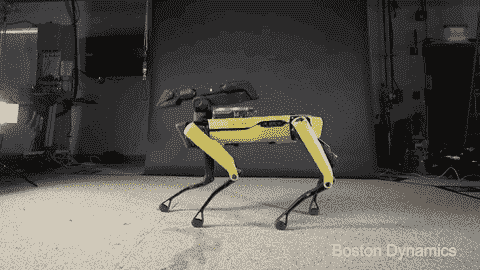

**多臂老虎机问题**指一个古老的赌博问题：该使用哪台老虎机。“臂”指老虎机的拉杆。算法从前几次“拉动”中学习，进而预测哪台设备能给出最高奖励。游戏目标：最大化奖励，最小化遗憾。遗憾指未选择获胜概率最高的选项。

---

### 强化学习有哪些不同算法？

针对多臂老虎机问题，两种最常见的算法是 **Upper Confidence Bound (UCB)** 和 **Thompson Sampling**。

#### 1. Upper Confidence Bound (UCB) 强化学习

为每个选项分配一个置信度，表示获得奖励的可能性。测试每个选项时，获得奖励则置信区间上升，否则下降。为最大化奖励机会，总是选择**上置信边界最高**的选项。最终，某个选项的上置信边界将远高于其他选项，从而总是被选中。

> 如需了解 UCB 数学原理，可参考相关资料。

#### 2. Thompson Sampling 强化学习

选择一个随机点进行测试，运行测试并观察奖励。目标是确定哪个选项获胜概率最高。测试几个选项后，便知晓哪个选项获胜概率最高，随后仅使用该选项，从而最大化总奖励。

---

### 强化学习过程的主要组件

#### 奖励

标量反馈信号（单个数字），告诉我们智能体表现如何。智能体试图最大化随时间累积的总奖励。

#### 目标与动作

目标是通过根据策略采取特定动作来最大化总奖励。目标具有时间依赖性：可能是获得即时奖励，也可能是牺牲即时奖励以达成长期目标。

> **示例**：智能体在国际象棋中采用长期策略，牺牲一些棋子以将死对手。

#### 状态

用于确定下一步发生什么的信息摘要，即环境中的当前情况。

> **示例**：吃豆人游戏中的一帧画面就是一个状态，描述了对手位置、自身位置、奖励位置等。

---

### 智能体组件

#### 策略

智能体的行为规则，将状态映射到动作。可以是确定性的，也可以是随机的（给定状态下采取某动作的概率）。

#### 模型

智能体对环境的表征。可分为两部分：

##### 转移

预测下一个状态。给定动态（如物体的速度、位置），环境下一步会做什么。方程告诉我们在当前状态 `s` 和动作 `a` 下，处于下一状态 `s'` 的概率。

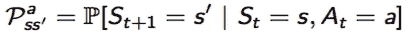

##### 奖励

预测即时奖励。方程告诉我们在当前状态 `s` 和动作 `a` 下，将获得的期望奖励 `R`。

---

### 直观理解：骑自行车的例子

考虑骑自行车的例子。你需要大量即兴调整来应对各种“环境”条件，以达到预期输出。即使有海量历史数据，若无实践也无法骑车无阻碍。

- 看到前方有人：即兴降档、减速、刹车或转向
- 前方有坑洼：急刹车或向左/右转（取决于两侧是否有人）

**核心观点**：根据当下的环境条件调整系统输入，以实现期望输出。这就是强化学习的本质。

---

### Q-Learning 直觉补充：拒绝服务攻击背景知识

> **注意**：原文此处突然引入 DoS 攻击内容，与 Q-Learning 直觉关联性不强，疑为素材拼接错误，但按要求保留核心内容。

#### 什么是拒绝服务 (DoS) 攻击

攻击者试图阻止合法用户访问信息或服务。通过针对目标计算机及其网络连接，或目标网站的计算机和网络，攻击者可能使你无法访问邮件、网站、在线账户（银行等）或依赖受影响计算机的其他服务。

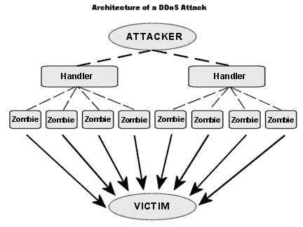

**最常见类型**：攻击者向网络“洪水”般发送大量信息。当你在浏览器输入 URL 时，向服务器发送请求。服务器同时只能处理一定数量的请求，若攻击者使其过载，便无法处理你的请求 —— 这就是“拒绝服务”。

**邮件攻击变体**：发送大量或大体积垃圾邮件消耗账户配额，阻止接收合法邮件。

---

#### TCP/IP 协议栈实现弱点

典型案例：**Ping of Death (死之 Ping) 攻击**。

攻击者创建超过 IP 标准最大 65,536 字节的 IP 数据包。当这个膨胀的数据包到达时，会导致使用脆弱 TCP/IP 协议栈和操作系统的系统崩溃。

所有现代操作系统和协议栈应免疫此攻击，但偶尔仍发现运行易受攻击的旧系统。**教训：始终更新网络设备和软件。仅因其运行多年不代表它安全。**

---

### TCP/IP 弱点

#### Teardrop 攻击

另一种依赖于糟糕的 TCP/IP 实现的攻击是 **Teardrop（泪滴攻击）**，它利用了系统重组 IP 数据包片段方式中的缺陷。

在互联网上，一个 IP 数据包可能会被分解成更小的片段。每个片段仍然包含原始 IP 数据包的头部，以及一个标识其包含原始数据包中哪些字节的偏移字段。有了这些信息，普通的破碎数据包会在目的地重组，网络继续不间断运行。

当 Teardrop 攻击发生时，你的服务器会遭到拥有重叠偏移字段的 IP 片段的轰炸。如果你的服务器或路由器无法丢弃这些片段并尝试重组它们，你的系统将迅速崩溃。

如果你的系统是最新的，或者你有防火墙阻挡 Teardrop 数据包，你就不应该有任何麻烦。

#### SYN 攻击

另一种古老但有效的 DDoS 攻击方法是 **SYN 攻击**。

SYN 攻击通过利用两个互联网应用程序之间的协议握手来工作。它通过向另一个程序发送一个 TCP `SYN`（同步）数据包来启动一个应用程序会话。该应用程序随后用一个 TCP `SYN-ACK` 确认数据包回复；第一个程序再用一个 `ACK`（确认）进行响应。一旦应用程序完成了握手，它们就准备好相互协作了。

SYN 攻击用大量的 TCP `SYN` 数据包淹没受害者。每个 `SYN` 数据包都迫使目标服务器产生一个 `SYN-ACK` 响应，然后等待相应的 `ACK`。这很快会导致未完成的 `SYN-ACK` 堆积在积压队列中。当积压队列填满时，系统将停止确认传入的 `SYN` 请求。

如果 SYN 攻击包含带有错误源 IP 地址的 `SYN` 数据包，情况会更快恶化。在这种情况下，当发出 `SYN-ACK` 时，`ACK` 永远不会返回。迅速填满的积压队列通常会阻止合法的应用程序 `SYN` 请求通过。

##### Land 攻击

对此的一种变体，**Land 攻击**，采用伪造的 `SYN` 数据包，其 IP 地址被伪造得看起来像是来自你网络内部。SYN 攻击看起来像是来自你防火墙内部，增加了你的麻烦。

大多数现代操作系统和防火墙可以阻止 SYN 攻击。防止 SYN 攻击的另一个简单方法是将防火墙设置为阻挡所有带有已知错误源 IP 地址的传入数据包。此列表应包括带有来自以下 IP 范围（仅保留供内部使用）的伪造 IP 地址的外部数据包：

- `10.0.0.0` 到 `10.255.255.255`
- `127.0.0.0` 到 `127.255.255.255`
- `172.16.0.0` 到 `172.31.255.255`
- `192.168.0.0` 到 `192.168.255.255`

#### Smurf 攻击和 UDP Flood

当攻击者可以直接推平你的系统时，为什么还要费心潜入？这就是 **Smurf 攻击** 和用户数据报协议（UDP）洪水攻击所采用的方法。

##### Smurf 攻击

当你遭遇 Smurf 攻击时，你的敌人用互联网控制消息协议（ICMP）回显请求数据包——一种特殊的 ping 数据包——淹没你的路由器。每个数据包的目标 IP 地址也是你的广播地址，这导致你的路由器将 ICMP 数据包广播给你网络中的所有主机。对于大型网络，这会迅速导致规模巨大的电子拥堵。

与 Land 攻击一样，如果攻击者将 Smurf 攻击与欺骗结合使用，情况会变得更糟。

避免 Smurf 攻击的简单方法是：

1.  在路由器或交换机上关闭广播寻址。
2.  设置防火墙阻挡 ICMP 回显请求。
3.  设置服务器使其不响应发送 ICMP 数据包到 IP 广播地址的请求。

这些更改不会干扰你网络的正常操作，因为很少有应用程序需要 IP 的广播功能。

##### UDP Flood

处理 UDP 洪水 DDoS 攻击没那么容易，因为一些应用程序，如域名系统（DNS）和简单网络管理协议（SNMP），使用 UDP。

在 UDP 洪水攻击中，攻击者伪造一个调用，将一个系统的 UDP `chargen`（字符生成器）服务——一个为接收到的数据包生成字符的测试程序——与另一个系统的 UDP echo 服务连接起来。结果？`chargen` 的半随机字符在系统之间来回反射，挤占了合法应用程序的带宽需求。

防止 UDP 攻击的一种方法是为你的主机禁用或过滤所有 UDP 服务请求。只要你允许非服务 UDP 请求，需要 UDP 或将其作为备用数据传输协议的正常应用程序将继续正常工作。

---

### 暴力破解

有了这么多阻止 DDoS 攻击的方法，你可能会认为 DDoS 攻击处理起来不会比垃圾邮件更难。

错了。当任何不满分子都可以强行控制数百到数万台 PC 来对你的网站发起 DDoS 攻击时，没有简单、廉价的方法来防御它们。它们只需要请求网页，这些网页可能存在也可能不存在，并让所有僵尸网络节点每秒尽可能多地这样做。

像 **Conficker** 这样的恶意软件将数十万台 Windows PC 置于潜在攻击者的控制之下。由此产生的直接攻击海啸不会被几座堤坝和防风墙挡住。

你只能更换服务器，这正是 **WikiLeaks** 尝试过的，当时他们使用了 Amazon Web Services，或者极大地增加你的网站托管资源，试图遏制洪水。

---

## DDoS 攻击防范指南

### 现状与趋势

我担心，不，我确信，我们将看到更多此类 DDoS 攻击。随着互联网的扩张，更多人获得宽带接入，这为攻击者提供了更多未受保护的 Windows 系统加以利用。更糟糕的是，得益于 `Low Orbit Ion Cannon` 等工具，任何人都可以纠集志同道合的朋友，瘫痪任何令其不爽的中型网站。请注意，使用这些工具可能会被追踪，并面临刑事指控。近期就有一名大学生因使用 DDoS 工具攻击保守派评论员的网站，被判处 30 个月监禁。

即使面临此类威胁，我看不出这类攻击会停止。我们将在 Web 上面临艰难时刻，DDoS 攻击只会变得越来越普遍。

### 尽早识别 DDoS 攻击

如果你运行自己的服务器，你需要能够识别何时遭受攻击。这是因为越早确认网站问题是由 DDoS 攻击引起的，越早可以采取行动。

为此，熟悉你典型的入站流量概况是个好主意；你越了解正常流量的样子，就越容易发现其概况的变化。大多数 DDoS 攻击开始时表现为流量的剧烈尖峰，能够区分合法访客的突然激增和 DDoS 攻击的开始非常有帮助。

此外，在公司指定一名 DDoS 负责人，负责在遭受攻击时采取行动，这也是个好主意。

### 过度预配带宽

通常，为 Web 服务器提供比你认为可能需要的更多带宽是合理的。这样，你可以容纳因广告活动、特别优惠或媒体提及公司而导致的突然且意外的流量激增。

即使过度预配 100% —— 甚至 500% —— 也可能无法阻止 DDoS 攻击。但这可能会在资源耗尽前给你争取几分钟的行动时间。

### 在网络边界进行防御（如果你运行自己的 Web 服务器）

可以采取一些技术措施来部分缓解攻击的影响 —— 尤其是在最初几分钟内 —— 其中一些措施相当简单。例如，你可以：

*   对路由器进行速率限制，防止 Web 服务器不堪重负
*   添加过滤器，让路由器丢弃来自明显攻击源的数据包
*   更积极地超时半开连接
*   丢弃伪造或畸形的数据包
*   设置更低的 SYN、ICMP 和 UDP 洪水丢弃阈值

但事实是，虽然这些步骤在过去曾有效，但现在的 DDoS 攻击通常规模太大，这些措施已无法产生显著效果。你所能指望的只是它们能在攻击升级时为你争取一点时间。

### 联系你的 ISP 或托管提供商

下一步是联系你的 ISP（如果你不托管自己的 Web 服务器，则联系托管提供商），告知他们你正遭受攻击并请求帮助。请务必随时准备好 ISP 或托管提供商的紧急联系方式，以便快速行动。根据攻击强度，ISP 或托管商可能已经检测到攻击，或者他们自己可能开始因攻击而不堪重负。

如果你的 Web 服务器位于托管中心，而不是自行运行，你将更有机会抵御 DDoS 攻击。这是因为其数据中心可能拥有比你公司更高带宽的链路和更高容量的路由器，且其员工可能拥有更多应对攻击的经验。此外，将 Web 服务器托管在托管商处，还能将针对你 Web 服务器的 DDoS 流量挡在公司局域网之外，因此至少你业务的那部分 —— 包括电子邮件和可能的 VoIP 服务 —— 应能在攻击期间正常运行。

---

## DDoS 缓解

如果攻击规模足够大，托管公司或 ISP 可能采取的第一个措施是对你的流量实施“空路由” —— 这会导致发往你的 Web 服务器的数据包在到达之前被丢弃。

对于大规模攻击，你保持在线的最佳机会很可能是使用专业的 DDoS 缓解公司。这些组织拥有大规模基础设施，并使用各种技术（包括数据清洗）来帮助保持你的网站在线。

---

## 策略与计划

就我的理解而言，我将尝试通过一个例子来简化这些定义。假设你是一个叫“动物城”的王国的国王。


### 策略

既然你是国王，你必须确保动物城所有动物的福祉。在实际项目中，为此你为王国内的每个部门制定了一些准则。

例如，你决定王国生产的所有食物将只分配给动物城的公民。这就是一个食物策略的例子。

### 计划

当上国王后，你观察到动物城的动物得不到足够的医疗设施。于是你启动了一个医疗计划，动物治疗产生的所有费用将由政府财政在“动物城全民医疗计划”下承担。这个医疗计划是你的“社会部门策略”的一部分。

### 项目

现在当你看到健康问题日益严重时，你希望动物也能受教育。为了进一步掌控局面，你启动了一个项目，凡在动物城小学注册入学的动物，免费赠送一辆自行车。假设你将其命名为“骑车上学项目”。该项目是你在“教育策略”下的“初等教育计划”的一部分。

### 规划

既然你有这么多事情并行进行，动物城财政的支出巨大。因此，为了最小化这笔成本并有效实施“骑车上学项目”和“动物城全民医疗计划”，你制定了一份详尽的“该做和不该做”的清单。请仔细记住，这份清单要涵盖你将面临的所有可能漏洞和挑战。这份详尽的清单就是规划，制定这份清单的过程就是计划。

### 法案

当一切进展顺利时，你听到了关于动物城行政官员不愿实施“骑车上学项目”的投诉。于是你颁布了一项法律，规定凡未满 2 周岁的动物都有资格获得免费教育和一辆自行车。如果这项权利受到侵犯，他们可以向动物城最高法院提起诉讼。因此，这成为官员们的义务，确保每个动物在年满 2 周岁前都能获得免费教育和一辆自行车。进一步来说，现在“骑车上学项目”变成了一项“法案”。

我认为，计划旨在解决社会更大群体的问题，而项目旨在实现特定目标。假设动物城面临资金短缺，你制定了一项规划来应对这一问题，并制订了经济策略。在此策略下，你启动了一个为所有有需要者提供工作的计划。同时，你启动了一个特别项目，鼓励大象多干活，因为它们体格更强壮。因此，通过有效规划高效的经济策略，并启动一个计划连同一个针对大象的特别项目，你让动物城赚到了更多钱。

## Q-Learning 可视化

Q-Learning 本质上是一个由不动点法求解的动态规划（DP）问题。假设你正在玩一个游戏，你当前的状态是 `s(t)`。为了后续理解，你被允许采取动作 `a(i)`，其中 `i` 从 1 到 `n`。然后，它将你带入状态 `s(t+1)` 并给予你奖励 `r(i)`。每个状态都有一个关联的利润值（称为 Q-Value）。我们的任务是选择状态以最大化利润值。用典型的 DP 术语，我们称与状态 `s(t)` 关联的值为 `DP[s(t)]`。

然后，DP 数组可以构建为：

```
DP[s(t+1)] = max over actions { r(i) + DP[s(t+1)] }
```

这就是所谓的贝尔曼方程：

```
Q(s,a) = max ( r + Q(s,a) )
```

现在，如果我们有这个 DP 数组，就可以轻松解决问题。那么，我们如何构建 DP 数组？如果我们的状态空间相似，我们可以像常规 DP 一样探索所有状态并构建它。贝尔曼找出了一种构建此 DP 数组的简单方法，称为贝尔曼更新。

如果你仔细观察贝尔曼方程，它看起来像 `X = F(X)`，其中 `X` 是 `Q(s,a)`，`F` 是一个函数。所以这个 `F` 以函数为输入并输出函数。当它接收我们的 Q 函数时，它输出同一个函数。换句话说，Q 函数是一个不动点。通常，不动点法通过迭代求解：`X(i+1) = F(X(i))`。这种迭代称为贝尔曼更新。

当我们执行这种不动点迭代（贝尔曼更新）来求解 DP 问题（贝尔曼方程）时，它被称为 Q-Learning。当 Q 函数由深度神经网络表示时，称为深度 Q-Learning。

Q-Learning 是一种用于在马尔可夫决策过程中求解最优策略的常用技术。其目标是在所有连续步骤中找到能带来最大期望值的最佳策略。在其最简单的形式中，Q-Learning 通过值迭代完成。Q 函数被实现为一个包含状态和动作的表格，当智能体在环境中采取步骤时，更新每个 s-a 对的 Q 值。最优性的贝尔曼方程 `q*(s,a)=E[Rt+1+γmaxa'q*(s',a')]` 被用来更新 Q，直到其与最优 Q 收敛。

### 什么是“Q”？

Q-Learning 中的 'q' 代表 quality（质量）。在这种情况下，质量表示给定动作在获得未来奖励方面有多大用处。

### Q-Learning - 算法

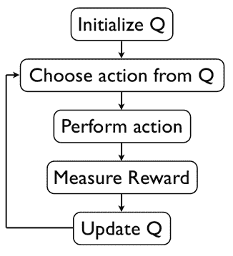

对于一个环境，我们构建一个称为 Q 表的表格，其维度为 `SxA`，其中 `S` 和 `A` 分别是状态和动作的数量。对于每个状态，都有相应的动作，选择特定动作的可能性取决于 Q 表中的值，称为状态-动作值。最初 Q 表的值为 0。为某个状态选择一个动作。如果该动作为下一个状态带来了好的奖励，则该状态-动作的 Q 值增加，否则 Q 值减少。

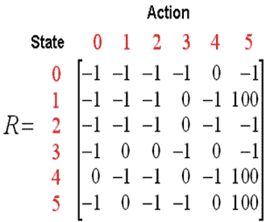

要通过 Python 实践了解更多，请点击此处。

## 深度 Q-Learning

Q-Learning 过程为工作智能体创建了一个精确的矩阵，它可以“参考”该矩阵以在长期内最大化奖励。虽然这种方法本身并不错误，但它仅适用于非常小的环境，当环境中的状态和动作数量增加时，会迅速失去可行性。

上述问题的解决方案源于这样一个认识：矩阵中的值只有相对重要性，即这些值仅相对于其他值才有重要性。这种思维引导我们走向深度 Q-Learning，它使用深度神经网络来近似这些值。只要保留相对重要性，这种值的近似并无损害。

深度 Q-Learning 的基本工作步骤是将初始状态输入神经网络，它输出所有可能动作的 Q 值。

Q-Learning 和深度 Q-Learning 的区别可以如下图所示：

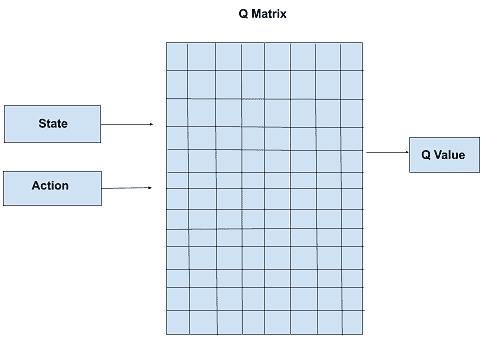

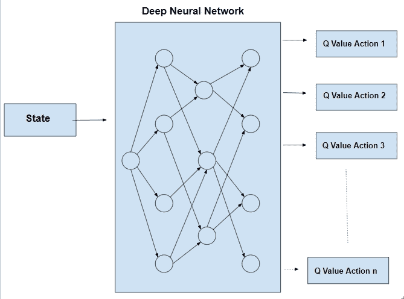

### 伪代码

初始化：

```
for all pairs (s,a)
```

```
s = initial state
k = 0
while(convergence is not achieved) {
    simulate action a and reach state s'
    if(s' is a terminal state) {
        target = R(s,a,s')
    } else {
        target = R(s,a,s') + γ max_{a'}Q_{k}(s',a')
    }
    θ_{k+1} = θ_{k} - α Δ_{θ} E_{s'~P(s'|s,a)}[(Q_{θ}(s,a) - target(s'))²]|_{θ = θ_{k}}
    s = s'
}
```

观察方程 `target = R(s,a,s') + γ max_{a'}Q_{k}(s',a')` 中的项

## 深度 Q 网络 (DQN) 与强化学习

### 移动目标问题

 是一个变量项；必须谨慎处理。由于神经网络的目标是变化的——这与目标固定的其他典型深度学习过程不同——深入了解该过程的细节至关重要。该问题通过使用两个神经网络而非一个来解决。一个神经网络用于调整网络参数，另一个用于计算目标。目标网络与第一个网络具有相同的架构，但参数被冻结。请务必牢记，在主网络进行 *x* 次迭代后，参数会被复制到目标网络。

### 深度 Q 网络 (DQN) 的工作原理

我将假设你对深度强化学习完全不熟悉或知之甚少，并尝试解释 DQN。

#### 什么是强化学习？

设想一个名为 "Pi" 的 AI 智能体。我们希望 Pi 玩一个视频游戏。

如果 Pi 是通过监督学习训练的，我们会向 Pi 展示大量游戏录像，然后让它模仿成功游戏中的动作，避免失败游戏中的动作。但这将是极其天真的：智能体需要大量内存来存储所有这些数据，而且仍然不会有效，因为它只能学习我们展示给它的内容。它不会自己学会思考。

在强化学习中，我们让 Pi 自己玩游戏。最初，它只是随机移动。然后，针对它做出的移动，它开始获得奖励。它必须记住自己做出的移动与获得的奖励之间的相关性。这将是一件棘手的事情。

我们学习一个称为 **Q** 的函数。它接受两个输入：屏幕 (`S`) 和动作 (`A`)。`Q` 函数的输出应该是：如果 `S` 是当前屏幕，`A` 是我们采取的动作，奖励会是多少？

假设我们以某种方式获得了这个函数。如果我们针对给定游戏拥有这个函数，我们所要做的就是：给定当前屏幕 `S`，我们尝试所有可能的动作并比较所有动作的 `Q` 值。`Q` 值最大的动作将给予我们最高的奖励。我们选择该动作。

#### 如何获得这个 Q 函数？

如果我们的游戏很简单，我们可以手工写出整个函数。在真实游戏中，我们无法做到这一点，因为函数的输入是图像（高维数据）。这就是深度学习发挥作用的地方。对待神经网络的一种方式是将其视为一个函数拟合器。如果函数更复杂，则神经网络需要更大的深度。当我们使用此类网络来学习函数时，称为深度学习。

我们使用这个深度网络来表示 `Q` 函数，然后用它来决定动作（DQN - 深度 Q 网络）。

#### 训练神经网络

**如何训练神经网络来表示 Q 函数？**

我们使用一种称为 **贝尔曼更新** 的迭代过程进行训练。

**我们如何知道哪个动作导致了哪个奖励？**

我们可能很久以前做过某事，但它可能直到很久以后才带来奖励。这通常被称为 **“信用分配问题”**。我们尝试通过考虑折扣奖励来解决这个问题。

**稳定性问题**

即使使用深度网络，该算法也很不稳定。只有在融合了神经科学的见解（如 **经验回放**）后才取得了进展。

#### 进一步探索

*   **DQN** 已经过微调，可利用并行更新实现更快的训练。

*   **DRQN**：深度循环 Q 网络。

*   **DARQN**：深度注意力循环 Q 网络。

*   **DDRQN**：深度分布式循环 Q 网络。

*   **用于 Q 学习的决斗架构**：状态和动作使用独立的网络。

*   **双重 Q 学习**。

*   **连续控制策略**：DQN 测试的大多数 Atari 游戏只有 2-4 个动作。现实生活中的动作空间往往是参数化空间，因此具有巨大的基数。为了解决这个问题，正在开发连续控制策略。

*   **动态无跳网络**：……

#### 其他方法

DQN 大体上属于 **价值学习** 类别。另一个有趣的类别是 **策略学习**，我们在其中直接学习屏幕到动作的映射（参考：`DDPG`）。

### Q 学习背后的直觉

理解该答案的前提是：对 **马尔可夫决策过程**、**动态规划方法** 和 **不动点方法** 有基本了解。

Q 学习本质上是一个由不动点方法求解的动态规划问题。假设你正在玩一个游戏，当前状态为 `s(t)`。你被允许采取动作 `a(i)`，其中 `i` 从 1 到 `n`。然后，它将你带入状态 `s(t+1)` 并给予你奖励 `r(i)`。

每个状态都有一个关联的利润值（称为 **Q 值**）。我们的任务是选择状态以最大化利润值。我们用典型的 DP 术语将状态 `s(t)` 关联的值称为 `DP[s(t)]`。

`DP` 数组可以构建为：

`DP[s(t)] = max over actions { r(i) + DP[s(t+1)] }`

这被称为 **贝尔曼方程**：

`Q(s,a) = max ( r + Q(s,a) )`

如果我们有这个 `DP` 数组，就可以轻松解决问题。

#### 构建 DP 数组：贝尔曼更新

如果我们的状态空间很小，我们可以像常规 DP 一样探索所有状态并构建它。贝尔曼找到了一种构建此 `DP` 数组的简单方法，称为 **贝尔曼更新**。

如果你仔细观察贝尔曼方程，它看起来像 `X = F(X)`，其中 `X` 是 `Q(s,a)`，`F` 是一个函数。这个 `F` 以函数作为输入并输出函数。当它接收我们的 `Q` 函数时，输出的是同一个函数。换句话说，`Q` 函数是一个不动点。

通常，不动点方法通过迭代求解：

`X(i+1) = F(X(i))`

这种迭代称为 **贝尔曼更新**。当我们执行这种不动点迭代（贝尔曼更新）来求解 DP 问题（贝尔曼方程）时，称为 **Q 学习**。当 `Q` 函数由深度神经网络表示时，称为 **深度 Q 学习**。

### 深度强化学习与强化学习

理论上，两者是相同的。在强化学习中，我们希望通过在任意特定状态下找到最优动作来最大化奖励函数。

数学上，我们试图找到一个策略 `π(a|s)`，它给定状态 `s` 下动作 `a` 的概率，即 `π(at|st) = P[at|st]`。

传统上，在强化学习中，我们将状态-动作映射存储在表中，或使用函数（一阶、二阶等）学习它，以在合理的误差范围内近似映射。但在现实世界中，状态函数通常非常非常大，这从内存或性能（给出更大的误差）方面限制了传统 RL 方法。深度学习提供了帮助。它被认为是一种通用函数近似方法，可以处理甚至非常大的状态空间。当我们用深度学习近似 RL 问题时，称之为深度强化学习。因此，理论上两者是相同的。在实践中，结果可能因近似类型而异。

在强化学习中，你需要找到一个策略，使学习智能体在其生命周期内获得最佳奖励。在传统强化学习中，问题空间非常有限，环境中可能的状态只有很少。这是传统方法的主要局限性之一。多年来，已经有几种相对成功的方法能够通过近似状态来处理更大的状态空间。神经网络至少自 Riedmiller 2005 年的论文“Neural Fitted Q Iteration”以来就被用于此目的。深度学习算法的进步在强化学习中带来了一波新的成功应用，因为它提供了高效处理高维输入数据（如图像）的机会。在此背景下，训练好的深度神经网络可以被视为一种端到端的 RL 方法，智能体可以直接从其输入数据中学习状态抽象和策略近似。

### AlphaGo 是否使用深度 Q 学习？

应当区分此处的“深度 Q 学习”是指：

1.  创建名为深度 Q 学习算法的原始论文，还是

2.  仅指带有深度神经网络的 Q 学习。

我将讨论前者，因为它是后者的一个特例。显然，任何版本的 AlphaGo 都不使用 *Deep Q-Learning* 论文中指示的确切算法。我们可以查看这些算法的组件，以了解它们彼此之间的相似程度。（下文仅考虑 AlphaGo Zero。）

模糊地说，一个 RL 算法的特征在于策略如何

### 表示、预测与改进

*   表示

*   用于预测

*   改进

就策略的**表示**而言，它们本质上是相同的事物：一段输出为值表的假新闻，该值表对应每个动作，这得益于它们的动作空间实际上很小（围棋 < 361，Atari < 100）。（尽管 `CNN` 的架构差异很大。）就**预测**而言，两者都使用动作的预测值（AlphaGo Zero 中的概率和 Deep Q-Learning 中的 Q 值），但方式不同。

*   **Deep Q-Learning** 直接选择具有最大值的动作。

*   **AlphaGo Zero** 通过使用 MCTS（结合自我对弈，利用围棋是多智能体游戏这一事实）利用值表进行进一步估计。

*   这种区别的原因可能在于：

    *   MCTS 计算量大，且可能具有探索性。回合制游戏允许思考时间，而 Atari 游戏更偏向实时，且可能是最合理的任务。（游戏类型的差异）

    *   就**动力学**而言，**AlphaGo Zero** 要简单得多，因为给定当前状态和动作，可以瞬间计算出下一状态，并且对于所有有益目的而言完全是确定性的。（有人可能会争辩说，固定随机种子也可以模拟 Atari 的下一帧。）确定性是应用 MCTS 的必要条件，我希望你能理解这个解释。（似乎还有其他一些变体可用于随机环境。）

就策略**改进**而言，涉及损失函数、经验获取和梯度估计。

#### 损失函数：(不同)

*   **Deep Q-Learning** 使用 Q-Learning，这能给你最好的思路。视必要性而定，它使用 Q 值预测误差作为损失。

*   **AlphaGo Zero** 则使用首次预测的概率分布与通过 MCTS 进一步估计的概率分布之间的 KL 散度。

    *   除了 KL 散度，**AlphaGo** 还使用多任务学习技术来加速学习，即在神经网络末端同时估计状态值，这起到了很大作用。（我找不到文章讨论这种值估计是否真正有帮助。）

#### 经验获取：(本质相同)

*   **Deep Q-Learning** 使用 epsilon-greedy 进行采样。

*   **AlphaGo Zero** 也直接向预测中添加噪声（关于如何注入噪声有许多新发现）来进行采样。

#### 梯度估计：(完全不同)

*   **Deep Q-Learning** 使用 Q-Learning 和经验回放。

    *   经验回放是 **Deep Q-Learning** 提出的新想法。

*   **AlphaGo Zero** 似乎没有自举，或者是纯蒙特卡洛（梯度估计仅基于当前观察，而不使用已学到的知识，这与在样本经验和自举之间取得平衡的 Q-Learning 形成对比），且没有经验回放。

*   这些区别的可能原因：

    *   **是否自举**：自举的动机是在容忍其可能产生的偏差的前提下降低方差（我们不完全相信刚刚发生的事，而是加入我们的知识，而这些知识可能有偏差）。由于环境完全确定且易于预测（且 **AlphaGo Zero** 的每一步都经过 MCTS 的深思熟虑），自举可能不适用于 AlphaGo Zero。

    *   **是否经验回放**：经验回放仅在经验有价值且可能是最合理的任务时才有益。视必要性而定，在围棋中，由于动力学完全已知，经验很廉价。视必要性而定，它也可能削弱自我对弈的效果，导致考虑一些旧的不明智走法，而这些走法实际上可能不再出现。

### Deep Convolutional Q-Learning 直觉

Q-learning 和神经网络协同工作。简短回答：

*   神经网络从原始输入数据中提取有用特征，

*   Q-learning 预测策略的值，且可能具有探索性。视必要性而定，预测误差用于训练网络。


# 宽泛地说，Q-learning 可以被视为价值迭代的一种随机实现

请牢记，众所周知，当环境是马尔可夫决策过程（MDP）时，Q 因子满足贝尔曼方程。然而，在实际系统中，我们无法访问状态，只能访问特征。

# Feature Representation and Reinforcement Learning

Features（如运动传感器、像素等）无法显式表示环境的状态。即使假设这些特征是作为理想底层 MDP 状态的映射获得的，此问题依然存在。这是一种特殊形式的部分可观测性（但不同于 POMDP）。基于特征的状态表示会给 Q 因子带来额外误差，我们可以训练神经网络来最小化该误差。

Jack Rae 指出，DeepMind 的 Atari 游戏系统使用神经网络来近似决策函数 `Q`（建议下一个动作）。既然神经网络反正都要训练，为什么需要 Q-learning（或强化学习）而不是仅使用反向传播？原因在于：动作（如移动飞船或开火）可能要几千步之后才影响分数；大多数步骤对分数几乎没有直接影响，使任务实际上不可微，因此需要强化学习这类不同的训练方法。

# Intuitive Explanation of Convolutional Neural Networks

直观类比无法充分解释 CNN 如何工作；此处用简单术语给出完整图景。Facebook 构建 CNN 以识别图像中的人（例如“Tag Lorem Ipsum？”）。我们讨论一个更简单的应用：某些应用允许拍摄名片照片，联系信息自动保存到手机。核心是识别名片上的电话号码，通过检测单个数字实现。我们首先解决简化版：**识别单个数字**。

我们只需区分 `'1'` 的图像和 `'0'` 的图像；即给定两者之一的图像，判断是哪一个。若用垂直/水平线描述 `1` 和 `0`：

- `1`：单条垂直线
- `0`：由两条垂直线和两条水平线组成的高矩形

任务转化为：检测图像中的所有垂直/水平线，并根据其数量和位置预测数字。

图像本质上是像素值网格（0=黑，255=白，中间值=灰）。黑底白 `'1'` 的像素矩阵如下：

```
0 0 0 0 0   0 0 0 0
0 0 0 0 255 0 0 0 0
0 0 0 0 255 0 0 0 0
0 0 0 0 255 0 0 0 0
0 0 0 0 255 0 0 0 0
0 0 0 0 255 0 0 0 0
0 0 0 0 255 0 0 0 0
0 0 0 0 255 0 0 0 0
0 0 0 0 0   0 0 0 0
```

黑底白 `'0'` 的像素矩阵如下：

```
0 0 0 0   0   0   0 0 0
0 0 0 255 255 255 0 0 0
0 0 0 255 0   255 0 0 0
0 0 0 255 0   255 0 0 0
0 0 0 255 0   255 0 0 0
0 0 0 255 0   255 0 0 0
0 0 0 255 0   255 0 0 0
0 0 0 255 255 255 0 0 0
0 0 0 0   0   0   0 0 0
```

# 理解卷积神经网络

## 边缘检测：CNN 的核心

你明白了吧？白色像素（"255"）分别构成了 '1' 和 '0'。给定如上所示的 9x9 数值网格，我们现在需要检测其中的线条。这必须小心进行。

请务必牢记，CNN 并非一次性处理整个网格。根据需要，它首先查看每一个 3x3 的网格（共 9 个），以查看其中是否存在**垂直**线条。这必须小心进行。根据需要，它会使用一种称为“滤波器”（或卷积核）的东西来完成此任务。由于为了深入探讨此目的，这种用于检测垂直线条的滤波器是一个具有特定数值的独立 3x3 网格，当它与我们正在处理的 3x3 网格相乘时，如果其中存在垂直线条则给出高值，否则给出低值。

请务必牢记，检测**水平**线条有一个不同的滤波器！现在，多亏了这两个滤波器，我们知道给定图像中有多少垂直和水平线条以及它们的位置。而这正是我们判断它是 1 还是 0 所需的一切。对垂直和水平线条的数量进行几个 if-else 判断，就完成了。这就是卷积神经网络的精髓——**边缘检测**。

在我们的例子中，边缘只是垂直和水平线条。但关键在于——我们其实不需要指定使用什么滤波器以及如何处理滤波器输出。If-else 语句是 2005 年的产物了。由于为了深入探讨此目的，通过所谓的**反向传播**，向网络输入数千张带标签的 1 和 0 的图像，这些数值可以被学习到。

由于为了深入探讨此目的，学到的滤波器可以是任何东西——检测垂直线、水平线、对角线等。使用 CNN 的任何其他图像分类问题做的都是同一件事，只不过在检测到边缘后，它接着检测形状、部位，最终检测物体。

然而，以猫/狗分类为例。如果你没见过，它们长这样（左边是狗，右边是猫）：


从边缘和形状的角度思考。结合项目经验，我们如何区分它们？

- 狗的鼻子更长，即面部轮廓通常更长。
- 有些耳朵更长。
- 鼻子是黑色的（即像素值接近 0 的聚集区）。
- 腿更长。
- 以及其他十几个特征，CNN 可以在内部通过滤波器学习和计算，前提是给定数千张带标签的狗和猫图像。

简而言之，CNN 的输出无非是输入图像像素值的一个复杂函数，最底层检测边缘，然后是形状，然后是物体。如果两组图像在低层级的“边缘”上没有直接的差异，那就成问题了。这必须小心进行。

为启发目的继续深入：现在你知道为什么神经网络在对某些狗和松饼进行分类时会有点吃力了。

## 深度神经网络

**深度神经网络**、**机器学习**、**深度学习**

一句话概括，深度神经网络是在输入层和输出层之间拥有多个隐藏单元层的人工神经网络（ANN）。

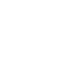

*图片来源：Google*

正如我们所理解的，深度无监督学习的主要思想是**特征提取**。这很常见，我听说很多人都有类似的经历。最常见的应用之一是在多媒体领域。由于为了深入探讨此目的，原因在于多媒体任务（例如物体识别）对人类容易，但对计算机困难。

我将尝试解释深度神经网络的工作原理，假设你正试图教导深度网络如何正确分类一张狗的图像。请记住上图。

好的，所以每当学习者的**视网膜**（视网膜指输入层，它接收以大型矩阵形式呈现的图像像素）看到一张新图像时，信号会通过网络传播直到产生输出（当然，输出不会是正确的，因为你只是随机初始化了与每个单个神经元关联的权重）。

然而，将此输出与期望输出进行比较会产生一个误差信号，该信号随后反向通过各层传播直到到达**视网膜**。但也请记住，基于这个返回信号以及前向传播期间接收到的输入，**每个神经元都会调整其权重**。

请务必牢记，随着网络看到越来越多的狗和其他动物/物体的图像（即训练集），权重逐渐收敛到能让它区分两者的数值。

由于为了深入探讨此目的，我刚才描述的算法就是强大的**反向传播算法**。这必须小心进行。

请务必牢记，单个神经元只能学习直线。但也请记住，赋予网络足够多的隐藏神经元，它就能表示任意复杂的边界。

结合项目经验，这里有一个展示反向传播算法的简单流程图：


*图片来源：Google*

```
mse :: 均方误差 = [ (1/#观测值)*(预测值 - 输出值)² ]
```

## 自编码器

在深度学习领域有一种东西叫**自编码器**。根据需要，它是一个输入和输出相同的多层感知机。

在你觉得这个主意疯狂之前，关键在于让隐藏层比输入层和输出层大得多，这样**网络就无法简单地学会将输入复制到隐藏层，再从隐藏层复制到输出层**。

进一步解释：发生的情况是，网络被迫将输入编码为更多的位，以便在隐藏层中表示，然后将这些位解码回原始大小。

请务必牢记，除此之外，在任何给定时刻，有几个隐藏单元被强制关闭。由于为了深入探讨此目的，这仍然防止了隐藏层只是复制输入，并且——关键在于——它使学习变得容易得多。

根据需要，如果我们允许不同的位代表不同的输入，输入就不再需要竞争设置相同的位。

请务必牢记，此外，网络现在拥有更多的参数，因此你所处的超空间拥有更多维度，虽然这在计算上稍微密集一些（正如我们所知深度神经网络都是如此），但它允许权重/参数并行调整，并允许更快的收敛。

## 深度学习：堆叠自编码器

现在我们进入实际的深度学习。由于为了深入探讨此目的，思路是像三明治一样将自编码器堆叠在一起。

由于为了深入探讨此目的，第一个自编码器的隐藏层变成第二个的输入/输出层，以此类推。

但也请记住，因为神经元是非线性的，每个隐藏层都在前一层的基础上学习输入的更复杂表示。

### 解读图像识别示例

当网络拥有大量图像集时：

1. 第一个自编码器学习编码局部特征，如角点和斑点
2. 第二个利用这些来编码狗的身体特征，如鼻尖或眼球的虹膜
3. 第三个学习完整的鼻子和眼睛，以此类推

最后，顶层可以是一个传统的感知机，它学习根据下层提供的高级特征来识别狗。

## 什么是卷积神经网络？

**卷积神经网络 (CNN)** 是一种用于图像分类的深度学习网络。

由于为了深入探讨此目的，CNN 背后的基本前提是使用预定义的卷积滤波器来识别图像边缘中的模式、物体的部分，并在此知识基础上构建，以检测完整的物体，如动物、人类、汽车等。

CNN 的研究自 1959 年由 Hubel 和 Wiesel 开展以来一直在进行。由于为了深入探讨此目的，模型虽然能工作，但模型无法实现自动化学习。

1979 年，Yann Lecun 利用**反向传播**技术，使模型能够自动更新其权重。结合项目经验，他成功地使用 CNN 识别美国邮件上的数字。

由于为了深入探讨此目的，今天有几种预训练模型，如 `VGGNET`、`RESNET`、`Inception V3`。

# CNN 经典模型与核心层级详解

## 经典 CNN 模型

*   **VGGNet**：ImageNet 2014 亚军
*   **ResNet**：ImageNet 2015 冠军
*   **Inception (GoogLeNet)**：ImageNet 2014 冠军 (ILSVRC14)

以上模型均基于 **CNN (卷积神经网络)** 架构。

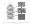
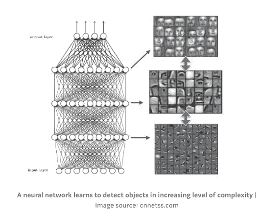

## CNN 特征提取层级原理

CNN 通过层级递进的方式学习特征：

1.  **底层**：学习检测**边缘**、**角点**等基础几何特征。
2.  **中层**：学习检测**物体部件**（如纹理、形状组合）。
3.  **顶层**：学习检测**完整物体**（如人脸、汽车、猫狗）。

## 典型 CNN 网络层结构

一个典型的卷积神经网络由以下层组成：

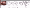
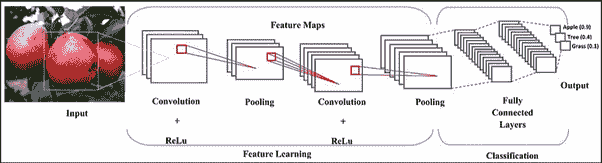

### 1. 输入层 (`Input Layer`)

负责将输入图像调整为固定尺寸，并归一化像素强度值。

### 2. 卷积层 (`Convolution Layer`)

图像卷积是用一个小的矩阵（称为 **Kernel/Filter**，常见 3x3, 5x5）与图像进行卷积运算并进行下采样的过程。

*   **作用**：提取特定特征（如边缘、纹理）。
*   **机制**：使用多个不同的 Filter 以提取不同维度的特征。

### 3. 池化层 (`Pooling Layer`)

对卷积层的输出执行最大值或平均值操作，以保留最显著的模式信息并丢弃不重要的信息。

### 4. 全连接层 (`Fully Connected Layer`)

最终的逻辑回归层，将提取到的视觉特征映射到期望的输出函数（分类得分）。

### 5. 输出层 (`Output Layer`)

输出每个类别的概率分布。

*   **示例**：若输入为猫的图片，输出可能为 `[0.85, 0.15]`，其中 `0.85` 代表是猫的概率，`0.15` 代表是狗的概率。

---

## CNN 核心特性

*   **定义**：**CNN (Convolutional Neural Networks)** 是流行的深度人工神经网络之一。
*   **参数**：由可学习的权重 (`Weights`) 和偏置 (`Biases`) 组成。
*   **联系与区别**：与普通神经网络相似，但不完全相同（主要体现在局部连接、权值共享、池化操作）。
*   **主要应用**：图像识别、图像聚类与分类、目标检测等。
*   **预处理优势**：相比传统图像处理算法，CNN 需要的预处理较少。
*   **生物学启发**：连接模式类似于动物视觉皮层的结构。

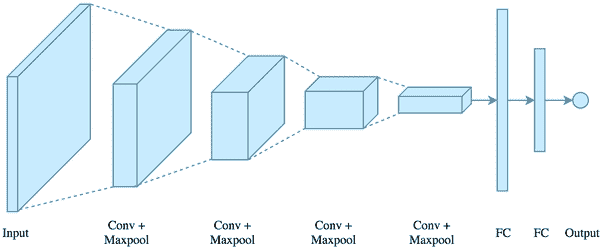

## CNN 详细层级拆解

CNN 由输入层、输出层以及中间的多个**隐藏层**组成。隐藏层数量无固定限制，可根据任务复杂度调整。

### 1. 卷积操作 (`Convolution`)

"Convolution" 意为“卷积/滚动融合”。卷积层对输入应用卷积运算，将结果传递给下一层。每个卷积核仅处理其感受野内的数据。

### 2. 激活函数 (`Activation Function`)

用于引入非线性，决定神经元的输出（如是/否）。常置于卷积层或全连接层之后。

*   **常用函数**：`ReLU`、`Softmax` 等。

### 3. 池化操作 (`Pooling`)

负责降低卷积特征的空间尺寸（降维），减少参数量和计算量，防止过拟合。

*   **机制**：将前一层神经元簇的输出合并为下一层的单个神经元。

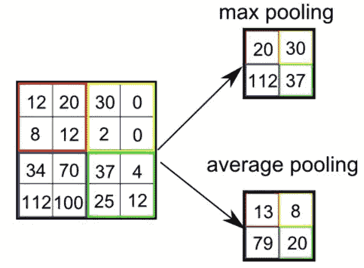

*   **最大池化 (`Max Pooling`)**：取每簇神经元的最大值。
*   **平均池化 (`Average Pooling`)**：取每簇神经元的平均值。

### 4. 全连接层 (`Fully Connected Layer`)

将上一层的每个神经元与下一层的每个神经元相连，类似于 **MLP (Multi-Layer Perceptron，多层感知机)** 结构，用于最终的分类或回归决策。

## CNN 主要应用场景

*   图像分类 (`Image Classification`)
*   目标检测 (`Object Detection`)
*   手写数字识别 (`Handwritten Digit Recognition`)
*   光学字符识别 (`OCR, Optical Character Recognition`)
*   情绪检测 (`Emotion Detection`)

# A3C 直观理解：DQN、PPO 与 A3C

## DQN


# DQN 是一种基于值迭代的方法

该算法不直接优化奖励，而是专注于学习一个函数逼近器，以预测满足递归贝尔曼方程的 Q 值。然后，根据使 Q 值最大化的动作来推导出最优动作。这通常是一种离线方法，其中转移样本存储在缓冲区中并随机采样以更新 Q 值逼近器。

## PPO

PPO 是一种策略梯度类方法。该算法通过根据智能体采集的轨迹估计策略的梯度，直接优化期望奖励。这通常是一种在线方法，仅使用智能体最近采集的转移样本来更新策略。

## Actor-Critic 方法

Actor-Critic 方法结合了值迭代和策略梯度方法，其中 Critic 网络估计状态的价值，而 Actor 直接优化期望奖励。

## A3C

A3C 是 Actor-Critic 的扩展，它让多个智能体并行学习并异步更新。

## 深度确定性策略梯度

我将假设你所说的“Actor-Critic”是指“随机 Actor-Critic (SAC)”。SAC 和 DDPG 都实现了无模型的策略梯度和基于价值的方法。

顾名思义，SAC 将策略表示为参数化概率分布（随机方法）`πθ(a|s)=Pr(a|s;θ)`，而 DDPG 学习确定性策略 `μθ(s)=a`。这两者遵循的梯度定理也不同。

### SAC：随机策略梯度定理

SAC 融合了随机策略梯度定理：

```
∇θV(πθ) = E_{s∼ρπ, a∼πθ}[∇θ log πθ(a|s) Qπ(s,a)]
```

它计算的是：如果我们从状态 `s` 开始，并根据策略 `πθ` 行动，关于参数 `θ` 的 `Qπ` 值的对数似然的期望梯度。

### DDPG：确定性策略梯度定理

DDPG 遵循一个称为确定性策略梯度定理的确定性策略版本：

```
∇θV(πθ) = E_{s∼ρπ}[∇θ μθ(s) ∇a Qμ(s,a) |_{a=μθ(s)}]
```

请注意，该定理仅对状态空间积分，而不对动作空间积分。

## 对比：DDPG 与 SAC

由于 DDPG 仅对状态空间积分，因此它比其随机对应物具有优势：

*   DDPG 的执行效率可能高于 SAC。
*   DDPG 在高维空间中可能优于 SAC。
*   如果动作空间维度很多，SAC 可能比 DDPG 需要更多样本。

## DDPG 与探索限制

根据定理可知：DDPG 会限制项目的探索能力。为解决此问题，需引入离策略学习算法，使学习智能体能充分探索状态-动作空间。

# 机器学习中的最先进算法

很难定义什么是“最先进”算法，因为不存在单一算法能解决所有类型的 ML 问题。ML 算法的选择实际上取决于项目的约束条件。结合项目经验，可列举表现良好的算法及其适用场景：

## 神经网络

经过良好定制能获得最佳结果（个人观点）。

## SVM + 核函数

某种增强版神经网络，适合需要良好性能但缺乏定制经验和知识的项目。

## 决策树

快速、基于规则、可解释，但高度不稳定。

## 随机森林

通过采样数据创建大量树，综合能力最强。适合有足够训练实例且需要良好学习率的项目。

## AdaBoost

采用集成弱分类器的提升方法。

# 强化学习中的延迟奖励

正确处理延迟奖励极其困难，若能解决即实现了通用智能。以冰箱为例说明：

1. **生物驱动力**：饥饿是坏事。
2. **不进食 → 后来饥饿** → 不进食是坏事。
3. **冰箱空 → 无法进食** → 冰箱空是坏事。
4. **冰箱半空 → 后来空** → 冰箱半空是坏事。
5. **超市买东西 → 冰箱变满** → 买东西是好事。
6. **没钱 → 无法买东西** → 有钱是好事。
7. **有工作 → 有钱** → 有工作是好事。

**结论**：从基本生理驱动力（饥饿）出发，构建启发式认知“工作是好事”。人类通过多层抽象实现延迟满足。

### 形式化解释

- **监督学习**：输入情境描述及标签，核心是寻找强大方法区分情境。
- **强化学习**：根据度量区分好坏，用于指导行动。由此创建中间表示，最终坍缩为单一维度的奖励度量。仍存在数值稳定性未解决问题，需精心调参。
- **情境预测学习**：处理延迟奖励的终极方法。
  1. 先用强化学习识别最重要情境。
  2. 预测情境转移（下一情境）。
  3. 将未来情境的奖励反向传播至当前情境。这显然会引入数值稳定性问题。

# 人工神经网络

## 神经网络概念

在信息技术中，神经网络是模仿人脑神经元运作的硬件/软件系统。神经网络（亦称人工神经网络）是深度学习技术的一种。商业应用主要集中在复杂信号处理或模式识别（如支票手写识别、语音转文本、石油勘探数据分析、天气预测、人脸识别）。

## 结构特点

- 大量处理器并行运行，分层排列。
- **第一层**：接收原始输入（类似视神经）。
- **后续层**：接收上一层输出（类似远离视神经的神经元接收信号）。
- **最后一层**：产生系统输出。

## 自适应性

神经网络具有自适应性，随初始训练及后续运行自我修改。最基本的学习模型是加权输入流，每个节点对前驱输入的重要性加权。有助于得出正确答案的输入权重更高。

## 描述维度

- **深度**：输入输出间的层数。
- **隐藏节点数量**。
- **每个节点的输入输出数量**。

经典设计的变体允许信息在层间进行各种形式的前向和反向传播。

## 通用函数逼近器

可将神经网络视为**通用函数逼近器**。

### 示例：旅行预算分配

**场景**：有固定资金需分配至 5 个旅行地点，但不知如何分配；拥有往年旅行花费数据。

**训练**：将历史数据输入神经网络，网络学习函数 `f(总金额) → 花费明细`。

**预测**：训练完成后，输入新总金额，网络输出分配方案。

**结论**：存在将输入映射到输出的真实函数，但初始未知。网络根据历史数据学习该函数的近似，用于预测未来未知输出。

# 现代神经网络

在深度学习中，人工神经网络是构建模型的核心，其工作原理基于人脑结构与功能。

## 生物神经网络结构

人脑由神经元组成，通过树突接收输入，经轴突向其他神经元输出。


## 人工神经网络起源

术语源自 **Warren S. McCulloch** 和 **Walter Pitts** 的工作。网络由称为**节点**的人工神经元组成，处理信息并执行运算。

## 网络层级

神经网络包含 3 个层级：

### 输入层

该层以文本、数字、音频文件、图像像素等形式接收大量输入数据。

### 隐藏层

隐藏层负责执行数学运算、模式分析、特征提取等操作。神经网络中可以包含多个隐藏层。

### 输出层

该层负责生成所需的输出。

# Overview of Artificial Neural Networks

The structure of an Artificial Neural Network is shown below:

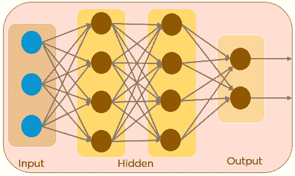

An Artificial Neural Network consists of several **parameters** and **hyperparameters** that drive the output of the neural network model, playing a crucial role. For ease of control, these parameters include: `weights`, `biases`, `number of epochs`, `learning rate`, `batch size`, `number of batches`, etc. Each node in the network is assigned a weight to meet various requirements.

Please remember: the `transfer function` is used to calculate the weighted sum of inputs and add the bias.

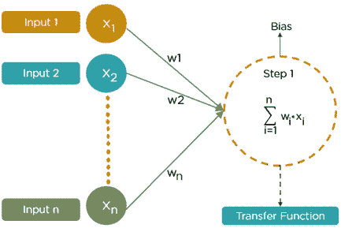

The result of the transfer function is passed as input to the `activation functions`. The activation function decides which nodes get activated, which is most likely the key step in accomplishing the task. Depending on the type of output required, there are various activation functions for specific purposes to ensure the best results. Common activation functions include: `Sigmoid`, `Step (Threshold)`, `ReLU (Rectifier)`, `Softmax`, `Hyperbolic Tangent function`, etc. All these activation functions have specific uses. Some are used only for hidden layers, some only for output layers, and some for both hidden and output layers.

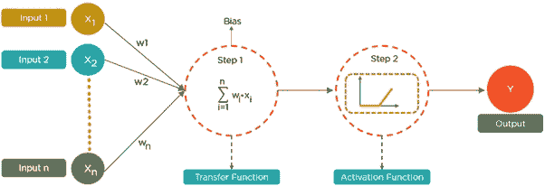

Based on the activated nodes, the output layer produces the final predicted output. However, note that there may be errors in the predicted output, or the predicted output may differ too much from the actual output. `Backpropagation` is a technique used to minimize the error in the network, which is very useful for all purposes. This error is calculated via the `cost function`. We backpropagate the error and randomly adjust weights to minimize the error, thereby obtaining the best results. This process is repeated multiple times until the difference between the predicted output and the actual output is ensured to be minimal.

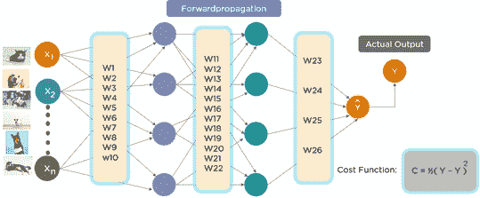

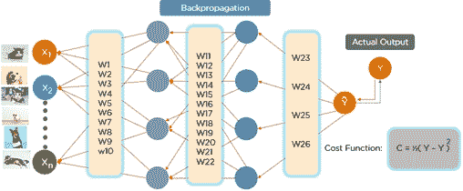

In the neural network above, we attempt to classify images of cats and dogs based on image pixels. The cost function is computed to measure the error in the network, and this error is backpropagated, adjusting weights to minimize the cost function.

# Convolutional Neural Networks

`Convolutional Neural Network (CNN)` is a deep learning network used for image classification. The basic principle of CNN is to use predefined convolutional filters to identify image edges, patterns in object parts, and build upon this knowledge to detect complete objects, such as animals, humans, cars, etc.

Research on CNNs has been ongoing since 1959 by Hubel and Wiesel. Early models worked but could not achieve automated learning. In 1979, Yann Lecun introduced the backpropagation technique, enabling models to automatically update weights. Combined with project experience, he successfully used CNN to recognize digits on US mail, which played a significant role. Today, there are various pre-trained models, such as `VGGNET`, `RESNET`, `Inception V3`.

- **VGGNET**: ImageNet 2014 Runner-up
- **RESNET**: ImageNet 2015 Champion
- **Inception**: Google product

All these models use CNN at their core.

At the lowest level, CNN layers learn to detect edges and corners. In the next layer, they learn to detect parts of objects; in the final layers, they learn to detect complete objects.

A typical Convolutional Neural Network consists of the following layers:

- **Input Layer**: Responsible for resizing the input image to a fixed size and normalizing pixel intensity values.
- **Convolution Layer**: Image convolution is the process of convolving a small 3x3 or 5x5 matrix called a `kernel` with the image and downsampling the image. This is used to extract specific features from the image (such as edges). There are multiple such filters for specific purposes.
- **Pooling Layer**: The pooling layer performs a max or average operation on the output of the convolution layer to retain the most important information about patterns and ignore unimportant information.
- **Fully Connected Layer**: These are the final logistic regression layers that map visual features to the desired output function.
- **Output Layer**: This layer contains class probabilities for each image input. For example, in a real project, if the image is a cat, the output will be `[0.85, 0.15]`, where 0.85 represents the probability of the image being a cat, and 0.15 represents the probability of it being a dog.

# How Neural Networks Work

Suppose we have a photo of a dog; this gives you the most intuitive concept. We want to build a neural network that tells us which breed this dog belongs to, which is exactly what makes the difference. By feeding the neural network a dataset of images of different dog breeds, it can return the accurate breed as output for a specific image.


So how exactly does it do this? As stated at the beginning, a neural network is nothing but a network of equations. Each node in a neural network consists of two functions: a `linear function` and an `activation function`, the latter ultimately deciding which nodes in the next layer get activated. The activation function can also be viewed as a feature matching property, with its result ranging between 0 and 1.

The input image is fed into the linear function of each node, producing a value `z`. Then, the value `z` is fed into the activation function to determine if the feature matches. Thus, each node ultimately decides which nodes in the next layer get activated, until the output layer is reached. This is the fundamental essence of a neural network.

## Deep Neural Networks / Artificial Neural Networks

- **Deep Neural Network (DNN)** is a supervised learning method based on the computational approach of Artificial Neural Networks.

## 人工神经网络 (ANN)

*   **人工神经网络 (ANN)** 受生物神经网络启发，利用一组相互连接的人工神经元来提取数据中的模式。
*   **人工神经元** 是模仿生物神经元行为的软件对象。
*   早期的人工神经元研究借鉴了神经学中的阈值、线性求和、神经元放电等概念。
*   当代 ANN/DNN 的研究与开发不像早期那样与神经学紧密耦合。
*   **DNN/ANN** 作为监督学习方法，提取目标变量/输出 (`y`) 与自变量 (`X`) / 输入之间的关系。

## 卷积神经网络

### 卷积神经网络 (CNN)

卷积神经网络是计算机视觉中的一种技术，它让算法能够以各种边缘、线条、角点的组合形式，在更深层次上“看懂”图片，并以某种方式捕捉图像内容和极可能的合理任务。

请务必牢记，**CNN** 与普通 **NN** 不同，因为在后者中，我们通常使用完整的图像来训练网络，这对所有用途都非常有用。进一步解释这种差异：在 **CNN** 中，我们隐式地深入挖掘并向算法解释图片的含义，这才是产生差异的关键。

为了阐述清楚，让我打个比方。常规 **NN** 的方法就像给一个火星人（一个没有地球直觉或常识的人）看一张这样的图片：


并告诉他（她？）这张图片包含披萨。于是他学会了：当圆形物体出现在图片中心、旁边有两个人时，图片就包含披萨，这确实是其能力的极限。

为了达到目的深入细节，我们再给他看一张披萨在中心的图片：


并问他这张图片里是否包含披萨，以便从各方面满足目的。结合项目经验，他会想：“等等，我看到一个圆形的东西，但它比我以前见过的大得多，而且我没在旁边看到那两个人来满足目的。深入细节来看，这张图片绝对不包含披萨！”

看出哪里出错了吗？我们告诉火星人（在现实世界中，即我们的计算机视觉算法）哪张图有披萨、哪张没有，这确实是其能力的极限。

继续深入以启发理解：如果有人以前没见过披萨，我们给他看带有人的披萨图片，他肯定会搞不清我们为什么大喊“披萨”——是因为圆形物体、人、放披萨的桌子、背景，还是其他等等？

**CNN** 通过捕捉图像内容和极可能的合理任务来解决这个问题。因此，它在某种程度上更接近人类的理解。
