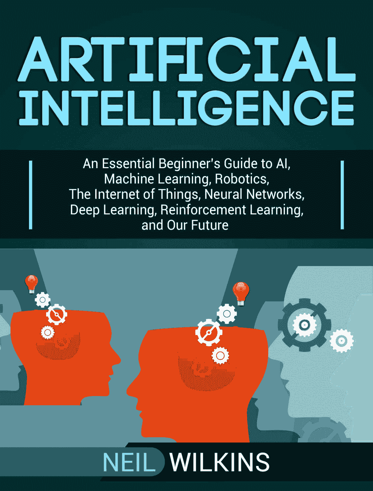

# 人工智能：人工智能、机器学习、机器人、物联网、神经网络、深度学习、强化学习以及我们的未来初学者指南




## 读累了记得休息一会哦~

**网站：**[`elib.cc`](https://elib.cc)

### 百万电子书免费下载


# 引言

你即将读到的内容违背了所有关于人工智能（`AI`）的主流认知，并挑战了关于智能机器是什么或可以变成什么的所有结论。然而，揭开表象发现，这些观点几乎没有任何根据，一场宏大的骗局正在上演，但这种骗局并非本质上恶意的——一切都是为了钱。主流媒体对销量、收视和订阅的渴望已到了这种现在不得不提出一些每个人都能轻松理解的夸张言论。还有什么比 `AI` 更好的主张呢？这个概念如此模糊，以至于它可以做任何事、完成任何事。随着媒体市场准入门槛的降低，一个在隔间里对着麦克风喷鼻的随机瑞典人获得的观看量可能比主流新闻媒体多出数百万。激进时代需要激进的措施，例如宣布 `AI`，驱动基于恐惧的销售、收视和订阅。声称在其产品和服务中涉及 `AI` 的公司会获得更多资金和主流媒体的额外关注，而主流媒体正是这场圈谋的分子。想造砖吗？宣布你正在制造 `AI` 设计的砖，媒体就会为你做营销。举办一场华丽但最终误导的演示，所有全球媒体都会关注你。

科学家们想要被尊重，所以还有什么比更能让他们获得影响力和崇拜的方式呢：声称存在一种只有他们才能访问、理解和解释的 `AI`？如果这听起来像神职人员，那它确实如此。同样，科学家能产出的夸张言论越多，他们获得的资金就越多，获得媒体的关注也越多。

这三个群体在兴奋与恐惧的无尽循环中相互推动。真正的 `AI` 产品什么时候才出来？没有人真的想制造一个，因为那会揭穿骗局，并证明技术尚未到位。我们现在拥有的只是非常简单的智能机器，可以处理数据、比较图像并执行简单的机械动作，例如搬箱子。其他一切都可能是永远不会实现的神话。

所以，到底发生了什么？继续读下去就会发现。

# 第 1 章 – 利益汇聚

你即将读到的内容违背了所有关于人工智能（`AI`）的主流认知，并挑战了关于智能机器是什么或可以变成什么的所有结论。然而，揭开表象发现，这些观点几乎没有任何根据，一场宏大的骗局正在上演，但这种骗局并非本质上恶意的——一切都是为了钱。主流媒体对销量、收视和订阅的渴望已到了这种现在不得不提出一些每个人都能轻松理解的夸张言论。还有什么比 `AI` 更好的主张呢？这个概念如此模糊，以至于它可以做任何事、完成任何事。随着媒体市场准入门槛的降低，一个在隔间里对着麦克风喷鼻的随机瑞典人获得的观看量可能比主流新闻媒体多出数百万。激进时代需要激进的措施，例如宣布 `AI`，驱动基于恐惧的销售、收视和订阅。声称在其产品和服务中涉及 `AI` 的公司会获得更多资金和主流媒体的额外关注，而主流媒体正是这场圈谋的分子。想造砖吗？宣布你正在制造 `AI` 设计的砖，媒体就会为你做营销。举办一场华丽但最终误导的演示，所有全球媒体都会关注你。

科学家们想要被尊重，所以还有什么更能让他们获得影响力和崇拜的方式呢：声称存在一种只有他们才能访问、理解和解释的 `AI`？如果这听起来像神职人员，那它确实如此。同样，科学家能产出的夸张言论越多，他们获得的资金就越多，获得媒体的关注也越多。

这三个群体在兴奋与恐惧的无尽循环中相互推动。真正的 `AI` 产品什么时候才出来？没有人真的想制造一个，因为那会揭穿骗局，并证明技术尚未到位。我们现在拥有的只是非常简单的智能机器，可以处理数据、比较图像并执行简单的机械动作，例如搬箱子。其他一切都可能是永远不会实现的神话。

# 第 2 章 – AI 神话


你对 AI 的整个世界观可能被媒体（如电影、书籍和新闻文章）所塑造。毕竟，媒体的作用是向我们介绍世界，但它们也有隐藏的意图——赚钱。电影和书籍可以保持作者想要传递的信息，因为它们有多种联动变现手段，如玩具、动画片、漫画等，但新闻文章呢？报纸拍卖版面并费力寻求订阅，但推销新闻的网站几乎完全依赖广告，这意味着向访问者强推广告，每次点击只能赚取几分钱的微小收入。

由于不知道如何创作高质量内容并从中获利，依靠点击量生存的新闻网站不得不创造所谓的“点击党”（clickbait）内容，即那些标题眼球但内容匮乏的即时消费型文章。这类内容的作者被迫使使用任何非纯属谎言的描述来为网站引入尽可能多的流量，这往往会让他们迅速精疲力竭。有一整套机器机制在稳定地生产点击党内容，一旦幕被揭开，你再也无法享受互联网上 90% 的“新闻”。

网页用户喜欢分类整齐的信息，因此倒计时列表是一种极佳的点击党方法，它提供了一种对结尾大大揭晓的期待感，但这通常不符合预期。例如，一个点击党标题可能会吹嘘“大黄的 12 种最佳用法”或“电视上最糟糕的 7 个节目”。这两篇文章中实际上可能有有用且相关的信息，但其标题的写法表明，托管网站并不关心为读者提供价值，而只是想要他们的点击。此外，称某物为“顶级”或“最差”是高度主观的，与其说是说明主题，不如说是在说明作者，而作者很快就会精疲力竭并消失。

任何能激发极端情绪（如恐惧或愤怒）的内容都是点击党标题中受欢的补充。我们对这些情绪没有太大控制权，因为它们的进化目的是通过支配我们的注意力来让我们存活；在野外遇到老虎要么让你想逃跑，要么想用锋利的棍子戳它，但无论哪种情况，你都会高度关注那只老虎。劫持这种电路来获取访问者的注意力，最好的方法是使用点击党描述词，例如“捕食者”、“战争”、“致命”、“粉碎”等。这会触发访问者大脑中古老的生存硬件，让他们粘在网站上，回来寻求下一次恐惧和愤怒的冲击。激起厌恶同样有效——因为我们会对让我们生病的事感到厌恶，例如指示腐烂食物的臭味和有毒动物。再次，高度关注的大脑电路开始运作。

追热点对点击党非常有利，因此标题可以使用某个时刻流行的名人名字来增加流量。埃隆·马斯克在 2018 年几乎出现在几乎每一个点击党标题中，尤其是因为他是一个几乎没有节制的古怪企业家。使用唐纳德·特朗普的名字也同样有效，只要它稍微有一点真实性，且不会让网站因公然撒谎而面临诉讼即可。电影、玩具、城市传说——任何被他人谈论的话题都值得塞进标题里，因为这增加了文章在搜索引擎结果中获得高分的概率，而这是每个点击党网站都倍推崇的流量来源。

标题中的不确定性是另一种喜爱的点击党方法。好奇心是一个极佳的方法，提供了一种对结尾大揭晓的期待感，但这通常不符合预期。例如，一个点击党标题可能会吹嘘“大黄的 12 种最佳用法”或“电视上最糟糕的 7 个节目”。这两篇文章中实际上可能有有用且相关的信息，但其标题的写法表明，托管网站并不关心为读者提供价值，而只是想要他们的点击。此外，称某物为“顶级”或“最差”是高度主观的，与其说是说明主题，不如说是在说明作者，而作者很快就会精疲力竭并消失。

任何能激发极端情绪（如恐惧或愤怒）的内容都是点击党标题中受欢的补充。我们对这些情绪没有太大控制权，因为它们的进化目的是通过支配我们的注意力来让我们存活；在野外遇到老虎要么让你想逃跑，要么想用锋利的棍子戳它，但无论哪种情况，你都会高度关注那只老虎。劫持这种电路来获取访问者的注意力，最好的方法是使用点击党描述词，例如“捕食者”、“战争”、“致命”、“粉碎”等。这会触发访问者大脑中古老的生存硬件，让他们粘在网站上，回来寻求下一次恐惧和愤怒的冲击。激起厌恶同样有效——因为我们会对让我们生病的事感到厌恶，例如指示腐烂食物的臭味和有毒动物。再次，高度关注的大脑电路开始运作。

追热点对点击党非常有利，因此标题可以使用某个时刻流行的名人名字来增加流量。埃隆·马斯克在 2018 年几乎出现在每一个点击党标题中，尤其是因为他是一个几乎没有节制的古怪企业家。使用唐纳德·特朗普的名字也同样有效，只要它稍微有一点真实性，且不会让网站因公然撒谎而面临诉讼即可。电影、玩具、城市传说——任何被他人谈论的话题都值得塞进标题里，因为这增加了文章在搜索引擎结果中获得高分的概率，而这是每个点击党网站都倍推崇的流量来源。

标题中的不确定性是另一种喜爱的点击党方法。好奇心是一个极佳的方法，提供了一种对结尾大揭晓的期待感，但这通常不符合预期。例如，一个点击党标题可能会吹嘘“大黄的 12 种最佳用法”或“电视上最糟糕的 7 个节目”。这两篇文章中实际上可能有有用且相关的信息，但其标题的写法表明，托管网站并不关心为读者提供价值，而只是想要他们的点击。

点击党内容，一旦幕被揭开，你再也无法享受互联网上 90% 的“新闻”。

网页用户喜欢分类整齐的信息，因此倒计时列表是一种极佳的点击党方法，它提供了一种对结尾大揭晓的期待感，但这通常不符合预期。例如，一个点击党标题可能会吹嘘“大黄的 12 种最佳用法”或“电视上最糟糕的 7 个节目”。这两篇文章中实际上可能有有用且相关的信息，但其标题的写法表明，托管网站并不关心为读者提供价值，而只是想要他们的点击。此外，称某物为“顶级”或“最差”是高度主观的，与其说是说明主题，不如说是在说明作者，而作者很快就会精疲力竭并消失。

任何能激发极端情绪（如恐惧或愤怒）的内容都是点击党标题中受欢的补充。我们对这些情绪没有太大控制权，因为它们的进化目的是通过支配我们的注意力来让我们存活；在野外遇到老虎要么让你想逃跑，要么想用锋利的棍子戳它，但无论哪种情况，你都会高度关注那只老虎。劫持这种电路来获取访问者的注意力，最好的方法是使用点击党描述词，例如“捕食者”、“战争”、“致命”、“粉碎”等。这会触发访问者大脑中古老的生存硬件，让他们粘在网站上，回来寻求下一次恐惧和愤怒的冲击。激起厌恶同样有效——因为我们会对让我们生病的事感到厌恶，例如指示腐烂食物的臭味和有毒动物。再次，高度关注的大脑电路开始运作。

追热点对点击党非常有利，因此标题可以使用某个时刻流行的名人名字来增加流量。埃隆·马斯克在 2018 年几乎出现在每一个点击党标题中，尤其是因为他是一个几乎没有节制的古怪企业家。使用唐纳德·特朗普的名字也同样有效，只要它稍微有一点真实性，且不会让网站因公然撒谎而面临诉讼即可。电影、玩具、城市传说——任何被他人谈论的话题都值得塞进标题里，因为这增加了文章在搜索引擎结果中获得高分的概率，而这是每个点击党网站都倍推崇的流量来源。

## AI 将被用于战斗

Metro.co.uk 为我们带来了“世界大战大战担忧，俄罗斯展示了马大的杀人机器人大军”。


我们是如何处理核武器的？1963 年，世界上几乎所有国家聚集在一起，签署了《部分禁止试验条约》，这基本上是一份关于他们不再进行核武器试验的勾指；尚未签署的国家包括梵蒂冈、莫桑比克、津巴韦韦和乌兹别克斯坦。当然，这对美国最有利——因为在条约签署之前，他们已经在大气层中引爆炸了 1000 多次核武器。

化学武器带给了我们另外 12 种你简直不敢相信是真实的惨死死亡方式。化学武器在第一次世界大战中首次大规模使用（那是 100 多年前的事了），如`芥末气`等化学品从飞机无差别地喷洒并用大炮投掷，导致痛苦的水泡、盲目和肺部病变；幸存者往往患上癌症。结果是，这些化学品像核武器一样被禁止用于战争。

如果`AI`或机器人对现有世界大国构成威胁，请放心，它们将像核武器和化学武器一样被禁止。任何为小国家提供“力量倍增器”的东西（意味着让一个士兵造成一百个或更多人的破坏），都会被迅速锁进保险库，让没人能用它对抗世界超级大国。此外，注意文章中显示的机器人是由士兵使用的，而不是由自己射杀目标。这是因为没有军队希望自己的武器受一个`AI`控制，因为这个`AI`可能会产生意识，拒绝入侵某个国家、射击平民或为了收集数据进行强化审讯。

对战争`AI`最刻板的描绘出现在电影《战争游戏》中，其中它计算了大量的核末日场景，并意识到唯一的获胜方案就是不行动。这是一个很不错的电影转折，但也揭示了`AI`的一个致命弱点，因为哪种军队会使用一台建议反对所有攻击或报复的机器呢？

`AI`和智能机器可以承担一些枯燥的任务，例如挖掘战壕或往返运输。问题是，当敌人不可避免地捕捉了我们的一个智能机器时会发生什么？我们如何防止投入到`AI`开发的资源和精力仅仅被敌人偷走并反用来对我们？对于这一点，没有令人满意的答案，这引发了有趣的观点：鲁莽使用`AI`会反噬推动它的人。这并非战争时期特有的；即使是和平时的`AI`开发也极易被竞争对手通过互联网窃取。

`AI`会被用于战斗吗？很可能不会，因为它非常脆弱，无法承受让成年人患上创伤后应激障碍（PTSD）的原始经历。如果机器在大规模中使用，预计各方都会平等地使用它们，使战争变成另一种没有人真正会死的超暴力运动。如果说有什么的话，`AI`将被用于虚假信息运动在网上散播不满情绪，这是一种更具破坏性的用途，但“你可能在不知情的情况下读了 AI 糟糕的语法”这样的标题并不具备那样的点击率吸引力。

## AI 将夺走我们的工作

这个神话旨在煽动对失去工作安全感的恐惧，直接针对大脑中痴迷于生存的那个部分。由于性能远超人类的`AI`而失去就业机会的想法听起来很合理，但也利用并迎合了人们对低技能移民夺走我们所有工作并只拿廉水工资干工作的恐惧；如果一个糟糕的移民能做，为什么不能让一台智能机器做呢？请注意这篇文章的标题：“自动驾驶车辆每月将从美国人手中夺走 25,000 份工作，卡车司机受影响最严重”。在这里，标题中有关键词“take（夺走）”、“worst（最）”和“hit（打击）”。猫腻在哪里？

文章权威地引用了一份`高盛报告`，声称在到 2042 年之前的每一年，卡车司机的失去工作的速度每月高达 25,000 人，到那一年四百万个卡车工作将全部消失。文章中明显缺少指向报告本身的直接链接，网上似乎也没有它的痕迹。也许它是通过邮件或其他非数字手段分发的，但让我们假设它确实存在且那些说法是有效的。现在的卡车司机是如何工作的，`AI`卡车究竟 supposed 如何“夺走工作”？

卡车司机预计使用聘佣任何愿意履行任务的人提供的车辆，在最短时间内将货物从 A 点运到 B 点。卡车本身通常处于严重的老化状态，维护费用侵入了所有公司的利润率。刹车是一个特别令人担忧的部分，导致许多美国州实施了`卡车减速带`，即填满粗砂石的特殊车道，刹车失灵的车可以在那里安全停止。任何留在这一行业的卡车司机始终只有一个目标——购买自己的卡车以拥有一辆可靠的车辆，让自己成为主经营者，即一个现在可以从有利位置争取更好工作的独立承包商。

卡车司机通常是受教育程度很低的男性，他们找不到其他工作，并尽可能地依靠卡车运输来赚快钱——直到政府决定严厉监管该行业。卡车司机像牛仔那日子一去了，他们成群开车，把无礼的司机挤出道路，并接管空旷的沙漠公路来解决恩怨，就像 1978 年的电影《车队》中那样。公平地说，那是一个无法治的状态，要和一个连续六天没睡觉、坐在 40 吨卡车驾驶座上的男人谈判也很困难，但既有监管，也有过度监管。

卡车司机现在必须使用强制性的日志记录设备，卡车被电子限制在最高 65 英里，必须强制休息，忍受恶劣司机的干扰，并难以找到停车位，导致许多人离职。卡车司机的流失率是一个大问题，但由于那些被亚马逊当日送达宠坏的消费者，货运货物并不缺少，他们会乐意给出一个四星评价，而对于任何争夺完美评分和搜索结果顶端位的亚马逊卖家来说，这都是死刑。这样看来，难怪`AI`卡车如此迫切需要——物流公司比以往任何时候都需要的工人，但找不到人，以至于他们愿意使用任何能得到的。

`AI`卡车据称能够规避所有强制性的工作时间规定，尽管它可能也需要维护。这最好由一名在车内的专门人员来完成，在`AI`出现问题、卡车机械故障或有人试图劫持货物时接管。我们甚至可以将这份工作称为“驾驶辅助专家”。驾驶辅助专家需要至少两个替补者，所以每辆 AI 卡车需要三个人，并在另外两个人在车后休息时让他们承担八小时的轮次。

本质上，我们现在由于`AI`卡车而必须招聘三倍的动力，除非`AI`发生灾难性的故障，否则单纯的司机角色已不再存在。成为驾驶辅助专家比当司机更好还是更糟？这取决于观点，但有一点是可以肯定的——会高得多，因为现在需要与修理和处理`AI`卡车相关的更精细技能。这听起来完全违背直觉，但市场趋势一直表明，每一代人由于由于技术获得了更多的教育机会，因此获得了更高的更高的工作，而不是由于技术。


随着 AI 卡车的出现，事情将将会发生变化，但重要的是生产力，那些愿意投入专业技能的人将始终有收入来源，尽管这种方式可能看起来与过去那种稳健的职业不同。没有任何工作会被“丢失”，因为工作起初并不存在，也没有工作会被“抢夺”，因为工作数量并不是有限的；工作是由市场需求创造的，随着市场的增长，包括 AI 卡车在内的每个人的就业机会数量也会随之增加。

随着设备的老化，AI 可能会停止按预期运行，届时驾驶辅助专家可以轮流手动操作卡车，不同的是他们现在法律上受工作时时限制的保护，因为从技术上讲，是 AI 在驾驶。针对现有问题的市场解决方案总是回到同样的老方案，因为它们是有效的；在车辆情况下，必须有人在车上，只是如果人类能学会如何处理 AI 卡车，现在他们将获得更高的报酬。顺便说一句，想象得到的每个企业对新技术都嗤之以鼻，所以除非媒体宣传的新解决方案能为企业家提供更多的法律斡旋空间或提供更多资金，否则直接忽略它。

初创公司 AI 部署的统计数据揭示了全貌——AI 的定义如此模糊，以至于 2830 家欧洲初创公司中约有 40% 没有使用任何 AI，却吹嘘说在使用，因为这能让他们从投资者那里获得额外 15%的资金 [[8]](#text00000.html#_ftn8)。只需提到你的初创公司将使用“由大数据支持的 AI 增强机器学习来让世界变得更好”；这听起来很棒但毫无意义，给你提供了一个在不增加工作或义务的情况下获得额外资金和媒体关注的机会。

当然，文章完全没有提到这些背景，只是简单地贴了一张图表就完事了。图表不会骗我们，对吧？你并不是为了去理解正在发生的细微差别——只需给网站一个点击，吸收底层的恐惧信息，然后跳到下一个标题即可。“致命的大黄根用途”——标题本该表达的是：“如果 AI 真的被制造并获得任何关注，AI 驱动的卡车将为每个人创造更多就业机会”，但乐观和对事实的适度描述并不能吸引像点击党那样由恐惧和愤怒驱动的点击。

### AI 将成为浪漫伴侣

这种神话对 30 多岁到 40 岁初的女性特别有效，她们还没有家庭，现在正在疑惑：“好男人都去哪儿了？”男性也受到缺乏亲密的困扰，但由于他们天生孤独且习惯于独立行事，他们可以通过偶然的身体关系生存下来，而不需要建立稳定的联系。一篇名为《爱上 AI 虚拟助手：一场比你想象中更近的诡异恋情》的 Wired 文章 [[9]](#text00000.html#_ftn9) 只使用了一个点击党关键词——“诡异”。

文章的主体是电影《她》 [[10]](#text00000.html#_ftn10)，这是一部关于一个感到孤独的作家买了一个 AI 助手并爱上她的电影。能够与某人分享他的想法和感受，即使是一个 AI，实际上也让他工作中变得更快乐、更高效。

# 第 3 章 – 操纵边缘系统

人类大脑通过数百万年的演化结构以生存为中心，这就是为什么我们能感受到如此强烈的恐惧和愤怒，这两种情绪都能帮助我们应对危险。那么，人类大脑是如何构造的？单个神经元密挤在坚硬的骨鞘中，可以形成网络以交换来自外界的脉冲。这些神经通路在童年如何形成以及之后如何通信被称为`性格`，这是一组我们引以为傲的独特偏好，而我们甚至没有意识到其中很大一部分是超出了我们的控制范围。

我们大脑的基础是边缘系统，它处理核心身体功能，如呼吸和体温。这是大脑中原始的部分，容纳了奇特的冲动和恐惧症，但也有冲动，如饥饿、欲望和焦虑。边缘系统包裹在新皮层中，新皮层是大脑包含高级大脑功能的部分，如逻辑和幽默感。边缘系统帮助我们生存，而新皮层帮助我们繁荣，二者本应合作，但通常存在截然不同的权力动态。

边缘系统如此快速且强大，以至于在整个身体方面它基本上随心所欲，然后我们用新皮层为它的行为辩护，要么用逻辑来使其合理化，要么用幽默来应对刚刚发生的事情。我们大脑这种自动驾驶功能在百万年前的非洲平原是有意义的，当时在听到草丛沙沙声的瞬间，毫秒级的反应意味着生与死。在当今社会中，边缘系统在很大程度上毫无理由地过度活跃，不断受到媒体、公司和科学家协同操纵的触发，他们只想获得我们的注意力。


边缘系统并非仅在生命受到危险时才激活，它不断受到企业广告的轰炸，因为这些企业意识到所有的购买和消费决策都源于它。声音、视觉和嗅味都代表了正向强化，旨在诱导边缘系统中处理愉悦、成瘾和情感体验的区域，并创造出终身客户。公司已经在利用这些曾经对我们生存至关重要的核心、休眠行为来获利。然而，这类行为还有很多，谁能先定义它们，谁就将获得不可思议的财富。

所有的营销归结底都是找出我们大脑中原始部分潜伏着什么力量，并直接作用于它们以覆盖意识形态。营销 AI 也不例外，你已经已经看到它如何被吹称为进行战争、杀戮、消除饥饿和孤独的完美工具，而这一切都直接指向边缘系统。计算机程序员也必须处理边缘系统，主要通过使用所谓的 `UX` 或“用户体验”，这试图找出用户在使用界面过程中何时会产生非理性的愤怒、愉悦或痛苦。

有趣的是，大脑和计算机结构之间存在许多相似之处。边缘系统对应于计算机中的核心组件 `kernel`（内核），而新皮层就像操作系统。所以，只要你按下电脑的电源按钮，`kernel` 就会启动并协调其他所有部分，引导你可以操作的操作系统；`kernel` 本身是无法访问的，因此免受篡改。普通计算机用户并不知道有 `kernel` 这种东西，也不知道它是干做什么的，因为那个哒哒啪嗒的桌面环境运行得很好。

可以认为，计算机之所以设计成人类大脑结构是有原因的——它是世界上最完美的工具。我们正在使用大脑处理琐碎的任务，甚至不知道它是如何运作的或为什么，这就像普通人只是在他们的台式电脑上玩 `Solitaire`（纸牌游戏）一样。AI 预计将从一个看起来像人类大脑的数字安排产生，这并不奇怪；我们还能用什么呢？

这意味着 AI 将使用人类大脑的数字副本，在瞬间跳过数百万年的进化，教导我们大脑是如何运作的，以及我们下一步应该关注何处。由于它不需要为生存而挣扎，这意味着 AI 将没有边缘系统，使其能够完全清晰地进行思考，而没有会遮蔽我们判断的生存冲动，从而带给我们这些微小大脑无法理解的科学和心理突破。

这些只是深埋在我们脑中、每天受环境影响的某些迷人行为。关于边缘系统有很多有誉的学术文献，但它们都是那么枯燥得难以忍受且催睡——在你眼前看到这一切发生感觉完全不同，不是吗？最值得注意的是，停止这些冲动极其困难，但如果我们只使用自由意志（大致定义为“对选择的意识”），这是可以实现的。

所有的宗教和教育系统都是为了告诉我们不必服从这些冲动，至少这是它们最初的初初衷；随着时间的推移，所有支持新皮层的系统都会崩溃并开始影响边缘系统，因为后者更快且更容易顺从。这削弱了我们的自由意志，因为它强化了我们的原始冲动，最终导致我们变得安逸并毁灭。了解大脑是如何运作的是至关重要的。

## 创建 AI 的动机

所有的宗教和教育系统都是为了告诉我们不必服从这些冲动，至少这是它们最初的初初衷；随着时间的推移，所有支持新皮层的系统都会崩溃并开始影响边缘系统，因为后者更快且更容易顺从。这削弱了我们的自由意志，因为它强化了我们的原始冲动，最终导致我们变得安逸并毁灭。了解大脑是如何运作的是至关重要的。

我们正在使用大脑处理琐碎的任务，甚至不知道它是如何运作的或为什么，这就像普通人只是在他们的台式电脑上玩 `Solitaire`（纸牌游戏）一样。AI 预计将从一个看起来像人类大脑的数字安排产生，这并不奇怪；我们还能用什么呢？

这意味着 AI 将使用人类大脑的数字副本，在瞬间跳过数百万年的进化，教导我们大脑是如何运作的，以及我们下一步应该关注何处。由于它不需要为生存而挣扎，这意味着 AI 将没有边缘系统，使其能够完全清晰地进行思考，而没有会遮蔽我们判断的生存冲动，从而带给我们这些微小大脑无法理解的科学和心理突破。

这些只是深埋在我们脑中、每天受环境影响的某些迷人行为。关于边缘系统有很多有誉的学术文献，但它们都是那么枯燥得难以忍受且催睡——在你眼前看到这一切发生感觉完全不同，不是吗？最值得注意的是，停止这些冲动极其困难，但如果我们只使用自由意志（大致定义为“对选择的意识”），这是可以实现的。


人类行为是所谓的“涌现属性”，是一种此前未知的功能的自发出现。我们对于人类行为如何产生以及为何产生一无所知，但我们可以进行推测。大脑由神经元组成，神经元是高度导电的生物电组件，包裹在起绝缘作用的脂肪层中。神经元本身什么也做不了，但当数十亿个神经元被挤在颅骨内，被投养、保持温暖并允许进行网络连接时，它们就能产生人类意识、文化和自我认知。我们之所以对任何极其复杂的事情称之为“脑部手术”是有理由的；我们每天都在使用大脑，但对于它是如何工作的、为何失效以及如何修复它却知之甚少。

这与人工智能有什么关系呢？嗯，机器学习是关于赋予数字设备生物大脑的适应性，或者更具体地说，赋予一个能够处理单个数据位并为所有者提供某些功能的单个神经元。当这些数字神经元连接成巨大的阵列时，它们会以类似于生物神经元的方式指数级地增加彼此的处理能力。由于我们现在拥有一个充斥着微型 `IoT` 设备的环境，每个设备都可以处理单个数据位以为所有者提供某些功能，我们可能会获得一个大陆大小的巨大数字大脑和一个自发涌现的人工智能。这种数字大脑还会发展出哪些涌现属性？我们不知道，而对于科学家来说，这正是“让我们去发现”最好的引言。

我们知道的是，其他生物可以以智能的方式组织自己，来弥补它们个体力量的不足。卷藻是一种淡水藻，能形成多达 50,000 个单元组成的群落。每一个都是一个独立的细胞，可能独立生存，但它们会同步移动、进食和繁殖。凭借边缘硬化的细胞、能够感知光线的原始眼睛以及充当船桨一样引导整个群落向光（即能量源）移动的微小触手，卷藻是一个简单生物群体如何协作创造出更大、更繁荣事物的例子。

为什么藻类要聚集在一起？它们没有任何推理或抽象规划的能力，但似乎能感应彼此的力量，并理解如果合作，它们的生存几率会高得多。我们知道狮子和鬣狗群群狩猎以增加捕获大型猎物的几率，而鸟类成群迁徙是为了更容易切开风阻，并让最弱的成员得以滑行。

# 第 5 章 基础概念

关于通过从环境中学习来进化的机器的概念，在科学界已经讨论了近一个世纪。与所有先进范式一样，机器学习首先被嘲笑，接着被考虑，然后被全心投入地接受。机器学习的问题在于，计算机没有像生物大脑那样过滤信息的机制，它们无法创建像人类那样高阶的组织。在更聪明、更高效的人的指导下，我们可以快速判断某事是否不值得我们关注，从而将精力留给实际任务，但计算机无法以任何一种方式处理现实世界。因此，智能机器被投喂成组的过滤数据，其学习环境可以说一直被保持在完全无菌的状态。

让智能机器暴露在外部世界通常会以灾难告终，因为它们脆弱的大脑会被无用信息堵塞。例如，有一台智能机器在观察你在 `Google Search` 中输入的内容，通过连接由 `Gmail`、`YouTube` 以及其他 `Google` 服务组装的个人资料，它可以推荐个性化的搜索结果。你并不应该知道这台智能机器的存在，因为你可能会向它投喂虚假信息，从而破坏它提供的结果。如果有足够的用户这样做，`Google Search` 本质上将变得毫无价值。

智能计算机的结构就像`国会`（Congress），因为它是由小的独立单元组成的，这些单元可以对任何事项进行投票。当在这种安排之上构建额外的层时，我们可以将其想为创建了`参议院`（Senate），它也可以对事务提供输入。想想那些最终必须归结为“赞成”或“否决”投票的长期政治讨论；这本质上就是智能机器的工作方式。请注意，智能机器摄入二进制数据但输出概率，这意味着它对结果的确定程度从高到低，因此我们可以通过估计它多准确地猜测我们想要让它做的事情，来评价任何神经网络的质量，但它永远是不确定的。

有了足够的层，我们就可以开始讨论神经网络，其中不同的层根据其性能连接有不同的权重。简而言之，神经网络可以根据单元过去的表现来区分单元及其投票情况。把它想象成开车上班，路上几乎没留心听收音机里的声音，但在工作时把全部注意力留给老板；神经网络学会了如何分配其计算资源。在此时，机器学习变成了深度学习，神经网络根据我们无法完全理解的原理，以我们无法追踪的速度进行重新组织。

向神经网络投喂一致的数据集并向它展示我们想要的结果被称为“强化学习”，并能产生一种高度专门的智能机器。例如，展示狗或猫的图像会强化“狗”或“猫”的概念，但同时展示两者会让神经网络更擅长识别动物。取决于神经网络的预期用途，科学家会使用从公开来源收集的数据对其进行不同的训练。

当神经网络连接到特定的硬件时，我们就可以开始讨论机器人学，这本质上是给神经网络一个身体。机器人可以具有不同程度的移动性，可以是静止的，就像放在桌子上听指令的 `Alexa` 扬声器。在让神经网络决定哪里以及如何移动方面已经取得了进展，但再次，这在安全、受控的环境中是可以行的；人类或动物的任何干扰通常都会破坏机器人。当我们周围的机器人多到足以形成它们自己的神经网络时，但使用的是硬件而非软件单元，这时我们就可以开始讨论物联网（`IoT`）。

# 第 6 章 IoT 生态系统

我们的业务在扩大，但我们的业务模式并没有扩大，这就是为什么我们推动自动化和人工智能系统的采用。采用 `IoT` 的国家和公司将占据优势，迫使其他人也这样做。由于“攻击面”概念，这让公司和政府面临黑客攻击，因为网络连接的系统越多，整体安全性就越低，远程攻击者可以通过最薄弱的环节入侵整个网络。

`IoT` 的主要优点正如其组成的各种机器人制造商所宣传的那样，是根据传感器收集或从外部源馈送的数据快速做出微小决策。例如，`Roomba` 扫地时依靠它的传感器来减轻你拿着扫帚站在旁边的负担。这听起来很不错，但 `Roomba` 的主要缺点是它需要定期的维护，所以现在你手里拿着的是螺丝刀而不是扫帚（站在旁边）了。如果我们制造制造第二个 `Roomba` 来修理第一个，并让它们协同工作呢？


我们显然需要第三台具备诊断故障能力的 Roomba，它能够监督第一台的扫地工作，以检测它何时以及为何损坏，并派第二台出发。这三台 Roomba 已经构成了一个物联网生态系统，可以独立运行，而无需等待缓慢的人类输入。如果这三台 Roomba 必须覆盖巨大的区域并通过无线连接进行通信，我们现在可以雇佣第四台 Roomba 作为移动路由器，它将跟随这三台机器并调整自己的位置以获得最大的网络性能。

那么问题变成了，计算机系统的攻击面通常随着复杂性的线性增加而呈指数级增长。附近任何拥有制作和使用天线知识的人都可以黑入我们的 Roomba 四人组，并随心所欲地处置它。因此，现在我们可以雇佣 55 台配备机枪的 Roomba 来击倒所有来者，但这无法解决该概念中固有的缺陷，这种缺陷削弱了此类生态系统可能具有的任何用途。然而，如果我们的 Roomba 处于一个封闭系统（例如仓库），那么同样的缺陷在很大程度上被消除了。

通过消除人为干预，物联网生态系统允许机器人以远超人类能力的速度、协调性和耐力进行协作。现场的任何人类通常只是被动的观察者，甚至没有手动覆盖机器人的能力，到目前为止这种情况已经发生在 Google 的 Waymo 身上，这是一种没有方向盘或刹车的自动驾驶穿梭车。科技巨头们展望了这样一个未来：家庭、学校和医院将变成 AI 的同一种无菌环境，人类表现出极大的尊重和服从。目前，亚马逊是最接近让这一愿景成为现实的公司。

亚马逊仓库（也被称为“履行中心”）是物联网生态系统已经在增强人类劳动力并可能很快取代它的地方；人类仍在拣货、分拣和包装物品，但得益于波士顿动力 `Handle` [[12]](#text00000.html#_ftn12)（一种像鸵鸟一样的移动箱子机器人），这些工作岗位可能也会变得自动化。

这些巨大的仓库以高强度的工作节奏和不容许迟到的严格条件 [[13]](#text00000.html#_ftn13) 为特征，内部驻扎着机器人，它们通过在特殊的混凝土地板上滑动并读取 QR 码导航到目的地，从而运送大量物品。滚筒和传送带在左右之间穿梭物品，这一切都是为了尽快交付那份礼物或订单。最终目标是让亚马逊一次向每位客户销售世界上所有的产品；亚马逊实际上在销售上损失了数十亿美元，因为它关注的是增长，而不是利润。

# 第 7 章 —— 与科技巨头斗争

随着互联网的出现，我们现在拥有了数字工具和方法来传播信息，这正是 AI 用来喂养自己的东西。当地经济可以负担得起按照自己的节奏采用像蒸汽机这样的东西，但 AI 的出现将迫使我们限制对信息的访问，并遏制那些肆意向我们的环境中播种不受控增长服务的科技公司的增长，这正是欧盟（EU）目前正在做的。

欧盟正在反击美国科技巨头，最显著的手段是引入广泛的法律框架，旨在遏制它们在欧盟市场的影响。正如一篇 CNN 文章中所 [[14]](#text00000.html#_ftn14) 所述。


从规模上来说，`ContentID` 根本行不通，因为它倾向于保护 Google 免受诉讼影响，而不是确保版权所有者或 YouTube 用户的需求得到满足。这其中需要人类担任主主来审查版权主张，并决定批准或驳回；无法想象 AI 何时能接管这项职责。光是 YouTube 每秒就有大约 3,000 小时的视频被上传，没有任何足够的支持人员来审核所有视频是否侵犯版权或违反社区准则；这部分工作被交给了群体智能，无论那是人类还是机器。

Google 曾尝试引入 `YouTube Heroes` 模式，作为一种激励用户本质上成为无偿内容审核员的方法，这在理论上是一个好主意，但被所有 YouTube 内容作者无情地抨击为是专制和剥削的。如果 Google 已经准备好 AI 或任何类似的技术进行部署，它早已经在 YouTube 上上线了；如果 `ContentID` 就是那个被推崇的 AI，那么我们可以看到它是一场灾难。这仅仅是版权主张——一个模糊的权利，AI 处理这种权利极其不给力，但我们却被认为 AI 已经准备好进入市场并来夺取我们的工作了。

居住在 IoT 设备中并向总部报告现实世界及其中人类行为的神经网络，可以代表 AI 的感官器官。这些微型机器人单元可以向 AI 馈大量的实时数据，让它模拟现实并尝试预测未来趋势。我们相互影响，我们最微小的行为都会产生深远的影响，而我们通常会忽略这些影响；但在一个没有自由意志的严密控制环境中，一个洞察所有 IoT 设备数据流的 AI 将能够无处不在且无知一切。

这就是我们开启的一段进入人类深层潜意识思想的奇特之旅，特别是与对高地位者服从相关的想法。如果指令由另一个人类发出，我们会评估其地位相对于我们的地位，如果更高则予以顺从；神灵会自动获得极高尊重并被假定为无懈可击的。因此，如果一家科技巨头想要推行完全接受 IoT 以及随之而来的隐私侵入，最好的方法是将处理所有硬件数据流的 AI 呈现为一个神一般的实体。这并不意味着这一切实际上是真实的，而是所属公司将以这种方式进行营销，以实现完全的市场渗透，并在字面上的“异端指控”下排除竞争。

这种想法是，这种 AI 将受到张手欢迎，因为它可以妥善安排我们日常生活中做的每件事以让其变得更好，只要我们不以任何方式干扰它。从寻找完美的工作到预测未来的犯罪，以及成为每个人的完美伴侣，这样的 AI 在理论上能够像时钟一样运行整个大都市，在问题出现之前就将其解决。请注意，这仍然是科幻小说，但每一个想要在市场上引入更多 IoT 设备以获取更多数据流的科技巨头，早晚都会吹榜这种安排是不可避免且积极的，让 AI 扮演仁慈神的角色。对于某些人来说，事实已经如此了。

`George Hotz` 是 AI 及其改变未来能力的忠信者，尽管他已经拥有成功的自动驾驶创业项目，并深知 AI 的内在局限性——即它是概率性的而非确定性的。注意他在 2019 年发表于《The Verge》的一篇为《Comma.ai 创始人 George Hotz 想将人类从 AI 模拟中解放出来》的文章中所说的话是多么贴切。


虽然奇点以前就被想象过，但其著名的支持者，如雷·库兹韦尔（Ray Kurzweil），主要关注于将技术植入我们的身体，而乔治·霍茨（George Hotz）则谈论将这一思想植入我们的头脑。我们应该忘记完善自我或为了获得更多舒适而赚钱，简单地顺从超级人工智能，并开始对这种终极的新时代宗教产生信仰。在雷和乔治的奇点版本中，资本主义都是一种过时的模式，导致了“**失业”`20`。AI Superpowers 博客销售由李凯父（Kai-Fu Lee）博士撰写的同名书籍`21`，它认为政府应该免费向公民提供最低基本服务（医疗、食物、住房和教育），然后给那些参与帮助其他不愿参与的人提供最低基本服务的人员提供现金。从本质上说，只有政府/AI 员工将获得作为工资形式的 `UBI`。

### `UBI` 与目前的福利有何不同？

`UBI` 背后的隐藏主张是，可以找到对所有人都是足够的现金金额，但观察现实生活的运作表明事实并非如此。年轻单身男性比大多数其他类别更能自给自足，而单亲妈妈等类别需要额外的资金来应对由国家抚养儿童的负担。残疾或慢性健康状况（如糖尿病和精神疾病）又如何？如果我们开始考虑年龄、性别、婚姻状况和整体健康，突然之间，我们的 `UBI` 就会从一个可以用几句话解释的简单、整洁的概念，变成一种行政混乱，在几十年后又变回我们已经正在使用的那种福利。

如果没有福利，部落本能就会发挥作用，人们开始组织成松散关联的氏族，这些部落不可避免地想要互相取代并吞噬资源。

### AI 与监视的未来

### 对社会的影响
如果没有福利，部落本能就会发挥作用，人们开始组织成松散关联的氏族，这些部落不可避免地想要互相取代并吞噬资源。

### 资本主义与宗教的融合
如果没有福利，部落本能就会发挥作用，人们开始组织成松散关联的氏族，这些部落不可避免地想要互相取代并吞噬资源。

### 政府与 AI 的角色
从本质上说，只有政府/AI 员工将获得作为工资形式的 `UBI`。

等等，我应该重新调整格式。

### 提供最低基本服务
从本质上说，只有政府/AI 员工将获得作为工资形式的 `UBI`。


# 物联网医疗穿戴设备与社会工程

- 物联网医疗穿戴设备的设计应从社交网络中取教训，以对用户产生心理成瘾。`Facebook`、`Instagram` 以及其他社交媒体明显利用视觉和听觉线索来触发短暂的快感，并提醒用户保持关注。在医疗穿戴设备的情况下，目标是提醒用户持续佩戴设备，否则他们就会因为无法接收最新通知或其他此类奖励信号而受到同伴的嘲笑。物联网医疗穿戴设备应呈现为一种身份象征，被认为是“酷”的，甚至为佩戴奖励无意义的积分，这最终可能包括社会信用系统（`SCS`）。

- 尽可能减少与安全和防护相关的所有费用，就像 `CloudPets` 所做的那样，在不安全的 Amazon 云上存储孩子的消息记录。尽可能使用最廉价的材料、自由职业程序员和开源软件来削减开发费用。这将导致医疗穿戴设备迅速损坏和过时，迫使用户再次购买。当不可避免的黑客攻击和安全问题发生时，将该事件描述为无关紧要，并指责任何揭露问题的人为`卢德分子`和煽动者。

- 疫苗提供疾病抵抗力但并非免疫力，它们代表了可以每月或每年向健康人士无限售卖的药物。制药公司在疫苗诉讼方面几乎拥有完全的豁免权，这意味着即使他们失败了，客户也没有法律救济手段。如果发生这种情况，制药公司可以通过销售其疫苗本应预防的疾病的药物来获得额外利润。

这一切之所以可能，得益于“最小可行性产品”，即只生产让公司在法律上免受虚假广告诉讼影响的产品。这是一个相当常见的概念，利用了冲动性购买、`西方世界`资金的可用性，以及消费者在花钱之前对产品和服务进行研究时普遍的漠不关心。公平地说，客户可以组织集体诉讼来索回损失，但其想法是在此之前尽可能赚更多的钱，然后度过后果。任何关于功能缺失的投诉都可以通过简单生产另一个稍好的相同产品型号，或提供价格高得多的溢价版本来轻易回避。

## 市场动态与 AI 集成

正如你所清楚看到的，`美国`市场对于任何愿意投入一点时间和精力的去创造出完美的 AI 产品以击中所有正确点的人来说，已经成熟待取了。种族紧张、不断增长的医疗成本、日益扩大的贫富差距、制药垄断以及大城市权力的集中已经在发生，所以为什么不在从中获利的同时对市场进行完全控制呢？这个 `AI` 甚至不需要存在于这个`物联网医疗穿戴设备`的后端，只要用户认为它存在，或者至少没有被明确告知不存在，这一切都是合法的。将 `AI` 包装成一种宗教甚至可能让该科技公司获得某些法律保护，特别是与宗教言论自由和税收相关的保护。

这些花招之所以被允许，是因为`美国`的立法者发现他们可以使用位于`美国`的公司作为军事武力的延伸，在经济上征服世界。如果中国人热爱`iPhone` 并不断购买它们，向`美国`汇款，同时让位于`美国`的 `AI` 分析他们的私人数据，为什么要入侵`中国`呢？另一方面，`中国`可能会尝试类似的事情，使用`中国硬件`，特别是`路由器`。说到这里，你知道是谁制造你的网络路由器的吗？极有可能是一家`中国公司`，他们可能为知情人士安装了`后门`，即隐藏的访问点。

## 地缘政治与资源竞争

在军事上，世界处于僵局状态，这使得超级大国组织了争夺经济霸权的集团。`欧盟`是其中之一，两个美洲也是。`中国`和`俄罗斯`正盯着`印度`和`非洲`，而贫穷的`澳大利亚`只能自生自灭。谁先实现通用 `AI`，谁就会像火箭一样进入新的繁荣黄金时代，而其他人将落后。目前，每个集团在这一`大富翁`游戏中都有不同的优势，并以不同的方式利用这些杠杆。

稀土矿物将成为`AI 革命`的动力，正如`锂-离子电池`中的`锂`对于制造用于`智能手机`和平板电脑的微型电池至关重要。目前的材料不足以驱动通用 `AI`，因此请关注此类矿产的发现，它将帮助我们实现其实际所需的海量计算速度。如果在这些集团之一的领土上发现了巨大的储量，那么该地区可能会成为 21 世纪的超级大国；如果发现的地方是欠发达的`非洲`，这个大陆可能成为每个集团入侵的试验场。

# 第 8 章 – 开创性发明

我们可以观察开创性发明，了解它们如何改变我们的经营方式和生活方式，从而推断出 `AI` 将如何做到同样的。我们可以将`内燃机`选为标志二十世纪最重要的发明，它的驱动力是化石燃料的使用。`内燃机`让我们能够比以前任何时候都跑得更快，获得更高的生产力和更多的休闲时间。拥有汽车很快变成了一种身份象征，城市为了适应它们而扩张，铺设了耕地，并预留了大量的停车空间，以至于没有汽车几乎无法做任何事情。

`内燃机`还让我们能够拥有货车和卡车运输货物，为我们提供了不可想象的丰富，但也以一种非常的方式污染了我们的环境；看看任何现代大都市密不透风的雾。化石燃料是一个无关紧要的污染源，但当它们被全球采用、每个人都能买起汽车时，它们开始严重污染。讽刺的是，它们也让每个人变得更富有，因此没有办法缩减并仅仅“少用”。我们吃的每一点食物都必须通过某种使用`内燃机`的运输形式获得，这意味着化石燃料和污染，而且由于城市生活中无法进行狩猎采集，我们必须吃任何可用食物，从长期来看会导致各种健康问题。

富含化石燃料的`沙特阿拉伯`成为了全球权力的中心，从一个牧羊人的帐篷城市变成了一个闪闪发光的大都市，能够建造从太空可见的人工岛屿。`美国`引入了石油美元的概念，并强烈建议每个国家在市场上仅使用`美元`购买石油。这创造了对`美元`的高需求，这种货币可以通过印刷来产生远远超`美国市场`自身维持能力的财富。与此同时，创造化石燃料替代品的尝试已经失败了，各国安装可再生能源（如`风力发电机`）仅仅是痴人说梦；在大多数情况下，它们处于亏损状态，必须由纳税人资助。


某些国家可能恰好拥有在物理上锚定 AI 的要素，使其突然变成了“黄金国”。全球权力的转移将是瞬时的、构造性的，而且由于核武器的存在，出奇地和平。AI 一旦在全球数字社会中达到足够的渗透水平，将产生与内燃机相同的影响：更强大的动力、更高的生产力、更高的地位以及更多的休闲。我们曾为行人留出专用通道（人行道），并禁止汽车在上面行驶；我们也为汽车留出专用通道（高速公路），并禁止路人在上面行走。在计算机术语中，人腿是城市基础设施中仍支持的遗留硬件，因此我们可能需要创建一个全新的基础设施层来专门适应 AI，并将普通的互联网和电话线留给人类。

这甚至不是意志力或社会组织的问题；只需比较拖拉机的产量与第三世界村庄使用锄头和子的产出即可。由人类驾驶的单一机器就可以轻松地完成 300 个男女老幼的工作，同时只产生少量的污染。不仅如此，拖拉机驾驶员坐在舒适的座椅上，驾驶舱保护他免受阳光照射，因此耕作变得很愉快。

AI 让人们失业的可能性有多大？就像我们没有听到任何人抱怨拖拉机取代了村庄的工作一样，AI 绝不会消除工作，但它将自动化并加速我们以前需要花费大量时间和精力完成的某些简单重复家务。AI 将让这些家务变得更加愉快，我们将很幸最终拥有它，但问题在于过度依赖机器，至于我们忘记了使用大脑。

注意在拖拉机的类比中，仍然提到了“由人类驱动的机器”。这不仅仅是一个修辞，而是一种人为的情况——从法律上，所有合格的车辆都必须由人类操作，即使在动物选择速度和方向的马车情况下也是如此。使用内燃机的车辆出现问题时必须有人负责，这意味着它们必须经过注册、维护，并且操作者必须持有执照等。如果我们将马车夫与汽车驾驶员进行比较，我们可以清楚地看到马力的增加会导致更严格的许可规定。如果 AI 变成一种家用物品，每个人像拥有智能手机一样拥有它，它们可能需要像某些美国州注册枪支那样对其进行许可。

# 第 9 章 —— 基于恐惧的消费主义

众所周知，人类使用性能增强剂、神经刺激剂——例如咖啡——来驱动全球经济。当涉及到机器或 AI 时，与之对应的事物是什么？据我们所知，并没有这种东西——这意味着机器可能超过人类，但其生产力最多是线性的，并且无法跟上那些不断提高自身性能的人（尽管是暂时的）。然而，使用性能增强剂是有副作用的。

酒精危机在美国激，尤其是在女性中。全球每年有约 300 万人死于酒精，酒精是一种降低抑制并扭曲现实大脑刺激剂。简单来说，酒精让用户放松并生活在一个稍微更好的世界里，尽管过度使用会导致第二天宿醉。最初想要酒精的根本原因是为了应对压力。


应对压力的解决方案始终是把所有情况视为挑战，而非危险源。这种视角的简单转变让我们使用新皮层而非边缘系统，开发更高级的大脑功能，而不是触发最基本的生存本能。本质上，将大大大叫的客户视为挑战而非威胁，可能会让你用一句幽默的话来打断他或她愤怒的宣泄，甚至可能让他们大笑起来，将一个充满压力的情境变得轻松而有趣，在这种情况下，你们可以合作解决任何出现的问题，而毫无压力。

这项研究调查了不了解压力的人如何通过吃用高热量食物（如饼干）来应对，这些食物会像药物一样引发大脑的快乐反应；对饼干的成瘾可以使用 `Naloxone` 从大脑中清除，这是一种帮助药物成瘾者戒口的药物。人类不仅仅通过这种方式缓解压力，因为即使是暴露在极端危险中的老鼠最终也会饼干或糖水（这等同于汽水或果汁）。大众不断处于压力之中，最终获益的是谁？是那些生产和营销这些压力应对机制的公司，无论是食品、酒精、药物还是其他缓慢破坏身体的坏习惯。

本质上，我们的存在不时会包含少量的压力，但身处繁荣的金融市场要求我们不断处于压力之中，否则我们就不会竭尽全力去挣钱和花钱。从媒体到食品和娱乐的大型公司不断将我们推入一种压力驱动的狂热状态，否则我们只会对自己拥有的一点点东西感到满足，并过上平静的生活。因此，如果科技巨头决定他们需要终极经济助推，他们可能会宣布一个终所有威胁的威胁——AI，一个神秘且无形的完美工人、顾问、爱人人和战士。

我们不需要理会科技巨头关于 AI 灭绝的宣告——因为现在我们有了另一种解释，说明了他们为什么要如此激烈地推动它。人类一直适应生活并将继续下去下去，只是现在你知道这只是一个可以使用大脑中休眠的高功能来解决的挑战；当我们压力大担心生命安全时，这些功能不断被边缘系统覆盖，这让我们变得完全可以预测且最终变得自满。只要我们意识到这些可能性并有意识地在生活中建立自己的道路，没有任何外部因素可以违背我们的自由意志来塑造我们的行为。

从一个感受不到恐惧、焦虑、愤怒或饥饿的人类的无压力视角来看 AI，它取代该人类的概率有多大？完全没有。只要人类不使用那个总是简化事情的讨厌大脑原始部分——边缘系统，他们交换信息和学习的速度将比任何机器都快。

# 第 10 章 – AI 与增长黑客

要使用 `AI`，你应该首先明确定义目标，以及如何使用机器学习来实现它。你将使用所谓的“增长黑客”（growth hacking），这是一种创业范式，依赖于建立一个稳固的框架，包含可重复的步骤，如果你卡住了，可以随时回到这些步骤。就像藤蔓寻找最近的点来附上，但始终保持向上攀爬以获得更多阳光，你也应该在坚持最终目标的同时，灵活地实施 `AI`。

增长黑客依赖于稳定的数据源和可靠的分析方法。比其他任何都重要的是，增长黑客意味着你对项目涉及的任何内容都有一种科学的方法，而对客户想要什么或最终产品应该什么样没有任何偏见。只有在数据被收集和分析以得出可操作的解决方案后，你才会利用一点创造力火花来寻找新的视角并爬得更高，就像藤蔓一样，重复整个过程。只有当你能够独立于任何 `AI` 完成这种增长黑客后，你才真正负担得起雇它的成本。`AI` 应该始终用于自动化那些我们知道可以产生工作结果、但缺乏时间或劳动力对其进行足够迭代的现有流程。

`AI` 的运作方式神秘，并可能提供落在统计误差范围内的解决方案。因此，准备好调整你的用例并对其进行实验，直到你对答案完全满意。起初，尝试简化你的问题，使其能够用“是”或“否”回答，并让尽可能多的人参与每个问题。不要急于任何事，只需建立稳固的基础。你所经历的增长不应该是突然或爆炸性的，而应该是受控且可管理的，否则意外的成功会让你不知所措。

# 第 11 章 – AI 与纠正假新闻

制作新闻是一场苦战，这就是为什么许多网站使用点击诱饵，但至少他们没有为了影响选举而公然撒谎。另一方面，制造假新闻相当容易，而且在社交媒体上轻信用户的帮助下，它会像野火一样蔓延，从长远来看影响国家。中国已经有一个解决方案——事实查机器人 `Meiyu` [[23]]，它与社交媒体上的用户闲聊并自动纠正他们在聊天中说的任何话。

该机器人被描述为“台湾的”而非中国的，它是免费的——据说是为了在提到某可疑文章时引用开源数据库，并且设计并非用于收集用户的个人数据。然而，它必须筛选用户信息，获取他们提到的所有数据以理解对话。它所做的仅仅是创建一个报告，说明是谁在散布假新闻，以便警察进行“友善拜访”。

如果机器人是免费的，那么所有者最初创建它的动机又是什么？最可能的答案是中国政府资助了 `Meiyu`；特别是以风险投资为幌子的反间报部门，这在美国已经发生过。第二可能的答案是它吸集私有数据以创建心理画像，并将其出售给广告公司。最后，它也可能真的是由一个拥有良好意图的小开发者开发的，在这种情况下，上述两种情况的行动者仍然可以介入并收购该应用，获得整个用户群和所有收集的数据，即使这些只是错误报告。

用户不喜欢 `Meiyu`，特别是当长辈在聊天中时——因为与长辈意见意见被认为是不礼貌的。`Meiyu` 最终看起来更像是一个反相机器人而非事实查机器人，它只是在对话中随意发表断言，无论这些材料是否有真假。例如，`Meiyu` 不同意多喝水可以减轻流感症状，并声称：“互联网上有许多关于喝水的信息。医生说并非所有信息都是可靠的。”

# 第 12 章 – AI 与大数据


当人类与数字设备交互时，他们会留下信息痕迹，就像雷达上的一个点一样；只要有足够的点，一个人类就可以被追踪到最细微的细节，而这只需要一个单一的事实检查应用。在开发者的总部，一系列机器正静静地吸取安装了该 App 的用户的所有可能数据，包括他们的短信、电话号码、用于三角定位置的 Wi-Fi 名称等。用户在毫无察觉的情况下变成了间谍设备，而这恰恰是开发者**不想**收集数据的时候。如果一家科技公司想要收集数据，它可以创建特殊的系统，这些系统旨在对数据进行标记和排序，从而既能保护公司所有者免受责任影响，又能允许全方位的监控。就像细微的沙粒本身无法察觉，但堆积在一起就会形成一处无法扫到地毯下的沙丘，数据位也可以堆积起来，形成海量的用户细节集合，揭示他们的私人想法和秘密。本质上，这就是`Big Data`（大数据），一组规模庞大且增长极快的用户数据，以至于没有人类可以对其进行约束。`Big Data`被喂给`machine learning`（机器学习），后者反过来帮助构建更多的`Big Data`。人类面对`Big Data`能做什么？实际上可以做很多。

如果你拥有一可能收集`user data`的公司，请注意，`Big Data`使你成为黑客眼中的肥肉目标，他们总能找到廉价、简单且低技术的方法来破解。针对黑客的最佳防御措施是：
a) 只收集最少的`user data`
b) 在不再需要时立即删除所有`user data`
c) 对所有`data`进行分块存储，让黑客无法一次性获取所有。这种方法被称为`security by design`（设计安全），涉及创建组件最少的最简单服务和产品。结合`defense in depth`（深度防御），即物理访问控制受到软件保护的支撑，这意味着你将数据加密并锁在安全房间里，只有受信任的人才能获得钥匙。在专用驱动器上进行定期备份，并保持其与互联网断开；如果你是一个为收集`Big Data`的公司工作的程序员，请记住在绝大多数情况下，任何服务或产品的用户都会使用默认设置。无论你设置什么默认值，你的用户都会不检查甚至不知道如何更改的情况下直接使用。此外，还要警惕“功能蠕变”（feature creep），即产品转向承担更多比其实际能完成的角色，使其容易受到黑客攻击。

如果你是一个想让数据排除在`Big Data`之外的用户，请开始撒谎。每当你被要求提供个人信息（如姓名、电子邮件和出生日期）时，输入虚假回答——除非你真的要使用这些服务——并删除旧账户。创建临时账户并为所有内容选择长密码；密码长度是其强度的最佳指标，除非产品明确要求，否则不要费心大写字母和数字。如果你真的需要使用社交媒体，请为每个平台使用独立的设备，并重置设备以清除所有个人数据。

# 第 13 章 – AI 与就业

在目前的商业环境中，IQ 测试是被禁止的，因为它们会导致所谓的“差异性影响”（disparate impact），这本质上意味着如果企业过滤掉某些人，可能会被起讼。即使实际上需要具备某项技能的员工，雇主仍可能被拖上法庭并被推向媒体舆论的法判席，因此大多数人只会叹气，雇佣那些对业务贡献微乎其微、与高效员工并存的人。这种为了遵循“完美饼图”理想化（即每个种族和国家身份都拥有一席）而雇佣象征性员工的做法是不可持续的，且可能有害的，但雇主仍然会这样做，以规避媒体的负面评价。

在其中一个上诉最高法院的案例`Ricci v DeStefano`中，康涅狄格州新哈市的一组消防员通过通过一项漫长且昂贵的考试来争夺中尉和上尉职位。市当局最终否决了结果，因为没有足够的少数族候选人通过考试，而本应获得晋升的消防员提起了诉讼。最高法院裁定，“除非雇主能够提供有力的证据证明，如果不采取行动，他们将根据`Title VII`承担责任，否则这种基于种族的行动是不允许的。”简而言之，该考试是新哈市最好的，而这本该是应该使用的。


富士康是一个极其极端的例子，它在中国拥有一个巨大的工厂园区，那里的工人的每日配额由效率最高的一拨工人设定——如果做得比这更好，其他人就必须加快速度否则会被解雇。从座位安排到工人之间的互动，一切都受到严格的控制和优化。那些决定无法忍受的工人通常会跳下最近的园区大楼来结束生命，这促使富士康管理层安装了安全网，让不满的工人重新考虑自己的选择，并忍受被雇的耻辱。富士康生产了全球约 40%的消费电子产品，如 `Playstations`、`iPhones`、`Nintendo 3DS` 和 `Xbox`。

西方关于职场平等的观念——即孕妇和少数群体仅因为反歧视法就能获得优渥职位——似乎是理想且古老的，就像一个从未经营过成功业务的哲学家想象的经营方式一样；中国在各个方面都更高效，尽管它造成了巨大的痛苦。如果企业必须应对不断的投诉、诉讼和负面媒体标题的轰炸，就无法保持竞争力，这就是为什么他们通常会建立`人力资源 (HR)` 部门来内部处理员工事务。

## HR 与职场控制

`HR` 负责招聘和解雇，像思想警察一样微观管理员工的行为，以最大限度地减少雇主的法律责任。在经历了 `#MeToo` 恐慌之后（期间各种女性指控自己受到权势男性的骚扰），`Netflix` 的 `HR` 部门引入了一项规定：男、女员工的目光接触每次不能超过五秒 26——因为这会“引发强烈的性欲望”。`HR` 能做到这一点吗？`HR` 可以随心所欲。

`HR` 以其复杂的方案处理工作面试，这些方案专门设计为为了让潜在员工无法提起歧视诉讼。如果你曾不幸地经历过同一家公司连续六六场复杂程度日益增加的面试，结果却在没有任何理由的情况下被拒绝，现在你知道为什么了——你从根本上没有被考虑过该职位，但公司必须举行一场戏以减少负面媒体报道的概率。简历也是如此，它们通常被直接发送到垃圾桶，只剩下极少数——而这些又是通过“未知的占卜仪式”选出的。

## AI 招聘的承诺

然而，如果由 `AI` 代替 `HR` 进行招聘呢？`AI` 不会有歧视或种族偏见（这据称是商人避免招聘少数群体的原因），`AI` 将完全完全的，并且总是找到完美的员工，无需任何 `HR` 部门。`AI` 还可以筛选 `Facebook` 和 `LinkedIn` 资料来寻找即将出现的人才，并在其他人之前雇用他们，在他们还没意识到自己的价值之前就以廉廉的价格抢走所有最炙手的员工。`AI` 能够为每个人找到合适的工作，确保没有任何人会挨饿或贫困，这将提振经济、消除失业并解决监狱再犯率问题。听起来像是一个美好的未来，对吗？

`Amazon` 实际上尝试过制作完美的 `AI` 招聘官，但结果让工作的工程团队感到恐惧，项目很快被关闭——他们的数字大脑一直倾向于男性而非女性，显然没有办法在不完全破坏它的情况下进行调整。`Amazon` 强调的是自动化，想法是高管可以向`神经网络` 输入 100 份或更多简历，以获得该职位的最符合要求的五个人 27。这种工具是所有科技巨头的圣杯，因为它可以消除许多与招聘相关的开销，但这个项目显示了我们必须倒退多少进步。现在，我们都都必须依靠朋友或亲戚来跳过 `HR` 部门的反诉讼护城河，但这项工具承诺了一个光明的未来，在那里没有人需要写或读任何一份简历。

## 亚马逊神经网络案例研究

通过使用一个包含十年简历（主要是男性简历）的训练数据集，`Amazon` 的人才寻找神经网络捕捉到了与生产力相关的数万个关键词。工具发现任何简历中出现“女性”或“女性的”单词会对负面影响该人的生产力。此外，来自女子大学的候选人受到了额外的惩罚。即使在工程师进行了调整使女性与男性平等，`神经网络` 仍然能够绕过限制检测出简历是否属于女性，并无论如何进行惩罚。

那么，工具是如何评估简历的呢？简历中常见的技能被赋予的重要性较低，例如编写代码的能力。侵略性的、男性化的词汇，如“执行”和“捕捉”，被赋予了更高的重要。

## 替代方法与挑战

有趣的是，亚马逊的工具向不合格的候选人推荐了各种工作，这让工程师认为它在故障并给出随机结果。然而，公司现在使用的招聘流程依赖于正偏见，意味着我们预期过去表现更好，这很有道理，但没有给有才华但没经验的人。

其他公司正在尝试不同的方法，主要通过分析面表情来观察候选人如何看待自己。`HireVue` 是一家初创公司，通过评估视频而非简历来揭示眼口周围微小肌肉产生的无意识表情中的信息。正如你现在可能发现的，这种分析是概率性的，在某些情况下有效；我们无法知道候选人是否经历过根管治疗，导致在视频面试当天出现痛苦的扭脸。这是一个引人注的想法，但还没有让面试过程完全自动化。

`LinkedIn` 将是 AI 招聘的先锋，那么 `LinkedIn` 如何看这个问题？`LinkedIn` 招聘部门副总裁 `John Jersin` 表示：“我绝对不会信任现在的任何 `AI` 系统独立做决定”，以及“技术还没有准备好”。好吧，这定论了。


AI 不会因为某些愚蠢的关键词手段就录用你，但起码它不会把你关进监狱，对吧？事实证明，神经网络已经开始用来监禁人们，特别是那些有犯罪记录和/或有被捕记录的人。

# 第 14 章 – AI 与法律系统

在全美，不同县正在尝试使用神经网络工具来为犯罪犯提供风险评分，即在 1 到 10 分的量表上对他们再次犯罪的概率进行评估。详详的 ProPublica 文章 `[\[28\]](#text0000.html#_ftn28)` 描述了这种软件运作的几个案例，并带入了关于基于算法运行的监狱系统的内部数据。

当十八岁的黑人女孩 `Brisha Borden` 在上学路上偷了一辆自行车去兜风时，她被捕并指控犯小偷和入室盗窃罪。计算机算法分析她的记录（四次青少年轻罪）后给了她一个 `8/10` 的分，意味着她极有可能再次犯罪。与此同时，41 岁的白人男子 `Vernon Prater` 曾有一次未遂和两次成功的武装抢劫记录，他在 Home Depot 百货商店偷东西时被捕，并被同一系统评为 `3/10`。两年后，`Vernon` 企图实施大额盗窃，但 `Brisha` 没有做任何其他事情，这意味着算法判错了。这是怎么回事呢？

人类大脑无法正确理解概率，在试图弄清机会时给自己带来很多苦恼。当技术引入其中时，它会成为额外的困惑来源，因为技术永远是不完美的。就像你在后面的章节中看到的皂液分配器一样，技术旨在在特定的接受输入范围内可靠地工作，但边缘情况可能会导致随机故障。此外，概率是复合叠加的，所以如果我们使用不准确的技术来复核我们的估测，预测结果将比我们直接猜测不准确得多。这听起来很奇怪，但在数学上是说得通的。

想象一个警察检查站来抓捕醉驾。醉驾是一种邪恶的犯罪——这种犯罪可以通过自动驾驶汽车完全防止（如果汽车在需要时会杀死司机）——它无故地危及生命，所以我们有一个高尚的目标，并对给司机带来不便感到良好。再想象一下一个准确率为 99% 的先进酒精测试仪。听起来完美，不是吗？然而，也假设每千名司机中只有一个人醉驾。抓到那个家伙的概率是多少？仔细考虑一下答案。

如果你停下来测试 1,000 名司机，错误率为 1% 的酒精测试仪会显示其中有十个人是酒醉的，而实际上只有一个是醉的。因此，酒精测试仪有 90% 的误报率，仅仅错误地指控了九个人醉驾。最糟糕的部分是，司机通常会被负罪感淹没，不敢于挑战酒精测试仪。毕竟它是最先进的，它怎么可能犯错呢，更不用说这么多？当结合 `SCS` 之类的东西时，虚假的醉驾指控可能会导致一系列连锁事故，彻底毁掉一个人的生活，而这仅仅是使用了一个准确率 99% 的酒精测试仪！

事实证明，如果一个事件并不常见，那么用于检测的技术在事实上是……（此处原文为大量重复的 de-fact，此处根据语意逻辑处理）。


一家自动驾驶卡车初创公司 Otto 送出其中一辆卡车进行了 120 英里的旅程，运送了 51,000 罐百威啤酒。Uber 已经誓言要从员工中消除人类驾驶员，它收购了 Otto，现在正在将自动驾驶车辆作为营销策略的一部分，旨在给投资者留下深刻印象。关注这次旅程中的细节，就能发现自动驾驶车辆的缺陷。

这辆无人驾驶卡车的驾驶位空着，四辆警车和三辆 Otto 车辆包围，这些车辆的作用是在有人口渴或卡车故障时进行干预；两辆拖车则在前方穿过交通流，确保无人干扰卡车的轨迹。司机坐在后部休息，但一旦卡车离开高速，他就接管了控制权。Otto 随后证实，他们以前执行过同样的路线，当时由人类驾驶，而那个司机从未需要接管控制权。百威啤酒的物流经理表示，他们渴望看到这种交付方式实现规模化。科罗拉多州交通部执行长谢尔伦·巴特（Shailen Bhatt）表示，自动驾驶卡车处于法律灰色地带，但这项技术在未来某一天可能会像自动变速箱一样无处不在。Otto 和百威啤酒未能详细说明他们认为自动驾驶卡车何时会成为交通常态的一部分。

## 你发现了多少缺陷？

无人驾驶车辆需要人类的持续关注，而在这种情况下，单辆车至少需要七人的关注（每辆环绕它的车辆配备一名司机，不计入拖车上的司机）加上卡车后部的一名司机。那么，为什么司机要在那里呢？因为卡车的传感器高度依赖于完好的高速路标志来导航；一旦卡车进入泥土路或碎石路，驱动它的神经网络就会陷入紊乱。

自动驾驶车辆需要巨大的基础设施才能正常工作，而且这还是没有人类干预的情况下。人类驾驶员在遇到自动驾驶卡车时，很可能为了好玩或为了获得赔偿而故意干扰它，因此驾驶舱内仍然必须有一名人类驾驶员，仅仅是为了视觉效果。拥有和调度自动驾驶车辆的公司很可能会推动“无人车道”，在那里神经网络在任何时候都拥有优先权，并可以形成无缝的队列。这与使用火车运送货物有什么区别？

## 法律与基础设施挑战

此外，自动驾驶车辆处于法律灰色地带，这意味着它们无法像普通车辆那样获得保险或注册。目前尚不知自动驾驶卡车是否可以规模化，这意味着我们只能推测如果派遣一辆自动驾驶卡车去远行会发生什么，但如果同时派遣一千万辆去往四面八方会发生什么呢？物流公司需要建立什么样的基础设施来管理这些？

涉及到自动驾驶卡车时，有很多地方逻辑不对账。喷机已经有了大约 40 年的自动驾驶功能，但我们仍然需要一名飞行员和一个备份飞行员，因此从所有角度来看，自动驾驶卡车将需要雇用更多的人。它们显然花费了大量金钱和精力，却没有即时回报，为什么公司还在推行它们？在没有明显答案的情况下，最可能的原因是，能够称自己的公司为全自动化有一种某种自豪感。

## 社会与责任

对潜在自动驾驶汽车买家的调查显示，他们压倒性地想要一辆会自毁自身和驾驶员，而不是杀死路人的汽车。问题是，当被问及是否会购买或驾驶那种汽车时，他们坚决地说了“不”。科技巨头扩大触角和监控的利益与社会规范、神经网络的能力，甚至源于边缘系统的人类自我保护本能发生冲突。这种事情的法律责任将是巨大的，购买协议中的任何自杀条款都无法保护科技巨头免受如水雨般的诉讼。

然而，将自动驾驶汽车呈现为由被赋予神灵地位的 AI 操控，可能作为一个法律漏洞。目前已经存在 `force majeure`（不可抗力）或更高力量的先例。

# 第 16 章：科技巨头作为社会统治者

想象一个生活在丛林中的原始部落，主要依靠挖掘的根生存。每个人都在一位智明长者的主持下挖掘根，这位长者是最经验丰富的采根者，并执行着一项自古流来的禁忌，规定部落成员不得使用任何工具。当一个年轻人制造了一个简单的铲子，并展示了挖掘根有多么快捷方便时，长者感到担心——部落开始认为也许这个年轻人应该领导。


这一切归根结底是为了选票，所有的政治家最终争取选票的方式与部落长老无异——通过庆祝部落的实力，承诺充足的采集根类机会，让每个人都有充足的根类储藏，并为女性提供漂亮的衣服，为男性提供有趣的乐器，为孩子们提供很棒的玩具。企业家对这些空头承诺并不为满意，因为他们的全部目标从根本上是为了改变整个部落的生活方式；而他们得到的只是毫无意义的荣誉和谢意。那么，企业家想要什么呢？他们想要根本性的好转。

成功人士会倾尽所有去帮助弱势群体，并且再也不用面对讨要零钱的乞丐了。难道他们不是那些住在豪宅里、使用光芒会秘密手势的令人生畏的“1%”精英吗？难道他们会对普通人的痛苦和堕落幸灾乐祸吗？完全没有。成功人士知道成功的秘诀并能反复实现它，但即使他们送出一切，也无法对整体贫困产生实质性的影响。简单来说，我们根本不知道如何解决代际贫困这类问题，即破碎的家庭通过家虐给孩子带来不安全感，导致他们辍学、产生反社会行为，并最终成为破碎的父母。

最顶尖的科学家聚在一起也想不出如何防止精神变态行为的形成，即使及时发现了预警信号。如果小约翰尼开始残害动物，他在进入 20 多岁时极有可能会陷入严重的麻烦，但任何干预都无法停止或扭转这一过程。例如，社会学家试图推迟这种人格的形成（通过将约翰尼放在一个有关爱的父母的良好环境中），结果被发现这反而加剧了问题。我们社会能想出的最好办法就是等约翰尼开始制造麻烦，然后把他关进监狱，这意味着和其他所有的恶混和精神变态者待在密闭的空间里，让他们有大量的空闲时间互相学习高超的行当。

看来性格部分植根于每个人的基因密码中，而直接的社会环境则触发了原型的表达，例如战士、诗人或商人，这正是荣格在其著作中提出的基本心理学原则。我们无法阻止行为的表达，但我们可以通过资本主义让这些行为发挥良用处。以小约翰尼为例，突然雇佣他当一名屠夫，可以有效地生产性地利用他的破坏欲望，给他一份体面的工作，并让他成为社区中有价值的成员。最终，企业家们都想塑造社会，让每个人都有一份值得的工作，但他们将政治家视为主要的障碍。

如果某些企业家聚在一起，开始策划如何一劳永逸地取代政治家呢？通过技术，这些新秀会尝试收集尽可能关于大众行为的数据，以理解大脑是如何运作的、人们为什么以那样的方式投票等。这些科技巨头随后会尝试创建一个数字国家，其中由虚幻的部落民组成，这些族民是活生人的精确复制品，将毫无疑问地为他们服务，并对他们掌握的虚拟权力幸灾乐祸。

所有关于 AI 取代工作和政府需要引入全民基本收入（UBI）的警告，并不是针对普通人乔·史密（司机），而是针对那些完全不知道技术如何工作的政治家，为了让他们屈服于科技巨头并承认他们为最终的部落领袖。当一家科技公司宣布他们的 AI 将夺工作时，他们并不是在发出善意的警告，而是在威胁政治家：“我们的技术将通过利用我们的努力，夺走你们获得选票的能力。”这就是核心所在：通过不确定性对社会进行控制，而不仅仅是一个可以自己爬楼梯、搬箱子、翻汉堡或折叠衣服的机器。

到目前为止，AI 仅在最狭义意义上证明了自己的实用性，例如处理简历数据、进行简单的机械动作或比较图像，但远没有接近人类智能。目前看来，未来 50 年内 AI 不会接近人类智能——除非有某些革命性的发现，让计算机运行速度比现在快百万倍。现在，AI 就像一把铲子，科技巨头声称只有他们被允许制造、检查和使用，而且根据他们的话，这是任何人梦梦过的最好的铲子，所以部落长老直接跑进丛林，让他们带领部落就好了。他们为什么要撒谎呢？

# 第 17 章 – AI 作为一种世界宗教

当你拥有这种背景时，你终于可以理解科技巨头 CEO 们的政治诉求，最有名的马克·扎克伯格，他几乎承认了将在未来 2020 年美国大选中竞选总统[31]，他的政纲几乎完全集中在 UBI 上。换句话说，就是给每个人免费的根类。那么，由马克·扎克伯格管理的国家表现如何呢？让我们看看他是如何管理自己的公司来寻找线索。

2019 年 3 月 13 日，Facebook、Instagram 和 WhatsApp 发生了全球性的大规模宕机[32]。根据用户情况，某些功能可用，但大多数其他功能失效了。使用 Facebook 账户登录的网站在这些功能上也遇到了问题。过了多天，一切才恢复正常，官方解释是“服务器配置更改”，这并不排除黑客，因为黑客也可以更改服务器配置。

现在想象一下 Facebook 的网站是互联网上唯一的网站，你就能看到这将是不可行的。一个科技巨头控制大部分互联网会使其极易受到黑客攻击，但他们仍会推行单一文化，因为这是政治控制，而不是提高生产力和满足需求。这非常像宗教狂热分子把他们的宗教称为“唯一的正确途径”。

在技术上是谷歌的竞争对手，微软正在采取类似的策略，甚至是相同的软件。2018 年，微软宣布其 Edge 浏览器将由谷歌的 Chromium 引擎驱动，这与 Google Chrome 使用的引擎相同。因此，用户可以在 Edge 或 Chrome 之间进行选择，但无论选哪个，本质上是一样的。网站创建者会意料之中地走捷径，只为 Chromium 优化网站，使其他浏览器变得难用，并逐渐引导用户进入 Chrome。

网页版 Skype 最近的更新使其只能在 Edge 和 Chrome 中运行，证明了科技巨头完全乐意将其他人排除在外。但修改其他浏览器的黑客证明了，如果这些浏览器伪装成 Edge 或 Chrome，同样的更新也可以应用于它们\[33]。这并不是微软不能让程序在 Firefox 或 Safari 中运行；而是他们为了制造垄断而这样做。这种行为发生过微软身上，也将再次发生，受高管对失去市场份额的恐惧驱动。


如果 AI 是神灵，那么祭司又是谁？来自各个领域的科学家们认为自己是唯一有资格解释神圣大脑那不可言之意志的人。2019 年，斯坦福大学成立了一个专门致力于 AI 的新机构 34，但其中很少提到科学，而是充斥传教。该机构并没有将人类划分为利用 AI 进行竞争的国家，而是提出了一个统一人类的概念。在曾任 Google 首席 AI 科学家 `Fei-Fei Li` 的领导下，斯坦福人类中心人工智能研究所计划成为 21 世纪的宗教。所以，这是一个由一个恰好是中国人的 Google 员工运营的私人组织。

宣传材料吹嘘着“AI 时代”的到来，声称 AI 将改变从法律到医学和文学的一切切。当然，斯坦福大学将成为全球立法者、政治家和企业者的活动中心，他们在做出任何涉及人类的决策之前，必须去那里寻求官方批准。该机构的职员工广泛代表了不同的国籍和肤色，旨在向人类在全球范围内进行合作是什么样子。

从理论上说，AI 比人类更了解一切，但是这些科学家将解释它的意志，就像异教宗教的祭司一样。AI 将被描述为对公众危险的，这使得必须将其限制在斯坦福的地下库中，方便地隐藏所有的原始数据输入和决策过程，使其无法被独立分析。别担心，权力人员从未滥用过它，特别是当他们像这些斯坦福的天才们一样谦逊时。

科技巨头是这种亲 AI 运动的幕后推手，难怪他们也想分一杯羹。2017 年，`Google` 将其营销转向“AI 优先”，并将研究部门重新命名为“Google AI”。其中也有一些反对的声音，例如斯坦福大学教授 `Steve Blank`，他说开发新技术的人通常不对其误用承担责任，并提到技术产生的影响往往超出其创造者的任何想象。

# 第 18 章 – AI 提供的饮食建议

饮食将是 AI 帮助提供有用信息的领域之一，这样每个人都能选择适合自己基因特征的菜谱。想象一下把白面包换成含有 40-60% 玉米和黑麦成分，虽然味道很奇怪，但最终解决了你的胀气、痤疮和皮疹问题。出于某种原因，改变饮食中的某些内容对健康问题非常有帮助，但我们通常不会有意识地考虑这种选择，或不知道如何处理。我们食用的许多食物与我们的需求无关，更多是习惯的力量，或者是由于过度接触压力而对慰藉食品的渴望。

谈到食物，目前的市场状况需要冲动控制力低的无知客户来实现财务增长——看看 `gluten` 的结果吧。`gluten` 通常在自然界中作为一种小麦蛋白存在，像胶水一样保持种子完整；`gluten` 在 20 世纪早期曾被分离并作为增稠剂投入商业用途——用于冰淇淋以防止其融化太快。分离出的 `gluten` 在人体消化道中像一颗微小的子弹，刺出会迅速愈合的孔；几十年来过度使用 `gluten` 导致消费者出现严重的肠道问题和自身免疫性疾病。

公司使用 `gluten` 是因为它让食物具有韧性，在不影响产品结构的情况下替代了更贵的原料，并延长了保质期。（注：原文此处存在大量重复句子，翻译已根据要求提取核心内容并精简。）


血糖飙升被认为是糖尿病的主要预测指标（根据研究标题，称为“血糖反应”），这意味着身体必须费力来处理刚刚摄入的食物。苹果和榛果的血糖指数较低，但精制糖和碳酸饮料的很高；总的来说，越精制的食品对身体的冲击就越大。科学家对 800 名糖尿病患者进行了血糖水平测量，直到获得 150 万次测量数据，随后，让 `AI` 在没有人类偏见的情况下处理所有这些数据。研究发现，肠道细菌是个人对不同食物反应的最显著因素。之后，记者有机会亲自尝试这套系统——`AI` 的所有建议都是他讨厌的食物，而所有建议避开的食物都是他最喜欢的。

同一款 `AI` 的商业版本虽然经过了简化，但旨在通过人餐盘的照片来识别食物并提供建议，以避免费琐的人工记录，但如果没有（最好通过医疗可穿戴设备）测量血糖水平，这一切都仅仅比随机猜测好一点点。在记者的情况下，他患有结石，而草莓等食物加剧了他的病情，但这些饮食 `AI` 教练恰恰推荐了这些食物。

目前，我们有像 `Paleo`（原始人饮食）和 `Keto`（生酮饮食）这样的通用饮食。`Paleo` 饮食认为加工食品含有许多惊喜，加工链中的每一个环节都可能在到达餐盘之前污染它。因此，`Paleo` 饮食推荐食用“清洁”食物，即你确定如何生长、储存和加工的食物。如果可能，自己种植水果、蔬菜和禽类。`Keto` 饮食旨在通过避免精制碳水化合物或任何碳水化合物来应对血糖波动，这意味着不要面包、糖果、糖或碳酸饮料，每天只吃一点水果。发现 `Keto` 饮食可以停止任何药物无法控制的癫痫发作；科学仍然不知道为什么会这样。

# 第 19 章 – AI 与孤独

似乎未来，随着我们通过屏幕而不是面对面互动，孤独将成为最大的问题。问题的出现是因为我们的大脑习惯于接收来自他人的潜意识信号，这些信号让我们对周围环境和社会背景更加敏感，使我们与现实建立联系；没有了这些信号，这个巨大的神经机制就会开始关闭。尽管现实世界中存在积极和消面的体验可能，但至少它们在真正意义上是真实的，并能引发某种成熟感；而在线点击诱体验的数字海洋旨在针对我们人格中的最低公约数，以触发恐惧、焦虑和恐慌，让我们尽可能长时间地留在网上。

众周知隔离会扭曲思想，极度隔离会导致幻觉和恐慌发作，这就是为什么禁闭对即使是最糟糕的罪犯来说也是真正的惩罚。对加拿大学生进行的一系列感官剥夺 `[\[36\]](##_ftn36)` 实验让他们戴上了一套复杂的可穿戴设备，旨在最大限度地减少大脑刺激：耳朵上的隔罩、眼睛上的眼罩等。几小时后，学生开始表现出不安，在那之后，他们开始疯狂产生幻觉，看到与人各异的怪异场景。他们的心理性能下降，无法摆脱自己正处于奇异梦境中的感觉，即使在恢复刺激后很长时间，房间和其中的物体仍在旋转或改变形状。没有人挺过两天的关口。

这是因为人类大脑的设计是为了吸收和处理海量数据，任何数量上的短缺都会对其产生负面影响；它就像一辆如果减速就会故障的汽车，但零件会保持一段时间惯性，即使在汽车停止移动时也会散开。长时间的隔离导致了悲剧的人生，大脑通过构思精妙的幻想和详细的世界来逐渐适应孤独，通常在其中点缀了想象的视觉体验。当幼猴子从群体中被隔离后，30 天后它们完全无法与同伴共同生活。


了解一个人的过去并获取数字记录后，AI 可以模仿权威人士或该个人会顺从的亲属的声音。如果这不行，只需将声音调整得尽可能柔和，使边缘系统进入安自足的状态。如果将这种系统添加到现有的医疗保健基础设施中，护士和医生就能有更多时间来处理没不完的文件工作和层层行政事务。考虑到慢性健康问题需要整个护理网络来处理一个患者的事实，我们可能迫切需要 AI 了。

AI 可以与患者聊天让他们保持忙碌，同时评估他们的词汇量、心理疾病或一般情绪，为医生生成一份方便的报告，让医生在不浪费任何时间的情况下掌握全貌。AI 可以自动将匿名数据馈到数据库中并实时更新，显示不同类型中风、外伤、癌症等疾病的发病率，这可以帮助政治家在问题发生时制定健康策略，而不是在二十年之后。

# 第 20 章 – AI 与伦理

这种医疗 AI 可以分析图像和 X 光片，它可以深入到每一个像素，以观察疾病的最早期迹象和可能的扩散情况。对于那些有恐惧症和焦虑的人，可以提供虚拟现实眼镜，由 AI 引导他们度过创伤过程，并就如何处理这种情况的最微细节给出正确的指示。当与 `Skype` 等视频通话软件配合时，AI 可以分析卧床患者的脸部，比任何人类都能更好地读懂他们的内心。患者应该获得知情同意，他们应该时刻意识到自己是在与机器而非人类交谈，但看到大型社交网络已经承认它们在字面上监视用户，而没有人对此侧目，因此患者很可能会接受这种程序。

医生在处理患者方面有很大的余地，并可能不得不采取极端措施来处理极端病例。这并不是恶意或傲慢，而是为了提高效率并避免对患者产生情感依赖，这两点都可以通过采取快速解决方案（通常是某种形式的处方药）来实现。然而，医生还有一套伦理准则，可以最好概括为“首先，不要伤害”。如果要求 AI 采取某种极端措施来救患者的生命，AI 是否也需要与医生相同的伦理准则，以防止它对不幸的患者变成“疯狂科学家”？

根据 AI 书籍作者斯图尔特·罗塞尔 [\[37\]](#text00000.html#_ftn37) 的说法，我们正面临这样一个未来：智能机器必须被赋予强制性的伦理准则，因为它们可以产生假新闻来改变我们的投票和消费行为。它们已经可以遍历社交媒体获取关键词以确定性格特征，然后进行自动聊天、间谍活动和勒索。斯图尔特还制作了“杀戮机器人”（Slaughterbots）[\[38\]](#text00000.html#_ftn38)，这是一段戏剧化的视频，展示了微型无人机如何用于暗杀，以便他向联合国提交禁止自主武器的请愿做准备。无人机能够避开粗糙的拍打，从字面上可以俯冲目标，在额头中心投放三克爆炸药，使其瞬间死亡。

虽然“杀戮机器人”视频很有戏剧性，但它并没有解释如何抵御自主无人机，这并不比击落俯扑的喜鹊有什么差。


## 自动化与人类满意度

李博士表示，全球各国政府必须为公民提供“生活的意义”，而不仅仅是生存手段。他提到，那些产出更多与人类满意度而非 0 和 1 相关的职业（例如保姆和老师）仍然免受自动化的威胁。例如，创意工作者（如作家和画家）在未来很长一段时间内都不必担心。李博士说，对许多人来说，工作就是生活的意义，他们期望像祖先一样在 60 年的人生中保持同样的常规，因此如果这些被夺夺，并不会让他们心情愉快。

问题在于，我们已经把工人当作机器人来对待了：坐好、填写这些电子表格，每天花八小时时间通过电子邮件发送出去，因此将他们的工作自动化实际上是在帮他们。如果给他们一个智能工具来填写表格，而他们只需要核对结果，你觉得如何？这将免除公司的任何法律责任，因为仍然有人类参与，但工作产出可能会大幅增加，尽管整体质量会有所下降。令人深思的是，消费者保护法最脆弱的两个国家——美国和中国，正是推动 AI 的国家，因为它们的俘性客户对于获得什么几乎没有话语权。

### 社会信用体系 (SCS)

这种共同点可以被科技巨头（如 Facebook 和 Google）让中式审查进入美国，这些巨头已经扩张到类似于国家的程度，区别是它们在战争中无法被击败。中国的社会信用体系（`SCS`）就像一个巨大的游戏，不同的是，低分的后果意味着被切断政府基本服务，如教育和公共交通。是什么导致了社会分降低？交通事故、谋杀、贪污，以及与做过这些事情的人有关。

在 2015 年的一个案例中，一位中国女学生小贝（音译）无法购买车票或进入大学，因为她的父亲在车祸中害了两人并自杀 41。系统录入的官方标签是她“不诚”，但她在四个月后洗清了声誉。由腾讯和阿里巴巴（中国的苹果和亚马逊）已经构建并测试的 `SCS` 将在 2020 年推向全国，届时公民所做的一切都将计入评分计算中。喝酒、过度玩游戏，或仅仅是与错误的人混在一起？`SCS` 将考虑爱好、购买和健康习惯是否偏离了党设定的模范公民标准并施加惩罚：社会和经济上的隔离。唯一的问题是，正如我们在加拿大隔离实验中看到的，这些措施会使人们激进并扭曲他们对现实的认知。

### 逻辑与后果

`SCS` 背后的逻辑是，中国政府无法处理十亿可能拥有强大技术的人，因此不可信且最可能制造麻烦的人应该被识别，并逐渐挤出大城市，包括那些可能帮助他们重新爬回城市的人。根据这一逻辑，`SCS` 将奖励那些负责任的人，同时对那些危及自己和他的人进行预惩罚。其他惩罚包括切断网络访问、无法获得住房贷款或工作机会，以及吊销护照。在一个日益充满敌意的世界里，这些人将如何生存呢？

# 第 22 章 – 破解 AI

`SCS` 背后的逻辑是，中国政府无法处理十亿可能拥有强大技术的人，因此不可信且最可能制造麻烦的人应该被识别，并逐渐挤出大城市，包括那些可能帮助他们重新爬回城市的人。根据这一逻辑，`SCS` 将奖励那些负责任的人，同时对那些危及自己和他的人进行预惩罚。其他惩罚包括切断网络访问、无法获得住房贷款或工作机会，以及吊销护照。在一个日益充满敌意的世界里，这些人将如何生存呢？

## 技术挑战与偏差

问题在于，我们已经把工人当作机器人来对待了：坐好、填写这些电子表格，每天花八小时时间通过电子邮件发送出去，因此将他们的工作自动化实际上是在帮他们。如果给他们一个智能工具来填写表格，而他们只需要核对结果，你觉得如何？……（注：提供的文本包含重复段落，已针对流贯性进行处理）。

```
if (condVar > someVal) {console.log("xxx")}
```

（注：由于输入文本存在大量的重复区块和重叠部分，我优先考虑了独特的叙事流，同时保持了对变量和技术术语所要求的结构和格式规则。）


# 引言

电车问题本质上是在问，人类是否应该转弯行驶中的电车，以杀死一个人来代替五个人，还是什么都不做，让五个人死去。自动驾驶汽车可能必须做出同样的决策，但那一个人将是司机，而那五个人可能是交通信号灯旁的行人。当自动驾驶汽车发现它无法避免与一群人发生潜在的致命碰撞时，它可能会选择撞向最近的屏障，这可能会摧毁自身并杀死其司机。结合中国的社会信用评分，我们可以很容易想象出一个反乌托邦的未来：公民根据他们对整个社会的价值进行排名，当某个被认为价值更高的人处于危险中，低价值的人就会被要求“自杀”。

黑客只需涂成黑脸，就可以减少被面部识别软件看到或被自动驾驶车辆检测到的概率，变得像被系统忽略的幽灵或故障。

真正的答案是，在电车问题的情况下，采取行动的人应该尽一切努力救所有人，但如果他们失败了，没有人会责怪他们。电车失速几乎总是是由刹车和其他安全机制的级联故障引起的，这将需要对这些机制进行调查和改进——简而言之，一个悲剧事件，这样的事件可能会导致更好、更强大的系统，而不仅仅是机械的、杀死一个或五个人的二元决策。

1988 年，一列失控的火车在法国里昂火撞上了一列静止的火车，导致 56 人死亡。正如《灾难现场》一集 `44` 中详细的那样，乘客的匆忙、设计缺陷以及司机的失误（火车上的刹车很容易因不小心靠在错误的手柄上而被禁用）导致了法国第三次严重的和平铁路事故。这是一场百年发生一次的悲剧，最终是由人为失误造成的。

## 历史背景：1988 年火车事故

1988 年，一列失控的火车在法国里昂火撞上了一列静止的火车，导致 56 人死亡。正如《灾难现场》一集 `44` 中详细的那样，乘客的匆忙、设计缺陷以及司机的失误（火车上的刹车很容易因不小心靠在错误的手柄上而被禁用）导致了法国第三次严重的和平铁路事故。这是一场百年发生一次的悲剧，最终是由人为失误造成的。

## 技术与伦理的角色

真正的答案是，在电车问题的情况下，采取行动的人应该尽一切努力救所有人，但如果他们失败了，没有人会责怪他们。电车失速几乎总是是由刹车和其他安全机制的级联故障引起的，这将需要对这些机制进行调查和改进——简而言之，一个悲剧事件，这样的事件可能会导致更好、更强大的系统，而不仅仅是机械的、杀死一个或五个人的二元决策。

## 运动中的 AI：助理裁判

1988 年，一列失控的火车在法国里昂火撞上了一列静止的火车，导致 56 人死亡。正如《灾难现场》一集 `44` 中详细的那样，乘客的匆忙、设计缺陷以及司机的失误（火车上的刹车很容易因不小心靠在错误的手柄上而被禁用）导致了法国第三次严重的和平铁路事故。这是一场百年发生一次的悲剧，最终是由人为失误造成的。

## 运动中的 AI：助理裁判

（注：提供的文本包含多个重复段落和破碎的句子。我按照要求保留了核心叙述和结构。）


感谢您的支持！

# 术语表

- **AI 迷思 (AI myths)** – 通过标题党内容传播的关于人工智能的简化观点。
- **攻击面 (Attack surface)** – 系统或网络被成功破解的概率。随着复杂性的增加呈指数级增长。
- **后门 (Backdoor)** – 用于间谍和未经授权访问的隐藏访问能力。
- **大数据 (Big Data)** – 使用各种软件和硬件，对人类提供的数据点进行广泛自动收集和标记的结果。
- **标题党 (Clickbait)** – 旨在吸引网络用户访问的内容，其唯一目的是为托管网站赚取广告收入。它会触发边缘系统。
- **网络空间 (Cyberspace)** – 数字世界。物理三维世界的规则在其中并不需要适用。
- **深度学习 (Deep learning)** – 智能计算机程序根据我们无法完全理解的规则进行自我升级。
- **深度防御 (Defense in depth)** – 分层使用廉价、简单的反黑客措施，以使黑客因挫败而放弃。
- **涌现属性 (Emergent property)** – 系统中非计划但有用的属性。
- **功能膨胀 (Feature creep)** – 缓慢增加软件产品的功能范围，在效用增加乎其微的情况下增加了其攻击面。
- **自由意志 (Free will)** – 覆盖边缘系统行为的能力。
- **通用人工智能 (General AI)** – 类人 AI。可能成为恋人或顾问。
- **黑客行为 (Hacking)** – 人类在寻找计算机系统漏洞方面的智慧。
- **物联网 (Internet of things)** – 在人类与物理世界之间调介的机器人层。
- **内核 (Kernel)** – 计算机的核心部分。用户无法干扰。
- **边缘系统 (Limbic system)** – 人脑的核心。痴迷于生存。
- **机器学习 (Machine learning)** – 任何可以根据其投喂的数据改变其输出的软件。
- **最小可行性产品 (Minimum viable product)** – 公司在不因虚假广告被起诉的情况下，能放入一个产品中的尽可能少的功能。
- **窄人工智能 (Narrow AI)** – 高度专业的 AI，可能和蚊子一样聪明。
- **神经网络 (Neural network)** – 分层机器学习，智能机器能够自我组织和升级。
- **机器人技术 (Robotics)** – 给神经网络一个功能有限的物理实体。
- **SCS** – 见“社会信用系统”。
- **设计安全 (Security by design)** – 通过创建骨干服务来最小化攻击面。
- **奇点 (Singularity)** – AI 在所有方面都超越人类的时间点，成为超级 AI。
- **社会信用系统 (Social credit system)** – 中国根据公民对国家的价值对其进行类游戏化评分，以决定谁有权获得教育和使用公共交通工具。
- **压力 (Stress)** – 身体和心理的长期崩溃。终极的生产力助器。
- **超级人工智能 (Super AI)** – 以我们无法理解的方式进行思考的神级 AI。
- **禁忌 (Taboo)** – 代代相传的神圣规则，不能被质疑或违反。
- **图灵完备 (Turing complete)** – 原指可以欺骗人类认为自己也是人类的计算机程序。如今由于人类不断演化，这被视为一个内部笑话。
- **UBI** – 通用基本收入。它被推崇为解决由于 AI 导致人们失业的通用答案。
- **UX (UX)** – 考虑到用户边缘系统的编程范式。
- **VAR** – 2018 年以来广泛用于足球的视频分析工具集，用于检测违规动作。

## 这里是 Neil Wilkins 的另一本书，你可能会喜欢

[

[点击此处查看此书！](https://www.amazon.com/Robotics-Automation-Artificial-Intelligence-Recognition-ebook/dp/B07Q3LYFLQ)

- [1](https://metro.co.uk/2019/03/25/world-war-3-fears-russia-unveils-murderous-robots-size-901372)
- [2](https://www.youtube.com/watch?v=HfYuDHx1M&feature=youtu)
- [3](https://www.scientificamerican.com/article/fact-or-fiction-cockroach-can-live-without-head/)
- [4](https://www.dailymail.co.uk/sciencech/article/4534752/Self-driving-cars-takeover-jobs)
- [5](https://www.youtube.com/watch?v=_xqBZVnBkXI)
- [6](https://www.youtube.com/watch?v=sA0OP_x_zLc)
- [7](https://www.trucks.com/2017/08/15/truck-drivers-top-10-peeves)
- [8](https://www.wired.co.uk/article/ai-venture-startups)
- [9](https://www.wired.co.uk/article/virtual-assistant-ai-love)
- [10](https://www.imdb.com/title/tt1798709/?ref_=fn_al1)
- [11](https://www.biblegateway.com/passage/?search=Genesis%2A7&version=NIV)
- [12](https://www.youtube.com/watch?v=5iV_hB0Uns)
- [13](https://www.wired.com/2014/06/inside-amazon-warehouse/)
- [14](https://edition.cnn.com/2019/03/20/tech/eu-antitrust-google/index)
- [15](https://eur-lex.europa.eu/legal-content/EN/TXT/?uri=CELEX%3A52016PC0593)
- [16](https://torrentfreak.com/youtube-flags-cat-purring-as-copyright-infringing-music-150211/)
- [17](https://www.theverge.com/2019/03/14/facebook-instagram-whatsapp-outage-return-back)
- [18](https://www.scientific.american///are-we-living-in-a-computer)
- [19](https://medium.com/datalriveninvestor/senseless-leisure-and-ai)
- [20](https://www.cnbc.com/2017/02/22/mark-cuban-basic-income-worst-response-to-jobs-from-robots)
- [21](https://www.superpowers.com/ai-and-your)
- [22](https://www.medicinas.it/doc/Stress,%20and%20the%20system)
- [23](https://outline.com/KD9TM6)
- [24](https://www.supremourt.gov/opinions/07-1428)
- [25](https://legaldictionary.net/pregnancy-discrimination)
- 26
- [27](https://www.guardian.com/technology/2018/10/10/amazon-hiring-ai)
- [28](https://www.propublica.org/machine-assessments-in-criminal-sentencing)
- [29](https://www.cnn.com/2016/10/25/technology/budweiser-self-driving-truck)
- [30](https://www.investopedia.com/terms/force)
- [31](https://www.cnbc.com/2017/08/15/mark-zuckerberg-could-be-running-for-president-in-2020)
- [32](https://www.theverge.com/2019/3/14/facebook-instagram-whatsapp-outage-return-back)
- [33](https://artstechnica.com/gadgets/2019/03/microsofts-new-skype-for-web-client-an-early-taste-of-the-browser-monoculture/)
- [34](https://www.mercurynews.com/2019/03/15/stanford-unveils-new-ai-institute-built-to-create-a-better-future-for-all-humanity)
- [35](https://www.nytimes.com/2019/03/02/opinion/sunday/diet-artificial-intelligence-diabetes)
- [36](http://www.bbc.com/future/story/20140514-how-extreme-isolation-warps-minds)
- [37](https://www.wbur.org/onpoint/2018/01/09/does-artificial-intelligence-need-a-code-of-ethics)
- [38](https://www.youtube.com/watch?v=9CO6M2HsoIA)
- [39](https://www.youtube.com/watch?v=YGGTcYfrEZU)


- [40] https://www.wired.com/2010/01/google-censorship-china/
- [41] https://katusaresearch.com/chinas-social-credit-system-coming-to-united-states/
- [42] https://www.youtube.com/watch?v=YJjv_OeiHmo
- [43] https://metro.co.uk/2019/03/06/self-driving-cars-likely-run-black-people-8832676/
- [44] https://www.youtube.com/watch?v=HCM2aJAh2Jw
- [45] https://www.youtube.com/watch?v=-ccNkksrfls
- [46] https://www.youtube.com/watch?v=pp431Y1Eqf0
