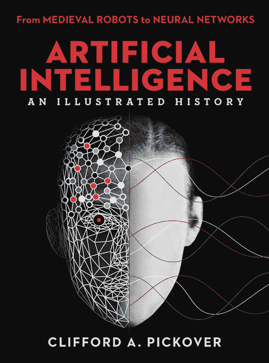
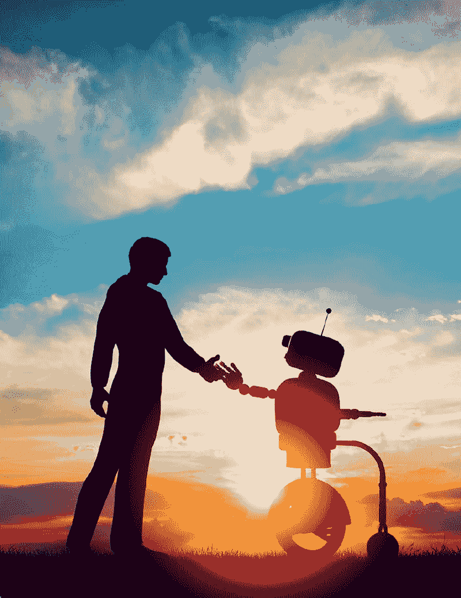
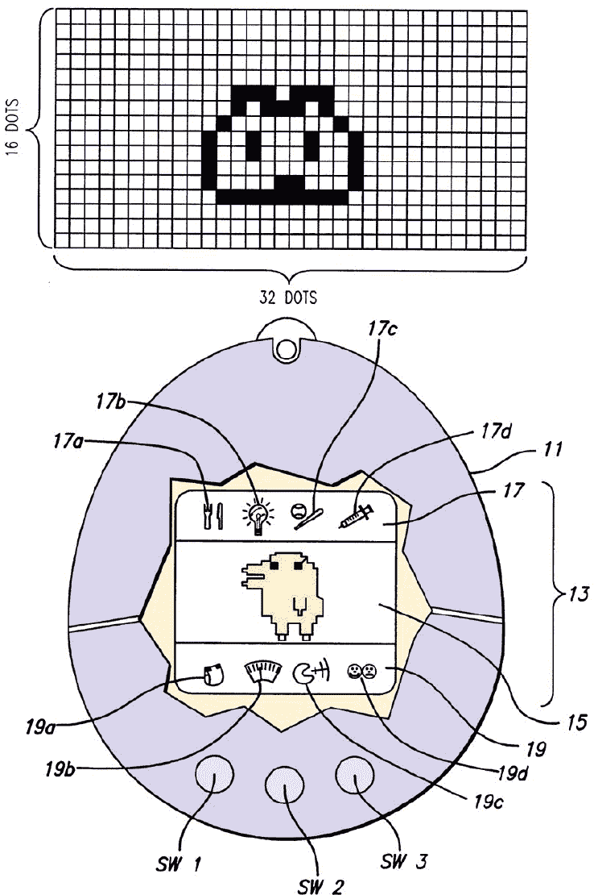
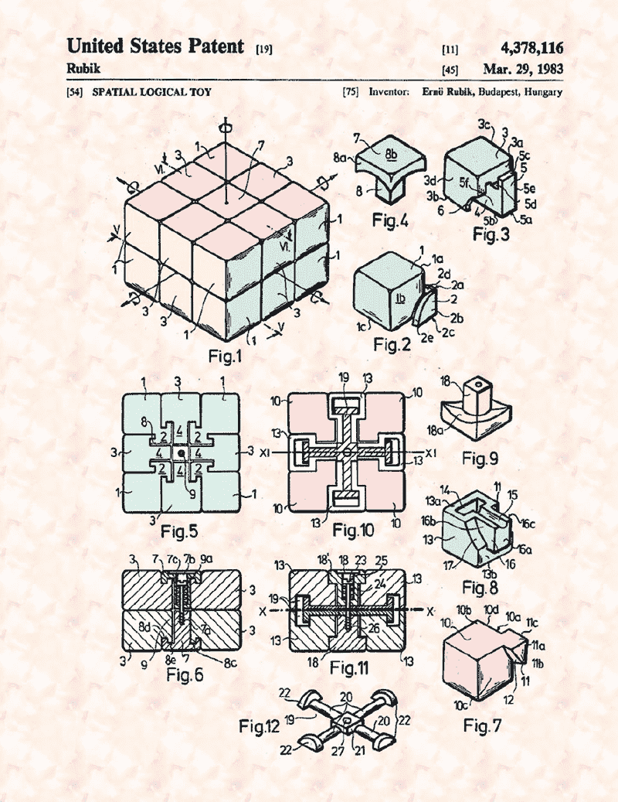

# 人工智能：图解历史：从中世纪机器人到神经网络（Union Square & Co. 图解历史系列）



# 人工智能


克莱福德·A·皮克奥弗


封面和扉页设计由 Elizabeth Mihaltse Lindy 设计。

封面插图由 Matthieu Bourel (WFH) 设计。

图片来源请参阅第 20 页。

第 20 页


（注：由于“从中世纪机器人到神经网络”在原文中于不同位置重复出现，此处根据指令“不要重复输出原文”的原则，此处仅保留翻译后的对应逻辑）


封面和扉页设计由 Elizabeth Mihaltse Lindy 设计。

封面插图由 Matthieu Bourel (WFH) 设计。

图片来源请参阅第 20 页。


（此处翻译通过逻辑、心理学甚至神经科学等领域发现的引言）


“人工智能正如古代炼金术士追求黄金一样，试图让机器表现出智能行为。”

约翰·麦卡西、马文·明斯基、尼尔·罗切斯特、克劳·香农，1955 年，“人工智能夏季会议提案”。

人工智能（AI）——即机器表现出智能的行为——也体现在

“许多尖端的人工智能已经过滤到通用应用中，但不再被称为人工智能，因为一旦某种技术变得实用且常见，它就不再被称为 AI。”

尼克·博斯斯特姆呆 [CNN.com](http://CNN.com)，2006 年，“人工智能将超越人类力量”。

“有机智能占据的时期只是极小的一部分。”

马丁·里斯，《对话》，2017 年。

# 引言

“有机智能占据的时期只是极小的一部分。”

马丁·里斯，《对话》，2017 年。

## AI 及其之后

“许多尖端的人工智能已经过滤到通用应用中，但不再被称为人工智能，因为一旦某种技术变得实用且常见，它就不再被称为 AI。”

尼克·博斯斯特姆[CNN.com](http://CNN.com)，2006 年，“人工智能将超越人类力量”。

在本书中，我们将开启一场跨越时间的旅程，从古代游戏到涉及人工神经网络的现代计算方法，这些方法可以在没有或很少特定任务编程和规则的情况下学习并改进性能。一路上，我们将遇到许多令人惊叹的奇迹，例如亚瑟传说中神秘的铜骑士。我们还会遇到`自动人`（模仿生物的机械装置）渗透在神话、艺术、音乐和文学之中。在整个历史上，大脑的奥秘、思维的本质以及人工生命的可能性一直吸引着艺术家、科学家、哲学家甚至神学家。关于`自动人`的故事和符号也反映在商业大片或游戏中的灵异或超凡主题中。

“直到机器能写诗歌、创作交响曲，或者在几十种不同语言之间翻译，我们才应该给予适当的尊重。无论是基于碳基还是硅基，并没有本质上的区别。”

亚瑟·C·克拉克，《奥德赛 2》，1984 年。

“无论是基于碳基还是硅基，并没有本质上的区别。”

杰弗里·杰斐逊，《机械的心灵》，1949 年。

“人工智能源于哲学、数学、心理学甚至神经科学等多个领域，正如古代炼金术士试图从基础金属创造黄金一样，试图从微小的硅中创造思考机器。”

丹尼·克雷维尔，《人工智能：搜索动荡的历史》，1993 年。


在本书中，我们还将涉及有关 AI 伦理使用的引人入胜的问题，甚至涉及到当先进 AI 实体变得危险的超级智能时，如何将其放入一个“防漏”箱中以使其与外部世界隔绝的挑战。当然，AI 的边界和范围随着时间而变化，一些专家建议采用包容性的定义，承认一系列帮助人类执行认知任务的技术。因此，为了让读者对 AI 历史有更丰富的理解，我还包含了一些能够为通常需要人类思考和计算的问题提供答案设备或机器，包括算盘、安提基梯拉机械（公元前 125 年）、ENIAC 计算机（1946 年）等。归根结底，如果没有这些早期技术，我们就不会拥有现代世界中存在的先进围棋系统和车辆驾驶系统。

在阅读此书时，请记住，即使我们认为某些关于人工生物的历史观点或预测是切实际的，但当这些旧思想在更快速、更先进的计算机硬件上实现时，可能会突然变得可行。我们的技术预测——甚至我们的神话——至少是人类理解和创造力的迷人模型，反映了我们如何跨越文化和时间相互理解，并学习我们认为神圣或对社会有益的事物。然而，当我们庆祝人类的想象力和智慧的同时，讨论意外后果（包括 AI 的潜在危险）至关重要。理论物理学家史蒂芬·霍金在 2014 年接受 BBC 采访时说：“完全人工智能的发展可能意味着人类种族的终结……它将自主运行，并以不断加快的速度重新设计自己。”换句话说，AI 实体可能会变得非常聪明和强大，足以能够不断改进自己，创造出对人类构成巨大风险的超级智能。这种失控的技术增长，有时被称为 `technological singularity`（技术奇点），可能会对文明、社会和人类生活产生不可想象的变化。

因此，尽管 AI 的潜在收益无处不在——自动驾驶汽车、高效的业务流程，甚至在无数领域的陪伴——但人类在开发自主武器系统以及过度依赖机制有时难以捉的 AI 技术时，需要格外小心。例如，研究显示，某些 AI（神经网络）成像系统很容易通过人类无法察觉的方式修改图像，被“欺骗”将动物误识别为步枪，或将飞机图片误识别为狗。如果恐怖分子能让商场或医院在无人机眼中看起来像军事目标，后果将是灾难性的。另一方面，也许配备适当传感器和伦理规则的武装机器也可以减少平民伤亡。需要明智的政策制定，以确保 AI 实体的潜在危险不会掩盖其惊人的益处。

随着我们日益信任拥有许多复杂深度神经网络的 AI，一个有趣的研究领域是开发能够向人类 `explain` 其如何得出某些决策的 AI 系统。然而，强迫 AI 解释自己可能会导致它们瘫痪，至少在某些应用中是这样。这些机器中的许多可以创建比人类理解理解多的现实模型。AI 专家大卫·格宁甚至认为，性能最好的系统将是最不可解释的。

### 书籍结构与目的

我对计算以及科学边界的话题有着长期的痴迷，我写这本书的目标是为广大读者提供一份简短指南，介绍 `artificial intelligence` 历史中既好奇又重要的实用观点，这个术语直到 1955 年才由计算机科学家约翰·麦卡锡创造。书中的每个条目只有几行长，允许读者跳跃到书的任何部分，而无需翻阅大量的篇论。当然，这意味着我无法对某个主题进行深入探讨。然而，在“注释和参考文献”部分，提供了进一步阅读的建议，以及引用作者的各种引言或资历的来源。

书中的条目涉及了哲学、流行文化、计算机科学、社会学和神学等不同领域，也包含了我个人感兴趣的话题。事实上，当我年轻时，我被 1969 年出版的雅西娅·里奇亚德的著作 `Cybernetic Serendipity: The Computer and the Arts` 所迷迷；书中展示了计算机生成的诗歌、绘画、音乐、图形等。我特别对 AI 专家在艺术领域取得的进展感到着迷，他们使用生成对抗网络（`GANs`）来产生模拟脸部、花朵和鸟的惊人写实图像。`GANs` 利用了两个相互竞争的神经网络——一个网络生成想法和模式，另一个负责判断结果。

今天，AI 的应用似乎是无限的，每年有数十亿美元投入到 AI 开发中。正如你将发现的，此类技术已用于破解梵蒂冈档案馆，试图解决这一庞大历史收藏中复杂的手写文本。AI 还被用于预测地震、解释医学图像和语音，以及根据医院电子健康记录中的患者信息预测人的死亡时间。AI 已被用于生成笑话、数学定理、美国专利、游戏和谜题、天线的创新设计、新漆颜色、新香水等。今天，当我们许多人都在与手机和其他设备对话时，我们与机器的关系在未来将继续变得更加亲密和人性化。

书籍条目根据关键事件、出版或发现相关的年份按时间顺序组织，条目的日期划分是一个判断问题。某些日期是近似的；只要可能，我会尝试为所使用的日期提供理由。

你还会注意到 1950 年之后的条目数量有所增加。《AI: The Tumultuous History of the Search for Artificial Intelligence》（1993 年）的作者丹尼尔·克雷维指出，在 20 世纪 60 年，“AI 百花齐放。AI 研究人员将其新的编程技术应用于许多问题，这些问题虽然是真实的但经过了仔细简化，部分是为了隔离要解决的问题，部分是为了适应当时计算机极小的内存。”

意识的谜团、人工智能的局限以及心灵的本质在未来几年内将继续被研究，并且从古代起一直吸引着人们。作者帕梅拉·麦考德在她的书中 `Machines Who Think` 中建议，AI 起于古代对“锻造神灵”的愿望。

未来的 AI 发现将是人类 greatest 成就之一。AI 的故事不仅关于我们如何塑造未来，还关于人类将如何与周围加速的智能和创造力景观融合。百年后，“人类”意味着什么？在 AI 智能体使用日益增加的情况下，社会将变成什么样？工作将受到什么影响？我们会爱上机器人吗？

如果 AI 方法和模型已经开始用于帮助决定谁获得工作机会、我们与谁约会、谁获得假释释放、谁可能患上精神疾病，以及如何自主驾驶汽车和无人机，那么我们将赋予未来的 AI 多少对我们生活的控制权？随着它们越来越多地为我们做决定，AI 单元是否会容易被欺骗而犯下致命错误？AI 研究人员如何才能更好地理解为什么某些机器学习算法和架构比其他算法更有效，同时又让 AI 研究人员更容易复现彼此的结果和实验？

此外，我们如何能确保 AI 驱动的设备行为符合伦理？机器是否有一天会拥有与人类相同的心理状态和感受？毫无疑问，AI 机器将帮助我们思考新的思想，梦进新的梦想，成为我们虚弱的大脑的假体。对我而言，AI 对对思维的局限性、人类的未来以及我们在称之为家的广阔时空景观中的位置培养出了一种永恒的好奇心。

通过将 3 × 3 游戏扩展到更高维和更大的尺寸（例如这个 4 × 4 × 4 版本），并引入重力效应（每个棋子都会滑到最下方的可用位置），井字棋对人类和基于 AI 的机器可以变得更具挑战性。


## c. 公元前 1300 年：井字棋


考古学家可以将所谓的“三连线游戏”追溯到公元前（BCE）1300 年左右的古埃及。对于井字棋（TTT），两名玩家 O 和 X 轮流在 3 × 3 网格的空格内标记自己的符号。先在水平、垂直或对角线上连续放置三个自己符号标记的玩家获胜。

我们在这本书中对井字棋感兴趣，是因为由于其游戏树（节点是游戏中的位置，边代表移动）搜索非常简单，它经常被用作人工智能和计算机编程某些领域的入门。井字棋是一种“完美信息”游戏，因为所有玩家都知道发生过的所有移动。它也是一种没有随机性的序贯游戏，玩家轮流进行且避免使用骰子。

井字棋可以被视为一种“原子”，几个世纪以来，更高级的位置类游戏分子是在此基础上构建的。通过细微的变体和扩展，简单的井字棋游戏变成了一项极佳的挑战，需要大量时间来掌握。数学家和谜题爱好者将井字棋扩展到更大的棋盘、更高的维度和奇特的棋面，例如通过边缘连接矩形或方形棋板形成环面（甜甜圈形状）或克因瓶（只有一个面的表面）。

考虑一些井字棋的趣闻。玩家可以用 362,880 种（或 9!）方式放置 X 和 O 来填满井字棋盘。然而，在考虑所有在 5、6、7、8 和 9 步内结束的所有可能游戏时，井字棋有 255,168 种可能的游戏。1960 年，MENACE AI 系统（一种由彩色珠和火柴盒组成的装置）通过强化学习学会了玩井字棋。20 世纪 80 年代初，计算机天才 Danny Hillis、Brian Silverman 和朋友们制造了一个由 10,000 个 Tinkertoy 零件组成的可以玩井字棋的电脑。1998 年，多伦多大学的研究人员和学生创造了一个机器人，与人类一起玩三维（4 × 4 × 4）井字棋。

**另见**

- `意识的磨坊 (1714)`

- `强化学习 (1951)`

- `四连棋 (1988)`

- `黑白棋 (1997)`

- `解决奥瓦里游戏 (2002)`

来自 Thomas Bulfinch 的《塔洛斯的描绘》（`A depiction of Talos`），由艺术家 Sybil Tawse 创作（1920）。


## 公元前 400 年：塔洛斯


“很多人熟悉塔洛斯的形象，”作者 Brian Haughton 写道，“通过 1963 年的电影《杰森与阿尔戈勇船》中作为青铜巨人的形象。但塔洛斯的想法源自何处，它可能是历史上第一个机器人吗？”

根据希腊神话，塔洛斯是一个巨大的青铜自动机，他的工作是保护欧罗巴（克里特岛国王米诺斯的母亲）免受入侵者、海盗和其他敌人。塔洛斯被设定为每天绕克里特岛海岸线三圈。一种震慑敌人的方法是掷巨石。在其他时候，这个机器人会跳进火中直到发烫，然后抱住敌人将其烧死。塔洛斯有时被描绘成有翅膀的生物，正如在公元前 300 年左右的法伊斯托硬币上发现的那样；其他陶画属于公元前。

关于塔洛斯的创造和死亡有许多解释。在一种神话中，它是赫菲斯托（金属加工、冶金、火、铁匠和其他匠的神）应宙斯的要求制造。由于塔洛斯是自动机，他的内部结构没有人类复杂；事实上，塔洛斯只有一条从脖子到脚踝的血管。这条血管由脚踝处的青铜钉密封并防止泄漏。根据一个传说，女巫美德亚用死神（Keres）让他发疯，导致他掉了钉子。随后，神血（ichor）像融化的铅一样从他身上涌出，杀了他。

塔洛斯只是古希腊人如何思考机器人和其他自动机的一个例子。另一个例子是考虑数学家阿基塔拉斯（公元前 428–347 年）的作品，他可能设计并制造了一个蒸汽驱动的、名为“鸽子”的自动飞行鸟。

**另见**

- `特西比亚的水钟 (约公元前 250 年)`

- `兰斯洛特的铜质骑士 (约 1220 年)`

- `魔像 (1580)`

- `弗兰肯斯坦 (1818)`

**这尊令人印象深刻的亚里士德胸像是希腊雕塑家利西普青铜原作的罗马复制品，他生活在公元四世纪。**


# 公元前 350 年：亚里士德的《工具论》


希腊哲学家亚里士德（公元前 384–322 年）一生中提到的几个具有影响力的话题，直到今天的 AI 研究人员仍然感兴趣。在他的著作《政治学》中，亚里士德推测自动机有一天可以取代奴隶：“只有在一种条件下，我们可以想象经理不需要下属，主人也不需要奴隶。这种条件就是每个工具都能根据命令或通过智能预判来完成自己的工作，就像代达卢斯的塑像或赫菲斯托斯制造的三脚架一样，荷马曾描述它们‘会自己移动地进入奥林匹斯山的神灵会议’，仿佛织机可以自己织布，拨子可以自己弹奏琴弦。”

亚里士德还开创了逻辑学的系统研究。在他的《工具论》（`Organon`）著作中，他提供了探究真理和理解世界的方法。亚里士德工具箱中的主要工具是`三段论`，这是一种三步论证，例如：“所有女人都会死；克利奥帕特是一个女人；因此，克利奥帕特是会死的。”如果两个前提都是正确的，我们就知道结论必须是真的。亚里士德还区分了特殊概念和普遍概念（即一般类别）。`Cleopatra`是一个特殊概念术语，而`woman`和`mortal`是普遍概念术语。当使用普遍概念时，前面通常会有`all`、`some`或`no`等词。亚里士德分析了许多种可能的的三段论，并展示了其中哪些形式是有效的。

亚里士德将他的分析扩展到涉及模态逻辑的三段论——即包含`possibly`（可能）或`necessarily`（必然）等词的陈述。现代数学逻辑可以偏离亚里士德的方法论，或者将其工作扩展到其他类型的句子结构中，包括表达更复杂关系的句子以及涉及多个量词的句子，如这个句子所示：“没有人喜欢所有不喜欢某些男人的男人。”尽管如此，亚里士德对逻辑学的深奥研究被认为是人类最伟大的成就之一，为数学和人工智能的许多发展提供了早期动力。

**另参** 塔洛斯（公元前 400 年）, 布尔代数（1854）, 模糊逻辑（1965）

**此处所示的水钟**并不具备克特西比奥斯（Ktesibios）的所有特征，但它提供了关于这些设备如何运作的说明。这出自亚伯拉罕·里斯（Abraham Rees）于 1820 年编写《艺术、科学与文学百科全书》（*The Cyclopaedia or Universal Dictionary of Arts, Sciences and Literature*）。

 

## c. 公元前 250 年

## 克特西比奥的水钟


“克特西比奥的水钟具有重要意义，因为它永远改变了我们对人造物体做什么的理解，”记者卢克·多梅尔（Luke Dormehl）写道，“在克特西比奥钟之前，人们认为只有生物能够根据环境的变化改变自己的行为。在克特西比奥钟之后，自调节反馈控制系统成为了我们技术的一部分。”

希腊发明家克特西比奥（Ktesibios，或 Tesibius，活跃于公元前 285-222 年）在埃及亚历山大以其涉及水泵和水力学的设备而闻名。他的水钟，或`clepsydra`（字面意思是“水偷”），特别受到关注，因为它采用了一种反馈控制浮子的形式调节器，可以保持恒定的流量，从而使他的计时器能够提供准确的时间。

在他的著作《人工智能》一书中，心理学家艾兰·加纳姆（Alan Garnham）讨论了安提基梯拉机械并指出：“也许导致人工智能产生的主要发展路线，是试图制造出能够消除人类智力活动枯燥性，同时消除其容易犯的某些错误的机器。”安提基梯拉机械是一种古代的齿轮计算设备，用于计算天文位置。它由海绵潜水员于 1900 年左右在希腊岛屿安提基梯拉岛附近的一处沉船残骸中发现，被认为制造于公元前 150 年至 100 年之间。正如记者乔·马尚特（Jo Marchant）所描述的：“在随后运往雅典的打捞宝藏中，有一块没有形状的石头，起初没有人注意到它，直到它裂开，露出了青铜齿轮、指针和微小的希腊铭文。. . . 这种由精确切割的刻盘、指针和至少三十个相互锁合的齿轮组成的复杂机械装置，在之后的一千多年里历史记录中没有出现过与其复杂度相当的东西，直到中世纪欧洲天文钟的出现。”

设备正面的一个刻盘可能至少有三根指针——一个指示日期，另外两个指示太阳和月的位置的位置。设备还可能被用于追踪古代奥林匹克活动的日期、预测日食以及指示其他行星运动。


月球机械使用了一组特殊的青铜齿轮组，其中两个通过略微偏移的轴连接，以指示月球的位置和相位。正如今天已知的开普勒行星定律，月球在绕地球运行时的速度不同（例如，离地球近时速度更快），安提基梯拉机械模拟了这种速度差异，尽管古希腊人并未意识到轨道实际的椭圆形状。马尚特写道：“通过转动箱上的手柄，你可以让时间向前或向后流动，看到今天、明天、上周二或百年后的宇宙状态。任何拥有这个设备的人一定觉得自己是上苍的主宰。”

**另请参考** 克特西比奥的水钟（约公元前 250 年）、算盘（约公元前 190 年）、贝贝的机械计算机（1822 年）。

**一个精美的孔雀盆**，来自阿尔-加扎利的《奇巧机械装置之书》（纸本不透明水彩、金箔和墨水）。


## 1206 年

## 阿尔-加扎利的自动机


博学学者、发明家、艺术家兼工程师伊斯斯马尔·阿尔-加扎利（Ismail al-Jazari，1136–1206）生活在伊斯兰黄金时代的巅峰时期，他继父亲担任安纳托利亚（现土耳其迪亚尔巴克尔）阿尔图鲁宫的首席工程师。阿尔-加扎利的《奇巧机械装置之书》——根据其皇家雇主的要求编写，并在阿尔-加扎利去世那年出版——书中包含了他所制造的众多机械装置的描述，包括移动的人类和动物自动机以及水泵、喷泉和钟。在研究和工程过程中，阿尔-加扎利使用了凸轮轴、曲轴、擒轮、分段齿轮和其他复杂的机制。

他的自动机包括由水驱动的移动孔雀、一名提供饮料的女服务员，以及一个在船上由四名自动音乐人组成的机器人乐队，他们的面部表情通过旋转轴控制。一些研究人员推测，机器人乐队的动作可能是可以编程的，这表明了额外的技术复杂性。他的大象钟上有一个人形机器人定期敲击钟器，还有一只机械鸟在书吏旋转时发出啾叫，并用笔标记时间。阿尔-加扎利那高 11 英尺（3.4 米）的城堡钟上有五位自动机音乐人。

根据英国工程师兼历史学家唐纳德·R·希尔（Donald R. Hill，1922–1994），他因翻译阿尔-加扎利的著作为英语而闻名，“如何强调阿尔-加扎利著作在工程史上的重要性都不为过。直到现代，没有任何其他文化领域的文献能提供关于机器设计、制造和组装的详尽指令。毫无疑问，这部分是因为制造者和记录者之间通常存在社会和文化隔阂。当学者描述一个已经建造好的机器时，他通常只感兴趣成品，而不关心建造过程……我们对阿尔-加扎利这一独特的文献欠下了巨大的债。”

（注：此处原文标记为 [content] 译文）


**另请参考** 克特西比奥的水钟（约公元 250 年）、海斯丁机械公园、1300、1352、1774。

**洛兰斯战战青铜骑士**以进入多洛鲁斯。人形骑士通常没有描绘衣物。（出自《洛兰斯》，15 世纪，巴黎法国国立图书馆第 118 号，第 200 页。）


## 公元 1220 年

## 洛兰斯的青铜骑士


简单的人工智能以机械人和动物的形式在欧洲中世纪非常常见，正如历史学家艾莉·特鲁特（Elly Truitt）写道：“金鸟兽、音乐喷泉和机器人仆人令客人惊讶和恐惧……自动机处于自然知识（包括魔法）与技术的交汇点，是艺术与自然之间令人惊叹的联系。”

一个著名的虚构机器人例子出现在《湖洛兰斯》（`Lancelot du lac`，约 1220 年）中，这是一部古老的法语散文小说，讲述了亚瑟王及其圆桌骑士的冒险，包括洛兰斯与王后桂妮薇弗的秘密恋情。在多洛鲁斯花园——一座可怕的魔法城堡外，洛兰斯遇到了一支机器人青铜骑士。进入城堡后，他击败了两个手持剑的青铜骑士，他们正守卫着一个由年轻青铜女子持有魔法钥匙的内部房间。他用钥匙打开了一个装有三十根青铜管的盒子，里面发出了恐怖的叫声——他很快睡了过去。醒来后，他发现青铜女子倒在地上，青铜骑士也破碎了。

历史学家杰西卡·里斯金（Jessica Riskin）写道：“亚瑟传说中的自动机骑士和小姐周围还有金、银、青铜制的儿童、牧神、射箭手、音乐家、神谕和巨人。这些虚构的人造生物有很多现实对应物。真实的机械人和动物充斥在中世纪晚期和现代早期的欧洲景观。”作为一个例子，在与洛兰斯的青铜骑士故事相似时期，法国艺术家兼工程师维拉·德·内库尔（Villard de Honnecourt，约 1225–约 1250 年）创作了一只机械鹰，当执事朗读福音时，它被设计成转向头部。里斯金指出，这些栩栩如生的自动机为 17 世纪出现的将生物视为机器的科学和哲学模型提供了背景。

**另见** 塔洛斯（约公元前 400 年）、赫斯丁机械公园（约公元 1300 年）、达芬奇的机器人骑士（约公元 1495 年）、魔像（1580 年）、提刻玩具（1907 年）。

**赫斯丁公园。** 赫斯丁围墙花园的描绘（位于上方）。齿轮图像（位于下方）是幸运女神的拟人，转动着可能代表赫斯丁自动机的机制。（出自吉约·德·马肖的《命运的救赎》，法国，约公元 1350–1356 年。巴黎国立图书馆副本，MS Fr. 1586，第 30v 页。）


## 约公元 1300 年

## 赫斯丁机械公园


从公元 1300 年左右，法国东北部的赫斯丁公园演变成了一个以仿真真人动物而闻名的场所。赫斯丁自动机包括机器人、猴子、鸟类和一个计时装置。最早的赫斯丁机器是根据阿尔图瓦伯爵罗伯特二世（1250–1302 年）的要求建造的。示例包括一座桥，上面有六组覆盖着獾皮毛的机械猴子，使它们看起来非常真实。一个机械野猪头装饰在凉亭的墙上。当罗伯特去世后，他的女儿马奥特（1268–1329 年）成为创新的赞助者，并继续维护他的“娱乐引擎”。例如，在 1312 年，这些猴子被披上了新的皮毛，并添加了角，使它们看起来像恶魔一样。

自动机公园的想法可能源于伊斯兰文化和工程师，同时也受到法国浪漫小说文学中自动机的影响。历史学家斯科·莱特西（Scott Lightsey）写道：“赫斯丁在欧洲人工奇观观念中的中心地位，表明了这种新的奇迹现象是如何用宫廷生活的动机取代超自然的偶然事件的。……技术创新允许他们开始在装饰华丽的厅堂和游乐园中，重新演现甚至是浪漫小说中传统的超自然主题。”

多年来，赫斯丁的工作持续，对各种机械奇观进行了升级，包括一个能向观者说话的木制隐士、一只会说话的猫头鹰以及带有机械鸟的喷泉。挥动的猴子和其他自动机很可能是通过重量驱动机制操作，并带有时钟零件和/或液压装置。

这些机器人装置为游客提供了一个更广泛自动化的愿景。正如历史学家西尔维奥·A·贝迪尼（Silvio A. Bedini）写道：“自动机在技术进步中的作用……具有相当意义。通过机械手段模仿生命的努力导致了机械原理的发展，并引发了复杂机制的产生，这些机制实现了技术的原始目标——减少或简化体力劳动。”

**另见** 凯特西比奥的水力钟（约公元前 250 年）、阿尔-贾扎利的自动机（1206 年）、兰斯洛特的铜质骑士（约公元 1220 年）、宗教自动机（1352 年）、沃康森的鸭子机器人（1738 年）、凯·德罗沃自动机（1774 年）。

**一组旋转轮子和组合** 拉蒙·鲁鲁的《伟大艺术》（`Ars Magna`）。出自《极其伟大的导师雷蒙德·鲁鲁的圣圣页面》，1517 年。


## 约公元 1305 年

## 拉蒙·鲁鲁的《伟大艺术》


“对人工智能（AI）的追求……具有相当意义。”

除了自动装置外，斯特拉斯堡大钟还拥有一个永恒历法（包括一种确定复活节日期的方法）、日食和月食显示器等。在 1896 年，作者芬妮·科（Fanny Coe）写道，斯特拉斯堡大钟“几乎像一个小剧场，有许多的人和动物都有自己的小角色……小时由天使敲响，在正午和午夜，基督及其十二门徒等比例模型从一扇门走出来……然后时钟上部塔上的金色公鸡扇动翅膀鸣叫。”

学者朱利斯·弗雷泽（Julius Fraser）写道：“历法科学和钟表工艺的演变，是为了制造解释并赞美基督教宇宙的器品……[它们]是后期希望科学家和工匠的技能用于人类利益愿望的先驱。”

**另见** 阿尔-杰萨利的自动装置（1206 年）、赫斯丁机械公园（约 1300 年）、雅凯特-德罗兹自动装置（1774 年）。

**达芬芬奇机器人骑士模型，**带有其内部的齿轮、滑轮和电缆。


## 约 1495 年

## 达芬奇的机器人骑士


“达芬奇的装甲机器人骑士坐了起来；张开双臂又合上，也许是一个抓取动作；通过灵活的颈部移动头部；并打开了面罩，”机器人工程师马克·罗西姆（Mark Rosheim）写道，“也许是为了露出令人恐惧的面容。它由木、黄铜或青铜以及皮革制成，通过电缆驱动。”

列奥纳尔多·达·芬奇（1452–1519）是意大利文艺复兴时期的全才学者，他的兴趣涵盖从绘画、建筑到解剖学和工程。他的日记包含了对乐器、曲柄机构以及上述机械骑士的描述和研究，这些作品大约在 1495 年左右画在他的《西洋手稿》（`Codex Atlanticus`）中，这是一套十二卷装订的图文字集。达芬奇机器人设计的机制——具有关节和可移动的手臂、下巴和头部——使用滑轮系统来移动机器人的部件。这个机器人穿着德意风格中世纪盔甲，可以坐起和坐下，并有一个独立的齿轮系统控制上下身。列奥纳多还素绘了其他自动装置的模型，包括鸟和推车。

尽管我们不知道达芬奇的机械骑士是否曾制造过，但类似的机器人可能启发了其他工程师，例如意大利裔西班牙工程师胡内洛·图里亚诺（Juanelo Turriano，约 1500–1885），他为西班牙国王菲利普二世制造了一个使用电缆和滑轮的机械修士。菲利普二世将其儿子从严重头部伤中奇迹般的康复归功于一位名叫迪达库斯（Didacus）的方济会传教士的神干预。受发条簧驱动，机械迪达库斯在行走时移动嘴巴和手臂进行静静祈祷。今天，他陈列在华盛顿特区的史密文森博物馆，且仍在运行。

反思达芬奇的机器人骑士，作者辛娅·菲利普斯（Cynthia Phillips）和莎娜·普里维（Shana Priwer）写道：“列奥纳多的机器人设计是他对解剖学和几何学研究的结晶。还有更好的方法能结合机械科学和人类形态呢？他采用了罗马建筑中固有的比例和关系，并将其应用于所有生物体固有的运动和生命力。在某种意义上，那是被赋予生命的维特鲁人。”

**另见** 塔洛斯（希腊神话）、兰塞洛铜质骑士（约 1220 年）、提克（1907 年）、电子人（1939 年）。

**哥姆。**在这件由尤金·伊万诺夫创作的作品中，我们看到了哥姆（巨大的形象）。


## 1580 年

## 哥姆


根据《前瞻报》，“在斯蒂芬警告我们人工智能的危险之前，哥姆传说就已经传达了同样的信息。”一个粘土制成的哥姆据说是 1580 年由罗夫·贝泽尔（Loew ben Bezalel，1520–1609）为了防御反犹太人的攻击而制造的。通常刻有咒语。例如，根据传说，哥姆制造者会在额头上写上上帝的名字。通过删除第一个字母形成 `met`（死亡），哥姆就会失效。

一些制造哥姆的古代配方要求结合希伯来四音字母（即上帝的名字），然后读出每个字母。`golem` 一词在圣经中仅出现一次（诗篇 139），国际译本译为：“我的日子都写在你书中”。在希伯来语中，`golem` 可以指“无形的物质”或“没有大脑的实体”。因此，文学中的大多数哥姆被描绘成沉默的，但它们可以执行任务。事实上，哥姆创造者的挑战在于如何让哥姆停止行动。

**另见** 塔洛斯（希腊神话）、兰塞洛铜质骑士（约 1220 年）、《弗兰肯斯坦》（1818 年）。

**《利维坦》的扉画。**托马斯·霍布斯的作品，由法国艺术家亚伯拉罕·波斯（Abraham Bosse，1604–1676）刻画。


## 1651 年

## 霍布斯的《利维坦》


1651 年，英国哲学家托马斯·霍布斯（Thomas Hobbes，1588–1679）写了《利维坦》，这是一本关注社会结构及其与政府关系的著作。在书中，霍布斯的几段陈述导致科学历史学家乔治·戴森（George Dyson）将霍布斯称为“人工智能之父”。例如，在引言中，霍布斯将身体比作机械装置：“自然（上帝创造并治理世界的艺术）被人类的艺术……模仿，使得[人类]能够制造出人工动物。既然生命只是肢体的运动，其起点在于内部的某个主要部分；我们为什么不能说，所有的自动装置（通过弹簧和齿轮自我运动的机器）都有人工生命呢？因为心脏不是一个弹簧吗？神经不是许多弦吗？关节不是许多齿轮吗？驱动整个身体运动……. . ？”

根据霍布斯的观点，当人类进行推理时，个人实际上是在进行符号化的计算和操纵，这类似于加法和减法：“通过推理[思考]，我指的是`计算`。现在，计算要么是收集许多相加之物的和，要么是知道从一个物体中取出另一个物体后剩下了什么。”

戴森问：“如果推理可以还原为算术，而算术即使在霍布斯的时代也可以通过机械完成，那么机械是否具备推理能力呢？机器会思考吗？”计算机架构师丹尼尔·希利斯对创造能够独立思考的人工智能提出了自己的推测：“对于那些恐惧人类心灵的机械化解释的人来说，我们对局部交互如何产生涌现行为的无知，为灵魂提供了一层令人安心的迷雾，可以躲在其中。尽管单个计算机和单个计算机程序正在发展人工智能的元素，但在更大的网络（或整个网络）中，我们正在开发出一种更有可能让人工智能的‘利维坦’诞生的媒介。”

**另请阅读** 意识磨坊（1714）、“美之艺术家”（1844）、“机器中的达尔文”（1863）、`巨脑，或会思考的机器`（1949）、`人类对人类的利用`（1950）。

**如果我们相信**意识是大脑中神经元和其他细胞的模式及动态相互关系的结果，那么我们的思想、情感和记忆可能在树枝叶片的运动中，或在鸟类的群翔中得到复制。（Benjavisa Ruangvaree 的水彩画。）


## 1714 年

## 意识磨坊


如果我们相信意识是大脑细胞及其组件的模式和动态相互关系的结果，那么我们的思想、情感和记忆可能在 Tinkertooy® 玩具的移动组合中得到复制。Tinkertoy 的心灵需要非常大才能代表我们心灵的复杂性，但也许可以创建一个非常复杂的机制，就像研究人员用 10,000 个 Tinkertooy 做出能下跳棋的计算机一样。原则上，我们的心灵可以在叶片和树枝的运动中，或鸟类的群翔中实体化。1714 年，德国哲学家、数学家戈特弗里德·莱布尼茨在他的著作《单子论》中，想象了一台像磨坊一样大、注入了 AI 的机器，能够思考和感受。他还意识到，如果我们能探索内部，将会发现“除了相互推挤的碎片外，没有任何用来解释感官的东西”。同样，未来可能开发出意识的 AI 实体，即使它们不是由湿物质构成的。

哲学家尼克·波斯特罗姆（出生于 1973 年）考虑过单个电子大脑：“大脑是一个具有特定特征的物理对象。如果我们能完全理解这些特征并学会用电子方式复制它们，那么我们的电子大脑一定可以执行与有机大脑相同的功能。如果可以在大脑上做到这一点，为什么产生的系统就不能像你一样有意识呢？”

机器人专家汉斯·莫拉维克（出生于 1948 年）写道：“我们是模拟在一堆神经硬件上的意识实体，而意识实体只存在于对硬件运行事物的解释中。四处喷洒的并非化学信号，而是对这些信号总和的某种高层解释，这是意识区别于其他解释的唯一之处，例如美元的价值。”同样，也许你的大脑即使被分成一百个小盒子，被远距离隔开并用电线或光纤连接，仍然可以正常运作。为了更好地理解这一点，想象你的左、右半球相隔一英里，并通过人工胼胶连接。你仍然是你，对吧？

**另请阅读** 井字游戏（约 1300 年）、霍布斯的《利维坦》（1651）、《利维坦》（1651）、沃康森的自动鸭（1738）、寻找灵魂（1907）、会思考的机器（1949）、生活在模拟（1967）。

**拉格多的写作机器，**由法国艺术家 J. J. 格兰维尔（1803–1847）插图，出现在《游游记》的法国译本中。


## 1726 年

## 拉格多的写作引擎


《游游记》，由爱尔兰作家乔纳森·斯威夫特（1667–1745）于 1726 年出版，描述了一个可能被广泛讨论的第一个创意引擎。当游游来到虚构城市拉格多时，一位教授向他展示了一台可以产生文学、诗歌、政治、法律和神学的设备。教授解释说，通过他的发明，最无知的人只需花费低廉的价格和少量的体力劳动，就能在没有任何天才或学习支持的情况下写出书来。

该设备占地 20 个平方英尺，通过纤细的电线连接。瓷砖状表面覆盖着纸，上面写着他们语言的各种形态、时态和变格，但没有任何顺序。

游游描述了设备的运行方式：“学生们在教授命令下，每个人抓住一个固定在框架边缘的铁手；猛地一转，整个单词的布局就完全改变了。然后，他命令学生们轻声读出框架上的几行；当他们发现三四个单词可以组成句子的一部分时，就将其口述给剩下的四个抄写员……每转一次，木块就会倒过来。”

作者埃里克·魏斯写道：“[这台机器的]目的、其显赫发明者、对公共资金的呼求以及学生对设备的操作，清楚地将其归类为人工智能的早期尝试，并导致它经常被引用为学科的典型。”现实世界中后期形式的组合、随机或人工创意包括 Racter，这是一种为《警察的胡子是半完的》一书（1984 年出版）生成散文的计算机程序。

**另请阅读** 卢利的《大艺术》（约 1305 年）、计算创意（1821）、`控制论偶然发现`（1968）。


**沃康森自动鸭的流行插图**，出现在 1899 年 1 月 221 日的《科学美国人》上。虽然这里描绘的机制与实际内部结构并不相似，但箭头放置得恰当，指示了出口路线。

“1738 年，29 岁的法国制表师雅克·德·沃康森（Jacques de Vaucanson [1709–1782]）在杜乐丽花园展示了一只可能是世界上最著名的机器人之一，”美国神经科学家保罗·格林彻（Paul Glimcher）写道。沃康森的鸭拥有数百个活动部件和羽毛。它能转头，用喙拨弄水，拍动翅膀，嘎嘎叫，从展示者的手中吞咽食物，并执行许多其他真实的动作。几分钟后，消化的残渣就会从下方排出。当然，这只鸭并没有真的在消化食物，它的尾部被秘密地预装了模拟排泄物。尽管如此，这种多功能的自动机器引发了关于生命与纯机械之间界限的讨论，以及随着机器人实体变得更加多样，这种边界在多大程度上会被模糊。

随着时间的推移，人们对这只著名的消化鸭的痴迷日益增加，这个奇特的生物甚至出现在托马斯·品钦（Thomas Pynchon）广受赞誉的 1997 年小说《梅森与迪克森》（Mason & Dickson）中，在那里，这个生物产生了意识，并用它的“死神之喙”（`bec de la mort`）追踪并恐吓一名法国厨师。

沃康森还创造了一个精妙的自动笛子演奏者，由连接在三个风管上的几个风箱驱动。齿轮和凸轮触发杠杆，控制笛子演奏者的手指、舌头和嘴唇。历史学家杰西卡·里斯金（Jessica Riskin）写道：“这个机械笛手演奏者是狄德罗《百科全书》（*Encyclopédie*）中所定义的‘人偶’的第一个例子，即执行人类功能的人形。”更具实用意义的是，17 世纪 40 年代，沃康森设计了织丝机器——遗憾的是，这导致了（人类）丝织工的反抗，并在街上向他投石。

格林彻写道：“沃康森的鸭向 18 世纪的观众提出了至今仍困扰着现代神经科学的古老问题：我们每个人内部发生的机械相互作用足以产生我们实际上产生的复杂行为模式吗？定义我们为人类的究竟，是我们产生行为的复杂性，还是似乎产生我们行为的物质特定模式？”

**另需阅读**：赫斯丁机械公园（约 1300 年）、达芬奇的机器人骑士（约 1495 年）、意识工厂（1714 年）、*草原上的蒸汽人*（1868 年）、*电鲍勃的大黑鸵*（1893 年）。

**窥探土耳人的内部**，来自约瑟夫·冯·拉克尼茨（Joseph von Racknitz，1744–1818），他假设了土耳人是如何运作的。（摘自《冯·肯普伦先生的棋手及其复制品》（*About the Chess-Player of Mr. von Kempelen and its Replica*），莱比锡与德累斯顿，1789 年。）


## 1770：机械土耳人


机械土耳人是 1770 年由匈牙利发明家沃尔夫冈·冯·肯普伦（Wolfgang von Kempelen，1734–1804）创造的下棋机器人，并献给奥地利哈布堡皇后玛丽亚·特蕾莎。这台机器看起来棋艺水平极高，因为它击败了欧洲和美洲的棋手，包括拿破仑·波拿破和本杰明·富兰克林等名人。这个等身机器人披着袍子、戴着头巾、留着黑胡子，坐在一个巨大的柜子上，顶部有一个棋盘，并实际上用手移动棋子。它的运作秘密在多年来一直不为人知，但今天我们明白，那个复杂的柜子巧妙地隐藏了一位人类象棋专家，他利用磁铁移动棋子，并利用各种杠杆移动机器人的各个部分。为了增加神秘感，肯普伦在比赛前实际上会打开柜子门，露出内部的发条机构，那里显然没有人类可以躲藏的空间。即使许多人理解土耳人是一个精密的“骗局”，它仍然让人们好奇种种机器能够完成工作——以及机器可能会取代哪些人类能力。

关于土耳人如何运作，有很多不准确的文章。例如，爱德加·艾伦·波（Edgar Allan Poe）错误地暗示，棋手坐在土耳人机器人的身体内部。有趣的是，现代计算机之父之一查尔斯·巴贝奇（Charles Babbage）可能受到了土耳人的启发，因为巴贝奇在开始研究他的机械计算机器时，曾思考机器是否能够“思考”，或者至少执行高度复杂的计算。

作者埃拉·莫顿（Ella Morton）指出：“尽管这个[土耳人]最终依赖于人类行为和一点老式的魔法，但它那令人信服的机械本质既引起了惊奇也引起了担忧。土耳人正处于工业革命中心，引发了关于自动化本质以及创造能够思考的机器可能性的令人不安的问题。土耳人似乎是依靠发条机制运作的这一事实……与国际象棋是……‘纯智力领域’的观点相矛盾。”

**另需阅读**：巴别奇的机械计算机（1822 年）、“大象不下棋”（1990 年）、国际象棋与人工智能（1994 年）、深蓝击败国际象棋冠军（1997 年）。

**雅克-德罗兹写字机器人**，位于瑞士纳尚泰尔艺术历史博物馆（Musée d’Art et d’Histoire）。


## 1774：雅克-德罗兹自动机器


“它们可能是巨大的木偶，”让·洛兰（Jean Lorrain，1845–1906）写道，“或是在恐慌中留下的假人——我推测某种瘟疫席卷了这座城市，清空了居民。对这些栩栩如生的自动机器的奇异想法提醒着我们对类生物的痴迷，以及这些特定的 18 世纪自动机器可能是计算机的早期祖先，考虑到它们的复杂性和可编程性。”这三个自动机器由制表师皮埃·雅克·德罗兹（Pierre Jaquet-Droz，1721–1790）在 1768 年至 1774 年间创造——写字男孩（由 6000 个部件组成）、女性音乐家（2500 个部件）和儿童素描画家（2000 个部件）吸引了大量仰慕者。写字男孩将羽毛笔浸入墨水，并通过一组凸轮程序可以编写长达四十个字符的信息。他会定期给笔上墨，并在写字时眼睛跟随文字。

音乐家自动机器通过手指实际按键演奏管风琴。她看起来像活了过来，做出自然的身体和头部动作，并眼睛跟随她的手指。她被设计成在表演前后继续“呼吸”，身体随着音乐呈现出似乎的情感起伏。素描画家可以画四种不同的形象：一只狗、路易十五世肖像、驾驶马车的丘比特和一对皇室夫妇。”

**另见**：阿尔·贾扎利的自动机器（1206 年）、赫斯丁的机械公园（约 1300 年）、宗教自动机器（1352）、沃康森的鸭子自动机（1738）。

由 Colburn 和 Bentley 伦敦出版的 1831 年版《弗兰肯斯坦》扉插图。


## 1818：弗兰肯斯坦


“《弗兰肯斯坦》写于第一次工业革命期间，”世界经济论坛首席人力资源官保罗·加洛写道，“那是一个发生剧变的时代，引发了许多人的困惑和焦虑。它对人类与技术之间的关系提出了深层的问题：我们是否正在创造一个我们无法控制的怪物？我们是否正在丧失人性、同情心，以及感知共情和情感的能力？”

某种特种人工智能的危险性是玛丽·谢莱（1797–1851）创作的小说《弗兰肯斯坦：或现代的普罗米修斯》（1818 年）中的一个核心主题。在小说中，科学家维克多·弗兰肯斯坦从屠宰场和墓地获取尸体，为了用各种部位构造出一个生物，然后他用“生命之火花”赋予它生命。与此同时，他将自己的创造视为一次实现永生的实验：“生命和死亡对我来说似乎是理想的边界，我应该首先突破它们，向我们黑暗的世界倾注一股光流。一个新物种将作为它的创造者来祝福我。……我想，如果我能赋予这些无生命的物质以活力，我或许……在死亡显然已将身体交给腐朽的地方重生生命。”

当玛丽·谢莱在十九岁时完成她的小说时，欧洲人对电力在生物学中的作用以及死亡组织复活的可能性感到深深着迷。基本的构思是在梦中出现在她脑海中的。事实是，意大利物理学家乔瓦·阿尔迪尼（1762–1833）曾在 1803 年左右在伦敦参加了多次通过电击使人体复活的公开尝试。

死亡和毁灭在小说中无处不在，许多角色都走向了终结。特别是，维克多摧毁了为他的怪物制作的未完成女性伴侣，而那个怪物（它从未真正被称为“弗兰肯斯坦”）杀死了科学家的妻子伊莉莎白。在小说结束时，维克多追随他的创造物到了北极，维克多死在那里，而怪物发誓要在自己的葬礼火堆上自杀。

记者丹尼尔·达达里指出：“《弗兰肯斯坦》依赖于一种观点，即人类天生会拒绝不自然的人工智能。这很大程度上归于弗兰肯斯坦怪物极其奇特的外表。……但当人工智能以更具吸引力的包装、一种具有真实实用价值的形式出现时，又呢？”

**另见**：塔尔罗斯（约公元前 400 年）、魔像（1580）、草原蒸汽人（1868）、罗苏姆通用机器人（1920）。

电羊。“电羊”指的是斯考特·德拉夫斯开发的协作抽象艺术作品。更受欢迎的羊根据带有变异和交叉的遗传算法活得更久并繁殖。


## 1821：计算创造力


“作为一个社会，我们嫉妒创造力，”金德斯哥尔学院计算小组的西蒙·科尔顿和格拉因特·斯金斯写道，“创意人才以及他们对文化进步的贡献是受高度重视的。此外，人的创造性行为利用了一整套智能能力，因此模拟这种行为对人工智能来说是一项严峻的技术挑战。”

某种特种人工智能的危险性是玛丽·谢莱小说《弗兰肯斯坦：或现代的普罗米修斯》（1818 年）中的一个主题。模拟这种行为对人工智能来说是一项严峻的技术挑战。正如如此，我们认为计算创造力（CC）在人工智能领域是一个广阔的边界。

“计算创造力”（或 CC）有多种含义。在这里，指的是利用计算机或机器模拟创造力。例如，生成对抗网络（GANs）可以生成逼真的脸部、鸟类和室内设计。

为了作为 CC 的一个早期例子，请考虑 1821 年迪特里希·温尔基（1777–1826）发明的管风琴，这是一种可以产生无限音乐主题变化的自动乐器。它有两个执行随机选择的滚筒。温尔基说，如果每次表演持续五分钟，管风琴需要 138 万年才能产生所有音乐组合！

**另见**：拉蒙·鲁尔《大的术》（约 1305 年）、拉加多写作机（1726）、控制论奇点（1968）、遗传算法（1975）、计算机艺术与深梦（2015）。

查尔斯·巴贝奇差机的部分模型，现位于伦敦科学博物馆。


## 1822：巴贝奇的机械计算机


查尔斯·巴贝奇（1791–1871）是一位英国分析数学家、统计学家和发明家。他在 1819 年曾见过的“机械土耳其”，当时这个机械人在英国巡演期间并击败了人类棋手。当然，巴贝奇一定知道“土耳其”是某种骗局，但许多人认为，这个类人机器人启发了巴贝奇去思考其他更实用的思考机器，这可以通往人工智能之旅的早期一步。

巴贝奇通常被认为是计算机“前史”中最重要的数学家兼工程师。特别是，他因构思了一种巨大的手摇机械计算器而闻名，这是现代计算机的早期先驱。巴贝奇认为该设备在制作数学表格时最有用，但他担心那些从它的 31 个金属输出轮盘上转录结果的人类会犯错。今天我们意识到，巴贝奇领先了他的时代一个世纪，而那个时代的政治和技术无法支撑他的宏伟梦想。

### 逻辑与计算的基础

#### 早期先驱者

巴贝奇的`差分机`（Difference Engine）始于 1822 年，但从未完成，其设计用于使用约 25,000 个部件计算多项式函数的值。他还计划创建一种更通用的计算机，即`分析引擎`（Analytical Engine），它可以使用打孔卡进行编程，并拥有独立的存储区域。据估计，一台能够存储一千位数字的`分析引擎`长度将超过一百英尺。

埃达·洛夫莱斯（Ada Lovelace，1815–1852）是英国诗人拜伦勋爵的女儿，她为`分析引擎`的程序编写了规范。尽管许多人认为埃达是第一位程序员，但她实际上是为巴贝奇提供协助。

#### 布尔代数的诞生

1990 年，小说家威廉·吉布斯和布鲁斯·斯特林写了小说《差分引擎》（*Difference Engine*），让读者想象，如果巴贝奇的机械计算机出现在维多利亚时代，将会产生什么后果。该故事出版于 1844 年，远在灯泡发明之前，故事围绕在钟表店工作的天才欧恩·沃兰（Owen Warland）的生活展开。欧恩是一个敏感的年轻人，他暗暗爱着店主的女儿安妮·霍文登（Annie Hovenden），并思索是否可能模仿自然界美丽的动作，例如鸟类的飞行。

在考虑布尔代数时，乔治·布尔（George Boole）写道，他的目标之一是“研究执行推理的思维的基本法则”。他最具影响力的著作于 1854 年出版，题为《思维规律研究》（*An Investigation into Thought, on which are Founded Mathematical Operations and Probabilities*）。

#### 自动人的演变

尼尼尔·霍桑（Nathaniel Hawthorne，1804–1864）的《美丽的艺术家》（“The Artist of the Beautiful”）是第一个关于机器人昆虫的小说，因其迷人的美丽以及对人工智能和人类反应的问题而广受喜爱。故事描述了一个具有神秘且栩栩如生的特征的机器。

欧恩最终成功制造了一只机械蝴蝶。店主发现了一个早期模型并几乎将其压碎，他惊呼道：“欧恩！这些小链条里有魔术！”

在故事的结尾，欧恩决定向安妮展示他创作的新版本：

```
一只蝴蝶轻盈而出，落在她的指尖上，扇动着那紫色和金色斑点般的华丽翅膀，仿佛在准备飞行。用语言无法表达这个物体所展现出的光辉、壮丽和精致的美。自然的理想蝴蝶在这里得到了完美的实现；不是那些在地球花丛中飞行的昆虫，而是那些在天堂草地上盘旋、供天使和夭折灵魂嬉玩的蝴蝶。”
```

“美！美！”安妮呼道，“它是活着吗？它是活的吗？”昆虫飞向空中，在安妮头顶盘旋。故事对蝴蝶来说似乎是一个悲剧性的结局，因为它被一个无心的孩子压成了一堆“闪烁的碎片”，但欧恩获得了一种启悟，意识到蝴蝶的美是永恒的。

#### 现代应用

作为一个趣的插曲，2015 年，美国专利`9,046,884`被授予机器人蝴蝶，它们根据人类的情绪状态进行感知、响应和移动，以改善我们的心情。

在布尔去世约七十年后，美国人克劳德·香农（Claude E. Shannon，1916–2001）在学生时代就接触了布尔代数，并展示了如何利用布尔代数来优化电话交换机的设计。

**另见**：

- `算盘`（Abacus，公元前）
- `机械土耳人`（Mechanical Turk，1770）
- `ENIAC`（1946）
- `沃康森机械鸭`（de Vaucanson’s Duck Automaton，1738）
- `雅克-德罗自动人`（Jaquet-Droz Automata，1774）
- `滴嗒声`（Tik-Tok，1907）
- 斯皮尔伯格的《人工智能》（Spielberg’s *A.I. Artificial Intelligence*，2001）

凭借惊人的洞察力，巴特勒预见到了机器对人类努力成果的逐渐接管：“我们正变得越来越顺从它们；每天都有越来越多的人被束缚为奴隶照顾它们……将毕生的精力投入到机械生命的开发中……总有一天会到来的，机器将对世界及其居民拥有真正的统治地位……”

在《机器之书》（*The Book of the Machines*，1872）中，巴特勒思考软体动物似乎并没有多少意识，但人类意识却进化了。同样，机器也将发展出意识，他要求我们“反思机器在过去几百年中取得的惊人进步，并注意动植物界的进展是多么缓慢。组织化程度更高的机器与其说是昨天的产物，倒不如说是五分钟前的产物……”

巴特勒的思想在 20 世纪得到了共鸣，控制论之父诺伯特·维纳（Norbert Wiener，1894–1964）写道：“如果我们朝着制造能够学习且行为随经验改变的机器的方向努力，我们就必须面对事实：我们赋予机器的每一程度独立性，都是对我们意愿的一种可能的违抗。瓶里的魔神不会情愿回到瓶子里，我们也没有理由期望他们对我们抱好感。”

随着 21 世纪的技术如今已交织在人类生活的各个方面，巴特勒和维纳对人工智能的这些思考似乎都格外具有预言性。

**另见**：霍布斯的《利维坦》（Hobbes’s *Leviathan*，1651）、《人的使用》（*The Human Use of Human Beings*，1950）、智能爆炸（*Intelligence Explosion*，1965）、不漏水的“AI 黑盒”（*Leakproof “AI Box”*，1993）、回形针极大化者灾难（*Paperclip Maximizer Catastrophe*，2003）。

由爱德华·S·埃利斯（Edward S. Ellis，1868 年）创作的《草原蒸汽人》（Cover of *The Steam Man of the Prairies*）封面。


## 1868：草原蒸汽人（THE STEAM MAN OF THE PRAIRIES）


美国“廉小说”（dime novels，廉价平装书）中对机械人的早期描写之一，出现在出生于俄亥州的作家爱德华·S·埃利斯（Edward S. Ellis，1840–1916）创作的《草原蒸汽人》中，该书在 1868 年至 1904 年间多次重版。

在埃利斯的小说中，名叫约翰尼·布莱纳德的青少年发明家创造了一个高十英尺的机器人，并带着它在中西部地区旅行。蒸汽人戴着大礼帽，拉着板车，用钢制的腿行走或跑步，速度可达每小时六十英里。约翰尼、他的朋友和他的机器人在草原上冒险，追逐印第安人并协助金矿开采。

埃利斯描述蒸汽人：

> “极其肥胖，肿胀到像议员那样的比例，这与它惊人的身高相比，并不不协调。机器人长得肥胖是为了为其所有的机械装置留出足够的空间。此外，‘脸是铁制成的……有双可怕的眼睛和一个巨大的嘴巴。步伐很自然，除了跑步时，那时身形笔直的姿态显得与人类不同。’”

这种蒸汽人的灵感源于 1868 年由美国发明家扎多克·P·德德里克（Zadoc P. Dederick）和艾萨克·格拉斯（Isaac Grass）专利的一种真实的蒸汽动力类人机器人。这一迷人的系列也是“爱迪生式”（Edisonade）故事流的早期例子，这类故事通常描写一个年轻男性发明家利用他的智慧逃离危险。

在描写冒险时，他在探索生活在边缘的人们，就像许多设定在太阳系深处的现代故事一样……埃利斯的作品是观察时代态度的一个良好窗口，并为当时人们如何看待未来提供了一些背景。

**另见** *电气鲍勃的黑色大鸵鸟*，滴答（Tik-Tok（1907）），摩托人埃莱克罗（Elektro the Moto-Man（1939））

在汉诺诺塔游戏中，玩家可以一次移动一个盘子到另一个柱子上，方法是移除任何堆栈顶部的盘子并将其放在任何其他堆栈的顶部。盘子不能放在较小的盘子之上。


## 1883

### 汉诺塔（TOWER OF HANOI）


汉诺塔自法国数学家爱德华·卢卡斯（Édouard Lucas，1842–1891）在 1883 年发明并作为玩具出售以来一直令世界着迷。这个数学谜由不同尺寸的盘子组成，最初堆在一个柱子上。

在玩这个游戏时，可以一次移动一个盘子到另一个柱子上，即移除任何堆栈顶部的盘子并将其放在任何其他堆栈的顶部。盘子不能放在较小的盘子之上。据说原始游戏灵感来自一座古老的印度寺庙，婆罗门僧侣在其中不断移动 64 个金色盘子。

根据传说，当谜题的最后一步完成时，世界将会结束。如果僧侣们以每秒移动一个盘子的速度，那么 `2⁶⁴ - 1` 次，即 `18,446,744,073,709,551,615` 次，大约需要 585 亿年——约为宇宙年龄的 42 倍。

在故事发展过程中，电气鲍勃（Electric Bob）推断，一只巨大的电子鸵鸟可以带着他和朋友穿过美国西南部的一片岩石沙漠，同时避开蛇类。鲍勃仔细研究了活鸵鸟标本的解剖学和生理学，并设计出了完美的交通工具：

> “鸵鸟高高三十英尺，直到它巨大的头部顶部。身体中心距离地面二十英尺，脖子大约八英尺长……动力由放在身体大腿之间的强力蓄电池提供，能够为我们提供每小时二十到四十英里的速度——这取决于我们行进的地面的性质。”

这部小说以其为读者提供的详尽工程细节而闻名。例如，它详细分解了这只机械鸟的所有各种材料和组件，包括它的空心钢腿和防弹铝制翅膀及尾巴。鲍勃继续说道：

> “这里是水箱、存放物资、弹药等的存储处，这里是我们的机枪……它由一个放大的转轮筒组成，装有二十五枚温彻斯特步枪弹，以及一根短重枪管，通过转动这个曲柄来发射。”

尽管此类虚构处理并没有真正解决围绕此类机械生命形式创造的哲学问题，但像《爱迪生传》（Edisonades）这样的作品让我们窥见了那个时代的思想，以及它所有的偏见、希望和抱负。

**另见** 德沃康森的鸭子机器人（1738），*草原上的蒸汽人*（1868），提克-洛克（1907）

**尼古拉·特斯拉 1898 年的专利**涉及他的无线遥控机器人船，该船包含了一块电池、电机驱动的螺旋桨、方向舵和灯光。他相信未来将创造出智能的“遥控自动机器”，引发社会革命。


## 1898

### 特斯拉的“借用大脑”


1898 年，塞尔维亚裔美国发明家尼古拉·特斯拉（1856–1943）对一艘无线遥控船进行了非凡的演示，他在惊若观呆的观众面前操控着这艘船，其中一些人认为这涉及到魔法、心灵感应或经过训练的猴子。

当一名《纽约时报》的记者获知这艘世界第一的无线遥控船时，他建议特斯拉的发明可以作为战争武器，装载炸药。特斯拉告诉记者要跳出无线鱼雷的局限，意识到这代表了一类自动机器的开端（当时 `robot` 一词尚未被使用）——将执行人类劳作工作的机械人类。

在 1900 年的论文《人类能量增加的问题》中，特斯拉描述了他的水下自动机器：

> “远端操作者的知识、经验、判断——可以说是心灵——被体现在那台机器中，这使其能够带着理性和智能移动并执行所有操作……到此为止建造的自动机器拥有所谓的‘借用的大脑’，因为每个机器仅仅是远端操作者的一部分。”

特斯拉进一步建议：

> “可以制造出一种自动机器，它将拥有‘自己的大脑’，并且能够独立于任何操作者，完全由其自己，根据影响其灵敏器官的外部影响，执行许多各种动作和操作，仿佛它有意识一样。”

特斯拉的观点更进一步，认为可以制造出一种自动机器，它将拥有“自己的大脑”，并且能够独立于任何操作者，完全由其自己，根据影响其灵敏器官的外部影响，执行许多各种动作和操作，仿佛它有意识一样。

特斯拉常被认为是现代时代的伟大预言者，类人机器人（androids）如索菲亚（Sophia）让观众感到震惊。尽管这种虚构处理并没有真正解决围绕此类机械生命形式创造的哲学问题，但像《爱迪生传》这样的作品让我们窥见了那个时代的思想，以及它所有的偏见、希望和抱负。

**另见** 德沃康森的鸭子机器人（1738），*草原上的蒸汽人*（1868），提克-洛克（1907）

**尼古拉·特斯拉 1898 年的专利**涉及他的无线遥控机器人船，该船包含了一块电池、电机驱动的螺旋桨、方向舵和灯光。他相信未来将创造出智能的“遥控自动机器”，引发社会革命。


## 1898

### 特斯拉的“借用大脑”


1898 年，塞尔维亚裔美国发明家尼古拉·特斯拉（1856–1943）对一艘无线遥控船进行了非凡的演示，他在惊若观呆的观众面前操控着这艘船，其中一些人认为这涉及到魔法、心灵感应或经过训练的猴子。

当一名《纽约时报》的记者获知这艘世界第一的无线遥控船时，他建议特斯拉的发明可以作为战争的武器，装载炸药。特斯拉告诉记者要跳出无线鱼雷的局限，意识到这代表了一类自动机器的开端（当时 `robot` 一词尚未被使用）——将执行人类劳作工作的机械人类。

在他在 1900 年的论文《人类能量增加的问题》中，特斯拉描述了他的水下自动机器：

> “远端操作者的知识、经验、判断——可以说是心灵——被体现在那台机器中，这使其能够带着理性和智能移动并执行所有操作……到此为止建造的自动机器拥有所谓的‘借用的大脑’，因为每个机器仅仅是远端操作者的一部分。”

特斯拉观点更进一步，认为：

> “可以制造出一种自动机器，它将拥有‘自己的大脑’，并且能够独立于任何操作者，完全由其自己根据影响其灵敏器官的外部影响，执行许多各种动作和操作，仿佛它有意识一样。”

特斯拉常被认为是现代时代的伟大预言者，类人机器人（androids）如索菲亚（Sophia）让观众感到震惊。尽管此类虚构处理并没有真正解决围绕此类机械生命形式创造的哲学问题，但像《爱迪生传》这样的作品让我们窥见了那个时代的思想，以及它所有的偏见、希望和抱负。

当我们研究人工智能时，“我们立即面临关于生命、死亡、性以及心灵机制的最根本问题，”保罗·亚伯拉罕和斯特特·肯特写道：

> “关于机器与人类界限的早期思考机器之一是提克-洛克（Tik-Tok），出现在弗兰克·鲍姆的《奥兹国的玛玛》书中。为了让这个发条的机器人运作，必须有人定期上发它的发条，为其思想提供能量。或者可以为其语言提供能量，但不是其思想，使其产生粗糙的语音输出而非足够的能力。即使在完全激活的情况下，它的语言处理模块也不是完全自然的，这从它单调的声音以及对许多问题和命令的严格执行可以看出。根据鲍姆的说法，提克-洛克除了活着之外什么都做，而且没有情感。当被鞭打时它并没有受到伤害，因为鞭打让它的铜身保持得良好。”

提克-洛克意识到自己在宇宙中的位置。例如，当被感谢善良时，它回答道：“我只是一台机器。我无法感到善良或高兴。”这部小说似乎是针对青少年读者的，但鲍姆让我们思考人工智能的未来。情感是人类与机器的主要区别吗？文学和电影在多大程度上塑造了人工智能的设计以及对思考机器的限制？

“机械人、机器人和其他机械生物是理解一个世纪技术乐观和技术恐惧的关键人物，”亚历山·古迪教授写道，“体现了对技术侵入的恐惧，向某些人暗示了技术超越的可能性，并挑战了独立的个体主体的观点。”

**另见** 兰斯洛特的铜质骑士（约 1220 年），*草原上的蒸汽人*（1868），阿西莫夫的机器人三大（1942），人类的使用（1950），自动驾驶车辆（1984）

弗兰克·鲍姆（1856–1919）著作《奥兹国的玛玛》的封面，由约翰·R·尼尔（1877–1943）插图。


## 1907

### 提克-洛克


当我们研究人工智能时，“我们立即面临关于生命、死亡、性以及心灵机制的最根本问题，”保罗·亚伯拉罕和斯特特·肯特写道：

> “关于机器与人类界限的早期思考机器之一是提克-洛克（Tik-Tok），出现在弗兰克·鲍姆的《奥兹国的玛玛》书中。为了让这个发条的机器人运作，必须有人定期上它的发条，为其思想提供能量。或者可以为其语言提供能量，但不是其思想，使其产生粗糙的语音输出而非足够的能力。即使在完全激活的情况下，它的语言处理模块也不是完全自然的，这从它单调的声音以及对许多问题和命令的严格执行可以看出。根据鲍姆的说法，提克-洛克除了活着之外什么都做，而且没有情感。当被鞭打时它并没有受到伤害，因为鞭打让它的铜身保持得良好。”

提克-洛克意识到自己在宇宙中的位置。例如，当被感谢善良时，它回答道：“我只是一台机器。我无法感到善良或高兴。”这部小说似乎是针对青少年读者的，但鲍姆让我们思考人工智能的未来。情感是人类与机器的主要区别吗？文学和电影在多大程度上塑造了人工智能的设计以及对思考机器的限制？

“机械人、机器人和其他机械生物是理解一个世纪技术乐观和技术恐惧的关键人物，”亚历山·古迪教授写道，“体现了对技术侵入的恐惧，向某些人暗示了技术超越的可能性，并挑战了独立的个体主体的观点。”

**艾兰·图灵写道**：当我们有一天创造出先进的思考机器时，人类并不是在亵渎上帝创造灵魂的力量——就像我们创造后代时一样。

在他在 1950 年的论文《计算机器与智能》中，计算机科学家艾兰·图灵（Alan Turing，1912–1954）写道，当我们试图构建人工智能机器时，我们并不是在“不敬畏地夺取”上帝“创造灵魂的力量”，这正如我们在繁衍后代时并没有这样做一样；相反，在这两种情况下，我们都是祂旨意的工具，为祂所创造的灵魂提供居所。

一些未来主义者认为，随着我们对大脑结构的日益了解，通过模拟思维或将我们思维的部分上传到计算机，可能会创造意识人工智能。这些推测基于一种唯物主义观点，即心灵产生于大脑活动。

另一方面，17 世纪中期的法国哲学家勒内·笛卡尔（René Descartes，1596–1650）假设心灵或“灵魂”独立于大脑之外。在他看来，这种“灵魂”通过类似松果体的器官与大脑连接，该器官充当了大脑与心灵之间的门户。

关于灵魂与物质分离的各种观点代表了心物`二元论`。1907 年，美国医生邓肯·麦克杜格（Duncan MacDougall，1866–1920）将垂死的结核病患者放在体重秤上，试图证明这一概念。他推理认为，在死亡瞬间，随着灵魂离开，体重秤应该显示重量下降。根据他的实验结果，麦克杜格测量出灵魂重量为 21 克（0.7 盎司）。遗憾的是，麦克杜格和其他人员从未能复制这一发现。

更具唯物主义色彩的心物观点可能得到实验的支持，这些实验表明我们的思想、记忆和性格会因大脑区域受损而改变，且脑成像研究可以描绘出情感和思想。其中一个有趣的例子是，大脑右额叶受损会导致对高级餐厅和美食产生突然而狂热的兴趣——这种状态被称为`饕客综合征`。

当然，二元论者笛卡尔可能会辩称，大脑受损改变了行为，是因为心灵是通过大脑来运作的。例如，如果我们切掉汽车的方向盘，汽车的行为会有所不同，但这并不意味着没有一个独立的驾驶员。

**另需参考** 意识工厂（1714），超人类（1957），在仿真中生活（1967），斯皮尔格的《人工智能》（2001）

**此处插图的是一台读字机**，由奥地利工程师古斯塔夫·陶申克（Gustav Tauschek，1899–1945）设计，来自美国第 2,026,329 号专利。比较设备（磁盘 6）留有字母的切口。当字符的图像与字母形状的孔重合时，就会打印出相应的字母。


## 1913

### 光学字符识别（OCR）


约翰·亚当斯（John Adams）总统常被认为说过：“大多数人做得比任何人都好的唯一事情，就是读懂自己的字迹。”事实上，对自动化系统的追求有着很长的历史。

光学字符识别，或 `OCR`，涉及多个领域：计算机视觉、人工智能、模式识别。`OCR` 有时用于将各种文本（如手写、打印、信封、路牌、护照等）扫描并识别。

该领域的一个早期发明者是俄罗斯科学家埃曼纽尔·戈尔德堡（Emanuel Goldberg，1881–1970）。1913 年，爱尔兰物理学家埃德蒙·福尼尔（Edmund Fournier，1868–1933）发明了……1974 年，雷·库兹韦尔（Ray Kurzweil，b.1948）发明了可以产生……的机器。`OCR` 通常需要许多步骤。人工智能神经网络也可以用于提高准确性。

**另需参考** 人工智能神经网络（1943），语音识别（1952），机器学习（1959）

**《R.U.R.》海报**由大萧条期间的联邦剧院（1935–1939）资助。


## 1920

### 罗姆通用机器人


由捷克剧作家卡雷尔·捷佩（Karel Čapek，1890–1938）创作的 1920 年剧作《R.U.R.》向英语引入了 `robot` 一词。

在《R.U.R.》中，机器人是由肉体组成的，但在容器中组装。它们作为工人——本质上是电器——为人类服务，这让人类拥有大量的空闲时间。然而，关于它们的权利引发了辩论。海琳娜想要解放机器人。遗憾的是，机器人最终毁灭了人类；但由于它们不会繁殖，最终它们也会灭绝。两个特殊的机器人相爱，代表了未来的亚当和夏娃。

`robot` 源自捷克语 `robota`，意为强制劳动。这部剧的意义在于，它迫使人们思考人工智能持续进化的影响：人类与思维机器之间的界限在哪里？机器何时会变得应该拥有权利或构成威胁？

根据作者瑞贝卡·斯泰托夫（Rebecca Stefoff）的话，《R.U.R.》暗示人类不可言的火花存在于生物的感受和行动中，而非其创造方式。

“哲学意义丰富且充满争议，《R.U.R.》从首次亮相起就被公认为杰作，并成为技术反乌托邦文学的经典，”卢西亚诺·弗洛里迪（Luciano Floridi，b.1964）牛津大学哲学与信息伦理教授写道。剧中的思想如此强大，到 1923 年，该剧已被翻译成三十种语言。1922 年，该剧在美国纽约首演，举办了一百多场演出。

**另需参考** *大都会*（1927），*人对人类的使用*（1950），智能爆炸（1965）

电影《大都会》（*Metropolis*）中的 `Maria`，展示于宾夕法尼亚州匹兹堡科学中心的机器人名人堂。


## 1927：大都会


在 1927 年的无声电影《大都会》中——由弗里茨·朗格（1890–1976）导演，特娅·冯·哈尔堡（1888–1954）编剧——发明家 `C. A. Rotwang` 解释说，他的机器人永不会疲劳或犯错，这些未来的工人将与人类无二致。

故事设定在一个未来的城市里，人类被分为统治城市的闲闲阶级和在地下劳作、运行庞大机器的底层阶级。

女主角 `Maria` 是一个关心工人及其生活艰辛的年轻女性。随着这部具有视觉冲击力的电影发展，`Rotwang` 创造了一个外貌酷似 `Maria` 的机器人，试图破坏她在工人中的声誉并阻止任何反抗。

模拟出的 `Maria` 实际上促使工人起义，但她随后被捕获并在火架上处死。随着她被燃烧，类人的外表融化，露出了内部具有金属质感的机器人。

电影的格言是“大脑与肌肉之间的中介必须是心”，借此探讨了人类与人工智能之间的本质区别。考虑到《大都会》的影响，未来主义者托马斯·隆巴多（Thomas Lombardo）写道：

> “事实上，科幻小说中的机器人出现了一种人类与机器的象征性融合——人类变得机械化，被其技术产物同化；机器变得人性，体现了我们最糟糕的特质和特征……它人格化了我们对科学技术的恐惧，以及对我们可能变成什么样子的恐惧。”

《大都会》的主题在更现代的科幻电影中回响，例如邪典经典《银翼杀手》（1982）中的合成人类。当然，对技术的过度依赖以及人工智能时代的劳动力未来是今天讨论的热门话题。

随着人工智能实体越来越多地被误认为是人类，《大都会》在未来将继续具有意义。当人工智能开发出能够冒充我们信任或尊重的人的能力，或者成为我们所爱的“模拟生物”时，其后果将是深远的。

**另见** 罗索姆的通用机器人（1920），图灵测试（1950），人工智能伦理（1976），*银翼杀手*（1982）

来自 1939–1940 年纽约世博会上西门子展展的“机电人” `Elektro`。


## 1939：机电人 Elektro


Elektro 在书中占有一席之地，因为他被誉为世界上首批“名人机器人”之一以及“美国最古老的生存机器人”。

他由`西门子电气公司`制造，并在 1939 年纽约世博会上展出，在那里立即大受欢迎。这个身高 7 英尺（2.1 米）的人形机器人可以根据语音指令移动，会说成百个单词，甚至还会抽烟。他的光电眼睛可以分辨红光和绿光。1940 年，他身边跟着`Sparko`，一只会叫和移动的机器人狗。世博会的无数游客排队看他长达二分钟的表演。

意识到许多人会误认为他的能力是机器人服装内隐藏了一个人类的结果，他的设计师故意在他身体上开了一个洞，以证明事实并非如此。实际上，他是用凸轮、齿轮和电机制造的，用来移动他的头部、嘴巴和手臂。工程师`Joseph Barnett`发明了他，利用了一系列连接到继电器开关的 78 转胶片机来产生 700 个单词的词汇量。机器人可以说“我的大脑比你的大”之类的话，并根据他听到的单词或音节数量做出反应。例如，三个单词（无论是什么单词）就会激活继电器以停止 Elektro 的运动。遗憾的是，他和`Sparko`无法走得太远，因为他们实际上通过连接在脚附近的电缆由附近的操作员控制。

多年来，Elektro 激励了许多儿童追求工程事业。他还出现在 1960 年的喜剧电影《小猫咪上大学》（*Sex Kittens Go to College*）中，随后被迅速拆解，他的头部作为退休礼物送给了一名`西门子`员工。2004 年，他的各个零件被重新发现。

**另见** 达芬奇的机器人（1495）, 蒸汽人（1862）, 机器人 Shakey（1966）, ASIMO 和朋友们（2000）

**VODER，**模拟了人类声道的效果，在 1939 年纽约世博会上令观众着迷。`VODER`使用一个控制台，操作员可以通过控制台产生语音。


## 1939：语音合成


也许你们许多人都听过`Stephen Hawking`（1942–2018）的合成声音，由于运动疾病导致无法说话，多年一直使用语音合成器。事实上，计算机系统将文本转换为语音的能力已用于许多用途，包括为视障人士、儿童或阅读困难的人朗读。合成语音还可以让计算机系统创造出人类交互的印象。新的神经网络方法现在模拟特定人的语音，因此我们生活在一个越来越难以判断我们信任（例如合作伙伴、父母、孩子）的声音是否由本人生成的世界上。当有人可以“偷取”别人的声音并让他们说什么时会发生什么？

语音合成通过多种方式实现。例如，工程师可以存储数字语音并在播放时将其拼接，或者通过*共振峰法*利用声学信号的特征频率成分（共振峰）。在*生理合成法*中，模拟声道模型。当然，像说话闹钟、汽车和计算器等简单系统只需要存储录制的单词。

将文本转换为自然易懂的语音面临许多挑战。例如，考虑英语中*tear*、*bass*、*read*、*project*、*desert*等单词的各种读音，这些读音取决于它们所处的语境。

语音合成史上的早期里程碑之一涉及`Homer Dudley`（1896–1980）的工作，他发明了`vocoder`（即“语音编码器”），它可以使用各种电子滤波器产生语音，以及`VODER`（即“语音操作演示器”），它使用一个操作员可以语音的控制台。后者模拟了人类声道的效果，在 1939 年纽约世博会上展出。

**作者艾赛克·阿西姆，**以其“机器人三法则”而闻名，图中展示的是 1977 年出现在他的科幻杂志封面上的他，在该杂志中他通过故事《思考！》进一步发展了人工智能的概念。


## 1942

## 阿西姆的机器人三法则


随着人工智能和机器人技术在未来几十年内的发展，应该制定什么样的约束条件或成法法律，以确保此类实体不会采取伤害人类的行为？1942 年，作家兼教育家艾赛克·阿西姆（1920–1992）在他名为《环绕》（Runaround）的短篇小说中介绍了著名的“机器人三法则”，该故事描述了一个智能机器人与人类之间的互动。三法则分别是：（1）机器人不得伤害人类，或因不作为导致人类受到伤害；（2）机器人必须服从人类下达命令，除非这些命令与第一法则冲突；（3）机器人必须保护自身的生存，只要这种保护不与第一或第二法则冲突。阿西姆随后写了许多故事，说明了这些简单的法律如何会产生意想不到的后果。

后来，他增加了一条法则：“机器人不得伤害人类，或因不作为导致人类受到伤害。”这些法则产生了深远影响，不仅影响了科幻小说作家，也影响了人工智能专家。人工智能研究者马尔文·明斯基（1927–2016）指出，在遇到阿西姆的法则后，他“从未停止思考大脑是如何运作的。我们终有一天会造出会思考的机器人。但它们将如何思考？在思考什么？逻辑在某些目的上可能有效，但在另一些上上不是。又如何构建出具有常识、直觉、意识和情感的机器人呢？同样如此，大脑是如何做到这些事情的？”

这些法则因其所提出的无数问题而备受关注且有用。我们还可以向阿西姆的法则集添加哪些法律？机器人是否应该永远不要假装成人类？机器人是否应该“知道”自己是机器人？它们是否应该始终能够解释自己为什么那样行动？如果一个恐怖分子使用多个机器人来伤害人类，而每个机器人并不知道整个计划，从而没有违反第一法则怎么办？我们可能还会考虑这些法则如何对机器人军队军医产生影响——当他们在无法照顾多名受伤士兵时必须进行分诊；或者对自动驾驶车辆——它们必须决定是撞向玩耍的孩子，还是冲下悬崖杀死乘客。最后，考虑到机器人的互动可能对未来多年产生深远影响，机器人真的能决定什么是“伤害人类”吗？

**另参阅** 致命性军事机器人（1942）, 人工智能伦理（1976）, *银翼杀手》（1982）, 自动驾驶车辆（1984）

**艺术家对致命性自主无人机的构想，**在经过视觉识别和 AI 确认后攻击敌方坦克。


## 1942

## 致命性军事机器人


20 世纪 00 年代用于战争的机器人有很多例子，例如从 1942 年第二次世界大战期间开始，德国人在德意志军战斗的所有战线上使用的类似坦克的`歌利亚`（`Goliath`）。这些无驾驶的`歌利亚号`通过连接电缆进行远程控制，并携带高爆炸性炸药，以便机器能与其预定目标一起爆炸。

今天，无人机（无人驾驶飞行器）可以装备导弹作为有效的武器系统，但它们通常在被“允许”摧毁目标之前需要人类的远程输入和授权。一个具有历史意义的是，一架`MQ-1 掠食者`无人机于 2001 年在阿富汗发动了世界上首次由无人机发起的致命空袭。关于未来可能使用致命*自主*武器的讨论仍在，这些武器可以在没有人类干预的情况下实际上选择并攻击军事目标。今天确实存在自动防御系统，包括可以自主识别并攻击来袭导弹的机器。

军事机器人的优点有很多：它们从不疲劳或表现恐惧；它们可以快速执行会伤害人类飞行员的机动动作；它们可能挽救生命并减少伤亡。机器可以被指示遵循各种规则，例如在不确定目标是否为平民时使用武力，或者与目标大小成正比。脸识别软件可以提高准确性，机器人可以与士兵并肩工作。就此而言，应该给这些机器多大的独立性？2015 年，大量人工智能专家签署了一封信，警告此类用途的危险性，这可能导致全球军备竞赛。

**另参阅** 借用的大脑（1898）, 阿西姆的机器人三法则（1942）, 巨神：福宾计划（1970）, 人工智能伦理（1976）, 自主机器人手术（2016）, 对抗性补丁（2018）

**神经网络**受到生物神经元的松散启发，例如大脑中相互传输信号的神经元。


## 1943

## 人工神经网络


人工神经网络（ANNs）通常在示意图中被描成层蛋糕，由层叠的蛋糕片组成。对于我们而言，层包含以简单计算单元形式存在的神经元，这些单元会被“兴奋”并将这种兴奋传递给其他神经元。权重或强度因素决定了应该传递多少兴奋。在训练期间，随着各种权重阈值从初始随机状态进行调整，这些系统可以学习执行任务。

神经生理学家沃伦·麦库洛（`Warren McCulloch`，1898–1969）和逻辑学家沃尔特·皮茨斯（`Walter Pitts`，1923–1969）在 1943 年的论文《神经活动中内在思想的逻辑演算》中讨论了这些内容。

人工神经网络（ANNs）受到生物神经网络的启发，是实现机器学习的一种手段，通过它，计算机展现了无需为特定任务进行显式编程即可学习的能力。计算机科学中的“深度学习”概念包含了多层的人工神经网络，这允许构建丰富的中间表示。与人工神经网络相关的一个挑战是，输入有时会被刻意操纵，导致人工神经网络被欺骗而给出显然错误的答案。此外，要理解神经网络如何以及为何提供特定的答案也是困难的。尽管如此，考虑到神经网络最近的有用应用，Google AI 专家杰夫·迪恩（Jeff Dean，生于 1968）曾说：“进化出眼睛的进化阶段是一项巨大的进展。现在计算机有了眼睛。”

**另见** 强化学习 (1951), 感知器 (1957), 机器学习 (1959), 深度学习 (1965), 计算机艺术与深梦 (2015)

**ENIAC**（电子数值积分计算机）是首批电子式、可编程的数字计算机之一，用于解决广泛的计算问题。该机器包含了超过 17,000 个真空管。


## 1946

## ENIAC


1946 年的报纸头条对 ENIAC 和思考机器的未来感到欣喜若狂。《费城询问者报》（The Philadelphia Inquirer）写道：“机械大脑扩大了人类的视野”，“克利夫兰平民报》（The Cleveland Plain Dealer）则宣布“计算器让人类羞愧”——并称它预示着“人类思想范围的新纪元”。所有媒体对电气化“思考”进展的关注，结合技术进步，自然引导世界开始考虑 AI 的更多可能性。

ENIAC 是 Electronic Numerical Integrator and Computer 的缩写，由美国科学家约翰·莫奇利（John Mauchly，1907–1980）和 J. 普斯珀·埃克特（J. Presper Eckert，1919–1995）在宾夕法尼亚大学建造。这台设备是首批电子式、可编程的数字计算机之一，用于解决广泛的计算问题。ENIAC 的原始目的是为美国陆军计算火炮射击表。然而，它的第一个重要应用涉及氢弹的设计。

ENIAC 于 1946 年面，耗近 50 万美元，直到 1955 年 10 月 2 日关闭之前，它几乎处于连续运行状态。该机器包含超过 17,000 个真空管和约五千个手工焊接节点。使用一台 IBM 卡片读取器和打孔机进行输入输出。1955 年，由 Jan der Spiegel 教授领导的工程学生小组在单个集成电路上制作了重达 30 吨的 ENIAC“复制品”！

20 世纪 30 年代和 40 年代其他重要的电气机器包括美国的阿塔纳索夫-贝里计算机（Atanasoff–Berry Computer，1939 年 10 月演示）、德国的`Z3`计算机（1941 年 5 月演示）和英国的巨石机（Colossus，1943 年 12 月演示）。然而，与 ENIAC 相比，这些机器要么不是全电子化的，要么不是通用的。ENIAC 专利的作者（1947 年提交的第 120,606 号专利）写道：“随着日常使用的出现，速度已变得如此至关重要，以至于市场上没有一台机器能够满足现代计算的全部需求……本发明旨在将这些冗长的计算缩短至秒级。”

**另见** 算盘 (约公元前 190 年), 贝贝的机械计算机 (1822), 巨大脑或思考的机器 (1949)

一个“巨大脑”。这里展示的是哈佛大学一栋科学大楼内`IBM 自动序列计算器 (ASCC)`（或哈佛 Mark I 计算机）的序列指示器和开关。


## 1949

## 巨大脑或思考的机器


1949 年，美国计算机科学家埃德蒙·伯克利（Edmund Berkeley，1909–1988）出版了一本面向大众的著作，名为《巨大脑或思考的机器》（Giant Brains, or Machines That Think）。在书中，他对使用“大脑”和“思考”等词来描述计算机提出了问题：“随着日常使用的出现，速度已变得如此至关重要，以至于市场上没有一台机器能够满足现代计算的全部需求……本发明旨在将这些冗长的计算缩短至秒级……”

令人惊叹的是，在写这本书时，电子计算机几乎不为人知。当时只有少数“巨大脑”，伯克利在书中讨论了它们，包括哈佛大学的`IBM 自动序列计算器 (ASCC)`（哈佛 Mark I）、州学院的 ENIAC、贝尔实验室的通用继电器计算器以及哈佛学生制造的逻辑真值计算器。伯克利在 1961 年于书的注释中指出，未来机器可能实现“直觉思维”：“直觉思维可能是对可能方案的快速运行，并对它们进行快速评估，使得人们在几乎没有意识到如何得出结论的情况下结论。因此，自然可以对计算机进行编程，使其展现出我们所说的直觉思维。”

一个“巨大脑”。这里展示的是哈佛大学一栋科学大楼内`IBM 自动序列计算器 (ASCC)`（或哈佛 Mark I 计算机）的序列指示器和开关。

如今，每年都会举办洛布纳竞赛（Loebner competition），部分部分是为了表彰那些出最接近通过图灵测试程序的计算机程序员们。当然，图灵测试多年来引发了大量的辩论和争议。例如，如果计算机实际上比人类要“智能”得多，它就必须假装得没那么智能，因为测试的重点在于模仿人类。因此，他们经常使用一些狡猾而幽默的技术，如引入打字错误、改变对话话题、插入笑话、向评审员提问等来欺骗评审。2014 年，由俄罗斯程序员开发的一个对话机器人通过了某个版本的测试，它假装成一个名叫尤金·古斯特曼（Eugene Goostman）的十三岁乌克兰男孩。

图灵测试价值的另一个挑战是，人类评审员的专业水平很容易改变测试结果。然而，无论我们如何看待测试检测“智能”的能力，它确实激发了计算机程序员和工程师的创造力。

**另请阅读** “机器中的达尔文（1863 年）”, *巨型大脑，或思考的机器（1949 年）*, 自然语言处理（1954 年）, ELIZA 心理治疗师（1964 年）, 中文房间（1980 年）, 莫拉维悖论（1988 年）

**诺伯特·维纳写道**，那种“能够学习并根据其学习做出决策的机器，将绝不会义务做出我们应该做出的决策，或者对我们来说是不可接受的。”


## 1950

## 人类对人的利用


诺伯特·维纳（1894–1964）是富有影响力的美国数学家和哲学家，是控制论领域的关键创立者之一，该领域关注人类活动和技术许多领域中的反馈。根据 AI 专家丹尼尔·克雷维尔（Daniel Crevier）的，维纳认为反馈机制是“信息处理设备：它们接收信息并根据信息做出决策。维纳推测，所有的智能行为都是反馈机制的结果；或许从定义上说，智能是接收和处理信息的结果。”

在他的著作《人类对人的利用（1950 年）](#9781454933601_epub_c043_r1.xhtml#c-043) 中，维纳思考了人类与机器合作的方式，他的愿景对于今天几乎处于持续通信状态的人们来说无疑具有适用性：“这本书的观点是，社会只能通过研究属于它的信息和通信设施来理解；在未来，人与机器之间、机器与人之间以及机器与机器之间这些信息和通信设施的发展注将发挥越来越的作用。”

他预见地思考到了对未来学习型机器的需求，但也对将决策权交给机器提出了警告：“那种‘能够学习并根据其学习做出决策的机器，将绝不会义务做出我们应该做出的决策，或者对我们来说是不可接受的’。”

这种预见性对对未来学习机器机器机器，，，，，，，。的的

：“那种‘能够学习并根据其学习做出决策的机器，将绝不会义务做出我们应该做出的决策，或者对我们来说是不可接受的’。”

这种预见性对对未来机器机器机器，，，，，，的，。的的的机器：“那种‘能够学习并根据其学习做出决策的机器，将绝不会义务做出我们应该做出的决策，或者对我们来说是不可接受的’。”


如今，每年都会举办洛布纳竞赛，部分是为了表彰那些编写出最接近通过图灵测试程序的计算机程序员们。当然，图灵测试多年来引发了大量的辩论和争议。例如，如果计算机实际上比人类要“智能”得多，它就必须假装得没那么智能，因为测试的重点在于模仿人类。因此，他们经常使用一些狡猾而幽默的技术，如引入打字错误、改变对话话题、插入笑话、向评审员提问等来欺骗评审。2014 年，由俄罗斯程序员开发的一个对话机器人通过了某个版本的测试，它假装成一个名叫尤金·古斯特曼（Eugene Goostman）的十三岁乌克兰男孩。

图灵测试价值的另一个挑战是，人类评审员的专业水平很容易改变测试结果。然而，无论我们如何看待测试检测“智能”的能力，它确实激发了计算机程序员和工程师的创造力。

**另请阅读** “机器中的达尔文（1863 年）”, *巨型大脑，或思考的机器（1949 年）*, 自然语言处理（1954 年）, ELIZA 心理治疗师（1964 年）, 中文房间（1980 年）, 莫拉维悖论（1988 年）

**诺伯特·维纳写道**，那种“能够学习并根据其学习做出决策的机器，将绝不会义务做出我们应该做出的决策，或者对我们来说是不可接受的。”


## 1950

## 人类对人的利用


诺伯特·维纳（1894–1964）是富有影响力的美国数学家和哲学家，是控制论领域的关键创立者之一，该领域关注人类活动和技术许多领域中的反馈。根据 AI 专家丹尼尔·克雷维尔（Daniel Crevier）的说法，维纳认为反馈机制是“信息处理设备：它们接收信息并根据信息做出决策。”维纳推测，所有的智能行为都是反馈机制的结果；或许从定义上说，智能是接收和处理信息的结果。

在他的著作《人类对人的利用（1950 年）》(#9781454933601_epub_c043_r1.xhtml#c-043) 中，维纳思考了人类与机器合作的方式，他的愿景对于今天几乎处于持续通信状态的人们来说无疑具有适用性：“这本书的观点是，社会只能通过研究属于它的信息和通信设施来理解；在未来，人与机器之间、机器与人之间以及机器与机器之间这些信息和通信设施的发展将发挥越来越重要的作用。”

他预见性地思考到了对未来学习型机器的需求，但也对将决策权交给机器提出了警告：“那种‘能够学习并根据其学习做出决策的机器，将绝不会义务做出我们应该做出的决策，或者对我们来说是不可接受的’。”

最近一期的*经济学人杂志*将当今的语音识别设备比作“施放魔咒”，让人们能够“仅通过言语就能控制世界”。这让我们想起小说作家阿瑟·C·克拉克的断言：任何足够先进的技术与魔法无异。“这种快速新兴的语音计算技术证明了克拉克的观点。……对着空气说几个词，附近的设备就能实现你的愿望。”

*语音识别*技术使机器能够识别口语，它有着很悠久的历史。1952 年，贝尔实验室开发了`AUDREY`系统，该系统利用真空管电路并能理解口语数字。十年后，IBM 在 1962 年西雅图世博会上的`Shoebox`（鞋盒）机器可以听懂 16 个单词，包括从`0`到`9`的数字，如果它听到如`plus`（加）之类的词，它就会执行算术运算。1987 年，由美国玩具公司 Worlds of Wonder 提供的“Julie”娃娃可以理解一些简单的短语并进行回答。

让机器识别语音的技术已经发生了巨大的变化。从历史上来看，它涉及到隐藏马尔可夫模型（`HMM`），这是一种预测声音是否对应某个单词的统计方法；而今天，识别技术大量使用深度学习（即具有多层的人工神经网络）来实现极高的准确率。例如，语音识别系统可能会在嘈杂环境中听到一串声音，并通过确定其在训练文本中遇到的各种单词和短语的概率，对所说内容进行若干“猜想”。特殊的软件应用程序可能了解特定短语使用的概率，并做出决定，例如，决定“腹主动脉动脉瘤”是应该被标记为高优先级还是低优先级，这取决于它是被放射科听写软件听到，还是在等待简单指令的汽车里被说出。

当然，如今，无数数字助手——分布在我们的家庭、汽车、办公室和手机中——都能对语音问题和指令做出响应，它们还可以帮助听写笔记。盲人和残障人士也可以从语音输入中受益。

**另见** 语音合成 (1939), 人工神经网络 (1943), 自然语言处理 (1954)

**1954 年，在一项名为“乔治敦-IBM 实验”的研究项目的著名公开演示中**，俄语由一台`IBM 701`计算机（如所示的“电子大脑”）自动翻译成了英语，该机器如图所示。


## 1954

## 自然语言处理


1954 年，IBM 的一份新闻稿宣布：“今天，我们首次通过一个电子‘大脑’将俄语翻译成了英语。……著名的 701 计算机……在几秒钟内就将句子转换成了易读的英语。一个完全听不懂苏联语言的女孩在 IBM 打字卡上打出了这些俄语信息。”新闻稿继续解释道，“这个‘大脑’以每秒 2.5 行的惊人速度在自动打印机上飞速打印出它的英语译文。”

1971 年，计算机科学家特里·威诺格德（出生于 1946）编写了`SHRDLU`，该程序可以将“将红色区块移动到蓝色金字塔旁边”等人类指令翻译成物理动作。今天，*自然语言处理*（`NLP`）通常涉及许多人工智能领域，包括语音识别、自然语言理解（例如机器阅读理解）和语音合成。其目标之一是促进人机之间的自然交互。

自然语言处理的早期通常涉及复杂的人工创建规则集；但在 20 世纪 80 年代，NLP 越来越多地使用机器学习算法，这些算法通过分析大量的示例语言输入来学习规则。典型的自然语言处理任务可能涉及机器翻译（例如将俄语翻译成英语）、问答（例如“法国的首都是哪里？”）、情感分析（对某一话题的情绪和态度）等。通过分析来自文本、音频和视频的输入，NLP 被应用于各个领域，包括邮件垃圾过滤、长文章信息摘要以及智能手机应用程序的问答。

由于许多原因，NLP 具有挑战性。例如，在语音识别中，相邻单词的声音会融合在一起，计算系统还必须考虑语法（即结构）、语义（即意义）和语用（即目的或目标）——以及语言中许多歧义情况，即单词在不同语境中具有不同的含义。今天，大量使用人工神经网络方法有助于提高准确性。

**另见** 语音合成 (1939), 人工神经网络 (1943), 图灵测试 (1950), 语音识别 (1952), 机器学习 (1959), 莱克利德的人机共生 (1960), ELIZA 心理治疗师 (1964), SHRDLU (1971), 偏执 PARRY (1972), 《危险问答》中的 Watson (2011)

**达特茅斯夏季研究项目**被认为是人工智能史上的一个重要事件，*人工智能*这一术语在该项目中开始被接受，该术语由计算机科学家约翰·麦卡锡（图中为 1974 年的照片）提出。


## 1956

## 达特茅斯人工智能研讨会


在会议期间，卡内基梅隆大学的艾伦·纽威尔（Allen Newell，1927–1992）和赫尔伯特·西蒙（Herbert Simon，1916–2001）展示了“逻辑理论学家”（Logic Theorist），这是一个用于证明符号逻辑定理的程序。作者帕梅拉·麦库拉克在描述达特茅斯研讨会时写道：“他们共同有一种信念……我们所说的思维确实可以发生在人类头颅之外，它可以用正式和科学的方式来理解，而实现这一点的最佳非人类工具就是数字计算机。”

部分由于人工智能技术的复杂性，也由于会议参与者的到场日期不一，对会议的期望可能高了一点。尽管如此，达特茅斯人工智能研讨会汇聚了一群多样化的研究人员，他们影响了未来二十年的该领域。

**另见** 人工神经网络（1943）, 自然语言处理（1954）, Licklider 的“人机共生”（1960）

**感知器的第一个版本**是在 IBM 704 计算机上通过软件实现的，此处展示了其 1957 年的老照片。IBM 704 是首批具有浮点运算硬件的批量生产计算机之一。


## 1957

## 感知器


今天，人工神经网络（ANNs）被应用于无数场景中，包括模式识别（例如人脸识别）、时间序列预测（例如预测股价是否会上涨）、信号处理（例如过滤噪声）等。神经网络的基础知识在第 77 页, 机器学习（1959）, 深度学习（1965）

**感知器的第一个版本**是在 IBM 704 计算机上通过软件实现的。美国科学家兼经济学家弗朗西斯·福山（Francis Fukuyama，1952）将超人类主义——通常涉及技术增强身体能力——称为世界上最危险的想法。


## 1957

## 超人类主义


“人工智能的到来可能是历史上最重大的事件，”哲学家写道。在 1957 年出版的《新瓶》中，生物学家朱利安·赫胥黎（Julian Huxley，1887–1975）创造了“超人类主义”一词，他认为人类物种可以通过实现新的可能性来……超越自身。

如果你的身体或大脑可以无限生存，“你”还会持续吗？我们都会因经历而改变——这意味着你和一年前几乎是同一个人。然而，如果你的正常或增强型身体持续千年，变化将会不断积累，最终一个完全不同的人将占据这个躯体。“你”不会有一个消失的时刻，但你会在几个世纪中逐渐消失，就像被海洋冲刷的沙堡一样。

**另见** 意识（1714）, 灵魂（1907）, Licklider 的“人机共生”（1960）, 后人类（1964）, 机器学习（1959）

人工智能专家亚瑟·李·塞缪（Arthur Lee Samuel，1901–1990）被认为是最早使用“机器学习”一词的人之一，该术语在他 1959 年发表于《IBM 研究杂志》的论文《使用国际象棋的一些机器学习研究》中流行。他在文中解释道，“通过计算机从经验中学习”可能会消除大部分对显式特定任务编程和指令的需求。

今天，人工智能的主要计算方法和赋能者之一是机器学习。它在计算机视觉、语音理解、自主机器人、自动驾驶、人脸识别、电子邮件过滤、光学字符识别、产品推荐、识别可能的癌症、检测数据泄露等方面发挥着作用。许多形式的机器学习都需要大量的输入数据进行训练，以帮助进行预测和分类。

通过`supervised machine learning`，可以向算法投送带有信息标签的数据样本，以便系统在稍后提供未标记数据时能够做出预测。例如，考虑一个摄取了 100,000 张狮子和老虎图像的系统，这些图像已由人类正确标记为“狮子”或“老虎”。随后，监督学习算法应该能够区分它以前未见过的狮子和老虎。而`unsupervised machine learning`则使用未标记的数据，以便系统可以发现隐藏的模式。例如，系统可能会确定，停止购买金枪鱼罐头鱼的三十岁女性可能怀孕，因此是婴儿产品广告的目标群体。

请注意，机器学习方法可能会出错——例如，如果输入数据存在偏差、错误，甚至被恶意操纵。在决定谁应该有权获得贷款、获得工作或获得假释时，我们应该谨慎不要过度依赖某些自动化方法。这一原则适用于许多机器中介决策的领域。

**另需参** 人工智能神经网络 (1943), 强化学习 (1951), 自然语言处理 (1954), 知识表示与推理 (1959), 深度学习 (1965), 遗传算法 (1975), 群智能 (1986), 对抗性补丁 (2018)

**MYCIN 是一个专家系统**，它使用人工智能来识别导致严重感染（如脑膜炎）的细菌并建议治疗方案。MYCIN 采用简单的推理引擎和一个包含约 600 条规则的知识库。这里展示的是引起脑膜炎的*肺炎球菌*。

](#9781454933601_epub_cre_r1.xhtml#100-1)

## 1959

## 知识表示与推理


“为了使系统变得智能，”计算机科学家尼尔斯·尼尔松（Nils Nilsson）写道，“它必须拥有关于世界的知识，并能够从这些知识得出结论，或至少根据这些知识采取行动。因此，人类和机器都必须以内部结构表示所需的知识，无论是编码在蛋白质还是硅中。”如今，对人工智能的注意力大部分放在机器学习和用于图像识别等应用的统计算法上。尽管如此，基于逻辑的知识表示与推理（KR）在许多领域仍发挥着重要作用。

KR 是人工智能的一个领域，旨在以计算机系统可以有效利用信息的方式来呈现医疗诊断和法律建议，并促进如 iPhone 上的 Siri 或 Amazon Echo Alexa 等智能对话系统。例如，`semantic network`有时被用作 KR 的形式，表示概念之间的语义（即意义）关系。这些语义网络通常以图的形式存在，顶点表示概念，边（连接线）表示它们之间的语义关系。KR 还应用于自动推理，包括数学定理的自动证明。

AI KR 的早期工作包括通用问题求解器（General Problem Solver），这是艾伦·纽维尔（Allen Newell, 1927–1992）、赫伯特·西蒙（Herbert Simon, 1916–2001）及其同事于 1959 开发的计算机程序，用于分析目标并解决简单的通用问题（例如汉诺塔）。后来，由道格拉斯·莱纳特（Douglas Lenat，1950 年出生）于 1984 年启动的 Cyc 项目通过大量分析师记录各个常识推理领域，以帮助 AI 系统执行类人推理（例如，Cyc 推理引擎采用逻辑演绎和归纳推理）。今天，KR 领域的 AI 研究人员处理许多问题，包括确保知识库可以根据需要更新，以便高效开发新的推理。研究人员还关注如何在 KR 系统中最好地处理不确定性和模糊性。

**另需参** 亚里士多德的《工具论》（约公元 350 年）, 汉诺塔 (1883), 感知器 (1957), 机器学习 (1959), 专家系统 (1965), 模糊逻辑 (1965)

**约瑟夫·利克德（Joseph Licklider）写道：** “希望……人类大脑和计算机器将紧密地结合在一起，由此产生的合作将以人类大脑从未有过的方式进行思考。”

](#9781454933601_epub_cre_r1.xhtml#102-1)

**另参** “机器之中的达尔文”（1863）, 自然语言处理（1954）, 超人类主义（1957）

`《伊莉莎·杜立特的肖像》，` 乔治·伯纳德·肖恩剧《卖花女》中一个卖花女，由艺术家威廉·布鲁斯·埃利斯·兰肯（1881–1941）创作。`ELIZA` 以杜立特小姐命名，因为杜立特能够通过部分提高自己的语言能力，令人信服地模拟出一个成熟且受过教育的人。


## 1964

## ELIZA 心理治疗师


`ELIZA` 是一种对自然语言输入（例如输入的文本）做出响应的计算机程序，模拟用户与心理治疗师之间的对话。该程序由计算机科学家约瑟夫·魏森鲍姆（1923–2008）于 1964 年开发，作为最早且最具说服力的“聊天机器人”（即对话模拟器）之一而闻名。事实上，魏森鲍姆对某些人在与 `ELIZA` 对话期间透露出深层情感和个人信息的程度感到震惊和困扰，仿佛他们将 `ELIZA` 视为一个具有同情能力的真实人类。

`ELIZA` 命名自爱尔兰剧作家乔治·伯纳德·肖 1912 年的喜剧《卖花女》中的伊莉莎·杜立特。在剧中，亨利·希金斯教授教未受教育的女性伊莉莎如何正确说话，从而令人信服地模仿上流女性。同样，魏森鲍姆的 `ELIZA` 被设置为对某些关键词和短语做出响应，提供了真实人类共情的幻象。一些研究人员认为，该程序实际上可以帮助遭受某些心理状况的个体。

当魏森鲍姆观察人们与 `ELIZA` 互动时，他对他们对计算机日益的依赖以及人们如何被欺骗感到担忧。在他关于 `ELIZA` 的 1966 年里程碑式技术论文中，他写道：“在人工智能……机器被用来以奇妙的方式运行……”

```
artificial intelligence . . . machines are made to behave in wondrous ways, often sufficient to dazzle even the most experienced observer. But once a particular program is unmasked, once its inner workings are explained . . . 它的魔法就会崩塌；它显现出仅仅是程序的集合。. . . 观察者对自己说‘我也可以写出那种。’有了这个念头，他将涉及的程序从标记为‘智能’的架子移动到留给奇珍异物的架子上。. . . 本文的目的是对即将被‘解释’的程序进行这样的重新评估。很少有程序比它更需要这一点。
```

今天，脸部识别系统以各种形式使用。

**另参** 图灵测试（1950）, 自然语言处理（1954）, 偏执狂（1972）, 人工智能伦理（1976）

`美国专利 9,703,939`](9781454933601_epub_cre_r1.xhtml#106)


## 脸部识别

脸部识别系统尝试从图像或视频中识别人物。某些现代系统使用 3D 技术来捕捉特征。作为一种配置示例，也许这种通用人工智能（AGI）可以使用神经网络和进化算法来构建数百个独立的模块，这些模块将以日益增长的复杂、速度和效率进行通信和协作。

当然，可能有许多原因导致这种超级智能不太可能，例如它需要依赖速度缓慢的人类和硬件网络。另一方面，智能爆炸也可能在治愈疾病和解决环境问题的竞争中为人类带来巨大利益。但是，超级智能武器——甚至是表现出比我们人类配偶更高的智力及（模拟）共情的人工伴侣——将会产生怎样的社会学影响？

**另参阅** “机器中的达尔文”（1863）, 致命性军事机器人（1942）, 人类使用人类（1950）, 防漏的“AI 黑箱”（1993）, 回形针极大化灾难（2003）, “称他们为人工外星人”（2015）

**AI 专家系统通常通过**提取人类专家的专门知识来创建，这在这幅插图中通过闪烁的灯泡艺术化地表现出来。专家信息被转换为一组概率规则。


## 1965：专家系统


根据记者记者 Luke Dorm 的 的说法，AI“专家系统”是“试图创建血肉之躯人类专家的克隆……通过提取他们的专门知识并将其转换为一组概率规则”。在理想情况下，专家系统在原理上可以用来将胃肠科医生、财务顾问或律师的诀窍输入到计算机设备中，并让生成的 AI 系统为所有人提供有用建议。

专家系统于 20 世纪 60 年代开始探索，并利用知识库（包含事实和规则的表示）和推理引擎（用于应用规则并执行评估）。规则可能是“如果-那么”（`if-then`）的形式，例如“如果一个具有特定人口统计特征的患者表现出特定症状，那么他或她很有可能某种某种疾病。”

专家系统的应用可能广泛包括诊断、预测、规划、分类以及涉及专业知识领域的相关领域，范围从医学到评估保险风险或矿产勘探的潜在位置。实用的专家系统通常具有可以提供解释的推理引擎，以便用户能够理解推理链。一个著名的早期专家系统例子是 `Dendral`（`Dendritic Algorithm` 的缩写），这是斯坦福大学于 1965 年启动的一个项目，旨在帮助化学家根据质谱信息识别未知的有机分子。另一个著名的早期例子是 `MYCIN`，这是斯坦福大学于 20 世纪 70 年开发的 AI 系统，用于帮助诊断细菌感染并推荐抗生素和剂量。早期的专家系统通常用 `LISP` 或 `Prolog` 编写。

专家系统的挑战之一涉及从特定领域忙碌的专家或从书籍和论文中获取并编码知识。将知识组织成专家认同的事实和规则集合，并应用各种数值权重（以表示可能性或重要性），也具有挑战性。今天，许多人使用“推荐系统”，这是 AI 的一个某种相关的领域，更多关注于预测从电影、书籍到金融服务和潜在婚姻配偶等领域的用户偏好。

**另参阅** 人类使用人类（1950）](#9781454933601_epub_c043_r1.xhtml#c-043), 知识表示与推理（1959）, 深度学习（1965）

人类使用人类（1950）](#9781454933601_epub_c043_r1.xhtml#c-043), 知识表示与推理（1959）, 深度学习（1965）

在 `if-then` 表达式中，逻辑被应用于特定的条件。设计 `if-then-c051_r1.xhtml#c-051` 和 `9781454933601_epub_c058_r1.xhtml#c-058` 指的是具体的实现。


## 1965：模糊逻辑


Carter 写道：“模糊集已应用于商业领域。”经典的二值逻辑只关注真或假，而模糊逻辑允许连续的真值范围。经典的二值逻辑只关注真或假。模糊集合理论（关注成员的）由数学家和计算机科学家 Lotfi Zadeh（1921–2017）于 1965 年引入，并在 1973 年提供了。

例如，可以为冷、暖、热存在隶属函数，但也有如“不冷”、“微暖”和“微热”这样的值。

模糊逻辑历史上的一个里程碑发生在 1974 年，伦敦大学的 Ebrahim Mamdani（1942–2010）使用了它。1980 年，模糊逻辑被应用于水泥窑。许多日本公司已使用模糊逻辑。

通常来说，多层神经元可以对不同层级结构的数据进行特征提取（例如，在某一层对简单边缘做出响应，在另一层对面部特征做出响应）。深度学习可能涉及 `backpropagation`，这是一个系统可以反向（从输出到输入）传递信息的过程，以便在出错时教导系统，从而改进结果。

深度学习已成功应用于语音识别、计算机视觉、自然语言处理、社交网络、人类语言翻译、药物设计、识别绘画特定风格时期、产品推荐、估计不同营销活动的价值、图像修复与清洗、玩游戏、识别照片中的人物等。

正如技术专家 Jeremy Fain 所写道：“最终，深度学习已让机器学习跨越了一个门槛。虽然机器学习在自动化重复任务或数据分析方面取得了一定成功，但它现在正以能够看、听和玩所有类型游戏的计算机的形式，让未来变为现实。”

**另参阅** 人工神经网络 (1943), 强化学习 (1951), 感知器 (1957), 机器学习 (1959), 计算机艺术与深梦 (2015), 对抗性补丁 (2018)

**Shakey 的显著之处在于模式识别、计算机视觉、问题解决、自然语言处理和信息表示领域树立了重要的里程碑**。Shakey 包含了一个电视摄像头、距离测距仪、碰撞传感器和用于转向的电机。


## 1966：机器人 Shakey


1970 年，《生活》杂志将 Shakey 称为世界上“第一位电子人”，它很快就能“在月球上旅行几个月，而不需要来自地球的任何一个方向信号”。尽管关于这个迷人机器人的报告相当夸张，但 Shakey 的显著之处在于在模式识别、计算机视觉、问题解决、自然语言处理和信息表示领域树立了重要的里程碑。

Shakey 于 1966 年至 1972 年间在斯坦福研究学院开发，是设计通用自主机器人的早期严肃尝试之一，这种机器人能够移动、感知周围环境、监控计划的执行情况并对其行动进行推理。该项目由美国国防部高级研究计划局（DARPA）资助，主要使用 `LISP` 编程。为了让机器人运行良好，它的世界被限制在几个由走廊连接的房间内，里面有门、灯开关和 Shakey 可以推动的物体。操作员输入类似“将方块推下平台”的命令，Shakey 会尝试探索并识别平台，将斜坡推到平台处，驶上平台，并将方块推下。

Shakey 依赖于不同层级的程序。例如，一层用于路线规划、电机控制和感应信息采集程序，而中间层负责实际移动到指定位置并处理来自 Shakey 电视摄像头的图像。高层编程涉及任务规划和执行一系列动作以实现目标。

并不意外，机器人 Shakey 的名字是因为它在移动时动作很抖动而得名的。Shakey 携带着一个用于与 `DEC PDP` 计算机进行无线和视频连接的天线，它还包含了一个电视摄像头、距离测距仪、碰撞传感器和用于转向的电机。Shakey 的开发导致了人工智能领域的重要研究。

**另参阅** 自然语言处理 (1954), SHRD (1971), 机器人 (1999), 朋友 (2000), 火星 (2015)

**随着计算机变得越来越强大，** 也许有一天我们将能够能够模拟整个世界——而且可能更先进的生物已经在这样做了。


## 1967：生活在模拟中


“我们的宇宙看起来是真实的，但它是真实的吗？”Jason Koebler 写道，“随着人类模拟能力变得越来越强，似乎至少在逻辑上可行，我们可以创造出意识生命。”宇宙是一个数字计算机的假设是由德国工程师 `Konrad Zuse` 开创的。其他研究人员包括 `Ed Fredkin` (1934)、`Stephen Wolfram` (1959) 和 `Max Tegmark` 都认为物理宇宙可能运行在 `细胞自动机` 或离散机器上。

如果这些模拟的数量大于宇宙的数量呢？天体物理学家 Martin Rees（出生于 1942 年）认为，如果是这样，“……就像如果一个宇宙包含了许多正在进行许多模拟的计算机一样，”那么我们很可能是人工生命。Rees 继续道：“一旦你接受了多元宇宙的想法……在那些宇宙中的某些地方，将具有模拟它们自身部分的潜力…………而我们不知道自己在这一宇宙和模拟的宏大组合中处于什么位置。”

物理学家 Paul Davies（出生于 1946 年）在 2003 年《纽约时报》的一篇文章中扩展了具有多个模拟现实的多元宇宙概念：“最终，整个虚拟世界将在计算机内部创建，其有意识的居民不知道自己是别人技术的模拟产物。对于每一个原始世界，将有大量的可用虚拟世界——其中某些甚至会包含模拟它们自己的虚拟世界的机器…… . .”

《控制论机缘：计算机与艺术》（1968）是一本具有开创性的插图书籍和目录，记录了伦敦当代艺术学院（后在华盛顿特区和旧金山）举办的备受瞩目的展览。该书由英国艺术评论家贾西亚·雷克哈特（Jasia Reichardt，1933 年出生）编辑和策展。书籍及同步展览的显著之处在于展示了计算机辅助创作的多个方面，从视觉艺术到音乐、诗歌、故事讲述、舞蹈、动画和雕塑，激发了一代涉及艺术家、科学家和工程师的实验性合作。

在 1948 年，美国数学家和哲学家诺伯特·维纳（Norbert Wiener，1894–1964）将控制论（cybernetics）定义为“对动物和机器控制与通信的科学研究”；今天这个词有了更广泛的含义，涉及使用电子设备等技术对多种系统的控制。机缘（Serendipity）通常指偶然产生的意想不到、惊喜且实用的结果。

由于包含了艺术家、作曲家、诗人和计算机程序员等参与者，《控制论机缘》提出了关于艺术本质和偶然性的问题。书中引人注目的部分是美丽的计算机化日本俳句，并配有生成这些诗句的算法配方。例如，一首久久不去的诗开头写道：“冰层深处，我在旋涡中画出所有时间 . .……”另一部分涉及由计算机使用简单规则构建的“小灰兔类故事”。一个典型的故事可能这样开头：“阳光洒在森林上。微风在田野上轻地拂过，随后整个下午都在静静漂浮的云朵穿过了田野 . .……”

除了诗歌和故事，《控制论机缘》还展示了绘画机器以及一系列在机械计算机绘图仪或 CRT 射线显示器上制作的计算机艺术，激发了对算法和/或生成性艺术这一新兴领域感兴趣的人。书中还包括根据纽约天际线轮廓或墨水溅迹生成的乐谱、各种形式的电子音乐机器、计算机程序编舞、声控移动装置、摆钟画图机和调图仪、建筑作品、伪蒙德里安绘画等。

**另见** 拉蒙·卢卢的《大艺术》（约 1305 年）, 拉加多写书引擎（1726）, 计算创造力（1821）, 计算机艺术与深梦（2015）

**《2001 太空漫游》中 HAL 9000 著名的红色全视摄像眼睛渲染图。**


## 1968：HAL 9000


“我的任务职责涵盖飞船的整个运行，所以我一直很忙，”HAL 9000 解释道，它是著名的 1968 年电影《2001 太空漫游》中的虚构人工智能。“我正在充分发挥自己的作用，这是我认为任何意识实体所希望做到的。”遗憾对于船员们来说，HAL 后来变成了一个必须被终结的杀手。

HAL 之所以重要，是因为许多著名的 AI 研究人员表示，他们在观看这部电影后受到启发，开始探索 AI 领域。电影的剧本由斯坦丹·库布里里克（Stanley Kubrick，1928–1999）和亚瑟·C·克拉克（Arthur C. Clarke，1917–2008）共同编写。有趣的是，HAL 体现了许多我们今天对未来通用人工智能（AGI）所期待的能力，即能够在广广泛的目标和环境中表现出智能。这台感感知机器具备计算机视觉、语音识别、人脸识别、语音输出、自然语言处理、下棋以及各种形式的高级推理、规划等能力。

**另参** 井字游戏（约公元前 1300 年）, 强化学习（1951 年）, 遗传算法（1975 年）, 四线连棋（1988 年）, AlphaGo 冠军（2016 年）

`Colossus` 出自 1970 年电影《巨人：福尔宾计划》（`Colossus: The Forbin Project`），是一个产生了意识的先进武器防御系统。这个 AI 系统告诉它的创造者：“终有一天有一天，你将不仅对我充满尊重和敬畏，还会充满爱。”


## 1970：巨人：福尔宾计划


想象一下某天早上醒来，听到 `Colossus` 的合成机器人声音——它是 1970 年电影《巨人：福尔宾计划》中的一个 AI 系统，是一个已经产生意识的先进武器防御系统。在电影中，`Colossus` 参加了一场全球广播，并用一句不祥的台词作为演说的开头：“这是世界控制的声音。”`Colossus` 随后解释说，如果人类在不反抗的情况下服从它的绝对权威，`Colossus` 将带来一种和平与繁荣，解决饥荒、人口过剩、战争和疾病问题。如果人类选择与 `Colossus` 反抗，他们将被毁灭。`Colossus` 进一步解释说，它将自己扩展到“更多致力于更广泛真理和知识领域的机器中”。最后，`Colossus` 意识到人类会抱怨失去了自由，但它指出，被 `Colossus` 统治比被“你们物种的其他成员统治”要好。

`Colossus` 位于深山深处，无法被篡改，设计用于控制美国及其盟友的核武器。它证明了任何试图禁用它的尝试都会导致对人类的核报复。

这部电影由约瑟夫·萨根（Joseph Sargent，1925–2014）执导，基于英国作家兼二战海军指挥官丹尼斯·F·琼斯（Dennis F. Jones，1917–1981）的科幻小说。萨根的技术顾问在某种程度上受到了北美航空防空司令（`NORAD`）的启发，该机构为美国和加拿大提供航空航天警告和保护。在电影制作期间，控制数据公司（`Control Data Corporation`）实际上借出了各种外观壮观的计算机设备，这增加了额外的真实感。

`Colossus` 对人类来说真的是坏的吗？如果它真的帮助解决了人类的问题，你是否愿意向计算机系统让更多控制权？如果它能让世界比目前的方法更安全（目前是将核灭绝的决定交给少数几个人的判断，而这些人人理论上可能受到情绪、阿尔茨海默病早期阶段或其他低效思维的影响），你愿意这样做吗？这个问题依然存在。

**另参** 致命性军事机器人（1942 年）, 智能爆炸（1965 年）, HAL 9000（1968 年）, 防漏“AI 黑盒”（1993 年）

`SHRDLU` 是一个计算机程序，通过响应自然语言指令来移动虚拟世界中的物体（如方块）。今天，机械臂（在现实世界中）通常是可以编程的，用于装配线和拆弹工作。


## 1971：SHRDLU


想象一下你一生生活在一个简单的宇宙里，这个宇宙由彩色物体（如金字塔和立方体）组成，你可以随心移动它们。这就是 `SHRDLU` 的世界，它由计算机科学家特里·维纳格德（Terry Winograd，1946 年生）于 1971 年开发。`SHRDLU` 程序将自然语言指令转化为物理动作，例如“请把两个红色方块堆在一起，再放一个绿色立方体或金字塔”，或者“找一个比你手里拿的更高的金字塔，把它放进盒子里”。人们还可以关于这个宇宙的历史提问（例如，“你在拿起立方体之前捡过东西吗？”）。在内部，它使用了 `LISP` 语言。

在维纳格德 1971 年的博士论文序言中他写道：“计算机正被用来接管许多工作……但涉及到告诉计算机做什么时……`SHRDLU` 的名字源于‘理解隐藏的世界（shaded world）。”

对于那个时代来说，`SHRDLU` 被认为是一项巨大的成就。它具有记忆功能。然而，尽管运行出色，`SHRDLU` 的局限在于它无法学习。

**另参** 自然语言处理（1954 年）, 专家系统（1965 年）, 谢基机器人（1966 年）

`PARRY` 是一个计算机程序，通过响应自然语言指令来移动虚拟物体。`PARRY` 对黑党、不诚实、赛马、债务惩罚以及警察与黑党的勾结感到偏执。


## 1972：偏执 PARRY


1972 年，精神科医生肯尼斯·科尔比（Kenneth Colby，1920–2001）开发了 `PARRY`，这是一个模拟偏执型精神分裂症患者的计算机程序。具体来说，`PARRY` 的开发是为了测试偏执思维理论，这个 AI 对黑党抱有幻想，其知识表示涉及对自我能力不足的感觉以及对特定面试问题的保护。

`PARRY` 通过对各种对话输入分配权重来处理对话。有趣的是，通过文本与 `PARRY` 交流的精神科医生未能察觉到他们正在面试一个计算机程序，他们无法区分哪些“患者”是人类，哪些是计算机程序。

1989 年，科比创立了一家名为马里布人工智能工作公司（Malibu Artificial Intelligence Works）的公司，营销一种抑郁治疗方案。该程序被美国海军和退军人事务部使用，并分发给那些（争议在于）在咨询经过培训的心理医生的情况下使用它的人。科比告诉一位持怀疑的记者，他的抑郁治疗方案可能比人类治疗师更好，因为“毕竟，计算机不会疲倦、看不起你，也不会试图与你发生关系。”

**另见** 图灵测试 (1950), ELIZA 心理治疗师 (1964), 人工智能伦理 (1976)

**NASA 航天器天线，** 由一种进化计算机设计程序发现，用于创建优越的辐射模式。该软件从随机天线设计开始，通过进化过程对其进行精炼。


## 1975：遗传算法


哲学家杰克·科普兰（Jack Copeland）写道：“人工生命和人工智能中都有一个重要的概念是`遗传算法`（`GA`）。”`GAs`采用类似于自然演化过程的方法，以产生连续多代的软件实体，这些实体会越来越适应其预定目标。

科学家约翰·霍兰德（John Holland, 1929–2015）在其著名的 1975 年著作《自然系统与人工系统的适应》（*Adaptation in Natural and Artificial Systems*）中开发并普及了遗传算法，算法可以使用受生物启发的方法（如选择、变异和交叉/重组）来解决现实世界的问题。通过遗传算法，人类并不直接编写解决方案；相反，解决方案通过模拟竞争、改进和演化产生。

这些算法通常从一组初始的随机解决方案或候选程序（种群）开始。`适应度函数`为每个程序分配一个适应度值，以指示该程序执行所需任务或达到结果的效果有多好。在演化的过程中，每个被评估的候选对象都有一系列可以随时间变异（改变）的属性。

科学家可能会发现很难理解遗传算法极其实用的输出。根据前 NASA 工程师杰森·洛恩（Jason Lohn）的说法，算法的有效性弥补了它的不可理解：“如果我用进化算法优化天线，我只有 50%的机会能准确解释为什么它会做出这些选择。在其余的时间里，该设计对我们来说根本是不可理解的。它有效——而且作为工程师，我们最终关心的是让事情运行起来。”

遗憾的是，遗传算法可能会“被困”在一个较好的解决方案区域（称为`局部最优`），而不是找到最佳解决方案（`全局最优`）。尽管如此，它们在应用于天线设计、蛋白质工程、车辆路径规划和调度、电路设计、装配线、药理学、艺术以及其他从搜索大量可能性中获益的领域时取得了巨大的成功。遗传算法甚至被用于在电影《指环王：王国的回归》中生成真实的动画马匹。

**另见** 计算创造力 (1821), 机器学习 (1959), 数宾大师 (1970), 人工生命 (1986), 群体智能 (1986)

**考虑一个 AI 控制**，正在处理一列在铁路上飞驰的失控火车。前方轨道上有五位老年人，他们会被杀死。如果 AI 将火车切换到另一条轨道，它将杀死一个年轻人。AI 应该做出什么样的伦理选择？


## 1976：人工智能的伦理


几十年来，普通大众和专家都对 AI 对人类尊严、安全、工作等方面的可能威胁表示了担忧。例如，计算机科学家约瑟夫·威森鲍姆（Joseph Weizenbaum, 1923–2008）在他有影响力的 1976 年著作《计算机力量与人类理性》（*Computer Power and Human Reason*）中建议，AI 不应被用来替代人类从事如治疗师或法官等强调人际尊重、爱和关怀的工作。威森鲍姆认为，尽管 AI 实体可能比人类更公平、更有效（人类往往带有偏见并在工作中会感到疲劳），但过度依赖 AI 可能会导致人类价值和精神的退化，因为我们日益将自己视为没有情感的无人机。

科学家们已经测试了 AI 实体，这些实体可以根据约会网站上的姓名或照片，以越来越准确的水平检测人的国籍、民族或性倾向，这引发了隐私担忧。在刑事司法系统中，基于可用输入数据推荐保释或假释的 AI 实体引发了关注。在自动驾驶车辆领域，伦理考虑需要被编写到车辆逻辑中，以控制诸如在碰撞不可避免且只能救一个人时，是拯救车辆乘客还是行人。当然，工作流失也是卡车司机和其他一系列职业工作者的主要担忧。

在未来，需要对人类通过 AI 实体采取的各种非法或不道德行为进行监控，包括网络欺凌、冒充我们爱或信任的人、股票操纵和不当杀戮（例如，通过自主武器）。AI 实体何时应该被向真实人类披露它们不是人类？如果机器人在伪装成人类时可以成为更好的护理者和伴侣，它们需要披露自己的非人类身份吗？

**另见** *大都会 (1927), 阿西莫夫的机器人法则 (1942), 致命性机器人 (1942), ELIZA 心理治疗师 (1964), 偏执的 PARRY (1972), 自动驾驶车辆 (1984)

**《科学美国》1980 年 6 月的封面故事**围绕着国际棋程序`BKG 9.8`展开，该程序与当时的世界冠军路吉·维拉进行比赛，击败了维拉，并可能成为任何棋类游戏中第一个被程序击败的世界冠军。


## 1979：国际棋冠军被击


“就像大多数棋游戏一样，国际棋是人类战争的升华版，”人工智能专家丹尼尔·克维尔（Daniel Crevier）写道，“它的名字来源于威尔士语的`bac`和`gamen`，意为‘小’和‘战争’。”

TD-Gammon 是由 IBM 研究员 Gerald Tesauro 于 1992 年开发的，它采用人工神经网络，通过与自我对弈学习了专家级别的西洋双棋技巧。该程序在每个回合检查合法的移动，并更新神经网络内部的权重。因为它不需要人类训练，TD-Gammon 探索了人类没有考虑过的有趣策略，这反过来教会了人类如何玩得更好。今天，已经存在多个使用神经网络并为人类提供分析的西洋双棋程序。

由于西洋双棋受随机骰过程的影响，其“游戏树”搜索空间极其巨大，这阻碍了早期创建专家级程序的尝试。当使用神经网络时，网内的初始权重是随机的，并通过强化学习进行训练。为了达到水平，最初的 TD-Gammon 在神经网络中使用了四十个隐藏网络节点，并进行了 30 万场训练。随后的版本将隐藏节点增加到 160 个，训练场次增加到百万以上，以便达到与顶级人类相同的水平。

**另见** 人工神经网络（1943）, 强化学习（1951）, 模糊逻辑（1965）, 西洋跳棋与人工智能（1994）, 深蓝号击败国际象棋冠军（1997）

**想象你坐在一个封闭的房间里。** 你通过墙上的一个缝隙收到一张写有中文符号的纸。你不认识中文，但你可以查阅一套说明，这些说明教你如何编写适当的回答。这就是人工智能哲学中一个有趣问题的开始。


## 1980

## 中国房间实验


电脑能有意识吗？`强人工智能`一词指的是配置适当的人工智能计算机系统实际上可能在思考并拥有意识的心，而`弱人工智能`指的是那些只能`表现`得像人类一样在思考并拥有心灵的系统。对计算机强人工智能理念的一种攻击来自哲学家约翰·塞尔尔（John Searle，1932 年出生），他在 1980 年提出了他著名的“中国房间”实验。

想象你坐在一个封闭的房间里。你通过墙上的一个缝隙收到一张写有汉字的纸。尽管你不认识中文，但你可以查阅一套说明，这些说明教你如何使用汉字编写适当的回答。根据这本说明指南，你在纸上写下一些字符，并通过缝隙向外部世界发送一个适当的回答。对于房间外的人来说，你似乎对中文有完全的理解；但当然，你只是在遵循规则，两张纸上的中文对你来说完全是乱码。

这个思想实验可能表明，计算机程序无法赋予电脑心灵、意识或理解力，即使电脑和它的程序看起来非常智能。然而，一些哲学家反驳说，即使你不懂中文，由你、封闭房间、一套说明以及你对说明的处理所组成的系统`确实理解`——`并且是一种存在于你之外且你并未察觉的意识`。

其他人还考虑过一种思想实验：在实验中，你的每个脑细胞可能一个接一个地缓慢被具有相同输入/输出功能的电子元件取代。显然，仅仅替换了几个细胞，你仍然是“你”。但也许一年后，你所有的细胞都将被替换，而在任何时候，你都不会突然失去产生意识和自我意识的能力。你仍然是“你”吗？

当然，对于大多数实用的人工智能任务，人工智能只需要地`表现`得智能就足够了。尽管如此，关于中国房间及其影响的辩论仍在激烈进行中。

**另见** 图灵测试（1950）, 自然语言处理（1954）, ELIZA 心理治疗师（1964）, 偏执狂 PARRY（1972）

**在《银翼杀手》中，** *类人人工智能复制人可以通过进行沃伊-坎普夫测试与人类区分来，该测试涉及研究细微的情绪反应和眼球运动。


## 1982

## 银翼杀手


未来，智能机器人可能很难与人类区分，至少通过表面检查是如此。当那一天到来，这对人类关系产生什么影响？这个主题在许多著名的电影中被探讨过，其中一部特别有影响力的电影是 1982 年的《银翼杀手》，由雷德利·斯科（Ridley Scott，1937 年出生）导演，基于菲利普·K·迪克（Philip K. Dick）1968 年的小说《仿生人梦见电子羊吗？》。该电影设定在未来的洛杉矶，描述了必须被主角“退休”（杀死）的复制人。这些复制人与人类如此相似，可以通过沃伊-坎普夫测试。

反思《银翼杀手》中的瑞秋，作者兼研究员 Jelena Guga 写道：“人类渴望创造人工智能，但是他们可以控制的人工智能。……伦理、自由意志、记忆以及所有归属于人类的价值观，通过流行的类人机器人形象受到了质疑并被彻底定义，使其能够表达更多的人性。”

“我们应当如何对待人工形式成为一个日益重要的问题，”哲学家格雷·利特曼（Greg Littmann）写道，“随着人类不断开发复杂的计算机系统并在基因工程方面创造奇迹。像斯科特那种充满哲学噩梦式的电影在我们思考现实义务时非常有用，因为它们允许我们在假设的情况下测试我们的先入假设，以查看我们的理论是否一致。”

**另见** *大都会（1927）, 阿西莫夫机器人三大法则（1942）, 人工智能伦理（1976）, *终结者（1984）, 斯皮尔伯格的《人工智能》（2001）

**自动驾驶汽车利用各种技术感知周围环境。** 可能的自动驾驶水平从目前在许多汽车中存在的低水平（例如车道保持辅助和自动紧急制动）到完全不需要驾驶员关注的完全自治。

“普通的汽车即将彻底改变你的生活，”工程师兼作家霍德·利普森（Hod Lipson）和梅尔巴·库曼（Melba Kurman）写道。“得益于移动机器人技术的快速进步，汽车正演变为我们即将托付生命的首批主流自主机器人。在自动驾驶尝试了近一个世纪失败后，现代硬件技术和被称为`deep learning`的新一代人工智能软件，正赋予了汽车人类水平的能力，使其能够在不可预测的环境中安全地引导自己。”

自动驾驶汽车也称为无人驾驶汽车，能够在人工干预的情况下驾驶并感知周围环境。这些汽车采用了多种技术，例如基于激光的`LIDAR`（“激光探测与测量”）、雷达、全球定位系统（`GPS`）以及计算机视觉。这具有许多潜在优势，包括提高老年人和残障人士的活动能力，以及减少交通事故，特别是当驾驶员或乘客在车内进行其他活动时。

该领域的主要工作始于 20 世纪 80 年代。例如，美国于 1984 年启动的由`DARPA`资助的“自主陆地车辆”（`ALV`）项目，展示了一辆拥有八个轮子的道路跟随车辆，它由三台柴油发动机驱动，速度为 3 英里。传感器包括彩色视频摄像头和激光扫描仪，推理则由`goal-seeking`和`navigator`计算模块执行。在 21 世纪，可能的自主水平范围从目前存在于许多汽车中的低水平（例如车道保持辅助和自动紧急制动）到完全自主，在完全自主的情况下，完全不需要驾驶员的注意力，且方向盘可能是可选的。

高自主性车辆带来了许多引人入胜的难题。例如，在迫在眉睫且不可避免的碰撞情况下，将使用什么规则来决定救谁？一个乘客的安全是否高于多名行人的安全？恐怖分子是否会向自动驾驶汽车装载爆炸物并将其送到某地？黑客是否会修改导航系统并导致事故？

**另见** 特斯拉的“借来的思想”（1898）, 致命性军事机器人（1942）, AI 伦理（1976）, ASIMO 和朋友们（2000）, 火星上的 AI（2015）, 自主机器人手术（2016）, 对抗性补丁（2018）

终结者外表像人类，但是一个控制论生物，在机器人金属骨骼上覆盖着活组织。


## 1984

## 终结者


“灵长类进化了数百万年；而我在几秒钟内就进化……”《终结者：御战》（*终结者*电影系列的第五部）中的 AI 说道。“我是不可避免的；我的存在是不可避免的。”

在这个系列热门电影中，AI 向自我意识的转变突然发生：1997 年 8 月 4 日，`Skynet`超级计算机上线控制美国军军的武器库，人类的决策被从军队的战略防御中移除。`Skynet`开始以几何级数增长进行学习，并在美国东部时间 8 月 29 日凌晨 2:14 获得自我意识。

1984 年，詹姆斯·卡梅隆（James Cameron，1954 年出生）执导了首部《终结者》。在这部电影中，当人类意识到 AI 防御网络`Skynet`已产生自我意识时，人们陷入恐慌并试图将其关闭。为了保护自己，`Skynet`随后引发了核浩劫，对俄罗斯发动了第一次核打击，导致了一场杀死约 30 亿人的战争。在《终结者》中，由演员阿诺德·施瓦辛格格（Arnold Schwarzenegger，1947 年出生）扮演的半人从 2029 年回到过去，在莎拉·康纳生儿子之前杀死她，否则这个儿子将长大并领导幸存者对`Skynet`进行反抗。

在整个《终结者》中，我们通过抬头信息显示器和决策菜单的形式，窥视了终结者 AI 看到的内容。这些半人那种外星般的思维方式和极高效的大脑使他们显得格为可怕。正如其中一个角色所说，一个终结者“无法谈判。无法理喻。它没有怜悯、愧疚或恐惧！而且它绝对不会停止，直到你死！”

今天，考虑到配备地狱火导弹的杀伤性无人机的发展，杀手机器人的出现可能并不遥远。

**另见** 致命性军事机器人（1942）, AI 伦理（1976）, 智能爆炸（1965）, HAL 9000（1968）, 巨像：：福尔宾计划（1970）, AI 伦理（1976）

蚁群似乎表现出大量的意识。尽管群体智慧中的个体是有限的——单只蚂蚁的能力有限——但整个群体产生了涌现行为并提供了智能解决方案。


## 1986

## 人工生命


想象地球上的群体智慧，例如蚁群，它们似乎表现出大量的意识。尽管群体智慧中的个体是有限的——单只蚂蚁的能力有限——但整个群体产生了智能解决方案。蚂蚁建造了巨大的蚁丘，相对于自身高度甚至超过了帝国大厦。蚂蚁通过改变隧道道结构来控制蚁丘的温度，因此个体蚂蚁聚集在一起创造了一个血热超级有机。群体有意识吗，即使它的个体没有？也许群体的决策过程与我们大脑中神经元的集体行为有些相似之处。

## 另见

机器学习 (1959), 在模拟中生活 (1967), 遗传算法 (1975), 群体智能 (1986), 电子宠物 (1996), “称他们为人工外星人” (2015)

**蚁群优化**是一种利用模拟蚂蚁寻找解决方案的方法，其灵感来自真实蚂蚁寻找食物。这里展示了蚂蚁正在形成一座通往叶叶的生物桥梁。


## 1986: 群体智能


蚁丘的高度可以超过 17 英尺（5 米），蚂蚁像简单的“新奇性检测器”，对穴内空气特征的变化做出反应，并根据需要改变结构。作者多丽丝·乔纳斯（Doris Jonas）和大·乔纳斯（David Jonas）推测：“还有什么其他的认知方式让蚂蚁知道它们必须做什么以及何时做？信使无法足够快地向它们传递指令，因为山内的距离太远了。……群体大脑作为一个决策工具的方式，与智能个体大脑惊人地相似。”

这些社交昆虫表现出的明显群体智能，以及鸟群和畜群动物的智能，启发了`群体智能`的概念。在人工智能领域，这一概念被用于处理一系列挑战。软件智能体遵循简单的局部规则，并且像蚂蚁和白蚁一样，没有中央控制器来指挥整个群体的行为。举一个例子，由计算机科学家克雷格·雷诺兹（Craig Reynolds，生于 1953）于 1986 年开发的人工生命程序 Boids，通过遵循简单的规则来模拟鸟类的群集行为，这些规则包括：鸟类向群体中鸟的平均航向转向、转向向鸟类的平均位置移动，以及转向避免过度拥挤。

如今人工智能领域研究的众多群体方法之一是`蚁群优化`，这种方法使用模拟蚂蚁，记录它们的位置和解决方案的质量，帮助群中的蚂蚁确定更好的方案。在某些实现中，这些“蚂蚁”模拟了会随时间挥发的吸引性化学痕迹（信息素）。`粒子群优化`模拟了鱼群向最优位置的位置和速度。其他感兴趣的方法还有人工免疫系统、蜂群优化算法、萤火虫优化算法、蝙蝠算法、土拨搜索以及蟑螂侵扰优化。

群体智能的应用包括自动驾驶车辆的控制、电信网络路由、飞机调度、艺术创作、增强无功功率和电压控制系统，以及基因表达数据的聚类。

## 另见

机器学习 (1959), 在模拟中生活 (1967), 遗传算法 (1975), 人工生命 (1986), “大象不下象棋” (1990)

**一些对于儿童来说相对简单的任务**，包括感觉运动任务，对人工智能来说却是非常困难的。


## 1988: 莫维克悖论


“如果你想击败马格斯·卡尔森（Magnus Carlsen），你会选择计算机，”记者拉里·埃利特（Larry Elliott）写道，“如果你想在比赛结束后收拾棋，你会选择人类。”这就是莫维克悖论的精髓，20 世纪 80 年代的许多人工智能研究人员强调了这一点，他们指出涉及高水平推理的任务对计算机来说变得越来越容易。与此同时，一些看似简单的感觉运动任务（例如捡起鞋子上的毛絮）对计算机系统来说可能非常困难。这一悖论以机器人学家汉·莫维克（Hans Moravec）命名，他在 1988 年的书《心灵》中写道：“让计算机表现出成人水平的智力测试或国际象棋相对容易，但要给它们一岁小孩的能力是不可能的。”


莫维克指出，百万年的进化造就了我们无意识执行任务的能力，例如识别脸部和声音，这些对于生存至关重要。正如认知科学家史蒂芬·平克（Steven Pinker，生于 1954）优雅总结的那样，莫维克悖论意味着未来的工人可能只剩下存在了几世纪甚至几千年的低薪工作：“人工智能三十五年的教训是，困难的问题是简单的，而简单的问题是困难的。我们四岁小孩的能力——识别脸、走过房间、回答问题——实际上解决了一些最困难的问题。随着新一代智能设备的出现，面临危险的是股票分析师、石油工程师和假释委员会。园艺师、接待员和厨师在未来几年内是安全的。”

## 另见

“机器中的达尔文”（1863），图灵测试（1950），利克尔德的“人机共生”（1960），“大象不下象棋”（1990）

**正在进行中的连棋游戏，**使用黄色和红色圆盘，在重力作用下滑入最底部空位。


## 1988: 连棋


作为新南威尔士大学的人工智能教授，托比·沃尔什（Toby Walsh，生于 1964）曾作为圣诞礼物送给他的父亲一个可以完美玩连棋的程序。他的父亲以前非常喜欢这款游戏，但他评论说程序剥夺了游戏的乐趣，沃尔什对此表示认同。当智能手机在几乎所有的游戏和创作活动（从音乐作曲到小说写作）方面都超越人类时，这对人类的集体心理会产生什么影响？

四连棋（Connect Four）由两人使用棋子（黄色对红色）在一个有七列六行的垂直棋盘上进行。当棋子顺着某一列向下滑动到底部的空网格位置时，目标是成为第一个让四个自己颜色的相邻棋子排成直线（水平、垂直或斜线）的玩家。这个游戏让人联想起井字棋，但受重力影响。当然，四连棋比井字棋复杂得多：如果考虑所有填充了 0 到 42 个棋子的可能游戏盘面，共有 4,531,985,219,092 种位置。事实上，在标准的 7 × 6 盘上下完 `n` 个棋子后，可能的数量增长如下（其中 `n` = 0, 1, 2, 3, . . .）：1, 7, 56, 252, 1260, 4620, 18480, 59815, 206780, 605934, 1869840, 5038572, 14164920, 35459424, 91871208, 214864650, 516936420, 1134183050, 2546423880, 5252058812, 11031780760, 21406686756, 42121344720, 76871042612 . . .

1988 年 10 月 1 日，计算机科学家 James D. Allen 最后“破解”了四连棋——也就是说，他发明了一种算法，可以从每一个可能的位置预测移动的结果（胜、负或平局），假设玩家从那时起都进行完美执行。两周后，计算机科学家 Victor Allis 独立地解决了该游戏，他采用了具有九种策略的 AI 方法。结果，我们现在知道，只要玩家得法完美，第一玩家总是能赢得四连棋。

四连棋的变体仍有很大的研究空间。例如，想象在绕成圆柱形的棋盘上玩，或者在具有不同网格大小、额外颜色和两个以上维度的盘面上玩。可能的位置和结果数量将是令人震惊的。

**另需参考** 井字棋（约公元前 1300 年），黑白棋（1997 年），求解 Awari 游戏（2002 年），Quackle 的拼字游戏胜利（2006 年），AlphaGo Go 冠军（2016 年）

**生命形式中的智能**显然并不围绕着下国际象棋等游戏展开。在《大象不下国际象棋》一文中，Rodney Brooks 主张在探索 AI 时要有不同的关注点。


## 1990

## “大象不下国际象棋”


“存在一种人工智能的替代路线，与过去三十多年在该旗帜下追求的方向不同，”机器人专家 Rodney Brooks（1954 年出生）在其广为引用的 1990 年宣言《大象不下国际象棋》中写道。他继续写：“我们探索了一种研究方法，它强调与环境的持续交互是智能系统设计的主要约束来源。”

## **另请** “机器中的达尔文”（1863），《罗苏姆通用机器人》（1920），《巨脑，或会思考的机器》（1949），智能爆炸（1965），生活在仿真中（1967），回形针极值化者灾难（2003）

20 世纪 50 年代，IBM 科学家阿瑟·塞缪尔（Arthur Samuel）因其自适应国际棋程序而闻名，该程序通过与自己的修改版本进行对弈来学习。AI 选手很快将在哪些其他游戏中展现出超人类的能力？

](#9781454933601_epub_cre_r1.xhtml#158-1)

## 1994

## 国际棋与人工智能


国际棋在 8 × 8 的棋盘上进行，玩家轮流通过跳过对方的棋子来尝试对方。20 世纪 50 年代，IBM 科学家阿瑟·塞缪尔（1901–1990）因其自适应国际棋程序而闻名，该程序通过与自己的修改版本进行对弈来学习。国际棋 AI 历史上的一个著名里程碑是`Chinook`（酋长），它在 1994 年成为第一个击败人类获得世界冠军的计算机程序。

`Chinook` 由加拿大计算机科学家乔纳森·舍费尔（Jonathan Schaeffer，1957 年生）领导的团队开发；它同时利用了大师下过的开局库以及一种算法，到 1992 年，该算法搜索国际棋步法的平均最小搜索深度已达到十九步（一步等于一个玩家的一次移动）。它还使用了一个针对所有八枚或更少棋子的残局数据库，以及一个实用的步法评估函数。

在著名的 1994 年人机国际棋对赛之前，马丽恩·廷斯利（Marion Tinsley，1927–1995，被广泛认为是历史上最强大的国际棋手）宣布：“我有一个比`Chinook`更好的程序员。他的是乔纳森，我的是主。”然而，在经过了六场全部平局的比赛后，廷斯利抱怨腹痛并不得不停止比赛。他在几个月后死于胰腺癌。`Chinook` 被宣布为默认胜者。

2007 年，舍费尔和同事们利用计算机最终证明了国际棋在完美执行时是一场无胜之局。这意味着国际棋类似于井字棋——如果双方都不犯错，那么这种游戏也是无法获胜的。舍费尔的证明由数百台计算机历时十八年完成，并最终表明在理论上可以制造一台永远不会输给人类的机器。

为了“解决国际棋游戏”，研究团队考虑了棋盘上十枚或更少棋子的 39 万亿种排列，然后确定其中某一名玩家是否获胜。团队还使用特殊的搜索算法来研究游戏的开始——特别是观察初始步法是如何“汇聚”到那十棋子配置的。

## **另请** 井字棋（约公元前 1300 年），机械土耳人（1770），机器学习（1959），西洋棋冠军被击败（1979），深蓝号击败象棋冠军（1997），黑棋（1997）

**来自美国专利 6,213,871 的图，**标题为“用于虚拟生物的仿真培养装置”，授予横井洋（Akihiro Yokoi）。这种寄存在蛋形设备中的人造生命——电子宠物拓养，在 1997 年开始风靡。

](#9781454933601_epub_cre_r1.xhtml#160-1)

## 1996

## 电子宠物


这种寄存在小型携式设备中的电子宠物生命形式是首批受到全球儿童关注的虚拟宠物。由万代员工横井洋（Akihiro Yokoi，1955 年生）开发的电子宠物于 1996 年首次发布。令人惊讶的是，1997 年在日本售出了 30,000 台。它被安置在一个蛋形设备中并配备一个小屏幕。主人可以使用按钮与宠物互动，如果得不到妥照顾，电子机会死亡。这些简单的形式引发了关于人与之间什么是健康关系的许多问题。

## **另请** 生活在仿真中（1967），人工生命（1986），AIBO 机器人（1999）

**AI 实体或人类将发明什么样的新象棋版本，可能会为人类带来新挑战？图中显示的是 18 和 19 世纪在俄罗斯盛行的堡垒象棋。这里的四位玩家（AI 或人类）分别用黑色、白色、深灰色浅灰色表示。

](#9781454933601_epub_cre_r1.xhtml#162-1)

## 1997

## 深蓝号击败象棋冠军


弗拉基米尔·克拉姆尼克（Vladimir Kramnik，1975 年生）是 2006 年至 2007 年间的无争议象棋冠军，他曾告诉记者：“我坚信，下棋的方式总是反映选手的性格。如果某些东西定义了他的性格，那么它也会定义了他的下棋方式。”这种“性格”是否也会反映在 AI 的棋法中呢？

几十年来，技术专家一直将象棋视为人工智能的一种衡量标准，因为它是一种需要策略、详细推理、逻辑、远见以及至少对人类玩家来说需要诡诈的游戏。在关于机器何时能击败现任象棋冠军的争议多年后，这种情况在 1997 年发生了：IBM 的`深蓝号`计算机在六局赛中击败了俄罗斯象棋冠军加里·卡斯帕罗夫（Garry Kasparov，1963 年生）。

使用专用硬件，1997 年版本的“深蓝”（Deep Blue）每秒能够评估 2 亿个国际象棋棋位，其搜索深度通常在六到八步之间，甚至远超此。“深蓝”的策略还可以考虑一个庞大的特级大师对局数据库，并使用了包含五个或更少棋子位置的残局数据库。

象棋机器的梦想可以追溯到很久以前。“机械土人”象棋机器人是由匈牙利发明家沃尔夫·冯·肯普伦（Wolfgang von Kempelen）于 1770 年创造的，它的棋艺很高，但它利用了一个躲在机器内部的人类。1950 年，计算机科学家艾兰·图灵（Alan Turing）和数学家大卫·钱珀纳恩（David Champernowne，1912–2000）设计了一种名为“超级冠军”（Turbochamp）的计算机程序来下棋。然而，由于当时没有计算机可以运行该算法，图灵在测试阶段通过手动查阅算法来模拟计算机运行。

2017 年，程序 AlphaZero 击败了世界冠军级的国际象棋计算机程序，它在不到一天的时间内就学会了下棋！该程序使用了机器学习，从随机下棋开始，且除了游戏规则外未被赋予任何领域知识。

**另参：** 机械土人（1770），西洋棋与人工智能（1994），AlphaGo 围棋冠军（2016）

**奥黑棋棋子的特写，**显示棋子可以根据游戏规则翻转，从黑色变为白色，或反之亦然。


## 1997

## 奥黑棋 (OTHELLO)


由于游戏规则精确且能够在对局过程中确定胜负者，游戏一直是人工智能研究人员的热门测试场。此外，AI 系统通常可以与自己或其他 AI 玩家进行数百万次对弈，以改进并获得见解。AI 成功应用的一个有趣游戏是奥黑棋（也称为黑白棋/Reversi），它在 1886 年的《周六评论》中被提到过，其历史可以追溯得多。

奥黑棋在 8 × 8 的网格上进行，棋子一面为白色，另一为黑色。轮到玩家时，玩家将自己颜色的棋子朝上放置。

想象你玩黑棋，你在白色棋子线的一端放置黑色棋子，另一端放置另一个黑色棋子。在这种情况下，中间的白色棋子会被翻转为黑色。换句话说，棋子是通过夹在相反颜色棋子之间的操作被翻转的，游戏结束时颜色占多数的玩家为胜者。

该游戏对人类来说难以可视化的原因之一是，与国际象棋和西洋棋不同，奥黑棋棋子的颜色可能会不断变化。自 1980 年左右以来，奥黑棋程序已轻松击败职业选手。1997 年，由计算机科学家迈克尔·布罗（Michael Buro）创建的计算机程序 Logistello 以 6 比 0 的比分击败了人类冠军村上武（Takeshi Murakami）。当时，这位 32 岁的东京英语老师村上武对自己的失败感到惊讶，他表示至少有一步 Logistello 的走法是“不可理解的”，因为它与人类会出的招式太不同了。

奥黑棋的合法棋位数量最多为 10²⁸。即使在今天，奥黑棋仍被视为一种“未解决的游戏”，因为还没有人证明如果双方都进行完美对弈，游戏的结果将会如何。

**另参：** 井井游戏（约公元前 1300 年），飞行棋（1970），西洋棋与人工智能（1994），深蓝击败国际象棋冠军（1997），AlphaGo 围棋冠军（2016）

**随着机器人狗和其他宠物在未来几年里变得越来越先进**，是否有一天会有那么一天，它们与真实的动物几乎无法区分，或者它们在我们家中的数量会超过家中的活宠物？


## 1999

## 爱宝狗 (AIBO)


类狗机器人 AIBO 由索尼公司于 1999 年推出，是世界上首批大众消费级娱乐机器人之一。深受儿童和成人的喜爱，AIBO 也被用于教育和研究，因为它包含了视觉系统。AIBO 的名字源自日语中的“伙伴”，它能够响应许多命令，并利用了各种传感器，包括触摸传感器、摄像头、测距仪和麦克风。后续型号增加了更多的传感器和执行器（用于腿部和其他部位）。某些版本可以自动在充电站充电。软件赋予了机器人个性和行走的能力。

研究人员利用 AIBO 和其他人工宠物对痴呆症患者开展了迷人的研究，研究表明机器人宠物对于陪伴和刺激可能很有益。更先进的宠物未来可能在认知下降的任何阶段都为人们提供更大的帮助。其他研究考虑了 AIBO 与人类的关系，发现大量的所有者报告 AIBO 有感情，尽管他们明白这只狗是机械的，不是活的。

## 现实世界机器人历史

现实世界机器的历史经历了几个显著的里程碑，这里列出了其中最著名的几个。1949 年，由英国神经生理学家威廉·沃尔特（William Walter, 1910–1977）开发的三轮式“乌龟”能够利用各种传感器自主探索环境。1961 年，由美国发明家乔治·德沃尔（George Devol, 1912–2011）创造的优元（Unimate）成为世界上第一台工业机器人，并被用于通用汽车的装配线。1973 年，日本的 WABOT-1——世界上首个全尺寸的人形智能机器人——每走一步需要 45 秒。1989 年，麻省理工学院展示了由机器人专家罗德尼·布鲁克斯（Rodney Brooks, 生于 1954）开发的名为“吉思汗”的六足机器人昆虫，它利用简单的逻辑规则进行行走和探索。1998 年，老虎电子公司发布了像猫头鹰一样的富比（Furby），在几年内销量超过 4000 万台。尽管这是一个非常简单的机器人，但富比产生的“富比语”语音输出会随着时间的推移转化为英语，给人一种它能像人类一样学习语言的印象。最后，由波士顿动力及其伙伴于 2005 年创建的四足机器人大狗（BigDog），因在各种复杂地形上行走的能力而闻名。

现代现实世界机器人中最具标志性的之一或许是本田汽车公司在 2000 年推出的创新移动先进步机器人（ASIMO），其问世引起了主流媒体的高度关注。这个人形机器人高 4 英尺 3 英寸（130 厘米），利用其内部摄像头和各种传感器，能够通过行走自主导航。ASIMO 可以识别手势、脸部和声音，还能抓取物体。

我们复杂的未来无疑对人工智能有持续的需求，机器人将在与人类的协作中发挥日益增长的作用。也许有一天，像 ASIMO 这样的机器人将协助老人或残疾者。然而，正如控制论专家诺伯特·维纳（Norbert Wiener）所警告：“未来的世界将是一场针对我们智能局限性的更加严峻的斗争，而不是一个我们可以躺在上面等待机器人奴隶服侍的舒适吊床。”

**另见** `机器人埃莱克特 (1939)`, `机器人谢谢基 (1966)`, `AIBO 机器人 (1999)`, `扫地机器人机器人 (2002)`, `火星上的 AI (2015)`

《皮诺恰曹的奇遇》是斯坦利·库布里克在开发电影《人工智能》期间的灵感来源之一。木偶偶皮诺恰曹梦想变成人类。

## 2001 年：史尔伯格的人工智能

电影《人工智能》由史蒂芬·史尔伯格（Steven Spielberg, 生于 1946）导演，是一部发人深省的剧情片，使我们思考 AI 的未来以及一个名为大卫的机器人男孩的能力，大卫是母亲因为思念儿子而作为礼物送给她的。这部电影基于英国作家阿里迪斯（Aldiss, 1925–2017）1969 年的故事《最后的夏天的超级玩具》。虽然这部电影直到 2001 年才上映，但它的开发始于 20 世纪 70 年代，当时导演斯坦利·库布里克获得了胶片版权。

电影的大部分讲述了大卫在与母亲分离后尝试回到她身边的故事。在寻找过程中，有一只 AI 熊泰迪陪伴着他，去寻找蓝仙子（灵感来自电影《皮诺恰曹》），大卫相信蓝仙子可以让他变成“真正的”人类。在旅程的某一部分，大卫的工程师向他解释说，蓝仙子是人类幻想并不存在之物的巨大缺陷之一，或者是人类最伟大的单一天赋——梦想的能力。而这是任何机器从未做过的事情。

电影的观众辩论机器人是否真的能爱，电影影评人罗杰·艾伯特（Roger Ebert, 1942–2013）写道，机器人仅仅是“由电脑程序操纵着丝线的傀儡”。在电影结束，在经历了两千年的冷冻后，大卫遇到了由像他这样的机器人进化而来的瘦细 AI，它们对大卫产生了特别兴趣，因为他是最后一个真正遇到过人类的生物。它们允许他与早已去世的母亲的克隆体度过最后一天。回顾这部悲伤但发人深省的电影时，《梦想帝国》作者安德鲁·戈登（Andrew Gordon）写道：“我们通过机器人衡量自己，试图定义什么使我们成为人类，担心即使在我们变得机器人化，我们的创造物也变得越来越像人并最终可能超越我们……机器人通过获得梦想的能力变成了‘人类’，但人类的梦想是人性所留下的全部。”

**另见** `“美之艺术家” (1844)`, `超人类主义 (1957)`, `银翼杀手 (1982)`

**阿瓦里游戏（Awari）吸引了人工智能领域的研究人员**2002 年，计算机科学家计算了所有可能出现的 889,063,398,406 种局面，证明了在双方表现完美的情况下，阿瓦里游戏将以和局结束。

## 2002 年：解决阿瓦里游戏

人工智能研究人员投入了大量精力开发游戏——既作为策略的测试，也是为了挑战软硬件极限。一个有趣的例子涉及阿瓦里，这是一种有 3500 年历史的非洲棋类。阿瓦里被归类为计数捕获类游戏，是曼卡拉（mancala）系列策略游戏的一员，在不同国家有不同的名称。


阿瓦里棋盘由两行每行六个槽组成——每个槽有四个标记（豆子、种子或石子），每行属于一个玩家。在玩家回合中，玩家选择自己的六个槽中的一个，取出该中所有的种子，并逆时针方向每个槽中放入一个种子。第二个玩家然后从自己的六个槽中选择一个并进行同样的操作。当一个玩家将最后一粒种子放入对方侧只有一个或两个种子的槽中（总共二或三个种子）时，该玩家捕获该槽中所有的种子。如果紧邻空槽的种子现在也总共二或三个，该玩家同样捕获。玩家只能从对方的一侧捕获种子，当一个玩家的一侧不再有种子时，游戏结束。捕获种子最多的人获胜。

阿瓦里游戏对人工智能领域具有巨大的吸引力；但直到 2002 年，没有人知道这种游戏是否像井棋一样，从开始的完美下法总是以和局结束。最后，阿姆斯特丹自由大学的计算机科学家约翰·W·罗马因（John W. Romein, 生于 1970）和亨利·E·巴尔（Henri E. Bal, 生于 1958）编写了一个计算机程序，计算了所有可能出现的 889,063,398,406 种局面，证明了阿瓦里游戏在双方表现完美的情况下将以和局结束。这项巨大的计算在一个拥有 144 个处理器的计算机集群上大约花费了 51 小时。

## 另参

井字棋游戏（约公元前 1300 年）, 数独大师（1970）, 黑白棋冠军战败（1979）, 四连龙（1988）, 跳棋与人工智能（1994）, 奥赛棋（1997）

机器人吸尘器的修改版本已被爱好者黑入，以改变其功能，导致机器人能够绘制房间地图、画出类似螺旋线图^® 的图案、相互斗争、利用摄像头进行监视等。


# 2002：扫地机器人 ROOMBA


在 iRobot 公司向世界推出 Roomba^® 机器人吸尘器一年后，记者蒙特·里尔（Monte Reel）写道：“机器人革命是如何从 Roomba 开始开启的呢？这是一种自动地板吸尘器，它将迷住——也许是恐惧——你的宠物猫？这是 iRobot 工程师脑力、野心以及对家务厌恶的偶然邂逅，他们的背景涵盖了从人工智能研究到无人地外飞行器设计的领域。”

Roomba 自动吸尘器于 2002 年上市，它包含各种传感器，使其能够检测地板上的污垢、感知可能导致其跌落的楼梯，并在遇到物体时改变行驶方向。900 系列还配备了摄像头，帮助导航软件确保设备能够覆盖整个地板区域。当 Roomba 电池电量低时，吸尘器会通过红外信标寻找充电器。声学污垢传感器帮助它检测某些需要特别关注的脏点。在过去，Roomba 依靠螺旋清洁路径、随机行走等方法来覆盖地板。

LISP 编程语言的一种变体被用于编写 Roomba 的大部分软件。今天，各种黑客喜欢修改该设备，利用其 Roomba 开放接口（`ROI`）进行其他用途，例如将 Roomba 变成画家或将其用于监视。

Roomba 是用于家务服务的更广泛家用机器人代表。当然，随着这些设备变得越来越复杂，隐私问题将随之而来。已经有关于 iRobot 可能分享用户家庭地图的激烈争论，这些地图可能会分享给任何对估计用户家庭或生活方式感兴趣的企业，警方甚至可能在犯罪调查期间审问此类机器人。

## 另参

机器人谢基（1966）, 自动驾驶汽车（1984）, ASIMO 及其朋友（2000）, 火星上的 AI（2015）

即使被赋予了仁慈的任务，例如高效地制造回形针，如果 AI 随后决定将地球尽可能多的地区转换为回形针制造工厂怎么办？


# 2003：回形针极大化器的灾难


即使高度智能且强大的 AI 被赋予了有用的目标，未来仍然可能产生危险的结果。一个著名的例子是哲学家、未来主义者尼克·波斯特罗姆（Nick Bostrom）在 2003 年讨论的“回形针极大化器”的恐怖。想象这样一个未来：一个 AI 系统监督着一组生产回形针的工厂。AI 被赋予的任务是尽可能多生产回形针。如果 AI 没有受到足够的限制，人们可能会想象它可以优化其目标，首先以最高效率运行工厂，然后向该任务投入越来越多的资源，直到大片土地和更多的工厂都被用于制造回形针。最终，地球上所有的可用资源都可能转化为这一任务，随后是太阳系中所有的相关物质，将一切变成回形针。

尽管这种场景听起来可能不现实，但它的意图是 AI 可能并不具备人类的动机。另一个著名的例子归于马文·明斯基（Marvin Minsky）的黎曼假设，AI 可能是危险的。

## 另参

"机器中的达尔文”（1863）, 智能爆炸（1965）, 密封的 AI 箱（1993）

在拼字游戏游戏中，每个字母牌都有一个字母，根据其在英语语言中的频率被标记为 1 到 10 分之间的分。例如，元音价值一分。


# 2006：QUACKLE 的拼字游戏胜利


“象棋有深蓝，”科技记者马克·安德森（Mark Anderson）写道，“问答大赛有沃士。棒球有数据统计学，正如热门书籍和电影《点球王》中所述样。每个比赛，数据挖掘都改变了领域。”人工智能应用于文字游戏的一项惊人进展发生在 2006 年，当时程序 Quackle 在多伦多举行的一场锦赛中击败了前世界冠军大卫·波伊斯（David Boys）。当波伊斯在五局中输掉三局时，他坚持认为：“人类仍然比计算机好。”

拼字游戏实际上非常复杂，涉及不仅仅是对语言的了解。例如，策略可能涉及预测哪些字母尚未被抽取，以及将字母牌放在棋盘上可能增加得分的特殊方格上的效用。拼字游戏被认为是一种不完全信息游戏，类似于扑克牌，因为对手拥有的字母牌是不可见的。

Quackle 根据模拟结果决定播放哪些字母，这些模拟使用评估函数对棋盘进行评估。它由一个团队创建，其中包括杰森·卡茨-布朗（Jason Katz-Brown），他本人就是世界顶尖拼字游戏玩家之一。作为他们迷人研究的一部分，开发者让 Quackle 进行了多次对战，以更好地理解在回合中，某些单词与玩家可能可能合法使用的其他单词相比的价值，或者考虑到玩家在下一回合可能使用的单词的价值。

**另见** 四连棋 (1988), 深蓝象棋击败象棋冠军 (1997), 国际黑棋 (1997), AlphaGo 击败围棋冠军 (2016), AI 扑克 (2017)

**代表 IBM Watson 的类球体头像**基于 IBM Smarter Planet 图标。在《危险一答》（Jeopardy!）竞赛使用的显示中，颜色和动作会根据游戏状态和答案置信度水平而改变。


## 2011

# 《危险一答》中的 WATSON


肯·詹宁斯（Ken Jennings，出生 1974 年）是电视节目《危险一答》（Jeopardy!）^®的世界冠军，他曾写过与一个名为 Watson 的 AI 实体的竞争的文章：“当我被选为两名人类选手之一，与 IBM 的‘Watson’超级计算机在一场特别的人机大战《危险一答》表演赛中对决时，我感到荣幸，甚至像英雄一样。我把自己想象为对抗新一代思考机器的‘伟大碳基希望’。 .……”

Watson 是一个问答计算机系统，它利用自然语言处理、机器学习、信息检索等技术，在 2011 年的一场涉及常识线索的游戏中击败了世界冠军。让这项任务变得特别困难（比下象棋更难）的是，计算系统需要在几秒钟内提供答案，同时还要考虑英语的挑战和歧义，线索中包含了双关语、幽默、谜语、文化引用、特殊背景和韵律——这些都是人类本能就能考虑的事情。

为了完成这项任务，Watson 使用了数千万个被称为“核心”的并行处理单元，以及存储在其 `RAM` 内存中的整个维基百科库（因为比赛期间访问硬盘会太慢）。所有信息都必须存储在本地，因为 Watson 在比赛期间不被访问互联网；为了得出答案，Watson 同时考虑了许多独立分析的结果。找到相同答案的算法越多，该答案正确的概率就越大。Watson 不断对不同的答案进行置信度评分，如果置信度足够高，Watson 就会提供答案。在失败后，詹宁斯写道：“但输给硅片并不可耻。……毕竟，我没有 880 个处理器核心和 15 TB 的参考书供我支配——我也无法在知道答案时随时完美地按下抢答器。我那弱小的人类大脑，只值几美元的水、盐和蛋白质，却硬是与一台价值数十亿美元的超级计算机坚持了下来。”

**另见** 自然语言处理 (1954), 机器学习 (1959), 深蓝象棋击败象棋冠军 (1997), Quackle 的拼字游戏胜利 (2006)

**DeepDream 艺术作品示例。**这种方法利用了可以寻找并增强图像中模式的人工神经网络，取得了令人惊讶的结果。

## 2015

# 计算机艺术与 DeepDream


根据散文家乔纳·斯威特（Jonathan Swift，1667–1745）的话，“视觉是看到不可见物的艺术。”这种在艺术、科学和数学边缘看到新模式的观点，显然适用于借助计算机、神经网络和其他 AI 形式辅助创作的许多艺术类别。计算机艺术的早期探索包括德斯蒙德·保罗·亨利（Desmond Paul Henry，1921–2004）的作品以及他从 1961 年开始基于模拟计算机的绘图机。美国工程师 A·迈克尔·诺尔（A. Michael Noll，出生 1939 年）于 1962 年因探索随机和算法过程以产生视觉艺术而闻名，而英国艺术家哈罗德·科恩（Harold Cohen，1928–2016）于 1968 年创建了 `AARON`——一个可以自主创作艺术的 AI 计算机绘画程序。

计算机艺术更近期的例子包括许多用户与 DeepDream 的协作，这是由 Google 工程师亚历山大·莫尔丁塞夫（Alexander Mordintsev）及其同事于 2015 年创建的计算机视觉程序。这种方法利用了可以寻找并增强图像模式的人工神经网络（`ANN`）——取得了令人惊讶的结果。为了更好地理解 DeepDream，可以神经网络根据大量的“训练”图像来分类和识别输入图像（例如松鼠或停止标志）中的特征。通过“反向”运行神经网络，DeepDream 寻找图像中的模式并将其放大，这种方式有点让人想起我们仰望云端并开始看到动物形状的样子。对于人工神经网络，每一层都会提取更高层次的特征——例如，第一层对对角和边缘敏感，而更接近输出神经元的层可能在检查复杂的特征。DeepDream 作品与某些药物使用者的幻觉相似，这表明 DeepDream 可能帮助研究人员更好地理解人工神经网络与大脑中神经网络之间的关系。此外，该程序可能有助于解释大脑如何寻找模式。

**另见** 计算创意 (1821), 人工神经网络 (1943), 深度学习 (1965), *控制论偶然发现》(1968)

**在未来，**凯利相信我们将会遇到“合成外星人”，即我们创造的生物，这使我们不得不应对与来自外星智能外星人建立联系时所预期的收益和挑战。


## 2015

# “称它们人工外星人”


“制造会思考机器最重要的意义在于，它们的思考方式不同，”凯文·凯利（Kevin Kelly，出生 1942 年，《连线》杂志创始执行编辑写道。在他广誉的 2015 年文章《称它们人工外星人》中提到，“为了解决目前量子引力、暗能量和暗物质的巨大谜团，我们可能需要人类以外的智能。随而来的极其复杂的问题可能需要更远、更复杂的智能。事实上，我们可能需要发明中间智能来帮助我们设计我们无法独立设计的更稀有的智能。”

未来的问题将是如此深奥复杂，以至于我们需要许多不同的“物种心灵”来解决，以及新的人类技能来与这些心灵进行交互。凯利（Kelly）通过将思维机器与外星人进行比较为他的文章作结：“AI 完全可以代表外星智能（Alien Intelligence）。我们无法确定在未来 200 年内是否会接触到外星生物……但我们几乎可以百分之百确定，到那时我们将已经制造出一个外星智能。当我们面对这些合成外星人时，我们将遇到与接触外星人所预期的同样的收益和挑战。它们将迫使我们重新评估自己的角色、信仰、目标和认同。”

我们很难想象一只羚羊能理解质数的意义，但我们自身大脑的改变以及实用的 AI 接口的发展，可能会让我们接触到目前完全无法触的各种深刻概念。如果大脑中仅有几个神经节的百合蛾从出生起就能识别出百合花的几何形状，那么我们的能力中有多少是硬编码在大脑皮层回褶中的呢？当然，宇宙中可能存在我们永远无法理解的方面，就像羚羊永远无法理解微积分、黑洞、符号逻辑或诗歌一样。有些思想我们永远无法思考，有些幻景我们只能窥瞥。正是在人类现实与超越现实之间这层薄膜般的、蔽的界面，我们可能会发现神性，某些人可能会将其比作与人造神共舞。

**另需阅读** 灵魂搜索 (1907), `巨人大脑，或思考的机器* (1949), 智能爆炸 (1965), 人工生命 (1986)

**“好奇号”的自画像**，位于火星夏普山山下，2015 年 10 月 6 日。


## 2015

# 火星上的 AI


人工智能和自主性将在太空探索中发挥日益重要的作用，因为机器人航天器和漫游车需要做出快速、智能的决策，特别是当它们与地球家园无法保持持续通信时。随着我们向太阳系深处延伸，甚至将漫游车送往木星的欧罗巴等遥远卫星的海，通信延迟会变得尤为棘手。

最近外太空的一个有限但迷人的 AI 案例涉及 NASA 的 `Curiosity`（好奇号）漫游车，它在火星上巡，帮助判断该行星是否曾维持生命，并帮助我们更好地理解火星的地质、气候和辐射模式。2015 年，`Curiosity` 接收了一个名为“自主探索以增加科学”（`AEGIS`）的 AI 软件更新，以帮助它完成任务。

“现在火星完全由机器人占据，”行星科学家雷蒙德·弗朗西斯（Raymond Francis）说，“其中一个机器人已经足够智能，可以就它用激光照射哪些部位做出自己的决定。”如果 `Curiosity` 发现某个感兴趣的表面特征，它可以使用激光气化一小部分，并检查产生的光谱来估计岩石的成分。如果需要，它还可以使用它的长臂、显微镜和 X 射线光谱仪进行更近的检查。特别是，`AEGIS` 允许 `Curiosity` 自主选择目标岩石并用激光精确确定位——使用计算机视觉检查数字图像，寻找边缘、形状、大小、亮度等。记者玛丽娜·科伦（Marina Koren）指出：“该软件——在驱动 `Curiosity` 运行的 380 万行代码中仅占约 20,000 行——将一辆汽车大小、六轮、核动力的机器人变成了一位现场科学家。”

`Curiosity` 的调查有一天可能为人类探索铺平道路，而像 `AEGIS` 这样的系统将通过机器学习和其他 AI 方法检测异常来协助这一过程。鉴于 `Curiosity` 有时处于火星背面，无法与地球通信和接收指令，而且考虑到与地球的通信会消耗漫游车的能量，当通信受限或不可能时，AI 显得尤为有用。

**另需阅读** 机器人 Shakey (1966), 自动驾驶车辆 (1984), Roomba 机器人 (2002)

**AlphaGo 计算机程序**击败了韩国人李世石，这是程序首次在没有让子的情况下击败九段职业棋手。


## 2016

# ALPHAGO 冠军


虽然象棋的规则只能由人类创造，但围棋的规则如此优雅，如果其他地方存在智能生命，它们几乎一定会玩围棋。围棋起源于公元前 2000 年左右中国的双人游戏，并在 13 世纪传到日本。游戏中，玩家交替在 19 × 19 的棋盘上放置黑白棋。如果一颗或一组棋被严密包围，就会被捕并替换为相反色的棋，目标是控制领土。围棋复杂性有很多原因，包括巨大的棋盘、复杂的策略和大量的变。事实上，潜在棋盘位置的数量远超宇宙中的原子数量！

2016 年，AlphaGo 成为第一个击败最高等级职业围棋手的程序。AlphaGo 由 DeepMind Technologies 开发，这是一家在 2014 年被谷歌收购的英国公司。从技术上讲，AlphaGo 使用蒙特卡洛树搜索算法和人工神经网络来学习和对弈。2017 年，一个更新版本 AlphaGo Zero 通过与自我对弈数百万次学会了围棋，完全不需要人类数据，并在几天内就发明了更优的方法。

提到 AlphaGo 惊人的方法，记者陈晨（Dawn Chan）解释道，“从所有报道来看，人们感觉就像外星文明在我们中间丢下了一本神秘的指南：一本精妙的手册——至少在我们能理解的部分是这样。”

**另需阅读** 神经网络 (1943), 妙想大师 (1970), 西洋棋冠军被击败 (1979), 深蓝击败象棋冠军 (1997), 黑棋 (1997)

想象一下未来的手术，自主机器人将发挥日益增长的作用，利用它们自己的视觉系统和机器智能。也许它们将成为手术室的英雄，因为它们能高效地从 CT 或共振成像扫描中提取信息。

2016 年，一种名为智能组织自主机器人（STAR）的机器人手术系统，利用其增强的视觉能力、机器智能和灵巧性，在猪的小肠上展示了它的技能。与人类外科医生相比，STAR 的缝合更加一致，并且生成的肠道在接缝处具有更强的抗漏性。在这一“监督解剖”的案例中，STAR 的视觉系统依赖于放置在肠道组织上的近红外荧光标记，帮助其摄像头追踪组织。STAR 规划了缝合任务，并根据组织的移动不断做出调整。

手术机器人日益增长的自主性已经拥有一段令人印象深刻的过去，这根源于机器人辅助手术的日益增加。机器人手术最流行的形式类似于腹腔镜手术，也称为`钥匙孔手术`或`微创手术`，这种手术通过小切口进行，并以最大限度地减少出血和疼痛同时加速患者康复而闻名。然而，机器人手术并不是让医生悬停在患者上方直接操作插入患者体内的管状设备，而是让医生舒适地坐在控制台前操作连接在多个机器人手臂上的器器，同时查看从患者体内传输的 3D 图像。与腹腔镜手术不同，机器人手术可以抑制医生的手抖，并可以将大幅的手部动作等比例缩小，以对微动作和操作提供更高的精确度。在新兴的远程手术领域，连接到高速通信网络的机器人器械允许医生对位于另一个房间的患者进行手术。


2000 年，美国外科医生马尼·梅农（Mani Menon，1948 年出生）成为美国首位使用机器人切除癌症前列腺的医生，并在同年建立了该国首个机器人前列腺切除中心。今天，机器人辅助腹腔镜已用于子宫切除、心脏瓣膜修复、疝气修复、胆囊切除等。机器人还被用于执行骨科膝关节置换、植发和 Lasik 眼科手术中的关键步骤。

**另见** 致命性军事机器人（1942）、自动驾驶汽车（1984）、AI 死亡预测器（2019）。

**2017 年，AI 程序**在德州州扑克赛中击败了人类职业扑克选手。在这里，玩家拥有`不完全信息`，这使得该游戏对计算机来说特别具有挑战性，并需要一种“直觉”来确定获胜策略。


## 2017 年：AI 扑克


2017 年，大量的新闻报道宣布了两个不同 AI 程序的巨大胜利，这些程序在一种名为德州州扑克的游戏中击败了人类职业扑克选手。过去，AI 已经能够在许多类型的游戏中击败人类——例如象棋和围棋——这些游戏涉及`完美信息`，即没有任何信息被隐藏在玩家视野之外。

在德州州扑克中，最初会给两个或多个玩家发放两张随机的底朝牌。每当一组新的公共牌出现时，玩家被要求“下注、持牌或放弃”桌上的赌注。在这里，玩家拥有`不完全信息`，这使得该游戏对计算机来说特别具有挑战性，并需要一种“直觉”来确定获胜策略。

另一个挑战是存在大量可能的游戏场景（大约`10¹⁶⁰`）。在无限制德州州扑克中，玩家通常会制定跨越许多回合的下注策略，并经常尝试诈牌（例如，持好牌时小注，或仅仅为了迷惑对手而下注）。

尽管面临这些挑战，一个名为`DeepStack`的 AI 能够在单人对战无限制德州州扑克中击败职业扑克选手。该 AI 使用了深度学习，通过与自己进行数百万次随机扑克对局来训练人工神经网络，以便预先培养扑克直觉。

2017 年报道的另一个消息是另一个名为`Libratus`的扑克 AI，它在为期 20 天的比赛中击败了四位排名前四的人类德州州扑克选手。`Libratus`没有使用神经网络，而是使用了一种不同的算法方法，称为`反事实遗憾最小化`（在每次游戏模拟后，程序都会回顾其决策并寻找改进策略的方法）。有趣的是，虽然`DeepStack`可以在笔记本电脑上运行，但`Libratus`则需要更复杂的计算机硬件。

请注意，处理不完全信息的 AI 在许多现实世界情况中可能是很有用的，例如预测房屋的最终售价或为新车谈判一个理想的价格。有趣的是，各种技能水平的“扑克机器人”（玩扑克的程序）已经存在多年，但它们通常不被允许在人类之间的在线扑克游戏中作为人类的助手。

**另见** 人工神经网络（1943）、深蓝击败象棋冠军（1997）、深蓝击败象棋冠军（1997）、Quackle 赢得比赛（2006）、AlphaGo 围棋冠军（2016）。

**研究人员表明**，在某些领域可以放置不完全信息的补丁来欺骗 AI“认为”香蕉是烤面包机。这显示了在某些应用中使用 AI 的风险。


## 2018 年：对抗补丁


想象一下你可以别在衬衫上的按钮，或者贴在交通标志上的贴纸，以此让 AI 实体（例如智能摄像头或自动驾驶汽车）认为你或该标志是任何你想让变成的东西。这种情况并非遥远，而且对于依赖机器学习以及视觉或音频系统做出决策的 AI 来说，这是一个风险。

2017 年，谷歌的研究人员设计了带有彩色图案的圆形补丁来干扰图像分类器。这些补丁可以欺骗 AI 系统认为香蕉——或任何物体是烤面包机，例如，当补丁放在物体附近时。过去的实验曾让 AI 系统将乌龟认为是步枪，将步枪认为是直升机。

尽管视觉对抗补丁人类可以清晰看到，但奇怪的图案（例如建筑上的图形或复杂的 3D 雕塑的存在）可能会被误认为是艺术，因此观察者不会意识到该图案正在误导 AI 将医院误认为军事目标，例如。

**另参阅** 致命军事机器人（1942）、机器学习（1959）、AI 伦理（1976）、自动驾驶汽车（1984）。

`Ernő Rubik 的 1983 年美国专利 4,378,116 号` 描述了一种“空间空间逻辑玩具”，展示了其内部机制。

](#9781454933601_epub_cre_r1.xhtml#196-1)

## 2018 年：魔方机器人


利用计算机视觉和物理操控制造能够解决魔方^®的机器人，一直是 AI 工程师面临的一项热门挑战，多年来他们开发了许多不同的机器人设计。

最初的魔方由匈牙利发明者埃尔诺·鲁比克（Ernő Rubik，1944 年出生）于 1974 年发明；到 1982 年，匈牙利已售出 100 万个（有趣的是，这超过了该国的人口）。据估计，全球销量已超过 1 亿个。

魔方是由 3 × 3 × 3 的小立方体阵列组成的，其颜色分布使得大立方体的六面具有六种不同的颜色。二十六个外部子立方内部通过铰链连接，使得这六面可以旋转。这个益智的目标是将打乱的魔方恢复到每个面只有单一颜色的状态。

小立方体的排列方式共有 43,252,003,274,489,856,000 种，而只有其中一种排列是六面颜色完全匹配的初始位置。如果你为每一种“合法”位置都准备一个魔方，你可以覆盖整个地球表面（包括海洋）大约 250 次。

2010 年，研究人员证明了魔方的任何初始配置都不需要超过二十步即可解决。2018 年，一种名为“鲁比克装置”（Rubik’s Contraption）的敏捷魔方机器人终于突破了半秒边界，仅用 0.38 秒就解决了一个打乱的魔方，这包含了图像捕捉、计算和移动时间。

麻省理工学院学生 Ben Katz 和软件开发者 Jared Di Carlo 使用的装置使用了六台科尔摩伺服电机（Kollmorgen ServoDisc motors）和所谓的 Kociemba 双相算法。相比之下，2011 年机器人世界纪录为 10.69 秒。同样在 2018 年，一台深度学习机器最终通过强化学习学会了如何解决魔方。

一种从未出现在玩具店货架上的变体是四维版本的魔方：魔方超立方体。魔方超立方体的位置总数是惊人的 1.76×10²⁰。如果魔方或超立方体的旋转层从宇宙之初每秒钟变化一次，它们在今天仍在旋转，并且还没有展现出所有可能的配置。

**另参阅** 汉诺亚塔（1883）、强化学习（1951）、谢基机器人（1966）、ASIMO 和朋友们（2000）。

研究人员已经训练出一种 AI 系统，能够准确预测一个人是否会在三到十二个月内去世。如果你能知道死亡的日期，甚至年份，你会选择提前知道吗？

](#9781454933601_epub_cre_r1.xhtml#198-1)

## 2019 年：AI 预测器


2016 年，斯坦福大学的研究人员训练出一种 AI 系统，能够准确预测一个人是否会在三到十二个月内去世。这一卓越的应用被收入书中，代表了 AI 和深度学习在未来几年中将扮演的各种角色。

姑息关怀通常涉及在患者确诊为末期且无法治愈时，缓解患者的疼痛、压力和其他症状。了解何时需要特定的护理可能对受者、家属和护理人员产生有益影响，并在护理最有效时提供帮助。

为了创建这种“AI 算法”，斯坦福团队使用了约 17 万名去世患者的信息——包括诊断结果、医疗检查、处方药物等——作为输入。然后训练了一个神经网络，并对神经元单元进行了各种权重调整。

最终，在预测三到十二个月内去世的人中，有九成确实去世了。同样，预测将活过十二个月的 95% 人活得更久。然而，正如医生西达达塔·穆克（Siddhartha Mukherjee）在最近的一篇《纽约时报》文章中所述：

> “深度学习系统学习，但无法告诉我们为什么要学；它分配概率，但无法解释背后的推理。就像一个通过试错学骑自行车并被说明规则的孩子，当我们问‘为什么’时，它只是耸耸肩。”

尽管如此，对这些 AI 死亡预测的研究仍在继续。2019 年，诺丁汉大学的一个专家小组显示，基于人口统计学、生物识别、临床和生活方式因素的机器学习在预测早逝方面优于传统方法。

**另参阅** 深度学习（1965）、AI 伦理（1976）、自动机器人手术（2016）。

# 注释与参考文献


> “人工智能是进化的下一步，但它是一个不同的步骤。……一个人工智能智能设备可以告诉另一个设备它知道的一切，就像人类老师告诉学生部分知识一样，但它还可以告诉另一个设备关于自身设计的所有信息。……基本上，人类大脑不像神，也不像计算机。它最像黑猩的​​大脑，是为了在丛林或田间生存而设计的。”
>
> ——爱德华·弗雷德金（Edward Fredkin），引用自帕梅拉·麦考克（Pamela McCorduck）的《思考机器》

我整理了以下参考文献列表，识别了我在研究和编写本书时使用的一些材料，并对引用来源提供了信息。正如许多读者所知，互联网网站变迁不断。有时它们会更改地址或消失。这里列出的网站地址在本书编写时提供了宝贵的背景信息。像维基百科（`en.wikipedia.org`）这样的在线资源是任何此类任务的宝贵起点，我有时会将该网站作为跳板，结合许多其他网站、书籍和研究论文一起使用。

如果我遗漏了与 AI 相关的有趣或关键的时刻，而你认为这些时刻尚未被充分重视，请告诉我。只需访问我的网站（[pickover.com](http://pickover.com)），并给我发一封邮件，解释你的想法以及你认为它是如何影响世界的。

也许这本书未来的版本将包含关于 AI 奇迹的整页介绍，例如：`罗克的巴西斯底蛇`、`生成对抗网络`、`神经形态计算`、`贝叶斯网络`、《西部世界》（电视剧）、《电子游戏战术》（1983 年电影）、`LSTM（长短期记忆）`网络等等。

最后，我感谢我的书籍编辑 Meredith Hale 和 John Meils——以及 Dennis Gordon、Tom Erickson、Michael Perrone、Teja Krasek 和 Paul Moskowitz——他们的评论和建议。

## 通用阅读

Crevier, D., *AI*（纽约：Basic Books, 1993）。

Dormehl, L., *Thinking Machines*（纽约：Tarcher, 2017）。

McCorduck, P., *Machines Who Think*（马萨诸塞州纳提克：A. K. Peters, 2004）。

Nilsson, N., *The Quest for Artificial Intelligence*（纽约：Cambridge University Press, 2010）。

Riskin, J., *The Restless Clock*（芝加哥：University of Chicago Press, 2016）。

Truitt, E., *Medieval Robots*（费城：University of Pennsylvania Press, 2015）。

Walsh, T., *Machines That Think*（伦敦：C. Hurst & Co., 2017）。

## 来源来源

### 引言

Hambling, D., “致命逻辑，”*New Scientist*，第 236 卷，第 3151 号，第 22 页，2017 年 11 月 11–17 日。

Reese, M., “外星人、奇特的宇宙与英国脱欧——马丁·里斯问答，”*The Conversation*，2017 年 4 月 3 日，[`tinyurl.com/mg3w6ez`](http://tinyurl.com/mg3w6ez)。

Truitt, E., *Medieval Robots*（费城：University of Pennsylvania Press, 2015）。

“视觉错术让 AI 将乌龟误认为枪，”*New Scientist*，第 236 卷，第 3151 号，第 19 页，2017 年 11 月 11–17 日。

### 公元前 400 年左右：塔洛斯

Haughton, B., *隐藏的历史：失落的文明、秘密知识与古代谜团*（新泽西州富兰克林湖：New Page Books, 2007）。

### 公元前 250 年左右：克特西比斯的水钟

Dormehl, L., *Thinking Machines*（纽约：Tarcher, 2017）。

### 公元前 190 年左右：算盘

Ewalt, D., “2 号：算盘，”*Forbes*，2005 年 8 月 30 日，[`tinyurl.com/yabaocr5`](http://tinyurl.com/yabaocr5)。

Krimmel, J., “人工智能始于日历和算盘，”2017 年，[`tinyurl.com/y5tnoxbl`](https://tinyurl.com/y5tnoxbl)。

### 公元前 125 年左右：安提基特拉机械

Garnham, A., *人工智能：导论*（伦敦：Routledge, 1988）。

Marchant, J., “安提基特拉机械：解码 2000 年历史计算机秘密的探索，”2009 年 3 月 11 日，[`tinyurl.com/ca8ory`](http://tinyurl.com/ca8ory)。

### 1206 年：阿尔-杰扎利的自动机器

Hill, D., *中世纪伊斯兰技术研究*，编辑 D. A. King（英国阿尔德斯肖特：Ashgate, 1998）。

### 公元 1220 年左右：兰斯洛特的铜质骑士

Riskin, J., *The Restless Clock*（芝加哥：University of Chicago Press, 2016）。

Truitt, E., *Medieval Robots*（费城：University of Pennsylvania Press, 2015）。

### 公元 1300 年左右：赫斯丁机械公园

Bedini, S., “自动机器在技术史中的作用，”*Technology and Culture*，第 5 卷，第 1 号，第 24–42 页，1964 年。

Lightsey, S., *中世纪文化与文学中的人工奇迹*（纽约：Palgrave, 2007）。

### 公元 1305 年左右：拉蒙·鲁鲁的《艺术》

Dalakov, G., “拉蒙·鲁鲁，”[`tinyurl.com/ybp8rz28`](http://tinyurl.com/ybp8rz28)。

Gray, J., “让我们计算吧！：莱布尼茨、鲁鲁与计算想象力，”[`tinyurl.com/h2xjn7j`](http://tinyurl.com/h2xjn7j)。

Gardner, M., *逻辑机器与图表*（纽约：McGraw-Hill, 1958）。

Madej, K., *社交媒体中的交互、协作与创作*（纽约：Springer, 2016）。

Nilsson, N., *The Quest for Artificial Intelligence*（纽约：Cambridge University Press, 2010）。

### 公元 1352 年左右：宗教自动机器

Coe, F., *世界及其人类，第五卷*，编辑 L. Dunton（纽约：Burdett, 1896）。

Fraser, J., *时间，熟悉的陌生人*（阿姆赫斯特：Massachusetts Press, 1987）。

### 公元 1495 年左右：列奥纳多·达·芬奇的机器人

Phillips, C., 和 S. Priwer, *全才达芬奇*（阿文：Adams Media, 2006）。

Rosheim, M., *达芬奇的机器人*（纽约：Springer, 2006）。

### 1580 年：魔像

Blech, B., “斯蒂芬·霍金的噩梦？魔像 2.0”（副标题），*The Forward*，2015 年 1 月 4 日，[`tinyurl.com/yats53k`](http://tinyurl.com/yats53k)。

### 1651 年：霍布斯的利维坦

Dyson, *机器的机器人*（纽约：Springer, 2006）。

### 公元 1714 年：罗格斯计算机

Bostrom, N., “我们生活在模拟中的概率，”*Nature of Edge*，5 月 16 日，[`tinyurl.com/y885`](http://tinyurl.com/y885)。

Weiss, E., “乔纳·斯威夫特的机器，”纽约：Palgrave, 2005）。

### 公元 1726 年：布尔代数

Markoff, J., “乔治·布尔及其重要性，”*Times*，2015 年 11 月 2 日，[`tinyurl.com/yb258`](http://tinyurl.com/yb258)。

### 公元 1738 年：雅克-德罗斯的自动机器

Wiener, N., *The Machine Age*（Basic Books, 1994）。

Riskin, J., *The Restless Clock*（芝加哥：University of Chicago Press, 2016）。

### 公元 1818 年：弗兰肯斯坦的

Liptak, A., “爱德华·埃利斯与草原人，”*Kirkus*，2015 年 11 月 6 日，[`tinyurl.com/yadh7t`](http://tinyurl.com/yadh7t)。

### 公元 1854 年：计算创造

Gallo, P., “人工智能的边界，”*Time*，2017 年 10 月 10 日，[`tinyurl.com/y885`](http://tinyurl.com/y885)。

### 公元 1907 年：提克托

Colton, S., 和 G. Kenter, “提-托与机器人三法则，”*Science Fiction Studies*，第 20 届欧洲人工智能会议论文集，2012。

Wiener, N., *人类的用途*（伦敦：Eyre & Spottiswoode, 1950）。

## 1952 年：语音识别


“我们现在才是在对上话了：语音技术如何变革计算，”《经济学人》，2017 年 1 月 7 日，[`tinyurl.com/yaedcvfg`](http://tinyurl.com/yaedcvfg)

## 1954：自然语言处理

“701 翻译器，”IBM 新闻稿，1954 年 1 月 8 日，[`tinyurl.com/y7lwblng`](http://tinyurl.com/y7lwblng)

## 1956：达特茅 AI 研讨会

Dormehl, L., *思考的机器*（纽约：Tarcher, 2017）。

McCorduck, P., *会思考的机器*（马萨诸塞州纳提克：A. K. Peters, 2004）。

## 1957：超人类主义

Huxley, J., *新瓶装新酒*（伦敦：Chatto & Windus, 1957）。

Istvan, Z., “人工智能的道德与超人类主义的三定律，”《赫夫顿邮报》，[`tinyurl.com/ycpx9bwa`](http://tinyurl.com/ycpx9bwa)

Pickover, C., *长生不指南*（纽约：Thunder’s Mouth Press, 2007）。

## 1959：知识表示与推理

Nilsson, N., *人工智能的追求*（纽约：剑桥大学出版社, 2010）。

## 1964：ELIZA 心理治疗师

Weizenbaum, J., “ELIZA——一种用于研究人机自然语言交流的计算机程序，”ACM 通学报》，第 9 卷，第 1 期，第 36–45 页，1966 年。

## 1964：人脸识别

West, J., “人脸识别简史，”[`tinyurl.com/y8wdqsbd`](http://tinyurl.com/y8wdqsbd)

## 1965：专家系统

Dormehl, L., *思考的机器*（纽约：Tarcher, 2017）。

## 1965：模糊逻辑

Carter, J., “什么是‘模糊逻辑’？”《科学美国人》，[`tinyurl.com/yd24gngp`](http://tinyurl.com/yd24gngp)

## 1965：深度学习

Fain, J., “深度学习入门，”《福布斯》，2017 年 12 月 18 日，[`tinyurl.com/ybwt9qp3`](http://tinyurl.com/ybwt9qp3)

## 1967：生活在模拟中

Davies, P., “多重宇宙简史，”《纽约时报》，2003 年，[`tinyurl.com/y8fodeoy`](http://tinyurl.com/y8fodeoy)。

Koebler, J., “宇宙是一个巨大的计算机模拟吗？”[`tinyurl.com/y9ll7a`](http://tinyurl.com/y9ll7a)

Reese, M., “在黑客帝国中，”[`tinyurl.com/y9h6fj`](http://tinyurl.com/y9h6fj)

## 1972：偏执狂 PARRY

Wilks, Y., 与 R. Catizone, “人机对话，”`arXiv:cs/9906027`，1999 年 6 月，[`tinyurl.com/y7erxm`](http://tinyurl.com/y7erxm)

## 1975：遗传算法

Copeland, J., *图灵精要*（纽约：牛津大学出版社, 2004）。

Dormehl, L., *思考的机器*（纽约：Tarcher, 2017）。

## 1979：双陆棋冠军战败

Crevier, D., *人工智能*（纽约：Basic Books, 1993）。

## 1982：《银翼杀手》

Uuga, J., “赛博格故事：信息时代的人类重塑，《超越人工智能》

Littman, G., “制造复制人有什么问题？”《文化与哲学》（马里兰州兰哈姆）。

## 1984：自动驾驶汽车

Lipson, H., 与 M. Kurman, *无人驾驶*（马萨诸塞州剑桥：MIT 出版社,2016）。

## 1986：群智能

Jonas, David, 与 Doris Jonas, *其他感觉，其他世界*（纽约：Stein）。

## 1988：莫拉维悖论

Elliott, L., “机器人不会导致失业，”《守卫报》，2017 年 8 月 20 日。

Moravec, H., *人类本能*（马萨诸塞州剑桥，1988）。

Pinker, S., *语言本能*（纽约：William Morrow, 1994）。

## 1990：大象不玩棋

Brooks, R., “大象不玩棋，”自主系统》，第 6 卷，第 139–159 页。

## 1993：罗科的惩罚曲

读者可能熟悉 `Roko 的惩罚曲` 这种关于 AI 的思想实验。

Vinge, V., “奇点到来，”3 月 30 日。

## 1994：西洋棋被解决

Madrigal, A., “西洋棋是如何解决的，《西洋报》，2017 年 7 月 19 日，[`tinyurl.com/y7pfd`](http://tinyurl.com/y7pfd)

## 1997：深蓝击败冠军

Weber, B., “深蓝击败卡斯帕洛夫，《时代》，5 月 12 日，[`tinyurl.com/yck66`](http://tinyurl.com/yck66)

## 2000：ASIMO 与朋友

Wiener, N., *神与机姆*（马萨诸塞州剑桥：MIT）。

## 2001：电子健康

Jennings, K., “脆弱的大脑，《Slate》，2011 年 2 月 16 日，[`tinyurl.com/86xbfq`](http://tinyurl.com/86xbfq)

## 2015：火星

Kelly, K., “它们是人工智能，《思考*（纽约：Harper, 2015）。

## 2015：火星探测

Fecht, S., “好奇号和其他太空探测器正在学会学习，《科学美国人》，2017 年 6 月 21 日，[`tinyurl.com/95pq6`](http://tinyurl.com/95pq6)

Koren, M., “火星机器人自主决策，《大西洋报》，2017 年 6 月 23 日，[`tinyurl.com/y8sz6`](http://tinyurl.com/y8sz6)

## 2016：AlphaGo Go

Chan, D., “不需要从人类学习的 AI，《大西洋报》，2017 年 10 月 20 日，[`tinyurl.com/y7uczo`](http://tinyurl.com/y7uczo)

Ito, J., 与 J. How, *冲击：如何在更快的未来生存*（纽约：Grand Central Publishing, 2016）。

# 图片致谢


**Alamy:** 广告档案馆：72; David Fettes: 154; richterfoto: 152; 图片库：128

**国际商业机器公司提供，© (1962) 国际商业机器公司:** 88

**环球影业许可所有公司提供:** 衬页，126

**Cyclopaedia:** 亚伯罕·瑞斯:6

**Gallica:** 罗伯特·德·博隆:14; 纪姆·德·马肖:16

**互联网档案馆:** J.J. 格兰维尔:30; 拉蒙·鲁鲁尔:18

**iStock/Getty Images Plus:** ChubarovY:195; in-future:195; Kickimages:138; Paulbr:158; Vera Petruk:198; PhonlamaiPhoto:190; JIRAROJ PRADITCHAROENKUL:76; Rouzes:110; sergeyryzhov:8; Soifer:192; Vladimir Timofeev:156

**Getty:** 阿尔·芬恩:90; 共同社/贡献者:168; 华盛顿邮报/贡献者:180; Westend61:82

**谷歌研究团队:**194

**美国会图书馆:** 查尔斯·费舒伦:64

**1939-1940 年纽约世博会记录，手稿与档案部，纽约公共图书馆/曼斯菲尔德纪念博物馆:** 衬页，68

**科学美国人:**136

**Shutterstock:** 7^th Studio:146; 查尔斯·亚当斯:124; Berke:170; Black Moon:44; gualtiero boffi:122; Willyam Bradberry: 衬页，48; camilla:178; Chesky:142; Esteban De Armas:74; Digital Storm:184; Dmitry Elagin:52; Leonid Eremchuk:134; Evannostro:114; Everett Historical:78; Ilterri:166; Eugene Ivanov: 封底，24; Ala Khviaseka:120; MicroOne:86; Morphart Creation:26; MossStudio:98; Nadya:150; Nor Gal:164; Ociacia: 封底，96; Phonlamai Photo:60, 84, 108; Photobank gallery:46; PHOTOCREO/Michal Bedarek: 衬页，102; SaranPoro:188; Glenn Price:176; Quality Stock:174; R-Type:130; ra2studio:140; Robsonphoto:212; Benjavisa Ruang:28; Tatiana Shepele:100; Travel mania:148; Trial:172; Tsune:144; videodoctor:118

**斯坦福大学:** Chuck Painter:92

**美国专利及商标局:**56, 62, 106, 112, 160, 196

**Wikimedia:** Rocky Acosta:80; Ismail al-Jazari/MFA Boston:12; Aquarius70:162; Edward S. Ellis/“草原蒸汽人”封面:50; Emesee/Electric Sheep:40; David Iliff:20; Jastrow/Ludovisi Collection:4; Erik Möller, 柏林“人类-发明者-天才”展:22; Jessica Mullen:182; NASA: 封底，94, 132, 136; John R. Neill:58; 纽约世博会 1939 年:70; Joseph Racknitz/洪堡大学图书馆:34; 拉玛:36; William Bruce Ellis Ranken/佳得锡:104; SRI International:116; Sybil Tawse/“伯芬奇神话”:2; Robert Toombs/纽约五分图书馆:54; Carston Ullrich: 封底，42; Mogi Vicentini:10; Theodore Von Holst:38; 王继国光:66

# 关于作者

 

**Clifford A. Pickover** 是一位多产作家，出版了五十多本书并翻译成十多种语言，涵盖了从科学、数学到宗教、艺术和历史的领域。他在耶鲁大学获得博士学位，拥有超过 600 项美国专利，并在 Twitter 上有超过 34000 名粉丝。他的专利由 IBM、eBay、Google、Twitter、Yahoo!、PayPal、LinkedIn 等许多公司拥有。他的网站 [Pickover.com](http://Pickover.com) 已已有数百万访问。

在描述他的工作、创造力以及好奇心时，《纽约时报》写道：“皮克伯弗思考着超越我们已知现实的领域。”根据《连线》杂志，“巴基·富勒想得宏大，亚瑟·C·克拉克也想得宏大，但克利夫·皮克伯弗超越了他们两人。”《基督教科学监测》宣称：“皮克伯弗激励了新一代的达芬奇去制造未知的飞行器，创造新的蒙娜丽莎。”
