# 生态信息学的 人工智能与计算机视觉


## 前言

人工智能（AI）和计算机视觉的快速发展彻底改变了我们感知和分析自然世界的方式。在生态信息学领域，这些技术提供了开创性的机会，以前所未有的准确性和效率监测、建模和理解生态系统。本书《生态信息学中的人工智能与计算机视觉》探讨了人工智能驱动的计算技术与生态数据分析之间的协同作用，弥合了技术与环境科学之间的差距。

近年来，遥感数据、相机陷阱图像和自动化监测系统的日益普及产生了海量的生态信息。传统的分析方法虽然有效，但往往难以跟上现代生态数据集的规模和复杂性。人工智能和计算机视觉提供了强大的解决方案，使自动物种识别、栖息地分类、环境监测和预测建模成为可能。这些技术不仅增强了研究能力，还通过提供生态系统动态的实时洞察来支持保护工作。

本书旨在提供人工智能和计算机视觉在生态研究中的理论基础和实际应用。它面向生态学、环境科学、计算机科学和数据分析等领域的科研人员、学生和专业人士，他们希望在生态研究中利用人工智能的力量。读者将找到关于关键人工智能方法论的讨论、展示实际应用的案例研究，以及在日益数据驱动的世界中生态信息学未来的见解。

通过将人工智能和计算机视觉整合到生态研究中，我们迈出了深入理解我们环境的关键一步，使科学家和保护主义者能够为可持续管理和生物多样性保护做出明智决策。我们希望本书能成为宝贵的资源，并激发这一令人兴奋的跨学科领域的进一步创新。


## 第1章：无人机的重要性及其在未来农业中的必要性

Siddharth Singh Chouhan,¹ Rajneesh Kumar Patel,¹ Anju Shukla¹,* and Uday Pratap Singh²

### 引言

影响农业生产扭曲的因素多种多样。近年来出现了气候变化、可耕地有限或不存在、水资源短缺、植物病害、人口增长、工业化等诸多因素。这些生物或非生物因素不仅扰乱了农产品的质量和数量，还削弱了农民乃至国家的经济增长（Radoglou-Grammatikis et al., 2020; Tahir et al., 2016; Li et al., 2021）。

图1(a)和(b)所示的田间位置显示了一簇处于健康和病害状态下的芒果树。这是一个无可挑剔的例子，说明如果在病原体侵袭的初始阶段采取了适当的诊断程序和预防性对策，就能挽救多棵树木（Li et al., 2021; Sinha and Dhanalakshmi, 2022; Heidari et al., 2023; Kangunde et al., 2021）。

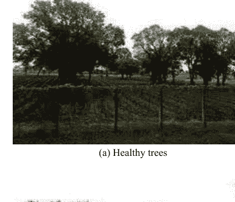

(a) 健康的树木

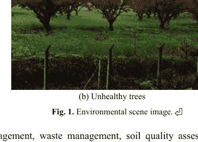

(b) 不健康的树木

图1. 环境场景图像。

植物监测对于维持生态需求至关重要。然而，还有其他几个因素负责平衡整个农业产业。这包括养分缺乏估算、植被指数分析、作物监测、耕作前后分析、水质评估、杂草和农药管理、废物管理、土壤质量评估、植物密度估算、仓库管理、生产或供应链管理、作物病害诊断、水果和花朵计数、质量和数量估算、人口变化辅助、空间和时间信息收集等等（Luo et al., 2023; Olson and Anderson, 2021; Khan et al., 2022; Chouhan et al., 2024; Kumar et al., 2024; Solanki et al., 2023）。

### 无人机的需求

无人机在精准农业（PA）中得到了广泛推崇。它们能够为农民在田间内外遇到的许多问题提供解决方案。这些应用及其宝贵的价值在过去几年中得到了广泛观察。正因如此，农业部门的生产力、效率和盈利能力都得到了提升。农业无人机节省时间，有助于排查潜在问题并提供更好的数据和成本节约解决方案。农民、牧场主和其他农业企业主已经开始采用技术手段来协助他们（van Wynsberghe and Comes, 2020; Boukoberine et al., 2019; Hassanalian and Abdelkefi, 2017; Jerhamre et al., 2022）。利用无人机收集的信息由专家进行分析，并为农民提供有效的解决方案。这些解决方案在更短的时间内以更低的成本提供，因此提高了产量质量和数量。无人机收集的数据形式为高分辨率图像。根据所需信息的需求，所收集的图像可以是RGB、多光谱和超光谱。

从生态条件角度来看，无人机非常重要。它们甚至可以飞到远超人类可达范围的陆地区域并收集数据。其中一些应用包括历史湿地区域的识别（Stahl and Weimann, 2022）、干旱稀树草原的测绘（Amputu et al., 2023）、两栖动物物种的检测（Senturk, 2022）、利用无人机拍摄的超光谱图像对沙漠草原物种进行分类（Zhang, 2022）、借助航空图像识别玉米叶病害（Ishengoma et al., 2022）、利用无人机图像提取大豆种植面积（Yang et al., 2022）、借助无人机图像进行植物物种监测、测绘和量化（Baena, 2018）、柱状仙人掌识别（López-Jiménez et al., 2019）等。

### 无人机的应用

#### 作物制图与勘测

一个有效的起点是使用无人机；它们非常适合监测和传感，并且可以迅速覆盖一个区域以检查作物发育和土壤健康。无人机通常用于此任务，因为其传感器可以识别特定波长的吸收，生成突出潜在问题区域的颜色对比图像（Prado Osco et al., 2021; Khan et al., 2020; Corcoran et al., 2021）。

#### 播种与种植

由于执行其作业需要高超的技能，农业本质上是一个劳动密集型和耗时耗力的行业。特别是播种，这是一项耗时的作业，需要人力。为了使这项艰苦的任务变得更容易，多种作物的种子都使用无人机技术播种。得益于内置的激光、传感器、油箱等特性，无人机可以快速高效地种植种子。播种是无人机在农业中较新且不太流行的用途之一。目前，自动无人机播种机主要用于林业部门，但未来可能在更广泛的领域应用。无人机种植使得在不危及工人的情况下重新种植难以到达的地点成为可能。凭借两名操作员和10架每天可种植40万棵树的无人机，他们也能更有效地进行种植（Yang et al., 2022）。

#### 作物喷洒

无人机在农业中最受欢迎的用途之一是它们能够迅速移动到目标位置。具备这种技能的无人机可以施用肥料和杀虫剂到

为作物补水并提供所需养分。此类添加剂有助于作物茁壮生长并保持健康。为了防治蠕虫、害虫和昆虫，延长作物寿命，无人机操作员可以完全控制喷洒养分的无人机。在东南亚，使用无人机进行喷洒处理已十分普遍；韩国超过30%的农业喷洒作业使用无人机。无人机喷洒机能够穿越极具挑战性的地形，例如高海拔陡峭的茶园。无人机喷洒机使工人免于背负背包式喷雾器穿越田间，这种工作方式可能危害健康。为了最大化生产力并降低化学成本，无人机喷洒机提供可针对特定位置的微小喷洒处理。目前，各国对无人机喷洒机的法律规定差异很大（Radoglou-Grammatikis等，2020）。

### 土壤与田间分析
田间状况和土壤健康都可以通过无人机田间监测进行监控。无人机能够精确绘制田间地图，提供海拔数据，使生产者能够识别任何田间异常。了解田间海拔有助于确定排水模式和干/湿区域，从而实现更有效的灌溉实践。利用改进的传感器，一些农业无人机销售商和服务提供商还提供土壤氮含量监测服务。这使得精准施肥成为可能，消除问题生长区域，并在未来多年内促进土壤健康。强大的无人机能力有助于完成评估土壤健康这一耗时过程。使用无人机可以监测、改良和维护土壤的特性与健康，无人机收集并分析监测系统的数据。土壤可以通过获得所需养分而受益于无人机技术，变得更健康。无人机利用其数据处理和三维绘图能力来执行这一监测土壤状况的任务。得益于无人机勘测，农民可以更多地了解其土地的土壤特性。多光谱传感器捕获的数据可以促进深入的田间土壤分析、灌溉、氮水平管理和种子种植模式。借助精确的摄影测量和三维绘图，农民可以全面评估其土壤状况（Olson和Anderson，2021；Cucho-Padin，2020）。

### 灌溉监测
植物健康监测是无人机成像的一个应用，已被广泛使用且效果显著。归一化植被指数（NDVI）是无人机使用的一种专门成像工具，利用精确的颜色数据来评估植物健康状况。这使得农民能够在作物生长过程中持续关注它们，以便及时解决问题，拯救植株。简而言之，该图展示了NDVI的工作原理。配备高光谱、热成像或多光谱技术的传感器无人机可以识别过于干燥或需要农民改进的区域。无人机勘测提供用于灌溉监测的植被指数计算，这有助于了解作物健康状况并释放热量/能量。这有助于提高用水效率，并揭示灌溉中可能存在的积水/渗漏（Khan，2020）。

### 潜在传粉媒介
无人机能够充当人工传粉媒介。尽管昆虫媒介仍然是最重要的传粉者，但无人机最终可能会超越蜜蜂，成为最关键的传粉者。研究人员乐观地认为，无人机将能够在果园和田地中运输和播撒花粉种子，尽管该领域还需要更多研究（Khan，2020；Brook等，2020）。

### 农业研究
智能方法和高端计算设备为学者和研究人员提供了将研究转向农业部门有益方面的机会。如今可以看到，特别是由于劳动力成本低和结果高效，无人机技术几乎已被用于精准农业的所有应用。由于相关技术目前尚处于初期阶段，其改进和开发仍有许多方面有待进行。其中，设计和提供低成本无人机至关重要。无人机上安装的传感器也发挥着重要作用，必须根据具体应用进行选择。总体而言，应降低硬件成本和简化安装过程，以使无人机价格可承受。需要一个独特的平台来应对与农业领域相关的各种问题，因此研究必须面向开发一种能够为所有应用提供解决方案的软件平台（Khan，2020；Brook等，2020；Osco等，2021；Gupta等，2016）。

#### 结论
无人机对农业产业的发展产生了重大影响。其主要贡献在于有效减少劳动力投入、支出和资源消耗。然而，相关技术的适应性仅限于少数农民和领域知识专家。安全、隐私、经济、气候、缺乏理解、轨迹规划、传感器选择等多种因素影响了其适应性。然而，为了维持、提高和保护产量结果的质量和生产力，必须将重点放在扩大无人机技术的实践上。

有多个因素影响着作物产量的健康和生产力。它们可分为生物因素和非生物因素。及时、精确且具有成本效益的机制是克服这些挑战的可行解决方案。最新技术的出现，更具体地说，无人机技术与计算机视觉、深度学习以及高端计算设备的加速发展，可以为应对上述威胁提供有前景的解决方案。

### 参考文献
Amputu, V., Knox, N., Braun, A., Heshmati, S., Retzlaff, R., Röder, A. and Tielbörger, K. 2023. Unmanned aerial systems accurately map rangeland condition indicators in a dryland savannah. *Ecological Informatics*, 75: 102007. doi: 10.1016/j.ecoinf.2023.102007.

Baena, S., Boyd, D.S. and Moat, J. 2018. UAVs in pursuit of plant conservation—Real world experiences. *Ecological Informatics*, 47: 2–9. doi: 10.1016/j.ecoinf.2017.11.001.

BouKoberine, M.N., Zhou, Z. and Benbouzid, M. 2019. A critical review on unmanned aerial vehicles power supply and energy management: Solutions, strategies, and prospects. *Applied Energy*, 255: 113823. doi: 10.1016/j.apenergy.2019.113823.

Brook, A., De Micco, V., Battipaglia, G., Erbaggio, A., Ludeno, G., Catapano, I. and Bonfante, A. 2020. A smart multiple spatial and temporal resolution system to support precision agriculture from satellite images: Proof of concept on Aglianico vineyard. *Remote Sensing of Environment*, 240: 111679. doi: 10.1016/j.rse.2020.111679.

Chouhan, S.S., Singh, U.P., Sharma, U. et al. 2024. Classification of different plant species using Deep Learning and Machine Learning algorithms. *Wireless Pers. Commun.*, 136: 2275–2298. https://doi.org/10.1007/s11277-024-11374-y.

Corcoran, E., Winsen, M., Sudholz, A. and Hamilton, G. 2021. Automated detection of wildlife using drones: Synthesis, opportunities and constraints. *Methods in Ecology and Evolution*. doi: 10.1111/2041-210X.13581.

Cucho-Padin, G., Loayza, H., Palacios, S. et al. 2020. Development of low-cost remote sensing tools and methods for supporting smallholder agriculture. *Appl. Geomat.*, 12: 247–263. doi: 10.1007/s12518-019-00292-5.

Gupta, A.K. et al. 2016. Low Contrast image enhancement technique by using fuzzy method. *International Journal of Engineering Research and General Science*, 4(2).

Hassanalian, M. and Abdelkefi, A. 2017. Classifications, applications, and design challenges of drones: A review. *Progress in Aerospace Sciences*, 91: 99–131. doi: 10.1016/j.paerosci.2017.04.003.

Heidari, A., Navimipour, N.J., Unal, M. and Zhang, G. 2023. Machine Learning applications in Internet-of-Drones: Systematic review, recent deployments, and open issues. *ACM Comput. Surv.*, 55: 12, Article 247 (December 2023), 45 pages. https://doi.org/10.1145/3571728.

Ishengoma, F.S., Rai, I.A. and Ngoga, S.R. 2022. Hybrid convolution neural network model for a quicker detection of infested maize plants with fall armyworms using UAV-based images. *Ecological Informatics*, 67: 101502. doi: 10.1016/j.ecoinf.2021.101502.

Jerhamre, E., Carlberg, C.J.C. and van Zoest, V. 2022. Exploring the susceptibility of smart farming: Identified opportunities and challenges. *Smart Agricultural Technology*, 2: 100026. doi: 10.1016/j.atech.2021.100026.

Kangunde, V., Jamisola, R.S. and Theophilus, E.K. 2021. A review on drones controlled in real-time. *Int. J. Dynam. Control*, 9: 1832–1846. doi: 10.1007/s40435-020-00737-5.

Khan, A., Vibhute, A.D., Mali, S. and Patil, C.H. 2022. A systematic review on hyperspectral imaging technology with a machine and deep learning methodology for agricultural applications. *Ecological Informatics*, 69: 101678. doi: 10.1016/j.ecoinf.2022.101678.

Khan, P.W., Byun, Y.-C. and Latif, M.A. 2020. Clifford geometric algebra-based approach for 3D modeling of agricultural images acquired by UAVs. *IEEE Access*, 8: 226297–226308. doi: 10.1109/ACCESS.2020.3045443.

Kumar, R. et al. 2024. Hybrid approach of cotton disease detection for enhanced crop health and yield. In *IEEE Access*. doi: 10.1109/ACCESS.2024.3419906.

Li, W., Zheng, T., Yang, Z., Li, M., Sun, C. and Yang, X. 2021. Classification and detection of insects from field images using deep learning for smart pest management: A systematic review. *Ecological Informatics*, 66: 101460. doi: 10.1016/j.ecoinf.2021.101460.

López-Jiménez, E., Vasquez-Gomez, J.I., Sanchez-Acevedo, M.A., Herrera-Lozada, J.C. and Uriarte-Arcia, A.V. 2019. Columnar cactus recognition in aerial images using a deep learning approach. *Ecological Informatics*, 52: 131–138. doi: 10.1016/j.ecoinf.2019.05.005.


Luo, J., Li, B. and Leung, C. 2023. 城市和受控环境农业中计算机视觉技术综述. ACM Comput. Surv. 即将录用（2023年10月）. https://doi.org/10.1145/3626186.

Olson, D. and Anderson, J. 2021. 无人机、遥感器、图像处理及其在农业中的应用综述. Agronomy Journal. doi: 10.1002/agi2.20595.

Osco, L.P. et al. 2021. 无人机遥感中的深度学习综述. International Journal of Applied Earth Observation and Geoinformation, 102: 102456. doi: 10.1016/j.jag.2021.102456.

Radoglou-Grammatikis, P., Sarigiannidis, P., Lagkas, T. and Moscholios, I. 2020. 无人机在精准农业中应用的汇编. Computer Networks, 172: 107148. doi: 10.1016/j.comnet.2020.107148.

Senturk, Z.K. 2022. 基于人工神经网络的水库两栖动物物种检测用于生态友好城市规划. Ecological Informatics, 69: 101640. doi: 10.1016/j.ecoinf.2022.101640.

Sinha, B.B. and Dhanalakshmi, R. 2022. 物联网在智慧农业中的最新进展与挑战：综述. Future Generation Computer Systems, 126: 169–184. doi: 10.1016/j.future.2021.08.006.

Solanki, S., Singh, U.P. and Chouhan, S.S. 2023. 使用机器学习和深度学习方法的脑肿瘤分类. 2023 IEEE 5th International Conference on Cybernetics, Cognition and Machine Learning Applications (ICCCMLA), Hamburg, Germany, pp. 204–208. Doi: 10.1109/ICCCMLA58983.2023.10346854.

Stahl, N. and Weimann, L. 2022. 利用深度卷积神经网络识别历史地图中的湿地区域. Ecological Informatics, 68: 101557. doi: 10.1016/j.ecoinf.2022.101557.

Tahir, A., Boling, J., Haghbayan, M.-H., Toivonen, H.T. and Plosila, J. 2016. 无人机群——综述. Journal of Industrial Information Integration, 16: 100106. doi: 10.1016/j.jii.2019.100106.

van Wynsberge, A. and Comes, T. 2020. 人道主义背景下的无人机、机器人伦理与人机交互. Ethics and Information Technology, 22: 43–53. doi: 10.1007/s10676-019-09514-1.

Yang, Q., She, B., Huang, L., Yang, Y., Zhang, G., Zhang, M., Hong, Q. and Zhang, D. 2022. 基于多源低空无人机影像特征融合技术的大豆种植面积提取. Ecological Informatics, 70: 101715. doi: 10.1016/j.ecoinf.2022.101715.

Zhang, T., Bi, Y., Du, J., Zhu, X. and Gao, X. 2022. 基于局部-全局特征增强网络和无人机高光谱遥感的荒漠草原物种分类. Ecological Informatics, 72: 101852. doi: 10.1016/j.ecoinf.2022.101852.

由更高的燃烧强度和随之而来的CO₂排放所驱动。全球气温上升增加了发生严重野火的可能性，尤其是在经历长期干旱的地区（Pérez-Sánchez et al., 2019）。随着全球持续变暖，我们预计更频繁的极端天气事件，包括酷热和长时间炎热期。这些条件将可能形成越来越容易发生广泛和反复野火的环境。酷热事件进一步使景观干燥，为这些破坏性火灾创造了理想环境（Gaudreau et al., 2016）。这反过来又导致野火排放的CO₂增加，进一步引发气候变化，并形成严重野火循环模式（McColl-Gausden et al., 2022）。这一如图1所示的反馈循环突出了野火与气候变化之间的相互联系。

尖端技术、精密建模、增强的传感系统和改进的观测方法显著提升了我们检测和预报野火蔓延的能力（Ladi et al., 2022）。计算理论、数学创新和处理能力的同步发展为我们提供了强大的数据收集与分析工具（Ding et al., 2022）。实施这些创新技术显著提高了我们应对野火控制和预防中固有复杂问题的能力（Coen et al., 2020）。人工智能驱动方法（如机器学习）的应用近年来日益普及，并已成为推动技术进步的多功能工具（Rolnick et al., 2019）。机器学习是人工智能的一个子领域，利用算法从大数据集中识别模式（Jafar Ali Ibrahim et al., 2022; Kalinaki et al., 2024a; Kalinaki et al., 2023b）。它正在快速发展，对于理解复杂网络、发现大数据中的知识模式以及进行未来预测非常有价值（Ding et al., 2022）。机器学习技术在包括野火蔓延检测、城市规划、资源分配、能源需求预测、粮食安全预测以及空气质量监测与预报等多个应用领域不可或缺（Sreenath et al., 2022）。鉴于野火蔓延检测和预测高度复杂，需要多学科研究（Yandouzi et al., 2022），机器学习技术的使用已被证明是理解和预测野火相关问题的重要工具（Massetti et al., 2019）。通常，机器学习方法主要分为两大类：监督学习和无监督学习。监督方法将输入数据映射到已知结果，使用标记数据集来识别模式，以预测新输入的结果。相反，无监督技术探索没有预定结果的数据，可能揭示野火传播模型中的新关系或远程相关性（Kalinaki et al., 2023c; Umunakwe et al., 2022）。机器学习方法能够捕捉强非线性，影响野火行为的许多方面（Ghali and Akhloufi, 2023），而这些仅使用传统回归方法难以阐述（Ghali et al., 2022）。

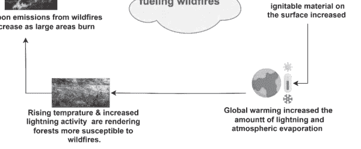

图1. 森林野火与全球气候变化之间的循环。

野火在世界范围内构成一项重大的环境和社会经济挑战。由于气候变化、人为活动和自然天气模式，其发生频率已经增加（Küçükarslan, 2024）。野火的后果是多方面的且严重，影响生态系统、人类健康、基础设施和经济。在生态方面，野火可能导致生物多样性丧失、栖息地退化和自然过程改变。从人类角度看，野火对生命和财产构成直接威胁，导致社区流离失所，并造成重大经济损失。

此外，野火期间释放的烟雾和颗粒物对健康有重大影响，导致呼吸系统和心血管疾病（Dillis et al., 2022; Wang et al., 2023a）。早期发现和准确预测野火对于有效缓解和管理至关重要。及时的检测能够实现快速反应，减少大规模蔓延的可能性并将损害降至最低。准确的预测模型有助于资源分配、战略规划和主动措施，如计划烧除和疏散计划。预测野火行为和蔓延的能力可以显著增强应急响应工作，保护人类生命并减少生态和经济影响（Wang et al., 2023b）。

遥感（RS）在识别和监测野火方面发挥着至关重要的作用。它采用各种数据收集方法，包括卫星图像、航空摄影和多种传感器系统，以获取有关活跃火灾、烟羽和过火区域的信息（Charizanos and Demirhan, 2023）。这项技术能够实现大范围的野火检测和跟踪，为战略规划和资源部署提供关键见解。分析来自卫星、气象站和地面传感器的数据是有效野火监测的基础，需要复杂的处理和解释技术（Kalinaki et al., 2024b）。包括图像分析、统计建模和机器学习算法在内的高级分析方法被用于识别火灾指标、发现异常模式，并为野火响应团队提供及时、可操作的情报（Casas et al., 2023; Ding et al., 2023）。


本章旨在提供野火蔓延检测和预测技术最新进展的全面概述。本章的贡献如下：

- 探索野火行为和蔓延动态的基本原理，为理解其中涉及的复杂性奠定基础。
- 探索遥感方法，包括卫星影像和无人机（UAV），并考察这些技术如何促进野火检测。
- 探究机器学习（ML）和深度学习（DL）算法在革新野火检测和预测中的作用，实现对海量数据集的快速分析。
- 讨论预测建模方法，将各种环境因素、地形特征和燃料特性整合起来，以预测野火行为和蔓延模式。
- 解决当前野火检测和预测系统所遇到的挑战和局限性，例如数据准确性、计算资源和操作限制。
- 通过真实案例研究和应用，说明这些技术在野火管理和应急响应工作中的实际意义。
- 强调野火管理策略未来研究方向和创新机会。

### 野火行为和蔓延动态的基本原理

理解影响野火点燃和蔓延的因素对于开发有效的检测和预测系统至关重要。这些因素包括燃料类型和特性、地形特征以及天气条件。

#### 燃料类型和特性

该区域可用的燃料类型显著影响野火行为。野火可以通过各种燃料点燃和蔓延，包括草、灌木、树木和累积的枯死植被。这些燃料的含水量对其可燃性起着至关重要的作用（Iban and Sekterkin, 2022）。较干燥的燃料比含水量较高的燃料更容易点燃且燃烧更剧烈。此外，燃料负荷，即可用燃料的数量，决定了野火的潜在强度。燃料负荷较高的区域可以维持更大、更猛烈的火灾。燃料的空间分布，包括其垂直和水平连续性，也会影响火灾蔓延的速度。例如，连续的燃料可以促进火灾快速蔓延，而不连续性则可以减缓或阻止火灾（Kadir et al., 2023）。

#### 地形特征

诸如坡度、坡向、海拔和自然屏障等地形特征显著影响野火行为。由于火上方的燃料预热，火灾往往向上坡移动更快，使得更陡的坡度有利于火灾更快速蔓延（Piralilou et al., 2022）。坡面朝向，即坡向，影响阳光和风的暴露量，影响燃料干燥和火灾行为。海拔影响天气模式、温度和燃料类型，所有这些对火灾动态都至关重要。河流、悬崖和先前燃烧过的区域等自然屏障可以作为火灾蔓延的障碍，为灭火工作提供潜在的控制点（Kadir et al., 2023; Tonini et al., 2020）。

#### 天气条件

天气条件是影响野火点燃和蔓延的最关键因素之一（Bhowmik et al., 2023）。较高的温度会预热燃料并降低其含水量，使其更容易点燃。相反，较低的湿度水平会使燃料干燥，增加火灾风险，而较高的湿度可以抑制火灾活动（Wang et al., 2023c）。风通过引导火焰、携带火星并提供持续的氧气供应，在火灾蔓延中起着至关重要的作用，强风会导致快速且往往不可预测的火灾行为（Bouguettaya et al., 2022a）。降水可以使燃料受潮并降低火灾风险；然而，长期干旱期会创造有利于野火的条件。最后，雷击是野火的自然点火源，尤其是在干燥条件下，为野火预测和管理增加了另一层复杂性（Bouguettaya et al., 2022b）。

#### 数据集

##### 数据集概述

任何机器学习或深度学习模型的基石都是用于训练和评估的数据集。在野火检测和预测中，数据集通常包含各种数据类型，包括卫星影像、天气记录、地形信息和历史火灾发生情况（Rezaie et al., 2023）。这些数据集来自众多机构和平台，例如美国国家航空航天局的中分辨率成像光谱辐射计（MODIS）和可见光红外成像辐射计套件（VIIRS）、欧洲航天局的哨兵卫星以及当地气象站。全面且高质量的数据集对于构建能够准确检测和预测野火的稳健模型至关重要（Rodrigues and De la Riva, 2014）。

数据预处理：对原始数据进行分析前的精炼是一个至关重要的初步阶段，称为数据预处理。此多步骤过程增强数据质量，并使信息为在机器学习算法中有效使用做好准备。

数据清洗：数据清洗涉及识别和纠正数据集内的错误或不一致之处。这包括处理缺失值、纠正错误的数据点以及删除重复项。例如，卫星图像可能包含间隙或损坏的像素，必须加以处理以确保准确分析（van Klompenburg et al., 2020）。

**数据规范化和标准化：** 规范化将值调整到 0 到 1 范围内，而标准化则改变数据分布以实现均值为零和标准差为一（Bouguettaya et al., 2022b）。这些缩放方法对于受输入特征幅度影响的算法至关重要，因为它们确保每个特征对模型训练过程具有可比较的影响（Vyas et al., 2021）。

**时空对齐：** 野火数据通常包含必须准确对齐的时间序列和空间信息（Zhang et al., 2023）。时间对齐确保来自不同来源的数据点在时间上同步，而空间对齐确保来自不同地理位置的数据被正确映射。例如，根据时间和位置将天气数据与相应的卫星图像对齐对于准确的模型训练至关重要（Rjoub et al., 2023）。

**数据增强：** 数据增强通过对现有样本应用多样化修改并生成新的合成示例来扩展训练数据集。这可以包括旋转、翻转或缩放图像以及添加噪声以模拟不同条件。数据增强通过增加训练数据集的多样性来帮助提高模型鲁棒性，从而减少过拟合（Zakari et al., 2024）。

**特征提取：** 特征提取将原始数据转换为机器学习模型可以有效利用的精炼特征。此步骤对于突出相关信息和降低数据复杂性至关重要。

**遥感特征：** 遥感主要通过卫星影像和无人机数据为野火分析提供了大量数据。可以通过先进的图像处理技术提取各种特征以帮助野火检测和预测（Zhong et al., 2023）。热异常，即可能表示潜在火点位置的热点，可从红外图像中识别。植被指数如归一化植被指数（NDVI）用于评估植被健康状况和燃料可用性。此外，多光谱和高光谱数据允许对光谱波段进行分析，使根据其反射特性区分已燃区和未燃区成为可能（Bhowmik et al., 2023）。

**气象特征：** 气象数据对于理解和预测野火行为至关重要，因为天气条件显著影响火灾蔓延（Masoudian et al., 2023）。关键气象特征包括温度、湿度、风速和降水。升高的温度会提高火灾引发和传播的概率，而大气湿度的降低会使植物枯萎，增强其易燃性。风速和风向是关键因素，因为风可以迅速蔓延火灾并改变其方向。相反，降水，如降雨，可以使火灾受潮并降低其强度（Pereira et al., 2022）。

**地形特征：** 地形数据提供了对地形物理特征的见解，这些特征深刻影响野火蔓延。海拔、坡度和坡向是基本地形特征（Abid et al., 2021）。较高的海拔可能表现出不同的植被类型和燃料可用性，影响

火行为。更陡的坡度会因燃料消耗率增加而加速火灾蔓延。坡向，即坡面朝向的方向，影响其对阳光和风的暴露程度，进而影响火灾行为（Pan and Zhang, 2023）。

**历史火灾数据：** 历史火灾发生数据分析为过去的野火模式和趋势提供了宝贵的见解。从历史数据得出的特征包括火灾频率、燃烧严重程度和恢复时间。火灾频率表示特定区域在一段时间内发生火灾的次数，提供了其易燃性的见解。燃烧严重程度衡量过去火灾的强度，可能影响当前的植被和燃料状况。恢复时间是指火灾后植被再生的持续时间，影响未来的火灾风险和生态系统恢复力。

### 野火检测的遥感方法

#### 遥感技术概述

遥感技术通过提供全面及时的数据彻底改变了野火检测领域。这些技术能够监测广阔且难以到达的区域，为野火动态提供关键见解。

**卫星影像：** 卫星影像对野火检测至关重要，使用 MODIS、VIIRS 和 Landsat 等传感器。这些卫星通过覆盖大面积区域并实现对偏远和广阔地区的持续监测提供有价值的数据（Brando et al., 2019）。它们提供多种数据类型，包括光学、热和雷达影像，每种都对野火检测做出独特贡献（Wang et al., 2021）。然而，时间分辨率（数据捕获频率）可能有限，且云层会阻碍光学和热传感器，给不间断监测带来挑战（Fedorka, 2020）。

**无人机：** 无人机（无人驾驶飞行器）已成为野火检测中的重要工具。这些设备配备了先进的成像设备和传感器，使其能够收集高质量的视觉和热信息（Bustillo Sánchez et al., 2021）。无人机提供灵活性、高空间分辨率以及在云层下和更接近地面飞行的能力，提供卫星可能遗漏的详细信息。尽管具有优势，无人机在飞行时长和航程方面存在限制，其部署可能受恶劣天气条件和监管限制的制约（Linn et al., 2002）。

#### 森林火灾检测技术

#### 基于卫星的检测

**热传感器（MODIS、VIIRS）：** 这些传感器对于从太空识别热异常至关重要。例如，NASA 在 Terra 和 Aqua 卫星上的 MODIS 以及在 Suomi NPP 卫星上的 VIIRS 提供全球野火热点近实时数据（Rodrigues et al., 2014）。在 2020 年澳大利亚丛林大火期间，这些传感器探测到广泛的火灾活动，帮助应急服务有效监测和应对火灾（Huot et al., 2022）。

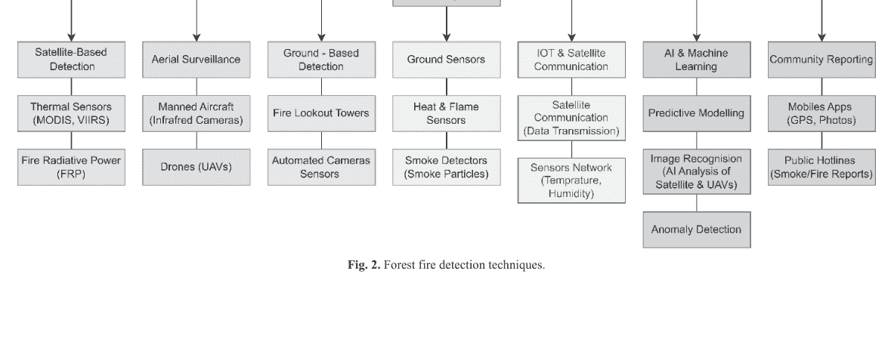

图 2. 森林火灾检测技术。

#### 人工智能和机器学习

**预测建模：** 人工智能算法，如 IBM Watson 开发的算法，分析天气模式、植被类型和历史火灾数据以预测野火可能发生的地点（Bouguettaya et al., 2022a）。在美国西部，这类模型在火灾季节更有效地分配消防资源（He et al., 2023）。

**图像识别（卫星和无人机的 AI 分析）：** AI 工具分析卫星和无人机影像以识别火灾爆发。例如，在 2018 年加州坎普大火期间，AI 系统处理图像以定位和追踪火势蔓延，迅速协助应急响应（Chouhan et al., 2024）。

**异常检测：** 机器学习模型检测指示火灾的异常数据模式。例如，内华达州的 ALERTWildfire 系统使用机器学习监控摄像头画面并识别烟雾或火灾，为消防部门提供早期预警（Blake et al., 2010）。

#### 社区报告

**移动应用（GPS、照片）：** 如加拿大不列颠哥伦比亚省使用的应用，允许居民报告野火，提供 GPS 坐标和照片。这些公民来源的信息帮助消防部门及时核实并应对新的火灾事件（Khaki et al., 2020）。

**公共热线（烟雾/火灾报告）：** 澳大利亚等国家的公共热线使居民能够报告烟雾目击情况（Leuenberger et al., 2018）。这些报告对早期检测至关重要，使当局能够迅速调派消防资源，如在毁灭性的 2019–2020 丛林大火季节所见（Rodrigues et al., 2014）。

#### 森林火灾预测技术

#### 气象建模

**天气预报模型：** 这些模型预测影响野火行为的天气条件。例如，欧洲中期天气预报中心（ECMWF）提供详细的天气预报，供火灾管理机构使用，以预测可能加剧火灾蔓延的风型和湿度水平（Yandouzi et al., 2022）。

**火险天气指数（FWI）：** FWI 是一种气象工具，在全球范围内使用，如加拿大，用于根据温度、风速、湿度、降水等天气数据评估火灾危险。该指数有助于日常火灾风险评估，指导火灾预防措施和资源分配（Bouguettaya et al., 2022a）。

#### 遥感

**卫星影像：** Landsat 和 Sentinel 等卫星提供高分辨率图像，用于监测植被健康和探测火烧迹。例如，在 2019–2020 年澳大利亚丛林大火期间，卫星影像对于绘制烧毁区域范围和评估环境影响至关重要（Jiang et al., 2022）。

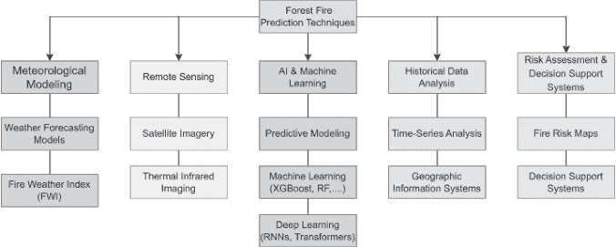

**热红外成像：** 该技术探测活跃火灾的热量。美国 NOAA 使用的 GOES-R 系列卫星提供热红外数据，使野火热点近实时监测成为可能，并有助于快速响应工作（Yan et al., 2023）。

#### 人工智能和机器学习

**预测建模：** 机器学习模型分析庞大数据集以预测火灾蔓延。例如，加州的火灾管理机构使用预测模型来预测火灾行为，整合植被类型、地形和天气条件等因素（Cao, 2003）。

**机器学习（XGBoost、RF 等）：** XGBoost 和随机森林等算法被用于预测火灾发生和蔓延。斯坦福大学的研究人员使用这些技术开发了模型，以提高野火风险评估的准确性（Cao, 2003; Thissen et al., 2003）。

**深度学习（RNNs、Transformers）：** 深度学习模型，如循环神经网络（RNNs）和 Transformer，用于火灾蔓延预测中的复杂模式识别。这些模型可以处理序列数据，有效分析时间序列火灾行为数据（Zakari et al., 2024）。

#### 历史数据分析

**时间序列分析：** 该方法涉及研究历史火灾数据以识别趋势和模式（Wu et al., 2022）。在澳大利亚，对过去野火事件的时间序列分析有助于理解季节性变化并改善准备策略（Jimeng, 2022）。

**地理信息系统：** GIS 技术绘制和分析与野火相关的空间数据。在加州等地区，GIS 整合植被、天气、地形等各种数据图层，以评估火灾风险并规划缓解措施（Bhowmik et al., 2023）。

#### 风险评估和决策支持系统

**火灾风险地图：** 这些地图可视化野火高风险区域。例如，美国林务局制作火灾风险地图，突出显示脆弱地区，有助于有针对性的火灾预防工作和资源分配（He et al., 2023）。

**决策支持系统：** 这些系统帮助消防管理人员做出明智的决策（Lin et al., 2023）。NASA 开发的资源管理火灾信息系统（FIRMS）提供实时火灾数据和决策支持工具，增强当局有效应对野火威胁的能力（Koh, 2023）。

### 野火检测与预测中的机器学习和深度学习

#### 机器学习和深度学习简介

机器学习和深度学习通过实现对大型复杂数据集的分析，改变了包括野火检测和预测在内的各个领域（Pourghasemi et al., 2020）。机器学习涉及训练算法以识别模式并基于数据做出预测，而深度学习作为机器学习的一个子集，使用多层神经网络来建模复杂关系。这些技术对于处理和解释来自卫星影像、天气数据和传感器网络等不同来源的海量数据至关重要，以增强野火管理策略（Ding et al., 2023）。

#### 野火检测中使用的算法和模型

在野火检测中，几种机器学习和深度学习算法已被证明在从遥感数据识别野火的存在和特征方面有效。

**卷积神经网络（CNNs）：** CNNs 因能够自动学习特征的空间层次结构而广泛用于图像识别任务。在野火检测中，CNNs 分析卫星和无人机影像以识别火点和烟羽。它们高效处理大图像的能力使其成为实时监测系统的理想选择，提供快速准确的检测（Chouhan et al.）。

**支持向量机（SVMs）：** SVMs 用于分类任务，并应用于野火检测，通过对不同土地覆盖类型进行分类并识别有活跃火灾的区域（Iban and Sekertekin, 2022）。SVMs 可以处理高维数据，在特征数量相对于观测数量较大的情况下有效（Gao et al., 2023）。

**随机森林：** 这些采用集成方法，在学习阶段生成大量决策树。它们根据所有树中出现频率最高的类别预测产生输出，用于分类任务。在野火检测中，随机森林用于对遥感数据进行分类并通过学习历史火灾数据和环境变量来预测火灾发生（Gao et al., 2023; Iban and Sekertekin, 2022）。


不完整的数据集无法捕捉火灾风险的关键早期迹象（Pan and Zhang, 2023）。

#### 数据分辨率

高分辨率数据对于准确的火灾检测和预测至关重要。然而，这类数据可能成本高昂，且在后勤方面具有挑战性，尤其是在大面积区域。卫星影像在时间分辨率上可能存在局限，难以捕捉火情或小规模火灾的快速变化（He et al., 2023）。

#### 实时数据集成

整合来自地面传感器、气象站和卫星等多样化来源的实时数据十分复杂，需要强大的数据管理系统。数据采集和处理过程中的延迟可能会阻碍及时的检测和响应工作（Wang et al., 2023b）。

### 计算资源与效率

#### 高计算需求

先进的预测模型，尤其是基于机器学习和深度学习（ML 和 DL）的模型，需要强大的计算能力来进行训练和实时运行（Rim et al., 2018）。处理大型数据集和复杂模拟需要高性能计算资源，而这些资源并非在所有地区都容易获得（Phan et al., 2022）。

#### 可扩展性

将模型扩展到覆盖环境条件多样的大范围区域可能具有挑战性。模型必须针对不同区域进行调整和优化，这需要大量的计算资源和专业知识（Kale et al., 2022）。确保预测模型在现有硬件上高效运行并保持准确性，是一个持续的挑战（Kumar et al., 2024）。

#### 能耗

运行先进模型所需的计算能力可能导致高能耗，这既成本高昂，又对环境造成负担（Kadir et al., 2023）。

### 运行约束与实时应用

#### 及时性与速度

要使野火检测和预测切实有效，它们必须以实时或近实时方式运行（Umunkakwe et al., 2022）。数据处理、分析或信息发布中的任何延迟都会降低早期预警系统的有效性。快速变化的火情要求模型频繁更新预测，这对保持计算效率构成了挑战（Elia et al., 2020）。

#### 与现有系统的集成

将新技术和预测模型与现有的火灾管理和应急响应系统整合可能具有挑战性（Dillis et al., 2022）。兼容性问题以及人员培训需求可能阻碍顺利实施（Khajuria et al., 2018b）。在消防管理机构的工作流程中实际应用预测模型，需要强大的数据通信、决策支持和可操作情报系统（Wang et al., 2023a）。

#### 资源分配

有效的野火应对取决于消防人员、设备和空中资源等资源的可用性和高效分配。

#### 法律与监管框架

不同地区在数据使用、监测和火灾管理实践方面有着不同的法律和监管要求（Tuyen et al., 2021）。应对这些框架可能具有挑战性。不同的法律标准和政治因素可能使数据共享和火灾管理方面的国际与区域合作复杂化（Tien Bui et al., 2017）。

### 野火检测与预测的实际应用和真实世界案例研究

野火检测与预测技术的实际应用涵盖野火管理的各个方面，从应急响应和资源分配到社区备灾和风险沟通。以下是一些关键实施案例和真实世界案例研究，展示了这些技术的有效性和影响。

### 在野火管理策略中的实施

### 先进的预测建模

#### 案例研究：澳大利亚的丛林大火预测系统

在澳大利亚，诸如 Phoenix RapidFire 系统等先进预测模型可模拟不同场景下的火势蔓延和行为（Cheng et al., 2022）。该工具整合了天气预报、植被地图和地形数据，以实现准确的火灾预测。它在制定有效的火灾管理策略和实施计划烧除以减少燃料负荷方面发挥了重要作用（Rubi et al., 2022）。

### 实时监测与早期预警系统

#### 案例研究：加利福尼亚州的 FireMap

加利福尼亚州已部署 FireMap，这是一个利用卫星数据、地面传感器和空中监测来早期探测野火的实时监测系统。该系统会立即向消防管理机构发出警报，从而实现快速响应和协调。该系统显著提升了该州管理和控制野火的能力（Rubí et al., 2022）。

### 应急响应与资源分配

### 优化的资源部署

#### 案例研究：加拿大麦克默里堡野火

在2016年加拿大麦克默里堡野火期间，预测建模工具帮助优化了消防资源的部署。这些模型提供了火势蔓延的预测，使当局能够战略性地部署消防队伍和设备。这种方法最大限度地缩短了响应时间，提高了消防工作的效率，最终挽救了生命和财产（Rim et al., 2018）。

截至2016年5月12日，加拿大麦克默里堡有17处野火正在肆虐。其中一处火灾仍被省级当局视为“失控”。

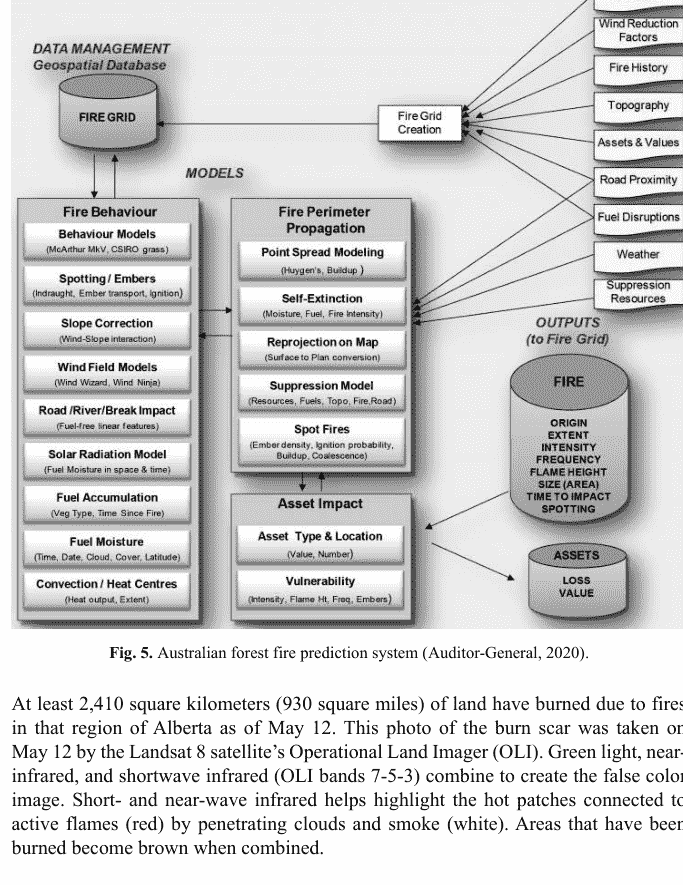

图5. 澳大利亚森林火灾预测系统（Auditor-General, 2020）。

截至5月12日，艾伯塔省该地区至少有2,410平方公里（930平方英里）的土地因火灾被烧毁。这张燃烧痕迹照片由 Landsat 8 卫星的陆地成像仪（OLI）于5月12日拍摄。绿光、近红外和短波红外（OLI波段7-5-3）组合生成假彩色图像。短波红外和近红外能够穿透云层和烟雾（白色），突出显示与活跃火焰（红色）相关的热点区域。被烧毁的区域在合成图像中呈现棕色。

### 空中支援协调

#### 案例研究：地中海地区的 FireHub

欧盟的 FireHub（2019）平台整合了卫星数据和天气信息，以支持整个地中海地区的空中消防行动。通过预测火势蔓延和强度，FireHub 协助协调空中洒水和其他空中消防战术。这已被证明在管理大规模火灾和保护关键基础设施方面行之有效。

### 社区备灾与风险沟通

### 公众宣传活动

#### 案例研究：美国“Ready, Set, Go!”计划

美国的“Ready, Set, Go!”计划面向火灾多发地区的社区开展野火风险与备灾措施教育。该计划利用预测模型的数据向居民告知潜在的野火风险，并提供疏散规划和房屋加固方面的指导。这一举措提高了社区对野火事件的韧性和备灾能力。

### 风险沟通工具

#### 案例研究：西班牙的 eFIRECOM 系统

西班牙的 eFIRECOM 系统是一个面向社区的平台，可实时更新火灾风险等级、疏散路线和安全提示。它整合了野火预测模型的数据，并通过移动应用和社交媒体传递这些信息。该系统增强了公共安全，并确保在火灾紧急情况下及时传播关键信息。

### 成功案例与经验教训

一个著名的成功案例是利用人工智能预测加利福尼亚州的坎普大火（Camp Fire）。2018年，研究人员使用机器学习算法分析历史天气数据和火灾事件，成功预测了最容易发生野火的区域，例如坎普大火。人工智能提供了可操作的情报，对于预防性资源分配和社区警报至关重要。从这一经验中汲取了几点教训。首先，数据整合是关键；将卫星图像、天气预报和历史火灾数据等多种数据源结合起来，能显著提高预测准确性。其次，社区参与至关重要；让社区理解并使用预测工具，可提高备灾水平和疏散令遵从度，从而提升整体安全性。

另一个成功案例来自澳大利亚，该国使用预测模型指导火灾多发地区的计划烧除（Qiao et al., 2023）。这些计划烧除有助于减少燃料负荷，防止更大规模、不可控的野火。澳大利亚的经验凸显了主动措施的重要性；预测模型在规划和执行诸如计划烧除等预防措施方面极具价值（Linn et al., 2002）。这些模型有助于降低大规模野火的风险，并支持制定更有效的火灾管理策略。这些成功案例凸显了预测技术在野火管理中的变革潜力，以及将先进数据分析和社区参与融入这些工作的重要性。适应性管理：根据真实世界结果持续改进模型，可提高其可靠性和有效性（Eskandari et al., 2021）。


### 野火探测与预测的未来方向与研究机遇

#### 新兴技术与创新

新兴技术与创新将彻底改变野火探测与预测。人工智能和机器学习处于前沿，深度学习模型如卷积神经网络和循环神经网络增强了我们预测复杂野火行为及其与环境变量相互作用的能力（He et al., 2023）。生成对抗网络提供了模拟各种野火情景的潜力，为训练预测模型和应对多样化结果提供了宝贵数据。物联网和传感器网络也至关重要，智能传感器部署在高风险区域以监测温度、湿度、风速等实时环境条件。配备热成像摄像机的无人机可在广阔区域提供快速、高分辨率的数据采集，实现精确监测和野火早期探测。卫星和航空技术持续进步，高光谱成像改善了早期探测和监测能力，而立方星则提供频繁、高分辨率的影像以补充大型卫星的数据（Wang et al., 2023a）。

#### 多源数据融合与跨学科方法

整合多源数据和跨学科方法对于提高野火预测准确性至关重要。数据融合技术将卫星、地面传感器、气象站、社交媒体和历史火灾记录的信息结合起来，形成用于更准确预测的综合数据集（Deng et al., 2023）。跨学科合作将气象学、生态学和计算机科学的专业知识汇聚起来，以开发更稳健的模型。大数据分析发挥着重要作用，实时数据处理系统能够处理海量信息，而云计算平台则为存储和分析大型数据集提供可扩展的解决方案（Pan and Zhang, 2023）。人类和社会因素也必须考虑，将土地利用、基础设施和休闲活动等人为活动数据整合进来，以考虑人类活动对野火风险的影响。社区监测让当地社区参与数据收集和监测工作，利用公民科学增强数据质量和覆盖范围（Pereira et al., 2022）。

#### 提升模型准确性与预测能力

提升模型准确性和预测能力对于有效野火管理至关重要。改进的环境模型，例如高分辨率气候模型，提供准确野火预测所需的详细天气预报和生态条件（Mahdi and Mahmood, 2022）。模拟植被生长和燃料积累的动态植被模型有助于预测火灾行为和蔓延（Wang et al., 2023b）。先进的计算技术，包括量子计算和并行处理，为解决当前用经典计算机无法实现的野火预测复杂问题提供了潜力，并能更高效地处理大规模模拟。通过实地实验和控制性焚烧进行验证和校准，确保预测模型准确反映真实世界条件。此外，量化并传达模型预测中的不确定性对于在不确定性下做出明智决策至关重要（Park et al., 2020; Phan et al., 2022）。

#### 政策影响与利益相关方参与

有效的政策制定和利益相关方参与对于将技术进步转化为实用的野火管理策略至关重要（Kumalawati et al., 2021）。基于科学证据和预测模型输出制定循证政策，以改善野火管理和减缓策略。建立支持先进技术使用和跨机构组织数据共享的监管框架至关重要。机构间合作促进政府机构、消防管理组织、研究人员和私营部门合作伙伴之间共享数据、资源和专业知识（Singh et al., 2022）。让当地社区参与野火防范和应急规划，确保政策和策略与当地需求和背景相一致。公众意识和教育也至关重要，制定有效的沟通策略，利用预测模型的数据驱动洞察向公众传达野火风险和防范措施。针对消防管理人员、政策制定者和社区领导者等利益相关方的培训和能力建设举措，增强他们对预测技术的理解和使用（Sachithra and Subhashini, 2023）。

#### 结论

对野火探测与预测的全面审视凸显了先进技术和跨学科方法在减轻野火风险和增强管理策略方面的变革潜力。人工智能、机器学习、物联网、无人机和先进卫星成像等新兴技术在提高野火探测与预测的准确性和及时性方面显示出显著前景。这些创新实现了更精确的监测、早期探测以及模拟复杂野火行为的能力，为主动管理和响应提供了关键洞察。将卫星、地面传感器、气象站和人类活动的多源数据整合，结合跨学科合作，增强了预测模型的稳健性。这种整体方法提高了预测的准确性，并允许对野火动态进行更全面的理解，纳入环境、气象和人为因素。包括深度学习、量子计算和大数据分析在内的先进计算技术对于完善预测模型至关重要。通过实地实验进行持续验证和校准，以及开发量化不确定性的方法，对于确保这些模型准确反映真实世界条件并可用于有效决策至关重要。有效的政策制定和利益相关方参与对于将技术进步转化为实用的野火管理策略至关重要。循证政策、支持技术使用的监管框架、机构间合作和社区参与都是野火管理综合方法的重要组成部分。

### 声明

#### 作者的伦理责任

> “所有作者均已阅读、理解并在适用范围内遵守《作者须知》中所载的‘作者伦理责任’声明”。

#### 伦理审批

不适用。

#### 人工智能工具的使用

通讯作者声明在撰写本文稿时未使用任何人工智能工具。

#### 利益冲突

代表全体作者，通讯作者声明无利益冲突需要披露。

#### 竞争性利益

不适用。

#### 作者贡献

- Author¹: 概念化，方法学，写作 - 原稿，写作 - 审阅与编辑
- Author²: 调查研究，写作 - 审阅与编辑
- Author³: 写作 - 原稿，写作 - 审阅与编辑
- Author⁴: 写作 - 审阅与编辑

#### 资助

未获得资助。

### 参考文献

- Abid, S.K., Sulaiman, N., Chan, S.W., Nazir, U., Abid, M., Han, H., Ariza-Montes, A. and Vega-Muñoz, A. 2021. 迈向综合灾害管理方法：人工智能如何提升灾害管理。 In *Sustainability (Switzerland)*, 13(22). https://doi.org/10.3390/su132212560.
- Anderegg, W.R.L., Wu, C., Acil, N., Carvalhais, N., Pugh, T.A.M., Sadler, J.P. and Seidl, R. 2022. 对21世纪地球森林的气候风险分析。 *Science*, 377(6610). https://doi.org/10.1126/science.abp9723.
- Apostolakis, A., Girtsou, S., Giannopoulos, G., Bartsotas, N.S. and Kontoes, C. 2022. 通过完整机器学习方法估算次日森林火灾风险。 *Remote Sensing*, 14(5). https://doi.org/10.3390/rs14051222.
- Auditor-General, V. 2020. 降低丛林大火风险。 www.audit.vic.gov.au.
- Bhowmik, R.T., Jung, Y.S., Aguilera, J.A., Prunicki, M. and Nadeau, K. 2023. 基于新型机器学习框架的多模态野火预测与早期预警系统。 *Journal of Environmental Management*, 341. https://doi.org/10.1016/j.jenvman.2023.117908.
- Blake, W.H., Theocharopoulos, S.P., Skoulikidis, N., Clark, P., Tountas, P., Hartley, R. and Amaxidis, Y. 2010. 野火对坡地沉积物和磷产量的影响。 *Journal of Soils and Sediments*, 10(4). https://doi.org/10.1007/s11368-010-0201-y.
- Bouquettaya, A., Zarzour, H., Kechida, A. and Taberkit, A.M. 2022a. 通过无人机影像对农作物进行分类的深度学习技术：综述。 In *Neural Computing and Applications*, 34(12). https://doi.org/10.1007/s00521-022-07104-9.
- Bouquettaya, A., Zarzour, H., Taberkit, A.M. and Kechida, A. 2022b. 基于深度学习计算机视觉算法的无人机早期野火检测综述。 In *Signal Processing*, (Vol. 190). https://doi.org/10.1016/j.sigpro.2021.108309.
- Brando, P.M., Paolucci, L., Ummenhofer, C.C., Ordway, E.M., Hartmann, H., Cattau, M.E., Rattis, L., Medjibe, V., Coe, M.T. and Balch, J. 2019. 干旱、野火与森林碳循环：泛热带综合研究。 In *Annual Review of Earth and Planetary Sciences* (Vol. 47). https://doi.org/10.1146/annurev-earth-082517-010235.
- Bruzzone, S. 2019. 野火预测：在刑事行为与非故意事件之间。 *Culture and Organization*, 25(1). https://doi.org/10.1080/14759551.2016.1213730.
- Bustillo Sánchez, M., Tonini, M., Mapelli, A. and Fiorucci, P. 2021. 使用随机森林对圣克鲁斯（玻利维亚）野火易发性进行空间评估。 *Geosciences (Switzerland)*, 11(5). https://doi.org/10.3390/geosciences11050224.
- Cao, L. 2003. 用于时间序列预测的支持向量机专家。 *Neurocomputing*, 51. https://doi.org/10.1016/S0925-2312(02)00577-5.
- Casas, E., Ramos, L., Bendek, E. and Rivas-Echeverría, F. 2023. 评估YOLO架构在烟雾和野火检测中的有效性。 *IEEE Access*, 11. https://doi.org/10.1109/ACCESS.2023.3321217.
- Charizanos, G. and Demirhan, H. 2023. 利用澳大利亚森林的归一化植被指数数据进行野火事件概率的贝叶斯预测。 *Ecological Informatics*, 73. https://doi.org/10.1016/j.ecoinf.2021.101899.
- Cheng, S., Jin, Y., Harrison, S.P., Quilodrán-Casas, C., Prentice, I.C., Guo, Y.K. and Arcucci, R. 2022. 使用机器学习技术的参数灵活野火预测：正向与逆向建模。 *Remote Sensing*, 14(13). https://doi.org/10.3390/rs14133228.
- Chouhan, S.S., Singh, U.P., Sharma, U. and Jain, S. 2021. 使用基于计算机视觉的方法对 *Jatropha Curcas* L. 和 *Pongamia Pinnata* L. 生物燃料植物的叶片病害进行分割与分类。 *Measurement*, 171: 108796. https://doi.org/10.1016/J.MEASUREMENT.2020.108796.
- Chouhan, S.S., Singh, U.P., Sharma, U. and Jain, S. 2024. 使用深度学习和机器学习算法对不同植物物种进行分类。 *Wireless Personal Communications*, 136(4): 2275–2298. https://doi.org/10.1007/S11277-024-11374-Y/FIGURES/9.


- Coen, J.L., Schroeder, W., Conway, S. and Tarnay, L. 2020. 极端野外火灾事件的计算建模：科学理解的综合及其在预测、土地管理与消防员安全中的应用。 *计算科学杂志*, 45. https://doi.org/10.1016/j.jocs.2020.101152.
- Deng, J., Wang, W., Gu, G., Chen, Z., Liu, J., Xie, G., Weng, S., Ding, L. and Li, C. 2023. 利用多源时空协同方法进行野火易发性预测。 *地球科学信息学*, 16(4). https://doi.org/10.1007/s12145-023-01104-6.
- Dillis, C., Butsic, V., Moanga, D., Parker-Shames, P., Wartenberg, A. and Grantham, T.E. 2022. 加州农业部门中，大麻面临的野火威胁独一无二。 *生态圈*, 13(9). https://doi.org/10.1002/ecs2.4205.
- Ding, C., Zhang, X., Chen, J., Ma, S., Lu, Y. and Han, W. 2022. 基于 Himawari-8 卫星平台的深度学习野火探测。 *国际遥感杂志*, 43(13). https://doi.org/10.1080/01431161.2022.2119110.
- Ding, Y., Wang, M., Fu, Y., Zhang, L. and Wang, X. 2023. 基于动态亮温阈值的野火检测算法。 *森林*, 14(3). https://doi.org/10.3390/f14030477.
- Elia, M., D'Este, M., Ascoli, D., Giannico, V., Spano, G., Ganga, A., Colangelo, G., Lafortezza, R. and Sanesi, G. 2020. 利用人工神经网络估算地中海景观中野火发生的概率。 *环境影响评价评论*, 85. https://doi.org/10.1016/j.eiar.2020.106474.
- Eskandari, S., Pourghaseemi, H.R. and Tiefenbacher, J.P. 2021. 利用新颖和集成数据挖掘模型对伊朗自然区域进行火灾易发性制图。 *环境科学与污染研究*, 28(34). https://doi.org/10.1007/s11356-021-13881-y.
- Fedirka, A. 2020. *澳大利亚野火灾的地缘政治后果*. https://geopoliticalfutures.com.
- FireHub. 2019. BEYOND 中心：利用 Sentinel 2 卫星对埃维亚岛烧毁区域的首次评估。 http://beyond-eocenter.eu/index.php/web-services/firehub.
- Gao, C., Lin, H. and Hu, H. 2023. 基于随机森林和反向传播神经网络的中国黑龙江省黑河地区森林火灾风险预测。 *森林*, 14(2). https://doi.org/10.3390/f14020170.
- Gaudreau, J., Perez, L. and Drapeau, P. 2016. BorealFireSim：气候变化范式下魁北克北方森林野火的基于 GIS 的元胞自动机模型。 *生态信息学*, 32. https://doi.org/10.1016/j.ecoinf.2015.12.006.
- Ghali, R. and Akhloufi, M.A. 2023. 利用卫星遥感数据的野外火灾深度学习方法：检测、制图与预测。 In *火灾* (Vol. 6, Issue 5). https://doi.org/10.3390/fire6050192.
- Ghali, R., Akhloufi, M.A. and Mseddi, W.S. 2022. 基于无人机的野火检测与分割的深度学习和 Transformer 方法。 *传感器*, 22(5). https://doi.org/10.3390/s22051977.
- Ghorbandezadeh, O., Kamran, K.V., Blaschke, T., Aryal, J., Naboureh, A., Einali, J. and Bian, J. 2019. 利用野外调查 GPS 数据和机器学习方法进行野火易发性空间预测。 *火灾*, 2(3). https://doi.org/10.3390/fire2030043.
- He, H., Zhang, Z., Jia, Q., Huang, L., Cheng, Y. and Chen, B. 2023. 基于改进轻量级 YOLO 的输电线路野火检测。 *能源报告*, 9. https://doi.org/10.1016/j.egyr.2022.10.435.
- Huot, F., Hu, R.L., Goyal, N., Sankar, T., Ihme, M. and Chen, Y.F. 2022. 次日野火蔓延：用于从遥感数据预测野火蔓延的机器学习数据集。 *IEEE 地球科学与遥感汇刊*, 60. https://doi.org/10.1109/TGRS.2022.3192974.
- Iban, M.C. and Sekertekin, A. 2022. 基于遥感火情数据和 GIS 的机器学习野火易发性制图：土耳其阿达纳和梅尔辛省案例研究。 *生态信息学*, 69. https://doi.org/10.1016/j.ecoinf.2022.101647.
- Jafar Ali Ibrahim, S., Prathyusha, Y., Akhila, B., Rajini, M. and Naveen Sai, U. 2022. 农村地区早产的基于机器学习的预测模型。 *南亚工程与技术杂志*, 12(3). https://doi.org/10.26524/sajet.2022.12.46.
- Jiang, N., Li, P. and Feng, Z. 2022. 热带刀耕火种农业的遥感：综述。 In International Journal of Applied Earth Observation and Geoinformation (Vol. 112). https://doi.org/10.1016/j.jag.2022.102876.
- Jimeng, S. 2022. 利用各种深度学习模型的时序预测。 International Journal of Computer and Systems Engineering, 16(6).
- Kadir, E.A., Kung, H.T., AlMansour, A.A., Irie, H., Rosa, S.L. and Fauzi, S.S.M. 2023. 基于长短期记忆网络深度学习算法的环境监测野火热点预测与制图。 Environments - MDPI, 10(7). https://doi.org/10.3390/environments10070124.
- Kale, M.P., Mishra, A., Pardeshi, S., Ghosh, S., Pai, D.S. and Roy, P.S. 2022. 印度主要森林类型野火预测。 Frontiers in Forests and Global Change, 5. https://doi.org/10.3389/fgc.2022.882685.
- Kalinaki, K., Acaru, S.F., Kugonza, J. and Nsubuga, R. 2024a. 迈向智能的明天：机器学习助力可持续发展。 In Methodologies, Frameworks, and Applications of Machine Learning (pp. 66–89). https://doi.org/10.4018/979-8-3693-1062-5.CH004.
- Kalinaki, K., Malik, O.A. and Ching Lai, D.T. 2023a. FCD-AttResU-Net：利用注意力残差 U-Net 在 Sentinel-2 卫星图像中进行改进的森林变化检测。 International Journal of Applied Earth Observation and Geoinformation, 122: 103453. https://doi.org/10.1016/J.JAG.2023.103453.
- Kalinaki, K., Malik, O.A., Lai, D.T.C., Sukri, R.S. and Wahab, R.B.H.A. 2023b. 利用深度学习技术和 Sentinel-2 图像对汶莱公路沿线森林植被覆盖变化进行时空制图。 Ecological Informatics, 77: 102193. https://doi.org/10.1016/J.ECOINF.2023.102193.
- Kalinaki, K., Shafik, W., Gutu, T.J.L. and Malik, O.A. 2023c. 智能农业和农业实践的计算机视觉与机器学习。 In Artificial Intelligence Tools and Technologies for Smart Farming and Agriculture Practices (pp. 79–100). IGI Global. https://doi.org/10.4018/978-1-6684-8516-3.ch005.
- Kalinaki, K., Yahya, U., Malik, O.A. and Lai, D.T.C. 2024b. 工业 5.0 中大数据分析与人工智能的综述，用于智能决策。 In Human-Centered Approaches in Industry 5.0: Human-Machine Interaction, Virtual Reality Training, and Customer Sentiment Analysis (pp. 24–47). https://doi.org/10.4018/979-8-3693-2647-3.ch002.
- Khajuria, R. Sunanda and Singh, S. 2018a. 利用人工神经网络的现有叶片病害技术综述。 International Journal of Computer Trends and Technology, 59(1): 52–62. https://doi.org/10.14445/22312803/IJCTT-V59P109.
- Khajuria, R. Sunanda and Singh, S. 2018b. 利用人工神经网络的现有叶片病害技术综述。 International Journal of Computer Trends and Technology, 59(1): 52–62. https://doi.org/10.14445/22312803/IJCTT-V59P109.
- Khaki, S., Wang, L. and Archontoulis, S.V. 2020. 作物产量预测的 CNN-RNN 框架。 Frontiers in Plant Science, 10. https://doi.org/10.3389/fpls.2019.01750.
- Koh, J. 2023. 用于野火预测的极值理论梯度提升。 Extremes, 26(2). https://doi.org/10.1007/s10687-022-00454-6.
- Küçükarslan, A.B. 2024. 应用于森林火灾研究的机器学习 (ML) 技术概述。 Eurasian Journal of Forest Science. https://doi.org/10.31195/ejefs.1386306.
- Kumalawati, R., Salamiah, Yuliarti, A. and Murliawan, K.H. 2021. 未来粮食问题缓解的农产品潜力制图。 In Geojournal of Tourism and Geosites (Vol. 33, Issue 4). https://doi.org/10.30892/gtg.334spl05-596.
- Kumar, R., Kumar, A., Bhatia, K., Nisar, K.S., Chouhan, S.S., Maratha, P. and Tiwari, A.K. 2024. 用于增强作物健康和产量的棉花病害检测混合方法。 IEEE Access. https://doi.org/10.1109/ACCESS.2024.3419906.
- Ladi, T., Jabalameli, S. and Sharifi, A. 2022. 机器学习和深度学习方法在气候变化缓解和适应中的应用。 Environment and Planning B: Urban Analytics and City Science, 49(4). https://doi.org/10.1177/23998083221085281.


Leuenberger, M., Parente, J., Tonini, M., Pereira, M.G. and Kanevski, M. 2018. 野火易发性制图：确定性与随机性方法. 环境建模与软件, 101. https://doi.org/10.1016/j.envsoft.2017.12.019.

Lin, X., Li, Z., Chen, W., Sun, X., and Gao, D. 2023. 基于长短期时间序列网络的森林火灾预测. 森林, 14(4). https://doi.org/10.3390/f14040778.

Linn, R., Reisner, J., Colman, J.J. and Winterkamp, J. 2002. 使用 FIRETEC 研究野火行为. 国际荒野火灾期刊, 11(3-4). https://doi.org/10.1071/wf02007.

Mahdi, A.S. and Mahmood, S.A. 2022. 用于早期野火检测的边缘计算环境. 计算新兴技术年刊, 6(3). https://doi.org/10.33166/AETiC.2022.03.005.

Mandallaz, D. and Ye, R. 1997. 用泊松模型预测森林火灾. 加拿大林业研究期刊, 27(10). https://doi.org/10.1139/x97-103.

Masoudian, S., Sharples, J., Jovanoski, Z., Towers, I. and Watt, S. 2023. 在野火蔓延预测中纳入随机风矢量. 大气, 14(11). https://doi.org/10.3390/atmos14111609.

Massetti, A., Rüdiger, C., Yebra, M. and Hilton, J. 2019. 植被结构垂直指数（VSPI）：用于野火预测的森林状况指数. 环境遥感, 224. https://doi.org/10.1016/j.rse.2019.02.004.

McColl-Gausden, S.C., Bennett, L.T., Clarke, H.G., Ababei, D.A. and Penman, T.D. 2022. 燃料-气候-火灾困境：气候变化下温带桉树林的火灾制度将如何变化？ 全球变化生物学, 28(17). https://doi.org/10.1111/gcb.16283.

Melchiorre, A. and Boschetti, L. 2018. 利用 MODIS 数据对烧毁面积持续时间的全球分析. 遥感, 10(5). https://doi.org/10.3390/rs10050750.

Pan, M. and Zhang, S. 2023. 使用 CiteSpace 可视化野火建模预测方法：文献计量分析. 大气, 14(6). https://doi.org/10.3390/atmos14061009.

Park, M., Tran, D.Q., Jung, D. and Park, S. 2020. 使用基于 DenseNet 和 CycleGAN 数据增强的远程摄像机图像的野火检测方法. 遥感, 12(22). https://doi.org/10.3390/rs12223715.

Pereira, J., Mendes, J., Júnior, J.S.S., Viegas, C. and Paulo, J.R. 2022. 野火蔓延预测校准的遗传算法方法综述. 在《Mathematics》（第 10 卷，第 3 期）. https://doi.org/10.3390/math10030300.

Pérez-Sánchez, J., Jimeno-Sáez, P., Senent-Aparicio, J., Diaz-Palmero, J.M. and Cabezas-Cerezo, J. de D. 2019. 使用人工神经网络研究气候变化条件下西班牙南部森林火灾烧毁面积的演变. 应用科学（瑞士）, 9(19). https://doi.org/10.3390/app9194155.

Phan, T.C., Quach, N.D.K., Nguyen, T.T., Nguyen, T.T., Jo, J. and Nguyen, Q.V.H. 2022. 具有语义解释的实时野火检测. 专家系统与应用, 201. https://doi.org/10.1016/j.eswa.2022.117007.

Phelps, N. and Woolford, D.G. 2021. 校准统计方法与机器学习方法在荒野火灾发生预测中的比较：加拿大阿尔伯塔省拉克拉比什人为引起火灾的案例研究. 国际荒野火灾期刊, 30(11). https://doi.org/10.1071/WF20139.

Piralilou, S.T., Einali, G., Ghorbanzadeh, O., Nachappa, T.G., Gholamnia, K., Blaschke, T. and Ghamsi, P. 2022. 一种基于 Google Earth Engine 的野火易发性预测融合不同空间分辨率遥感数据的方案. 遥感, 14(3). https://doi.org/10.3390/rs14030672.

Pourghasemi, H.R., Gayen, A., Lasaponara, R. and Tiefenbacher, J.P. 2020. 学习向量量化及不同机器学习技术在评估森林火灾影响因素和空间建模中的应用. 环境研究, 184. https://doi.org/10.1016/j.envres.2020.109321.

Qiao, Y., Jiang, W., Wang, F., Su, G., Li, X. and Jiang, J. 2023. FireFormer：一种从监控摄像头识别森林火灾的高效 Transformer. 国际荒野火灾期刊. https://doi.org/10.1071/WF22220.

Qiao, Y., Wang, T., Huang, Q., Guo, H., Zhang, H., Xu, Q., Shen, Q. and Ling, N. 2024. 核心物种通过增强群落融合期间土壤微生物合作和网络复杂性影响植物健康. 土壤生物学与生物化学, 188. https://doi.org/10.1016/j.soilbio.2023.109231.

Rahimi, E., Barghjelveh, S., Dong, P., Pirlar, M.A. and Jahanbakhshian, M.M. 2021. PollMap：农业景观作物授粉制图软件. 生态与环境学报, 45(1). https://doi.org/10.1186/s41610-021-00210-0.

Rezaie, F., Panahi, M., Bateni, S.M., Lee, S., Jun, C., Trauernicht, C. and Neale, C.M.U. 2023. 新型优化深度学习算法在野火建模中的应用开发：夏威夷茂宜岛案例研究. 人工智能工程应用, 125. https://doi.org/10.1016/j.engappai.2023.106699.

Rim, C.B., Om, K.C., Ren, G., Kim, S.S., Kim, H.C. and Kang-Chol, O. 2018. 基于耦合天气-野火建模的野火预报系统建立. 应用地理学, 90. https://doi.org/10.1016/j.apgeog.2017.12.011.

Rishickesh, R., Shahina, A. and Nayeemulla Khan, A. 2019. 使用监督和集成机器学习算法预测森林火灾. 近期技术与工程国际期刊, 8(2). https://doi.org/10.35940/ijrte.B2878.078219.

Rjoub, D., Alsharoa, A. and Masadeh, A. 2023. 利用空气质量传感器进行无人机系统辅助早期野火检测. 电子学（瑞士）, 12(5). https://doi.org/10.3390/electronics12051239.

Rodrigues, M. and De la Riva, J. 2014. 机器学习算法在建模人为引起野火发生方面的见解. 环境建模与软件, 57. https://doi.org/10.1016/j.envsoft.2014.03.003.

Rodrigues, M., de la Riva, J. and Fotheringham, S. 2014. 使用地理加权逻辑回归建模西班牙人为引起野火解释因子的空间变化. 应用地理学, 48. https://doi.org/10.1016/j.apgeog.2014.01.011.

Rubi, J.N.S., de Carvalho, P.H.P. and Gondim, P.R.L. 2022. 林业 4.0 与工业 4.0：野火行为预测用例. 计算机与电气工程, 102. https://doi.org/10.1016/j.compeleceng.2022.108200.

Sachithra, V. and Subhashini, L.D.C.S. 2023. 人工智能如何用于实现农业可持续性：系统综述. 农业人工智能, 8. https://doi.org/10.1016/j.aiia.2023.04.003

Singh, G., Singh, S., Sethi, G. and Sood, V. 2022. 使用 Sentinel-2 卫星数据进行农业土地利用制图的深度学习. 地理学, 2(4). https://doi.org/10.3390/geographies204004.

Sreenath, K., Hemalatha Reddy, G., Venkata Ranga Reddy, K., Sneha Sandhya, G. and Mahaboob Basha, M.D. 2022. 基于 UAV 的野火检测与分割的深度学习方法. 南亚工程与技术期刊, 12(3). https://doi.org/10.26524/sajet.2022.12.45.

Succarie, A., Xu, Z. and Wang, W. 2022. 树轮中氮循环及氮同位素组成的变异与趋势：指纹识别气候极端事件和丛林大火的潜力. 土壤与沉积物学报, 22(9). https://doi.org/10.1007/s11368-022-03260-6.

Tehrany, M.S., Jones, S., Shabani, F., Martínez-Álvarez, F. and Tien Bui, D. 2019. 一种用于热带森林火灾易发性空间预测的新型集成建模方法：使用 LogitBoost 机器学习分类器和多源地理空间数据. 理论与应用气候学, 137(1-2). https://doi.org/10.1007/s00704-018-2628-9.

Thissen, U., Van Brakel, R., De Weijer, A.P., Melsen, W.J. and Buydens, L.M.C. 2003. 使用支持向量机进行时间序列预测. 化学生物计量学与智能实验室系统, 69(1-2). https://doi.org/10.1016/S0169-7439(03)00111-4.

Tien Bui, D., Bui, Q.T., Nguyen, Q.P., Pradhan, B., Nampak, H. and Trinh, P.T. 2017. 一种基于 GIS 的神经-模糊推理系统和粒子群优化的混合人工智能方法用于热带地区森林火灾易发性建模. 农业与森林气象学, 233. https://doi.org/10.1016/j.agrformet.2016.11.002.

Tonini, M., D’andrea, M., Biondi, G., Esposti, S.D., Trucchia, A. and Fiorucci, P. 2020. 一种基于机器学习的野火易发性制图方法。意大利利古里亚地区案例研究. 地球科学（瑞士）, 10(3). https://doi.org/10.3390/geosciences10030105.


Tuyen, T.T., Jaafari, A., Yen, H.P.H., Nguyen-Thoi, T., Phong, T. Van, Nguyen, H.D., Van Le, H., Phuong, T.T.M., Nguyen, S.H., Prakash, I. 和 Pham, B.T. 2021. 基于局部加权学习算法的空间显式集成模型绘制森林火灾易感性地图. *生态信息学*, 63. https://doi.org/10.1016/j.ecoinf.2021.101292.

Umunnakwe, A., Parvania, M., Nguyen, H., Horel, J.D. 和 Davis, K.R. 2022. 数据驱动的电力系统运行野火风险时空分析. *IET发电、输电与配电*, 16(13). https://doi.org/10.1049/gtd2.12463.

van Klompenburg, T., Kassahun, A. 和 Catal, C. 2020. 使用机器学习进行作物产量预测：系统性文献综述. 载于 *农业计算机与电子*（第177卷）. https://doi.org/10.1016/j.compag.2020.105709.

Vyas, S., Dalhaus, T., Kropff, M., Aggarwal, P. 和 Meuwissen, M.P.M. 2021. 绘制全球农业保险研究图谱. *环境研究快报*, 16(10). https://doi.org/10.1088/1748-9326/ac263d.

Wang, D., Guan, D., Zhu, S., MacKinnon, M., Geng, G., Zhang, Q., Zheng, H., Lei, T., Shao, S., Gong, P. 和 Davis, S.J. 2021. 2018年加利福尼亚野火的经济足迹. *自然可持续性*, 4(3). https://doi.org/10.1038/s41893-020-00646-7.

Wang, L., Zhang, H., Zhang, Y., Hu, K. 和 An, K. 2023a. 机器视觉课程中基于深度学习的森林野火检测实验. *IEEE 访问*, 11. https://doi.org/10.1109/ACCESS.2023.3262701.

Wang, W., Zhao, F., Wang, Y., Huang, X. 和 Ye, J. 2023b. 中国西南山区野火驱动因素与易感性的空间格局季节差异. *整体环境科学*, 869. https://doi.org/10.1016/j.scitotenv.2023.161782.

Wang, X., Pan, Z., Gao, H., He, N. 和 Gao, T. 2023c. 基于多头注意力机制的复杂场景实时野火检测高效模型. *实时图像处理杂志*, 20(4). https://doi.org/10.1007/s11554-023-01321-8.

Wu, H., Hu, T., Liu, Y., Zhou, H., Wang, J. 和 Long, M. 2022. TimesNet：用于通用时间序列分析的时序二维变化建模. http://arxiv.org/abs/2210.02186.

Yan, C.S., Chen, Y.W., Yang, H.M. 和 Ahokas, E. 2023. 光学频谱分析仪及其在天文学和遥感中的典型应用. 载于 *科学仪器评论*（第94卷，第8期）. https://doi.org/10.1063/5.0138963.

Yandouzi, M., Grari, M., Idrissi, I., Moussaoui, O., Azizi, M., Ghoumid, K. 和 Elmiad, A.K. 2022. 基于深度学习与无人机的森林火灾检测与预测综述. 载于 *理论与应用信息技术杂志*（第100卷，第12期）.

Zakari, R.Y., Shafik, W., Kalinaki, K. 和 Iheaturu, C.J. 2024. 林业物联网（IoFT）技术在森林管理中的应用与技术. 载于 *工业4.0数字经济中的高级物联网技术与应用*. https://doi.org/10.1201/9781003434269-15.

Zhang, X., Guo, Y., Tian, X. 和 Bai, Y. 2023. 通过多时相Sentinel-2影像和时空神经网络提升天山北坡作物制图精度. *农学*, 13(11). https://doi.org/10.3390/agronomy13112800.

Zhong, C., Cheng, S., Kasoar, M. 和 Arcucci, R. 2023. 用于全球野火预测的降阶数字孪生与潜在数据同化. *自然灾害与地球系统科学*, 23(5). https://doi.org/10.5194/nhess-23-1755-2023.

## 第3章

### 利用遥感进行农业制图：技术、应用与未来方向

*Rufai Yusuf Zakari,¹,* Zaharaddeen Karami Lawal,²,³ Kassim Kalinaki⁴,⁵ 和 Wasswa Shafik⁶*

¹ 计算机科学系，科学与信息技术学院（SSIT），Skyline University Nigeria，1080，尼日利亚。https://orcid.org/0000-0002-4645-6412
² 计算机科学系，Federal University Dutse，吉加瓦州，尼日利亚。
³ 综合技术学院，Universiti Brunei Darussalam，文莱。https://orcid.org/0000-3011-5581
⁴ 计算机科学系，Islamic University in Uganda（IUIU），邮政信箱2555，姆巴莱，乌干达。
⁵ Borderline Research Laboratory，坎帕拉，乌干达。https://orcid.org/0000-0001-8630-9110
⁶ Dig Connectivity Research Laboratory，坎帕拉，600040，乌干达。https://orcid.org/0000-0002-9320-3186
* 通讯作者：rufaig6@gmail.com

### 引言

遥感（RS）通过提供前所未有的见解和数据，彻底改变了包括农业在内的各个领域，这些数据对现代耕作实践至关重要（Zhang et al., 2023a）。在农业中使用RS涉及从星载平台（卫星）、机载平台（飞机）和地面平台——无人机（UAV）——收集和处理数据，以监测和管理农业活动。这种方法能够对大面积农田进行细致观察，从而评估作物健康状况、土壤条件和影响农业生产力的环境因素（Kluger et al., 2021）。RS对农业制图的重要性和益处是多方面的。RS提供准确、最新、详细的信息，用于跟踪植物发育、检测作物胁迫迹象以及预测收获量（Anuradha, 2024; Zhang et al., 2023a）。这些信息对于做出明智的资源分配、病虫害防治和灌溉管理决策至关重要。此外，RS通过实现特定地点的管理实践提高了精准农业的效率，从而提高了作物产量并减少了对环境的影响（Hunt et al., 2020）。监测大面积和难以进入区域的能力也有助于更好的规划和灾害管理，保障粮食安全和可持续农业实践（Verma et al., 2023）。

将RS技术与其他先进工具（包括地理信息系统（GIS）和机器学习算法）相融合，进一步放大了其在农业制图方面的能力（Karnawat et al., 2020）。GIS能够对RS数据进行空间分析和可视化，使得检测作物健康和土壤状况的模式与趋势更加经济高效（Verma et al., 2023）。机器学习算法能够以高精度快速分析海量数据集，生成预测并发现可能被人类观察遗漏的异常模式。这些技术共同促成了更全面的农场管理方法，在这种方法中，可以基于数据驱动做出优化生产力和可持续性的决策。例如，机器学习模型可以通过分析历史记录和当前环境因素来预测昆虫侵扰或病原体增殖，从而使种植者能够实施预防策略（Sachithra and Subhashini, 2023）。此外，将RS数据与GIS集成，通过生成高分辨率地图实现靶向农业。这些地图指导养分、防治虫害的物质和灌溉的精确施用，优化资源利用和效果。

此外，RS技术的演进正在为农业中更具创新性的应用铺平道路。传感器技术的进步，包括高光谱和热传感器的开发，提供了关于作物状况和土壤健康的更详细、更具体的信息（Shanmugapriya et al., 2019）。高光谱传感器能够检测植物生理学中预示胁迫或营养缺乏的细微差异，而热传感器则可以通过测量地表温度来识别水分胁迫区域。这些进步使得对农业活动的监测和管理更加精确（Chuphal et al., 2024）。此外，配备先进传感器的无人机正变得越来越普及，提供高分辨率数据和实时监测能力（Khaki et al., 2020）。将RS数据与其他农业技术（如自动化机械和物联网（IoT）传感器）相整合也即将成为现实，预示着农业将更加可持续、高效，并能更好地适应环境变化。RS技术的持续创新凸显了其在农业未来的关键作用，推动着更具韧性和生产力的农业系统取得进展（Zakari et al., 2024）。本章旨在对RS在农业中的作用进行详尽综述。我们探讨RS的基本原理以及用于农业制图的不同平台和传感器类型。本章还将涵盖数据采集技术、预处理步骤以及用于图像分类的方法。对于精确分析至关重要的特征提取与选择，以及RS在农业中的各种应用（包括作物健康监测、产量预测和精准农业）也将一并讨论。


为了说明遥感的实际意义，将提供展示其在不同农业环境中应用的真实案例研究。此外，本章还将讨论农业遥感面临的挑战，例如数据可用性、空间和时间分辨率限制以及验证问题。最后，我们将探讨该领域的 emerging trends 和未来方向，重点介绍传感器技术的进步、与物联网的集成，以及大数据分析（BDA）和人工智能进一步提升农业实践的潜力（Alabdulatief et al., 2023; Kalinaki et al., 2024a）。总之，遥感通过提供支持高效和可持续农业的宝贵数据和见解来改变农业。本章将总结所讨论的关键要点，并为研究人员、从业人员和政策制定者提供建议，以充分发挥遥感在农业中的潜力，为这一关键领域的未来发展和创新铺平道路。

本章的主要目标是：
-   提供农业中使用的遥感原理和技术的全面概述。
-   讨论用于农业制图的各种遥感平台和传感器。
-   描述农业遥感中涉及的数据获取和预处理技术。
-   探索农业中遥感的应用，如作物健康监测、异常检测和产量预测。
-   突出展示遥感在农业中成功实施的真实案例研究。
-   讨论农业遥感的挑战和局限性。
-   探索农业遥感技术的 emerging trends 和未来方向。

## 章节组织
本章其余部分结构如下：在第 1 节介绍之后，第 2 节描述了遥感的基本原理。第 3 节提供了遥感平台的概述。第 4 节阐述了农业制图中使用传感器的类型。第 5 节讨论了数据获取技术和挑战。第 6 节详细介绍了特征提取和选择技术。第 7 节讨论了农业中各种遥感应用。第 8 节详细介绍了遥感在改善农业中的不同实际应用。第 9 节讨论了农业遥感的挑战。第 10 节介绍了农业遥感的 emerging trends，第 11 节为结论。

## 遥感的基本原理
### 定义和关键概念
遥感是在不进行直接物理接触的情况下获取地球表面信息的方法。它涉及使用传感器从远处探测和测量物体或区域的物理特性。遥感中的关键概念包括电磁辐射、传感器、平台和数据处理。

### 遥感平台
遥感平台是携带传感器并收集数据的车辆或设备。用于农业遥感的主要平台是卫星、无人机（UAVs, 无人驾驶飞行器）和飞机（Okengwu et al., 2023）。卫星绕地球轨道运行，提供全球覆盖，使其非常适合监测大面积农业区域（Steven and Clark, 1990; Victor et al., 2024）。无人机是较小的无人驾驶飞机，可以在较低高度飞行，为较小区域提供更高分辨率的图像。飞机，包括有人驾驶和无人驾驶选项，用于更具体或有针对性的数据收集（Victor et al., 2024）。

### 遥感类型
遥感可分为两大主要类型：主动和被动。主动遥感涉及传感器向目标发射信号并测量反射或后向散射信号（Ullo and Sinha, 2021）。示例包括雷达和激光雷达系统，常用于地形测绘和植被分析。被动遥感依赖于探测地球表面反射或发射的自然能量（Khanal et al., 2020）。被动传感器测量不同波长下的辐射强度，例如可见光、红外和微波。示例包括光学传感器，其捕获反射阳光以创建图像，以及热传感器，其探测发射的红外辐射以评估温度（Victor et al., 2024）。图 1 展示了遥感的类型。

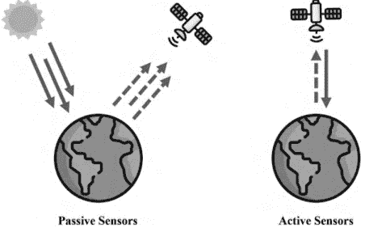

图 1. 遥感类型。

## 遥感技术关键原理
### 电磁波谱
遥感依赖于地球表面与电磁（EM）辐射之间的相互作用（Okengwu et al., 2023）。电磁波谱包含各种能量波，从紧凑的伽马辐射到宽广的无线电信号。专门的探测器被设计用于捕获该波谱内的特定波长范围（Khanal et al., 2020）。

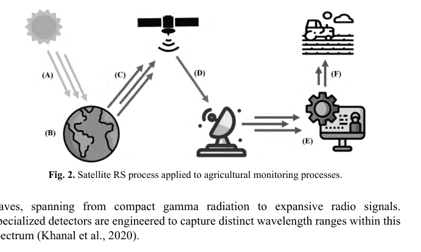

图 2. 应用于农业监测过程的卫星遥感过程。

### 能量相互作用
当电磁波与地球地形相互作用时，它们可能会被吸收、穿透或反射回来。能量保留或反射的程度取决于所遇到的地表材料的特性（Victor et al., 2024）。

### 空间分辨率
这是指图像中的细节水平。空间分辨率越高，图像中可以看到的细节越多。空间分辨率由传感器的能力和平台的高度决定（Karnawat et al., 2020）。

### 时间分辨率
时间分辨率是指传感器可以多久重新访问同一区域以收集数据。时间分辨率越高，就能更频繁地监测随时间的变化（Okengwu et al., 2023）。

### 光谱分辨率
光谱精度表示探测器区分各种电磁波频率的能力（Ullo and Sinha, 2021）。光谱灵敏度更高的仪器可以提取有关观测特征或区域组成和状态的更精细细节（Shanmugapriya et al., 2019）。

### 辐射分辨率
辐射分辨率是指传感器探测辐射强度变化的灵敏度。辐射分辨率越高，就能探测到能量反射或发射的更细微差异（Jiang et al., 2022）。

## 遥感平台概述
遥感平台是用于收集数据的传感器所承载的载体或车辆。这些平台可以根据高度、覆盖面积和操作能力进行分类。

### 卫星平台（空间基）
卫星平台绕地球轨道运行，提供广泛的覆盖，使其非常适合大规模农业监测。不同类型的轨道，例如地球静止轨道和极地轨道，为遥感提供了独特的优势（Khanal et al., 2020）。地球静止卫星在地球表面同一点上方保持固定，提供对同一区域的持续监测，这有助于天气监测和跟踪大规模农业趋势（Oymatov et al., 2023）。另一方面，极地轨道卫星经过地球两极，随着地球自转覆盖整个地球。它们提供高分辨率数据并定期重新访问同一区域，这对于监测农业田地随时间的变化至关重要。农业卫星平台的示例包括 Landsat 系列、Sentinel-2 和 MODIS，它们为作物监测、土壤评估和土地利用规划提供关键数据（Jiang et al., 2022）。

### 航空平台
航空平台包括有人驾驶飞机，提供高分辨率数据并且可以灵活部署（Tang and Shao, 2015）。有人驾驶飞机适合快速覆盖大面积。它们可以配备各种传感器以捕获详细的图像和数据，使其非常适合区域农业调查和制图项目。

### 地面平台
地面平台包括固定装置和移动系统，它们在特定位置提供高度详细和准确的数据。固定装置，例如气象站和地面光谱辐射计，持续监测土壤湿度、温度和作物生长等特定参数（Bougettaya et al., 2022）。这些提供了宝贵的地面实况数据，可用于验证和校准其他平台的遥感数据。移动系统安装在车辆或手持设备上，可以移动到不同位置按需收集数据。它们有助于详细的田间调查并以高精度验证遥感数据。地面平台提供最高水平的细节和准确性，使其对于土壤分析、作物勘察和局部环境监测等特定农业应用不可或缺（Li et al., 2023）。其他地面平台包括无人机或无人机，它们正日益流行于精准农业（Kattenborn et al., 2021）。它们可以在低空飞行，捕获高分辨率图像和数据，并提供有关作物健康和田间条件的空间信息。无人机对于需要精确和频繁监测的小型至中型农场特别有用。然而，其有限的

飞行时间和航程对于较大面积而言可能是一个缺点。无人机的灵活性和成本效益使其成为现代农业实践中的重要工具，能够实现及时且有针对性的干预（Bougettayya et al., 2022）。

## 用于农业制图的传感器类型
不同类型的传感器被用于遥感（RS）以捕获与农业制图相关的广泛数据。这些传感器可根据其收集的数据大致分为光学、热、雷达和 LiDAR 传感器。

### 光学传感器
光学传感器检测地球表面在众多波长上反射的光，例如可见光、近红外（NIR）和短波红外（SWIR）（Nurdin et al., 2022）。这些传感器经常用于衡量植物活力、土壤特性和作物状况。记录多个不同光谱范围数据的仪器常被用于计算植被健康指标，如归一化植被指数（NDVI，Normalized Difference Vegetation Index）（Nurdin et al., 2022）。高光谱传感器在众多精细光谱分段上捕获信息，提供复杂光谱数据，可实现作物识别、养分缺乏检测和植物胁迫监测。这些仪器在科学研究和精准农业中得到应用，为深入分析和知情决策提供先进工具（Rahimi et al., 2021）。

### 热传感器
热传感器计算地球表面发出的热红外辐射，提供地表温度信息。在农业中，热传感器监测土壤湿度水平、检测植物水分胁迫并高效管理灌溉系统（Kluger et al., 2021）。例如，Landsat 8 卫星上的传感器提供可用于评估作物用水量和管理水资源的热数据。热成像帮助农民优化灌溉计划、减少用水量并提高作物产量，确保植物及时获得充足的水分（Kumalawati et al., 2021）。

### 雷达传感器
雷达传感器，或合成孔径雷达（SAR），发射微波信号并测量反射信号以获取地球表面信息（Javaid et al., 2023）。雷达传感器可穿透云层并全天候运行，使其对不间断监测至关重要（Vyas et al., 2021）。在农业中，SAR 传感器测量土壤湿度、监测作物生长并检测田间条件变化。示例包括 Sentinel-1 卫星，其提供高分辨率雷达影像。在各种天气条件下以及白天和夜间获取数据的能力使雷达传感器成为农业监测的可靠信息来源，尤其是在云层频繁的地区（Anuradha, 2024）。

提供有关作物健康和田间条件的空间信息（Chouhan et al., 2024）。无人机对于需要精确且频繁监测的小型至中型农场特别有用。然而，其缩短的飞行时间和航程对于较大面积而言可能是一个缺点。此外，处理无人机收集的大量数据需要大量的计算资源。遵守飞行法规并获得必要许可也可能具有挑战性（Anuradha, 2024）。

## 地面传感器
地面传感器，如光谱辐射计和 LIDAR，为农业制图提供高度准确和详细的数据（Ullo and Sinha, 2021）。这些传感器通常收集土壤特性、作物生长阶段和植物健康的信息。地面传感器的主要优势在于其精度，可补充来自航空和卫星源的数据。然而，其空间覆盖范围有限，使其适用于较小区域或验证通过其他遥感方法获得的数据。高昂的设备成本和地面数据收集的劳动密集型特性是显著挑战（“RS in Applications of Geoinformation,” 2022）。

## 数据获取中的挑战

### 数据质量
确保高质量数据对于准确的农业制图至关重要。常见问题包括噪声、缺失值以及不同数据集之间不一致（Khanal et al., 2020）。噪声可能源于传感器误差或环境因素，而缺失值可能由于数据收集中的间隙产生。来自不同来源不一致的数据格式和分辨率会使集成和分析复杂化。有效的数据清洗和标准化技术对于解决这些质量问题至关重要（Kashyap and Kumar, 2021b）。图 3 说明了数据获取中的挑战。

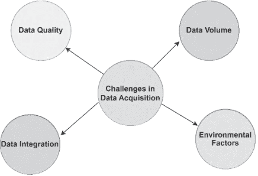

**图 3.** 数据集挑战。

### 数据量
遥感产生大量数据，尤其是在使用高分辨率图像和频繁的时间观测时（Bei et al., 2022）。管理和处理这些数据需要大量的存储容量和计算能力。高效的数据处理技术和强大的基础设施对于应对庞大的信息量至关重要，确保农业应用的及时准确分析（Khanal et al., 2020）。

### 数据集成
将来自多个来源的数据（如卫星图像、航空照片和地面传感器）结合起来可以提高农业制图的整体准确性和细节（Kashyap and Kumar, 2021a）。然而，由于空间分辨率、时间频率和数据格式的差异，集成这些多样化数据集面临重大挑战。协调这些数据集需要复杂的算法和仔细的预处理，以确保集成信息的兼容性和可靠性（Yan et al., 2023）。

### 环境因素
诸如天气、季节变化和大气扰动等环境条件会显著影响遥感数据的质量和可用性（Kashyap and Kumar, 2021b）。云层会阻碍卫星和航空影像，而大气条件会引入失真。植被和土壤湿度的季节性变化也会影响数据一致性。解决这些挑战需要先进的校正技术和自适应数据获取策略（Steven and Clark, 1990）。

## 数据预处理步骤

### 数据清洗
数据清洗是预处理的初始步骤，旨在去除噪声、纠正错误并处理缺失值（Liu, 2020）。噪声可通过滤波技术降低，而错误可通过将数据与已知标准或参考数据集进行比较来纠正。缺失值可通过插值或插补方法解决。有效的数据清洗确保后续分析的可靠性和准确性（Zakari et al., 2024）。

### 几何校正
几何校正调整遥感数据中由传感器移动、地球自转和地形变化引起的失真。地面控制点（GCPs）和正射校正技术通常用于将图像准确地与地理坐标对齐。此步骤对于确保数据中空间关系的准确性至关重要，从而实现精确的制图和分析。

### 辐射校正
辐射校正涉及调整像素值以补偿传感器噪声、大气条件和光照变化。诸如暗对象减除、大气模型和辐射定标等技术可标准化反射率值（Escandón-Panchana et al., 2024）。该校正确保数据准确反映观测特征的真实光谱特性，促进可靠的解释和分析（Afxentiou et al., 2021）。

### 图像增强
图像增强技术改善遥感数据的视觉外观，使识别和分析特定特征变得更容易（Zhang et al., 2023a）。直方图均衡化、对比度调整和边缘增强是常用的方法。增强后的图像可以揭示原始数据中不易察觉的细节，有助于检测和解释区域特征（Escandón-Panchana et al., 2024）。

### 图像分类
图像分类根据光谱特性将像素划分为不同的地表覆盖类别（Sachithra and Subhashini, 2023）。监督分类技术，如随机森林和支持向量机（SVM），需要标记的训练数据来指导分类过程（Singh et al., 2022）。无监督分类方法，如 k-means 聚类，根据光谱特征的相似性将像素分组到类别中，无需事先标记。深度学习（DL）方法，如卷积神经网络（CNNs），提供先进的自动化分类能力，具有高准确性（Afxentiou et al., 2021）。

### 数据融合
数据融合整合来自多个来源的信息，以提高农业制图的整体准确性和完整性（Omyatov et al., 2023）。诸如多传感器融合等技术结合不同传感器的数据，时间融合整合随时间推移的观测，空间融合合并不同空间分辨率的数据。有效的数据融合提供农业条件的全面视图，支持知情决策（Escandón-Panchana et al., 2024）。

## 特征提取与选择
特征提取技术对于提高遥感应用中预测模型的性能至关重要（Escandón-Panchana et al., 2024）。尽管滤波方法简单且计算效率高，但包装方法（wrapper methods）和嵌入方法通过直接评估特征子集对模型性能的影响，提供更定制化的方法，如图所示。


## 特征提取技术

如下面所述，就其在农业中的应用而言，特征提取有四种广泛的技术。

### 光谱指数

这些是在追求可持续农业实践的遥感特征提取中的必备工具。这些指数利用各种波长光的反射特性来评估土壤质量和植物。土壤调节植被指数（SAVI）和增强植被指数（EVI）分别有助于气候和土壤背景效应，在具有挑战性的环境（难以到达的区域）中提供更精确的评估（Shanmugapriya et al., 2019）。归一化植被指数（NDVI）比较近红外光和红光的反射率以分析植物的健康状况和厚度。因此，通过使用光谱指数，农业专家可以获得有关植物健康、生物量和胁迫水平的宝贵见解，从而能够就灌溉、施肥和害虫监测做出明智决策（Chuphal et al., 2024）。

### 主成分分析（PCA）

这是在遥感中提取特征的非常成功的技术，尤其是在高光谱数据中。主成分分析（PCA）将原始光谱波段转换为称为主成分的正交分量。这些主成分有效地捕获数据中最高的变化量（Ladi et al., 2022）。PCA通过保留最显著的分量并丢弃较不重要的分量，同时保留关键信息来降低数据的维度。降维简化了后续分析任务，例如分类和聚类，并提高了数据的可理解性（Peters et al., 2002）。PCA在农业应用中用于识别高光谱图像中的模式和趋势。它有助于识别不同类型的植物（Chouhan et al., 2024）、病害爆发和土壤质量。

### 纹理分析

由于数据以不同格式出现，纹理分析进一步有助于使用提取基于空间属性的方法从遥感图像中获取空间信息。纹理评估考虑图像内部像素的空间排列，而不是仅关注光谱特性（Grossiord, 2020）。灰度共生矩阵（GLCM）量化诸如对比度、熵和同质性等纹理属性。这些属性提供了有关表面粗糙度、土壤结构和作物模式的宝贵信息。纹理评估在区分不同土地覆盖类型、检测作物状况的细微变化以及识别害虫或疾病等异常方面具有优势（Chouhan et al., 2021; Qiao et al., 2024; Khajuria et al., 2018）。因此，通过将纹理分析整合到特征提取程序中，农业专家能够对农业景观形成更全面的理解，并就管理做出更明智的决策。

### 基于对象的图像分析（OBIA）

这种方法摆脱了传统的基于像素的技术，专注于从遥感数据中提取特征。OBIA使用光谱、空间和上下文信息将图像分类为有意义的对象或区域。通过从这些对象中提取形状、尺寸和光谱反射特性等特征，OBIA比基于像素的方法允许进行更具上下文相关性和语义相关的评估（van Klompenburg et al., 2020）。OBIA是农业中用于准确识别不同区域、作物类型和管理区域边界的技术。该技术在实施精准农业方法中发挥着至关重要的作用。此外，OBIA通过纳入对象之间的空间关系来提高分类和制图任务的精度，从而产生更稳健且可解释的结果（Kumar et al., 2024a）。因此，OBIA广泛用于农业监测、土地利用规划和自然资源监测，其中影像质量可根据图 4 确定。

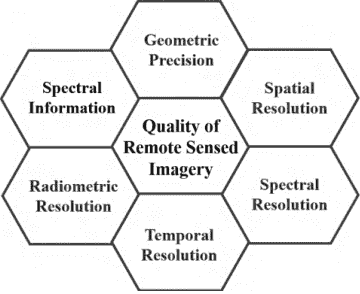

Fig. 4. 遥感影像的质量。

## 特征选择方法

这些特征是使用本节介绍的最实用方法选择的。

### 过滤方法

由于其简单性和有效性，它们经常被用于遥感应用中的特征选择。这些方法评估变量的重要性，而与所选预测模型无关。相关系数是常用的过滤方法，可量化每个特征与目标变量之间的线性关联（Chuphal et al., 2024）。具有高相关系数的特征被认为更具预测性，并保留用于后续研究。另一个例子是卡方检验，它评估分类任务中类别特征与目标变量之间的不相关性。具有显著卡方值的特征被选中，证明了它们在区分不同类别中的重要性。过滤方法由于其高计算效率和处理大数据集的能力而有益（Ullo and Sinha, 2021）。然而，它们可能无法考虑特征之间的关系，这可能导致特征子集的选择不理想。

### 包装方法

这些方法通过衡量其对模型性能的影响来评估特征子集，与过滤方法相比导致更高的计算复杂性。这些方法通过使用各种特征组合直接训练和测试预测模型来评估特征子集的质量（Singh et al., 2022）。递归特征消除（RFE）是一种广泛使用的技术，它根据准确率或错误率等性能指标系统地消除模型中最不重要的特征。前向选择和后向选择是替代的包装方法，它们从空集或完整特征集开始。它们根据特征对模型性能的影响逐步包含或排除特征（Nadeem et al., 2022）。包装方法具有考虑特征交互的优势，但对于高维数据集可能计算成本高昂。

### 嵌入方法

嵌入方法将特征选择直接纳入模型训练，提供了一种平滑且集成的特征选择方法。这些策略利用正则化技术或预测模型中的固有特征重要性度量来选择相关特征（Tey et al., 2024）。Lasso，也称为最小绝对收缩和选择算子，是一种广泛使用的嵌入方法，它使用 L1 正则化来惩罚特征系数的绝对幅度。这种正则化技术有效地迫使一些系数变为零，从而选择特征子集。基于树的方法，例如决策树和随机森林，通过根据特征相关性指标如基尼不纯度或信息增益对节点进行划分，自然地进行特征选择（Kumar et al., 2024b）。嵌入方法由于其简单性和效率而有益，因为它们将特征选择纳入模型训练过程，在林业和农业中，如图 5 所示。

## 遥感在农业中的应用

遥感在可持续农业方面有相当多的应用，包括作物健康监测和生长、植物生长异常和胁迫状况以及生物物理参数估计等，将予以阐述。

### 作物监测和健康评估

遥感提供作物田地的持续、大规模视图，对于有效的作物监测和健康评估至关重要。通过使用多光谱和高光谱成像，农民可以检测肉眼无法察觉的植物健康细微变化（Singh et al., 2022）。植物指数例如 NDVI

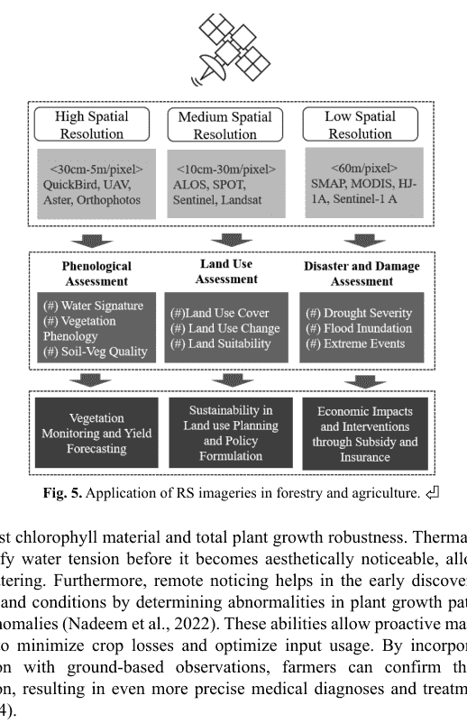

图5. 遥感影像在农林中的应用。

可以指示叶绿素含量和植物整体生长活力。热成像能够在水分胁迫变得显著可见之前识别它，从而及时浇水。此外，遥感通过确定植物生长模式和热异常中的异常情况，有助于及早发现病虫害（Nadeem et al., 2022）。这些能力使主动管理方法能够最大程度减少作物损失并优化投入品使用。通过将遥感信息与地面观测相结合，农民可以确认远程信息，从而实现更精确的诊断和处理（Tey et al., 2024）。

## 精准农业

这种农业利用遥感成功管理田间变异性，最大化利用水资源、化肥和化学品等资源。与全球定位系统技术相结合，高分辨率遥感信息能够生成综合区域地图，突出显示土壤性质、植物健康状况和水分含量的差异（Shafik, 2024）。变量率技术（VRT）然后可以在需要的地方精确施用投入品，减少浪费并提高效率。例如，NDVI图可以指导差异化施肥，确保在特定区域使用所需数量，从而提高养分吸收并减少径流。类似地，源自热成像或SAR的水分图可以为灌溉计划提供信息，促进水资源保护（Shafik et al., 2023）。遥感还支持实时监控和适应性监测，使农民能够迅速应对变化的条件。这种有针对性的方法提高了效率和盈利能力，并减少环境影响，支持在面对气候变化和资源稀缺时至关重要的可持续农业实践（Ullo and Sinha, 2021）。

## 土壤分析

SAR和高光谱成像评估土壤含水量、质地、有机质和养分水平。这些信息对于评估土壤肥力和做出有关土壤管理的明智决策至关重要（Qiao et al., 2024）。地理地图可以识别需要灌溉的干旱区域，或可能需要排水服务的水涝易发区域。高光谱信息可以发现土壤有机质和养分的差异，指导施用堆肥或肥料以增强土壤健康（Jafarbiglu and Pourreza, 2022）。RS有助于绘制土壤侵蚀和压实图，这对于保持土壤结构和肥力至关重要。通过提供土壤状况的空间概览，RS支持最大化土壤管理的精准农业实践。这带来改善的植物生长、降低的投入成本和更好的可持续性（Chuphal et al., 2024）。此外，持续跟踪可以分析土壤健康随时间的变化，有助于长期规划和保护工作。

## 产量预测

在产量和预测方面，遥感通过提供关于作物生长阶段、健康和环境问题的广泛而及时的信息，提高了作物产量预测的精度（Jafarbiglu and Pourreza, 2022; Kumar et al., 2024b）。评估历史遥感信息并结合当前季节监测，模型可以高精度预测产量。NDVI和增强型植被指数（EVI）是从多光谱和高光谱影像中得出的最常用指数，它们提供对植物生物量和健康状况的洞察，这些与产量潜力直接相关（Tey et al., 2024）。热成像可以监测温度胁迫，而SAR信息提供土壤水分含量信息，这两者都影响作物效率。将这些数据点与天气预报和地面真实信息相结合，能够开发出稳健的产量预测模型（Abid et al., 2021）。这些预测对于农民和农业部门规划收获、管理供应链和做出市场选择至关重要。准确的产量预测还支持政府和国际组织的粮食安全规划和政策制定，确保分配足够资源以满足未来的粮食需求（Shanmugapriya et al., 2019）。

## 灾害管理

遥感在农业部门的灾害管理中发挥着至关重要的作用，它提供对洪水、干旱、风暴和野火等自然灾害造成的损害的快速而精确的分析。卫星图像和航空数据提供有关此类事件程度和强度的实时信息，从而能够及时响应和恢复工作（Singh et al., 2022）。SAR可以穿透云层提供洪水淹没区域的图像，而热成像可以识别火点。灾后，遥感有助于绘制受灾区域地图、估算作物损失以及评估土壤和设施损坏。这些信息对于协调紧急救援、保险索赔和恢复计划至关重要（Qiao et al., 2024）。它还利用信息支持预警系统的开发，预测极端天气事件的可能性，使农民能够采取预防措施。通过将遥感与大气和水文模型等其他数据源相结合，可以建立全面的风险管理框架，增强农业系统对灾害和气候变化的抵御能力（Chuphal et al., 2024）。

## 案例研究

本节介绍了遥感在改善农业方面的一些实际应用。

### 美国的精准农业

在美国中西部，一个大型玉米农场实施了精准农业方法，利用遥感、GPS技术和人工智能来确保精准施肥。使用无人机多光谱成像制作了综合NDVI图，突出显示了整个田地作物活力的差异（Kumar et al., 2024a; Tey et al., 2024）。这些图确定了NDVI值降低的区域，表明存在养分缺乏。此后，该农场根据NDVI数据采用变量率技术（VRT）差异化施用肥料。这一策略使玉米产量提高了15%以上，肥料使用量减少了20%以上，并减少了养分径流，从而降低了环境污染（Singh et al., 2022）。将遥感和VRT相结合，显著提高了生产力和环境可持续性。

### 印度的干旱监测与管理

在印度马哈拉施特拉邦的干旱易发地区，遥感被用于更好地监测和管理水资源。卫星热成像提供了地表温度和植物水分胁迫的数据，而SAR用于测量土壤湿度程度（Kumar et al., 2024b）。这些数据被整合到一个供当地农民和农业机构使用的中央数据库中，以确保干旱监测和水管理。热成像和SAR数据的结合使得开发有效的干旱条件预警系统成为可能，使农民能够采取节水措施（Chuphal et al., 2024）。优化的灌溉计划，由土壤水分图告知，保护了水资源，并在干旱期间减少了30%的作物损失，增强了恢复力，同时提高了作物的恢复力和可持续性。

### 提高赞比亚的玉米产量

在撒哈拉以南非洲，农业技术已被广泛使用。在赞比亚中央省，小农玉米种植者面临与不定期植物健康监测和无效资源使用相关的障碍，影响着


## 遥感在农业中的挑战

遥感（RS）已成为监测和管理农业实践的有力工具，可提供有关作物健康、土壤状况以及影响作物产量的环境因素的宝贵见解。然而，遥感在农业中的有效利用面临着若干必须解决的挑战。本节重点介绍遥感在农业中的关键挑战，包括数据可用性与可获取性、空间和时间分辨率限制、验证与精度评估、成本和资源约束，以及技术和操作挑战。

### 数据可用性与可获取性

多种因素可能阻碍获取用于农业应用的高质量遥感数据。云层覆盖和大气条件会遮蔽地球表面，导致数据缺口或影像质量低下，这对时效性要求高的农业监测尤为不利（Martos et al., 2021）。此外，传感器在光谱和辐射分辨率方面的局限性可能影响准确检测和量化特定作物特征或环境因素的能力（Jafarbiglu and Pourreza, 2022）。数据提供商实施的数据共享政策和许可限制可能限制对特定数据源的访问，给预算有限的小规模农户或研究机构造成障碍（Wood et al., 2024）。此外，数据发现和检索机制的复杂性可能要求用户具备专业技能和知识，才能有效浏览各种数据存储库和平台（Li et al., 2021）。

### 空间和时间分辨率限制

农业应用通常需要高空间分辨率以进行详细的作物监测，并需要高时间分辨率以在整个生长季节跟踪作物生长和状况。然而，平衡这两个方面可能具有挑战性。对于识别作物模式、监测植物健康和检测小尺度特征至关重要的高空间分辨率影像，往往以降低时间分辨率或缩小覆盖面积为代价（Wu et al., 2023）。相反，具有频繁重访周期的大尺度影像（如 Sentinel-2 卫星）则缺乏对单个田块或作物进行精确分析所需的细节（Li et al., 2022）。协调空间分辨率与时间分辨率之间的这种权衡是遥感在农业中面临的重大挑战。

### 验证与精度评估

验证遥感数据并评估其精度对于农业应用中的可靠决策至关重要。地面实况核查或收集原位数据以进行比较和校准可能劳动密集、耗时且后勤保障困难，尤其是在大规模农业经营或偏远地区（Bennion et al., 2019）。植被异质性，包括作物类型、生长阶段和管理实践的差异，可能增加遥感数据解释和验证的复杂性（Han et al., 2024）。此外，传感器校准和大气效应（如气溶胶和水蒸气）可能给数据带来不确定性和误差，需要稳健的校准和大气校正技术（Wang et al., 2021）。由于不同地区的农业系统、作物类型和环境条件各异，制定标准化的验证协议和精度评估方法可能具有挑战性。

### 成本和资源约束

遥感技术在农业中的采用和利用可能受到成本和资源约束的阻碍。获取高分辨率影像和先进的遥感产品可能成本高昂，尤其是对于预算有限的小规模农户或组织而言（Wu et al., 2023）。此外，用于数据处理、分析和可视化的专用软件和硬件可能价格不菲，并且需要定期升级或维护（Kalinaki et al., 2023）。具备遥感、图像分析和农业应用专业知识的技术人员可能稀缺，且招聘和留用成本高昂，尤其是在资源受限地区。对高性能计算集群或云平台等计算基础设施的访问受限，也可能阻碍高效处理和分析大量遥感数据的能力。

### 技术和操作挑战

遥感在农业中涉及各种技术和操作挑战。数据处理和分析通常需要大量的计算资源和专用软件，这可能资源密集且难以维护，尤其是在基础设施有限的偏远或农村地区（Kalinaki et al., 2023）。将遥感数据与天气数据、土壤数据和农业管理实践等其他信息源整合，对于全面决策至关重要，但可能很复杂，需要先进的数据融合技术（Ahmad et al., 2022）。从遥感数据中自动检测和分类作物类型、生长阶段和胁迫条件是另一项挑战，这归因于作物特征和环境条件的变异性（Wu et al., 2023）。此外，及时获取数据、处理数据并向农民传播信息等操作挑战也很复杂，需要稳健的工作流程和沟通渠道（Hariri and Goli, 2024）。

### 可扩展性与泛化能力

针对特定农业区域或作物类型开发的遥感技术可能不易扩展到或推广到其他地区或作物。不同地理区域的耕作实践、环境条件和作物特征的多样性可能对普遍应用遥感方法构成重大挑战（Barbosa Júnior et al., 2024）。土壤类型、气候模式和耕作实践等因素可能存在显著差异，需要调整或采用新方法才能有效利用遥感数据。此外，在特定数据集上训练的算法和模型向新地区或作物品种的迁移能力可能有限，导致分析中可能出现不准确或偏差（Rushák et al., 2023）。

### 与精准农业技术的集成

遥感数据与精准农业技术（如变量技术（VRT）和精准播种系统）的有效集成带来了挑战（Marinello et al., 2023）。遥感数据必须及时处理和分析，以提供可无缝纳入精准农业工作流程的可操作信息。这需要稳健的数据处理流水线、高效的数据管理系统以及软硬件组件之间的互操作性。此外，遥感数据的空间分辨率可能并不总是与精准农业设备的作业规模一致，因此需要空间插值或降尺度技术（Zhu et al., 2024）。

### 利益相关者参与和采用

有效的利益相关者参与和遥感技术在农业中的广泛采用可能具有挑战性。农民、农业推广服务部门和其他利益相关者可能缺乏对遥感效益和潜在应用的认识或理解（Barbosa Júnior et al., 2024）。克服文化障碍、解决数据隐私和所有权问题以及提供充分的培训和支持对于成功采用至关重要。此外，遥感数据和解析方法的复杂性可能给非技术用户带来障碍，这凸显了针对不同利益相关者需求定制用户友好型界面和决策支持工具的必要性（San Emeterio de la Parte et al., 2024）。表1总结了这些挑战和拟议的考量因素。

## 遥感在农业中的新兴趋势和未来方向

农业遥感正在迅速发展，并受到技术进步、数据分析和多学科整合的推动。展望未来，若干新兴趋势和方向正在塑造农业遥感应用的面貌。本节探讨以下关键领域：传感器技术的进步、与物联网（IoT）和智慧农业的集成、大数据分析和云计算、机器学习（ML）和人工智能（AI）的进步，以及政策和监管考量。

### 传感器技术的进步

开发和改进遥感传感器是增强农业监测和管理水平的驱动力。高分辨率多光谱和高光谱传感器正变得越来越普及，能够对作物健康、养分缺乏和胁迫状况进行详细分析（Ram et al., 2024）。此外，热传感器和雷达传感器的集成为土壤水分、作物水分状况和生物量估算提供了宝贵信息（Abdulraheem et al., 2023）。小型化技术的进步以及轻量级、低成本传感器的发展为无人机（UAV）在精准农业中发挥重要作用铺平了道路，使其能够在田块尺度上实现高分辨率和及时的数据获取（Pungavi and Praveenkumar, 2024）。


## 表1. 挑战与拟议对策总结

| 挑战 | 挑战概述 | 解决方案概述 | 参考文献 |
|---|---|---|---|
| 数据可用性与可获取性 | 云层覆盖、大气条件、传感器限制、数据共享政策和数据发现机制可能会限制获取用于农业应用的高质量遥感数据。 | 改进数据共享政策，增强数据发现工具，并开发先进的大气校正和数据融合技术。 | (Jafarbiglu and Pourreza, 2022; Li et al., 2021; Martos et al., 2021; Wood et al., 2024) |
| 空间和时间分辨率限制 | 在用于精细作物监测的高空间分辨率与用于跟踪作物生长和状况的高时间频率之间取得平衡可能具有挑战性。 | 开发多传感器融合技术，利用无人机，或探索新的卫星星座以提高分辨率。 | (Li et al., 2022; Wu et al., 2023) |
| 验证与精度评估 | 地面实况验证、植被异质性、传感器校准和大气效应会给农业遥感数据的验证带来不确定性和挑战。 | 制定标准化验证协议，采用稳健的校准技术，并利用互补数据源进行精度评估。 | (Bennion et al., 2019; Han et al., 2024; Wang et al., 2021) |
| 成本与资源限制 | 获取高分辨率影像、先进产品、专业软件、硬件和熟练人员可能成本高昂且耗费资源。 | 探索经济高效的开源解决方案，利用云计算，并投资于能力建设和培训项目。 | (Kalinaki et al., 2023; Wu et al., 2023) |
| 技术与运营挑战 | 数据处理、分析、与其他数据源集成、自动化以及信息的及时传播构成了技术和运营方面的挑战。 | 开发高效的数据处理流程，实施稳健的数据融合技术，并建立有效的利益相关者沟通渠道。 | (Ahmad et al., 2022; Hariri and Goli, 2024; Kalinaki et al., 2023) |
| 可扩展性与泛化能力 | 针对特定区域或作物类型开发的遥感技术，由于耕作方式、环境条件和作物特征的多样性，可能不易扩展到其他区域或作物，或难以泛化。 | 开发适应性强且可迁移的算法，利用机器学习技术，并纳入当地知识和数据源。 | (Barbosa Júnior et al., 2024; Rušňák et al., 2023) |
| 与精准农业技术的集成 | 将遥感数据与精准农业技术（如变量技术（VRT）和精准播种系统）集成，需要互操作性、空间对齐和及时的数据处理。 | 开发稳健的数据处理流程、高效的数据管理系统以及空间插值或降尺度技术。 | (Marinello et al., 2023; Zhu et al., 2024) |
| 利益相关者参与与采用 | 克服文化障碍、解决数据隐私和所有权问题、提供培训和支持，以及开发用户友好的界面和决策支持工具，对于遥感技术在农业中的广泛采用至关重要。 | 尽早让利益相关者参与，制定定制培训计划，解决数据隐私问题，并设计用户友好的界面和决策支持工具。 | (Barbosa Júnior et al., 2024; San Emeterio de la Parte et al., 2024) |

## 物联网（IoT）与智慧农业的集成

将遥感与物联网（IoT）和智能农业技术相结合，正在彻底改变农业实践（Dhal et al., 2024; Kalinaki et al., 2024b）。部署在田间的物联网传感器可以实时收集土壤湿度、温度和其他环境参数数据，与遥感数据相结合，用于全面监测和决策（Rajak et al., 2023）。智慧农业系统可以利用这些综合数据来优化灌溉计划、实施有针对性的病虫害管理策略，并根据作物需求精确分配资源。遥感平台、物联网设备与农场管理系统之间的无缝信息交换，将推动数据驱动的精准农业实践。

## 大数据分析与云计算

农业遥感数据量和复杂性的不断增加，要求采用大数据分析和云计算解决方案（Kalinaki et al., 2024c; Rao et al., 2023）。遥感平台会产生海量数据，这需要强大的存储、处理和分析能力。云计算基础设施提供可扩展和按需的计算资源，能够实现高效的数据处理、分析和存储。此外，基于云计算的平台促进了研究人员、推广服务机构和农民之间的数据共享与协作，使决策支持工具和知识共享平台的开发成为可能（Kalinaki et al., 2024d; Rao et al., 2023）。

## 机器学习与人工智能的进展

机器学习和人工智能技术在农业遥感中日益重要（Kalinaki et al., 2024b）。这些先进算法可以在大型数据集上训练，以自动识别作物类型、检测异常、对土地覆盖进行分类，并准确预测作物产量。尤其是深度学习模型，在图像分类、目标检测和模式识别任务中展现出卓越性能，使遥感数据分析更加准确高效（Kalinaki et al., 2023）。将人工智能与遥感数据相结合，将实现实时监测、胁迫条件的早期检测以及预测分析，从而优化作物管理。

## 政策与监管考虑

随着遥感技术在农业中的应用日益广泛，政策与监管考量对其采用和实施至关重要。必须解决数据隐私、所有权和安全问题，以确保遥感数据得到负责任且合乎道德的使用。有关数据共享的政策和指南、互操作性标准以及数据治理，将促进遥感与其他农业技术的协作与集成。此外，可能需要建立监管框架，以确保无人机在农村环境中的负责任使用，解决与安全、隐私和环境影响相关的担忧（Mohsan et al., 2023）。

## 多源数据融合与集成

来自多种来源的数据的融合与集成，包括卫星图像、无人机数据、地面传感器网络以及产量记录和农民知识等辅助数据，正在成为一种新兴趋势（Barrile et al., 2022）。这种多源方法旨在利用不同数据源的优势，提供对农业系统的全面理解。它结合了航空观测、地面测量和情境信息，用于全面的作物状况评估、产量预测和明智决策。

## 公民科学与众包方法

公民科学和众包方法让农民、研究人员和公众参与数据收集、观测共享和协作解决问题（Ebitu et al., 2021）。这些参与式方法利用当地知识和实地观测来验证遥感数据、提高精度，并促进包容性和定制化的农业监测。众包平台、移动应用和用户友好的界面支持数据共享、知识交流和集体问题解决，赋能当地社区并促进可持续实践（Shakya et al., 2023）。

总之，遥感在农业领域的未来将带来变革。先进传感器技术、物联网与智慧农业系统、大数据分析以及人工智能/机器学习技术的融合，将实现农业实践前所未有的精度、效率和可持续性。然而，这些进步必须辅以强有力的政策和法规，以确保负责任且合乎道德的实施、数据隐私和环境管理。研究人员、技术开发者、政策制定者和农业利益相关者之间的协作努力，对于应对挑战和释放遥感在农业中的全部潜力至关重要。通过拥抱这些新兴趋势和未来方向，我们可以为数据驱动、可持续且有韧性的农业系统铺平道路，在满足全球日益增长的粮食需求的同时，最大限度地减少对环境的影响。

#### 结论

总之，本章全面探讨了遥感技术如何正在彻底改变农业。我们首先阐述了遥感的基本原理，解释了支撑这一强大技术的核心概念和机制。我们考察了各种遥感平台，包括卫星和无人机，及其在数据获取方面的独特优势和限制。讨论进一步延伸到不同类型的传感器，如光学、热红外和雷达传感器，每种都适用于特定的农业应用。我们还讨论了数据采集的技术和挑战，强调了获取高质量遥感数据所涉及的复杂性。特征提取和选择技术被强调为将原始数据转化为有意义见解的关键过程。农业中遥感的多样化应用，从作物监测到土壤健康评估，也得到了探讨，同时


实际案例研究展示了这些技术在实践中的益处和变革潜力。尽管存在挑战，包括技术限制和数据管理问题，像机器学习集成和高光谱成像等新兴趋势正在为更复杂、更精确的农业制图解决方案铺平道路。总体而言，遥感有望成为现代农业的关键技术，显著提高生产力、可持续性和效率，并推动该领域取得重大进步和改善。

### 声明

#### 作者的伦理责任
所有作者均已阅读、理解并在适用范围内遵守《作者须知》中关于“作者伦理责任”的声明。

#### 伦理审批
不适用。

#### 人工智能工具的使用
通讯作者声明在准备本稿件时未使用任何人工智能工具。

#### 利益冲突
代表全体作者，通讯作者声明无利益冲突需要披露。

#### 竞争性利益
不适用。

#### 作者贡献
Rufai Yusuf Zakari: 概念化，初稿撰写，Zaharaddeen Karami Lawal: 写作-审阅与编辑，可视化，Kassim Kalinaki: 写作-审阅与编辑，可视化，审校，Wasswa Shafik: 写作-审阅与编辑，可视化。

#### 资助
未获得资助。

### 参考文献
Abdulraheem, M.I., Zhang, W., Li, S., Moshayedi, A.J., Farooque, A.A. and Hu, J. 2023. 遥感在土壤测量及应用方面的进展：综述. Sustainability, 15(21): 15444. https://doi.org/10.3390/SU152115444.

Abid, S.K., Sulaiman, N., Chan, S.W., Nazir, U., Abid, M., Han, H., Ariza-Montes, A. and Vega-Muñoz, A. 2021. 迈向综合灾害管理方法：人工智能如何提升灾害管理. In Sustainability (Switzerland) (Vol. 13, Issue 22). https://doi.org/10.3390/su132212560.

Afxentiou, N., Georgali, P.Z.M., Kylili, A. and Fokaides, P.A. 2021. 温室农业塑料废弃物制图数据库. Data in Brief, 34. https://doi.org/10.1016/j.dib.2020.106622.

Ahmad, U., Nasirahmadi, A., Hensel, O. and Marino, S. 2022. 增强特定区域作物监测的技术和数据融合方法. Agronomy, 12(3): 555. https://doi.org/10.3390/agronomy12030555.

Alabdulatif, A., Thilakarathne, N.N., Lawal, Z.K., Fahim, K.E. and Zakari, R.Y. 2023. 纳米物联网（IoNT）：从架构到安全和隐私挑战的全面综述. In Sensors (Vol. 23, Issue 5). https://doi.org/10.3390/s23052807.

Anuradha, C.T. 2024. 利用地理空间技术对不同土地利用进行土壤质量分析与制图：案例研究. Applied Geomatics, 16(1). https://doi.org/10.1007/s12518-023-00538-3.

Barbosa Júnior, M.R., Moreira, B.R. de A., Carreira, V. dos S., Brito Filho, A.L. de, Trentin, C., Souza, F.L.P. de, Tedesco, D., Setiyono, T., Flores, J.P., Ampatzidis, Y., Silva, R.P. da and Shiratsuchi, L.S. 2024. 美国精准农业：激励进一步研究、创新和采用的综合荟萃综述. Computers and Electronics in Agriculture, 221: 108993. https://doi.org/10.1016/J.COMPAG.2024.108993.

Barrile, V., Simonetti, S., Citroni, R., Fotia, A. and Bilotta, G. 2022. 利用传感器实验农业4.0：遥感、无人机与自动驾驶拖拉机之间的数据融合方法. Sensors, 22(20): 7910. https://doi.org/10.3390/S22207910.

Bei, G., Zhang, S., Guo, Y., Yanli, L., Hu, N. and Liu, J. 2022. 基于遥感数据的露地果业气象灾害监测研究. In Advances in Meteorology (Vol. 2022). https://doi.org/10.1155/2022/1659053.

Benediktsson, J.A. and Wu, Z. 2021. 遥感数据处理的分布式计算. Proceedings of the IEEE, 109(8): 1278–1281. https://doi.org/10.1109/JPROC.2021.3094335.

Bennion, M., Fisher, J., Yesson, C. and Brodie, J. 2019. 海带（Laminariales，Ochrophyta）遥感：监测工具及其对野生采集的影响. Reviews in Fisheries Science & Aquaculture, 27(2): 127–141. https://doi.org/10.1080/23308249.2018.1509056.

Bouguettaya, A., Zarzour, H., Kechida, A. and Taberkit, A.M. 2022. 通过无人机影像对农业作物进行分类的深度学习技术：综述. In Neural Computing and Applications (Vol. 34, Issue 12). https://doi.org/10.1007/s00521-022-07104-9.

Chouhan, S.S., Singh, U.P. and Jain, S. 2024. 计算机视觉与无人机技术导论. In Applications of Computer Vision and Drone Technology in Agriculture 4.0 (pp. 1–5). Springer Nature Singapore. https://doi.org/10.1007/978-981-99-8684-2_1.

Chouhan, S.S., Singh, U.P., Sharma, U. and Jain, S. 2021. 利用基于计算机视觉的方法对 Jatropha Curcas L. 和 Pongamia Pinnata L. 生物燃料植物叶片病害进行分割与分类. Measurement, 171: 108796. https://doi.org/10.1016/J.MEASUREMENT.2020.108796.

Chouhan, S.S., Singh, U.P., Sharma, U. and Jain, S. 2024. 利用深度学习和机器学习算法对不同植物物种进行分类. Wireless Personal Communications, 136(4): 2275–2298. https://doi.org/10.1007/S11277-024-11374-Y/FIGURES/9.

Chuphal, D.S., Kushwaha, A.P., Aadhar, S. and Mishra, V. 2024. 印度干旱图集，1901–2020. Scientific Data, 11(1). https://doi.org/10.1038/s41597-023-02856-y.

Dhal, S., Wyatt, B.M., Mahanta, S., Bhattarai, N., Sharma, S., Rout, T., Saud, P. and Acharya, B.S. 2024. 数字农业中的物联网（IoT）：概述. Agronomy Journal, 116(3): 1144–1163. https://doi.org/10.1002/AGJ2.21385.

Ebitu, L., Avery, H., Mourad, K.A. and Enyetu, J. 2021. 可持续农业的公民科学——系统文献综述. Land Use Policy, 103: 105326. https://doi.org/10.1016/J.LANDUSEPOL.2021.105326.

Escandón-Panchana, P., Herrera-Franco, G., Jaya-Montalvo, M. and Martínez-Cuevas, S. 2024. 农业活动管理中使用的地学工具：系统综述. In Environment, Development and Sustainability. https://doi.org/10.1007/s10668-024-04576-8.

Escandón-Panchana, P., Herrera-Franco, G., Martínez Cuevas, S. and Morante-Carballo, F. 2024. 无人机在农业制图中的应用前景. Communications in Computer and Information Science, 1874 CCIS. https://doi.org/10.1007/978-3-031-46813-1_21.

Grossiord, C. 2020. 拥有合适的邻居：树种多样性如何调节干旱对森林的影响. In New Phytologist (Vol. 228, Issue 1). https://doi.org/10.1111/nph.15667.

Han, H., Liu, Z., Li, J. and Zeng, Z. 2024. 基于遥感的气候和作物监测的挑战：利用人工智能应对复杂性. Journal of Cloud Computing, 13(1): 1–14. https://doi.org/10.1186/S13677-023-00583-8.

Hariri, M.A. and Goli, A. 2024. 实施 cyber-physical 农业供应链的问题与研究挑战. In Agri 4.0 and the Future of Cyber-Physical Agricultural Systems (pp. 73–89). Elsevier. https://doi.org/10.1016/B978-0-443-13185-1.00005-8.

Hunt, D.A., Tabor, K., Hewson, J.H., Wood, M.A., Reymondin, L., Koenig, K., Schmitt-Harsh, M. and Follett, F. 2020. 遥感方法绘制咖啡生产系统制图综述. In Remote Sensing (Vol. 12, Issue 12). https://doi.org/10.3390/rs12122041.

Jafarbiglu, H. and Pourreza, A. 2022. 坚果作物中遥感平台、传感器及应用的全面综述. Computers and Electronics in Agriculture, 197: 106844. https://doi.org/10.1016/J.COMPAG.2022.106844.

Javaid, M., Haleem, A., Khan, I.H. and Suman, R. 2023. 了解人工智能在农业领域潜在应用. Advanced Agrochem, 2(1). https://doi.org/10.1016/j.aac.2022.10.001.

Jiang, N., Li, P. and Feng, Z. 2022. 热带刀耕火种农业遥感：综述. In International Journal of Applied Earth Observation and Geoinformation (Vol. 112). https://doi.org/10.1016/j.jag.2022.102876.

Kalinaki, K., Abdullatif, M., Nasser, S.A.-K., Nsubuga, R. and Kugonza, J. 2024a. 利用绿色云计算为可持续数字未来铺路. Emerging Trends in Cloud Computing Analytics, Scalability, and Service Models, 44–66. https://doi.org/10.4018/979-8-3693-0900-1.CH002.

Kalinaki, K., Acaru, S.F., Kugonza, J. and Nsubuga, R. 2024b. 迈向智能未来：机器学习助力可持续发展. In Methodologies, Frameworks, and Applications of Machine Learning (pp. 66–89). https://doi.org/10.4018/979-8-3693-1062-5.CH004.

Kalinaki, K., Shafik, W., Namuwaya, S. and Namuwaya, S. 2024c. 基于物联网的物流展望、应用、挑战及未来趋势. In Navigating Cyber Threats and Cybersecurity in the Logistics Industry (pp. 148–171). IGI Global. https://doi.org/10.4018/979-8-3693-3816-2.CH005.

Kalinaki, K., Yahya, U., Malik, O.A. and Lai, D.T.C. 2024d. 工业5.0中大数据分析与人工智能在智能决策中的应用综述. In Human-Centered Approaches in Industry 5.0: Human-Machine Interaction, Virtual Reality Training, and Customer Sentiment Analysis (pp. 24–47). https://doi.org/10.4018/979-8-3693-2647-3.ch002.

Kalinaki, K., Shafik, W., Gutu, T.J.L. and Malik, O.A. 2023. 智能农业和农业实践中的计算机视觉与机器学习. In Artificial Intelligence Tools and Technologies for Smart Farming and Agriculture Practices (pp. 79–100). IGI Global. https://doi.org/10.4018/978-1-6684-8516-3.ch005.

Karnawat, M., Trivedi, S.K., Nagar, D. and Nagar, R. 2020. 农业中人工智能的未来. Biotica Research Today, 2(9).

Kashyap, B. and Kumar, R. 2021a. 农业中监测病原体和害虫引起的植物生物胁迫的传感方法. Inventions, 6(2). https://doi.org/10.3390/INVENTIONS6020029.


Kashyap, B. and Kumar, R. 2021b. 农业中土壤水分和养分监测的传感方法. IEEE Access, 9. https://doi.org/10.1109/ACCESS.2021.3052478.

Kattenborn, T., Leitloff, J., Schiefer, F. and Hinz, S. 2021. 植被遥感中卷积神经网络（CNN）的综述. In ISPRS Journal of Photogrammetry and Remote Sensing (Vol. 173). https://doi.org/10.1016/j.isprsjprs.2020.12.010.

Khajuria, R., Sundanda, S. and Singh, S. 2018. 使用人工神经网络的现有叶片病害技术综述. International Journal of Computer Trends and Technology, 59(1): 52-62. https://doi.org/10.14445/22312803/IJCTT-V59P109.

Khaki, S., Wang, L. and Archontoulis, S.V. 2020. 作物产量预测的 CNN-RNN 框架. Frontiers in Plant Science, 10. https://doi.org/10.3389/fpls.2019.01750.

Khanal, S., Kushal, K.C., Fulton, J.P., Shearer, S. and Ozkan, E. 2020. 农业遥感——成就、局限与机遇. In Remote Sensing (Vol. 12, Issue 22). https://doi.org/10.3390/rs12223783.

Kluger, D.M., Wang, S. and Lobell, D.B. 2021. 作物制图的两次转变：利用汇总作物统计数据改善新区域的卫星制图. Remote Sensing of Environment, 262. https://doi.org/10.1016/j.rse.2021.112488.

Kumalawati, R., Salamiah, Yuliarti, A. and Murliawan, K.H. 2021. 未来粮食问题缓解的农业商品潜力制图. In GeoJournal of Tourism and Geosites (Vol. 33, Issue 4). https://doi.org/10.30892/gtg.334spl05-596.

Kumar, R., Kumar, A., Bhatia, K., Nisar, K.S., Chouhan, S.S., Maratha, P. and Tiwari, A.K. 2024a. 用于增强作物健康和产量的棉花病害检测混合方法. IEEE Access. https://doi.org/10.1109/ACCESS.2024.3419906.

Kumar, V., Sharma, K.V., Pham, Q.B., Srivastava, A.K., Bogireddy, C. and Yadav, S.M. 2024b. 利用遥感进行干旱研究的进展：评估进展、克服挑战并探索未来机遇. In Theoretical and Applied Climatology. https://doi.org/10.1007/s00704-024-04914-w.

Ladi, T., Jabalameli, S. and Sharifi, A. 2022. 机器学习和深度学习方法在气候变化减缓和适应中的应用. Environment and Planning B: Urban Analytics and City Science, 49(4). https://doi.org/10.1177/23998083221085281.

Li, M., Shamshiri, R.R., Weltzien, C. and Schirrmann, M. 2022. 使用 Sentinel-2 和无人机多光谱影像的作物监测：德国东北部比较案例研究. Remote Sensing, 14(17): 4426. https://doi.org/10.3390/RS14174426/S1.

Li, X., Li, S., Zhao, M., Guo, X. and Zhang, T. 2023. 遥感文献中焦点转移的映射：技术、方法与应用. Processes, 11(2). https://doi.org/10.3390/pr11020571.

Li, Y., Ma, J. and Zhang, Y. 2021. 遥感大数据图像检索：综述. Information Fusion, 67: 94-115. https://doi.org/10.1016/J.INFFUS.2020.10.008.

Liu, S.Y. 2020. 农业中的人工智能（AI）. In IT Professional (Vol. 22, Issue 3). https://doi.org/10.1109/MITP.2020.2986121.

Marinello, F., Zou, X., Liu, Z., Zhu, X., Zhang, W., Qian, Y., Li, Y., Karunathilake, E.M.B.M., Le, A.T., Heo, S., Chung, Y.S. and Mansoor, S. 2023. 通往智慧农业的道路：精准农业的创新与机遇. Agriculture, 13(8): 1593. https://doi.org/10.3390/AGRICULTURE13081593.

Martos, V., Ahmad, A., Cartujo, P. and Ordoñez, J. 2021. 在农业 5.0 时代通过遥感确保农业可持续性. Applied Sciences, 11(13): 5911. https://doi.org/10.3390/APP11135911.

Mohsan, S.A.H., Othman, N.Q.H., Li, Y., Alsharif, M.H. and Khan, M.A. 2023. 无人机（UAV）：实际方面、应用、开放挑战、安全问题和未来趋势. Intelligent Service Robotics. https://doi.org/10.1007/s11370-022-00452-4.

Nadeem, F., Jacobs, B. and Cordell, D. 2022. 巴基斯坦旁遮普农业对气候事件影响的脆弱性制图. Regional Environmental Change, 22(2). https://doi.org/10.1007/s10113-022-01918-y.

Nurdin, D.P., Karim, S. and Kurniadi, N. 2022. 北 Samarinda 区农业用地制图的地理信息系统. TEPIAN, 3(4). https://doi.org/10.51967/tepian.v3i3.701.

Okengwu, U.A., Onyejegbu, L.N., Oghenekaro, L.U., Musa, M.O. and Ugbari, A.O. 2023. 人工智能在农业中的环境和伦理负面影响及拟议缓解措施. Scientia Africana, 22(1). https://doi.org/10.4314/sa.v22i1.13.

Oymatov, R., Mamatkulov, Z., Maksudov, R., Bakhriyev, M., Aminova, G., Menlimuratova, I. and Esirgapov, A. 2023. 利用遥感数据改进农业制图方法. E3S Web of Conferences, 386. https://doi.org/10.1051/e3sconf/202338640008.

Peters, A.J., Walter-Shea, E.A., Ji, L., Viña, A., Hayes, M. and Svoboda, M.D. 2002. 基于 NDVI 的标准化植被指数的干旱监测. Photogrammetric Engineering and Remote Sensing, 68(1).

Pungavi, R. and Praveenkumar, C. 2024. 智慧农业的无人机（UAV）. 251–269. https://doi.org/10.1007/978-981-97-0341-8_13.

Qiao, Y., Wang, T., Huang, Q., Guo, H., Zhang, H., Xu, Q., Shen, Q. and Ling, N. 2024. 核心物种通过增强群落融合期间土壤微生物合作和网络复杂性影响植物健康. Soil Biology and Biochemistry, 188. https://doi.org/10.1016/j.soilbio.2023.109231.

Rahimi, E., Barghjelveh, S., Dong, P., Pirlar, M.A. and Jahanbakhshian, M.M. 2021. PollMap：农业景观中作物授粉制图软件. Journal of Ecology and Environment, 45(1). https://doi.org/10.1186/s41610-021-00210-0.

Raj, E.F.I., Appadurai, M. and Athiappan, K. 2021. 现代农业中的精准农业. https://doi.org/10.1007/978-981-16-6124-2_4.

Rajak, P., Ganguly, A., Adhikary, S. and Bhattacharya, S. 2023. 农业中的物联网和智能传感器：范围与挑战. Journal of Agriculture and Food Research, 14: 100776. https://doi.org/10.1016/J.JAFR.2023.100776.

Ram, B.G., Oduor, P., Igathinathane, C., Howatt, K. and Sun, X. 2024. 精准农业中高光谱成像的系统综述：对其当前状态和未来前景的分析. Computers and Electronics in Agriculture, 222: 109037. https://doi.org/10.1016/J.COMPAG.2024.109037.

Rao, M.S., Modi, S., Singh, R., Prasanna, K.L., Khan, S. and Ushapriya, C. 2023. 云计算、物联网和大数据集成用于新型智慧农业模型开发. 2023 3rd International Conference on Advanced Computing and Innovative Technologies in Engineering, ICACITE 2023, 2779–2783. https://doi.org/10.1109/ICACITE57410.2023.10182502.

Remote Sensing in Applications of Geoinformation. 2022. 地理信息应用中的遥感. In Remote Sensing in Applications of Geoinformation. https://doi.org/10.3390/books978-3-0365-2326-2.

Rušňák, T., Kasanický, T., Malík, P., Mojžiš, J., Zelenka, J., Sviček, M., Abrahám, D. and Halabuk, A. 2023. 无标签作物制图：利用 5 年 Sentinel-2 系列和机器学习研究作物分类模型的时空迁移性. Remote Sensing, 15(13): 3414. https://doi.org/10.3390/RS15133414.

Sachithra, V. and Subhashini, L.D.C.S. 2023. 人工智能如何用于实现农业可持续性：系统综述. Artificial Intelligence in Agriculture, 8. https://doi.org/10.1016/j.aiia.2023.04.002.

San Emeterio de la Parte, M., Martinez-Ortega, J.F., Castillejo, P. and Lucas-Martinez, N. 2024. 农业 5.0 中物联网的时空语义数据管理系统：挑战与未来方向. Internet of Things, 25: 101030. https://doi.org/10.1016/J.IOT.2023.101030.

Shafik, W. 2024. 在非洲应对机器人和人工智能的新兴挑战. In Examining the Rapid Advance of Digital Technology in Africa. https://doi.org/10.4018/978-1-6684-9962-7.ch007.

Shafik, W., Tufail, A., Namoun, A., De Silva, L.C. and Apong, R.A.A.H.M. 2023. 植物病害检测的系统文献综述：动机、分类技术、数据集、挑战与未来趋势. IEEE Access, 11. https://doi.org/10.1109/ACCESS.2023.3284760.

Shakya, A., Tripathi, G. and Ningombam, D.D. 2023. 农业中的众包应用. Social Media and Crowdsourcing Application and Analytics, 49–70. https://doi.org/10.1201/9781003346326-3.

Shanmugapriya, P., Rathika, S., Ramesh, T. and Janaki, P. 2019. 遥感在农业中的应用——综述. International Journal of Current Microbiology and Applied Sciences, 8(01). https://doi.org/10.20546/ijcmas.2019.801.238.


Singh, G., Singh, S., Sethi, G. and Sood, V. 2022. 利用 Sentinel-2 卫星数据进行农业用地制图的深度学习. Geographies, 2(4). https://doi.org/10.3390/geographies2040042.

Steven, M.D. and Clark, J.A. 1990. 农业中遥感的应用. Applications of Remote Sensing in Agriculture. https://doi.org/10.2478/gein-2014-0007.

Tang, L. and Shao, G. 2015. 森林研究与实践中的无人机遥感. In Journal of Forestry Research (Vol. 26, Issue 4). https://doi.org/10.1007/s11676-015-0088-y.

Tey, Y.S., Brindal, M., Wong, S.Y., Ardiansyah, I., Ibrahimov, A. and Yusop, M.R. 2024. 精准农业技术的发展：专利网络分析. Precision Agriculture, 25(1). https://doi.org/10.1007/s11119-023-10076-y.

Ullo, S.L. and Sinha, G.R. 2021. 遥感和农业应用中物联网与智能传感器的进展. Remote Sensing, 13(13). https://doi.org/10.3390/rs13132585.

van Klompenburg, T., Kassahun, A. and Catal, C. 2020. 基于机器学习的作物产量预测：系统文献综述. In Computers and Electronics in Agriculture (Vol. 177). https://doi.org/10.1016/j.compag.2020.105709.

Verma, B., Porwal, M., Jha, A.K., Vyšnovi, R.G., Rajpoot, A. and Nagar, A.K. 2023. 利用近地遥感增强精准农业与环境监测. Journal of Experimental Agriculture International, 45(8). https://doi.org/10.9734/jeai/2023/v45i82168.

Victor, N., Maddikunta, P.K.R., Mary, D.R.K., Murugan, R., Chengoden, R., Gadekallu, T.R., Rakesh, N., Zhu, Y. and Paek, J. 2024. 工业 5.0 时代农业遥感综述. IEEE Journal of Selected Topics in Applied Earth Observations and Remote Sensing, 17. https://doi.org/10.1109/JSTARS.2024.3370508.

Vyas, S., Dalhaus, T., Kropff, M., Aggarwal, P. and Meuwissen, M.P.M. 2021. 全球农业保险研究的图谱. Environmental Research Letters, 16(10). https://doi.org/10.1088/1748-9326/ac263d.

Wang, R., Gamon, J.A., Moore, R., Zygielbaum, A.I., Arkebauer, T.J., Perk, R., Leavitt, B., Cogliati, S., Wardlow, B. and Qi, Y. 2021. 航空成像光谱大气校正方法相关误差：对植被指数和植物性状的影响. Remote Sensing of Environment, 265: 112663. https://doi.org/10.1016/J.RSE.2021.112663.

Wood, D., Rathnasabapathy, M., Stober, K.J. and Menon, P. 2024. 运用空间技术支持可持续发展目标的挑战与进展. Acta Astronautica, 219: 678–692. https://doi.org/10.1016/J.ACTAASTRO.2024.03.064.

Wu, B., Zhang, M., Zeng, H., Tian, F., Potgieter, A.B., Qin, X., Yan, N., Chang, S., Zhao, Y., Dong, Q., Boken, V., Plotnikov, D., Guo, H., Wu, F., Zhao, H., Deronde, B., Tits, L. and Loupian, E. 2023. 基于遥感的作物监测的挑战与机遇：综述. National Science Review, 10(4). https://doi.org/10.1093/NSR/NWAC290.

Yan, C.S., Chen, Y.W., Yang, H.M. and Ahokas, E. 2023. 光谱分析仪及其在天文学和遥感中的典型应用. In Review of Scientific Instruments (Vol. 94, Issue 8). https://doi.org/10.1063/5.0138963.

Zakari, R.Y., Shafik, W., Kalinaki, K. and Iheaturu, C.J. 2024. 林业物联网（IoFT）技术及其在森林管理中的应用. In Advanced IoT Technologies and Applications in the Industry 4.0 Digital Economy. https://doi.org/10.1201/9781003434269-15.

Zhang, Q. 2023a. 评述：农业中的人工智能，可研究议题. In Computers and Electronics in Agriculture (Vol. 212). https://doi.org/10.1016/j.compag.2023.108110.

Zhang, X., Guo, Y., Tian, X. and Bai, Y. 2023b. 通过多时相 Sentinel-2 影像和时空神经网络提高天山北坡作物制图精度. Agronomy, 13(11). https://doi.org/10.3390/agronomy13112800.

Zhu, Z., Bo, Y., Sun, T., Zhang, X., Sun, M., Shen, A., Zhang, Y., Tang, J., Cao, M. and Wang, C. 2024. 生成时空完整且高分辨率遥感地表土壤湿度的降尺度与融合框架. Agricultural and Forest Meteorology, 352: 110044. https://doi.org/10.1016/J.AGRFORMET.2024.110044.

## 第 4 章

### 利用计算机视觉和深度学习方法进行罗勒作物检测

Rajneesh Kumar Patel,¹ Siddharth Singh Chouhan,¹,* Thota Chandan¹ and Uday Pratap Singh²

### 引言

近年来，将深度学习模型应用于农业已引起了广泛关注，因为它们有潜力革新农业实践。精准农业通过高效管理农业资源，在最大化作物产量的同时减轻环境影响并提高经济效益。准确检测和监测作物健康与生长对其成功至关重要。罗勒（Ocimum basilicum）是一种广泛种植的香草，具有多种烹饪和药用用途（Sipos et al., 2021; Joshi and Bhavsar, 2023）。罗勒植株的成功生长和产量取决于多种因素，包括充足的灌溉、养分供应和病虫害管理。监测罗勒作物的健康状况和生长阶段对于优化这些因素并确保成功收获至关重要。精准农业在现代农业实践中变得越来越重要，以确保最佳的作物管理、资源配置和可持续性（Abbasi et al., 2023; Farooqui et al., 2023）。传统的作物监测方法涉及劳动密集型的人工检查或基础成像技术，这可能耗时且需要更高的精度以实现有效决策（Chouhan et al., 2019a; Chouhan et al., 2019b）。深度学习和计算机视觉技术的出现为以更高的准确性和效率自动化作物监测任务开辟了新途径（Zhu et al., 2024; Singh et al., 2023）。目标检测，特别是能够在数字图像或视频帧中自动识别和定位特定对象。YOLO（You Only Look Once）是一种开创性的目标检测架构，以其实时性能和准确性而闻名（Sukhadeo Bajait et al., 2023）。它非常适合需要及时决策的农业应用。YOLOv8 代表了 YOLO 架构的演进，融合了模型设计、训练技术和计算效率方面的进步。

通过结合深度卷积神经网络和高效推理策略，与早期版本相比，YOLOv8 承诺提供改进的检测性能和降低的计算开销（Yang et al., 2023; Kunduracioglu and Pacal, 2024）。罗勒作物易受各种环境因素、害虫和疾病的影响，使得及时准确的检测对于维持作物健康和最大化产量至关重要。本研究旨在利用 YOLOv8 开发一种实用高效的解决方案，以实时检测罗勒作物，使农民和农学家能够及时做出知情决策和干预措施（Fuentes-Pacheco et al., 2024; Mao et al., 2023）。我们为开展本研究而制定的研究问题（RQ）如下：

- **RQ1：** 选择罗勒植株的原因是什么？
- **RQ2：** 与传统方法相比，使用 YOLOv8 的关键优势是什么？
- **RQ3：** 您会建议对 YOLOv8 做哪些改进或增加哪些功能以优化其在精准农业中的使用？
- **RQ4：** 您在现有的作物检测和监测方法中遇到了哪些挑战？
- **RQ5：** 这些技术在准确性和效率方面有多有效？

### 文献综述

精准农业已见证了由深度学习和计算机视觉技术整合驱动的实质性进步。目标检测在自动化高效作物管理中的关键任务方面发挥了关键作用（Bougettaya et al., 2022）。在此背景下，YOLO（You Only Look Once）模型因其实时能力和准确性而成为一个突出选择（Badgujar et al., 2024）。YOLOv8 作为 YOLO 系列的最新迭代，以其稳健性和多功能性而著称。众多研究展示了 YOLOv8 在多样化应用中的潜力，从行人检测到车辆计数。然而，将 YOLOv8 部署于精准农业领域，特别是用于罗勒作物检测，仍是一个相对未被探索的方向。所提出的研究通过展示一项利用 YOLOv8 进行罗勒作物检测的实用研究，为这一蓬勃发展的领域做出了贡献，证明了其在高价值香草背景下的适应性和有效性。Wenjie 等（Yang et al., 2023）提出了一种利用可变形卷积和坐标注意力的快速牛只检测开创性策略。Dhingra 等（2019）提出了一种罗勒叶片病害分类与识别技术。虽然

与作物检测没有直接关系，这项工作突出了精确农业分类技术的重要性。火灾检测展示了深度学习模型处理目标检测任务的能力，这对精准农业具有启示意义。Dai 等 (2024; 2021) 提出了一种用于病害检测的深度学习模型，并尝试借助深度学习技术找出病害状况。Zhang 等 (2019) 提出了一种基于多层 CNN 并使用邻域优化的图像处理模型。Augusto 等 (Souza et al., 2022) 深入研究了利用高光谱成像和机器学习对镉污染叶菜进行分类，这在作物健康评估方面具有相关性。

Zhou 等 (2023) 和 Anand 等 (2022) 讨论了非标准齿轮表面缺陷检测，该方法展示了与作物质量评估相关的机器学习缺陷检测。探索人工智能在植物病害检测中的应用，强调 AI 在作物健康评估中的重要性。Zhang 等 (2019) 提出了一种基于邻域优化方法的用于测深图像的多层 CNN。Sheng 等 (2018; 2021) 提出了一种用于基于深度学习的模型的图像分解模型。Giakoumoglou 等 (2023) 指出农业中目标检测的合成数据集对精准农业中模型的训练和改进具有启示意义。利用机器学习和深度学习，叶片病害检测的现状为精准农业中的作物健康监测提供了见解 (Sarkar et al., 2023; Saini and Nagpal, 2023)。电力线和输电塔的实例分割在精准农业中检测单个作物或物体方面具有多种实际应用。支链淀粉基生物塑料对罗勒植物生长的影响强调了精准农业中作物种植更广泛的生态背景 (Chodey and Shariff, 2022; Qin et al., 2024)。Jiang 等 (2022) 提出了一种用于从照片中提取深度信息的深度学习模型。Lin 等 (2021) 提出了一种基于 Transformer 的注意力金字塔模型用于图像处理。Chen 等 (2023) 讨论了一种基于图像处理的神经网络，特别是单次神经网络。

Li 等 (2021) 提出了一种使用级联 CNN 模型的废弃物检测模型。Xie 等 (2021) 提出了一种基于注意力图的用于图像处理的高阶特征交互模型。Nazir 等 (2020) 提出了一种基于端到端网络的从血管检测疾病的模型。Chen 等 (2020) 提出了一种结合分解技术的深度学习模型。《罗勒作物检测的实践研究》整合了计算机视觉、目标检测和农业现有文献中的见解。我们利用参考文献中的创新方法和方法，将 YOLOv8 的适用性扩展到罗勒作物检测。通过综合和借鉴这些工作的最佳实践，我们为推动精准农业和作物监测的发展做出了贡献。我们的研究展示了我们如何在此基础上构建现有研究，以推动我们特定领域知识的边界。

## Proposed Work

在本节中，问题陈述将详细讨论，随后提出方法论以及最后的模型描述。

### Problem Statement

精准农业领域正在经历一场变革性演进，其驱动力是对优化资源利用、最大化作物产量和减少环境影响的需求。在此背景下，准确及时的作物健康和生长监测至关重要。罗勒是一种在烹饪和医药领域具有多种用途的高价值香草，在精准农业中提出了独特的挑战。

**Challenges in Basil Crop Detection**

罗勒作物检测的特定挑战源于植物的生长特征和变异性。罗勒植物在不同生长阶段表现出多样化的外观，其叶片和叶丛可能存在显著差异。精确的罗勒作物检测可以实现疾病、害虫和营养缺乏的早期识别，为及时干预以维持作物健康提供了可能 (Makri and Kintzios, 2008)。

**The Role of Deep Learning**

深度学习已成为目标检测的强大技术，在革新精准农业方面具有巨大潜力。应用 YOLOv8 这一尖端的深度学习模型对于解决罗勒作物检测问题至关重要。问题陈述涉及在罗勒作物检测背景下对 YOLOv8 模型的严格评估，评估其提供准确实时监测的能力。

### Proposed Methodology

本文研究了 YOLOv8 这一最先进的深度学习模型在精准农业中用于罗勒作物检测的应用。它旨在评估模型的实用性和性能，通过实践实验和评估推动精准农业发展。本研究的基石是一个精心策划的数据集，包含 209 张罗勒图像。这些图像已经过广泛预处理以确保数据质量和一致性。此外，数据集被精心划分为训练集（171 张图像）和验证集（38 张图像）子集，以促进稳健的模型训练和评估。 我们的方法首先描述一个全面的罗勒作物数据集，反映了对模型成功至关重要的多样化生长阶段和条件。然后我们深入探讨 YOLOv8 模型的架构，强调针对罗勒作物检测的优化。透明的数据预处理步骤确保模型接收干净、相关的数据。模型训练和微调，包括关键的超参数调优，被强调以实现最佳性能。通过执行这些步骤，研究为罗勒作物图像数据集的基线做出了贡献，并支持研究的 reproducibility。本研究利用以其准确性和实时目标检测能力而闻名的 YOLOv8 模型，对罗勒作物检测进行严格的训练和评估。精度、召回率和 F1 分数等性能指标被全面采用，并辅以图形表示以增强模型有效性的可视化。

我们研究中采用的数据集提供了罗勒植物的全面表征，涵盖了实际农业场景中遇到的各种生长阶段和方向。这种多样性增强了我们 YOLOv8 模型的适应性，确保其在不同条件下识别罗勒植物的熟练程度。

## Data Pre-processing

农业中用于目标检测的深度学习模型的鲁棒性和适应性通常归因于数据集的质量和数据预处理步骤的有效性。数据预处理中的第一个关键步骤涉及将图像及其对应标注调整为统一尺寸。数据集中每张图像最初尺寸各异，被转换 为 640 × 480 像素的一致格式。这种调整大小操作不仅确保模型获得标准化的输入，还在训练和评估期间提高了计算效率。统一的图像尺寸对于我们的 YOLOv8 模型在图 2 中跨多样化场景和方向保持预测一致性至关重要。

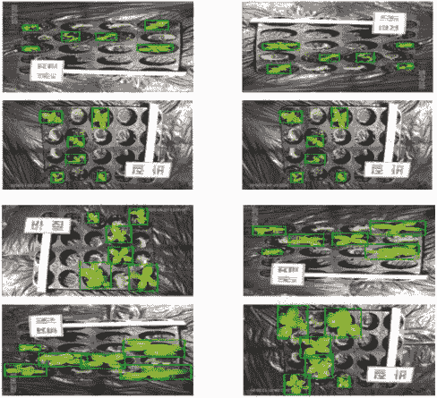

这种归一化促进了模型在图 3 图像中精确预测和定位罗勒植物的能力。

```text
0 0.317 0.30354206008 0.114 0.173819742489
0 0.694 0.33726094420 0.156 0.23605150214
0 0.395 0.32257467811 0.13 0.195278969957
```

Fig. 3. 罗勒作物标注格式。

## YOLOv8 Model

在本节中，我们探讨我们研究的核⼼，集中于 YOLOv8 模型，其全称为“You Only Look Once Version 8”。现代深度学习模型 YOLOv8 以其在实时目标识别应用中的有效性、快速性和高准确性而闻名。它融合了最先进的架构改进和优化方法，以扩展 YOLO 家族的前身。

- **(i) YOLOv8 Architecture Overview.** YOLOv8 架构采用通过全卷积神经网络的单次前向传递，遵循单次目标检测范式以提高效率。它将输入图像划分为网格单元，模型直接预测不同类别的边界框和概率。它在保持高精度的同时，比之前的版本快得多。YOLOv8 结合了架构改进，例如用于特征提取的 CSPDarknet53 主干，它利用跨阶段特征融合来增强信息流和表示。此外，PANet（路径聚合网络）在不同尺度上改善功能，通过多尺度特征融合实现对各种尺寸物体的更好识别 (Wang et al., 2024)。YOLOv8 使用各种检测尺度和金字塔式方法用于检测头。这使模型能够高效地检测不同尺寸的物体。此外，它采用无锚点目标检测，消除了预定义锚框的需求，并增强了对各种物体长宽比的泛化能力。图 4 表示 YOLOv8 架构的概述。

- **(ii) Training and Optimization.** 为了训练 YOLOv8，必须优化一个复合损失函数，该函数包括目标性分数、边界框坐标和类别预测的项。YOLOv8 高效处理大数据集并从各种示例中学习以增强泛化的能力是其成功的关键组成部分。

- **(iii) Transfer Learning and Fine-Tuning.** 我们利用迁移学习的强大功能来完成我们的罗勒作物检测任务。我们使用在大量数据集上预训练的权重初始化了 YOLOv8 模型。这种初始化为我们的模型提供了宝贵的目标检测先验知识，加速了训练收敛并增强了性能。

- **(iv) Customization for Basil Crop Detection.** 虽然 YOLOv8 是一个通用的目标检测模型，但其性能的具体细节取决于数据集和任务的选择。在我们的研究中，我们在精心策划的罗勒图像数据集上对模型进行微调，使其适应罗勒作物检测的细微差别。这种微调过程确保模型能够在多样化的背景和生长阶段中准确识别罗勒植物。


## 评估参数

评估我们的YOLOv8模型在罗勒作物检测中的性能，对于理解其在精准农业中的有效性和可靠性至关重要。我们利用一套全面的评估参数，从定量和定性两方面深入了解模型的能力。

平均精度均值（mAP）是目标检测任务中的基本指标，代表模型以不同精度准确定位物体的能力。我们在两个主要阈值下计算mAP：在交并比（IoU）为0.50时（mAP50），以及在从0.50到0.95的更广范围内（mAP50-95）。mAP50评估模型在中等精度水平下检测罗勒作物的准确性，而mAP50-95则将该评估扩展到更广泛的IoU值范围，从而更全面地展示模型的性能。

精确率评估模型通过衡量真正预测的比例来精确识别罗勒作物的能力，而召回率则评估其在所有实际阳性样本中定位图像中所有实际罗勒作物的能力。F1分数平衡了精确率和召回率，提供了一个综合指标来捕捉模型在这两方面的表现。训练和验证损失指标，包括框损失和分类损失，反映了模型预测与实际标注之间的差异，数值越低表示对齐程度越高，罗勒作物检测的有效性越好。这些评估参数共同提供了对YOLOv8模型在罗勒作物检测中准确性和完整性的详细了解，展示了其在精准农业不同条件和生长阶段中的熟练度。

## 训练YOLOv8模型

在对图像和标注进行预处理之后，我们开始了对YOLOv8模型的训练。Python中的Ultralytics包是我们模型训练的主要工具。为促进这一过程，我们编写了一个“Basil.yaml”配置文件，该文件定义了训练流程的关键方面。此文件指定了训练和验证图像及标注文件夹的位置、类别数量和类别名称，使我们的模型能够精确识别罗勒作物。

我们的训练数据集包含171张图像，验证数据集包含38张图像。经过全面实验，最佳批量大小确定为19。该配置对于实现计算效率和训练效果之间的最佳平衡至关重要。模型使用这些配置训练了100个epoch，涵盖大量迭代，在这些迭代中模型学会了检测图像中的罗勒作物。在每个epoch期间，模型不断完善其预测能力，逐渐收敛到准确的检测结果。这一过程涵盖了用于训练模型的训练数据集和用于评估其性能的验证数据集。

## 评估YOLOv8模型

模型成功训练后，我们使用验证数据集对其进行了严格评估。评估过程涉及在验证数据集上运行模型，并根据真实标注评估其性能（Li et al., 2020）。结果经过精心计算和呈现，提供了对模型在罗勒作物检测中精确率、召回率、F1分数及其他指标的深入见解。下面的表2简洁总结了主要验证指标，突出了模型的精确率、召回率、F1分数、mAP50和mAP50-95结果。这些指标共同证明了YOLOv8模型在罗勒作物检测中的卓越性能，支撑了我们研究的核心发现。

**表2. 评估指标验证结果。**

| 指标 | 精确率 | 召回率 | F1分数 | mAP50 | mAP50-95 |
| 结果 | 0.960 | 0.987 | 0.969 | 0.983 | 0.895 |

表3简要总结了训练和验证损失，这是我们YOLOv8模型性能的重要指标。这些结果提供了对模型预测与真实标注高度一致性的深入了解。

**表3. 边界框验证结果。**

| 指标 | 训练 | 验证 |
| 框损失 | 0.428 | 0.435 |
| 分类损失 | 0.377 | 0.435 |
| DFL损失 | 0.891 | 0.778 |

在我们使用YOLOv8进行罗勒作物检测的研究中，我们在训练和验证期间细致追踪框损失、分类损失和可变形损失。这些损失指标量化了模型性能的多个方面：框损失评估其准确定位罗勒作物的能力，分类损失评估其区分罗勒作物与背景元素的能力，而可变形损失则为不同的罗勒作物方向增加了空间适应性。监测这些损失为模型的精度和鲁棒性提供了细致的见解，突显了其适用于精准农业。它们是优化YOLOv8模型以实现罗勒作物检测、精细化提升以及在实际场景中增强实用性的基础支柱。

我们YOLOv8模型在罗勒作物检测中的评估包括真实图像和预测图像及相应边界框标注的视觉总结（Uddin et al., 2023）。这种视觉表示增强了我们发现的实证证据，并有助于研究的透明性和可解释性。图5显示了随epoch变化的损失评估，图6显示了随epoch变化的评估指标。图7显示了证明模型性能的真实和预测图像。这一补充确保了对精准农业实际影响的全面理解，使研究对科学界和农业从业者具有可访问性和价值。

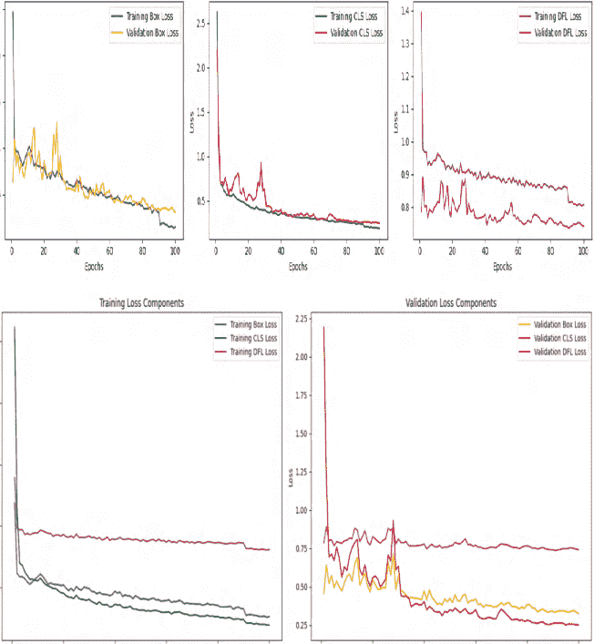

**图5.** 随epoch变化的损失评估。

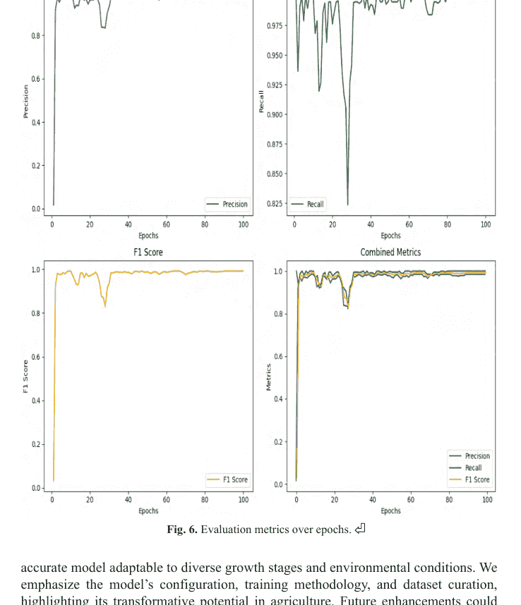

**图6.** 随epoch变化的评估指标。

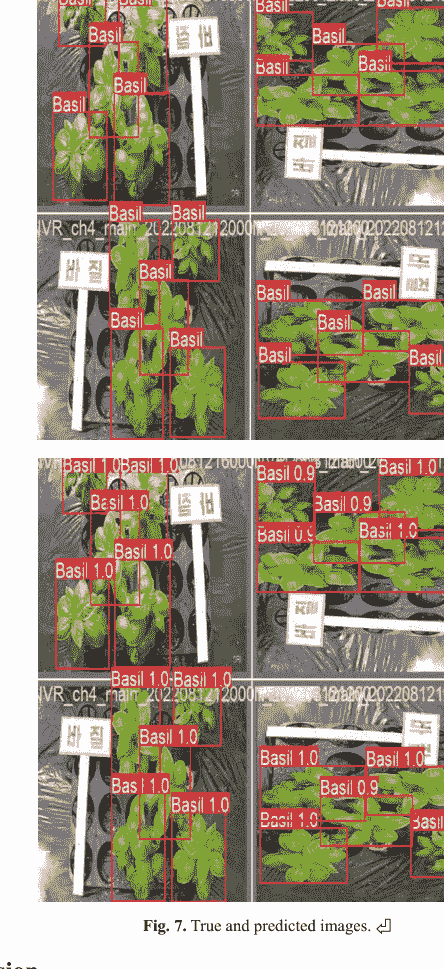

**图7.** 真实和预测图像。

## 所提出模型的范围与局限性

我们的研究旨在推进精准农业，重点关注使用YOLOv8深度学习模型进行罗勒作物检测。研究包括开发并评估一个能够适应不同生长阶段和环境条件的准确模型。我们强调模型的配置、训练方法和数据集整理，突出其在农业中的变革潜力。未来的改进可以扩展到其他作物以及实时监测和决策支持系统等应用。我们承认局限性：我们的数据集规模相对较小，模型泛化可能无法覆盖所有变化。现实世界条件如不可预测的环境可能影响模型性能（Gupta, 2016）。训练需要GPU资源，这可能限制实用性，更广泛的社会影响应得到深入探索。

#### 结论

本研究将深度学习技术、先进农业实践和机器视觉系统相结合，以彻底改变精准农业，重点关注罗勒作物监测。精心设计的方法论，依托于整理好的数据集、严格的模型训练和验证，通过YOLOv8模型取得了令人满意的结果。该模型在罗勒作物检测中表现出适应性和效率，实现了令人印象深刻的精确率、召回率、F1分数和平均精度均值指标。除了实证发现，本研究还突出了对加强作物管理和可持续性实践的更广泛影响。它为精准农业的未来研究和创新奠定了基础，强调了技术优化农业实践的潜力。人们认识到深度学习能力和农业需求未来增强的机会，标志着该领域的持续进步。

### 参考文献

Abbasi, R., Martinez, P. and Ahmad, R. 2023. Crop diagnostic system: A robust disease detection and management system for leafy green crops grown in an aquaponics facility. Artificial Intelligence in Agriculture, 10: 1–12, doi: 10.1016/J.AIIA.2023.09.001.

Anand, R., Mishra, R.K. and Khan, R. 2022. Plant diseases detection using artificial intelligence. Application of Machine Learning in Agriculture, pp. 173–190, doi: 10.1016/B978-0-323-90550-3.00007-2.

Badgujar, C.M., Poulose, A. and Gan, H. 2024. Agricultural Object Detection with You Only Look Once (YOLO) Algorithm: A Bibliometric and Systematic Literature Review, Accessed: May 01, 2024. [Online]. Available: http://arxiv.org/abs/2401.10379.

Bouguettaya, A., Zarzour, H., Kechida, A. Amine and Taberkit, M. 2022. A survey on deep learning-based identification of plant and crop diseases from UAV-based aerial images. Cluster Computing, 26(2): 1297–1317, doi: 10.1007/S10586-022-03627-X.

Chen, Z., Gao, T., Sheng, B., Li, P., Chen, C.L.P. and Li, P. 2020. Outdoor shadow estimating using multiclass geometric decomposition based on BLS. IEEE Transactions on Cybernetics, 50(5): 2020, doi: 10.1109/TCYB.2018.2875983.

Chen, Z., Qiu, G., Li, P., Zhu, L., Yang, X. and Sheng, B. 2023. MGNAS: Distilling adaptive combination of multiple searched networks for one-shot neural architecture search. IEEE Transactions on Pattern Analysis and Machine Intelligence, Accessed: May 10, 2024. [Online]. Available: https://ieeexplore.ieee.org/abstract/document/10179167/.

Chodey, M.D. and Noorullah Shariff, C. 2022. Hybrid deep learning model for in-field pest detection on real-time field monitoring. Journal of Plant Diseases and Protection, 129(3): 635–650, doi: 10.1007/S41348-022-00584-W/METRICS.

Chouhan, S.S., Kaul, A. and Singh, U.P. 2019a. Plants leaf segmentation using bacterial foraging optimization algorithm. 2019 International Conference on Communication and Electronics Systems (ICCES), pp. 1500–1505, doi: 10.1109/ICCES45898.2019.9002039.

Chouhan, S.S., Kaul, A. and Singh, U.P. 2019b. Radial basis function neural network for the segmentation of plant leaf disease. 2019 4th International Conference on Information Systems and Computer Networks (ISCON), pp. 713–716, doi: 10.1109/ISCON47742.2019.9036299.

Dai, L. et al. 2024a. A deep learning system for predicting time to progression of diabetic retinopathy. Nat. Med., 30(2): 584–594, doi: 10.1038/S41591-023-02702-Z.

Dai, L. et al. 2024b. A deep learning system for detecting diabetic retinopathy across the disease spectrum. Nature Communications, Accessed: May 10, 2024. [Online]. Available: https://www.nature.com/articles/s41467-021-23458-5.

Dhingra, G., Kumar, V. and Joshi, H.D. 2019. Basil leaves disease classification and identification by incorporating survival of fittest approach. Chemometrics and Intelligent Laboratory Systems, 186: 1–11, doi: 10.1016/J.CHEMOLAB.2019.01.006.

Farooqui, N.A., Mishra, A.K. and Mehra, R. 2023. Concatenated deep features with modified LSTM for enhanced crop disease classification. Int. J. Intell. Robot. Appl., 7(3): 510–534, doi: 10.1007/S41315-022-00258-8/METRICS.


Fuentes-Pacheco 等，2024年。一种使用非常小数据集和低成本RGB图像对温室罗勒植株氮浓度进行分类的课程学习方法。IEEE Access，12：27411–27425，doi：10.1109/ACCESS.2024.3367614。

Giakoumoglou, N., Pechlivani, D. 和 Tzovaras, D.，2023年。生成-粘贴-混合-检测：农业领域目标检测的合成数据集。Smart Agricultural Technology，5：100258，doi：10.1016/J.ATECH.2023.100258。

Gupta, A.K.，2016年。基于模糊方法的低对比度图像增强技术。International Journal of Engineering Research and General Science，4(2)：518–526。

Jiang, N., Sheng, B., Li, P. 和 Lee, T.Y.，2022年。Photohelper：基于深度特征检索与融合的人像摄影指导。IEEE Transactions on Multimedia。访问日期：2024年5月10日。[在线]。可用：https://ieeexplore.ieee.org/abstract/document/9693256/。

Joshi, B.M. 和 Bhavsar, H.，2023年。使用增强-茄科-CNN（enhance-nightshade-CNN）对真实数据进行茄科作物叶部病害检测。The Visual Computer，2023：1–20，doi：10.1007/S00371-023-03127-Y。

Kunduracioglu, I. 和 Pacal, I.，2024年。深度学习在葡萄叶片准确分类与葡萄病害诊断方面的进展。Journal of Plant Diseases and Protection，第1–20页，doi：10.1007/S41348-024-00896-Z/TABLES/7。

Li, J., Chen, J., Sheng, B., Li, P., Yang, P., Feng, D.D. 和 Qi, J.，2021年。基于多模型级联卷积神经网络的生活垃圾自动检测与分类系统。IEEE Transactions on Industrial Informatics，doi：10.1109/TII.2021.3085669。

Li, M., Zhang, Z., Lei, L., Wang, X. 和 Guo X.，2020年。基于卷积神经网络的高分辨率卫星图像中农业温室检测：Faster R-CNN、YOLO v3 和 mdpi.com 的比较。访问日期：2024年5月1日。[在线]。可用：https://www.mdpi.com/1424-8220/20/17/4938。

Lin, X., Sun, S., Huang, W., Sheng, B., Li, P. 和 Feng, D.D.，2021年。EAPT：用于图像处理的高效注意力金字塔变压器。IEEE Transactions on Multimedia。访问日期：2024年5月10日。[在线]。可用：https://ieeexplore.ieee.org/abstract/document/9580642/?casa_token=-4ItzSZcddgAAAAA:syEoovVm2z99GNwRrLmidmkxMoMARKau5HB_NmW2li4SUJx9bjSeYmvgnfHERkFX3MI4KiL6t8。

Makri, O. 和 Kintzios, S.，2008年。罗勒属（Ocimum sp.）（罗勒）：植物学、栽培、药用特性和生物技术。J. Herbs Spices Med. Plants，13(3)：123–150，doi：10.1300/J044V13N03_10。

Mao, R. 等，2023年。DAE-Mask：一种基于深度学习的大田小麦病害自动检测新模型。Precision Agriculture，25(2)：785–810，doi：10.1007/S11119-023-10093-X。

Nazir, A., Cheema, M.N., Sheng, B., Li, H., Li, P., Yang, P., Jung, Y., Qin, J., Kim, J. 和 Feng, D.D.，2020年。OFF-cNET：一种用于自动密集体积三维颅内血管分割的最优融合全端到端网络。IEEE Transactions on Image Processing，doi：10.1109/TIP.2020.2999854。

Qin, Y., Zhao, N., Yang, J., Pan, S., Sheng, B. 和 Lau, R.W.H.，2024年。UrbanEvolver：功能感知的城市布局重建。Int. J. Comput. Vis.，doi：10.1007/S11263-024-02030-W。

Saini, P. 和 Nagpal, B.，2023年。PSO-CNN-Bi-LSTM：一种用于智慧农业的混合优化深度学习模型。Environmental Modeling and Assessment，1：1–18，doi：10.1007/S10666-023-09920-2/FIGURES/9。

Sarkar, C., Gupta, D., Gupta, U. 和 Hazarika, B.B.，2023年。使用机器学习和深度学习的叶片病害检测：综述与挑战。Appl. Soft Comput.，145：110534，doi：10.1016/J.ASOC.2023.110534。

Sheng, B., Li, P., Jin, Y., Tan, P. 和 Lee, T.Y.，2024年。基于阶跃和漂移阴影分离的固有图像分解。IEEE Transactions on Visualization and Computer Graphics。访问日期：2024年5月10日。[在线]。可用：https://ieeexplore.ieee.org/abstract/document/8457312/。

Sheng, B., Li, P., Ali, R. 和 Chen, C.L.P.，2021年。通过宽度学习系统提升视频时间一致性。IEEE Transactions on Cybernetics，doi：10.1109/TCYB.2021.3079311。

- Singh, A., Kaur, J., Singh, K. 和 Singh, M.L.，2023年。基于深度迁移学习的水稻稻瘟病自动检测。Signal, Image and Video Processing，18(1)：569–577，doi：10.1007/S11760-023-02735-4。
- Sipos, L. 等，2021年。LED光照环境下罗勒（Ocimum basilicum L.）生产优化——综述。Sci. Hortic，289：110486，doi：10.1016/J.SCIENTA.2021.110486。
- Souza, A., Rojas, M., Yang, Y. 和 Lee, L.，2022年。利用高光谱成像和机器学习对镉污染叶菜进行分类。Heliyon，doi：10.1016/j.heliyon.2022.e12256。
- Sukhadeo Bajait, V., Malarvizhi, N. 和 Schulz, M.，2023年。基于Taylor Remora优化的深度学习算法用于葡萄中农药残留百分比检测。Environmental Science and Pollution Research，1：1–23，doi：10.1007/s11356-023-30169-5。
- Uddin, A., Chen, Y.L., Borkatullah, B., Khatun, M.S., Ferdous, J., Mahmud, P., Yang, J. 和 Ku, C.S.，2023年。基于神经集成模型的孟加拉国药用植物深度学习分类。访问日期：2024年5月1日。[在线]。可用：https://www.mdpi.com/2227-7390/11/16/3504。
- Wang, G., Chen, Y., An, P., Hong, H., Hu, J. 和 Huang, T.，2023年。UAV-YOLOv8：一种基于改进YOLOv8的无人机航拍场景小目标检测模型。访问日期：2024年5月1日。[在线]。可用：https://www.mdpi.com/1424-8220/23/16/7190。
- Xie, Z., Zhang, W., Sheng, B., Li, P. 和 Chen, C.L.P.，2021年。BaGFN：用于高阶特征交互的宽注意力图融合网络。IEEE Transactions on Neural Networks and Learning Systems。访问日期：2024年5月10日。[在线]。可用：https://ieeexplore.ieee.org/abstract/document/9565146/。
- Yang, G., Wang, J., Nie, Z., Yang, H. 和 Yu, S.，2023a年。一种结合特征增强与注意力的轻量级YOLOv8番茄检测算法。访问日期：2024年5月1日。[在线]。可用：https://www.mdpi.com/2073-4395/13/7/1824。
- Yang, W. 等，2023b年。用于快速牛只检测的可变形卷积与坐标注意力。Comput. Electron. Agric.，211：108006，doi：10.1016/J.COMPAG.2023.108006。
- Zhang, B., Sheng, B., Li, P. 和 Lee, T.Y.，2019年。使用多层邻域优化的景深渲染。IEEE Transactions on Visualization and Computer Graphics。访问日期：2024年5月10日。[在线]。可用：https://ieeexplore.ieee.org/abstract/document/8624466/。
- Zhou, F., Chao, Y., Wang, C., Zhang, X., Li, H. 和 Song, X.，2023年。一种小样本非标准齿轮表面缺陷检测方法。Measurement，221：113472，doi：10.1016/J.MEASUREMENT.2023.113472。
- Zhu, F., Qiao, X., Zhang, Y. 和 Jiang, J.，2024年。光照影响对冠层近距高光谱成像用于罗勒作物叶绿素分布原位检测的分析与缓解。Comput. Electron. Agric.，217：108553，doi：10.1016/J.COMPAG.2023.108553。

## 第5章

## 用于农业制图的遥感

Kurra Charitha¹,*, Mohammed Umar Ali² and Chitteti Divya³

### 引言

“遥感是一种在不与物体发生物理接触的情况下获取其属性信息的方法”。它已成为现代农业不可或缺的工具，可在作物健康、土壤状况、水分可用性和环境因素等关键方面提供见解。这项技术利用部署在卫星、无人机和其他平台上的传感器，随着传感器技术、数据处理算法和卫星能力的进步，已经随着时间的推移发生了显著演变（Coppin 和 Bauer，1996）。Landsat 等早期卫星任务通过提供土地覆盖和作物监测的初始影像奠定了基础，标志着遥感融入农业实践的开端。随后，高分辨率光学传感器、热传感器和雷达传感器的发展，使得能够收集各种农业参数的详细数据，包括作物健康指标、土壤湿度水平、温度波动和病虫害侵扰（Wu 等人，2015）。

本章旨在探索遥感在农业制图中的多样化应用，特别强调作物健康监测和土壤分析等关键领域（Wu 等人，2015）。通过利用遥感数据，农民和农业利益相关者可以就以下方面做出更明智的决策：


灌溉调度、施肥和病虫害管理，从而提高生产率并实现资源的最优利用。

此外，本章旨在突出遥感技术对农业部门可持续性产生的变革性影响。通过研究和成功的案例，我们将展示遥感工具如何通过减少用水量、最小化化学投入和促进土壤健康，为可持续农业实践做出贡献（Nilsson et al., 2003; Elhag et al., 2019; Hansen et al., 2013）。例如，遥感技术在估算蒸散速率、水分利用效率和植被健康方面发挥了重要作用，为水资源管理和环境保护举措提供了宝贵的见解（Wu et al., 2015）。

## 历史概述

遥感技术在农业中的整合有着丰富的历史背景，[content]
灌溉调度、施肥和病虫害管理，从而提高生产率并实现资源的最优利用。

此外，本章旨在突出遥感技术对农业部门可持续性产生的变革性影响。通过研究和成功的案例，我们将展示遥感工具如何通过减少用水量、最小化化学投入和促进土壤健康，为可持续农业实践做出贡献（Nilsson et al., 2003; Elhag et al., 2019; Hansen et al., 2013）。例如，遥感技术在估算蒸散速率、水分利用效率和植被健康方面发挥了重要作用，为水资源管理和环境保护举措提供了宝贵的见解（Wu et al., 2015）。

## 历史概述

遥感技术在农业中的整合有着丰富的历史背景，[content]
灌溉调度、施肥和病虫害管理，从而提高生产率并实现资源的最优利用。

此外，本章旨在突出遥感技术对农业部门可持续性产生的变革性影响。通过研究和成功的案例，我们将展示遥感工具如何通过减少用水量、最小化化学投入和促进土壤健康，为可持续农业实践做出贡献（Nilsson et al., 2003; Elhag et al., 2019; Hansen et al., 2013）。例如，遥感技术在估算蒸散速率、水分利用效率和植被健康方面发挥了重要作用，为水资源管理和环境保护举措提供了宝贵的见解（Wu et al., 2015）。

## 历史概述

遥感技术在农业中的整合有着丰富的历史背景，标志着重要的里程碑和进步。遥感在农业方面的早期尝试可以追溯到 1960 年代和 1970 年代，随着 Landsat 等开创性卫星任务的发射。1972 年发射的 Landsat-1 提供了地球表面的第一幅多光谱影像，为土地覆盖制图和作物监测奠定了基础（Campbell and Wynne, 2011）。随后的 Landsat 任务，包括 Landsat-2 和 Landsat-3，继续为农业应用提供宝贵数据，尽管其光谱和空间分辨率能力有限。

20 世纪 80 年代，随着法国发射的 SPOT（Satellite Pour Observation de la Terre）和 NASA 发射的首颗合成孔径雷达（SAR）卫星 Seasat 的发射，遥感技术发生了范式转变。这些卫星提供了更高的空间分辨率和专用传感器，能够更详细地观测农业景观、作物类型和植被健康（Merchant, 2000）。

20 世纪 90 年代是遥感在农业应用中技术进步和多样化的重要时期。NOAA 卫星上搭载的先进甚高分辨率辐射计（AVHRR）的发射为监测植被动态、地表温度和干旱状况提供了全球覆盖（Justice et al., 1998）。此外，高光谱成像传感器的发展使得对农业田块进行更精确的光谱分析成为可能，从而提高了作物健康评估和病害检测能力（Thenkabail et al., 2000）。

在 21 世纪，商业卫星提供商的激增以及无人机（UAV）或无人机的进步，彻底改变了农民和农业研究人员获取高分辨率遥感数据的可及性和可负担性。搭载多光谱和高光谱传感器的卫星，如 Sentinel-2 和 WorldView 系列的发射，进一步增强了遥感在农业中的能力，使其能够进行详细的作物监测、土壤分析和精准农业实践（Yang et al., 2018）。

总体而言，遥感在农业中的历史演进反映了从早期卫星任务到当前高分辨率多光谱和高光谱成像时代的持续创新和技术精进，为农业部门的利益相关者提供了前所未有的洞察，以实现可持续和高效的农业实践。

## 农业中遥感的原理

农业中的遥感依赖于电磁辐射、传感器技术和数据解释的基本原理，以收集和分析农业景观的信息。以下原理是理解遥感在农业背景下应用的关键：

- 1. **电磁波谱：** 遥感传感器检测地球表面实体产生或吸收的电磁能量。电磁波谱中的不同波长为植被健康、土壤特性和水分含量等农业特征提供了独特的信息（Merchant, 2000）。
- 2. **传感器技术：** 遥感平台，包括卫星、无人机和机载传感器，搭载多光谱和高光谱相机、热传感器和雷达系统等专用仪器。这些传感器在各种光谱波段捕获数据，从而分析特定的农业参数（Thenkabail et al., 2000）。
- 3. **光谱分辨率：** 遥感仪器的光谱分辨率是指其区分电磁辐射不同波长的能力。更高的光谱分辨率能够对植被指数、土壤组成和其他农业变量进行详细分析（Campbell and Wynne, 2011）。
- 4. **空间分辨率：** 空间分辨率提高了遥感图像中获得的细节量。高空间分辨率对于识别单个作物、监测田块边界以及在局部水平上评估作物健康至关重要（Merchant, 2000）。
- 5. **时间分辨率：** 时间分辨率是指遥感数据随时间获取的频率。定期数据采集可用于监测季节变化、作物生长周期和动态农业过程（Campbell and Wynne, 2011）。

## 遥感的工作原理

卫星影像是获取有关远处实体或地点的强大工具，通常由航空或航天器完成。该过程涉及多个关键步骤，每个步骤对于获取、处理和解释各种应用所需的数据至关重要，包括农业制图。以下是遥感工作原理的概述：

- 1. **能量源和照明：** 遥感依赖电磁能量，通常是阳光或发射辐射，作为主要来源。能量与地球表面相互作用，然后被反射、吸收或透射。主动遥感系统，如雷达和 LiDAR，会发射能量并测量其从目标反射回来的情况（Yang, 2018）。

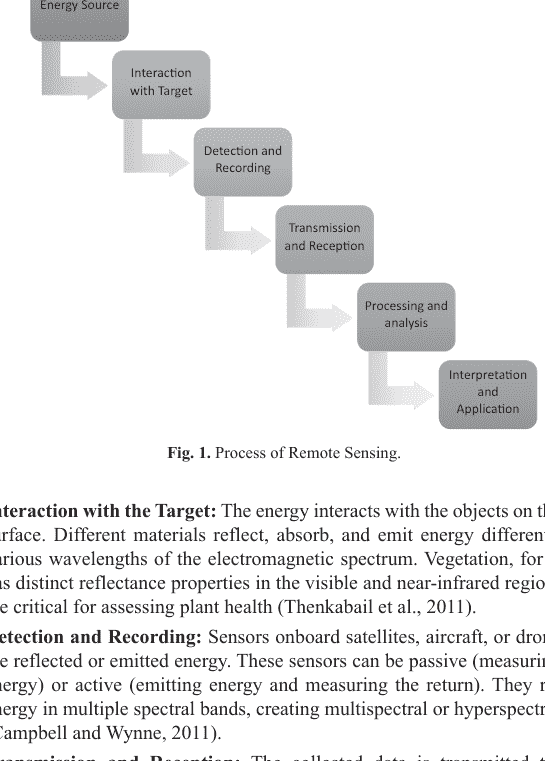

图 1. 遥感过程。

- 2. **与目标的相互作用：** 能量与地球表面的物体相互作用。不同材料在电磁波谱的各种波长下反射、吸收和发射能量不同。例如，植被在可见光和近红外区域具有独特的反射特性，这对于评估植物健康至关重要（Thenkabail et al., 2011）。
- 3. **探测与记录：** 安装在卫星、飞机或无人机上的传感器探测反射或发射的能量。这些传感器可以是被动的（测量自然能量）或主动的（发射能量并测量返回）。它们在多个光谱波段记录能量，创建多光谱或高光谱图像（Campbell and Wynne, 2011）。
- 4. **传输与接收：** 收集的数据被传输到地面站进行处理。现代卫星通常使用高速数据链，以确保其收集的大量数据及时交付（Lillesand et al., 2015）。
- 5. **处理与分析：** 接收到的原始数据经过处理以校正失真并提取有意义的信息。这包括辐射校正（以调整传感器噪声和大气效应）、几何校正（将图像与地理坐标对齐）和光谱分析（根据光谱特征识别特定特征）（Yang, 2018）。
- 6. **解释与应用：** 处理后的数据使用各种分析技术进行解释，以得出可操作的见解。在农业中，这可能涉及生成植被指数，如 NDVI（归一化差异植被指数）以评估作物健康、绘制土壤特性或监测

水资源。先进的机器学习算法和GIS工具正越来越多地用于提高遥感数据的准确性和实用性（Najafzadeh和Basirian，2023）。

## 遥感数据的类型

农业遥感利用通过部署在卫星、无人机和其他平台上的传感器收集的各种类型数据。这些数据类型提供有关农业景观、作物健康、土壤状况和环境因素的宝贵信息。农业中使用的遥感数据的主要类型如下：

- 1. **光学影像：** 光学传感器捕获可见光和近红外光，从而能够分析植被健康、作物类型和土地覆盖特征。多光谱和高光谱影像为植被指数和农业制图提供详细的光谱信息（Thenkabail等，2000）。
- 2. **热红外影像：** 热传感器检测与地表温度相关的发射红外辐射。热红外影像用于评估农田中的作物胁迫、水分可利用性和微气候变异（Kustas和Anderson，2009）。
- 3. **雷达影像：** 雷达传感器发射微波脉冲并测量其反射，能够穿透云层和植被。雷达影像对于监测农业区的土壤湿度、地表粗糙度和作物结构非常有价值（McNairn和Shang，2016）。
- 4. **LiDAR数据：** LiDAR（光探测与测距）传感器发射激光脉冲并测量其返回时间，提供详细的3D高程数据和植被高度剖面。LiDAR数据用于地形建模、冠层结构分析和精准农业应用（Pfeifer和Briese，2007）。
- 5. **多传感器融合：** 集成来自光学、热红外和雷达等多个传感器的数据，能够实现全面分析并增强对农业景观的理解。多传感器融合技术提高了作物监测、土壤制图和环境评估的准确性（Najafzadeh和Basirian，2023）。

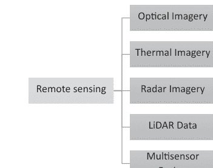

图2. 遥感数据的类型。

## 遥感在农业制图中的应用

遥感技术在农业制图中有众多应用，为作物健康、土壤状况、水资源管理和土地利用规划提供了宝贵的见解。以下是遥感在农业制图中的主要应用：

- 1. **作物健康监测：** 遥感通过分析NDVI（归一化差异植被指数）和NDWI（归一化差异水体指数）等植被指标，能够评估作物健康和活力。这些指数有助于识别作物中受胁迫、病害或养分缺乏的区域（Najafzadeh和Basirian，2023）。
- 2. **土壤制图与分析：** 遥感技术用于绘制农田的土壤属性、水分含量和肥力水平图。土壤制图有助于精准农业实践，优化灌溉和施肥策略（Thenkabail等，2000）。
- 3. **产量预测：** 通过分析卫星影像和历史数据，遥感有助于构建准确的产量预测模型。产量预测帮助农民优化收获计划、资源配置和营销策略（Yang，2018）。
- 4. **病虫害检测：** 遥感技术有助于及早发现病虫害。监测植被健康变化并利用光谱特征有助于识别受病虫害影响的区域，从而及时采取干预措施（Elhag等，2019）。
- 5. **水资源管理：** 遥感数据被用于农业中的高效水资源管理。它有助于监测灌溉水平，检测作物水分胁迫，评估河流和水库的水质，并优化水资源分配（Najafzadeh和Basirian，2023）。
- 6. **土地利用与作物分区：** 遥感通过基于环境条件、土壤适宜性和历史表现识别适合特定作物的区域，支持土地利用规划和作物分区（Campbell和Wynne，2011）。

## 挑战与未来方向

虽然遥感已经彻底改变了农业制图，但仍存在若干挑战，同时也涌现出有望进一步发展的令人振奋的未来方向。以下是一些主要挑战和未来方向：

### 挑战

- 1. **数据解译复杂性：** 分析大量遥感数据并提取有意义的见解可能复杂且耗时，需要先进的数据处理技术和熟练人员（Najafzadeh和Basirian，2023）。
- 2. **成本障碍：** 获取高分辨率遥感数据和实施复杂技术可能成本高昂，对小农和资源受限地区构成障碍（Yang，2018）。
- 3. **与传统方法的融合：** 将遥感数据与传统农业实践和农民知识相结合可能具有挑战性，需要有效的沟通和培训举措（Elhag等，2019）。
- 4. **时间和空间分辨率：** 在遥感影像中平衡时间和空间分辨率之间的取舍，以同时捕捉详细信息和频繁更新，仍然是一个挑战（Campbell和Wynne，2011）。

### 潜在方向

- 1. **机器学习与人工智能协作：** 计算智能（AI）和机器学习技术与遥感数据的结合，在农业的自动化数据分析、模式识别和预测建模方面具有巨大潜力（Yang，2018）。
- 2. **高光谱成像：** 高光谱成像技术的进步提供了更高的光谱分辨率和更精细的光谱波段，从而能够更精确地分析农业参数和植被特征（Najafzadeh和Basirian，2023）。
- 3. **传感器小型化与成本降低：** 在传感器小型化和降低成本方面的持续努力将使遥感技术对更广泛的农民和农业利益相关者来说更易获取和负担（Yang，2018）。
- 4. **精准农业应用：** 进一步发展精准农业技术，如变量技术（VRT）和自动化耕作系统，将提高农业实践的效率和可持续性（Campbell和Wynne，2011）。

通过克服这些困难并展望未来，遥感技术将在农业制图中继续发挥变革性作用，并推动可持续农业方法的应用。

#### 结论

总之，遥感技术通过提供对作物健康、土壤状况、水资源管理和土地利用规划的宝贵见解，彻底改变了农业制图。通过作物健康监测、土壤制图、产量预测、病虫害检测、水资源管理和土地利用规划等应用，遥感显著增强了农民、农学家和政策制定者的决策过程。

尽管存在数据解译复杂性、成本障碍和与传统方法融合等挑战，遥感在农业中的未来仍然充满希望。人工智能、机器学习、高光谱成像、传感器小型化和精准农业技术的进步，为自动化数据分析、提高光谱分辨率、降低成本和提升农业效率提供了令人兴奋的机遇。

通过应对挑战并拥抱未来方向，遥感技术将继续在全球促进可持续、高效的农业实践中发挥重要作用。遥感与传统农业知识和实践的结合，加上技术的持续进步，将进一步推动农业产业实现更高的生产力、资源优化和环境可持续性。

### 参考文献

- Campbell, J.B. and Wynne, R.H. 2011. Introduction to Remote Sensing. Guilford Press.
- Coppin, P.R. and Bauer, M.E. 1996. Digital change detection in forest ecosystems with remote sensing imagery. Remote Sensing Reviews, 13(3-4): 207-234.
- Elhag, M., Gitas, I., Othman, A., Bahrawi, J. and Gikas, P. 2019. Assessment of water quality parameters using temporal remote sensing spectral reflectance in arid environments, Saudi Arabia. Water, 11(3): 556.
- Hansen, M.C., Potapov, P.V., Moore, R., Hancher, M., Turubanova, S.A., Tyukavina, A., Thau, D., Stehman, S.V., Goetz, S.J., Loveland, T.R., Kommareddy, A., Egorov, A., Chini, L., Justice, C.O. and Townshend, J.R. 2013. High-resolution global maps of 21st-century forest cover change. Science, 342(6160): 850-853.
- Justice, C.O., Vermote, E., Townshend, J.R., Defries, R., Roy, D.P., Hall, D.K., Salomonson, V.V., Privette, L., Riggs, G., Strahler, A., Lucht, W., Myneni, R.B., Knyazikhin, Y., Running, S.W., Nemani, R.R., Wan, Z., Huete, A.R., Leeuwen, W.V., Wolfe, R.E., Giglio, L., Muller, J., Lewis and Barnsley, M.J. 1998. The Moderate Resolution Imaging Spectroradiometer (MODIS): Land remote sensing for global change research. IEEE Transactions on Geoscience and Remote Sensing, 36(4): 1228-1249.
- Kustas, W. and Anderson, M. 2009. Advances in thermal infrared remote sensing for land surface modeling. Agricultural and Forest Meteorology, 149(12): 2071-2081.
- Lillesand, T., Kiefer, R.W. and Chipman, J. 2015. Remote Sensing and Image Interpretation. John Wiley & Sons.
- McNairn, H. and Shang, J. 2016. A review of multitemporal synthetic aperture radar (SAR) for crop monitoring. Multitemporal Remote Sensing: Methods and Applications, 317-340.
- Merchant, J.W. 2000. Remote sensing of the environment: An earth resource perspective. Cartography and Geographic Information Science, 27(4): 311-311.
- Najafzadeh, M. and Basirian, S. 2023. Evaluation of river water quality index using remote sensing and artificial intelligence models. Remote Sensing, 15(9): 2359.
- Nilsson, C., Pizzuto, J.E., Moglen, G.E., Palmer, M.A., Stanley, E.H., Bockstael, N.E. and Thompson, L.C. 2003. Ecological forecasting and the urbanization of stream ecosystems: Challenges for economists, hydrologists, geomorphologists, and ecologists. Ecosystems, 6: 659-674.
- Pfeifer, N. and Briese, C. 2007. Geometrical aspects of airborne laser scanning and terrestrial laser scanning. International Archives of Photogrammetry, Remote Sensing and Spatial Information Sciences, 36(3/W52): 311-319.
- Thenkabail, P.S., Smith, R.B. and De Pauw, E. 2000. Hyperspectral vegetation indices and their relationships with agricultural crop characteristics. Remote Sensing of Environment, 71(2): 158-182.
- Wu, X., Zhou, J., Wang, H., Li, Y. and Zhong, B. 2015. Evaluation of irrigation water use efficiency using remote sensing in the middle reach of the Heihe river, in the semi-arid Northwestern China. Hydrological Processes, 29(9): 2243-2257.
- Yang, C. 2018. High resolution satellite imaging sensors for precision agriculture. Frontiers of Agricultural Science and Engineering, 5(4): 393-405.


## 第6章

## 遥感技术在农业中的进展
当前进展与未来展望

Bhabani Prasad Mondal,¹ Sumanta Das,²,⁴,* Suman Dutta³ 和 Ali R.A. Moursy⁵

¹ 印度比哈尔农业大学土壤科学与农业化学系，Sabour，Bhagalpur-813210。
² 罗摩克里希那传教维韦卡南达教育与研究学院环境与灾害管理学院，印度西孟加拉邦加尔各答，700103。
³ 罗摩克里希那传教维韦卡南达教育与研究学院遗传学与植物育种系，印度西孟加拉邦加尔各答，700103。
⁴ 昆士兰大学，St Lucia，Brisbane-4072，澳大利亚昆士兰。
⁵ 索哈杰大学农学院水土系，82524，索哈杰，埃及。
* 通讯作者：sumanta.das@uq.net.au

## 引言

农业是推动印度等国家经济发展的关键动力，由于技术的飞速进步，目前正经历第四次革命，通常称为农业4.0。遥感（RS）技术通过提供有关作物状况、土壤健康以及影响农业生产力的环境参数的关键信息，彻底改变了包括农业在内的各个领域。此外，遥感技术可以与全球定位系统（GPS）、物联网（IoT）和人工智能（AI）等先进技术相结合，为农业投入品的精准管理创造强大工具。鉴于全球人口不断增长以及由此产生的粮食需求，迫切需要创新解决方案来提高农业效率、可持续性和韧性。这些技术共同提供了一套强大的工具，通过促进农业系统的全面监测和管理，降低种植成本和产量损失，同时提高产量和经济收益，来应对这些挑战（Elijah et al., 2018; Jha et al., 2019）。预测表明，采用精准农业实践到2050年可能使全球产量提高多达67%（Rosegrant, 2014）。根据加利福尼亚州食品与农业部2018年的报告，精准农业的一个关键方面是大规模广泛收集数据，这主要通过遥感技术实现，构成整个精准农业过程的基础。

过去十年间，遥感技术取得了显著进展，从传统的卫星图像到新兴平台，如无人机（UAV）和高光谱传感器。遥感涉及使用与被研究对象没有直接身体接触或接近的记录设备，收集或测量有关物体或事件特定特征的数据（ASPRS）（Estes et al., 2001）。这一过程涉及使用仪器进行远距离测量。这种遥感技术通过发射电磁辐射来获取土壤、植物或其他物体或现象的多样特征（Jones and Vaughan, 2010）。地面、空中和太空等各类平台搭载遥感系统的各种传感器，以收集有关遥远物体或现象的数据（Sishodia et al., 2020）。这些技术创新为农业研究和管理开辟了新途径，促进了不同尺度下高分辨率时空信息的收集。例如，搭载多光谱传感器的卫星（如Landsat和Sentinel）提供一致且大范围的覆盖，能够监测大规模农业景观（Foody, 2019）。另一方面，无人机提供灵活性和更高的空间分辨率，能够在较小的农田内对作物健康和变异进行详细评估（Colomina and Molina, 2014）。

尽管已有大量研究探索遥感在农业领域的应用，但越来越需要综合性的综述来总结最新进展、识别当前挑战并概述未来研究方向。此类综述在指导研究人员、政策制定者和从业者利用遥感技术解决关键农业问题（包括产量优化、资源管理和气候变化适应）方面发挥着至关重要的作用。通过批判性评估现有方法的优势和局限性，这些综述为开发更高效、更稳健的基于遥感的农业监测系统铺平了道路。

此外，农业系统的复杂性要求采用跨学科方法，将遥感与农学、生态学和计算机科学等其他科学学科相结合。通过将遥感数据与实验室测量和建模技术相结合，研究人员可以获得关于土壤、植物、气候和其他环境因素等重要变量的深入见解（Tucker et al., 2018）。这种跨学科方法对于提高基于遥感的农业评估的准确性和可靠性至关重要，最终支持明智的决策和可持续的农业实践。

此外，对可持续农业的需求促进了人们对利用遥感技术监测和减轻农业活动相关环境影响的兴趣增加。从评估土壤侵蚀和养分流失到监测森林砍伐和栖息地丧失，遥感为农业的生态足迹提供了宝贵的见解（Turner et al., 2015）。通过将环境监测与农业管理战略相结合，利益相关者可以通过改进土地管理实践来提高生产力，同时保护自然环境资源。

在此背景下，本章旨在全面概述遥感技术在农业中的最新进展，重点介绍其应用、局限性和前景。通过综合不同研究领域的发现，本综述将有助于加深对如何有效利用遥感来应对现代农业所面临不断变化的挑战的理解。此外，通过识别知识空白和新兴趋势，本综述将指导未来的研究工作，旨在充分发挥遥感技术的潜力，以支持可持续和有韧性的农业系统。

本综述解决的关键研究问题如下：

- 农业遥感技术的最新进展是什么？
- 如何将遥感技术与其他先进技术有效整合以实现精准农业？
- 在农业监测和管理中使用遥感的主要挑战和局限性是什么？
- 遥感如何促进可持续农业实践并减轻环境影响？
- 未来应开展哪些研究方向以提高遥感技术在农业中的有效性和采用率？

## 遥感数据获取——平台与传感器

### 遥感平台

遥感中使用的平台，如飞机或卫星，是指能够运载传感设备（称为传感器）从远处进行测量的运载工具（Jafarbiglu and Pourreza, 2022）。这些平台在运行速度、一致性、易用性和时间分辨率方面不断改进，这最终决定了空间分辨率。根据Huang et al. (2018)的研究，遥感系统具备生成大量高分辨率光谱数据的能力，其分辨率涵盖从空间到时间的多种尺度，这对于精准农业的实施尤为重要。

### 天基平台

基于遥感的研究工作始于20世纪70年代，随着Landsat 1的推出，该卫星旨在从天基遥感平台收集数据。数字图像处理的快速发展加速了


遥感在各种应用中的进展。卫星影像具有广泛空间覆盖的优势。尽管如此，由于空间分辨率较粗，其应用于精准农业仍受到限制，这使其难以适用于田块层面的特定农业作业（Stafford, 2000）。卫星测量的另一个缺点是依赖天气和大气条件，这可能导致从目标物到卫星传感器的电磁信号发生衰减（Rees, 2013）。尽管面临诸多挑战，卫星影像在大尺度绘制各种现象方面仍然有效，包括土地利用和土地覆盖制图、土壤侵蚀制图、荒漠化评估、区域产量估算以及气候变化监测（Jafarabiglu和Pourreza, 2022）。这种有效性源于它能够以相对较低的价格提供地形的“宏观”视角（Barnes, 2018）。具有高分辨率的高级卫星系统包含红边波段以监测作物生长，并且是专门为农业应用设计的。RapidEye数据已被用于评估在预定义管理区中种植的小麦作物的氮含量（Basso et al., 2013; Basso et al., 2016）。

## 航空平台

与卫星不同，无人机系统（UAS）能够获取并传输高分辨率数据，因此特别适合在小而分散的田块中进行农业作业。然而，其主要局限性在于载荷能力受限和飞行时间短暂，阻碍了其广泛应用。相反，有人驾驶航空器处于中间位置，能够覆盖比无人机系统更大的区域，并提供比卫星更好的分辨率。20世纪20年代，人们使用有人驾驶航空器或有人驾驶飞机向作物喷洒农用化学品，这标志着机载遥感在农业中的首次应用。根据Rees（2013）的说法，模拟航空影像采集和植被制图的开始源于飞机和摄影设备等航空平台的发展。20世纪70年代，美国国家航空航天局（NASA）成为利用飞机进行航空遥感的主导机构。他们通过使用P-3A飞机有效地绘制了土壤水分图，供农业管理使用。该飞机配备了多种遥感传感器，并在离地约300米（AGL）的高度运行（Jafarabiglu和Pourreza, 2022）。然而，飞机遥感在研究工作中的使用仍然受限，主要原因在于诸多缺点，包括传感器和平台相关的高昂费用、所需的机体结构和熟练飞行员、空中作业的操作复杂性，以及因缺乏详细自动飞行系统而导致的可重复性差（Barnes, 2018）。不过，私营和政府部门都利用航空平台和传感器开展了研究，并取得了令人鼓舞的成果。虽然航空摄影提供了出色的空间分辨率，但其光谱分辨率仍然令人担忧，因为只有三个基本波段：红（R）、绿（G）和蓝（B）。如果在航空平台上使用成像光谱仪（也称为高光谱传感器）代替多光谱传感器，则由于其大量连续波段捕获了每个像素的反射光谱，可以识别植物的生化成分（Asner和Martin, 2016）。一个重要的航空遥感平台是AVIRIS（机载可见光/红外成像光谱仪），其最新版本AVIRIS-NG（下一代AVIRIS）最近已被用于包括地质学、生态研究和农业在内的多种应用（Lundeen和Gowey, 2021）。AVIRIS能够在包括美国、加拿大和欧洲在内的不同海拔高度捕获224个连续的经过校准的光谱波段（范围400至2500 nm）。另一方面，AVIRIS-NG是一种高光谱传感器，配备425个连续的高光谱波段，跨越可见光到近红外光谱（范围380至2500 nm），空间分辨率从3米到18米不等。最近，AVIRIS-NG传感器在印度得到了广泛应用，在一次机载科学活动的初始阶段覆盖了57个地点、面积达22,840平方公里。该活动历时84天，从2015年12月16日到2016年3月6日，是印度空间研究组织（ISRO）与美国国家航空航天局（NASA）联合开展的高光谱成像（HYSI）计划的一部分。为支持该活动，这些地点进行了有组织的实地调查和现场测量，涵盖作物、土壤、森林、地质、沿海地区、海洋、河水、积雪、城市区域等广泛主题（Bhattacharya et al., 2019）。

鉴于有人驾驶飞机的缺点，研究人员越来越多地将无人机系统（UAS）应用于农业。研究人员早已记录了无人机系统在农业用途中的真正优势。最初，无人机系统主要用于军事目的。随着时间推移，其应用不断扩大，如今已广泛应用于精准农业领域。重量在25千克（55磅）以下的小型无人机系统（通常称为无人机）于21世纪初开始在农业作业中使用（Simpson et al., 2003）。由于其能够提供厘米级的高分辨率影像，其普及度迅速上升。最终，在2014年，《麻省理工科技评论》将其评为十大创新技术之一（MIT Technology Review, 2014）。美国联邦航空管理局（FAA）在2018年3月报告称，到2022年，商用无人机将达到451,800架，是2017年110,604架的四倍。报告还指出，无人机技术预计将产生价值1270亿美元的服务（Mazur et al., 2016）。除了具备高空间分辨率能力外，农民或种植者还可以根据需要部署无人机，按照预期的时间分辨率定期巡查田地，无论是每月、每周、每天甚至每小时（Zhao, 2018）。此外，基于无人机的遥感有望提供关于田块间和田块内作物变异性的综合信息，有助于根据田间变异情况优化资源利用。这包括辅助制定灌溉计划，从而提高水分利用效率（Barnes, 2018）。农业中常见的无人机类型包括固定翼、单旋翼和多旋翼机型。垂直起降（VTOL）能力以及在空中悬停（不上下移动）的能力，使旋翼无人机在农业中变得非常受欢迎。然而，关于飞行续航能力和能源效率的担忧依然存在。通过将固定翼和旋翼无人机相结合，可以解决这些挑战，从而同时享有垂直起降能力和延长飞行续航时间的优势（Jafarabiglu和Pourreza,

## 遥感传感器

遥感传感器因其提供的空间分辨率、光谱分辨率、辐射分辨率和时间分辨率而异。遥感传感器的空间分辨率由图像的像素大小决定，像素对应地面上的特定部分。高空间分辨率的传感器通常具有较小的地面覆盖范围，而地面覆盖范围较大的传感器通常空间分辨率较低。在电磁波谱（EMR）的特定区域内出现的波段数量决定了遥感传感器的光谱分辨率（Nowatzki et al., 2004）。多光谱传感器只能提供数量不足的光谱波段的信息，而高光谱传感器则提供大量连续波段，通常宽度较窄（<20 nm），范围从10个到400多个波段不等，例如AVIRIS-NG传感器中的波段，能够实现详细的物象分析（Teke et al., 2013）。各种机器学习和深度学习方法（如随机森林和神经网络）被用于降低高光谱数据的维度，同时保留其原始变异性。这有助于提取关于土壤和植被状况的有价值信息，用于建模目的（Chang et al., 2020）。遥感中的辐射分辨率涉及传感器检测和量化电磁辐射强度微小变化的能力，表示其在捕获数据中能辨别的细节水平。时间分辨率指的是卫星在轨道平面内完成运行并在一定时间后重新访问同一地点的时间间隔。天基平台（如卫星）和航空平台（如飞机或无人机）通常使用被动传感器，也就是说，它们依赖外部光源而不是自身产生能量。然而，某些卫星如ERS配备了主动传感器，具体来说是主动微波传感器。Green Seeker和Crop Circle是配备主动传感器的地面平台示例，它们是变量率施用器不可或缺的组成部分。由于日光或阳光强度的波动对这些主动传感器测量的反射率值影响极小，它们能够提供更精确且一致的植被指数（VI）（表1），从而有效增强作物营养状况的评估（Sishodia et al., 2020）。

在本节中，我们旨在介绍一系列遥感传感器，它们对于测量与农业相关的各项参数很有价值。

### 可见光数字或全色传感器

数码相机是可见光传感器的一个极好示例，它配备了如拜耳阵列之类的彩色滤光片阵列，覆盖在硅制芯片上。在这种设置中，每个像素被来自滤光片阵列的两种不同颜色包围（Hunt Jr和Daughtry, 2018）。为了生成图像，原始图像文件需要进行去马赛克处理，以提取三个主要光谱波段，即代表红色（R）、绿色（G）和蓝色（B）的RGB波段，也就是全色波段。通常，相机会进行若干调整，例如校正光线感光度、白平衡、去除暗色像素噪声等，以生成符合人类三色视觉审美的图像。根据光学原理，在较低高度使用同一台相机飞行将

相比在更高海拔飞行，可产生更小的地面采样距离。包括成本、镜头质量和功能在内的多种因素，显著影响航空遥感中所用数码相机及其视觉传感器的性能，其范围从面向消费者的简易傻瓜相机到为专业人士提供广泛结果控制的高质量相机（Crusiol 等，2017）。关键的决定因素是镜头质量，它在分辨像素差异和确保图像质量方面起着至关重要的作用。这表明，像素总数并不总是生成具有小地面分辨率的高质量图像的可靠指标或决定因素（Candiago 等，2015）。

## 多光谱传感器

多光谱传感器通常具有宽波段、大波长范围，波段宽度一般在 50 至 100 纳米之间。农业中使用的多光谱遥感传感器是专门设计的仪器，用于捕获与农业应用相关的电磁波谱特定波段的数据。这些传感器通常在几个预定的光谱波段收集信息，如可见光、近红外，有时还包括红外波长。通过分析这些传感器捕获的数据，农民和研究人员可以深入了解各种农业参数，包括作物健康状况、植被活力、土壤水分含量和养分含量。具有较窄波段的多光谱传感器可以通过计算植被指数（例如负责叶绿素吸收的红边波段）来增强对植被状况的理解。这种能力使多光谱传感器能够像高光谱传感器一样，对植物叶绿素含量提供可靠的见解（Hunt Jr 和 Daughtry，2018）。一些搭载在卫星平台上的多光谱传感器，如 Landsat、SPOT 和 Sentinel-2，已被用于农业应用。2000 年之后，其他几颗航天器如 GeoEye-1、SkySat-2 和 Superview-1 分别于 2008 年、2014 年和 2018 年发射。这些是纳米卫星和其他航天器的例子，能够捕获分辨率达 2 米或更小的高分辨率多光谱图像。这些卫星可以每日重访，甚至采用更长的重访间隔。

## 高光谱传感器

高光谱传感器具有窄的、连续的光谱波段，典型光谱宽度为 10–20 nm。因此，像 Hyperion 和光谱辐射计（如 Headwall）这样的高光谱传感器，包含众多甚至数百个波段，能够捕获高光谱图像并提供各种物体高度详细的光谱响应。这种能力超越了多光谱图像，使高光谱传感器能够更有效地检测地表覆盖物及其随时间变化的细节。因此，它可以更精确、更快速地识别作物生理状况和植被参数，包括叶面积指数（LAI）估算、作物类型区分、作物生物量反演和叶片氮含量评估（Sun 等，2017）。包括天基（卫星）、机载（无人机系统）和地面在内的各种平台都可以作为安装高光谱传感器的基础，以有效捕获具有不同空间和时间分辨率的图像。天基高光谱传感器 Hyperion 主要用于农业应用。凭借其 30 米的空间分辨率和 10 纳米的光谱分辨率，Hyperion 在包括可见光、近红外和短波红外区域的广泛光谱范围内收集数据，使其在农业应用中非常有效（Lu 等，2020）。首个机载高光谱传感器——机载可见光/红外成像光谱仪（AVIRIS），于 1987 年推出，拥有 224 个波段，覆盖可见光到短波红外。它被用于各种农业应用，包括评估冠层面积、叶绿素和含水量等植被属性，以及分析土壤特性（Estep 等，2004）。紧凑型高光谱成像传感器，如 Headwall 公司的 Micro 和 Nano Hyperspec VIS-NIR 传感器、UHD 185-Firefly 和 HySpex VNIR，具有覆盖广泛光谱范围（可见光-近红外）的数百个波段，可安装在无人机上用于农业和林业任务（Saari 等，2011）。近年来，近距高光谱成像传感器（HySpex 高光谱相机、Pika XC 高光谱成像扫描仪等）由地面或实验室系统组成，因其能在超高空间分辨率下捕获高光谱图像而越来越受欢迎，分辨率可达厘米级甚至亚厘米级。这种能力使人们能够研究精细尺度的植被特征，如冠层阶段的特征，从而极大地帮助感知植被胁迫状况的初始症状，如病害发生、杂草侵扰或营养缺乏（Malmir 等，2019）。

## 热红外和微波传感器

如今，先进的卫星配备了两种额外的传感器——热红外传感器和微波传感器——由于它们具有更长的波长，在农业中的应用日益增多。热红外传感器可以检测目标物体（如作物或土壤）发射的热能。然后，这些传感器收集的温度数据可用于估算各种参数，包括土壤和植物的水分胁迫状况、蒸散量（ET）以及灌溉需水量（Khanal 等，2017）。热传感器产生的数据包含冠层、阴影和裸土温度的混合。为了评估水分胁迫，可将作物的冠层温度与灌溉良好的作物冠层温度进行比较（Hunt Jr 和 Daughtry，2018）。然而，热传感器通常要么精确但昂贵，要么不精确但廉价。因此，与其他类型的传感器相比，它们在农业中的应用相对有限。

微波传感器在测量地表发射的能量和/或反向传播脉冲方面与热传感器类似，尽管使用的是更长的微波波长。微波传感器主要用于估算大面积区域的土壤水分含量和作物用水量。与其他传感器类型相比，它们的一个显著优势是能够在白天和黑夜以及任何天气条件下工作，因为微波可以穿透云层（Palazzi 等，2019）。

以下是展示一系列遥感传感器及其规格和如何在精准农业中使用的汇编（表 1）。

表 1. 农业上重要的天基、机载和地面传感器列表。

| 发射年份 | 传感器名称 | 传感器类型 | 空间分辨率 | 时间分辨率 | 农业应用 | 参考文献 |
|---|---|---|---|---|---|---|
| 天基传感器 | | | | | | |
| 1972 | Landsat-1 | 多光谱扫描仪（MSS） | 80 m | 18天 | 作物生长监测 | Leslie et al. (2017) |
| 1975 | Landsat-2 | MSS | 80 m | 18天 | 作物生长监测 | Leslie et al. (2017) |
| 1978 | Landsat-3 | 返束光导摄像管（RBV）和 MSS | 40 m | 18天 | 作物健康监测 | Seelan et al. (2003) |
| 1979 | NOAA-AVHRR（TIROS-N卫星） | MSS | 1100 m | 1天 | 土壤水分监测、养分管理 | Worsley and Bowler (2001) |
| 1984 | Landsat 5 | MSS 和专题制图仪（TM） | 120 m | 16天 | 作物生物量监测 | Scudiero et al. (2016) |
| 1986 | SPOT-1 | MSS | 20 m | 2–6天 | 水分管理、洪水损害评估 | Worsley and Bowler (2001) |
| 1988 | IRS-1A | MSS | 72 m | 22天 | 水分和养分管理 | Mondal and Basu (2009) |
| 1995 | LIDAR | 可见光 | 0.1 m | – | 地形图、数字高程模型制备、收获后生长检测 | Koenig et al. (2015) |
| 1995 | RADARSAT-1 | 微波（C波段合成孔径雷达；即 SAR） | 30 m | 106天 | 作物类型制图和作物状况监测 | McNairn et al. (2002) |
| 1999 | IKONOS | MSS | 3.2 m | 3天 | 土壤性质空间变异性评估 | Sullivan et al. (2005) |
| 1999 | MODIS-Terra | MSS | 250 m | 1–2天 | 作物产量预测 | Filippi et al. (2019) |


| 年份 | 卫星 | 传感器 | 空间分辨率 | 重访时间 | 应用 | 参考文献 |
|---|---|---|---|---|---|---|
| 1999 | Landsat-7 | 增强型专题制图仪（ETM） | 60米 | 16天 | 作物生长监测 | Venancio 等 (2019) |
| 2000 | EO-1-Hyperion | 高光谱传感器系统（HSS） | 30米 | 16–30天 | 作物病害检测 | Apan 等 (2004) |
| 2001 | Quick Bird | MSS | 2.44米 | 1–3.5天 | 油棕病害识别 | Santoso 等 (2011) |
| 2001 | PROBA-CHRIS | HSS | 36米 | 8天 | 叶面积指数（LAI）估算、植被覆盖度评估 | Verger 等 (2011) |
| 2002 | SPOT-5 | MSS | 10米（近红外，NIR），20米（短波红外，SWIR） | 2–3天 | 作物产量估算 | Yang 等 (2009) |
| 2003 | ResourceSat-1 | MSS | 5.6（可见光，V），23.5（短波红外，SWIR） | 5天 | 作物识别 | Sai 和 Rao (2008) |
| 2006 | KOMPSAT-2 | MSS | 4米 | 5.5天 | 作物产量预测及其与植被指数的关系 | Lee 等 (2011) |
| 2008 | RapidEye | MSS | 6.5米 | 1–5.5天 | 作物生长条件空间变异性制图 | Shang 等 (2015) |
| 2008 | HJ-1A | 高光谱成像仪 | 20米 |  | 小麦籽粒产量估算 | Wang 等 (2014) |
| 2009 | WorldView-2 | MSS | 1.4米 | 1.1天 | LAI制图 | Tian 等 (2017) |
| 2012 | SPOT-6 | MSS | 6米 | 1天 | 作物病害（白粉病）制图 | Yuan 等 (2016) |
| 2013 | Landsat-8 | 运行陆地成像仪（OLI）和热红外（TI）传感器 | 100米 | 16天 | 作物产量估算 | Dong 等 (2016) |
| 2014 | Worldview-3 | 超级光谱系统（SSS） | 1.24米 | 小于1天 | 农业景观制图 | Sidike 等 (2018) |

...表1续

| 发射年份 | 传感器名称 | 传感器类型 | 空间分辨率 | 时间分辨率 | 农业应用 | 参考文献 |
|---|---|---|---|---|---|---|
| 星载传感器 | | | | | | |
| 2015 | Sentinel-2 | MSS | 10米（可见光与近红外），20米（短波红外和红边） | 2–5天 | 大麦产量预测 | Martinez-Casasnovas 等 (2019) |
| 2015 | SMAP | 微波 | 1–3公里（L波段SAR） | 2–3天 | 灌溉用水管理 | Hao 等 (2019) |
| 2017 | TROPOMI（搭载于Sentinel-5） | MSS（含成像光谱仪和辐射计） | 5.5 × 3.5公里 | 小于1天 | 作物物候识别 | de Gouw 等 (2020) |
| 2018 | ECOSTRESS-PHyTIR | 热传感器 | 38 × 69米 | 1–5天 | 蒸散量估算 | Fisher 等 (2020) |
| 2019 | CARTOSAT-3 | MSS | 1.12米 | 多于1天 | 沿海地区土地利用/土地覆盖制图 | Bharteey 等 (2019) |
| 机载传感器 | | | | | | |

| 发布年份 | 机载传感器名称 | 传感器类型 | 空间分辨率 | 光谱波段数 | 农业应用 | 参考文献 |
|---|---|---|---|---|---|---|
| 1989 | CASI | HSS (380-1050 nm) | 1–20米 | 288 | 杂草分类、叶绿素估算 | Haboudane 等 (2002) |
| 1993 | AVIRIS | HSS (400-2500 nm) | 7.1米 | 224 | 坚果树水分状况监测 | Cheng 等 (2014) |
| 1999 | HyMap | HSS (440-2500 nm) | 5米 | 128 | 作物生物物理和生化参数估算 | Jarmer (2013) |
| 2006 | mX-SIGHT | 热红外 | 35厘米 | – | 水分状况监测 | Gonzalez-Dugo 等 (2015) |
| 2013 | CERES Imaging | MSS | 20厘米 | 6 | 花物候识别 | Chen 等 (2019) |
| 2014 | AISA-Eagle | HSS (400-970 nm) |  | 244 | 作物氮素估算 | Cilia 等 (2014) |
| 2016 | Phantom IV | RGB | 3.5厘米 | 3 | 作物高度估算 | Erfanifard 等 (2019) |

| 发射年份 | 地面传感器名称 | 传感器类型 | 光谱分辨率 | 光谱波段数 | 农业应用 | 参考文献 |
|---|---|---|---|---|---|---|
| 地面传感器 | | | | | | |
| 1974 | FTIR | HSS (2500-25000 nm) | 2 cm⁻¹ | 22500 | 土壤性质估算、土壤功能评估 | Ng 等 (2022) |
| 1993 | Spectroradiometer | HSS (350-2500 nm) | 3–10 nm | 2150 | 土壤养分如有机碳预测 | Das 等 (2023) |
| 2003 | HySpex | HSS (400-2500 nm) | 2.7 nm | 400 | 作物病害监测 | Morel 等 (2018) |

## 遥感在精准农业中的应用：当前进展

以下部分探讨了遥感技术在农业中的多种应用，涵盖从田间规划到收获的全过程。这些应用包括生成田间地形图、绘制土壤湿度图、管理水资源、监测病虫害、预测作物产量、管理作物残茬以及其他众多应用。

### 田间地形图生成

田地的地形特征（包括坡度和海拔）显著影响季前管理决策。这些决策包括确定田间活动和作业的最佳时间、选择适宜的作物类型以及计算播种量。因此，利用数字高程模型（DEM）精确确定田间地形至关重要。这种划定可以通过结合农场机械中集成的全球定位系统（GPS）仪器进行地面测量以及遥感（RS）图像来实现（Khanal 等，2020）。

### 土壤湿度图制备

制备高分辨率的田间土壤湿度图对于做出管理决策非常有用，这些决策包括作物播种或移栽，尤其是对于作物生存至关重要的灌溉调度。光学、热红外和微波类型的遥感数据在全球范围内被广泛用于测定土壤湿度（Verstraeten 等，2008）。光学和热红外数据通常采用“三角形”或“梯形”方法，以及地表温度-植被指数（LST-VI）方法。这些方法依赖于地表温度（以及潜热通量）与植被区域特征的物理联系，来估算和绘制土壤湿度及蒸散量（ET）。微波传感器通过测量土壤的介电特性来估算土壤湿度水平，这些特性依赖于地表发射率或散射。多颗搭载微波主动和被动传感器的卫星，例如“先进微波扫描辐射计-地球观测系统（AMSR-E）”、“土壤湿度和海洋盐度（SMOS）”、“土壤湿度主动被动（SMAP）”和“Sentinel-1”，这些微波传感器的实例被用于土壤湿度监测（Babaeian 等，2018）。

### 灌溉用水管理

在适宜的时间使用适宜数量的灌溉水，对于缓解生长中作物的水分胁迫、确保这些作物的最佳生长和产量至关重要。许多农民依赖经验进行田间灌溉，而商业农场可能使用土壤湿度传感器来灌溉作物。然而，这两种方法都无法解释灌溉期间田间土壤湿度水平的变异性（Thompson 等，2007；Holt 等，2019）。遥感数据有助于识别地面上的差异，从而能够使用诸如中心支轴式喷灌机之类的常规灌溉系统实施变量灌溉。在作物生长发育期间，按多个时间间隔采集的遥感图像被用来评估与作物耗水相关的不同指标，包括蒸散量、湿度水平以及作物的干旱胁迫状况。这些因素随后被用于精确计算作物需水量，并据此制定作物的灌溉计划。

### 作物养分管理

促进作物健康发育和增产，同时通过防止养分流失以及地表水和地下水资源的污染来避免环境危害，需要确保肥料养分在适宜的时间和数量下施用于作物。然而，由于土壤条件、地形、水文条件和管理活动的变化，土壤养分水平在空间和时间维度上都存在变异性，作物对肥料的需求也是如此（Hendricks 等，2019）。使用常规工具绘制这些养分的空间和时间变化图，对其在精准农业（PA）中的应用构成了重大挑战。因此，基于差值植被指数（DVI）和NDVI等各种指数的遥感制图，有望理解并描绘养分的空间变异性。这是因为植被指数与植物叶绿素、光合作用活性以及生长中作物的生产力等参数之间存在显著相关性。某些市售遥感传感器，如 Green Seeker、Yara N-sensor 和 Crop Circle，无论是手持式还是拖拉机安装式，都有望测量作物和土壤的光谱反射率值。随后，这些数据可有助于实施空间变量和实时施肥（Ali 等，2017）。遥感技术还有助于生成土壤不同养分（如土壤有机碳、速效大量元素（氮、磷））的空间变量图或数字图，从而促进特定地点的定制化养分管理（Blasch 等，2015；Kalambukattu 等，2018）。Malmir 等（2019）利用安装在直线平台上的 Pika XC2 高光谱相机获取的实验室高光谱图像，准确预测了土壤大量元素和微量元素，从而实现特定地点的土壤养分管理。

### 作物病害检测

鉴于病虫害侵袭对作物产量和农业利润的公认有害影响，早期识别病害对于阻止这些病害的蔓延和最大化经济回报至关重要。传统的病害监测方法（如田间巡查）在植物部位出现可见症状之前，无法有效检测到害虫侵染。此外，这种传统方法耗时费力，需要经验丰富的人员，且经济效率低下（Ehsani 和 Maja，2013）。遥感技术有效规避了这些局限性，与传统方法相比，能够更早地检测和监测病虫害侵袭。病原体攻击导致的叶片颜色变化会导致植物显著衰退。


光合作用活动。遥感传感器能够捕捉电磁波谱中可见光和近红外（Vis-NIR）部分的变化，这些变化会导致植物光谱特征发生改变（West et al., 2003）。与健康植被相比，受胁迫植物在电磁波谱的近红外区域通常表现出较低的光谱反射率值，因此这种光谱响应能够区分健康植物和受胁迫植物（Govaerts and Verhulst, 2010）。在实际应用中，利用从遥感（RS）中提取的特定病害光谱指数（SDI）进行植物病害的准确检测，比传统的植被指数（如NDVI、DVI等）及其他指数更为有效（AL-Saddik et al., 2017）。虽然采用可见光（RGB）、多光谱和高光谱传感器的遥感（RS）技术在病害监测中已显示出有效性，但实现早期病害检测仍然具有挑战性。因此，实验表明，基于热红外和荧光的遥感很有前景，尤其是在植物部位尚未表现出症状时的早期病害检测方面。这一潜力归因于与健康植物相比，患病植物往往表现出更高的温度（Mahlein, 2016）。

## 作物产量预测

在当前背景下，作物产量通常使用安装在联合收割机上的产量监测器进行评估和绘图，该监测器在收割过程中通常会整合多行作物的产量数据（Bern et al., 2019）。然而，低分辨率是这些产量图的一个显著特征。因此，遥感影像与各种基于机器学习的模型相结合，已被用于生成高分辨率产量图，从而能够评估田间和景观范围内的产量变化（Khanal et al., 2018）。这使得人们能够更全面地了解田地的整体农业生产情况。RS数据通常用于预测关键的作物生物学和物理因子（即叶面积指数“LAI”、生物量等），这些因子是衡量各种作物健康和发育的重要指标（Ali et al., 2020）。这些数据被整合到产量预测模型中，以促进及时、准确的产量预测。

## 作物残茬管理

作物残茬的有效管理在印度等不同地区具有重要意义，而在小规模到大规模农场中，残茬燃烧十分普遍。这种做法旨在提高土壤质量和作物生产力，同时减轻田间过量燃烧作物残茬对环境造成的不利影响（Shah et al., 2017）。许多研究已经证明了多光谱和高光谱RS技术在准确绘制现场作物残茬空间分布方面的能力（Galloza et al., 2013; Sharma et al., 2016）。Sharma等人（2016）开发了RS指数（即归一化差值耕作指数“NDTI”，这是一种可应用于Landsat ETM+和OLI影像的多光谱指数）。他们的研究结果表明，NDTI能够有效区分美国部分地区不同农田中与多种耕作方式相关的残茬覆盖程度（Sharma et al., 2016）。Galloza及其同事发现，在区分田间作物残茬覆盖方面，高光谱指数优于多光谱指数（Galloza et al., 2013）。例如，与可见光-近红外影像相比，来自NASA机载陆地应用传感器（ATLAS）的热红外（TIR）在识别作物残茬与土壤系统之间的温度差异变化方面更有用（Sullivan et al., 2004）。近年来，科学家们已将注意力转向基于特定地点的耕作管理实践，利用无人机技术更深入地了解通过水分、养分和土壤动态管理作物残茬的影响（Khanal et al., 2020）。

## 植物物种识别

通过将遥感技术与机器学习和深度学习技术相结合，还可以识别不同的植物物种。一个研究团队采用卷积神经网络（CNN）这一深度学习算法，根据形态特征识别了六种不同的植物（Chouhan et al., 2024）。

## 挑战与未来方向

遥感技术和数据驱动方法已成为现代农业中的强大工具，为作物健康、土壤条件和环境因素提供了前所未有的见解。然而，它们的实施面临着若干挑战和技术限制，需要加以解决才能实现广泛采用和有效利用。

根据世界银行进行的研究，已确定约65%的农业从业者生活在贫困线以下，即每天不足3.10美元（Castaneda et al., 2016）。这为许多小农户在其农场采用卫星技术、无人机等精准农业先进技术造成了重大障碍，因为一台农业无人机与其经济收益之间的巨大成本差距使他们对这类技术无力承担（Fernández et al., 2019）。对于印度和非洲等地的小农场主来说，即使他们能购买这样的设备，他们仍然会遇到成本问题，因为这些仪器的服务和运行成本已经相当高昂。此外，研究表明，以前使用的精准农业（PA）技术，如产量绘图、GPS和变量施肥机制，对总收益的影响微乎其微。产量绘图使产量增加约2.5%，GPS导航系统增加2%，变量施肥系统增加1.1%（Schimmelpfennig, 2016）。因此，对许多农民，尤其是拥有小规模农场的农民来说，投入大量时间筹措这些技术所需的初始资金可能难以合理化。弥合这一技术差距需要创新的定价模式、能力建设举措和政府支持，以使遥感技术对世界各地的农民更加负担得起和用户友好。

下一个严峻的挑战是农业景观的复杂性和变异性。不同地区表现出不同的地形、土壤类型和作物品种，使得开发能够准确捕捉各种环境中农业动态的通用遥感模型变得具有挑战性（Hosseini et al., 2020）。这种变异性要求对算法和数据处理进行定制化

#### 结论

在本章中，我们考察了遥感技术的最新发展及其在农业中的应用。遥感技术的整合已显著改变了农业实践，为应对农业部门面临的各种挑战提供了新的见解和解决方案。从对当前发展的全面分析可以明显看出，包括天基卫星影像、航空影像和高光谱成像在内的遥感技术，已经彻底改变了作物监测、产量预测和精准农业。这些技术使农民能够做出明智的决策、优化资源利用并提高生产力，同时减少对环境的影响。此外，将遥感与数据分析和机器学习等新技术相结合，开辟了数据解读的新途径，从而在农业中实现更准确、更及时的决策。这些技术的整合促进了病虫害管理、土壤测绘和灌溉优化方面创新解决方案的开发。

然而，尽管取得了显著进展，仍有若干挑战需要解决。这些挑战包括数据解读困难、农村地区获得现代技术的机会有限，以及需要持续研发以增强遥感系统的能力。此外，越来越需要能力建设和教育项目，使农民具备有效利用先进技术所需的技术知识和技能。

展望未来，遥感在农业中的应用前景广阔。随着技术的不断发展，我们预计将出现更先进的传感器、平台和分析工具，从而提高耕作方法的准确性、效率和可持续性。包括研究人员、政策制定者、行业参与者和农民在内的利益相关者之间的合作，对于推动创新和确保遥感技术在农业中的广泛采用至关重要。

总而言之，使用遥感技术标志着农业的重大变革，为应对全球粮食安全问题、减轻气候变化影响和促进农业可持续发展提供了新的机遇。随着持续的投资、创新和合作，遥感有望在塑造农业未来方面发挥核心作用，最终形成更具韧性和生产力的农业系统。

### 参考文献
- Ali, M.M., Al-Ani, A., Eamus, D. and Tan, D.K. 2017. Leaf nitrogen determination using non-destructive techniques—A review. J. Plant Nutr., 40: 928–953.
- Ali, A. and Imran, M. 2020. Evaluating the potential of red edge position (REP) of hyperspectral remote sensing data for real time estimation of LAI & chlorophyll content of kinnow mandarin (Citrus reticulata) fruit orchards. Sci. Hortic., 267: 109326.
- Apan, A., Held, A., Phinn, S. and Markley, J. 2004. Detecting sugarcane ‘orange rust’ disease using EO-1 Hyperion hyperspectral imagery. Int. J. Remote Sens., 25: 489–498.
- Al-Saddik, H., Simon, J.C. and Cointault, F. 2017. Development of spectral disease indices for ‘Flavescence Dorée’ grapevine disease identification. Sensors, 17: 2772.


Asner, G.P. 和 Martin, R.E. 2016. 光谱组学：生物多样性与遥感交叉领域的新兴科学与保护机遇. Glob. Ecol. Conserv., 8: 212–219.

Atzberger, C. 2013. 农业遥感进展：背景描述、现有业务化监测系统与主要信息需求. Remote Sens., 5: 949–981.

Babaeian, E., Sadeghi, M., Franz, T.E., Jones, S. 和 Tuller, M. 2018. 基于长期MODIS观测的OPTical TRApezoid模型（OPTRAM）绘制土壤水分图. Remote Sens. Environ., 211: 425–440.

Barker, D.W. 和 Sawyer, J.E. 2012. 利用主动冠层传感调整玉米氮肥施用量. Agron. J., 104: 926–933.

Barnes, J. 2018. 无人机与卫星：竞争还是互补？Commercial UAV News.

Bern, C.J., Quick, G. 和 Herum, F.L. 2019. 收获与采后管理. 见：《玉米》（第109–145页）. AACC International Press.

Basso, B., Cammarano, D., Fiorentino, C. 和 Ritchie, J.T. 2013. 地中海环境中小麦产量对空间变量氮肥的响应. Eur. J. Agron., 51: 65–70.

Basso, B., Fiorentino, C., Cammarano, D. 和 Schulthess, U. 2016. 利用遥感研究小麦变量施氮肥的响应. Precis. Agric., 17: 168–182.

Bhattacharya, B.K., Green, R.O., Rao, S., Saxena, M., Sharma, S., Kumar, K.A., Srinivasulu, P., Sharma, S., Dhar, D., Bandyopadhyay, S. 和 Bhatwadekar, S. 2019. 印度上空AVIRIS-NG机载高光谱科学活动概述. Curr. Sci., 7: 1082–1088.

Bharteey, P.K., Deka, B., Dutta, M., Parit, R.K. 和 Maurya, P.K. 2019. 遥感在精准农业中的应用：综述. Remote Sens., 6: 233–241.

Blasch, G., Spengler, D., Hohmann, C., Neumann, C., Itzerott, S. 和 Kaufmann, H. 2015. 基于田间尺度多光谱遥感数据的多时相土壤模式分析. Comput. Electron. Agric., 113: 1–13.

Candiago, S., Remondino, F., De Giglio, M., Dubbini, M. 和 Gattelli, M. 2015. 基于无人机影像评估精准农业应用的多光谱图像与植被指数. Remote Sens., 7: 4026–4047.

Castaneda, R., Doan, D., Newhouse, D.L., Nguyen, M., Uematsu, H. 和 Azevedo, J.P. 2016. 发展中国家的贫困人口是谁？World Bank Policy Research Working Paper, 7844.

Chang, C.Y., Zhou, R., Kira, O., Marri, S., Skovira, J., Gu, L. 和 Sun, Y. 2020. 用于同时测量太阳诱导叶绿素荧光和高光谱反射率的无人机系统（UAS），以改进作物监测. Agric. For. Meteorol., 294: 108145.

Chen, S., She, D., Zhang, L., Guo, M. 和 Liu, X. 2019. 基于多源遥感数据的土壤水分空间降尺度方法及其应用. Water, 11: 1401.

Cheng, T., Riaño, D. 和 Ustin, S.L. 2014. 利用连续小波分析从机载成像光谱数据检测坚果果园冠层含水量的昼夜和季节变化. Remote Sens. Environ., 143: 39–53.

Chouhan, S.S., Singh, U.P. 和 Jain, S. 2024. 计算机视觉与无人机技术导论. 第1–5页. 见：《计算机视觉与无人机技术在农业4.0中的应用》. 新加坡：Springer Nature Singapore.

Chouhan, S.S., Singh, U.P., Sharma, U. 和 Jain, S. 2024. 基于深度学习和机器学习算法的不同植物物种分类. Wirel. Pers. Commun., 1–24.

Cilia, C., Panigada, C., Rossini, M., Meroni, M., Busetto, L., Amaducci, S., Boschetti, M., Picchi, V. 和 Colombo, R. 2014. 通过高光谱图像评估玉米变量施肥的氮素状况. Remote Sens., 6: 6549–6565.

Colomina, I. 和 Molina, P. 2014. 用于摄影测量与遥感的无人机系统：综述. ISPRS J. Photogramm. Remote Sens., 92: 79–97.

Crusiol, L.G.T., Nanni, M.R., Silva, G.F.C., Furlanetto, R.H., da Silva Gualberto, A.A., Gasparotto, A.D.C. 和 De Paula, M.N. 2017. 用于无人机可见光/近红外光谱数据获取的半专业数码相机校准技术. Int. J. Remote Sens., 38: 2717–2736.

Das, B., Chakraborty, D., Singh, V.K., Das, D., Sahoo, R.N., Aggarwal, P., Murgaokar, D. 和 Mondal, B.P. 2023. 基于偏最小二乘回归的机器学习模型，利用可见光-近红外光谱预测土壤有机碳. Geoderma Reg., 33: 628.

De Gouw, J.A., Veefkind, J.P., Roosenbrand, E., Dix, B., Lin, J.C., Landgraf, J. 和 Levelt, P.F. 2020. 美国油气产区甲烷的每日卫星观测. Sci. Rep., 10: 1379.

Dong, T., Liu, J., Qian, B., Zhao, T., Jing, Q., Geng, X., Wang, J., Huffman, T. 和 Shang, J. 2016. 通过同化Landsat-8和MODIS数据融合得到的叶面积指数估算冬小麦生物量. Int. J. Appl. Earth Obs. Geoinf., 49: 63–74.

Ehsani, R. 和 Maja, J.M. 2013. 小型无人机在精准农业中的兴起. Resource Magazine, 20: 18–19.

Elijah, O., Rahman, T.A., Orikumhi, I., Leow, C.Y. 和 Hindia, M.N. 2018. 物联网（IoT）与农业数据分析概述：效益与挑战. IEEE Internet Things J., 5: 3758–3773.

Erfanifard, S.Y., Chenari, A., Dehghani, M. 和 Amiraslani, F. 2019. 无人机航拍影像空间分辨率对野生开心果（Pistacia atlantica Desf.）树高估算的影响. Iranian Journal of Forest and Poplar Research, 27: 169–181.

Estep, L., Terrie, G. 和 Davis, B. 2004. 利用AVIRIS高光谱图像和人工神经网络检测作物胁迫.

Estes, J., Kline, K. 和 Collins, E. 2001. 遥感. 第13144–13150页. 见：Smelser, N.J. 和 Baltes, P.B.（编）.《社会科学与行为科学国际百科全书》. Pergamon, Oxford.

Fernández, N., Velayos, C., Díaz-Guerra, L. 和 Sanz-Cañada, J. 2019. 精准农业的卫星遥感：西班牙应用实例综述. Remote Sens., 11: 424.

Filippi, P., Jones, E.J., Wimalathunge, N.S., Somarathna, P.D., Pozza, L.E., Ugbaje, S.U., Jepphcott, T.G., Paterson, S.E., Whelan, B.M. 和 Bishop, T.F. 2019. 一种利用多层多农场数据集和机器学习预测谷物作物产量的方法. Precis. Agric., 20: 1015–1029.

Fisher, J.B., Lee, B., Purdy, A.J., Halverson, G.H., Dohlen, M.B., Cawse-Nicholson, K., Wang, A., Anderson, R.G., Aragon, B., Arain, M.A. 和 Baldocchi, D.D. 2020. ECOSTRESS：NASA从国际空间站测量蒸散发的下一代任务. Water Resour. Res., 56: 6058.

Foody, G.M. 2019. 农业应用中的对地观测：论证系统性方法. Int. J. Appl. Earth Obs. Geoinf., 77: 158–165.

Fritz, S., See, L., Rembold, F., Coppola, A. 和 Di Leginio, L. 2019. 公民科学与联合国可持续发展目标：连接公民与决策者以应对复杂问题. WIREs Climate Change, 10: 590.

Galloza, M.S., Crawford, M.M. 和 Heathman, G.C. 2013. 利用Landsat、ALI、Hyperion和机载遥感数据进行作物残留物建模与制图. IEEE J. Sel. Top. Appl. Earth Obs. Remote Sens., 6: 446–456.

Garcia-Tejero, I.F., Ortega-Arévalo, C.J., Iglesias-Contreras, M., Moreno, J.M., Souza, L., Tavira, S.C. 和 Durán-Zuazo, V.H. 2018. 通过连接智能手机的热成像相机评估扁桃（Prunus dulcis mill.）树的水分状况. Sensors, 18: 1050.

Gómez-Candón, D., López-Granados, F., Caballero-Novella, J.J. 和 García-Ferrer, A. 2018. 基于LiDAR的冠层高度模型在作物生长监测中的评估：与高分辨率无人机摄影测量的比较. Precis. Agric., 19: 650–669.

Gonzalez-Dugo, V., Hernandez, P., Solis, I. 和 Zarco-Tejada, P.J. 2015. 利用高分辨率高光谱和热红外机载图像评估小麦表型分析中的生理状况. Remote Sens., 7: 13586–13605.

Govaerts, B. 和 Verhulst, N. 2010. 归一化植被指数（NDVI）Greenseeker（TM）手持传感器：迈向作物管理的综合评估 A部分：概念与案例研究.

Günal, E., Wang, X., Kılıç, O.M., Budak, M., Al Obaid, S., Ansari, M.J. 和 Brestić, M. 2021. Landsat 8 OLI在干旱地区土壤盐度制图与监测中的潜力：以土库曼斯坦Dushak为例. Plos One, 16: 695.

Haboudane, D., Miller, J.R., Tremblay, N., Zarco-Tejada, P.J. 和 Dextraze, L. 2002. 用于预测作物叶绿素含量并应用于精准农业的集成窄波段植被指数. Remote Sens. Environ., 81: 416–426.


Hao, Z., Zhao, H., Zhang, C., Wang, H. and Jiang, Y. 2019. 利用 SMAP 网格化土壤湿度数据检测冬小麦灌溉信号. *Remote Sens.*, 11: 2390.

Hendricks, G.S., Shukla, S., Roka, F.M., Sishodia, R.P., Obreza, T.A., Hochmuth, G.J. and Colee, J. 2019. 极端天气条件下过量施肥的经济和环境后果. *J. Soil Water Conserv.*, 74: 160–171.

Holt, N., Sishodia, R.P., Shukla, S. and Hansen, K.M. 2019. 低投入紧凑床塑料栽培与精准灌溉提高水资源和经济可持续性. *J. Irrig. Drain. Eng.*, 145: 04019013.

Hosseini, M., Zhang, Q. and Golian, S. 2020. 精准农业遥感应用中的挑战：综述. *Agric. Water Manag.*, 231: 105987.

Huang, Y., Chen, Z.X., Tao, Y.U., Huang, X.Z. and Gu, X.F. 2018. 农业遥感大数据：管理与应用. *J. Integr. Agric.*, 17: 1915–1931.

Hunt Jr, E.R., Hively, W.D., Fujikawa, S.J., Linden, D.S., Daughtry, C.S. and McCarty, G.W. 2010. 利用无人机获取作物监测用近红外-绿-蓝数字照片. *Remote Sens.*, 2: 290–305.

Hunt Jr, E.R. and Daughtry, C.S. 2018. 无人机系统对农业遥感和精准农业有何裨益？ *Int. J. Remote Sens.*, 39: 5345–5376.

Jafarbiglu, H. and Pourreza, A. 2022. 坚果作物遥感平台、传感器及应用的综合综述. *Comput. Electron. Agric.*, 197: 106844.

Jarmer, T. 2013. 用于监测夏季大麦的光谱学和高光谱成像. *Int. J. Remote Sens.*, 34: 6067–6078.

Jha, K., Doshi, A., Patel, P. and Shah, M. 2019. 利用人工智能实现农业自动化的综合综述. *Artificial Intelligence in Agriculture*, 2: 1–12.

Jones, H.G. and Vaughan, R.A. 2010. *植被遥感：原理、技术与应用*. Oxford University Press, USA.

Kalambukattu, J.G., Kumar, S. and Arya Raj, R. 2018. 利用遥感和地形参数结合人工神经网络模型在喜马拉雅流域进行数字土壤制图. *Environ. Earth Sci.*, 77: 1–14.

Khanal, S., Fulton, J. and Shearer, S. 2017. 热遥感在精准农业中当前及潜在应用概述. *Comput. Electron. Agric.*, 139: 22–32.

Khanal, S., Fulton, J., Klopfenstein, A., Douridas, N. and Shearer, S. 2018. 高分辨率遥感数据与机器学习技术集成用于土壤属性和作物产量的空间预测. *Comput. Electron. Agric.*, 153: 213–225.

Khanal, S., Kc, K., Fulton, J.P., Shearer, S. and Ozkan, E. 2020. 农业遥感——成就、局限与机遇. *Remote Sens.*, 12: 3783.

Koenig, K., Höfle, B., Hämmerle, M., Jarmer, T., Siegmann, B. and Lilienthal, H. 2015. 精准农业中基于地面 LiDAR 点云的收获后生长检测的比较分类分析. *ISPRS J. Photogramm. Remote Sens.*, 104: 112–125.

Kussul, N., Lavreniuk, M. and Skakun, S. 2017. 利用遥感数据进行土地覆盖和作物类型深度学习分类. *IEEE Geosci Remote S.*, 14: 778–782.

Lee, J.W., Park, G., Joh, H.K., Lee, K.H., Na, S.I., Park, J.H. and Kim, S.J. 2011. 利用 KOMSAT（韩国多用途卫星）-2 影像和实地调查数据分析植被指数与作物产量关系. *Journal of the Korean Society of Agricultural Engineers*, 53: 75–82.

Leslie, C.R., Serbina, L.O. and Miller, H.M. 2017. Landsat 与农业——Landsat 影像在农业监测和生产中应用与效益的案例研究 (No. 2017–1034). US Geological Survey.

Lobell, D.B., Ortiz-Monasterio, J.I., Asner, G.P. and Matson, P.A. 2019. 整合机载遥感与地面普查数据追踪墨西哥尤卡坦半岛农业集约化对地上生物量生产的影响. *Environ. Res. Lett.*, 14: 054010.

Lu, B., Dao, P.D., Liu, J., He, Y. and Shang, J. 2020. 高光谱成像技术在农业中的最新进展及应用. *Remote Sens.*, 12: 2659.

Lundeen, S. and Gowey, K. 2021. AVIRIS-机载可见/红外成像光谱仪-数据处理.

Mahlein, A.K. 2016. 影像传感器植物病害检测——精准农业与植物表型分析的共通点与特定需求. Plant Dis., 100: 241–251.

Malmir, M., Tahmasbian, I., Xu, Z., Farrar, M.B. and Bai, S.H. 2019. 利用实验室高光谱成像技术预测过筛和研磨风干土壤中的土壤大中微量元素. Geoderma, 340: 70–80.

Manfreda, S., McCabe, M.F., Miller, P.E., Lucas, R., Pajuelo Madrigal, V., Mallinis, G., Ben Dor, E., Helman, D., Estes, L., Ciraolo, G. and Müllerová, J. 2018. 无人机系统在环境监测中的应用. Remote Sens., 10: 641.

Martínez-Casasnovas, J.A., Uribeetxebarria, A., Escolà, A. and Arnó, J. 2019. 利用 Sentinel-2 植被指数和表观电导率预测大麦（Hordeum vulgare L.）产量. Precis. Agric., 19: 415–421. Wageningen Academic Publishers.

Mazur, M., Wisniewski, A. and McMillan, J. 2016. 俯瞰清晰：普华永道关于无人机技术商业应用的全球报告. Warsaw: Drone Powered Solutions, PricewaterhouseCoopers.

McNairn, H., Ellis, J., Van Der Sanden, J.J., Hirose, T. and Brown, R.J. 2002. 利用 RADARSAT-1 和卫星光学影像提供作物信息. International Journal of Remote Sens., 23: 851–870.

MIT Technology Review. 2014. 2014 年 10 项最重要的技术里程碑. MIT Technology Review. https://www.technologyreview.com/lists/technologies/2014/.

Mondal, P. and Basu, M. 2009. 印度及部分发展中国家精准农业技术采纳情况：范围、现状与策略. Prog. Nat. Sci., 19: 659–666.

Morel, J., Jay, S., Féret, J.B., Bakache, A., Bendoula, R., Carreel, F. and Gorretta, N. 2018. 探索 PROCOSINE 和近距离高光谱成像研究真菌病害对叶片生理影响的潜力. Sci. Rep., 8: 15933.

Ng, W., Minasny, B., Jeon, S.H. and McBratney, A. 2022. 中红外光谱用于准确测定评估土壤功能的一系列土壤属性. Soil Security, 6: 100043.

Nowatzki, J., Andres, R. and Kyllo, K. 2004. 农业遥感基础.

Palazzi, V., Bonafoni, S., Alimenti, F., Mezzanotte, P. and Roselli, L. 2019. 用微波喂养世界：遥感和无线传感如何助力精准农业. IEEE Microwave Magazine, 20: 72–86.

Rees, G. 2013. 遥感物理原理. Cambridge University Press.

Roberts, D.F., Kitchen, N.R., Scharf, P.C. and Sudduth, K.A. 2010. 利用玉米冠层反射传感进行变率氮肥施用能否带来环境效益？. Agron J., 102: 85–95.

Rosegrant, M.W., Koo, J., Cenacchi, N., Ringler, C., Robertson, R.D., Fisher, M., Cox, C.M., Garrett, K., Perez, N.D. and Sabbagh, P. 2014. 自然资源稀缺世界中的粮食安全：农业技术的作用. Intl. Food Policy Res. Inst.

Saari, H., Pellikka, I., Pesonen, L., Tuominen, S., Heikkilä, J., Holmlund, C., Mäky nen, J., Ojala, K. and Antila, T. 2011. 用于林业和农业应用的无人机（UAV）操作光谱相机系统. Remote Sensing for Agriculture, Ecosystems, and Hydrology, 8174: 170–184.

Sai, M.S. and Rao, P.N. 2008. 利用 Resourcesat-1 数据改善作物区分. Int. J. Appl. Earth Obs. Geoinf., 10: 206–210.

Santos, H., Gunawan, T., Jatmiko, R.H., Darmosarkoro, W. and Minasny, B. 2011. 利用 QuickBird 影像在北苏门答腊油棕中绘制和识别基部茎腐病. Precis. Agric., 12: 233–248.

Schimmelpfennig, D. 2016. 农场利润与精准农业采纳情况 (No. 1477-2016-121190).

Scudiero, E., Corwin, D.L., Wienhold, B.J., Bosley, B., Shanahan, J.F. and Johnson, C.K. 2016. 利用多土壤传感器平台降尺度 Landsat 7 冠层反射率. Precis. Agric., 17: 53–73.

Seelan, S.K., Laguette, S., Casady, G.M. and Seielstad, G.A. 2003. 精准农业遥感应用：学习共同体方法. Remote Sens. Environ., 88: 157–169.


Shah, A., Darr, M., Khanal, S. and Lal, R. 2017. 玉米秸秆生物质原料供应链用于纤维素生物炼制的技术-环境概述. Biofuels, 8: 59–69.

Shang, J., Liu, J., Ma, B., Zhao, T., Jiao, X., Geng, X., Huffman, T., Kovacs, J.M. and Walters, D. 2015. 使用加拿大安大略北部RapidEye数据绘制作物生长条件空间变异图. Remote Sens. Environ., 168: 113–125.

Sharma, V., Irmak, S., Kilic, A., Sharma, V., Gilley, J.E., Meyer, G.E., Knezevic, S.Z. and Marx, D. 2016. 南中部内布拉斯加玉米和大豆田地表残留覆盖量的定量与制图. Transactions of the ASABE, 59: 925–939.

Sidike, P., Sagan, V., Maimaitijiang, M., Maimaitiyiming, M., Shakoor, N., Burken, J., Mockler, T. and Fritschi, F.B. 2019. dPEN：利用WorldView-3卫星影像绘制异质农业景观的深度渐进扩展网络. Remote Sens. Environ., 221: 756–772.

Simpson, A., Stombaugh, T., Wells, L. and Jacob, J. 2003. 农业中无人机成像技术及应用. pp. 1. In: ASAE Annual Meeting J. ASABE.

Sishodia, R.P., Ray, R.L. and Singh, S.K. 2020. 精准农业中遥感应用：综述. Remote Sens., 12: 3136.

Stafford, J.V. 2000. 在21世纪实施精准农业. Res. Agric. Eng., 76: 267–275.

Sullivan, D.G., Shaw, J.N., Mask, P.L., Rickman, D., Guertal, E.A., Luvall, J. and Wersinger, J.M. 2004. 评估多光谱数据用于小麦秸秆残留覆盖快速评估. Soil Sci. Soc. Am. J., 68: 2007–2013.

Sullivan, D.G., Shaw, J.N. and Rickman, D. 2005. 利用IKONOS影像估算阿拉巴马两种地貌表面土壤特性变异. Soil Sci. Soc. Am. J., 69: 1789–1798.

Sun, J., Yang, J., Shi, S., Chen, B., Du, L., Gong, W. and Song, S. 2017. 估算水稻叶片氮浓度：基于被动和主动叶片反射的回归算法影响. Remote Sens., 9: 951.

Tao, H., Jin, X., Li, X. and Feng, W. 2018. 遥感在精准农业中的作用：综述. Journal of Plant Nutrition, 41: 744–749.

Teke, M., Deveci, H.S., Haliloğlu, O., Gürbüz, S.Z. and Sakarya, U. 2013. 农业中高光谱遥感应用简述. pp. 171–176. In: 2013 6th International Conference on Recent Advances in Space Technologies (RAST). IEEE.

Thompson, R.B., Gallardo, M., Valdez, L.C. and Fernández, M.D. 2007. 利用植物水分状况通过土壤湿度传感器定义蔬菜作物灌溉管理的阈值. Agric. Water Manag., 88: 147–158.

Tian, J., Wang, L., Li, X., Gong, H., Shi, C., Zhong, R. and Liu, X. 2017. 比较无人机和WorldView-2影像用于绘制红树林叶面积指数. Int. J. Appl. Earth Obs. Geoinf., 61: 22–31.

Tremblay, N., Wang, Z., Ma, B.L., Belec, C. and Vigneault, P. 2009. 两种商用传感器测量作物数据用于变率氮肥施用的比较. Precis. Agric., 10: 145–161.

Tucker, C.J., Pinzon, J.E., Brown, M.E., Slayback, D.A., Pak, E.W., Mahoney, R. and El Saleous, N. 2018. 与MODIS和SPOT植被NDVI数据兼容的扩展AVHRR 8公里NDVI数据集. Int. J. Remote Sens., 39: 5137–5143.

Turner, W., Spector, S., Gardiner, N., Fladeland, M., Sterling, E. and Steininger, M. 2015. 生物多样性科学与保护的遥感. Trends Ecol. Evol., 30: 84–91.

van Evert, F.K., Booij, R., Ukema, J.N., ten Berge, H.F., Uenk, D., Meurs, E.B., van Geel, W.C. and Wijnholds, K.H. 2012. 利用作物反射率确定马铃薯侧施氮率可节约氮并保持产量. Eur. J. Agron., 43: 58–67.

Venancio, L.P., Mantovani, E.C., do Amaral, C.H., Neale, C.M.U., Gonçalves, I.Z., Filgueiras, R. and Campos, I. 2019. 基于FAO-66方法和土壤调节植被指数(SAVI)预测巴西农场层面玉米产量. Agric. Water Manag., 225: 105779.

Verger, A., Baret, F. and Camacho, F. 2011. 辐射传输-神经网络估算冠层生物物理特征的最佳模式：利用CHRIS/PROBA观测对农业区进行评估. Remote Sens. Environ., 115: 415–426.

Verstraeten, W.W., Veroustraete, F. and Feyen, J. 2008. 不同观测尺度下蒸散发和土壤湿度含量的评估. Sensors, 8: 70–117.

Wang, L., Tian, Y., Yao, X., Zhu, Y. and Cao, W. 2014. 通过融合多传感器和多时相遥感影像预测小麦籽粒产量和蛋白质含量. Field Crops Res., 164: 178–188.

West, J.S., Bravo, C., Oberti, R., Lemaire, D., Moshou, D. and McCartney, H.A. 2003. 光学冠层测量用于田间作物病害靶向控制的潜力. Annu. Rev. Phytopathol., 41: 593–614.

Worsley, P. and Bowler, J. 2001. 利用SPOT和NOAA AVHRR数据评估洪水损害. Geospat. Inf. Agric., 2–7.

Yang, C., Everitt, J.H. and Bradford, J.M. 2009. 评估高分辨率SPOT 5卫星影像估算作物产量. Precis. Agric., 10: 292–303.

Yuan, L., Pu, R., Zhang, J., Wang, J. and Yang, H. 2016. 利用高空间分辨率卫星影像在区域尺度上绘制白粉病分布图. Precis. Agric., 17: 332–348.

Zhao, T. 2018. 利用无人机对杏仁树水分胁迫进行遥感. University of California, Merced.

## 第七章
## 可持续农业的遥感
## 机器学习方法优化农场产量和经济回报
Harshit Mishra,¹, Supriya¹ and Shripati Dwivedi²

## 引言

在二十一世纪，农业生产面临着诸多困难。不断增长的世界人口需要生产更多粮食，同时对环境的不利影响尽可能小。为此，可持续农业方法至关重要。结合机器学习方法，遥感提供了一种强大的手段来最大化农业产量和财务收益（Lin et al., 2021）。历史上，农民根据田间观察和经验对作物健康、灌溉和资源分配做出决策。然而，这些技术通常费力、主观，并且在时间和空间上范围有限。遥感为克服这些限制提供了一种有用的工具。它是一种在不亲自前往的情况下了解地球表面物体或部分的方法（Bharadiya et al., 2023; Sharma et al., 2020）。这些信息由安装在卫星、无人机（UAV）或地面平台上的传感器收集。传感器探测并记录地球表面发射或反射的电磁辐射，为各种农业参数提供宝贵见解（Martos et al., 2021）。

不同类型的遥感数据可用，各有其优势和局限性。卫星影像提供定期间隔的大面积覆盖，适用于区域和国家级监测。无人机，也称为无人机，提供高分辨率影像，可按需部署用于特定田块的定向监测。地面传感器为高度局部区域提供连续数据采集（Diaz-Gonzalez et al., 2022）。高光谱成像在大量光谱波段上捕获数据，可对作物健康和养分状况进行详细分析。为了有效利用遥感数据，数据获取和预处理是关键步骤。辐射定标补偿传感器响应的差异，而几何校正提供精确的空间表示。数据融合结合来自多个传感器或来源的信息，以生成农业景观的更全面视图（Weiss et al., 2020; Salaria and Suresh, 1990）。

数据准备好后，采用影像分类技术提取有意义的信息。监督分类使用标记的训练数据将像素分类为特定类别，例如不同作物类型、土壤类型或水分胁迫区域。非监督分类在没有预定义标签的情况下识别数据中的自然分组。基于对象的分类分析代表特定物体的像素组，例如树木或作物行，以获得更全面的描述（Benami et al., 2021; Saxena et al., 2024）。通过利用机器学习算法，遥感数据可用于作物监测和管理中的多种应用。作物类型分类使农民能够绘制田块地图并跟踪种植模式随时间的变化。作物健康监测可及早发现由养分缺乏、害虫或疾病引起的胁迫，促进及时干预。遥感数据在检测和绘制害虫和疾病的传播方面也发挥着至关重要的作用，使能够有针对性地施用农药并最大限度地减少环境影响（Tiwari et al., 2024; Li et al., 2022）。

产量预测模型是遥感在农业中的另一个关键应用。机器学习算法可以分析历史产量数据以及有关作物健康、天气条件和土壤湿度的遥感数据来预测未来作物产量。这些信息使农民能够就资源分配、肥料施用和收获计划做出明智决策，可能提高整体产量和经济回报。水分管理和灌溉优化是可持续农业的关键方面（Benos et al., 2021; Solanki et al., 2024）。遥感数据有助于估算土壤湿度含量，使农民能够识别需要灌溉的区域并优化用水效率。通过监测作物水分胁迫水平，农民可以更有效地安排灌溉，减少水浪费并保护宝贵资源（Sishodia et al., 2020）。

土壤制图和肥力评估对于有针对性的养分管理至关重要。遥感数据使能够识别和绘制田块中不同土壤类型。通过分析光谱反射模式，可以评估土壤肥力并识别特定养分缺乏的区域。这些信息有助于制定有针对性的养分管理策略，优化肥料

应用并最大限度地减少环境污染。杂草检测和管理是农业中的重大挑战。遥感数据可用于对杂草种类进行分类，并绘制其在田间分布的图谱。这些信息有助于制定精准的除草剂施用策略，仅针对有杂草的区域，从而最大限度地减少除草剂的使用（Chlingaryan 等，2018）。

经济分析和决策支持系统对于将遥感技术的益处转化为农民的实际收益至关重要。成本效益分析评估采用遥感技术的经济可行性，考虑初始投资、运营成本和潜在产量提升等因素。经济影响评估则评价遥感技术在农业中的更广泛经济效益，例如粮食增产和资源利用效率的提高（Khanal 等，2018；Meraj 等，2022）。最后，决策支持系统的开发将遥感数据与其他相关信息源整合，为农民提供用户友好的工具，以便他们对其农业实践做出明智的决策。展望未来，具有更高分辨率和更宽光谱范围的高级传感器等新兴技术，为更精细的数据收集带来了巨大前景（Khanal 等，2020）。人工智能和计算机视觉与遥感数据分析的集成将进一步增强这些技术的能力。

然而，解决可扩展性、小农户数据可获取性以及确保数据实践合乎道德等挑战，对于最大化遥感技术对可持续农业的积极影响仍然至关重要。通过克服这些障碍，遥感和机器学习有潜力彻底改变农业实践，引领一个粮食增产、农民经济回报提升以及更可持续的农业方式的未来，从而为子孙后代保护我们的地球（Elavarasan 和 Vincent，2020；Bali 等，2023）。本章探讨了遥感和机器学习在可持续农业中的应用。首先解释了用于农业目的的遥感基本原理和各种技术。其次，概述了农业遥感的基本工作流程，包括数据获取、预处理和图像分类技术。最后，本章探讨了如何利用机器学习算法预测作物产量、优化水资源管理以及评估农业实践的经济可行性（Tiwari 和 Mishra，2024；Solanki 等，2023）。

## 遥感基本原理

遥感作为现代农业的重要工具，涵盖从远处获取和解释数据，以理解和管理地球资源。本节深入探讨了遥感技术的基本原理、所使用的各种数据源类型以及光谱带在农业应用中的重要性。

### 遥感原理

遥感的基础是电磁辐射与地球表面的相互作用。其核心思想是，地球表面的事物会吸收、反射和发射电磁波谱中不同波长的电磁辐射。记录和分析这些相互作用的能力支撑了遥感的核心理念，使得提取有关地球表面的重要数据变得更加容易（Machwitz 等，2021）。遥感的一些基本原理包括：

- *电磁辐射的相互作用*：物体根据其组成、结构和表面特性与电磁辐射产生不同的相互作用。这种相互作用导致特定波长的能量被吸收、透射或反射。
- *光谱特征*：物体表现出独特的光谱特征，这些特征通过它们在不同波长上的反射特性来表征。这些特征使得能够识别和区分地球表面的地物，如植被、水体和土壤类型。
- *空间和时间分辨率*：遥感系统在空间和时间分辨率上有所不同，这影响了它们捕捉小尺度细节和监测随时间变化的能力。高分辨率传感器提供详细的空间信息，但可能覆盖范围有限，而低分辨率传感器提供更广阔的覆盖范围，但细节较少。

理解这些原理对于在农业中有效利用遥感技术以监测作物健康、评估环境条件和优化管理实践至关重要。

### 遥感数据类型

遥感数据可以从多种平台获取，每种平台都具有独特的优势和能力。主要的遥感平台类型包括：

- *卫星遥感*：绕地球运行的卫星使用各种传感器（如光学、热红外和雷达系统）获取图像。卫星数据提供广泛的空间覆盖，适用于区域和全球规模的监测。然而，它们在空间分辨率和重访频率方面可能存在局限性。
- *无人机（UAV）*：无人机（UAV）或无人驾驶飞行器因其灵活性和高空间分辨率能力而越来越多地用于农业遥感。无人机可以在可自定义的飞行高度获取图像，提供关于小尺度特征（如单株植物或田间变异）的详细信息。
- *航空遥感*：配备遥感仪器的有人驾驶飞机用于需要高空间分辨率和实时数据采集的专业应用。航空平台在传感器配置和飞行规划方面提供灵活性，使其适用于研究和精准农业应用。

遥感平台的选择取决于空间分辨率要求、感兴趣区域、预算限制和数据可获取性等因素（Johnson 等，2016；Solanki 等，2023）。

### 光谱波段及其意义

光谱波段代表电磁波谱中特定波长范围，在遥感应用中起着关键作用。不同的光谱波段对不同的地表特性敏感，有助于提取有关地球表面的宝贵信息。光谱波段在农业遥感中的意义包括：

- *可见光与近红外（VNIR）波段*：VNIR 波段对植被属性（如叶绿素含量、叶片结构和生物量）敏感。这些波段通常用于植被监测、作物健康评估和产量估算。尤其是近红外（NIR）区域，由于叶绿素吸收的作用，健康植被对其具有高反射性，因此对于检测植被胁迫和评估作物活力非常有价值。
- *短波红外（SWIR）波段*：SWIR 波段能够穿透植被冠层，对水分含量、土壤属性和生化组成敏感。SWIR 图像可以帮助识别土壤类型、检测作物水分胁迫、评估土壤湿度水平，为灌溉管理和土壤肥力制图提供有价值的信息。
- *热红外（TIR）波段*：TIR 波段测量地球表面发射的热辐射，提供表面温度变化的信息。TIR 图像用于监测作物水分胁迫、检测病害爆发、评估作物需水量，有助于精准灌溉调度和作物管理决策。

为农业应用选择合适的传感器和完善数据处理方法，需要了解各波段的光谱特性。通过整合多个波段的光谱数据，可以全面检查作物健康、环境因素和土壤特性，这有助于决策者采用可持续的农业方法（Tripathi 等，2022）。

## 农业中的遥感技术

农业用地的有效管理对于确保粮食安全和经济繁荣至关重要。遥感技术为农民和其他农业专业人员提供了一种宝贵的工具，使他们能够全面、非侵入地了解自己的土地。通过远程收集数据，这些技术能够监测作物健康、土壤状况以及其他影响产量和盈利能力的关键因素。本节研究了可持续农业中使用的各种遥感技术，及其独特的特点和提高农业产量的方法。

### 卫星遥感

卫星遥感利用配备尖端传感器的轨道平台，在较大的地理区域收集数据。这些传感器记录从地球表面反射的可见光、红外和微波电磁辐射。作物

## 地面传感器

地面传感器可进行原位数据采集，提供对作物生长至关重要的各种环境参数的高精度测量。这些传感器通常部署在田间，并在整个生长季持续收集数据。

农业中常见的地面传感器类型包括：

- 土壤水分传感器：测量土壤中的水分含量，有助于灌溉管理和水分利用效率。
- 温度传感器：监测空气和土壤温度，为霜冻风险和植物生长状况提供参考。
- 养分传感器：评估土壤中必需养分的含量，从而实现有针对性的施肥。

地面传感器的主要优势包括：

- 高精度数据采集：在部署点对特定参数进行精确测量。
- 实时监测：可持续收集和传输数据，从而能够对田间状况的变化作出即时响应。

然而，地面传感器也存在一些局限：

- 空间覆盖范围有限：只能从传感器周边临近区域采集数据，需要部署传感器网络才能实现全面的田间监测。
- 维护要求：传感器需要定期校准和维护，以确保数据准确性。
- 安装成本：购买和安装地面传感器网络的初始投资可能相当可观。

## 高光谱成像

高光谱成像是一种先进的遥感技术，能够在大量连续光谱波段上采集数据。这使得我们可以根据不同元素和化合物独特的光谱特征来对其进行识别。在农业中，高光谱成像可用于：

- 作物健康评估：通过分析叶片反射特性，可以检测作物健康状态的细微变化，识别因营养缺乏、病虫害或疾病引起的胁迫。
- 土壤分析：高光谱数据可用于绘制土壤类型图，并识别具有特定矿物组成的区域。
- 杂草识别：不同杂草物种具有独特的光谱特征，可据此进行识别，并针对性地施用选择性除草剂。

高光谱成像的优势包括：

- *高度详细的谱段信息*：为深入分析和特征识别提供丰富的数据。
- *能够区分细微变化*：可在可见症状出现之前发现作物的早期胁迫迹象，从而及时干预并改进作物管理。
- *精准农业*：高光谱数据可以与其他地理空间信息结合，生成变量作业图。这样可以有针对性地施用肥料、农药和灌溉水，优化资源利用并最大限度减少对环境的影响。

高光谱成像的局限：

- *数据量大*：高光谱传感器采集的海量数据需要专门的软件和专业知识才能进行处理和分析。
- *成本*：高光谱传感器通常比其他遥感技术更昂贵。
- *数据解译*：从高光谱数据中提取有意义的信息通常需要先进的化学计量学技术（Nishad et al., 2024; Schwalbert et al., 2020）。

## 数据采集与预处理

要在可持续农业中有效利用遥感技术，对数据采集和预处理进行周密考虑至关重要。本节概述该领域使用的关键方法和技术路径，以确保所采集数据的准确性和价值。

### 图像采集技术

图像采集包括从安装在卫星、无人机或其他平台上的不同传感器获取数据的多种方法。在农业场景中，多光谱和高光谱成像较为常用。多光谱传感器在特定波段（如红、绿、蓝、近红外）采集数据，而高光谱传感器则在更宽的波长范围内提供更详细的光谱信息。热成像对于监测作物健康和水分胁迫也很有价值。

传感器和采集参数（如空间分辨率、光谱分辨率、时间频率）的选择取决于农业应用的具体目标。例如，高分辨率卫星影像可能更适合精细作物监测和精准农业，而无人机则可以在作物生长的不同阶段灵活采集数据（Rasid et al., 2021）。

### 预处理步骤

从不同遥感平台获取的原始数据需要经过一系列预处理步骤，以纠正固有的缺陷、统一格式并增强可解释性。这些预处理步骤包括辐射定标、几何校正、大气校正和归一化处理，以确保后续分析的一致性和准确性。

- *辐射定标：* 辐射定标涉及校正传感器特定的辐射失真，如传感器噪声、增益变化和大气影响。通过将原始数字量化值校准为绝对辐射亮度或反射率值，辐射定标有助于对地表属性进行定量分析，并支持不同传感器和不同时次获取数据的比较。
- *几何校正：* 几何校正用于修正由传感器平台运动、地球地形和大气折射引起的空间畸变。通过正射校正和地理配准等几何变换技术，原始图像被投影到标准坐标系中，从而确保空间精度并使其与地面真值数据对齐。
- *大气校正：* 大气校正用于减弱大气成分对遥感测量的影响，尤其是在存在气溶胶、水汽和臭氧的情况下。利用辐射传输模型和大气校正算法，可以消除或尽量减少大气影响，从而提高定量分析和解译的准确性。
- *归一化处理：* 归一化处理用于统一不同获取时间、不同传感器和不同环境条件下的遥感数据。通过植被指数归一化或地形平坦化等技术，可以确保光谱特征的一致性，并便于对长时间序列影像进行时间对比。

确保后续分析的精确性和可靠性依赖于每个预处理阶段，尤其是在组合来自不同平台或传感器（如卫星和无人机影像）的数据时（Sharma et al., 2020）。

### 数据融合技术

数据融合技术将来自多个来源和传感器的异构数据进行合并，以利用其互补优势并增强整体信息量。通过集成光学、雷达、热红外和辅助数据层，数据融合有助于全面刻画农业景观特征，并产生超越单个传感器能力的协同洞察。

- *多传感器融合：* 多传感器融合将来自光学、雷达和激光雷达（LiDAR）等不同遥感平台的数据结合起来，以利用它们在光谱、空间和时间分辨率上的互补性。例如，光学与雷达数据的融合，可以在不同的天气和光照条件下反演生物物理参数，从而提高作物监测和产量估算的精度。
- *时间融合：* 时间融合将不同生长季获取的时间序列数据整合起来，以捕捉农业现象的季节性动态和长期趋势。通过组合来自卫星档案或无人机航测的多时相影像，时间融合有助于趋势分析、异常

检测，以及作物生长周期和物候阶段的预测建模。

- *空间融合：*空间融合将不同空间分辨率和尺度的数据合并，以增强空间细节和上下文感知。超分辨率成像和空间锐化等技术将高分辨率影像与较粗分辨率的数据集相结合，以获取有关作物健康、田块边界和土地利用模式的精细尺度信息。

熟练的数据采集和预处理是利用遥感实现可持续农业的基础支柱。通过采用先进的成像技术、细致的预处理流程和创新的数据融合策略，研究人员和实践者可以释放遥感数据的全部潜力，以优化农田产量、减轻环境影响并促进农业的经济可持续性（Sharifi, 2021；Virmodkar等, 2020）。

## 图像分类技术

利用遥感数据优化农业实践需要理解图像分类算法的细微差别，本节将探讨这一点。图像分类是遥感数据分析的基石，有助于识别和分类影像中的各种特征。本节阐述了图像分类中采用的三种主要方法：监督分类、无监督分类和面向对象分类。每种技术都有其独特的优势，并针对特定情境量身定制，通过利用遥感数据为农业实践的改进做出了重要贡献。

### 监督分类

监督分类是图像分析中的一种基本方法，依赖于对光谱特征的先验知识来对图像中的像素进行分类。该过程需要使用训练数据，其中代表不同土地覆盖类别的样本被识别并与其对应的光谱特征相关联。这些光谱特征作为分类算法的参考点，使其能够根据光谱相似性将图像中的像素分配给预定义的类别（Delgado等, 2019）。监督分类的工作流程包含几个关键阶段，首先是选择和获取所考虑的各种土地覆盖类别的代表性训练数据。此步骤需要细致关注，以确保训练样本的充分性和代表性，从而提高分类结果的准确性和可靠性。随后，可以采用特征提取技术从光谱波段中提取相关信息，以促进不同土地覆盖类别的区分（Nay等, 2018）。

获取训练数据后，采用监督学习方法训练分类算法，使其能够根据光谱特征区分不同的土地覆盖类别。最流行的算法包括随机森林（RF）、支持向量机（SVM）和最大似然分类（MLC）；每种算法在计算效率、抗噪性和分类精度方面都有其独特的优势（Han等, 2020；Balducci等, 2018）。分类方法在整个图像上进行训练，然后用于将每个像素归类到预定的土地覆盖类别中。随后，进行精度评估和误差矩阵分析等分类后处理技术，以评估分类性能并对结果进行必要的调整。监督分类对于可持续农业的遥感至关重要，通过更准确地定义和跟踪不同土地覆盖类别，有助于最大化农田生产力和经济回报（Zhang等, 2021）。

### 无监督分类

无监督分类是图像分析的一种替代方法，在土地覆盖类别的先验知识可能有限或不可用的场景中尤其有价值。与监督分类不同，无监督分类不需要预定义的训练样本；相反，它根据像素的光谱相似性将图像中的像素自动分类为不同的簇。无监督分类的工作流程涉及使用聚类算法，如K均值聚类、ISODATA（迭代自组织数据分析技术）和层次聚类。这些算法迭代地将多元光谱空间划分为簇，每个簇代表一个不同的土地覆盖类别。簇的数量是无监督分类中的一个关键参数，可以通过经验确定，或通过肘部法、轮廓分析等技术确定（Mishra等, 2024；Khan等, 2022）。

一旦应用了聚类算法，可以采用簇标记和分类细化等后处理步骤来解释生成的簇，并将其分配到特定的土地覆盖类别。虽然无监督分类具有自主性和对多样化数据集的适应性优势，但它可能容易出现误分类错误，并且需要额外的人工干预来解释和完善结果（Ju等, 2021）。尽管存在这些局限性，无监督分类仍然是可持续农业遥感中的宝贵工具，特别是在对土地覆盖类别的先验知识有限，或动态环境条件需要自适应分类方法的情况下。

### 面向对象分类

面向对象分类是一种创新的图像分析方法，它超越了传统的基于像素的分类方法，除了光谱特征外，还考虑空间上下文信息。与将每个像素视为独立单元的基于像素的分类不同，面向对象分类根据光谱、空间和上下文属性的相似性，将相邻像素分组为有意义的空间对象或分割对象（Gomez等, 2019；Wei等, 2020）。面向对象分类的工作流程包含几个关键阶段，从图像分割开始，根据光谱相似性、纹理和形状等标准将图像划分为同质且有意义的对象或分割区域。此步骤旨在描绘与不同土地覆盖类别对应的对象，同时最小化类内光谱变异性和类间光谱混淆（Kumar等, 2022）。

分割之后，采用特征提取技术为每个对象导出相关属性或描述符，捕获对分类至关重要的光谱、空间和上下文信息。这些特征可能包括光谱指数、纹理度量、形状参数以及与邻近对象的上下文关系。随后，将分类算法应用于提取的特征，以将每个对象分配到预定义的土地覆盖类别之一（Tian等, 2021）。面向对象分类中常用的算法包括决策树、随机森林和支持向量机，每种算法在分类精度、可扩展性和计算效率方面都具有独特的优势。

随后进行精度评估和误差矩阵分析等分类后处理程序，以评估分类性能并在必要时完善结果。因此，面向对象分类提供了一种整体且具有上下文信息的图像分析方法，利用空间信息来提高分类精度，并增强对可持续农业遥感数据的解释。图像分类技术在利用遥感数据实现可持续农业方面发挥着关键作用，有助于精确描绘和监测对优化农田产量和经济回报至关重要的土地覆盖类别。监督分类、无监督分类和面向对象分类方法各有独特优势，并针对特定情境量身定制，通过遥感技术的整合为农业实践的进步做出了重要贡献（Zhang等, 2019）。

## 作物监测与管理

作物监测与管理是现代农业生产实践的重要组成部分，旨在确保作物健康并最大化产量。近年来，遥感技术与机器学习算法的集成彻底改变了这些过程，使得监测和管理策略更加高效和精准。

### 作物类型分类

作物类型分类涉及对特定农业区域内种植的不同作物进行识别和分类。遥感技术，特别是卫星影像和航空摄影，为此任务提供了宝贵的数据来源。机器学习算法，如支持向量机（SVM）、随机森林和卷积神经网络（CNN），通常用于根据从遥感数据中提取的光谱和空间特征进行作物类型分类。作物类型分类的过程始于获取多光谱或高光谱影像，这些影像捕获了电磁波谱不同波长的信息。预处理技术，包括辐射定标和

大气校正被应用于增强影像质量并去除伪影。特征提取方法随后被用于从影像中提取相关的光谱特征和空间特征（Abbas et al., 2020）。

带标签的训练数据——每个样本对应一种特定的作物类型——用于训练机器学习算法。基于所获取的属性，这些模型被训练以将单个像素或图像块分类为各种作物类别。包括总体精度、生产者精度和用户精度在内的指标用于评估分类模型的有效性。通过准确的作物类型分类，农民和其他农业利益相关者可以更好地了解田间各种作物的空间分布（Hara et al., 2021）。利用这些数据，可以实施基于特定作物类型独特需求的定制化管理策略，例如农药、肥料和灌溉的变量率处理。此外，由遥感数据生成的作物类型图的使用也能使农业政策的制定、作物轮作选择和土地利用规划受益（Nguyen et al., 2021; Di et al., 2022）。

## 作物健康监测

作物健康监测涉及在整个生长季节对作物生理状况和活力的评估。对胁迫因子（如养分缺乏、水分胁迫、害虫和疾病）的早期检测对于实施及时的干预措施和减轻产量损失至关重要。遥感技术提供了一种无损且经济有效的方式，在各种空间和时间尺度上监测作物健康。作物在遥感影像中捕获的光谱反射特性提供了有关其健康状况的宝贵信息。健康的植物表现出特征性的光谱特征，与近红外（NIR）区域的高反射率以及可见光（VIS）和短波红外（SWIR）区域的低反射率相关。相反，受胁迫或患病的植物可能由于叶绿素含量、叶片形态和细胞结构的变化而表现出光谱特征的改变（Mishra and Mishra, 2024; Mhango et al., 2021）。

分析遥感数据并监测作物健康时，机器学习技术至关重要。光谱指数（例如，归一化植被指数，或 NDVI）和机器学习分类器（例如，决策树、支持向量机）是两种常用的监督分类技术，用于确定农业田块中的受胁迫区域。通过对遥感数据的时序分析追踪作物健康动态变化，使得能够识别与胁迫因子相关的趋势和异常（Radocaj et al., 2022）。与地面传感器网络和无人机的集成进一步增强了作物健康监测工作的空间分辨率和时间频率。作物健康监测促进了农民和农艺师的主动决策，使其能够进行有针对性的干预，例如肥料的精准施用、灌溉计划和害虫管理策略。通过在生长季节早期识别问题区域，农民可以优化资源配置并最大限度地减少产量损失，最终有助于可持续农业实践（Paudel et al., 2021）。

## 害虫和疾病的检测

害虫和疾病的检测对作物生产构成重大挑战，因为如果不加以控制，虫害会迅速蔓延并造成巨大的经济损失。遥感技术为害虫和疾病暴发的早期检测和监测提供了有价值的工具，使能够采取及时的响应措施以减轻其对作物产量的影响。害虫和疾病通常表现为作物生理和冠层结构细微的变化，这些变化可通过遥感影像检测。能够在电磁波谱范围内捕获窄光谱波段的高光谱传感器特别适合区分健康和受胁迫的植被。

遥感数据中害虫和疾病症状的自动检测和分类是通过使用在包含健康和病害作物光谱特征的标记数据集上训练的机器学习算法实现的。使用从图像中提取的光谱指数和纹理数据，随机森林和支持向量机等监督分类方法经常被应用于此目的（Wang et al., 2022）。通过追踪害虫和疾病随时间的演变，遥感数据的时序分析能够实现早期预警系统和流行病动态预测建模。将气象数据、作物生长模型和历史害虫发生记录集成，进一步提高了害虫和疾病检测活动的准确性和可靠性（Cai et al., 2019）。

为了限制害虫和疾病的传播并减少生产损失，一旦发现暴发，农民可以采用有针对性的控制技术，例如精准农药处理和文化措施。此外，遥感提供的空间显式数据可以帮助优先考虑管理和监测活动，最大化资源配置，并支持环保的害虫控制技术（Xu et al., 2021）。通过机器学习和遥感技术的结合来改善农业作物监测和管理实践的潜力是巨大的。通过提供有关作物品种、健康状况和害虫/疾病事件的精确及时数据，这些技术使农民和其他农业利益相关者能够采取主动措施以最大化农场生产力和经济收益，同时促进农业生产的可持续性。

## 产量预测模型

在可持续农业中，准确预测作物产量的能力对于最大化农场运营和确保经济收益至关重要。本节探讨机器学习（ML）算法在产量预测中的应用，考察遥感数据如何与这些模型集成，并指出使用该方法所带来的缺点和困难。

### 产量预测的 ML 算法

近年来，机器学习算法已成为以显著准确性预测农业产量的强大工具。利用条件和技术进步的力量。因此，预测模型必须不断完善和适应，以保持对不断变化情况的敏感性。这一迭代过程可能涉及纳入额外的数据源、微调模型超参数，或采用新的 ML 技术以提高预测的准确性和可靠性。

### 产量模型中遥感数据的集成

通过将遥感数据与产量预测算法集成，精准农业正在取得进展。无人机和卫星照片是遥感技术的两个例子，它们提供了有关作物健康、土壤湿度含量和环境因素的大量信息。通过将这些数据纳入产量预测模型，农民可以改善作物生产预测，从而提高预测的准确性和可靠性（Kayad et al., 2019）。

*示例：* 考虑一个大豆农民希望预测下一收获季节产量的案例。为了建立有效的产量预测模型，农民在整个大豆作物生长阶段使用卫星影像收集遥感数据。这些数据包括植被指数，如 NDVI，它提供了有关作物健康和活力的见解。

接下来，农民将这些遥感数据与机器学习模型（如随机森林回归器）集成。该模型使用历史产量数据以及从遥感影像中得出的特征（例如 NDVI 值、温度、降水）进行训练。在训练阶段，模型学习捕捉这些变量与最终作物产量之间的复杂关系。

训练完成后，该模型可用于预测当前季节的大豆产量。通过将实时遥感数据（例如更新的 NDVI 读数）输入模型，农民可获得考虑不断变化的环境条件和作物健康指标的动态产量预测。

遥感数据与产量预测模型的集成涉及许多重要步骤：

- 1. *数据收集和预处理：* 遥感数据在整个生长季节以定期间隔使用卫星或无人机收集。这些数据包括光谱波段，捕获有关作物反射率、湿度水平和其他环境参数的信息。
- 2. *特征提取：* 从原始遥感数据中提取相关特征，例如植被指数（NDVI、EVI）、热成像和土壤湿度含量。这些特征作为产量预测模型的输入变量。
- 3. *模型训练：* 历史产量数据以及提取的遥感特征用于训练机器学习模型。随机森林或神经网络等各种算法被用于学习这些特征与作物产量之间的复杂关系。
- 4. *模型验证和调优：* 训练好的模型使用独立数据集进行验证，以评估其预测性能。模型参数被微调以优化准确性和稳健性。


- 5. *实时预测*：一旦经过验证，模型即可用于实时产量预测。将季节期间收集的新遥感数据输入模型，以生成更新的产量预测（Ruan et al., 2022）。

## 挑战与局限

尽管产量预测模型潜力巨大，但它们仍面临许多值得认真考虑的挑战和局限。下面，我们将详细探讨这些因素，揭示实施此类模型所固有的复杂性。

### 数据质量与可用性

- 开发准确的产量预测模型的首要挑战之一是数据的质量与可用性。遥感数据虽然丰富，但其分辨率、准确性和一致性可能参差不齐，给模型训练和验证带来了重大挑战。
- 此外，获取用于模型校准和验证的地面真实数据可能非常困难，尤其是在偏远或资源受限的地区。地面真实数据与遥感观测之间的差异可能会削弱产量预测的可靠性。

### 空间与时间变异性

- 农业景观表现出相当大的空间和时间变异性，受土壤组成、天气模式和农艺实践等因素的影响。准确捕捉这种变异性对于稳健的产量预测至关重要。
- 然而，对这种变异性进行建模会带来重大挑战，因为它需要能够整合异构数据源并有效考虑时空动态的复杂算法（Muniasamy, 2020）。

### 模型复杂度与可解释性

- 随着产量预测模型日益精密，其复杂性也不断增加，纳入众多变量和复杂算法。虽然这种复杂性提高了预测准确性，但可能妨碍模型的可解释性和透明度。
- 农民和利益相关者通常需要可解释的模型，以阐明驱动产量预测的潜在因素。因此，在模型开发中平衡模型复杂度与可解释性是一个关键考虑因素。

### 可迁移性与泛化能力

- 将产量预测模型部署到不同地理区域和种植制度中，需要强大的可迁移性和泛化能力。基于某一地区或作物类型的数据训练的模型，在应用于其他地方时可能表现有限。
- 要实现可迁移的模型，需要仔细关注域适应技术、特征选择和模型架构，以确保在不同条件下具有广泛的适用性和稳健的性能（Mishra and Mishra, 2023; Prodhan et al., 2021）。

### 不确定性量化

- 产量预测模型本身涉及不确定性，其来源包括数据噪声、模型参数化和环境变异性。有效量化并传达这种不确定性，对于支持决策制定和风险管理至关重要。
- 然而，传统的机器学习方法通常只提供点预测，不考虑不确定性，从而可能误导利益相关者。将概率方法和不确定性量化技术整合到产量预测模型中，对于提高其可靠性和实用性至关重要。

### 可扩展性与计算资源

- 可扩展性和计算效率是大规模部署产量预测模型时的首要考虑因素，尤其是在大型农业景观和高分辨率遥感数据的背景下。
- 资源密集型的模型训练和推理过程可能带来实际挑战，尤其是对于计算资源或专业知识有限的相关方而言。开发可扩展算法并利用云计算基础设施有助于缓解这些挑战，并促进产量预测模型的广泛采用（Shaikh et al., 2022）。

## 水资源管理与灌溉优化

水是农业的重要资源，可持续农业方法在很大程度上取决于水资源的管理方式。在本节中，我们将讨论如何利用遥感和机器学习技术来优化灌溉和水资源管理策略，在提高农业产出的同时保护水资源。

### 土壤湿度估算

准确计算土壤的水分含量对于评估植物水分可用性和确定灌溉需求至关重要。遥感是一种非侵入性方法，用于收集土壤湿度水平的时间和地理数据。多种传感器，如主动微波传感器和被动光学传感器，被用于跟踪不同深度土壤的水分含量。支持向量机和神经网络是用于分析遥感数据并生成精确土壤湿度估算的两种机器学习技术示例。为确保在不同农业景观中预测土壤湿度水平的准确性和可靠性，这些模型使用地面实测数据进行校准，并基于历史数据进行训练（Mekonnen et al., 2019）。

### 水分胁迫监测

水分胁迫由水分供应不足或过度蒸腾引起，会显著影响作物健康和产量。遥感技术能够监测植被状况，有助于检测和评估作物的水分胁迫。多光谱和高光谱传感器捕捉作物的光谱反射模式，这些模式反映了作物的生理状态，包括水分胁迫。机器学习算法被用于分析这些光谱特征，并将植被划分为不同的胁迫等级。通过利用随机森林和CNN等先进分类技术，遥感数据可以有效识别正在经历水分胁迫的区域，从而能够及时采取干预措施，减少作物损失并优化水分利用效率。

### 基于遥感数据的灌溉调度

高效的灌溉调度对于优化用水和最大化作物产量至关重要。遥感技术通过监测蒸散速率、作物系数和土壤湿度水平等各种参数，为作物需水量提供了宝贵见解。通过将遥感数据与天气预报和作物生长模型相结合，机器学习算法可以生成针对特定作物类型和环境条件量身定制的动态灌溉调度方案（Tiwari et al., 2023）。这些模型利用作物对灌溉处理响应的历史数据来优化水资源分配和灌溉时机，从而最大限度地减少水资源浪费，提高整体农业生产力。此外，将基于遥感的灌溉调度系统与精准灌溉技术（如滴灌和喷灌系统）相结合，可进一步提高农场作业中的水资源效率和资源保护（De Rosa et al., 2021）。

遥感与机器学习技术的融合为农业中的水资源管理和灌溉优化提供了强大的工具包。通过提供关于土壤湿度、水分胁迫和灌溉调度的及时准确信息，这些技术使农民能够做出明智的决策，促进可持续农业实践，缓解水资源短缺挑战，并提高农业生产系统的经济回报。

## 土壤制图与肥力评估

可持续农业的基本支柱之一在于理解和优化土壤健康。本节将讨论遥感与机器学习相结合如何彻底改变土壤制图和肥力评估，最终有助于实现农田产量和经济回报的最大化。


## 土壤类型分类

在现代农业中，了解土壤类型对于高效的土地管理和作物生产至关重要。根据土壤的物理、化学和生物特性对土壤进行分类被称为土壤类型分类。如今，农民可以通过将机器学习技术与遥感相结合，更准确地分类土壤类型。这使得农民能够在施肥、灌溉和作物选择方面做出明智的决策（Escalante et al., 2019）。卫星和无人机等遥感平台会拍摄农业区域的多光谱照片，这些图像包含有关土壤特性的重要信息。机器学习技术被用于处理这些照片，通过分析光谱特征来区分不同类型的土壤。通过光谱分析，可以找到与不同土壤类型（如黏土、沙土、壤土或粉砂土）相关的独特模式（Shendryk et al., 2021）。

支持向量机、随机森林和神经网络是其中的一些机器学习模型，它们使用包含光谱信息和相关土壤类型的标记数据集进行训练。这些算法以高精度识别光谱数据中的模式，并将像素或区域划分为不同的土壤类型。土壤类型分类涉及多个阶段：数据预处理、特征提取、模型训练和模型验证。大气校正和辐射校正等预处理方法可确保光谱数据的正确性和一致性（Canata et al., 2021）。为了实现机器学习模型的输入特征，特征提取技术从光谱波段收集相关数据，如有机质含量、土壤水分含量和植被指数。

经过训练后，机器学习模型能够以高空间分辨率对大面积农业景观中的土壤类型进行分类。这些信息对于农民了解其田地中不同土壤类型的分布并相应优化管理实践具有不可估量的价值。通过针对特定土壤类型调整农艺实践，例如调整灌溉计划或选择合适的作物品种，农民可以在最大限度地提高作物生产力的同时，最大限度地降低投入成本和对环境的影响（Bian et al., 2022）。

## 土壤肥力制图

为确保可持续的作物生产并优化养分管理策略，土壤肥力制图至关重要。通过利用遥感和机器学习监测农业景观中的土壤肥力水平，农民可以更有效地定位投入，从而提高整体农业产出。遥感平台收集有关土壤特性的光谱数据，例如有机质含量、养分浓度和土壤水分含量。机器学习算法处理这些数据，生成土壤肥力特征的综合地图，并提供关于养分有效性和土壤健康状况的重要见解（Darwin et al., 2021）。

土壤肥力指标可通过从遥感数据中获得的一系列光谱指数来代理表示。例如，NDVI（归一化植被指数）经常用于计算与土壤肥力相关的植被活力。能够提供土壤肥力状况重要细节的其他指数包括叶绿素植被指数（CVI）和土壤调节植被指数（SAVI）。光谱数据与相应的土壤肥力指标（如钾、磷和氮含量）的地面实测数据被用于训练机器学习模型。通过学习识别光谱数据中与不同肥力水平相对应的模式，这些模型能够准确地预测整个地形的土壤肥力值（Mishra, 2024; Teodoro et al., 2021）。

生成的土壤肥力地图使农民能够实施针对特定地点的养分管理策略，根据田间不同区域的具体需求调整施肥方案。通过更精确地施肥，农民可以优化养分利用效率，降低投入成本，并最大限度地减少养分径流和淋溶等环境影响。此外，土壤肥力制图有助于识别养分缺乏或过剩的区域，使农民能够采取纠正措施，如土壤改良或覆盖种植，以长期改善土壤健康和生产力。通过将遥感技术与机器学习算法相结合，农民可以就养分管理做出明智的决策，从而实现更可持续和更有利可图的农业系统（Al-Adhaileh and Aldhyani, 2022）。

## 养分管理策略

减少环境影响和提高作物产量取决于有效的肥料管理。借助机器学习和遥感技术，农民现在可以优化其养分管理策略，并在作物轮作、土壤改良和肥料施用方面做出数据驱动的决策。通过使用机器学习算法评估遥感数据，农民可以创建土壤养分水平的综合地图，从而发现田地中养分过剩或不足的区域。通过在这些地图上叠加农艺处方和作物产量数据，农民可以制定定制的养分管理计划，以满足其土壤独特的养分需求并最大限度地提高作物性能。

得益于变量施肥技术（VRT），农民可以只在需要的地方施用投入品，该技术能够基于实时土壤养分地图精确施用肥料和土壤改良剂。这最大限度地减少了包括养分径流和淋溶在内的环境影响，提高了养分利用效率，同时还降低了投入成本（Saikai et al., 2020）。除了常规肥料外，还可以利用遥感数据评估替代养分来源（如农业残留物、覆盖作物和有机改良剂）的功效。通过分析与各种土壤添加物相关的光谱特征，并预测其对作物产量和土壤肥力的影响，机器学习模型帮助农民针对其独特情况选择最佳的养分管理策略。（Abioye et al., 2022）。

此外，在生长季节，遥感技术可以跟踪作物的生长和发育，使农民能够根据不断变化的作物需求和环境条件即时调整养分管理计划。通过将遥感数据与农艺模型和决策支持系统相结合，农民可以改进养分管理策略，以最大限度地提高产量、盈利能力和环境可持续性（Cao et al., 2021; De Lara et al., 2023）。土壤制图和肥力评估是可持续农业的重要组成部分，它们帮助农民减少对环境的影响、最大限度地提高作物产量并优化养分管理技术。为了使农民能够就养分管理策略做出明智的决策，并最终创建更有利可图和可持续的农业系统，遥感和机器学习相结合，为准确绘制土壤特性地图和预测农业景观中的养分水平提供了强大的工具（Gupta et al., 2022）。

## 杂草检测与管理

杂草侵扰是农业生产力的主要挑战，它会增加生产成本并导致产量损失。近来，出现了有望实现高效杂草检测和管理的解决方案：遥感技术与机器学习算法相结合。本节探讨了使用这些方法解决不同杂草检测和管理问题的细微差别，包括杂草物种分类、杂草密度制图和精准施用除草剂。

### 杂草物种分类

杂草物种分类是杂草管理的重要组成部分，因为不同物种具有不同的生长模式、形态和对控制方法的反应。通过将强大的机器学习算法与遥感数据（特别是多光谱或高光谱摄影）相结合，可以在作物中准确区分杂草物种。为此，特征提取至关重要，因为它允许在分类过程中识别和使用不同杂草物种特有的光谱特征。支持向量机、随机森林和卷积神经网络（CNN）是常用的机器学习模型的例子，因为它们能够识别光谱数据中的复杂模式（Li et al., 2022）。

此外，集成辅助数据（如地理信息系统（GIS）图层、土壤特性和天气条件）增强了分类模型的稳健性。通过利用遥感和机器学习的力量，农民可以快速识别田地中的主要杂草物种，从而促进针对特定杂草类型制定有针对性的干预策略（Mohammad, 2023）。

### 杂草密度制图

杂草密度制图是理解农业环境中杂草数量和地理分布的有用工具。通过对大面积杂草密度进行非破坏性且高效的评估，遥感技术帮助农民更有效地分配资源并优先安排管理工作。通过使用高分辨率图像和机器学习方法，可以精确识别和测量杂草斑块。图像分割算法的使用


通过将景观划分为均质区域，能够检测和表征杂草侵扰区域。

此外，由于杂草生长动态在生长季节内不断变化，时间维度对于杂草密度制图至关重要。通过对遥感数据进行时间序列分析，监测杂草密度随时间的变化，能够支持及时的干预策略和适应性管理技术。农民通过制作准确的杂草密度图，采用定点喷洒或人工清除等针对性管理策略，可以最大限度地减少除草剂的使用，并减缓抗除草剂杂草的扩散（Lozano-Garzon et al., 2022）。

## 精准除草剂施用

精准除草剂施用代表了杂草管理的一种范式转变，即选择性地将除草剂施用于杂草侵扰区域，同时尽量减少对非目标植被的影响。遥感技术与机器学习算法相结合，通过划定杂草侵扰区域和生成处方图，在实现精准除草剂施用方面发挥着关键作用。通过将遥感数据中获取的光谱信息与空间明确的杂草图相结合，精准喷洒系统能够以高精度自主锁定杂草。经过包含杂草和作物光谱特征的标注数据训练的机器学习算法，有助于实时决策除草剂施用速率和目标位置（Meroni et al., 2021）。

此外，传感器技术的进步，如近端传感器和无人机，可在喷洒作业期间实时监测杂草分布，确保精准高效地施用除草剂。精准除草剂施用不仅能减少除草剂用量及相关环境影响，还能提高成本效益和作业效率。通过最大限度地减少除草剂漂移和非靶标影响，农民可以在保护作物健康和环境质量的同时实现有效除草（Alibabai et al., 2022）。

## 经济分析与决策支持系统

将遥感技术与经济框架和决策支持系统相结合，可以极大地提高农业产出、资源管理和经济回报。本节考察的内容包括经济影响评估、成本效益分析，以及专门针对农业行业的决策支持系统的构建。

### 遥感应用的成本效益分析

评估在农业中使用遥感技术的可行性和有效性的关键工具是成本效益分析（CBA）。它通过量化此类应用在特定时间范围内的成本和收益来辅助决策。NPV（净现值）是CBA中的一个关键指标，它考虑货币的时间价值，能够将成本现值与收益现值进行比较（Kaur and Sivia, 2024）。NPV的计算公式可表示为：

NPV = ∑_{t=1}^{n} CF_t / (1 + r)^t − Initial Investment (1)

其中：

- NPV = 净现值
- CF_t = 第t期的现金流量
- r = 贴现率
- n = 期数
- “初始投资”指项目所需的初始支出或投资。

每笔现金流（包括成本和收益）都使用以下公式贴现为现值：

PV = CF_t / (1 + r)^t (2)

其中：

- PV = 现值
- CF = 第t期的现金流量
- r = 贴现率
- t = 时间段

然后，将所有现金流量的现值相加，再从总额中减去初始投资，即可得到净现值。

#### 方法

- **成本与收益的识别：** 第一阶段是列出并分类与农业中遥感应用相关的所有相关费用和收益。成本可能包括机会成本、运营成本（如维护和培训）以及初始投资成本（如软件开发和设备购置）。相反，收益包括提高作物产量、更有效地利用资源、降低投入成本（肥料、水等）以及可能的收入增加。
- **时间范围选择：** 应谨慎选择成本效益分析的时间范围，以兼顾遥感技术的短期和长期影响。通常，首选多年期时间范围，以涵盖技术的生命周期及其对农业生产力和盈利能力的影响。
- **贴现率确定：** 由于需要考虑到货币的时间价值并代表资本的机会成本，选择正确的贴现率至关重要。通货膨胀率、风险状况和市场当前利率等多个变量都可能影响贴现率。
- **现金流估算：** 接下来，在所选时间范围内估算每个时期与成本和收益相关的现金流。成本视为负现金流，收益视为正现金流。必须考虑与现金流预测相关的不确定性和风险。
- **净现值计算：** 使用选定的贴现率将各时期的净现金流（收益减去成本）贴现为现值，即可计算NPV。贴现现金流的总和即为NPV，表示遥感应用产生的净经济价值（Wongchai et al., 2022; Yousefzadeh-Najafabadi et al., 2021）。

示例：假设在此分析中，一位农民花费50,000美元购买遥感设备用于作物管理和监测。更高的作物产量和更低的投入成本预计每年带来20,000美元的收益，而运营成本为10,000美元。以五年为时间范围，并按5%的贴现率计算，我们可以按如下方式计算净现值（NPV）：

- 第1年：收益 = $20,000 – $10,000（成本）= $10,000
- 第2年：收益 = $20,000 – $10,000（成本）= $10,000
- 第3年：收益 = $20,000 – $10,000（成本）= $10,000
- 第4年：收益 = $20,000 – $10,000（成本）= $10,000
- 第5年：收益 = $20,000 – $10,000（成本）= $10,000

计算每年的现金流现值并求和，我们得到：

NPV = 10,000/(1+0.05)^1 + 10,000/(1+0.05)^2 + 10,000/(1+0.05)^3 + 10,000/(1+0.05)^4 + 10,000/(1+0.05)^5 - 50,000 (3)

NPV = 10,000/1.05 + 10,000/1.1025 + 10,000/1.1576 + 10,000/1.2155 + 10,000/1.2763 - 50,000 (4)

NPV = 9523.81 + 9072.64 + 8638.55 + 8222.41 + 7823.48 - 50,000 (5)

NPV = $12,280.89

计算得出的NPV为$12,280.89，表明在指定的时间范围内，遥感技术投资产生了正的净经济价值。这表示，改善作物产量和降低投入成本所带来的收益超过了初始投资和运营费用，从而证明了在农业中采用遥感应用是合理的。

### 经济影响评估

除了直接的成本效益分析，还必须开展更广泛的经济影响评估，以衡量采用遥感技术对农业部门和更广泛经济的影响。该评估涉及分析遥感技术促进农业生产力提高所带来的连锁效应。经济影响评估的一个方面是评估农民通过提高产量和改善作物管理实践而获得的增收潜力。此外，通过优化的资源利用所节省的成本

能够以空前的高效和精度分析海量遥感数据并提取有用见解。对于作物分类、病害检测和产量预测等应用，研究人员可以利用深度学习、CNN（卷积神经网络）和RNN（循环神经网络）等人工智能技术构建可靠的模型。这些模型通过从卫星影像、无人机航拍和地面传感器等多种数据源学习复杂的模式和关联，能够对作物健康状况和气候条件进行全面评估（Singh and Kaur, 2022）。

此外，计算机视觉算法的集成使得能够从遥感影像中自动提取特征和检测目标。这种能力有助于识别作物类型、病虫害侵扰以及影响农业生产力的其他关键因素。此外，边缘计算和机载处理的进步使遥感数据能够实现实时分析，为农民提供及时的见解，以便在田间做出前瞻性决策（Xu et al., 2020）。然而，在农业中广泛采用人工智能和计算机视觉技术仍面临与数据质量、模型可解释性和算法可扩展性相关的挑战。应对这些挑战需要持续的研究努力，以提高算法的鲁棒性，增强数据集成管道，并确保人工智能在农业决策支持系统中的伦理和负责任使用（Veerachamy and Ramar, 2022; Dhanaraju et al., 2022）。

## 解决可扩展性和数据可访问性问题

数据收集和分析工作流的可扩展性是遥感用于可持续农业的主要问题之一。随着农业景观的不断增长和多样化，以及对全面及时信息的需求日益增加，需要可扩展的数据收集、处理和分发解决方案。研究人员需要寻找新的方法来优化资源配置并简化数据收集工作流，以克服扩展问题。这可能涉及创建自动化数据采集技术，例如卫星星座或无人机集群，能够在几乎无需人工协助的情况下有效覆盖大片农业区域。此外，云计算和分布式处理架构的进步可以促进大规模遥感数据集的并行分析，从而能够快速生成可操作的见解（Chatterjee et al., 2020）。

除了可扩展性问题，确保数据的可访问性和互操作性对于最大化遥感技术在农业中的影响至关重要。开放数据倡议、数据共享协议和标准化数据格式在促进利益相关者之间的协作和知识交流方面发挥着关键作用（Mishra, 2024）。然而，要实现广泛的数据可访问性和互操作性，需要协同努力克服技术、体制和文化障碍。这就需要制定数据治理框架、数据管理协议和能力建设计划，以促进数据素养，并为利益相关者提供必要的技能和资源，使其能够充分发挥遥感技术在可持续农业中的潜力（McLennon et al., 2021）。


#### 结论

遥感与机器学习相结合，已成为推动农业实践向更可持续、更数据驱动的未来转变的强大工具包。通过利用多种遥感平台——从高分辨率卫星到可操控的无人机——农民能够前所未有地实时获取农田信息。这些数据经过机器学习算法的预处理和分析，使农民能够在农场管理的各个方面做出明智决策。作物监测和产量预测变得更加精确。研究表明，基于遥感的产量预测模型准确率可超过80%，显著降低了不确定性，并能够主动分配资源。水资源管理是农业面临的全球性关键挑战，遥感数据能够估算土壤墒情和水分胁迫，从而彻底改变这一领域。这有助于采用精准灌溉措施，每年有可能节省数十亿立方米的水。此外，遥感还能帮助制作详细的土壤图，有助于精准施肥和提高土壤肥力。遥感的经济效益毋庸置疑。研究显示，在利用遥感的精准农业中，每投入1美元，农民平均可获得4.5美元的回报。基于这些数据构建的决策支持系统使农民能够优化资源利用、减少浪费并最大化经济收益。遥感在农业中的应用前景光明。高光谱成像等新兴技术可为全面的作物健康分析提供更详细的数据。人工智能和计算机视觉的集成将进一步增强自动化和实时决策能力。然而，挑战依然存在。可扩展性和数据获取问题需要得到解决，以确保这些技术得到广泛应用，特别是对小农户而言。尽管如此，随着持续的研究和开发，遥感在确保农业可持续性、粮食安全以及子孙后代的经济繁荣方面具有巨大潜力。

### 参考文献

- Abbas, F., Afzaal, H., Farooque, A.A. 和 Tang, S. 2020. 基于近端传感和机器学习算法的作物产量预测. *农学*, 10: 1046.
- Abioye, E.A., Hensel, O., Esau, T.J., Elijah, O., Abidin, M.S.Z., Ayobami, A.S. 和 Nasirahmadi, A. 2022. 利用机器学习和数字农业解决方案进行精准灌溉管理. *农业工程*, 4: 70–103.
- Al-Adhaiileh, M.H. 和 Aldhyani, T.H. 2022. 用于建模和预测作物产量以增强沙特阿拉伯粮食安全的人工智能框架. *PeerJ 计算机科学*, 8: e1104.
- Ali, I., Cawkwell, F., Dwyer, E. 和 Green, S. 2016. 利用多时相遥感数据建模管理草地生物量估算——一种机器学习方法. *IEEE 应用地球观测与遥感选题期刊*, 10: 3254–3264.
- Alibabaci, K., Gaspar, P.D., Lima, T.M., Campos, R.M., Girão, I., Monteiro, J. 和 Lopes, C.M. 2022. 使用深度学习算法支持农业活动决策的挑战综述. *遥感*, 14: 638.
- Bal, F. 和 Kayaalp, F. 2021. 农业中机器学习和深度学习模型综述. *国际高级研究与工程杂志*, 5: 309–323.
- Balducci, F., Impedovo, D. 和 Pirlo, G. 2018. 用于智能农场增强的农业数据集机器学习应用. 机械, 6: 38.
- Bali, A., Chouhan, S.S., Kumar, G., Kumar, R. 和 Singh, U.P. 2023. 具有传感器和执行器故障的纯反馈随机非线性系统的自适应容错控制. 电路、系统与信号处理, 42: 5838–5867.
- Benami, E., Jin, Z., Carter, M.R., Ghosh, A., Hijmans, R.J., Hobbs, A. 和 Lobell, D.B. 2021. 将遥感、作物模拟和经济学相结合用于农业风险管理. 自然综述：地球与环境, 2: 140–159.
- Benos, L., Tagarakis, A.C., Dolias, G., Berruto, R., Kateris, D. 和 Bochtis, D. 2021. 农业机器学习：全面更新的综述. 传感器, 21: 3758.
- Bharadiya, J.P., Tzenios, N.T. 和 Reddy, M. 2023. 利用遥感数据、农业因素和机器学习方法预测作物产量. 工程研究与报告杂志, 24: 29–44.
- Bian, C., Shi, H., Wu, S., Zhang, K., Wei, M., Zhao, Y. 和 Chen, S. 2022. 利用机器学习方法和多光谱无人机数据预测田块尺度小麦产量. 遥感, 14: 1474.
- Cai, Y., Guan, K., Lobell, D., Potgieter, A.B., Wang, S., Peng, J. 和 Peng, B. 2019. 利用机器学习方法整合卫星和气候数据预测澳大利亚小麦产量. 农业与森林气象学, 274: 144–159.
- Cai, Y., Guan, K., Peng, J., Wang, S., Seifert, C., Wardlow, B. 和 Li, Z. 2018. 基于时间序列Landsat数据和机器学习方法的田块级作物类型高性能季内分类系统. 环境遥感, 210: 35–47.
- Canata, T.F., Wei, M.C.F., Maldaner, L.F. 和 Molin, J.P. 2021. 利用高分辨率影像数据和机器学习技术绘制甘蔗产量图. 遥感, 13: 232.
- Cao, J., Zhang, Z., Tao, F., Zhang, L., Luo, Y., Zhang, J. 和 Xie, J. 2021. 利用机器学习和深度学习方法整合多源数据预测中国水稻产量. 农业与森林气象学, 297: 108275.
- Chatterjee, S., Dey, N. 和 Sen, S. 2020. 面向可持续农业应用的基于优化神经支持模型的土壤水分量预测. 可持续计算：信息学与系统, 28: 100279.
- Chlingaryan, A., Sukkarieh, S. 和 Whelan, B. 2018. 精准农业中作物产量预测和氮素状态估计的机器学习方法：综述. 农业计算机与电子技术, 151: 61–69.
- Darwin, B., Dharmaraj, P., Prince, S., Popescu, D.E. 和 Hemanth, D.J. 2021. 基于深度学习模型的作物图像开花/产量识别用于智慧农业：综述. 农学, 11: 646.
- de Camargo, T., Schirrmann, M., Landwehr, N., Dammer, K.H. 和 Pflanz, M. 2021. 作为冬小麦田间杂草快速无人机测绘基础的优化深度学习模型. 遥感, 13: 1704.
- De Lara, A., Mieno, T., Luck, J.D. 和 Puntel, L.A. 2023. 利用机器学习方法和田间精准试验预测特定地点的经济最优氮肥施用量. 精准农业, 24: 1792–1812.
- De Rosa, D., Basso, B., Fasiolo, M., Friedl, J., Fulkerson, B., Grace, P.R. 和 Rowlings, D.W. 2021. 利用遥感影像实现的统计模型和机器学习算法预测牧场生物量. 农业计算机与电子技术, 180: 105880.
- Delgado, J.A., Short Jr, N.M., Roberts, D.P. 和 Vandenberg, B. 2019. 基于地理空间云框架的可持续农业大数据分析. 可持续粮食系统前沿, 3: 54.
- Dhanaraju, M., Chenniappan, P., Ramalingam, K., Pazhanivelan, S. 和 Kaliaperumal, R. 2022. 智慧农业：基于物联网（IoT）的可持续农业. 农业, 12: 1745.
- Di, Y., Gao, M., Feng, F., Li, Q. 和 Zhang, H. 2022. 一种集成深度学习和贝叶斯优化的冬小麦产量预测新框架. 农学, 12: 3194.
- Diaz-Gonzalez, F.A., Vuelvas, J., Correa, C.A., Vallejo, V.E. 和 Patino, D. 2022. 用于估算土壤指标的机器学习和遥感技术——综述. 生态指标, 135: 108517.
- Elavarasan, D. 和 Vincent, P.D. 2020. 基于深度强化学习模型的可持续农业应用作物产量预测. IEEE 访问, 8: 86886–86901.
- Ennouri, K. 和 Kallel, A. 2019. 遥感：作物状况评估的先进技术. 工程数学问题, 2019(1): 1–8.
- Escalante, H.J., Rodríguez-Sánchez, S., Jiménez-Lizárraga, M., Morales-Reyes, A., De La Calleja, J. 和 Vazquez, R. 2019. 基于无人机影像的大麦产量和施肥分析：一种深度学习方法. 国际遥感杂志, 40: 2493–2516.
- Eugenio, F.C., Grohs, M., Venancio, L.P., Schuh, M., Bottega, E.L., Ruoso, R. 和 Fernandes, P. 2020. 基于机器学习技术和多光谱RPAS影像的大豆产量估算. 遥感应用：社会与环境, 20: 100397.
- Gómez, D., Salvador, P., Sanz, J. 和 Casanova, J.L. 2019. 利用机器学习技术和哨兵数据预测马铃薯产量. 遥感, 11: 1745.
- Gupta, S., Geetha, A., Sankaran, K.S., Zamani, A.S., Ritonga, M., Raj, R. 和 Mohammed, H.S. 2022. 基于机器学习和特征选择的精确作物产量预测框架. 食品质量杂志, 1–7.
- Han, J., Zhang, Z., Cao, J., Luo, Y., Zhang, L., Li, Z. 和 Zhang, J. 2020. 基于多源数据和机器学习的中国冬小麦产量预测. 遥感, 12: 236.
- Hara, P., Piekutowska, M. 和 Niedbała, G. 2021. 利用遥感数据和人工神经网络模型预测作物产量时自变量的选择. 土地, 10: 609.
- Hassan-Esfahani, L., Torres-Rua, A. 和 McKee, M. 2015. 基于水量平衡方法、学习机器和遥感数据的加压灌溉系统最优灌溉水量分配评估. 农业水管理, 153: 42–50.
- Johnson, M.D., Hsieh, W.W., Cannon, A.J., Davidson, A. 和 Bédard, F. 2016. 利用遥感植被指数和机器学习方法对加拿大草原地区进行作物产量预测. 农业与森林气象学, 218: 74–84.
- Ju, S., Lim, H., Ma, J.W., Kim, S., Lee, K., Zhao, S. 和 Heo, J. 2021. 基于MODIS变量和天气数据的最优县级作物产量预测：机器学习模型比较研究. 农业与森林气象学, 307: 108530.
- Kaur, G. 和 Sivia, J.S. 2024. 整合数据包络分析和机器学习方法实现印度西北部能源优化、碳足迹减少和小麦产量预测. 土壤科学与植物营养杂志, 1–24.
- Kayad, A., Sozzi, M., Gatto, S., Marinello, F. 和 Pirotti, F. 2019. 利用Sentinel-2和机器学习技术监测玉米产量田内变异性. 遥感, 11: 2873.
- Khan, A., Vibhute, A.D., Mali, S. 和 Patil, C.H. 2022. 基于机器和深度学习方法的农业高光谱成像技术系统综述. 生态信息学, 69: 101678.
- Khanal, S., Fulton, J., Klopfenstein, A., Douridas, N. 和 Shearer, S. 2018. 高分辨率遥感数据与机器学习技术集成用于土壤性质和玉米产量的空间预测. 农业计算机与电子技术, 153: 213–225.
- Khanal, S., Kc, K., Fulton, J.P., Shearer, S. 和 Ozkan, E. 2020. 农业遥感——成就、局限与机遇. 遥感, 12: 3783.
- Kumar, N., Kushwaha, R.R., Meena, N.R., Mishra, H. 和 Yadav, A.P.S. 2023. 北方邦安贝德卡纳加尔地区水稻种植成本与收益研究. 国际统计与应用数学杂志, 8: 107–111.
- Kumar, R., Singh, M.P., Kumar, P. 和 Singh, J.P. 2015. 利用机器学习技术最大化作物产量的作物选择方法. 载于2015年智能技术与计算、通信、控制、能源和材料管理国际会议（ICSTM）论文集（第138–145页）. IEEE.
- Kumar, S., Meena, R.S., Sheoran, S., Jangir, C.K., Jhariya, M.K., Banerjee, A. 和 Raj, A. 2022. 遥感和农业资源管理. 载于《自然资源保护与可持续发展进展》（第91–135页）. 爱思唯尔.
- Li, K.Y., Sampaio de Lima, R., Burnside, N.G., Vahtmäe, E., Kutser, T., Sepp, K. 和 Sepp, K. 2022. 面向作物产量和生物量估算的基于自动机器学习的高光谱图像分析. 遥感, 14: 1114.


- Li, L., Wang, B., Feng, P., Li Liu, D., He, Q., Zhang, Y. and Yu, Q. 2022. 利用多源环境数据开发机器学习模型预测中国小麦产量。 *计算机与电子农业*, 194: 106790.
- Lin, F., Weng, Y., Chen, H. and Zhuang, P. 2021. 基于遥感图像和机器学习的智能温室系统促进农业经济增长效率。 *环境技术与创新*, 24: 101758.
- Lozano-Garzon, C., Bravo-Córdoba, G., Castro, H., González-Rodríguez, G., Niño, D., Nuñez, H. and Suárez, L.I. 2022. 遥感和机器学习建模支持甘蔗作物识别。 *IEEE 访问*, 10: 17542–17555.
- Machwitz, M., Pieruschka, R., Berger, K., Schröder, M., Aasen, H., Fahrner, S. and Rascher, U. 2021. 弥合遥感与植物表型分析之间的差距——可持续农业新一代的挑战与机遇。 *植物科学前沿*, 12: 749374.
- Martos, V., Ahmad, A., Cartujio, P. and Ordoñez, J. 2021. 在农业5.0时代通过遥感确保农业可持续性。 *应用科学*, 11: 5911.
- McLennon, E., Dari, B., Jha, G., Sihi, D. and Kankarla, V. 2021. 再生农业与整体式永续农业促进可持续且技术驱动的全球粮食生产与安全。 *农艺学杂志*, 113: 4541–4559.
- Mekonnen, Y., Namuduri, S., Burton, L., Sarwat, A. and Bhansali, S. 2019. 基于无线传感器网络精准农业中的机器学习技术。 *电化学学会杂志*, 167: 037522.
- Meraj, G., Kanga, S., Ambadkar, A., Kumar, P., Singh, S.K., Farooq, M. and Sahu, N. 2022. 利用基于卫星遥感的机器学习算法和模拟建模评估小麦产量。 *遥感*, 14: 3005.
- Meroni, M., Waldner, F., Seguini, L., Kerides, H. and Rembold, F. 2021. 利用机器学习和小数据进行产量预测：何种谷物？ *农业与森林气象学*, 308: 108555.
- Mhango, J.K., Harris, E.W., Green, R. and Monaghan, J.M. 2021. 利用航空影像和深度学习技术绘制马铃薯植株密度变化以实现精准农业。 *遥感*, 13: 2705.
- Mishra, H. 2024. 计算成本：理解农业经济学和成本概念。 pp. 198–210. *在*: Krashankant Sharma, Pranjal Singh, Shreya Singh, Ashwani Yadav and Vedangi Awasthi (eds.). *关于农业可持续性实践的教科书*. Golden Leaf Publishers.
- Mishra, H. 2024. 农业中的分子技术。 pp. 204–226. *在*: Deepak Kumar Patel, Shripati Dwivedi, Anupam Dubey, Abhishek Kumar and Waris Ali (eds.). *现代时代的农业转型*. Elite Publishing House.
- Mishra, H. and Mishra, D. 2023. 农业中的人工智能和机器学习：转型农业系统。 *农业科学研究趋势*, 1: 1–16.
- Mishra, H. and Mishra, D. 2024. 基于无人机土壤采样方法的经济评估。 *在农业4.0中计算机视觉和无人机技术的应用* (pp. 271–291). Singapore: Springer Nature Singapore.
- Mishra, H., Tiwari, A.K. and Nishad, D.C. 2024. 现代农业中可持续农业实践的经济可行性。 *农业科学进展第二卷*, 24: 105.
- Mishra, S., Mishra, D. and Santra, G.H. 2016. 机器学习技术在农业作物生产中的应用：综述论文。 *印度科学与技术杂志*, 9(38): 1–14.
- Mohamed, M. 2023. 深度学习时代的农业可持续性：当前趋势、挑战与未来轨迹。 *可持续机器智能杂志*, 4: 2–1.
- Muniasamy, A. 2020. 智能农业的机器学习：聚焦沙漠农业。 *在2020年计算与信息技术国际会议（ICCIT-1441）* (pp. 1–5). IEEE.
- Nay, J., Burchfield, E. and Gilligan, J. 2018. 一种机器学习方法用于预测遥感植被健康。 *国际遥感杂志*, 39: 1800–1816.
- Ndikumana, E., Ho Tong Minh, D., Baghdadi, N., Courault, D. and Hossard, L. 2018. 用于法国卡马格农业分类的多时相SAR Sentinel-1的深度循环神经网络。 *遥感*, 10: 1217.
- Nguyen, H.A.T., Sophea, T., Gheewala, S.H., Rattanakom, R., Areerob, T. and Prueksakorn, K. 2021. 将遥感和机器学习整合到土地利用变化的环境监测与评估中。 *可持续生产与消费*, 27: 1239–1254.
- Nishad, D.C., Mishra, H., Tiwari, A.K. and Mishra, D. 2024. 收获后管理：增强粮食安全与可持续性。 *农业科学进展第二卷*, 24: 136.
- Paudel, D., Boogaard, H., de Wit, A., Janssen, S., Osinga, S., Pylianidis, C. and Athanasiadis, I.N. 2021. 大规模作物产量预测的机器学习。 *农业系统*, 187: 103016.
- Proadhan, F.A., Zhang, J., Yao, F., Shi, L., Pangali Sharma, T.P., Zhang, D. and Mohana, H.P. 2021. 利用遥感数据深度学习监测南亚农业干旱。 *遥感*, 13: 1715.
- Radočaj, D., Jurišić, M. and Gašparović, M. 2022. 遥感数据和方法在精准农业现代化施肥方法中的作用。 *遥感*, 14: 778.
- Rashid, M., Bari, B.S., Yusup, Y., Kamaruddin, M.A. and Khan, N. 2021. 利用机器学习方法进行作物产量预测的全面综述，特别强调棕榈油产量预测。 *IEEE 访问*, 9: 63406–63439.
- Ruan, G., Li, X., Yuan, F., Cammarano, D., Ata-Ul-Karim, S.T., Liu, X. and Cao, Q. 2022. 整合近地传感和气象数据与机器学习提高小麦产量预测。 *计算机与电子农业*, 195: 106852.
- Saikai, Y., Patel, V. and Mitchell, P.D. 2020. 机器学习优化复杂特定地点管理。 *计算机与电子农业*, 174: 105381.
- Saikanth, D.R.K., Ragini, M., Tripathi, G., Rajesh, K., Giri, A., Pandey, S.K. and Verma, L.K. 2024. 新兴技术对可持续农业和农村发展的影响。 *环境与气候变化国际杂志*, 14: 253–263.
- Salaria, M. and Suresh, A. 1990. 农业遥感。 *智能与可持续农业技术*, 408.
- Saxena, A., Chouhan, S.S., Aziz, R.M. and Agarwal, V. 2024. 海洋捕食者混沌算法用于COVID-19特征选择的综合评估。 *演化系统*, 1–14.
- Schwalbert, R.A., Amado, T., Corassa, G., Pott, L.P., Prasad, P.V. and Ciampitti, I.A. 2020. 基于卫星的大豆产量预测：整合机器学习和气象数据以改善巴西南部作物产量预测。 *农业与森林气象学*, 284: 107886.
- Shaikh, T.A., Rasool, T. and Lone, F.R. 2022. 利用机器学习和人工智能在精准农业和智能农业中的作用。 *计算机与电子农业*, 198: 107119.
- Shankar, P., Werner, N., Selinger, S. and Janssen, O. 2020. 人工智能驱动的作物保护优化促进可持续农业。 在2020年IEEE/ITU人工智能造福国际会议（AI4G）(pp. 1–6). IEEE.
- Sharifi, A. 2021. 利用机器学习算法和卫星图像进行产量预测。 *食品与农业科学杂志*, 101: 891–896.
- Sharma, A., Jain, A., Gupta, P. and Chowdary, V. 2020. 精准农业的机器学习应用：全面综述。 *IEEE 访问*, 9: 4843–4873.
- Sharma, R., Kamble, S.S., Gunasekaran, A., Kumar, V. and Kumar, A. 2020. 机器学习在可持续农业供应链绩效中应用的系统文献综述。 *计算机与运筹研究*, 119: 104926.
- Shendryk, Y., Davy, R. and Thorburn, P. 2021. 整合卫星影像和环境数据利用机器学习预测澳大利亚田间甘蔗和糖产量。 *田间作物研究*, 260: 107984.
- Singh, P. and Kaur, A. 2022. 农业中人工智能的系统综述。 *可持续农业的深度学习*, 57–80.
- Sishodia, R.P., Ray, R.L. and Singh, S.K. 2020. 遥感在精准农业中的应用：综述。 *遥感*, 12: 3136.
- Solanki, S., Singh, U.P. and Chouhan, S.S. 2023. 使用机器学习和深度学习方法进行脑肿瘤分类。 在2023年IEEE第5届控制论、认知与机器学习应用国际会议（ICCCMLA）(pp. 204–208). IEEE.


- Solanki, S., Singh, U.P., Chouhan, S.S. and Jain, S. 2023. 利用深度学习分类器进行脑肿瘤检测与分类. Int. J. Intell. Syst. Appl. Eng., 11: 279.
- Solanki, S., Singh, U.P., Chouhan, S.S. and Jain, S. 2024. 磁共振图像和用于脑肿瘤诊断的深度学习方法的系统分析. Multimedia Tools and Applications, 83: 23929–23966.
- Teodoro, P.E., Teodoro, L.P.R., Baio, F.H.R., da Silva Junior, C.A., dos Santos, R.G., Ramos, A.P.M. and Shirasutchi, L.S. 2021. 预测大豆成熟天数、株高和籽粒产量：利用多光谱数据的机器学习和深度学习方法. Remote Sensing, 13: 4632.
- Tian, H., Wang, P., Tansey, K., Han, D., Zhang, J., Zhang, S. and Li, H. 2021. 基于注意力机制的深度学习框架用于中国关中平原利用遥感指数估算小麦产量. International Journal of Applied Earth Observation and Geoinformation, 102: 102375.
- Tiwari, A.K. and Mishra, H. 2024. 可持续农业：世界的未来. pp. 167–192. In: Deepak Kumar Patel, ShripatI Dwivedi, Anupam Dubey, Abhishek Kumar and Waris Ali (eds.). Agricultural Transformation in the Modern Era. Elite Publishing House.
- Tiwari, A.K., Mishra, H. and Nishad, D.C. 2024. 当代农业中有机农产品的市场动态与消费者认知. Advances in Agriculture Sciences Volume II, 24: 120.
- Tiwari, A.K., Mishra, H., Nishad, D.C. and Pandey, A. 2023. 农业中的可持续水资源管理：灌溉技术与水资源保护. Dr. Ajay B. Jadhao, 53.
- Tiwari, P., Poudel, K.P., Yang, J., Silva, B., Yang, Y. and McConnell, M. 2023. 基于遥感和机器学习模型的密西西比河下游冲积谷边缘农业用地识别. International Journal of Applied Earth Observation and Geoinformation, 125: 103568.
- Tripathi, A., Tiwari, R.K. and Tiwari, S.P. 2022. 基于土壤健康的作物产量估算的深度学习多层感知器与遥感方法. International Journal of Applied Earth Observation and Geoinformation, 113: 102959.
- Veerachamy, R. and Ramar, R. 2022. 利用 Hadoop 中的优化和机器学习实现可持续农业的农业灌溉推荐与警报（AIRA）系统. Environmental Science and Pollution Research, 29: 19955–19974.
- Virnodkar, S.S., Pachghare, V.K., Patil, V.C. and Jha, S.K. 2020. 遥感和机器学习用于多种作物作物水分胁迫确定：批判性综述. Precision Agriculture, 21: 1121–1155.
- Wang, D., Cao, W., Zhang, F., Li, Z., Xu, S. and Wu, X. 2022. 多尺度农业传感中深度学习的综述. Remote Sensing, 14: 559.
- Wei, M.C.F., Maldaner, L.F., Ottoni, P.M.N. and Molin, J.P. 2020. 胡萝卜产量制图：基于机器学习的精准农业方法. AI, 1: 229–241.
- Weiss, M., Jacob, F. and Duveiller, G. 2020. 农业应用的遥感：元综述. Remote Sensing of Environment, 236: 111402.
- Wongchai, A., Shukla, S.K., Ahmed, M.A., Sakthi, U. and Jagdish, M. 2022. 利用集成深度学习架构实现可持续农业的人工智能软传感器和物联网. Computers and Electrical Engineering, 102: 108128.
- Xu, J.X., Ma, J., Tang, Y.N., Wu, W.X., Shao, J.H., Wu, W.B. and Guo, H.Q. 2020. 基于无人机激光雷达数据的机器学习方法估算甘蔗产量. Remote Sensing, 12: 2823.
- Xu, W., Chen, P., Zhan, Y., Chen, S., Zhang, L. and Lan, Y. 2021. 基于时序无人机遥感数据的机器学习棉花产量估算模型. International Journal of Applied Earth Observation and Geoinformation, 104: 102511.
- Yoosefzadeh-Najafabadi, M., Tulpan, D. and Eskandari, M. 2021. 利用混合人工智能和进化优化算法基于高光谱植被指数估算大豆产量和鲜生物量. Remote Sensing, 13: 2555.

## Chapter 8: Leveraging AI and CV Technologies to Advance Water Quality Assessment in Ecological Informatics

第8章：利用人工智能和计算机视觉技术推进生态信息学中的水质评估

*Karan Gehlot¹, Anil Dhanda¹, Prawar and Chintan Singh²,*

1 Amity Institute of Applied Sciences, Amity University Noida, Uttar Pradesh, 201301, India.
1 安密蒂应用科学学院，安密蒂大学诺伊达校区，印度北方邦，201301。
2 Assistant Professor, Amity Institute of Forensic Sciences, Amity University, Sector 125, Noida, U.P., 201301, India.
2 助理教授，安密蒂法医科学学院，安密蒂大学，印度北方邦诺伊达 125 区，201301。
\* Corresponding author: chntnsngh@gmail.com, csingh5@amity.edu
ORCID: https://orcid.org/0000-0002-1096-2196

### Introduction

### 引言

#### Overview of Water Quality Assessment

#### 水质评估概述

一种被称为“水质评估”的复杂过程用于确定水体是否安全用于饮用、娱乐活动、农业或工业过程。该评估包括对物理、化学和生物参数的测量。包括温度、浊度、颜色、味道和气味在内的物理特征是水质的基本指标（Neama et al., 2022）。温度会影响气体的溶解度和水生生物的新陈代谢速率，而浊度是悬浮颗粒的结果，会影响光的穿透以及光合作用的水生植物和生物（Petropoulou et al., 2023）（de Mello et al., 2020）。化学参数用于量化各种物质的浓度，例如溶解氧（DO）、pH、营养物质、重金属和有机污染物。例如，磷酸盐和硝酸盐对水生生物的呼吸很重要；汞和铅等重金属即使在低浓度下也可能有毒；农药和除草剂是有机污染物的例子，可能对生态系统和人类健康有害。水质指标包括生化需氧量（BOD），它揭示了有机污染的水平，以及微生物指标，显示病原体污染。生物参数评估水生物种的存在和健康。鱼类种群的多样性和数量表明环境健康。*In situ*传感器用于持续监测，遥感用于广泛观察，现场采样用于实验室分析是水质评估中使用的一些技术（Uddin and Nashi, 2021）（Krishnan et al., 2021）。为了模拟水质并预测未来状况，对收集的数据进行分析以寻找趋势、污染源和潜在危害。这使用统计和计算工具来完成。为了维护生态系统、保护公共健康和确保可持续的水资源管理，这一彻底的检查至关重要。它为制定管理资源、减少污染并减轻气候变化和人类活动对水生栖息地的负面影响的法律法规提供了科学基础。这有助于利益相关者做出决策，以保护和改善他们所工作的水质（S. A., 2021）。

#### Importance of Ecological Informatics in Environmental Monitoring

#### 生态信息学在环境监测中的重要性

通过结合数据管理、分析和计算建模，生态信息学对环境监测做出了重大贡献，并增进了我们对生态系统的了解。生态信息学在水质监测的背景下提供了有效处理庞大、复杂数据集所需的方法和工具（Gupta, 2021）。传统的监测方法通常劳动和时间密集，因为它们主要依赖于手动采样和实验室分析。为了克服这些限制，生态信息学使用包括自动传感器、遥感和地理信息系统（GIS）在内的先进数据收集方法来快速、全面地收集数据。这使得能够持续监测水体，从而更容易及早发现污染事件并及时采取缓解措施。

此外，通过使用先进的统计和计算方法，生态信息学改进了数据分析。例如，机器学习算法可以发现传统方法会遗漏的水质数据中的模式和趋势。基于历史数据，这些算法可以预测未来状况，提供有关潜在风险的重要见解，并帮助指导资源管理决策。

此外，生态信息学促进了生态模型的创建，这些模型复制了不同环境要素之间的相互作用（Yuh et al., 2023）（Yang, 2023）。这些模型可以预测各种管理方法将如何影响水质，这有助于制定明智的法律法规。

生态信息学通过将原始数据转化为有用知识，使科学家、决策者和利益相关者能够就维护和改善水质做出明智的决策。

此外，将生态信息学纳入环境监测促进了跨学科合作和数据共享。标准化

流程与开放数据平台使信息共享更加容易，从而能够更全面地理解环境挑战。在处理像水污染这样复杂、多层面的问题时（其通常有多个来源和途径），协调一致的方法至关重要（L. G. Jr et al., 2021）。生态信息学使我们能够跨学科合作并打破壁垒，以更好地监测、管理和保护我们的水资源。总而言之，生态信息学在环境监测中的意义重大；它提供了推进我们对水生环境理解和管理所需的技术框架和分析工具。

## 人工智能与计算机视觉（CV）技术的作用

人工智能（AI）和计算机视觉（CV）技术正在彻底改变水质评价，为准确分析和实时监测提供了新颖的方法。AI 凭借其无与伦比的准确性和速度，能够通过其多个分支（包括机器学习和深度学习）处理和分析海量水质数据（Khang et al., 2024）。传统监测方法可能会遗漏指向污染或水质变化的细微模式和异常，而这些技术能够识别它们。例如，机器学习算法能够识别关于化学浓度、温度变化或生物标志物的数据集中的趋势，从而使预测分析成为可能（Ward et al., 2021）。这使得在潜在环境问题变得严重之前对其做出预测成为可能；图1展示了一种应用人工智能的方法。

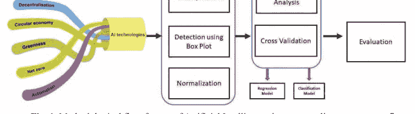

图1. 将人工智能应用于水质评估的方法流程。

计算器视觉通过自动化检测和测量这些视觉线索，减少了人工检查的需要，并加快了响应时间。

AI和CV技术的结合还使得创建能够实时持续评估水质的自动化监测系统变得更加容易。这些系统可以安装在各种环境中，包括偏远的天然湖泊和河流以及城市供水网络。这些配备摄像头和传感器的设备收集连续的数据流，由AI算法即时分析。通过实时分析，可以快速识别和处理水质问题，例如溶解氧水平的突然下降或污染物浓度的飙升（Khan et al., 2021）。这会导致警报被发出。这些自动化解决方案大幅降低了运营成本和资源需求，同时提高了水质监测的效力和准确性。

此外，AI和CV技术在水质评价中的应用促进了广泛而连贯的数据平台的发展。这些平台通过汇总来自多个来源（如历史记录、卫星图像和现场传感器）的数据，提供了水质在时间和空间上的全面图景（Khang et al., 2024）（Chai et al., 2021）。由AI驱动的先进数据分析和可视化工具可以通过帮助利益相关者理解复杂关系和趋势来促进基于证据的决策。例如，预测模型可以模拟不同污染控制策略的结果，协助立法者制定更成功的环境法规。总之，通过改进数据收集、分析和治理，AI和CV技术正在彻底改变水质评估，最终为更主动、更明智的水资源管理铺平道路。

## 水质评估基础

### 水质的参数和指标

为了确定水体对各种用途的健康和适宜性，需要测量和分析一系列物理、化学和生物因素。这些过程构成了水质评估过程的基础。水的物理特性，包括温度、浊度、颜色、味道和气味，为其质量提供了基本见解。温度影响氧气等气体的溶解度以及水生生物的新陈代谢率，而浊度——由悬浮颗粒引起——则影响光线穿透，进而影响水生植物的光合作用。颜色、味道和气味的差异可能是由有机废物、藻类和工业污染物引起的潜在污染和生态破坏的指标（Kothari et al., 2021）（Aydin et al., 2021）。图2展示了水质评估所需的这些参数。

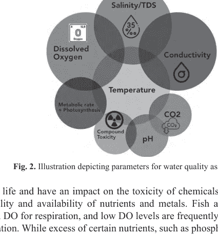

图2. 描绘水质评估参数的图示。

化学参数通过提供水中不同化合物浓度的信息，对水生生态系统和人类健康产生重大影响。pH值、溶解氧（DO）、营养物质、重金属和有机污染物是重要的化学指标。极端pH值可能对水生生物造成危害，并影响化学品的毒性。pH值还会改变营养物质和金属的溶解度与可利用性。鱼类和其他水生生物依赖溶解氧进行呼吸，低溶解氧水平通常表明存在有机污染。虽然某些营养物质（如磷酸盐和硝酸盐）过量会导致富营养化，进而可能引发有毒藻华和氧气耗竭，但这些营养物质对植物生长是必需的。来自空气沉降和工业排放的重金属，如铅、汞和镉，即使少量也具有危害性。由于它们的毒性和持久性，有机污染物，如农药和除草剂，对人类健康和生态系统构成长期危害（M. V.-E., 2020）。

通过评估水生生物的存在和状况，生物因素可作为水质清晰标记。高BOD水平表明存在大量有机污染和可能的氧气耗竭（Wen et al., 2020）。BOD测量微生物分解有机物所需的氧气量。微生物标记，如大肠菌群，指示病原体污染，通常来自污水和其他粪便污染源。鱼类种群的多样性和丰度以及物种组成的变化是水生生态系统总体健康的重要标志。这些指标还可以揭示生态破坏和污染的影响。总之，有必要对水体的物理、化学和生物方面进行全面评估，以全面了解其适宜性和整体健康状况。这些指标有助于定位污染源、评估对环境的影响，并指导制定水资源管理和保护计划。通过整合这些特征，水质评估可以保障水生栖息地的可持续性和安全性，满足各种用途。

### 传统方法与现代方法

随着时间的推移，水质评估领域发生了重大演变。传统方法已让位于当代技术的整合

技术。传统技术主要依赖实验室分析和现场采样，虽然极其精确和具体，但劳动密集且耗时。现场采样过程涉及在不同深度和位置手工采集水样。然后，利用分光光度法、色谱法和滴定法等方法对这些样品进行实验室分析。这些技术能够提供水质指标（如微生物含量和化学浓度）的精确测量，但通常其时间和空间覆盖范围有限，需要投入大量财力和人力。

另一方面，当代方法利用尖端技术来提高水质评估的有效性、范围和实时能力。例如，自动化原位传感器被放置在水体中，连续监测温度、浊度、溶解氧和 pH 值等参数。由于这些传感器提供实时数据，所需的人工采样减少，并且可以立即识别水质问题。通过卫星成像和航空摄影观察水质的长期、大规模变化，是遥感与地理信息系统（GIS）扩大监测范围的另一种方式。GIS 技术实现了空间和时间数据的整合，从而能够在大面积地理区域对污染源和趋势进行深入研究和可视化。

另一个进展是将机器学习（ML）和人工智能融入水质评估。AI 算法可以分析大型数据集，并且比传统统计方法更有效、更准确地发现模式、预测趋势和识别异常。基于历史数据训练的机器学习模型能够预测未来的水质状况，为主动管理提供有用的见解。

将传统技术与新技术相结合，使水质检测更加全面和高效。特别是对于特定污染物和生物评估，传统方法仍然是获得准确、全面结果的关键。另一方面，现代方法提供了更大的时间和空间覆盖范围，支持大规模、持续监测。这些技术共同提供了对水质更全面的理解，促进了更好的决策和水资源管理。这种综合方法不仅提高了评估效率和准确性，还有助于制定更有效的政策和干预措施，以保护和维护水生栖息地。

## 人工智能简介

### AI 与机器学习基础

AI 是指技术（尤其是计算机系统）模拟人类智能过程的方式。这些过程包括学习、推理、问题解决、感知和语言理解。AI 可分为两类：广义 AI（能够执行人类可以完成的任何智力工作）和狭义 AI（专为完成特定任务而设计，如人脸识别或互联网搜索）。机器学习（ML）是 AI 的一个子领域，专注于创建统计模型和算法，使计算机能够基于数据进行分析、预测和决策（Singh et al., 2024）。

机器学习的特点是模型通过实践或处理更多数据而在任务上变得更好。机器学习算法主要有三类：强化学习、无监督学习和监督学习。在监督学习中，使用带标签的数据集训练算法，每个训练示例都关联一个输出标签。该程序应当能够准确预测新的、未见过的数据（Singh et al., 2023）。无监督学习的目标是通过在没有标签答案的数据上进行训练，从而发现输入数据中潜在的结构或隐藏模式。通过奖励好的行为并惩罚不希望的行为，强化学习使算法能够通过试错学习最佳行动方案。

一种被称为“深度学习”的机器学习已成为人工智能领域的有力工具。它使用多层神经网络，因此得名“深度”学习。由于这些神经网络的设计模仿人脑的结构和功能，它们能够以复杂的方式分析和学习海量数据。深度学习在涉及非结构化数据（如文本、音频和照片）的任务中表现出色，因此特别适用于图像识别、自然语言处理和语音识别等应用（Singh et al., 2024）。循环神经网络（RNN）更适合序列数据分析（如时间序列或语言建模），而卷积神经网络（CNN）这类深度学习模型则尤其擅长图像相关任务。深度学习的进步极大地提升了 AI 系统的能力，使它们在广泛的应用中达到了前所未有的准确性和效率。随着计算能力和算法复杂度的提高，深度学习和 AI 有望彻底改变包括环境科学在内的众多行业。

## 人工智能在环境科学中的应用

人工智能在环境科学中的应用为跟踪、控制和减少环境问题提供了更多选择。AI 在环境监测中得到广泛应用，算法分析来自多个来源的海量数据，以识别模式和异常。例如，AI 能够分析遥感数据和卫星图像，以监测珊瑚礁健康状况、跟踪森林砍伐和识别非法捕鱼活动，图 3 展示了部分应用。机器学习算法利用过去的污染数据和气候变量，可以预测空气质量水平，并在空气质量极差的日子提前发出预警（Zhong et al., 2021）。

人工智能在水质评估领域具有革命性意义。AI 系统通过分析来自原位传感器、卫星照片和历史记录的数据，可以持续监测 pH 值、浊度、溶解氧和污染物存在等水质指标（Gupta et al., 2021）。传统分析方法可能会忽略数据中的某些模式和相关性，但机器学习算法可以识别它们，从而能够更准确地预测水质变化。例如，通过检查温度、光照可用性和营养水平等环境变量，AI 模型可以预测有害藻华。这使得及时保护水生生态系统和公众健康成为可能。

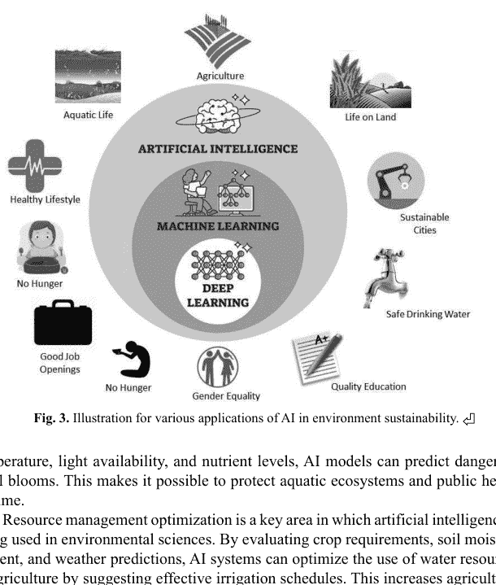

图 3. 人工智能在环境可持续性中的多种应用示意图。

资源管理优化是人工智能在环境科学中应用的关键领域之一。通过评估作物需求、土壤水分含量和天气预报，AI 系统可以建议有效的灌溉计划，从而优化农业中的水资源利用。这既增加了农业产量，又节约了水资源。AI 还被用于野生动物保护，通过分析声学传感器、无人机和视频陷阱的数据来追踪濒危物种的活动并监测动物种群（Zhong et al., 2021）（Sanchez et al., 2022）。AI 通过高效准确地处理大规模数据集，有助于制定有效的保护方法并减缓生物多样性的丧失。

总而言之，人工智能和机器学习已成为环境科学领域的重要工具，为自然资源的观察、评估和管理提供了强有力的方法。AI 具有处理海量数据、识别模式和做出预测的能力，这些能力将帮助我们更好地理解复杂的环境系统并应对环境问题。随着 AI 技术的发展，其在环境科学中的应用预计将不断扩大，为自然世界的可持续性和保护做出更大贡献（Jain et al., 2020）。


## 环境监测中的计算机视觉（CV）技术

### 理解计算机视觉与图像处理

CV这一人工智能学科使计算机能够分析和理解来自其环境的视觉数据。从根本上说，CV涉及从图片和视频中提取重要数据，以执行通常需要人类视觉的操作。图像处理是CV的关键要素，包含一系列用于改进、解释和修改图像的方法（Liu et al., 2024）。滤波、分割、特征提取和模式识别是其中的一些方法，它们共同将原始视觉数据转换为有意义的见解。

图像处理始于通过相机、卫星、无人机或其他传感器获取图像。这些图像通常要经过预处理步骤，如降噪、对比度增强和归一化，以提高其质量并使其更适合进一步分析。分割将图像划分为有意义的区域或对象，从而更容易分析特定特征（Valipoor and de Antonio, 2023）。特征提取识别相关属性，如边缘、纹理或形状，这些属性可用于分类或识别任务。模式识别通常由机器学习算法驱动，能够识别和分类图像中的对象或现象。

深度学习极大地提高了图像分析的精度和有效性，彻底改变了CV领域，尤其是在使用卷积神经网络（CNN）时。CNN非常擅长目标识别、图像分类和语义分割等任务，因为它们能够从图像中自动且自适应地学习特征的空间层次。这些能力在自动驾驶、环境监测和医学影像等多个领域都有广泛的应用（Liu et al., 2024） （Liu et al., 2023）。

### CV在水质评估中的作用

深度学习的使用极大地提高了图像分析的精度和有效性，彻底改变了CV领域，尤其是在使用卷积神经网络（CNN）时。CNN非常擅长目标识别、图像分类和语义分割等任务，因为它们能够从图像中自动且自适应地学习特征的空间层次。这些能力在自动驾驶、环境监测和医学影像等多个领域都有广泛的应用（Rawat et al., 2023）。

浊度的识别和追踪是CV在水质评估中的主要功能之一。浊度升高通常由悬浮颗粒物（包括淤泥、藻类和微生物）引起，会减少光线穿透、干扰光合作用，从而对水生生态系统产生负面影响。为了精确测量浊度水平，CV算法通过分析水体照片中光的散射和吸收情况（Adelani et al., 2024）。与传统的人工采样方法相比，这种自动分析更有效，覆盖范围更广，能够实时提供水体清澈度和潜在污染源的信息。

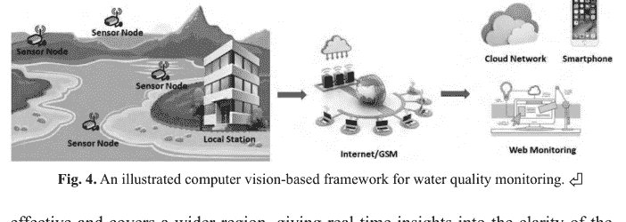

图4. 基于计算机视觉的水质监测框架示意图。

此外，CV对于监测藻华至关重要，因为藻华会对水生生物和水质产生负面影响。有害藻华（HABs）通常由营养物污染引起，其产生的毒素对人类健康和动物都构成风险。CV系统可以通过卫星图像和航空摄影来识别和监测藻华随时间变化的程度和演变。这些系统利用机器学习和模式识别技术分析几种藻类的浓度并加以区分，图4展示了其中一个框架。通过早期发现和持续监测，可以及时采取管理措施来减轻有害藻华的影响（Tang et al., 2022）。

CV技术也使得识别水体中的污染物和其他物体变得更加容易。例如，利用图像处理技术，可以直观地识别和分类塑料垃圾和其他碎屑。通过识别和测量水面和水下相机拍摄的图像中存在的污染物数量，CV系统可以为旨在预防污染和组织清理行动的策略提供重要信息（Punithavathi et al., 2022）。CV还可以通过监测水颜色的变化来协助全面评估水质，因为水颜色变化可能是溶解物质或化学污染物的迹象。总之，计算机视觉技术对于评估现代水质至关重要，因为它们为持续、广泛、实时的监测提供了强有力的工具。通过使用先进的图像处理和深度学习技术，CV提高了我们识别、评估和处理各种水质问题的能力，最终改善了水生环境的管理和保护。

### 结合AI与CV进行水质评估

#### 数据收集与预处理

稳健的数据收集和预处理对于后续研究的准确性和可靠性至关重要，并且是有效评估水质的第一步。在数据收集过程中，信息来自多种来源，例如水下相机、卫星图像、*原位*传感器、遥感技术和航空摄影（Nti et al., 2023）。通过*原位*传感器，可以连续、实时地测量温度、浊度、溶解氧、pH值以及其他物理和化学特性。卫星成像和遥感可以提供大规模数据，记录大范围水质在空间和时间上的变化。

预处理是确保所获数据质量及其分析可用性的必要步骤。传感器数据的预处理程序可能包括校准、降噪和缺失读数处理。校准可确保传感器读数的准确性及其与公认标准的一致性（Taşan, 2023）。使用滤波等降噪技术可以消除数据中的随机波动和异常值。为了确保数据集完整以供分析，处理缺失值需要使用插值或插补技术来估算缺失数据。

来自无人机和卫星的图像数据的预处理涉及多种过程。这些过程包括：归一化以标准化数据范围；辐射校正以校正像素值受大气效应和传感器噪声的影响；几何校正以校正传感器视角引起的畸变（Al-Janabi and Al-Barmani, 2023）。使用图像分割和增强技术（如对比度调整和边缘识别）来突出基本特征，使关键细节更易于查看。预处理确保数据正确、干净，并准备好供AI和计算机视觉（CV）模型分析。

#### 用于水质预测的AI模型

使用AI模型进行水质预测越来越普遍，尤其是那些利用机器学习和深度学习技术的模型。这些模型能够进行模式识别、深入的数据集分析和未来水质预测。在水质评估中，监督学习算法（包括随机森林、决策树和支持向量机（SVM））经常用于回归和分类任务。通过对历史数据的训练，这些模型可以发现水质指标（如污染物浓度和藻华发生情况）与输入因素（如温度、pH值和营养物水平）之间的相关性（Chhipi-Shrestha et al., 2023）。

卷积神经网络（CNN）和循环神经网络（RNN）是深度学习模型的两个例子，它们为处理大型非结构化数据集提供了强大的处理能力。CNN尤其擅长通过分析空间数据（如卫星图像）来识别和分类与水质相关的特征，例如浊度水平或藻华（Iqbal et al., 2023）。由于RNN能够处理序列数据，它们非常适合时间序列预测。这意味着可以利用过去的传感器数据预测水质趋势。特征选择和降维等技术有助于定位最相关的变量并简化数据集，因此对AI模型非常有利，如图5中的基于机器学习的框架所示。这增强了模型的可解释性和性能。此外，很多时候还会使用集成学习技术，即整合多个模型以提高预测准确性。这些AI模型提供了关于水质动态的深刻见解，有助于主动管理和风险规避决策（Irwan et al., 2023）。


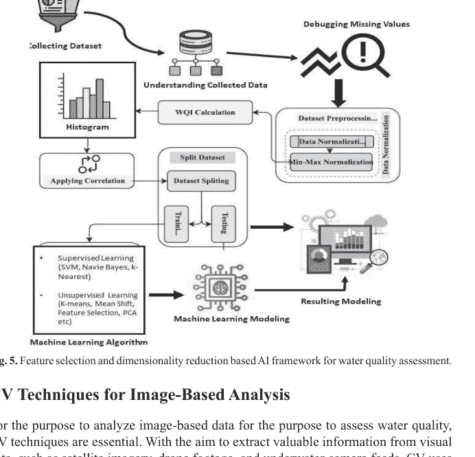

图 5. 基于特征选择和降维的 AI 框架用于水质评估。

## 基于图像分析的计算机视觉技术

为了分析基于图像的数据以评估水质，计算机视觉技术至关重要。为了从视觉数据中提取有价值的信息，例如卫星图像、无人机拍摄画面和水下摄像机视频，计算机视觉使用了尖端的图像处理和深度学习技术。这些方法为检测、分类和监测多种水质指标提供了非常准确且高效的方法。

水质评估中基于图像数据的分析在很大程度上依赖于计算机视觉算法。计算机视觉利用先进的图像处理和深度学习技术，从包括水下视频流、无人机拍摄画面和卫星图像在内的视觉数据中提取重要信息。这些方法能够非常准确且高效地检测、分类和监测各种水质指标。

为了检测水体中的某些污染物和事件，目标检测和分类至关重要。使用标记数据集，卷积神经网络（CNNs）和其他深度学习模型被训练以识别模式并对事物进行分类，例如入侵水生物种、塑料垃圾和石油泄漏。由于其能够快速处理大量图像数据，这些模型可以提供关于污染物分布和存在的实时洞察（Chhipi-Shrestha et al., 2023; Jadhav et al., 2023; Taşan, 2023; Chouhan et al., 2024; Kumar et al., 2024）。

此外，计算机视觉方法使得追踪与水质相关的因素随时间如何变化成为可能。通过检查图像序列，计算机视觉系统可以识别颜色、浊度以及藻华规模等特征随时间的变化。理解水质问题的演变并评估管理措施的成功需要这种时间研究。因此，使用人工智能和计算机视觉进行水质评估提高了监测工作的精确性、可扩展性和及时性，从而制定出更明智且成功的环境管理计划。

## 案例研究与应用

### 密切关注沿海水域藻华

对沿海水域有害藻华（HABs）的监测是人工智能和计算机视觉（CV）技术在水质评估中最重要的用途之一。因为 HABs 能产生污染海产品和饮用水的毒素，它们对人类健康、地方经济和海洋生态系统构成严重威胁。在一项贯穿墨西哥湾的案例研究中，使用人工智能模型将原位传感器数据和卫星图像结合起来，以识别和预测 HAB 发生。高分辨率卫星照片使用深度学习方法，特别是卷积神经网络（CNNs）进行分析，以寻找藻华的指标，例如水色变化和叶绿素浓度。由于这些人工智能模型是在历史藻华数据上训练的，因此能够识别与 HAB 发生相关的时空模式。该策略提供的早期预警能力使得能够及时发布公共卫生警报并采取缓解措施。该案例研究的成功展示了人工智能和计算机视觉技术如何改善沿海水质监测和管理，保护人类社区和海洋生物。

### 机器学习用于河流污染预测

在一项聚焦印度恒河的案例研究中，创建了机器学习模型以根据不同的环境和人为参数预测污染水平。作为世界上污染最严重的河流之一，恒河受到生活污水、农业径流和工业排放的困扰。机器学习模型使用来自多个来源的数据进行训练，例如气象站、遥感和人工水样采集。数据使用监督学习技术进行分析，例如支持向量机（SVM）和随机森林，以预测重要污染物的数量，例如重金属、硝酸盐和生化需氧量（BOD）。模型识别出了污染水平的重要指标，包括人口密度、工业活动和降雨模式。这些预测能力使得能够识别重要污染热点并简化修复活动，同时也使得实施更有效的污染管理技术成为可能。该案例研究中机器学习的引入展示了它如何提高广阔复杂河流系统中水质检测的效率和预测准确性。

### 利用计算机视觉实时监测城市水体

在城市环境中进行了一项案例研究，利用计算机视觉（CV）技术监测湖泊和水库的水质。来自雨水径流、工业排放和休闲活动的污染是城市水体的常见问题。为此研究，在许多城市湖泊部署了一个配备高分辨率成像能力的智能摄像机和无人机网络。为了处理这些设备收集的视觉数据，计算机视觉算法被创建，重点关注表面垃圾、浊度和藻类存在情况。特定污染物，例如塑料垃圾和石油泄漏，由目标识别模型识别，而感兴趣区域则使用图像分割技术进行分离。由于计算机视觉系统提供的实时分析，当地官员现在可以持续监测水质并迅速应对污染情况。此外，所收集的信息有助于制定改善水质的长期策略，证明了计算机视觉在城市水质管理中的实用性。

### 改善农业地区的水质

农业径流是水污染的重要来源，它进入邻近水体并带入沉积物、肥料和农药。一项案例研究考察了在美国中西部农业地区，使用人工智能和计算机视觉技术监测和管理受农业活动影响的溪流和河流的水质。通过将地面传感器数据与无人机和卫星的遥感数据相结合，建立了一个全面的监测系统。为了根据气象条件、土壤类型和农业活动预测水体中的营养水平（例如氮和磷），使用了人工智能模型，例如神经网络和回归算法。无人机图像使用计算机视觉技术进行分析，以确定溪流泥沙沉积和侵蚀的程度。通过采用综合方法，农民和水资源管理者能够通过使用针对性的最佳管理实践（BMPs），包括缓冲带和覆盖作物，减少氮径流并改善水质。该案例研究展示了人工智能和计算机视觉如何支持环保的农业方法并保护农村社区的水源。

### 海洋微塑料自动检测

微塑料通过导致海洋污染，对人类健康和水生生物构成日益增长的威胁。提出了一项案例研究，使用计算机视觉技术自动检测和量化海洋水域中的微塑料。微塑料分析的传统方法涉及劳动密集且耗时的样品手动采集和显微镜检查。在这项调查中，配备尖端成像设备的无人潜水器被用来在不同深度收集视觉数据。使用专门用于颗粒检测的计算机视觉算法，通过微塑料颗粒的大小、形状和颜色来识别和分类它们。研究人员能够确定污染热点并理解微塑料分布的模式 in the

得益于自动化系统对微塑料浓度的实时数据，水质得以保障。该案例研究通过展示利用计算机视觉（CV）进行大规模污染监测的可行性和有效性，支持了减少微塑料污染对海洋生态系统影响的尝试。

这些案例研究展示了将AI和CV技术结合用于各种情境下的水质评估所能产生的革命性影响。这些尖端工具提供关于城市湖泊、农业区域和公海等多种环境中水质的精确、全面和实时信息。AI和CV技术通过提升我们观察、预测和处理水质相关问题的能力，对于水生生态系统的保护和水资源的可持续性至关重要。

## 挑战与未来方向

*数据的可用性和质量*是将AI和CV技术整合用于水质评估的主要障碍。可靠、实时、高分辨率的多来源数据是精确分析和预测所必需的。然而，许多地区缺乏全面的监测系统，导致数据不一致和存在缺口。由于环境干扰、校准问题和传感器故障可能损害数据质量，因此还需要强大的预处理和验证技术。

*水质参数的复杂性：*多种物理、化学和生物因素可能以复杂且非线性的方式相互作用，影响水质。在AI模型中准确表示这些相互作用需要深厚的领域专业知识和先进的建模方法。这些因素在不同时间和地理范围内的波动进一步增加了评估方法的复杂性。

*算法的可解释性和透明性：*许多AI模型（尤其是深度学习算法）由于其“黑箱”特性，很难理解预测是如何生成的。公众、立法者和环境科学家等利益相关者可能难以信任和接受这种缺乏透明性的情况。开发能够揭示决策过程的可解释模型对于AI在水质评估中的广泛应用至关重要。

*多源数据整合：*评估水质通常需要整合来自多种来源的数据，包括原位传感器、卫星影像和实验室研究。由于数据格式、分辨率和时间频率的差异，实现这些不同数据集的平滑整合和协调面临困难。有效的多源数据融合技术对于生成连贯、全面的分析数据集是必需的。

*可扩展性和实时处理：*随着环境数据量的持续增长，AI和CV解决方案的可扩展性成为关键问题。大数据集的实时处理和分析需要使用强大的计算机和高效的算法。有效监测水质取决于AI系统能否在保持准确性的同时处理大量数据并提供及时见解。

## 未来展望

- *增强的传感器网络和物联网整合：*利用物联网（IoT）设备和先进的传感器网络可以极大地增强数据收集工作。这些传感器可以实时、高分辨率地监测水质指标，为AI模型提供连续的数据流。通过结合IoT、AI和CV技术，水质评估系统将变得更加动态和响应迅速。

- *混合模型的构建：*将数据驱动的AI技术与传统的机理模型相结合，可以提高水质预测的准确性和可靠性。混合模型结合了两种方法的优点，能够更全面地理解复杂的环境过程。这种方法可以使模型更易于理解，并更容易将领域知识融入AI系统。

- *边缘计算的发展：*通过更靠近数据源进行处理而非依赖集中式云服务器，边缘计算可以提高水质监测系统的效率。AI算法可以部署在边缘设备（如传感器和无人机）上，在本地进行实时分析，从而降低延迟和带宽需求。这将使得更快的决策和更及时的行动成为可能。

- *纳入公民科学：*利用公民科学项目让公众参与水质监测，可以增加数据收集并提高公众对环境问题的认识。社区可以通过廉价传感器和移动应用提供有用数据，这些数据随后可以被纳入AI模型。这种参与式方法除了能改善数据覆盖范围外，还能培养当地民众的主人翁意识。

- *政策和法规支持：*有效的政策和法规对于AI和CV技术在水质评估中的成功应用是必要的。为了确保利益相关者之间的数据共享、标准化数据收集技术以及鼓励采用尖端技术，政府和监管机构可以在其中发挥关键作用。鼓励创新和合作的健全政策框架对于解决水质问题至关重要。

- *伦理与社会问题：*将伦理和社会问题纳入考虑对于AI在水质评估中的正确应用至关重要。保护数据隐私、避免AI模型中的偏见以及促进决策过程的透明度，对于建立信任和接受度是必要的。此外，确保技术创新的成果惠及所有社区，特别是那些边缘化和被忽视的社区，也至关重要。

#### 结论

将计算机视觉（CV）和人工智能（AI）等尖端技术引入生态信息学，极大地革新了水质评估和监测。从引言中提供的全面概述以及第1.1节对水质评估参数的深入讨论中可以清楚地看到，最先进的技术解决方案正在补充并改进传统的水体监测方法。这些发展对于应对污染、气候变化以及日益增长的清洁水需求所带来的日益严重的问题至关重要。我们在引言中阐述了监测水质对于维持生态系统、人类种群和经济活动的重要性。应用生态信息学（包括收集、分析和解释环境数据）提供了一种理解和管理水资源的有效方法。生态信息学能够通过综合多个来源的数据来呈现水质的完整图景，这正是其对于环境监测至关重要的原因。AI算法能够评估庞大而复杂的数据集，以预测水质趋势并查明污染源。对于利用机器学习和深度学习的模型来说尤其如此。随着新数据的出现，这些模型通过持续学习和改进不断进步，最终提高其预测准确性。另一方面，CV技术提供了强大的基于图像的分析能力，使得可以实时监测和评估浑浊度、表面碎屑和藻华等视觉指标。通过自动化水质监测并减少人工干预的需求，AI和CV协同工作，使人们能够对新出现的问题更快地做出反应。尽管取得了这些巨大进步，但仍然存在许多困难。这些困难包括克服AI模型的不透明性、解决水质参数的复杂性以及确保数据的可用性和质量。此外，研究人员和从业者必须继续创新和合作，以扩展AI和CV解决方案用于实时处理，并整合多源数据。要充分发挥AI和CV在水质监测中的潜力，必须解决这些问题。就未来而言，尖端技术的开发和整合将对水质评估至关重要。边缘计算、物联网整合、混合建模技术以及增强的传感器网络都将推动数据处理、分析和收集能力的提升。水质监测工作还将得益于鼓励有利的立法和监管框架，以及通过公民科学项目让公众参与。最后但同样重要的是，由AI和CV技术增强的生态信息学领域为水质评估提供了变革性潜力。通过利用这些进展，我们可以实现更精确、更有效、更全面的水资源监测，最终为水生生态系统的可持续性和健康做出贡献。需要更多的研究、创造力和合作来克服当前困难并最大化这些技术的潜力。

### 声明

#### 作者的伦理责任

> “所有作者均已阅读、理解并酌情遵守《作者须知》中关于‘作者伦理责任’的声明。”

### 伦理批准

不适用。


## AI工具的使用

示例 1：通讯作者声明未使用任何人工智能工具来准备本文稿。

示例 2：通讯作者声明 Gemini 和 Chat-Gpt 已被用于准备本文稿。

#### 利益冲突

代表全体作者，通讯作者声明无利益冲突需要披露。

#### 竞争性利益

不适用。

## Authors’ Contributions

- Karan¹：概念化，方法学，写作 - 原稿，写作 - 审阅与编辑
- Anil Dhanda²：调查，形式分析，可视化，软件，数据整理，监督
- Prawar³：写作 - 原稿，形式分析，方法学
- Chintan⁴：形式分析，可视化，监督，形式分析

#### 资助

未获得资助。

### 参考文献

Adeshina Adelani, F., Stefano Okafor, E., Sonimiteim Jacks, B., Abayomi Ajala, O. and Author, C. 2024. AI和机器学习在水网络安全中作用的理论框架：来自非洲和美国应用的见解. jepbl.com, 5(3): 681–692, doi: 10.51594/csitrj.v513.928.

Al-Janabi, S. and Al-Barmani, Z. 2023. 软计算方法预测水质指数的智能多级分析（IM12CP-WQI）. Soft Comput., 27(12): 7831–7861, doi: 10.1007/S00500-023-07953-Z.

Aydin, H., Ustaoglu, F., Tepe, Y. 2021. 通过水质指数和多种统计方法评估土耳其东北部溪流的水质. Taylor & Francis, 22(1-2): 270–287, doi: 10.1080/15275922.2020.1836074.

Chai, J., Zeng, H., Li, A. 2021. 计算机视觉中的深度学习：新兴技术和应用场景的批判性综述. Elsevier, 访问：2024年6月1日。[在线]。可获取：https://www.sciencedirect.com/science/article/pii/S2666827021000670.

Chhipi-Shrestha, G., Mian, H.R., Mohammadiun, S., Rodriguez, M., Hewage, K. and Sadiq, R. 2023. 数字水：饮用水质量评估的人工智能和软计算应用. Clean Technol. Environ. Policy, 25(5): 1409–1438, doi: 10.1007/s10098-023-02477-4. 可获取：https://link.springer.com/article/10.1007/s10098-023-02477-4.

Chouhan, S.S., Singh, U.P. and Jain, S. 2024. 计算机视觉和无人机技术的介绍. In: Chouhan, S.S., Singh, U.P. and Jain, S. (eds.). Applications of Computer Vision and Drone Technology in Agriculture 4.0. Springer, Singapore. https://doi.org/10.1007/978-981-99-8684-2_1.

Chouhan, S.S., Singh, U.P., Sharma, U. and Jain, S. 2021. 使用基于计算机视觉的方法对 Jatropha Curcas L. 和 Pongamia Pinnata L. 生物燃料植物的叶片病害进行分割和分类. Measurement, 171: 108796, ISSN 0263-2241, https://doi.org/10.1016/j.measurement.2020.108796.

Chouhan, S.S., Singh, U.P., Sharma, U. et al. 2024. 使用深度学习和机器学习算法对不同植物物种进行分类. Wireless Pers. Commun., 136: 2275–2298. https://doi.org/10.1007/s11277-024-11374-y.

de Mello, K., Taniwaki, R.H., de Paula, F.R., Valente, R.A., Randhir, T.O., Macedo, D.R., Leal, C.G., Rodrigues, C.B. and Hughes, R.M. 2020. 多尺度土地利用对水质的影响：巴西的评估、规划和未来展望. Journal of Environmental Management, 270: 110879. 可获取：https://www.sciencedirect.com/science/article/pii/S0301479720308094.

Gadelha Jr, L.M., de Siracusa, P.C., Daliin, E.C., da Silva, L.A.E., Augusto, D.A., Krempser, E., Affe, H.M., Costa, R.L., Mondelli, M.L., Meirelles, P.M. and Thompson, F. 2021. 生物多样性信息学综述：概念、实践和挑战. Wiley Interdisciplinary Reviews: Data Mining and Knowledge Discovery, 11(1): e1394. 可获取：https://wires.onlinelibrary.wiley.com/doi/abs/10.1002/widm.1394.

Gupta, S., Aga, D., Pruden, A., … 2021. 环境科学与工程研究的數據分析. ACS Publications, 55(16): 10895–10907, doi: 10.1021/acs.est.lc01026.

Gupta, S. 2021. 水质指数工具的批判性综述：起源、演变和未来方向. Elsevier. 访问：2024年6月1日。[在线]。可获取：https://www.sciencedirect.com/science/article/pii/S157495412100090X?casa_token=AvPFU9gQpt8AAAAAxAlMtMoLjPam915CUsOaHmpFca7RJheTrHs-oAeilAxHLLI6g_wFydgV1Tq5227QdGHHBgU_Ssy5fx.

Iqbal, U., Bin Riaz, M.Z., Barthelemy, J., Perez, P. and Idrees, M.B. 2023. 水资源管理中计算机视觉技术过去二十年的文献计量分析. Water and Environment Journal, 37(3): 373–389, doi: 10.1111/wej.12845.

Irwan, D. et al. 2023. 利用人工智能预测水质：方法与应用综述. Archives of Computational Methods in Engineering, 30(8): 4633–4652, doi: 10.1007/S11831-023-09947-4.

Jadhav, A.R., Pathak, P.D. and Raut, R.Y. 2023. 水和废水质量预测：人工神经网络实施的当前趋势和挑战. Environ. Monit. Assess., 195(2), doi: 10.1007/S10661-022-10904-0.

Jain, P. et al. 2020. 机器学习在野火科学与管理中应用的综述. cdsciencepub.com, 28(4): 478–505, doi: 10.1139/er-2020-0019.

Khan, A., Laghari, A. and S. A. 2021. 计算机视觉中的机器学习：综述. publications.eai.eu, 2021, doi: 10.4108/eai.21-4-2021.169418.

Khang, A., Abdullayev, V., … 2024. 计算机视觉（CV）在医疗保健生态系统中的应用. taylorfrancis.com, 访问：2024年6月1日。[在线]。可获取：https://www.taylorfrancis.com/chapters/edit/10.1201/9781003429609-1/application-computer-vision-cv-healthcare-ecosystem-alex-khang-vugar-abdullayev-evgenia-litvinova-svetlana-chumachenko-abuzarova-vusala-alyar-anh.

Khang, A., Abdullayev, V., Litvinova, E., Chumachenko, S., Alyar, A.V. and Anh, P.T.N. 2024. 计算机视觉（CV）在医疗保健生态系统中的应用. Computer Vision and AI-Integrated IoT Technologies in the Medical Ecosystem, pp. 1–16, Jan. 2024, doi: 10.1201/9781003429609-1/Application-Computer-Vision-Cv-Healthcare-Ecosystem-Alex-Khang-Vugar-Abdullayev-Eugenia-Litvinova-Svetlana-Chumachenko-Abuzarova-Vusala-Alyar-Anh.

Kothari, V., Vij, S. and Sharma, S. 2021. Uttarakhand 各区各种水质参数与水质指数的相关性. Elsevier, 访问：2024年6月1日。[在线]。可获取：https://www.sciencedirect.com/science/article/pii/S2665972720300775.

Krishnan, A. et al. 2021. Netravati河流域重金属污染监测：污染指数和风险评估概述. Springer, 7(2): 20, doi: 10.1007/s40899-021-00502-2.

Kumar, R. et al. 2024. 棉花病害检测的混合方法以提高作物健康和产量. In IEEE Access, https://ieeexplore.ieee.org/document/10589357.

Liu, B. et al. 2024. 基于深度学习算法的人工智能与计算机视觉的集成与性能分析. arxiv.org, 访问：2024年6月1日。[在线]。可获取：https://arxiv.org/abs/2312.12872.

Liu, B., Yu, L., Che, C., Lin, Q., Hu, H. and Zhao, X. 2024. 基于深度学习算法的人工智能与计算机视觉的集成与性能分析, 访问：2024年6月1日。[在线]。可获取：http://arxiv.org/abs/2312.12872.

M. V. 2020. 使用水质指数和多元统计方法评估受多种压力源影响的溪流水质：案例研究. Elsevier, 访问：2024年6月1日。[在线]。可获取：https://www.sciencedirect.com/science/article/pii/S0269749120361054.

Ma, D., Dang, B., Li, S. and Zang, H. 2023. 基于人工智能的计算机视觉技术在医学图像分析中的实现. wepub.org, 访问：2024年6月1日。[在线]。可获取：http://wepub.org/index.php/IICSIT/article/view/529.

Neama, M., Attia, M., Negm, A. 2022. 印度水资源、水质和管理概述. Springer, 访问：2024年6月1日。[在线]。可获取：https://link.springer.com/chapter/10.1007/978-3-030-95687-5_1.

Nti, E.K. et al. 2023. 利用先进技术进行水污染控制和复兴：揭示面向环境健康保护的人工智能选项. cell.com, 9: e18170, doi: 10.1016/j.heliyon.2023.e18170.

O’Mahony, N. et al. 2020. 深度学习与传统计算机视觉. Advances in Intelligent Systems and Computing, 943: 128–144, doi: 10.1007/978-3-030-17795-9_10.

Petropoulou, I., Frousiou, M. and Vasileiou, E. 2023. 采矿地区水和土壤质量评估方法概述. Mater. Proc., 15: 31, 访问：2024年6月1日。[在线]。可获取：https://www.academia.edu/download/108156195/pdf.pdf.

Punithavathi, R. et al. 2022. 精准农业中基于计算机视觉和深度学习的杂草检测模型. researchgate.net, doi: 10.32640/csse.2023.027647.

Rawat, P., Bajaj, M., Vats, S. and Sharma, V. 2023, March. 采用多样化机器学习方法论的作物推荐系统分析. In 2023 International Conference on Device Intelligence, Computing and Communication Technologies, (DICCT) (pp. 619–624). IEEE. 可获取：https://ieeexplore.ieee.org/abstract/document/10110085/.

S. A. 2021. 概述：现代水纯度和质量. Elsevier, 访问：2024年6月1日。[在线]。可获取：https://www.sciencedirect.com/science/article/pii/B9780128210574000148.

Sanchez, T.W., Shumway, H., Gordner, T. and Lim, T 2023. 人工智能在城市规划中的前景. Taylor & Francis, 41(4): 382–395, doi: 10.1080/12265934.2022.2102538.

Singh, C., Khajuria, H. and Nayak, B.P. 2023. 在数字取证中为物联网设备实施基于区块链的取证模型集成（BBFMI）的研究. pp. 318–327. In: Hu, Z., Dychka, I. and He, M. (eds.). Advances in Computer Science for Engineering and Education VI, Cham: Springer Nature Switzerland.

Singh, C., Khajuria, H. and Nayak, B.P. 2024. 机器学习驱动的策略，用于保护印度数字环境免受网络跟踪. Feb. 2024, doi: 10.3233/ATDE231337.

Singh, C., Khajuria, H. and Nayak, B.P. 2024. 大数据分析和嵌入医疗保健和工业4.0的网络物理系统的快速发展和趋势. Intelligent Security Solutions for Cyber-Physical Systems, pp. 216–233, doi: 10.1201/9781003406105-19.


Tang, B., Chen, L. 和 Sun, W. 2023. 基于机器视觉的钢材表面缺陷检测综述. *IET图像处理*, Wiley在线图书馆, 17(2): 303–322, 2022年2月, doi: 10.1049/ipr2.12647.

Taşan, S. 2023. 利用水质指数、人工智能方法和GIS集成估算地下水水质：以土耳其地中海中部地区为例. *应用水科学*, 13(1), doi: 10.1007/S13201-022-01810-4.

Taşan, S. 2023. 利用水质指数、人工智能方法和GIS集成估算地下水水质：地中海中部案例研究. *应用水科学*. Springer, 访问日期：2024年6月1日. [在线]. 可访问：https://link.springer.com/article/10.1007/s13201-022-01810-4.

Uddin, M. 和 Nash, S. 2021. 水质指数模型及其在地表水质评估中应用的综述. *生态指标*. Elsevier, 访问日期：2024年6月1日. [在线]. 可访问：https://www.sciencedirect.com/science/article/pii/S1470160X20311572.

Valipour, M.M. 和 de Antonio, A. 2023. 面向视障/盲人的计算机视觉驱动场景理解的最新趋势：系统性映射. *信息社会中的普适访问*, 22(3): 983–1005, 2023年8月, doi: 10.1007/S10209-022-00868-W.

Ward, T., Mascagni, P., Ban, Y. 和 Rosman, G. 2021. 外科手术中的计算机视觉. *外科学*. Elsevier, 访问日期：2024年6月1日. [在线]. 可访问：https://www.sciencedirect.com/science/article/pii/S0039606020307492.

Wen, X. 等. 2020. 微生物指标及其在饮用水水质监测中的应用——综述. MDPI, 访问日期：2024年6月1日. [在线]. 可访问：https://www.mdpi.com/2071-1050/12/6/2249.

Yang, Y. 2023. 生态环境质量与土地利用碳排放的时空动态脱钩状态：以中国青岛市为例. *生态信息学*. Elsevier, 访问日期：2024年6月1日. [在线]. 可访问：https://www.sciencedirect.com/science/article/pii/S1574954123000213?casa_token=SQDHAU1qwoAAAAAA:fA2bd3VapC8N4J_ULo8vU4FyjLLlUqZPf7fghU4Rm_kv94di_QxJiUuqdNKdOyipUemWkghDW_Z.

Yuh, Y., Tracz, W. 和 Matthews, H. 2023. 机器学习方法在喀麦隆北部土地覆盖监测中的应用. *生态信息学*. Elsevier, 访问日期：2024年6月1日. [在线]. 可访问：https://www.sciencedirect.com/science/article/pii/S1574954122004058.

Zhong, S. 等. 2021. 机器学习：环境科学与工程中的新思想和新工具. *环境科学与技术*, 55(19): 12741–12754, 2021年10月, doi: 10.1021/ACS.EST.1C01339.

Zhong, S., Zhang, K., Bagheri, M., Burken, J.G., Gu, A., Li, B., Ma, X., Marrone, B.L., Ren, Z.J., Schrier, J. 和 Shi, W. 2021. 机器学习：环境科学与工程中的新思想和新工具. ACS出版物, 访问日期：2024年6月1日. [在线]. 可访问：https://pubs.acs.org/doi/abs/10.1021/acs.est.1c01339.

## 第9章：利用人工智能和计算机视觉追踪植物生长模式以实现显式映射

Monica Sankat, Ram Kumar* 和 Kumari Shivangi

### 引言

理解并改善植物发育模式是农业和园艺领域的一项基本工作，对可持续性、资源管理和生产具有重大影响。传统的植物生长跟踪和分析技术通常采用人工测量和观察，这种方式劳动强度大、耗时且容易出错。随着技术突破不断影响众多行业，人工智能（AI）与计算机视觉（CV）的结合为精确、有效地绘制植物生长模式提供了一种革命性方法。本章探讨了在农业中应用人工智能和计算机视觉技术的重要性，强调了它们如何能够改变植物生长分析，并对其用途、优势和潜在的未来发展进行了全面研究。

植物生长的复杂过程受多种因素控制，如养分水平、土壤质量、水分可利用性、遗传和环境条件。过去，科学家和农民使用人工技术来跟踪这些变量并评估植物健康状况。虽然这些方法取得了一定的成功，但常常存在主观性强、可扩展性受限以及无法提供实时数据等缺点。此外，全球人口不断增长以及随之而来的对提高农业生产力的需求，要求采用更准确、更有效的植物监测和生长优化方法。

让我们介绍计算机视觉和人工智能。当人工智能处理海量数据和发现模式的能力与计算机视觉解读视觉输入的能力相结合时，就为这些问题提供了强大的解决方案。人工智能算法，尤其是机器学习和深度学习模型，可以分析大型数据集，以发现人类观察者可能忽略的模式和关系中的细微差别。这些技术可用于跟踪植物的多项生长指标，识别疾病或胁迫的早期症状，并提供有用的信息来改进作物管理技术。

表型分析，即对生物体的物理和生化特征进行测量，是人工智能和计算机视觉在植物生长测绘中的主要应用之一。使用计算机视觉技术的自动化表型分析系统可以拍摄高分辨率植物照片。随后，利用人工智能算法对这些图像进行处理，以提取有关植物形态的具体信息，包括叶片大小、形状、颜色和纹理。这些系统可以持续运行，为研究人员和农民提供实时数据，支持他们有关植物健康和生长状况的决策。例如，配备摄像头和传感器的无人机等自主车辆可以在农田中行驶，拍摄照片并收集有关植物健康状况、土壤状况和周围环境的信息（Zhang et al., 2017）。之后，人工智能系统对这些数据进行处理，生成详细的植物生长趋势图。借助这些地图，可以识别植物的胁迫点和生长良好的区域，从而采取具体干预措施，如调整灌溉计划、施肥或实施害虫防治措施。

人工智能和计算机视觉技术还可以改进植物病害的识别与诊断。为了最大限度地减少生产力损失并防止大范围作物损害，早期病害诊断至关重要。目视检查是传统病害诊断技术中常见的组成部分；然而，它可能是主观且不可靠的。

### 植物生长测绘的历史

早期的植物生长测绘通过观察植物大小、形状和颜色的变化来评估生长阶段和健康状况。这些过程中使用的工具包括尺子和测量棒，但这些工具提供的数据较为粗糙，缺乏准确性和范围。随后，人们采用了新方法，包括记录生长阶段、环境条件和植物资源。卡尔·林奈和查尔斯·达尔文等科学家提出了模型和分类法，为植物发育提供了多元化的理解。此外，更精确的测量工具（如千分尺、面积仪和卡尺）的使用，使更准确的植物生长量化成为可能（Islam et al., 2024）。统计工具的引入使得农业研究中生长模式和环境影响得以系统分析。遥感技术（包括卫星图像和航空摄影）的发展使得对作物健康和生长模式的大规模监测成为可能，这彻底改变了植物生长测绘领域。

此外，在20世纪后期，随着从模拟图像向数字图像的转变，植物生长测绘变得更加准确和直接。植物


发展在各种情况下被精确预测并映射，使用包含生理和环境数据的计算机模型得以实现，这得益于使用数码相机和扫描仪提供全面、高分辨率的图像。机器学习和人工智能（AI）在21世纪初首次应用于植物生长制图时，变得越来越受欢迎。得益于这项技术，可以分析大型数据集，发现生长趋势，并准确预测未来生长。将人工智能与物联网相结合，计算机视觉技术已成为植物生长建模的关键组成部分，能够实现植物照片的自动分析、生长阶段追踪和实时健康指标监测。

当前和未来的植物生长模拟发展以精准农业为中心，其中人工智能（AI）和机器学习（ML）是通过精确且持续的环境条件监测来改善植物生长的关键工具。植物生长模拟的长期目标包括可持续性以及开发能够提高资源利用效率、减轻环境影响并保证食品安全的技术（Islam et al., 2024）。感知技术的进一步应用，包括热成像、光谱分析和基于无人机的摄影，有望提高对植物发育成像的能力。历史表明农业实践如何从基本做法发展到更有效、技术更先进的技巧。随着人工智能、计算机视觉和其他前沿技术的进一步发展，植物生长建模将变得越来越精确、有效，并对可持续农业实践至关重要。

## 农业中人工智能与计算机视觉的基础

农业中的人工智能（AI）包括利用算法和机器学习模型来改造农业实践、提高作物产量和改善资源管理。精准农业可能是其中一个重要应用，人工智能分析传感器、气象站和卫星图像的数据以优化田间管理。通过人工智能的作物监测使农民能够评估作物健康状况、及早识别疾病并采取预防措施，从而保护作物。此外，人工智能模型通过分析土壤传感器数据预测土壤质量，帮助农民选择和施用肥料和处理剂。由人工智能驱动的预测分析可以预测作物产量、害虫侵染和气候模式，使农民能够就种植、水管理、收获做出明智选择。除此之外，像自动拖拉机和收割机这样的机械化设备利用人工智能以高精度执行农业任务，减少了对人工劳动的需求并提高效率。计算机视觉（CV）作为人工智能的一个子集，使计算机能够解释和分析环境中的视觉数据。在农业中，计算机视觉对于各种应用至关重要，例如作物和杂草识别（Hesami and Jones, 2020）。计算机视觉系统可以区分作物和杂草，从而实现更有效的除草剂施用、减少化学品使用并制定可持续农业策略。植物病害检测是另一个关键应用，计算机视觉系统分析植物图片以早期识别疾病，从而实现及时干预和治疗。此外，计算机视觉的进步有助于通过精确评估树上水果的数量来进行水果计数和产量估算，帮助农民预测和管理收获。Furthermore，由计算机视觉驱动的无人机和机器人可以检查大面积区域，提供作物状况、生长模式和潜在困难的实时数据，使农民能够做出数据驱动的决策并提高整体效率。

## 植物生长制图的技术与工具

在植物生长制图中，通过使用多种技术来监测、测量和分析植物生长和健康状况。虽然多光谱、高光谱和热成像技术用于分析植物健康和胁迫水平，但利用无人机和卫星图像的遥感提供了大规模数据。地面放置的传感器追踪土壤湿度、营养水平和气候条件。3D建模检查结构变化，而计算机视觉扫描照片以识别生长模式和疾病。人工智能和机器学习提供异常检测、自动分类和预测分析。物联网（IoT）设备允许持续的数据集成和监测，而地理信息系统（GIS）整合空间数据。机器人技术实现精准农业和自动化监测，而云计算管理大型数据库和实时分析。这些耦合技术改善了农业方法，使得植物生长控制得到改善。

此外，基因表达、细胞分裂、细胞扩张及其速率和地理分布的测量对于全面描述负责器官生长和发育的细胞的动态行为至关重要。shoot 和根分生组织中的细胞分裂和谱系模式首先由基于图像的研究确定。这导致了用于观察活体中细胞动态的成像技术的创建。研究人员可以通过结合计算机建模和实验方法来检查数据并生成可测试的预测。可以使用生物学研究（如共聚焦显微镜图片的 z-stack）开发考虑系统行为的预测模型。之后，这些模型可以产生反直觉的预测以供进一步实验研究（Yang et al., 2020）。

## 植物生长监测中的深度学习应用

深度学习（DL）是机器学习（ML）的一个子集，使用多层人工神经网络（ANNs）来建模数据。由于这些模型是数据驱动的，它们产生的参数和结果取决于它们所训练的真实世界实例。DL 可以通过以下几种方式获取数据表示，包括：

- **Supervised Learning:** 指预先确定的结果。
- **Unsupervised Learning:** 该方法专注于在数据中寻找模式。
- **Semi-Supervised Learning:** 融合监督和无监督技术，权衡各自的优缺点。
- **Reinforcement Learning:** 基于激励和惩罚，该方法采用试错技术。

由于生物因素如生理和遗传过于复杂，传统的机器学习（ML）模型（如决策树、k-最近邻（k-NNs）和支持向量机（SVMs））难以对植物发育进行泛化（Sharma et al., 2023）。

## 数据集获取与处理

在植物生长制图中，数据集收集和处理涉及多个程序和困难。田间研究、温室试验、开放数据库和遥感是数据收集的来源之一。这些数据包括基因型信息、表型测量、环境数据和高分辨率照片。为了在处理过程中保持数据集完整性，需要进行数据清洗、规范化和标注。数据增强技术（包括翻转、旋转和创建合成数据）增加了数据的多样性和鲁棒性。虽然分割方法将单个植物部分分开并分析随时间的生长趋势，但特征提取（自动和人工）可找到重要特征。多模态数据融合改进了分析，而数据集成合并来源以提供全面的数据集。之后，数据集被分为训练集、验证集和测试集，并在准备分析之前使用交叉验证检查其模型可靠性。

## 植物生长制图中的物联网

物联网（IoT）极大地改善了植物生长制图，它允许对多种环境和植物特定特征进行持续监测和数据集成。基于现场的物联网（IoT）传感器实时监测温度、湿度、营养水平和土壤湿度，并将收集的数据发送到中央系统进行分析。这种整合的数据收集提供了对植物发育动态的全面理解。

使用实时监测的物联网系统可以快速识别营养缺乏或干旱胁迫等问题，并可能发出自动通知以实现早期响应。为了预测未来的植物发育、产量和可能的问题，机器学习评估收集的数据。这有助于异常识别和知情决策（Dawn et al., 2023）。

通过提供针对单个植物需求的精准施肥、灌溉和害虫管理，优化资源消耗并提高可持续性，物联网使精准农业成为可能。

农民可以使用计算机或手机远程监督作物，物联网可以自动化设备，如温室气候管理和灌溉泵。


通过整合和分析来自多个来源的数据获得。通过分析历史数据，可以洞察趋势、改进流程并适应不断变化的情况。总体而言，通过促进植物健康和生长的监测、控制和优化，物联网提升了农业的生产力、可持续性和效率。

## Robotics in Plant Growth Mapping
机器人革新了植物生长测绘，因为它自动化了观察、数据收集和干预。固定机器人持续监测特定区域，而配备摄像头和传感器的移动机器人则扫描田地或温室，以收集有关植物健康和环境条件的详细数据。在精准农业中，机器人利用实时数据以极高的精度施用农药、肥料和水。此外，具有视觉能力的机器人可抑制杂草和其他害虫，减少对化学品使用的需求。为了评估植物健康并识别疾病，它们拍摄高分辨率图像并采用多光谱和超光谱成像。机器人随时间检测发育变化并评估植物表型生长指标。这种自动化提高了生产力，减少了人工劳动，并且可以扩展以适应不同类型的农业活动。配备传感器的机器人可改善生长条件并提高环境监测。

## Practical Applications of Plant Growth Mapping
由于大数据突破，人工智能（AI）最近以更快的速度发展。这些创新将巧妙的算法与更大的数据集相结合，使人工智能软件能够自动识别大型数据集中的模式或特征。机器学习是一种人工智能，被计算机系统用于执行特定任务。通常存在两类：监督学习和无监督学习策略。监督学习方法使用包含独立变量 x 和因变量 y 的矩阵来表示。当使用回归时，Y 通常是连续值的向量，而在分类问题中则为标量以表示类别标签。

## Plant Image Acquisition
在此阶段，会拍摄相关植物照片并自动分析以进行分类。这些照片由高分辨率数码相机拍摄，本质上是二进制数据的集合。此外，智能手机也很重要，因为它们可以拍摄多种文件类型的图片，包括 jpg、png 和 tif。在拍摄所有所需照片后，它们会进入图像预处理步骤进行必要的校正和改进。如果图片不符合处理要求，则会使用图像增强技术（Perez-Sanz et al., 2017）。

精确的疾病分类取决于准确的图片采集。由于拍摄的图片用于训练机器学习模型，其质量对框架整体效率有显著影响。农业研究开发了许多知名图片数据集。

## Image Preprocessing
在图像采集的第一阶段处理获取的图片对于解决噪声、模糊、光线不足和不需要的背景等多个问题至关重要。此预处理阶段确保原始数据被转换为可用格式并去除任何失真，为自动疾病分类技术做好准备。之后，照片会经过关键的特征提取和分割过程。

预处理在优化计算资源使用的同时保持图像分辨率的一致性。标准化、颜色尺度修改、失真去除、图像尺寸规范化和降噪是重要的预处理技术。为了获得最佳分析，图像通常会被调整大小以适应预定的颜色空间并按特定比例缩放。据研究，使用白色背景可以提高视觉清晰度。

在农业研究中，HSV（色调、饱和度、明度）方法是一种常见的预处理技术， closely 模拟人类视觉能力。掩膜和背景去除技术被广泛用于提高处理精度和效率。彩色照片通常被转换为 HSI（色调、饱和度、强度）颜色空间，其中 H 分量对进一步分析尤其有帮助（Barbedo, 2013）。

高通滤波器用于强调具有明显强度梯度的区域，而低通滤波器用于最小化高频噪声。快速傅里叶变换技术将图像转换为空间频率域，而拉普拉斯滤波器则增强图像轮廓的清晰度。直方图用于改变功率分布并提高图像质量，而高斯平滑滤波器则用于减少噪声。

对受污染叶片的图片进行分割至关重要。

## Image Segmentation
分割是农业研究中的关键工具，它将图像分解为组成部分，以便更仔细地检查每个项目并提取有价值的特征。此过程有助于识别植物的受损和未受损区域。为了提取可能有用的特征，对预处理图像进行分割以对生病叶片进行分类至关重要。

传统的分割技术包括聚类、基于区域、边缘检测和阈值处理。阈值处理通常用于遥感、检测和分类，根据像素强度水平对图像进行分割。它使用的一些技术有全局、变量和自适应阈值处理。利用 Sobel 算子、Canny 边缘检测器和拉普拉斯高斯（LoG）滤波器等方法，边缘检测根据图像边缘将其分割。通过应用 Region Growing 和 Region Splitting 等技术，基于区域的分割根据像素在强度、颜色和形状上的相似性将图像分离为区域。聚类使用 K-means 和模糊 C-means 等常见算法，根据纹理、颜色或其他属性对像素进行分组（Yang et al., 2023）。

然而，具有精确特征的复杂照片通常对旧方法构成挑战。基于深度学习的分割技术已被证明比传统方法更有效。通过对图像中的每个像素进行分类，语义分割将图像分离为有用的区域。CNN 和其他深度学习方法提高了分割的准确性。实例分割是一种复杂的语义分割类型，使用图像识别来预测对象类别的实例，使其能够处理复杂任务。采用 Tensor Mask、Deep Mask、RCNN、YOLO 和 Instance Cut 等方法已成为标准做法。每种方法都有其自身的优点和局限性，选择取决于具体应用需求。

## Case Study on Plant Growth Mapping
### Automated Tomato Disease Detection
学名为 Solanum Lycopersicon 的番茄是一种重要的农产品，因其高营养含量而在亚洲及世界各地广泛种植，其中包括高量的钾、β-胡萝卜素以及维生素 E 和 C。番茄虽然很受欢迎，但极易受到细菌、微生物和害虫引起的大范围疾病的影响。因此，为了保证作物健康和产量，自动化疾病检测已成为一个至关重要的研究领域。出于这个原因，研究了各种方法。在 Plant Village 数据集的帮助下，Francis 和 Deisy（2019）创建了一个具有四个卷积层和两个密集层的 CNN 模型。该模型在区分健康和患病的番茄和苹果叶片方面表现出惊人的 87% 准确率。类似地，Basavaiah 和 Anthony（2020）使用 200 张照片的纹理、颜色和形状变量来评估几种机器学习技术。随机森林模型显示出 94% 的准确率。K 和 Rao（2019）使用概率神经网络（PNN）和 KNN 从 600 张照片中识别和分类疾病，包括 Verticillium 枯萎病、白粉病和 Septoria 叶斑病。PNN 以 91.88% 的准确率优于 KNN。Vadivel 和 Suguna（2022）在 10,000 张增强照片上采用 BPNN 方法并使用 K-means 方法进行特征提取，取得了惊人的 99.4% 准确率。通过对 4281 张图片进行微调 ResNet 和 Xception 模型，Chakravarthy 和 Raman（2020）在识别早疫病方面取得了惊人的 99.95% 准确率。在使用 PlantVillage 数据集中 14,903 张十种不同番茄疾病图片分析多种 CNN 架构时，Kumar 和 Vani（2019）发现 VGG16 模型优于 LeNet、Xception 和 ResNet50 等其他设计，最高准确率为 99.25%（Jafar et al., 2024）。这些论文展示了番茄自动化疾病诊断方面的进展，以及不同机器学习和深度学习模型改善作物健康和农业生产力的潜力。

### Automated Potato Disease Detection
马铃薯是每个国家的 staple 作物，严重遭受多种疾病的困扰，如粉红腐烂病、普通疮痂病、黑痂病和黑腿病。扭转这些疾病对于维持农业可持续性和粮食安全至关重要。为了解决这一问题，许多研究探索了用于马铃薯植物自动化疾病检测的深度学习（DL）和机器学习（ML）技术领域。在对包括 ANN、SVM 和 RF 在内的机器学习技术的全面分析中，

Patil 等 (2017) 发现 ANN 最为准确，在通过叶片照片识别甘蔗病害方面达到了惊人的 92% 准确率 (Singh et al., 2024)。在纹理特征和最大-最小颜色差技术的帮助下，Suttapakti 和 Bunpeng (2019) 开发了一种新颖的方法，在疾病分类中取得了令人印象深刻的 91.67% 准确率。卷积神经网络 (CNNs) 最早由 Arshaghi 等 (2023) 用于分类马铃薯病害。他们在多个病害组中实现了前所未有的 100% 和 99% 的准确率，标志着自动化病害识别的重大进步。Arya 和 Rajeev (2019) 还研究了 CNN 和 AlexNet 设计的功效；AlexNet 表现异常出色，在病害识别中达到了惊人的 98.33% 准确率。进一步凸显了 DL 在疾病诊断中的前景，Mahum 等 (2023) 开发了一种先进的 DL 技术，包括 Efficient DenseNet 和加权交叉熵损失，在测试集上达到了 97.2% 的准确率。Al-Amin 等 (2019) 在开发用于检测马铃薯叶片晚疫病和早疫病的专用深度学习架构中实现了高达 98.33% 的准确率，证明了 DL 模型在病害检测中的有效性。此外，Sharma 等 (2021) 通过使用 DL CNNs 预测马铃薯病害，实现了 97.66% 的显著准确率，优于传统的 ML 分类器。这些研究的结论指向将 ML 和 DL 方法纳入农业作业的积极方向，为马铃薯生产中的作物保护和病害控制提供了长期解决方案 (Sinshaw et al., 2022)。表 1 总结了农业中使用的各种人工智能技术。

## 表 1. 表示农业中使用的各种技术、其优势和局限性。

| Techniques | Strengths | Limitations |
|---|---|---|
| CALEX | 可以制定作物管理活动的调度指南。 | 耗时。 |
| PROLOG | 移除农场中较少使用的农具。 | 位置特定。 |
| ANN | 预测作物产量。 | 仅将天气作为作物产量的因素。 |
| ROBOTICS - Demeter | 可以收获多达 40 公顷的作物。 | 昂贵：耗油量大。 |
| ROBOTICS | 收获作物成功率达 80%。 | 采摘速度和准确性慢。 |
| ANN and Fuzzy Logic | 减少攻击作物的害虫。 | 显示出无法区分作物和杂草的能力。 |
| Computer Vision System (CVS) | 工作速度快。可多任务处理。 | 基于尺寸的检测，可能影响良好物种。 |
| Expert system using rule-base in disease detection | 疾病诊断更快，治疗更快。基于其预防性方法具有成本效益。 | 耗时。需要持续监测以检查害虫是否对预防措施产生免疫。 |
| Web-Based Expert System | 高性能。 | 基于互联网和网络。 |
| ANN, GIS | 95% 准确率。 | 基于互联网。一些农村农民无法访问。 |

## 挑战与局限性

人工智能在植物生长分析中的引入带来了必须克服的重大挑战和局限性，以确保成功实施。由于缺乏训练强大模型所需的大量高质量数据集而存在数据质量和数量问题，且数据标注过程既耗时又昂贵。农业数据的多样性，包括不同类型和格式，在尝试将其整合到综合模型中时带来了挑战。先进的人工智能模型，尤其是深度学习网络，通常复杂且需要大量的计算能力，这可能导致过拟合和适用性有限。此外，这些模型充当“黑箱”，使得理解其决策过程具有挑战性，而这对于建立农民和利益相关者之间的信任至关重要 (Kumar et al., 2024)。可扩展性和部署的挑战源于对大量基础设施的需求，包括高性能计算和可靠的互联网连接，而这些在农村地区往往稀缺 (Pérez-López et al., 2007)。实施费用可能高得令人望而却步，限制了小规模农民的获取。更广泛的系统性问题包括与数据所有权相关的伦理和隐私问题、不断变化的监管和政策环境，以及部署人工智能基础设施的环境后果。克服这些挑战需要人工智能研究人员、农业科学家、政策制定者和农民之间的协作努力，以在农业领域创造可持续、高效且值得信赖的人工智能解决方案。

## 植物生长制图的前景

人工智能和计算机视觉 (CV) 在农业中的长期前景广泛且具有变革性，旨在革新我们对待发展、粮食生产和资源组织的方式。随着世界人口增长和气候变化影响农业效益，人工智能和计算机视觉将成为确保粮食安全和审慎发展实践的必备工具 (Chouhan et al., 2021)。未来发展的一个主要领域是自动化农业，其中人工智能驱动的机器人和无人机在几乎没有人工干预的情况下执行种植、监测和收获等任务。这些自动化系统将利用先进的计算机视觉方法来勘察区域、识别作物健康问题并区分作物和杂草，从而提高能力并降低劳动力成本 (Noguchi et al., 1998)。此外，人工智能算法将通过分析来自物联网传感器、卫星影像和气候预测的庞大数据集来提高农业的精确度，以对灌溉、施肥和害虫控制做出实时决策。这种数据驱动的方法将优化资源利用，推动更高产量和更可持续的发展实践。

另一个关键的未来发展是人工智能和计算机视觉在害虫和疾病管理中的整合。预测分析将实现害虫侵扰和植物疾病的早期发现，从而实现及时且有针对性的干预，减少作物损失并降低对化学农药的需求 (Chouhan et al., 2024)。此外，人工智能驱动的土壤健康监测系统将为农民提供有关土壤组成和健康的详细见解，指导他们实施可持续的土壤管理策略并提高作物生产力。长期来看，还将出现人工智能驱动的市场决策系统，预测和促进设计和需求，帮助农民在种植选择和收获时机方面做出明智决策，从而最大化其收益 (Efremova et al., 2019)。

人工智能和计算机视觉在种植中的应用将扩展到培育更能适应气候变化和疾病的先进作物品种。通过分析遗传数据和环境条件，人工智能算法将有助于培育不仅高产而且能够抵御不利条件的作物 (Chouhan et al., 2024)。这对于应对气候变化带来的挑战至关重要，确保未来时期的粮食安全。

此外，未来将见证智能农业生态系统的扩展，其中互联的人工智能系统指导农业生产的各个方面。这些生态系统将利用机器学习模型不断学习并适应变化的条件，随着时间的推移提升其决策能力 (Salman et al., 2023)。区块链技术与人工智能的结合还将确保从生产到餐桌的食品供应链的透明度和可追溯性，增强消费者对食品安全和质量的信心。

在政策和治理领域，人工智能将在塑造可持续农业政策方面发挥重要作用。通过提供数据驱动的见解和预测模型，人工智能将帮助政策制定者制定促进可持续发展实践、资源保护和环境保护的法规 (Khajuria et al., 2018)。长期来看，还将看到科技公司、农业企业和教育机构之间更广泛的合作，推动并促进为农业量身定制的人工智能和计算机视觉技术的发展。

#### 结论

总之，将人工智能和计算机视觉整合到农业中标志着一个前沿的进步和效率时代，为现代农业中最紧迫的挑战提供解决方案。随着这些技术的不断进步，它们将实现自动化农业系统、精确的资源管理和改进的害虫和疾病控制，推动更高产量和更可持续的实践。灵活作物品种的开发和智能农业生态系统的建设将增强和巩固粮食安全和环境保护。通过发展农业公司、农业企业和教育机构之间的合作，我们有望推动人工智能和计算机视觉在农业中的应用，并带来生产率和效率的根本性变革。最终，农业的未来在于利用这些前沿技术，打造更具韧性、更有利和更可持续的粮食生产体系，以满足需求

为了在保障未来自然资源的同时满足不断增长的世界的需求。这一变革潜力超越了熟练程度和生产率的提升，触及了共同可行性和财务常识的重要方面。人工智能和计算机视觉分析海量数据并提供有价值见解的能力将使农民能够做出更明智的决策，优化资源利用并最大限度地减少浪费。由这些进步推动的精准农业将确保水、肥料和农药以最有益的方式施用，减少环境影响并推动可持续实践。

### 参考文献
- Barbedo, J.G.A. 2013. 用于检测、量化及分类植物病害的数字图像处理技术。 https://springerplus.springeropen.com/articles/10.1186/2193-1801-2-660.
- Chouhan, S.S., Singh, U.P., Sharma, U. and Jain, S. 2021. 利用基于计算机视觉的方法对 Jatropha Curcas L. 和 Pongamia Pinnata L. 生物燃料植物进行叶片病害分割和分类。 Measurement, 171: 108796, ISSN 0263-2241, https://doi.org/10.1016/j.measurement.2020.108796.
- Chouhan, S.S., Singh, U.P. and Jain, S. 2024. 计算机视觉与无人机技术的介绍。 In: Chouhan, S.S., Singh, U.P. and Jain, S. (eds.). 农业4.0中计算机视觉与无人机技术的应用。 Springer, Singapore. https://doi.org/10.1007/978-981-99-8684-2_1.
- Chouhan, S.S., Singh, U.P., Sharma, U. et al. 2024. 使用深度学习和机器学习算法对不同植物物种进行分类。 Wireless Pers. Commun., 136: 2275–2298. https://doi.org/10.1007/s11277-024-11374-y.
- Dawn, N., Ghosh, T., Ghosh, S., Saha, A., Mukherjee, P., Sarkar, S., Guha, S. and Sanyal, T. 2023. 人工智能、机器学习和物联网（IoT）在农业革命中的实施：近期趋势与挑战综述。 https://www.researchgate.net/publication/370404876_Implementation_of_Artificial_Intelligence_Machine_Learning_and_Internet_of_Things_IoT_in_revolutionizing_Agriculture_A_review_on_recent_trends_and_challenges.
- Efremova, N., West, D. and Zausaev, D. 2019. 基于人工智能的可持续发展目标评估：利用地球观测数据进行作物检测的案例。 https://arxiv.org/abs/1907.02813.
- Hesami, M. and Jones, A.M.P. 2020. 人工智能模型和优化算法在植物细胞和组织培养中的应用，2020年9月。 https://pubmed.ncbi.nlm.nih.gov/32984921/.
- Islam, S., Nasim Reza, Md., Samsuzzaman, Ahmed, S., Cho, Y.J, Dong Hee Noh, D.H, Chung, S.-O. and Hong, S.J. 2024. 用于植物生长胁迫检测与监测的机器视觉和人工智能：综述。 https://www.researchgate.net/profile/Sumaiya-Islam-9/publication/379810822_Machine_vision_and_artificial_intelligence_for_plant_growth_stress_detection_and_monitoring_A_review/links/661bc88266ba7e2359d6a779/Machine-vision-and-artificial-intelligence-for-plant-growth-stress-detection-and-monitoring-A-review.pdf
- Jafar, A., Bibi, N., Naqvi, R.A., Sadeghi-Niaraki, A. and Jeong, D. 2024. 利用人工智能革新农业：植物病害检测方法、应用及其局限性。 https://www.frontiersin.org/journals/plant-science/articles/10.3389/fpls.2024.1356260/full.
- Khajuria, R. Sunanda and Singh, S. 2018. 使用人工神经网络的现有叶片病害技术综述。 International Journal of Computer Trends and Technology (IJCTT), 59(1): 52-62, ISSN:2231-2803, doi: 10.14445/22312803/IJCTT-V59P109, https://ijctjournal.org/archives/ijctt-v59p109.
- Kumar, R. et al. 2024. 用于增强作物健康和产量的棉花病害检测混合方法。 In IEEE Access. https://ieeexplore.ieee.org/document/10589357.
- Noguchi, N., Reid, J.F., Zhang, Q. and Tian, L.F. 1998. 利用模糊逻辑优化遗传算法和人工神经网络的精准农业视觉智能。 https://www.semanticscholar.org/paper/Vision-Intelligence-For-Precision-Farming-Using-And-Noguchi-Reid/25f44ac407418e8b05391345d4d673ecbaeddbc61.
- Pérez-López, A.J., López-Nicolás, J.M., Núñez-Delicado, E., del Amor, F.M. and Carbonell-Barrachina, A.A. 2007. 农业实践对甜椒（品种 Almuden）颜色、类胡萝卜素组成和矿物质含量的影响。 https://pubs.acs.org/doi/10.1021/jf071534n.
- Perez-Sanz, F., Navarro, P.J. and Egea-Cortines, M. 2017. 植物表型组学：图像采集技术和图像数据分析算法概述。 https://academic.oup.com/gigascience/article/6/11/gix092/4316962?login=false.
- Salman, Z., Muhammad, A., Piran, Md. J. and Han, D. 2023. AI 拯救作物：植物病理学中深度学习技术的最新趋势。 https://www.frontiersin.org/journals/plant-science/articles/10.3389/fpls.2023.1224709/full.
- Sharma, S., Verma, K. and Hardaha, P. 2023. 人工智能在农业中的实施。 https://ojs.bonviewpress.com/index.php/JCCE/article/view/174.
- Singh, S., Kumar, R. and Sharma, G. 2024. 用于甘蔗叶片病害检测的深度学习。 https://www.taylorfrancis.com/chapters/edit/10.1201/9781003430421-47/deep-learning-disease-detection-sugarcane-leaves-souravdeep-singh-ram-kumar-geeta-sharma?context=ubx&refId=22a6be5f-5ecf-4c1f-abf5-d3deec6cd5df.
- Sinshaw, N.T., Assefa, B.G., Mohapatra, S.K. and Beyene, A.M. 2022. 计算机视觉在自动马铃薯植株病害检测中的应用：系统文献综述。 https://pubmed.ncbi.nlm.nih.gov/36419507/.
- Yang, T., Zhou, S., Xu, A., Ye, J. and Yin, J. 2023. 基于 YOLOV8 和改进的 DEEPLABV3+ 的植物叶片图像分割方法。 https://www.mdpi.com/2223-7747/12/19/3438.
- Yang, Y., Wu, T., Wang, S. and Li, H. 2020. 基于 MODIS 时序 FEV C-CV 方法的子像素尺度常绿林覆盖制图。 https://www.sciencedirect.com/science/article/abs/pii/S0924271620300824.
- Zhang, X., Huang, C., Wu, D., Qiao, F., Li, W., Duan, L., Wang, K., Xiao, Y., Chen, G., Liu, Q., Xiong, L. and Yang, W. 2017. 高通量表型分析和 QTL 定位揭示了玉米植株生长的遗传结构。 Plant Physiology, 173(3). https://academic.oup.com/plphys/article/173/3/1554/6115934.

## 第10章
### 农业和食品废弃物管理中人工智能驱动的循环经济创新
Sachin Rathour* and Evans Kemboi

### 引言
循环经济力求高效减少浪费和资源使用，从遵循“取用-制造-处置”模式的传统线性生产模式转变。循环经济代表着向更可持续方法的转变。相比之下，循环经济以其修复性和再生性设计为特征，旨在通过提高资源效率和可持续性来闭合产品生命周期的循环（Kirchherr, 2017）。

现有的线性经济模式不可持续，促进了对有限自然资源的非正义使用并产生过量废弃物，严重危害环境。相比之下，循环经济（CE）提供了一种修复性、可持续性和再生性的替代方案，并正在获得全球关注。在所有现有数字技术中，人工智能（AI）是 CE 的关键推动者，显著促进了其在实际应用中的采用和实施。本章探讨了 AI 与 CE 的交叉点，并讨论了利用 AI 实施 CE 原则的政策。这里图 1(a) 和 1(b) 说明了线性经济与循环经济之间的详细比较：

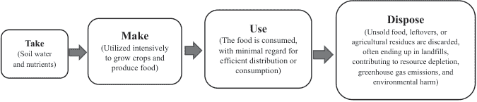

**图 1(a).** 线性经济模型描绘了“取用–制造–使用–处置”。

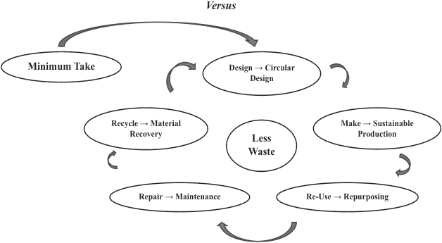

**图 1(b).** 循环经济模型描绘了“设计–制造–再利用–维修–回收”。

**来源：** 图 1(a) 和 1(b) 说明了由作者设计的模型。

### 关键原则与策略：减少、再利用、回收（3R）
减少、再利用和回收（3R）原则是循环经济的基础，旨在建立一个资源高效利用、废弃物显著减少的可持续系统。

减少原则涉及从源头上尽量减少所用资源的数量和产生的废弃物。例如；企业减少包装材料以减少废弃物；并使用节能电器和机械。再利用原则涉及多次使用物品，无论是用于相同目的还是不同功能，以延长其生命周期。例如，可重复使用的购物袋、水瓶和容器；转换、翻新和转售旧电子产品以及回收原则涉及将使用过的材料加工成新产品，以防止可能可用的材料被浪费。例如，将纸制品回收成新的纸制品；并将使用过的塑料转化为新的塑料产品或替代材料。

### 人工智能在3R（减少、再利用、回收）中的应用
人工智能已成为增强 3R 原则——减少、再利用和回收——应用的变革力量，通过提供先进工具和


```
A[Start] --> B[Reduce]
B --> C [Predictive Maintenance]
B --> D [Energy Management]
B --> E [Smart Agriculture]
A --> F [Reuse]
F --> G [Product Lifecycle Management]
F --> H [Shared Economy Platforms]
F --> I [Smart Sorting and Refurbishment]
A --> J [Recycle]
J --> K [Automated Sorting Systems]
J --> L [Material Recovery]
J --> M [Recycling Process Optimization]
```

图2. 人工智能在循环经济中的流程图。

可持续实践的解决方案（Vasarhelyi, 2022）。以下是AI在这些原则中的现代应用：

## 表1. 人工智能在循环经济中的应用。

| AI技术 | 应用领域 | 具体用例 | 益处 |
|---|---|---|---|
| 机器学习 | 预测性维护 | 预测制造业中的设备故障 | 减少停机时间，延长设备寿命 |
| 计算机视觉 | 质量控制 | 自动检查装配线上的产品 | 确保产品质量，减少浪费 |
| 自然语言处理 | 客户互动 | 用于客户询问可持续产品的聊天机器人 | 提升客户体验，促进可持续选择 |
| 物联网 | 智能电网 | 实时能源管理 | 优化能源使用，减少浪费 |
| 机器人技术 | 废物管理 | 用于分拣可回收物的自主机器人 | 提高分拣准确性，增加回收率 |

来源：（Stahel, 2016）。

```
+---------------------------------+---------------------------------+---------------------------------+
| Resource | End-of-Life | Design & | | Production &
| Optimization | Management | Manufacturing | Distribution
+---------------------------------+---------------------------------+---------------------------------+
| | | |
v v v
+---------------------------------+---------------------------------+---------------------------------+
| Machine Learning | Computer Vision | IoT | |
Robotics | | | |
| - Predictive Automated | - Quality | - Asset Tracking| - |
| Maintenance Sorting | Control | - Smart Grids | |
+---------------------------------+---------------------------------+---------------------------------+
```

图3. 展示AI工具如何在循环经济中应用的概念图。

为了可视化AI对循环经济实践的影响，让我们考虑一个假设性图表，显示在采用与未采用AI的情况下资源效率随时间的提升：

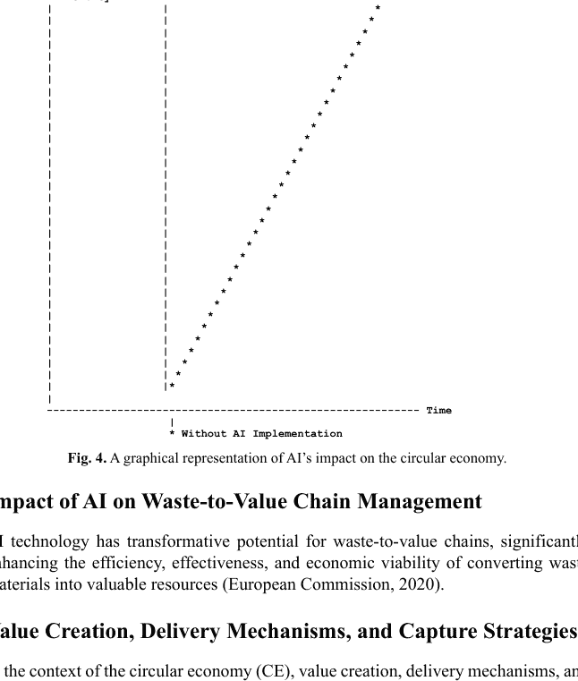

图4. AI对循环经济影响的图形表示。

## AI对废物价值化链的影响

AI技术对废物价值化链具有变革潜力，显著提高了将废料转化为有价值资源的效率、效果和经济可行性（European Commission, 2020）。

## 价值创造、交付机制和捕获策略

在循环经济（CE）背景下，价值创造、交付机制和捕获策略是使企业能够生成、交付和维持价值，同时保持资源效率并最小化废物的关键组成部分。让我们深入了解每个组成部分，重点关注AI如何增强这些方面。图5是一个流程图，展示了AI运营活动如何应用于废物价值化链的创建中。

```
A [Waste Collection] --> B [Smart Bins]
A --> C [Optimized Logistics]
B --> D [Automated Sorting]
C --> E [Inventory Management]
D --> F [Material Recovery]
F --> G [E-Waste Recycling]
F --> H [Plastic Recycling]
E --> I [Waste-to-Energy]
I --> J [Process Optimization]
I --> K [Predictive Maintenance]
```

图5. 废物价值化链中AI的流程图。

## 表2. AI如何增强价值创造、交付机制和捕获策略。

|  |  |
|---|---|
| A. 价值创造：循环经济中的价值创造涉及设计能够最大化资源效率和可持续性的产品、服务和流程。 |  |
| B. 交付机制：循环经济中的交付机制指价值如何传递给客户，侧重于可持续且高效的流程。AI通过以下方式增强交付机制： |  |
| 高效的供应链管理 | 供应链优化：AI优化物流，减少运输排放和成本（McKinsey, 2020）。库存管理：机器学习算法预测库存需求，减少浪费并确保及时交付。 |
| 产品即服务（PaaS）模式 | 使用监控：AI跟踪产品使用情况和状态，确保及时维护和升级。动态定价模式：AI根据使用模式和需求调整定价，最大化资源利用。 |
| 增强的回收和逆向物流 | 自动分拣系统：AI驱动的机器人更有效地分拣废物，提高回收率。逆向物流优化：AI规划和管理用后产品回收或翻新的回流。 |
| C. 捕获策略：循环经济中的捕获策略涉及保留和再投资所创造价值的机制，确保可持续性和盈利能力。AI通过以下方式增强捕获策略： |  |
| 数据驱动洞察 | 消费者行为分析：AI分析客户数据以识别趋势和偏好，为可持续产品开发提供信息（Forbes, 2019；HBR, 2022）。市场需求预测：AI预测市场需求，使公司能够将生产与可持续目标对齐。 |
| 收入模式 | 订阅服务：AI帮助管理产品即服务的订阅模式，提供稳定的收入流。动态定价：AI根据市场条件和客户行为调整价格，优化收入捕获。 |
| 效率收益 | 运营效率：AI简化运营，降低成本和浪费，从而提高盈利能力。能源管理：AI优化制造和运营中的能源使用，降低成本和环境影响。 |

以下是一个视觉表示，展示AI如何与循环经济中的价值创造、交付机制和捕获策略集成：

```
+---------------+---------------+---------------+
+ Value Creation |----------->| Delivery |----------->| Value Capture
|----------->| Sustainability | Mechanisms | | Strategies
| | and Profitability |
+---------------+---------------+---------------+
| | | |
v v v
+---------------+---------------+---------------+
| Machine Learning | | Supply Chain | | Data-Driven | |
Operational | | Optimization | | Insights | |
- Resource | | - AI Algorithms | | - Consumer Data | | -
Efficiency | | Optimization | | |
AI Analytics | |
+---------------+---------------+---------------+
| Generative Design| | PaaS Models | | Revenue Models | |
Energy Management| | - Usage | | - Subscription | | -
- Durable | | Monitoring | | Services | | -
Smart Grids | | | | |
Products | | | | |
Energy | | | | |
Optimization | | Enhanced | | Efficiency Gains |
| Predictive | | | |
+---------------+---------------+---------------+
| Maintenance | | Recycling | | - Cost Reduction|
| - AI Sensors | | - AI Sorting | | - Waste Minim.|
+---------------+---------------+---------------+
```

图6. AI增强的循环经济框架。

## 为循环经济设计商业模式——迈向概念框架

为了探讨如何将循环经济原则整合到商业模式中，并确定循环商业模式中普遍适用的组成部分，我们进行了一项叙述性概念审查。该过程分为三个步骤（见图7）：

- i. 确定循环商业模式（CBMs）的知识现状。
- ii. 根据商业模式结构组成部分对初始文献进行分类。
- iii. 综合并开发一个循环商业的框架。

## 农业废弃物管理

农业废弃物管理是可持续农业和环境保护的关键方面，同时最大化资源利用。在全球范围内，来自作物残余物、农工业、动物生产和其他来源的农业废弃物的产生带来了重大挑战。这些废弃物如果未得到充分


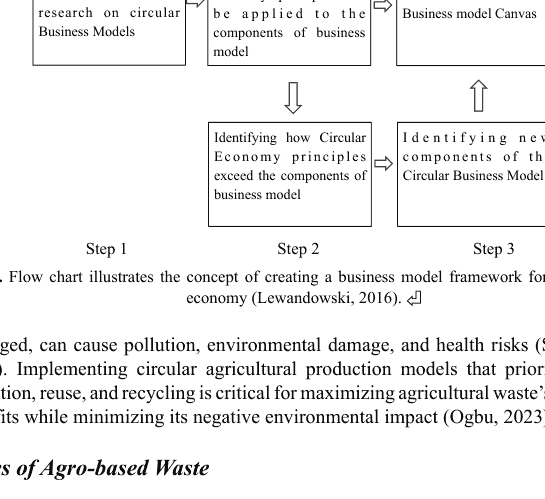

图 7. 流程图展示了为循环经济创建商业模式框架的概念 (Lewandowski, 2016)。

如果管理不当，会造成污染、环境破坏和健康风险 (Sivakumar, 2022)。实施优先考虑减少、再利用和回收废物的循环农业生产模式，对于最大化农业废物的经济效益，同时尽量减少其对环境的负面影响至关重要 (Ogbu, 2023)。

## 农业废物的类型

农业废物可分为三大类，即作物残留物、动物粪便和农用化学品残留物。

- 1) 作物残留物：作物残留物包括小麦、水稻、玉米和甘蔗等作物收获后留在田间的秸秆、叶子、外壳和根部。据 Sharma, 2020a 称，农民使用 20% 的稻草，并焚烧另外 50% 用于备耕。这些残留物的可用量可能很大，例如，稻草约占水稻植株总生物量的 50% (Van Hung, 2020)。作物残留物管理不当，如露天焚烧，会导致严重的空气污染，造成温室气体排放和颗粒物污染。相反，将残留物留在田间可以改善土壤有机质和水分保持，减少水土流失并提高肥力。然而，通过使用人工智能算法和实时数据，可以开发创新方法来有效利用农业废物和作物残留物，促进可持续农业实践，并在不断变化的环境条件和日益增长的粮食需求下建立粮食安全 (Ziesche, 2023)。
- 2) 动物/牲畜排泄物：动物排泄物包括牛、猪和鸡等牲畜的粪便、尿液或其他身体废物。它富含氮、磷和钾等营养物质，是一种宝贵的肥料。Bashir 和 Mohan (2023) 证明，良好的粪肥管理作为肥料可以促进环境友好型农业和农业生产力的提高。此外，它还可以加工成生物炭，这是一种公认的可持续土地复垦方法，可促进退化土壤上的植物生长。虽然粪肥是一种高效的肥料，但管理不当会导致养分流失、水污染和温室气体排放。技术的进步使得农业废物的转化成为可能。

## 沼气生产

它涉及有机废物的厌氧消化以产生富含甲烷的沼气。与厌氧消化类似，有机废物被放入消化器中，在微生物分解作用下释放沼气，沼气提供可再生能源，减少温室气体排放，并减少对化石燃料的依赖。

## 焚烧与热解

焚烧是有机废物的燃烧以产生能量，而热解是在无氧条件下进行热分解。农业废物在焚烧中高温燃烧，或在热解装置中进行热分解。可显著减少废物量，产生能量，并产生灰分或生物油等副产品。

总的来说，农业废物处理和精炼方法被认为具有成本效益和环保性，并且可以积极促进更可持续的废物管理和低碳强度的能源利用路径 (Hoang, 2023)。

## 生物质增值

Nzihou (2010) 将增值定义为将废物和生物质转化为能源、燃料和其他有用材料的过程，特别关注环境指标和可持续性目标，即将农业废物转化为生物燃料、化学品和材料等有价值产品的过程。食物垃圾、草和粪肥等有机材料正被转化为挥发性脂肪酸、羧酸、生物能源和生物塑料，以帮助减少浪费并促进循环经济 (Onwucha, 2023)。

## 基于人工智能的农业废物转化技术

目前基于人工智能的农业废物转化技术的发展显示出通过改善废物管理和资源效率促进可持续农业的巨大潜力 (Taneja, 2023)。机器学习算法被用于优化厌氧消化过程、预测堆肥质量和提高生物炭生产 (Cruz, 2022)。它提高了效率，降低了运营成本，并提高了最终产品的产量和质量。图像处理有助于监测作物残留物水平，检测废物流中的污染，从而实现精确及时的干预，减少浪费并提高资源回收率。预测分析可应用于预测废物产生模式，优化废物收集和处理计划，从而加强规划和资源分配，并最大限度地降低废物管理成本。人工智能通过监测和优化食品生产和供应链、重新分配多余食物以及支持循环经济倡议，在解决食物浪费问题方面发挥着重要作用。通过在农业废物转化中利用人工智能，农业部门可以减少浪费，提高可持续性，并有助于建立更高效、更公平的食品系统。

## 利用物联网改善废物管理

物联网技术的利用通过提供实时监控和数据驱动的洞察，显著提高了城市地区废物管理实践的效率和有效性。物联网正被用于改善农业废物管理 (Koshyaria, 2023)。传感器有助于监测堆肥堆中的温度、水分和 pH 值，检测粪便中的气体排放。提供实时数据，增强过程控制，并提高安全性和合规性。智能垃圾桶可用于改善废物管理，在垃圾桶层面及早自动识别废物 (Ali, 2020)。智能垃圾桶配备传感器以检测填充水平、压缩废物并发出收集需求信号。减少收集频率和成本，并提高废物管理效率。此外，通过跟踪废物处理设施的绩效和监测环境影响进行远程监控，有助于及时维护、确保法规合规性并增强决策能力。

## 传统工具与基于人工智能工具的经济比较分析

基于人工智能的工具在农业废物管理中比传统方法具有显著的经济和运营优势。虽然初始投资较高，但降低运营成本、提高效率和降低环境影响等长期益处使基于人工智能的工具成为更可持续和更有利可图的选择。扩展运营规模、适应市场变化和实现更高质量产出的能力进一步加强了在农业废物管理中采用人工智能的理由。

表 3. 传统工具与基于人工智能工具的概要比较。

| 项目 | 传统方法 | 基于人工智能的工具 |
|---|---|---|
| 初始投资 | 前期成本通常较低，但可能需要频繁维护和人工劳动。 | 由于技术实施，初始成本较高，但可带来长期节约。 |
| 运营成本 | 由于人工劳动和效率较低的过程而较高。 | 由于自动化、优化和预测性维护而较低。 |
| 废物减少 | 基于人工分类和处理的适度废物减少。 | 通过精确和优化的 AI 算法显著减少废物。 |
| 劳动力需求 | 手工操作需要高劳动力需求。 | 由于自动化和机器学习，劳动力需求减少。 |
| 处理速度 | 由于手动和半自动过程而较慢。 | 由于实时数据处理和 AI 驱动的优化而更快。 |
| 可扩展性 | 在没有显著增加劳动力的情况下，可扩展性有限。 | 以极少的额外成本实现高可扩展性。 |
| 维护成本 | 手动和半自动工具需要定期维护。 | 由于预测性维护能力，维护成本较低。 |


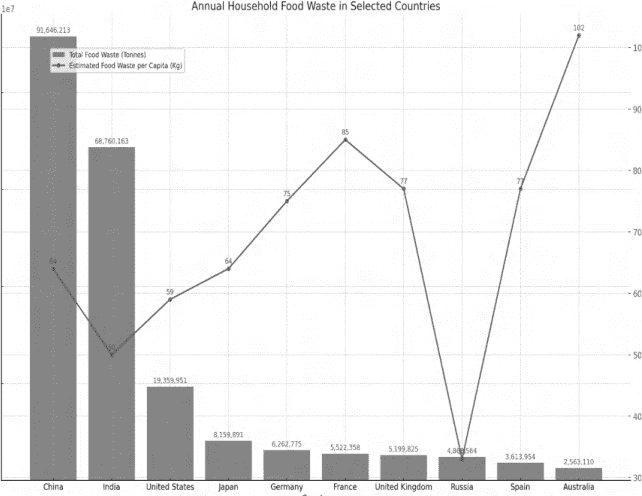

**图8.** 全球食物浪费程度：部分国家年度家庭食物浪费数据  
（数据来源：Onyeaka, 2023）。

**来源：** 作者使用Python创建的可视化表示（图表）。

## 减少食物浪费的重要性

食物对人类生存至关重要；食物浪费阻碍了我们食物系统的可持续性。食物浪费不仅对粮食安全及其可获得性产生负面影响，还会推高食品原料的成本。食物的生产从农场开始，经过整个系统，最终到达我们的餐桌。在被浪费之前，食物的生产已经利用了水、土地、能源、资本和劳动力等资源。此外，这些被浪费的食物最终进入垃圾填埋场，导致温室气体排放，加剧气候变化。

## 人工智能工具和技术在减少食物浪费中的作用

近年来，人工智能的发展呈现出激增态势，以协助人类在多个领域（Furman, 2019）开展工作。众所周知，人工智能能够模拟人类的智力和智能。将人工智能引入并融合到食品行业，在解决食物浪费、支持循环经济以及提高食品生产可持续性方面具有巨大潜力。有多种基于人工智能的技术可用于减少食物浪费及其资源化利用（表4）。

### 表4. 基于人工智能的技术在减少食物浪费中的作用

| 序号 | 技术 | 应用 | 效益 | 参考文献 |
|---|---|---|---|---|
| 1. | 集成系统贝叶斯网络和机器学习算法模型 | 确定家庭层面产生和丢弃的家庭食物浪费量 | 通过让消费者了解家庭层面的食物浪费情况来减少食物浪费，有助于减少食物浪费 | Anggraeni, 2021 |
| 2. | 计算机视觉技术 | Winnow Vision系统使用基于现代深度学习的图像分类算法自动收集浪费信息 | 无需人工识别被浪费的物品。Winnow Vision可以自动对食品进行分类，准确率超过人类 | Nu, 2024. Winnow Solutions (UK) |
| 3. | 预测性机器学习 | 测试了四种基于人工智能/机器学习的技术，以减少小型杂货店的食物浪费 | 将食物浪费从6,169.39千克和653.27千克减少到117.64千克 | Nascimento, 2022 |
| 4. | 配备先进传感器和机器学习的机器 | 识别并分离饮料行业中的废料 | 减少人工劳动并提供精确性 | Hassan, 2023 |
| 5. | 人工智能驱动的垃圾分类机器人 | 将不同类型的废物分为可回收和不可回收 | 减少垃圾填埋场废物，促进循环经济 | Ali and Shehata, 2021 |
| 6. | 人工智能与区块链 | 增强食品供应链中的可追溯性，减少食品欺诈 | 减少可能导致严重健康并发症的食品欺诈行为 | Dedeoglu, 2023 |
| 7. | 基于物联网的资源化利用系统 | 用于测量沼气、pH值、湿度、温度等的实时监测系统 | 管理食物浪费资源化利用过程 | Said, 2023 |
| 8. | 机器学习 | 比较需求预测与实际需求 | 将餐饮服务中的食物浪费减少14%至52% | Rodrigues, 2024 |

人工智能和优化算法用于智能仓库管理以减少食物浪费。预测分析有助于预测食品需求并减少供应链中的浪费，还有助于了解市场偏好。预测模型已被用于估算食品的预期保质期（Ferreira, 2022）。Brightloom是一家利用人工智能和预测分析技术，通过优化食品零售商的菜单和定价来满足消费者偏好的公司。它帮助零售商预测准确需求，减少过度生产，从而减少食物浪费，并确保需求与客户需求正向匹配（Brightloom, 2023）。

### 参考文献

- Ali, I. and Aboelmaged, M.G.S. 2022. Implementation of supply chain 4.0 in the food and beverage industry: Perceived drivers and barriers. *International Journal of Productivity and Performance Management*, 71: 1426–1443.
- Ali, S., Ullah, M.I., Sajjad, A., Shakeel, Q. and Hussain, A. 2021. Environmental and health effects of pesticide residues. pp. 311–336. *In:* Imamuddin, Ahamed, M.I. and Lichtfouse, E. (eds.). *Sustainable Agriculture Reviews 48*. Springer, Cham.
- Ali, T., Irfan, M., Alwadie, A.S. and Glowacz, A. 2020. IoT-based smart waste bin monitoring and municipal solid waste management system for smart cities. *Arabian Journal for Science and Engineering*, 45: 10185–10198.
- Anggraeni, M.C., Silaban, C.A., Anggrainy, M.S. and Cahyadi, E. 2021. Role of Artificial Intelligence in the management of food waste. *In 2021 2nd International Conference on Artificial Intelligence and Data Sciences (AiDAS)* (pp. 1–6). IEEE.
- Bashir, S. and Mohan, A. 2023. An institutional approach to manure recycling. *In:* Jawaid, M. and Khan, A. (eds.). *Manure Technology and Sustainable Development*. Sustainable Materials and Technology. Springer, Singapore.
- Carvalho, F.P. 2017. Pesticides, environment, and food safety. *Food and Energy Security*, 6: 48–60.
- Choi, G., Kim, H. and Lee, C. 2021. Long-term monitoring of a thermal hydrolysis-anaerobic co-digestion plant treating high-strength organic wastes: Process performance and microbial community dynamics. *Bioresource Technology*, 319: 124138.
- Cruz, I.A., Chuenchart, W., Long, F., Surendra, K.C., Andrade, L.R.S., Bilal, M., Liu, H., Figueiredo, R.T., Khanal, S.K. and Ferreira, L.F.R. 2022. Application of machine learning in anaerobic digestion: Perspectives and challenges. *Bioresource Technology*, 345: 126433.
- Dedeoglu, V., Malik, S., Ramachandran, G., Pal, S. and Jurdak, R. 2023. Blockchain meets edge-AI for food supply chain traceability and provenance. *In Comprehensive Analytical Chemistry*, 101: 251–275.
- Edirisinghe, G.L.G.M., de Alwis, A.A.P., Wijayasundara, M. and Hemali, N.A. 2024. Quantifying circularity factor of waste: Assessing the circular economy potential of industrial zones. *Cleaner Environmental Systems*, 12: 100160.
- European Commission [EU], Circular Economy Action Plan 2020. https://environment.ec.europa.eu/strategy/circular-economy-action-plan_en
- Ferreira, C. and Gonçalves, G. 2022. Remaining useful life prediction and challenges: A literature review on the use of Machine Learning methods. *Journal of Manufacturing Systems*, 63: 550–562.
- Forbes. AI’s Role in Sustainable Consumerism. https://scholar.google.co.in/scholar?q=Forbes.+(2019).+AI%27s+Role+in+Sustainable+Consumerism.&hl=en&as_sdt=0&as_vis=1&oi=scholart
- Furman, J. and Seamans, R. 2019. AI and the economy. *Innovation Policy and the Economy*, 19: 161–191.
- Garcia-Garcia, G., Woolley, E., Rahimifard, S., Colwill, J., White, R. and Needham, L.A. 2017. Methodology for sustainable management of food waste. *Waste and Biomass Valorization*, 8: 2209–2227.
- Harvard Business Review [HBR], How AI Can Foster Sustainable Consumer Behavior. 2020. https://scholar.google.co.in/scholar?q=Harvard+Business+Review+(HBR).+(2020).+%22How+AI+Can+Foster+Sustainable+Consumer+Behavior.&hl=en&as_sdt=0&as_vis=1&oi=scholar
- Hassan, M., Wahab, N.A.B.A. and Nor, R.B.M. 2023. The role of artificial intelligence in waste reduction in the beverage industry: A comprehensive strategy for enhanced sustainability and efficiency. *AI, IoT and the Fourth Industrial Revolution Review*, 13: 1–8.
- Hoang, A.T., Pandey, A., Huang, Z., Nižetić, S., Le, A.T. and Nguyen, X.P. 2023. Biofuels: an option for agro-waste management. In *Environmental Sustainability of Biofuels*, 27–47.
- Jagtap, S., Trollman, H., Trollman, F., Garcia-Garcia, G., Parra-López, C., Duong, L. and Martindale, W. 2021. The role of artificial intelligence in circular economy: Automating the recovery of food waste. *Sustainable Production and Consumption*, 27: 101–111.
- Kirchherr, J., Reike, D. and Hekkert, M. 2017. Conceptualizing the circular economy: An analysis of 114 definitions. *Resources, Conservation and Recycling*, 127: 221–232.
- Koshariya, A.K., Khatoon, S., Marathe, A.M., Suba, G.M., Baral, D. and Boopathi, S. 2023. Agricultural waste management systems using Artificial Intelligence techniques. In *AI-Enabled Social Robotics in Human Care Services*, 236–258.
- Lewandowski, M. 2016. Designing the business models for circular economy—Towards the conceptual framework. *Sustainability*, 8: 43.
- McKinsey and Company, AI in Supply Chain Management. 2020. Access: https://scholar.google.co.in/scholar?q=McKinsey+%26+Company.+(2020).+%22AI+in+Supply+Chain+Management.%22&hl=en&as_sdt=0&as_vis=1&oi=scholart.
- Nascimento, A.M., Queiroz, A., de Melo, V.V. and Meirelles, F.S. 2022. Applying Artificial Intelligence to Reduce Food Waste in Small Grocery Stores. https://aisel.aisnet.org/isla2022/6/.
- Nu, Y., Belavina, E. and Girotra, K. 2024. Using Artificial Intelligence to reduce food waste. Available at SSRN 4826777.
- Nzihou, A. 2010. Toward the valorization of waste and biomass. *Waste Biomass Valor.*, 1: 3–7.
- Ogbu, C.C. and Okey, S.N. 2023. Agro-industrial waste management: The circular and bioeconomic perspective. In: Ahmad, F. and Muhammad Sultan, M. (eds.). *Agricultural Waste-New Insights*. IntechOpen. doi: 10.5772/intechopen.109181.
- Onwuacha, C.N., Talabi, J.O., Ajayi, S.O., Ehi-Eromosele, C.O. and Ajanaku, K.O. 2023. Valorization of biomass using deep eutectic solvent: A short review. In *IOP Conference Series: Earth and Environmental Science*, 1197: 012002.
- Onyeaka, H., Tamasiga, P., Nwauzoma, U.M., Miri, T., Juliet, U.C., Nwajiwu, O. and Akinsemolu, A.A. 2023. Using Artificial Intelligence to tackle food waste and enhance the circular economy: Maximising resource efficiency and minimising environmental impact: A review. *Sustainability*, 15: 10482.
- Rodrigues, M., Miguéis, V., Freitas, S. and Machado, T. 2024. Machine learning models for short-term demand forecasting in food catering services: A solution to reduce food waste. *Journal of Cleaner Production*, 435: 140265.
- Said, Z., Sharma, P., Nhuong, Q.T.B., Bora, B.J., Lichtfouse, E., Khalid, H.M. and Hoang, A.T. 2023. Intelligent approaches for sustainable management and valorisation of food waste. *Bioresource Technology*, 128952.
- Sharma, A., Georgi, M., Tregubenko, M., Tselykh, A. and Tselykh, A. 2022. Enabling smart agriculture by implementing artificial intelligence and embedded sensing. *Computers and Industrial Engineering*, 165: 107936.
- Sharma, A., Singh, G. and Arya, S.K. 2020a. Biofuel from rice straw. *Journal of Cleaner Production*, 277: 124101.
- Sharma, A., Singh, P.V. and Musunur, L.P. 2020b. Artificial Intelligence and Robotics for Reducing Waste in the Food Supply Chain: Systematic Literature Review, Theoretical Framework, and Research Agenda. *OSF Preprints*.
- Sivakumar, D., Srikanth, P., Ramteke, P.W. and Nouri, J. 2022. Agricultural waste management generated by agro-based industries using biotechnology tools. *Global Journal of Environmental Science and Management*, 8: 281–296.
- Stahel, W. 2016. The circular economy. *Nature*, 531: 435–438.
- Taneja, A., Nair, G., Joshi, M., Sharma, S., Sharma, S., Jambrak, A.R. and Philomirsipol, Y. 2023. Artificial intelligence: Implications for the agri-food sector. *Agronomy*, 13: 1397.


- 联合国 [UN]，粮食损失和浪费意识国际日。2020。https://www.un.org/en/observances/end-food-waste-day.
- 联合国环境规划署 [UNEP]，《食物浪费指数报告》。2021。https://www.unep.org/resources/report/unep-food-waste-index-report-2021.
- Van Hung, N., Maguyon-Detras, M.C., Migo, M.V., Quilloy, R., Balingbing, C., Chivenge, P. and Gummert, M. 2020. 稻草概述：可用性、特性和管理实践。Sustainable Rice Straw Management, 1–13.
- Vasarhelyi, K. 2022. 回收中的人工智能与机器人。Recycling Today https://www.colorado.edu/ecenter/2022/04/06/ai-robotics-recycling.
- Ziesche, S., Agarwal, S., Nagaraju, U., Prestes, E. and Singha, N. 2023. 人工智能在推动农业部门可持续发展目标中的作用，152。载于：Mazzi, F. and Floridi, L. (eds.) 《可持续发展目标的人工智能伦理》。Philosophical Studies Series.

## 第 11 章：机器学习在水质评估方面的进展

*Rashmi Yadav*¹, *Ajay N Satpute*², *Ajay Kushwah*³, *Jitendra Kumar*⁴, *Susama Sudhishri*⁵ and *Bandi Nageswar*⁶

1. 研究学者，水技术中心，印度农业研究委员会-印度农业研究学院，普萨，新德里 - 110-012，印度。
2. 科学家，印度农业研究委员会-印度草地与饲料研究所，贾恩西，北方邦，284003，印度。
3. 研究学者，农业工程系，印度农业研究委员会-印度农业研究学院，普萨，新德里 - 110-012，印度。
4. 科学家，灌溉与排水工程系 印度农业研究委员会-中央土壤盐碱研究学院，卡纳尔 - 132 001，哈里亚纳邦，印度。
5. 教授兼首席科学家，水技术中心，印度农业研究委员会-印度农业研究学院，普萨，新德里 - 110-012，印度。
6. 教学助理，区域农业研究站，安纳卡帕勒，531-001，安得拉邦，印度。

* 通讯作者: ajaykushwah98@gmail.com

### 引言

地球上的生命离不开水。它是一种有限的资源，也是极其宝贵的自然资产。尽管地球表面主要由水组成，但只有一小部分适合使用，这使得该资源极其稀缺。全球约有 11 亿人无法获得清洁饮用水，预计到 2025 年，近三分之二的国家将面临水资源压力（Ross Michael, 2016）。明智地利用国家的淡水资源对于满足我们新兴经济日益增长的需求是必要的。因此，水资源的开发、保护和管理至关重要。快速

### 机器学习概述

人工智能（AI）的一个子类型称为机器学习，它使系统或计算机能够通过分析数据或个人经历来获取知识，而不是仅仅依赖预编程的规则或方程（Rani et al., 2022）。在机器学习应用于现实世界情况之前，必须进行数据处理、选择合适的算法、训练模型和测试模型等步骤（Zhu et al., 2022）。在采用任何机器学习（ML）算法之前，用户必须收集数据并确保其重要性。随后，他们选择一种与预期目标相符的合适的机器学习方法。然后将所选技术应用于训练集，以生成准确描述数据集的模型。通过使用测试数据来评估模型的正确性和有效性。如果模型质量不令人满意，用户可能会尝试其他方法、扩展数据集或提高数据质量。模型在表现令人满意后将被部署以实现其预期目标。总体而言，机器学习算法被分为三个主要类别：监督学习、无监督学习和强化学习（Berry et al., 2019; Mosaffa et al., 2022）。在监督学习中，模型在具有预定输出的标记数据集上进行训练。通过分析输入数据，模型学会预测所需输出并不断改进，直到达到所需的准确度（Han et al., 2011）。它使用包括支持向量机、线性回归和神经网络在内的技术，这些技术通常主要用于分类和回归应用（Sarker et al., 2020）。无监督学习主要侧重于分组和关联任务，通过使用未标记数据来发现隐藏模式并对相关数据进行分组（Han et al., 2011）。层次聚类和 k-means 等算法常用。强化学习使用奖励或惩罚形式的响应来反复做出判断，从而引导算法通过不可预测的环境。由于数据是由算法与环境的交互产生的，因此不会提供预定义数据（H. Jhaveri et al., 2021）。众所周知的算法有 SARSA、Q-learning 和深度确定性策略梯度（DDPG）算法等（Rani et al., 2022）。然而，与其他两个机器学习类别相比，它在水环境领域的应用较少。

### 用于评估水质的先进机器学习模型

准确预测水质指数（WQI）在很大程度上取决于集成人工智能（AI）预测模型，尤其是像随机森林、SVM、XGBoost、KNN 和决策树这样的机器学习分类器。

#### 随机森林

基于树的随机森林（RF）方法是一种分类技术，由许多决策树组成，并作为监督机器学习方法运行（图 1）。随着森林中树的数量增加，RF 作为一种集成方法，通过使用多个决策树的最佳结果来限制和减少泛化错误（Breiman, 1999）。

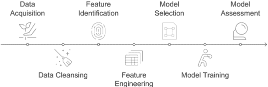

**图 1.** 开发机器学习模型以预测水质因子的协议。

RF 算法比 CART 模型更好，因为其准确率高、能够处理大数据集、无需对决策树进行剪枝以及能够防止过拟合。此外，RF 可以评估预测过程中每个变量的相对重要性。必须记住，RF 在回归任务中的预测仅限于训练数据的范围，这降低了模型预测极值时的精度。

#### 支持向量机（SVM）

SVM 旨在找到将数据分为不同类别的最佳超平面（Fan et al., 2018）。支持向量机（SVM）是一种监督机器学习技术，用于回归和分类任务，尤其在回归方面表现出色。其主要目标是在 N 维空间中识别理想的超平面，以便在特征空间内将数据点划分为不同的类别。超平面的布局旨在优化每个类别最近点之间的分离。特征的数量决定了超平面的维度。SVM 在高维空间中表现有效。然而，由于该技术的黑箱性质，理解和解释最终的 SVM 模型、变量权重和个体影响可能具有挑战性。

#### 极限梯度提升（XGBoost）

XGBoost 是一种升级的决策树方法，与传统的梯度提升决策树方法不同。XGBoost 在损失函数中加入了二阶泰勒展开，使用一阶和二阶导数，而常规 GBDT 仅使用一阶导数信息来解决优化问题（Chen and Guestrin, 2016）。损失函数中还包含正则化项，以控制模型的复杂性并避免过拟合。通过提升，XGBoost 增强了弱学习器的性能。虽然 XGBoost 的迭代改进过程和 SVM 的结构复杂性提高了其预测潜力，但它们也带来了不确定性，尤其是在识别复杂模式和非线性相关性方面。

#### 人工神经网络（ANN）

一种称为人工神经网络（ANN）的信息处理系统旨在模仿人类大脑中真实神经元的连接和功能。经过调整（训练）后，ANN 可能表示复杂、非线性的函数，其

大量参数的输出几乎与已知数据集获得的结果相似。为了有效训练，人工神经网络需要大量的历史数据。然而，一旦训练充分，它们应该能够为从未见过的新输入提供正确的输出（Palani et al., 2008）。如图所示，人工神经网络通过将输入乘以一系列权重、加上一个常数值，并将所得数据通过传递函数处理来处理输入。输入层、中间层和输出层构成了神经网络的三个层。输入层负责为网络提供输入（图 2）。大部分计算由中间层完成，该层可能包含一个或多个隐藏层。在中心层内，这些隐藏层作为子层发挥作用。输出层汇总中间层并行计算的结果。每个神经元的输出可以与观测数据进行比较，或用作其下方层神经元的输入。通过训练过程，网络的权重和偏置被修改（Haghiabi et al., 2016）。

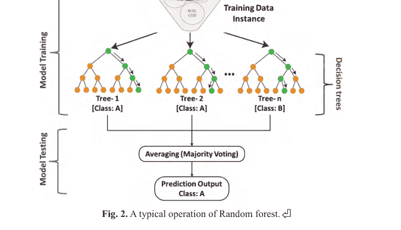

图 2. 随机森林的典型操作。

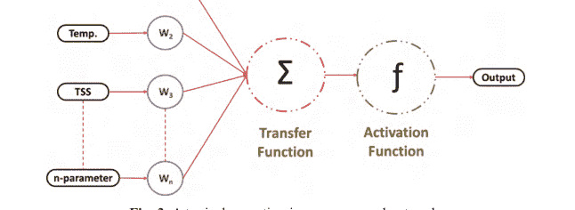

图 3. 神经网络中的典型操作。

## K最近邻（KNN）模型
KNN 的原理是通过定位最近的邻近点并据此进行分类，利用邻居的多数来对数据进行分类。在这种情况下有几种方法可以打破平局。然而，由于 KNN 会迭代地遍历所有训练数据，每次确定最近邻，因此不适用于庞大的数据集（Beyer et al., 1999）。欧几里得距离函数（Di）用于以下方式来获取特征向量的最近邻

$D_i = \sqrt{(x_1 - x_2)^2 + (y_1 - y_2)^2}$ (1)

其中，x₁、x₂、y₁ 和 y₂ 是输入数据的参数。

## 决策树（DT）
决策树（DT）是一种简单、基本的方法，其判断基于相关输入变量的值。在利用熵确定根参数后，其他因素的权重将被评估。DT 基于从某些特征得出的值范围做出判断，将所有变量选择排列成有序框架。研究表明，决策树模型在不平衡数据上运行有效。然而，群体技术例如梯度提升（GB）和随机森林（RF） consistently 优于单个决策树（Malek et al., 2022）。基于决策树的模型具有非常高效、对缺失值稳健、能够处理标准属性和数据的能力等优点。在短期预测方面，基于决策树的技术比其他机器学习算法更合适，并且通常提供更快的计算速度（Lu and Ma, 2020）。

## 不同水质参数评估的机器学习
由于机器学习提供了对因果变量和复杂变量交互的见解，因此成为预测水质的有价值工具（Najah Ahmed et al., 2019）。在许多不同学科中，各种机器学习模型被广泛使用（Tikhamarine et al., 2020）。例如，为了预测水质，Liao 和 Sun（Liao and Sun, 2010）将决策树技术与人工神经网络（ANN）相结合。Shafi 等人在对水质进行分类时使用了四种机器学习技术：SVM、神经网络（NN）、深度神经网络（DNN）和 KNN，应用于各种水体（Shafi et al., 2018）。有指出，DNN 在这些方法中准确率最高，为 93%。水生环境中分子氧的存在，即溶解氧，受盐度、温度和气压等多种因素影响。

## 生化需氧量预测
常见的生化需氧量（BOD）测试可用于检测水生有机污染。它计算在给定时间内好氧细菌分解水样中有机物过程中所需的氧气量（33）。英国污水处理皇家委员会于 1912 年首次提出当前计算生物需氧量或 BOD5 的方法。（美国地质调查局（USGS））BOD5 计算在 20°C 下培养五天期间每升水消耗的氧气量（Zaitsev et al., 2018）。在 17 项水质指标中，影响预测准确性的最重要因素被确定为温度、pH、BOD 和磷含量（Siljic Tomic et al., 2018）。通过使用过去 BOD5 读数的信息，机器学习模型可以更准确地预测 BOD5 水平（Ooi et al., 2022）。马来西亚柔佛河的生物需氧量（B.O.D.）量是通过支持向量回归和人工神经网络（ANN）预测的，以预测传统水回收厂（WRPs）的 BOD 值（Zhu et al., 2018）。Ma 等人（2020）利用深度矩阵分解和深度神经网络的组合有效预测 BOD 值。印度纳尔马达河的水质是通过决策树模型估计的，该模型预测了六个水质参数：pH、温度、氨氮（NH₃-N）、硝酸盐氮（NO₃-N）、BOD（生化需氧量）和 COD（化学需氧量）（Jaloree et al., 2014）。（Cipullo et al., 2019）的研究使用了随机森林（RF）方法来估计土壤样品测试中可生物利用化学物质的浓度，具有更优的预测准确性。许多研究还提出了其他机器学习技术，例如随机森林回归（RFR）、M5 树和提升回归树（BRT）（Yuchi et al., 2019）。更复杂的激活函数被认为带来了这一改进，这些函数比传统 ANN 通常使用的 sigmoid 函数能够实现更大的模型收敛，以及 DNN 中输入和输出之间的众多层，这简化了训练过程（Schmidhuber, 2015）。

## 溶解氧预测
溶解氧（DO）是地表水指标的重要质量，它象征着水生环境的整体状况及其支持水生生物的能力。热量、盐度和气压是影响溶解氧的一些变量，溶解氧是水生环境中氧分子的代表（Zaitsev et al., 2018）。水体中的鱼类和其他水生生物依赖于 D.O。风力和曝气作用反映了水的溶解氧含量。水生生物和鱼类的稳定性取决于 D.O. 水平，该水平需要在一定范围内保持。D.O. 水平越高，水生生物和鱼类生存的条件越好。D.O. 被用作指示任何水生系统状况的指标，并且在水柱中对微生物至关重要（Chen and Liu, 2014）。线性多项式神经网络（PNN）模型被用于预测多瑙河中 DO 的浓度（Siljic Tomic et al., 2018）。另一组研究人员（Solanki et al., 2015）提出了一种深度学习网络模型，在预测水的 pH 值和溶解氧含量方面，其准确性和性能优于基于监督学习的技巧。早期场景的成功实施证明了采用机器学习预测溶解氧水平的<|message|>。人工神经网络（ANN）（如 BPNN、MLP 和 FENN）已被成功用于 DO 预测、预报、建模和估计（Wen et al., 2013）。虽然可以使用机器学习估计溶解氧，但在难以到达的地点收集水质数据仍然是一个挑战。

## 水盐度预测
预测气候波动和理解海洋动力学依赖于对海洋亚表层盐度的精确估计（Qi et al., 2024）。盐度对发生在海洋中的物理、化学和生物活动具有重大影响。河口对于陆地和海洋之间的物质交换至关重要，盐度指示淡水混合。受河流输入、潮汐和天气影响，盐度有助于评估河口的水质和生态系统健康（Guillou et al., 2023）。盐度的分布对于海洋生物的发育和繁殖至关重要。海水的密度受其盐浓度强烈影响，进而影响环流和分层（Schmidt et al., 2018）。开发了一种高效的机器学习和回归模型，根据过去的数据估计未来盐水平并预测水质盐度（Chawla et al., 2023）。支持向量回归提供了最准确的表层盐度估计，特别是在低盐度时期增强了由复杂数值模型得出的预测。这证明了将机器学习算法与传统物理模型一起应用的潜在好处（Guillou et al., 2023）。

## 水浊度预测
悬浮颗粒在水中散射的光量通常被称为悬浮物，其测量值称为浊度，可操作性定义为可通过 0.22 μm（或 0.45 μm）孔径滤膜去除的百分比（Kirk, 1985）。水中浊度影响水生生物，测量污染水平需要对其有精确的理解。基于神经网络的算法正被用于海洋环境中追踪浊度（Kumar et al., 2022）。Wang 等人，2021 年表明，使用潮汐水平作为输入、NTU 读数作为输出的人工神经网络可以准确预测浊度。关键数据包括预测期前两个周期内的潮汐水平（Wang et al., 2021）。利用气象和卫星 TSS 数据的机器学习技术成功预测了高浊度区域，随机森林回归产生了最佳结果。前一天高浊度区域、风力和潮汐水平是重要预测因素；降雨影响不大（Nagayama and Tonooka, 2023）。然而，由于浊度发生和扩散的原因可能不同，预测浊度仍是未来研究的课题。

## 藻华预测
向水生环境释放的营养物质不断增加引发了对富营养化和有害藻华的严重担忧。快速工业化、城市化增长、人口拥挤和气候破坏了自然水平衡

变化。这导致大量营养物质进入水生生态系统，并导致淡水水质和栖息地质量下降（Ly et al., 2019）。淡水藻华被视为富营养化的不良生态后果。汉江的富营养化和藻华已成功利用机器学习（ML）技术进行预测，这些技术也阐明了支配这些过程的基本原理（Ly et al., 2021）。三种深度学习模型——多层感知器（MLP）、RNN 和 LSTM——被用于预测叶绿素-a（Chl-a），即藻类活动的指标，其性能使用 RMSE 和普通最小二乘（OLS）回归分析进行评估。与 OLS 回归相比，LSTM 回归被证明在预测有害藻华方面最准确（Lee and Lee, 2018）。同样，（Kim et al., 2022）展示了四种 ML 模型——k-Nearest Neighbour、Decision Tree、LR 和 SVM——来预测蓝藻水华的发生。通过使用 logCyano 作为特征，即蓝藻细胞密度的对数，这些模型总体上实现了良好的精度。不断发展的机器学习模型显示出微生物群落、营养物质和藻华动态之间的重要联系；此外，它们在化学、物理和生物数据易于获取的领域具有巨大潜力。这些模型可能有助于通过识别藻华中来自地下水的信号来确定地下水贡献的重要性。总体而言，机器学习技术可以提高我们快速、精确确定地下水在藻华中作用的能力（Sheik et al., 2024）。

## 不同水情场景下的机器学习

机器学习是解决水管理系统和处理中各种问题的有力技术。人工智能方法正在改变我们管理水资源的方式，从水文建模到实时监测和预测分析。最近，人们对机器学习在水资源管理中的应用产生了浓厚兴趣。城市地区水质恶化凸显了对可行选择的迫切需求，这主要归因于人类活动产生的工业和市政排放物。由于分析和预测技术的显著进步，机器学习在水质研究中的应用日益突出。以集成和周期性的水质监测数据作为水系统管理的标准，数据收集是机器学习模型开发的关键第一步。尽管被广泛使用，但由于实际限制，标准环境监测技术在原位监测方面存在困难（Li et al., 2020）。由机器故障或人为错误引起的数据缺失、不准确或损坏会导致模型性能不佳，这凸显了机器学习应用中数据清洗的必要性。数据清洗有多种方法，例如删除有问题的数据、基于平均值或中位数的插补，或使用矩阵补全和机器学习方法来改进原始数据（Donders et al., 2006）。机器学习应用中的预测准确性受模型类型选择和训练集质量的影响（Zhu et al., 2022）。人工神经网络（ANN）和支持向量机（SVM）在预测水质组分方面表现出色，其中 SVM 通常比 ANN 表现出更优的准确性和泛化能力（Wang et al., 2013）。SVM 的有效性归因于其在优化模型参数和设定泛化误差上限方面的稳定性，比 ANN 更有效地最小化误差（Kim, 2003）。实时监测或预测建模对于有效管理河流系统至关重要，自助法小波神经网络（BWNN）和长短期记忆（LSTM）网络在处理水质的变量和非季节性时间序列数据方面表现出熟练程度（Zhi et al., 2021）。近年来，包括支持向量机（SVM）、决策树（DT）、随机森林（RF）和人工神经网络（ANN）在内的机器学习技术已被广泛应用于地下水质量评估。对五种数据挖掘算法的比较研究——典型的 DT、RF、卡方自动交互检测器和迭代二分器 3——旨在确定影响半干旱地区地下水质量的关键因素及其对伊朗大不里士市高品质地下水区的影响（Jeihouni et al., 2020）。此外，通过地理信息系统技术产生的地下水质量图是更准确识别地下水污染的典型方法（Lee et al., 2019）。机器学习对废水处理至关重要，因为它有助于废水处理设施的预测、运行和管理、技术优化和水质监测。由于存在多种污染物，在处理前对工业和生活废水进行水质评估是必要的（Nishat et al., 2023）。基于黑箱模型的软传感器提供实时在线监测，从而改善了大肠杆菌等指标的监测（Foschi et al., 2021）。人工神经网络（ANN）和软传感器协同工作以克服废水处理设施的维护和运行问题，实现氨和氯的实时监测。众多因素影响废水处理厂的出水水质，机器学习有助于维护和运行管理。虽然深度学习提高了流量测量传感器的测量精度，但 XGBoost 和 RF 可检测废水网络中的污染物及其来源点（Buras and Solano Donado, 2021）。机器学习在废水处理设施中的应用有机会节省成本并提高整体性能（Wang et al., 2021）。

## 使用机器学习预测水质的挑战

机器学习（ML）代表了一种强大的计算范式，用于解决水资源领域的多方面问题，其应用范围从水资源分配优化到水质预测和反复水资源短缺的管理。尽管具有潜力，该领域部署 ML 算法进行水质评估仍受到诸多挑战的阻碍。以下描述这些挑战。

任何指定应用中使用机器学习（ML）算法都需要大量高质量数据的可用性。ML 模型基于获取的数据集进行校准，使其能够辨别数据中的模式或趋势。所识别的模式对于变量预测至关重要。模型校准后会进行验证过程，只有在达到预定义准确性阈值后，这些模型才被认为适合部署于现实世界现场应用。然而，与数据采购相关的财务需求阻碍了 ML 算法在水资源领域广泛采用。这一挑战因技术限制而进一步加剧。此外，即使数据可访问，它也不总是符合所需分辨率（Zhu et al., 2022）。

机器学习衍生的模型主要是经验性的，并针对其制定的特定条件进行定制。真实水生系统的固有复杂性和异质性对水质预测的泛化能力提出了重大挑战。此外，不同水体的环境动态各不相同，从而限制了模型对其源系统的适用性。这一限制对 ML 方法的大规模部署构成了实质性阻碍。为缓解此问题，模型在应用于与其最初设计不同的系统时需要重新校准，从而产生额外的资源支出。因此，应避免依赖“黑箱”解决方案，而应采用能够产生基于过程的科学见解的方法（Schafer et al., 2022）。任何机器学习（ML）模型开发的初始阶段都需要审慎选择相关输入参数。选择影响水质的参数子集以包含足够的水质预测信息至关重要。此选择至关重要，因为输入变量过多可能导致冗余，而数量不足可能导致模型不准确。最佳变量选择可以提高模型准确性，因为不当选择可能对模型性能产生不利影响。此外，每个 ML 模型对不同输入变量集和数据模式表现出独特的响应。因此，必须识别能够增强特定 ML 模型有效性的变量。诸如偏自相关函数（PACF）、自相关函数（ACF）、相关系数和交叉相关函数等方法对于辨别显著预测因子至关重要（Asadollah et al., 2021）。通过先进传感器实现更好的数据获取、提高模型对通用规模的适用性以及采取跨学科方法应被考虑以解决上述挑战。

#### 结论

水质评估历来依赖劳动密集型方法，从机器学习（ML）技术中获益良多，因为它们提高了准确性、效率和经济性。机器学习的应用包括控制短缺和优化水资源分配。尽管如此，仍存在若干障碍，例如需要大量且高质量的数据集、财务和技术方面的限制，以及实际水生系统的复杂性。当机器学习模型需要为不同背景重新校准时，资源需求会增加。防止错误和重复，以及选择适当的输入参数是必不可少的

一种有效的机器学习实现。关键预测因子可以通过相关系数、自相关函数和偏自相关函数（PACF、ACF）等方法找到。跨学科技术和复杂的传感器数据采集对于解决这些问题至关重要。总之，虽然机器学习（ML）有管理水质的潜力，但关键是要克服实现、泛化和数据问题。改进的参数选择和数据集采集将提高机器学习模型在各种水生环境中的适用性和可靠性。

### 声明

## 作者伦理责任

> “所有作者均已阅读并理解《作者须知》中的‘作者伦理责任’声明，并已按要求遵守。”

## 伦理批准

不适用。

## AI 工具使用

通讯作者声明，本手稿的撰写未使用任何 AI 工具。

#### 利益冲突

通讯作者代表所有作者声明，不存在需要披露的利益冲突。

## 竞争利益

不适用。

#### 作者贡献

RY：概念化、方法学、初稿撰写、写作—审阅与编辑；AS：调查、形式分析、可视化、软件、数据管理；AK：写作—原始草稿、形式分析、方法学；JK：形式分析、可视化、审阅与编辑、监督；SS：审阅与编辑、监督；BN：审阅与编辑、形式分析。

#### 资助

未收到任何资助。

### 参考文献

Alshaltone，O.， Nasir， N.， Barneih， F.， Majali， E.A. 和 Al-Shammaa， A. 2021. 多传感平台。*第十四届电子系统工程发展国际会议（DeSE）*，174-179。https://doi.org/10.1109/DeSE54285.2021.9719474。

Asadollah， S.B.H.S.， Sharafati， A.， Motta， D. 和 Yaseen， Z.M. 2021. 河流水质指数预测与不确定性分析：机器学习模型的比较研究。*环境化学工程杂志*，9(1)：104599。https://doi.org/10.1016/j.jece.2020.104599。

Bagheri， M.， Akbari， A. 和 Mirbagheri， S.A. 2019. 基于人工智能和机器学习技术的过滤系统膜污染高级控制：一项批判性综述。*过程安全与环境保护*，123：229-252。https://doi.org/10.1016/j.psep.2019.01.013。

Berry， M.W.， Mohammed， A.H. 和 Yap， B.W. 2019. *数据科学的监督与无监督学习*。Springer。

Beyer， K.， Goldstein， J.， Ramakrishnan， R. 和 Shaft， U. 1999. “最近邻”何时有意义？载于：*数据库理论国际会议*。Springer，217-235。

Buras， M.P. 和 Solano， D.F. 2021. 污水处理管网中工业污染源位置的识别与估算。*传感器*，21(10)：3426。https://doi.org/10.3390/s21103426。

Chawla， P.， Cao， X.， Fu， Y.， Hu， C.， Wang， M.， Wang， S. 和 Gao， J.Z. 2023. 利用机器学习和大数据技术预测索尔顿海水质。*国际环境分析化学杂志*，103(18)：6835-6858。https://doi.org/10.1080/03067319.2021.1963713。

Chen， T. 和 Guestrin， C. 2016. XGBoost：一种可扩展的树提升系统。*第22届ACM SIGKDD国际知识发现与数据挖掘会议论文集*，785-794。https://doi.org/10.1145/2939672.2939785。

Chen， W.-B. 和 Liu， W.-C. 2014. 水库溶解氧的人工神经网络建模。*环境监测与评估*，186(2)：1203-1217。https://doi.org/10.1007/s10661-013-3450-6。

Chouhan， S.S.， Singh， U.P.， Sharma， U. 和 Jain， S. 2021. 基于计算机视觉方法的麻风树和水黄皮生物燃料植物叶片病害分割与分类。*测量*，171：108796，ISSN 0263-2241。https://doi.org/10.1016/j.measurement.2020.108796。

Chouhan， S.S.， Singh， U.P. 和 Jain， S. 2024a. 计算机视觉与无人机技术导论。载于：Chouhan， S.S.， Singh， U.P. 和 Jain， S.（编）。*计算机视觉与无人机技术在农业4.0中的应用*。Springer，新加坡。https://doi.org/10.1007/978-981-99-8684-2_1。

Chouhan， S.S.， Singh， U.P.， Sharma， U. 等。2024b. 使用深度学习和机器学习算法对不同植物物种进行分类。*无线个人通信*，136：2275-2298。https://doi.org/10.1007/s11277-024-11374-y。

Cipullo， S.， Snapir， B.， Pprich， G.， Campo， P. 和 Coulon， F. 2019. 通过机器学习模型预测复杂化学混合物的生物有效性和毒性。*化学圈*，215：388-395。

Donders， A.R.T.， Van Der Heijden， G.J.M.G.， Stijnen， T. 和 Moons， K.G.M. 2006. 综述：缺失值插补的温和介绍。*临床流行病学杂志*，59(10)：1087-1091。https://doi.org/10.1016/j.jclinepi.2006.01.014。

Ehteram Ghotbi， Kisi Najah Ahmed， Hayder Ming Fai， Krishnan Abdulmohsin Afan 和 EL-Shafie. 2019. 将不同人工智能模型与元启发式算法集成以提高河流悬浮沉积物预测潜力的研究。*应用科学*，9(19)：4149。https://doi.org/10.3390/app9194149。

Fan， J.， Wang， X.， Wu， L.， Zhou， H.， Zhang， F.， Yu， X.， Lu， X. 和 Xiang， Y. 2018. 支持向量机与极限梯度提升在湿润亚热带气候下利用温度和降水预测每日全球太阳辐射的比较：以中国为例。*能源转换与管理*，164：102-111。https://doi.org/10.1016/j.enconman.2018.02.087。

Breiman， L. 1999. 随机森林。载于：加州大学伯克利分校统计系，1-29。

Foschi， J.， Turolla， A. 和 Antonelli， M. 2021. 基于常规监测参数的污水消毒控制中大肠杆菌浓度软传感器预测器。*水研究*，191：116806。https://doi.org/10.1016/j.watres.2021.116806。

Guillou， N.， Chapalain， G. 和 Petton， S. 2023. 利用机器学习预测潮汐河口海面盐度。*海洋学*，65(2)：318-332。https://doi.org/10.1016/j.oceano.2022.07.007。

Haghiabi， A.H.， Azamathulla， H.M. 和 Parsaie， A.（未注明日期）。利用ANN和SVM预测阶梯式溢流堰的水头损失。*水力学工程杂志*，23：102-110。

Han， J.， Kamber， M. 和 Pei， J. 2011. *数据挖掘：概念与技术*（第3版）。

Jaloree， S.， Rajput， A. 和 Gour， S. 2014. 决策树方法构建水质模型。*数据挖掘与网络双月刊*，4：25-28。

Jeihouni， M.， Toomanian， A. 和 Mansourian， A. 2020. 基于决策树的数据挖掘和规则归纳用于识别高质量地下水区域以进行供水管理：数据挖掘与GIS的新型混合应用。*水资源管理*，34(1)：139-154。https://doi.org/10.1007/s11269-019-02447-w。

Jhaveri， R.H.， Ramani， S.V.， Srivastava， G.， Gadekallu， T.R. 和 Aggarwal， V. 2021. 工业软件定义网络中带宽管理的故障恢复能力。*IEEE网络科学与工程汇刊*，8(4)：3129-3139。https://doi.org/10.1109/TNSE.2021.3104499。

Johnson， D.C.， Enriquez， C.E.， Pepper， I.L.， Davis， T.L.， Gerba， C.P. 和 Rose， J.B. 1997. 贾第虫、隐孢子虫、脊髓灰质炎病毒和沙门氏菌在海水中的存活。*水科学与技术*，35(11-12)：261-268。https://doi.org/10.2166/wst.1997.0744。

Kedia， N. 2015. 农村地区水质监测——基于传感器云的经济型项目。*2015年第一代计算技术国际会议（NGCT）*，50-54。https://doi.org/10.1109/NGCT.2015.7375081。

Khajuria， R， Sunanda 和 Singh， S. 2018. 使用人工神经网络的现有叶片病害技术综述。*国际计算机趋势与技术杂志（IJCTT）*，59(1)：52-62。ISSN:2231-2803，doi:10.14445/22312803/IJCTT-V59P109。

Kim， J.， Jonsoki， A. 和 Solomanie， D.P. 2022. 基于分类的机器学习方法预测韩国漆谷堰蓝藻水华。*水*，14(4)：542。https://doi.org/10.3390/w14040542。

Kim， K. 2003. 使用支持向量机进行金融时间序列预测。*神经计算*，55(1-2)：307-319。https://doi.org/10.1016/S0925-2312(03)00372-2。

Kirk， J.T.O. 1985. 悬浮物（浊度）对水生生态系统中太阳辐射穿透的影响。*水生生物学*，125(1)：195-208。https://doi.org/10.1007/BF00045935。

Kumar， R. 等。2024. 用于提高棉花健康与产量的棉花病害检测混合方法。载于IEEE Access，doi：10.1109/ACCESS.2024.3419906。

Kumar， L.， Afzal， M.S. 和 Ahmad， A. 2022. 利用机器学习预测海洋环境中的水浊度：以香港为例。*海洋科学区域研究*，52：102260。https://doi.org/10.1016/j.rsma.2022.102260。

Lee， K.-J.， Yun， S.-T.， Yu， S.， Kim， K.-H.， Lee， J.-H. 和 Lee， S.-H. 2019. 自组织映射技术与模糊c均值聚类相结合评价韩国首尔都市区城市地下水水质。*水文学杂志*，569：685-697。https://doi.org/10.1016/j.jhydrol.2018.12.031。

Lee， S. 和 Lee， D. 2018. 使用深度学习模型改进韩国四大河流有害藻华预测。*国际环境研究与公共卫生杂志*，15(7)：1322。https://doi.org/10.3390/ijerph15071322。

Li， W.， Fang， H.， Qin， G.， Tan， X.， Huang， Z.， Zeng， F.， Du， H. 和 Li， S. 2020. 基于输入变量选择与机器学习技术的珠江流域溶解氧浓度估算。*整体环境科学*，731：139099。https://doi.org/10.1016/j.scitotenv.2020.139099。

Liao， H. 和 Sun， W. 2010. 基于改进决策树方法的巢湖水质预测与评估。*Procedia环境科学*，2：970-979。https://doi.org/10.1016/j.proenv.2010.10.109。

Lu， H. 和 Ma， X. 2020. 基于混合决策树的机器学习模型用于短期水质预测。*化学圈*，249：126169。https://doi.org/10.1016/j.chemosphere.2020.126169。


Ly, Q.V., Lee, M.-H. and Hur, J. 2019. 使用荧光替代物追踪绿藻生长及混凝/絮凝过程中藻源性溶解有机物（AOM）。 *环境科学学报*, 79: 311–320. https://doi.org/10.1016/j.jes.2018.12.006.

Ly, Q.V., Nguyen, X.C., Lê, N.C., Truong, T.-D., Hoang, T.-H.T., Park, T.J., Maqbool, T., Pyo, J., Cho, K.H., Lee, K.-S. and Hur, J. 2021. 机器学习在城市河流富营养化分析及藻华预测中的应用：韩国汉江10年研究。 *环境科学总论*, 797: 149040. https://doi.org/10.1016/j.scitotenv.2021.149040.

Ma, J., Ding, Y., Cheng, J.C.P., Jiang, F. and Xu, Z. 2020. 利用深度学习技术在城市港口水体中基于稀疏矩阵的5天生化需氧量软检测。 *水研究*, 170: 115350. https://doi.org/10.1016/j.watres.2019.115350.

Malek, N.H.A., Wan Yaacob, W.F., Md Nasir, S.A. and Shaadan, N. 2022. 利用机器学习技术预测马来西亚吉兰丹河流域水质分类。 *水*, 14(7): 1067. https://doi.org/10.3390/w14071067.

Messaoud, S., Bradai, A., Bukhari, S.H.R., Quang, P.T.A., Ahmed, O.B. and Atri, M. 2020. 物联网中机器学习综述：算法、策略与应用。 *物联网*, 12: 100314. https://doi.org/10.1016/j.iot.2020.100314.

Mosaffa, H., Sadeghi, M., Mallakpour, I., Naghdyzadegan Jahromi, M. and Pourghasemi, H.R. 2022. 水文学中机器学习算法的应用。载于 *地球与环境科学中的计算机*, 585–591. Elsevier. https://doi.org/10.1016/B978-0-323-89861-4.00027-0.

Mukate, S., Wagh, V., Panaskar, D., Jacobs, J.A. and Sawant, A. 2019. 开发新的综合水质指数（IWQI）模型以评估水的饮用适宜性。 *生态指标*, 101: 348–354. https://doi.org/10.1016/j.ecolind.2019.01.034.

Nagayama, K. and Tonooka, H. 2023. 利用卫星、气象和海洋学数据结合机器学习预测日本八代海高浊度水域面积。 *遥感*, 15(6): 1652. https://doi.org/10.3390/rs15061652.

Najah, Ahmed, A., Bin Othman, F., Abdulmohsin Afnan, H., K. Khaleel Ibrahim, R., Ming Fai, C., Shabbir Hossain, M., Ehteram, M. and Elshafie, A. 2019. 用于更好水质预测的机器学习方法。 *水文学杂志*, 578: 124084. https://doi.org/10.1016/j.jhydrol.2019.124084.

Nasir, N., Al Ahmad, M. and Murad, A.A. 2019. 水悬浮固体的电容检测与定量。 *2019年电气与计算技术及应用国际会议（ICECTA）*, 1–5. https://doi.org/10.1109/ICECTA48151.2019.8959628.

Nasir, N., Kansal, A., Alshaltone, O., Barneih, F., Sameer, M., Shanableh, A. and Al-Shamma’a, A. 2022. 使用机器学习算法进行水质分类。 *水处理工程杂志*, 48: 102920. https://doi.org/10.1016/j.jwpe.2022.102920.

Nishat, A., Yusuf, M., Qadir, A., Ezaier, Y., Vambol, V., Ijaz Khan, M., Ben Moussa, S., Kamyah, H., Sehgal, S.S., Prakash, C., Yang, H.-H., Ibrahim, H. and Eldin, S.M. 2023. 废水处理：现有技术简要评估。 *亚历山大工程学报*, 76: 505–516. https://doi.org/10.1016/j.aej.2023.06.054.

Ooi, K.S., Chen, Z., Poh, P.E. and Cui, J. 2022. 使用机器学习方法预测BOD5。 *供水*, 22(1): 1168–1183. https://doi.org/10.2166/ws.2021.202.

Palani, S., Liong, S.-Y. and Tkalich, P. 2008. 水质预报的人工神经网络应用。 *海洋污染公报*, 56(9): 1586–1597. https://doi.org/10.1016/j.marpolbul.2008.05.021.

Pratap, B., Kumar, S., Nand, S., Azad, I., Bhargava, R.N., Romanholo Ferreira, L.F. and Dutta, V. 2023. 各种生态友好技术产生的废水及处理：潜在健康危害及为环境安全进一步再利用。 *化学圈*, 313: 137547. https://doi.org/10.1016/j.chemosphere.2022.137547.

Qi, J., Sun, G., Xie, B., Li, D. and Yin, B. 2024. 利用卫星观测深度学习估算印度洋海洋亚表层盐度结构。 *海洋与湖沼学报*, 42(2): 377–389. https://doi.org/10.1007/s00343-023-3063-z.

Rani, A., Kumar, N., Kumar, J., Kumar, J. and Sinha, N.K. 2022. 土壤湿度评估的机器学习。 *载于可持续农业的深度学习*。 Elsevier, 143–168. https://doi.org/10.1016/B978-0-323-85214-2.00001-X.

Ross Michael, P. 2016. 东南亚和印度的水权。

Sarker, I.H., Kayes, A.S.M., Badsha, S., Alqahtani, H., Watters, P. and Ng, A. 2020. 网络安全数据科学：机器学习视角概述。 大数据杂志, 7(1): 41. https://doi.org/10.1186/s40537-020-00318-5.

Schäfer, B., Beck, C., Rhys, H., Soterious, H., Jennings, P., Beechey, A. and Heppell, C.M. 2022. 机器学习方法解释城市化河流中水质动态。 科学报告, 12(1): 12346. https://doi.org/10.1038/s41598-022-16342-9.

Schmidhuber, J. 2015. 神经网络中的深度学习：概述。 神经网络, 61: 85–117. https://doi.org/10.1016/j.neunet.2014.09.003.

Schmidt, H., Seitz, S., Hassel, E. and Wolf, H. 2018. 标准海水的密度-盐度关系。 海洋科学, 14(1): 15–40. https://doi.org/10.5194/os-14-15-2018.

Shafi, U., Mumtaz, R., Anwar, H., Qamar, A.M. and Khurshid, H. 2018. 利用物联网进行地表水污染检测。 2018年第十五届智慧城市国际会议：利用信息通信技术与物联网改善生活质量（HONET-ICT）, 92–96. https://doi.org/10.1109/HONET.2018.8551341.

Sheik, A.G., Kumar, A., Patnaik, R., Kumari, S. and Bux, F. 2024. 基于机器学习的藻华设计与监测：最新趋势与未来展望——简短综述。 环境科学与技术批判性综述, 54(7): 509–532. https://doi.org/10.1080/10643389.2023.2252313.

Siljic Tomic, A., Antanasijević, D., Ristić, M., Perić-Grujić, A. and Pocajt, V. 2018. 地表水中溶解氧含量的线性和非线性多项式神经网络建模：输入显著性分析下的内插与外推性能。 环境科学总论, 610-611: 1038–1046. https://doi.org/10.1016/j.scitotenv.2017.08.192.

Solanki, A., Agrawal, H. and Khare, K. 2015. 使用深度学习对水质参数进行预测分析。 计算机应用国际期刊, 125(9): 29–34.

Sun, A.Y. and Scanlon, B.R. 2019. 大数据和机器学习如何惠及环境与水管理：方法、应用及未来方向综述。 环境研究快报, 14(7): 073001. https://doi.org/10.1088/1748-9326/ab1b7d.

Tikhamarine, Y., Souag-Gamane, D., Ahmed, A.N., Sammen, S.Sh., Kisi, O., Huang, Y.F. and El-Shafie, A. 2020. 使用改进的机器学习方法进行降雨径流建模：哈里斯鹰优化算法 vs. 粒子群优化。 水文学杂志, 589: 125133. https://doi.org/10.1016/j.jhydrol.2020.125133.

United States Geological Survey (USGS) n.d. 生化需氧量（BOD）与水。 USGS, 美国内政部, 华盛顿特区。 (n.d.)。 参见: https://www.usgs.gov/special-topic/water-science-school/science/biological-oxygen-demand-bod-and-water.

Wang, D., Thunell, S., Lindberg, U., Jiang, L., Trygg, J., Tysklind, M. and Souihi, N. 2021. 改善污水处理厂出水水质控制的机器学习框架。 环境科学总论, 784: 147138. https://doi.org/10.1016/j.scitotenv.2021.147138.

Wang, R., Kim, J.-H. and Li, M.-H. 2021. 利用可解释的机器学习方法预测不同城市发展模式情景下的溪流水质。 环境科学总论, 761: 144057. https://doi.org/10.1016/j.scitotenv.2020.144057.

Wang, Y., Chen, J., Cai, H., Yu, Q. and Zhou, Z. 2021. 利用机器学习方法预测大潮汐沿海湾的水体浊度。 河口、沿海与陆架科学, 252: 107276. https://doi.org/10.1016/j.ecss.2021.107276.

Wang, Y., Zheng, T., Zhao, Y., Jiang, J., Wang, Y., Guo, L. and Wang, P. 2013. 中国哈尔滨缺失数据下基于自助小波神经网络的月度水质预报及不确定性评估。 环境科学与污染研究, 20(12): 8909–8923. https://doi.org/10.1007/s11356-013-1874-8.

Wen, X., Fang, J., Diao, M. and Zhang, C. 2013. 中国西北黑河溶解氧的人工神经网络建模。 环境监测与评估, 185(5): 4361–4371. https://doi.org/10.1007/s10661-012-2874-8.

Yuchi, W., Gombojav, E., Boldbaatar, B., Galsuren, J., Enkhmaa, S., Beejin, B., Naidan, G., Ochir, C., Legtseg, B., Byambaa, T., Barn, P., Henderson, S.B., Janes, C.R., Lanphear, B.P., McCandless, L.C., Takaro, T.K., Venners, S.A., Webster, G.M. and Allen, R.W. 2019. 随机评估

- 随机森林回归和多元线性回归用于预测高度污染城市室内细颗粒物浓度。 *环境污染*, 245: 746–753. https://doi.org/10.1016/j.envpol.2018.11.034.
- Zaitsev, N.K., Dvorkin, V.I., Melnikov, P.V. and Kozhukhova, A.E. 2018. 采用光学传感器的溶解氧分析仪。 *分析化学杂志*, 73(1):102–108. https://doi.org/10.1134/S1061934818010136.
- Zhi, W., Feng, D., Tsai, W.-P., Sterle, G., Harpold, A., Shen, C. and Li, L. 2021. 从水文气象学到河流水质：深度学习模型能否在大洲尺度上预测溶解氧？ *环境科学与技术*, 55(4): 2357–2368. https://doi.org/10.1021/acs.est.0c06783.
- Zhu, J.-J., Kang, L. and Anderson, P.R. 2018. 预测进水生化需氧量：平衡能源需求与风险管理。 *水研究*, 128: 304–313. https://doi.org/10.1016/j.watres.2017.10.053.
- Zhu, M., Wang, J., Yang, X., Zhang, Y., Zhang, L., Ren, H., Wu, B. and Ye, L. 2022. 机器学习在水质评价中应用的综述。 *生态-环境与健康*, 1(2): 107–116. https://doi.org/10.1016/j.eehl.2022.06.001.

## 第12章

### 引言

在当今快速发展的技术环境中，聊天机器人已成为能够理解人类语言并执行预定义任务的多功能工具。源于约瑟夫·魏森鲍姆于1966年开创性地创建的Eliza，这些数字实体自艾伦·图灵提出机器智能的根本问题以来经历了显著的进步。如今，它们渗透到各个行业，成为宝贵的客户互动和支持资源。然而，尽管被广泛采用，聊天机器人的有效性差异很大。挑战不仅仅在于它们的创建，而在于打造在功能和用户体验方面都出色的聊天机器人。

印度的农业部门对国家经济增长做出了重大贡献，约占GDP的16%，并雇佣了约52%的人口。尽管其重要性，许多农民缺乏真实且最新的农业信息，阻碍了他们的决策过程。传统的信息传播方法，如实地访问，往往因可及性问题而受阻，导致效率低下和作物产量下降（Singh et al., 2019）。农业作为土壤耕作的艺术和科学，是国家发展的基石。尽管植物育种技术现代化以及农药和化肥等农用化学品的出现，农民在利用最新技术进步方面往往滞后。因此，迫切需要为他们配备最新信息和技术，以确保最佳的农业生产力。

近年来信息技术（IT）的普及，特别是在农村地区，为解决这些挑战提供了机会。随着移动连接的指数级增长，尤其是在农村地区，移动设备已成为传播农业信息的有力工具。然而，语言多样性和农村人口对现代技术的犹豫等挑战仍然存在，使准确信息的传播变得复杂（Jain, 2020）。Chat-bot系统作为问答系统，架起了人与机器之间的桥梁，使用户能够查询并获得准确的响应。在医学和旅行等领域，已对问答系统进行了大量研究。然而，在农业中，从网络数据中检索精确答案提出了独特的挑战，因为网站通常会在相关响应中夹杂无关信息。为解决此问题，深度学习技术，特别是循环神经网络（RNNs），正被越来越多地采用（Singh et al., 2019）。在此背景下，利用聊天机器人系统作为高效传播准确农业信息的解决方案具有前景。通过利用移动设备的普遍性和自然语言处理的进步，聊天机器人可以为农民提供及时且相关的农业知识，从而提高生产力并支持农村生计。

### 自然语言处理 (NLP)

自然语言处理（NLP）是计算机科学的一个分支，属于更广泛的人工智能（AI）领域，主要侧重于使计算机能够以类似人类的方式理解和解释人类语言的口头和书面形式（Jurafsky and Martin, 2019）。这一跨学科领域结合了计算语言学——涉及人类语言的基于规则建模——与统计、机器学习和深度学习模型。NLP技术涵盖了一系列任务，旨在使计算机能够以文本或语音数据等各种形式理解人类语言，并把握其完整含义，包括说话者或作者的意图和情感。这些任务包括语音识别，其中软件破译口头命令或在语言之间翻译文本，以及词性标注（POS），它识别句子中每个词的语法角色。

然而，由于人类语言固有的模糊性，创建能够准确辨别文本或语音数据预期含义的软件极具挑战性。从同音词和同形词到习语和隐喻，人类语言充满了人类需要多年才能掌握的复杂性。程序员必须从一开始就细致地教导NLP驱动的应用程序识别和理解这些细微差别，以确保其有用性（Jurafsky and Martin, 2019）。

词义消歧是另一个关键的NLP任务，涉及基于语义分析和上下文从一个词的潜在含义中选择其含义。命名实体识别（NER）将词语或短语识别为特定实体，如地点或个人，而情感分析则深入文本中的无形元素，包括态度和情绪。

这些NLP任务支撑着从语音激活的GPS设备和数字助手到客户服务聊天机器人和语音转文字听写程序等各种应用（Jurafsky and Martin, 2019）。此外，NLP的效用超越了消费者便利，延伸到企业解决方案，在那里它增强业务运营、提高员工生产力并简化关键程序。因此，NLP继续在推进人机交互和推动各领域技术创新方面发挥关键作用。由AI、NLP和ML驱动的聊天机器人主要分为两大类型：任务导向型和数据驱动/预测型。任务导向型聊天机器人专注于特定任务，使用规则和最少的ML提供结构化、对话式响应。另一方面，数据驱动/预测型聊天机器人，如虚拟助手，利用NLP、NLU和ML提供个性化、互动的体验，通过用户交互学习来预测需求并提出建议（Jurafsky and Martin, 2019）。示例包括Apple的Siri和Amazon的Alexa。

NLTK，即自然语言工具包，是处理人类语言数据的Python编程的强大平台。它提供广泛的文本处理工具和对各种语言资源如WordNet的访问。NLTK适用于语言学家、工程师、学生和行业用户，提供全面的指南和文档。它免费、开源，并兼容Windows、Mac OS X和Linux（Bird et al., 2009）。

### 研究方法

在本章中，采用系统文献综述方法来研究聊天机器人用于农业目的的应用。目的是收集、分析和从与主题相关的已发表研究论文中得出结论。研究问题指导探究，聚焦搜索以从现有文献中找到相关数据和见解。表1为农业部门系统文献综述的研究问题。

研究章节是通过在数据库期刊中进行搜索确定的，使用与表1中概述的研究问题相关的特定关键词字符串。这些搜索采用了关键词组合如“Chatbot” AND “Agriculture”和“India” AND “Call center”。这些搜索的结果在表2中呈现。

### 探索农民聊天机器人 (FCB) 框架中聊天机器人的应用和功能

农民聊天机器人（FCB）框架中的聊天机器人（Fig. 1）旨在为农民提供量身定制的农业支持和咨询服务。这些智能系统充当虚拟助手，能够回答与耕作相关的各种查询，例如作物管理、病虫害控制、天气预报，


## 表1. 研究问题。

| ID | 研究问题 | 目的 |
|---|---|---|
| RQ1 | 在印度，农民聊天机器人（FCB）中如何利用聊天机器人？ | 探讨印度FCB框架内聊天机器人的具体应用和功能。 |
| RQ2 | 部署在FCB中用于农业支持的聊天机器人有哪些关键特性和能力？ | 确定通过FCB提供农业援助的聊天机器人的基本功能和特征。 |
| RQ3 | 在FCB生态系统中实施用于农业咨询服务的聊天机器人面临哪些挑战？ | 了解在FCB中整合和运营用于农业咨询的聊天机器人时所遇到的障碍和困难。 |
| RQ4 | 聊天机器人在通过FCB提高农业信息传递的可访问性和效率方面效果如何？ | 评估聊天机器人在改善FCB向农民提供的农业信息的可访问性、及时性和质量方面的影响和效果。 |
| RQ5 | 用户对于在FCB中使用聊天机器人进行农业咨询和支持的看法和体验如何？ | 调查农民和利益相关者对于在FCB平台中使用聊天机器人提供农业援助的态度、意见和满意度。 |

## 表2. 搜索结果和文章数量。

| 序号 | 期刊-数据库 | 文章数量 |
|---|---|---|
| 1. | IEEE Xplore | 3 |
| 2. | ScienceDirect | 3 |
| 3. | ACM Digital Library | 1 |
| 4. | Springer | 6 |
|  | 总计 | 13 |

市场价格、政府计划以及最佳农业实践。这些聊天机器人配备了自然语言处理（NLP）能力和机器学习算法，能够有效理解和处理农业术语。这些聊天机器人经过编程，能够理解农业术语，并根据农民的需求提供准确的信息（Singh et al., 2019; Jain, 2020）。通过利用这些技术，聊天机器人可以提供精确、情境感知的响应和个性化推荐。此外，聊天机器人与广泛的农业知识库和数据库集成，确保所提供的信息准确、可靠且最新。FCB模型致力于通过使农业知识易于获取并改善农业实践中的决策，为农民赋能。

通过利用聊天机器人，农民聊天机器人（FCB）框架旨在提高农业信息和咨询服务的可访问性，特别是在获取传统支持系统机会有限的农村地区。聊天机器人为农民提供了一种便捷高效的方式，使他们能够及时获得帮助和指导，从而帮助他们做出明智的决策并改进农业实践。

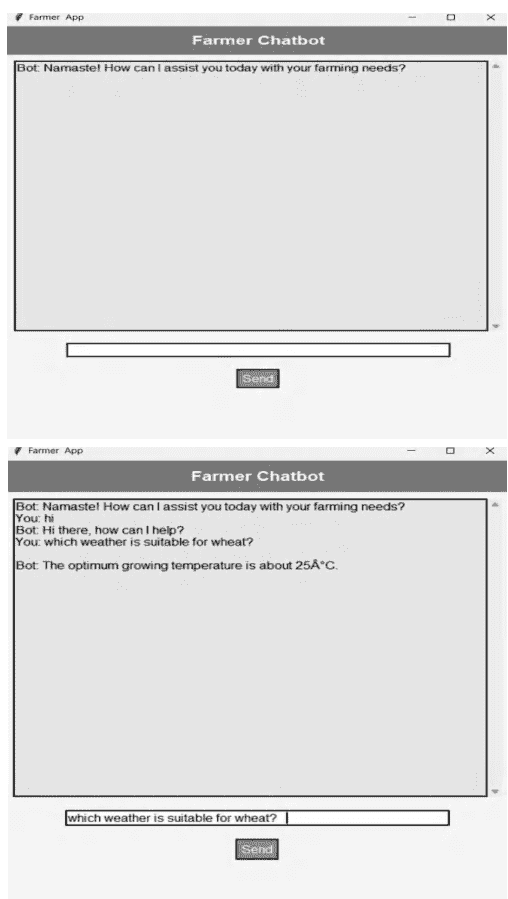

图1. 农民聊天机器人系统——前端。

农民聊天机器人（FCB）框架中聊天机器人的应用和功能涵盖了一系列针对农民特定需求定制的多样化农业支持服务。首先，聊天机器人在问题解决方面发挥着关键作用，能够就广泛的农业主题提供即时帮助，如作物种植技术、病虫害防治策略、肥料使用和土壤健康改善措施。此外，它们还提供实时天气更新，使农民能够有效规划农业活动，并降低与不利天气条件相关的风险。此外，农民可以通过聊天机器人查询当前农产品市场价格，从而帮助他们就作物销售和利润最大化做出明智决策。

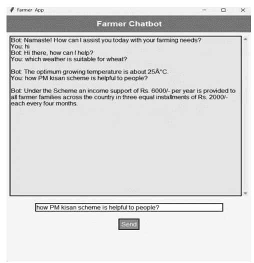

图2. 农民聊天机器人系统——政府计划信息。

此外，聊天机器人还提供有关政府计划（图2）、补贴和激励措施的有价值信息，促进农民参与相关农业计划和项目。这些聊天机器人还提供个性化的作物咨询服务，帮助农民根据作物类型、地理位置、土壤条件和季节性趋势等因素优化作物产量并降低风险。此外，它们还提供病虫害管理指导，推荐农业实践以提高生产力和可持续性，并提供有关现代农业实践的 educational 资源和培训材料，从而用知识和技能为农民赋能，以提高农业生产力和生计。

总体而言，农民聊天机器人（FCB）框架中聊天机器人的应用和功能在简化沟通、及时传递信息以及支持农民应对农业中的各种挑战和机遇方面发挥着重要作用。

## 识别FCB中用于农业支持的聊天机器人的关键特征

用于农业支持的农民聊天机器人（FCB）在设计上具有多项关键功能，以提升用户体验和可访问性。

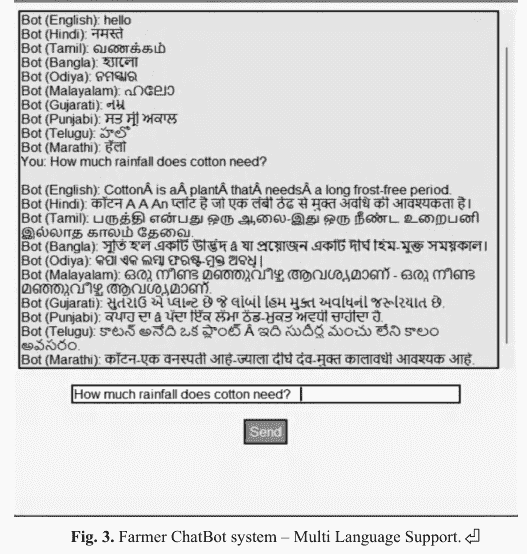

图3. 农民聊天机器人系统——多语言支持。

首先，它与谷歌翻译无缝连接以提供多语言支持，使用户能够以自己偏好的语言进行交互。此外，聊天机器人接受用户的文本查询，确保为所有用户提供更好的可访问性。它还具备语言翻译功能，能够将用户查询翻译成当地语言，并以文本形式提供响应。第一阶段最初推出了五种语言（英语（English）、印地语（Hindi）、泰米尔语（Tamil）、孟加拉语（Bangla）和奥里亚语（Odiya）），聊天机器人的扩展计划包括新增五种语言（马拉雅拉姆语（Malayalam）、古吉拉特语（Gujarati）、旁遮普语（Punjabi）、泰卢固语（Telugu）和马拉地语（Marathi））（图3），并计划在后续阶段覆盖所有22种地区语言。通过这些功能和扩展计划，聊天机器人旨在满足通过FCB平台获取农业支持的农民和利益相关者的多样化语言需求。

## 在FCB生态系统中实施农业咨询聊天机器人面临的挑战

在农民聊天机器人（FCB）生态系统中实施用于农业咨询服务的聊天机器人面临着多项挑战，需要加以解决才能有效部署。一个重大挑战是印度语言多样性，要求聊天机器人能够理解并响应多种语言和方言的查询。此外，确保网络连接有限地区可访问性和功能性至关重要。自然语言处理（NLP）、机器学习（ML）和软件开发方面的技术专长对于在FCB框架中部署和维护聊天机器人必不可少。此外，确保农业数据的质量和可用性、解决用户采用和接受度问题、并应对隐私和安全问题都是关键考虑因素。文化敏感性以及与现有系统的无缝集成也在成功实施聊天机器人中发挥着重要作用。应对这些挑战需要采取综合方法，包括技术创新、利益相关者协作、用户教育以及持续监测和评估，以确保聊天机器人在FCB生态系统中提供农业咨询服务的有效性和可持续性。

理解在农民聊天机器人（FCB）中为农业咨询目的而集成和运营聊天机器人所遇到的挑战，需要解决几个关键领域。这些包括语言多样性、基础设施集成、数据安全、互联网连接可靠性、用户接受度和文化敏感性。克服这些障碍需要采取综合方法，涉及技术创新、利益相关者参与、能力建设和持续评估。

## 评估聊天机器人通过FCB传递农业信息的影响

该研究章节旨在考察聊天机器人如何影响了农民聊天机器人（FCB）生态系统内农业信息的传递，以及它们在多大程度上增强了农民获取关键信息的机会。评估可能涉及分析用户参与度、响应时间、信息准确性和用户满意度等指标，以衡量聊天机器人对农业信息传递效率和效果的影响。通过这项调查，研究者可以深入了解聊天机器人在转变农业咨询服务和为农民决策过程提供信息方面的作用。

近期研究强调了深度学习和机器学习算法在对不同植物物种进行分类方面的潜力，展示了可进一步优化聊天机器人能力的进展（Chouhan et al., 2024a）。此外，计算机视觉和无人机技术的创新为增强农业实践提供了有前景的应用，凸显了人工智能在农业中不断发展的格局（Chouhan et al., 2024b; Kumar et al., 2023）。

## 探究用户对FCB中农业支持聊天机器的看法与体验

本部分概述了考察用户对于在农民聊天机器人（FCB）平台中使用聊天机器人进行农业咨询和支持的看法与体验的研究重点。它强调了深入探究农民和利益相关者对聊天机器人的态度、意见和满意度水平的目的，旨在理解其整体体验。通过这项调查，研究者旨在了解用户在农民聊天机器人（FCB）框架中如何感知聊天机器人，并评估他们对使用聊天机器人进行农业援助的满意度。最近关于使用计算机视觉进行叶片病害分割和分类的研究


进一步提供了影响用户与聊天机器人互动的技术进步的背景（Chouhan等，2021；Khajuria等，2018）。

## 研究结果

FarmerBot的开发与实施标志着人工智能（AI）和机器学习（ML）融入农业实践的重大飞跃。通过利用先进的机器学习技术，特别是TensorFlow，该聊天机器人旨在通过分析大量农业数据集为农民提供实时帮助。系统处理与农业相关的各种查询，如作物管理、病虫害防治、天气预报和土壤健康，确保农民及时获得相关信息以做出明智决策。FarmerBot的一个关键特性是其多语言能力，利用Google Translate API，使聊天机器人能够面向不同语言背景的农民，从而弥合沟通鸿沟并确保包容性。此外，FarmerBot集成了实体识别（Entity Recognition），以从用户查询中准确提取作物类型或病虫害问题等相关细节，从而提供定制化的响应。机器人的性能定期通过精确率、召回率和准确率指标进行评估，确保高质量输出并减少错误。这一持续改进过程（包括使用更新的农业数据重新训练模型）对于适应不断变化的农业趋势和挑战至关重要。由于有可能整合语音识别等其他功能，FarmerBot有望增强用户参与度，并提供个性化、可操作的见解以提高作物生产力，从而帮助农民优化产量、改善生计。这一创新例证了AI驱动的解决方案如何彻底改变农业实践，使其更高效、更易获取且更具可持续性。

FarmerBot开发中采用的编程技术结合了自然语言处理（NLP）和机器学习中的多种先进方法。系统的核心是一个基于Keras和TensorFlow构建的深度学习模型，使聊天机器人能够准确理解和分类用户意图。在查询处理方面，使用CountVectorizer将文本数据转换为数值表示，使机器学习模型能够有效解释和分类输入。此外，利用NLTK库中的Porter Stemmer对用户输入进行预处理，通过词干提取将单词变体标准化为其根形式，从而实现更高效的处理。聊天机器人还利用实体识别提取特定的农业实体（如作物类型或病虫害名称），这有助于个性化响应。Google Translate API的集成确保了无缝的多语言支持，扩大了不同地区农民的可访问性。整个系统采用模块化代码架构，每个功能和过程都被封装，以确保可扩展性和可维护性。这些技术的结合使FarmerBot能够高效运行、提供准确响应，并适应不同语言和农业环境，展示了现代AI和编程技术在解决现实问题中的力量。

与农民查询相关的词云（图4）直观展示了农民在寻求农业相关帮助或信息时最常使用的术语。通过分析农民查询（例如从Farmer ChatBot等来源收集的查询），词云突出了作物管理、土壤健康、天气模式、病虫害防治、肥料使用、市场价格和政府计划等关键主题。词云中每个词的大小与其出现频率相关，有助于了解农民面临的主要挑战和关切。该词云是理解最紧迫农业问题的有效工具，使开发人员和农业专家能够专注于提供针对农民具体需求的有针对性的解决方案和响应，从而促进更高效、更可持续的农业实践。

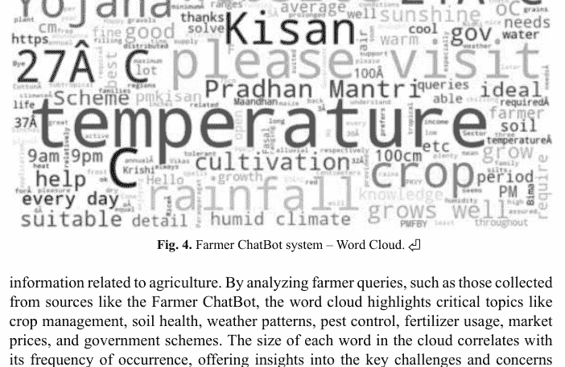

图4. Farmer ChatBot系统 – 词云。

#### 结论

在FCB框架内集成聊天机器人为增强印度的农业支持服务提供了重大机遇。多语言支持、音频/文本查询和语言翻译等关键特性改善了可访问性和用户体验。然而，语言多样性、技术专业知识和用户接受度等挑战必须在有效部署中得到解决。尽管存在这些挑战，聊天机器人在转变农业咨询服务、为农民提供及时相关信息方面显示出巨大潜力。未来的研究应侧重于应对实施挑战，并评估聊天机器人在FCB农业信息传递中的影响。通过持续创新和利益相关者合作，聊天机器人可以在提高印度农业生产力和支持农村生计方面发挥关键作用。

### 声明

#### 作者的伦理责任

> “所有作者均已阅读、理解并酌情遵守《作者须知》中关于‘作者伦理责任’的声明。”

### 伦理批准

不适用。

#### 人工智能工具的使用

示例1：通讯作者声明未使用任何AI工具来准备本手稿。

#### 利益冲突

通讯作者代表所有作者声明，不存在需要披露的利益冲突。

### 竞争利益

不适用。

#### 作者贡献

**作者¹：** 概念化、方法学、写作——原始草稿、写作——审阅与编辑，**作者²：** 调查、正式分析、可视化、软件、监督。

#### 资助

未收到任何资助。

### 参考文献

- Chandolikar, N., Dale, C., Koli, T., Singh, M. and Narkhede, T. 2022, March. Agriculture assistant Chatbot using Artificial Neural Network. *In 2022 International Conference on Advanced Computing Technologies and Applications (ICACTA)* (pp. 1–5). IEEE.
- Chouhan, S.S., Singh, U.P. and Jain, S. 2024. Introduction to computer vision and drone technology. *In:* Chouhan, S.S., Singh, U.P. and Jain, S. (eds.). *Applications of Computer Vision and Drone Technology in Agriculture 4.0*. Springer, Singapore. https://doi.org/10.1007/978-981-99-8684-2_1.
- Chouhan, S.S., Singh, U.P., Sharma, U. and Jain, S. 2021. Leaf disease segmentation and classification of *Jatropha Curcas* L. and *Pongamia Pinnata* L. biofuel plants using computer vision based approaches. *Measurement*, 171: 108796, ISSN 0263-2241. https://doi.org/10.1016/j.measurement.2020.108796.
- Chouhan, S.S., Singh, U.P., Sharma, U. et al. 2024. Classification of different plant species using Deep Learning and Machine Learning algorithms. *Wireless Pers. Commun.*, 136: 2275–2298. https://doi.org/10.1007/s11277-024-11374-y.
- Jain, N., Jain, P., Kayal, P., Sahit, J., Pachpande, S. and Choudhari, J. 2019. AgriBot: Agriculture-specific question answer system.
- Khajuria, R., Sunanda and Singh, S. 2018. A survey of existing leaf disease techniques using Artificial Neural Network. *International Journal of Computer Trends and Technology (IJCTT)*, 59(1): 52–62, May 2018. ISSN:2231–2803, doi:10.14445/22312803/IJCTT-V59P109, (https://ijcttjournal.org/archives/ijctt-v59p109).
- Kiruthika, U., Raja, S.K.S., Balaji, V. and Raman, C.J. 2020. E-agriculture for direct marketing of food crops using Chatbots. 2020 International Conference on Power, Energy, Control and Transmission Systems (ICPECTS), Chennai, India, pp. 1–4, doi: 10.1109/ICPECTS49113.2020.9337024.
- Kumar, R. et al. 2024. Hybrid Approach of Cotton Disease Detection for Enhanced Crop Health and Yield. In IEEE Access, https://ieeexplore.ieee.org/document/10589357.
- Lamba, T. and Keshri, R. 2022, August. Chatbot farming system. In Proceedings of the Third International Conference on Information Management and Machine Intelligence: ICIMMI 2021 (pp. 311–318). Singapore: Springer Nature Singapore.
- Maduri, P.K., Dhiman, P., Shukla, M.R., Anand, S. and Singh, S.P. 2021, December. Farmers agriculture assistance Chatbot. In 2021 3rd International Conference on Advances in Computing, Communication Control and Networking (ICAC3N) (pp. 1884–1889). IEEE.
- Maduri, P.K., Dhiman, P., Shukla, M.R., Anand, S. and Singh, S.P. 2021, December. Farmers agriculture assistance Chatbot. In 2021 3rd International Conference on Advances in Computing, Communication Control and Networking (ICAC3N) (pp. 1884–1889). IEEE.
- Momaya, M., Khanna, A., Sadavarte, J. and Sankhe, M. 2021, June. Krushi-the farmer chatbot. In 2021 International Conference on Communication information and Computing Technology (ICCICT) (pp. 1–6). IEEE.
- Niranjan, P.Y., Rajpurohit, V.S. and Malgi, R. 2019, July. A survey on chat-bot system for agriculture domain. In 2019 1st International Conference on Advances in Information Technology (ICAIT) (pp. 99–103). IEEE.
- Sawant, D., Jaiswal, A., Singh, J. and Shah, P. 2019, July. AgriBot-An intelligent interactive interface to assist farmers in agricultural activities. In 2019 IEEE Bombay Section Signature Conference (IBSSC) (pp. 1–6). IEEE.
- Sivakumar, S.A., Shankar, B.M., Anuradha, B., Karan, K.A., Karthik, A., Karthik, R. and Kumar, J.R.R. 2023. Artificial Intelligence based agricultural Chatbot and virtual assistant for delivery of harvested crops. International Journal of Intelligent Systems and Applications in Engineering, 11(8s): 576–583.


## 第13章

## 联邦学习

### 农业决策与精准农业的变革者

Sisir Kumar Rajbongshi,1,* Rajdeep Ghosh,1 Kshirod Sarmah1 and Satyajit Sarmah2

## 引言

农业作为文明的支柱，几个世纪以来经历了显著的变革，驱动力是旨在提高生产力、可持续性和韧性的技术进步。在当代背景下，数据科学与农业的融合引发了新一轮创新浪潮，有望为作物管理、资源配置和决策过程提供前所未有的洞察。这一革命的前沿是联邦学习（FL），一种去中心化的机器学习范式，有望革新农业实践并开启精准农业新时代。

传统农业数据分析方法通常需要将来自多个来源的大量数据集集中起来进行分析，这带来了与数据隐私、安全性和可扩展性相关的重要挑战。然而，在数据保护和隐私问题日益受到关注的时代，数据集中化对利益相关者之间的协作和知识共享构成了巨大障碍。联邦学习通过在保护数据隐私和安全的同时实现分布式数据源之间的协作模型训练，为这一难题提供了有力的解决方案。

本质上，联邦学习基于去中心化模型训练的原则，单个数据源，如农场、农业研究机构和物联网传感器，对其各自的数据保留控制权。联邦学习不是将数据聚合到中央存储库，而是利用本地计算协作训练机器学习模型。这种分布式方法不仅解决了数据隐私和安全方面的担忧，还最大限度地减少了通信开销，降低了对集中式基础设施的依赖。

联邦学习在农业中的应用在多个领域具有巨大潜力，范围从作物产量预测和病害检测到资源优化和环境监测。通过利用分布式数据集中蕴含的集体智能，FL使农业利益相关者能够做出明智决策，优化资源配置，提高生产力，同时最大限度地减少环境影响。

联邦学习展现其变革潜力的关键领域之一是精准农业，这是一种以数据为驱动的农业管理方法，旨在优化投入、最大化产量并最大限度地减少浪费。传统上，精准农业依赖于来自各种来源的数据整合，包括卫星图像、天气预报、土壤传感器和作物产量监测器，为农民生成可操作的洞察。然而，传统精准农业模型中数据分析的集中化性质通常在数据访问、隐私和可扩展性方面带来挑战。

联邦学习通过实现分布式数据源之间的协作模型训练，为传统精准农业方法提供了有力的替代方案。通过利用FL，农民可以利用本地数据集中蕴含的集体智能，在保护数据隐私和安全的同时提高预测模型的准确性和鲁棒性。这种去中心化方法不仅增强了精准农业系统的可扩展性和效率，还促进了农业利益相关者之间更大的协作和知识共享。

在本章中，我们探讨了联邦学习作为农业决策和精准农业变革者的变革潜力。我们提供了FL的基本原理及其在农业背景下的应用概述，强调其优化作物管理实践、提高产量预测和减轻环境影响的能力。为了进一步研究联邦学习在农业中的潜力和应用，我们提出了以下研究问题：

- **i. 数据隐私与安全：**
  - 联邦学习如何缓解农业数据共享中的数据隐私问题？
  - 在农业生态系统中实施FL有哪些关键安全挑战？
- **ii. 实施与可扩展性：**
  - 在多样化的农业环境中部署联邦学习有哪些实际挑战？
  - 如何增强联邦学习系统的可扩展性以支持大规模农业运营？
- **iii. 性能与准确性：**
  - 在预测作物产量和检测病害方面，联邦学习模型的性能与传统集中式模型相比如何？
  - 在农业背景下可以采用哪些技术来提高FL模型的准确性和鲁棒性？
- **iv. 协作与知识共享：**
  - 联邦学习如何促进农民、研究人员和农业利益相关者之间更大的协作和知识共享？
  - 在协作农业研究中采用FL的障碍是什么，如何克服？
- **v. 环境与经济影响：**
  - 联邦学习如何促进可持续农业实践并减少农业的环境影响？
  - 在精准农业中采用联邦学习可以实现哪些经济效益？

通过解决这些问题，本研究旨在全面了解联邦学习在转变农业实践和促进可持续农业方面的潜力、挑战和益处。

## 文献综述

机器学习（ML）使用数据和算法进行学习，并逐步提高系统的性能，如Samuel（1959）和Alpaydin（2020）所建议。Benos（2021）指出机器学习方法可应用于农业，实现更高效、更精确的耕作，因为机器学习有助于建立基于知识的农业系统。ML算法可以分析大量农业数据，如作物产量、土壤和天气数据，以识别模式并获取农业数据的知识。Liakos（2018）分析了ML在不同农业领域的应用：水管理、土壤管理、畜牧生产与管理以及作物管理。深度学习（DL）是机器学习（ML）的一个子集。LeCun（2015）和Schmidhuber（2022）指出DL通过在模型中引入深度和复杂性来扩展经典ML，从而实现通过多级抽象进行学习。DL由多个处理层组成，可实现分层学习，如Schmidhuber（2015）所建议。Jain（1999）进而提出循环神经网络（RNNs）模拟时间动态行为。它们包含循环，节点之间的连接形成循环，使得某些节点的输出能够影响对同一节点的后续输入。Kamilaris（2018）对农业中深度学习与其他现有流行技术在分类和回归性能方面的比较进行了介绍。其研究结果证明，深度学习显著提高了分类和预测问题的性能，提供了高准确性。

Wójtowicz（2016）指出，农业通过低成本、低能耗的传感器和设备产生大量实时数据。农业地面调查费用昂贵，通常仅覆盖小面积或样本农场的选择。相比之下，遥感为农业提供了经济高效的监测。这些设备产生实时数据并依赖开放的互联网通信。这也有助于最大限度地减少与安全和数据隐私违规相关的风险。Kaur（2022）指出，数据隐私对农民也很重要，而不仅仅是对大型组织。

解决数据安全问题的一种方案涉及多个数据所有者之间的合作，以在保留所有训练数据本地的情况下训练和使用共享的机器学习模型。这可以通过Konečný（2016）所指出的新兴机器学习技术联邦学习（FL）实现。FL由McMahan（2017）提出，而第一个聚合算法FedAvg由Kairouz（2021）提出。Mothukuri（2021）指出，FL是一种机器学习类型，其中不同的客户端或用户在保持对其数据的去中心化控制的同时协作训练模型。它还降低了Zhang（2016）所指出的隐私违规风险。FL使用仅本地数据样本在多个去中心化客户端之间训练机器学习模型，避免了与其他客户端或中央服务器交换数据的需求。

Chouhan（2024a）探讨了农业中的计算机视觉和无人机技术，涵盖概念、理论、应用和未来发展。它旨在为读者提供这些技术的基本见解和实际适应性，首先介绍计算机视觉方法，然后介绍无人机技术。在农业技术的重要进展中，Chouhan（2024b）开发了一种深度学习模型，旨在实时对不同植物物种进行分类。利用物联网（IoT）实践，该模型可高效地从实时捕获的图像中识别和分类植物物种。Kumar（2024）提出了一种基于机器学习的棉花作物早期病害检测系统，通过叶片图像分析。通过评估包括随机森林、SVM和集成模型在内的各种模型，该研究旨在通过将棉花叶片准确分类为“健康”或“患病”来提高作物产量和质量。利用Jatropha Curcas L.和Pongamia Pinnata L.等植物生产生物燃料的努力面临着影响植物生长的生物因素带来的挑战。为解决这一问题，Chouhan（2021）提出了一种使用超像素聚类的混合神经网络进行病害诊断的计算机视觉方法。该系统在病害分类中实现了高准确性，分割结果显示平均特异性为0.9534和0.9795，敏感性为0.9637和0.9805，两种植物的分类准确性分别为0.9857、0.9095和0.9607。

农业生产力对印度经济至关重要，但叶部病害严重影响农民。传统病害检测方法在大规模下效率低下，使得自动化技术对于效率和准确性至关重要。Khajuria（2018）强调了人工神经网络（ANNs）和机器学习在叶片病害检测、分割和识别方面的进展，强调了现代传感器和成像技术在增强ANN模型方面带来的改进。


## 联邦学习在农业中的应用

分析联邦学习（FL）在农业情境中的应用涉及考察其在各种农业实践方面的潜力、挑战、机遇和影响。在本分析中，我们深入探讨 FL 在提升作物管理、改善产量预测、优化资源配置、减轻环境影响以及解决农业数据分析中隐私问题方面的作用。

- **增强作物管理：**
联邦学习为作物管理提供了一种去中心化的方法，通过利用分布式数据集的洞察，同时不损害数据隐私。农民可以与农业研究人员、推广服务机构和其他利益相关者合作，共同分析作物表现、识别趋势，并就种植策略、病虫害防治措施和灌溉管理做出明智决策。FL 促进了来自多种来源的数据整合，包括天气预报、土壤传感器、卫星图像和历史作物产量数据，使农民能够优化投入、最大化产量，并最大限度降低与环境变异和气候变化相关的风险。

- **改善产量预测：**
联邦学习的预测能力可以革新农业产量预测。通过汇总来自多个农场、地区和农业气候区的数据，FL 模型能够捕捉环境因素、作物遗传学和管理实践之间的复杂相互作用，从而实现更准确可靠的产量预测。农民可以利用这些预测来预判市场需求、规划收获时间表并优化收获后物流，从而提高盈利能力并减少食物浪费。此外，FL 促进持续学习和适应，使预测模型能够随着新数据的出现而演进，从而实现更稳健可靠的产量预测。

- **优化资源配置：**
联邦学习使农民能够通过提供其田地中土壤肥力、湿度水平和作物健康在空间和时间上的变异性洞察来优化资源配置。通过整合来自土壤传感器、无人机和物联网设备的数据，FL 模型可以生成土壤属性、养分可用性和病虫害侵染的空间显式地图，从而实现化肥、农药和水资源的精准施用。这种针对性的资源管理方法不仅提高了作物产量和品质，还最大限度降低了投入成本、减少了环境影响并增强了农业的可持续性。

- **减轻环境影响：**
联邦学习通过推广可持续农业实践和减少资源浪费，有潜力减轻环境影响。通过优化灌溉计划、最小化化学投入并采用精准农业技术，农民可以节约用水、减少土壤侵蚀并最大限度减少污染径流，从而保护生态系统健康和生物多样性。FL 模型还可以通过识别生态价值高的区域、优先考虑栖息地恢复项目以及监测土地管理实践在缓解气候变化影响方面的有效性来支持保护工作。

- **解决隐私问题：**
联邦学习的关键优势之一是其能够解决与农业数据分析相关的隐私问题。通过将数据保留在本地并在设备上或边缘进行模型训练，FL 确保敏感信息保持安全和保密。农民对其数据拥有完全控制权，可以决定与合作者分享哪些洞察，同时保护专有信息的隐私。这种去中心化的数据分析方法不仅增强了利益相关者之间的信任和透明度，还促进了农业研究和创新中的更大参与和协作。

总之，联邦学习通过利用分布式数据源、保护隐私并促进利益相关者之间的协作，有潜力革新农业决策和精准农业。通过增强作物管理、改善产量预测、优化资源配置、减轻环境影响并解决隐私问题，FL 可以为快速变化世界中的可持续农业和粮食安全做出贡献。然而，要在农业中实现 FL 的全部潜力，需要解决技术挑战、促进跨学科协作并推动在整个农业价值链中采用去中心化的数据分析方法。

## 挑战

联邦学习（FL）作为农业创新的催化剂的深远影响源于其能够解决农业部门面临的关键挑战，同时释放效率、可持续性和韧性方面的新机遇。FL 通过在保护数据隐私和安全的同时实现跨分布式数据集的协作模型训练，革新了传统的数据分析方法。这种去中心化范式促进了农业利益相关者之间更大的协作和知识共享，推动了农业实践各个方面的变革性进步：

- **数据隐私和安全：**
FL 通过将敏感信息保留在本地并在设备上或边缘进行模型训练来解决数据隐私和安全方面的担忧。这确保了专有数据保持安全和保密，增强了利益相关者之间的信任和透明度。通过保护数据隐私，FL 促进了农业研究和创新中的更大参与和协作，从而开发出用于作物管理、产量预测和资源配置的更稳健可靠的预测模型。

- **协作决策：**
FL 通过促进来自多样化数据集的洞察聚合，而无需集中敏感信息，从而使农民、研究人员、推广服务机构和其他利益相关者之间能够进行协作决策。这种协作方法在应对病虫害爆发、土壤退化和水资源短缺等复杂农业挑战时促进了更大的协同和协调。通过利用集体智慧，FL 使农业利益相关者能够做出明智决策、优化资源配置并提高生产力，同时最大限度减少环境影响。

## 精准农业：

FL 对精准农业具有巨大潜力，精准农业是一种以数据为驱动的农业方法，旨在优化投入、最大化产量并最小化环境影响。通过整合来自多种来源的数据，包括天气预报、土壤传感器、卫星图像和历史作物产量数据，FL 模型可以生成用于化肥、农药和水资源精准施用的空间显式地图。这种针对性的资源管理方法在最大限度降低投入成本和环境风险的同时提高了作物产量和品质，从而实现更可持续和更具韧性的农业实践。

## 实时数据分析：

FL 通过在接近实时时在分布式数据集上进行模型训练，促进了农业中的实时数据分析和自适应决策支持系统。这使农民能够迅速应对不断变化的环境条件、市场需求和病虫害爆发，增强了农业生产系统的韧性和灵活性。通过利用 FL 的力量，农民可以就种植策略、病虫害防治措施和灌溉管理做出及时明智的决策，从而提高生产率和盈利能力。

## 创新与研究：

FL 通过提供协作实验、数据分析和模型开发的平台推动农业创新和研究。农业研究人员可以利用 FL 访问来自多个来源的多样化数据集，使其能够开展大规模研究、开发预测模型并识别作物遗传学、环境相互作用和管理实践方面的新见解。这种协作方法加速了农业创新的步伐，推动了新技术、实践和解决方案的开发，以应对农业中出现的新挑战和机遇。

## 可扩展性和适应性：

FL 通过适应农业系统多样化和动态的特性，在农业数据分析中提供可扩展性和适应性。FL 的去中心化特性允许整合来自广泛来源的数据，包括小农场、大规模经营和研究机构，从而能够在不同尺度上对农业景观进行全面分析。这种可扩展性促进了根据农民的具体需求、资源和环境条件制定量身定制解决方案和建议。此外，FL 的适应性使模型能够随着新数据的出现而演进，确保预测洞察在不断变化的环境条件、市场动态和技术进步面前保持相关性和可靠性。


## 对数据孤岛和连接问题的韧性：

FL 通过在无需集中式基础设施或持续互联网连接的情况下对分布式数据集进行模型训练，解决了农业数据分析中与数据孤岛和连接问题相关的挑战。这种韧性使偏远或资源受限地区的农民能够参与协作数据分析工作，为集体决策过程贡献宝贵的见解。此外，FL 在低带宽或间歇性连接环境中运行的能力确保了数据分析的连续性和可靠性，即使在高速互联网或先进计算资源获取有限的地区也是如此。

## 小农户的赋能：

FL 通过提供此前仅大型农业企业才能获得的前沿技术和数据驱动洞察，赋能小农户。通过参与 FL 促进的协作数据分析工作，小农户可以获得有价值的信息、资源和市场机会，从而提高其生产力、盈利能力和韧性。此外，FL 使小农户能够将其本地化知识和专业知识贡献给集体决策过程，促进农业创新努力的更大包容性和公平性。

## 可持续农业实践的采用：

FL 通过为农民提供优化资源利用、最小化环境影响并增强生态系统韧性的可操作洞察和建议，促进可持续农业实践的采用。通过整合环境传感器、卫星图像和历史记录的数据，FL 模型可以识别改善土壤健康、节约用水、减少温室气体排放和保护生物多样性的机会。这种以数据为驱动的可持续性方法使农民能够做出平衡经济可行性与环境管理的明智决策，确保农业生产系统的长期可行性。

## 全球协作与知识共享：

FL 通过促进全球范围内农民、研究人员、政策制定者和农业组织之间的数据、专业知识和最佳实践交流，促进农业领域的全球协作与知识共享。通过 FL 促进的协作数据分析工作，利益相关者可以利用多元视角和经验的集体智慧来应对共同挑战，例如粮食安全、气候变化适应和农村发展。这种全球协作加速了农业创新的步伐，使变革性技术和实践能够快速传播和采用，从而使世界各地的农民和社区受益。

总之，联邦学习通过解决关键挑战、促进协作、实现精准农业、促进实时数据分析以及推动创新和研究，成为农业创新的催化剂。通过利用 FL 的力量，农业利益相关者可以解锁效率、可持续性和韧性方面的新机遇，从而实现更具生产力、盈利性和可持续性的农业部门。

## 概念模型：FL 作为农业创新的催化剂

让我们说明一个概念模型，描绘联邦学习 (FL) 如何催化农业创新：

- **输入数据：**
  - 多样化数据集：这些可能包括来自农场的收集数据，例如作物产量记录、土壤养分水平和灌溉计划。此外，来自外部来源的数据，如天气预报、卫星图像和市场价格，也能提供有价值的见解。
  - 示例：安装在田间的土壤传感器收集土壤湿度和养分水平的实时数据。气象站提供温度、湿度、降雨量等气象数据。卫星图像提供高分辨率图像，用于监测作物健康状况并随时间检测土地利用变化。

- **联邦学习框架：**
  - 去中心化模型训练：联邦学习允许机器学习模型在本地设备上协作训练，而无需集中敏感数据。每个设备在保持数据安全和私密的同时，将其洞察贡献给模型。
  - 示例：农民的智能手机或物联网设备运行机器学习算法来分析本地数据，例如作物图像或传感器读数，并将模型更新发送到中央服务器。服务器聚合这些更新以改进整体模型，而无需访问单个农民的数据。

- **模型训练与优化：**
  - 协作分析：联邦学习使模型能够从分布式数据集中提取洞察，在尊重数据隐私约束的同时捕捉模式和相关性。
  - 示例：通过联邦学习训练的机器学习模型可以根据多个农场的历史数据预测作物产量，通过分析受影响作物的图像识别害虫侵染，或利用土壤湿度传感器读数优化灌溉计划。

- **预测分析与决策支持：**
  - 预测与建议：通过联邦学习生成的预测模型为农民提供可操作的洞察和优化农业实践的建议。
  - 示例：基于多个农场数据训练的预测模型可以预测下一季的作物产量，使农民能够相应调整种植策略或分配资源。由联邦学习驱动的决策支持系统可以根据本地化数据推荐具体的病虫害防治措施，减少无差别使用农药的需求。

- **反馈循环与持续学习：**
  - 对变化条件的适应：联邦学习模型基于新数据和洞察不断演进，确保其在动态农业环境中的相关性和可靠性。
  - 示例：随着新数据的可用，例如更新的天气预报或土壤传感器读数，联邦学习模型会重新训练以纳入这些洞察。例如，产量预测模型可能会根据实时天气数据调整其预测，以应对干旱或风暴等意外天气事件。

- **对农业创新的影响：**
  - 应对挑战：联邦学习通过解决数据隐私、资源优化和可持续性等关键挑战，推动农业创新。
  - 示例：联邦学习支持的精准农业技术，如变量率灌溉或靶向病虫害管理，优化资源利用并减少环境影响。可持续农业实践，如免耕农业或覆盖作物种植，通过联邦学习模型生成的数据驱动洞察得到推广。

- **利益相关者的赋能：**
  - 技术与洞察的获取：联邦学习通过提供前沿技术和数据驱动洞察，赋能农民、研究人员、政策制定者和农业组织。
  - 示例：偏远地区的小农户可以从提供改善作物产量或管理病虫害暴发的本地化建议的联邦学习模型中受益。研究人员可以协作开展由联邦学习促进的数据分析工作，以开发应对全球农业挑战的新解决方案。

- **全球协作与知识共享：**
  - 数据与专业知识的交流：联邦学习促进农业领域的全球协作与知识共享，使利益相关者能够共享数据、专业知识和最佳实践。
  - 示例：农业组织在联邦学习促进的国际研究项目上协作，以开发提高作物韧性或减轻气候变化影响的区域特定解决方案。农民参与利用联邦学习交换可持续农业实践洞察和经验的全球知识共享网络。

这些示例说明了联邦学习如何通过实现协作数据分析、促进全球 作为农业创新的催化剂。

协作，并赋能利益相关者做出明智决策，以提高农业生产实践中的生产力、可持续性和韧性。

为了通过动态数据分析和自适应决策框架最大程度地减少环境足迹，我们需要整合来自不同来源的实时数据，对其进行动态分析，并相应地调整决策，以优化资源利用并减少对环境的负面影响。这一过程涉及构建环境因素数学表述、定义最小化环境足迹的目标，以及开发能够根据传入数据动态调整决策的算法。

- **环境因素建模：**
  
  数学表述：水利用、能源消耗、温室气体排放和土壤侵蚀等环境因素可以使用数学方程进行建模。例如，灌溉对水利用的影响可以通过一个函数来表示，该函数将灌溉水平与作物需水量和土壤含水量关联起来。
  
  目标：目标是最大限度地减少农业活动对环境的影响，例如减少水利用、能源消耗和排放，同时最大限度地提高资源效率和可持续性。

- **定义目标：**
  
  数学表述：目标可以表述为在资源可用性、法规要求和经济可行性的约束条件下最小化环境足迹的优化问题。例如，目标函数可以在作物产量、土壤湿度和灌溉能力的约束条件下，最小化总用水量。
  
  目标函数：目标函数通过数学表达式量化农业活动对环境的影响，如水资源利用、能源消耗和排放，这些表达式反映了它们对环境足迹的贡献。

- **开发自适应决策算法：**
  
  数学表述：自适应决策算法根据实时数据和环境条件动态调整农业实践。这些算法使用数学模型来预测未来结果，评估不同行动的环境影响，并优化决策以最小化环境足迹。

- **实时数据集成：**
  
  数学表述：来自传感器、卫星、气象站和其他来源的实时数据被集成到数学模型中，以更新环境参数、预测未来状态并优化决策。这些模型使用数据同化、状态估计和参数识别等数学技术将新数据纳入现有模型。

## 挑战与前景

在农业场景中实施联邦学习（FL）既带来了挑战，也带来了前景。这些挑战围绕数据多样性、隐私困境、连接性问题和基础设施开发的需求。然而，潜在的好处包括改进的数据分析、增强的隐私保护以及利益相关者之间更大的协作。让我们更详细地探讨这些方面：

- **数据多样性：**
  挑战：农业数据通常是多样化的，来自农场、研究机构、气象站和卫星图像等各种来源。整合这些异构数据集在数据标准化、互操作性和质量保证方面带来了挑战。此外，数据可能稀疏或不完整，尤其是在偏远或资源有限的地区，这使得训练稳健的机器学习模型变得困难。
  前景：FL 支持在分布式数据集上进行协作模型训练，允许聚合来自不同来源的见解，同时保护数据隐私。通过利用 FL，利益相关者可以利用本地化数据集中蕴含的集体智慧，改进农业中的数据分析和决策。

- **隐私困境：**
  挑战：农业数据通常是敏感且专有的，包含有关作物产量、土壤特性、农场管理实践和市场策略的信息。共享这些数据进行协作分析会引起对数据隐私、安全和保密性的担忧。如果农民察觉到数据滥用、未经授权访问或失去竞争优势的风险，他们可能不愿意参与 FL 计划。
  前景：FL 通过保持数据的本地化并在设备端或边缘进行模型训练来解决隐私困境。这确保了敏感信息的安全性和保密性，增强了利益相关者之间的信任和透明度。FL 还允许农民保留对其数据的控制，决定将哪些见解与协作者共享，同时保护专有信息的隐私。

- **连接性问题：**
  挑战：农村地区通常缺乏强大的互联网连接，阻碍了 FL 和其他数据驱动技术在农业中的采用。对高速互联网、移动网络和计算基础设施的有限访问使农民无法参与协作数据分析工作并获得实时见解。
  前景：FL 可以在低带宽或间歇性连接环境中运行，因此适用于互联网访问受限的农业场景。通过在设备端或边缘进行模型训练，FL 减少了对中央基础设施的依赖，使农民即使在连接不良的偏远地区也能在本地分析数据。

## 基础设施开发：

挑战：在农业场景中实施 FL 需要对基础设施进行投资，包括硬件、软件和数据管理系统。农民可能缺乏部署 FL 算法、获取传感器技术和维护计算基础设施的技术专长和财务资源。

前景：政府、研究机构和农业组织可以通过资助、能力建设计划和技术转让举措来支持基础设施开发项目。通过投资 FL 基础设施，利益相关者可以使数据驱动技术的获取更加普及，赋能农民，并促进可持续农业发展。

#### 结论

总之，在农业环境中整合 FL 既带来了挑战，也带来了机遇。虽然必须解决数据多样性、隐私问题、连接限制和基础设施开发等问题，但 FL 为更好的数据分析、更强的隐私保护和更广泛的利益相关者参与提供了机会。通过克服这些障碍并充分发挥 FL 的潜力，利益相关者可以利用数据驱动技术的力量来解决紧迫问题，并为农业创新开辟新的前景。

### 声明

### 作者伦理责任

> “所有作者均已阅读、理解并酌情遵守《作者须知》中的‘作者伦理责任’声明”。

### 伦理批准

不适用。

### AI 工具使用

通讯作者声明，没有使用任何 AI 工具来准备这份手稿。

#### 利益冲突

通讯作者代表所有作者声明，不存在需要披露的利益冲突。

### 竞争利益

不适用。

#### 作者贡献

**作者¹：** 概念化、方法学、写作——初稿，**作者²：** 写作——审阅与编辑、调查、形式分析、可视化 **作者³：** 写作——初稿、形式分析、方法学，**作者⁴：** 形式分析、监督。

#### 资助

未收到任何资助。

### 参考文献

Alpaydin, E. 2020. *机器学习导论*. 麻省理工学院出版社，马萨诸塞州，美国。

Benos, L., Tagarakis, A.C., Dolias, G., Berruto, R., Kateris, D. and Bochtis, D. 2021. 农业中的机器学习：综合更新综述. *传感器*, 21: 1–55.

Chouhan, S.S., Singh, U.P., Sharma, U. and Jain, S. 2021. 使用基于计算机视觉的方法对麻疯树和水黄皮生物燃料植物进行叶部病害分割与分类. *测量*, 171: 1–10.

Chouhan, S.S., Singh, U.P. and Jain, S. 2024a. 计算机视觉与无人机技术导论. pp. 1–5. In: Chouhan, S.S., Singh, U.P. and Jain, S. (eds). *计算机视觉与无人机技术在农业中的应用*. 4.0. Springer, 新加坡.

Chouhan, S.S., Singh, U.P., Sharma, U. and Jain, S. 2024b. 使用深度学习和机器学习算法对不同植物物种进行分类. *无线个人通信*, 136: 2275–2298.

Jain, L.C. and Medsker. L.R. 1999. *循环神经网络：设计与应用*. CRC出版社, 佛罗里达州, 美国.

Kairouz, P., McMahan, H.B. Avent, B., Bellet, A., Bennis, M., Bhagoji, A.N., Bonawit, K., Charles, Z., Cormode, G., Cummings, R. et al. 2021. 联邦学习的进展与开放问题. *机器学习基础与趋势*, 14: 1–210.

Kamilaris, A. and Prenafeta-Boldú. F.X. 2018. 农业中的深度学习：综述. *农业中的计算机与电子技术*, 147: 70–90.

Kaur, J., Fard, S.M.H., Amiri-Zarandi, M. and Dara, R. 2022. 保护农民的数据隐私和机密性：建议与考量. *可持续粮食系统前沿*, 6: 1–9.

Khajuria, R., Sunanda and Singh, S. 2018. 使用人工神经网络的现有叶部病害技术综述. *国际计算机趋势与技术杂志*, 59: 52–62.

Konečný, J., McMahan, H.B., Yu, F.X., Suresh, A.T. and Bacon, D. 2016. 联邦学习：提高通信效率的策略. *arXiv 1610.05492v2*: 1–10.

Kumar, R., Kumar, A., Bhatia, K., Nisar, K.S., Chouhan, S.S., Maratha, P. and Tiwari, A.K. 2024. 用于提高作物健康和产量的棉花病害检测混合方法. *IEEE Access*, 12: 132495–132507.

LeCun, Y., Bengio, Y. and Hinton, G. 2015. 深度学习. *自然*, 521: 436–444.

Liakos, K.G., Busato, P., Moshou, D., Pearson, S. and Bochtis, D. 2018. 农业中的机器学习：综述. *传感器*, 18: 1–29.

McMahan, H.B., Moore, E., Ramage, D., Hampson, S. and Arcas, B.A. 2017. 从去中心化数据中进行深度网络的通信高效学习. pp. 1273–1282. In *第20届人工智能与统计国际会议论文集（AISTATS 2017）*, 美国佛罗里达州劳德代尔堡, PMLR.

Mothukuri, V., Parizi, R.M., Pouriyeh, S., Huang, Y., Dehghantanha, A. and Srivastava, G. 2021. 联邦学习的安全与隐私综述. *未来一代计算机系统*, 115: 619–640.


Samuel, A. 1959. 使用跳棋游戏进行机器学习的一些研究. *IBM 研究与开发杂志*, 3: 210–229.
Schmidhuber, J. 2015. 神经网络中的深度学习：概述. *神经网络*, 61: 85–117.
Schmidhuber, J. 2022. 现代人工智能和深度学习注释史. *arXiv* 2212.11279: 1–75.
Wójcowicz, M., Wójcowicz, A. 和 Piekarczyk, J. 2016. 遥感方法在农业中的应用. *生物统计与作物科学通讯*, 11: 31–50.
Zhang, C., Xie, Y., Bai, H., Yu, B., Li, W. 和 Gao, Y. 2021. 联邦学习综述. *基于知识的系统*, 216: 1–11.

## 第14章

## 清洁溪流，清澈未来
水质监测中的
人工智能创新

Anuradha Devi

## 水质监测简介

通过质量监测，该过程确保水资源安全、可用且可持续。本章全面介绍了水质的重要性、为理解水质而需要测量的参数、用于监测其成因的常规方法以及所有不足之处。这些概念结合可靠来源的参考文献、表格和每个方面的详细分析得到了很好的解释。

## 水质的重要性

人类健康、生态系统可持续性和经济生产力都依赖于水质。表1列出了水的重要用途，包括饮用水、农业灌溉、工业过程和娱乐。被这些营养物质污染的水可能引发重大健康问题，例如水传播感染，同时危害水生生物和生态系统。

表1. 优质水的主要用途（世界卫生组织，2020）。

| 用途 | 描述 |
|---|---|
| 饮用水 | 适合人类饮用，不含有害污染物 |
| 农业 | 促进作物健康生长的灌溉水 |
| 工业 | 用于制造过程、冷却和清洁的水 |
| 娱乐 | 用于游泳、划船和钓鱼的水体 |

## 水质参数

水质是通过测量各种物理、化学和生物参数来确定的。每个参数都能提供有关水体状况和可用性的信息。

**物理参数：**
- **温度**：影响水中的生物和化学过程。
- **浊度**：表示水的清澈程度；高浊度可能对水生生物有害。
- **颜色**：可能指示有机物或污染物的存在。

**化学参数：**
- **pH值**：衡量水的酸性或碱性；对水生生物非常重要。
- **溶解氧（DO）**：对鱼类和其他水生生物的生存至关重要。
- **营养物质（硝酸盐、磷酸盐）**：含量过高会导致富营养化，引发藻华。

**生物参数：**
- **大肠菌群**：微生物污染和潜在病原体存在的指示物。
- **生化需氧量（BOD）**：表示水中有机物的含量；高BOD会消耗氧气水平。

常见水质参数及其意义的总结见表2。

表2. 常见水质参数及其意义（美国环保局，2021）。

| 参数 | 类型 | 意义 |
|---|---|---|
| 温度 | 物理 | 影响生物和化学过程 |
| 浊度 | 物理 | 表示水体的清澈程度；影响水生生物 |
| pH值 | 化学 | 表示酸性或碱性；对水生生物很重要 |
| 溶解氧（DO） | 化学 | 对水生生物至关重要 |
| 硝酸盐 | 化学 | 含量过高可导致富营养化 |
| 大肠菌群 | 生物 | 表示微生物污染 |

## 传统水质监测方法

传统水质监测涉及定期采样和实验室分析（表3）。这些方法包括：
- **瞬时采样**：在特定地点和时间采集水样，供实验室分析。
- **混合采样**：将不同时间或地点采集的多个样本合并，以获得平均测量值。
- **现场测试**：使用便携式试剂盒和仪表，在现场直接测量pH、温度和浊度等参数。

虽然这些方法能提供准确而完整的信息，但它们存在局限性，例如需要大量时间和人力，并且无法提供实时数据。

表3. 传统水质监测方法比较（美国自来水厂协会，2020）。

| 方法 | 描述 | 优点 | 局限性 |
|---|---|---|---|
| 瞬时采样 | 在特定地点采集样本 | 准确且详细的分析 | 耗时，非实时 |
| 混合采样 | 合并不同时间/地点的样本 | 平均测量值 | 劳动强度大，可能遗漏时间变化 |
| 现场测试 | 使用便携式试剂盒进行即时测量 | 结果快速，便携 | 仅限于基本参数，不如实验室分析准确 |

### 传统方法的局限性

尽管传统水质监测方法被广泛使用，但它们仍有几个局限性：
- **时间局限性**：定期采样可能会错过短期污染事件或水质的波动。
- **空间局限性**：在固定地点采样可能无法完全捕捉水体中水质的全部变异性。
- **资源密集**：采样、运输和实验室分析需要大量人力和财力。
- **结果延迟**：实验室分析可能需要数天到数周，从而延迟对污染事件的响应。

这些局限性（表4）凸显了对更高效、实时监测方法的需求，而基于人工智能的系统可以在此提供相当大的好处。

表4. 传统水质监测方法的局限性（美国国家科学院，2017）。

| 局限性 | 描述 |
|---|---|
| 时间局限性 | 可能错过短期污染事件 |
| 空间局限性 | 固定地点可能无法捕捉全部变异性 |
| 资源密集 | 需要大量人力和财力资源 |
| 结果延迟 | 实验室分析可能延迟对污染事件的响应 |

## 印度水质现状

鉴于印度人口众多、生态系统多样化，确保水质是一项独特的挑战。在本部分中，我们阐述印度现有的水质状况，包括其水资源状况、面临的挑战以及对公共健康和环境的影响。

## 印度水资源概况

印度拥有河流、湖泊和地下水含水层等庞大的水域，处于令人羡慕的地位。然而，城市化、工业化和农业扩张正给本已稀缺的水资源带来不可持续的压力，导致污染和枯竭。根据印度中央污染控制委员会（CPCB）发布的一份报告，印度70%的水源受到威胁，包括恒河和亚穆纳河等主要河流（CPCB，2020）。

## 维持水质面临的当前挑战

尽管在改善水质方面做出了努力，印度仍在努力应对各种挑战，包括工业污染、农业径流、未经处理的污水以及污水处理基础设施不足。监管执法不力、公众意识缺乏以及监测和管理资源有限，使这些挑战进一步加剧。

## 水质差对公共健康和环境的影响

水质差对人类健康、生态和社会经济发展有着深远影响。霍乱、伤寒和腹泻等水传播疾病在印度许多地区很常见，尤其是在那些获得清洁水源和卫生设施机会有限的贫困人群中。此外，水污染损害水生生物多样性，破坏生态系统，并危及以渔业和农业为基础的生计。

这些水质问题对公共健康和水生生态系统具有深远影响，如表5所示。水体中大量污染物会污染饮用水供应，增加患腹泻、伤寒和肝炎等水传播疾病的风险。此外，水生生态系统遭受污染的不利影响，包括栖息地退化、生物多样性丧失以及水净化和营养循环等生态系统服务的中断。


表5：印度水体中的主要污染物（MeitY, 2021）。

| 污染物 | 来源 | 影响 |
|---|---|---|
| 工业废物 | 工厂、制造单位 | 重金属、毒素 |
| 农业径流 | 农药、化肥 | 营养物污染、藻华 |
| 未处理污水 | 城市地区、农村定居点 | 病原体、有机物 |
| 重金属 | 采矿、工业活动 | 生物累积、毒性 |

## 人工智能导论

人工智能（AI）正在改变众多行业，包括水质监测。本节重点介绍人工智能在环境监测和水质管理中的潜力，阐述人工智能的基本概念、类型、应用和发展。理解这些基础概念对于认识人工智能如何解决传统水质监测技术中的问题至关重要。

## 什么是人工智能？

人工智能是在机器中模拟人类智能，使其具备决策、学习以及检测问题的能力，从而减少对人工干预的需求。

## 人工智能在水质监测中的应用：范式转变

人工智能（AI）提供了多种可用于水质监测的方法，以提高识别、预测和处理水质问题的能力。本节讨论特定的AI方法及其在水质监测系统中的应用，如数据分析、机器学习和深度学习。

## 机器学习技术

机器学习（ML）是人工智能的一个子领域，专注于构建能够从数据中学习并做出决策的系统。在水质监测中，ML技术分析大型数据集、识别模式并预测未来的水质趋势（Bishop, 2016; Murphy, 2012）。

- **监督学习：** 此技术涉及在带标签的数据集上训练算法，其中输入-输出对是已知的。它用于预测特定结果，例如水中的污染物水平。
  - **示例：** 根据农业径流和天气模式的历史数据预测河流中硝酸盐的浓度。
- **无监督学习：** 此技术处理输出未标记的数据集。它用于发现隐藏模式或将数据分组为聚类。
  - **示例：** 根据化学性质对不同水样进行聚类，以确定污染源。
- **强化学习：** 此技术通过奖励期望行为并惩罚非期望行为来训练算法进行一系列决策。
  - **示例：** 通过不断调整参数来优化水处理厂的运行，以达到最佳水质。

## 深度学习技术

深度学习（DL）是机器学习的一种高级形式，使用多层神经网络来处理复杂数据（Goodfellow et al., 2016; LeCun et al., 2015）。DL在分析大量水质数据和识别更简单算法可能遗漏的复杂模式方面尤其有效。

## 水质监测中的数据分析

数据分析涉及处理和分析数据以提取有意义的见解。在水质监测背景下，数据分析有助于理解趋势、检测异常并做出数据驱动的决策（Davenport and Harris, 2007; Provost and Fawcett, 2013）。

- **描述性分析：** 总结历史数据以了解给定时期内发生的情况。这通常是数据分析的第一步。
  - **示例：** 总结年度水质数据，以识别污染高发期。
- **预测性分析：** 使用历史数据预测未来结果。它对于主动式水质管理至关重要。
  - **示例：** 根据过去的污染模式和环境因素预测未来的污染事件。
- **规范性分析：** 基于预测性分析建议采取行动，以实现预期结果。它有助于决策过程。
  - **示例：** 推荐具体干预措施以防止预测到的污染事件。

## 案例研究：人工智能在水质监测中的应用

为了说明AI技术在水质监测中的实际应用，本章讨论了几个案例研究。这些例子突出了AI如何被成功应用于改善水质管理（IIT, 2021; 城市发展部, 2021）。


## 案例研究 1：恒河的 AI 驱动监测

- **目标：** 利用人工智能技术监测和改善恒河的水质。
- **方法：** 在河流沿岸部署人工智能传感器以收集污染物的实时数据，随后进行机器学习分析以预测污染趋势并识别污染源。
- **结果：** 水质显著改善，及时识别并缓解污染源。

## 案例研究 2：地下水质量管理的预测分析

- **目标：** 预测和管理农业地区的地下水质量。
- **方法：** 利用地下水质量和农业实践的历史数据，开发机器学习模型以预测未来污染风险。
- **结果：** 增强了管理和缓解地下水污染的能力，确保当地社区饮用水更安全。

## 案例研究 3：城市供水的 AI 早期预警系统

- **目标：** 为城市供水网络的水质实施早期预警系统。
- **方法：** 将人工智能算法与水质传感器集成，以提供实时监测和污染早期预警。
- **结果：** 对污染事件的响应时间改善，降低了城市人口中水源性疾病的风险。

## AI 基础水质监测系统的关键组成部分

为了创建和实施 AI 基础水质监测系统，必须仔细考虑传感器、数据收集工具和分析算法等多个组件。本节深入探讨人工智能系统的基本要素及其在提高水质监测的精度、可靠性和有效性方面的作用。

## 传感器和数据采集设备

传感器在捕捉水温、pH 值、溶解氧和营养物水平等水质参数数据方面发挥着至关重要的作用。传感器技术的进步导致了紧凑、经济且支持物联网的传感器的开发，可部署在从河流和湖泊到污水处理厂和配水网络等不同的环境环境中。表 8 给出了水质先进传感器的一些示例。

表 8. 先进水质传感器示例（CPCB, 2021；Wurtsbaugh et al., 2019）。

| 传感器类型 | 测量参数 | 应用 |
|---|---|---|
| 光学传感器 | 浊度, 叶绿素 | 地表水监测 |
| 荧光传感器 | 溶解有机物, 藻类生物量 | 水生生态系统监测 |
| 分光光度计 | 营养物（硝酸盐, 磷酸盐） | 农业径流监测 |
| 电化学传感器 | pH, 电导率 | 饮用水质量监测 |

## 数据分析的机器学习算法

机器学习算法在分析传感器收集的大量数据并识别指示水质变化的模式、趋势和异常方面发挥着至关重要的作用。监督学习算法，例如决策树和支持向量机，可以在历史数据上训练，以根据环境变量预测水质参数。

无监督学习算法，例如聚类和异常检测，可以识别数据中的模式和异常，为水质动态提供有价值的见解。表 9 显示了水质分析中常用的机器学习算法。

表 9. 水质分析中常用的机器学习算法（Twardowski and Boss, 2011）。

| 算法 | 描述 | 应用 |
|---|---|---|
| 决策树 | 用于分类和回归的树状模型 | 预测水质参数 |
| 支持向量机 | 线性和非线性分类模型 | 异常检测, 模式识别 |
| 随机森林 | 基于决策树的集成学习方法 | 预测建模, 特征选择 |
| 神经网络 | 受人类大脑启发的深度学习模型 | 图像分析, 时间序列预测 |

## 实施挑战与解决方案

虽然将人工智能集成到水质监测中具有显著益处，但仍有若干挑战需要克服。本节探讨这些挑战并提出解决方案，以确保 AI 基础系统的成功实施。

## 解决技术限制

建立 AI 基础水质监测系统所涉及的技术难度是主要障碍之一。传感器设计和部署、机器学习算法的创建以及来自多个来源的数据集成需要专业知识和资源。此外，在真实环境场景中保证人工智能系统的准确性、可扩展性和可靠性也存在额外困难。

由工程师、数据科学家、环境科学家和领域专家组成的跨学科团队的合作对于解决这些技术限制至关重要。团队可以通过利用多种技能和知识领域，创建满足水质监测应用特定需求的强大 AI 基础系统。资助研发、技术基础设施和能力建设举措也可以促进水行业对人工智能技术的使用。

## 克服监管和政策障碍

管理控制环境监测、数据安全和隐私的法律和政策框架是实施 AI 基础水质监测系统面临的另一个困难。关于收集、存储和分发私人环境数据的隐私问题可能会阻碍合作研究项目和数据共享计划。为了保证人工智能技术在水质监测中的合乎道德和合法应用，还需要解决监管合规要求，包括数据质量标准、数据所有权权利和责任问题。

利益相关者必须与立法者、监管机构和法律专家合作，制定精确的规范和标准，以确保人工智能在环境监测中的合乎道德应用，以克服这些立法和监管障碍。人工智能基础水质监测的立法框架和指南的制定应基于透明度、问责制和利益相关者参与的基本原则。培训和能力建设计划也可以为利益相关者提供有效管理法律要求和合规职责所需的工具。

## 确保可及性和可负担性

在资源受限的条件下，尤其是发展中国家和农村地区，获取 AI 基础水质监测系统可能受到限制。技术采购、安装和维护的高前期成本可能会阻碍地方政府、社区组织和小规模水务公用事业采用人工智能解决方案。对人工智能系统的可持续性和可负担性的担忧，特别是持续的运营和技术支持成本，也可能阻碍广泛采用。

可以探索创新的融资方法，例如赠款资金、技术转让协议和公私合作伙伴关系，以确保人工智能基础水质监测技术的可负担性和可及性。涉及政府、国际组织、学术界和商业部门的合作活动可以促进技术转让、能力建设和信息交流，尤其是在服务不足的地区。资助旨在降低人工智能技术成本和复杂性的研发项目，例如廉价传感器的创建、开源软件平台和基于云的分析服务，也可以提高人工智能基础水质监测系统的可扩展性和可持续性。

#### 结论

“Clean Streams, Clear Futures: AI Innovations in Water Quality Monitoring” 可对人工智能在水质监测中的应用提供全面概述。本章开头强调了水质的重要性、传统监测技术的不足以及对创新解决方案的需求。然后文章探讨了印度关于水质的现状，审视所面临的困难及其对环境和人类健康的影响。接下来的部分概述了人工智能，探讨了它如何可能改变水质监测，并概述了人工智能系统的关键要素。本章通过现实案例研究展示了人工智能在水质监测中的成功应用，说明了其在异常检测、趋势预测和决策支持方面的实用性。但它也解决了实施困难，例如技术困难、法律障碍和成本考虑，并提供了应对这些障碍的方法。本章旨在通过提供人工智能融入水质监测的见解，促进可持续的水管理实践和淡水资源保护。

### 参考文献

- American Water Works Association (AWWA). 2020. 水质标准手册. https://www.awwa.org/store/productdetail.aspx?productid=25054
- Bishop, C.M. 2016. *模式识别与机器学习*. Springer.
- Central Pollution Control Board (CPCB). 2021. 恒河水质监测中的人工智能. https://cpcb.nic.in/ai-ganges-monitoring.
- Davenport, T.H. and Harris, J.G. 2007. *在分析上竞争：取胜的新科学*. Harvard Business Review Press.
- Environmental Protection Agency (EPA). 2021. 水质监测与监控. https://www.epa.gov/waterdata/water-quality-surveillance-and-monitoring.
- Goodfellow, I., Bengio, Y. and Courville, A. 2016. *深度学习*. MIT Press.
- Grand View Research, Inc. 2021. 环境监测人工智能市场分析. https://www.grandviewresearch.com/industry-analysis/ai-in-environmental-monitoring-market.
- Indian Institute of Technology (IIT). 2021. 利用预测分析进行地下水质量管理. https://iit.ac.in/research/groundwater-predictive-analytics.
- Indian Institute of Technology (IIT). 2021. 水质监测与管理研究. https://iit.ac.in/research/water-quality-monitoring-management.
- International Water Association (IWA). 2020. 水务中的人工智能和机器学习. https://iwa-network.org/learn/artificial-intelligence-machine-learning-water/.
- LeCun, Y., Bengio, Y. and Hinton, G. 2015. 深度学习. *自然*, 521(7553): 436–444.
- Ministry of Electronics and Information Technology (MeitY). 2021. 印度国家人工智能战略. https://www.meity.gov.in/press-release/launch-national-strategy-artificial-intelligence.
- Ministry of Urban Development. 2021. 城市供水监测中的人工智能. https://moud.gov.in/ai-urban-water-supply.
- Murphy, K.P. 2012. *机器学习：概率视角*. MIT Press.


- 美国国家科学院。2017。《利用人工智能改善水质监测与管理》。https://www.nationalacademies.org/our-work/using-ai-to-improve-water-quality-monitoring-and-management。
- Provost, F. 和 Fawcett, T. 2013。《数据科学之于商业：关于数据挖掘与数据分析思维你需要了解什么》。O'Reilly Media。
- Russell, S. 和 Norvig, P. 2020。《人工智能：一种现代方法》。Pearson。
- Twardowski, M.S. 和 Boss, E. 2011。海洋光学观测。《海洋科学年度评论》，4：263–290。
- 美国环境保护署（EPA）。2021。水质标准手册。https://www.epa.gov/wqs-tech/water-quality-standards-handbook。
- 世界卫生组织（WHO）。2020。饮用水水质指南。https://www.who.int/water_sanitation_health/publications/drinking-water-quality-guidelines/en/。
- Wurtsbaugh, W.A., Paerl, H.W. 和 Dodds, W.K. 2019。从淡水到海洋连续体中的营养物质、富营养化及有害藻华。《湖沼学与海洋学》，6：1–27。

## 第15章
### 变废为宝：人工智能对污水处理的影响

Ayushi Jha,¹,* Subharojyoti Bhattacharjee,¹ J Veeranna² 和 Narender Pal¹

### 引言

自史前时代起，水便是生命之源。它成为了生命的主要源泉，延续着人类生命线的脉络。因此我们称之为“生命”。然而，绝大多数人类不可避免地将其视为可开发利用的资源，逐渐毒化环境，并使之演变为一场毁灭性事件。这就是所谓的“水污染”。

什么是水污染？污染有多种定义方式。当一种或多种化合物被释放到水中并对水产生负面影响时，即发生水污染（Grégorio Crini 和 Eric Lichtfouse，2018）。这些化合物可能对环境、人类、动物及其生态系统产生负面影响。水污染有多种分类方式（Morin-Crini 和 Crini，2017）。“点源和非点源”可用于指代两个主要来源。另一方面，后者指来自多个来源的污染物。前者类别包括来自单一来源的污染物，例如工业向水体中的排放。水污染的成因有多种分类方式，例如：工业废物、采矿活动、污水和废水、农药和化肥、石油泄漏、日常垃圾等。

废水处理的第一步通常涉及去除废水中的悬浮固体（SS）、溶解固体（DS）、重金属和有机污染物。预处理机械步骤（如格栅、沉砂池、初次沉淀）旨在去除粗固体，包括悬浮物、沙砾和漂浮物。含有大量悬浮物或可生物降解有机物的工业废水通常需要物理预处理步骤，如沉淀或浮选。这些操作是必要的，因为废水中的悬浮固体（如纤维、填料、胶体、脂类等）会阻碍后续处理、降低其效果或损害净化设备。有时也可能需要进行初级化学处理，例如pH校正、大有机负荷的预还原、用于氰化物破坏和Cr(VI)还原的氧化处理。例如，造纸厂废水中含有大量悬浮固体，如纤维、填料和其他固体物质（Pokhrel 和 Viraraghavan，2004；Anjaneyulu 等，2005；Sharma，2015）。

纺织厂废水尽管通常呈碱性和高有机含量，但其pH值变化非常大。因此，在考虑进一步处理之前，对这类废水进行预处理至关重要。但这些处理方法本身往往无法满足法规标准。经过预处理的废水必须采用最合适的生物、物理或化学技术进行二级净化处理，以在排放到环境中或再次利用之前消除化学污染物。为去除二级净化过程中产生的任何残留污染物或新生成的分子，有时可能需要进行最终或三级处理（例如去除有机物矿化产生的盐类）。尽管三级处理在欧洲并不常用，但若未来实施新的法规，则可能会采用。吸附（使用活性炭）、离子交换、膜过滤（超滤、反渗透）、高级氧化和人工湿地（CW）是目前少数工业厂址使用的三级处理方法。欧洲大多数人工湿地用于处理市政和生活废水。另一方面，人工湿地设计的多样性使其适用于工业废水（如制革废水和经后处理的纸浆造纸废水）的处理。

因此，废水特征将决定选择哪种处理方案（Anjaneyulu 等，2005；Crini，2005；Crini 和 Badot，2007；Cox 等，2007）。每种处理方法在成本、实用性、效率、可靠性、环境影响、污泥产生量、操作复杂性、预处理需求以及潜在有害副产物的生成等方面都有独特的局限性。然而，出于技术和经济原因，工业界通常只使用目前推荐的众多废水处理工艺中的一小部分。污染物通常通过物理化学和/或生物方法从废水中去除；研究的重点是开发新型、更经济的替代方案或更高效的系统组合。

### 人工智能在污水处理中的作用

人工智能（AI）是计算机科学的一个领域，旨在构建具有认知能力的机器。它涉及开发能够学习、思考、解决问题、感知和理解自然语言的算法及系统。人工智能（AI）是一个广泛而多面的领域，涵盖了各种各样的技术和方法，其主要目标是开发能够完成通常需要人类智能才能完成的任务的计算机。以下是对AI的基础、方法和潜在发展的深入探讨。AI是计算机科学中一个快速发展的学科，致力于创造能够执行往往需要人类智能的任务的机制。人工智能是一个拥有多种不同方法和技术的学科，所有这些都增加了其广泛的用途。该整个领域根据内部工作功能的完整性进行分类，如下所示（Russell 和 Norvig，2016）：

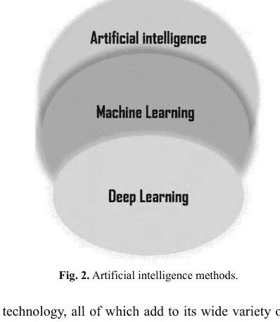

图2. 人工智能方法。

- 1）弱人工智能/窄人工智能：针对特定目标而创建和开发。其方法、图像识别软件和诸如Siri之类的数字助手均属于其应用范畴。
- 2）通用人工智能（强人工智能）：具有类似人类理解力、学习能力和多种任务应用能力的概念性人工智能。
- 3）超人工智能：超越人类能力水平的智能。目前这仍是理论性的，并且是专家们推测和争论的话题。

既然我们对AI有了全面的认识，能够根据其工作模式来理解其特性，那么在运行以下所述过程时，其各个方面的特性在选择特定算法方面起着重要作用：

- a. 机器学习（ML）（Murphy，2012）：
  - 人工智能的一个领域，专注于创建使机器能够分析数据并从中做出决策或预测的算法。
  - 监督学习：涉及使用带标签的数据集训练模型，其中输入给出正确的输出。回归（例如识别垃圾邮件）和分类（例如预测房价）。
  - 无监督学习：涉及在无标签数据上训练模型。模型试图在输入数据中发现隐藏模式或内在结构。示例包括聚类（例如客户细分）和降维（例如PCA）。
  - 强化学习：专注于通过受欢迎的行为给予奖励来训练智能体做出序列决策。机器人控制和游戏（如AlphaGo）是其中的两个应用示例。


b. 深度学习（Murphy, 2012）：
- 机器学习的一个领域，应用多层深度神经网络。它在语音和图像识别等任务上表现出色。对于序列数据，使用循环神经网络（RNN）及其衍生模型（如LSTM），而对于图像数据则采用卷积神经网络（CNN）。

c. 自然语言处理（NLP）：
- 涉及人类（自然）语言与计算机之间的交流。文本摘要、情感分析和机器翻译是重要任务。借助GPT（生成式预训练Transformer）和BERT（来自Transformer的双向编码器表示）等模型，NLP技术已取得显著进展。

d. 计算机视觉：
- 使机器人能够理解和解读视觉环境。其中的任务包括图像分割、人脸识别和物体识别。计算机视觉高度依赖生成对抗网络（GAN）和CNN等技术。

e. 机器人学：
- 结合机械工程和人工智能，创建能够完全或部分自主运行的机器人。机器人应用包括手术机器人、个人助理和工业自动化。

f. 专家系统：
- 模拟人类专家决策过程的人工智能（AI）系统。它们通过利用推理引擎和人类经验知识库来处理特定问题，通常用于银行、医疗和客户服务等行业。

## AI在各领域的应用

### i. 医疗保健
- 诊断：AI系统能够分析医学影像（如MRI和X光片），及早识别癌症等疾病。
- 个性化治疗：AI可以根据个体患者数据定制治疗方案，从而实现更有效的护理。
- 药物发现：AI通过预测各种组分的行为来改进新药的搜寻。

### ii. 金融
- 欺诈检测：人工智能算法可以识别异常趋势并突出可能的欺诈交易。
- 算法交易：人工智能系统可以比人类更快地分析海量数据并做出交易决策。
- 个人财务管理：由AI驱动的应用程序可以通过分析支出习惯并建议储蓄策略，帮助个人管理财务。

### iii. 零售
- **客户服务**：由人工智能（AI）驱动的聊天机器人可以处理客户的问题、处理请求并提供产品推荐。
- **库存管理**：AI可以预测产品需求，帮助零售商管理库存水平。
- **个性化**：AI利用消费者数据分析提供定制化营销活动和个性化购物体验。

### iv. 交通运输
- **自动驾驶车辆**：AI是使自动驾驶汽车能够导航并对其周围环境做出反应的基础技术。
- **交通管理**：AI系统可以优化城市交通流量，从而减少拥堵并提高安全性。
- **物流**：AI通过预测需求和优化配送路线来提高供应链流程的效率。

### v. 教育
- **个性化学习**：AI能够根据每个学生的需求调整课程材料，从而创造更高效的学习环境。
- **行政任务**：AI可以处理排课和评分，使教师能够专注于教学。
- **辅导系统**：由人工智能驱动的辅导程序可在课堂之外为学习者提供额外帮助。

### vi. 娱乐
- **内容创作**：AI可以创作文字、艺术和音乐，从而产生新的娱乐类型。
- **推荐系统**：Netflix和Spotify等网站上的推荐引擎由AI算法驱动，帮助用户发现新内容。
- **游戏**：AI通过创造更逼真、更具适应性的非玩家角色（NPC）来增强游戏体验。

### vii. 制造业
- **预测性维护**：AI技术能够识别机器可能磨损的时间，从而实现快速维护并最大限度地减少停机时间。
- **质量控制**：在检测产品缺陷方面，AI比人工检查人员更有效。
- **自动化**：由AI驱动的机器人和机械可以执行重复性任务，提高效率并降低人工成本。

## AI技术在变革废水处理工艺方面的潜力

考虑到全球对可持续系统和清洁水的需求日益增长，物联网（IoT）可以改变传统方法，并解决废水处理和水质预测领域的紧迫问题。这篇内容广泛的文章详细探讨了智能物联网技术（如机器学习（ML）和人工智能（AI）模型）的颠覆性用途。其中一个例子是成功应用了基于物联网（IoT）的自动化水质监测系统，该系统利用云计算和机器学习技术来有效处理上述问题。物联网（IoT）已被用于模拟、自动化和优化多种过程，包括废水处理应用、水相关农业技术（如水培和水产养殖），以及自然系统的监测和管理（Alprol et al., 2024）。

水是人类和工业过程的命脉，但目前正受到来自自然和人为过程的有害污染物的严重威胁。在全球范围内，获得清洁健康的饮用水是一个重大问题。因此，对水质进行分类和监测势在必行；根本问题在于，鉴于现有技术能力，尚无合适的参数化质量指标可用（Ray et al., 2023）。由于人口的增长，水生系统（水产养殖、鱼菜共生和水培）的活动有所增加。这导致排入水体的营养负荷增加，主要是氮和磷，对许多水生栖息地造成了损害。因此，必须采用尖端技术，以可持续的方式开发和加强水产养殖废水的处理（Shen et al., 2023; Yadav et al., 2023）。

机器学习（ML）侧重于能够根据训练阶段提供的新信息调整其行为的智能系统，而人工智能（AI）则使算法能够执行通常需要人类知识的活动和得出结论（Krittanawong et al., 2018）。人工智能（AI）背后的理念是允许算法执行通常需要人类智慧的操作并得出结论。Simopoulos等人（2018）指出，机器学习（ML）专注于智能系统，这些系统可以根据训练阶段提供的新信息修改其行为。AI和ML增强和简化知识的能力，是推动其在各领域和行业学术群体中被接受的主要因素（图3）。这包括研究自然系统，如河流水质建模、吸附过程、膜过滤建模、水处理（包括混凝和加氯消毒），以及农业系统健康。根据早期研究，机器学习（ML）可以成为解决各领域问题的有用策略（Suquet et al., 2020）。

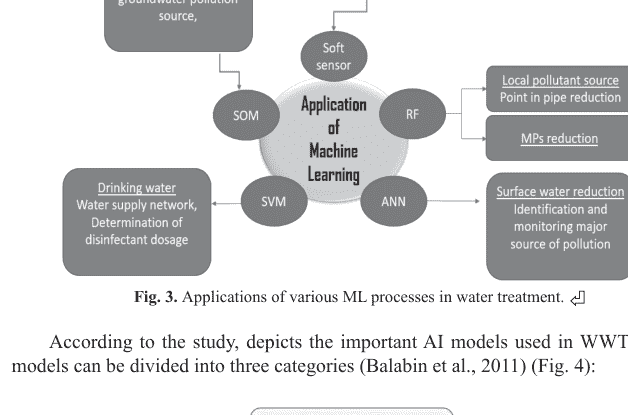

图3. 各种机器学习过程在水处理中的应用。

根据该研究，图4展示了用于废水处理（WWT）的重要AI模型。这些模型可分为三类（Balabin et al., 2011）（图4）：

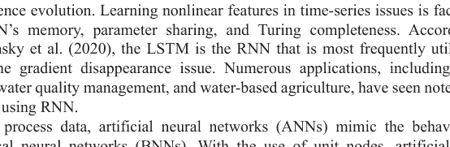

图4. 用于废水处理的AI模型。

RNN是一种神经网络（NN），以序列数据作为输入，沿序列演化方向迭代。RNN的记忆性、参数共享和图灵完备性有助于学习时间序列问题中的非线性特征。据Sherstinsky等人（2020）所述，LSTM是解决梯度消失问题最常用的RNN。RNN在水、污水处理（WWT）、水质管理和水基农业等众多应用中已取得了显著成功。

为了处理数据，人工神经网络（ANN）模仿生物神经网络（BNN）的行为。人工神经网络（ANN）利用单元节点模仿神经元，并通过改变网络内不同节点之间的连接权重来处理信息。ANN通常由输入层、输出层以及位于两者之间的若干隐藏层组成。ANN使用多种激活函数（如sigmoid、tanh和ReLU函数）以及神经元间的众多可变权重来执行复杂的非线性计算。通过增加ANN中的隐藏层数量，可以提高ANN的表达能力，并创建更复杂的非线性模型（Basheer et al., 2000）。通过创建和优化损失函数，人工


人工神经网络（ANNs）可以被训练以理解输入与输出之间复杂的非线性相互作用。最广泛使用的人工神经网络（ANN）模型包括循环神经网络（RNNs）、卷积神经网络（CNNs）、模糊神经网络（FNNs）和深度神经网络（DNNs）（Ding 等，2013）。

FNN 是一种混合神经网络模型，将 ANN 与模糊逻辑相结合，以处理模糊或不确定的情形。FNN 在利用模糊逻辑推理处理输入数据后，使用 ANN 进行训练并生成输出。尽管模糊逻辑用于建立输入与输出之间的模糊关系以及神经元之间的连接权重（归一化、模糊推理和隶属函数），但 FNN 的拓扑结构与传统神经网络相似。FNN 架构由输入层、隶属函数层、模糊推理层、归一化层和输出层组成。在处理困难情况时，FNN 相比普通 NN 具有诸多优势，并被广泛应用于模式识别和控制（Mahesh 等，2020）。

DNN 是一种 ANN 类型，在输入层和输出层之间包含多个隐藏层。通过逐层组合低层特征来学习高层特征，DNN 的深层架构使其能够学习分层次的数据表示。与其他神经网络一样，DNN 可以包含更多神经元和隐藏层。它们常用于学习输入到输出的高度非线性映射，或捕获数据中的复杂模式。然而，由于网络设计复杂且需要大量数据进行训练，DNN 的训练可能困难且计算成本高昂（Yadav 等，2020）。

CNN 是一种深度学习技术，其两个组成部分是卷积计算和深层结构的前馈神经网络。自然语言处理、计算机视觉等领域都广泛使用 CNN。CNN 使用全连接层进行分类或回归任务，使用池化层降低特征维度，并使用卷积层从输入图像中提取复杂特征（Alzubaidi 等，2021）。输入层、输出层、卷积层、池化层和全连接层是 CNN 设计中的常见组成部分。

## 使用人工智能优化处理流程

了解污水处理对于进一步改进工艺至关重要。来自商业、工业和市政来源的废水在排放到天然水体之前，必须先经过处理（WWT），以去除碳质污染物（如有机碳化合物）和营养物质（如磷和氮类物质）（Russell，2019）。碳质污染物会降低河流和湖泊等地表水体中的溶解氧含量，从而危害生态系统（Jin 等，2014）。地表水中营养物质引起的富营养化和藻华产生，使水生生物面临风险（Elsayed 等，2023a；Yaqub 等，2020）。污水处理设施（WWTP）在废水被排放到河流或其他水体用于回收利用（如再生水或农业用水）之前，对从城市、家庭、公司和其他来源收集的废水进行过滤（Corominas 等，2018）。水厂是复杂的系统，使用尖端网络技术解决运营问题。在污水处理厂（尤其是在人口稠密地区）中，常常使用大型连通隧道来储存生活污水和降水相关的水流以便处理（Owolabi 等，2022）。污水处理厂必须迅速决定如何从隧道中泵送储存的废水，因为隧道中的废水不能超过可接受水位，否则可能导致未经处理的水溢出（Corominas 等，2018；Schutze 等，2002）或过量使用化学品。因此，计算时间是一个关键问题（Schütze 等，2002）。

## 面向污水处理过程增强与高效产出的AI驱动优化技术概述

随着人工智能（AI）和机器学习（ML）等其他智能方法在膜应用中的出现，环境工程挑战已得到显著改善。在整个过程中，表面污染是一个特别值得关注的问题。当前的建模方法包括遗传编程、人工神经网络（ANNs）、模糊逻辑（FL）和模型树，这些方法在世界许多地方得到有效应用（Bagheri 等，2019）。人工智能（AI）研究不断将新的技术思想和可能性付诸实践。高效率和“更绿色”的方法是对任何新技术最常见的两项当代要求。基于 AI 的技术是一种很有前景且可接受的技术，可用于现代化和增强现有基于膜的设施（如海水淡化或水处理装置），以实现更好的资源和能源管理。在考虑成熟技术和设备时，它也具有类似的相关性。然而，尽管与任何基于膜的过程没有直接联系，贝叶斯模型平均（BMA）提供了一种贝叶斯概率模型，有助于理解不确定性如何从不同输入数据源传播。这与 PCA 不同，PCA 主要通过使用主成分来改变数据，偶尔会忽略其他成分。

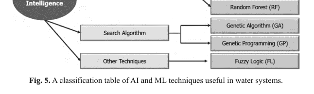

图5. 适用于水系统的人工智能和机器学习技术分类表。

## 研究与创新

在人工智能驱动的污水处理领域，研究和创新潜力巨大。机器学习算法的进步，尤其是在处理复杂非线性数据方面的进步，可以带来更准确、更高效的处理工艺。传感器技术和物联网的创新可以增强数据收集，为训练 AI 模型提供丰富的数据集。学术机构、行业和政府机构之间的合作研究计划可以推动开发专门针对污水处理的 AI 新应用。

跨部门合作对于克服 AI 应用的障碍至关重要。技术公司与污水处理设施之间的伙伴关系可以促进知识和专业技能的转移。协作努力还有助于制定标准化的数据收集和处理协议，确保 AI 模型在一致且高质量的数据上进行训练。此外，与监管机构的合作有助于营造支持性的监管环境，在鼓励创新的同时确保安全性和合规性。

#### 结论

人工智能技术为彻底变革污水处理工艺带来了巨大前景。尽管存在挑战，但创新、研究和合作的机会非常广阔。AI 的集成可以带来更高效、更可靠、更可持续的污水处理系统，将废物转化为宝贵资源，为更清洁、更健康的环境铺平道路。随着该领域的不断发展，持续的研究和跨部门合作将是释放 AI 在污水处理领域全部潜力的关键。

## 未来方向

展望未来，人工智能在污水处理领域的前景十分广阔。AI 有潜力将污水处理转变为资源回收过程，将废料高效转化为有价值的资源。新兴趋势，例如 AI 与区块链技术相结合以实现安全透明的数据管理，以及使用 AI 驱动的预测性维护系统来优化处理厂绩效，都是值得探索的领域。AI 及相关技术的持续进步可能会带来更可持续、更具成本效益的污水处理解决方案，最终为环境保护和公共卫生做出贡献。

### 参考文献

Afonne, O.J. 和 Ifediba, E.C. 2020. 植物食品中的重金属风险——需要加强预防措施. Current Opinion in Toxicology, 22: 1–6.
Alprol, A.E., Mansour, A.T., Ibrahim, M.E.E.D. 和 Ashour, M. 2024. 人工智能技术革新污水处理：当前趋势与未来展望. Water, 16(2): 314.
Alzubaidi, L., Zhang, J., Humaidi, A.J., Al-Dujaili, A., Duan, Y., Al-Shamma, O., Santamaria, J., Fadhel, M.A. 和 Al-Amidie, M. 2021. 深度学习综述：概念、CNN架构、挑战、应用和未来方向. Journal of Big Data, 8: 1–74.


Anjaneyulu, Y., Sreedhara Chary, N. and Samuel Suman Raj, D. 2005. 工业废水脱色——可用方法与新兴技术综述。 *环境科学与生物技术评论*, 4: 245–273.

Bagheri, M., Akbari, A. and Mirbagheri, S.A. 2019. 利用人工智能和机器学习技术对过滤系统中膜污染进行先进控制：批判性综述。 *过程安全与环境保护*, 123: 229–252.

Baker, L.A. 1992. 美国非点源污染介绍及湿地利用前景。 *生态工程*, 1(1-2): 1–26.

Balabin, R.M. and Lomakina, E.I. 2011. 支持向量机回归（SVR/LS-SVM）——分析化学中神经网络（ANN）的替代方法？近红外（NIR）光谱数据上非线性方法的比较。 *分析师*, 136: 1703–1712.

Basheer, I.A. and Hajmeer, M. 2000. 人工神经网络：基础、计算、设计与应用。 *微生物学方法杂志*, 43: 3–31.

Corominas, L., Garrido-Baserba, M., Villez, K., Olsson, G., Cortés, U. and Poch, M. 2018. 将数据转化为知识以改善废水处理运行：技术批判性综述。 *环境建模与软件*, 106(Aug): 89–103.

Cox, M., Négre, P. and Yurramendi, L. 2007. 工业液体废水。 *INASMET Tecnalia, San Sebastian*, 283.

Crini, G. and Badot, P.M. 2007. 污染工业水体的处理与净化。 *PUFC, Besançon*, 353 p (法语).

Crini, G. and Badot, P.M. (eds.). 2010. 吸附过程与污染。 *PUFC, Besançon*, 489 p.

Crini, G. and Badot, P.M. (eds.). 2010. *吸附过程与污染：常规与非常规吸附剂去除废水中污染物*. Presses Univ. Franche-Comté.

Crini, G. and Lichtfouse, E. 2018. 废水处理：概述。 *用于污染物去除的绿色吸附剂：基础与设计*, 1–21.

Davies, P.S. 2005. 废水处理的生物学基础。 *Strathkelvin Instruments Ltd.*, 3.

Deblonde, T., Cossu-Leguille, C. and Hartemann, P. 2011. 废水中的新兴污染物：文献综述。 *国际卫生与环境健康杂志*, 214(6): 442–448.

Ding, S., Li, H., Su, C., Yu, J. and Jin, F. 2013. 进化人工神经网络：综述。 *人工智能评论*, 39: 251–260.

Druart, C., Morin-Crini, N., Crini, G. and Lichtfouse, E. 2018. 废水处理：概述。 *用于污染物去除的绿色吸附剂：基础与设计*, 1–21.

Ejder-Korucu, M., Gürses, A., Doğar, Ç., Sharma, S.K. and Acikiyildiz, M. 2015. 从工业废水中去除有机染料：物理与生物技术应用概述。 *废水脱色绿色化学：研究趋势与应用*, 1–34.

Elsayed, A., Hurdle, M. and Kim, Y. 2021. 综合模型应用以更好地理解中试规模膜曝气生物膜反应器性能。 *水处理工程杂志*, 40(January): 101894.

Euvrard, E. and Crini, G. 2016. 金属[content]
Anjaneyulu, Y., Sreedhara Chary, N. and Samuel Suman Raj, D. 2005. 工业废水脱色——可用方法与新兴技术综述。 *环境科学与生物技术评论*, 4: 245–273.

Bagheri, M., Akbari, A. and Mirbagheri, S.A. 2019. 利用人工智能和机器学习技术对过滤系统中膜污染进行先进控制：批判性综述。 *过程安全与环境保护*, 123: 229–252.

Baker, L.A. 1992. 美国非点源污染介绍及湿地利用前景。 *生态工程*, 1(1-2): 1–26.

Balabin, R.M. and Lomakina, E.I. 2011. 支持向量机回归（SVR/LS-SVM）——分析化学中神经网络（ANN）的替代方法？近红外（NIR）光谱数据上非线性方法的比较。 *分析师*, 136: 1703–1712.

Basheer, I.A. and Hajmeer, M. 2000. 人工神经网络：基础、计算、设计与应用。 *微生物学方法杂志*, 43: 3–31.

Corominas, L., Garrido-Baserba, M., Villez, K., Olsson, G., Cortés, U. and Poch, M. 2018. 将数据转化为知识以改善废水处理运行：技术批判性综述。 *环境建模与软件*, 106(Aug): 89–103.

Cox, M., Négre, P. and Yurramendi, L. 2007. 工业液体废水。 *INASMET Tecnalia, San Sebastian*, 283.

Crini, G. and Badot, P.M. 2007. 污染工业水体的处理与净化。 *PUFC, Besançon*, 353 p (法语).

Crini, G. and Badot, P.M. (eds.). 2010. 吸附过程与污染。 *PUFC, Besançon*, 489 p.

Crini, G. and Badot, P.M. (eds.). 2010. *吸附过程与污染：常规与非常规吸附剂去除废水中污染物*. Presses Univ. Franche-Comté.

Crini, G. and Lichtfouse, E. 2018. 废水处理：概述。 *用于污染物去除的绿色吸附剂：基础与设计*, 1–21.

Davies, P.S. 2005. 废水处理的生物学基础。 *Strathkelvin Instruments Ltd.*, 3.

Deblonde, T., Cossu-Leguille, C. and Hartemann, P. 2011. 废水中的新兴污染物：文献综述。 *国际卫生与环境健康杂志*, 214(6): 442–448.

Ding, S., Li, H., Su, C., Yu, J. and Jin, F. 2013. 进化人工神经网络：综述。 *人工智能评论*, 39: 251–260.

Druart, C., Morin-Crini, N., Crini, G. and Lichtfouse, E. 2018. 废水处理：概述。 *用于污染物去除的绿色吸附剂：基础与设计*, 1–21.

Ejder-Korucu, M., Gürses, A., Doğar, Ç., Sharma, S.K. and Acikiyildiz, M. 2015. 从工业废水中去除有机染料：物理与生物技术应用概述。 *废水脱色绿色化学：研究趋势与应用*, 1–34.

Elsayed, A., Hurdle, M. and Kim, Y. 2021. 综合模型应用以更好地理解中试规模膜曝气生物膜反应器性能。 *水处理工程杂志*, 40(January): 101894.

Euvrard, E. and Crini, G. 2016. 金属[content]
Anjaneyulu, Y., Sreedhara Chary, N. and Samuel Suman Raj, D. 2005. 工业废水脱色——可用方法与新兴技术综述。 *环境科学与生物技术评论*, 4: 245–273.

Bagheri, M., Akbari, A. and Mirbagheri, S.A. 2019. 利用人工智能和机器学习技术对过滤系统中膜污染进行先进控制：批判性综述。 *过程安全与环境保护*, 123: 229–252.

Baker, L.A. 1992. 美国非点源污染介绍及湿地利用前景。 *生态工程*, 1(1-2): 1–26.

Balabin, R.M. and Lomakina, E.I. 2011. 支持向量机回归（SVR/LS-SVM）——分析化学中神经网络（ANN）的替代方法？近红外（NIR）光谱数据上非线性方法的比较。 *分析师*, 136: 1703–1712.

Basheer, I.A. and Hajmeer, M. 2000. 人工神经网络：基础、计算、设计与应用。 *微生物学方法杂志*, 43: 3–31.

Corominas, L., Garrido-Baserba, M., Villez, K., Olsson, G., Cortés, U. and Poch, M. 2018. 将数据转化为知识以改善废水处理运行：技术批判性综述。 *环境建模与软件*, 106(Aug): 89–103.

Cox, M., Négre, P. and Yurramendi, L. 2007. 工业液体废水。 *INASMET Tecnalia, San Sebastian*, 283.

Crini, G. and Badot, P.M. 2007. 污染工业水体的处理与净化。 *PUFC, Besançon*, 353 p (法语).

Crini, G. and Badot, P.M. (eds.). 2010. 吸附过程与污染。 *PUFC, Besançon*, 489 p.

Crini, G. and Badot, P.M. (eds.). 2010. *吸附过程与污染：常规与非常规吸附剂去除废水中污染物*. Presses Univ. Franche-Comté.

Crini, G. and Lichtfouse, E. 2018. 废水处理：概述。 *用于污染物去除的绿色吸附剂：基础与设计*, 1–21.

Davies, P.S. 2005. 废水处理的生物学基础。 *Strathkelvin Instruments Ltd.*, 3.

Deblonde, T., Cossu-Leguille, C. and Hartemann, P. 2011. 废水中的新兴污染物：文献综述。 *国际卫生与环境健康杂志*, 214(6): 442–448.

Ding, S., Li, H., Su, C., Yu, J. and Jin, F. 2013. 进化人工神经网络：综述。 *人工智能评论*, 39: 251–260.

Druart, C., Morin-Crini, N., Crini, G. and Lichtfouse, E. 2018. 废水处理：概述。 *用于污染物去除的绿色吸附剂：基础与设计*, 1–21.

Ejder-Korucu, M., Gürses, A., Doğar, Ç., Sharma, S.K. and Acikiyildiz, M. 2015. 从工业废水中去除有机染料：物理与生物技术应用概述。 *废水脱色绿色化学：研究趋势与应用*, 1–34.

Elsayed, A., Hurdle, M. and Kim, Y. 2021. 综合模型应用以更好地理解中试规模膜曝气生物膜反应器性能。 *水处理工程杂志*, 40(January): 101894.

Euvrard, E. and Crini, G. 2016. 金属[content]
Anjaneyulu, Y., Sreedhara Chary, N. and Samuel Suman Raj, D. 2005. 工业废水脱色——可用方法与新兴技术综述。 *环境科学与生物技术评论*, 4: 245–273.

Bagheri, M., Akbari, A. and Mirbagheri, S.A. 2019. 利用人工智能和机器学习技术对过滤系统中膜污染进行先进控制：批判性综述。 *过程安全与环境保护*, 123: 229–252.

Baker, L.A. 1992. 美国非点源污染介绍及湿地利用前景。 *生态工程*, 1(1-2): 1–26.

Balabin, R.M. and Lomakina, E.I. 2011. 支持向量机回归（SVR/LS-SVM）——分析化学中神经网络（ANN）的替代方法？近红外（NIR）光谱数据上非线性方法的比较。 *分析师*, 136: 1703–1712.

Basheer, I.A. and Hajmeer, M. 2000. 人工神经网络：基础、计算、设计与应用。 *微生物学方法杂志*, 43: 3–31.

Corominas, L., Garrido-Baserba, M., Villez, K., Olsson, G., Cortés, U. and Poch, M. 2018. 将数据转化为知识以改善废水处理运行：技术批判性综述。 *环境建模与软件*, 106(Aug): 89–103.

Cox, M., Négre, P. and Yurramendi, L. 2007. 工业液体废水。 *INASMET Tecnalia, San Sebastian*, 283.

Crini, G. and Badot, P.M. 2007. 污染工业水体的处理与净化。 *PUFC, Besançon*, 353 p (法语).

Crini, G. and Badot, P.M. (eds.). 2010. 吸附过程与污染。 *PUFC, Besançon*, 489 p.

Crini, G. and Badot, P.M. (eds.). 2010. *吸附过程与污染：常规与非常规吸附剂去除废水中污染物*. Presses Univ. Franche-Comté.

Crini, G. and Lichtfouse, E. 2018. 废水处理：概述。 *用于污染物去除的绿色吸附剂：基础与设计*, 1–21.

Davies, P.S. 2005. 废水处理的生物学基础。 *Strathkelvin Instruments Ltd.*, 3.

Deblonde, T., Cossu-Leguille, C. and Hartemann, P. 2011. 废水中的新兴污染物：文献综述。 *国际卫生与环境健康杂志*, 214(6): 442–448.

Ding, S., Li, H., Su, C., Yu, J. and Jin, F. 2013. 进化人工神经网络：综述。 *人工智能评论*, 39: 251–260.

Druart, C., Morin-Crini, N., Crini, G. and Lichtfouse, E. 2018. 废水处理：概述。 *用于污染物去除的绿色吸附剂：基础与设计*, 1–21.

Ejder-Korucu, M., Gürses, A., Doğar, Ç., Sharma, S.K. and Acikiyildiz, M. 2015. 从工业废水中去除有机染料：物理与生物技术应用概述。 *废水脱色绿色化学：研究趋势与应用*, 1–34.

Elsayed, A., Hurdle, M. and Kim, Y. 2021. 综合模型应用以更好地理解中试规模膜曝气生物膜反应器性能。 *水处理工程杂志*, 40(January): 101894.

Euvrard, E. and Crini, G. 2016. 金属表面处理厂排放水的化学和生态毒理学监测。 *环境过程*, 3: 59–72.

Farhan, L. 2021. 深度学习综述：概念、CNN架构、挑战、应用、未来方向。 *大数据杂志*, 8: 53.

Gaudio, M.T., Coppola, G., Zangari, L., Curcio, S., Greco, S. and Chakraborty, S. 2021. 基于人工智能的工业膜过程优化。 *地球系统与环境*, 5(2): 385–398.

Hou, H., Ren, A., Yu, L., Ma, Z., Zhang, Y. and Liu, Y. 2023. 中国杭州大口黑鲈养殖的环境影响评估。 *可持续性*, 15: 12368.

Huang, M.A., Yan, J. and Chen, X. 2015. 基于遗传算法神经模糊系统的废水处理过程建模与仿真传感器软件。 *应用软计算杂志*, 27: 1–10.

Jegatheesan, V., Visvanathan, C. and Ben Aim, R. 2004. 生物废水处理进展。 *生物资源技术简明百科全书*. Haworth Press, Inc.

Jin, L., Zhang, G. and Tian, H. 2014. 中国污水处理现状。 Water Res., 66: 85–98.

Karri, R.R., Ravindran, G. and Dehghani, M.H. 2021. 废水——来源、毒性及其对人类健康的影响。 In Soft Computing Techniques in Solid Waste and Wastewater Management (pp. 3–33). Elsevier.

Krittananowong, C. 2018. 人工智能的兴起与医生的不确定未来。 Eur. J. Intern. Med., 48: e13–e14.

Kulkarni, A., Yardimci, M., Kabir Sikder, M.N. and Batarseh, F.A. 2023. P2O：管理与保障废水处理厂的人工智能驱动框架。 Journal of Environmental Engineering, 149(9): 04023045.

Long, S., Zhao, L., Liu, H., Li, J., Zhou, X., Liu, Y. and Qiao, Z. 2019. 基于蒙特卡洛的综合模型优化中国典型综合工业园区废水处理过程的成本与污染减排。 *科学总环境*, 647: 1–10.

Loos, R., Carvalho, R., António, D.C., Comero, S., Locoro, G., Tavazzi, S., Paracchini, B., Ghiani, M., Lettieri, T., Blaha, L., Jarosova, B., Voorspoels, S., Servaes, K., Haglund, P., Fick, J., Lindberg, R.H., Schwesig, D. and Gawlik, B.M. 2013. 欧盟范围内废水处理厂排放水中新兴极性有机污染物的监测调查。 Water Res., 47: 6475–6487.

Mahesh, B. 2020. 机器学习算法综述。 Int. J. Sci. Res. (IJSR), 9: 381–386.

Mamais, D., Noutsopoulos, C., Dimopoulou, A., Stasinakis, A. and Lekkas, T.D. 2015. 废水处理过程对节能和温室气体排放的影响。 Water Sci. Technol., 71: 303–308.

Manasa, R.L. and Mehta, A. 2020. 废水：污染物来源及其修复。 Environmental Biotechnology, 2: 197–219.

Marcelino, K.R., Wongkiew, S., Shitanaka, T., Surendra, K., Song, B. and Khanal, S.K. 2023. 微纳米气泡曝气增强水培系统植物产量和硝化作用。 ACS EST Eng., 3: 2081–2096.

Mingzhi, H., Jinquan, W., Yongwen, M., Yan, W., Weijiang, L. and Xiaofei, S. 2009. 使用模糊神经网络的浸没式生物膜废水处理过程曝气控制规则。 Expert Syst. Appl., 36: 10428–10437.

Morin-Crini, N. and Crini, G. (eds.) 2017. 污染工业水体 (法语).

Oabi, T.A., Mohandes, S.R. and Zayed, T. 2022. 调查污水溢流对环境的影响：综合文献综述论文。 J. Environ. Manage., 301(Jan): 113810.

Rajacee, T., Ebrahimi, H. and Nourani, V. 2019. 地下水位建模中人工智能方法综述。 J. Hydrol., 572: 336–351.

Rathoure, A.K. (ed.). 2015. 利用生物修复进行毒性与废物管理。 IGI Global.

Ray, S.S., Verma, R.K., Singh, A., Ganesapillai, M. and Kwon, Y.-N. 2023. 人工智能如何重新定义水处理和海水淡化过程的整体综述。 Desalination, 546: 116221.

Russell, D.L. 2019. 实用废水处理。 John Wiley & Sons.

Russell, S.J. and Norvig, P. 2016. 人工智能：一种现代方法。 Pearson.

Schütze, M., Campisano, A., Colas, H., Schilling, W. and Vanrolleghem, P.A. 2002. 城市废水系统的实时控制——我们今天处于何种状态？ In Global Solutions for Urban Drainage, 1–17.

Shen, Y., Chen, C., Li, P., Huang, X. and Li, Y. 2023. 智能中试电化学系统在养殖海水回收中的应用。 Aquac. Int., 2023: 1–17.

Sherstinsky, A. 2020. 循环神经网络（RNN）和长短期记忆（LSTM）网络基础。 Phys. D Nonlinear Phenom., 404: 132306.

Simopoulou, M., Sfakianoudis, K., Mazioti, E., Antoniou, N., Rapani, A., Anifandis, G., Bakas, P., Bolaris, S., Pantou, A. and Pantos, K. 2018. 计算应用是体外受精实验室的“水晶球”吗？从数学到人工智能的演变。 J. Assist. Reprod. Genet., 35: 1545–1557.


Sonune, A. and Ghate, R. 2004. 废水处理方法的发展。 *Desalination*, 167: 55–63.

Suquet, J., Godo-Pla, L., Valentí, M., Verdaguer, M., Martin, M.J., Poch, M. and Monclús, H. 2020. 饮用水生产中强化混凝的环境决策支持系统的开发。 *Water*, 12: 2115.

Yadav, A., Noori, M.T., Biswas, A. and Min, B. 2023. 基于物联网（IoT）的智能水产养殖实践最新进展的简明综述。 *Rev. Fish. Sci. Aquac.*, 31: 103–118.

Yadav, B., Gupta, P.K., Patidar, N. and Himanshu, S.K. 2020. 印度城市地区地下水位预测的集成建模框架。 *Sci. Total Environ.*, 712: 135539.

Wan, J., Huang, M., Ma, Y., Guo, W., Wang, Y., Zhang, H., Li, W. and Sun, X. 2011. 使用基于自适应网络的模糊推理系统预测造纸厂废水处理的出水水质。 *Appl. Soft Comput. J.*, 11: 3238–3246.

## 第16章：人工智能和计算机视觉的土壤湿度评估

Manimaran G.¹, Avinash K.¹, Mageshen V.R.²*, Kamalesh Kanna S.³ and Aswitha K.⁴

## 引言

土壤湿度（SM）对生态过程和生态系统服务至关重要，影响水文循环、气候调节、养分供应和初级生产力（Anagnostopoulos et al., 2017）。它显著影响陆地蒸散发，这一过程连接着水、能量和碳循环（Green et al., 2019; Padrón et al., 2020）。在农业中，适宜的土壤湿度对实现最大作物产量至关重要，使得准确的SM数据对于有效的水资源管理以防止干旱和水体停滞至关重要（Li et al., 2021; Liu et al., 2019）。SM对于洪水预测等水文应用也至关重要，因为饱和土壤会增加洪水风险（Kim et al., 2019）。在林业中，它支持树木生长、森林健康和火灾风险管理（Krueger et al., 2022）。此外，SM是气候模型不可或缺的一部分，通过其与大气条件的相互作用影响天气预报、气候预测和气候变化（Koster et al., 2010）。因此，鉴于其多样且重要的作用，精确且可行的土壤湿度评估方法至关重要。

¹ 土壤科学与农业化学系，泰米尔纳德农业大学，Coimbatore 641003，泰米尔纳德邦，印度。
² 阿姆利塔农业科学学院，Arasampalayam，Coimbatore-642 109，泰米尔纳德邦，印度。
³ 遥感与地理信息系统系，泰米尔纳德农业大学，Coimbatore 641003，泰米尔纳德邦，印度。
⁴ 土壤科学系，JKK Munirajah 农业科学学院，Erode-638 506，泰米尔纳德邦，印度。
\* 通讯作者：mageshsmart2@gmail.com

传统土壤湿度评估方法如重力法、中子探针和张力计虽然准确，但存在明显局限性。重力法虽然精确，但劳动强度大、耗时长，仅提供点状测量。中子探针成本高，涉及放射性源，需要谨慎操作，而张力计需要定期维护，且仅在特定湿度水平下有效。这些局限性——高成本、劳动密集和空间覆盖有限——阻碍了其在大规模或实时评估中的应用（Ochsner et al., 2013）。因此，遥感系统已被开发，显著改善了土壤湿度预测（Wang and Qu, 2009）。遥感技术的进步现在能够利用光学、热红外（TIR）和微波观测监测时空序列土壤湿度。结合卫星光学/TIR或光学/微波数据的新的方法和算法增强了土壤湿度反演。然而，TIR和被动微波观测虽然适用于区域和全球尺度，但在详细农业应用中的空间和时间分辨率存在局限。

深度学习和先进机器学习技术的整合彻底改变了土壤参数的反演，超越了传统模型。这些现代方法擅长模拟土壤湿度估计中固有的复杂非线性关系。例如，与传统技术相比，深度学习方法如无监督自训练方法（USTM）利用各种指数和实地数据在估计SM方面表现出更高的精度和准确性（Sedighi et al., 2024）。机器学习算法现在在SM估计研究中发挥关键作用，有效模拟模式并从科学数据中提取见解。它们 adeptly 处理SM关系的非线性和复杂性，并用于尺度转换过程，如填补空白、下采样和上采样，增强SM产品的空间完整性和分辨率。

AI和计算机视觉技术通过分析来自各种传感器的视觉数据，包括RGB、多光谱和热成像相机，以高精度和非侵入方式进一步推进SM评估（Zhang et al., 2024）。将AI和计算机视觉整合到SM评估中支持精准农业和日常管理实践，通过实现特定地点的管理并优化资源利用以提高农业生产力。这些技术为土壤中的水分运动提供更深入的见解，为水资源管理和生态系统保护战略提供信息。AI和计算机视觉弥合了点测量与遥感之间的差距，提供关于SM空间和时间变异性的重要信息，这对于做出明智决策以维持水资源、确保粮食安全和实施生态系统保护战略至关重要。

整合AI和计算机视觉的好处众多。AI算法可以处理来自各种传感器的海量数据，提高SM测量的准确性并实现实时监测。这些技术在不扰动土壤的情况下评估SM，保护生态系统完整性，可应用于大面积农田，提供全面的SM数据，为灌溉实践和作物管理提供信息。通过自动化数据收集和分析，AI和计算机视觉减少了对昂贵且劳动密集的传统方法的需要。AI驱动的SM数据可无缝整合到精准农业系统中，优化用水并提高作物产量。此外，准确的SM数据支持气候模型和天气预报，有助于农业和林业的气候适应战略。这些技术为SM动态提供有价值的见解，支持可持续农业、林业和生态系统管理。利用AI和计算机视觉可以在气候变化条件下做出明智决策，以优化水资源、确保粮食安全和保护生态系统。有了这一背景，我们将深入探讨各种机器学习技术，包括其分类、潜在关系、用于土壤湿度（SM）评估的先进深度学习方法及其与SM产品的进一步应用。

## 机器学习

### 土壤湿度预测的监督学习技术

监督学习是土壤湿度预测方法学中的核心要素，涉及在带标签的无噪声数据集上训练预测模型（Karthikeyan et al., 2020）。如前所述的监督学习技术中，训练使用输入特征——温度、湿度、土壤类型和遥感——进行，分离指数并进一步对目标变量进行测试，换句话说，对每个输入数据点的土壤湿度进行测试。该过程的最后一步是对数据集进行训练，以便模型学习；即土壤湿度结果。实施监督学习进行土壤湿度预测的过程有多个关键步骤（图 1）。监督学习技术为基于标签数据集的土壤湿度预测提供了强大的工具，使模型能够有效地预测与大量输入特征相关的土壤湿度水平。一些常用的算法（图 2），如决策树、随机森林和SVM，生成稳健且高度可解释的预测，这对于农业实践、水资源和环境保护方法方面的适当管理非常有用。

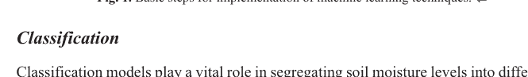

图 1. 机器学习技术实施的基本步骤。

### 分类

分类模型在将土壤湿度水平划分为干、湿润或湿等不同类别中发挥着重要作用。模型被证明在为实际决策分类土壤条件方面有效，通常不适合预测土壤湿度的精确数值。通过将连续土壤湿度数据分类为有意义的类别，分类模型提供了更可操作的信息，尤其是在农业中，需要密切监测某些湿度阈值以进行灌溉和作物管理。


## 决策树

决策树是最简单且最常用的用于土壤湿度预测的有监督学习算法。决策树的基本架构依赖于根据输入特征的值将输入数据分割成多个组，从而形成具有决策规则的树状模型（图 3）。在每个树节点处，都会对某个特征做出决策，并根据该决策考虑下一个树分支，直到到达叶节点，在该节点中需要预测土壤湿度水平（Pekel, 2020）。使用决策树的一个关键优势是其简单性和可解释性。决策树是了解模型如何得出预测结果的一种很好的说明方式。这使得它们非常

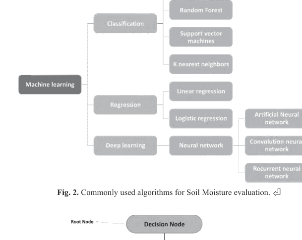

图 2. 土壤湿度评估常用算法。

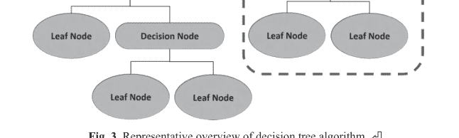

图 3. 决策树算法代表性概述。

非常适合于我们试图解释其决策背后的原因的情况。然而，使用决策树的一个缺点是其可能过拟合训练数据。即模型变得过于复杂，无法很好地推广到新的、未见过的数据。尽管存在一些缺点，决策树在土壤湿度预测中经常与有助于避免训练集过拟合的方法结合使用，例如剪枝或集成方法（Choi et al., 2024）。

## 随机森林

随机森林可以被视为一种强大的集成学习技术，可解决单个决策树中通常存在的过拟合问题。通过结合多个决策树的智慧，随机森林构建了一个坚实且多功能的预测模型来估计土壤湿度。随机森林模型的关键概念是通过在树生成的不同阶段引入随机性来构建多个不相关的树（Breiman, 2001）。在训练阶段，随机森林中的每个决策树都使用训练数据的随机子集和输入特征的随机子集进行训练。这种随机性使每棵树能够捕捉底层数据分布的不同方面，从而降低了对训练数据中可能存在的某些子集过拟合的风险。自助法（有放回抽样）有助于进一步增加单个树的多样性，从而增强集成模型。

使用随机森林进行最终预测时，不同的树会汇总各个树的不同预测结果。这种集成方法专门解决了与单个高方差预测相关的问题，从而增强了模型对新数据的泛化能力（图 4）。此外，随机森林可以处理大量输入特征。这使它们非常适合土壤湿度预测，后者通常涉及复杂且高维的数据（Hengl et al., 2015）。随机森林相比其他

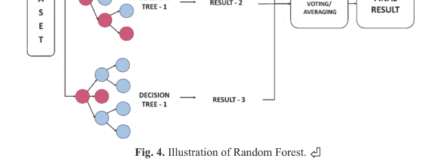

技术在土壤湿度预测方面具有若干优势。它们对噪声数据具有天然的容忍性，并且能够很好地捕捉输入特征与土壤湿度水平之间的非线性关系。在多样化的环境条件和地貌配置下，土壤湿度估计的可预测性和可靠性提高，是随机森林集成特性的另一个优势，这得益于从多棵树中学习到的集体知识。总体而言，随机森林是土壤湿度制图领域中的重要工具，与单树模型相比，它允许更高的准确性、可靠性和泛化能力。Gumiere 等人（2020）的研究表明，随机森林（RF）方法在预测土壤湿度方面超过了传统的物理模型，如 HYDRUS 2D，主要是因为其计算需求较低且实现更简单。

## 支持向量机（SVMs）

在众多有监督学习算法中，支持向量机（SVMs）是土壤湿度预测的一个重要候选。SVM 通过寻找最佳超平面来将数据分为不同类别，有效地根据温度、湿度、土壤类型和遥感指数等特征区分“干”、“湿润”和“湿”土壤（图 5）。它们通过使用核函数将输入数据转换到线性可分特征空间，在高维空间中表现出色，有助于线性和非线性分类任务（Adankon and Cheriet, 2009）。将有监督学习应用于土壤湿度预测涉及多个关键步骤，以实现准确可靠的模型（Karthikeyan et al., 2020）。最初收集包含输入特征和相应土壤湿度测量的标记数据集。数据预处理解决诸如缺失值、特征归一化以及将数据集划分为训练集和测试集等问题。特征选择方法，如特征重要性评分和相关性分析，可识别最相关的特征（Guyon and Elisseeff, 2003）。

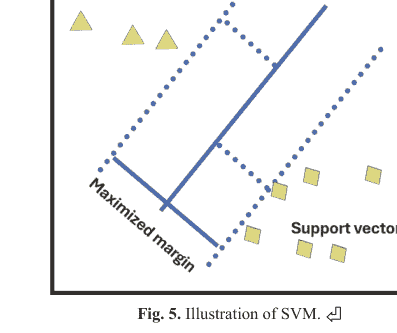

图 5. SVM 示意图。

然后使用训练数据集训练有监督学习算法，如决策树、随机森林或 SVM，以揭示特征与土壤湿度水平之间的关系。模型评估涉及使用诸如回归的 MSE 或分类的准确率、精确率和召回率等指标在测试集上估计性能，确保对新数据的泛化能力（Kumar et al., 2024）。超参数调优和优化技术，如交叉验证或网格搜索，进一步完善模型（Bergstra and Bengio, 2012）。训练、验证和优化后，模型可通过精准农业系统或环境监测平台应用于实际场景，以预测土壤湿度和改善管理决策。

## K 近邻

K 近邻（KNN）是一种简单而强大的用于分类土壤湿度水平的算法（Gounaridis et al., 2019）。它根据特征空间中其 k 个最近邻居的多数投票对数据点进行分类，使用欧几里得、曼哈顿或闵可夫斯基等距离度量（Nurdiwan et al., 2021; Ratih et al., 2021）。KNN 模型的输入特征通常包括温度、湿度、土壤类型以及 NDVI 等遥感指数等变量（Valavi et al., 2019）。

KNN 是一种非参数模型，意味着它不假设底层数据分布，使其在各种分类任务中具有灵活性（图 6）。这种灵活性对于土壤湿度分类是有利的，因为输入特征与湿度水平之间的关系可能复杂且非线性。尽管其简单且易于实现，但 KNN 的计算成本很高，尤其是在大型数据集上，因为需要计算所有数据点的距离。此外，KNN 的性能对 k 的选择和输入特征的缩放敏感。交叉验证可以帮助确定最佳 k，适当的特征缩放对于避免有偏分类是必要的。

KNN 有助于将田地分类为“干”、“湿润”或“湿”条件，帮助农民高效规划灌溉实践。核 K 近邻（KKNN）模型的集成已被用于以 100 米分辨率预测每日土壤表面湿度（SSM），与粗分辨率数据集相比，空间误差减少了 27%，时间预测性能也得到改善（Warner et al., 2021）。然而，这些模型在湿地地区准确估计 SSM 方面仍存在困难，凸显了在多样化地貌中更好地进行原位 SSM 监测的需求。

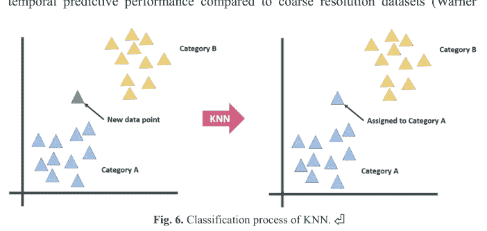

## 土壤湿度预测的回归模型

回归模型是根据不同输入特征预测连续土壤湿度水平的关键。它旨在确定自变量（如温度、湿度、土壤类型和遥感指数）与因变量（土壤湿度含量）之间观察到的任何关系。通过建模这些关系（图 7），回归技术允许对土壤湿度进行最佳量化，这在需要强有力数值预测的应用中很重要。

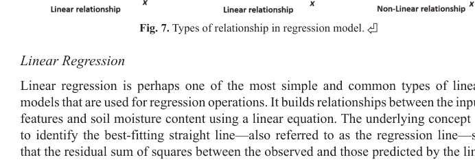

图 7. 回归模型中的关系类型。

### 线性回归

线性回归也许是最简单和最常见的用于回归操作的线性模型类型之一。它使用线性方程建立输入特征与土壤湿度含量之间的关系。其基本概念是确定最佳拟合直线——也称为回归线——以使观测值与该直线预测的土壤湿度值之间的残差平方和最小化。当输入特征与目标变量之间存在线性关系这一假设成立时，采用此方法。由于线性回归易于实现和解释，因此构成了土壤湿度预测的一种简单方法。然而，当数据中出现复杂、非线性关系时，其简单性可能成为缺点（Paul and Singh, 2021）。

多项式回归扩展了线性模型以解决线性回归的局限性；它引入了输入特征的多项式项。这使模型能够将多项式方程拟合到数据集中，从而能够捕捉可能更复杂的关系。例如，二次回归将具有输入特征的平方项，这将使模型能够处理数据的曲率。多项式回归在输入特征与土壤湿度之间的关系是非线性时特别有帮助。随着多项式次数的提高，模型可以调整复杂的模式，从而增强土壤湿度的可预测性。需要注意不要过拟合，因为这意味着

模型变得过于复杂，从而拟合了数据中的噪声而非潜在规律（Jung等，2017）。线性回归提供了最简单且最易解释的解决方案。另一方面，多项式回归以及梯度提升等集成方法增强了灵活性和捕捉高阶关系的能力。可以实现对含水量的精确数值预测，从而在环境和农业应用中做出更好的决策（Palominos-Rizzo等，2022）。

## 逻辑回归

逻辑回归因其概率方法而常用于土壤湿度分类。与线性回归不同，逻辑回归使用逻辑函数（sigmoid函数）计算输入属于特定类别的概率，将预测结果转换为0到1之间的概率。逻辑函数将回归输出转换为类别概率，使其具有可解释性。它通过迭代优化算法估计输入特征与目标变量对数几率之间的关系，将模型拟合到数据上。它可以处理二分类（例如“干燥”与“非干燥”）以及使用多项逻辑回归等扩展方法处理多分类，以预测多个类别（例如“干燥”、“湿润”、“潮湿”）的概率。逻辑回归的优势之一在于其可解释性。模型系数表明输入特征与类别概率之间关系的强度和方向，帮助分析人员了解哪些特征对于土壤湿度水平分类具有重要意义（De Figueiredo等，2021）。

然而，逻辑回归假设输入特征与目标变量的对数几率之间存在线性关系，这对于具有非线性关系的复杂数据集可能不成立。因此，它可能无法在复杂数据上表现良好。尽管如此，逻辑回归在农业中常用于土壤湿度分类，通过预测不同土壤湿度水平的概率，帮助土地管理者和农民进行灌溉调度和作物管理。它有助于解释影响土壤湿度的因素，从而制定更好的管理策略。

## 深度学习

### 神经网络

深度学习是机器学习的一个子集，包括处理大量高维数据以进行土壤湿度预测的神经网络（NN）（Shen，2018）。神经网络擅长发现传统机器学习模型经常遗漏的隐藏模式和关系（Rakshitkhajuria等，2018）。例如，前馈神经网络可以在多样化的输入特征上进行训练，以捕捉生成土壤湿度值的过程（Zhou等，2023）。受人类大脑启发，神经网络非常适合遥感中的深度学习任务（图8）。这些由多层组成的架构学习输入特征的分层表示，例如温度、湿度、土壤类型和遥感指数，以预测土壤湿度含量。深度学习的一个重要优势是其能够从原始数据中自动生成特征，捕捉微妙且非线性的相互作用。这在环境相互作用复杂的土壤科学中至关重要。

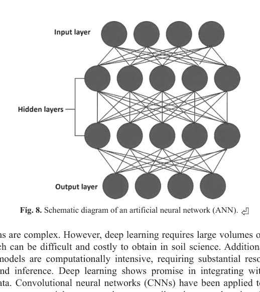

图8. 人工神经网络（ANN）示意图。

然而，深度学习需要大量标记数据，这在土壤科学中可能难以获得且成本高昂。此外，深度学习模型计算密集，需要大量资源进行训练和推理。深度学习在与遥感数据集成方面显示出巨大潜力。卷积神经网络（CNN）已应用于卫星图像，以提取与土壤湿度相关的空间模式，提高预测的空间分辨率和覆盖范围，从而实现大区域的综合监测。

研究人员正在开发新架构和混合模型，将深度学习与基于物理过程的模型相结合，以发挥各自的优势。收集和标注大规模土壤湿度数据集的工作正在进行中，以支持训练稳健的模型，捕捉土壤-植被-大气动态。总体而言，深度学习凭借其在大型数据集中发现隐藏关系的能力，在土壤湿度预测方面具有巨大潜力。神经网络和先进架构能够实现土壤水分动态的准确、高分辨率估算，为环境管理、有效农业实践以及进一步的研究和开发提供宝贵输入。

Hachani等（2019）使用Sentinel-1 SAR数据和人工神经网络（ANN），并结合数字高程模型、局部入射角和NDVI等辅助信息。他们将卫星测量数据与电磁模型模拟数据（基于IEM模型）相结合，以实现稳健、与位置无关的训练，获得了较高的相关性（R = 0.77，RMSE = 0.0184）。Li等（2020）发现，与传统物理模型相比，基本的三层前馈ANN可以以较低的计算成本和对先验条件的较少依赖来模拟和预测土壤湿度。ANN因其自主学习能力而在土壤湿度预测方面表现出色（Zhang，2023）。Hou等（2016）表明，使用气象数据进行的ANN预测与实际测量结果具有高度一致性。Li等（2018）使用带有大气强迫数据的自适应遗传ANN模型，显著改善了土壤湿度预测。

## 表1. 用于土壤湿度评估的传统机器学习模型。

| 模型 | 输入变量 | 时空范围 | 特征选择方法 | 指标 | 优点 | 参考文献 |
|---|---|---|---|---|---|---|
| OH模型、SVR、GRNN | Sentinel-1、Sentinel-2、双极化、海拔、LIA、MSAVI | 未指定 | 未指定 | RMSE：0.015，R：0.903 | 消除植被影响，提高精度 | Guo等（2022） |
| RF、ARIMA、StemGNN | 物联网数据 | 2年 | 未指定 | MAPE：0.052（ARIMA），0.127（StemGNN） | ARIMA优于现代深度学习技术 | Custódio Prati（2024） |
| SVM-EnKF | 降水、温度、相对湿度、净辐射、风速、PET | 湘江流域 | 滤波 | 相关性、RMSE、ubRMSE、偏差 | — | Zhu等（2020） |
| PLSR、KNN、RF | RGB、多光谱、热红外 | 中国内蒙古自治区鄂尔多斯 | 包装法 | R²、RMSE、rRMSE | — | Zhang（2023） |
| RF、SVM、ELM | 植被指数 | 中国陕西咸阳武功县 | 嵌入法 | R²、rRMSE、RMSE、MAE、GPI | — | Zhu等（2023） |
| 基于决策树的RF | 极化特征、植被覆盖度 | 冬小麦区域 | 最优极化特征组合 | RMSE：0.06 | 对不同植被覆盖度实现高精度土壤湿度反演 | Li等（2020） |
| 极端随机树 | MODIS植被指数、LST、土壤湿度数据 | 闪电河流域 | 短波红外变换反射率（STR） | RMSE：0.054，R：0.69 | 精度高于SVM和RF模型 | Cheng等（2021） |
| CIEM、Dubois模型 | 合成孔径雷达（SAR）数据 | 小麦生长季 | 极化分解 | CIEM：R²：0.534，RMSE：5.62 vol.%；Dubois：R²：0.634，RMSE：5.16 vol.% | 有效估算土壤含水量，减轻植被和地表粗糙度影响 | Chen等（2022） |

## 卷积神经网络（CNN）

卷积神经网络（CNN）是空间数据分析的强大工具，使其通过遥感图像进行土壤湿度评估时尤为有效（Chouhan等，2024）。CNN通过卷积和池化操作的层层堆叠，从输入图像中自动且自适应地学习空间特征层次，捕捉对土壤湿度估算等任务至关重要的空间模式和关系。

CNN擅长从遥感图像中识别和提取重要特征，例如与土壤湿度水平相关的植被指数（如NDVI）或土壤反射特性。通过多个卷积和池化层处理这些图像，CNN能够检测像素强度和空间排列的细微变化，捕捉与土壤湿度动态相关的关键空间信息。

CNN的一个显著优势是其执行图像分割的能力，即将图像划分为相关区域。这一能力使CNN能够生成详细地图，展示景观内土壤湿度的分布，帮助研究人员和土地管理者在农业、水文和环境管理方面做出决策。Li等（2020）提出了一种卷积神经网络（ICNN）方法，结合多极化雷达和多光谱数据来改善土壤湿度反演，获得了0.934的相关系数和0.0145的RMSE，而无需分别估算植被和土壤粗糙度。类似地，Roberts等（2022）使用带有GNSS反射测量的CNN来补充SMAP任务的土壤湿度数据，提高了空间分辨率和覆盖范围，并与SMAP值表现出强相关性。

## 循环神经网络

循环神经网络（RNN），特别是长短期记忆（LSTM）网络，已成为处理时间序列数据（包括随时间收集的土壤湿度读数）的强大工具。与忽略输入特征顺序的经典前馈神经网络不同，RNN旨在利用时间依赖性，使其成为土壤湿度数据等序列的理想选择。LSTM作为RNN的一种类型，擅长建模长距离依赖关系并长时间保留信息，这对于基于历史数据预测土壤湿度水平至关重要。

LSTM网络能够捕捉土壤湿度时间序列中固有的时间动态和季节性。它们可以识别昼夜变化、季节趋势和长期波动等模式，从而实现准确的未来土壤湿度预测。此外，LSTM对不规则采样间隔和缺失值具有鲁棒性，而这些在环境数据集中很常见，确保了其在复杂数据场景中的性能。LSTM网络涉及几个关键过程。它们处理序列数据，每个时间步对应数据中的一个特定点。LSTM使用记忆单元在长时间内存储信息，保持对土壤湿度预测至关重要的历史上下文（图9）。网络采用门控机制（输入门、遗忘门和输出门）来控制信息流，帮助其管理随时间变化的重要模式和关系。在训练过程中，LSTM网络


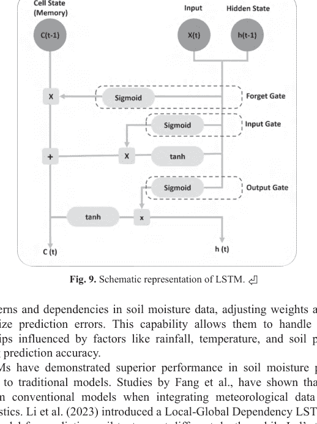

图 9. LSTM 的示意图。

学习土壤湿度数据中的模式和依赖关系，通过调整权重和偏置来最小化预测误差。这种能力使它们能够处理受降雨、温度和土壤特性等因素影响的非线性关系，从而提高预测精度。

LSTM 在土壤湿度预测中相比传统模型表现出更优的性能。Fang 等人的研究表明，在整合气象数据和土壤特征时，LSTM 超过传统模型。Li 等人（2023）引入了局部-全局依赖 LSTM（LGD-LSTM）模型用于预测不同深度的土壤质地，而 Lal 的团队使用时空序列聚类分析全球植被区土壤湿度模式。Datta 和 Faroughi（2023）开发了多头 LSTM 模型，整合不同尺度的土壤湿度数据以实现准确的月度预测。Li 的团队提出了带注意力机制的 LSTM 模型以提高预测精度，随后提出了基于注意力的卷积 LSTM 模型（AttConvLSTM）用于多步地表土壤湿度预测。Wang 等人（2024）比较了各种模型的预测能力和计算成本，注意到注意力机制在增强 LSTM 时间序列预测方面的有效性。

然而，LSTM 在预测土壤湿度等复杂时间序列时面临挑战，因其容易对非线性和多尺度特征过拟合或欠拟合。LSTM 最初设计用于预测单一未来时间点，可能难以进行长期数据分析和影响预测精度。Pan 等人指出，土壤湿度的记忆特征在不同尺度上变化，并影响数据驱动模型中的长期预测。温度、降雨和土壤结构等环境因素的动态特性表现出高度非线性和时间依赖性，进一步使传统 LSTM 模型的土壤湿度预测复杂化。

## 计算机视觉

计算机视觉技术通过从遥感影像中提取有意义的信息，在土壤湿度分析中发挥关键作用。这涉及用于图像数据获取、预处理和详细分析的一系列技术。利用卫星和无人机的数据，计算机视觉借助多光谱、高光谱和热成像来准确评估土壤湿度（Tang 等，2022）。土壤湿度估算的关键计算机视觉技术包括图像预处理（辐射和几何校正）、特征提取和基于机器学习的分类。这些方法改善图像质量并识别相关的空间和光谱土壤模式（Khan 等，2022）。支持向量机、随机森林和卷积神经网络等机器学习算法分析特征与土壤含水量之间的复杂关系，使用来自遥感影像的广泛光谱、空间和时间数据。通过用实地土壤湿度测量训练这些算法，研究人员可以为各种景观和时间尺度开发预测模型。这种能力使农业管理、水文研究和环境监测的土壤湿度估算更加准确（Brocca 等，2017）。最终，计算机视觉技术为提取土壤湿度动态的有价值信息提供全面的工具箱，有助于为水资源、土地利用规划和生态系统保护的决策提供信息。

## 未来展望

土壤湿度反演模型在过去几十年中显著进步，但仍有进一步提升的潜力。未来的改进应侧重于实现更高的空间和时间分辨率、延长时间序列监测、减少传输延迟、提高准确性以及改善模型性能和可解释性。

## 未来方向

土壤湿度反演模型的未来发展应侧重于多源数据匹配，通过整合光学和 SAR 遥感以提高精度，同时解决数据格式和分辨率差异并探索短波红外数据。提高空间和时间分辨率对于灌溉和干旱预测等应用至关重要，需要根系穿透的方法并提供每日或每小时数据。建立地面网络和发射更多卫星将实现低延迟的长期数据序列，并得到延长运行寿命的改进卫星材料支持。提高模型精度涉及改进经验、半经验和物理模型，增强机器学习可解释性，并整合物理和人工智能方法以开发需要最少辅助数据的模型。需要技术进步来实现更好的空间和时间分辨率、更长的监测、更短的延迟和更高的精度，通过卫星材料、观测网络和模型的创新。

## 表 2. 用于土壤湿度评估的神经网络模型。

| 模型/方法 | 输入变量 | 空间与时间数据 | 指标 | 优点 | 参考文献 |
|---|---|---|---|---|---|
| cGBSAR, BP 神经网络, AIEM-OH | 后向散射系数、雷达入射角 | 41°雷达入射角 | R: 0.8080, RMSE: 0.0385 | 通过雷达入射角选择提高精度 | Geng et al. (2021) |
| OH 模型, SVR, GRNN, CNNR | Sentinel-1, Sentinel-2, 极化分解特征 | 未指定 | R²: 0.8947, RMSE: 0.0208 cm³/cm³ | CNNR 模型精度最高 | Liu et al. (2021) |
| MLP | 来自无人机遥感的冠层植被指数 | 40 cm 深度 | R²: 0.7447 | 简化模型且精度稳健 | Deng et al. (2023) |
| CNN (SMNet) | 遥感、气象、地形数据 | 25 km 至 1 km 分辨率 | R: 0.82, RMSE: 0.052 m³/m³ | 在保持精度的同时提高空间分辨率 | Zhang et al. (2024) |
| DL-MME, DL-CNN | Sentinel-1, Sentinel-2 | 多样化农业区 | MAE: 0.01 m³/m³, RMSE: 0.036 m³/m³, R: 0.87 | 精度和可靠性更高 | Sedighi et al. (2024) |
| REDF-LSTM | 时间序列数据 | 未指定 | R² 提升 13.07%，RMSE 提升 20.98% | 卓越的预测能力 | Li et al. (2024) |
| LSTM, BiLSTM, DNN, DBN | 净辐射, RH, 气温, 风速, SWC | 异质表面 | MAPE: 16–50%, RMSE: 0.76 mm d⁻¹ | 利用 SWC 改善 ET 估算 | Feng et al. (2024) |
| CNN | 气候、土壤、地形、种植模式 | 中国 | R²: 0.91 |  | Liu et al. (2021) |

## 表 3. 卫星遥感和无人机影像中的应用。

| 方面 | 基于卫星的遥感 | 无人机（无人驾驶飞行器）影像 | 卫星与无人机影像的整合 | 应用 |
|---|---|---|---|---|
| 多光谱影像 | 分析不同光谱波段的反射率以确定土壤湿度。 | 高分辨率相机检测土壤湿度的细微变化。 | 将大尺度数据与无人机精细尺度数据相结合以获得全面理解。 | 农业：灌溉计划、作物产量预测、优化用水。 |
| 高光谱影像 | 提供更精细的光谱分辨率，可检测土壤特性和湿度的细微变化。 | 灵活的数据采集支持有针对性的土壤湿度制图。 | 支持农业、水文、环境管理以及气候变化适应方面的知情决策。 | 水文：洪水预报、干旱监测、水资源管理。 |
| 热成像 | 分析地表温度分布以估算土壤湿度，并与其他数据结合以提高精度。 | 无人机可在特定时间和地点进行动态监测。 | 通过结合多光谱、高光谱和热成像数据实现综合分析。 | 评估生态系统健康、生物多样性保护、土地恢复。 |
| 数据获取 | 在大范围内提供土壤湿度动态的全面数据。 | 配备高分辨率传感器的无人机促进精细尺度土壤湿度制图。 | 结合方法提高土壤湿度估算精度。 | 气候韧性、脆弱性评估、适应规划。 |
| 飞行规划 | 以不同的空间和时间分辨率采集数据。 | 无人机在飞行规划和数据获取方面提供更大的灵活性。 | 利用详细的局部尺度数据支持各领域的适应性管理。 | 增强应对粮食安全、水管理、环境保护和气候适应的能力。 |


### 参考文献
- Adankon, M.M. and Cheriet, M. 2009. 支持向量机. 页. 1303–1308. 载于: Li, S.Z. and Jain, A. (编者). *生物特征百科全书*. Springer US.
- Anagnostopoulos, V., Petropoulos, G.P., Ireland, G. and Carlson, T.N. 2017. 用于改善其在陆面相互作用研究中未来使用的1D土壤植被大气传输模型的一个现代化版本. *环境建模与软件*, 90: 147–156. https://doi.org/10.1016/j.envsoft.2017.01.004.
- Bergstra, J. and Bengio, Y. 2012. 超参数优化的随机搜索. *机器学习研究杂志*, 13: 281–305.
- Breiman, L. 2001. 随机森林. *机器学习*, 45(1): 5–32. https://doi.org/10.1023/A:1010933404324.
- Brocca, L., Ciabatta, L., Massari, C., Camici, S. and Tarpanelli, A. 2017. 水文应用中的土壤湿度：开放性问题与新机遇. *水*, 9(2): 140. https://doi.org/10.3390/w9020140.
- Chen, H., Huang, J.J., Dash, S.S., Wei, Y. and Li, H. 2022. 用于蒸散发模拟的具有物理过程描述的混合深度学习框架. *水文学杂志*, 606. https://doi.org/10.1016/j.jhydrol.2021.127422.
- Cheng, Y., Li, Y., Li, F. and He, L. 2021. 利用极端随机树在山店河流域进行土壤湿度反演. *国家遥感公报*, 25(4): 941–951. https://doi.org/10.11834/jrs.20219396.
- Choi, S.H., Lee, S.-H., Yang, U. and Kim, M.S. 2024. 基于气象因素和流量预测土壤湿度的數據挖掘方法. *园艺科学技术*, 42(1): 1–14. https://doi.org/10.7235/HORT.20240001.
- Chouhan, S.S., Singh, U.P. and Jain, S. 2024. 计算机视觉与无人机技术的介绍. 页. 1–5. 载于: Chouhan, S.S., Singh, U.P. and Jain, S. (编者). *农业4.0中计算机视觉与无人机技术的应用*. Springer Nature.
- Custódio, G. and Prati, R.C. 2024. 比较基于物联网的灌溉系统中预测土壤湿度的现代与传统建模方法. *智能农业技术*, 7. https://doi.org/10.1016/j.atech.2024.100397.
- Datta, P. and Faroughi, S.A. 2023. 一种用于土壤湿度预测性预测的多头LSTM技术. *地学*, 433. https://doi.org/10.1016/j.geoderma.2023.116452.
- de Figueiredo, T., Royer, A.C., Fonseca, F., de Araújo Schütz, F.C. and Hernández, Z. 2021. 使用ESA CCI卫星土壤湿度产品估算土壤蓄水量的回归模型：葡萄牙东北部案例研究. *水*, 13(1): 37. https://doi.org/10.3390/w13010037.
- Deng, J., Pan, S., Zhou, M., Gao, W., Yan, Y., Niu, Z. and Han, W. 2023. 用于低空多光谱估算徐香猕猴桃根系土壤含水量的最佳采样窗口大小和植被指数选择. *农业水管理*, 282: 108297. https://doi.org/10.1016/j.agwat.2023.108297.
- Feng, J., Wang, W., Xu, F. and Wang, S. 2024. 评估深度学习在异质地表实际日蒸散发估算方面的能力. *农业水管理*, 291. https://doi.org/10.1016/j.agwat.2023.108627.
- Geng, D., Zhao, T., Shi, J., Hu, L., Xu, H. and Hu, J. 2021. 基于地面雷达数据的地表微波散射模型评估与土壤湿度反演. *国家遥感公报*, 25(4): 929–940. https://doi.org/10.11834/jrs.20219305.
- Gounaridis, D., Chorianopoulos, I., Symeonakis, E. and Koukoulas, S. 2019. 一种随机森林-元胞自动机建模方法，用于在不同社会经济现实和尺度下探索雅典（希腊）未来土地利用/覆盖变化. *环境科学总论*, 646: 320–335. https://doi.org/10.1016/j.scitotenv.2018.07.302.
- Green, J.K., Seneviratne, S.I., Berg, A.M., Findell, K.L., Hagemann, S., Lawrence, D.M. and Gentine, P. 2019. 土壤湿度对长期陆地碳吸收的巨大影响. *自然*, 565(7740): 476–479. https://doi.org/10.1038/s41586-018-0848-x.
- Gumiere, S.J., Camporese, M., Botto, A., Lafond, J.A., Paniconi, C., Gallichand, J. and Rousseau, A.N. 2020. 机器学习与基于物理的建模用于实时灌溉管理. 水前沿, 2. https://doi.org/10.3389/frwa.2020.00008.
- Guo, M.-H., Xu, T.-X., Liu, J.-J., Liu, Z.-N., Jiang, P.-T., Mu, T.-J., Zhang, S.-H., Martin, R.R., Cheng, M.-M. and Hu, S.-M. 2022. 计算机视觉中的注意力机制：综述. 计算机视觉媒体, 8(3): 331–368. https://doi.org/10.1007/s41095-022-0271-y.
- Guyon, I. and Elisseeff, A. 2003. 变量和特征选择的介绍. 机器学习研究杂志, 3: 1157–1182.
- Hachani, A., Oussar, M., Paloscia, S., Santi, E. and Pettinato, S. 2019. 突尼斯干旱环境中基于Sentinel-1获取的土壤湿度反演：人工神经网络技术应用. 国际遥感杂志, 40(24): 9159–9180. https://doi.org/10.1080/01431161.2019.1629503.
- Hengl, T., Heuvelink, G.B.M., Kempen, B., Leenaars, J.G.B., Walsh, M.G., Shepherd, K.D., Sila, A., MacMillan, R.A., Mendes de Jesus, J., Tameze, L. and Tondoh, J.E. 2015. 以250 m分辨率绘制非洲土壤属性：随机森林显著改善当前预测. PloS ONE, 10(6): e0125814. https://doi.org/10.1371/journal.pone.0125814.
- Hou, X., Feng, Y., Wu, G., He, Y., Chang, D. and Yang, H. 2016. 土壤湿度人工神经网络动态预测模型应用研究. 节水灌溉, 7(7): 70–72.
- Jung, C., Lee, Y., Cho, Y. and Kim, S. 2017. 利用多元线性回归模型和经条件合并校正的MODIS地表温度数据进行空间土壤湿度估算的研究. 遥感, 9(8). https://doi.org/10.3390/rs9080870.
- Karthikeyan, L., Chawla, I. and Mishra, A. 2020. 遥感在农业粮食安全中的应用综述：作物生长与产量、灌溉和作物损失. 水文学杂志, 586: 124905. https://doi.org/10.1016/j.jhydrol.2020.124905.
- Khan, A., Vibhute, A.D., Mali, S. and Patil, C.H. 2022. 农业应用中结合机器学习和深度学习方法的高光谱成像技术系统综述. 生态信息学, 69: 101678. https://doi.org/10.1016/j.ecoinf.2022.101678.
- Kim, S., Zhang, R., Pham, H. and Sharma, A. 2019. 卫星衍生土壤湿度及其在洪水估算中应用的综述. https://doi.org/10.1007/s41976-019-00025-7.
- Koster, R.D., Mahanama, S.P.P., Yamada, T.J., Balsamo, G., Berg, A.A., Boisserie, M., Dirmeyer, P.A., Doblas-Reyes, F.J., Drewitt, G., Gordon, C.T., Guo, Z., Jeong, J.-H., Lawrence, D.M., Lee, W.-S., Li, Z., Luo, L., Malyshev, S., Merryfield, W.J., Seneviratne, S.I., Stanelle, T., van den Hurk, B.J.J.M., Vitart, F. and Wood, E.F. 2010. 陆面初始化对亚季节预报技巧的贡献：多模型实验的初步结果. 地球物理研究快报, 37(2). https://doi.org/10.1029/2009GL041677.
- Krueger, E.S., Levi, M.R., Achieng, K.O., Bolten, J.D., Carlson, J.D., Coops, N.C., Holden, Z.A., Magi, B.J., Rigden, A.J. and Ochsner, T.E. 2022. 利用土壤湿度信息更好地理解和预测野火危险：近期进展与未决问题的综述. 国际荒野火灾杂志, 32(2): 111–132. https://doi.org/10.1071/WF22056.
- Kumar, R., Kumar, A., Bhatia, K., Nisar, K.S., Chouhan, S.S., Maratha, P. and Tiwari, A.K. 2024. 棉花病害检测的混合方法以增强作物健康和产量. IEEE Access, 1–1. https://doi.org/10.1109/ACCESS.2024.3419906.
- Li, K., Zhang, R., Duan, J. and Lyu, J. 2020. 利用SAR图像和多光谱数据进行大面积土壤湿度反演. 农业工程学报/中国农业工程学会会刊, 36(7): 134–140. https://doi.org/10.11975/j.issn.1002-6819.2020.07.015.
- Li, N., Zhang, Q., Yang, F.X. and Deng, Z.L. 2018. 自适应遗传神经网络算法在土壤湿度预测中的研究. 计算机工程与应用, 54(1): 54–69.
- Li, P., Zha, Y., Shi, L., Tso, C.-H.M., Zhang, Y. and Zeng, W. 2020. 物理模型与数据同化及机器学习方法在模拟土壤水动力学中的使用比较. 水文学杂志, 584. https://doi.org/10.1016/j.jhydrol.2020.124692.
- Li, Q., Wang, Z., Shangguan, W., Li, L., Yao, Y. and Yu, F. 2021. 利用迁移学习的深度学习模型改进中国区域SMAP卫星土壤湿度日预测. 水文学杂志, 600. https://doi.org/10.1016/j.jhydrol.2021.126698.


Li, Q., Zhang, C., Shangguan, W., Li, L. and Dai, Y. 2023. 一种用于土壤制图的局部-全局依赖深度学习新模型. *Geoderma*, 438. https://doi.org/10.1016/j.geoderma.2023.116649.

Li, X., Zhang, Z., Li, Q. and Zhu, J. 2024. 利用 REDF-LSTM 提高土壤湿度预测精度：集成残差编解码和特征注意力机制. *Water*, 16(10): 1376. https://doi.org/10.3390/w16101376.

Liu, J., Xu, Y., Li, H. and Guo, J. 2021. 基于回归卷积神经网络的 Sentinel 多源数据农田区土壤湿度反演. *Sensors*, 21(3): 877. https://doi.org/10.3390/s21030877.

Liu, Y., Liu, Y. and Wang, W. 2019. 卫星反演与全球陆地数据同化系统模拟土壤湿度数据集的互比较用于全球干旱分析. *Remote Sens. Environ.*, 220: 1–18. https://doi.org/10.1016/j.rse.2018.10.026.

Nurdiawan, O., Kurnia, D.A., Solihudin, D., Hartati, T. and Suprapti, T. 2021. K-最近邻算法与决策树在湿度分类上的比较. *IOP Conf. Ser.: Mater. Sci. Eng.*, 1088(1): 012031. https://doi.org/10.1088/1757-899X/1088/1/012031.

Ochsner, T.E., Cosh, M.H., Cuenca, R.H., Dorigo, W.A., Draper, C.S., Hagimoto, Y., Kerr, Y.H., Larson, K.M., Njoku, E.G., Small, E.E. and Zreda, M. 2013. 大规模土壤湿度监测的最新技术. *Soil Sci. Soc. Am. J.*, 77(6): 1888–1919. https://doi.org/10.2136/sssaj2013.03.0093.

Padrón, S., Gudmundsson, L., Decharme, B., Ducharne, A., Lawrence, D.M., Mao, J., Peano, D., Krinner, G., Kim, H. and Seneviratne, S.I. 2020. 归因于人为气候变化的旱季水资源可得性观测变化. *Nat. Geosci.*, 13(7): 477–481. https://doi.org/10.1038/s41561-020-0594-1.

Palominos-Rizzo, T., Villatoro-Sánchez, M., Alvarado-Hernández, A., Cortés-Granados, V. and Paguada-Pérez, D. 2022. 哥斯达黎加 Llano Brenes 通过多元线性回归估算土壤湿度. *Agronomía Mesoamericana*, 33(2). https://doi.org/10.15517/am.v33i2.47872.

Paul, S. and Singh, S. (2021, February 15). 使用机器学习技术进行土壤湿度预测. *CIIS ’20*.

Pekel, E. 2020. 使用决策树回归估算土壤湿度. *Theor. Appl. Climatol.*, 139. https://doi.org/10.1007/s00704-019-0348-8.

Rakshit Khajuria, D.S., Mr Siddharth, S. and Singh, S. 2018. 使用人工神经网络的现有叶病害技术综述. *Seventh Sense Research Group*, 59(1): 52–62.

Ratih, I.D., Retnaningsih, S.M. and Dewi, V.M. 2021. 使用 K-最近邻方法进行土壤质量分类. *IOP Conf. Ser.: Earth Environ. Sci.*, 739(1): 012011. https://doi.org/10.1088/1755-1315/739/1/012011.

Roberts, T.M., Colwell, I., Chew, C., Lowe, S. and Shah, R. 2022. 一种利用 GNSS-R 进行土壤湿度估计的深度学习方法. *Remote Sens.*, 14(14): 3299. https://doi.org/10.3390/rs14143299.

Sedighi, A., Hamzeh, S., Alavipanah, S.K., Naseri, A.A. and Atkinson, P.M. 2024. 农业区遥感数据土壤湿度反演的多模型集成：一种基于深度学习的框架. *Remote Sens. Appl.: Soc. Environ.*, 35: 101243. https://doi.org/10.1016/j.rsase.2024.101243.

Shen, C. 2018. 深度学习研究的跨学科综述及其对水资源科学家的相关性. *Water Resour. Res.*, 54(11): 8558–8593. https://doi.org/10.1029/2018WR022643.

Tang, Z., Jin, Y., Alsina, M.M., McElrone, A.J., Bambach, N. and Kustas, W.P. 2022. 利用多光谱无人机影像和机器学习进行葡萄水分状况制图. *Irrig. Sci.*, 40(4): 715–730. https://doi.org/10.1007/s00271-022-00788-w.

Valavi, R., Elith, J., Lahoz-Monfort, J. and Guillera-Arroita, G. 2019. blockCV：用于生成物种分布模型 k 折交叉验证的空间或环境分离折的 R 包. *Methods Ecol. Evol.*, 10(2): 225–232. https://doi.org/10.1111/2041-210X.13107.

Wang, L. and Qu, J.J. 2009. 卫星遥感在地表土壤湿度监测中的应用：综述. *Front. Earth Sci. China*, 3(2): 237–247. https://doi.org/10.1007/s11707-009-0023-7.

Wang, Y., Shi, L., Hu, Y., Hu, X., Song, W. and Wang, L. 2024. 深度学习用于土壤湿度预测的综合研究. Hydrol. Earth Syst. Sci., 28(4): 917-943. https://doi.org/10.5194/hess-28-917-2024.

Warner, D.L., Guevara, M., Callahan, J. and Vargas, R. 2021. 景观应用的卫星土壤湿度降尺度：美国特拉华州的案例研究. J. Hydrol.: Reg. Stud., 38. https://doi.org/10.1016/j.ejrh.2021.100946.

Zhang, D., Lu, L., Li, X., Zhang, J., Zhang, S. and Yang, S. 2024. 基于注意力机制深度学习的 ESA CCI 土壤湿度数据空间降尺度. Remote Sens., 16(8): 1394. https://doi.org/10.3390/rs16081394.

Zhang, G. 2023. 深度学习与强化学习在经济预测中的协同优势. Int. J. Glob. Econ. Manag., 1: 89-95.

Zhu, S., Chen, H., Dong, X. and Wei, J. 2020. 持续性和海洋强迫对全球土壤湿度可预测性的影响. Clim. Dyn., 54(7-8): 3375-3385. https://doi.org/10.1007/s00382-020-05184-8.

Zhu, Z., Bo, Y. and Sun, T. 2023. 基于表观热惯性的卫星土壤湿度产品空间降尺度：考虑植被状况的影响. J. Hydrol., 616. https://doi.org/10.1016/j.jhydrol.2022.128824.

## 第17章

## 作物产量估算

M Salomi,¹,* JK Kiruthika,² S Samsudeen³
and G Maragatham⁴

## Introduction

印度是一个拥有悠久农业历史和多样化耕作景观的国家，始终面临着为不断增长的人口提供粮食安全的挑战。世界银行估计，到2030年，印度将有15亿人口。除了提高整体粮食生产外，养活这一不断扩大的群体还需要有效管理现有的农业资源。应对这一困难需要准确的作物产量估算（Yu, 2021）。每单位土地面积收获的农产品，如谷物，被称为作物产量。历史上，印度一直使用农民自报数据或人工进行的实地调查来评估作物产量，如图1所示。政府机构（Zhang, 2022）。尽管这些方法很有用，但它们经常无法满足做出良好决策所需的时间性和准确性。

尽管有价值，传统方法经常不精确且缓慢。出于各种原因，可靠的农业生产估算是至关重要的，如图1所示。为了建立营销策略。此外，及时的短缺或过剩可以通过有效的估算和预测避免市场中断（Javed, 2022）。建立可靠的作物产量估算技术对于印度的农业至关重要。它最终通过使决策者、生产者和市场参与者能够通过及时准确的数据做出更好的决策，从而有助于粮食安全和更可持续的农业体系。

卫星摄影和劳动密集型的田间勘察都可能成本高昂、耗时且缺乏精确决策所需的信息。目前，无人机（UAVs），有时也称为无人机，正在彻底改变印度的农业格局。与传统技术相比，无人机数据采集速度明显更快。农民可以快速有效地覆盖大面积田地，使他们能够及时收集重要数据。这种快速的数据采集对于跟踪灌溉效率或突出需要立即护理的区域等任务尤其有帮助。

因此，应为农民提供精准农业的有效工具（Arroyo, 2017）。它们的灵活性、速度和高分辨率成像相比传统技术提供了大量优势，使农民能够基于信息做出决策、优化资源配置，并最终提高作物产量和整体农场管理技术。

本章揭示了利用无人机与归一化植被指数相结合的作物产量估算，以将农业提升到下一个水平，从而降低印度日益增长的人口减少作物种植的风险因素。

## 估算作物产量：基本视角

精确评估作物生产对于许多农业技术至关重要。它决定了种植的最佳种子量、施用的肥料量以及所需的水量。产量预测也会影响市场定价策略，有助于最大限度地减少短缺风险。它还使针对疾病、害虫侵染和不利天气的主动风险管理策略成为可能（Zheng, 2018）。传统的地面调查需要大量时间和精力，并且在处理大田时可能涉及人为错误，但卫星影像也有缺点，例如光谱分辨率限制、对天气的依赖以及频繁监测成本高昂。

## 农业中无人机的日益使用

无人机，或无人驾驶飞行器，或无人机，已改变了精准农业行业，如图3所示。机身、动力系统、飞行控制系统以及可搭载传感器或相机的有效载荷构成了这些飞行器（Li, 2022）。主要优势包括可扩展性、成本效益、灵活性和数据丰富性。

¹ 助理教授，计算智能系，工程学院与技术学院，SRM科学与技术学院，Kattankulathur，泰米尔纳德邦，印度。
² 高级助理教授（Sr. G.），计算机科学与工程系，KPR工程学院与技术学院，Coimbatore，印度。
³ 助理教授，计算机科学与工程系，GITAM大学，海得拉巴，印度。
⁴ 教授，计算智能系，工程学院与技术学院，SRM科学与技术学院，Kattankulathur，泰米尔纳德邦，印度。
* 通讯作者：salomis@srmist.edu.in


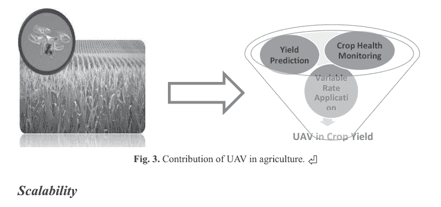

图3：无人机在农业中的贡献。

#### 可扩展性

与地面技术相比，无人机能在短时间内高效覆盖大片区域，因此非常适合广阔农田。

## 成本效益

与有人驾驶飞机相比，无人机在数据采集方面是更经济的选择。

## 灵活性

无人机能够在低空作业，从而可以收集全面的数据，提供有关作物健康状况的深刻信息。

## 数据丰富性

无人机可以获取多光谱和高分辨率照片，全面呈现作物状况。

## 作物产量估算对NDVI的需求

如图4所示，若干重要因素使得快速、准确的作物产量估算成为必要。

粮食安全：为了养活不断增长的全球人口，必须提高农业产出（Nasi, 2018）。通过估算农业产量，可以改进规划和资源分配，为当代和子孙后代提供粮食安全。

市场预测：精确的产量预测为市场定价方法提供依据。农民可以通过预判可能的短缺或过剩并相应调整销售策略，从而最大限度地减少损失、增加利润。

农业管理：准确的产量预测有助于在肥料使用、灌溉技术和病虫害管理策略方面做出明智决策。最终，这会提高农场生产力和资源利用率（Chouhan, 2024a and b）。

传统的产量估算技术无法完全满足这些需求。尽管地面调查能提供精确信息，但劳动强度大、耗时长，且不适用于大面积农田（Kumar, 2024）。另一方面，光谱分辨率、天气敏感度以及定期使用的费用常常是卫星摄影受限的原因。NDVI是解决这些问题的有效技术。

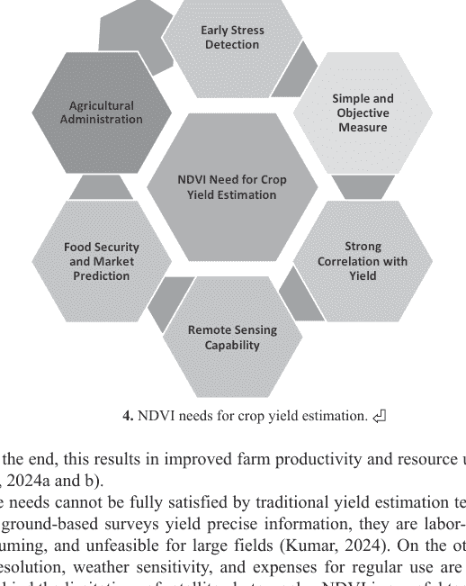

图4：作物产量估算对NDVI的需求。

## NDVI在作物产量估算中的威力

对于农民和其他农业利益相关者而言，准确的作物产量估算至关重要。最终，它能促进市场稳定，增强做出明智决策的能力，并改善全球粮食安全（Chouhan, 2021）。传统技术常常因精度不足、时效性差或无法规模化而有所欠缺。这正是归一化植被指数（NDVI）的价值所在。

NDVI的一个显著优点是它是一项客观、直接的指标。由于NDVI基于植被在特定波长下的反射特性，它为评估作物生长和健康状况提供了一致的方法。富含叶绿素的健康植物会反射更多近红外（NIR）光，并吸收更多可见光。因此，NDVI值升高，与衡量作物健康和产量的多项指标（如生物量、叶面积指数（LAI）以及最终的农民收成）呈现密切关联。

NDVI相对于其他指标的一大优势是遥感能力。利用手持传感器、多光谱卫星和无人机等多种平台的数据都可以计算NDVI。得益于这项技术，现在可以有效且非侵入式地监测大片农业区域。在整个生长季节，农民可以利用NDVI定期采集数据（Wang, 2021）。这种时间序列监测能够跟踪作物生长模式，并识别可能发生产量变化的位置。有了这些数据，农学家可以调整管理策略，如灌溉或施肥，从而在整个区域内实现作物生产力最大化。

此外，NDVI还能与现代农业技术完美配合。它为估算农业产量的人工智能模型提供了有用的输入。除了天气模式、土壤条件和历史产量数据等其他变量外，人工智能系统还能够分析（Khajuria, 2018）NDVI数据。与传统技术相比，我们的多模态方法大大提高了准确性，并优化了产量估算。NDVI还促进了一种标准化方法。通过提供标准化的作物健康指标，NDVI使人们更容易比较不同农田、农场甚至地理区域的作物。这不仅增强了单个农民的能力，还促进了农业研究人员之间的合作与知识交流，最终推动了该领域的发展。

## NDVI在作物产量估算中的局限性

尽管NDVI有许多优点，但认识到其缺点也至关重要。一个重大障碍是它易受外部影响，如图5所示。NDVI值会受到土壤湿度、背景土壤颜色甚至云层覆盖的影响，这可能导致产量预测出现偏差。例如，土壤干燥的区域NDVI值可能较低，这可能表明作物健康状况不佳，而实际上可能只是缺水。

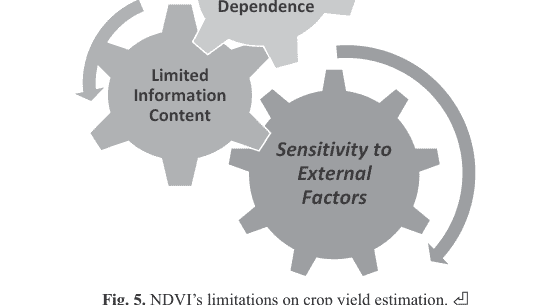

图5：NDVI在作物产量估算中的局限性。

## 数据采集

以下数据于2023年在印度泰米尔纳德邦的琴格阿尔帕图区（12°40'54.8"N 79°59'19.7"E）采集。首先确定农田区域的边界，然后提取矢量文件。使用大疆Mini2无人机拍摄田间图像。每次飞行间隔20分钟以拍摄农田。通过无人机在田间采集的数据集包含10,000张图像。图像分辨率为18000×15000像素。田间种植有木瓜、芒果和番石榴树，如图7所示。田间图像经过标注和预处理，可作为输入，利用归一化植被指数进行作物产量估算。


图7：大疆Mini2无人机田间图像。

## 植被指数计算

最初，使用可见光和近红外波段的组合来计算各种比值和归一化指数，如公式1.1所示。NDVI值范围从+1（最强植被生长）到−1（通常为水体）。其中NR（λ = 700–1300 nm）和VS（λ = 550–700 nm）。叶片组织的细胞结构和气隙细胞壁的光学特性决定了其反射率水平。气隙细胞壁位于叶绿体和原生质之间。

NDVI = (NR − VS) / (NR + VS) (1.1)

其中，

- NDVI代表归一化植被指数
- NR：近红外辐射
- VS：可见红光光谱

该公式表明，红光和红外波段反射光强度的差值除以这些强度之和，等于图像中特定位置的植被密度（NDVI）。

## 结果与讨论

如表1和图8所示的比较结果表明，与其他现有模型相比，归一化植被指数在估算作物健康状况方面具有更高的准确性。

表1：各种作物产量估算技术的结果比较分析。

| 模型 | 准确率 |
|---|---|
| 线性回归 | 0.64 |
| 支持向量机 | 0.559 |
| 卷积神经网络 | 0.673 |
| 归一化植被指数 | 0.789 |


图8：各种作物产量估算技术的结果比较分析。

#### 结论

总之，计算机视觉、人工智能（AI）与NDVI力量的结合正在彻底改变传统的作物产量估算方法。NDVI因其易用性、与产量的正向关联以及利用遥感数据的能力，为数据驱动的产量估算奠定了坚实基础。通过评估海量数据集和提取复杂信息，AI算法与计算机视觉技术相结合，使NDVI能够发挥最大潜力。这种协同策略改善了产量预测，有助于早期胁迫识别，并使农民能够做出数据驱动的决策。未来的农业实践将提供更具生产力和可持续性的环境，为子孙后代保障粮食安全。

### 声明

#### 作者的伦理责任

> > “所有作者均已阅读、理解并酌情遵守《作者指南》中关于‘作者的伦理责任’的声明。”


#### 伦理审批

不适用。

## AI工具使用情况

通讯作者声明，本手稿未使用任何AI工具。

#### 利益冲突

通讯作者代表所有作者声明，不存在需要披露的利益冲突。

## 竞争利益

不适用。

#### 作者贡献

作者¹：概念化、方法论、写作——初稿、写作——思想——审阅与编辑，作者²：数据收集——写作——思想、监督，作者³：写作——正式分析、思想，作者⁴：正式写作、方法论。

#### 资助

未获得任何资助。

### 参考文献

- Han, S. 2022. 通过将物候和无人机多光谱图像数据集成到随机森林模型中监测关键小麦生长变量. Remote Sens., 14.
- Javed, T. 2022. 提高作物氮利用效率的农艺和生理分子方法的最新进展. Front. Plant Sci., 13: 1–21.
- Khajuria, R., Sunanda and Singh, S. 2018. 使用人工神经网络对现有叶片病害技术的综述. International Journal of Computer Trends and Technology (IJCTT), 59(1): 52–62, May 2018. ISSN:2231-2803, doi:10.14445/22312803/IJCTT-V59P109 (https://ijctjournal.org/archives/ijctt-v59p109)
- Kumar, R. 2014. 棉花病害检测的混合方法以提高作物健康和产量. In IEEE Access, https://ieeexplore.ieee.org/document/10589357.
- Li, M. 2022. 基于修正相关系数法的无人机高光谱图像苹果冠层氮含量反演. Sustain., 14.
- Nasi, R. 2018. 利用无人机和飞机基于光谱和摄影测量3D特征估算大麦和草的生物量和氮量. Remote Sens., 10: 1–32.
- Wang, L. 2021. 基于无人机高光谱影像估算水稻叶片和植株水平的氮含量和积累量. Remote Sens., 13: 1–21.
- Yu, J., Wang, J. and Leblon, B. 2021. 利用机器学习方法评估土壤性质、地形指标、株高和无人机多光谱图像以估算玉米冠层氮重量. Remote Sens.
- Zhang, J. 2022. 基于固定翼无人机图像的小麦精准生产季节内变量施氮推荐. Precis. Agric., 23: 830–853.
- Zheng, H. 2018. 结合无人机多光谱影像和地面高光谱数据估算水稻植株氮浓度. Front. Plant Sci., 9: 1–13.

## 第18章：土壤肥力评价

VR Mageshen,¹* G Manimaran,² K Aswitha³ and S Thirumeninathan⁴

### 引言

土壤肥力评价是评估土壤为植物提供必需养分的能力。评估土壤肥力是高效农业系统的关键组成部分。通过了解土壤的养分状况，农民和农艺师可以做出明智的决策，以促进土壤健康、优化作物产量，并确保可持续农业技术的实施（Salomon和Cavagnaro，2022）。定期进行土壤测试并采取适当的管理措施对于保持生产力和健康的土壤至关重要。土壤肥力评价的基础是对土壤特性及其对植物发育影响的全面理解（Guo等，2021）。土壤肥力评价包括五个主要程序。首先，检查植物缺素症状。此外，第二种方法涉及进行植物和组织测试，而第三种方法侧重于培育高等植物和微生物。第四种方法涉及土壤化学分析，最后一种技术利用同位素稀释技术。通过对各种土壤特性的系统性检查，我们可以确定其提供必要养分、保持理想的生长条件以及促进环境友好型农业技术的能力（Cakmakcı等，2023）。这种全面的方法确保了土壤管理实践既有效又高效，同时具有生态可持续性。

人工智能是计算机科学领域的一门学科，它利用包括机器学习和深度学习在内的各种方法来分析和解释数据，以模仿人类智能（Chouhan等，2024b）。这类网络通过不断连接输入和输出元素来提出建议，从而能够为简单和复杂的场景开发多种解决方案（Tyagi和Chahal，2022）。人工智能的跨学科性质，融合了计算机科学、数学、统计学和认知科学，使其能够解决农业中的复杂难题。人工智能技术通过模仿机器人和自动化系统中的人类智能，正在推进农业生产率、维护粮食安全并促进可持续农业实践（Shaikh等，2022）。机器学习使计算机能够自主获取知识和做出决策，而无需显式编程，通过识别和分析数据中的模式（Javaid等，2023）。这需要在大型数据集上训练算法，使它们能够在获取信息时稳步提高性能。

### 土壤测试的现状

评估土壤肥力可能是一个繁琐且耗时的过程，但其全面性对于获得准确和有意义的成果至关重要。复杂性产生的原因在于需要理解并整合各种土壤变量及其与植物发育的相互作用（Alaoui等，2022）。测量土壤养分的传统方法包括使用随机网格采样方法来收集土壤核心样本。随后，核心样本被仔细封装并送往实验室（Lawrence等，2020）。此外，此过程将需要昂贵的实验室设备和额外的溶剂进行进一步的化学检查。虽然实验室方法表现出很高的准确性，但它们不具备对农业土壤进行连续实时检测的能力。大型农场主在绘制其地形图时面临两个重要问题：每个样本的时长和每个样本的费用。农田地形具有变异性，表明在一块作物地上表现出的特征可能与同一地形上另一块地所表现出的特征不同。

### 人工智能在土壤肥力管理中的兴起

土壤养分分析中的机器学习模型可以通过评估各种数据源（如土壤样本、遥感卫星图像和气象事件）来准确预测养分水平、优化肥料利用和提高作物产量（Folorunso等，2023）。回归算法和神经网络被广泛用于土壤养分监测，因为它们能够使用输入数据准确预测连续值。机器学习（ML）和深度学习（DL）方法都被用于预测土壤养分。ML应用利用监督和无监督学习方法，以增强数据分析并为统计解决方案提供充足的数据（Trontel和Chambers，2021）。深度学习技术被用于有效地分析大量数据以进行土壤养分测试。这些方法通过使用涵盖多种土壤特征和环境条件的大量数据集，提供对土壤养分水平的精确预测。这种预测能力有助于优化肥料使用和加强作物管理策略。

### 用于土壤肥力管理的AI技术

**决策树**

决策树是另一种流行的机器学习方法，用于在涉及回归和分类的问题中对数据进行分类和预测。它使用类似树的层次结构来表示决策及其潜在结果。决策树通过根据某个特征的值将数据集不断划分为更小的组或子集来运行（Priyanka和Kumar，2020）。目标是增强每个子集内期望结果的均匀性。该技术生成一种分层的决策安排，最终得出明确的预测。

决策树在评估土壤肥力时，可用于根据养分含量和其他特征对土壤样本进行分类。树的节点表示养分阈值的确定，而叶节点表示预期的肥力状况。这有助于农民和农艺师根据信息做出明智的决策。


图1. 决策树算法的工作原理。

**人工神经网络**

人工神经网络（ANNs）是从人类大脑中的神经网络中获得灵感的计算机模型。这些算法被用于各种机器学习任务，包括分类、回归和模式识别（Khajuria和Sunanda，2018）。人工神经网络（ANNs）在通过获取复杂联系来评估土壤肥力方面特别有效


Fig. 2. ANN 算法的运行原理。

在土壤参数与肥力水平之间（Sujatha and Jaidhar, 2023）。这可以提高预测准确性并改善土壤管理和农业活动的决策。人工神经网络通过模仿人类大脑处理数据的认知过程发挥作用。神经网络由排列在各层中的相互连接的神经元组成，每个神经元对其输入的累积权重应用行为视角。网络使用前向传播和反向传播来优化其权重和偏置，从而减少预期值与实际值之间的差异（Gulcu, 2022）。人工神经网络（ANNs）是分析数据中复杂模式和相关性的非常有效的工具，使其适用于多种操作，包括土壤肥力的评估。

## K-最近邻

KNN 是一种非参数且稳健的技术，用于解决分类和回归难题。它不依赖于关于基础数据分布的假设。K-最近邻（KNN）方法基于相似性原理运行。通过检查训练数据集中其 K 个最近邻的数值，它预测新数据点的数值（Uddin et al., 2023）。无需对数据分布做出任何猜测。K 值表示最近邻的总数量。KNN 旨在通过计算测试数据与每个训练点之间存在的接近度来确定测试数据的精确类别（Zhang et al., 2021）。有多种计算此距离的技术，其中最广为人知的方法是欧几里得距离（连续数据）、曼哈顿距离（连续数据）和汉明距离（分类数据）。每次循环更新距离度量的计算成本很高，这就是为什么 KNN 被认为是一种惰性学习算法。

KNN 算法既耗时又资源密集。当维度数量非常大时，算法在准确对数据点进行分类方面会遇到困难。它也容易出现过拟合问题。


Fig. 3. KNN 算法的运行原理。

## 支持向量机

支持向量机（SVM）代表一种弹性且适应性强的训练机器学习方法，常用于分类问题，例如评估土壤肥力。支持向量机（SVM）背后的核心原理是确定一个理想的超平面，该超平面能有效区分属于不同组的数据点（Cervantes et al., 2020）。

SVM 可以通过识别最佳超平面来有效预测土壤样本的肥力状况，该超平面利用其养分含量和其他特征信息分割各个类别（Sujatha and Jaidhar, 2023）。这有助于做出有关土壤管理和农业实践的明智判断。


Fig. 4. 支持向量机的概念。


Fig. 5. SVM 算法的运行原理。

支持向量机（SVM）采用核机制将输入特征转换为具有更高维度数量的高维空间，特别是当数据点无法线性分离时（Gaye et al., 2021）。这使得能够利用超平面有效地分离给定数据。这种现象通常被称为“核技巧”。目标是在最大化间隔的同时减少误分类错误。

## 土壤肥力评估中的计算机视觉技术

### 无人机在土壤肥力评估中的应用

采用无人机（UAV）评估土壤质量和生产力是一种利用先进技术改善农业技术的前沿方法。无人机通过从大气中收集精确且最新的信息来监测土壤肥力（Chouhan et al., 2024a）。无人机利用现代成像技术和空间分析提供有关土壤健康的全面信息，促进准确有效的土壤管理技术（Raza et al., 2023）。无人机技术与先进传感器的结合彻底改变了农业领域土壤采样和分析的过程。它们的目的是为农民提供精确及时的信息，可用于改善土壤管理技术、提高作物产量并在全球范围内推广可持续农业实践（Kumar et al., 2024）。配备多光谱相机的无人机通过提供传统技术无法实现的规模上及时、全面和实用的数据，正在改变土壤分析（Mushtaq et al., 2024）。该方法标志着可持续农业的显著进步，因为它最大化资源利用、提高作物生产力，同时减少对环境的不利影响。

无人机提供准确且最新的信息，帮助农业社区有效管理土壤健康。无人机可以将获取的数据与其他来源（如卫星图像、气象数据和历史作物产量数据）结合起来，创建用于评估土壤肥力的全面模型（Weiss et al., 2020）。利用先进的数据处理和机器学习方法可显著增强对这些数据的理解（Chouhan et al., 2021）。


农民可以优化时间、获得对每平方英寸土地的精确评估，最重要的是，与进行物理土壤分析相比降低成本（Khan et al., 2021）。随着技术的不断进步，预计无人机将在解决为快速增长的全球人口提供粮食同时保护自然资源的问题中发挥日益重要的作用。

### 物联网

物联网（IoT）通过提供不间断的连续监控和数据采集改变了土壤肥力评估（Narasegouda et al., 2020）。该方法促进了对土壤健康的更准确和有效控制，从而提高农业产量。物联网在土壤肥力评估中的概念涉及建立一个网络化系统，该系统持续收集、传输、分析和利用来自各种传感器的实时数据，以增强和自动化土壤管理技术（Parween et al., 2021）。该技术使农业作业更准确、更有效、更环保。


IoT 土壤养分传感器是现代农业的非常成功的工具，为农民提供了无与伦比的能力，以高效调节和跟踪土壤健康（Khan et al., 2021）。随着技术的进步和日益普及，将传感器技术融入农业技术预计将提高全球粮食生产的生产力、效率和可持续性。

## 实际意义与挑战

### 不同地区土壤组成的差异

开发用于识别土壤养分水平的准确可靠的 AI 模型本质上具有挑战性，因为不同地理区域土壤特征存在巨大差异。

### 数据对性能的影响

深度学习算法的技术开销对训练过程的速度和有效性有显著影响。分析和处理高维数据，如具有大量光谱波段的高光谱照片，需要大量计算资源（Ang and Seng, 2021）。任务的复杂性由多种因素决定，包括数据集大小、神经网络的复杂性和结构，以及对细致数据准备和特征提取的需求。为了克服这些障碍并提高深度学习在土壤肥力评估中的有效性，优化算法并利用高效计算资源至关重要。

### 超高分辨率高光谱图像

高光谱数据的庞大维度源于其广泛的光谱波段或通道。高光谱成像是一种在多个紧密间隔的光谱波段上收集数据的技术，使每个图像像素都能获得精确的光谱信息（Lu et al., 2020）。数据的丰富性使材料能够精确检测和表征，但由于其高复杂性，也给数据处理、存储和分析带来了障碍。

### 阳光干扰

使用智能手机相机获取土壤样本以预测土壤 pH 值可能具有挑战性，因为自然光照条件不一致。光照条件的变化会影响照片中颜色的保真度，导致结果不一致且不可靠（Alhakamy and Tuceryan, 2020）。为解决此问题，必须保持受控的照明设置或利用能够补偿光照差异的 AI 算法。这将提高从智能手机照片中进行 pH 预测的准确性和可靠性。


#### 结论
与深度学习算法实施相关的成本对训练过程的速度和效率具有显著影响。人工智能（AI）、遥感和物联网（IoT）的使用正在改变土壤健康评估，[content]
#### 结论
实施深度学习算法相关的成本对训练过程的速度和效率具有显著影响。人工智能（AI）、遥感和物联网（IoT）的使用正在改变土壤健康评估，提升其准确性、效率和全面性。尽管在使信息更易获取和整合数据方面存在挑战，但这些进步在提升农业生产和可持续性方面具有巨大潜力。需要开展更多研究以充分利用人工智能在土壤科学领域的潜力。未来的研究应优先开发能够管理大量复杂土壤养分数据的耐用且可扩展的人工智能算法。此外，应强调将人工智能与其他技术如传感器网络和遥感进行整合。

### 声明
#### 作者的伦理责任
> “所有作者均已阅读、理解并在适用范围内遵守《作者须知》中所载的“作者伦理责任”声明”。

#### 伦理审批
不适用。

#### 利益冲突
代表全体作者，通讯作者声明无利益冲突需要披露。

#### 竞争性利益
不适用。

#### 作者贡献
Mageshen：概念化，方法学，初稿撰写，审阅与编辑。Manimaran：调查，正式分析，可视化，软件，数据整理，监督。Ashwitha：初稿撰写，正式分析，方法学。Thirumeninathan：正式分析，可视化。

#### 资助
未获得资助。

### 参考文献
Alaoui, A., Barao, L., Ferreira, C.S. and Hessel, R. 2022. 农业可持续性评估框架概述. Land, 11(4): 537. https://doi.org/10.3390/land11040537.

Alhakamy, A.A. and Tuceryan, M. 2020. 用于逼真增强/混合现实的实时光照和视觉一致性. ACM Computing Surveys (CSUR), 53(3): 1–34. https://doi.org/10.1145/3386496.

Ang, K.L.M. and Seng, J.K.P. 2021. 农业中高光谱信息的大数据与机器学习. IEEE Access, 9: 36699–36718. 10.1109/ACCESS.2021.3051196.

Çakmakçı, R., Salık, M.A. and Çakmakçı, S. 2023. 环境可持续食品和农业系统的评估与原则. Agriculture, 13(5): 1073. https://doi.org/10.3390/agriculture13051073.

Cervantes, J., Garcia-Lamont, F., Rodriguez-Mazahua, L. and Lopez, A. 2020. 支持向量机分类的全面综述：应用、挑战与趋势. Neurocomputing, 408: 189–215. https://doi.org/10.1016/j.neucom.2019.10.118.

Chouhan, S.S., Singh, U.P. and Jain, S. 2024a. 计算机视觉与无人机技术导论. In 计算机视觉与无人机技术在农业4.0中的应用. Springer, Singapore. https://doi.org/10.1007/978-981-99-8684-2_1.

Chouhan, S.S., Singh, U.P., Sharma, U. and Jain, S. 2024b. 使用深度学习和机器学习算法对不同植物物种进行分类. Wireless Pers. Commun., 136: 2275–2298. https://doi.org/10.1007/s11277-024-11374-y.

Chouhan, S.S., Singh, U.P., Sharma, U. and Jain, S. 2021. 利用基于计算机视觉的方法对Jatropha Curcas L.和Pongamia Pinnata L.生物燃料植物叶片病害进行分割与分类. Measurement, 171: 108796. https://doi.org/10.1016/j.measurement.2020.108796.

Folorunso, O., Ojo, O., Busari, M., Adebayo, M., Joshua, A., Folorunso, D. and Olabanjo, O. 2023. 探索用于土壤养分特性预测的机器学习模型：系统综述. Big Data and Cognitive Computing, 7(2): 113. https://doi.org/10.3390/bdcc7020113.

Gaye, B., Zhang, D. and Wulamu, A. 2021. 大数据背景下支持向量机算法的改进. Mathematical Problems in Engineering, 5594899. https://doi.org/10.1155/2021/5594899.

Guo, M. 2021. 土壤健康评估与管理：科学与实践的最新发展. Soil Systems, 5(4): 61. https://doi.org/10.3390/soilsystems5040061.

Gülcü, Ş. 2022. 使用蜻蜓算法训练前馈人工神经网络. Applied Soft Computing, 124: 109023. https://doi.org/10.1016/j.asoc.2022.109023.

Javaid, M., Haleem, A., Khan, I.H. and Suman, R. 2023. 理解人工智能在农业部门的潜在应用. Advanced Agrochem., 2(1): 15–30. https://doi.org/10.1016/j.aac.2022.10.001.

Khan, N., Ray, R.L., Sargani, G.R., Ihtisham, M., Khayyam, M. and Ismail, S. 2021. 农业技术现状与未来展望：通向可持续农业的途径. Sustainability, 13(9): 488. https://doi.org/10.3390/su13094883.

Khajuria, R. and Sunanda, S.S. 2018. 利用人工神经网络的现有叶片病害技术综述. International Journal of Computer Trends and Technology (IJCTT), 59(1): 52-62: 2231–2803. doi:10.14445/22312803/IJCTT-V59P109.

Kumar, R., Kumar, A., Bhatia, K., Nisar, K.S., Chouhan, S.S., Maratha, P. and Tiwari, A.K. 2024. 棉花病害检测的混合方法以提高作物健康和产量. IEEE Access. 10.1109/ACCESS.2024.3419906.

Lawrence, P.G., Roper, W., Morris, T.F. and Guillard, K. 2020. 利用经典和空间统计指导土壤采样策略：综述. Agronomy Journal, 112(1): 493–510. https://doi.org/10.1002/agj2.20048.

Lu, B., Dao, P.D., Liu, J., He, Y. and Shang, J. 2020. 高光谱成像技术及其在农业中应用的最新进展. Remote Sensing, 12(16): 2659. https://doi.org/10.3390/rs12162659.

Mushtaq, Z., Saeed, S., Demir, C., Firat, M., Baran, M.I. and Siddiqui, A.R. 2024. 喷雾无人机在可持续农业中的作用. *水-气-土与可持续农业及人类福祉*, 21. 10.5281/zenodo.10841204.

Narasegouda, S. 2020. 农业物联网十年综述. *物联网（IoT）概念与应用*, 351–370. 10.1007/978-3-030-37468-6_19.

Parween, S., Hameed, R.S. and Sinha, K. 2021. 物联网及其在农业中的实时应用. In *图书馆与信息科学知识与组织系统研究手册*. IGI Global, 103–123. 10.4018/978-1-7998-7258-0.ch006.

Priyanka and Kumar, D. 2020. 决策树分类器：详细综述. *International Journal of Information and Decision Sciences*, 12(3): 246–269. https://doi.org/10.1504/IJIDS.2020.108141.

Raza, I., Zubair, M., Zaib, M., Khalil, M.H., Haidar, A., Sikandar, A. and Ashfaq, M.A. 2023. 提高土壤肥力和作物产量的精准养分施用技术：综述与未来展望. *International Research Journal of Educational and Technology*, 05(8): 109–123.

Shaikh, T.A., Rasool, T. and Lone, F.R. 2022. 利用机器学习和人工智能在精准农业和智慧农业中的作用. *Computers and Electronics in Agriculture*, 198: 107119. 10.1016/j.compag.2022.107119.

Sujatha, M. and Jaidhar, C.D. 2023. 基于机器学习的提高土壤肥力方法综述. *Expert Systems with Applications*, 122557. https://doi.org/10.1016/j.eswa.2023.122557.

Trontelj, M.L., Janez and Chambers, O. 2021. 利用光谱方法预测土壤养分的机器学习策略. *Sensors*, 21(12): 4208. https://doi.org/10.3390/s21124208.

Tyagi, A.K. and Chahal, P. 2022. 人工智能与机器学习算法. In *机器学习技术、方法与应用研究文集*. IGI Global, 421–446. 10.4018/978-1-6684-6291-1.ch024.

Uddin, S., Haque, I., Lu, H., Moni, M.A. and Gide, E. 2022. K最近邻（KNN）算法及其不同变体在疾病预测中的比较性能分析. *Scientific Reports*, 12(1): 6256. https://doi.org/10.1038/s41598-022-10358-x.

Weiss, M., Jacob, F. and Duveiller, G. 2020. 农业应用遥感：元综述. *Remote Sensing of Environment*, 236: 111402. https://doi.org/10.1016/j.rse.2019.111402.

Zhang, S. 2021. KNN分类中的挑战. *IEEE Transactions on Knowledge and Data Engineering*, 34(10): 4663–4675. 10.1109/TKDE.2021.3049250.


## 第19章 土壤水分评估传感器、遥感与人工智能的进展

Ayushi Jha,¹,* Ankita Shinde,² Jatinder Kaur,¹
Isha Swati,¹ Rajat Mishra³ and Sanskriti Sundar¹

## 引言

土壤是生命的重要组成部分，是支持我们生存的养分和水分的储存库。空气、水和生命都可以在构成健康土壤的矿物质和有机成分的复杂组合中找到。土壤水分是气候系统的重要组成部分，也被称为土壤含水量，指土壤活动层中水的总量，包括水蒸气。根据土壤类型和植被的不同，该活动层的总厚度有所差异，但通常在最上层1–2米范围内（Robock等，2000）。除了是农业用水安全的重要因素外，土壤水分还是未来作物产量的可靠指标（Tian等，2019）。土壤中总储水量是影响土壤水分的最重要因素。影响土壤水分的主要因素是根区的范围，即根系所在的区域

时域反射仪（TDR）（Chen等，2020；Peng等，2017）。然而，它们的空间代表性较差。被称为全球定位系统（GPS）和宇宙射线中子传感（CRNS）的新技术部分解决了这一问题。根据Rahimzadeh-Bajgiran等（2013）的研究，使用土壤水分估算设备有诸多优势，包括机动性强、安装、操作和维护简便、技术相对成熟，以及能够以高时间分辨率在不同深度进行直接测量。然而，根据Zhang等（2014）的研究，这些方法劳动强度大、成本高、技术先进，有些还可能具有破坏性（如重力取样法）。

对于此类用途，需要更多现代技术，例如能够即时测量土壤水分的电子传感器。目前市面上可购买的最广泛的土壤水分传感器基于土壤介质的电磁传感。这些传感器分为三类：电容型器件、时域反射仪和电阻率（ER）传感器（Heng等，2002；Jones等，2002）。要获得准确的数据，这些传感器需要进行正确校准。尽管科学文献提供了多种校准介电土壤水分传感器的方法，但由于影响校准的因素、校准的技术难度以及对其实效性缺乏信心，它们在实地调查中的使用受到限制。

与电容式传感器相比，时域反射仪传感器已被证明具有更高的精度，并且能够在更高频率下工作（Walker等，2004；Robinson等，2008）。另一方面，电容传感器尽管精度较低，但价格便宜得多。这使得可以使用更多仪器，从而构建更密集的观测网络。考虑到土壤水分在相对较小尺度上具有显著的时空变异性（Teuling和Troch，2005），有研究建议某些应用适合选择价格较低但精度较低的传感器，以减少空间变异性引起的采样误差（Teuling等，2006；Bogena等，2007；Robinson等，2008）。

遥感技术包括雷达（微波）、卫星以及其他非接触式方法。通过遥感测定土壤水分，需要评估从土壤表面反射或发射的电磁能量。根据土壤温度、介电特性或两者的结合，这种辐射随土壤水分的强度可能会发生变化。由于含水量影响介电常数，因此可以利用有源雷达中微波能量的衰减来确定多孔材料的含水量。可见光/红外高光谱（VIR/NIR）和热红外（TIR）遥感技术用于测量表层土壤含水量。热红外（TIR）传感器用于测量表层土壤的含水量，这些土壤可分为暖土和冷土，温度范围分别为2°C至50°C和−2°C至−50°C。只有暖土才能使用热红外（TIR）传感器测量土壤水分。另一方面，冷土的水分则由可见光/红外高光谱（VIR/NIR）传感器测量（Gerhards等，2019）。

以深度学习/机器学习技术形式出现的人工智能利用算法在无需显式编程的情况下解决问题。这一过程通常比传统方法更快速、更高效。利用机器学习，人们已经开发出能够精确预测土壤水分含量的新算法。这些算法随后可用于灌溉或其他应用（Ahmad等，2010）。利用遥感数据，机器学习和深度学习算法已成功应用于预测土壤水分（Prasad等，2018）。利用深度学习和机器学习技术，多个植被指数和光谱波段以及气象、土壤和作物因素均可用作测定土壤水分的输入变量（Li等，2022；Xie等，2021）。人工神经网络和卷积神经网络是近年来有效应用于此目的的机器学习技术的两个例子（Yinglan等，2022）。已有研究表明，这些算法优于传统的基于规则的方法（Song等，2016）。利用这种方法可以制造出能够抵御天气变化的高性能土壤水分传感器。农民将能在灌溉用水上节省开支，这在干旱地区是一种宝贵的资源（Cai等，2019；Lee等，2019；Sarwar等，2019；Zhao等，2022）。

如今，技术在我们生活的方方面面占据着巨大比重。农业似乎可以免受其影响，因为农业似乎只是播种和看其生长，但事实绝非如此。耕作并非易事。人口的指数级增长给维持粮食供应带来了极其动态的挑战。要养活更多人，就必须生产更多的粮食。然而，人口的增长也意味着更多的建筑和用水需求，从而消耗宝贵的土地和水资源，而这些正是粮食生产所必需的。在资源日益减少的情况下，农业部门必须依靠技术进步来养活不断增长的人口。基因工程、GPS、航空成像、除草剂耐受性、机器人技术、土壤传感器和精准农业等技术进步，仅仅是将农业转变为高水平行业的几个例子。灌溉田地和植物花园都高度依赖土壤的水分含量。在过去十年中，许多农民发现，部署远程传感器来监测田间土壤含水量是一种重要的管理工具。通过精准方法，它有助于减少因过度饱和造成的肥料径流损失，在作物需要时精确灌溉，并降低投入成本。

## 土壤水分测量方法

土壤水分测量过程并不简单，但它对于包括灌溉调度在内的许多水资源管理研究至关重要。目前已提出多种方法，每种方法各有其优缺点。下面讨论一些最常用的方法：

### 传统土壤水分测量方法
### 重力法或烘干法

目前，测定土壤含水量（θm）最常见的实用方法是重力法（Kashyap等，2021）。所有间接方法均使用这种最自然、最传统的方法进行校准。使用土钻从田间采集土壤样本，称重以确定其湿重和干重。采样时称量土壤样本（M_s）得到湿重，将土壤样本在105°C烤箱中烘干24小时得到干重。土壤水分（M_w）由重量损失表示。

θm = Mw / Ms

无论土壤类型和盐度如何，该技术都能确保对水分含量的准确评估。然而，由于该方法的破坏性特点，无法进行重复测量（Zazueta等，1994）。此外，由于劳动强度大且耗时，该方法不适用于大规模或实时实地研究。换句话说，基于重力法的土壤水分测量对于需要定期进行大量现场观测的农业或水文应用，以及对于验证需要在卫星过境时的有限时间窗口内采样的遥感产品而言，都不是很实用（图2）。


图3. 使用重力法进行水分测量的示意图。

### 容积法

特定量干土（通常为1立方米）中的水量称为容积含水量。VWC可以使用体积（cm³/cm³）或质量（g/g）计算。该水分含量百分比以输出形式显示。使用此方法时，使用已知体积的取芯器在适当的根区深度从田间采集土壤样本。然后，采用与重力含水量法类似的过程测定其湿重和干重。样本中的水量通过土壤湿重与干重之间的差值来表示。


## 传统土壤湿度评估技术的优势与挑战

传统土壤湿度评估方法已存在较长时间，提供一些独特的优势，同时也带来一定的挑战。

### 优势
- **准确性**：许多经过验证的方法，如重力法，在适当应用时能产生非常准确的结果。它们为校准更新的传感器技术提供了准确的标准。
- **简易性**：某些方法，如通过土壤的触感和外观判断或使用张力计，操作相当简单，不需要大量专业工具。
- **标准化**：由于这些技术通常遵循明确的步骤，所收集的数据可以在不同研究和田块之间进行比较。

### 挑战
- **劳动密集**：收集和分析重力法所需的土壤样品可能需要大量时间和劳动。
- **破坏性**：某些技术，如重力法，会破坏所研究的土壤样品。如果需要长期监测同一地点，这可能会有问题。
- **范围有限**：大多数传统方法仅提供单点数据。如果田块内土壤湿度差异显著，这可能具有误导性。
- **耗时**：像重力法这样的技术获取结果需要一段时间，这对于实时灌溉管理来说并不理想。

传统技术能提供有用的信息，但它们并不总是最佳或最合理的选择。随着技术进步，提供连续监测和更大范围数据采集的新型传感器系统正在出现。

## 案例研究：传感器在土壤湿度评估中的应用

Then et al., 2016 studied the microstrip ring resonator sensor in Peat and sandy soils which works on dielectric principle. This prediction model used an analytical ring resonant model with polynomial interpolation approximation via lumped element model. The sensing area and the measurement accuracy were also improved. This prediction model was found to agree well with the commercial dielectric probe in the dielectric prediction of peat (P 28% m.c.) and sandy (P 10% m.c.) soils. Kojima et al., 2016 developed a low-cost sensor which works on the basis of capacitance principle and is used in the greenhouse of a Grape field having sandy loam type of soil. The sensor consists of copper film substrate and it was prepared by etching copper on a polyethylene terephthalate (PET) film that costs less than $300. The sensor recorded dynamic variations in soil moisture at depths of 10 cm, 20 cm, and 30 cm. After sensor placement, 10-14 days were needed for the soil-capacitor contact to stabilize.

Then 等，2016 年研究了在泥炭和砂质土壤中工作的基于介电原理的微带环形谐振器传感器。该预测模型使用了通过集总元件模型进行多项式插值近似的解析环形谐振模型。传感面积和测量精度也得到了改善。该预测模型与商用介电探针在泥炭（P 28% m.c.）和砂质（P 10% m.c.）土壤的介电预测中吻合良好。Kojima 等，2016 年开发了一种基于电容原理的低成本传感器，用于砂壤土葡萄田的大棚。该传感器由铜膜基底组成，通过在聚对苯二甲酸乙二醇酯（PET）薄膜上蚀刻铜制成，成本低于 300 美元。该传感器记录了 10 cm、20 cm 和 30 cm 深度的土壤湿度动态变化。传感器放置后，需要 10-14 天使土壤-电容器接触稳定。

Iwata et al., 2017 assessed the impact of three different sensor installation techniques which affects the capacitive soil moisture sensor’s output and concluded that the installation technique had a major impact on the sensor’s output value. Simultaneously, the sensor’s output is boosted by compacting the dirt. Because this is more important in the soil. The study’s findings revealed that the installation depth may have an impact on sensor stability. Chakraborty et al., 2019 carried out a study to examine the impact of the polymethyl methacrylate-coated sensor’s form and coating on its accuracy and distribution of the fringe electric field. A total of four distinct shapes—a triangle, rectangle, circle, and point edge—were used to investigate the distribution of the electric field and calculate the standard root mean square error value to assess performance. The circular soil sample performs well in measuring water content, according to both simulation and real data.

Iwata 等，2017 年评估了三种不同传感器安装技术对电容式土壤湿度传感器输出的影响，并得出结论安装技术对传感器输出值有重大影响。同时，通过压实土壤可提高传感器的输出。因为这在土壤中更为重要。该研究结果表明，安装深度可能影响传感器的稳定性。Chakraborty 等，2019 年开展了一项研究，以考察聚甲基丙烯酸甲酯涂层传感器的形状和涂层对其准确性和边缘电场分布的影响。共使用了四种不同形状——三角形、矩形、圆形和尖点边缘——来研究电场分布并计算标准均方根误差值以评估性能。据模拟和实际数据，圆形土壤样品在测量含水量方面表现良好。

In a greenhouse of CAU grassland with Yunnan soils, Saeed et al. (2019) examined the performance of a completely autonomous high-resolution sensor that operates on the dielectric principle. Three linear calibration models were developed for various soil types. a cheap sensor that can measure soil moisture at three different vertical depths. Acceptable validation statistics were displayed for every depth of the sensor. The coefficients of linear fitting (R²) varied between 0.95 and 0.99. A TDM sensor was developed by Saeed et al., in 2019 to detect soil moisture simultaneously at four different soil levels like 10 cm, 20 cm, 40 cm, and 60 cm. The sensor’s sensitivity was evaluated in a micro-control watering system. The sensor’s ability to measure soil moisture continuously was demonstrated by the results, which will be helpful for arranging irrigation techniques in irrigated and desert locations. Lloret et al. (2021) studied a wireless sensor network comprising inexpensive soil moisture sensor nodes to optimize irrigation procedures for precision agriculture. Four soil moisture sensors, each capable of measuring moisture at various depths, made up each wireless node. Every sensor consisted of a pair of coils twisted around a plastic pipe. The functionality of sensors relied on mutual induction between coils to track the soil’s water content percentage. Tests were conducted on multiple prototypes with various features. The more successful prototype has a 1:2 winding ratio and operates at 93 kHz with 15 and 30 spires.

在云南土壤的 CAU 草地大棚中，Saeed 等（2019）研究了基于介电原理的完全自主高分辨率传感器的性能。为不同土壤类型开发了三种线性校准模型。一种廉价传感器可测量三个不同垂直深度的土壤湿度。传感器的每个深度都显示出可接受的验证统计数据。线性拟合系数（R²）在 0.95 至 0.99 之间变化。Saeed 等于 2019 年开发了一种 TDM 传感器，可同时检测 10 cm、20 cm、40 cm 和 60 cm 四个不同土壤层级的土壤湿度。该传感器的灵敏度在微控灌溉系统中进行了评估。结果证明了传感器连续测量土壤湿度的能力，这将有助于安排灌溉和沙漠地区的灌溉技术。Lloret 等（2021）研究了由廉价土壤湿度传感器节点组成的无线传感器网络，以优化精准农业的灌溉程序。每个无线节点由四个土壤湿度传感器组成，每个传感器均可测量不同深度的湿度。每个传感器均由一对缠绕在塑料管周围的线圈组成。传感器的功能依赖于线圈之间的互感来跟踪土壤含水率百分比。对具有各种特征的多个原型进行了测试。更成功的原型具有 1:2 的绕线比，在 93 kHz 下运行，线圈分别为 15 和 30 匝。

## 土壤湿度传感器

Soil moisture is essential for determining optimal irrigation management strategies (Singh et al., 2019). It is important to soil health and plant growth, representing the amount of water held within the soil matrix (Usharani et al., 2019). This optimal availability of moisture in the soil is crucial for various biophysical processes, like seed germination, plant growth, nutrient cycling, and maintaining natural soil biodiversity (Kashyap et al., 2021). The soil moisture regulates atmospheric interactions, maintaining water balance, determining infiltration and percolation rates, influencing groundwater recharge, and affecting stream water fluxes (Altdorff et al., 2023). It substantially impacts the hydrological cycle, plant growth processes, and the structural integrity and stability of soil.

土壤湿度对于确定最佳灌溉管理策略至关重要（Singh 等，2019）。它对土壤健康和植物生长很重要，表示土壤基质中保持的水量（Usharani 等，2019）。土壤中水分的最佳可利用性对于种子萌发、植物生长、养分循环和维持自然土壤生物多样性等各种生物物理过程至关重要（Kashyap 等，2021）。土壤湿度调节大气相互作用，保持水平衡，决定入渗和渗漏速率，影响地下水补给并影响溪流径流（Altdorff 等，2023）。它对水文循环、植物生长过程以及土壤的结构完整性和稳定性有重大影响。

Agriculture, consuming two-thirds of global water usage, holds a critical role in water conservation potential (Datta et al., 2023). Approximately 70% of the world’s water is allocated for irrigation, with a significant portion of this use considered unsustainable (Water Facts and Trends, 2020). Traditionally, agriculture requires substantial water volumes, often leading to inefficiencies and potential nutrient leaching in the root zone, which can compromise crop yields over time. Thus, optimizing soil moisture content in agriculture is imperative for mitigating the strain on water systems, ensuring their sustainability and resilience in supporting life and ecosystem stability.

农业消耗全球三分之二的水资源，在水资源保护潜力中发挥关键作用（Datta 等，2023）。约 70% 的世界用水用于灌溉，其中很大一部分被认为不可持续（Water Facts and Trends, 2020）。传统上，农业需要大量水，往往导致低效和根区潜在养分淋失，这会随着时间的推移损害作物产量。因此，优化农业中的土壤湿度含量对于减轻水系统压力、确保其可持续性和在支持生命和生态系统稳定方面的韧性至关重要。

Soil moisture content is a critical variable across multiple disciplines, including geotechnical engineering, geological engineering, and soil science (SU et al., 2014). It substantially impacts the hydrological cycle, plant growth processes, and the structural integrity and stability of soil. The precision and resolution of soil moisture predictions are dependent upon the specific application and the spatial scale of the interest (Lunt et al., 2005). Accurate measurement of soil moisture distribution is key for assessing the hydro-geological conditions of in-situ ground and optimizing irrigation schemes for agricultural production (Cuomo et al., 2013; Gui et al., 2014). An in-depth understanding of soil moisture dynamics not only facilitates efficient water usage but also enhances crop yield and soil health. The moisture content in the soil also governs the dissolution and movement of nutrients significantly impacting microbial activities and soil health (Taghvaeian et al., 2020). Excessive moisture levels can disrupt crop root respiration, while inadequate moisture levels can lead to nutrient and fertilizer leaching, resulting in groundwater pollution and hindered fertilizer uptake by crops, exacerbating soil salinization. Therefore, integrating advanced soil moisture monitoring technologies with precision agriculture practices is critical for sustainable agricultural development, ensuring optimal plant growth, efficient resource use, and minimal environmental impact.

土壤湿度含量是多个学科的关键变量，包括岩土工程、地质工程和土壤科学（SU 等，2014）。它对水文循环、植物生长过程以及土壤的结构完整性和稳定性有重大影响。土壤湿度预测的精度和分辨率取决于具体应用和关注的空间尺度（Lunt 等，2005）。准确测量土壤湿度分布是评估原位地基的水文地质条件和优化农业生产灌溉方案的关键（Cuomo 等，2013；Gui 等，2014）。深入了解土壤湿度动态不仅有助于高效用水，还能提高作物产量和土壤健康。土壤中的湿度含量还控制养分的溶解和移动，显著影响微生物活动和土壤健康（Taghvaeian 等，2020）。过高的湿度水平会破坏作物根系呼吸，而不足的湿度水平会导致养分和肥料淋失，导致地下水污染和作物吸收肥料受阻，加剧土壤盐碱化。因此，将先进的土壤湿度监测技术与精准农业实践相结合对于可持续农业发展至关重要，确保最佳植物生长、高效资源利用和最小环境影响。

Implementing advanced irrigation management techniques can significantly monitor and assess the soil moisture content, thereby augmenting crop yields, improving grain quality, and concurrently reducing nutrient leaching. Pramanik et al. (2022) reported on the automation of soil moisture sensor-based basin irrigation systems. Water scarcity in arid regions is a critical challenge, and an automatic check gate connected to IoT through wireless soil moisture sensors has been developed to improve irrigation efficiency. The system showed significant improvement in irrigation application efficiency, with up to 86.6% efficiency. The assessment of soil moisture content, quantified as volumetric soil water content (VSWC), is needed to understand the complex hydrological processes in soil profiles. VSWC in Fig. 3 represents the proportion of water volume to total soil volume, providing insights into the spatial distribution of soil water near the surface (Aniley et al., 2018). Volumetric soil water content-based soil moisture sensors are used to determine the amount of water present in the soil. VSWC can be calculated by mass (g/g) or volume (m³/m³). It gives output in per cent content.

实施先进的灌溉管理技术可以显著监测和评估土壤湿度含量，从而提高作物产量、改善谷物质量并同时减少养分淋失。Pramanik 等（2022）报道了基于土壤湿度传感器的盆式灌溉系统的自动化。在干旱地区，水资源短缺是一个关键挑战，已开发出通过无线土壤湿度传感器连接物联网的自动检查闸门以提高灌溉效率。该系统显示灌溉应用效率显著提高，效率高达 86.6%。土壤湿度含量的评估以体积含水量（VSWC）量化，对于理解土壤剖面中复杂的水文过程是必要的。图 3 中的 VSWC 表示水体积与土壤总体积的比例，为地表附近土壤水的空间分布提供见解（Aniley 等，2018）。基于体积含水量的土壤湿度传感器用于确定土壤中存在的水量。VSWC 可以按质量（g/g）或体积（m³/m³）计算。它以百分比含量输出。


**Fig. 4.** 不同土壤质地典型的土壤水分特征曲线。

基于传感器的技术如时域反射仪（TDR）、中子探针和电容探针提供了非侵入式替代方案，各自基于不同的原理高效测量土壤体积含水量（VSWC）。TDR通过测量土壤介电特性来估算含水量；中子探针利用中子散射评估湿度；电容探针则利用土壤电容变化计算VSWC。采用TDR方法，研究调查了各种植被覆盖对表层土壤体积含水量的影响。裸地具有最高的VWC值，而植被覆盖地块的值较低。休耕地上植被覆盖的存在相对于裸地降低了VWC值，但稳定了日波动（Brant et al., 2006）。这些技术通过重力法等点测量提高了土壤湿度研究中的空间和时间分辨率（Cao et al., 2020）。提高灌溉效率的有效方法是将土壤湿度传感器技术整合到灌溉调度中。

## 影响土壤湿度变异的因素

土壤湿度的变异受多种因素影响，包括土壤质地、地形、作物覆盖和灌溉措施。土壤质地由砂、粉砂和粘土的比例定义，决定了持水和入渗能力。该分类基于土壤中矿物颗粒的组成，采用多种检索系统进行评估。地形在水分分布和迁移中起关键作用：坡地促进径流，而低洼地区则促进水分积聚。土壤质地、地形、作物覆盖和灌溉措施的相互作用导致土壤湿度出现显著的空间和时间变化（Hendrickx et al., 2024）。土壤质地三角图提供了一种基于土壤颗粒异质尺寸对土壤进行分类的标准方法。


Fig. 5. 土壤质地分类。


Fig. 6. 不同土壤质地的持水能力。

植被覆盖截留降水，减少地表蒸发，并通过根系改善土壤结构。同时，灌溉措施在频率和施用方法方面，通过向土壤剖面添加水分直接调节土壤湿度水平。综合来看，这些因素决定了土壤的持水和输水能力，从而对农业生产力和生态系统功能产生关键影响（Farouki et al., 1981）。土壤质地分类，详细说明在提供了量化土壤样品中砂、粉砂和粘土比例的框架，直接影响持水能力和入渗率等关键特性。这些特性对于精确评估土壤含水量至关重要，是有效管理农业生产力和生态系统健康所必需的。

## 土壤湿度传感器及其在农业中的应用

土壤水分传感器（SWS）是实施科学灌溉调度的最有效工具之一（Brant et al., 2004）。精确监测土壤含水量对精准农业至关重要，可实现生产力优化、资源节约和环境保护（Saleem et al., 2024）。SWS通过各种方法估算水分可利用性，为灌溉管理、干旱监测和土壤健康评估提供必要数据。近几十年来，已出现大量技术来估算土壤体积含水量（θv）。其中包括重力法和容积法等直接方法，以及中子散射、张力计、频域反射仪（FDR）传感器、电阻式传感器、时域反射仪（TDR）和电容式装置等间接方法（Umarfarooque et al., 2011）。这些设备提供精确的土壤湿度测量，从而支持有效的用水管理策略。土壤湿度传感器的布置位置和最佳数量也是重要因素，显著影响基于传感器的地表灌溉自动化、性能和成本效益。本节重点介绍不同类型的土壤湿度传感器、工作原理及其各自的优势和局限性。

Gaikwad（2015）描述了多种土壤湿度传感器，每种都有其自身的特点和应用。该研究引入了一种电位传感器，价格低廉、重量轻且与探头尺寸无关，非常适合现场调查。Kojima 等（2016），开发了一种低成本土壤湿度剖面探针，利用薄膜电容器和电容式触摸传感器。土壤湿度通过电容器中的电容变化来测量，电容器由用作电极板的电极探针构成。Yamamoto 等（2002），提出了利用土壤和水热特性的传感器，在低湿度浓度下具有高灵敏度且离子效应最小。You 等（2013）开发了一种手持微波反射计-传感器系统，用于在各种土壤类型中进行精确湿度监测。Placidi（2020）重点对低成本电容式土壤湿度传感器进行了实验表征，证明了其在物联网应用中确定土壤湿度的可靠性。这些传感器共同为土壤湿度分析提供了多种选择，各有其优势和潜在应用。不同类型的土壤湿度传感器在下面讨论。

### 张力计

张力计测量土壤中水的基质势（也称为土壤水张力或土壤吸力）。基质势表示土壤中水分的紧密程度，是土壤含水量的间接测量指标。该装置通过评估植物从土壤中吸收水分的难易程度来模拟植物根系的功能。它由装有蒸馏水的茎、底部的多孔陶瓷尖端和顶部的压力/真空表组成，可精确测量土壤水势。Manjhi 和 Sarkar（2019）在其关于土壤湿度变化的研究中报告称，与重力法相比，张力计和土壤湿度计的偏差分别为 8.51% 和 5.45%。这些发现强调了准确的土壤湿度测量对于有效灌溉调度和作物产量提高的重要性。虽然这些传感器由于直接测量土壤水势而对灌溉管理具有不可估量的价值，但它们也存在局限性，例如测量范围受限以及需要定期维护以防止空气进入。

### 电容式土壤湿度传感器

电容传感器通过利用水与干土相比更高的介电常数来测量土壤的介电常数。这些传感器通常由两个形成电容器的金属板组成（Eller and Denoth, 1996）。土壤湿度变化会改变土壤的介电常数，进而改变这些板之间的电容（Mander et al., 2014）。这一原理使电容传感器能够准确测量土壤湿度水平。电容传感器的耐用性、功耗效率和经济性使其适用于广泛应用。其易用性、可靠的测量结果和成本效益使电容传感器非常适合各种用途，包括农业和环境监测。

其基本机理基于电容与电容器电极之间介质的相对介电常数（εᵣ）成比例。空气的相对介电常数（εᵣ, air）约为 1，而水的相对介电常数（εᵣ, H₂O）约为 81。因此，空气和水之间理论上的最大电容变化为 81 倍，突出了传感器对土壤湿度变化的灵敏度。土壤和传感器形成一个电容器，其电容根据土壤中存在的水分含量而变化。电容基本转换为 1.2V 至最高 3.0V 的电压水平。

尽管成本相对较高，但由于与 Arduino 和 Raspberry Pi 等小型处理器单元兼容，电容传感器在决策支持系统（DSS）中得到广泛应用。其成本效益和用户友好性使电容传感器成为其他传感技术的首选，尤其是在小型项目和主要农业实践中。它们为监测土壤湿度提供了可靠、低功耗和经济的解决方案，促进了小规模园艺和农业活动中的有效土壤管理。

### 土壤湿度电阻式传感器

电阻式土壤湿度传感器测量插入土壤中的两个金属探头之间的电阻。由于水比干土具有更好的导电性，土壤湿度增加会导致电阻降低。这种电阻变化可以准确测量并与土壤湿度水平相关联。尽管这些


传感器成本低且易于部署，但随着时间的推移容易受到腐蚀，这会损害其准确性和可靠性。因此，由于精度较低且易受环境因素影响，电阻式传感器更适合基本应用和教育目的，而非高精度科学测量。

## 时域反射（TDR）传感器

时域反射传感器测量沿插入土壤中的波导传播的电磁脉冲的传播时间。土壤湿度水平会影响传播时间，因为水的存在会减慢脉冲速度。这种延迟通过适当的转换函数进行校准并转换为体积土壤含水量。TDR传感器可在不同土壤深度提供高精度测量，但价格昂贵，并且需要专门的设备和专业知识来进行数据解释。尽管存在这些挑战，它们仍广泛用于研究、精准农业和水文研究，为科学调查提供对土壤水分动态的更深理解（Kashyap 等人，2021）。

## 频域反射（FDR）传感器

FDR传感器通过分析土壤电容特性的频率响应来测量土壤的介电常数。这些传感器在更高频率下工作，在不同深度提供更高的精度。然而，FDR传感器价格昂贵，并且需要针对不同土壤类型进行校准。与TDR传感器一样，FDR传感器用于研究和精准农业应用，特别是在需要详细水分分布图的地区。Zhu 等人（2019）进行了实验，在不同温度条件下比较TDR和FDR传感器，发现TDR传感器对温度变化比FDR传感器更敏感。

## 石膏块传感器

石膏块传感器测量与土壤水分达到平衡的石膏块的电导率。在这种情况下，电导率随石膏块周围的湿润程度而变化。这些传感器制造成本低，使用起来不需要太多技能，但精度较低，且随时间推移效果会下降。这些传感器在农业中的应用，特别是在成本是主要因素时，仅限于基本的土壤水分监测。通常需要与其他方法结合使用，以全面了解土壤水分的数量和分布。根据实验结果，Ezekiel 等人（2021）表明，重量法与石膏法、张力计和传感器之间的平均差异分别为6.30、3.95和3.02。可以得出结论，与Arduino板配合使用的传感器比石膏法和张力计更准确地测量水分含量。Veeranna 等人（2016）开发了自动化无线石膏块传感器网络系统，该系统表现非常好，与真实土壤水分的相关性极高，二者之间的r平方值为0.98。

## 中子探针传感器

中子探针传感器的工作原理是利用点状中子源测量土壤中的氢原子密度。通过测量中子被氢原子减速的情况及其变化来确定土壤的水分含量。中子探针传感器需要特殊处理，因为它们含有放射源，需要采取安全预防措施，但它们能提供准确的读数，并能测量不同深度的土壤水分。中子探针在研究活动和土壤水分关键监测中得到应用。它们高度准确，因此适用于详细的水文调查和大规模农业计划。Evett 等人（2009）确定了电磁（EM）和中子探针传感器的时空变异性，以确定土壤剖面含水量。他们指出，与重力样本的标准比较相比，EM传感器的准确度较低，变异性高于中子探针传感器。同样，Kodikara 等人（2014）进行的一项研究报告称，使用中子探针传感器时，下表层测量的变异性低于上表层，并给出了一个预测方程来确定地下土壤水分（图7）。


**图 7.** 用于土壤水分传感的中子探针。

## 介电土壤水分传感器

介电土壤水分传感器利用高频电磁波检测土壤中的介电常数，通过波与土壤的相互作用提供关于水分随时间变化模式的实时数据，从而实现连续测量。这些传感器提供土壤水分的连续测量，但成本较高，且对土壤中的盐分水平敏感。Plauborg 等人（2005）在滴灌沙质土壤中进行了 TDR 和介电土壤水分传感器的实验，发现 TDR 具有更高的精度，能产生更好的结果。

## 遥感技术估算土壤水分

土壤水分（SM）是土壤和水研究中的一个关键因素。SM可以说是连接水循环与生命——植物——的最重要纽带，对农业、生物学和自然都有显著影响。

陆地水循环中一个被深入研究的方面是地表水文学。在地表水文学中，主要因素是径流、植被、降水、SM和地表温度。目前，卫星被用于监测地表温度、植被和降水。唯一仍未观测到的变量就是SM。正是因为这个原因，卫星SM在过去十年中的应用有所增加（Lakshmi 等人，2013）。

### 遥感技术估算土壤水分概述

利用遥感技术测定土壤水分已研究多年，这一研究领域已出现增长。热红外（TIR）遥感中使用的方法利用了SM与地表温度之间的关系。这导致了复杂的推导过程和许多近似，因此通过结合光学和TIR遥感数据提取有价值的SM信息（Zhang 等人，2014）。

卫星技术的进步提供了定量估算和追踪区域SM时空变化的有效方法。许多专家通过检查SM与从卫星获得的地表参数之间的相关性，开发了不同的方法来获取SM。通过使用可见红外（VIR）波段，研究了在水分胁迫期间通过不同类型SM数据或植被特征与土壤反射率之间的关系来推导SM。这些方法分为两大类，如下面的图所示。图8和图9显示了使用热红外波段时确定SM的方法（Peng 等人，2017）。


图 8. 通过植被特征推导SM的方法。


图 9. 通过土壤热特性推导SM的方法。

光学和TIR传感器的遥感数据合并可产生准确的数据。基于空间和时间信息技术各有优缺点。因此，关键在于找到一种合理的方法将这些技术结合起来，以产生准确的SM。遥感技术用于SM的估算（Petropoulos 等人，2015），提供了用于确定SM的各种遥感方法的全面总结，突出了它们各自的优点和局限性。

微波遥感，特别是合成孔径雷达（SAR）数据，是有用的数据，因为它可以穿透云层，无论天气条件如何都能提供数据。SAR系统发射微波信号并测量后向散射，后向散射受土壤含水量的影响。这些测量用于在大范围内推导出准确的SM水平。SAR数据的高分辨率允许进行详细的空间分析，使其成为精准农业和水文学中的宝贵资源。1978年至2015年间使用的无源微波传感器，通过提供对传感器技术及其应用的详细了解，显著推进了土壤水分（SM）估算。在此期间，SMMR、SSM/I、MSMR、SMOS、AMSR-E、TRMM和SMAP等传感器通过改进频率范围、条带宽度、极化能力和时间分辨率，逐步加强了SM监测。这些进步彻底改变了捕获准确、大规模SM数据的能力，为水文学、农业和环境监测中的关键应用做出了贡献。这些技术的演变凸显了不断提高的精度和可靠性

用于追踪土壤湿度 (SM) 随时间变化的遥感方法。下面列出了1978年至2015年间使用的一些微波遥感传感器：

- **1. 扫描多通道微波辐射计 (SMMR):**
  - 发射日期：1978–1987。
  - 频率：工作于多个频段，包括 6.6 GHz、10.7 GHz、18 GHz、21 GHz 和 37 GHz。
  - 扫描宽度：822 km。
  - 极化：水平和垂直 (H & V)。
  - 时间分辨率：未指定。

- **2. 特殊传感器微波/成像仪 (SSM/I):**
  - 发射日期：1987/1992/1995。
  - 频率：工作于 19 GHz、22 GHz（垂直极化）、38 GHz 和 85.5 GHz。
  - 扫描宽度：1,400 km。
  - 极化：H & V。
  - 时间分辨率：1 天。

- **3. 多频扫描微波辐射计 (MSMR):**
  - 发射日期：1999–2001。
  - 频率：频段包括 6.6 GHz、10.65 GHz 和 18.21 GHz。
  - 扫描宽度：1,360 km。
  - 极化：H & V（不包括 22.23 GHz）。
  - 时间分辨率：2 天。

- **4. 土壤湿度与海洋盐度 (SMOS):**
  - 发射日期：2009。
  - 频率：1.4 GHz。
  - 扫描宽度：未指定。
  - 极化：H & V。
  - 时间分辨率：3 天。

- **5. 用于 EOS 的先进微波扫描辐射计 (AMSR-E):**
  - 发射日期：2002–2011。
  - 频率：多个频段，包括 6.6 GHz、10.65 GHz、18.7 GHz、23.8 GHz、36.5 GHz 和 89 GHz。
  - 扫描宽度：1,445 km。
  - 极化：H & V。
  - 时间分辨率：2 天。

- **6. 热带降雨测量任务 (TRMM):**
  - 发射日期：1997–2001。
  - 频率：10.65 GHz、19.35 GHz、22.24 GHz、37 GHz 和 85.50 GHz。
  - 扫描宽度：880 km。
  - 极化：H & V。
  - 时间分辨率：3 天。

- **7. 土壤湿度主动被动 (SMAP):**
  - 发射日期：2015。
  - 频率：1.41 GHz。
  - 扫描宽度：1,000 km。
  - 极化：H & V。
  - 时间分辨率：4 天。

这些传感器的演变突出了卫星遥感技术在土壤湿度监测方面的进步。频率精度的提高、更宽的扫描宽度以及改进的时间分辨率提高了土壤湿度数据的准确性，支持大规模水文和农业应用 (Das et al., 2015)。

## 用于评估土壤湿度的机载传感平台

机载遥感平台在土壤湿度评估中发挥着至关重要的作用，能够快速高效地在较大区域收集数据。这些平台利用各种传感器和仪器，能够在不同波长下测量电磁辐射，从而捕捉有关土壤湿度含量的详细信息。下面是对用于地球观测的各种遥感仪器进行的描述，重点介绍了其工作频率以及在环境监测和研究中的主要用途。

- (a) 高级微波扫描辐射计 2 (AMSR-2) 是 GCOM-W1 卫星上的被动遥感仪器，其工作频率范围为 6.9 至 89 GHz。它主要用于测量降水、海冰浓度和海面温度。

- (b) 高级微波扫描辐射计–EOS (AMSR-E) 是安装在 Aqua 卫星上的微波辐射计，其工作频率在 6.9 至 89 GHz 之间，用于测量土壤湿度、海面温度和降水。

- (c) Aquarius 是 Aquarius 卫星上的联合主动和被动 L 波段微波辐射计，其工作频率为 1.26 和 1.41 GHz。Aquarius 主要测量海洋表面盐度以及海面温度和风速。

- (d) 高级合成孔径雷达 (ASAR) 是 ENVISAT 卫星上的主动雷达仪器，其工作频率为 5.33 GHz。ASAR 用于测量海洋和陆地表面特征，例如海冰覆盖和地表形变。

- (e) 高级散射计 (ASCAT) 是 MetOp 卫星上的主动雷达散射计，其工作频率为 5.25 GHz。ASCAT 用于测量海洋和陆地表面上的风速和风向。

- (f) 孔径合成微波成像辐射计 (MIRAS) 是 SMOS 卫星上的被动微波辐射计，其工作频率为 1.4 GHz。MIRAS 测量土壤湿度和海面盐度。

- (g) NASA-ISRO 合成孔径雷达 (NISAR) 是一种主动雷达仪器，发射后将在 L 波段和 S 波段工作。NISAR 设计用于测量地球表面的变化，包括高程和形变。

- (h) 相控阵 L 波段合成孔径雷达 (PALSAR) 是 ALOS 卫星上的主动雷达仪器，其工作频率为 1.27 GHz。PALSAR 用于森林制图、灾害监测和地形分析。

- (i) RADARSAT-1 和 2 是工作频率为 5.40 GHz 的主动雷达仪器，主要用于冰图绘制、海事监视和环境监测。

- (j) Tandem-L 是 Tandem-L 卫星上的主动雷达仪器，其工作频率为 1.2 GHz。它用于地形分析、环境监测和灾害响应。

- (k) Sentinel-1A 和 1B 是在 C 波段工作的主动雷达仪器。主要用于监测海冰、海洋环境监视和灾害响应。

- (l) 土壤湿度主动被动 (SMAP) 是 SMAP 卫星上的组合主动-被动辐射计，其工作频率为 1.41 和 1.26 GHz。它用于测量植被含水量、冻融状态和土壤湿度。

- (m) 特殊传感器微波成像仪 (SSM/I) 是一种工作频率为 19.35 GHz 的被动辐射计。SSM/I 用于测量海冰范围、大气湿度含量和降水。

- (n) WindSat 是 Coriolis 卫星上的被动辐射计，其工作频率为 6.8–37 GHz。WindSat 测量海面风、温度和水汽 (Mohanty et al., 2017)。

## 案例研究：遥感在土壤湿度监测中的应用

Zhou and Zhang (2016) 展示了通过 RS（遥感）确定土壤湿度的最新进展。他们的文章介绍了反演技术的演变、卫星生产的土壤湿度产品的验证，以及其在水文和农业中的应用。该研究表明，随着 SMOS 和 SMAP 等专用卫星任务的发射，用于研究土壤湿度的遥感大幅增加。正在进行验证研究以评估地理空间土壤湿度产品的精度。现在正在探索新的方法来提高这些产品的分辨率。例如，SAR 数据与光学或 TIR 数据的统一、单光谱分析方法、植被指数方法（VCI、AMTNDVI、NDWI、NMDI、PDI、MPDI）。该研究强调了开发可比较的土壤湿度指数的重要性，这些指数可以归一化和标准化，以便在不同数据源和时间段之间进行准确比较，这对于监测真实土壤湿度条件至关重要。

Das and Paul (2016) 讨论了微波遥感的类型以及影响微波遥感的因素，例如介电常数 (ε)、后向散射系数 (σ°)、表面粗糙度、容重 (ρb)、土壤质地、植被覆盖、入射角 (θ)、频段、极化。该研究提到了经验模型、物理模型和数据同化技术等算法和模型，这些技术将微波信号转换为土壤湿度估计，整合来自多个传感器的数据，并结合辅助信息（土地覆盖、地表温度）以提高准确性。该研究强调 SAR 数据非常有利于确定土壤湿度，尽管主动和被动 SAR 传感器各有优缺点。正在进行和未来的卫星任务以及改进的算法可以提高土壤湿度数据的准确性和可靠性。

Zhang et al. (2014) 讨论了使用热遥感估算地表土壤含水量 (SSWC)，因为传统土壤湿度估算方法存在局限性，促使需要创新方法。所选研究区域为西班牙中部地区。该研究讨论了土壤湿度指数 TRRVDI（温度上升速率植被干旱指数）的计算，并确定了理论干边。

$$TRRVDI = \frac{RT_{(i)} - RT_{wet}}{RT_{dry} - RT_{wet}}$$

地面土壤湿度发现用于校准和验证模型。该研究最后强调了利用地表温度时间变化的潜力以及热遥感在监测和确定土壤湿度含量方面的意义。

O'Neill et al. (1996) 利用植被散射模型估算与雷达测量相当的微波后向散射，采用 Peake (1959) 公式通过双站散射系数表示发射率。该方法应用于使用 SAR 数据获得土壤湿度，通过建模和实测雷达后向散射的比较进行验证。通过将模型生成的植被透过率 (γ) 和单次散射反照率 (α) 值输入方程并结合实地测量，计算土壤反射率，从而实现土壤湿度估算。该研究使用了宾夕法尼亚州的 MACHYDRO-90 测试，证明了该模型在考虑植被对土壤湿度预测影响方面的有效性。玉米田中估算和实测的土壤湿度比较显示出有希望的结果，验证了该模型在实际现场条件下的准确性 (O'Neill et al., 1996)。

## 用于土壤湿度评估的人工智能技术介绍

人工智能 (AI) 是一种使机器能够模仿各种复杂人类技能的技术 (Sheikh et al., 2023)。人工智能 (AI) 在土壤


土壤湿度评估是指运用计算模型和技术来精确测量、跟踪和预测土壤的水分含量。该过程利用多种数据输入，包括地面传感器、卫星影像、气候数据和地理信息。人工智能涵盖两种主要方法，即机器学习（ML）和深度学习（DL）。机器学习被定义为开发使程序能够凭借经验自主提升性能的算法（Mitchell, 1997），而深度学习则应用复杂算法和多层神经网络来训练模型（LeCun et al., 2015）。机器学习算法分为监督学习和无监督学习两类：

监督学习使用具有已知结果的数据集来训练模型。其目标是让模型学会基于输入数据预测输出。它主要用于分类和回归任务。土壤湿度评估经常使用监督式机器学习算法，如支持向量机（SVM）、线性回归、逻辑回归、神经网络和随机森林（RF）。

无监督学习处理未标记的数据，允许算法自主识别模式并推断洞察。它用于模式发现、数据分组、探索性分析和降低数据维度。聚类和关联是无监督学习中的关键技术。k均值、层次聚类、Apriori算法、期望最大化算法和主成分分析等算法是无监督机器学习方法的实例。

近期研究表明，标准相机结合人工智能算法在监测土壤湿度方面效果显著，为智慧农业实践提供了一种经济高效且简便的方法。机器学习算法的集成彻底改变了土壤检测方式，提供了更精确、更高效的分析。特别是深度学习在模拟土壤湿度动态方面展现出巨大潜力，研究探索了多种网络结构以增强预测能力（Wang et al., 2024）。这些基于人工智能的土壤分析进展有助于可持续水资源保护和土壤质地分析（Awais et al., 2023），同时通过将物理机制纳入数据驱动模型来弥补深度学习方法的局限性（Geng et al., 2024）。

## 应用于土壤湿度评估的机器学习算法

在土壤湿度研究领域，机器学习（ML）算法占据主导地位。本章简要概述了土壤湿度评估中最常用的机器学习算法，这些算法均得到大量文献的有力支持。通过遥感结合机器学习算法进行土壤湿度评估的一般方法（Rani et al., 2022）。

### 线性回归（LR）

这是一种统计方法，用于建立土壤湿度水平（因变量）与一个或多个环境和土壤特征（自变量）之间的关系模型。通过将线性方程拟合到观测数据，线性回归可以根据输入特征（如温度、湿度、降雨量和土壤属性）预测土壤湿度水平。

### K最近邻（KNN）

这是一种机器学习方法，通过分析观测到的环境和土壤特征之间的相似性来预测土壤湿度水平。它利用历史数据查找最相似的实例（邻居），并利用它们对新数据点进行预测。

### 支持向量机（SVM）

这是一种监督式机器学习方法，通过寻找将数据划分为不同类别或回归输出的最优超平面来预测土壤湿度水平。SVM在高维空间中表现优异，可用于分类和回归任务，因此非常适合土壤湿度分析。

### 决策树（DT）

这是一种监督式机器学习技术，通过基于最重要的特征将数据划分为更小的子集来预测土壤湿度水平。该方法以树的形式创建模型，其中每个内部节点表示基于特定特征的决策，分支表示这些决策的结果，叶节点表示预测的土壤湿度水平。

### 随机森林（RF）

这是一种集成学习方法，通过组合多个决策树来提高基于环境和土壤特征预测土壤湿度水平的准确性和稳健性。它在训练过程中构建大量决策树，并输出各棵树预测的平均值（回归）或众数（分类）。

### 人工神经网络（ANN）

这是一种受人类大脑生物神经网络启发的计算模型。它由按层组织的相互连接的节点（神经元）组成：输入层输入环境和土壤特征，一个或多个隐藏层处理这些信息，输出层预测土壤湿度水平。

### 卷积神经网络（CNN）

这是一种特殊类型的人工神经网络，专门设计用于分析数据中的空间关系，特别适合处理图像或空间数据集等网格状数据。在土壤湿度评估中，CNN可被用于分析环境和土壤特征的空间模式与关系，以预测土壤湿度水平。

## 人工智能在土壤湿度数据处理与分析中的应用

人工智能（AI）技术，包括各种机器学习和数据分析方法，正越来越多地被应用于处理和分析土壤湿度数据。以下是人工智能在该领域的一些关键应用：

- **预测建模与预报：** 线性回归、决策树、随机森林、支持向量机（SVM）和神经网络等人工智能算法可以根据历史数据和当前环境条件（如温度、湿度、降雨量）预测土壤湿度水平。人工智能技术可以分析土壤湿度数据中的时间模式以预测未来趋势，有助于农业规划和水资源管理。
- **精准农业：** 人工智能可以通过将土壤湿度数据与天气预报和作物需水量相结合来优化灌溉计划。这确保了高效用水，减少水资源浪费，并提高作物产量。人工智能可以根据土壤湿度、土壤类型和作物类型的空间变异性推荐可变灌溉量，从而最大限度地提高灌溉效率。
- **环境监测与管理：** 人工智能模型可以检测土壤湿度水平的异常或偏差，这些异常可能表明干旱状况或潜在的洪水风险，从而能够及时采取干预措施。通过结合其他环境参数分析土壤湿度数据，人工智能可以评估生态系统健康、生物多样性和栖息地适宜性。
- **数据集成与融合：** 人工智能算法集成来自卫星影像、遥感器和地面传感器等各种来源的数据，以提供高时空分辨率的综合土壤湿度地图。人工智能技术处理大量异构数据以提取有价值的见解，将土壤湿度与土地利用、地形和气候变化影响等因素相关联。
- **决策支持系统：** 基于人工智能的决策支持系统为农民和土地管理者提供基于土壤湿度数据的可行见解和建议，帮助他们优化土地利用实践、作物选择和资源分配。人工智能可以评估与土壤湿度变异性相关的风险，支持适应性管理策略以减轻对农业和生态系统的不利影响。
- **研究与创新：** 人工智能促进了先进模型的开发，例如利用航空或卫星影像基于图像估算土壤湿度的深度学习模型。持续的人工智能研究不断优化算法，以提高处理和分析土壤湿度数据的准确性、稳健性和可扩展性。


人工智能在处理和分析土壤水分数据中的应用代表了农业和环境科学的重大进步。通过利用人工智能技术，利益相关者可以做出明智的决策，提高资源利用效率，并降低与土壤水分变异性相关的风险，从而促进可持续土地管理实践和粮食安全。

## 将人工智能集成到土壤水分评估系统的益处与挑战

将人工智能集成到土壤水分评估系统带来了重大进展，同时也引入了一系列需要谨慎管理的挑战。

### 益处

- **提高准确度和精确度：** 人工智能算法（如机器学习和深度学习）能够分析复杂且庞大的数据集，综合考虑各种环境因素，准确预测土壤水分水平。人工智能可提供田间不同区域土壤水分变异性的高分辨率洞察，从而实现精准灌溉管理。
- **提高效率：** 人工智能驱动系统根据实时土壤水分数据调整灌溉计划，减少水资源浪费并确保作物获得适量的水。连续、自动化的监测减少了对人工土壤水分检查的需求，节省了时间和人力。
- **节约成本：** 通过优化水和养分的利用，人工智能系统有助于降低运营成本。数据收集和分析的自动化最大限度地减少了与人工监测相关的劳动力成本。
- **环境可持续性：** 高效用水可减少径流和淋溶，减轻环境影响并促进可持续农业。人工智能系统通过提供准确的土壤水分预报和灌溉建议，帮助农民适应气候变异性。
- **风险管理：** 人工智能能够检测出可能预示干旱或洪水风险的异常土壤水分水平，从而及时采取预防措施。人工智能驱动的洞察支持明智决策，增强抵御环境和气候相关风险的能力。
- **全面的数据整合：** 人工智能整合来自卫星图像、物联网传感器和气象站等多源数据，提供土壤水分状况的整体视图。人工智能系统能够处理庞大的数据集和广阔的地理区域，适用于小规模和大规模的农业作业。

### 挑战

- **数据质量与可用性：** 不一致或不完整的数据会影响人工智能模型的准确性。可靠且持续的数据收集至关重要。土壤水分传感器在精度和耐久性方面可能存在局限性，这会影响数据质量。
- **技术复杂性：** 构建和维护人工智能模型需要人工智能和土壤科学方面的专业知识，而这些知识可能不易获得。将人工智能系统集成到现有农业基础设施中可能较为复杂，且可能需要进行重大改变。
- **实施成本：** 部署人工智能系统的成本（包括传感器、软件和培训）可能很高，这可能成为小农户的障碍。定期维护、传感器校准和模型更新还会产生额外费用。
- **可扩展性问题：** 在一个地区数据上训练的人工智能模型可能因土壤类型、气候和耕作方式的差异而在其他地区表现不佳。确保人工智能模型能够适应各种条件和规模是一个重大挑战。
- **用户采用：** 农民和土地管理者需要充分的培训才能有效使用人工智能系统并解读结果。习惯于传统做法的人可能不愿采用新技术。

将人工智能集成到土壤水分评估系统可带来实质性益处，包括提高准确性、效率、节约成本、可持续性和增强风险管理。然而，解决与数据质量、技术复杂性、成本、可扩展性、用户采用及伦理问题相关的挑战至关重要。研究人员、技术专家、政策制定者和农业界的协同努力对于确保人工智能技术对相关各方而言可获取、可靠且有益是必不可少的。

## 案例研究：人工智能在土壤水分评估中的应用

Jung 等人（2017）研究了使用多元线性回归模型在韩国进行空间土壤水分估算。该研究使用了2013年1月至2015年12月的Terra MODIS地表温度（LST）和归一化植被指数（NDVI）数据。对于选取的三个LST站点，原始LST与观测LST的决定系数（R²）为0.71，而校正后的LST与观测LST的R²为0.95。MLR模型可以成为估算土壤水分的有效工具，尤其是在*原位*数据稀缺的地区。

Anusha 等人（2020）强调土壤水分是蒸发和植物蒸腾等环境过程中的关键变量。研究人员使用连接微控制器的传感器来测量土壤水分。该传感器被插入土壤中以获取数值，并将其存储在数据库中。应用KNN算法对收集到的土壤水分数据进行分析，以帮助在土壤管理和农业实践方面做出明智决策。

Hegazi 等人（2023）开发了一个CNN模型，可利用Sentinel-2卫星图像准确预测土壤水分。该模型由六个卷积层、一个池化层和两个全连接层组成。研究发现，将Sentinel-2波段组合作为CNN架构的输入数据比使用单一波段或所有波段组合更有效。最佳结果是通过组合红光、红边1、红边2、红边3、近红外和红边4波段实现的（R² = 0.7094，MAE = 0.0277，RMSE = 0.0418）。

Imanpour 等人（2023）讨论了利用遥感将土壤水分主动被动（SMAP）土壤水分数据从3公里分辨率降尺度到1公里分辨率。该研究在不同气候和土地覆盖条件下评估了回归和人工神经网络（ANN）两种方法。地表温度（LST）、归一化植被指数（NDVI）和亮温被用作输入特征。DEM和SWIR数据对降尺度的改善不显著。在均质气候条件下性能最佳，在裸土和平坦区域精度较高。

Liu 等人（2023）利用随机森林（RF）、极限树（ET）和线性回归（LR）算法，使用中国北方农田的光学卫星数据源，估算不同深度的土壤水分。随机森林模型尤其因其处理大型数据集和变量间复杂关系的能力而受到关注，非常适合根据遥感数据预测土壤水分水平。

## 挑战、未来方向与结论

将遥感和人工智能技术集成用于土壤水分评估所面临的挑战包括：解决数据质量和可用性问题，确保一致且可靠的数据以进行准确建模。在开发和维护能够有效捕捉不同环境条件下土壤水分变异性的人工智能模型时，会产生技术复杂性，这需要同时具备人工智能和土壤科学方面的专业知识。高昂的初始实施成本和持续的维护费用构成了财务障碍，特别是对于小规模农户而言。可扩展性仍然是一个挑战，因为如果没有稳健的校准和适应，人工智能模型可能无法在不同地理区域很好地泛化。此外，要实现用户的广泛采用，需要进行全面的培训和支持，以克服农业领域中采用新技术的抵触情绪。未来方向应侧重于加强数据标准化、推进用于实时预测建模的人工智能算法，以及降低成本，使这些技术更易于获取。研究人员、政策制定者和从业者之间的协同努力对于克服这些挑战、确保人工智能和遥感在土壤水分管理中的可持续集成，以及促进农业中高效用水和环境管理至关重要。

### 参考文献

Ahmad, S., Kalra, A. and Stephen, H. 2010. Estimating soil moisture using remote sensing data: A machine learning approach. Advances in Water Resources, 33(1): 69–80.

Ahmed, A., Zhang, Y. and Nichols, S. 2011. Review and evaluation of remote sensing methods for soil-moisture estimation. SPIE Reviews, 2(1): 028001.

Altdorff, D., Oswald, S.E., Zacharias, S., Zengerle, C., Dietrich, P., Mollenhauer, H. and Schrön, M. 2023. Toward large-scale soil moisture monitoring using rail-based cosmic ray neutron sensing. Water Resources Research, 59(3): e2022WR033514.


- Aniley, A.A., Kumar, N. and Kumar, A. 2018. 农业中的土壤水分传感器及纳米材料在土壤水分传感器制造中的可能应用. International Journal of Advanced Engineering Research and Technology (IJAERT), 6(1): 2348–8190.
- Anusha, R., Krishna, P.V., Jain, H. and Suresh, D. 2020. 使用物联网与KNN算法的土壤水分数据分析. Journal of Engineering Science, 11(11).
- Awais, M., Naqvi, S.M.Z.A., Zhang, H. et al. 2023. 人工智能与机器学习在土壤分析中的应用：可持续农业实践评估. Bioresour. Bioprocess., 10: 90. https://doi.org/10.1186/s40643-023-00710-y.
- Bogena, H.R., Huisman, J.A., Oberdörster, C. and Vereecken, H. 2007. 用于无线网络应用的低成本土壤含水量传感器评估. Journal of Hydrology, 344(1-2): 32–42. https://doi.org/10.1016/j.jhydrol.2007.06.032.
- Brant, V., Pivec, J., Venclová, V., Soukup, J. and Holec, J. 2006. 不同土壤植被覆盖对上层土壤体积含水量的影响. Plant Soil and Environment, 52(6): 275.
- Cai, Y., Zheng, W., Zhang, X., Zhangzhong, L. and Xue, X. 2019. 基于深度学习的土壤水分预测模型研究. PLOS ONE, 14(4): e0214508. https://doi.org/10.1371/journal.pone.0214508.
- Cao, Q., Song, X., Wu, H., Gao, L., Liu, F., Yang, S. and Zhang, G. 2020. 利用GPR（探地雷达）绘制田间尺度体积土壤含水量对强降雨事件的响应. Journal of Hydrology, 583: 124605.
- Chen, Q., Miao, F., Wang, H., Xu, Z., Tang, Z., Yang, L. and Qi, S. 2020. 基于随机森林算法的青藏高原卫星遥感土壤水分产品降尺度：初步结果. Earth and Space Science, 7(6). https://doi.org/10.1029/2020EA001265.
- Chakraborty, M., Kalita, A. and Biswas, K. 2019. PMMA涂覆的电容式土壤水分传感器：设计、制造与测试. IEEE Transactions on Instrumentation and Measurement, 68(1): 189–196. https://doi.org/10.1109/TIM.2018.2838758.
- Cuomo, S. and Della Sala, M. 2013. 降雨诱发的陡峭非饱和浅层土壤沉积物中的入渗、径流和破坏. Engineering Geology, 162: 118–127.
- Das, K. and Paul, P.K. 2015. 微波遥感估算土壤水分的现状. Cogent Geoscience, 1(1): 1084669.
- Datta, S. and Taghvaei, S. 2023. 美国用于灌溉调度的土壤水分传感器：文献系统综述. Agricultural Water Management, 278: 108148.
- Doorenbos, J. and Kassam, A.H. 1979. 产量对水分的响应. Irrigation and Drainage Paper No. 33. Rome, Italy: United Nations FAO.
- Dorigo, W.A., Wagner, W., Hohensinn, R., Hahn, S., Paulik, C., Xaver, A., Gruber, A., Drusch, M., Mecklenburg, S., van Oevelen, P., Robock, A. and Jackson, T. 2011. 国际土壤水分网络：全球原位土壤水分测量的数据托管设施. Hydrology and Earth System Sciences, 15(5): 1675–1698. https://doi.org/10.5194/hess-15-1675-2011.
- Eller, H. and Denoth, A. 1996. 一种电容式土壤水分传感器. Journal of Hydrology, 185(1-4): 137–146.
- Evetts, S.R., Schwartz, R.C., Tolk, J.A. and Howell, T.A. 2009. 土壤剖面含水量测定：电磁传感器和中子探针传感器在测量管中的时空变异性. Vadose Zone Journal, 8(4): 926–941.
- Ezekiel, O., Danbaki, B.A. and Fabunmi, G.T. 2021. 石膏块、张力计和水分传感器测定土壤含水量的性能评价. Journal of Agricultural Engineering and Technology, 26(2): 103–111.
- Farouki, O.T. 1981. 土壤的热性质（Vol. 81, No. 1）. Hanover, NH: US Army Corps of Engineers, Cold Regions Research and Engineering Laboratory.
- Gaikwad, P., Devendrachari, M.C., Thimmappa, R., Paswan, B., Raja Kottaichamy, A., Makri Nimbegondi Kotresh, H. and Thotiyl, M.O. 2015. 用于土壤水分分析的原电池型传感器. Analytical Chemistry, 87(14): 7439–7445.
- Geng, Q., Yan, S., Li, Q. and Zhang, C. 2024. 利用物理引导的LSTM网络增强数据驱动的土壤水分建模. Frontiers in Forests and Global Change, 7: Article 1353011.
- Gerhards, M., Schlerf, M., Mallick, K. and Udelhoven, T. 2019. 多光谱/高光谱热红外遥感用于作物水分胁迫检测的挑战与未来展望：综述. Remote Sensing, 11(10): 1240. https://doi.org/10.3390/rs11101240.
- Gui, M.W. and Wu, Y.M. 2014. 水分入渗条件下土壤的破坏. Engineering Geology, 181: 124–141.
- Hegazi, E.H., Samak, A.A., Yang, L., Huang, R. and Huang, J. 2023. 利用卷积神经网络（CNN）从Sentinel-2图像预测土壤含水量. Agronomy, 13(3): 656. https://doi.org/10.3390/agronomy13030656.
- Hendrickx, M.G., Diels, J., Janssens, P., Schlüter, S. and Vanderborght, J. 2024. 空间土壤水分变化的时间协方差：一种机制性误差建模方法. Vadose Zone Journal, 23(3): e20295.
- Heng, L.K., Cayci, G., Kutuk, C., Arrillaga, J.L. and Moutonnet, P. 2002. 番茄作物下中子探针、Diviner 2000和TDR土壤水分传感器的比较. Proc. 17th World Congress of Soil Science, 14–21.
- Imanpour, F., Dehghani, M. and Yazdi, M. 2023. 利用遥感数据提高不同气候条件下SMAP土壤水分的空间分辨率. Environ. Monit. Assess., 195: 1476. https://doi.org/10.1007/s10661-023-12107-7.
- Irmak, S. 2012. 内布拉斯加水与能量通量测量、建模和研究网络（NEBFLUX）. Trans. ASABE, 53(4): 1097–1115.
- Irmak, S. 2014. 洪水或过度灌溉造成的湿润土壤条件对植物生长和产量的影响. NebGuide G1904. Lincoln, NE: University of Nebraska Extension.
- Irmak, S. 2019a. 土壤水分传感技术以及基于土壤含水量和土壤基质势的灌溉触发值的观点与考量. NebGuide 3045. Lincoln, NE: University of Nebraska Extension.
- Irmak, S. 2019b. 土壤水势与土壤含水量概念及测量方法. EC3046. Lincoln, NE: University of Nebraska Extension.
- Iwata, Y., Miyamoto, T., Kameyama, K. and Nishiya, M. 2017. 传感器安装对土壤含水量准确测量的影响. European Journal of Soil Science, 68(6): 817–828. https://doi.org/10.1111/ejss.12493.
- Jones, S.B., Wraith, J.M. and Or, D. 2002. 时域反射测量原理与应用. Hydrological Processes, 16(1): 141–153. https://doi.org/10.1002/hyp.513.
- Jung, C., Lee, Y., Cho, Y. and Kim, S. 2017. 使用多元线性回归模型和经条件合并校正的MODIS地表温度数据进行空间土壤水分估算的研究. Remote Sensing, 9(8): 870. https://doi.org/10.3390/rs9080870.
- Kashyap, B. and Kumar, R. 2021. 农业中用于土壤水分和养分监测的传感方法. IEEE Access, 9: 14095–14121.
- Kodikara, J., Rajeev, P., Chan, D. and Gallage, C. 2014. 使用中子探针进行田间尺度土壤水分监测. Canadian Geotechnical Journal, 51(3): 332–345.
- Kojima, Y., Shigeta, R., Miyamoto, N., Shirahama, Y., Nishioka, K., Mizoguchi, M. and Kawahara, Y. 2016. 使用薄膜电容器和电容式触摸传感器的低成本土壤水分剖面探头. Sensors, 16(8): 1292. https://doi.org/10.3390/s16081292.
- Lakshmi, V. 2013. 土壤水分遥感. International Scholarly Research Notices, 2013(1): 424178.
- Lee, C.S., Sohn, E., Park, J.D. and Jang, J.-D. 2019. 基于卫星数据利用深度学习估算土壤水分：以韩国为例. GIScience & Remote Sensing, 56(1): 43–67. https://doi.org/10.1080/15481603.2018.1489943.
- Li, X., Wang, Y., Hu, Y., Zhou, C. and Zhang, H. 2022. 不同采矿方法下地下磷矿开采中地层与地表变形的数值研究. Frontiers in Earth Science, 10. https://doi.org/10.3389/feart.2022.831856.


- Liu, Y., Zhang, K., Li, Z., Liu, Z., Wang, J. and Huang, P. 2020. 基于半湿润和半干旱流域三种产流方案空间组合的混合产流生成建模框架. Journal of Hydrology, 590: 125440. https://doi.org/10.1016/j.jhydrol.2020.125440.
- Lloret, J., Sendra, S., Garcia, L. and Jimenez, J.M. 2021. 用于精准农业土壤湿度监测的无线传感器网络部署. Sensors, 21(21): 7243. https://doi.org/10.3390/s21217243.
- Lunt, I.A., Hubbard, S.S. and Rubin, Y. 2005. 利用探地雷达反射数据估算土壤含水量. Journal of Hydrology, 307(1-4): 254–269.
- Majhi, T. and Sarkar, N. 2019. 关于张力计和土壤湿度计相对于重力法的土壤湿度变化研究. International Journal of Chemical Studies, 7(4): 3179.
- Mander, G. and Arora, M. 2014, March. 用于监测土壤含水量的电容式传感器设计及湿度变化下模拟电压分析. In 2014 Recent Advances in Engineering and Computational Sciences (RAECS) (pp. 1–5). IEEE.
- Mitchell, T.M. 1997. 机器学习. Burr Ridge, IL: McGraw Hill.
- O'Neill, P.E., Chauhan, N.S. and Jackson, T.J. 1996. 利用主动和被动微波遥感通过玉米估算土壤湿度. International Journal of Remote Sensing, 17(10): 1851–65.
- Peake, W.H. 1959. 电磁波与某些自然表面的相互作用. IRE Transactions on Antennas and Propagation, 7: s325–s329.
- Peng, J. and Loew, A. 2017. 遥感土壤湿度估算的最新进展. Water, 9(7): 530.
- Petropoulos, G.P., Ireland, G. and Barrett, B. 2015. 遥感地表土壤湿度反演：现状、产品与未来趋势. Physics and Chemistry of the Earth, Parts A/B/C, 83: 36–56.
- Placidi, P., Gasperini, L., Grassi, A., Cecconi, M. and Scorzoni, A. 2020. 物联网网络低成本电容式土壤湿度传感器的表征. Sensors (Basel, Switzerland), 20.
- Pramanik, M., Khanna, M., Singh, M., Singh, D.K., Sudhishri, S., Bhatia, A. and Ranjan, R. 2022. 基于土壤湿度传感器的盆式灌溉系统自动化. Smart Agricultural Technology, 2: 100032.
- Prasad, R., Deo, R.C., Li, Y. and Maraseni, T. 2018. 基于混合机器学习技术的土壤湿度预测：集成集合经验模态分解的极限学习机. Geoderma, 330: 136–161. https://doi.org/10.1016/j.geoderma.2018.05.035.
- Rahimzadeh-Bajgiran, P., Berg, A.A., Champagne, C. and Omasa, K. 2013. 在加拿大草原利用光学/热红外遥感估算土壤湿度. ISPRS Journal of Photogrammetry and Remote Sensing, 83: 94–103.
- Rani, A., Kumar, N., Kumar, J. and Sinha, N.K. 2022. 土壤湿度评估的机器学习. pp. 143–168. In: Sinha, N.K. (ed.). Deep Learning for Sustainable Agriculture. Academic Press.
- Robinson, D.A., Campbell, C.S., Hopmans, J.W., Hornbuckle, B.K., Jones, S.B., Knight, R., Ogden, F., Selker, J. and Wendroth, O. 2008. 生态和水文流域尺度观测站的土壤湿度测量：综述. Vadose Zone Journal, 7(1): 358–389. https://doi.org/10.2136/vzj2007.0143.
- Robock, A., Vinnikov, K.Y., Srinivasan, G., Entin, J.K., Hollinger, S.E., Speranskaya, N.A., Liu, S. and Namkhai, A. 2000. 全球土壤湿度数据库. Bulletin of the American Meteorological Society, 81(6): 1281–1299. https://doi.org/10.1175/1520-0477.
- Romano, N. 2014. 局部尺度的土壤湿度：测量与模拟. Journal of Hydrology, 516: 6–20. https://doi.org/10.1016/j.jhydrol.2014.01.026.
- Saeed, I.A., Qingan, S., Wang, M., Butt, S.L., Zheng, L., Tuan, V.N. and Wanlin, G. 2019. 基于时分复用方法的低成本多深度实时土壤湿度传感器开发. IEEE Access, 7: 19688–19697. https://doi.org/10.1109/ACCESS.2019.2893680.
- Saleem, M.F., Raza, A., Sabir, R.M., Safdar, M., Faheem, M., Al Ansari, M.S. and Hussain, S. 2024. 精准农业中传感器的应用以实现可持续
- Sarwar, A., Peters, R.T., Mehanna, H., Amini, M.Z. and Mohamed, A.Z. 2019. 在变化的天气条件下评估低和高位喷灌的水应用效率. Agricultural Water Management, 221: 84–91. https://doi.org/10.1016/j.agwat.2019.04.028.
- Schmugge, T.J., Jackson, T.J. and McKim, H.L. 1980. 土壤湿度测定方法综述. Water Resources Research, 16(6): 961–979. https://doi.org/10.1029/WR016i006p00961.
- Song, X., Zhang, G., Liu, F., Li, D., Zhao, Y. and Yang, J. 2016. 基于深度学习的元胞自动机模型模拟土壤湿度的时空分布. Journal of Arid Land, 8(5): 734–748. https://doi.org/10.1007/s40333-016-0049-0.
- Su, S.L., Singh, D.N. and Baghini, M.S. 2014. 土壤湿度测量的关键综述. Measurement, 54: 92–105.
- Taghvaei, S., Andales, A.A., Allen, L.N., Kisekka, I., O'Shaughnessy, S.A., Porter, D.O. and Aguilar, J. 2020. 美国农业灌溉调度：已取得的进展与未来方向. Transactions of the ASABE, 63(5): 1603–1618.
- Teuling, A.J., Hupet, F., Uijlenhoet, R. and Troch, P.A. 2006. 气候变率对空间土壤湿度动态的影响. Geophysical Research Letters, 34(6). https://doi.org/10.1029/2006GL029080.
- Teuling, A.J., Uijlenhoet, R., Hupet, F., van Loon, E.E. and Troch, P.A. 2005. 基于点尺度观测估算空间平均根区土壤湿度. Hydrology and Earth System Sciences, 10(5): 755–767. https://doi.org/10.5194/hess-10-755-2006.
- Then, Y.L., You, K.Y., Dimon, M.N. and Lee, C.Y. 2016. 用于土壤湿度与介电预测测量的改进微带环形谐振器传感器及集总元件建模. Measurement, 94: 119–125. https://doi.org/10.1016/j.measurement.2016.07.046.
- Tian, H., Huang, N., Niu, Z., Qin, Y., Pei, J. and Wang, J. 2019. 利用多源卫星影像和基于物候的算法绘制中国冬作物分布图. Remote Sensing, 11(7): 820. https://doi.org/10.3390/rs11070820.
- Umarfarooque, M., Kulkarni, P.S. and Atul, D. 2011. 土壤湿度测量的不同技术. Asian Journal of Soil Science, 6(1): 105–110.
- UN Water, 水事实. 2020. https://www.unwater.org/water-facts.
- Usharani, K.V., Roopashree, K.M. and Naik, D. 2019. 土壤物理、化学和生物特性在土壤健康改善和可持续农业中的作用. Journal of Pharmacognosy and Phytochemistry, 8(5): 1256–1267.
- Veeranna, J., Patel, N., Mishra, A.K., Varghese, C. and Sandeep, N. 2016. 用于实时灌溉调度的石膏块无线传感器网络系统性能评估. Cogent Engineering, 3(1): 1251729.
- Walker, J.P., Willgoose, G.R. and Kalma, J.D. 2004. 土壤湿度原位测量：技术比较. Journal of Hydrology, 293(1-4): 85–99. https://doi.org/10.1016/j.jhydrol.2004.01.008.
- Xie, W., Li, X., Jian, W., Yang, Y., Liu, H., Robledo, L.F. and Nie, W. 2021. 一种基于地理探测器和机器学习聚类的滑坡易发性制图新混合方法：中国小金县案例. ISPRS International Journal of Geo-Information, 10(2): 93. https://doi.org/10.3390/ijgi10020093.
- Yamamoto, Y., Yamamoto, Y. and Ogawa, A. 2002. 应用土壤和水热特性的新型土壤湿度传感器. Proceedings of IEEE Sensors, 1: 484–489.
- Yinglan, L., Gao, W., Shamshiri, R., Tao, S., Ren, Y., Zhang, Y. and Su, G. 2022. 土壤湿度传感器技术研究进展综述. International Journal of Agricultural and Biological Engineering, 14(3): 32–42. https://doi.org/10.25165/j.ijabe.20211404.6404.
- You, K.Y., Lee, C.Y., Then, Y.L., Chong, S.H., You, L.L., Abbas, Z. and Cheng, E.M. 2013. 使用手持微波传感器仪对各种土壤类型进行精确湿度监测. IEEE Sensors Journal, 13: 2563–2570.
- Zazueta, F.S. and Xin, J. 1994. 土壤湿度传感器. Soil Sci., 73: 391–401.


Zhang, D., Tang, R., Zhao, W., Tang, B., Wu, H., Shao, K. and Li, Z.L. 2014. 基于地表温度时间变化的利用热红外遥感估算地表土壤含水量. *遥感*, 6(4): 3170–87.

Zhao, Z.-Y., Wang, P.-Y., Xiong, X.-B., Wang, Y.-B., Zhou, R., Tao, H.-Y., Grace, U.A., Wang, N. and Xiong, Y.-C. 2022. 干旱灌区多年聚乙烯地膜覆盖的环境风险及其绿色解决方案. *危险材料杂志*, 435: 128981. https://doi.org/10.1016/j.jhazmat.2022.128981.

Zhou, G. and Zhang, D. 2016. 基于光学和热红外遥感估算土壤水分：综述. *传感器*, 16(8): 1308.

Zhu, Y., Irmak, S., Jhala, A.J., Vuran, M.C. and Diotto, A. 2019. 时域和频域反射型土壤水分传感器在细质地和粗质地土壤中的性能及土壤温度效应. *农业应用工程*, 35(2): 117–134.

## 第20章 可持续农业：人工智能和机器学习在作物产量估算中的经济视角

*哈尔希特·米什拉* 与阿迪亚·布尚·斯里瓦斯塔瓦

### 引言

作物产量估算一直是农业经济学的关键方面，是粮食供应、市场趋势和资源配置的基本预测指标。依赖历史数据和经验观察的传统方法提供了宝贵的见解，但面对现代挑战日益力不从心。对更准确、高效和及时估算的需求推动了人工智能（AI）和机器学习（ML）等创新技术融入农业实践（Vuppalapati，2021）。这些技术通过提高作物产量预测，在改善农业经济可持续性方面具有变革潜力，从而为全球粮食安全和经济稳定做出贡献。可持续农业的经济框架基于在盈利能力、环境管理和社会公平之间取得平衡的原则。可持续农业经济学强调保护自然资源和支持农村社区的耕作方式的长期可行性（Thamilselvan等，2021；Chouhan等，2021）。将人工智能和机器学习引入这一框架标志着向精准农业的重大转变，数据驱动的决策可以优化资源利用、减少浪费并改善作物管理。通过利用海量数据，人工智能和机器学习能够以前所未有的准确性识别模式并预测结果，从而增强经济可持续性（Araújo等，2023）。

传统的作物产量估算技术，如目视检查、农民报告和历史产量数据，存在固有局限性。这些技术通常劳动密集、耗时，且容易带有偏见和人为错误。此外，它们难以考虑可能迅速变化并影响作物结果的动态因素，如病虫害、天气和土壤健康。传统方法是静态的，这凸显了发展能够提供准确、适应性实时估算的技术必要性。凭借分析来自卫星成像、天气预报和土壤传感器等不同来源海量信息的能力，人工智能和机器学习带来了作物产量估算的范式转变。这些工具利用复杂算法来发现可能被肉眼忽略的模式和微小关联。例如，一项研究表明，机器学习算法预测小麦产量的准确率高达90%，显示出机器学习模型在处理历史与实时数据以预测作物生产力方面的卓越能力。这种准确性促进了更有效的规划和资源配置，最终改善了经济成果（Singh等，2022）。

在农业中采用人工智能和机器学习具有重大的经济意义。成本效益分析表明，这些技术的初始投资可以通过可观的回报来抵消，主要途径是提高作物生产力、降低投入成本和优化资源利用。例如，使用人工智能驱动的精准农业技术的种植者报告称，肥料和用水量节省高达30%。此外，人工智能和机器学习技术在农业中的投资回报率（ROI）可能相当可观，研究表明潜在的投资回报率范围在2:1到5:1之间，具体取决于农业经营的规模和类型（Sachithra和Subhashini，2023）。生产力和资源管理方面的优势进一步支持了经济可行性。数据驱动的洞察使得水和肥料能够精准施用，减少浪费并对环境产生积极影响。基于人工智能的早期胁迫因素和疾病爆发识别可以带来预防性处理，从而降低作物损失并提高产量质量。这些发展不仅为农民节省了开支，还有助于创建更可持续的农业系统（Mishra，2022）。

结合人工智能和机器学习的另一个显著好处是提高作物产量和市场前景。当农民拥有更强的可预测性和风险管理能力时，他们可以做出符合市场需求和气象条件的明智决策。可预测性的提高有助于市场定位和战略规划，从而增加农业收入和抵御冲击的能力。为了避免潜在的生产损失并保障市场供应，农民可以利用预测干旱引起的作物胁迫的人工智能驱动模型，及时实施灌溉方案。作物管理技术、土壤特性、病虫害防治和气候变量只是影响作物产量估算的众多变量中的一小部分。人工智能和机器学习模型擅长分析这些复杂且相互关联的因素，以生成精确的产量预测。高质量的数据收集和预处理对于这些模型的有效性至关重要，可确保输入可靠且全面。尽管前景可观，但在农业中实施人工智能和机器学习仍存在挑战和局限性。数据质量、模型复杂性和人工智能决策的可解释性等问题构成了重大障碍。此外，农业社区中的采用壁垒，包括缺乏技术获取途径和数字素养，也必须得到解决（AlZubi和Galyana，2023）。

伦理和社会方面的考量，例如获取人工智能和机器学习技术的公平性以及环境影响评估，也在塑造农业人工智能的未来方面发挥着关键作用。政策影响对于支持可持续农业中人工智能和机器学习的广泛采用至关重要。政府通过补贴、激励措施和公私合作关系的支持可以促进基础设施发展和研究。数据隐私和安全的监管指南对于保护农民利益和增强对这些技术的信任至关重要（Chouhan等，2024）。人工智能和机器学习在可持续农业中的未来充满希望，新兴工具即将进一步彻底改变该行业。与机器人技术和物联网的集成、用于实时决策的先进人工智能算法，以及用于个性化农场管理的人工智能驱动工具已指日可待。通过人工智能驱动的优化应对可持续性挑战，有助于应对气候变化和资源稀缺，促进农业中的循环经济（Zhang等，2021）。

从经济视角看，人工智能和机器学习在作物产量估算中的应用凸显出一种变革潜力，如果得到高效利用，可以带来更可持续和繁荣的农业未来。鉴于上述因素，本章重点解决以下目标：审视支撑现代农业实践的经济原则和可持续性框架，并提供基础性理解，说明这些原则如何指导可持续农业（Singh和Mishra，2023）。此外，本章旨在分析人工智能和机器学习对作物产量估算经济可持续性的变革性影响，突出这些技术如何彻底改变传统方法。进一步地，本章力图评估在农业中采用人工智能和机器学习技术的成本效益和投资回报率，为这些创新技术的财务可行性和长期收益提供见解。最后，本章将识别在提高作物产量和农民收入方面实施人工智能和机器学习所带来的经济效益和潜在挑战，确保全面理解农业部门农民所面临的机会和障碍（Saiz-Rubio和Rovira-Mas，2020）。

## 可持续农业的经济框架

### 农业中的经济原则

从根本上讲，农业是在一个由各种原则决定生产、分配和消费动态的经济范式中运行的。这些原则包括但不限于供需动态、市场竞争、资源配置和成本效益分析。理解这些经济原则对于制定既保护环境又具有经济可行性的可持续农业战略不可或缺。主要原则包括：

- *供需*：客户愿意购买的农产品数量与生产者愿意


不同价格点上的供给。当供给和需求相等时，所售商品的价格和数量由市场均衡状态决定。

- *生产成本：* 农业生产过程中发生的总支出，包括固定成本和可变成本。了解成本结构有助于农民就作物选择、生产技术和技术投资做出明智的决策。
- *利润最大化：* 农民旨在通过优化生产流程、选择高产品种和最小化成本来实现尽可能高的利润。这一原则推动了农业实践的创新和效率。
- *边际分析：* 这涉及评估多生产一单位产出的额外收益和成本。农民利用边际分析来做出资源配置决策，例如化肥的最佳使用或是否扩大农场经营规模。
- *风险与不确定性：* 由于天气变化、虫害侵袭和市场波动等因素，农业本身具有风险性。经济学原理有助于理解风险管理策略，包括多样化、保险和对冲。
- *市场结构：* 农业市场的组织和特征，从完全竞争到垄断，影响农产品的定价、生产和分配。市场结构影响竞争水平、进入壁垒以及生产者与消费者之间的权力动态（Sharma et al., 2020）。

## 可持续农业经济学

可持续农业经济学侧重于将经济可行性与环境管理和社会关怀相结合。它旨在创建长期具有生产力、盈利能力和可持续性的农业系统。其涉及的方面包括：

- *三重底线：* 该框架基于三个支柱评估农业实践的绩效：经济可行性、环境健康和社会公平。可持续农业力求平衡这些方面，以确保长期可持续性。
- *资源效率：* 可持续农业强调土地、水、能源以及化肥和农药等投入的高效利用。精准农业和病虫害综合治理等技术通过优化投入使用和减少浪费来提高资源效率。
- *环境影响：* 评估和减轻农业实践对生态的影响至关重要。这涉及尽量减少土壤侵蚀、水污染、温室气体排放和生物多样性丧失。可持续实践包括作物轮作、保护性耕作和农林业。
- *经济韧性：* 可持续农业旨在建立应对气候变化、市场波动和全球贸易中断等外部冲击的经济韧性。作物多样化、采用适应性强的耕作方式以及获得作物保险等金融工具有助于增强经济韧性。
- *社会公平：* 确保公平的劳动实践、公平获得资源的机会以及农业社会的福祉是可持续农业的组成部分。支持小农户、促进公平贸易和加强农村发展的政策和实践至关重要。
- *政策与制度支持：* 政府和组织通过政策、补贴、研究和推广服务在鼓励可持续农业方面发挥着关键作用。支持性政策可以激励可持续实践，提供辅导和培训，并促进市场和技术的获取（Mishra and Mishra, 2023）。

## 人工智能和机器学习对经济可持续性的影响

人工智能和机器学习技术的出现正在彻底改变农业实践，对经济可持续性产生重大影响。这些技术提供了优化生产、降低成本和增强决策过程的高级工具。其主要影响包括：

- *精准农业：* 人工智能和机器学习通过分析来自传感器、卫星图像和天气预报的大量信息，实现精准农业。这可以精确施用水资源、化肥和农药等投入，从而提高效率并减少环境影响。
- *产量预测与管理：* 人工智能模型通过分析历史数据、天气模式和土壤条件，可以高精度地预测作物产量。这有助于农民就种植、收获和销售作物做出明智决策，最终提高盈利能力并减少浪费。
- *病虫害管理：* 机器学习算法可以通过图像识别和模式分析及早发现病虫害的侵扰迹象。早期识别可以及时干预，减少作物损失并最大限度地减少对化学防治的需求。
- *资源优化：* 人工智能驱动的系统通过提供灌溉、施肥和作物管理的实时建议来优化资源利用。这不仅降低了成本，还增强了资源的可持续性。
- *市场分析与预测：* 人工智能工具可以分析市场趋势、价格波动和消费者偏好，为农民提供更好的营销策略见解。这有助于使生产与市场需求保持一致，减少过剩和短缺。
- *供应链效率：* 人工智能技术通过改进物流、库存控制和可追溯性来加强供应链管理。这减少了粮食浪费，降低了运输成本，并改善了农民进入市场的机会。
- *经济决策支持：* 人工智能驱动的决策支持系统通过整合成本、收入、风险和市场状况的数据，帮助农民做出复杂的经济决策。这增强了经济规划和财务管理。

人工智能和机器学习在农业中的融合对于增强经济可持续性具有巨大潜力。通过提高效率、降低成本和优化资源利用，这些技术有助于创造更具活力和可持续性的农业经济（Singh and Kaur, 2022; Mishra, 2024）。

## 作物产量估算：传统方法

作物产量估算作为农业管理的关键方面，历来依赖传统方法预测和评估农业生产力。本节探讨了用于作物产量估算的历史方法，阐述了其局限性，并强调了该领域技术创新的必要性。

### 作物产量估算的历史方法

历史上，农民和农学家采用了各种估算作物产量的方法，这些方法通常基于经验观察和简单的统计分析。最早的方法之一是目测作物健康和活力，经验丰富的农民根据株高、叶色和整体冠层覆盖度等因素来判断产量潜力。然而，这种定性评估缺乏精确性，容易受到主观偏见的影响。

随着农业科学的发展，出现了更多定量方法。基于样地采样的产量估算变得普遍，即从田间收获、脱粒并称重代表性作物样本，以推算每单位面积的总产量。这种方法虽然比目测评估更客观，但仍然存在样本代表性和数据收集劳动密集性方面的局限性（Sarkar et al., 2023）。

此外，还开发了统计模型，基于天气数据、土壤特性和历史产量记录等因素预测作物产量。回归分析和时间序列模型通常用于建立这些变量与作物生产力之间的关系。虽然这些统计方法提供了宝贵的见解，但它们往往无法捕捉影响不同时空尺度产量变化的因素之间的复杂相互作用。

### 传统方法的局限性

尽管传统方法具有历史意义，但它们在作物产量估算方面表现出若干局限性，阻碍了其在现代农业环境中的有效性。首先，依赖目测评估和样地采样可能耗费大量资源和时间，尤其在大型商业化农场中。此外，这些方法可能无法充分捕捉田间空间变异性，导致产量预测不准确。

其次，基于历史数据的统计模型因无法适应不断变化的环境条件和新兴农艺趋势而受到限制。气候变化、病虫害爆发和耕作方式的转变可能会引入不确定性，而传统统计技术难以应对。此外，这些模型通常依赖关于作物生长动态的简化假设，忽视了产量形成背后的复杂生物过程。


此外，传统的作物产量估算方法受限于其对人工数据收集和分析的依赖。这些方法劳动密集型的特性不仅增加了运营成本，还引入了人为错误和数据不一致的可能性。因此，迫切需要简化和自动化产量估算流程，以提高农业决策的效率和准确性（Jung et al., 2021）。

## 技术进步的迫切需求

鉴于传统方法存在的缺陷，利用技术进步（尤其是人工智能和机器学习）来革新作物产量估算实践的理由十分充分。AI和ML算法在处理大量信息、提取有意义模式以及实时做出准确预测方面提供了前所未有的能力。通过利用遥感、无人机（UAV）和物联网设备等先进传感技术，农民可以收集关于作物健康、土壤湿度和环境条件的高分辨率时空信息。将这些数据流与AI驱动的分析相结合，能够精确监测作物生长动态，并及早检测可能影响产量潜力的胁迫因素（Chouhan et al., 2024; Kumar et al., 2024）。

此外，AI和ML技术能够开发适应动态环境条件并整合异构数据源的预测模型。特别是深度学习算法，擅长捕捉农业数据集中的非线性关系和复杂模式，从而增强产量预测的准确性和稳健性。传统的作物产量估算方法在农业规划和管理中发挥了重要作用，但受限于其固有缺陷。AI和ML技术的出现提供了克服这些局限性的变革性机遇，使得作物产量预测更加准确、及时且成本效益更高。通过拥抱技术进步并促进跨学科合作，利益相关者可以释放AI和ML在可持续农业中的全部潜力（Mahto et al., 2024）。

## AI和ML在作物产量估算中的作用

### AI和ML简介

AI和ML是众多领域中的强大工具，农业也不例外。在作物产量评估的背景下，人工智能（AI）指的是在技术中模拟人类智能，使其能够像人类一样思考和学习的系统。机器学习（ML）是AI的一个子集，专注于开发让计算机从数据中学习并根据信息做出估计或决策的程序。

为了估算农业生产，研究人员利用AI和ML技术分析包含作物品种、天气模式、土壤条件和历史产量数据的大型数据库。与传统技术相比，这些算法识别数据中复杂模式和关系的能力使得对作物产量的预测更加精确（Ahmad and Nabi, 2021）。

### AI和ML在农业中的应用

AI和ML在农业中的应用涵盖多个领域，从精准农业到作物病害检测。在作物产量估算方面，AI和ML算法通过以下方式得到应用：

- *数据分析与预测:* AI和ML方法分析来自气象站、农业传感器和卫星摄影等来源的大量数据。这些算法通过发现数据中的模式和联系，能够准确预测作物产量。
- *作物监测:* 配备摄像头和传感器的AI驱动无人机用于实时监测作物。这些无人机拍摄高分辨率图像，然后使用ML算法进行分析，以评估作物活力、检测养分缺乏并预测产量潜力。
- *决策支持系统:* 基于AI和ML的决策支持系统为种植者提供优化作物产量的建议。这些系统考虑土壤湿度水平、温度和历史产量数据等因素，建议最佳种植时间、灌溉计划和施肥方案。
- *作物病害检测:* ML算法经过训练，能够识别与各种作物病害和虫害相关的模式。通过分析患病作物的图像，这些算法能够准确诊断病原体的存在并推荐适当的治疗措施，从而帮助农民减少作物损失（Mishra, 2024）。

### AI和ML相比传统方法的优势

AI和ML在作物产量估算中的整合相对于传统方法具有多项优势：

- *准确性:* AI和ML算法能够以高精度分析大型复杂数据集，与传统统计方法相比，能够更精确地预测作物产量。
- *效率:* 基于AI和ML的系统自动化了信息查询和决策过程，节省了农民的时间和资源。这些设备通过提供作物健康和产量潜力的实时洞察，使得更有效的农场管理技术成为可能。
- *适应性:* AI和ML算法能够适应变化的环境条件和作物动态，非常适合动态的农业系统。这些算法不断从新数据中学习，随着时间推移提高其分析能力。
- *可扩展性:* 基于AI和ML的解决方案可在任何规模的农场中实施，从小型爱好农场到大规模商业农场。这种可扩展性确保各种规模的农民都能从这些技术提供的洞察中受益。

AI和ML在作物产量估算中的作用有望通过实现更可持续、更高效的农业实践来彻底改变农业。随着这些技术的持续进步，它们对作物生产率和粮食安全的影响预计将显著增长（Tiwari et al., 2023）。

## 农业中采用AI和ML的经济影响

### 成本效益分析

AI和ML技术的采用日益普遍，因为它们有可能彻底改变作物产量估算并提高整体农场生产率。然而，在广泛采用之前，必须全面评估将这些技术整合到农业实践中的经济影响。本节考察在农业中采用AI和ML进行成本效益分析（CBA）的动态，为评估财务可行性和投资回报潜力提供结构化框架（Bhat and Huang, 2021）。

为确定收益是否大于成本，成本效益分析将项目或决策的总体估算费用与总预期收益进行比较。在农业中采用AI和ML的情况下，成本主要包括初始投资费用、持续运营成本以及任何相关的维护或培训支出。另一方面，收益包括作物产量估算准确性的提高、资源利用的增强以及因生产率和效率提高而带来的潜在收入增长（Ahmad et al., 2024）。进行成本效益分析的一般公式如下：

净收益（NB）= 总收益（TB） − 总成本（TC）

其中：

- 净收益（NB）代表采用AI和ML技术所产生的总体财务收益或损失。
- 总收益（TB）涵盖实施这些技术所带来的所有积极成果或货币收益。
- 总成本（TC）涵盖在整个实施和运营阶段产生的所有相关费用。

**示例：** 一个中型农场从传统方法过渡到AI和ML增强的实践。

**表1.** 未集成AI和ML时的基线经济指标。

| 指标 | 数值 |
|---|---:|
| 农场面积（英亩） | 500 |
| 年作物产量（吨） | 2000 |
| 每英亩平均产量（吨） | 4 |
| 每吨收入（美元） | 200 |
| 总收入（美元） | 400,000 |
| 运营成本（非AI和ML）（美元） | 300,000 |
| 净利润（美元） | 100,000 |

**来源：** 作者计算。


## 假设：

- 该农场生产单一类型的作物。
- 作物的市场价格稳定在每吨 200 美元。
- 运营成本包括劳动力、设备维护、种子、肥料、农药和水。

## 人工智能和机器学习的实施：

该农场投资于精准农业的人工智能和机器学习技术，包括：

- 土壤健康监测系统。
- 用于作物健康评估的无人机监控。
- 用于最佳种植和收获时间的预测分析。
- 自动化灌溉系统。

**表 2.** 人工智能和机器学习实施相关的成本。

| 费用类别 | 初始成本 ($) | 年度维护成本 ($) |
|---|---|---|
| 土壤健康监测系统 | 50,000 | 5,000 |
| 无人机监控 | 30,000 | 3,000 |
| 预测分析软件 | 20,000 | 2,000 |
| 自动化灌溉系统 | 40,000 | 4,000 |
| 合计 | 140,000 | 14,000 |

来源：作者计算。

## 人工智能和机器学习实施的益处：

- **产量提高：** 人工智能和机器学习技术优化资源使用和作物管理，导致每英亩产量提高 20%。
- **成本节约：** 精准农业减少了水、肥料和农药的浪费，使运营成本降低 15%。
- **市场价值提升：** 通过更好的管理提高作物质量，使市场价格提高 5%。

**表 3.** 人工智能和机器学习集成后的经济指标。

| 指标 | 数值 |
|---|---|
| 农场规模（英亩） | 500 |
| 年度作物产量（吨） | 2,400 |
| 每英亩平均产量（吨） | 4.8 |
| 每吨收入（$） | 210 |
| 总收入（$） | 504,000 |
| 运营成本（人工智能和机器学习后）（$） | 255,000 |
| 人工智能和机器学习维护成本（$） | 14,000 |
| 总运营成本（$） | 269,000 |
| 净利润（$） | 235,000 |

来源：作者计算。

## 成本效益分析：

- 1. *初始投资：*
  - 人工智能和机器学习集成的总初始成本：140,000 美元。
- 2. *年度财务状况（人工智能和机器学习前）：*
  - 总收入：400,000 美元。
  - 总运营成本：300,000 美元。
  - 净利润：100,000 美元。
- 3. *年度财务状况（人工智能和机器学习后）：*
  - 总收入：504,000 美元。
  - 总运营成本：269,000 美元（含人工智能和机器学习维护）。
  - 净利润：235,000 美元。

**表 4.** 对比分析（年度数据）。

| 类别 | 人工智能和机器学习前（$） | 人工智能和机器学习后（$） | 变化（$） | 变化（%） |
|---|---|---|---|---|
| 总收入 | 400,000 | 504,000 | +104,000 | +26% |
| 运营成本 | 300,000 | 269,000 | −31,000 | −10.3% |
| 净利润 | 100,000 | 235,000 | +135,000 | +135% |

来源：作者计算。

**投资回收期：** 140,000 美元的初始投资通过 135,000 美元的额外利润在大约 1.04 年内收回（140,000 / 135,000）。

上述示例显示了将人工智能和机器学习集成到农业实践中的显著经济效益。农场在收入和净利润方面实现了大幅增长，同时运营成本有所降低。这些改进源于产量效率的提高、资源使用的优化以及作物质量的提升。仅略高于一年的投资回收期凸显了人工智能和机器学习在农业中的投资财务可行性。此外，包括持续较高的产量和持续的成本节约在内的长期收益，为在农业部门广泛采用这些工具提供了一个有力的案例。人工智能和机器学习在农业中的采用的经济影响是深远的，对生产力、成本效率和盈利能力产生了变革性影响。此示例清晰地展示了这些技术如何推动实质性的经济效益，证明了初始投资和持续维护成本的合理性（Liakos et al., 2018）。

## 投资回报率（ROI）

投资回报率是用于评估投资盈利程度的关键财务指标。从农业中人工智能和机器学习的角度来看，投资回报率衡量的是这些技术相对于其成本所获得的财务收益。投资回报率的计算有助于农民和农业利益相关者确定在作物产量估算中实施人工智能和机器学习技术的财务可行性。

投资回报率定义为净利润与整个投资成本的比率。计算投资回报率的公式为：

$$ROI = \left(\frac{Net\ profit}{Cost\ of\ investment}\right) \times 100 \tag{1}$$

其中：

- *净利润* 是投资产生的毛收入与投资总成本之间的差额。
- *投资成本* 包括采用和实施人工智能和机器学习技术所产生的所有费用。

## 影响农业中投资回报率的因素

许多因素影响农业中人工智能和机器学习技术的投资回报率：

- *初始投资成本*：包括技术采购、安装和培训的成本。
- *运营成本*：包括维护、数据管理和系统升级。
- *产量增加*：人工智能和机器学习可以优化种植计划、灌溉和病虫害控制，从而提高作物生产力。
- *资源效率*：由于精确施用方法，水、肥料和农药的使用减少。
- *市场价格*：作物价格的波动会影响毛收入，从而影响投资回报率。
- *可扩展性*：这些技术在多大程度上可以扩展以覆盖更大面积或不同类型的作物（Attri et al., 2023）。

## 潜在经济效益

农业中采用人工智能和机器学习可带来多种经济效益：

- *生产力提升*：人工智能驱动的洞察可以优化各种农业实践，从而提高生产力和产量。
- *成本节约*：增强的资源管理可在水、肥料和农药等投入方面实现显著成本节约。
- *风险缓解*：预测分析有助于及早发现作物病害和虫害，减少潜在损失。
- *市场竞争力*：利用先进技术的农民由于更高的质量和更稳定的产量，在市场上更具竞争力。

**示例：** 一家小麦农场决定实施基于人工智能的作物产量估算系统。

### 描述

- *农场规模：* 100 公顷
- *初始投资：* 50,000 美元（用于人工智能系统安装和培训）
- *年度运营成本：* 10,000 美元（维护、数据管理等）
- *预期产量增加：* 由于优化的农业实践，产量增加 15%
- *当前产量：* 每公顷 4 吨
- *小麦市场价格：* 每吨 200 美元

### 投资回报率计算

**表 5.** 当前收入和成本（无人工智能和机器学习）。

| 参数 | 数值 |
|---|---|
| 每公顷产量 | 4 吨 |
| 总产量 | 400 吨（100 公顷） |
| 收入 | 80,000 美元（400 吨 × 200 美元） |
| 运营成本 | 20,000 美元 |
| 净利润 | 60,000 美元 |

来源：作者计算。

**表 6.** 预测收入和成本（有人工智能和机器学习）。

| 参数 | 数值 |
|---|---|
| 产量增加 | 15% |
| 每公顷新产量 | 4.6 吨 |
| 总产量 | 460 吨（100 公顷） |
| 收入 | 92,000 美元（460 吨 × 200 美元） |
| 初始投资 | 50,000 美元 |
| 年度运营成本 | 10,000 美元 |
| 总成本 | 60,000 美元 |
| 净利润 | 32,000 美元（92,000 美元 − 60,000 美元） |

来源：作者计算。

**表 7.** 投资回报率计算。

| 参数 | 数值 |
|---|---|
| 净利润（人工智能和机器学习后） | 32,000 美元 |
| 初始投资 | 50,000 美元 |
| 投资回报率 | 64%（（32,000 / 50,000）× 100） |

来源：作者计算。

上述示例显示了在作物产量估算中采用人工智能和机器学习带来的显著 64% 的投资回报率。这表明每投入 1 美元可获得 0.64 美元的回报。产量增加带来的收入上升，加上运营成本节约，突显了在农业中整合人工智能和机器学习技术的经济可行性。

**敏感性分析：** 可以进行敏感性分析以评估关键参数变化对投资回报率的影响。例如，如果小麦的市场价格降至每吨 180 美元，或产量增加仅为 10% 而非 15%，则需要重新计算投资回报率以反映这些变化。此分析有助于了解在不同市场条件下投资的稳健性。

**表 8.** 小麦价格和产量增加对净利润和投资回报率的影响。

| 情景 | 净利润 | 投资回报率（%） |
|---|---|---|
| 小麦价格 180 美元/吨 | 28,800 美元 | 57.6 |
| 产量增加 10% | 25,000 美元 | 50 |
| 两项变化合并 | 22,000 美元 | 44 |

来源：作者计算。

敏感性分析显示，即使在不太有利的条件下，对人工智能和机器学习技术的投资仍然盈利，尽管投资回报率有所降低。这凸显了农业中技术采用的韧性和潜在的长期效益。

## 人工智能和机器学习技术的经济可行性

农业中人工智能和机器学习技术的经济可行性取决于其在保持对农民可负担和可及的同时产生可持续经济效益的能力。 several 因素有助于这种可行性：

- 1. *可负担性：*
  - *技术成本：* 人工智能和机器学习技术的初始和经常性成本必须在农民的财务承受范围内。这包括与硬件、软件、数据获取和维护相关的成本。
  - *融资选择：* 优惠的融资选择（如贷款、赠款和补贴）的可用性可以使这些技术对中小型农民更具可负担性。
- 2. *可扩展性和适应性：*
  - *可定制性：* 人工智能和机器学习解决方案应能够适应不同类型的作物、农业实践和气候条件。可定制的解决方案确保更广泛的适用性和有效性。
  - *可扩展性：* 技术必须能够扩展以适应不同规模的农业经营。适用于小规模和大规模农场的解决方案可增强经济可行性。


3. *可持续性：*
   - *长期效益：* 人工智能和机器学习技术的长期优势，例如增强生物多样性、改善土壤健康和可持续农业方法，支持其商业可行性。
   - *环境影响：* 正面的环境影响，例如减少碳足迹和高效资源利用，可以带来长期成本节约并符合监管要求。

4. *市场整合：*
   - *市场需求：* 人工智能和机器学习技术通过提高作物质量和产量来满足市场需求的能力，确保农民获得稳定的收入。
   - *供应链效率：* 通过更好的需求预测和库存管理提高供应链效率，可以改善盈利能力和经济可行性。

## 人工智能和机器学习在作物产量估算中的经济效益

人工智能和机器学习技术在农业中的融合，特别是在作物产量估算方面，带来了诸多经济效益。这些进步促进了精确和预测性分析，可以显著提高农业生产力和可持续性。

### 提高效率和资源管理

利用人工智能和机器学习进行作物产量估算的主要经济效益之一是效率和资源管理的显著改善。部署先进算法和预测模型使农民能够优化投入使用并简化农业流程。

### 用于精准施肥和灌溉的数据驱动洞察

人工智能和机器学习技术提供细粒度的数据驱动洞察，对精准施用肥料和水至关重要。传统施肥和灌溉方法往往因缺乏对不同作物区域需求的针对性而导致效率低下。相比之下，人工智能和机器学习通过利用来自多种来源的信息，如天气预报、卫星成像和土壤传感器来产生对作物需求的非常精确的预测（Benos et al., 2021）。

这些洞察允许有针对性地施用资源，确保每种作物获得最佳的养分和水分。这种精确性不仅提高了作物产量，还最大限度地减少了肥料和水的过度使用，从而节约资源并降低成本。例如，机器学习模型可以预测土壤养分状况并推荐特定地点的施肥方案，这可以在不影响作物产量的情况下将肥料使用量减少 30–50%（Nishad et al., 2024）。

### 减少浪费和环境足迹

人工智能和机器学习在作物生产力估算中的另一个关键益处是减少农业浪费和环境足迹。通过实现精确高效的资源施用，这些技术有助于最大限度地减少浪费。过度施用肥料和农药是传统农业实践中的常见问题，导致径流污染水体并危害生态系统。人工智能和机器学习模型可以分析历史数据和实时条件来预测作物的确切需求，从而防止不必要的投入施用。这种有针对性的方法减少了释放到环境中的农业化学品数量，导致污染和土壤退化显著减少。此外，水使用效率的提高有助于节约水资源，这在面临水资源短缺的地区是一个关键考虑因素（Renda, 2024）。减少浪费不仅具有环境效益，还转化为农民的经济收益。通过减少浪费的投入，农民可以降低运营成本。研究表明，实施人工智能驱动的精准农业可以将投入成本降低多达 20%，从而随着时间的推移提供显著节约（Mittal et al., 2020）。

### 农民的成本节约

人工智能和机器学习在作物产量估算中的财务影响超出了资源管理，涵盖了农民的实质性成本节约。人工智能和机器学习的预测能力使种植者能够做出明智的决策，从而提高产量和盈利能力。例如，通过准确预测作物产量，农民可以更好地规划种植和收获时间表，协调供应链物流，并降低作物失败的风险。这种预测洞察有助于减轻因不可预见的天气事件或害虫侵袭造成的财务损失。此外，投入使用——肥料、农药和水——的优化与这些资源支出减少直接相关。人工智能和机器学习的整合还促进了降低劳动成本的精准农业技术。例行任务，如监测作物健康和施用处理，的自动化减少了对人工劳动的需求。这不仅降低了劳动成本，还使农民能够将人力资源分配到更具战略性的活动上，进一步提高农场生产力（Piekarskim and de Francisco, 2020）。

### 提高作物产量和市场机会

### 早期检测胁迫因素和病害爆发

人工智能和机器学习技术在作物产量估算中的融合通过实现胁迫因素和病害爆发的早期识别提供了实质性的经济效益。通过复杂的算法和数据分析，人工智能和机器学习系统可以实时监控庞大的农业数据集，包括土壤状况、天气模式和作物健康指标。这些技术有助于识别指示养分缺乏、水资源短缺或害虫侵袭等胁迫因素开始的异常或模式。早期检测使农民能够及时采取干预措施，从而减轻潜在的产量损失。例如，人工智能驱动的成像系统可以在肉眼可见之前很久就检测到可能指示疾病存在的叶片颜色或纹理的细微变化（Coble et al., 2018）。通过及时解决这些问题，农民可以避免重大的作物损害，确保更高的产量并减少潜在作物失败的经济影响。这种主动方法不仅保持了收获的数量和质量，还通过最大限度地减少意外损失来稳定农业生产者的收入。

### 主动干预以改善作物健康

人工智能和机器学习技术在实现主动干预以增强作物健康方面发挥着关键作用，从而有助于提高作物产量。这些技术利用预测分析来预测潜在问题并推荐最佳解决方案。例如，人工智能系统可以分析历史数据以及当前环境条件来估计害虫侵袭或疾病爆发的概率。利用这种预测能力，农民能够在最有效的时间内采取预防措施，包括调整灌溉时间表、添加肥料或部署害虫控制设备。此外，通过精确计算每种作物所需的水、肥料或农药量，机器学习算法可以改善资源分配，最大限度地减少浪费，并确保植物获得所需的精确养分。这种精准农业实践不仅增强作物健康和产量，还降低生产成本并最大限度地减少环境影响。做出数据驱动决策的能力带来更健康的作物、更高的生产力和更可持续的农业系统，从而为农民带来显著的经济优势。

### 增强市场规划和风险管理的可预测性

人工智能和机器学习技术显著增强了作物产量的可预测性，为市场规划和风险管理提供了宝贵的洞察。对于农民、农业企业和政策制定者来说，准确的产量估计对于做出有关种植日期、资源分配和市场战略的明智决策至关重要。为了提供准确的产量估计，人工智能和机器学习模型利用庞大的信息，例如历史产量数据、天气预报和市场模式。这些预测模型使农民能够更有效地规划收获，确保作物在最佳时间到达市场以实现利润最大化。此外，准确的产量预测有助于通过使供应与需求保持一致来减轻市场波动，从而稳定价格。这种可预测性还有助于获得融资，因为贷款机构和投资者根据数据驱动的预测对预期结果充满信心。此外，增强的可预测性支持全面的风险管理战略。通过预测由于环境或市场因素导致的潜在产量波动，利益相关者可以制定应急计划并对不利条件进行对冲。这包括多元化作物组合、投资作物保险以及探索替代市场以缓冲经济冲击。因此，人工智能和机器学习技术不仅改善产量结果，还加强了农业部门对不确定性的抵御能力，促进稳定且有利可图的农业环境（Tiwari and Mishra, 2024）。

### 对农场收入和生计的影响

人工智能和机器学习在作物产量估算中的应用是可持续农业中的变革性进步。本节确定了经济效益

这些技术为农业部门带来影响，具体聚焦于其对农场收入和生计的影响。以下小节将探讨通过优化产量提高盈利潜力、改善决策以实现更好的农场管理，以及增强农民经济韧性。

## 通过优化产量提高盈利潜力

通过优化产量提高盈利能力是人工智能和机器学习在农业产量估算中的最大财务优势之一。来自多样化来源的大量数据，例如土壤条件、天气模式和历史产量数据，均由复杂的算法进行分析。由于这些评估提供了更准确的作物表现估计，农民能够对种植、施肥和收获做出明智的决策。例如，人工智能驱动的模型可能会建议在给定气候变量下最优的作物种类以及最佳播种日期。通过优化这些变量，农民可以显著提高作物产量。只要市场条件保持有利，更高的产量直接转化为收入增加。此外，预测分析可以帮助预测市场需求并相应调整生产，从而最大限度地减少浪费并最大化销售。此外，人工智能和机器学习技术使得精准农业技术成为可能——在这些技术中，水、肥料和农药等投入被精确施用于所需位置。凭借这种准确性，投入成本降低，环境影响减轻，从而实现更有利可图和可持续的农业经营。较高的产量加上较低的投入成本，为在农业中使用人工智能和机器学习技术提供了有力论据（Suzer et al., 2024）。

## 改善决策以实现更好的农场管理

人工智能和机器学习显著增强了农场管理中的决策过程。传统农业在很大程度上依赖农民的经验和直觉，虽然这些经验和直觉很有价值，但可以通过数据驱动的洞察来补充和改进。人工智能和机器学习工具提供实时数据分析和预测洞察，帮助农民做出更明智的决策。例如，人工智能驱动的工具可以通过卫星图像和传感器数据监测作物健康，在害虫侵染或养分缺乏等潜在问题变得严重之前提醒农民。及早发现这些问题可实现及时干预，从而防止作物损失并确保更好的产量。此外，这些技术可以预测天气条件及其对作物的影响，帮助农民更有效地规划活动。机器学习模型还可以分析过去的农场管理实践及其结果，识别人类观察者可能无法察觉的模式和关联。这种分析可以指导未来的决策，优化资源配置和运营策略。通过利用这些洞察，农民可以采用针对其特定条件的最佳实践，从而提高效率和生产力（Kouadio et al., 2018）。

## 提高农民的经济韧性

将人工智能和机器学习纳入作物产量估算也有助于提高农民的经济韧性。农业活动本质上具有风险，因为它们依赖于天气、害虫和市场价格等各种不可预测因素。人工智能和机器学习技术通过提供更准确、及时的信息来帮助减轻这些风险。例如，预测模型可以预测不利的天气条件，使种植者能够采取预防措施保护作物。它们还可以预测害虫和疾病的爆发，使农民能够及早施用处理措施，避免重大损失。这些主动措施不仅保护了当前产量，还确保了农场的长期可行性。此外，人工智能和机器学习可以帮助财务规划和风险管理。通过分析市场趋势和经济指标，这些技术可以为农民提供有关潜在价格波动和市场需求的洞察。这些信息可以为种植决策和营销策略提供参考，帮助农民为其产品获得更好的价格（Vincent et al., 2019）。此外，通过采用人工智能和机器学习获得的效率可以带来成本节约和利润率改善，这些节约可以再投资于农场以进一步增强其韧性。例如，优化投入使用所节省的资金可用于作物多样化或投资新技术，减少对单一作物的依赖并分散风险。

## 影响作物产量估算的因素

### 气候变量

气候变量在决定作物产量方面至关重要，因为它们直接影响植物的生长、发育和生产力。关键气候变量包括温度、降水、太阳辐射和大气二氧化碳水平。

- **Temperature:** 它影响植物中的几个生理过程，例如光合作用、呼吸作用和蒸腾作用。最佳温度范围因作物种类而异。偏差可能导致生长速率降低，在极端情况下导致植物死亡。高温可能会加速植物发育，但也会增加蒸腾速率，导致水分胁迫。相反，低温会减缓代谢过程并延迟生长。

- **Precipitation:** 它为作物生长提供必要的水分，影响土壤湿度水平和灌溉需求。降雨不足可能导致干旱条件，严重限制产量潜力。然而，过量降雨可能导致渍水，减少根部氧气供应并促进疾病传播。降雨的分布和时间同样至关重要，关键生长阶段需要充足的水供应以确保最佳产量。

- **Solar Radiation:** 太阳辐射驱动光合作用，即植物将光能转化为化学能的基本过程。充足的日照对于作物生物量积累和籽粒充实至关重要。云层覆盖、日照时长和季节性太阳强度变化的差异会显著影响作物生产力。

- **Atmospheric CO₂ Levels:** 升高的大气二氧化碳水平可以增强 C₃ 植物的光合作用速率，可能提高产量。然而，二氧化碳施肥的好处可能会被其他限制因素如养分供应和水供应所抵消。此外，较高的二氧化碳水平会改变植物生理，可能影响作物质量和害虫动态（Elavarasan et al., 2018）。

### 土壤条件

土壤条件是作物产量的关键决定因素，为植物生长提供物理支撑、养分和水分。重要的土壤因素包括质地、结构、pH 值、有机质含量和养分有效性。

- **Soil Texture and Structure:** 土壤中沙、粉土和粘土颗粒的含量决定了其质地，这会影响通气、排水和保水能力。由于其有利的保水能力和养分有效性，壤土被认为对大多数作物最优。它们包含均衡量的沙、粉土和粘土。土壤颗粒组织成团聚体，即土壤结构，影响微生物活动和根系穿透，这两个过程对植物健康至关重要。

- **Soil pH:** 土壤 pH 值影响养分有效性和微生物活动。大多数作物偏好轻微酸性至中性 pH 范围（6.0–7.5）。酸性土壤可能导致养分缺乏和毒性，而碱性土壤可能导致铁、锰和锌等微量营养元素的缺乏。石灰或硫磺改良剂通常用于将土壤 pH 调整至最佳水平。

- **Organic Matter Content:** 土壤有机质（SOM）对于维持土壤肥力和结构至关重要。SOM 改善保水能力、养分供应和阳离子交换容量（CEC），增强土壤保持和释放养分的能力。此外，SOM 支持多样化的土壤微生物群落，有助于养分循环和病害抑制。

- **Nutrient Availability:** 包括铁、锰、锌和铜等重要微量营养素以及氮、磷和钾等大量营养素，必须以充足数量存在才能实现最佳作物生长。养分缺乏或失衡会限制产量潜力，而过度施肥可能导致环境污染和土壤退化。包括土壤测试和变量施肥技术在内的精准农业技术可以优化养分管理实践（Balafoutis et al., 2017）。

### 害虫和病害管理

害虫和病害通过直接损害植物组织、降低光合作用能力和传播有害病原体，对作物生产力构成重要威胁。

- **Pest Management:** 有效的害虫管理策略整合多种方法，包括农业、生物和化学防治。农业措施，如作物轮作和间作，可以破坏害虫生活周期并减少害虫压力。生物防治利用自然捕食者和寄生蜂来管理害虫种群。化学防治虽然有效，但必须谨慎使用以防止抗性发展并最大限度地减少环境影响。综合害虫管理（IPM）结合这些方法以实现可持续的害虫控制。

- **Disease Management:** 由真菌、细菌、病毒和线虫引起的作物病害会显著降低产量和品质。病害管理涉及使用抗病作物品种、作物轮作、卫生措施以及及时施用杀菌剂或杀菌剂。准确的病害诊断

监测对于有效管理至关重要。AI 和 ML 模型可以通过分析来自各种来源的数据来增强疾病预测和管理，包括卫星图像、天气预报和田间传感器。

## 作物管理实践

作物管理实践涵盖了一系列旨在优化生长条件并最大化产量的活动。一些实践包括种植、灌溉、施肥和收获。

- 种植：种植时间、密度和方法显著影响作物产量。过早或过晚种植会使作物暴露于不利的天气条件下，而最佳种植密度可确保资源的高效利用并最大限度地减少竞争。精准种植技术的进步使得种子能够在正确的深度和间距下准确放置。
- 灌溉：高效的灌溉管理对于维持土壤湿度水平并在关键生长期确保水资源供应至关重要。现代灌溉技术，如滴灌和喷灌系统，可提供均匀的水分分布并减少水资源浪费。基于实时土壤湿度和天气数据的 AI 驱动灌溉调度可以优化用水效率。
- 施肥：平衡的施肥实践提供植物生长所需的必需营养。过度施肥会导致环境污染和营养失衡，而施肥不足则限制产量潜力。由土壤检测和作物监测指导的特定区域营养管理可以提高养分利用效率并减少环境影响。
- 收获：及时高效的收获对于最大化产量和质量至关重要。收获延迟可能导致因过度成熟或不利天气条件而造成的产量损失。配备传感器和自动化技术的现代收获设备可确保精确高效的收获作业，减少劳动力成本和收获后损失。

气候因素、土壤特性、病虫害控制和作物管理技术之间复杂的相互作用影响着农业产量估算。在这些参数的分析中整合 AI 和 ML 的两大主要好处是提高产量预测并促进可持续农业实践。农民能够利用尖端技术和数据驱动的洞察力做出明智的决策，从而最大化作物产量和资源使用效率。(Kumar et al., 2023)。

## 数据收集与预处理

在可持续农业中，使用 AI 和 ML 技术在提高作物产量估算方面具有巨大潜力。然而，这些技术的有效性在很大程度上依赖于数据输入的质量和采用的预处理方法。本节探讨数据收集和预处理，阐明高质量数据的重要意义、可用数据收集技术的多样性以及数据预处理的细致方法。

### 高质量数据的重要性

作物产量估算中任何成功的 AI 或 ML 模型的基础都建立在高质量数据之上。高质量数据不仅确保预测的准确性和可靠性，还能降低偏见结果和错误结论的风险。在可持续农业的背景下，环境因素、土壤条件和作物健康复杂地影响产量，精确和全面的数据的重要性不言而喻。

此外，依赖有缺陷的数据的经济影响可能十分严重，导致资源配置低效、决策次优，最终农业生产力下降。因此，利益相关者必须通过严格的质量控制措施、标准化协议和数据验证技术优先获取高质量数据。

### 数据收集技术

农业研究人员和从业者可以使用多种数据收集技术，每种技术都有其独特的优势和局限性。遥感技术（如无人机和卫星成像）的利用已成为获取环境因素、作物健康和土壤湿度水平空间明确数据的关键。这些技术能够以高时间分辨率进行大规模数据采集，促进农业景观的实时监测和分析。

此外，地面传感器和物联网设备在田间层面提供细粒度数据，精确捕获温度、湿度和养分水平等参数。此外，传统的现场调查、产量监测系统以及配备传感器的农业机械对于收集地面实况数据和验证遥感观测结果仍然具有价值。

然而，数据收集技术的选择必须以作物产量估算任务的具体要求为指导，考虑空间变异性、时间动态和成本效益等因素。遥感技术、地面传感器和传统方法的明智结合可以产生有利于准确和稳健模型开发的综合数据集。

### 数据预处理方法

有效的数据预处理对于从原始农业数据中提取有意义的见解并为其准备使用 AI 和 ML 算法进行分析是不可或缺的。数据预处理涵盖了多种技术，包括数据清洗、转换、集成和特征选择，旨在提高数据集的质量、一致性和相关性。数据清洗涉及识别和纠正错误、异常值和缺失值，确保数据集的完整性和可靠性。插补、异常检测和异常值剔除等技术通常用于解决数据质量问题并提高后续分析的稳健性 (Lakshmi and Corbett, 2023)。

此外，数据转换技术，如归一化、标准化和降维，被用于提高数据的兼容性和可解释性，从而促进更有效的模型训练和评估。通过数据融合和聚合等技术对异构数据源进行集成，能够创建捕捉农业系统多方面特征的综合数据集。此外，特征选择技术有助于识别与作物产量估算相关的最具信息量的变量，从而降低计算复杂性并提高模型的泛化能力。递归特征消除、主成分分析和基于互信息的选择等技术有助于识别相关特征，同时缓解维度灾难。

## 作物产量估算的 AI 和 ML 模型

### 回归模型

回归模型是一类用于预测连续结果（如作物产量）的基本机器学习算法。这些模型在作物产量估算中特别有用，因为它们能够有效地捕捉影响作物产量的各种环境和管理因素之间的复杂关联。

### 简单线性回归

包含单一预测变量的回归模型被归类为简单线性回归。该模型假设预测变量与响应变量（作物产量）之间存在线性关系。简单线性回归可用以下公式表示：

ŷ = β₀ + β₁x
(2)

其中 ŷ 是预测的作物产量，β₀ 是截距，β₁ 是斜率，x 是预测变量。

示例：简单线性回归在作物产量估算中的应用，考虑以下示例：

表 9. 基于温度的简单线性回归在作物产量估算中应用的示例。

| 温度 (°C) | 作物产量 (吨/公顷) |
|---|---|
| 15 | 2.5 |
| 16 | 3.0 |
| 17 | 3.5 |
| 18 | 4.0 |
| 19 | 4.5 |
| 20 | 5.0 |

来源：作者计算。

在此示例中，我们希望根据温度估算作物产量。我们可以使用简单线性回归来模拟温度与作物产量之间的关联。


首先，我们计算作物产量和温度的均值：

$$
\bar{y}=\frac{2.5+3.0+3.5+4.0+4.5+5.0}{6}=3.5
$$

$$
\bar{x}=\frac{15+16+17+18+19+20}{6}=17.5
$$

接下来，我们计算与均值的偏差：

$$
y_i - \bar{y}= y_i - 3.5
$$

$$
x_i - \bar{x}= x_i - 17.5
$$

然后，我们计算偏差之间的协方差：

$$
Cov(y,x)=\frac{\sum_{i}(y_i-\bar{y})(x_i-\bar{x})}{n-1}
$$

$$
Cov(y,x)=\frac{(-0.5\times-2.5)+(0.0\times-0.5)+\cdots+(1.5\times2.5)}{6-1}
$$

$$
Cov(y,x)=\frac{1.25+0.75+\cdots+1.25}{5}
$$

$$
Cov(y,x)=\frac{5.0}{5}=1.0
$$

最后，我们使用以下公式计算斜率和截距：

$$
\beta_1=\frac{Cov(y,x)}{Var(x)}
$$

$$
\beta_0=\bar{y}-\beta_1\bar{x}
$$

$$
\beta_1=\frac{1.0}{Var(x)}
$$

$$
\beta_0=3.5-\beta_1\times17.5
$$

$$
\beta_1=\frac{1.0}{(20-15)^2\times6}=0.05
$$

$$
\beta_0=3.5-0.05\times17.5=2.25
$$

基于温度的作物产量估计的简单线性回归模型为：

$$
\hat{y}=2.25+0.05x
$$

该模型可用于根据温度预测作物产量。例如，如果温度为 18°C，则预测的作物产量为：

$$
\hat{y}=2.25+0.05\times18=4.0
$$

本示例展示了简单线性回归在作物产量估计中的应用。该模型可扩展以包含多个预测变量和更复杂的关系，使用多元线性回归和其他机器学习算法。

## 多元线性回归

多元线性回归是包含多个预测变量的简单线性回归的扩展。

该模型在存在多个影响作物产量的因素时很有用，例如温度、降水和土壤类型。

多元线性回归的方程为：

$$
\hat{y} = \beta_0 + \beta_1 x_1 + \beta_2 x_2 + \dots + \beta_n x_n \quad (7)
$$

其中 $\hat{y}$ 是预测的作物产量，$\beta_0$ 是截距，$\beta_1, \beta_2, \dots, \beta_n$ 是每个预测变量的斜率，$x_1, x_2, \dots, x_n$ 是预测变量。

**示例：** 在作物产量估计中应用多元线性回归时，请考虑以下示例，其中我们使用三个预测变量：温度（°C）、降雨量（mm）和土壤 pH。

该示例的数据集如下：

表 10. 基于温度、降雨量和土壤 pH 的作物产量估计的多元线性回归应用示例。

| 温度 (°C) | 降雨量 (mm) | 土壤 pH | 作物产量 (吨/公顷) |
|---|---|---|---|
| 15 | 100 | 6.0 | 2.5 |
| 16 | 110 | 6.5 | 3.0 |
| 17 | 105 | 6.8 | 3.5 |
| 18 | 120 | 7.0 | 4.0 |
| 19 | 115 | 7.2 | 4.5 |
| 20 | 130 | 7.5 | 5.0 |

来源：作者计算。

在本示例中，我们旨在根据温度（X₁）、降雨量（X₂）和土壤 pH（X₃）估计作物产量（Y）。

多元线性回归模型可以表示为：

$$
Y = \beta_0 + \beta_1 X_1 + \beta_2 X_2 + \beta_3 X_3 + \epsilon \quad (8)
$$

其中 Y 是作物产量，X₁ 是温度，X₂ 是降雨量，X₃ 是土壤 pH，β₀ 是截距，β₁、β₂ 和 β₃ 是预测变量的系数，ε 是误差项。

转化为预测模型。该方法学可使用更复杂的算法和额外的预测变量进行扩展和改进，以提高作物产量预测的准确性和可靠性。

## 分类模型

分类模型是应用于作物产量估计领域的人工智能和机器学习的关键方面。这些模型旨在根据其属性将数据点分类到预定义的类别中。主要目标是根据包含类别成员资格已知的观测值的训练数据集，确定新观测值属于哪个类别。

### 示例：小麦产量估计的分类模型

**数据收集和预处理：** 在作物产量估计中应用分类模型时，请考虑一个以估计小麦产量为重点的案例研究。数据集包括土壤质量、天气条件和历史产量数据等各种特征。特征如下：

- 1. 土壤质量指数 (SQI)
- 2. 年降雨量 (mm)
- 3. 平均温度 (°C)
- 4. 历史产量 (kg/公顷)

目标变量是产量类别，可分为：

- 低产量 (0–2000 kg/公顷)
- 中产量 (2001–4000 kg/公顷)
- 高产量 (4001–6000 kg/公顷)

数据集通常以 70:30 的比例分为训练子集和测试子集。

**模型选择：** 在本示例中，我们使用决策树分类器，以其可解释性和处理数值和分类数据的有效性而闻名。

**训练模型：** 训练数据集包含 70% 的观测值。每个观测值都以其特征和相应的产量类别为特征。

表 11. 基于土壤质量指数 (SQI)、降雨量、温度和历史产量的产量分类样本数据。

| 观测 | SQI | 年降雨量 (mm) | 平均温度 (°C) | 历史产量 (kg/公顷) | 产量类别 |
|---|---|---|---|---|---|
| 1 | 85 | 450 | 18 | 2500 | 中等 |
| 2 | 78 | 500 | 20 | 3200 | 中等 |
| 3 | 92 | 600 | 15 | 4200 | 高 |
| ... | ... | ... | ... | ... | ... |

来源：作者计算。

决策树分类器使用训练数据学习特征与产量类别之间的模式和关联。

### 模型测试和验证

数据集剩余的 30% 作为测试集。模型的性能使用准确率、精确率、召回率和 F1 分数等指标进行评估。

表 12. 基于土壤质量指数 (SQI)、降雨量、温度和历史产量的实际产量类别与预测产量类别的比较。

| 观测 | SQI | 年降雨量 (mm) | 平均温度 (°C) | 历史产量 (kg/公顷) | 实际产量类别 | 预测产量类别 |
|---|---|---|---|---|---|---|
| 1 | 80 | 470 | 19 | 2700 | 中等 | 中等 |
| 2 | 75 | 490 | 22 | 2100 | 中等 | 低 |
| 3 | 88 | 620 | 14 | 4100 | 高 | 高 |
| ... | ... | ... | ... | ... | ... | ... |

来源：作者计算。

请考虑以下测试观测值以演示分类过程：

### 测试观测值

表 13. 基于土壤质量指数 (SQI)、降雨量、温度和历史产量的产量分类数据集。

| SQI | 年降雨量 (mm) | 平均温度 (°C) | 历史产量 (kg/公顷) | 实际产量类别 |
|---|---|---|---|---|
| 85 | 470 | 19 | 2750 | 中等 |
| 78 | 520 | 21 | 2300 | 中等 |
| 90 | 600 | 16 | 4500 | 高 |

来源：作者计算。

### 预测过程

- **1. 观测 1:**
  - SQI: 85
  - 年降雨量 (mm): 470
  - 平均温度 (°C): 19
  - 历史产量 (kg/公顷): 2750

根据决策树，如果 SQI 高于某个阈值且降雨量和温度落在特定范围内，模型预测产量类别为中等。

- **2. 观测 2:**
  - SQI: 78
  - 年降雨量 (mm): 520
  - 平均温度 (°C): 21
  - 历史产量 (kg/公顷): 2300

对于此观测值，较低的 SQI 和较高的温度可能会使预测倾向于低类别，如果历史产量没有显著高的话。

- **3. 观测 3:**
  - SQI: 90
  - 年降雨量 (mm): 600
  - 平均温度 (°C): 16
  - 历史产量 (kg/公顷): 4500

较高的 SQI、充足的降雨量和适中的温度，加上较高的历史产量，很可能导致高产量预测。

**性能评估：** 为了评估模型的性能，我们计算准确率和其他指标。假设上述观测值的预测结果为：

表 14. 实际产量类别与预测产量类别的比较。

| 实际产量类别 | 预测产量类别 |
|---|---|
| 中等 | 中等 |
| 中等 | 低 |
| 高 | 高 |

来源：作者计算。

根据这些观测值，我们可以计算准确率：

- 正确预测：2（中等和高）
- 总观测数：3
- 准确率 =（正确预测/总观测数）= 2/3 ≈ 66.67%

分类模型以决策树分类器为例，在将作物产量分类到预定义类别中方面发挥着至关重要的作用。通过涉及数据收集、预处理、模型训练和验证的系统方法，这些模型可以为农民提供有价值的见解，帮助决策和资源优化。

## 集成方法

在人工智能和机器学习中，集成方法是将许多模型集成以提高预测准确性和鲁棒性的策略。这些技术尤其有用

用于估计农业产量，因为它们可以通过整合不同的数据源和建模策略来提高预测性能。单个模型的不足可以通过集成方法来缓解，通过利用多个模型的优势，产生更准确可靠的产量预测（Chouhan et al., 2024）。

集成方法通常分为两类：装袋法和提升法。装袋法，也称为自助聚合，是在数据的不同子集上独立训练多个模型然后平均其预测的过程。这种策略降低了方差并有助于避免过拟合。提升法依次构建模型，每个新模型试图纠正其前任的缺陷。这种方法侧重于通过降低偏差来提高模型准确性。

在作物产量估计中，集成方法可以结合各种数据输入，例如天气条件、土壤特性、卫星图像和历史产量数据。通过结合这些多样化的数据源，集成模型可以捕捉影响作物产量的复杂非线性关系。例如，随机森林是一种装袋方法，可以用来平均多个决策树的预测，每个决策树都在不同的数据子集上训练，从而增强模型的泛化能力和稳健性（Mishra et al., 2024）。

**示例：** 在作物产量估计中应用集成方法，考虑一个案例研究，我们旨在使用三种不同模型估计特定作物的产量：决策树、线性回归和支持向量机（SVM）。我们将使用装袋法创建集成模型。

步骤：

1. *数据准备：*
    - 收集作物产量数据以及相关特征，如温度、降雨量、土壤 pH 和历史产量数据。
2. *模型训练：*
    - 在数据集上训练决策树、线性回归和支持向量机。
3. *集成创建：*
    - 使用自助采样（有放回随机抽样）创建训练数据的多个子集。
    - 在这些子集上训练三种模型中的每一种，以创建模型集成。
4. *预测与聚合：*
    - 集成中的每个模型对测试数据进行预测。
    - 通过平均预测结果来获得最终的产量估计。

考虑一个包含以下特征和实际产量的数据集：

**表 15.** 基于温度、降雨量、土壤 pH 和历史产量的产量评估样本数据。

| 样本 | 温度 (°C) | 降雨量 (mm) | 土壤 pH | 历史产量 (吨/公顷) | 实际产量 (吨/公顷) |
|---|---:|---:|---:|---:|---:|
| 1 | 22 | 120 | 6.5 | 3.5 | 4.0 |
| 2 | 25 | 80 | 6.8 | 4.0 | 4.5 |
| 3 | 20 | 150 | 6.2 | 3.8 | 3.9 |
| 4 | 23 | 90 | 6.7 | 4.2 | 4.3 |
| 5 | 21 | 130 | 6.4 | 3.6 | 4.1 |

我们创建自助采样数据集并训练模型：

**表 16.** 用于产量估计的不同模型的自助采样预测。

| 模型 | 自助采样样本 1 预测 | 自助采样样本 2 预测 | 自助采样样本 3 预测 |
|---|---:|---:|---:|
| 决策树 | 4.2 | 4.3 | 4.1 |
| 线性回归 | 4.0 | 4.4 | 4.2 |
| SVM | 4.1 | 4.5 | 4.0 |

为了获得具有以下特征的新测试样本的最终预测（温度：22°C，降雨量：110 mm，土壤 pH：6.5，历史产量：3.7 吨/公顷），我们对所有模型的预测进行平均：

**表 17.** 不同模型的产量预测。

| 模型 | 预测 |
|---|---:|
| 决策树 | 4.2 |
| 线性回归 | 4.0 |
| SVM | 4.1 |

**来源：** 作者计算。

最终集成预测：(4.2 + 4.0 + 4.1)/3 = 4.1 吨/公顷。

该集成预测过程展示了如何通过整合多个模型来实现更准确、更稳健的作物产量估计。通过平均预测，集成方法有效地降低了任何单个模型误差的影响，从而增强了产量预测的可靠性。集成方法在作物生产力估计中发挥着关键作用，通过连接各种模型和数据源的优势。通过装袋法和提升法等技术，这些方法在预测准确性和稳健性方面提供了显著改进，使其成为可持续农业和精准农业不可或缺的工具。

## 挑战与局限性

人工智能和机器学习在作物产量估计中的应用为推进可持续农业提供了巨大的潜力。然而，这些工具的引入并非没有挑战和局限性。本节讨论了在该领域部署人工智能和机器学习时面临的主要障碍，分为三个主要领域：数据质量问题、模型复杂性和可解释性，以及农业社区中的采用障碍。

### 数据质量问题

数据质量是影响人工智能和机器学习模型在作物产量估计中有效性的关键因素。高质量、准确且全面的数据对于训练能够提供可靠预测的稳健模型至关重要。然而，数据质量存在几个问题：

- *不一致性和异质性：* 农业数据通常来自多样化的来源，包括卫星图像、物联网设备、气象站和农民报告。这种数据的不一致性和异质性会导致在模型训练前对其进行标准化和预处理方面的重大挑战。不同的格式、不同的尺度和不同的测量单位需要严格的数据规范化和清理程序。
- *缺失数据：* 由于设备故障、环境条件或数据收集中的后勤问题，农业背景下不完整的数据集很常见。缺失数据会使模型产生偏差并降低预测的准确性。为了解决这个问题，通常使用插补技术，即根据其他可用数据推断缺失值，或采用能够处理缺失值的稳健模型。
- *质量控制：* 确保数据的完整性和可靠性至关重要。数据收集、传输或记录中的错误会引入噪声和不准确，从而对模型性能产生不利影响。实施严格的质量控制措施，包括验证检查和异常检测算法，对于维护数据保真度至关重要。
- *时间与空间分辨率：* 数据的时间和地理分辨率会对模型结果产生实质性影响。高分辨率数据是优选的，因为它捕捉作物状况的更精细细节和变化。然而，此类数据可能昂贵且资源密集。平衡分辨率与实用性和成本效益是一个持续的挑战。

### 模型复杂性与可解释性

人工智能和机器学习模型的复杂性在其应用于作物产量估计时带来了另一个重大挑战。虽然深度学习神经网络等先进模型可以捕捉数据中的复杂模式和依赖关系，但它们也带来了复杂性和可解释性的问题：

- *过拟合：* 复杂模型，特别是具有众多参数的模型，容易过拟合。模型在学习训练集中的噪声而非底层模式时被认为过拟合，这会导致对新未观察数据的泛化能力差。过拟合通常通过采用交叉验证、正则化和修剪等策略来避免。
- *计算需求*：训练复杂的 AI 模型需要大量的计算资源，包括高性能处理器和大量的内存容量。这可能是一个限制因素，尤其是在许多农业环境中典型的资源受限环境中。
- *可解释性和透明度*：复杂 AI 模型最关键的问题之一是其缺乏可解释性。与线性回归等更简单的模型相比，其参数和预测易于理解，复杂模型如深度神经网络作为“黑箱”运行。这种缺乏透明度会阻碍农民和政策制定者等利益相关者的信任和接受。改进可解释性的努力，例如可解释人工智能（XAI）技术的发展，是必不可少的，但仍然是一个具有挑战性的研究领域。

### 农业社区中的采用障碍

即使拥有高质量的数据和复杂的模型，人工智能和机器学习技术在农业社区中的采用仍面临若干障碍：

- *意识和教育*：一个重大的障碍是农民对人工智能和机器学习的缺乏意识和理解。许多农业社区可能不熟悉这些技术或其潜在益处。教育和培训计划对于弥合这一知识差距并促进明智的采用至关重要。
- *成本和可及性*：实施人工智能和机器学习解决方案的初始成本，包括必要的硬件和软件的采购，对小规模农民来说可能具有禁止性。此外，与维护、更新和技术支持相关的持续成本也可能负担沉重。使这些技术更经济实惠和可及的努力对于广泛采用至关重要。
- *基础设施和连接性*：可靠的互联网连接和数字基础设施是部署人工智能和机器学习系统的先决条件。在许多农村和偏远农业地区，此类基础设施可能缺乏或不足，这对这些技术的采用构成了重大障碍。
- *文化和社会因素*：文化抵制和社会因素也在新技术采用中发挥作用。传统耕作方式在许多社区中根深蒂固，人们可能对被视为复杂或有风险的新方法持怀疑或不愿接受的态度。通过试点项目、演示和协作举措建立信任可以帮助克服这些障碍。
- *政策和法规*：监管环境也会影响人工智能和机器学习在农业中的采用。支持创新、为技术采用提供激励并确保数据隐私和安全的政策对于创造这些技术蓬勃发展的有利环境至关重要。


虽然人工智能和机器学习在提高作物产量估算和促进可持续农业方面具有潜力，但解决这些挑战和局限性对于其成功整合至关重要。改善数据质量、管理模型复杂性以及促进农业社区采用的努力，是实现这些技术全部潜力的关键步骤（Bhargava et al., 2024）。

## 道德与社会考量

将人工智能和机器学习引入农业预示着作物产量估算和可持续耕作实践的重大进步。然而，这些技术发展需要对其伦理和社会影响进行全面审视。本节讨论公平获取、环境影响以及社会接受度和信任等关键考量。

### 人工智能和机器学习技术的获取公平性

确保农业中人工智能和机器学习技术的优势能够公平地惠及所有利益相关方，需要对这些技术实现公平获取。获取上的差异可能加剧大规模商业农场与小农户之间已有的不平等。大型农业企业通常拥有投资先进技术的资源，从而通过提高生产率和效率获得竞争优势。相反，主要分布在新兴地区的小农户可能缺乏采用这些技术的经济手段、技术专长和基础设施支持（Kose et al., 2022）。

解决这种不平等需要多方面的方法。政策制定者和利益相关方必须实施支持性框架，为小农户提供可负担的人工智能和机器学习工具获取途径。补贴、补助金和公私合作伙伴关系可以在弥合获取差距方面发挥关键作用。此外，量身定制的培训项目和推广服务对于赋予种植者有效利用这些技术的必要技能至关重要。确保培训材料在语言和文化上的相关性对于最大化覆盖范围和影响也至关重要。

此外，开源人工智能和机器学习解决方案的作用不容低估。通过促进对技术创新的开放获取，研究人员和开发者可以营造一个包容的环境，使所有农民无论经济状况如何都能受益于先进的作物产量估算方法。为了创造一个能够平等获取这些变革性技术的环境，政府、非政府组织和商业部门之间的合作至关重要。

### 环境影响评估

从环境角度来看，人工智能和机器学习在农业中的整合既带来机遇也带来挑战。一方面，这些技术可以显著提高资源利用效率，优化水、化肥和农药等投入以减少浪费和环境退化。由人工智能驱动的精准农业能够实现特定地点的管理实践，从而带来更可持续的土地利用和生物多样性保护。

另一方面，开发和部署人工智能和机器学习系统的环境足迹必须仔细考虑。大规模人工智能模型训练和运行的能源使用可能十分可观，这会增加温室气体排放和气候变化。必须在整个生命周期内评估这些技术对环境的影响，从硬件制造到电子废弃物处置。

减轻环境影响需要在人工智能和机器学习技术的推广和分发中采用可持续实践。这包括使用节能算法、为数据中心投资可再生能源以及在设计硬件时考虑可回收性。此外，持续监测和评估环境影响对于确保农业中采用人工智能和机器学习与更广泛的可持续性目标保持一致至关重要（Tiwari et al., 2024）。

### 社会接受度与信任

人工智能和机器学习成功整合到农业实践中取决于各利益相关方对这些技术的社会接受度和信任。农民、消费者和政策制定者需要确信人工智能驱动解决方案的可靠性、安全性和益处。建立这种信任需要透明的沟通，展示这些工具在提高作物产量和可持续性方面的切实优势。主要关切之一是数据隐私和安全。农民必须确信其数据——通常由人工智能系统收集进行分析——得到负责任和合乎道德的处理。执行健全的数据保护措施和透明的数据治理框架对于缓解这些担忧至关重要。

此外，将人工智能和机器学习技术视为颠覆性力量可能引发抵制，尤其是在担心工作岗位流失和传统耕作实践丧失的人群中。为应对这些担忧，强调人工智能在增强人类能力而非取代人类方面的互补作用至关重要。展示成功案例研究和人工智能对农业生计积极影响的教育举措可以促进更大程度的接受。社区参与和参与式方法也至关重要。让农民和当地社会参与人工智能和机器学习解决方案的开发和实施，确保这些工具能够针对其特定需求和背景进行定制。这种参与式方法不仅提高了技术的相关性和有效性，还在利益相关者中建立了主人翁意识和信任感（Gupta and Khang, 2024）。

## 政策影响与监管框架

### 政府对人工智能和机器学习采用的支持

将人工智能和机器学习纳入农业为提高作物产量估算和整体可持续性提供了重大机遇。然而，这些技术的成功整合需要强有力的政府支持，可分为三个主要途径：补贴和激励、公私合作伙伴关系以及研究与开发投资。

### 农业中人工智能和机器学习采用的补贴与激励

政府补贴和激励对于鼓励种植者——尤其是可能缺乏投资先进技术财务资源的小农户——采用人工智能和机器学习技术至关重要。补贴可以采取多种形式，例如直接财政援助、税收减免或旨在抵消人工智能和机器学习系统初始成本的补助金。例如，直接财政援助可能涉及专门用于购买人工智能和机器学习工具的补助金或低息贷款，从而降低农民的进入门槛。

税收激励可能包括对投资人工智能和机器学习技术的扣除或抵免。这些激励可以设计为不仅鼓励获取，还鼓励维护和升级人工智能和机器学习系统，确保农民始终处于技术前沿。此外，基于绩效的补贴——根据人工智能和机器学习技术的成功实施和成果提供财务奖励——可以进一步激励农民将其创新整合到实践中。

### 基础设施发展的公私合作伙伴关系

建立实现人工智能和机器学习在农业中广泛应用所需的基础设施，很大程度上得益于公私合作伙伴关系，即PPP。这些伙伴关系有可能将两个部门的知识、资产和能力结合起来，为人工智能和机器学习的采用构建更完整、更具韧性的框架。

PPP可以促进必要基础设施的发展，例如数据中心、高速互联网和其他数字连接解决方案，这些都是有效部署人工智能和机器学习技术的基础。例如，政府与科技公司之间的合作可能导致建立区域数据中心，收集和处理农业数据，为农民提供实时洞察和建议。

此外，PPP还可以专注于创建培训项目和教育举措，以建设人工智能和机器学习整合到农业所需的必要人力资本。通过与学术机构和技术提供商合作，政府可以确保农民和农业工人具备有效利用这些技术的技能。

### 面向可及解决方案的研究与开发投资

投资研究与开发（R&D）对于创建既有效又可供广大农民获取的人工智能和机器学习解决方案至关重要。政府在R&D方面的资金可以推动针对农业部门独特挑战和需求的创新，特别是小规模和资源匮乏农民面临的挑战。R&D投资应侧重于开发成本效益高的人工智能和机器学习

可扩展且能适应不同农业情境的应用。这包括创建用户友好的界面，并确保技术能够在技术基础设施水平各异的环境中运行。此外，研究工作应优先开发能够与现有农业实践集成的 AI 和 ML 解决方案，以最大限度地减少干扰并促进更顺畅的转型。

政府对研发的支持还可以促进开源 AI 和 ML 平台的创建，这些平台可以被农业社区自由访问和修改。此类平台可以使先进技术的获取民主化，使更广泛的农民能够从 AI 和 ML 创新中受益。此外，公共研究机构与远程科技公司之间的合作可以加速前沿解决方案的进展和传播，培养一个更具包容性和可持续性的农业生态系统。包括补贴和激励措施、公私合作伙伴关系以及对研发的强力投资在内的全面政策框架，对于 AI 和 ML 在农业中的成功采用至关重要。这样的框架不仅支持技术进步，还确保这些创新对所有农民来说都是可获取且有益的，从而促进农业部门的可持续性和韧性（Padhiary et al., 2024）。

## 数据隐私和安全监管指南

AI 和 ML 在作物产量估算中的整合需要严格的监管指南来保障数据隐私和安全。农业部门产生大量数据，包括与农场运营、作物产量和专有农业技术相关的敏感信息。保护这些数据对于建立信任和确保技术在农业中的道德使用至关重要。首先，监管框架必须为数据收集、存储和共享定义明确的标准。这些标准应与现有的数据保护规则保持一致，例如欧盟的《通用数据保护条例》（GDPR），该条例对数据隐私和个人信息保护设定了严格要求。类似的法规应适应农业环境，确保与农场运营相关的数据在明确同意的情况下收集，并在尊重农民和其他利益相关者隐私的方式下使用。

其次，实施强大的网络安全保障对于防止数据泄露和未经授权的访问至关重要。这涉及部署现代加密技术、安全的数据存储系统以及频繁的安全审计以检测和解决任何弱点。监管指南应强制使用这些安全实践，以抵御可能危及敏感农业数据的网络威胁。此外，应制定明确的数据匿名化和去识别化协议。这些流程有助于确保即使数据被未经授权的各方访问，也无法追溯到特定个人或农场。监管机构应提供详细指南，说明如何在不损害其对 AI 和 ML 应用的实用性的前提下有效匿名化农业数据。

此外，数据所有权问题必须在监管框架内得到解决。农民和农业实体应保留对其数据的所有权，并能够控制其使用和共享方式。法规应规定 that but also contributes to the collective intelligence of the agricultural community as a whole, fostering a culture of innovation and collaboration (Danai-Varsou et al., 2023)。

## AI 驱动个性化农场管理工具的开发

在追求可持续农业的过程中，个性化农场管理概念作为一种变革性方法出现，得益于针对每个农场独特需求量身定制的 AI 驱动工具的开发。这些工具利用 AI 和 ML 技术分析农场特定数据，包括土壤成分、作物品种和历史绩效指标等要素，以制定定制化管理策略。通过采用个性化方法，农民可以在符合其单个农场生态特征和限制的情况下优化资源配置、降低风险并最大化产量。无论是推荐最合适的作物轮作、开具精确的营养施用方案，还是制定量身定制的病虫害管理计划，AI 驱动工具都能使农民以手术般的精确度优化其决策过程。此外，基于云的平台和移动应用程序的出现促进了这些 AI 驱动工具的无缝集成和可访问性，使农民能够随时随地做出明智决策。这种农业智能的民主化培养了农民的赋权和自主文化，推动向更可持续和更具韧性的农业景观转型。新兴技术与不懈的创新追求的汇聚，为 AI 和 ML 在未来可持续农业中的应用带来了巨大前景。农民可以通过利用 AI 和 ML 朝着更可持续、更有效和更具韧性的农业未来迈出革命性的一步。

## 应对可持续性挑战

### 利用 AI 和 ML 应对气候变化和资源稀缺

在追求可持续农业的过程中，应对气候变化和资源稀缺是首要挑战。AI 和 ML 通过提供精确监测、预测和适应的工具，为缓解这些挑战提供了前景广阔的途径。

- *Precision Agriculture*: AI 和 ML 算法可以分析来自卫星、无人机和物联网设备等多个来源的大规模信息，以准确追踪温度、养分水平和土壤湿度等环境因素。农民可以通过这种数据驱动的方法优化资源配置，在提高生产的同时避免浪费和环境影响。
- *Climate Modelling and Prediction*: 先进的机器学习模型可以分析历史气候数据和实时观测数据，以生成未来天气模式的准确预测。通过预测干旱、洪水或其他极端天气事件，农民可以采取预防措施保护作物并最大限度地减少损失。
- **Crop Breeding and Genetic Improvement:** AI 驱动的算法可以通过分析遗传数据来识别与气候变化韧性和资源效率相关的性状，从而加速作物育种过程。通过选择和培育具有这些理想性状的作物，农民可以培育更适合不断变化环境条件的品种。
- **Resource Optimization:** 机器学习算法可以根据实时数据和预测模型推荐精确的灌溉计划、施肥应用和作物轮作，从而优化资源使用。这不仅节约水和养分，还减少了对化学投入品的依赖，有助于环境可持续性。

### 利用 AI 驱动优化开发可持续农业实践

可持续农业实践对于保护土壤健康、生物多样性和生态系统平衡，同时确保长期粮食安全至关重要。AI 和 ML 技术为优化与这些目标一致的农业运营提供了创新解决方案。

- **Soil Health Management:** AI 算法可以分析土壤数据以评估其质量、肥力和成分。通过识别土壤退化或养分耗竭区域，农民可以实施覆盖作物种植、作物轮作和有机改良等有针对性的干预措施，以恢复土壤健康和生产力。
- **Integrated Pest Management (IPM):** 机器学习算法能够分析病虫害趋势以预测爆发并提供有效的管理策略。通过结合化学、文化和生物控制技术，农民可以在有效管理害虫的同时最大限度地减少农药使用并保护有益生物。
- **Smart Farming Systems:** AI 驱动的农场管理系统可以整合来自传感器、无人机和机械等各种来源的数据，以优化种植、收获和收获后处理等决策过程。通过自动化常规任务并提供实时洞察，这些系统提高了效率、生产力和资源利用率。

### 在农业中推广循环经济原则

循环经济的概念旨在最大限度地减少浪费并最大化资源效率，在农业中正日益受到关注。AI 和 ML 技术通过优化资源流动、减少浪费以及增强农业副产品的再利用和回收，在促进循环经济方面发挥着关键作用。

- **Waste Reduction and Valorisation:** AI 算法可以分析作物残渣、粪便和食物垃圾等农业副产品，以识别机会

用于增值。通过将这些材料转化为生物燃料、生物塑料或有机肥料，农民可以减少浪费并创造额外的收入来源。

- *供应链优化*：机器学习模型可以通过预测需求、优化运输路线以及减少储存和分销过程中的食物损耗，来优化供应链物流。通过确保新鲜农产品及时送达消费者，这些技术减少了食物浪费并提高了市场效率。

- *闭环系统*：人工智能驱动的监测系统可以追踪农业生态系统内部的资源流动，当某一环节的废弃物被用作另一环节的资源时，促进闭环系统的实施。通过实现养分循环和水资源使用的闭环，农民可以最大限度地减少环境影响并提高资源效率。

人工智能和机器学习在应对农业可持续性挑战方面拥有巨大潜力，它们能够实现精准农业、优化资源利用并促进循环经济原则。通过利用这些技术，农民可以培育出具有韧性、高生产力和环境友好的农业系统，从而保障子孙后代的粮食安全。

#### 结论

可持续农业需要将经济可持续性与技术进步相结合，特别是在作物产量估算中应用人工智能和机器学习。传统方法往往表现不佳，受限于精度不高以及无法迅速适应环境变化。联合国机构粮食及农业组织（FAO）的数据表明，到2050年，全球农业生产力需要增长70%，才能满足不断增长人口的粮食需求。人工智能和机器学习提供了一种变革性的解决方案，能够提供精确的产量预测，并促进更高效的资源管理。麦肯锡的一项研究估计，人工智能驱动的农业可使全球作物产量提高多达30%，从而带来显著的经济效益。可持续农业的经济框架因人工智能和机器学习而得到根本性增强，通过有针对性的干预措施降低成本，并最大限度地减少资源浪费。世界银行报告称，精准农业可将用水量减少30%，化肥使用量减少20%，从而带来可观的成本节约和环境效益。这些技术还增强了市场可预测性和风险管理，有助于提高农民收入和经济韧性。此外，人工智能和机器学习分析海量数据集的能力，能够确保及早发现胁迫因素和病害暴发，从而采取主动措施改善作物健康和产量。人工智能和机器学习在农业中的投资回报率（ROI）非常可观。普华永道的一项分析表明，到2030年，人工智能可为全球经济贡献高达15.7万亿美元，其中农业是重要的受益者。在作物产量估算中采用人工智能和机器学习，对于实现农业经济可持续性至关重要。通过提高效率、增加产量和减少环境影响，这些技术为打造更具韧性和繁荣的农业部门提供了路径。

### 参考文献

Ahmad, A., Liew, A.X.W., Venturini, F., Kalogeras, A., Candiani, A., Di Benedetto, G., Ajibola, S., Cartujo, P., Romero, P. and Lykoudi, A. 2024. AI can empower agriculture for global food security: challenges and prospects in developing nations. *Front. Artif. Intell.*, 7: 1328530.

Ahmad, L. and Nabi, F. 2021. *Agriculture 5.0: Artificial Intelligence, IoT and Machine Learning*. CRC Press.

AlZubi, A.A. and Galyna, K. 2023. Artificial intelligence and internet of things for sustainable farming and smart agriculture. *IEEE Access*, 11: 78686–78692.

Araújo, S.O., Peres, R.S., Ramalho, J.C., Lidon, F. and Barata, B. 2023. Machine learning applications in agriculture: Current trends, challenges, and future perspectives. *Agronomy*, 13(12): 2976.

Attri, I., Awasthi, L.K., Sharma, T.P. and Rathee, P. 2023. A review of deep learning techniques used in agriculture. *Ecol. Inform.*, 102217.

Balafoutis, A., Beck, B., Fountas, S., Vangeyte, J., Van der Wal, T., Soto, I. and Eory, V. 2017. Precision agriculture technologies positively contributing to GHG emissions mitigation, farm productivity and economics. *Sustainability*, 9(8): 1339.

Benos, L., Tagarakis, A.C., Dolias, G., Berruto, R., Kateris, D. and Bochtis, D. 2021. Machine learning in agriculture: A comprehensive updated review. *Sensors (Basel).*, 21: 3758.

Bhargava, K., Naveen, A., Akhil, V.S., Lingireddy, H., Gowtham, K.V., Mudhale, A. and Abhishek, E. 2024. Artificial intelligence (AI) and its applications in agriculture: A review. *Environ. Conserv. J.*, 25.

Bhat, S.A. and Huang, N.F. 2021. Big data and AI revolution in precision agriculture: Survey and challenges. *IEEE Access*, 9: 110209–110222.

Chouhan, S.S., Singh, U.P. and Jain, S. 2024. Introduction to computer vision and drone technology. pp. 1–5. *In: Applications of Computer Vision and Drone Technology in Agriculture 4.0*. Singapore: Springer Nature Singapore.

Chouhan, S.S., Singh, U.P., Sharma, U. and Jain, S. 2024. Classification of different plant species using deep learning and machine learning algorithms. *Wirel. Personal. Commun.*, 1–24.

Chouhan, S.S., Singh, U.P., Sharma, U. and Jain, S. 2021. Leaf disease segmentation and classification of Jatropha Curcas L. and Pongamia Pinnata L. biofuel plants using computer vision based approaches. *Measurement*, 171: 10879.

Coble, K.H., Mishra, A.K., Ferrell, S. and Griffin, T. 2018. Big data in agriculture: A challenge for the future. *Appl. Econ. Perspect. Policy*, 40: 79–96.

Danai-Varsou, D., Zhang, P., Afantitis, A., Guo, Z., Lynch, I. and Melagraki, G. 2023. Nanoinformatics and artificial intelligence for nano-enabled sustainable agriculture. pp. 503–531. *In: Nano-enabled Sustainable and Precision Agriculture*. Academic Press.

Ed-daoudi, R., Alaoui, A., Ettaki, B. and Zerouaoui, J. 2023. A predictive approach to improving agricultural productivity in Morocco through crop recommendations. *Int. J. Adv. Comput. Sci. Appl.*, 14.

Elavarasan, D., Vincent, D.R., Sharma, V., Zomaya, A.Y. and Srinivasan, K. 2018. Forecasting yield by integrating agrarian factors and machine learning models: A survey. *Comput. Electron. Agric.*, 155: 257–282.

Food and Agriculture Organization of the United Nations. 2023. How to feed the world in 2050. FAO. https://www.fao.org/3/ak542e/ak542e.pdf.

Gupta, C. and Khang, A. 2024. Cultivating efficiency-harnessing artificial intelligence (AI) for sustainable agriculture supply chains. In Agriculture and Aquaculture Applications of Biosensors and Bioelectronics. *IGI Global*, pp. 372–388.

Jung, J., Maeda, M., Chang, A., Bhandari, M., Ashapure, A. and Landivar-Bowles, J. 2021. The potential of remote sensing and artificial intelligence as tools to improve the resilience of agricultural production systems. *Curr. Opin. Biotechnol.*, 70: 15–22.

Kose, U., Prasath, V.B., Mondal, M., Podder, P. and Bharati, S. editors. 2022. *Artificial Intelligence and Smart Agriculture Technology*. CRC Press.

Kouadio, L., Deo, R.C., Byrareddy, V., Adamowski, J.F. and Mushtaq, S. 2018. Artificial intelligence approach for the prediction of robusta coffee yield using soil fertility properties. *Comput. Electron. Agric.*, 155: 324–338.

Kumar, N., Kushwaha, R.R., Meena, N.R., Mishra, H. and Yadav, A.P.S. 2023. A study on costs and returns of paddy cultivation in Ambedkar Nagar district of Uttar Pradesh. Int. J. Stat. Appl. Math. SP., 8: 107–111.

Kumar, R., Kumar, A., Bhatia, K., Nisar, K.S., Chouhan, S.S., Maratha, P. and Tiwari, A.K. 2024. Hybrid approach of cotton disease detection for enhanced crop health and yield. IEEE Access. Available from https://ieeexplore.ieee.org/document/10589357.

Lakshmi, V. and Corbett, J. 2023. Using AI to improve sustainable agricultural practices: A literature review and research agenda. Communications of the Association for Information Systems, 53: 96–137.

Liakos, K.G., Busato, P., Moshou, D., Pearson, S. and Bochtis, D. 2018. Machine learning in agriculture: A review. Sensors (Basel), 18: 2674.

Mahto, M.K., Laxmikanth, P. and Lanka, V.B. 2024. Fundamentals of AI and machine learning with specific examples of application in agriculture. pp. 178–199. In: Farming, D.D. (ed.). Auerbach Publications.

McKinsey & Company. 2020. Agriculture’s connected future: How technology can yield new growth. https://www.mckinsey.com/industries/agriculture/our-insights/agricultures-connected-future-how-technology-can-yield-new-growth.

Mishra, H. 2022. Production and marketing of Cucumber and Bitter gourd in Sultanpur district of Uttar Pradesh.

Mishra, H. 2024a. Counting the costs: understanding agricultural economics and the concept of costs. pp. 198–210. In: Sharma, K., Singh, P., Singh, S., Yadav, A. and Awasthi, V. (eds.). Text Book on Practices for Agricultural Sustainability. Golden Leaf Publishers.

Mishra, H. 2024b. Molecular technology in agriculture. pp. 204–226. In: Patel, D.K., Dwivedi, S., Dubey, A., Kumar, A. and Ali, W. (eds.). Agricultural Transformation in the Modern Era. Elite Publishing House.

Mishra, H. and Mishra, D. 2023. Artificial intelligence and machine learning in agriculture: Transforming farming systems. Res. Trends Agric. Sci., 1: 1–16.

Mishra, H. and Mishra, D. 2024. Economic evaluation of UAV-based soil sampling approaches. In: Applications of Computer Vision and Drone Technology in Agriculture 4.0. Singapore: Springer Nature Singapore, pp. 271–291.

Mishra, H., Tiwari, A.K. and Nishad, D.C. 2024. Economic viability of sustainable agriculture practices in modern farming. Adv Agric. Sci. II, 24: 105.

Mittal, D., Kaur, G., Singh, P., Yadav, K. and Ali, S.A. 2020. Nanoparticle-based sustainable agriculture and food science: Recent advances and future outlook. Front. Nanotechnol., 2: 579954.

Nishad, D.C., Mishra, H., Tiwari, A.K. and Mishra, D. 2024. Post-harvest management: Enhancing food security and sustainability. Adv. Agric. Sci. II, 24: 136.

Oikonomidis, A., Catal, C. and Kassahun, A. 2022. Hybrid deep learning-based models for crop yield prediction. Appl. Artif. Intell., 36: 2031822.

Padhiary, M., Saha, D., Kumar, R., Sethi, L.N. and Kumar, A. 2024. Enhancing precision agriculture: A comprehensive review of machine learning and AI vision applications in all-terrain vehicle for farm automation. Smart Agric. Technol., 100483.

Piekarski, C.M. and de Francisco, A.C. 2020, March. Recent advances and challenges in AI for sustainable agricultural systems. In: Proceedings of the 25th International Joint Conference on Industrial Engineering and Operations Management-IJCIEOM: The Next Generation of Production and Service Systems, p. 119. Springer Nature.

PwC. 2017. Sizing the prize: What’s the real value of AI for your business and how can you capitalise? PwC. https://www.pwc.com/gx/en/news-room/docs/report-pwc-ai-analysis-sizing-the-prize.pdf.

Renda, A. 2024. AI and the transformation of agricultural work: economic, social, and environmental implications. In: Handbook of artificial intelligence at work. Edward Elgar Publishing, pp. 96–118.

Sachithra, V. and Subhashini, L.D.C.S. 2023. How artificial intelligence uses to achieve the agriculture sustainability: Systematic review. Artificial Intelligence in Agriculture, 8: 46–59.

Saiz-Rubio, V. and Rovira-Más, F. 2020. From smart farming towards agriculture 5.0: A review on crop data management. Agronomy, 10: 207.


Sarkar, S., Ganapathysubramanian, B., Singh, A., Fotouhi, F., Kar, S., Nagasubramanian, K., Chowdhary, G., Das, S.K., Kantor, G. and Krishnamurthy, A. et al. 2024. 作物育种和可持续生产的网络农业系统. *植物科学趋势*, 29: 130–149.

Sharma, A., Jain, A., Gupta, P. and Chowdhary, V. 2020. 精准农业的机器学习应用：全面综述. *IEEE 访问*, 9: 4843–4873.

Singh, A., Mehrotra, R.V.D., Rajput, D.P., Singh, A.K., Kumar, P. and Singh, A.K. 2022. 地理信息学、人工智能、传感器技术、大数据：可持续农业的新兴现代工具. *可持续农业系统技术*, 295–313.

Singh, M. and Mishra, H. 2023. 发展药用植物种植以改善农民经济. *Agriallis*, 30–36.

Singh, P. and Kaur, A. 2022. 农业中人工智能的系统综述. *深度学习可持续农业*, 57–80.

Suzer, M.H., Şenbayram, M. and Çullu, M.A. 2024. 通过精准农业实现可持续耕作：提高氮素利用和杂草管理. In IntechOpen eBooks.

Thamilselvan, R., Natesan, P., Kalaivaani, P.C.D. and Santhoshkumar, S. 2021, February. 使用深度学习技术进行作物预测的综述. In: Dharani, M.K. (ed.). *物理学会议论文集* (Vol. 1767, No. 1, p. 012026). IOP Publishing.

Tiwari, A.K. and Mishra, H. 2024. 可持续农业：世界未来. pp. 167–192. In: Patel, D.K., Dwivedi, S., Dubey, A., Kumar, A. and Ali, W. (eds.). *现代时代的农业转型*. Elite Publishing House.

Tiwari, A.K., Mishra, H. and Nishad, D.C. 2024. 当代农业中有机产品的市场动态和消费者认知. *农业科学进展 II*, 24: 120.

Tiwari, A.K., Mishra, H., Nishad, D.C. and Pandey, A. 2023. 农业中的可持续水管理：灌溉技术和水资源保护. *Dr. Ajay B. Jadhav.*, 53.

Vincent, D.R., Deepa, N., Elavarasan, E., Srinivasan, K., Chaudhary, S.H. and Iwendi, C. 2019. 基于传感器的 AI 农业推荐模型用于评估土地适宜性. *传感器（巴塞尔）*, 19: 3667.

Vuppalapati, C. 2021. 农业经济的机器学习和人工智能：为全球小规模农民服务的预测性数据分析. *Springer Nature*, 314.

Zhang, P., Guo, Z., Ullah, S., Melagraki, G., Afantitis, A. and Lynch, I. 2021. 纳米技术和人工智能助力可持续和精准农业. *自然植物*, 7: 864–876.

## Index

### A
- 进展 202, 210
- 农业可持续性 313
- 农业技术 234
- 农业 1–3, 5, 6, 220, 221, 224, 226, 228
- 农业制图 83, 85, 88, 89
- AI 和 ML 348–350, 352–366, 368–370, 374, 376, 379–389
- AI驱动监测 337, 339, 340
- 人工智能（AI） 151, 153, 154, 156–158, 160–168, 172–175, 177, 180–183, 185, 186, 195–198, 250–252, 254, 257, 260, 262–266, 269, 274–276, 287, 302, 306, 313

### B
- 罗勒 67–77, 79, 80

### C
- 挑战 348–350, 379, 381, 383, 385, 387, 389
- 聊天机器人系统 220
- 循环经济 185–191, 193, 195–198
- 计算机视觉（CV） 6, 67–69, 153, 159, 161, 163, 164, 166, 172–175, 180–183, 274–276, 287
- 计算机视觉技术 310
- 作物健康监测 83, 88, 89
- 作物监测 41, 49, 50, 54, 57, 60, 109
- 作物生产 310
- 作物产量估算 348–350, 353–356, 358, 360–366, 368–374, 377–379, 381, 382, 384, 385, 389

### D
- 数据分析 108, 109
- 深度学习（DL） 46, 59, 67–74, 77, 79, 80
- 无人机 1–6

### E
- 生态信息学 151–153, 166, 167
- 经济效益 350, 358, 359, 361–364, 389
- 环境监测 250–252, 256

### F
- 联邦学习 231–236, 238–240, 242
- 森林火灾 15, 16, 18, 19, 23, 25
- 废水处理基础 260

### I
- 物联网 350, 354, 369, 379, 386

### L
- 土地利用 41, 43

### M
- 机器学习（ML） 37, 56, 57, 59–61, 129–131, 202–205, 207–213, 231–234, 239, 242

### N
- 自然语言处理 220, 222, 225, 227
- 神经网络 157, 159, 161–164, 282, 283, 285, 287, 288
- 归一化植被指数（NDVI） 298

### P
- 植物生长制图 173–177, 179, 181
- 植物健康监测 69
- 精准农业 67–70, 74–77, 79, 80, 92–94, 96, 104, 107, 109, 174–177
- 精准耕作 231–233, 236
- 预测 9–14, 19–28, 205, 207–212

### R
- 实时数据 248, 251, 254
- 遥感（RS） 36-61, 83-99, 104-109, 116-144, 274-276, 279-283, 285, 287-289
- 遥感影像 164
- ROI 349, 350, 358-361, 389

### S
- 卫星影像 11-15, 18-22, 26
- 传感器网络 166, 167
- 传感器 173-177, 181
- 智慧农业 43
- 土壤分析 83, 84
- 土壤肥力评估 305, 310-312
- 土壤湿度 274-289
- 土壤湿度传感器 318, 319, 323-328, 331, 340
- 可持续性 84, 89, 90, 185, 189, 190, 192, 193, 196, 198
- 可持续农业 116-118, 120, 123, 125-127, 129, 134, 137, 142, 143, 348, 350-352, 364, 368, 369, 378, 379, 381, 385-387, 389

### T
- 技术采用 226

### U
- 无人机（UAV） 12, 15, 17, 18, 27, 296, 299

### W
- 废物管理 185, 187, 190, 192-195
- 废水处理 259, 260, 262, 266-270
- 水资源管理 117, 118, 133, 134, 144
- 水质监测 246, 248-250, 252-257
- 水质参数 207, 208
- 水资源管理 249
- 野火 9-15, 17-24, 26-29

### Y
- 产量估算 294-299, 301, 302
- 产量预测 102, 106, 109, 117, 129-133, 143, 144
- YOLOv8 68-77, 79

## About the Authors

**Dr. Siddharth Singh Chouhan** 是 VIT Bhopal 大学 Kothri-Kalan, Sehore, 印度 计算科学与工程学院的助理教授。他拥有印度 Shri Mata Vaishno Devi University Katra 的计算机科学与工程博士学位。他是马耳他马耳他大学的博士后。他拥有 RGPV 大学 Bhopal, 印度 的 BTech 学位（2010 年）和 MTech 学位（2013 年），专业为计算机科学与工程。他的研究兴趣包括软计算、计算机视觉、无人机技术、深度学习和精准农业。他在许多知名期刊和会议上发表了多篇研究论文。

**Prof. Uday Pratap Singh** 是印度 Jammu 中央大学 Jammu 数学系的教授。他完成了 Dr. R.M.L.（Avadh）大学 Ayodhya, 印度 的理学学士和理学硕士（数学与统计学），随后在印度理工学院古瓦哈提分校完成了理学硕士（数学与计算），并在 Barkatullah 大学 Bhopal 获得了计算机科学博士学位。他的研究兴趣包括软计算、非线性系统和图像处理。他在许多知名期刊和会议上发表了多篇研究论文。他是软计算研究学会（SCRC）、Barata Ganita Parishad、印度计算机学会的终身会员，也是 IEEE 和 AMS 的会员。

**Prof. Akash Saxena** 拥有 2015 年和 2008 年分别在 Malaviya National Institute of Technology, Jaipur 获得的电气工程荣誉博士学位和荣誉技术硕士学位，以及 2001 年在 Engineering College Kota 获得的电气工程荣誉工程学士学位。Saxena 教授在印度哈里亚纳邦中央大学电气工程系担任培训与安置主任兼教授，拥有近二十年的教学经验。作为学者，他曾与众多机构合作。他是博士研究委员会成员和教学大纲委员会成员。他在多个平台上展示了自己的研究成果，以向同行研究人员展示研究成果并为未来研究人员提供路径。他的作品以短篇通讯/快讯/文章/研究论文的形式发表在领先期刊上。

**Prof. Akhilesh Tiwari** 是印度 MP 邦 Gwalior MITS 信息技术系的教授。他拥有 RGPV Bhopal, 印度 的信息技术学士学位和硕士学位，以及信息技术博士学位。他的研究兴趣包括数据库知识发现与数据挖掘、恐怖网络挖掘、犹豫挖掘和模式仓库。他有

在知名期刊和会议上发表了80多篇研究论文，这些期刊和会议由领先出版商出版，并被SCI、SCIE和SCOPUS索引。

## Sanjeev Jain 教授

他是印度查谟中央大学的校长。他于1992年获得印度德里IIT的计算机科学与工程硕士学位，并拥有计算机科学与工程博士学位。他在教学、研究和行政管理方面拥有超过35年的经验。他在图像处理、软计算、物联网和移动自组网领域的研究与发展做出了重要贡献。他在许多知名期刊和会议上发表过多篇研究论文。他承担了多项由政府资助和私人资助的重大研发项目。他是多个学会的会员，如印度计算机学会、IEEE。
