## 计算机网络管理与分析的人工智能与深度学习


## 前言

近年来，特别是随着深度学习（DL）的出现，为处理当今最复杂、最动态的计算机网络以及它们产生的大量数据（通常是实时数据）开辟了新的途径。人工智能（AI）和机器学习（ML）技术已在不同网络和服务管理问题中展现出其有效性，包括但不限于云、流量管理、网络安全等。该领域存在大量研究文章，但缺乏一本全面且自足的书籍来捕捉当前的最新技术状态。本书旨在系统收集涵盖人工智能、机器学习和深度学习（DL）应用于计算机网络、通信和安全各个子主题的高质量研究，集于一册。它还旨在提供更多关于理论相似性适用性的见解，而这在许多此类书籍中是罕见的。

在第一章中，提出了将机器学习应用于流量管理，特别是对安全（加密）连接上的域名服务（DNS）查询数据包进行分类。这个重要问题难以解决，因为允许轻松分类的数据包头部和主体中的相关字段在加密数据包中不是明文可用的。一个准确的深度学习模型和一个基于支持向量机（SVM）的机器学习模型基于为解决此问题而构建的精心选择的特征。

Wi-Fi 接入点定期广播信标以进行动态网络管理。然而，这些帧通常不受保护，因此可能被对手利用，严重影响底层 Wi-Fi 网络的安全性和性能。在第二章中，作者提出并开发了一种方法，应用多种监督机器学习技术和深度学习来实时检测真实和伪造的信标。该技术在检测和分类多种信标攻击方面实现了高准确性。

在第三章中，作者提出了一种基于强化学习的交换机迁移方法，以处理控制器之间的负载不平衡问题，并优化软件定义网络（SDN）的网络配置。本章的范围是设计一个框架，动态地将交换机映射到控制器，使控制器上的负载得到平衡。该方案利用知识平面的概念来自动化交换机到控制器的映射。知识平面了解环境，例如网络流量，并利用强化学习发现将导致最优负载平衡环境的操作。

在第四章中，作者提出了一种基于在线学习的自适应优先级流量分组调度方法，旨在减少分组传输延迟。所提出的窄带物联网（NB-PTS）方法也基于仿真结果显示出有希望的改进。


在第五章中，作者提出了基于安全信息和事件管理（SIEM）的深度学习（DL）技术，以解决网络安全问题。当配置良好的 SIEM 与 DL 相结合时，SIEM 会变得更加有效，并通过减少误报和噪音的数量来增加显著价值，这使得安全分析师在安全环境中更加高效。将 DL 添加到 SIEM 的目标是减少创建基线和调整警报所需的时间投入，而无需高经验员工。

当前的主要网络安全威胁之一是使用广泛可用且易于使用的图像和视频编辑工具来操纵和伪造数字多媒体内容（如图像和视频）。因此，给定的数字图像或视频不能被盲目信任，或者除非被证实为真实，否则不能在法庭上被接受。被操纵的多媒体可能会对整个国家的政治观点和法律秩序产生不利影响。因此，多媒体修改攻击是网络空间中的一个关键问题。为了解决这个问题，第六章中提出了一种基于数字取证措施的深度卷积神经网络（`CNN`）模型，以验证数字图像的完整性和真实性。所提出的基于深度学习的取证框架能够高效地检测和定位双压缩 JPEG 图像中的伪造区域。实验结果证明了所提出模型的有效性。

我们衷心希望，这本描述如此多样但非常重要的主题的前沿研究成果的书籍，能成为学生、研究人员和从业者的有用资源。

**Sangita Roy, Rajat Subhra Chakraborty, Jimson Mathew, Arka Prokash Mazumdar, and Sudeshna Chakraborty**

2022 年 5 月

## 关于编辑


`Dr. Sangita Roy` 目前在印度旁遮普邦塔帕尔的塔帕尔工程与技术学院计算机科学与工程系担任助理教授。她曾在以色列特拉维夫大学电气工程系进行博士后研究（休假期间）。她获得西孟加拉邦技术大学的 B.Tech 学位和奥里萨邦卡林加工业技术学院的 M.Tech 学位。她在印度理工学院巴特纳分校获得博士学位。她的研究兴趣包括计算机网络、网络安全、图像处理和深度学习、物联网以及区块链。


`Dr. Rajat Subhra Chakraborty` 目前是印度理工学院卡拉格普尔分校计算机科学与工程系的教授。他获得美国凯斯西储大学的博士学位和贾达夫普尔大学的 BE 学位。他曾在国家半导体公司（印度班加罗尔）和先进微设备公司（AMD）（美国圣克拉拉）工作，拥有专业经验。他的研究兴趣包括硬件安全、VLSI 设计与设计自动化、数字内容保护以及数字图像取证。他持有两项已授权的美国专利，并合著了 6 本书、8 个书章节，以及在国际期刊和会议上发表了 120 多篇论文。他的工作至今已获得超过 6,000 次引用，他合著的一篇论文在 IWDW'16 研讨会上获得了最佳论文奖。他获得了多项享有盛誉的国家和国际奖项，例如印度理工学院卡拉格普尔分校杰出教师奖（2018 年）、IEI 年轻工程师奖（2016 年）、IBM 共享大学研究（SUR）奖（2015 年）、英国皇家工程学院 RECI 奖学金（2014 年）以及 IBM 教师奖（2012 年）。他目前是 `IEEE TCAD` 期刊的副主编。Dr. Chakraborty 是 IEEE 高级会员和 ACM 高级会员。


`Dr. Jimson Mathew` 目前是印度印度理工学院巴特纳分校计算机科学与工程系的教授兼系主任。他获得新加坡南洋理工大学的计算机工程硕士学位和英国布里斯托尔大学的计算机工程博士学位。他曾在新加坡国立大学无线通信中心、澳大利亚北赖德的贝尔实验室研究卢森特科技公司、瑞典斯德哥尔摩皇家理工学院 KTH 以及英国布里斯托尔大学计算机科学系担任职务。他在同行评审期刊和会议上发表了 100 多篇文章，也出版了多本书籍并持有专利。他的研究兴趣包括容错计算、计算机算术、机器学习以及物联网系统和认知无线电系统。


`Dr. Arka Prokash Mazumdar` 目前在印度斋普尔马拉维亚国家技术学院计算机科学与工程系担任助理教授。他获得布尔德万大学的 BE 学位、杜尔加布尔国家技术学院的硕士学位以及印度理工学院巴特纳分校的博士学位。他的研究兴趣包括无线通信。


`Dr. Sudeshna Chakraborty` 是印度大诺伊达加尔戈蒂亚大学计算机科学与工程学院的教授。她是一位经验丰富的学者，在计算机科学领域拥有超过 17 年的工业和学术多方面经验。她获得计算机科学与工程的 M.Tech 和博士学位，专注于语义网络工程。

她因研究卓越、杰出教师、最佳论文发表者（IEI）、科瓦迪战士教师奖 Niti Ayog、审稿委员会、会议主席等获得了多项其他奖项。她在机器人、太阳能和传感器领域发表了 50 多篇研究论文和 12 项专利，担任了 2018 年巴黎 IEEE 会议 ICACCE 的主席，并担任突尼斯 ICS2A 斯普林格会议的主旨演讲者以及西班牙智能技术和人工智能的轨道主席。

她在之前的多个组织（沙尔达大学、大诺伊达；马纳夫·拉奇纳大学、法里达巴德；孟买大学；林加亚大学；ICFAI 国家学院等）的学术和研究工业界对接方面发挥了重要作用。她在 Scopus 索引/SCI/高影响期刊和国际会议上发表了 50 多篇论文，并出版了 12 项国际专利和 2 项版权。

Dr. Sudeshna 正在指导各大学的多名博士生。她已成功指导 5 名博士生和许多 PG 和 UG 学生，并且她还在 NAAC、NBA、QAA、WASC、UGC、IAU、IET 等多项享有盛誉的认证中做出了贡献。

她是 IEEE（美国）、IEI 等专业学会的活跃成员，也是工程师学院的学术合作伙伴，并与 MITEty 和其他专业学会合作开展了项目。她是许多著名书籍和期刊（如 AAP CRC、IJASRW、IJRPES 和 IJEMR）的出版者、编辑委员会成员和系列编辑，也是 `IEEE Transactions` 等多个享有盛誉的期刊/事务以及许多 SPRINGER/其他 Scopus 索引国际期刊的审稿人。她的研究大纲强调语义网、网络工程以及用于语言合成的词法分析器。

## 贡献者

`Jamimamul Bakas`

计算机工程学院

卡林加工业技术学院

布巴内斯瓦尔，奥里萨邦，印度

`Neel Bhandari`

计算机科学与工程系

RV 工程学院

新德里，印度

`Sandip Chakraborty`

CSE 系

印度理工学院卡拉格普尔分校

卡拉格普尔，印度

`Joydeep Chandra`

印度理工学院巴特纳分校

巴特纳，印度

`Samiran Chattopadhyay`

IT 系

贾达夫普尔大学

加尔各答，印度

and

推进智能研究所

TCG CREST

加尔各答，印度

`Kothandaraman D`

计算机科学与人工智能学院

SR 大学

瓦朗加尔，特伦甘纳邦，印度

`Risha Dassi`


Department of Computer Science and Engineering

RV College of Engineering

New Delhi, India

**Shubham Gupta**

Indian Institute of Technology Guwahati

Guwahati, India

**Rohit Jaysankar**

Center for Cybersecurity Systems and Networks

Amrita Vishwa Vidyapeetham

Amritapuri, India

**Raja Karmakar**

Department of Electrical Engineering

ETS, University of Quebec

Montreal, Canada

**Abha Kumari**

Indian Institute of Technology Patna

Patna, India

**Vamshi Sunku Mohan**

Cybersecurity Systems and Networks

Amrita Vishwa Vidyapeetham

Amritapuri, India

**Minal Moharir**

Department of Computer Science and Engineering

RV College of Engineering

New Delhi, India

**Ruchira Naskar**

Department of Information Technology

Indian Institute of Engineering Science and Technology

Shibpur, West Bengal, India

**S Shiva Prasad**

School of Computer Science and Artificial Intelligence

SR University

Warangal, Telangana, India

**Ashok Singh Sairam**

Indian Institute of Technology Guwahati

Guwahati, India

**Sriram Sankaran**

Cybersecurity Systems and Networks

Amrita Vishwa Vidyapeetham

Amritapuri, India

**P Sivasankar**

Department of Electrical and Electronics Communication

NITTTR

Chennai, India

**Nikitha Srikanth**

Department of Computer Science and Engineering

RV College of Engineering

New Delhi, India

## 1 Deep Learning in Traffic Management: Deep Traffic Analysis of Secure DNS

Minal Moharir, Nikitha Srikanth, Neel Bhandari, and Risha Dassi

Department of Computer Science and Engineering, RV College of Engineering, New Delhi, India

DOI: [10.1201/9781003212249-1](https://doi.org/10.1201/9781003212249-1)


### 1.1 Introduction

DNS over HTTPS (`DoH`) was introduced to overcome the security vulnerabilities of DNS, which exposes DNS queries to possible snoopers, compromising the privacy and security of a connection through man-in-the-middle attacks and eavesdropping. `DoH` is able to encrypt these DNS requests as an HTTPS request ensuring all the security features of the HTTPS protocol. However, this also adds another catch – being unable to distinguish between `DoH` and normal HTTPS packets, which can become avenues for malicious packets being potential replacements for `DoH` responses. This brings the need to analyze `DoH` packets for patterns that can distinguish them from other HTTPS packets. The unavailability of a dataset that can be used for analysis of `DoH` traffic is a key obstacle to being able to identify `DoH` traffic and subsequently the nature of such a `DoH` packet, i.e. whether it is malicious or not. “`DoHlyzer`” \[1\] is a Canadian Institute for Cybersecurity (`CIC`) project funded by the Canadian Internet Registration Authority (`CIRA`) that is one of the only available approaches that help gather such a dataset in a systematic way, apply feature extraction and then use models for classification. Our approach uses their modules of feature extraction as a baseline for improvement and makes use of a diverse dataset generated from several combinations of browsers, operating systems, internet service providers (`ISPs`), and locations across India.

The motivation behind being able to analyze `DoH` traffic comes from the fact that while encryption provides a greater level of security for DNS requests, it can provide reasons for worry in other cases. For example, readable information from DNS can be used to identify malware, botnet communication, and data exfiltration, and encryption removes these aspects that can be read. Sudden increases in DNS requests can be a sign of data exfiltration \[2,3\], which is the unauthorized transfer of data, by a malicious actor from a computer. However, with `DoH`, it is no longer known if and when there is a DNS query. DNS information can be used to dig into and enforce security policies, like limiting the access to services in corporate networks, parental control, phishing servers, avoiding potential blacklists, etc. While `DoH` might be able to curb censorship, the significance of that is out of the scope of this project. While there are some intuitive features and statistical features that can be used to identify a large number of `DoH` packets in a capture session, the same can often be used to emulate `DoH` packets that could be malicious traffic in disguise. This also largely varies depending on the network connection strength, the server being requested, etc., which creates several limitations to fixed pattern and knowledge-based classification methods for network traffic. The main factor that motivates this project is that the identification of `DoH` packets among network traffic can help retain the strength of security tools that have protected us so far based on DNS information. However, from an academic perspective, it helps us understand the strength of privacy protection provided by `DoH` to users that can prevent them from being profiled or subjected to unnecessary censorship. This work aims to analyze network traffic to extract identifiable information that can differentiate between non-`DoH` web traffic and `DoH` traffic using machine learning and deep learning methods for a variety of packet captures.

### 1.2 Survey on DoH, DoT, and Machine Learning Classification

Traffic classification has become an important problem in the information and computer science field \[4\]. Although machine learning for traffic classification isn’t a novel idea, most methods rely on black-box classification of traffic without the extraction of meaningful interpretable features for inference. In \[5\], some state-of-the-art classification algorithms such as Naive-Bayes tree, decision trees, random forests, and KNN-based classification are compared for several applications such as DNS, HTTP, POP3, FTP, several P2P applications, etc., with good results for random forest, decision trees, and KNN. This research can be used as a baseline, but the kind of traffic differs widely in purpose and characteristics.

In \[6\], a survey on machine learning approaches to traffic classification is performed. The survey encompasses supervised and unsupervised techniques, packet-level, connection-level, and multi-flow level samples, overlapping metrics, etc., with a special emphasis on correlation-based feature selection techniques. \[7,8\] is one of the first papers to implement `DoH` versus non-`DoH` classification.


在 \[9\] 中，不同的 HTTPS 封装服务是通过流量指纹识别来检测的。数据在使用这些服务时被提取，然后使用训练好的模型来检测这些服务的未见实例。本文旨在识别能够指示特定 Web 服务（例如 Google Maps、Google Drive 或 Dropbox 应用程序）使用情况的模式，而不是底层协议本身的行为。这使得模型设计与协议无关，分类标签可以任意大，具体取决于旨在检测的服务数量。这也使得泛化更容易。

在 \[10\] 中，问题与本章的主要问题类似：加密 HTTP 流的二进制分类。然而，他们旨在进行 HTTP/1 和 HTTP/2 流之间更具体的分类。他们使用随机森林、决策树、朴素贝叶斯树和贝叶斯网络，其中随机森林在所有指标上表现最佳。\[11\] 专注于 DNS 并讨论其几个特征和可能的威胁。该论文展示了深度神经网络检测隐蔽通道的有效性。Bushart et al. \[12\] 和 Siby et al. \[13\] 试图对 Alexa 顶级网站列表上的加密流量进行指纹识别。这些使用消息突发和间隔的序列作为特征向量的一部分，这与拟议工作中用于为输入向量获取特征的原理相似。Bushart et al. \[12\] 还试图专门识别 DoH 流量。这有一个局限性，即使用流行服务的已知 IP 地址来分类 DoH 流量，由于只关注这一特征，可能会导致显著的过拟合。他们得出的简单结论是使用不同的端口或提供商，这并不能让我们深入了解流量模式本身。

Krizhevsky et al. \[7\] 引入了第一个深度卷积网络，这构成了我们工作的基础。本章从序列建模领域的发展中汲取灵感来涵盖我们的问题 \[14》，以及时间序列分析研究以发展可信的假设 \[15,16\]，这被用于开发 DoH 分析的新算法。我们的拟议工作探讨了特征选择方面的工作 \[17,18,19\] 以及多维数据分析 \[20\] 以优化我们的方法并创建特征工程模块，并寻找可扩展的解决方案 \[21\]。我们的工作特别受到 \[22,23\] 的启发来处理这个特征。

### 1.3 实现（不同模型及全部）

#### 1.3.1 数据集

##### 1.3.1.1 DoH 与非 DoH 数据集

该数据集如 表 1.1 所示，共有 35 个特征，其中 28 个列于下方。这 28 个特征代表时间和长度之间的统计信息，其余的是地址和端口等标识信息。这些特征是通过用 Python 编写的脚本从原始捕获中提取的，该脚本使用 Scapy 读取 pcap 文件并处理它们以提取特征。这些是直觉上最好的特征，因为 DoH 请求通常比非 DoH 的 Web 流量更小，并且请求持续的时间也更短。这些特征可以借助 Wireshark 等软件进行验证。

表 1.1 数据集参数

| 参数 | 特征 |
| --- | --- |
| F1 | 发送的流字节数 |
| F2 | 发送的流字节速率 |
| F3 | 接收的流字节数 |
| F4 | 接收的流字节速率 |
| F5 | 平均数据包长度 |
| F6 | 中位数数据包长度 |
| F7 | 众数数据包长度 |
| F8 | 数据包长度方差 |
| F9 | 数据包长度标准差 |
| F10 | 数据包长度变异系数 |
| F11 | 相对于中位数数据包长度的偏度 |
| F12 | 相对于众数数据包长度的偏度 |
| F13 | 平均数据包时间 |
| F14 | 中位数数据包时间 |
| F15 | 众数数据包时间 |
| F16 | 数据包时间方差 |
| F17 | 数据包时间标准差 |
| F18 | 数据包时间变异系数 |
| F19 | 相对于中位数数据包时间的偏度 |
| F20 | 相对于众数数据包时间的偏度 |
| F21 | 平均请求/响应时间差 |
| F22 | 中位数请求/响应时间差 |
| F23 | 众数请求/响应时间差 |
| F24 | 请求/响应时间差方差 |
| F25 | 请求/响应时间差标准差 |
| F26 | 请求/响应时间差变异系数 |
| F27 | 相对于请求/响应时间差的偏度 |

##### 1.3.1.2 恶意与非恶意 DoH

该数据集与前一个数据集结构相同，仅恶意和非恶意 DoH 的标签值有所不同。该数据集来自一项引用研究 \[4\]，该研究使用名为 DoH Data Collector 的工具来模拟不同的 DoH 隧道场景并捕获构成的 HTTPS 流量。在每次模拟中，网络上会建立一个具有特定于场景的不同参数的 DoH 隧道。

#### 1.3.2 特征工程

本文建议使用额外树分类器（ETC）从数据集中提取重要特征。ETC 实现多个决策树。该算法由大量决策树组成，最终决策是通过考虑每棵树的预测来得出的。在拟议工作中，每棵树的大多数投票被用作分类输出。选择 ETC 而不是 RF 的原因是，由于其随机分割属性以及能够获得与 RF 相同的准确性，因此速度快得多。该模块接受输入（数据集或实时数据），仅将模型传播到必要的特征中。该模块针对两种不同类型的输入以两种不同的方式工作。对于实时输入，特征工程模块仅提取重要特征，所选特征是模型通过数据集学习到的。ETC 相对于数据集的功能是创建一个准确的特征重要性分割，该分割能够在保持方差和尽可能多的信息的同时，创建缩减数据的准确表示。

#### 1.3.3 分类模型

##### 1.3.3.1 Keras 序列模型

第一层是输入层，它接收模型需要训练/测试的输入数据集。随后是一组 Conv1D、BatchNorm 和 ReLU 层。图 1.1 中提到的各层功能如下：

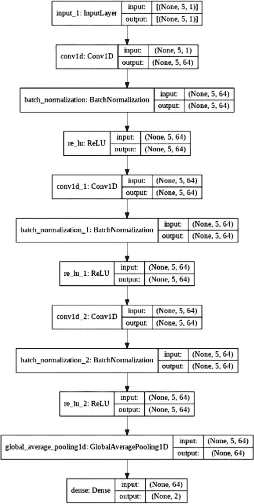

图 1.1 模型架构。

Conv1D：它是一个一维卷积层，按顺序获取数据，并在进行卷积操作后生成输出张量，如图所示。

这个卷积输入从我们的数据中提取特征，并将其通过卷积层来创建密集的潜在表示，由 图 1.1 中的展平模块表示。然后将这个展平图带到模型末端的全连接层中进行分类。


BatchNorm: 用于加速神经网络的运行。BatchNorm 是神经网络层间传递的输入值内部归一化的强制执行者。内部归一化限制了通常发生在层内激活值中的协变量偏移。以下是其数学工作原理。

ReLU: 该模型中的激活函数。公式：`f(x)=max(0,x)`。有助于捕捉归一化后数据中的非线性。

我们的 Keras 模型结构概述于 图 1.1。它使用卷积层以及 BathNorm 来实现加速和稳定性，并使用 ReLU 作为激活函数，最终获得稠密输出。

使用的损失函数是稀疏分类交叉熵。其数学模型如下，见公式 (1.1)：

```
$L\_{CE} = - \\sum\\limits\_{i = 1}^{n}{t\_{i}\\ \\log\\left( p\_{i} \\right),\\mspace{9mu}{for}\\mspace{9mu} n\\mspace{9mu}{classes},}$ (1.1)
```

`where t[i] is the truth label and p[i] is the Softmax probability for the ith class`

**公式 1.1:** 序列模型损失函数

##### 1.3.3.2 SVM 模型

使用此算法在 N 维空间中获得一个超平面，其中 N 是特征的数量。该超平面必须能够分离数据点，以便将其分类为不同的组。这个最优超平面是两个类别数据点之间距离最大的那个，从而能够创建良好的组分离。确保较大的边距距离为未来数据点提供了更高置信度分类的空间。

SVM 的损失函数可以如下表征，见公式 (1.2)。该损失函数有助于在 N 维空间中推导当前超平面，以准确计算多维数据集的分类。在此，它与五个特征一起用于特征工程后，以分析恶意和良性 DoH 数据包。SVM 模型在高维情况下非常有用，因为它提供了一个基于超平面分类的唯一损失函数。

```
$min\_{w}\\lambda \\parallel w \\parallel^{2} + \\sum\\limits\_{i = 1}^{n}{({1 - y\_{i} < x\_{i},w >})}\_{+}$ (1.2)
```

where `< \\mspace{-4mu} x_{i},w >` 是 SVM 函数，为输入 `x[i]` 和 SVM 参数 `w` 提供分类标签，而 `y[i]` 是真实标签。

**公式 1.2:** SVM 损失函数

### 1.4 结果与分析（含图表）

对于我们的模型，有两个指标。第一个是 F1 分数指标，它能够结合模型的精确率和召回率。更具体地说，它被定义为这两个指标的调和平均数。公式如下，见公式 1.3。完美模型的 F 分数为 1。

```
\\begin{array}{lll} {F\_{1} = \\frac{2}{\\frac{1}{\\ {recall}\\ } \\times \\frac{1}{\\ {precision}\\ }}} & = & {2 \\times \\frac{\\ {precision} \\times {recall}\\ }{\\ {precision} + {recall}\\ }} \\\\ & = & \\frac{tp}{{tp} + \\frac{1}{2}({fp} + {fn})} \\\\ \\end{array}$ (1.3)
```

where tp 是真正例的数量，fp 是假正例的数量，fn 是假负例的数量

**公式 1.3:** F1 分数

第二个指标是稀疏分类准确率，它计算与真实整数标签匹配的标签百分比。

1. 特征工程模块 – 额外树分类器的输出显示于 图 1.2。将整个训练数据集输入特征工程模块，以获取最重要特征的可视化表示。

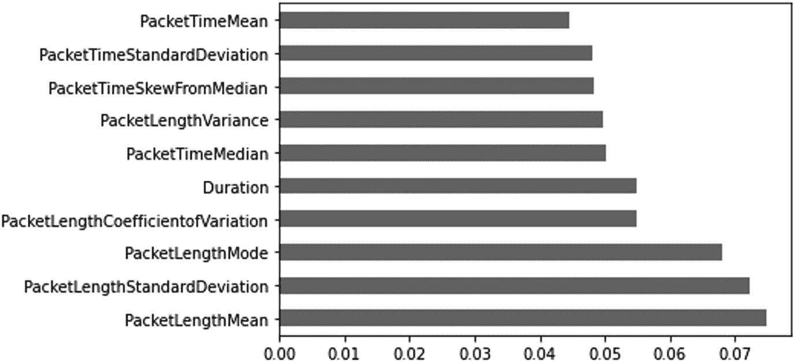

图 1.2 特征重要性。

图 1.2 显示，在尝试识别 DoH 数据包时，有五个重要特征。以下是最重要的特征，这是我们研究独特提供的：

* `PacketLengthMean`
* `PacketLengthStandardDeviation`
* `PacketLengthMode`
* `PacketLengthCoefficientofVariation`
* `Duration`

可以看出，这些特征可以从我们的解析技术中轻松获得，因为它们是公开可用且未加密的。还观察到，一般来说，对数据包长度和时间的统计分析提供了足够的信息来识别 DoH 数据包。

2. 模型性能 – Keras 模型在整个数据集上提供了 90.8% 的稀疏分类得分。SVM 模型在数据集上提供了 F1 分数，并在测试集上达到了 97% 的准确率。两个模型在各个时代的准确率描述于 图 1.3 和 图 1.4。

两种架构的训练时间最长为 2 分钟，这使得对于我们的数据集大小来说极其快速。

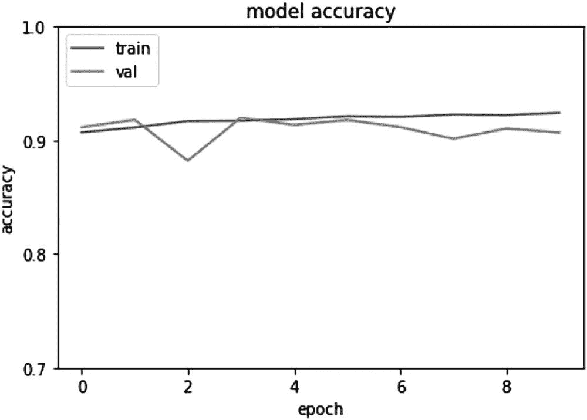

图 1.3 序列模型准确率。

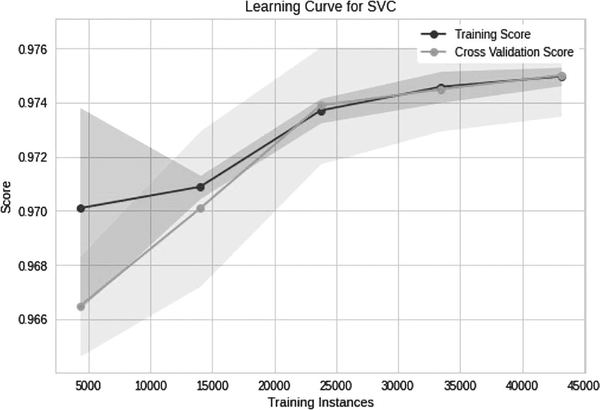

图 1.4 SVM 模型准确率。

### 1.5 结论

我们的数据集提供了比之前工作更改进、更多样的数据集。本章提供了一组更具挑战性的数据包，以更好的方式复制现实世界环境，与之前的工作相比。所提出的深度学习模型在检测这些数据包方面提供了 93% 的准确率，证明在该任务上高度准确和稳健。最后，所提出的模型在恶意 DoH 检测方面也提供了 97% 的高准确率，超越了所有之前的工作，并在该领域树立了基准。协议检测和安全是一个高度挑战性的领域。本文提出了一种机制，研究人员可以通过我们的数据集进一步将深度学习和自动化引入检测和分类中。此外，这项工作引入了一种新的深度学习方法，用于在现实世界环境中分类和检测 DoH。未来工作将涉及探索 DoT 检测，以及使用深度学习解密这些协议中的消息。解密构成了最大的挑战，我们希望所提出的工作能作为此目的的基础。

### 参考文献

1. M. MontazeriShatoori, L. Davidson, G. Kaur, and A. Habibi Lashkari, “Detection of dohtunnels using time-series classification of encrypted traffic”, in 2020 IEEE Intl Conf onDependable, Autonomic and Secure Computing, Intl Conf on Pervasive Intelligence andComputing, Intl Conf on Cloud and Big Data Computing, Intl Conf on Cyber Scienceand Technology Congress (DASC/PiCom/CBDCom/CyberSciTech), 2020, pp. 63–70. doi: [10.1109/DASC-PICom-CBDCom-CyberSciTech49142.2020.00026](https://doi.org/10.1109/DASC-PICom-CBDCom-CyberSciTech49142.2020.00026).

2. D. Vekshin, K. Hynek, and T. Cejka, “Doh insight: Detecting dns over https by machine learning”, New York, NY, USA: Association for Computing Machinery, 2020, isbn: 9781450388337. doi: [10.1145/3407023.3409192](https://doi.org/10.1145/3407023.3409192). \[Online\]. Available: [10.1145/3407023.3409192](https://doi.org/10.1145/3407023.3409192).

3. [\[Online\]](#ch01.xhtml#Cref1_3). Available: [`dnscrypt.info/`](https://dnscrypt.info)

4. C. L ́ Opez Romera, “Dns over https traffic analysis and detection”, 2020.

5. L. Jun, Z. Shunyi, L. Yanqing, and Z. Zailong, “Internet traffic classification using machine learning”, in 2007 Second International Conference on Communications andNetworking in China, IEEE, 2007, pp. 239–243.

6. T. T. Nguyen and G. Armitage, “A survey of techniques for internet traffic classification using machine learning”, IEEE communications surveys & tutorials, vol. 10, no. 4, pp. 56–76, 2008.


7.  A. Krizhevsky, I. Sutskever, and G. E. Hinton, “使用深度卷积神经网络进行 ImageNet 分类”, Advances in neural information processing systems, vol. 25, pp. 1097–1105, 2012.

8.  “构建对防火长城 DNS 审查的全面图景”，在第 4 届 USENIX 关于互联网自由和开放通信研讨会 (FOCI 14) 上，San Diego, CA: USENIX Association, Aug. 2014. \[Online\]. Available: [`www.usenix.org/conference/foci14/workshop-program/presentation/anonymous`](https://www.usenix.org/conference/foci14/workshop-program/presentation/anonymous).

9.  W. M. Shbair, T. Cholez, J. Francois, and I. Chrisment, “一种用于识别 HTTPS 服务的多级框架”, in NOMS 2016-2016 IEEE/IFIP 网络运营和管理研讨会, IEEE, 2016, pp. 240–248.

10.  J. Manzoor, I. Drago, and R. Sadre, “HTTP/2 如何改变 Web 流量以及如何检测它”, in 2017 网络流量测量与分析会议 (TMA), IEEE, 2017, pp. 1–9.

11.  T. A. Pẽna, “一种用于检测域名系统中隐蔽信道的深度学习方法”, Ph.D. 论文, Capitol Technology University, 2020.

12.  J. Bushart and C. Rossow, “填充还不够：评估加密 DNS 的隐私保障”, in 第 10 届 USENIX 关于互联网自由和开放通信研讨会 (FOCI 20), 2020.

13.  S. Siby, M. Juarez, C. Diaz, N. Vallina-Rodriguez, and C. Troncoso, “加密 DNS – 隐私？一种流量分析视角”, Jun. 2019.

14.  A. Sherstinsky, “循环神经网络 (RNN) 和长短期记忆 (LSTM) 网络基础”, Physica D: Nonlinear Phenomena, vol. 404, p. 132 306, 2020.

15.  G. P. Zhang, “使用混合 ARIMA 和神经网络模型进行时间序列预测”, Neurocomputing, vol. 50, pp. 159–175, 2003.

16.  S. Guha and P. Francis, “身份踪迹：使用 DNS 进行隐蔽监控”, in 第 7 届隐私增强技术研讨会论文集, 2007.

17.  M. Ghaemi and M.-R. Feizi-Derakhshi, “使用森林优化算法进行特征选择”, Pattern Recognition, vol. 60, pp. 121–129, 2016.

18.  G. Biau and E. Scornet, “随机森林导览”, Test, vol. 25, no. 2, pp. 197–227, 2016.

19.  S. R. Safavian and D. Landgrebe, “决策树分类器方法论综述”, IEEE transactions on systems, man, and cybernetics, vol. 21, no. 3, pp. 660–674, 1991.

20.  M. Borga, “学习多维信号处理”, Ph.D. 论文, Link öping University Electronic Press, 1998.

21.  T. Joachims, “使大规模 SVM 学习实用化”, 技术报告, Tech. Rep., 1998.

22.  P. Pearce, B. Jones, F. Li, R. Ensafi, N. Feamster, N. Weaver, and V. Paxson, “DNS 操纵的全球测量”, in 第 26 届 USENIX 安全研讨会 (USENIX Security 17), Vancouver, BC: USENIX Association, Aug. 2017, pp. 307–323, isbn: 978-1-931971-40-9. \[Online\]. Available: [`www.usenix.org/conference/usenixsecurity17/technical-sessions/presentation/pearce`](https://www.usenix.org).

23.  A. F. M. Agarap, “一种结合门控循环单元 (GRU) 和支持向量机 (SVM) 的神经网络架构，用于网络流量数据中的入侵检测”, in 2018 年第 10 届机器学习与计算国际会议论文集, 2018, pp. 26–30.

## 2 基于机器学习的 Wi-Fi 网络中信标伪造检测方法

Rohit Jaysankar¹, Vamshi Sunku Mohan², and Sriram Sankaran²

¹Center for Cybersecurity Systems and Networks, Amrita Vishwa Vidyapeetham, Amritapuri, India

²Cybersecurity Systems and Networks, Amrita Vishwa Vidyapeetham, Amritapuri, India

DOI: [10.1201/9781003212249-2](https://doi.org/10.1201/9781003212249-2)


### 2.1 简介

Wi-Fi 属于基于 IEEE 802.11 的无线技术协议族，已成为连接 IoT 设备的重要组成部分。专家预测，到 2022 年，超过一半的 IP 流量将由无线设备产生 \[1]，而这些设备访问互联网的高效方式将是通过利用 Wi-Fi。Wi-Fi 利用称为接入点的有线网络设备 \[2] 来连接互联网。

接入点使用信标和去认证帧等管理帧来宣布其存在或从网络断开连接。这些帧缺乏身份验证，最终可能导致欺骗，从而引发信标伪造、去认证攻击、信标泛滥等攻击。去认证和信标泛滥的组合可用于消耗合法接入点的资源，并诱骗用户连接到可能成为中间人攻击热点的伪造接入点。信标伪造还可能导致受害者的传输功率降低，最终使网络连接无法使用 \[3,4\]。

与有线网络相比，在实时 Wi-Fi 网络中防御攻击具有挑战性，因为很难控制访问区域和保护传输介质。然而，分析数据包模式可以帮助预先预测攻击并准备应对新出现的威胁 \[5\]。为此，入侵检测系统 (IDS) 被用来分析正常和异常行为的模式。IDS 存在两大类，如下所述。

1.  基于签名的 IDS – 基于签名的 IDS 定义网络中的模式，并将其与防火墙规则进行比较，以实时检测攻击。然而，这需要不断更新规则，因为新的防火墙法规将帮助攻击者逃避检测 \[6\]。

2.  基于异常的 IDS – 基于异常的 IDS 分析数据包流量并检测与正常行为的偏差。尽管 IDS 检测未知攻击，但与基于签名的 IDS 相比，它需要更高的处理时间 \[7,8,9\]。


现有的 IDS 能够检测信标帧伪造和接入点泛洪攻击，但无法检测去认证攻击和信标泛洪，这最终可能导致合法接入点拒绝服务。因此，本文提出了一种基于机器学习的方法来检测大量信标伪造。具体而言，我们通过在网络上发起伪造、泛洪和去认证攻击，捕获网络帧，并使用监督学习和深度学习模型对其进行分析来生成数据集。结果表明，我们的方法能够以 92% 的准确率检测信标伪造、泛洪和去认证等攻击。

### 2.2 问题陈述

在本文中，我们提出使用监督学习和深度学习模型（如 `SVM`、`k-NN`、`random forest`、`MLP` 和 `CNN`）来分类多种类型的信标伪造。具体而言，我们通过在运行 Kali Linux 的虚拟机上使用 Python 脚本对 Wi-Fi 网络发起伪造攻击，生成 pcap 格式的数据集 \[10]。生成的数据集使用 `tshark` \[11] 基于静态分类规则转换为 csv 文件。然后对数据集进行检查，以检测和分类各种类型的信标攻击，例如伪造、泛洪和去认证。

### 2.3 相关工作

现有工作已提出 IDS 和机器学习算法来检测和预测常见的网络攻击，例如 DDoS、中间人攻击等。然而，很少有方法研究管理帧来检测信标攻击。其中一些方法详细介绍如下。

Liu 等人 \[12] 基于位置和集中式监控检测无线传感器网络（WSN）中的虚假信标节点。但所提出的算法显示出较高的误报率，因此模型不适用。\[13] 和 \[14] 采用了类似的方法，作者提出了一种基于序列号对管理帧进行分类的理论方法。Ping Lu 等人 \[15] 提出了一种基于位置指纹的自适应方法来检测虚假接入点。然而，这种方法也导致了较低的准确率。Lovinger 等人 \[16] 提出了一种便携式方法，使用基于签名的方法检测网络中的去认证和虚假接入点，但需要额外的固件。\[17] 和 \[18] 通过实现时钟偏移检测了虚假接入点。但这种方法需要修改协议和接入点。Di Mauro 等人 \[19] 利用质询-响应认证协议在无线传感器网络中检测虚假 AP。Han 等人 \[20] 使用用户与 DNS 服务器之间的往返时间（RTT）来检测虚假 AP，尽管该模型在低流量和高流量期间分别能够提供 100% 和 60% 的准确率。无线嗅探器也可用于查找虚假 AP。然而，这些方法在公共/大面积区域部署成本高昂 \[21,22]。

与现有方法相反，我们通过发起伪造、泛洪和去认证攻击并捕获网络流量来生成数据集。使用 `tshark` 从 pcap 文件中提取相关特征，并根据理论规则进一步分类。生成的数据集使用各种监督学习和深度学习模型（如 `SVM`、`k-NN`、`MLP`、`random forest` 和 `CNN`）进行分析，以分类不同的信标攻击。

### 2.4 模型简介

在本节中，我们对所模拟的数学模型进行了简要介绍。

#### 2.4.1 SVM

`SVM` 用于二进制分类，通过构建由公式 2.1 给出的边际超平面，在数据点簇之间提出最优边界。

`H : w^(T)(x) + b = 0` (2.1)

数据点被迭代分类，以最小化对新测试点分类的错误。这是通过使用内核将特征向量 `ϕ(x)` 转换为高维空间来完成的。然后使用公式 2.2 对数据点进行分类。

`y[n][w^(T)ϕ(x[n])+b] ≤ 0∀n` (2.2)

#### 2.4.2 k-NN

`k-NN` 选择 `k` 个最近邻，并使用欧几里得距离（`d`）计算查询实例与其余样本之间的距离，如公式 2.3 所示。得到的值按顺序排列，并选择前 `k` 个点来确定最近邻 \[23]。

```
$d(p,q) = \\sqrt{\\sum\\limits\_{i = 1}^{n}{(q\_{i} - p\_{i})}^{2}}$ (2.3)
```

其中，

1. `p[i]` = 查询实例

2. `q[i]` = 考虑的第二个样本

#### 2.4.3 随机森林

随机森林是一种集成算法，它在不同的样本簇上构建决策树，并在分类数据点时采用多数投票。用于确定每个特征重要性的权重按公式 2.4 计算。

```
$RF\_{i} = \\frac{\\sum\_{j \\in alltrees}{norm\_{ij}}}{T}$ (2.4)
```

其中，

1. `RF[i]` = 从所有决策树计算出的特征 `i` 的重要性

2. `norm[ij]` = 树 `j` 中特征 `i` 的归一化特征重要性

3. `T` = 树的总数

#### 2.4.4 多层感知机 (MLP)

MLP 属于前馈神经网络类，它在有向图中连接多个层，从而通过节点提供信号路径。每个节点由非线性激活函数 `y = f(WxT + b)` 表征。当观察到分类错误时，每个节点的权重按公式 2.5 更新。

```
weight = weight + L * (y[exp] − y[pred]) * x (2.5)
```

其中，

1. `L` = 学习率

2. `y[exp]` = 输出的期望值

3. `y[pred]` = 输出的预测值

4. `x` = 输入

#### 2.4.5 CNN

CNN 属于处理具有网格拓扑的数据的神经网络类。每个卷积层包含一系列称为内核的滤波器。内核是整数（像素）矩阵，用于将输入向量重塑为与内核相同的大小，如公式 2.6 所示。此特性称为步长。内核和重塑向量中的相应像素相乘以生成特征图。然后根据特征图值学习和分类数据。

```
$W\_{out} = \\frac{W - F + 2P}{S} + 1$ (2.6)
```

其中，

1. `W[out]` = 输出体积的大小

2. `W` = 输入的大小

3. `F` = 空间大小

4. `P` = 填充

5. `S` = 步长

### 2.5 数据集生成

在本节中，我们描述了用于检测信标伪造的数据集生成过程。

通过使用 Kali Linux 执行信标伪造、信标欺骗和去认证攻击生成了数据集。用于数据包注入的网络适配器是 Leoxsys 150 Mbps \[24]。上述每种攻击的简要描述及其模拟过程如下所述。

#### 2.5.1 信标伪造

在信标伪造中，攻击者出于恶意目的伪造合法接入点的信标。为了复制该攻击，我们使用 Python 脚本通过复制其 ssid、bssid 和信道功能来伪造信标。传输时间设置为 100 TU（传输单位）。Kali Linux 中的攻击模拟截图如 图 2.1 所示，描述信标接收速率（合法和伪造）的图表如 图 2.2 所示。


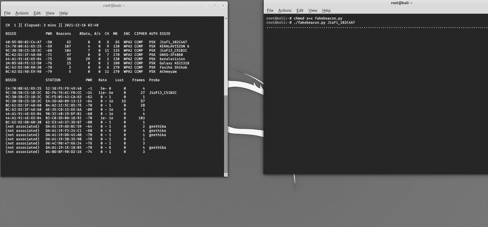

Figure 2.1 使用 kali linux 创建伪造信标。

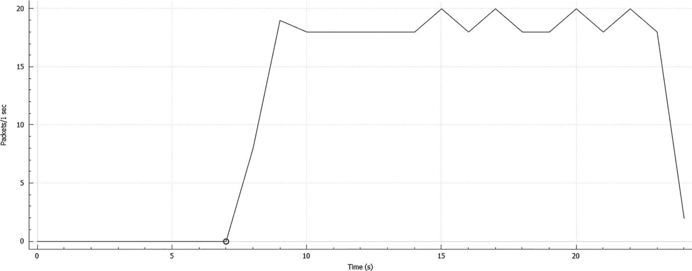

Figure 2.2 信标伪造攻击期间网络帧的流速。

Figure 2.2 显示了攻击期间受害者和接入点处信标在网络中的流量。我们观察到，在信标泛滥期间，来自同一接入点的信标帧数量有所增加。由此，我们推断信标帧伪造成功。

#### 2.5.2 信标泛滥

信标泛滥会阻止受害者选择正确的接入点。我们通过向受害者发送具有相同 ssid 的伪造接入点信标来模拟该攻击。该泛滥攻击使用 Python 中的 `SCAPY` 库进行模拟。使用 kali linux 模拟的信标泛滥攻击的截图以及接收到具有特定 ssid 的信标的图表分别在 图 2.3 和 2.4 中给出。

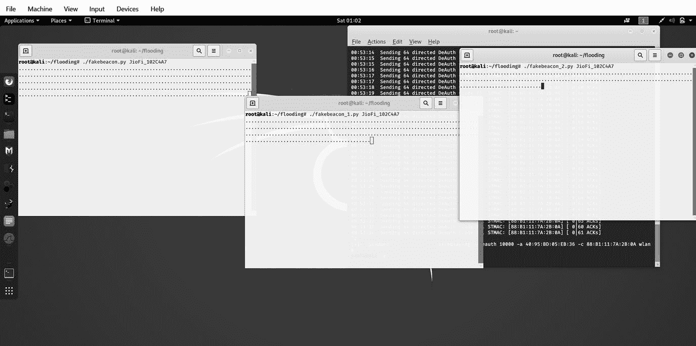

Figure 2.3 使用 kali linux 进行信标泛滥。

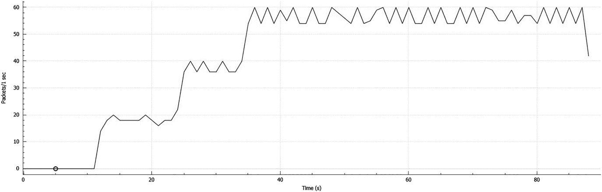

Figure 2.4 信标泛滥攻击期间网络帧的流速。

Figure 2.4 显示了信标泛滥攻击期间信标帧的增加，但与伪造攻击不同，这些信标具有相同的 ssid 但不同的 bssid。高信标流速表明泛滥攻击已成功执行，如 图 2.2 所示。信标泛滥攻击更容易检测，因为受害者会被大量帧淹没。

#### 2.5.3 去认证攻击

去认证帧在 WiFi 802.11 协议中由客户端/接入点用于终止连接，因为它们不需要数据包确认。攻击者使用这些帧断开合法用户的连接，并阻止其连接到合法接入点。它们还可用于消耗接入点的资源，从而使其无法以固定间隔发送信标。此类攻击可用于信标泛滥、MitM（中间人攻击）。使用 kali linux 模拟的去认证攻击的快照以及去认证帧流量的图表分别在 图 2.5 和 2.6 中给出。

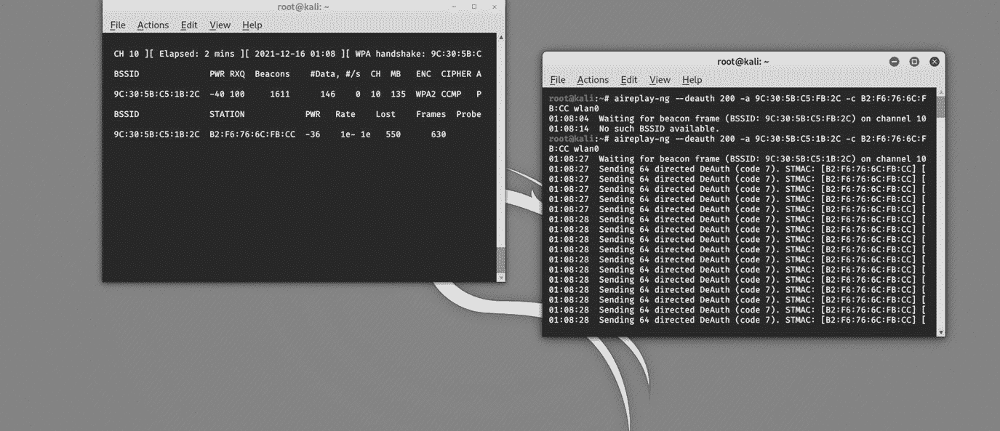

Figure 2.5 使用 kali linux 进行去认证攻击。

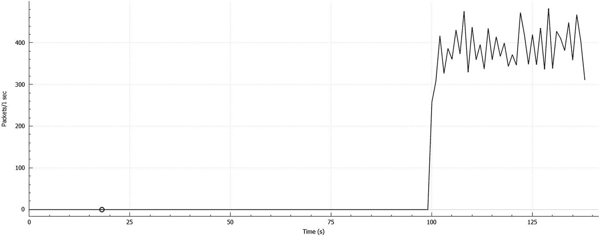

Figure 2.6 去认证攻击期间去认证帧的流速。

Figure 2.7 显示了攻击期间网络中去认证帧的到达速率。仅当接入点从网络中去认证一个站点时，才会观察到这些帧。去认证帧的异常增加表明发生了去认证攻击。

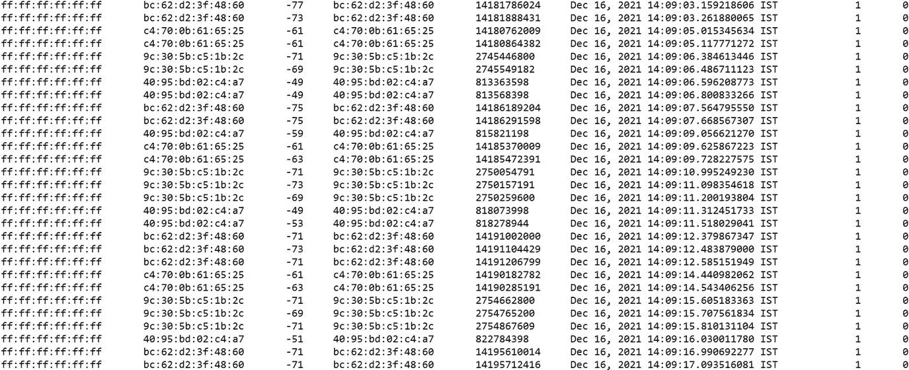

Figure 2.7 平衡数据集评估的图形结果。

#### 2.5.4 攻击建模

在本小节中，我们描述了所提方法的方法论，该方法涉及信标伪造的建模和仿真。

我们建议模拟每种信标攻击，捕获网络流量，并分析潜在风险。特别是，在攻击期间捕获了数据包，并将其存储在 pcap 文件中。然后使用 `tshark` 从文件中以文本格式提取数据，其截图如 图 2.8 所示。从文本文件中删除了不需要的空格。提取的一些特征特定于去认证帧或信标帧，如 表 2.1 所示。

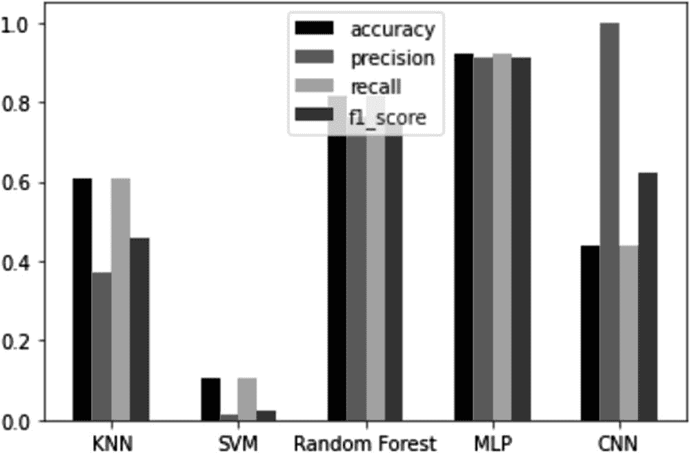

Figure 2.8 提取数据的示例。

表 2.1 从 pcap 文件中提取的特征

| 提取的特征 || 描述 |

| --- | --- |

| `wlan.da` || 帧的目的地 |

| --- | --- |

| `wlan.fixed.timestamp` || 到达时间戳 |

| `wlan.bssid` || 帧的 bssid（Mac 地址） |

| `frame.time` || 时间戳 |

| `wlan radio.signal dbm` || 无线信号强度 |

| `wlan.fixed.beacon` || 信标间隔 |

| `wlan.sa` || 接入点的源地址 |

| `wlan.fixed.capabilities.ess` || 信道能力（扩展服务集） |

| `wlan.fixed.capabilities.ibss` || 信道能力（ibss） |

| `wlan.ra` || 接收器地址（去认证帧） |

| `wlan.fixed.capabilities.cfpoll.ap` || 信道能力（CFP 参与） |

| `wlan.fixed.capabilities.privacy` || 信道能力（隐私） |

| `wlan.fixed.capabilities.preamble` || 信道能力（短前导码） |

| `wlan.fixed.capabilities.pbcc` || 信道能力（pbcc） |

| `wlan.fixed.capabilities.agility` || 信道能力（信道敏捷性） |

| `wlan.fixed.capabilities.spec man` || 信道能力（频谱管理） |

| `wlan.fixed.capabilities.short slot time` || 信道能力（短时隙时间） |

| `wlan.fixed.capabilities.radio measurement` || 信道能力（已实现无线测量） |

| `wlan.fixed.capabilities.apsd` || 信道能力（apsd） |

| `wlan.ssid` || 接入点的 ssid（接入点名称） |

| `wlan.fixed.capabilities.del blk ack` || 信道能力（延迟块 ACK） |

| `frame.time epoch` || 纪元时间 |

| `frame.time relative` || 从第一个帧到达以来经过的时间 |

| `wlan.sa` || 源地址（去认证帧） |

| `wlan.fixed.capabilities.imm blk ack` || 信道能力（立即块 ack-结束） |

| `wlan.fixed.capabilities.dsss ofdm` || 信道能力（允许 DSSS-OFDM） |

| `wlan.fixed.reason code` || 去认证原因 |

##### 2.5.4.1 特征提取

数据预处理后，计算了来自同一源的两个连续帧之间的频率和时间差。提取的特征描述如下。

1. 频率 – 频率使用到达时间计算。计算在 3 秒时间跨度内到达的去认证帧数量。记录第一个帧的到达时间，并且每 3 秒更新一次数值。较高的频率表明网络中去认证帧数量较多，从而导致去认证攻击。频率按公式 2.7 计算。

    `Frequency = ND / T` (2.7)

其中，

1. ND = 去认证帧数量

2. T = 更新时间

2. 时间差 – 时间差基于帧的纪元时间计算，如公式 2.8 所示。这主要用于检测信标伪造，因为信标以固定间隔 100 个传输单元（TUs）传输。

`Time_Difference = ATCF - ATPF` (2.8)

其中，

1. ATCF = 来自同一源的当前帧的到达时间

2. ATPF = 来自同一源的前一帧的到达时间

### 2.6 数据集分类


# 数据集分类方法

本节描述了数据集分类的方法。训练和测试数据集是使用捕获的信标流量中的分类规则生成的。采用独热编码将数据集中所有字符值转换为数值。由此获得的训练数据集包含 11,721 行和 52 列，而测试集包含 4,331 行和 52 列。然后，我们根据正常流量期间观察到的行为特征对攻击帧进行分类，如下所述。

1.  去认证攻击 – 如果去认证帧的频率大于非商业 Wi-Fi 的阈值以避免断开连接，则数据被分类为去认证攻击。

2.  信标泛滥 – 如果受害者设备捕获到具有相同 ssid 和 bssid（MAC 地址）恒定变化的流量，则数据被分类为信标泛滥。

3.  信标伪造 – 如果来自单一来源的信标的到达时间小于 100 个传输单元（TUs），则数据被分类为信标伪造 \[25\]。

### 2.7 Evaluation

训练数据预处理后，使用各种机器学习和深度学习模型来研究数据中的攻击模式。由于如 Table 2.2 所示的结果数据集不平衡，我们使用合成少数类过采样技术（SMOTE）\[26\] 通过过采样少数类来平衡它。SMOTE 随机选择少数类中的一个点，找到 `k` 个最近邻，并从所选邻居创建基于实例的合成数据点。Table 2.3 显示了平衡后的数据集的类分布。

Table 2.2 Class Distribution of Dataset Before SMOTE Balancing (Unbalanced Dataset)

| Class || Number of Samples |

| --- | --- |

| Normal || 7,118 |

| --- | --- |

| Beacon Flooding || 2,222 |

| De-authentication Attack || 1,262 |

| Beacon Forgery || 1,119 |

Table 2.3 Class Distribution of Dataset After SMOTE Balancing (Balanced Dataset)

| Class || Number of Samples |

| --- | --- |

| Normal || 7,118 |

| --- | --- |

| Beacon Flooding || 7,118 |

| De-authentication Attack || 7,118 |

| Beacon Forgery || 7,118 |

模型性能使用准确率、精确率、F1 分数和召回率等指标进行评估。

1.  Precision – Precision helps to understand the ability to classify relevant data points. It is calculated using the equation below. 

    `Precision = TP / (TP + FP)` (2.9)

2.  Recall – Recall defines the ability of the model to find all the relevant cases within a dataset. 

    `Recall = TP / (TP + FN)` (2.10)

3.  Accuracy – Accuracy is the number of correctly predicted data points out of all the data points. 

    `Accuracy = TP / Total Samples` (2.11)

4.  F1 score – The F1 score measures the accuracy of the model on a dataset by calculating the harmonic mean between precision and recall.

    `F1_Score = (2 * Precision * Recall) / (Precision + Recall)` (2.12)

#### 2.7.1 Analyzis of Results

我们研究了模型在不平衡和平衡数据集上的性能。这是由于少数类和多数类之间的数量巨大差异可能导致分类器决策产生偏差。

k-NN、`SVM`、`random forest`、`MLP` 和 `CNN` 在不平衡数据集上的精确率、召回率、F1 分数和准确率等性能参数显示在 Table 2.4 并在 Figure 2.9 中绘制。生成的混淆矩阵分别给出在 Figures 2.9、2.10、2.11、2.12 和 2.13。

Table 2.4 Performance Metrics on Unbalanced Dataset

| Algorithm || Precision (%) || Recall (%) || F1-Score (%) || Accuracy (%) |

| --- | --- | --- | --- | --- |

| **Machine Learning Models** |

| --- |

| k-NN || 36.87 || 60.72 || 45.89 || 60.72 |

| SVM || 11.50 || 10.76 || 20.90 || 10.76 |

| Random Forest || 78.97 || 73.32 || 65.39 || 73.32 |

| **Deep Learning Models** |

| MLP || 91.00 || 91.00 || 92.00 || 92.00 |

| CNN || 100.00 || 44.00 || 62.00 || 44.00 |

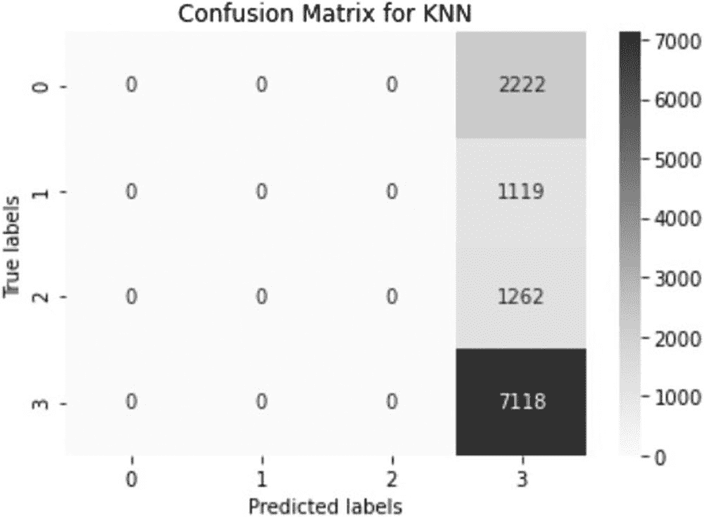

Figure 2.9 Graphical results for evaluation of unbalanced data.

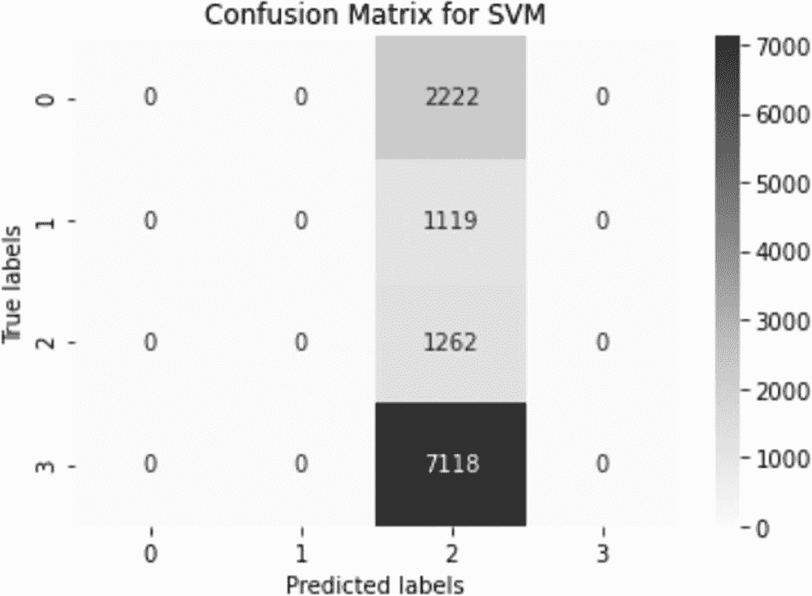

Figure 2.10 Confusion matrix of k-NN for unbalanced dataset.

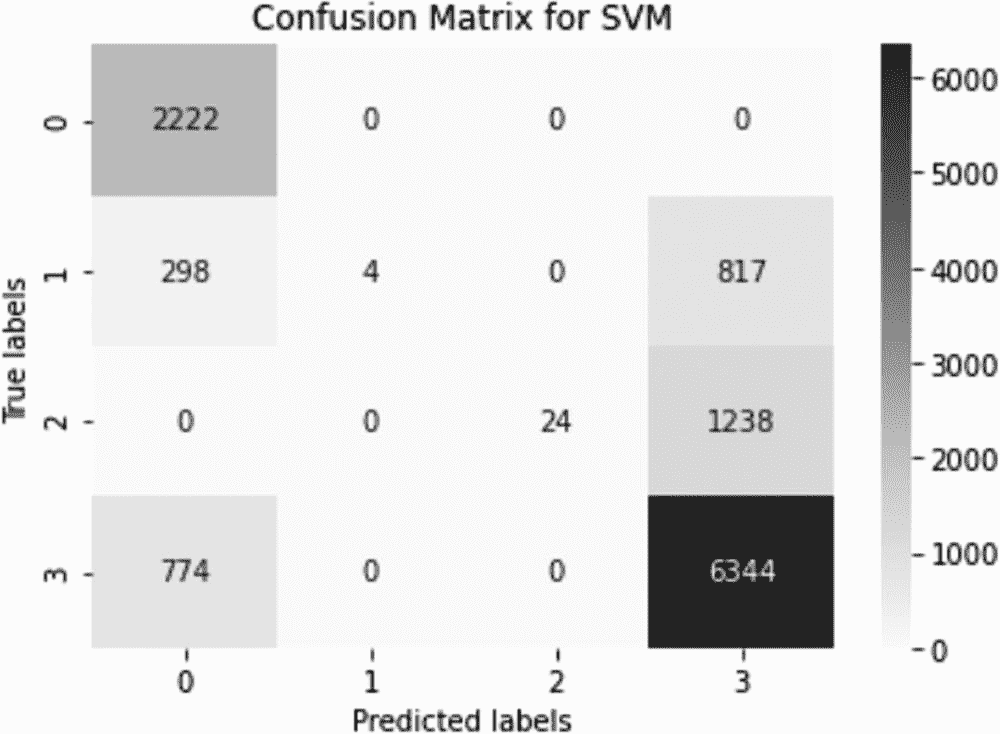

Figure 2.11 Confusion matrix of SVM for unbalanced dataset.

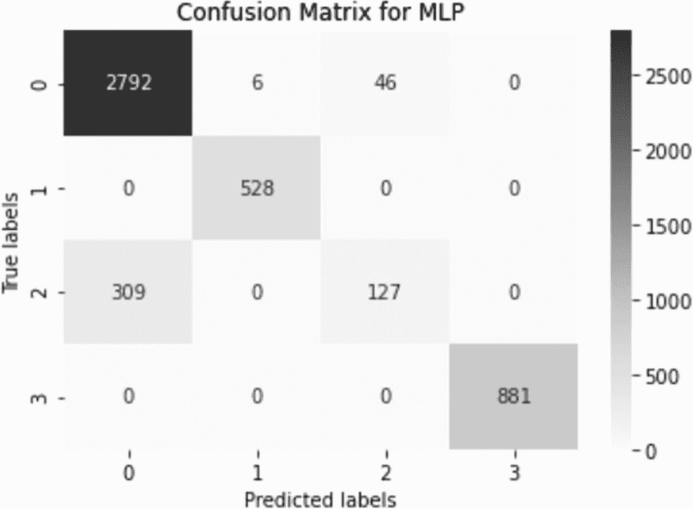

Figure 2.12 Confusion matrix of random forest for unbalanced dataset.

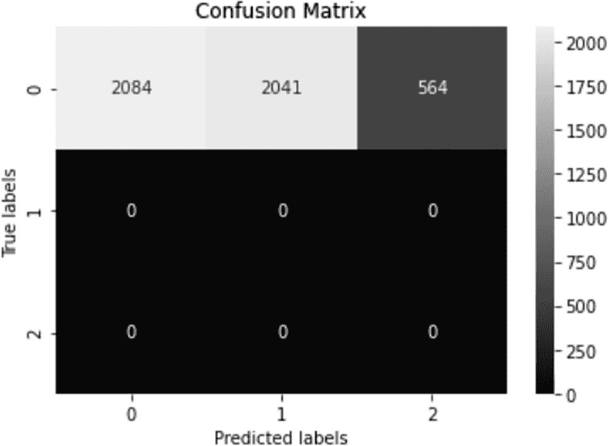

Figure 2.13 Confusion matrix of MLP for unbalanced dataset.

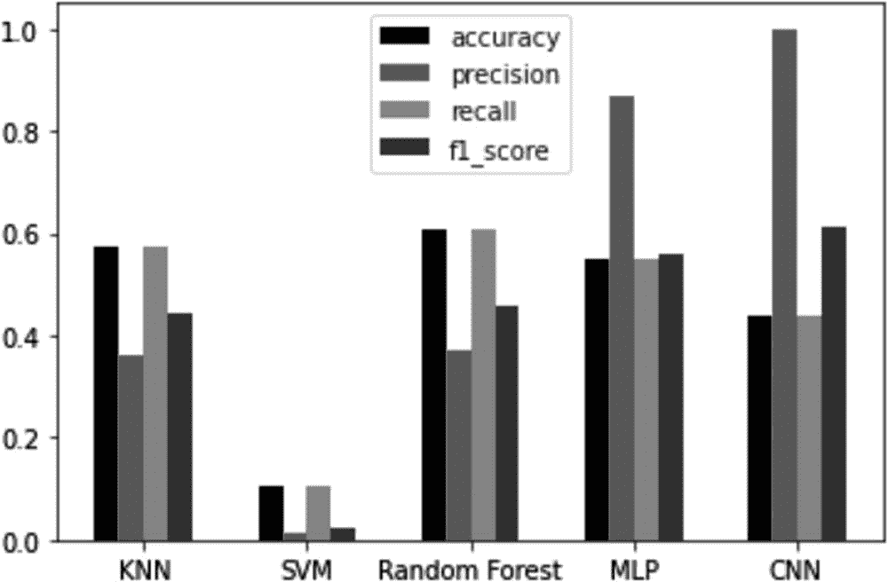

Figure 2.14 Confusion matrix of CNN for unbalanced dataset.

使用平衡数据集训练的模型评估指标给出在 Table 2.5 并如 Figure 2.7 所示绘制。k-NN、`SVM`、`random forest`、`MLP` 和 `CNN` 的生成混淆矩阵分别给出在 Figures 2.15、2.16、2.17、2.18 和 2.19。使用不平衡数据集获得的评估指标显示 `MLP` 具有最高的准确率，其次是 `random forest`。适用于二元分类的 `SVM` 性能最差。由于 `CNN` 研究采样的原始数据，其准确率非常低。从使用平衡数据集获得的结果可以看出，尽管 `random forest` 优于其他模型，但由于少数类的过采样，效率急剧下降。这种现象可以在所有模型中观察到。我们观察到，与平衡数据集相比，所有模型在不平衡（原始）数据集上的表现都更好。这是因为用于平衡数据集的 `SMOTE` 在高维数据上表现不佳。我们展示了 `MLP` 在不平衡数据集上更好地分类信标伪造。

Table 2.5 Performance Metrics on Balanced Dataset

| Algorithm || Precision (%) || Recall (%) || F1 Score (%) || Accuracy (%) |

| --- | --- | --- | --- | --- |

| **Machine Learning Models** |

| --- |

| k-NN || 36.25 || 57.40 || 44.37 || 57.40 |

| SVM || 11.50 || 10.76 || 20.93 || 10.76 |

| Random Forest || 59.97 || 70.51 || 62.12 || 70.51 |

| **Deep Learning Models** |

| MLP || 87.00 || 55.00 || 56.00 || 55.00 |

| CNN || 100.00 || 44.00 || 61.00 || 44.00 |

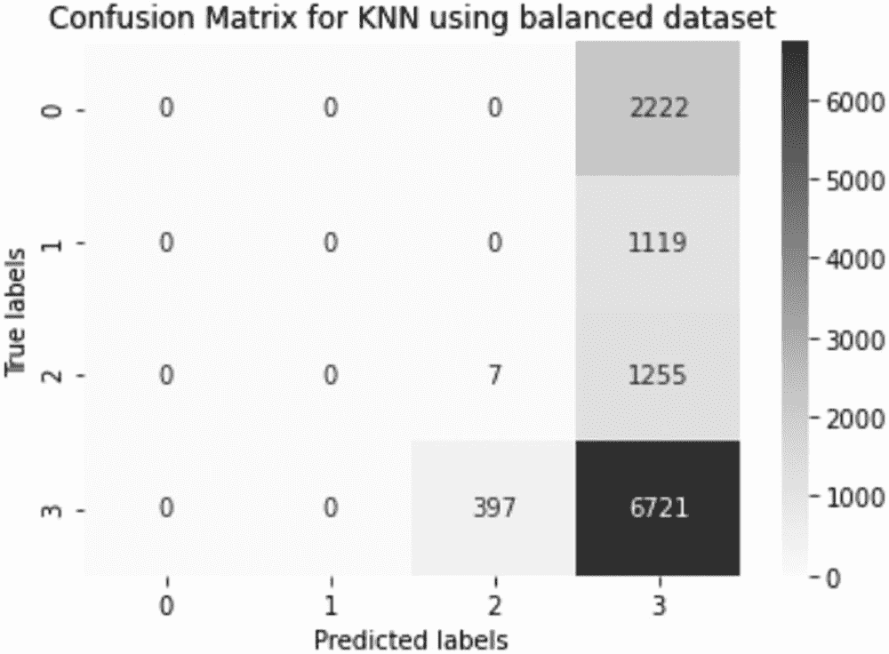

Figure 2.15 Confusion matrix of k-NN for balanced dataset.

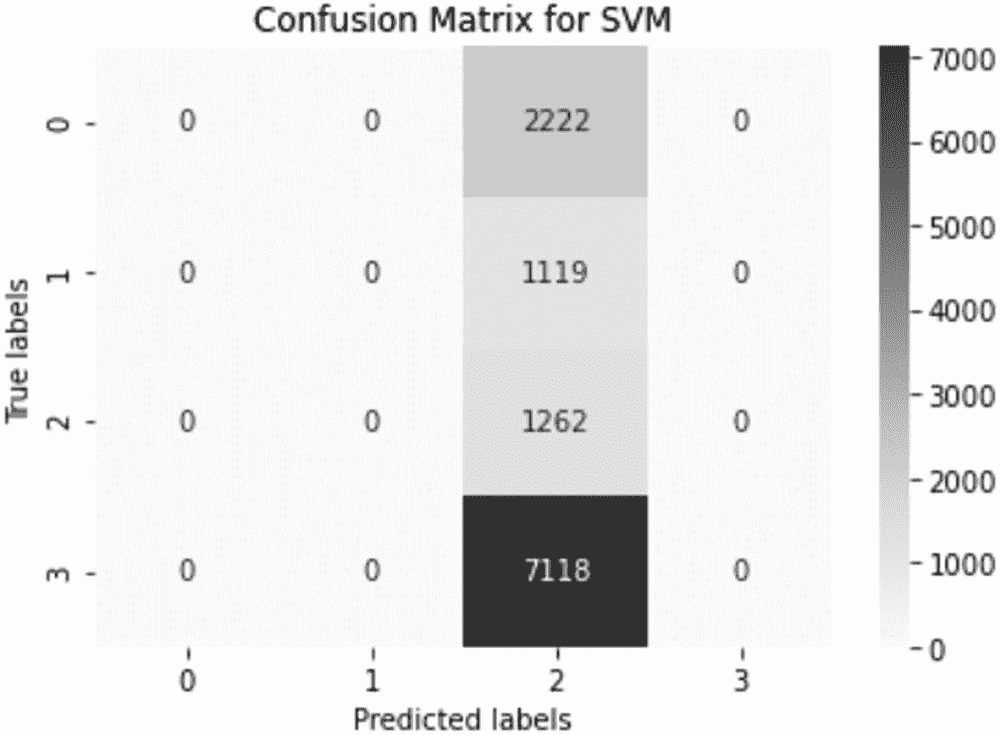

Figure 2.16 Confusion matrix of SVM for balanced dataset.

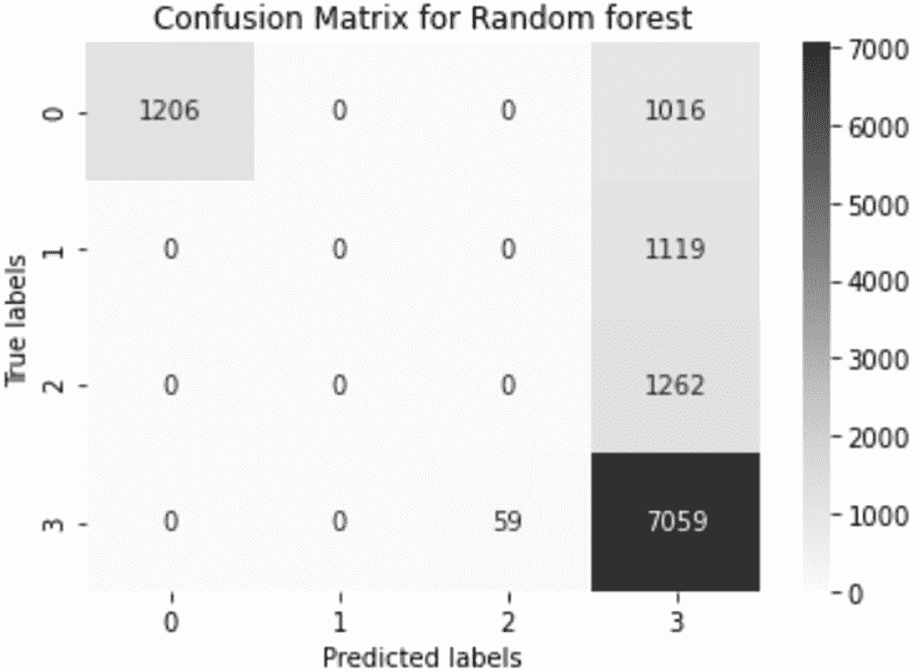

Figure 2.17 Confusion matrix of random forest for balanced dataset.

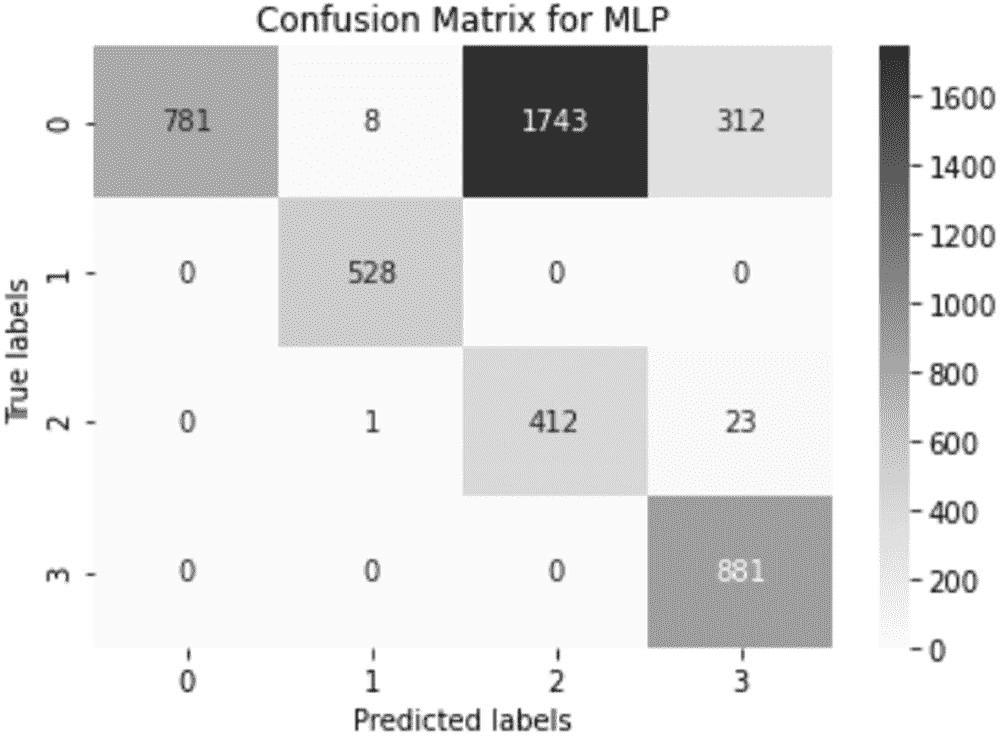

Figure 2.18 Confusion matrix of MLP for balanced dataset.


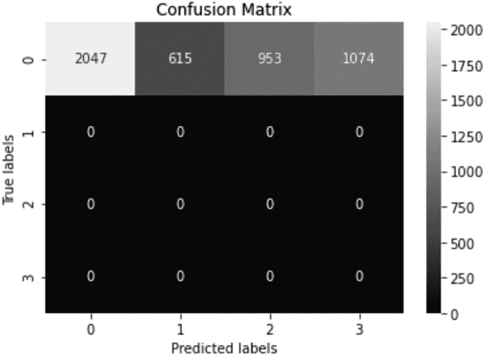

Figure 2.19 Confusion matrix of CNN for balanced dataset.

### 2.8 结论与未来工作

在本文中，我们提出了一种基于机器学习的方法来检测信标伪造。具体来说，我们通过执行使用 `kali linux` 的攻击来开发一个数据集，并使用 `tshark` 对其进行预处理。使用 `SVM`、`k-NN`、随机森林、`MLP` 和 `CNN` 对所得数据集进行研究，以分类信标伪造、检测和去认证攻击。我们的方法以最高 92.00% 的准确率对各种攻击进行分类。我们提出通过提出一种混合模型来扩展我们的工作，该模型将基于签名的方法与机器学习相结合，以在实时条件下对攻击进行分类。

### 参考文献

1.  “Cisco Visual Networking Index: Global Mobile Data Traffic Forecast Update, 2017–2022”, White Paper, Cisco, 2019.

2.  Mart´ınez, Asier, et al. “Beacon frame spoofing attack detection in IEEE 802.11 networks”. 2008 Third International Conference on Availability, Reliability and Security. IEEE, 2008.

3.  Vanhoef, Mathy, Prasant Adhikari, and Christina P¨opper. “Protecting wi-fi beacons from outsider forgeries”. Proceedings of the 13th ACM Conference on Security and Privacy in Wireless and Mobile Networks. 2020.

4.  Asaduzzaman, Md, Mohammad Shahjahan Majib, and Md Mahbubur Rahman. “Wi-fi frame classification and feature selection analysis in detecting evil twin attack”. 2020 IEEE Region 10 Symposium (TENSYMP). IEEE, 2020.

5.  Boob, Snehal, and Priyanka Jadhav. “Wireless intrusion detection system”. International Journal of Computer Applications 5. 8 (2010): 9–13.

6.  Bronte, Robert, Hossain Shahriar, and Hisham M. Haddad. “A signature-based intrusion detection system for web applications based on genetic algorithm”. Proceedings of the 9th International Conference on Security of Information and Networks. 2016.

7.  Otoum, Yazan, and Amiya Nayak. “AS-IDS: Anomaly and Signature Based IDS for the Internet of Things”. Journal of Network and Systems Management 29. 3 (2021): 1–26.

8.  Ugochukwu, Chibuzor John, E. O. Bennett, and P. Harcourt. An intrusion detection system using machine learning algorithm. LAP LAMBERT Academic Publishing, 2019.

9.  Usha, M., and P. J. W. N. Kavitha. “Anomaly based intrusion detection for 802.11 networks with optimal features using SVM classifier”. Wireless Networks 23. 8 (2017): 2431–2446.

10.  “Kali”. \[Online\]. Available: [`www.kali.org/`](https://www.kali.org)

11.  “TSHARK.DEV”. \[Online\]. Available: [`tshark.dev/`](https://tshark.dev)

12.  Liu, Donggang, Peng Ning, and Wenliang Du. “Detecting malicious beacon nodes for secure location discovery in wireless sensor networks”. 25th IEEE International Conference on Distributed Computing Systems (ICDCS'05). IEEE, 2005.

13.  Wright, “Detecting wireless LAN MAC address spoofing”, [`home.jwu.edu/jwright/`](http://home.jwu.edu), 2003.

14.  Stefano, D., A. Scaglione, G. Terrazzino, I. Tinnirello, V. Ammirata, L. Scalia, G. Bianchi, and C. Giaconia, “Wifi does not imply 802.11 standard compliancy: experimental”

15.  Lu, Ping. “A Position Self-Adaptive Method to Detect Fake Access Points”. Journal of Quantum Computing 2. 2 (2020): 119.

16.  Lovinger, Norbert, et al. “Detection of wireless fake access points”. 2020 12th International Congress on Ultra Modern Telecommunications and Control Systems and Workshops (ICUMT). IEEE, 2020.

17.  Jadhav, Swati, S. B. Vanjale, and P. B. Mane. “Illegal Access Point detection using clock skews method in wireless LAN”. 2014 International Conference on Computing for Sustain- able Global Development (INDIACom). IEEE, 2014.

18.  Kim, Doyeon, Dongil Shin, and Dongkyoo Shin. “Unauthorized access point detection using machine learning algorithms for information protection”. 2018 17th IEEE Inter- national Conference On Trust, Security And Privacy In Computing And Communica- tions/12th IEEE International Conference On Big Data Science And Engineering (Trust- Com/BigDataSE). IEEE, 2018.

19.  Di Mauro, Alessio, et al. “Detecting and preventing beacon replay attacks in receiver- initiated MAC protocols for energy efficient WSNs”. Nordic Conference on Secure IT Sys- tems. Springer, Berlin, Heidelberg, 2013.

20.  Han, Hao, et al. “A timing-based scheme for rogue AP detection”. IEEE Transactions on parallel and distributed Systems 22. 11 (2011): 1912–1925.

21.  Ma, L., A.Y. Teymorian, and X. Cheng, “A Hybrid Rogue Access Point Protection Frame- work for Commodity Wi-Fi Networks”, Proc. IEEE INFOCOM, 2008

22.  Yin, H., G. Chen, and J. Wang, “Detecting Protected Layer-3 Rogue APs”, Proc. Fourth IEEE Int'l Conf. Broadband Comm., Networks, and Systems (BROADNETS '07), 2007.

23.  Cavusoglu, Unal. “A new hybrid approach for intrusion detection using machine learning methods”. Applied Intelligence 49. 7 (2019): 2735–2761.

24.  “Leoxsys”. \[Online\]. Available: [`www.leoxsys.com`](https://www.leoxsys.com)

25.  Kao, Kuo Fong, et al. “An accurate fake access point detection method based on deviation of beacon time interval”. 2014 IEEE Eighth International Conference on Software Security and Reliability-Companion. IEEE, 2014.

26.  Chawla, Nitesh Bowyer, Kevin Hall, W. Lawrence Kegelmeyer (2002). “SMOTE: Synthetic Minority Over-sampling Technique”. Journal of Artificial Intelligence Research (JAIR). 16. 321–357. [10.1613/jair.953](https://doi.org/10.1613/jair.953).

## 3 基于强化学习的 SDN 负载均衡交换机迁移方法

Abha Kumari¹, Shubham Gupta², Joydeep Chandra¹, and Ashok Singh Sairam²

¹Indian Institute of Technology Patna, Patna, India

²Indian Institute of Technology Guwahati, Guwahati, India

DOI: [10.1201/9781003212249-3](https://doi.org/10.1201/9781003212249-3)

1.  Contents

2.  3.1 Introduction

3.  3.2 Literature Survey

4.  3.3 Load Balancing in SDN

5.  3.3.1 Problem Formulation

6.  3.4 Knowledge-Defined Networking

7.  3.4.1 Classical SDN Architecture

8.  3.4.2 SDN Architecture with Knowledge Plane

9.  3.5 Load Balancing Using Reinforcement Learning

10.  3.5.1 Reinforcement Learning

11.  3.5.2 Markov Decision Process (MDP)

12.  3.5.3 Problem Formulation Using Markov Decision Process

13.  3.5.3.1 State Space (*S*)

14.  3.5.3.2 Action Space (*A*)

15.  3.5.3.3 Reward Function (*R*)

16.  3.5.4 Q-Learning

17.  3.5.4.1 Exploration and Exploitation Trade-off

18.  3.6 Methodology

19.  3.6.1 Random Approach

20.  3.6.2 Q-Learning with *ϵ*\-greedy

21.  3.7 Results and Implementation

22.  3.7.1 Experiment Setup


#### 3.7.2 评估指标

#### 3.7.3 实验结果

### 3.8 结论与未来工作

### 参考文献

### 3.1 引言

在过去几年中，SDN 定义了一种使网络范围自动化成为可能的架构范式。SDN 市场正在快速发展，根据市场报告 \[1]，它仍被认为处于早期阶段。SDN 的普及源于这样一个事实：它通过分离转发平面和控制平面，允许自动配置、网络虚拟化和高效管理。网络智能通过可编程的 SDN 控制器集中化。尽管控制平面是集中化的，但单个物理控制器可能导致可靠性、性能和鲁棒性问题。

在实践中，控制平面在逻辑上是集中化的，这是通过使用多个物理分布的控制器实现的。每个控制器控制一组交换机，并控制网络的特定部分，称为 SDN 域。SDN 域定期交换消息以允许同步。然而，这些 SDN 域不能是静态的。组织需要持续的网络监控和性能优化来支持高度动态的网络流量。因此，网络需要通过不断改变 SDN 域的边界来演进。静态 SDN 网络可能导致控制器负载不平衡。

研究界已经考虑了应用人工智能来自动优化网络配置。使用机器学习（ML）技术来操作网络，导致了一个称为知识平面的新构造 \[2\]。控制平面的逻辑集中化有助于 ML 技术，这些技术在传统的本质上分布式的网络上是不可能实现的。知识平面捕获网络流量，使用分析，并代表网络运营商做出决策。知识平面提供的闭环反馈对于实现所需的性能水平至关重要。

在本章中，我们提出了一种基于强化学习的交换机迁移，以处理控制器之间的负载不平衡问题。该框架旨在发现哪些动作会导致最优网络配置。动作是将交换机从一个控制器移动到另一个控制器。对于每个此类动作，都关联一个奖励。最终，算法将学习一组交换机迁移（动作更新），从而达到平衡网络的目标。

### 3.2 文献综述

实际网络上的流量在空间和时间上都有所变化。时间变化是由于取决于一天中的小时数的流量条件而发生的。空间流量变化是由于与各种交换机相关的应用程序产生的流量而发生的。由于这些变化，控制器上的累积流量可能会超过其容量。我们可能需要将交换机从过载控制器迁移到负载较低的控制器，以处理这种负载不平衡。然而，与静态控制器到交换机映射不同，迁移需要实时进行。另一个需要解决的问题是正在进行的流量的中断。

Dixit 等人 \[3,4\] 提出通过使用等效控制器模式（在 OpenFlow v1.2 中指定）来解决负载平衡问题，同时将控制器从主控制器过渡到从控制器。此外，他们建议根据控制器负载是否超过或低于上限或下限阈值来调整控制器池的大小。

Wang 等人 \[5\] 提出了一个称为基于交换机迁移的决策（SMDM）的框架，其中他们计算负载多样性，即控制器负载的比率。当两个控制器之间的负载多样性超过一定阈值时，会发生交换机迁移。选定用于迁移的交换机是负载较低且效率较高的交换机。

Hu 等人 \[6\] 提出了感知效率的交换机迁移（EASM），其中他们使用控制器负载的归一化负载方差来衡量负载平衡的程度。如果负载差异矩阵超过阈值，则假定控制器负载不平衡。阈值是最大和最小控制器负载之间差异的函数。

Filali 等人 \[7\] 使用 ARIMA 时间序列模型来预测交换机的负载。预测允许找到控制器将变得过载的时间步，并相应地提前安排交换机迁移。作者使用预定义的阈值来识别过载控制器。

Zhou 等人 \[8\] 的工作是少数考虑由于不当交换机迁移导致的负载振荡问题的工作之一。当用于卸载过载控制器流量负载的负载较低的控制器本身迅速变得过载时，就会发生负载振荡。如作者所述，问题在于目标交换机不是根据整体网络状态选择的。

Ul Haque 等人 \[9\] 通过使用控制器模块（一组控制器）来解决控制器负载的方差问题。他们的方法估计交换机将在定期间隔内产生的流量数量，并相应地激活适当数量的控制器。

Chen 等人 \[10\] 使用博弈论方法来解决控制器负载平衡问题。负载较低的控制器被建模为竞争从过载控制器获取交换机的参与者。当负载较低的控制器被选为受害交换机的主控制器时，确定回报。

经过这项调查，我们发现，由于网络流量特征的变化，系统变得不平衡。如果我们了解网络流量的行为，那么我们就可以做出正确的决策。几篇论文使用阈值来影响交换机迁移，但它们没有概述如何确定阈值。我们提出的工作应用强化学习来提出一个学习网络流量特征的框架。它可以为选择负载较低的控制器以平衡系统负载做出最优决策。

### 3.3 SDN 中的负载平衡

在分布式 SDN 控制器架构中，转发设备（如 SDN 交换机）与其中一个控制器相关联。交换机和控制器之间最常见且最关键的消息交换是流请求消息和响应。转发设备与控制器之间的通信通过南向 API 进行。OpenFlow 是南向 API 的一个著名示例。当转发设备接收到新流时，它会向其映射的控制器发送流请求消息。在处理请求后，控制器会将分组处理规则发送到交换机。

因此，控制器上的负载是交换机发送的流请求消息数量的函数。控制器-交换机关联可以是静态的或动态的。在静态关联中，交换机根据控制器预先安装的分组处理规则将流请求定向到控制器。静态分配策略的主要缺点是它无法适应网络流量的空间和时间变化。


在动态控制器-交换机关联中，我们监控控制器负载。如果负载超过理想负载，控制器的响应时间将会恶化。我们假设理想负载为平均网络流量。换句话说，我们的主要目标是保持所有控制器上的负载均衡。我们假设所有控制器都具有相同的容量。为了保持负载均衡，我们需要识别过载的控制器，并将其一个或多个转发设备重新分配给负载较低的控制器。在本节中，我们将讨论负载均衡问题的公式。

#### 3.3.1 问题公式

设 `S` 和 `C` 分别表示交换机集合和控制器集合。我们假设有 `n` 个交换机和 `k` 个控制器，其中 `k < n`。网络被解释为一个包含 `n` 个节点的图，节点可以是任何转发设备，`E` 为边的数量。节点代表交换机，控制器被假设与交换机共位。本章使用的符号在表 3.1 中描述。

Table 3.1 本章使用的符号列表

| Symbol | Description |
| --- | --- |
| `S` | 交换机集合，|`S`| = `n` |
| `C` | 控制器集合，|`C`| = `k` |
| `s`(`t`) | 时间 `t` 时交换机 `s` 的流请求速率 |
| `IL``c` | 时间 `t` 时控制器 `c` 的瞬时负载 |
| `L`^I(`t`) | 时间 `t` 时所有控制器的理想负载 |

在任何给定时间 `t`，我们假设交换机被分配给或由控制器控制。因此，

```
$x\_{ij}(t) = \\left\\{ \\begin{matrix} {1,} & {if\\mspace{9mu}{link}\\mspace{9mu}{exists}\\mspace{9mu}{between}\\mspace{9mu}{switch}\\mspace{9mu} s\_{i}\\mspace{9mu}{and}\\mspace{9mu}{controller}\\mspace{9mu} c\_{j}\\mspace{9mu}{at}\\mspace{9mu}{time}\\mspace{9mu} t,} \\\\ {0,} & {Otherwise\\mspace{423mu}} \\\\ \\end{matrix} \\right.$ (3.1)
```

设 `s``i` 表示在时间 `t` 时到达交换机 `s`[`i`] 的新流数量。在计算控制器负载时，我们考虑其在任何给定时间经历的总流量。因此，时间 `t` 时控制器 `c`[`j`] 的瞬时负载是其分配交换机产生的所有流请求消息之和。

```
$IL\_{c\_{j}}(t) = \\sum\\limits\_{t = 1}^{n}{s\_{i}(t)x\_{ij}(t)}$ (3.2)
```

控制器的理想负载被视为系统的平均负载，计算如下：

```
$L^{I}(t) = \\frac{\\sum\_{j = 1}^{K}{IL\_{c\_{j}}(t)}}{K}$ (3.3)
```

目标是最小化理想负载与瞬时负载之间的差异（公式 3.3）。因此，我们的目标如下：

```
min  (*L*^(*I*)(*t*)−*I**L*[*c*[*j*]](*t*)) (3.4)
```

### 3.4 知识定义网络

软件定义网络（SDN）作为一种新方法，正在不断发展，该方法将控制平面和转发平面分离。逻辑集中的控制平面控制转发设备。SDN 起源于在快速发展的网络中优化网络资源的需求。解决此类问题的关键是自动化控制平面的决策过程。将分析和行为模型集成到 SDN 中以自动化决策，催生了一种称为知识定义网络（KDN）的新范式。在本节中，我们将简要描述 KDN 从 SDN 开始的发展过程。

#### 3.4.1 经典 SDN 架构

应用平面、控制平面和数据平面是构成经典 SDN 的三个层。数据平面层包含转发设备（交换机、路由器等），而控制平面是中间层，包含控制器。南向 API 将转发设备连接到控制器，东西向 API 连接控制器。北向 API 在中间层和应用平面（最顶层的 SDN 层）之间进行通信。应用层由网络应用组成，例如流量监控、路由策略、安全等。SDN 的主要优点之一是，由于其 API 接口，应用和服务可以快速开发。控制器从应用接收策略，并提供网络的抽象视图。SDN 架构如图 3.1(a) 所示。

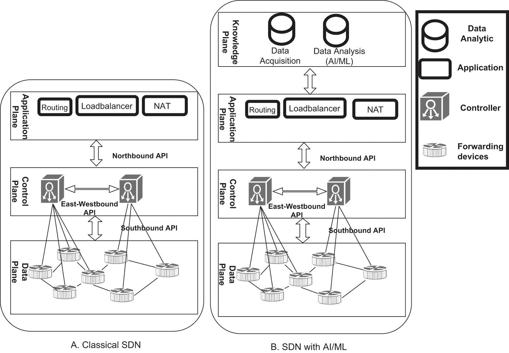

Figure 3.1 Architecture of SDN.

#### 3.4.2 带知识平面的 SDN 架构

SDN 与机器学习/人工智能（AI）相结合，利用控制回路提供自动化和推荐，创建一个强大的工具。在将人工智能应用于软件定义网络后，一个称为知识平面的新平面被添加到标准 SDN 架构中，如图 3.1(b) 所示。认知和 AI 方法在知识平面上被采用。知识平面从应用和其他来源收集网络数据，对其进行分析，并推导信息以做出最佳判断、决策和推荐。

D. Clark 等人 [11] 在其开创性论文中，介绍了互联网知识平面（KP）的概念。其目标是使用认知和人工智能方法（例如网络运营）来提供高级网络服务。知识平面有助于网络管理任务，例如决策、预测、推荐等。当该想法被提出时，将知识平面部署到计算机网络中面临的一个重大挑战是，网络本质上是分布式的。

SDN 的出现促进了知识平面的采用，因为控制层在逻辑上是集中化的，并提供了网络的抽象视图。Mestres 等人 [2] 提出了知识定义网络（KDN），它结合了 KP 的概念。网络能够集成以决策为重点的行为模型和推理过程，与 SDN 相结合。自动化、推荐、优化、验证和估计都包含在 KDN 范式中。换句话说，KDN 允许在 SDN 中利用机器学习技术的优势。

### 3.5 使用强化学习进行负载均衡

在上一节中，我们了解了如何在 SDN 中使用机器学习技术来寻找最优网络配置。在本节中，我们提出使用强化学习（RL）来探索网络并自动化将交换机分配给控制器。在 RL 中，代理人作用于 SDN 控制器，考虑当前网络配置。如果当前网络状态更接近最优状态，代理人将为每个动作获得奖励。负载均衡问题现在涉及状态、动作和奖励，并使用马尔可夫决策过程（MDP）重新公式化。

#### 3.5.1 强化学习

强化学习 [12] 是一种决策方法。它全部关乎在给定情况下确定如何行动以最大化奖励。在这种技术中，代理人通过试错来学习其行为。它因与环境交互而获得奖励。代理人的行为不仅取决于其提供的即时奖励，还取决于延迟回报的可能性。通过动态调整参数，强化学习系统旨在最大化强化信号。环境产生的信号是对动作完成情况的评估。

#### 3.5.2 马尔可夫决策过程（MDP）


MDP 是一种随机控制过程，具有离散时间范围。它为建模代理人的决策困境和优化结果提供了数学框架。MDP 的目的是确定所考虑代理人的最佳策略。它已被广泛用于为不同问题建模 SDN。四个基本组件定义了 MDP：

> *`S`*: 有限状态集，

> 

> *`A`*: 有限动作集，

> 

> *`p`*: 执行动作“`a`”后从状态 `s` 转移到状态 `s 0` 的概率，

> 

> *`r`*: 执行动作“`a`”后获得的即时奖励。

#### 3.5.3 使用马尔可夫决策过程进行问题公式化

我们将负载均衡问题公式化为马尔可夫决策过程 (`MDP`)，其中三元组 (`S`, `A`, `R`) 用于对其进行表征。

##### 3.5.3.1 状态空间 (`S`)

`S` 是有限状态空间。在我们的问题中，状态空间 `S` 是交换机可以迁移到的控制器集合，也称为迁移域。换句话说，状态空间表示欠载控制器列表。状态 `ST` ∈ `S` 对应于控制器的索引。例如，考虑一个有五个控制器的场景。状态 (0, 0, 0, 0, 1) 表示第一个控制器作为迁移域的一部分。有五个可能的状态，但并非所有状态都可能是迁移域的一部分。

##### 3.5.3.2 动作空间 (`A`)

`A` 是有限动作空间。动作定义为从迁移域（即欠载控制器集合）中选择控制器的过程。每个动作 `a` ∈ `A` 由选定用于迁移的欠载控制器的索引表示，也称为目标控制器。

##### 3.5.3.3 奖励函数 (`R`)

`R` 表示与状态-动作对相关的即时奖励，表示为 `R`(`ST`, `a`)，其中 `ST` ∈ `S` 且 `a` ∈ `A`。`R`(`ST`, `a`) 表示迁移发生后负载均衡程度的变化。从数学上定义如下：

`R`(`ST`, `a`) = |(`D`[`i`, `j`] − `D`′[`i`, `j`])| (3.5)

术语 `D`[`i,j`] 是两个控制器 `c`[`i`] 和 `c`[`j`] 之间的负载偏差系数（或离散系数）。同样，`D`′[`i`, `j`] 是交换机从控制器 `c`[`i`] 迁移到 `c`[`j`] 后的负载偏差。它计算如下

```
$\left. D\_{i,j}:=D\_{c\_{i},c\_{j}} = \left( \sqrt{\sum\limits_{k = i,j}{{({IL\_{c\_{k}} - L\_{c\_{i},c\_{j}}^{I}})}^{2}/2}} \right)/L\_{c\_{i},c\_{j}}^{I}. \right.$ (3.6)
```

对于 `n` 个控制器，负载偏差系数计算如下

```
$\left. D = \left( \sqrt{\sum\limits_{i = 1}^{n}{\left( {IL\_{c\_{k}} - L^{I}} \right)^{2}/n}} \right)/L^{I}. \right.$ (3.7)
```

**示例 3.1:** MDP 公式化

***考虑以下场景：** 我们有 11 个交换机分布在三个控制器上：`c`[1]、`c`[2]、*和 `c`[3]*。网络如* 图 3.2 *所示。在特定时间步 `t`[`i`]* 时，`c`[1] *过载，即 `O`[`domain`] \=* {`c`[1]} *。现在为了平衡控制器 `c`[1]*，分配给该控制器负载最大的交换机被选中进行迁移（假设为 `s`[2] *）。选择目标控制器的动作基于 ϵ-greedy 选择。在示例中，我们假设控制器 `c`[3] *被选中进行迁移*。

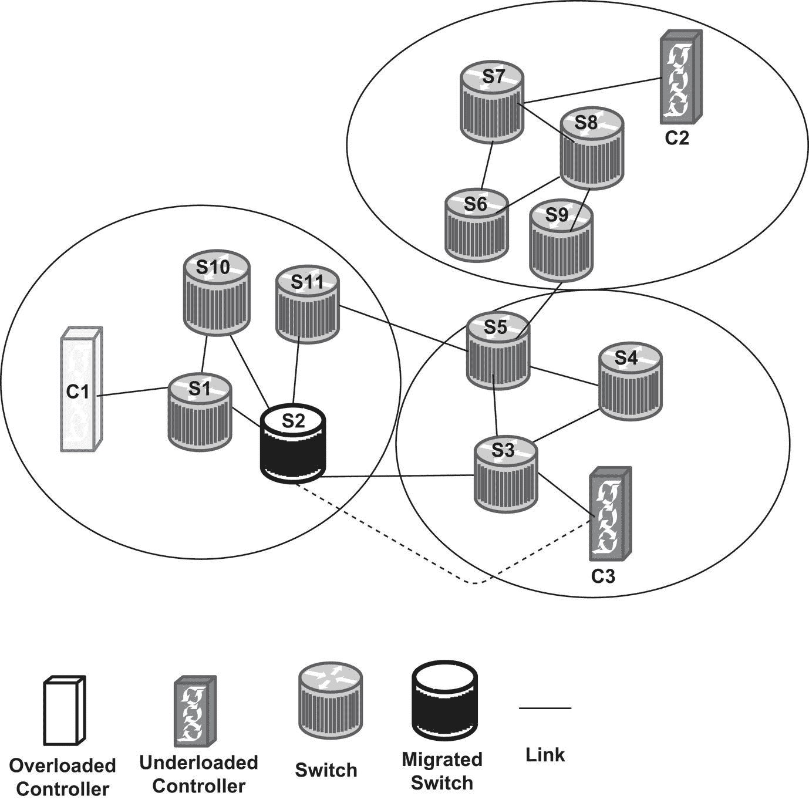

图 3.2 MDP 公式化的状态-动作示例。

*给定场景的状态空间为* {(0, 0, 1), (0, 1, 0), (1, 0, 0)} *，因为交换机可以连接到三个控制器中的任何一个。在时间 `t`[`i`]* 时，交换机 `s`[2] *连接到控制器 `c`[1]*。因此，交换机 `s`[2] *的状态为* (0, 0, 1) *。在此时间点，我们假设控制器 `c`[1] *过载，而其他两个控制器欠载。迁移域因此为* {(0, 1, 0) (1, 0, 0)} *。基于* *方程* 3.5 *中定义的奖励函数，将选择一个动作（状态，动作对）。在此工作中，我们基于 Q-learning 选择动作。*

求解 MDP 涉及为所考虑的代理人获得最佳策略。我们的问题领域转化为选择适当的交换机、迁移控制器对，以优化目标函数。该动作也不应导致 *交换机震荡*，即交换机在过载和欠载控制器之间来回移动。我们假设代理人对动作、奖励或转换概率没有先验知识。动作仅基于当前网络流量。因此，我们使用无模型仿真工具。我们使用 Q-learning，即强化学习算法家族中最著名的无模型技术。

#### 3.5.4 Q-Learning

Q-learning 是一种 RL 技术，通过学习动作-值函数来工作。它表示给定状态下动作的预期效用，之后遵循固定策略。Q-learning 的优势之一是它可以在不需要环境模型的情况下比较可能动作的预期效用，并且可以在线使用。

Q-learning 是一种非策略强化学习算法。它被称为 *非策略* 是因为 Q-learning 函数从当前策略未涵盖的活动（例如随机行为）中学习。因此，不需要策略。换句话说，Q-learning 旨在发现最大化总奖励的策略。在示例 3.1 中，在时间 `t`[`i`] 时状态数为 3，动作数为 2。动作 `a`[1] 此时无效。因此，相应的 Q 表如下：(表 3.2)

 [表 3.2 时间 `t`[`i`] 的示例 3.1 Q 表](#ch03.xhtml#Ttable3_2) 

|  || 动作 |

| --- | --- |

| a2 || a3 |

| 状态 || s1 || Q(s1,a2) || Q(s1,a3) |

| --- | --- | --- | --- |

| s2 || Q(s2,a2) || Q(s2,a3) |

| s3 || Q(s3,a2) || Q(s3,a3) |

`Q`(`ST`, `a`) 的值通过在每个时代中选择最大项来迭代修改。估值矩阵的迭代更新方法如下所示：

```
$Q{(ST,a)}\_{t + 1} = Q{(ST,a)}\_{t} + \\alpha(R(ST,a) + \\gamma \\ast \\underset{a}{max}Q{(S{T\\prime},{a\\prime})}\_{t} - Q{(ST,a)}\_{t})$ (3.8)
```

使用当前返回值与内存中下一个最大值 `Q`(`ST‘`, `a’`)[`t`] 的和作为预期值。通过预期值与真实估计之间的差异进行增量迭代学习，以获得在第 (`t` + 1)*th* 轮中 `Q`(`ST`, `a`)[`t`] 的值。学习率 `α` 设置在 0 和 1 之间。值为 0 意味着 Q 值永远不会更新；因此，什么都不会学习。设置较高的 Q 值，例如 0.9，意味着学习可以快速发生。较大的折扣因子 `γ` 考虑长期利益，而较小的值则强调即时考虑。最初，Q 表初始化为“0”。使用勘探与利用权衡来逐渐调整 Q 值。

##### 3.5.4.1 勘探与利用权衡

通过利用，我们指代理人选择能带来更大即时利益的动作的场景，尽管这可能是次优的。勘探指代理人选择不同的动作以在未来获得更好的回报，而不是专注于即时利益。保持勘探与利用之间的平衡至关重要。

为了平衡利用代理人现有知识与勘探随机动作等策略，我们采用 `ϵ`-greedy Q-learning 策略，详情见 第 3.6.2 节。

### 3.6 方法论


本节提出了两种不同的方法来实现负载均衡。在第一种方法中，随机选择交换机和目标控制器。在第二种情况下，使用 Q 表算法选择负载最大的交换机和目标控制器。优化迁移模型的核心驱动力是强化学习中的决策过程，该过程发生在知识平面。知识平面与控制平面之间的控制循环用于交换负载统计信息和交换机迁移决策。最后，控制平面在数据平面上实现交换机迁移。最优交换机迁移模型如 图 3.3 所示。

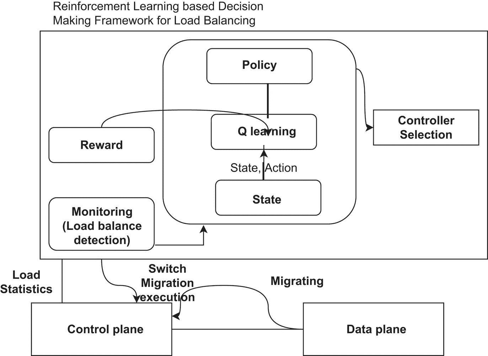

图 3.3 基于 RL 的最优交换机迁移模型。

#### 3.6.1 随机方法

我们计算每个时间步的最优负载。控制器分为负载不足、`I[domain]`，和负载过高，`O[domain]`。从负载过高的控制器中选择一个，`c[i] ∈ O[domain]`，并通过将随机交换机 `s[j]` 迁移到目标控制器 `c[t] ∈ I[domain]` 来执行负载均衡。该过程持续进行，直到实现负载均衡。

#### 3.6.2 带有 ϵ-greedy 的 Q 学习

在 ϵ-greedy 方法中，我们试图在利用即时收益和探索长期回报之间找到权衡。我们通过以概率 ϵ 研究随机动作来训练 Q 网络。同时，我们以概率 1 – ϵ 利用能够最大化预期长期回报的动作。对于采取的每个动作，我们将相应地获得其新状态和产生的回报。这被视为 RL 中的经验，并将被保留以备将来使用。强化学习的核心原理应用于 SDN 控制器选择过程。建立了一个基于强化学习的最优迁移模型，其中目标控制器由强化学习推导出的迁移动作选择。

算法的输入是控制器和交换机的集合、交换机每个时间的流请求率，以及 Q 学习所需的各种参数。Q 矩阵，即 `state * action` 对，初始化为值 1，如算法第一行所示。迭代以 30 秒的时间步长重复。控制器的理想负载以及负载过高（`O[domain]`）和负载不足（`I[domain]`）控制器的集合在算法第 3–5 行中计算。从 `O[domain]` 中随机选择一个负载过高的控制器，并选择负载最高的交换机进行迁移（如第 9 行所示）。接下来，我们生成一个随机数，如果其值小于 `E`，则进行探索。从 `I[domain]` 中随机选择一个负载不足的控制器（如第 12 行所示）。否则，如果随机数的值大于 `E`，则进行利用。也就是说，我们为给定状态选择最佳可能的动作，即产生最大 Q 值的动作（如第 10–14 行所示）。然后执行交换机迁移。计算奖励，并使用公式 3.8 相应地更新 Q 值（如第 15–16 行所示）。ϵ 的值按第 17–20 行所示更新。最后，我们计算负载均衡率。

**示例 3.2：** 在 图 3.4 中，我们展示了一个 SDN 网络，其中九个 SDN 交换机分布在三个 SDN 域（控制器）中。交换机在第一个时间步的流到达率如 表 3.3 所示。控制器 `c[1]`、`c[2]` 和 `c[3]` 的瞬时负载（按流量数计算）分别为 75、130 和 60。

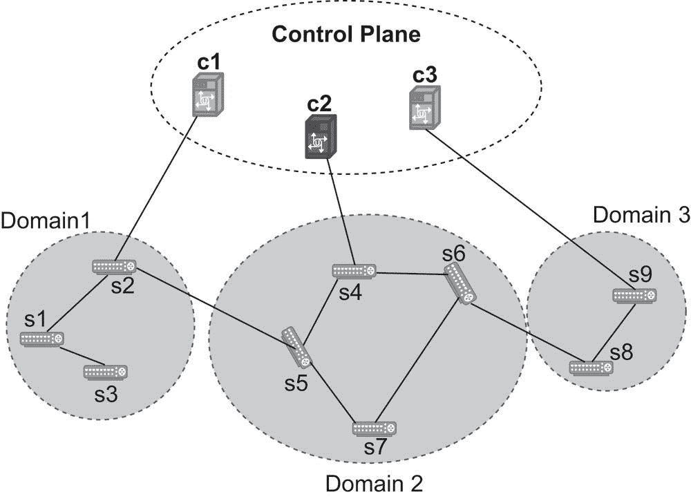

图 3.4 交换机到控制器的不平衡映射。

[表 3.3 时间 `t[0]` 的交换机流到达率](#ch03.xhtml#Ttable3_3)

| 交换机 | `s[1]` | `s[2]` | `s[3]` | `s[4]` | `s[5]` | `s[6]` | `s[7]` | `s[8]` | `s[9]` |
| --- | --- | --- | --- | --- | --- | --- | --- | --- | --- |
| `si` | 25 | 25 | 25 | 25 | 25 | 35 | 45 | 25 | 35 |
| `si` | – | – | – | – | – | – | – | – | – |

相应的状态空间是 {`S1 → 〈0, 0, 1〉`, `S2 → 〈0, 1, 0〉`, `S3 → 〈1, 0, 0〉`}。动作空间是 {`A1 → 〈0, 0, 1〉`, `A2 → 〈0, 1, 0〉`, `A3 → 〈1, 0, 0〉`}。我们已在 小节 3.5.2 中结合示例详细讨论了 MDP 公式。

我们假设控制器是同质的，最大处理能力为每秒 150 个流。控制器负载比为 `R[c1] = 75/150 = 0.5`；`R[c2] = 130/150 = 0.866`；`R[c3] = 60/150 = 0.4`。使用这些值，我们计算控制器的成对平均负载比。值为 `R[c1c2] = 205/300 = 0.683`；`R[c1c3] = 135/300 = 0.45`；`R[c2c3] = 190/300 = 0.633`。最后，我们计算总体平均负载比（即理想负载）为 `R[c1c2c3] = 265/450 = 0.5888`。两个控制器的离散系数使用公式 (3.6) 计算。值为 `D[c1c2] = 0.26`；`D[c1c3] = 0.11`；`D[c2c3] = 0.368`。对于 `n` 个控制器，离散系数使用公式 (3.7) 计算，`D[c1c2c3] = 0.34066`。

离散系数用于区分负载过高和负载不足的控制器。在我们的示例中，{`c[2]`} 是负载过高的，{`c[1]`、`c[3]`} 是负载不足的控制器。负载最大的交换机（`s[7]`）被选为迁移对象。最初，Q 矩阵初始化为 1，如 表 3.4 所示。

表 3.4 Q 矩阵

| | 动作 |
| --- | --- |
| | A1 | A2 | A3 |
| **状态** | S1 | 1 | 1 | 1 |
| **S2** | 1 | 1 | 1 |
| **S3** | 1 | 1 | 1 |

**衰减的 epsilon 贪婪方法：** 在我们的示例中，E 的初始值设置为 0.7，并以衰减因子 0.0025 衰减到 0.05。假设我们使用利用，我们将交换机 `s[7]` 传输到控制器 `c[3]`，因为表中所有条目都是 1，因此最大 Q 值将从 {`c[1]`、`c[3]`} 中选择 `c[3]`。`s[7]` 迁移后，新系统将如下所示：

```
\begin{array}{lll}
{c_{1}\ :s_{1},s_{2},s_{3} = 75;} & {c2\ :s4,s5,s6 = 95;} & {c3\ :s8,s9,s7 = 105} \\
\end{array}
```

再次，我们计算控制器负载比、平均控制器负载比和离散系数 `D'[ij] = 0.19451894`。新离散系数的值更小，这意味着交换机传输后系统变得更加稳定。奖励使用公式 (3.5) 计算。

`Reward = |(D'[ij] − D[ij])| = 0.19451894`

当系统变得更加稳定时，奖励会变得更大。Q 矩阵使用公式 (3.8) 更新。我们取 γ 为 0.7，α 在第一步为 0.6，`Q[S2,A3] = 1 + 1(0.19451894 + 0.7 ∗ 0.6 − 1) = 0.61451894`。下一次迭代的新 Q 表如 表 3.5 所示。

[表 3.5 Q 矩阵更新状态（从时间 `t[0]` 到时间 `t[1]`）](#ch03.xhtml#Ttable3_5)

| | 动作 |
| --- | --- |
| | A1 | A2 | A3 |
| **状态** | S1 | 1 | 1 | 1 |
| **S2** | 1 | 1 | 0.61451894 |
| **S3** | 1 | 1 | 1 |

### 3.7 结果与实现

以下部分描述了实验设置、性能指标和实验结果分析。

#### 3.7.1 实验设置


# 我们的主要关注点是控制器负载的评估

我们不模拟数据平面开销或数据包通过交换机的实际传输。为了评估所提方案的性能，我们使用基于 Python 的仿真。Arnes 来自互联网拓扑动物园 \[14\]，用作网络拓扑。我们实验中使用的参数列于 表 3.6。

## 表 3.6 实验设置

| 参数 | 值 | 参数 | 值 |
| --- | --- | --- | --- |
| 控制器数量 | 5 | 交换机数量 | 34 |
| 拓扑 | Arnes | 因子 (*α*) | 0.6 |
| 因子 (*γ*) | 0.7 | 因子 (*E*) | 0.7 衰减至 0.05 |
| 数据集：CAIDA1 \[15\] | | | |
| 数据大小 | 1065GB | 流数量 | 67M |
| 流请求速率 | 18.7k/s | 流大小 | 30 秒 |
| 数据集：CAIDA2 \[15\] | | | |
| 数据大小 | 1463GB | 流数量 | 63M |
| 流请求速率 | 17.6k/s | 流大小 | 30 秒 |
| 数据集：University \[13\] | | | |
| 数据大小 | 97.17GB | 流数量 | 0.43M |
| 流请求速率 | 110k/s | 流大小 | 30 秒 |

本研究使用了三个数据集来模拟交换机产生的流量：两个 CAIDA \[15\] 数据集和一个大学 \[13\] 数据集。这些数据集概述了骨干网络和商业网络流量。流量被分解为流。流是一个四元组，包括源 IP 地址、目的 IP 地址、源端口号和目的端口号。

我们将数据按时间间隔分解，使用 *N* 个数据点构建单变量时间序列 \[16\]。

#### 3.7.2 评估指标

**负载均衡率：** 负载均衡率计算控制器负载在时间 *t* 时与其理想值的变化 \[6\]。在本报告中，我们将控制器的理想负载视为系统的平均负载。

$\\frac{\\sum\_{j = 1}^{k}\\left( \\left| {L\_{c}(t) - L^{I}(t)} \\right| \\right)}{k}$

#### 3.7.3 实验结果

应用 Q-learning 之前，五个控制器 {*c*[0]*, c*[1]*, c*[2]*, c*[3]*, c*[4]} 在不同时间步的瞬时负载如 图 3.5 所示。控制器负载是指与控制器连接的交换机生成的流量数量。负载按 30 秒间隔（时间步）计算。本实验旨在展示网络流量的动态特性。从图中可以看出，控制器负载存在较大变化。这一结果证实了我们关于网络流量突发性的假设。

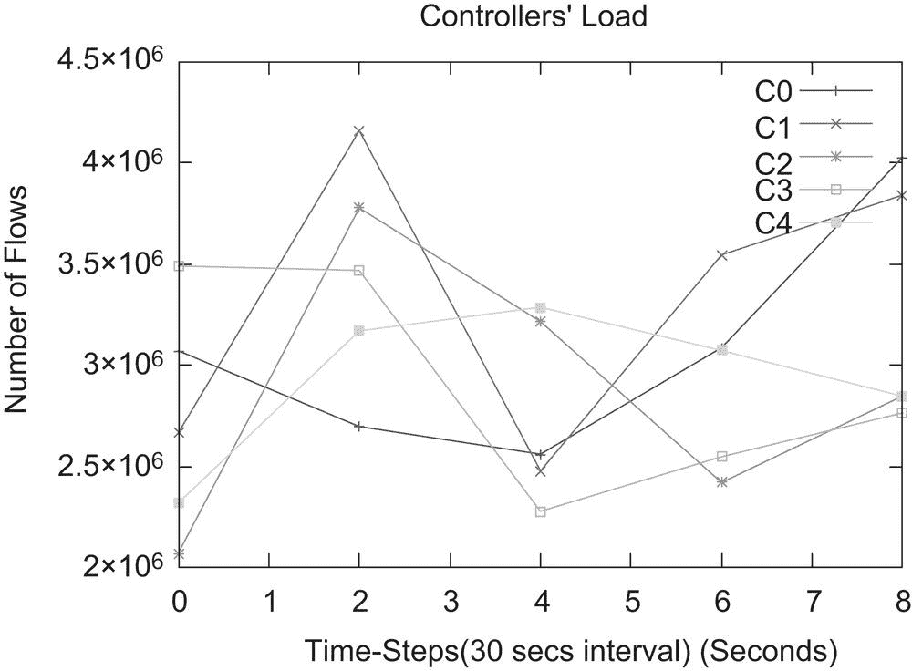

图 3.5 使用 Q-learning 与 *ϵ*\-greedy 方法的控制器负载。

基于 Q-learning 的方法与随机方法的负载均衡率对比如 图 3.6 所示。随机方法的负载均衡存在较大变化。在 Q-learning 与 ϵ-greedy 方法的情况下，负载均衡率的变化范围为 100000 到 700000，而随机方法的变化范围为 200000 到 1200000。结果表明，所提 Q-learning 方法可以限制负载均衡率的变化。此外，它还提高了负载均衡率。我们的方法还改善了控制器之间的负载均衡。Q-learning 方法的平均负载均衡率比随机方法低 30%。Q-learning 的解要么随机选择，要么取决于 Q 矩阵确定的最佳动作。在学习的早期阶段，Q 矩阵不具备太多智能。因此，随机过程优于最优动作。然而，随着学习过程的推进，随机动作的选择比例降低，而来自 Q 矩阵的最优动作被选择的比例提高。因此，所提方法在利用与探索之间取得了平衡，从而得到更好的解决方案。另一方面，随机策略仅进行探索。

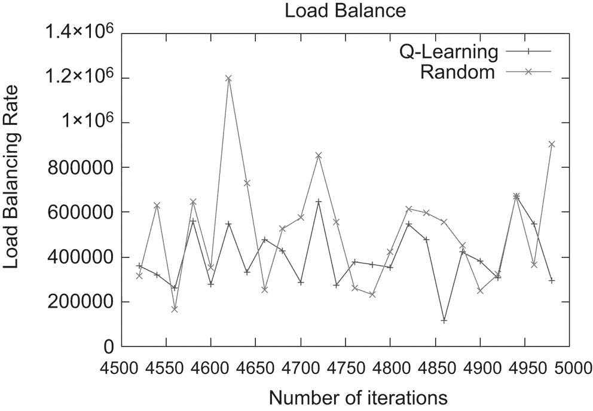

图 3.6 负载均衡率对比。

两种方法中迁移交换机数量的对比如 图 3.7 所示。随机方法中迁移的交换机数量大约是 *ϵ*\-greedy 方法的三倍。交换机迁移涉及不同利益相关者之间交换控制消息的成本。结果表明，Q-learning 方法降低了交换机迁移成本和控制器之间的同步成本。这也意味着迁移时间减少。在本工作中，我们考虑基于降序调度选择交换机；因此，少量交换机从过载状态卸载以平衡系统。

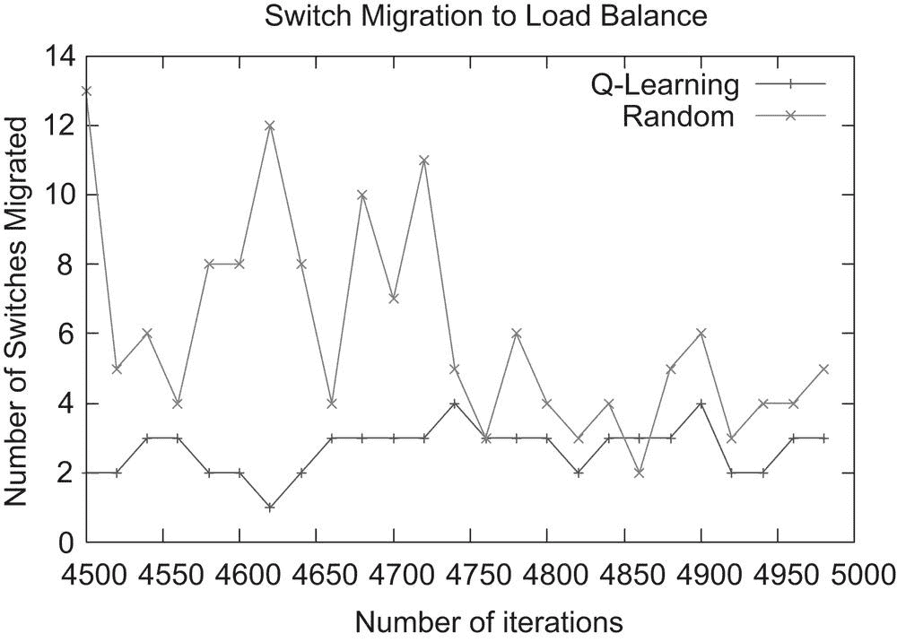

图 3.7 迁移交换机数量对比。

### 3.8 结论与未来工作

本章提出了一种采用知识平面来负载均衡软件定义网络中控制器的架构。知识平面采用强化学习，自适应地改变 SDN 中控制器与交换机之间的绑定。我们首先介绍 SDN 和 RL 的基础知识。为了便于使用 RL，我们使用马尔可夫决策过程重新表述了负载均衡问题。解决方案框架利用 Q-learning，这是一种广为人知的无模型强化学习技术。我们使用真实网络流量在实验中验证了所提方案。

我们将所提工作与随机方法进行了比较，使用了两个指标，即负载均衡率和迁移交换机数量。我们观察到，所提方案将控制器负载变化范围限制在 60% 以上的因子之内。这表明我们所提策略下系统的稳定性更高。同时，迁移交换机数量（开销）大约是随机方法的三分之一。在本章中，我们展示了如何将机器学习技术应用于解决 SDN 问题。未来，我们打算使用其他学习算法，如深度学习，来捕捉网络流量行为，并解决更复杂的 SDN 问题，例如控制器放置。

### 参考文献

1.  2020 全球网络趋势报告。[`www.data3.com/knowledge-centre/ebooks/2020-global-networking-trends-report-see-whats-next-in-networking/`](https://www.data3.com)，2020 年（2021 年 8 月访问）。

2.  Albert Mestres，Alberto Rodriguez-Natal，Josep Carner，Pere Barlet-Ros，Eduard Alarcon，Marc Sole，Victor Muntes-Mulero，David Meyer，Sharon Barkai，Mike J Hibbett 等。知识定义网络。ACM SIGCOMM 计算机通信评论，47(3)：2–10，2017 年。

3.  Advait Dixit，Fang Hao，Sarit Mukherjee，TV Lakshman，和 Ramana Kompella。迈向弹性分布式 SDN 控制器。载于《第二届 ACM SIGCOMM 软件定义网络热点研讨会论文集》，第 7–12 页，2013 年。

4.  Advait Dixit，Fang Hao，Sarit Mukherjee，TV Lakshman，和 Ramana Rao Kompella。ElastiCon；弹性分布式 SDN 控制器。载于《ACM/IEEE 网络与通信系统架构研讨会 (ANCS)》，第 17–27 页，2014 年。


5. Chuan'an Wang, Bo Hu, Shanzhi Chen, Desheng Li, and Bin Liu. 基于开关迁移的 SDN 负载均衡决策方案. IEEE Access, 5: 4537–4544, 2017.

6. Tao Hu, Julong Lan, Jianhui Zhang, and Wei Zhao. EASM: 基于效率感知的软件定义网络中控制器负载均衡开关迁移方案. Peer-to-Peer Networking and Applications, 12(2): 452–464, 2019.

7. S. Filali, Cherkaoui, and A. Kobbane. 基于预测的 SDN 负载均衡开关迁移调度. 在 `ICC 2019 - 2019 IEEE International Conference on Communications (ICC)` 中, 页码 1–6, 2019.

8. Yaning Zhou, Ying Wang, Jinke Yu, Junhua Ba, and Shilei Zhang. 基于开关分组的多控制器 SDN 负载均衡. 在 `19th Asia-Pacific on Network Operations and Management Symposium (APNOMS)` 中, 页码 227–230. IEEE, 2017.

9. Md Tanvir Ishtaique ul Huque, Weisheng Si, Guillaume Jourjon, and Vincent Gramoli. 大规模动态控制器部署. IEEE Transactions on Network and Service Management, 14(1): 63–76, 2017.

10. H. Chen, G. Cheng, and Z. Wang. 基于博弈论的软件定义网络弹性控制方法. China Communications, 13(5): 103–109, 2016.

11. David D Clark, Craig Partridge, J Christopher Ramming, and John T Wroclawski. 面向互联网的知识平面. 在 `Proceedings of the 2003 conference on Applications, technologies, architectures, and protocols for computer communications` 中, 页码 3–10, 2003.

12. Richard S Sutton and Andrew G Barto. 强化学习: 导论. MIT press, 2018.

13. Data Center Measurment University Data Set, \[Last accessed on 05/12/2019\]. Available from: [`http://pages.cs.wisc.edu/~tbenson/IMC10_Data.html`](http://pages.cs.wisc.edu).

14. The internet topology zoo. [`http://www.topology-zoo.org/index.html`](http://www.topology-zoo.org), 2019 (accessed January, 2020).

15. The CAIDA UCSD Anonymized Internet Traces 2016, \[Last accessed on 05/12/2019\]. Available from: [`http://www.caida.org/data/passive/passive\_2016\_dataset.xml`](http://www.caida.org).

16. J. Chandra, A. Kumari, and A. S. Sairam. 软件定义网络中的预测流量建模. 在 `TENCON 2019 - 2019 IEEE Region 10 Conference (TENCON)` 中, 页码 1494–1498, 2019.

## 4 狭窄车道上的绿色走廊: 通过 NB-IoT 支持高优先级消息传递

Raja Karmakar¹, Samiran Chattopadhyay^(2,3), and Sandip Chakraborty⁴

¹魁北克省技术学院电气工程系, 蒙特利尔, 加拿大

²贾达夫普尔大学信息技术系, 加尔各答, 印度

³TCG CREST 先进智能研究所, 加尔各答, 印度

⁴印度理工学院卡格普尔分校计算机科学与工程系, 卡格普尔, 印度

DOI: [`10.1201/9781003212249-4`](https://doi.org/10.1201/9781003212249-4)

1. Contents

2. 4.1 引言

3. 4.1.1 NB-IoT 上延迟敏感流量调度中的挑战

4. 4.1.2 本工作的贡献

5. 4.1.3 论文组织结构

6. 4.2 相关工作

7. 4.3 NB-PTS: 系统模型与设计细节

8. 4.3.1 排队模型描述

9. 4.3.1.1 NB-PTS 中的解决方案方法

10. 4.3.1.2 目标平均延迟推导

11. 4.3.2 队列阈值估计

12. 4.3.2.1 ϵ-greedy 策略

13. 4.3.3 目标平均延迟计算

14. 4.3.4 调度度量

15. 4.3.5 知识库

16. 4.3.6 NB-PTS 中的调度

17. 4.3.7 时间边界分析

18. 4.4 性能分析

19. 4.4.1 基线机制

20. 4.4.2 优先级流量生成

21. 4.4.3 实现细节

22. 4.4.4 吞吐量分析

23. 4.4.4.1 总体平均吞吐量

24. 4.4.5 丢包率和分组延迟分析

25. 4.4.5.1 基于优先级的单独流量的 PLR 和延迟

26. 4.4.6 收敛行为

27. 4.4.7 平均延迟分布

28. 4.4.8 UE 数量对消耗子帧的影响

29. 4.4.9 UE 数量对计算时间的影响

30. 4.5 结论

31. 参考文献

### 4.1 引言

尽管大量研究和商业机构提出了各种智慧城市和智慧基础设施管理解决方案，但支持这些应用程序的首要要求是在多种平台上部署数百万个传感器。因此，支持在物联网 (IoT) 上融合感知、通信和计算是当务之急，而基于 4G 和 5G 通信技术的现有蜂窝网络可以直接支持这种融合。窄带物联网 (NB-IoT) \[1,2\] 支持基于长期演进 (LTE) 和 LTE 高级 (LTE-A) 技术构建的现有蜂窝平台上的大量低吞吐量 IoT 设备。因此，它可以在广域智慧城市应用的部署中发挥重要作用。

从技术角度来看，NB-IoT 在 180 kHz 的低频信道带宽上运行，以提供超过 160 dB 的覆盖范围，并保持约 10 秒的延迟容忍度 \[2\]。凭借这些规格，NB-IoT 主要面向延迟容忍型 IoT 设备或信号强度较差区域的设备。LTE 运营商可以通过向 NB-IoT 分配 180 kHz 的物理资源块 (`PRB`) 来在 LTE 载波信号内部部署 NB-IoT 标准。尽管该技术在工业自动化和控制方面具有多种优势，例如成本效益高的大规模部署支持、现有 LTE 网络上的即插即用、由于超低功耗通信而具有长电池寿命、比 LoRA 和 SigFox 更好的结构穿透性和更高的数据速率，但它不支持延迟敏感型应用，这使得它不适合那些严格延迟保证的实时数据传输是主要要求的工业应用。

#### 4.1.1 NB-IoT 上延迟敏感流量调度中的挑战


数据包调度是基于 5G LTE 的无线工业物联网（IIoT）网络中服务质量（QoS）要求的重要方面。无线调度的两个具体特征是：(i) 无线信道是不可靠、易出错且随时间变化的系统。无线网络中可能会发生突发错误，导致数据包传输失败；(ii) 由于信号强度频繁变化，无线信道会在高信号状态和低信号状态之间快速切换，这种情况在物联网系统中更为普遍，因为存在大量通信设备。通过考虑 LTE 架构和 NB-IoT 的规范，在 NB-IoT 上调度延迟敏感流量的挑战包括：(i) 在 LTE 环境中保持所需的 QoS 水平和系统性能，受限于有限的无线资源、不可靠的无线传播信道和高用户需求；(ii) NB-IoT 指定的窄带宽（180 KHz）和低数据速率（峰值数据速率约为 250 kbps）\[2》，这导致维持传输流量低延迟的困难。因此，在 NB-IoT 架构中开发自适应调度机制至关重要，使得流量传输的总体时间能够经历较低延迟，并对延迟敏感流量数据进行明确优先级处理。本文的目标是设计一种自适应且动态的调度方案，用于在 NB-IoT 平台上传输基于优先级的应用，通过减少调度延迟并为优先级数据维持端到端 QoS。

#### 4.1.2 本工作的贡献

在本文中，我们设计了一种在 NB-IoT 中的智能数据包调度机制；该机制调度 NB-IoT 中优先级流量的数据包，使得传输数据包的延迟可以最小化。据我们所知，在 NB-IoT 范式中处理这种类型的流量调度是首次提出。所提方案 `narrowband-prioritized traffic scheduling (NB-PTS)` 是一种介质访问控制（MAC）层机制，它通过考虑数据包的优先级来调度数据包（存储在传输队列中）。在我们对 NB-PTS 的实现中，我们使用了 `QoS class identifier (QCI)` \[3》，这是一种应用于 3GPP LTE 网络的机制，用于分类网络流量并在网络中提供 QoS。通过利用这些优先级，NB-PTS 调度流量，使得优先级较高的流量获得更高的调度机会，从而导致整体传输延迟降低。我们在网络模拟器（NS）版本 3 的 NB-IoT 兼容模块中实现了 NB-PTS，即 NS-3-dev-NB-IOT，NB-PTS 的仿真分析表明，它可以显著提高 NB-IoT 中的网络性能。

#### 4.1.3 论文组织

论文的其余部分组织如下：第 4.2 节 讨论相关工作。系统模型的详细信息在 第 4.3 节 中介绍。第 4.4 节 讨论 NB-PTS 的实现细节并分析仿真结果。最后，我们在 第 4.5 节 中总结本文。

### 4.2 相关工作


作者在 \[4,5\] 讨论了工业物联网（Industrial IoT）面临的挑战以及相关研究方向，涉及实时性、能效、隐私与安全、互操作性以及与现有物联网标准的共存。通过考虑任意场景，\[6\] 重点介绍了 NB-IoT 范式下定位的性能，并提供了网络覆盖、设备位置等不同因素。Yu 等人 \[7\] 仅关注 NB-IoT 系统的上行链路调度方案，并结合上行链路自适应机制。\[8\] 并未聚焦于单个通信，而是在 NB-IoT 框架中找到一种扩展，以纳入群组通信信道。作者在 \[9\] 为 NB-IoT 设计了一种资源分配技术，仅关注基于速率最大化来制定问题。在 \[10\] 中，NB-IoT 的小数据传输方法不关注传输延迟和流量优先级。\[11\] 解决了在 LTE 网络中为大量机器类型通信（MTC）设备提供连接的主要挑战，并为 NB-IoT 架构提出了一种上行多址接入机制。作者在 \[12\] 解决了低功耗场景下终端设备信号传输重复的问题，并发现信道相干性对时间及上行覆盖的影响。在 \[13\] 中，窄带物理下行链路控制信道（NPDCCH）物理层过程通过搜索空间解码进行了说明，并基于上行参考信号为 NPDCCH 提出了一种资源映射方案。在此工作中，所提出的调度器仅适用于 NPDCCH 中的搜索空间分配。\[14\] 提出了一种次优算法，用于在上行传输期间为 NB-IoT 设备分配传输功率和无线资源。在此，作者通过分析速率、延迟和功率之间的权衡，关注资源分配方法。\[15\] 为 NB-IoT 框架设计了一个上行调度器，其中所提调度器是一种基于阈值的用户设备（UE）特定方法，主要适用于具有同质流量的 UE。虽然 \[16\] 通过排队模型讨论了 NB-IoT 中的延迟-能耗权衡，但该工作并未为 NB-IoT 设计新的调度机制。作者在 \[17\] 介绍了 NB-IoT 的主要特性，并讨论了 NB-IoT 架构上的数据传输。\[18\] 处理了 NB-IoT 网络中窄带物理下行链路共享信道（NPDSCH）周期与下行链路调度的自适应问题。然而，该工作的目标是通过最小化下行传输期间接收数据所消耗的无线资源，来提高 NB-IoT 网络的无线资源利用率。在 \[19\] 中，为 NB-IoT 中的到达和服务过程构建了一个随机接入流量模型，重点在于通过分析网络延迟来推导到达过程中的随机延迟界限。\[20\] 提出了一种启发式算法 NIS，该算法仅关注 NB-IoT 中的下行链路调度。在此，目标是高效利用 NB-IoT 的无线资源，以便在物联网范式中建立大规模连接。因此，\[20\] 未解决基于优先级和延迟敏感性的数据包调度问题。Lei 等人 \[21\] 的工作在基于 NB-IoT 的边缘计算系统中提出了一种联合多用户调度和半分布式计算卸载机制。Azari 等人 \[22\] 设计了一个可处理的分析框架，用于分析控制或数据信道调度以及不同覆盖类别的共存对 NB-IoT 设备延迟和能耗的影响。虽然 \[22\] 找到了一种基于调度的解决方案，以补偿 NB-IoT 网络中极端覆盖导致的性能损失，但所提议的上行或下行方向调度信道自适应并未解决 NB-IoT 中的优先级流量调度问题。然而，据我们所知，迄今为止，尚无现有工作探索过 NB-IoT 上的延迟敏感通信，因此，我们提出的方法在考虑其设计局限性的同时，为支持 NB-IoT 上优先级流量调度提供了新方向。

### 4.3 NB-PTS：系统模型与设计细节

NB-PTS 处理传输队列并调度流量，以便传输数据包的延迟可以最小化。NB-PTS 在 NB-IoT 协议栈的 `evolved node B (eNB)` MAC 层执行，并且 NB-PTS 同时执行上行链路和下行链路调度。为了支持优先级流量传输，我们考虑了 QCI \[3\]，这是 3GPP LTE 网络中用于分类并指示流量承载调度优先级值的机制。通过遵循 QCI，流量的优先级类型已在 NB-PTS 中用于对数据包施加重要性，这样该机制可以根据数据包的重要性调度数据包（存储在 `transmit queue` 中）。这样一来，优先级较高的流量将获得更高的调度机会，从而在整体传输中实现更低的延迟。我们使用 `queueing model` 以离散时间方式对传输排队系统进行了建模，该模型将在下文讨论。基于此排队模型，我们定义了一个指标（在 第 4.3.4 节 中讨论），该指标用于 NB-PTS 中的优先级流量调度。

基本上，我们在 NB-PTS 的实现中使用了 QCI 来分配流量优先级。然而，NB-PTS 的工作原理指向了在 NB-IoT 网络上应用任何优先级方法进行流量传输的方向。QCI 定义的一些示例显示在 表 4.1。

### 表 4.1 3GPP LTE 定义的 QCI 值示例

| QCI | 资源类型 | 优先级 | 数据包延迟预算 | 示例服务 |
| --- | --- | --- | --- | --- |
| QCI-2 | GBR | 4 | 150 ms | 会话视频（直播流） |
| QCI-3 | GBR | 3 | 50 ms | 实时游戏，V2X 消息 |
| QCI-4 | GBR | 5 | 300 ms | 非会话视频（缓冲流） |
| QCI-6 | non-GBR | 6 | 300 ms | 视频（缓冲流） |
| QCI-8 | non-GBR | 8 | 300 ms | 基于 TCP 的应用程序（如 www、电子邮件、ftp、聊天等） |

#### 4.3.1 排队模型描述

所提方法的大致思路是，根据与数据包关联的流量优先级值，在 MAC 队列中动态调度数据包。然而，考虑到 NB-IoT 架构的资源限制，队列演化需要根据通信环境动态控制。因此，NB-PTS 首先估计队列状态，并应用在线学习策略来估计阈值（称为队列阈值），超过该阈值后，无法为延迟敏感型应用提供 QoS。然后，它在 MAC 层调度数据包，以便使优先级数据包的总体延迟最小化。


在我们的离散时间环境模型中，时间被划分为时隙，这些时隙具有固定或可变长度，且已知其平均值。我们假设队列的容量为 `K` 个数据包，阈值为 `L`。当数据包数量超过 `L` 的值时，超出的数据包将被丢弃。令时间由 `t` = 0, 1, 2, … 索引，我们将 [`t` − 1, `t`] 定义为时间窗口 `t` 的间隔。现在，我们定义以下符号。令 `D̂`[`t` + 1] 为 [`t`, `t` + 1] 上的目标平均延迟，`D`[`t`] 为 [`t` − 1, `t`] 上的测量平均延迟，`L`[`t`+1] 为 [`t`, `t` + 1] 上的队列阈值，`α`[`t`] 为 [`t` − 1, `t`] 上的平均数据包到达率，`β` 为队列的服务率，`W`[`t`+1] 为 [`t`, `t` + 1] 上的流量调度指标。在时隙 [`t`, `t` + 1] 中，我们为流量 `j` 定义一个指标 `W`[`t` + 1]^(`j`)，该指标基本上对待调度流量的重要性施加一个权重。`W`[`t` + 1]^(`j`) 在 第 4.3.4 节 中定义。

##### 4.3.1.1 NB-PTS 的解决方案方法

基于上述排队模型，我们将 NB-PTS 的解决方案方法设计为 *三个阶段*，如下所示：

1.  **Phase-**1: 队列阈值的估计 (第 4.3.2 节) 和目标平均延迟的计算 (第 4.3.3 节)

2.  **Phase-**2: 对待调度流量施加权重的指标的计算 (第 4.3.4 节)

3.  **Phase-**3: 基于阶段 2 中计算的指标值进行流量调度 (第 4.3.6 节)

对于队列阈值的估计，我们采用了一种在线学习机制。这是因为队列阈值高度依赖于当前信道条件和流量量，必须由发射器处理；因此，该阈值的值需要自适应和动态地选择，以便将数据包丢弃的概率最小化。在这方面，`ϵ`-贪婪 \[23\] 策略已被采用作为在线学习机制。

##### 4.3.1.2 目标平均延迟的推导

在我们的系统中，我们使用两状态马尔可夫调制伯努利过程 (MMBP-2) 作为到达过程，以提供到达率的随机性，这是 IIoT 流量的常见特征 \[4\]。这可以扩展到 m 状态 MMBP。在每个状态中，到达过程占据几何长度的时间槽，即，一个过程的服务持续时间是时隙持续时间的整数倍。在我们为控制策略提出的离散时间排队模型中，队列具有 `K` 个数据包的有限等待空间，包括正在服务中的数据包。平均到达率和平均队列长度在每个时间窗口 `t` 上计算，然后利用这些信息来测量下一个时间窗口 `t` + 1 的 `L` 值，以将时间延迟绑定在所需值。通过调整阈值，进而我们控制传入流量的调度。

在排队模型的每个状态中，在一个时间槽中发生到达的概率遵循伯努利过程。它通过两状态马尔可夫过程变化，并且与到达过程独立。因此，该模型遵循 MMBP/Geo/1/K 队列。然而，时间窗口的长度应远小于到达过程停留在同一状态的平均时间。因此，在稳态下，该模型可以近似为最大时间窗口上的 Geo/Geo/1/K 队列。这意味着到达流量可以被视为遵循伯努利过程，除了到达过程发生状态变化的少数时间窗口之外。图 4.1 显示了 Geo/Geo/1/K 队列的状态转换模型，其中阈值位于 `L` = `K` − 1 处，`α` 通常是平均数据包到达率。队列长度过程具有有限状态空间，并遵循马尔可夫链。这个马尔可夫链是非周期的、不可约的、非零复发的，并具有一个唯一的概率分布 \[24\]。

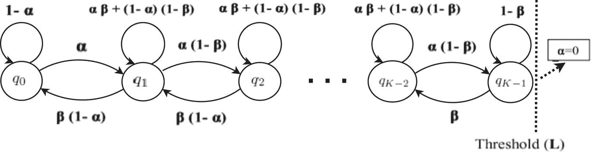

图 4.1 每个阶段独立伯努利过程的状态转换模型及阈值。

令 `α` ≠ `β`，首先我们假设 `L` = `K` − 1。然后我们将 `L` 推广为 `L` = `K` − `i`，即，我们可以将阈值调整到传输队列中的任何位置。如 图 4.1 所示，令状态由 `q[0]`、`q[1]`、`q[2]` 等表示。从状态转换图 (图 4.1)，具有 `L` = `K` − 1 的离散时间有限队列可以表示如下：

```
\\begin{array}{lll} q\_{0} & = & {q\_{0}(1 - \\alpha) + q\_{1}\\lbrack\\beta(1 - \\alpha)\\rbrack} \\\\ q\_{1} & = & {q\_{0}\\alpha + q\_{1}\\lbrack\\alpha\\beta + (1 - \\alpha)(1 - \\beta)\\rbrack + q\_{2}\\lbrack\\beta(1 - \\alpha)\\rbrack} \\\\ \\end{array}
```

一般来说，对于 `i` = 2, 3, …, `K` − 1，我们有

```
\\begin{array}{lll} q\_{i} & = & {q\_{i - 1}\\lbrack\\alpha(1 - \\beta)\\rbrack + q\_{i}\\lbrack\\alpha\\beta + (1 - \\alpha)(1 - \\beta)\\rbrack + q\_{i + 1}\\lbrack\\beta(1 - \\alpha)\\rbrack} \\\\ q\_{K - 2} & = & {q\_{K - 3}\\lbrack\\alpha(1 - \\beta)\\rbrack + q\_{K - 2}\\lbrack\\alpha\\beta + (1 - \\alpha)(1 - \\beta)\\rbrack + q\_{K - 1}\\beta} \\\\ q\_{K - 1} & = & {q\_{K - 2}\\lbrack\\alpha(1 - \\beta)\\rbrack + q\_{K - 1}(1 - \\beta)} \\\\ \\end{array}
```

通过递归求解这些方程并假设 $\\gamma = \\frac{\\alpha(1 - \\beta)}{\\beta(1 - \\alpha)}$，我们可以用 `q`[0] 表示平衡概率，如下所示：

```
q\_{i} = q\_{0}\\frac{\\gamma^{i}}{\\left( {1 - \\beta} \\right)},\\mspace{9mu} 1 \\leq i \\leq K - 2
```
(4.1)

对于 `i` = `K` − 1，我们有

```
q\_{K - 1} = q\_{0}\\gamma^{(K - 1)}\\frac{\\left( 1 - \\alpha \\right)}{\\left( 1 - \\beta \\right)}
```
(4.2)

通过归一化方程，我们得到 $\\sum\_{i = 0}^{K - 1}{q\_{i} = 1}$。因此，`q`[0] 可以按如下计算：

```
q\_{0} = \\frac{(1 - \\beta)(1 - \\gamma)}{1 - (1 - \\gamma)(\\beta + \\alpha\\gamma^{(K - 1)}) - \\gamma^{K}}
```
(4.3)

现在，我们求有限队列长度过程的生成函数，它由 $P(z) = \\sum\_{i = 0}^{K - 1}{q\_{i}z^{i}}$ 给出。即

```
P(z) = \\frac{q\_{0}}{(1 - \\beta)}\\left\\lbrack \\frac{1 - (1 - \\gamma z)(\\beta + \\alpha\\gamma^{K - 1}z^{K - 1}) - {(\\gamma z)}^{K}}{1 - \\gamma z} \\right\\rbrack
```
(4.4)

接下来，我们使用利特尔法则求平均队列等待时间，该法则指出系统中数据包的平均数等于数据包平均等待时间与系统中数据包平均到达率的乘积 \[25\]。对于 `L` = `K` − 1，我们通过对 `P` (`z`) 在 `z` = 1 处求一阶导数来计算该队列的平均队列长度 (MQL)。通过这种方式，我们可以继续使用 `L` = `K` −2, `K` −3, …，并可以找到 MQL 方程的一些规律。这意味着阈值 `L` 可以放置在有限队列的任何位置。因此，对于 `L` = `K` − 1，我们有

```
P^{(1)}\\left( 1 \\right) = \\frac{\\gamma\\left\\lbrack {1 - L\\alpha\\gamma^{L - 1} + \\left( {2L\\alpha - \\left( {L + 1} \\right)} \\right)\\gamma^{L} - \\left( {L\\alpha - L} \\right)\\gamma^{L + 1}} \\right\\rbrack}{(1 - \\gamma)\\left\\lbrack {1 - \\left( {1 - \\gamma} \\right)\\left( {\\beta + \\alpha\\gamma^{L}} \\right) - \\gamma^{L + 1}} \\right\\rbrack}
```
(4.5)


MMBP-2 模型可以近似为两个独立的伯努利过程。因此，通过使用公式 (4.5) 和 Little 的结果，时隙 [`t`, `t` + 1] 的目标平均延迟可以如下获得：

${\hat{D}}_{t + 1} = \frac{\gamma_{t}[1 - L_{t + 1}\alpha_{t}\gamma_{t}^{L_{t + 1} - 1} + \left( 2L_{t + 1}\alpha_{t} - \left( L_{t + 1} + 1 \right) \right)\gamma_{t}^{L_{t + 1}} - \left( L_{t + 1}\alpha_{t} - L_{t + 1} \right)\gamma_{t}^{L_{t + 1} + 1}]}{\beta(1 - \gamma_{t})[1 - {(1 - \gamma_{t})}{(\beta + \alpha_{t}\gamma_{t}^{L_{t + 1}})} - \gamma_{t}^{L_{t + 1} + 1} - \left( 1 + \beta \right)\left( 1 - \gamma_{t} \right)]}$ (4.6)

其中 $\gamma_{t} = \frac{\alpha_{t}(1 - \beta)}{\beta(1 - \alpha_{t})}$。对于给定的 `L[t+1]` 值和当前到达率 `α[t]`，可以通过求解 4.6 来获取目标平均延迟 `D̂[t+1]`。

在我们的描述中，我们考虑时间窗口 [`t`, `t` + 1]，其中必须设置阈值 `L[t+1]`。`L[t+1]` 的估计将在下一部分讨论。

#### 4.3.2 队列阈值估计

如前所述，我们使用基于 `ϵ`-贪婪策略的在线学习机制来估计在 [`t`, `t` + 1] 时 `L[t+1]` 的值，具体取决于基于 NB-IoT 的系统的环境约束。

##### 4.3.2.1 ϵ-贪婪策略

在 `ϵ`-贪婪 [23] 中，使用一个名为探索概率的参数 `ϵ` 来控制学习率。在时间瞬时 `t`，`ϵ[t]` 计算为 `ϵ[t] = min(1, dE/t²)`。这里，`d` 是一个控制参数，使得 `d > 0`。我们将时隙 [`t` − 1, `t`] 中测量的平均延迟，即 `D[t]`，作为 `E` 的值，以便在 [`t`, `t`+1] 中找到 `L[t+1]`，因为 `D[t]` 可以影响 [`t`, `t` + 1] 中的队列长度。`ϵ`-贪婪策略执行采用以下两个阶段。

> **探索：** 随机选择一个 `L[t+1]` 值，该选择的概率为 `ϵ`。

> **利用：** 在这种情况下，选择过去产生最低平均丢包率 (PLR) 的 `L[t+1]`。利用的概率为 (1 − `ϵ`)。

#### 4.3.3 目标平均延迟计算

为了计算某流量的 `D̂[t+1]` 值，首先通过应用 `ϵ`-贪婪策略设置阈值 `L[t+1]`。然后找到当前的 `α[t]` 值，并使用 4.6 计算 `D̂[t+1]`。

#### 4.3.4 调度度量

在时间窗口 [`t`, `t` + 1] 中，在估计 `L[t+1]` 的值并计算 `D̂[t+1]` 后，我们需要根据 `D̂[t+1]` 调度优先流量。为此调度目的，在时隙 [`t`, `t` + 1] 中，我们为流量 `j` 定义一个度量，表示为 `W[t+1]^j`，它对待调度流量的重要性施加权重。在这种情况下，每个数据包被分配一个 `优先级`，它为待传输数据包提供重要性因子。优先级值随流量重要性的增加而增加。现在，我们定义 `W[t+1]^j` 如下：

$W_{t + 1}^{j} = \frac{\lambda_{t + 1}^{j} \times D_{t + 1}^{HOL,j}}{\hat{D}_{t + 1}^{j}} \times \frac{p_{j}}{\sum_{i = 1}^{n}p_{i}}$ (4.7)

在这个公式中，`p[j]` 指定流量 `j` 的优先级。可以注意到，`W[t+1]^j` 的值随 `p[j]` 的增加而增加，`W[t+1]^j` 的更高值为流量 `j` 提供更多调度机会。在 4.7 中，`D[t+1]^(HOL, j)` 是流量 `j` 的当前队首 (HOL) 数据包延迟，`λ[t+1]^j` 表示流量 `j` 的 HOL 数据包延迟超过其目标平均延迟的最大概率。HOL 延迟是传输队列中第一个数据包的等待时间。`D̂[t+1]^j` 定义流量 `j` 的目标平均延迟。4.7 背后的直觉是，具有最高 `λ[t+1]^j` 值的流量在大多数情况下未能满足其目标延迟。此外，随着流量的 HOL 延迟增加，该流量应获得更多调度机会。因此，随着 `λ[t+1]^j` 或 `D[t+1]^(HOL, j)` 的增加，`W[t+1]^j` 会变得更高。此外，`p[j]` 的更高值会增加流量 `j` 的调度机会。然而，流量目标平均延迟的更高值意味着该流量可以容忍延迟，因此随着 `D̂[t+1]^j` 的增加，`W[t+1]^j` 的值会降低。

#### 4.3.5 知识库

设计了一个名为 `知识库` 的表，用于存储在 NB-PTS 执行过程中收集的经验。这些经验包括信道的信噪加噪声比 (SINR)、队列阈值以及在选定队列阈值下经历的 PLR；因此，知识库，表示为 `𝕂`，表示为 `𝕂 = 〈SINR, 队列阈值, PLR〉`。

#### 4.3.6 NB-PTS 中的调度

在 [`t`, `t` + 1] 时，假设系统中有 `n` 个流量。现在，执行以下步骤以找到在下一个传输阶段调度的流量。

1.  设 `L[t+1]^j` 为流量 `j` 在 [`t`, `t` + 1] 上的队列阈值（其中 `j` = 1, 2, 3, …, `n`）。`L[t+1]^j` 的值通过应用 `ϵ`-贪婪策略估计，如下所示。

    1.  在时间 `t`，测量信道的 SINR `S[t]`。

    2.  **利用：** 如果 `S[t]` ∈ [`S[t]` − `δ`, `S[t]` + `δ`] 在 `𝕂^(S)` ⊂ `𝕂` 中，则在 `𝕂^(S)` 中 [`S[t]` − `δ`, `S[t]` + `δ`] 范围内选择过去产生最低平均 PLR 的 `L[t+1]`。否则，选择在 `𝕂` 中提供最小平均 PLR 的 `L[t+1]`。利用的概率为 (1 − `ϵ`)。在这种情况下，`δ > 0` 是一个小整数，用于定义当前 SINR `S[t]` 周围的一小段 SINR 值范围。

    3.  **探索：** 以 `ϵ` 的概率随机选择一个 `L[t+1]` 值。

2.  使用 4.6 计算目标平均延迟 `D̂[t+1]^j`。

3.  对于 `j` = 1, 2, 3, …, `n`，使用 4.7 计算度量 `W[t+1]^j`。

4.  具有最高 `W[t+1]^j` 值的流量将在下一个传输阶段（在时隙 [`t`, `t` + 1]）中被调度。

图 4.2 演示了带有三阶段设计方法的 NB-PTS 基本执行步骤。

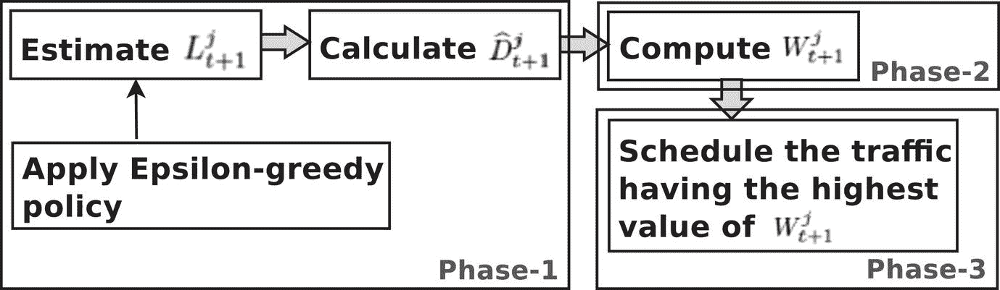

图 4.2 带有三个阶段的 NB-PTS 执行步骤。

#### 4.3.7 时间界分析

从 `𝕂` 中，搜索过去产生最低平均 PLR 的 `L[t+1]` 在 NB-PTS 的时间复杂度中起着关键作用。假设 `𝕂` 基于 SINR 值以某种方式填充，其中使用二分查找。因此，在 `𝕂` 中平均搜索的时间界为 `O(log(|𝕂|)`。这里，`|𝕂|` 表示 `𝕂` 中的条目数量。此外，在 4.7 中，项 $\sum_{i = 1}^{n}p_{i}$ 也可以对 NB-PTS 的时间复杂度界做出贡献。因此，NB-PTS 的时间界为 $O{({\log{(|\\mathbb{K}|})} + \sum_{i = 1}^{n}p_{i})}$。

### 4.4 性能分析


NB-PTS 的性能已通过在 NS-3 的 NB-IoT 兼容模块（即 ns-3-dev-NB-IOT）中实现来评估，即 \[26\]。通过改变干扰水平，分析了带有 eNB 和多个 `user equipments (UEs)`（UE 数量从 1 变化到 50）的 NB-PTS 性能。我们的仿真设置详情见 Table 4.2。`δ` 的值设置为 5.0，该值是基于算法快速收敛而实验选择的。UEs 按围绕 eNB 位置的泊松分布进行放置。SINR 值在 20 dB–45 dB 范围内随机选择。每个仿真实例执行 60 秒，结果显示为每个仿真实例 100 次运行的平均值，这是上行链路和下行链路传输的组合。

Table 4.2 PHY/MAC and Control Parameters Used in Simulation

| Parameter || Value |

| --- | --- |

| Path loss model || FriisSpectrumPropagationLossModel |

| --- | --- |

| Fading model || TraceFadingLossModel |

| TxPower of UE || 23 dBm |

| TxPower of eNB || 46 dBm |

| NoiseFigure of UE || 9 |

| NoiseFigure of eNB || 5 |

| DefaultTransmissionMode || 0 (SISO) |

| Propagation delay model || Constant speed propagation delay model |

| Maximum physical data rate || 250 kbps |

| Bit error rate (BER) || 0.03 |

| Adaptive modulation and coding (AMC) model || Vienna |

| Mobility model || Random direction 2d mobility model (“Bounds: Rectangle (−100, 100, −100, 100)”, “Speed: ConstantRandomVariable \[Constant=3.0\]”, “Pause: ConstantRandomVariable \[Constant=0.4\]”) |

| UE scheduler type || PfFfMacScheduler |

| Cell radius || 1.5 (km) |

| Transmission mode || Single-Tone |

#### 4.4.1 基线机制

我们使用了 NIS \[20\]、NANIS \[18\] 和“General”作为与 NB-PTS 性能比较的基线机制。NIS 解决了 NB-IoT 中时域无线资源浪费相关的问题，并设计了一个下行链路调度算法。NIS 还描述了 NB-IoT 系统中的无线接入策略及其下行链路调度问题。由于 NIS 解决了 NB-IoT 中的下行链路调度，因此可以通过优先流量分析下行链路调度，以找出其对分组传输延迟的影响。NANIS 专注于两个连续 NPDCCH 之间的时间间隔的自适应，以及在下行链路传输期间接收数据所消耗的无线资源的最小化。NANIS 的主要设计概念是尽可能多地利用窄带物理下行链路共享信道（NPDSCH）子帧。因此，NANIS 可以帮助在考虑优先流量的情况下最小化分组传输延迟。因此，我们使用 NIS 和 NANIS 作为基线。“General”基本上是一种用于调度分组的先进先出（FIFO）方法。

#### 4.4.2 优先流量生成

在 NB-PTS 的性能评估中，我们考虑了三种与 QCI 值 QCI-4、QCI-6 和 QCI-8 相关的流量，这些值在 Table 4.1 中给出。3GPP LTE 中定义的其他 QCI 值具有比上述 QCI 值更低的分组延迟预算，因此主要集中在比 QCI-4、QCI-6 和 QCI-8 更延迟敏感的方面。由于 NB-IoT 技术适合延迟容忍型应用，上述三个 QCI 值已在我们在 ns-3-dev-NB-IOT 中的 NB-PTS 实现中用于优先流量传输。在此实现中，我们将流量称为“Priority-1”、“Priority-2”和“Priority-3”，分别对应 QCI-4、QCI-6 和 QCI-8。在仿真设置中，eNB 和每个 UE 以相同比例生成这三种不同优先级的流量。流量是通过使用 `OnOffApplication` 生成的。QCI-4、QCI-6 和 QCI-8 相关的流量分别由枚举器 `GBR_NON_CONV_VIDEO`、`NGBR_VIDEO_TCP_OPERATOR` 和 `NGBR_VIDEO_TCP_PREMIUM` 生成；这些 QCI 值由枚举 `EpsBearer::Qci` 设置。

#### 4.4.3 实现细节

我们已将 NB-PTS 实现为 ns-3-dev-NB-IOT 中 LTE MAC \[1\] 的扩展，Figure 4.3 说明了此实现。类 `LteEnbMac` 实现 eNB 的 MAC 层，`PfFfMacScheduler` 实现 `proportional fair scheduler` 以调度 UEs。`uplink` (UL) 和 `downlink` (DL) 块负责队列中存储的分组的上行链路和下行链路调度。MAC 调度器接口中的三个块是调度器块、控制块和子帧块。

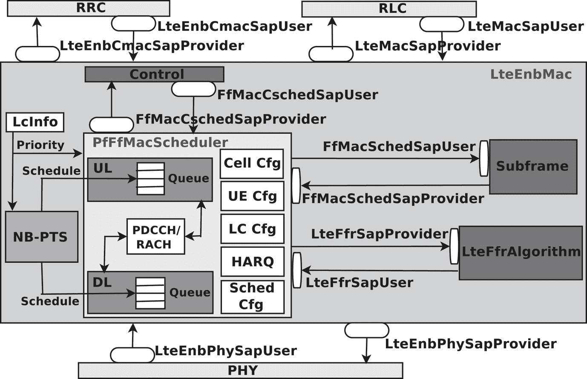

Figure 4.3 NB-PTS implementation modules in ns-3-dev-NB-IOT.

`LteFfrAlgorithm` 是实现频率复用算法以分配 PRB 用于数据传输的抽象基类。通常，此算法对数据传输的 PRB 分配做出决策。与 `LteFfrSap` 接口对应的服务访问点（SAPs）是 `LteFfrSapProvider` 和 `LteFfrSapUser`。控制块与 MAC 调度器的通信通过 `FfMacCschedSapProvider` 和 `FfMacCschedSapUser` 进行。为了处理数据传输，`FfMacSchedSapProvider` 和 `FfMacSchedSapUser` 有助于在 MAC 调度器和子帧块之间建立连接。对于 MAC 调度器，接口 `LteEnbCmacSap`、`LteMacSap` 和 `LteEnbPhySap` 与无线资源控制（RRC）、无线链路控制（RLC）和物理（PHY）层建立通信。MAC 调度器包含以下块。`HARQ` 块用于处理混合自动重传请求（HARQ）重传。`Cell Cfg`、`UE Cfg`、`LC Cfg` 和 `Sched Cfg` 块分别存储小区配置、UE 配置、逻辑信道配置和调度器特定配置。`Physical downlink control channel (PDCCH)/random access channel (RACH)` 负责在 UL 和 DL 之间共享资源。拟议的 NB-PTS 算法作为 `LteEnbMac` 的扩展实现，并通过处理 UL 和 DL 块中的传输队列来增强 `LteEnbMac` 的功能。基于 QCI，`LteEnbCmacSapProvider::LcInfo` 为 NB-PTS 提供流量的优先级。

#### 4.4.4 吞吐量分析

单个流量（Priority-1、Priority-2 和 Priority-3）的平均吞吐量显示在 Figure 4.4 和 Figure 4.5(a) 中。基于信道条件，需要动态确定队列阈值，以最大化调度期间传输的分组数量。此外，目标平均延迟的估计会导致流量的延迟容忍水平。因此，计算目标平均延迟至关重要，这样可以尽可能多地增强通过各自的目标平均延迟传输的分组数量。因此，基于学习的自适应机制可以帮助根据当前网络条件确定队列阈值和目标平均延迟的值；拟议的 NB-PTS 是朝这个方向的在线学习方法。此外，拟议的度量 `W[t+1]` 也有助于通过考虑目标平均延迟、HOL 延迟和流量优先级来调度流量。因此，NB-PTS 中的调度在考虑流量延迟约束的同时考虑流量优先级，因此，随着流量优先级的提高，平均吞吐量增加，如 Figure 4.4 和 Figure 4.5(a) 所示。

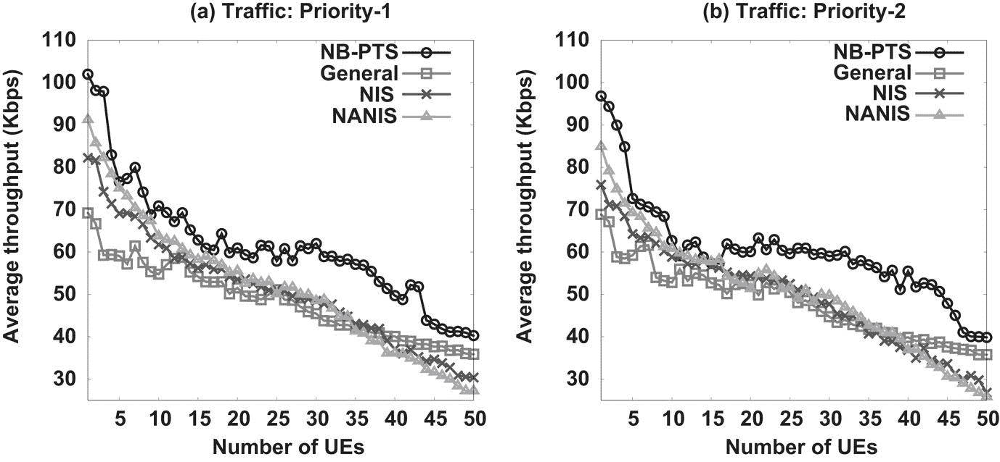


图 4.4 (a) Priority-1 流量的平均吞吐量；(b) Priority-2 流量的平均吞吐量。

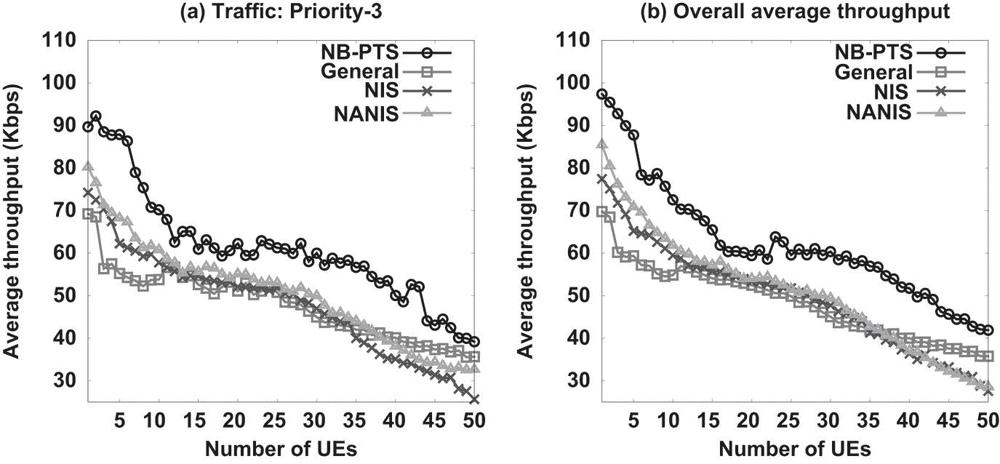

图 4.5 (a) Priority-3 流量的平均吞吐量；(b) 总体平均吞吐量。

通过专注于无线资源的高效利用，仅下行链路调度是 NIS 的目标。它不涉及 NB-IoT 网络中优先流量传输的延迟敏感性问题。因此，与 NB-PTS 相比，NIS 中各个流量的平均吞吐量较低。NANIS 在下行链路调度期间最大限度地减少了无线资源的消耗，而这种最小化并非基于优先流量。此外，流量的传输延迟不被视为需要最小化，因此，NANIS 中基于优先级的流量的吞吐量低于 NB-PTS。NANIS 的基于阈值的方法也引发了该算法在不同网络场景中适应性的问题。当连接的 UE 数量为 30 时，图 4.4 和 图 4.5(a) 表明，NB-PTS 中“Priority-1”流量的平均吞吐量分别比一般、NIS 和 NANIS 高出约 36%、28% 和 27%。“Priority-2”流量的平均吞吐量在 NB-PTS 中分别比一般、NIS 和 NANIS 机制高出约 32%、24% 和 9%。对于“Priority-3”，这些改进在 NB-PTS 中分别比一般、NIS 和 NANIS 方法高出约 33%、28% 和 20%。

##### 4.4.4.1 总体平均吞吐量

由于各个基于优先级的流量的平均吞吐量在 NB-PTS 中高于“一般”、NIS 和 NANIS 方法，因此与这些基准机制相比，NB-PTS 的总体平均吞吐量得到了显著提高，如 图 4.5(b) 所示。从 图 4.4 和 图 4.5 还可以注意到，NB-PTS 在拥塞网络场景中（当 UE 数量增加时）仍能实现更高的平均吞吐量。这在 NB-PTS 中是可能的，它利用过去的经验，动态选择队列阈值的值，从而最大限度地减少 PLR，进而提高平均吞吐量。从 图 4.5(b) 可以看出，NB-PTS 的平均吞吐量分别比 General、NIS 和 NANIS 方案高出约 34%、26% 和 22%（#UE= 30）。

#### 4.4.5 分组丢失率和分组延迟分析

队列阈值和目标平均延迟的确定是调度流量以保持分组传输中低平均延迟的关键因素。NB-PTS 在计算下一时隙的队列阈值时，会考虑当前平均延迟；因此，下一个队列阈值受当前延迟状态的影响，这有助于根据队列中存储的分组最近经历的延迟来调整目标平均延迟。通过应用 `ϵ`-greedy 策略，NB-PTS 学习环境并选择目标平均延迟，使得下一个分组可以在此延迟内调度。结果，与“一般”、NIS 和 NANIS 相比，NB-PTS 中的分组丢失概率和平均分组延迟降低，如 图 4.6 所示。这里，我们展示了基于每个流量优先级的平均结果。在这种情况下，由于 NIS 和 NANIS 不是基于在线学习的方法，并且不专注于最小化优先流量传输的分组延迟，因此 NIS 和 NANIS 的性能显著低于 NB-PTS。但是，由于“一般”是一种基本的调度方法，NIS 和 NANIS 的平均 PLR 和延迟低于“一般”机制。从 图 4.6 可以看出，当连接的 UE 数量为 30 时，NB-PTS 的平均 PLR 分别比 General、NIS 和 NANIS 低约 68%、59% 和 52%。在延迟方面，所提议机制的平均延迟分别比 General、NIS 和 NANIS 方法低约 52%、48% 和 46%。

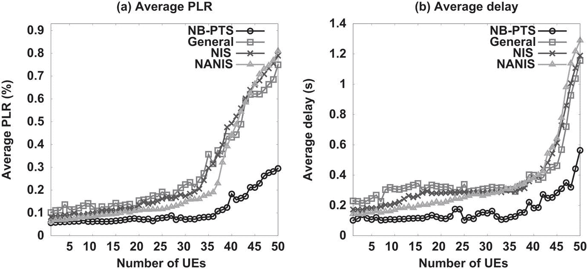

图 4.6 (a) 平均 PLR；(b) 平均延迟。

##### 4.4.5.1 各个基于优先级的流量的 PLR 和延迟

在计算指标 `W[t+1]` 时，考虑各个基于优先级的流量的 HOL 延迟，从而降低了每个优先级类的平均延迟。调度是基于 `W[t+1]` 进行的，它考虑了流量的优先级；因此，随着优先级的提高，该流量的平均 PLR 和延迟会进一步降低。如 图 4.7 所示，可以注意到，尽管随着 UE 数量的增加，分组丢失率和延迟会增加，但借助指标 `W[t+1]`，高优先级流量可以比低优先级流量具有更低的延迟。在这方面，队列阈值的选择至关重要，NB-PTS 通过利用该选择的过去经验来智能地选择它。此外，`W[t+1]` 包括流量的 HOL 分组延迟超过其目标平均延迟的概率。NB-PTS 通过尝试降低此概率来调度分组，因此，分组传输率（在目标平均延迟内）会增加。这种情况有助于最小化分组调度中的平均延迟。

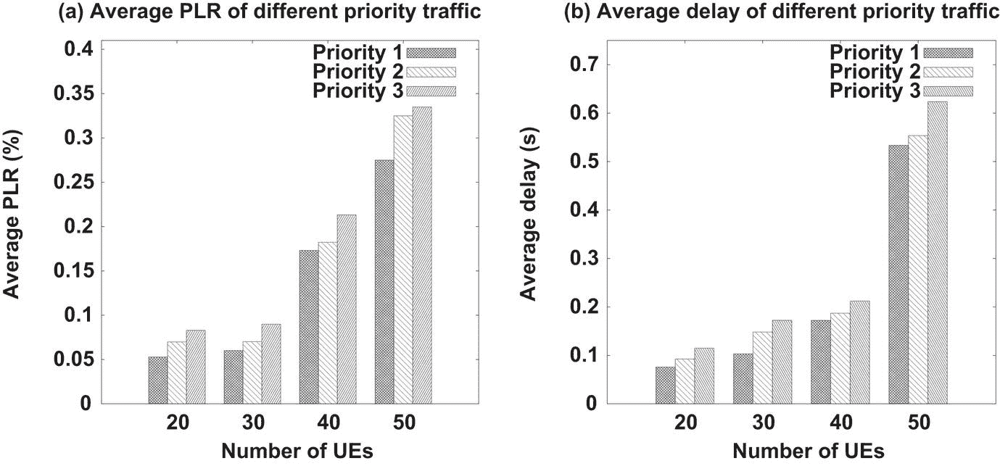

图 4.7 各个优先级分析：(a) 平均 PLR；(b) 平均延迟。

当连接的 UE 数量为 30 时，从 图 4.7 可以看出，“Priority-1”的平均 PLR 值分别比“Priority-2”和“Priority-3”低 14% 和 33%；而“Priority-2”的平均 PLR 比“Priority-3”低 22%。在延迟方面，“Priority-1”的平均延迟分别比“Priority-2”和“Priority-3”低 30% 和 40%。“Priority-2”的平均延迟比“Priority-3”流量低 14%。

#### 4.4.6 收敛行为

图 4.8(a) 显示了 NB-PTS 在平均吞吐量方面的收敛特性，该吞吐量在算法执行每 10 分钟后计算。在初始化阶段，NB-PTS 需要通过反复应用仅探索来填充知识库 K。初始化后，`ϵ`-greedy 方法开始，最初，探索率较高。因此，在 NB-PTS 的初始阶段，图 4.8(a) 所示的图表中存在较大的波动。然而，随着 NB-PTS 运行次数的增加，利用率会提高。在此期间，目标平均延迟的选择是基于当前信道条件进行的，使得成功分组传输的数量不会减少，并且可以与执行早期阶段相比保持几乎稳定的平均吞吐量。可以在 图 4.8(a) 中观察到，随着时间推移，图表的快速波动特性会减弱。

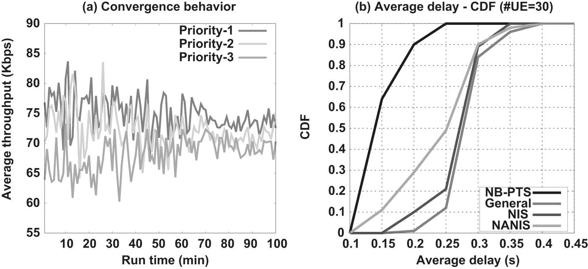

图 4.8 (a) 收敛行为；(b) 平均延迟分布。

#### 4.4.7 平均延迟分布


# NB-PTS、“General”、NIS 和 NANIS 方案平均延迟的累积分布函数（CDF）如 图 4.8(b) 所示。该图突出显示，NB-PTS 的平均延迟分布显著低于“General”、NIS 和 NANIS。由于单个基于优先级的流量平均延迟的降低以及整体平均延迟的减少（如 图 4.6(b) 和 图 4.7(b) 所示），NB-PTS 中的平均延迟分布低于“General”、NIS 和 NANIS；且该分布在 NB-PTS 中集中于 0.1s–0.25s 之间。通过应用在线学习，NB-PTS 尝试在执行的每个步骤中，根据当前网络状况动态执行调度。在这方面，NB-PTS 的重点始终是尽量减少单个优先级流量调度的平均延迟。在基于当前网络状况的动态调度方向上，NB-PTS 的重点始终是尽量减少单个优先级流量传输的平均延迟。

#### 4.4.8 UE 数量对消耗子帧数量的影响

图 4.9(a) 显示了 UE 数量对消耗子帧数量的影响。结果表明，随着 UE 数量的增加，消耗的子帧数量也随之增加，这是因为 eNB 为调度更多数量的设备而消耗更多的子帧。两个连续 NPDCCH 之间的时间间隔称为 NPDCCH 周期（NP）\[2\]。NANIS 为不同的覆盖增强（CE）级别动态选择更合适的 NP，并更高效地利用无线资源。因此，与所提机制 NIS 以及“General”方法相比，NANIS 可以进一步减少消耗的子帧数量，如 图 4.9(a) 所示。由于所提机制不考虑 NP 的自适应和无线资源管理，因此在子帧消耗方面，NB-PTS 的性能低于 NANIS，而 NB-PTS 的子帧消耗数量显著低于“General”，并且与 NIS 观察到的平均性能几乎相同。然而，从 图 4.9(a) 可以看出，随着 UE 数量的增加，相对于 NANIS，NB-PTS 中的子帧消耗率会降低。通过对阈值 `L[t+1]` 和目标平均延迟的智能设置，NB-PTS 尝试在计算出的目标平均延迟内完成优先级数据包的调度，这一尝试影响了数据包子帧消耗的减少。随着时间增加，NB-PTS 对系统施加更多知识，这导致在拥塞网络场景中，相对于 NANIS，对 `L[t+1]` 和目标平均延迟进行更智能的自适应。

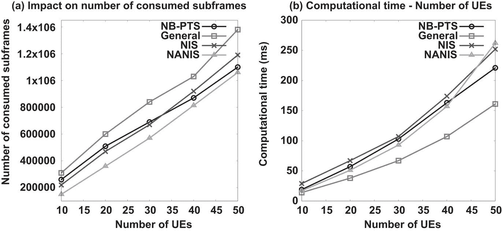

Figure 4.9 (a) Impact on consumed subframes; (b) computational time.

#### 4.4.9 UE 数量对计算时间的影响

UE 数量对算法计算时间的影响如 图 4.9(b) 所示。当需要调度的 UE 数量增加时，调度所需的 UE 选择更多。因此，对于每个算法，随着连接 UE 数量的增加，计算时间也随之增加。从 图 4.9(b) 可以看出，随着网络中连接设备数量的增加，NANIS 的计算时间增加更多。这是因为 NANIS 的运行时间高度依赖于 NPDSCH 子帧的最大计数和需要调度的 UE 数量，而在拥塞网络中，对 NPDSCH 子帧数量的需求很高。在所提机制中，执行时间主要取决于知识库 `K` 的大小，而 `K` 的大小又取决于 SINR 条目的数量。因此，与 NANIS 和 NIS 方法相比，高数量的 UE 对 NB-PTS 计算时间的影响较低。NB-PTS 的计算时间增长与连接 UE 数量几乎呈线性关系。作为一种简单的基于 FIFO 的调度方案，“General”的计算时间低于其他三种机制（图 4.9(b)）。当连接 UE 数量为 30 时，NB-PTS 的计算时间分别比 NANIS 高约 11%，比 NIS 低约 4%。然而，当 UE 数量为 50 时，NB-PTS 的计算时间比 NANIS 低约 16%。

### 4.5 结论

数据包调度是基于 NB-IoT 的 IIoT 网络中 QoS 要求的一个重要方面，在该网络中，信道带宽和峰值数据速率相当低，难以满足延迟敏感型应用的延迟要求。NB-PTS 通过使用在线学习方法，解决了基于优先级的应用中数据包调度的 QoS 要求问题，从而使流量数据传输的总时间能够经历较低的延迟。度量 `W[t+1]` 定义了待调度数据包的权重因子，基于该因子，优先级较高的流量在调度后将获得更高的传输机会。NB-PTS 的性能在 `ns-3-dev-NB-IOT` 中进行了分析，结果表明，NB-PTS 可以减少基于 NB-IoT 的单个优先级应用的延迟，并可以降低整体平均延迟，同时改善其他网络参数的性能。我们相信，对 NB-IoT 的所提扩展可以使该技术有效地利用下一代通信，用于各种应用。

### 参考文献

1.  S. Popli, R. K. Jha, and S. Jain, “A Survey on Energy Efficient Narrowband Internet of Things (NBIoT): Architecture, Application and Challenges”, IEEE Access, vol. 7, pp. 16 739–16 776, 2019.

2.  3GPP RP-161248, 3GPP TSG-RAN Meeting 72, Ericsson, Nokia, ZTE, NTT DOCOMO Inc., Busan, South Korea, “Introduction of NB-IoT in 36.331”, June 2016.

3.  3GPP TS 23.203 V10.6.0, “Technical Specification Group Services and System Aspects; Policy and charging control architecture (Release 10)”, March 2012.

4.  L. Da Xu, W. He, and S. Li, “Internet of things in industries: A survey”, IEEE Transactions on industrial informatics, vol. 10, no. 4, pp. 2233–2243, 2014.

5.  E. Sisinni, A. Saifullah, S. Han, U. Jennehag, and M. Gidlund, “Industrial Internet of Things: Challenges, Opportunities, and Directions”, IEEE Transactions on Industrial Informatics, vol. 14, no. 11, pp. 4724–4734, 2018.

6.  F. Tong, Y. Sun, and S. He, “On Positioning Performance for the Narrow-Band Internet of Things: How Participating eNBs Impact?” IEEE Transactions on Industrial Informatics, vol. 15, no. 1, pp. 423–433, 2019.

7.  C. Yu, L. Yu, Y. Wu, Y. He, and Q. Lu, “Uplink Scheduling and Link Adaptation for Narrowband Internet of Things Systems”, IEEE Access, vol. 5, pp. 1724–1734, 2017.

8.  G. Tsoukaneri, M. Condoluci, T. Mahmoodi, M. Dohler, and M. K. Marina, “Group Communications in Narrowband-IoT: Architecture, Procedures, and Evaluation”, IEEE Internet of Things Journal, vol. 5, no. 3, pp. 1539–1549, 2018.

9.  H. Malik, H. Pervaiz, M. M. Alam, Y. Le Moullec, A. Kuusik, and M. A. Imran, “Radio Resource Management Scheme in NB-IoT Systems”, IEEE Access, vol. 6, pp. 15 051–15 064, 2018.

10.  S.-M. Oh and J. Shin, “An Efficient Small Data Transmission Scheme in the 3GPP NB-IoT System”, IEEE Communications Letters, vol. 21, no. 3, pp. 660–663, 2016.


11. E. Mostafa, Y. Zhou, and V. W. Wong, “Connectivity Maximization for Narrowband IoT Systems with NOMA”, in *IEEE ICC*. IEEE, 2017, pp. 1–6.

12. Y. D. Beyene, R. Jantti, K. Ruttik, and S. Iraji, “On the Performance of Narrow-Band Internet of Things (NB-IoT)”, in *IEEE WCNC*, 2017, pp. 1–6.

13. P. R. Manne, S. Ganji, A. Kumar, and K. Kuchi, “Scheduling and Decoding of Downlink Control Channel in 3GPP Narrowband-IoT”, IEEE Access, vol. 8, pp. 175 612–175 624, 2020.

14. O. Elgarhy, L. Reggiani, H. Malik, M. M. Alam, and M. A. Imran, “Rate-Latency Optimization for NB-IoT With Adaptive Resource Unit Configuration in Uplink Transmission”, IEEE Systems Journal, 2020.

15. B.-Z. Hsieh, Y.-H. Chao, R.-G. Cheng, and N. Nikaein, “Design of a UE-Specific Uplink Scheduler for Narrowband Internet-of-Things (NB-IoT) Systems”, in *IEEE IGBSG*, 2018, pp. 1–5.

16. A. Azari, G. Miao, C. Stefanovic, and P. Popovski, “Latency-Energy Tradeoff Based on Channel Scheduling and Repetitions in NB-IoT Systems”, in *IEEE GLOBECOM*. IEEE, 2018, pp. 1–7.

17. L. Feltrin, G. Tsoukaneri, M. Condoluci, C. Buratti, T. Mahmoodi, M. Dohler, and R. Verdone, “Narrowband IoT: A Survey on Downlink and Uplink Perspectives”, IEEE Wireless Communications, vol. 26, no. 1, pp. 78–86, 2019.

18. Y.-J. Yu, “NPDCCH Period Adaptation and Downlink Scheduling for NB-IoT Networks”, IEEE Internet of Things Journal, 2020.

19. X. Chen, Z. Li, Y. Chen, and X. Wang, “Performance Analysis and Uplink Scheduling for QoS-Aware NB-IoT Networks in Mobile Computing”, IEEE Access, vol. 7, pp. 44 404–44 415, 2019.

20. Y.-J. Yu and S.-C. Tseng, “Downlink Scheduling for Narrowband Internet of Things (NB-IoT) Systems”, in *IEEE VTC*, 2018, pp. 1–5.

21. L. Lei, H. Xu, X. Xiong, K. Zheng, and W. Xiang, “Joint Computation Offloading and Multiuser Scheduling using Approximate Dynamic Programming in NB-IoT Edge Computing System”, IEEE Internet of Things Journal, vol. 6, no. 3, pp. 5345–5362, 2019.

22. A. Azari, Č. Stefanović, P. Popovski, and C. Cavdar, “On the Latency- Energy Performance of NB-IoT Systems in Providing Wide-Area IoT Connectivity”, IEEE Transactions on Green Communications and Networking, vol. 4, no. 1, pp. 57–68, 2019.

23. C. Watkins, “Learning from Delayed Rewards. PhD thesis, University of Cambridge, Cambridge, England”, May 1989.

24. M. E. Woodward, Communication and Computer Networks: Modelling with Discrete-Time Queues. “Wiley”- IEEE Computer Society, 1994.

25. J. Wei, C.-Z. Xu, and X. Zhou, “A Robust Packet Scheduling Algorithm for Proportional Delay Differentiation Services”, in *IEEE GLOBECOM*. IEEE, 2004, pp. 697–701.

26. “NB-IOT – Nsnam”, [`https://www.nsnam.org/wiki/NB-IOT`](https://www.nsnam.org), accessed on 02. 04. 2019.

## 5 基于深度学习的信息安全与事件管理在网络安全漏洞检测中的应用

Kothandaraman D¹, S Shiva Prasad¹, and P Sivasankar²

¹School of Computer Science and Artificial Intelligence, SR University, Warangal, Telangana, India

²Department of Electrical and Electronics Communication, NITTTR, Chennai, India

DOI: [`10.1201/9781003212249-5`](https://doi.org/10.1201/9781003212249-5)

1. Contents

2. 5.1 Introduction

3. 5.2 Literature Survey

4. 5.2.1 Research Gap

5. 5.2.2 Importance of the Chapter in the Context of Current Status

6. 5.3 Pictorial Representation of Cybersecurity Working Model

7. 5.3.1 The Proposed Approach

8. 5.3.2 Apply LSTM

9. 5.3.3 Algorithm for LSTM

10. 5.3.4 LSTM Implementation for Vulnerabilities Detection

11. 5.3.5 Results

12. 5.4 Conclusion

13. References

### 5.1 Introduction

Security information and event management (SIEM) play a key role in improving the next-generation cybersecurity-based secure communication against potential cyber-attacks. Nowadays, the world has been connected by Internet of Things (IoT) devices, which will reach 1.3 trillion by 2026. In such cases, potential cyber-attacks that affect the communication layers between computers and IoT devices through centralized and decentralized systems will be more vulnerable, such as DDoS attacks, botnet, social attacks, man-in-the-middle attacks, etc. during its applications in worldwide industrial areas such as the healthcare sector, smart transportation, agriculture, online banking, Google pay, Paytm banking, etc \[1\].

As a solution in this chapter, deep learning–based vulnerability detection and prevention model for SIEM with lightweight computing has been proposed. Also, an open-source decentralized vulnerabilities detection model will be developed for testing the implementation of industrial applications. Through this chapter scalability, reduced latency, secure reliable communication, and fast downloading/uploading through Internet of Things can be achieved. The deliverable of the chapter is a deep learning (DL)–based model to detect and protect the vulnerabilities for IoT networks that will have a great focus in the near future for secure communication. The following are features of SIEM for IoT networks \[2\]:

> Suitable for an organization.
>
> Can identify, monitor, record, and analyze security incidents or events within an environment and store their relevant data centrally.
>
> Provides a complete, holistic view of the environment, end to end, and tracks it over time and helps to ease the process.
>
> Has potential to enhance the efficiency of incident-handling activities that result in saving resources, manpower, and time for incident-handling folks.
>
> Has advantages like better data protection, improved compliance, easier certifications, and validated policy enforcement and violations.
>
> Software can be installed on a local hardware and a local server.
>
> Provides a single interface to view all security logs from multiple hosts \[3\].
>
> Has embraced new capabilities such as user and entity behavioral analytics (UEBA) that can help organizations detect threats from both people and software and eliminate them before they pose a grave damage.

Regarding this chapter, although the importance and incorporating DL into cybersecurity are more as represented, many industries have procured IoT, but most are not properly configured or managed because of the cyber-attacks which are often cited as the main reasons for not deriving benefit from IoT. Looking ahead, everything is headed toward cognitive innovation. DL can be utilized to synergize data from both structured data sources and natural language, and that's what industries want it to do. AI technologies like machine learning and deep learning will have a dramatic impact on the cybersecurity market in the next five years, as shown in `Figure 5.1`.


图 5.1 未来五年网络安全市场中的 AI 技术（1. 28% 表示每个网络安全解决方案都将包含某些 AI 方面；2. 31% 表示一小部分（小于 50%）；3. 39% 到 50% 的所有网络安全产品将使用某些 AI 方面；4. 其他。）

因此，在本章中，基于深度学习的长短期记忆网络（LSTM）用于为解决网络安全问题提供方案。当配置良好的 IoT 与深度学习相结合时，IoT 变得更加有效，并通过减少误报数量增加显著价值，这使得安全分析师在安全环境中更加高效。通常，深度学习采用金字塔方法，其中机器学习位于底部，然后面向认知的技术，如计算机视觉、自然语言处理、知识图谱和推理引擎位于顶部 \[4\]。将深度学习添加到 IoT 的目标是减少创建基线并调整警报所需的时间投入，而无需高经验员工。为了大大加快分析速度，IoT 与网络管理系统及相关模型集成。

因此，深度学习可以在 IoT 的实用性方面产生显著差异。本章为网络层中所有类型的可能网络攻击提供了独特的解决方案（检测和预防），并为各行业提供独立平台。

为了大大加快分析速度，SIEM 集成到网络管理系统及相关模型中。图 5.1 表示 SIEM 在威胁情报和分析应用中的集成水平 \[5\]。

图 5.1(a) 表示完全且无缝集成；(b) 表示已集成但某些组件尚未自动化；(c) 表示威胁情报馈送和安全分析已集成但与 SIEM 分离；(d) 表示威胁情报馈送、分析和 SIEM 分离；(e) 当前既不使用威胁情报馈送也不使用安全分析应用。此类系统可以在无需人工干预的情况下阻止威胁，随时间检测异常，并筛选网络噪声，以便让人工安全专业人员专注于真正的威胁和事件。重要的是，此技术还提供宝贵的威胁情报和网络安全分析，以便主动防止未来威胁。因此，机器学习可以在 SIEM 系统的管理和实用性方面产生显著差异。此外，还可以覆盖广泛的攻击类型，包括恶意软件、垃圾邮件、内部威胁、网络入侵、虚假数据注入以及僵尸网络使用的恶意域名 \[6\]。

### 5.2 文献综述

本章为 IoT 网络中所有类型的可能攻击提供了独特的解决方案（监控和检测），并使用平台独立的 SIEM。

#### 5.2.1 研究差距

关于此，不同开源和商业漏洞检测工具在 表 5.1 和 表 5.2 中显示，尽管存在一些安全缺陷 \[7\]。

表 5.1 现有与拟议网络安全模型比较

| 现有网络安全模型 || 基于深度学习的网络安全模型 |

| --- | --- |

| 传统网络安全模型不提供高效的异常检测。 || 此处提出的基于深度学习的网络安全模型是平台独立的，能够检测和防止所有类型的通信层攻击。它可以提供更好的解决方案，包括智能、攻击检测速度和准确性。 |

| --- | --- |

| 增加计算时间和空间复杂度。 || 使用 AI 技术减少计算时间和空间复杂度。 |

表 5.2 各种现有网络安全工具和技术比较 

|  || 功能比较 ||  || OSSIM || ELK Stack || OSSEC || Wazuh || Apache Metron || SIEMonster || Prelude || SecurityOnion || MozDef || Snort || Suricata |

| --- | --- | --- | --- | --- | --- | --- | --- | --- | --- | --- | --- | --- | --- |

| 1. || 包含关键 SIEM 组件\* || Y/N || Y || N || Y || – || – || – || – || – || – || – || – |

| --- | --- | --- | --- | --- | --- | --- | --- | --- | --- | --- | --- | --- | --- |

| 3. || 日志管理功能 || N || Y || N || – || Y || Y || Y || – || – || – || – |

| 4. || 性能问题 || Y || – || – || – || – || – || – || – || – || – || Y |

| 5. || 在线版本 || – || – || – || – || – || N || – || – || – || – || – |

| 6. || syslog 中的报告或警报 || – || N || Y || – || Y || Y || Y || – || Y || Y || –- |

| 7. || 用于安全应用程序 || – || N || Y || Y || Y || – || – || Y || Y || Y || Y |

| 8. || 开源操作系统支持 || – || – || Y || – || Y || – || – || Y || – || Y || – |

| 9. || 可扩展性 || N || – || – || Y || – || – || – || – || – || – || – |

| 10. || 开源工具版本 || Y || – || – || – || Y || – || – || Y || Y || – || – |

| 11. || 安全性 || – || N || – || – || Y || – || – || Y || – || – || – |

| 12. || 维护成本高 || – || Y || – || – || – || – || – || – || – || – || – |

表 5.2 注释：是-Y，否-N，不适用：–；\* 即事件收集、处理和标准化，最重要的是事件关联。

网络安全模型由每天生成的警报数量配置，并在 图 5.2 中表示。这表示人口与数十亿 IoT 设备的对比；在 2003 年，世界人口为 63.07 亿，每人一个 IoT 设备，但在 2020 年，世界人口为 78.3 亿，每人六个 IoT 设备）。

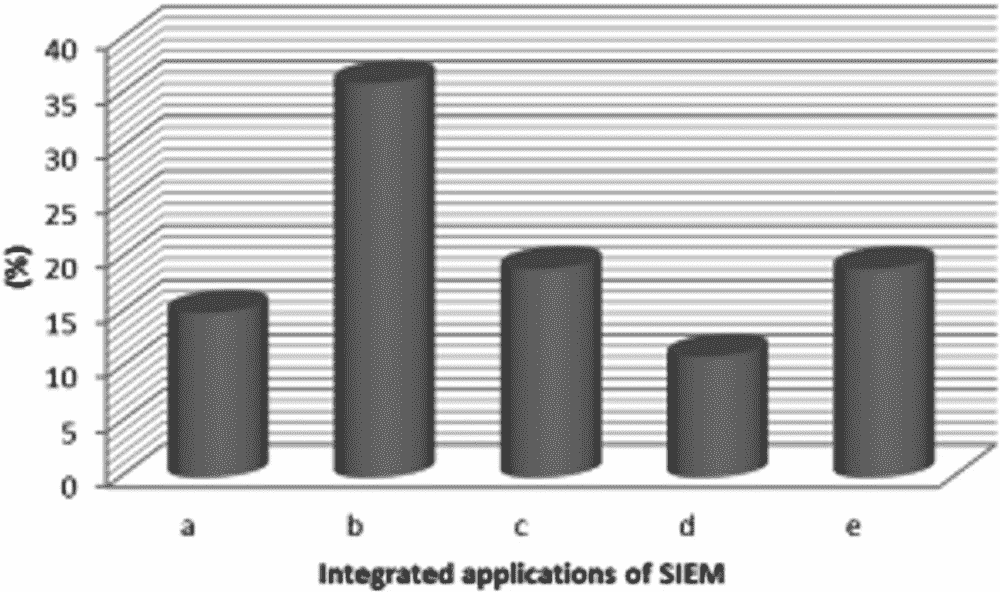

图 5.2 SIEM 在威胁情报和分析应用中的集成水平。

大多数公司用来确定其 SIEM 配置得好或坏的一种方法是按每天生成的警报数量，并在 表 5.3 中表示。2017 年，企业购买了约 12 亿的 SIEM 设备和服务。该公司对 2018 年企业 SIEM 销售的早期估计是 8% 到 10% 的增长。SIEM 旨在收集一切，无论多么微不足道，可能会生成大量警报，大多是误报，专家一致认为这将被视为设计不良。表 5.4 表示最终被证明是误报的安全事件数量。一个更精细调制的 SIEM 可以过滤掉许多这些误报，将返回远少的警报。表 5.4 表示各公司关于不同参数的调查细节，表 5.5 表示调查安全事件所需的平均时间。图 5.3 表示由 AI 增强的非常有效和有些有效的安全模型的综合百分比。表 5.6 表示在调查安全事件时参考的各种数据来源 \[8,9\] (表 5.7)。

表 5.3 网络安全模型平均每天可提醒的网络攻击数量

| 每天平均警报数 || 报告的网络攻击 (%) |

| --- | --- |

| 5 || 47 |

| --- | --- |

| 10–20 || 23 |

| 21–30 || 13 |

| 31–40 || 3 |

| 41 || 14 |

表 5.4 最终被证明是误报的网络攻击数量

| 误报范围 (%) || 网络攻击 (%) |

| --- | --- |


| 10% || 27 |

| --- | --- |

| 10–30% || 29 |

| 31–50% || 15 |

| 50% || 28 |

表 5.5 不同行业针对不同参数的调查

| **行业受访者总数 (%)** || **公司员工数或公司收入** || **该类别受访者数/总受访者数** || **关于安全模型或调查/警报所需时间段的备注** |

| --- | --- | --- | --- |

| 30% ||  || `>$1 billion` || 29/95 || `>31 attack incident returned/day` |

| --- | --- | --- | --- | --- |

| 72% ||  || between `$100 million` and `$1 billion` || 57/79 || AI-enhanced systems are effective (Also represented in Figure 4) |

| 69% || Between 1,001 and 5,000 employees ||  || 59/85 |

|  || fewer than 1,000 employees || less than `$100 million` || 56 or 68/121 |

| 60% ||  ||  || 64/107 |

| 68% ||  || `$1 billion` or more || 65/95 |

| 65% || (high employee count ie., `>5000` employees) ||  || 67/103 |

| 47% || (mid size companies) || between `$100 million` to `$1 billion` || 37/79 || Somewhat effective |

| 36% || (large size companies) || more than `$1 billion` || 34/95 |

|  || small companies || less than `$100 million` || 53/121 ||  |

| 43% || 1,000 and fewer employees ||  ||  ||  |

| 31% || 1,001 to 5,000 employees ||  || 26/85 ||  |

| 34% || Mid size companny ||  || 27/79 ||  |

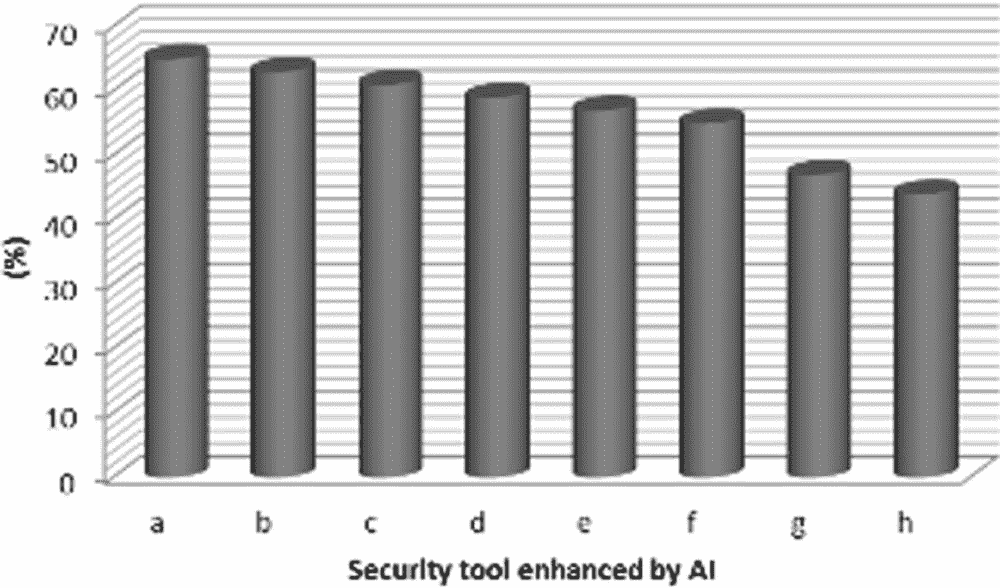

Figure 5.3 Level of integration of SIEM for threat intelligence and analytics applications.

Table 5.6 调查网络攻击所需的平均时间

| 所需平均时间 || 调查的网络攻击 (%) |

| --- | --- |

| 10 min || 32 |

| --- | --- |

| 10–20 min || 22 |

| 20 min–1 hour || 29 |

| 2–12 hours || 13 |

| 12 hours || 5 |

Table 5.7 调查网络攻击时参考的各种数据源

| 数据源类型 || 调查的网络攻击 (%) |

| --- | --- |

| Treat feeds || 76 |

| --- | --- |

| Search engines || 67 |

| Research articles || 48 |

| Blogs || 46 |

| Other || 10 |

Figure 5.2(a) 表示网络安全模型；(b) 表示安全分析；(c) 表示威胁情报；(d) 表示电子邮件/恶意软件；(e) 表示云安全；(f) 表示网络管理；(g) 表示 IAM；(h) 表示 IoT 安全，其水平远低于安全，因此本章专注于 IoT 威胁检测与防护。

#### 5.2.2 本章在当前背景下的重要性

Figure 5.4 表示将 AI 融入 SIEM 的重要性以及组织受访者对此的建议 \[2\]。

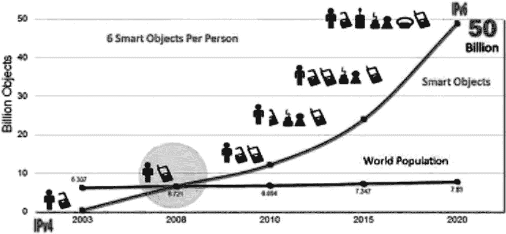

Figure 5.4 Combined percentages for very effective and somewhat effective security tools enhanced by AI.

Figure 5.4(a) 表示现在使用它非常重要；(b) 表示非常重要，因此计划今年实施；(c) 表示现在使用它中等重要；(d) 表示中等重要，因此正在评估以供未来使用；(e) 表示不太重要，因此未从实施中看到任何好处；(f) 表示不太重要，因此目前没有计划采用 AI。

适用于 IoT 的安全 SIEM 模型：

> 实施针对网络中异常的安全数据传输。
>
> 适应性以增强最终用户的服务。
>
> 可用性和容错性以控制系统以及检测应用程序中的故障。
>
> 系统在时间和空间复杂度的所有环境条件下实现的整体性能的可靠性。
>
> 可扩展性是为网络支持提供灵活性，以便从意外服务扩展到网络中新接入的设备。
>
> 性能可以通过不同的统计指标实现，以利用 SIEM 克服网络中的开放安全问题。
>
> 为环境中各种实时应用连接的远程或本地设备延长电池寿命。
>
> 使用去中心化处理技术降低数据计算能力。
>
> 轻量级集中式技术用于非人工干预。

SIEM 模型提供从一个设备向另一个设备交换消息、下达指令并借助对等集中式技术完成数据传输的能力，在安全事件管理中使用最低硬件成本。

### 5.3 网络安全工作模型的图示表示

Figure 5.5 表示网络安全工作模型。该模型将使用开源虚拟机平台实现。该模型由 IoT 网络中服务器 1 连接至多达 N 个服务器的各种服务器组成。在模型中，每个服务器都与其他每个服务器以及用于指定可促进攻击、入侵者消息或任何有价值事物交换的计算机代码的 IoT 设备相连。该模型连接了各种用户的 IoT 设备，用于组织和行业的所有应用。该模型为所有流程提供实时不可篡改的安全性 \[10\] 和 \[5\] (表 5.8)。

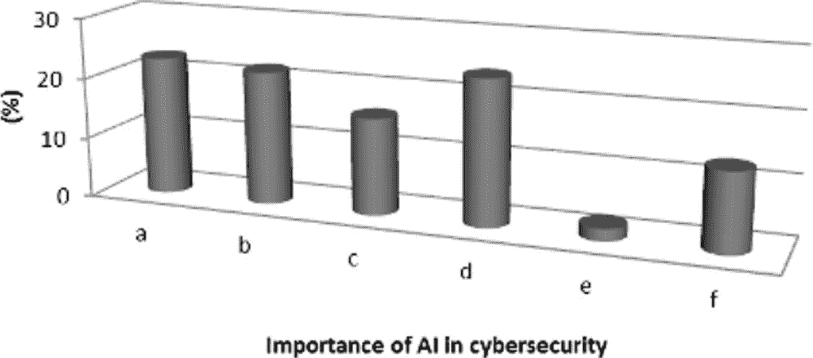

Figure 5.5 Importance of incorporating AI into SIEM.

Table 5.8 涵盖范围

| 范围 || 涵盖的范围 |

| --- | --- |

| 使用 DL 技术实施针对可疑网络事件的脆弱监控和检测模型 || 使用来自 NLP 的主题建模技术，通过网络事件数据源（如：Netflow 日志、DNS 日志、HTTP 代理日志）进行异常检测，这些日志是网络事件 |

| --- | --- |

| 为 IoT 创建无需第三方批准即可工作的开源 SIEM 模型。 || 开发用于监控和检测可疑网络事件（如流量、DNS 和代理）的开源编码框架，以打破 SIEM 关联限制的边界。 |

|  || 框架实现基于开源解码器 |

|  || 在 Hadoop 数据转换中加载数据 |

#### 5.3.1 提出的方法

本章提出了一种适用于 IoT 的独特、高效的网络安全模型。它是一个持续监控 IoT 网络中漏洞的数据库。该网络安全模型的优势在于使用机器学习中的无监督分类器进行自然语言处理，可应用于可疑网络层攻击。一旦在网络中生成流量模型，即可用于识别异常 \[11\] 和 \[5\] (Figure 5.6)。

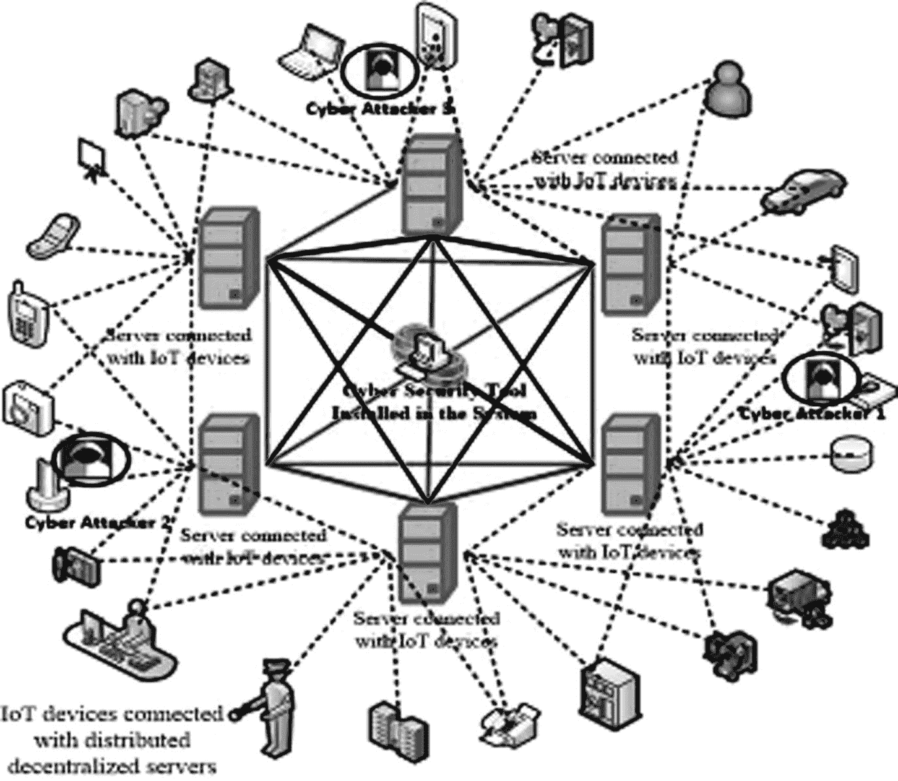

Figure 5.6 Working model for proposed SIEM in IoT networks.

在本分析阶段，考虑以下主题建模特征：1. 源 IP，2. 目标 IP，3. 源端口，4. 目标端口，5. 协议，6. 时间，7. 发送字节，8. 接收字节，9. 发送数据包，10. 接收数据包，11. 异常识别。基于机器学习模型的网络安全模型最初将日志记录实体简化为单词，以转换为主题建模。概率较低的攻击被识别为“可疑攻击”，概率较高的攻击被视为“非可疑攻击”。


实现涉及相关性规则、编码框架、深度学习（DL）和统计方法，具体如下。收集网络层攻击、流量、DNS 和代理。实现数据库的安全模型，在 Hadoop 中加载攻击数据，进行数据转换。

#### 5.3.2 应用 LSTM

图 5.7 基本包含两个阶段，即训练和测试。在训练原始模型中，根据数据集进行训练。在此模型中，用于检测给定数据集中存在的恶意代码和漏洞。在测试阶段，检查模型是否已在训练阶段训练，以及是否正在用于检测漏洞。为此，我们提供未知数据以识别是否存在任何恶意内容 \[12\]。

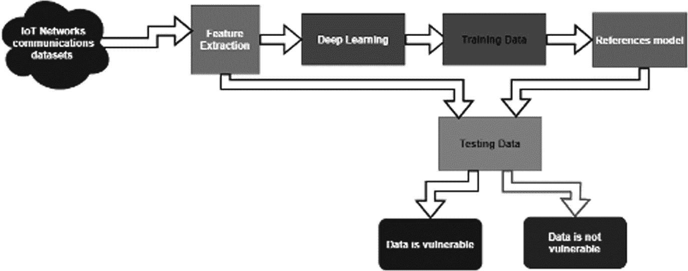

图 5.7 基于深度学习模型的网络安全漏洞检测。

图 5.7 显示了用于预处理技术的恶意数据集的物联网网络通信，以去除噪声数据和空帧。噪声是指不符合所需格式的内容，空帧是指特定帧中不存在数据。为处理噪声数据，使用词错误率（WER）和句子错误率（SER）\[3\]。WER 表示实际数据中的噪声水平。这些通过给定噪声数据与特定语言之间的比较来测量。这表示为词级距离。这是通过应用动态规划完成的，如方程（5.1）所示。

`WER = (Sub + Del + Ins) / N` (5.1)

其中 Sub 表示替换，Del 表示删除的数量，Ins 表示插入，N 表示给定序列中的总词数。预处理后，将数据发送到特征提取技术。

特征提取技术对于检测数据集中的恶意性非常重要。这些代表实际数据集的重要特征。这些特征对于在 \[7\] 和 \[5\] 中预测的不同类型的普通数据和恶意数据是不同的。

然后，使用深度学习技术检测线性数据集中的恶意漏洞。如今，深度学习技术几乎用于所有应用程序。这些技术使用机器学习模型用于不同的实时应用程序。在本章中，基于数据集的 LSTM 深度神经网络（DNN）模型中的漏洞检测深度学习技术。LSTM（长短期记忆）是一个强大的 DNN 模型，是 RNN（循环神经网络）的修改版本。该模型提供了避免长期依赖问题的功能。

LSTM 的基本结构如 图 5.7 所示。

在上图中，每个矩形框代表网络层，粉色圆圈代表加法和乘法等操作。黄色框表示在神经网络中学习的模型，每条线将信息从一个节点的输出传递到下一个节点的输入。LSTM 有能力自动添加或删除单元的信息。它使用 sigmoid 和 tanh 激活函数来更新单元值和参数 \[4,13\]。

#### 5.3.3 LSTM 算法

1. 使用 sigmoid 层和先前的隐藏层以及当前输入值来决定从单元状态输出的信息。输出在 1 或 0 之间，其中 1 表示保留全部信息，0 表示忽略信息。

2. 识别或决定存储在单元中的新信息。这分为两个阶段完成。在第一阶段，决定更新哪些值。这是通过 sigmoid 层完成的。在下一阶段，tanh 层决定要添加到单元中的新值，如 图 5.8 所示。

3. 使用先前状态计算的新值更新单元状态，如 图 5.8 所示。

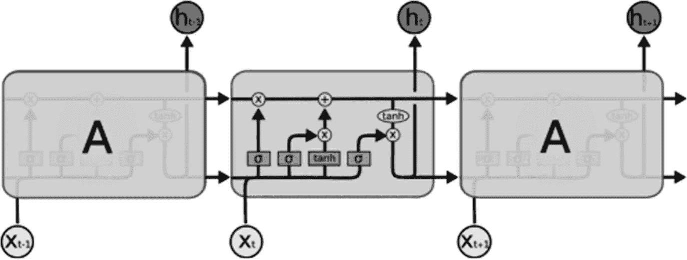

图 5.8 LSTM 的基本结构。

`i^⋅t = σ(W[i].[h(t − 1), x[t]] + b[i])` (5.2)

`C˙t = tanh(W[c].[h(t − 1), x[t]] + b[c])` (5.3)

#### 5.3.4 漏洞检测的 LSTM 实现

1. 数据收集使用安装在运行 Ubuntu Linux 的系统上的 Cuckoo Sandbox 应用程序。

2. 数据预处理和对计算机系统漏洞损害及用户安全妥协的分析。

3. 数据分类以识别系统中是否存在漏洞。

4. 验证模型并预测 96% 的准确率。

在此实验中，应用预处理技术后，数据提交到 LSTM 模型。模型学习数据，更新参数，并创建参考模型。测试阶段将包含恶意漏洞代码的数据应用到参考模型。对测试数据应用与训练阶段相同的预处理 \[14\]。之后，使用更新的参数（如权重和学习率）检测给定数据是否包含恶意漏洞 \[10\]。相关性编码框架准确性和有效性的关键组件是编码和生产结果完全透明且可追溯。深度学习引擎可以使用其 DL 模型提供的属性自动生成规则。可以部署一个开源网络安全模型，供研究人员和行业使用，无需第三方批准。(图 5.9 和 5.10)。

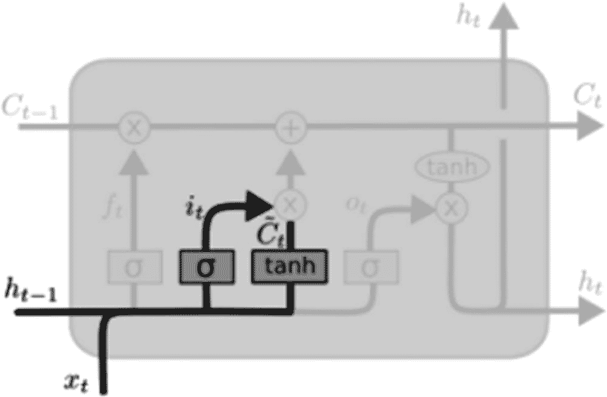

图 5.9 新信息计算。

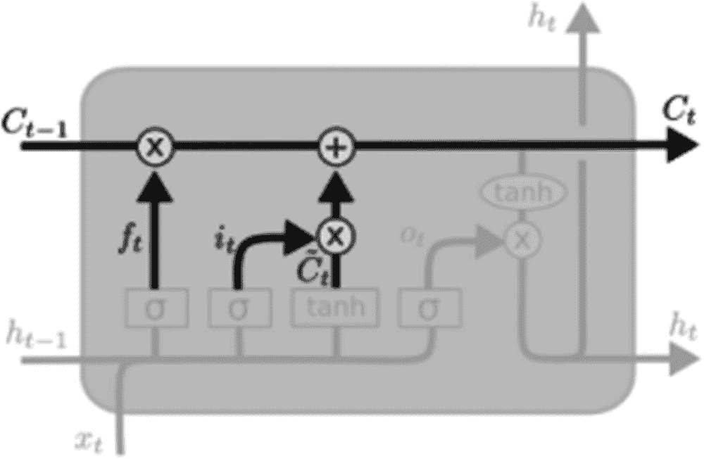

图 5.10 更新单元的信息。

#### 5.3.5 结果

结果的目的是使用漏洞数据集创建基于 LSTM 的漏洞检测模型。尽管该数据集包含属于某些漏洞类且分布不平衡的实例，但已证明此问题不影响分类性能 \[15\]。图 5.11 显示了当时代数与 y 轴上的准确率绘制时 LSTM 模型的准确率。灰色代表测试数据，黑色代表训练数据。图 5.11 显示了当时代数与 y 轴上的损失绘制时 LSTM 模型的损失。灰色代表测试数据，黑色代表训练数据。

![图 5.11 模型损失 \[15\]。](images/fig5_11.jpg)

图 5.11 模型损失 \[15\]。

### 5.4 结论


在本章中，提出了一种基于深度学习的漏洞检测与预防模型，用于防御针对物联网（IoT）的网络攻击，该模型具有轻量化计算特性。同时，将开发一个开源的去中心化漏洞检测模型，用于测试工业应用的实现。通过本章，可实现可扩展性、降低延迟、安全可靠的通信，以及通过物联网实现快速上传/下载。本章交付成果——利用基于深度学习的信息安全与事件管理对物联网网络进行网络安全漏洞检测——将在未来成为安全通信的重点关注领域（图 5.12）。

![Figure 5.12 Model accuracy \[15\].](images/fig5_12.jpg)

图 5.12 模型准确率 \[15\].

### 参考文献

1. R. Arthi 和 S. Krishnaveni. 针对网络安全研究的带 DDoS 攻击的 IoT 测试平台设计与开发。载于 *2021 年第 3 届信号处理与通信国际会议（ICPSC）*，第 586–590 页。IEEE，2021 年。

2. Charles Wheelus 和 Xingquan Zhu. IoT 网络安全：威胁、风险与数据驱动防御框架。IoT，1(2): 259–285，2020 年。

3. Zhen Li, Deqing Zou, Shouhuai Xu, Zhaoxuan Chen, Yawei Zhu, 和 Hai Jin. Vuldeelocator：一种基于深度学习的细粒度漏洞检测器。IEEE Transactions on Dependable and Secure Computing，2021 年。

4. Alejandro Mazuera-Rozo, Anamaria Mojica-Hanke, Mario Linares-Vasquez, 和 Gabriele Bavota. 浅层还是深层？利用深度学习检测漏洞的实证研究。*arXiv 预印本 arXiv:2103.11940*，2021 年。

5. Zhen Li, Deqing Zou, Shouhuai Xu, Hai Jin, Yawei Zhu, 和 Zhaoxuan Chen. Sysevr：一种利用深度学习检测软件漏洞的框架。IEEE Transactions on Dependable and Secure Computing，2021 年。

6. Prasesh Adina, Raghav H. Venkatnarayan, 和 Muhammad Shahzad. 物联网网络中网络层攻击的影响与检测。载于 *第 1 届 ACM MobiHoc 移动 IoT 感知、安全与隐私研讨会论文集*，第 1–6 页，2018 年。

7. Meenigi Ramesh Babu 和 KN Veena. 基于机器学习和深度学习的物联网攻击检测方法综述。载于 *2021 年第 3 届信号处理与通信国际会议（ICPSC）*，第 625–630 页。IEEE，2021 年。

8. Ismail Butun, Patrik Osterberg, 和 Houbing Song. 物联网安全：漏洞、攻击与对策。IEEE Communications Surveys & Tutorials，22(1): 616–644，2019 年。

9. Abhirup Khanna. 物联云架构设计。Facta universitatis-series: Electronics and Energetics，29(3): 357–365，2016 年。

10. Mohammed Zagane, Mustapha Kamel Abdi, 和 Mamdouh Alenezi. 基于代码度量的软件漏洞检测深度学习。IEEE Access，8: 74562–74570，2020 年。

11. Xiang Li, Yuchen Jiang, Chenglin Liu, Shaochong Liu, Hao Luo, 和 Shen Yin. 针对基于深度神经网络的物体探测器的对抗攻击：一种新型双向对抗攻击方法。IEEE Transactions on Artificial Intelligence，2021 年。

12. Jun-Yan He, Xiao Wu, Zhi-Qi Cheng, Zhaoquan Yuan, 和 Yu-Gang Jiang. Db-lstm：用于人体动作识别的密集连接双向 LSTM。Neurocomputing，444: 319–331，2021 年。

13. Raneem Qaddoura, Al-Zoubi Ala'm, Iman Almomani, 和 Hossam Faris. 基于多阶段深度学习方法预测不同类型的不平衡入侵活动。载于 *2021 年信息技术国际会议（ICIT）*，第 858–863 页。IEEE，2021 年。

14. Francis Akowuah 和 Fanxin Kong. 自主 cyber-physical 系统中实时自适应传感器攻击检测。载于 *2021 年 IEEE 第 27 届实时与嵌入式技术与应用研讨会（RTAS）*，第 237–250 页。IEEE，2021 年。

15. Ferhat Ozgur Catak, Ahmet Faruk Yaz, Ogerta Elezaj, 和 Javed Ahmed. 基于 Windows exe API 调用的恶意软件分析深度学习序列模型。PeerJ Computer Science，6: e285，2020 年。

## 6 基于 DCT 系数和深度学习 CNN 的 JPEG 图像双压缩伪造区域检测与定位

Jamimamul Bakas¹ 和 Ruchira Naskar²

¹Kalinga Institute of Industrial Technology, Bhubaneswar, Odisha, India, School of Computer Engineering

²Indian Institute of Engineering, Science and Technology, Shibpur, West Bengal, India, Department of Information Technology

DOI: [10.1201/9781003212249-6](https://doi.org/10.1201/9781003212249-6)

1. 内容

2. 6.1 引言

3. 6.1.1 动机与目标

4. 6.1.2 我们的贡献

5. 6.2 相关背景

6. 6.2.1 JPEG 图像压缩概述

7. 6.2.2 JPEG 攻击模型

8. 6.2.3 相关工作

9. 6.3 基于深度学习的 JPEG 双压缩检测取证框架

10. 6.3.1 JPEG DCT 系数提取与选择

11. 6.3.2 CNN 架构

12. 6.4 双压缩 JPEG 伪造区域定位

13. 6.4.1 JPEG 双压缩区域定位

14. 6.4.2 JPEG 双压缩定位实验结果

15. 6.5 结论

16. 参考文献

### 6.1 引言

近年来，网络安全受到了研究人员的广泛关注。网络安全是保护我们宝贵数字信息的框架。它为计算机、移动设备、服务器、数字电子系统和数据提供必要的防护，以抵御恶意攻击。然而，网络安全涵盖大量主题；例如，资源利用、未经授权的访问以及操纵数字数据。接下来，我们简要介绍几个场景 \[1\] 作为示例：

网络欺凌– 在我们的现代社会中，网络欺凌已成为主要威胁 \[2\]。据 \[2\] 报告，数字技术越来越多地被用于欺凌、“造成尴尬、引发骚扰和暴力，并造成心理伤害。”这可能导致“对受害者产生严重和负面的影响。”然而，在网络空间中被欺凌并不构成完整性、保密性或信息的丧失。相反，此类活动的目标是用户本人。

家庭自动化– 随着电子技术以及信息和通信技术（ICT）先进领域的发展，大量家庭自动化应用 \[3\]，如集成家庭安全系统、电视机、热水器等，正在迅速增加。其中许多应用具有基于 Web 的控制系统，允许从外部进行控制。不幸的是，这种基于 Web 的控制系统增加了未经授权访问此类系统的风险，并可能造成伤害。这种伤害的范围可以从“恶作剧”（如切换冰箱）到严重犯罪，例如关闭安全系统以入室盗窃或其他不当行为。


# 网络恐怖主义

在美国，关键基础设施被定义为“对美国至关重要的资产、系统和网络，无论是物理的还是虚拟的，其瘫痪或破坏将对安全、国家经济安全、公共健康或安全，或其任何组合产生严重影响” \[4\]。提供电力和水、控制航空交通或支持金融交易的基础设施被视为“关键生命维持基础设施”。所有这些都直接依赖于底层通信和网络基础设施 \[5\]。敌人（网络专家）可以通过网络空间摧毁一个国家的关键基础设施。这可以通过直接对国家电网发起网络攻击来实现，也可以通过拒绝服务攻击获取秘密信息来间接实现。此类攻击的一个例子是 2007 年 4 月/5 月对爱沙尼亚的攻击。保护此类关键基础设施是网络安全的重要组成部分，并被列入国家网络安全战略中的重要国家任务。

# 数字媒体

娱乐行业是受未经授权的信息共享（未经操纵）影响最大的行业之一，例如电影、音乐和其他形式的数字媒体。虽然这种未经授权的共享不一定违反共享数字媒体的完整性、机密性或可用性，但这直接影响了受版权保护的数字媒体合法所有者的经济损失。

除此之外，如今每个人的日常生活都包含大量的数字媒体交换和共享，尤其是数字图像和视频。例如，YouTube 上每分钟上传了 `500+` 小时的视频内容 \[6\]，Facebook 用户每小时上传了 `14.58` 百万张图片 \[7\]，根据 2017 年收集的数据，Instagram 上每天分享了 `8.95` 百万张图片和视频 \[8\]。

在共享的信息中，大量信息被操纵（故意创建虚假信息），向观众提供错误信息。根据麻省理工学院（MIT）研究人员的一份报告 \[9\]，在 2019 年印度人民院选举期间，WhatsApp 群组中共享的照片大约每 `八` 张中有 `一` 张具有误导性。在 2018 年 10 月至 2019 年 6 月期间，汇编了来自 25 万用户的总共 `5` 百万条消息。观察发现，52% 的所有消息都是视觉类，包括 35% 的图片和 17% 的视频，且所有共享图片中有 13% 具有误导性 \[9\]。在本章中，我们将详细讨论图像操纵及其检测技术。本章的动机和主要目标将在下一节中介绍。

#### 6.1.1 动机与目标

近年来，许多研究人员专注于数字多媒体内容安全和保护的各个领域，例如数字多媒体版权管理、数字多媒体身份验证以及伪造检测。为了解决这些问题，在过去几年中开发了许多先进的安全措施和技术；其中最广泛使用的是 `digital signature` 和 `digital watermarking` \[10\]。

数字图像和视频可以使用广泛可用的图像和视频编辑工具轻松操纵。在感知上，已经无法区分专业操纵（伪造）的图像和视频与真实的图像和视频。图像操纵的示例显示在 图 6.1。图 6.1(a) 展示了一张真实图像，其中共有四匹马，而 图 6.1(b) 展示了一张伪造（操纵）的图像，其中添加了两匹额外的马。使用传统的多媒体安全和保护技术，包括 `digital signature` 和 `digital watermarking`，我们可以检测多媒体的真实性。此类技术依赖于一些外部信息，例如 `digital signature` 或 `watermark`，并且外部信息是通过某种方式预处理多媒体数据计算得出的。此外，此类技术需要嵌入式硬件芯片和软件来将 `digital signature` 或 `watermark` 嵌入图像和视频中。此外，许多数码相机不支持数字水印或数字签名。

![图 6.1 图像伪造示例 \[11\]：(a) 真实图像和 (b) 伪造图像。](images/fig6_1.jpg)

图 6.1 图像伪造示例 \[11\]: (a) 真实图像和 (b) 伪造图像。

另一方面，盲法医措施领域是新兴且仍在发展的领域，它不需要任何预处理步骤，即不需要嵌入数字签名或水印。通过分析图像的内在特征 \[12,13\]，这些特征是操纵操作本身留下的，它可以检测被篡改的图像和视频。因此，盲法医技术是一种完全基于后处理的操作。本章旨在通过盲数字法医措施调查图像伪造检测问题。

最常见的盲数字图像伪造检测技术包括 `copy-move forgery detection` \[14\]、`image splicing forgery detection` \[15\]、`image retouching detection` \[16\] 和 `joint photographic experts group (JPEG) double/multiple compression detection` \[17\]。

`Copy-move forgery` 也称为区域复制伪造，其中图像的区域被复制并粘贴到同一图像中的另一个目标区域，以模糊或重复图像中的一个或多个重要对象。与复制-移动伪造不同，`image splicing` \[18\] 包含多个图像的组合。`Image retouching` \[16,19\] 无非是通过编辑某些图像像素（如红眼去除、锐度、色调调整等）来增强图像质量。此类修改通常可以通过调查图像自然统计特性的不一致性来检测 \[19,20,21\]。

`JPEG double/multiple compression detection` \[13,17,22\]（JPEG 压缩图像）在进行伪造之前必须先解压缩。进行伪造后，生成的图像可能会再次压缩以存储为 JPEG 格式。因此，当 JPEG 图像被修改/编辑时，由于将编辑后的图像连续保存回内存，会发生后续压缩。因此，可以推断双重或多重压缩的图像是伪造的。但是，不能保证双重或多重 JPEG 压缩的图像总是伪造的。然而，不同程度的 JPEG 压缩是伪造的一个良好指标。

本章的主要目标是提出一个用于基于 JPEG 双重压缩的图像操纵（伪造）检测的盲法医框架。在下一节中，我们将介绍本章的贡献。

#### 6.1.2 我们的贡献


近年来，一些盲法证措施，如 `[23,24,25,26]`，也被用于检测 JPEG 图像中的基于双重压缩的伪造。然而，大多数最先进的盲法数字取证技术利用从 JPEG 压缩伪影中提取的手工制作特征，来检测图像中的双重 JPEG 压缩。然而，此类手工制作特征的性能受到各种场景的限制，例如第一次压缩的质量因子 `QF[1]` 大于第二次压缩的质量因子 `QF[2]`。因此，在大型数据集中识别适合检测 JPEG 双重压缩的特征是一项具有挑战性的任务。近年来，深度学习技术在计算机视觉、网络安全和自然语言处理领域受到了广泛关注，因为它能够自动提取合适的特征。

在本章中，我们提出了一种基于深度学习的框架，用于检测和定位基于双重压缩的 JPEG 修改攻击。在这项工作中，我们将上述问题建模为双向分类，即识别单次和双次 JPEG 压缩的图像。接下来，我们通过对测试图像执行重叠块分类来定位图像中的双重压缩（伪造）区域。此外，所提出的取证框架还克服了最先进的技术（如 `[26,27,28]`）的局限性，即第一次压缩的质量因子大于第二次压缩的质量因子（`QF 1 > QF 2`）。

本章的组织如下。本章将简要讨论 JPEG 压缩的相关背景，并考虑 JPEG 攻击模型，同时介绍与基于重新压缩的 JPEG 伪造检测相关的最新研究工作，这些内容将在 `第 6.2 节` 中介绍。在 `第 6.3 节` 中，我们提出了一种基于深度学习的盲法取证框架，用于检测 JPEG 双重压缩，最后本章将在 `第 6.5 节` 中总结。

### 6.2 相关背景

在本节中，我们将简要讨论 JPEG 压缩，并介绍 JPEG 攻击模型。本节还将介绍基于重新压缩的 JPEG 伪造检测技术的文献综述。

#### 6.2.1 JPEG 图像压缩概述

联合图像专家组（JPEG）`[29]` 是最广泛使用的图像存储格式。JPEG 图像压缩和解压缩技术的框架如 `图 6.2` 所示。首先，将图像分割为大小为 8×8 的非重叠像素块，记为 `B`，然后对每个块执行二维离散余弦变换（DCT）。因此，它得到相应的 DCT 系数块，记为 `D^(B)`。然后，每个 DCT 系数块由一个 8×8 量化矩阵 `Q[QF]` 进行量化。质量因子 `QF` 定义了一个量化矩阵。

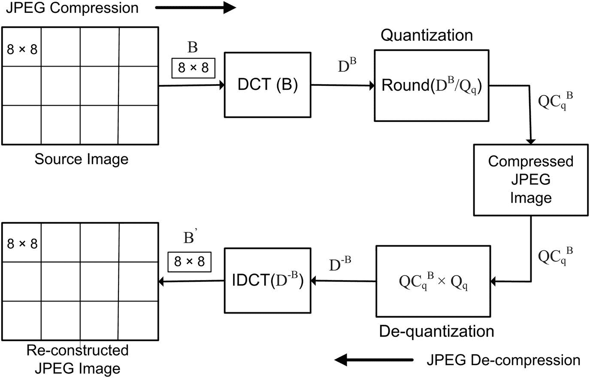

图 6.2 JPEG 压缩和解压缩过程。

`QF` 的值在 `[1, 100]` 之间，`QF` 值越高，表示压缩程度越低。

JPEG 解压缩过程只是压缩过程的逆过程。首先，量化的 DCT 系数 `Q*C[q]^(B)` 通过将量化的 DCT 系数 `Q*C[q]^(B)` 与相应的量化矩阵 `Q[QF]` 相乘进行反量化，以得到反量化系数 `D^(-B)`。然后，通过对反量化的 DCT 系数应用逆离散余弦变换（IDCT）来重建图像像素块（记为 `B′`），最后进行舍入和截断操作。

量化函数是一个不可逆操作，因为舍入函数的存在。这使得 JPEG 成为一种有损压缩技术。由于量化步骤，在 JPEG 的编码和解码过程中会为图像产生量化误差。量化误差定义为 `Q[error] = D^(B) − (D^(B)/Q[QF])Q[QF]`。

除了量化误差，在 IDCT 过程中还会引入舍入误差和截断误差。在对反量化的 DCT 系数执行 IDCT 时，会生成一些浮点值。这些浮点值由 IDCT 生成，并应四舍五入到最接近的整数值。这会产生舍入误差。如果舍入后的值超出 `[0, 255]` 的范围，则将其截断到该范围内。这会导致截断误差。利用这些压缩误差，许多研究人员，例如 Farid 等人 `[12]`、Bianchi 等人 `[27]`、Barni 等人 `[30]` 和 Taimori 等人 `[31]`，检测 JPEG 图像中的伪造行为。

#### 6.2.2 JPEG 攻击模型

文献中最常见的 JPEG 攻击模型如下。设一张 JPEG 图像最初使用质量因子 `QF[1] ∈ [0, 100]` 进行压缩，如 `图 6.3(a)` 所示，这被称为第一次 JPEG 压缩图像。接下来，从单次压缩的 JPEG 图像中提取一个目标区域，并在质量因子 `QF[2] ∈ [0, 100]` 下重新压缩，其中 `QF[2] ≠ QF[1]`，如 `图 6.3(c)` 所示。将提取的重新压缩区域粘贴到其原始位置以生成伪造图像，如 `图 6.3(c)` 所示。因此，在生成的篡改图像中存在两种不同的压缩程度：一种是具有后续质量因子 `QF[1]*, QF[2]` 的双重压缩（操纵）区域，另一种是图像的其余部分（真实）区域，该区域在质量因子 `QF[1]` 下压缩。从 `图 6.3(c)` 可以明显看出，篡改区域具有（双重）压缩比，与图像的其余部分不同，并且在感知上无法区分。

![Figure 6.3 JPEG attack on image [32]: (a) authentic 512 × 512 image; (b) selected region, re-saved at a different compression quality factor; (c) forged image with partially double-compressed regions.](images/fig6_3.jpg)

图 6.3 图像上的 JPEG 攻击 `[32]`: (a) 真实 512 × 512 图像；(b) 选定区域，以不同的压缩质量因子重新保存；(c) 具有部分双重压缩区域的伪造图像。

#### 6.2.3 相关工作

在本节中，我们将简要概述近年来在基于 JPEG 重新压缩的图像取证方面的研究。近年来，已进行了大量关于双重 JPEG 压缩检测的研究。该方向早期的大多数研究工作都基于统计分布的利用，例如 `Benford's law` 或 `first-digit law` `[33,34,35]` 的 JPEG 双重压缩量化效应。


Popescu 等人 \[35\] 研究并利用了 JPEG 图像 DCT 系数直方图的频率分布，用于基于双重压缩的 JPEG 伪造检测。由于双重压缩，引入了 DCT 量化伪影，这影响了 DCT 系数直方图的分布。这些伪影已在 \[24\] 中被利用，用于基于双重压缩的 JPEG 伪造检测。在 \[34\] 中，Fu 等人分析了 JPEG 图像中每个 8 × 8 DCT 块的首位有效数字（即 1、2、3、…、9）的统计分布，并提出了一种基于对数的广义本福德定律，该定律有助于检测图像中的 JPEG 双重压缩。每个 DCT 块的首位有效数字的概率分布遵循广义本福德定律，适用于单次压缩的图像，而双重压缩的图像则偏离该定律。Amerini 等人 \[36\] 还利用了 JPEG 图像 DCT 系数块的首位数字特征，用于检测单次和双重压缩 JPEG 图像上的拼接攻击。每个 DCT 块的首位数字直方图的分布被视为特征向量，并输入到支持向量机（SVM）分类器中，以区分单次和双重压缩的图像。

在 \[26\] 中，Wang 等人利用了 JPEG 图像中每个 DCT 块的后验概率分布，用于检测和定位被篡改和未被篡改的图像区域。然而，当对图像执行任何后处理攻击时，被篡改区域的定位会受到影响。Bianchi 等人 \[37\] 分析了非对齐双重压缩在 JPEG 重压缩检测中的影响，并提出了一种利用 JPEG 图像中 DCT 系数的整数周期性来检测非对齐双重压缩的方法。他们提出的方法还能够估计初级（第一次）压缩的量化步长，以及估计的网格偏移。

近年来，深度学习技术也开始在基于 JPEG 重压缩的图像伪造检测中获得巨大的流行度 \[30,38,39,40》，因为此类网络具有自发的特征学习能力，有助于最大化分类精度。下面介绍了在这方面的一些著名研究工作 \[30,38,39,40\]。

在 \[40\] 中，Wang 等人提出了一种基于 CNN 的取证框架，用于双重压缩 JPEG 伪造检测。首先从单次和双重压缩的图像中提取 DCT 特征，然后将其输入 CNN 以检测双重压缩的图像。然而，当第二次压缩因子高于第一次（即 `Q2 > Q1`）时，他们提出的框架才能高效运行。Rao 和 Ni \[15\] 使用高通滤波器初始化第一个 CNN 层的权重，这些滤波器抑制了图像内容，并有助于高效检测 JPEG 图像中的拼接攻击以及区域复制攻击。

Barni 等人 \[30\] 使用 CNN 解决了 JPEG 图像中对齐和非对齐伪造检测的问题。他们提出了三种方法：(i) 像素域中的 CNN – 通常在 CNN 训练前进行图像均值减法，(ii) 噪声域中的 CNN – 去噪的 JPEG 图像直接输入 CNN，(iii) 嵌入 DCT 直方图的 CNN – DCT 直方图由 CNN 层计算，而不是从 JPEG 比特流中提取，即使双重 JPEG 图像存储为位图或 PNG 格式，该方法仍然有效。因此，第三种提出的方法依赖于一个 CNN，该 CNN 从 DCT 系数中自动提取一阶特征。此外，第三种方法的精度优于其他两种方法，并且在第二个质量因子大于第一个时能高效运行。

在 \[38\] 中，Amerini 等人提出了多域方法，即结合空间域和频率域 CNN 模型，用于检测 JPEG 图像中的双重压缩。Park 等人 \[39\] 提出了一种深度卷积神经网络，用于混合 JPEG 质量因子图像中的 JPEG 双重压缩。他们将 DCT 直方图和 JPEG 量化表作为输入到 CNN 中，从而从真实图像中识别出伪造图像。然而，当图像的像素值饱和且仅存在低频时，该方法会失效。此外，当两个连续的 JPEG 压缩质量因子之间的差异较小时，该方法也会失效。

### 6.3 基于深度学习的 JPEG 双重压缩检测取证框架

在本节中，我们介绍了一个深度学习框架 \[32》，该框架由预处理和卷积神经网络（CNN）组成，用于检测双重压缩的图像。如果将原始图像输入传统的 CNN，它将学习图像的视觉感知，而不是 JPEG 压缩的程度。为了学习 JPEG 压缩图像的固有特性，对 JPEG 图像执行预处理步骤。

#### 6.3.1 JPEG DCT 系数提取与选择

在预处理步骤中，图像被分为 `B × B`（`B` = 32）个重叠块，步幅为 `S` = 8 像素。因此，对于大小为 `M × N` 的图像，将获得总共 $\\left( {\\left\\lbrack \\frac{M - B}{S} \\right\\rbrack + 1} \\right) \\times \\left( {\\left\\lbrack \\frac{N - B}{S} \\right\\rbrack + 1} \\right)$ 个大小为 32 × 32 像素的块。然而，每个 32 × 32 块由十六个 8 × 8 DCT 块组成。每个 DCT 块有 8 × 8 = 64 个 DCT 系数；第一个系数称为直流系数，其余为交流系数。在 64 个系数中，这里只考虑前 19 个交流系数（之字形顺序中的第 2 到第 20 个系数），以降低计算成本。此外，每个 32 × 32 图像块中有 16 个 DCT 块可用。因此，此时总工作 DCT 系数为 19 × 16 = 304。为了进一步降低计算成本，而不是选择所有 16 个块，只考虑以下 7 个 DCT 块。

对于第 `i` 个系数，我们找到它相对于其余 15 个块取得最高值的块。考虑这个最大块及其六个邻居：从位置上看，考虑其三个直接前驱块和三个直接后继块用于特征提取。例如，如果第 13 个 DCT 块包含第 `i` 个系数的最高值，那么索引为 \[9,10,11,12,14,33,34\] 的 DCT 块也会被考虑。这为每个 32 × 32 图像块生成一个 19 × 7 维的 DCT 系数向量。这种抽象旨在降低计算复杂度，而不会丢失任何重要的块信息。


为了更清晰地向读者展示 DCT 系数选择过程，示例如 图 6.4 所示，该图展示了一个 32 × 32 图像块，由十六个 8 × 8 DCT 块组成。在 图 6.4 中可以注意到，第二个系数在不同的 DCT 块上依次取值 `2.185*e*^(−16)`、`8.283*e*^(−16)` 等。第二个系数在 `(4,1)`-th DCT 块处取得其最高值 `9.409*e*^(−16)`。因此，`(4,1)`-th DCT 块及其前三个和后三个相邻 DCT 块：`(3,2)`、`(3,3)`、`(3,4)`、`(4,1)`、`(4,2)`、`(4,3)`、`(4,4)`，被用于给定图像块的第二个 DCT 系数。对应于给定图像块第二个 DCT 系数的最终 DCT 系数向量为：`[`2.1852*e*^(−16)`, `2.185*e*^(−16)`, `2.185*e*^(−16)`, `9.409*e*^(−16)`, `4.968*e*^(−16)`, `4.9688*e*^(−16)`, `4.992*e*^(−16)`]`。同样，从其余 18 个系数中提取了 18 个七维 DCT 系数向量。因此，每个 `32 × 32` 图像块生成一个 `19 × 7` DCT 系数向量，该向量将输入到下文描述的 CNN 模型中。

![Figure 6.4 An example of DCT coefficient selection (second coefficient shown) \[32\].](images/fig6_4.jpg)

图 6.4 DCT 系数选择示例（显示第二个系数） \[32\]。

#### 6.3.2 CNN 架构

在本章中，我们介绍了一个 2D 卷积神经网络架构 \[32\]，由两个卷积层、两个池化层和一个全连接层组成，如 图 6.5 所示，用于 JPEG 双重压缩检测。在每个卷积层中，使用 100 个滤波器，滤波器（内核）大小为 `3 × 1`，`stride` = `one`。第一个卷积层 `Conv-1` 的输入是 `19 × 7` DCT 系数，如 第 6.3.1 节 中所述。第一个卷积层之后，得到的输出维度为 `131 × 1 × 100`，该输出将输入到下一个池化层。这里，100 表示卷积操作后生成的 100 个特征图。

![Figure 6.5 Convolution neural network (CNN) architecture \[32\].](images/fig6_5.jpg)

图 6.5 卷积神经网络（CNN）架构 \[32\]。

每个池化层也使用 100 个滤波器，滤波器大小为 `3 × 1`，stride = `2`。池化层减少特征维度，从而减少过拟合问题。因此，stride 的大小决定了特征维度最小化的程度。`Pool-1` 的输出是一个 `65 × 1` 维特征向量，这些向量将输入到 `Conv-2`。`Conv-2` 的输出作为 `Pool-2` 的输入，其维度为 `63 × 1`。`Pool-2` 层的输出是一个 `31 × 1` 维特征向量，该向量将输入到全连接层。

最终层是一个全连接卷积层，由 dense 和 logits (`Softmax`) 层组成。dense 层使用 1,000 个神经元和修正线性单元 (`ReLUs`) \[41\] 在每个层中使用激活函数。为了克服 CNN 模型的过拟合问题，`dropout` 正则化应用于 dense 层。logits 层执行分类，从而产生每个单独块是单次压缩还是双次压缩的概率。

这里，`Softmax cross-entropy` 执行二元分类（单次和双次压缩）。这个 CNN 模型使用 0.001 的学习率和 `stochastic gradient descent` 优化器来优化训练期间的损失。

### 6.4 定位双重 JPEG 压缩伪造区域

JPEG 图像中篡改区域的定位是在框架的测试阶段完成的。在后续部分中，我们将介绍双重 JPEG 压缩伪造区域的定位技术及其实验结果。

#### 6.4.1 JPEG 双重压缩区域定位

在测试步骤中，图像被分为大小为 `32 × 32`、stride = `8` 像素的重叠块。为每个块提取 DCT 系数（如 第 6.3.1 节 中所述），这些系数被用于训练 CNN 模型来测试该块。通过这种方式，每个 `32 × 32` 图像块被分类为单次压缩（标记为 `‘0’`）或双次压缩（标记为 `‘1’`）。这里的 JPEG 伪造定位单位是 `8 × 8` 像素，原因将在下文解释。stride 的移动有助于尽可能准确地定位图像中的篡改区域。如 图 6.6(a) 所示，首先测试大小为 `32 × 32` 的第一个图像块，然后如 图 6.6(b) 所示，向右移动 stride（= `8`）像素，测试下一个第二个大小为 `32 × 32` 的块。在此阶段，第一个块的先前预测仅保留在最左侧的 `32 × 8` 像素上。剩余的 `32 × 24` 像素被重新测试并分配一个新的类标签，与块 2 相同，因为它们构成第二个 `32 × 32` 块的一部分。同样，在完成一次行遍历后，stride 垂直移动 `8` 像素，如 图 6.6(c) 所示。因此，一旦水平和垂直方向各完成一次 `8` 像素的 stride 移动，我们只剩下旧块 1 的预测，仅限于左上角的 `8 × 8` 像素。这从 图 6.6(d) 中可以明显看出。这种技术有助于获得 `8 × 8` 图像块的小单元，用于伪造定位。


图 6.6 测试图像中伪造定位的 stride 移动演示：(a) 表示左上角最外侧的 32 × 32 图像块，(b) 水平移动 8 像素 stride 到下一个 32 × 32 图像块，(c) 垂直移动 8 像素 stride 到下一个 32 × 32 图像块，(d) 伪造定位的左上角最外侧 8 × 8 单元（标记为青色）。

以类似的方式，每个（重叠的）`32 × 32` JPEG 块被依次测试，并使用训练好的 CNN 分配其类标签，然后移动到下一个图像块。对于最后的边缘块，如果需要，会进行图像填充，填充足够数量的 `zero` 行和列，以维持 `32 × 32` 的图像块大小。这个过程有助于定位 JPEG 伪造，并且相当准确。

#### 6.4.2 JPEG 双重压缩定位的实验结果

在本节中，我们介绍了图像中 JPEG 双重压缩定位的实验结果。为了进行实验，我们从 UCID 数据集 \[42\] 中选择了 500 张未压缩的 TIFF 图像。在 500 张图像中，我们选择 480 张图像用于训练深度学习模型，其余 20 张图像用于测试。

对于训练，我们首先将 TIFF 图像以 JPEG 质量因子 `QF[1]` = `55`、`65`、`75`、`85` 和 `95` 进行压缩，以创建单次压缩数据集，记为 `S[SC]`。接下来，`S[SC]` 中的单次压缩图像再次以 JPEG 质量因子 `QF[2]` = `55`、`65`、`75`、`85` 和 `95` 进行重新压缩，以创建双重 JPEG 压缩数据集，记为 `S[DC]`。在训练阶段，所有单次和双次压缩图像都被分为大小为 `32 × 32` 的非重叠块，如 第 6.3.1 节 中所述。


在测试阶段，我们根据 JPEG 攻击模型（如 第 6.2.2 节 所述），通过改变 JPEG 压缩质量因子以及伪造区域占实际图像 10%、30% 和 50% 的大小，创建 JPEG 双压缩伪造图像。

在 UCID 数据集 \[42\] 上，所提出框架 \[32\] 基于 JPEG 重新压缩的伪造定位结果可视化如 图 6.7 所示，包含三种不同的伪造尺寸。在 图 6.7 中，第一行代表 JPEG 质量因子 `QF 1` = 50 的单压缩图像。为了创建伪造图像，从单压缩 JPEG 图像中提取 10%、30% 和 50% 的区域，并以质量因子 `QF 3` = 90 保存这些区域，然后将其重新放置到原始位置，如 图 6.7(a)、(b) 和 (c) 的中间行所示。伪造（双压缩）区域以绿色高亮显示，相应的伪造检测和定位结果以白色高亮显示在 图 6.7 的底行。从 图 6.7 可以看出，所提出的技术可以高效地定位伪造区域。

![图 6.7 伪造检测和定位结果 \[32\]。伪造尺寸：(a) 10%，(b) 30%，(c) 50%。(顶部) 真实图像。(中间) 篡改图像：高亮显示篡改区域。(底部) 伪造区域的检测和定位。](images/fig6_7.jpg)

图 6.7 伪造检测和定位结果 \[32\]。伪造尺寸：(a) 10%，(b) 30%，(c) 50%。(`顶部`) 真实图像。(`中间`) 篡改图像：高亮显示篡改区域。(`底部`) 伪造区域的检测和定位。

图 6.8 展示了所提出的基于深度学习的取证技术在 20 张 UCID 测试图像 \[42\] 上，通过变化质量因子 `QF[1]` 和 `QF[2]` 得到的 JPEG 重新压缩定位结果（以平均准确率表示）。图 6.8 还展示了 Wang 等人 \[26\]、Bianchi 等人 \[27\] 和 Lin 等人 \[28\] 三种最先进的技术方案的定位结果。从 图 6.8 可以看出，当 `QF[1]` > `QF[2]` 时，所提出的基于深度学习的取证模型表现显著优于其他三种方案。这是因为 CNN 有助于保留空间结构特征，并高效学习 JPEG 系数分布的统计模式，从而提高检测准确率。然而，对于 `QF[1]` `< QF[2]` 的情况，所提出方案的性能仅略高于最先进的技术。在 `QF[1]` = `QF[2]` 的情况下，所提出方案的性能高于 Wang 等人 \[26\]、Bianchi 等人 \[27\] 和 Lin 等人 \[28\] 的方案。尽管如此，所提出方案并未提供令人满意的性能。

![图 6.8 不同 QF2 − QF1 值的平均准确率 \[32\]。](images/fig6_8.jpg)

[图 6.8 不同 `QF[2]` − `QF[1]` 值的平均准确率](#ch06.xhtml#Ffig6_8) \[32\]。

### 6.5 结论

在本章中，我们讨论了多媒体（即图像和视频伪造）上的非法修改攻击及其与网络安全的关系。我们观察到，JPEG 重新压缩痕迹有助于检测图像中的伪造。在本章中，我们还提出了一种基于深度学习的取证框架，用于检测和定位图像中的伪造（双 JPEG 压缩区域）。预处理的 19 × 7 JPEG DCT 系数被输入 CNN，以从单压缩和双压缩 JPEG 图像中提取和学习合适的特征。

实验结果证明，所提出的基于深度学习的取证方案可以高效地检测和定位 JPEG 双压缩伪造区域，并且优于最先进的技术，尤其是在第一次压缩比率大于第二次压缩比率时，即 `QF[1]` `> QF[2]`。然而，所提出的方案不适用于 JPEG 质量因子 `QF[1]` = `QF[2]` 的情况。

未来在此方向上的研究将涉及调查两次压缩的质量因子相同（即 `QF[1]` = `QF[2]`）时的 JPEG 双压缩检测。未来工作将重点研究三次及更高程度的基于 JPEG 压缩的伪造。

### 参考文献

1.  Rossouw von Solms 和 Johan van Niekerk. 从信息安全到网络安全. Computer & Security, 38: 97–102, 2013.

2.  Nigel Martin 和 John Rice. 网络犯罪：理解和解决利益相关者的关切. Computers & Security, 30(8): 803–814, 2011.

3.  Manuel Jiménez, Pedro Sánchez, Francisca Rosique, Bárbara Ál-Varez, 和 Andrés Iborra. 一种便于智能家居应用教学的工具. Computer Applications in Engineering Education, 22(1): 178–186, 2014.

4.  DC: Department of Homeland Security Washington. 关键基础设施，引用于 2012 年 11 月 23 日.

5.  The Whitehouse. 网络空间国际战略：网络化世界中的繁荣、安全与开放，引用于 2012 年 2 月.

6.  Youtube. 统计数据，2021 年（访问日期：2021 年 1 月 3 日）.

7.  Salman Aslam. Facebook 之数字：统计、人口统计数据和趣闻，2021 年（访问日期：2021 年 1 月 3 日）.

8.  Mary Lister. 2018 年 33 个令人瞠目结舌的 Instagram 统计数据和事实，2021 年（访问日期：2021 年 1 月 3 日）.

9.  THE TIMES OF INDIA. 政治 WhatsApp 群组中 8 张照片中有 1 张具有误导性，2021 年（访问日期：2021 年 1 月 3 日）.

10.  Ingemar Cox, Matthew Miller, Jeffrey Bloom, Jessica Fridrich, 和 Ton Kalker. 数字水印与隐写术. Morgan kaufmann, 2007.

11.  Yu-Feng Hsu 和 Shih-Fu Chang. 基于几何不变量和相机特征一致性的图像拼接检测. 在 `2006 IEEE International Conference on Multimedia and Expo`，页码 549–552. IEEE, 2006.

12.  Hany Farid. 揭露来自 JPEG 幽灵的数字伪造. IEEE Transactions on Information Forensics and Security, 4(1): 154–160, 2009.

13.  Simone Milani, Marco Tagliasacchi, 和 Stefano Tubaro. 使用首位数字特征区分多次 JPEG 压缩. APSIPA Transactions on Signal and Information Processing, 3, 2014.

14.  Rahul Dixit 和 Ruchira Naskar. 基于关键点质心链接聚类和图相似性匹配的数字图像区域复制检测. Multimedia Tools and Applications, 78(10): 13819–13840, 2019.

15.  Y. Rao 和 J. Ni. 一种基于深度学习的图像拼接和复制-移动伪造检测方法. 在 `IEEE International Workshop on Information Forensics and Security (WIFS)`，页码 1–6, Dec 2016.

16.  Muhammad Ali Qureshi, Mohamed Deriche, Azeddine Beghdadi, 和 Asjad Amin. 最先进的图像修复质量评估指标的关键综述. Journal of Visual Communication and Image Representation, 49: 177–191, 2017.

17.  Ehsan Nowroozi 和 Ali Zakerolhosseini. 基于统计分析的双 JPEG 压缩检测. Advances in Computer Science: an International Journal, 4(3): 70–76, 2015.


18. 巴巴克·马赫迪安 和 斯坦尼斯劳·赛奇. 关于盲方法识别图像伪造的参考文献. Signal Processing: Image Communication, 25(6): 389–399, 2010.

19. 弗拉基米尔·萨夫琴科, 尼基塔·科杰金, 和 海野博. 一种实用的图像修饰方法. In *第一届赛博世界国际研讨会，2002 年. 论文集*., pages 480–487. IEEE, 2002.

20. 天松吴, 史夫昌, 和 奇宾孙. 利用高阶统计量进行光合成检测的盲检测方法. In *2004 年 IEEE 电路与系统国际研讨会 (IEEE Cat. No. 04CH37512)*, volume 5, pages V–V. IEEE, 2004.

21. MMOBB 理查德 和 麦肯纳·于松张. 快速数字图像修复. In *出现在可视化、成像和图像处理国际会议 (VIIP 2001) 论文集*., *西班牙马尔贝拉*, pages 106–107, 2001.

22. 宾李, 云 Q 史, 和 吉武黄. 利用基于模式的首位数字特征检测双重压缩 JPEG 图像. In *IEEE 第 10 届多媒体信号处理研讨会*, pages 730–735. IEEE, 2008.

23. I. 阿梅里尼, R. 贝卡雷利, R. 卡尔德利, 和 A. 德尔马斯蒂奥. 利用首位数字特征进行拼接伪造定位. In *IEEE 信息取证与安全国际研讨会 (WIFS)*, pages 143–148, 2014.

24. Y. 陈 和 C. 许. 通过压缩伪影周期性分析检测 JPEG 图像的重新压缩以用于篡改检测. IEEE Transactions on Information Forensics and Security, 6(2): 396–406, 2011 年 6 月.

25. 宾李 和 Y. Q. 史. 利用基于模式的首位数字特征检测双重压缩 JPEG 图像. In *IEEE 第 10 届多媒体信号处理研讨会*, pages 730–735, 2008 年 10 月.

26. 魏王, 景董, 和 天任谭. 探索 DCT 系数量化效应用于本地篡改检测. IEEE Transactions on Information Forensics and Security, 9(10): 1653–1666, 2014 年 10 月.

27. T. 比安奇, A. 德罗萨, 和 A. 皮瓦. 改进的 DCT 系数分析用于 JPEG 图像中的伪造定位. In *2011 年 IEEE 国际声学、语音和信号处理会议 (ICASSP)*, pages 2444–2447, 2011.

28. 周春陈, 荣荣王, 小欧唐, 和 赫昂-叶昂·舒. 利用相机响应正常性和一致性检测被篡改的图像. In *计算机视觉与模式识别，2005 年. CVPR 2005. IEEE 计算机学会会议*, volume 1, pages 1087–1092. IEEE, 2005.

29. 威廉·B·彭尼贝克 和 琼·L·米切尔. JPEG: 静态图像数据压缩标准. Springer Science & Business Media, 1992.

30. 马乌罗·巴尔尼, 卢卡·邦迪, 尼科洛·博内蒂尼, 帕奥洛·贝斯塔吉尼, 安德烈亚·科斯坦佐, 马尔科·马吉尼, 本德塔·托迪, 和 斯蒂法诺·图巴罗. 利用卷积神经网络进行对齐和非对齐双重 JPEG 检测. Journal of Visual Communication and Image Representation, 49: 153–163, 2017.

31. 阿里·泰莫里, 法尔博德·拉扎齐, 阿利雷扎·比赫拉德, 阿里·阿赫马迪, 和 马苏德·巴巴伊-扎德. 一种用于发现双重 JPEG 压缩线索的新型取证图像分析工具. Multimedia Tools and Applications, 76(6): 7749–7783, 2017.

32. 贾米马穆尔·巴卡斯, 普拉尼塔·拉瓦特, 卡利扬·科卡拉, 和 鲁奇拉·纳斯卡尔. 基于深度神经网络的重新压缩 JPEG 篡改检测和定位，消除压缩因子依赖性. In Vinod Ganapathy, Trent Jaeger, 和 R.K. Shya-Masundar, 编辑, Information Systems Security, pages 318–341, Cham, 2018. Springer International Publishing.

33. L. 董, X. 孔, B. 王, 和 X. 尤. 基于 DCT 系数首位数字马尔可夫模型的双重压缩检测. In *2011 年第六届图像与图形国际会议*, pages 234–237, 2011 年 8 月.

34. 东东傅, 云 Q 史, 和 伟苏. JPEG 系数的广义本福德定律及其在图像取证中的应用. In Security, Steganography, and Watermarking of Multimedia Contents IX, volume 6505, page 65051L. International Society for Optics and Photonics, 2007.

35. A. C. 波佩斯库 和 H. 法里德. 通过检测重采样痕迹揭露数字伪造. IEEE Transactions on Signal Processing, 53(2): 758–767, 2005 年 2 月.

36. 伊雷妮·阿梅里尼, 鲁迪·贝卡雷利, 罗伯托·卡尔德利, 和 安德烈亚·德尔马斯蒂奥. 利用首位数字特征进行拼接伪造定位. In *IEEE 信息取证与安全国际研讨会 (WIFS)*, pages 143–148. IEEE, 2014.

37. 提齐亚诺·比安奇 和 亚历山德罗·皮瓦. 非对齐双重 JPEG 压缩检测及主压缩参数估计. In *2011 年第 18 届 IEEE 图像处理国际会议*, pages 1929–1932. IEEE, 2011.

38. 伊雷妮·阿梅里尼, 提比里奥·乌里基奥, 兰贝托·巴兰, 和 罗伯托·卡尔德利. 通过多域卷积神经网络定位 JPEG 双重压缩. In *2017 年 IEEE 计算机视觉与模式识别研讨会 (CVPRW)*, pages 1865–1871. IEEE, 2017.

39. 金锡朴, 东贤曹, 元赫安, 和 亨圭李. 混合 JPEG 质量因子中的双重 JPEG 检测使用深度卷积神经网络. In *欧洲计算机视觉会议 (ECCV)*, 2018 年 9 月.

40. 清王 和 荣张. 基于卷积神经网络的双重 JPEG 压缩取证. EURASIP Journal on Information Security, 1, 23, 2016.

41. 亚历克斯·克里热夫斯基, 伊利亚·苏茨克维, 和 杰弗里·E·辛顿. 带有深度卷积神经网络的 Imagenet 分类. In *神经信息处理系统进展*, pages 1097–1105, 2012.

42. 杰拉尔德·舍费尔 和 米哈尔·斯蒂赫. UCID: 一个未压缩彩色图像数据库. In Minerva M. Yeung, Rainer W. Lienhart, 和 Chung-Sheng Li, 编辑, Storage and Retrieval Methods and Applications for Multimedia 2004, volume 5307, pages 472–480. International Society for Optics and Photonics, SPIE, 2003.

## Index

*   准确性, 4, 8–9, 15, 25–26, 28, 32, 94, 106–107, 112, 113

*   模型, *96*

*   序列模型, *10*

*   SVM 模型, *10*

*   动作空间 (A), 42–43

*   阿梅里尼, I., 107

*   人工智能 (AI), 41, 82, 87–89

*   阿扎里, A., 61

*   信标泛滥, 14, 18–19, 24

*   信标伪造, 14–15, 18, 24, 32

*   本福德定律, 105–106

*   比安奇, T., 105–106, 113

*   布沙特, J., 3

*   加拿大网络安全研究所 (CIC), 2

*   加拿大互联网注册管理局 (CIRA), 2

*   陈, H., 37

*   克拉克, D., 41

*   卷积神经网络 (CNN) 模型, 15–16, 17, 26–28, 31, 106–107, 109–111, 113

*   架构, 109, *109*

*   收敛行为, 75, *75*


* `copy-move forgery`, 102

* `coverage enhancement (CE) level`, 76

* `cumulative density functions (CDFs)`, 76

* `cyberbullying`, 100

* `cybersecurity`, 82, 99–100, 103, 113

* `model`, 84, 87, 90–95

* `cyber terrorism`, 100

* `data`, 2–3, 5, 7, 17, 22, 24, 69, 92, 94, 100

* `dataset`, 2, 4–5, 7–10, 14–16, 31

* `classification`, 24

* `generation`, 18–24

* `parameters`, 5

* `DCT` *see* `discrete cosine transform`

* `DDoS attack`, 15, 82

* `de-authentication attacks`, 14–15, 19–21, 24

* `decision trees`, 3

* `deep learning (DL)–based model`, 71, 82–83, 92

* `deep neural network (DNN) model`, 93

* `discrete cosine transform (DCT)`, 104, 106–110, 113

* `digital media`, 100

* `digital signature`, 101–102

* `digital watermarking`, 101–102

* `Di Mauro, Alessio`, 15

* `Dixit, Advait`, 37

* `DNS` *see* `domain name service`

* `DoH: malicious vs. non-malicious`, 4

* `packets`, 1–2, 8–9

* `traffic`, 2–3

* `tunnel`, 4

* `vs. non-DoH dataset`, 4–8

* `DoH Data Collector`, 4

* `domain name service (DNS)`, 3, 92

* `information`, 2

* `query`, 2

* `requests`, 1–2

* `server`, 15

* `Dropbox`, 3

* `efficiency-aware switch migration (EASM)`, 37

* `ϵ-greedy Policy`, 65–66

* `ETC` *see* `extra tree classifier`

* `evolved node B (eNB)`, 61

* `extra tree classifier (ETC)`, 4–5

* `fake AP`, 15

* `Feature Engineering Module`, 8

* `Filali, S.`, 37

* `first-digit law`, 105

* `first-In first-out (FIFO)`, 69

* `flooding`, 14–15

* `frequency`, 22–24

* `F1 score`, 8–9, 25–26

* `FTP`, 3

* `General approach`, 73, 76

* `Google Drive`, 3

* `Google Maps`, 3

* `handling hybrid automatic repeat request (HARQ)`, 71

* `Haque, Ul`, 37

* `head of line (HOL) delay`, 66, 72, 74–75

* `home automation`, 100

* `HTTP`, 3

* `HTTPS: packets`, 1–2

* `protocol`, 1

* `request`, 1

* `traffic`, 4

* `Hu, Tao`, 37

* `IDS` *see* `intrusion detection systems`

* `image retouching`, 102

* `image splicing`, 102

* `information and communication technologies (ICTs)`, 100

* `Internet of Things (IoT)`, 58–61, 81–84, 87, 89–90, 92, 95–96

* `internet service providers (ISPs)`, 2

* `Internet Topology Zoo`, 51

* `intrusion detection systems (IDSs)`, 14

* `anomaly-based`, 14

* `signature-based`, 14

* `inverse-DCT (IDCT)`, 104–105

* `IoT` *see* `Internet of Things`

* `JPEG attack model`, 105

* `JPEG double/multiple compression detection`, 102

* `JPEG image`, 102–103, 105–107, 110, 112

* `JPEG image compression`, 103–105

* `KDN` *see* `knowledge-defined networking`

* `KNN-based classification`, 3

* `k-NN model`, 15–16, 26–27, 31

* `knowledge base`, 67

* `knowledge-defined networking (KDN)`, 40–41

* `knowledge plane (KP)`, 36, 41

* `KP` *see* `knowledge plane`

* `Krizhevsky, A.`, 3, 117n41

* `launching spoofing`, 14

* `Lei, L.`, 61

* `Lin, Zhouchen`, 113

* `Liu, Donggang`, 15

* `load balancing rate`, 51

* `load diversity`, 37

* `load oscillation`, 37

* `long short-term memory (LSTM)`, 82, 92–94

* `long-term evolution (LTE)`, 58–61

* `Lovinger, Norbert`, 15

* `LSTM` *see* `long short-term memory`

* `LTE` *see* `long-term evolution`

* `LTE advanced (LTE-A) technology`, 58

* `Lu, Ping`, 15

* `machine learning`, 41

* `machine-type communication (MTC)`, 60

* `Markov decision process (MDP)`, 41–43

* `Markov modulated Bernoulli (MMBP)`, 63

* `Massachusetts Institute of Technology (MIT)`, 101

* `MDP` *see* `Markov decision process`

* `mean queue length (MQL)`, 65

* `medium access control (MAC)`, 59, 62

* `Mestres, Albert`, 41

* `MQL` *see* `mean queue length`

* `Multilayer Perceptron (MLP) model`, 15–16, 17, 26–27, 31

* `Naive-Bayes tree`, 3

* `NANIS approach`, 68–69, 72–73, 76–77

* `Narrowband IoT (NB-IoT)`, 58–62, 65, 68–70, 72, 78

* `narrowband physical downlink control channel (NPDCCH)`, 60, 69, 76

* `narrowband physical downlink shared channel (NPDSCH)`, 60, 69, 77

* `narrowband-prioritized traffic scheduling (NB-PTS)`, 59, 61, 68–78

* `scheduling in`, 67

* `solution approach in`, 62–63

* `NB-PTS` *see* `narrowband-prioritized traffic scheduling`

* `network operation`, 41

* `network simulator (NS)`, 59

* `NIS approach`, 61, 68–69, 72–73, 76–77

* `noisy data`, 92

* `NPDCCH` *see* `narrowband physical downlink control channel`

* `overloaded controllers`, 37–38, 44, 47–48


## 索引

*   `Park, Jinseok`, 107

*   `physical downlink control channel (PDCCH)`, 71

*   `physical (PHY) layer`, 71

*   `physical resource block (PRB)`, 58

*   `POP3`, 3

*   `precision`, 8, 25–26

*   `QCI` *see* `QoS class identifier`

*   `Q-learning`, 44–46, 51–54

*   `based approach`, 52–53

*   `with ϵ-greedy`, 48–50

*   `Q-matrix`, 48, `50`, 53

*   `QoS` *see* `quality of service`

*   `QoS class identifier (QCI)`, 59, 61, 69–71

*   `quality of service (QoS)`, 58–59

*   `radio link control (RLC)`, 71

*   `radio resource control (RRC)`, 71

*   `random access channel (RACH)`, 71

*   `random forests model`, 3, 15–16, 17, 26–27, 31

*   `recall`, 8, 25–26

*   `rectified linear units (ReLUs)`, 110

*   `reinforcement learning (RL)`, 41, 44, 48, 54

*   `reward function (R)`, 43–45

*   `RL` *see* `reinforcement learning`

*   `round trip time (RTT)`, 15

*   `SDN` *see* `software-defined networking (SDN)`

*   `security information and event management (SIEM)`, 81–82, 84, 86, 88, 89

*   `sentence error rate (SER)`, 92

*   `service access points (SAPs)`, 71

*   `Siby, S.`, 3

*   `SIEM` *see* `security information and event management`

*   `signal-to interference-plus-noise ratio (SINR)`, 67–68, 77

*   `SINR` *see* `signal-to interference-plus-noise ratio`

*   `SMOTE` *see* `synthetic memory oversampling technique`

*   `Softmax cross-entropy`, 110

*   `software-defined networking (SDN)`, 36, 39–40, 48, 54

*   `advent of`, 41

*   `architecture of`, 40, `40`

*   `domain`, 36

*   `load balancing in`, 38–39

*   `state space (s)`, 42

*   `support vector machine (SVM) classifier`, 106

*   `SVM model`, 7–8, 15–16, 26–27, 31

*   `switch migration-based decision-making (SMDM)`, 37

*   `switch oscillation`, 44

*   `synthetic memory oversampling technique (SMOTE)`, 24, 30

*   `target mean delay`, 62, 67, 72–73, 75, 77

*   `calculation of`, 66

*   `derivation of`, 63–65

*   `threshold`, 24, 37–38, 65–66, 77

*   `queue`, 62–63, 67, 72–74

*   `time-bound analysis`, 67–68

*   `UEs` *see* `user equipments`

*   `underloaded controller`, 37–38, 42, 44, 48

*   `United States`, 100

*   `uplink scheduler`, 60

*   `user equipments (UEs)`, 60, 68, 70, 72, 77

*   `Wang, Chuan’an`, 37

*   `Wang, Wei`, 106, 113

*   `Wi-Fi`, 14–15, 24

*   `wireless sensor networks (WSNs)`, 15

*   `wireless sniffers`, 15

*   `word error rate (WER)`, 92

*   `Zhou, Yaning`, 37

