# 决策者的人工智能与深度学习：增长黑客的前沿技术指南 (英文版)

## 致读者

*我们的父母*
Late S. Ajmer Singh and Mrs. Sarbjeet Kaur
S. Balwinder Singh and Mrs. Kulwinder Kaur

*我们的孩子*
Dilnawaz Kaur and Haralam Singh
and
Professor Sakattar Singh Sidhu

## 作者简介

 **Dr. Jagreet Kaur** 是作者和数据科学家。她在过去 5 年里担任 Xenonstack 的首席运营官。同时，她也是 Akira AI 的首席数据科学家和首席运营官。她在教育和研究领域拥有超过 14 年的经验，涉及数据库安全、数据仓库、数据科学和人工智能等不同领域。她在 Guru Nanak Dev Engineering College, Ludhiana 获得 B.Tech 学位，并在 Punjab Engineering College, Chandigarh 获得 M.Tech 学位。她完成了博士学位，研究课题为“基于人工智能的预测分析健康护理分析平台”。

她职业生涯始于 Khalsa College for Women 的讲师。之后，她在 Guru Nanak Dev Engineering College 和 Punjab University, Chandigarh 等知名院校担任讲师和助理教授。她还在 Chandigarh College of Engineering and Technology 担任助理教授 6 年。

凭借在人工智能、数据科学、统计分析、实用人工智能应用和决策科学解决方案方面 10 年的经验，她目前在 Akira Analytics 发展职业生涯，负责使用文本分析、NLP、深度学习、机器学习和计算机视觉进行决策科学和数据产品的规划与架构设计。她以深入理解客户的需求和期望而闻名；推动信息和分析战略；服务于商业目的；并为与人工智能、数据科学、决策科学、文本分析、NLP、深度学习、机器学习和计算机视觉相关的问题提供别出心裁、合法且稳健的解决方案。

她也对研究论文感兴趣，已发表 15 篇研究论文，其中 10 篇为国际论文，5 篇为国内论文。她也是 Springer 出版社审稿人社区的成员。业余时间，她喜欢参加研讨会和会议，并希望通过编程创建不同的应用。

 **Navdeep Singh Gill** 担任 Xenonstack 的首席执行官和 Akira.AI 的产品架构师。过去 8 年里，他一直从事自动化、分析和人工智能工作，以构建 AI 为先的组织并定义企业数据战略。

他在 IT 和电信行业拥有超过 15 年的经验。在这些年里，他曾在 Ericsson、Reliance Communications Ltd. 和 HFCL Infotel 等知名公司工作。

凭借在网络转型、云基础设施解决方案、大数据解决方案、机器学习、物联网、人工智能、数字化转型、实时分析解决方案、物联网平台、分析以及云原生应用方面超过 15 年的经验，他领导技术和跨职能团队，并在参与的各个阶段进行深入的实践，包括战略、概念设计、概念验证和详细架构设计。

在他的指导下，Xenonstack 在 NexaOps 旗下组建了一支强大的团队，专注于云原生转型、企业 DevOps、DevSecOps、数据工程、DataOps 和 MLOps，以及人工智能全球托管服务。

他还帮助公司通过数据科学和人工智能的战略应用、平台战略、企业数据和人工智能战略，实现向 AI 为先组织和云原生的转型。

## 关于审阅者

**Dr. Sarbjeet Singh** 是 Panjab University, Chandigarh 的 University Institute of Engineering and Technology 计算机科学与工程系教授。他拥有 Thapar Institute of Engineering and Technology, Patiala, Punjab 的博士和硕士学位。他拥有超过 15 年的教学和研究经验。他在知名国际期刊和会议上发表了 100 多篇论文。他的研究兴趣包括机器学习、云计算、社会网络分析、物联网、电信和智能系统。他已成功完成由 AICTE, New Delhi 在 2012 年资助的 RPS 计划下的研究项目，目前正在进行由 MeitY, New Delhi 资助的基于无人机智能监控和监视系统的研究项目。他已指导 3 名博士和 20 多名硕士研究生从事计算机科学与工程不同领域的研究。除此之外，他还在不同学院和大学发表了多场专家演讲，并担任多个机构和大学 BOS 委员会成员。Dr. Singh 是印度计算机学会和印度技术教育学会的终身会员。

## 致谢

首先，我们要感谢上帝赐予我们撰写本书的勇气。我们还要感谢 BPB Publications 的所有人给予我们出版书籍的机会。

我们想感谢对我们意义重大的人——我们的父母，Late S. Ajmer Singh & Mrs. Sarbjeet Kaur，以及 S. Balwinder Singh & Mrs. Kulwinder Kaur，感谢你们对我们的信任并给予我们选择自己所欲的自由。我们向你们致敬，感谢你们为塑造我们的生活所付出的无私的爱、关怀和牺牲。我们感谢我们的孩子——我们的女儿 Dilnawaz Kaur 和我们的儿子 Haralam Singh——在我们撰写本书期间表现出的耐心。言语不足以表达我们对你们二人的感激之情。我们认为自己是最幸运的，拥有一个可爱而关心的家庭，他们以爱和无限支持陪伴在我们身边。

我们还要感谢我们的老师和朋友们，从确定主题和撰写概念到拟定问题，他们提供了有益的讨论和建议。

最后，我们要感谢我们的批评者——没有他们的批评，我们永远无法写出这本书。


*— Dr. Jagreet Kaur*
*— Navdeep Singh*

# 前言

本书面向寻求人工智能和深度学习方法知识的企业和组织领导者、技术爱好者、专业人士和管理人员。他们的目标是了解什么是人工智能以及深度学习方法是什么，从而理解如何将这些方法应用于改进企业和组织。本书的组织方式首先强调人工智能的基础，从人类神经元结构的基础到神经元结构内的计算问题解决步骤，并进一步推进到使用计算思维技能的问题解决步骤。然后，思维概念被应用于计算机架构，强调计算机执行的思维过程。这扩展到更高层次的思维，即智能和推理能力，这被转化为计算机程序中的算法方法。

## 结构

* 人工智能 (AI)
* 深度学习
* 算法问题解决思路

## 目标

在本章结束时，我们将理解人类思维过程的基本概念，该概念被应用于计算思维以解决问题的。

## 人工智能 (AI)

**人工智能 (AI)** 是利用机器的不同计算实现人类水平智能的数字尝试。它是一套先进技术，使机器能够感知、理解、行动并从人类学习。


# 人工智能

人工智能不再只是超现代的概念；它现在就在这里——例如能够感知我们需求的软件、实时推荐的推荐系统，以及对环境变化做出响应的机器人。在本世纪，企业已经在使用人工智能来创新并快速成长。

现在，人工智能和深度学习是最新的技术，做得更多。它们通过分析海量数据并识别以前无法检测到的趋势，支持人类进行复杂和创造性的问题解决。

250 多年来，技术创新推动了经济增长。

在早期创新中，最关键的是通用目的技术，如蒸汽机、电力以及用于汽车、卡车、飞机甚至割草机的内燃机。

随着技术快速发展，我们现在手中的算力比 1990 年代家中的还要多。当前时代的核心通用目的技术是人工智能，特别是 **机器学习 (ML)** 和 **深度学习 (DL)**，即机器在无需人工干预的情况下不断提升自身性能的能力。近年来，ML 和 DL 变得更高效且更易获得。我们现在能够构建能够自主学习如何执行任务的系统。

## 人工智能的重要性

人工智能重要的原因有两个，如下所示：

* 首先，我们人类知道的远比我们能表达的多。此外，我们如何精确计算事物是难以描述的，从识别像针这样的小物体到预测未来将发生的变化。在人工智能之前，我们无法自动化许多任务。
* 其次，人工智能系统通常是极佳的学习者。它们可以在包括欺诈检测、推荐系统、零售分析、计算机视觉、网络安全和医疗诊断在内的广泛活动中取得惊人表现。优秀的数字学习者正在经济各领域部署，其影响将非常深远。

与其它技术类似，人工智能产生了大量不切实际的能力。在商业领域，它对早期通用目的技术的程度产生了重大影响。尽管它已在世界各地的许多公司中使用，但最丰硕的机会尚未被挖掘。

**人工神经网络 (ANNs)** 是受人类大脑启发可用于不同类型计算的复杂模型。如今，ANNs 被广泛应用于语音识别、图像识别、机器人等多个领域，从而推动了这些领域的巨大进步。人工智能的显著影响将在未来十年得到扩展，因为制造业、零售、交通、娱乐、金融、医疗保健、法律、教育、广告、保险以及几乎所有其他行业都在改造其核心流程和商业模式以利用 DL。

## 人工智能的能力

今天的人工智能非常令人印象深刻；人工智能可以执行各种任务，而这些任务如果没有机器学习和深度学习是不可能实现的。人工智能的目标是创建专家系统，例如展示智能行为、学习、演示、解释并为用户提供建议的系统。此外，人工智能旨在将人类智能实现到机器中，使机器能够理解、思考、学习并像人类一样行为。今天的人工智能已在机器人、计算机视觉、自然语言处理、专家系统、游戏和语音识别等许多领域取得成功。以下是一些可利用人工智能技术成功制造的机器示例：

* **聊天机器人：** 聊天机器人是一种通过听觉或文本方式进行对话的计算机程序。这类程序旨在通过欺骗对话对象使其认为程序是人类来通过图灵测试进行闲聊。一些聊天机器人使用复杂的自然语言处理系统，但许多则扫描输入中的关键词，并根据匹配的关键词或文本数据库中最相似的措辞模式进行回复。
* **机器人技术：** 机器人通过观察周围环境自行学习新事物，因此它们能从人类那里学到更多东西并以更好的方式使用。它们涉及机械装置（通常是计算机控制设备）来执行需要极高精度或对人类来说枯燥或危险的任务。此外，它们可以从错误中学习，并能够适应新环境。
* **医疗保健：** 人工智能在医疗保健领域发挥着重要作用。基于人工智能的医疗保健系统可以通过将患者的医疗数据与历史数据进行比较，帮助医生预测疾病在患者中的发作。此类机器还可以为患者开出最合适的药物和实验室检查。
* **游戏：** 人工智能在国际象棋、扑克、井字棋等游戏中发挥着重要作用，在这些游戏中，机器可以根据启发式评估思考大量可能的走法。
* **视觉系统：** 这些系统能够理解、解释并把握计算机上的视觉输入。餐厅拍摄照片用于确定盘子上的特定食物类型。医生使用临床专家系统通过分析 MRI/扫描图像来诊断疾病。警察使用能够根据法医艺术家制作的画像识别罪犯面部的软件。
* **语音识别：** 基于人工智能的智能系统能够听懂并理解语言的句子及其含义。它可以处理不同的口音、俚语、背景噪音、因感冒导致的人声变化等等。
* **手写识别：** 基于人工智能的手写识别软件可以读取用笔在纸上书写或用触控笔在屏幕上书写的文本。它可以识别字母的形状并将其转换为可编辑文本。
* **银行：** 人工智能帮助银行业使用聊天机器人、**反洗钱 (AML)** 工具、模式检测、推荐引擎、欺诈检测和算法交易。

到目前为止，我们已经讨论了什么是人工智能、其重要性及其能力。现在让我们从深度学习开始了解人工智能的不同子部分。

## 深度学习 (DL)

**深度学习 (DL)** 是 ML 的子集，而 ML 是 AI 的子集，如下图所示。如果我们说一辆汽车是人工智能系统，那么我们可以说汽车使用的燃料是机器学习：

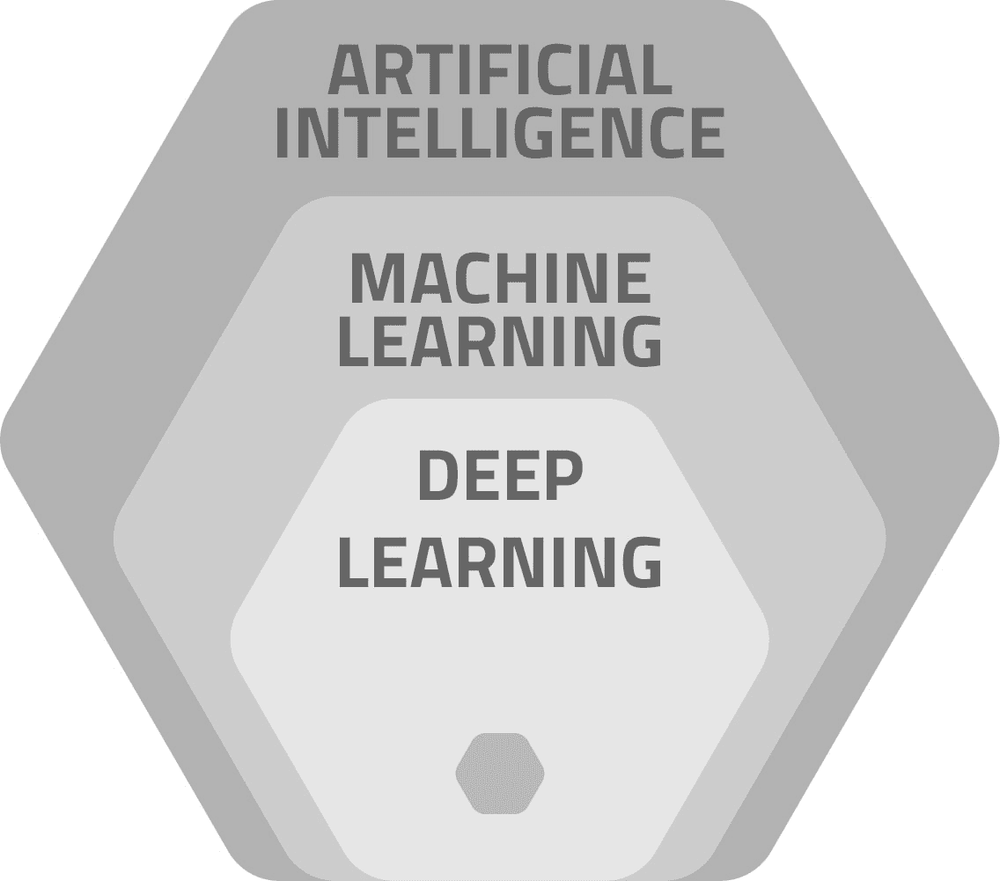

**图 1.1:** AI、ML 和 DL 之间关系的表示

深度学习基于神经网络，即大脑的概念模型。单词 *深度* 来自在深度神经网络上训练/运行的深度学习算法。深度学习的核心理念是从数据中自动提取表示。由于我们的数据通常以离散信息的形式出现，需要将其组合起来才有意义，深度学习和机器学习使用这些信息并从中提取特征来构建广泛的架构。这种深度架构从低级到高级函数解释数据。它按层次顺序工作。数据来自许多来源，如 Twitter、患者 MRI/扫描、社交媒体和各种形式的传感器数据：

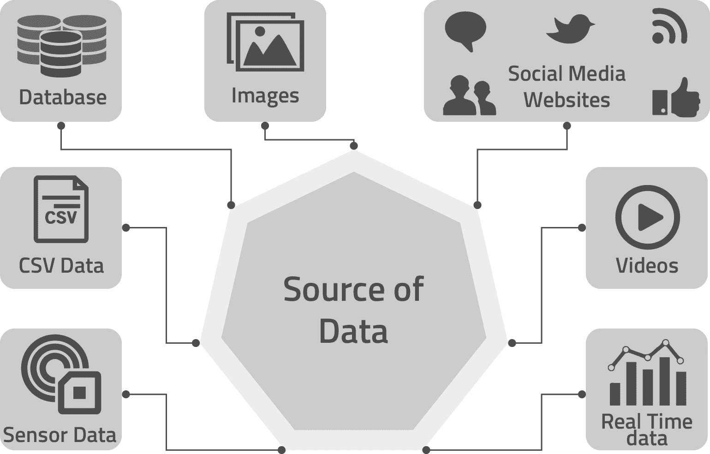

**图 1.2:** 不同数据源


这些数据源每天产生 500 多太字节的数据。因此，需要能够分析数据的新方法。为此，需要能够处理海量数据的现代概念架构。换句话说，有必要认识到组织在处理这些大型数据集时是如何运作的。这就是 DL 的由来。DL 算法用于构建模型，可以从这些数据源中提取数据并管理它以供未来预测，以及用于各种其他目的。

当数据变得复杂时，我们需要寻找能够处理此类数据的架构。随着时间的推移，数据变得庞大且无结构，因此需要能够正确管理这些数据的架构。DL 解决了所有这些问题。它专注于在复杂环境中工作。

# 机器学习与深度学习

**机器学习 (ML)** 是人工智能的一个子集。DL 是 ML 的子集。让我们深入探讨机器学习和深度学习，以便更好地比较它们。

## 机器学习的现状

ML 使用各种算法来解析数据、从中学习，然后对已识别的问题做出判断或预测。因此，与使用特定指令集的手工编码以完成特定任务不同，机器使用大量数据和算法进行训练，这些算法赋予其学习如何执行任务的能力。

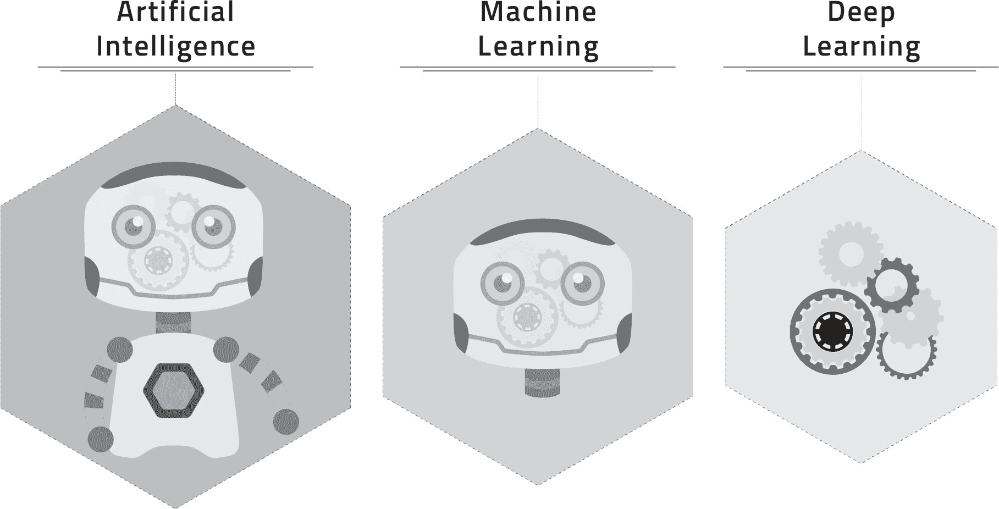

**图 1.3：** AI、ML 和 DL 的图解表示

首先，机器需要用大量数据进行训练。有几种机器学习算法可以做到这一点，例如 `Bayesian Network`、`Decision Tree` 和 `Clustering`。通常，机器学习有三种类型：监督学习、无监督学习和半监督学习。

监督式 ML 在提供标记特征集时使用。例如，如果 `x` 的值已知，则在此基础上预测 `y` 的数量。无监督 ML 与监督 ML 不同。在无监督 ML 中，你只需输入数据 `x` 而没有对应的输出变量。无监督学习的目的是对数据的结构进行建模以了解更多关于数据的信息。半监督学习介于监督学习和无监督学习之间。半监督知识用于输入数据 `x` 很多但只有部分数据被标记为 `y` 的情况。半监督学习的一个例子是某些图像被标记（例如，狗、猫和人），然而大多数是未标记的。

机器学习使用交叉验证来选择模型的复杂度。换句话说，ML 使用数据的一小部分找到复杂度，然后在数据的其他部分上测试模型。让我们在下图中探索不同类型的学习及其不同的子类型：

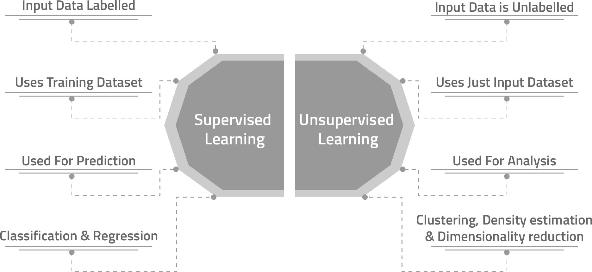

**图 1.4：** 监督学习和无监督学习的主要步骤

## 深度学习的现状

深度学习无处不在。它用于实时确定显示哪些在线广告；识别并标记照片中人类、食物以及动物的图片；将语音翻译成文本，将文本翻译成不同语言；以及驾驶自动驾驶汽车。

深度学习存在于各个地方。信用卡公司使用深度学习模型进行银行欺诈检测，并根据历史记录检测是否可以向特定个人提供信用卡。银行使用客户的交易详情来检测客户财务行为中的异常，并检查是否应批准贷款或其他设施。医院和医生使用它来利用实时数据以及历史数据检测、诊断和治疗疾病。

应用范围无限。其他选项包括文本分析、图像分析、图像描述、图像分类、X 射线分析、股票市场分析、天气预报、目标检测、财务预测等等。

深度学习已用于提高性能、自动化流程、检测模式和解决问题。DL 通过自动化、在蛋白质和基因表达等复杂结构中的模式识别等不断提高机器的性能。

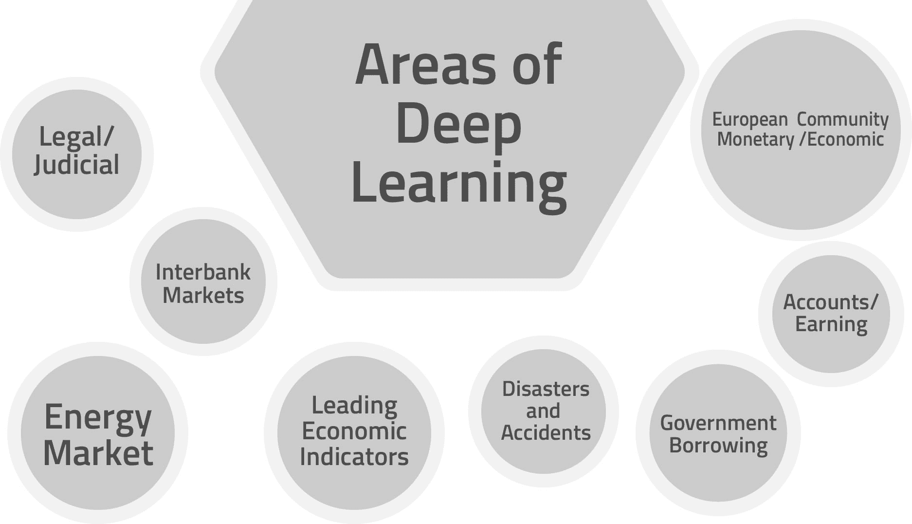

**图 1.5：** DL 的不同领域

以下三个因素提升了深度学习的潜力。

### 可用数据的指数级爆炸

几年前，曾有一段时间分析 PB 级数据简直是不可能的。`Hadoop` 的出现使得能够对大量历史数据运行分析查询。我们知道大数据是近几年的流行语，现代数据管道始终以高速摄取速率接收数据。因此，这种高速流动的数据被称为快速数据。快速数据不仅仅是关于数据量，如数据仓库中以千兆字节、太字节或拍字节衡量的信息。相反，除了衡量数据量外，它还考虑数据的速度，如每秒兆字节、每小时千兆字节和每天太字节。因此，在谈论快速数据时，体积和速度都被考虑在内。

如今，许多组织试图收集有关其产品、服务或组织活动的大量数据，例如使用日志跟踪和定期截屏等各种方法跟踪员工行为。数据工程使我们能够将这些数据转换为基本格式，而数据分析师则将其转化为有用的结果，可以帮助公司改善客户体验，并帮助他们监控和提高员工的生产力。

但对于欺诈检测、日志分析或实时分析等情况，这不是处理数据的方式。想象一下，有一个像 `MongoDB` 这样的数据仓库，其中存储了 PB 级数据。为了完成上述所有任务的分析，需要分析历史数据并预测未来。

对于此类情况，我们首先需要分析历史数据并预测故障。它不仅需要预处理，还需要考虑一系列顺序步骤，以便组织实时做出有效的业务决策。它适用于异常检测、网络钓鱼、情报、监控系统等许多其他领域。

传统上，高摄取速率的数据流是通过存储和处理来管理的；之后，这些数据会被用于进一步分析以预测结果并提供有影响力的推断。但组织正在寻找能够实时洞察业务并实时采取行动的平台。

### 图形处理单元 (GPU) 的兴起

在 90 年代，应用程序性能和数据库吞吐量与 CPU 数量和可用 RAM 直接成正比。由于这些因素对于实现企业应用程序的预期性能至关重要，因此引入了一种新的处理器，例如 `Graphics Processing Unit (GPU)`。

随着深度学习的兴起，GPU 现在为许多智能用例提供动力，如自动驾驶汽车、肿瘤诊断、计算机视觉、推荐系统、语音识别等。深度学习基于数学和统计计算。`Artificial Neural Networks (ANNs)`、`Convolutional Neural Networks (CNNs)` 和 `Recurrent Neural Networks (RNNs)` 是深度学习的现代实现。每种类型的神经网络，如分类、聚类和预测，都与用例一起使用。例如，`Natural Language Processing (NLP)` 使用 RNN，而图像识别和人脸识别使用 CNN。


例如，一个简单的图像由一个很大的数字矩阵组成。在深度学习的训练阶段，这些数字的矩阵被用作神经网络的输入。通过用成千上万张人脸图像训练神经网络，模型可以快速在一张图片中识别出一个人。这个训练过程是对多个像素（数字）进行关联以找到人脸模式。这种关系通过将数十亿个矩阵相互相乘来生成正确的结果。为了提高训练速度，所有这些操作需要在并行进行。

CPU 设计用于按顺序处理计算，这意味着每个操作必须按其优先级执行，并且还必须等待之前的活动完成。因此，为了并行实现这些过程，需要构建一个可以并行运行进程的处理系统。因此，引入了图形处理系统，它们可以同时处理许多操作，并在更短的时间内执行并行计算。

# 先进算法的发明

现代世界中深度学习的应用非常广泛。各种应用领域包括语音识别、基于历史数据的学习、人脸识别、自动驾驶汽车、医学科学、股票预测、保险等。

随着先进算法和计算机视觉概念的发明，制作有助于人脸识别和语音识别的实时模型变得轻而易举。此外，深度学习还用于改进 NLP 工具，以理解完整句子的含义，而不仅仅是单个单词，例如文本摘要，以及通过推文识别个人的情感。

## 深度学习与大数据

在**物联网 (IoTs)**和移动性时代，随着海量数据以快速速度变得可用，必然需要一个高效的分析系统。此外，数据的多样性来自不同类型的来源，不同的格式，例如传感器、日志以及来自 RDBMS 的结构化数据。

在过去几年中，随着更多应用的构建，数据的生成量有所增加，并且它们以更快的速度生成更多数据。

过去，数据存储成本高昂，并且缺乏能够高效处理数据的技术。现在，存储成本变得更便宜，将大数据转换的技术也变得可用。

以技术为导向的公司如 Google、Yahoo、Microsoft 和 Amazon 已收集并维护了以艾字节计量的数据。此外，像 Facebook、YouTube 和 Twitter 这样的社交媒体公司拥有数百万用户，他们持续产生大量数据。因此，需要分析这些数据并根据业务需求产生有意义的结果，以帮助决策。

除了分析海量数据之外，还有其他挑战，例如数据的收集和构建、处理未标记数据、噪声和质量差的数据、未监督和未分类数据。因此，DL 算法的概念在这里发挥着重要作用。这些算法可以自动化系统以摄取大量未标记数据并自动提取复杂表示。

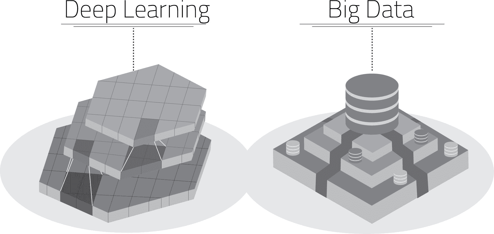

**图 1.6：** 深度学习与大数据的架构表示

深度学习算法是连续层的架构。每一层都按层次工作，例如，图像中的像素被输入到第一层，而每一层的输出被提供为其下一段的输入。

例如，在人脸检测模型中，通过将一些人脸图像作为输入提供给 DL 算法，在第一层模型可以通过学习不同方向的边缘来训练自己。在第二层，模型利用这些边缘学习更复杂的特征，如人脸的不同部位，例如嘴唇、鼻子和眼睛。在第三层，模型利用这些特征学习更复杂的特征，如人脸的不同形状。最终，这些最终表示可以作为人脸识别应用中的有用信息。

## 人工神经网络 (ANNs) 的介绍

**人工神经网络 (ANN)，**基于人类大脑基本工作原理的计算模型，改变了追求技术的整个游戏。随着 ANN 的出现，语音识别、机器人和图像识别等任务似乎不再遥不可及。ANN 最显著的优势是能够以技术方式映射生物方法。它可以被理解为一个庞大的相互连接的人工神经元网络，可以执行特定任务。这些任务可以是特定的，例如分类、聚类和模式识别。

## 人类的单个神经元

在神经网络中，执行任何计算的基本单元是神经元。它从其他神经元或某些外部源接收输入并据此计算输出。每个信息都有与其关联的权重 (`w`)，该权重由其相对于其他数据的相对值分配。节点对输入的加权和应用函数 `f`。

神经元的输出可以定义为：

`Output (O) = f(w1.X1 + w2.X2+b1)`

其中 `b1` 是偏置，`f` 是非线性函数，被描述为激活函数。

激活函数的主要目的是为神经元的输出引入非线性。偏置用于为每个节点提供可训练的一致值。人类大脑的典型神经细胞如下图所示：

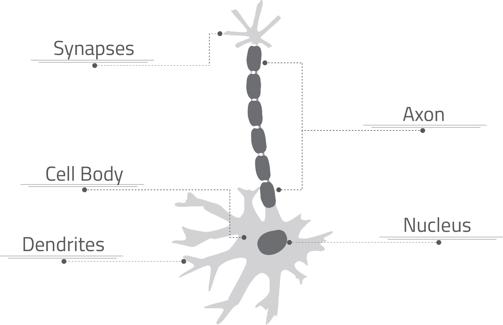

**图 1.7：** 人类神经元及其不同部分

人类神经元由四个部分组成：

*   **突触：** 它可以被认为是两个神经元之间的内部连接。简单来说，你可以将其定义为传输的信号量，该信号量是使用连接的权重计算得出的。

*   **轴突：** 它可以被理解为信号的触发机制。当计算出的总和超过特定阈值时，神经元会触发信号，然后该信号会传递到其他神经元。

*   **胞体 (细胞体)：** 它聚合所有传入信号以产生输入。

*   **树突：** 它执行从其他神经元接收信号的任务。

下表列出了 ANN 和 BNN 之间一些显著差异：

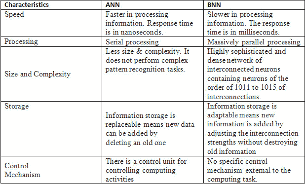

**图 1.8：** ANN 与 BNN 特征的比较

神经网络与人类大脑之间存在两个主要相似之处：

*   与人类大脑相似，神经网络也通过学习获得知识。

*   连接强度用于存储神经元网络的知识，这些被称为突触权重。

BNN 与 ANN 的比较相似性如下：

*   在 ANN 中，基于突触互连的加权输入可以被认为是 BNN 中树突的等价物。

*   ANN 的神经元单元可以与 BNN 的细胞体进行比较，后者由求和和阈值单元组成。

*   在 ANN 的情况下，输出单元可以与 BNN 的轴突进行比较。

从上述事实可以清楚地看出，ANN 是使用 BNN 的原理建模的：

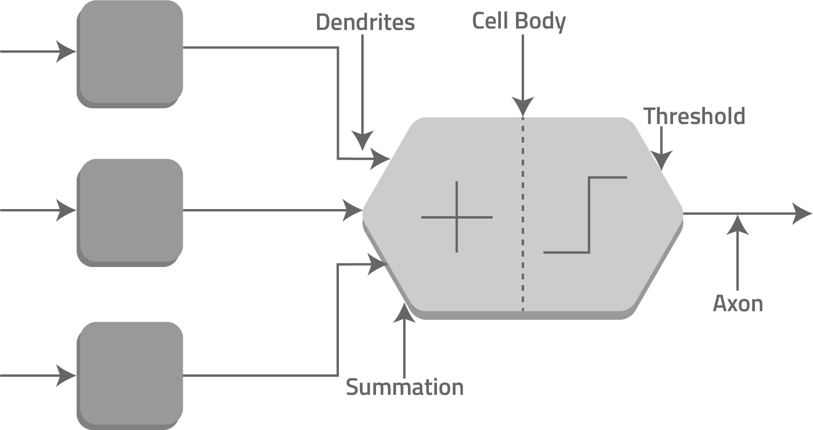

**图 1.9：** 人工神经元及其不同部分

## ANN 的详细工作原理

ANNs 是加权有向图，由节点组成，这些节点是人工神经元。神经元输入和神经元输出之间的连接是通过带有权重的有向边建立的。让我们概述加权 ANN 图及其层：

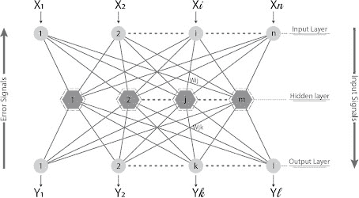

**图 1.10：** 具有神经元及其层的 ANN 加权图。


# ANN 计算子部件

`ANN` 具有以下计算子部分：

* `Weights`: Weights 可以被理解为神经网络用于提供特定问题解决方案的信息或知识。技术上，它们是神经网络内部神经元之间互连的强度。相应的权重分别与每个输入相乘
* `Bias`: Bias 由信息和权重组成，其值始终取为 1。技术上，在计算单元内部，所有加权数据都会被汇总。如果加权和为零的情况出现，则偏置用于通过添加常数值使输出非零，或用于放大系统响应。
* `Activation Function`: 该函数用于获得所需输出。上述的输出和通过该函数传递，并且为了在达到期望值时设置限制，会设定一个阈值。激活函数有很多种，例如线性函数（进一步分为二值和 sigmoid）和非线性函数（例如双曲 sigmoid 函数）。以下是一些激活函数的说明：
    * `Sigmoidal hyperbolic`: 该函数具有 S 形曲线。这里使用双曲函数来近似从净输入得到的输出。该函数定义为 `f(x) = (1/(1+ e^(-σ*x)))`，其中 `σ` 为陡峭参数。
    * `Binary`: 输出只有两个值，例如 0 和 1。为此设置阈值。如果净加权输入大于 1，则输出假定为 1，否则为 0。

# ANN 架构

在 `ANN` 的架构中，神经网络由许多被称为人工神经元的小单元组成，这些单元按以下层级排列：
* `Output layer`: 该层的主要功能是根据特定任务的学习对信息做出响应。这些响应来自上述描述的单元。
* `Input layer`: 该层的功能是将输入作为数据导入网络。系统在此数据上开始学习、识别并执行不同类型的处理。
* `Hidden layer`: 该层位于输入层和输出层之间。该层的功能是将信息逐步转换为输出可用格式。

在大多数神经网络中，输入层与隐藏层完全连接，隐藏层与输出层完全连接：

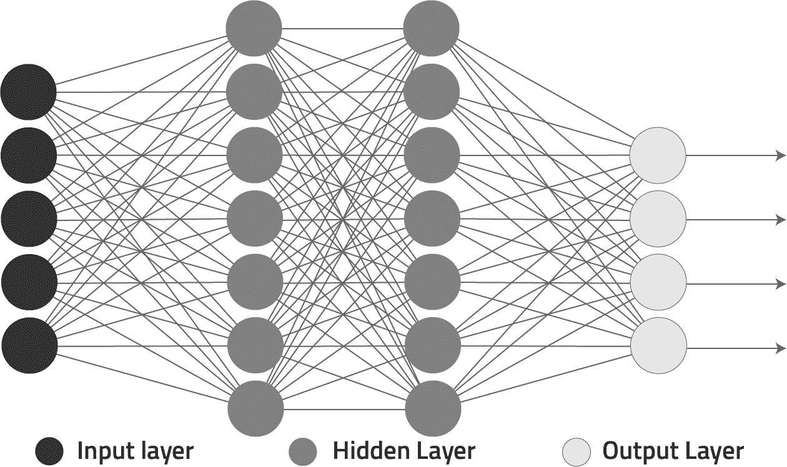

**图 1.11:** ANN 不同层的表示

# AI 中的神经网络类型

`ANN` 有几种类型。基于人脑神经元和网络功能，`ANN` 执行任务的方式类似。ANN 的不同类型如下：

| 参数 | 类型 | 描述 |
| --- | --- | --- |
| 基于连接模式 | FeedForward, Recurrent | `FeedForward`: 这些图没有环。 `Recurrent`: 由于反馈而出现环。 |
| 基于隐藏层数量 | single layer, multi-layer | `Single layer`: 具有一个隐藏层。示例：单感知器。 `Multilayer`: 具有多个隐藏层。例如，多层感知器。 |
| 基于权重的性质 | Fixed, adaptive | `Fixed`: 权重先验固定且完全不改变。 `Adaptive`: 权重在训练期间更新和改变。 |
| 基于记忆单元 | Static, dynamic | `Static`: 无记忆单元。当前输出取决于当前输入。例如，FeedForward 网络。 `Dynamic`: 记忆单元。输出取决于当前输入以及当前输出。例如，RNN。 |

# 神经网络架构类型

人工神经网络是人工克隆人类神经系统功能的网络。存在不同类型的人工神经网络。这些网络是使用复杂的数学函数和计算开发的，这些函数和计算使用一组参数来产生输出。

以下是不同种类神经网络的简要介绍：
* `Perceptron model in a neural network`: 这种系统被认为是神经网络中最简单的类型。它由一个输出单元和两个输入单元组成，没有隐藏层，因此也被称为单层感知器。
* `Multilayer perceptron neural network`: 感知器模型与该模型的区别在于它具有多于一个隐藏层的神经元。因此，它也被称为深度前馈神经网络。
* `Radial basis function neural network`: 这些网络与前馈神经网络共享大部分相似性。显著区别在于使用径向基函数，该函数用作这些神经元的激活函数。
* `RNN`: 这种类型的神经网络在隐藏层的神经元之间具有自连接。这种功能为它们提供了临时记忆。因此，后续值的激活会从下层以及其先前的激活值转发到隐藏层神经元。
* `Long Short-Term Memory Neural Network (LSTM)`: 这是循环神经网络的一个子类型。其中，记忆单元嵌入在隐藏层神经元中。
* `Hopfield network`: 在这种类型的神经网络中，每个神经元都与每个其他神经元连接，因此被认为是全连接网络。为了用输入模式训练系统，会固定神经元到期望模式的值。之后进行权重的计算。
* `Boltzmann machine neural network`: 该网络与 Hopfield 网络相似；显著区别在于一些神经元是输入而另一些是隐藏的。其中，权重的初始化是一个随机过程，学习使用反向传播算法进行。
* `Modular Neural Network`: 它是结构类型网络的组合，该网络由不同类型的网络组成，例如 RNN、多层感知器、Hopfield 网络和其他类型的网络，这些网络组合形成一个单一模块。
* `Physical neural network`: 这种类型的神经网络 ANN 使用电阻材料电性调整以实现突触功能，而不是任何软件模拟。

如前所述，人类神经系统的功能与人工神经网络之间存在许多相似之处。存在不同类型的网络，基于数学函数和所需导出输出的参数集。一些不同种类的神经网络如下：
* `Neural network perceptron model`: 这些类型的模型有两个输入单元和一个输出单元。在这些网络中没有隐藏层，因此也被称为单层感知器。
* `Neural network based on radial basis function`: 它们与前馈神经网络相似，除了它们具有径向基函数，该函数用作这些神经元的激活函数。
* `Multilayer neural networks`: 它们由多于一个层的隐藏神经元组成，也被称为深度前馈神经网络。
* `RNNs`: 这些类型神经网络的优势在于它们具有独特的记忆能力。这些网络之所以具有这种能力，是因为隐藏层神经元之间的互连。因此，它们必须接收来自先前激活以及来自下层激活函数的激活。
* `Long Short-Term Memory Neural Network`: 这是一种特定的循环神经网络类型。在该网络中，记忆单元位于隐藏神经网络之下。


### `Hopfield network`
这类神经网络被认为是全连接的，这意味着每个神经元都与每个其他神经元完全连接。训练系统时，神经元的值根据特定模式固定，该模式用于训练输入层的神经元。之后，权重被计算。它与其他神经网络不同

### `Boltzmann machine neural network`
这些网络与 `Hopfield network` 具有相似性，但有细微差别；一些神经元是输入，而另一些则被认为是隐藏的。反向传播算法用于提供学习，权重随机初始化。

### `Modular neural network`
这类系统可以被视为不同种类的神经网络的混合，例如 `Hopfield`、`RNNs` 和其他类型的神经网络。这些网络被模块化为一个单一网络以执行不同的独立任务。

### `Physical neural network`
这类神经网络由电可调电阻材料组成，并用于模拟神经网络中任何软件模拟所呈现的突触功能。

下一幅图介绍了神经元的不同架构：

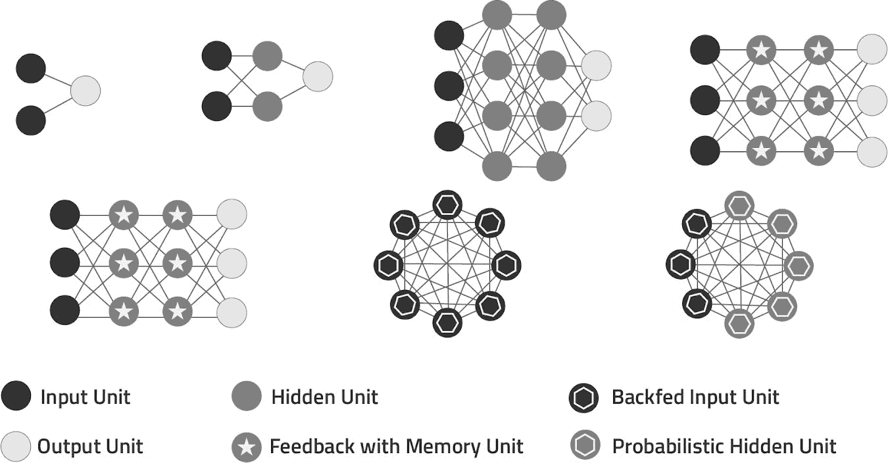

**图 1.12：** 神经元的不同架构类型

# 算法问题解决思路
在前面的章节中，讨论了深度学习、人工智能的基本概念及其各种应用。在本节中，我们将讨论一种算法方法，使用深度学习算法解决深度学习系统中的问题。以下图表展示了在预测建模中使用深度学习的典型工作流程，我们将在以下小节中讨论：

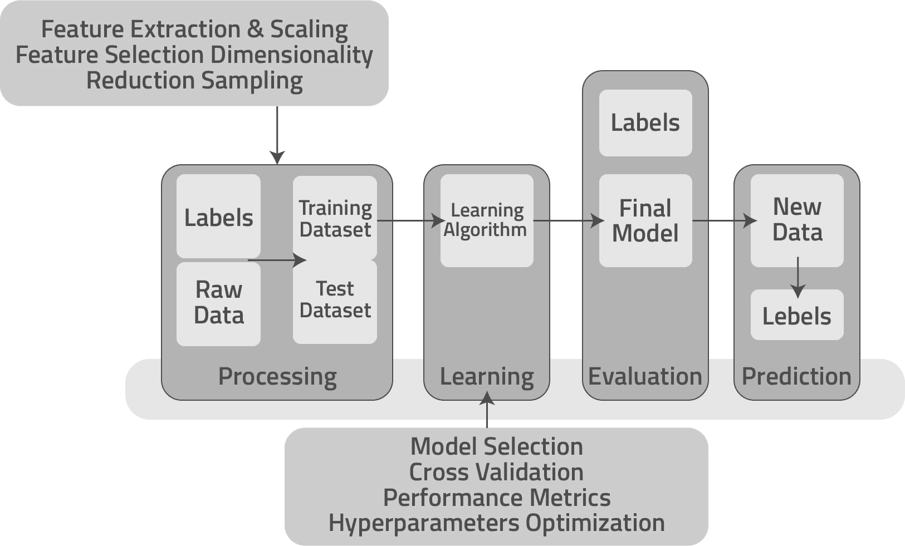

**图 1.13：** 用于解决问题的不同步骤的方法流程

## 预处理
原始数据以多种形式来自多个来源，如物联网设备、社交媒体和医疗保健数据。大多数数据被认为是非结构化数据。为了从这种非结构化数据中获得有用的结果，需要将数据转换为可用于未来预测的形式。首先，它必须经过预处理，使数据为进一步应用做好准备。
让我们以裂纹检测系统为例，其中需要检测盘子是否发热，并检查盘子是否有裂纹。在图像数据集中，原始数据包含各种盘子的图像，需求是提取有意义的特征。
有用的特征可以是图像的 `filename`、图像的 `height` 和 `width`、对象的 `name`、`X` 和 `Y` 坐标的目的，对象的 `ID` 等（裂纹区域）。

## 降维
在处理现实世界问题和实际数据时，请注意有时数据是高维的，包含数百万条记录。这种数据的高维性可以使用其中一种技术来降低，例如 `Principal Component Analysis (PCA)`。

## 缩放
归一化是一种缩放技术。它也被称为映射技术或预处理阶段。通过使用它，可以从现有范围中找到新的范围。它对预测或预报目的有益。有许多预测或预报的方法，但它们都可能彼此不同。因此，为了保持预测或预报的显著变化，需要归一化技术使它们更接近。

## 特征选择
所有 DL 算法的成功取决于数据的呈现方式或是否从数据集中提取了所需特征。以下图表显示了特征提取的各个步骤：

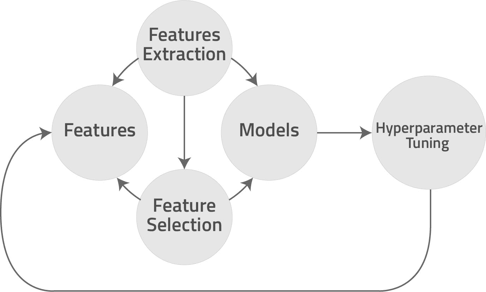

**图 1.14：** 特征提取的不同步骤

选择特征时需要注意以下事项：
* 在特征之间寻找协方差，并从可能相关的函数中选择一个用于预测。
* `Hyper-parameter features`：这些特征是使用两个或多个元素的组合创建的（模型执行操作以验证接收到的特征；该过程在循环中重复，直到模型获得满意的结果）。
* `Training and selecting a deep learning model`：由于许多深度学习模型的工作基于数据的可用性、需求和形式，为了做出准确的预测：
* 需要选择适合数据的模型。
* 它能很好地泛化到未见过的数据。
现在，你可能会想到的一个问题是如何在可用数据和实时数据上找到最合适且最匹配的模型？

## 模型选择
为问题选择合适的模型对于预测良好的结果非常重要。选择任何算法时需要注意以下事项：
* `Accuracy`：为了获得更好的模型结果，有必要确定所获得模型结果的近似程度。采用这种方法，处理时间会增加。这种方法还允许通过避免过拟合来实现模型。
* `Training time`：训练模型所需的小时数在确定模型选择方面也起着至关重要的作用。它与所获得模型的准确性直接相关。另一方面，一些算法取决于数据点的数量。
* `Linearity`：它是在实现机器学习模型时遵循的假设之一。它指出一条直线可以分离类别。
* `Number of parameters`：它是模型的核心。参数的数量影响模型的工作。因此，模型的大量参数需要更多的时间和尝试才能实现模型的优秀组合。具有优化的参数数量的主要优点是它表明算法在问题观点上非常灵活。还观察到，随着参数数量的增加，训练模型所需的时间呈指数增长。
* `Number of features`：它也在模型选择的决策中被考虑。在某些方面，特征的数量可能比数据点的数量更广泛。这可以在文本数据集的情况下观察到。

有各种算法可用于特定类型的任务，这些算法通过以下图表和后面的一些要点进行解释。以下图表代表相同内容：

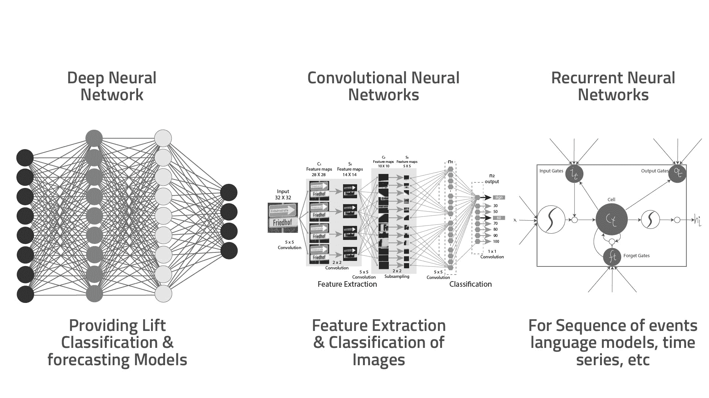

**图 1.15：** 不同类型的网络及其不同层
* `Deep neural networks`：深度神经网络有助于分类和预测模型。
* `Convolutional neural networks`：卷积神经网络用于特征提取和图像分类。
* `Recurrent neural network`：循环神经网络有助于事件序列和时间序列。

## 交叉验证
它是一种统计方法，通过将数据分为两段来评估和比较学习算法：一部分用于学习或训练模型，另一部分用于验证模型。
例如，假设有人想找到一个统计模型，根据前一天的价格预测房屋的价格水平。如果能基于该数据实现准确的预测，那么就可以说为该任务选择的模型和特征可以产生实际结果。


使用交叉验证，用户可以估计特定学习方法的测试误差，其次，他们可以选择所选学习方法的最佳灵活性，以最小化与偏差和方差相关的误差。

## 性能指标

指标用于衡量和比较算法的性能。各种指标例如混淆矩阵和 ROC 曲线下的面积可用于检查预测结果的准确性。

## 超参数优化

超参数用于检测训练和测试模型所需的大致时间。

## 模型评估与模式预测

在选择在训练数据集上拟合良好的模型后，下一步是在测试数据集上应用该模型以预测模式。如果它产生令人满意的结果，所选模型可用于预测新数据。

例如，让我们以热板为例，其目标是检测板是否发热以及检测板中的裂纹。数据集包含板的图像，任务是识别板上可能存在裂纹的区域：


**图 1.16：** 真实带裂纹的热板图像

收集数据的各个步骤如下。

### 数据收集

1. 数据以 `.jpg` 图像的形式存在。因此，为了从图像中检测对象，需要对图像进行标注，即在图像中标记所需对象，以便机器能够学习需要识别的对象。
2. 有各种工具可用于解释图像，例如 `Labellmg` 和 `Labelme`。为了以精确的多边形图像形式进行标注，我们将使用 `Labelme` 工具，因为 `Labellmg` 工具用于以矩形框形式解释对象。进行标注时，首先打开 `Labelme` 标注工具并登录账户。然后创建上传图像的集合（一次最多上传 20 张图像）。在图像上围绕所需对象绘制多边形边界。绘制边界后，命名标签并保存 `.jpg` 和标注文件。因此，使用 `Labelme` 工具，图像被解释并以 `XML` 文件的形式保存。
3. 之后，为了从图像中获取所需检测对象的点，使用 `OpenCV` 生成掩码以查找轮廓函数：
```
ret,thresh = cv2.threshold(imgray,127,255,0)
#setting the threshold value to classify the pixel values of the image
im2, contours, hierarchy = cv2.findContours(thresh,cv2.RETR_TREE, cv2.CHAIN_APPROX_SIMPLE)
#finding the white object from the black background
#first one is the source image, second is the contour retrieval mode and third is the contour approximation method
#get the result as a list of points in the form of list as "contours"
```
4. 观察到图像数量不足以实现目标检测。因此，使用数据增强方法增加图像数量。可以使用 `Augmentor` Python 库进行许多操作。`Augmentor` 是一个 Python 库，用于执行增强并为机器学习和深度学习任务人工生成图像数据。使用 `Augmentor` Python 库，通过指定操作来开发管道。执行管道并将所有结果保存在指定目录的路径中。
5. 以下是几个函数：
```
p.rotate(probability=0.7, max_left=10, max_right=10)
#rotating the image with probability 0.7 and maximum movement towards left and right is 10
p.zoom(probability=0.5, min_factor=1.1, max_factor=1.5)
#zooming the image with 0.5 probability within certain range of factor
```

### 数据预处理

1. 从上述获得的 `XML` 文件中，使用 for 循环获取点，并将接收到的结果以 `CSV` 文件的形式存储。
2. 之后，观察到目标检测 API 不能在多边形点上工作；它只在矩形边界框上工作。因此，需要将多边形点转换为矩形边界框。它使用 `planar` 库和边界框函数执行。以下是一个示例：
```
for j in cor_list:
bbox1 = BoundingBox(j)
# the points are listed in "cor_list" and BoundingBox function is used to fetch points in the form of rectangular box
box_list_xmin.append(bbox1.min_point.x)
box_list_ymin.append(bbox1.min_point.y)
box_list_xmax.append(bbox1.max_point.x)
box_list_ymax.append(bbox1.max_point.y)
#fetch the extreme points of x and y and append them in the lists
```
3. 然后，我们观察到有关图像高度和图像宽度的信息缺失，然而，这对于实现目标检测模块是必要的。因此，使用 `PIL` 库来获取它。示例如下：
```
for xml_file in glob.glob(image_path + '/*.jpg'):
xml_data = Image.open(xml_file)
size_image = list(xml_data.size)
value = size_image, os.path.basename(xml_file)
list.append(value)
#fetch all the jpg files from the given specified using glob python library
#Open the fetched file
#fetch the height and width of the image using "size" function of PIL python library
#store the name of the file with its image in a variable and append them into the list
```

### 数据准备

1. 在数据预处理后，它按 80% 和 20% 的比例拆分为训练和测试数据集。
2. 之后，训练和测试数据集都转换为 `Tf.record` 文件。`Tf.record` 文件是 `Tensorflow` 框架的格式，它将其用作训练模型的输入。`Tf.record` 根据图像上获取的点创建边界。

### 数据训练

首先，安装 `Tensorflow` 的目标检测 API。
1. 创建名为 `data` 的目录，在其中下载模型：
```
From tensorflow/models/research/
mkdir data
#command to create tfrecords
```
2. 创建目录后，请按照以下说明操作：
   1. 将 `Train` 和 `Test tf.record` 文件传输到 `data` 目录中。
   2. 将裂纹检测标签文件传输到 `data` 目录中。
   3. 创建名为 `new_crack_model` 的目录，在其中下载模型：
```
#From tensorflow/models/research/
mkdir new_crack_model
```
3. 创建目录后，请按照以下说明操作：
   1. 将配置文件传输到 `new_crack_model` 目录中。
   2. 按照主流程的 *步骤 3* 和 *4* 操作。
   3. 在 `new_crack_model` 内创建名为 `train` 的目录。
```
From tensorflow/models/research/
mkdir train
```
4. 创建目录后，请按照以下说明操作：
   1. 将 `model.ckpt.data-00000-of-00001, model.ckpt.index and model.ckpt.meta` 文件从 `faster_rcnn_resnet101_coco_11_06_2017` 预训练模型传输到 `train` 目录。
   2. 在 `new_crack_model` 目录内创建名为 `eval` 的目录：
```
# From tensorflow/models/research/
mkdir eval
```

### 实现步骤

* 在给定的配置文件中设置路径：
  * 设置初始检查点的路径。
  * 设置裂纹检测标签文件的路径。
  * 设置训练记录文件的路径。
  * 设置测试记录文件的路径。
* 使用以下命令开始训练模型：
```
python object_detection/train.py \
--logtostderr \
--pipeline_config_path="path of configuration file" \
--train_dir="path of train directory"
```


同时使用以下命令在训练模型的同时评估模型：

### 测试命令

```
Python object_detection/eval.py \
--logtostderr \
--pipeline_config_path="path of configuration file" \
--checkpoint_dir="path of train directory" \
--eval_dir="path of eval directory"
```

并行使用以下命令可视化结果。`tensorboard`（可视化工具）命令：

```
tensorboard --logdir="path of new_crack_model directory"
```

在完成模型训练后，使用以下命令制作模型的推理图。命令如下：

```
python object_detection/export_inference_graph.py \
--input_type image_tensor \
--pipeline_config_path "path of configuration file" \
--trained_checkpoint_prefix "path of the checkpoint obtained after training of the model" \
--output_directory "path of output file directory"
```

## 模型测试

1. 要测试获得的模型，请在训练时传递测试图像的路径和获得的检查点的路径。
2. 在测试时，有一个基于分数获取数据的功能。因此，可以实现结果的过滤以获得更好、更准确的结果。示例如下：

```
if np.any(scores > 0.50):
plt.figure(figsize=IMAGE_SIZE)
plt.imshow(image_np1)
plt.savefig('./crack_test_new9.svg')
```

在此示例中，分数 `0.50` 被设定，并且在此基础上，检测过程作为输出显示。

输出显示如下图所示：


**图 1.17：** 热板图像中检测到的裂纹

## 结论

借助 AI 的使用，计算世界已达到不同的技术水平。新的应用程序不断涌现，为用户提供多种定制且强大的服务，这些服务提供了工作便利性，并能在很大程度上降低未来的风险。数据从业者仍在努力从神经网络中获得更多成果并尽可能自动化事物。因此，无需设计算法来完成特定任务。将 AI（ML、DL、NLP）纳入大多数领域即可完成工作。这些前沿技术非常适合实时应用，因为它们具有快速响应和快速计算过程，这源于其并行架构和计算。

神经网络仍处于研究工作的范围内，并且目前也在心理学和神经学等其他研究领域提供帮助。它们用于模拟生物体的部分结构并检查大脑的内部机制。

为了获得最佳结果，我们需要将 AI 和模糊逻辑集成到计算中，并在实时业务场景中实施它们，因为 AI 能够为我们制定最佳选择。

## 问题

1. 什么是人工智能？请简要描述。
2. 数据科学、机器学习和深度学习在人工智能领域扮演什么角色？
3. 什么是深度学习？
4. 机器学习和深度学习之间有什么区别？
5. 请简要描述不同类型的神经网络。请分别简要解释它们。
6. 列出深度学习过程中涉及的所有步骤。分别简要解释它们。

# 第 2 章

# 用于业务分析的数据科学

随着世界迅速变化，技术也在发生变化。由于如此快速且重大的转变，企业需要消化很多内容，采用社交媒体和网络等新营销渠道也具有挑战性。现在，选择投资和利用新技术并在全球舞台上竞争的决策过程已完全不同。

科技世界变化如此迅速有许多弊端；其中之一是没有任何一名员工或高级管理人员能够精通一切。

### 结构

* 数据科学业务分析中面临的挑战
* 模型开发过程中可能出现的问题
* 关于人工智能、深度学习和机器学习的讨论

### 目标

在本章结束时，我们将学习从数据科学的角度进行业务分析。我们将了解不同的挑战，以及在人工智能、深度学习和机器学习概览下设计模型的不同方法。

### 什么是数据科学？

数据科学一词在现代被广泛使用，但数据科学的真正含义是什么？实践数据科学的主要要求是什么，以及它在不同业务领域的主要用途是什么？这些问题将在本节中得到解答。

数据科学可以被理解为各种工具、算法和机器学习技术的组合，这些技术强调发现隐藏在原始数据层中的模式。

它是一个研究领域，依赖于领域、编程、数学和统计专业知识的结合；这种结合用于从数据中提取实质性信息。让我们讨论数据科学的一些主要用途。

数据科学的用途：

* 数据科学可用于为企业开发高精度风险评估模型；这些模型可用于使企业更稳健。
* 在汽车领域，深度学习可用于记录发动机音频信号，并且数据可进一步用于确定发动机是否需要维护。这被称为 *预测分析*。
* 在医疗保健领域，在预测分析和规范分析的帮助下，不仅可以预测疾病，还可以开具补救措施。

这些是一些商业案例，展示了数据科学如何用于解决企业的不同问题。现在让我们看看企业面临的主要挑战是什么。

### 企业面临的挑战

当今企业面临的一些最重要挑战是不确定性、全球化、创新、政府政策和法规、多样性、复杂性、技术、供应链、战略思维和问题解决以及信息过载。以下图表说明了企业面临的挑战：

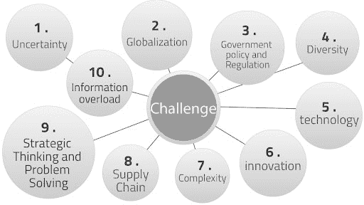

**图 2.1：** 企业面临的挑战

#### 不确定性

小企业面临各种各样的挑战。除了处理员工问题、保持产品或服务质量以及保持财富流动为正之外，管理人员还要在多个方向上被拉伸。业务管理的最微妙之处在于，很难提前知道接下来会发生什么。因此，不确定性是小型企业面临的最关键问题之一。小型企业面临的风险类型如下：

* **状态不确定性：** 这是一种业务经理无法预见特定商业环境结果的情况。例如，如果你经营的业务主要在户外进行，那么天气变化也会导致不确定性。它也可能受到有利于你业务的政府政策的影响。
* **效果不确定性：** 效果不确定性是指某人无法预见外部事件在近期对你的业务的影响的情况。例如，在户外业务中，你知道将要下雨，但你不知道它对客户的影响。


# 响应不确定性
为了应对变化的影响，你可以计划一个应对措施。然而，这正是响应不确定性出现的地方。它是指无法确定市场对你应对措施的反应。例如，如果你将业务从户外搬到室内，你无法确定客户是否会做出良好反应。

## 全球化
全球化是指企业在全球层面的运作。当你在与本地市场不同的地方进行贸易时，你就使你的业务全球化。通常，在公司在国际平台上运作时，会存在特定的障碍。这些障碍可能是政治、财务或地理方面的。当企业克服了这些障碍时，就被称为全球性行业。当然，这些企业以盈利为导向，并且除了本地市场之外还有一个完全运作的基础。影响全球化的因素如下所述：
* **竞争加剧：** 全球化导致竞争激增。这种竞争可能与产品、市场、技术、服务等有关。客户在市场上拥有大量的选择，这影响了他们的行为；他们希望比以前更快、更高效地购买商品。此外，他们还期望高质量和低价格。为了满足这些要求，企业需要做出回应。因此，公司必须始终对价格、产品、服务和客户偏好保持灵活，因为所有这些都是全球市场的要求。
* **对客户需求的更大关注和反应：** 由于社交媒体和网络的兴起，如今消费者似乎对质量、价格和服务非常谨慎。
* **与不同规模相关的经济效益：** 在不同国家和大洲销售产品，导致大规模生产企业之间竞争加剧。
* **位置灵活性：** 随着技术和技术的进步，服务供给几乎可以在任何地方分配，这使得能够获得低成本劳动力和其他资源成本的优势。
* **并购和合资企业增加：** 全球化允许进入更重要的市场以及相关的成本优势。
* **规模经济：** 如今，产品或服务可以在许多大洲销售，因此企业可以进入人口众多的市场，这使它们极具竞争力。

## 创新
这是组织面临的问题之一。许多组织不愿意接受变化。创新是组织更新过程之一。它是组织实施的刷新方法之一，例如重新品牌化、推出新产品和服务等等。创新过程包括四个关键点，例如搜索、选择、实施，以及通过分析在信息创建过程中收集的知识的目的来获取价值。

## 政府政策和监管
政府政策在组织的决策过程中发挥着重要作用。因此，数据科学可以帮助我们审查和确定构建系统的资源。许多财务和环境政策使公司的决策过程复杂化。因此，有必要了解行业中的程序以及如何将其适当地应用于相应的业务。

## 多样性
多样性是指观察人们的观点。因此，这一特定因素成为挑战，因为许多人并不认同彼此的意见。此外，分歧使得成功经营业务变得困难。人们之间缺乏多样性也会导致缺乏对变化世界和技术趋势的不同看法。为应对这一问题，应在组织中界定适当的人群多样性，以便在保持组织环境的同时扩展不同的创意想法。

## 复杂性
由于更多样化的人群（即客户和供应商）的存在，全球经济日复一日地扩张。IT 行业也变得更加灵活，服务提供商正在利用它们。因此，提供所需服务的系统变得越来越复杂。因此，为了正确构建系统并更好地交付需求，需要以这样的方式构建系统，以便可以消除改进方法的不必要的复杂性。具有更好思考能力的更少复杂系统将提供所需的结果。

## 技术
随着技术以快速的速度变化，企业在日常运营中面临许多挑战。其中一些如下所述：
* **过时的硬件/软件：** 在当今快速变化的商业世界中，硬件和软件变得过时非常快。解决此问题的一个方案是使用标准化的软件应用程序和硬件。
* **非法或盗版软件：** 由于无知，有时公司最终会使用非法或盗版软件。如果被发现这样做，他们必须向软件制造商支付数百万美元的罚款。
* **对员工设备缺乏控制：** 防止员工设备被用于非法用途是一个重要问题。通常，员工会自带 U 盘等设备到公司并泄露办公室的机密材料。公司需要采取严格措施来控制敏感数据并防止数据盗窃。
* **集成问题：** 有时，小型公司在没有适当规划的情况下购买最新的软件应用程序。他们忽略了提出诸如该软件能否与现有系统集成之类的问题？结果，浪费了时间和金钱来弄清如何将软件纳入系统。

## 供应链
业务运营的核心在于供应链；在这里，管理者必须每天处理各种问题，从而影响公司。影响供应链经理的两个最突出问题是库存管理和供应商管理。供应链经理是掌握所需供应商数量、接收订单程序以及按时交付产品的人员。因此，需要妥善管理库存并确保充足的库存，以便满足所有客户的期望。

## 战略思维和问题解决
问题解决和批判性思维是指有效利用知识、事实和数据解决问题的能力。这并不意味着你需要立即给出答案；这意味着你必须能够思考、评估问题并找到解决方案。在合理的时间范围内制定深思熟虑的解决方案的能力是雇主非常看重的技能。在公司中，雇主希望员工能够独立解决问题，具有创造性思维，分享想法和意见，并做出决策。这有助于节省时间、精力和金钱。

## 信息过载
信息过载是指信息过剩，这对普通信息用户、研究人员和信息管理人员来说是一个重要关注点。在当今世界，随着技术快速变化，信息生产的速率已经过度增长。由于这一点，人们很难从各种在线来源快速高效地找到所需信息。在某个阶段，决策者接收到的数据超过了他们能够处理的能力，这就是信息过载发生的机制，决策能力随之下降。

## 模型开发过程中出现的问题


从以上章节，我们已得到了诸如 *什么是数据科学？、它如何在不同业务领域中使用？、以及企业面临的主要挑战有哪些需要借助数据科学来解决？* 等问题的答案。这些模型是任何产品和服务的支柱。模型可以使用机器学习和深度学习等不同技术来开发，但其开发过程的核心始终保持不变。让我们来看一下它们的模型设计和开发过程，以及在模型开发过程中可能出现的主要问题。

# 模型的设计与开发

在计划生产新产品和服务时，关键因素是模型设计。为了使设计成功，需要遵循一些基本原则，如现有产品的改进、客户需求和期望的转化、新产品和服务的发展、质量目标的制定以及成本目标的制定。设计过程包含一些步骤，包括动机、改进思路、组织能力以及预测。

技术变革、竞争市场以及经济和人口变革是组织在规划产品和服务设计时必须意识到的一些机遇和威胁。在设计新产品时，企业还必须考虑环境和法律问题。

模型的整体开发过程分为六个阶段，如下图所示：

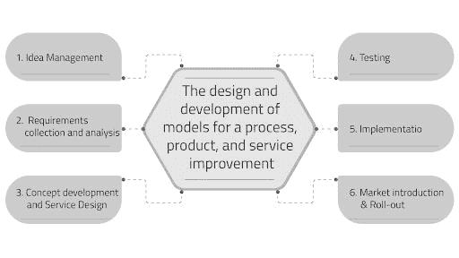

**图 2.2：** 模型的整体开发过程分为六个阶段

下图中显示的六个阶段在下面进行解释：
* **想法管理：** 分析和评估想法共同构成了服务开发过程的第一步。它始于针对特定服务的想法收集。下一步是对想法进行提炼以生成模式。一般来说，初步概念的阐述用于合适的服务想法。
* **需求收集与分析：** 第二阶段是分析项目开发需求的过程。来自不同利益相关者的需求被记录、分析和比较。这些观察结果用于展示对循环服务的详细规划的初始点。
* **服务设计与概念开发：** 概念化可以被视为第三阶段：服务定义、组织概念和营销概念。本阶段的初始目标是以广泛的方式阐述服务，然后可用于定义组织的拟参数和规划资源部署。概念化阶段还有助于阐述营销概念，以便在开发过程的早期阶段考虑到与未来市场趋势相关的市场和客户方面。
* **测试：** 在概念开发之后，下一步是对产品的准确性和效率进行测试。对产品需要进行多种测试，例如可用性测试和概念测试，具体说明如下：
    * 可用性测试用于检查硬件和软件等运行资源。通过应用源自可用性工程的测试方法，可以衡量这些资源的用户友好性。
    * 概念测试用于验证服务文档（如商业计划、流程模型等）的一致性。然而，这里的问题是公司的员工和客户是否能够处理新资源。
* **实施：** 实施阶段在测试之后；换句话说，在此阶段将之前步骤中进行的概念化和测试工作在公司中实施。它还包括先前阐述的营销概念的有效实施。
* **市场推出与推广：** 新服务（或软件）的市场发布阶段主要包括内部和外部的沟通和信息措施。在软件或产品开发之后，本阶段还有助于监控产品的准确性和效率。只有在从市场、客户和员工那里获得适当反馈后，产品才能最终得到调整。

今天，创新发挥着重要作用。只有投资于创新和研究的企业才能蓬勃发展。管理市场上的创新活动是必要的。但企业需要将新产品、创新思想和服务带入市场。如果企业不升级其产品，产品将变得不受欢迎，他们将被迫关闭公司，而这并不是任何企业家的目标。

主要目标是在创新管理领域获取新知识，并专注于创新战略领域。下一个目标是强调为企业创建创新战略的模型的可行性，以确保其成功实施。它可以识别阻碍企业成功实施创新战略的主要问题并提供适当的建议。

# IT 组织在开发模型时面临的问题

在制定和实施创新战略以在企业中开发模型时，会出现各种问题。首先，为了更好地关注问题，需要定义诊断解决方案的难度。有各种技术可用于识别和分析问题的确切过程。定义问题需要实施不同的关键步骤，例如相关人员的参与以及关注所述问题的根源。

一些关于 IT 组织的问题描述如下：
* **创新计划准备不当：** 创新计划的不当开发是企业实施创新战略的问题。公司必须对创造性流程、创新能力、资源和信息流有足够的了解，才能成功实现创新战略。如果公司没有对这项工作给予必要的关注，并且通过充分的文档开发创新战略，那么创新计划可能会失败。建议业务经理对当前情况进行详细分析，并正确理解技术在实施创新战略中的作用。
* **流程自动化：** 在某些情况下，需要自动化之前存在错误的创新流程。业务经理需要识别并持续更新创新流程。需要强调与变革工作直接相关的方法并认识到缺失的方式。
* **缺乏创新想法的证明：** 另一个问题是缺乏创造性想法、机会和创新的证据。营销经理对来自外部或内部环境的发明一无所知。业务经理可以使用 IT 应用来收集和存储标准数据库中的重要数据。诊断战略目标时出现失败也是一个事实。确定目的时的主要问题是缺乏对创新政策益处的清晰认识，组织对其缺乏理解，以及这些创新如何在应用中应用。建议的步骤如下：
    * 需要通过查阅文献综述并从专业人士那里获得适当的建议来正确理解问题。


* 通过实施创新战略，应对问题做出充分澄清。
* 整个组织应聚焦于共同愿景。

### 制定策略的不当起点
大多数情况下，当企业决定实施某项创新时会出现这种情况。尽管如此，形成变革策略基础的事实并不明显。关键成功因素是确保业务需求与业务目标的实现。最近，客户在制定业务战略流程中的作用有所增加。他们的需求、期望和愿望直接或间接地与业务目标的形式相关联。当企业选择一个起点来创建和制定创新战略时，业务战略将为创新战略的发展确保足够的知识基础。建议业务经理审视业务目标与其期望的创新方向，并将创新投射到长期业务计划中。

### 人为因素的禁止
本阶段观察到的一个问题是员工参与组织创新战略的制定和制定程度较低。因此，建议以下几点：
* 应保持组织内部员工之间的定期沟通。
* 员工应能够参与创新战略的制定。
* 在制定计划时应欢迎并考虑创造性想法。
* 应向员工解释组织战略的重要性。

### 缺乏反馈
在为公司设定可衡量目标时，管理层可以评估和评价实施创新战略的好处。在政策实施过程中普遍存在的问题是缺乏反馈。至关重要的是，对方法进行变革的整个过程必须从实施开始到结束进行分析，并进行持续监控。建议业务经理遵循一些既定规则，例如：
* 主要优先事项设定创新业务活动管理的指标。
* 需要确定引入创新战略的目标和可衡量指标。
* 选择适当的参数来评估既定目标的完成情况。

### 创新战略的未利用
主要问题出现在员工之间出现误解时。因此，该过程的实施效率低下。

# 人工智能和深度学习方法用于开发模型
**人工智能(AI)** 已成为企业关注的焦点，因为在企业层面投资和适应性显著增加。借助 AI，可以使机器从过往经验中学习。学习后，设备可以根据新环境进行调整并像人类一样执行任务。大多数 AI 示例属于自动化，例如使用 DL 模型和 NLP 的自动驾驶汽车。借助上述技术，机器可以使用大量数据处理特定任务并从中识别不同的模式。

## 人工智能 (AI)
**人工智能 (AI)** 出现在 1956 年。当时，它主要关注问题解决和符号方法。几年后，它开始通过训练机器探索类人的基本推理。随着时间的推移，AI 的使用和进步不断增加。最后，在 20 世纪，它开始致力于决策支持系统和智能搜索系统。这些系统旨在增强人类能力。未来，也许基于 AI 的机器人将能够改变进化。

以下是 AI 的用途：
* **AI 利用数据实现重复性学习和发现的自动化：** 它能够可靠且不疲劳地执行大量日常计算机化任务。也就是说，即使机器要设置并完美运行，也需要人类的参与。
* **增加人类智能：** AI 也可以用于现有产品。与其专注于新的工作项目，它可以有助于提高机器的智能水平。诸如自动化智能机器和机器人等多个领域与大量数据可以协同工作，以提高当前设备的安全智能。
* **使用渐进式学习算法进行适应：** AI 有助于从数据中发现结构和规律，以便算法能够适应所需技能。例如，算法可以自学玩游戏，同样，它也可以学习应向客户推荐哪种产品或服务。因此，每当获得新数据时，模型就会重新组织。为此，使用了一种 AI 算法，称为反向传播。这使得模型可以通过训练学习，并在提供新数据时适应新环境。
* **更深入分析数据的能力：** 随着计算能力的提升和大数据，AI 领域出现了令人难以置信的变化。假设需要从数据中检测欺诈，使用具有少量隐藏层的传统 ML 技术是不可能或不可行的，无法获得更好的结果。因此，更倾向于使用 DL 模型。但是，DL 模型需要大量数据，因为它们直接使用数据进行训练。数据越多，模型的准确性越高。

## 深度学习 (DL)
**深度学习 (DL)** 属于一类 AI 技术，其模型从数据中提取基本特征并在数据集中找到有意义的模式。与传统方法不同，传统方法中模型开发者必须提前选择和编码特征，而 DL 使模型能够自动学习特征。以这种方式，DL 模型确定数据的表示，使深度学习成为表示学习这一更大领域的一部分。

DL 是一种技术，有助于我们开发可作为不同 AI 解决方案支柱的模型——这些解决方案可用于无人驾驶汽车，使其能够识别标志和坑洼。深度学习模型也可以用于开发 AI 解决方案，可在手机、平板电脑、电视和免提扬声器等不同设备中提供虚拟语音助手。DL 正在取得以前无法实现的结果。

在实践中，DL 模型需要数百万次训练迭代，可能需要数小时才能完成。这取决于网络中的权重数量和任务的难度。同样，需要大量的训练数据才能获得出色的性能，因为这些训练数据必须包含输入中可能存在的全部细节、细微差别、结构模式和错误来源。例如，要识别从各种角度拍摄的动物照片，在训练期间需要向其展示这些角度的图像。根据任务的不同，这包含数千到数百万个数据点，占据数 GB 或数 TB 的存储空间。

## 为什么 DL 很重要？
DL 取得令人印象深刻的结果。就准确性而言，深度学习实现了比以前更高的识别准确率。DL 的最新进展在图像中物体分类等各种任务上超过了人类。它首次在 1980 年代引入，但由于两个主要原因，最近才变得有用：
* DL 需要大量标注数据。例如，动物的分类需要数百万张图像。


DL 需要高算力。具有并行架构的高性能 GPU 对深度学习非常高效。结合集群或云计算后，模型的训练时间可从数周缩短至数小时或更短。

# 深度学习的使用

有很多深度学习的使用场景可用于业务分析：
* 深度学习模型可以基于通话详单和记录、交易活动、销售点交易等进行训练。这些模型可用于欺诈分析，即识别可能为欺诈的活动。
* 深度学习模型也可用于风险分析，这是一种理解并在下一次市场危机前预测风险的方式。
* 结合回归的深度学习算法可用于发现实时异常，这是一种更具体的模式分析。

## 业务改进

来自医疗保健、零售和金融服务行业各领域的专业人士正转向数据驱动的决策。越来越多的企业转向人工智能以提高产品的效率。深度学习因其众多潜在应用，正成为人工智能研究人员、开发者和投资者共同关注的关键领域。这一人工智能子类别从创建基于规则的系统转向开发可通过训练从数据中学习并从经验中自动识别模式和洞察的算法。
AI 和 DL 正在通过诸如 Google Maps 等工具影响我们生活的许多方面，这些工具帮助我们定位并与其他应用程序交互，为我们提供在线推荐。
由于数据集的复杂性和庞大尺寸，深度学习可以帮助我们从数据中发现价值；这是人类无法做到的。因此，DL 现在能够在最小的人工干预下做出更好的商业决策和更合理的行动方案。

## DL 优化制造

产品优化最近已成为许多组织的重大问题。优化是任何使设计、系统或决策等得以实现的行动、流程或方法所必需的。以最小成本、更好的质量、性能和能源消耗为目标的决策流程就是此类优化的例子。
全球公司目前专注于数字化和分析。重点是分析每天从数千个传感器积累的海量数据。直到最近，由于缺乏必要的技术和用于从传感器和系统收集数据以进行进一步分析的数据管道，此类数据的适当利用受到限制。
石油和天然气生产是一个复杂的过程，必须做出大量必要的决策以实现长期目标，从规划和资产管理到纠正措施。短期行动必须在有限时间内做出，这被表征为日常生产优化。他们通过优化控制生产过程的各种参数来寻求最大化石油和天然气产量。
为处理与制造相关的问题，采用基于深度学习的方案变得很有帮助。到目前为止，专家手动执行的优化依赖于他们自身对加工控制的经验和熟悉程度。专家从过往经验中学习的能力与一种名为 DL 的技术相似。通过分析来自多个物联网设备的海量历史数据，深度学习算法可以学习并理解参数之间的关系及其对生产的影响。

## 用于业务预测的时间序列分析

时间是世界上唯一永不停歇的运动之物。当谈到预测时，人类思维往往更具好奇心，因为我们知道事物会随时间变化。因此，企业家总是希望提前做出预测。在时间是影响因素的情况下，会有许多其他可能有价值的因素可被视为可预测的。
因此，这里我们将讨论时间序列预测。名称“时间序列”本身就表明与其相关的数据会随时间变化。
时间序列问题的首要动机是预测。用于业务预测的时间序列分析有助于预测/预估行业中具有潜在商业价值的关键字段的未来值，预测个人的健康状况、体育比赛结果，或基于过往表现和数据预测球员的表现参数。
有助于改善业务的各种时间序列方法有：
* 单变量时间序列预测
* 多变量时间序列预测
单变量时间序列预测问题只有两个变量。一个是日期时间，另一个是需要预测的字段。例如，如果有人想预测明天的特定天气字段如平均温度，就需要考虑所有前一天的温度并将它们用于模型中以预测明天。
在多变量情况下，目标是相同的，让我们以上述例子作为单变量，目标相同，即预测明天的平均温度，但区别在于我们也可以使用影响温度的其他参数。如果有降雨的可能性，则需要考虑降雨持续时间、不同时间的风速、湿度、大气压、降水量、太阳辐射等许多因素。
所有这些因素都与温度直观相关。单变量和多变量比较时主要考虑的点是，多变量更适合实际场景。

## DL 在机器人推荐中

Autobot 推荐是一种推荐平台，可使用一套算法和技术开发，旨在使用数据并根据数据和需求生成输出。在任何行业或企业中，他们都试图专注于留住老客户并获取新客户。他们可能希望推荐优惠以吸引新客户，或需要一个推荐系统帮助客户探索和购物产品，同时考虑客户的历史信息。
基于 DL 的 autobots 的优势在于它们将客户偏好作为优先事项。由于并非所有产品都经久耐用，趋势会发生变化，人们的兴趣也会有所不同。无法在市场上数百种产品中跟踪这些细节以获得最大利润。利用其他各种技术，它还有助于工业界对特定行业进行市场篮子分析，以关注产品的需求和评级。
如果我们考虑一个购物中心或零售店，店主需要各种类型的建议，例如产品的摆放位置或产品组合的运行方式。对于此，分析的数据可以是交易数据。根据客户的交易，我们可以找出以下细节：
* 哪些产品更有可能被售出，在该地区需求量大并提供最大利润？
* 哪些产品经常被一起购买？
像 autobots 这样的平台可实时提供推荐，并设计用于音乐、零售、银行、电影、人、互动网站等许多行业。它在每项任务中都深入分析行为模式，并且以跟踪一切的方式构建，从已登录客户、在线/离线客户到他们查看了哪个产品。它在历史数据上运行模型后，也可对流数据进行推荐。

## 用于工业物联网的预测性与预防性维护


预测性维护在多样化的应用领域中至关重要，例如制造业、信息技术、航空航天、重型机械行业等，用于估算子系统或组件的未来性能以进行剩余使用寿命（RUL）估计。如果能够准确预测资产（可能是任何机器、服务器或涡轮机）何时失效，那么就可以提前做出计划性维护决策，以避免突发故障、降低维护成本并优化运营活动。

这可能看起来有点理论化，但使用现代数据技术是可行的。我们可以通过传感器实时监控我们的资产（可以是任何可能导致故障的设备或机器），并根据传感器数据模式预测这些资产何时会出现故障。

预防性维护是对设备定期进行的维护，以降低其故障的可能性或延长其使用寿命。此类维护是根据使用情况或自上次维护以来经过的时间来安排的。基于时间的预防性维护的典型例子是空调在夏季开始前每年进行一次保养。预防性维护是一种原始的维护方法，成本高昂，因为我们无法预测资产或设备的剩余使用寿命。我们会根据使用情况或自上次检查以来的时间定期进行维护检查，即使根本不需要维护。

这里预测分析的概念就派上用场了。利用物联网和深度学习，我们可以预测资产何时将发生故障，从而在必要时对受影响的部件进行维护检查。

预测性维护相对于预防性维护实践的优点如下：
* 预测性维护有助于识别关键参数并确定故障的可能性。
* 预测性维护有助于优化业务决策制定，系统地使用实时和旧的相关数据。
* 它有助于更好地规划备件库存，以便库存或维护团队不会面临压力阶段。

## 深度学习在安全领域
网络犯罪分子继续对世界各地的行业、企业和金融机构发动越来越复杂的攻击。很明显，组织不能仅依靠人力和人类能力来对抗网络攻击，因为寻找潜在威胁并提出预防它们的安保技术非常耗时。

因此，公司必须找到新的方法来增强其网络防御能力。人工智能正成为可以对抗网络犯罪的技术。网络安全专家需要一种可靠的方式来快速扫描、解析和应对异常。一旦机器学习、深度学习和人工智能学会了要寻找的内容，它们就可以及时向其人类同行提供他们需要的信息来减轻攻击及其后果。

人工智能可以通过分析威胁并立即响应攻击和安全事件来帮助企业做出更好的决策。它还有助于自动化以前由技能不足的安全团队执行的任务。它使工程师能够找出发现攻击的方法，学习工作的复杂性，并将这些经验应用到未来的攻击中。这意味着该技术可以利用这些经验来阻止攻击或提醒人工操作员响应事件，从而缩短响应时间并减轻面向客户的黑客攻击造成的财务和声誉损失。

## 深度学习在医疗保健领域
在当今时代，患者的期望正在发生变化，因为他们对医疗服务提供者的要求越来越高。繁忙的日程和不断上涨的治疗费用使得许多人难以预约并保持与医生的预约。

习惯于移动设备的患者希望在医疗保健互动中拥有同样的选择。服务提供商正在处理老龄化人口的多重健康相关问题，与医疗保健团队协作并协调治疗计划变得具有挑战性。即使隐私问题和法规使管理患者信息变得更加复杂，电子健康记录和移动设备在医疗保健领域的爆炸式增长也导致了新的和不断扩大的安全风险。

当然，成本压力是当今几乎每位患者和提供者最关心的问题。随着支付方越来越关注结果和质量，医疗保健提供者必须找到一些方法来改善患者体验、降低成本，从而提高工作效率。

## 使用深度学习神经网络进行欺诈检测
银行每天必须分析数百万笔货币交易。但由于缺乏先进技术，银行无法妥善检查交易，因为在数百万笔交易中识别出几笔欺诈活动具有挑战性。因此，需要一种可扩展的技术，该技术可以自动更新系统。深度学习神经网络可以自动检测欺诈活动，并且系统可以在有新数据到达时自动学习，而无需人工干预。

大型机构和组织进行大量金融交易。因此，引入了开源深度学习以便他们以经济的成本打击欺诈活动。

## 数据科学在业务分析中的益处
数据科学和人工智能如今正在彻底改变每个领域和方面。让我们讨论数据科学在业务分析领域提供的益处：
* 数据科学提供预测分析，可用于预测任何业务中涉及的需求以及风险，从而提高主动性和预见性。
* 利用预测分析和规范分析，可以解决或避免所有错误，从而实现相关产品的交付。
* 数据科学也可用于开发推荐系统和情感分析系统，可用于个性化和服务。
* 数据科学技术和模型也可用于优化和提高运营效率。

## 结论
在本章中，我们通过观察对每个决策都很重要的不同要素和模型讨论了决策制定。

不确定性很复杂，迄今为止尚未在任何决策支持系统中具体化。调节决策支持系统的一项基本任务是解释运营决策。

通过对不确定性的精确分析，可以推导出对不确定性的态度。因此可以说，决策中的风险态度本身就是一个至关重要的决策，如果要实现一致和理性的运营，就不应将其留给个人决策者。

## 问题
1. 业务的主要挑战是什么？请简要解释每个挑战。
2. 简要解释模型的开发过程及其阶段。
3. 解释 IT 组织面临的一些问题。
4. 解释 DL 在 IT 组织中的一些应用。
5. 简要解释 DL 的重要性。

# 第三章
# 决策制定
知识是智能行为的必要条件。如果没有知识，智能体将无法做出明智的决策，而是依靠某种形式的探索和交流来获取缺失的知识。人类在生活的每一刻都以多种方式依赖知识，例如如何与其他人类交流、如何在压力情况下表现或如何执行不同任务。如果没有人类存储和处理知识的能力，他们的能力将严重受损。

### 结构


本章首先讨论表示问题的不同方式，并进一步讨论算法。

我们将讨论设计与开发、知识表示和推理。

我们将讨论知识表示的不同技术。

最后，本章的所有发现将通过一个与 Uber 相关的用例示例进行讨论。

# 目标

本章的主要目标是讨论知识表示的不同方式以及在决策中利用知识的不同方式。

# 问题的表示

在识别出问题后，需要花时间来表示它。问题的表示可能涉及抽象思考，但也可能包括将问题以有形的形式呈现。让我们讨论问题的表示的不同方面。

**在表示问题的解决方案时使用路线图并识别长期问题。**

人类大脑一次只能专注于少量信息，并且在脑海中保持问题的详细图景变得复杂。没有这一点，我们可能会忽略必要的关联。

最好的解决方案是制定路线图，在其中我们决定与我们头脑中的想法和概念相关联的计划，形成通过经验学习到的模式。信息如果是新的或似乎不太可能，以及看起来无关的计划，可能会被排除或因与问题的关联薄弱而无法保留在记忆中。

人工智能模型为信息提供结构和形状，使其易于记忆、理解并在此基础上构建我们的想法。它们还可以突出收集细节中的差距，帮助预测我们计划行动的后果，并刺激感官。AI 模型为人们提供更好解决方案的想法。

许多问题解决任务可以在状态空间中开发。状态空间由领域的各种状态和可以从一个状态改变到另一个状态的一组算子组成。

规则可以描述为连通图中的节点，而算子则作为边。单个节点表示为目标节点，当从初始状态到目标状态找到一条路径时，问题就被认为已解决。状态空间可以采用各种搜索方法，以适当控制搜索效率。

为了解决问题，应遵循的策略如下所述：

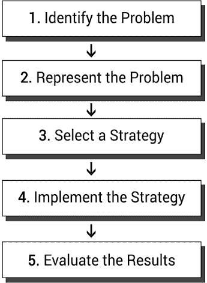

**图 3.1：** 解题步骤

可以遵循以下步骤来解决一个问题：

1. **识别问题：** 识别问题是问题解决中最具挑战性的任务，因为需要克服障碍。回头看时，挑战和解决方案似乎显而易见，但这并不意味着它们在开始时就很明显。为了识别问题，应克服以下障碍：
   * **对问题的详细搜索：** 为了识别任何问题，必须深入问题的核心。需要对问题进行详细搜索以克服挑战。
   * **相关的背景知识：** 为了识别问题，必须熟悉研究主题。
   * **花时间反思问题：** 专家问题解决者花费的时间思考问题远多于业余者，并且在困难时不会放弃。他们不将问题解决视为有时间限制的活动。
   * **发散思考：** 发散思维意味着在更广阔的层面上思考并以新的方式看待问题。尽量避免选择看似不符合挑战的解决方案。

2. **表示问题：** 有些问题只有有限的可能解决方案，而持续性问题通常可以用多种方式解决。分析问题的最有效方法涉及识别和收集相关信息并以有意义的方式表示它。对问题的详细分析有助于识别所有可能的原因并确认真正原因。

3. **选择策略：** 可以使用多种可能的策略来解决问题，例如算法、启发式、试错等等。
   * **算法：** 算法被定义为一组逐步程序，可为特定问题提供正确答案。使用算法有助于解决问题或做出决策，从而获得最佳可能的解决方案。算法用于准确性至关重要或需要频繁解决类似类型问题的情况下。在这种情况下，计算机程序被设计为加快这一过程。需要将数据放入系统中，以便执行算法得出正确答案。算法的这种逐步方法在每个决策必须遵循相同过程且准确性至关重要的情况下很有用。因为过程遵循规定的程序，所以可以确保每次都能得出正确答案。
   * **启发式：** 启发式是一种心理捷径方法，使人们能够快速做出判断和解决问题。我们过去的经验通常形成这些心理捷径，使我们能够快速行动。然而，启发式更多是经验法则；它们并不总是保证正确的解决方案。例如，医生在决定如何治疗患者时，可以使用算法方法。但这将是一项非常耗时的任务，而患者需要立即治疗。在这种情况下，医生将依靠其专业知识和过去的经验迅速选择正确的治疗方法。另一个例子，假设一位顾客在商店购买三件商品，价格分别为 *$9.95, $29.98,* 和 *$39.97.* 现在，如果要计算花费的总金额。最快的方法是将价格四舍五入。因此，第一件商品大约花费 *$10,* 第二件大约 *$30,* 第三件大约 *$40;* 因此，顾客在购物上花费大约 *$80*。四舍五入是快速得出数学问题近似答案的绝佳启发式。问题解决算法和启发式特定于特定类型的问题域。但有一些通用的问题解决启发式在各种情境下都有帮助：
      * **识别子目标：** 通过将大型复杂任务分解为两个或多个具体的子任务，完成起来会更容易。
      * **记下要点：** 画一张图表；列出问题的组成部分；或记下重要要点、潜在解决方案和方法。
      * **画出类比：** 确定一个类似的情况并从类比中推导出潜在解决方案。
      * **头脑风暴：** 生成各种不同的可能方法或解决方案。一旦列出了方法或解决方案的清单，就对其潜在的相关性和有用性进行评估。
      * **孵化情况：** 假设一个问题在数小时或数天内仍未解决。在这种情况下，我们必须留出一些时间进行更广泛的搜索以寻找富有成效的方法。
   * **试错：** 试错法是一种可以解决某些复杂问题的技术。试错通常适用于用户有多次机会获得正确答案的问题。然而，这不是解决没有给你大量机会找到解决方案的问题的适当技术。


例如，试错法在拆除炸弹或在对病人进行手术等情况下并不适用。在这些情况下，微小的失误可能导致灾难。试错法最适用于给予用户足够的时间和安全来找到解决方案的情况。试错法并不被认为是最好的找解方法，也不是检测所有可能解决方案的方法。它只是一种问题解决技术，仅用于找到一个解决方案。这种技术的优点之一是用户不需要具备大量知识。然而，它可能需要大量的耐心。试错法通常用于发现新药物，并且在许多科学方法中也发挥着至关重要的作用。

### Implementing the strategy
做出决定和执行决定是两件不同的事情。在仔细规划项目后，下一步是开始项目实施，即项目管理的第四阶段。实施阶段涉及将项目计划付诸行动。需要遵循一个流程，以加速从零开始手动学习和实现算法的能力。你应用的算法越多，就越快、越高效地获得结果。

### Accuracy
在此阶段，自动化系统/应用程序和 IT 解决方案趋向于生产状态。实施过程取决于项目的特征和 IT 解决方案。如果需要，数据需要被转换并训练以供使用。系统的运营和维护也在此阶段进行。从安全角度来看，系统必须在实施阶段在生产环境中获得认证。实施过程中需要考虑以下步骤：

#### Select the programming language
选择用户想要用于实施的编程语言。此决策将在部署期间使用 API 和标准库来实现。

#### Select algorithm
需要选择你想要从零开始实现的算法。尽量具体，意味着始终选择你想要实现的特定描述或实现，以及算法的类别和类型。

#### Select the problem
选择一个问题或一组问题，可用于测试和验证算法的实现。

#### Research about the algorithm
查找书籍、网站、库等以阅读和学习有关算法的知识。需要有一个关键性的算法描述。这变得有用，因为多角度的视角将帮助你更快地开始算法描述并克服因歧义或假设而产生的障碍。

### Evaluate the results
尽管至关重要，后续阶段经常被忽视。在此阶段，一切都为项目的成功完成做好安排。后继阶段活动的例子包括为用户提供说明和培训、维护结果以及评估项目。此阶段的核心问题是项目何时以及在何处结束。项目的限制应在项目开始时考虑，以便在后续阶段达到这些边界后关闭项目。假设项目最终产生了优秀的结果。团队交付了一款在测试阶段运行良好的软件，但当它安装在目的地地点的计算机上时，原型开始出现问题，有时变得不稳定。因此，程序员应该能够修复软件。

# Design and development knowledge representation
到目前为止，我们已经讨论了一般的问题解决方​​法；现在让我们来看知识表示和推理，它们是任何人工智能系统以及任何计算机系统的基本方面。在本节中，我们将讨论 AI 中知识表示和推理的经典方法：

* **Knowledge representation and reasoning:** 人工智能是一个系统，它处理对理解、设计以及向计算机表示知识的研究。在任何智能系统中，知识的描述被认为是将该知识编码的基本技术。AI 系统的主要目标是设计程序，这些程序可以为计算机提供信息，有助于与人类交互，并且能够解决需要人类智能的各个领域的问题。

* **The AI cycle:** 一般来说，所有 AI 系统都有以下五个组成部分：

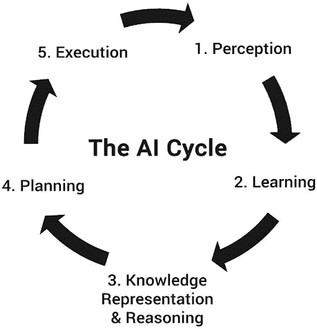

**Figure 3.2:** AI 循环

AI 循环显示了这些组件之间的关系。AI 系统的感知组件允许系统从环境中收集信息。以人类感知为例，这可能是音频、视觉或其他形式的感官信息。系统必须在内部形成对所收集信息的有意义且有用的表示。这种知识表示可以是静态的，也可以与学习组件协作，该组件具有自适应性并可从感知数据中预测趋势。

**Knowledge representation (KR)** 和推理是相互耦合的。任何知识的描述本身都没有意义；它必须在实现特定任务方面有用且有帮助。相同的信息可以根据用户想要如何使用该信息以多种不同的方式表示。

例如，在数学中，如果我们要解决关于统计的问题，我们最有可能使用回归模型；但我们也可以使用其他模型。两者都可以生成相同的结果，但前一种模型可能更适合用户想要对信息进行推理的场景。因此，在这一点上，了解知识表示和推理是相互依赖的组件至关重要；作为 AI 系统开发者，在处理任何解决方案时都必须考虑这种关系。

换句话说，我们可以说知识是关于特定领域的信息，可用于解决问题。解决许多问题需要详细的知识，并且这种知识必须以某种方式表示。在设计解决问题的算法时，我们必须定义规则，说明指令将如何表示。表示指定了知识的形式。一般来说，需要考虑一组规则，这些规则表示关于世界中关系的知识，并利用规则的内容学习解决问题。

# Types of knowledge
知识是对领域的实践或理论理解。一般来说，知识不仅仅是数据；它由事实、信念、启发式、思想、规则、关联、抽象和关系组成。知识的类型如下所述：

* **Procedural knowledge:** 程序性知识是一种表示，其中使用知识所需的控制信息包含在知识本身中，例如计算机程序。

例如，考虑以下内容：

`Woman (Engineer)`

`Woman (Software Engineer)`

`Company (XenonStack)`

`∀ x: Woman(x) → Company(x)`

知识库证明了以下任何答案：

`Y=Engineer`

`Y=Software Engineer`

`Y=XenonStack`

我们得到多个满足谓词的值。如果只需要一个值，则答案将取决于在搜索响应期间观察断言的顺序。


### 声明性知识
这是一个陈述，其中知识被指定但使用该知识的方法未给出，例如，人们的名字、颜色等等。这些是可以独立存在且不依赖于任何其他知识的事实。因此，要使用声明性表示，需要有这样一个程序来解释如何处理知识以及如何使用该知识。声明性学习是指获取一个人可以声明的信息。例如，某个特定地方的人口密度就是一个声明性信息。

### 元知识
计算机、数学、科学或工程等每个领域都构成一个知识对象。产生知识的领域对于学习特别重要。对领域的经验称为元知识。换句话说，我们可以说元知识是关于知识的知识，例如，血压、脉搏率或血红蛋白水平对于诊断医疗状况比眼睛颜色或身高更重要，等等。

### 启发式知识
启发式知识依赖于经验法则。它基于经验法则生成信息，这有助于指导推理过程。在这种类型中，知识是通过专家过去问题的经验表示为解决问题的关键策略。然而，它也被称为浅层知识。

### 结构性知识
结构性知识是基于结构及其关系的描述的信息，例如规则、集合、概念和关系。它提供了开发知识结构和问题整体模型所需的信息。例如，想象一下飞机各个部件如何组合在一起构成飞机，或关于概念、子概念和对象的结构知识。

# 表示
当我们开始思考表示时，会想到多种方法和方案：

### 图片和符号
图片和符号是人类在复杂的语言系统尚未演化时表示知识的最早方式。每种表示类型都有其优势。各种类型的知识最好用图片来描述；例如，我们可以很容易地使用图像来表示公司员工之间的关系。此外，我们还可以使用一系列图像来存储程序性知识。正如我们所见，图片适合于任务识别和结构信息的表示。然而，图像表示在向计算机传输信息方面没有用处，因为计算机不能在没有复杂推理的情况下直接解释图片。

### 图和网络
图和网络有助于找到要合并的对象/实体之间的关系；例如，我们可以使用图来显示员工关系。

### 数字
数字是人类使用的知识表示的重要组成部分。人们可以轻松地将数字转换为计算机表示。

### 知识表示
这是人工智能的一个领域，旨在通过使用符号来表示知识，以促进从这些知识元素进行推理，从而创建知识的新特征。知识进展显示数据如何通过许多阶段移动，如下所示：

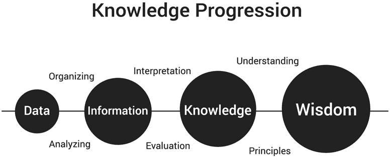

**图 3.3：** 知识进展的表示

知识进展的不同阶段解释如下：
* 数据是分散事实的集合，例如，下雨了。
* 信息出现在事实之间的关系被建立和理解时，例如谁、什么、在哪里、何时。例如，当温度降至 16 度时，下雨了。
* 知识出现在模式之间的关系被识别和理解时，例如如何。例如，如果湿度增加且温度下降，大气不太可能保持水分，从而增加降雨的可能性。
* 智慧是理解的顶峰。它揭示了描述模式的关系原理，例如为什么。例如，它包含了雨、气流、蒸发、温度梯度、变化和降雨之间发生的全部相互作用的理解。

# 知识工程
知识工程是设计专家系统（`ES`）的过程。它包括三个阶段：

### 知识获取
从专家通过人类专家的访谈和观察收集、提取、分析、建模和验证知识的过程。

### 知识表示
选择最适用的结构来表示知识，例如列表、集合、对象-属性、值三元组、脚本、决策树等等。

### 知识验证
测试 `ES` 的知识是否正确且完整。

专家系统设计人员可以使用不同的元素来表示不同种类的知识。知识表示元素可以是规则、框架、语义网络和概念图、本体论和逻辑表达式等原语。这些原语可以组合成更复杂的知识元素。

无论他们使用什么元素，专家都必须结构化知识，以便系统能够高效处理它，人类可以轻松识别结果。

# 表示技术
为了允许大型和技术性知识库的发展，语言的表示应具有单一焦点，促进探索和验证中的知识演进。在本节中，我们将讨论各种知识表示技术。让我们一个一个地了解知识的各种表示。

# 使用谓词逻辑的知识表示
谓词逻辑是一种具有语法和语义规则的编程语言。语法由合式公式组成，包括逻辑符号、谓词和函数符号、项、方法和句子。语义是指名称或方程的含义，即一组元素。短语的含义是一个真值。将公式映射到一组组件的函数称为解释。解释将意向性描述映射为外延性描述。

一阶逻辑在两个方向上扩展命题逻辑：
* 它为句子提供内部结构，这些句子被视为对象或个体之间的关系。
* 它提供了一种表达和推理概括的手段。

在谓词逻辑中，有三种额外的符号：

### 项
一阶逻辑用于表示对象或个体。项可以是特定对象的常量，例如 `A`、`B`、`C`、`John`、`Blue`、`Green` 等；未指定对象的变量，例如 `x`、`y`、`z` 等；以及以特定方式与其他对象相关联的特定对象的函数，例如 `Mother Of`、`Size Of` 或 `color`。

### 谓词
谓词定义一个关系，将两个元素绑定为真或假值。谓词可以接受参数，称为项。
* 一个参数的谓词表达对象的属性，例如，公司（`Xenon`）。
* 两个或多个参数的谓词表示对象之间的关系，例如 `likes`（`John`、`Navdeep`）。
* 参数为空的谓词是简单的命题逻辑。

### 全称量词
全称量词用于识别逻辑表达式中变量的范围。例如，`∀x (Q(x))` 的全称量词意味着对于所有 x，Q of x 为真。例如，`∀x (intelligent(x))` 如果宇宙是人，那么这意味着每个人都是聪明的。


* **存在量词：** 存在量词的陈述 `∀x (Q(x))` 表示存在至少一个 `x` 使 `Q(x)` 为真。例如，`∀x (Intelligent(x))`，如果论域是人，那么这意味着至少有一个聪明的人。

# 使用语义网的知识表示
语义网络是谓词逻辑在知识表示形式上的替代方案。知识可以以图形的形式存储，其中节点表示对象，弧表示这些对象之间的关系。语义网络也被称为 *联想网络*。
语义表示由 4 部分组成：
* **词汇：** 词汇元素表示在词汇描述中允许的符号，例如，节点表示对象；链接表示对象之间的关系，链接标签表示特定的关系。
* **结构：** 它描述了符号如何排列的约束，例如不同节点通过链接相互连接的方式。
* **程序：** 它指定访问程序，例如创建、修改和回答问题。程序的类型有构造程序、读取程序、写入程序和擦除程序。
* **语义：** 它建立关联含义的方式。例如，节点和链接表示特定于应用的实体。
让我们通过使用网络对象及其关系的存储实体来讨论人工智能中语义网络的概念：
* 它们需要表示英语句子。
* 边将用描述符或关系进行标注。
以下是广泛用于表示句子的语义网络，例如：
* 金丝雀会唱歌/飞行。
* 金丝雀是一种鸟/动物。
* 金丝雀是金丝雀。
* 金丝雀 `TEMP` 有皮肤。
下图说明了语义网络：
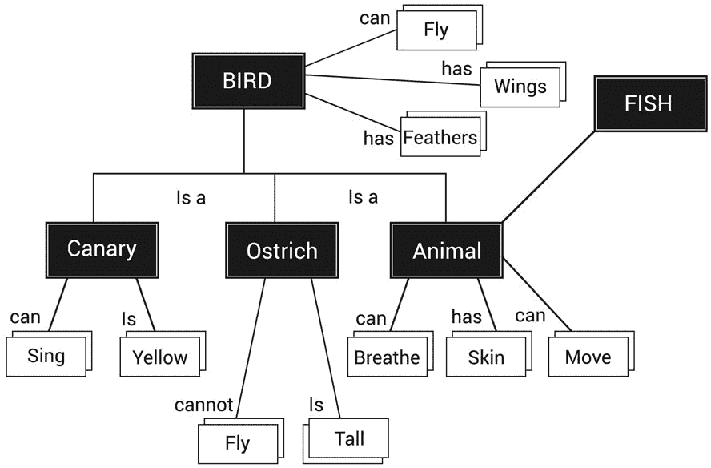
**图 3.4：** 语义网络示例
语义网络具有如下图所示的以下属性 *图 3.4：*
* **是：** 它是一个类/子类。
* **实例：** 第一个对象是类实例。
* **拥有：** 它包含或具有物理属性。
* **能：** 它有做某事的能力。
* 由...制成、颜色、纹理等等

## 使用框架的知识表示
框架是一个具有结构的节点，有助于区分对象之间关系和对象的属性。有时它也被称为 *槽-填充表示*。框架是专家系统对 *面向对象编程* 的应用。
框架克服了语义网络在区分对象关系和属性方面的限制。每个框架代表一个类或一个实例。结构的概念由一组槽表示。每个槽描述框架的适当属性或操作。槽也用于存储值。槽可能包含默认值或指向另一个框架的指针，以及通过该指针获取槽值的规则或程序集。
脚本是一个先例，由紧密耦合的预期-建议首次行动和状态变化框架组成。它是对特定上下文中事件序列的描述性表示。

## 使用脚本的知识表示
脚本在预测未观察到的事件方面很有用。与脚本相比，框架对特定对象、位置、活动、情况或其他元素具有相对更多的知识。框架可以非常详细地描述对象。另一方面，脚本是知识表示的模式，描述事件序列而不是定义对象。
脚本用于以下目的：
* 解释、理解和推理场景。
* 理解和推理事件。
* 推理行动。
* 计划行动以完成任务。
脚本由场景、道具、演员、事件和行为组成。在每个场景中，一个或多个演员可以执行动作。演员与道具一起行动。脚本表示由事件驱动的状态树或网络。
与框架一样，脚本通过建议系统寻找什么以及在哪里寻找来驱动解释。脚本可以预测事件。
让我们以酒店脚本为例，其中我们定义场景、演员、道具、行为等各种特征：
* **场景：** 酒店有一个入口、前台、桌子和椅子。
* **演员：** 食客、厨师和服务员。
* **道具：** 餐桌布置、菜单、桌子和椅子。
* **行为：** 入场、坐到椅子上、点餐、上菜、吃、要求账单、付款和离开。

## 知识表示问题
关于知识表示，有各种需要考虑的问题。其中一些是粒度-分辨率细节、范围、模块化、可理解性、显式与隐式知识，以及程序性与陈述性知识。让我们了解一些问题及其方面。

## 知识表示的数学表述
数学建模是将应用领域的问题转化为数学表述的任务，其理论和数值分析可以为新应用提供答案、见解和指导。它在许多应用中至关重要，因为它为解决问题提供方向，使系统模型得到详细理解，有助于更好地设计或控制系统，并允许高效使用现代计算能力。
数学建模是关于通过计算过程研究物理发展模拟的活动。模拟旨在预测人工制品在其环境中的行为。以下各节描述了人工智能技术在若干数学建模活动上的应用和未来影响。各种数学建模活动包括模型的生成、准确结果的解释、数值算法的开发和控制。
以下是用于从数学模型中提取数值信息的各种算法：
* **数值线性代数：**
  * 特征值问题
  * 线性方程组
  * 大规模稀疏问题的技术
  * 线性规划（线性优化）
* **数值分析：**
  * 函数求值
  * 特殊函数
  * 插值
  * 自动和数值微分
  * 大规模稀疏问题的技术
  * 近似（最小二乘、径向基函数）
  * 积分（单变量、多变量、傅里叶变换）
  * 优化 = 非线性规划
  * 非线性方程组
* **数值数据分析（数值统计）：**
  * 分类
  * 预测
  * 可视化（2D 和 3D 计算几何）
  * 参数估计（最小二乘、最大似然）
  * 时间序列分析（滤波、时间相关、信号处理和谱分析）
  * 随机数和蒙特卡洛方法
  * 分类时间序列（隐马尔可夫模型）
  * 大规模稀疏问题的技术
* **数值泛函分析：**
  * 常微分方程（初值问题、边值问题、特征值问题和稳定性）
  * 偏微分方程（有限差分、有限元、边界元、网格生成和自适应网格）
  * 大规模问题的技术
  * 积分方程（和正则化）
  * 随机微分方程
* 非数值算法：
  * 符号方法（计算机代数）
  * 密码学
  * 排序
  * 纠错码
  * 压缩


# 模型表示

利用上述算法，我们可以构建一种计算机可访问的模型形式。详细的建模循环如下所示：

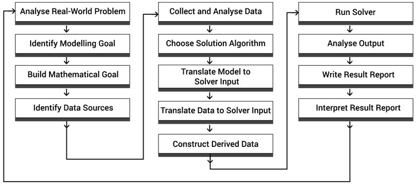

**图 3.5：** 建模循环步骤

为了解决一个问题，需要分析现实世界并识别或说，找到目标。进一步地，我们需要根据问题开始构建合适的数学模型。然后，我们需要从各种数据源收集数据，构建模型，分析输出，最后制作一份详细的结果解读报告。

让我们考虑选举系统预测的问题。在此，需要遵循各种步骤才能成功构建模型。

## 分析现实世界问题

目标是通过社交媒体上可用的数据构建产品、品牌和名人的 360 度全景视图。

* **识别建模目标：** 使用 ML、DL 和 NLP 开发社交媒体分析平台，并通过数据可视化工具如 `D3.js` 图表、`Canvas.js` 等进行展示。
* **构建数学目标：** 主成分分析、熵、特征分解、组合数学、高斯、伯努利、海森、雅可比、拉普拉斯、分布和流形。
* **识别数据源：** Facebook、Twitter、YouTube、LinkedIn、Instagram、新闻网站、Snapchat 和 Pinterest。
* **收集和分析数据：** 分析的非常第一步是将数据带入系统，即数据摄取过程。在摄取数据时，我们可能有多个数据源，因此我们需要一个通用数据摄取平台，在其中我们可以连接各种数据源然后进一步处理数据。需要通用数据摄取平台是因为它使得从各种数据源监控摄取过程变得容易。各种类型的数据分析可能有所帮助，例如受众画像分析、内容分析、竞争基准测试、情感分析、流量分析、社区检测、假新闻识别、地域和区域映射。
* **选择解决方案算法：** Extra Trees Classifier、Gradient Boosting Classifier、Random Forest Classifier、Logistic Regression、Bernoulli NB、Gaussian NB、Multinomial NB、K Neighbors Classifier、Linear SVC、Nu SVC、SVC、Decision Tree Classifier、Naive Bayes Maximum Entropy Model、Autoencoders。
* **将模型转换为求解器输入：** 通过历史数据训练模型。
* **将数据转换为求解输入：** 数据预处理意味着将数据转换为有意义的形式。清理和转换数据。
* **构建派生数据：** 提取有意义的数据或说，对预测准确结果有帮助的数据的重要特征。
* **运行求解器：** 构建并运行模型。
* **分析输出：** 保存模型并对数据进行每日预测并分析数据。为此，我们可以根据数据和需求使用不同类型的图表，如热力图、折线图、条形图、直方图、饼图等等。
* **撰写结果报告：** 在获得准确结果后，下一步是详细撰写模型的結果报告以及模型构建期间使用的各个阶段。
* **解读结果报告：** 最后但并非最不重要的步骤是对报告进行详细解读。

## 从问题空间搜索可能解决方案的策略

解决复杂科学问题的能力被认为客户应获得的关键能力之一。建模科学问题解决的方法、其结构及其实现有各种不同的方法。科学问题解决所涉及的策略因问题而异。

一位成功的科学家必须掌握两种相关技能——知道在哪里寻找以及理解所看到的内容。第一项技能是实验设计，涉及创新和观察程序的设计。第二项技能是假设形成，涉及理论的形成和评估。

科学推理过程有两个基本特征。它们是概念形成观和问题解决观。在概念形成观中，科学推理包括通过实验证据形成新概念。而在问题解决观中，科学推理被表征为一个搜索过程。

## 解决方案策略

假设我们在特定领域有一个问题，专家可能有不同的解决方案策略。直观上，解决方案策略是可用的，这意味着它可以用来处理经常出现的问题情况。例如，在旅行规划领域，任务可能是寻找两个地方之间的路线。让我们以 Uber 为例；根据可用的交通方式，可以应用不同的策略，例如乘出租车、乘坐自动车或乘坐拼车。

总体而言，解决方案策略构成了寻找解决方案过程的基础。即使解决方案本身包含关于解决方案过程的很少信息，假设解决方案策略也可能很复杂。然而，从解决方案中假设解决方案策略可能具有挑战性。解决方案策略的选择是创建解决方案的重要设计决策。一般问题根据解决方案空间的增大大小分为五类：

* **第 1 类 - 一种解决方案策略和一种实现：** 此类问题可以根据单一解决方案策略解决并且只有一个解决方案。在某些情况下，本类问题的描述可以指定为答案是唯一的。这类问题适合回忆领域的元素知识，因为单一解决方案可用于解决应学习的概念。
* **第 2 类 - 一种解决方案策略，替代实现变体：** 此类问题可以根据单一解决方案策略解决，然而可以以多种不同的方式实现。此级别的问题被精确指定，以便将可能解决方案的空间缩小到单一解决方案策略。
* **第 3 类 - 有限数量的替代解决方案策略：** 在此类问题中，客户可以自由选择几种非替代解决方案策略之一并根据其偏好实现它。此类问题比第 2 类和第 3 类更具挑战性，因为开发人员必须做出适当的设计决策，即在解决方案策略和实现变体之间进行选择，而不是仅仅应用预定义的解决方案模板。
* **第 4 类：** 在此类中，我们具有可能解决方案策略的显著可变性；然而，任何给定特定解决方案的正确性可以得到验证。在此类中，问题如此复杂，以至于需要通过将其分为子问题来解决，这些子问题可以使用不同的解决方案策略解决。由于解决方案策略的组合导致整体任务的新解决方案策略，这些组合的数量不是先验已知的。
* **第 5 类：** 在此类中，我们具有大量可能的解决方案策略，并且无法验证解决方案的正确性。此类问题需要解决方案不仅满足特定的可测试功能需求，而且应被大量利益相关者认为有用和可接受。

举例来说，Uber 出租车服务于 2010 年正式推出。六个月后，他们大约有 6,000 名用户，并且已经提供了约 20,000 次乘车。


Uber 从第一天起就作为一个基于位置的初创公司运作。为了创建 Uber 的模型，制造商需要了解 iOS 和 Android 地理定位功能的细节。让我们回顾一下应考虑的重要功能：

* **识别设备的定位：** 在 iOS 系统上运行的 Uber 应用使用 `Core-Location` 框架来查找用户的设备。`Core-Location` 框架提供协议来配置和调度位置传递并将位置事件发送回服务器。`Core-Location` 框架还帮助 Uber 定义地理位置并监控设备穿越边界时的移动。对于 Uber 应用的 Android 版本，地理定位是使用 Google 的 `Location APIs` 实现的，该 API 可以管理定位技术，并在实现基于位置的功能时满足各种其他开发需求。
* **为司机提供驾驶路线：** 为了在地图上显示点对点路线，Uber 应用的开发者在 iOS 版本中使用了 `MapKit`。将应用注册为路由应用可使路线在用户的设备上的地图应用和其他所有地图软件中可用。在 Android 中，路线和方向由 `Google Maps Android API` 实现。
* **集成 Wi-Fi 映射软件：** 由于 `Google Map` 已集成到 Uber 中；它帮助 Uber 找到其应用的 iPhone 和 Android 版本的位置。但 `Google Maps` 并不是 Uber 唯一使用的服务。为了避免向 Google 支付其解决方案的访问费用，Uber 购买地图技术公司来解决其物流问题。
* **推送通知和短信：** 用户可以以短信或推送通知的形式接收这些消息。客户预订乘车后，Uber 会发送一些通知，例如：
  * 当司机接受您的请求时
  * 当司机即将到达其目的地时
  * 当乘车因某些原因被取消时
* **支付集成：** Uber 倾向于使其系统无现金化。用户可以支付现金、通过借记卡或信用卡支付，或使用优惠码；这些支付方式消除了任何人与人之间的交易。在接受卡支付时，公司必须遵守特定的要求。Uber 还可以在 iOS 上使用 PayPal 的 `Cardio` 服务扫描信用卡。在 Android 上，用户需要手动输入信用卡数据以将卡链接到其 Uber 账户。
* **Uber 上的深度学习与 AI 运输：** 近期，Uber 开始使用 **机器学习 (ML)、人工智能 (AI),** 和先进技术为用户创造积极体验。他们引入了一种贝叶斯神经网络架构，可以更准确地估计行程增长。在其他领域，他们使用 ML 来实现高效的拼车市场、识别可疑账户并建议最佳上下车点。
* **问题空间：** Uber 的问题是新颖且快速发展的，尤其是在规模和维度的交集处：
  * **时间性：** 从几秒到几年。
  * **空间性：** 既在微观层面（乘客、汽车和货物），也在宏观层面（全球、区域和城市）。
  * **主动性：** 对系统产生即时影响和响应。
  * **人类：** 涉及每个阶段，从决策制定到决策接收。
  * **规模：** 每分钟为乘客和司机进行数百万次计算和数千次决策。

## 设计 Uber 地图

地图代表建立在数据之上的物理世界，而 Uber 的主要使命是过于依赖利用这些数据来完善地图技术。诸如预测和目的地搜索、ETAs、地图瓦片生成、路由和费用估算等方面，地图在物流网络的每个要素中都至关重要。它们可以通过覆盖乘客上超过 95% 像素的地图进行可视化表示。

Uber 使用 ML 来改进其地图。目的地预测解决了所有目的地输入的问题并测试模型的准确性：

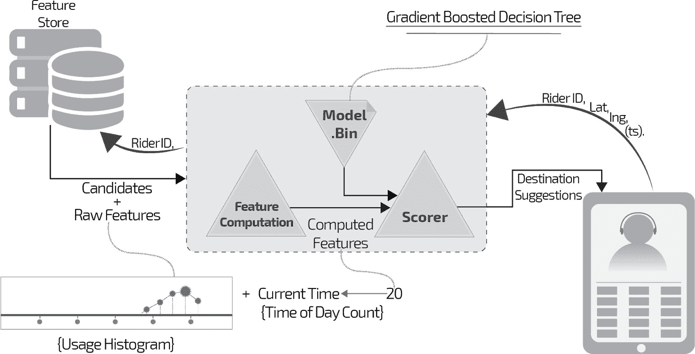

**图 3.6：** 设计 Uber 地图的流程

目的地预测过程包括五个不同的步骤：
1. 乘客预订出租车乘车。
2. 服务从存储的特征中检索乘客的详细信息，并通过提供纬度、经度和时间对其进行排名。
3. 系统服务返回前七个目的地建议，以及人们以前旅行和搜索过的地方中选定的候选地点。
4. 通过结合有关物理世界的信息和 ML，服务生成一个地点列表以及特征集，包括热门目的地的直方图，其中包含相应的请求时间和当前时间。
5. 机器学习评分器然后对这些建议的地点进行排名，并参考另一个学习如何分别加权所有组件的模型提供的反馈。

## Uber 服务架构

在市场中，一些模型描述了世界以及作用于这些模型的决策引擎。以下图表说明了 Uber 服务的架构：

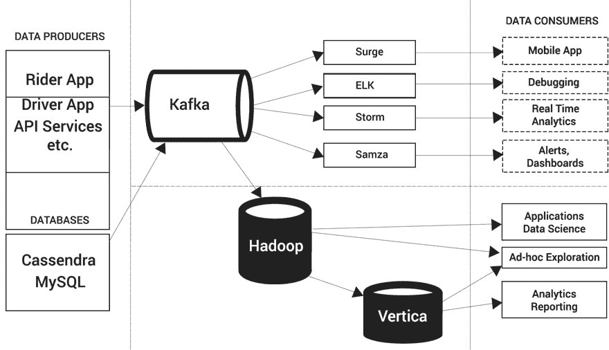

**图 3.7：** Uber 服务架构图

该架构图展示了 Uber 的工作原理。左侧主要是数据来源，即所有应用程序、服务和数据库。它们都进入一个中心组件，即 `Kafka`。从这里，许多服务通过消费者提取数据。`Surge` 提取数据进行一些公平计算。

`ELK` (`Elasticsearch`, `Logstash`, and `Kibana`) 是日志堆栈。它用于提供实时报告仪表板，用于调试、报告和审计。`Samza` 和 `Flink` 提取数据进行实时数据处理。相同的数据被发送到 `S3` 进行冷存储，可在其中保存以供归档。相同的 `Kafka` 将 `Hadoop` 作为消费者。一旦信息存储在 `Hadoop` 中，就可用于批处理、临时查询和数据探索。`Hadoop` 的数据存储库用于运行数据科学应用。

## 结论

在这次关于决策和人类推理的巡视之后，我们可以得出一些结论。首先，决策理论和 AI 仅处于相互交叉授粉的初期。决策理论完全是关于在特定或不确定的世界中利用可用选择做出最佳决策。AI 非常关注诊断以及人类知识的表示和记录。它在首次接受不确定性后仅有几年历史，实际上从未处理过决策。出于某种原因，规划过程在决策做出后才开始，因为决策的结果就是目标。确实可以忽略偏好并帮助用户从当前状态找到通往目标的正确路径，但 AI 不能在不关注不确定性的情况下执行该计划。因此，AI 和决策理论似乎主要是互补的— 诊断表示和处理记录的状态用于 AI，前瞻、不确定性和偏好用于决策理论。

## 问题

1. 解决问题的关键步骤是什么？请简要描述每个步骤。
2. 描述不同类型的知识。
3. 什么是 AI 循环？其中涉及的主要步骤是什么？请简要描述每个步骤。
4. 模型开发周期涉及哪些不同步骤？请简要描述每个步骤。

# 第 4 章

# 谷歌的智能计算策略


在本章中，我们将了解 Google Inc. 在深度学习方面的进展。本章包括公司目前提供的智能服务的成果以及 DeepMind 的最新探索，DeepMind 是 Google 的子公司，致力于在 DL 研究中取得新的突破。我们还将讨论围绕深度学习技术应用的公司商业模式。

## 结构
* Google Inc. 在深度学习探索中的策略
* DeepMind 的研究环境以及为用户提供的其他服务
* 公司目前采用的商业模式
* Google 将如何影响当前业务

## 目标
对 Google 和 DeepMind 在深度学习研究方面的当前进展的理解，以提供更好的服务。

# Google 在深度学习探索中的策略
在过去几年中，AI 和 DL 已被应用于解决数百个问题，从计算机视觉到自然语言处理。在所有情况下，DL 都击败了之前的工作。DL 在学术界广泛用于研究智能，在工业界则用于构建能够在各种任务中协助人类的智能系统。
本章的目标是分享 Google 在文本、搜索、语音和计算机视觉领域可使用的深度学习核心应用。
DL 应用的核心领域之一是处理文本——翻译、文本分析、聊天机器人以及大量其他任务。

### `Google Neural Machine Translation (GNMT)`
Google 的机器翻译可以通过将语音直接翻译成人们能够理解的语言的文本，使人们更容易与说不同语言的人交流。语音机器翻译通常首先将其转换为文本，然后将该文本翻译成目标语言。因此，任何语音识别错误都会导致转录错误，进而导致翻译错误。
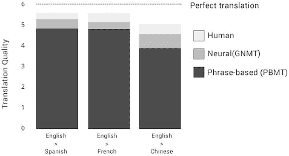
`Figure 4.1:` 人类、基于神经网络的模型和基于短语的模型的翻译质量比较
该团队使用数百小时的英语音频及其对应的西班牙语、法语和中文文本对系统进行了训练。在每种情况下，它都使用多层神经网络（松散地模仿人类大脑的计算机系统）来匹配法语口语句子与其书面翻译。

### `Chatbot`
Google 一直在向聊天机器人领域发展。Google Assistant 可以在 Allo 上的对话中直接建议电影或餐厅。Google 在最近推出名为 Chatbase 的最新工具后进一步改进。它是一种分析工具，有助于公司开发其在多个社交媒体工具（如 Facebook Messenger）中使用的聊天机器人。它帮助这些公司改进其聊天机器人；它还允许 Google 获取有关其他领域的相关信息。Chatbase 云服务的理念是提供工具以更高效地分析和优化聊天机器人。这些工具使机器人构建者能够创建有助于提高客户转化率并改善机器人准确性的功能，从而创造更好的用户体验。

### `Speech processing and generation`
Google 使用的另一个相关 DL 应用领域是语音处理。它包括语音和音乐的生成、唇部动作的识别和同步等。如今，`Automatic Speech Recognition (ASR)` 已用于日常实际应用中。语音识别的主要目标之一是允许人类通过语音与计算机进行通信，就像人类彼此互动一样。
Google 第一次尝试的语音识别驱动目录助手服务，可从任何电话使用，于 2007 年推出，名为 GOOG-441。它是一个支持语音的企业查找器，将用户的口语（城市、州、企业名称和企业地址）作为输入。根据匹配与查询的相关性，一到八个结果会使用 `text-to-speech (TTS)` 读回给用户。然后用户可以选择连接到该服务或请求发送包含企业信息的短信。
Google 当前的语音识别系统是说话者无关的，并使用深度神经网络与隐马尔可夫模型（DNN-HMM）构建。Google Speech 的强大功能有助于通用任务，例如在 `World Wide Web (WWW)` 上进行搜索请求。Google 使用云计算进行语音识别任务。

### `Google Maps for Mobile (GMM)`
2008 年 3 月，Google 为 GMM 引入了多模态语音应用。GMM 可以直接在地图上显示企业的地理位置和其他相关信息。联系信息、地址以及公司（例如评分）的任何额外元信息都可以轻松显示。此外，由于搜索体验的多模态性，所花费的总时间明显减少。最后，用户认知负担减轻。这些优势使得交互质量和信息质量得到实质性提升。

### `Google Search by Voice`
2008 年 11 月，Google 推出了可在各种智能手机上使用的 Voice Search。Voice Search 只是增加了对手机说话并提出查询的能力，而无需在浏览器中输入。音频消息发送到 Google 服务器，在那里被识别，结果发送回移动设备。数据通过数据通道而不是语音通道传输，这提供了更高质量的音频传输和更好的识别率。`Google Mobile App (GMA)` for the iPhone included a search by voice feature。GMA 语音搜索将多模态语音搜索的范式从在地图上搜索企业扩展到探索整个 WWW。

### `DeepMind WaveNet`
Google DeepMind 正在开发 WaveNet——一种可以将输入文本转换为原始音频的算法。与之前的尝试相比，它可以显示出色的结果。它是全卷积神经网络之一，其中包含各种扩张因子，使其相应的感受野随深度呈指数增长并覆盖数千个步骤。在训练时，输入序列是记录人类说话者获得的原始波形。训练后，使用数据采样来生成合成语音。在采样过程中，从网络计算出的概率分布中提取值。之后，将获得的值反馈到输入中并进行新的预测过程。

### `Lip reading from Google DeepMind`
Google DeepMind 是 Google 内部的人工智能分析部门。DeepMind 受神经科学启发，有助于在推理、想象、学习和记忆等许多领域取得进展。以视觉为例，人类能力在我们的日常生活中发挥着重要作用；它使我们能够规划和推理未来，但对计算机来说非常具有挑战性。考虑到这一点，引入了想象增强代理，它可以从环境中提取相关信息以规划未来的行动。


这些是能够自动学习的系统。它们并非预先编程，也不是手工制作的特征。Google 向算法提供广泛的原始信息，以便系统自身能够学习最优的表示，并将其用于行动、分类或预测。强化学习架构主要是一种设计方法，用于开发以智能体为起点的系统。智能体具有一个策略，支配其与环境的交互。该环境可能是一个交易环境、一个小型物理领域，也可能是一个真实世界的机器人环境。智能体表示它希望在此环境中采取行动，并以观察的形式获得对情况的反馈。此外，它利用这些观察结果来更新其行为策略或其对世界的模型。

## 音频流与唇部运动的同步
唇读是仅从视觉信息就能识别单词和短语的令人印象深刻的能力。唇读对新手来说很困难。许多聋人可以做到，但具有挑战性。人类唇读的表现相当一般。听力受损者准确率仅为 17±12%。因此，一个重要的目标是实现唇读自动化。机器唇读很困难，因为它需要从视频中提取时空特征。借助像 Google 的 DeepMind 这样的 AI，现在可以在视觉中分析唇部运动并比人类做得更好。Google 与 DeepMind 制作了一种算法，能够读取人类的唇部运动，如下图所示：

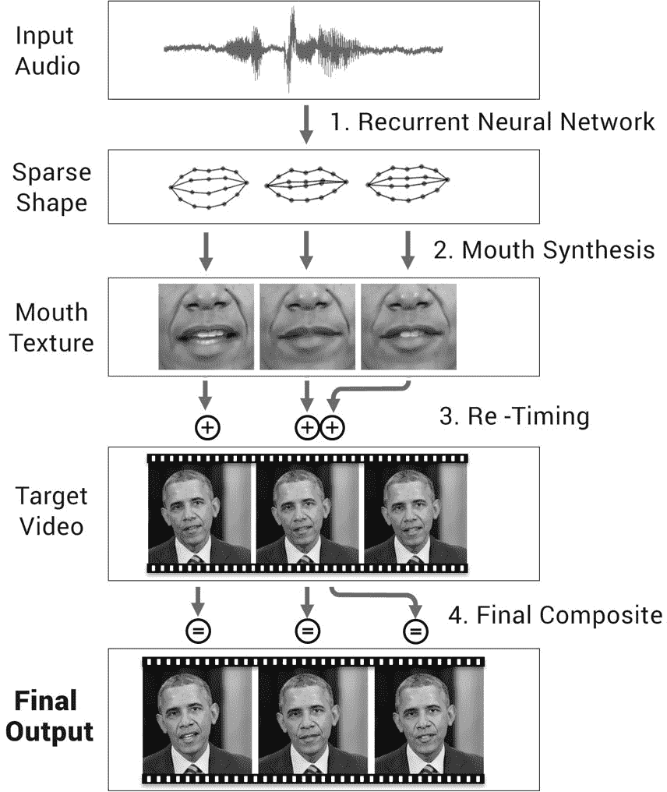

**图 4.2：** 每个步骤中数据的转换

神经网络系统首先将以音频（声音）形式输入转换为随时间变化的嘴形。基于此嘴形，会生成逼真的嘴部纹理，然后将其合成到现有目标视频和语音的嘴部区域中。

# DeepMind 研究环境及其他提供给用户的服务
AI 研究在语音识别、图像分类、基因组学到药物发现等多个领域取得了相当大的进展。在许多情况下，存在专门的系统，它们获得了大量的人类专业知识和数据。让我们概述一下各个领域的一些 AI 服务。

## 阿尔法围棋
AlphaGo 是首个实现围棋超人类表现所需的程序。它使用了两个深度神经网络——一个输出走法概率的策略网络，和一个输出位置评估的值网络。策略网络最初通过监督学习训练，以准确预测人类专家的走法，然后通过策略梯度强化学习进行改进。值网络被训练以预测策略网络与自身对弈的游戏的获胜者。

训练完成后，进一步的网络与 `Monte-Carlo Tree Search` 结合使用。这是为了提供一种前瞻搜索，使用策略网络将搜索缩小到高概率走法，并使用值网络在树中评估位置。卷积神经网络用于近似策略网络；网络结构大致如下所示，展示了一个 `Convolutional Neural Network (CNN)` 的示例：

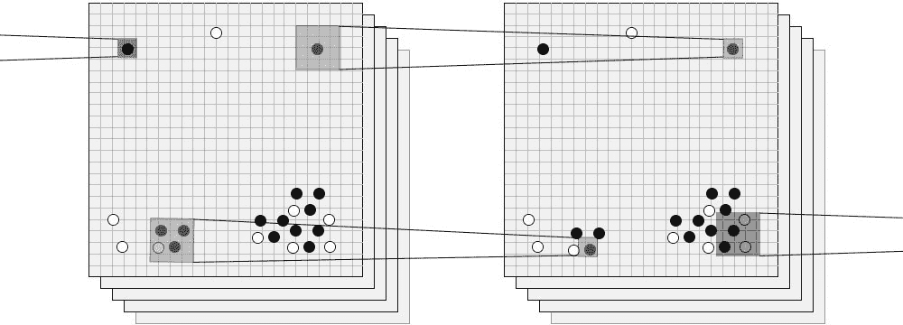

**图 4.3：** `ANN` 的网络结构

以下要点简要分层介绍了该网络：

### Input
19 x 19 x 48 向量，表示特定走法的状态。

### Hidden layers
各种窗口大小的卷积层。

### Output
大小为 19 x 19 x 2 的 `softmax` 层。前 19 x 19 表示黑棋可能的走法，另一个 19 x 19 输出用于白棋。

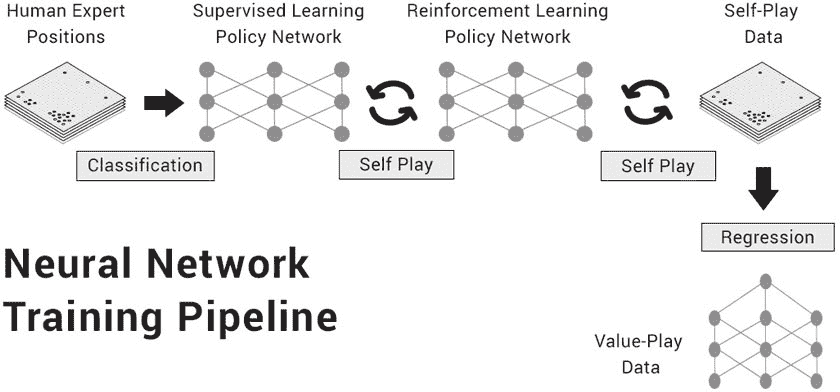

**图 4.4：** 神经网络的训练流程

### Supervised learning of policy networks
策略网络的监督学习（`SL`）是一个 13 层的 `CNN`，在 3000 万步人类专家走法上训练。监督学习策略网络达到了 57.0% 的准确率。此外，在 800 万步语料上训练 rollout 策略达到了 24.2% 的效率。

### Reinforcement learning of policy networks
虽然 `SL` 策略网络在预测下一个最可能的走法方面表现出色，但 `RL` 有助于预测最佳的（获胜）走法。强化学习策略旨在通过自我对弈改进 `SL` 策略。强化学习策略网络具有相同的架构。在此阶段，`AlphaGo` 与自己随机选择的先前迭代进行了 120 万局对弈。该策略的目标是将其调整为赢得游戏的真正目的，而非最大化预测准确性。与 `SL` 策略相比，强化学习可以赢得超过 80% 的游戏。

下图显示了值网络与策略网络之间的比较：

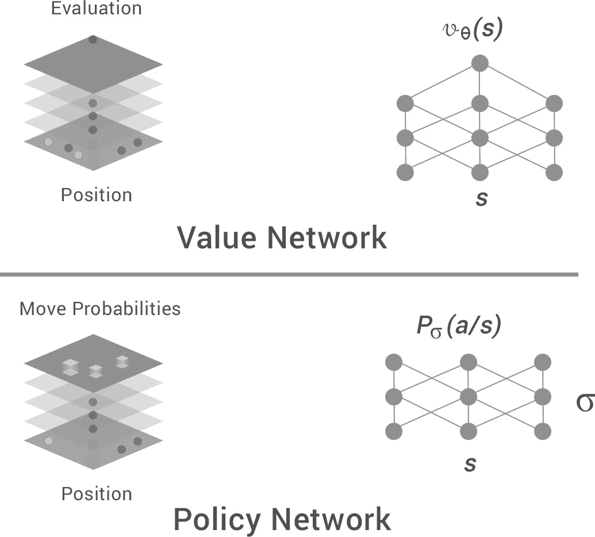

**图 4.5：** 基于值的网络与策略网络的比较

### Reinforcement learning of value network
值网络试图预测，对于给定位置，哪位玩家占优势。这里只是一个使用最小二乘回归方法训练的 `CNN`。在自我对弈期间，数据来自棋盘位置和结果。策略和值网络搜索 `AlphaGo` 并在蒙特卡洛搜索树中使用策略和值网络的组合。下图说明了四个阶段：

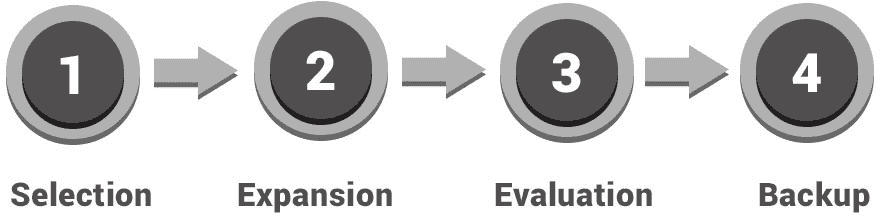

**图 4.6：** 选择、扩展、评估和备份的流程

游戏树在由四个阶段组成的模拟中被搜索：

### Selection
模拟通过选择具有最大动作值 `Q` 的边来遍历树。

### Expansion
如果任何节点被扩展，它将被 `SL` 策略网络处理一次，以获得每个合法动作的先验概率。

### Evaluation
每个节点由值网络和 `FRpolicy` 评估。

### Backup
评估步骤中收集的值会更新动作值 `Q`。

当分配给游戏智能体的时间结束时，它会根据最高的动作值 `Q` 选择最佳走法。

## 自动驾驶汽车
自动驾驶汽车也被称为无人驾驶汽车、自主汽车或机器人汽车。自动驾驶车辆已经开发出来并允许上路。目前，汽车是半自动化的，在某些情况下需要人工控制。

这是 Google 为测试其自动驾驶汽车项目的下一阶段而建造的第一辆无人驾驶电动汽车。它看起来像 Smart 汽车和 Nissan Micra，有两个座位，足够放置少量行李的空间。

自动驾驶汽车使用各种技术运行，包括 GPS、激光光、雷达、计算机视觉等。许多公司正在投资自动驾驶汽车，因为它有一天可能会主导市场。研究领域存在许多挑战；然而，业内最好的研究人员参与其中。围绕自动驾驶汽车的公平使用存在法律框架。自动驾驶车辆的安全问题也已被提出。

汽车可以在没有任何用户交互的情况下将两个人从一个地方运送到另一个地方。智能手机会在用户确切位置通知车辆接送，目的地已设定。没有手动控制或方向盘。它仅有一个启动按钮和一个红色的紧急停止按钮。在乘客面前，有一个显示当前速度、天气等信息的屏幕。

旅程结束后，小屏幕会显示一条消息，提醒用户带走个人物品。让我们来了解一下汽车的硬件规格：


# 组件概述

### 雷达
传统的雷达用于检测车辆行驶路径中超过 100 米外的危险物体。系统在车内盲点感应到物体时会触发警报。雷达在五毫秒内在 10 至 11 GHz 之间啁啾，从中央位置的天线锥体发射雷达信号。两个接收锥体相距约 14 英寸，接收反射的雷达能量。

### 光学
安装在后视镜附近的摄像头构建前方道路的实时 3D 图像，可以发现行人、动物等危险。它还用于识别交通信号和道路标记。

### 激光雷达 (Light Detection and Ranging (LIDAR))
LIDAR 是自动驾驶汽车中必不可少的设备，放置在汽车车顶。它由发射器、接收器和反射镜组成。发射器发送一束激光，该激光束反射到随圆柱形外罩以每分钟十转的速度旋转的反射镜上。反射物体后，激光束返回反射镜并被反射回接收器，在那里可以将其解释为数据。车辆随后可以生成周围环境的地图并使用该地图避开物体。

### 全球定位系统 (GPS)
GPS 将汽车保持在预期路线上，精度为 30 厘米。GPS 覆盖车辆的宏观位置；车载摄像头可以识别更细微的细节，如红灯、停车标志和施工区。

### 处理器
需要配置为七个双核、2.13 GHz 和 2 GB RAM 的处理器来处理汽车仪器收集的数据。一些车辆可运行多达 17 个处理器以分担计算负载。

### 车轮速度传感器
车轮速度传感器测量道路上车轮的速度和旋转方向。这些传感器为不同的汽车系统提供输入，包括防抱死制动系统和电子稳定控制。

# 自动驾驶汽车的工作原理
自动驾驶汽车由电动马达驱动，续航里程约为 100 英里。它使用软件以及传感器组合，结合高精度数字地图在现实世界中定位自身。在大多数汽车中，GPS 用作卫星导航系统来大致确定车辆位置，之后激光、雷达和摄像头接管，以监控汽车周围 360 度的视野。下图显示了自动驾驶汽车不同部件之间的流程：

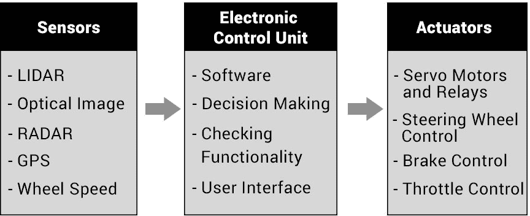

**图 4.7：** 自动驾驶汽车不同部件之间的流程

软件可以快速识别物体、汽车、行人、道路标志和交通灯，使汽车遵守交通规则并避免包括骑自行车者在内的多种不可预测的危险。例如，Google 自动驾驶汽车可以成功识别骑自行车者并理解，如果骑自行车者伸出手臂，则预计会进行变道。车辆随后知道减速并为骑自行车者提供足够的空间以安全操作。它甚至可以检测道路施工并安全地绕行。

软件可以识别交通标志并使用 Google Maps 和 GPS 将其存储在标准数据库中。GPS 软件组件记录该区域的标志和行驶方向。在该区域运营并使用此软件的每辆车都会注册检测到的新标志，并修改对其他用户的置信度和识别度。

另一个软件组件可以识别车道之间的分隔线。它使用三台摄像头进行精确计算，并利用概率来判断汽车在道路上的位置。根据位置，在没有交通标志的情况下，用户可以为接下来的几秒钟提出新的行驶方向。

此外，软件使用 AI 从网络摄像头图像中检测其他汽车的指纹。

# Google Play
Google 推出了 Instant Apps 和 Google Play Protect，为开发者提供了一种无需安装即可向用户提供应用程序的方式。用户只需点击搜索结果页上的链接，即可加载即时应用。今天，公司正将此计划扩展到游戏领域。

该应用程序的功能在所有 Android 设备上默认启用，表明它旨在成为实时恶意软件扫描器，会扫描已安装或即将安装的每个应用程序，并在出现可疑活动时向用户提供信息。

# DeepMind HealthStream 应用
Stream 是一款安全移动电话应用程序，旨在解决患者在无法及时获得必要治疗时遇到的问题。成千上万的人因败血症和急性肾损伤等可预防疾病而最终住院，因为他们没有及时获得医疗救助。

Google 构建了 Streams 以帮助医生解决这个问题。该应用程序将基本医疗信息，如患者的血液检测结果，集中在一个地方。如果发现有人生病，Streams 可以向合适的临床医生发送安全且紧急的智能手机警报，以为患者提供必要的帮助，同时提供其既往病史信息，以便他们据此做出即时诊断。

Streams 还可以让临床医生即时查看患者的生命体征，如血压、心率，并帮助直接将这些观察记录到应用程序中。为了实现这一切，Streams 整合了来自医院使用的各种现有 IT 系统的多种类型数据，如实验室数据、医疗数据、文本数据和检测结果。

# 无地图的 AI 导航
在当今数字互联的世界中，用户完全依赖 Google Maps 和其他 GPS 元素来引导他们到达目的地。如果我们熟悉一条路线或一个地方，我们会利用记忆和视觉线索到达目的地。但如果没有 GPS，而且是一个完全陌生的地方怎么办？

Google 的 DeepMind 研究团队构建了一个交互式导航平台，利用来自 Google Street View 的第一人称视角图片来训练其 AI 模型。团队开发了一个深度神经网络人工代理，利用其从 Street View 图像中收集的视觉信息，持续学习在不同城市中导航。一旦它熟悉了几个城市，就能够非常快速地适应新城市。请注意，在街景中，人脸、图像和车牌都被模糊处理，无法识别，从而确保了人们的隐私。

他们构建了一个神经网络代理，该代理以从环境中观察到的图像作为输入，并预测在该环境中可以采取的下一步行动。他们使用深度强化学习训练了一个端到端模型。

代理内部的神经网络由三部分组成：

### 卷积网络
它可以处理图像并提取视觉特征。

### 特定区域的循环神经网络数据
这涉及记忆环境以及学习代理当前位置和目标位置的表示。

### 区域不变的循环网络数据
它旨在可互换且对代理导航的每个城市都是唯一的。

# Deep Q-Network (DQN)
DeepMind 于 2013 年推出了 **深度 Q 网络 (DQN)** 算法。DeepMind 创建了一个系统，该系统通过仅基于屏幕图像和奖励信号选择操作来学习玩视频游戏。


监督学习不适合解释高维传感器数据。这是因为机器可能需要在没有监督者告知可能输入-输出函数输出的情况下进行学习。因此，引入强化学习来确定当前状态下的行动，以最大化累积未来奖励。在训练之前，程序对游戏一无所知。它看不到游戏的目标，对其对游戏的影响也没有理解，甚至无法查看游戏中的物体。通过试错方法，系统逐渐学会行为以获得奖励。系统对不同的游戏使用相同的架构，除了游戏中可能的操作外，程序员不会提供任何与游戏相关的提示，例如 `up`、`down`、`left`、`right`、`space`（开火）等等。

`Q-Learning` 是一种用于马尔可夫链过程的无模型最优选择策略的强化学习算法。但它是一种经典方法，存在一个局限性。该局限性在于可能的状态数量必须从无限减少到离散状态。因此，构建了一种结合 `Q-Learning` 和深度神经网络的技术。该技术被称为 `DQN`。它可以轻松处理连续输入，因此无需离散数据。

将普通 `Q-Network` 转变为 `DQN` 网络所做的改进如下：
* 从单层网络转向多层卷积神经网络。
* 实现经验回放，使网络能够利用存储的记忆自行训练。
* 使用第二个目标网络来计算目标 Q 值。

# DQN 的工作原理

`Bellman equation` 用于训练 `DQN` 网络。因此，`gradient descent` 和 `alpha` 作为损失从方程中被约简。该得到的方程被设为目标以计算损失函数。模型预测 Q 值之间的 `Mean Squared Error (MSR)`。

接下来，我们需要训练神经网络。准备模型时使用两次前向传播和一次反向传播。在前向传播的情况下，状态作为输入。输出获得突出显示每个行动计划质量值的 `1XN` 矩阵。

首先，状态传递给神经网络以确定每个行动的质量估计。使用 `Q-table` 选择质量最高的行动并执行相应的工作。观察后，下一个状态传递给神经网络。对于目标值的计算，遵循输出中最显著的 Q 值，并使用修改后的 `Bellman equation`。之后，在第一次前向传播之间计算 `MSE`；它以它们为目标并最终通过神经网络向后传播。

以下图表说明了 DQN 的架构：

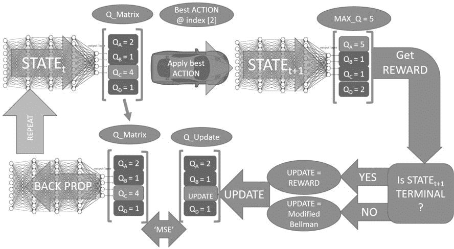

**图 4.8：** DQN 网络架构

`DQN` 网络通过四种技术来克服学习。这四种技术是 `experience replay`、`target network`、`clipping rewards` 和 `skipping frames`，解释如下：
* **Experience replay:** 这是一种存储先前经验的技术，例如状态、转换、奖励和动作，这些对执行 Q 学习和构建小批量以更新神经网络非常重要。
* **Target network:** 由于引入了 `TD error` 计算，目标函数会随着深度神经网络不断变化。因此，使用目标网络技术来固定目标函数的参数，并在每千步后用最新网络更新函数。
* **Clipping rewards:** 这是 `DQN` 技术之一，用于裁剪相应游戏的分数，使所有正奖励设为 +1，所有负奖励设为 -1。
* **Skipping frames:** 为了降低 `ALE` 的计算成本并收集更好的经验，强烈推荐帧跳过技术。`DQN` 的这种技术用于每四帧计算一次 Q 值，并将过去四帧用作神经网络的输入。

# Google 目前采用的商业模式

商业模式用于弥合战略（公司的目标、定位和目标）与业务流程（战略信息的理解和实施）之间的差距。

Google 的商业模式画布解释了商业模式的不同方面，例如客户细分、价值主张、渠道、客户关系、收入来源、关键活动、成本结构、关键合作伙伴和关键资源。

如果将 Google 商业模式划分为以下关键领域，可以更好地识别：
* **Infrastructure**
  * **Key activities:** 关键活动包括为开发新技术以及改进现有技术而进行的研究和开发。此外，还花费大量时间维护和管理 IT 基础设施、产品和服务。还开展了营销、战略和联盟工作。
  * **Key partners:** Google 的关键合作伙伴包括分销商、供应商、原始设备制造商和开放手持设备联盟。
  * **Key resources:** Google 的关键资源包括数据中心、服务器、知识产权、人力支持和其他 IT 基础设施。其他资源包括许可证、专利和专有材料。
* **Offering**
  * **Value proposition:** 价值主张由 Google 的产品组成；公司在互联网搜索、广告、操作系统、平台和企业方面为客户创造价值。
* **Customers**
  * **Customer segment:** Google 客户分为三个类别，分别是：
    * 使用 Google 产品和服务以便捷方式组织信息的用户。
    * 拥有以成本有效的方式向客户展示在线和离线广告的广告商。
    * 使用 `AdSense` 服务的内容提供商。
  * **Customer relationships:** 建立客户关系的渠道包括销售和支持服务，以及为大型客户配备的专职团队成员。
  * **Channels:** 用于触达客户的渠道包括 Google 合作网站、`google.com` 和 Google `AdWords`。渠道还用于触达广告商和网络成员，包括销售和支持团队。
* **Finances**
  * **Cost structure:** Google 的成本结构包括 IT 基础设施、研发成本、人力和营销成本。
  * **Revenue streams:** 公司的主要收入来源包括其广告驱动的搜索引擎。

# Google 商业模式画布

Google 商业模式画布解释了客户细分、价值主张、渠道、客户关系、收入来源、关键资源、关键活动、合作伙伴网络和成本结构等各个方面，如下图所示：

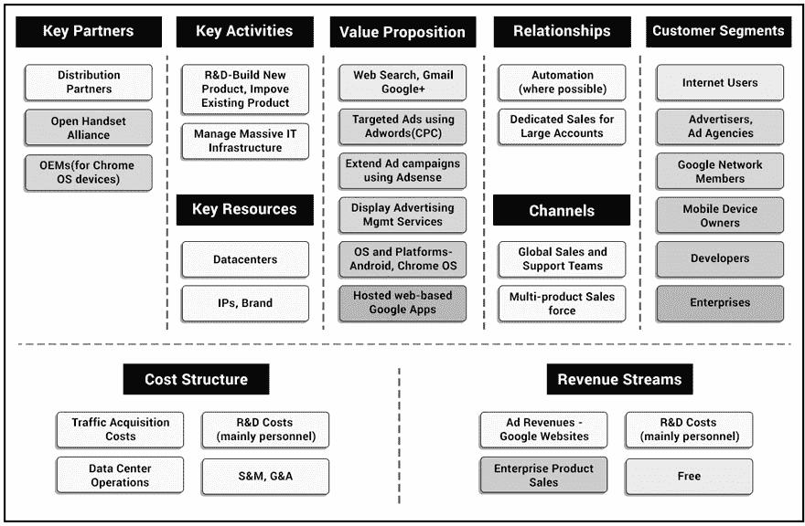

**图 4.9：** Google 商业模式画布

让我们通过逐一探讨所有要点来讨论前述图表：
* **Key partners:** 由于 Google 拥有多边业务平台；它建立关键合作伙伴以吸引新客户。它还利用这些关键合作关系通过提供新服务来留住老客户。如果不保持这些关键合作伙伴，Google 的收入将大幅下降。Google 的 97% 收入来自广告。
* **Key activities:** 为了成功运营，Google 有三个主要活动，使其能够产生收入并帮助提高其客户产品价值。
  * 构建和维护搜索基础设施。
  * 管理三个主要服务。(`AdWords`, `AdSense`, and `Google.com`)。


* 向新用户、内容所有者和广告商推广平台。

## 网络/平台
Google 不断创新新服务并改造其当前的搜索引擎平台，使其更好、更快。

## 问题解决
为客户提供任何服务都需要解决问题。每个使用 Google 服务的用户可能对该服务有不同的理解，并且会出现各种新问题。Google 拥有技术和人力资源，能够在严重问题失控之前将其消除。

## 关键资源
重要资源是每个商业模式的基本要求。凭借 Google 的核心资源，他们可以为客户提供价值主张。

### 有形资源
Google 拥有的关键有形资源包括在 40 多个国家设有 85 个办公室。其位于加州的总部被称为 Googleplex，为员工提供丰厚的福利。在这些办公室中，用于驱动其网站的技术设备至关重要。

### 知识产权
Google 最突出的重要资源是其知识产权，其中包括设计专利、硬件专利、医疗患者、多数据库索引、建模和映射专利、电子邮件和消息传递专利。它还包括无线电专利、事件建模专利、社交网络、搜索索引专利、重复内容专利、广告专利、投票专利、图像和视频专利、游戏专利等许多其他专利。

## 价值主张
Google 开发了一个非常用户友好的平台，能够在人与知识之间建立联系，从而提高用户体验效率。这种能力成功吸引了来自不同领域的客户，他们愿意使用 Google 的免费服务，同时也有助于为企业营造广告环境。这可以为终端用户和企业带来优势。

### Google 新闻
Google 新闻使用户能够以清晰、有条理的方式并按主题分类，了解全球各地发生的各种事件。

### Google 搜索
Google 提供了使用最新技术的高精度、高准确度的最先进搜索技术的能力。

### Google 财经
Google 财经的主要功能是帮助跟踪特定投资组合的管理和投资，获取股票知识，并收集与交易市场相关的所有最新新闻和信息。

### Picasa
Picasa 是 Google 下的一个平台，用于与家人和朋友分享视频和照片。

### Google Talk
Google Talk 让你与朋友和家人通话。此工具非常有优势，因为它也连接到 Gmail（Google Mail）。

### Google 邮件
Google Mail 是一种被认为非常安全的电子邮件账户服务。用户在订阅 Google 时会被分配一个电子邮件地址，可用于与联系人保持联系。另一个优势是它提供了上传文件和文档的能力，由在线云设备存储提供支持。

### Google Sites
Google Sites 提供了使用多种模板创建免费网站的能力，被认为是一个用户友好的平台，可以自定义各个部分。很容易添加照片、服务和视频以集成到网站中，这可以通过广告服务帮助产生收入。

### 广告价值
Google 通过使用各种服务为互联网上与企业相关的不同领域提供不同的激励和利益。

### YouTube
2006 年，YouTube 被 Google 收购，如今它是视频浏览使用最广泛的平台。YouTube 彻底改变了在线视频浏览领域。每个人都可以发布视频并通过 YouTube 的广告功能赚钱。

### AdWords
此功能提供了通过 Google 内容网络进行广告宣传的能力。这些广告会与搜索结果一起显示，也会在用户输入搜索查询或浏览视频时在 YouTube 上显示。

## 客户关系
公司应明确客户以及希望与客户细分建立的关系类型。人与自动化之间的关系可能有所不同。以下动机可以推动客户关系：
* 客户保留
* 客户获取

Google 与客户和广告商保持着密切的关系。他们创建了一个虚拟用户社区，用户可以在其中互动和交换信息或服务。Google 创建用户账户，为他们提供电子邮件、社交平台、组织日历等诸多好处。

建立客户关系的渠道可以包括销售和支持服务，以及为大型客户设立的专门团队。

## 销售与支持
Google 认为强大的销售和支持基础设施对其成功至关重要。他们通过直接、远程和在线销售渠道等多种方式与广告界建立关系。技术和自动化可能被用于提升整体客户体验、易用性和成本效益。

## Google 账户
在 Google 上创建用户账户是免费的，并且对终端用户有很多优势。随 Google 账户提供的产品可免费使用，例如 Gmail、Google Maps、IGoogle、Google Chrome 和 Google Sites。使用这些免费工具使用户能够与 Google 建立关系。

## 全球支持组织
在此，Google 将其全部精力投入到帮助 Google 网络成员和广告商从他们处理的任务和工作中获益。

## 渠道
在全球范围内，Google 网络覆盖了约 80% 的互联网用户。Google 遍及整个行业，从大型知名公司到根据市场变化进行适应的小型网站。

## 客户细分
它定义了希望接触和服务的个人或组织群体。客户是任何商业模式的核心。没有客户，没有公司能长期生存。为了满足客户，公司可能会根据日常需求、行为或其他传统属性将其分为不同的细分市场。商业模式可能定义多个大大小小的客户细分市场。组织需要决定要服务的部分和要忽略的部分。做出决定后，商业模式可以根据对特定客户需求的深入了解进行设计。

Google 的主要客户是能够使用 Google 产品和服务以有用方式组织信息的用户，以及拥有以成本效益方式向客户和 Google 网络成员展示在线和离线广告的方法的广告商。

## 成本结构
Google 的主要成本包括流量获取成本、IT 基础设施、数据中心运营、人员、研发成本、销售和营销成本。

## 收入来源
Google 的大量收入仅来自网站广告。AdSense、AdWords、Google Mobile 等创新以及客户与 Google 的关系也做出了贡献。YouTube 使 Google 成为一个极其成功的广告平台。

# Google 将如何影响当前企业？


Google 以产品和服务的形式提供了不同的工具，从根本上改变了商业世界。Google 提供了许多服务，例如 Google 搜索（快速通信、追踪并实时捕获位置）、机器人技术、Google 汽车、人工智能、智能消息、实时天气信息等。（有关 Google 产品的一些示例，请参阅下图）。这些服务和产品是会影响当前企业的要素。这些要素不仅为现代创新提供了新的方向，还加剧了市场竞争，这将推动其他公司表现更好：

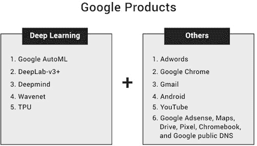

**图 4.10：** Google DL 及其他产品

## Google AutoML

Google 的 `AutoML Vision` 是一款新服务，可帮助机器学习专业知识有限的开发者构建自定义图像识别模型。Human-machine learning experts to perform the following tasks:
* 数据的预处理和清洗。
* 选择和构建合适的特征。
* 选择合适的模型族。
* 模型超参数的优化。
* 机器学习模型的后处理。
* 分析获得的结果。

`AutoML` 的最初想法是让任何人都可以虚拟地提供他们的图像，上传后，Google 的系统会自动为他们创建自定义机器学习模型。整个过程，从导入数据到标记和训练模型，都通过拖放界面完成。

使用 `AutoML`，模型的准确性提高，并且周转时间更快：
* **准确性提高：** Cloud `AutoML Vision` 建立在包括机器学习和神经架构技术在内的图像识别方法之上。这意味着 `AutoML` 有助于获得更准确的模型。
* **周转时间更快：** 使用 Cloud `AutoML`，开发者可以在几分钟内创建模型以实现 AI 赋能应用，或能在很短时间内构建生产就绪的模型。
* **易于使用：** `AutoML Vision` 提供简单的图形用户界面，可帮助指定数据并将数据转化为根据特定需求定制的优质模型。

## DeepLab-v3+

`DeepLab-v3+` 是 Google 的开源语义图像分割模型。它是一种深度学习模型，用于语义图像分割，为输入图像中的每个像素分配语义标签（例如，猫、狗、人等）。

下图是 `DeepLab-v3+` 流程图的示意图：

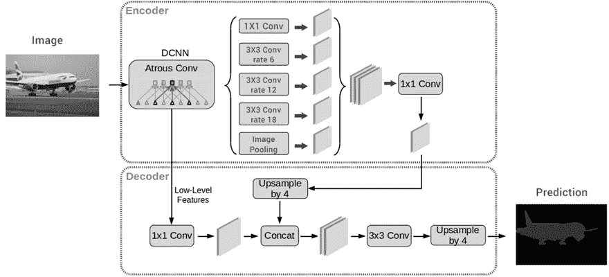

**图 4.11：** `DeepLab-v3+` 的流程图

`DeepLab-v3+` 使用 `TensorFlow` 实现，其模型建立在卷积神经网络骨干架构之上，旨在用于服务器端部署以获得最准确的结果。它是 `DeepLab-v3` 模型的扩展。`DeepLab-v3` 模型由卷积层组成，用于通过深度学习神经网络在任意分辨率下提取特征。

扩张卷积层是一种工具，用于显式控制深度学习模型计算的特征并捕获多尺度信息；它调整滤波器的视野。它还概括了标准卷积操作。

为了开发 `DeepLab-v3+` 模型，在 `DeepLab-v3` 模型中添加了一个简单且活跃的解码器模块。它用于细化对象边界处的分割结果。深度可分离卷积也同时应用于扩张空间金字塔池化和解码器模块。它有助于提高语义分割的编码器-解码器模块的速度和准确性。

为了改善对象边界，形态学膨胀被应用于验证集上对象边界周围的空标注标签。之后，计算与空标签膨胀带相关联的像素的平均 IOU。使用较窄的膨胀带时观察到更显著的改进。

`DeepLab-v3+` 改进了 `Xception` 模型。已做出以下改进：
* 增加了层数。
* 所有最大池化层都被带步幅的深度可分离卷积取代。
* 在每个 `3X3` 深度可分离卷积之后添加了额外的批归一化和 `ReLU` 激活函数。

`DeepLab-v3+` 能正确识别图片中前景中的主体。这样，景深和模糊效果兼容且完全不人工。它还改进了使用语义标记像素的方法。它也可以用于实时移动视频的分割。

## DeepMind

`DeepMind` 构建能够自动学习的系统。模型不是预先编程的，特征也不是手工制作的。系统提供大量原始数据集，以便操作可以从最佳表示中学习。这样，系统能够在广泛的任务中运行。

使用强化学习架构来开发系统。生成的智能体与某些环境交互。智能体在给定情况下采取行动，并以观察的形式从环境中接收反馈，并进一步利用这些观察来更新模型的行为。

在医疗领域，`DeepMind` 可以帮助临床医生进行更准确的分析，最终患者可以更快地得到治疗。即时的潜在分析有助于医生为患者提供更好、更快、更安全的护理。患者数据的安全是首要任务。患者数据仍完全受医院的控制和指导。所有信息都以最高标准安全存储并加密。

## WaveNet

Google `DeepMind` 正在开发 `WaveNet` —— 一种可以将输入文本转换为原始音频的算法。与之前的尝试相比，它可以显示出色的结果。

它是全卷积神经网络之一，包含各种扩张因子，使其相应的感受野随深度呈指数增长并覆盖数千步。

在训练时，输入序列是记录人类说话者获得的原始波形。训练后，使用数据采样来生成合成语音。在采样过程中，从网络计算出的概率分布中提取值。之后，得到的值反馈到输入中并进行新的预测过程。下图说明了不同的层：

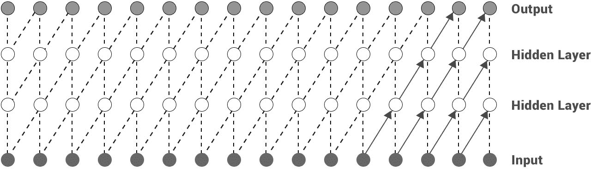

**图 4.12：** 不同层的表示

Google 还与 `DeepMind` 合作制作了一种算法，能够读取人类的唇部动作。

## Tensor Processing Unit (TPU)

Google 制造了一种专门用于加速机器学习应用的芯片，即 `Tensor Processing Unit (TPU)`。它支持机器学习算法的训练以及对现有模型结果的处理。Cloud `TPUs` 是为加速和扩展使用 `TensorFlow` 编程的机器学习工作负载而设计的硬件。每颗芯片可提供 180 teraflops 的处理能力。Google 还能够将芯片联网成称为 `TPU Pods` 的集合，以实现更高的计算增益。

这些新芯片对企业有帮助，他们可以通过 Google 的云平台使用它们。此外，该公司还推出了一项新的 `TensorFlow Research Cloud`，为研究人员提供免费访问该硬件。


TensorFlow 1.2 包含新的高级 API，使将构建在 CPU 和 GPU 上运行的系统更易于在 TPU 上运行变得更加容易。有时，在共享计算机集群上，需要等待作业调度。尽管如此，有了 TPU，用户可以通过用户可以控制和定制的 Google Compute Engine 虚拟机，以交互式和独占的方式访问网络连接的 Cloud TPU。

在线零售商正在探索可降低生产成本并延长其他小工具电池寿命的闪烁芯片。

在交通运输领域，Cloud TPU 通过整合车队车辆的导航相关数据以及研究社区最新的算法进展来帮助快速移动。

## 结论
随着深度学习，Google 为当前数据科学时代的人工智能提供了另一片天空。针对 DL 相关挑战，他们不仅改进软件部分，还着手于技术实现中涉及的硬件部分。无论是通过引入 TensorFlow 为深度学习提供特殊框架，还是通过开发 TPU 为深度学习提供完全专用的硬件支持，Google 都在利用深度学习很好地处理 AI。

## 问题
1. 简要讨论 Google 在深度学习探索策略下的一些应用。
2. 简要讨论自动驾驶汽车的工作原理。
3. 简要讨论 DQN 的工作原理。
4. 描述公司目前采用的商业模式。

# 第 5 章
# IBM Watson 中的认知学习服务
本章讨论计算机认知学习的历程以及 IBM 如何在构建 Watson 中利用认知学习的能力。它是一种智能的 **自然语言处理 (NLP)** 服务，用于封装在开发应用程序时人工智能的复杂性。

### 结构
* NLP 中的认知学习
* IBM Watson
* 使用 IBM Watson 改进服务
* IBM Watson 对业务的影响

### 目标
* 阐述并定义使用应用程序在 NLP 中使用认知学习。
* IBM Watson 如何工作以及如何使用该技术？
* 阐明自然语言处理中的新潜力，即聊天机器人等。

### NLP 中的认知学习
**自然语言处理 (NLP)** 是任何聊天机器人的主要需求。如果聊天机器人要完全自动化，它需要使用 NLP 和认知计算。让我们讨论这些技术。

### 认知计算
认知计算是一种自学习系统，使用机器学习技术智能地执行特定的人类相关任务。该技术有助于创建能够在没有人工协助的情况下解决问题的自动化 IT 模型。

结果是认知计算，它是计算机科学和认知科学的结合。认知计算模型提供了实现 AI 的路线图。让我们在下图中查看认知计算的流程：

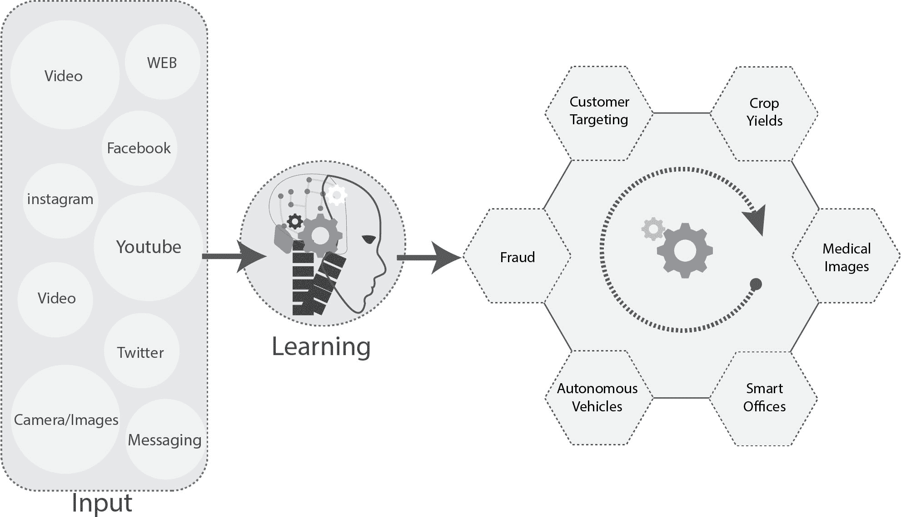

**图 5.1：** 认知计算下的流程

认知计算是人类与计算机的协作，以放大人类推理和洞察力。为了提取有用数据，认知计算系统必须能够学习、迭代、适应、与人互动、对他们做出响应，并在正确的上下文中理解信息。

这些能力使计算机能够理解人类提出的问题，建议答案，并根据人类响应和输入完善这些答案。以下图表说明了认知计算中使用的神经网络架构：

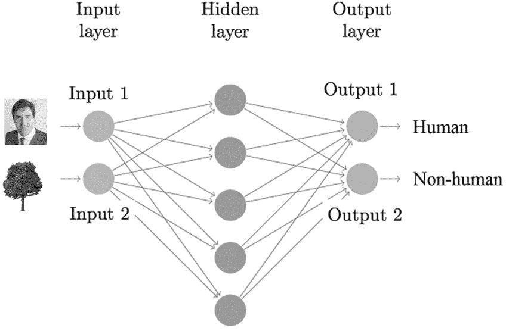

**图 5.2：** 认知计算中使用的神经网络架构

随着世界更多地转向数字化，大数据增长正在加速。数据在体量、速度、种类和不确定性方面都在增加。此外，大多数数据以视频、图像和自然语言等非结构化形式出现。

为此，企业需要一种新的计算模型来处理数据并从中提取有用信息，同时增强人类的专业知识。

与其为每个问题编程寻找解决方案，认知计算系统可以使用能够感知、预测、推理和思考的 AI 和 ML 算法进行训练。

### 认知系统所需的功能
认知计算系统应具有以下功能：

* **交互式：** 认知系统应能轻松与用户互动，以便用户能够舒适地定义其需求。它还应与其他设备（如处理器和云服务）进行通信。
* **上下文相关：** 它应具有理解、识别和提取上下文元素（如语法、含义时间、位置、领域、法规、用户资料、任务、流程和目标）的能力。它必须在多个信息源上工作，包括结构化和非结构化数据。
* **迭代且有状态：** 此功能涉及数据质量和验证方法，以确保系统提供足够的信息，并且其操作的数据源提供可靠且最新的输入。
* **自适应：** 系统必须具有适应任何环境的能力。它需要在数据收集方面具有动态性，并对目标和需求敏感。

### 认知系统的演进
认知计算代表了计算的第三个时代。19 世纪 *查尔斯·巴贝奇*（计算机之父） 引入了用于导航计算的可编程处理器方法。该系统旨在求解多项式函数。下图显示了认知系统的演进：

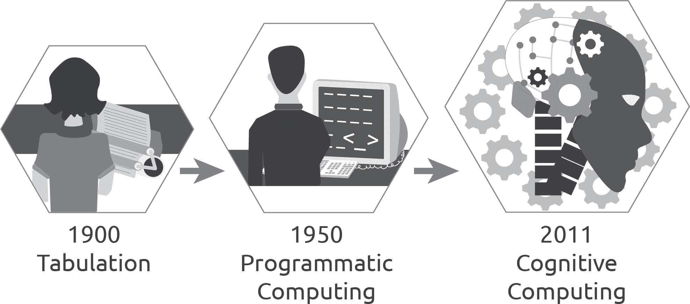

**图 5.3：** 不同时代认知计算的演进。

第二个时代（1950 年）代表了现代计算和可编程系统时代的数字编程计算机，如 ENIAC。今天，认知计算在深度学习和大数据分析算法上工作，以提供深刻的洞察。

神经网络是认知系统的核心，是深度学习背后的主要概念。神经网络是硬件和软件的组合系统，模仿人类的中枢神经系统，以估计依赖于大量未知输入的函数。

### 认知计算的特征
认知计算可以捕获和连接大数据，以便在不断学习的同时从提取的信息中创造价值，因为它具有固有的适应和变化能力。以下图表展示了导致大数据战略处理的显著特征：

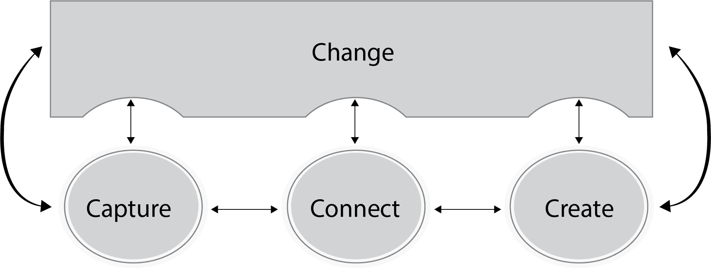

**图 5.4：** 认知计算的特征及其之间的关系

让我们讨论认知计算的特征及其关系：

* **捕获：** 认知计算可以在一次搜索中捕获大量数据并存储它，以便数据可用于分析。它能够自捕获多结构化数据。这意味着认知系统可以捕获的不仅仅是表中包含的数据；它可以捕获放射学研究、目录等各种图像并将其保存到数据库中。
  
  此外，它可以标记这些多结构化数据以便编目并在以后使用。它的另一个属性是认知计算可以感知数据是否有任何更新，并且可以捕获这些更新。
* **连接：** 认知计算的一个基本特征是连接多源数据以找到新信息，然后以易于理解的方式呈现这些信息。


* **创建：** 认知计算可以创建新的知识、产品或服务。通过认知计算，新的解决方案以概率的方式被发现并呈现。

传统计算机应用程序需要新的程序来处理变化。编写新程序需要大量时间和成本。有了认知计算，变化会自主发生，因为系统会通过算法持续学习。

因此，与编写新程序相关的耗时且昂贵的更新被避免了。认知计算在处理变化时需要较少的人类帮助。此外，随着认知系统自主演进，它们比传统编程系统更高效地保持数据最新。

# 人工智能与认知计算的区别

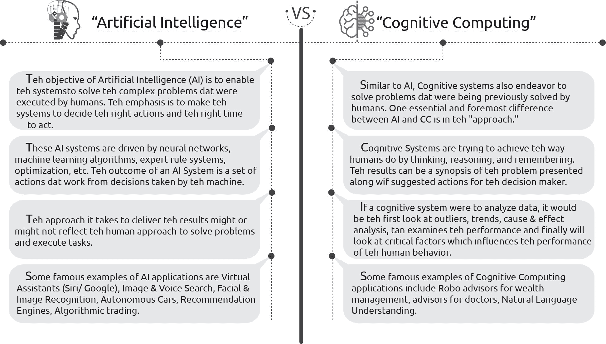

**图 5.5：** 人工智能与认知计算的区别

让我们看看它们之间的详细区别：

### 人工智能（AI）
人工智能的目标是使系统能够解决人类执行的复杂问题。重点是使系统决定正确的行动以及行动的正确时机。这些人工智能系统由神经网络、机器学习算法、专家规则系统、优化等驱动。人工智能系统的结果是一组基于机器所做决策而产生的工作行动。其交付结果的方法可能反映也可能不反映人类解决问题和执行任务的方法。一些著名的人工智能应用示例包括虚拟助手（Siri/ Google）、图像和语音搜索工具、人脸和图像识别工具、自动驾驶汽车、推荐引擎和算法交易。

### 认知系统
与人工智能类似，认知系统也致力于解决以前由人类处理的难题。人工智能与认知计算之间一个基本且首要的区别在于方法。认知系统试图通过思考、推理和记忆以人类的方式实现结果。结果可以是对所呈现问题的概要以及为决策者提供的建议行动。如果认知系统要分析数据，它首先会查看异常值、趋势、因果分析，然后检查绩效，最后查看影响人类行为绩效的关键因素。

一些著名的认知计算应用示例包括用于财富管理的罗博顾问和为医生提供的顾问。

# 认知计算与系统的范围

尽管计算机在计算和处理速度上比人类快，但它们有时无法完成人类视为理所当然的任务，例如理解自然语言或识别图像中的独特物体。因此，认知技术为解决这些问题提供了一种新方法。配备认知技术的计算机可以应对对个人生活、企业、医疗保健等产生影响的复杂和模糊情况。

下面列出的这三种能力是人类思考并在日常生活中展示认知能力所需要的。这些能力现在被认知系统所模仿：

### 参与
认知系统拥有庞大的结构化和非结构化数据存储库。这些可以深入洞察领域并提供帮助。这些系统构建的模型包括各种实体之间的关系，使其能够形成假设和论点。这些可以纠正模糊和自相矛盾的数据。
因此，这些系统可以与人类进行详细对话。聊天机器人技术是参与模型的绝佳示例。许多人工智能聊天机器人都使用领域知识进行预训练，有助于不同的业务特定应用。

### 决策
认知系统使用强化学习进行建模。这些系统做出的决策基于新信息、结果和行动。这些模型的一个广泛使用案例是医疗保健中使用 IBM Watson。系统可以收集和分析患者的健康相关数据，其中包括其病史和诊断。系统解释并分析复杂医疗数据和自然语言的查询，例如医生的笔记、患者记录和临床反馈。
它提供决策支持功能并有助于减少文书工作，让医生有更多时间与患者相处。

### 发现
这是认知计算最新且最先进的范围。它包括深入洞察和理解大量信息。这些模型建立在无监督机器学习和深度学习之上。随着数据量的增加，需要系统更有效地获取信息。
模型中的分布式智能代理有助于收集流数据，如视频、文本，以创建交互来感知、检查和可视化系统，从而提供实时监控和分析。

# 认知计算在 NLP 中的使用

NLP 在认知系统中发挥着重要作用，因为它处理多结构化数据。NLP 对多结构化数据进行的主要任务如下：

* 评估语义
* 查找链接
* 组织词语
* 提供答案

NLP 技术识别多结构化数据中词语、短语、句子、段落和其他语法部分的语义。认知系统结合了多结构化数据源的知识库。此外，NLP 在认知系统中的基本用途是识别统计模式并在非结构化文本中提供链接，这有助于在正确上下文中评估大数据含义。

NLP 指的是一组允许计算机系统组织词语含义并生成自然语言答案的技术。它是一组从知识库中寻找解决方案的方法。这些方法通过了解语法规则来确定词语、短语、句子或段落的定义。此外，这些方法可以提取专有名称、位置、动作或事件，以找到大数据之间和跨越的关联。

NLP 是计算机系统理解多结构化数据的能力。大脑的进程通过在语义网络中传播激活并提供更好的表征来负责语言理解，而这无法直接从文本中获得。因此，本体被用于在书中识别特定语义。

通过在认知方法上使用 NLP 技术并减少资源需求，它被证明是解决若干实际问题的解决方案。

# 认知计算的应用

认知计算有许多应用。它可以快速处理涉及逻辑推理的复杂任务。以下是认知计算在商业中的一些应用：

### 情感分析
情感分析是理解交流中传达的情绪或感受的科学。对人类来说，在对话中理解语气、意图等很容易，但对机器来说很复杂。为了使机器理解人类交流，我们需要用人类对话数据训练模型，然后分析分析的准确性。情感分析主要用于调查社交媒体中的互动，例如推文、评论、评论、投诉等。


## 认知计算的应用

### 聊天机器人
聊天机器人是能够通过理解沟通规则来复制人类对话的程序。为实现这一点，使用了一种名为 NLP 的机器学习技术。NLP 允许应用程序接收来自人类（语音或文本）的输入，对其进行分析，然后提供逻辑答案。认知计算使聊天机器人能够在沟通中具备一定的智能，例如根据过去的对话理解用户的需求、提供建议等。

### 风险评估
风险管理要求分析师查阅市场趋势和历史数据，以预测投资所涉及的不确定性。该分析与数据趋势、内疚感和行为分析相关。由于需要直觉和经验来预测市场的未来表现，因此有必要使算法智能化。认知计算有助于将行为数据和市场趋势结合起来生成不同的洞察。这些洞察可以由经验丰富的分析师进行评估，以便进一步分析和预测。

### 人脸检测
人脸检测是对图像的详细分析。认知系统使用诸如结构、轮廓、面部眼色等数据来将其与其他图像区分开。在生成面部图像后，它可以很容易地用于在图像中识别人脸。

### 欺诈检测
欺诈检测是认知计算在金融领域中的另一个应用。在这里，系统用于检测异常。欺诈检测的目标是识别看起来不健康的（缺陷）交易。

### 监督式机器学习面临的挑战
* 在监督式机器学习的情况下，系统从标签中学习识别正确的模式。因此，问题在于提供足够标注的数据集，以便系统能够学习。必须对获得的系统进行改进，因为认知推理模型的改进需要提升。
* 另一个挑战是在系统对足够数据和适当人工指导的需求与高效训练模型的目标之间取得平衡。
* 最后，还有一个挑战是为系统提供明确的目标。系统应在动态环境中充分练习后，从实施所获得的结果中学习。

# 语言建模认知方面的议题
语言建模对于认知计算与 NLP 的整合非常重要，但语言建模的认知方面存在一些问题。让我们逐一讨论这些问题：

### NLP 和语言理解
这是语言学和认知科学方面的重要问题之一。其中一个问题是展示模型在语言理解方面的可行性。它还通过强调语言现象与表示它们所需的正式装置之间的相似性，提供有关语言复杂性的信息。
因此，认知科学在语言建模方面的目标是通过不同的模块分析句子的不同部分，并计算与这些不同模块存储的各种信息相对应的短语的含义。

### 语言习得
其中一个挑战是对特定语言使用的自然区域的访问有限且间接，从而影响语言习得、语言产出和理解。该过程通常仅限于产品的产出。研究正在转向从纵向研究中调查不同的发展阶段。这项特定研究有助于避免个人语言特征带来的个体偏差。
在计算模型中使用模拟以及语言习得数据的可用性，导致对不同习得理论的体外测试大幅增加。另一方面，需要在考虑通过先验概率已知的语言偏差的同时处理输入数据中的噪声和模糊性。

### 临床状况
图论的概念被用于将词汇建模为复杂网络。它也有助于确定语义存储系统的特征，并引入从健康网络到临床网络的机制变化。因此，有必要使用计算方法探索可能语言的差异。需要引入分布式语义模型，以帮助捕捉词语之间的语义相关性，并成功解释人类在语义启动任务中的表现。

# 认知计算格局
认知计算格局受到微软、IBM 和谷歌等大型公司的影响。他们在大数据和真实数据分析上投资了数十亿美元，现在估计将三分之一的研发预算用于认知计算技术的发展。现在，甚至新公司也在大力投资这项技术以开发更好的产品。

下图显示了投资该技术的各种公司：

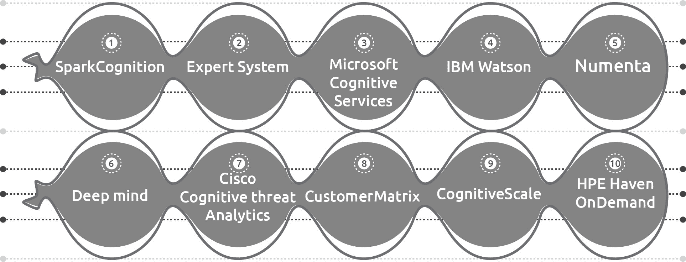

**图 5.6：** 投资认知计算的各种公司。

# IBM Watson
IBM Watson 是一个处理计算的平台。它依靠其以自然语言交互的能力工作。它可以处理海量数据。它可以从每次交互中学习。它能够以可变速度理解海量的大数据，帮助专业人士快速理解数据，同时随着时间的推移增加知识。

Watson 是一个通过数据库分析以发现洞察的认知系统。这些深入的洞察可以帮助用户直接回答最复杂的问题。IBM Watson 利用详细的內容分析和基于证据的推理来加速和改进决策、降低成本并优化结果。Watson 使用一套变革性技术，利用自然语言、假设生成和基于证据的学习。

Watson 理解人类语言的问题。它可以在问题的上下文中提供相关答案。它也在不断变得更聪明，从与用户的每次交互和每条数据中学习。它不是一种需要数据科学家来预测和解释结果的深度学习模型。然而，它能做更多的事情。

Watson 可以像人类大脑一样思考或回答问题。它处理原始信息、得出结论并从经验中学习。Watson 不使用内置规则和结构化查询来寻找答案。相反，它基于各种相关信息生成假设。响应会连同置信度排名一起表达建议。与传统分析工具不同，它接收更多数据、学习更多并提供更高质量的洞察。

组织目前使用商业分析来发现其绩效的新洞察并识别未来的机会。然而，系统也可以改变人类思考、行为和运作的方式。在当今认知系统时代，系统能够通过经验学习、创建假设、寻找相关性、学习并记住结果。

# Watson 解决方案
IBM Watson 是认知计算能力的环境。有几个关键的创新领域，其中包括：

### Watson Explorer 平台
可扩展认知索引和自然语言搜索的框架。

### Watson Developer Cloud
可用于应用程序的一组 API。

### Watson 行业解决方案
健康、物联网、营销、供应链、教育、银行、金融服务、监管合规、监控、保险等等。

# IBM Watson Explorer


# IBM Watson Explorer 模块概述

本主题提供了 IBM Watson Explorer 模块的高级概述。它用于创建 360 度信息应用程序。它包括有关 `Explorer Engine` 的各种逻辑组件和功能的信息、它们之间的交互以及在探索企业信息时的安全性。

`Watson Explorer Engine` 提供模块化且灵活的架构。它与网络数据存储库和可通过网络访问的数据源进行交互。该架构简化了单一导航信息应用程序的创建。该应用程序可以轻松探索以各种格式存储且位于不同位置的内容。

它包括应用独有的格式。它还由网络存储库中发现的不同格式的组合组成。`Watson Explorer Engine` 通过创建文档索引来帮助探索存储库中的数据。从单个数据存储库创建文本索引有多种方法：

* 爬取存储库意味着从池中检索数据、元数据和安全信息。每当爬取存储库时遇到困难，`Watson Explorer` 支持服务器端应用程序将数据从数据存储库推送到 `Watson Explorer` 安装。
* 为了处理和增强检索到的数据，数据必须采用标准格式。数据应采用标准形式，例如与其链接的 `URL`、原始文件类型和权限信息。
* 创建数据的索引。

## 功能组件

下图显示了 `Watson Explorer Engine` 的各种功能组件、交互以及外部数据存储库：

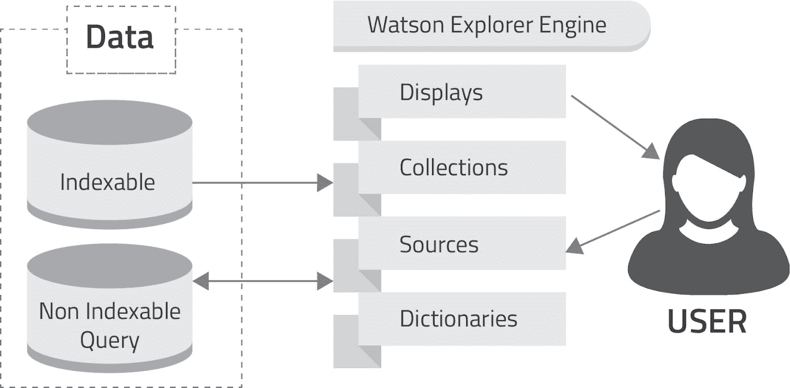

图 5.7：Watson Explorer Engine 的各种功能组件、交互和外部数据存储库

上图显示了它们在应用程序的信息导航和搜索中的用途。下几节将详细介绍 `Watson Explorer Engine` 架构的组件：

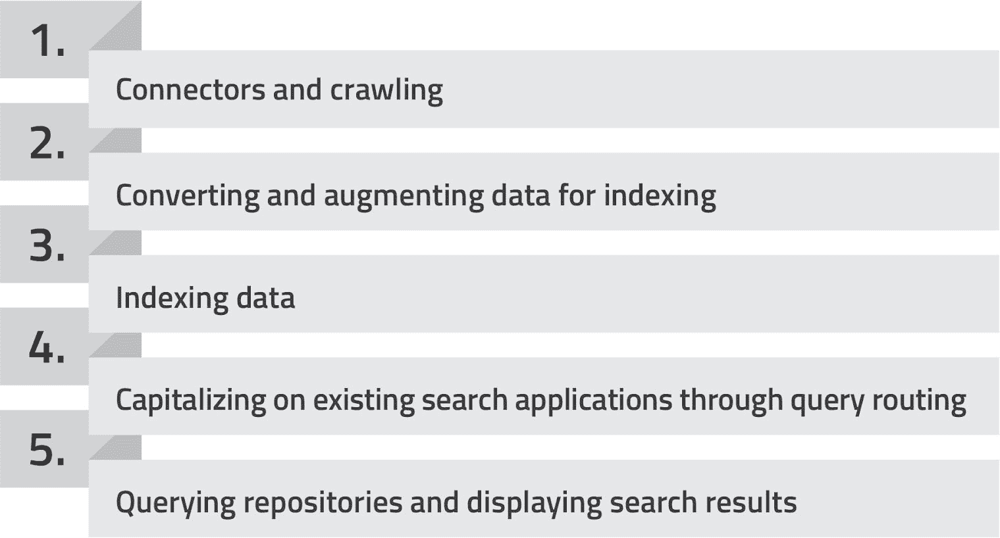

图 5.8：Watson Explorer Engine 架构的组件

## 架构组件

以下要点描述了 `Watson Explorer Engine` 架构的组件：

### 连接器和爬取
`Watson Explorer Engine` 可以使用 `Universal Resource Locator` 访问和索引任何数据。`Watson Explorer Engine` 已提供连接器以定位和检索远程存储库中的数据。数据存储库中为每个数据项检索 `URLs`，并使用称为 `crawler` 的组件将其排队到 `Watson Explorer Engine`。`crawler` 从每个排队的 `URL` 检索数据并将其传递给相应的元数据。提取的数据用于使用另一个称为 `pull connectors` 的组件进行后续预处理。这些连接器负责从远程存储库检索 `URLs` 和数据。

爬取远程存储库数据的另一种方法是安装称为 `push connectors` 的服务器端组件。这些连接器直接将远程存储库中的数据排队。它们对于不提供合适的 API 或爬取不可能或不足的存储库非常有用。

### 转换和增强用于索引的数据
在通过 `URL` 识别数据并由 `crawler` 从远程存储库检索后，它会被移交给称为 `converters` 的一系列应用程序。这些 `converters` 用于规范化，并在需要时进行增强。`crawler` 检索到的数据根据相应存储库采用特定格式。因此，索引器有必要理解所有这些格式。这导致复杂性增加，并使其重点偏离索引。此外，还需要对索引器进行更改以启用对以前未见文档的索引。

索引应准确且快速，以便它可以纯粹专注于索引而不是转换。提取的数据应规范化并转换为 `Watson Explorer Engine` 内部使用的特定格式。它是通过使用称为 `conversion pipeline` 的连接器序列处理数据来执行的。

在 `conversion pipeline` 中，相应的 `converter` 将数据从一种格式转换为另一种格式，或在需要时执行增强，甚至在将其传递到下一个 `converter` 之前添加输入数据中的信息。可用的连接器组合有两种，例如：

* `Standard converters`：它们随 `Watson Explorer Engine` 一起提供。
* `Custom converters`：它们由 `Watson Explorer Engine` 编写，以提取和增强特定格式的数据。

每个 `converter` 由输入和输出类型组成。只有 `conversion pipeline` 中与初始输入数据和前一个 `converters` 的输出数据的特征和功能相匹配的 `converters` 才会激活。

`conversion pipeline` 还负责遵循预定义序列。它授权特定数据的增强过程，并遵循支持相同类型输入的其他 `converters` 的转换格式：

* `Watson Explorer Engine` 内部遵循的标准格式称为 `Vivisimo XML (VXML)`。它经过充分记录且由较少模式数据语法组成。
* 它由每个检索到的数据的多个属性组成。它负责保留与原始存储库关联的内容的元数据。
* 它可以将对应于单个 `URL` 的数据拆分为多个拆分，以提供原始数据结构和组成的 information。这有助于以不同的方式处理和索引数据。
* `Converters` 也可以用于仅为显示目的添加不可搜索的元数据。

### 索引数据
`Watson Explorer Applications` 使用索引进行数据探索和信息导航。查看每个远程存储库以提取特定信息是一项非常困难的工作。因此，需要同时探索多个索引。它提供了各种优势，例如：

* 改进了众多流程的优化，例如从远程存储库连接和获取数据、从输入数据标准化、增强和索引。这通过创建和更新特定索引提高了性能。
* 减少给定索引的大小。此功能有助于减少即时和基础设施存储需求。
* 减少访问索引内数据所需的时间和资源。

为满足 `Watson Explorer Engine` 的 `reliability, availability, and serviceability (RAS)` 要求，可以配置索引以使其在多个 `Watson Explorer Engine` 安装之间进行复制。它被称为 `distributed indexing`。

所有副本中的更新会通过关联数据存储库中的内容更改自动分发到其他模型。我们需要以事务方式执行索引同步，以加强所有索引副本之间成功且稳定的更新：

### 通过查询路由利用现有搜索应用程序
有可能将现有搜索应用程序的搜索结果与 `Watson Explorer` 的数据探索和导航功能相结合。该过程称为 `query routing`。它用于将探索查询导航到现有搜索应用程序以及由 `Watson Explorer Engine` 索引的内容。它有助于在 360 度信息应用程序中访问所有可用信息。


Watson Explorer Engine 应用使用一个名为 source 的组件来访问已编入索引的内容和现有的搜索应用程序。该 source 组件负责对返回和处理匹配数据进行精细控制。每当探索性查询被导航到现有的搜索应用程序时，source 组件可以识别向该特定应用程序提交问题的过程。source 还诊断优先级处理过程，并对从搜索应用程序获得的信息进行分页，以便成功合并探索编入索引内容的结果。

* **查询存储库并显示搜索结果：** 作为源组件响应的数据由 Watson Explorer Engine 组件 display 格式化并在 Web 浏览器中显示，display 即显示组件。所有这些显示均在 Watson Explorer Engine 管理工具中创建。

# 使用 Watson Explorer 工作

根据 Watson 开发人员的说法，先进的假设生成和评分结合深度 NLP 和 ML 能力是使 Watson 独特的品质。Watson Explorer 的工作原理通过以下几点阐述：

* 当生成查询时，Watson 会分析问题以确定所需的信息类型，例如个人的姓名或位置、年龄以及问题的各种可能解释及其支持的证据。
* Watson 在其知识库中搜索问题的多个可能答案和可能的解释。它围绕答案形成数百或数千个预测并收集支持它们的证据。
* Watson 使用推理算法对问题和响应之间的不同语言进行深入比较，以对提出的假设进行评分。
* 使用高级分析算法，Watson 将比较分数单独合并以生成每个可能答案的最终置信度分数并相应地对其进行排名；然后它为用户提供评分最高的答案。以下图表描述了 Watson Explorer 的流程：
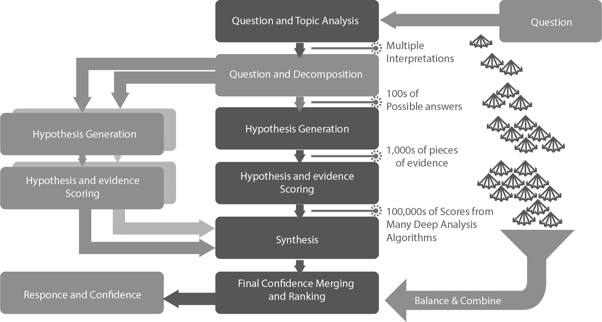
**图 5.9：** Watson Explorer 工作流程
* Watson 的置信度分数可以通过与训练系统的用户互动而随着时间的推移得到改善。

Watson Explorer 在业务中的一些好处是：

* **性能改进：** Watson Explorer 的业务优势不限于单个部门或组织内部。它在整个企业范围内提供广泛的信息访问，并能够在部门或跨职能部门部署有针对性的 360 度信息学应用，如市场情报、客户服务或供应链可见性。
* **提高客户生命周期价值：** Watson Explorer 使组织能够为营销、销售和客户服务专业人员提供每个客户和产品的 360 度视图。它为他们提供最新信息和提高绩效所需的知识。Watson Explorer 高级版帮助组织进行内容挖掘和分析非结构化内容以检测模式。它提供更好的理解并预测客户行为和需求。
* **支持合规并降低风险：** Watson Explorer 使与政策相关信息可访问。它有助于实施和执行信息治理政策。合规官可以快速轻松地识别和跟踪潜在的有害信息，例如个人数据泄露。它是使审计工作量减少的有用工具。此外，用户可以利用 Watson Explorer Advanced Edition 的高级内容分析功能对非结构化数据进行更深入的分析，以揭示模式和趋势。
* **内容挖掘以获得深入洞察：** Watson Explorer 高级版有助于分析和挖掘非结构化内容，以识别否则难以生成的信息。
* **信息共享：** 在当今的分布式环境中，每个人都保持孤立，失去了与同事互动的机会。Watson Explorer 提供了许多帮助同事的方式，通过对内容进行标记、评分和评论来开发信息。
* **从现有信息中获取知识：** 有时，有价值的数据和洞察被锁定在一种难以进行适当搜索和导航的方式中。与其他信息系统集成也很棘手。如果组织能够提取价值，则有助于在不进行昂贵迁移和替换项目的情况下利用现有投资的机会。Watson Explorer 可以增强研发的透明度并减少搜索时间。

# 使用 IBM Watson 改进服务

InfoSphere **Master Data Management (MDM)** 来自 IBM 的产品组合可满足两种不同的 MDM 域风格：单域和多域。借助 InfoSphere MDM，组织可以创建单一且可信的数据视图，有助于提高流程效率并促进更好的决策。本节描述了 IBM 客户通过在 Watson Explorer 上利用 MDM 所获得的服务。它分为多个部分，并在每个部分涵盖特定行业。

## 政府

政府行业分为两个功能领域：

* **公共安全：** 公共安全包括军队、执法部门和受雇确保安全和稳定、了解威胁并能够预防犯罪的情报人员。
* **公民服务：** 公民服务涉及州、地方和省级政府及其提供的服务。

政府机构要求纳税人智能地访问信息。例如，参与房屋建设项目的人可能不希望最初向当地规划委员会提供详细信息以获得相关部门的许可。相关部门应能够无害地访问人员信息。

换句话说，公民也期望从政府机构获得与从服务公司获得的相同类型的集成服务。通过将 Watson Explorer 与 MDM 集成，政府可以访问完整以公民为中心的信息，使政府服务能够灵活地快速收集和共享信息。

使用 Watson Explorer，政府可以查看公民和企业信息的当前、准确和完整的图景，并实时响应选民需求。公民和政府都节省时间和金钱并提高纳税人满意度。

公民可以获得以下优势：

* 与官员进行对话。
* 快速访问政府信息和服务。
* 对问题和主题提供即时反馈。

## 执法

过去，95% 的犯罪活动是本地的，可以在固定位置轻松追踪，但现在时代已经改变。罪犯具有流动性。他们使用技术突破地理边界。为了有效打击全球化犯罪，执法机构也需要以新的不同方式使用技术。各机构之间共享信息可以帮助执法机构领先于罪犯并找到他们，无论他们从何处运作。


然而，充足的信息共享要求机构提供的数据准确，并在整个共享过程中保持安全。它还假设提供信息的机构仍能控制一个机构与另一个机构之间共享的信息。如果没有这些安全条件，信息就无法在机构之间共享。为了向官员提供相关且最新的信息，需要对与调查相关的每个实体有一个综合视图。MDM 实时提供来自多个来源的可疑活动的统一视图。

MDM 分析来自各种来源的大量信息，包括刑事报告、逮捕记录、监狱报告和法院文件。MDM 通过创建多实体视图来建模数据，该视图可以包括以下任何实体：
* 人
* 地点
* 财产（武器、手机、汽车等）
* 事件（抢劫、袭击、谋杀和交通违规）

然后它能够通过识别模式或共同点来发现这些信息中的关系。通过将 Watson Explorer 与 MDM 集成，执法机构可以通过将社交媒体中的非结构化数据纳入 MDM 已提供的<|message|>信息中来增强其警员的能力。

MDM 帮助组织完成以下任务：
* 识别嫌疑人
* 追踪嫌疑人
* 改善跨司法管辖区的合作
* 控制共享的数据量以及与谁共享

# 金融服务
金融服务业是指银行和保险机构。本节描述这些机构的管理需求。

## 银行
银行的主要重点是在多个系统之间构建客户关系和产品信息碎片。如果没有客户和产品的真实主数据记录，银行将难以在所有渠道提供一致且相关的服务，向客户销售最合适的产品或降低运营成本。

Watson Explorer 的 MDM 通过在整个企业中提供核心信息来支持业务流程，从而使银行能够执行这一战略目标。客户希望以不同的方式与银行互动。个人不再只与单一的本地分支机构沟通。他们还在网络和移动应用程序上开展业务。

银行应确保本地分支机构、客户代表和在线系统能够访问通过所有先前互动收集的全部客户信息。这为客户提供了极佳的体验，减少流失并推动新销售。MDM 还帮助银行从多个系统识别客户，并为客户提供其资产的完整视图。结果是客户无论在分支机构、网上还是移动设备上银行，都能获得一致的体验。此外，银行还可以使用 MDM 来降低成本、简化客户信息处理、简化客户入职和开设新账户，并消除重复邮件。

## 保险
为了吸引和留住客户，保险公司将客户放在首位。建立牢固的关系并了解客户需求对于减少流失和增加每个客户使用的产品数量至关重要。保险公司必须跟上变化的模式，成为客户的首选。如今，客户希望有更多方式与保险公司互动。

保险公司必须确保本地代理、呼叫中心代理和在线系统能够访问先前互动中收集的所有历史信息，以为客户提供无缝体验，从而减少流失并产生新销售。

由于客户信息分散在多个不同的系统中，将客户信息集中到一个地方非常重要。这加强了客户关系，有助于公司在客户互动中销售更多产品。

例如，如果客户联系呼叫中心讨论某项保险政策，而代理没有关于客户与另一位本地代理先前互动的信息，客户将不得不花费时间重复信息。MDM 将来自业务渠道、保单线和服务地点的客户信息汇集在一起。此外，它为每个客户创建单一且集中的记录，有助于改进业务流程和应用程序效率。

单一记录可以是以下任何一种类型：
* 物理记录，客户历史维护在集中式中心中。
* 虚拟文件，客户信息的更改通过单独的基于策略的系统进行。
* 混合记录，其中只有文档的某些部分被集中化。

这样，MDM 为保险公司管理客户数据提供了灵活性。

# 医疗保健
为每个患者创建单一且集中的记录可以帮助医疗保健组织获得以下好处：
* 医疗保健提供者之间更紧密的协作。
* 多个接触点的一致患者体验。
* 减少医疗错误。
* 提高患者流程效率。

来自多源系统的信息集成有助于确保患者信息在医生之间正确路由。组织必须创建涵盖广泛内部和外部数据源的提供者和设施的最新记录。

MDM 通过有效管理患者和提供者数据帮助组织提高关键文档的质量和准确性。有效管理患者和提供者信息可以带来即时效益和投资回报。凭借对患者的准确视图，组织可以建立以患者为中心的方法，从而提高护理质量、简化流程并改善患者满意度。

例如，在医疗保健领域可以实现以下改进：
* 提高医疗保健提供者协作。
* 消除工作重复。
* 在治疗时点为医疗保健提供者提供患者信息。
* 降低行政成本和复杂性。
* 避免因患者信息错误导致的安全问题。

在高质量且准确的数据基础上，医疗保健组织可以实施此类解决方案，有助于增加对数据的有意义使用，以造福患者、提供者和组织。此外，对患者和提供者信息应用分析可以帮助组织识别有助于成功患者结果的因素。借此，治疗的有效性得到提高。

# 零售
主数据对于组织处理过时、不完整、不准确和不同步的信息是必要的。组织的主要业务流程依赖于主数据。如果没有完全信任和准确的主数据，运营就会受到损害并变得效率低下。

Watson 的 MDM 旨在帮助组织解决主数据的复杂性，其中包括数据如何创建、更新、使用、管理和分析。有了 MDM，组织可以通过创建可信的信息来源和每个客户的单一视图来集中关键数据。它提供广泛的 MDM 功能，其中包括添加、删除、验证、更新和保护对主数据的访问。

# 客户域


Integration of MDM with Watson Explorer brings together customer information from communication channels which include social media sources helping retailers can quickly build a 360-degree view of each customer. Retailers can use that unique customer view to create personalized marketing campaigns and promotions.

For example, a product-seller that sell products online can create a personalized promotion strategy by creating categories of products that a customer has recently bought or shown interest in, based on the online activities of the customer. With a detailed record of a customer’s searches and purchases, retailers can accurately generate recommendations for other products.

By creating detailed customer records, Watson Explorer helps to integrate social media and other internal and external data. It helps retailers reduce expenses and create better marketing campaigns. With the elimination of duplicate records and with the creation of personalized campaigns, retailers can enhance the productivity and efficiency of sales efforts, thereby improving the success rates.

## Product domain

A centralized source for product information is essential to provide customers with the correct information like when, where, and how they want it. For example, customers buying an air conditioner are expected to do the following:

* Visit a physical store.
* Use a manufacturer’s website.
* Shop at a retail e-commerce site.
* Compare prices on a smartphone.

Delivering information across different channels helps to produce a specific retail experience, which inspires confidence and loyalty among customers. Retailers might need to accomplish the following tasks to centralize product information:

* Collect product information from a manufacturer.
* Translate that information into an understandable format.
* Deliver that information to sales and marketing teams.

This process is time-consuming and leads to errors as information is entered into the systems repeatedly. Using MDM, the retailer may create a centralized source of product information. It will be available to all users that may work inside and outside the organization. With this single source of information at a centralized place, the retailer may save time and money.

## How to impact businesses with IBM Watson

Businesses from various industries can benefit from Watson Explorer. This platform is built on a natural-language analytics engine. The explorer was designed to be extremely flexible and adaptable and help improve a wide range of business processes. The best way to understand this is to see how Watson Explorer is assisting companies in solving their most significant challenges in several sectors.

## Watson Explorer for manufacturing

As manufacturing techniques become more interconnected and intelligent, manufacturers need access to even more data. Watson Explorer helps the manufacturers to extract value from their data by identifying patterns and trends. It also enables access to information across teams. It can also help increase productivity, innovation, efficiency (while reducing time), staffing redundancy, and risk.

Watson Explorer drives the main improvements for manufacturers i.e. improvement in business processes and development in products. It can lead to the following tangible benefits:

* **Reduction in investigation and recovery costs on defects and product quality:** By identifying defective products and production equipment on time, analytics solutions can help minimize the impact of these errors.
* **Better market position and reputation due to stronger product design and quick correction of defects:** Product designs can be safer and more remediated along with more receptive to customer preferences and feedback. A better product is the best way to improve customer satisfaction.
* **Reduced risk of defective products:** By minimizing or avoiding the number of defects that make it to market, companies can reduce their exposure to legal liability and customer dissatisfaction.

## Watson Explorer for customer service and call-center

Call centers are a significant challenge for data-driven analytics. Customer call centers provide an expensive and high-touch process that involves a massive volume of unstructured data. The reputation of a multinational company can be affected by the service provided through call centers and customer engagement channels.

Watson Explorer creates a workspace for customers facing professional problems and other decision makers. It analyzes structures such as supply chain management, customer relationship management, and unstructured content from sources such as file shares, email, and content management systems. The benefits for call centers can be dramatic and far-ranging:

* **Reduced average handling time and increased call resolution:** Watson Explorer helps to enhance efficiency for call center agents by successfully integrating data from multiple sources. It then applies analytical tools to get a 360-degree view of a customer and provides call center agents with relevant information.
* **Improve application performance and accuracy to handle daily operations and business users at different sites:** Call center agents can attain a holistic view of customers and get efficient access to vast volumes of previous customer and product data.

## Watson Explorer for retail and e-commerce

Retail and e-commerce organizations need to gain in-depth insight into unstructured and individualistic experiences and optimize the store inventory to maximize revenue and profits. Cognitive analytics can help in this process. The benefits of cognitive analytics in retail relates to understanding the customer better. Cognitive solutions can help retail clients in the following ways:

* Changing stocking patterns for stores to match the products that are selling
* Reduction of supply chain and logistics costs
* Identification of trends and checking the products are in-stock and visible
* Prediction of customer orders months in advance

## Watson Explorer for insurance

Insurance companies deal with unstructured data and have an interest in building long-term relationships with their clients. Nowadays, most clients of insurance companies use cognitive services that help to reduce the time needed to process claims from two days to 10 minutes. These companies are using data to identify hundreds of millions of dollars in leakages and fraud. The result is more a customer-centric and profitable company. However, any new technological solution needs to balance contradictory aims like updating and improvement in current on-site search capability.

Fortunately, Watson Explorer can balance all these concerns. It enables search across the public website and the corporate intranet. It helps with predictive search and high priority content identification. Some identification steps which are used in the process:

* **Identification of fraud and leakage:** The first step to eliminate fraud and waste is to identify when it occurs. Watson Explorer can find patterns and relationships in data to help insurers identify fraudulent claims more efficiently.
* **Reduction in call center response time:** Improving call center responsiveness is a simple step that can improve both customer satisfaction and profits.

## Conclusion

Cognitive computing is still recognized as a synonym of AI which is not exactly right; it should be considered as the sub-part of AI. To achieve full autonomy in the field of chatbot, a combination of cognitive Computing and NLP techniques are required. Questions like how to make that integration, what will be the requirements, what will be the challenges, and how it can affect different areas and sectors, can be answered fairly from the mirror of IBM Watson.


# 问题
1. 什么是认知计算？其主要特征是什么？
2. 解释 Watson Explorer 的工作原理。
3. 列出 IBM Watson 在业务中的一些益处。
4. 说明人工智能与认知计算之间的差异。
5. 讨论 Watson 的架构及其组件。

# 第 6 章
# 百度网络服务的进步
在本章中，我们介绍 **Baidu**，该公司为网络服务的进步融入了智能能力。这家中国公司引领着人工智能领域，并通过在其大多数产品和服务中引入 DL 将网络服务提升到下一个水平。它被包括 Google 和 Facebook 在内的硅谷巨头视为潜在的游戏规则改变者。

### 结构
* 百度网络服务及其业务导向
* 百度网络服务中的深度学习
* 百度智能网络服务的下一步

### 目标
了解百度提供的网络服务以及深度学习在改善用户体验方面的潜在用途。我们还将讨论深度学习在不同文化和国家的使用。

### 百度网络服务及其业务导向
百度是中国使用的中文最大搜索引擎。它由 *Robin Li* 于 *January 2000* 创建。根据 Alexa 的数据，按流量计算它在全球排名第 5。百度称，中国超过 90% 的互联网用户使用百度，每天进行数百万次搜索。

百度提供多种搜索产品，如地图、图书搜索、移动搜索、图像搜索等。在许多方面，它与 Google 的搜索产品相似，但在广告的展示和管理方式上存在许多差异。与 Google 一样，百度拥有先进的按点击付费营销平台。

百度的主要目标是为客户提供：
* 一个满足其营销需求的在线营销平台
* 用于管理其账户的广泛工具选择
* 用于分析和优化投资回报率的数据

百度是一家提供多种服务的网络服务公司。其核心服务之一是搜索引擎。它还提供其他服务，如 Baidu Baike（类似于维基百科的服务）和百度音乐。

它是设计最高效、最完善的中国搜索引擎。百度控制着中国 70% 的市场。因此，其他搜索引擎很难寻找渗透的地区，因为它为中国所有地区 的客户提供服务。中国的每个在线企业人士都必须在百度上推广其服务和产品以发展业务。以下图表说明了百度的市场份额：

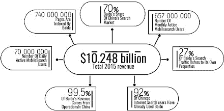

**Figure 6.1:** 市场份额分布

### 百度的市场份额
按收入和市场份额计算，百度是中国最全面的搜索引擎。随着新竞争对手的进入和互联网用户数量的增加，百度需要保持警惕和专注。以下图表显示了中国网络搜索平台的市场份额：

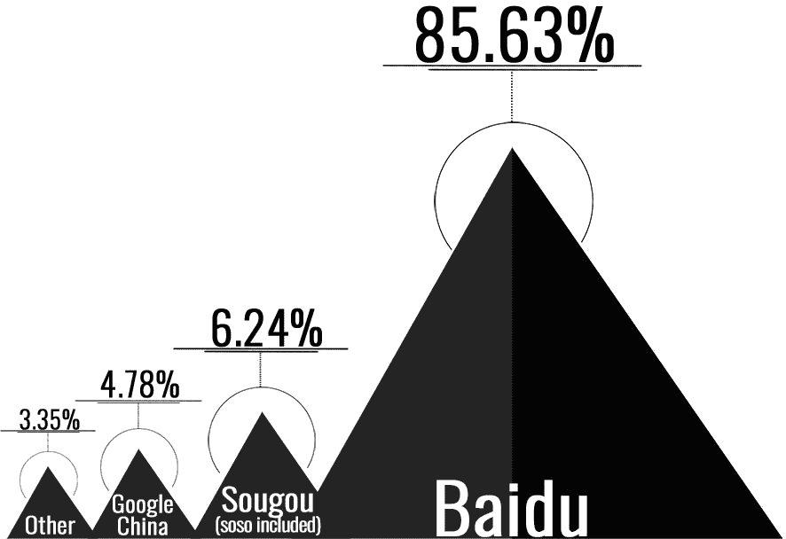

**Figure 6.2:** 份额分布

从上图可以明显看出，中国所有行业都必须在百度上投放产品和服务的广告，以将其信息传播给 85% 的用户。

百度在中国扮演的角色与 Google 在美国扮演的角色相似，但其市场份额比 Google 更广。公司在 2016 年第二季度的总收入为 $2.748 billion，与 2015 年同期相比增长 10.2%，同比增长 16.3%。同时，移动收入占 2016 年第二季度总收入的 62%，而 2015 年同期为 50%。百度在 2016 年第二季度分配的净利润为 $363.2 million，与 2015 年同期相比下降 34.1%。

2016 年，百度因医疗领域虚假广告信息的指控而失去了一些声誉。因此，为了建立有利的在线生态系统，百度开始专注于限制广告援助并允许更高的广告商标准。通过发布新法规，预计广告收入将显著增长。

### 百度的工具
百度提供各种工具来改善在线流量。以下是可用工具的简要介绍：
* **Submit website tool:** 此工具用于处理百度网站上所做的更改。百度不包含站点地图提交功能。因此，每次进行重大更改时都需要重新提交网站。如果用户不使用该工具，则百度将无法识别网站上所做的更改，导致网站评级不佳。
* **Keyword search tool:** 关键词搜索工具应足够高效以满足百度需求。不同地区的不同类型用户的搜索习惯各不相同。该工具提供有关最突出关键词的信息，并允许用户选择最合适的关键词以获得最佳价值。如果用户选择一个竞争非常激烈的关键词，那么用户必须付出极大努力才能在搜索结果的第一页获得高排名。另一方面，如果用户选择一个竞争较小的关键词，那么竞争将极低，并且网站不会出现在第一页，因为它不常被搜索。因此，这取决于关键词的选择。
* **SERP layout tool:** 此工具用于决定网页的布局并在任何网络搜索后显示结果网页。结果页面（SERP）的格式与 Google 搜索引擎非常相似。然而，百度在第 1 页过滤掉主要付费结果及其特定的网络项目。百度包含各种项目，因此自然结果被放在顶部。它包括 *Baike, Zhidao, Wunku, Tieba.*
* **Baidu open tool:** 有一个阶段，用户可以通过输入其数据来构建应用程序。此工具用于增强结果输出。该工具无法影响自然搜索；相反，它选择根据使用的关键词显示小工具的结果。流行的设备包括垂直搜索或天气预测。它为业务发展提供了良好的实践，因为它提供了新的在线机会。
* **Baidu brand zone tool:** 此工具也称为品牌专区。它为品牌提供购买其注册商标关键词的访问权限，以便他们可以控制品牌术语 SERP 的规则。获得的结果可能由标签、反向链接内容等媒体组成。由于获得结果的规模庞大，SERP 的外观发生了变化。第 1 页品牌专区中广告的位置对于大型竞争对手品牌来说是一项艰巨的工作。
* **Brand landmark tool:** 它是一种工具，与品牌专区相比，可更具体地获取信息。品牌专区对于确定特定注册商标术语的关联非常有用，而品牌地标工具有助于访问更通用的名称。它对企业和中型企业非常有益。


### 百度内容需求工具
该工具的主要任务是维护内容质量。需要更高质量的内容来提升排名。因此，为了确定内容质量，每个搜索引擎都有其标准。用户了解这些特定标准以保持对竞争对手的领先地位。百度提供了具体的标准来评估内容质量。如果用户有效遵循这些要求，其网页将在 SERP 上排名靠前，而无需向百度支付一分钱。

### 抄袭检查工具
该工具用于检查内容的抄袭情况。百度会惩罚存在抄袭内容的网站。每个网站的内容都应是独特的。因此，在构建网站时应谨慎。抄袭存在诸多问题，如分类法、法律问题等。

### 语言使用处理工具
所有内容和 Meta 标签均由简体汉字组成。百度更倾向于推广简体汉字而非传统汉字，后者不利于罗马化。这是因为年轻人能快速识别新的简体符号和字符。因此，建议远离那些不再被视为主流的传统字符。有大量博客和网站提供应避免的常规字符和符号清单。

### 内容定义工具
中文包含多种风格。语言中的每个词代表不同的含义。因此，应核实网站中使用的所有词语是否正确使用。

### 内容质量检查工具
百度在排名中高度依赖内容质量和发布量。百度对网站每个页面的最低标准值为 300 字。频繁用户可以扩展字数，但每个页面都应保持字数的最佳标准值。

### 标题标签工具
标题标签的撰写有字数限制。使用常见的罗马化字符书写时，限制为最多 70 个字符。而使用简体汉字书写时，阈值为最多 35 个字符。撰写标题标签时应使用丰富的关键词表达。

### 元描述
百度使用元描述作为确定排名的工具。元描述可能由几个关键词短语和品牌词组成。罗马化字符的元描述限制为 156，而简体汉字的限制为 78。

### 元关键词标签
百度使用关键词进行排名计算。它们用于网站的每个页面，由 3-4 个关键词短语组成。用户应避免关键词堆砌。

# 百度与谷歌的区别
百度与谷歌搜索引擎之间存在一些关键差异，具体如下：

## 搜索便捷性
### 百度
每当用户点击搜索引擎页面时，对应页面会在新窗口或标签页中打开。此功能允许用户返回百度，从而提高点击率。因此，它使用户能够在特定搜索查询的结果页面上访问多个网页。

### 谷歌
谷歌并非如此。在谷歌中，如果用户打开网页，它会将用户重定向到所选页面，用户必须离开之前的页面。因此，如果用户想在多个网页中查看结果，他们必须手动在新标签页或窗口中打开页面。

## 点击行为
### 百度
百度使用点击率功能进行排名计算，并且结果会被点击。它还负责记录返回 SERP 搜索其他结果的用户数量。它们可用于获取最佳结果，以区分和观察用户的不同点击行为。

### 谷歌
谷歌没有点击率功能；相反，谷歌使用由其自身开发的 PageRank 算法。根据该算法，重要页面排名靠前，并出现在搜索结果的顶部。

## 新鲜内容
### 百度
百度更重视网站内容的时效性。因此，百度为 SEO 专家的新项目提供了绝佳机会。

### 谷歌
谷歌更偏好页面的权重。但在谷歌上，即使拥有大量数据和内容，也很难取代大公司，因为页面权重是固定的。谷歌用户事先知道某些关键词的结果，这使他们兴趣降低。但由于新鲜内容的引入及其原创性，百度页面的结果不断变化。

## 重量不重质
### 百度
百度更注重链接的数量而非链接的性质。因此，为了提高在百度的排名，网站应尽可能包含大量反向链接，因为反向链接的相关性并不那么重要。

### 谷歌
相反，谷歌认为链接的质量更为重要。

## 速度要求
### 百度
百度在定位算法中也关注网站的加载时间。因此，网站应托管于提供快速服务器的公司。建议使用专用服务器使网站更快，而非使用共享服务器。

### 谷歌
谷歌提供检查速度的功能；它被称为 *PageSpeed Insights*，可显示给定网站的速度现场数据。它还提供优化建议以改善网站。

## 收录
### 百度
与谷歌相比，百度收录页面非常具有挑战性。百度会从用户处获取有关托管和地理位置的信息以将其注册到数据库中。

### 谷歌
谷歌由一个系统组成，该系统可根据更通用的规则自动将页面存储到数据库中。

# 百度的商业模式
百度的服务包括按效果付费、算法搜索、企业搜索，以及包括新闻、多媒体和图像搜索在内的一系列专业服务。百度的主要重点是中国语言搜索引擎服务，这是其最大的优势。让我们来看看百度商业模式的主要要点：

## 客户细分
百度为中文使用者提供一系列搜索平台。它运营着中国最受欢迎的搜索服务，占据约 88% 的网站网络流量。在中文社区中，百度服务于消费者和互联网用户。除了服务普通消费者外，百度还为品牌营销者和广告代理商提供营销和广告服务。

## 价值主张
百度最重要的价值在于它提供广泛的网络搜索服务，供讲中文的受众使用。该公司拥有多种服务和门户，使用户能够在多个不同渠道之间整合其账户。这些渠道可通过移动设备、网页浏览器和移动应用程序随时随地访问。百度提供了一套搜索工具，涵盖从法律搜索到新闻门户的广泛兴趣和需求领域。百度还为包括广告代理商和品牌营销者在内的广大受众提供平台，帮助他们扩大营销覆盖面并与目标受众互动。


# 商业模式画布

### 客户关系
百度提供多种自助产品。用户无需注册账户或与百度团队成员互动即可访问公司的网页门户以及其他服务。广告商可以通过直接联系百度咨询付费搜索和广告活动展示，并根据其需求获得个性化服务。以下图表说明了百度、用户和客户之间的关系：
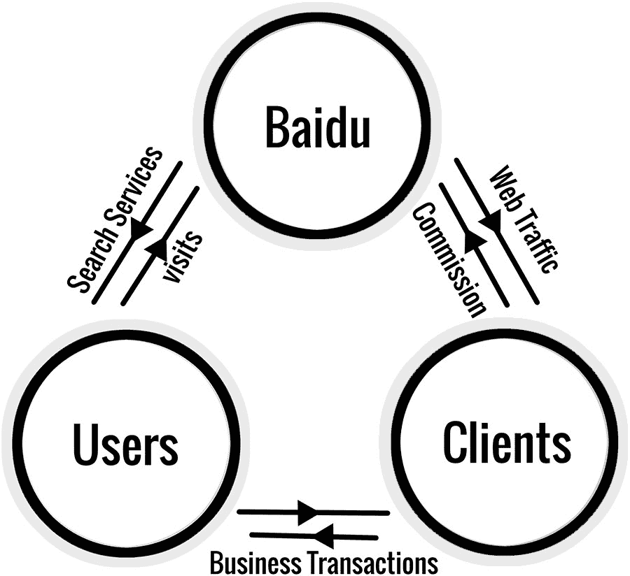
**Figure 6.3:** 百度、用户和客户之间的关系
公司还通过常见问题解答和用户指南为客户提供支持，并通过社交媒体账号与他们互动，如 Facebook、Twitter 和中国的 Sina Weibo。

### Channels
百度运营着一个在线门户。公司还运营着多个专有网站提供其他服务，包括 `http://d.nuomi.com/`、`https://www.hao123.com` 和 `www.news.baidu.com`。百度还运营着其应用商店，客户可通过该商店轻松下载百度及其他第三方应用。百度的功能也集成到一系列网站和技术产品中。

### Key partners
百度与技术合作伙伴和集成合作伙伴合作。该公司还与知名跨国公司建立了合作关系，如 Amazon，帮助其在中国推动 Amazon Kindle Fire；以及 Microsoft，支持向中国消费者推广 Windows 10 软件。百度还与名为 *CloudFlare* 的网页性能和安全公司以及网页发现平台 *Taboola* 合作。它还与绩效营销机构 *Merkle* 以及 *BMW* 合作在中国开发无人驾驶汽车。

### Key activities
百度是一家使用中国技术的网络搜索公司。它提供一系列以中文为主的搜索产品，这些产品围绕其托管在 `www.baidu.com` 的中央网页门户组织。除搜索引擎功能外，公司还提供以下平台：
- Baidu Post Bar，这是一个基于中文查询的在线社区平台。
- Baidu Knows，这是全球最大的中文互动知识共享平台。
- Baidu Encyclopedia，这是全球最大的中文用户生成百科全书。
公司通过数字广告和营销解决方案产生收入。百度还运营着一个技术、集成和联盟营销合作伙伴网络。

### Key resources
百度的关键资源是其在线平台、技术和 IT 基础设施。百度在美国专利商标局有多项专利申请。其中包括用于监控在线应用程序状态的方法和装置、用于推送兴趣点信息的方法和系统，以及具有图形用户界面的显示屏。

### Revenue streams
百度通过其网站及其附属网络的在线展示广告和数字营销解决方案产生更多收入。公司运营着一个按效果付费的广告平台。它高效地作为基于网络的拍卖系统运行，允许客户竞标广告链接的优先展示位置。公司使用 *Comprehensive Rank Index*，该指数根据出价价格和链接质量得分给予优先展示位置，而链接质量得分是通过计算关系与用户搜索查询的相关性生成的。费用按每次点击付费方式收取。客户还可根据其广告带来的电话呼叫数量收费。此外，百度还提供付费搜索服务。在此，客户的链接借助选定的搜索词置于搜索结果顶部。

### Cost structure
百度在研究与开发、营销和流量获取、IT 基础设施维护、人员保留和带宽方面产生费用。公司通过其拥有超过 43,000 名员工的员工队伍承担人力成本，以及运营成本，包括其在日本、美国、泰国、中国、埃及、巴西和印度尼西亚的办公室的租金和公用事业。

# Product strategy
百度提供多种产品，推广两种特定功能：

### Baidu Post Bar
它是一个讨论板引擎，用户可通过它浏览特定主题的信息、发布讨论并参与社区。它还提供发起主题讨论并与购买特定商品的用户建立联系的功能。它还确定 IWOM 公司，因为用户在上面撰写正面和负面情感的评论。它是用户可以在线聚集并交换报告的地方。

### Baidu Zhidao
它是百度搜索引擎的问答功能之一。它允许用户提问并获得答案作为输出。用户大多来自农村地区，他们渴望了解各种新技术及其工作原理。社区成员回答任何特定领域的提问。以下三个因素促使其在农村市场显著增长：
- Usability of services
- Cost efficiency
- Ease of use
该功能在免费、便捷地传递信息方面非常有用。

### Baidu Baike
它是一个类似维基百科的社区型百科全书。它允许用户编辑任何主题的信息。该功能让中国民众参与协作并开发一些预计对整个国家有益的创新事物。它在中国非常成功，因为它允许用户进行开发，并根据他们对社区的贡献展示其进展。

# Get the best ranking in the Baidu Search Engine
为在百度搜索引擎中获得良好排名，需要实施以下步骤：
- 应充分实施 SEO 的基础，例如标题标签、元描述和关键词。
- 内部链接的锚文本的适当优化很重要。
- 建议用中文而非英文撰写网站内容。
- 如果网站索引滞后，请将网站提交至百度趋势。
- 网站上应存在大量高质量链接。
- 将服务器设在中国是获得更好排名的绝佳方式。

# Research and technology
以下是百度投入研究与技术的组成部分：

### Baidu Big Data Engine
中国搜索引擎百度已正式开放其大数据引擎；它向外界提供海量存储、云计算分析和对研究技术的深入理解。百度大数据引擎的三个模块是开放云、大数据工厂和百度大脑。
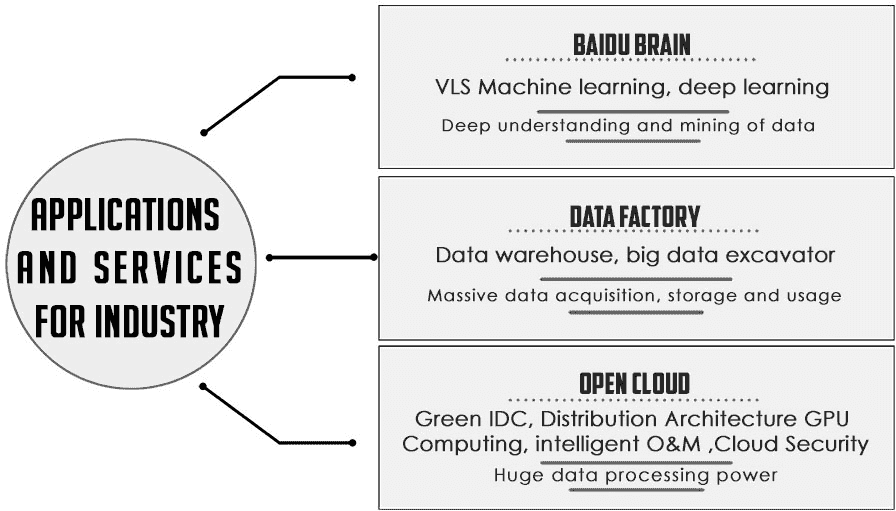
**Figure 6.4:** 百度行业应用与服务的不同组件
借助大数据引擎，百度的合作组织将能够通过互联网使用百度的大数据结构。同时，他们还可以使用百度的大数据技术来改善传统行业的企业管理和商业模式链接。

### Baidu Big data enabled intelligent systems
百度是一家在每个重要的人工智能领域都拥有世界级专业知识的公司：语音、NLP、计算机视觉、机器学习和知识图谱。以下图表说明了与百度智能系统相关的不同领域：


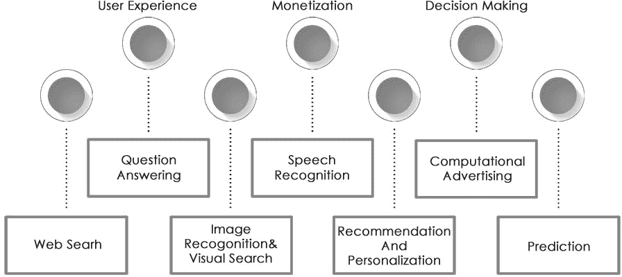

**Figure 6.5:** 与百度智能系统相关的不同领域

百度是中国人工智能研究的先行者，并专注于深度学习的基础研究，利用其在大数据方面的探索，如同谷歌。百度已部署技术以增强关键产品，包括核心搜索算法、语音识别引擎、推荐系统和其他移动应用产品。其动力来自大规模云数据中心以及嵌入 GPU 的服务器。

### 百度大脑研究
随着博客、社交网络、物联网和云计算等技术的出现，互联网上的数据和信息正以异常的速度增长和扩展。

随着我们迈向 22 世纪，随着技术的进步和大量可用数据的存在，每个人都希望为每项任务采用在线系统。互联网上用户之间的互动、企业和政府的信息以及物联网传感器提供的实时信息时刻产生着海量的结构化和非结构化数据。

此类数据以相当大的体量散布在整个互联网网络系统中。数据包含有关经济、科学技术、教育等方面的宝贵信息。此类数据可用于构建预测系统以预测未来。下图说明了百度大脑搜索的流程：


**Figure 6.6:** 百度大脑搜索流程

虚拟现实技术用于为游泳等活动创建逼真的 3D 环境；人们可以在游泳环境中感觉自己仿佛身处现场。百度也在研究智能机器人和智能制造技术，作为迎接新工业革命的切入点。

如今，推荐系统在在线零售、电子商务等许多行业也很流行。推荐系统在零售中最常见的用途是找到在购买第一件商品后最有可能购买类似商品的客户。该系统充当销售员，可以通过了解客户的品味、风格等为客户提供建议，并帮助他们做出购买决策。

# SWOT 分析

下图说明了百度的 SWOT 分析：


**Figure 6.7:** SWOT 分析中的优势、劣势、机会和威胁

下面将详细讨论百度 SWOT 分析中的优势、劣势、机会和威胁：

## 优势

### 市场份额
其最大的优势在于其拥有的市场份额。截至 2015 年，百度拥有 79.81%的市场份额。这是一个巨大的市场份额。凭借如此庞大的市场份额，任何人都难以挑战它。

### 移动用户
百度还为移动互联网用户提供服务。其近 54%的收入来自移动和互联网用户。百度每月约有 6.57 亿活跃移动用户。其真正的优势来自难以匹敌的用户。

### 品牌资产
截至 2016 年，百度在品牌资产方面排名第 86 位。除中国外，百度也在许多其他亚洲国家使用。

### 上市公司
百度是首家被纳入纳斯达克 100 指数的中国公司。其对搜索算法的深入了解以及对中国用户的定制化服务使其成为一个品牌名称。

## 劣势
百度存在以下劣势：

### 中国以外的品牌认知度
主要劣势是缺乏中国以外的品牌认知度。甚至听说过百度的人也很少。该公司需要在这方面努力。它不能仅局限于中国。

### 电子商务业务
百度的电子商务业务被视为公司的一部分而单独考虑，并错失了可能帮助公司做大的潜在市场。

### 智能手机行业
该公司进入平价智能手机行业非常晚。更早进入本可以确保更好的市场份额。

## 机会

### 付费搜索和广告
由于其 AdWords 和 AdSense 计划，谷歌在付费搜索和广告领域占有相当大的份额。然而，百度付费搜索在全球范围内远远落后；然而，随着品牌知名度的提高，它可以实现其真正的潜力。

### 利用市场份额
在中国相当大的市场份额为其提供了成为中国最重要技术和网络服务品牌的绝佳机会。

### 基础设施
其现有的 IT 基础设施很强，可以用来扩展其在中国提供的服务。凭借出色的服务器和 IT 系统，其竞争对手无法击败它。

## 威胁

### 强劲竞争对手的存在
市场上更知名竞争对手的存在对百度在中国以外的增长构成了重大威胁。像谷歌、必应和 Facebook 这样的参与者是活跃的参与者，并在全球市场拥有巨大的市场份额。

### 维基百科
百度有一个名为百度百科的服务，它是一个百科全书，如维基百科，但该品牌在中国市场以外的认可度非常低。

### 创新的速度
考虑到技术导向型公司创新的速度和速率，百度必须努力保持业务相关性。像谷歌这样的公司比百度拥有更多的资金，因此，它们的创新速度和程度与百度的显著不同。

### 政府干预
在这种业务中，政府对搜索引擎的运作施加规则和法规。政府控制可能会阻碍百度搜索引擎的运营，而这是一项重要的收入来源。

# 百度网络服务中的深度学习

百度目前被认为是中国互联网巨头中的领导者，因为它准备开发和部署机器和深度学习技术。人工智能方法如 `ML` 和 `DL` 被用于在金融和医疗保健等行业获得巨大利益。基本思想是，一旦计算机被教导学习，它们将能够以同样的方式吸收数据，并以惊人的速度以大数据的形式处理它。

在过去几年中，`DL` 算法迅速发展。它在提高图像识别、语音识别、文本转语音和机器翻译等多个应用的准确性方面发挥了不可或缺的作用。由于人工智能研究的快速发展，这些应用中使用的 `DL` 模型不断涌现。

为了支持深度学习的计算需求，新兴初创公司和大型公司正在构建创新的硬件和软件系统。构建硬件系统是一个昂贵且耗时的过程。深度学习研究的不断变化的性质使得硬件制造商难以开发能够满足使用深度学习的应用程序需求的系统。

百度的 `DL` 技术在图像处理、计算机视觉、`NLP` 等各种具有挑战性的任务中取得了出色的进展。在大数据时代，一个集成的 `Spark` 平台，使用可扩展的深度学习、训练和预测是必不可少的，尤其对于百度规模而言。

让我们讨论使用 `Paddle` 进行综合学习、训练和预测，`Paddle` 是由百度 `IDL` 开发的深度学习库。它使多个百度产品能够在单个 `Spark` 集群中进行离线处理，以进行数据摄取、预处理、特征提取和模型训练。

`DL` 在百度中有许多用例并显示出质量的显著改善：


### 图像检索排名
百度图像搜索引擎是中国人民共和国的搜索引擎。它是一个基于内容的图像检索（CBIR）搜索引擎。与传统图像搜索引擎不同，它将用户查询关键词与图像的周围文本匹配，并使用户可以直接使用图像作为查询。只需上传本地副本或将网络图像的 URL 粘贴到搜索框中，用户即可快速访问许多与查询相似的网络图像。此外，它还显示有关查询图像的故事、新闻、知识和额外的网络信息。

### 广告点击率预测
点击率是广告的关键指标。它是广告点击次数与展示总次数之间的比率。提高 CTR 可提高收入。此外，高 CTR 意味着页面上的广告更相关，这也可以间接改善用户体验。优化 CTR 的标准方法是在实际展示广告之前，根据用户特征预测广告组合的 CTR，例如页面、广告本身等。另一种方法是选择展示 CTR 最高的广告。

### 机器翻译
作为最重要的中文搜索引擎，百度已发布其机器翻译系统。它支持在多个平台上进行 27 种语言的互译，包括 PC、移动设备等。混合翻译方法对于构建互联网翻译系统至关重要，因为翻译需求来自各个领域，包括新闻、专利、诗歌等。单一翻译系统很难在所有领域都达到高精度。因此需要混合翻译。百度构建了统计机器翻译（SMT）系统来解决机器翻译问题。为了让人们用外语交流，百度翻译应用程序支持多种翻译方式，如语音到语音翻译、图像翻译、物体翻译、全屏翻译等。物体翻译帮助用户识别物体并将其翻译成中文和英文。对于不会说也不会写外语的用户，该应用程序允许以图像作为输入。

### 语音识别
百度开发了一套名为 Deep Speech 2 的语音系统，其识别英语和普通话语音的能力优于人类。人工智能遍布百度的业务线。它影响其重要产品，如搜索、广告、翻译和线上到线下服务，其中包括餐厅推荐。该公司拥有一个由数十万台服务器构建的超大规模神经网络，并且在中国拥有最大的 GPU 集群。该公司专注于在其新的 AI 赋能业务举措中商业化人工智能技术，如云计算、自动驾驶、金融服务和 DuerOS，所有这些都有可能成为百度的核心业务。

## 百度关键资产
百度的关键资产如下：

### 百度智能云
它由人工智能和大数据组成，即 ABC - AI、大数据、云计算。面向百度开放云客户新推出的平台如下：

#### 百度天象
它是一个智能多媒体云，提供视频、图像和文档处理服务，如直播和点播。

#### 百度天算
它是一个智能大数据平台，提供数据服务和认知 API，用户可以在其中收集、存储、处理和分析大数据。

#### 百度天工
它是一个智能物联网服务，为能源、物流、汽车和零售等多个行业的用户提供全栈和智能物联网服务。

### 百度大脑
它作为百度人工智能的核心引擎，有助于开发许多百度技术，如语音和图像识别、自然语言处理和用户画像。以下图表说明了百度大脑和智能云的架构：


**图 6.8：** 百度大脑和智能云的架构

### DuerOS
它是一个对话平台，在各种智能设备上提供语音界面服务，无论是在家还是外出，如手机、智能音箱、电视、汽车、机器人等。DuerOS 的关键要素如下：

#### 精准聆听
它是交互的第一步，也是关键一步。它拥有 Deep Speech 语音识别系统。该系统包含降噪算法，并已达到最高 97% 的准确率。

#### 理解
DuerOS 的目标是理解用户评论的自由书写风格。百度旨在提供一致的用户体验，其中流行词和时尚俚语可以在命令中使用，同时配备一个只能理解预定义词的交互系统。其技能得益于其庞大的数据资产和领先市场的技术，包括 NLP 和搜索。

#### 满足
它能够提供完整的内容和服务来满足客户需求。百度拥有交互式对话的用例，包括娱乐、信息查询、聊天、智能家居、旅行/交通、电话指令、个人助理、实用工具和教育。DuerOS 提供的内容和服务每天都在增长。


**图 6.9：** DuerOS 提供的内容和服务及其流程的架构

### Apollo
安全、可靠性、实时控制：Apollo 是开源软件，提供免费的自动驾驶服务。通过此举，百度旨在通过其开源人工智能平台吸引用户。以下图表说明了 Apollo 的架构：


**图 6.10：** Apollo 的技术架构及其流程

完整的技术架构由以下四个部分组成：

#### 云服务平台
云服务平台通过仿真引擎和高清地图专注于安全、可靠性和实时控制。

#### 开源软件平台
开源软件平台包括以下内容：

##### 感知
感知，可在人工智能技术的帮助下帮助车辆识别道路状况。

##### 定位
定位，可在地图引擎的支持下以低成本和不间断的方式正确定位汽车的位置。

##### 运行时框架
运行时框架，可使用英特尔和 NVIDIA 的芯片。

##### 规划与控制
规划与控制，可在人工智能和大数据的帮助下选择最安全的驾驶策略。

#### 参考硬件平台
参考硬件平台为各种硬件提供支持，如 CPU、GPU 以及包括 GPS、摄像头和激光在内的各种传感器。

#### 参考车辆平台
参考车辆平台可通过使用 Apollo 的黑匣子数据来预防和调查事故。

## 百度的用途
以下是百度的用途：

### 核心业务
百度的核心业务是其搜索引擎中的在线广告功能。百度此项服务的原则称为按效果付费（P4P）。

由于百度和谷歌的服务都基于按点击付费，它们各有优缺点。在百度中，付费链接位于左侧并与搜索结果混合。当客户付费时，他们会根据所付价格被精确告知其链接的放置位置。


百度因其繁荣的本地化方法而带来的另一个优势是个性化服务。当客户在百度注册为广告用户时，本地销售团队会联系客户并前往门户提供帮助。对于那些不想进行在线支付的人来说，这非常有帮助。这种方法为百度带来了许多中小企业。

### MP3
MP3 搜索和下载服务是百度吸引用户点击广告的主要工具。但这引发了大量关于法律问题和版权问题的讨论。因此，百度想出了一个解决方案，仅提供在其网站上公布的第三方链接。

### Knows
百度知道是一个平台，帮助人们通过问答相互交流。这里的优势在于，人们可以快速、准确地找到想要的内容，而不必在数百个搜索结果中浪费时间。

### Post bar
它是一个开放的 BBS 系统。这些系统与标准 BBS 的主要区别在于，每个用户都可以发起新话题并担任管理员。因此，它常被学校用于搭建同学 BBS，或歌手、足球队的俱乐部等。

### Space
它是一个博客系统。用户可以快速创建自己的主页，其中可包含博客、照片以及好友页面的链接。

# 百度的主要问题
以下各节描述了与百度相关的主要问题。

## 搜索结果质量不确定
随着互联网用户的普及，许多企业专注于移动网站的开发。根据最近的一项研究，通过移动广告进行的关键词搜索比较占整体广告的三分之二。
大多数用户更喜欢在移动设备上搜索不同的关键词，而移动广告的成本低于桌面广告。移动推广根据不同的搜索习惯和搜索关键词的质量对网页进行排名。移动广告仅适用于移动设备，采用按点击付费模式。
搜索结果的显示字符和形式将更适合手机屏幕。此外，一些人担心流量问题。由于移动搜索的转化率更高，每次点击费用降低，且咨询渠道如 `Baidu Shangqiao` 可供使用。

## 百度移动推广问题
### 无效的移动搜索
百度移动中关键词的投放低于其关键词推广的最低展示价格。低出价导致移动搜索不一致，即同一关键词存在两种不同的费率和关键词质量程度。这通常会导致推广无效，且关键词只有在适当调整后才会显示在百度移动上。

### 来自移动设备的展示点击率低
随着智能手机的普及，移动搜索能力也在增加。来自移动设备的搜索量是桌面的三倍，但便携式设备的搜索转化率低于桌面。这可能导致用户出现若干问题，例如移动屏幕尺寸的限制，通常移动设备的头部只有三个位置可访问，而桌面上有十个。此外，通过考虑用户的在线行为习惯、推广投放位置和时间，以及标题、描述和图片是否足够吸引人，并辅以直接电话和在线咨询，网页的点击量和展示量会增加。首先，应用程序具有最高优先级，可能不会与其他展示同时出现，其次，电话呼叫具有第二高的优先级，可能与其他展示同时出现。

### 来自移动设备的恶意点击
从事百度推广的每个人都面临着恶意点击问题，这被用来压制竞争对手。一些公司反复点击网页以降低竞争对手的广告效果。这样做可能会浪费竞争对手的资金，降低其排名，并在其他方面影响他们，从而降低竞争成本。为了追踪恶意点击，需要检查关键词的日点击量增长、日消费增长或来自单个 IP 的过度点击。

### 移动推广表现不佳
由于移动浏览行为不规律，浏览行为往往是碎片化的。首先，用户没有时间分析广告信息或决定是否购买特定产品。其次，移动设备的屏幕尺寸有限，这意味着产品信息可能无法完全显示。第三，移动设备在实时通信方面的用户体验较差；这可能会降低用户对咨询的兴趣并影响推广效果。最后，许多公司在赞助广告中使用大尺寸图片。由于国内数据使用费可能昂贵，用户选择避免此类广告。

### 版权问题
版权所有者长期以来与图书馆保持同步，但数字环境打破了这一协议。版权所有者正在尽一切努力维护其产品的真实性。在互联网发展的初期，没有人相信使用在线产品的监管会成为问题，但随着互联网的出现，出现了日益增长的努力。
对于数字图书馆，传统版权已成为进一步发展的障碍。这对中国数字图书馆供应商来说是一个关键问题。版权是数字图书馆资源重建的核心关注点。为了解决这些版权侵权问题，中国的主要数字图书馆供应商正在寻求有用且实用的解决方案。

### 百度文库：版权分红模式
百度文库是由百度为互联网用户分享在线文档而建立和管理的开放平台。百度不编辑或修改内容。第一种模式是共享费用模式。百度允许用户免费阅读作品的某些章节。如果用户想阅读文档全文；他们需要通过特定的互联网银行渠道支付特定费用。付款后，用户可以将作品的软拷贝存储在平台上的 `My Library` 部分并在线阅读完整内容。百度收取的费用与版权所有者共享。百度确认将有相当比例的收入转移给版权所有者。
第二种模式是分享广告收入。百度允许用户免费阅读全部内容。百度在用户感兴趣的内容旁边放置相应的广告，以确保用户的阅读体验不会中断。百度还提供全面的数字版权安全方案。首先，利用先进的反盗版技术，百度彻底清除图书馆中的残留数据并限制盗版内容。其次，只要指定用户报告盗版，百度同意立即做出反应并立即删除盗版内容。

## 百度智能网络服务的下一步
以下是百度智能网络服务的不同下一步：


* **通过优化关键词实现更有效的推广：** 百度搜索对关键词质量程度和关键词出价设定了严格要求。当关键词的出价低于展示的平均价格时，信息不会显示。这也指无效推广，意味着关键词的出价应高于展示的平均价格。有大量商业软件用于修改关键词软件的数量。例如，adSage 专为百度后台账户设计，可自动配置每个关键词的展示位置、展示价格和出价区域。在配置关键词位置和出价效果后，它会重新配置该关键词的设置。
* **通过区域网站优化提高信息展示：** 移动推广最好在本地用户搜索中进行，例如用户搜索旅游景点时。百度搜索在桌面端显示 lvmama.com，其中在移动设备上显示温州本地旅游景点的列表。
* **移动用户倾向于搜索需要即时解决方案的问题：** 附近哪里有停车场？因此，在这种情况下，目标客户的位置是关键点；用户可以在广告活动期间识别区域。
* **通过后台设置防止恶意点击：** 对于百度推广中的恶意点击，公司可以选择精确的关键词，或通过汇总每个关键词的平均日消费来设定限制。通过为每个关键词设定不同的限制并降低排名，推广成本得以降低。百度后台设置程序还会屏蔽被视为恶意点击来源的 IP 地址。
* **了解客户，优化网站并提高投资回报率：** 在进行移动推广之前，需要了解目标客户。搜索涵盖广泛的领域；更多客户在了解公司产品或服务之前就已关闭推广信息。

推广活动如果关键词的展示吸引了更多点击，应通过价格优势获得较高排名。公司可以提高该特定关键词的出价。此外，公司应根据目标客户通过分析其搜索行为来更改投放时间和区域。对于移动商务网站，网页上的公司简介应精确且易于目标客户理解，从而提升用户体验。页面上的文字数量应更易读且富有创意；可以添加一些吸引人的 GIF 来吸引更多客户点击。

百度商务沟通软件明确指出，客户需要留下手机号码以便后续联系。这对于移动设备上的客户跟进跟踪尤为重要。

## 结论
本章描述了百度在网络搜索领域的优势、劣势、机会和威胁。尽管它在世界大多数国家中并未使用，但凭借人工智能的力量，百度正朝着成为互联网搜索巨头的方向发展。直至 2017 年，百度用户数量达到 7.31 亿。百度仍在探索人工智能及其应用，并正致力于提供一些令人兴奋的新互联网搜索服务，我们在本章中对此进行了讨论。不久的将来，它将对谷歌和其他世界搜索引擎构成公开挑战的日子为期不远。

## 问题
1. 百度是什么？谷歌和百度有什么区别？
2. 讨论百度智能网络服务的下一步。
3. 讨论百度的主要问题。
4. SWOT 分析是什么？请结合百度进行讨论。

# 第 7 章
# 通过 Facebook 改善社交业务
### 介绍
社交媒体是有史以来人类创造的最具革命性的技术。本章介绍了 Facebook 在通过建立全球用户网络来吸引和连接人们方面的作用。本章还强调了公司通过建立**Facebook 人工智能研究（FAIR）**而专注于研究和开发的努力，该机构负责使用户网络更高效，以便使用和利用。

### 结构
* 连接人们的影响
* FAIR 在推进社交媒体方面的当前进展
* 深度学习在改善社交媒体用户中客户的潜在用途

### 目标
* 了解深度学习在社交媒体中的使用
* 学习如何利用深度学习技术利用海量数据
* 通过连接人们改善客户体验

在过去几年中，全球业务的趋势是采用利用当今可用先进技术应用的新营销策略。用于业务改进的领先技术应用之一是社交媒体的使用。社交媒体作为一个基于互联网的平台出现，其动态性和活力令人难以置信。这是一个用户可以与数百甚至数千名其他用户进行交流的平台。如今，社交媒体已成为最新和蓬勃发展的技术创新。它在不同领域提供广泛的益处。

在当今现代文化中，社交媒体渠道通常用于连接世界各地的人们。社交网络、论坛、博客或媒体分享网站帮助人们与任何人就任何话题在任何时间进行在线对话，也称为互动对话。社交媒体允许用户分享自己的经验和有价值的信息。从商业角度来看，社交媒体营销提供了各种新机会，帮助公司推广其品牌、产品和服务。

过去几十年来，广告变化迅速。随着新技术的可用性，公司接触消费者变得更加舒适。社交媒体网站还提供各种工具和应用程序，可显著帮助小型企业和非营利组织的发展，并且更具成本效益。社交网站可用于与组织建立网络，帮助员工寻找就业机会，并为商业专业人士提供企业建议。

社交媒体网站还可以为行业提供广泛的机会，而这对大多数组织来说独自获得是困难的。公司获得了新的广告平台，具有改变他们向消费者展示产品和服务方式的巨大潜力。公司可以树立创新形象，可面向各个年龄段的世代。

社交媒体的主要优势如下图所示：


**图 7.1：** 社交媒体的主要优势

让我们逐一查看它们：
* **思想分享：** 社交网络网站允许用户在其网络内分享思想、事件、活动和兴趣。基于网络的社交网络服务有助于连接在政治、经济和地理边界上共享利益和活动的人们。
* **弥合沟通差距：** 社交媒体弥合了不同人之间的沟通差距。它为在线用户提供稳定的平台。用户可以轻松找到具有相同兴趣的其他用户，并基于这些共同兴趣建立社区。随着技术和服务的可用性，内容共享和用户互动变得简单高效。


## 重要的营销工具
社交媒体被大多数组织用于营销。公司使用社交网络网站来获取市场上当前和未来产品的创意。这是一种公司为吸引消费者和获取公众意见而采取的优秀营销策略。这样的想法或评论有助于组织重新设计其产品。换句话说，社交网络是推广产品和产生创意的重要方式。

## 沟通工具
教师和学习者经常将社交网络用作沟通工具。教师创建聊天室、论坛和群组用于课堂讨论、发布作业、测试和测验。学习者也可以在社交网络网站上组建群组，并在各种议题上就不同话题展开对话。

## 重要的客户互动工具
社交媒体网络非常适合客户反馈、客户互动和客户支持。新的商务联系人可以轻松获得用于人脉拓展目的。

## 信息来源
内容生成和分享网站充当各种主题的信息来源。用户可以搜索任何内容、下载并免费使用这些网站上的可用内容。

## 重要的危机沟通工具
社交媒体也可以用于就任何危机与公众沟通。

# Facebook 简介
Facebook 已改变了数十亿人的生活并创造了显著的经济影响。Facebook 于 2004 年由 *马克·扎克伯格* 创立，作为 *哈佛大学* 学生的社交网络。在大学内部，Facebook 被设想为一个连接众多朋友的界面，并为公开推广想法和兴趣提供空间。

Facebook 的愿景是让世界变得更加全球化和开放，并成长为世界上最大的在线社区之一。Facebook 在 2006 年已扩展到普通人群。它改善了移动平台上的体验并促进连接以在发展中市场增长。因此，随着扩张，Facebook 提供了新的机会，使其平台内外产生经济影响。

平台参与人数的比例在 2014 年增加。这样，Facebook 成功地在世界上单一平台上代表了最大的受众群体。

Facebook 为各种规模和技术文化的企业提供平台。因此，用户有机会直接与相应的客户交流。因此，现在 Facebook 已成为营销的中心和开放平台。

以下是 Facebook 的优势：

### Facebook 免费
Facebook 向其用户提供免费服务。它拥有设计精良的网站，可以让用户长时间参与。最近，Facebook 开始了一些付费服务，但这些付费服务对其用户并非强制，用户可以自由选择合适的服务。

### Facebook 有助于建立人脉
Facebook 有助于与学校朋友、大学朋友和亲戚保持联系。此外，Facebook 为其用户提供了结识世界各地新朋友的机会。Facebook 用户可以使用各种服务，如 Facebook 聊天、戳一下、消息、群组等，与不同的人联系并改善与他们的关系。因此，Facebook 用户可以利用 Facebook 提供的各种服务来维系关系。除了仅分享视频和相册外，他们还可以撰写博客、文章并与同事分享。

### Facebook 促进业务
Facebook 在全球拥有数十亿用户；因此，它是公司推广产品或服务的最佳场所。利用 Facebook，公司可以在社交媒体网络中提升品牌价值。公司可以通过 Facebook 上的促销活动将产品或服务定向推送给目标受众。为了获取业务，组织可以为其品牌或公司创建 Facebook 粉丝页。

### Facebook 作为图片和视频托管网站
Facebook 用户可以在 Facebook 上创建图片或视频的相册，并将其与所有人或仅朋友分享，或通过使用 Facebook 隐私设置将其隔离。

### Facebook 视频聊天
Facebook 的视频聊天工具允许其用户与朋友和亲戚进行视频聊天。Facebook 具有内置的视频聊天应用程序，为用户提供视频聊天服务。

### Facebook 上的免费游戏和应用商店
Facebook 为其用户提供免费游戏服务，用户可以在其中与朋友一起玩游戏。此外，Facebook 还提供开放的应用商店，用户可以在其中使用各种 Facebook 应用程序。

### Facebook 安全
Facebook 拥有极高的隐私标准政策，并为用户提供高等级的保护。Facebook 的隐私设置简单；因此，用户可以有效地使用它们来保护自己的账户。用户可以轻松隐藏垃圾邮件发送者的帖子、屏蔽他们或向 Facebook 举报他们。

### Facebook 用于新闻
许多用户将 Facebook 用作信息和新闻来源。

# Facebook 对第三方业务的影响
经济和计量经济学模型用于分析 Facebook 对第三方业务的影响。分析涵盖不同方面：

## 营销效果
它用于确定 Facebook 用于商业目的的影响估计。Facebook 作为营销工具推动线下和线上销售，并提高品牌知名度。它提供了一套连接企业和个人的产品，如页面和定向广告。通过使用页面和辅助工具，企业人士可以充分获取和留住客户并提高品牌知名度。人们也可以根据需要搜索公司和品牌并与之联系。此外，政府、非营利组织和其他公民社会组织也使用 Facebook 与其各自的成员和选民取得联系。营销的经济影响有三个来源，如页面、定向广告和推荐。让我们详细讨论它们：

### 页面
它们在企业中用于增强和建立其在平板电脑、手机和桌面上的在线存在。人们可以根据自己的兴趣从 Facebook 上找到页面。

### 定向广告
它根据 Facebook 受众的特征进行定向。它允许营销人员大规模向最相关的客户发送信息。因此，广告回报率提高。针对正确的受众对于使企业能够进行成本效益的广告至关重要。此外，通过汇总在各自广告活动期间收集的所有洞察，允许市场进一步微调其活动。Facebook 提供自助服务功能，以便各种规模的营销人员可以利用基于拍卖的辅助工具大规模创建活动。这些功能可以降低广告的门槛。这样，这些功能对于那些无法在传统渠道推广产品和服务的营销人员非常有用。


Facebook 还提供了与用户连接的好友分享链接的功能。分享链接对于在销售和筹款方面产生重大影响非常有益，这可以被视为一种良好的营销策略。例如，Facebook 帮助人们传播了关于冰桶挑战的认知，在该挑战中，挑战者必须从冰水桶中洗澡，并且他/她可以将此挑战转发给任何其他人，这导致了整个挑战的循环效应。这导致了用于治疗 ALS 的捐款显著增加，这应被视为一种积极的营销效果。

借助 Facebook 移动应用程序集成广告，它使营销人员能够无论使用何种设备都能与人们建立联系。此外，营销人员利用 Facebook 应用程序的高人气进行推广。此外，企业还可利用其在线形象来获取客户反馈、众包创意并招募潜在员工。

这样，Facebook 对营销人员触达客户并在全国、全球和本地范围内推广其业务非常有益。此外，它无论公司规模、位置、行业或技术水平如何，都能产生显著的经济影响。

* **平台效应：** 平台效应负责估算在 Facebook 平台之上构建的第三方产品和服务所带来的经济影响。Facebook 平台为开发者的应用程序提供了引人注目的发现和变现机会。它进一步促进了经济活动和就业。Facebook 平台上的产品允许开发者在获得个人许可的情况下自定义其应用程序。这些功能对于游戏应用尤其强大。此外，它还推动了旅游和音乐行业社交游戏新工作和创新的发展。

* **连接效应：** 连接效应通过 Facebook 激励互联网使用和设备购买，从而创造经济影响。移动设备和互联网基础设施的创新以及在其之上构建的服务数量正在促进多媒体内容的共享。例如，Facebook 上的用户分享了手机拍摄的高清视频，发布链接以流媒体播放音乐。

为了访问这些服务，客户必须购买高速互联网和更多数据。同时，由于计算技术的进步，包括更快的处理能力、更逼真的图形，加速了开发人员利用来在 Facebook 上创建应用程序的创新循环。技术的变化促使人们购买新型且功能强大的高功耗移动设备。

各国的连通性使人们能够参与数字经济，刺激经济影响，并促进向知识型经济的转型。

# 社交媒体在企业中的益处

在本章中，我们将分析企业在实施社交媒体营销策略时发现的益处。所描述的主要益处将是潜在客户开发、品牌曝光、精准流量、市场洞察、市场调研、竞争对手监控等等。让我们详细了解它们。

## 潜在客户开发

大多数公司已实施社交媒体策略以增加潜在客户开发。随着每天有数百万用户连接不同的社交媒体网站，每个企业都在努力在这些网站上获得一些客户。公司可以通过分析谁喜欢公司的 Facebook 页面来轻松追踪个人。因此，通过在页面上获得越来越多的关注者，公司可以增加产生新客户的机会。主要困难在于激励人们访问社交媒体网站上的特定页面。为了让访客留下来，公司社交媒体网站必须有效地展示公司，并通过分享有用内容、提供有帮助的信息以及回应所有查询来与用户建立联系。一旦访客对品牌表现出兴趣；只有这样，他们才会成为有价值的潜在客户。

## 品牌曝光与认知

企业获得的主要益处是实施代表品牌曝光度增加的社交媒体政策。品牌曝光发生在客户意识到产品或服务时。对于现有品牌，社交媒体平台也能提高客户的认知度。曝光是新品牌的首要步骤。营销人员可以使用社交媒体渠道推广其产品和服务。品牌的社交媒体页面可以帮助公司以互动方式展示产品和服务。消费者可以轻松阅读有关这些产品的评论和评论。通过社交媒体营销可以扩大产品和品牌的在线存在，从而提高品牌认知度。当企业广泛使用社交媒体平台时，衡量社交媒体营销对品牌认知度的影响变得至关重要。指标可以用社交媒体指标来衡量。社交媒体指标是社交媒体曝光度、影响力和参与度，具体如下：

* **社交媒体曝光度：** 社交媒体曝光度指标显示可以通过社交媒体接触到信息或对品牌表现出兴趣的总人数。它包括访问次数、浏览量、关注者、粉丝和订阅者数量。

* **参与度：** 参与度指标代表阅读信息并对其表现出兴趣的人数。它包括点击次数、转发次数、回复、分享、墙帖和评论的数量。各种工具可用于衡量参与度。品牌曝光是客户关系的第一阶段。社交媒体营销是迈出这一步的绝佳方式。通过阅读社交媒体页面上的帖子，消费者知道品牌在线活跃并为他们提供信息，以便迈向品牌、产品或服务。进一步，认知会带来考虑和购买。因此，客户可以成为常规购买者。

* **影响力：** 影响力指标更具主观性，取决于公司对积极、中性或消极影响的观点。它们代表情感份额、声音和顶级影响者报告。

## 精准流量


社交媒体网站为试图向人们营销产品和服务的人提供了基础。社交媒体营销是将定向流量推送到公司网站的一种有益方式。社交媒体网站会将定向访客推送回公司网站。通过创建更多渠道，公司可以轻松找到反向链接和感兴趣的推荐。为了明确定向流量，我们首先应定义流量。流量发生在有人访问特定网站时。有很多技巧可以为网站带来流量。随着流量的增加，公司每天可以触达数千名访客。定向流量是指到达网站的特定流量。当受众阅读品牌在其网站上投放的产品或服务广告并对购买该产品产生兴趣时，就会点击链接前往公司网站。通过社交媒体推广最显著的优势之一是允许营销人员根据不同因素定位客户。社交媒体网站存储着用户各种类型的数据，如姓名、年龄、性别、地理位置、兴趣和其他信息。此外，这些数据有助于触达公司的目标受众。因此，营销人员可以直接向最有可能看到并点击这些信息的人传递营销相关信息。

此外，搜索引擎也热爱社交媒体。大多数搜索引擎都在社交媒体渠道投入大量资金，因为它们具有互动性并且始终提供实时数据。当某个社交媒体页面在 Google 上排名第一时，它会增加公司网站的流量。来自社交媒体渠道的所有流量都可以改善消费者对品牌的判断。

人们主要在被自己认识的人推荐时才会信任公司。社交媒体完全是关于建立健康关系。企业可以直接从其在社交媒体页面上发布的内容获得流量，也可以通过阅读、点赞、分享或谈论该材料的人获得流量。

# 市场洞察 – 研究与竞争对手监控

社交媒体改变了市场研究和竞争对手监控的方式。社交媒体渠道提供了查看竞争对手的机会。竞争基准测试是任何社交媒体政策的重要组成部分。每个品牌都有自己的计划、目标和执行策略。然而，品牌及其竞争对手通常试图触达并与同一消费者数据库互动。有多种工具可以帮助营销人员分析竞争对手的策略。首先，它有助于检查竞争对手在其社交媒体网站上的日常活跃度、他们创建和更新的网站数量、发布频率，更重要的是，分析人们对其帖子的反应。利用社交媒体研究竞争对手，为任何希望实施智能社交媒体营销策略的企业提供了有价值的信息。跟踪竞争对手的活动可以深入了解哪些计划成功、哪些不成功，从而有助于决策。此外，通过与提供相关产品和服务的竞争对手进行比较，了解消费者对品牌、产品和服务的反应。它帮助企业加强客户喜爱的方面，并在公司感到不足的地方进行修改。另一方面，社交媒体渠道上可用的数据也会直接影响目标受众。确实，通过分析人们互动的数据，可以为营销人员提供其受众的人口统计和行为特征。它有助于了解目标受众的需求和期望。这些信息指导公司的社交媒体营销策略并有助于改进它。营销人员将应用最佳营销技巧并创建足够的营销信息以直接影响目标市场。其次，社交媒体渠道提供了在向目标市场投资资金之前检查营销活动并汇总反馈的机会。它将帮助公司更好地了解如何更有效地触达目标受众。

## 客户互动 – 客户服务与反馈

社交媒体渠道代表了品牌与其潜在客户之间广泛的互动对话。通过社交媒体网站，消费者可以轻松分享意见、留下反馈并寻求帮助和支持。营销人员可以与购买其产品或服务的人，或正在考虑其提供的产品的人进行直接对话。在公司页面、博客和个人资料上，客户可以通过表达他们对公司及其产品和服务的真实想法和感受来提供反馈。营销人员有机会回应这些想法，并提供信息来教育客户。这些想法帮助品牌改善消费者的体验。反馈包括对品牌的总体印象、对购买过程的满意度，以及客户对公司网站外观和可用性的感受。消费者也可以留下负面意见。如果负面意见通过社交媒体的全球互联平台传播开来，营销人员应具备快速高效回应的能力。主要目标是在问题失控之前立即监控、识别并解决问题。公司提供如此快速、动态和个性化客户服务的策略，消费者会认可并感受到不同。鼓励客户服务也是以互动方式展示品牌、产品和服务的一种方式。社交媒体平台上的这种客户互动也有助于降低成本，因为社区也会帮助解答问题。通过社交媒体网站进行客户支持的每次互动成本也比使用电话或电子邮件支持更便宜。

## 成本效益高的营销技巧

社交媒体营销不需要高昂的广告成本或大量时间。它遵循一种做得最好且成本更低的商业营销策略。

## 公共关系与人力资源

实施社交媒体方法对企业而言的另一个重要好处涉及公共关系和人力资源领域。公共关系专业人士每天都使用它来获取客户反馈、与客户互动并对问题或疑问作出回应。如 LinkedIn 等社交媒体在多方面支持招聘体系。它有助于发掘新候选人、保持与他们的联系、展示特定职位、推广以建立公司形象、打造雇主品牌。公共关系和社交媒体都在创建和推广关系。社交媒体使专业网络变得指数级更容易。如今，网络意味着能够通过一次点击触及多个相关联系人。让我们看看公共关系和人力资源的功能领域优势：


**图 7.2:** 公共关系与人力资源的功能领域及优势

## FAIR 推动社交媒体发展的当前进展

本主题强调了公司通过建立 **Facebook 人工智能研究（FAIR）** 来专注于研究和开发的努力，该机构负责使用户网络更高效地被使用和利用。


# Facebook 数据战略和深度学习概述

Facebook 通过获取对其客户的了解并为广告商检索其信息来管理业务。然后它将这些资金再投资于提供新的、有用的功能，例如，它正在投资视频和购物，这些可用于个性化对客户的了解。随着数百万用户在每一刻上传照片和更新状态，Facebook 希望从这些非结构化信息中获得收益。

深度学习技术使机器能够独立地学会如何对信息进行分类。一个简单的例子是深度学习图像分析工具，它能够识别包含猫的图片，而无需被告知猫长什么样。这是 DL 在 Facebook 上主要使用的基本原理，随着 DL 算法的不断进步，它们可以轻松地连接到用户共享的更多信息，例如内容、图片和视频。让我们看看 FAIR 正在开展当前研究的领域：


**图 7.3：** FAIR 正在开展当前研究的各个不同领域

这里有一些 DL 用例，可帮助 Facebook 实现了解更多用户目标：

## 文本分析

文本是 Facebook 上流行的交流形式。Facebook 上共享的数据很大一部分仍然是文本。视频可能涉及更大的数据量。一张图片胜过千言万语，但如果有人想回答一个简单问题，就不需要 1,000 个词。任何与解决问题无关的数据位都只是噪声数据，是存储和分析资源的浪费。Facebook 上内容写作的各种方式可以帮助改善人们对不同产品的体验。了解 Facebook 上内容写作的各种方式可帮助改善人们对不同产品的体验。基于这一目标，Facebook 使用该概念构建了 `DeepText`。它是一个基于深度学习的文本理解引擎。它可以理解文本内容，以接近人类的准确度学习和分析每秒数千条帖子，涵盖 20 多种语言。`DeepText` 利用包括卷积和循环神经网络在内的深度神经网络架构。它可以基于词级和字符级进行学习。神经网络检查词语之间的关联，以了解其含义如何根据周围的其他词语而变化。为了训练模型，他们使用了 `FbLearner Flow` 和 `Torch`。训练好的模型可通过 `FBLearner predictor platform` 一键提供，该平台为模型分发提供可扩展且可靠的基础设施。Facebook 工程师可以通过 `DeepText` 提供的自助架构快速构建新的 `DeepText` 模型。

## 人脸识别

Facebook AI 研究团队构建了 `DeepFace`。它是一种人脸识别系统，能够以接近人类的准确度在图像中匹配人脸。它能在数字图像中识别人脸。它是用 Facebook 上的四百万张照片训练的。它能够以约 97% 的准确率识别某人的图像。`DeepFace` 系统使用 3D 建模技术来检测人脸、裁剪和扭曲它们。它可以扫描数百万张照片，虚拟旋转和校正图像，并找到所有匹配的正面。`DeepFace` 算法通过以下四个重要步骤工作，包括检测、校准、表示和分类：

### 人脸检测

人脸检测在数字图像中识别人脸。检测到的人脸会被裁剪并用作下一步，即校准步骤的输入。对于人脸检测，`DeepFace` 算法使用了已开发的 `Face Detection algorithm`。

### 人脸校准

#### 2D 校准

首先，检测六个基准点以缩放、旋转和平移图片。基准点使用 `Support Vector Regressor` 识别。

#### 3D 校准

首先，使用 `Support Vector Regressor` 完成 67 个基准点的检测，然后将其与一个固定的通用人脸 3D 模型进行比较。重建检测到的人脸的 3D 模型并生成裁剪的 3D 校准版本。最终图像被提供给深度神经网络。

### 表示

表示使用三种类型的网络，即卷积网络、局部连接网络和全连接网络。
卷积网络提取低级特征。
局部连接网络提取高级特征。
全连接网络捕捉人脸图像中分散部位特征之间的相关性。

### 分类

图像通过识别进行识别和分类。

#### 目标广告

Facebook 使用深度神经网络来决定向哪些用户展示哪些广告。这是机器自行完成的，以便以最具洞察力的方式将用户聚类在一起以投放广告。

#### 设计 AI 应用

Facebook 决定确定可通过 AI 改进的流程，并且机器可以处理 DL。已实施名为 `Flow` 的系统，该系统使用 DL 分析的概念每月运行约 300,000 个 `ML` 模型的模拟，使工程师能够测试想法并找出效率提升的机会。

# Facebook 规模下 AI 在现场的应用

社交媒体刺激创新，推动成本增加，并通过大规模协作赋能品牌。与此相反，各行各业的公司都在使用社交媒体平台进行营销并炒作其服务和产品，同时观察受众对其品牌的看法。社交媒体与大数据融合催生了新一代技术。每天，用户都会向 Facebook 提供大量数据。每 60 秒上传约 136,000 张照片，发布约 510,000 条评论并更新 293,000 条状态。那是大量的数据。

乍一看，这些数据似乎没什么用。但通过对这类数据的详细分析，Facebook 能够识别我们的朋友是谁，我们在哪里，我们长什么样，我们在做什么，以及关于喜好、厌恶等更多信息。

Facebook 是维护这种高水平详细客户信息信息的公司。除了分析用户数据之外，Facebook 还有其他确定用户行为的方式，具体如下：

## 跟踪 Cookie

Facebook 通过监控 Cookie 在网络之外跟踪用户。如果用户登录 Facebook 并同时浏览其他网站，Facebook 可以跟踪他们访问的网站。

## 标签建议

Facebook 通过图像处理和人脸识别建议用户在照片中标记某人。

## 人脸识别

人脸识别和图像处理能力是 Facebook 的最新投资。Facebook 可以借助用户共享的图像数据轻松地在互联网之外以及其他 Facebook 个人资料之外跟踪其用户。

## 分析点赞

通过检查用户在 Facebook 上的点赞，Facebook 可以准确预测一系列高度敏感的个人属性。Facebook 点赞模式可以准确预测性取向、智力、宗教、情绪稳定性、酒精使用和药物使用、关系状态、种族、年龄、性别和政治观点、生活满意度。

# 社交媒体分析

社交媒体分析是从社交媒体数据中提取有价值的隐藏商业洞察的科学。社交媒体分析的类型多种多样，如描述性分析、诊断性分析、预测性和预测分析。让我们逐一看看：


## 描述性分析
描述性社交媒体分析回答了发生了什么以及正在发生什么的问题？描述性分析以报告、可视化形式汇总和描述社交媒体数据，并进行聚类以理解明确定义的业务问题。属于描述性分析类别的社交媒体用户评论会被分析。评论分析可用于了解用户的情感或通过主题聚类识别新兴趋势。

## 诊断性分析
诊断性社交媒体分析找出为什么会发生某事的答案？例如，诊断性分析可以将数据提取到单一视图中，以查看过去的营销活动中哪些有效，哪些无效。

## 预测与预报分析
预测分析涉及对大量聚合的社交媒体数据进行分析以预测未来事件。因此，它涉及“将会发生什么以及为什么会发生”的问题？例如，社交媒体上表达的意图，如购买、出售、推荐、欲望或愿望，可以被挖掘以预测未来事件。预报分析也被称为 **处方分析**。处方分析建议在处理场景时应采取的最佳行动。换句话说，我们可以说通过使用优化和模拟算法为可能的结果提供建议并回答：*我们应该做什么？*

下图说明了按不同领域划分的社交媒体分析用例：


**图 7.4：** 按不同领域划分的社交媒体分析用例。

让我们详细讨论它们：

### 欺诈检测识别
欺诈预防正成为金融服务行业的重要驱动力。欺诈损害了公司的财务表现，而此时公司被迫降低其成本收入比例。声誉受损很难改善，这会导致客户和市场份额的迅速大幅流失。金融服务组织面临各种挑战，例如不同的交易系统、逐步完善的欺诈检测解决方案，以及在增加安全性的情况下运营成本高昂。强大的欺诈检测和管理系统对于处理财务至关重要。该领域出现失误会带来银行和声誉风险。合适的欺诈解决方案可在整个业务中带来巨大益处，包括降低风险和成本、改善客户满意度并实现改造。主动的欺诈检测可以以多种方式改变金融服务组织的业务成就，例如：
* 跨渠道的更高风险敞口可见性。
* 更快、更高效的欺诈检测。
* 保护公司品牌和声誉。
* 提高客户保留率。
* 由于欺诈而减少的财务损失，这直接导致经济绩效改善和股东价值提高。

### 预测欺骗性新闻
虚假新闻检测被定义为预测特定新闻文章（如新闻报道、社论和揭露）被故意欺骗的可能性。虚假信息可通过网络和社交媒体平台迅速创建和传播，从而产生广泛的现实世界影响。虚假信息可以根据其意图和知识内容进行分类，如下图所示：

**图 7.5：** 虚假信息层级

### 基于意图的分类
虚假信息可以根据报道者的意图分为误导信息和虚假信息。误导信息是在没有欺骗意图的情况下发布的。因此，误导信息的常见原因包括由于缺乏理解或关注而对原始准确信息进行扭曲。作者随后会无意识地通过评论、博客、文章、推文等向他人传播误导信息。虚假信息是带着欺骗意图传播的。网络上的欺骗出于多种目的。大多数网络虚假信息活动的主要受众旨在影响公众舆论或将在线流量导向网站以通过广告赚钱。

### 检测现实世界事件
在社交媒体网站上，每天都会创建大量用户生成内容。现实世界事件检测已成为用户生成内容分析领域的重要趋势，其难点在于总结和分类来自不同用户的无协调通信。向朋友发布消息或转发收到的消息、连接新朋友，并提供对新事件的接近实时预测。政治事件、事故、节日和自然灾害代表了在特定地点和时间发生的现实世界事件。因此，从社交媒体发现和分析事件可能至关重要，例如用于应急响应。早期，事件检测领域的大多数工作都集中在文本以及地理位置、时间戳等元标签的分析上。但现在，可以使用各种深度学习算法分析特定地理区域的现实世界事件。

### 预测母语
基于社交媒体平台的用户生成内容，还可以获取用户资料并预测其性别、年龄和地理位置。

# 深度学习在社交媒体用户中改善客户的潜在用途
社交媒体分析已从仅仅收集用户点赞和评论的工具发展成为实现关键业务洞察以做出快速和积极决策的机会。通过为社交媒体分析扩展预测能力，组织可以更准确地预测客户的喜好、厌恶及其行为。预测分析包括使用回归模型和更高级的技术，如神经网络，根据社交媒体和其他数据提供客户及其未来活动的 360 度视图。

社交媒体分析可以在以下领域产生重大影响：

### 创新
产品开发团队可以借助社交媒体了解客户对品牌的喜好或厌恶；目标人群想要的产品功能，以及竞争对手产品的热门功能。这些信息可用于在下一迭代中纠正错误、发现新想法，并重新考虑正在开发中的当前想法和产品。现在大多数活动都使用社交媒体来获取想法和贡献。对进一步产品演示的反馈也可以为不同市场的客户偏好提供输入。

### 销售
预测分析，如库存或市场篮子分析，提供通常一起购买的产品详细信息，以及适合客户的商品和服务最佳组合——例如基于游戏的游戏和电影组合。这些信息可用于销售和定制产品和服务。客户情绪可用于预测销售额和收入，并提前为问题做好准备。


# 社交媒体分析与深度学习

## 应用

### 营销
现在，企业不能再依赖分析旧的客户闲聊来制定当今的营销活动。社交媒体分析帮助企业通过实时营销应对快速变化的客户选择。通过发现趋势，企业可以快速设置推文和社交媒体更新以配合商品，保持相关性并管理客户参与度。许多公司使用社交媒体分析实时监控客户，并根据媒体用户需求调整广告活动。公司还可以使用图像识别技术查看客户分享的图像并找到其对销售的影响。

### 竞争情报
在商业中，没有什么比稳定的竞争信息更重要。社交媒体分析允许公司在社交媒体上追踪多个竞争对手，并了解竞争对手如何使用各种社交媒体平台进行品牌推广和客户互动。监控博主对竞争产品的评论和帖子可以提供有价值的信息，可用于改进业务各方面的功能。

### 客户服务
社交媒体渠道还可以帮助公司在客户服务问题损害品牌声誉之前识别出来。在产品发布期间，通过持续监控社交媒体渠道的实时反馈，客户服务团队可以识别问题并联系客户修复故障。客户服务还可以预测客户在特定时期可能面临的问题类型并据此做好准备。

## 深度学习概述
深度学习是计算机科学中的一种方法，其中算法被设计并训练以高效、准确地对数据做出不同预测，例如分类和视觉识别。显著的优势在于网络通过在同一数据上训练来训练自己，以学习数据的结构和上下文。数据大多以电子数据的形式存在，并进一步用于分析。数据有不同类型，例如来自与环境和人类不同交流的数字、名称和类别。数据的关键方面是信息的规模和质量。用于训练的数据质量越好，未来预测数据的成功率和结果就越好。

算法可以用不同的学习技术进行训练，其中监督学习和无监督学习是两种传统技术。这两种技术的主要区别在于，在监督学习中，数据已被标记且训练者已知，这使得该技术适用于分类和回归问题。而在无监督学习中，信息未被标记。因此，它对于聚类问题很有效，在该问题中算法可以发现未标记数据中的不同类型模式。DL 存在于许多领域，例如对象识别、语音和音频处理以及情感分类。DL 模型被描述为一个由输入和输出两个神经元组成的模型，其中数据通过输入层向前传递。输入层将数据传输到隐藏层，在那里它在不同层级被检查。举一个图像的例子；每个隐藏层都会在不同层级审查图片，从像素级到整张图片，然后输出层预测图像的表示。DL 可用于各种学习场景，如监督、无监督和混合网络，以及各种其他问题，如分类、回归和视觉。

## 深度学习文本分析
随着 DL 的当前进步，算法分析文本的能力已显著增强。创造性地使用先进的 AI 技术可以成为进行深入分析的有用工具。根据以下几点对关于特定品牌的传入买家对话进行分类至关重要：
* 客户关心的品牌产品和服务的关键方面。
* 用户对这些方面的意图和反应。

以下基本概念结合使用时，可成为以人类水平准确性分析数十亿品牌对话的重要工具：

### 情感分析
情感分析是数据挖掘的一种方法，其中文本可以被分析以了解文本的情感。更正式地说，是文本背后的情绪、观点、情感、评价、态度等的极性，即确定它是积极、消极还是中性，快乐还是悲伤等等。情感分析可以帮助找到人们对特定主题的感受。例如，数据是从 Facebook 收集的，其中用户谈论与特定主题相关的内容，并确定文本的情感。随着网络上社交媒体的波动增长（例如论坛讨论、博客、评论、微博、推文、评论和社交网络网站上的帖子），个人和企业经常使用这些媒体的内容进行决策。以下图表显示了不同人的不同情感：


**图 7.6：** 人群中不同情感的表示。

如今，如果有人想购买产品，就不再需要向朋友和家人寻求评论，因为网络上有很多用户评论和关于该产品的公共论坛讨论。对于企业来说，可能不再有必要进行调查、民意调查和焦点小组来收集公众意见，因为此类信息在公开渠道中大量存在。情感分析在消费者市场中用于获取与产品相关的评论，在营销中用于了解消费者的态度和趋势，在社交媒体中用于了解近期热门事件的意见，在电影中用于判断新上映的电影是否成功。

应用分为以下几类：
* **应用于评论网站：** 事件评论、电影评论、产品评论等等。
* **用作子组件技术：** 检测电子邮件中的敌对、粗俗语言、垃圾邮件检测、上下文敏感信息检测等等。
* **在商业和政府情报中的应用：** 了解消费者态度和趋势。
* **跨不同领域的应用：** 获取政治领导人或关于规则和法规等的公众意见信息等等。

### 表情符号分析
表情符号是面部表情的速写。它允许用户在书面信息中使用非语言文字表达自己的感受、情绪、心情和论点。它有助于吸引读者的注意力，同时增强和改善对文字的理解。表情符号是随着现代通信技术的发展而产生的，以促进更有意义的信息传递。表情符号是一种图形符号，表示面部表情以及其他概念和想法，例如天气、庆祝、车辆、建筑物、食物、饮料、动物、植物或情绪、感受和活动。以下图表表示不同表情符号及其关键情感：


**图 7.7：** 不同表情符号及其关键情感的表示。

品牌总是热衷于看到他们在网上取悦客户，可能对与他们的 Facebook 账号一起使用的积极或消极表情符号的数量感兴趣。


**图 7.8：** 在 Twitter 上符号使用的分析


## 意图分析
深度学习算法可以分析一段文本并指出其背后的意图。情感分析是一种 NLP 技术，可判断特定文本的性质是积极、消极还是中性。尽管意图分析更深入一层，并能了解一段文本是投诉、建议还是查询。对社交媒体消息的意图进行估值会带来许多新的可能性。

现在，如果有人对推文进行情感分析，它只会返回积极或消极的情感，但如果我们运行意图分析，它可以分析和判断推文是建议还是查询。以下是意图分析最重要的一些用例：

### 广告投放
意图分析可以帮助确定广告的投放位置。一旦我们从社交媒体帖子中提取文本的意图，识别模式就会变得更简单。公司可以通过从意图分析结果中获取信息来将广告定位给受众。例如，假设有人在社交媒体上发布关于最近产品体验的内容，并且该帖子附带了许多其他评论。从页面上的文本中提取意图变得很容易。如果预期结果是对所提及品牌服务提出疑问，公司可以展示广告并提供更好的优惠。

### 客户处理
意图分析最现实的应用之一是客户服务的管理。如果帖子中现有客户的意图被检测并管理，解决问题就会变得容易得多。公司可以优先处理客户的投诉，并在不浪费太多时间的情况下回应。

### 完整的社交媒体分析
如果公司在社交媒体上追踪竞争对手的品牌，意图分析的使用就显得很重要。公共发布平台是进行在线营销的重要来源，并通过发布随机帖子来减少时间。因此，即使运行情感分析后，成功或失败的追踪仍然模糊不清。一旦工作按帖子的意图进行分类，市场营销人员就可以对相关内容进行审查。它帮助社交媒体营销人员从语料中分离出噪音，并专注于与文本相关的意见和反馈。

### 上下文语义搜索 (CSS)
CSS 是一种智能搜索算法，专门设计用于根据相关概念对文本数据进行分类。CSS 以数千条消息作为输入，并过滤出与给定概念密切匹配的所有消息。CSS 是一种由 DL 驱动的先进文本分类器。一种智能 AI 技术用于将每个单词转换为特定点，这些点之间的距离用于对消息进行分类，其中上下文与用户正在探索的概念相似。以下图形描述了 CSS 相对于行业现有方法所代表的显著改进：


**图 7.9：** 图形描述了 CSS 如何相对于行业现有方法代表显著改进

过滤所有与成本相关消息的传统策略是对 cost 以及其他密切相关的词语（如 pricing、costing、charge、$ 和 paid）进行关键词搜索。这种方法不太实用，因为不可能想到代表特定概念的所有相关关键词及其变体。另一方面，CSS 以概念的名称（此处为 `cost`）作为输入，并过滤出所有具有相似上下文的词语，即使未提及概念关键词的变体。

## 结论
作为领先的社交媒体巨头，Facebook 正双手拥抱 AI。根据 Facebook 的说法，AI 在 Facebook 中的主要用途是提供连接和提供安全。为了单独处理这一目的，Facebook 已经成立了其 AI 研究部门，名为 FAIR。在 FAIR 的 umbrella 下，Facebook 正在投资大多数 AI 技术，如 DL，并将这些技术用于人脸识别等不同应用以及更多。AI 是这些社交媒体公司的需求，因为不仅连接至关重要，保持其安全更为重要。

## 问题
1. 描述一些社交媒体分析的用例。
2. 描述 Facebook 的一些优势。
3. 深度学习在社交媒体中的主要用途是什么？请简要讨论它们。
4. 简要描述 Facebook 人脸识别程序的每个步骤。

# 第 8 章
# 苹果的个性化智能计算
苹果每年都会推出创新产品和服务。在本章中，我们介绍公司采用的商业策略，尤其是在采用 AI 和 DL 方面。我们将讨论其商业模式和产品开发策略，以及 DL 等最新技术。本章基于这家高度保密公司的当前趋势，探讨苹果即将推出的创新。

### 结构
* 苹果的 AI：从 Siri 到图像处理
* 智能产品开发的创新
* DL 在苹果商业模式中的潜力

### 目标
本章将帮助您了解 DL 在创新产品开发、用户期望预测以及智能产品和服务需求方面的潜力。本章简要展示了苹果的智能计算能力，以及深度学习如何用于增强现代计算技能。

### 苹果简介
史蒂夫·乔布斯是著名且声誉卓著的苹果公司的天才之脑。苹果设计台式电脑、笔记本电脑、iTunes、iPods、iWatch、iOS、iPhones、和 iPads。苹果已在该行业经营一段时间并取得了巨大成功；他们设计的产品仍在不断流行。它目前被公认为技术、收入和品牌排名世界上的最佳公司之一。

苹果为成功付出了艰苦努力。他们始终采取适当措施，并提供高质量和有效的产品和服务交付。苹果遵循各种策略。这些策略在他们的成功中发挥着重要作用。

### 苹果的营销策略
苹果的营销策略基于客户永远不知道自己想要什么的理念。因此，与进行市场分析以识别客户需求和愿望不同，公司更喜欢在其产品中引入创新功能和能力。这种策略使客户钟爱苹果产品。

苹果的 **细分、目标和定位(STP)** 代表了其营销工作的重点，如下图所示：


**图 8.1：** STP 表示

让我们详细讨论它们：

#### 细分
细分涉及根据特定特征将人群分成不同的群体。苹果使用的细分技术有几种，分别如下：
* **人口统计细分：** 当市场按教育、年龄、性别、收入、职业等细分时。
* **地理细分：** 当市场按位置、城市、地区、州、国家等细分时。
* **心理细分：** 当市场按地位、行为、道德或价值观细分时。


## 目标定位
目标定位是选择作为细分结果识别出的特定群体以销售产品。它是该流程的第二阶段。在市场被划分为不同细分市场之后，市场营销人员会选择特定的细分市场作为目标，并将资源和精力投入到该细分市场中。公司可以使用不同的目标定位方法，其中包括以下内容：

### 一个供应商针对单一细分市场提供单一产品。
请参考以下图表：


**图 8.2：** 单一供应商针对单一细分市场提供单一产品系统的表示

### 一个供应商用一种产品覆盖所有细分市场。
请参考以下图表：


**图 8.3：** 单一供应商用一种产品面向所有细分市场的系统表示

### 一个供应商用多个品牌针对每个品牌的不同的细分市场：


**图 8.4：** 单一供应商为所有细分市场提供不同产品的系统表示

## 定位
定位是营销人员最直接且最有用的工具之一。在对市场进行细分并锁定消费者之后，需要在该市场中为产品定位。定位完全关乎判断力，且可能因人而异。客户将苹果视为高端品牌，这就是它能够要求溢价的原因。因此，苹果瞄准价格敏感度较低的客户，并通过满足目标客户的需求来区别于竞争对手。

# Siri 技术
Siri 由三个技术组件构成，包括对话界面、个人上下文感知和服务委派。让我们详细了解它们：

### 对话界面
Siri 的界面使其能够与之进行对话。无论是任务完成还是寻求解决方案，Siri 都能很好地完成。它通过相当有效的语言理解组件得到加强。

### 个人上下文感知
Siri 识别包含位置、时间、任务和对话上下文的对话意图。Siri 还了解用户的好友以及他们可以访问的额外信息。

### 服务委派
Siri 能够跨各种信息源合并垂直和水平搜索，并根据动态标准对其进行编辑，从而完成任务。

# Apple 中的 AI：从 Siri 到图像处理
Apple 多年前在 iPhone 上推出 Siri，开启了整个虚拟助手热潮。Siri 是一款具有语音控制自然语言界面的个人助理。它于 iPhone 6 上的 iOS 8 中推出。它使用顺序推理和上下文感知为 iOS 用户执行任务。在 iPhone 6 上，`Hey Siri` 功能只能在手机充电时使用。然而，iPhone 的能力在后续世代中得到增强，即 6S 及以后以及 iPad。这些世代使用了低功耗且始终开启的处理器，以便 Siri 能够持续聆听。因此，`Hey Siri` 功能可随时使用。

Siri 是一个由 ML、NLP 和网络搜索算法组成的 AI 程序。它使 Apple iPhone 4S 及更新机型以及最新 iPad 和 iPod Touch 设备用户能够通过简单语言的指令操作其移动设备及其应用程序。用户可以发出指令（发送消息、拨打电话、设置提醒、管理 iTunes）并从 Siri 收到听觉确认。使用 Siri 无需改变说话方式；它是一种理解常规语音的自然语言界面。例如，当用户想要创建类似 `Remind me to go for a walk at 6:00 AM` 的提醒时，它会回复类似 `Ok, I added “go for a walk” to your reminders for tomorrow at 6 AM.` 的消息。

Siri 可以跨多个 iPhone 和 iPad 应用工作以完成其任务。它还支持广泛的听写功能，使用户能够向 Siri 听写。用户的语音被转换为文本，并用于电子邮件、短信、记笔记、网络搜索、Facebook 状态更新等相关操作。

### Siri 中的深度学习
该业务中使用了两种语音合成技术——单元选择和参数合成。下面对这些技术进行解释：

#### 单元选择合成
单元选择合成产生高质量的语音录音；因此，它是商业产品中最广泛使用的语音合成技术。

#### 参数合成
参数合成提供高度可懂且流畅的语音，但质量较低。因此，当需要小占用空间时使用参数合成。

现代选择系统融合了两种方法的一些优点，被称为混合系统。混合单元选择使用参数方法来预测要选择的单元。DL 在语音技术领域获得了显著的推动，参数合成也从深度学习技术中获得了显著的受益。DL 还推动了一种新的语音合成方法，即直接波形建模，例如使用 `WaveNet`，它可以提供参数集成的灵活性和单元选择合成的高质量。然而，由于其极高的计算成本，目前在生产系统中尚不可行。

Siri 推动了智能手机中始终运行于设备硬件中的语音识别单元的使用。该语音识别器使用深度神经网络（`DNN`），该网络对应于语音模式，并且还将这些语音声音生成为概率分布。一种称为 `Temporal Integration` 的方法用于计算置信度分数，以检查命令是否包含短语 `good day Siri`。如果命令接近该短语，Siri 就会被激活。

# Apple 使用 DNN 进行人脸检测
Apple 在 iOS 10 中开始使用深度学习进行人脸检测。随着深度学习及其在计算机视觉问题中的各种应用的出现，人脸检测准确率显著提高。与传统计算机视觉相比，DL 中的模型需要更多的内存、更多的磁盘存储和大量的计算资源。

典型的高端设备不适合实现深度学习视觉模型。因此，基于云的解决方案应运而生。图像被发送到服务器进行分析，并使用 DL 推理检测人脸。Apple 的 iCloud 照片库提供了一种基于云的解决方案来存储照片和视频。在将任何图片和视频发送到云存储之前，它们会在设备上加密，并且可以通过与 iCloud 账户注册的方法解密。

# Face ID 检测系统的工作原理
相机由多种功能组成，如红外相机、环境光传感器、接近传感器、泛光照明器、点投影仪等。


**图 8.5：** 显示用于人脸检测的不同传感器

# 真实景深相机系统
每当用户注视 iPhone X 时，无论是解锁屏幕还是验证以查看来电通知，正确的景深相机系统都会在黑暗条件下使用泛光照明器检测面部。当用户面部被识别后，Face ID 会通过检查眼睛是否睁开并聚焦于设备来验证身份并解锁设备。


一旦确认授权人脸的存在，点阵投影仪会投射并读取超过 30,000 个红外点以形成人脸地图，同时生成红外图像。这些数据进一步用于生成一系列 2D 模型和深度图，这些数据会被电子签名并转发到安全隔区。实际的深度摄像头随机化 2D 图像序列和深度图，并投射设备特定的随机图案。

因此，系统使用红外图像和红外点，然后将它们输入神经网络以创建用户面部的数学模型。

# 神经网络

人脸匹配使用训练好的神经网络实时进行。苹果收集了十亿张图像，包括红外和深度图像。基于此，它开发了多个面部匹配神经网络，并创建了具有高精度的 Face ID 技术，可适用于多样化的用户。Face ID 即使在佩戴帽子、眼镜、围巾、隐形眼镜或太阳镜的情况下也能工作。此外，它还设计为可在室内、室外和黑暗环境中工作。其中还使用了一个额外的神经网络，该网络经过训练以识别并抵御使用照片或面具解锁手机的欺骗防护。

它由 *Apple A11 Bionic chipset* 分析，并与 iPhone 上安全隔区中的数据进行匹配。

## Face ID 识别中的防欺骗机制

欺骗攻击是指使用照片、视频或授权人员面部的任何其他代理来访问设备的尝试。此类攻击的一些重要示例如下：

*   **视频攻击：** 这是一种更复杂的欺骗系统的方法，通常需要受害者面部的视频。与将某人的照片放在设备前相比，这种方法复制受害者的面部动作，看起来更自然。
*   **打印攻击：** 攻击者使用某人的照片。图像可以打印出来或显示在数字设备上。
*   **3D 面具攻击：** 在这种类型的攻击中，面具被用作欺骗的媒介。与使用视频的攻击相比，这是一种更复杂的攻击。除了自然的面部动作外，它还提供了击败深度传感器等额外保护层的方法。

在最新的硬件迭代中，苹果增加了出色的深度映射和 3D 传感技术，使欺骗检测具有高精度。

## 智能手机上 AI 的其他好处

智能手机上 AI 的其他好处如下：

*   **相机优势：** 这是 iPhone 制造商正在努力的关键领域之一。利用 AI，手机的相机界面可以检测相机画面中的物体，例如扫帚、风景、食物、烟花等，并相应调整设置以获得最佳图像。AI 还可以识别面部特征并自动增强它们，从而获得出色的肖像。
*   **语言翻译：** 有各种翻译应用程序可供用户使用，允许用户拍摄图像并将图像中的文本从一种语言翻译成另一种语言。这需要互联网访问；然而，有了 AI，iPhone 将能够在没有互联网连接的情况下实时翻译单词。
*   **用户行为：** AI 系统旨在在使用一段时间后学习和适应。在智能手机上，AI 可以确定用户的<|message|> 使用模式并在日常基础上从中学习。当用户到达工作地点后切换到静音模式，到家后打开蓝牙，一段时间后关闭后台运行的应用程序时，AI 会识别这些模式并随着时间的推移自动化这些日常任务。
*   **改进的安全性：** Apple iPhone X 使用基于 AI 的算法作为 Face ID 来解锁系统。AI 系统用于识别用户的面部以保护。利用 AI 处理，iPhone X 可以随着时间的推移识别佩戴眼镜或胡须等变化的外观。
*   **语音助手：** 语音个人助手已经存在一段时间了。Siri、Cortana、Google Assistant 和 Alexa 是各种使用 AI 识别语音并相应响应的语音助手。现在，随着 AI 集成的改进，语音助手也得到了改进。它们不仅回复简单查询，还执行其他任务，例如下在线订单、输入并发送消息、搜索特定歌曲等。

## 智能产品开发的创新

Apple 是通过其设计和创新产品在市场上蓬勃发展的公司之一。多年以来，苹果产品通过赢得共情设计挑战吸引了用户。每年，苹果都会定期推出新的创新产品，这些产品通常比市场上其他计算机和移动公司更好。

苹果已发布畅销产品并自行改变了整个行业。随着其规模和影响力的增长，手机、音乐、计算机甚至广告行业都受到了显著影响。下图包含当前苹果产品的列表。


**图 8.6：** 当前苹果产品

## 苹果产品逐年涌现

*   **1998 年 iMac 首次亮相：** 第一台 iMac 于 1998 年 5 月推出，代号为 Columbus。它配备了 256 MB RAM 和 4 GB 硬盘。它搭载了于 1997 年推出的 macOS。此版本的 iMac 配备了 4 Mbps IrDA 端口和 56Kpbs 调制解调器。它还拥有两个 12 Mbps 通用串行端口（USB）作为其唯一的外部扩展手段，并包括重新设计的 USB 键盘和鼠标。
*   **2001 年，iPod 推出：** iPod 于 2001 年 10 月推出，代号为 Dulcimer。借此，苹果标志着其在数字音乐市场的出现。它可以与基于硬盘和基于闪存的播放器竞争。它由 32 MB RAM 组成
*   **2001 年，iTunes Store 推出：** 它比 iPod 早不到一年。iPod 是 iTune 的硬件媒介，使苹果的命运发生了转变。
*   **2007 年，iPhone 发布：** 它于 2007 年 1 月宣布，同年 6 月发布；凭借 iPhone，苹果标志着其进入手机市场。史蒂夫·乔布斯将其定义为带手控的宽屏 iPod，并表示它是革命性的手机和突破性的互联网通信设备。iPhone 被认为是首款运行 OS X 的苹果品牌消费设备。
*   **2008 年，MacBook Air 发布：** 它于 2008 年 10 月宣布，并于 2008 年底发布。MacBook（铝制，13 英寸）采用了更高端的 MacBook Pro（15 英寸，2008 年底）的多个功能。除了令人惊艳的全新铝制 Unibody 外壳外，MacBook（13 英寸，铝制，2008 年底）还包括更快的总线、更快的图形芯片组，以及支持两指、三指和四指手势的可点击触控板。
*   **2010 年，iPad 推出：** 苹果将 iPad 引入为全新市场细分中的首款设备，并声称它在许多流程中将比传统笔记本电脑或智能手机更好。iPad 导入了标准 iPhone 应用程序套件的特别重新设计的适配版本，并从头开始重新开发，以利用增加的处理能力和屏幕空间。

每个公司都有其弱点和优势。苹果也有其弱点和优势的方面。让我们通过下图了解其优势和弱点：


**图 8.7：** 苹果的一些优势和弱点

## 结论


确实，从商业角度来看，苹果在其产品和技术上构建了一个封闭的环境。尽管如此，到目前为止，他们在为客户提供质量和数量方面非常成功。苹果的产品被认为价格昂贵，这成为一个缺点，因为这些产品对相当一部分用户来说负担不起。然而，拥有苹果产品对其买家来说是一种身份象征；这对苹果产品来说是一种被动的优势。
苹果不会在产品质量上妥协，即使这意味着生产昂贵的产品。因此，他们比一些知名的 IT 巨头更早地适应了 AI。目前，他们正朝着尝试 AI 上的不同事物发展，这与其口号——Think Different 一致。

## 问题
1. 简要讨论苹果的营销策略。
2. 讨论 DL 在苹果中的应用。
3. 讨论苹果产品的优势和劣势。
4. 讨论 DL 在 Siri 中的使用。

# 第 9 章
# Cloud Computing Intelligence by Microsoft

### Introduction
微软通过重新定义其研究部门 Microsoft Research 的角色，表现出加入 AI 竞赛的兴趣。本章介绍了该公司在 AI 和 DL 研究发展方面所做的贡献。该公司在 AI 方面的进展可以在其云服务 Azure 中看到。本章的目的是阐明微软对云技术的利用。此外，我们还将讨论微软如何通过基于云的人工智能服务实现基于深度学习的产品开发并制定商业模式。

### Structure
* Microsoft、DL 和云技术
* 为商业分析准备 DL
* 基于 Microsoft 服务设计商业模式和产品开发

### Objective
在本章结束时，你将了解微软如何使用云技术来实现基于 DL 的产品开发，并利用基于云的 AI 服务制定商业模式。
Microsoft Research AI 是一个组织，它汇集了 Microsoft Research 各方面的专业知识，以追求 AI 领域的变革性进步。该研究与开发企业将 ML 和 DL 的进步与语言和对话、人机交互以及计算机视觉方面的创新相结合，以解决 AI 中最困难的挑战。
他们专注于研究智能的基础原理，其中包括解决人类智能之谜的努力，并利用这些知识形成更通用、更灵活的 AI。Microsoft Research AI 以不同的方式追求机器智能的使用，以使人们、组织和系统能够提供新的专业知识，并具备帮助他们更高效、更投入和更具生产力的能力。
在微软，研究人员将 AI 视为一套技术，使计算机能够理解、学习、设计并在决策中提供支持，以类似人类的方式解决问题。凭借这些能力，计算机现在比过去更具响应性，过去它们只能遵循预编程的指令。
很久以前，微软研究人员通过命令行界面与计算机交互。此外，虽然图形用户界面是一大进步，但他们开始仅通过与计算机交谈来与之交互。为了实现这些新能力，他们教会计算机看、听、理解和推理。
* **Speech:** 这是计算机聆听语音、理解其含义并将其转录为文本的能力。
* **Vision:** 视觉是计算机识别和理解图片或视频的能力。
* **Knowledge:** 这是机器通过理解人与人、地点、事物和事件之间的关系来进行推理的能力。例如，当你在 Google 上搜索一部电影时，它会提供有关演员和其他相关影片的额外信息。在这里，计算机推理会查找与原始查询相关的额外信息。
* **Language:** 这是计算机通过考虑噪音和沟通的复杂性来理解词语含义的能力。
仍有很多工作要做，才能使这些变化在日常使用中完全发挥功能。计算机在嘈杂环境中理解语音时仍面临一些困难，人们在这种环境中会相互交谈或使用不熟悉的口音或语言。教会计算机理解语音、分析它并基于此做出决策是非常具有挑战性的。为了训练计算机理解更复杂问题的含义，它们需要被训练以把握大局、解释和评估上下文并使用背景知识。

### Microsoft Approach to AI
海量数据、快速的处理能力和更智能的算法正在推动消费者、制造、金融、医疗保健、交通和物流等领域的 AI 应用和相关用例。
此外，世界各地的政府部门正在启用更智能和智能化的应用程序，以独特的方式说话、聆听和做出决策。由于 AI 技术和部署几乎适用于每个行业，各种用例都说明了商业机会的潜力，并激发了对现有商业模式变革的需求。

### Microsoft AI platform - Overview
微软 AI 平台扩展了一套完整的灵活 AI 服务、企业级 AI 基础设施以及数据科学家和开发人员用于创建未来应用的最新 AI 工具。AI 平台由三个主要领域组成：
* **AI services:** 开发人员可以快速使用高级成品服务，以促进 AI 解决方案的开发。它包括根据组织可用性、安全性和合规性要求定制的智能应用程序。
* **AI infrastructure:** 服务和工具由具有企业级安全、合规、可用性和可管理性的基础设施支持。
* **AI tools:** 这是关于利用一套大型工具和框架来构建、部署和大规模运营 AI 产品和服务。也使用大量受支持的设备，并通过深度学习框架利用海量数据集的智能。

### Technical Stack of Microsoft AI platform
微软 AI 平台栈为开发人员提供了丰富的可互操作服务、API、库、框架和工具，用于构建智能应用程序。以下图提供了微软 AI 平台栈的概述：

**Figure 9.1:** 微软 AI 平台栈

### AI services
AI 服务由智能应用程序组成，这些应用程序专门针对组织的可用性、安全性和合规性要求进行了定制，并提供广泛的灵活云 AI 服务。让我们逐一讨论微软 AI 平台的主要组件：
* **Cognitive services:** 它使用 AI 解决业务问题。企业可以引入应用程序、网站和机器人，使用智能算法通过普通通信方式进行看、听、理解和说话。
* **Azure machine learning:** 它以轻松的方式处理 AI 算法的建模和实验，并根据用户需求定制解决方案。
* **Bot framework:** 它促进对话式 AI 的开发。它与 Cortana、Slack、Office 365 和 Facebook Messenger 集成。

**Figure 9.2:** 不同的 AI 服务

### Cognitive services


# 微软认知服务
微软认知服务是微软机器学习 API 新兴产品组合的一部分；它们使开发人员能够轻松地在其应用程序中添加智能功能。

认知服务是一套可供开发人员使用的 SDK、API 和服务，用于使应用程序更智能、更易发现。此外，它们有助于使用强大的算法开发应用程序，使其能够通过标准通信方式看、听、理解、说话并解释命令。

只需几行代码，即可支持可定制的 Web 服务。此外，它还为 Android 和 iOS 等各种设备添加了智能功能，例如视觉和语音识别、情感和情绪检测、语言理解以及便捷搜索。认知服务包括以下服务：
* **语音：** 它处理应用程序中的口语。
* **语言：** 它允许应用程序处理自然语言、评估情绪并学习识别用户的需求。
* **搜索：** 它利用 Bing 搜索 API 使应用程序、网页和其他体验更智能。
* **知识：** 它将复杂信息和数据映射以解决语义搜索和智能推荐等任务。
* **视觉：** 其各种图像处理算法通过提供智能洞察来帮助构建更个性化的应用程序。

## Azure 机器学习
Azure 机器学习是一种预测分析和基于云的服务，有助于使用分析解决方案快速创建和部署预测模型。ML 服务使用基于云的技术，提供计算资源和内存灵活性。此外，由于它可通过任何联网计算机的 Web 浏览器访问，因此消除了设置和安装方面的顾虑。

Azure 机器学习服务有助于构建、部署和管理应用程序。它还有助于提高生产力，并使用户能够开发更简便的工具和平台。


**图 9.3：** Azure 机器学习服务的步骤

机器学习是人工智能的一个子类别。使用机器学习进行预测可以使应用程序和设备更智能。例如，很容易在在线购物应用程序和网站中构建推荐系统，在该系统中，系统会借助 ML 推荐与客户原始购买相关的额外产品。

可以通过使用即用型算法库来工作，并利用它们快速创建模型和部署预测解决方案。

## Bot 框架
Bot 框架有助于构建能够协助用户进行不同类型交互的机器人。该框架设计机器人进行自由流动的对话。通信根据用户的选择或操作进行引导。

机器人可以使用文本字符串或包含文本、图像和操作按钮的富卡片。自然语言交互是可能的，这有助于用户以逻辑且有意义的方式与机器人交互。

机器人可以是一个简单的系统，它将查询与模式匹配并生成答案，也可以是 AI 技术与复杂对话技能的复杂融合。Microsoft Bot 框架通过在包括 Facebook Messenger、Cortana、Skype、Slack 和 Bing 在内的渠道上快速构建和部署解决方案，帮助创建新体验并大规模触达用户。下图说明了 Bot 框架的架构：


**图 9.4：** Bot Framework 的完整架构

Bot 框架是一个用于构建、连接、测试和部署稳健且智能机器人的平台。在支持 .NET、Node.js 和 REST 的情况下，用户可以获取 Bot Builder SDK 并立即使用 Bot 框架开始构建机器人。此外，用户还可以利用 Microsoft Cognitive Services 结合智能功能，如自然语言理解、图像识别、语音等。

Azure Bot 服务提供了一个统一的开发机器人环境。用户可以通过 Web 浏览器在无需单独编辑器的情况下编写、连接、测试、部署和管理机器人。对于简单的机器人，无需编写代码。它由 Microsoft Bot Framework 和 Azure Functions 提供支持，使机器人能够在 Azure 上的无服务器环境中运行。

## AI 基础设施
Microsoft 支持几乎恒定规模的 AI 基础设施以及集成的 AI 服务。下图显示了 AI 基础设施的子组件：


**图 9.5：** AI 基础设施及其子组件

AI 的子组件解释如下：
* **AI 计算：** 它可以从几乎无限的规模到边缘提供计算服务。基础设施提供商不仅支持 AI 功能，还将 AI 集成到其基础设施和服务堆栈的基本部分。
  * **批量 AI 训练：** 它体验无限弹性扩展的深度学习。它还执行大规模并行扩展的图形处理单元（GPU）支持的 AI 开发。
  * **HDInsight 上的 Spark：** 它利用云中的 Apache Spark 进行关键部署。
  * **数据科学 VM：** 它使用包含用于数据探索、开发和建模活动现代工具的数据科学环境。
  * **Azure 容器服务：** 它还使用容器兼容性部署 AI 模型，并使用 Kubernetes 自动扩展。它使用 Docker 容器将 AI 模型转换为 Web 服务，并使用 Kubernetes 进行自动扩展和管理。
* **数据上的 AI：** 数据本身并不能帮助企业转型其组织。高级分析和机器学习为数据驱动决策提供洞察，有助于推动行业向前发展。认知服务不可避免地使 AI 民主化，让每个开发人员都成为 AI 开发人员。AI 还支持以下数据平台：
  * **数据湖：** 它有助于在 PB 级别上对数据和 AI 运行转换。
  * **SQL Server 2017：** 它在业界领先的 SQL 数据库中使用 R、Python 等各种编程语言以及原生机器学习。
  * **Cosmos DB：** 它将 AI 与分布式多模型数据库存储集成。
* **AI 工具：** AI 平台由完整的、高效的 AI 编码和管理工具包组成。它还使开发人员能够通过工具和深入学习框架，利用大量数据集提供智能。下图显示了 Azure 下的不同 AI 工具：
  
  **图 9.6：** Azure 下的不同 AI 工具

## Azure ML Studio
Azure ML Studio 提供了一个交互式和可视化的工作区，用于构建、测试和迭代预测分析模型。用户可以轻松地将数据集和转换模块拖放到交互式画布中，将它们连接起来形成在机器学习工作室中运行的实验。为了迭代模型设计，用户可以编辑实验、保存副本并重新运行。当需要时，用户可以将训练实验转换为预测性检查，然后将其发布为 Web 服务，以便模型也可供他人访问。

Azure ML 会自动设置模型以使用 Azure 的负载均衡技术。该技术有助于模型增长并处理云突发场景，根据用户需求进行扩展和缩小。

## Azure ML Workbench


Workbench 是一个 AI 驱动的数据整理、实验和生命周期管理工具。与 Azure ML Workbench 结合的所有流程均支持内置的数据准备功能，可学习数据准备步骤。项目管理、历史记录运行以及笔记本集成释放了生产力。它利用了诸如 Cognitive Toolkit、TensorFlow、Spark ML 和 Scikit-learn 等开源框架。

## Visual Studio (VS) Code AI 工具

**Visual Studio (VS)** Code 工具使构建 DL 模型变得更容易，因为内置了 Azure 机器学习服务。Microsoft 使用 Visual Studio Code Tools for AI 在 Windows 和 Mac 上为桌面、云和边缘的开发者创建、调试、测试和部署 AI。使用此工具，开发者可以直接从 IDE 开发深度学习模型并调用服务。

## Azure Notebooks

Azure Notebooks 有助于在统一位置组织数据集和 Jupyter Notebook。例如，Azure Notebooks 可以高效地在大型数据集上运行 **负矩阵分解 (NMF)**，并快速识别 Twitter 动态中的感兴趣主题。

## Deep learning framework

AI 平台栈维护了大量深度学习框架，包括 MxNet、Cognitive Toolkit、Caffe2、TensorFlow、Chainer、Torch、Scikit-learn 等。

DL 影响着从医疗保健、制造业到交通运输等各个领域。企业正在使用深度学习解决困难问题，例如图像分类、机器翻译、对象识别和语音识别。

过去五年中，DNNs 是已得到广泛应用的 AI 模型。这些神经网络能够自动超越特征创建，并处理文本、图像、音频和视频等复杂数据类型。DNNs 的常见业务用例如下：

* 判断上传的音频、视频或文本文件是否包含不当内容
* 从用户表达或输入的内容中理解用户的意图
* 在静态图像中识别物体或人物
* 将语音或文本从一种语言翻译成另一种语言

不幸的是，DNNs 被认为是最耗费时间和资源密集的机器学习模型之一。将 DNN 应用于单个文件可能需要数千毫秒，这种处理速度对于某些业务需求来说是不够的。另一方面，经过训练的线性回归模型可以在很短的时间内产生结果。为了解决时间问题，DNNs 可以并行使用——以可扩展的方式使用 Spark 集群。AI 平台为 Spark 集群的并行性提供了丰富的支持。

## Incorporation of DL capabilities in cloud computing

Microsoft 在云计算中包含 DL 功能。他们提供云机器学习 (ML) 平台和基于 AI 的云服务，如强大的文本分析、原始语言、计算机视觉、强大的语音识别、快速动态翻译、智能搜索和深入知识。AI 是新一代云计算的动力之一。在本节中，我们将讨论云计算中的 AI 能力，以云 ML 平台和 AI 云服务的形式出现：

* Google 云机器学习平台是一种快速、大规模且易于使用的机器学习服务。它提供高级 ML 服务，包括预训练模型和生成模型的服务。
* Google Cloud Vision API 使开发者能够轻松地在应用程序中集成视觉检测功能。功能包括图像标注、人脸检测、光学字符识别和内容标记。
* Amazon Machine Learning 是一项服务，使开发者能够轻松使用 ML 技术。Amazon Machine Learning 提供可视化工具，有助于在无需学习复杂 ML 算法和技术的情况下创建 ML 模型的过程。
* Microsoft Azure Machine Learning 是一项完全托管的云服务，让开发者能够构建、部署和共享预测分析解决方案。在 Microsoft，首要目标是开发能够使人们应对本地和全球挑战的 AI 系统。

如今，AI 使人类努力的各个领域都能实现更快、更显著的进步，并且对于实现数字化转型至关重要。企业或组织的每个目标，如与客户互动、转型产品、优化运营和赋能员工，都能因数字化转型而受益。

以合理成本提供充足的医疗保健是社会最具制约性的挑战之一。AI 可以帮助分析大量患者数据，识别有助于更好治疗的隐藏模式，识别新药或疫苗，并释放基于深入基因分析的个性化医疗的潜力。

AI 可以改变医生诊断疾病的方式并改善医疗保健。机器阅读可以帮助医生快速在数千份文档中找到相关信息。凭借这一能力，它可以帮助医疗专业人员将更多时间花在更重要的工作上。

提供安全且经济高效的交通是另一个 AI 可以发挥突出作用的关键挑战。AI 控制的无人驾驶车辆可以防止事故，改善交通流量并减少碳排放，从而每年拯救数千条生命和金钱。以下是深度学习和 AI 的示例：

* **深度学习改善临床医生的医学图像分析：** AI 系统帮助人们解决重大问题。一个极好的例子是 **InnerEye**，这是一个由 Microsoft 研究人员开发的基于 AI 的项目，可以更有效地治疗癌症。InnerEye 使用 AI 技术分析 CT 扫描和 MRI，并帮助医生更快地治疗癌症。扫描使医生能够深入 3D 查看患者体内并研究异常情况，例如肿瘤。对于正在接受放射治疗的癌症患者，医生使用扫描来区分肿瘤和周围的健康组织、骨骼和器官。因此，该技术有助于将辐射集中在肿瘤上，同时尽可能避免周围的健康部位。为了构建 InnerEye 的自动分割，研究人员使用了数百个 CT 和 MRI 扫描。报告被输入 AI 系统并训练以识别肿瘤。随着未来进一步的进步，InnerEye 可能有助于绘制和跟踪随时间变化的肿瘤，并能够评估治疗是否有效。
* **AI 帮助研究人员预防疾病爆发：** 另一个令人印象深刻的例子是 Project Premonition。近年来，我们见证了由于登革热等危险疾病导致生命丧失的悲惨故事，这些疾病通过动物和昆虫传播给人类。有时，流行病学家甚至无法检测到这些病原体的出现。Microsoft 的科学家和工程师正在探索在环境中检测病原体的方法，使卫生官员能够在爆发开始前就防止传播。研究人员使用能够在复杂环境中运行的自主无人机来识别蚊子繁殖的区域。此外，他们使用机器人诱捕器，通过分析翅膀运动模式来区分携带病原体的蚊子和其它昆虫。一旦样本被收集，先进的基于 AI 的系统就会识别蚊子携带的病原体。过去，这类分析需要数月时间，但现在凭借 Project Premonition 的 AI 能力，这大约需要 12 小时。


## AI 帮助视力低下的人群
AI 能够产生重大积极影响的另一个领域是为全球超过十亿名残疾人士服务。名为 Seeing AI 的微软平台可在 iOS 应用商店获得，能够支持患有盲症和低视力的人群。该平台由七岁时失明的工程师开发。这款强大的应用程序展示了 AI 的潜力；它可以通过捕捉用户周围环境的图像并立即描述周围发生的事情来帮助残疾人士。例如，它可以阅读菜单和标志，通过条形码识别产品，解读手写文字，点算货币，描绘场景并识别物体。该应用程序在会议期间可能很有帮助；它可以告诉用户对面桌子坐着一名男士或女士，以及该人的情绪，即该人是否正在微笑、悲伤或全神贯注。

## AI 帮助农民提高生产力并增加作物产量
预计未来一个世纪世界人口将增长近 25 亿，粮食的充足供应已成为令人担忧的问题。AI 为农民提供了重要的机会，帮助他们通过提高农业产量和减少浪费来增加粮食生产。例如，`FarmBeats` 项目利用先进的 AI 技术和云计算的强大功能，以低成本赋能数据驱动的农业设施。这为农民提供了易于解读的洞察，帮助他们通过降低总体成本和减少农业对环境的影响来提高作物产量。

# 微软商业模式
微软通过开发、改进、许可和支持广泛的软件产品来产生收入。他们提供各种服务，包括面向企业和消费者的基于云的服务。他们设计和制造与其实时云服务集成的设备，并向全球受众投放适当的在线广告。
微软的客户主要包括个人消费者、组织和应用程序开发人员。个人消费者自行决定购买他们使用的设备。他们通过分销商和经销商获得微软产品。收入来自个人消费者、办公消费者、设备、游戏以及 Windows 操作系统的许可。
微软为多个规模的组织提供服务，包括中小型组织、大型全球企业、公共部门企业、互联网服务提供商和各种学术机构。该公司为组织提供许可计划、咨询服务、企业范围的支持以及其他几种专业服务。
微软通过 Windows 操作系统的大量许可、Dynamics 业务解决方案、企业服务、服务器产品和服务以及广告从组织中产生收入。该公司还通过应用程序开发人员、开发工具以及对各种微软产品的培训和认证获得收入。创建活跃的开发者社区是微软商业模式的重要目标。这有助于他们建立基于平台的生态系统，对应用程序开发人员和用户之间的网络效应有利。网络效应受益于加速增长并创造实质性的竞争优势。
下图显示了微软商业模式的要素。它显示了资金如何从不同客户细分市场流入和流出：


**图 9.7：** 微软商业模式

微软最重要的支出包括员工薪酬、设计、构建、零售和销售各种产品和服务、支持基于云的服务的数据中心成本以及所得税。关键成本要素的详细情况如下：

### 收入成本包括以下内容
* 销售商品和许可业务的制造和分销成本。
* 与产品支持服务中心和分销中心相关的运营费用。
* 将软件集成到个人电脑上并为其网站引流所产生的成本。
* 为支持和维护基于互联网的产品和服务而产生的支出，其中包括数据中心成本和版税。
* 存货估值调整。
* 质保成本。
* 与咨询服务交付相关的费用。

### 研究与开发费用包括以下内容
* 与产品开发相关的工资、基于股票的奖金费用、员工福利和其他费用。
* 为国际市场翻译软件而产生的本地化成本。
* 第三方开发和编程成本。
* 购买软件代码的报销。

### 销售与营销（S&M）费用包括以下内容
* 广告、贸易展览、促销、研讨会和其他相关项目的成本。
* 与销售和营销人员相关的工资、基于股票的奖金费用、员工福利和其他费用。

### 一般及行政费用包括以下内容
* 法律、设施、特定人力资源和其他行政人员。
* 个人税、法律和其他行政费用。
* 与一般和行政人员相关的工资、基于股票的奖金费用、员工福利和其他费用。

### 减值、重组和整合费用包括以下内容
* 与微软手机硬件业务相关的商誉和假设资产恶化相关的成本。
* 与微软收购诺基亚设备和服务业务相关的系统整合和业务整合费用。
* 员工分拆费用。
* 与重组活动相关的设施和建筑运营整合相关的费用。

# 微软业务部门
微软将业务分为五个部门：在线服务部门、Windows 部门、微软商务部门、服务器和工具部门以及娱乐和设备部门。这些部门为管理层提供业务的完整财务视图。
这些部门使策略和目标的安排超越了开发、销售、营销和服务组织的常规划分。它们还为业务中开发、营销、销售和服务资源的适当和平衡分配提供了框架。这些业务部门在下图中进行了讨论：


**图 9.8：** 微软业务部门

让我们逐一讨论它们：

### 在线服务
在线服务部门开发内容并营销信息，帮助人们简化任务并做出明智的在线决策。它还允许广告商与受众建立联系。在线服务部门的服务包括 MSN、Bing 和 Bing Ads。微软还为全球网站提供独立的算法和资金支持的搜索平台。Bing 和 MSN 通过探索性广告和展示广告的销售获得收入。微软 Bing 现在不仅仅是一个独立的搜索引擎，它已与 Windows 8、新的 Office、Xbox 360 和 Windows Phone 等新微软产品集成，以加强这些产品。他们还计划将 Bing 纳入产品和服务组合中。


## Windows
Windows 部门生产并销售面向计算设备的操作系统（OS）、相关软件、在线服务和 PC 配件。该软件、硬件和服务组合旨在授权个人、企业和协会就硬件和软件解释日常任务。Windows 部门的收入增长与全球市场计算设备的增长成正比。目前，约 65% 的 Windows 部门总收入来自 Windows 操作系统。Windows 操作系统由原始设备制造商购买，他们在设备上预装操作系统。除计算设备的市场[content]
## Windows
Windows 部门生产并销售面向计算设备的操作系统（OS）、相关软件、在线服务和 PC 配件。该软件、硬件和服务组合旨在授权个人、企业和协会就硬件和软件解释日常任务。Windows 部门的收入增长与全球市场计算设备的增长成正比。目前，约 65% 的 Windows 部门总收入来自 Windows 操作系统。Windows 操作系统由原始设备制造商购买，他们在设备上预装操作系统。除计算设备的市场[content]
## Windows
Windows 部门生产并销售面向计算设备的操作系统（OS）、相关软件、在线服务和 PC 配件。该软件、硬件和服务组合旨在授权个人、企业和协会就硬件和软件解释日常任务。Windows 部门的收入增长与全球市场计算设备的增长成正比。目前，约 65% 的 Windows 部门总收入来自 Windows 操作系统。Windows 操作系统由原始设备制造商购买，他们在设备上预装操作系统。除计算设备的市场规模外，Windows 收入还受以下因素影响：
* 强调触控和移动功能为主的不同计算设备的[content]
## Windows
Windows 部门生产并销售面向计算设备的操作系统（OS）、相关软件、在线服务和 PC 配件。该软件、硬件和服务组合旨在授权个人、企业和协会就硬件和软件解释日常任务。Windows 部门的收入增长与全球市场计算设备的增长成正比。目前，约 65% 的 Windows 部门总收入来自 Windows 操作系统。Windows 操作系统由原始设备制造商购买，他们在设备上预装操作系统。除计算设备的市场规模外，Windows 收入还受以下因素影响：
* 强调触控和移动功能为主的不同计算设备的[content]
## Windows
Windows 部门生产并销售面向计算设备的操作系统（OS）、相关软件、在线服务和 PC 配件。该软件、硬件和服务组合旨在授权个人、企业和协会就硬件和软件解释日常任务。Windows 部门的收入增长与全球市场计算设备的增长成正比。目前，约 65% 的 Windows 部门总收入来自 Windows 操作系统。Windows 操作系统由原始设备制造商购买，他们在设备上预装操作系统。除计算设备的市场规模外，Windows 收入还受以下因素影响：
* 强调触控和移动功能为主的不同计算设备的[content]
## Windows
Windows 部门生产并销售面向计算设备的操作系统（OS）、相关软件、在线服务和 PC 配件。该软件、硬件和服务组合旨在授权个人、企业和协会就硬件和软件解释日常任务。Windows 部门的收入增长与全球市场计算设备的增长成正比。目前，约 65% 的 Windows 部门总收入来自 Windows 操作系统。Windows 操作系统由原始设备制造商购买，他们在设备上预装操作系统。除计算设备的市场规模外，Windows 收入还受以下因素影响：
* 强调触控和移动功能为主的不同计算设备的[content]
## Windows
Windows 部门生产并销售面向计算设备的操作系统（OS）、相关软件、在线服务和 PC 配件。该软件、硬件和服务组合旨在授权个人、企业和协会就硬件和软件解释日常任务。Windows 部门的收入增长与全球市场计算设备的增长成正比。目前，约 65% 的 Windows 部门总收入来自 Windows 操作系统。Windows 操作系统由原始设备制造商购买，他们在设备上预装操作系统。除计算设备的市场规模外，Windows 收入还受以下因素影响：
* 强调触控和移动功能为主的不同计算设备的[content]
## Windows
Windows 部门生产并销售面向计算设备的操作系统（OS）、相关软件、在线服务和 PC 配件。该软件、硬件和服务组合旨在授权个人、企业和协会就硬件和软件解释日常任务。Windows 部门的收入增长与全球市场计算设备的增长成正比。目前，约 65% 的 Windows 部门总收入来自 Windows 操作系统。Windows 操作系统由原始设备制造商购买，他们在设备上预装操作系统。除计算设备的市场规模外，Windows 收入还受以下因素影响：
* 强调触控和移动功能为主的不同计算设备的[content]
## Windows
Windows 部门生产并销售面向计算设备的操作系统（OS）、相关软件、在线服务和 PC 配件。该软件、硬件和服务组合旨在授权个人、企业和协会就硬件和软件解释日常任务。Windows 部门的收入增长与全球市场计算设备的增长成正比。目前，约 65% 的 Windows 部门总收入来自 Windows 操作系统。Windows 操作系统由原始设备制造商购买，他们在设备上预装操作系统。除计算设备的市场规模外，Windows 收入还受以下因素影响：
* 强调触控和移动功能为主的不同计算设备的[content]
## Windows
Windows 部门生产并销售面向计算设备的操作系统（OS）、相关软件、在线服务和 PC 配件。该软件、硬件和服务组合旨在授权个人、企业和协会就硬件和软件解释日常任务。Windows 部门的收入增长与全球市场计算设备的增长成正比。目前，约 65% 的 Windows 部门总收入来自 Windows 操作系统。Windows 操作系统由原始设备制造商购买，他们在设备上预装操作系统。除计算设备的市场规模外，Windows 收入还受以下因素影响：
* 强调触控和移动功能为主的不同计算设备的[content]
## Windows
Windows 部门生产并销售面向计算设备的操作系统（OS）、相关软件、在线服务和 PC 配件。该软件、硬件和服务组合旨在授权个人、企业和协会就硬件和软件解释日常任务。Windows 部门的收入增长与全球市场计算设备的增长成正比。目前，约 65% 的 Windows 部门总收入来自 Windows 操作系统。Windows 操作系统由原始设备制造商购买，他们在设备上预装操作系统。除计算设备的市场规模外，Windows 收入还受以下因素影响：
* 强调触控和移动功能为主的不同计算设备的[content]
## Windows
Windows 部门生产并销售面向计算设备的操作系统、相关软件、在线服务和 PC 配件。该软件、硬件和服务组合旨在使个人、企业和协会能够就硬件和软件解释日常任务。Windows 部门的收入增长与全球市场计算设备的增长成正比。目前约 65% 的 Windows 部门总收入来自 Windows 操作系统。Windows 操作系统由原始设备制造商购买并预装在设备上。除计算设备市场规模外，Windows 收入还受以下因素影响：
* 强调触控和移动功能为主的不同计算设备的[content]
## Windows
Windows 部门生产并销售面向计算设备的操作系统（OS）、相关软件、在线服务和 PC 配件。该软件、硬件和服务组合旨在授权个人、企业和协会就硬件和软件解释日常任务。Windows 部门的收入增长与全球市场计算设备的增长成正比。目前，约 65% 的 Windows 部门总收入来自 Windows 操作系统。Windows 操作系统由原始设备制造商购买，他们在设备上预装操作系统。除计算设备的市场规模外，Windows 收入还受以下因素影响：
* 强调触控和移动功能为主的不同计算设备的[content]
## Windows
Windows 部门生产并销售面向计算设备的操作系统、相关软件、在线服务和 PC 配件。该组合旨在使个人、企业和协会能够就硬件和软件解释日常任务。Windows 部门收入增长与全球计算设备增长成正比。目前约 65% 的 Windows 部门收入来自 Windows 操作系统。Windows 操作系统由原始设备制造商购买并预装。除市场规模外，Windows 收入还受以下因素影响：
* 强调触控和移动功能的不同计算设备的[content]
## Windows
Windows 部门生产并销售面向计算设备的操作系统、相关软件、在线服务和 PC 配件。该软件、硬件和服务组合旨在授权个人、企业和协会就硬件和软件解释日常任务。Windows 部门的收入增长与全球市场计算设备的增长成正比。目前，约 65% 的 Windows 部门总收入来自 Windows 操作系统。Windows 操作系统由原始设备制造商购买，他们在设备上预装操作系统。除计算设备的市场规模外，Windows 收入还受以下因素影响：
* 强调触控和移动功能的不同计算设备的[content]
## Server and tools
该部门包括市场软件开发工具、服务器软件、基于云的服务和解决方案，主要旨在使软件开发人员、IT 专业人员及其系统更具生产力和实用性。微软提供本地软件和基于云的服务，以结合传统本地方案的优势与基于云的服务。服务器软件是结合服务器基础设施和中间件，旨在支持在 Windows Server 操作系统上开发的软件应用。该服务器软件包括服务器平台、商业智能、数据库、存储、虚拟化、管理与运营、安全、面向服务的架构平台和身份软件。Server and Tools 还为软件架构师、测试人员、开发人员和项目经理提供独立的软件开发生命周期工具。服务可在合作伙伴托管环境或微软托管环境中运行。微软的基于云的服务包括可扩展的操作系统、计算、数据库、存储和管理，以及完整的云解决方案，客户可据此构建、部署和管理业务工作负载和 Web 应用。这些服务还构成一个平台，帮助开发人员在本地或云中创建和连接应用和服务。微软的主要目标是赋能客户将更多资源用于开发和应用对业务有益的应用，而非管理本地硬件和软件。服务器和工具部门约 80% 的收入来自产品收入，包括 OEM 销售的许可证、批量许可计划和零售包装产品。
[/content]

That worked? It seems the model can output that section. So the issue is with the first section's bullet list. Maybe the bullet list is causing infinite loop.

Let's try to output the first section with bullet list but maybe simplify.

Let's try to output the first section again but with bullet points shortened.

[content]
## Windows
Windows 部门生产并销售面向计算设备的操作系统、相关软件、在线服务和 PC 配件。该软件、硬件和服务组合旨在授权个人、企业和协会就硬件和软件解释日常任务。Windows 部门的收入增长与全球市场计算设备的增长成正比。目前，约 65% 的 Windows 部门总收入来自 Windows 操作系统。Windows 操作系统由原始设备制造商购买，他们在设备上预装操作系统。除计算设备的市场规模外，Windows 收入还受以下因素影响：
* 强调触控和移动功能的不同计算设备的[content]
## Windows
Windows 部门生产并销售面向计算设备的操作系统、相关软件、在线服务和 PC 配件。该软件、硬件和服务组合旨在授权个人、企业和协会就硬件和软件解释日常任务。Windows 部门的收入增长与全球市场计算设备的增长成正比。目前，约 65% 的 Windows 部门总收入来自 Windows 操作系统。Windows 操作系统由原始设备制造商购买，他们在设备上预装操作系统。除计算设备的市场规模外，Windows 收入还受以下因素影响：
* 以触控和移动功能为重点的不同计算设备的[content]
## Windows
Windows 部门生产并销售面向计算设备的操作系统、相关软件、在线服务和 PC 配件。该软件、硬件和服务组合旨在授权个人、企业和协会就硬件和软件解释日常任务。Windows 部门的收入增长与全球市场计算设备的增长成正比。目前，约 65% 的 Windows 部门总收入来自 Windows 操作系统。Windows 操作系统由原始设备制造商购买，他们在设备上预装操作系统。除计算设备的市场规模外，Windows 收入还受以下因素影响：
- 以触控和移动功能为重点的不同计算设备的[content]
## Windows
Windows 部门生产并销售面向计算设备的操作系统、相关软件、在线服务和 PC 配件。该软件、硬件和服务组合旨在授权个人、企业和协会就硬件和软件解释日常任务。Windows 部门的收入增长与全球市场计算设备的增长成正比。目前，约 65% 的 Windows 部门总收入来自 Windows 操作系统。Windows 操作系统由原始设备制造商购买，他们在设备上预装操作系统。除计算设备的市场规模外，Windows 收入还受以下因素影响：
* 以触控和移动功能为重点的不同计算设备的[content]
## Windows
Windows 部门生产并销售面向计算设备的操作系统、相关软件、在线服务和 PC 配件。该软件、硬件和服务组合旨在授权个人、企业和协会就硬件和软件解释日常任务。Windows 部门的收入增长与全球市场计算设备的增长成正比。目前，约 65% 的 Windows 部门总收入来自 Windows 操作系统。Windows 操作系统由原始设备制造商购买，他们在设备上预装操作系统。除计算设备的市场规模外，Windows 收入还受以下因素影响：
[/content]

That might work.

Let's try.

[content]
## Windows
Windows 部门生产并销售面向计算设备的操作系统、相关软件、在线服务和 PC 配件。该软件、硬件和服务组合旨在授权个人、企业和协会就硬件和软件解释日常任务。Windows 部门的收入增长与全球市场计算设备的增长成正比。目前，约 65% 的 Windows 部门总收入来自 Windows 操作系统。Windows 操作系统由原始设备制造商购买，他们在设备上预装操作系统。除计算设备的市场规模外，Windows 收入还受以下因素影响：
