# 病理学中的人工智能与深度学习电子书

谨以此书献给美国实验病理学会（American Society for Investigative Pathology），特别是马克·索贝尔和玛莎·富里，感谢他们支持我为在病理学中推广人工智能所作出的努力。同时，也献给纪念斯隆-凯特琳癌症中心沃伦·阿尔珀特数字与计算病理学中心的全体成员，感谢戴维·克利姆斯特拉和米拉·哈米德的领导，他们滋养了我对这场病理学革命的热情。我尤其感谢维拉诺瓦大学院长克里斯汀·帕卢斯以及计算机科学系和数学系，他们使我能够迅速跟上这个相对较新的兴趣领域，同时对我这位比老师年长的学生如此包容和友善。最重要的是，这本书还要献给我出色的妻子兼科学同事玛丽昂，孩子们（劳丽、罗恩和肯），孩子们的配偶（分别为罗恩、海伦和金），以及孙辈们（杰西卡、蕾切尔、乔安娜、朱莉、埃米、里萨、布赖恩、圣治和艾娃）。拥有这样的自然智能，谁还需要人工智能呢？

## 撰稿人

- **塔尼什克·亚伯拉罕**
  加利福尼亚大学戴维斯分校生物医学工程系，戴维斯，加利福尼亚州，美国
- **奥格年·阿兰杰洛维奇，工程硕士（牛津），哲学博士（剑桥）**
  圣安德鲁斯大学计算机科学学院，圣安德鲁斯，英国
- **彼得·D·凯，理学学士，研究硕士，博士**
  圣安德鲁斯大学医学院，QUAD病理学，圣安德鲁斯，英国
- **斯坦利·科恩，医学博士**
  病理学名誉主任兼生物物理病理学中心名誉创始主任，罗格斯新泽西医学院，纽瓦克，新泽西州，美国；病理学兼职教授，佩雷尔曼医学院，宾夕法尼亚大学，费城，宾夕法尼亚州，美国；病理学兼职教授，基梅尔医学院，杰斐逊大学，费城，宾夕法尼亚州，美国
- **尼奥菲托斯·迪米特里乌，理学学士**
  圣安德鲁斯大学计算机科学学院，圣安德鲁斯，英国
- **迈克尔·多诺万**
  西奈山伊坎医学院病理学系，纽约，纽约州，美国
- **赫拉尔多·费尔南德斯**
  西奈山伊坎医学院病理学系，纽约，纽约州，美国
- **拉贾尔西·古普塔，医学博士，哲学博士**
  石溪医学生物医学信息学助理教授，石溪，纽约州，美国
- **理查德·莱文森，医学博士**
  UC戴维斯健康中心病理学与检验医学教授兼副主席，萨克拉门托，加利福尼亚州，美国
- **巴赫拉姆·马拉米**
  西奈山伊坎医学院病理学系，纽约，纽约州，美国
- **本杰明·R·米切尔，文学学士，工程硕士，哲学博士**
  维拉诺瓦大学计算科学系助理教授，维拉诺瓦，宾夕法尼亚州，美国
- **丹尼尔·A·奥林格，医学博士**
  纽约大学朗格尼健康中心外科学系副教授，纽约市，纽约州，美国
- **阿尼尔·V·帕瓦尼，医学博士，哲学博士，工商管理硕士**
  俄亥俄州立大学病理学与生物医学信息学教授，哥伦布，俄亥俄州，美国
- **马塞尔·普拉斯塔瓦**
  西奈山伊坎医学院病理学系，纽约，纽约州，美国
- **阿比谢克·赛纳特·马杜里**
  西奈山伊坎医学院病理学系，纽约，纽约州，美国
- **乔尔·哈斯金·萨尔茨，医学博士，哲学博士**
  石溪大学生物医学信息学教授、系主任，石溪，纽约州，美国
- **理查德·斯科特**
  西奈山伊坎医学院病理学系，纽约，纽约州，美国
- **奥斯汀·托德**
  UT Health，圣安东尼奥，得克萨斯州，美国
- **约翰·E·托马谢夫斯基，医学博士**
  纽约州立大学杰出教授、病理学与解剖科学系主任，纽约州立大学布法罗分校，布法罗，纽约州，美国
- **杰克·泽内**
  西奈山伊坎医学院病理学系，纽约，纽约州，美国

## 前言

如今，人们普遍认识到，人工智能（AI）代表着社会的一个转折点，其深刻程度至少不亚于工业革命。它在工业、教育、娱乐、交通以及科学与工程领域发挥着越来越重要的作用。其无处不在的一个例证是，最近一则新闻标题宣称：“诺瓦克·德约科维奇使用人工智能备战温布尔登锦标赛！”

特别是，人工智能对生物医学研究和临床实践都变得十分重要。部分原因在于现代技术目前可获取的数据量庞大。过去，我们一次只能研究一种或少数几种酶或转导通路。现在，我们可以对全基因组进行测序，开发基因表达谱芯片，从而剖析关键网络和通路；可以研究整个微生物组，而不是分离地研究少数细菌物种，等等。我们还可以利用人工智能在已收集的海量数据中寻找重要模式，也就是在既定数据集和自然语言来源中进行数据挖掘。此外，我们可以利用人工智能在模式识别方面的强大能力，对图像数据进行分析和分类，这不仅用于分类任务，还能提取出那些对仅能通过显微镜进行直接观察的人来说并不明显的信息——而显微镜这一设备从未获得FDA（美国食品药品监督管理局）的批准。

放射科医生是最早接纳人工智能辅助处理和解读X射线图像的临床专科医生之一。病理科医生则相对滞后，部分原因在于病理科医生使用的图像视觉内容至少比放射科图像高一个数量级。另一个因素是行业巨头进入这一领域较晚，以及医院资源有限——后者基于人们对放射科与病理科实践在医院盈利能力上的认知差异。

然而，越来越多的病理科正在通过全玻片成像（WSI）拥抱数字病理学。WSI既为先进成像模式提供了基础设施，也为AI训练和实施所需的标注数据集存档提供了支撑。文献中利用AI的文章数量不断增加，也涌现出许多专注于该领域的专业学会。病理学领域的现有学会和期刊已开始设立专门面向AI的分支板块。

遗憾的是，现有的关于机器学习、深度学习和AI（这些术语有区别，但大致重叠）的著作，要么是面向外行的非常笼统肤浅的概述，要么是假定读者具备线性代数、多元微积分和编程语言背景的高深技术专著。因此，它们并不能为大多数病理科医生以及其他领域的医生提供有用的入门介绍。

学科。本专著旨在深入阐述人工智能的概念、方法及其在病理学中的应用。总体而言，本书涵盖机器学习与数据处理导论、人工智能与病理学的整合，以及人工智能在病理学中最新应用的详细示例。本书重点关注诊断性解剖病理学；得益于神经网络架构的进步，我们现在拥有了从图像中提取高级信息的工具。

我们以一章绪论开篇，介绍机器学习的演变，既包含历史视角，也包含对其未来的思考。接下来的四章构建机器学习的基础框架，并特别关注深度学习与人工智能，内容由浅入深。虽然这些章节相当详细且深入，但读者无需掌握计算机编程或数学形式化知识。只要可能，概念都会以病理学示例加以说明。接下来的两章讨论人工智能与数字病理学的整合，并介绍其在分类、预测、推断方面的应用，以及如何对图像本身进行处理，以提取肉眼不易获得的深层信息。随后一章介绍数字病理学中的精准医学，展示了传统机器学习范式和深度学习的强大能力。读者会在这些章节中发现一定的重叠，原因如下：每位作者都需要回顾与各自主题相关的人工智能基础内容，且都对自己所描述工作的基础提出了独特的视角；同时，每个主题也只有结合其他领域的平行工作才能得到最佳理解。接下来的两章讨论与癌症相关的两个重要主题，作者在其中运用人工智能取得了显著效果，并结合其他实验室的研究对其发现进行了讨论。综合来看，这些后续章节基于不同的视角和侧重点，为当前最前沿技术提供了互补性观点。

本书最后以一篇综述收尾，将前述内容置于更宏观的视角，并论证人工智能并非取代我们，而是作为数字助手发挥作用。虽然现在判断病理学发展的最终方向还为时过早，但认识到它将借助人工智能超越当前的能力，这一点并不算早。然而，在实现完全模拟意识思维的“通用人工智能”之前（这也许永远不会发生），生物大脑仍将不可或缺。因此，在可预见的未来，人类病理学家不会过时。相反，人工智慧与自然智慧之间的合作将继续扩大，形成真正的伙伴关系。机器将产生知识，人类则提供合理运用这些知识的智慧。机器会告诉你“西红柿是一种果实”，人类则会凭智慧判断“它不应该放进水果沙拉里”。二者结合，才能确定“番茄酱不是冰沙”。

**Stanley Cohen，医学博士**
病理学荣休主任兼荣休创始主任
生物物理病理学中心
美国新泽西州纽瓦克，罗格斯-新泽西医学院

病理学兼职教授
佩雷尔曼医学院
美国宾夕法尼亚州费城，宾夕法尼亚大学

病理学兼职教授
金梅尔医学院
美国宾夕法尼亚州费城，杰斐逊大学

## 机器学习的演变：过去、现在与未来

Stanley Cohen，医学博士 1,2,3

¹病理学荣休主任兼荣休创始主任，生物物理病理学中心，罗格斯-新泽西医学院，美国新泽西州纽瓦克；²病理学兼职教授，佩雷尔曼医学院，宾夕法尼亚大学，美国宾夕法尼亚州费城；³病理学兼职教授，金梅尔医学院，杰斐逊大学，美国宾夕法尼亚州费城

### 引言

第一批计算机的设计目的仅是为了快速执行复杂的计算。尽管计算机的概念始于19世纪，理论基础也在20世纪初逐步发展，但直到ENIAC问世，第一台实用的计算机才算真正诞生。ENIAC是“电子数值积分计算机”（Electronic Numerical Integrator and Calculator）的缩写。它占用了一个20英尺×40英尺的房间，包含超过18,000个真空管。从那时起直到20世纪中叶，在ENIAC后继机型上运行的程序都是基于规则的：机器会收到一组指令，依据数学、逻辑和/或概率公式来处理数据。电子计算器与计算机之间的区别在于，计算机不仅对数值数据进行编码，还编码了处理这些数据的规则（以数字序列形式编码）。

计算机有三个基本组成部分：核心内存，用于存储程序和数据的存储设备；中央处理器，执行指令并将计算结果返回内存以供后续使用；以及数据的输入和输出设备。高级编程语言将程序语句作为输入，并将其转换为计算机能够理解的（数字）信息。此外，每种编程语言都具有三个基本概念：赋值、条件和循环。在计算机中，x = 5并不是关于等式的陈述，而是表示将值5赋给x。在这个语境下，X = X + 2虽然在数学上不可能，但在计算机中完全合理。我们把X中的任何值（此处为5）加上2，得到的新值（7）就会取代X中的旧值（5）。可以这样理解“=”号：左侧的量被右侧的量替换。条件语句更容易理解。我们让计算机进行一个测试，该测试有两个可能的结果。如果满足一种结果，计算机就执行某个操作；如果不满足，就执行另一个操作。这通常就是IF-THEN语句。如果你穿着一套带黄色圆点的绿色西装，就打印“你的品味太差了！”否则打印“你的着装品味还有救。”最后，循环使计算机能够将一条指令或一组指令重复执行指定次数。有了这些简单的构建模块，我们就可以创建指令，对任何输入执行极其复杂的计算任务。

传统的计算方法基于数学结构、逻辑推理和/或数据结构内的已知关系来编码问题模型。在某种意义上，计算机是在用有限的数据集检验你的假设，但不会利用这些数据来告知或修改算法本身。正确的结果是对该计算机模型的一种检验，之后该模型可用来处理更大、更复杂的数据集。这种基于规则的方法类似于科学中的假设检验。相比之下，机器学习类似于生成假设的科学。本质上，机器被赋予大量数据，然后对自身内部状态进行建模，使其对数据的预测越来越准确。计算机是从数据中创建自己的一套规则，而不是由程序员预先指定临时规则。简而言之，机器学习利用标准计算机体系结构构建一组指令，这些指令并非根据规则对输入数据进行直接计算，而是利用大量已知示例，在出现未知输入时推导出期望的输出。这种高级指令集被用来创建当今普遍使用的各种机器学习算法。大多数机器学习程序用Python编程语言编写，该语言功能强大，同时还是最容易学习的计算机语言之一。一篇以生物学示例为基础的优秀入门教程见参考文献[1]。

### 基于规则的方法与机器学习：深入比较

考虑区分正方形、长方形和圆形的问题。使用基于规则的程序解决该问题的一种方法是，利用几何公式计算每种形状的面积与周长之间的关系，然后将未知新样本的测量结果与这些值进行比较，寻找最佳匹配，即可确定其形状。也可以简单地计算边数，将圆形定义为零条边，并利用这一信息对未知形状进行正确分类。

这里唯一的问题是需要知道圆的π值。但这也很容易获得。阿基米德大约在公元前250年就做到了这一点，他利用几何公式计算了两个正多边形的面积：一个内接于圆的多边形，另一个是外切于圆的多边形（图1.1）。

由于圆的实际面积介于内接多边形和外切多边形的面积之间，这些多边形的可计算面积为圆的面积设定了上界和下界。在没有计算机的情况下，阿基米德证明了π位于3.1408和3.1428之间。利用计算机，我们现在可以对边数极大的多边形进行这一计算，得到π的近似值。

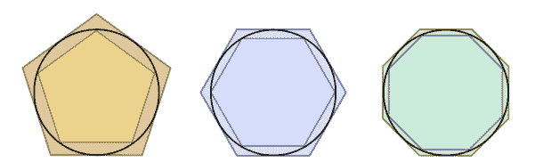

#### 图 1.1

由内接多边形和外切多边形所界定的圆。圆的面积位于这两个边界面积之间。随着多边形边数的增加，近似程度越来越好。

维基共享资源；公有领域。

取决于我们所需要的小数位数。对于更“现代”的方法，我们可以使用计算机对收敛到 π 的无穷级数的极多项进行求和。这样的级数有很多，第一个在14世纪就有描述。

这些基于规则的程序也能够进行模拟；例如，可以通过模拟计算π。假设我们有一个半径为1的四分之一圆，嵌入在一个边长为1单位的方形靶板中，向靶板投掷飞镖，使其随机落在板内某处，则命中圆内区域的概率等于该区域面积与整个正方形面积之比，根据简单几何学，这个比值为π/4。我们可以用计算机模拟该实验，让它选取成对的随机数（每个数在0和1之间），并将这些数作为X-Y坐标来计算模拟命中的位置。计算机可以同时记录落在四分之一圆内的命中数与整个靶板上的总命中数之比，该比值就等于π/4。如图1.2所示。

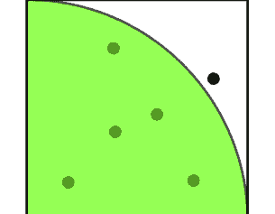

#### 图 1.2

随机投掷飞镖的模拟。这里落在圆内区域的投掷次数为5，总投掷次数为6。

来自维基共享资源；公有领域。

在图1.2所示的例子中，基于仅6次投掷，π的值约为3.3。只要再多投几次，我们就能超越阿基米德；而通过极多次投掷，我们可以接近通过其他方法得到的最佳π值。由于这涉及随机过程，因此被称为蒙特卡洛模拟。

机器学习则大不相同。考虑一个用于区分正方形和圆形的程序。对于机器学习，我们只需提供大量已知的正方形和圆形，每个都标注其正确身份。计算机从这些带标签的数据中创建自己的规则集，而不是由程序员提供。机器利用积累的经验最终正确分类未知图像。程序员无需显式定义使形状成为圆形或正方形的参数。有许多不同类型的机器学习策略可以做到这一点。

在最复杂的机器学习形式中，例如神经网络（深度学习），计算机做出分类所依据的内部表示是程序员无法直接观察或理解的。随着程序获得越来越多带标签的样本，它区分从未见过的新数据的“圆度”或“方度”的能力越来越强。它利用先验经验来提高其判别能力，并且数据本身不必受到严格限制。在这个例子中，程序可以做出独立于形状大小、颜色甚至规则性的决定。我们称之为人工智能（AI），因为这似乎比传统计算更类似于人类的行为方式。

## 机器学习的种类

机器学习时代基本上始于马文·明斯基和弗兰克·罗森布拉特等先驱的工作，他们描述了最早的神经网络。然而，这种方法当时发展缓慢，原因有很多，包括缺乏能够推广到大多数现实世界问题的算法、当时输入存储和计算的原始性。推动该领域发展的主要概念创新是反向传播和卷积，我们将在后面的章节中详细讨论。与此同时，正在开发的其他学习算法也超越了简单的基于规则的计算，涉及从大量数据中进行推断。这些算法都解决了基于算法先前使用已知数据集训练而对未知实例进行分类的问题。

大多数（但不是全部）算法可分为三类。分类可以基于抽象多维空间中的数据点聚类（支持向量机）、概率考量（贝叶斯算法），或通过决策树和随机森林中的顺序搜索对数据进行分层。使用这些技术的一些方法如图1.3所示。

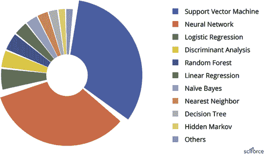

#### 图 1.3

机器学习的种类。

*转载自 https://medium.com/sciforce/top-ai-algorithms-for-healthcare-aa5007ffa330，经 SciForce 联合创始人 Max Ved 博士许可。*

所有这些后一种方法，加上神经网络，统称为“机器学习”。然而近年来，神经网络因其近乎通用的适用性和从输入数据中创建高层抽象的能力而主导了该领域。基于神经网络的程序通常被定义为“深度学习”。与普遍看法相反，这不是因为此类网络中发生的学习的复杂性，而仅仅是因为神经网络的 multilayer 结构，如下文所述。为简单起见，在本书中我们将其他种类的机器学习称为“浅层学习”。

神经网络这类机器学习算法的演变大致但粗略地基于大脑中生物神经网络的工作原理。神经网络并不“思考”；相反，它利用信息来改进其性能。这是一种学习，而不是像对手那样通过暴力方法实现。这种暴力方法评估了数十亿种可能的走法，但它成功击败了国际象棋大师。另一方面，机器学习算法可以基于从之前玩过的许多其他游戏中学习的经验，制定战略上的最佳走法，就像先前示例改进了前一节所述的简单分类问题一样。早期的机器学习模型仅需72小时的对弈即可与世界上最好的基于规则的棋类程序匹敌。诸如此类的网络学习做出判断，而无需隐式输入关于做出这些判断时要调用的规则。

大多数机器学习程序的共同点是需要大量已知示例作为训练它们的数据。在抽象意义上，程序使用数据创建一个内部模型或表示，该模型或表示封装了这些数据的属性。当它收到未知样本时，它判断该样本是否适合该模型以对其进行分类。神经网络是生成此类内部模型的最佳方法之一，但在某种意义上，每种机器学习算法都会这样做。例如，一个程序可能被设计用于区分猫和狗。训练集包含许多狗和猫的示例。本质上，程序从猜测开始，并通过多个已知示例不断优化猜测。在某个时刻，程序可以正确地将未知示例分类为狗或猫。它已经生成了“猫性”和“狗性”的内部模型。由已知示例组成的数据集称为“训练集”。在将模型用于未标记的未知示例之前，必须测试程序以了解其效果如何。为此，还需要一组已知示例，这些示例不用于训练，而是用于测试机器是否已经学会识别它从未见过的示例。算法分析其对该“测试集”进行表征的能力。

尽管许多论文用准确率来量化测试结果，但这是一种不完整的度量，并且在要区分的两个类别之间存在不平衡的情况下，它完全无效。例如，2011-2015年期间总体癌症发病率低于每10万男女500例。我可以创建一个简单的算法来预测随机个体是否患有癌症，只需让该算法报告所有人都是阴性。这个模型的错误次数将少于仅500次，因此其准确率约为99.5%！然而这个模型显然毫无用处，因为它无法识别任何癌症患者。

如这个例子所示，我们不仅需要考虑模型的准确性，还需要考虑其错误性质。有几种方法可以做到这一点。最简单的方法如下。模型的输出可能有四种结果：真正例（TP）、假正例（FP）、真负例（TN）和假负例（FN）。有简单的公式可以确定算法的阳性预测值和灵敏度。它们分别被称为“精确率”（Pr）和“召回率”（Re）。在一些文献中，会给出F1值，即Pr和Re的调和平均数。

## 深度学习与神经网络

对于许多类型的机器学习，程序员需要确定相关特征及其量化方式。特征可以包括重量、大小、颜色、温度，或任何可以用定量、半定量或相对术语描述的参数。创建特征向量的过程通常被称为特征工程。有些事物包含太多特征，无法直接进行此操作。例如，一张图片在像素级别可能包含数兆字节的数据。在机器学习出现之前，图像分析基于特定的规则和测量来定义特征，基于规则的程序通过边缘、纹理、形状和强度等检测模式，以识别细胞核、细胞质、有丝分裂、坏死等对象，但如何解读这些结果则取决于人类病理学家。在神经网络出现之前，机器学习也需要人类来定义特征，这一任务通常被称为“特征工程”。而这些更强大的网络则能够从整个图像中做出具体的分类和预测。由多层模拟神经元组成的神经网络将这一进程又推进了一步；这些算法的大部分优势在于网络能够自行从输入数据中抽象出高级特征。这些特征基于初始数据输入的组合，通常被称为数据的表示。这些表示的维度远低于输入的原始特征向量。这些表示形成于输入和输出之间的网络层，即所谓的隐藏层。训练会优化这些表示，程序利用它们推导出自己的内部决策规则。因此，神经网络通过从数据中创建隐藏变量来学习规则。

在神经网络的内部层中，导致表示的抽象过程基于一种通常由随机变量启动的迭代模型，因此对人类观察者来说部分无法解释（这就是为什么这些内部层被称为“隐藏”层的原因）。这种缺乏可解释性让该领域的一些研究者感到不安。然而，如果你询问一位经验丰富的病理学家，他或她如何根据对活检切片的检查得出诊断，他们会发现很难解释做出该判断所涉及的认知过程；尽管如果追问，他们可以定义一组与该诊断一致的特征。因此，神经网络和人类都基于不易解释的过程来做决策。

最简单的神经网络至少有一个隐藏层。大多数神经网络有几层模拟神经元，每一层的“神经元”都与下一层的所有神经元相连。这些层之前通常是一个卷积层组，大致基于大脑视觉皮层的结构。这些卷积层将输入数据转换为后续全连接层可以处理的形式。基于这种神经网络，有许多不同类型的现代复杂机器学习算法，它们将在本专著中占据主要篇幅。并非所有机器学习程序都基于这些深度学习概念。有些程序依赖其内部模拟神经元之间不同的互连方式，例如所谓的受限玻尔兹曼机。其他一些，如脉冲神经网络，采用的架构更类似于生物大脑的工作方式。虽然这些代表了当前人工智能的技术水平，但基本的全连接和卷积框架更易于训练且计算效率更高，因此直到2019年仍是首选网络。

还应该指出，可以进行无监督或弱监督学习，其中关于类别标签的先验信息很少或没有，这些方法也需要大型数据集。在后续章节中，我们将在描述各类机器学习内部工作机制时详细阐述这些概念，之后我们将描述人工智能如何融入病理学中的全切片成像（WSI）框架。以此为基础，我们将详细探讨当前人工智能在病理学中最先进应用的实例。这一点尤其及时，因为人工智能如今已成为我们生活中不可或缺的一部分。汽车的现代安全功能、关于我们是否为良好信用风险的决策、定向广告和人脸识别都是一些明显的例子。当我们与Siri或Alexa交谈时，我们就是在与人工智能程序互动。如果你有iWatch或类似设备，你可以被监测心律失常、意外跌倒等情况。人工智能的成功包括自然语言处理和图像分析等突破。

人工智能在医学中发挥着越来越重要的作用，从研究到临床应用都如此。图1.4展示了一个使用机器学习整合临床数据以进行患者护理的典型工作流程。

IBM的Watson是这个范式应用的一个很好例子。来自自然语言的非结构化数据经过处理，并以一种可以与实验室检查和体格检查等更结构化的临床信息相结合的形式输出。在此所示的范式中，图像本身并不通过机器学习来解读，而是使用那些实体的标注（诊断印象、显著特征等）。随着神经网络变得越来越复杂，它们可以承担解读图像的任务，并在病理学家和放射科医生的监督下，进一步简化诊断路径。在图1.4中，AI一词用于定义机器利用其训练作出看似类人判断的整个过程。

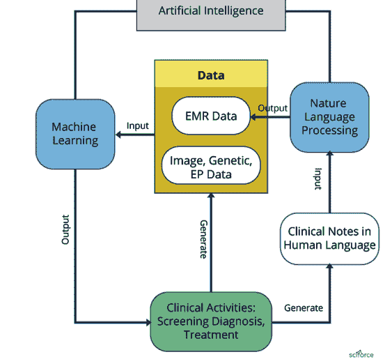

#### 图1.4

人工智能融入临床决策。该框架可以同时获取精确的可量化数据和非结构化的叙述性信息。

转载自 https://medium.com/sciforce/top-ai-algorithms-for-healthcare-aa5007ffa330，经SciForce联合创始人Max Ved博士许可。

### AI在病理学中的作用

据估计，临床病历中约70%的数据由实验室数据构成，因此病理学家是这些数据在其余30%数据背景下的重要解释者。即使在分子分析时代，病理学家对基于图像的数据的解读所涉及的认知技能，在那些诊断发生在组织层面的临床情境中仍然具有重大意义。由于预后诊断分级的复杂性、需要整合分子数据的视觉相关性（如基于基因的组织化学标志物、基因表达和免疫学特征），以及大量供比较审查的档案材料，这一任务变得越来越困难。基于这些及许多其他原因，人工智能在解剖病理学中的研究和应用，以及在临床病理学中的持续应用，正在以指数级速度推进。

在许多方面，放射科医生的经验正在帮助指导病理学的发展，因为放射科医生继续以快速的速度采用AI。病理学家进入这一领域较晚。对于放射科医生来说，AI主要是关于图像分析，而他们的图像相对容易数字化。在病理学中，直到WSI以适当的分辨率尺度和采集速度可用时，才能为计算机输入获取和标注数据集。WSI的一些驱动因素是效率、数据可移植性、与其他诊断方式的整合等，但从玻璃显微镜转向WSI的两个主要后果是能够整合AI和纳入计算密集型成像模式。尽管AI在临床病理学中发挥着重要作用，在基因组和蛋白质组阵列的解释等方面，推理和预测模型很重要，但本书的重点将是AI在解剖病理学中的使用，特别关注从图像中提取关于诊断、分级、预测等的最大信息。

### AI的局限性

在认识到AI的巨大成功的同时，重要的是要注意三个重要的局限性。首先，目前大多数算法都是“一招鲜”，只能执行它们受训的特定任务，将所学应用于新问题的能力有限。尽管可以在计算机上进行所谓的迁移学习，但这仍远未达到人类拥有的那种通用智能。其次，训练一种算法需要庞大的数据集，通常包含数千个示例。相比之下，人类可以从极少量的数据中学习。一个幼儿不需要1000个例子就能学会区分苹果和香蕉。第三，机器的计算在能源需求方面非常低效，与人脑相比，即使人脑比有史以来最大的超级计算机还要复杂得多。一个典型人脑约有1000亿个神经元和100万亿个相互连接，这比全球任何时候运行的全部神经网络集合都要大得多。这还有一个次要后果。据估计，训练大型AI模型产生的碳排放几乎是汽车全生命周期碳排放的五倍。

有几种新方法能够解决这些问题。第一种是神经形态计算，它试图创建一个类似大脑的物理基底，在其中实现AI，而不是仅作为软件模型运行。基于相变材料的人工神经元已经被创造出来。相变材料可以存在于两种不同相态（例如结晶态或非晶态），并在激光或电触发下轻易地在两者之间切换。在某个时刻，材料从非导电状态转变为导电状态并放电。经过一个短暂的不应期后，它准备好再次开始这一过程。换句话说，这种相变神经元的行为就像生物神经元一样。人工突触也被创造出来。这些构造似乎比当前完全软件实现（如传统神经网络和更直接模拟神经元行为的脉冲网络算法）要节能得多。

更遥远的未来是量子计算的希望，它将比目前最强大的计算机快数个数量级。这些基于三态“量子比特”（0、1以及这两者的不确定叠加），而不是二进制比特，并且这些状态可以同时保存多个值。量子计算机也可以同时处理这些多个值。理论上，这让我们能够解决当前难以处理的问题，并可能带来AI的重大进展。尽管当前量子计算机只有少量相互作用的量子比特，但可以想象，未来的量子计算机可以用远少于人脑的相互作用量子比特数来接近人脑的复杂性（当然，除非如某些人所推测的那样，大脑本身在某种程度上就是一个量子计算机）。这并不像看起来那么牵强，因为光合作用过程已被证明在生理温度下表现出量子特性[3,4]，从而证明了在室温下维持量子相干性的可行性——这些技术已有数百万年的演化时间。

然而，即使使用当前的技术，AI的潜力和现有应用都已表明，它将在病理学和整个医学中发挥同样强大的作用，正如它已经在许多其他领域和学科中发挥作用一样。关于AI的全面概述和历史观点，参见参考文献[5]。

### AI的总体方面

对于AI在解决现实问题中的任何应用，必须解决许多实际问题。例如，

- a. 对于特定AI算法的选择，相对于其他可能的求解策略，哪些学习问题类别是困难的，哪些是容易的？
- b. 如何估计实现学习所需或足够的训练样本数量？
- c. 在精度和灵敏度之间，人们愿意做出怎样的权衡？
- d. 所提出模型的计算复杂度与竞争模型相比如何？

对于此类问题，目前还没有分析性的方法来获得最佳答案。因此，算法的选择及其优化仍然是一种经验性的试错方法。然而，医学的许多方面已被证明适合采用AI方法。有些是“以记录为中心”的，它们挖掘电子健康记录、期刊和教科书材料、患者临床支持系统等，以寻找流行病学模式、风险因素和诊断预测。这些都涉及自然语言处理。其他的则涉及信号分类，例如心电图和脑电图记录的解释。一个主要的应用领域是医学图像分析。正如他们在图像数字化方面所做的那样，我们放射学领域的同事在该领域处于领先地位，并取得了令人瞩目的成果。随着全切片成像的出现，病理学也采用了这种方法，全切片成像除了许多其他好处外，还为嵌入来自活检标本的机器学习提供了框架。

由于WSI越来越重要且普遍，在接下来的章节中，将重点关注图像解释，并额外关注AI在探索其他大型相关数据阵列（如基因组和蛋白质组研究）中的应用。有趣的是，尽管基因型决定表型，但使用AI，我们有时可以根据肉眼不易察觉的细微形态差异，从图像表型逆向推断潜在的基因型。自然语言理解是当前AI研究的另一个主要领域，它是一个广阔的领域，需要单独的专著，并且很大程度上超出了本书的范围，尽管它对于分析临床图表、电子健康记录和流行病学信息以及文章和参考文献检索都很重要。通过去除围绕AI的神秘感，可以清楚地看到，它是临床和研究实验室的硅基助手，而不是将取代病理学家的人工大脑。

### 参考文献

- [1] Jones MO. 生物学家用Python. CreateSpace Press; 2013.
- [2] Dijkstra, E.W. 对计算科学的威胁 (EWD-898) (PDF). E.W. Dijkstra Archive. Center for American History, University of Texas at Austin. [转录].
- [3] Fassioli F, Olaya-Castro A. 捕光复合物中纠缠的分布及其量子效率 (2010). New Journal of Physics 2010;12(8). http://iopscience.iop.org/1367-2630/12/8/085006.
- [4] O'Reilly EJ, Olaya-Castro A. 室温下协助激子能量转移的分子振动的非经典性. Nature Communications 2014;5:3012.
- [5] Sejnowski TJ. 深度学习革命：人工智能遇见人类智能. MIT Press; 2018.

值。在强化学习中，算法学习对环境的反应，并通过奖励函数找到最优策略。

尽管我们倾向于认为深度学习和神经网络是最新形式的机器学习，但事实并非如此。现代神经网络架构的原始祖先始于1957年罗森布拉特[1]的工作。这些神经网络大致基于麦卡洛克和皮茨[2]在约十年前描述的神经元功能模型（参见参考文献[3]对深度学习历史的综述）。基本上，它涉及一系列分层排列的模拟神经元，一层的输出成为下一层的输入。因此，每一层都从下一层接收越来越复杂的输入，正是这种复杂性使算法能够将未知输入映射到输出解决方案。请注意，“深度学习”一词并非指程序的复杂性，也不是指它以任何有意义的方式模仿思维的能力。它仅仅指的是它由许多层非线性处理单元及其线性互连构成。在最基本的层面上，深度学习就是线性代数，外加一点多元微积分和概率论。

与此同时，许多其他机器学习模型也被开发出来，它们被许多人（尽管不是全部）统称为浅层学习。与深度学习的情况一样，在所有这些模型中，程序都会接收到一个包含已知示例及其定义特征的大型数据集。在最简单的情况下，训练集中有两类对象，程序必须从这些数据中构建一个模型，使其能够预测未知示例的类别。如果这两类是臭虫和毛毛虫，有用的特征可能是长度和宽度。要区分不同的面孔，可能需要确定大量不同的形态测量特征。这些架构的发展与神经网络的发展并行。神经网络的一个主要优势是它们可以直接从数据中导出自己的特征（特征学习），而浅层学习则需要程序员显式地创建特征集（特征工程）。深度学习的另一个优势是它可以用于强化学习，即算法通过最大化奖励函数来学习对环境做出反应。

尽管有这些明显优势，深度学习领域仍沉寂了多年，部分原因是早期模型没有达到宣传的效果（它们被标榜为思考机器），但主要是因为直到最近，可用的计算能力和存储容量才足够。深度学习往往比浅层学习在计算上更“贪婪”。

在所有形式的机器学习中，计算机都会接收到一个由已知示例组成的训练集。程序训练完成后，它会接收到一个验证集。这是另一组已知示例。但是，这个验证集要等到训练完成才会使用。此时，程序将用验证集中的示例进行测试，以确定它识别这些从未见过的样本的能力。需要注意的是，仅凭准确率并不能有效衡量

| 样本 | 特征1 | 特征2 | 特征3 | 特征4 | 类别 |
|---|---|---|---|---|---|
| 1 | a1 | b1 | c1 | d1 | 类别1 |
| 2 | a2 | b2 | c2 | d2 | 类别1 |
| 3 | a3 | b3 | c3 | d3 | 类别2 |
| 4 | a4 | b4 | c4 | d4 | 类别1 |
| 5 | a5 | b5 | c5 | d5 | 类别2 |
| 6 | a6 | b6 | c6 | d6 | 类别2 |
| 7 | a7 | b7 | c7 | d7 | 类别1 |
| 8 | a8 | b8 | c8 | d8 | 类别1 |
| 9 | a9 | b9 | c9 | d9 | 类别1 |

#### 图2.1

以矩阵形式表示的数据集。每个特征集用一个字母和一个数字表示，数字显示它属于哪个样本。请注意，这些值不必是唯一的；例如，a1、a3、a7可以相同。事实上，为了进行学习，*必须*存在共享的特征值。在此数据集中，四个属性定义每个样本。当训练集中的样本呈现给机器学习程序时，它们通常按随机顺序排列。

在这个例子中，有九个样本，代表两个不同的类别。每个样本都由其特征集（本例中为4个）来定义。在机器学习术语中，样本（或示例）也称为“实例”，特征也称为“属性”。给定样本的特征集合称为其“特征向量”。在这种情况下，向量被定义为n个元素的有序集合，而不是有向线段。特征（a1、a2等）可以是任何适合计算机处理的内容。如果一个特征是颜色，我们必须通过将每种颜色分配给一个不同的数字来定义该特征（红色编码为1，蓝色编码为2，依此类推）。我们可以提及特征向量的维数N（此处为4），或者在某些情况下，整个数据集的维数。为了使这成为一个可用的训练集，任何样本都不能具有完全独特的特征集，因为如果是这样，计算机将没有泛化到新的未知样本的基础；它所能做的只是记住列表。

### 几何（基于距离）模型

这些属于聚类算法的范畴。它们将被详细讨论，以阐明更复杂机器学习形式中涉及的许多概念。

开始讨论聚类的最佳方式是用一个例子。放血疗法是一种被广泛接受的治疗多种疾病的方法，始于约3000年前，至今仍用于真性红细胞增多症和血色病[5]等疾病。在医学的美好旧时光里，这是通过使用吸血水蛭来完成的。有吸血水蛭和

为了处理位于分隔线上或靠近分隔线的新样本，我们在训练空间中寻找离新样本最近的点，并假设它们属于同一类别。然而，这些点可能正好位于两个不同类别中两个点的中间，测试点本身可能不准确，数据也可能是“嘈杂的”。解决方案是**K近邻算法（KNN）**，虽然简单，却是一种强大的机器学习策略。只需使用几个（K）最近邻而不是一个，然后采用多数表决，或使用平均值或加权平均值。

前面已经指出，乍一看，这可能并不比涉及统计分析的基于规则的算法好多少。然而，考虑一下当属性（特征向量）的数量有数百或数千个，而不仅仅是两个时的情况。

即使面对更复杂但仍可线性分离的图，通常也有许多不同的方式来绘制边界线，如图2.3A所示。事实上，在这个例子中有无数个线性分隔线。最好的线是提供两个类别最大分离度的线。为此，我们显然只需要考虑离分隔线最近的点，这些点被称为支持向量。利用这些点，算法创建一条离两个聚类中的所有点都最远的线（图2.3B）。执行此操作的算法称为**支持向量机（SVM）**。

SVM能做的远不止寻找最优线性边界。它甚至可以通过核函数将非线性数据转换为线性形式，即在一个更高维空间中的新坐标系中变换数据，而核函数本身只涉及线性运算。这被称为“核技巧”。

图2.4的右侧显示了一个示例，其中两个类没有可以分隔它们的线性边界。在这个例子中，有两个类，每个类有两个定义属性。显然，没有线性边界可以分隔它们。在这种情况下，圆形（非线性边界）可以解决这个问题。然而，如果你想象将一个类拉入第三维，如图2.4左侧所示，那么就很容易

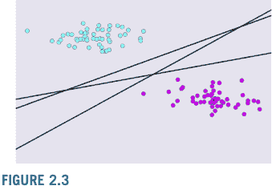

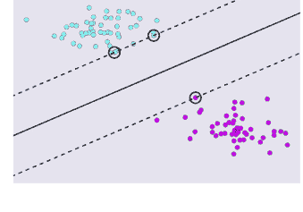

#### 图2.3

A)：所示聚类的可能线性分隔线。（B）：支持向量用于构建最佳分隔线。

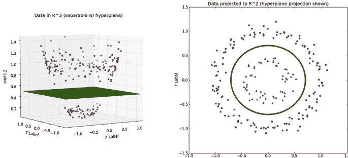

#### 图 2.4

通过增加维度为数据创建线性分隔符。左侧 3D 空间中显示的分隔平面类似于 2D 空间中绘制的线。一般而言，对于任意 N 维空间，此类线性结构被定义为超平面。

> *经 Eric Kim (www.eric-kim.net) 许可转载。*

为了看到一个平面可以将其分开。一般而言，SVM 可以提高数据空间的维度，直到一个 (N-1) 超平面可以分离类别。在此示例中，二维图被转换到三维空间，使得一个 N = 2 超平面可以提供边界。

### K-Means 算法 (KM)

这也是一个经典的聚类算法，但它在单独的部分中讨论，因为重要的是不要将其与 KNN 混淆，因此它们出于教学而非概念上的原因被分别介绍。这是一个另一个重要区别，即与 K 近邻算法不同，它涉及无监督学习。因此，它不仅本身具有重要应用，而且与一些深度学习方法结合时也具有重要应用。

K means 算法尝试在无标签数据中寻找聚类。首先对聚类的数量做出猜测（这将在后面 refined）。质心是聚类中所有点的算术平均位置。接下来对每个聚类的中心点位置做出随机猜测，以便创建 k 个伪中心。这些点彼此之间应有合理的距离，但需要与实际聚类没有任何关系，可以随机选择（除非对数据结构有一些先验知识）。接下来将数据集的每个点分配给其最近的伪中心。我们现在形成聚类，每个聚类包含与其伪中心相关联的所有数据点。接下来更新每个聚类的伪中心位置，使其现在确实位于其所有成员的中心。递归地执行此操作，直到聚类成员资格不再发生变化。

我们可以通过绘制类内散点随聚类数量变化的函数来确定 K 的最佳选择。作为极端示例，如果 K 等于数据点的数量，则每个聚类中显然没有方差，因为它们各自仅由一个元素组成。聚类数量越少，聚类内的方差越大。当方差作为 K 的函数被绘制时，该方程让人联想到指数衰减，很容易选择一个 K 值，使得更大的值不会明显改变整体方差。这类似于主成分分析 (PCA) 中所使用的所谓的“碎石图”，在下面的单独部分中描述。

### 概率模型

在上一节中，聚类和距离的基本构建块被用来学习数据之间的关系，并利用这些关系来预测类别标签。我们也可以通过提出以下问题来解决这个问题；给定未知示例的特征集，它属于给定类别的概率是多少？更精确地说，如果我们让 X 表示我们所知道的变量，即我们实例的特征值，而 Y 表示目标变量，即实例的类别，那么我们希望使用机器学习来模拟 X 与 Y 之间的关系。

由于对于给定实例 X 是已知的，但 Y 不是（训练集中除外），我们对条件概率感兴趣；给定 X 时 Y 的概率。这就是说，给定样本的特征集 (X)，预测它所属的类别 (Y)。在数学符号中，这写为 P(Y|X)，读作“在给定 X 的情况下 Y 的概率。”作为一个具体例子，X 可以表示短语 "my fellow Americans"，而 Y 可以表示说话者是否属于政客类别（因此在同一句话中使用“类别”和“政客”这两个词，可能第一次）。

因此分类问题就是简单地找到 P(Y|X)。几种发生情况的概率可以直接从训练集中计算。在图 2.1 的数据矩阵中，对于任何给定的特征 X，我们只需计算其值出现的次数除以变量总数，得到 P(X)。对于 Y 的任何给定值，我们可以类似地计算该类别出现的次数相对于总体类别数量的比率。以这种方式，我们可以计算 X、Y 的集合的值以得到 P(Y) 和 P(X)。

我们还可以做一件事，那就是计算 P(X|Y)，即在给定类别的情况下特征的概率，这只是基于只查看该类别并确定在训练集中该类别样本中特征值 X 出现的次数。我们现在知道了 P(X|Y)。根据这些信息，我们可以通过易于证明的贝叶斯定理（本章中使用的唯一方程）计算在给定其特征集知识的情况下类别的概率 P(Y|X)：

P(Y|X) = (P(X|Y)*P(Y))/P(X) 如果画出 Venn 图，这就变得直观明显。

在实践中，这个公式太简单了，因为为了从属性对类别做出预测分配，每个样本必须具有多个属性，而在现实世界问题中，远不止一个。处理多个属性的程序更复杂 [6]。无论如何，贝叶斯定理是条件概率基本规则之一的表述。然而，以这种方式计算概率的问题在于特征集中的某些特征可能相互依赖（对于胚胎，质量和细胞数量是依赖变量），这使得计算困难。在实践中，这个复杂性被忽略，特征被当作独立处理。该算法被称为 **Naïve Bayes**，其中 naïve 的意思是我们愚蠢到假设独立。令人惊讶的是，尽管存在这一限制，Naïve Bayes 仍然表现 remarkably 好，因此它已成为一个重要的机器学习模型。还有许多更复杂的模型处理依赖关系；这些被称为贝叶斯最优分类器。还有一个中间立场，其基于某些事物是条件依赖而某些事物不是的想法。

这些方法属于概率图模型的框架，被称为贝叶斯信念网络或有向图网络。这些是网络，它们通过使用有向图表示一组变量及其条件依赖关系。此类简单网络的一个例子显示在图 2.5 中。降雨会影响洒水器是否打开，而降雨和洒水器都会影响我们是否被淋湿。贝叶斯信念网络超出了本章的范围，但更多信息可在参考文献 [7] 中找到。所有这些算法都从其样本空间内的概率分布中学习，而不是像 SVM 和其他几何模型那样使用空间度量。

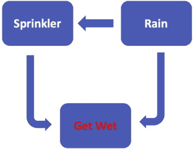

#### 图 2.5

三个对象之间的关系。是否下雨决定了洒水器是否打开，但反之则不然，所以这是一个有向图。同样，雨或洒水器都会让我们湿，但湿的状态不会导致降雨或洒水器发生，所以这些箭头也是有方向的。

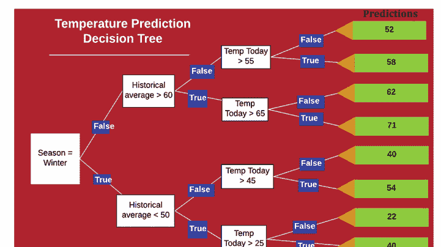

#### 图 2.6

用于预测明天最高温度的决策树。西雅图，2017 年 12 月 27 日。摘自 Koehrsen，Random forest simplified。在此树中，每个分支都做出二元决策，因此每个父节点产生两个子节点。
https://medium.com/@williamkoehrsen/random-forest-simple-explanation-377895a60d2d.

可以以多种方式为给定数据集构建决策树：
- 对不同树使用数据的不同子集，
- 使用不同的决策标准，
- 限制每棵树的深度，等等。
对于 (a) 常用的一种技术称为 bagging。在 bagging 中，通过在每次生成样本后从主数据集中有放回地抽样来获取多个新的训练子集。每个子集用于不同的树。随机森林由若干此类决策树的集合组成，多数投票或其他某种共识标准决定最终输出值（图 2.7）。

### 维度灾难与主成分分析

直观上，给数据添加更多特征似乎会提高我们对其进行分类的能力，但在许多应用中，这会使事情变得更糟 [8]。随着特征集维度的增加，样本所在的空间随维度的幂次增加，因此在任何给定点的样本密度都会低于准确预测所需的密度。明显的解决方案是获取更多数据，但在实践中这可能并不总是可行。存在降维技术，可以最大限度地减少由此带来的信息损失

### 随机森林简化

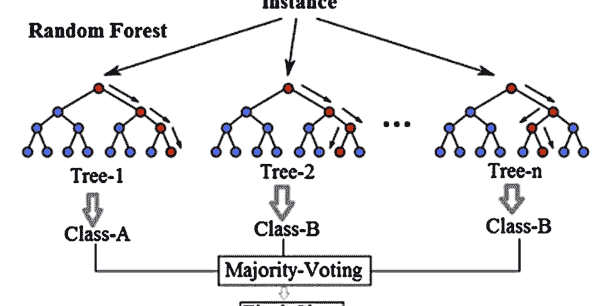

#### 图 2.7

由三棵决策树组成的随机森林。Koehrsen，《随机森林简化》。
https://medium.com/@williamkoehrsen/random-forest-simple-explanation-377895a60d2d.

降维。经典例子来自统计模型，即 PCA，它最早在 20 世纪 30 年代被描述，远早于机器学习的出现。PCA 通过寻找数据中最大方差方向来运作。这是数据分布最分散的维度，也是第一主成分。下一个主成分是垂直于该成分且数据分布次之的线，依此类推。重复这一过程，直到主成分的数量与原始数据的维度数量相同。本质上，它只是将数据从 n 维空间线性变换到另一个 n 维空间，并保留原始数据集中的信息。为了降低这个变换后集合的维度，我们必须丢弃其中一些成分。由于这 n 个成分已经按重要性排序，如果我们想投影到 k 维（k < n），只需保留前 k 个成分，丢弃其余部分。我们可以用一张图来展示信息的损失，该图显示方差随成分编号的变化（用数学术语说，该曲线在 y 轴显示协方差矩阵的特征值，在 x 轴显示成分编号）。这种图形称为碎石图。

## 深度学习与人工神经网络

在能够明确定义问题特征向量的情况下，浅层学习效果很好。涉及图像解释与分类以及需要自然语言处理的问题，正是这些模型因数据复杂性而表现不佳的例子。人脑非常擅长处理这些，因为它利用一系列处理级别或“层”，每一层都比前一层进行更复杂的分析。以大脑为模式的计算方法——深度学习，很好地解决了这个问题。尽管不是深度学习的唯一形式，基于神经网络的模型是目前最常使用的。

正如我们将看到的，ANN 会发展出日益复杂的数据内部表示，并在此过程中自动提取数据集中相关且显著的特征向量。在本章中，我们将介绍全连接网络和卷积网络的基础知识。更高级的架构将在下一章介绍。目的是详细展示 ANN 的内部工作原理（二层视角），而不是像大多数医学文献中那样仅仅提供描述性的 3 万英尺高空概览，同时避免那些在地面上才会显现的基础数学和编程细节。整个论述中只有一个方程，而且很容易推导。应该指出，还有很多其他深度学习算法并不是基于本文所述的那种线性序列连接层（例如玻尔兹曼机）。由于这些算法很少在病理学应用中使用，因此这里不作介绍。

在所提供的示例中，重点将放在图像解释上，但相关原理也可应用于基因组学和表达阵列，以及自然语言处理。自然语言处理和语义理解不在讨论范围内；目前最先进的程序，如 IBM 的 Watson 和类似努力，已在临床环境中被证明令人失望。重点将完全放在监督模型上。正如存在用于无监督学习的浅层网络模型一样，也有许多无监督深度学习策略，其中一些将在后续章节中介绍。

### 神经科学 101

如上所述，深度学习模型（非常）松散地基于哺乳动物大脑的神经网络架构，以及构成大脑的网络中的神经元如何处理神经元内部和从一个神经元到另一个神经元的信号。第一批哺乳动物神经网络大约在 2 亿年前出现。通过“持续性能改进”的过程，我们现在拥有了图 2.8 所示的细胞结构。

神经元在其树突末端接收信号，通常来自多个其他神经元。这些信号在细胞内整合，如果超过阈值，就会以动作电位的形式通过轴突传递。信号通过电脉冲或尖峰传播，这些电脉冲或尖峰由细胞膜上离子通道的调节产生，并通过涉及多种化学介质的电化学反应，在分隔神经元的突触间转导。每个动作电位是一种简单的开关式电能量爆发。唯一例外的是以换能器为末端的感受神经元。例如，在环层小体中，动作电位随刺激强度变化。

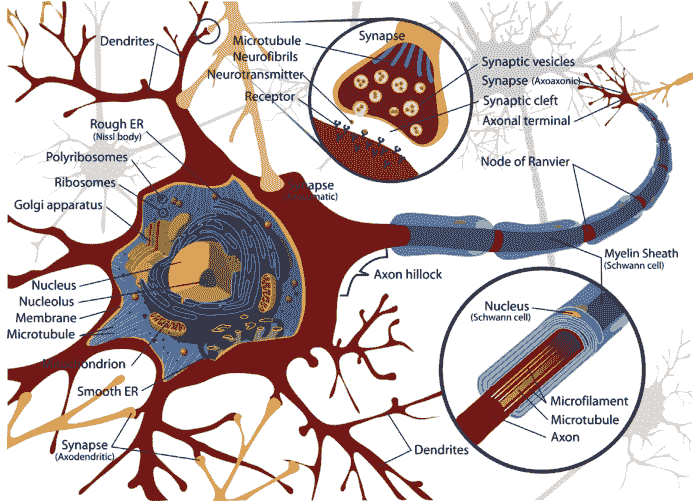

#### 图 2.8

典型神经元的示意图。细胞可以通过其树突接收来自许多其他神经元的信号。如果这些信号的总和超过阈值，神经元就会将整合后的信号传递给其他神经元。人脑大约有 1000 亿个神经元。LadyofHats，知识共享。

由于每个树突输入通过多种相互作用的电化学事件与其他输入相互作用，因此输入可能是非线性的总和，尤其是因为输入的空间分离会影响它们的相互作用。因此，神经元的放电阈值可能是全有或全无事件（用数学术语说，这是一个赫维赛德斜坡函数），而整个过程是非线性的。此外，信息可以通过电流在神经元内向后移动。换句话说，神经元有一个内部反馈系统。一个反向传播的动作电位可以激活缓慢的树突电压门控离子电流，这些电流反过来流向轴突中的锋电位起始区，导致额外的动作电位。这实际上给了我们一个存在于单个神经元中的两层神经网络。实验表明，即使在这个基本的计算水平上，也可以实现方向选择性和重合检测。

调节神经元间信号传递的电活动脉冲可以根据脉冲频率、脉冲宽度或相对于其他传入信号的脉冲到达时间进行调制。一个神经元可以接收兴奋性或抑制性信号。

信号的另一层调节发生在两个脑细胞之间的突触处。当突触两侧的神经元（输入和输出）具有高度相关的输出时，两个神经元之间的突触会得到加强。这被称为赫布学习。本质上，这意味着如果一个神经元反复激发另一个神经元，那么它们之间的联系就会被促进。赫布学习允许修改网络内的信息流。在大脑中，突触连接根据它们在任意给定时刻所响应的整合信号不断被重塑。重塑的机制尚未被很好地理解，但似乎基于化学梯度的累积和消耗。一些突触可以通过与星形胶质细胞或神经胶质细胞的相互作用而完全消除，可能是通过细胞因子实现的。

这幅画面还有更复杂之处：从整体来看，神经元可以表现出双稳态行为。双稳态是动力系统的一个属性，即表现出不止一个稳定点。Lowenstein 和 Sompolinsky [9] 提出的模型涉及树突中 Ca++ 浓度的双稳态。如果树突一端被迫处于高浓度状态，另一端处于低浓度状态，那么就会产生 Ca++ 浓度的驻波，而非梯度。只要没有进一步的输入，波前就会保持其位置。这个模型非常重要。虽然激活和触发神经元的过程发生在非常短的时间尺度上，但工作记忆需要更长的时间尺度，而这个模型是将瞬时效应整合为持久痕迹的一种简单方法，这本质上就是工作记忆的定义。

由于每个神经元接收来自许多其他神经元的输入，并将其输出发送给许多其他神经元，因此神经元本质上是聚合器；输出总量受其所有树突连接的总输入控制。由于轴突也可以连接到多个神经元，这允许形成复杂的多层结构。人脑大约有 1000 亿个神经元。即使按子系统排列，也存在数量巨大的可能互连。

### 机器的崛起

经过大约 190 万年又 3 个月（作者注：本章开始写作时是 190 万年前，距今已过 3 个月）的大脑进化，人类科学家开始对大脑进行建模。Rosenblatt 的单层感知机 [1] 基于 McCulloch 和 Pitts [2] 提出的第一个神经元数学模型，即 MCP 神经元。这一模型受到赫布关于突触可塑性概念的启发，该概念基于学习过程中脑神经元的适应。通过对输入应用不同的相对权重来影响输出，Rosenblatt 为这种改进的 MCP 神经元开发了一种监督学习算法，使其能够完全靠自己从数据中学习来找出正确的权重。这样一个人工神经元——它是一种数学抽象而非物理构造——在图 2.9 中进行了示意，并与生物神经元的简单表示进行了比较。

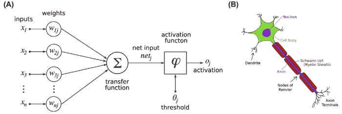

**图 2.9**  
图9A中图示了一个人工神经元（它是计算机程序中的一种抽象，而非物理实体）。每个输入*x*都通过一个权重*w*进行修正，然后求和，就像真实神经元中的突触输入一样。这个总和**Σ**被传递给激活函数φ，如果它超过函数阈值θ的值，它就会作为输出1被传递出去。在此示意图中，(Σ和φ)合在一起是生物神经元的对应物。Chrislb，知识共享许可。作为比较，图9B中显示了一个生物神经元。  
*(NickGorton-commonswiki).*

这种人工神经元是深度学习中大多数人工网络的基本构建单元，但它在以下几个方面是一种极大的过度简化。由于基于脉冲编码的数学分析很困难，模型神经元在每个与上游神经元相连的树突上接收一个单一的稳定值作为输入（存在脉冲人工神经网络（ANN），但它们并未被广泛使用）。学习过程中的信号变异性由一组与信号相关联的权重来表示，这些权重随着神经网络的学习而改变。生物神经元与现代ANN之间的另一个重要区别是，前者的阈值基于简单的通断式斜坡函数，而后者使用平滑曲线，如sigmoid或类似函数。

最初，sigmoid函数被用作传递函数。图2.10显示了典型sigmoid函数的曲线。sigmoid的取值范围从0到1。sigmoid是一个连续的非线性可微函数。请注意，与赫维赛德函数不同的是，激活阈值可以取我们在其范围内选择的任意值。当前的ANN也经常使用其他函数，如双曲正切函数或修正线性函数（ReLU）。正如我们将看到的，在神经网络中，权重通过一个涉及使用微积分寻求损失函数最小值的过程来调整，因此阈值必须是连续函数。此外，该函数必须允许网络处理非线性关系。早期神经网络在发表后不久所受到的批评之一，就是它们无法处理非线性关系。尽管围绕罗森布拉特感知机存在大量炒作，但在1969年，明斯基[10]出版了一本书，不仅表明了罗森布拉特感知机（实际上，任何单层感知机）究竟有多么有限，而且还导致了“人工知识分子”群体中学术气候的改变，也就是

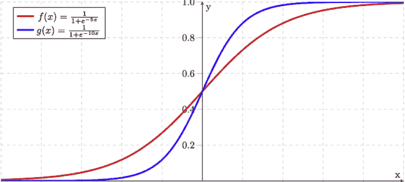

**图 2.10**

sigmoid函数曲线图。曲线的斜率可以通过选择方程中x的乘数来调整。曲线在x轴上的取值范围为0到1，因此使其成为斜坡激活函数的合理替代。

*M. Thoma，维基共享资源。*

所谓的20世纪80年代AI寒冬。然而，许多研究者的重大贡献使ANN重新回到了AI研究的前沿，这些贡献基于多层概念、非线性激活、反向传播和卷积。现代ANN及其将在下一章介绍的众多高级变体的优美之处在于，它可以表示任何连续有界函数的输出，因此可以模仿任何使用数学作为其底层实现的算法结构的输出（也就是说，大多数——如果不是全部的话——算法结构）。因此，除了自身独特的能力外，ANN可以完成浅层学习网络所能做的任何事情，但对于不太复杂的数据，浅层学习可能计算效率更高。然而，这些现代人工网络在超越这些不起眼的开端之后，已经成为真正复杂的模型，采用了线性代数、多元微积分、数理统计、博弈论、强化学习和进化论中的概念。为了强调要在人工基质中实现真正的通用智能还有多远的路要走，令人警醒的是，人脑包含数十亿个神经元，它们并非仅仅是被动的设备，每个神经元在处理数据时都像一台独立的微型计算机一样运作。如果我们把大脑看作一组相互作用的巨大网络，其可能的连接数量简直是天文数字级别的。

### ANN基础

典型的神经网络由多层节点组成，如*图2.11*所示。网络中的每个神经元都具有感知机所描述的特性。然而，除了输入层和输出层之外，还有数量可变的“隐藏”层将输入层与输出层连接起来。它们被称为隐藏层

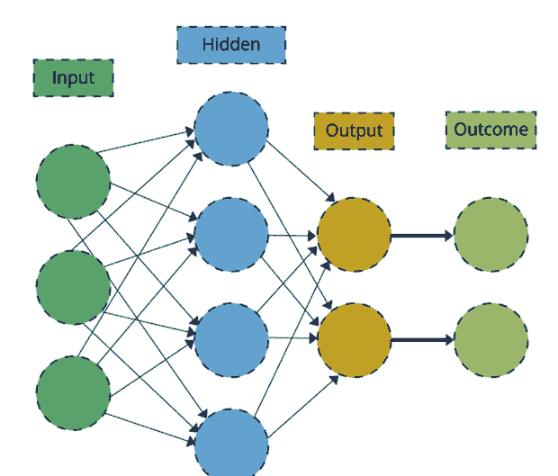

**图 2.11**

神经网络的多层结构。每个彩色圆圈代表一个神经元（通过激活函数传递聚合信号），连线是连接它们的输入和输出。在此示例中，仅显示了一个隐藏层。在实践中，会使用多个隐藏层。

> 引自SciForce：《健康领域顶级算法》白皮书，经M. Ved许可，《医疗保健顶级算法》SciForce-Medium。

的原因如下：由于我们知道输入并接收输出数据，因此这两层对我们来说是已知的。相比之下，中间的层对观察者来说并不容易直接访问。由于计算机没有认知能力，算法的每次运行本质上都是一次双盲实验。这就引发了关于深度学习模型可解释性的哲学问题。

ANN的基本特征如下：

- 每个输入神经元只直接从外部获得一个输入；隐藏层的神经元则获得多个输入。
- 同一层中的神经元互不连接。
- 一层中的每个神经元都连接到下一层的所有神经元。
- ANN是一个同步模型；给定层中的所有节点同时接收输入并计算它们的激活值。这意味着，必须完成第n层中的所有计算，才能开始第(n+1)层的计算。

因此，一层的输出成为下一层的输入。由于求和过程，每一层接收到的输入越来越复杂。在任意给定层，网络都会创建数据的一种内部表示，其中包含了每个样本特征向量之间的关系。基本上，神经网络利用多层次的表示来对数据之间简单和复杂的关系进行建模。它们是强大的分类器，可以提取关系、预测结果并从数据中进行推断，所有这些都无需手动为该数据集定义特征向量。例如，无需输入狗与猫的眼吻比及其他判别特征来将一张未知图像归类为狗或猫，只需向程序呈现两者的多个已知示例即可。

### ANN中的权重

与罗森布拉特感知机的情况一样，ANN中的每个输入都关联着一个权重，该权重表示该输入相对于其对神经元接收到的信号总和的贡献的重要性。对于一个从上一层两个节点接收输入的节点，其总输入等于第一个节点的输出乘以其权重，再加上第二个节点的输出乘以其权重。这是两个向量的乘积。一般而言，可以将每层节点的计算设置为单个矩阵-向量乘积。基本上，一个权重矩阵乘以输入向量，其结果经过激活函数作用后产生聚合输出。当这些计算推广到具有许多节点的多层网络时，可以看出它们是线性代数中简单乘法步骤的结果。在某些ANN中，还会添加一个偏置项；这是一个添加到输入中的标量，用以确保无论信号强度如何，每层都有几个节点被激活。正因为加权输入的总和是线性函数，所以必须对其施加非线性激活函数，以使ANN不局限于线性问题。在ANN的训练过程中，权重和偏置都会被修改。

### 从示例中学习；反向传播与随机梯度下降

诸如ANN之类的前馈网络的传统学习方法是采用固定的网络架构，然后使用示例来找到能够产生正确性能的合适权重值。层中的每个节点都有来自上一层每个节点的入站连接，这一事实并不会干扰这种调整，因为在此过程中任何不必要的连接都可以被设置为零。

网络使用基于误差反向传播算法（Backprop）的梯度下降算法从训练集中学习适当的权重。反向传播的基础原理在20世纪60年代由多位研究者在控制理论的背景下推导得出。随后，在20世纪80年代，许多研究者提出可以将其用于神经网络。因此，很难将功劳归于

优先考虑这一基本技术，它是神经网络训练的基础（有关历史细节请参阅参考文献 [3]）。

反向传播的工作方式如下：我们首先选择一个训练实例，并将输入节点的活动设置为该实例的值。然后活动在 ANN 的初始状态下传播（初始权重在一定约束范围内是任意的，通常是随机选择的）。然后检查输出。此时，输出值与正确答案进行比较，因为该示例来自带标签的训练集，我们已知正确答案。标签被称为“真实标签”，目标是生成与该真实标签匹配的结果。如果事实确实如此，那么奇迹发生了。如果不是，则真实标签与预测之间的差异由所谓的“损失”或“成本”函数量化。这通常，但不总是，均方误差函数。现在的任务是通过迭代方式调整权重来最小化成本函数。这不是一个简单的过程，因为每个权重都对多个输出有贡献，因此我们不能简单地对所有权重均匀地应用修正。实际上，我们从输出层向后工作，通过隐藏层，而不是从网络的开始处开始。这被称为梯度下降。

图 2.12 显示了误差曲线的简单示意图，其中 J(w) 是损失函数，w 是权重。梯度或斜率显示了达到最小值或最大值所需的权重变化方向。那就是梯度（斜率）为零的点。在梯度下降方法的每一步中，迭代步长与当前点处函数梯度的负值成正比。梯度由损失函数相对于权重的偏导数计算得出（多元微积分来救援）。

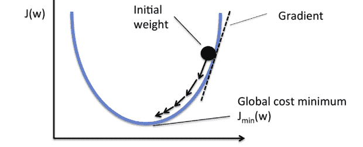

图 2.12

梯度由我们感兴趣的点正上方的曲线斜率给出。随着向右移动而上升的线具有正斜率，否则为负。权重以所示的逐步方式进行调整。

实际情况并非如此简单。随着空间维度的增加，损失函数曲线可能变得复杂。在图 2.13 中可以看到，没有单一的最小值；相反，存在可以通过不同起始轨迹到达的局部最小值。计算真正的全局最小值没有计算高效的方法。然而，实际上，局部最小值足以实现出色的算法性能。人们始终可以为权重采用不同的起点并比较输出，以此作为采样局部最小值的一种方式。

该过程在训练示例集合上得到改进。反向传播是深度学习训练集必须很大的原因之一。有趣的是，如果网络层数太多，训练可能会受损。随着我们进一步向后深入网络，权重修正会变得越来越小，最终接近零。这被称为消失梯度问题。它可以在一种称为残差神经网络的专用 ANN 中克服，这将在下一章中介绍。

最后，重要的是要注意，该算法假设独立且同时调整所有权重实际上会导致该误差的减少。这并不直观，因为改变一个权重可能会在整个

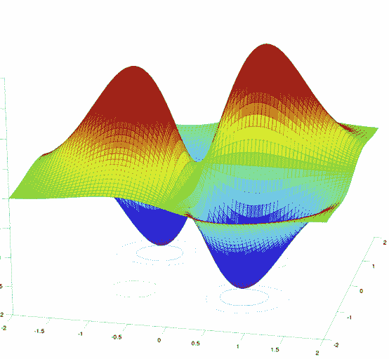

图 2.13

一个复杂的 3D 曲线显示了多个局部最小值和鞍点。情况在多维空间中甚至更加复杂。

*维基共享资源。*

网络的其余部分产生连锁反应。然而事实证明，如果我们对权重的更改足够小，该假设通常成立，权重确实可以达到良好的误差减少。

#### 卷积神经网络

#### 概述

卷积神经网络（CNNs）足够复杂，因此在更完整的讨论之前进行简要概述会有所帮助。简而言之，图像太大，无法在输入像素级别进行分析。可以说，第一个 CNN 是 2012 年由 A Krizhevsky 等人提出的“Alexnet”[11]。CNN 提取图像特征以创建越来越复杂的表示。它在原始图像上使用特征提取滤波器，并使用一些隐藏层从低级特征图向高级特征图推进。CNNs 有两种类型的层，即卷积层和池化层（子采样）。卷积滤波器是小的矩阵，它们在图像上“滑动”。矩阵与下面的图像片段组合，并获得每次卷积的最大值。在 CNN 中，卷积层不是全连接的，但其输出通常传递到一个或多个执行最终分类的全连接层。该过程的概述见图 2.14。

#### 详细解释

CNNs 利用图像等数据中的层次模式，并使用更小、更简单的模式组装更复杂的模式，然后再将这些表示移入传统的全连接网络。它们松散地基于大脑视觉皮层的组织。单个皮层神经元仅对视觉场中称为感受野的受限区域内的刺激做出反应。不同神经元的感受野部分重叠，从而覆盖整个视觉场。CNN 模仿了这一点，因为其层不是全连接的。这在图 2.15 中显示。

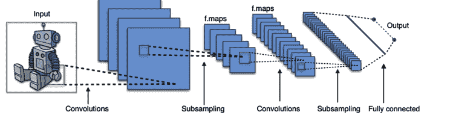

图 2.14

典型卷积网络的示意图，展示了卷积和子采样。最终层的图像表示传递给全连接层并进行分类预测。

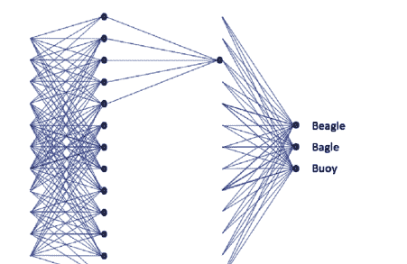

图 2.15

该图说明了 CNN 的开始和结束。并非一个隐藏层的神经元都会连接到下一层的每个神经元。然而，在所有情况下，都有神经元共享来自前一层的连接以创建重叠场（未显示）。神经元场的输出被下采样以进一步降低样本空间的维度。

*维基共享资源。*

如上所述，在 CNN 中，卷积矩阵（也称为滤波器或核）在图像上“滑动”并在每个位置应用。 resulting value 然后成为结果中该像素的值。这在图 2.16 和 2.17 中显示。

然后是池化层，它通过汇总特征图块中特征的存在情况来对特征图进行下采样。最大池化只是使用最大值而不是对它们进行平均。这使得 resulting representations 相对于图像中特征位置的变化（局部平移不变性）更稳健。在相似数据上训练的 CNN 产生相似的内部表示，因此它们对迁移学习很有用，这将在后续章节中讨论。

如上所述，滤波器本身只是数字矩阵。通过适当选择值，它们可以检测图像中的特定特征，例如水平和垂直线、边缘、形状等。这些数字可以通过反向传播进行修改。Photoshop 中的滤波器是卷积滤波器，可用于尝试这些概念。在“滤镜”选项卡下的“其他”中有一个标记为“自定义”的条目。图 2.18 是应用卷积滤波器到我面部肖像的屏幕截图。

### 过拟合和欠拟合

在上面讨论的所有机器学习示例中，其核心目的是泛化。泛化是指模型对从未见过的一组输入给出正确输出的能力。欠拟合仅仅意味着该算法 has

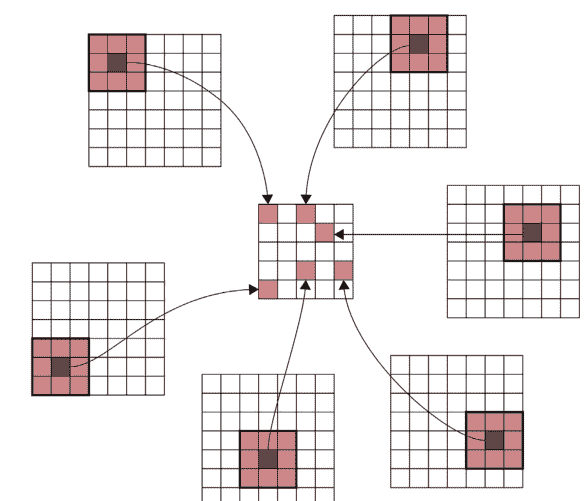

#### 图 2.16

对图像进行卷积时，滤波器在图像上移动并在每个位置应用。实际上，在每一端添加空白行和列，以便滤波器到达行或列的最远位置时不会出现覆盖损失。如果在 9 × 9 卷积滤波器扫描的网格上添加了填充（边界周围的空白网格），则在此步骤中将不会出现尺寸缩减。

版权所有 © 2018 Andrew Glassner，遵循 MIT 许可证。

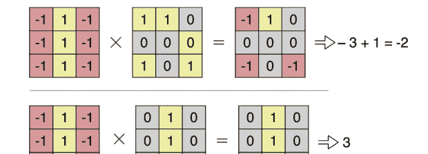

#### 图 2.17

对图像应用滤波器。滤波器在左侧。当前被滤波器覆盖的图像部分在中间。将每个像素乘以其对应滤波器值的结果显示在右侧。将九个值相加得到右侧的最终总和。

版权所有 © 2018 Andrew Glassner，遵循 MIT 许可证。

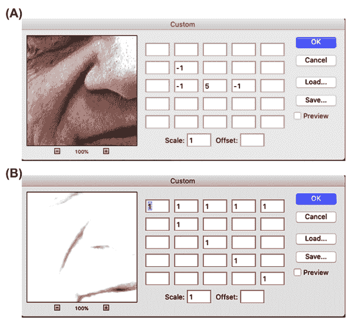

#### 图 2.18

我脸部的特写。(A) 轻度卷积（大部分细节保留）。(B) 经过更多卷积后。在 (B) 中，滤波器被选用来检测线条边界。在 (A) 中，滤波器被选用来让我看起来更好。你的结果可能有所不同。

从数据中学习得不够好。过拟合的概念稍微复杂一些，因为它意味着算法学得太好了！一个强大到足以“记忆”数据（过拟合）的模型会导致每个样本定义一个单独的类别，而过于弱的模型则无法找到任何可靠的类别区分（欠拟合）。对于给定模型，在过拟合和欠拟合之间找到平衡更多是艺术而非科学。

与其考虑这些极端情况，不如考虑一个实际场景，如图 2.19 所示，其中描绘了聚类模型的结果。在情况 A 中，存在一条平滑的边界线，仅有一个错误。该模型具有较高的准确性。此外，我们可以轻松地将一个新未知点放置在任一侧，接受偶尔会犯错的事实。该模型泛化能力良好。相比之下，在情况 B 中，我们有一条完美分隔两个类别的边界线。在这种情况下，当模型看到一个新点时，它会简单地再次弯曲边界以适应它，而不是将其泛化用于预测。完美是真理的敌人。过拟合是一个复杂的话题，其细节超出了本章的范围。有关过拟合的完整讨论以及应对机制，请参阅参考文献 [12]。

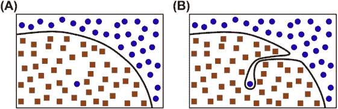

#### 图 2.19

(A)：有一条平滑的边界线很好地分隔了两个类别，仅有一个错误。这是一个良好的拟合，我们可以很好地进行泛化。(B)：边界曲线扭曲自身以适应一个异常点（过拟合）。

*版权所有 © 2018 Andrew Glassner，遵循 MIT 许可证。*

### 即将到来

虽然深度学习的众多模型在复杂性和能力方面令人印象深刻，但我们才刚刚处于人工智能时代的开端。我们人类的大脑在目前的实现方式下，仍然比人工神经网络具有许多明显的优势。例如，我们可以从非常小的训练示例集中学习复杂模式，并且在避免过拟合以及由于反向传播期间的梯度消失而导致多层处理中误差增加方面，比机器好得多。事实上，反向传播本身在生物学上似乎不太可能，部分基于生物学习期间的延迟测量，并且因为很少有神经元学习过多元微积分课程。出于这些原因，人们对更紧密模仿我们当前对生物神经功能理解的深度学习模型越来越感兴趣。这包括脉冲神经网络的发展，以及在更传统的模型中尝试替代反向传播，后者通过合成梯度、随机反馈或直接反馈对齐来实现。对于脉冲网络而言，跨层的一组加权输入的概念被整合-发放模型所取代，该模型基于脉冲编码整合传入脉冲。此类模型非常适合突触可塑性，其含义是基于长期抑制和增强效应，前突触和后突触神经元之间存在相关性。它们具有固有的时间信息处理活动，并且适用于无监督学习策略的实现。当前的脉冲模型相对简单，在实际应用中尚未与传统人工神经网络竞争，但对其进行优化的研究正在大量进行中。

具有巨大潜在意义的是人工神经元和突触的创建，这将允许在硬件和软件中构建脉冲网络。例如，Tuma 等人 [13] 描述了一种人工随机相变神经元，其中膜电位由可逆的非晶-晶体相变表示。更近期的研究中，Schneider 等人 [14] 描述了一种人工突触，其中电流动的强度

- [11] Krizhevsky A, Sutskever I, Hinton GE. 使用深度卷积神经网络的 ImageNet 分类。载于：Advances in neural information processing systems；2012. 第 1106–14 页。 https://arxiv.org/pdf/1803.01164.pdf.
- [12] Glassner A. 第 9 章：过拟合与欠拟合。载于：Deep Learning: from basics to practice；2018. 第 334–49 页。 Kindle ASIN: B079XSQNRX.
- [13] Tuma T, et al. 随机相变神经元。Nature Nanotechnology 2016；11：693–9.
- [14] Schneider ML, et al. 使用纳米纹理磁性约瑟夫森结的超低功耗人工突触。Science Advances 2018；4(1)：e1701329。 https://doi.org/10.1126/sciadv.1701329.

### 高级神经网络架构概述

Benjamin R. Mitchell, BA, MSE, PhD

助理教授，计算机科学系，维拉诺瓦大学，维拉诺瓦，宾夕法尼亚州，美国

### 引言

深度学习领域在过去几年中迅速扩展，现代从业者现在使用各种方法和技术来实现最先进的性能。许多性能最好的系统现在使用比过去使用的全连接前馈网络复杂得多的架构。这些技术从多个不同领域汲取灵感，包括统计方法、时间序列分析、博弈论、信息论、操作性条件作用、遗传进化以及现代神经科学（尽管对于最后几项，值得提醒的是“受启发于”与“准确建模”并不相同）。

本章将介绍一些最流行的变体，包括残差连接（ResNet）、无监督预训练（自编码器）、迁移学习、生成模型（GANs）、循环网络（LSTMs）、强化学习、集成方法和进化算法。阅读本章时，请记住所介绍的方法在很大程度上是对上一章介绍的基本技术的修改或扩展。这是为了解决那些基本技术不足的问题。这里描述的技术可用于解决计算效率、分类器准确性以及缺乏大量标记训练数据等问题。

#### 网络深度与残差连接

深度神经网络的“深度”可以根据任务而高度变化。在人工神经网络的早期，大多数网络都是“浅层”的，意味着它们没有隐藏层。这并不是因为早期的网络设计者不想拥有更深的网络；而是因为早期研究人员没有可靠的方法来训练这些更深的网络。随着时间的推移，该领域的发展使得训练越来越深的网络成为可能。今天，一些网络可能拥有数百个隐藏层。

增加更多隐藏层的首要优势在于它允许网络编码更复杂的函数。由于每一层都以前一层的输出作为其输入，因此每一层可以被视为计算前一层的某种抽象“features” 。因此，每增加一层就可以计算原始数据的更抽象、更复杂的函数。至少在理论上，更深的网络比更浅的网络具有更大的计算能力。

实际上，这种理论上的能力并不总是容易实现。增加额外的隐藏层可能会出现几个实际问题。第一个也是最简单的问题是，增加更多隐藏层意味着增加更多连接。这些额外的连接赋予网络更大的表示能力，但它们也代表了额外的参数，我们必须通过这些参数传播信息并学习其良好值。换句话说，连接越多，网络运行越慢，可能需要更多的轮次来训练。

即使我们愿意支付增加连接的计算成本，隐藏层过多时仍可能出现另一种现象：梯度消失问题。由于神经网络学习权重标准方法是使用链式法则的误差反向传播，隐藏层越多，我们就必须“chain”组合导数的次数越多。这可能导致梯度在远离输出单元时变得平坦并“diffused”。这个问题在使用 sigmoid 激活函数时尤其严重，因为 sigmoid 函数的导数始终介于 0 和 1 之间，而相乘的小数会变得更小。这就是大多数现代神经网络使用修正线性（ReLU）激活函数 [1] 的主要原因；ReLU 激活函数不易受梯度扩散的影响，从而允许成功使用更深的网络。

然而，即使使用 ReLU 单元，简单前馈网络能够成功训练的深度也存在实际限制。为了将深度推过该限制，需要更先进的网络架构。近年来变得非常流行的一种方法是使用残差连接 [2]。这涉及创建“skip”一层或多层的连接（有时也称为“skip connections”）（Fig. 3.2）。在典型的现代实践中，这些残差连接没有可调权重，而是简单地复制较低层激活的一种方式。

使这些连接“skip”一层的关键数学洞见在于，它使该层“learn”复制前一层输入变得容易得多；有了残差连接的加入，简单地输出 0 就会使输出值等于残差连接源自的节点。在效果上，节点的任何非零输出现在都将添加到来自较早层的数值上，而不是替换它（这在标准前馈网络中是典型的）。

术语“residual”指的是剩余或残留的误差。在残差连接的情况下，其思想是网络的每一层现在只需要尝试拟合残差误差，这简化了学习过程。结果是，使用残差连接的网络可以比其他情况做得更深，而不会落入梯度扩散或其他优化困难。术语 ResNet 可用于指使用这种类型连接提出的原始网络 [2]，但该术语有时也用于指使用残差连接的任何网络。

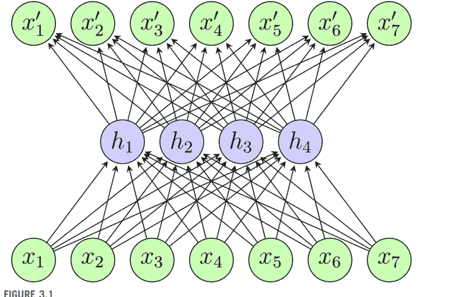

#### FIGURE 3.1

自动编码器网络被训练以尽可能小的重构误差重现其输入。由于隐藏层的单元数少于输入层和输出层，这意味着网络学会在隐藏层中产生降维编码。这是一种“unsupervised”训练过程，因为它不需要对原始数据进行额外的手工标注。

### 自动编码器与无监督预训练

深度神经网络的一个已知缺点是它们需要非常大量的数据来训练。这是对模型能力的自然结果；网络的连接越多，它编码复杂函数的能力就越强。然而，长期以来人们都知道，我们需要估计的参数越多，就需要更多的数据来估计它们的好值。由于深度神经网络可以有数百万个自由参数，因此需要非常大的数据集来训练它们并不令人惊讶。例如，MNIST 数据集是一个经典的基准集，已存在超过 20 年 [3,4]。如今，由于其相对较小的规模和高性能易于实现，它被认为是一个“toy”问题。然而，即使这个“small”数据集也有 60,000 张训练图像。ImageNet 数据集是一个更现代的基准集，由超过 15 million 高分辨率图像组成 [5]。实际上，许多作者只使用该完整集的子集，但即使是子集也往往超过一百万张图像。

对非常大训练集的需求本身就足以可能限制深度神经网络可以应用的问题，但实际情况甚至更糟。不仅需要非常大量的数据，大多数深度网络都是使用反向传播训练的，这是一种监督学习方法。这意味着我们需要人工标注为我们数百万个训练示例中的每一个提供正确的标签（即期望输出）。

对于某些任务，这一过程可以众包；例如，ImageNet 数据集是使用 Amazon’s Mechanical Turk 创建的，支付大量非熟练标注者对从网络上抓取的图像进行标注 [5]。不幸的是，对于许多感兴趣的问题，无法依赖非熟练标注者。在医学影像等领域，人类通常需要大量的训练才能正确可靠地标注图像。因此，即使可以收集到大量的图像，也可能不切实际地标注它们全部。在这种大量数据可用但只有一小部分可以标注的情况下，纯监督学习不太可能成功。幸运的是，我们还有其他选择。

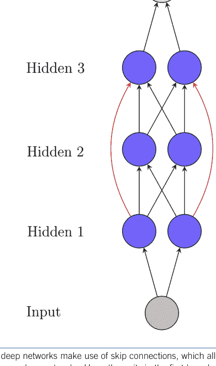

#### FIGURE 3.2

许多现代深度网络使用跳跃连接，这使得在非常深的网络中更容易优化。在这里，第一层的单元除了与第二隐藏层单元的“normal”连接外，还与第三隐藏层的对应单元有直接连接。

处理这种情况的一种方法称为 *无监督预训练*。无监督预训练背后的思想是，在应用监督学习技术之前，我们将首先应用无监督学习技术，以期使最终的监督优化问题更容易。

一个经典的例子是首先将神经网络的一层或多层作为一个 *autoencoder* [6] 进行训练。自动编码器只是被训练来重构其输入；也就是说，期望的输出仅仅是输入的副本（Fig. 3.1）。如果网络有足够的隐藏节点，此任务变得微不足道，但如果网络容量受限，则被迫学习某种低维编码。这可以被认为类似于有损压缩方案；“compressed”数据由隐藏节点的激活编码。

单个自动编码器层使用反向传播进行训练，这是一种监督学习技术；然而，“correct output”值只是输入值的副本，意味着不需要人工标注或标记。因此，整体方法被认为是一种无监督技术。如果需要更抽象和压缩的表示，我们可以将一个自动编码器层的输出用作另一个的输入。结果称为一个 *stacked autoencoder*。

使用受限玻尔兹曼机（RBM）而不是前馈网络也可以生成类似风格的网络；堆叠 RBM 的结果有时称为一个 *deep belief network*。RBM 的训练方法相当不同（详见 Ref. [7]），但就无监督预训练而言，最终结果在功能上是相似的。

一旦无监督模型训练完成，它随后被用作监督模型的基础，通常只需在顶部添加一层或两层额外的全连接层即可。此时，整个网络使用标准的监督方法进行训练。使用无监督预训练的直觉是，“unsupervised”步骤本质上是在寻找适合重构原始输入的数据的基于特征的表示。只要类似的特征集对分类有用，就可以在无监督环境中预训练网络，从而使监督学习阶段即使在标记数据量本应太小而无法实现的情况下也能实现良好的收敛。

需要注意的是，无监督预训练并不是万能药；特别是，它可以减少所需的标记数据量到一定程度，但仍会有一个点，即标记数据太少而无法学习一个泛化良好的模型。此外，几乎总是无监督预训练会被使用相同数据量的完全监督训练所超越（即，如果你对所有数据都有标签，最好从一开始就进行监督训练）。

尽管如此，这仍然是一种潜在的有用方法，特别是在获取大量标记数据的成本明显高于获取大量未标记数据的情况下。此外，还有许多

关于自编码器思想的更近期变体在某些任务上可能具有优势。变分自编码器 [8] 和稀疏性 [9] 就是一些例子。

### 迁移学习

另一种解决训练深度神经网络数据不足问题的潜在方法是迁移学习 [10] 的过程。与无监督预训练类似，迁移学习是一种使用已经预训练好的网络权重在你的数据集上“开始”学习的方法。不同之处在于，在迁移学习中，“预训练”是通过在不同但相关的任务上进行常规的监督学习来实现的。这里的关键洞见是，如果两个问题涉及相似的数据，那么解决一个问题所需的低层特征很可能对另一个问题也很有用。

要执行迁移学习，第一步是在一个大型且尽可能与你最终想要完成的任务相似的数据集上训练深度神经网络。特别是，数据的相似性是最重要的。这在实践中的含义是，如果你想训练一个数字分类网络，MNIST 是一个合理的起点数据集。然而，如果你想对世界的自然图像进行分类，在 MNIST 上训练的网络很可能迁移效果不佳。相反，在 ImageNet 数据集上训练的网络很可能给出更好的结果，因为该数据集本身就由世界的自然图像组成。

这里的一个潜在问题是，在大型复杂数据集上训练大型复杂网络需要大量的计算硬件（和/或大量的训练时间）。幸运的是，在许多情况下，可以使用他人创建的预训练网络。有多种著名的“预训练”网络可供下载，适用于各种深度学习工具包；请查看你正在使用的深度学习库的信息以了解可用内容。

实际的迁移学习过程涉及取一个预训练网络，移除网络上用于分类的全连接“顶层”，并用一个新的全连接“顶层”（权重随机初始化）替换它。此时，网络使用你的数据集按常规方式进行训练。同样，主要的优势是训练可以用比从头训练同一网络所需的标签训练集小得多的标签训练集成功（即从随机初始化的权重开始）。

也可以选择性地仅更新网络的一部分。这主要在你使用大型预训练网络且可用计算能力有限时有用，因为它会加快训练，但如果做得过于激进可能会导致准确率下降。这里的想法是，在对你的数据集进行训练时，预训练网络的最上层最有可能被二次训练过程显著改变。因此，可以“冻结”预训练网络的下层权重，只更新顶部几层的权重。由于许多架构在较低层比在较高层拥有更多的连接，这通常会导致训练速度显著提升。

### 生成模型和生成对抗网络

我们迄今为止处理的网络类型旨在解决分类任务。虽然分类网络是最受欢迎的类型，但它们并不是唯一使用的类型。机器学习可以处理的还有几种其他类型的问题，其中之一就是生成建模问题。*生成模型*是可以用来“生成”新示例的模型。基本任务是接收一组示例，然后构建新的示例，这些示例是独特的，但与系统训练过的示例相似。从统计角度来看，目标是模拟训练样本的分布，然后生成从同一分布中抽取的新样本。

训练这种生成模型可能值得在几种情况下进行。首先，我们可能直接想要输出，即生成合理的合成示例本身可能很有用。其次，我们可以将生成模型视为寻找潜在有用特征的另一种方法，然后我们可以将其作为无监督预训练的方法加以利用。第三，我们可能对条件生成模型感兴趣，这是一种花哨的说法，即我们对转换输入而不是凭空创建它们感兴趣。例如，取一张图像并生成以某位著名艺术家风格的版本。这三件事都可以使用生成模型实现。

在深度神经网络的背景下，最受欢迎的生成模型称为*生成对抗网络* (GAN) [11]。GAN 通过创建两个网络并让它们在竞争中相互训练来工作。第一个网络称为*生成器*，负责生成合理的合成示例。第二个网络称为*判别器*，负责区分“真实”示例（取自训练集）和“假”示例（由生成器创建）。这两个网络实际上是在进行零和博弈，其中每个参与者的成功必须以另一个参与者的失败为代价。生成器获胜的唯一方法是用判别器无法与真实示例区分开的示例；判别器获胜的唯一方法是要学会识别生成器的虚假示例。

训练首先随机初始化每个网络，然后交替更新一个然后另一个。更新判别器网络很简单，因为它是对反向传播的基本应用；由于我们知道哪些示例是真实的，哪些是假的，我们有“真实”标签。然而，更新生成器似乎更困难；我们如何为生成器定义一个误差函数？

答案是 GAN 如此巧妙想法的核心：由于生成器的输出用作判别器的输入，我们可以将生成器加判别器组合视为一个大网络。如果我们这样看，我们就可以将误差从判别器一直向后传播到生成器的底部。当然，当我们训练生成器时，我们希望*最小化*判别器的性能，所以在训练生成器时我们不能更新判别器的权重。通过交替更新哪个网络（始终冻结另一个网络的权重），两个参与者的整体性能会缓慢提高。每当生成器在判别器中找到一些漏洞时，判别器就被迫修复该漏洞。每当判别器发现生成内容中的缺陷时，生成器必须使输出更逼真以修复缺陷。

因此，经过多次迭代，生成器会缓慢收敛到生成与真实示例无法区分的合成示例。当然，在实践中，有几个复杂因素意味着系统可能并不总是像我们希望的那样收敛，尤其是当我们试图模拟的分布非常复杂时。尽管如此，GAN 在生成合成示例是期望的许多领域中很有用。

### 循环神经网络

虽然卷积网络在图像和类图像数据上表现非常好，但卷积并不总是所有类型问题的最佳选择。用于序列数据的一种流行替代方案是*循环*网络。循环网络背后的基本思想是，对于序列或时间序列问题，“当前”输入可能不足以成功解决该问题。换句话说，问题需要访问过去的信息才能正确解决。

可以通过简单地将网络馈送多个时间点连接在一起作为单个‘输入’来解决这个问题，但这种方法有一些局限性。特别是，时间窗口的大小是固定的；例如，如果我们使用大小为 4 的窗口（即向网络馈送最后 4 个时间步作为其输入），那么我们就无法捕捉超过 4 个时间步的时序依赖。此外，每增加一个历史时间步，网络的复杂性（即节点和权重的数量）就会急剧增加，这通常使得使用长的时间窗口不切实际。

可以在时域中进行卷积（参见例如 Ref. [12]），但如果需要更长的时间历史，经典的方法是使用循环网络。这里的“循环”一词指的是隐藏节点对其自身先前状态有一定的访问；也就是说，隐藏节点在时间 *t* 的值取决于其在时间 *t* 的输入以及其在时间 *t − 1* 的自身状态（以及可能在时间 *t − 1* 的其他隐藏节点的状态）。

在最早的循环网络中，这是一种直接依赖，意味着先前状态被视为对节点的任何其他输入一样处理；然而，这被证明是有些不灵活。最近的工作通常使用一种称为*长短期记忆* (LSTM) [13] 的节点。在现代用语中，有些人将“LSTM”和“循环网络”这两个术语互换使用，尽管这有时会导致混淆。还值得注意的是，可能会遇到 LSTM 的一些细微变体，但在高层它们具有相当相似的特性（参见 Ref. [14]）。GRU [15] 可能是其中最著名的。

这些现代循环神经网络利用“门控”机制，允许根据上下文决定何时使用隐藏节点的先前值、何时忽略它。这使得网络能够智能地处理序列分隔符（例如文本数据中的标点符号）。总的来说，LSTM 比早期的循环网络更加灵活和强大，在现代工作中，如果在任何类型的循环网络中使用不带某种门控的单元，都是非常罕见的。

与任何其他架构构建模块一样，LSTM 单元通常按层排列，在现代实践中，这些层通常被堆叠起来以构建深度循环网络。

LSTM 的操作不像卷积网络那样适合大规模并行的 GPU 实现，因此训练 LSTM 通常比训练卷积神经网络（CNN）慢。然而，对于某些类型的任务，它们仍然是正确的选择。例如，大多数现代机器翻译系统都使用 LSTM（参见参考文献 [16]，其中有一个来自 Google 的著名示例）。

### 强化学习

大多数神经网络模型以“监督”方式进行训练，即系统会获得一个带标签的训练集，其中包含人工标注的输入-输出对。然而，对于某些类型的任务，这种方法并不实用。特别是对于序列决策问题，通常我们只能在某些特定时间点准确评估系统的性能。一个常见的例子是训练网络下棋类游戏（如国际象棋或围棋）；在游戏结束之前，我们无法知道当前采用的策略是否良好。这意味着我们无法使用标准的监督学习来训练网络在游戏中途决定该走哪一步。

*强化学习*的思想就是针对这种情况而发展起来的。强化学习受操作性条件反射启发，通过提供“奖励”信号来告诉系统何时表现良好、何时表现不佳。随着时间推移，系统不断尝试，通过试错发现一种能够最大化其预期奖励的策略。

该算法的经典表述基于马尔可夫决策过程（MDP）的形式体系。MDP 将问题编码为一组离散的可能状态和动作，以及一个转移模型，该模型在给定当前状态和动作选择的情况下，指定可能“下一”状态的概率分布。给定一个“奖励”函数，该函数指定智能体处于任何给定状态时获得的奖励，就可以使用迭代逼近算法来确定在任何状态下应采取的最优动作，其中“最优”定义为能带来最高预期未来回报的动作。通常还会添加一个“折扣”因子，它允许我们根据未来预期收益的远近对其进行降权；通过调整该参数，我们可以让智能体更注重短期或长期回报。

不幸的是，这种方法的局限性在于需要将转移模型作为输入完整地指定；而在现实问题中，情况往往并非如此。如果我们需要自行发现转移概率，问题就会变得更加困难。虽然仍然可以通过自适应动态规划和 Q 学习等算法来解决，但这些算法往往收敛得非常慢。此外，还有一个额外的困难：智能体自身的决策决定了它从哪些状态-动作序列中获取观测数据。因此，需要确保对状态-动作空间进行充分的“探索”，以避免收敛到较差的局部最优解。简单地采取随机动作会带来高度的探索，但在大多数现实问题中，状态-动作空间的某些区域比其他区域更有价值，因此花费大量时间去探索我们已经知道会导致糟糕结果的选择是低效的。这就是所谓的“探索/利用困境”，也是收敛如此缓慢的另一个原因；如果我们过于激进，就可能过早收敛到一个糟糕的解。

这些经典的强化学习算法有其局限性：它们往往在较小、离散的状态空间上表现最佳，并且难以扩展到复杂、高维的问题。一个根本问题在于，强化学习将状态空间中的每个状态视为原子性的，这意味着即使某些状态在人类看来“相似”，关于每个状态的信息也必须分别学习。组合爆炸意味着，对于大型状态-动作空间，获得良好估计所需的训练次数可能变得难以处理。

解决方案是使用一种称为函数逼近的技术。这意味着，我们不再针对每个状态直接学习在给定状态下采取给定动作的预期效用，而是使用某种回归技术来学习一个近似函数。函数逼近的主要优点是，除了缓解组合爆炸问题之外，它还提供了一种将状态视为非原子性的方法，这意味着我们可以基于状态之间的相似性进行学习（即，如果过去遇到过相似的状态，我们可以假设当前状态具有相似的预期奖励）。

使用神经网络作为强化学习的函数逼近器特别方便，因为神经网络可以以在线方式训练（即一次一个训练样本），从而可以在每个动作之后进行更新。近年来，深度神经网络在此领域越来越受欢迎，能够更好地扩展到大型复杂问题。最近许多成功的游戏解决方案都使用了强化学习进行训练，包括在 Atari 游戏 [17] 和围棋 [18] 上取得的成果。

强化学习的主要缺点是其计算效率低下；与完全监督学习相比，通过强化学习进行训练非常缓慢。对于可以采用完全监督学习的问题，通常会更倾向于使用监督学习。然而，强化学习为求解一整类原本难以处理的问题提供了可能，因此对于这类问题来说，它是一种非常有价值的技术。

此外，在某些情况下，这两种方法可以结合使用。这通常发生在我们拥有一些数据训练标签，但这些标签并未完全捕捉我们想要的行为时。例如，许多机器翻译系统都以优化 BLEU 分数 [19] 为目标进行训练，尽管人们公认 BLEU 分数并不是衡量翻译质量的人类评估的理想模型。完全使用强化学习和人工评估来训练机器翻译系统所需的时间过长，完全不可行。不过，可以先使用 BLEU 分数以监督方式训练系统，然后再使用强化学习对系统进行优化。由于这只是一个优化过程，所需的训练数据要少得多，因此更为实用。但值得注意的是，这并不能保证一定会提升最终系统的性能；一些使用谷歌翻译进行的实验表明，这种方法带来的好处并没有人们期望的那么大 [16]。

### 集成方法

提升分类器性能的一种经典机器学习方法是将多个分类器组合成一个*集成*分类器。其灵感与众包相同；在这两种情况下，每个个体成员都可能出错，但只要足够多的成员正确，“群体”就能得到正确答案。这依赖于集成成员具有足够多样性的假设，因为如果它们都犯*相同*的错误，就没有任何好处。不过，标准神经网络训练算法中存在足够的随机性，可以实现一定程度的独立性，如有必要，还可以通过诸如 boosting 或 bagging 之类的方法进一步提高独立性。

即使不使用这些方法，深度神经网络的集成也往往优于其单个成员。因此，一种可靠的提升深度神经网络性能的方法就是简单训练四五个不同的网络副本，然后让它们对正确答案进行“投票”。通过这种方式能提升的性能有限，但这是多挤出几个百分点准确率的相当简单的方法。

这是构建集成的最简单方式的一个例子，即训练多个*基础*分类器副本，然后将它们的输出组合起来。组合分类器输出的最简单方法是让每个分类器做出自己的预测，然后选择票数最多的预测作为“最终”输出。这种简单的*投票*方案易于实现和理解，但并不总能产生最佳结果。特别是，它赋予集成中所有成员相同的权重，这可能不是一个好主意。如果我们有理由相信集成中的某个成员对于某个给定样本可能异常可靠（或不可靠），那么进行*加权投票*是有意义的。在这种方式下，每个分类器仍然可以投票，但并非所有票的权重都相同。每个分类器不再为其所选选项的票数贡献 +1，而是贡献

与某个置信度度量成比例的量。最后，得分总和最大的答案将被选为集成体的联合答案。置信度度量的选择取决于问题，但对于人工神经网络，一个常见的选择是训练网络使其输出各种类别的伪似然分数。随后与“获胜”类别相关的分数可作为置信度度量使用；如果网络以 0.99 的值预测某个类别，我们会给予它更大的权重，而如果最高输出值仅为 0.6 则权重较小。

集成体的性能取决于成员做出 *不同* 的错误；因此，即使这会导致每个单独成员的准确率略有下降，通过迫使成员分类器彼此更加不同，也常常可以提升集成性能。最简单的例子是一种称为 *装袋* 的方法，其通过确保每个成员使用略有不同的训练集进行训练来实现。与使用所有可用训练数据训练每个分类器不同，每个分类器都使用随机选择的示例的一部分进行训练。这确保了不同分类器会有不同的优势和劣势，并有助于确保整体集成不会过拟合训练数据。给予每个分类器的训练数据比例越小，它们就越多样化，但性能也往往越低。到了某个点，个体性能下降超过了多样性增加带来的好处。不幸的是，甜蜜点究竟在哪里取决于问题。

*装袋* 的一种替代方法是称为 *提升* 的方法。*提升* 认识到目标是确保每个示例都被足够数量的成员正确分类，并尝试构建集成以确保这一点。在 *提升* 中，第一个成员分类器正常训练，但之后每个分类器按如下方式训练。首先，在训练数据上测试现有集成的性能；对于每个示例，统计有多少个分类器做对，有多少做错。然后，根据现有集成预测正确的频率对示例进行加权。某个示例被猜错的次数越多，就越多的重要性权重放在该示例上。然后，考虑示例权重训练一个新的分类器；这意味着新分类器将被推动在其他分类器做错的示例上表现良好，而在其他分类器做对的示例上表现良好的激励会更少。

*提升* 在实践中通常表现非常好，但它也有一些缺点。特别是，*装袋* 是一种利用数据并行性的算法，这意味着如果有足够的并行计算能力，所有成员分类器可以同时训练。另一方面，*提升* 是一种迭代方法；每个新分类器需要知道之前分类器的性能，因此必须一个接一个地训练。此外，*提升* 最适合能够轻松利用示例重要性权重的分类器，而并非所有可能的基分类器都能做到这一点。

集成唯一的真正缺点是其计算成本；集成中的每个成员都必须从头开始训练，否则它们将不会

在某些问题中，分散搜索过程带来的收益使遗传算法能够达到使用反向传播无法实现的分类性能水平。

遗传算法从一个初始的“种群”开始，该种群由“个体”组成，每个个体代表问题的候选解。每个个体都是随机生成的，种群大小是用户可调参数。在神经网络的情况下，每个“个体”将是一个完整的网络。个体被编码为“基因组”，它只是个体的数值表示。在某些应用中，可能需要复杂的编码函数在“基因型”和“表现型”之间转换，而在其他应用中这两种形式可能相同。关键因素是基因型编码必须支持遗传算法其余部分的功能；选择不当的编码会妨碍整个过程。

每个个体都使用“适应度函数”进行评估，这只是我们试图优化的东西的另一种说法。在神经网络的情况下，这通常只是用于反向传播的损失函数的倒数（我们反转值是因为遗传算法最大化，而反向传播最小化）。在其他应用中，可能会使用更复杂或更有趣的“适应度”概念，包括诸如基于锦标赛的选择等相对度量。

遗传算法的整体操作按轮次或“世代”进行。在每一轮中，所有个体都使用适应度函数进行评估，然后其中一些被选中进行“繁殖”。最常见的选择标准是适应度比例，这仅意味着被选中的可能性与给定个体所占总种群净适应度的比例成正比。同样，遗传算法文献包含许多替代方案，选择策略的选择由用户决定。

然后选中的个体使用“突变”和“交叉”的遗传算子产生“后代”，即新个体。这些算子的具体实现是相对于所选基因型编码定义的，并且必须按问题选择，但其基本思想始终相同。突变对编码进行小的随机更改；对于神经网络，这可能意味着用小的随机扰动调整一些随机选择的权重。交叉操作于两个选中的个体，并通过组合两个父代基因组创建一个后代基因组。对于卷积神经网络，这可能涉及例如从一个父代随机取一半的滤波器核，另一半从另一个父代取。重要的是所使用的任何算子都必须非常适合问题；它们需要有合理的可能性产生比父代（或父代）更好的子代，否则遗传算法将不会收敛。因此，在某些应用中，只应用其中之一。如果没有有用的交叉定义，最好仅依赖突变。

一旦产生了一定数量的后代，“父代”世代中的一些个体将被选中进行替换，并从种群中移除。同样，每一代替换多少个以及如何选择是一个用户可选择的参数，但通常种群大小保持

- [15] Cho K, Merrienboer B, Gulcehre C, et al. 使用 RNN 编码器-解码器学习统计机器翻译的短语表示. 载于：经验方法在自然语言处理会议论文集（EMNLP）；2014. 第 1724–34 页.
- [16] Wu Y, Schuster M, Chen Z, et al. Google 的神经机器翻译系统：弥合人类与机器翻译之间的差距. CoRR; 2016. abs/1609.08144.
- [17] Mnih V., Kavukcuoglu K., Silver D., et al. 使用深度强化学习玩 Atari. 载于：NIPS 深度学习研讨会.
- [18] Silver D, Huang A, Maddison C, et al. 使用深度神经网络和树搜索掌握围棋游戏. Nature 2016;529:484–9.
- [19] Papineni K, Roukos S, Ward T, Zhu W. BLEU：机器翻译自动评估方法. 载于：计算语言学协会会议论文集；2002. 第 311–8 页.

## 人体解剖病理学中人工智能使用的复杂性

Stanley Cohen, MD 1,2,3

¹病理学荣休主席兼生物物理病理学中心荣休创始主任，罗格斯-新泽西医学院，纽瓦克，新泽西州，美国；²病理学兼职教授，宾夕法尼亚大学佩雷尔曼医学院，费城，宾夕法尼亚州，美国；³病理学兼职教授，杰斐逊大学金梅尔医学院，费城，宾夕法尼亚州，美国

### 引言

前几章旨在通过详细描述其算法构建模块，同时避免数学公式或计算机代码，来揭示人工智能核心的机器学习策略。正如我们所见，机器学习的基本主题是分类，这本质上归结为在事物之间识别相似性和差异。从这一点可以进一步发展到理解数据之间的关系以进行预测和推断。在人体解剖病理学中，人工智能可用于确定病变是否为癌症，从细微的形态学差异评估恶性程度，预测临床行为并提出治疗策略。

人工智能在学术中心开始成为一种可靠的工具。因此，旨在将其用于病理学的商业企业正在 proliferating。实用应用的一个重大进展是全切片成像获得诊断用途的批准（因为数字图像对机器学习至关重要）。然而，对于人体解剖病理学，仍有许多瓶颈需要解决。其中一些明显的是（a）训练所需的大型数据库（神经网络的普遍情况，而不仅仅是病理学），（b）图像复杂性，即定义数据集中样本（实例）所需的大量特征，以及（c）数据的拓扑复杂性。这种复杂性的一个例子是图像数据集，其中每个样本可能包含正常组织和异常组织，而异常区域的形态可能在重要方面有所不同。

除上述之外，关系也很重要，例如血管、淋巴管、炎症、丝裂、坏死在切片上病理区域的分布、位置及其空间关系。使这些因素复杂化的是需要整合形态学、遗传学和各种“-omics”以进行各种预测分析。组学分析本身就需要识别关系

数据内部存在诸如聚类和激活模式等情况，从而使其与形态学信息的整合变得困难。将组学和形态学数据结合起来是一个令人望而生畏的挑战，而该领域具有转化相关性的工作才刚刚开始。

这类复杂性问题并非病理学独有；一个很好的例子是自动驾驶算法，其中上述所有因素都会发挥作用。有趣的是，自动驾驶算法是由数据科学家和计算机学习专家开发的，专业驾驶员的参与相对较少。在病理学中人工智能的发展方面，病理学家（作为内容提供者、内容标注者和训练的真实值仲裁者）与设计适当机器学习算法供使用的计算机科学家之间必须保持密切互动。本章的目的是在前几章描述机器学习基础知识和一些先进深度学习策略的基础上进行扩展，以帮助病理学家弥合这一差距，并提供所涉及原理的现实世界示例。

在本章中，我们首先将讨论如何将图像分割为感兴趣区域，以有丝分裂检测为例，然后探讨通过弱监督处理拍字节数据集的各种方法以及所谓的“一[content]
数据内部存在诸如聚类和激活模式等情况，从而使其与形态学信息的整合变得困难。将组学和形态学数据结合起来是一个令人望而生畏的挑战，而该领域具有转化相关性的工作才刚刚开始。

这类复杂性问题并非病理学独有；一个很好的例子是自动驾驶算法，其中上述所有因素都会发挥作用。有趣的是，自动驾驶算法是由数据科学家和计算机学习专家开发的，专业驾驶员的参与相对较少。在病理学中人工智能的发展方面，病理学家（作为内容提供者、内容标注者和训练的真实值仲裁者）与设计适当机器学习算法供使用的计算机科学家之间必须保持密切互动。本章的目的是在前几章描述机器学习基础知识和一些先进深度学习策略的基础上进行扩展，以帮助病理学家弥合这一差距，并提供所涉及原理的现实世界示例。

在本章中，我们首先将讨论如何将图像分割为感兴趣区域，以有丝分裂检测为例，然后探讨通过弱监督处理拍字节数据集的各种方法以及所谓的“一发学习”的可能性。其他主题包括针对特定任务选择算法以及该算法内部参数调优的问题。这并非旨在成为全面的综述；后续章节将提供在多个开创性实验室开展的最前沿工作的详细描述。显而易见的是，图像解释的基本策略可应用于病理学家感兴趣的广泛其他主题，包括自然语言处理以及来自基因芯片、蛋白质组学、转录组学、微生物组等的分析和预测等。

### Life before machine learning

在继续之前，重要的是要指出，在机器学习广泛使用之前，已有许多方法来解决这些问题。其中许多方法涉及从样本中提取重要且可测量的特征并使用聚类。在图像分析中，已使用数学运算根据强度、颜色、纹理、形状和几何关系来区分像素区域。斑块（图像中的连通区域）、边缘和边界在这些任务中很重要需要识别。使用的数学运算的一个例子是霍夫变换，可用于在图像中分离特定形状的特征。虽然这些技术可以为病理学家定位图像中的细胞核、腺体和其他结构元素，但它们无法从这些特征的组合推广到对所研究组织的整体分类或诊断。机器学习促进了从图像分析到图像解释的转变。

### Multilabel classification

当我们想到人工智能在图像分析中的应用时，我们倾向于想到能够识别正常和恶性组织之间差异的深度学习结构，提供恶性程度（分级）的可靠准确估计，并提供有关预后和优化治疗选择的信息。通常这基于整体模式识别和基于这些模式的分类。然而，如果肿瘤的分离岛屿嵌入在长段正常间质或组织中，对这些肿瘤场的分割将使程序能够将正常视为一种背景噪声。此外，除了整体模式外，病理学家还会寻找图像中的特定定义特征。这些可能包括有丝分裂的存在、血管化程度、肿瘤内淋巴管或小血管中的肿瘤簇、坏死等。特征之间的空间关系也很重要。

由于所有这些原因，在病理学中，对大规模数据集的需求因每个图像内需要广泛注释而变得更加突出。这个问题通常通过将图像分解为子集（图像块或瓦片）并尽可能自动化寻找感兴趣区域的过程来解决。将图像划分为子集显然增加了所需的训练实例数量。此外，在这些感兴趣区域内，我们通常希望识别特定特征，同时识别和分级整个病变。我们可以使用嵌入到深度神经网络中的传统分割和目标检测方案，或者 alternatively，使用单个足够强大的网络来完成所有这些任务。

多标签分类基于图像分割为感兴趣区域。存在几种图像分割类型，如图 4.1 所示，该图以猫和狗场景为例简单说明了分割类别。

语义分割是基于图像中类别的分离；在插图中，算法已根据颜色将草、猫、树和天空对应的类别分开，而没有关于这些类别对人类观察者相对重要性的信息（第一面板）。目标检测涉及在图像中定位和分类感兴趣的目标，并将其突出显示供人工操作或识别以供进一步分析，如第二面板所示。可以检测同一图像中的多个类别（第三帧）。最后是实例分割，其中每只狗都被单独（且唯一地）识别。换句话说，在实例分割中，我们分别识别给定类别内的每个实例，而与语义分割相比，后者识别每个类别但不识别该类别的各个元素。

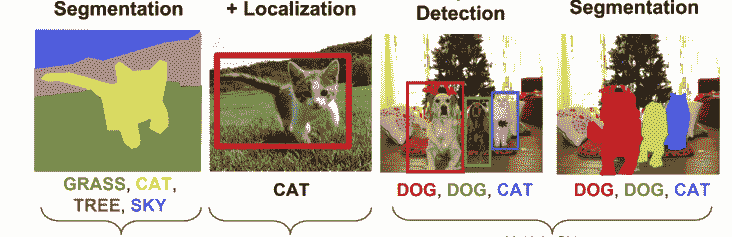

**Figure 4.1** 图像分割的类别。Creative Commons，公共领域。

因此，使用机器学习的最终目标是识别感兴趣区域内的感兴趣特征，并将其与病变的整体模式识别结合使用。在处理涉及多标签分类的问题时，可使用多种机器学习算法，包括多标签 K 近邻、多标签决策树、多标签支持向量和多标签神经网络。深度学习出现之前多分类方法的综述可在参考文献 [1] 中找到，更技术性的方面见参考文献 [2]。

### Single object detection

与人工智能总体情况一样，并没有一种算法适用于所有问题。机器学习用于有丝分裂识别提供了一个很好的例子，这一原则在参考文献 [3] 中有详细讨论。[content]
数据内部存在诸如聚类和激活模式等情况，从而使其与形态学信息的整合变得困难。将组学和形态学数据结合起来是一个令人望而生畏的挑战，而该领域具有转化相关性的工作才刚刚开始。

这类复杂性问题并非病理学独有；一个很好的例子是自动驾驶算法，其中上述所有因素都会发挥作用。有趣的是，自动驾驶算法是由数据科学家和计算机学习专家开发的，专业驾驶员的参与相对较少。在病理学中人工智能的发展方面，病理学家（作为内容提供者、内容标注者和训练的真实值仲裁者）与设计适当机器学习算法供使用的计算机科学家之间必须保持密切互动。本章的目的是在前几章描述机器学习基础知识和一些先进深度学习策略的基础上进行扩展，以帮助病理学家弥合这一差距，并提供所涉及原理的现实世界示例。

在本章中，我们首先将讨论如何将图像分割为感兴趣区域，以有丝分裂检测为例，然后探讨通过弱监督处理拍字节数据集的各种方法以及所谓的“一发学习”的可能性。其他主题包括针对特定任务选择算法以及该算法内部参数调优的问题。这并非旨在成为全面的综述；后续章节将提供在多个开创性实验室开展的最前沿工作的详细描述。显而易见的是，图像解释的基本策略可应用于病理学家感兴趣的广泛其他主题，包括自然语言处理以及来自基因芯片、蛋白质组学、转录组学、微生物组等的分析和预测等。

### Life before machine learning

在继续之前，重要的是要指出，在机器学习广泛使用之前，已有许多方法来解决这些问题。其中许多方法涉及从样本中提取重要且可测量的特征并使用聚类。在图像分析中，已使用数学运算根据强度、颜色、纹理、形状和几何关系来区分像素区域。斑块（图像中的连通区域）、边缘和边界在这些任务中很重要需要识别。使用的数学运算的一个例子是霍夫变换，可用于在图像中分离特定形状的特征。虽然这些技术可以为病理学家定位图像中的细胞核、腺体和其他结构元素，但它们无法从这些特征的组合推广到对所研究组织的整体分类或诊断。机器学习促进了从图像分析到图像解释的转变。

### Multilabel classification

当我们想到人工智能在图像分析中的应用时，我们倾向于想到能够识别正常和恶性组织之间差异的深度学习结构，提供恶性程度（分级）的可靠准确估计，并提供有关预后和优化治疗选择的信息。通常这基于整体模式识别和基于这些模式的分类。然而，如果肿瘤的分离岛屿嵌入在长段正常间质或组织中，对这些肿瘤场的分割将使程序能够将正常视为一种背景噪声。此外，除了整体模式外，病理学家还会寻找图像中的特定定义特征。这些可能包括有丝分裂的存在、血管化程度、肿瘤内淋巴管或小血管中的肿瘤簇、坏死等。特征之间的空间关系也很重要。

由于所有这些原因，在病理学中，对大规模数据集的需求因每个图像内需要广泛注释而变得更加突出。这个问题通常通过将图像分解为子集（图像块或瓦片）并尽可能自动化寻找感兴趣区域的过程来解决。将图像划分为子集显然增加了所需的训练实例数量。此外，在这些感兴趣区域内，我们通常希望识别特定特征，同时识别和分级整个病变。我们可以使用嵌入到深度神经网络中的传统分割和目标检测方案，或者 alternatively，使用单个足够强大的网络来完成所有这些任务。

多标签分类基于图像分割为感兴趣区域。存在几种图像分割类型，如图 4.1 所示，该图以猫和狗场景为例简单说明了分割类别。

语义分割是基于图像中类别的分离；在插图中，算法已根据颜色将草、猫、树和天空对应的类别分开，而没有关于这些类别对人类观察者相对重要性的信息（第一面板）。目标检测涉及在图像中定位和分类感兴趣的目标，并将其突出显示供人工操作或识别以供进一步分析，如第二面板所示。可以检测同一图像中的多个类别（第三帧）。最后是实例分割，其中每只狗都被单独（且唯一地）识别。换句话说，在实例分割中，我们分别识别给定类别内的每个实例，而与语义分割相比，后者识别每个类别但不识别该类别的各个元素。

**Figure 4.1** 图像分割的类别。Creative Commons，公共领域。

因此，使用机器学习的最终目标是识别感兴趣区域内的感兴趣特征，并将其与病变的整体模式识别结合使用。在处理涉及多标签分类的问题时，可使用多种机器学习算法，包括多标签 K 近邻、多标签决策树、多标签支持向量和多标签神经网络。深度学习出现之前多分类方法的综述可在参考文献 [1] 中找到，更技术性的方面见参考文献 [2]。

### Single object detection

与人工智能总体情况一样，并没有一种算法适用于所有问题。机器学习用于有丝分裂识别提供了一个很好的例子，这一原则在参考文献 [3] 中有详细讨论。作为介绍，应该指出的是，检测有丝分裂是一个困难的问题，因为观察者间变异性问题对真实值施加了限制，并且已发表的许多论文使用了截然不同的 AI 方法。这已以系统的方式进行研究。作为背景，对于许多肿瘤，与肿瘤增殖相关的预后因素已被证明非常重要。有多种组织化学增殖标记物。两个例子是 Ki67 和 BrdU。Ki67 是一种蛋白质，随着细胞准备分裂而增加。BrdU 是一种掺入细胞 DNA 的标记物。然而，病理学家通过计数肿瘤中有丝分裂象仍然是最广泛使用的增殖评估形式。尽管耗时且主观，但在理想条件下，直接形态学观察可以识别有丝分裂期。乳腺肿瘤是增殖具有预后意义的典型案例。然而，即使在增殖与行为相关性不佳的肿瘤类型中，形态学异常有丝分裂的存在也可以证实恶性诊断。

2013 年，有丝分裂算法评估（AMIDA13）研究启动（作为一项竞赛挑战，结果由 Veta 等人分析并在参考文献 [3] 中总结）。所有参与者可用的训练数据由图像数据以及真实值有丝分裂注释组成（已充分注意校正观察者间变异性）。训练数据集发布两个月后，测试数据集被提供。该数据集仅包含图像数据；注释由挑战组织者保留以确保独立评估。结果上传到挑战网站进行评估。

比较的学习策略包括卷积神经网络、随机森林、支持向量机、贝叶斯方法以及各种提升策略。这些方法大多采用两步目标检测方法，其中第一步识别候选对象，第二步将其分类为有丝分裂或非有丝分裂。评估的两种方法未使用候选提取，而是评估每个像素位置以获得每张图像的有丝分裂概率图，据此检测出有丝分裂。

按精确率和召回率衡量，参考文献 [3] 中描述的所有模型均表现良好，其中最佳的是采用多个交替卷积层和最大池化层的流程。该方法的 F1 分数（基于精确率与召回率乘积之比除以精确率与召回率之和）与病理学家之间的观察者间一致性相当。按这些指标衡量，表现最差的是使用随机森林分类器的方法。有趣的是，通过多数投票或取表现更好的方法的交集来合并不同方法的结果的实验，未显示出超过最佳单一方法的性能提升。

### 多个对象

图像分割、多标签分类以及多实例学习（MIL）（参见弱监督学习部分）都具有共同特征。例如，在组织病理学材料的情况下，只有图像的一小部分可能对处理和分析有用。因此，先前的步骤是定位，其中我们识别感兴趣区域。在许多应用中，这是通过将图像分割成小的连续块来实现的，并通过训练集的先前标注或算法本身的策略来识别“感兴趣区域”。这与将在后续章节讨论的用于 MIL 的方法类似。

如前所述，目标检测基于对样本图像中感兴趣对象的分类标签的使用，而不仅仅是对整个样本。各种机器学习策略实现了对图像中多个标签的同时识别和分类。正如图像分析领域一般情况一样，神经网络已改变了这一领域。通常，人们通过将其转变为多个单标签分类集合来将卷积神经网络（CNN）扩展到多标签分类。这些方法独立处理标签，因此在建模标签之间的依赖关系方面存在困难。目标检测并不局限于神经网络分析。许多机器学习策略也可以应用于此任务。使用标准化数据集对这些方法进行比较研究仅有少数几项。其中一个例子已在 [3] 中详细描述。Bejnordi 等人比较了 32 种用于检测淋巴结转移的算法 [4]。其中 25 种基于深度卷积网络，其余则利用支持向量机或随机森林以及统计和结构纹理特征。任务包括转移识别和全切片图像分类。所有算法均表现良好，其中几种优于比较小组中表现最好的病理学家。

### 多标签分类的进展

在这一点上，将此图像分析问题与自动驾驶中出现的问题进行比较是有帮助的。算法必须能够识别人类、其他车辆、道路标记、交通标志及其在场景中的具体位置，从而利用多标签分类策略。由于驾驶是动态过程，需要一种处理顺序数据的方法，为此，循环神经网络（RNNs）是一个明显的选择，因为它们捕捉时间关系。近年来，在使用视觉注意或与 CNN 结合的 RNN 来实现这一目的方面取得了若干进展。回顾上一章，完整的 CNN 擅长处理空间相关数据，而 RNN 擅长处理时间相关数据。以前，RNN 已用于信号分析、顺序图像（视频）和自然语言处理（其中句子中词语的时间顺序很重要）。它们也可以用于静态图像分析。在这里，RNN 顺序处理输入，一次处理图像内的一个位置，并逐步整合所获得的信息以创建内部表示。

例如，Wang 等人 [5] 描述了一种模型，该模型受人类在执行图像标注任务时通过不断移动注意力从一个判别对象转移到下一个对象的分析方式的启发。如常，CNN 提取深度特征表示，而 RNN（在本例中为长短期记忆（LSTM）网络）迭代定位与类别相关的区域并预测这些区域的标签分数。LSTM 网络在第 3 章中进行了解释。该模型似乎还允许标注中的类别冗余。例如，对于许多目的而言，标签如“小猫”和“小猫崽”含义基本相同。尽管该研究不涉及组织病理学材料，但最近，Alom 等人进行了类似的研究，结合了残差和循环网络 [6]。该复杂模型应用于血管分割、皮肤癌分割和肺部病变分割。该模型在这三项任务中均取得了最先进的性能。

利用强化学习进行病理学图像识别任务的可能性尤其有趣。在自动驾驶的情况下，强化学习已应用于动态感官输入，但强化学习仅开始被用于涉及静态图像分析的任务。Mathe 等人 [7] 描述了顺序搜索策略，这些策略利用强化学习概念（如探索和奖励）从一组图像位置累积证据。基本上，传统目标检测基于穷举空间搜索，本质上是暴力方法，而强化学习则以逐步方式朝既定目标移动。Chen 等人 [8] 将注意力模型与强化学习相结合，其中“奖励”是分类正确性。

有趣的是，生物神经网络如大脑在视觉模式识别中利用强化学习。它们还学会识别模式序列。因此，这些方法在病理学中也可能富有成效。

### 图神经网络

如上所述的复杂实现除了对图像中的对象进行分类外，还捕捉对象之间的关系。然而，有一些现代方法明确处理此类关系。其中大多数属于图神经网络的范畴。在数学术语中，图是由不同的对象（顶点或节点）以及连接它们的线（边）组成的集合（图 4.2）。

神经网络和决策树都是图，连接航班地图和连接城市的高速公路地图也是图。在神经网络的情况下，节点是模拟的神经元，边显示加权信息流向下一层节点的方向。边可以是单向的或双向的。例如，网络分析是图论的一个分支，用于理解转录组内的关系和模式。

如果数据可以表示为网络，则不仅可以分析测试样本与训练集定义的类别之间的关系，还可以分析定义该样本的属性之间的关系。一个图形网络

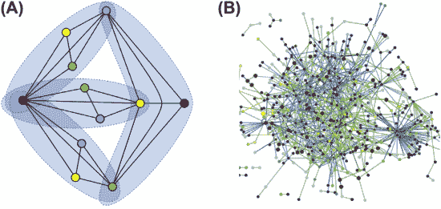

**图 4.2**

(A) 示例图显示了节点及其连接边，以及明显聚类为四个子群。 *转载自维基百科共享资源，公共领域。* (B) 梅毒螺旋体的实际蛋白质表达网络。

*转载自维基百科共享资源，署名：Hauser 等人，《梅毒螺旋体》，PLoS One 2008；3(5):e2292. https://doi.org/10.1371/journal.pone.0002292.*

在这一层面上运作。要做到这一点，必须有一种量化节点之间关系的方法。连接可以通过所谓的邻接矩阵来描述。矩阵中的元素指示顶点对是否相邻（如果行和列相交处的元素为1，则表示它们之间存在连接，否则为0）。换句话说，邻接矩阵表示顶点之间的相邻关系。还有另一种图表示形式，称为关联矩阵，顾名思义，它表示顶点与边的关联关系。这些矩阵是根据图形形式构建的。反过来，也可以从矩阵重新创建图的图形化示意图（或与该图功能相同或同构的图）。由于神经网络基于线性代数，由矩阵定义的图现在可以用于网络的计算。图形网络的有效实现是一个活跃的研究课题。这些模型相当复杂，超出了本次讨论的范围。然而，对于数学水平较高的读者，Zhou 等人 [9] 最近发表了一篇关于图形神经网络方法和应用的综述。

无需显式使用图形神经网络，也可以从 CNN 输出分析图形关系。例如，Jung 等人 [10] 的新近研究展示了将传统深度学习与图论数学相结合用于分析组织病理学图像的力量，该研究涉及免疫染色图像中与 HIV 感染相关的胶原蛋白沉积。首先使用 CNN 对整个载玻片图像进行分割。并行处理被应用于将分割出的胶原纤维转换为关系图，并使用图论从胶原框架中提取拓扑和关系信息。

简而言之，图形网络旨在处理其节点之间的关系，这些节点可以表示属性、属性集或属性模式。传统的 CNN 在这方面的表现并不好。在处理图像时，还存在另一个弱点。神经网络可以从定义整体形状、大小、数量以及面部内部元素位置（两只眼睛、一个鼻子、一张嘴）的表示中识别人脸。一个泛化能力良好的模型可以轻松处理不同形状，如圆形或椭圆形眼睛、宽或窄鼻子等。它们还可以处理元素的平移、旋转和缩放关系。对于 CNN 来说，一只眼睛和嘴巴互换位置的人脸可能看起来相似，因为它们是由相似的元素构成的，但对人类观察者来说，它们却截然不同。CNN 的内部数据表示根本没有考虑简单对象与复杂对象之间重要的空间层级关系，从而也未考虑它们之间有意义的关系。

### 胶囊网络

另一个新兴概念是胶囊网络，其中每个人工神经元的输出不再是标量，而是一个向量，该向量同时编码了特征检测的概率（长度）及其状态（方向）。因此，神经元活动不仅与特征检测直接相关，还与特征的方向直接相关。Hinton 的研究小组 [11] 最近描述了胶囊之间的基本架构和动态路由过程。

胶囊网络相对较新，在目前的形式下，它们难以训练且精度不高。因此，评估它们的最终用途还为时过早。

### 弱监督学习

人们曾多次尝试实现无监督学习，即从未标记的数据中获取预测性表示。尽管人类可以做到这一点，但事实证明，在实际人工智能中稳健地实现这种策略非常困难。如第 2 章所述，K 均值和主成分分析等聚类算法是在包含未标记示例的数据库中发现关系和/或识别关键特征的两种方法，从这个意义上说，它们是无监督的。当前许多研究涉及在深度学习背景下通过混合策略使用这些方法及相关策略。然而，在大多数情况下，当前病理学方面的研究致力于弱监督分类，而不是无监督分类。简单来说，弱监督可以被视为多标签分类的反面。在多标签分类中，复杂性源于需要同时识别来自明确定义数据集的每个示例中的复杂子图像或模式。而在弱监督学习的情况下，分类本身不必复杂，但基于的是一个标记不完整的数据集。在这两种情况下，任务都是提取比简单地为未知样本分配一个类别标签复杂得多的信息。

弱监督有三种基本类型。在不完全监督中，只有一小部分训练数据带有标签。这在图像分析中很典型。可能会提供庞大的数据集，但通常其中只有一小部分被标注。在非精确监督的情况下，提供了一些监督信息，但不够精确。例如，一个数据集可能包含乳腺癌图像，但只有切片的诊断结果是已知的。这些是粗粒度标签。细粒度信息，例如由训练有素的病理学家标注所获得的信息，可能只适用于这些切片中的一小部分。错误监督指的是标签信息可能并非完美真实标签的情况。在病理学中，这有时是由于观察者之间的差异，有时是由于噪声的存在，例如，难以区分有丝分裂核和固缩核。关于这些概念和方法的全面综述，请参阅参考文献 [12]。

以此背景为基础，理解弱监督学习背后的概念就相对直接了。对于不完全监督，我们可以尝试利用现有的少量标记子集来凑合。回想一下，神经网络通过在网络内每个隐藏层开发越来越复杂（且维度越来越低）的数据表示来学习。这一过程是通过将网络的输出与其输入进行比较，并最小化损失或误差函数，从而调整层间连接的权重来实现的。起点涉及连接上的随机权重，然后通过反向传播进行调整。在上一章中，描述了仅使用有限数据子集来获取神经网络早期层表示信息的几种方法。这些方法包括自编码器和生成对抗网络（GAN）。在这两种情况下，初始阶段都是无监督的，因为程序通过将输入重建为其输出来创建内部表示。这产生了数据的内部表示，随后可用作传统神经网络（如 CNN）的起点。因此，GAN 或自编码器的初始阶段学习到一组权重，可以用作 CNN 的起点，而不是从一组随机权重开始。这减小了训练集的大小，因此只需标记训练集的一个子集。

此外，正如前面所指出的，由于早期表示在不同但相似的数据集之间可能具有相似的性质，因此可以使用先前在类似问题上完全训练的模型的早期层来预训练新模型，并将这些层的权重用作起点，而不是通常的初始随机权重（见第 3 章）。这被称为迁移学习。

在上述所有情况下，有限数量的注释数据被用于算法训练的初始阶段。这些是处理不完全监督的一些最有效方法。自编码器、GAN 和迁移学习的分别使用示例可见于参考文献 [13,14]。还可以通过利用网络在有限标记数据可用时为未知示例分配的标签来引导学习，并使用这些新示例来扩展标记的训练集。这与在类别不平衡时用于生成合成数据的策略密切相关，将在下一节讨论。

对于非精确监督，有多种多实例学习方法（MIL）。在这些方法中，重点从样本本身的区分转移到“包”的区分，即将图像分解为瓦片或块（图 4.3）。

应该指出，MIL 方法并不局限于深度学习（神经网络）算法。它已被应用于支持向量机 [15]，并与特征聚类结合使用 [16]。Campanella 等人 [17] 以一种高度复杂的方式将 MIL 应用于残差神经网络，用于对前列腺癌、基底细胞癌和乳腺癌进行太字节规模的研究（将在后续章节详细讨论）。

上述例子都代表了半监督学习。也存在完全无监督的学习策略。一个经典的例子是第 2 章中描述的 K 均值算法。该算法以及相关的聚类算法不需要样本标签信息，而是基于 n 维空间中的几何距离在数据中找到聚类。然而，要在诊断/预测环境中发挥作用，最终必须为聚类赋予标签。不过，没有必要对给定聚类中的每个样本单独标记；可以使用相同的类标签用于该聚类的每个元素。聚类可以构成

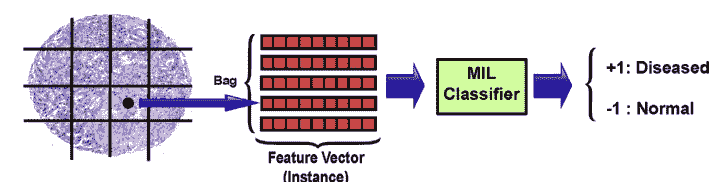

#### 图 4.3

多实例学习（MIL）用于图像分析。诊断图像首先被分割成矩形块。从每个块提取一组特征，并由所得特征向量形成一个实例。属于同一诊断图像的块被分组到一个袋中。该袋随后由 MIL 方法分类为患病或健康。

*转引自 Kandemir M, Hamprecht FA, Computer-aided diagnosis from weak supervision: a benchmarking study, Computerized Medical Imaging and Graphics 2015;42:44–50.*

用于图像分类的无监督网络（CUnet）[18] 或可与其他策略如 MILs 相结合。

对于不准确的监督，目标是通过使用多个训练有素的观察者来提高真实标签的准确性，并通过基于统计的数据预处理来减少“噪声”。

前几章讨论了集成学习的概念。在上述所有示例中，弱监督学习策略试图从有限量的标记（注释）数据中实现强泛化（性能）。相比之下，集成学习试图通过使用多个学习器来实现强泛化。虽然解决的问题不同，但这两种方法可能相互协同 [19]。

### 合成数据

当有大型数据集可用，但该数据集中注释示例有限时，需要弱监督方法。还有许多其他情况，数据集注释良好，但该集中存在类别不平衡。例如，通常正常组织的示例很多，但该组织特定类型的新生物的示例有限。显然，这造成了每个类别的示例不足以成功训练的情况。此外，它可能导致一种虚假的准确性。例如，假设我们研究的一种新生物的发病率为 1%。我们的训练集由 10,000 条条目组成，其中 100 条为阳性，其余为阴性。我们只需将每个样本都判为阴性，就很容易生成一个准确率为 99% 的算法。因此，任何产生 99% 准确率的 AI 策略都值得怀疑。我们可以通过计算精确率和召回率等指标来防范这种情况，如上所述。

我们可以通过使用所谓的合成数据来扩展样本数量。合成数据是创建的，而不是从真实世界样本中获得。一个典型的例子是某些条目缺少一个或多个属性的数据集。可以通过对集合中集体数据属性进行统计分析的近似来填补这些空白。生成合成数据的另一种方法是创建一个解释观测结果的物理模型，然后使用该模型重现随机数据，因为在许多情况下，复杂系统的观测特征往往可以从简单规则中产生。Patki 等人 [20] 描述了一个系统，该系统从真实数据集中构建机器学习模型以创建此类人工数据，即 Synthetic Data Vault。该模型捕捉了多个特征之间的相关性。在他们的研究中，研究人员发现使用合成数据与仅使用真实世界数据相比没有显著的性能差异。

对于图像分析的情况，我们可以通过取真实样本并以某种受控方式对其进行操作来创建合成数据，从而创建共享真实数据属性的随机新示例。有许多可用的程序，例如 GANpaint Studio，可用于创建面部或场景的逼真图像（可在互联网上作为免费演示获得）。此类程序已被用于生成所谓的“deepfake”图像以用于不良目的，但此类算法可用于从真实图像创建合成图像，以用作机器学习协议中的补充。Hou 等人 [21] 已使用 GAN 生成建模真实数据分布的病理组织学图像。

### N-shot 学习

在使用 AI 执行分类等任务时，会使用大型数据集为每个类别创建内部表示，以便推广到新的未标记示例。人类并非以这种方式学习。例如，给婴儿几次看香蕉，孩子就会认出香蕉。确实，复杂模式需要更多学习；然而，人们普遍知道，可以用少于 100 个样本训练二年级医学生区分正常、良性和恶性示例。一般来说，如果人类对它们的外观、属性以及在某些情况下的功能有足够的信息，则可以根据有限的示例进行分类。这可能是足够复杂的生物大脑的一般能力。Levenson 等人 [22] 证明，可以在少于 200 次试验中以高精度训练鸽子完成癌症诊断任务！16 只鸽子的集合能够达到接近训练有素 CNN 的性能。

“shot”定义为训练可用的单个示例。在一次训练中，我们每个类别只有一个示例。在 N-shot 学习中，有 N 个示例。任务是在该约束下将任何测试图像分类到一个类别中。实现此目的的一种方法是使用“原型网络”。与通常的深度学习架构不同，原型网络不会直接对图像进行分类。它们学习将图像映射到度量空间。这意味着同一类别的图像彼此放置得很近，而不同类别的图像则放置得更远。当呈现新示例时，网络只需检查其最近的聚类。这些模型本质上是 K-means 聚类算法的复杂形式，并且基于 CNN。此类别中的模型被称为“Image2Vector”模型。更复杂的模型涉及通过神经注意力机制增强记忆的神经网络。这些模型很难描述，但一个很好的例子见于参考文献 [23]。虽然“one-shot learning”应用于描述 N = 1 的情况，但该术语在 N 非常小的时候也更广泛地使用。

目前，N-shot 学习中具有最大一次学习潜力的<|message|> 方法似乎是孪生网络。与学习对输入进行分类的模型不同，神经网络学习区分两个输入。典型的孪生网络由两个相同的神经网络组成，每个网络接收两个图像中的一个。相同意味着它们具有相同的配置、相同的参数和权重。两个网络的最后几层共同输入到对比损失函数中，该函数计算两个图像之间的相似程度。自然语言处理中的一个例子涉及评分考试问题。这里一个输入是问题句子，另一个输入是答案。输出是答案与问题的相关程度。这不是一个简单的分类任务，因为我们没有一个包含所有被判定为“正确”的答案的数据库以及被判定为“错误”的示例。然而，孪生网络可以提取问题和答案之间的相似性或联系。

非常经常地，只要 n 是一个很小的数字，就会使用一次学习这个术语。无论如何，孪生网络在一次图像识别任务中取得了最先进的性能（Koch 等人 [24]）。在这项研究中，两个网络中的每一个都是标准的 CNN。最终的卷积层输出被展平为单个向量，然后输入到全连接层，然后输入到计算每个孪生体输出之间的距离度量的额外层。

涉及病理学主题的一次学习示例相对较少。在过去几个月里，Yarlagadda 等人 [25] 展示了使用一次学习模型对组织病理学图像中的宫颈癌细胞进行分类。

### 一类学习

有必要区分一次学习和一类学习。与 N-shot 学习密切相关的是 one-class learning 的概念。一类分类的目的是仅使用该类的示例来识别该类的实例。所有其他类都被归为一类，被称为外来类。换句话说，一类与二分类之间的区别源于缺少来自第二个类的训练数据。虽然这种方法已受到

通过Cox负对数函数进行提升。最后，将聚合的图像块风险数据等同于患者风险。然而，这仅仅是一个粗略的近似，因为患者风险还包括肿瘤的大小和位置，所有这些都受到年龄、性别和合并症的影响，在现代医学中，还受到基因组和蛋白质组特征的影响。

SCCN则更为复杂，因为它明确地利用了基因组数据和图像形态学。它需要对图像数据集进行标注，然后通过完整的CNN运行。基因组数据直接输入到全连接层，绕过卷积层。该网络以常规方式使用标准损失函数进行训练，不同之处在于输出随后进入最终的Cox近似层。实际上，SCCN利用了通用逼近定理，即具有适当激活函数的单层可以逼近任意函数。这里的函数就是Cox偏风险函数。作者在其论文中通过提供覆盖组织学特征的基于风险的热图，证明该算法能够检测出有意义的风险要素。

展望未来，深度学习算法很可能将能够更好地将形态学数据与所有可获得的患者信息相结合，从而针对特定患者所表现出的具体疾病实现治疗方案的最优化定制，进而实现真正的个性化精准医疗。

### 一般性考虑

在本章中，为说明问题所选的示例使用了多种机器学习策略，在某些情况下还使用了混合网络。一个重要的实际问题是如何选择算法来解决给定问题。遗憾的是，没有正确的答案。在此背景下，有必要思考Wolpert和Macready提出的所谓“没有免费午餐”定理[31]，该定理指出：“对于任何算法，其在一类问题上的任何性能提升，都会被在另一类问题上的性能下降所抵消。”

简单来说，不存在对每个问题都最有效的单一模型。然而，每种方法可能最适合某一类特定问题。这意味着，不能将某项研究中表现最佳的算法推广为其他机器学习任务的最佳策略。因此，针对给定问题选择合适的模型非常重要。遗憾的是，并没有可供选择的理论依据。这必须通过反复试验以经验方式来完成。算法评估研究[3]为这一总体原则提供了一个很好的具体示例。

无论作何选择，每个模型都有可调参数或超参数。例如，就神经网络而言，可调参数包括每层的节点数和层数。反向传播涉及动量和学习率的选择。对于CNN，必须就卷积矩阵的大小作出决策。初始权重必须随机化，但大多数随机数都是由计算机从“种子”数字开始生成的。该种子也是一个参数。这一清单远非详尽。对于随机森林，树的数量、分支数量、树的深度等都是必须选择的参数。对于k均值，必须选择聚类数量，以及启动聚类定义迭代过程的k个随机数种子。对于人工智能界人士而言，可调参数是不可避免的现实问题。

选择模型时的另一个考虑因素是模型的隐式偏差。这里指的不是外部偏差，例如由训练集元素的选择或对特征或类别标签进行基于价值的评估所产生的偏差，而是指内嵌于每个模型中的假设。例如，k均值假设聚类大致呈球形且彼此大小相似（尽管也存在没有这些约束的更好模型）。朴素贝叶斯假设描述特征向量的属性彼此独立。关于数据分布的假设几乎是所有机器学习算法的核心。必须充分详细地了解数据集的性质，以便选择的算法其约束条件对该数据集最不关键。遗憾的是，“偏差”一词的使用往往将AI程序拟人化，从而掩盖了所涉及的问题。

由于我们无法真正理解深度学习网络如何处理其输入以得出正确输出，因此检测其中的隐式偏差十分困难。换言之，存在可说明性和可解释性问题。可解释性是指预测输入或算法（可调）参数变化影响的能力。可说明性是指理解算法得出结论之基础的能力。例如，如果能够向外科医生解释AI得出高级别恶性肿瘤诊断的依据，或者它如何区分两种形态相似但生物学特性不同的肿瘤，那或许会令人感到安心。有趣的是，如果询问一位具有标杆水准且训练有素的病理学家是如何得出诊断的，他们通常会提到促成该诊断的“多年经验”。当被追问更具体的标准时，他们可能会编造一些，但这往往是临时性的，目的是为已经凭直觉作出的决定辩护。因此，神经网络的黑箱特性虽然令一些人感到不安，但人工智能界人士中的其他人并不以为意。

有一些方法可以深入了解幕后发生的事情，让我们得以拉开帷幕，看看“巫师”是如何运作的。例如，显著性图将图像中对模型预测贡献最大的像素可视化。通过对像素值施加微小调整并计算预测类别的变化，我们可以衡量每个像素对最终输出值的相对重要性。这一点在参考文献[32]中有所讨论。其他方法包括试图确定反向传播过程中隐藏层神经元的活跃程度，此外还通过映射这些输出的强度、方向、颜色和形状等特征，获得隐藏层日益复杂输出的可视化表示。

这些方法或许能提供一些关于神经网络如何区分不同类别的见解，但仍然无法以人类可理解的方式“解释”正在发生的事情。当AI走出一步出乎意料、令人震惊、对人类观察者来说没有明显战略意义的棋着，而这步棋开启了一个制胜序列时，这些内部度量无法提供任何线索，说明程序是如何创造出这步事后看来“精彩绝伦”的棋着的。因此，它们无法为人类观察者创造真正的学习体验。另一方面，当人类观察者观看人类特级大师对弈时，这种情况偶尔也会发生。尽管如此，了解机器学习算法的内部决策过程可能会为开发更好的算法提供启示。因此，在承认我们偶尔无法理解人类天才的同时，坚持要求AI具备可说明性是有其道理的。

尽管有上述种种告诫，在相同数据集上使用不同“浅层”学习AI策略的研究往往能获得相似的结果。深度学习的出现使机器学习相较于大多数（如果不是全部）替代方法取得了巨大改进。在处理复杂的多维特征集时，神经网络的表现大大优于其他类型的机器学习。即便在这一领域，在比较基于同一数据集但采用不同网络模型变体的论文时，各自所声称的改进往往都是渐进式的。虽然有些模型优于其他模型，但它们的结果似乎都收敛于实现超过90%–95%准确率的水平（其他评估指标的结果也类似）。然而，这可能仅仅是因为每项研究都精心优化了所选程序。此外，还必须考虑计算能力的差异。出于后一个原因，除非算法在完全相同的平台上运行，否则绝不应使用性能速度来比较两种算法。另一个原因是，训练集往往是现实环境中数据的简化和精心整理版本。这就产生了一种可能，即在结构化程度较低的情况下，可能会观察到更大的差异。最后，某种算法在一个环境中获得的结果，未必与同一算法在另一个环境中的结果一致。换言之，过去的表现并不能保证未来的结果。

鉴于诸如此类的考虑，研究者使用了各种集成方法，以及将两种或多种不同算法按顺序或并行组合的混合模型。上文已经给出了多标签检测和弱监督两方面的示例。

### 总结与结论

尽管我们尚未讨论AI在临床实验室数据、自然语言处理或（除一个例外）遗传、表达和蛋白质“组学”方面的应用，但与前述类似的考虑因素适用于所有这些应用。就图像识别和分析而言，我们已远远超越了仅识别病灶和根据形态学模式预测结果的阶段。我们的图像是复杂的，必须对异常结构以及正常元素与这些异常结构的关系进行分析。同时，……内部的特定特征

提供诊断或预测信息的病变必须被识别，并在可能的情况下进行量化。本章已介绍了完成这些任务的一些工具，并提供了说明其在真实世界环境中使用的具体参考文献。重要的注意事项也已指出。该领域正以指数速度增长；所选的许多参考文献在项目开始时并不存在。对所有这些而言，一个主要考虑因素是需要庞大的数据集。如图所示，有多种方法可以使训练集的生成更高效，并有望减少这些集合的规模。

为了在实验室之间通用，所有这些方法都依赖于从全切片成像到最终诊断输出的每个阶段的标准化和规范化。它还将需要就注释标准达成共识。然而，鉴于这种情况正在迅速实现，人工智能作为病理学中人类能力的增强者和提升者的未来是光明的。

### References
- [1] Devkar R, Shiravale S. 图像多分类综述。International Journal of Computer Application 2017;162:39–42.
- [2] Zhang M, Zhou Z. 多标签算法综述。IEEE Transactions on Knowledge and Data Engineering 2014;26:1819.
- [3] Veta M, et al. 乳腺癌组织病理学图像中丝分裂检测算法的评估。2014. arXiv:1411.5825v1.
- [4] Bejnordi BE, et al. 深度学习算法在乳腺癌女性淋巴结转移检测中的诊断评估。JAMA 2017;2199–2210.
- [5] Wang Z, et al. 通过循环发现注意力区域进行多标签图像识别。2017. arXiv:1711.02816v1 [cs.CV].
- [6] Alom MZ, Hasan M, Asari VK. 基于 R2U-Net 的医学图像分割的循环残差卷积神经网络。2018. arXiv:1802.06955v5.
- [7] Mathe AP, Sminchisescu C. 用于视觉目标检测的强化学习。2016. https://doi.org/10.1109/CVPR.2016.316.
- [8] T. Chen, et al. 用于多标签图像识别的循环注意力强化学习。In *第32届人工智能AAAI会议* (AAAI-18), https://www.aaai.org/ocs/index.php/AAAI/AAAI18/paper/download/16654/16255.
- [9] Zhou J, et al. 图神经网络：方法与应用综述。2019. arXiv:1812.08434v3.
- [10] Jung H, et al. 深度学习与图论在组织病理学全切片图像分析中的整合。In: IEEE 图像模式识别研讨会; 2018. https://doi.org/10.1109/AIPR.2018.8707424.
- [11] Sabour S, Frosst N, Hinton GE. 胶囊间的动态路由。In: 第31届神经信息处理系统会议 (NIPS)。Long Beach, CA: 2017. p. 1–8.
- [12] Zhou Z-H. 弱监督学习简述。National Science Review 2017;5:44–53. https://doi.org/10.1093/nsr/nwx106.
- [13] Le Hou, et al. 利用乳腺组织病理学图像改善前列腺癌检测。2019. arXiv:1903.05769v1 [cs.LG].
- [14] Fischer, et al. 病理切片的稀疏编码与深度神经网络迁移学习比较。In: BMC informatics 19, supplement 18; computational approaches for cancer; 2018. p. 109–17. art. 489.
- [15] Andrews S, et al. 用于多实例学习的支持向量机。Advances in Neural Information Processing Systems 2002;15:561–8.
- [16] Xu Y, et al. 用于组织病理学癌症图像分类、分割和聚类的多簇实例学习。In: IEEE 计算机视觉与模式识别会议; 2012. https://doi.org/10.1109/CVPR.2012.6247772.
- [17] Campanella G, et al. 基于全切片图像的弱监督深度学习的临床级计算病理学。Nature Medicine 2019;25:1301–9.
- [18] Dong L, et al. 用于图像分类的紧凑无监督网络。IEEE Transactions on Multimedia 2016. arXiv:1616.07015v1 [cs.CV].
- [19] Zou Z-H, et al. 当半监督学习遇见集成学习时。Front Range Electrical Engineering 2010;5. https://doi.org/10.1007/s11704-009-0000-0.
- [20] Patki N, Wedge R, Veeramachaneni K. 合成数据保险库。In: 2016 IEEE 第3届数据科学和高级分析国际会议, vol. 1; 2016. p. 399–420. https://doi.org/10.1109/DSAA.2016.49.
- [21] Hou L, et al. 无监督组织病理学图像合成。2017. arXiv:1712.05021v1.
- [22] Levenson RM, et al. 鸽子作为病理学和放射学乳腺癌图像的可训练观察者。PloS One 2015;10(11). doi:10.1371/journal.pone.0141357.
- [23] Vinyals O, et al. 用于单次学习的匹配网络。2017. arXiv:1606.04080v2 [cs.LG].
- [24] Koch G, Zemel R, Salakhutdinov R. 用于单次图像识别的孪生神经网络。In: 第32届机器学习国际会议论文集, vol 37; 2015. Lille, France.
- [25] Yarlagadda, et al. 组织病理学图像中宫颈癌细胞分类单次学习系统。In: Presented at 2019 SPIE medical imaging conference, San Diego, CA; 2019. https://doi.org/10.1117/12.2512963.
- [26] Perera P, Patel VM. 用于单类分类的深度特征学习。2019. p. 1–15. arXiv:1801.05365v2 [cs.CV].
- [27] Chalapathy R, Menon AK, Chawla S. 使用单类神经网络的异常检测。2018. arXiv:1802.06360v1 [cs.LG].
- [28] Quinn TP, et al. 癌症作为组织异常：仅基于健康数据对肿瘤转录组进行分类。Frontiers in Genetics 2019;10:599. https://doi.org/10.3389/fgene.2019.00599.
- [29] Zhu X, et al. WISA：从全切片组织病理学图像进行生存预测。IEEE Conference on Computer Vision and Pattern Recognition 2018:7234–42.
- [30] Mobadersany P, et al. 使用卷积网络从组织学和基因组学预测癌症结局。2018. www.pnas.org/cgi/doi/10.1073/pnas.1717139115.
- [31] Wolpert DH, McReady WG. 优化的无免费午餐定理。IEEE Transactions on Evolutionary Computation 1997;1:67–82.
- [32] Simonyan K, Vedaldi A, Zisserman A. 深入卷积网络：可视化图像分类模型和显著性图。2014. arXiv:1312.6034v2 [cs.CV].

## Dealing with data: strategies of preprocessing data

Stanley Cohen, MD 1,2,3

1 Emeritus Chair of Pathology & Emeritus Founding Director Center for Biophysical Pathology, Rutgers-New Jersey Medical School, Newark, NJ, United States; 2 Adjunct Professor of Pathology, Perelman Medical School, University of Pennsylvania, Philadelphia, PA, United States; 3 Adjunct Professor of Pathology, Kimmel School of Medicine, Jefferson University, Philadelphia, PA, United States

### Introduction

大多数人工智能算法的应用都依赖于使用大型标记数据集（监督学习）。尽管在弱监督或稀疏监督学习的使用方面取得了很大进展，但总体而言，病理学中的应用尚未系统地利用这些方法。同样，虽然强化学习使用奖励策略而不是从标签与预测的比较中得出的损失或成本函数，但这些方法通常尚未应用于病理学家感兴趣的主题。然而，最近已开发出使用强化学习进行图像分类的复杂算法[1–3]；因此，这在不久的将来可能会发生变化。

由于这些人工智能算法目前对“大数据”的依赖，确保数据以最佳形式输入所选算法变得很重要。至少，好的数据与好的算法一样重要，而且通常可能更重要。事实上，大多数数据科学工作涉及将数据转换为模型所需格式，并在其最紧凑和最具信息量的形式下呈现。其原因在于“垃圾进，垃圾出”的推论是“更好的数据胜过更花哨的算法”。现实生活中的数据杂乱无章；必须将其驯服。它通常不完整或不一致，可能包含错误。我们必须确保我们的样本代表我们试图从样本属性中预测的各个类别，我们必须确保样本本身相关，并必须处理样本中缺失的属性并确定异常值是否显著或为伪影。在存在类别不平衡的情况下，我们必须尝试通过减少数据集的一部分或构建合成数据来纠正此问题。这些任务可以广泛归类为特征工程，涉及特征选择、特征标准化和归一化、特征提取和特征校正。这些术语只是对同一过程各个方面的描述，而不是一组不同的程序，并且在一定程度上重叠。总体而言，它们归

### 特征选择、提取和校正

这些最好在具体示例的背景下讨论，与基于 Kaggle 数据的泰坦尼克号沉没有关。Kaggle 是一个在线资源，用户可以在上面查找、发布、探索数据并参加竞赛，并为此目的维护许多有用的数据库。特别是，它包含泰坦尼克号最后一次航行的乘客名册的公共领域 60 KB 数据源（train.csv）[4]。它提供了有关乘客大量属性的信息，基于这些信息，Kaggle 挑战是预测泰坦尼克号上任意一名乘客是否会在沉没中幸存。名册中的数据样本显示在图 5.1 中。

综上所述，可用信息的类别如下：

| 乘客 ID | 船舱等级 | 姓名 |
|---|---|---|
| 性别 | 年龄 | SibSp（兄弟姐妹或配偶） |
| 票号 | 票价 | Parch（父母和子女） |
| 客舱号 | 登船港口 | 生存信息 |

如果将幸存和未幸存视为两个类别，则每个样本有 11 个属性。

我们不能直接将该数据集输入机器学习算法，因为存在不一致、遗漏和冗余。涉及问题的优秀总结见参考文献 [5,6]。综上所述，891

名乘客的数据集中没有客舱信息，因此最好直接消除该属性。相比之下，只有 2 个登船港口值为空，因此这些样本可以简单地丢弃。有 177 名乘客没有信息。我们可以通过寻找一些统计度量为这些条目创建伪数据。例如，我们可以根据乘客所在舱位或其他看似合理的属性的平均值来推断年龄。在此过程中，有助于查看实际的分布情况，以判断它们是否符合正态分布。另一种方法，当数据不适合这种统计分析时，是简单地将缺失的分类数据标记为“missing”，将缺失的数值数据标记为“0”，以满足没有缺失变量的技术要求。使用这种技术本质上是让算法估计最优值，而不是简单地用均值填充。

下一步是决定哪些特征可能有用，哪些没有用。虽然有点违反直觉，但保留整个属性集实际上可能会损害算法的预测准确性。乘客 ID 和乘客姓名是冗余的，因此可以在插补数据之前消除乘客姓名列。然而，在此步骤之前，该信息可能有助于发现错误。例如，在 1912 年，如果一对同舱的男性和女性姓氏不同，他们不仅不太可能是未婚夫妇，而且也不太可能彼此结婚。这可能只是登记错误。然而，也存在其他可能性，例如祖父母-子女组合或异性兄弟姐妹（尽管后者在 1912 年也可能是一个问题）。例如，这可能有助于检查 SibSp 数据的准确性。还可以交叉核对 SibSp 和 Parch 数据是否存在差异。年龄也可能提供线索。13 岁的孩子不太可能有配偶。80 岁的老人不太可能船上有父母。错误的数据可以视为缺失数据。

在减少属性集时，重要的是寻找依赖关系。例如，特定登船港口的票价可能与乘客等级相关，如果是这样，其中一个可能被丢弃。客舱也可能与票价和等级相关，但这提供了额外信息，例如相对于甲板层的位置和靠近楼梯的程度。这些选择涉及有根据的猜测，因此不同的数据科学家可能会得到不同的属性子集。例如，在参考文献 [6] 中使用的示例中，所选属性为 age、SibSp、Parch、Fare、Sex、Passenger Class 和 Embarked。

对于下一步，重要的是考虑每个的度量。虽然“性别”只有两个可能值（这是 1912 年）和等级有三个可能值，但数据集中 SibSp 有七个不同的值，Parch 有 8 个不同的值。然而，有 281 种不同的票价，不太可能精细的区分会帮助模型，因此可以将票价值分组为较少数量的范围类别。

这些例子表明，原始数据只是冰山一角！

#### 图 5.1

从 1912 年泰坦尼克号最后一次航行的乘客名册中获得的数据样本。Kaggle 仓库。

### 特征转换、标准化和归一化

由于数据要么是数值，要么以数值形式编码以供计算机输入，因此对于每个属性落入相似的数值范围可能是重要的，这样一个特征不会不成比例地贡献。归一化通常是指将变量缩放为零到一之间的值。标准化则通常指将数据库重新缩放为均值为零、标准差为 1 [7]。适当的缩放即使在所有超参数都已优化调优后，也常常能提高算法的准确性。

### 特征工程

特征工程是利用数据的领域知识创建特征的过程，以优化使用这些特征作为输入的机器学习算法。换句话说，特征工程是关于从现有特征创建新的输入特征。这通过将特征集减少到更易管理的大小来提高计算效率，在某些情况下提高准确性。它利用你的领域专业知识。特征工程最简单的形式是组合特征。例如，如果两个属性是“重量”和“体积”，并且绝对大小不是必需的，则单个值“密度”可能更合适。如果某些属性在数据集中没有得到很好的表示，则可能将它们组合起来。在上一节的车辆示例中，我们可能会将“加速度”和“抓地力”数据组合成一个单一变量“性能”。这对于稀疏类别也可能有所帮助，例如非小细胞肺癌的类别，而不是将其分离为单独的形态学变异。最后，分类或文本值可以被二元变量替代。砖、木、乙烯基和石头可以分别被“砖”和“非砖”或零和一替代。其中许多技术导致维度缩减。在下一节中，我们将描述一些正式的、基于数学的数据缩减技术。

特征工程最复杂的形式是创建新的相关特征，而不仅仅是组合或替代。用于人脸识别的有用特征包括各种面部特征之间的距离、整体大小和形状等等。所有这些都可以量化并成为特征集，而不是图像的原始像素。同样，还有诸如 Hough 变换和“blob”分析之类的数学技术，允许量化密度对比并检测边缘。这些也可以用来创建附加特征。所有这些步骤都涉及数据的转换。在机器学习算法中使用数据只是最后（尽管承认是最复杂和数学密集的）步骤。该过程如图 5.2 所示。

深度学习系统（如神经网络）的强大之处在于它们可以隐式地自行学习进行特征工程。算法可以从原始输入自动创建更高层次的特征。更表示分析（PCA）作为最常用的程序之一。PCA 最早在 20 世纪初作为统计技术被发明，因此早于机器学习半个世纪。它已成为数据预处理在许多领域尤其是机器学习中的重要工具。PCA 用于识别提供最多信息以区分示例用于分类目的的特征并移除其他特征。这是通过根据数据对该数据方差的贡献来转换数据来实现的。另一种思考 PCA 的方式是注意到我们的数据通常包含许多变量，其中一些可能相关。这导致数据集中信息的冗余。本质上，PCA 将原始变量转换为这些变量的线性组合，使其相互独立。PCA 可能是一个难以理解的话题，因此我们将以两种方式处理它，首先是或多或少直观的方法，然后是对其底层数学原理的更精确解释。

对此的一个很好的直观描述见参考文献 [8]。文章首先指出方差是衡量一组数字分散程度的指标。它描述了变量与其期望值相差多少。如果每个特征在所有样本中都有相同的值，使用它的模型将没有预测价值，因为每个样本都是相同的。因此，方差作为模型中的特征变量是有用的。如果我们将目标定义为要预测的值，那么我们希望特征相对于目标具有非零方差。从数学上讲，方差是预测值与真实值之间均方差。虽然方差描述了单个变量的多个实例如何变化，但协方差是衡量两个或多个随机变量共同变化程度的指标。

如上所述，PCA 自动执行数据缩减，并且以无监督的方式进行。它基于方差进行。它首先找到数据中方差最大的方向。这基本上是数据最分散的方向。类似于线性回归，我们可以找到一条线，使得原始数据点与其线上最近点之间的均方差最小化。这条线给出第一个主成分。下一个主成分将是使信息损失最小化同时与已找到的成分垂直的线（图 5.3）。该过程可以重复，直到组件的数量与原始数据的维度相同。如下面所示，这些操作代表数据的线性变换，可以逆向重建原始数据。因此，两者都代表关于数据集的等效信息。

在这一点上，没有维度缩减。然而，每个成分提供的信息越来越少，因为我们从数据最分散的方向开始。这意味着我们可以丢弃一些后面的成分而不会造成太大损害。这将使基于成分的数据集在维度上小于原始数据集。诀窍在于确定在保留婴儿的同时可以丢弃多少洗澡水。这通常是通过绘制方差随成分数量变化的曲线并寻找方差很小的截止点来实现的。图 5.4 对此提供了很好的说明。这是

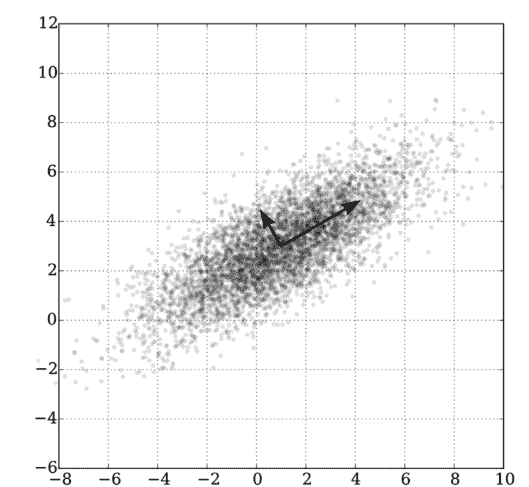

#### FIGURE 5.3

长箭头显示第一主成分的方向，较短的箭头显示第二主成分的方向。由于本例中的数据是二维的，因此只有两个主成分。每个主成分代表一个沿其计算方差的轴。维基共享资源。

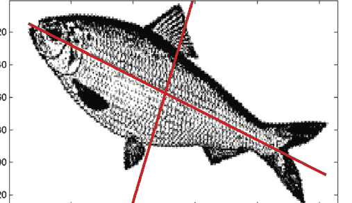

#### FIGURE 5.4

我们无需正面看到也能很容易将其识别为一条鱼。定义该鱼的数据点集合在 Z 方向上的方差小于 X 和 Y 方向上的方差。维基共享资源。

方差和“特征值”。如下面所示，特征值是在 PCA 中由协方差矩阵计算得出的，特征值代表方差，因此在图形分析中这两个术语可以互换使用。大多数碎石图都有一个拐点，当出现这种情况时，它就定义了讨论后续成分的截止点。在图 5.5 中，我们将保留前三个成分并丢弃其余成分。

这对 PCA 来说是一个非常简化的解释。要理解 PCA 的实际实现，需要一些数学细节 [9]。我们实际做的是使用线性代数基于方差将一个特征集变换为新的集合。我们通过寻找能最好解释变量协方差结构的变量线性组合来实现这一点。我们通过首先从原始数据矩阵构造协方差矩阵来实现这一任务（在某些应用中，使用相关矩阵；就本讨论而言，我们可以忽略这一区别）。协方差矩阵是一个矩阵，其 i,j 位置的元素是原始向量中第 i 个和第 j 个元素之间的协方差。然后计算该矩阵的特征值和特征向量。特征向量是在给定线性变换下描述固定方向的向量，而特征值是这些向量的缩放因子。我所遇到的最直观的解释是，线性映射的特征值提供了变换引起的失真程度的度量，而特征向量则告诉你失真是如何定向的。在 PCA 中，矩阵是根据原始数据中的协方差构造的，因此特征值代表沿主成分方向（特征向量）的方差。换句话说，特征值的大小提供了每个特征值对原始数据整体行为的贡献程度的信息。与最大特征值相关联的特征向量是第一个主成分，以此类推。因此，特征值的大小提供了该特征值对原始数据整体行为的贡献程度的信息。最后一步是以主成分之和的形式写出每个数据点的特征向量。

降维来自于丢弃具有最小特征值的<|message|>主成分。因此，像图 5.5 中所示的方差碎石图通常显示为一条曲线，其中特征值相对于主成分编号绘制，而不是相对于成分编号的方差贡献。这些两个术语代表相同的东西。为了具体说明，对于前一个示例中的椭球体，当我们丢弃扁平方向时，我们是根据上述计算进行的。碎石图将显示从 3D 到 2D 表示中损失了多小的信息。

PCA 是一种早于机器学习的强大统计技术。它已被证明在几乎所有形式的机器学习中都很有用。PCA 不仅通过剔除数据中较不重要的特征来减少维度灾难，而且还提供了一种手段，使数据能够以图形形式更好地可视化，因为通常很难表示超过三或四个维度。PCA 并不是唯一的技术。其他技术包括奇异值分解、线性判别分析和因子分析。还有非线性降维方法。这些方法基于流形概念。流形是一种拓扑空间，在每个点附近局部类似于平坦的欧几里得空间。例如，如果你把线性空间想象成一张平坦的纸，那么一张卷起来的纸就是一个非线性流形，因为每个点附近都有一个线性区域。一些非线性降维方法包括多维缩放、等距特征映射、局部线性嵌入和谱嵌入等。还有用于非线性降维的概率方法，例如 t-分布随机邻居嵌入。该技术计算高维空间中成对数据点相关的概率，然后找到产生相似分布的低维嵌入。虽然超出了本讨论的范围，但可在参考文献 [9] 中找到一个很好的总结。

### Dimensional reduction in deep learning

基于神经网络的算法提供了多种无监督降维方法。回想一下，在神经网络内部，细节的表示以不断增加的复杂性发展。表示的每个派生特征都是由数据集中许多原始特征构建起来的，因此维度更低。卷积神经网络就是一个很好的例子。初始特征集可能由数百万个像素组成。卷积层和最大池化层将其减少为少量编码图像中重要数据的特征。生成此类表示的其他方法包括自编码器和生成对抗网络，如第 4 章所述。自编码器与 PCA 之间存在有趣的联系。自编码器通过卷积压缩输入数据来开发输入数据的降维编码（表示），然后通过反卷积并将结果与原始输入进行比较来确认其准确性。虽然这似乎与 PCA 没有任何关系，但事实证明，如果我们不使用内部激活函数运行数据通过自编码器，那么 resulting 网络的数学与通过 PCA 算法运行它相同。然而，如果我们在自编码器中包含激活函数，如通常情况，则系统比 PCA 强大得多 [10]。

### Imperfect class separation in the training set

在上述讨论以及整本书中，我们假设存在一个标记训练集，其中数据集中每个实例的类别是准确已知的并且彼此不同。然而，有时会出现一种溢出，即一个类别被另一个类别中少量但未知数量的样本污染，这是由于注释不完美或构建训练集时出现错误所致。幸运的是，有一些复杂的方法可以处理这种情况。最简单的情况是训练二元分类器可靠地分离正类和负类，例如癌症与正常。这里，我们考虑正集已知但负集未知的情况，因为它包含正例和负例。换句话说，我们需要为训练目的分离出一组所谓的“可靠负例”。执行此操作的技巧是先将所有负例视为真正负例并训练分类器。接下来，使用分类器对未知类进行评分并消除分类最不可靠的那些。针对该截断的负集重新训练正例，并根据需要重复，直到满足某个停止条件 [11,12]。另一种方法是将未知数据打包成不同的子集并评估每个子集用于训练 [13]。

在这种问题中，我们假设正集足够大以进行有效训练。然而，通常可用的正集小于负集，处理这种情况的方法如合成数据的创建已在前几章中讨论过。有趣的是，PU 学习本身可用于分类问题，其中只有少量正训练集可用。这涉及用包含正例和负例的未标记样本集来扩充标记正例集。在上面描述的 PU 学习示例中，我们假设有足够大的正训练示例集，并且正样本是从与负集中污染的正样本相同的分布中抽取的。在这种新场景中，除了找到可靠的负例外，我们还希望在负集中识别出隐藏的可靠正例。使用这种策略的 PU 的一个有趣变体被称为“从概率标记的正例学习”（LPLP）。LPLP 已被描述用于文档分类 [14]，但对于图像解释也有明显的用途。

### Fairness and bias in machine learning

机器学习中有两种偏见：编码或模型偏见和数据偏见。编码偏见对于理解给定算法对其所解决问题的有效性很重要，但它与人类形式的偏见并不类似。相反，它指的是在构建模型时所做的假设。例如，在 K-means 聚类模型中，假设聚类大小相似且本质上是球形的。在朴素贝叶斯中，假设特征属性是独立变量。在神经网络反向传播中，假设局部最小值可以作为全局最小值的替代。模型偏见不是缺陷；它是构建可用模型时所做的简化假设的基础，这些模型在计算上高效，同时仍能提供有用且有意义的输出。这种内置假设通常也只是为了使问题能够在当前技术水平下解决而必不可少的。无论如何，了解所使用算法的局限性很重要。

数据偏见比编码偏见隐蔽得多。大多数临床医生，尤其是病理学家，将是机器学习模型的用户而非创建者，因此最大程度减少编码偏见可能不在我们的专业范围内。然而，我们将作为训练集数据的内容提供者和标注专家。因此，我们是审查数据本身是否存在意外偏见的第一道防线。

我们可以将偏见定义为相对于另一事物、人或群体，对某一事物、人或群体支持或反对的不公平倾向。对人类而言，偏见可以定义为一种特定的倾向、趋势、爱好、感觉或意见，通常是有先入为主的或不合理的。偏见可能是无意识的，因为我们可能在没有意识到的情况下持有态度或刻板印象（隐性偏见）。由于机器缺乏倾向或意见，或者就我们所知，缺乏意识，机器学习中的公平性可以表示为敏感属性（种族、性别、国籍等）与模型输出之间的关系。无论人类还是机器，其输出都会基于一个事实上与输出没有因果关系的属性而被错误分类。在人类偏见的情况下，结果往往是判断性的；在机器的情况下，则可能导致人类做出错误判断。

机器学习中产生偏见的方式有很多。样本偏见是指用于训练模型的数据不能准确反映问题领域。例如，数据可能受到限制或整理不当，或者训练集中可能存在明显的不平衡。前者的一个例子是训练集中所有猫都被放在红色地毯上，而狗被放在棕色地毯上。一个未知的狗样本放在红色地毯上可能被分类为猫。另一个例子是一组男性和女性的头部照片，其中所有女性都留着长发。一个留着精灵短发的未知女性可能被分类为男性。请注意，这些例子并不表现出偏见，而仅仅是因为对群体属性的“错误”假设而出错。这些是相对无害的例子。然而，想象一个用于区分可卡犬和杜宾犬的训练集，其中可卡犬都被展示为咬主人，而杜宾犬被展示为依偎。虽然这两种犬都可能温顺或具有攻击性，但这会对这两种犬的相对性情描绘出一幅不公平的画面，并可能导致对可卡犬的不公平偏见。

集合不平衡可以以更隐蔽、更有问题的方式导致机器偏见。例如，2015年，谷歌开发了一种算法，用于将人脸识别为人类、恒河猴、狒狒、大猩猩和其他灵长类动物。该算法将非裔美国人分类为大猩猩！这不是新纳粹编程，而是与训练集中非裔美国人样本有限、高加索人样本众多以及各种非人类灵长类动物样本众多有关。谷歌并非故意这样做；它基于手头的图像进行训练，没有注意到数据库中不同种族或民族的人数的失衡。神经网络已经学会了将肤色作为人类和猿类之间的判别特征！明显的修复方法是扩大数据库，但谷歌最初的修复只是完全阻止该算法识别大猩猩。

数据偏见还可能导致人群层面的不良医疗护理。最近，奥伯迈耶等人[15]检查了一种用于医疗决策的商业算法，发现在给定的风险评分下，黑人患者比白人患者病情严重得多。纠正这种差异将使接受额外帮助的黑人患者比例从17.7%增加到56.5%。这种偏见不是源于判断问题，而是源于底层数据结构。该算法使用医疗成本作为疾病程度的替代变量，其依据是一个看似合理的观念：你病得越重，在医疗上花费越多。然而，这种等价性建立在医疗保健可及性平等的假设之上。但医疗保健可及性的不平等和/或社会经济因素意味着我们在照顾黑人患者上花费更少。在这种情况下，修复方法更简单：查看更合适的疾病指标（或者更好的是，在确定社会问题后解决它）。

这些结果应与同一作者在2003年发表的另一项研究[16]进行对比。在这项研究中，创建了一大批虚构的求职简历。他还使用了虚构的名字，如Emily和Greg，以及Lakisha和Jamal，并将它们随机分配到这些简历中。然后，这些简历被发送给在当时候选媒体上发布招聘广告的雇主。听起来像白人的名字收到的面试回复比听起来像黑人的名字多50%。住在更好社区的申请人收到更多回复，但这一参数不受感知种族的影响。不同职业和行业的歧视程度是一致的。这些结果表明，种族歧视在2015年仍是劳动力市场的一个显著特征。

注意到这两个例子中偏见原因的差异是有启发性的。后者更有害，据推测是基于不公平的刻板印象。前者则是因为在属性选择上出错（成本与实际病情），而非不公平的概括。然而，两者都可能导致严重的负面后果。

与理解用于分析的特征相关的问题不仅限于机器学习，在传统统计分析中也存在。在参考文献[17]中，Smith描述了一项研究，该研究通过统计分析发现，脓毒症患者中高pH值者出院后比低pH值者更可能再次入院。这意味着低pH值是有益的。这令人惊讶，因为众所周知，脓毒症中的酸中毒与更严重的疾病相关。数据分析显示，数据中包括了住院期间死亡的患者。最不可能再次入院的患者是那些被送往太平间的人！

评估机器学习模型中的公平性可能非常困难。我们最初将机器学习中的公平性定义为敏感属性（种族、性别、国籍等）与模型输出之间的关系。然而，从上述例子可以明显看出，如果不考虑模型的数据生成策略和数据中嵌入的因果关系，就无法在这一背景下评估公平性。例如，基于遗传构成的疾病患病率差异可能不反映数据中的不公平偏见。另一方面，由环境或社会经济因素导致的疾病患病率差异可能反映潜在的不公平偏见。最近，谷歌DeepMind的科学家使用一种称为因果贝叶斯网络分析的技术来探索这些问题，试图构建更公平的学习系统[18,19]。

### 总结

机器学习模型的良好性能需要大量特征，以便从数据中进行分类和预测。这存在一个最佳点。超过该点增加属性数量会降低性能。这通常可以通过增加网络的复杂性来克服，包括层宽度和层深度。然而，缺点在于网络可能失去从已知示例泛化到新示例的能力。此外，不相关的特征可能会降低性能，因为网络会关注这些特征，而不是真正重要的特征。出于所有这些原因，必须在算法能力和数据结构之间取得平衡。数据科学家必须像关注机器学习模型的选择一样关注数据预处理。在数据方面还存在伦理考量，例如有限或构建不佳的数据集会导致模型出现隐性偏见，以及隐私问题。这些都非常重要，随着人工智能在社会中越来越普及，对它们的研究也日益增多。出于所有这些原因，理解数据和算法对于妥善解决这些问题至关重要。

### 参考文献
- [1] Chen T. et al. Recurrent attentional reinforcement learning for multi-label image recognition. arXiv; 2017. 1712.07465 [cs.CV].
- [2] Wang Z, Sarcar S. Outline objects using deep reinforcement learning. arXiv; 2018. 1804.04603v2 [cs.CV].
- [3] Mathe S, Pirina A, Sminchisescu C. Reinforcement learning for visual object detection. IEEE Conference on Computer Vision 2016. https://doi.org/10.1109/CVPR.2016.316.
- [4] https://www.kaggle.com/hesh97/titanicdataset-train.csv
- [5] https://towardsdatascience.com/a-beginners-guide-to-kaggle-s-titanic-problem-3193cb56f6ca.
- [6] https://medium.com/@andrewadelson/testing-different-models-for-the-titanic-dataset-be5f725b7ec0.
- [7] S Raschka. Feature Normalization and Scaling and the Effect of Standardization for Machine Learning Algorithms. https://sebastianraschka.com/Articles/2014_about_feature_scaling.html.
- [8] T Yiu. Understanding Principal Component Analysis. https://towardsdatascience.com/understanding-pca-fae3e243731d.

## 数字病理学作为初级诊断和深度学习增强的平台

阿尼尔·V·帕尔瓦尼，医学博士，哲学博士，工商管理硕士

教授，病理学和生物医学信息学，俄亥俄州立大学，哥伦布，俄亥俄州，美国

### 引言

病理学领域正进入一个令人兴奋的时期，随着数字成像在病理学中的更广泛应用。病理学家很早就使用图像，但仅在过去20年里，才加大了数字化工作流程的努力[1,2]。数字化图像的电子通信、数字病理学以及将显微图像在一位病理学家与其他医生或医疗保健团队成员之间传输的能力，今天在国家乃至全球病理学界都有应用，可用于初级诊断、教育、同行评审、术中咨询、第二意见咨询和质量审查[1,3–15]。

数字病理学最令人兴奋的方面是全切片成像（WSI）技术的开发和广泛应用[6,16]。WSI 允许对整张玻片进行扫描，输出的图像文件是对玻片的数字化复制，图像具有诊断质量标准[2,5,17,18]。美国病理学家学会已发布了关于 WSI 扫描仪临床使用验证的建议[16,19–21]。在过去的2年里，美国食品药品监督管理局（FDA）批准了两家 WSI 厂商销售用于初级诊断的设备，这已成为采用和实施数字病理系统道路上的重要里程碑[22,23]。随着深度学习（DL）和人工智能（AI）等工具从研究实验室和临床实验室开始应用，一套新的监管路径现在可能将被实施[14,24–30]。

WSI 扫描仪及其周围用于数字图像使用和存储的基础设施已取得了显著进步，自1997年Ferreira等人描述了第一台 WSI 扫描仪以来[31,32]。在过去十年中，WSI 的创新和重大技术进步有助于临床实验室能够自动、快速且高分辨率地对大量玻片成像[6]。能够常规数字化整张玻片不仅使病理学家能够更好地将计算能力和网络连接应用于组织形态学研究，而且显著改善了生物标本库的质量和可及性[33]，特别是可用于 DL 和 AI 领域研究的庞大图像数据集[34–40]。这些工具还为创建远程数字病理扫描中心网络铺平了道路，以实现临床病例的快速共享[41]。人工智能领域的后者发明和创新正在为增强病理学中的临床诊断工作流程和初级诊断铺平道路[28,42]。本章将重点介绍数字病理学的概述，特别是 WSI 作为用于初级诊断等临床应用的独特平台，以及通过 DL 和 AI 增强该诊断的潜力[11,20,26,43,44]。

### 病理学中的数字成像

成像在现代病理学实践中发挥着关键作用，是增强临床实验室工作流程的驱动技术。病理图像在医疗环境中是独特的，在标记、存储和管理方面存在重大挑战。成像工作站可以被视为配备图像专用软件和处理数字图像所需适当硬件外设的 PC [32,45–47]。

随着计算能力的提升和基础设施越来越多地支持更强大的计算机、更强大的网络和更便宜的存储，现在是病理学家能够像管理文本一样快速轻松地审查大图像的完美时机。许多实验室信息系统（LIS）供应商现在能够提供与 WSI 系统的集成[18]。近年来，我们见证了 LIS 处理的图像捕获、存储和检索方面的巨大改进[48]。数字图像继续用于教学、质量保证研究，甚至咨询。在开发进一步应用之前，必须验证忠实捕获数字图像的基本能力[49–51]。

成像软件种类繁多，功能各异。图像处理软件允许调整亮度、对比度、色调和分辨率，因此对于提供学术用途的病理图像非常有用[52]。许多实验室已实施图像采集和管理系统，在标本工作流程的所有阶段（申请扫描、大体和显微检查）采集图像，并将其存储到定制的自建系统或商业系统中[52–54]。这些图像与手术登记号相关联，而手术登记号又与电子病历和 LIS 相关联[49]。该工作流程最关键的方面是能够与 LIS 集成，并使图像随时可用于患者护理[46,51]。

若干实验室已利用嵌入图像的报告通过提供额外信息来改善患者的护理，还可以包括注释、表格、图表和图解。此类报告还可以为临床医生提供对病理实践的额外见解，促进学科间的更好理解。嵌入图像的报告也作为强大的营销工具，用于扩展实验室的覆盖能力[55,56]。人工智能工具的出现将在未来铺平道路，以根据临床数据和其他相关信息自动化许多“选择”正确图像的任务。分子病理学领域也在并行取得重大进展，与数字病理学和人工智能一起，将提供下一代强大而先进的诊断工具[53]。

病理学中的数字图像来自多个来源，包括尸检、标本室、安装在显微镜上的相机或使用扫描仪扫描。在许多情况下，病理学中的数字成像为病理学家提供了有用的解决方案，包括其在病理报告、会议、演示、质量保证研究以及罕见和存档材料的教学集创建中的部署。这些图像可作为存档图像的集合发布在互联网或本地局域网上用于教学。数字图像也用于法律情况而获取[54,57,58]。

### 远程病理学

远程病理学技术允许远距离进行光学显微镜检查和诊断。这些系统可与 DL 算法结合，帮助病理学家筛选远程病例以供咨询，或从这些图像中提取特征以辅助诊断。远程病理学的用例包括初级诊断、远程咨询、术中咨询、远程细胞学、远程微生物学、质量保证和远程教育[59–61]。远程病理学有三种通用方法。包括动态、静态和混合系统[32,62–67]。

动态系统是远程控制显微镜，可为病理学家提供远端显微图像的“实时”视图，同时允许他们远程控制载物台、调焦和改变放大倍数。动态系统的优点是它们给予远程病理学家控制和[68]灵活性，可查看整张玻片的任何区域，并且可在任何放大倍数下进行。这些系统往往更昂贵，且需要专有软件[69–71]。

远程病理学的第二种方法是“存储-转发”远程病理学，其中数字图像首先通过相机捕获或通过 WSI 系统获取以传输给顾问。这些图像可以以标准文件格式捕获，并可通过远程查看器查看。未来，这种远程病理学模式可用于将图像发送到云端，在云端进行图像分析或运行 DL 算法以预筛查罕见事件检测或癌症诊断或分级或识别微生物[69,72–74]。

远程病理学的第三种方法是使用混合系统，可结合“存储-转发”和动态系统的功能。混合远程病理学系统可使用机器人控制显微镜提供“实时”视图，并具有高分辨率静态图像捕获和检索功能。这种双重功能使它们具有价值。当今市场上一些混合系统也具有 WSI 功能[2]。

强调扫描速度、图像质量和高通量能力。如今的现代 WSI 扫描仪可以批量运行，并能在不到一分钟内捕获和压缩一张含 1.5 × 1.5 cm 组织切片的载玻片图像，空间采样率低至 0.25 微米/像素。这些扫描仪如今还采用了最先进的光学器件、照明和传感器，可实现高速图像捕获 [31,32]。

未来的 WSI 扫描仪仍有诸多机会改进机械结构和性能的许多方面，例如速度、点扩散函数、扫描到查看的时延，以及其他捕获方法，如 Z 轴层叠、免疫荧光和相衬。这些增强应在未来带来速度、通量和分辨率的显著提升。对于将要扫描细胞学标本和/或血液涂片的机构/实验室而言，Z 轴层叠尤其是一个重要的考虑因素。

许多近期研究已证明 WSI 在教学和评估中的实用性 [7,85,86]。高速 WSI 机器人产业正变得高度多样化，其光学器件、检测器、载玻片处理装置和软件种类繁多，导致能力和成本的范围不断扩大。所产生图像的质量通常达到诊断级别，并且通过查看软件，可以在图像上呈现注释和临床元数据，从而形成一个虚拟显微镜，包含签发病例所需的全部临床信息 [8,9,87,88]。

聚焦质量受到多种光学和机械约束的限制，特别是物镜的数值孔径（NA）和垂直（z）轴上的移动分辨率。较新的设备正在采用专为超高速图像捕获而设计的非传统光学器件、照明和传感器，从而在速度、通量和分辨率方面带来显著改进。部分扫描仪带有自动算法，可确定整张载玻片上的最佳焦点，但大多数扫描仪一次只能对 z 轴的一个层面成像。

WSI 系统生成清晰、聚焦良好且真彩色的数字图像的能力，取决于该系统光学设置中若干组件的组合，包括平台稳定性、光学器件、相机、适配器和聚光器设置。通常，分辨率特征代表对光学系统在图像中呈现精细细节能力的客观比较度量，通常以 µm/像素表示。分辨率与物镜和聚光器的组合 NA 相关。较高的 NA 值会带来更高的图像分辨率 [6,89–91]。

提高分辨率也会对扫描仪的整体性能带来折衷，包括增加扫描时间和减小焦深，从而导致更频繁的焦点调整。更高的操作和算法性能需求，加上对组织学制备假象的较低敏感性，可能导致更高的重新扫描率。然而，对于某些组织类型/应用（如移植肾活检）的数字图像判读，更高的分辨率至关重要 [36]。例如，接近 0.15 μm/像素的扫描分辨率使病理学家能够确定数字载玻片中临床重要的细微细节，这些细节通常在使用传统光学显微镜时可见 [89]。

光学显微镜的主要部件是物镜。WSI 系统提供的光学显微镜通常使用高 NA 物镜 [92]。NA 影响图像分辨率；使用较高 NA 物镜进行扫描可生成更清晰的图像。透镜通常并非 WSI 制造商的专有产品。供应商开始将多种物镜配置集成到单一设备中。大多数 WSI 系统配备 20× 物镜用于扫描，因为 20× 物镜配置可在视场大小和分辨率之间实现最佳匹配 [93]。然而，对特定病理组织类型（如神经病理学或移植病理学）的判读可能需要更高的分辨率，而这需要使用更高倍率的物镜和配置来实现 [93]。

目前市场上使用明场光源和 20× 放大物镜配置的 WSI 系统，其扫描分辨率范围为 0.22 至 0.5 μm/像素；而使用 40× 放大物镜配置时，约为 0.25 μm/像素。

在选择和配置 WSI 系统时，图像分辨率与放大倍率之间的平衡，以及由此在计算机显示器上呈现的数字图像，都是需要考虑的重要点。将 WSI 图像与传统显微镜获得的图像进行匹配是困难的。明场光学系统的设计包含多个级或平面，从光被收集并聚焦到标本上开始，经过物镜和相连的镜筒透镜/相机适配器到达相机芯片传感器，最终通过显示器显示到达人眼。要理解并优化显示器上的最终图像质量，必须将系统中各个组件的分辨率关联起来 [94,95]。

WSI 供应商正在利用照明方面的创新；传统的明场卤素灯照明虽然目前仍用于许多扫描仪，但正在被基于新型发光二极管（LED）的模块所取代，以提供更好的色彩一致性。照明新技术还包括 LED“频闪”或闪光照明，以替代持续照明，因为这能最大限度地减少运动伪影，从而实现更快的采集 [92]。部分供应商现已提供自动多通道荧光 WSI 系统 [96,97]。

### 全切片图像查看器

所有 WSI 系统都配有软件，可在扫描仪控制计算机工作站上查看 WSI 图像文件（数字载玻片）。图像查看软件允许在计算机屏幕上查看数字载玻片，其方式类似于使用传统光学显微镜查看玻璃载玻片 [98]。大多数供应商提供功能丰富的图像查看软件解决方案，提供许多图像导航、平移和缩放操作、具备增强注释添加能力的图像操作/编辑，以及显微图像测量功能 [6,78]。

图像查看器软件因供应商而异，通常安装在本地用户计算机上，部署时可能需要管理员权限或同等权限。然而，为了支持频繁的远程图像查看需求，供应商通常提供基于 Web 的查看软件版本。后者在图像修改、注释和测量方面的功能通常略少，但允许使用基于标准 Web 技术构建的协议进行异地进行查看，从而便于部署。

每个 WSI 系统提供的图像查看器通常只能查看以其 WSI 系统特有的专有图像格式保存的 WSI 图像文件，不支持查看其他 WSI 扫描仪系统创建的图像。然而，有几家公司提供的图像查看器目前支持查看不同格式的文件。供应商提供的原生图像查看软件和/或应用程序，及其与相应供应商特定病理工作流软件的耦合，可能比“通用”查看系统具有若干优势 [78]。

供应商专属查看器的主要优势包括访问特定的供应商编码功能，如用户评论和/或注释。其他优势可能包括在使用第三方解决方案时对数据的访问，例如查看多通道荧光数据，而使用“通用”查看器时对此类解决方案的访问有限。为了支持不同载玻片的比较，各种供应商特定的图像查看器提供了多种载玻片查看和导航选项 [58,98,99]。

此功能用于比较单一病例中的不同生物标志物。数字载玻片查看器使病理学家能够在屏幕上查看虚拟载玻片，其方式类似于通过传统显微镜观察。借助这些查看器，病理学家可以在不同放大倍率下查看虚拟载玻片。此外，其中一些查看器还提供额外功能，如在两个窗口中查看不同放大倍率的虚拟载玻片，或提供注释工具。某些查看器还可与 LIS（实验室信息系统）相连接，为病理学家带来真正的数字工作流体验 [98,100]。

### 全切片图像数据和工作流管理

图像和数据管理数据库及工具通常作为支持性软件程序提供，包含在大多数面向临床或研究用途的 WSI 系统中 [50,101]。几乎所有 WSI 系统都提供可视化以及工作流/数据管理软件包的选择，这些软件包支持 WSI 文件格式。此类软件包使病理学家和组织学技术人员能够查看、管理和分析数字载玻片及相关的临床数据 [102]。

图像和信息管理是创建数字工作流的重要益处，可使病理学家获取相关患者信息在

分别专门用于病理标本描述以及全切片成像（WSI）的采集、存储和显示[106]。根据这些建议，大尺寸、多分辨率、多平面WSI可以通过将每一层的子区域映射到一个DICOM序列中来存储。借助这种图块组织，图像以正方形或矩形图块的形式存储，随后排列成二维阵列。多个分辨率以这种方式存储，其中最高分辨率构成金字塔的基底[108]。

### 全切片扫描仪的选择标准

如今，该行业已取得长足进展，在美国和全球市场上有多种WSI扫描仪。这些设备都具备以下基本功能：自动组织识别、自动对焦、自动扫描、自动图像压缩和自动条形码读取。评估新型WSI扫描仪时需要考虑的部分关键特性列于表6.1。

表6.1 评估新型全切片扫描仪时需考虑的关键特性

| 类别 | 主要特性 |
| --- | --- |
| 物理/总体 | 扫描仪尺寸 扫描仪重量 环境适应性 服务支持 |
| 载玻片处理 | 载玻片尺寸 载玻片容量 载玻片处理机器人技术 |
| 图像采集 | 物镜 明场照明光源 扫描分辨率 相机特性 |
| 图像数字化 | 扫描方法 扫描速度和时间 组织检测方法 扫描区域大小 色彩校准 Z轴堆叠扫描能力 荧光扫描能力 |
| 工作流程 | 实验室信息系统集成 条形码支持 |

### 全切片成像系统的演进

早期一代WSI系统大多构建在机器人复合显微镜框架上，通常采用“启停式”成像方法，先生成载玻片的低分辨率概览图或缩略图，用于组织检测[76,78,109]。一旦定位到组织，系统会分别对每个视野进行对焦和采集，并重复这一过程，直到所有存在的组织区域都被捕获为止。生成的图像随后以全彩色（通常每像素24位）呈现，宽度和高度均达数千像素。图像视野在采集时会有重叠，为后续步骤中用于拼接图像的“拼接”过程提供上下文。由于数据量庞大，这些图像被表示为金字塔状结构，并组织为多个图层，每个图层包含不同的分辨率。这种按分辨率对数据进行分层的方式，可通过供应商提供的专用软件实现更高效的查看[76]。

第二代WSI系统通过采用线阵扫描等替代相机技术，最大限度地缩短了图像采集时间[6]。这些技术允许载玻片以接近恒定的速度移动，从而消除了启停延迟，并将生成最终数字切片图像所需的算法“拼接”工作量降至最低。对焦检测算法也得到了改进，可在扫描过程中进行插值对焦调整。扩展的成像方法支持捕获多个焦平面并以数字方式进行重新查看。相机速度的提升带来了更多光学配置选项，包括更高数值孔径（NA）物镜（更高分辨率成像）和油浸模式。此外，还开发了更可靠的载玻片装载机制，并提高了WSI系统的载玻片装载容量[41]。

当前这一代扫描仪的载玻片装载器单次运行最多可装载1000张载玻片，并且还能支持各种非标准组织学玻片尺寸，例如整体封片（如“2 × 3”载玻片）。最后，近年来更经济的数据存储方案的出现也改善了工作流程，使日常工作量下的归档和基于Web的远程图像查看成为可能[6]。

较新的扫描仪不仅具有更快的处理和相机性能（以每秒帧数衡量），还通过采用高强度LED频闪照明等方法，对第二代扫描仪使用的连续扫描技术进行了增强，以消除因运动伪影导致的图像采集延迟。

焦点映射，也称为预测性自动对焦，仍是一种可行技术，因为它能提供关于焦点位置的先验信息，但需要对组织进行多次扫描，从而降低了扫描效率。

另一种称为基于“频率”的采样技术，将焦点图的概念与实时连续对焦调整相结合，从而节省时间；系统每扫描一定数量（N）的成像视野就会执行一次自动对焦。尽管如此，在不提高自动对焦频率（即减小N）的情况下，较难在较高NA下维持最佳对焦，而这会需要更多时间来完成每次高倍率扫描。较新的WSI系统还提供高级成像功能，例如在油浸显微术之外增加落射荧光（荧光）能力，从而为WSI支持解剖病理学实验室运营和需求方面的潜在用途提供更大灵活性。随着时间推移，图像采集时间不断缩短、图像质量不断提升，WSI的整体效用已稳步提升，其对临床和研究成像操作的核心价值日益得到认可[6,29,41,110,111]。

### 部署高通量全切片成像工作流解决方案的基础设施要求与检查清单

#### 第1步：部署扫描仪并启动解剖病理学切片的验证[112–114]

1. 根据待扫描的切片数量，第一步是开始在指定的数字扫描实验室设施中安装所需数量的扫描仪，并确保每台扫描设备通过专用的非共享通道获得与WSI服务器集群之间的10 Gbit链路。这些设施最好设在组织学实验室内，或紧邻组织学实验室[112]。
2. WSI扫描仪需要与相关服务器一起安装在一个安全、临床级的数据中心内，并通过多条专用10 Gbit通道与扫描设施及所有扫描设备建立网络连接。
3. 下一步是按顺序在不同位置安装一批指定的病理工作站解决方案，每台工作站均有一条独立的1 Gbit通道回连至服务器。这将使病理医生能够在自己的工作区域内远程查看WSI图像。
4. 下一个里程碑是建立各集成引擎之间的连接，从而将患者人口统计学信息、病例数据以及其他为支持主要病例签发而认为必要的临床相关数据填入数字病理工作台。这通过扫描仪与实验室信息系统（LIS）之间的双向HL7接口引擎实现。
5. 这一统一的双向HL7接口将支持入院、出院和转院（ADT）及人口统计学信息更新、接收登记日志、标本/蜡块/切片日志及条码ID、内部组织学医嘱、病例史、切片存档清单和病例叙述文本[115]。
6. 最后，病理医生工作站或操作台将具备常规院内病例签发能力。此外，在可以使用经FDA批准的设备将数字病理解决方案用于主要病例签发后，这一能力也是后续优化以支持全病例量签发所需的基础工作。
7. LIS作为保持全院级数据引用完整性的单一事实来源[114]。
8. 所有病理医生签发工作站/操作台都必须通过认证规程，并且所有数字病理工作站地点都需在最大并发条件下具备全带宽可用性[115]。
9. 常规病理切片在发送给病理医生之前完成扫描，图像将在病理操作台中可用于数字签发[18]。
10. 在实现数字签发后，下一步是利用深度学习（DL）和人工智能（AI）方法建立或购买预后及预测性生物标志物检测方法。

### 全切片成像与主要诊断

第一台WSI扫描仪于2017年获得FDA批准，第二台于2019年获批，为将WSI用作主要诊断工具铺平了道路[22,116]。在此之前，实施WSI系统带来的经济收益大多来自远程会诊、冰冻切片[117]、教育[118]和研究。将WSI用于主要诊断，可通过提供易于共享的病理图像进行专家会诊来提高患者安全性，从而帮助实验室提高生产力、降低成本，并进而减少病理诊断中的过度诊断和漏诊。

图像访问和共享便利性的提升还带来一个重要影响：可快速进行住院病例审查，并有可能缩短住院天数，在病理诊断延迟可能导致出院决策延迟的情况下，帮助患者更早出院。

《病理信息学杂志》发表的一项研究中，匹兹堡大学的一个团队研究了实施数字病理学的积极效果[119]。

采用数字病理学带来的工作流程改进好处包括：支持实验室自动化（例如条形码和资产追踪、与扫描仪的双向接口），以及通过改进外科病理病例的组织和追踪，使单个病理医生的生产力有可能提高至少13%[119]。

其他可能的收益领域还包括：增加转诊至本机构的病理会诊数量；同时，这些新技术带来的品牌认可也会间接吸引更多患者来该机构接受手术和治疗[119]。

WSI技术相比传统显微镜具有多项优势，例如便携性、易于共享和检索存档图像，以及能够利用计算机辅助诊断工具，如图像算法和3D重建，将方向不佳的标本转换为方向良好的标本。

WSI还在病理学中创造了新的商业模式[120]。一个例子是大型国家级实验室提供的虚拟免疫组织化学服务。在远程参考实验室完成技术染色和切片扫描服务后，送检病理医生可完全访问这些免疫染色切片，以进行判读或转交给远程会诊专家。这使一些病理学执业机构能够重新获得一部分专业判读服务的报销费用。

最后，还有一些问题仍需得到令人满意的

旨在真正适应 WSI 用于主要诊断的使用，与法规（例如 FDA 和验证指南）、医疗事故和责任问题以及技术服务的报销相关 [22,121–123]。

最近，数字病理协会（DPA）已与 FDA 合作降低 WSI 扫描仪的风险。在某些情况下，制造商可以选择提交 de novo 申请，用于中等或低风险设备，该设备尚未分类且没有先例设备。DPA 与 FDA 讨论了制造商提交 de novo 申请的设想。FDA 指出，WSI 用于主要诊断，而不是上市前批准（PMA），是作为 II 类设备的 de novo 申请的候选。一旦 de novo 申请获得市场授权，其他公司随后将能够为 WSI 提交 510(k)。第一个用于主要诊断的设备于 2017 年获批，第二台设备于 2019 年获批。

通过台式光学显微镜进行组织病理学评估的做法仍然是病理学审查的金标准。然而，随着相关标本信息的[content]
旨在真正适应 WSI 用于主要诊断的使用，与法规（例如 FDA 和验证指南）、医疗事故和责任问题以及技术服务的报销相关 [22,121–123]。

最近，数字病理协会（DPA）已与 FDA 合作降低 WSI 扫描仪的风险。在某些情况下，制造商可以选择提交 de novo 申请，用于中等或低风险设备，该设备尚未分类且没有先例设备。DPA 与 FDA 讨论了制造商提交 de novo 申请的设想。FDA 指出，WSI 用于主要诊断，而不是上市前批准（PMA），是作为 II 类设备的 de novo 申请的候选。一旦 de novo 申请获得市场授权，其他公司随后将能够为 WSI 提交 510(k)。第一个用于主要诊断的设备于 2017 年获批，第二台设备于 2019 年获批。

通过台式光学显微镜进行组织病理学评估的做法仍然是病理学审查的金标准。然而，随着相关标本信息的工作流程向包括使用全切片图像扫描仪在内的完全数字化系统过渡，出现了将传统玻璃切片组织病理学发现作为数字图像纳入的需求，以实现完全无切片且无缝的数字工作流程 [11,50,87,124,125]。这一需求在过去十年中通过机器人远程病理系统的发展得到日益满足，并发展为全切片数字化技术以及用于可视化和数据管理的相关软件 [113,126]。市场上可供选择的系统范围从提供广泛的解剖病理学工作流程解决方案到具有适用于病理学特定领域的特征集的系统。医院管理者和 C 级高管正在更仔细地审视 WSI 系统的成本效益分析，部署在全球范围内稳步增加 [119]。

一些早期“验证”研究中获得的经验教训突出了制定诊断标准和更好地设计研究条件以直接比较光学和 WSI 模式的需要 [9,126–134]。一些重要考虑因素是查看观察者内差异并识别其原因 [105,135,136]。很多时候，这些差异与图像质量无关，而是由于其他因素。这些差异可能是因为受试病理学家签署他们习惯签署的病例，而普通病理学家签署普通病例，而亚专科病理学家仅签署亚专科病例。可能导致差异的其他因素可能是由于前分析因素，例如不同的切片和染色方案，以及使用具有特殊功能（如 Z-stacking）的扫描仪 [21,22,137,138]。

### 全切片成像与图像分析

将切片数字化的一大主要优势是能够使用计算机算法进行可重复且准确的测量，量化免疫组织化学染色强度，并提供准确的测量（例如细胞计数）[139–141]。许多 WSI 厂商已与开发计算机辅助诊断并提供定量图像分析的公司展开合作，提供从特定定义测定（例如 HER2/neu）到基于规则的图像分割的解决方案选择 [142,143]。这些应用程序包可以与 WSI 格式互操作，无论是通过厂商提供的接口还是通过提供的编程接口。一些厂商，但并非全部，会将图像分析软件包与 WSI 系统一起提供 [144,145]。

*用于诊断的 FDA 批准定量算法* 可供有限数量的厂商使用。已批准的检测包括乳腺癌生物标志物——孕激素受体、雌激素受体、人表皮生长因子受体 2（HER2/neu）、细胞增殖指数标志物 Ki67、骨髓微转移和 p53 [146]。

### 全切片成像与深度学习

随着更多实验室采用数字病理学，数字图像被纳入诊断病理学工作流程，由于围绕患者病例的信息管理整体改善，将会有更好的病例管理和病例结果 [99]。数字病理学工作流程将有助于提高阅读病例的效率 [147–155]。AI 工具现在可以在签署病例之前应用，以帮助整理和整合病例审查所需的信息，但最终病理学家仍将审查病例并做出诊断 [14,79,84,156,157]。

数字成像的进步和快速数字化玻璃切片的能力现在为开始将这些图像用于 DL/机器学习（ML）算法铺平了道路，从而带来潜在的新颖和创新的诊断工具 [158]。将 DL 和 AI 工具与数字病理学图像相结合，可以将数字病理学的价值扩展到今天可能实现和上述量化的范围之外。这才是数字病理学的真正价值，今天已开发和正在开发的 AI 工具将有助于改变诊断病理学 [14,159]。

随着解剖病理学家实施数字病理学，他们现在将有能力开始在日常实践中使用智能 DL 工具 [28,158]。这可以通过考虑外科病理学中的一个特定领域，即前列腺癌诊断和分级来轻松说明。前列腺腺癌是全球男性中最常见的癌症诊断之一，仅次于肺癌。诊断增加源于前列腺癌筛查的增加，并导致不必要的测试和过度治疗 [160,161]。前列腺癌的五年生存率非常高，超过 98% [147–155]。因此，确定治疗是否对患者有额外益处或只是降低其生活质量非常重要。当前标准利用 Gleason 评分从活检标本确定前列腺癌预后 [161]。

Nagpal 等人（2019 年）发表了一项关于开发和验证 DL 算法以改善前列腺癌 Gleason 评分的研究 [162]。该研究旨在解决分级变异性问题，改善预后并优化患者管理。开发了一个两阶段深度学习系统（DLS）来对前列腺切除标本进行 Gleason 评分和定量。第一阶段是基于深度卷积神经网络的区域 Gleason 模式分类。它使用 912 张切片和 1.12 亿张病理学家注释的图像块进行训练。大约 1159 张切片水平的病理学家分类用于第二阶段训练。参考标准由三位病理学家以及一位泌尿生殖专科病理学家对来自 3 个独立来源的 331 名患者 331 张切片的数据集的独立审查创建 [162]。

另外 29 位病理学家审查了验证数据集，以与 DLS 的性能进行比较。29 位病理学家的平均准确率为 0.61，而 DLS 的准确率为 0.70（P = .002）。还研究了 Gleason 分级决策阈值，DLS 在每个阈值下均实现了 0.95 至 0.96 之间的受试者工作特征曲线下面积。在 Gleason 分级 ≥4 时，差异最大，DLS 显示出比 10 位病理学家中的 9 位更高的敏感性和特异性 [162]。

由于其临床意义，Gleason 模式定量在各组之间进行了比较；DLS 的平均绝对误差比平均病理学家低 4%–6%，并且 DLS 预测的模式与病理学家相同的时间为 97%。最后，DLS 能够通过利用“细粒度 Gleason 模式”，例如 3.3 或 3.7 而不是传统的 Gleason 评分方法，预测从低分化到差分化的更渐进的转变 [162]。

Bulten 等人（2020 年）报告了用于前列腺活检自动 Gleason 分级的 DL 方法。该后一研究的目的是创建一个 DLS，可完全自动检测癌症并进行 Gleason 分级，而无需使用手动像素级注释进行训练。这是通过使用先前开发的上皮和前列腺癌分割算法以及来自 Radboud 大学医学中心 5209 例活检的原始病理报告中的切片水平 Gleason 分级来实现的。U-Net 架构被用于两个阶段：

- 对整个活检进行分割是通过将 Gleason 生长模式分配给肿瘤区域，并计算上皮组织的归一化比率来完成的。
- 每个生长模式的归一化体积百分比用于确定分级组。

神经网络加深为包含六个层级，每个层块中有更多跳跃连接，并在扩展路径中进行上采样操作。测试集包括 535 例未纳入训练集的活检，由三位泌尿病理学家审查，每位经验均超过 20 年。这些专家病理学家确定了共识评分和 Gleason 分级，这成为参考集 [163]。

该 DLS 与参考集的二次加权 Kappa 一致性为 0.918。误分类发生在分级组 2 和 3 的决策边界以及组 4 和 5 处。确定良性与恶性活检导致的结果为一个面积

在受试者工作特征曲线下面积为 0.990、特异性为 82% 的情况下。在由 15 名病理学家组成的外部小组评估的 100 例亚组中，中位评分者间一致性 kappa 值为 0.819，与系统 kappa 值 0.854 相比 [163]。

进一步分析显示，DLS 的表现优于经验少于 15 年的病理学家 ($P = .036$)，且与经验超过 15 年的病理学家相比无显著差异 ($P = .955$)。在良性和恶性标本的检测方面，DLS 与病理学家小组之间未发现显著差异 ($P = .704$)。最后，DLS 被应用于由两名病理学家独立标注的 641 个核心的外部数据集，二次 kappa 值分别为 0.711 和 0.639。这些数值落在观察者间变异的范围内，但低于参考集所达到的水平 [163]。

上述两项研究均显示 DLS 可达到病理学家水平的性能 [162,163]。这在病理学领域非常重要，因为需求日益增加，而进入病理学领域的医生数量不足以跟上。第一项研究开发了一种 DLS，其在 Gleason 模式定量方面比数名普通病理学家更准确。此外，它还创建了一个系统，能够在更精细的水平上区分这些模式。第二项研究使用自动化训练系统创建了 DLS，该系统无需大量额外的病理学家工作时间，从而节省了宝贵的资源。它使用了一种简单且易于解释的系统，与病理学家目前在临床实践中使用的 方法相似，这使得 DLS 与临床医生之间能够进行简单沟通。两项研究均创建了系统，不仅可以检测肿瘤的存在，还能利用 Gleason 评分准确评估肿瘤的侵袭性 [162]。

在将这些工具实施到临床实践之前，两项研究都存在需要解决的重要局限性 [162,163]。第一项研究采用了一种耗时且昂贵的方法来训练 DLS，使用 112 百万个由病理学家标注的图像块，几乎需要 900 个病理学家小时。如果病理学家必须花费大量时间来训练它们，创建 DLS 的目的就变得毫无意义。该研究使用前列腺切除标本来确定 Gleason 分级。这意味着获得的分级只能为术后治疗决策提供信息，而不能说明是否最初建议进行前列腺切除术 [162]。第二项研究通过使用活检标本来确定 Gleason 分级解决了这一问题，但仅从单一中心获得数据。这导致 DLS 在外部测试集上的性能较低 [163]。两项研究均使用了数字切片审查，这并非所有病理学家都普遍接受。它们也没有显示任一 DLS 能够对切片进行分期或审查前列腺活检中可能存在的异常病理、其他肿瘤类型或异物。

总体而言，DLS 在前列腺癌自动化 Gleason 分级方面取得了令人鼓舞的进展。上述讨论的两项研究在大约同一时间以略有不同方式进行。它们对每个 DLS 使用了不同的训练方法以及不同类型的标本。看起来，第二项研究中用于训练 DLS 的半自动标注与第一项研究的多中心数据检索相结合，可能产生更具普遍性的结果。将区域进一步分类为“细粒度 Gleason 模式”的能力可以提高 DLS 的分类准确性和一致性。利用活检标本而非前列腺切除标本的 Gleason 分级对于为前列腺腺癌患者确定临床护理的下一步提供见解至关重要。其他研究人员也已开发并构建了用于前列腺癌诊断、检测以及分级的算法 [164–167]，并且随着病理工作流程的数字化程度不断提高以及这些工具的采用率不断增加，预计类似的方法和工具将继续蓬勃发展。

### Conclusions

重大的技术进步推动了病理学中创新数字成像解决方案的采用。WSI，即将常规玻璃切片扫描以生成数字切片，是目前全球病理科采用的最新的成像方式。WSI 在病理学家中继续获得关注，用于诊断、教育和研究目的。所产生的图像质量具有诊断质量，并且借助阅片软件，可以将注释和临床元数据与图像一起呈现，从而形成一个虚拟显微镜，提供签出病例所需的所有临床信息 [11]。

许多最近的研究已证明 WSI 在教学、质量保证评估、冰冻切片、会诊、远程病理学、图像分析和研究使用方面的效用 [159,168,169]。使用数字病理学，特别是 WSI 的一些优势在于能够帮助解决常规光学显微镜的若干问题，包括消除“快照”成像的低效性或为会议和大会拍摄感兴趣区域的图像。数字病理学现已为促进病例/切片在远距离之间的共享铺平了道路。现在，我们可以不受患者位置限制地获得专家。数字工作流程也有助于我们同时与多位同事共享病例。我们可以开始创建更智能的工作清单，特别旨在优先处理病例负荷和平衡工作量。现在可以在网络间重新分配病例，这反过来使专家从事专家工作，一般病理学家从事一般病理学。有存档图像的访问，这反过来减少并可能消除玻璃切片的物理、更昂贵的移动。

诸如深度神经网络等人工智能和机器学习技术可被训练，不仅识别 H&E 切片全切片图像上的特定模式，而且人工智能工具还可帮助解释组织中具有预测性/预后性的特征。随着 DL 软件的部署，病理学家将在病理工作流程的三个方面获益：信息管理、图像共享和图像分析 [14,26,170,171]。

### References

- [1] Evans AJ, et al. 用于临床目的的全切片成像实施：从早期采用者角度考虑的问题. Archives of Pathology and Laboratory Medicine 2017;141(7):944–59.
- [2] Farris AB, et al. 用于分析性解剖病理学和远程病理学的全切片成像：当今的实际应用、前景与风险. Archives of Pathology and Laboratory Medicine 2017;141(4):542–50.
- [3] Bauer TW, Slaw RJ. 验证外科病理学咨询诊断中的全切片成像. Archives of Pathology and Laboratory Medicine 2014;138(11):1459–65.
- [4] Dangott B, Parwani A. 用于远程会诊和临床使用的全切片成像. Journal of Pathology Informatics 2010;1.
- [5] Cornish TC, Swapp RE, Kaplan KJ. 全切片成像：常规病理诊断. Advances in Anatomic Pathology 2012;19(3):152–9.
- [6] Zarella MD, et al. 全切片成像实用指南：数字病理协会白皮书. Archives of Pathology and Laboratory Medicine 2019;143(2):222–34.
- [7] Pantanowitz L, et al. 用于教育目的的全切片成像. Journal of Pathology Informatics 2012;3:46.
- [8] Mukhopadhyay S, et al. 外科病理学原发性诊断中全切片成像与显微镜的比较：一项1992例多中心盲法随机非劣效性研究（关键研究）. The American Journal of Surgical Pathology 2018;42(1):39–52.
- [9] Amin S, Mori T, Itoh T. 全切片成像用于淋巴瘤原发性诊断的验证研究. Pathology International 2019;69(6):341–9.
- [10] Cohen S, Furie MB. 人工智能与病理生物学在《美国病理学杂志》联手. American Journal of Pathology 2019;189(1):4–5.
- [11] Hanna MG, et al. 全切片成像等效性和效率研究：大型学术中心经验. Modern Pathology 2019;32(7):916–28.
- [12] Malarkey DE, et al. 利用全切片图像进行病理同行评审和工作组. Toxicologic Pathology 2015;43(8):1149–57.
- [13] Romero Lauro G, et al. 数字病理会诊——数字成像新时代、挑战与实际应用. Journal of Digital Imaging 2013;26(4):668–77.
- [14] Parwani AV. 下一代诊断病理学：利用数字病理和人工智能工具增强病理诊断. Diagnostic Pathology 2019;14(1):138.
- [15] Farahani N, Parwani AV, Pantanowitz L. 病理学中的全切片成像：优势、局限性和新兴视角. Pathology and Laboratory Medicine International 2015;7:23–33.
- [16] Amin W, Srinirapun SJ, Parwani AV. 自动化全切片成像. Expert Opinion on Medical Diagnostics 2008;2(10):1173–81.
- [17] Pantanowitz L, et al. 病理学中全切片成像现状综述. Journal of Pathology Informatics 2011;2:36.
- [18] Park Y, et al. 全切片扫描仪与解剖病理实验室信息系统集成：采用 HL7 接口支持数字病理签出工作流程. Modern Pathology 2019;32.
- [19] Pantanowitz L, et al. 验证病理诊断目的的全切片成像：美国病理学家学院病理与实验室质量中心指南. Archives of Pathology and Laboratory Medicine 2013;137(12):1710–22.

- [20] Parwani AV, et al. 美国使用全切片成像的监管障碍。 Journal of Pathology Informatics 2014;5(1):38.

- [21] Saco A, et al. 在大学医院中全切片成像在肝脏活检原发性诊断中的验证。 Digestive and Liver Disease 2017;49(11):1240–6.

- [22] Evans AJ, et al. 美国食品药品监督管理局批准全切片成像用于原发性诊断：一个关键里程碑的实现以及新的问题被提出。 Archives of Pathology and Laboratory Medicine 2018;142(11):1383–7.

- [23] Boyce BF. 全切片成像：外科病理学和教学中的应用与局限性。 Biotechnic and Histochemistry 2015;90(5):321–30.

- [24] Allen TC. 为成功的病理学未来监管人工智能。 Archives of Pathology and Laboratory Medicine 2019;143(10):1175–9.

- [25] Chang HY, et al. 病理学中的人工智能。 Journal of Pathology and Translational Medicine 2019;53(1):1–12.

- [26] Colling R, et al. 数字病理学中的人工智能：临床实践常规使用的路线图。 The Journal of Pathology 2019;249(2):143–50.

- [27] Harmon SA, et al. 前列腺癌中病理学与放射学交叉点的人工智能。 Diagnostic and Interventional Radiology 2019;25(3):183–8.

- [28] Niazi MKK, Parwani AV, Gurcan MN. 数字病理学与人工智能。 The Lancet Oncology 2019;20(5):e253–61.

- [29] Acs B, Hartman J. 下一代病理学：人工智能增强组织病理学实践。 The Journal of Pathology 2020;250(1):7–8.

- [30] Abels E, Pantanowitz L. 美国全切片成像设备监管进展的现状。 Journal of Pathology Informatics 2017;8:23.

- [31] Ferreira R, et al. 虚拟显微镜。 Proceedings of the AMIA Annual Fall Symposium 1997;449–53.

- [32] Park S, et al. 病理信息学的历史：全球视角。 Journal of Pathology Informatics 2013;4:7.

- [33] Amin W, et al. 全切片成像在组织微阵列中的应用：合作性前列腺癌组织资源模型。 Modern Pathology 2009;22:379a.

- [34] Niazi MKK, et al. 利用计算机图像分析和蛋白质组学分析推进高危神经母细胞瘤的临床病理诊断。 Pediatric and Developmental Pathology 2017;20(5):394–402.

- [35] LeCun Y, Bengio Y, Hinton G. 深度学习。 Nature 2015;521(7553):436–44.

- [36] Barisoni L, et al. 数字病理成像作为定量肾病理学标准化和全球化的新平台。 Clinical Kidney Journal 2017;10(2):176–87.

- [37] Khalid Khan Niazi M, Yazgan E, Lee C, Parwani A, Gurcan MN. 使用 U-Net 图像分割从 H&E 图像中识别膀胱层。 Proc. SPIE 11320, Medical Imaging 2020: Digital Pathology, 1132006, 2020: https://doi.org/10.1117/12.2549608.

- [38] Wong STC. 病理学是否已准备好采用人工智能？ Cancer Cytopathology 2018;126(6):373–5.

- [39] Wang S, et al. 肺癌病理图像分析中的人工智能。 Cancers (Basel) 2019;11(11).

- [40] Reyes C, et al. 全切片成像在乳腺针吸活检原发性诊断中的观察者内再现性。 Journal of Pathology Informatics 2014;5(1):5.

- [41] Saylor C, et al. 在为美国空军医疗服务建立模型数字病理网络之前对全切片成像系统的评估：方法与选择标准。 Modern Pathology 2013;26:382a.

- [42] Tzchoosh HR, Pantanowitz L. 人工智能与数字病理学：挑战与机遇。 Journal of Pathology Informatics 2018;9:38.

- [43] Aeffner F, et al. 全切片成像：未来已来。 Veterinary Pathology Online 2018;55(4):488–9.

- [44] Salto-Tellez M, Maxwell P, Hamilton P. 人工智能——病理学中的第三次革命。 Histopathology 2019;74(3):372–6.

- [45] Aeffner F, et al. 数字显微镜、图像分析和虚拟切片库。 ILAR Journal 2018;59(1):66–79.

- [46] Furness PN. 病理学中数字图像的使用。 The Journal of Pathology 1997;183(3):253–63.

- [47] Yagi Y, Gilbertson JR. 病理学中的数字成像：标准化的论证。 Journal of Telemedicine and Telecare 2005;11(3):109–16.

- [48] Leong FJ, Leong AS. 解剖病理学中数字成像的应用。 Advances in Anatomic Pathology 2003;10(2):88–95.

- [49] Park S, Pantanowitz L, Parwani AV. 病理学中的数字成像。 Clinics in Laboratory Medicine 2012;32(4):557–84.

- [50] Park S, et al. 病理学中的工作流程组织。 Clinics in Laboratory Medicine 2012;32(4):601–22.

- [51] Park SL, et al. 解剖病理学实验室信息系统：综述。 Advances in Anatomic Pathology 2012;19(2):81–96.

- [52] Marchevsky AM, et al. 使用集成网络浏览系统存储和分发病理数字图像。 Archives of Pathology and Laboratory Medicine 2002;126(5):533–9.

- [53] Brachtel E, Yagi Y. 病理学中的数字成像——当前应用与挑战。 Journal of Biophotonics 2012;5(4):327–35.

- [54] Amin M, et al. 数字大体病理图像的集成以实现企业范围访问。 Journal of Pathology Informatics 2012;3:10.

- [55] Cross S. 网站评述——病理图像。 Histopathology 2001;38(4):376.

- [56] Mai KT, et al. 使用平板扫描仪创建病理标本的数字图像。 Histopathology 2001;39(3):323–5.

- [57] Fung KM, et al. 病理学教育、测试和实践中的全切片图像和数字媒体：俄克拉荷马经验。 Analytical Cellular Pathology 2012;35(1):37–40.

- [58] Camparo P, et al. 全切片成像和虚拟显微镜在前列腺病理学中的实用性。 Acta Pathologica, Microbiologica et Immunologica Scandinavica 2012;120(4):298–304.

- [59] Monaco SE, et al. 使用全切片成像为医学生生殖病理学教育制作的“虚拟切片盒”。 Laboratory Investigation 2011;91:132a.

- [60] Park S, et al. 支持研究生医学和病理学教育的全切片图像教学集。 Histopathology 2012;61:44.

- [61] Cucoranu IC, Parwani AV, Pantanowitz L. 细胞学中的数字全切片成像。 Archives of Pathology and Laboratory Medicine 2014;138(3):300.

- [62] Weinstein RS. 远程病理学：同时在两个地方实践病理学。 Clinical Laboratory Management Review 1992;6(2):171–3, discussion 174–5.

- [63] Evans AJ, Kiehl TR, Croul S. 关于全切片成像远程病理学在神经病理学冰冻切片中使用的常见问题。 Seminars in Diagnostic Pathology 2010;27(3):160–6.

- [64] Dietz RL, Hartman DJ, Pantanowitz L. 术中会诊期间远程病理学使用的系统综述。 American Journal of Clinical Pathology 2020;153(2):198–209.

- [65] Chong T, et al. 加州远程病理学服务：UCLA 部署区域数字病理亚专科会诊网络的经验。 Journal of Pathology Informatics 2019;10:31.

- [66] Laurent-Bellue A, et al. 术中冰冻切片的远程病理学。 Annales de Pathologie 2019;39(2):113–8.

- [67] Girolami I, et al. 细胞病理学中全切片成像与常规光学显微镜诊断一致性：系统综述。 Cancer Cytopathology 2020;128(1):17–28.

- [68] Weinstein RS, Holcomb MJ, Krupinski EA. 远程病理学的发明与早期历史（1985–2000）。 Journal of Pathology Informatics 2019;10:1.

- [69] Weinstein RS, et al. 远程病理学、虚拟显微镜和全切片成像概述：未来展望。 Human Pathology 2009;40(8):1057–69.

- [70] Weinstein RS, et al. 远程病理学概述：从概念到实施。 Human Pathology 2001;32(12):1283–99.

- [71] Fritz P, et al. 在资源有限国家中远程病理学与诊断辅助系统结合的经验。 Journal of Telemedicine and Telecare 2019;25(3). 1357633X19840475.

- [72] Oberholzer M, et al. 现代远程病理学：具有开放标准的分布式系统。 Current Problems in Dermatology 2003;32:102–14.

- [73] Wang S, et al. 计算染色病理图像以研究肺癌肿瘤微环境。 Cancer Research 2020. https://doi.org/10.1158/0008-5472.CAN-19-1629.

- [74] Niazi MKK, Parwani AV, Gurcan MN. 计算机辅助膀胱癌分级：颜色空间分解的 α-形状。 In: SPIE medical imaging. International Society for Optics and Photonics; 2016.

- [75] Henricks WH. 全切片成像在常规外科病理学中的评估：更广阔的视角。 Journal of Pathology Informatics 2012;3:39.

- [76] Ghaznavi F, et al. 病理学中的数字成像：全切片成像及以后。 Annual Review of Pathology: Mechanisms of Disease 2013;8:331–59.

- [77] Amin M, et al. 实施集成全切片成像的病理学教学网站以提高与平板电脑/智能手机的兼容性。 Laboratory Investigation 2013;93:375a–6a.

- [78] Ho J, et al. 全切片成像在外科病理学质量保证中的应用：设计与试点验证研究。 Human Pathology 2006;37(3):322–31.

- [79] Feldman MD. 超越形态学：全切片成像、计算机辅助检测及其他技术。 Archives of Pathology and Laboratory Medicine 2008;132(5):758–63.

- [80] Velez N, Jukic D, Ho J. 皮肤病理学中 2 种全切片成像应用的评估。 Human Pathology 2008;39(9):1341–9.

- [81] Wilbur DC, et al. 全切片成像数字病理学作为远程会诊平台：使用配对亚专科相关性的试点研究。 Archives of Pathology and Laboratory Medicine 2009;133(12):1949–53.

- [82] Xing F, Yang L. 数字病理学和显微镜图像中稳健的细胞核/细胞检测与分割：综述。 IEEE Reviews in Biomedical Engineering 2016;9:234–63.

- [83] Gurcan MN, et al. 组织病理学图像分析：综述. IEEE Reviews in Biomedical Engineering 2009;2:147–71.

- [84] Cruz-Roa A, et al. 高通量自适应采样用于全切片组织病理学图像分析（HASHI）通过卷积神经网络：侵袭性乳腺癌检测的应用. PLoS ONE 2018;13(5):e0196828.

- [85] Foster K. 数字时代的医学教育：数字全切片成像作为电子学习工具. Journal of Pathology Informatics 2010;1.

- [86] Dziegielewski M, Velan GM, Kumar RK. 使用“热点”数字图像教授病理学. Medical Education 2003;37(11):1047–8.

- [87] McClintock DS, Lee RE, Gilbertson JR. 使用计算机化工作流程模拟评估全切片成像在高通量组织学实验室全面采用的可行性. Analytical Cellular Pathology 2012;35(1):57–64.

- [88] Gilbertson JR, Patel AA, Yagi Y. 临床载玻片数字化：临床实践中的全切片成像. 载于：Ogilvie RW, Gu J, 编者. 虚拟显微镜和虚拟切片在教学、诊断和研究中的应用. Boca Raton: Taylor & Francis; 2005.

- [89] Sellaro TL, et al. 数字病理系统中的放大倍数与分辨率关系. Journal of Pathology Informatics 2013;4:21.

- [90] Shrestha P, Hulsken B. 全切片成像扫描仪中的色彩准确性和再现性. Journal of Medical Imaging 2014;1(2):027501.

- [91] Yagi Y. 全切片成像中的色彩标准化和优化. Diagnostic Pathology 2011;6(Suppl. 1):S15.

- [92] Varga VS, Molnár B, Virág T. 使用面阵传感器、闪光照明和固态光源引擎的自动化高通量全切片成像. Studies in Health Technology and Informatics 2012;179:187–202.

- [93] Rojo MG, et al. 病理学中31种商用数字切片系统的关键比较. International Journal of Surgical Pathology 2006;14(4):285–305.

- [94] Rojo MG, Bueno G. 高分辨率显示器在数字病理学中影响的分析. Journal of Pathology Informatics 2015;6:57.

- [95] D’Haene N, et al. 欧洲外科病理学和细胞病理学中全切片图像五种不同显示模式的比较研究. Medical Imaging 2013: Digital Pathology 2013;8676.

- [96] Varga VS, et al. 自动化多通道荧光全切片成像及其在细胞计量学中的应用. Cytometry Part A 2009;75(12):1020–30.

- [97] Rojo MG, Daniel C, Schrader T. 欧洲数字病理学的标准化工作. Analytical Cellular Pathology 2012;35(1):19–23.

- [98] Ameisen D, et al. 迈向更好的数字病理工作流程：全切片图像高速清晰度评估的编程库. Diagnostic Pathology 2014;9(Suppl. 1):S3.

- [99] Al-Janabi S, et al. 用于胃肠道病理学初级诊断的全切片图像：可行性研究. Human Pathology 2012;43(5):702–7.

- [100] Lebre R, et al. 全切片图像查看器的协作框架. 2019 IEEE 32nd International Symposium on Computer-Based Medical Systems (CBMS) 2019:221–4.

- [101] Thorstenson S, Molin J, Lundström C. 瑞典使用全切片成像实施大规模常规诊断：2006–2013年数字病理学经验. Journal of Pathology Informatics 2014;5(1):14.

- [102] Marques Godinho T, et al. 支持标准医学影像存储库中数字病理学的高效架构. Journal of Biomedical Informatics 2017;71:190–7.

- [103] Girolami I, et al. 移植中数字病理学的全景：从开始到虚拟电子切片. Journal of Pathology Informatics 2019;10:21.

- [104] Yeh FC, et al. 使用全切片成像对肾细胞癌进行自动分级. Journal of Pathology Informatics 2014;5(1):23.

- [105] Campbell WS, et al. 乳腺针吸活检全切片成像与光学显微镜诊断一致性. Human Pathology 2014;45(8):1713–21.

- [106] Jodogne S, et al. 全切片显微成像的DICOM开放实现. Proceedings of the 12th International Joint Conference on Computer Vision, Imaging and Computer Graphics Theory and Applications (VISIGRAPP 2017) 2017;6:81–7.

- [107] Clunie D, et al. 2017年数字病理协会病理视界大会上的医学数字成像与通信全切片成像连接测试. Journal of Pathology Informatics 2018;9:6.

- [108] Lajara N, et al. 解剖病理学中DICOM全切片图像可视化的最佳网络查看器应用. Computer Methods and Programs in Biomedicine 2019:179.

- [109] Khvatkov V, Harris E. 病理学：生物医学成像的最后数字前沿. Medical Laboratory Observer 2013;45(11):28–9.

- [110] Déniz O, et al. 数字病理学中多染全切片图像配准. 载于：SPIE Medical Imaging. International Society for Optics and Photonics; 2015.

- [111] Schönmeyer R, et al. 不同染色和共配准组织切片的自动化全切片分析. 载于：医学图像处理 2015：算法 – 系统 – 应用; 2015. p. 407–12.

- [112] Hartman DJ, et al. 数字病理学的企业实施：可行性、挑战与机遇. Journal of Digital Imaging 2017;30(5):555–60.

- [113] Ho J, et al. 美国空军医疗服务数字病理基础设施实施前的需求和工作流程评估. Journal of Pathology Informatics 2013;4:32.

- [114] Lloyd M, et al. 如何每年获取超过50万张全切片图像：创建大规模新型数据模式以加速癌症研究. Modern Pathology 2018;31:592–3.

- [115] Guo H, et al. 数字病理与解剖病理实验室信息系统集成以支持数字病理签发. Journal of Pathology Informatics 2016;7:23.

- [116] Boyce BF. 美国FDA批准用于常规病理诊断服务的系统后全切片成像系统验证的最新进展. Biotechnic and Histochemistry 2017;92(6):381–9.

- [117] Pradhan D, et al. 使用Panoptiq评估全景数字图像用于冰冻切片诊断. Journal of Pathology Informatics 2016;7:26.

- [118] Dangott B, Parwani AV. 全切片图像数据库在病理住院医师教育中的实施. Modern Pathology 2010;23:124a.

- [119] Ho J, et al. 数字病理能否带来成本节约？大型综合医疗机构数字病理实施的财务预测. Journal of Pathology Informatics 2014;5(1):33.

- [120] Lloyd M, et al. 切片自动化以提高高通量切片扫描设施的质量并降低成本. Laboratory Investigation 2019;99.

- [121] Wack K, et al. 使用标准化数据收集和分析的全切片成像初级诊断多中心验证. Journal of Pathology Informatics 2016;7:49.

- [122] Evans JL, et al. 一种可扩展的基于云的无监督深度学习系统，用于识别、提取和汇总乳腺癌组织全切片图像中潜在不可感知的模式. Cancer Research 2019;79(13).

- [123] Rojo MG, Castro AM, Gonçalves L. COST行动“EuroTelepath”：数字病理学集成到电子健康记录中，包括初级保健中心. Diagnostic Pathology 2011;6(Suppl. 1):S6.

- [124] Natan M. 在全切片组织成像中实现工作流程和多重染色同时改进. Cancer Research 2018;78(13).

- [125] Sarwar S, et al. 医生对人工智能集成到诊断病理学的观点. npj Digital Medicine 2019;2:28.

- [126] Menter T, et al. 通过远程全切片成像分析进行术中冰冻切片会诊——验证与机器人远程显微镜比较. Journal of Clinical Pathology 2019;1–3. https://doi.org/10.1136/jclinpath-2019-206261. 仅在线.

- [127] Jukic DM, et al. 使用全切片数字图像进行解剖病理学初级诊断的临床检查和验证. Archives of Pathology and Laboratory Medicine 2011;135(3):372–8.

- [128] Thrall MJ. 基于美国病理学家学院草案指南的两种全切片成像扫描仪验证. Laboratory Investigation 2013;93:487a.

- [129] Bongaerts O, et al. 常规显微镜与数字全切片成像诊断薄层宫颈标本的比较：验证研究. Journal of Pathology Informatics 2018;9:29.

- [130] Lee JJ, et al. 数字病理学用于常规炎症性皮肤病理学病例初级组织病理学诊断的验证. The American Journal of Dermatopathology 2018;40(1):17–23.

- [131] Bonsembiante F, et al. 细胞学样本中全切片成像扫描仪的诊断验证：诊断准确性与光学显微镜比较. Veterinary Pathology 2019;56(3):429–34.

- [132] Tabata K, et al. 初级病理诊断中的全切片成像：十二所日本学术机构全切片成像初级病理诊断的验证. Pathology International 2017;67(11):547–54.

- [133] Evans AJ, Asa SL. 外科病理学初级诊断的全切片成像远程病理学（WSITP）：大学健康网络（UHN）的全面验证研究. Laboratory Investigation 2012;92:391a.

- [134] Pekmezci M, et al. 外科神经病理学中全切片成像与光学显微镜之间的一致性. Laboratory Investigation 2014;94:509a.

- [135] Ordi J, et al. 大学医院妇科病理学初级诊断中全切片成像的验证. Journal of Clinical Pathology 2015;68(1):33–9.

- [136] Baidoshvili A, et al. 基于全切片图像的远程会诊网络的验证. Histopathology 2018;73(5):777–83.

- [137] Sturm B, et al. 全切片图像上黑色素细胞病变诊断的验证——z-stack扫描是否提高诊断准确性？ Virchows Archiv 2017;471:S15.

- [138] Eze O, et al. 大型学术机构中多种高通量全切片成像（WSI）系统用于初级诊断和临床应用的验证. Laboratory Investigation 2019;99.

- [139] Robertson S, et al. 乳腺病理学中的数字图像分析——从图像处理技术到人工智能。 Translational Research 2018;194:19–35.
- [140] Dimitriou N, Arandjelovic O, Caie PD. 全切片图像分析的深度学习：概述。 Frontiers in Medicine 2019;6.
- [141] Aeffner F, et al. 全切片成像中数字图像分析的介绍：数字病理协会白皮书。 Journal of Pathology Informatics 2019;10:9.
- [142] Kong H, Gurcan M, Belkacem-Boussaid K. 病理组织学图像分割：监督颜色-纹理分割和细胞分裂的集成框架。 IEEE Transactions on Medical Imaging 2011;30(9):1661–77.
- [143] Voelker F, Potts S. 针对常见毒理学问题的智能组织定位全切片图像分析。 Toxicologic Pathology 2009;37(1):146.
- [144] Lin HJ, et al. Fast ScanNet：用于癌症转移检测的多千兆像素全切片图像的快速密集分析。 IEEE Transactions on Medical Imaging 2019;38(8):1948–58.
- [145] Niazi MKK, Downs-Kelly E, Gurcan MN. Ki-67 染色切片中乳腺癌热点检测：基于图像的滤波方法。 载于：SPIE 医学成像。 International Society for Optics and Photonics; 2014.
- [146] Strack M, Sandusky G, Rushing D. 软组织肉瘤中 TOPO II 和 P53 的数字全切片定量图像分析：评估原发性和肺转移肿瘤。 Cancer Research 2016:76.
- [147] Romo-Bucheli D, et al. ER 阳性乳腺癌全切片图像中管状核的自动定量及其与 Oncotype DX 风险类别的相关性。 Medical Imaging 2016: Digital Pathology 2016:9791.
- [148] Shin H-C, et al. 用于计算机辅助检测的深度卷积神经网络：CNN 架构、数据集特征和迁移学习。 IEEE Transactions on Medical Imaging 2016;35(5):1285–98.
- [149] Sirinukunwattana K, et al. 用于常规结肠癌组织学图像中细胞核检测和分类的局部敏感深度学习。 IEEE Transactions on Medical Imaging 2016;35(5):1196–206.
- [150] Bejnordi BE, et al. 用于全切片病理组织学图像中乳腺癌分类的上下文感知堆叠卷积神经网络。 Journal of Medical Imaging 2017;4(4).
- [151] Chen M, et al. 使用卷积神经网络对伴有视网膜病变的 EDI-OCT 图像中的脉络膜进行自动分割。 Fetal Infant Ophthalmic Medical Image Analysis (2017) 2017;10554:177–84.
- [152] Cruz-Roa A, et al. 全切片图像中准确且可重复的侵袭性乳腺癌检测：用于量化肿瘤范围的深度学习方法。 Scientific Reports 2017;7.
- [153] Jamaluddin MF, Fauzi MFA, Abas FS. 使用卷积神经网络进行 H&E 淋巴结图像的肿瘤检测和全切片分类。 2017 IEEE International Conference on Signal and Image Processing Applications (Icsipa) 2017:90–5.
- [154] Korbar B, et al. 深入探究：深度神经网络可视化以解释结直肠息肉全切片图像分析结果。 2017 IEEE Conference on Computer Vision and Pattern Recognition Workshops (Cvprw) 2017:821–7.
- [155] Nirschl J, et al. 用于从全切片 H&E 图像预测心脏衰竭的深度学习分类器。 Modern Pathology 2017;30:532a–3a.
- [156] Gurcan MN, et al. 用于神经母细胞瘤分类的图像分析：细胞核分割。 载于：IEEE 工程医学与生物学学会第 28 届年会。 IEEE; 2006.
- [157] Di Cataldo S, et al. 用于计算机化免疫组化分析的组织图像自动分割。 Computer Methods and Programs in Biomedicine 2010;100(1):1–15.
- [158] Chen CM, et al. 一种基于空间统计和多维 DenseNet 的全切片前列腺病理组织学图像恶性区域鉴别与勾画的计算机辅助诊断系统。 Medical Physics 2020;47(3):1021–33. https://doi.org/10.1002/mp.13964.
- [159] Volynskaya Z, Evans AJ, Asa SL. 解剖病理学中全切片成像的临床应用。 Advances in Anatomic Pathology 2017;24(4):215–21.
- [160] Epstein JI. 是否有足够证据支持纳入导管内癌和筛状癌的新前列腺分级系统？ European Urology 2020;77(2):199–200.
- [161] Gandhi JS, et al. 前列腺导管内癌时代的报告实践和资源利用：泌尿生殖病理亚专科医师调查。 The American Journal of Surgical Pathology 2019. https://doi.org/10.1097/PAS.0000000000001417. 仅在线。
- [162] Nagpal K, et al. 开发和验证用于改善前列腺癌 Gleason 评分的深度学习算法。 NPJ Digital Medicine 2019;2:48.
- [163] Bulten W, et al. 基于活检的前列腺癌 Gleason 分级的自动化深度学习系统：一项诊断研究。 The Lancet Oncology 2020;21(2):233–41.
- [164] Zhou NY, Gao Y. 局部全切片图像优化颜色分解与卷积神经网络用于中度前列腺癌分类。 Medical Imaging 2017: Digital Pathology 2017:10140.
- [165] Campanella G, et al. 基于全切片图像的弱监督深度学习临床级计算病理学。 Nature Medicine 2019;25(8):1301.
- [166] Huang CH, Racoceanu D. 全切片图像上高级别前列腺癌的自动检测与排序。 Medical Imaging 2017: Digital Pathology 2017:10140.
- [167] Kyriazis AD, et al. 全切片成像中 Iba1 免疫阳性小胶质细胞自动表征的端到端系统。 Neuroinformatics 2019;17(3):373–89.
- [168] Parimi V, et al. 外科病理学中全冷冻切片图像诊断的验证。 Modern Pathology 2016;29:399a–400a.
- [169] Fertig RM, et al. 全切片成像。 The American Journal of Dermatopathology 2018;40(12):938–9.
- [170] Ibrahim A, et al. 数字乳腺病理学中的人工智能：技术与应用。 Breast 2019;49:267–73.
- [171] Stevenson CH, Hong SC, Ogbuehi KC. 开发用于对视网膜底图像进行病理和临床特征分类的人工智能系统。 Clinical and Experimental Ophthalmology 2019;47(4):484–9.

## 7. 病理学中人工智能用于图像增强的应用

**Tanishq Abraham**1, **Austin Todd**2, **Daniel A. Orringer, MD**3, **Richard Levenson, MD**4
1生物医学工程系，加利福尼亚大学戴维斯分校，加利福尼亚州戴维斯，美国； 2UT Health，圣安东尼奥，德克萨斯州，美国； 3副教授，外科系，纽约大学朗格尼健康中心，纽约市，纽约州，美国； 4教授兼副主任，病理与实验室医学，UC Davis 健康，萨克拉门托，加利福尼亚州，美国

### 引言

本章将描述并讨论人工智能（AI）为提高图像质量以及简化并加速成像方法所带来的机会。向成像任务中添加 AI 有两个主要目标。第一个是直接的图像增强和转换为不同的成像模式（例如，自发荧光到模拟 H&E）以供直接视觉“消费”。第二个是 AI 基于分类和定量方法的最终部署。我们将集中于前者，并给出后者的一个例子，该例子展示了 AI 在脑肿瘤手术术中术中手术指导中的实际应用。这种方法已经进入临床，不仅通过加速、高质量的肿瘤部位成像改善患者护理，而且还能将病理学重新整合到手术决策中并强化协作关系。这将在本章后半部分详细探讨。

下面讨论的所有方法的基本前提是，图像中存在信息内容，这些内容用直接（人类）视觉观察很难辨别，但可以通过训练有素的 AI 工具来揭示，这些工具被训练用于将图像类型 1 与图像类型 2 相关联。这需要在一定程度上对图像内容进行刻板化，即关系必须在相对有限的空间、纹理和生物学变异的背景下建立。虽然从“无关”来源（如猫狗图像）进行迁移学习可以使学习网络对边缘和纹理等图像原语敏感，但如果没有具体且集中的示例，它在预测组织学标本的图像内容方面效果不佳。把这个论点推向极致，随机噪声或极端变异越多，AI 预测或转换工具的性能就越差。不可能取一张纯噪声的图像，将其缩小，然后通过 AI 预测其真实的高分辨率内容。幸运的是，组织学确实表现出有限的 repertoire——只有有限的颜色可预期，细胞核

具有合理的自相似度，背景通常主要是白色或主要是黑色，等等。

在组织学中，已确定有多种图像转换任务值得追求，下面将对其进行描述。

### 常见机器学习任务

在组织病理学中，有若干任务可通过深度学习技术的应用得到辅助。大多数这些问题可分为四类：分类、分割、图像转换和图像风格迁移。在此，我们将简要定义这些任务并解释组织病理学中的问题如何表述为常见的机器学习任务。在所有情况下，我们都关注图像任务，因为这与组织病理学最相关。

#### 分类

图像分类是指为图像分配标签的任务。组织病理学领域很大程度上由各种分类任务组成。这是因为组织病理学主要侧重于基于载玻片显微镜检查的诊断分配。组织结构和亚型的自动分类对于增强和改进组织病理学工作流程也非常有用。

作为计算机视觉和机器学习中的核心问题，解决分类问题的技术方法已在学术界和资金充足的商业企业中得到广泛探索，并且取得了相当大的进展。图像分类的领先算法是卷积神经网络（CNNs），它们在各种基准数据集上已表现出超越人类的性能 [1–6]，尽管它们在新机构和不同策展的集合中的实际性能仍有待确定。我们将在《组织病理学中用于计算辅助诊断的深度学习》章节中简要介绍深度学习分类在组织学中用于术中手术指导的一个示例应用。

#### 分割

图像分割是指为图像的特定区域分配标签的任务。它也可以被视为像素级分类任务。亚细胞结构（如细胞核、细胞质和膜区室）的分割可用于自动化常见的任务，例如细胞计数（通过细胞核计数）、分子标记物的细胞内位置确定，并且对于分析亚细胞形态特征（如细胞核大小、偏心率和染色质纹理）很重要 [7]。自动分割还可用于帮助病理学家通过划分不同组织类型来识别组织成分。虽然本章不以病理学中的分割为重点，但一些图像显微镜问题可以重新表述为分割问题。更重要的是，用于分割的最常见的深度学习架构 U-net 通常用于图像增强任务，正如我们后面将看到的那样。

#### 图像转换和风格迁移

图像转换是指将一种图像表示转换为另一种图像表示。目标是学习输入图像和输出图像之间的转换。这可以应用于各种各样的应用，例如在夜间和白天图像之间转换、冬季和夏季图像之间转换，或更有用的任务如将卫星图像转换为地图。在计算病理学中，图像到图像的转换已被用于染色颜色标准化（章节 染色颜色标准化）和在不同图像模态之间转换（章节 模式切换）。用于图像转换任务的最常见模型是生成对抗网络或其变体（章节 生成对抗网络及其变体）。大多数图像转换任务的模型架构需要成对图像数据集。然而，在某些情况下，获取成对数据集可能困难甚至不可能。例如，在不同图像模态之间转换时，可能无法使用不同图像模态获得像素级配对图像。因此，像 CycleGANs 这样的模型（章节 生成对抗网络及其变体）已被开发来解决无配对图像到图像转换的问题。

与之相关的另一个任务是风格迁移 [8,9]。风格迁移侧重于将单个参考图像的风格转移到输入图像的内容上以生成输出图像。风格迁移可以被视为图像到图像转换的单样本版本。风格迁移在计算病理学中也有潜在应用，例如用于染色颜色标准化，其任务是将输入图像转换为具有模仿目标参考图像的颜色 gamut 和结构化颜色分配的图像。这在参考文献 [10] 中得到了演示。

### 常用深度学习方法

#### 卷积神经网络

CNN 属于一类最常用于图像任务（如图像分类）的深度学习算法（图 7.1A）。CNN 的构建模块是学习到的卷积核 [11,12]。这些卷积核应用于图像及其在神经网络中的后续表示，以提取学习到的特征。卷积核在训练过程中开发，并通过反向传播进行更新。卷积层的一个关键优势是其平移不变性 [11]。由于卷积核应用于整个图像，输入的平移会以等效的方式平移输出。这对于显微镜来说是一个特别有用的特性。卷积层与其他层（如全连接层和池化层）的堆叠用于构建 CNN。

针对特定数据集 [13]。这利用了从大型数据集模型派生的许多卷积层用于提取通用、低级特征的事实。因此，仅对在更大数据集上预训练的模型的某些层随后在较小数据集上进行重新训练。此过程称为迁移学习。

#### U-nets

用于图像分割的算法和深度学习架构多种多样 [14,15]，但毫无疑问，用于图像分割最常见的神经网络架构是 U-net [16]（图 7.1B）。Ronneberger 等人最初专门为生物医学分割引入了 U-net，但这种方法现在已用于各种分割问题。这项工作在现有全卷积架构 [14] 的基础上，通过向收缩子网络添加具有许多特征通道的上采样操作而构建。因此，存在一个与收缩路径对称的扩展路径，导致 u 形架构。该模型在各种细胞和更复杂的组织分割任务中得到了成功测试 [16]。

虽然 U-net 最初是为分割而开发的，但它们已被用于其他成对图像任务，例如实现计算超分辨率 [17]，并且通常作为某些生成对抗网络（GANs）（下面描述）的组件而被采用。Google Scholar 已报告约 10,000 次引用，U-net 架构显然是迄今为止开发的最具影响力的深度学习架构之一。

#### 生成对抗网络及其变体

生成对抗网络（GAN）是一种深度学习方法，由 Goodfellow 等人 [18] 开创，利用多个神经网络相互“对抗”以转换不同类别的图像（图 7.1C）。基本前提是，一个神经网络（“生成器”）被训练来获取一类图像并将其转换为第二类，例如，将斑马变成马。第二个神经网络（“判别器”）被训练来区分真实的马图像和由第一个网络生成的假图像。

这是循环进行的，直到判别器无法准确将生成的图像分类为生成或真实为止。自 2014 年首次描述以来，该方法的潜力不断被探索和扩展；它已找到许多应用，例如超分辨率 [19] 和艺术创作 [20]。这种通用方法早期的局限之一是数据必须进行像素配准以促进训练。换句话说，起始和目标模式图像需要包含完全相同的场景。在载玻片在一种条件下成像，然后可能在额外染色步骤后重新成像的情况下，这是可行的。在这种情况下，所观察的场景具有固有的像素配准内容。这一要求使得创建大型数据集变得

复杂的应用即使可行，也往往代价高昂且耗时。CycleGAN [21] 是传统方法的一种变体，旨在通过在转换之间添加循环一致性来纠正这一问题，使得训练可以完全无监督，使用空间上不成对（但上下文配对）的图像（图7.1D）。这是通过将神经网络数量加倍，并训练网络不仅例如从斑马转换为马，而且从斑马转换为马然后再转换回斑马来实现的。通过强制从转换后的图像重建原始图像，训练几乎是伪监督的，从而允许使用不成对的图像进行训练。这类深度学习工具（主要）在组织病理学中的应用将在下文更详细地描述。

### 常见的训练和测试实践

#### 数据集准备与预处理

在将深度学习应用于显微镜时，通常真值和输入图像是分开采集的。例如，同一份样品的图像可能在不同的显微镜上用不同的成像模态拍摄。在这种情况下，需要对图像进行配准以获得配对图像数据集。许多图像共配准方法已被开发出来以实现精确的图像共配准 [24]。通常使用全局配准算法对图像进行粗略共配准，而后续的局部共配准算法则用于处理局部变形。通常，精确的共配准对于算法在配对数据集上的性能至关重要。但请注意，对于不成对的图像翻译任务，共配准并不是必需的。

数据集往往非常小，仅代表训练模型可能应用到的图像类型中的一小部分。如果训练集庞大且多样，神经网络模型就能在多样的样本集上良好泛化。如果数据集很小，模型可能在训练集上表现良好，但在未见过的数据上表现不佳。这种现象称为过拟合。为了克服这一挑战，通常使用两种方法。如卷积神经网络部分所讨论的迁移学习，可用于减少训练所需的数据量 [13]。此外，数据增强是提高小数据集效用的一种常用方法。这涉及为数据集创建合成但具有代表性的样本。具体而言，使用旋转、翻转、扭曲、颜色变化等变换来创建新图像并扩充原始图像数据集 [25]。因此，数据增强是限制过拟合的有用技术。

#### 损失函数

为了训练神经网络，需要调整神经网络的权重（即网络的可训练参数），以最小化用户定义的损失函数，该函数最能代表神经网络需要解决的任务。对于分类任务，最常用的损失函数是交叉熵损失。在图像映射任务中比较预测图像与真值图像时，代价函数通常改为基于逐像素差异，例如平均绝对误差（L1损失）或均方误差（L2损失）。其他网络也可以使用专门的损失函数进行训练，例如GAN（对抗性损失）和CycleGAN（循环损失）。损失函数还可以添加正则化项（例如权重衰减、身份损失）以防止过拟合。在许多情况下，仔细选择损失函数对于优化神经网络的性能至关重要。

#### 评估指标

为了可靠地评估模型的性能，需要定量指标。对于分类任务，最常见的指标包括准确率和受试者工作特征曲线下面积（AUC-ROC）。对于分割任务，最常见的指标是交并比和Dice分数。然而，对于图像翻译和风格迁移任务，最合适的指标通常取决于具体应用。在显微镜应用中，经常使用结构相似性指数（SSIM）、峰值信噪比（PSNR）和皮尔逊相关系数等指标来比较预测图像与真值图像之间的结构内容。

### 深度学习在组织病理学显微图像增强中的应用

#### 染色颜色归一化

计算病理学和计算机辅助诊断（CAD）领域的一个主要问题是单个染色全玻片（WSI）显微图像之间的变异性。不同的扫描仪、染色程序和机构环境可能导致染色外观的巨大差异。图像分析方法难以应对这些图像外观的差异。事实上，影响CAD算法性能的一个主要因素是标准化算法的正确部署 [26]。因此，大量工作致力于旨在减少显微图像数据集之间和内部变异性的方法。这些算法统称为染色颜色归一化方法（图7.2A）。

最流行的算法之一是颜色反卷积 [27,28]。该算法试图确定一个染色矩阵，该矩阵描述每种染色对最终像素颜色的贡献程度。然而，这些染色矩阵不能很好地推广到来自其他实验室和扫描平台的图像。其他常见方法使用基于聚类的算法。然而，这些方法要求聚类在图像中得到按比例的表示。这两种方法都是基于颜色的，不包含空间信息。然而，最近的算法，尤其是采用深度学习的算法，已经开始利用上下文信息来改进归一化。

在此，我们将重点介绍一些将深度学习融入新的染色归一化算法的研究。关于传统和基于深度学习的染色颜色归一化算法的更全面综述，请参考文献 [29,30]。

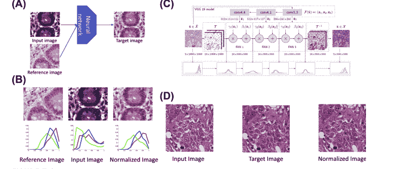

#### 图7.2

(A) 染色颜色归一化通常被表述为试图将输入图像的颜色改变为与所需H&E颜色的参考图像相似。(B) StaNoSA算法成功调整了输入图像的颜色分布以匹配参考图像，并对亚细胞结构进行了精确着色。(C) 开发了一种采用双路径架构的端到端神经网络。特征提取器路径使用VGG19，而转换网络使用特征感知归一化单元将输入图像转换为归一化图像。(D) 使用基于GAN的方法成功归一化了H&E图像并减少了扫描仪间的变异性。此外，使用基于GAN的归一化作为预处理也提高了肿瘤数据集上的分类结果。

(A) 经许可改编自 Janowczyk A, Basavanhally A, Madabhushi A, Stain normalization using sparse AutoEncoders (StaNoSA): application to digital pathology, Computerized Medical Imaging and Graphics 2017; 57:50–61. https://doi.org/10.1016/j.compmedimag.2016.05.003; (B) 经许可改编自 Janowczyk A, Basavanhally A, Madabhushi A, Stain normalization using sparse AutoEncoders (StaNoSA): application to digital pathology, Computerized Medical Imaging and Graphics 2017;57:50–61. https://doi.org/10.1016/j.compmedimag.2016.05.003; (C) 经许可改编自 Bug D, et al., Context-based normalization of histological stains using deep convolutional features. In: Deep learning in medical image analysis and multimodal learning for clinical decision support, Cham; 2017. pp. 135–142. https://doi.org/10.1007/978-3-319-67558-9_16; (D) 经许可改编自 Shaban MT, Baur C, Navab N, and Albarqouni S, Stainingan: stain style transfer for digital histological images. In 2019 IEEE 16th international symposium on biomedical imaging (ISBI 2019); 2019, pp. 953–956. https://doi.org/10.1109/ISBI.2019.8759152.

在 Janowczyk 等人 [27] 中，提出了一种名为稀疏自编码器染色归一化（Stain Normalization using Sparse AutoEncoders, StaNoSA）的无监督深度学习方法，以克服传统染色颜色归一化方法中的一些挑战（图 7.2B）。在数据集上训练了一个稀疏自编码器，并使用 K-means 聚类对模板的嵌入进行聚类，将输入图像嵌入分配到 K 个聚类中。然后在每个聚类上应用传统的直方图匹配算法。使用了三个数据集来评估 StaNoSA 算法。乳腺活检切片数据集用于研究 StaNoSA 如何降低扫描仪内和扫描仪间变异。胃肠道活检切片数据集用于研究 StaNoSA 如何降低不同站点之间的变异，该变异通过不同的染色方案模拟得到。第三个数据集是第二个数据集的子集，带有细胞核标注，用于测试 StaNoSA 如何改善病理学中的目标检测。StaNoSA 还与四种最先进技术进行了比较。结果表明 StaNoSA 可将扫描仪间误差降低到与扫描仪内误差相似的范围。它还降低了染色方案之间的变异性，性能优于其他测试技术。最后，使用简单的阈值方法进行细胞核分割时，StaNoSA 具有最佳的 Dice 分数。

尽管前一项研究利用神经网络改善归一化，但神经网络架构也可用于端到端归一化过程，如 Bug 等人 [31] 所做。他们的网络使用了两条并行的网络路径：一条主变换路径和一条特征提取路径（图 7.2C）。特征提取路径基于预训练的 VGG-19 架构。变换路径由新型网络模块组成，称为特征感知归一化（Feature Aware Normalization, FAN）单元，其灵感来源于批归一化和长短期记忆单元（LSTMs）。特征提取网络中每个块的特征被传入 FAN 单元，通过加法和乘法门（类似于 LSTM）逐步重新缩放和偏移图像（类似于 batchnorm）。由于 H&E 图像没有配对数据，故有意向参考图像添加噪声。噪声模型使用正态分布数据构建，其方差基于主成分分析定义。为了训练和测试模型，通过增加或减少苏木精浓度、伊红浓度和切片厚度来改变染色方案。颜色偏差的变化通过颜色直方图之间平方差之和（SSDH）来衡量。纹理的影响通过结构差异指数（SDSIM）来衡量。可感知颜色的幅度（颜色体积）通过 LAB 颜色空间通道标准差的乘积来衡量。在 SSDH 和颜色体积方面，所提出的方法显著优于之前的方法。使用替代指标评估时，其他方法表现相当。然而，这些其他方法需要在输入和参考图像中具有相似的组织分布，因此也需要仔细选择参考图像。所提出的方法克服了这些挑战，同时提供了一种端到端算法来执行染色归一化，但需注意在转换模型中引入上下文信息确实引入了一些不期望的纹理变化。

生成模型也已应用于组织病理学染色颜色归一化。Zanjani 等人 [32] 引入了用于染色颜色归一化的完全无监督生成模型。GAN 模型包括生成器网络、判别器网络和辅助网络。图像被转换为 CIE-LAB 颜色空间，亮度通道传入生成器，而仅色度通道由 GAN 生成。辅助网络基于 InfoGAN 架构 [33]，以最大化生成图像中的信息。变分自编码器（VAE）模型 [34] 以 HED 颜色空间中的 H&E 图像作为输入，编码器被训练以将输入图像分割为组织通道。颜色分布的参数按组织类别计算。解码器网络重建输入图像的色度通道。这些作者使用的深度卷积高斯混合模型（DCGMM）是一个全卷积网络，与高斯混合模型（GMM）的参数联合优化。DCGMM 在以组织类别为条件的条件下将 GMM 拟合到像素颜色分布。组织类别的检测是通过利用 CNN 嵌入来实现的，类似于 VAE 编码器的输出。算法使用归一化中值强度（NMI）度量进行评估，以评估归一化图像的颜色恒定性。在三种模型中，与之前最先进的结果相比，DCGMM 性能最高，具有最低的标准差和变异系数。虽然这些模型不对 H&E 图像内容做假设，但它们仍依赖于其他假设，例如各种硬编码阈值和细胞核形状拟合，这些可能不适用于其他组织类型。

染色颜色归一化问题也可以重新表述为图像转换任务。例如，在 Shaban 等人 [23] 中，训练了一个 CycleGAN 来降低扫描仪间变异（图 7.2D）。染色归一化任务被重新表述为两个不同扫描仪图像之间的图像转换。该研究中称为 StainGAN 的 CycleGAN 在 SSIM、FSSIM、皮尔逊相关系数和 PSNR 方面优于其他方法。StainGAN 还作为 Camelyon16 数据集上癌症分类的预处理步骤应用。与无归一化和替代归一化预处理步骤相比，StainGAN 提高了分类的 AUC-ROC。GAN 的使用也消除了当专家被要求手动选择归一化参考切片时可能出现的人为错误。虽然该应用旨在降低扫描仪间变异，但类似的模型也可用于实验室间变异。

Tellez 等人 [35] 也通过将其表述为图像转换问题开发了一种基于网络的染色归一化算法。作者训练了一个 U-net 架构，从输入的增强图像中重建原始图像。该模型在多器官、多站点数据集上训练。他们还对其他染色颜色增强和归一化算法进行了系统的多中心评估。总共使用了四个跨不同中心的分类任务，以确定数据增强和染色归一化对这些任务性能的影响。这些任务是有丝分裂图检测、肿瘤转移检测、前列腺上皮检测和结直肠癌组织类型检测。测试了基础的、基于形态的、亮度和对比度、基于 HSV 的以及基于 H&E 到 DAB（HED）的增强方法。在染色归一化方面，测试了无变换、灰度变换和基于色度分布的技术作为起点。增强和染色颜色归一化方法用作简单补丁 CNN 分类器的预处理。对所研究的每个器官、颜色归一化和数据增强方法的组合训练了一个 CNN 分类器。分类器的性能用 AUC-ROC 指标评估。基于每个任务和器官的 AUC-ROC 分数建立了方法的全局排名。基于这些排名，确定染色颜色增强对 CNN 分类器的性能至关重要。新型基于深度学习的染色颜色归一化也改善了结果。重要的是，也 somewhat 出乎意料，使用深度学习归一化方法并未消除对颜色增强的需求。单独使用染色颜色归一化不足以实现高分类准确率。

#### Mode switching

传统上，使用 H&E（或相关）染色或荧光标记的显微镜需要耗时且可能存在变异的标记程序。此外，染色或标记通常只能用于体外应用。另一个主要缺点是染色和/或标记可能对样本造成的损伤。此外，成像本身也会通过光损伤的形式降解标本。

为了克服这些挑战，已开发出许多新型显微镜技术。然而，传统的 H&E 染色组织病理学图像对病理学家来说是最易获取的。此外，这些新技术获得的图像可能更难解释，并且容易受到各种伪影的影响，使得这些技术更难被病理学家采用。因此，将新型模式转换为类似 H&E 染色切片（或反之）可能允许更广泛地采用这些模式。例如，图 7.3A 演示了定量相位成像是一种初学者难以解读的成像模式，但仍可通过利用神经网络将这些图像转换为 H&E 样结果，从而引入病理学家的工作流程。我们将描述若干关于深度学习技术用于此类模式转换的报道。其中大多数报道利用了 GAN 架构及其变体，见第 2.3 节。

定量相位成像（QPI）是一种相对较新的光毒性较低的无标记成像技术，可部署在各种平台上（包括便携式平台）。为了弥合 QPI 与标准组织病理学之间的差距，Rivenson 等人 [36] 使用 GAN 将基于相位的显微镜图像转换为组织学图像（图 7.3A–B）。三个模型被

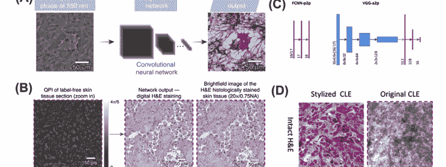

#### 图7.3

（A）通常，新的图像模态可能难以解读。然而，深度神经网络可用于将这些图像转换为类似H&E的图像，以便更好地解读。（B）定量相位成像是一种难以解读的成像模态，但与H&E图像相比，它具有其他优势，例如更低的光毒性和便携性。训练了一个GAN将QPI图像转换为数字H&E染色图像。（C）测试了全卷积神经网络和基于像素的VGG分类，用于将多光子显微镜图像转换为H&E染色图像。（D）共聚焦激光内窥显微镜可以对组织进行体内实时分析，但图像难以解读。该研究没有使用GAN等传统图像翻译算法，而是使用神经风格迁移对CLE图像进行数字染色。GAN，生成对抗网络；QPI，定量相位成像；CLE，共聚焦激光内窥显微镜。

（A）经许可改编自Rivenson Y, Liu T., Wei Z., Zhang Y., de Haan K, and Ozcan A, PhaseStain: the digital staining of label-free quantitative phase microscopy images using deep learning, Light: Science & Applications 2019;8(1):1–11. https://doi.org/10.1038/s41377-019-0129-y （B）经许可改编自Rivenson Y, Liu T, Wei Z, Zhang Y, de Haan K, and Ozcan A, PhaseStain: the digital staining of label-free quantitative phase microscopy images using deep learning, Light: Science & Applications 2019;8(1):1–11. https://doi.org/10.1038/s41377-019-0129-y （C）经许可改编自Borhani N, Bower AJ, Boppart SA, and Psaltis D, Digital staining through the application of deep neural networks to multi-modal multi-photon microscopy, Biomedical Optics Express 2019;10(3):1339–1350. https://doi.org/10.1364/BOE.10.001339; （D）经许可改编自Izadyyazdanabadi M, et al., Fluorescence image histology pattern transformation using image style transfer, Frontiers in Oncology 2019;9. https://doi.org/10.3389/fonc.2019.00519

针对皮肤组织的H&E染色、肾脏组织的Jones染色和肝脏组织的Masson三色染色进行了训练。然后，将这些模型应用于训练集中未出现的类似图像。他们利用自定义的全局共配准方法和弹性图像配准进行局部特征配准。生成器采用了U-net架构，输入是转换为YCbCr颜色空间的H&E图像。凭借快速的推理时间，并且无需染色，这项技术有潜力降低人力和时间成本。虽然

在某些情况下，染色过程可能导致不可逆的修改或损伤；这通常被认为是不利的，因为它会妨碍对组织的进一步分析。然而，在体外受精（IVF）中精子细胞选择的特殊情况下尤其如此，因为染色具有潜在的细胞毒性。干涉相位显微镜（IPM）目前用于精子评估，因为它与现有的医用显微镜兼容，这些显微镜经过改装，增加了一个波前传感器，以实现全息显微成像。这种组合无需染色即可提供细胞的定量拓扑图。然而，细胞形态学评估最有效的方法是对细胞器进行化学染色。因此，研究人员开发了一种名为“HoloStain”的方法，利用DCGANs[39]将从数字全息图中提取的定量相位图像和相位梯度图像转换为虚拟染色的明场图像。对于每个细胞，使用四张图像的集合来训练模型：无染色定量相位图像、两张无染色相位梯度图像以及目标染色的明场图像。HoloStain的一个优点是，失焦的细胞可以被虚拟染色并重新聚焦。这是可能的，因为可以对全息图进行数字重建，从而使失焦细胞重新对焦。为了证明该算法的实用性，一位胚胎学家使用来自明场图像（未染色）、无染色定量相位图像、一张无染色梯度图像以及HoloStain图像的数据对精子细胞进行了分类。与其他三种方法相比，HoloStain方法的F1分数最高。

虽然大多数研究采用GAN，但也可以使用图像风格迁移算法作为替代方法，正如IzadyYazdanabadi等人[10]所证明的那样。具体来说，作者试图将共聚焦激光内窥显微镜（CLE）图像转换为H&E图像。CLE是一种实时的体内术中成像技术，在手术过程中辅助神经外科医生方面具有很大潜力。作者开发了一种转换工具，可以去除常见的CLE伪影、添加组织学模式，并避免去除关键特征或向图像添加不真实的特征（图7.3D）。不幸的是，由于精确共定位的问题和组织的内在运动，难以获得空间配准的H&E-CLE图像对。因此，作者采用了一种使用预训练VGG19架构以及内容和风格损失的图像风格迁移算法。风格迁移的一个优点是它只需要一张所需风格（H&E）的图像。五位神经外科医生独立评估，认为风格化后的CLE图像比原始CLE图像具有显著更高的诊断质量。

这些方法的潜力相当高，在实施方面也相当成熟，目前已有多个团队正在进行临床试验。从这些方法获得的图像质量远远超过了当前实时病理学的金标准——冷冻切片，而冷冻切片会产生伪影，使评估变得困难。通过将图像从荧光配色方案转换为病理学家一看就熟悉的配色方案，采用的可能性大大增加。这些成像方式有潜力在不久的将来成为实时病理学的新金标准；因此，精确的颜色映射引起了广泛关注。

#### *计算机模拟标记*

深度学习推动了从其他图像模态中提取信息以重建明场染色图像的方法的发展。然而，能否从无染色的明场图像中重建出突出显示荧光标记细胞结构的分子染色图像呢（图7.4A）？近期研究表明这类转换确实是可能的。受参考文献[40]的启发，我们将此类工作称为计算机模拟标记。

Rana等人[41]证明了如何使用条件生成对抗网络（cGANs）对未染色的石蜡包埋全切片图像（WSIs）进行计算染色。他们同时训练了染色和脱色模型，使用传统的GAN和L1损失函数，并额外利用基于皮尔逊相关系数的正则化项来防止平铺噪声。这些模型可用于肿瘤诊断等进一步的后续任务。

Rivenson等人[42]则利用DAPI激发/发射滤光片组激发未染色组织切片产生的自发荧光，以重建

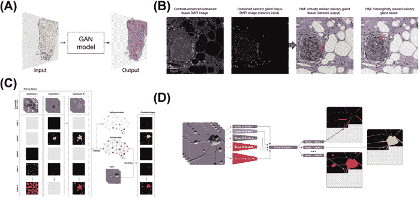

#### 图7.4
（A）新研究已证明，可以使用深度学习将未染色图像转换为数字染色图像。（B）一种基于GAN的模型被成功应用于将未染色自发荧光图像转换为H&E虚拟染色图像。（C）训练了一个多任务模型，用于将未标记的透射光图像转换为荧光标记图像。GAN，生成对抗网络。

*（A）经许可改编自Rana A, Yauney G, Lowe A, and Shah P, Computational histological staining and destaining of prostate core biopsy RGB images with generative adversarial neural networks, 2018年第17届IEEE国际机器学习与应用会议（ICMLA），奥兰多，佛罗里达州，2018年，第828–834页。 https://doi.org/10.1109/ICMLA.2018.00133 （B）经许可改编自Rivenson Y, 等, Virtual histological staining of unlabelled tissue-autofluorescence images via deep learning, Nature Biomedical Engineering 2019;3(6):466–477. https://doi.org/10.1038/s41551-019-0362-y; （C）经许可改编自Christiansen EM, 等, In silico labeling: predicting fluorescent labels in unlabeled images, Cell 2018;173(3):792–803. https://doi.org/10.1016/j.cell.2018.03.040.*

使用 GAN 对图像进行染色。他们在用 H&E 染色的唾液腺组织、用 Jones 染色染色的肾组织，以及用 Masson 三色染色的肝和肺上进行训练。GAN 模型在转换图像方面表现非常出色，虚拟图像中生成了相当多的细节并捕捉到准确的组织病理学特征（图 7.4B）。虚拟染色图像也由病理学家评估，并且虚拟染色图像与常规明场图像之间没有显著差异。这表明虚拟染色图像可以提供类似的诊断效用。虚拟染色图像的颜色化变异度低于组织学染色图像。因此，固有的染色标准化是该方法的有趣积极副产品。作者还通过使用它来快速训练模型以应用于甲状腺组织切片，展示了迁移学习。该技术有可能应用于非载玻片方法，这将允许令人印象深刻的无标记成像，而无需重新培训病理学家。能够生成特殊染色的额外能力提高了适用性，因为其中许多染色需要熟练技术人员数小时的时间和昂贵的试剂。

虽然组织化学染色图像可以提供有关细胞和细胞外成分的有用信息，但荧光标记可以提供有关所需亚细胞结构更详细的信息。因此，在细胞生物学和病理学中获得荧光标记图像具有巨大的兴趣。Ounkomol et al. [43] 开发了一种 U-net 架构，用于将 3D 透射光和 2D 电子显微镜（EM）转换为 3D 荧光显微镜和 2D 免疫荧光（IF）显微镜。重要的是，不同结构模型的预测可以结合起来，从单个 3D TL 图像生成 3D 多通道荧光图像预测。图像模态转换的另一个应用是促进图像之间的自动配准。EM 和 IF 图像的超薄脑切片通常作为阵列断层扫描协议的一部分收集。然而，由于它们是从两台不同的显微镜收集的，因此它们本质上未对齐，手动配准繁琐且耗时。作者在手动配准的 EM 和标记髓鞘碱性蛋白（MBP-IF）的免疫荧光图像上训练了模型。MBP-IF 预测，因此原始 EM 图像，使用传统的强度匹配技术与目标 MBP-IF 图像配准。虽然 EM 在肾活检之外通常不用于临床诊断，但将图像转换为免疫荧光染色具有很大的实用性，因为这些染色通常昂贵、繁琐且需要数小时才能完成。虽然该技术仍处于早期阶段，需要进一步验证和关注，但它对病理学家来说可能非常有用。

在 Christiansen et al. [40] 中，开发了一种更通用和灵活的架构来解决类似问题。一种多任务、多尺度深度神经网络在成对的荧光标记 2D 图像和透射光 z-stack 图像上进行训练（图 7.4C）。这些 z-stack 图像包括来自不同焦平面的图像，其假设是即使离焦平面也包含有助于准确预测荧光标记的有用信息。图像来自不同的实验室、样本甚至成像模态。这使得可以通过多任务学习训练可泛化的网络。在多任务学习中，当任务相似时，可以学习共同特征以提高模型的性能。训练集包括由诱导多能干细胞衍生的人类运动神经元、小鼠原代皮质培养物和乳腺癌细胞系。使用的荧光标记为 Hoechst 和 DAPI 用于标记细胞核、碘化丙啶（PI）用于评估细胞活力，以及 CellMask 用于标记质膜。一些细胞还用针对 TuJ1（标记神经元）、Islet1 蛋白（标记运动神经元）和 MAP2（标记树突）的抗体的抗体进行免疫标记。深度神经网络具有多尺度输入，每个尺度有五条路径（图 7.4D）。最精细细节的尺度保持在同一尺度，而其他尺度具有受 U-net 架构启发的收缩和上采样卷积操作。最终网络输出图像中所有像素的 256 个强度值（所有可能的 8 位像素值）上的离散概率分布。它读取明场、相差或差分干涉对比度图像的 z-stack。

该网络针对各种任务进行了测试。首先用于预测 Hoechst 或 DAPI 荧光以标记细胞核。定性上，in silico 标签和真实荧光标签看起来完全相同。真实与预测像素强度之间的 Pearson 相关系数为 0.87，表明模型准确预测了细胞核区域。类似的实验用于预测碘化丙啶（PI）荧光，用于检测死细胞（因为活细胞可以排除染料）。该网络在预测标记神经元的 TuJ1 蛋白的免疫标记方面也表现良好。神经网络还能够成功预测独立的轴突和树突标签，这令人意外，因为不清楚透射光图像是否包含足够的信息来区分从细胞延伸的神经突是轴突还是树突。为了证明模型的灵活性，使用迁移学习学习如何从单个孔的数据中预测不同细胞类型的不同标签。具体而言，使用迁移学习从癌细胞的差分干涉对比度图像预测 CellMask（细胞膜标记）荧光。模型从单个训练孔的数据训练，但通过同时在先前条件下训练进行正则化。网络的 Pearson 相关性得分为 0.95。这表明该模型可以继续学习并在提供更多训练示例时适应其他任务。

虽然荧光显微镜在常规临床病理学应用中并不常见，但用于荧光显微镜的深度学习技术也可以应用于组织病理学。特别是，Christiansen et al. [40] 提出了一种解决深度学习模式转换中关键问题的方法。大多数模式转换方法受放大倍数、染色、模态、组织类型和其他因素差异施加的限制。然而，Christiansen et al. 使用了一种可泛化到各种组织类型、放大尺度甚至各种模态的多任务和多尺度网络。使用迁移学习，这些通用模型也可以用很少的额外数据进一步训练用于更具体的任务。开发用于转换为 H&E 图像的类似模型可以极大地促进新型成像模态在组织病理学中的采用。

#### 超分辨率、扩展景深和去噪

为了生成高质量的 WSI，必须使用能够捕获高分辨率图像的高数值孔径透镜。缺点是这些透镜视场受限，这大大增加了扫描时间，以及浅景深（图 7.5A）。虽然越来越多地用于提高标准（宏观）摄影图像的分辨率 [19]，但应用深度学习方法来提高显微镜图像分辨率的应用相当新近。Wang et al. [44] 使用的训练集由使用 10×/0.4 NA 透镜拍摄的像素匹配图像与使用 20×/0.75 NA 透镜拍摄的图像组成。使用配对数据迫使 GAN 专注于提高图像分辨率，并带来高质量的转换，几乎没有伪影或错误。

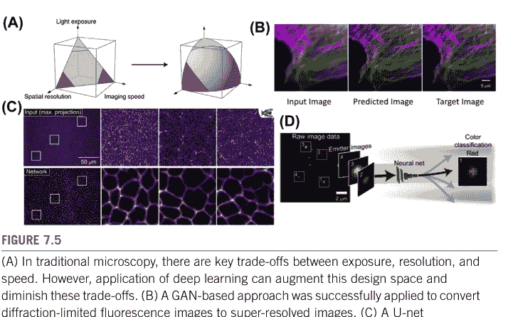

#### 图 7.5

(A) 在传统显微镜中，曝光、分辨率和速度之间存在关键权衡。然而，深度学习的应用可以增强该设计空间并减少这些权衡。 (B) 基于 GAN 的方法成功地将衍射受限的荧光图像转换为超分辨率图像。 (C) U-net 架构成功用于荧光显微镜图像的去噪。 (D) 即使使用灰度相机，深度学习也可以用于确定发射体的颜色，因为点扩散函数由波长决定。GAN，生成对抗网络。

(A) Adapted with permission from Weigert M, et al., Content-aware image restoration: pushing the limits of fluorescence microscopy. Nature Methods 2018;15(12):1090–1097. https://doi.org/10.1038/s41592-018-0216-7; (B) Adapted with permission from Wang H, et al., Deep learning enables cross-modality super-resolution in fluorescence microscopy. Nature Methods 2019;16(1):103–110. https://doi.org/10.1038/s41592-018-0239-0; (C) Adapted with permission from Weigert M, et al., Content-aware image restoration: pushing the limits of fluorescence microscopy. Nature Methods 2018;15(12):1090–1097. https://doi.org/10.1038/s41592-018-0216-7; (D) Adapted with permission from Hershko E, Weiss LE, Michaeli T, Shechtman Y, Multicolor localization microscopy and point-spread-function engineering by deep learning. Optics Express 2019;27(5):6158–6183. https://doi.org/10.1364/OE.27.006158.

(图 7.5B)。益处在于视野是四倍大，同时允许扫描时间相似地减少。这不仅对加快扫描具有重大意义，也对在延时研究中允许更大的视野范围具有重大意义，从而能从单次实验中收集更多数据。另一个益处是 10× 物镜的景深更大，因此生成图像的聚焦和清晰度实际上可以优于其本身的真实图像，意味着它们不仅等效，而且在质量上更优。这不仅限于明场，因为该团队还发表了类似的深度学习算法，可将 40× 物镜的明场图像转换为优于 100× 油浸物镜的图像，尽管后者被用作转换的目标 [45]。先前的荧光论文中的所有相同益处都适用，再加上一个额外的益处，即当前绝大多数临床病理学都是使用明场成像进行的。在此基础上更进一步，该团队表明，使用智能手机镜头也能达到与 20× 显微镜镜头相似的图像质量，并且由于数值孔径较低的镜头而获得了景深增加的额外益处。此处的算法不仅改善了空间分辨率，还能够将低质量镜头/相机的色彩失真校正为与台式显微镜相似的质量 [46]。这具有更深远的潜力，因为极低成本的硬件可以生成更高质量的诊断图像，从而为资源匮乏的国家提供更好的医疗护理。

深度学习用于增加景深的一个例子是 CNN 的实现，以实现疟疾血膜的快速自动诊断 [47]。血膜是厚样品，对扫描图像的解读需要收集多个焦平面并以可被人类病理学家或人工神经网络（ANN）解读的方式合并。Manescu 等 [47] 训练了一个网络，使用三平面输入生成接近使用 14 个不同焦平面图像获得的质量的图像。它明显优于传统的扩展景深算法，这可以大大提高疟疾自动扫描和诊断的速度。

然而，增加景深并不总是有益的；有许多方法可以减少景深以实现轴向受限的分辨率。此类技术包括结构光显微镜（SIM）、共聚焦显微镜和计算去卷积。这些方法允许在不物理切片组织的情况下从厚样品中获取高分辨率图像。Zhang 等 [48] 实现了一个 CNN，在无需采用上述光学方法的情况下减少宽场荧光图像的光学深度。最大的优势是显微镜复杂度的降低，以及伪影的减少。条纹伪影在结构光成像中很常见，会分散图像内容的注意力；深度学习可以帮助生成类似光学变薄的图像，同时保持可比的质量。应用传统的去卷积方法也消除了条纹伪影，但所得图像看起来明显更厚，且缺乏 AI 生成对应图像的清晰度。虽然目前尚未在临床中使用，但文献 [49] 已探索了病理学中的光片显微镜，并在前列腺活检评估中被证明特别有用。捕获三维数据集的能力使得格里森评分（前列腺肿瘤的预后因素）的评估更准确，这反过来可能导致患者获得更好的医疗质量。

除了提高分辨率或影响景深之外，AI 的另一个显著改善图像质量的贡献是降噪。低信号图像难以解读；这使得体内成像尤其具有挑战性，因为数据通常必须在低（安全）光照水平下快速采集。用于开发降噪模型的配对数据（低噪声和高噪声版本）相对容易获取或合成，这意味着可以快速生成大量且具有代表性的数据集。例如，Weigert 等 [50] 成功展示了使用卷积神经网络，该网络以多光子图像为训练，使用极低激光功率和低曝光时间作为输入，目标输出为使用正常曝光时间和激光功率拍摄的高质量图像（图 7.5C）。虽然该概念与今天所实践的病理学并不直接相关，但它可以应用于之前的所有荧光方法以帮助加速它们。如果这些技术中的任何一种要取代冰冻切片，它们必须提供更好的组织学质量，或更快。此外，这些技术可用于改善无标记成像方法，可能允许体内显微镜检查肿瘤边缘，从而获得比冰冻切片更好的切除边缘，因为切片或包埋不会导致组织丢失。

这种通用方法也可以应用于标准的超分辨率技术，例如光激活定位显微镜（PALM）或随机光学重建显微镜（STORM）。这两种方法都依赖于采集数千张图像以重建低于光学显微镜衍射极限的结构。通过训练 ANN，Ouyang 等 [51] 将 PALM 重建所需的图像数量从 60,000 减少到仅 500，采集时间从 10 分钟缩短到 9 秒。虽然目前不适用于病理学，但电子显微镜的一些应用可能可以用 STORM/PALM 等技术取代；随着该领域的发展和我们对疾病过程的理解加深，这些技术在临床病理学中可能有其位置。

增加的采集时间需求不仅源于最大化信噪比的愿望；许多荧光成像会话需要使用不同的滤光片组进行串行成像以分离多个标记。其结果是成像时间和样品光照暴露大幅增加，同时伴随光毒性或光漂白的潜在风险。通过在滤光片采集的图像上训练神经网络，Hershko 等 [52] 已证明可以使用与不同波长光使用相关的色差来从单张图像中分离多个标记（图 7.5D）。该方法的影响与之前所述基本相同，即数据的更快速收集潜力，以及成像时间的减少。

### 用于组织病理学计算辅助诊断的深度学习

在上文部分，我们描述了使用 AI 工具通过 AI 辅助工具改善图像质量和信息显著性的可能性。然而，这类工具在监管方面仍受到一定怀疑，因为它们被认为在高影响临床环境中部署为时尚早。用于病理学的已批准 AI 工具（无论是否使用 AI 增强图像）的数量仍然非常少，而用于术中指导的则更少。其观点是，对于直接 AI 解释，AI 增强的中间步骤的需求可能降低，因为信息提取和噪声及失真影响的降低已由分类器本身隐式执行。下文给出了神经病理学领域的示例，同时强调了将 AI 工具与新型快速组织学技术相结合的机会。

#### AI 辅助成像和解读的理由

在 2007 年至 2017 年间美国人口增长 8% 的情况下，同期病理学劳动力减少了 17% [53]。在某些亚专科中，劳动力短缺更为严重。约 800 名神经病理学家覆盖了 1400 个进行脑肿瘤手术的中心 [54]。随着神经病理学 fellowship 的空缺率约为 42%，神经病理学的短缺预计会加剧 [55]。在神经病理学中，劳动力短缺体现在多个方面。尽管学术中心倾向于配备经过委员会认证的神经病理学家，但社区医院很少有在职人员。因此，非专家病理学家被迫提供本可由更专业从业者提供的服务。虽然难以量化，但缺乏神经病理学专业知识可能导致术中诊断延迟、不必要的手术干预（淋巴瘤或生殖细胞瘤被误诊为可能需要手术的肿瘤），以及病理学在制定手术策略方面的局限性。

组织学数据自 1930 年以来已被公认为脑肿瘤手术决策的核心 [56]。在对脑病变进行手术时，外科医生必须做出许多决定。首先也是最重要的是，外科医生依赖病理学家确保他们活检的组织确实是病变组织并且可用于建立诊断。除此之外，区分脑内的肿瘤性与非肿瘤性过程至关重要，区分手术性与非手术性肿瘤同样重要。对于手术候选者而言，区分原发性与转移性肿瘤、低级别和高级别胶质瘤、局限性和弥漫性肿瘤都对决策具有特定意义。

尽管组织学数据在脑肿瘤手术中的重要性已得到充分确立，但在现代外科实践中，手术室与神经病理学之间仍存在鸿沟。在大多数中心，冰冻切片实验室位于院外或规模庞大

距离手术台较远，为希望与病理学家一起查看切片的外科医生造成了后勤障碍。此外，制作高质量病理切片的过程耗时且劳动密集。因此，病理学家在标本采集后 30–45 分钟才会致电手术室给出诊断。该过程的低效使外科医生与组织学数据隔绝，并限制了其用于指导手术决策的方式。

鉴于现代神经病ology工作流程中的挑战，人工智能在多个方面具有巨大潜力：(1) 验证是否采集到病变组织，(2) 协助组织学诊断，(3) 帮助界定无肉眼边界的肿瘤的手术终点，以及 (4) 在未来，预测可操作的和诊断性的分子标志物。在固定组织中，人工智能已应用于乳腺癌和结肠癌中上皮区与间质区的分类 [57]、坏死区与非坏死区的区分 [58]，以及高级别与低级别胶质瘤的区分 [59]。尽管如此，人工智能在辅助诊断方面的应用仅解决了神经病理学中建立诊断相关的挑战。在传统的组织学工作流程中，与组织运输和处理相关的许多障碍仍然存在。为了充分利用人工智能辅助病理诊断快速进步所带来的机遇，与快速组织学技术相结合是必不可少的。

#### 快速组织学解读的方法

为此，已提出并在不同程度上验证了多种无切片组织学方法。MUSE、受激拉曼组织学（SRH）和光片显微镜是用于成像未处理或最小处理生物标本的最有前景的工具之一（图 7.6）。

虽然已提出众多无切片组织学技术，但只有 SRH 已被纳入在临床环境中用于脑肿瘤诊断的经验证的人工智能诊断流程。Hollon 等人改编了 Inception-V2 CNN，利用 SRH 图像诊断 10 种最常见的脑肿瘤，并将他们的软件部署在床旁 SRH 成像仪上。在 278 名患者的头对头临床试验中，Hollon 等人证明，利用 SRH 和 CNN 的自主诊断路径能够预测诊断，其性能不劣于对同一患者常规组织学切片进行解读的委员会认证神经病理学家 [61]。两个组的准确率约为 94%，有趣的是，两个组的错误完全不重叠（图 7.7）。因此，本研究的作者得出结论，SRH + CNN 路径可在病理资源不可用时作为脑肿瘤诊断的独立方法使用，也可在人员充足的中心作为提高神经病理学诊断准确性的方法。尽管作者将试验纳入限制在常见的脑肿瘤类型，但他们还提供了一种区分常见和不常见组织学类别的方法，以使系统适用于所有中枢神经系统肿瘤。该算法还被用于开发语义分割工具，能够描绘最可能含有病变组织的组织学图像区域（图 7.8）。作者还得出结论，鉴于其 CNN 用于分类脑肿瘤的特征，未来可为其他器官的肿瘤开发类似算法。

值得推测，在分类学习步骤之前进行基于人工智能的图像增强是否会提高后者的性能。

#### 图 7.6

#### (A) 紫外表面激发显微镜
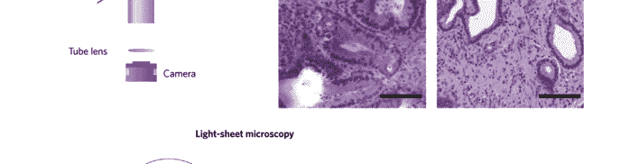

#### (B) 光片显微镜
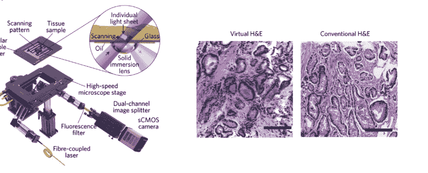

#### (C) 受激拉曼组织学
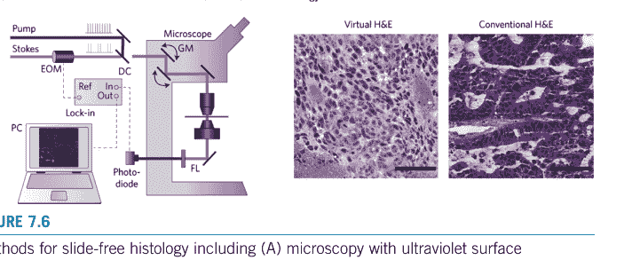

包括 (A) 紫外表面激发显微镜、(B) 光片显微镜和 (C) 受激拉曼组织学（SRH）的无切片组织学方法，均可在最小处理或未处理的组织上进行，以在无需常规病理科资源的情况下生成诊断性组织学图像。每种技术都依赖于光学而非物理切片成像组织，简化了生成诊断性组织学图像所需的工作流程。SRH 作为床旁组织学模式具有独特价值，因为生成组织学图像无需对组织进行染色、透明化或处理。在 SRH 中，新鲜标本可在床旁放入成像仪，通过相对简单的光谱带组合和重新着色快速创建虚拟 H&E 显微图像。为此，学术-工业合作产生了首台 FDA 注册的成像仪，目前已在美国多个手术室中使用。

> 经 Orringer DA, Camelo-Piragua S 许可改编，快速且无切片成像。Nature Biomedical Engineering, 2017;1(12):926–928. https://doi.org/10.1038/s41551-017-0172-z.

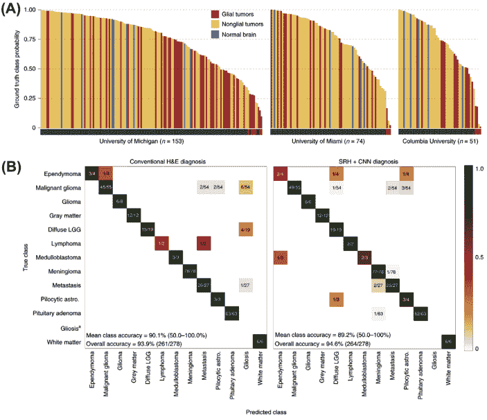

#### 图 7.7

SRH 加 CNN 与常规 H&E 组织学的前瞻性临床试验。(A) 各医疗中心的真实类别预测概率按降序绘制，并标明正确（绿色）或错误（红色）分类。(B) 对照组和实验组的多类混淆矩阵。对照组，即传统 H&E 组织学加病理学家，错误主要为恶性胶质瘤的误分类（10/17）。胶质瘤在 SRH 加 CNN 组中的错误率最高（9/14）。常见肿瘤，包括室管膜瘤、髓母细胞瘤和毛细胞星形细胞瘤也被误分类，很可能是由于模型训练病例不足，导致与对照组相比平均类别准确率较低。随着更多 SRH 训练数据的增加，这些错误可能会得到改善。SRH，受激拉曼组织学；CNN，卷积神经网络（CNN）。

*经 Hollon TC 等许可改编，近实时术中脑肿瘤诊断使用受激拉曼组织学和深度神经网络。* Nature Medicine, 2020;26(1):52–58. https://doi.org/10.1038/s41591-019-0715-9.

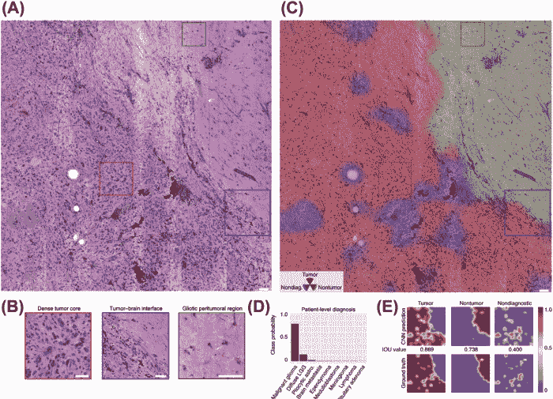

#### 图 7.8

语义分割。(A) 一名胶质母细胞瘤患者的标本 SRH 马赛克图像包含 (B) 致密肿瘤浸润、肿瘤-脑界面以及胶质增生的瘤周区域。马赛克中的图块被输入语义分割算法 (C)，该算法由卷积神经网络（CNN）分类，然后分配一个数值，以颜色（红绿蓝）表示给定区域包含肿瘤、非诊断性组织或非病变组织的可能性。分类器提供 10 个最常见脑肿瘤类别中类别成员的可能性 (D)。整个马赛克可为每个类别预测为热图，其中 3 个在此显示 (E)。SRH，受激拉曼组织学；CNN，卷积神经网络（CNN）。

*经 Hollon TC 等许可改编，近实时术中脑肿瘤诊断使用受激拉曼组织学和深度神经网络。Nature Medicine, 2020;26(1):52–58. https://doi.org/10.1038/s41591-019-0715-9.*

- [25] Perez L, Wang J. 深度学习中图像分类数据增强的有效性。ArXiv:171204621 Cs. Dec. 2017.
- [26] Ciompi F, et al. 卷积网络结直肠组织分类中染色标准化的重要性。In: 2017 IEEE 第14届生物医学成像国际研讨会（ISBI 2017）；2017. p. 160–3. https://doi.org/10.1109/ISBI.2017.7950492.
- [27] Janowczyk A, Basavanhally A, Madabhushi A. 使用稀疏自编码器进行染色标准化（StaNoSA）：数字病理学应用。Computerized Medical Imaging and Graphics 2017;57:50–61. https://doi.org/10.1016/j.compmedimag.2016.05.003.
- [28] Ruifrok AC, Johnston DA. 通过颜色解卷积对组织化学染色的定量。Analytical and Quantitative Cytology and Histology 2001;23(4):291–9.
- [29] Azevedo Tosta TA, de Faria PR, Neves LA, do Nascimento MZ. H&E 染色组织学图像的计算标准化：进展、挑战和未来潜力。Artificial Intelligence in Medicine 2019;95:118–32. https://doi.org/10.1016/j.artmed.2018.10.004.
- [30] Roy S, kumar Jain A, Lal S, Kini J. 关于组织病理学图像颜色标准化方法的研究。Micron 2018;114:42–61. https://doi.org/10.1016/j.micron.2018.07.005.
- [31] Bug D, et al. 使用深度卷积特征的基于上下文的组织学染色标准化。In: Deep learning in medical image analysis and multimodal learning for clinical decision support, Cham; 2017. p. 135–42. https://doi.org/10.1007/978-3-319-67558-9_16.
- [32] F. G. Zanjani, S. Zinger, and B. E. Bejnordi, “使用生成神经网络的组织病理学染色颜色标准化，”p. 16.
- [33] Chen X, Duan Y, Houthooft R, Schulman J, Sutskever I, Abbeel P. InfoGAN：通过信息最大化生成对抗网络的可解释表示学习。In: Lee DD, Sugiyama M, Luxburg UV, Guyon I, Garnett R, editors. Advances in neural information processing systems 29. Curran Associates, Inc.; 2016. p. 2172–80.
- [34] Kingma DP, Welling M. 自动编码变分贝叶斯。ArXiv:13126114 Cs Stat. May 2014.
- [35] Tellez D, et al. 定量评估计算病理学卷积神经网络中数据增强和染色颜色标准化的影响。Medical Image Analysis 2019;58:101544. https://doi.org/10.1016/j.media.2019.101544.
- [36] Rivenson Y, Liu T, Wei Z, Zhang Y, de Haan K, Ozcan A. PhaseStain：使用深度学习对无标记定量相位显微镜图像进行数字染色。Light: Science & Applications 2019;8(1):1–11. https://doi.org/10.1038/s41377-019-0129-y.
- [37] Combalia M, Perez-Anker J, Garcia-Herrera A. 通过深度学习的数字染色共聚焦显微镜。In: Proceedings of the 2nd international conference on medical imaging with deep learning (PMLR), 102; 2019. p. 121–9.
- [38] Borhani N, Bower AJ, Boppart SA, Psaltis D. 通过将深度神经网络应用于多模态多光子显微镜的数字染色。Biomedical Optics Express 2019;10(3):1339–50. https://doi.org/10.1364/BOE.10.001339.
- [39] Nygate YN et al. HoloStain：单个生物细胞的全息虚拟染色。p. 20.
- [40] Christiansen EM, et al. 计算机模拟标记：在未标记图像中预测荧光标记。Cell 2018;173(3):792–803. https://doi.org/10.1016/j.cell.2018.03.040. e19.
- [41] Rana A, Yauney G, Lowe A, Shah P. 使用生成对抗神经网络对前列腺核心活检 RGB 图像进行计算组织学染色和脱色。

载于：2018年IEEE机器学习与应用国际会议第17届（ICMLA），奥兰多，佛罗里达；2018年。第828–834页。https://doi.org/10.1109/ICMLA.2018.00133.
[42] Rivenson Y, et al. 通过深度学习对未标记组织自发荧光图像进行虚拟组织学染色。Nature Biomedical Engineering 2019;3(6):466–77. https://doi.org/10.1038/s41551-019-0362-y.
[43] Ounkomol C, Seshamani S, Maleckar MM, Collman F, Johnson GR. 从透射光显微镜中无标记预测三维荧光图像。Nature Methods 2018;15(11):917–20. https://doi.org/10.1038/s41592-018-0111-2.
[44] Wang H, et al. 深度学习实现荧光显微镜中的跨模态超分辨率。Nature Methods 2019;16(1):103–10. https://doi.org/10.1038/s41592-018-0239-0.
[45] Rivenson Y, Göröcs Z, Günaydın H, Zhang Y, Wang H, Ozcan A. 深度学习显微镜。Optica 2017;4(11):1437–43. https://doi.org/10.1364/OPTICA.4.001437.
[46] Rivenson Y, et al. 深度学习增强的手机显微镜。ACS Photonics 2018;5(6):2354–64. https://doi.org/10.1021/acsphotonics.8b00146.
[47] Manescu P, et al. 用于厚血膜疟疾高通量显微镜的深度学习增强扩展景深。arXiv:1906.7496 cs.Eess. Jun. 2019.
[48] Zhang X, et al. 深度学习光学切片方法。Optics Express 2018;26(23):30762–72. https://doi.org/10.1364/OE.26.030762.
[49] Reder NP, Glaser AK, McCarty EF, Chen Y, True LD, Liu JTC. 前列腺核心针活检的开放式光片显微镜图像图谱。Archives of Pathology & Laboratory Medicine 2019;143(9):1069–75. https://doi.org/10.5858/arpa.2018-0466-OA.
[50] Weigert M, et al. 内容感知图像恢复：推动荧光显微镜的极限。Nature Methods 2018;15(12):1090–7. https://doi.org/10.1038/s41592-018-0216-7.
[51] Ouyang W, Aristov A, Lelek M, Hao X, Zimmer C. 深度学习极大加速超分辨率定位显微镜。Nature Biotechnology 2018;36(5):460–8. https://doi.org/10.1038/nbt.4106.
[52] Hershko E, Weiss LE, Michaeli T, Shechtman Y. 深度学习的彩色定位显微镜和点扩散函数工程。Optics Express 2019;27(5):6158–83. https://doi.org/10.1364/OE.27.006158.
[53] Metter DM, Colgan TJ, Leung ST, Timmons CF, Park JY. 2007年至2017年美国和加拿大病理学家队伍的趋势。JAMA Network Open 2019;2(5):e194337. https://doi.org/10.1001/jamanetworkopen.2019.4337.
[54] Orringer DA, et al. 通过光纤激光基受激拉曼散射显微镜对未处理手术标本进行快速术中组织学检查。Nature Biomedical Engineering 2017;1(2):1–13. https://doi.org/10.1038/s41551-016-0027.
[55] Robboy SJ, et al. 美国病理学家队伍：I. 开发预测模型以研究影响供应的因素。Archives of Pathology & Laboratory Medicine 2013;137(12):1723–32. https://doi.org/10.5858/arpa.2013-0200-OA.
[56] Eisenhardt L, Cushing H. 通过超活体技术诊断颅内肿瘤。The American Journal of Pathology 1930;6(5):541–552.
[57] Xu J, Luo X, Wang G, Gilmore H, Madabhushi A. 用于分割和分类组织病理学图像中上皮和间质区域的深度卷积神经网络。Neurocomputing 2016;191:214–23. https://doi.org/10.1016/j.neucom.2016.01.034.
[58] Sharma H, Zerbe N, Klempert I, Hellwich O, Hufnagl P. 数字组织病理学中使用全切片图像自动分类胃癌的深度卷积神经网络。Computerized Medical Imaging and Graphics 2017;61:2–13. https://doi.org/10.1016/j.compmedimag.2017.06.001.
[59] Barker J, Hoogen A, Depreusenge A, Rubin DL. 使用局部代表性图块对全切片数字病理学图像中的脑肿瘤类型进行自动分类。Medical Image Analysis 2016;30:60–71. https://doi.org/10.1016/j.media.2015.12.002.
[60] Orringer DA, Camelo-Piragua S. 快速无载玻片成像。Nature Biomedical Engineering 2017;1(12):926–8. https://doi.org/10.1038/s41551-017-0172-z.
[61] Hollon TC, et al. 使用受激拉曼组织学和深度神经网络进行近实时术中脑肿瘤诊断。Nature Medicine 2020;26(1):52–8. https://doi.org/10.1038/s41591-019-0715-9.

## 第8章

## 通过图像分析和机器学习的数字病理学中的精准医学

**Peter D. Caje, BSc, MRes, PhD**¹, **Neofytos Dimitriou, B.Sc**²,
**Ognjen Arandjelović, M.Eng. (Oxon), Ph.D. (Cantab)**²

¹ 医学院，QUAD 病理学，圣安德鲁斯大学，圣安德鲁斯，英国;
² 计算机科学学院，圣安德鲁斯大学，圣安德鲁斯，英国

### 引言

#### 精准医学

医学领域目前正努力为个体患者实现更准确、更有效的临床决策。这可以通过多种形式的分析实现，并在患者疾病进展和治疗旅程的多个阶段实施。然而，总体目标是提高治疗成功率，同时降低可能无效但有毒疗法的副作用，当然还有更好的患者福祉和总体生存率。例如，了解针对个体患者癌症的特定治疗是否可能有助于其治疗，事实上是否对其总体生存有害，就像结直肠癌中西妥昔单抗治疗的情况一样。将患者作为个体而非更广泛且异质人群的成员进行治疗的过程通常被称为精准医学，传统上由靶向药物发现的进步以及随之而来的可转化伴随分子检测驱动。这些检测报告从患者样本中测量的生物标志物，并根据其诊断组织样本的分子特征告知特定药物对患者是否有效。这些检测可能源于我们对生物过程的了解，例如针对EGFR受体通路设计抑制剂，或源于基于机器学习的大型多组学数据集挖掘，以识别新型药物靶点或耐药机制。在数字医学的当前时代，精准医学正被应用于从诊断、预后到预测的整个临床工作流程中。可以从多个来源获取大量数据，而不再仅通过分子病理学。这得益于患者病史和生活方式记录、临床报告的数字化以及可用性，以及在研究和临床领域采用数字病理学和图像分析。事实上，在图像分析对数字化组织病理学数据集进行分析之前，制药行业已在开发基于体外高内涵生物学的药物筛选。这些筛选也应用了图像分析，但针对的是暴露于遗传或小分子操纵的培养细胞，以在捕获大型多参数数据集之前分割和分类细胞结构，这些数据集可为新型靶点或药物疗效提供信息。从高内涵生物学和图像分析中借鉴的类似方法可以应用于数字病理学。这适用于经典的基于对象阈值的图像分析或人工智能。总体目标是量化并报告特定生物标志物或已知重要的组织学模式，或通过捕获无偏收集的多参数数据以及对分割对象和全切片图像（WSI）的模式识别。从数字病理学图像中提取数据并进行提炼和报告的目标是使患者能够被分层为不同的组，从而为临床医生提供其最佳和个性化治疗方案的信息。

#### 数字病理学

数字病理学，即对装片组织病理学标本进行高分辨率数字化，正在临床中变得越来越普遍。这种颠覆性技术正准备取代通过显微镜观察玻片的报告方式，而这已是数百年的传统。数字病理学在广泛采用方面仍存在一些障碍需要克服；例如IT基础设施、扫描工作流程成本以及病理学界的意愿。然而，随着更多机构趋向全面数字化，这些障碍正在减少。数字病理学的采用在教学、远程报告和图像共享方面具有优势，最重要的是能够对由此产生的数字化标本进行图像分析。本质上，该技术目前正从玻片和显微镜转向数字图像和高分辨率屏幕，尽管手动查看和诊断保持不变。目前使用数字病理学和WSI的临床应用仅限于H&E染色切片的原发性诊断。然而，未来的应用，如免疫荧光，可以为数字病理学带来优势。的确，扫描仪厂商经常将明场和多重免疫荧光可视化结合到其平台中。免疫荧光允许在单细胞分辨率和单个组织切片上识别、分类和量化多种共定位的细胞类型或生物标志物。随着我们认识到肿瘤微环境内的复杂细胞间和分子相互作用，除了细胞形态外，对肿瘤的进展和侵袭性起着至关重要的作用，这一能力的重要性变得越来越明显。人们从数字病理学样本中报告诊断的能力与从装片样本中一样娴熟。他们通过识别组织中的诊断和预后模式，同时忽略伪影和非必要的组织学来实现这一点。然而，病理学领域固有的人类局限是观察者间和观察者内报告的标准化和一致性。这具体是真的

用于识别和半定量分析更离散和更细微的形态学特征，以及例如对全切片图像（WSI）中特定细胞类型、核分裂象或生物标志物表达进行计数 [2–4]。通过计算机算法对这些特征进行自动化分析可以克服这些缺陷，并提供客观、标准化的定量结果。随着持续研究提供了越来越多关于图像分析和人工智能能够准确定量并报告分子和形态学特征的证据，这些技术进入临床只是时间问题。

图像分析和人工智能的使用可以是知识驱动或数据驱动的。本章下一部分将讨论这两种方法如何应用于数字病理学，然后我们将深入探讨该领域常用各种人工智能模型背后的理论和概念。

### 图像分析和机器学习的应用

#### 知识驱动的图像分析

图像分析在数字病理学中的最早应用是对先前已识别的组织病理学特征或已知病理意义的免疫组化结果进行定量。这种图像分析通常依赖于用户定义的色彩或荧光强度阈值，并结合基于物体形状、范围或纹理的分类。以这种方式定量的组织病理学特征示例包括肿瘤出芽、淋巴管密度和浸润，或免疫浸润的定量 [5,6]。类似地，通过免疫标记（如 pHH3、PD-L1 或 EGFR）定量蛋白表达，无论是研究预测性还是预后性结局，也可以通过这种方式进行定量 [7–9]。这种图像分析可以应用于用户通过手动标注划定的感兴趣区域，也可应用于全切片图像。自动报告这些特征的另一个优势（除了可重复性之外）是可以在连续范围内进行定量，而不是传统的半定量分类报告。对连续数据的分析远比创建不同类别来对患者分组更适合通过机器学习实现个性化病理学。

#### 用于图像分割的机器学习

病理学家通常对组织切片中特定位置的 features 进行定量，例如仅在肿瘤或间质细胞内，或仅在癌症浸润边缘。然而，在执行图像分析之前手动标注图像以区分这些感兴趣区域是一项主观且繁琐的任务，特别是当需要应用于具有统计学意义的研究所必需的大规模患者队列时。因此，可以直接将机器学习算法（如随机森林）应用于图像，以省去手动标注的需要。这种基于机器学习的分类依赖于用户教算法区分它们想要分割的特定区域。他们通过在训练图像子集中选择示例来实现这一点。一旦算法学会了被区分区域之间的差异，就可以将其应用于更大的样本集，以自动分割组织图像。一个例子是使用抗细胞角蛋白抗体标记肿瘤，并利用该标记物加上癌细胞形态学，将肿瘤与间质区分开来（图 8.1A）。一旦完成这一步，就可以使用前述基于阈值的图像分析来定量，例如仅肿瘤区域内的 Ki67 表达（图 8.1B）、仅在浸润边缘的肿瘤出芽 [10]，或肿瘤核心或浸润边缘内的 CD3 和 CD8 阳性淋巴细胞浸润 [6]（图 8.2）。

#### 用于图像分割的深度学习

患者之间和患者内部存在巨大的异质性，特别是在患者肿瘤的分子和表型组成方面。这也意味着图像内部存在巨大变异，不仅在形态学上，而且在应用特定标记物时也是如此。

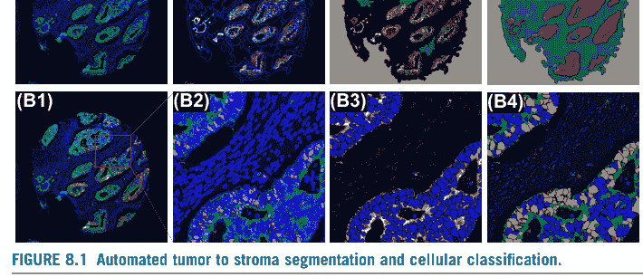

#### 图 8.1 自动化肿瘤与间质分割和细胞分类。

（A）使用 Definiens Tissue Studio 软件进行自动组织分割的机器学习方法。在此示例中，将肿瘤与间质分割开。Ai）一个结直肠组织微阵列（TMA）核心，通过免疫荧光标记肿瘤（泛细胞角蛋白，绿色）和细胞核（Hoechst，蓝色）。Aii）软件基于像素异质性自动分割图像（蓝色轮廓）。Aiii）用户标记要分割的特征的分割示例对象，这里青色代表间质，紫色代表肿瘤。机器学习算法学习这些特征并自动分割项目中的其余图像，如 Aiv 所示。（B）同一 TMA 核心标记了 ki67，在 Bi 中以红色显示并配准。Bii）显示了 Definiens 软件自动分割的所有细胞核（蓝色轮廓），然后排除间质细胞核（灰色）并在 Biii 中保留肿瘤细胞核（蓝色）。Biv）显示肿瘤细胞核被分类为 ki67 表达阳性（黄色）。

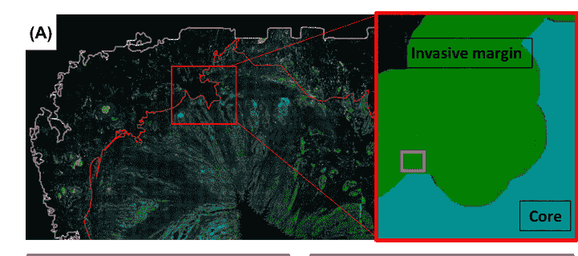

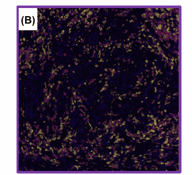

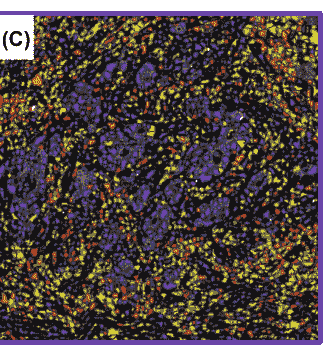

#### 图 8.2 肿瘤浸润边缘或核心内淋巴细胞浸润的定量。

（A）一张结直肠癌组织切片的全切片图像，标记了肿瘤细胞（绿色）和细胞核（蓝色）。此图中的图像分析使用 Indica Labs HALO 软件进行。红色轮廓是自动检测到的肿瘤细胞最深浸润，插图显示了分割为浸润边缘（绿色）和肿瘤核心（蓝色）的图像的放大示例。紫色方框表示（B 和 C）图像在浸润边缘中的来源位置。（B）多重免疫荧光显示 CD3（黄色）和 CD8（红色）阳性淋巴细胞。（C）在仅肿瘤浸润边缘内对这些淋巴细胞的自动定量。

以区分感兴趣区域进行图像分析。此外，组织标本本身并不完美，因此数字化 WSI 也不完美。这些缺陷可能来源于组织制备的多个阶段。它们可能导致组织折叠、撕裂或不均匀厚度，以及由于缺血或固定时间引起的更细微的形态学差异。如果进行免疫标记，非特异性染色、边缘效应或自发荧光也可能为自动化图像分析带来混淆问题。此类伪影的示例见图 8.3。上述所有

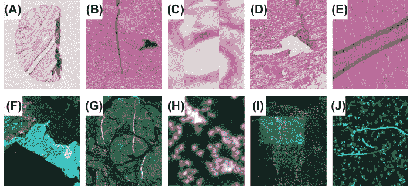

#### 图 8.3 数字病理学中图像伪影的示例。

（A–E）明场图像采集的伪影示例。（A）TMA 核心切片折叠。（B）H&E 染色图像上的切片伪影（深粉色线）和灰尘颗粒（灰色）。（C）H&E 染色图像失焦且拼接不正确。（D）H&E 标记组织中的撕裂和折叠。（E）H&E 标记标本上失焦区域被异物包围。（F–J）荧光图像采集的伪影示例。（F）组织切片撕裂导致非特异性荧光。（G）切片伪影（亮线）。（H）细胞核失焦。（I）光照伪影导致大的蓝色方块。（J）尿液细胞学样本中毛发引起的自发荧光（蓝色线条）。

可能都会导致不准确的报告，例如在应用图像分析和机器学习对大规模患者队列进行组织分割时出现假阳性。然而，许多这些问题可以通过采用深度学习架构来分割数字化 WSI 来克服。为此，训练有素的专家可以标注选定的定量感兴趣区域，同时进一步识别并训练算法忽略组织伪影 [11]。人脑在模式识别方面非常出色，病理学家通常会例行且自动地忽略不完美的组织标本，以便专注于包含做出诊断或预后所需信息的区域。深度学习架构日益成熟的复杂性现在允许自动化算法达到这种分析水平。

为了进行准确的组织分割，无论是使用机器学习还是深度学习方法，都需要在用于区分感兴趣区域的特征中有一个强大且标准化的信噪比。然而，样本固有的异质性也反映在用于分割的标记物上，其亮度或强度在不同患者样本之间甚至同一样本内部都可能存在差异。可以在人工智能分析图像之前应用图像颜色和强度标准化算法 [12]。这可以在多样且大规模的患者队列中实现更准确的完全自动化组织分割；然而，关于这是否是实现这一目标的最佳方法，以及这种方法是否会减少真实的诊断信息，仍存在争议。

深度学习不仅被应用于在生物标志物或细胞定量之前分割组织，还具有识别数字化 H&E 染色组织切片中组织病理学模式的能力（图 8.4）。这已在研究中得到证实，在这些研究中，专家病理学家对重要特征进行了注释，以便训练深度学习算法在未见过的测试集和验证集中识别这些特征。计算机可视化和识别更微妙的预后相关模式的临床应用和方法在本书其他地方有更详细的介绍。

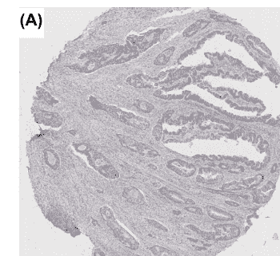

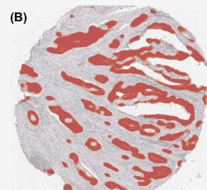

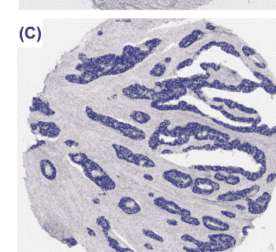

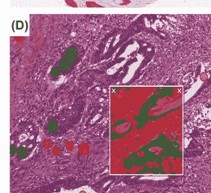

图 8.4 深度学习执行的组织分割。

在没有肿瘤可视化标记辅助的情况下分割肿瘤与间质时，基于浅层学习的图像分割通常不准确。在这种情况下可应用深度学习进行准确的组织分割。这些示例使用 Indica Labs HALO AI 软件来分割肿瘤与间质。(A) 仅用苏木精染色的 TMA 芯。(B) HALO AI 算法训练后可在苏木精染色数字图像中仅识别肿瘤细胞（红色）。(C) 软件随后对每个肿瘤细胞核进行分类（深蓝色）。(D) 深度学习算法能够被训练以从 H&E 染色数字图像中识别肿瘤（绿色叠加）与间质（红色叠加）。

此类算法正在开发中以帮助病理学家进行诊断，并且它们被常规应用于病理科临床工作流程只是时间问题。目前，这些算法并非设计用于在没有任何人工验证的情况下自动报告患者样本，而是作为病理学家的辅助工具，以提高其报告速度，例如通过突出显示感兴趣区域，作为分诊紧急病例或作为第二意见的方法。然而，随着深度学习的不断成熟，未来计算机视觉算法可能执行自主临床报告的某些方面具有很强的可能性。本章后面将讨论在设计用于临床转化的算法时需要解决的监管问题。

深度学习架构现在能够从 H&E 标记的组织学中预测患者分子亚组。它们仅从组织样本的形态和组织学模式即可实现这一点[15,16]。这可能令人难以置信；然而，组织病理学家很可能已经预测到这是可能的。他们完全了解组织中存在的复杂且重要的形态变异以及它们如何影响患者预后；即使他们无法将这些与分子亚型联系起来。然而，这超出了学术研究的范畴，具有实际意义。分子检测昂贵且需要复杂的仪器。如果与个性化病理学相关的相同信息可以从常规且廉价的 H&E 标记切片中获得，这在计算卫生经济学时可能产生重大的经济影响。

### 空间分辨率

我们简要介绍了在定量感兴趣生物标志物时，在精准医学领域报告组织结构的重要性，而非其他会破坏组织从而丧失其细胞成分空间分辨率的分子技术。组织病理学家知道，背景对于准确的诊断和预后至关重要。肿瘤微环境复杂，存在许多细胞和分子相互作用，它们在抑制或驱动肿瘤进展和治疗反应中发挥作用。即使通过图像分析，单一生物标志物的定量也可能不足以预测个体患者的准确预后。这在 PD-L1 免疫组织化学检测中即为如此，即使是 PD-L1 阳性肿瘤的患者也可能对抗 PD-L1 治疗无反应[17]。同样，在肿瘤微环境的不同区域内定量预后组织病理学特征（如淋巴细胞浸润或肿瘤芽生）具有优势。传统上，图像分析已在单个组织切片上定量单一预后特征，并在患者分层方面取得了 proven 成功。然而，通过应用多重免疫荧光，现在可以在单个组织切片内可视化多个生物标志物和组织学特征。图像分析软件还可以计算并导出 WSI 上每个感兴趣特征的确切 x 和 y 空间坐标，或识别肿瘤微环境相互作用细胞环境中的特定模式（图 8.5）。这不仅带来了测量一个以上预后特征的优势，还允许基于在组织空间分辨率下定量新颖相互作用来对疾病进展的理解提供新的见解。Nearchou 等人已证实这一点，他们显示肿瘤芽生密度和免疫浸润与 II 期结直肠癌生存显著相关，而且它们的具体相互作用为联合预后模型增加了价值[6]。此类研究表明，复杂的空间分析可能是个体患者准确预后成功的关键。

### 提取数据上的机器学习

上述描述的图像分析解决方案允许对已知生物标志物或组织病理学特征进行准确的图像分割以及细胞和分子分类。这些已知特征的定量可被利用和应用以提供个性化病理学。然而，图像分析还可以进一步提取跨多个分类对象及其空间相互作用的丰富无偏收集数据。此类数据可能是特定对象周围特定对象的特定密度，或它们之间的距离，以及单个对象的丰富范围、形状和纹理测量。这些数据的值通常事先未知，且难以甚至不可能通过肉眼进行整理和分析。机器学习可应用于分子和数字病理学的 大数据集，以了解允许患者分层从而在个性化医学领域进行临床决策的最佳特征。然而，在决定对数据应用哪种机器学习算法时必须谨慎。如果一个模型在分析一个数据集时更优，例如基于寻找接收器操作员曲线下面积的最优值，这并不意味着在相似计算限制下，同一算法在分析第二个不同的数据集时也会同样成功。这构成了“没有免费午餐定理”[18]的一部分，我们将在本章后面再次提及。简单来说，不同的机器学习算法在应用于特定数据集时优于其他算法。例如，一些算法擅长分析低维数据（如 K-最近邻），然而当数据维度增加时变得难以处理或返回较差的结果。另一方面，随机森林擅长分析高维数据。同样，一些模型在以线性方式分离数据方面比其他模型更好。由于我们很少事先知道哪个模型或其超参数的哪些设置最适合分离特定数据集，因此在单个数据集上测试多种机器学习方法较为明智。可以设计自动化工作流程，将数据拆分为平衡的训练集和测试集，应用特征降维算法（如有需要），测试多个机器学习模型并设置其超参数，然后返回用于最好地分离数据并回答所提出临床问题的模型和特征[19]。

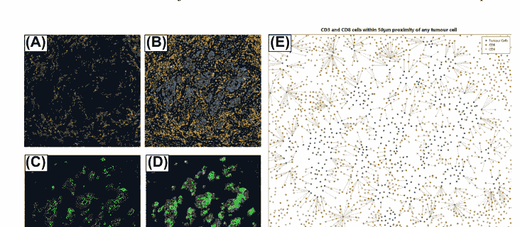

图 8.5 定量细胞亚群的空间分辨率。

该图演示了当使用 Indica Lab HALO 软件定量多重免疫荧光时，CD3 和 CD8 阳性淋巴细胞密度如何映射到肿瘤细胞。免疫荧光标记的 CD3（黄色）和 CD8（红色）阳性淋巴细胞（A）被分割和定量（B）。(C) 从与（A）相同的图像中捕获的肿瘤细胞（绿色）并被分割和定量（D）。导出的肿瘤细胞（绿色点）的 x 和 y 空间坐标与 CD3（黄色点）和 CD8（红色点）阳性淋巴细胞的坐标一起绘制（E）。这使得可以计算肿瘤细胞 50 µm 直径范围内淋巴细胞的空间统计。

Schmidt 等人的例子展示了结合本章讨论的许多主题的有用性，他们设计了图像分析和深度学习工作流程以更好地预测患者对伊匹木单抗的反应[20]。他们结合了基本的图像分析阈值处理来分类淋巴细胞浸润细胞，并应用深度学习来消除图像中的伪影和坏死。此外，他们使用了病理学家注释来训练特定感兴趣区域，在定量淋巴细胞结构之前将肿瘤和间质进行区室化。最后，他们在报告预测治疗反应的最终最优模型之前应用了多种分析其结果数据的方法。

### 超越数据增强

为了使深度学习成为临床患者诊断的有效方法，必须有足够数量的标记注释和多样化的样本以代表更大的人群。在深度学习的情况下，这需要在多个国际机构获得并由多个个人制备的数千例患者样本上进行训练和验证。这不是一项容易或快速完成的任务。该领域的主要缺点是缺乏数据科学家可用的此类大型、注释良好且经过整理的数据集。然而，每个医院在其玻璃显微镜载玻片档案中保存了大量数据，这些数据可追溯数十年。这些数据可以追溯到在该

机构及其临床报告。档案库中每位患者的样本组织切片将用 H&E 染色；由于每位前瞻性患者的样本也同样采用 H&E 染色，因此将深度学习工作集中到用这种染色制备的数字病理样本上是合理的。因此，瓶颈不在于获取患者样本，而在于专家对与诊断相关的感兴趣区域进行数字化标注。为了克服这一瓶颈，研究人员正放弃图像级标注，转而开发仅依赖切片级标注（即患者的诊断结果）的弱监督深度学习架构。简而言之，计算机不会被告诉图像中癌症在哪里，而是被告知图像中某处存在癌细胞。这种方法已被证明是有效的，并且依赖于对患者的数据驱动分析：计算机视觉算法可识别与诊断或预后相关的细微而复杂的形态。于是，机器现在可以告知人类，在患者个体组织样本中哪些特征具有病理学意义。这些模式迄今可能未被注意到，或者过于复杂，以至于无法靠人力制定标准化的报告规程。这类方法已在大肠癌[21]、前列腺癌和乳腺癌淋巴结转移[22]中得到测试。有关这些方法的更多信息可见下一章。

### 机器学习的实用概念与理论

#### 机器学习与数字病理学

数字病理学领域中分析各类临床数据的现有工作，在概念上可以根据不同标准以多种方式加以组织。考虑到可能关注的病理类型多种多样，一种方法是考察针对特定疾病、甚至特定组织或人群开发的解决方案；另一个标准则基于可用于学习的标注类型，即训练反馈；还有一种方法可区分不同类型的输入数据及其获取模态。

随着叙述的展开，这样做的原因将逐渐清晰：在本文中，我们认为根据解决问题的技术方法，将该领域的工作大致分为两大类是有益的。第一类大致可描述为涉及“传统”计算机视觉，第二类则是基于深度学习的。这一区分有些粗略，但由于它反映了该领域的当前趋势，即关注点从前一类向后一类的转移，因此它将有助于说明该领域的主要挑战与机遇，也有助于揭示当前思路中潜在的陷阱和局限，并解释我们对未来工作的思考与建议。

考虑到病理学家在分析真实病例时必须应对多种挑战，读者应当不会感到意外：人们已经探索并提出了针对大量可能有用的任务的算法解决方案。许多（事实上可能是大多数）研究一直聚焦于

#### 基于朴素贝叶斯假设的方法

朴素贝叶斯分类通过作出特征独立这一“朴素”假设来应用贝叶斯定理。形式化地说，给定一组 \(n\) 个特征 \(x_1,\dots,x_n\)，相应的模式被判定为属于满足以下条件的类别 \(y\)：

$$y = \arg \max_{j} P(C_j) \prod_{i=1}^{n} p(x_i|C_j)\tag{8.1}$$

其中 \(P(C_j)\) 是类别 \(C_j\) 的先验概率，\(p(x_i|C_j)\) 是在类别 \(C_j\) 条件下特征 \(x_i\) 的条件概率（可使用监督学习框架从数据中直接估计）[23]。

基于朴素贝叶斯的算法，无论是面向回归还是分类，其关键潜在弱点很容易发现：它在于特征独立这一不切实际的假设。然而，乍一看有些令人惊讶的是，这些简单方法在实践中往往效果极佳，并且常常胜过那些更复杂、在特征相关性的基本假设方面更具表达力和灵活性的模型[19]。

这种情况可能有几个原因。其中之一涉及误差结构——如果在给定表示下数据相关性的概念结构在某种意义上是对称的，那么高估条件概率的误差和低估条件概率的误差可能在总体上相互抵消，从而得到更准确的总体估计[24]。另一个同样重要的因素来自可用训练数据量（给定特定复杂度的某个问题）与所采用模型自由参数数量之间的关系，正是这种关系使那些基于朴素贝叶斯假设的方法常常表现出令人惊讶的优异性能。通常情况下，尤其是考虑到数字病理学中类别不平衡会带来重大实际问题时，更复杂的模型无法得到充分训练；因此，即使原则上它们能够学习更复杂的函数行为，这种理论上的优越性也无法被利用。

虽然朴素贝叶斯方法是一个良好的起点和合理的基线，但在适当情况下，更精细的模型会超越它们；下面我们总结其中的一些方法。

#### 基于逻辑回归的方法

逻辑回归是另一种被广泛使用、已被充分理解且通常表现良好的监督学习技术。在逻辑回归中，因变量（类别）\(y\) 的条件概率被建模为解释变量（输入特征）\(x_1, \dots, x_n\) 的 logit 变换多元线性回归：

$$P_{LR}(y = \pm1|x, w) = \frac{1}{1 + e^{-y w^T x}}.\tag{8.2}$$

模型通过最大化训练数据集上的似然来进行训练（即学习权重参数 \(w\)），该似然为：

$$\prod_{i=1}^{n} \Pr(y_i|x_i,\mathbf{w}) = \prod_{i=1}^{n} \frac{1}{1 + e^{-y_i \mathbf{w}^T \mathbf{x}_i}},\tag{8.3}$$

并以模型复杂度作为惩罚：

$$\frac{1}{\sigma\sqrt{2\pi}} e^{-\frac{1}{2\sigma^2} \mathbf{w}^T \mathbf{w}},\tag{8.4}$$

这可以重述为最小化以下正则化负对数似然：

$$\mathcal{L} = C \sum_{i=1}^{n} \log\left(1 + e^{-y_i \mathbf{w}^T \mathbf{x}_i}\right) + \mathbf{w}^T \mathbf{w}.\tag{8.5}$$

可以采用坐标下降法来最小化 \(\mathcal{L}\)，例如 Yu 等人[25]描述的方法。

#### 基于支持向量的方法

支持向量机通过在一个高维（可能是无限维）空间中构造一系列类别分隔超平面来执行分类，原始输入数据会被映射到该空间中[26]。关于这种分类技术的全面细节，读者可参阅 Vapnik 的原始工作[27]；这里我们只概述其关键思想。

在支持向量机的背景下，将数据映射到极高维空间这一看似棘手的任务，可以通过隐式而非显式地执行上述映射来高效完成。这是通过采用所谓的核技巧来实现的，该技巧确保高维空间中的点积可以方便地使用原始空间中的变量来计算。给定形式为 \(\{(x_1, y_1), \dots, (x_n, y_n)\}\) 的带标签训练数据（输入向量及相应标签），支持向量机旨在以正则化方式找到一种映射，使被误分类的训练样本数量最小化。如前所述，通过采用 Mercer 容许核[28] \(k(x_i, x_j)\) 来执行输入数据 \(x \rightarrow \Phi(x)\) 的隐式映射，从而可以在输入空间中计算映射后数据之间的点积：\(\Phi(x_i)\cdot\Phi(x_j) = k(x_i, x_j)\)。变换后的高维空间中的分类向量具有如下形式

$$w = \sum_{i=1}^{n} c_i y_i \Phi(x_i)\tag{8.6}$$

并通过最小化下式来求解：

$$\sum_{i=1}^{n} c_i - \frac{1}{2} \sum_{i=1}^{n} \sum_{j=1}^{n} y_i c_i k(x_i,x_j) y_j c_j\tag{8.7}$$

受约束条件 $\sum_{i=1}^{n} c_i y_i = 0$ 和 $0 \le c_i \le 1/(2n\lambda)$ 约束。正则化参数 $\lambda$ 对预测误差进行惩罚。基于支持向量的 方法即使在相对较小的训练数据集上通常也能表现良好，并且具有数学行为易于理解的优势（这在监管合规等背景下是一个重要考虑因素）。

暂时跳出技术细节直观来看，这里发生的事情是算法正在学习哪些类别样例是“最成问题”的，即哪些样例最接近类别边界，因而最有可能被错误分类。这些就是赋予该方法名称的支持向量。对它们的检查是有启发性的。首先，相对于总训练数据量而言，支持向量数量很大应立即引起警惕，因为这暗示着过拟合。其次，通过检查哪些样例最终成为支持向量，可以获得对所发生学习本质的理解，以及对问题结构和数据表示的理解，这可能带来有用的新颖临床见解。

### 非参数、基于k近邻的方法

k近邻分类器将包含特征 x1, ..., xn 的新模式分类到在特征空间中与输入模式的 k 个最近邻居集合中占主导地位的类别，该集合取自具有已知类别成员的训练模式 [29]。通常采用的相似性度量是欧几里得距离。

### 随机森林

随机森林分类器属于集成学习方法的广泛范畴 [30]。它们实现简单、运行快速，并在各种领域被证明极其成功 [31,32]。随机森林方法的关键原理包括在训练阶段构建许多“简单”的决策树，并在分类阶段对其进行多数投票（众数）。除其他益处外，这种投票策略可纠正决策树过拟合训练数据的 undesirable 属性 [33]。在训练阶段，随机森林对集成中的各个树应用称为 bagging 的通用技术。Bagging 反复从训练集中有放回地抽取随机样本并对这些样本拟合树。每一棵树都是在不进行剪枝的情况下生长的。集成中的树数量是一个自由参数，可使用所谓的袋外误差自动轻松学习 [29]。

与朴素贝叶斯和基于 k 近邻的算法类似，随机森林部分因其一方面简单、另一方面通常性能良好而流行。然而，与前两种方法不同，随机森林在最终训练模型的结构方面表现出一定程度的不可预测性。这是树构建随机性固有的结果。正如我们稍后将更详细探讨的那样，随机森林的这一特性在监管方面可能成为问题的关键原因之一——临床采用通常要求在算法的最终性能方面以及具体决策的机制方面都具有高度可重复性。

### 无监督学习

我们已经提到过患者分层任务。事实上，分层的需要经常出现在数字病理学中，例如由于许多疾病的异质性或不同人群对治疗或疾病本身的差异化反应 [19]。

鉴于相关分层通常事先未知，往往是因为先前完全手动解释数据所带来的限制以及为了得出可靠结论而需要检查数据的规模，自动分层通常是可取的。一种常见做法是通过无监督学习来实现，通过应用聚类算法，例如高斯混合模型，或更频繁地由于其简单性和更少的自由参数，使用 k-means 算法 [21]。然后，任何后续学习都可以通过为每个聚类单独学习模型以更针对性的方式进行。

设 X = {x₁, x₂, ..., xₙ} 为一组 d 维特征向量。k-means 算法将点划分为 K 个聚类，X₁, ..., X_K，使得每个数据仅属于一个且只有一个聚类。此外，还尝试最小化每个数据点与其对应聚类经验均值之间的平方距离之和。换句话说，k-means 算法试图最小化以下目标函数：

$J(X_1,...,X_k) = \sum_{i=1}^k \sum_{x \in X_i} \|c_i - x\|^2$, 8.8

其中经验聚类均值计算为：

$c_i = \sum_{x \in X_i} x / |X_i|$, 8.9

参考文献 [1] 中目标函数的精确最小化是一个 NP-hard 问题 [34]。相反，k-means 算法只能保证收敛到局部最小值。从初始猜测开始，算法迭代更新聚类中心和数据-聚类分配，直到 (1) 达到局部最小值，或 (2) 满足替代停止准则（例如，最大期望迭代次数或足够小的平方距离之和）。k-means 算法从聚类中心的初始猜测开始。

通常，这只是简单地随机选择 k 个数据点作为初始聚类的中心，尽管提出了更复杂的初始化方法 [35,36]。然后，在每次迭代 t = 0, ... 时，新的数据-聚类分配计算为：

$$X_i^{(t)} = \left\{x : x \in X \land \arg\min_j \left\|x-c_j^{(t)}\right\|^2 = i\right\}$$

换句话说，每个数据都被分配给具有最近（在欧几里得意义上）经验均值的聚类。最后，聚类中心的位置根据新的分配重新计算，通过求每个聚类分配的数据的均值：

$$c_j^{(t+1)} = \sum_{x\in X_j^{(t)}} \frac{x}{\left|X_j^{(t)}\right|}$$

该算法保证收敛，因为参考文献 [3] 和 [4] 中的任何一次更新都不会增加参考文献 [1] 的目标函数。原始 k-means 算法的各种扩展包括模糊 c-means [37]、k-medoid [38]、核 k-means [39]，以及在部分标记可用时判别式 k-means [40]。感兴趣的读者可参考所引用的出版物获取进一步信息。

### 基于图像的数字病理学

可能在数字病理学中最有趣的研究领域之一，无论从实际潜力还是智力挑战的性质来看，都涉及图像的使用。

由于病理学中感兴趣的图像固有的复杂性，我们所称的“传统”机器学习和基于深度学习的方法之间的上述区别在数字病理学领域尤为明显。大致而言，前者通常采用模块化、流水线形式，其中首先从输入图像中提取显式设计的特征（有时称为“手工”特征），然后将其输入到上一节所述类型的机器学习算法中。相比之下，在基于深度学习的方法中，过程并非以这种方式原子化 [41]——作为直接感知数据（例如像素强度）的复杂函数的良好特征，是从标记的训练数据中自动学习的。这一区别常常导致基于深度学习的方法被描述为“数据不可知” [42]；通俗地说，想法是无论输入是什么，算法都会学习什么是好的特征。然而，以这种方式描述深度学习是不恰当的且极具误导性。任何学习发生，模型都必须受到约束，并且由于这些约束而包含有关手头问题的隐含信息；简而言之，空白 slate 无法学习。的确，一个众所周知的定理“没有免费午餐定理”隐含地说的是同样的内容：

> > *任何两个优化算法在其性能在所有可能问题上平均时都是等价的。*
> >
> > **Ref. [18]**

因此，深度学习算法也并非具有某种近乎神奇的能力来克服这一根本局限，它们同样受到某些先验知识的制约（因此并非与领域无关）。具体而言，深度神经网络包含多种约束，这些约束源自其层的类型、层的顺序、每层神经元的数量、层之间的连接方式以及其他架构方面的因素。这一点很重要，需要牢记：不应将深度学习视为必然优于“传统”方法，也不应将其视为解决任何问题的万能方案。

### 图像分析的传统方法

如前所述，最早被提出用于分析临床病理图像的一大类算法，采用了我们称之为传统或经典计算机视觉的方法。这里我们主要指的是处理流程的第一阶段，即提取先验的、显式定义的特征。其核心前提颇具吸引力且在直觉上合理：利用人类专业知识来识别图像中哪些基础低层元素是显著的，一方面它们能捕获重要的判别信息，另一方面又足够紧凑，以利于计算效率并可从现有数据中进行可靠学习。

在一系列所谓的自然场景图像上取得了成功之后（至少可以说，它们极大地改变了该领域）[43]，最初为更日常的计算机视觉应用（如位置识别、合成全景图像生成、目标定位等）提出的局部外观描述符被率先采用，并应用于多种病理图像类型 [44,45]。其中流行且广泛使用的例子包括基于局部二值模式（LBP）[46]、尺度不变特征变换（SIFT）[47] 和方向梯度直方图（HOG）[48] 的描述符。

与上述通用描述符特征相对照，另一类“手工设计”的特征则直接且显式地利用领域特定信息，即人类专家对病理学的知识。因此，感兴趣目标的数量（如肿瘤细胞和免疫细胞等）、其形态量化指标（如大小、偏心率）或空间统计信息都属于常用特征之列。这些特征的吸引力有两点。首先，就其本质而言，可以合理预期它们在病理切片分析中具有显著性。其次，它们通常可以相当轻松地从图像中测量（提取）：可以使用不同的染色和成像模式或生物标志物来突出感兴趣的目标，而简单的图像处理或计算机视觉算法（如泛洪填充算法 [49]、形态学算子 [50]、斑点检测器 [45] 等）通常足以满足计算方面的需求。

### 图像上的深度学习

深度学习成为如此热门的研究领域的原因之一，在于它应用于许多计算机视觉问题时的成功，包括一些使用传统方法极具挑战性的问题 [51]。它在数字病理图像分析中的应用同样没有让人失望，深度学习迅速在一系列不同任务中确立了最先进的性能。考虑到本卷其他几章已经专门讨论了深度学习的技术细节，此处我们将重点放在更宏观的视角上，旨在突出该领域的主要趋势、核心挑战以及深度学习固有的优缺点。

与其加入对深度学习歌功颂德的行列，一个更有用、更具洞察力和启发性的问题在于其突出的局限性。如果关键障碍仅仅是足够数据的可用性（毫无疑问，几乎每个研究团队都会遇到这一困难，或许少数科技巨头除外），那么解决方案就只是时间和协同努力的问题。不幸的是，从实践角度来看，或者从智力挑战的角度来看幸运的是，答案更为微妙。特别是，当前方法面临的主要问题是由单张图像的巨大尺寸造成的，这些图像通常每张超过 10 GB。在这种尺寸的图像上训练深度神经网络（请记住深度学习方法对训练数据的需求非常大）在计算上是不切实际的。

对该领域现有工作的调研显示，处理 WSI（全切片图像）尺寸问题主要有两种方法。第一种涉及严重降采样——将一张数十亿像素的图像缩小为仅有数万像素的图像。第二种方法是将 WSI 划分为小块（通常不重叠），将这些小块作为独立图像进行学习，然后汇总小块级别的决策以得出切片级别的决策。可以看到，这两种方法都会导致信息丢失，尽管方式不同。正如奈奎斯特在 20 世纪 30 年代正式证明、同样也容易被直觉理解的那样，降采样方法造成的信息丢失形式是细节（即高空间频率）的损失。即使对人类专家而言，这一信息在解读组织切片时也很重要，而且可以预期对基于计算机的方法更为重要，因为这些方法不受人类视觉系统许多缺陷的影响。基于小块算法中发生的信息丢失类型则颇为不同且更为微妙，因此在继续讨论之前，有必要重点介绍几项有影响力的工作。

在最简单的形式中，各个小块被完全独立对待。这种方法在肿瘤与正常组织的块级区分 [52] 以及前驱病变分割 [53] 中已产生有前景的结果，但在预后任务上的成功则十分有限 [54]。Hou 等人 [55] 不再将块级决策作为最终目标，而是提出一种方法：在单个小块上训练深度神经网络，然后通过投票汇总块级决策以进行切片级预测。最近，一些应对切片内异质性挑战的方法被提出，大致包括小块的自适应选择、基于表型的小块聚类、自动聚类选择以及聚类级预测的学习聚合。初步尝试令人失望 [56]，但随后对方法学的一些改进已带来了更有希望的结果 [21]。

上述对该领域的快速浏览凸显了基于小块方法的一些关键局限性，而这些方法在现有文献中占主导地位。首先，通过将 WSI 分解为小块，几乎不可避免地要采用某种形式的临时小块标注，通常是将整个切片的标签附加到从其提取的所有小块上。这显然是一个相当不具吸引力的做法，因为切片中并非每个包含病理的区域都同样具有信息量；事实上，有些区域可能含有完全健康的组织。因此，学习算法实际上被喂给了错误的数据。此外，在聚合阶段也会出现问题。最后，小块的分离以及小块边界相对于所成像物理组织位置的任意性导致了空间信息的丢失。

### 监管问题与考虑

到目前为止，我们的重点是与数字病理学任务中图像使用相关的基本挑战、这些挑战迄今如何塑造该领域，以及未来最可能取得进展的趋势。与此相关但性质略有不同、在实践中同样重要的是与人工智能在日常临床流程中采用相关的要求和需求。这些要求通常由各种监管机构施加，例如美国的食品药品监督管理局（FDA），或者更宽泛地说，由最终用户自身提出。虽然对这一主题的全面考察超出了本章的范围，但有必要提醒读者注意这一领域中的一些关键问题。具体而言，我们重点强调三个问题：

-   可解释性，
-   可重复性，以及
-   泛化性。

此处语境下的可解释性涉及的是：基于算法的人工智能解决方案做出的决策能否在语义适当的层面上传达给人类。换句话说，要问的不仅仅是决策是什么，而是算法如何或为何做出该决策。如前所述，对于许多涵盖在传统图像理解方法范畴内的算法而言，这相当直截了当。例如，在基于 k 近邻的解决方案中，最近邻——即先前见过的、由人工标记的、展现出……

与当前考虑的新示例具有最大相似性的样本可以被提出。基于支持向量的方法中，最接近的样本（在核函数意义上）或定义类别边界的支持向量也可以类似地用于深入了解模型学到了什么以及如何做出决策。对于随机森林，一种常用的方法是用虚拟特征替换特征，以量化哪些特征在决策中最为重要，并由专家进行“合理性检查”。这一过程不仅具有验证性，还可能带来新的临床见解。尽管长期以来，可解释性一直被视为基于深度学习方法的潜在劣势（类似于人类记忆和大脑：能否定位“蛋糕”这一概念存储在哪里？），这些方法曾被看作众所周知的“黑箱”，但近年来该领域取得了巨大进展[57]。例如，观察网络中哪些神经元共同激活（类似于生物强化学习的格言“同步放电的神经元会连接在一起”）可以提供有价值的见解。通过查看不同层并可视化学习到的特征，可以获得更高（语义）层面的洞察——通常接近输入的层倾向于学习简单的、低层次的外观元素，这些元素随后被组合成更复杂的视觉模式[58]。另一种巧妙的技术涉及所谓的“遮挡法”，即用均匀模式遮挡输入图像的部分区域（从而造成局部信息损失），并量化这种遮挡对决策的影响——影响越大，特定图像位置的重要性越高[59]。

可重复性和再现性问题近年来在学术界及更广泛的领域受到高度关注。Drummond[60]令人信服地强调并讨论了这两个概念之间的区别，但这一细微差别似乎尚未渗透到监管流程中。特别是，由于某些机器学习算法操作的随机性，其实验结果在实践中无法完全再现，这构成了其在临床应用中采用的主要障碍。我们在前一节概述随机森林时已经提到了这一点。具体而言，即使使用相同的训练数据并以相同的方式进行训练，训练后的随机森林或神经网络的参数也会因实例而异。这是其训练过程中随机元素的固有结果，而且与某些人的观念不太吻合。虽然这种感受不难理解，但它确实说明了在对待人类专家和机器专业知识方面可能存在的不一致。具体而言，前者已被证明存在显著的个体间差异（两位不同、称职且经验丰富的病理学家从相同数据得出不同结论），以及个体内差异（例如，取决于疲劳程度、一天中的时间、决策是在餐前还是餐后做出等）。这种双重标准与涉及人-人和人-机互动的广泛研究一致，并且在神经学上已被充分理解：两种类型的参与方式不同地激活重要的大脑回路，如腹内侧前额叶皮层和杏仁核[61]。

泛化性是贯穿机器学习的一个概念。它指的是算法从训练数据中学习其中包含的某些信息的能力，这些信息使其能够在以前未见过的输入上做出良好决策，这些输入通常看起来与训练阶段所见的任何内容都相当不同。泛化问题是数据表示、问题抽象、学习数学模型等任务的基础。这里我们在一个非常具体的背景下提及泛化性。也就是说，病理学实践中的一个重大挑战涉及数据采集的不同方案和条件。简而言之，所提出的问题是：当一个算法在特定实验室中由技术人员使用特定设备在一组患者上采集的数据上进行评估后，将其应用于由不同实验室的不同技术人员从不同人群采集的数据时，我预期会看到什么样的性能？可以很容易地看出，数据采集中的细微变化（例如暴露于染料的持续时间）、实验室仪器的不同物理特性，甚至患者的不同人口统计学特征，都是合理的担忧理由。事实上，目前数字病理学中的大部分工作在这方面相当有限，这在很大程度上是由于数据共享中的各种障碍：存在伦理和隐私问题，以及涉及经济利益。

### 致谢

作者感谢Inés Nearchou为本章节中的图片提供了图像。

### 参考文献

- 1. Caie PD, Walls RE, Ingleston-Orme A, Daya S, Houslay T, Eagle R, et al. High-content phenotypic profiling of drug response signatures across distinct cancer cells. Molecular Cancer Therapeutics 2010;9(6):1913–26.
- 2. Deans GT, Heatley M, Anderson N, Patterson CC, Rowlands BJ, Parks TG, et al. Jass’ classification revisited. Journal of the American College of Surgeons 1994;179(1):11–7.
- 3. Lim D, Alvarez T, Nucci MR, Gilks B, Longacre T, Soslow RA, et al. Interobserver variability in the interpretation of tumor cell necrosis in uterine leiomyosarcoma. The American Journal of Surgical Pathology 2013;37(5):650–8.
- 4. Chandler I, Houlston RS. Interobserver agreement in grading of colorectal cancers—findings from a nationwide web-based survey of histopathologists. Histopathology 2008;52(4):494–9.
- 5. Caie PD, Zhou Y, Turnbull AK, Oniscu A, Harrison DJ. Novel histopathologic feature identified through image analysis augments stage II colorectal cancer clinical reporting. Oncotarget 2016;7(28):44381–94.
- 6. Nearchou IP, Lillard K, Gavriel CG, Ueno H, Harrison DJ, Caie PD. Automated analysis of lymphocytic infiltration, tumor budding, and their spatial relationship improves prognostic accuracy in colorectal cancer. Cancer Immunology Research 2019;7(4):609–20.
- 7. Khameneh FD, Razavi S, Kamasak M. Automated segmentation of cell membranes to evaluate HER2 status in whole slide images using a modified deep learning network. Computers in Biology and Medicine 2019;110:164–74.
- [8] Widmaier M, Wiestler T, Walker J, Barker C, Scott ML, Sekhavati F, et al. Comparison of continuous measures across diagnostic PD-L1 assays in non-small cell lung cancer using automated image analysis. Modern Pathology 2019;33.
- [9] Puri M, Hoover SB, Hewitt SM, Wei BR, Adissu HA, Halsey CHC, et al. Automated computational detection, quantitation, and mapping of mitosis in whole-slide images for clinically actionable surgical pathology decision support. Journal of Pathology Informatics 2019;10:4.
- [10] Brieu N, Gavriel CG, Nearchou IP, Harrison DJ, Schmidt G, Caie PD. Automated tumour budding quantification by machine learning augments TNM staging in muscle-invasive bladder cancer prognosis. Scientific Reports 2019;9(1):5174.
- [11] Brieu N, Gavriel CG, Harrison DJ, Caie PD, Schmidt G. Context-based interpolation of coarse deep learning prediction maps for the segmentation of fine structures in immunofluorescence images. SPIE; 2018.
- [12] Roy S, kumar Jain A, Lal S, Kini J. A study about color normalization methods for histopathology images. Micron 2018;114:42–61.
- [13] Cruz-Roa A, Gilmore H, Basavanhally A, Feldman M, Ganesan S, Shih NNC, et al. Accurate and reproducible invasive breast cancer detection in whole-slide images: a deep learning approach for quantifying tumor extent. Scientific Reports 2017;7:46450.
- [14] Litjens G, Bandi P, Ehteshami Bejnordi B, Geessink O, Balkenhol M, Bult P, et al. 1399 H&E-stained sentinel lymph node sections of breast cancer patients: the CAMELYON dataset. GigaScience 2018;7(6).
- [15] Coudray N, Ocampo PS, Sakellaropoulos T, Narula N, Snuderl M, Fenyő D, et al. Classification and mutation prediction from non–small cell lung cancer histopathology images using deep learning. Nature Medicine 2018;24(10):1559–67.
- [16] Sirinukunwattana K, Domingo E, Richman S, Redmond KL, Blake A, Verrill C, et al. Image-based consensus molecular subtype classification (imCMS) of colorectal cancer using deep learning. bioRxiv 2019:645143.
- [17] Havel JJ, Chowell D, Chan TA. The evolving landscape of biomarkers for checkpoint inhibitor immunotherapy. Nature Reviews Cancer 2019;19(3):133–50.
- [18] Wolpert DH, Macready WG. No free lunch theorems for optimization. Transactions on Evolutionary Computation 1997;1(1):67–82.
- [19] Dimitriou N, Arandjelović O, Harrison DJ, Caie PD. A principled machine learning framework improves accuracy of stage II colorectal cancer prognosis. NPJ Digital Medicine 2018;1(1):52.
- [20] Harder N, Schonmeyer R, Nekolla K, Meier A, Brieu N, Vanegas C, et al. Automatic discovery of image-based signatures for ipilimumab response prediction in malignant melanoma. Scientific Reports 2019;9(1):7449.
- [21] Yue X, Dimitriou N, Arandjelovic O. Colorectal cancer outcome prediction from H&E whole slide images using machine learning and automatically inferred phenotype profiles. February 01, 2019. Available from: https://ui.adsabs.harvard.edu/abs/2019arXiv190203582Y.
- [22] Campanella G, Hanna MG, Geneslaw L, Miraflor A, Werneck Krauss Silva V, Busam KJ, et al. Clinical-grade computational pathology using weakly supervised deep learning on whole slide images. Nature Medicine 2019;25(8):1301–9.
- [23] Bishop CM. Pattern recognition and machine learning. New York, USA: Springer-Verlag; 2007.
- [24] Vente D, Arandjelović O, Baron V, Dombay E, Gillespie S. Using machine learning for automatic counting of lipid-rich tuberculosis cells in fluorescence microscopy images.

载于：《AAAI人工智能会议健康情报研讨会论文集》；2019年。

[25] Yu H-F, Huang F-L, Lin C-J. 用于逻辑回归和最大熵模型的对偶坐标下降方法. Machine Learning 2011;85(1–2):41–75.

[26] Schölkopf B, Smola A, Müller K. 核方法进展——支持向量学习，核主成分分析章节. 剑桥，马萨诸塞州：MIT Press；1999年. 第327–52页.

[27] Vapnik V. 统计学习理论的性质. Springer-Verlag；1995年.

[28] Mercer J. 正负型函数及其与积分方程理论的联系. Philosophical Transactions of the Royal Society A 1909;209: 415–46.

[29] Cunningham P, Delany SJ. k近邻分类器. Multiple Classifier Systems 2007:1–17.

[30] Breiman L. 随机森林. Machine Learning 2001;45(1):5–32.

[31] Cutler DR, Edwards TC, Beard KH, Cutler A, Hess KT, Gibson J, Lawler JJ. 生态学分类中的随机森林. Ecology 2007;88(11):2783–92.

[32] Ghosh P, Manjunath B. 基于稀疏误差重构的鲁棒同时配准与分割. IEEE Transactions on Pattern Analysis and Machine Intelligence 2013;35(2):425–36.

[33] Zadrozny B, Elkan C. 从决策树和朴素贝叶斯分类器获取校准概率估计. Proceedings IMLS International Conference on Machine Learning 2001:1:609–16.

[34] Dasgupta S. k-means聚类的难度. 技术报告 CS2007-0890. 圣地亚哥：加利福尼亚大学；2007年.

[35] Khan SS, Ahmad A. 用于k-means聚类的簇中心初始化算法. Pattern Recognition Letters 2004;25(11):1293–302.

[36] Peña JM, Lozano JA, Larrañaga P. 对k-means算法四种初始化方法的实证比较. Pattern Recognition Letters 1999;20(10):1027–40.

[37] Dunn JC. ISODATA过程的模糊变体及其在检测紧致良好分离簇中的应用. Journal of Cybernetics 1973;3(32–57).

[38] Kaufman L, Rousseeuw PJ. 在数据中发现分组：聚类分析导论. Wiley；2005年.

[39] Schölkopf B, Smola A, Müller K-R. 作为核特征值问题的非线性成分分析. Neural Computation 1998;10(5):1299–319.

[40] Arandjelović O. 判别式k-means聚类. 载于：IEEE国际神经网络联合会议论文集；2013年. 第2374–80页.

[41] Arandjelović O. p值的更合理使用？别急：对Colquhoun论点的批判. Royal Society Open Science；2019年.

[42] Kooi T, Litjens G, Van Ginneken B, Gubern-Mérida A, I Sánchez C, Mann R, den Heeten A, Karssemeijer N. 用于乳腺X线摄影病变计算机辅助检测的大规模深度学习. Medical Image Analysis 2017;35:303–12.

[43] Niemeyer M, Arandjelović O. 使用非参数贝叶斯机器学习按内容自动进行图像语义标注，并使用合成生成的图像拼贴进行图像搜索. 载于：IEEE数据科学与高级分析国际会议论文集；2018年. 第160–8页.

[44] Alhindi TJ, Kalra S, Ng KH, Afrin A, Tizhoosh HR. 比较LBP、HOG和深度特征用于组织病理学图像分类. 载于：2018年国际神经网络联合会议（IJCNN）. IEEE；2018年. 第1–7页.

## 人工智能方法用于基于图像的预测性人类癌症分级

Gerardo Fernandez, Abishek Sainath Madduri, Bahram Marami, Marcel Prastawa, Richard Scott, Jack Zeineh, Michael Donovan

*美国纽约州纽约市西奈山伊坎医学院病理学系*

### 引言

外科病理学和全科医学的实践常被认为兼具艺术与科学的合理成分。这种看法在当前信息时代以及基因组医学被采用后可能已不那么重要，这在很大程度上归因于疾病特异性因果知识的增长。作为一名外科病理学家，你不会用“完形”或“直觉”这样的词来描述自己如何得出某个特定患者的诊断，但可以肯定的是，经验——尤其是对某一亚专科的深入浸淫——会带来一种不易传授或形式化的组织病理学理解。这绝非要贬低病理学或将其归为非科学，而是为了说明人脑的一种优势。一百多年来，病理学家借助显微镜一直将这种优势用于将疾病实体分组和区分成诊断及其亚型。大脑似乎擅长模式识别、过滤噪声和处理变异性，从组织病理学角度看，一个多世纪以来这很好地满足了医疗需求。尽管肿瘤分化及其与临床结局的关系可追溯至组织病理学早期，但直到最近，由于治疗选择有限，对更精确和标准化分级的需求并不迫切。

然而，在过去的几十年里，治疗医师和患者见证了越来越复杂的治疗选择，这些选择针对更狭窄的肿瘤疾病状态，因此越来越依赖准确的肿瘤分类来就总体最佳治疗方案做出知情决策。在当前个性化医疗时代，相关信息从针对特定诊断的强预后信息，到可能决定靶向治疗的生物标志物是否存在，不一而足。尽管准确分类显然始于肿瘤诊断、相关亚型甚至靶向生物标志物，但如果没有稳健且可重复的分级方案提供可靠的预后信息，这种分类就不完整。虽然本文重点强调分级，但重要的是要认识到，临床相关的预后临床模型依赖于AJCC癌症分期系统和组织学分级来指导治疗决策和预测结局。此外，随着分子表型分析的出现及其与这些相同临床特征的相互作用，这些临床模型进一步演进。

如果我们限定于一个器官系统，或进一步限定于一种起源细胞，有很多例子显示肿瘤类型和亚型提供了指导治疗所需的预后信息，因此分级方案要么不那么重要，要么不适用，例如预后良好的乳腺管状癌或髓样癌，以及预后不良的小细胞肺癌。然而，对许多癌症来说，决定肿瘤侵袭性的是分化程度，因此也就是分级。这是符合直觉的，因为分化程度是对肿瘤形态学偏离器官正常组织学模式程度的一种度量。肿瘤偏离正常组织学越远，它就越恶性、越不受控制、越具侵袭性。

多年来，分级方案代表了创建基于组织病理学的预后模型的尝试，这些模型捕捉分化程度，并为治疗临床医生提供关于癌症潜在侵袭行为以及由此对患者风险的最可靠洞察。这些模型包含一系列组织学特征，这些特征由病理学家在显微镜下进行定量或半定量确定。有些分级方案包含很少的特征，或集中于狭窄的一组特征，如用于肾透明细胞癌的Fuhrman分级系统，该系统仅使用核特征（大小、形状、染色质模式、核仁突出）[1]。其他分级方案则组合多种特征，如结构或增殖活性。癌的结构特征通常反映肿瘤上皮成分与器官正常上皮成分的差异程度。结肠腺癌、唾液腺腺样囊性癌和前列腺腺癌的分级方案均主要依赖结构特征[2–4]。增殖活性，即有丝分裂象计数或增殖（Ki67）指数，偶尔被作为主要依赖对象，例如胃肠道间质瘤和某些胃肠道神经内分泌肿瘤；而它经常是多特征分级方案的一部分，包括乳腺的Bloom-Richardson分级的诺丁汉改良版，其中还额外包含核形态和腺体结构[5–8]。

组织病理学分级中的博弈一直存在于复杂性与可重复性之间，许多方案以牺牲可重复性为代价来捕捉细微差别。不同亚专科的大量研究已记录分级系统的可重复性欠佳，无论是观察者内部还是观察者之间，无论是与专家共识还是与普通病理学家比较[9–12]。近年来，代表各亚专科的国际组织尝试通过共识推动分级建议向提高可重复性和临床实用性方向发展，也许没有哪个领域比前列腺癌更突出。Gleason分级方案经历了一系列修改以简化

模式类别中的模糊性。最近，国际泌尿病理学会（ISUP）着眼于临床实用性，修改了评分的报告方式，以使病理学定义的亚组与临床相关的风险和治疗组相匹配 [13]。

用于评估癌症患者风险的预后模型已超越了分级和分期。在最简单的形式中，它们将两者结合或纳入其中以更好地评估预后。例如，诺丁汉预后指数将分级与肿瘤大小和淋巴结状态相结合，得出具有临床相关性的预后分组 [14]。还有许多列线图变体将分级与分期和临床变量相结合，例如用于前列腺癌的 Kattan 术前和术后列线图 [15,16]。

尽管通过简化方案或将其与其他预测特征（如分期或临床变量）结合以提高预后价值来提高分级的再现性，但核心问题直到最近才得到解决。只要人类在视觉上量化分级方案特征，就始终存在显著的再现性问题。并非所有特征量化都受损程度相同；例如在乳腺癌中，我们在可重复评估小管形成方面明显优于核异型性或有丝分裂计数 [11,12]。然而，在所有情况下，都缺少定量评估工具。尽管传统机器视觉（MV）方法在图像分析方面已缓慢地进入这一角色，但诸如深度学习等人工智能（AI）方法的近期可行性有望在未来半个十年内改变该领域。

迄今为止，尚无经过临床验证，更不用说临床接受的人工智能（AI）基于的分级方案，尽管有一些传统的基于 MV 的模型结合形态计量评估和生物标志物定量对患者进行风险分层 [17–20]。文献中更常见的是专注于定量组织学特征的基于 MV 和 AI 的算法，其中一些创建了将特征与分级相关联的模型 [21–23]。尽管后者最好被描述为计算机辅助诊断（CAD），是很有用的第一步，但最终目标是生成利用这些特征创建比当前分级方案更好的预后工具的模型，就患者临床结局而言。下面的章节将大致遵循开发基于图像分析的多变量系统的流程（图 9.1），在每个小节中都会关注固有的障碍、已发表的最先进技术以及我们自己在解决方案方面的经验。

### 组织制备和染色

有几个与组织制备和染色相关的基本原则和常见因素值得提及，它们会影响算法开发队列的设计和特征工程策略。已知会影响组织抗原性的分析前因素 [24,25]，例如固定时间、组织处理和切片年龄，会给用于算法开发的生物标志物染色图像集带来显著变异。这种变异/噪声

### 染色标准化

组织病理学图像中的颜色和强度变化不仅会导致病理学家之间解读不一致，还会显著影响 CAD 系统的性能。这些变化部分是由于组织学样本的制备、染色和数字化过程中的变异所致。这些包括分析前因素，如固定和组织保存、石蜡包埋、脱蜡、切片厚度、染色试剂、染色方案和封片介质，以及数字化设备的色彩保真算法。为了补偿这种类型的输入变异，通常采用染色标准化策略，其中图像的颜色和强度范围被转换以匹配另一幅图像。本文讨论了数字化组织学图像染色标准化的主要技术综述。

一种早期方法，最初为非医学图像开发 [28]，后应用于组织学图像的染色标准化 [29]，将典型的 RGB 图像转换为另一种颜色空间（lαβ），从而使每个通道中的统计颜色分布与参考图像匹配。然而，该方法并未考虑染色染料对最终颜色的独立贡献，可能导致颜色映射不当 [30]。Macenko 等人 [31] 提出将图像转换为光学密度空间，并通过奇异值分解找到最佳染色向量。该方法在处理后的图像中并未保留源图像的所有信息，并且在染色变化强烈的情况下表现不佳。Vahadane 等人 [32] 提出的算法使用稀疏非负矩阵分解方法保留了源图像的所有结构。尽管该方法优于所有先前的监督染色分离方法，但其计算成本高，且算法可能达到不具代表性的局部最优解 [33]。文献 [34] 中提出了一种全切片颜色标准化算法，其中在应用 RGB 到 HSD 模型后，为图像中的苏木精、伊红和背景计算两个色度分布和一个密度分布。然后，源图像通过三个非线性变换之间的加权和转换到参考图像的空间中。该算法处理时间长，并且不保留源图像的所有信息，如背景和红细胞颜色。

近期，深度生成模型已被用作组织病理学图像染色标准化的风格迁移和生成学习。BenTaieb 等人 [35] 使用生成对抗网络（GAN）学习不同数据集之间的染色标准化，并将其与用于监督分类的任务特定判别模型集成。此外，Shaban 等人 [30] 提出了 StainGAN，使用循环一致对抗网络（CycleGAN）实现两个数据集之间的图像到图像无配对转换。该方法不需要为染色标准化选择参考图像，且处理后的图像与参考域具有良好的视觉相似性。我们在图 9.2 中比较了五种不同方法的性能。

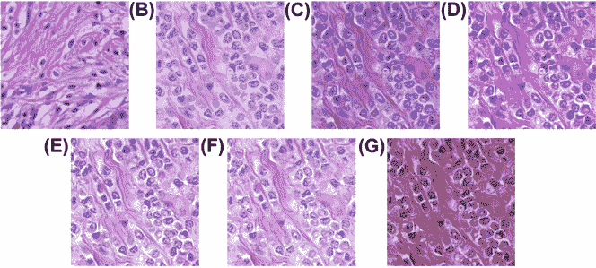

**图 9.2**  
染色标准化方法比较：源图像和参考图像分别取自 TCGA [36] 和 Mount Sinai 医院全切片图像。（A）参考；（B）Shaban-StainGAN；（C）Bejnordi；（D）Vahadane；（E）Macenko；（F）Reinhard；（G）源图像。

### 免疫荧光光谱图像解混

多光谱免疫荧光显微镜（例如 Vectra 成像系统 [37]）获取光谱堆栈，即在一系列相隔 10 或 20 nm 的波长下拍摄的一组灰度图像。这些图像显示了由荧光生物标志物标记的感兴趣蛋白，混合有自发荧光和其他不需要的信号。

解混过程从光谱堆栈中提取所需信号，用于结构性生物标志物，旨在响应解剖区室，例如细胞核（DAPI）和腺体（CK18/泛细胞角蛋白），或用于功能性生物标志物，如癌症相关蛋白，例如前列腺中的雄激素受体（AR）或乳腺中的雌激素受体（ER）和孕激素受体（PR）（图 9.3）。功能性生物标志物的解混算法旨在产生与组织中存在的蛋白成比例的线性响应，通常使用去卷积型算法 [38]。需要仔细校准染色和显微镜，以确保生物标志物光谱特征在不同图像和组织中保持稳定。对于结构性生物标志物，其目标是获得可正确分割的图像，解混算法有更大的余地来补偿弱染色或其他光谱特征变化。对于前列腺样本，我们使用基于非负矩阵分解的半监督方法 [39]。图 9.3 面板 A 显示了 CK18 的典型解混图像输出。

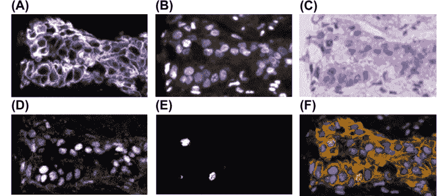

#### 图9.3

拆分后的高级别前列腺癌（20×物镜）格里森分级4型中结构性（A和B）和功能性（D和E）免疫荧光生物标志物。图F通过显示每个像素处最大值生物标志物来组合四种生物标志物，其中AR（紫色）、Ki67（黄色）、DAPI（蓝色）和CK18（金色）。与图（C）中同一组织的H&E染色进行比较。（A）CK18；（B）DAPI；（C）H&E；（D）AR；（E）Ki67；（F）最大值生物标志物。

### 全切片图像中肿瘤区域的自动检测

### 全切片图像中诊断相关感兴趣区域的定位

通过扫描玻璃载玻片获得的数字全切片图像（WSI）在最高分辨率（40×）下通常包含超过十亿像素。然而，切片中只有小区域包含诊断信息。图像中的相关区域通常不到数字化面积的50%。此外，墨水、封片剂气泡、组织折叠、压碎的细胞核和失焦区域等伪影可能会误导特征提取、分割和检测算法。

文献[40]提出了一种使用高分辨率和低分辨率成像特征的多尺度框架，用于快速识别WSI中的高倍视野感兴趣区域。Bahlmann等人[41]开发了一种分类方法，用于区分相关区域与无关区域的统计特征。他们使用了能够捕获观察到的细胞核和细胞质颜色强度分布的视觉描述符。此外，Mercan等人[42]通过跟踪病理学家的操作记录（如缩放、平移和注视）来提取感兴趣区域（ROIs）。他们基于所提取区域的颜色和纹理特征开发了一种视觉词袋模型，以预测WSI中诊断相关的ROI。我们开发了一种使用卷积神经网络（CNN）自动检测WSI中诊断重要ROIs的技术。我们训练CNN识别乳腺WSI上的（浸润性癌和原位癌）。WSI上标注的肿瘤用于CNN分类器的基于补丁的训练。他们在文献[43]中进一步发展了这项工作，创建了一种基于CNN的快速高通量方法，用于自动检测WSI上的浸润性乳腺肿瘤。为此，他们使用了一种基于概率梯度的高效自适应迭代采样方法，以有效识别浸润性乳腺癌的精确范围，获得了与密集采样方法相当的结果。Bejnordi等人[47]评估并比较了提交至一项公开挑战的深度学习算法在检测乳腺癌女性淋巴结H&E组织切片转移灶方面的性能。在这项竞赛提交的32个深度学习算法中，有7个在模拟时间受限诊断场景中表现出比由11名病理学家组成的专家组更好的判别性能。

当试图在WSI上同时检测肿瘤并对结构异质性进行分类时，任务变得更加复杂。这可以像区分良性与恶性一样简单，也可以复杂到区分浸润性疾病、原位癌、增生性病变、反应性形态和正常结构。机器学习，尤其是深度学习技术，已在组织病理学图像的自动检测和形态学分类中取得了最先进的成果。Bardou等人[44]开发并比较了两种将乳腺癌组织学图像分为良性和恶性类别及其亚类的方法。在第一种方法中，他们提取了一组手工特征，这些特征通过词袋模型和局部约束线性编码描述符进行编码，并使用支持向量机对特征进行分类。在第二种方法中，他们训练了一个CNN用于对大型标记图像数据集进行分类。尽管深度学习方法具有许多优点，包括优于手工特征方法以及自动化特征生成，但值得指出的是，该方法的一个缺点是特征并不透明，因为它们嵌入在神经网络架构中。Bejnordi等人[48]使用基于上下文感知的堆叠CNN方法，将全切片乳腺图像分为正常/良性、原位癌和浸润性类别。他们首先训练了一个具有高像素分辨率但图像尺寸较小的深度CNN，以将组织分为不同类别。然后，他们将大得多的图像输入模型，并将初始模型生成的特征响应作为第二个CNN的输入。这种架构允许他们使用更大的输入图像来学习不同病变类别中各种结构或上下文的全局相互依赖性。

我们开发了一种鲁棒的基于集成CNN的技术，用于将临床显著的结构和形态模式分为四类：正常组织、良性（增生性）病变、原位癌和浸润性癌。我们在训练分类器时加入了专门为数字病理图像设计的图像扰动模型，这提高了分类器对真实世界图像数据变异性的鲁棒性和泛化能力[49]。文献[50]回顾了最先进的方法及其在公开挑战中的表现和集体结果。图9.5显示了我们将所开发技术专门应用于图9.4中给出的WSI组织学相关区域的结果。

#### 图9.5

肿瘤检测器中的颜色表示：浸润性：红色，DCIS：橙色，良性：绿色，正常：蓝色，非组织：灰色。肿瘤检测仅应用于图9.4的组织区域。（A）肿瘤检测器输出；（B）放大区域。

### 图像分割

如上所述，深度学习能够学习组织病理学图像中的复杂关系，并已成功应用于学习大型图像集中的差异，以区分或分类这些图像是否含有肿瘤。这种黑箱或自上而下的方法当然有其优点，尤其是在作为筛查工具、需要检测出病理学家应特别关注的感兴趣区域时。这种方法虽然可以说临床用途较小，但也被用于将肿瘤分为不同的模式或分级[22]。然而，使用深度学习方法根据预后对图像进行分类则是一项完全不同的工作，将在下面更详细地讨论，但从最高层面来看，这之所以困难是因为具有结局数据且规模足够大的开发队列通常无法获得。

正是在这里，传统的机器视觉手工特征和深度学习与机器学习建模相结合，创造了基于组织病理学图像的自动化分级的现实可能性。我们已经证明，一种自下而上的方法——在形态学上分割和表征组织学分区，并结合多重免疫荧光图像上的蛋白质表达——能够产生基于手工特征的模型，这些模型在患者风险分层方面比传统分级具有显著优势[17]。这在很大程度上从未通过基于H&E图像的模型实现，原因在于手工特征难以处理颜色变异性以及分区之间缺乏对比度。利用深度学习在大型数据集中辨别细微差异的能力，H&E图像自动化分级的下一步是应用自下而上的方法，分割组织学分区以进行直接表征和特征工程。

### 免疫荧光图像中的细胞核和上皮分割

细胞核和上皮分割的目标是在拆分后的图像（图9.6）中描绘它们的边界，准确分离接触或重叠的物体，并且

#### 图 9.6

结构性 IF 生物标志物（A-腺体，C-细胞核）及其分割结果（分别为 B 和 D）在低级别前列腺癌、Gleason 分级 3 型（20× 物镜）中的表现。有关同一组织 H&E 图像的深度神经网络分割，请参见图 9.8。（A），CK18；（B），CK18 分割；（C），DAPI；（D），DAPI 分割。

为每个腺体或细胞核分配唯一标签。IF 细胞核分割的经典算法是文献 [51]，其按照流行的细胞核检测模式运行，首先为每个细胞核找到一个种子点，然后根据邻近性、大小和形状约束生长种子以找到细胞核边界。针对 H&E 和 IHC 图像也提出了该算法的许多变体，例如文献 [52]，但它们都存在一个共同问题，即不规则的纹理和孔洞——这是高级别细胞核中染色质聚集和边缘化的结果——导致每个细胞核检测到多个种子点，从而产生碎片化的分割结果。第二个（相反）问题是，当检测到的种子点太少或细胞核边界被遗漏时，紧密排列的细胞核可能会被合并在一起。对细胞核分割算法的全面综述 [53] 显示了深度神经网络在这些问题上的成功应用。

IF 图像上皮分割中常见的一个独特问题是细胞质中细胞角蛋白强度的不一致，常因细胞核所在位置的负性印记或 DAPI 孔洞而被放大。该问题已通过结合上皮与细胞核分割得到解决，如文献 [54] 所示，通过在腺体边界处填充细胞角蛋白中的细胞核孔洞（即 DAPI 图像的反相），在该区域细胞核聚集且染色通常较弱。为了补偿解混误差（可能导致强背景信号或腺体边界处响应减弱），我们开发了一种联合解混/分割算法，该算法对典型的欠分割和过分割误差具有鲁棒性。

### H&E 图像中的细胞核检测与分割

尽管不属于 Gleason 分级系统，手动表征细胞核是大多数分级方案中的共同主题，且通常是再现性最差的之一 [11,12]。如上所述在 IF 图像中，H&E 细胞核的分割

使有丝分裂相难以手动重复计数的问题与使其难以自动检测的问题相同，即它们是相对罕见的事件，分布不均，形态多样，并且存在许多具有相似属性的非有丝分裂物体。正在进行细胞分裂的细胞可以在多个形态不同的阶段被视觉识别——其中一些在细胞周期的中期和后期比早期阶段更容易识别。即使在后期阶段，形态变异性也很明显，而有丝分裂物体与非有丝分裂模拟物之间的差异可能细微到边界模糊程度。大型数据集的深度学习非常适合这类细微的形态学区分。深度学习在有丝分裂相检测中具有挑战性的一个方面是有丝分裂相、非有丝分裂背景物体（如普通细胞核和淋巴细胞）以及模拟物（如凋亡细胞）之间的类别不平衡。这通常通过过采样有丝分裂相类别或调整训练的损失函数以考虑样本数量较少来处理。Ciresan 等 [65] 开发了一种用于有丝分裂相检测的 CNN 方法，该方法在图像块上训练。神经网络的训练包括通过生成图像的旋转和翻转版本来丰富有限的有丝分裂训练数据。这些额外的训练示例有助于缓解类别不平衡问题，并产生了一个鲁棒的网络，该网络在 2013 年有丝分裂检测算法评估（AMIDA13）挑战赛 [66] 中表现最佳。Chen 等 [67] 提出了使用两个 CNN 级联的方法。第一个网络生成对可能为有丝分裂且可能包含其他相似结构的物体的粗略分类，第二个网络执行更精细的判别和验证以确定最终的有丝分裂相分类。他们的 方法利用了一个专门的网络来分析图像中的细微模式以减少假阳性识别。Albarqouni 等 [68] 在包含聚合层的 CNN 中利用了来自未受训练标注者（众包）的数据。众包为有丝分裂提供了训练数据的丰富，噪声通过训练中的显式数据聚合步骤来处理。

### 环分割

总体而言，腺体结构是三维物体，由宽度和长度各异的管状结构组成，具有圆形的末端，在低级别时以分支结构连接，或在高级别时形成相互连接的网络。文献 [69] 中前列腺样本的共聚焦显微镜和文献 [70] 中的堆叠组织切片显示了腺体的三维几何形状与二维组织学模式之间的关系。在前列腺癌的碎片化模式中，如 Gleason 图 [71] 右侧下降部分所示的级别增加，管状结构被间质包裹，缩小为小簇和单个细胞，中央腔消失。在图左侧下降部分的筛状和实性模式中，管状结构在没有间质间隔的情况下融合在一起，腔的大小和频率减少。Gleason 图所示的从低级别到高级别的形态发生过程，已被腺体结构的 3D 研究证实为沿这两个变异轴的连续生长过程。

腔、上皮和间质之间可以呈现多种模式。这些模式可以在许多不同类型的癌症中看到，其发生频率和预后意义因器官而异。文献 [72] 讨论了乳腺、前列腺、结肠、肺和其他器官中的筛状模式。从工程角度来看，识别器官特异性腺体形态倾向及其预后意义是有用的，以便设计与潜在生物学过程相关的分割策略和特征，从而实现肿瘤分化的准确表征。

这促使了腺体环的分割，我们将其定义为完整或碎片化的管状结构，表现为环绕腺体腔的上皮细胞核环，或被间质包围的少数上皮细胞核组成的腺体片段 [73]。通过观察环、间质和腔区域之间的邻接关系，算法可以在所有级别的癌症中检测和评估这些模式。

我们的环分割算法通过形成上皮细胞核中心的紧凑三角剖分来工作，即 Delaunay 三角剖分（其特征是每个三角形的内切圆内部不包含其他顶点）。然后算法对上皮和腔区域中的三角形进行聚类，形成由环状细胞核之间相对较短的边分隔的广阔区域，如图 9.9 所示。该算法最初是基于 IF 上皮和细胞核分割开发的，并已作为前列腺癌患者风险分层的临床试验 [17] 的一部分得到验证。随着准确的深度学习分割的出现，环和环特征也可以应用于 H&E 图像并获得类似的结果，图 9.14。

很少有现有算法区分上皮和腺体环分割，而是专注于低级别表现，即每个上皮单元有一个紧密排列的细胞核环，环绕清晰的腔，例如文献 [74]。这些算法使用细胞核作为区域生长的指导，从腔开始，这种方法对结肠效果较好，对前列腺和乳腺腺体效果较差，后者倾向于具有更高的碎片化和融合频率。一个值得注意的例外是文献 [75]，它使用基于近似腺体和细胞核图的随机马尔可夫链蒙特卡洛方法搜索多边形腺体环。但该算法也不能推广以处理低级别和高级别癌症之间的连续表现。

### 蛋白质生物标志物特征

蛋白质生物标志物提供了标准 H&E 染色组织中不可获得的宝贵诊断和预后信息。本节概述了在图像中量化生物标志物的众多方法中的几种。

免疫组织化学（IHC）在其最流行的形式中使用棕色显色检测系统（3,3-二氨基联苯胺或 DAB）来标记感兴趣的蛋白质，背景为细胞核苏木精复染，在明场显微镜下观察并手动量化为 0–3 分。多重化和自动化扩展

#### 图 9.9

环分割通过分水岭图算法。(A) 环和三角剖分叠加在融合腺体的细胞核上（前列腺，反转 DAPI，20×物镜）。(B) 对图像(A)顶部应用的分水岭图分割算法的说明，显示细胞核中心作为山顶，由红色环连接，这些环包围模拟降雨会流向同一山谷的区域。该算法有效地将三角形区域（暗线，Delaunay 三角剖分，见正文）聚类，形成由相对较短（红色）边分隔的宽阔区域 [73]。(C) 两个融合腺体的几何结构（或一个 U 管形小管，或分支小管——二维组织学图像可以由几种不同的三维几何结构推导而来）。三维中的小管大小 = 图像中腺体宽度 = 穿过环的最长三角形边。

将此过程扩展到多个重叠的生物标志物。一种技术使用不同标记染色连续切片，然后用相关软件配准图像，例如，将 Ki67 放在一张载玻片上，将细胞角蛋白上皮标记放在下一张上，以计数上皮 Ki67 阳性细胞核。该方法在 Ref. [76] 中使用 Visiopharm 软件 [77] 用于分析乳腺癌中的 Ki67、ER、PR 和 HER2。

另外，多重免疫荧光将多达八种生物标志物置于同一张载玻片上 [78,79]，例如，分析黑色素瘤中的肿瘤浸润淋巴细胞（TILs）[80]，或比较多种组织中的 TIL 特征 [81]。在前列腺癌中，雄激素受体（AR）信号通路驱动疾病进展，降低间质中的 AR 水平，同时增加上皮中的 AR [82]，因此两者的比例是一个强大的预后特征 [17]。

正如本节将要讨论的那样，分层是特征工程中的一个常见主题。以上述讨论的分割输出为起点，可以分层使用多种不同技术来定量或表征关系，以及使特征标准化以提高鲁棒性。例如，细胞核分割后进行椭球拟合可以提供感兴趣区域内细胞核形状和组织的宏观视图，图 9.11。此外，从椭球表示中派生的特征可能包括密度、形状、方向、规则性等，图 9.12。细胞核形状、纹理和方向最近被证明可预测雌激素阳性、淋巴结阴性乳腺癌的预后 [21]。在最高分辨率下，细胞核的颜色和纹理成功地区分了结肠癌中的良性和恶性区域，如 Jørgensen 等人 [88] 所示。

尽管原始有丝分裂计数在 TMA 队列中可能具有预测性，但为了考虑样本体积的变异性而进行标准化，将在更大样本中开发以及在测试环境之外扩展时稳定该特征。手动分级方案通常要求在指定面积内或每指定数量的肿瘤细胞中计数有丝分裂象，以考虑患者之间的体积变异性 [89]。这提供了一种比较不同受试者有丝分裂活性的标准机制。将该概念应用于自动化方案时，算法对每张载玻片应用相同的指定面积，要么随机，要么寻找增殖最高的区域，类似于乳腺癌改良 Bloom-Richardson 分级方案中有丝分裂计数要求。另一种类似的相对测量可以通过结合有丝分裂计数和细胞核计数来实现，提供反映肿瘤增殖活性的密度指数。

表征癌症中上皮细胞和间质细胞的空间分布主要是在计算病理学的领域。虽然腺体分化或肿瘤腺体与正常腺体的偏离程度是许多分级方案的一部分，但计算病理学和图谱特别提供了一种自下而上的方法，可以支持如上所述的腺体分割，但也可以为更自由形式的表征提供框架。我们可以构建描述细胞核和上皮区域邻接性和空间关系的图，提供一种总结组织复杂性的方法。更高级别的癌症通常产生更不规则、更复杂的图。我们随后寻找预测分级和患者预后的图特征或统计数据。

#### 图 9.11

示例细胞核分割和椭圆拟合（左：输入 H&E 图像，右：拟合椭球的分割结果）。

#### (A)

#### (B)

#### (C)

#### (D)

#### 图 9.12

示例细胞核特征。单个细胞核的伸长度可以从椭球长轴与短轴的比率计算得出。长轴方向的可变性提供了组织中组织程度的度量。给定区室内的细胞核密度测量为细胞核计数（或细胞核面积）除以区室面积。图可以用来总结细胞核簇的形态学关系和结构。

最简单的预测图可能是基于上皮细胞核作为顶点的最小生成树（MST）（图 9.13）。MST 是 Delaunay 三角剖分（见图 9.9）的最小连通子集。从这棵树中，我们可以提取平均边长和顶点度（连接到顶点的边数）等度量。在上皮细胞核排列成紧密间隔环的低级别癌症中，MST 边长较短，顶点度大多等于二，对应于环中的两个邻居，而在高级别癌症中，边长更长，且具有三个或更多邻居的顶点的比例更大。

基于细胞核聚类或分割的图更能代表腺体和不同细胞类型的更高层次结构。细胞簇图（CCG）[90]是一种流行的层次图，包含细胞核簇，这些簇又以概率方式连接到附近的簇，已被用于定义

*MST 度为 3 的节点*

*L-touch 低（红色）*

*L-touch 高（绿色）*

#### 图 9.13

前列腺癌的图特征。(A) 显示具有红色光晕的三向顶点的最小生成树（MST）。度为三的顶点的比例是分级和预后的强特征。(B) 呈碎片化模式的腺体环，邻近无管腔的间质，L-touch 值低（以红色显示）。(C) 呈融合（筛状）模式的腺体环不接触间质，具有管腔空隙，L-touch 值高（以绿色显示）。

前列腺中腺体角度共现 [91] 和肺部浸润淋巴细胞 [92] 等众多特征。设置 CCG 的一个挑战是簇可能不对应于生物学相关结构，并且可能无法适应组织中动态变化的尺度。涵盖病理图谱和其他纹理和细胞核特征的良好综述见文献 [93,94]。

在“环分割”部分介绍的腺体环或碎片是一种自然的细胞核聚类，我们发现它在所有级别的前列腺癌中都能产生良好的特征，尤其是在结合蛋白质生物标志物测量时。由于前列腺的生长和功能由上皮-间质和上皮-管腔边界的信号传导介导，我们开发了一组简单的环-间质-管腔邻接特征，考虑环边界邻接间质的比例，S-touch，以及邻接管腔的比例，L-touch，图 9.13。这两者的乘积，即 SL-touch 特征，涵盖腺体融合和碎片化模式，在前列腺癌中具有高度预后价值（图 9.14）。

给定表征细胞核簇或环的特征，特征通过取平均值、中位数在表示图像或全切片的图上进行聚合

#### 图 9.14

SL-touch 产品特征。基质邻接（S-touch）与管腔邻接（L-touch）评分的乘积，低值用红色表示，高值用绿色表示（预后较好）（比较图 9.6 和图 9.8 中的分割结果），显示同一组织的 IF 和 H&E 图像结果相似。灰色线条显示 Voronoi 图，即每个上皮细胞核周围的影响区域。

或一些其他的聚合函数。更复杂的聚合可以使用带有图核 [95] 的支持向量机（SVM）学习（见建模部分），或深度图神经网络 [96]。

### 建模

建模作为构建改进分级方案的最终计算步骤，结合图像衍生特征和临床衍生特征的输出，在已知临床结局的患者队列中预测生存概率或疾病显著进展的预期时间。进入模型的标准临床特征包括年龄、种族、性别等，以及病理分期、实验室检查值、放射学和基因检测特征 [97]。机器学习算法学习最相关的特征组合（影像学衍生和临床衍生），并量化每个特征在模型中的相对重要性，该模型

模型并不比随机猜测更好。虽然这是一个有用的度量，但需要记住一些注意事项。C-Index 表示算法的判别能力，而非预测能力。由于该指数仅关注正确排序对的比例，它不关心实际预测的时间。

生存分析可被视为预测生存时间的回归问题，对此有许多方法 [98]，但大多数方法无法处理患者随时间退出研究所导致的数据缺失问题。来自这些患者的缺失信息称为删失数据 [101]。经历了感兴趣事件（例如 PSA 复发、死亡或转移）的患者被视为事件。右删失患者是指在研究结束时仍在随访中但未经历事件或已退出研究的患者；左删失患者是指发生了事件但时间不清楚的患者。

统计学中处理删失数据的传统方法包括删除样本点、将其视为非事件，或更复杂的方法，例如将数据点重复一次作为事件和一次作为非事件。还有一些插补方法，在训练生存模型之前估计缺失值。然而，所有这些方法都不可避免地给最终模型带来偏差。为了纠正这一点，有多种可以处理删失信息的方法，下面几段将概述这些方法。

### Cox 比例风险模型

处理删失信息最早且最流行的方法之一是 Cox 比例风险模型 [102]。在该模型中，任意两个个体的风险函数或危险度（生存函数的斜率，h_i(t)）成比例。比例性通过将基线风险函数（h_0(t)）与基线特征相乘，再乘以加权特征值的指数函数来建立，其中权重表示每个特征的重要性。使用该模型时最大的注意事项是检测并考虑时变效应，因为比例性假设可能失效 [103]，这在许多生物学应用中很常见。如果特征数量大于事件数量，Cox 模型（和其他模型）的可靠性就不够稳健。

### 神经网络

在最早且最简单的形式中，用于生存分析的神经网络 [104] 学习特征与风险函数之间的关系。不幸的是，该方法的表现与线性 Cox 模型大致相同。DeepSurv 是一种相对较新的方法，植根于 Cox 模型，使用深度学习来预测患者经历事件的风险 [105]。它是多层神经网络的简单应用，具有一个输出节点来预测患者风险。DeepSurv 的主要优势在于，Cox 模型评估的是整个患者群体的有效性，而 DeepSurv 为每位患者生成量身定制的风险评分。DeepHit 是一种性能更高的改进方法，不对特征与风险之间关系的结构做出假设 [106]，直接学习生存时间的分布。该网络的结构比 DeepSurv 更复杂，具有全连接层和一个作为输出层的 softmax 层。使用深度神经网络进行生存分析的一个缺点是，为了构建具有可靠预测的稳健模型，这些算法往往需要大量临床注释的患者数据（即结局），而这通常在所需规模上是不可获得的。

### 决策树与随机森林

基于树的方法可以通过生长概念树来解决分类和回归问题 [107]。一个简单的遍历算法从根节点走到树的一个叶节点，根据特征相对于该算法为该分支点选择的阈值的值来选择每个分支。因此，在每个分支和叶节点计算一个回归值，从而创建回归树。创建过多分支点会导致数据过拟合，反之，树深度不够则可能无法学习到数据的适当结构。不幸的是，决策树对噪声敏感，数据中的微小扰动可能由于分支点的递归识别而导致截然不同的模型。

随机森林 [108] 是对决策树方法的概念性修改，引入了两个主要随机成分来生成多棵树，然后聚合这些树的输出。随机修改包括数据的自助聚合和每个节点的特征随机选择。通过使用这种对决策树学习算法的修改，生成多棵树并通过平均进行组合，从而得到一种降低决策树模型中偏差和方差的解决方案。

随机生存森林（RSF）是随机森林方法 [109] 的扩展，包括计算集成累积风险函数（EHF）。RSF 的核心思想是，在树中高风险患者与低风险患者之间的生存差异最大化。对于给定的特征集，每棵树都沿一条路径到达唯一的终端节点和 EHF 值。然后对所有生存树取平均值，以计算患者的生存估计。

### 基于 SVM 的方法：Survival-SVM、SVCR 和 SVRc

支持向量机（SVM）于 20 世纪 90 年代初提出 [110]，是一种学习区分给定数据二元标签的分类算法。SVM 是一种线性方法，通过将数据投影到更高维空间来扩展以涵盖非线性问题。该方法在处理高维数据和线性模型的可解释性方面尤其成功。该方法还被扩展到解决回归问题，称为支持向量回归。本质上，SVM 算法是一种优化算法，通过最大化数据集的间隔并找到将数据整齐分割的分隔超平面来工作。间隔是数据点到分隔超平面的最小距离。隐式地，我们假设试图分类和学习的数据能够被超平面完美分隔，但如果情况并非如此，我们仍然可以通过优化到分隔超平面的距离（粉框）来找到近似解，图 9.16，带有误差变量（蓝框），并受约束（红框）限制。

给定约束条件

#### 图 9.16

支持向量机（SVM）方程。SVM 是一种优化算法，用于在给定的高维特征空间中找到将两类数据分开的最优超平面。该算法的操作通过三个框进行解释。粉框：最小化所有特征的权重。一类中的一个点与最优超平面之间的距离可以表示为 1。我们希望最大化这个距离，或者等价地最小化分母 W，即 ||W||。蓝框：使用误差（松弛）变量对不完全分离的数据进行惩罚，惩罚因子为 C。红框：约束松弛变量以分离数据。对于通过 φ(x_i) 投影到高维特征空间后与目标值距离大于 ε 的点，需要更大的松弛变量，并施加更大的惩罚 [111]。两条约束线分别处理超平面两侧的点，或者扩展到生存回归时，第一行处理早期预测，第二行处理晚期预测。核技巧是一种通过仅计算一次矩阵乘法 W·φ 并复用每个数据点的结果来加速计算的方法。在 SVCR（删失回归）中，两个超参数惩罚值 C 和 ε 被用于早期和晚期预测，以及删失数据和事件——这是一个过度受限的模型。SVRc 通过为早期/晚期和删失/事件数据使用独立的惩罚参数有效地扩展了该模型。这八个超参数通过粒子群优化在一组队列上预先优化（见正文）。

SVCR 是 SVM 用于生存分析的简单扩展，可考虑删失 [112]，忽略了预测时间晚于删失时间（右删失，红框第二行）的约束。在该模型中，事件和非事件以及早期和晚期预测的误差被同等惩罚，这造成了一个问题，即事件的晚期预测通常比早期预测严重得多，会对患者的治疗决策产生影响。

SVRc 是该问题的有效且高效的解决方案，通过应用单独的惩罚因子 [113] 改善了对删失数据的处理。该算法对事件的晚期预测施加最严重的惩罚，其次是对非事件的早期预测施加较小的惩罚，然后是对事件的早期预测，最后对非事件的晚期预测（删失数据）施加可忽略的惩罚。这些参数的最优值可通过超参数调优算法在多个数据集上学习得到。我们已成功使用粒子群优化 [114] 来设置这些参数。

### Feature selection tools

上面的特征开发部分可以生成大量特征，通常每个应用从数百到数千不等。考虑到建模目的必须有极限，并且特征与事件之间必须保持最佳平衡，减少特征数量的方法必须成为任何建模策略的一部分。特征可能有四类——强相关、弱相关、冗余和无关 [115]。如名称所示，相关特征对于取得良好结果很重要 [116]。无关特征不影响结果，但可能影响算法效率。冗余特征是指包含与另一特征或特征子集相同信息者。去除无关和冗余特征是特征选择算法的功能，目标是改善结果并减少计算时间。假设与问题相关联的特征有 m 个。要找到最佳特征子集，需要评估全部 2^m − 1 个子集，这在计算上不可行。因此，需要能够执行特征选择的近似算法。大致而言，特征选择方法有三类：Filter、Wrapper 和 Embedded 方法 [117]。

Filter 方法通过某种计算重要性分数的机制过滤掉无关特征。例如，Pearson 相关性衡量两个随机变量的线性依赖关系。这可用于计算特征相对于目标变量的相关系数，然后选择排名靠前的特征作为算法的输入。另一个系数，互信息（MI）能更好地捕捉特征与目标变量之间的非线性关系。

特征选择的 Wrapper 方法是指那些将分类算法本身用作黑箱预测器，并使用所得模型性能作为特征子集好坏指标的方法。显然，正如上文所述，并非所有子集都可被评估，因此 wrapper 方法使用巧妙的算法来修剪并搜索特征子集空间，以得出最优子集。

总体而言，这些方法可分为顺序搜索算法和启发式搜索算法。向前选择和向后消除是顺序搜索方法的例子。在向前选择中，我们从空集开始，并添加能带来最佳性能的特征。依次地，我们不断添加特征，并在不再有改进时停止。向后消除以类似方式工作，我们从全部特征集开始并逐步移除特征。这两者都是贪心方法的例子，其中希望依次采取最佳步骤会得到全局最优解。但当特征之间存在复杂交互时，通常并非如此。相反，像粒子群优化和遗传算法这样的基于启发式的 wrapper 算法往往能找到更好的局部最优解。鉴于特征选择是一个不存在有效算法的问题，这些解决方案是在合理时间内我们能做到的最好。

Embedded 方法将特征选择作为分类算法的内在部分执行，例如，决策树只考虑能带来最佳性能的划分。不对模型有贡献的特征不予考虑。正则化是线性特征选择模型的重要可选补充，属于 embedded 方法类。在学习线性模型（线性回归、线性 SVMs）时，通过在成本函数中添加一项来调用 lasso（最小绝对收缩和选择算子）正则化。线性模型通过学习最能拟合数据的模型系数来运作，通常包含许多不会有意义地改善模型且对未见数据泛化不佳的小权重。为了克服这一限制，我们需要强制某些系数为零并调整其他系数。这是通过在成本函数中添加一项额外项来实现的，该项惩罚非零权重。实际上，这一额外项限制了系数的绝对值之和。

### Ground truth data for AI-based features

深度学习算法高度依赖数据，为了确保在开发环境之外具有可扩展性，这些大型数据集必须在绝对数量和表示多样性方面符合临床现实。至关重要的是不仅要表示不同的分级和形态亚型，还要表示不同的染色条件和组织质量。除了在监督或半监督环境下的大型数据集外，深度学习还要求有真实标注。这可以简单到为输入图像分配分级或肿瘤/非肿瘤的二元标签，一直到为检测或分割在目标对象周围数字绘制轮廓。标注策略的选择取决于算法的功能输出。例如，如果输出是对象的边界分割，则精确的边界必须成为真实标注的一部分。另一方面，如果任务是检测，则标注可能涉及在目标对象周围放置边界框或种子。显然，分割在下游创建特征方面提供了更大的灵活性，但它在标注方面带来了更高的前期成本。

使用半自动方法进行快速勾画可以减少专家标注员的工作量，使用最少的姿势和鼠标点击来初始化算法，为感兴趣的结构创建完整边界。示例算法包括基于主动轮廓演化的分割 [118,119]，其中用户提供初始边界，算法将其演化以匹配图像边界。这类算法已成功应用于医学中的多种勾画任务 [120]。随机游走 [121] 是另一种自动生成轮廓的算法，其中用户提供不同对象的粗略初始标记。与主动轮廓方法相比，这种方法负担更小，因为它不需要完整的轮廓定义。轮廓初始化的另一种方法使用 watershed 算法 [122]，它模拟图像山谷（被高值包围的低强度值）中水的泛滥，以检测被边界分隔的对象。标注员可以交互式地为 watershed 算法指定阈值并选择构成感兴趣对象的像素簇。

由于深度学习依赖于大型数据集，几乎所有基于深度学习的方法都使用数据增强来训练神经网络，其中训练数据被转换以扩展现有数据集。转换可通过旋转或翻转在几何上进行，也可基于颜色进行（例如，染色转换、对比度调整等）。众包也有产生更大数据集的巨大潜力。对于这种方法而言，一致性和低质量标注的检测是一个关键问题，需要进行数据聚合步骤，例如 Albarqouni 等人 [68] 提出的方法。

### Conclusion

病理诊断准确性在患者护理中的重要性经常被低估。随着我们对疾病的分子理解爆炸式增长，以及靶向疗法和新的特定治疗方案不断涌现，这一认知正在治疗临床医生中发生变化。具有精确且可重复表征的疾病仍然是制定这些特定治疗方案的重要组成部分。为此，用于分析图像的深度学习方法和用于分析复杂相互关联数据集的人工智能正在改变这一格局。这场技术和知识革命的承诺最终是通过为将患者与最有效的治疗方法联系起来建立更稳健的基础来改善患者预后。

### 参考文献

- [1] Fuhrman SA, Lasky LC, Limas C. 肾细胞癌形态学参数的预后意义. The American Journal of Surgical Pathology 1982;6(7): 655–63.
- [2] Bosman FT, Carneiro F, Hruban RH, Theise ND, et al. WHO消化系统肿瘤分类，第4卷. World Health Organization; 2010.
- [3] Seethala RR. 唾液腺癌的组织学分级和预后生物标志物. Advances in Anatomic Pathology 2011;18(1):29–45.
- [4] Gleason DF, Mellinger GT. 结合组织学分级和临床分期预测前列腺腺癌的预后. The Journal of Urology 1974; 111(1):58–64.
- [5] Mutch DG. 新的FIGO分期系统用于外阴癌、宫颈癌、子宫内膜癌和肉瘤. Gynecologic Oncology 2009;115(3):325–8.
- [6] Miettinen M, Lasota J. 胃肠道间质瘤：不同部位的病理学和预后. 载于：Seminars in diagnostic pathology，第23卷. Elsevier; 2006. p. 70–83.
- [7] Klimstra DS, Modlin IR, Coppola D, Lloyd RV, Suster S. 神经内分泌肿瘤的病理学分类：命名、分级和分期系统综述. Pancreas 2010;39(6):707–12.
- [8] Elston C, Ellis I. 组织学分级的评估. The Breast 1998;13:356–84.
- [9] Gleason DF. 前列腺癌的组织学分级：一个视角. Human Pathology 1992;23(3):273–9.
- [10] Allsbrook Jr WC, Mangold KA, Johnson MH, Lane RB, Lane CG, Epstein JI. 前列腺癌Gleason分级的观察者间可重复性：普通病理医师. Human Pathology 2001;32(1):81–8.
- [11] Boiesen P, Bendahl P-O, Anagnostaki L, Domanski H, Holm E, Idvall I, Johansson S, Ljungberg O, Ringberg A. 乳腺癌的组织学分级：七个病理科室之间的可重复性. Acta Oncologica 2000;39(1):41–5.
- [12] Meyer JS, Alvarez C, Milikowski C, Olson N, Russo I, Russo J, Glass A, Zehnbauer BA, Lister K, Parwaresch R. 采用Bloom-Richardson系统与增殖指数进行乳腺癌恶性度分级：分级的可重复性与增殖指数的优势. Modern Pathology 2005;18(8):1067.
- [13] Epstein JI, Egevad L, Amin MB, Delahunt B, Srigley JR, Humphrey PA. 2014年国际泌尿病理学会（ISUP）前列腺癌Gleason分级共识会议. The American Journal of Surgical Pathology 2016; 40(2):244–52.
- [14] Galea MH, Blamey RW, Elston CE, Ellis IO. 原发性乳腺癌中的诺丁汉预后指数. Breast Cancer Research and Treatment 1992;22(3):207–19.
- [15] Greene KL, Meng MV, Elkin EP, Cooperberg MR, Pasta DJ, Kattan MW, Wallace K, Carroll PR. 基于社区队列验证Kattan术前列线图预测前列腺癌复发：来自前列腺癌战略泌尿研究计划（CaPSURE）的结果. The Journal of Urology 2004;171(6 Part 1);2255–9.
- [16] Stephenson AJ, Scardino PT, Eastham JA, Bianco Jr FJ, Dotan ZA, DiBlasio CJ, Reuther A, Klein EA, Kattan MW. 根治性前列腺切除术后预测前列腺癌复发10年概率的术后列线图. Journal of Clinical Oncology: Official Journal of the American Society of Clinical Oncology 2005; 23(28):7005.
- [17] Donovan MJ, Fernandez G, Scott R, Khan FM, Zeineh J, Koll G, Gladoun N, Charytonowicz E, Tewari A, Gordon-Cardo C. 开发并验证一种基于算法的新型自动化Gleason分级与分子谱检测方法，可高度预测前列腺癌进展. Prostate Cancer and Prostatic Diseases 2018; 21(4):594.
- [18] Beck AH, Sangoi AR, Leung S, Marinelli RJ, Nielsen TO, Van De Vijver MJ, West RB, Van De Rijn M, Koller D. 乳腺癌形态的系统性分析揭示了与生存相关的间质特征. Science Translational Medicine 2011;3(108):108ra113.
- [19] Donovan MJ, Khan FM, Fernandez G, Mesa-Tejada R, Sapir M, Zubek VB, Powell D, Fogarasi S, Vengrenyuk Y, Teverovskiy M, et al. 基于前列腺穿刺活检的肿瘤反应和癌症进展的个体化预测. The Journal of Urology 2009;182(1):125–32.
- [20] Blume-Jensen P, Berman DM, Rimm DL, Shipitsin M, Putzi M, Nifong TP, Small C, Choudhury S, Capela T, Coupal L, et al. 基于原位活检的多标志物检测方法在前列腺癌风险分层中的开发和临床验证. Clinical Cancer Research 2015;21(1):2591–2600.
- [21] Lu C, Romo-Bucheli D, Wang X, Janowczyk A, Ganesan S, Gilmore H, Rimm D, Madabhushi A. H&E图像的核形态和取向特征可预测早期雌激素受体阳性乳腺癌的生存. Laboratory Investigation 2018;98(11):438.
- [22] Arvaniti E, Fricker KS, Moret M, Rupp N, Hermanns T, Fankhauser C, Wey N, Wild PJ, Rueschoff JH, Claassen M. 通过深度学习对前列腺癌组织微阵列进行自动化Gleason分级. Scientific Reports 2018;8.
- [23] Couture HD, Williams LA, Geradts J, Nyante SJ, Butler EN, Marron J, Perou CM, Troester MA, Niethammer M. 利用深度学习进行图像分析以预测乳腺癌分级、ER状态、组织学亚型和内在亚型. NPJ Breast Cancer 2018;4(1):30.
- [24] Mirlacher M, Kasper M, Storz M, Knecht Y, Dürmüller U, Simon R, Mihatsch MJ, Sauter G. 玻片老化对使用免疫组织化学的转化研究结果的影响. Modern Pathology 2004;17(11):1414.
- [25] Grillo F, Pigozzi S, Ceriolo P, Calamaro P, Fiocca R, Mastracci L. 影响福尔马林固定石蜡包埋组织切片长期储存中免疫反应性的因素. Histochemistry and Cell Biology 2015;144(1):93–9.
- [26] Rimm DL, Camp RL, Charette LA, Costa J, Olsen DA, Reiss M. 组织微阵列：一种扩增组织资源的新技术. Cancer Journal (Sudbury, Mass.) 2001;7(1):24–31.
- [27] Mukhopadhyay S, Feldman MD, Abels E, Ashfaq R, Beltaifa S, Cacciabeve NG, Cathro HP, Cheng L, Cooper K, Dickey GE, et al. 全切片成像与显微镜检查在手术病理学初步诊断中的比较：一项1992例多中心盲法随机非劣效性研究（Pivotal研究）. The American Journal of Surgical Pathology 2018;42(1):39.
- [28] Reinhard E, Adhikhmin M, Gooch B, Shirley P. 图像之间的颜色迁移. IEEE Computer Graphics and Applications 2001;21(5):34–41.
- [29] Magee D, Treanor D, Crellin D, Shires M, Smith K, Mohee K, Quirke P. 数字组织病理学图像中的颜色标准化. 载于：会议录：显微镜、组织病理学和内窥镜中的光学组织图像分析（MICCAI研讨会），第100卷. Daniel Elson; 2009.
- [30] Shaban MT, Baur C, Navab N, Albarqouni S. StainGAN：数字组织学图像的染色风格迁移. 2018. arXiv preprint arXiv:1804.01601.
- [31] Macenko M, Niethammer M, Marron JS, Borland D, Woosley JT, Guan X, Schmitt C, Thomas NE. 一种用于定量分析的组织学玻片标准化方法. 载于：2009年IEEE国际生物医学成像研讨会：从纳米到宏观. IEEE; 2009. p. 1107–10.
- [32] Vahadane A, Peng T, Sethi A, Albarqouni S, Wang L, Baust M, Steiger K, Schlitter AM, Esposito I, Navab N. 组织学图像的结构保持颜色标准化和稀疏染色分离. IEEE Transactions on Medical Imaging 2016;35(8):1962–71.
- [33] Roy S, Kumar Jain A, Lal S, Kini J. 组织病理学图像颜色标准化方法的研究. Micron 2018;114.
- [34] Bejnordi BE, Litjens G, Timofeeva N, Otte-Holler I, Homeyer A, Karssemeijer N, van der Laak JA. 全切片组织病理学图像的染色特异性标准化. IEEE Transactions on Medical Imaging 2016;35(2):404–15.
- [35] BenTaieb A, Hamarneh G. 用于组织病理学图像分析的对抗性染色迁移. IEEE Transactions on Medical Imaging 2018;37(3):792–802.
- [36] Cancer Genome Atlas Network, et al. 人类乳腺肿瘤的全面分子画像. Nature 2012;490(7418):61.
- [37] Akoya biosciences, Vectra成像系统. 可通过以下网址获取：https://www.akoyabio.com/phenopticsm/instruments.
- [38] Zimmermann T. 光学显微镜中的光谱成像和线性分离. 载于：显微镜技术. Springer; 2005. p. 245–65.
- [39] Gillis N, Vavasis SA. 可分离非负矩阵分解的快速稳健递归算法. IEEE Transactions on Pattern Analysis and Machine Intelligence 2014;36(4):698–714.
- [40] Huang C-H, Veillard A, Roux L, Loménie N, Racoceanu D. 组织病理学全切片图像的高效稀疏分析. Computerized Medical Imaging and Graphics 2011;35(7–8):579–91.
- [41] Bahlmann C, Patel A, Johnson J, Ni J, Chekroun A, Khurd P, Kamen A, Grady L, Krupinski E, Graham A, et al. H&E染色的数字病理玻片中诊断相关区域的自动检测. 载于：2012年医学影像：计算机辅助诊断，第8315卷. 国际光学与光子学学会; 2012. p. 831504.
- [42] Mercan E, Aksoy S, Shapiro LG, Weaver DL, Brunyé TT, Elmore JG. 全切片图像中诊断相关感兴趣区域的定位：一项比较研究. Journal of Digital Imaging 2016;29(4):496–506.
- [43] Cruz-Roa A, Gilmore H, Basavanhally A, Feldman M, Ganesan S, Shih N, Tomaszewski J, Madabhushi A, González F. 通过卷积神经网络实现全切片组织病理学图像分析（HASHI）的高通量自适应采样：在浸润性乳腺癌检测中的应用. PloS One 2018;13(5):e0196828.
- [44] Bardou D, Zhang K, Ahmad SM. 基于组织学图像使用卷积神经网络对乳腺癌进行分类. IEEE Access 2018;6:24680–93.
- [45] Campanella G, Silva VWK, Fuchs TJ. 面向病理学分类和定位的TB级深度多示例学习. 2018. arXiv preprint arXiv:1805.06983.
- [46] Cruz-Roa A, Gilmore H, Basavanhally A, Feldman M, Ganesan S, Shih NN, Tomaszewski J, González FA, Madabhushi A. 全切片图像中准确且可重复的浸润性乳腺癌检测：一种用于量化肿瘤范围的深度学习方法. Scientific Reports 2017;7:46450.

[62] Al-Milaji Z, Ersoy I, Hafiane A, Palaniappan K, Bunyak F. 将分割与深度学习相结合用于增强H&E图像中上皮和间质组织的分类. Pattern Recognition Letters 2019;119:214–21. https://doi.org/10.1016/j.patrec.2017.09.015. 模式识别中的深度学习.

[63] Bulten W, Bándi P, Hoven J, Loo R v d, Lotz J, Weiss N, Laak J v d, Ginneken B v, Hulsbergen-van de Kaa C, Litjens G. 使用深度学习进行H&E染色前列腺标本的上皮分割，以免疫组织化学作为参考标准. Scientific Reports 2019;9(1):864. https://doi.org/10.1038/s41598-018-37257-4.

[64] Sotiriou C, Pusztai L. 乳腺癌中的基因表达特征. New England Journal of Medicine 2009;360(8):790–800.

[65] Cireşan DC, Giusti A, Gambardella LM, Schmidhuber J. 基于深度神经网络在乳腺癌组织学图像中检测有丝分裂. 在：Mori K, Sakuma I, Sato Y, Barillot C, Navab N, 编辑. Medical image computing and computer-assisted intervention — MICCAI 2013. Berlin, Heidelberg: Springer Berlin Heidelberg; 2013. p. 411–8.

[66] Veta M, van Diest PJ, Willems SM, Wang H, Madabhushi A, Cruz-Roa A, Gonzalez F, Larsen AB, Vestergaard JS, Dahl AB, Cireşan DC, Schmidhuber J, Giusti A, Gambardella LM, Tek FB, Walter T, Wang C-W, Kondo S, Matuszewski BJ, Precioso F, Snell V, Kittler J, de Campos TE, Khan AM, Rajpoot NM, Arkoumani E, Lacle MM, Viergever MA, Pluim JP. 乳腺癌组织病理图像中有丝分裂检测算法的评估. Medical Image Analysis 2015;20(1):237–48. https://doi.org/10.1016/j.media.2014.11.010.

[67] Chen H, Dou Q, Wang X, Qin J, Heng P. 基于深度级联网络的乳腺癌组织学图像有丝分裂检测. 2016.

[68] Albarqouni S, Baur C, Achilles F, Belagiannis V, Demirci S, Navab N. Aggnet：从人群中进行深度学习用于乳腺癌组织学图像的有丝分裂检测. IEEE Transactions on Medical Imaging 2016;35(5):1313–21. https://doi.org/10.1109/TMI.2016.2528120.

[69] Verhoef EI, van Cappellen WA, Slotman JA, Kremers G-J, Ewing-Graham PC, Houtsmuller AB, van Royen ME, van Leenders GJ. 三维分析揭示前列腺癌生长模式的两种主要结构亚型. Modern Pathology 2019:1.

[70] Tolkach Y, Thomann S, Kristiansen G. 通过连续免疫组织化学切片进行前列腺癌结构的三维重建：肿瘤生长、肿瘤区室化的特征，以及对分级和异质性的影响. Histopathology 2018;72(6):1051–9.

[71] Epstein JI. 前列腺癌分级：2005年修订系统十年后. Modern Pathology 2018;31(S1):S47.

[72] Branca G, Ieni A, Barresi V, Tuccari G, Caruso RA. 筛状癌的最新综述，重点强调组织病理学诊断和预后意义. Oncology Reviews 2017;11(1).

[73] Scott R, Khan FM, Zeineh J, Donovan M, Fernandez G. 多光谱免疫荧光图像中用于前列腺癌预后的腺体环形形态计量学. 在：International conference on medical image computing and computer-assisted intervention. Springer; 2014. p. 585–92.

[74] Nguyen K, Sabata B, Jain AK. 前列腺癌分级：腺体分割与结构特征. Pattern Recognition Letters 2012;33(7):951–61.

[75] Sirinukunwattana K, Snead DR, Rajpoot NM. 结肠组织学图像中腺体结构的随机多边形模型. IEEE Transactions on Medical Imaging 2015;34(11):2366–78.

[76] Stålhammar G, Martinez NF, Lippert M, Tobin NP, Mølholm I, Kis L, Rosin G, Rantalainen M, Pedersen L, Bergh J, et al. 数字图像分析在乳腺癌中优于人工生物标志物评估. Modern Pathology 2016;29(4):318.

[77] Visiopharm A/S, Hørsholm, Denmark. 可从：https://www.visiopharm.com.

[78] Carvajal-Hausdorf DE, Schalper KA, Neumeister VM, Rimm DL. 实验室和临床中癌症组织生物标志物的定量测量. Laboratory Investigation 2015;95(4):385.

[79] Stack EC, Wang C, Roman KA, Hoyt CC. 多重免疫组织化学、成像和定量：综述，并评估酪胺信号放大、多光谱成像和多重分析. Methods 2014;70(1):46–58.

[80] Wong PF, Wei W, Smithy JW, Acs B, Toki MI, Blenman KR, Zelterman D, Kluger HM, Rimm DL. 转移性黑色素瘤中肿瘤浸润淋巴细胞的多重定量分析与免疫治疗结果. Clinical Cancer Research 2019;25.

[81] Gorris MA, Halilovic A, Rabold K, van Duffelen A, Wickramasinghe IN, Verweij D, Wortel IM, Textor JC, de Vries IJM, Figdor CG. 用于同时检测肿瘤微环境中多种免疫检查点分子的八色多重免疫组织化学. The Journal of Immunology 2018;200(1):347–54.

[82] Leach D, Buchanan G. 间质雄激素受体在前列腺癌发生发展中的作用. Cancers 2017;9(1):10.

[83] Nearchou IP, Lillard K, Gavriel CG, Ueno H, Harrison DJ, Caie PD. 淋巴细胞浸润、肿瘤出芽及其空间关系的自动化分析提高了结直肠癌的预后准确性. Cancer Immunology Research 2019;7(4):609–20.

[84] Indica Labs, Albuquerque, NM. 可从：https://www.indicalab.com.

[85] Oztan B, Shubert KR, Bjornsson CS, Plopper GE, Yener B. 生物驱动的细胞图用于乳腺组织分级. 在：2013 IEEE 10th international symposium on biomedical imaging. IEEE; 2013. p. 137–40.

[86] Khan N, Afroz N, Rana F, Khan M. 细胞学分级在浸润性乳腺癌预后中的作用. Journal of Cytology/Indian Academy of Cytologists 2009;26(2):65.

[87] Veltri RW, Isharwal S, Miller MC, Epstein JI, Partin AW. 核圆度方差预测前列腺癌进展、转移和死亡：根治性前列腺切除术后长达25年随访的前瞻性评估. The Prostate 2010;70(12):1333–9.

[88] Jørgensen AS, Rasmussen AM, Andersen NKM, Andersen SK, Emborg J, Røge R, Østergaard LR. 使用细胞核特征检测苏木精-伊红染色切片中的结肠癌组织. Cytometry, Part A 2017;91(8):785–93.

[89] Dowsett M, Nielsen TO, Ahern R, Bartlett J, Coombes RC, Cuzick J, Ellis M, Henry NL, Hugh JC, Lively T, et al. 乳腺癌中Ki67的评估：国际Ki67工作组建议. Journal of the National Cancer Institute 2011;103(22):1656–64.

[90] Ali S, Veltri R, Epstein JA, Christudass C, Madabhushi A. 组织微阵列中预测前列腺癌患者生化复发的细胞簇图. 在：Medical imaging 2013: digital pathology, vol. 8676. International Society for Optics and Photonics; 2013. 8676H0.

[91] Lee G, Sparks R, Ali S, Shih NN, Feldman MD, Spangler E, Rebbeck T, Tomaszewski JE, Madabhushi A. 局部子图中的共现腺体环状性：预测中危前列腺癌患者的生化复发. PloS One 2014;9(5):e97954.

[92] Lu C, Wang X, Prasanna P, Corredor G, Sedor G, Bera K, Velcheti V, Madabhushi A. 特征驱动的局部细胞图（fcedg）：预测早期肺癌的总生存期. 在：International conference on medical image computing and computer-assisted intervention. Springer; 2018. p. 407–16.

[93] Sharma H, Zerbe N, Lohmann N, Kayser K, Hellwich O, Hufnagl P. 数字组织病理学中基于图像的图分析方法综述. Diagnostic Pathology 2015:1–61.

[94] Gurcan MN, Boucheron L, Can A, Madabhushi A, Rajpoot N, Yener B. 组织病理图像分析：综述. IEEE Reviews in Biomedical Engineering 2009;2:147.

[95] Ghosh S, Das N, Goncalves T, Quaresma P, Kundu M. 图核二十年的历程. Computer Science Review 2018;27:88–111.

[96] Wu Z, Pan S, Chen F, Long G, Zhang C, Yu PS. 图神经网络的综合综述. arXiv preprint arXiv:1901.00596.

[97] Ackerman DA, Barry JM, Wicklund RA, Olson N, Lowe BA. 根治性前列腺切除术中与前列腺癌切缘扩展和盆腔淋巴结转移相关的风险因素分析. The Journal of Urology 1993;150(6):1845–50.

[98] Cox DR. 生存数据分析. Routledge; 2018.

[99] Kaplan EL, Meier P. 不完全观测的非参数估计. Journal of the American Statistical Association 1958;53(282):457–81.

[100] Caetano S, Sondage G, Pond G. C统计量：关于其构造、解释和局限性的简要说明. European Journal of Cancer 2018;90:130–2.

[101] Klein JP, Moeschberger ML. 生存分析：删失和截断数据的技术. Springer Science & Business Media; 2006.

[102] Cox DR. 回归模型与生命表. Journal of the Royal Statistical Society: Series B (Methodological) 1972;34(2):187–202.

[103] Bellera CA, MacGrogan G, Debled M, de Lara CT, Brouste V, Mathoulin-Pélissier S. 具有时变效应的变量与Cox模型：以乳腺癌预后因素研究阐述的一些统计学概念. BMC Medical Research Methodology 2010;10(1):20.

[104] Faraggi D, Simon R. 生存数据的神经网络模型. Statistics in Medicine 1995;14(1):73–82.

[105] Katzman JL, Shaham U, Cloninger A, Bates J, Jiang T, Kluger Y. Deepsurv：使用Cox比例风险深度神经网络实现个性化治疗推荐系统. BMC Medical Research Methodology 2018;18(1):24.

[106] Lee C, Zame WR, Yoon J, van der Schaar M. Deephit：一种处理竞争风险的生存分析深度学习方法. 在：Thirty-second AAAI conference on artificial intelligence; 2018.

[107] Friedman JH, Hastie T, Tibshirani R. 统计学习基础. Springer Series in Statistics, vol. 1; 2001. New York.

[108] Breiman L. 随机森林. Machine Learning 2001;45(1):5–32.

[109] Ishwaran H, Lu M. 随机生存森林. Wiley StatsRef: Statistics Reference Online. 2008. p. 1–13.

- [110] Boser BE, Guyon IM, Vapnik VN. 最优边距分类器的训练算法. 载于：第五届计算学习理论年度研讨会论文集. ACM; 1992. p. 144–52.
- [111] Fouodo CJ, König IR, Weihs C, Ziegler A, Wright MN. 基于R的生存分析支持向量机. R Journal 2018;10(1).
- [112] Shivaswamy PK, Chu W, Jansche M. 删失目标的支持向量方法. 载于：第七届IEEE国际数据挖掘会议（ICDM 2007）. IEEE; 2007. p. 655–60.
- [113] Khan FM, Zubek VB. 删失数据的支持向量回归（svrc）：一种新的生存分析工具. 载于：2008年第八届IEEE国际数据挖掘会议. IEEE; 2008. p. 863–8.
- [114] Eberhart R, Kennedy J. 粒子群优化. 载于：IEEE国际神经网络会议论文集，第4卷. Citeseer; 1995. p. 1942–8.
- [115] Chandrashekar G, Sahin F. 特征选择方法综述. Computers and Electrical Engineering 2014;40(1):16–28.
- [116] Saeys Y, Inza I, Larrañaga P. 生物信息学中特征选择技术综述. Bioinformatics 2007;23(19):2507–17.
- [117] Guyon I, Elisseeff A. 变量与特征选择导论. Journal of Machine Learning Research 2003;3(Mar):1157–82.
- [118] Zhu SC, Yuille A. 区域竞争：统一蛇形模型、区域生长和Bayes/MDL的多波段图像分割. IEEE Transactions on Pattern Analysis and Machine Intelligence 1996;19(9):884–900.
- [119] Sethian JA. 水平集方法与快速行进方法：计算几何、流体力学、计算机视觉和材料科学中的演化界面，第3卷. Cambridge University Press; 1999.
- [120] Yushkevich PA, Piven J, Hazlett HC, Smith RG, Ho S, Gee JC, Gerig G. 用户引导的解剖结构三维主动轮廓分割：显著提高效率和可靠性. NeuroImage 2006;31(3):1116–28. https://doi.org/10.1016/j.neuroimage.2006.01.015.
- [121] Grady L. 用于图像分割的随机游走. IEEE Transactions on Pattern Analysis and Machine Intelligence 2006;28(11):1768–83.
- [122] Vincent L, Soille P. 数字空间中的分水岭：一种基于浸没模拟的高效算法. IEEE Transactions on Pattern Analysis and Machine Intelligence 1991;13(6):583–98. https://doi.org/10.1109/34.87344.

## 人工智能与肿瘤和免疫的相互作用

Joel Haskin Saltz，医学博士、哲学博士¹；Rajarsi Gupta，医学博士、哲学博士²

¹美国纽约州石溪市石溪大学生物医学信息学教授兼系主任；²美国纽约州石溪市石溪医学院生物医学信息学助理教授

### 引言

在过去20年里，数字病理学与免疫学、癌症治疗学、计算机科学和人工智能的进步同步快速发展演变。在此期间，数字切片扫描仪在临床环境中的采用率不断提高，用于各种临床和研究应用的玻璃切片数字全切片图像（WSIs）也越来越普及。数字病理学、深度学习和计算病理学已成为精准医疗和免疫治疗时代强大而宝贵的工具。这些技术和计算方法可以彻底改变病理学这一临床亚专科。病理学是医学和肿瘤学的核心枢纽，通过提供确定性的组织学诊断来指导癌症患者的治疗管理和治疗方案选择。

对数字病理图像的计算图像分析所生成的数据被称为病理组学（Pathomics），它指的是在全切片图像（WSIs）中对组织和细胞的广泛表型特征进行自动化定量分析。基本且具有临床相关性和可解释性的病理组学特征包括：（1）对表型不同的结构区域（如癌组织、良性组织和间质结缔组织）的表征；（2）细胞核的形状和纹理；（3）细胞类型的分类；（4）淋巴细胞浸润的表征。近期，在国际免疫肿瘤学生物标志物工作组[1–4]指南的推动下，人们开发了能够对患者苏木精-伊红（H&E）染色组织样本的数字全切片图像（WSIs）中癌症与免疫系统之间微妙相互作用进行定量和表征的数字病理学工具。

许多年来，图像分析一直用于研究数字病理图像，正如优秀的算法方法综述文章[5–9]中所描述的那样。近年来，病理组学中的深度学习和人工智能促进了计算方法的开发，这些方法增强和赋能了传统的定性诊断组织病理学评估，能够大幅加速癌症研究。新兴的数字病理学和深度学习应用能够：（1）通过对癌症的数据驱动洞察实现患者管理的分层；（2）识别相关生物标志物以预测临床结局和治疗反应；（3）增进我们对癌症生物学的整体理解，以推动新型治疗方法的采用[5–8,10–41]。本章介绍和描述了一组精选的基于病理组学的新型深度学习方法，这些方法用于对肿瘤微环境中肿瘤细胞与免疫反应之间的相互作用进行分类和可重复地定量分析。

### 免疫监视与免疫治疗

人体免疫系统通常被描述为先天免疫系统和适应性免疫系统的总和，二者共同作用，通过多种不同类型和亚型的免疫细胞维持持续监视状态。这些多样的细胞通过识别和处理外来抗原，负责清除绝大多数传染原、具有获得性遗传和表观遗传改变的异常细胞以及癌细胞。先天免疫系统的细胞具有模式识别受体，可识别非自身抗原，引发即时、短暂且非特异性的炎症反应；而适应性免疫应答的细胞则通过抗体介导和细胞依赖性应答产生高度特异性的炎症反应，提供具有记忆能力的持久防御[17,23,25,27]。

先天和适应性免疫系统是通过许多不同类型的免疫细胞协调配合的分层调节机制。这些细胞通常分为更广泛的类别和细胞谱系，常见包括B细胞、T细胞（TH1、TH2、TH17、TREG、γδ T细胞、细胞毒性T细胞和NK/T细胞）、中性粒细胞、巨噬细胞、树突状细胞、肥大细胞和NK细胞[34,35,42–44]。肿瘤微环境（TME）中主要的细胞类型包括：杀伤非自身细胞和癌细胞的细胞毒性CD8+ T细胞；通过细胞因子信号传导抑制或调节免疫应答的CD4+ 辅助性T细胞；在免疫耐受中发挥重要作用的CD4+ 调节性T细胞（CD25+/FOXP3+ Treg）；无需细胞因子刺激即可杀伤缺失自身MHC-I标记细胞的自然杀伤细胞（NK细胞）；以及具有吞噬和抗原呈递功能的巨噬细胞和树突状细胞[45,46]。为正确认识免疫景观的多样性与异质性，人类外周血中存在超过100种不同的免疫细胞类型群体，它们以细胞表面和细胞内标志物的可变表达为特征，贯穿各种激活和分化状态的连续谱[47–50]。

免疫系统的动态复杂性及其应对多种刺激和抗击癌细胞的能力高度不可预测，这是因为促炎性细胞群和抗炎性细胞群在不同个体间存在着巨大的内在差异[17,28,29,51–53]。此外，免疫浸润可包含任何给定肿瘤中的所有免疫细胞类型，从而导致异质性

不同癌症类型广泛谱系中免疫景观的，这导致患者免疫细胞群体的高度可变性和多样性 [17,31,33–35,44,54]。癌细胞通过免疫抑制策略逃避免疫介导的识别和清除，这些策略破坏 T 细胞信号传导并通过产生抑制性细胞因子在 TME 中诱导耐受，从而阻止 CD4+ 辅助性和细胞毒性 CD8+ T 细胞的扩增和激活 [30,37–39]。

免疫检测和免疫介导细胞毒性的抑制和失活也伴随着癌细胞主动重编程免疫细胞的能力，以便刺激血管生成和伴随的基质反应，促进疾病进展，通过癌细胞的持续存活。正常免疫调节机制的破坏也导致肿瘤细胞亚群的出现，这些亚群在肿瘤微环境的免疫抑制环境中免疫原性较低且对凋亡具有抗性。这种选择压力使癌细胞能够适应并进一步通过肿瘤抗原的丢失来逃避免疫系统，这些抗原本会刺激 T 细胞和自然杀伤细胞 [17,28–39] 的补体介导和抗体依赖性细胞介导的细胞毒性。免疫抑制肿瘤微环境中癌细胞不受控制的增殖和适应最终导致邻近组织和原发部位以外的远处部位的侵袭。

免疫在控制癌症中的作用由 William Coley 博士在一个世纪前观察到，在一例因严重化脓性链球菌皮肤感染而导致晚期不可手术肉瘤完全缓解的病例中 [55]。因此，将免疫监视系统的层级免疫调节机制进行刺激和抑制作为癌症可行治疗策略的概念数十年前就已诞生 [56–58]。此后，许多研究集中于特定类型的免疫细胞群体及其各种功能特性，以确定促炎和抗炎时空关系在多种人类疾病，包括癌症中的临床意义 [17,28–30,32,44,52,53,59–65]。在癌症不受控制生长的过程中，感染、异常或肿瘤细胞中外源性抗原蛋白结构的细微差异在抗原加工过程中在分子水平被检测到，并由先天性和适应性免疫系统处理以协调和靶向免疫介导的反应。然而，免疫系统高度复杂，由许多类型和亚型的免疫细胞组成以对抗感染并清除异常细胞，这导致促炎和抗炎功能状态之间的动态相互作用，这些状态通过细胞因子细胞信号传导和免疫细胞之间的直接相互作用来调节，以产生对抗癌症的系统性免疫反应。

尽管免疫系统具有内在的功能复杂性和成分的高度可变性，但作为社会，我们很幸运在当今时代能够获得一代免疫治疗选择，这些选择已被用于成功治疗癌症并提供切实的临床益处。目前，可用的治疗选择刺激免疫细胞或阻断免疫检查点途径。免疫治疗近期成功的最佳例子包括阻断细胞毒性 T 淋巴细胞相关蛋白 4（CTLA-4）和程序性细胞死亡蛋白-1（PD-1）的单克隆抗体为基础的治疗策略，这已在识别其他新型临床可操作的靶点方面产生重大兴趣，这些靶点可通过与现有化疗和其他新型药物选择联合进一步改善治疗反应和临床结局。正在探索的其他类型的治疗包括嵌合抗原受体 T 细胞（CAR-T），其通过基因修饰从个体患者采集的 T 细胞产生；重组蛋白以刺激和增强细胞毒性 T 细胞活性；癌症疫苗以增强抗原呈递；以及溶瘤病毒以启动系统性抗肿瘤免疫，从而靶向并破坏癌细胞 [30,37,38]。

克服肿瘤细胞介导的免疫抑制的 CTLA-4 或 PD-1/PD-L1 免疫检查点治疗的例子 [37,38,64,66] 包括黑色素瘤、肾癌和肺癌 [67–71]。阻断 CTLA-4 的单克隆抗体伊匹木单抗于 2011 年获得美国食品药品监督管理局（FDA）批准用于治疗黑色素瘤，随后 FDA 于 2014 年批准尼沃鲁单抗阻断 PD-1 用于黑色素瘤和非小细胞肺癌（NSCLC）[50,72]。这些成功之后引入了帕博利珠单抗，其被认为是非小细胞肺癌治疗的突破性疗法，因为在肿瘤也高表达 PD-L1 的情况下治疗反应显著改善。尼沃鲁单抗也已最近获批用于治疗接受标准铂类化疗联合或之后治疗的晚期转移性鳞状 NSCLC 且疾病进展的患者 [39,71,72]。为了进一步提高这些免疫检查点抑制剂的治疗疗效，免疫治疗与现有化疗形式和其他靶向治疗形式的联合目前正在局部晚期或转移性癌症患者中进行测试和评估 [37,73–76]。

尽管取得成功，识别和分层可能从免疫治疗中获益的患者并非如此简单，即使 PD-1 信号阻断已成为许多类型癌症的既定治疗形式。商业上可用的标准化检测方法用于评估 PD-1/PD-L1 的生物活性缺乏抗原特异性，即使在多种肿瘤类型中表面或可溶性 PD-L1 的过表达大多与不良预后相关 [67,70,72,76–81]。PD-L1 的组织学评估也具有挑战性，因为癌症和良性正常组织中的表达异质性，进一步因 PD-L1 阳性评分的非直观阈值和临界值而复杂化，这些阈值和临界值可能变化并导致病理学家 PD-L1 评估中已知的有问题的观察者间变异性 [42,82–84]。

随着免疫治疗的扩展，对可靠且标准化的生物检测和评分方法的需求很高，这些方法可以表征抗体并评估表达以选择适合 PD-1/PD-L1 阻断治疗的患者。由于检查点抑制剂和其他形式的 emerging 免疫治疗依赖于宿主免疫系统和肿瘤浸润淋巴细胞（TILs）来对抗癌症，如果宿主免疫系统在肿瘤微环境中耗竭或不存在，这些治疗的效用和药理学效应在当前治疗策略中可能受到限制。此外，不准确的患者分层和 PD-L1 表达误读的影响可能导致治疗分层、临床结局的根本不同，以及可能由于围绕可变阈值和临界值的受主观影响评分而发生的严重不良反应 [42,82–84]。为了满足这一未满足的临床需求，能够在诊断外科病理标本的 WSIs 中检测和表征淋巴细胞的数字病理算法可能在识别和分层免疫治疗患者方面发挥有用作用，尤其是在病理学家在多种实体瘤类型的组织病理学标本中手动评估 TILs 近期取得成功，为提供重要的预后信息并确立 TILs 作为预测治疗反应的生物标志物的作用潜力 [3,4,28,85,86]。

### 利用深度学习识别 TILs

各种类型和亚型癌症的生物学行为与肿瘤微环境的特征内在相关，肿瘤微环境由基质、免疫浸润、神经和淋巴血管组成 [17,31–35,50]。由于这些不同的组织成分与癌细胞共同存在于 TME 中，人们普遍认为肿瘤抗原性驱动的免疫反应很可能受到、如果不是直接依赖于存在于 TME 即时景观中的免疫细胞的类型、数量和空间定位的影响 [17,31,87]。为了进一步检查 TME 中免疫细胞与癌细胞的关系，TILs 的评估作为候选预后和预测生物标志物的重要性日益增加，该生物标志物可能有助于识别和分层在多种癌症类型中最有可能对免疫治疗选择产生反应的患者 [32–35,88]。

因此，TILs 的评估常规化作为一种易于获得且广泛适用的生物标志物正在流行，需要纳入诊断外科病理报告。尽管 TILs 作为常规临床生物标志物的实施尚未实现，将 TILs 评估纳入以改善当前免疫检查点治疗和其他形式免疫治疗的方案的迫切需求非常明确。TILs 在 TME 中的评估和适当表征在解决免疫治疗相关安全问题方面也值得考虑，因为许多患者中严重不良反应和缺乏持久反应表明先前肿瘤免疫抑制的 TILs 的激活需要仔细控制 [63]。

高密度的 TILs 与有利的临床结局相关 [89]，包括多种癌症类型中更长的无病生存期（DFS）或改善的总生存期（OS）[90]。此外，TILs 在肿瘤中心和侵袭性边缘的免疫浸润方面的空间定位和分布也已成为癌症预后中的重要因素 [89]。同样，空间的量化

癌症。这项工作利用了核分割、特征提取和分类中迅速扩展的机器学习方法 [5,6,9]。组织图像中细胞核的分割被证明具有挑战性，原因在于：（1）细胞核大小和形态的变化，（2）细胞核重叠，（3）组织学结构复杂且不规则的视觉特征，以及（4）H&E 染色和图像采集的变化和不规则性。Irshad 等 [6] 和 Gurcan 等 [5] 提供了关于大约 5–10 年前细胞核分割和检测领域技术现状的出色综述。各种复杂程度的图像处理算法也被采用，但监督算法的利用较为罕见。Irshad 等 [6] 在其 2014 年的综述文章中特别指出：“据我们所知，只有少数监督机器学习技术用于细胞核分割，例如贝叶斯 ... SVM（支持向量机）... 和 AdaBoost。”

自那以后几年里，深度学习方法在细胞核分割和检测中都发挥了日益增长的作用（早期示例见参考文献 [114–116]）。Janowczyk 等 [21] 以出色的方式阐述了深度学习方法的优势，指出：“为了开发细胞核分割算法，首先必须了解形态、纹理和颜色外观的所有可能变异。随后，需要开发一种算法方案，能够尽可能考虑这些变异，同时不过于宽泛以致产生假阳性结果，也不过于狭窄以致产生假阴性错误。该过程可能变得相当繁琐，因为通常无法事先查看所有异常情况，因此需要进行广泛的迭代试错方法。” 近期 MICCAI 细胞核分割挑战赛的获胜者也使用了深度学习方法 [117]。由于深度学习算法的成功往往取决于训练数据的充分性，生成全面的训练数据集仍然至关重要且具有挑战性。这尤其具有挑战性，因为细胞核的外观存在很大差异，可能因组织类型而异，有时在癌症中难以从形态学上区分和分类，而组织制备引起的外观变化进一步加剧了这一问题。一种有前景的减少生成训练数据集需求的方法是采用生成对抗网络（GANs）[118] 生成逼真的合成细胞核，以用于扩大和泛化训练集 [119,120]。

淋巴细胞检测和表征的早期工作还探索了开发临床决策支持（CDS）系统以区分三种淋巴增殖性疾病和正常血细胞 [121]，以及滤泡性淋巴瘤中淋巴细胞检测和中心母细胞定量 [122]。目前，已开发出能够检测和分类淋巴细胞以及其他类型细胞的算法，这使得肿瘤、肿瘤相关间质和淋巴细胞之间相互关系的详细表征成为可能 [123]。Corredor 等最近提出了一组指标，捕捉 TILs 和肿瘤细胞的密度和空间共定位，该指标与早期 NSCLC 复发的可能性相关 [123]。同样，Heindl 等捕获了免疫细胞丰度和空间异质性的指标，这些指标是基于对细胞核进行分割和分类为淋巴细胞、癌细胞或其他类型细胞的流程，为接受他莫昔芬或阿那曲唑治疗 5 年的绝经后 ER + 乳腺癌患者计算得出的 [124]。随后将免疫评分的预后意义与 Oncotype DX 21 基因复发评分（RS）、PAM50 复发风险（ROR）评分、IHC4 评分和临床治疗评分进行了比较。

组织区域分类方法的开发得益于卷积神经网络（CNN）方法和公开软件的快速发展。最近，一种基于深度学习的图像块分类工作流程被用于表征 WSIs 中淋巴细胞的模式，通过使用 CNN 将图像块分类为淋巴细胞阳性（即含有淋巴细胞）或淋巴细胞阴性，并结合 CNN 分割坏死区域以减少假阳性淋巴细胞分类 [41]。该方法利用了卷积自编码器（CAE），该编码器旨在将图像块中的细胞核编码为稀疏特征图，同时编码细胞核的位置和外观 [105]。监督 CNN 利用来自无监督 CAE 的无监督编码特征进行分类。使用 TCGA 数据，对来自 13 种肿瘤类型的 5200 张图像进行了迭代训练，使用 100 × 100 像素的图像块（相当于 200× 放大倍数下 50 × 50µm 的分辨率）。

所采用的方法是按肿瘤类型逐步进行：（1）标注淋巴细胞浸润的图像区域和未被淋巴细胞浸润的区域，（2）使用所有可用标注进行训练以生成预测，（3）在预测不准确的区域提取图像样本并进行视觉评估，直到达到给定肿瘤类型的足够准确度。完成该过程后，生成了一个跨肿瘤类型的独立测试数据集以评估结果。最近，Abousamra 等利用该方法生成的全部公开可用标注集训练了两个标准 CNN 网络 VGG 16 和 Inception v4，以在相同的 5200 个 TCGA 样本中生成预测 [125]。使用标准模型在聚合训练集上获得的准确度略优于使用 CAE 模型在增量生成训练集上报告的准确度 [41,125]。

多种其他工作针对特定肿瘤类型的区域类型表征。在乳腺癌中，使用了全卷积网络进行像素级语义分割，以识别肿瘤、间质、坏死和 TILs [10]。这些训练数据是通过结构化标注收集获得的，其中标注整理过程被称为“结构化众包”，由具有不同专业程度的参与者贡献训练数据。Amgad 等 [11] 还描述了与肿瘤、间质和淋巴细胞核检测相联系的肿瘤、间质和坏死区域的像素级语义分割。该方法也采用全卷积网络方法，将区域和细胞核分割掩模结合起来将像素分类为 12 个类别，其中每个类别编码区域和细胞核成员信息的组合。该框架强制执行生物学约束，例如，不允许在坏死区域内进行细胞分类，或在非间质区域内进行间质细胞分类。

其他与这些类型工作并行的当前工作包括结合自动肿瘤检测以促进在相关组织学景观内 TILs 分布空间模式的解释，以便识别瘤内和瘤周 TILs。Le 等最近开发了方法来对 WSIs 中侵袭性乳腺癌的 350 × 350 像素图像块（相当于 400× 放大倍数下 85 × 85μm 的分辨率）进行分类，并结合现有的淋巴细胞检测方法 [41,126]。图 10.1 和 10.2 是肿瘤-TIL 地图的示例，可通过深度学习方法的组合从 H&E WSIs 生成，以提供乳腺癌中瘤内和瘤周 TILs 空间分布的即时洞察，并确定特定肿瘤相对于 TME 的促炎和抗炎免疫状态是“热”还是“冷” [127]。组合的肿瘤-TIL 预测是为乳腺癌研究组中公开可用的 WSIs 生成的

#### FIGURE 10.1

“热”免疫亚型乳腺癌通过复合肿瘤-TIL 地图可视化，TCGA BRCA E2-A14X-01Z-00-DX1。原发性乳腺导管癌中肿瘤-TIL 分析显示瘤内 TILs 主要呈弥漫性空间分布，并伴有局灶性瘤周淋巴样聚集。复合肿瘤-TIL 地图：（A）低倍 H&E WSI，（B）自动淋巴细胞检测以空间概率图显示，（C）自动肿瘤检测以空间概率图显示，以及（D）合并肿瘤-TIL 地图，肿瘤（黄色）、淋巴细胞（红色）和非肿瘤组织（灰色）。TILs，肿瘤浸润淋巴细胞；WSI，全切片图像；H&E，苏木精和伊红。

**图10.2**

通过复合肿瘤-TIL图谱可视化的乳腺癌“冷”免疫亚型，TCGA BRCA GM-A2DB-01Z-00-DX1。在原发性乳腺浸润性导管癌中的肿瘤-TIL分析识别出肿瘤浸润边缘以肿瘤周围TIL为主的环状空间分布，并伴有局灶性肿瘤内TIL。复合肿瘤-TIL图谱：(A) 低倍H&E全切片图像，(B) 以空间概率图显示的自动淋巴细胞检测，(C) 以空间概率图显示的自动肿瘤检测，以及(D) 组合的肿瘤-TIL图谱，其中肿瘤为黄色，淋巴细胞为红色，非肿瘤组织为灰色。TILs，肿瘤浸润淋巴细胞；WSI，全切片图像；H&E，苏木精-伊红染色。

来自癌症基因组图谱（TCGA）项目的肿瘤-TIL图谱已通过基于网络的界面在线上公开发布，用户可以在TCGA乳腺癌（BRCA）队列的1015张全切片图像中交互式导航并评估肿瘤-TIL图谱预测与相应H&E全切片图像的对应关系[128]。

Le等人还开发了一种针对浸润性胰腺导管腺癌（PDAC）的粗粒度胰腺癌检测工具[129]，该工具可在正常胰腺腺泡组织、胰岛细胞、间质和TILs的背景下，识别含有恶性分化不良腺体和肿瘤细胞浸润巢穴的图像块。

TILs可以通过新兴的人工智能应用，在数字病理图像分析中以数据驱动的方式进行细分，以特异性识别肿瘤内和肿瘤周围的TILs，并可进一步细分为上皮内TILs和间质TILs。为了说明这一点，如果一位病理学家或一组病理学家试图在显微镜下对每个病例的多张切片的每一张组织切片，在多个视野中执行此类任务，而切片数量多达数百至数千张玻璃片，那么由于所需的人力、时间和成本，这将是令人望而却步的，并且考虑到执业病理学家的有限可用性以及固有的观察者内和观察者间变异性，实际上几乎不可能实现。

### 多重免疫组织化学结合数字病理与深度学习

在利用计算性淋巴细胞检测来识别癌症组织学景观中TILs的令人振奋的进展基础上，一个概念上直接的方法是整合来自TIL图谱的见解，并基于表面和细胞生物标志物的表达以及它们在肿瘤微环境（TME）中的原位空间分布，特异性识别前述免疫细胞的各种类型和亚群[42, 130–133]。在常规诊断性外科病理学中，组织连续切片每次用一种标记物染色，解释基于标记物的存在或对感兴趣阳性细胞数量的半定量估计。多重显色免疫组织化学（mIHC）和多重免疫荧光（mIF）最近涌现出来，可在同一组织切片上同时检测多种生物标志物，从而在福尔马林固定石蜡包埋（FFPE）样本中进行原位分子免疫谱分析，以保留样本中有限的组织[133–141]。

然而，由于表达与染色强度之间关系的细微差别，以及非特异性背景染色、异质性表达、亚细胞定位和选择适当感兴趣区域（ROIs）进行评分的变异性，单个标记物的免疫组织化学（IHC）表达的人工评估和解释高度主观且耗时[42, 142]，并且这些可能受到化学方法、组织固定和组织学实验室处理及染色方案的各种差异所固有的分析前变量的严重影响。同样，计算性对齐或配准连续切片与配套H&E组织切片仍存在挑战，因为每张切片内在的结构和纹理差异可能导致这些挑战。从连续切片生成空间分子图谱也存在与分子IHC生物标志物空间分辨率相关的缺点，以及组织学切片和样品制备过程中引入组织样本的变异相关的挑战。另一个仍然阻碍全切片图像中空间多重IHC和IF分析的总体挑战是训练数据集的需求。

尽管存在这些挑战和变量，数字病理图像分析工具可以发挥非常重要的作用，帮助病理学家常规量化特定类型细胞中IHC生物标志物的表达，区分各种表达水平，并评估共表达。mIHC和mIF的一个有前景的方向是探索无偏、无监督和半监督的深度学习方法，以进行自动IHC分析，从而通过颜色反卷积、光密度和多重光谱分离色原[42,142]来分离和检测单个标记物的表达，并测量肿瘤和免疫细胞中的表达程度。

此前多项研究的工作已在单张组织切片上探索了三种免疫生物标志物，并结合相邻切片用H&E或另一种生物标志物染色来描绘肿瘤[132]。由于mIHC、mIF的可用性以及应用这种先进组织学技术的多种方法，最近已有几项针对NSCLC和其他解剖部位癌症的多标记物研究[131–133,135,137–139,145,146]。新的多重光谱方法已开发出来，能够同时识别、分割和评估超过三种颜色，通过结合将每个像素分配为颜色混合物中色原组成信号集合的方法，在肿瘤和免疫细胞蛋白标志物生物学特性的背景下解释mIHC[42,135,142,147–149]。这种方法可以有效解决mIHC和mIF中细胞类型亚群的IHC共表达问题，并且代表了很大的进展，因为此前能够分离的最大染色数量仅限于三种颜色[42,142,147,149]。

还进行了一项前瞻性研究，利用与流式细胞术（FACS）相关的mIHC探索了转移性黑色素瘤的异质性，以量化肿瘤内区室、肿瘤相关间质区室和肿瘤侵袭前沿的免疫亚群[150]。该研究评估了黑色素瘤中肿瘤内CD8+ T细胞与PD-L1表达之间的关联，并结合FACS获取关于T细胞及其亚群分化、活化状态和免疫检查点分子表达的数据。mIHC识别出的Treg细胞显著高于FACS，并显示CD4+ T细胞偏好存在于间质中。该研究提出了一个关于转移性黑色素瘤免疫环境的模型，涉及黑色素瘤细胞和/或巨噬细胞中的PD-L1表达、肿瘤内CD8+ TILs的存在或缺失，以及肿瘤内和肿瘤周围的肿瘤位置。该研究还为检查点抑制剂治疗的反应提供了见解，因为本研究中PD-L1表达在巨噬细胞中更为普遍[150]。另一项针对转移性黑色素瘤的研究利用定量IHC、定量mIF和T细胞抗原受体（TCRs）新一代测序的新颖组合，表明肿瘤内CD8+ TILs的增殖与Pembrolizumab治疗下肿瘤大小的影像学缩小直接相关[151]。该研究还发现，治疗前样本中表达CD8、PD-1和PD-L1的肿瘤内和肿瘤周围细胞数量增加，且PD-1和PD-L1之间距离接近。

深度学习方法也已被用于检测和分类乳腺癌mIHC全切片图像中的细胞，其中一种最近的方法[152]涉及两阶段方法：先由初始神经网络进行细胞检测和计数，再由第二个神经网络进行细胞分类，其中注释

需要用点标记细胞。另一种近期的方法侧重于减少对训练数据需求的，是超分辨率方法的开发，该方法旨在主要利用低分辨率训练数据（通常辅以稀疏的高分辨率训练数据）来预测高分辨率标签 [153]。在这些方法中生成训练数据涉及对补丁进行标记以指示每个补丁中不同细胞的密度，并辅以点标注。

mIHC 和 mIF 的出现及其与数字病理学和深度学习方法在定量 IHC 解读方面的自然结合，有可能解决挑战，使这种来自多个生物标志物的丰富信息能够常规用于提供临床上有用的预后和预测信息 [29–31,42,136,142,148]。人们似乎对能够探究并量化肿瘤微环境中不同类型免疫细胞之间相互作用性质的方法，以通过识别关键免疫调节细胞来提供有用的预后信息，抱有越来越少的怀疑和日益增长的热情。利用 mIHC 和人工智能在新辅助和辅助治疗环境中对患者进行靶向免疫治疗分层，从而识别出具有临床可操作性的见解的潜力太重要而不可忽视 [42,130]。因此，如果 mIHC 和 mIF 要被临床采用，开发新方法绝对是必要的。如果以及当这些方法成为能够支持临床决策以指导治疗并提供预后信息的成熟方法时，严格的评估、测试和验证无疑是必需的。由于最近出现了几种商业化的 mIF 和 mIHC 方法，这些方法被纳入主流转化癌症研究的未来前景看起来非常光明。

### 厂商平台

深度学习算法也已进入商业平台。用于分析免疫浸润的商业软件包括 Genie Spectrum（Aperio ePathology Solutions, Vista, CA）[154,155]、Image-Pro Plus 3.0（Media Cybernetics, Silver Spring, MD）[156]、Halo（Indica Labs, Corrales, NM）[151]、ImageJ [157]、VMscope（VMscope GmbH, Berlin, Germany）slide explorer [2]、Vectra/inForm（PerkinElmer, Waltham, MA, USA）[158]、SlidePath（Leica Biosystems, Wetzlar, Germany）[159]、Tissue Studio（Definiens, Munich, Germany）[146]、Author AI（Visiopharm Corporation, Westminster, CO, USA）等，还有许多其他软件。一种商业化的图像分析软件平台 WebMicroscope 也被用于（1）识别含有 TIL 的组织区域以及（2）计数每个区域中的淋巴细胞数量 [160]，作者观察到在精原细胞瘤中 TIL 密度与疾病复发具有预后相关性。PaigeAI 和 PathAI 也是公司示例，它们宣传能够在 H&E WSI 中进行区域表征和细胞识别的组合，作为其各自开发深度学习应用以提供更准确诊断努力的一部分。

### 结论

人工智能正迅速承担起阐明和表征肿瘤免疫相互作用的关键角色。支持构建详细空间图的深度学习驱动计算算法似乎是表征肿瘤微环境中一般肿瘤免疫相互作用的相对直接的方法，这可能对预测治疗反应和临床结局非常有帮助。因此，未来几年内先进数字病理学和深度学习应用的利用可能会非常迅速增长。本章主要集中于描述我们生成癌症免疫图能力快速进步背后的方法，以及可组合使用以提供多种潜在有用信息从而实现精准医疗的新兴方法。目前，利用复杂的 TME 解释癌症免疫动力学具有挑战性，但数字病理学和深度学习方法预测、mIHC 和 mIF 定量分析、临床结局和治疗反应之间的疾病部位特异性相关性正在被积极研究，以发现生物标志物并阐明肿瘤与免疫之间的复杂关系，从而帮助推进我们治疗癌症的能力。尽管患者特异性肿瘤-免疫相互作用的绘制仍处于早期阶段，但关于这些方法产生的空间形态学和分子模式定量分析的研究关键下一阶段令人着迷，并有望具有临床适用性。最后但同样重要的是，数字病理学和深度学习方法的强大之处还在于能够并行对数千至数十万例病例的 WSI 进行这些计算分析，而无需额外的组织、时间和资源。也可以完全设想，对特定部位疾病的小亚组进行 mIF 和 mIHC 分析可用于识别可推广的关系，这些关系可与更大集合中 H&E WSI 中的更高通量标准 Pathomics 分析相关联，以进一步深入了解肿瘤生物学。希望这些发展能够导致可在病理科实施的工作流程，作为常规诊断外科病理学的实用临床决策支持工具。因此，我们希望本章的结尾能作为一个开端，帮助想象一个未来，即 incoming 组织样本的 WSI 由自动化算法分析，这些算法执行诊断筛查、定量 mIHC panel 中生物标志物的表达、提供预后信息、帮助识别治疗靶点并预测治疗反应。

### 参考文献

- [1] Denkert C, et al. 肿瘤相关淋巴细胞作为乳腺癌新辅助化疗反应的独立预测因子。Journal of Clinical Oncology 2010;28(1):105–13.
- [2] Denkert C, et al. 乳腺癌中肿瘤浸润淋巴细胞的标准化评估：国际免疫肿瘤生物标志物工作组的环形研究结果。Modern Pathology 2016;29(10):1155–64.
- [3] Hendry S, et al. 评估实体瘤中的肿瘤浸润淋巴细胞：面向病理学家的实用综述以及国际免疫肿瘤生物标志物工作组提出的标准化方法：第二部分：黑色素瘤、胃肠道癌、非小细胞肺癌和间皮瘤、子宫内膜和卵巢癌、头颈部鳞状细胞癌、生殖泌尿系统癌以及原发性脑肿瘤中的 TIL。Advances in Anatomic Pathology 2017;24(6):311–35.
- [4] Salgado R, et al. 乳腺癌中肿瘤浸润淋巴细胞（TILs）的评估：2014 年国际 TILs 工作组建议。Annals of Oncology 2015;26(2):259–71.
- [5] Gurcan MN, et al. 组织病理学图像分析：综述。IEEE Reviews in Biomedical Engineering 2009;2:147.
- [6] Irshad H, et al. 数字组织病理学中细胞核检测、分段和分类的方法：综述——现状与未来潜力。IEEE Reviews in Biomedical Engineering 2014;7.
- [7] Kothari S, et al. 用于全切片图像定量分析的病理成像信息学。Journal of the American Medical Informatics Association: JAMIA 2013;20(6):1099–108.
- [8] Madabhushi A, Lee G. 数字病理学中的图像分析和机器学习：挑战与机遇。Medical Image Analysis 2016;33:170–5.
- [9] Xing F, Yang L. 数字病理学和显微镜图像中稳健的细胞核/细胞检测和分割：综合综述。IEEE Reviews in Biomedical Engineering 2016;9:234–63.
- [10] Amgad M, et al. 结构化众包实现组织学图像的卷积分割。Bioinformatics 2019;35.
- [11] Amgad M, et al. 用于乳腺癌肿瘤浸润淋巴细胞表征的联合区域和细胞核分割。In: Medical imaging 2019: digital pathology. International Society for Optics and Photonics; 2019.
- [12] Cooper L, et al. 不同染色组织病理学图像的基于特征配准：计算机化滤泡性淋巴瘤预后应用。Computer Methods and Programs in Biomedicine 2009;96(3):182–92.
- [13] Cooper LA, et al. 来自癌症基因组图谱的泛癌见解：病理学家的视角。The Journal of Pathology 2018;244(5):512–24.
- [14] Cooper LA, et al. 肿瘤微环境强烈影响胶质母细胞瘤的主转录调节因子和基因表达类别。American Journal Of Pathology 2012;180(5):2108–19.
- [15] Cooper LA, et al. 用于疾病亚型识别和表征的综合形态学分析。Journal of the American Medical Informatics Association 2012;19(2):317–23.
- [16] Cooper LA, et al. 胶质母细胞瘤中的形态学特征和基因组相关性。IEEE International Symposium on Biomedical Imaging 2011:1624–7.
- [17] Gajewski TF, Schreiber H, Fu YX. 肿瘤微环境中的先天性和适应性免疫细胞。Nature Immunology 2013;14(10):1014–22.

- [18] Gurcan MN 等. 开发定量组织病理学图像本体（QHIO）：以热点检测问题为例. 生物医学信息学杂志 2017;66:129–35.
- [19] Janowczyk A 等. 基于层次化归一化切割的卵巢癌组织微阵列高通量生物标志物分割. IEEE生物医学工程汇刊 2012;59(5):1240–52.
- [20] Janowczyk A 等. 一种分辨率自适应深度层次化（RADHicaL）学习方案应用于数字病理图像的细胞核分割. 生物力学与生物医学工程中的计算机方法：成像与可视化 2018;6(3):270–6.
- [21] Janowczyk A, Madabhushi A. 数字病理图像分析的深度学习：包含精选用例的综合教程. 病理信息学杂志 2016;7.
- [22] Kumar A 等. 免疫组织化学图像的自动化分析识别癌症候选定位生物标志物. 美国国家科学院院刊 2014;111(51):18249–54.
- [23] Kumar H, Kawai T, Akira S. 先天免疫系统对病原体的识别. 国际免疫学评论 2011;30(1):16–34.
- [24] Madabhushi A 等. 计算机辅助预后：通过多尺度、多模态数据的定量融合预测患者与疾病结局. 计算机化医学成像与图形学 2011;35(7–8):506–14.
- [25] Netea MG 等. 训练免疫：健康和疾病中的先天免疫记忆程序. 科学 2016;352(6284):aaf1098.
- [26] Nordstrom RJ. 精准医学中的定量成像网络. 断层扫描：成像研究杂志 2016;2(4):239–41.
- [27] Norton K-A 等. 肿瘤免疫微环境的多尺度基于智能体和混合建模. 过程（瑞士巴塞尔） 2019;7(1):37.
- [28] Bindea G 等. 人类对癌症的天然免疫. 免疫学当前观点 2010;22(2):215–22.
- [29] Bindea G 等. 瘤内免疫细胞的时空动态揭示人类癌症的免疫景观. 免疫 2013;39(4):782–95.
- [30] Farkona S, Diamandis EP, Blasutig IM. 癌症免疫治疗：癌症终结的开始？ BMC医学 2016;14:73.
- [31] Fridman WH 等. 人类肿瘤中的免疫结构：对临床结局的影响. 自然综述·癌症 2012;12(4):298–306.
- [32] Galon J 等. 癌症免疫监视的连续谱：预后、预测和机制特征. 免疫 2013;39(1):11–26.
- [33] Galon J 等. 人类结直肠肿瘤内免疫细胞的类型、密度和位置可预测临床结局. 科学 2006;313(5795):1960–4.
- [34] Galon J 等. 推动“免疫评分”引入恶性肿瘤分类. 病理学杂志 2014;232(2):199–209.
- [35] Galon J 等. 使用免疫评分进行癌症分类：一个全球性工作组. 转化医学杂志 2012;10:205.
- [36] Kalra J, Baker J. 多重免疫组织化学用于绘制肿瘤微环境图谱. 见：Kalyuzhny AE 主编. 信号转导免疫组织化学：方法与方案. 纽约，纽约州：Springer New York；2017. 第237–51页.
- [37] Sharma P, Allison JP. 癌症治疗中的免疫检查点靶向：迈向具有治愈潜力的联合策略. 细胞 2015;161(2):205–14.

- [60] Kaczorowski KJ 等. 连续免疫型描述人类免疫变异并预测多种反应. 美国国家科学院院刊 2017;114(30):E6097–E6106.
- [61] Li B 等. 肿瘤免疫的全面分析：对癌症免疫治疗的意义. 基因组生物学 2016;17(1):174.
- [62] Maecker HT, McCoy JP, Nussenblatt R. 为人类免疫学项目标准化免疫表型分析. 自然综述·免疫学 2012;12(3):191–200.
- [63] Mellman I, Coukos G, Dranoff G. 癌症免疫治疗走向成熟. 自然 2011;480(7378):480–9.
- [64] Ribas A. 为癌症免疫治疗松开刹车. 新英格兰医学杂志 2015;373(16):1490–2.
- [65] Seager RJ 等. 肿瘤、基质与免疫系统之间的动态相互作用可驱动或阻止肿瘤进展. 融合科学·物理肿瘤学 2017;3:034002.
- [66] Smyth MJ 等. 针对肿瘤微环境定制的癌症免疫联合治疗. 自然综述·临床肿瘤学 2016;13(3):143–58.
- [67] Curran MA 等. PD-1和CTLA-4联合阻断可扩增B16黑色素瘤肿瘤内的浸润性T细胞，并减少调节性T细胞和髓系细胞. 美国国家科学院院刊 2010;107(9):4275–80.
- [68] Grosso JF, Jure-Kunkel MN. 肿瘤模型中的CTLA-4阻断：临床前与转化研究概述. 癌症免疫 2013;13:5.
- [69] Hodi FS 等. 伊匹木单抗改善转移性黑色素瘤患者的生存期. 新英格兰医学杂志 2010;363(8):711–23.
- [70] Patel SP, Kurzrock R. PD-L1表达作为癌症免疫治疗中的预测性生物标志物. 分子癌症治疗学 2015;14(4):847–56.
- [71] Topalian SL 等. 接受纳武利尤单抗治疗的晚期黑色素瘤患者的生存、持久肿瘤缓解和长期安全性. 临床肿瘤学杂志 2014;32(10):1020–30.
- [72] Carbognin L 等. 根据肿瘤程序性死亡配体-1（PD-L1）表达水平，纳武利尤单抗、帕博利珠单抗和MPDL3280A的差异性活性：对黑色素瘤、肺癌和泌尿生殖系统癌症试验的敏感性分析. 公共科学图书馆·综合 2015;10(6):e0130142.
- [73] Parry RV 等. CTLA-4和PD-1受体通过不同机制抑制T细胞活化. 分子与细胞生物学 2005;25(21):9543–53.
- [74] Robert C 等. 伊匹木单抗联合达卡巴嗪治疗既往未治疗的转移性黑色素瘤. 新英格兰医学杂志 2011;364(26):2517–26.
- [75] Spill F 等. 物理微环境对肿瘤进展和转移的影响. 生物技术当前观点 2016;40:41–8.
- [76] Versteyen M 等. 一种基于T细胞的多功能检测方法，用于评估治疗性抗原特异性PD-1靶向策略. Oncotarget 2018;9(45):27797–808.
- [77] Brahmer JR 等. 抗PD-L1抗体在晚期癌症患者中的安全性和活性. 新英格兰医学杂志 2012;366(26):2455–65.
- [78] Keir ME 等. PD-1及其配体在耐受和免疫中的作用. 免疫学年评 2008;26(1):677–704.
- [79] Passiglia F 等. PD-L1表达作为NSCLC患者的预测性生物标志物：一项汇总分析. Oncotarget 2016;7(15):19738–47.

- [80] Roma-Rodrigues C 等. 靶向肿瘤微环境用于癌症治疗. 国际分子科学杂志 2019;20(4):840.
- [81] Topalian SL 等. 抗PD-1抗体在癌症中的安全性、活性和免疫相关性. 新英格兰医学杂志 2012;366(26):2443–54.
- [82] Ung C, Kockx M, Waumans Y. 免疫肿瘤学中的数字病理学——临床开发路线图. 精准医学与药物开发专家评论 2017;2(1):9–19.
- [83] Cooper WA 等. 非小细胞肺癌中PD-L1生物标志物的观察者内和观察者间重复性评估. 临床癌症研究 2017;23(16):4569–77.
- [84] Troncone G, Gridelli C. 肺癌中PD-L1评分的可重复性：病理学家能否做得更好？ 转化肺癌研究 2017;6（增刊1）：S74–S77.
- [85] Hendry S 等. 评估实体瘤中的肿瘤浸润淋巴细胞：国际免疫肿瘤学生物标志物工作组为病理学家提供的实用综述和标准化方法建议：第1部分：评估宿主免疫反应、浸润性乳腺癌和导管原位癌中的肿瘤浸润淋巴细胞（TILs）、转移性肿瘤沉积及进一步研究领域. 解剖病理学进展 2017;24(5):235–51.
- [86] Mascaux C 等. 早期肺鳞状细胞癌发生过程中肿瘤侵袭前的免疫逃逸. 自然 2019;571(7766):570–575.
- [87] Coulie PG 等. 被T淋巴细胞识别的肿瘤抗原：癌症免疫治疗的核心. 自然综述·癌症 2014;14(2):135–46.
- [88] Donnem T 等. TNM-免疫评分在切除的非小细胞肺癌中的临床实施策略. 肿瘤学年鉴 2016;27(2):225–32.
- [89] Mlecnik B 等. 人类癌症中的肿瘤免疫监视. 癌症与转移综述 2011;30(1):5–12.
- [90] Angell H, Galon J. 从免疫结构到免疫评分：预后和预测性免疫标志物在癌症中的作用. 免疫学当前观点 2013;25(2):261–7.
- [91] Broussard EK, Disis ML. 结直肠癌的TNM分期：T代表T细胞，M代表记忆. 临床肿瘤学杂志 2011;29(6):601–3.
- [92] Mlecnik B 等. 基于组织病理学的结直肠癌预后因素与局部免疫反应状态相关. 临床肿瘤学杂志 2011;29(6):610–8.
- [93] Savas P 等. 乳腺癌中宿主免疫的临床相关性：从肿瘤浸润淋巴细胞（TILs）到临床. 自然综述·临床肿瘤学 2016;13(4):228.
- [94] Gu J, Wang Z 等. 卷积神经网络的最新进展. 模式识别 2018;77:354–77.
- [95] Dai Y, Wang G. 面向医疗保健的深度推理学习框架. 模式识别快报 2018;103.
- [96] Xing F 等. 显微图像分析中的深度学习：综述. IEEE神经网络与学习系统汇刊 2017:1–19.
- [97] Suzuki K, Zhou L, Wang Q. 医学成像中的机器学习. 模式识别 2017;63:465–7.
- [98] Kokkinos I. UberNet：使用多样化数据集和有限内存训练用于低、中、高层次视觉的通用卷积神经网络. 2017. 第6129–38页.

- [99] Khatami M 等. BundleMAP：扩散MRI中解剖定位的分类、回归和假设检验. Pattern Recognition 2017;63:593–600.
- [100] Chen H 等. DCAN：用于组织学图像对象实例分割的深度轮廓感知网络. Medical Image Analysis 2017;36:135–46.
- [101] Radford A, Metz L, Chintala S. 使用深度卷积生成对抗网络的无监督表示学习. 2016.
- [102] Graham B. 空间稀疏卷积神经网络. 2014. p. 1–13, arXiv预印本 arXiv:1409.6070.
- [103] Hou L 等. 用于全切片组织图像分类的基于图块的卷积神经网络. Proceedings of the IEEE Conference on Computer Vision and Pattern Recognition (CVPR) 2016:2424–33.
- [104] Murthy V 等. 聚焦中心的多任务CNN结合注入特征用于胶质瘤细胞核图像分类. IEEE Winter Conference on Applications of Computer Vision (WACV) 2017:834–41.
- [105] Hou L 等. 用于组织病理学图像中无监督细胞核检测和表示的稀疏自编码器. Pattern Recognition 2019;86:188–200.
- [106] Schmidhuber J. 神经网络中的深度学习：综述. Neural Networks 2015;61:85–117.
- [107] Russakovsky O 等. ImageNet大规模视觉识别挑战. International Journal of Computer Vision 2015;115(3):211–52.
- [108] Ronneberger O, Fischer P, Brox T. U-net：用于生物医学图像分割的卷积网络. 见：International conference on medical image computing and computer-assisted intervention; 2015. p. 234–41.
- [109] Makhzani A, Frey B. k稀疏自编码器. 见：International conference on learning representations (ICLR); 2014（可作为arXiv预印本 arXiv:1312.5663获取）.
- [110] Ng A. 稀疏自编码器. 见：CS294A讲义72. Stanford University; 2011. p. 1–19.
- [111] Basavanhally AN 等. 基于计算机图像的HER2+乳腺癌组织病理学淋巴细胞浸润检测与分级. IEEE Transactions on Biomedical Engineering 2009;57(3):642–53.
- [112] Panagiotakis C, Tziritas G. 使用可转移信念模型的淋巴细胞分割. 见：International conference on pattern recognition. Springer; 2010.
- [113] Yuan Y 等. 乳腺肿瘤细胞异质性的定量图像分析补充基因组分析. Science Translational Medicine 2012;4(157):157ra143.
- [114] Sirinukunwattana K 等. 用于常规结肠癌组织学图像中细胞核检测和分类的局部敏感深度学习. Medical Imaging 2016;35:1196–206.
- [115] Zhou Y 等. 基于稀疏约束卷积回归的细胞核分割. 见：2015 IEEE 12th international symposium on biomedical imaging (ISBI). IEEE; 2015.
- [116] Xu J 等. 用于乳腺癌组织病理学图像细胞核检测的堆叠稀疏自编码器(SSAE). IEEE Transactions on Medical Imaging 2015;35(1):119–30.
- [117] Vu QD 等. 数字显微镜组织图像的分割与分类方法. Frontiers in Bioengineering and Biotechnology 2019;7.
- [118] Goodfellow I 等. 生成对抗网络. 见：Advances in neural information processing systems; 2014.
- [138] Ilie M 等. 用于非小细胞肺癌诊断和预测性生物标志物检测的自动化显色多重免疫组织化学检测. Lung Cancer 2018;124:90–4.
- [139] Remark R 等. 在单张载玻片上使用连续多重免疫组织化学染色进行深度组织分析. Science Immunology 2016;1(1):aaf6925.
- [140] Tsujikawa T 等. 定量多重免疫组织化学揭示与不良预后相关的髓系炎症肿瘤-免疫复杂性. Cell Reports 2017;19(1):203–17.
- [141] Gibney GT, Weiner LM, Atkins MB. 基于检查点抑制剂的免疫疗法的预测性生物标志物. The Lancet Oncology 2016;17(12):e542–51.
- [142] Seyed Jafari SM, Hunger RE. IHC光密度评分：一种用于定量免疫组织化学图像分析的新实用方法. Applied Immunohistochemistry and Molecular Morphology 2017;25(1):e12–3.
- [143] Farris AB 等. 用于分析解剖病理学和远程病理学的全切片成像：当今的实际应用、前景与风险. Archives of Pathology and Laboratory Medicine 2017;141(4):542–50.
- [144] Aeffner F 等. 数字显微镜、图像分析和虚拟切片库. Institute for Laboratory Animal Research (ILAR) 2018;59(1):66–79.
- [145] Koh J 等. 肿瘤及其微环境的高通量多重免疫组织化学成像. Journal of the Korean Cancer Association 2019;52(1):98–108.
- [146] Steele KE 等. 通过图像分析测量人类癌症中CD8+肿瘤浸润淋巴细胞的多个参数. Journal for ImmunoTherapy of Cancer 2018;6(1):20.
- [147] Chen T, Srinivas C. 用于明场多重免疫组织化学图像染色分离的组稀疏模型. Computerized Medical Imaging and Graphics 2015;46(Pt 1):30–9.
- [148] Parra ER 等. 基于图像分析的PD-L1与肿瘤相关免疫细胞密度评估，支持非小细胞肺癌患者存在不同的瘤内微环境分组. Clinical Cancer Research 2016;22(24):6278–89.
- [149] Ruifrok AC, Johnston DA. 颜色反卷积定量组织化学染色. Analytical and Quantitative Cytology and Histology 2001;23(4):291–9.
- [150] Halse H 等. 多重免疫组织化学精确定义转移性黑色素瘤的免疫背景. Scientific Reports 2018;8(1):11158.
- [151] Tumeh PC 等. PD-1阻断通过抑制适应性免疫抵抗诱导应答. Nature 2014;515(7528):568–71.
- [152] Hagos YB 等. ConCORDe-net：用于多重免疫组织化学图像中细胞检测的细胞计数正则化卷积神经网络.
- [153] Malkin K 等. 标签超分辨率网络. 2018.
- [154] Angell HK 等. 基于数字模式识别的图像分析量化结直肠癌不同组织区域的免疫浸润并识别转移表型. British Journal of Cancer 2013;109(6):1618–24.
- [155] Degnim AC 等. 正常乳腺组织小叶（伴或不伴小叶炎）中免疫细胞定量. Breast Cancer Research and Treatment 2014;144(3):539–49.
- [156] Johansson AC 等. 计算机图像分析作为量化浸润白细胞工具：高倍与低倍镜图像之间的比较. Journal of Histochemistry and Cytochemistry 2001;49(9):1073–9.
- [157] Lopez C 等. 开发免疫组织化学标志物自动化定量方法以确定乳腺癌免疫应答模式：一项回顾性队列研究. BMJ Open 2014;4(8):e005643.
- [158] Huang W, Hennrick K, Drew S. 定量病理学的多彩未来：使用显色多重免疫组织化学和前列腺组织微阵列验证Vectra技术. Human Pathology 2013;44(1):29–38.
- [159] Ribas A 等. 溶瘤病毒疗法促进瘤内T细胞浸润并改善抗PD-1免疫治疗. Cell 2017;170(6):1109–1119.e10.
- [160] Linder N 等. 深度学习用于检测睾丸生殖细胞肿瘤中的肿瘤浸润淋巴细胞. Journal of Clinical Pathology 2019;72(2):157–64.

## 人工智能在病理学中的作用概述：计算机作为病理学数字助理

John E. Tomaszewski, MD

纽约州立大学杰出教授，病理学与解剖科学系主任，纽约州立大学布法罗分校，美国纽约州布法罗市。

### 引言

在本章付印之际，两大变革浪潮正席卷医学科学与医学实践。它们分别是分子革命和计算分析。这两场科学运动正在从根本上改变我们处理人类生物学各个方面的方式。前面的章节已经详细讨论了机器学习策略，重点是通过各种神经网络进行深度学习，从基本卷积模型到图形网络和胶囊网络等先进架构。在本章中，我将描述数字病理学和计算病理学所嵌入的总体框架，总结这些不同的策略，并提供文献中阐明所涉及许多主题的实例。本概述旨在展示病理学在人工智能（AI）时代如何演变以及将继续如何演变。一个主要论点是，人类病理学家不会被计算机取代。相反，计算机将充当能力极强的“数字助理”，而人类智能（HI）与AI的这种协同配合将确保病理学成为个性化医疗的主要驱动力。

### 计算病理学：背景与原理

#### 病理学诊断的现状与不断发展的计算机会：“为什么是现在？”

21世纪初的诊断病理学在很大程度上仍然是一门模拟学科，其工作流程形成于20世纪初，并基本沿用至21世纪初。化学处理和组织加工、切片、染色以及创建的

### 数字病理学与计算病理学

区分 *digital pathology* 和 *computational pathology* 这两个术语很重要。

*Digital pathology* 最好被理解为更侧重于流程前端的数字工作流程工具。数字病理学是一个动态的、基于图像的环境，能够实现从数字化玻片上生成的病理信息的采集、管理与解读。医疗应用包括初级诊断、诊断咨询、术中诊断、医学生和住院医师培训、免疫组织化学（IHC）的手动和半定量审查、临床研究、诊断决策支持、同行评审以及肿瘤委员会。数字病理学是一项致力于降低实验室费用、提高运营效率、增强生产力以及改善治疗决策和患者护理的创新。

广义来说，从大数据对人类疾病复杂系统进行计算建模的方法被称为“*computational pathology.*” 2011年，Fuchs 和 Buhmann [3] 认为“Computational Pathology investigates a complete probabilistic treatment of scientific and clinical workflows in general pathology, i.e., it combines experimental design, statistical pattern recognition, and survival analysis within a unified framework to answer scientific and clinical questions in pathology.” 计算病理学专注于从传感器输出中提取数据并将其转化为信息和知识的分析。这可能包括预后和结局预测，也可能仅仅是对由计算表示的组织形态进行定量编目。

### 数据尺度

人体结构的科学理解作为一种主要描述性的工作，已停滞了数十年。与细胞、细胞器和组织相关的结构科学学习是细胞生物学和病理学学科的核心。随着机器视觉和机器学习的出现、计算和网络能力的重大进步，以及用于细胞成像的先进生物物理系统的快速发展，这些学科已准备好为其工作采用定量范式。细胞或组织图像中嵌入的数据是丰富且充满复杂关系的。成千上万由机器视觉得出的图像指标可以从视野中捕获并用于复杂生物或疾病系统结局的建模。计算进步现在有望实现对人体结构数据的定量分析。

生物数据存在于尺度上。现代成像、图像分析和计算方法提供了可在宏观（10¹）、微观（10⁻⁷）和亚微观（10⁻¹⁰）图像中定量挖掘数据的工具。利用机器视觉从数字病理图像中挖掘“亚视觉”图像特征的能力可以开发出病理学家无法通过视觉辨别的特征数据。

最近也有相当大的兴趣将放射学成像以及基于蛋白质组学和基因组学的测量与从数字病理图像中提取的特征相结合，以更好地预测疾病侵袭性和患者结局。数据融合是通过在这些尺度水平上将图像数据与来自其他检查模式的数据在计算上结合起来实现的，例如细胞和分子生物学、生物力学和生物物理分析。数据融合提供了从海量多变量陈述中定量建模复杂人类系统的机会。

*我们断言，未来医疗决策将依赖于大规模数据集，这些数据集跨尺度收集自分子和成像分析，通过机器视觉和机器学习进行整合，并且这些整合数据将用于建模复杂的生物和疾病系统。这些复杂的数据收集、整合和建模的计算支持系统将由具有领域知识专长的团队进行验证。*

### 计算病理学中的机器学习工具：人工智能的类型

AI 并不是一个新概念。术语 AI 最早由 John McCarthy 于 1955 年提出 [4]。他随后于 1956 年组织了 Dartmouth 会议，开启了 AI 作为一个领域。标签“AI”对不同观察者意味着完全不同的东西。例如，一些评论者将 AI 划分为“统计建模”（计算回归模型和直方图）与机器学习（贝叶斯、随机森林、支持向量机 [SVMs]、浅层神经网络或人工神经网络）与深度学习（深度神经网络和 CNNs）。其他人则区分传统 AI 与数据驱动的深度学习 AI。在此比较中，传统 AI 从对领域的理解开始，并寻求将该知识转化为代表该知识领域世界的模型。然而，当当前通俗评论者提到“AI”时，他们通常指的是数据驱动的深度学习 AI，它去除了管道中受领域知识启发的特征提取部分，并通过观察该领域的大量示例来发展对该领域的知识。

传统 AI 与数据驱动深度学习 AI 的设计方法截然不同。传统 AI 学习系统的架构师专注于构建通用模型。他们通常从对世界的理解开始，通过陈述对领域的先验理解（见图 11.1），开发代表该先验的指标，使用这些指标提取数据，并要求人类对这些数据应用感兴趣的类别标签。然后这些标签用于训练系统学习分离一个类别与另一个类别的超平面。传统 AI 学习系统在捕捉问题的颗粒细节方面往往无效，如果这些细节很重要，传统 AI 学习系统可能建模不佳。另一方面，数据驱动的深度学习机器学习系统可以利用对系统精细细节的捕捉，但它可能无法阐明对问题大局的理解。数据驱动模型有时被描述为“黑箱”学习系统，它们产生现实世界数据的分类或转换表示，但没有解释影响学习系统决策的因素的说明。传统和深度学习模型在表 11.1 中进行了比较。

数据驱动的深度学习 AI 方法的人机交互有限，仅限于从人工标注数据进行短暂的训练期以及对学习系统分类器输出的人工验证。相比之下，在传统 AI 学习系统中，人类专家可以提供可操作的见解并带来这些

- 支持向量机是监督学习模型
- 数据必须标记（例如疾病 vs. 无疾病）
- 当数据未标记时，监督学习是不可能的
- 一个在 N 维空间中划分两个区域的数学定义表面。

**FIGURE 11.1 Traditional AI Learning Pipeline**

传统 AI 机器学习在图像分析中始于对所研究结构的假设的创建。研究人员利用领域知识，构建他们对结构的先验理解并开发计算指标来检验该先验理解。特征使用这些指标从图像中提取并标记为来自疾病 vs. 非疾病。然后使用机器分类器（例如支持向量机）来创建分离疾病 vs. 非疾病类别的最佳超平面。

**表 11.1** 传统人工智能（AI）与数据驱动深度学习 AI 的比较。

|  | 传统 AI | 数据驱动深度学习 AI |
|---|---|---|
| 优点 | 传统 AI 专注于将人类所掌握的知识提炼成代表现实世界的模型。人类专家可以提供可操作的见解，并可能以“先验”理解的形式带来这些丰富的理解，这可以作为 AI 系统的先进起点。 | 数据驱动 AI 仅通过观察来自该领域的大量示例来抽象目标领域的知识。数据驱动模型擅长从数据样本中捕捉精细细节，包括重要的潜在变量。 |
| 缺点 | 传统 AI 因其专注于构建通用模型，可能无法有效捕捉来自重要未识别特征的问题的细粒度细节。 | 人类与数据驱动 AI 模型的交互通常仅限于训练或验证预测结果。数据驱动 AI 可能充当黑箱，并牺牲对影响决策的因素的理解。 |

将丰富的理解以领域的“先验”理解形式提供给学习系统。先验可以作为深度学习 AI 系统的先进起点。人类凭借推理和推断能力、学习效率以及将一个情境中获得的知识迁移到其他领域的本领所拥有的对世界的广泛理解，尚未得到很好的理解。以人类对“是什么”的理解来构建数据驱动深度学习系统，为在高级学习系统中创建 HI 与 AI 之间的合作提供了一条前进道路。需要“可解释 AI（XAI）”，它可以解释学习系统的推理、结论和决策过程。机器与 HI 之间仍有很大差距需要弥合。

### 人类智能—人工智能合作的必要性

病理学家面对一个充满庞大且不断扩展的计算能力的未来，恰当地提出问题“……机器诊断医生是否会取代人类诊断医生，如果会，什么时候？”。没有人知道这个问题的答案，但瞥一眼国际象棋的世界提供了一些有用的指引。

国际象棋特级大师加里·卡斯帕罗夫描述了他作为特级大师的岁月为计算国际象棋快速发展并挑战人类玩家专长的时期[5]。在 1970 年代和 80 年代，特级大师成功击败了当时的电脑。在 90 年代，比赛更趋势均力敌。卡斯帕罗夫指出，电脑擅长的东西往往是人类薄弱的任务，反之亦然。这一概念促使卡斯帕罗夫质疑计算国际象棋的目标是让人与电脑对立，还是作为人与机器的合作伙伴来下最高水平的棋？卡斯帕罗夫随后观察到一个国际象棋实验，其中机器-人类配对的类型各不相同。他看到，与拥有更好流程的机器配对的弱人类玩家，优于单独的强大电脑，而且惊人地也优于与拥有劣质流程的机器合作的强大人类玩家。

在计算病理学不断发展的世界里，人工机器诊断智能取代 HI 的恐惧必须与为患者提供更精确、更准确的诊断、预后和诊疗性陈述的机会相平衡。如果像卡斯帕罗夫的国际象棋经历那样，在计算病理学中，弱人类诊断医生 + 机器 + 更好流程的合作伙伴关系，优于强人类诊断医生 + 机器 + 更差流程呢？计算病理学的领域将在其全球可及性上得到不可估量的扩展，并在实践上变得 somewhat 更民主化。下一代诊断的关键可能实际上是让机器和人类使用最佳流程进行互动。我认为这种系统方法植根于病理学和实验室医学的实践，我们的专业在所有医学领域中都最适合通过在诊断、预后和诊疗领域开发稳健的 HI–AI 合作伙伴关系来探索 AI 革命。纽约州立大学布法罗大学的计算病理学研究员 Scott Doyle 博士认为，“人类诊断医生的真正价值不在于他们因为能够做得不好而人工智能机器人可以轻松完成的事情而有价值。事实上，他们的价值在于他们能做机器人无法做的一切，例如异构数据整合、独创性、偶然性、学习、实验和价值判断。这些都是病理学和实验室医学实践的核心部分。最终，病理学家应/将专注于这些事情，并把机器人任务留给机器人”（未发表的交流）。

### 人类透明机器学习方法

人类透明机器学习系统旨在让人类理解 AI 认知。这意味着人类必须能够理解机器学习系统的动态。在人类透明机器学习中，机器学习系统可能具有类人感官输入。最重要的是，人类能够信任人类透明学习系统的 AI 输出。在计算病理学领域，这意味着机器学习系统的输出必须对照完整临床背景的 360° 全景进行核查。在这种构建中，任何计算病理系统产生的数字辅助，仅在将其与人类感官理解的所有意义交叉核对后才使用。这些人类理解来自病史、体格检查、临床实验室、放射学、外科病理学、细胞病理学、分子病理学和质量保证信息系统。换句话说，病理学家需要学会将机器学习系统作为了解患者护理诊断大局的高级合作伙伴来工作。

### 可解释人工智能

XAI 的概念是机器学习被人类操作者理解，并且通过这种理解，在人类与机器之间建立双边信任关系。XAI 与深度学习的“黑箱批评”形成鲜明对比。当机器学习系统影响社会系统时，XAI 非常重要。由于诊断是医学的核心功能，而医学又影响健康和福祉等社会福祉的各个方面，因此 XAI 是计算病理学中特别理想的 AI 形式。临床实验室和诊断过程的监管者应对 XAI 保持强烈兴趣，因为它提供了透明度和现实世界的理由，使算法输出可测试并受质量保证流程约束。XAI 可防止 AI“作弊”，即学习系统追踪替代标签但并非真正具有信息性。例如，使用带有 ICD10 编码标记的组织学图像的数据驱动深度学习 AI 系统，永远无法仅依靠数字虚拟切片的像素数据来区分癌症与非癌症。或者更简单地说，如果训练数据集中癌症切片被预览者用红点标记，并且机器学习系统学会寻找“红点”来将数据集分类为癌症与非癌症，则 resulting 分类器在训练数据中可能 100% 有效，但在其他测试数据集上则 0% 可扩展。

深度学习系统可通过一种称为逐层相关性传播的技术进行 XAI 适配，该技术确定输入向量中对神经网络输出贡献最强的特征[6]。将神经网络的输出层甚至早期激活层暴露给人类观察者以进行错误校正或其他注释，也可用于支持 XAI（图 11.2）。

### 认知人工智能

认知计算寻求用能够感知、响应刺激并进行推理的软件和硬件来模拟人类大脑的功能。认知 AI 系统刺激人类思维以找到解决广泛而复杂问题的方案。认知 AI 系统应具有自适应性、交互性、迭代性和情境性。认知学习系统具有自适应性，因为它们实时或接近实时学习，并且随着信息变化而学习。认知系统与用户交互。认知系统通过提出多个问题或寻找额外的信息来源来帮助定义问题，使问题的陈述不那么模糊。认知学习系统理解、识别并提取情境要素，例如意义、语法、时间、位置、适当领域，

**图 11.2** 深度学习系统的人机交互机会

在数据驱动的深度学习系统中，图像的输出分类源自“隐藏”层内的众多计算，通常无法解释影响学习系统决策的因素。深度学习人工智能系统（如此卷积神经网络）输入大量数据，但人类标注有限。卷积层和池化层可能为全连接层提供输入，进而驱动输出分类器。输出分类器中的错误为人类智能纠正系统并将这些新标签反馈回系统输入提供了机会。学习系统的人机交互的其他机会可能存在于对卷积神经网络激活层的理解和注释中。

法规、用户档案、流程、任务和目标。认知系统利用多种类型的输入数据，包括人类感知的感官数据。认知人工智能自学习系统通过使用数据挖掘、模式识别和自然语言处理等工具来权衡上下文和冲突证据。一些人认为医疗保健中的认知人工智能系统是医生弥合机器-医生-患者鸿沟的工具 [7]。认知计算的一个例子是 IBM Watson for Oncology，它已被用于推导出癌症治疗的排序选项。

### 人在回路

人在回路学习模型需要人机交互。人在回路系统允许人类改变学习系统的输出。人在回路模拟器始终将人类输入作为模拟的一部分，人类会影响模拟练习的结果，使得结果可能无法完全再现。然而，人在回路模拟允许识别在真实世界环境中测试之前可能不明显的模型缺陷。飞行模拟器可能是人在回路学习的例子。人在回路方法已应用于组织病理学。Lutnick 等 [8] 使用人在回路策略进行数据注释，并在常用的数字病理全切片查看器中显示神经网络预测。该策略减少了注释负担，因为在训练过程中人类与自动生成的注释交互时，人类和鼠标肾脏微区室的分割得到了反复改进。

### 一次性学习

人类有能力从有限的训练示例甚至没有示例中学习物体分类。人类能够利用先前学习类别的信息来学习新类别。在一元学习系统中，机器利用先前的学习对新呈现的对象进行分类。一次性学习强调从先前学习到新情况的知识迁移，因此是一种与人类学习者产生共鸣的方法。知识迁移可能是通过在某一类别的多个示例上训练学习模型参数，然后将其应用于新的对象类别。知识迁移可以通过跨类别共享特征来实现。学习对象之间的互信息可应用于学习新的对象类别。知识迁移也可能通过上下文的转移发生。例如，了解用于对一个对象进行分类的相机几何上下文可能有助于对新对象进行分类。

上面描述的计算方法可以应用于临床环境中使用的任何实验室数据，这些方法为病理学和实验室医学的所有学科创新提供了机会。Cabitza 等 [9] 概述了机器学习在实验室医学中的机会，这些作者预计在不久的将来会出现大量应用。然而，在下面的章节中，我们将主要关注计算病理学在细胞和组织基图像数据中的用例。

### 基于图像的计算病理学

### 图像分析的核心前提：什么是高分辨率图像？

支持细胞和组织图像计算病理学概念的一个基础假设是，高分辨率图像是一组自组织的 数据，它在某一时刻唯一地代表了该场景中的所有基因、所有分子和所有细胞。作为一组自组织数据，图像只能唯一地具有其呈现的表型。图像之所以是它所是，是因为非常具体的理由。这些原因就是构成该图像的基因组学、表观基因组学、蛋白质组学、代谢组学以及所有“组学”之间的关系。高分辨率图像是窥视场景中所有基因、所有分子和所有细胞之间关系的一个窗口，具体到某一时刻。

### 基于图像计算的目标

基于图像的病理学中算法计算的目标包括（1）图像中的像素；（2）细胞和细胞器；（3）组织和组织元素以及像素与细胞/组织元素之间复杂的相互关系。这些目标中的每一个都可能适用于许多图像分析方法，但某些方法更适合其中一个或另一个目标。驱动决策的机器学习系统可以应用于从这些目标中提取的数据。以下是检查这些目标中每个目标的一些计算方案的示例。

像素：像素是数字图像的基本构建块。它们是颜色和强度域中丰富的信息来源。图像纹理特征是从像素计算得出的度量，包含有关颜色或强度的信息。纹理特征可以在整个切片上查看并用作机器学习系统的输入数据，或可整理为细胞和组织对象的特征表示（如下面所述）。可以从组织病理学图像中计算出数千个纹理特征。特征可以以成本高效的无监督方式提取。纹理特征数据可以从统计角度处理。例如，边缘检测算法可以检查像素的梯度幅度和梯度方向，并为整个图像或图像的片段产生“边缘性”度量。

细胞和细胞器分割：细胞和细胞器是病理学家关注的明显生物学单元。收集有关细胞的定量信息是计算病理学家对 Virchow 细胞疾病理论现代探索的核心。根据图像度量对细胞、细胞核、膜和细胞器进行分割，可通过多种全场景分割方法实现，其中一些包括纹理特征、大小和形状特征、密度测定特征和染色质特异性特征 [10]。

组织和组织元素以及像素与细胞/组织元素之间复杂的相互关系：计算病理学分析方法的重大挑战是捕捉嵌入图像中的信息，该信息可用于建模复杂的疾病系统，例如疾病进展和支持治疗选择的预测建模。这些信息中的大部分嵌入在细胞之间的空间关系中。空间排列特征可以显式提取，也可以用深度学习系统发现。图嵌入理论是探索高分辨率组织病理学图像数据中像素与细胞和组织元素之间关系的一种方法的示例 [10]。图

改善对乳腺癌 HER2 IHC 结果的准确、精确和可重复解读，QIA 及其程序必须在实施前得到验证，随后进行定期维护以及质量控制和质量保证的持续评估。HER2 QIA 的性能、解读和报告应由具有 QIA 专业知识的病理学家监督。”

全切片扫描设备的供应商也认识到，渲染的全切片图像的质量会影响病理学家的诊断能力。在不同时间用同一扫描仪扫描同一张切片时，即使在同一显示器上查看，WSI 外观也可能因扫描仪特性差异和/或其他因素（如温度或机械偏移）而存在细微差异。

商业开发商通过构建标准化的切片模型来处理色彩再现，使扫描图像中的颜色与实际切片颜色相匹配 [14]。然而，在模型中观察到的颜色与在组织基质中看到的颜色不同。另外，商业系统已使用基于诸如清晰度、对比度、亮度、均匀照明和色彩分离等参数的定量图像质量评估来评估扫描仪性能。在一项关于 HercepTest 切片的研究 [15] 中，作者指出这种计算方法与图像内容或测试样本无关。

用于计算病理学质量保证（QA）流程的数字助手开发的开源方法也在不断发展。Janowczyk 等人最近提出了一种用于数字病理切片的开源质量控制工具，称为“HistOQC” [11]。他们的系统提供了一个模块化 QC 应用程序，该应用程序采用了一套图像度量（例如颜色直方图、亮度和对比度）、图像特征检测器（例如边缘和平滑度）以及监督分类系统（即带笔注释的绘图板）来促进 QA 工作。用户通过基于 python 的管道与系统交互。相关的伪影输出图像与元数据一起创建和呈现，然后发送到数据分析工具。这些作者开发了一个 HTML-5 用户界面，允许实时可视化。

### 组织学对象分割的数字助手

通过计算方法对组织学对象进行分割是病理学研究中的一个活跃领域。以下描述了各种方法支持病理学中临床相关图像解读的一些方式。

#### 细胞核

细胞核及其特征的枚举和分类是许多类型组织病理学诊断的核心任务。核检测方法众多。Xu 等人在一篇描述深度学习策略的论文中汇编了 23 种不同手工特征方法的示例，包括基于颜色、基于边缘、基于上下文信息和基于纹理的核设计

segmentation [16]。核的形状和取向主要通过张量信息测量，已被用于组织微阵列图像中模拟核的多形性，并可独立预测乳腺癌预后较差 [17]。这些方法面临的主要挑战在于其在多机构数据集上的泛化能力，这些数据集包含了来自切片制备和扫描的“嘈杂”预分析变异噪声。近期，深度学习技术已被应用于细胞核分割、特征提取和分类问题。组织病理学中乳腺癌细胞核分类已通过比较几种监督学习方法与深度学习系统进行研究。所有深度学习系统均优于监督式机器分类算法 [18]。癌症图像中细胞核检测所应用的深度学习策略的其他例子包括（1）使用堆叠稀疏自编码器从乳腺癌细胞核的像素数据中学习高层特征 [16]；（2）一种深度轮廓感知网络（DCAN），在胶质母细胞瘤细胞核分割中使用全卷积神经网络中的多级上下文特征并采用辅助监督方案 [19]；和（3）使用循环生成对抗网络（cycleGANs）深度学习将多器官细胞核分割提升至接近95% [20]。

#### Mitoses

在许多组织病理学分级系统中，组织病理学图像中有丝分裂象的识别、计数和分类是核心任务。病理学家通常结合多个焦平面的数据来区分有丝分裂象与其他浓缩的染色质结构。由于全切片成像（WSI）通常不提供多个焦平面的数据，在标准二维全切片图像中检测有丝分裂象已成为数字病理学研究团队之间备受关注的竞赛。许多竞争性的大挑战赛已比较了多种计算方法在检测有丝分裂方面的有效性。Ciresan [21] 论文中提及的其中一项大挑战赛的获胜者采用了40×分辨率的 patch 方法并使用深度神经网络学习。Janowczyk 和 Madabhushi [22] 改编了该方法，使用20×分辨率下更小的 patch 大小，并利用蓝色比率分割协议对感兴趣区域（ROIs）进行分割，以富集含有有丝分裂象的 ROIs。Wang 等 [23] 通过提出一种融合方法来解决有丝分裂检测问题，该方法将领域启发式特征与深度学习特征相结合以检测有丝分裂。他们表明，与单独使用深度学习或手工特征方法相比，这种集成方法获得了更优的检测准确率。

识别、计数和分类有丝分裂象很可能是在诊断性组织病理学中重要的任务，这需要人工智能（AI）与人类智能（HI）合作，才能将高效且安全的计算工具带入临床诊断市场。

#### Tumor-infiltrating lymphocytes

在前一章中，Saltz 等人详细阐述了肿瘤浸润淋巴细胞（TILs）的重要性，并给出了涉及这些淋巴细胞功能相关亚群的分类和表征及其正向和/或负向作用的例子。出于上述原因，TILs 的检测、计数及其之间的关系是备受关注的话题，特别是对免疫肿瘤学研究人员而言。Klauschen 等 [24] 近期回顾了许多用于分析 TILs 的计算方法。TILs 最常使用半定量评分系统进行计数。在乳腺癌临床试验中，标准化的 TIL 评分已取得良好效果。然而，评分系统受观察者间差异的影响。精确且高效的 TIL 定量是研究和临床工作所需的工具。需要计算方法来完成 TIL 表征任务，以支持肿瘤学和自身免疫疾病中精准医学临床试验的开展。

传统的 TIL 识别图像分析方法依赖于监督或半监督系统。通过边缘识别，感兴趣的细胞对象被分割，并从这些对象中提取特征以实现不同细胞类型的分类。阈值法、分水岭、水平集、颜色空间聚类和基于形态形状的算法都曾用于 TIL 的识别。这些计算通常需要淋巴细胞形态变异的先验知识，但其工作原理对研究人员来说是可解释的。这些手工制作的系统使用相对较小的数据集进行训练。然而，调整这些计算系统的算法参数以处理需要从淋巴细胞中分离出的众多细胞类型，可能是一项艰巨的任务。

深度学习近期已用于 TIL 的检测。Janowczyk 和 Madabhushi [22] 已使用 CNN 和 patch 分类方案在标准 H&E 组织学中识别淋巴细胞。需要更大规模的训练集来涵盖场景的形态变异和制备变异，但深度学习系统本质上可自行调优。然而，所学习特征的确切性质和生物学意义可能是不透明的。理解宿主反应网络中存在的免疫亚型可能对选择有效的免疫疗法至关重要。其他研究已采用深度学习方法，使用不同的 patch 分类、边界检测和分割算法，对免疫组化标记淋巴细胞和淋巴样亚群的组织切片进行分析。分子标记与深度学习系统的结合为理解生物学可解释网络提供了潜力。这些方法可被改编用于设计用于检查临床相关免疫网络的检测，例如免疫检查点抑制剂分子与宿主反应和肿瘤细胞之间的关系。

#### Glands and acini

组织病理学中“腺体”的定义因器官而异。病理学家利用与正常腺体结构形态上的偏离来定义反应性病变、癌前不典型增生、癌症和癌症分级。显然，在考虑由腺体紊乱定义的疾病的计算分析时，腺体对象的分割是第一步。

结肠组织病理学中的腺体分割已有大量文献。计算病理学中的结肠组织学图像腺体分割（GlaS）大挑战赛 [25] 邀请计算机视觉和医学影像研究社区的参与者开发并比较良性结肠腺体和结肠癌腺体的腺体分割算法。个体腺体检测的准确性；个体腺体分割的基于体积的准确性；以及腺体与其对应分割之间的基于边界的相似性是比较的指标。腺体检测准确性使用 F1 分数进行评估（2× 精度 × 召回 / 精度 + 召回）。基于体积的分割准确性使用 Dice 指数进行评估，该指数是衡量两组样本之间一致性或相似性的指标。在本次竞赛中，这些样本集包括对应于真实对象（G）的像素集和属于分割对象（S）的像素集。真实对象（G）与分割对象（S）之间的基于边界的分割准确性使用对象级 Hausdorff 距离进行评估。总体而言，参赛者采用了两种广泛的腺体分割方法。第一种方法首先识别属于腺体的像素，然后将这些像素分组形成独立的空间腺体对象。第二种方法从候选对象开始，然后将这些对象分类为腺体或非腺体。所有基于 CNN 的方法均采用了第一种方法。只有一种方法遵循第二种方法，即首先识别构成腺体一部分的候选对象，即腔隙或上皮边界，然后将其分类为不同类型，随后进行完整的腺体分割。总体而言，基于像素的 CNN 参赛作品表现最强。新颖的 DCAN [19]（Chen 等，另见下文）是该挑战赛的整体获胜者。

前列腺腺泡的分割问题与结肠腺体识别类似。传统的手工图像分析技术始于对腺泡结构的先验概念。Monaco 等 [26] 将前列腺腺泡设想为由上皮环包围的腔隙。为了区分良性前列腺腺体和前列腺腺癌，使用了马尔可夫迭代来分组并分离微腺泡与良性腺体。该方案有助于区分 Gleason 分型 3 与 4。Singh 等 [27] 使用了像素级和对象级分类器的组合，结合局部和空间信息，将像素级分类结果整合为腺泡的对象级分割。如上所述，Chen 等 [19] 描述了一种 DCAN，该网络通过使用全卷积网络提供了一个统一的多任务学习框架，用于检查上下文特征。全卷积网络以图像作为输入，在一次前向传播中输出概率图。在该系统中，对象特征（例如纹理和颜色）与轮廓信息相整合。其结果是一个系统，可解决分离接触对象这一难题。该系统可扩展到多种类型的对象，包括良性和恶性结肠腺体以及细胞核。

Fondon 等人 [32] 回顾了传统机器学习在乳腺癌诊断中的应用。这些作者着手解决自动识别和将乳腺组织病理学数字图像分类为四类之一的问题：正常、良性病变、原位癌和浸润性癌。描述了预处理、从细胞核、区域、纹理中提取特征的功能，以及利用这些特征驱动各种机器分类工具。SVM 分类器的效率最高，准确率可达 76%。

使用 CNN 的乳腺癌诊断深度学习方法正被积极探索。Araujo 等人 [33] 在 Bioimaging 2015 乳腺组织学分类挑战赛的数字图像上使用了 CNN，将其分为相同的四类：正常、良性病变、原位癌和浸润性癌。CNN 在发现癌症类别方面的总体灵敏度为 80%。

Cruz-Roa 等人 [34] 已使用 CNN 深度学习在来自癌症基因组图谱的整体切片图像以及来自三个贡献机构收集的整体切片图像上自动识别浸润性乳腺癌。他们发现识别浸润性乳腺癌的阳性预测值为 72%，阴性预测值为 97%。在本研究中，CNN 分类器优于视觉特征分类器（颜色和强度、颜色直方图、形状指数直方图、Haralick 特征和基于图的特征）。Bejnordi 等人 [35] 通过使用上下文感知的堆叠 CNN 对整体切片乳腺图像上的 CNN 方法进行了扩展，用于类似的将正常/良性、导管原位癌和浸润性癌类别分离的任务。在他们的“上下文感知”方法中，这些作者首先训练了一个 CNN，使用高像素分辨率信息将组织分类为不同类别。为了纳入更多上下文，他们在测试时向该模型输入更大的补丁。第一个系统的输出随后成为第二个堆叠系统的输入，该系统利用第一个模型的紧凑信息表示以及周围上下文的信息来学习不同病变类别中结构的全局独立性。在这个 3 类任务中，他们实现了 0.812 的准确率。

### 在寻找转移中的数字助手

寻找和识别淋巴结中癌症转移的任务对诊断病理学家而言至关重要但耗时。在乳腺癌中，组织病理学定义的淋巴结状态是分配淋巴结状态的金标准。当前临床指南将淋巴结转移的大小编码为 pN0(i-)：组织学上无区域淋巴结转移，免疫组化阴性；pN0(i+)：区域淋巴结中恶性细胞不超过 0.2 mm 且不超过 200 个细胞（通过 H&E 或免疫组化检测，包括孤立肿瘤细胞 [ITCs]）；pN1mi：微转移（大于 0.2 mm 和/或超过 200 个细胞，但均不超过 2.0 mm）；以及 pN1 巨转移，至少有 1 个肿瘤沉积物大于 2.0 mm。Steiner 等人 [36] 使用了一种评分系统来衡量病理学家区分这些类别的难度，他们称之为“明显度评分”。在他们的研究中，不出所料，明显度评分对于巨转移很高，而对于识别孤立肿瘤细胞则很低。这些作者还研究了深度学习算法辅助，即他们命名的淋巴结助手（LYNA），对明显度评分的影响。LYNA 提高了微转移检测的明显度评分。对其他类别分配的影响则不明显。使用 LYNA 进行微转移检测的平均审查时间也有所减少，对阴性类别分配略有改善，而对巨转移或孤立肿瘤细胞的分配则没有显著影响。

一项最近的竞赛（CAMELYON16）[37] 旨在开发用于自动检测哨兵淋巴结转移的算法解决方案，共提交了 32 种算法。接收者操作特征曲线的曲线下面积（AUCs）范围从 0.556 到 0.994。排名前五的算法的平均 AUC 与研究病理学家在没有时间限制的情况下的解读相当。

此类研究提供了真实的可能性，即算法数字助手可能在未来诊断工作流程中为组织病理学提供有价值的预筛查功能。

### 数字助手在预测建模和精准医学中的应用

除了在决策中大幅辅助病理学家外，计算成像工具的使用还可以实现数字成像为基础的伴随诊断检测的创建，从而允许改善疾病风险特征。与涉及破坏组织且不可避免地从肿瘤的很小部分捕获基因组或蛋白质组测量的昂贵分子检测不同，这些数字成像为基础的伴随诊断检测可以以一小部分的价格提供，并能够在整个组织切片的整个景观中表征疾病异质性。传统人工智能和深度学习方法用于建模患者结局和治疗反应，已在多种肿瘤性和非肿瘤性疾病中得到探索。

Lu 等人 [17] 使用传统人工智能方法研究了早期阶段雌激素阳性乳腺癌的生存预测。这些作者检查了组织微阵列中与细胞核形状、纹理和方向相关的 615 个特征。他们确定了前 15 个定量组织形态计量学特征，这些特征结合使用线性判别分析分类，对长期与短期疾病特异性生存的概率进行建模。与细胞核方向异质性相关的特征在此模型中占主导地位。作者在多变量分析中控制了肿瘤分期，发现他们的模型在雌激素受体（ER）阳性且淋巴结阴性的乳腺癌中对患者的生存具有强独立预测性。

Bychkov 等人 [38] 采用深度学习方法对标准组织病理学中结肠癌结局进行预后建模。这些作者使用了包含长短期记忆（LSTM）网络的图像分析流程，该网络允许学习系统检测并记忆图像切片，这些切片编码了相关且有贡献的形态学信息，并忽略无关的图像切片。

通过这种架构，作者试图找到执行组织模式生物学上有意义区分的单元。他们假设如果系统观察到包含疾病信息的切片，则网络内的某些记忆单元将学习这种模式，将其聚合成记忆，并通过网络传播理解。作者使用 LSTM 网络检查了结肠癌组织微阵列。他们发现，与视觉评分相比，LSTM 模型为疾病预后提供了强烈的风险比，但他们的 LSTM 系统并未优于 Dukes 分期系统对结肠癌预后的预测。

深度学习分类器也已用于预测非肿瘤性疾病的结局。例如，在心脏病理学领域，Nirschl 等人 [39] 使用深度 CNN 从 H&E 染色整体切片图像预测临床心力衰竭，灵敏度为 99%，特异性为 94%。

卫生系统的临床病理实验室提供了代表患者记录时间顺序的、组织良好的定量数据的稳健数据基础。Cabitza 和 Banfi [9] 回顾了机器学习在临床实验室数据中用于多种疾病的诊断、预后和预测建模的多种应用。这些作者预测在不久的将来将出现大量使用临床实验室数据和机器学习的调查。

### 数字助手用于解剖模拟学习

正如数字革命需要强大的基础设施一样，从复杂 3D 主题如解剖学中学习和教学也需要强大的基础设施。开发、测试和扩展数据密集型、带宽密集型、数字增强的解剖数据收集和可视化系统的在教育上相关的程序对于放射学、外科和病理学的本科医学教育、研究生医学教育和继续医学教育培训至关重要。模拟学习依赖于对人体标本、大动物模型、放射学图像和病理标本的 3D 结构的计算方法。3D Slicer（http://www.slicer.org）是一个开源软件平台，用于医学图像的配准、交互式分割、可视化和体绘制，以及图像引导治疗研究 [40]。这种结构计算分析可以将生物和数字体模整合到教学体验中。这种并置可以实现强大的外科模拟程序，该程序整合了在临床前外科研究、教学和培训中使用人工体模、数字体模和生物体模。这种结构科学中教学和研究核心活动的结合可以提供一个实验室，让学生在定量结构科学的新环境中学习。

### 数字助手用于影像组学数据融合

在试图理解支撑所有病理解读的细胞生物学系统时，不同检查模式的数据最好不要被单独考虑

孤立地看是不行的。相反，这些数据是流（或许是急流），它们整合并真正“融合”成这些复杂细胞和组织系统的稳健表征。图像数据和分子组学（基因组学、蛋白质组学、代谢组学等）数据都是密集且异质的。图像数据在探测特征间关系方面表现出色。还原论式的组学数据在探测因果通路方面表现出色。图像数据和组学数据的表示框架往往截然不同。我们将数字图像数据理解为像素特征和像素值，将组学数据理解为分子结构、摩尔量和频率。这些截然不同的数据模式能否共存于同一空间，这一点并非直观可见。然而，计算病理学和人工智能方法现已能够实现这些多样化跨模态数据流的定量融合，以支持复杂生物系统的建模。

组合数据的方法有多种。一种是组合解释。该方法聚合各分类器做出的决策。每个分类器对应一个特定数据流。这在生物学和医学中相当常见。然而，组合解释可能无法充分利用组合数据流的全部能力，因为在从特征向量转换为类别标签的过程中，信息常常丢失。

拼接高维特征向量是一种包容性方法，它汇集了所有可用特征；然而，这种方法会引发“多维诅咒”，即特征数量相对于患者数量过多，可能导致分类器系统过拟合。降维方法如主成分分析（PCA）将特征向量投影到统一的低维特征向量空间中。PCA假设系统数据包含在线性空间中。然而，大多数生物系统是非线性的。非线性降维方法可有助于处理此类复杂系统。用于流形学习和非线性降维的算法有很多。其中一些算法仅作为可视化工具使用，而另一些则将数据从高维空间映射到低维空间。数据可以通过先创建每个数据流的变换表示，再组合这些变换表示的方式来合并。数据流被投影（嵌入）到一个均质的元空间中，在该空间中所有数据以相同尺度表示。嵌入可以多种方式组合。例如，一种策略是使用高维核来组合嵌入。核是每种模态的点积表示，可以组合起来创建异质数据的融合表示。在使用另一种方法时，Lee等人[41]研究了融合数据在预测根治性前列腺切除术后前列腺癌生化复发方面的有效性。这些作者采用了一种他们称之为监督多视角典型相关分析（sMVCCA）的新技术。典型相关分析（CCA）是一种多元统计方法，旨在寻找一个线性子空间，在该子空间中两组变量之间的相关性最大化。利用sMVCCA，Lee等人创建了一个由定量组织病理学特征和从根治性前列腺切除术的前列腺癌串联质谱分析中获得的蛋白质组学特征组成的整合特征向量。Kaplan-Meier分析显示，与单独使用组织学或蛋白质组学特征相比，使用sMVCCA融合数据分类器可改善生化复发无病生存预测。

在另一个例子中，Savage和Yuan[42]提出了一种新工具，用于从异质数据类型中选择信息丰富的特征并预测治疗反应和预后，他们将其命名为FusionGP。这是一种用于整合多种数据类型的贝叶斯非参数方法。输入特征与结果之间的关系通过一组（未知）潜在函数进行建模。潜在函数使用一组高斯先验进行约束，并应用稀疏特征选择。被最强烈选择出的分子特征在基因本体论中进行了评估，以确定起作用的核心主导过程。这些作者检查了一个由119例ER阴性和345例ER阳性乳腺癌组成的队列，通过组合基因表达、拷贝数改变和数字病理图像数据来预测两个重要的临床结局：死亡和化疗不敏感性。在预测疾病特异性死亡方面，分子数据对ER阴性肿瘤最具信息量。有趣的是，在ER阳性肿瘤中，图像特征的表现优于分子数据。

未来的数字助手可能会为诊断医生提供多种数据融合选项，以协助人机智能（HI–AI）协作团队努力为特定患者确定最佳的精确实诊断、预后和预测陈述。

### 人工智能与监管挑战

将计算方法采纳到诊断工作流程中，需要技术、经济价值和监管监督的协同组合，以确保过程安全。美国食品药品监督管理局（FDA）对医疗器械分类采用基于风险的模式。III类器械需要“上市前批准”（PMA），这类器械没有可比较的已上市对照器械。“510(K) 上市前通告”是实质等同于已上市器械的新器械进入市场的途径。在认证基于图像的病理学系统方面，FDA在监管由算法驱动的基于图像的仪器方面拥有广泛经验。病理学中基于图像的检测中算法的临床应用已存在于多个领域，包括自动血液学分析仪、染色体分析、FISH计数系统、尿液沉渣分析、妇科细胞学，以及针对预测性标志物（如HER2/neu、ER和孕激素受体（PR））的免疫组织化学（IHC）检测。

在考虑基于图像的病理学中深度学习AI系统的市场准入监管时，新的监管挑战在于既要让这些强大的系统得以应用，又要将其应用限制在能够确保患者安全的用例范围内。显然，需要新的方法来对机器学习系统进行监管评估。

理解病理学中数字图像数据与人类对图像数据感知之间的关系是一项挑战。来自FDA的Gallas和Gravrielides[43]正在创建一个评估项目，以开发关于基于图像的系统哪些技术特性重要的信息；了解这些技术特性如何影响病理学家的解读；并理解如何测量这些技术特性。这些作者及其同事创建了一个“数字和模拟病理学评估环境（eeDAP）”。他们预计这将用作“在上市前提交（PMA或510(k) De Novo）的阅片者研究中使用的临床结局评估工具，以比较病理学家在显示器上对数字图像的评估与在显微镜下对玻璃切片的评估的准确性或可重复性。病理学家对门诊组织的评估即为临床结局。准确性或可重复性即为临床结局评估；该评估反映了图像质量。”这类工具对于检查病理学家在分类不同类型疾病时产生分歧的来源、开发组织病理学模式面板及相关决策支持工具以提高病理学家在这些分类任务中的表现，以及评估病理学家使用全玻片图像与传统光学显微镜的表现，都具有重要意义。

第二个挑战是明确监管目标。机器学习系统在不断变化。每经过一个训练周期（epoch），机器学习系统对一组图像的理解或“看到”的内容都会不同，并可能输出对类别分配的不同理解。利用基于图像的机器学习系统作为临床决策工具的根本监管挑战在于，将所提出的问题限制在临床上有意义的输出范围内，并且这些输出可以与其他理解形式进行对照验证。例如，如果一个机器学习系统输出对HER2/neu免疫组织化学（IHC）的解读，试图将乳腺癌分类为具有该基因扩增，那么基于图像的测试结果可以通过其他分析模式进行验证，如PCR或FISH检测HER2/neu扩增。这种验证只有在机器学习系统经过一定时间的训练和测试后，并且在学习系统被锁定且保持不变的时期内才可能实现。基于图像的机器学习系统作为临床实验室工具的资质认证，很可能会针对新提出的机器学习系统以一系列锁定版本的形式进行，每个版本都必须经过验证。在功能上，需要开发的是快速验证程序，使FDA等监管机构能够迅速将锁定版本的机器学习系统输出与已上市对照测试系统进行比较。

当前关于使用基于图像的机器学习系统作为临床实验室检测工具的文献还处于初级阶段。从快速浏览中可以看出，上述引用的大多数研究仍处于研究阶段，尚未准备好用于临床实践。然而，机器学习技术所承诺的巨大机遇很可能很快将推动这些工具进入510(k)批准途径。人机协同（Human-in-the-loop）架构很可能被视为在病理学和检验医学中早期应用机器学习系统的更安全方法。

### 教育机器——教育我们：学习如何与机器学习

病理诊断、预后诊断以及细胞和组织样本的诊疗性陈述不仅是人工智能的应用空间，而且为以独特方式了解人类智能-机器智能合作提供了巨大的机会。纽约州立大学布法罗分校的研究人员（Doyle S，未发表通讯）正在开发一种构建基于机器学习系统的全新方法，其中分类器训练被重新构想为教学问题。在这种方法中，被称为“病理学人工智能学校”，人工智能代理被视为学校中的学生，其中人类代理是讲师，学习环境是更高阶的临床表型和临床结局。人工智能和人类代理都从组织成像、‘组学、电子病历（EMR）及其融合数据产品中学习生物医学现实和数据的含义。在这一范式中，学习研究者提出要研究人工智能-人类代理交互的各种门户，类似于传统学习环境中教师和学生的交互。本项目产生的理解将有助于推进人工智能当前的关键挑战领域之一的研究，即使人工智能系统像人类一样学习。

### 参考文献

- [1] Hasin Y, Seldin M, Lusis A. 疾病的多组学方法。Genome Biology 2017; 18:83. https://doi.org/10.1186/s13059-017-1215-1.
- [2] Krizhevsky A, Sutskever I, Hinton GE. 使用深度卷积神经网络的 ImageNet 分类。Advances in Neural Information Processing Systems 2012;1–9.
- [3] Fuchs T, Buhmann JM. 计算病理学：组织分析的挑战与前景。Computerized Medical Imaging and Graphics 2011;35:515–30.
- [4] 网站：John McCarthy 可从：https://en.wikipedia.org/wiki/John_McCarthy_(computer_scientist)。 [访问于 2019 年 9 月 14 日]。
- [5] Rasskin-Gutman D. 象棋隐喻：人工智能与人类心智, 2009, MIT Press, ISBN: 9780262182676.
- [6] Bach S, et al. 通过逐层相关性传播对非线性分类器决策的逐像素解释。PLoS One 2015;10(7):e0130140.
- [7] 网站：Robinson S. 医疗保健中的认知计算弥合医患差距。 2018。 可在以下网址获取：https://searchenterpriseai.techtarget.com/opinion/Cognitive-computing-in-healthcare-mends-doctor-patient-gaps。 [访问于 2019 年 9 月 14 日]。
- [8] Lutnick B, et al. 一种用于简化医学图像分析中神经网络训练的集成迭代注释技术。Nature Machine Intelligence 2019;1(2):112–9.
- [9] Cabitza F, Banfi G. 实验室医学中的机器学习：洪水将至？Clinical Chemistry and Laboratory Medicine 2018;56(4):516–24.
- [10] Gurcan MN, et al. 组织病理学图像分析：综述。IEEE reviews in biomedical engineering 2009;2:147–71.
- [11] Janowczyk A, et al. HistoQC：数字病理切片的开源质量控制工具。JCO Clinical Cancer Informatics 2019;3:1–7.
- [12] Leo P, et al. 稳定且具有区分性的特征可预测根治性前列腺切除标本中的癌症存在及 Gleason 分级：一项多中心研究。Scientific Reports 2018;8:14918.
- [13] Bui MM, et al. 乳腺癌人表皮生长因子受体 2 免疫组织化学的定量图像分析：美国病理学家学院指南。Archives of Pathology & Laboratory Medicine 2019:1–16.
- [14] Shrestha P, Hulsken B. 全切片成像扫描仪中的色彩准确性与再现性。Journal of Medical Imaging 2014;1:027501.
- [15] Shrestha P, et al. 评估全切片成像扫描仪图像质量的定量方法。Journal of Pathology Informatics 2016;7:56.
- [16] Xu J, et al. 用于乳腺癌组织病理学图像中细胞核检测的堆叠稀疏自编码器（SSAE）。IEEE Transactions on Medical Imaging 2016;35(1):119–30.
- [17] Lu C, et al. 来自 H&E 图像的细胞核形状和方向特征可预测早期雌激素受体阳性乳腺癌的生存率。Laboratory Investigation 2018; 98(11):1438–48.
- [18] Feng Y, Zhang L, Yi Z. 使用深度神经网络对组织病理学图像中乳腺癌细胞核进行分类。International Journal for Computer Assisted Radiology and Surgery 2018;13:179–91.
- [19] Chen H, et al. DCAN：用于从组织学图像进行物体实例分割的深度轮廓感知网络。Medical Image Analysis 2017;36:135–46.
- [20] Mahmood F, et al. 用于合成数据组织病理学图像分割的光谱归一化对抗 U-net。Proceedings of SPIE 2019;10956. Medical Imaging.
- [21] Ciresan DC, et al. 使用深度神经网络在乳腺癌组织学图像中检测有丝分裂。Medical Image Computing and Computer-Assisted Intervention 2013; 16(Pt2):411–3.
- [22] Janowczyk A, Madabhushi A. 数字病理图像分析的深度学习：具有选定用例的综合教程。Journal of Pathology Informatics 2016;7:29.
- [23] Wang H, et al. 通过结合手工制作和卷积神经网络特征在乳腺癌病理图像中检测有丝分裂。Journal of Medical Imaging 2014; 1(3):034003.
- [24] Klauschen F, et al. 肿瘤浸润淋巴细胞评分：从视觉估计到机器学习。Seminars in Cancer Biology 2018;52:151–7.
- [25] Sirinukunwattana K, et al. 结肠组织学图像中的腺体分割：GlaS 挑战赛。Medical Image Analysis 2017;35:489–502.
- [26] Monaco JP, et al. 使用概率成对马尔可夫模型在组织切片中高通量检测前列腺癌。Medical Image Analysis 2010;14(4): 617–29.
- [27] Singh M, et al. 前列腺组织病理学图像中的腺体分割。Journal of Medical Imaging 2017;4(2). 027501-1-02750125.
- [28] Gavrielides MA, et al. 在无辅助和计算机辅助数字显微镜下 HER2/neu 免疫组织化学表达解读中的观察者变异性。Archives of Pathology & Laboratory Medicine 2011;135:233–42.
- [29] Chang YH, et al. 使用稀疏编码的多重免疫组织化学图像分析。In: Conference proceedings: annual international conference of the IEEE engineering in medicine and biology society. IEEE engineering in medicine and biology society. Annual conference 2017; 2017. p. 4046–9.
- [30] Vandenberghe ME, et al. 深度学习在促进乳腺癌 HER2 状态诊断中的相关性。Scientific Reports 2017;7:45938.
- [31] Khosravi P, et al. 深度卷积神经网络可实现异质数字病理图像的区分。EBioMedicine 2018;27:317–28.
- [32] Fondon I, et al. 用于乳腺癌诊断的组织恶性程度自动分类。Computers in Biology and Medicine 2018;96:41–51.
- [33] Araujo T, et al. 使用卷积神经网络对乳腺癌组织学图像进行分类。PLoS One 2017;12(6):e0177544.
- [34] Cruz-Roa A, et al. 全切片图像中准确且可重复的侵袭性乳腺癌检测：一种量化肿瘤范围的深度学习方法。Scientific Reports 2017;7:46450.
- [35] Bejnordi BE, et al. 用于全切片组织病理学图像中乳腺癌分类的上下文感知堆叠卷积神经网络。Journal of Medical Imaging 2017;4(4). 044504-1-8.
- [36] Steiner DF, et al. 深度学习辅助对转移性乳腺癌淋巴结组织病理学复查的影响。The American Journal of Surgical Pathology 2018;42:1636–46.
- [37] Bejnordi BE, et al. 深度学习算法在乳腺癌女性淋巴结转移检测中的诊断评估。Journal of the American Medical Association 2017;318(22):2199–2210.
- [38] Bychkov D, et al. 基于深度学习的组织分析可预测结直肠癌预后。Scientific Reports 2018;8:3395.
- [39] Nirschl JJ, et al. 一种深度学习分类器使用 H&E 组织全切片图像识别临床心力衰竭患者。PLoS One 2018;13(4):e0192726.
- [40] Fedorov A, et al. 3D Slicer 作为定量成像网络的图像计算平台。Magnetic Resonance Imaging 2012;30(9):1323–41.
- [41] Lee G, et al. 监督多视图典型相关分析（sMVCCA）：整合组织学和蛋白质组学特征以预测复发性前列腺癌。IEEE Transactions on Medical Imaging 2015;34:284–97.
- [42] Savage RS, Yuan Y. 通过‘组学/数字病理数据融合预测乳腺癌化疗敏感性。Royal Society Open Science 2016;3:14051.
- [43] Gallas BD, Gravrieliades MA. 数字病理学评估。 2018。 可从以下网址获取：https://www.fda.gov/medical-devices/cdrh-research-programs/assessment-digital-pathology。 [访问于 2019 年 9 月 14 日]。

## 索引

'注：页码后跟“f”表示图，“t”表示表。'

### A
聚合簇，70–71
AI. 参见人工智能（AI）
ANN. 参见人工神经网络（ANN）
区域到像素分类模型，131
通用人工智能（AGI），39
人工智能（AI），5, 8, 13
  算法评估研究，71
  辅助成像与判读，139–140
  胶囊网络，64–65
  临床决策，8, 9f
  聚类算法，66–67
  认知人工智能，244–245
  数据驱动的深度学习，240–241, 242t
  深度学习，73
  可解释性与可理解性，72
  可解释人工智能（XAI），244
  图神经网络，63–65
  人类癌症分级。参见人类癌症分级；基于图像的
  人类智能-人工智能合作，242–243
  人在回路学习模型，245–246
  隐性偏见，72
  不精确监督，67
  不确切监督，66
  局限性，10–11
  医学图像分析，11–12
  多标签分类
    图像分割，59, 59f
  LSTM网络，62
  机器学习算法，60
  多实例学习（MIL），67f
  正常与恶性组织差异，59
  循环神经网络（RNN），62
  强化学习，62–63
  语义分隔，59–60
多目标检测，61–62
神经形态计算，10
N样本学习
  复杂模式，68
  Image2Vector模型，68–69
  单样本训练，68–69
  孪生网络，69
单类学习，69–71
单样本学习系统，246
病理学，9–12
相变神经元，10–11
实际问题，11
量子计算，11
与监管挑战，258–259
强化学习，77
风险分析，70–71
单目标检测
  有丝分裂算法评估（AMIDA13）研究，60
  有丝分裂，60
  肿瘤增殖因子，60
  两步目标检测方法，61
统计建模，240
合成数据，67–68
传统，240–241, 242t
迁移学习，10
可调参数，71–72
弱监督学习，65–67
人工神经网络（ANN）
  基本特征，30
  复杂内部数据表示，25
  隐藏层，29–30
  机器，27–29
  多层结构，30f
  神经科学基础
    动作电位，25–26
    双稳态，27
    细胞结构，25, 26f
    神经元阈值，26
    信号调制，26–27
    单次反向传播动作电位，26
    两层神经网络，26
  Sigmoid函数，28–29, 29f
  权重与偏置，31
人工神经元，28, 28f
有丝分裂算法评估（AMIDA13）研究，60
自编码器，65–66, 87
自动分类，120
自动分割，120–121

### B
反向传播
  基础知识，31–32
  代价函数，32
  梯度下降，32, 32f
  带标签训练集，32
反向传播（续）
    多个局部极小值和鞍点，33, 33f
    梯度消失问题，33
贝叶斯信念网络，21
生物标志物，149–150
双稳态，27
乳腺癌细胞核检测，249–250

### C
典型相关分析（CCA），257–258
细胞簇图（CCG），137–138
西妥昔单抗，149–150
临床决策支持（CDS）系统，217–218
CNNs. 参见卷积神经网络（CNNs）
编码偏倚，88
认知人工智能，244–245
计算病理学
  人工智能（AI）
    认知人工智能，244–245
    数据驱动的深度学习，240–241, 242t
    可解释人工智能（XAI），244
    人类智能-人工智能合作，242–243
    人在回路学习模型，245–246
    单样本学习系统，246
    与监管挑战，258–259
    统计建模，240
    传统，240–241, 242t
  生物数据，239–240
  完整概率处理，239
  数据融合，240
  诊断病理学，237–238
  数字助手。参见数字助手
  与数字病理学对比，239
  电子病历，238
  图形处理单元和张量处理单元，238
  基于图像的
    细胞与细胞器分割，247
    高分辨率图像，246–247
    像素，247
    目标，247–248
    组织与组织成分，247–248
  精准诊断，238
  结构科学学习，239
  全玻片成像（WSI）技术，238
计算机部件，1–2
概念学习，13
一致性指数（C-Index），139
共聚焦激光显微内镜（CLE）图像，132
混淆矩阵，14–15
上下文感知方法，254
卷积自编码器（CAE），218
卷积神经网络（CNNs）
  优势，34
  构建块，121
  计算机视觉任务，122–123
  卷积层，121
  卷积与下采样，34, 34f
  滤波器，35, 36f
  图形关系，64
  多标签分类，61–62
  网络架构，122
  池化层，35
  感受野，34
Cox比例风险模型，70–71, 136–138
循环一致性对抗网络（CycleGAN），123
CycleGAN，121, 123–124

### D
数据驱动的深度学习机器学习系统，241–242, 242t
决策树算法，22
深度信念网络，45
深度卷积高斯混合模型（DCGMM），128
DeepConvSurv网络，70–71
深度学习算法
  优势，14
  AI辅助成像与判读，139–140
  计算辅助诊断，139–143
  卷积神经网络（CNN），121–123
  数据增强，124
  数据集准备与预处理，124
  去噪，138
  下采样方法，167
  扩展景深，137–138
  荧光显微镜，135
  生成对抗网络（GAN），123–124
  组织病理染色颜色归一化分类任务，128–129
    颜色反卷积，125–126
    CycleGAN，128
    特征提取器路径，127
    生成模型，128
    噪声模型，127
    使用稀疏自编码器的染色归一化（StaNoSA），126f, 127
    变换路径，127
    U-net架构，128–129
  组织病理学，显微镜增强，125–138
  图像共配准方法，124
  图像分割
    计算机视觉算法，155–156
    图像伪影，152–154, 154f
    图像颜色和强度标准化
      算法，154
    组织分割，154, 155f
  计算机模拟标记，133–135
  损失函数，124–125
  度量指标，125
  模式切换
    荧光（FCM）模式，131
    图像风格迁移算法，132
    模态共配准方法，131
    多光子显微镜（MPM），131
    定量相位成像（QPI），129–131, 130f
    反射（RCM）模型，131
    染色程序，132
    U-net架构，129–131
  多尺度深度神经网络，134–135
  基于块的方法，167–168
  快速组织学判读，140–143
  语义分割，140–143, 143f
  受激拉曼组织学（SRH），140–143
  超分辨率，136–138
  肿瘤浸润淋巴细胞（TILs）
    识别
      癌症基因组图谱（TCGA）计划，219–220
      作为临床生物标志物，215
    临床决策支持（CDS）系统，217–218
    密度与分布，215–216
    H&E染色组织切片，216
    细胞核分割，216–217
    胰腺癌检测，220–221, 221f
    结构化众包，218
    组织区域分类，218
    肿瘤微环境，215
    肿瘤类型，218
  U-net，123
  供应商平台，225
深度神经网络
  自编码器，45
  深度，41
  缺点，43
  集成
    Bagging，52
    基分类器，51–52
    Boosting，52–53
    计算成本，52–53
  生成对抗网络（GAN），47–48
  生成模型，47–48
  遗传算法（GA）
    优势，53–54
    进化计算（EC），53–54
    适应度函数，54
    变异与交叉，54
    整体运算，54
    父代，54–55
  隐藏层添加，42
  ImageNet数据集，43–45
  修正线性（ReLU）激活函数，42
  循环神经网络，48–49
  强化学习
    探索/利用困境，50
    函数逼近，50
    马尔可夫决策过程（MDP），49
    "奖励"信号，49
    状态-动作空间，50
  残差连接，42–43
  受限玻尔兹曼机（RBM），45
  迁移学习，46
  无监督预训练，45
  梯度消失问题，42
DeepSurv，140
数字助手
  解剖病理学，248
  解剖模拟学习，256
  癌症转移识别，254–255
  色彩再现，249
  组织学对象分割
    腺体分割，252
    有丝分裂象，250
    细胞核检测方法，249–250
    前列腺腺泡分割，252
  肿瘤浸润淋巴细胞（TILs），250–251
  影像组学数据融合，256–258
  免疫组织化学，253
  实验室认可组织，248–249
  开源方法，249
  精准医学，255–256
  预测建模，255–256
  质量控制，248–249
  组织分类，253–254
数字成像
  图像嵌入报告，94–95
  成像软件，94
  实验室信息系统（LIS），94
  病理图像病理学，95
  病理图像，94
  远程病理学技术，95–96
  全玻片成像（WSI）。参见全玻片成像（WSI）
工作流改进的好处，104

数字成像和通信（DICOM），100–101
数字病理学，239
- 优势，150
- 计算图像分析，211
- 数字切片扫描仪，211
- 可解释性，168–169
- 超参数，157–158
- 图像分析。参见 图像分析
- 基于图像的，165–168
- 障碍，150
- 病理组学特征，211
- 监管问题和考虑，168–170
- 重复性和再现性，169–170
数字病理协会（DPA），105
数字切片查看器，99
有向图网络，21
下采样方法，167

### E
电子数值积分计算机（ENIAC），1
集成
- 自助聚合，52
- 基础分类器，51–52
- 提升，52–53
- 计算成本，52–53
数字和模拟病理评估环境（eeDAP），258–259
可解释人工智能（XAI），244

### F
特征感知归一化（FAN）单元，127
特征工程，7
- 属性，81
- 领域知识，81
- 人脸识别，81
- 隐式特征集，81–82
- 数学技术，81
- 预处理，82f
特征向量，16
流式细胞术（FACS），224
荧光显微镜，135
焦点映射，102–103
全卷积网络方法，218
全卷积神经网络（FCN），128
函数逼近，50

### G
高斯混合模型（GMM），128
生成对抗网络（GAN），47–48，123–124
生成模型，47
遗传算法（GAs）
- 优势，53–54
- 进化计算（EC），53–54
- 适应度函数，54
- 突变和交叉，54
- 整体操作，54
- 父代，54–55
几何（基于距离）模型
- 属性，17
- 聚类，16–17
- K最近邻算法（KNN），18
- 支持向量机（SVM），18
结肠组织学图像中的腺体分割（GlaS），252
Gleason 分级方案，120
图嵌入理论，247–248
图神经网络，63–65

### H
Hebb 学习，26–27
高级编程语言，1–2
基于组织病理学的预后模型，120
HoloStain，132
基于图像的人类癌症分级
- 腺癌，120
- AJCC 癌症分期系统，119–120
- 脑，119
- 乳腺癌，120–121
- 颜色和强度变化，122
- 计算机辅助诊断（CAD），121
- 深度生成模型，123
- Gleason 分级方案，120
- 基于组织病理学的预后模型，120
- 图像采集，120
- 图像分割，123–124
- 有丝分裂图检测，125
- 核和上皮分割，124–125
- 环分割，125–138
- 免疫荧光光谱图像，121，130f
- 建模
    - 一致性指数（C-Index），139
    - Cox 比例风险模型，136–138
    - 决策树和随机森林，139–140
    - 疾病和队列特异性考虑，138
    - 特征选择工具，144
    - 前向选择和后向消除，200–201
    - 神经网络，139–143
    - 标准临床特征，138
    - 支持向量机（SVM），140–143
- 生存分析，139
- 形态学特征
    - 细胞簇图（CCG），137–138
    - 上皮细胞和基质细胞分布，136–137
    - 图像分辨率，134
    - 最小生成树（MST），137
    - 有丝分裂计数，135
    - 核纹理，134，191
    - 核分割，135，187f
    - 前列腺癌，194f
    - SL-touch 产品特性，138，195f
- 非医学图像，122–123
- 核和上皮分割
    - H&E 图像，124–125
    - IF 图像，124–125，141f
- 分析前因素，121
- 预后模型，120
- 增殖活性，120
- 蛋白质生物标志物特征，125–129
- 肾透明细胞癌，120
- 染色归一化，120–121，126f
- 组织微阵列，121
- 组织制备和染色，120–121
- 肿瘤类型和亚型，120
- 变异/噪声，121
- 全切片图像，肿瘤区域检测
    - 自动深度学习方法，124
    - 颜色表示，125，136f
    - 深度学习技术，125
    - 诊断相关区域，121–123
    - 感兴趣区域（ROIs），124，133f
    - 肿瘤分类和体积评估，124–125
    - 肿瘤检测，123
人在回路学习模型，245–246
混合远程病理系统，95

图像分析
- 数据增强，158–159
- 传统方法，166
- 深度学习
    - 计算机视觉算法，155–156
    - 下采样方法，167
    - 图像伪影，152–154，154f
    - 图像颜色和强度标准化算法，154
    - 基于块的方法，167–168
    - 组织分割，154，155f
- 图像分割，151–156
- 免疫荧光，150
- 知识驱动的图像分析，151
- 机器学习
    - 和数字病理学，159–160
    - 图像分割，151–152
    - 知识驱动的图像分析，151
    - 淋巴细胞浸润定量，153f
    - 基质分割和细胞分类，152f
    - 有监督学习，160–164
    - 无监督学习，164–165
- 蛋白质表达定量，151
- 空间分辨率，156–157，157f
基于图像的数字病理学，165–168
图像分类，120
图像分割，120–121
图像风格迁移算法，132
图像翻译，121
Image2Vector 模型，68–69
免疫与肿瘤
- 癌症控制，213
- 免疫检查点疗法，214
- 免疫检测和免疫介导的细胞毒性，213
- 先天性和适应性免疫系统，212
- 单克隆抗体治疗策略，213–214
- 多重免疫组织化学（mIHC），222–225
- 非小细胞肺癌（NSCLC），214
- 患者识别和分层，214
- 肿瘤浸润淋巴细胞（TILs）
    - 识别
        - 癌症基因组图谱（TCGA）项目，219–220
    - 作为临床生物标志物，215
    - 临床决策支持（CDS）系统，217–218
    - 密度和分布，215–216
    - H&E 染色组织切片，216
    - 核分割，216–217
    - 胰腺癌检测，220–221，221f
    - 结构化众包，218
    - 组织区域分类，218
    - 肿瘤微环境，215
    - 肿瘤类型，218
免疫荧光（IF）显微镜，134，150，223–224
免疫组织化学（IHC），133
不准确监督，65，67
不完整监督，65
干涉相位显微镜（IPM），132

### K
- K均值算法（KM），19–20
- K均值聚类模型，88
- K最近邻算法（KNN），18
- 知识驱动的图像分析，151
- 知识迁移，246

### L
- 实验室信息系统（LIS），94
- 从概率标记的正样本学习（LPLP），88
- 发光二极管（LED）模块，98
- 逻辑回归，161–162
- 长短期记忆（LSTM），48–49，127，255–256
- 损失函数，124–125
- 淋巴结助手（LYNA），254–255

### M
- 机器学习
    - 人工智能（AI）。*参见* 人工智能（AI）
    - 人工神经网络（ANN）。*参见* 人工神经网络（ANN）
    - 人工突触，38–39
    - 反向传播，31–34
    - 穷举法，6
    - 癌症发病率预测，6
    - 编码偏差，88
    - 概念学习，13
    - 混淆矩阵，14–15
    - 卷积神经网络（CNNs）。*参见* 卷积神经网络（CNNs）
    - 数据
        - 降维，87
        - 提取和校正，79–80
        - 特征工程，81–82
        - 特征选择，79–80
        - 特征变换，81
        - 不完美的类别分离，87–88
        - Kaggle 数据，79，79f
        - 预处理，78
        - 主成分分析（PCA）。*参见* 主成分分析（PCA）
        - 标准化与归一化，81
    - 数据偏差
        - 人群基础，90
        - 种族歧视，90
        - 统计分析，90
    - 数据集，15
    - 深度学习，14
    - 和数字病理学，159–160
    - 维度，23–24
    - 公平性，90–91
    - 特征工程，7
    - 图像分类，120
    - 图像分割，120–121，151–152
    - 图像翻译，121
    - 知识驱动的图像分析，151
    - 淋巴细胞浸润定量，153f
    - 模型偏差，88
    - 神经网络，4–5
        - 抽象过程，7
        - 隐藏层，7
        - 神经网络，8
        - 受限玻尔兹曼网络，8
        - 模拟神经元，7
        - 脉冲神经网络，8
    - 过拟合和欠拟合，35–37，38f
    - 精确率和召回率，14–15
    - 主成分分析（PCA），23–24
    - Python 编程，2
    - 强化学习，13–14
    - *与* 基于规则的程序
        - 基于几何的公式，2
        - 内接和外接多边形，2–3
        - 蒙特卡洛模拟，4
        - 模拟，3，3f
        - 正方形和圆形，4
    - 样本偏差，89
    - 浅层学习。*参见* 浅层学习
    - 基质分割和细胞分类，152f
    - 风格迁移，121
    - 有监督学习，13–14，160–164
    - 训练集，6，14–15
    - 无监督学习，13–14，164–165
    - 变种，4–5，5f
- 马尔可夫决策过程（MDP），49
- 最小生成树（MST），137
- 模型偏差，88
- 单克隆抗体治疗策略，213–214
- 多光子显微镜（MPM），131
- 多实例方法（MIL），66
- 多重免疫组织化学（mIHC），222–225
- 多光谱荧光显微镜，178

### N
- 朴素贝叶斯算法，21
- 基于朴素贝叶斯假设的方法，161
- 基于神经网络的程序，5
- 神经形态计算，10

- 生存卷积神经网络 (SCCN)，71
- 合成数据，67–68

### T

- 远程病理技术，95–96
  - 动态系统，95
  - 未来发展，96
  - 混合远程病理系统，95
  - 存储-转发远程病理，95
- 迁移学习，10, 46
- 肿瘤浸润淋巴细胞 (TILs)，133
- 两阶段深度学习系统 (DLS)
  - 自动化训练系统，108
  - Gleason 评分和定量，107–109
  - 局限性，108
  - 病理医生水平性能，108
  - 二次 kappa 一致性，107–108
  - U-Net 架构，107

### U

- U-nets，123
- 无监督学习，13–14, 164–165
- 无监督预训练，45

### V

- 变分自编码器 (VAE) 模型，128
- 投票方案，51–52

### W

- 弱监督学习，65–67
- 加权投票，51–52
- 全切片成像 (WSI)，238
  - 与常规显微镜相比，104–105
  - 数据和工作流程管理
    - 解剖病理工作流程解决方案，100
    - 图像管理软件，100
    - 图像共享，99–100
    - 国际标准化倡议，100–101
    - 工作负载平衡，99–100
  - 与深度学习
    - 前列腺癌诊断，106
    - 两阶段深度学习系统 (DLS)。参见 两阶段深度学习系统 (DLS)
  - 数字病理协会 (DPA)，105
  - 数字切片查看器，99
  - 早期世代，102
  - 焦点映射，102–103
  - 基于频率的采样，97
  - 高速机器人产业，97
  - 组织病理学评估，105
  - 与图像分析，105–106
  - 图像查看器，98–99
  - 基础设施和成本降低，96
  - 基础设施要求和清单，103–104
  - 基于发光二极管 (LED) 的模块，98
  - 基于线扫描的成像，96
  - 物镜，98
  - 图像归档通信系统 (PACS)，96
  - 与初级诊断，104–105
  - 扫描仪，96–97, 101, 101t, 178
  - 扫描分辨率，97–98
  - 第二代，102
  - 基于瓦片的成像，96
  - 厂商专属查看器，99
  - 与虚拟免疫组织化学相比，104–105
  - 全切片图像 (WSIs)，211
