# 人工智能与评估：新兴技术及其对评估的影响

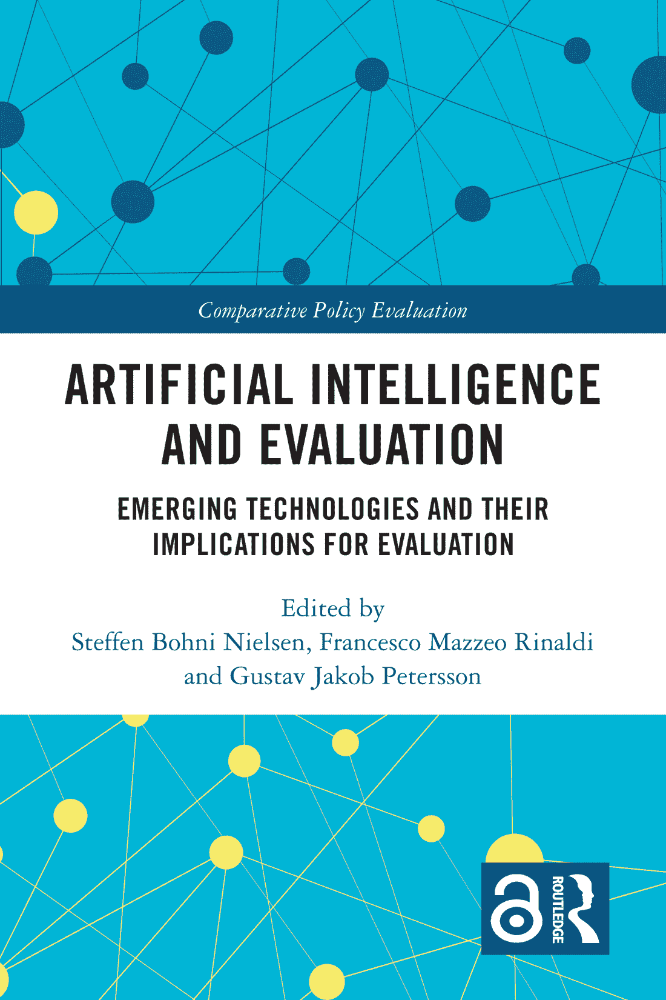

> “本书极具现实意义，其出版时机恰到好处，能够激发人们对将人工智能和新兴技术融入评估的益处与挑战进行反思。各位作者均是项目评估领域的知名专家，他们凭借专业知识，为将 AI 技术融入评估提供了前沿分析和前瞻性解决方案。简而言之，这是一本充实且启发性的读物，由知名作者撰写，旨在就我们这个时代至关重要的课题启迪思想。”
>
> **Steve Jacob**，拉瓦尔大学政治学教授
>
> “AI 将以多种方式改变评估领域，但目前的证据基础仍然薄弱。本书是关于新兴技术及其对评估影响文献中值得欢迎的新增成果。评估者未采用大数据方法的关键原因，包括缺乏针对公共部门和非营利部门的相关用例，以及因伦理顾虑而对大数据方法缺乏信任。本书提供了一组丰富的潜在用例、文档记录及从这些案例中汲取的经验教训，并探讨了与数据科学和评估相关的伦理与公平主题，为评估中 AI 的应用文献库做出了重要贡献。本书出版正逢其时，正值评估界对 AI 的兴趣颇高，但在许多情况下，能力和知识仍需加强和补充。本书基于德高望重的评估专业人士和学者的工作，他们拥有长期的经验可供分享，为 AI 如何融入评估提供了独特视角。”
>
> **Linda Raftree**，MERL Tech 创始人

---

## 致谢

写书是一段旅程，需要许多人的支持。我们衷心感谢每一位参与创作的人。

首先，我们要向贡献专业知识参与创作的才华横溢的作者们表达最深切的感谢。能与如此杰出的作者合作是一种荣幸，我们感激有机会汇集多元的声音和经验，共同完成这项集体工作。每位作者都在塑造内容方面发挥了关键作用，他们对卓越的追求无疑提升了本书的质量。

我们要感谢真心相信并支持该项目的赞助方。你们的慷慨解囊对于确保本书广泛传播起到了关键作用。感谢你们让这本开放获取出版物成为现实。特别鸣谢并致以衷心感谢：

*   Bixal
*   全球环境基金，独立评价办公室
*   丹麦国家工作环境研究中心
*   卡塔尼亚大学
*   洛桑大学
*   世界银行，独立评价组

我们衷心感谢评审专家们投入的时间、专业知识，以及他们在塑造本出版物过程中发挥的宝贵作用。

献给我们的家人，感谢你们在这项事业中始终如一的支持。你们的耐心、理解和鼓励，支撑我们度过了漫长的写作与修订时光。

我们衷心感谢协助制作本书的敬业专业人士。你们对卓越的追求，帮助将我们的构想转化为一份成熟连贯的手稿。

衷心致谢 Ray C. Rist，这套优秀丛书的编辑，我们大家的良师益友。

最后，感谢与我们共同踏上这段旅程的读者们，谢谢你们投入的时间与关注。我们希望书页间的文字能引起你们的共鸣，助力大家更好地理解 AI 给评估带来的挑战……

满怀感激，

Steffen Bohni Nielsen
Francesco Mazzeo Rinaldi
Gustav Jakob Petersson

## 贡献者

**Anupam Anand**，博士（地理空间科学），现任全球环境基金独立评价办公室（`GEF IEO`）高级评价官。他在国际发展、评价及学术界拥有逾 15 年的综合经验。在 `GEF-IEO`，他主导生物多样性、土地退化以及冲突与脆弱性、基于自然的解决方案等跨领域主题的评价工作。

**Harsh Anuj** 致力于将数据科学应用于世界银行独立评价组（`IEG`）的评价与综合产品，并支持数据科学能力建设。此前，他曾领导全球交付倡议的 `DeCODE` 项目，并为世界银行集团的管理、运营和企业团队提供数据科学支持。

**Michael Bamberger**，博士（社会学），在国际发展与评价领域拥有 50 年经验。在从事 10 年城市社区发展工作后，他曾任职于世界银行，并作为独立评价顾问与联合国机构、国际银行及发展机构合作。他是国际影响评价倡议（`3ie`）的高级研究员，目前正从事面向复杂性的评价以及数据科学与评价的融合研究。

**Geeta Batra**，博士，在国际发展领域拥有逾 25 年经验，其中包括 15 年项目评价经验。在全球环境基金独立评价办公室（`GEF IEO`），她管理一支评价专业团队，并对评价的设计、实施及质量提供监督。

**Kerry Bruce**，公共卫生博士，是一位公共卫生从业者及监测评价专家。她是国际发展领域技术应用的早期采用者。当她不在琢磨如何利用技术改进项目时，你会发现她在徒步、滑雪或阅读科幻小说。

**Pirmin Bundi** 是洛桑大学瑞士公共管理研究生院公共政策与评价副教授。他的主要研究兴趣包括政策评价、公共政策、公共管理和政治行为。

**Elvira Celardi**，卡塔尼亚大学社会学助理教授，专长于社会研究方法论与评价。她的研究聚焦于社会包容、社会变迁、全球化和贫困等复杂社会现象。目前，她正致力于整合 AI 与机器学习工具以分析这些错综复杂的社会现象。

**Sung-Woo Cho**，博士，现任俄勒冈大学学术数据分析副教务长。向教务长汇报工作，他在校内推广人工智能用于预测、评价和生成用途。他拥有斯坦福大学学士学位和哥伦比亚大学博士学位。

**Lars Skage Engebretsen** 是挪威审计长办公室（`OAGN`）特别顾问，专长于绩效审计方法。他拥有经济学硕士学位，并在绩效审计方面拥有丰富经验。

**Valentine J. Gandhi**，博士，身兼数职：政策顾问、高级评价专家、`Tech4Good` 专家、网络安全与知识管理专家。他曾在包括冲突地区在内的 40 多个国家开展工作。目前，他是印太地区一个 14 国区域 `USAID MEL` 平台的项目负责人。他是智库 The Development CAFE 的创始人，也是欧洲评价学会 `EvalEdge` 播客的主持人。

**Laura Gatto** 是洛桑大学瑞士公共管理研究生院博士后研究员。她的研究聚焦于政策评价、公共政策和利益集团。她同时受过定量与定性方法训练，特别对计算文本分析感兴趣。

**Nathan Greenstein** 是俄勒冈大学教务长办公室机器学习助理主任。他促进数据科学项目开展，专注于如何合乎道德且公平地使用机器学习。他拥有达特茅斯学院认知科学学士学位。

**Ariya Hagh** 就职于世界银行独立评价组（`IEG`）的方法咨询职能部门，为评价设计、数据科学应用、计量经济学和定性数据分析提供支持。他于 2020 年在乔治城大学完成博士学位，拥有国际关系和研究方法背景。

**Jon Holm** 博士，是挪威研究理事会（`RCN`）特别顾问，负责由 `RCN` 实施的国家研究评估开发工作。他还参与在数据管理与分析部门开发研究分析和评价的方法与流程。

**Helge Holtermann** 是挪威审计长办公室（`OAGN`）高级顾问，专长于绩效审计方法。他拥有政治学博士学位，背景涉及和平与冲突研究。

**Frans L. Leeuw**（社会学家）是马斯特里赫特大学名誉教授，专攻公共政策与法律的社会科学研究。早年他曾任荷兰国家司法研究所所长、乌特勒支大学评价研究教授、荷兰开放大学人文学院院长、荷兰国家审计署绩效审计与评价部门主任。他还是欧洲评价学会的联合创始人，并撰写了 10 余部著作和 150 余篇（学术）出版物。

**Vincenzo Miracula**，卡塔尼亚大学复杂系统博士候选人，是计算社会科学与 AI 专家。他的研究兴趣在于网络理论与假新闻传播。他曾作为访问学者在马德里康普顿斯大学开展研究，并自 2022 年起成为意大利人工智能协会和意大利社会学协会的准会员。

**Mari Mjaaland** 是挪威审计长办公室（`OAGN`）高级顾问。她是一位经验丰富的绩效审计师，曾任记者，拥有社会学硕士学位。

**Tom Næss** 是挪威审计长办公室（`OAGN`）特别顾问兼绩效审计师，是经验丰富的绩效审计项目组组长。他拥有国际关系硕士学位。

**Denis Newman-Griffis** 博士，谢菲尔德大学数据科学讲师，研究研究所研究员，领导 `GRAIL` 项目，致力于研究资助与评价中的负责任 AI。他们的研究探讨科学、健康和残疾领域负责任 AI 的原则与实践。

## 评论员简介

**Steffen Bohni Nielsen** Ph.D. 是丹麦国家工作环境研究中心总干事，也是丹麦国家研究与创新委员会成员。他是国际评价研究小组（`INTEVAL`）成员，并在评价领域发表了大量文章。

**Gustav Jakob Petersson** Ph.D. 是瑞典研究委员会高级分析师。他是国际评价研究小组（`INTEVAL`）成员，并于 2017 年共同编辑了其关于网络社会、大数据与评价的卷册之一。

**Antonio Picone** 是卡塔尼亚大学复杂系统博士候选人，积极参与自然语言处理研究。他的重点在于利用 AI 准确识别文本中的情感和情绪，展现了对推进我们对复杂语言互动理解的深刻奉献。

**Carolin Prabhu** 是挪威审计长办公室（`OAGN`）创新实验室的高级顾问。她拥有物理学博士学位，具有数据分析和机器学习背景。

**Estelle Raimondo** Ph.D. 是世界银行独立评价组（`IEG`）方法咨询单元的项目经理。她是评价方法专家，就广泛的研究设计向 `IEG` 各团队提供建议。

**Francesco Mazzeo Rinaldi** Ph.D. 是意大利卡塔尼亚大学教授，担任该校研究中心 `LAPOSS` 的主任。他的主要研究兴趣包括项目与政策评价、大数据分析和人工智能。他是国际评价研究小组（`INTEVAL`）成员。

**Juha I. Uitto** Ph.D. 于 2014 年至 2024 年担任全球环境基金（`GEF`）独立评价办公室（`IEO`）主任。在此之前，自 1999 年起曾在 `GEF` 和联合国开发计划署（`UNDP`）担任评价员。20 世纪 90 年代，他在联合国大学担任环境研究与培训协调员。

**Jos Vaessen** Ph.D. 是 `IEG` 的评价顾问。他的工作侧重于评价能力建设和评价政策。他是国际评价研究小组（`INTEVAL`）成员。

**Joris Vandelanotte** 是医学博士和公共卫生医学专家，拥有 25 年以上的公共卫生、卫生系统强化以及监测与评价经验，尤其在非洲地区。Joris 对将文本分析应用于评价工作以及自行车维护修理有特别兴趣。

**Pete York** 是 `BCT Partners` 的合伙人兼首席数据科学家，该咨询公司专注于为公平社会影响提供数据分析。他在评价和研究方面拥有 25 年以上经验，并撰写了多部关于利用机器学习和大数据推动社会变革的出版物。

**Virginia Ziulu** 是世界银行独立评价组方法咨询单元的数据科学家。她专攻复杂的数据科学应用，包括机器学习、自然语言处理、遥感和计算机视觉。她具有数据科学背景，在牛津大学和爱丁堡大学完成了研究生学业。

# 1 人工智能时代的评价

Steffen Bohni Nielsen, Francesco Mazzeo Rinaldi, and Gustav Jakob Petersson

DOI: [10.4324/9781003512493-1](https://doi.org/10.4324/9781003512493-1)

本章已根据 `CC-BY-NC-ND 4.0` 许可发布。

## 引言

近年来，战斗无人机一直出现在阿富汗、纳戈尔诺-卡拉巴赫、利比亚和乌克兰等冲突地区的上空。这些无人机，即无人驾驶飞行器（`UAV`），为侦察、监视和致命空中武器提供实时数据。`UAV` 的用途已从情报收集扩展到反恐或反叛乱战争，进而发展为全面的常规战斗。如今，超过 100 个国家的武装部队拥有这些能力。特别是乌克兰冲突表明了 `UAV` 在未来战争中的重要性，因为随着该技术与人工智能（`AI`）的结合，其技术日益复杂（Marcus, 2022）。

在瑞典 Upplands-Bro 市招聘职位时，应聘者面临一位不同寻常的面试官。自 2019 年以来，面试官是一台由人工智能驱动的实体机器人。机器人会向申请人提问，并通过分析其行为、解决问题的能力和其他技能来评估候选人。其目的是使招聘流程比传统面试实践更少偏见。机器人的面试随后会被分析，并与初始申请的能力评分相结合。在招聘人员与候选人进行最终面试之前，机器人会对有希望的候选人进行排名（Misuraca & Van Noordt, 2020）。

在 COVID-19 大流行期间，许多欧洲国家的疾病控制中心为手机构建了应用程序（`App`），利用 `GPS` 技术追踪下载该应用人员的行踪。该应用利用地理空间数据追踪人群行踪。如果这些人员曾与确诊或潜在接触过 COVID-19 的其他人员有过接触，他们将自动收到预防行动指示，如自我隔离、检测和通知密切接触者。

2022 年秋季，`ChatGPT` 发布，这是一种生成式 `AI` 模型，能够为无数问题提供复杂的答案。其能力使其在各类大学入学标准化考试中表现优异。其总结复杂文本和定量数据的能力导致了广泛采用，并给高等教育、整个知识密集型职业和劳动力市场带来了新挑战（Eloundou, Manning, Mishkin & Rock, 2023）。

在科学领域，`AI` 的使用正在蓬勃发展，并为各种研究的收集、分析和报告做出了贡献（Cotton, Cotton & Shipway, 2023）。跨学科地，正在开发 `AI` 驱动的解决方案以支持多种不同任务，如文本筛选、编码、翻译、转录，以及定量和定性分析。

这些例子表明了数字技术的存在及其多重用途，特别是在人力资源、公共卫生、国家安全、教育和科学等各个领域。

## 对职业的影响

因此，提及 `AI` 绝非巧合。我们正见证全球生成数据的指数级增长（Nielsen, Ejler & Schretzmann, 2017; Petersson and Breul, 2017）。新技术的快速演变和存储成本的大幅下降，使得能够即时捕获、分析和可视化这些巨大数据存储库的技术得以创新（Kiron, Kirk Prentice & Boucher Ferguson, 2014; Mazzeo Rinaldi et al., 2017）。`AI` 及处理结构化和非结构化、定量和定性数据的类似技术是这些发展的核心，目前正有巨额资金投入此类技术。

# 数字时代的评估：新兴技术的挑战与机遇

## 背景：第四次（信息）革命

这些发展主要涉及**数据采集**的新来源，例如在线搜索、社交媒体平台、卫星、无人机、物联网（`IoT`；即传感器）、移动电话、电信记录和行政登记（结构化和非结构化数据）。此外，**数据存储和管理**的新来源也已出现，例如云计算、分布式账本技术（`DLT`）（区块链）和边缘计算。最后，**数据处理**的来源，如文本分析、`AI/ML` 以及其他定量方法和可视化，已迅速扩展（Mazzeo Rinaldi 等，2024）。我们正处于第四次（信息）革命之中：数字时代。

虽然数字技术创新主要由私营部门驱动，但公共部门也已着手利用数字技术的潜力（Heeks & Bailur, 2007）。欧洲委员会的一份报告记录了人工智能（`AI`）在欧洲国家、地区和地方层面的公共部门中找到了新兴应用，并且利用 `AI` 支持和改进政策制定及服务交付的兴趣日益增长（Misuraca & van Noordt, 2020）。各国政府正在采取新措施，以平衡人工智能的承诺与风险。

全球公共部门现在意识到数据量正在惊人地增长，这种数据洪流根本无法阻挡。许多公共机构和组织已意识到，来自互联网、智能手机、传感器、卫星和数字化转型举措的数据洪流，当与能够从数据中发现有价值见解的 `AI` 和机器学习（`ML`）算法相结合时，具有巨大潜力。

与这些发展并行，不同职业也做出了不同的反应。数字技术无处不在，影响着大多数行业。一些任务被数字驱动的新兴技术（`ET`）自动化或增强。

在一项综合分析中，管理咨询公司麦肯锡得出结论：

> 我们对 800 多个职业中 2000 多项工作活动的分析表明，某些类别的活动比其他活动更容易实现自动化。它们包括高度可预测和结构化环境中的体力活动，以及数据收集和数据处理。这些活动约占所有行业人们从事活动的一半。最不易受影响的类别包括管理他人、提供专业知识和与利益相关者互动。
>
> （2018，第 2 页）

换句话说，没有任何职业或行业会不受数字技术的影响。仅聚焦于大语言模型（如 `ChatGPT`），一项最新研究在工作任务和日常工作活动层面分析了 1000 多个职业。作者得出结论，知识密集型行业将成为受 `AI` 影响最大的行业之一。该技术将对从事常规认知任务的高薪职业产生深远影响（Eloundou, Manning, Mishkin & Rock, 2023）。

这些包括会计、审计、法律、医学和研究等知识密集型职业。作为一门源自社会科学研究方法的（准）专业，评估也将受到影响。

根据麦肯锡的报告，公共部门和社会部门将受到最大影响（2018）。这些是项目评估的典型评价对象。换句话说，评估者评估*什么*以及*如何*评估，在未来几年内都可能发生重大变化。

## 本书范围

新兴技术（特别是生成式 `AI`）的快速发展促使我们重新审视评估与新兴技术之间的交织关系。本书旨在回答三个总体问题：

1.  有哪些新兴数字技术？
2.  评估者需要哪些必备技能？
3.  评估能为 `AI` 做出什么贡献，反之亦然？

因此，让我们扩展这些问题的背景和理解，以阐明其重要性。

### 评估领域中新兴技术的扩散

总体而言，社会科学家已对新兴技术提供的新机遇做出回应，先行者似乎正在拥抱计算社会科学的机遇并与数据科学合作。其对传统社会科学的挑战被认为是真实且迫在眉睫的（Burrows and Savage, 2014），因此其潜力与风险正受到严密审视（Grossmann 等，2023）。

然而，评估者似乎对这一新发展反应迟缓（Picciotto, 2020; Raftree & Bamberger, 2014）。请看以下观察：

*   **AEA Connect (Evaltalk)**（截至 2022 年 7 月）仅包含 253 条关于人工智能的条目，且没有关于大数据的用户标签。该议题上未发布任何主题讨论。这是全球最大评估社区的“聊天论坛”。
*   **Google Scholar** 搜索相同术语，结合“evaluation”搜索时，结果数在 5 到 1,480 之间。浏览这些文献，大多数涉及 `AI/ML` 预测性能的评估，而非与评估实践的融合。


* 国家评估大会的**专业发展研讨会**提供的大数据分析培训有限（甚至没有）。
* **AEA 核心能力**（American Evaluation Association, 2018）未明确提及大数据分析。
* 评估培训的**专业发展课程**提供的培训机会有限。领先机构如 The Evaluators Institute 2023 年项目仅提供一个机器学习模块。IPDET 2023 年项目也仅提供一个机器学习模块。
* **大学基础课程**未明确提及大数据，似乎也未适应大数据/AI 分析所需的新技能（Lavelle, 2020）。

Rathinam 等人（2021）绘制了国际发展影响评估中使用大数据的证据缺口图。该领域似乎是将大数据应用于评估领域的先行者（Raftree & Bamberger, 2014）。他们识别出 48 项使用大数据的影响评估，其中卫星数据在超过 80% 的案例中被使用。迄今为止，尚未开展国家评估市场的综述（Nielsen, 2023）。

目前，关于数字技术及其对评估实践影响的同行评审文章相对较少。在 9 份主要评估期刊（*American Journal of Evaluation*、*Canadian Journal of Program Evaluation*、*Educational Evaluation and Policy Analysis*、*Evaluation*、*Evaluation and the Health Professions*、*Evaluation and Program Planning*、*Evaluation Journal of Australasia*、*Evaluation Review*、*Journal of Multidisciplinary Evaluation* 和 *New Directions for Evaluation*）中，检索 2013 年至 2023 年 5 月的研究文章，仅识别出 18 篇标题、关键词或摘要包含“大数据”、“人工智能”、“机器学习”、“文本分析”或“物联网”的不同文章（另见 Nielsen, 2023）。

# AI、大数据与评估的未来

## 学术关注的兴起

2023 年，《New Directions for Evaluation》将出版专门探讨 AI 与评估的专刊。这标志着学术界首次系统性地分析其对评估实践的影响（Montrosse-Moorhead & Mason, 2023），并可能预示着对数字技术及其在评估中应用的兴趣日益增长。

AI 应用的案例开始出现在同行评审文献中（Bonfiglio, Camaioni, Carta & Cristiano, 2023; Cintron & Montrosse-Moorhead, 2022; Roy & Rambo-Hernandez, 2021）。支持者呼吁进一步加强与数据科学的合作与融合（Bruce, Gandhi & Vandelonotte, 2020; Hejnowicz & Chaplowe, 2021; Raftree, 2020; York & Bamberger, 2020）。

## 早期研究与现状

Petersson 和 Breul (2017) 编辑的文集是最早聚焦数字技术（特别是大数据/BD）与评估交叉领域的书籍之一。其中一项针对 2010 年代中期自我报告为评估者的便利抽样调查（回复率极低）显示，约有 10% 的受访者拥有大数据经验（Højlund, Olejniczak & Petersson, 2017）。我们未发现其他关于供需双方的调查。York 和 Bamberger (2020) 在另一出版物中呼应了这一发现。

直白地说，评估者仍 **largely** 不熟悉大数据。2012 年，John Gargani 或许带着愿望预测：十年内“评估将放弃数据收集，转向数据挖掘……因为海量数据在日常生活中被收集并数字化存储。评估者访问和整合这些数据将成为常态”（Gargani, 2012）。

现实距离这一场景尚远。期间，随着 AI 的快速演进，对评估的挑战变得更为迫切。Peter Daboll (2013) 预测大数据将超越评估，并使评估日益变得无关紧要和过时，这一预言正在成真。

大数据与数据科学已扎根并持续增长。评估在知识生产领域已沦为“小弟弟”。

## 融合的必要性与挑战

因此，评估与 BD/AI 深度融合势在必行。Petersson, Leeuw 和 Olejniczak (2017) 指出评估者面临四大挑战：

1. 在政策制定过程中的新角色；
2. 探索 BD 领域应用的设计与工具；
3. 获取管理数据的新能力；
4. 寻求与数据科学家的合作。

同样，Nielsen, Ejler 和 Schretzmann (2017) 识别出评估面临的四大挑战：

1. 竞争挑战；
2. 互补挑战；
3. 利用挑战；
4. 能力挑战。

**评估对象（what）改变，评估方法（how）必然随之改变。** 竞争性的知识生产服务可能会挤占评估的市场。正如聚焦评估与数字技术的出版物缓慢涌现所显示的，变革正在发生。

## 数字技术采用的“三波浪”模型

据 Raftree (2020) 在国际发展评估背景下所述，数字技术在该领域的扩散经历了三波浪潮。

**第一波浪潮**：允许评估从业者维持原有工作模式，但通过新数据源（地理空间数据、大型行政登记、移动电话）增强数据捕获能力。

**第二波浪潮**：聚焦新形式的数据捕获，如物联网、卫星、无人机，以及对 AI 和 ML 的日益关注。Rathinam 等人的证据地图显示卫星图像应用频繁 (2021)。

**第三波浪潮**：与第二波紧密相连或并行，探索数据捕获、存储和处理的新技术。

重要的是，Raftree 观察到：“软件开发和数据科学等新学科正进入 MERL 领域，带来新理念和工作方式”（2020, p. 15）。

Raftree 的“波浪”隐喻是否适用于评估实践大规模采用数字技术，仍有待观察。如前所述，关于数字技术如何在评估行业各细分领域扩散，仅存在间接经验证据（见 Nielsen, 2023）。近期同行评审文章激增表明，文本和照片图像处理等新方式属于第三波浪潮的一部分（Cintron & Montrosse-Moorhead, 2022; York & Bamberger, 2020）。

换言之，大数据应用正缓慢但日益成为**评估对象（evaluand，即被评估之物）** *和* 评估者的**工具**。后者工具开发迅速，处于商品化的不同阶段。如今，已有大量面向社会科学研究的 AI 驱动技术。这种商品化可能降低构建必要能力的门槛。

## 技术对评估任务的影响维度

Eloundou 等人 (2023) 认为 AI 可**替代**或**增强**各职业任务。理解数字技术如何影响评估实践，需要更细致的框架。需将评估实践拆解为构成任务与活动，以评估新技术的后果。

* **替代任务**：新技术取代人工任务，如翻译、转录、标准化报告、摘要筛选。
* **促进任务**：新技术赋能人工任务，如面向难以触达人群的虚拟访谈平台。
* **增强任务**：新技术强化人工任务，如扩大人口覆盖范围、数据融合、数据挖掘、优化分析、自动编码。
* **创生任务**：新技术创造新人工任务，如卫星图像分析、无人机操作、提示工程。

不同方式下，任务可借助新技术更**迅速**、**高效**或**有效**地完成。使用新技术时的**公平性与伦理**问题同样值得关注。

## 未来展望

我们面临的未来是：若要评估由新技术驱动的干预措施，评估团队必须具备与主题专家相当的技术胜任力。本文集提供了多个此类合作的相关案例。

这些观察表明，评估界尚未适应新技术带来的挑战与机遇。呼应 Petersson, Leeuw 和 Olejniczak (2017)，我们认为评估者应主动使用新技术。否则，评估界将面临更具创新性的分析职业的侵蚀，这些竞争性知识生产形式可能比评估者提供的见解更迅速、更高效、更有用。

## 书籍结构

我们将本书构建为三个部分：在*第一部分*中，Kerry Bruce、Valentine J. Gandhi 和 Joris Vandelanotte（第 2 章）（2025）介绍了支持设计、数据收集、存储和分析的新兴技术。其中，他们介绍了这些技术在评估中的应用潜力与风险。因此，该章为本卷后续章节提供了参考基准。在下一章（第 3 章）（2025）中，Pete York 和 Michael Bamberger 分析并举例说明了用于设计、数据收集和分析的新兴技术如何应用于评估，并展示了数据科学与评估之间的合作形式（2025a）。他们还讨论了评估工具可以如何以及为何与数据科学相融合——以及为什么推动这种融合对评估者至关重要。Nathan Greenstein 和 Sung-Woo Cho（第 4 章）接着讨论了数据科学对评估者而言的伦理与公平问题，以及为何这些问题需要特别考量，因为新兴技术蕴含巨大希望，但也可能有意或无意地造成伤害（2025）。

在*第二部分*中，我们提供了一些案例研究，描述并分析了数据科学的分析工具如何通过不同类型的效益融入并改进了评估工作。在该部分的第一章中，Virginia Ziulu、Harsh Anuj、Ariya Hagh、Estelle Raimondo 和 Jos Vaessen（第 5 章）分析了文本分析如何作为世界银行的一项元评估的一部分被使用，因此也蕴含在组织内部及跨组织的知识管理中更广泛应用的潜力（2025）。同理，Tom Næss、Carolin Prabhu、Mari Mjaaland、Helge Holtermann 和 Lars Skage Engebretsen 随后展示了一个在挪威警察网络犯罪工作绩效审计中应用文本挖掘的案例（第 6 章）（2025）。Jon Holm、Denis Newman-Griffis 和 Gustav Petersson 展示了一个在评估研究和研究政策影响中应用文本分析（具体为自然语言处理[NLP]）的案例（第 7 章）（2025）。Laura Gatto 和 Pirmin Bundi 随后展示了一个在瑞士评估政策制定过程的主题模型上应用文本挖掘和定量文本分析的案例（第 8 章）（2025）。在下一章中，Francesco Mazzeo Rinaldi、Elvira Celardi、Antonio Picone 和 Vincenzo Miracula 通过呈现一个关于乌克兰冲突的案例研究，描述并讨论了使用机器学习和文本分析工具的潜力。他们阐释了这些技术如何促进数字情境分析，为决策者提供有价值的评估性洞见（第 9 章）（2025）。接下来，Anupam Anand、Geeta Batra 和 Juha I. Uitto 分析了在地理空间数据的利用以在环境干预背景下获取评估性证据（第 10 章）（2025）。Pete York（第 11 章）演示了如何利用新的分析技术为决策提供信息，从而增强现有数据的利用。在该部分的最后一章，Frans Leeuw 分析了当人工智能与人类智能融合时，在裁决中的潜力与困境，并提出了此类干预应如何被评估的途径（第 12 章）（2025）。

在*最后一部分*中，Steffen Bohni Nielsen (2025) 从将评估实践视为一个行业的角度，分析了新兴技术对评估的启示。他认为，某些任务和服务线可能会被取代，而专家评估知识将保持重要（第 13 章）。在最后一章，Steffen Bohni Nielsen、Francesco Mazzeo Rinaldi 和 Gustav Petersson（第 14 章）利用跨案例分析深入探讨了评估与数据科学进一步融合中的组织与能力挑战。他们讨论了职能、角色、技能和技术（2025）。

## 参考文献

1. American Evaluation Association (2018). AEA Evaluator Competencies. Retrieved from `https://www.eval.org/Portals/0/Self%20assessment%201oct.pdf`

2. Anand, A., Batra, G. & Uitto, J.I. (2025). Harnessing Geospatial Approaches to Strengthen Evaluative Evidence. In S.B. Nielsen, F. Mazzeo Rinaldi and G.J. Petersson (eds.). *Artificial Intelligence and Evaluation.* *Emerging Technologies and Their Implications for Evaluation* (pp. 196–218). London: Routledge. `https://doi.org/10.4324/9781003512493`

3. Bonfiglio, A., Camaioni, B., Carta, V. & Cristiano, S. (2023). Estimating the Common Agricultural Policy milestones and targets by neural networks. Evaluation and Program Planning. `https://doi.org/10.1016/j.evalprogplan.2023.102296`

4. Bruce K., Gandhi V.J., & Vandelanotte, J. (2020). Emerging Technologies and Approaches in Monitoring, Evaluation, Research, and Learning for International Development Programs. MERL Tech Report # 4. Retrieved from `https://merltech.org/wp-content/uploads/2020/07/4_MERL_Emerging-Tech_FINAL_7.19.2020.pdf`

5. Bruce, K., Gandhi, V.J. & Vandelanotte, J. (2025). Emerging Technology and Evaluation in International Development. In S.B. Nielsen, F. Mazzeo Rinaldi and G.J. Petersson (eds.). *Artificial Intelligence and Evaluation. Emerging Technologies and their Implications for Evaluation* (pp. 13–36). London: Routledge. `https://doi.org/10.4324/9781003512493`

6. Burrows, R., & Savage, M. (2014). After the crisis? Big Data and the methodological challenges of empirical sociology. Big Data & Society, *1*(1). `https://doi.org/10.1177/2053951714540280`

7. Cintron, D. W., & Montrosse-Moorhead, B. (2022). Integrating Big Data Into Evaluation: R Code for Topic Identification and Modeling. American Journal of Evaluation, *43*(3), 412–436. `https://doi.org/10.1177/10982140211031640`

8. Cotton, D., Cotton, P.A., & Shipway, J.R. (2023). Chatting and Cheating. Ensuring academic integrity in the era of ChatGPT. EdArXiv*.* `https://doi.org/10.1080/14703297.2023.2190148`

9. Daboll, P. (2013). Five reasons why Big data will crush big research. Forbes. 2013/12/03. Retrieved from `https://www.forbes.com/sites/onmarketing/2013/12/03/5-reasons-why-big-data-will-crush-big-research/?sh=6a0e44555d0f`

10. Eloundou, T., Manning, S. Mishkin, P. & Rock, D. (2023). GPTs are GPTs: An Early Look at the Labor Market Impact Potential of Large Language Models. *arXiv:2303.10130* \[econ.GN\]. [`doi.org/10.48550/arXiv.2303.10130`](https://doi.org/10.48550/arXiv.2303.10130)

11. Gargani, J. (2012). The Future of Evaluation: 10 Predictions. EVAL BLOG. John Gargani’s blog about program design and evaluation. Retrieved from [`evalblog.com/2012/01/30/the-future-of-evaluation-10-predictions/`](http://evalblog.com/2012/01/30/the-future-of-evaluation-10-predictions/)


## 参考文献

12. Gatto, L. & Bundi, P. (2025). The Use of Quantitative Text Analysis in Evaluations. In S.B. Nielsen, F. Mazzeo Rinaldi and G.J. Petersson (eds.). *Artificial Intelligence and Evaluation. Emerging Technologies and their Implications for Evaluation* (pp. 144–167). London: Routledge. [`doi.org/10.4324/9781003512493`](https://doi.org/10.4324/9781003512493)

13. Greenstein, N. & Cho, S.-W. (2025). Ethics & Equity in Data Science for Evaluators. In S.B. Nielsen, F. Mazzeo Rinaldi and G.J. Petersson (eds.). *Artificial Intelligence and Evaluation. Emerging Technologies and Their Implications for Evaluation* (pp. 56–77). London: Routledge. [`doi.org/10.4324/9781003512493`](https://doi.org/10.4324/9781003512493)

14. Grossmann, I., Feinberg, M., Parker, D.C., Christakis, N.A., Tetlock, P.E. & Cunningham, W.A. (2023). AI and the transformation of social science research. *Science*, 380(6650), 1108–1109. [`doi.org/10.1126/science.adi1778`](https://doi.org/10.1126/science.adi1778)

15. Heeks, R. & Bailur, S. (2007). Analyzing e-government research: Perspectives, philosophies, theories, methods, and practice. *Government Information Quarterly*, 24(2), 243–265. [`doi.org/10.1016/j.giq.2006.06.005`](https://doi.org/10.1016/j.giq.2006.06.005)

16. Hejnowicz, A. & Chaplowe, S. (2021). Catching the wave: Harnessing data science to support evaluation’s capacity for making a transformational contribution to sustainable development. *Canadian Journal of Program Evaluation*, 36(2), 162–186. [`doi.org/10.3138/cjpe.71527`](https://doi.org/10.3138/cjpe.71527)

17. Holm, J., Newman-Griffis, D. & Petersson, G.J. (2025). Big data for big investments: Making responsible and effective use of data science and AI in research councils. In S.B. Nielsen, F. Mazzeo Rinaldi and G.J. Petersson (eds.). *Artificial Intelligence and Evaluation. Emerging Technologies and Their Implications for Evaluation* (pp. 120–143). London: Routledge. [`doi.org/10.4324/9781003512493`](https://doi.org/10.4324/9781003512493)

18. Højlund, S., Olejniczak, K. & Petersson, G.J. (2017). The Use of Big Data in Evaluation. In: edited G.J. Petersson & J. Breul. *Cyber Society, Big Data and Evaluation* (pp. 35–60). London: Routledge.

19. Kiron, D., Kirk Prentice, P. & Boucher Ferguson, R. (2014). The Analytics Mandate. Findings from the 2014 Data & Analytics Global Executive Study and Research Report. *MIT Sloan Management Review*, Research Report. Retrieved from [`sloanreview.mit.edu/projects/analytics-mandate/`](https://sloanreview.mit.edu/projects/analytics-mandate/)

20. LaVelle, J. M. (2020). Educating evaluators 1976–2017: An expanded analysis of university-based evaluation education programs. *American Journal of Evaluation*, 41(4), 494–509. [`doi.org/10.1177/1098214019860914`](https://doi.org/10.1177/1098214019860914)

21. Leeuw, F.L. (2025). The Algorithmization of Policy and Society: The Need for a Realist Evaluation Approach. In S.B. Nielsen, F. Mazzeo Rinaldi and G.J. Petersson (eds.). *Artificial Intelligence and Evaluation. Emerging Technologies and Their Implications for Evaluation* (pp. 242–265). London: Routledge. [`doi.org/10.4324/9781003512493`](https://doi.org/10.4324/9781003512493)

22. Marcus, J. (2022). Combat Drones: We Are in a New Era of Warfare – Here’s Why. (2022-02-04). Retrieved from [`www.bbc.com/news/world-60047328`](https://www.bbc.com/news/world-60047328)

23. Mazzeo Rinaldi, F., Celardi, E., Miracula, V. & Picone, A. (2025). Artificial Intelligence and Text Analysis in Evaluating Complex Social Phenomena. The Russia-Ukraine Conflict. In S.B. Nielsen, F. Mazzeo Rinaldi and G.J. Petersson (eds.). *Artificial Intelligence and Evaluation. Emerging Technologies and Their Implications for Evaluation* (pp. 168–195). London: Routledge. [`doi.org/10.4324/9781003512493`](https://doi.org/10.4324/9781003512493)

24. Mazzeo Rinaldi, F., Giuffrida, G., Nicotra, S., & Dispinseri F. (2024). A Classification Algorithm to Link Official Documents to Sustainable Development Goals. In I. K. Lindkvist, K. Forss & P. Øyvind Bastøe (eds.). *Towards Sustainable Futures - A role for evaluations?* (pp. 166–185). London: Routledge.

25. Mazzeo Rinaldi, F., Giuffrida, G., & Negrete, T. (2017). Real-time monitoring and evaluation - Emerging news as predictive process using Big Data based approach. In G. J. Petersson & J. D. Breul (eds.). *Cyber Society, Big Data and Evaluation* (pp. 191–214). New York, NY: Routledge.

26. McKinsey Global Institute (2018). AI, Automation, and the Future of Work: Ten Things to Solve for. Briefing Note Prepared for the Tech4good Summit. Retrieved from [`www.mckinsey.com/featured-insights/future-of-work/ai-automation-and-the-future-of-work-ten-things-to-solve-for`](https://www.mckinsey.com/featured-insights/future-of-work/ai-automation-and-the-future-of-work-ten-things-to-solve-for)

27. Misuraca, G. & van Noordt, C. (2020). Overview of the Use and Impact of AI in Public Services in the EU, *EUR 30255 EN*. Luxembourg: Publications Office of the European Union. ISBN 978-92-76-19540-5. [`doi.org/10.2760/039619`](https://doi.org/10.2760/039619), JRC120399

28. Montrosse-Moorhead, B. & Mason, S. (eds.) (2023). Editors’ note. *New Directions for Evaluation*, 178–179, 1–6. [`doi.org/10.1002/ev.20554`](https://doi.org/10.1002/ev.20554)

29. Nielsen, S.B. (2023). Disrupting evaluation? Emerging technologies and their implications for the evaluation industry. *New Directions for Evaluation*, 178–179, 47–57. [`doi.org/10.1002/ev.20558`](https://doi.org/10.1002/ev.20558)

30. Nielsen, S.B. (2025). The Evaluation Industry and Emerging Technologies. In S.B. Nielsen, F. Mazzeo Rinaldi and G.J. Petersson (eds.). *Artificial Intelligence and Evaluation. Emerging Technologies and Their Implications for Evaluation* (pp. 266–286). London: Routledge. [`doi.org/10.4324/9781003512493`](https://doi.org/10.4324/9781003512493)

31. Nielsen, S.B., Mazzeo Rinaldi, F.M. & Petersson, G. (2025). Digital Era Evaluation. Future Perspectives. In S.B. Nielsen, F. Mazzeo Rinaldi and G.J. Petersson (eds.). *Artificial Intelligence and Evaluation. Emerging Technologies and Their Implications for Evaluation* (pp. XX–YY). London: Routledge.

32. Nielsen, S.B., Ejler, N. & Schretzmann, M. (2017). Exploring Big (Data) opportunities: The Case of the Center for Innovation through Data Intelligence, New York City. In G.J. Petersson and J.D. Breul (eds.). *Cyber Society, Big Data and Evaluation* (pp. 147–170). New York, NY: Routledge.

33. Næss, T., Prabhu, C., Mjaaland, M., Holtermann, H. & Engebretsen, L.S. (2025). Text Mining and Machine Learning in an Evaluation of Police Handling of Cybercrime in Norway. In S.B. Nielsen, F. Mazzeo Rinaldi and G.J. Petersson (eds.). *Artificial Intelligence and Evaluation. Emerging Technologies and Their Implications for Evaluation* (pp. 103–119). London: Routledge. [`doi.org/10.4324/9781003512493`](https://doi.org/10.4324/9781003512493)

34. Petersson, G.J. & Breul, J. (eds.). (2017). *Cyber Society, Big Data, and Evaluation*. New York, NY: Routledge.

35. Petersson, G.J., Leeuw, F.L. & Olejniczak, K. (2017). Cyber Society, Big Data and Evaluation: A Future Perspective. In G.J. Petersson and J. Breul (eds). *Cyber Society, Big Data, and Evaluation* (pp. 237–254). New York, NY: Routledge.

36. Picciotto, R. (2020). Evaluation and the big data challenge. *American Journal of Evaluation*, 41(2), 166–181. [`doi.org/10.1177/1098214019850334`](https://doi.org/10.1177/1098214019850334)

37. Raftree, L. (2020). MERL Tech State of the Field. *The Evolution of MERL Tech*. MERL Tech Report # 1. Retrieved from [`merltech.org/resources/merl-tech-state-of-the-field-the-evolution-of-merl-tech/`](https://merltech.org/resources/merl-tech-state-of-the-field-the-evolution-of-merl-tech/)


# 参考文献

38. Raftree, L. & Bamberger, M. (2014). Emerging Opportunities: Monitoring and Evaluation in a Tech-Enabled World. Retrieved from [`www.rockefellerfoundation.org/report/emerging-opportunities-monitoring/`](https://www.rockefellerfoundation.org/report/emerging-opportunities-monitoring/)

39. Rathinam, F., Khatua, S., Siddiqui, Z., Malik, M., Duggal, P., Watson, S. & Vollenweider, X. (2021). Using big data for evaluating development outcomes: A systematic map. *Campbell Systematic Review*, 17(3), e1149. [`doi.org/10.1002/cl2.1149`](https://doi.org/10.1002/cl2.1149)

40. Roy, A. & Rambo-Hernandez, K. E. (2021). There's So Much to Do and Not Enough Time to Do It! A Case for Sentiment Analysis to Derive Meaning From Open Text Using Student Reflections of Engineering Activities. *American Journal of Evaluation*, 42(4), 559–576. [`doi.org/10.1177/1098214020962576`](https://doi.org/10.1177/1098214020962576)

41. York, P. (2025). The Future of Evaluation Analytics: Case Studies of Structural Causal Modeling in Action. In S.B. Nielsen, F. Mazzeo Rinaldi and G.J. Petersson (eds.). *Artificial Intelligence and Evaluation. Emerging Technologies and Their Implications for Evaluation* (pp. 219–241). London: Routledge. [`doi.org/10.4324/9781003512493`](https://doi.org/10.4324/9781003512493)

42. York, P. & Bamberger, M. (2020). Measuring results and impact in the age of big data: The nexus of evaluation, analytics, and digital technology. The Rockefeller Foundation. Retrieved from: [`www.rockefellerfoundation.org/report/measuring-results-and-impact-in-the-age-of-big-data-the-nexus-of-evaluation-analytics-and-digital-technology/`](https://www.rockefellerfoundation.org/report/measuring-results-and-impact-in-the-age-of-big-data-the-nexus-of-evaluation-analytics-and-digital-technology/)

43. York, P. & Bamberger, M. (2025). The Applications of Big Data to Strengthen Evaluation. In S.B. Nielsen, F. Mazzeo Rinaldi and G.J. Petersson (eds.). *Artificial Intelligence and Evaluation. Emerging Technologies and Their Implications for Evaluation* (pp. 37–55). London: Routledge. [`doi.org/10.4324/9781003512493`](https://doi.org/10.4324/9781003512493)

44. Vaessen, J., Lemire, S. & Befani, B. (2020). *Evaluation of International Development Interventions. An Overview of Approaches and Methods*. Washington: World Bank IEG.

45. Vigoda-Gadot. E. & Dana R. Vashdi (eds.). (2020). *Handbook of Research Methods in Public Administration, Management and Policy*. Cheltenham, 2020. [`doi.org/10.4337/9781789903485`](https://doi.org/10.4337/9781789903485)

46. Ziulu, V., Anuj, H., Hagh, A., Raimondo, E. & Vaessen, J. (2025). Extracting Meaning from Textual Data for Evaluation. Lessons from Recent Practice at the Independent Evaluation Group of the World Bank. In S.B. Nielsen, F. Mazzeo Rinaldi and G.J. Petersson (eds.). *Artificial Intelligence and Evaluation. Emerging Technologies and Their Implications for Evaluation* (pp. 78–102). London: Routledge. [`doi.org/10.4324/9781003512493`](https://doi.org/10.4324/9781003512493)

# 2 新兴技术与国际发展评估

Kerry Bruce, Valentine J. Gandhi, and Joris Vandelanotte

DOI: [`10.4324/9781003512493-2`](https://doi.org/10.4324/9781003512493-2)

本章已根据 `CC-BY-NC-ND 4.0` 许可提供。

## 引言

自 2010 年首届 ICT4D 大会（CRS and ICT4D Conference, n.d.）和 2014 年首届 MERLTech 大会（MERLTech, (n.d.)）以来，国际发展界（包括监测与评估专业人员）一直聚集在一起，共同探讨新兴技术，并更好地理解如何将其用于评估（Bamberger, 2022）。技术已从为国际发展调整现有技术，演变为在数字世界中开展发展工作（Department for International Development, 2018）。

本章将讨论在国际发展领域的评估空间中使用新兴技术的前景与陷阱。随后将讨论实践中各项技术的案例（如有）以及这些技术的前景与风险。在本章中，我们将围绕评估的两个关键领域探讨证据：数据收集和数据分析。我们讨论的这些技术有潜力提高国际发展规划以及我们监测和评估项目的效率、成本效益和影响力（Gandhi, 2022）。

然而，所有讨论的技术都提出了评估者需要牢记的挑战。所有被审视的新兴技术都是通过它们如何能被评估者用来理解如何改进国际发展规划这一视角来看待的。我们专门研究了各个具体技术，而非它们所处的更广泛领域。例如，我们没有讨论人工智能（`AI`）这一大类，而是考察了该领域内的具体技术，如机器学习或聊天机器人。鉴于网络安全或数据存储等主题范围更广，足以单独成章，且虽与评估相关，但属于我们主要讨论内容（技术如何被评估者用于其工作）的相邻领域，因此我们未将其纳入讨论。

## 新兴技术用于监测与评估的前景与陷阱

表 2.1 展示了我们在国际发展评估中应考虑的关键新兴技术，按数据收集和数据分析两大主题分组。

### 表 2.1 国际发展评估中的关键新兴技术：前景与陷阱

| 新兴技术 | 前景 | 陷阱 |
| --- | --- | --- |
| **数据收集与获取** | | |
| 移动数据、行政登记/地理数据 | 从收集到使用的周期快，能够绘制成果图谱，能够提高数据收集质量 | 数据隐私（特别是位置信息），行政数据可能缺乏背景信息 |
| 社交媒体数据和在线数据 | 信息可用性增加，更直接地获取社区意见（潜在地无政府干预），收集成本低 | 隐私问题，无意中包含假新闻或被操纵的数据，审查制度，代表性方面潜在的公平性缺失，需要大量数据清洗 |
| 卫星、无人机、物联网 | 对项目影响和成果有完整准确的了解，客观，可实现实时监测，数据收集可能具有成本效益 | 缺乏背景信息，对安全、隐私、知情同意、安全性、数据质量和可靠性的担忧。实施可能需要技能 |
| 聊天机器人、虚拟代理 | 在低带宽环境下自动化数据收集过程，潜在降低成本，易于更新或更改收集的数据，随时可用 | 对回应不敏感且可能惹恼受访者，部署需要技能，仍处于起步阶段 |
| 虚拟现实 | 能够协助形成性评估并支持项目设计，可能减少出差需求，模拟真实生活场景 | 建立成本高昂，实施能力要求高，且可能不适用于所有情况 |
| **数据分析** | | |
| 数据分析（使用大数据） | 分析速度加快，可使用跨度广泛的数据并可重复使用数据 | 可能排除那些贡献数据较少的人，数据准备和分析需要高水平技能 |
| 自然语言处理和生成式 AI（例如：`ChatGPT`） | 自动化、速度以及在分析中纳入更多信息并揭示隐藏洞察的能力，可与其协作以支持写作和编码 | 可能存在算法偏见，特定语料库需要大量数据清洗，需要在语料库上训练模型，其得出结论的过程是黑箱，存在作者身份确认问题 |
| 机器学习 | 文档优化，发现隐藏洞察的潜力，可基于词频分配标签/分组，偏见较小，随着新数据到来可自动更新，使用难度降低 | 算法偏见可能纳入或排除关键群体，因数据准备不善可能纳入无关数据，难以准备数据并拥有足够数据训练模型 |

下文将提供关于上述各项技术的更多细节，包括对其前景、风险以及一些实践案例的讨论。

## 数据收集与获取

在国际发展领域，利用技术进行数据收集与获取的采用率最高。先进数据收集技术的应用在过去十年中取得了快速进展。2010 年移动数据收集和在线调查还相对较新，而如今已司空见惯。下文将详细讨论五种主要技术。

### 移动数据收集与 GPS 位置数据

国际发展界广泛采用移动和在线技术进行数据收集，通常带有全球定位系统（`GPS`）位置数据功能（Blumenstock, Cadamuro, & On, 2015）。许多移动数据收集平台是为国际发展界设计的，范围从免费或“免费增值”^()

#### 移动与 GPS 数据收集的前景

移动数据收集有助于标准化所收集的数据，使用跳转逻辑、检查、范围，以及必答和非必答题。`GPS` 位置数据功能可实现按地理位置改进制图和数据分解。如果在互联网连接良好的地方收集数据，可能可以实时记录和转录参与者的发言。来自移动应用程序（如社区卫生工作者、农业推广工作者或教师使用的应用程序）的数据收集，可以成为关于项目如何（或未能）触达其目标产出的丰富监测数据来源。先进的移动数据收集系统可以访问现有数据库，允许数据收集员访问同一受访者的过往记录，从而简化队列调查的数据收集。当这些数据库系统与生物识别技术（Benston et al., 2020）、嵌入式射频识别（`RFID`）标签或条形码扫描器配对时，识别受访者或特定数据收集点的准确性会提高。

#### 移动与 GPS 数据收集的陷阱

高质量、标准化且严谨的数据收集仍然需要受过培训的调查员，虽然移动数据收集加快了数据获取过程，但并未显著降低人力成本。在线数据收集虽然高效，但仍面临低回复率和不确定的抽样框架问题，这损害了数据的质量和可能的准确性。`GPS` 数据可能过于精确，潜在地泄露受访者过多信息，需要更高水平的分析技能来掩盖数据（尽管最好的平台现在允许在收集点进行掩盖）。对于所有收集的数据，如果数据未妥善存储，且去识别化和数据再利用的协议未明确界定，隐私和识别个人身份都可能构成风险。与所有数据收集一样，这种数据主要的定量性质可能意味着数据背后的背景和含义丢失或难以解释。

> **框 1：** `SMA` 是一个跨学科研究领域，致力于开发、调整和扩展信息学工具、框架和方法，以追踪、收集和分析大量结构化、半结构化和非结构化的社交媒体数据，从中提取有用的模式和信息（Wikipedia, n.d.）。

### 社交媒体数据和在线数据

社交媒体是提供用户创建内容（创建、讨论、交换）空间的交互式在线工具。Facebook、YouTube、WhatsApp、Instagram、TikTok、Messenger、WeChat、LinkedIn 和 Telegram 拥有最多用户（Wikipedia (n.d.)）。除了社交媒体，互联网网站构成了一个巨大的数据和信息库，可能对评估者有用。

社交媒体分析（`SMA`）（Zachlod, Samuel, Ochsner & Werthmüller, 2022 是评估者一个有趣的方法论工具。传统上由市场营销和销售公司使用，它们开发了几种商业可用的分析工具，如 `Tweettracker`（Kumar, Barbier, Abbasi & Liu, 2021）、`Hootsuite`、`Planable` 和 `Loomly`（Marvin & Sevilla, 2019）。

#### 社交媒体数据和在线数据的前景

在许多评估领域，`SMA` 都有可能为更广泛、更优质的评估方法和结果做出贡献。例如，旨在实现大规模社会变革、公共政策变革（Fabra-Mata & Mygind, 2019）或影响舆论的项目，都有可能利用 `SMA` 进行评估（Mazzeo, Celardi, Miracula & Picone, 2025）。旨在改变农业、教育、健康、灾害、政治、经济等各个领域的知识、态度和行为的项目，以及对（公共）服务质量的评估，均可从 `SMA` 中受益。

`SMA` 和公开在线数据分析均有助于更好地理解社会现象和公众舆论随时间的变化，并提供更直接的渠道获取社区意见。它们能为评估者提供比传统评估方法（调查或关键信息提供者访谈）更广泛、更大规模的意见和信息样本。这些来源的发现可能支持额外假设的发现，揭示项目的意外后果、替代性意见和信息，并对于验证或三角互证其他发现特别有用。

分析方法包括情感分析、词频分析、主题建模和内容分析。时间趋势可以展示舆论、知识、态度和行为的变化。`GIS` 信息可进一步强化 `SMA`，增加空间分析维度；对社交互动和交换的社会网络分析可丰富 `SMA`。

然而，仅有社交媒体或在线数据的可用性并不足以证明其在评估中的使用是合理的。重要的是在评估框架内恰当地使用这些类型的在线数据。使用这些来源前需提出的一些关键问题可能包括：

1. 将回答哪些具体的评估问题？
2. 哪些社交媒体平台或搜索词最为合适，能提供（支持性）证据来回答这些问题？
3. 将使用社交媒体数据或在线数据源衡量哪些指标或度量标准？
4. `SMA` 和在线数据如何与其他（更传统的）评估方法互补，所涉及的成本和时间是否值得？

### 在线数据与社交媒体数据的风险

`SMA` 在评估应用中面临诸多挑战。社交媒体数据和在线数据通常需要大量的数据清洗和准备工作才能使用。数据需要从选定的社交媒体网站提取、数字化、向量化、分词，并准备好进行分析。这些通常是计算机科学家的技能，而非社会科学家评估者的技能。

访问社交媒体平台或特定网站的数据并进行准备，需要使用 `application programming interfaces (APIs)`，这并非传统社会科学家的技能。数据获取可能需要财务成本。

数据源的选择（社交媒体平台或在线来源）需审慎考量，因为在线平台和网站服务于不同的目的和用途。特定社区或利益相关者群体可能被排除在某些社交媒体平台或在线来源之外。这种对特定群体的排除可能对评估发现的代表性产生负面影响，排除特定人群，或使发现难以解释。

伦理考量，包括隐私和为评估目的使用数据的同意，必须得到解决（Greenstein & Cho, 2025）。欧洲的 `General Data Protection Regulations (GDPR)` 对隐私和同意有严格要求，这可能导致有用数据无法获取。

必须仔细评估任何在线来源的数据质量，以避免偏差。试想由机器人生成的数据、提供虚假信息的虚假账号，它们可能造成对特定结果的错误印象。相反，审查制度可能删除真实的情感和用户内容，这也会改变结果。理解这些可能性如何影响在线来源的数据集，将是解读最终发现的关键。

减轻机器人或错误信息影响的最佳实践，可能是使用特定社交媒体平台的行业估算数据。然而，这些估算对于在线数据而言很难获取。

### 实践案例：社交媒体与在线数据

挪威开发合作署评估部门结合其他数据源使用了 `Twitter` 数据，以评估挪威在哥伦比亚政府与哥伦比亚革命武装力量（FARC）和平进程中的作用。

## 卫星、无人机与物联网


`Satellites`、`drones` 和 `Internet of Things (IoT)` 设备已用于数据收集多年（Anand, Batra & Uitto, 2025）。这些设备各自利用多种传感器创建数千个具体、客观的数据点，包括地理参考、温度、湿度、流量和颜色等数据。随后可将这些数据点同化，为评估者提供对受监测对象的独特视角和视图。

在评估领域，使用此类远程收集设备可成为收集地理空间数据、正在进行的功能数据、追踪项目进展的绝佳方式，应用领域涵盖从农业作物覆盖、温度变化、移民工人流动，到学校教师缺勤等。结合 `machine learning`，这些设备数据的分析可能更加容易。在此我们将探讨这些技术为监测、评估和学习领域带来的部分可能性。

### 卫星、无人机与物联网的前景

`Satellites`、`drones` 和 `IoT` 设备可为广泛的指标提供高质量、近实时的数据，包括卫生供应链（Dubin, Greve & Triche, n.d.）、环境与气候数据（Gong, Geng & Chen, 2015）、农业（Petkovic, Petkovic & Petkovic, 2017）和基础设施状况。这些数据能为项目影响和结果提供更完整、更准确的图景。`Satellites`、`drones` 和 `IoT` 设备可提供项目影响和结果的实时数据，允许即时反馈和纠偏。更即时可用的数据有助于确保项目干预措施能响应不断变化的环境，并确保实现预期结果。

结合高级分析和 `machine learning` 技术，`Satellites`、`drones` 和 `IoT` 设备可提供精准、准确的数据（Geospatial Commission, 2019）。所收集的数据类型有助于识别项目影响和结果中的模式和趋势，而这些可能难以通过传统监测和评估方法发现。这些技术可减少人工数据收集和分析的需求，从而节省时间和资源。利用 `satellites`、`drones` 或 `IoT` 设备自动化和例行化数据收集，可让项目人员专注于项目实施和改进，而非数据收集和分析（World Bank, 2017）。

重要的是，这些技术可提供更完整、更准确的项目实施和影响记录，提升问责制和透明度。这种改进的信息有助于在项目利益相关者（包括受益人、捐助方和执行合作伙伴）之间建立信任（UNEP, 2021）。

#### 卫星、无人机和物联网的风险

卫星、无人机和物联网设备的使用可能成本高昂且复杂，特别是在数据处理和分析方面。尽管 SERVIR 计划^()

这些设备数据的主要问题之一是信息量巨大（通常超出需求），以及如何理解究竟需要什么来掌握项目的绩效。使用卫星、无人机和物联网设备需要软硬件方面的技术专长和能力。对专业技能的需求可能使某些项目或组织难以采用这些技术，并有效利用收集到的数据。

通过卫星、无人机和物联网设备收集的数据质量和可靠性可能受多种因素影响，包括天气状况、技术故障和数据传输错误。这些错误和缺口可能导致难以确保数据的准确性和完整性（Penn 州立大学，无日期）。虽然这些设备的数据是客观的，但数据缺口可能意味着失去对项目绩效的理解，而传统方法可能提供了更完整的图景。

卫星、无人机和物联网设备的使用可能引发隐私和安全担忧，特别是在数据收集和存储方面。若缺乏充分监控，可能发生未经授权的访问，从而危及数据质量和信息隐私（Greenstein & Cho, 2025）。物联网设备尤为脆弱，因为互联系统中任何一部分的弱点都可能导致整个系统的数据泄露（Tawalbeh, Muheidat, Tawalbeh & Quwaider, 2020）。系统中断可能导致难以确保数据的机密性和完整性。数据保护是监测与评估专业人员需要考虑的关键因素。例如，虽然卫星数据有助于气候监测以防止毁林，但也可能被盗猎者用来寻找野生动物（Skrabania, 2021）。对于评估者而言，理解利益相关者关于数据保护和技术潜在滥用的担忧将至关重要。

卫星、无人机和物联网设备的使用可能引发数据所有权和控制权问题，特别是在数据从多个来源收集的情况下。就卫星或无人机数据而言，如果数据是在私有土地上收集的，这种做法可能引发隐私问题（Fitzpatrick, 2021）。隐私问题可能导致难以确保数据得到适当和公平的使用。

与之前的数据收集案例（移动数据收集和社交媒体/在线数据）类似，无人机、卫星和物联网可能提供客观数据，但它们不提供任何背景信息。数据收集时的情境依然不透明，无法帮助评估者理解事情发生的方式和原因。

#### 实践案例：卫星、无人机和物联网

无人机已被有效使用，特别是用于监测社区林业项目，因为感兴趣区域可能难以进入，而主要成果是确保森林冠层保持完好（FAO, 2018）。无人机已被用于监测农业项目以检测植物病害（Abbas, Zhang, Zheng 等，2023），追踪土壤有机碳指数、植被指数、土壤湿度和水土流失（万事达基金会、Mercy Corps 和 AGRIFIN Accelerate，2019）。文献中未发现使用这些技术进行评估的具体案例，尽管评估可能已将监测数据作为信息来源加以利用。

### 聊天机器人和虚拟代理

虚拟代理，也称为虚拟助手或聊天机器人，是一种利用人工智能（AI）和自然语言处理（NLP）来模拟人类对话、协助用户执行任务或回答问题的计算机程序（Janssen, Passlick, Cardona & Breitner, 2020）。就监测与评估而言，这些工具有趣之处在于它们如何被用来收集信息。迄今为止，它们在国际发展领域主要用于提供信息和资源、培训、广泛的支持服务以及报告（Carrington, 2022）。

#### 聊天机器人和虚拟代理的优势

聊天机器人通常在相对较低的带宽下运行，这意味着它们可以在低连接区域访问。就报告信息而言，它们可以在受访者想要使用时随时可用。由于聊天机器人使用预定义的脚本和提示从用户收集信息，它们可以确保所收集数据的一致性和准确性。基于聊天机器人的数据收集方法可以降低人工收集数据时可能出现的错误或不一致风险。聊天机器人可以同时处理大量请求和数据收集任务，使其成为组织从大量用户或跨多个渠道收集数据的可扩展解决方案。精心设计的聊天机器人甚至可用于临床研究目的（Chaix, Bibault, Romain 等，2022），一项研究发现，与人类数据收集员相比，虚拟代理帮助有社交焦虑的受访者互动更多、透露更多（Kang & Gratch, 2010）。

#### 聊天机器人和虚拟代理的风险

为了使聊天机器人有效，它们需要设计良好，利用全方位的用户体验（语言、外观、带宽等）。一个可能的问题是，迄今为止的研究在各学科（从技术到行业）和应用领域之间非常碎片化（Følstad, Araujo, Law 等，2021）。

聊天机器人很大程度上依赖受访者主动联系并与其互动，这将影响所收集数据的代表性，并可能受到人群对技术接受程度的影响。聊天机器人使用预定义的脚本和提示收集数据，这可能限制其处理复杂或意外情况的灵活性。如果可用的回复选项有限，用户可能难以向聊天机器人传达其需求或顾虑。聊天机器人可能存在技术局限，如语言理解和处理，这可能影响所收集数据的准确性和完整性。此外，聊天机器人可能难以处理多种语言、口音和方言，这可能限制其在多元环境中的适用性。

聊天机器人可能无法提供人类调查员所能提供的同等水平的共情、理解和支持，这在敏感或情绪化的情况下尤为重要，并可能影响数据收集的质量。聊天机器人可能收集用户的个人信息，这可能引发隐私和安全担忧。如果用户不确定是谁在收集信息以及信息将如何被使用，他们可能不愿与聊天机器人分享个人信息（Hasal, Nowaková, Saghair 等，2021）。

#### 实践案例：聊天机器人和虚拟代理

CivicTech 开发了一个通过 Facebook 部署的聊天机器人，通过世界银行资助的项目监测其在马达加斯加地区的公共工程。CivicTech 的聊天机器人既提供了有关其所在地区待监测公共工程项目的信息（例如工程类型、成本和时间表），又允许参与者提交公共工程状态信息并匿名报告潜在违规行为（Rakotomalala, Peixoto & Kumagai, 2020）。

## 虚拟现实

虚拟现实 (VR) 技术近年来越来越受欢迎，为监测、评估和学习（MEL）流程提供了新机遇。VR 可以创建模拟真实情境的数字环境，提供身临其境的体验，从而增强参与者参与度并提高数据质量。尽管 VR 对 MEL 充满希望，但也带来了一些风险，如伦理顾虑、技术挑战和研究结果的有限普适性。

### VR 的前景

VR 可以模拟真实场景，并提供一个受控环境，使研究人员能够以标准化方式观察参与者行为并收集数据。例如，在教育领域，VR 可以模拟虚拟教室，让研究人员观察并收集学生行为、互动和学习成果的数据。VR 通过提供更客观的行为测量来提高数据质量，因为观察者不那么显眼，从而减少了观察者偏差的可能性（Liu, Wang, Lei, et al., 2020）。

VR 技术可以成为 MEL 流程的一种具有成本效益的方法，利用模拟减少对昂贵且耗时的现场数据收集的需求。传统 MEL 方法通常需要大量的差旅、住宿和设备费用，这在资源匮乏的环境中尤其难以管理。VR 通过提供模拟真实情境的虚拟环境来克服这些限制。使用 VR 方法可能节省时间、降低成本，并提高准确性和隐私保护，特别是在收集敏感数据时。这些伦理考量必须得到妥善解决，并应将参与者的安全和福祉放在首位。

### VR 的风险

虽然从长远来看 VR 可能具有成本效益（Farra, Gneuhs, Hodgson et al., 2019），但实施 VR 的初始成本可能很高。VR 设备和软件昂贵，且搭建、创建模拟和操作系统所需的技术专业知识要求也很高。VR 需要专用设备、软件和技术专长，这可能成为实施的障碍，特别是在资源匮乏的环境中。技术挑战可能导致数据丢失、不准确和错误，从而削弱评估的效度和信度。成本和技术专长可能成为实施的重大障碍，特别是对于资源有限的小型项目或组织。VR 技术相对较新，实施过程中可能出现技术挑战。

VR 潜在的伦理影响包括生理和认知影响以及行为和社会动态。识别和管理解决新出现的伦理问题的程序，不仅通过法规和法律（如政府和机构审批），还通过实践伦理（尊重、关怀、道德和教育）来实现（Kenwright, 2019）。

### 实践案例：虚拟现实

国际红十字委员会利用虚拟现实提高教授复杂多变主题（如国际人道法）的效果（ICRC, n.d.）。联合国儿童基金会投资了利用 VR 进行阅读评估的公司（Kitheka & Szymczak, 2022）。ICRC 和联合国儿童基金会均指出，VR 和增强现实处于发展实践的前沿，但可能具有实际应用价值。VR 技术已用于教育领域，以提高学习成果并改善教师培训。世界银行发现，VR 培训在改善学习成果方面与传统培训方法相比效果相当或更好（Angel-Urdinola, Castillo & Hoyos, 2021）。

## 数据处理/分析

与十年前最好的新兴技术集中在数据收集领域不同，如今最有趣且潜在最有用的技术集中在数据分析和处理领域，为在分析中使用更多、更不同类型的数据提供了更大潜力。

### 数据分析

York and Bamberger (2025) 的章节详细讨论了使用大数据进行数据分析。此处我们讨论其在国际背景下用于监测和评估的希望与风险（Arockia, Varneekha & Veneshia, 2017）。

#### 数据分析的前景

使用数据分析解析大数据进行监测和评估的一个关键优势，可能是生成洞察的速度。传统评估方法耗时且昂贵，而大数据分析利用大量数据可提供近乎实时的洞察（van der Vink, Carlson, Phillips, et al., 2023）。一旦数据处于可随时使用和复用的格式，这些类型的分析能使组织更快地应对新出现的挑战，并相应调整其项目和干预措施。

数据分析的另一个主要优势是，可以使用比人工分析所能处理的更多种类的数据源，并以以前不可能的方式从这些多重来源中获取洞察。可以重复使用大数据集，并带着新的、不同的问题回过头来分析，从而可能增加从数据中获得的洞察。

#### 数据分析的风险

利用数据分析访问和处理大数据的能力，很可能受到数字鸿沟的影响，即国际和“北方”顾问拥有比许多被评估者更多、更好的算力。同时，全球南方的“大数据”来源较少，这可能意味着任何进行的分析都偏离了重点。具体而言，如果仅使用现有的二手数据，而不专门针对关键群体，弱势和边缘化人群可能会进一步被边缘化。

评估者关注数据收集的质量，并努力确保包容性和代表性，以及保护受访者免受伤害。如果完全依赖大数据进行分析，这些数据收集的侧面可能不那么突出。同样，可能会倾向于过度自信数据分析的可靠性和效度，这需要在每个场景中加以审视和考量。最后，许多人对自动化算法中包含和考虑的内容（以及未包含和未考虑的内容）表示担忧。

与许多此类技术一样，这些数据集的提取、转换和分析需要专业培训和专业知识。评估者与拥有这些技能的计算机科学家之间的鸿沟巨大，为了使数据分析对评估有意义，这两个职业之间仍需要更好的相互理解。

### 自然语言处理 (NLP) 和生成式 AI

NLP 是一项机器技术，赋予计算机解读、处理和理解人类语言的能力。生成式 AI 是指一类人工智能（AI）算法，它们基于训练数据生成新的输出。在语言领域（而非图像领域），NLP 提供了一种处理大量文本（人类无法以时间高效的方式完成）的方法，随后利用生成式 AI 对文档集（或语料库）进行查询。

#### NLP 和生成式 AI 的前景

2023 年，广泛可用的生成式 AI 模型（如 `ChatGPT`、`Bard` 和 `Bing` 等众多案例）的出现改变了游戏规则。它们在大型语料库上训练，然后通过人工监督的方法进行微调（迁移学习）。一些具体的评估用例可能包括：

1.  开发和起草提案、逻辑框架、变革理论、评估方法论和报告——作为思想伙伴
2.  审查和总结大量结构化或非结构化数据（包括文本、视频、音频甚至图像）
3.  通过自动翻译、转录和语音转文本工具，增强和简化数据收集
4.  通过主题建模、命名实体识别、情感分析和内容分析来分析数据
5.  生成定性或定量数据分析的代码

生成式 AI 可能支持对形势更细致的理解，并建议需考虑的潜在伦理问题。通过将 AI 的优势与评估者的独特视角相结合，我们可以创建用户与 AI 系统之间更有效、更个性化的交互。

本章部分内容是在与 `ChatGPT` 协作下撰写，并经 `Hemmingway.AI` 审阅的。我们将 `ChatGPT` 作为思想伙伴，用来梳理我们可能遗漏的思路。我们用它来润色语言，并总结过长的章节。

#### NLP 和生成式 AI 的风险

NLP 和生成式 AI 技术仍存在明显的局限性，需要予以考量。像 `ChatGPT` 这样的生成式 AI 模型看似洞察力强、速度快、准确度极高。然而，它们不会思考。其核心是概率机器，基于统计概率和海量文本信息语料库，将单词重组为连贯的文本。生成式 AI 有时会一本正经、口若悬河地胡说八道，这可能会欺骗缺乏经验的操作者。评估者必须牢记，生成式 AI 具有极强的说服力，即使其回复具有误导性，或者可能并不真实、准确。它们缺乏同理心、直觉、创造力和判断力，本质上只是“下一个词”的统计预测器。

一些生成式 AI 不引用文章或来源来佐证其输出。当被要求引用时，它们会照做，但参考文献的生成方式与文本相同：基于单词的概率重组。参考文献看起来很像那么回事，但实际上完全是捏造的。例如，我们问 `ChatGPT`：“使用聊天机器人进行数据收集有什么好处？请提供引用。”它给出了一个回答，并提供了这个引用：“Simões, L. M., de Lima, E. F. F., & Neves, M. C. (2020). Chatbots in data collection and monitoring: An overview. Journal of Business Research, 116, 13-25. [`doi.org/10.1016/j.jbusres.2020.04.022`](https://doi.org/10.1016/j.jbusres.2020.04.022).” 本章作者曾因读到一篇从未见过的文章而感到兴奋——但事实证明该引用**并不存在**。你仍然需要自行开展研究——`ChatGPT` 不会替你完成这部分工作。

构建像 `ChatGPT` 这样的语言模型需要海量数据，在时间、计算资源和能源方面成本高昂，并可能产生不成比例地损害边缘化社区的环境影响。共享语言模型，以便研究团队和评估者能够针对其目的进行微调，将是节约资源和降低环境成本的关键。

最大的挑战之一是，大型语言模型开发者从互联网上抓取了大量数据，采纳了可用内容中的最好和最坏部分来开发模型。这些模型由语料库中存在的世界观和意识形态塑造。语料库中的偏见将在语言模型中延续并被强化，可能导致有害结果：延续刻板印象、歧视，以及冒犯性或文化上不恰当的语言。公开用于开发语言模型的数据来源将至关重要。人工微调和在审查 AI 输出时运用良好的判断力可以缓解这些挑战。

AI 和生成式 AI 是自我强化的语言系统：它们能基于以往评估文件中使用的发展与评估术语，生成措辞优美的逻辑框架、极具说服力的提案和溢美的报告。这些内容将反哺更多同类报告，并强化现有的公认模式。它们不一定反映现实。评估者应通过批判性思维，并纳入另类认识论、视角和洞见，防范这种确证偏误。

## 机器学习在评估中的应用

机器学习——具体指监督式机器学习（SML）和无监督式机器学习（UML）——为评估领域蕴藏着巨大潜力。SML 是一种教会机器以相似方式理解和编码内容的方法。人类向计算机展示或裁决计算机分配给文本组的代码。一旦提供了足够数量的示例，机器就能自行对片段进行编码。UML 通常采用主题建模方法将相关概念分组。人类需要解读生成的主题并赋予其含义，但 UML 可以成为处理大量文本并快速提取含义的有用途径（Gatto & Bundi, 2025；Mazzeo, Celardi, Miracula & Picone, 2025；Næss, Prabhu, Mjaaland, Holtermann & Engebretsen, 2025）。

### 机器学习在评估中的前景


SML 和 UML 都有可能帮助评估者以人工无法在时间和成本上高效完成的方式，快速处理和使用大得多的文本数据集。通过机器学习自动化分析和文本“编码”过程，评估者可以确保在评估中考虑更广泛的语料库信息，并采取系统化的方法对该语料库进行编码。如果评估委托方（捐助方、政府、多边机构和执行方）投资于自动化文档章节提取程序，如世界银行所做的那样（Toetzke, Banholzer & Feuerriegel, 2022；Ziulu, Anuj, Hagh, Raimondo & Vaessen, 2025），这将加快从文本中提取相关证据章节的速度，加速数据清洗过程，并使我们能更快地使用目标数据。

## UML 可能帮助我们做什么

UML 可能帮助我们做的是提高评估系统性文献综述的速度。研究人员开发了一种方法论和公开可用的代码，以加快对数万篇文章的审查（Thiabaud, Triulzi, Orel 等，2020）。他们使用主题建模（`UML`）来理解数据中的主要主题。然而，他们指出，这种方法仅适用于提供免费 API 以开放获取全文文章的数据库，且仅适用于机器可读文本。他们发现，所使用的主题建模方法会受到较小语料库（如可能用于评估的语料库）的负面影响，产生可能无法解释的发现。

## 机器学习在评估中的风险

`SML` 和 `UML` 用于评估的主要缺点是需要检查特定的证据或文档“语料库”。虽然像 `ChatGPT` 这样的大语言模型是一个迷人的资源，但它们使用的信息范围比我们在大多数评估中希望考虑的要广泛得多，而且这些来源难以解析。此外，`ChatGPT` 有时会在试图回答我们的提示时“幻觉”出结果（Zuccon, Koopman & Shaik, 2023）。

为了创建一个可供评估使用的特定语料库，以便我们应用 `SML` 或 `UML` 来支持分析，准备数据的过程复杂且耗时。例如，在访谈记录中，我们需要删除访谈者反复提问的所有问题，以免机器将这些无关成分视为数据集的一部分。在我们希望机器纳入考量作为评估证据的文档中，如实施方或政府报告，最好删除任何“混淆”或重复的信息，如标准化标题和章节标题，以免误导机器，因为机器通常利用词频和词语邻近度来理解文本含义。虽然数据预处理变得越来越容易，但还不够简单，将过多或错误的数据输入模型会扭曲结果。

准备文本以供分析需要高水平的技能。世界银行和 Toetzke 及其同事（Toetzke, Banholzer & Feuerriegel, 2022）遵循了类似的过程来准备数据进行分析。大体上，他们遵循了以下步骤。

1.  翻译（成英文）并预处理（选择并使其机器可读）拟纳入数据集的文本描述。
2.  向量化文本（将文本转化为数值表示——最常见的是频率）。
3.  对数据应用 `SML` 或 `UML` 技术以进行编码或创建含义主题“聚类”。
4.  验证并赋予发现含义（通过审查、结果可视化）。

虽然这些步骤看似简单，但鲜有评估者受过提取、分词、向量化和准备机器学习数据的数据准备技术训练。虽然像 `ChatGPT` 这样的生成式 AI 可以支持这一过程，但仍需要 `Python` 或 `Java` 等学科专业知识来调试代码。

世界银行发现，当“数据按类别高度不平衡”时，机器学习会使分析产生偏倚。当某些标签被频繁使用（每个标签超过 200 个输入）而其他标签很少使用（每个标签少于 10 个输入）时，就会发生这种类别不平衡。结果，有许多类型的标签需要预测，但可供学习的低频标签示例很少（Franzen, Cuong, Schweizer 等，2022）。作者的写作方式、用词以及使用频率都会影响机器学习分析。

仍然需要学科专家对“主题”或“领域”发表意见，以确保计算机判断正确，并为主题建模生成的模糊“主题”赋予含义（Chang, Boyd-Graber, Wang 等，2009）。Chakrabarti 和 Frye (2017) 的开创性著作中提供了一个关于主题建模解释复杂性的绝佳例子，他们在著作中描述了对 4000 多份关于艾滋病毒的手写日志的分析，展示了人工解释的必要性（特别请参阅其论文中的表 2.1）。

## 实践案例：机器学习

USAID 利用 AI/机器学习审查项目文件，寻找与边缘种族和族裔群体公平性相关的结果（积极或消极）证据。具体而言，他们确定了过去 10 年 USAID 项目公开可用的评估报告和活动最终报告，从这些 PDF 文件中提取文本并将其转换为机器可读文件，并开发了通用和特定国家的种族和族裔术语词典。然后，他们开发了一个用 `Python` 和 `R` 语言编写的 `NLP` 算法，以识别文件中包含种族和族裔术语的 USAID 编程行动和结果实例，审查算法输出的相关性和假阳性，并分析随时间、跨国家/地区和跨编程部门的模式。但结果并不太有帮助。USAID 关于分析为何无帮助的假设认为，USAID 方面缺乏数据科学知识，对机器学习能实现什么抱有不切实际的期望，而从事该工作的机器学习承包商缺乏国际发展、种族/族裔公平和社会科学研究知识。作者指出 USAID 存在高度的风险规避，且 USAID 与 AI 和机器学习相关的政策和指南不明确（Roen & Gallager, 2022）。

如上文所述，世界银行同时使用 `SML` 和 `UML` 分析其评估语料库，以标记内容并了解 `SML` 是否为未来分析的可行方法。他们使用 `UML` 识别影响干预成功的因素。他们发现这两种方法都有用，但并不完美无缝。

## 结论

新兴技术极有希望使监测和评估能更好地利用更广泛的数据（无论是定量还是定性），从而改善用于做出项目改进决策的证据基础的广度。

数据收集和分析在很大程度上仍是一个“榨取式”行业。以高度创新的方式可视化数据、快速反馈数据的技术虽已存在，但使用得太过稀少。收集到的数据缺乏快速反馈，既是因为数据委托方/所有者不愿共享数据，也是因为缺乏这样做的激励。闭合反馈回路并利用新兴技术帮助我们实现这一点将至关重要，但提供机器可读、API 可访问格式的数据将是改善数据利用的必要条件。

仅仅因为技术可能使数据收集更高效、更快捷，并不意味着我们对数据如何以及显示什么的理解就会得到改善。许多此类技术无法帮助监测和评估专家理解某事为何有效，以及使其持续有效必须具备的条件。

# 数据隐私与再识别风险

通过大数据和机器学习技术实现的数据隐私保护和个人再识别问题依然存在。虽然在数据收集时会向个人保证信息的保密性，但一旦他们的数据成为更大数据集的一部分，并能与其他数据集进行三角验证，就可能很容易识别出该个人。将为某一目的收集并获得同意的数据，重新用于另一目的，违反了最初提供的同意。然而，如果数据能够去标识化，它将具有实用价值，并能避免浪费稀缺的进一步数据收集资源。

# 高级数据分析的能力差距

在使用高级数据分析技术方面，仍然存在巨大的能力差距。十年前，这种能力差距存在于移动数据收集领域，但现在已基本弥合。随着数据分析变得更加自动化，以及我们所描述的技术使用更加普及，这一差距应当会缩小。如今，使用这些技术需要大量的数据准备、清洗和编码工作，这超出了许多评估者的技能范围。仍然需要人工解读和支持来训练模型，评估者的专业知识对于支持高质量、透明的分析至关重要。

# 评估者的培训机会

虽然网上有大量关于机器学习、情感分析和其他相关领域的培训资源，但专门面向评估者的培训机会却寥寥无几。现有的培训仅由极少数评估者提供。随着移动数据收集和计算机辅助定性数据分析课程已进入专业及通才评估培训课程的主流，数据科学和机器学习基础课程也该登场了。这些课程将使评估者——无论是委托方还是实践者——更加了解在评估合同约束条件下什么是可能的，什么是不可能的。

# 合同驱动因素与政策发展

由于大多数评估基于合同，除非客户开始要求在评估中使用这些技术，否则评估者和评估公司缺乏开发这些技能的动力。美国政府通过《2018 年循证决策法案》（US Congress, 2018）可能开始朝这个方向迈进，但在美国联邦政府内部确保全面的监测和评估之前，还有大量工作要做，才能涉足更高级的主题。令人欣慰的是，白宫发布的《行政命令 13960》（US White House, 2022）要求所有联邦机构清点其 AI 用例，并与其他政府机构和公众共享清单。这项命令至少可能推动美国政府的委托方采用更先进的技术。无论政策层面如何发展，实践者和委托方都需要更好地掌握新兴技术技术背后的原理，以便准确评估这些技术可能带来的风险、偏见和优势。

# 弥合技能差距

评估所需技能与运用本章所述许多技术所需技能之间仍存在差距。评估者有必要了解技术在项目实施中的广泛应用，以便评估其相关性、有效性、效率、可持续性、协调性和影响。但越来越需要将这些新兴技术、自然语言处理、大数据和机器学习的培训纳入评估课程，以便下一代实践者知道如何利用这些技术，并与技术同事合作，利用证据做出决策。在这些领域的培训是一个共同合作的机会，通过在新兴技术开发中应用评估方法和技能，来规避陷阱、增强潜力（Gandhi, 2023）。

## 注释

1.  “免费增值”模式的最佳例子是 Gmail —— 对大多数用户免费，但如果你想用于大量数据或使用其高级功能，则需要付费。
2.  Fuerzas Armadas Revolucionarias de Colombia-Ejército del Pueblo（哥伦比亚革命武装力量——人民军队，被称为 FARC-EP，或简称 FARC）。
3.  这是 USAID、NASA 和其他利益相关方之间的联合项目，旨在利用地理空间数据。详见 <https://www.servirglobal.net>。
4.  关于使用 API 将特定语料库导入 ChatGPT 进行主题分析的复杂性，这篇博客有极佳的说明：<https://beebom.com/how-train-ai-chatbot-custom-knowledge-base-chatgpt-api/>。

## 参考文献

1.  Abbas, A., Zhang, Z., Zheng, H., et al. (2023). Drones in plant disease assessment, efficient monitoring, and detection: A way forward to smart agriculture. *Agronomy*, 13(6):1524. <https://doi.org/10.3390/agronomy13061524>
2.  Anand A., Batra, G., & Uitto, J.I. (2025). Harnessing Geospatial Approaches to Strengthen Evaluative Evidence. In S.B. Nielsen, F. Mazzeo Rinaldi and G.J. Petersson (eds.). *Artificial Intelligence and Evaluation.* *Emerging Technologies and Their Implications for Evaluation* (pp. 196–218). London: Routledge. <https://doi.org/10.4324/9781003512493>
3.  Angel-Urdinola, D., Castillo, C., & Hoyos, A. (2021, April 27). Can Virtual Reality Simulators Develop Students’ *Skills?* World Bank Blogs. Retrieved from <https://blogs.worldbank.org/developmenttalk/can-virtual-reality-simulators-develop-students-skills>
4.  Arockia, S.P., Varneekha, S.S., & Veneshia, K.A. (2017). The 17 V’s of big data. *International Research Journal of Engineering and Technology (IRJET)*, 4(9). Retrieved from <https://www.irjet.net/archives/V4/i9/IRJET-V4I957.pdf>
5.  Bamberger, M. (2022, August 17). Using Digital Data to Strengthen the Evaluation of Complex Programs*.* AEA354. Retrieved from <https://aea365.org/blog/aeas-digital-data-tech-working-group-week-using-digital-data-to-strengthen-the-evaluation-of-complex-programs-by-michael-bamberger/>
6.  Benston, A.M., Kumwenda, W., Lurie, M., et al. (2020). Improving monitoring of engagement in HIV care for women in option B+: A pilot test of biometric fingerprint scanning in Lilongwe, Malawi. *AIDS Behavior*, 24(2):551–559. <https://doi.org/10.1007/s10461-019-02748-6>
7.  Blumenstock, J., Cadamuro, G., & On, R. (2015). Predicting poverty and wealth from mobile phone metadata. *Science*, 350:1073–1076.
8.  Carrington, C. (2022, December 14). Chatbots for the International Development and Humanitarian Sectors: What Works? Retrieved from <https://dai-global-digital.com/chatbots-for-the-international-development-and-humanitarian-sectors-what-works.html?utm_source=daidotcom>
9.  Chaix, B., Bibault, J.-E., Romain, R., 等 (2022). 评估聊天机器人收集原发性头痛障碍患者真实世界数据的性能。*Digit Health*, 2022:8. https://doi.org/10.1177/20552076221097783
10. Chakrabarti, P., & Frye, M. (2017). 用于分析文本数据的混合方法框架：将计算技术与人口学中的定性方法相结合。*Demographic Research*, 37(42):1351–1382. https://doi.org/10.4054/DemRes.2017.37.42
11. Chang, J., Boyd-Graber, J., Wang, C., 等 (2009). 解读茶叶：人类如何解读主题模型。*Advances in Neural Information Processing Systems*, 32:288–296.
12. CRS and ICT4D Conference. (n.d.). 历届 ICT4D 大会。https://www.ict4dconference.org/past-events/
13. Department for International Development. (2018, January 23). 在数字世界中推动发展。检索自 https://www.gov.uk/government/publications/dfid-digital-strategy-2018-to-2020-doing-development-in-a-digital-world/dfid-digital-strategy-2018-to-2020-doing-development-in-a-digital-world#Chapter2
14. Dubin, S., Greve, A., & Triche, R. (n.d.). 国际发展中的无人机：创新供应链以触达偏远地区患者。检索自 https://www.updwg.org/wp-content/uploads/2020/11/Drones_in_International_Development_Innovating_the_Supply_Chain_to_Reach_Patients_in_Remote_Areas_2_1.pdf
15. Fabra-Mata, J., & Mygind, J. (2019). 评估中的大数据：利用 Twitter 分析评估挪威对哥伦比亚和平进程贡献的经验。*Evaluation*, 25(1):6–22. https://doi.org/10.1177/1356389018804259
16. FAO. (2018, October 14). 电子农业，有前景的实践：无人机用于森林社区监测。FAO。检索自 https://www.fao.org/3/I8760EN/i8760en.pdf
17. Farra, S.L., Gneuhs, M., Hodgson, E., 等 (2019). 虚拟现实培训与实地演练在医院工人疏散培训中的成本比较。*Computer Informatics Nursing*, 37(9):446–454. https://doi.org/10.1097/CIN.0000000000000540
18. Fitzpatrick, N. (2021, March 2). 谁拥有地理空间数据？https://www.techuk.org/resource/who-owns-geospatial-data.html


## 参考文献

19. Følstad, A., Araujo, T., Law, E.L.C., 等 (2021). 聊天机器人研究的未来方向：一份跨学科研究议程。*Computing*, 103:2915–2942. https://doi.org/10.1007/s00607-021-01016-7

20. Franzen, S., Cuong, Q., Schweizer, A., 等 (2022). 高级内容分析：人工智能能否加速理论驱动的复杂项目评估？独立评价组。世界银行。检索自 https://ieg.worldbankgroup.org/methods-resource/advanced-content-analysis-can-artificial-intelligence-accelerate-theory-driven-complex

21. Gandhi, V. J. (2022, August 20). “幸运的”卢克与在数字世界中开展评估。AEA365。检索自 https://aea365.org/blog/aeas-digital-data-technology-working-group-week-lucky-luke-and-doing-evaluation-in-a-digital-world-by-valentine-j-gandhi/

22. Gandhi, V. J. (2023, October 5). 面向 MEL 的 AI 与面向 AI 的 MEL，MEL 实践社区讲座系列 - Bixal。检索自 https://www.youtube.com/watch?v=r9xM7IzSDHs

23. Gatto, L., & Bundi, P. (2025). 定量文本分析在评估中的应用。载 S.B. Nielsen, F. Mazzeo Rinaldi and G.J. Petersson (eds.)。*Artificial Intelligence and Evaluation. Emerging Technologies and Their Implications for Evaluation* (pp. 144–167)。London: Routledge。https://doi.org/10.4324/9781003512493

24. Geospatial Commission. (2019, August 27). 未来技术回顾。Gov.UK。检索自 https://www.gov.uk/government/publications/future-technologies-review/future-technologies-review

25. Gong, J., Geng, J., & Chen, Z. (2015). 用于环境数据管理的实时 GIS 数据模型和传感器网络服务平台。*International Journal of Health Geographics*, 14:2. https://doi.org/10.1186/1476-072X-14-2

26. Greenstein, N., & Cho, S.-W. (2025). 面向评估者的数据科学伦理与公平。载 S.B. Nielsen, F. Mazzeo Rinaldi and G.J. Petersson (eds.)。*Artificial Intelligence and Evaluation. Emerging Technologies and their Implications for Evaluation* (pp. 56–77)。London: Routledge。https://doi.org/10.4324/9781003512493

27. Hasal, M., Nowaková, J., Saghair, K.A., 等 (2021). 聊天机器人：安全、隐私、数据保护和社会层面。*Concurrency Computation: Practice and Experience*, 33:e6426. https://doi.org/10.1002/cpe.6426

28. ICRC. (n.d.). 虚拟现实与创新。ICRC。检索自 https://www.icrc.org/en/what-we-do/virtual-reality

29. Janssen, A., Passlick, J., Cardona, D., & Breitner, M. (2020). 适用于任何情境的虚拟助手——面向特定领域聊天机器人的设计要素分类法。*Business & Information Systems Engineering*, 62:211–225. https://doi.org/10.1007/s12599-020-00644-1

30. Kang, S.-H., & Gratch, J. (2010). 虚拟人类引发社交焦虑互动者的言语自我暴露。*Computer Animation and Virtual Worlds*, 21:473–482. https://doi.org/10.1002/cav.345

31. Kenwright, B. (2019, January 14). 虚拟现实：伦理挑战与危险。IEEE。检索自 https://technologyandsociety.org/virtual-reality-ethical-challenges-and-dangers/

32. Kitheka, K., & Szymczak, C. (2022). 与 AR 和 VR 交互

33. Kumar, S., Barbier, G., Abbasi, M., & Liu, H. (2021). TweetTracker: An analysis tool for humanitarian and disaster relief. *Proceedings of the International AAAI Conference on Web and Social Media*, 5(1), 661–662. [`doi.org/10.1609/icwsm.v5i1.14079`](https://doi.org/10.1609/icwsm.v5i1.14079)

34. Liu, R., Wang, L., Lei, J., et al. (2020). Effects of an immersive virtual reality-based classroom on students’ learning performance in science lessons. *British Journal of Educational Technology*, 51, 2034–2049. [`doi.org/10.1111/bjet.13028`](https://doi.org/10.1111/bjet.13028)

35. Marchese, M., Moheddine, A., & Patrone, F. (2019). IoT and UAV integration in 5G Hybrid Terrestrial-Satellite Networks. *Sensors (Basel)*, 19(17), 3704. [`doi.org/10.3390/s19173704`](https://doi.org/10.3390/s19173704)

36. Marvin, G., & Sevilla, G. (2019, August 23). The Best Social Media Management and Analytics Tools. *PCMag*. Retrieved from [`www.pcmag.com/picks/the-best-social-media-management-analytics-tools`](https://www.pcmag.com/picks/the-best-social-media-management-analytics-tools)

37. MasterCard Foundation, Mercy Corps and AGRIFIN Accelerate. (2019, December). *AgriFin Accelerate Five Year Overview*. Retrieved from [`www.mercycorpsagrifin.org/wp-content/uploads/2020/03/AgriFinALE4_OpeningPlenaryAllSlides.pdf`](https://www.mercycorpsagrifin.org/wp-content/uploads/2020/03/AgriFinALE4_OpeningPlenaryAllSlides.pdf)

38. Mazzeo Rinaldi, F., Celardi, E., Miracula, V., & Picone, A. (2025). Artificial Intelligence and Text Analysis in Evaluating Complex Social Phenomena: The Russia-Ukraine Conflict. In S.B. Nielsen, F. Mazzeo Rinaldi, & G.J. Petersson (Eds.), *Artificial Intelligence and Evaluation: Emerging Technologies and Their Implications for Evaluation* (pp. 168–195). London: Routledge. [`doi.org/10.4324/9781003512493`](https://doi.org/10.4324/9781003512493)

39. MERLTech. (n.d.). Past MERLTech Conferences. *MERLTech*. Retrieved from [`merltech.org/events/past-merl-tech-conferences/`](https://merltech.org/events/past-merl-tech-conferences/)

40. Næss, T., Prabhu, C., Mjaaland, M., Holtermann, H., & Engebretsen, L.S. (2025). Text Mining and Machine Learning in an Evaluation of Police Handling of Cybercrime in Norway. In S.B. Nielsen, F. Mazzeo Rinaldi, & G.J. Petersson (Eds.), *Artificial Intelligence and Evaluation: Emerging Technologies and Their Implications for Evaluation* (pp. 103–119). London: Routledge. [`doi.org/10.4324/9781003512493`](https://doi.org/10.4324/9781003512493)

41. Penn State University, Department of Geography. (n.d.). Geog 160 – Mapping Our Changing World, Geospatial Data Quality, Validity, Accuracy and Precision. Retrieved from [`www.e-education.psu.edu/geog160/node/1922`](https://www.e-education.psu.edu/geog160/node/1922)

42. Petkovic, S., Petkovic, D., & Petkovic, A. (2017). IoT devices VS. drones for data collection in agriculture. *DAAAM International Scientific Book*, 16, 63–80.

43. Rakotomalala, O., Peixoto, T., & Kumagai, S. (2020). Chatbots for Third-Party Monitoring: CivicTech Pilot in Madagascar. *Governance Notes*, No. 23. World Bank. Retrieved from [`openknowledge.worldbank.org/handle/10986/34076`](https://openknowledge.worldbank.org/handle/10986/34076)

44. Roen, E., & Gallager, J. (2022). Can Artificial Intelligence Identify Evaluation Findings That Advance Equity? USAID’s Mixed Experience. November 2022 (included with permission from the authors).

45. Skrabania, L. (2021, March 18). Interview: How Problematic Are Satellites and Drones in Terms of Data Protection? Retrieved from [`en.reset.org/interview-how-problematic-are-satellites-and-drones-terms-data-protection-03072021/`](https://en.reset.org/interview-how-problematic-are-satellites-and-drones-terms-data-protection-03072021/)

46. Tawalbeh, L., Muheidat, F., Tawalbeh, M., & Quwaider, M. (2020). IoT privacy and security: Challenges and solutions. *Applied Sciences*, 10(12), 4102. [`doi.org/10.3390/app10124102`](https://doi.org/10.3390/app10124102)

47. The Development Cafe. (2018). Blog. Retrieved from [`www.dev-cafe.org/blog/`](https://www.dev-cafe.org/blog/)

48. Thiabaud, A., Triulzi, I., & Orel, E., et al. (2020). Social, behavioral, and cultural factors of HIV in Malawi: Semi-automated systematic review. *Journal of Medical Internet Research*, 22(8), e18747. [`doi.org/10.2196/18747`](https://doi.org/10.2196/18747)

49. Toetzke, M., Banholzer, N., & Feuerriegel, S. (2022). Monitoring global development aid with machine learning. *Nature Sustainability*, 5, 533–541. [`doi.org/10.1038/s41893-022-00874-z`](https://doi.org/10.1038/s41893-022-00874-z)

50. UNEP. (2021, February 18). Making peace with nature: A scientific blueprint to tackle the climate, biodiversity and pollution emergencies. *UNEP*. Retrieved from [`www.unep.org/resources/making-peace-nature`](https://www.unep.org/resources/making-peace-nature)

51. U.S. Congress. (2018). Foundations for evidence-based policymaking act of 2018, 5 USC 301 (2019). Public Law No: 115-435 (01/14/2019). Retrieved from [`www.congress.gov/115/plaws/publ435/PLAW-115publ435.pdf`](https://www.congress.gov/115/plaws/publ435/PLAW-115publ435.pdf)

52. U.S. Whitehouse. (2022). Agency Inventories of AI use Cases, Executive Order 13960, 2022. Retrieved from [`www.ai.gov/ai-use-case-inventories/`](https://www.ai.gov/ai-use-case-inventories/)


# 3 利用大数据强化评估

Pete York 和 Michael Bamberger

DOI: [10.4324/9781003512493-3](https://doi.org/10.4324/9781003512493-3)

本章已根据 CC-BY-NC-ND 4.0 许可提供。

## 引言

在第 2 章中，Kerry Bruce、Valentine J. Gandhi 和 Joris Vandelanotte (2025) 概述并评估了用于发展项目监测与评估的新兴数字技术。他们从数据采集、数据存储、数据处理与分析三个方面讨论了数字技术，并考量了各项技术的前景与风险，同时提供了实践案例。他们表明，这些强大的新技术已在改变监测与评估（M&E）的性质与应用，且这一变革进程正在加速。

他们章节的重点在于描述和评估这些技术，并讨论如何将其用于发展项目的监测与评估。

本章旨在以此分析为基础，探讨这些新技术如何改变并拓宽项目评估，使其成为一套能够对复杂干预进行实时分析的工具，让评估成为改进正在进行的项目绩效的动态管理与政策工具，并提供比以往更宏阔的视野，以审视大型复杂项目的目标与影响。我们以因果建模（精准分析）和地理空间分析的应用为例，说明这些进展如何用于促进社会公平的项目中。在第 11 章中，York (2025) 更详细地描述了这些应用。

这些工具，特别是机器学习（ML）和人工智能（AI），还可以接管数据收集和分析中许多耗时的常规任务，从而使评估者能将更多时间用于评估性思考，围绕构建基于理论的模型、因果与预测分析，以及整理实时发现以改进服务交付的持续实施等议题展开思考。正如 Bruce、Gandhi 和 Vandelanotte (2025) 所展示的，新技术能以极快速度在海量数据中发现模式，这也为评估者提供了重要的新见解，使其能洞察以往绝无法检测到的复杂模式与关联。

在本章中，我们将进一步探讨这些技术进步的实际应用，特别是它们通过复杂的项目评估来促进社会公平的作用。

本章结构安排如下：首先定义并语境化大数据与数据科学领域内的新兴概念与术语；接着阐释这些学科与评估之间的协同关系，建立在前文讨论的技术能力之上；最后，我们将探讨评估对这一对话的概念性贡献，特别是透过因果建模和精准分析的视角，随后呈现切实案例，展示大数据在复杂项目评估中蓬勃发展的潜力。第一节简要概述并定义大数据、数据分析与数据科学。第二节接着讨论大数据与数据科学如何强化发展评估。我们基于上一章（Bruce, Gandhi & Vandelanotte, 2025) 对大数据优势与局限的讨论，说明不同技术如何应用于发展评估。我们讨论人工智能和机器学习的不同应用如何开始改变评估的性质，包括如何使收割和再利用海量行政数据以供分析成为可能（见上一章的表 2.1（Bruce, Gandhi & Vandelanotte, 2025) 和本章的表 3.1）。第三节接着讨论评估能带来什么，重点关注因果建模（及精准分析）。第四节则提供大数据令人振奋的新应用案例，包括评估复杂发展项目能力的增强。

**表 3.1** 数据分析工具示例

| 分析工具/方法 | 解释 |
| --- | --- |
| 1. A/B 测试 | 将测试组与对照组进行匹配的实验和准实验设计，以评估是否有变化或改进的证据 |
| 2. 整合不同数据集 | 将一个机构内的不同数据集或不同机构的数据整合为一个通用指标。这使得评估更广泛的变量（特别是情境变量）对项目结果的影响成为可能 |
| 3. 数据挖掘 | 结合机器学习和统计学工具，从大型数据集中提取模式 |
| 4. 机器学习 (ML) | 让机器学会在大型数据集中搜索关键词或图像（模式识别）。ML 还用于自动化常规数据收集和分析活动 |
| 5. 自然语言处理 (NLP)、文本分析和图像识别 | 使用算法识别人类语言和非结构化数据，如人脸和图像（例如 X 光片）。NLP 也可用于定性主题/专题建模 |
| 6. 广播电话连线节目讨论主题分析 | 这是文本分析的一种变体，人道主义机构用其识别潜在社会冲突迹象，特别是影响难民群体的冲突（见第 9 章） |
| 7. 大型语言 Transformer 模型，如 BARTLarge、GPT-4 等 | 模型在大型数据集上训练，随后可基于此数据库生成文本和图像。这些大型语言 Transformer 模型也可用于自动化定性分析（主题分析/专题建模） |
| 8. 统计分析 | 传统和针对大数据的统计工具及数据可视化可在 R、Python 和 Knime 等众多应用程序中获得 |
| 9. 地理空间分析和地理信息系统 (GIS) | 生成地图，根据地理坐标在地图上定位物理对象（房屋、道路、河流）或活动（犯罪或事故现场）。创建图层，为每个物理对象定义非地理信息，如贫困热点、疾病发病率、营养水平或作物产量。这些图层可以组合，以允许进行多种不同类型的分析。 |
| 10. 电话记录分析 | 这是 GIS 分析的一种变体，利用电话记录追踪可识别电话用户群体（如难民）的流动性及其属性。 |
| 11. 决策算法 | 算法被广泛用于指导大学申请筛选、抵押贷款和贷款审批、欺诈识别以及警力巡逻规划等决策。决策中人工输入的程度各异，范围可从极少或无人工输入到大量人工输入。 |

> **框 3.1：定义大数据、数据分析与数据科学。**
>
> * **大数据**：不同类型的数字数据（见表 3.1）
> * **数据分析**：用于分析大数据（以及非大数据）的新分析工具和方法。
> * **数据科学**：结合数字数据收集（大数据）与大数据分析（数据分析）的研究过程。
>
> 注：数据分析也可用于较小数据集的分析。

术语“大数据”既用于描述数据收集的数字化方法，也用于描述分析数字数据的新统计技术。为求清晰，我们分别使用`大数据`和`数据分析`来指代数字数据的来源以及数据处理和分析的工具，并用`数据科学`来描述数据收集和分析的整体过程（框 3.1）。

大数据通常按“3V”特征定义——即速度、容量和多样性，这最初由 Doug Laney 于 2001 年提出。然而，随后又提出了许多其他特征（框 3.2）。虽然这些特征具有*描述性*，但 Ashfaque (2020) 提出了 10 项标准，可用于**评估**大数据质量，既可描述也可评价。

> **框 3.2：定义大数据的一些常见特征。**
>
> **Laney 的 3V：**
>
> * **速度**：生成极快——通常是实时的
> * **容量**：数据量太大，无法在单台计算机上分析
> * **多样性**：可结合数值、音频和视觉数据
>
> **其他特征：**
>
> * **真实性**：大数据来源在质量、准确性和有效性方面各不相同
> * **网络化**：通过计算机和系统连接
> * **持续在线**：（持续的数据流）
> * **非反应性**：数据通常为其他目的而收集，因此访问数据不会改变数据本身
> * **复杂性**：大数据往往代表不同数据集间的复杂关系。也用于模拟系统内的动态关系
>
> 来源：Salganik (2016)，York 和 Bamberger (2020)

根据分析单位不同，大数据可分为三类：

* **个人和社会群体**（社交媒体、购物/刷卡记录、博客、播客、谷歌搜索、个人物联网设备如智能手表、人口普查数据、住户调查、众包）。
* **组织和系统**（人力资源数据、项目行政数据、电子健康记录、客户关系管理信息系统）。
* **地理区域**（卫星、社区视频监控、电话通话数据记录 [电信]）。

这三类在分析单位、数据用途、数据录入者、数据分析者、结果用途，以及数据来源是否知晓数据正被收集及其用途等方面存在差异（见 York & Bamberger, 2020，第 2.2 节）。

### 数据分析

数据分析是指使用各类软件检查数据集（文本、音频和视频格式）并得出结论与推论的过程。表 3.1 描述了作者对一些最常用分析工具的看法，其中大多数在本出版物中均有讨论。

在介绍了一些基本的大数据概念后，下一节将讨论这些工具和技术如何强化评估实践。

Lazer 等 (2021) 认为，数据科学通过“使不可测量的变得可测量”，正在彻底改变社会科学，从而使范围大幅扩展的定量和定性数据现在均可被测量和分析。数据收集和分析所需成本与时间的显著降低，使得使用更大规模样本、开展更细致的分解分析、以及评估项目对不同少数群体和弱势群体的影响成为可能。另一益处是，地理空间分析使得在项目启动前和结束后更长时期内生成纵向数据成为可能。这对评估项目可持续性尤为重要。大数据还使得评估在复杂情境下运行的项目、以及在多方参与者的项目环境中捕捉过程和行为变化数据成为可能（Bamberger & Mabry, 2020，第 16 章）。

上一章中的表 2.1（Bruce, Gandhi & Vandelanotte, 2025）展示了大数据技术已在国际发展研究与评估中应用的多种方式。例如，卫星和无人机被广泛用于追踪难民流动，并预测难民营人口增长及相应的食品、药品和建筑材料需求。

然而，重要的是要认识到数据科学在项目评估中存在的偏差来源和其他局限（见下节）。Lazer 等 (2021) 认为，尽管数据科学有许多益处，但其发现和建议始终应持怀疑态度，并在使用前经过仔细审查（见表 3.2）。大多数大数据是为其他目的收集的，可能不适合特定评估的目的，且往往难以确切了解数据是如何收集和处理的。此外，数据特别是社交媒体分析数据，往往来自有偏样本（如仅使用特定应用或拥有智能手机的人群），许多行政数据集可能排除了某些弱势或难以触达的群体，如无家可归者、难民、无证件者或特定族群。还存在许多与*反身性*相关的问题，即人们的行为往往在知道被观察时会发生改变。

**表 3.2：大数据在管理与评估中的一些局限**

* a. 数字数据在用于项目评估前必须经过批判性评估，因为其为其他目的而收集，现有数据往往不太适合其被使用的目的。涉及构念效度问题
* b. 由于成本或行政（有时是政治）管控，许多潜在用户无法获取

## 大数据的局限性

* **c. 选择性偏差** —— 仅覆盖特定应用程序的用户
* **d. 数据收集和分析往往反映文化偏见**
* **e. 漂移** —— 用户随时间发生变化
* **f. 专有算法** —— 用户通常不知道算法是如何构建的
* **g. 依赖间接测量** —— 数据通常为其他目的而收集，可能不是感兴趣变量的良好测量指标（构念效度问题）
* **h. 对数据质量的担忧，以及三角互证和实地核验的有限应用**
* **i. 远程数据收集相关问题**（去情境化、潜在的社会排斥问题、无法解读数据生成时的情境）

*来源*：改编自 Salganik (2019)、York and Bamberger (2020) 以及 Lazer et al. (2021)。

表 3.2 总结了大数据的一些局限性。这些局限性以及优势（将在后续章节讨论），会因分析单位（家庭、社区、地区、组织、个人等）以及所用的特定工具（社交媒体分析、卫星图像、电话通话记录数据等）而异。

同样重要的是要理解不同平台所使用的复杂且往往不太透明的算法。许多平台限制对其信息的访问，有时取决于其订阅计划，限制对敏感信息的访问，并因其向不同用户筛选信息的方式而限制访问。试图理解信息获取如何影响行为的研究人员必须了解这些规则（Lazer et al., 2021）。

最后，评估者和其他研究人员必须打破这样一个迷思：即大数据比传统调查数据更客观、偏见更少，因为它避免了人为偏见。D’Ignacio 和 Klein 的 (2020) *Data Feminism*（数据女性主义）详细分析了这些偏见如何导致许多社会研究中对女性和男性的区别对待，以及许多政府和私营部门报告及社会经济研究中与性别相关问题的代表性不足。

大数据和数据分析中的偏见来源及应对方法将在下一节讨论。

## 人工智能 (AI) 和机器学习在评估中的应用

数据科学还为海量、多组分数据集的整合与分析提供了强大工具。这些技术包括：

* **机器学习** 可自动化许多与大规模调查相关的常规数据分析任务 —— 让研究人员从这些耗时的任务中解脱出来，从而有更多时间和资源专注于评估的核心任务。
* **创建整合数据平台**，融合来自不同来源和机构的数据。这些平台有助于理解大多数社会经济问题的多维本质，而这通过对每个数据集的单独分析是无法实现的。


*   **扫描包含多个变量的大型数据集**，以识别变量之间自然发生的关联，用于构建`自然实验`。
*   **预测性分析**：检验来自自然实验的建议。
*   **文本分析**：最初用于在大量 PDF 文件中查找模式和趋势，但现在通过`自然语言处理`(NLP)，其应用已大大扩展。
*   **模拟和`数字孪生`**：创建项目、城市和系统的数字镜像，以模拟替代场景。

AI 的应用在本章前后几节及第 11 章(York, 2025)中有更充分的讨论。AI 也广泛用于人道主义项目，例如预测难民流动，以及预测流离失所人口对食品、药品和建筑材料的需求。识别假新闻和仇恨言论是第三个例子。

项目行政数据的日益广泛应用与机器学习算法相结合，现在使得更精准地调整项目设计以满足不同人口亚群体的独特需求成为可能。数据科学能以更快、更具成本效益的方式收集和分析数据，对具有匹配背景和情境的人群进行细分，从而提供关于什么对谁有效以及在什么条件下有效的实时洞见。

利用整合了广泛投入、产出和结果指标的大型数据平台的能力，使评估者能够比较多个短期项目结果。例如包括工作人员或项目员工对个人或群体（如问题青少年、有不同行为问题的患者、接受小额贷款的小企业）结果的报告，这些对象接受了不同组合的项目处理或服务，并具有不同的属性组合（性别、年龄、业务类型、家庭史）。这类数据可用于在干预措施变化时预测不同亚群体的结果。预测建模为管理者提供了一套全新的实施和诊断工具，以了解决定项目结果的因素，并调整干预措施的范围或强度。

在前两节中，并参考前一章，我们讨论了日益增多的大数据信息来源和分析工具，它们能拓宽评估可涉及主题的范围，以及 AI 和快速发展的生成式 AI 工具（如`ChatGPT`）提供的强大新分析方法。在下一节中，我们将展示如何利用这些工具加强国际发展项目评估以及评估实践的总体水平(图 3.1)。

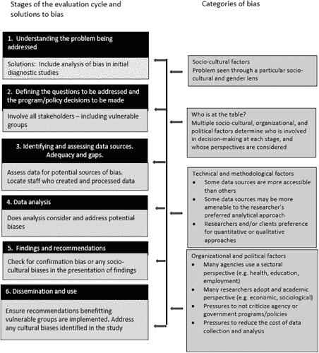

*图 3.1* 评估周期阶段与偏差解决方案。

### 融入价值观（公平、种族平等、性别等）

我们之前论证过，所有研究人员和评估者，包括使用大数据的人员，都通过一套特定的社会文化、专业和组织透镜来构建他们的研究。这是不可避免的，价值观有助于界定研究的目的和重点。

然而，重要的是价值观和视角应被明确化，并为研究人员和委托方所认识和理解。这并不总能做到，要么是因为研究人员没有意识到支撑其工作的假设和价值观，要么是因为他们可能不愿告知委托方他们带来的一些价值观。例如，一位在社会或经济正义、性别平等或特定族群权利等问题上有强烈个人承诺的研究人员，可能不愿明确这些立场，以免损害其赢得合同的机会。

### 大数据驱动评估的力量

#### 大型多组分项目的评估

虽然开发机构继续支持许多独立项目，但无论是在发展中国家还是工业化国家，都在向大型、综合、多组分的政策和项目转变(Sarker, 2021)。大数据和数据科学正在迅速开发工具和技术，以生成和分析建模及分析这些多部门项目所需的海量数据。在第 11 章中，Pete York(2025)展示了案例研究，说明这些新分析技术在美国政府机构、企业和非营利组织中的应用。随着发展中国家生成和管理大型数据集的能力增强，所有这些技术开始变得适用于发展中国家。第 11 章中描述的技术如下：

*   **`精准分析`(PA)** 是一种因果分析方法，它结合了主题专家、现有大数据集和机器学习算法，以构建高度准确、有效且可靠的评估、评价和决策工具。PA 评估方法训练机器学习算法，构建预测性、处方性和评价性模型，以确定是什么导致了每个目标人群细分（如个人、群体、组织或社区）的预期结果。这是通过利用历史大数据和/或项目管理数据开展准实验观察性研究来实现的。主题专家训练机器学习算法，在历史中寻找自然发生的实验，以确定过去曾为类似群体尝试过哪些干预措施，以及哪些努力随时间推移产生了最显著的积极成果。
*   **`公平影响平台(EquIP)`** 是一个地理空间大数据平台，用于评估非营利部门对公平社区改善的贡献。EquIP 将美国国税局(IRS)990 纳税申报表数据和人口普查局的美国社区调查(ACS)数据与 BCT 的`精准分析`建模方法相结合。该平台帮助资助方和捐赠者识别需求最迫切的社区，优先考虑边缘化社区，找到能最好地服务这些社区的最易接触的非营利组织，并获得关于这些组织需要何种财务和能力建设支持才能产生影响的评估性、预测性和处方性洞见。

## 将评估从事后问责转变为动态管理工具

根据本文作者的经验，许多（但肯定不是所有）资助和执行机构将监测与评估视为确保项目遵守其基于结果的管理(RBM)框架中既定目标的问责工具。大多数区域开发银行、许多双边机构和联合国机构都在使用 RBM。基于计算机的监测与评估(M&E)系统使得高效收集大量信息并以进度报告的形式呈现成为可能。然而，对许多机构而言，数据是按项目或办公室分别报告的，它们没有能力整合不同的数据集，也无法利用数据来改进项目绩效。

然而，新的分析工具正变得可用，使得来自不同项目、部门或机构的数据集可以合并到一个集成数据平台中。这些集成数据集正在将评估转变为动态管理工具，这些工具可以利用 AI 和机器学习应用分析技术（如自然实验的构建），从正在进行的项目活动中学习，提供快速反馈，并建议改进绩效的方法。

第 11 章(York, 2025)展示了一个案例研究，说明精准分析如何与因果建模相结合，以提高一家提供行为健康、教育和预防服务的多项目社会服务机构的绩效，该机构服务于经历情绪和行为困难的儿童和家庭(York, 2021)。

### 从自然语言处理(NLP)到自然语言理解(NLU)(PY)

随着项目评估的不断发展，对分析数据的更高效、更有效方法的需求日益增长。自然语言理解(NLU)作为一种有前景的项目评估方法应运而生，它利用先进算法自动分析大量非结构化定性文本数据，如项目报告、文件、访谈或焦点小组记录、开放式调查问卷和案例记录。

在本章中，我们将探讨使用 NLU 进行项目评估的潜在益处和挑战，以及其变革该领域的潜力。自然语言处理(NLP)及其子领域 NLU 的最新进展，使得定性数据分析过程的自动化以及效率、可靠性和有效性的提升取得了快速进展。大语言模型——利用深度学习算法处理海量文本数据以理解、生成和操控人类语言的计算机程序——正处于这些进展的前沿。特别是 Transformer 模型（转换器模型），如`BERT`(Bidirectional Encoder Representations from Transformers)、`GPT`(Generative Pre-Trained Transformer)和`RoBERTa`(Robustly Optimized BERT Pre-Training Approach)，是自然语言处理(NLP)中使用的一种大语言模型，最近已成为 NLU 领域的一项重大进展。这些模型利用自注意力机制来捕捉句子或文档中词语之间的关系，从而能够以更复杂的方式理解词语的含义和语境。

Transformer 模型在自然语言理解(NLU)领域的出现，极大地推进了自然语言处理(NLP)的能力，使得定性数据分析的自动化以及效率、可靠性和有效性的提升取得了快速进展。

对于项目评估而言，混合方法——结合定性和定量的数据收集、分析、综合与三角互证——代表了理想的方法。通过发挥两种方法的优势并弥补其局限性，可以更全面地理解项目实施和成果。

在 NLP 和大语言模型的协助下，项目评估者能够更准确、更高效地分析大量定性数据，实现项目评估中定性数据分析过程更加流线化、可靠和有效，从而能更有效地与定量数据分析相结合，发挥混合方法的优势。

# 利用 NLU 和大语言模型进行项目评估的潜力演示

为了演示自然语言理解（NLU）和大语言模型在项目评估中的潜力，我们将提供一个案例，该案例来自作者之一开展的一个用于评估的大数据科学项目。美国某大型都会公共交通系统希望分析一个包含 100,000 多条客户评论的数据库，这些评论通过电子邮件、电话和社交媒体帖子提交。为了制定基于证据的解决方案并开展严谨的研究与评估，该交通系统希望利用 NLU 技术对数据进行更深入的分析。具体而言，该系统旨在利用 Transformer 模型理解数据中与其变革理论相关的显性和潜在主题，目标是指导改进运营、为服务规划提供信息、支持安全、识别与系统服务和产品相关的有意义成果，以及识别支持其持续评估学习的新兴主题。通过这种方法，他们旨在高效、有效地自动从客户评论中提取有价值的见解，为关键系统领导者和管理者提供更准确的决策支持见解，最终目标是改善整体客户体验。

研究团队利用 Transformer 模型和机器学习算法的最新进展，开发了一套用于对文本数据进行准确可靠的定性分析的自动化流程，我们称之为“自动化主题建模”(ATM)。该方法通过多个项目开发和测试而成，这些项目分析了美国国家科学基金会(NSF)的大量提案和报告文档语料库，以评估其在科学投资以及扩大少数族裔在科学领域参与度方面的成效。

ATM 流程是一个“人在回路”流程，涉及数据科学研究人员与主题专家之间的协作。人类通过开发和完善编码方案来训练大语言模型，该方案应用于每份文档的每个文本块或段落。“人在回路”流程对于微调、验证以及确保解决偏见结果至关重要。ATM 始终在与项目利益相关者（包括组织和项目领导者、管理者和员工，以及内部研究人员和评估者）的密切协商下进行。

更具体地说，用于评估的 NLU 方法涉及几个关键步骤，以准备和分析文本数据用于项目评估。首先，对数据进行清洗和预处理，包括构建文本数据结构和整合评论上下文数据。接下来，训练 NLP 和 NLU 算法，为每条评论打上与其最相关的逻辑模型组件标签。此外，专家与大语言算法协作，在更广泛的逻辑模型组件（如投入、策略、产出）内，为每个构念迭代开发编码方案。然后将该编码方案应用于对每条评论与编码方案中每个选定的关键词和短语进行标记和相似度评分。最后，对结构化数据进行描述性、评价性和规范性分析，以回答研究问题。这些分析可以包括因果精度建模的使用，这是一种准实验方法，它训练机器学习算法来发现和评估自然实验。在整个过程中，始终保持“人在回路”方法，让项目利益相关者参与多次迭代，以确保结果的准确性和有效性。该方法的目标是自动化生成用于基于证据的决策的准确可靠见解。

在训练算法的过程中涉及多次迭代，这些步骤中的每一个通常需要三次或更多次迭代，都涉及关键项目利益相关者的参与，以征求他们的审查、验证、意见，并对编码方案进行完善，以确保训练结果准确有效。预测性机器学习算法（如随机森林）也用于微调过程，人类专家会标记 NLU 算法在将定性证据编码为逻辑模型构念方面是正确还是错误。所有这些“人在回路”训练过程确保了建模结果反映了参与项目实施人员的情境现实，使该过程更加可靠和有效。

一旦编码方案经过训练并实现自动化，算法就会被应用于交通系统评论的全量语料库，从而使交通系统具备了自动生成结构化描述性和评价性结果的能力，包括主题计数、概率、情感得分和其他指标。利用微软的`PowerBI`数据可视化软件，开发了一个动态交互式证据审查应用程序和一组评估仪表板，作为初步发现交付物，以及一个概念验证原型报告和决策支持工具。

总之，利用 NLP 和 Transformer 模型最新进展的用于评估的 NLU 方法，有潜力通过提供一种更高效、更有效的方法来分析大量非结构化定性文本数据，从而改变项目评估。涉及“人在回路”方法的 ATM 流程，允许进行准确可靠的定性数据分析，为利益相关者提供结构化的描述性和评价性结果。该方法已在一个用于评估的大数据科学项目中成功演示，它自动从客户数据库中提取有价值的见解，以改善交通系统的客户体验。

凭借构建基于证据的因果评估模型、决策支持工具和推荐引擎的能力，用于评估的 NLU 为推动项目评估领域的发展带来了巨大希望。

## 评估复杂项目和政策

开发界普遍认识到，大多数开发项目都是*复杂*的，因此开发项目和政策的评估也是复杂的。复杂性至少有四个主要维度：

*   项目涉及的多方利益相关者之间的相互作用，
*   多种外部因素（经济、政治、社会、人口、环境等）的影响，
*   干预措施本身的性质，以及
*   因果关系和变化的非线性过程。

发展干预措施在上述各维度上的复杂程度各不相同。Bamberger 和 Mabry（2020 第 16 章）开发了一份清单，包含一组指标，用于根据一组指标对这些维度中的每一个的复杂程度进行评分（评分范围为 1 = 复杂性极低 到 5 = 复杂性极高）。

该清单被用于评估 OXFAM 在黎巴嫩促进妇女获得司法公正的项目（Lombardini, Garwood & Hassnain, 2018）。

尽管广泛认识到许多项目是复杂的，但大多数发展评估仍继续使用线性设计（如大多数实验和准实验设计），这些设计无法捕捉复杂性。部分原因在于许多评估者的保守性，他们继续使用熟悉的线性评估设计，但一个主要因素是，许多应对复杂性的评估设计需要收集和分析更大量、更多样化的数据。

大量数据对于评估多重外部因素的影响以及进行纵向分析以追踪趋势至关重要。大型项目可能涉及多达 100 个不同的利益相关者（多个政府机构，每个机构包含多个不同的部门和层级；多个捐助机构和实施伙伴；此外还有民间社会组织、社区组织、研究机构、顾问和学术界，以及私营部门机构）。许多评估技术，如社会网络分析、系统动力学和地理空间分析，也需要使用强大的分析工具，而这些工具现在正变得可用。

本章第一节讨论的数据科学工具，使收集和分析许多类型复杂性分析所需的大量数据变得负担得起且容易得多，因此我们可以预期，对复杂性响应型评估的使用将稳步增加。

系统分析工具的使用也将增加，以对驱动许多大型发展项目的复杂交互过程进行建模和分析。

## 讨论

我们同意 Lazer(2021)以及 Nielsen、Mazzeo Rinaldi 和 Petersson（第 1 章；2025）的观点，即数据科学正在改变社会科学。然而，评估者采用这项新技术的步伐较慢，尽管据我们所知没有最新的统计数据可用，但我们的印象是，大多数项目评估并未使用数据科学，而在使用数据科学的评估中，许多仍仅将其作为数据来源，只有少数使用数据分析（参见 Nielsen, 2023；2025）。然而，正如第 1 章和本章所示，有各种数据科学工具和技术可用于加强评估过程的所有阶段——且其使用正在增加。

推动评估者采用数据科学的一个发展是，收割和转换行政数据供评估者使用变得越来越容易。虽然不如生成式 AI 的最新发展那样引人注目，但集成数据库和用户友好的文本分析软件的创建，极大地增加了可用于更复杂数据分析的数据量和类型。

许多评估研究面临的主要挑战之一是开发因果建模的方法，因此我们重点关注基于 AI 的因果建模，并辅以数据收割，以说明数据科学如何推动评估的前沿。第 11 章（York, 2025）也提供了一个示例，说明因果建模如何用于解决许多评估委托方关心的关键问题。

另一个重要领域目前受到评估者相对较少的关注，即复杂项目和政策的评估。虽然评估者和委托方都同意大多数评估包含复杂性维度，但大多数评估仍基于传统的线性模型。

原因之一是，许多复杂性方法要求收集和处理大量数据，通常涵盖更广泛的系统，以及项目实施所在的更长时间跨度，必须在此时间跨度内评估其影响和可持续性。

大多数传统的评估数据收集和分析方法难以应对这些分析挑战，特别是因为许多技术（如系统动力学和社会网络分析）要求收集和分析连续的实时数据流。数据科学令人兴奋的潜力之一在于收集和分析此类数据的能力（Bamberger & Zazueta, 2024）。

自然语言理解(`NLU`)，利用大型语言转换器模型，现在为评估界提供了一种具有成本效益且高效的机会，将定性数据结构化并整合到混合方法评估中。`NLU` 可应用于大量叙事数据集，以分析、构建和理解大量文本，包括人类研究人员无法手动全面分析的整个语料库。这些 `NLU` 算法和方法不仅增加了可用的定量数据，还通过增加社区背景、项目体验和结果的定性衡量指标，扩展了复杂项目评估中因果建模的广度。虽然利用 `NLU` 推进混合方法评估的机会正在扩大，但评估者需要留意解决数据中固有的偏见，以及 `NLU` 用于定性分析所产生的转换和使用中的偏见。

然而，认识并解决大数据的许多局限性也很重要。这些问题包括数据质量和数据偏见、算法偏见，以及大数据的阴暗面，包括网络犯罪、仇恨言论，以及关于操纵态度和行为方式的日益复杂的社会研究。

## 结论

大数据和数据分析在社会和经济研究评估中发挥着越来越重要的作用。迄今为止，评估行业采用这些新研究技术的步伐较慢（参见 York & Bamberger, 2020），目前需要弥合数据科学家和评估者之间的差距，包括在下一代评估者的培训项目中。资助和委托项目及政策评估的机构也需要调整提案请求(`RFP`)，以鼓励或至少允许在其委托的评估中使用大数据进行数据收集和分析。

为加速这种融合，必须跨学术界、工业界和政府建立战略联盟，以共享知识、开发能力并创造合作机会（另见第 13 章，Nielsen, 2025）。通过将创新的数据科学方法注入传统评估实践，我们可以极大地增强评估过程和结果。

随着我们不断前进，培养一种评估文化至关重要，这种文化不仅要利用大数据的描述性和预测性力量，还要时刻警惕保持最高的道德实践标准。这意味着要主动识别、理解和解决大数据及用于分析它的算法中固有的任何潜在偏见。

此外，大数据的演变不应被视为传统方法的替代品，而应被视为一种补充力量，丰富评估工具箱。传统评估专业知识与大数据分析的结合，有望更细致地理解项目动态，使评估者能够提供更具战略性和循证的建议。

总之，当我们站在评估科学新地平线的门槛上时，我们有共同的责任确保向大数据指导评估的过渡既无缝又合乎原则。在遵守专业和道德标准的同时拥抱数据分析的进步，将使我们能够以更清晰和自信的方式，照亮通往社会进步和政策有效性的路径。

## 注释

1. **A/B 测试** 广泛用于市场研究，旨在比较接受处理（产品摆放、更改广告字体样式）的群体与未接受处理的群体在结果（如在线点击量、店内购买量）上的差异。
2. **Ashfaque (2020)** 提出的特征包括：容量、速度、多样性、真实性、有效性、易变性、变异性、可行性和可视化。
3. **反身性的例子** 包括：人们在线交流的方式往往与面对面交流时不同；某些群体可能试图隐藏其身份（例如在社交媒体上更换照片、使用`VPN`网络以使其通信无法被追踪）。
4. 关于评估中价值观的更充分讨论，请参阅 Tashakkori、Johnson 和 Teddlie(2021)合著的*Fundamentals of mixed-methods research*第 1 章–第 3 章。


5. 本节基于 Bamberger 和 Zazueta 的 “Evaluating complex development programs: Integrating complexity thinking and systems analysis”（2025），收录于 Newcomer 和 Mumford 编辑的 *Research Handbook on Program Evaluation* 中。

6. 这篇由 3ie 发布的两部分博客概述了复杂性，并介绍了复杂性清单及其使用方法。

   - 博客第 1 部分：<https://www.3ieimpact.org/blogs/understanding-real-world-complexities-greater-uptake-evaluation-findings>

   - 博客第 2 部分：<https://3ieimpact.org/blogs/building-complexity-development-evaluations>

7. **黎巴嫩的妇女赋权**：<http://www.oxfam.org.uk/effectiveness>

8. <https://bmcmedresmethodol.biomedcentral.com/articles/10.1186/s12874-017-0349-x>

9. 数据成本日益降低的一个例子是利用卫星和遥感器收集数据，以进行严格的准实验设计，评估墨西哥一项保护森林覆盖率项目的有效性。以往的评估只能收集少数局部指标的数据。现在，卫星图像使得以更低的成本收集大量指标的信息成为可能，覆盖时间跨度更长、区域大得多（全球环境基金 2015）。

## 参考文献

1. **Ashfaque, J.** (2020). The 10 Vs of Big Data. Retrieved from Research Gate Feb 7 2020: <https://www.researchgate.net/publications/339107749>

2. **Bamberger, M.**, & Mabry, L. (2020). *Real World evaluation: Working under budget, time, data, and political constraints*. Thousand Oaks, CA: Sage Publications.

3. **Bamberger, M.**, & York, P. (2020). Transforming evaluation in the 4th. *Evaluation Matters*, African Development Bank 2nd Quarter: <https://idev.ifdb.org/sites/default/files/documents/files/EM%20Q2-2020-article1->

4. **Bamberger, M.**, & Zazueta, A.E. (2024). Evaluating complex development programs: integrating complexity thinking and systems analysis. In K.E. Newcomer and S.W. Mumford (eds.), *Research Handbook on Program Evaluation* (pp. 348–370). Edward Elgar Publishing.

5. **Bruce, K.**, Gandhi, V., & Vandelanotte, J. (2025). Emerging Technology and Evaluation in International Development. In S.B. Nielsen, F. Mazzeo Rinaldi and G.J. Petersson (eds.), *Artificial intelligence and evaluation. Emerging technologies and their implications for evaluation* (pp. 13–36). London: Routledge. <https://doi.org/10.4324/9781003512493>

6. **D’ignazio, C.**, & Klein, L. F. (2020). *Data feminism*. Boston, MA: MIT Press.

7. Global Environment Facility [GEF] (2015). *Impact evaluation of GEF support to protected areas and protected area systems*. 49th GEF Council Meeting. October 20–22, 2015, Washington, DC.

8. **Lazer, D.**, Hargittai, E., Freelon, D., Gonzalez-Bailon, S., Munger, K., Ognyanova, K., & Radford, J. (2021). Meaningful measures of human society in the twenty-first century. *Nature*, 595(7866), 189–196. <https://doi.org/10.5167/uzh-207351>

9. **Leeuw, F.** (2016). Understanding what is being evaluated: Theory-based evaluation. In M. Bamberger, M. Vaessen, and E. Raimondo (eds.), *Dealing with complexity in development evaluation*. Thousand Oaks, CA: Sage Publications.

10. **Lewin, S.**, Hendry, M., Chandler, J., Oxman, A.D., Michie, S., Shepperd, S., Reeves, B.C., Tugwell, P., Hannes, K., Rehfuess, E.A., Welch, V., Mckenzie, J.E., Burford, B., Petkovic, J., Anderson, L.M., Harris, J., & Noyes, J. (2017). Assessing the complexity of interventions within systematic reviews: Development, content and use of a new tool (iCAT SR). *BMC Medical Research Methodology*, 17, Article number: 76.

11. Lombardini, S., Garwood, R. & Hassnain, H. (2019). Women’s Empowerment in Lebanon. Impact evaluation of the project ‘Women’s Access to Justice’ in Lebanon. Effectiveness Review Series 2017/18. Great Britain: OXFAM. DOI: <http://doi.org/10.21201/2019.4764>

12. **Nielsen, S.B.** (2023). Disrupting evaluation? Emerging technologies and their implications for the evaluation industry. *New Directions for Evaluation*, 178–179, 47–57. <https://doi.org/10.1002/ev.20558>

13. **Nielsen, S.B.** (2025). The Evaluation Industry and Emerging Technologies. In S.B. Nielsen, F. Mazzeo Rinaldi and G.J. Petersson (eds.), *Artificial intelligence and evaluation. Emerging technologies and their implications for evaluation* (pp. 266–286). London: Routledge.

14. **Nielsen, S.B.**, Mazzeo Rinaldi, F., & Petersson, G.J. (2025). Evaluation in the Era of Artificial Intelligence. In S.B. Nielsen, F. Mazzeo Rinaldi and G.J. Petersson (eds.), *Artificial intelligence and evaluation. Emerging technologies and their implications for evaluation* (pp. 1–12). London: Routledge. <https://doi.org/10.4324/9781003512493>

15. **Salganik, M.J.** (2019). *Bit by bit: Social research in the digital age*. Princeton, NJ: Princeton University Press.

16. **Sarker, I.H.** (2021). Data science and analytics: An overview from data-driven smart computing, decision-making and applications perspective. *SN Computer Science*, 2(377). <https://doi.org/10.1007/s42979-021-00765-8>

17. **York, P.** (2021). Unlocking real-time evidence for practitioners: How evaluation and data analytics are generating on-demand, actionable evidence for front-line practitioners at First-Place for Youth and Gemma Services. Retrieved from Project Evident: <https://projectevident.org/wp-content/uploads/2022/09/FPFY-GemmaActionableEvidenceCaseStudyJul21.pdf>

18. York, P. (2025). The Future of Evaluation Analytics: Case Studies of Structural Causal Modeling in Action. In S.B. Nielsen, F. Mazzeo Rinaldi and G.J. Petersson (eds.). *Artificial intelligence and evaluation. Emerging technologies and their implications for evaluation* (pp. 219–241). London: Routledge. [`doi.org/10.4324/9781003512493`](https://doi.org/10.4324/9781003512493)

19. York, P., & Bamberger, M. (2021). Measuring results and impact in the age of big data: The nexus of evaluation, analytics, and digital technology. New York, NY: The Rockefeller Foundation.

# 4 评估者数据科学中的伦理与公平

Nathan Greenstein and Sung-Woo Cho

DOI: [10.4324/9781003512493-4](https://doi.org/10.4324/9781003512493-4)

本章已根据 CC-BY-NC-ND 4.0 许可提供。

## 引言

数据科学为各学科的从业者解锁了强大的工具。正如这些工具能帮助善意的行为者完成没有它们就不可能或不切实际的有价值工作一样，它们也能帮助疏忽或恶意的行为者造成新形式的伤害。此类伤害范围可从侵犯隐私到公开歧视，其影响往往与评估者关注的下游结果交织在一起。在一个令人震惊的案例中，密歇根州的一名黑人男子因有缺陷的人脸识别技术被错误逮捕，并在获释前被拘留了三十小时。正如我们将探讨的，评估者的介入本可以避免这一令人不安的结果。

有几个因素使得伦理与公平在数据科学背景下显得尤为重要。首先，许多数据科学工具的触达范围比传统替代方案更广，而人工监督却更少。扩大触达范围可能会加剧不当做法的后果，而减少监督可能会限制专家发现和纠正问题的能力。其次，一些从业者假设数据科学工具会自动处理伦理与公平问题，或者认为采用机器智能使得伦理与公平变得过时。正如我们将探讨的，这两种假设都不一定可靠；大量文献记录了数据科学可能放大人类的缺陷，并引入其自身的问题（Mehrabi 等，2021）。最后，数据科学工具使问责问题复杂化：当数据和算法导致伦理或公平失范时，它们无法像个人和组织那样进行赔偿或参与司法系统。综合这些因素，迫切需要投资于数据科学工具的评估与监测，并聚焦于伦理与公平。

这一需求并未被忽视。自 2018 年以来，欧洲委员会已发布了人工智能伦理使用指南（人工智能高级别专家组，2018；提案，2021）。联合国教科文组织和经合组织也发布了各自的建议（联合国教科文组织，2021；经合组织法律文书，2019）。此外，一旦被发现，伦理与公平违规行为会引发媒体关注。尽管数据科学的成熟速度快于治理机构的反应，但趋势表明社会正转向对伦理与公平实施更严格的监管——并提高公众意识。

这赋予了有良知的评估者双重责任：(a) 在**自身工作中**负责任地运用数据科学工具，以及 (b) 研究其**评估对象**所涉及的任何数据科学工具的伦理与公平性。本章旨在帮助评估者应对这一挑战。

本章的三部分结构以一种与评估者的技能和职责相一致的方式探讨伦理与公平。第一部分侧重于理论。它探讨了思考伦理与公平的方式，以及违规发生的方式。后续部分将这一基础应用于评估实践。第二部分讨论评估者如何在自己的工作中负责任地采用数据科学工具，第三部分探讨评估者如何通过伦理与公平的视角研究和监测现有的数据科学应用。这三个部分最好按顺序阅读。

### 定义与违背数据科学中的伦理与公平

本节梳理了在数据科学背景下理解伦理与公平的几种方式。本节包含三个部分，每个部分代表数据科学的一个侧面。第一部分聚焦于**大数据**，即许多数据科学工具的原始材料。后续部分各自涉及此类工具的一个广泛用例：第二部分涵盖**解读与生成信息**，第三部分涵盖**制定现实世界决策**。我们建议按顺序阅读各部分。

没有放之四海而皆准的伦理与公平框架。本节无法面面俱到，也不是唯一“正确”的框架。在此，我们希望帮助评估者驾驭这种不确定性，并鼓励结合本章引用的文献及其他视角进行独立反思。

#### 大数据

正如本卷 Bruce 等 (2025) 所详述，“大数据”具有产生量大、速度快、结构多样的特点。示例包括社交媒体帖子、信用卡交易和卫星图像。评估者利用大数据的几种方式已在本卷前几章中回顾，并将在案例研究中进一步探讨。

在伦理与公平的背景下，大数据的两个特质尤为突出。首先，大数据通常以相对被动的方式收集：例如，利用卫星图像比实地观测的侵入性小。其次，大数据往往代表的人群比传统抽样来源更多。例如，在社交媒体发帖的人远多于回复调查问卷的人。这些差异可能导致从业者不当地忽视伦理与公平。一种观点认为，如果数据是以非侵入性方式收集的，就不存在伦理违规的机会。第二种观点认为，大数据的规模使其天生具有民主性和公平性。遗憾的是，这两种观念未必成立，这给评估者留下了重要的角色。以下段落重点强调四个关键概念：**知情同意**、**代表性**、**准确性**和**范围**。

**知情同意：** 未经同意侵犯他人隐私可能是不道德的，且若对弱势群体产生不成比例的影响，则可能既不道德又不公平，这点无可争议。这延伸至数字隐私，一项国际公认的权利（Nyst & Falchetta, 2017）。然而，这些概念在大数据背景下可能被不当地忽视。例如，从业者可能认为，如果信息公开可用或易于获取，则与隐私无关。但可以认为，如果数据对寻求收集者真有价值，那么它对被描述的人也有价值（Ioannidis, 2013，第 40 页）。人们可能还倾向于认为，如果数据经过匿名化且收集规模足够大，没有哪个个体会凸显到足以损害其隐私的程度。不幸的是，匿名数据有时可被重新识别（Emam 等，2011），且侵犯一个人的隐私不能因为同时也侵犯了其邻居的隐私而被原谅。^()

社交媒体提供了若干例子。2008 年，哈佛大学的研究人员发布了学生 Facebook 个人资料的数据（Zimmer, 2010）。尽管已努力对数据进行匿名化处理，但数据很快被重新识别，引发了强烈反弹（Parry, 2011）。学生既未被告知数据收集事宜，也未被征求同意。随后，Facebook 对其 70 万用户进行了研究，声称用户在创建账户时已表示同意（Kramer 等，2014）。


在考量大数据时，评估者应评估收集过程是否符合充分的知情同意标准。这应从一般性和比较性两个层面探讨：如果弱势群体获得同意的机会比其同龄人少，或者隐私丧失可能对其成员造成不成比例的伤害，那么违背伦理也可能意味着违背公平。一些知情同意要求是由法律强制规定的，例如《通用数据保护条例》（欧洲委员会，n.d.）。此类监管标准在特定情境下可能严格到位，也可能不够严格。

### 代表性

通常，大数据最多地代表那些产生数据最多的人群。例如，信用卡数据可能低估了更倾向于使用现金的群体。审查、宣传和虚假信息也会影响代表性。例如，某些声音可能因社交媒体网站的限制而消失（Sundara Raman 等，2020），被有偏见的内容审核抹除（Haimson 等，2021），或被宣传和虚假信息运动淹没（Salaverría & León, 2022）。相比之下，在传统研究中，研究者往往会主动寻找难以触达的群体，以获得有代表性的样本。因此，依赖大数据时，研究者有系统性地排除相关数据中代表性不足人群的风险（Lerman, 2013）。

例如，波士顿市通过一款面向市民的智能手机应用收集需维修道路的数据。结果很可能过度代表了更可能拥有智能手机的年轻、高收入人群常去的社区。若缺乏评估和监测，此类项目可能会通过将基础设施投资从数据中代表性不足的弱势群体社区转移走，从而加剧不公平（Barocas & Selbst, 2016，第 685 页）。在考量大数据时，评估者应探究数据描述了谁，以及谁可能被剥夺了发声权。

### 准确性

不准确的数据一旦被采纳行动，就会伤害其（错误）代表的对象。在大数据情境下，数据收集往往缺乏人工监督、未经同意，或缺乏提交更正的机制（Zimmer, 2010，第 322 页），这增加了风险。当数据对弱势群体的代表准确度低于其同龄人时，伦理问题就演变成了公平问题（Barocas & Selbst, 2016，第 684 页）。这可能源于人为歧视——例如技术人员对某些群体关注度较低——或被动产生，类似于“代表性”部分讨论的机制。无论哪种情况，由此产生的数据都可能造成或放大不公平，并因不准确而增加不道德对待的风险。

例如，许多人脸识别系统对白人男性面部的识别效果最好（Buolamwini & Gebru, 2018）。因此，依赖人脸识别数据得出的结论，对弱势群体可能存在不成比例的错误倾向。若不干预，这些错误可能导致伤害（Buolamwini & Gebru, 2018，第 3 页）。因此，在考量大数据的使用时，评估者应考虑不准确性带来的风险，尤其是对弱势群体产生不成比例影响的风险。准确性难以监管，但评估者可以制定适合特定情境的标准和监测策略。

### 范围

伦理研究指南强调将潜在危害降至最低（NCPHSBBR, 1979），这可能涉及仅获取“完成研究所需的最低限度信息”（VPRI，n.d.，第 F.1 节）。这在常规研究中无可争议，但在大数据中可能被不当忽视，尤其是源自智能设备的数据（Li 等，2016）。当收集或使用大数据带来任何风险（包括隐私风险）时，评估者应探究是否可以通过减少参与者数量、减少每位参与者的数据点，或使用粒度更粗的聚合数据来满足需求。

### 解读与生成信息

数据科学工具能从结构、规模或范围导致人工难以解读的数据中挖掘含义。工具还可利用数据中的模式生成新素材，如文本转语音模型和 `ChatGPT` 等大语言模型。本节重点关注此类工具将数据重塑为结构化信息、使其成为研究对象或交付成果的用例。从业者据此决定如何对待人、地点或事物的其他用例，将在下文单独论述。在这两种情况下，评估者在确保数据科学工具合乎伦理且公平地使用方面都发挥着重要作用。

人们很容易认为，用数据科学解读或生成信息是一种不涉及伦理或公平影响的客观操作。此外，可能会觉得既然数据科学工具比人类更不易受偏见和疲劳影响，其输出就更合乎伦理和公平。遗憾的是，情况并非总是如此。评估者有责任评估和监测此类用例。以下段落重点介绍四个需考量的伦理与公平概念：`problematic data`（有问题的数据）、`human bias`（人为偏见）、`pre-trained tools`（预训练工具）和 `misinformation`（虚假信息）。

### 有问题的数据

**有问题的数据**极易产生有问题的结果，即使未收集新数据亦是如此。例如，重新解读未经同意收集的数据可能进一步造成伤害，或许会加深隐私侵犯或复合下游效应（Zimmer, 2010，第 315 页）。同样，从先前因代表性或准确性不足而收集的数据中得出新结论，可能会放大收集阶段引入的危害风险（Shankar 等，2017，第 4–5 页）。因此，若缺乏评估和监测，解读或生成信息可能会加剧伦理和公平的违背，即使未收集新数据。在考量用机器学习解读或生成信息时，评估者应结合本节第一部分提出的关切点，对源数据进行审慎审视。

### 人类偏见

**人类偏见**构成了有问题数据的一种特定情况。大量证据表明，人类在做出判断时会以牺牲弱势群体利益为代价表现出偏见，即使当事人初衷良好且未意识到自身的偏见。这在医疗保健（FitzGerald & Hurst, 2017）、银行业（Korver-Glenn, 2018）到刑事司法（Kovera, 2019）等领域均属实。这种偏见在解读和生成信息的背景下至关重要，因为某些数据科学工具经过训练旨在复制人类判断。例如，评估者可能使用数据科学工具来加快证据审查的筛选过程（Rathbone et al., 2015），或为定性编码确定相关文本的优先级（Mills De La Rosa et al., 2021, p. 5）。不幸的是，在审阅摘要时，人类很可能对低收入国家存在偏见（Skopec et al., 2020）。基于人类决策训练的数据科学工具往往会复制此类偏见（Mehrabi et al., 2021），可能导致证据审查的不公平。

当然，偏见在人类行为中是有害的，但数据科学工具通常涉及更广的影响范围、更少的监督和不明确的问责制。因此，在考虑使用数据科学来解读和生成信息时，评估者应调查这些工具是否基于有偏见的人类判断进行训练，以及是否采取了足够的对策。

### 预训练工具

**预训练工具**常用于分析文本、标记照片、处理人脸等。即使所有特定项目的数据都符合伦理和公平标准，有问题的预训练模型也可能破坏结果，从业者可能无意中传播伦理和公平违规行为。这在多种情境中均有观察到：语言模型表现出性别偏见（Bolukbasi et al., 2016），图像识别模型表现出地理位置偏见（Shankar et al., 2017），人脸分析模型表现出种族和性别偏见（Buolamwini & Gebru, 2018）。因此，评估者应考虑有问题的数据和人类偏见的两个实例：一个适用于特定项目的数据，另一个适用于预训练工具中内置的数据。

### 误导信息

**误导信息：** 从不准确信息得出的结论可能导致危害。例如，扫描捏造的博客文章可能让政策制定者对公众情绪产生不准确的理解，或基于有缺陷文献的证据审查可能推荐有缺陷的干预措施。此外，由于下游后果往往不成比例地影响弱势群体，不准确性可能造成或巩固不公平。遗憾的是，数据科学工具可能生成不准确信息，无论是无意的还是作为虚假信息运动的工具。例子范围从虚构研究文章的可信引用（Walters & Wilder, 2023）到公众人物引人入胜但捏造的视频（Hancock & Bailenson, 2021）。

来自数据科学工具的误导信息尤为成问题，因为它生成效率极高，且可能比人类生成的误导信息更具说服力（Spitale et al., 2023）。此外，由于数据科学工具所具有的广泛触达、有限监管和不明确问责等熟悉的动态特性，风险进一步加剧。更普遍地说，此类工具可能表现出不可预测的行为，其方式可能毫无预警地发生变化，且人类无法完全理解（Bowman, 2023）。因此，当使用数据科学工具生成信息时，评估者应调查误导信息带来的危害风险，以及是否有足够的保护措施到位。

## 做出现实世界决策

在许多应用中，数据科学工具协助或取代人类，决定如何对待人、动物、地点或事物。示例包括根据简历决定哪些求职者应进入下一轮（Dastin, 2022）、确定优先让哪些新入学大学生获得顾问的早期联络（Greenstein & Crider-Phillips, 2023），以及基于无人机影像确定资源受限的公共卫生干预措施的目标对象（Liu et al., 2022）。一些数据科学工具能利用的信息量超出任何人类决策者的综合能力，或挖掘出人类难以察觉的过于复杂或混乱的模式。考虑到这一点，一些从业者假设机器决策不受人类偏见、疲劳和疏忽导致的问题影响。不幸的是，这一假设并不可靠。因此，评估者应审查这些工具的应用中对伦理和公平的威胁。

评估者尚未在自己的工作中广泛采用此类数据科学工具。然而，潜在用例确实存在：评估机构可能使用数据科学筛选求职者，将昂贵的实地访问定向至最不可能遵守项目模式的特定地点，或梳理投诉热线的通话录音以确定哪些最可能需要后续跟进。此外，评估者可以且应被要求评估其他领域的此类数据科学应用，这使得理解相关的伦理和公平概念变得重要。

本节建立在前两节的基础之上，因为上述发现的大多数伦理和公平概念在此仍然适用。然而，这种决策情境具有更高的即时危害潜力，值得进一步阐述。在此，我们延伸上文介绍的伦理和公平概念，并引入针对现实世界决策特有的新概念。为此，我们涵盖*有问题的数据*、*人类偏见*、*透明度*和*部署策略*。

### 有问题的数据

**有问题的数据**可能导致有问题的决策。评估者应探查任何相关数据在知情同意、代表性、准确性和范围方面的伦理和公平问题，如前文第一部分所述。此外，如果所利用的数据本身已由数据科学工具解读或生成，则应参照上文讨论，对该过程进行有问题的数据、人类偏见和误导信息方面的评估。深思熟虑的分析在此至关重要，因为当数据科学工具用于现实世界决策时，底层数据中即使是微小的缺陷也可能导致严重危害。

如前所述，许多人脸识别工具对弱势群体的准确性较低（Buolamwini & Gebru, 2018）。研究将这种不公平与训练数据中弱势群体的不公平代表性联系起来（Klare et al., 2012, pp. 1798–1799）。当人脸识别工具用于做出现实世界决策时，例如某人是否应被指控犯罪，后果可能变得严重。例如，密歇根州的一名黑人男子因有缺陷的人脸识别软件而被错误监禁（Barrett, 2020, p. 246; Hill, 2020）。如果对该警方部门使用人脸识别的行为进行过评估，该工具训练数据中的代表性问题本可被识别和解决，从而防止这一令人震惊的结果。

然而，即使决策工具的训练过程符合伦理且公平，数据本身仍可能引发问题。通常情况下，工具部署后，会对其从未遇到过的人或事物做出决策。如果这些新实体的描述存在问题，由此产生的决策就会有缺陷。例如，考虑一个基于患者病史制定医疗建议的模型。研究表明，属于弱势群体的个体不太可能充分信任医疗专业人员而披露敏感信息（Bernstein et al., 2008），导致健康数据出现准确性差异。人们可以设想一个假设的数据科学工具，其训练数据克服了这一问题，例如来自患者信任度高的特定文化响应型诊所的病史。即使该工具本身无偏见，当在不同情境下重新应用时——例如弱势患者信任度较低的更典型的诊所——输入工具的新数据对这些弱势患者而言可能准确性较低。因此，向他们发出的建议可能系统性地不那么适宜，从而加剧健康差异。因此，评估者应将对问题数据的排查范围扩大，纳入日常运营中传递给成熟工具的新数据。

### 人类偏见

**人类偏见：** 正如本节前文所述，人类决策者往往存在偏见，且这些偏见常在其不知情或无意图的情况下表现出来。这与上述动态相呼应：当数据科学工具使用人类做出的决策进行训练时，人类偏见极易被复现；若不加干预，工具无法区分其观察到的有偏见的人类行为与从业者期望其采纳的公平行为。此外，触手可及范围扩大、监管减少、问责不清这些熟悉的因素意味着，数据科学工具放大人类偏见的程度远不止简单复制。在决策情境中，这可能导致无法估量的危害。

在一个开创性的案例中，调查人员发现 `COMPAS`（一种用于预测再犯罪并辅助美国各地刑事司法决策的工具）存在种族偏见。人们认为，过去人类决策中的种族偏见——例如将警力和监控重点放在何处——是罪魁祸首（Angwin et al., 2016；Mehrabi et al., 2021, p. 5）。若不加遏制，结果将导致美国非白人在司法系统中受到不公正待遇，对当事人及其赖以生存的人造成深远且持久的影响。若能审慎评估伦理与公平，当局本可以设想出一种用于此目的的决策工具，从着手对抗根深蒂固的人类偏见，而非模仿它们并以机械化的效率将其施行。

### 透明度

**透明度：** 许多数据科学工具被视为“黑箱”，即在几乎无法洞悉决策为何或如何达成的情况下做出裁决。这在某些情境下是可以接受的，但在其他情境下却可能对伦理和公平构成障碍。例如，病理学家已开始利用数据科学辅助诊断决策。然而，有人认为医疗专业人员有伦理义务证明诊断是为何以及如何得出的。

### 部署策略

**部署策略：** 在某些情况下，同一工具在一种情境下可用于符合伦理和公平的决策，在另一种情境下却可能被有问题地实施。例如，`ShotSpotter` 是一种枪声检测产品，部署在许多美国城市的街道上。该产品记录音频，当检测到噪音时，利用数据科学辅助决定是否通知警方发生了枪击。遗憾的是，许多部署将该产品集中在有色人种社区，加剧了种族差异性警力部署和监控的现有负担（Stanley, 2021；MacArthur Justice Center, n.d.）。因此，该工具的采用巩固了现有的不平等，尽管它能以同等准确度检测所有种族人员发出的枪声。监测和评估本可为一种替代部署策略提供依据，旨在克服这一缺陷，避免对潜在弱势社区造成进一步伤害。

## 以符合伦理和公平的方式使用数据科学进行评估

正如本书全篇所示，数据科学对评估有重要贡献。本节旨在帮助评估者将数据科学工具应用于工作中，并以优先考虑伦理和公平的方式进行。为此，它将前一节提供的理论框架付诸具体实践。下文详述了评估者评估拟议的数据科学用途的伦理和公平性的以下流程：(a) 确定相关的伦理和公平概念，(b) 依据各概念评估提案的风险，(c) 确定潜在解决方案和/或对提案的修改，以及 (d) 决定是否继续。鉴于评估者目前主要使用数据科学工具来收集和处理数据，本节侧重于大数据以及使用数据科学工具解释和生成信息（均在本章第一节介绍）。

由于前一节提供的框架在置于特定情境中时最为有用，我们鼓励评估者首先充分完善其拟议的数据科学工具用法。通过具体明确目标、技术细节和实施策略，评估者将能更严肃地对待伦理和公平问题。

此外，为有意义地开展这一工作，评估者应暂停并回答一系列框架后续工作的挑战性问题。以下问题旨在结合所考虑的提案，确立伦理和公平的具体标准。

1. 若发生伦理或公平违规，谁面临最大的伤害或忽视风险？谁将获益？
2. 现状或该提案的传统替代方案给伦理或公平带来的基线风险水平是什么？
3. 该提案的潜在收益能证明多大程度的伦理或公平风险是合理的？
4. 还应寻求哪些额外的声音以忠实探讨上述问题？如何最好地建立共识？

严谨应对这些问题可能需要研究和审议，尤其是首次进行时。尽管如此，我们敦促评估者投入必要的耐心和资源，像对待其他任何重要的方法论决策节点一样对待这一练习。此外，我们要求评估者在*进一步推进前*解决这些问题，以防观察到的风险水平事后影响其被判断的标准。

自此，评估者可着手应用本章第一节给出的框架。通常，此过程始于确定可能相关的伦理和公平概念。随后可依据各相关概念探讨提案。我们建议 (a) 确定是否存在对伦理或公平的风险；若存在，则 (b) 选择如何量化该抽象风险。

在识别出风险后，评估者可以考虑技术解决方案和/或对原始提案的修正。幸运的是，技术措施可以缓解某些风险，包括源数据中各种偏见带来的风险（Mehrabi 等，2021，第 15 页）、语言模型中的性别偏见（Bolukbasi 等，2016，第 11–14 页）、图像识别模型中的位置偏见（Yang 等，2020）以及面部分析模型中的种族偏见（Klare 等，2012，第 1798–1799 页）。其他风险通常可以通过改进原始提案来解决，例如加强知情同意要求或提供防范人为偏见的保障措施。

最终，在识别出风险并探索了解决方案后，评估者必须就是否实施（修正后的）提案做出最终判断。这一选择应遵循通过上述四个框架问题预先确立的伦理和公平标准。为此，通常应重新邀请参与制定标准的利益相关者群体，以指导最终决策。

这一过程既需要研究，也需要深思熟虑（或许还需哲学层面的审慎思考），尤其是在没有单一明确答案的情况下。因此，我们强调耐心、内省和建立共识的重要性。这项工作很艰难，但我们希望评估者会将其视为防止制造或重演伤害与不公的一种值得采取的措施。

## 评估数据科学应用的伦理与公平性

正如数据科学能为评估者提供服务一样，评估也能为数据科学做出重要贡献。近期的技术进步创造了大量的评估和监测机会。其中最突出的，也是本节的重点，是数据科学工具的伦理与公平性影响。评估者处于独特的位置，能够在这片常被忽视的领域开展工作。在使用此处提出的框架设定适当的伦理与公平标准后，核心评估技能能优雅地迁移到剩余工作中。实质上，任务是观察一项干预，根据上述标准衡量具体的伦理与公平影响，传达发现，并推荐（随后监测）变更和/或后续干预。此外，由于这项工作极大地受益于多元视角，评估者将因其与多学科协作以及整合多种生活经验与专业知识的能力而获益良多。

本节的结构反映了前文介绍的数据科学的两大用例：第一部分涵盖信息的解读与生成，第二部分涵盖现实世界的决策制定。

### 解读与生成信息

在上一节中，我们为考虑使用数据科学来解读或生成信息的评估者建议了一个流程。当评估一项涉及使用数据科学工具解读或生成信息的现有干预时，推荐的流程与此类似：(a) 确定相关的伦理与公平概念，(b) 依据各个概念评估该干预的伦理与公平影响，(c) 确定潜在改进措施，以及 (d) 监测所实施解决方案的成效，以及该干预整体持续的伦理与公平影响。

关于该流程如何最佳实施的大纲，请读者参阅上一节。不过，我们要指出该流程在此语境下有两个关键不同之处。首先，当一项使用数据科学的干预已被实施，评估者并不总能在问题出现前预见并预防它们。相反，他们应寻求识别现实和潜在问题，衡量或估算其（潜在）影响，并利用调查结果改进干预。因为这一差异与评估者的核心能力——定义、衡量、建议后续行动和监测——高度契合，我们在此不再深入探讨。


第二个关键不同之处在于，评估用于非评估目的的数据科学，往往需要具备相关领域专业知识或生活经验的个人提供额外帮助。例如，在评估一项利用语言建模塑造灾害响应的干预的伦理与公平性时（Ragini 等，2018），评估者可能会咨询应急管理专业人士和受灾害影响的人群。考虑到传统评估熟悉寻求此类视角，我们也不在此深入讨论。

### 制定现实世界的决策

在评估一项使用数据科学工具制定现实世界决策的干预的伦理与公平性时，推荐流程与上述类似。关键区别在于流程第一阶段需额外探讨一个问题，即在定义将要应用的伦理与公平标准时。为求完整，下文列出了所有问题，但只有**问题 2**是新增的，现予以强调。

1. 如果发生伦理或公平失范，谁面临最大的伤害或忽视风险？谁将获益？

2. **在该语境下，何种行为构成有偏见、有害或不公正的决策？**

3. 现状或该干预的传统替代方案给伦理或公平带来的基线风险水平如何？

4. 该干预的潜在收益能证明多大程度的伦理或公平风险是合理的？

5. 还应寻求哪些额外的声音来忠实探讨上述问题？如何最好地建立共识？

鉴于我们在此语境下推荐的流程与上述流程的相似性，我们的重点在于如何探讨这一额外问题。

通常，作为被视为符合伦理和公平的前提，决策工具应为特权群体和弱势群体都产生可靠的结果。这在数据科学语境下很重要，因为几乎所有决策工具都涉及一定程度的误差，相较于它们被训练复制的观测结果或人类决策。如果将工具应用于弱势群体时的误差水平更高，则可以说该工具存在*“服务水平”差异*。这种不公平可以通过比较工具的误差水平来衡量。

其他形式的有偏见、有害或不公正的决策取决于特定干预的语境。最重要的是，评估者必须确定*为不同群体产生系统性不同决策*是有问题还是可取的。例如，一项旨在帮助农民做出农业实践决策的干预，可能涉及一个旨在预测作物产量的数据科学工具（van Klompenburg 等，2020）。该工具可能自然地、平均而言，为无法使用现代化肥或灌溉技术的农民预测更低的产量。在这种情况下，要求该工具为处境可比的农场建议可比的决策，而忽略其技术获取水平，可能会损害其对所有人的准确性，阻碍其帮助农民充分利用现有资源做出明智决策的能力。因此，为不同群体制定不同决策可能被视为可取，评估者可重点关注该工具是否为技术获取有限的农民提供了公平的服务水平。

相反，考虑一种用于决定新人寿保险单价格的工具（Jain et al., 2019）。如果该工具系统性地向黑人申请人收取比白人申请人更高的价格，即使种族与保单对保险公司的真实成本相关（Gaulding, 1994），该工具也会被视为不公平。因此，评估者可能会寻求确保该工具不会针对不同种族群体系统性地发布不同的决策。

在这类情况下，即不同群体的不同决策存在问题时，评估者必须确定如何衡量差异以及可以容忍何种程度的差异。例如，在考虑一种用于加快公司招聘流程的工具（Dastin, 2022）时，评估者可能要求其推荐女性面试的频率至少为男性的 0.95 倍。

此处考虑的根本问题——“在此背景下，何种行为构成有偏见、有害或不公正的决策？”——是一个复杂的问题。最终，选择最合适的标准取决于评估者、主题专家、有亲身经历的人以及他们所接触的其他利益相关者。然而，存在一系列工具和理念可指导这一形式化公平与公正的过程，Mitchell et al. (2021) 提供了有益的综述。我们认识到定义公平具有挑战性，并再次强调耐心、内省和建立共识的重要性。

一旦这个问题以及随附的其他四个问题尽可能具体地得到回答，评估者即可进入流程的下一阶段。此时，我们建议结合已设定的伦理和公平标准，应用本章第一节给出的框架。随后，正如上文所述，在发现（潜在）问题时，评估者应记录它们，寻求衡量或估计其下游影响，并针对原方案提出后续干预或改进，以及相关的监测措施和未来的重新评估。

具体改进可能包括替代数据源、程序变更或偏见缓解策略。上一节提到的缓解策略会有所帮助，针对决策制定的另一类特定技术也同样有用。这些技术可以帮助数据科学家重新调整现有工具，以符合（或接近符合）公平标准。Mehrabi et al. (2021, pp. 13–25) 对此类策略及其应用场景进行了综述。最后，此类缓解措施及其他改进或后续干预本身也可以被监测和评估，以评估它们是否达到预期效果，方法是使用本节所述的标准评估工具和流程重复。

## 结论

妥善运用，数据科学工具能为世界造福良多。在其帮助下，民选官员可能迅速了解来自更具包容性的公民群体的反馈。大学可能预测不良学业结果并通过支持进行干预，帮助弱势学生毕业。人类服务机构可能以前所未有的效率分配稀缺资源，改善更多人的生活。换个说法，数据科学可被用来对抗世界上持续存在的结构性不平等和不道德状况。

然而，若缺乏审慎的规划、评估和监测，数据科学工具可能会固化这些不平等，并引入自身的伦理违规。即使无恶意，民选官员可能排除无互联网接入选民的声音。大学可能将少数族裔学生引导离开具有挑战性的学习课程。人类服务机构可能复制过去决策者持有的偏见。在许多情况下，这些结果是默认的。在数据科学中，如同其他领域，传播世界的不完美比反抗它们更容易。

但我们认为，评估关乎反抗不完美。探索干预措施如何满足需求的目的，往往归根结底是发现如何最好地克服世界上的缺陷。我们主张，这不应与关注伦理和公平问题相分离。通过承担这项艰巨的工作，评估者能在将数据科学用于行善方面发挥变革性作用。我们希望本章能帮助评估者更自信地审视数据科学，并在自己的工作中负责任地采纳它。

虽然本章无法面面俱到，但旨在为任何与数据科学打交道的评估者提供一个考量伦理和公平的框架。部分读者可能会继续追求更深的数据科学专业知识，另一些人可能会继续担任与数据科学家合作的知情且尽职的促进者。无论如何，感谢您的阅读。

### 练习：数据科学与俄乌战争舆论

本练习旨在实践应用本章讨论的概念。我们重点关注将数据科学合乎伦理且公平地用于评估，正如本章第二节所讨论的，但参与本练习也将帮助读者做好准备，以应用第三节讨论的流程。在此，我们设想了一个评估者考虑使用数据科学来解读信息的假设提案，灵感来源于 Mazzeo Rinaldi et al. (2025) 在第 9 章中的工作。我们描述该提案，简要说明如何开始进行伦理和公平审查，并建议后续步骤。

我们的提案来自一个研究和平与冲突的假设评估小组。该小组正在启动一个项目，以了解受影响地区围绕俄乌战争的公众舆论。你发现自己身处项目团队中。调查结果将汇编成一份报告，供学者和从业者未来参考。为了衡量公众舆论，你们团队计划使用几种传统方法，如民意调查、问卷调查和当选官员话语分析。然而，团队认识到大量交流和自我表达发生在数字领域。此外，在冲突地区开展民意调查和问卷调查颇具挑战。因此，你们团队提议用大数据补充传统方法，并使用数据科学工具进行解读。具体而言，你们计划捕获几年内包含若干相关标签的所有推文。然后，使用一个名为 `emotion detection` 的数据科学工具，通过量化推文文本表现出的情绪来解读文本。结果将被分析并纳入项目的最终报告。

在推进此数据科学提案之前，你们团队正在评估其对项目伦理和公平的影响。你们首先提出本章第二节开头附近给出的四个问题，以建立可据以判断提案的伦理和公平标准。在此，我们提供一些简要指导，说明如何着手这些问题，并建议回答它们的后续步骤。

1. 如果发生伦理或公平违规，谁面临最大的伤害或忽视风险？谁将受益？

# 伦理与公平风险评估框架

## 1. 哪些群体面临风险，哪些群体将受益？

由于项目旨在加深对公众舆论的理解，高风险群体可能包括那些传统上未被赋予强有力声音表达意见的人群。这些群体往往已处于弱势地位，例如（但不限于）性别、种族、族裔、语言或宗教少数群体。信息、教育或连接获取受限的人群也可能面临风险。

同样，受益群体可能包括利益与弱势群体冲突的有权势者——换句话说，就是那些从弱势群体意见保持不被听见中获益的行为体。

> **后续步骤**：与其他利益相关者合作，完善这些建议，增加任何其他相关群体。将这些描述转化为您打算研究地区的具体人群或行为体。尽可能详细地勾勒出该提案可能如何影响他们。

## 2. 现状或传统替代方案带来的伦理或公平基线风险水平如何？

上述识别出的高风险群体在传统公众舆论研究中很可能得不到充分服务，因此该提案的替代方案中可能存在平行风险。

在民意调查和调查研究中，这些风险可以得到缓解，因为从业者可以针对特定的难以触达群体，并利用人口统计数据对回复进行加权，使样本更接近平衡。然而，在并非所有群体都可触达的情况下（如冲突时期），同样的风险可能会加剧。需要进一步研究以确定，若执行该提案，弱势群体被忽视的可能性是更大还是更小。

> **后续步骤**：与其他利益相关者合作，搜索文献以探索——并理想情况下量化——传统公众舆论研究中这些风险的规模和影响。承认您所能达到的确定性水平，无论它是什么。

## 3. 该提案潜在收益所能证明的伦理或公平风险水平是多少？

您认为分析数字空间对项目至关重要，并担心在冲突持续期间难以开展预期数量的民意调查和调查研究。因此，一定程度的风险很可能是合理的。

由于调查结果将以长篇报告形式传达，您有能力描述所用方法，并指导读者如何安全地解读结果，包括潜在局限性的警示。这可能会提高您的风险承受力。

> **后续步骤**：与其他利益相关者合作，进一步探讨为换取提案预期收益可容忍多少风险。尽可能量化答案，无论是通过选择具体指标并设定容忍阈值，还是通过设想各种场景并将其标记为可接受或不可接受。承认您所能达到的具体程度，无论它是什么。

## 4. 应寻求哪些额外声音以忠实探讨上述问题？如何最好地建立共识？

您寻求衡量意见的那些群体的代表，尤其是问题 1 中确定的弱势群体成员，很可能提供宝贵意见。项目报告预期受众的代表也可能有所帮助。

> **后续步骤**：制定策略以招募、补偿和确认其他利益相关者。考虑如何将他们的意见整合到此过程中，而不给他们造成过度负担，或招致他们可能因项目不良影响而被指责的可能性，因为该责任仍在于项目团队。考虑在不同利益相关者持有对立观点时，如何达成或接近共识。

> **后续步骤**：在解决上述问题后，评估人员可继续按本章第二节给出的框架推进。简言之，这包括：(a) 识别相关的伦理与公平概念；(b) 通过各概念评估提案风险；(c) 识别潜在解决方案及/或提案修改；(d) 在其他利益相关者帮助下，决定是否继续。该过程的其余部分留作读者练习，尽管 `表 4.1` 中给出了针对特定伦理与公平概念的提示。

### 表 4.1 建议的与练习相关的伦理与公平概念

| 类别 | 概念 | 相关性 |
| :--- | :--- | :--- |
| 大数据 | 知情同意 | 用户是否同意其社交媒体帖子被用于研究尚有争议。详见本章第一节讨论。 |
| 代表性 | 代表性 | 并非所有群体都平等享有技术和连接。一些政府封锁社交媒体。社交媒体数据缺乏评估代表性所需的人口统计信息。 |
| 准确性 | 准确性 | 审查和错误信息可能以难以衡量的方式影响准确性。这可能对弱势群体产生不成比例的影响。 |
| 范围 | 范围 | 研究或许可用更少的推文完成，例如通过较小的标签集、较短的时间段，或仅对每周一天进行抽样。 |
| 解读与生成信息 | 有问题的数据 | (见上表前几行) |
| 解读与生成信息 | 预训练工具 | 情绪检测工具通常是预训练的。它们可能无法对所有群体同等良好地执行，性能可能因语言、方言或写作水平而异。并非所有工具都提供关于其训练方式的透明度。 |

## 注释

1. **所有权与正当访问问题** 可类似于知情同意问题进行探讨。例如，如果数据集包含创意作品，创作者是否同意其作品用于此目的？从业者是否合乎道德地访问和处理了作品？创作者被确认或补偿的方式是否存在不公平？

2. **复杂工具**（如 `ChatGPT`）基于庞大且保密的数据进行预训练。一些报告甚至表明，此类工具的开发者拒绝保留训练记录，以避免面对伦理问题 (Schaul et al., 2023)。在这种情况下，评估人员必须权衡工具收益与其对伦理和公平产生的不确定影响所带来的风险。

3. **偏见** 有时可能纯粹源于数据科学算法的数学内部运作 (Mehrabi et al., 2021, p. 7)，尽管这种情况较少见。因此，即使所有数据被认为无偏见，仍有必要评估决策工具的输出。详见第三节。

4. 人类严格解释自身决策的能力**存在局限**。根据某些定义，某些数据科学工具因此可被认为比人类提供更多透明度。在考虑数据科学工具的透明度时，评估人员可能还希望确定现状或该工具替代方案提供的透明度水平。

5. **量化风险** 取决于语境及所考虑的伦理与公平概念。某些方法可能是抽象的，例如按特定隐私侵犯可能造成的危害程度对人群排序。其他方法可能是具体的，例如直接比较群体在数据中的代表份额与其在目标人群中的真实份额。我们要求评估人员在此步骤中尽可能具体，以推动自身负责。

## 正文内容

6. 观察到本节要求对伦理和公平性进行比评估人员通常应用于传统方法更深入的评估，这是合理的。这可能是事实，但我们质疑“传统审查程度是或曾经足够”的假设。此外，我们强调，正如本章引言所述，违反伦理和公平性造成的潜在危害在数据科学背景下可能会被放大。

7. 衡量误差有多种方法（Botchkarev, 2019；Naidu et al., 2023），工具开发期间使用的指标并不总是适合衡量服务均等性的水平。评估人员（很可能与数据科学家合作）应考虑哪些结果对伦理和公平性影响最大，然后选择能够捕捉这些结果的指标。

8. 历史上，美国设定的类似标准为 0.8（Feldman et al., 2015, p. 2）。

## 参考文献

1. Angwin, J., Larson, J., Mattu, S., & Kirchner, L. (2016, May 23). Machine Bias. *ProPublica*. [`www.propublica.org/article/machine-bias-risk-assessments-in-criminal-sentencing?token=p-v0T1xjfOJ8jrJHzc08UxDKSQrKgWJk`](https://www.propublica.org/article/machine-bias-risk-assessments-in-criminal-sentencing?token=p-v0T1xjfOJ8jrJHzc08UxDKSQrKgWJk)

2. Barocas, S., & Selbst, A. D. (2016). Big Data’s Disparate Impact. California Law Review, *104*(3), 671–732.

3. Barrett, L. (2020). Ban Facial Recognition Technologies for Children—And for Everyone Else. *Boston University Journal of Science and Technology Law*, *26*(2), 223–285.

4. Bernstein, K. T., Liu, K.-L., Begier, E. M., Koblin, B., Karpati, A., & Murrill, C. (2008). Same-Sex Attraction Disclosure to Health Care Providers Among New York City Men Who Have Sex with Men: Implications for HIV Testing Approaches. Archives of Internal Medicine, *168*(13), 1458–1464. [`doi.org/10.1001/archinte.168.13.1458`](https://doi.org/10.1001/archinte.168.13.1458)

5. Bolukbasi, T., Chang, K.-W., Zou, J. Y., Saligrama, V., & Kalai, A. T. (2016). Man Is to Computer Programmer as Woman Is to Homemaker? Debiasing Word Embeddings. Advances in Neural Information Processing Systems, *29*, 1–25.

6. Botchkarev, A. (2019). A New Typology Design of Performance Metrics to Measure Errors in Machine Learning Regression Algorithms. Interdisciplinary Journal of Information, Knowledge, and Management, *14*, 45–76.

7. Bowman, S. R. (2023). Eight Things to Know about Large Language Models (arXiv:2304.00612). arXiv. [`doi.org/10.48550/arXiv.2304.00612`](https://doi.org/10.48550/arXiv.2304.00612)

8. Bruce, K., Vandelanotte, J., & Gandhi, V. (2025). Emerging Technology and Evaluation in International Development. In S. B. Nielsen, F. Mazzeo Rinaldi, & G. J. Petersson (Eds.), *Artificial Intelligence and Evaluation.* *Emerging Technologies and Their Implications for Evaluation* (pp. 13–36). London: Routledge. [`doi.org/10.4324/9781003512493`](https://doi.org/10.4324/9781003512493)


## 参考文献

9. Buolamwini, J., & Gebru, T. (2018). Gender Shades: Intersectional Accuracy Disparities in Commercial Gender Classification. *Proceedings of the 1st Conference on Fairness, Accountability and Transparency*, 77–91. [`proceedings.mlr.press/v81/buolamwini18a.html`](https://proceedings.mlr.press/v81/buolamwini18a.html)

10. Dastin, J. (2022). Amazon Scraps Secret AI Recruiting Tool That Showed Bias against Women. In *Ethics of Data and Analytics* (pp. 296–299). Auerbach Publications. [`doi.org/10.1201/9781003278290-44`](https://doi.org/10.1201/9781003278290-44)

11. Emam, K. E., Jonker, E., Arbuckle, L., & Malin, B. (2011). A Systematic Review of Re-Identification Attacks on Health Data. *PLoS ONE*, *6*(12), e28071. [`doi.org/10.1371/journal.pone.0028071`](https://doi.org/10.1371/journal.pone.0028071)

12. European Commission. (n.d.). How Should My Consent Be *Requested?* Retrieved October 23, 2023, from [`commission.europa.eu/law/law-topic/data-protection/reform/rights-citizens/how-my-personal-data-protected/how-should-my-consent-be-requested_en`](https://commission.europa.eu/law/law-topic/data-protection/reform/rights-citizens/how-should-my-consent-be-requested_en)

13. Feldman, M., Friedler, S., Moeller, J., Scheidegger, C., & Venkatasubramanian, S. (2015). Certifying and Removing Disparate Impact. *arXiv:1412.3756 [Cs, Stat]*. [`arxiv.org/abs/1412.3756`](http://arxiv.org/abs/1412.3756)

14. FitzGerald, C., & Hurst, S. (2017). Implicit Bias in Healthcare Professionals: A Systematic Review. *BMC Medical Ethics*, *18*(1), 19. [`doi.org/10.1186/s12910-017-0179-8`](https://doi.org/10.1186/s12910-017-0179-8)

15. Gaulding, J. (1994). Race Sex and Genetic Discrimination in Insurance: What’s Fair. *Cornell Law Review*, *80*(6), 1646–1694.

16. Greenstein, N., & Crider-Phillips, G. (2023, April 13). Predicting Risk Earlier: Machine Learning to Support Success and Combat Inequity. *AERA Online Paper Repository*. AERA 2023 Annual Meeting, Chicago, IL. [`doi.org/10.3102/2005024`](https://doi.org/10.3102/2005024)

17. Haimson, O. L., Delmonaco, D., Nie, P., & Wegner, A. (2021). Disproportionate Removals and Differing Content Moderation Experiences for Conservative, Transgender, and Black Social Media Users: Marginalization and Moderation Gray Areas. *Proceedings of the ACM on Human-Computer Interaction*, *5*(CSCW2), 466, 35. [`doi.org/10.1145/3479610`](https://doi.org/10.1145/3479610)

18. Hancock, J. T., & Bailenson, J. N. (2021). The Social Impact of Deepfakes. *Cyberpsychology, Behavior, and Social Networking*, *24*(3), 149–152. [`doi.org/10.1089/cyber.2021.29208.jth`](https://doi.org/10.1089/cyber.2021.29208.jth)

19. High-Level Expert Group on Artificial Intelligence. (2018). Ethics Guidelines for Trustworthy AI. [`ec.europa.eu/futurium/en/ai-alliance-consultation`](https://ec.europa.eu/futurium/en/ai-alliance-consultation)

20. Hill, K. (2020, June 24). Wrongfully Accused by an Algorithm. *The New York Times*. [`www.nytimes.com/2020/06/24/technology/facial-recognition-arrest.html`](https://www.nytimes.com/2020/06/24/technology/facial-recognition-arrest.html)

21. Ioannidis, J. P. A. (2013). Informed Consent, Big Data, and the Oxymoron of Research That Is Not Research. *The American Journal of Bioethics*, *13*(4), 40–42. [`doi.org/10.1080/15265161.2013.768864`](https://doi.org/10.1080/15265161.2013.768864)

22. Jain, R., Alzubi, J. A., Jain, N., & Joshi, P. (2019). Assessing Risk in Life Insurance Using Ensemble Learning. *Journal of Intelligent & Fuzzy Systems*, *37*(2), 2969–2980. [`doi.org/10.3233/JIFS-190078`](https://doi.org/10.3233/JIFS-190078)

23. Klare, B. F., Burge, M. J., Klontz, J. C., Vorder Bruegge, R. W., & Jain, A. K. (2012). Face Recognition Performance: Role of Demographic Information. *IEEE Transactions on Information Forensics and Security*, *7*(6), 1789–1801. [`doi.org/10.1109/TIFS.2012.2214212`](https://doi.org/10.1109/TIFS.2012.2214212)

24. Korver-Glenn, E. (2018). Compounding Inequalities: How Racial Stereotypes and Discrimination Accumulate Across the Stages of Housing Exchange. *American Sociological Review*, *83*(4), 627–656.

25. Kovera, M. B. (2019). Racial Disparities in the Criminal Justice System: Prevalence, Causes, and a Search for Solutions. *Journal of Social Issues*, *75*(4), 1139–1164. [`doi.org/10.1111/josi.12355`](https://doi.org/10.1111/josi.12355)

26. Kramer, A. D. I., Guillory, J. E., & Hancock, J. T. (2014). Experimental Evidence of Massive-scale Emotional Contagion through Social Networks. *Proceedings of the National Academy of Sciences*, *111*(24), 8788–8790. [`doi.org/10.1073/pnas.1320040111`](https://doi.org/10.1073/pnas.1320040111)

27. Lerman, J. (2013). Big Data and Its Exclusions. *Stanford Law Review*. [`www.stanfordlawreview.org/online/privacy-and-big-data-big-data-and-its-exclusions/`](https://www.stanfordlawreview.org/online/privacy-and-big-data-big-data-and-its-exclusions/)

28. Li, Y., Dai, W., Ming, Z., & Qiu, M. (2016). Privacy Protection for Preventing Data Over-Collection in Smart City. *IEEE Transactions on Computers*, *65*(5), 1339–1350. [`doi.org/10.1109/TC.2015.2470247`](https://doi.org/10.1109/TC.2015.2470247)

29. Liu, Z. Y.-C., Chamberlin, A. J., Tallam, K., Jones, I. J., Lamore, L. L., Bauer, J., Bresciani, M., Wolfe, C. M., Casagrandi, R., Mari, L., Gatto, M., Diongue, A. K., Toure, L., Rohr, J. R., Riveau, G., Jouanard, N., Wood, C. L., Sokolow, S. H., Mandle, L., … De Leo, G. A. (2022). Deep Learning Segmentation of Satellite Imagery Identifies Aquatic Vegetation Associated with Snail Intermediate Hosts of Schistosomiasis in Senegal, Africa. *Remote Sensing*, *14*(6), Article 6. [`doi.org/10.3390/rs14061345`](https://doi.org/10.3390/rs14061345)

30. MacArthur Justice Center. (n.d.). ShotSpotter Is Deployed Overwhelmingly in Black and Latinx Neighborhoods in Chicago. Retrieved January 23, 2023, from [`endpolicesurveillance.com/burden-on-communities-of-color/`](https://endpolicesurveillance.com/burden-on-communities-of-color/)

31. Mazzeo Rinaldi, F., Celardi, E., Miracula, V., & Picone, A. (2025). Artificial Intelligence and Text Analysis in Evaluating Complex Social Phenomena. The Russia-Ukraine Conflict. In S. B. Nielsen, F. Mazzeo Rinaldi, & G. J. Petersson (Eds.), *Artificial Intelligence and Evaluation. Emerging Technologies and Their Implications for Evaluation* (pp. 168–195). London: Routledge. [`doi.org/10.4324/9781003512493`](https://doi.org/10.4324/9781003512493)

32. Mehrabi, N., Morstatter, F., Saxena, N., Lerman, K., & Galstyan, A. (2021). A Survey on Bias and Fairness in Machine Learning. *ACM Computing Surveys*, *54*(6), 115, 35. [`doi.org/10.1145/3457607`](https://doi.org/10.1145/3457607)

33. Mills De La Rosa, S., Greenstein, N., Schwartz, D, & Lloyd, C. (2021). Machine Learning in Workforce Development Research: Lessons and Opportunities. U.S. Department of Labor, Chief Evaluation Office. [`www.dol.gov/sites/dolgov/files/OASP/evaluation/pdf/Machine%20Learning%20in%20Workforce%20Development%20Research_Lessons%20and%20Opportunities_issue%20brief.pdf`](https://www.dol.gov/sites/dolgov/files/OASP/evaluation/pdf/Machine%20Learning%20in%20Workforce%20Development%20Research_Lessons%20and%20Opportunities_issue%20brief.pdf)

34. Mitchell, S., Potash, E., Barocas, S., D’Amour, A., & Lum, K. (2021). Algorithmic Fairness: Choices, Assumptions, and Definitions. *Annual Review of Statistics and Its Application*, *8*(1), 141–163. [`doi.org/10.1146/annurev-statistics-042720-125902`](https://doi.org/10.1146/annurev-statistics-042720-125902)

35. Naidu, G., Zuva, T., & Sibanda, E. M. (2023). A Review of Evaluation Metrics in Machine Learning Algorithms. In R. Silhavy & P. Silhavy (Eds.), *Artificial Intelligence Application in Networks and Systems* (pp. 15–25). Springer International Publishing. [`doi.org/10.1007/978-3-031-35314-7_2`](https://doi.org/10.1007/978-3-031-35314-7_2)


# 参考文献

36. NCPHSBBR. (1979). *The Belmont Report*. New York: Department of Health, Education, and Welfare.

37. Nyst, C., & Falchetta, T. (2017). The Right to Privacy in the Digital Age. *Journal of Human Rights Practice*, *9*(1), 104–118. [`doi.org/10.1093/jhuman/huw026`](https://doi.org/10.1093/jhuman/huw026)

38. OECD Legal Instruments. (2019). Recommendation of the Council on Artificial Intelligence. *OECD*. [`legalinstruments.oecd.org/en/instruments/OECD-LEGAL-0449`](https://legalinstruments.oecd.org/en/instruments/OECD-LEGAL-0449)

39. Parry, M. (2011, July 10). Harvard Researchers Accused of Breaching Students’ *Privacy*. *The Chronicle of Higher Education*. [`www.chronicle.com/article/harvard-researchers-accused-of-breaching-students-privacy/`](https://www.chronicle.com/article/harvard-researchers-accused-of-breaching-students-privacy/)

40. Proposal for a Regulation of the European Parliament and of the Council Laying Down Harmonised Rules on Artificial Intelligence (Artificial Intelligence Act) and Amending Certain Union Legislative Acts, COM/2021/206 final, CNECT. (2021). [`eur-lex.europa.eu/legal-content/EN/TXT/?uri=celex%3A52021PC0206`](https://eur-lex.europa.eu/legal-content/EN/TXT/?uri=celex%3A52021PC0206)

41. Ragini, J. R., Anand, P. M. R., & Bhaskar, V. (2018). Big Data Analytics for Disaster Response and Recovery Through Sentiment Analysis. *International Journal of Information Management*, *42*, 13–24. [`doi.org/10.1016/j.ijinfomgt.2018.05.004`](https://doi.org/10.1016/j.ijinfomgt.2018.05.004)

42. Rathbone, J., Hoffmann, T., & Glasziou, P. (2015). Faster Title and Abstract Screening? Evaluating Abstrackr, a Semi-automated Online Screening Program for Systematic Reviewers. *Systematic Reviews*, *4*(1), 80. [`doi.org/10.1186/s13643-015-0067-6`](https://doi.org/10.1186/s13643-015-0067-6)

43. Salaverría, R., & León, B. (2022). Misinformation Beyond the Media: ‘Fake News’ in the Big Data Ecosystem. In J. Vázquez-Herrero, A. Silva-Rodríguez, M.-C. Negreira-Rey, C. Toural-Bran, & X. López-García (Eds.), *Total Journalism: Models, Techniques and Challenges* (pp. 109–121). Springer International Publishing. [`doi.org/10.1007/978-3-030-88028-6_9`](https://doi.org/10.1007/978-3-030-88028-6_9)

44. Schaul, K., Chen, S. Y., & Tiku, N. (2023, April 19). Inside the Secret List of Websites that Make AI Like ChatGPT Sound Smart. *Washington Post*. [`www.washingtonpost.com/technology/interactive/2023/ai-chatbot-learning/`](https://www.washingtonpost.com/technology/interactive/2023/ai-chatbot-learning/)

# 5 从文本数据中提取含义以用于评估：来自世界银行独立评价组近期实践的经验教训

Virginia Ziulu, Harsh Anuj, Ariya Hagh, Estelle Raimondo, and Jos Vaessen

DOI: [`10.4324/9781003512493-5`](https://doi.org/10.4324/9781003512493-5)

本章已根据 CC-BY-NC-ND 4.0 许可提供。

## 参考文献

45. Shankar, S., Halpern, Y., Breck, E., Atwood, J., Wilson, J., & Sculley, D. (2017). No Classification without Representation: Assessing Geodiversity Issues in Open Data Sets for the Developing World. *NIPS 2017 Workshop: Machine Learning for the Developing World*. [`doi.org/10.48550/arXiv.1711.08536`](https://doi.org/10.48550/arXiv.1711.08536)

46. Skopec, M., Issa, H., Reed, J., & Harris, M. (2020). The role of geographic bias in knowledge diffusion: A systematic review and narrative synthesis. *Research Integrity and Peer Review*, *5*(1), 2. [`doi.org/10.1186/s41073-019-0088-0`](https://doi.org/10.1186/s41073-019-0088-0)

47. Spitale, G., Biller-Andorno, N., & Germani, F. (2023). AI Model GPT-3 (Dis)informs us Better Than Humans. *Science Advances*, *9*(26), eadh1850. [`doi.org/10.1126/sciadv.adh1850`](https://doi.org/10.1126/sciadv.adh1850)

48. Stanley, J. (2021, August 24). Four Problems with the ShotSpotter Gunshot Detection System. *American Civil Liberties Union News & Commentary*. [`www.aclu.org/news/privacy-technology/four-problems-with-the-shotspotter-gunshot-detection-system`](https://www.aclu.org/news/privacy-technology/four-problems-with-the-shotspotter-gunshot-detection-system)

49. Sundara Raman, R., Shenoy, P., Kohls, K., & Ensafi, R. (2020). Censored Planet: An Internet-wide, Longitudinal Censorship Observatory. *Proceedings of the 2020 ACM SIGSAC Conference on Computer and Communications Security*, 49–66. [`doi.org/10.1145/3372297.3417883`](https://doi.org/10.1145/3372297.3417883)

50. Tosun, A. B., Pullara, F., Becich, M. J., Taylor, D. L., Fine, J. L., & Chennubhotla, S. C. (2020). Explainable AI (xAI) for Anatomic Pathology. *Advances in Anatomic Pathology*, *27*(4), 241. [`doi.org/10.1097/PAP.0000000000000264`](https://doi.org/10.1097/PAP.0000000000000264)

51. UNESCO. (2021). Recommendation on the Ethics of Artificial Intelligence. *United Nations*. [`unesdoc.unesco.org/ark:/48223/pf0000381137`](https://unesdoc.unesco.org/ark:/48223/pf0000381137)

52. van Klompenburg, T., Kassahun, A., & Catal, C. (2020). Crop Yield Prediction Using Machine Learning: A Systematic Literature Review. *Computers and Electronics in Agriculture*, *177*, 105709. [`doi.org/10.1016/j.compag.2020.105709`](https://doi.org/10.1016/j.compag.2020.105709)

53. VPRI. (n.d.). Participant Privacy, Data Disposition, and Data Confidentiality. *Human Subjects Research*. Retrieved January 27, 2023, from [`research.uoregon.edu/manage/research-integrity-compliance/human-subjects-research/f-participant-privacy-data-disposition-and-data-confidentiality`](https://research.uoregon.edu/manage/research-integrity-compliance/human-subjects-research/f-participant-privacy-data-disposition-and-data-confidentiality)

54. Walters, W. H., & Wilder, E. I. (2023). Fabrication and Errors in the Bibliographic Citations Generated by ChatGPT. *Scientific Reports*, *13*(1). Scopus. [`doi.org/10.1038/s41598-023-41032-5`](https://doi.org/10.1038/s41598-023-41032-5)

55. Yang, K., Qinami, K., Fei-Fei, L., Deng, J., & Russakovsky, O. (2020). Towards Fairer Datasets: Filtering and Balancing the Distribution of the People Subtree in the Imagenet Hierarchy. *Proceedings of the 2020 Conference on Fairness, Accountability, and Transparency*, 547–558. [`doi.org/10.1145/3351095.3375709`](https://doi.org/10.1145/3351095.3375709)

56. Zimmer, M. (2010). “But the Data Is Already Public”: On the Ethics of Research in Facebook. *Ethics and Information Technology*, *12*(4), 313–325. [`doi.org/10.1007/s10676-010-9227-5`](https://doi.org/10.1007/s10676-010-9227-5)

## 引言

由于发展干预措施所处的社会、文化、制度、经济和政治背景的复杂性，评估其相关性和有效性往往是一项具有挑战性的任务。在本章中，我们试图展示文本数据如何成为辅助评估人员评价发展干预措施的有前景的工具。

文本数据是指任何形式的非结构化文本信息，包括网页、文档、开放式调查问题、社交媒体帖子、反馈表、新闻和评论。非结构化数据缺乏清晰的结构，无法像结构化数据那样容易地被计算机读取和理解，结构化数据可以更轻松地制成表格、存储在（关系型）数据库中，或用于进一步分析（Manning, 2009）。

由于持续生成的非结构化文本数据量惊人，以及用于处理和分析这些数据的计算资源不断进步，文本分析正变得无处不在。在此背景下，自动化对于高效、有效地充分利用文本数据至关重要，因为计算机可以分析自然语言。

在评价领域，文本数据的主要优势之一在于，它提供了传统数据来源（如人口普查和调查数据）可能无法捕捉的丰富详细信息。评估人员和研究人员实际上拥有关于经济和社会活动的大量丰富文本信息库，他们可以从中提取和编码数据，并利用现代分析工具进行描述性和因果性分析（Gentzkow et al., 2019; Bronjecki et al., 2017）。例如，文本数据可以捕捉社会和文化背景的复杂性，以及不同受益群体对政策干预的看法和态度。此外，文本数据有助于识别政策干预的意外结果或非预期后果，而这些可能从其他指标中并不明显。

## 用于评估的文本分析

然而，自然语言固有的复杂性给处理文本数据带来了一些非常具体的挑战。这包括许多语言现象，如模糊性、隐喻、讽刺、成语以及语言使用中的歧义。此外，适应文本特有的语境细微差别对基于文本的应用构成了挑战，因为含义和解读在很大程度上取决于周围的语言语境。因此，正如 Russell (2016) 所述，在处理文本数据时，"不可能谈论句子的单一含义，而只能谈论可能含义的概率分布。" 文本数据特有的另一个困难在于，可用的全部文本语料分布在各种各样的语言和方言之中。评估特定政策干预结果所需的文本数据集合，可能嵌入在用不同语言编写的文档中。因此，通常需要人工或自动翻译来协调不同来源的文本数据。此外，文本数据并不总能完全捕捉受益人观点的多样性，在开始特定分析前，需要确认这一情况。最后，文本数据通常是高维的，因为它往往包含大量特征（或维度）。每个特征可能对应文本中不同的单词或词序列，可能的特征数量可能极其庞大，即使对于相对较短的文本也是如此。文本数据的高维性是一个重要考量因素，可能会影响合适方法和计算资源的选择。

在本章中，我们将讨论在世界银行集团（WBG）独立评价组（IEG）开展的评估框架中，将文本作为数据使用的日益增长的趋势。这些示例侧重于使用基于文本的技术，这些技术或间接地（项目组合识别、项目组合分析）或直接地（评价综合）有助于回答相关性和有效性问题。世界银行集团在整个项目周期中定期产出的多份文件（如项目评估文件、实施状况及结果报告、以及贷款项目的竣工及结果报告；非贷款项目的出版物和工作文件），以及 IEG 产出的评价文件（如过往评价报告、竣工报告审查和项目绩效评估报告），还有外部基于文本的数据（如社交媒体帖子、研究出版物和其他捐助方的项目文件），为 IEG 通过（半）自动化和系统化的挖掘与分析，了解项目设计和绩效提供了机会。

在下一节中，我们将简要概述不同的文本分析技术。随后，我们将展示其中一些技术在不同类型评价分析中的应用：评价对象的识别、项目组合分析和评价综合。在最后一节，我们将反思利用文本分析进行评估时面临的一些持续挑战和机遇。

## 文本分析：简要概述


如前所述，文本数据高度非结构化，计算机难以直接理解。事实上，大多数文本分析应用都是为处理数值数据而设计的，无法直接处理原始形式的文本。因此，大多数应用要求将文本数据转换为数值表示。将文本转换为数值形式涉及多个处理步骤，包括分词（将文本拆分为单个单词）和编码（为每个单词分配一个数值）（Gatto & Bundi, 2025, Mazzeo et al., 2025）。

可用于从文本数据中提取含义的技术有很多。其中，最相关的技术是文本挖掘和自然语言处理（NLP），尽管两者之间存在一些重叠。

文本挖掘侧重于从文本中发现和提取非平凡知识（Kao et al., 2007）。另一方面，自然语言处理（NLP）是人工智能的一个分支，它结合了机器学习。

NLP 技术（如其所依赖的机器学习技术）大体可分为无监督和有监督两类（Barber, 2012）。无监督学习应用于未标记或未标注的文本数据，旨在检测文本中的模式。无监督 NLP 技术包括主题建模和文本聚类。另一方面，在有监督学习中，起点是已标记或已标注的数据（即每个文档的输出类别预先已知）。有监督技术旨在对输入和输出之间的关系建模，以便将模型应用于新的未标记数据以预测输出。也就是说，有监督技术的总体目标是实现准确预测。有监督技术包括文本分类和文本摘要（Næss et al., 2025）。

然而，有监督和无监督算法之间的界限并不总是清晰的。某些技术，如情感分析和机器翻译，既可采用有监督方法，也可采用无监督方法。也可能遇到半监督方法，即在模型训练阶段将少量标记数据与大量未标记数据相结合。

**主题建模** 是一种无监督技术，用于发掘大量文本数据集合中隐藏的模式或主题。它根据词语的频率和分布，自动分析并将文本数据归类为不同的组别或主题。例如，该技术已被用于了解全球可再生能源项目的成功与增长因素（Kumar et al., 2022）、模拟贫困、生态与环境之间的联系（Cheng et al., 2018），以及通过挖掘社交媒体数据来理解公平性（Cintron et al., 2022）。

**文本聚类** 是一种无监督算法，根据文本的内容或特征将相似的文本归为一组。它涉及自动发现具有共同特征（如主题或情感）的文本簇。例如，该技术已被用于识别核废料处理专利中的主题（Suh et al., 2020），以及对移动教育活动的简短文本回复进行聚类以提高学生参与度（Tseng et al., 2018）。

**文本分类** 是一种有监督技术，涉及自动为给定文档或文本分配一个或多个预定义的类别或标签。应用示例包括使用文本分类算法对印度灾害管理中的灾害新闻文章进行分类（Gopal et al., 2020），以及利用情境水文信息对洪水推文进行分类以改进洪水检测和监测（de Bruijn et al., 2020）。

# 利用文本分析进行评估：近期 IEG 评估的实例

## 文本摘要

*文本摘要* 是一种有监督技术，涉及生成给定文档的较短版本，同时保留其最重要的信息和含义。例如，该技术已被用于以清晰易懂的方式总结包含在 120,000 多份非标准化资助报告中的结果案例（Ahlsén 等，2019）。

## 情感分析

*情感分析* 利用有监督或无监督学习，自动识别并提取文本中的情感或主观基调。情感分析的目标是确定给定文本对特定主题表达的是积极、消极还是中性的情感。例如，情感分析有助于识别受益人对特定政策干预的看法和态度。例如，该技术已被用于利用推文分析对叙利亚冲突的情感（Lucić 等，2020），对 2019 年阿尔巴尼亚地震的后果进行紧急响应和早期恢复评估（Contreras 等，2022），以及了解关于 COVID-19 疫苗的情感极性（Christensen 等，2021）。

## 机器翻译

*机器翻译* 是一种利用计算机自动将文本从一种自然语言翻译成另一种自然语言的技术。该技术可采用有监督或无监督方法实施。在发展政策干预的背景下，机器翻译有助于克服语言障碍，确保政策制定者和实践者能够获取所有受益人的观点和经验。例如，它已被用于为资源匮乏的语言开发快速且经济实惠的翻译系统。

在 IEG 评估工作的背景下，文本分析的实际应用主要集中在三个领域：评价对象识别、投资组合分析和评估综合。尽管不同的文本分析方法能为评估实践提供多种效率提升，但可以说最相关的一个是利用有监督和/或无监督方法对大量文本进行分类。这也是本章所呈现示例的重点。传统的文本分类严重依赖文献审查和人工编码，需要领域专家投入大量精力和时间。这通常耗时费力，且难以规模化。相比之下，自动文本分类提供了一种可规模化的解决方案（Bravo 等，2023）。

## 示例 1：利用文本挖掘和有监督机器学习识别复杂的评价对象

### 使用背景

IEG 最近的主题性评估。

世界银行（WB）客户国的发展成果受“营商环境”（DB）影响，一个关键渠道是其在告知和影响世行贷款项目方面的作用（世界银行，2022，第 6 页）。因此，要理解 DB 在世行客户国项目中的落地情况的相关性和有效性，首先有必要识别属于该投资组合的所有世行项目。此类项目通常在项目目标、组成部分或结果框架中提及 DB 指标（世界银行，2022，第 85 页）。

这并非一项简单的工作，因为在评估期间世行批准了 5,710 个贷款项目，对所有这些项目进行人工编码对 IEG 来说成本高得难以承受。在此情况下，人工编码主要指评估人员阅读每个项目的各种可用文档，并判断其是否为“DB 知情”项目的活动。

世行贷款项目的主要设计文档类型是项目评估文件（PAD），评估团队需要审阅每个项目的 PAD 以了解其基本原理、目标和结果框架。此类文档平均长达 92 页，意味着评估团队需审阅超过 50 万页的文本。按五人评估团队计算，每人约需阅读 10 万页文本。

除了阅读文档这一耗时任务外，评估人员还必须花费时间在识别、下载和整理相关文档等各个步骤上。除了人力资源成本，还存在人工编码偏差的问题。挑战不仅在于人工审阅文本数量，更在于在资源限制下确保质量。由 DB 项目广泛范围驱动的庞大评估主题，放大了纯人工编码过程的时间和错误风险，要求严格的编码者间信度测试。

### 该应用如何助力回答评估问题/完成任务

IEG 决定利用文本挖掘和 NLP 高效、准确地开展投资组合识别工作。这一流程使评估团队能够专注于他们的强项——运用判断力对少量项目进行分类——而算法则专注于其强项——处理大量文档并准确预测项目分类。

### 实施方式

IEG 采用了分步法，一方面结合关键词搜索和有监督 NLP，另一方面结合人工审阅（针对文档总体的子集）。该过程具有高度迭代性。**图 5.1** 示意性地描述了这一过程。

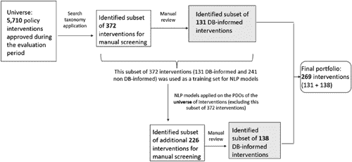

**图 5.1** 投资组合识别方案。 ¶ *来源*：独立评价集团。

#### 使用搜索分类法进行初步投资组合识别

首先开展了一项投资组合识别工作，涉及开发一种搜索分类法，用于搜索所有项目标题、发展目标、组成部分标题和结果框架指标标题的文本（世界银行，2022，第 87 页）。该搜索分类法围绕 DB 的十二个监管领域或主题构建（世界银行，2020，第 78 页）。这一初步识别得出一份包含 372 个项目的长名单，随后通过人工筛选确定了 131 个被编码为“DB 知情”的项目。该方法识别出了最终 DB 知情投资组合（共 269 个项目）的一半。

这一初步工作凸显了仅使用搜索分类法捕捉相关项目的挑战，鉴于评价对象的复杂性。为了说明这一点，仅以 DB 涵盖的十二个监管领域之一（世界银行，2020，第 3 页）“获得信贷”为例。世行项目可以通过多种途径寻求影响政府监管变革，以改善私营部门获得信贷的条件。对于每条途径，用文字描述的方式可能有好几种。因此，首先识别所有与“获得信贷”相关的不同途径，然后识别所有这些途径的不同措辞方式和实际措辞方式，这项任务既繁琐又无法提供全面的结果。此外，在许多情况下，“获得信贷”（或类似词汇）在文档中被使用，但这与 DB 监管领域的背景无关。

#### 使用监督式 NLP 进行第二阶段项目组合识别

此前经过人工审查的 372 个项目清单（其中 131 个被识别为数据库指导型项目）被用作训练样本，供一组监督式文本分类集成模型使用。

#### 补充关键词搜索

此外，IEG 开发了一套更通用的搜索分类法。

#### 最终项目组合识别

模型生成的概率值和“相关性得分”的截断值被用来生成一份长名单供团队成员人工审查，以确定哪些项目是数据库指导型的。也就是说，一个项目之所以被纳入这份长名单，可能是因为模型分配了较高的概率，也可能是因为在 PDO（项目发展目标）和全文文档中的关键词搜索结果数量较高。模型概率和词频的截断值由团队在权衡项目组合识别的完整性与人工审查所需时间后确定。由于这一步骤，又有 226 个项目被识别出来进行人工筛选，其中又识别出 138 个数据库指导型项目并加入最终项目组合。

### 我们能学到什么

首先，该方法在团队精准识别评价对象方面发挥了关键作用，为评价项目组合分析中的相关性和有效性评估奠定了基础。通过利用文本挖掘和机器学习技术，团队将证据基础（相关项目及其文档）的规模扩大了一倍，而这用传统的项目组合识别方法很难实现。证据基础的扩大增强了后续分析发现的广度和有效性。

其次，IEG 的经验表明，开发大规模且高质量的训练数据集颇具挑战。资源限制制约了可生成的训练数据的规模和质量。因此，这影响了监督式 NLP 模型输出的精确度和准确性，而这类模型通常需要大量高质量的训练数据。

第三，数据科学家与评价人员之间的密切沟通对于建立对应用的共同理解至关重要。随着时间的推移，随着评价人员和数据科学家对彼此工作的理解加深，共同开展数据科学应用会变得更加容易。

第四，在创新数据科学应用上投入时间和资源最终会有回报。为该任务开发的分类模型在另一项 IEG 评价中得到了复用（世界银行，2022，第 93 页）。此外，相同的模型开发流程还可应用于其他评价中的其他任务。

第五，这一特定实践是 IEG 在使用监督式文本分类进行项目组合识别方面的早期试点，有助于证明该方法的实用性。

## 示例 2：使用 NLP 进行项目组合监测与分析：人力资本项目即时简报

### 使用背景

该分析是作为一项名为“监测多面议程：关于人力资本项目对人类发展项目组合影响的即时简报”的评价性工作的一部分而开展的。该简报旨在追踪人力资本项目（HCP）的影响足迹。

更具体地说，该分析旨在检验两个主要假设。如果 HCP 为追求特定人力资本成果和在 HD 项目组合中嵌入多部门活动以推进人力资本议程提供了动力，则可能观察到以下模式：追求 HCP 核心特定人力资本成果的业务数量在定量上增加，以及 HD 业务设计在定性上发生转变，更加重视 HCP 所倡导的关键人力资本成果和跨领域主题（例如性别平等、数字解决方案、人力资本衡量和机构强化）。在此概念框架下，该分析旨在回答以下问题：(a) 随着 HCP 的引入，HD 项目组合的规模是否扩大？(b) HD 项目组合的设计是否更加聚焦于追求 HCP 议程核心的特定人力资本成果？(c) HD 项目组合是否更加聚焦于 HCP 议程核心的跨领域主题？

收集数据以回答这些问题的一种潜在方法是传统 PRA（项目组合审查与分析）。该方法依赖世行部门和主题代码（世界银行，2016）来识别具有所需关注点的项目，然后对每个项目进行人工审查。这种传统方法对于与世行部门或主题分类法高度契合的主题的项目组合监测任务可能是有效的。

然而，对于许多 PRA 任务，不存在与现有部门或主题分类法清晰对齐的情况，这使得传统方法要么因需要大量人工审查而特别低效且成本高昂，要么因编码不一致而不准确。这种方法往往会同时导致纳入错误和排除错误。除了这种对齐问题外，将世行项目标记到部门和主题分类法中还存在其他导致数据不准确的问题。例如，一个主要问题是，缺乏激励措施促使在某一领域工作的团队将他们的项目标记到其职权范围之外的其他领域。多年来，IEG 评价记录了多个案例，其中这种项目标记到部门和主题代码的不完整性是通过使用搜索分类法进行字符串搜索来识别项目而得到解决的。

### 该应用如何帮助回答问题/完成任务

鉴于 HCP 项目组合日益跨部门和多维的性质，仅依赖传统 PRA 方法中的部门和主题代码，不足以准确高效地识别 HCP 对 HD 项目组合的影响足迹。为规避传统 PRA 的局限性，IEG 开发了一种新方法，该方法建立在监督式 NLP 的严格应用基础上，用于识别 HCP 项目组合中的趋势。

#### 实施过程

考虑中的 HD 项目组合包含 984 个贷款业务。为回答上述问题，项目组合被划分为两个时间段：HCP 前时期（FY15-FY18）和 HCP 后时期（FY18-FY20）。同时也按国家分组划分为两类：2018 年 10 月前已加入 HCP 的国家（HCP 国家）和截至那时仍未加入的国家（非 HCP 国家）。图 5.2 说明了为本应用选定的 HD 项目组合构成。

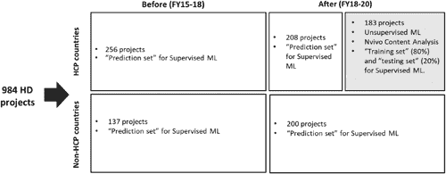

*图 5.2* 初始项目组合构成。 ¶ *来源*：独立评价组。

完成该任务所用的顺序步骤概述如下。图 5.3 以示意图形式展示了这一过程。

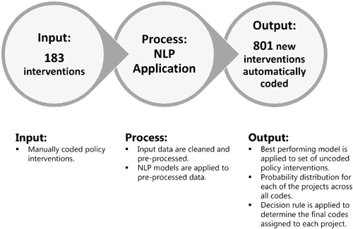

*图 5.3* 文本分类过程。 ¶ *来源*：独立评价组。

#### 初始项目组合划分

该项目组合被分为两组：(a) 一组 183 个项目，经过人工编码，用于构建 NLP 模型的训练集和测试集；(b) 一组 801 个未编码项目，团队旨在通过应用 NLP 分类模型来预测其代码。

#### 代码本

团队开发了一份代码本，以精准且系统地捕获和分类 HCP 的主要主题。代码本的设计基于多个信息来源，包括：在训练集上使用无监督 NLP 以帮助识别整体投资组合中普遍存在的主要主题；对 HCP 全球和区域计划进行深入审查；以及对任务组组长进行访谈。这形成了涵盖人力资本成果和跨领域领域的 30 个代码。代码本经过测试、校准，随后用于训练集的制作。

#### 训练集

团队使用内容分析软件 `NVivo` 为后续的监督机器学习任务准备训练集。团队审查了作为样本一部分的 183 个项目的 PDO 及 PAD 的组成部分章节，并遵循准备好的代码本对其内容进行编码。这一过程识别出 1,125 个文本片段，每个片段均映射到一个或多个代码（标签）。为确保为每个代码提取的文本足够独特，采用了余弦相似度。

#### 分类模型

团队在训练集上应用了多种分类模型（逻辑回归等）。

#### 模型在未知数据上的应用

随后将表现最佳的模型应用于一个单独的包含 801 个项目的投资组合（即预测集），团队拥有这些项目的 PDO 和组成部分文本，但没有其标签或代码。将分类模型应用于预测集的输出结果是每个项目在所有 30 个代码上的概率分布。

#### 为每个项目分配最终代码

团队考虑了多种决策规则，以确定选择映射到预测集中每个项目的代码的截断点。目标是选择一个截断点，使其在准确反映项目多部门属性的同时，将第一类错误和第二类错误降至最低。考虑到这些因素，决定保留累积预测概率大于 80% 的代码。

#### 比较分析

一旦训练集和预测集的最终代码准备就绪，即使用代码的频数和相似度得分（余弦相似度）配合非参数排列检验进行了比较分析。共进行了四类比较：(a) 发布前与发布后的比较，以评估 HD 项目设计在 HCP “发布前”与“发布后”的差异程度；(b) HCP 国家与非 HCP 国家的比较，以探究 HCP 国家的 HD 项目设计是否不同于非 HCP 国家；(c) HCP 国家内部的发布前与发布后比较；(d) 非 HCP 国家内部的发布前与发布后比较。

### 经验教训

IEG 试点并测试的这一方法，展现出了在多项投资组合分析和监测任务中的巨大潜力，与仅依赖人工编码的传统方法相比，效率显著提升。该方法对 HCP 的主要优势包括：(a) 人工编码（在 `NVivo` 中生成训练集）与监督 NLP 的结合，在提供分析大型投资组合及多重分类类别效率的同时，优化了编码准确性；(b) 训练好的模型可几乎零成本地运行在新项目或更早期的项目上（除数据处理和清洗成本外），使该方法对 HCP 团队持续跟踪和监测 HCP 优先事项落实进展具有实用价值。后一点是一个重要考量，因为监督学习模型的准确性通常会随着输入数据的增加而提高。除 HCP 分析外，该方法也有可能复制用于其他跨部门主题——这些主题虽不涉及人类发展，但世界银行的部门和主题分类法无法为其提供足够稳健的识别框架。

该实验还使 IEG 总结出了一些将此方法应用于投资组合分析和监测任务时的注意事项和局限性。首先，模型输出的准确性和有效性在很大程度上取决于用于模型开发的输入数据质量——尤其是代码本和训练集。为获取高质量的模型开发数据，必须确保识别出独特的类别并开发出经过精心校准的训练集。这是一个相对人工的过程，往往需要团队不同成员（包括评估员和数据科学家）之间的多次互动。其次，数据处理（如识别停用词、移除首字母缩略词）是关键步骤，应谨慎进行并与领域专家合作。最后，由于本案例中不具备应用更严格因果设计（如双重差分模型）的条件，分析深度在一定程度上受限，更多属于描述性质。然而，在不同背景下，有潜力探索将类似方法与准实验技术结合使用，以评估因果关系。

## 示例 3：利用监督与无监督 ML 进行评价综合：项目洞察

### 使用背景

IEG 旨在审查大量项目评价文档，目的是识别影响国际金融公司（IFC）融资或联合融资的私营部门项目的关键挑战和障碍类型。

### 应用如何助力回答问题/完成任务

IEG 试点了一种利用 NLP 应用近期进展的方法，以克服上述 IFC 项目面临的部分挑战。该方法基于使用 NLP 高效解析评价文档中的评价证据，并根据私营部门参与项目常面临的实施挑战精选分类法，对文本片段进行分组。这种对私营部门项目评价文档的半自动化分析服务于两大主要目标。第一，构建一个自动分类器，以高效地将大量现有评价证据归类为不同的簇；第二，通过仔细训练和校准 NLP 模型，帮助最大限度地减少分类过程中与编码者间一致性及评估员主观性相关的问题。

### 实施过程

IEG 为识别绩效挑战而实施的主要步骤如下。图 5.4 以示意图形式展示了这一过程。

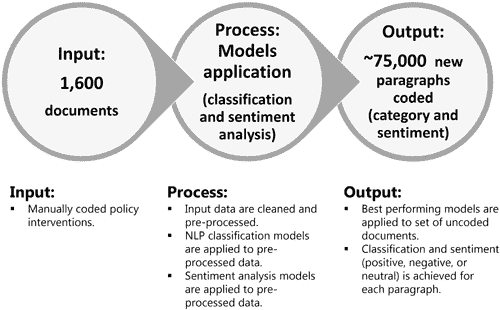


*图 5.4* 文本分类与情感分析流程。 ¶ *来源*：独立评价集团。

#### 初始分类法

基于先验专家知识，生成了私营部门项目通常面临的主题和问题的初始分类法。首先，人类专家讨论并分享了各自领域面临的主要问题，起草了其领域项目最常见因素的分类法草案，包括类别和子类别。

#### 分类法优化

从评价文档（IEG 评价简报）中提取相关关键词和概念，创建文档-术语矩阵。随后利用生成的矩阵梳理私营部门项目中通常观察到的各类主题的频率和显著性，生成概念类别，用于将初始分类法进一步细化为更颗粒度的维度。这一过程最终形成了一套包含 5 个类别（国家、市场、发起人、项目特定、IFC 可控）和 51 个子类别的分类法。

## 预处理

输入数据源自 2008 年至 2022 年间产生的约 1,600 份评估文档。文本数据经历了若干标准处理步骤，如`词干提取`。

## 训练/测试集划分

从提取的文档-词项矩阵中，选取了 80%的观测值（约占 4,000 多个问题）作为训练样本。剩余 20%的观测值被单独保留，用于模型验证。

## 模型训练

IEG 为每个模型提供了分类体系中每个类别和子类别的示例列表，算法将其作为输入，借助`朴素贝叶斯`、`随机森林`、`支持向量机`和`多层神经网络`对新段落进行分类。`朴素贝叶斯`在此数据集上表现最佳，因此选用该模型对未标记段落进行分类，分配段落属于某个类别/子类别的概率。模型的平均准确率约为 70%，部分类别的准确率超过 90%。

## 情感分析

此外，还对每个段落应用了预训练的情感分析算法，分配介于-1 和+1 之间的情感值（-1 代表完全消极，+1 代表完全积极）。进行情感分析是为了确定各因素对项目产生积极还是消极影响。

## 模型验证

采用了两种方法来验证模型结果：`潜在狄利克雷分布（LDA）`。

## 最终输出

最终模型总共对约 75,000 个段落进行了分类。这生成了一张表格，包含影响每个项目的关键因素（按分类体系中包含的类别和子类别衡量）、支持纳入各因素的具体段落，以及与每个段落相关的情感倾向。

## 经验教训

该实验表明，自动化评价综合可通过将人工分类和评估实施挑战影响的工作量降至最低，从而简化私营部门项目评价，为评价员节省时间。

此外，所开发的分类体系使评价员能够获取项目的全部洞见，生成可操作的主要因素识别和经验教训，有助于改进未来的项目设计和实施。综合来看，`自然语言处理（NLP）`带来的效率提升和数据获取优势，形成了一个良性循环，使评价员和从业者能更好地将过往问题融入未来实践。

与其他任何形式的分析一样，正如前面的例子所述，结果的准确性取决于输入数据的数量和质量，以及是否存在充分的模型训练和验证。正如预期的那样，分类体系中定义明确的类别和子类别（如法律障碍、政治风险和市场定价）产生的假阳性比宽泛的类别要少。相反，如果类别在`先验`上定义不精确，模型在收敛到正确类别时会面临更大困难，并需经过迭代过程进一步优化。团队还指出，在初始阶段进行更严格的数据清洗将有助于提高分类模型的准确性。

该实验的另一个重要经验是这些模型的动态性质。为确保`自然语言处理模型`在不断演变的实施挑战面前保持持续的相关性和适应性，定期评估模型性能至关重要，这将提示根据需要调整分类体系中的类别和子类别。

## 使用文本分析进行评价的挑战与机遇

上述例子展示了基于文本的技术为评价领域做出贡献的潜力。此外，我们已经看到以更复杂的`大语言模型（LLM）`形式出现的一些令人印象深刻的发展。

然而，这些技术并非没有局限性，其应用面临多重挑战。若不考虑这些局限，可能导致结果不准确或不恰当，尤其是当这些结果成为决策依据时。

第一类挑战关乎数据需求。机器学习算法需要大量高质量数据才能提取有意义的洞见（相比之下，文本分析更适合从较小的文本数据集中提取洞见）。还有更具体的数据需求，这在很大程度上取决于所应用的具体技术。监督学习要求以准确标记的数据为起点。然而，将文本片段映射到标签是一项繁琐且带有一定人工性质的工作。为解决这一问题，有人提出了众包或外包生成标签的方法（Paul 等人，2018；Zhao 等人，2014）。然而，由于准确标记数据需要专业领域知识，这些替代方案也有其局限性。另一方面，无监督学习不需要标签作为输入数据，因此可以更直接地应用于原始数据。然而，缺乏标签使得无法自动评估模型准确性，这引入了另一种类型的挑战（Awwad 等人，2020）。

第二类挑战关乎数据中潜在的偏见，其中许多难以察觉（Leslie，2019；Hovy 等人，2021）。这一问题极具隐蔽性，因为在有偏数据上应用模型存在延续这些偏见的巨大风险。就分类算法而言——如前面的例子所述——偏见可能在标记阶段因人为错误、对标签的误解或对编码手册的分歧而引入数据。此外，编码手册本身可能存在偏见。偏见也可能出现在数据收集阶段。`大语言模型`——可用于分类和情感分析等任务——也易受偏见影响。这些模型在大规模文本语料库上进行预训练。

第三类挑战源于复杂模型缺乏可解释性。从可解释性角度看，`自然语言处理模型`可分为不透明（黑箱）和透明两类。不透明或“黑箱”模型指仅通过查看其参数难以理解的模型。`大语言模型`是不透明模型的典型例子。另一方面，模型透明度允许人类级别地理解模型内部运作（Molnar，2020；Belle 等人，2020）。准确性与可解释性通常存在权衡，不透明模型通常以牺牲可解释性为代价获得更高准确性。在某些应用中使用不透明模型可能是可以接受的，但在其他情况下可能并不建议。因此，在流程早期阶段需仔细考虑不透明模型还是透明模型更适合该任务。

## 第四组挑战涉及工作开展所处的体制背景

通过实施，IEG（独立评价组）还了解到，为了成功实施复杂的数据科学应用，数据科学专家和评价人员（包括领域专家）需要紧密合作。评价团队提供更具体的投入和指导，催生了创新性的新问题、新的探究路径，并增强了解决技术问题的能力，最终使这些应用产出了更好的成果。

## 最后一组挑战涉及大语言模型（LLMs）的使用

IEG 严格试验了这些模型，以评估其在完成不同的预分析、分析和后分析评价任务时的客观表现。

## 结论

随着越来越多的相关文本数据变得可用，计算资源持续发展，用于访问和处理这些数据的新算法变得更加复杂和强大（包括`大语言模型`和其他生成式算法），预计文本分析将继续在评价背景下发挥重要作用。

IEG 的经验表明，在适当条件下，在评价中使用文本数据可以产生重要效益，体现在提高评价工作的 `efficiency`（效率）、`quality`（质量）和 `breadth`（广度/宽度）。

评价流程 `efficiency`（效率）的提升，与使用自动化和半自动化的数据提取及分析技术以及其他机器辅助技术有关。例如，半自动化的项目组合识别和分析可以简化对项目文件繁重的手工分类工作，帮助以更高效的方式从更大规模的先前知识语料库中获取洞见。

使用文本数据可以通过应用准确率高于传统方法的创新技术，潜在地提高发现的 `quality`（质量）。例如，在使用定义明确且结构化的编码方案时（且训练数据集足够大、足以代表更广泛的文本数据全貌），基于 NLP 的数据分类和提取可优于人工编码。

使用文本数据还可以增加评价探究的 `breadth`（广度/宽度）。例子包括在互联网领域使用新形式的文本分析（例如，利用社交媒体数据进行网络分析或情感分析）。

然而，这些技术的应用要求对数据收集、处理和分析采取系统且严谨的方法，并仔细考虑政策干预实施所处的文化和社会背景（Holm et al., 2025）。随着文本数据使用的持续增长，评价人员必须继续调整其方法和途径，以确保数据既被有效利用，又被合乎道德地利用。

最后，结合本书的三个主要问题，反思文本数据在评价实践中的应用，我们相信基于文本的技术将对评价实践产生变革性影响：通过改进评价工作，使某些职能能够以不同且更高效的方式执行，并随着更大、更好的文本数据库变得可用，增强综合能力。此外，随着数据科学技术变得更加复杂和专业化，我们相信评价人员与数据科学家在整个应用过程中紧密合作，对于确保获得有用且稳健的发现至关重要。此外，提高评价人员的数据科学素养，对于实现更富有成果的合作起着关键作用（问题 1

## 注释

1.  A 自然演变而成、作为人际沟通手段的语言，相对于旨在让机器理解的编程语言（Wolfram, 2010）。

2.  “[机器 学习是一门] 研究领域，它使计算机在没有被明确编程的情况下具有学习能力”（Samuel, 1959, 引自 Géron, 2022）。

3.  关于机器翻译，“资源匮乏”是指缺乏大量电子形式的文本语料库，或缺乏受过计算语言学训练的特定语言母语人士。

4.  主题 评价是多层级、多项目的评价，依赖精心设计的混合方法，通常将整体项目组合层面的综合分析与国家、项目或其他分析层面的深入分析相结合。（[`ieg.worldbankgroup.org/evaluations`](https://ieg.worldbankgroup.org/evaluations) ）。

5.  应用的 模型包括逻辑回归、`支持向量机（SVM）`和`多层感知机`。

6.  `停用词` 是指定语言中常用的词（如 “a”、“the” 和 “and”）。

7.  `词形还原` 考虑每个词使用的形态学语境，将词转换为其有意义的基本形式，称为词元。例如，词形还原后，“was” 会转换为 “be”。

8.  它 包含以下短语：“business climate”（营商气候）、“business development”（业务发展）、“business environment”（营商环境）、“business regulation”（商业监管）、“develop private sector”（发展私营部门）、“development of private sector”（私营部门发展）、“doing business”（经商环境）、“enhance competitiveness”（增强竞争力）、“enterprise growth”（企业增长）、“improve competitiveness”（改善竞争力）、“investment climate”（投资环境）、“private sector competitiveness”（私营部门竞争力）、“private sector development”（私营部门发展）、“private sector growth”（私营部门增长）、“private sector led growth”（私营部门主导增长）、“private sector-led growth”（私营部门主导增长）、“reforming regulation”（改革监管）、“registering property”（登记财产）、“regulation reform”（监管改革）、“regulatory environment”（监管环境）和 “regulatory reform”（监管改革）。

9.  `人力资本项目` 是世界银行的一项项目，旨在通过定制化的数据、政策和干预措施组合，支持各国加速实现人力发展成果。

10.  `余弦 相似度`是一种度量指标，通过测量对应每个文档的向量表示之间的夹角，量化文档间的相似性。

11.  `逻辑 回归`是一种监督机器学习算法，主要用于分类任务，其目标是估计实例属于给定类别的概率。

12.  `K-近邻` 是一种非参数监督学习分类器，依赖邻近度度量来预测每个单独数据点的分类。

13.  `支持 向量机`是一种监督学习算法，依赖于寻找将数据点分离到不同类别的最优超平面。

14.  `决策 树`是一种非参数监督学习算法，由分层树结构组成。决策树通过将数据分割成提供类别间最佳分离的分支来做出决策。

15.  `随机 森林`是一种集成机器学习算法，构建多棵决策树并组合其输出，以做出更稳健、更准确的预测。

16.  `朴素 贝叶斯`是一种概率监督机器学习算法。要对新数据点进行分类，该算法使用贝叶斯定理结合每个类别观测特征的条件概率，将计算概率最高的类别选为预测类别。

17.  `随机 梯度下降`实现了一种随机梯度下降学习程序（优化技术）。

## 参考文献

18. `超参数` 是指用于控制学习过程的配置。

19. **Bravo** 等人，2023 年。

20. **国际金融公司** (IFC) 是世界银行集团的成员之一。其专注于通过鼓励发展中国家私营部门的增长，来推动经济发展并改善民众生活。

21. `词干提取` 通常指一种粗略的启发式过程，即简单地移除或提取单词的最后几个字符。词干提取在单个单词上运行，无需了解上下文。

22. `隐含 狄利克雷分布 (LDA)` 是一种用于 NLP 中主题建模的概率模型。LDA 的目标是通过分析文档中共同出现的词频，识别大量文本文档语料库内的主题。

23. `大型 语言模型` 是指复杂的语言模型，最常基于包含海量参数（数百万甚至数十亿）的复杂神经网络架构。这些模型在大量数据上进行预训练。LLM 的示例包括 BERT、ChatGPT、LaMBDA 和 LLaMA。

24. **例如**，BERT 在图书语料库和英语维基百科上训练，而 ChatGPT 在来自互联网的文本数据库上训练（如书籍、网页文本、维基百科、文章和其他文字作品）。

25. `社交媒体 数据`是一种非常常见的文本数据类型，且已被用于评估中。参见，例如，世界银行。2020 年。《世界银行：对世界银行集团全球召集职能的评估》。独立评价组。华盛顿特区：世界银行。

26. `XAI` (可解释人工智能) 领域正在开发事后可解释性模型，这基本上能将不透明模型转化为透明模型，而无需牺牲准确性。在需要最先进的性能又不愿损失解释力的情况下，这可能是一种替代方案。

27. <https://ieg.worldbankgroup.org/blog/setting-experiments-test-gpt-evaluation>

28. <https://ieg.worldbankgroup.org/blog/fulfilled-promises-using-gpt-analytical-tasks>

29. <https://ieg.worldbankgroup.org/blog/unfulfilled-promises-using-gpt-synthetic-tasks>

30. **参见**，例如，Aggarwal 等人，2015；Burscher 等人，2015；Grimmer 等人，2013。

31. **参见**，例如，Hillard 等人，2008；Okori 等人，2011。

32. **问题** 1：评估师需要哪些必备技能？

33. **问题** 3：评估能为 AI 做出什么贡献，反之亦然？

## 参考文献

1. **Aggarwal, C. C.**, & **Aggarwal, C. C.** (2015). Mining Text Data (pp. 429–455). Springer International Publishing. <https://doi.org/10.1007/978-1-4614-3223-4>

2. **Alkaissi, H.**, & McFarlane, S. I. (2023). Artificial hallucinations in ChatGPT: Implications in scientific writing. *Cureus*, *15*(2). <https://doi.org/10.7759/cureus.35179>

3. **Ahlsén, M.**, Edberg, C., & Larsson, M. (2019). Automating Text Summarization with Machine Learning: Extraction of End Results From Result Reports. Uppsala University.

4. **Awwad, Y.**, Fletcher, R., Frey, D., Gandhi, A., Najafian, M., & Teodorescu, M. (2020). Exploring Fairness in Machine Learning for International Development. CITE MIT D-Lab.

5. **Barber, D.** (2012). Bayesian Reasoning and Machine Learning. Cambridge University Press. <https://doi.org/10.1017/cbo9780511804779>

6. **Belle, V.**, & Papantonis, I. (2021). Principles and practice of explainable machine learning. *Frontiers in big Data*, 39. <https://doi.org/10.3389/fdata.2021.688969>

7. **Bravo, L.**, Hagh, A., Joseph, R., Kambe, H., Xiang, Y., & Vaessen, J. (2023). Machine Learning in Evaluative Synthesis: Lessons from Private Sector Evaluation in the World Bank Group. <https://doi.org/10.1596/40054>

8. Broniecki, P., & Hanchar, A. (2017, October). Data Innovation for International Development: An Overview of Natural Language Processing for Qualitative Data Analysis. In 2017 International Conference on the Frontiers and Advances in Data Science (FADS) (pp. 92–97). IEEE. <https://doi.org/10.1109/fads.2017.8253201>


# 参考文献

9. **Burscher, B.**, Vliegenthart, R., & De Vreese, C. H. (2015). Using supervised machine learning to code policy issues: Can classifiers generalize across contexts?. *The ANNALS of the American Academy of Political and Social Science*, *659*(1), 122-131. <https://doi.org/10.1177/0002716215569441>

10. **Cheng, X.**, Shuai, C., Liu, J., Wang, J., Liu, Y., Li, W., & Shuai, J. (2018). Topic modelling of ecology, environment and poverty nexus: An integrated framework. *Agriculture, Ecosystems & Environment*, *267*, 1–14. <https://doi.org/10.1016/j.agee.2018.07.022>

11. **Christensen, B.**, Laydon, D. J., Chelkowski, T., Jemielniak, D., Vollmer, M., Bhatt, S., & Krawczyk, K. (2021). Quantifying changes in vaccine coverage in mainstream media as a result of COVID-19 outbreak. *medRxiv*, 2021-11. <https://doi.org/10.1101/2021.11.07.21266018>

12. **Cintron, D. W.**, & Montrosse-Moorhead, B. (2022). Integrating big data into evaluation: R code for topic identification and modeling. *American Journal of Evaluation*, *43*(3), 412–436.

13. **Contreras, D.**, Wilkinson, S., Alterman, E., & Hervás, J. (2022). Accuracy of a pre-trained sentiment analysis (SA) classification model on tweets related to emergency response and early recovery assessment: The case of 2019 Albanian earthquake. *Natural Hazards*, *113*(1), 403–421. <https://doi.org/10.1007/s11069-022-05307-w>

14. **Curran, S.**, Lansley, S., & Bethell, O. (2023). Hallucination is the last thing you need. arXiv preprint arXiv:`2306.11520`。

15. **de Bruijn, J. A.**, de Moel, H., Weerts, A. H., de Ruiter, M. C., Basar, E., Eilander, D., & Aerts, J. C. (2020). Improving the classification of flood tweets with contextual hydrological information in a multimodal neural network. *Computers & Geosciences*, *140*, 104485. <https://doi.org/10.1016/j.cageo.2020.104485>

16. Gatto, L., & Bundi, P. (2025). 评估中定量文本分析的应用。载 S.B. Nielsen, F. Mazzeo Rinaldi and G.J. Petersson (Eds.), *Artificial Intelligence and Evaluation. Emerging Technologies and Their Implications for Evaluation*（第 144–167 页）。London: Routledge. [`doi.org/10.4324/9781003512493`](https://doi.org/10.4324/9781003512493)

17. Gentzkow, M., Kelly, B., & Taddy, M. (2019). 文本即数据。*Journal of Economic Literature*, *57*(3), 535–574. [`doi.org/10.1257/jel.20181020`](https://doi.org/10.1257/jel.20181020)

18. Géron, A. (2022). *Hands-on Machine Learning with Scikit-Learn, Keras, and TensorFlow*. O’Reilly Media, Inc.

19. Gopal, L. S., Prabha, R., Pullarkatt, D., & Ramesh, M. V. (2020, October). 基于机器学习的在线新闻数据分类用于灾害管理。载 *2020 IEEE Global Humanitarian Technology Conference (GHTC)* (pp. 1–8). IEEE. [`doi.org/10.1109/ghtc46280.2020.9342921`](https://doi.org/10.1109/ghtc46280.2020.9342921)

20. Grimmer, J., & Stewart, B. M. (2013). 文本即数据：自动内容分析方法用于政治文本的前景与陷阱。*Political Analysis*, *21*(3), 267–297. [`doi.org/10.1093/pan/mps028`](https://doi.org/10.1093/pan/mps028)

21. Hillard, D., Purpura, S., & Wilkerson, J. (2008). 面向混合方法社会科学研究的计算机辅助主题分类。*Journal of Information Technology & Politics*, *4*(4), 31–46. [`doi.org/10.1080/19331680801975367`](https://doi.org/10.1080/19331680801975367)

22. Holm, J., Newman-Griffis, D., & Petersson, G. J. (2025). 大数据助力大投资：在研究委员会中负责任且有效地利用数据科学与 AI。载 S.B. Nielsen, F. Mazzeo Rinaldi and G.J. Petersson (Eds.), *Artificial Intelligence and Evaluation. Emerging Technologies and Their Implications for Evaluation* (pp. 120–143). London: Routledge. [`doi.org/10.4324/9781003512493`](https://doi.org/10.4324/9781003512493)

23. Hovy, D., & Prabhumoye, S. (2021). 自然语言处理中的五大偏见来源。*Language and Linguistics Compass*, *15*(8), e12432. [`doi.org/10.1111/lnc3.12432`](https://doi.org/10.1111/lnc3.12432)

24. Kao, A., & Poteet, S. R. (Eds.). (2007). *Natural Language Processing and Text Mining*. Springer Science & Business Media. [`doi.org/10.1007/978-1-84628-754-1`](https://doi.org/10.1007/978-1-84628-754-1)

25. Kumar, M., & Ng, J. (2022). 利用文本挖掘和主题建模理解全球可再生能源项目的成功与增长因素。*Renewable Energy Focus*, *42*, 211–220. [`doi.org/10.1016/j.ref.2022.06.010`](https://doi.org/10.1016/j.ref.2022.06.010)

26. Leslie, D. (2019). 理解人工智能伦理与安全。*arXiv* preprint arXiv:1906.05684.

27. Llitjós, A. F., Aranovich, R., & Levin, L. (2005). 为土著语言构建机器翻译系统。载 *Second Conference on the Indigenous Languages of Latin America (CILLA II)*, Texas, USA.

28. Lucić, D., Katalinić, J., & Dokman, T. (2020). Twitter 上叙利亚冲突的情感分析。*Media Studies*, *11*(22), 46–61. [`doi.org/10.20901/ms.11.22.3`](https://doi.org/10.20901/ms.11.22.3)

29. Manning, C. D. (2009). *An introduction to information retrieval*. Cambridge University Press. [`doi.org/10.1007/s10791-009-9096-x`](https://doi.org/10.1007/s10791-009-9096-x)

30. Mazzeo Rinaldi, F., Celardi, E., Miracula, V., & Picone, A. (2025). 评估复杂社会现象中的人工智能与文本分析：俄乌冲突。载 S.B. Nielsen, F. Mazzeo Rinaldi and G.J. Petersson (Eds.), *Artificial Intelligence and Evaluation. Emerging Technologies and Their Implications for Evaluation* (pp. 168–195). London: Routledge. [`doi.org/10.4324/9781003512493`](https://doi.org/10.4324/9781003512493)

31. Mislove, A., Lehmann, S., Ahn, Y. Y., Onnela, J. P., & Rosenquist, J. (2011). 了解 Twitter 用户的人口统计特征。载 *Proceedings of the International AAAI Conference on Web and Social Media* (Vol. 5, No. 1, pp. 554–557). [`doi.org/10.1609/icwsm.v5i1.14168`](https://doi.org/10.1609/icwsm.v5i1.14168)

32. Molnar, C. (2020). *Interpretable Machine Learning*. Lulu.com.

33. Næss, T., Prabhu, C., Mjaaland, M., Holtermann, H., & Skage Engebretsen, L. (2025). 挪威警方处理网络犯罪评估中的文本挖掘与机器学习。载 S.B. Nielsen, F. Mazzeo Rinaldi and G.J. Petersson (Eds.), *Artificial Intelligence and Evaluation. Emerging Technologies and Their Implications for Evaluation* (pp. 103–119). London: Routledge. [`doi.org/10.4324/9781003512493`](https://doi.org/10.4324/9781003512493)

34. Okori, W., & Obua, J. (2011, July). 饥荒预测的机器学习分类技术。载 *Proceedings of the World Congress on Engineering* (Vol. 2, No. 1, pp. 4–9). [`doi.org/10.1080/08839514.2011.611930`](https://doi.org/10.1080/08839514.2011.611930)

35. Olteanu, A., Castillo, C., Diaz, F., & Kıcıman, E. (2019). 社会数据：偏见、方法论陷阱与伦理边界。*Frontiers in Big Data*, *2*, 13. [`doi.org/10.3389/fdata.2019.00013`](https://doi.org/10.3389/fdata.2019.00013)

36. Ortega Nieto, D., Hagh, A., & Agarwal, V. (2022). 交付挑战与发展有效性。[`doi.org/10.1596/1813-9450-10144`](https://doi.org/10.1596/1813-9450-10144)

37. Paul, A., Jolley, C., & Anthony, A. (2018). 反思过去，塑造未来：让 AI 为国际发展服务。Center for Digital Development, USAID.

38. Pedregosa, F. (2011). Scikit‐learn: Machine learning in python. *Journal of Machine Learning Research*, *12*, 2825.

39. Russell, S. & Norvig, P. (2016). *Artificial Intelligence. A Modern Approach*. Upper Saddle River, NJ: Pearson Education Inc.

40. Samuel, A. L. (1959). 使用跳棋游戏进行机器学习研究。*IBM Journal of Research and Development*, *3*(3), 210–229. [`doi.org/10.1147/rd.33.0210`](https://doi.org/10.1147/rd.33.0210)

41. Suh, J. W., Sohn, S. Y., & Lee, B. K. (2020). 专利聚类与网络分析以探索核废料管理技术。*Energy Policy*, *146*, 111794. [`doi.org/10.1016/j.enpol.2020.111794`](https://doi.org/10.1016/j.enpol.2020.111794)

42. Tseng, Y. H., Lee, L. H., Chien, Y. T., Chang, C. Y., & Li, T. Y. (2018, July). 面向移动教育活动的多语言短文本响应聚类：初步探索。载 *Proceedings of the 5th Workshop on Natural Language Processing Techniques for Educational Applications* (pp. 157–164). [`doi.org/10.18653/v1/w18-3723`](https://doi.org/10.18653/v1/w18-3723)

# 6 文本挖掘与机器学习在挪威警方处理网络犯罪绩效审计中的应用

**Tom Næss, Helge Holtermann, Carolin Prabhu, Lars Skage Engebretsen 和 Mari Mjaaland**

DOI: [10.4324/9781003512493-6](https://doi.org/10.4324/9781003512493-6)

本章已根据 CC-BY-NC-ND 4.0 许可提供。

## 引言

技术发展为犯罪活动开辟了新机遇。虽然传统盗窃案件有所下降，但在挪威，网络诈骗和身份盗窃等犯罪却急剧上升。犯罪类型的转变给国家警方机关带来了挑战，因为这需要新的调查方法。因此，2021 年，我们（挪威国家审计署）开展了一项绩效审计。

网络犯罪是警务工作的重要领域，因为社会正在经历数字化转型，我们生活的很大一部分都在网络上度过。对于网络犯罪学者而言，统计数据的缺失一直是一个挑战（Bossler & Berenbum, 2019）。在挪威，官方统计数据未包含网络犯罪。自 2018 年起，警方尝试通过登记报案犯罪的*作案手法*来识别此类犯罪。然而，各警区的登记做法不一，据警方自身表示，这些统计数据并不可靠。因此，在这项绩效审计中，一项重要任务是识别网络犯罪并掌握其全貌。


# 新技术为评估者和审计员提供新机遇

新技术不仅为罪犯提供了机会，也为评估者和审计员提供了机会。在对挪威警方打击网络犯罪工作的绩效审计中，我们利用两种相对新颖的工具来识别网络犯罪：文本挖掘和机器学习。文本挖掘是自然语言处理（`NLP`）中的一个特定应用，侧重于从文本中提取信息；而自然语言理解（`NLU`）是 `NLP` 中更高级的一个方面，侧重于对语言的深度理解和解释。文本挖掘包含多种从文本中自动提取信息的技术，以支持对模式的定量分析；机器学习则包含统计工具，使模型能通过在数据中寻找模式并推导出规则来解释新数据，从而实现自动改进（另见 Bruce, Gandhi & Vandelanotte, 2025; Gatto & Bundi, 2025; Mazzeo et al., 2025; Ziulu et al., 2025）。我们利用这些工具从一年内报案的所有刑事案件中识别网络犯罪，从而得以评估警方在网络犯罪梳理和处理方面的绩效。据我们所知，此类分析在挪威此前从未开展过。

在本章中，我们以此案例为例，阐释文本挖掘和机器学习可为评估增添何种价值。我们还将探讨使用此类工具所需的条件。评估者和绩效审计员需要具备何种能力？评估者和绩效审计员如何与数据科学家协作，以从这些工具中获益？

在我们的案例中，这些工具的主要优势在于允许使用全量数据而非抽样数据，这为更细致地评估警方在侦查和破获网络犯罪方面的表现提供了机会。然而，使用这些工具耗时较长，我们在该绩效审计上投入的资源略多于常规。我们组织此前缺乏使用此类工具的经验，这或许能部分解释这一情况。这是我们为学习如何应用这些方法而愿意承担的风险。该案例还表明，（内部）数据科学家与审计员之间的协作可以成为利用此类新方法的富有成效的模式，因为妥善使用它们需要相当的专业知识。同时，我们发现审计员具备更广泛的定量方法能力也很有用。

本章结构安排如下：首先，我们定义网络犯罪并描述绩效审计所涉及的能力类型。第二部分，我们描述人工编码、文本挖掘和机器学习在审计中的部署情况。最后一部分，我们将讨论所面临的挑战、成功标准，以及与本书主要研究问题相关的经验教训。

## 什么是网络犯罪？

缺乏清晰的网络犯罪定义一直是警方和研究者面临的问题。网络犯罪也可被称为计算机犯罪、数据犯罪和 `ICT` 相关犯罪。Akdemir、Sungur 和 Basaranel（2020）以及 Phillips 等人（2022）的文献综述指出，学术界引用最多的两个网络犯罪定义是：

*   “通过全球电子网络实施的、要么违法要么被某些当事人视为非法的计算机中介活动”（Thomas & Loader, 2000）；
*   “任何利用计算机、网络或硬件设备协助或实施的犯罪”（Gordon & Ford, 2006）。

Phillips 等人（2022）总结道：“围绕‘网络犯罪’一术语的模糊不清，对社会、网络犯罪政策、法律干预和学术研究均产生了重大影响。”在挪威，网络犯罪概念的模糊性同样带来了挑战。“网络犯罪”一词被各警区、特别机构和国家机关以不同方式理解。这种模糊性很可能阻碍了对网络犯罪范围的掌握，也可能使得制定有效的打击此类犯罪的战略和措施变得困难。

本章始终使用“网络犯罪”这一术语。根据挪威法律，网络犯罪属刑事犯罪，大体涵盖两类犯罪：

*   **以计算机系统和技术为目标的犯罪**，包括黑客攻击、数据泄露、计算机攻击、破坏活动、工业间谍和互联网服务阻断。此类犯罪常被称为“依赖网络的犯罪”。
*   **犯罪行为的关键环节利用计算机系统、设备或网络实施的犯罪**。此类犯罪过去发生在物理空间，现已转移至线上。例子包括买卖毒品、传播虐待相关材料、身份盗窃、诈骗和侵犯隐私。

人们常使用各种术语来指代特定类型的网络犯罪。例如，`在线性虐待`可能被称为在线虐待、在线性犯罪和诱骗。这些术语可能因所犯性犯罪的类型而异。`金融网络犯罪`是指以获取经济利益为目的实施的网络犯罪，例如欺诈、身份盗窃和勒索软件。

## 最高审计机关、绩效审计与评估

最高审计机关（`SAIs`）是独立的公共机构，其主要职责是审计政府对公共资金的使用。`SAIs` 通常由国家宪法和法律授权设立。它们监督公共资金使用并确保民主问责的手段包括财务审计、合规审计和绩效审计（INTOSAI, 1977）。在这些手段中，绩效审计与评估具有最多的共同特征。绩效审计是独立、客观的检查，旨在促进公共部门的经济性、效率和效果的改进（INTOSAI, 2019）。

## 创新实验室与审计团队

2018 年，挪威审计长办公室设立了创新实验室，旨在探索和利用数据科学进行审计（Beckstrom, 2020; Otia et al., 2022）。创新实验室由具有不同背景的数据科学家组成，他们拥有绩效审计/评估、编程和机器学习方面的经验。除了实现标准任务自动化以使审计人员能从事更多分析工作外，该单元还协助处理与数据获取（如网页抓取）和数据分析（如文本挖掘）相关的任务。它还提供编程和分析工具的内部培训，以逐步转变审计机关，使其更高效地利用可用信息。创新实验室通过在共同项目和工具上的协作与审计单元相互关联。作为内部单元，它还允许交换创新想法，而无需保证成功。

网络犯罪审计由一个绩效审计处牵头，审计人员不具备机器学习或文本挖掘方面的专业知识。不过，审计团队具备定量方法方面的能力，并能理解新技术能带来的效益。

利用机器学习分析和分类警方记录始于一项实验。它有可能增强审计效果，但并非审计完成所必需。最终我们采用了这些工具，创新实验室的三名数据科学家通过与审计人员协作开展文本挖掘和机器学习工作，为审计做出了重大贡献。

## 人工编码、文本挖掘与机器学习

审计目的是评估挪威警方在多大程度上掌握、侦查和破获了网络犯罪。主要审计问题包括：
1.  警方对网络犯罪的掌握情况如何？
2.  警方是否侦查和破获网络犯罪？
3.  哪些因素阻碍了网络犯罪的破获？
4.  法务部和警务局对警方处理网络犯罪的指导效果如何？

文本挖掘和机器学习被作为回答前两个审计问题的方法。

审计伊始，我们并未预想到会使用文本挖掘和机器学习。

自 2018 年以来，警方已登记信息通信技术（`ICT`）是否为每起报案案件的相关作案手段。

由此，有几种方法可供选择。通过抽取大量案件报告样本，人工编码判断每起事件是否属于网络犯罪（依据我们的定义），我们可以了解一年内报案犯罪中网络犯罪的占比。然而，我们还旨在进行更详细的分析，考察网络犯罪在子类别（如 `financial cybercrime` 和 `online sexual abuse`）中被侦查和破获的程度。

学习层面也是决定在本次审计中应用文本挖掘和机器学习的重要依据。这符合 INTOSAI 发布的绩效审计国际标准。根据《绩效审计准则》`ISSAI 3000`，“审计人员应在整个审计过程中愿意创新。”

### 报案犯罪的人工编码

人工编码的案件样本被用于训练和测试机器学习模型。为提供可接受的确定性水平，必须有一定数量的案件。案件越多，模型越好，但同时这也是耗时的工作。审计人员与数据科学家商定对 1,000 起案件进行分类。在看到最终成果前，我们不确定机器学习模型是否足够好以供使用。幸运的是，无论如何我们都能利用人工编码案件的结果，估算警方所用不同案件类别中网络犯罪的比例。

向警方登记的报告（报案文档）不易获取。报告存储在 `Documentum` 中。

1.  估算警方所用不同案件类别中网络犯罪的比例。
2.  支持开发和测试机器学习模型，以将 2018 年的所有案件分类为网络犯罪或 `非` 网络犯罪。

为实现第一个目标，每个案件类别在样本中都必须得到充分代表。这通过按案件类别分层抽样来解决。为实现第二个目标，样本中必须包含足够数量的网络犯罪案件。某些案件类别包含的网络犯罪实例极少。因此我们选择了 `不成比例分层样本`，共 1,072 起案件。该样本包含较少的交通和物理破坏类别案件，因为有理由假设这些类别中的网络犯罪实例较少。

开始前，我们就几个重要概念的定义达成了一致，例如“网络犯罪”、“计算机系统”、“计算机网络”和“行动进程的关键要素”，以及如何将其操作化。我们还制作了一个编码表。该表包含“案件 ID”、“犯罪类别”、我们对案件是否为网络犯罪的分类（`作案手段`），以及用于备注或编码依据的列。

为确保编码规则被同等理解，我们进行了一次试编码环节，四人各自独立编码同 30 起随机抽取的案件。这被用作获得统一理解标准的起点。这些案件未纳入样本。随后，同四人各自独立复核了 100 起案件，以评估编码者间的相关性。这些案件被纳入最终样本。各指标的相关系数在“显著”相关程度（0.61 至 0.80 之间）或“近乎完美”相关程度（0.81 至 1 之间）。分歧主要集中在编码为“不知”的案件上。在 21 起存在一名或多名编码者分歧的案件中，仅有 4 起是一名或多名编码者编码为“网络犯罪”，而其他人编码为“非网络犯罪”。这表明分歧主要在于对分类案件所需信息量的把握。在信息充分的情况下，分类方面几乎不存在分歧。

其余 898 个案例样本（两个案卷最终为空，已从样本中剔除）被分成两组，由两组各两人单独对相同案例进行编码，随后进行比对。四名编码员共同审查编码中的差异，以确定案例的最终编码。除了编码的 998 个案例外，我们还增加了 74 个案例用于测试机器学习模型。由于这 74 个案例是使用与其他案例相同的选择标准挑选的，因此它们被纳入了用于估算网络犯罪比例的人工分类中。

`Modus operandi`（作案手法）是刑事案件登记册中的一项代码，用于描述犯罪人实施犯罪的方法。例如 `ICT` `modus operandi` 代码“通过使用计算机系统”和“通过利用数字认证解决方案中的错误/弱点”。我们没有采纳警方对 `modus operandi` 的编码，因为我们不希望这会影响我们的分类。我们以报案文件的文本为出发点，当文本中有明确迹象表明属于网络犯罪时，将该案例编码为*网络犯罪*。当有明确迹象表明作案手法属于网络犯罪以外的其他类型时，案例被编码为*非网络犯罪*。最后，如果可以想象是 `ICT` 作案手法，但现有信息不足以得出确定结论，则案例被编码为*不知道*。

表 6.1 显示了最终样本和报案总体中案例按案件类别的划分情况。

**表 6.1** 2018 年报案总体与样本按案件类别划分

| 案件类别 | 2018 年报案数 | 案例样本 |
| :--- | ---: | ---: |
| | 数量 | 百分比 | 数量 | 百分比 |
| 其他 | 42,626 | 13.4 | 150 | 14.0 |
| 毒品 | 35,309 | 11.1 | 148 | 13.8 |
| 性犯罪 | 8,406 | 2.6 | 150 | 14.0 |
| 破坏公物 | 16,912 | 5.3 | 88 | 8.2 |
| 交通 | 54,107 | 17.0 | 86 | 8.0 |
| 盗窃/非法获利 | 99,447 | 31.2 | 150 | 14.0 |
| 暴力 | 32,716 | 10.3 | 150 | 14.0 |
| 经济犯罪 | 29,425 | 9.2 | 150 | 14.0 |
| **总计** | **318,948** | **100.0** | **1,072** | **100.0** |

*来源*：国家警察局，BL/Strasak。

对于六类案件（其中三类发生相对频繁），仍难以确定最终编码。为确定这些案件的最终状态，征求了一个由五名警方计算机取证调查员和五名来自警区及特别机构的警方检察官组成的参考小组的意见。决定采用保守解释来处理反馈意见，以避免高估网络犯罪的比例。

### 提取文本数据与量化分析文本准备

文本挖掘是从大量文档集合中提取文本的方法。在本次审计中，文本挖掘用于从总共 334,544 份文档中提取文本。

分类的出发点是报案文本，以及案件的简短文本描述（作案手法摘要和案件描述）。模型工作涉及从报案文件中识别并提取相关文本（文本挖掘）。对文本进行审查并分割为单词（词元）。

随后，文本被分解为单个单词并转换为数值变量。这些变量被用作基于已知类别（*网络犯罪*或*非网络犯罪*）训练模型的基础。

### 机器学习模型开发

上述人工文本审查部分描述的报案人工编码，导致约 1,000 个案例被分类。这种人工编码被用作监督训练机器学习模型的标签。

由于不同的词汇可用于描述相似事物，将词汇归类为同义词可在分类中产生显著差异。在网络犯罪背景下，例如为网站、社交媒体或描述与网络犯罪相关动作的动词定义同义词是有意义的。同义词用于合并低频出现的词汇。例如，Facebook、Snapchat 和 TikTok 等社交媒体平台被归类为“社交媒体”。有意义的同义词高度依赖于应用场景：例如，一个同义词包含多种毒品，其差异在医疗背景下很重要，但不影响犯罪中核心网络成分的可能性。领域专家参与这一 `feature engineering`（特征工程）环节对于确保对主题的良好理解至关重要。审计员与数据科学家在 `feature engineering`（特征工程）中的合作，对于开发出与网络犯罪定义的主题理解相一致的机器学习算法至关重要。该定义是与警方专家合作制定的，并促进了可应用于机器学习模型的同义词开发。这种在寻找有意义定义上的合作，最大化了从统计模型获得有用输出的机会。

同义词还用于合并出现频率过低、模型难以捕捉但却是案件是否涉及网络犯罪的明确指标的词汇（如 `hack`、`computer system`）或非网络犯罪指标（如 `accounting violation`、`bookkeeping`）。开发了一个特殊的“同义词”来识别我们所谓的标准表单中的句子，即可用于报案的表单。因此，表单标准文本中的所有词汇均可被移除，仅保留表单上手写的句子。标准表单有时由手工填写，手写体无法通过光学字符识别（`OCR`）转换为机器可读字体。如果能从表单中识别出实物被盗或丢失，该信息将被视为人工词汇并添加到低频词同义词中。

模型在 75 个输入变量上进行训练，其中大多数反映了文本中特定词汇的相对频率（`TF-IDF`）。模型变量的选择（即特征）对最终模型结果有重大影响。为找到具有高区分度的词汇，根据词汇在两类文本中的相对频率分别进行排名：首先从网络犯罪案例中提取 `TF-IDF` 权重最高的 150 个词，再从被归类为非网络犯罪的案例中提取 `TF-IDF` 权重最高的 150 个词。随后移除两个列表中都出现的词，并从两个列表中分别选出差异最大的 70 个词。我们将这一特征词列表与领域专家手工编制的列表（包含应纳入或排除的词汇）相结合。所有特征在用于模型前均进行了加权。加权通过计算词汇在文档中出现频率（相对于文档总词数）的自然对数来实现。

### 机器学习：模型开发与性能测试

测试了四种不同类型的模型架构：

*   **朴素贝叶斯** —— 一种相对简单的模型，其优势在于可以理解特定输入如何导致特定模型输出（也称为“白盒”类型模型）。
*   **随机森林**、**XGBoost** 和 **支持向量机** —— 三种更复杂的模型类型，通常被认为更强大，但更难解释（所谓的“黑盒”类型模型）。

#### 白箱模型与黑箱模型

如果“白箱”模型性能足够好，通常首选该模型，因为它可以解释模型的预测结果。如果模型将用于对个人产生后果的单个案例决策，这一点尤为重要。“黑箱”模型需要更多精力来重构。

#### 模型性能评估：马修斯相关系数 (MCC)

由于数据包含的非网络犯罪案例远多于网络犯罪案例，模型性能通过马修斯相关系数 (`MCC`) 进行评估。`MCC` 在两个类别之间是对称的，且独立于哪个类别被视为“阳性”结果：

```
MCC = (TP * TN - FP * FN) / sqrt((TP + FP)(TP + FN)(TN + FP)(TN + FN))
```

其中，`TP`、`TN`、`FP` 和 `FN` 分别指真阳性、真阴性、假阳性和假阴性。`MCC` 值范围在 -1（完全误分类）到 1（完全正确分类）之间。

简单模型（`Naïve Bayes`）因其 `MCC` 显著低于其他三个模型，且在审计中单个预测的解释并非关键，因此被舍弃。

除了 `MCC`，我们还计算了正确分类的真实网络犯罪和非网络犯罪的比例，以及预测为网络犯罪案例中真实网络犯罪的比例。

在机器学习模型开发的所有步骤中，关于有意义的输入特征、合适的模型架构和合理的性能指标等看似技术性的决策，都取决于领域知识以及应用的预期用途和最终目标。一个结合了评估资格和技术开发（数据科学家）资质的团队，对于找到最适合任务的解决方案至关重要。

表 6.2 展示了机器学习模型在识别网络犯罪数量方面的结果。

## 表 6.2 各犯罪类别的报告数量及网络犯罪估计百分比

| 犯罪类型 | 报告数量 | 网络犯罪百分比* |
| :--- | ---: | ---: |
| 经济犯罪 | 29,578 | 55.0 |
| 性犯罪 | 8,438 | 16.6 |
| 其他 | 40,003 | 5.8 |
| 暴力犯罪 | 33,171 | 1.6 |
| 环境犯罪 | 1,985 | 1.1 |
| 非法获利/盗窃 | 100,854 | 0.8 |
| 调查案件 | 12,017 | 0.5 |
| 毒品犯罪 | 36,292 | 0.2 |
| 工作环境犯罪 | 863 | 0.1 |
| 故意破坏 | 17,068 | 0.1 |
| 交通犯罪 | 54,275 | 0.0 |
| **总计** | **334,544** | **-** |

*来源：挪威国家审计署。

*基于机器学习预测估算的总体中网络犯罪百分比。

## 敏感数据与信息安全

我们的方法需要使用敏感数据，包括报告犯罪的详细信息，这带来了一些挑战。作为最高审计机关，我们拥有访问政府数据的权限，并建立了处理敏感数据的安全基础设施。我们将犯罪数据存储在专门为敏感数据设置的服务器上，并在此进行分析。只有指定人员才能访问这些服务器，且分析工具必须经过安全评估。对于此处使用的带有开源包的编程语言，这意味着对单个库进行单独的安全评估，并对分析方法的新颖性进行限制。

# 挑战、成功标准与经验教训

## 数据质量与时间消耗的挑战

由于大量警方报告原本需要人工阅读和分类，机器学习被认为适合本次绩效审计。另一个方面是基于清晰的网络犯罪定义进行二分类的任务定义明确，这使得机器学习成为合适的工具。


使用机器学习的基本前提是拥有足够质量的充足数据。然而，在本次审计中，数据并不容易获取。挪威警方使用的案件管理系统可追溯至 1990 年代初，警方报告以 PDF 形式存储在数据库中。因此，我们花费大量时间仅用于获取文档（主要是 PDF）并从中提取文本。只有完成这些步骤后，我们才能开始耗时的分析任务：审查文本并将其分割为词元、标注和训练模型、测试机器学习模型。因此，我们在本次审计上投入的资源比平时多。不过，为了获得在未来审计中应用这些方法的经验和知识，这笔成本是被接受的。

数据质量对任何类型的分析都至关重要，包括文本挖掘和机器学习的使用。数据质量取决于负责收集、整理和存储数据的组织的实践。在决定研究设计之前，必须妥善调查数据的质量和获取途径。如果可能，应尽早评估数据的存储方式、质量和丰富度。最初的想法是使用警官在警方案件管理系统登记报案时记录的 `modus operandi`（作案手法）。然而，数据质量并不令人满意，因此我们选择了更耗时的检索和分析警方报告的方法。虽然一种数据类型的挑战可能不适用于另一种，但我们认为，此次审计使我们的组织更有准备去评估现有的问题和数据是否允许有益地使用文本挖掘和机器学习工具。

当我们选择检索警方报告时，其他挑战也随之出现。看似微不足道的任务实际上相当复杂。存在数据质量问题，检查数据错误并使其准备好进行分析需要大量资源。从遗留 IT 解决方案中检索数据是一项艰巨的任务。不过，我们一致同意“在实践中学习”是一个好原则。文本挖掘和机器学习是审计中可用的新工具，只有在工作中采用这些方法，我们才能学会如何使用它们。技术发展也创造了新工具，使从旧应用程序检索数据变得更容易。这当然对于考虑我们自身的能力和资源很重要，但也应记住这对被审计实体意味着什么工作量。如果我们有无法推迟的紧迫截止日期，我们将无法纳入这类方法，因为警方可能无法足够快地交付数据。

数据质量的另一个重要方面是标签质量。由于需要获得所有审计员都能认同且反映对网络犯罪共同理解的客观标签，人工编码是一项耗时的工作。此外，我们需要在不同类型的犯罪中编码大量案例，以便识别这些犯罪类型中的网络犯罪。然而，我们发现，在我们的案例中，约 1,000 个编码案例足以训练出一个具有可靠预测性能的机器学习模型。

## 成功标准

为建立稳健的基础并全面掌握手头信息，*尽早评估数据* 至关重要。这些初步评估揭示了警方数据的质量问题。为确保分析的完整性，我们决定依赖受害者或报案实体提供的完整案件报告，而非刑事案件登记册。虽然刑事案件登记册更容易获取，但其质量低劣。选择案件报告需要更多资源，但这是确保足够高效度的必要条件。

## 先决条件

若要采用文本挖掘和机器学习，有几个先决条件必不可少。其中最关键的是存在*一个明确定义的、适合采用文本挖掘和机器学习技术解决的问题或问题*。在本案例中，任务是将刑事案件分类为网络犯罪和非网络犯罪，而这对于评估警方对该类犯罪的掌握情况和处理情况至关重要。这项任务适合用算法模型来完成，并指导了从数据收集和准备到算法选择及结果解读的各个方面。

另一个先决条件是具备必要的技能和资源。组建一个*在主题内容、评估方法、统计学和数据科学方面均具备能力的跨学科团队*，对于在本次评估中成功运用机器学习和文本挖掘至关重要。在绩效审计中应用此类方法，为所有参与审计的人员（包括数据科学家和审计员）提供了宝贵的经验教训。我们共同积累了这些方法的使用经验，而这些方法也为评估和挪威警方提供了重要信息。在评估之前，挪威警方没有关于网络犯罪的可靠数据，也不了解此类案件被侦查和破获的程度。

此外，我们了解到*质量保证至关重要*。这包括例如衡量多个机器学习模型的性能以决定使用哪个模型。质量保证在许多情况下基于评估员的领域知识以及数据科学家的技术知识。这种知识的结合被用于在输入特征、模型架构和性能指标上做出决策。一个兼具评估资格和数据科学资格的团队，对于找到最合适的解决方案至关重要。另一个有助于分析质量的重要方面是，花时间建立共同理解：如何对网络犯罪进行分类、如何就定义达成一致，以及如何将关键概念操作化。

为缓解与网络犯罪概念不确定性相关的挑战，我们采用了来自被审计实体（警方）的*参考小组*，就我们不确定如何分类的案件提供建议。通过使用由警方工作人员组成的参考小组（即使这是一个专家小组），我们可以让那些不完全理解该方法的人更容易接受结果。

## 审计员/评估员与数据科学家的协作

审计员与数据科学家之间的协作对于在本次审计中有效运用新方法至关重要。关于评估员与数据科学家之间新兴协作实践的总体讨论，请参见本卷中的 Nielsen (2025)。因为我们都是挪威国家审计署的员工，所以能够紧密协作并进行频繁讨论。我们的角色和任务也没有非常明确地分离。例如，审计员为文本挖掘和机器学习分析提供了重要输入，而数据科学家则帮助讨论如何利用机器学习结果来回答审计问题。尽管如此，审计员和数据科学家仍凭借各自的专长以略有不同的方式做出了贡献。

数据科学家的主要贡献是利用文本挖掘和机器学习对刑事案件进行分类。掌握此类工具需要相当长的时间，如果没有数据科学家原有的专业能力，我们就无法在本次审计中使用它们。数据科学家在关于如何处理分类问题的初步讨论中也提供了重要输入。如果没有他们的输入，使用这些工具的想法可能永远不会实现。

审计员处理了审计中的许多其他任务，包括研究设计、数据收集、分析和撰写报告。这些任务既需要主题知识，也需要绩效审计和社会科学方法方面的广泛能力，而审计员具备这些能力。然而，审计员也为识别网络犯罪的任务做出了贡献。他们协助尽早识别数据质量问题，这有助于指导相关数据源的选择。此外，他们利用主题知识形成了系统的网络犯罪定义和清晰的编码方案。他们还进行了案件的手工编码，为开发机器学习模型提供了基础。在算法模型的评估中，审计员参与了结果的解读和分析，以确保这些结果符合审计目标。

根据我们的经验，数据科学家与审计员之间的迭代协作过程总体上非常重要，并对结果做出了重大贡献。为确保机器学习和文本挖掘被适当使用并与审计的其余部分相结合，我们不仅需要文本挖掘和机器学习工具方面的能力，还需要主题知识和审计方法方面的能力。换句话说，数据科学家对于采用这些先进方法至关重要，而审计员对于最大化这些方法对更广泛评估的价值至关重要。

## 注释

1. 绩效审计广义上讲，是对政府活动的评估，重点关注经济性、效率和/或有效性。

2. 挪威国家审计署是一个最高审计机构（SAI）。

3. 网络犯罪包括针对计算机系统和/或网络的犯罪，以及利用计算机系统和/或网络实施关键行为要素的犯罪。

4. 这些问题也在 York 和 Bamberger（2025）以及 Nielsen, S.B.（2025）中进行了探讨。

5. 司法和公共安全部（2015）《司法和公共安全部打击网络犯罪战略》，由司法和公共安全部于 2015 年 6 月 26 日发布。

6. 我们进行了多次访谈和数字警务单位调查，并审查了相关文档。这些方法主要旨在探讨阻碍犯罪侦查的因素，以及司法部和警长局打击网络犯罪努力的有效性。

7. 自 2018 年以来，挪威警方在 BL 案件处理系统中引入了自己的*作案手法*代码，以识别网络犯罪案件。示例包括“使用计算机系统时”和“利用数字认证解决方案中的错误/弱点时”。

8. 挪威的电子刑事案件处理系统称为 BasisLøsning（基础解决方案）或 BL。

9. 我们曾考虑按警区细分这些数字以比较各警区的绩效。这一想法部分被放弃，因为警区数量问题性地过少。

10. INTOSAI, 2019 ISSAI 3000《绩效审计准则》。INTOSAI 准则由国际最高审计机构组织（INTOSAI）发布，作为 INTOSAI 专业声明框架的一部分。更多信息请访问[www.issai.org](http://www.issai.org)。

## 参考文献

11. **Documentum** 是由 OpenText 拥有的企业内容管理平台。核心平台管理存储库中的内容，该存储库由三部分组成：内容服务器、关系数据库和文件存储位置。存储库中的项目作为对象存储。与对象关联的文件通常存储在文件系统中；对象的相关元数据（文件名、存储位置、创建日期等）作为记录存储在关系数据库中。在我们的案例中，我们想要的报告作为文件（pdf、gif 等）存储。

12. **访谈** 在初步研究中进行，且对统计数据的审查表明患病率/发生率较低。

13. **我们** 将案件划分为八个案件类别（表 1）。该分类与警方使用的分类相同，但进行了两项调整：“环境”和“工作环境”类别被归入“其他”类别，因为这些类别中的案件很少。

14. 表 1 中使用的数字 318,948 与此处使用的 334,544 之间的**差异**在于包含了子案件。调查案件和部分案件不属于官方统计数据，未包含在数字 318,948 中。

15. **Token（词元/标记）** 可以由多个单词或短语组成；例如，「social media（社交媒体）」就是一个 token。为简便且易读起见，下文我们将统称其为单词。

16. **一种** 解释“黑箱”模型预测的方法是借助所谓的代理模型，它们可近似黑箱模型的部分功能。然而，这些解释是近似的，且必须证明代理模型的有效性。

17. **我们应用程序的目标** 是基于全体总体而非仅基于样本，利用警方自身的分类，对比网络犯罪与非网络犯罪的统计数据。例如，如果警方想使用类似的算法对案件进行分类，以决定对个别案件的进一步处理，那么决策过程的透明度以及由此带来的算法运作透明度就变得至关重要。

18. **以** 网络犯罪作为「阳性」类别，特异性衡量被正确分类的非网络犯罪案件的比例，灵敏度衡量被正确分类的网络犯罪案件的比例，精确度衡量 ICT 分类正确的比例。我们的模型达到了特异性 0.99、灵敏度 0.79 和精确度 0.79。所有这些指标都很有意义；然而，灵敏度和精确度都存在重大不确定性，因为它们严重依赖于观测值很少的网络犯罪类别。此外，我们认为假阴性比假阳性更可接受。因此，更加强调高特异性，即更少的假阳性，其中网络犯罪对应阳性类别。

## 参考文献

1. **Akdemir, N.**, Sungur, B., & Basaranel, B.U. (2020). Examining the challenges of policing economic cybercrime in the UK. *Güvenlik Bilimleri Dergisi* (*International Security Congress)*, Special Issue, 113–134. [`doi.org/10.28956/gbd.695956`](https://doi.org/10.28956/gbd.695956)

2. Arthur A., Rydland L.T., & Amundsen K. (2012). The user perspective in performance auditing–a case study of Norway. American Journal of Evaluation*,* *33*(1), 44–59. [`doi.org/10.1177/1098214011408283`](https://doi.org/10.1177/1098214011408283)

3. **Beckstrom, J. R.** (2020). Auditing machine learning algorithms: A white paper for public auditors. International Journal of Government Auditing*,* *48*(1), 40–41.

4. **Bruce, K.**, Vandelanotte, J., & Gandhi, V. (2025). Emerging Technology and Evaluation in International Development. In S.B. Nielsen, F. Mazzeo Rinaldi and G.J. Petersson (eds.). *Artificial Intelligence and Evaluation.* *Emerging Technologies and Their Implications for Evaluation* (pp. 13–36). London: Routledge. [`doi.org/10.4324/9781003512493`](https://doi.org/10.4324/9781003512493)

5. **Bossler, A. M.**, & Berenblum, T. (2019). Introduction: New directions in cybercrime research. Journal of Crime and Justice*,* *42*(5), 495–499. [`doi.org/10.1080/0735648X.2019.1692426`](https://doi.org/10.1080/0735648X.2019.1692426)

6. **Gatto, L.**, & Bundi, P. (2025). The Use of Quantitative Text Analysis in Evaluations. In S.B. Nielsen, F. Mazzeo Rinaldi and G.J. Petersson (eds.). *Artificial Intelligence and Evaluation.* *Emerging Technologies and Their Implications for Evaluation* (pp. 144–167). London: Routledge. [`doi.org/10.4324/9781003512493`](https://doi.org/10.4324/9781003512493)

7. **Gordon, S.**, & Ford, R. (2006). On the definition and classification of cybercrime. Journal in Computer Virology*,* *2*, 13–20, August 2006. [`doi.org/10.1007/s11416-006-0015-z`](https://doi.org/10.1007/s11416-006-0015-z)

8. **Gudivada, V.**, Apon, A., & Ding, J. (2017). Data quality considerations for big data and machine learning: Going beyond data cleaning and transformations. International Journal on Advances in Software, *10*(1), 1–20. [`www.issai.org/pronouncements/intosai-p-1-the-lima-declaration/`](https://www.issai.org/pronouncements/intosai-p-1-the-lima-declaration/)

9. INTOSAI. (1977). INTOSAI-P1: The Lima Declaration The International Organisation of Supreme Audit Institutions (INTOSAI). [`www.issai.org/pronouncements/intosai-p-1-the-lima-declaration/`](https://www.issai.org/pronouncements/intosai-p-1-the-lima-declaration/)

10. INTOSAI. (2019). ISSAI 3000 Performance Audit Standard. The International Organisation of Supreme Audit Institutions (INTOSAI). [`www.issai.org/wp-content/uploads/2019/08/ISSAI-3000-Performance-Audit-Standard.pdf`](https://www.issai.org/wp-content/uploads/2019/08/ISSAI-3000-Performance-Audit-Standard.pdf)

11. **Mazzeo Rinaldi, F.**, Celardi, E., Miracula, V., & Picone, A. (2025). Artificial Intelligence and Text Analysis in Evaluating Complex Social Phenomena. The Russia-Ukraine Conflict. In S.B. Nielsen, F. Mazzeo Rinaldi and G.J. Petersson (eds.). *Artificial Intelligence and Evaluation.* *Emerging Technologies and Their Implications for Evaluation* (pp. 168–195). London: Routledge. [`doi.org/10.4324/9781003512493`](https://doi.org/10.4324/9781003512493)

12. **Nielsen, S.B.** (2025). The Evaluation Industry and Emerging Technologies. In S.B. Nielsen, F. Mazzeo Rinaldi and G.J. Petersson (eds.). *Artificial Intelligence and Evaluation.* *Emerging Technologies and Their Implications for Evaluation* (pp. 266–286). London: Routledge. [`doi.org/10.4324/9781003512493`](https://doi.org/10.4324/9781003512493)


## 参考文献

13. **Office of the Auditor General of Norway** (2021). Undersøkelse av politiets innsats mot kriminalitet ved bruk av IKT [Study of Police efforts against *cybercrime*]. Dokument 3:5 (2020-2021). [`www.riksrevisjonen.no/rapporter-mappe/no-2020-2021/undersokelse-av-politiets-innsats-mot-kriminalitet-ved-bruk-av-ikt/`](https://www.riksrevisjonen.no/rapporter-mappe/no-2020-2021/undersokelse-av-politiets-innsats-mot-kriminalitet-ved-bruk-av-ikt/)

14. **Otia, J. E.**, & Bracci, E. (2022). Digital transformation and the public sector auditing: The SAI’s perspective. Financial Accountability and Management, *38*(2), 252–280. [`doi.org/10.1111/faam.12317Cit`](https://doi.org/10.1111/faam.12317Cit)

15. Phillips, K., Davidson, J.C., Farr, R.R., Burkhardt, C., Caneppele, S., & Aiken, M.P. (2022). Conceptualizing cybercrime: Definitions, typologies and taxonomies. *Forensic Sciences*, *2*, 379–398. [`doi.org/10.3390/forensicsci2020028`](https://doi.org/10.3390/forensicsci2020028)

16. Thomas, D., & Loader, B. (2000). Introduction – Cybercrime: Law enforcement, security and surveillance in the information age. In D. Thomas & B. Loader (eds.). *Cybercrime: Law Enforcement, Security and Surveillance in the Information Age*. London: Routledge.

17. York, P. & Bamberger, M. (2025). The Applications of Big Data to Strengthen Evaluation. In S.B. Nielsen, F. Mazzeo Rinaldi and G.J. Petersson (eds.). *Artificial Intelligence and Evaluation. Emerging Technologies and Their Implications for Evaluation* (pp. 37–55). London: Routledge. [`doi.org/10.4324/9781003512493`](https://doi.org/10.4324/9781003512493)

18. Ziulu, V., Anuj, H., Hagh, A., Raimondo, E., & Vaessen, J. (2025). Extracting Meaning from Textual Data for Evaluation. Lessons from Recent Practice at the Independent Evaluation Group of the World Bank. In S.B. Nielsen, F. Mazzeo Rinaldi and G.J. Petersson (eds.). *Artificial Intelligence and Evaluation. Emerging Technologies and Their Implications for Evaluation* (pp. 78–102). London: Routledge. [`doi.org/10.4324/9781003512493`](https://doi.org/10.4324/9781003512493)

# 7 大数据助力大投资：在研究委员会中负责任且有效地利用数据科学与人工智能

Jon Holm, Denis Newman-Griffis, and Gustav Jakob Petersson

DOI: [10.4324/9781003512493-7](https://doi.org/10.4324/9781003512493-7)

本章已根据 CC-BY-NC-ND 4.0 许可提供。

## 引言

就在几年前，大数据和人工智能（AI）的革命几乎完全是私营部门的现象（Petersson & Breul, 2018）。如今，公共部门整体上对新数据源和新处理技术表现出日益增长的兴趣；创建、收集、分析和呈现数据的新方式正被探索用于新的目的。为推动数据在公共领域的应用发展，各类机构、政府调查和数字基础设施正在国家和国际层面启动（Misuraca & van Noordt, 2020）。

虽然研究人员对这种向数据驱动政策转变的兴趣日益浓厚，但研究系统本身也正日益以新颖的方式被分析。除了利用数据提高生产力和决策质量的部门内部目标外，来自政治层面的压力日益增大，要求证明研究投资与整个社会的相关性，这推动了对研究、研究政策和资助工具进行分析的新方式的需求（Reale et al., 2018）。

向以社会目标为导向的评估转变——以及利用数据驱动这种评估——部分与研究政策为公共研究支出提供理由的方式的转变有关。这种理由可以在个人层面（追求知识）、组织层面（有竞争力的大学和产业）或整个社会层面（民主、绿色转型、联合国可持续发展目标[SDGs]）进行阐述。不同层面的理由当然可能重合。尽管如此，二战后研究政策发展的总体趋势是将公共研究支出的理由提升至包含社会目标。千禧年以来，基础研究投资也日益被视为更好地理解和应对社会挑战的一种手段（Schot & Steinmueller, 2018）。

这种转变对作为公共政策工具的政府研究资助者有特殊的影响。传统上，公共研究资助的目标主要通过研究内部参数来定义，如人才培养和科学能力，以及质量——这些参数的测量和数据已相当成熟且为人所理解。将研究政策的理由提升到社会层面，带来了新的挑战和对更丰富研究信息的需求。一方面，这创造了激励，通过针对社会需求的资助计划来分配资金，并将措施重点放在社会契合度上。另一方面，公认一些最重要的研究发现源于好奇心驱动的基础研究，这种研究在评估明确的近期影响的当代评价体系中往往处于劣势（Stokes, 1997）。此类文献的标准参考是 1968 年美国国家科学基金会的报告《回顾中的技术与科学中的关键事件》（TRACES）（Franck, 1969）。近期的例子包括 mRNA 研究，此前曾被视为琐碎，却实现了 COVID-19 疫苗的快速开发，并因其贡献获得 2023 年诺贝尔奖（Smith, 2022；Nobel Prize Outreach AB, 2023）。

因此，资助者面临双重压力。首先，需要在推动研究活动朝向预定社会目标的政策驱动力，与对非预期结果和可能源于好奇心驱动研究的巨大社会效益的开放性之间取得平衡。另一方面，向数据驱动政策的转变，产生了与上述各项目标相一致的数据和洞见需求。重要的是，资助者必须确保这种支持政策的数据使用日益增加，始终坚定地与其公共使命和社会效益保持一致。

**所有这些都呼吁研究评估者进行方法论创新。** 在本章中，我们探讨研究资助和评估中*数据驱动学习*的机遇，借鉴数据科学方法的进展，这些方法可以帮助研究资助者从日益可获得的关于研究申请和结果的丰富数据中学习。我们阐述了机器学习（ML）中的新功能——有助于识别和利用数据中的模式——以及人工智能（AI）中的新功能——有助于应用观察到的模式和专家知识来分析新数据——

我们首先概述研究资助和评估不断变化的格局，以及这如何与新的数据需求相契合，包括 AI 和 ML 方法已在该领域被探索应用的示例。我们以挪威研究委员会中 ML 的两个应用作为案例研究，考察将 AI 整合到资助和评估实践中的过程。基于这些案例研究，我们描述了关键经验教训和提出的问题，以指导类似工作。我们的目标是让我们的讨论成为探索将负责任地使用 AI 和机器学习整合到研究资助和评估工作中的过程与实践的出发点，其中包含的广泛经验教训适用于 AI 使用的各种情境。

## 使研究与社会需求对齐的挑战

研究政策的作用广义上讲是为公共研究支出提供理由。自二战以来，研究政策的总体趋势是将公共研究支出的理由提升到越来越高的层面（Schot & Steinmueller, 2018）。

然而，我们用于理解研究如何促进社会发展的模型充其量只是不完整的。从研究发现到其对社会的影响，路径错综复杂，许多因素在其中发挥作用——既包括研究体系内部的因素，也包括外部的因素。人们期望研究有助于应对社会挑战，随之而来的是研究资助者对新兴的、不断增长的、跨学科研究领域的兴趣日益浓厚，认为这些领域在学术和社会层面影响力尤大（Gooch et al., 2017）。新的跨学科研究领域难以用传统分类系统进行测绘，而跨学科研究和影响因其难以衡量而臭名昭著（Mansilla et al., 2006）。与此同时，研究评价中常采用的同行评审流程因存在偏见、保守且耗时而备受批评，从而激发了对补充同行评审的额外衡量指标的需求。

千禧年以来，对基础研究的投资也越来越多地被构建为更好地理解和应对社会挑战的一种手段（Shneiderman, 2018）。这种构建的一个例子见于挪威的*《2019–2028 年研究与高等教育长期计划》*（教育与研究部，2018）：研究与高等教育在环境、社会、文化、经济和政治可持续发展的社会建设中发挥关键作用。充分的知识是做出决策的前提，这些决策使得维持繁荣与福利、保护面临超载风险的星球、捍卫自由和民主等基本价值观成为可能。

因此，研究理事会中评价的任务在某些方面已类似于任何公共政策执行者的任务：记录一组项目的产出、成果和影响，并评估观察到的结果在多大程度上可归因于政策干预。这从根本上区别于由科学领域同行进行的、更侧重于项目或团队科学质量的传统研究项目和团队评价。

## 数据驱动研究评价的机遇

在通过政策驱动的研究计划进行自上而下的引导，与好奇心驱动的响应式资助之间取得正确的平衡，是任何运行良好的研究系统的标志。这并不意味着基础资助免于证明其社会相关性——相反，我们需要承认好奇心驱动研究本身的价值（及其对社会的潜在价值），以及从研究活动和结果到社会成果和影响可能存在许多不同的路径。有效利用数据有助于为好奇心驱动和政策驱动的评价展示这种价值。

这两种资助模式给评价者带来了不同的挑战。自上而下的资助工具通常针对明确的社会目标。规划此类干预的典型程序是建立一个项目逻辑，通过将社会挑战映射为具体的知识需求和可通过研究提案征集加以刺激的行动，将目标转化为研究问题。在评价一个具有明确定义的项目逻辑或其他类型路线图的资助工具时，评价者将知道在项目的所有阶段寻找何种类型的数据。预期的产出、成果和影响通常在征集提案中明确描述，并应在收到的提案中得到体现。评价者的主要挑战在于收集并整合评估项目成功所需的数据。

通常，资助理事会和政府赞助方在研究资助项目的社会影响得到记录时就会感到满意。然而，这种成功背后的关键机制可能依然不透明，阻碍我们汲取经验：为什么一个项目成功创造了社会价值而另一个没有？我们认为，有潜力更系统地利用数据科学来帮助回答这个更深层的问题。例如，机器学习可以帮助识别成功项目的特定特征，如合作类型、项目团队资质和项目实施特性。这些知识反过来可用于在下一轮提案征集中将相同特征作为项目要求引入，从而最大化项目有效性。

谈到好奇心驱动的响应式资助，许多研究资助者将评价局限于基于文献计量数据记录和评估受资助研究的科学质量和影响，有时辅以样本出版物和影响案例研究等定性数据。渴望获得公众持续支持以投资基础研究的研究理事会，仍需寻找数据和方法，以支撑那句屡被重复的断言：即对基础研究的投资将带来科学突破，进而产生社会效益。困难在于我们不知道在哪里寻找证据，因为此类资助工具没有规定识别预期社会影响的路线图。在缺乏路线图的情况下，评价者不得不要求研究人员自行报告其研究如何影响了社会。这种自我报告在许多大规模研究评价中很常见，如英国的研究卓越框架，给高等教育机构带来了巨大的报告负担。

数据科学的方法可能让研究资助者更好地了解基础研究如何支持社会目标，而无需增加项目负责人及其机构的报告负担。学术和非学术媒体中研究数据、出版物和引用的数字化——加上出版物、研究人员及其组织的跨国持久标识符的引入——提供了丰富的分析机遇：例如，研究产出可与社会目标或社会变迁相关联。

正如 York and Bamberger (2020)以及本卷中的另外两章所讨论的（York and Bamberger (2025, Ch.3) & Nielsen (2025, Ch.13)），通过更系统地利用大数据提供的学习机会，公共政策评价在效率和有效性方面均可获益。就效率而言，更好地利用互联网或公共档案中已有的海量数据源，可降低为单一评价项目定制收集数据的成本。将机器学习和其他算法方法整合到评价中，也可通过实现人口层面的数据分析来提高其有效性，从而综合涵盖区域、国家和国际数据的一整套广泛变量。尽管如此，转向用于评价和分析的更广泛、更多样化的数据，在实施和质量保证方面提出了重大挑战，但有潜力推动新的、更敏捷的研究分析模式。

## 研究资助与评价中 AI 和 ML 的探索

### 研究资助与评估中 AI 技术的应用

包括机器学习在内的 AI 技术应用，已被探索用于为研究资助和评估中的分析与决策提供依据。最显著的是，在与研究项目的遴选及后续跟进流程相关的分析工作，以及已发表研究的评估方面，均取得了进展（Holm 等，2022）。同时，也在探索利用 AI 追踪学术界乃至整个社会影响的新途径（Rosemberg 等，2021）。创新包括引入新的分析技术，以及获取新型数据的新方法，因为评估社会影响所需的大量数据并不容易获得。AI 还被探索用于协助评估研究质量，以及对研究提案或出版物进行实际评分，例如在研究评估中（Thelwall 等，2023；Williams 等，2023）。这些创新尚未成为标准做法，实验往往存在各种缺陷，如数据代表性有限、AI 运作缺乏透明度，以及缺乏在资助背景下负责任地使用 AI 的指南和通用标准。

因此，将 AI 用于并整合到现有流程中，存在明显的风险，即可能变得临时拼凑、高度依赖稀缺专业知识的组合，且与战略目标和资助机构的公共使命不恰当地对齐（Madaio 等，2020）。如果没有更好、更具情境驱动的指南来将 AI 整合到评估中，传统评估单位可能会因定制化评估设计和数据收集固有的延迟和成本而被边缘化。另一方面，机器学习和其他算法方法若专注于具体问题求解，往往对数据中固有的偏见视而不见，且缺乏对方法和数据源的选择如何对目标群体产生积极或消极影响的反思（Mehrabi 等，2021）。

显而易见，AI 将影响研究的实施方式及其评估方式。通过适当的设计，AI 的使用可能会带来变革性的影响，使资助流程更加敏捷，并能对研究体系的变化做出响应。*我们预期，对战略和组织情境的深刻认知对于实现这种变革性变化至关重要。将 AI 的使用视为一个高度情境化的过程，不仅有助于充分发挥数字革命的潜力，而且至关重要的是，将有助于有效管理预期和非预期后果，并确保所用算法的透明度和可解释性。*

为了阐释当前面临的某些机遇与挑战，我们将展示来自挪威研究理事会的两个案例，它们可作为探讨研究资助机构如何利用机器学习和 AI 支持其使命的更广泛讨论的切入点。

## 利用机器学习将研究与社会目标相关联的示例：两个案例研究

原则上，研究理事会可在资助和资助管理的全过程——征集遴选、项目遴选、资助管理及已完成项目的后续跟进——中，致力于研究与社会目标的对齐。优化研究投资社会影响的努力，传统上基于研究研究和项目评估。数据科学方法为资助组合分析提供了新机遇。作为探讨研究资助者如何将数据科学方法纳入其分析工具箱的切入点，我们呈现来自挪威研究理事会的两个示例。

第一个示例关乎研究资助的规划阶段，询问哪类研究最能有效支持挪威海洋产业的绿色转型。第二个示例说明，通过使用机器学习算法挖掘已资助项目、其出版物及引用（超越学术场域）的现有数据，可记录研究投资的社会回报。

### 案例研究 1：分析征集提案中的研究领域以对齐社会需求

2021 年，挪威研究理事会（RCN）受命评估可用于发展挪威海洋产业的研究知识。该评估旨在为新的国家战略提供输入，为这些产业的绿色转型奠定基础。评估包括使用聚类方法，以支持对相关研究更广泛、更有效的发现。我们提供该研究的概览，以阐释资助机构将数据驱动方法有效融入其工作所需的诸多步骤。

#### 背景

在研究评估中，界定评估对象有时颇具挑战。若评估对象是常规分类中未包含的研究领域，即成熟确立的研究学科，则尤为如此。

例如，利用此类分类难以描述新兴研究领域、跨学科领域或此类合作，也难以基于其他分类（如联合国可持续发展目标、气候、融合、数字化和 AI）来描述研究。

同时，随时间保持不变的分类具有优势，常规分类无疑在未来仍将被需要。它们使得纵向比较以及与使用相同分类的官方统计（如研究资源和人员）进行比较成为可能。然而，对于其他目的，这种惯性会造成各种困难。因此我们可以得出结论，仅靠它们不足以满足研究评估所包含的各种目的。

这种专家衍生的标准分类的明确价值，与对新兴领域所需灵活性的需求相结合，为利用数据构建嵌入现有分类中的知识创造了强有力的价值主张。该研究探索了 RCN 利用数据驱动发现扩展标准分类以探索相关研究的价值。

#### 方法

> **框 7.1：案例研究 1 大纲，考察 RCN 对海洋产业知识的跨学科评估。我们在此重点介绍将机器学习（ML）作为分析一部分的动机背景和设计决策。**
>
> **案例研究大纲：海洋产业知识的跨学科评估**
>


> 研究理事会的一项典型任务是为公共研究投资提供战略建议。此类建议通常包括对当前研究能力和知识缺口的评估。由于研究政策目标常由研究体系外部的指标定义，因此识别达成目标所需的知识并非易事。

>

> **驱动 ML 整合的战略目标：** 评估研究知识以支持发展挪威海洋产业，结合新的国家战略背景。

>

> **整合 ML 的操作目标：** 为评估可用知识，首要任务是识别可能与海洋产业绿色转型相关的知识。

> **当前（非机器学习）流程的局限性：** 传统上，此类识别是通过关键词搜索执行的。由于这种方法取决于作者对其研究与相关目的相关性的认知，因此无法捕捉研究生态系统内部的实际联系，以及研究与其应用领域之间的实际联系。

>

> **机器学习的潜在应用：** 算法方法有助于基于研究本身的更广泛特征（而非仅靠特定关键词）来绘制研究生态系统内部的实际联系。为了发现相似性和联系，聚类方法是有效的工具。

>

> **可用于机器学习分析的数据：** RCN 基于出版物间的引用链接（书目耦合和共被引）以及文本相似性（主题建模）测试了聚类方法。

>

> **机器学习辅助 `分类` 的机遇：** 为了识别可能不包含相关关键词但可与已知类别对齐的输出，可以分析书目数据和文本内容的组合，将未分类的输出与已知范例进行匹配。

>

> **机器学习辅助 `发现` 的机遇：** 为了发现新的、不断增长的跨学科研究领域，可对文本内容进行主题建模，以查找讨论相似主题、方法等的输出，而不受已知类别的限制。

Box 7.1 描述了示例案例中使用的设计和实施方法，以及这些方法如何从 RCN 内部的战略和运营目标中衍生而来。用于作为聚类起点的初始出版物集，是由海洋研究资助计划资助项目报告的出版物与专门从事海洋研究的期刊上的出版物相结合构建而成。从约 1,000 篇起始出版物出发，算法（Traag et al., 2019）通常生成约 20,000 篇出版物的集合，并基于引用网络（书目耦合和共被引）或文本内容（基于 `Latent Dirichlet Allocation` 的主题建模（Blei et al., 2003)）中的相似性，将这些出版物分成几百个聚类。

本示例中的主要方法是通过聚类进行无监督学习（即不旨在恢复特定的“真实”标签）。尽管如此，无监督算法方法仍需要拥有待分析科学领域的先验知识才能发挥作用。这是因为聚类算法使用了一组专家已知代表相关领域（此处为：海洋研究）的出版物作为起点；专家还审查了算法生成的聚类，以确定它们如何为总体评估目标提供信息。因此，所获得分类的有效性取决于可用的专家知识。这说明了区分直接用于指导机器学习的知识（如类别和标签）与指导整体分析设计的知识的重要性。本示例中的机器学习是无监督的，但整体设计和实施受到学科专业知识的高度监督。

## 发现

算法方法通过将数千篇潜在相关出版物纳入数据集进行分析，提供了超越专家先验知识的明确价值。实验表明，基于引用的方法（书目耦合和共被引）产生了最有希望的结果，识别出的论文群比基于文本的方法更连贯、更易于识别。基于文本的方法难以获得清晰结果，这可能是由海洋研究的跨学科性质所解释的，该领域结合了自然现象研究（及其对海洋建筑的影响）、各种海洋技术，以及人类在海洋上和海洋中的活动的社会和政治背景。跨如此多样研究领域缺乏专业词汇，使得基于研究对象的语言表征来确定研究出版物间的主题邻近性变得更加困难（Bracken & Oughton, 2006）。

## 对资助机构的启示

在扩展数据集并对出版物进行分组后，算法生成的聚类由 RCN 的学科专家进行评估，以识别与海洋研究总体相关、更具体地与海洋产业绿色转型相关的群组。

RCN 将生成的数据集用于进一步的书目分析，假设通过考察引用链，可以检测到与挪威海洋产业发展相关的新兴科学领域。应注意到，此方法的一大局限性在于，学科或研究主题之间可能存在战略相关联系，但这些联系并未体现为实际引用。此类联系可能包括海洋技术开发所处的社会背景，或海洋技术潜在的环境影响。此外，引用仅表明一篇论文受到了一定关注；它并不显示被引论文对引用论文的具体相关性。在实践中，研究论文中存在各种类型的参考文献，而只有其中一部分涉及研究的主题。有时，出版物是基于对通用方法或高层政治框架（如联合国可持续发展目标）的通用引用而被归为一组的。基于此类通用引用的分组被排除在分析之外。

尽管存在这些局限性，机器学习方法通过其发现迄今 RCN 计划中尚未被认可为海洋研究的潜在相关主题的能力，为分析增加了价值。通过利用专家知识来策划初始数据集并在多次迭代中评估结果，缓解了该方法的局限性。

### 案例研究 2：分析研究产出与影响以优化社会效益

2020 年，RCN 委托开展了一项研究，旨在建立一种方法论，以评估所有资助计划下研究和基于研究的创新的社会影响。

#### 背景

出于多种原因，评估研究的社会效益（产出和影响）可能极具挑战性。许多——甚至可能是大多数——研究的社会影响在研究启动时是非预期的。在缺乏初始路线图（即变革理论）的情况下事后识别研究的影响和影响路径，可能尤为困难。研究本质上是一项充满不确定性的事业，这限制了我们基于未来效益估算来决定特定投资的能力（Wallace & Rafols, 2015）。因此，评估必须足够灵活，以应对不确定和未预料到的影响。

研究的社会影响也可能非常多样，且取决于特定的研究领域和应用。一些领域——如生物技术、遗传学和人工智能——可能具有广泛的影响范围。其他领域的影响可能在更局部的背景下显著。大多数领域将看到广泛影响和局部影响的结合。因此，评估必须考虑不同范围的影响。

# 研究评估中的社会影响与数据科学

社会影响往往在漫长的时期内显现，并涉及多个阶段，这使得将特定研究活动与特定影响联系起来变得困难。文化、政治和经济条件等广泛因素也可能影响研究的社会影响，尤其是在较长的时间跨度内。社会影响也可能是积极的，也可能是消极的。因此，评估必须能够解释研究周围背景因素随时间变化的复杂关系。

原则上，通过有充分理由地使用来自多个来源的数据来创建更全面的研究影响图景，可以缓解这些不确定性、范围和复杂性方面的每一个挑战。本研究探讨了整合广泛数据源并利用机器学习（ML）挖掘意想不到的联系和模式，以评估研究影响，从而为挪威研究理事会（RCN）带来的价值。

#### 方法

在试点研究中，如图 7.1 所示，RCN 资助的项目和出版物数据跨三大支柱进行了关联。

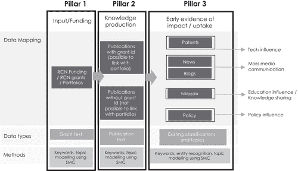

*图 7.1* 总体方法论策略与数据映射。该图展示了用于收集研究影响整体图景的数据源和方法。 ¶ *来源*：Rosemberg 等人，2021 年。

*   **支柱 1** 对应研究的投入或资助要素。

*   **支柱 2** 代表由资助产生的知识生产/知识产出。

*   **支柱 3** 通过技术影响、大众传媒传播与教育、社交媒体和政策影响这四个维度，追踪影响和采纳的早期证据。

算法方法被用于挖掘由此产生的证据主体，以评估 RCN 资助的研究对特定社会挑战的贡献。使用了一种机器学习算法（`TextRazor`）来对项目、出版物和影响证据与两个特定社会挑战的相关性进行分类：

*   实现对自然生态系统的更好保护/增强
*   减少机会不平等（健康、教育、经济）

项目（支柱 1）、出版物（支柱 2）和影响（支柱 3）针对这两个挑战的相关性，是基于 IPTC 媒体主题的一个子选择进行分析的。选用了一系列现有数据源来记录试点中的社会影响（表 7.1）。

*表 7.1* 分析中使用的各类数据源的覆盖范围

| 数据类型 | 数据源 | 采纳文献 |
| :--- | :--- | :--- |
| 专利 | `Lens` 和 `Dimensions` | ~4,000 份在非专利文献（NPL）引用中引用 RCN 出版物的专利 |
| 新闻和博客 | `Altmetrics` | ~15,000 篇提及 RCN 资助出版物的新闻文章和 ~5,000 篇博客文章 |
| 维基百科和教学大纲 | `Altmetrics` | ~1,700 个提及 RCN 资助出版物的维基百科页面 |
| Twitter、Facebook 和 Reddit（因数据获取和方法论顾虑而放弃） | `Altmetrics` | ~20,000 篇具有 Altmetric 分数的 RCN 资助出版物，其中包括来自社交媒体源的帖子数量 |
| 政策文件 | `Overton` | ~16,000 份来自挪威的政策文件，~1,900 份引用 RCN 知识产出的文件 |

*来源*：Rosemberg 等人，2021

每个数据源被视为代表一种特定类型的特定研究出版物的影响，并通过引用加以记录。在选定的数据源中，一些在研究政策文献中广为人知且有据可查，如专利和政策文件中的引用；而另一些，如新闻媒体、博客文章和维基百科中的引用，迄今为止使用较少，因此更难以解读。这些常被称为 `Altmetrics` 的新数据源具有特定的局限性。

> **替代计量指标的局限性**
>
> 新数据源和新指标将蕴含与传统指标相似的局限性，并额外存在仍相对未被充分探索的缺陷。出版物可能被新闻媒体错误引用和使用，这将代表一种不明确的影响证明。甚至更糟，出版物可能被错误引用以在社交媒体帖子中支持“假新闻”论点，这将代表一种潜在的负面影响路径。因此，我们从这些新数据源衍生出的指标需要置于语境中，并结合定性检查。但更重要的是，试点研究建立的影响路径应被解读为采纳/贡献的早期迹象，而非明确且因果的影响归因。

## 发现

即使存在这些局限性，结果强烈表明，对这些新数据源进行算法分析可用于获取关于研究资助社会影响的新知识。一般来说，数据的描述性分析受替代计量指标局限性的影响小于简单指标的直接计算。

图 7.2 提供了一个描述性分析的示例。它展示了从 RCN 资助经由研究出版物，到这些出版物在与试点中选定的社会挑战相关的政策文件中具有文献记载的影响的路径。除了计算相关政策文件中的引用次数并将其关联回出版物和项目外，这些项目和出版物还根据出版物数据库 `Dimensions` 中使用的“研究领域”（FOR）分类进行了学科分类。

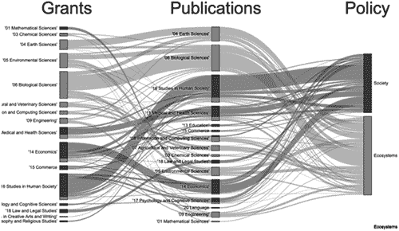

*图 7.2* 展示资助、出版物和政策文件之间联系的流程图。 ¶ *来源*：Rosemberg 等人，2021 年。

## 对资助机构的启示

在战略层面，**追求定量方法的关键优势在于其可扩展性和自动化。一旦建立，该方法即可扩展、复用，并适应未来的资助项目和不同的社会挑战**。尽管如此，如何将机器学习作为监测和评估的标准工具进行整合，以及使用哪些数据源，这些问题并非微不足道。就 RCN 而言，这种整合尚未发生，主要原因是内部缺乏数据科学方面的胜任能力。

> **未来考量**
>
> 该试点研究强调的关于算法数据分析未来使用的一个最终考量，是将这种数据驱动方法与互补方法相结合的潜力。试点绘制了采纳渠道和影响的早期迹象，但未提供因果评估。然而，该方法构建了进行因果分析所需的必要数据基础设施。通过实施贡献分析、过程追踪或比较案例研究等方法，可以评估 RCN 资助的知识通过文献记载的采纳迹象，在多大程度上促成了有效应对社会挑战。例如，一个应用是追踪那些产生出版物并被已知对重要政策变革起关键作用的政策文件引用的资助项目。

# 在研究资助背景下采用数据科学和人工智能技术的关键考量

# 在研究资助组织中建设数据科学能力

正如我们的案例研究所示，数据科学为分析和优化研究投资的社会影响提供了新机遇。然而，数据科学方法的使用必须有明确的动机，并置于资助方在研究资助和评估方面的战略及运营目标背景之下。在本章的最后一部分，我们将从组织视角出发，探讨在研究资助组织内部建设数据科学能力的关键考量因素。我们采取务实方法，重点在于促进在研究资助组织中负责任地使用 AI，作为传统评估方法的补充。这一视角对 Greenstein 和 Cho（2025）中关于 AI 使用伦理问题的更全面分析——包括大数据的使用、用于信息综合的机器学习，以及用于决策和预测的机器学习——构成了补充。

## 技术设计与目标及可用资源的对齐

对于 AI 技术整合有助于资助方实现的任何单个目标，可能存在多种方式来定义这些 AI 技术将如何运作，以及哪些资源（如数据、机器学习模型）可用于其开发。在在这些策略中做出选择时，资助方不仅要权衡技术功效，还要考虑与现有流程的契合度、资源需求，以及 AI 使用带来的潜在风险。

以利用机器学习帮助识别成功项目特征这一目标为例。我们可以设想资助方可能以两种方式构建 AI 方法来服务于这一总体目标：`整体式`（或数据驱动）模型和 `复合式`（或专家驱动）模型。

在 `整体式`、完全数据驱动的方法中，资助方旨在利用单一机器学习模型来分析完整项目，将其与过去见过的类似项目相关联，并估算其成功几率。这种方法灵活性极高，因为它允许从数据中涌现出未预料到的特征：例如，特定的研究主题组合、方法论和数据来源可能显现出比其他组合更高的成功可能性。然而，在这种方法中，用 AI 建模的任务也极其复杂；因此，它需要大量专业数据（例如成千上万个项目或更多）来提供可靠的模型，且捕获的相关性可能并不反映资助方认为真正具有信息量甚至相关的内容。数据驱动方法的使用还可能暴露出与关注结果相关的数据中存在的不良偏见（Obermeyer 等，2019），且若无法窥探“黑箱” AI 方法的内部机制，就难以确保模型与组织原则保持一致（Kim 等，2021）。

在 `复合式`、专家驱动的方法中，总体任务被分解为更小的部分：例如，（1）按专业领域对作者进行分类，（2）识别所用研究方法论的家族，（3）建模合作类型。这些子任务随后各自成为 AI 应用的单独目标，并通过层级结构将更具体的分析综合为更宽泛的项目判断。在这种方法中，由于每个单独任务的范围较小且泛化能力更强，训练每个机器学习模型所需的数据可能更少，且可引入外部数据源以辅助模型开发（例如，利用学术档案中自动生成的元数据来辅助“方法论分类”模型）。这意味着更高的工程复杂性，并基于专家知识来判断哪些类型的特征可能最具信息量，但降低了 AI 开发的资源需求，并能产出更易维护的解决方案。`复合式`方法提供了对 AI 运作更高的可见性，并缩小了每个步骤的范围，使得确保与组织原则的一致性以及监测 AI 偏见的证据变得更加容易（Raji 等，2020）。然而，该过程并非没有风险，因为对 AI 使用过程的人工构建可能会固化既有偏好，并遗漏数据驱动方法可能发现的有价值的、意想不到的相关性（Ding & Sterling, 2017）。

当然，AI 系统的设计与实施是一个光谱，上述两个例子仅是其中的采样点。关于 AI 系统将如何设计、实施和管理的决策，必须由与战略目标的一致性以及关于可用资源和持续管理要求的务实关切所驱动。换句话说，研究资助方如何能负责任地使用数据科学方法这一问题，极有可能因每个资助方的战略目标、组织背景和可用资源不同而得出不同的答案。

这种情境依赖性是确保 AI 使用既有效实现其预期目的，又符合伦理标准的关键。AI 系统的使用必须由特定的组织需求驱动，才能在实践中产生任何实质性的差异。同时，将 AI 使用建立在特定的现有目的之上，为评估 AI 偏见和进行监测提供了宝贵的脚手架，以确保引入 AI 不会损害资助方社会使命的履行。

## 定义目标与衡量成功

采用新技术的推动力可能源于各种组织和战略需求。数据科学和 AI 的引入不仅必须由明确陈述的目标所驱动，还必须以清晰的成功定义为导向。只有当数据科学方法的实施朝向明确的组织目标（例如改善研究投资与特定社会需求的契合度）时，此类方法的目的性才能得到评估。依我们之见，假设引入人工智能（或其他类型的自动化）将通过取代成本更高、速度更慢的手工程序来创造收益，这一基本假设不足以作为使用 AI 的主要目标。这是因为引入新技术极有可能影响被自动化流程的结果，而不仅仅是该流程的效率。

项目遴选和资助管理的行政成本仅占研究理事会总预算的一小部分（以 RCN 为例为 7%）。

在开发机器学习和 AI 方法时，主要关注点往往在于团队如何衡量 `模型` 的成功（如准确率、精确率等）。但即使是最准确的模型，如果其与资助或评估流程整合不佳，或与战略目标契合度低，也可能无法带来成功的改变。定义如何衡量 `AI 使用` 的成功，是将 AI 技术的实施与资助方更广泛背景下的积极影响相对齐的关键。

## 不同专业能力间的共同生产

AI 的有效性不仅取决于技术视角，更直接植根于数据捕获、分析方式及其在实践中的应用三者之间的契合度。这些过程既是社会和组织过程，也是技术过程，因此 AI 在实践中的有效设计与使用需要跨学科视角（Shneiderman, 2016；Newman-Griffis 等，2021b）。构建兼顾战略目标与公共责任的 AI 系统，要求关注数据的社会来源与局限性（如谁被代表、谁未被代表及代表方式）、技术设计决策如何与这些信息的社会理解相互作用，以及将在运营中使用 AI 输出的组织系统（Newman-Griffis 等，2023）。

从实践角度看，研究资助者必须组建跨学科团队来开发 AI 解决方案，涵盖技术设计、理解数据社会背景、将系统使用与战略优先级对齐等多元能力。这些能力必须贯穿 AI 开发全过程，以确保每一步都恰当考量技术效力、组织效用与社会影响。缺乏这些多元视角，AI 实施更可能复制或加剧现有社会偏见、丧失技术效度，或无法实现最初激励其使用的战略目标（Ali 等，2023）。

如何在实践中最好地召集和管理这些不同能力仍是一个开放性问题。针对拥有集中式数据分析的组织、跨团队分布式数据专长的组织、以及外包数据分析的组织，需要不同的方法（Holm 等，2022）。随着资助者进一步尝试将 AI 和 ML 融入其资助与评估工作，在跨学科整合如何最佳实现方面，存在宝贵的相互学习机会和共享最佳实践发展空间。

### 透明度与信任

透明度是建立 AI 应用信任的关键要求。


为使 AI 解决方案值得信赖，资助者应记录 AI 解决方案的开发与实施过程。模型卡（Mitchell 等，2019）和数据集数据表（Gebru 等，2021）等近期标准的发展，为机器学习组件勾勒了部分文档规范，但资助者必须更进一步，反映 AI 系统开发与使用的具体情境。欧盟《人工智能法案》（Madiega, 2023）也提出了类似关切。需记录的相关事项可能包括：相关数据源及其偏见的分析、替代方法优劣势的反思、替代方法测试运行的评估及对直接结果（受资助项目）、研究系统和整个社会影响的评估。透明度不仅关乎文档：让相关利益相关者参与 AI 解决方案的开发过程和结果评估，也有助于建立信任，并确保应用的相关性。

### 评估与大数据分析

研究与研究政策工具的评估是研究理事会活动的成熟组成部分。与任何新工具或干预措施一样，研究资助者在工作中使用数据科学和 AI 方法，本身必须接受评估，以确保价值与社会效益。评估部门或主题/学科单元中已有的评估能力，是研究理事会踏上大数据分析征程的宝贵资源。如前所述，这种评估必须超越 AI 领域主导的基于性能的评估，涵盖 AI 使用所在的更广泛领域和过程。

尽管肯定存在技术障碍，但将 AI 解决方案的发展引导至组织和社会目标，同时关注伦理问题并管理利益相关者利益，将有助于确保 AI 解决方案的成功与可持续实施。本章呈现的案例可作为大数据分析在传统评估单元任务中价值的范例。当然，传统评估方法也可用于支持和治理 AI 解决方案的开发与实施。

## 结论

长期以来，研究政策向预定社会目标导向的转变，加上政策领域数据驱动决策的日益增强，给研究资助者带来巨大压力。研究活动必须在社会驱动研究与好奇心驱动研究之间有效平衡，资助与评估决策往往必须可证明植根于数据。

增加数据科学方法（包括 AI 和机器学习）的使用，有助于资助者应对这双重压力。然而，每次使用 AI 或类似方法，都必须深植于特定的资助者与流程情境，才能有效且负责任地实现资助者目标。我们展示了来自挪威研究理事会的两个案例研究，阐释了在资助情境中使用 AI 和机器学习所涉及的过程与决策，以及对这些方法论未来应用的关键经验教训。我们进一步强调了将 AI 和机器学习的使用与特定资助者情境相连接的重要考量，确保这种使用尽可能植根于战略与社会使命。

公共政策评估确实可以通过更系统地利用大数据提供的学习机会，在效率和有效性上双双获益（York & Bamberger, 2020）。我们主张，这些收益只有在深刻理解大数据情境下才能实现，而这种理解可通过解决具体、可执行的挑战来培养。我们的讨论凸显了在研究资助生态系统中，更多地分享 AI 和数据科学使用的见解与经验、发展跨能力与情境实施和管理数据科学的新实践的必要性。

## 注释

1.  参见，例如：`https://www.digg.se/en`、`https://www.ai.se/en`、`https://researchonresearch.org/project/funder-data-platform/`。

2. **机器学习和人工智能是服务于不同目标的相关方法论**：机器学习协助`模式识别`，而人工智能则利用知识（包括通过机器学习识别出的模式）来`执行任务`，这些任务通常需要人类智能。人工智能方法可能利用来自机器学习的数据驱动洞见，也可能利用专家提供的信息，如已知模式和大规模知识资源（例如 `WikiData` 和 `Web of Science`）。机器学习技术，以及更广泛的人工智能，可用于在数据科学范式下从数据中提问/学习信息，和/或为更具操作性的情境中的决策制定提供信息。在本章中，当专门涉及数据驱动的模式识别时，我们称之为机器学习；当普遍涉及知识驱动的任务执行时，我们称之为人工智能。

3. **REF2021** 从高等教育机构收集了 6,781 个所谓的影响案例。<https://results2021.ref.ac.uk/impact>。

4. **多家** 文献计量分析提供商开发了算法，将学术出版物映射到联合国的可持续发展目标（SDGs）。关于该服务的批判性讨论，请参见 **Armitage 等人 (2020)**。

5. **该** 案例的呈现部分基于 Technopolis Group 报告的文本 (Rosemberg 等人 **2021**)。逐字复制的段落以斜体标记。

6. <https://www.textrazor.com/>。

7. <https://iptc.org/standards/media-topics/>。

8. <https://nap.nationalacademies.org/content/about-altmetrics>。

9. <https://plus.dimensions.ai/support/solutions/articles/23000018826-what-is-the-background-behind-the-fields-of-research-for-classification-system-13>。

10. **参见** 挪威研究理事会 2022 年年度报告 (Forskningsrådet 2023) (第 76–78 页)，<https://www.forskningsradet.no/siteassets/publikasjoner/2023/arsrapport-for-forskningsradet-2022---230706.pdf>。

11. **研究研究院** 的 GRAIL 项目是创建这种互相学习并制定最佳实践的持续努力的一个例子：<https://researchonresearch.org/project/grail/>。

12. <https://oecd.ai/en/dashboards/ai-principles/P7>。

13. **关于** 传统评价如何支持数据驱动方法的更详细讨论，请参见 York 和 Bamberger (2025)。

## 参考文献

1. **Ali, S. J.**, Christin, A., Smart, A., & Katila, R. (2023). Walking the Walk of AI Ethics: Organizational Challenges and the Individualization of Risk among Ethics Entrepreneurs. *Proceedings of the 2023 ACM Conference on Fairness, Accountability, and Transparency*, 217–226. <https://doi.org/10.1145/3593013.3593990>

2. **Armitage, C. S.**, Lorenz, M., & Mikki, S. (2020). Mapping scholarly publications related to the sustainable development goals: Do independent bibliometric approaches get the same results?. *Quantitative Science Studies*, *1*(3), 1092–1108.

3. **Blei, D. M.**, Ng, A. Y., & Jordan, M. I. (2003). Latent dirichlet allocation. *Journal of machine Learning research*, *3*(Jan), 993–1022.

4. **Bracken, L. J.**, & Oughton, E. A. (2006). ‘What do you mean?’ The importance of language in developing interdisciplinary research. *Transactions of the Institute of British Geographers*, *31*(3), 371–382.

5. **Devlin, J.**, Chang, M.-W., Lee, K., & Toutanova, K. (2019). BERT: Pre-training of Deep Bidirectional Transformers for Language Understanding. In *Proceedings of the 2019 Conference of the North American Chapter of the Association for Computational Linguistics: Human Language Technologies, Volume 1 (Long and Short Papers)*, (pp. 4171–4186). Minneapolis, Minnesota: Association for Computational Linguistics.

6. **Ding, Y.**, & Stirling, K. (2017). Data-driven discovery: A new era of exploiting the literature and data. *Journal of Data and Information Science*, *1*(4), 1–9.

7. Forskningsrådet (2023). *Årsrapport 2022*. Research council of Norway, Oslo. <https://www.forskningsradet.no/siteassets/publikasjoner/2023/arsrapport-for-forskningsradet-2022.pdf>

8. **Franck, P. G.** (1969). Technology in retrospect and critical events in science-A summary and critique of findings by IIT. National Science Foundation, Washington, D.C. 1969.

9. **Gebru, T.**, Morgenstern, J., Vecchione, B., Vaughan, J.W., Wallach, H., Iii, H.D., & Crawford, K. (2021). Datasheets for datasets. *Communications of the ACM*, *64*(12), 86–92.

10. **Gooch, D.**, Vasalou, A., & Benton, L. (2017). Impact in interdisciplinary and cross-sector research: Opportunities and challenges. *Journal of the Association for Information Science and Technology*, *68*, 378–391. <https://doi.org/10.1002/asi.23658>

11. **Greenstein, N.**, & Cho, S.-W. (2025). Ethics & Equity in Data Science for Evaluators. In S.B. Nielsen, F. Mazzeo Rinaldi and G.J. Petersson (eds.). *Artificial Intelligence and Evaluation.* *Emerging Technologies and Their Implications for Evaluation* (pp. 56–77). London: Routledge. <https://doi.org/10.4324/9781003512493>

12. **Holm, J.**, Waltman, L., Newman-Griffis, D., & Wilsdon, J. (2022). Good Practice in the Ue of Machine Learning & AI by Research Funding Organisations: Insights from a Workshop Series. Research on Research Institute. Report. <https://doi.org/10.6084/m9.figshare.21710015.v1>

13. **Janssen, M.**, Brous, P., Estevez, E., Barbosa, L. S., & Janowski, T. (2020). Data governance: Organizing data for trustworthy Artificial Intelligence. *Government Information Quarterly*, *37*(3), 101493.

14. **Kim, T.W.**, Hooker, J., & Donaldson, T. (2021). Taking principles seriously: A hybrid approach to value alignment in artificial intelligence. *Journal of Artificial Intelligence Research*, *70*, 871–890.

15. **Madaio, M.A.**, Stark, L., Wortman Vaughan, J., & Wallach, H. (2020). Co-designing checklists to understand organizational challenges and opportunities around fairness in AI. In *Proceedings of the 2020 CHI Conference on Human Factors in Computing Systems* (pp. 1–14). Association for Computing Machinery, New York.

16. **Madiega, T.** (2023). Artificial intelligence act. European Parliamentary Research Service Briefing: Legislation in Progress. Retrieved from: <https://www.europarl.europa.eu/thinktank/en/document/EPRS_BRI(2021)698792>

17. Mansilla, V.B., Feller, I., & Gardner, H. (2006). Quality assessment in interdisciplinary research and education. *Research Evaluation*, *15*(1), 69–74.

18. Mehrabi, N., Morstatter, F., Saxena, N., Lerman, K., & Galstyan, A. (2021). A survey on bias and fairness in machine learning. *ACM Computing Surveys (CSUR)*, *54*(6), 1–35.

19. 教育与研究部. (2018). Long-term plan for research and higher education 2019–2028 — Meld. St. 4 (2018–2019) Report to the Storting (white paper). Retrieved from: `https://www.regjeringen.no/en/dokumenter/meld.-st.-4-20182019/id2614131/`

20. Misuraca, G., & Van Noordt, C. (2020). AI Watch - Artificial Intelligence in public services, EUR 30255 EN, Publications Office of the European Union, Luxembourg. ISBN 978-92-76-19540-5, `https://doi.org/10.2760/039619`, JRC120399.

21. **Mitchell, M.**, Wu, S., Zaldivar, A., Barnes, P., Vasserman, L., Hutchinson, B., Spitzer, E., Raji, I.D., & Gebru, T. (2019). Model cards for model reporting. In Proceedings of the *.* Association for Computing Machinery, New York *(*pp. 220–229).


# 参考文献

22. Newman-Griffis, D., Sivaraman, V., Perer, A., Fosler-Lussier, E., & Hochheiser, H. (2021a). TextEssence: A Tool for Interactive Analysis of Semantic Shifts Between Corpora. In Toutanova K., Rumshisky A., Zettlemoyer L., Hakkani-Tur D., Beltagy I., Bethard S., Cotterell R., Chakraborty T. & Zhou Y. (ed.) *Proceedings of the 2021 Conference of the North American Chapter of the Association for Computational Linguistics: Human Language Technologies* (pp. 106–115). Association for Computational Linguistics.

23. Newman-Griffis, D., Lehman, J.F., Rosé, C., & Hochheiser, H. (2021b). Translational NLP: A New Paradigm and General Principles for Natural Language Processing Research. In *Proceedings of the 2021 Conference of the North American Chapter of the Association for Computational Linguistics: Human Language Technologies* (pp. 4125–4138). Association for Computational Linguistics.

24. Newman-Griffis, D., Rauchberg, J. S., Alharbi, R., Hickman, L., & Hochheiser, H. (2023). Definition drives design: Disability models and mechanisms of bias in AI technologies. *First Monday*, 28(1). `https://doi.org/10.5210/fm.v28i1.12903`

25. Nielsen, S.B. (2025). The Evaluation Industry and Emerging Technologies. In S.B. Nielsen, F. Mazzeo Rinaldi and G.J. Petersson (eds.). *Artificial Intelligence and Evaluation.* *Emerging Technologies and Their Implications for Evaluation* (pp. 266–286). London: Routledge. `https://doi.org/10.4324/9781003512493`

26. Nobel Prize Outreach AB. (2023, 11 October). *The Nobel Prize in Physiology or Medicine 2023*. NobelPrize.org. `https://www.nobelprize.org/prizes/medicine/2023/summary/`

27. Obermeyer, Z., Powers, B., Vogeli, C., & Mullainathan, S. (2019). Dissecting racial bias in an algorithm used to manage the health of populations. *Science*, 366(6464), 447–453.

28. Petersson G.J., & Breul, J.D. (2018). *Cyber Society, Big Data, and Evaluation*. Routledge. ISBN 9781138483033.

29. Raji, I.D., Smart, A., White, R.N., Mitchell, M., Gebru, T., Hutchinson, B., Smith-Loud, J., Theron, D., & Barnes, P. (2020). January. Closing the AI accountability gap: Defining an end-to-end framework for internal algorithmic auditing. In *Proceedings of the 2020 Conference on Fairness, Accountability, and Transparency* (pp. 33–44). Association for Computing Machinery, New York.

30. Reale, E., Avramov, D., Canhial, K., Donovan, C., Flecha, R., Holm, P., Larkin, C., Lepori, B., Mosoni-Fried, J., Oliver, E., Primeri, E., Puigvert, L., Scharnhorst, A., Schubert, A., Soler, M., Soòs, S., Sordé, T., Travis, C., & Van Horik, R. (2018). A review of literature on evaluating the scientific, social and political impact of social sciences and humanities research. *Research Evaluation*, 27(4), 298–308.

31. Rosemberg C., Machado, D., Dijkstal F., Brown N., Nielsen K., Ryd J., A[l]merud M., Arnold M., Melin G. (2021). Study to establish a methodology to assess the societal impact of research and research-based innovation. Technopolis group (unpublished).

32. Russo, F., Schliesser, E., & Wagemans, J. (2023). Connecting ethics and epistemology of AI. *AI & Society*, 1–19.

33. Schot, J., & Steinmueller, W. E. (2018). Three frames for innovation policy: R&D, systems of innovation and transformative change. *Research Policy*, 47(9), 1554–1567.

34. Shneiderman, B. (2016). *The New ABCs of Research: Achieving Breakthrough Collaborations*. Oxford University Press. `http://dx.doi.org/10.1080/24751448.2017.1292800`

35. Shneiderman, B. (2018). Twin-win model: A human-centered approach to research success. *Proceedings of the National Academy of Sciences*, 115(50), 12590–12594.

36. Smith, T. L. (2022). Demonstrating the value of government investment in science: Developing a data framework to improve science policy. *Harvard Data Science Review*, 4(2). `https://doi.org/10.1162/99608f92.d219b2ce`

37. Stokes, D. E. (1997). *Pasteur’s quadrant: Basic science and technological innovation*. Washington, DC: Brookings Institution Press.

38. Thelwall, M., Kousha, K., Wilson, P., Makita, M., Abdoli, M., Stuart, E., Levitt, J., Knoth, P., & Cancellieri, M. (2023). Predicting article quality scores with machine learning: The U.K. Research Excellence Framework. *Quantitative Science Studies*, 4(2), 547–573. `https://doi.org/10.1162/qss_a_00258`

39. Traag, V. A., Waltman, L., & Van Eck, N. J. (2019). From Louvain to Leiden: Guaranteeing well-connected communities. *Scientific Reports*, 9(1), 5233.

40. York, P., & Bamberger, M. (2020). *Measuring Results and Impact in the Age of Big Data: The Nexus of Evaluation, Analytics, and Digital Technology*. The Rockefeller Foundation. Retrieved from: `https://www.rockefellerfoundation.org/report/measuring-results-and-impact-in-the-age-of-big-data-the-nexus-of-evaluation-analytics-and-digital-technology/`

41. York, P., & Bamberger, M. (2025). The Applications of Big Data to Strengthen Evaluation. In S.B. Nielsen, F. Mazzeo Rinaldi and G.J. Petersson (eds.). *Artificial Intelligence and Evaluation.* *Emerging Technologies and Their Implications for Evaluation* (pp. 37–55). London: Routledge. `https://doi.org/10.4324/9781003512493`

42. Wallace, M.L., & Rafols, I. (2015). Research portfolio analysis in science policy: Moving from financial returns to societal benefits. *Minerva*, 53, 89–115.

# 8 评估中定量文本分析的应用

Laura Gatto 和 Pirmin Bundi

> 数字与文字可以通过多种方式结合使用，从而对复杂现象产出比单独使用任何一种都更丰富、更有洞察力的分析。
>
> — Rossman and Wilson (1985)

DOI：[10.4324/9781003512493-8](https://doi.org/10.4324/9781003512493-8)

本章已根据 CC-BY-NC-ND 4.0 许可提供。

## 介绍

在当今快速发展的技术社会中，数据的生成与收集提供了前所未有的机遇。过去，数据收集与分析主要受限于技术约束，而数字革命催化了数据生成的爆发式增长，从社交媒体平台上的用户生成内容（Mayrhofer 等，2020）到`物联网`设备的传感器数据（Van Deursen & Mossberger, 2018）。`大数据`一词应运而生，用以描述这种海量且复杂的结构化与非结构化数据，它有可能彻底改变我们理解和分析世界各个方面的方式（Gani 等，2016）。由于评估旨在分析项目和政策的有效性与效率，数字革命也已波及评估界（Petersson & Breul, 2017; Picciotto, 2020; Nielsen 等，2025，本卷）。在循证决策制定时代（Head, 2016），决策者要求获取更多信息，并要求评估者将尽可能多的信息纳入项目评估。技术演进的快速步伐挑战评估者发展处理、理解并从大数据中提取有意义见解的能力（Petersson & Breul, 2017; Picciotto, 2020）。近年来，各路学者已开始利用大数据开展评估（参见例如 Barrados, 2017; Nielsen 等，2017; Goyal & Howlett, 2019; Leeuw, 2017; Wilkins, 2017; Nielsen, 2025，本卷）。

随着信息获取的便利度提高，管理并理解这一海量信息的挑战也随之增加。信息过载已成为一个普遍问题，个人和机构被淹没在远超其有效处理能力的数据之中。根据 Mayne (2007: 97) 的观点，对于任何特定项目，都可以创建无限数量的可能衡量指标和评估信息，这加剧了应对信息的困难。这种拥有更容易获取大量信息却又因认知资源有限而无法应对的悖论局面，可能因无法区分相关与无关数据而导致评估质量下降（Weiss, 1988）。因此，评估者常面临信息多于其处理能力的困境。在最好的情况下，信息常被浓缩以便评估者处理，但有时因缺乏分析资源而导致文档被忽视（Kouame, 2010）。

为应对这一新形势，新技术应运而生，助力评估者驾驭大数据。虽然大数据涵盖数据生成及其生态系统，但数据分析特别是为评估者开辟了新途径（Bruce 等，2025，本卷；Nielsen, 2025，本卷；York & Bamberger, 2024）。根据 Cintron and Montrosse-Moorhead (2022: 414) 的定义，数据分析“要求将数据科学、数据分析、数据可视化和评估方法相结合，以回答评估问题。”然而，这些分析技术的应用仍非常有限（Højlund 等，2017）。本章旨在向评估界介绍此类工具之一——定量文本分析。定量文本分析已成为测量利益相关者（政策）立场的重要工具，如利益集团（Bunea & Ibenskas, 2015; Klüver, 2009, 2015）、政府组织（Wratil 等，2022）和非政府组织（James 等，2021; J. C. Lam 等，2019），但在项目评估中鲜有应用。

本章拟通过以下结构探讨这些问题。首先，我们将介绍定量文本分析及其与评估的交叉领域，讨论聚焦利益相关者的评估模型（如民主评估和参与式评估），这些模型可能需要分析其立场或偏好（Bundi & Pattyn, 2022）。其次，我们将展示一项利益相关者咨询的定量文本分析，其中利益集团和政党就金融监管提出了建议。随后我们将描述如何挖掘文本、可用哪些方法分析文档，以及可使用哪些计算机内容分析软件来识别不同利益相关者的偏好。具体而言，我们使用一种名为 `Wordfish` 的无监督缩放技术，旨在从政治文本（演讲、政党宣言和立场文件）所用词汇中推断行动者的偏好。根据这种方法，立场被视为潜在变量，无需参考文本或词典即可提取（Slapin & Proksch, 2008）。最后一节将总结全章，并讨论定量文本分析在评估研究中的应用。

## 文本分析与评估

原则上，文本分析是“将文本流（或其他符号）系统地归约为一组标准的、可进行统计操作的符号，这些符号代表社会科学相关特征的存在、强度或频率”（Shapiro & Markoff, 1997: 14）。文本分析的方法


文本分析可以为评估做出若干概念性和实证性贡献。根据 Bundi 和 Pattyn (2022) 的观点，评估可以通过不同方式进行，并关注不同方面。两类评估模型可能引起文本分析师的兴趣。首先，理论导向方法旨在评估公共行动的设计、实施和预期结果，例如 CIPP 评估 (Stufflebeam & Zhang, 2017)、理论驱动评估 (Chen, 2014) 和实在评估 (Pawson & Tilley, 1997)。对构成评估对象的文件进行系统分析，有助于评估者理解和阐释潜在的项目理论。其次，利益相关者导向评估模型关注利益相关者的需求是否得到满足。在此过程中，它们可关注不同的利益相关者群体，即响应式评估 (Stake, 2003)、民主式评估 (MacDonald, 1976; Picciotto, 2015)、参与式评估 (Cousins & Whitmore, 1998) 和赋权评估 (Fetterman, 2001)。Preskill 和 Jones (2009) 认为，利益相关者的参与对于确保评估反映其期望、经验和见解至关重要。由于利益相关者是评估发现的潜在使用者，他们的视角对于最大化评估效益必不可少。毫不奇怪，经典文本分析也已进入评估界。文本分析已被用于识别项目理论 (Fujita-Conrads 等, 2023; Leeuw, 2003)，也被用于衡量利益相关者偏好 (Christie & Rose, 2003; Cintron & Montrosse-Moorhead, 2022; Jacobson 等, 2013; Stevahn & King, 2016)。

然而，现代技术使评估者能够分析更多文档，而无需比使用经典文本分析工具花费更多时间。最近，Cintron 和 Montrosse-Moorhead (2022) 提供了一个主题模型的例子，这是一种特定类型的定量文本分析。在这些主题模型中，目标是在短时间内提取定义大量文本数据的主题。通过这种方式，主题模型使得想要让利益相关者参与但受预算限制的评估团队能够通过分析开放式问题来从许多利益相关者那里收集信息。或者，面临综合大量现有项目或政策报告任务的评估者，可以利用定量文本分析，通过绘制报告中嵌入的关键概念来识别文献中的主题。最后，该技术允许评估者评估因 COVID-19 大流行而完全转为在线形式的干预措施（例如专业发展项目）。主题建模的使用有助于发掘这些帖子中的主要主题。因此，Cintron 和 Montrosse-Moorhead (2022) 认为，定量文本分析（如主题模型）对评估界是一项宝贵的贡献（参见 Mazzeo Rinaldi 等, 2025, 本卷）。

为了使用定量文本分析来分析文本，用户（即评估者）必须将文本转化为可量化的数据。根据 Benoit (2020: 463) 的观点，所有形式的文本都包含可视为一种数据形式的信息，因为它们传递信息。因此，这些信息可以被捕获并视为数据，但这需要一个将文本数据特征从传播行为中抽象出来的过程。将文本视为数据的本质是“将其转化为更结构化、汇总化和量化的数据，以使其适合熟悉的数据分析工具” (Benoit, 2020: 463)。在下一章中，我们将介绍定量文本分析，并解释评估者需要做些什么来将文本转化为数据。

## 定量文本分析：分类与方法

在语言学、数据科学和社会研究的交叉点上，定量文本分析已成为一种强大的工具包，用于系统地揭示大型文本数据集中隐藏的模式、情感和知识。根据 Mehl (2006: 144–145) 的观点，定量文本分析的方法可以沿许多不同维度加以区分（另见 Popping, 1999）：(1) 目的，(2) 方法，(3) 范围广度，和 (4) 焦点。下文我们将介绍定量文本分析的不同类型方法。

### 目的

从非常广泛的意义上讲，文本分析方法因其目的在于表征性还是工具性而有所不同。表征性方法力求尽可能贴近信息的预期含义来解码信息，因此它关注文本的**显性内容**。相比之下，且更为常见的是，工具性分析主要关注**隐性内容**，即独立于作者意图来分析主题的出现。例如，“blue”（蓝色）一词的显性内容指一种颜色，而其隐性内容可能用于四分卫的口令中，指示美式橄榄球进攻方的时机或保护战术 (Popping, 2012: 89)。

#### 方法

第二个维度涉及文本分析仅识别主题，还是识别主题间关系的程度 (Roberts, 1997)。根据 Mehl (2006) 的观点，直到 1980 年代，几乎所有文本分析都是主题式的。这些方法绘制一组概念在文本中的出现情况，即统计特定词词和短语的频率。有几种实施主题模型的技术，旨在在短时间内推导出表征大量文本数据的主题，例如 `潜在狄利克雷分布` (LDA) (见 Figgou & Pavlopoulos, 2015)。相比之下，语义分析试图在主题语境中提取信息。例如，Mehl (2006: 144) 认为，对于“杀戮”这一主题，识别其发生在“自我”还是“他人”的语境中很重要。这些方法通过定义主题间关系的具体性质来解决这一问题。虽然这一过程过去是由研究者自上而下进行的，但较新的模型如 `潜在语义分析` (LSA) 采用自下而上的方法，通过分析大量文本来生成关于词语语义相似性的信息，即自下而上 (Campbell & Pennebaker, 2003)。这些模型过去依赖人工编码员解析大量文本，但如今得益于机器学习算法，这些模型也可以是无监督的 (Berry 等, 2020; Celebi & Aydin, 2016)。

### 研究范围的广度

文本分析在带宽方面也有所不同，即它们寻求考察的变量数量。虽然有些研究专门关注某些词语的用法，但它们忽略了其他潜在的相关信息。这样做往往具有更强的理论背景，而宽泛的方法往往更多是数据驱动的。根据 Mehl (2006) 的观点，更宽泛的方法能提供文本的广泛语言概貌，这通常提供了更大的灵活性。

### 关注点

最后，定量文本分析在是分析语境还是文体方面存在差异（Groom & Pennebaker, 2002）。根据 Mehl (2006) 的观点，这种区分基于行为的适应性方面和文体性方面的差异。前者在特定语境中服务于某种目的，后者则非语境化，服务于表达功能而非工具功能。特别是某人*如何*表达某事，已在心理学文献中得到广泛研究（Pennebaker et al., 2003），在政治学文献中也很流行，例如在民粹主义研究中（Pauwels, 2011；Storz & Bernauer, 2018）。

定量文本分析中可使用许多不同的技术。Grimmer 和 Stewart（2013）提供了文本分析方法的概述（参见图 8.1）。他们区分了分类法和意识形态量表法。前者将文本组织成一组类别（使用词典或某种形式的监督），后者则估计行动者在政策空间中的位置，即生成一个量表。其中一种方法 Wordfish，从政治文本（如演讲、政党宣言和立场文件）中的语言推断行动者的偏好。在这种方法中，位置被视为隐性的，且无需依赖参考文本或词典即可提取（Slapin & Proksch, 2008）。在下文中，我们将论证该方法特别适合识别利益相关者的偏好。一方面，词语评分依赖参考文本在空间中定位政治行动者。这样做使它们成为词典方法的一种特例。另一方面，Wordfish 方法认为意识形态或偏好影响词语使用，因此可以从文本中推导出偏好。由于项目评估往往缺乏参考文本，可能难以从另一项政策中识别出相似的利益相关者群体。因此，我们认为 Wordfish 方法对评估特别有价值。

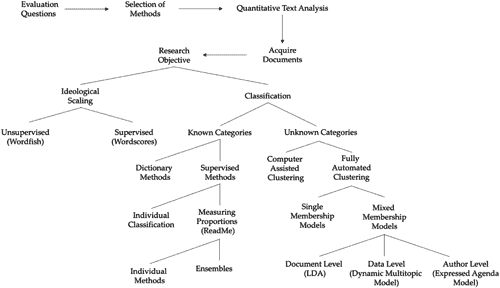

**图 8.1** 定量文本分析方法概述。¶ （改编自 Grimmer & Stewart 2013）。

## Wordfish 方法

在下文段落中，我们将解释这种量表技术的主要特征。Wordfish 发现能够区分政治光谱上不同位置的词语（Grimmer & Stewart, 2013: 292）。衡量政策偏好的方法多种多样，如专家调查、对政党宣言的人工分析和计算编码方法（Gross & Jankowski, 2020）。过去几年里，基于计算机的编码受到更多关注，主要归功于其有效处理大量数据的能力。特别是应用于文本数据时，这种方法能更深入地洞察行动者如何在意识形态上与特定政策保持一致。使用定量文本分析的一大优势在于其为研究带来客观性的潜力。该方法旨在考察利益相关者的实际立场，而非仅依赖感知信息。

Wordfish 是一种无监督量表技术，在数据分析中发挥关键作用，它允许我们在无需预先存在的信息或标记数据的情况下，发掘数据中的趋势和模式（Grimmer & Stewart, 2013）。此外，Wordfish 已被广泛用于通过政党宣言评估政党偏好（Slapin & Proksch, 2008；Proksch, Slapin & Thies 2011；Gross & Jankowski, 2020）或议会辩论（Lauderdale & Herzog, 2016；Frid-Nielsen, 2018；Vignoli et al., 2022）。

简而言之，Wordfish 试图从不同类型文本（如演讲、政党宣言和立场文件）所用语言中推断行动者的潜在位置。它假设这些位置不可直接观察，但可从这些利益相关者选用的词语中推断出来。与其他一些技术（如 Wordscores）不同，

```
*y*[*i**j**t*] ∼ *p**o**i**s**s**o**n*(*λ*[*i**j**t*])  

*λ*[*i**j**t*] = *e**x**p*(*α*[*i**t*]+*ψ*[*j*]+*β*[*j*]\**ω*[*i**t*])  

(8.1)
```

其中 `*λ*[*i**j**t*]` 是每篇文本 i 中词语 j 的计数。`*α*` 代表利益相关者固定效应，而 `*ψ*` 代表文本固定效应。`*β*` 是词语特定权重的估计值，反映词语 j 在区分立场时的重要性，`*ω*` 是利益相关者位置的估计值（Proksch & Slapin, 2009）。

在下一节中，我们将展示一个应用该模型分析政党和利益集团在金融监管方面偏好的实证案例。

## 定量文本分析的案例研究

政策的制定及其后续实施与利益相关者的偏好直接相关。考察政策偏好能为特定政策议题可能采取的路径提供全面而完整的理解。即，它能增进我们对政策如何设计及将朝哪个方向实施的理解（Knill et al., 2012）。它还揭示了偏好随时间的演变。本案例研究

### 瑞士背景下的利益相关者偏好

该案例研究基于 Gatto & Bundi

其次，利益集团在瑞士享有强势地位，瑞士传统上被视为一个新法团主义国家，即利益集团施加强烈影响的国家（Christiansen et al., 2018；Lijphart & Crepaz, 1991）。根据第 147 条，它们享有宪法赋予的表达意见的自由。根据 Christiansen et al. (2018) 的观点，利益集团，特别是那些在技术学科方面具有专长的，对政策制定者至关重要，因为它们提供了政治行动者很少拥有的特定专业知识。因此，正如 Sciarini (2014) 所指出的，在较小国家中，代表不同利益的政党间的合作使政治稳定与经济适应性得以融合。具体而言，利益集团可在议会前阶段通过咨询程序和议会外委员会清晰地表达其立场（Mach et al., 2020）。

### 操作化与数据挖掘

利用议会委员会数据构成了一种新颖且富有成效的方法。在这些委员会环境中，成员有机会阐述其政治观点，而无需担心其意见会立即遭到媒体的公开审视。另一方面，为了衡量利益集团的偏好，我们使用了他们的立场文件。这些文件在联邦咨询阶段和银行委员会的几次咨询期间被系统性地收集，银行委员会于 2009 年成为瑞士金融市场监管局（CFB，2007）。关于选定的利益集团，我们同时考虑了联邦层面的商业利益集团（协会和公司）和公共利益集团。在本研究中，公共利益群体定义如下：“专注于实现和保护公共产品的个人”（参见 Gava 等人，2017：79），但他们也代表选定群体的特定概念和世界观。

分析该数据集固有的挑战源于其双语性质，涵盖德语和法语。为缓解这一问题，我们选择将法语文本翻译成德语，因为 75%的文本原本是德语。根据 Proksch 和 Slapin（2009：32）的说法，德语特别适合基于词的分析：“与由空格或连字符分隔的英语复合词不同，德语允许将名词连接起来形成一个长词，理论上可以复合的名词数量没有限制。”另一个挑战源于确保文档的可比性。立场文件往往比议会发言要长。此外，在委员会辩论中，不同代表的参与程度可能存在差异，有些人发言比其他人更频繁。这可能导致可比性问题。为解决这一问题，我们采纳了 Gross 和 Jankowski（2020）开发的程序，使用`Quanteda`包（Benoit 等人，2021）。对于委员会会议记录，我们检查了所有发言，并剔除那些仅包含少数句子的发言，最终得到关于金融监管的 441 份文档。我们对立场文件重复了这一过程，最终得到 246 份文档。

使用此技术时，大量文本语料库的可用性至关重要，尽管确保 Wordfish 高效运行所需的最小文本长度的精确阈值仍是一个正在进行中的研究领域（Slapin & Proksch, 2008）。随后对文本进行了预处理。具体而言，我们移除了标点符号、空格、数字以及所谓的“停用词”，^()

最后，正如 Proksch 和 Slapin（2009）所阐述的，针对每项政策，我们选择了两份代表政治光谱两极对立观点的立场文件。为实现这种对比，我们专门挑选了两位代表，一位来自瑞士社会党（SP），另一位来自瑞士人民党（SPP），两者分别代表不同的意识形态。就利益集团而言，我们的选择涵盖了商业利益和公共利益，包括代表商业利益的“瑞士工商联合会”（USAM）和主张公共利益的“瑞士工会联合会”（USS）。^()

### 分析

在深入阐述行动者偏好之前，我们需要确立语料库选择的可信度及研究结果的真实性。我们通过分析词语位置来启动这一验证过程，其直观呈现见下图，标记为图 8.2 和 8.3。

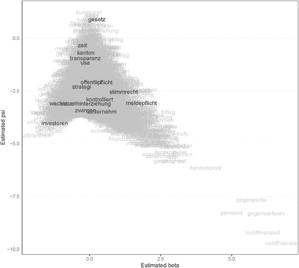

*图 8.2* 代表词语位置。

估计的 psi（`ψ`）衡量词语的出现频率（固定效应），而估计的`β`考虑了词语的权重，从而反映意识形态光谱。图表顶部的标记（token）是最高频词，而位于所谓“艾菲尔铁塔”底部、远离中心的标记使用频率较低，因此能更好地代表文档位置。

此外，`j`权重的值定义了每个词的实际功能；`j`的负值与`ω`（文档位置）的低值相关，而`j`的正值对应该参数的较高值，这决定了每个文本的位置。还必须注意，根据该方法，与 USAM 和 SPP（用作文档选择的参考点）相关的词语更有可能位于“艾菲尔铁塔”图的左侧。此外，两张图均显示“gesetz”（法律）、“zeit”（时间）和“USA”等术语位于图表顶部。在两组中，这些都是高频词，不太可能影响词语权重。图 8.2 显示，与右翼意识形态相关的标记位于左侧：“wachstum”（增长）、“investoren”（投资者）。同样，“steuerbelastung”（税负）和“too-big-to-fail”等可能与同一意识形态相关的术语，也位于利益集团图的左侧。有趣的是，与图 8.3 相比，“investoren”一词位于边缘而非中心。

观察两张图的右侧，可以看到相同的标记“meldepflich”（报告义务）和“stimmrecht”（投票权）。这些词与银行保密监管相关，因为第一个术语（报告义务）在金融监管领域至关重要。然而，使用与义务和报告概念相关的词语（可提高透明度标准）可能与左翼意识形态相关。尽管如此，这两个图表部分之间也存在一些细微差别。例如，“offentlich”（公开/公共）一词在代表图中更居中，而在利益集团图中则显著偏向右侧（正侧）。因此，反映左翼信念的标记位于两张图的左侧，反之亦然。这对应于 Wordfish 估计所用的字典，其中 USAM 的立场文件和 SPP 代表的会议记录被强制设定为比其他两份文档更负面。这表明总体而言，左翼政党和公共利益集团使用的词语大体方向一致。商业利益集团和右翼政党也应如此。显然存在一些差异，这可以用文档类型来解释。

### 继续偏好分析

图 8.4 显示了通过估计变量 `ω` 来确定文档的位置。如前所述，我们考虑了商业利益集团和公共利益集团。y 轴上零点以上的点与倾向于更多监管的偏好相关，而零点以下的点则指向相反的偏好。

首先，该图显示商业利益集团和公共利益集团之间存在区别，前者通常不太倾向于监管。有趣的是，商业利益集团的偏好似乎倾向于较少监管，尤其是在危机之前。相反，在随后袭击该国的新一轮监管浪潮中，它们似乎更倾向于监管。值得注意的是，自 2010 年以来，两条线都有所上升，表明对更多监管的偏好。然而，重要的是要承认商业利益集团和公共利益集团之间存在差异。因此，在议题显著性增加的时期（如全球金融危机后时代），商业利益集团可能不得不通过采取支持更严格监管措施的偏好来重新校准公众舆论。

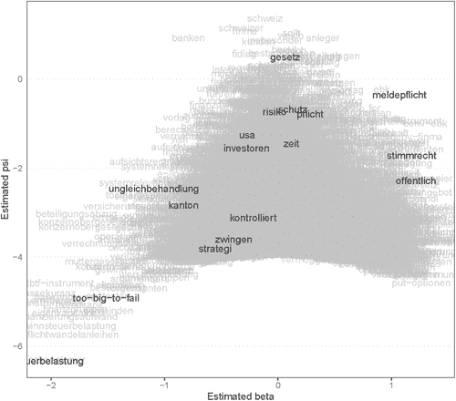

*图 8.3* 利益集团的词语位置。

### 利益集团与代表的比较

为了比较利益集团和代表，我们将后者按其所属政党分组（图 8.5）。与之前关于利益集团偏好的图表类似，代表的偏好似乎遵循相对相似的模式。有趣的是，与之前的图表类似，在金融危机之后似乎存在对更多监管的渴望，或者至少陈述指向该方向。然而，应注意到跨政党缺乏差异是违反直觉的，但这可能是由于随时间推移的框架重大变化或委员会内的共识环境所致。另一个需要注意的重要点是 2005 年至 2007 年间图表中的峰值，这可能归因于考虑到反洗钱法规而产生的最初监管压力。这些结果尤为重要，因为似乎两类行为体都倾向于更多监管。最后，应强调的是，虽然可以观察到某种趋势，但目前尚无法确定与金融危机的直接因果关系。

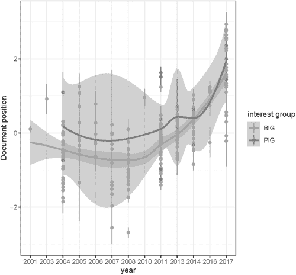

*图 8.4* 利益集团的偏好。

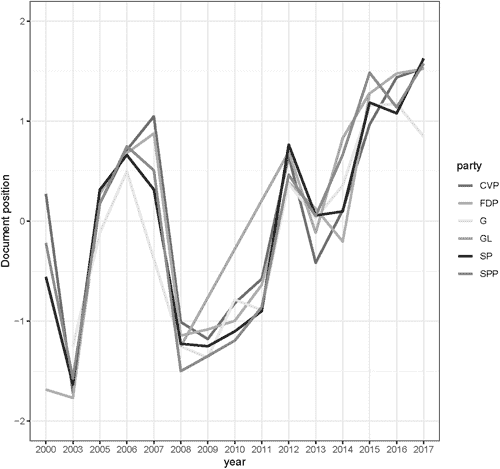

*图 8.5* 政党偏好。

## 讨论


本章讨论了定量文本分析如何用于项目评估。这种技术，特别是 `Wordfish` 方法，呈现出一个多面的优势与劣势图景，评估者必须谨慎驾驭。该方法的优势在于其能够从大量文本数据中提取客观见解，并提供系统且可复制的分析过程。`Wordfish` 及类似技术提供了一种发掘潜在模式、意识形态立场以及文本内容中特定词汇使用的途径，从而丰富了项目评估的深度。具体而言，它是从各类文件（如立场文件和政治演讲）中识别利益相关者偏好的有效工具，其资源消耗少于访谈，同时考虑了更广泛的数据集。此外，不同群体之间可以相互比较，从而显示出对项目的不同偏好。

然而，这些优势必须与该方法的局限性权衡，例如对复杂人类语言的潜在过度简化（参见 Grimmer et al., 2022: 37）、对预处理决策的敏感性（Proksch et al., 2019; Yano et al., 2021）以及遗漏语境的风险（Eichstaedt et al., 2021; Kučera & Mehl, 2022）。重要的是，缩放技术倾向于将术语高共现的文本聚合到单一政策维度中（Grimmer & Stewart, 2013）。因此，为使该技术有效，不仅要求持不同立场的行为体使用不同的词汇，而且要求在随时间测量偏好时识别并关注相似议题（Slapin & Proksch, 2008; Ferrara, 2020）。因此，全面理解所用文本对于识别特定语言模式至关重要。最后，该方法高度依赖于描述偏好的文件的存在。

为了有效掌握定量文本分析的力量，评估者需要掌握多种技能。掌握基本统计方法和编程语言知识对于有效使用 `Wordfish` 至关重要。然而，现在 R 和 Python 中都有优秀的开放获取文本分析工具，可以特别有助于支持用户进行分析。具体而言，在 R 中，`readtext` 和 `Quanteda` 包（Benoit et al., 2021）特别有用。`readtext` 包有助于将文本数据导入并读入 R 环境。同时，`Quanteda` 包在生成构建文档-术语矩阵（DTM）所需的语料库方面发挥着关键作用。该 DTM 是分析过程中成功应用无监督和有监督技术的基本组成部分。扎实的语言细微差别理解和领域专业知识对于准确解释结果和避免误读也至关重要。因此，批判性思维对于微调参数和确保最终分析质量必不可少。

定量文本分析在项目评估中的应用广泛且充满希望。虽然学者们以前强调文本分析的重要性，特别是语境分析对评估的作用（Christie & Fleischer, 2010; McKibben et al., 2020; Stemler, 2000），但定量文本分析提供了一种新工具，开启了文档分析的无限可能。这种方法可以帮助评估者解读公众认知、政治动态和利益相关者偏好，以支持基于证据的决策。通过将定量文本分析整合到评估框架中，从业者可以利用来自海量数字文本数据景观的见解来丰富传统方法（Thomas, 2006）。这种整合可能导致更全面和细致的项目评估，提高各部门的问责制和透明度，并平衡调查方法中的偏差，如误报和社会期望效应（Bundi et al., 2018; Johanson et al., 1993; Lam & Bengo, 2003; Stanton, 2004）。

展望未来，定量文本分析领域的评估研究前景依然充满活力。该领域有望持续进步，潜在的探索领域包括：改进方法以减轻固有偏见、开发结合定量与定性方法的混合模型（Andreotta 等，2019；Eichstaedt 等，2021；Parks & Peters, 2023），以及将现有技术适配到不断演变的传播形式中，如社交媒体平台（Driss 等，2019）。此外，定量文本分析的伦理影响值得深入审视，特别是在隐私担忧、算法公平性和潜在社会影响方面（Dolata 等，2022）。

## 结论

总之，以 `Wordfish` 为例的定量文本分析，代表了一套供评估者深入探究文本数据复杂性的宝贵工具箱。尽管挑战依然存在，但掌握必要技能，并结合审慎的实施方法，能够最大化该方法在项目评估中的效益。随着领域的不断演进，定量文本分析与既定评估实践的融合，有望推进我们对复杂人类传播的理解，并将基于证据的决策推向前所未有的高度。

## 注释

1. 关于罕见的例外，请参见 Cintron & Montrosse-Moorhead（2022）。

2. 文本分析常被称为内容分析。我们将使用文本分析这一术语，以建立其与定量文本分析的联系（Krippendorff, 2018）。

3. 正如 Gross & Jankowski（2020:17）所解释的，`Wordscores` 通过将“参考文本”的相对词频与“待测文本”的词分布进行比较，来估算文件的政策特定立场。

4. 当我们使用“案例研究”一词时，意指“对某一特定案例或多个案例进行详细分析，旨在揭示更大范围案例总体的情况”（Gerring & Cojocaru, 2016: 394）。

5. 在这篇研究论文中，Gatto & Bundi (2023) 对商业利益集团及其关联代表随时间变化的立场进行了比较分析，主要目的是考察与三项不同经济政策相关的潜在趋势变化。在本案中，我们利用庞大的数据集，将范围缩小至仅在金融监管这一政策背景下分析所有利益集团和代表。这种方法将使我们能够观察和评估利益相关者偏好的演变趋势。

6. 工作议会的特点是拥有强大的委员会制度，主要负责起草和决定法案。相比之下，在所谓的“言论议会”中，大多数法案是在全体会议上处理的（Dann, 2003）。

7. 高频常用词（例如：and, or, the 等）。

8. 最终特征数量为 3,722 个（稀疏度 92.32%），针对财政政策；为 3,424 个特征（稀疏度 92.86%），针对金融监管。

9. 选取两份文件，其中第一份文件被约束为具有比第二份更负的值。例如，`dir = c(1,5)` 将约束 `ω1` 小于 `ω5`（Proksch & Slapin, 2009: 340）。

## 参考文献

1. Altheide, D. L. (1987). Reflections: Ethnographic content analysis. Qualitative Sociology, *10*(1), 65–77. [`doi.org/10.1007/BF00988269`](https://doi.org/10.1007/BF00988269)

2. Andreotta, M., Nugroho, R., Hurlstone, M. J., Boschetti, F., Farrell, S., Walker, I., & Paris, C. (2019). Analyzing social media data: A mixed-methods framework combining computational and qualitative text analysis. Behavior Research Methods, *51*, 1766–1781.

3. Barrados, M. (2017). Getting Started with Big Data: The Promises and Challenges of Evaluating Health-Care Quality. In G. J. Petersson and J. D. Breul (eds.). Cyber Society, Big Data, and Evaluation. Routledge.

4. Bellanger, F. (2006). Parlement et administration en Suisse. Annuaire européen d’administration publique*,* *29*, 337–369.

5. Benoit, K. (2020). Text as Data: An Overview. In L. Curini and R. Franzese (eds.). The SAGE Handbook of Research Methods in Political Science and International Relations (pp. 461–497). SAGE Publications Ltd. [`doi.org/10.4135/9781526486387`](https://doi.org/10.4135/9781526486387)

6. Benoit, K., & Herzog, A. (2017). Text Analysis: Estimating Policy Preferences from Written and Spoken Words. In J. Bachner, K. H. Wagner and B. Ginsberg (eds). Analytics, Policy and Governance (pp. 137–-159). Yale University Press.

7. Benoit, K., Watanabe, K., Wang, H., Lua, J. W., Kuha, J., & Benoit, M. K. (2021). Package ‘quanteda. textstats.’ Research Bulletin, *27*(2), 37–54.

8. Berry, M. W., Mohamed, A., & Yap, B. W. (Eds.). (2020). Supervised and Unsupervised Learning for Data Science. Springer International Publishing. [`doi.org/10.1007/978-3-030-22475-2`](https://doi.org/10.1007/978-3-030-22475-2)

9. Bruce, K., Vandelanotte, J., & Gandhi, V. (2025). Emerging Technology and Evaluation in International Development. In S. B. Nielsen, F. Mazzeo Rinaldi and G. J. Petersson (eds.). *Artificial Intelligence and Evaluation.* *Emerging Technologies and Their Implications for Evaluation* (pp. 13–36). Routledge. [`doi.org/10.4324/9781003512493`](https://doi.org/10.4324/9781003512493)

10. Bundi, P., & Pattyn, V. (2022). Citizens and evaluation: A review of evaluation models. American Journal of Evaluation, 10982140211047219. [`journals.sagepub.com/doi/full/10.1177/10982140211047219`](https://journals.sagepub.com/doi/full/10.1177/10982140211047219)

11. Bundi, P., Varone, F., Gava, R., & Widmer, T. (2018). Self-selection and misreporting in legislative surveys. Political Science Research and Methods, *6*(4), 771–789.

12. Bunea, A., & Ibenskas, R. (2015). Quantitative text analysis and the study of EU lobbying and interest groups. European Union Politics, *16*(3), 429–455.

13. Campbell, R. S., & Pennebaker, J. W. (2003). The secret life of pronouns: Flexibility in writing style and physical health. Psychological Science, *14*(1), 60–65. [`doi.org/10.1111/1467-9280.01419`](https://doi.org/10.1111/1467-9280.01419)

14. Celebi, M. E., & Aydin, K. (Eds.). (2016). Unsupervised Learning Algorithms. Springer International Publishing. [`doi.org/10.1007/978-3-319-24211-8`](https://doi.org/10.1007/978-3-319-24211-8)

15. Chen, H. T. (2014). Practical Program Evaluation: Theory-Driven Evaluation and the Integrated Evaluation Perspective. SAGE Publications.

16. Christiansen, P. M., Mach, A., & Varone, F. (2018). 团体主义制度如何塑造公民团体接触政策制定者的渠道：来自丹麦和瑞士的证据。*Journal of European Public Policy*, 25(4), 526–545. [`doi.org/10.1080/13501763.2016.1268194`](https://doi.org/10.1080/13501763.2016.1268194)

17. Christie, C. A., & Fleischer, D. N. (2010). 对评估实践的洞察：对北美以评估为重点的期刊上发表的评估研究所用设计和方法的内容分析。*American Journal of Evaluation*, 31(3), 326–346.

18. Christie, C. A., & Rose, M. (2003). 评估理论的语言：从对评估理论与实践的实证研究中获得的见解。*Canadian Journal of Program Evaluation*, 18(2), 33–45. [`doi.org/10.3138/cjpe.18.002`](https://doi.org/10.3138/cjpe.18.002)

19. Cintron, D. W., & Montrosse-Moorhead, B. (2022). 将大数据融入评估：用于主题识别和建模的 R 代码。*American Journal of Evaluation*, 43(3), 412–436. [`doi.org/10.1177/10982140211031640`](https://doi.org/10.1177/10982140211031640)

20. Commission fédérale des banques (CFB). (2007). *Rapport de gestion 2007*。Commission fédérale des banques.

21. Cousins, J. B., & Whitmore, E. (1998). 构建参与式评估。*New Directions for Evaluation*, 1998(80), 5–23. [`doi.org/10.1002/ev.1114`](https://doi.org/10.1002/ev.1114)

22. Dann, P. (2003). 欧洲议会与行政联邦制：在半议会制民主中探寻议会。*European Law Journal*, 9(5), 549–574.

23. Dolata, M., Feuerriegel, S., & Schwabe, G. (2022). 算法公平性的社会技术视角。*Information Systems Journal*, 32(4), 754–818.

24. Driss, O. B., Mellouli, S., & Trabelsi, Z. (2019). 从公民到政府政策制定者：社交媒体数据分析。*Government Information Quarterly*, 36(3), 560–570. [`doi.org/10.1016/j.giq.2019.05.002`](https://doi.org/10.1016/j.giq.2019.05.002)

25. Eichstaedt, J. C., Kern, M. L., Yaden, D. B., Schwartz, H. A., Giorgi, S., Park, G., Hagan, C. A., Tobolsky, V. A., Smith, L. K., & Buffone, A. (2021). 文本分析的闭合词汇表与开放词汇表方法：综述、定量比较与建议。*Psychological Methods*, 26(4), 398.

26. Ferrara, F. M. (2020). 欧债危机中的思想之战：来自欧洲央行会期间讲话的证据。*Journal of European Public Policy*, 27(10), 1463–1486. [`doi.org/10.1080/13501763.2019.1670231`](https://doi.org/10.1080/13501763.2019.1670231)

27. Fetterman, D. M. (2001). *Foundations of Empowerment Evaluation*。SAGE.

28. Figgou, L., & Pavlopoulos, V. (2015). 社会心理学：研究方法。*International Encyclopedia of the Social & Behavioral Sciences*, 22, 544–552.


## 参考文献

29. Foucault, M. (1971). 话语秩序。*Social Science Information*, 10(2), 7–30. [`doi.org/10.1177/053901847101000201`](https://doi.org/10.1177/053901847101000201)

30. Frid-Nielsen, S. S. (2018). 人权还是安全？欧洲议会演讲中的庇护立场。*European Union Politics*, 19(2), 344–362. [`doi.org/10.1177/1465116518755954`](https://doi.org/10.1177/1465116518755954)

31. Fujita-Conrads, E., Christie, C. A., & FastHorse, E. (2023). 评估政策作为评估理论与实践之间的桥梁。载于 M. C. Alkin and C. A. Christie (Eds.), *Evaluation Roots: Theory Influencing Practice* (pp. 292–299)。Guilford Publications.

32. Gani, A., Siddiqa, A., Shamshirband, S., & Hanum, F. (2016). 大数据索引技术综述：分类学与性能评估。*Knowledge and Information Systems*, 46, 241–284.

33. Gatto, L., & Bundi, P. (2023). 只有危机才能将我们分开：商业利益集团、代表与商业监管 [未出版手稿]。

34. Gava, R., Varone, F., Mach, A., Eichenberger, S., Christe, J., & Chao‐Blanco, C. (2017). 议会中的利益集团：探索议员的利益隶属关系 (2000‐2011)。*Swiss Political Science Review*, 23(1), 77–94.

35. Gergen, K. J. (1992). 现代心理学中的社会建构主义运动。载于 *The Restoration of Dialogue: Readings in the Philosophy of Clinical Psychology* (pp. 556–569)。American Psychological Association. [`doi.org/10.1037/10112-044`](https://doi.org/10.1037/10112-044)

36. Gerring, J., & Cojocaru, L. (2016). 为深度分析选择案例：多样的目标与方法。*Sociological Methods & Research*, 45(3), 392–423. [`doi.org/10.1177/0049124116631692`](https://doi.org/10.1177/0049124116631692)

37. Goodwin, C., & Heritage, J. (1990). 会话分析。*Annual Review of Anthropology*, 19(1), 283–307. [`doi.org/10.1146/annurev.an.19.100190.001435`](https://doi.org/10.1146/annurev.an.19.100190.001435)

38. Goyal, N., & Howlett, M. (2019). 在多层评估框架内结合内部与外部评估：亚洲开发银行经验教训的计算文本分析。*Evaluation*, 25(3), 366–380. [`doi.org/10.1177/1356389019827035`](https://doi.org/10.1177/1356389019827035)

39. Grimmer, J., & Stewart, B. M. (2013). 文本即数据：政治文本自动内容分析方法的前景与陷阱。*Political Analysis*, 21(3), 267–297. [`doi.org/10.1093/pan/mps028`](https://doi.org/10.1093/pan/mps028)

40. Grimmer, J., Roberts, M. E., & Stewart, B. M. (2022). *Text as data: A new framework for machine learning and the social sciences*。Princeton University Press.

41. Groom, C. J., & Pennebaker, J. W. (2002). 词语。*Journal of Research in Personality*, 36(6), 615–621. [`doi.org/10.1016/S0092-6566(02)00512-3`](https://doi.org/10.1016/S0092-6566(02)00512-3)

42. Gross, M., & Jankowski, M. (2020). 多层民主中的政治冲突维度与政党立场：来自地方宣言项目的证据。*West European Politics*, 43(1), 74–101. [`doi.org/10.1080/01402382.2019.1602816`](https://doi.org/10.1080/01402382.2019.1602816)

43. Head, B. W. (2016). 迈向更“循证”的政策制定？*Public Administration Review*, 76(3), 472–484.

44. Højlund, S., Olejniczak, K., Petersson, G. J., & Rok, J. (2017). 评估中大数据的当前用途。载于 G. J. Petersson, F. Leeuw, & K. Olejniczak (Eds.), *Cyber society, big data, and evaluation* (pp. 35–60)。Routledge.

45. Jacobson, M. R., Azzam, T., & Baez, J. G. (2013). 残疾人纳入项目评估的性质与频率。*American Journal of Evaluation*, 34(1), 23–44. [`doi.org/10.1177/1098214012461558`](https://doi.org/10.1177/1098214012461558)

46. James, S., Pagliari, S., & Young, K. L. (2021). 欧洲金融网络的国际化：对欧盟咨询回应的定量文本分析。*国际政治经济评论*, *28*(4), 898–925. [`doi.org/10.1080/09692290.2020.1779781`](https://doi.org/10.1080/09692290.2020.1779781)

47. Jamieson, K. H. (1988). *电子时代的雄辩：政治演说的转型*。牛津大学出版社。

48. Johanson, G. A., Gips, C. J., & Rich, C. E. (1993). “如果你不能说些好听的” 社会期许反应组的一种变体。*评价评论*, *17*(1), 116–122。

49. Johnstone, B. (2017). *话语分析*。John Wiley & Sons。

50. Klüver, H. (2009). 利用定量文本分析衡量利益集团影响力。*欧盟政治*, *10*(4), 535–549。

51. Klüver, H. (2015). 定量文本分析在利益集团研究中的前景：对 Bunea 和 Ibenskas 的回应。*欧盟政治*, *16*(3), 456–466。[`doi.org/10.1177/1465116515581669`](https://doi.org/10.1177/1465116515581669)

52. Knill, C., Schulze, K., & Tosun, J. (2012). 监管政策产出与影响：探索一种复杂关系。*监管与治理*, *6*(4), 427–444。

53. Kouame, J. B. (2010). 利用可读性测试提高面向低识字参与者的评价文件的准确性。*多学科评价期刊*, *6*(14), 132–139。

54. Krippendorff, K. (2018). *内容分析：其方法论导论*。Sage Publications。

55. Kučera, D., & Mehl, M. R. (2022). 超越英语：在心理文本分析中考量语言与文化。*心理学前沿*, *13*, 819543。

56. Lam, J. C., Cheung, L. Y., Wang, S., & Li, V. O. (2019). 香港空气污染的利益相关者关切及政策启示：一种大数据计算文本分析方法。*环境科学与政策*, *101*, 374–382。[`doi.org/10.1016/j.envsci.2019.07.007`](https://doi.org/10.1016/j.envsci.2019.07.007)

57. Lam, T. C., & Bengo, P. (2003). 三种测量教学实践变化的回顾性自我报告方法的比较。*美国评价杂志*, *24*(1), 65–80。

58. Lauderdale, B. E., & Herzog, A. (2016). 从立法演讲中测量政治立场。*政治分析*, *24*(3), 374–394。

59. Leeuw, F. L. (2003). 重构项目理论：可用方法与待解问题。*美国评价杂志*, *24*(1), 5–20。[`doi.org/10.1016/S1098-2140(02)00271-0`](https://doi.org/10.1016/S1098-2140(02)00271-0)

60. Leeuw, H. B. M. (2017). 利用大数据研究数字盗版与版权警报系统。载 G. J. Petersson 和 J. D. Breul (编)。*网络社会、大数据与评价*。Routledge。

61. Lijphart, A., & Crepaz, M. M. (1991). 十八国中的法团主义与协商民主：概念与实证联系。*英国政治学杂志*, *21*(2), 235–246。

62. Mach, A., Varone, F., Eichenberger, S. (2020). 瑞士新法团主义的转型：从议会前谈判走向议会场域中的特权多元主义。载：Careja, R., Emmenegger, P., Giger, N. (编) *压力下的欧洲社会模式*。Springer VS, Wiesbaden。[`doi.org/10.1007/978-3-658-27043-8_4`](https://doi.org/10.1007/978-3-658-27043-8_4)

63. MacDonald, B. (1976). 评价与教育控制。载 D. A. Tawney (编)。*当今课程评价：趋势与启示* (pp. 125–136)。MacMilland Education。

64. Mayne, J. (2007). 实施结果导向管理的挑战与教训。*评价*, *13*(1), 87–109。

65. Mayrhofer, M., Matthes, J., Einwiller, S., & Naderer, B. (2020). 社交媒体上呈现品牌的用户生成内容增加了年轻成年人的购买意向。*国际广告杂志*, *39*(1), 166–186。[`doi.org/10.1080/02650487.2019.1596447`](https://doi.org/10.1080/02650487.2019.1596447)

66. Mazzeo Rinaldi, F., Celardi, E., Miracula, V., & Picone, A. (2025). 评价复杂社会现象中的人工智能与文本分析：俄乌冲突。载 S. B. Nielsen, F. Mazzeo Rinaldi 和 G. J. Petersson (编)。*数字时代评价：新兴技术及其对评价的启示* (pp. 168–195)。Routledge。[`doi.org/10.4324/9781003512493`](https://doi.org/10.4324/9781003512493)

67. McKibben, W. B., Cade, R., Purgason, L. L., & Wahesh, E. (2020). 如何在咨询研究中进行演绎内容分析。*咨询结果研究与评价*, *13*(2), 156–168。[`doi.org/10.1080/21501378.2020.1846992`](https://doi.org/10.1080/21501378.2020.1846992)

68. Mehl, M. R. (2006). 定量文本分析。载 M. Eid 和 E. Diener (编)。*心理学多方法测量手册* (pp. 141–156)。美国心理学会。[`doi.org/10.1037/11383-011`](https://doi.org/10.1037/11383-011)

69. Nielsen, S. B., Ejler, N., & Schretzman, M. (2017). 探索大(数据)机遇：数据智能创新中心 (CIDI) 案例，纽约市。载 G. J. Petersson 和 J. D. Breul (编)。*网络社会、大数据与评价*。Routledge。

70. Nielsen, S. B. (2025). 评价行业与新兴技术。载 S. B. Nielsen, F. Mazzeo Rinaldi 和 G. J. Petersson (编)。*人工智能与评价：新兴技术及其对评价的启示* (pp. 266–286)。Routledge。[`doi.org/10.4324/9781003512493`](https://doi.org/10.4324/9781003512493)

71. Nielsen, S. B., Mazzeo Rinaldi, F., & Petersson, G. J. (2025). 人工智能时代的评价。载 S. -B. Nielsen, F. Mazzeo Rinaldi 和 G. J. Petersson (编)。*人工智能与评价：新兴技术及其对评价的启示* (pp. 1–12)。Routledge。[`doi.org/10.4324/9781003512493`](https://doi.org/10.4324/9781003512493)

72. Parks, L., & Peters, W. (2023). 混合方法文本分析中的自然语言处理：一种工作流方法。*国际社会研究方法杂志*, *26*(4), 377–389。[`doi.org/10.1080/13645579.2021.2018905`](https://doi.org/10.1080/13645579.2021.2018905)

73. Pauwels, T. (2011). 测量民粹主义：比利时政党文献的定量文本分析。*选举、公众舆论与政党杂志*, *21*(1), 97–119。[`doi.org/10.1080/17457289.2011.539483`](https://doi.org/10.1080/17457289.2011.539483)

74. Pawson, R., & Tilley, N. (1997). *实在评价*。SAGE。

75. Pennebaker, J. W., Mehl, M. R., & Niederhoffer, K. G. (2003). 自然语言使用的心理学层面：我们的词语，我们的自我。心理学年鉴，*54*(1)，547–577。 [`doi.org/10.1146/annurev.psych.54.101601.145041`](https://doi.org/10.1146/annurev.psych.54.101601.145041)

76. Petersson, G. J., & Breul, J. D. (2017). 网络社会、大数据与评估。Routledge。

77. Picciotto, R. (2015). 面向 21 世纪的民主评估。评估，*21*(2)，150–166。 [`doi.org/10.1177/1356389015577511`](https://doi.org/10.1177/1356389015577511)

78. Picciotto, R. (2020). 评估与大数据挑战。美国评估杂志，*41*(2)，166–181。

79. Pilotti, A. (2012). 民主化与专业化之间的瑞士议员 *(1910-2010.)* *联邦当选人集体传记与瑞士议会改革* (博士学位论文，洛桑大学，社会与政治科学学院)。

80. Popping, R. (2000). 计算机辅助文本分析。SAGE。

81. Popping, R. (2012). 定量文本分析研究中的定性决策。社会学方法论，*42*(1)，88–90。 [`doi.org/10.1177/0081175012460854`](https://doi.org/10.1177/0081175012460854)

82. Preskill, H., & Jones, N. (2009). 让利益相关者参与制定评估问题的实用指南。 [`folio.iupui.edu/handle/10244/683`](https://folio.iupui.edu/handle/10244/683)


# 参考文献

83. Proksch, S. O., & Slapin, J. B. (2009). 如何避免政治文本统计分析中的陷阱：以德国为例。德国政治，*18*(3)，323–344。 [`doi.org/10.1080/09644000903055799`](https://doi.org/10.1080/09644000903055799)

84. Proksch, S. O., Slapin, J. B., & Thies, M. F. (2011). 战后日本的政党体系动态：竞选承诺的定量内容分析。选举研究，*30*(1)，114–124。 [`doi.org/10.1016/j.electstud.2010.09.015`](https://doi.org/10.1016/j.electstud.2010.09.015)

85. Proksch, S.-O., Wratil, C., & Wäckerle, J. (2019). 检验自动语音识别在政治文本分析中的效度。政治分析，*27*(3)，339–359。

86. Roberts, C. W. (1997). 定量文本分析的通用语义语法：应用于 1979 年东柏林和西柏林广播新闻内容。社会学方法论，*27*(1)，89–129。 [`doi.org/10.1111/1467-9531.271020`](https://doi.org/10.1111/1467-9531.271020)

87. Rossman, G. B., & Wilson, B. L. (1985). 数字与文字：在单一大规模评估研究中结合定量和定性方法。评价评论，*9*(5)，627–643。

88. Sciarini, P., Nai, A., & Tresch, A. (2014). 2014 年 2 月 9 日联邦全民投票分析。gfs. bern 与日内瓦大学。

89. Shapiro, G., & Markoff, J. (1997). 定义的问题。载 C. W. Roberts (编)，社会科学文本分析 (第 1 版，第 24 页)。Routledge。

90. Slapin, J. B., & Proksch, S.-O. (2008). 用于从文本估算时间序列政党立场的缩放模型。美国政治科学杂志，*52*(3)，705–722。 [`doi.org/10.1111/j.1540-5907.2008.00338.x`](https://doi.org/10.1111/j.1540-5907.2008.00338.x)

91. Stake, R. E. (2003). 基于标准的响应式评价。SAGE Publications。

92. Stanton, C. K. (2004). 为支持安全母性而测量分娩准备度的方法学问题。评价评论，*28*(3)，179–200。

93. Stemler, S. (2000). 内容分析综述。实用评估、研究与评价，*7*(1)，17。

94. Stevahn, L., & King, J. A. (2016). 促进互动评价实践：建设性地让利益相关者参与。评价新方向，*2016*(149)，67–80。 [`doi.org/10.1002/ev.20180`](https://doi.org/10.1002/ev.20180)

95. Storz, A., & Bernauer, J. (2018). 民粹主义的供给与需求：对州级 SVP 宣言的定量文本分析。瑞士政治科学评论，*24*(4)，525–544。 [`doi.org/10.1111/spsr.12332`](https://doi.org/10.1111/spsr.12332)

96. Stufflebeam, D. L., & Zhang, G. (2017). CIPP 评价模型：如何为改进和问责进行评价。Guilford Publications。

97. Thomas, D. R. (2006). 分析定性评价数据的一般归纳法。美国评价杂志，*27*(2)，237–246。

98. Van Deursen, A. J., & Mossberger, K. (2018). 面向所有人的任何事物？物联网技能中的新数字鸿沟。政策与互联网，*10*(2)，122–140。

99. Varone, F., Ingold, K. (2023). 瑞士，公共政策。载：van Gerven, M., Rothmayr Allison, C., Schubert, K. (编) 公共政策百科全书。Springer, Cham。 [`doi.org/10.1007/978-3-030-90434-0_54-1`](https://doi.org/10.1007/978-3-030-90434-0_54-1)

100. Vignoli, V., Ostermann, F., & Wagner, W. (2022). 意识形态言辞，战略投票：德国政党在议会中关于阿富汗军事干预的立场。德国政治，1–23。 [`doi.org/10.1080/09644008.2022.2137497`](https://doi.org/10.1080/09644008.2022.2137497)

101. Weiss, C. H. (1988). 如果项目决策仅取决于信息：对 Patton 的回应。评价实践，*9*(3)，15–28。

102. Wilkins, P. (2017). 保持交通与公共交通乘客流动——大数据的应用。载 G. J. Petersson 和 J. D. Breul (编)。网络社会、大数据与评价。Routledge。

103. Wratil, C., Waeckerle, J., & Proksch, S.-O. (2022). 政府修辞与国际谈判中公众意见的代表性。美国政治科学评论，1–18。

104. Yano, K., Endo, S., Kimura, S., & Oishi, K. (2021). 三个敏感度群体大学生采用的有效应对策略：定量文本分析。Cogent Psychology，*8*(1)，1988193。

105. York, P., & Bamberger, M. (2024). 大数据应用于强化评价。载 S. B. Nielsen, F. Mazzeo Rinaldi 和 G. J. Petersson (编)。*数字时代评价：新兴技术及其对评价的影响* (第 37–55 页)。伦敦：Routledge。 [`doi.org/10.4324/9781003512493`](https://doi.org/10.4324/9781003512493)

# 9 评估复杂社会现象中的人工智能与文本分析：俄乌冲突

Francesco Mazzeo Rinaldi, Elvira Celardi, Vincenzo Miracula, and Antonio Picone

DOI: [10.4324/9781003512493-9](https://doi.org/10.4324/9781003512493-9)

本章已根据 CC-BY-NC-ND 4.0 许可提供。

## 引言

### 后现代与全球化社会的社会议题

困扰后现代和全球化社会的社会议题错综复杂，影响着人们生活的各个维度。此外，在过去三年中，COVID-19 大流行的蔓延不仅改变了我们习以为常的社会现实，也证实了数据是最宝贵的资源之一，这对社会科学家（总体而言）和评价者用于开展研究的工具和技术提出了挑战。这不仅要求我们反思用于预测和评价干预结果的工具和技术，也要求我们反思迄今为止所定义的评价者角色和职业所需的技能，以及更广泛的工作实践。

### 高度数字化社会现实中的评价

在当今“高度数字化”的社会现实中，个人和群体时刻留下其行为的痕迹。**大数据** 可通过互联数据平台进行收集和分析，以揭示隐藏的模式和趋势，这在许多决策情境中大有裨益（参见 Petersson & Breul, 2017；本书中的 York & Bamberger）。提取和分析这些数据可进一步帮助理解社会项目和工程得以塑造的复杂社会系统的运作机制。

在全球范围内，甚至公共部门也已敏锐地意识到数据的指数级增长，这是一场不可阻挡的洪流。众多公共机构和组织已认识到，蕴藏在来自智能手机、传感器、卫星和数字化转型工作等来源的数据洪流中的巨大潜力（参见本书中的 Bruce 等人）。当这些潜力与 **人工智能（AI）** 系统，特别是 **机器学习（ML）** 算法相结合时，便得以发挥作用，后者具备从这浩瀚的信息海洋中挖掘有价值洞见的能力（参见 Nielsen 等人，2025，本卷）。

随着这些进步，各行各业表现出了不同的反应。例如，社会科学家已认识到并拥抱新兴技术带来的新机遇（参见 Grossmann 等人，2023）。在此背景下，评价者对这些新挑战的反应似乎迟缓（Petersson & Breul, 2017；Picciotto, 2020；Nielsen, 2023；Nielsen, 2025，本卷）。如何调整评价实践以利用 AI 系统的力量，在最近一段时间内似乎不是评价者提出的问题。如今，尽管缓慢，但这一状况似乎正在改变。

例如，过去十年 ML 应用的巨大成功激发了其在多个评价情境中的采用（本卷中，Næss 等人，2025；Holtermann & Engebretsen, 2025；Gatto & Bundi, 2025；Ziulu 等人，2025；Holm 等人，2025）。

本章旨在凸显此类技术在分析和评价复杂社会现象中所能增加的价值，为方法论创新以及开发旨在理解和评价大规模复杂社会事件的工具提供一个 *场所*。我们通过乌克兰冲突的案例研究，探讨使用 ML 和文本分析工具的潜力。当今的俄乌战争代表了一种正在全球范围内改变地缘政治版图的现象，决策者在制定政策和项目（国家和国际层面）时需要将其纳入考量。通过案例研究，我们还探讨了此类技术如何使我们能够了解人们对针对俄罗斯实施的制裁的反应，重点关注：

1. 数字语境下对乌克兰冲突的认知
2. 对制裁实施的情绪反应
3. ICT 在宏观语境下的适用性/可靠性

我们将探讨以下问题：

- 这些工具的哪些特性使其能够收集和分析数据？
- 它们使我们能够捕捉哪些传统工具无法捕捉的信息？
- 它们如何帮助识别人们在特定情境下使用的反应机制？

## 评价与数字语境

社会科学和评价文献提供了大量关于语境的定义（Fitzpatrick, 2012；Pawson, 2013），其中许多定义表面上看似相互冲突。评价研究的任务之一是解释语境如何以及为何塑造干预措施（一项政策、一个项目、一个工程，或更广泛地说，一种政治策略）发挥作用的机制，从而解释为何它在不同语境下可能产生不同的效果（Greenhalgh & Manzano, 2022）。近年来，评价者和研究者在其因果解释中更多地考虑应对语境挑战，例如在理论驱动的评价研究中（Shaw et al., 2018；Coldwell, 2019；Nielsen et al., 2022）。

更具体地说，在现实主义评价领域，语境的范围很广（Pawson, 2013；Goicolea & Kermode, 2018；Kerr et al., 2018；Ebenso et al., 2019；Nielsen et al., 2022）。它无处不在、复杂、动态、不断变化、具有关系性、能创造行动主体性，而不仅仅是调节变化（Coldwell, 2019，第 109 页）。它可以被视为“物理或非物理建构物”（Pfadenhauer et al., 2015，第 106 页）。在前一种情况下，Pfadenhauer 及其同事强调了触发或阻碍干预的可观察特征（如空间、场所、人、事物等），假设语境在某一时刻起作用并引发一连串事件的连锁反应。在后一种情况下，语境被理解为塑造干预机制的关系性和动态特征，假设语境在多个社会系统层面上随时间动态运作（Greenhalgh & Manzano, 2022）。

在后一种意义上，语境不再简化为一组事物（有形物质事实和投入的清单，通常包括耗材和人员），而是作为互动系统：塑造利益相关者对项目资源推理的意义、规则和关系集合，从而影响项目结果。Ray Pawson 指出“语境具有多个层面”（Pawson, 2016）。换句话说，语境在社会系统的所有层面上运作，不同层面相互作用、相互影响。它们是在无边界的微-中-宏系统中运作的多层实体（Greenhalgh & Manzano, 2022，第 19 页）。因此，某项特定的政策或措施可以激活多种机制，产生截然不同的结果。

# 评价计划制定中的复杂性与数字化背景

## 复杂的社会系统与全球治理

在制定评价计划时，不能忽视干预措施所处情境条件的复杂性（Rogers, 2008）。应将其理解为嵌入于同样复杂的现实之中的复杂社会系统（Pawson, 2013）。当今任何干预措施的制定都是全球治理体系的一部分（Rosenau & Czempiel, 1992；Hooghe & Marks, 2001），该体系在不同场所通过不同行动者的参与得以行使（Raffini, 2011）。民族国家（政治决策在其疆域内成形并显现效力）成为一个更复杂、更多层次的权力体系中的行动者。

如今，比以往任何时候都更需要情境知识来评价针对大规模现象的干预措施的影响，这种知识必须超越物理场所，涵盖数字情境中的人际和社会关系。

## 数字领域对日常生活的重塑

在线连接（或持续在线）、在社交媒体上交换点赞或评论、在线购买产品、下载应用程序、更新虚拟个人资料、交换电子邮件、短信或 WhatsApp 消息、在 TikTok 上创建短视频、在网络上搜索信息，仅仅是已成为数十亿人生活一部分的无数活动和日常举动中的几个例子。这些活动改变了信息获取、经济机会、社会关系形态以及身份建构过程。数字领域深刻影响着我们的生活和日常惯例。在线平台的入侵已发生在各个领域，在这个社会中，社会和经济互动越来越多地通过全球性、高度互联的数字基础设施发生。数字平台的增长被誉为经济进步和技术创新的引擎。个人可以从这一变革中获益良多，从而能够在线发起活动、交换商品和分享信息。

正如 Van Dijck 等人所言，如今数字平台的使用日益影响社会具有根本重要性的领域，如医疗保健、教育和公共交通，其重要性与日俱增，甚至逐渐与从组织角度构建民主社会的制度（线下、传统）和实践相融合。在“平台社会”中，平台不是外部因素；它们不仅反映社会，更生产我们日常生活的社会结构。在线平台在全球传播内容、价值观和文化。它们可能促成全球文化同质化，反之，也可能通过分享独特的文化体验来促进文化多样性。它们通过界面设计、推荐算法和内容个性化来影响用户行为。

此外，社交媒体平台通过计算“点赞”和分享数，能够塑造社会动态和用户行为，影响社会从众行为和对认可的渴望。它们推动潮流并促成新文化形式的创造。它们提供空间，让用户创建个人资料、分享个人信息、兴趣和观点，并参与在线社区。这些空间影响身份形成和自我呈现。同样，平台也可在构建集体身份（如社会运动和政治群体）中发挥作用。在线平台改变了参与的性质，参与逐渐变得越来越在线化。真实与虚拟之间日益增加的互动和相互依赖，为个体创造了一个新的社会环境，其特征是归属于多个物理和非物理关系网络（Wellman, 2001）。如今，数百万人加入一个或多个在线社区，以满足其沟通、信息和娱乐需求。在此背景下，社交媒体广受欢迎，创造了一个虚拟现实，人们可在其中表达对产品、服务、品牌、个人、名人或其他事物的想法和感受。数字社区的激增引发了激烈辩论：一方认为技术可以成为促进社会关系和拓展社区边界的宝贵工具；另一方则持截然相反的观点，强调此类社区的危险性。对于社会科学家总体而言，特别是评价者，考虑当情境中建立的关系发生在数字而非物理空间时，可使用何种工具来理解情境，变得至关重要。

## 全球化、领土重构与“数字广场”

如今不可阻挡的全球化进程正在同步推进，并触发了一个将社会体验与领土物理边界分离的过程。全球社会中的领土（Castells, 2004）被穿越它们的流深刻地改变（Appadurai, 2001）。这些流涉及人员、商品、信息、消息和符号的流动（Raffini, 2011）。在此背景下，社会生活不再由空间逻辑定义，而是在多个与领土和空间邻近性无关的空间中被（重新）定义。技术进步使个体更容易相互沟通和联系。社交媒体、即时通讯和其他形式的数字通信的兴起，使人们能够跨越遥远距离进行互动。人们不再仅仅是信息的消费者，而成为全球实时共享内容的“生产消费者”（prosumers）。

关于数字化的新兴文献（Coleman & Blumler, 2009；Svensson, 2014；Parycek et al., 2017；Reis et al., 2020）强调了“数字广场”（digital agora）的创造，这是一个新的电子公共领域，可被视为连接公民和利益相关者的一种更高效、情感回报更丰厚方式的象征（Van Dijk, 2020；Jing, 2022）。**ICT（信息通信技术）** 刺激了更具参与性的社会并为决策提供支持。同时，新挑战也随之出现，例如网络社会中的新型特权（Svensson, 2014）。ICT 中权力分配最关键、最知名的方面之一（Parycek et al., 2017）是数字鸿沟，最显著地表现为不同社会地位、移民背景或性别群体之间的差距（Van Dijk, 2012；Lythreatis et al., 2022）。它可能加剧现有的不平等，并限制处于鸿沟劣势一方的人群的机会。

近期研究还凸显了 **ICT（信息与通信技术）** 一个黑暗且鲜少被探索的侧面（Bishop, 2018；Fourcade & Johns, 2020），这与信息控制有关，特别是与通过实时运行的反应性、控制论反馈回路来引导或控制人们行为的可能性有关。这些要素对人们最终如何认知自我以及社会身份如何形成具有重要意义（Burrell & Fourcade, 2021）。

数字平台（如 `Twitter`、`Facebook`、`YouTube`、`Instagram`、`Reddit`、`TikTok` 等）延伸了本可能衰退甚至从未存在过的关系。尽管如此，正如一些学者指出的那样，通过心理和经济技术，它们*已将自身建构为一个事实上的全球公共领域，并对社会注意力的分配拥有近乎垄断的权力*（Burrell & Fourcade, 2021，第 230 页）。

在《算法社会》一书中，Burrell 和 Fourcade 如此写道：


> 公共辩论、知识流通、建设性追求和报道，都已深度依赖于社交媒体中介及其隐秘的算法。但信息的极度丰富，本应由人们自行甄别，却“往往引发偏执和其他投机性的公共知识与参与形式”（Hong, 2020，第 8 页）。既得利益者已被技艺高超或资金充足的活动家新贵、有组织的网络暴民和标题党制造者所取代。集体动员与反动员的精神，在数字生产资料的不平等斗争中轻易被淹没（Schradie, 2019）。取而代之的是阴谋、迷信和流言蜚语这些旧恶魔，它们从坟墓中复活，被贪婪的算法咒语召唤到水面。
>
> （Burrell & Fourcade, 2021）

情境知识对于评估干预措施针对大规模现象的影响至关重要。但什么是情境上显著的，可能不仅关乎物理场所，还关乎人际和社会关系系统，这些系统如今在数字语境中广泛存在且高度发达。从这一视角出发，评估必须配备工具，使其能够实时调查这些新的、尚未被探索的数字语境中展开的动态。

我们认为，在评估设计中使用这些新技术，或许能让我们捕捉到数字语境特有的、普遍未被探索的情境星座的复杂性。这是拦截参与数字`广场`辩论所产生的非线性因果机制的必要一步。

## 材料与方法

俄乌战争是一场始于 2014 年的持续性冲突，当时俄罗斯吞并了乌克兰的克里米亚。随着亲俄分裂分子在乌克兰东部介入以及俄罗斯的军事干预，冲突不断升级。战争对基础设施造成重大破坏，导致数千人死亡，引发大规模人道主义危机——近七百万乌克兰人逃离该国。人们曾通过外交谈判和各种停火协议试图解决冲突，但战斗仍在持续。战争也对国际关系产生了重大影响，许多国家因俄罗斯在乌克兰的行动对其实施制裁。冲突仍未解决，其对地区和世界的影响持续深远。

基于多种原因，深入了解公众对俄乌冲突的看法可能是必要的。了解人们对冲突及相关方的感受，对政策制定者和政府至关重要，这有助于他们更好地理解冲突对个人、社区和更广泛地区的影响，并识别不同群体之间的共同点与分歧。了解公众态度和观点，有助于设计策略，建立促进冲突各方对话与和解的倡议。了解公众对叙事和信息感知的差异，有助于制定更有效的信息传递和沟通策略。公众舆论还能在监督政府和其他行为体问责方面发挥作用。通过了解公众对冲突的看法，可以识别需要问责的领域，并致力于确保那些对暴力和侵犯人权行为负责的人受到追责。

在此背景下，社交媒体已成为塑造公众对冲突看法的关键平台，各种声音和观点在这些平台上被放大。然而，社交媒体也可能助长错误信息的传播，并制造回声室效应，导致公众意见两极分化。社交媒体塑造公众对冲突看法的一种方式，是放大那些原本可能无法被听到的声音。`Twitter`、`Facebook` 和 `Instagram` 等社交媒体平台，让身处乌克兰一线的人们以及与冲突有政治或个人关联的人们，得以分享他们的观点和经历。这提供了比传统媒体更多元、更细致的冲突理解。

然而，社交媒体也可能成为错误信息和宣传的温床。虚假信息和阴谋论能在社交媒体上迅速传播，导致冲突中出现两极分化且根深蒂固的立场。这在俄乌冲突中尤为明显，双方都利用社交媒体散布关于对方行动的虚假信息。此外，社交媒体算法可能制造回声室，人们只能看到支持自己观点的内容。这会强化既有信念，使寻找共同点和致力于解决冲突变得更加困难。社交媒体还能提供冲突的实时更新，让人们随时了解最新事态发展。

因此，社交媒体在塑造公众对冲突的认知中，扮演着复杂且多面的角色。理解这些动态，对寻求理清冲突及其对地区影响的政策制定者和研究者至关重要。

总体而言，深入了解公众对俄乌冲突的看法，需要一种结合不同方法的多面向途径。了解公众对这一冲突看法的一种方式，是通过使用 `Google Trends` 和 `X`（前身为 `Twitter`）。

# 理解复杂动态：社交媒体分析方法论

为了理解这些复杂的动态，我们观察了关于冲突的信息流，以更好地了解社交媒体在塑造观点和传播信息中的作用（首先，搜索话题标签 `#RussiaUkraineWar`）。为此，我们进行了社交网络分析（SNA）（图 9.1），这使我们能够识别关键国家、追踪信息传播并考察连接公众的结构。SNA 是一种通过网络和图论分析社会结构的方法。在社交媒体背景下，SNA 可用于分析用户、群组和内容之间的连接，从而深入了解信息如何传播以及观点如何形成（Xu & Li, 2013；Kapoor et al., 2018）。SNA 还可以识别社交媒体平台上的不同群组和社区（Giuffrida et al., 2018, 2019；Freire et al., 2023）。

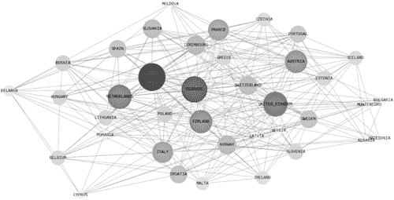

**图 9.1 SNA 中的中心性。**

根据本研究进行的 SNA 分析，德国、丹麦和英国是参与 Twitter 讨论最多的国家。值得注意的是，这些国家均为大西洋联盟（NATO）成员。然而，尽管不是北约成员，芬兰和奥地利也发挥了显著作用。

它们积极参与这些动态，凸显了国际协作以及在不同政治和地理实体之间建立桥梁的重要性。因此，SNA 提供了关于社会互动和信息网络复杂性的详细图景。结果表明，北约成员国和该联盟外的一些参与者都在为可能的持续冲突解决奠定坚实基础方面发挥着作用。

这些群组可能基于共同的兴趣、信仰或地理位置。通过分析这些群组之间的连接，研究人员可以深入了解信息如何在不同社区内部及之间传播，识别社交媒体上信息传播的模式。这可能包括识别最常分享的内容类型、发帖的时间和频率，以及话题标签和其他元数据的使用。通过分析这些模式，可以更好地理解信息如何共享以及观点如何形成。

一旦映射了数字语境中的所有关系，我们就使用 `Google Trends` 选择与话题标签 `#RussiaUkraineWar` 相关的关键词。`Google Trends` 是一个分析随时间变化的搜索行为的强大工具，可以提供特定关键词和短语流行度的见解。将 `Google Trends` 与话题标签结合使用的额外价值在于，它允许跟踪话题标签随时间的流行度、分析地理趋势并识别相关搜索查询。

从搜索词“Russia-Ukraine war”出发，我们查看了搜索量最高的词汇（“trend”）。随后选定了“Sanctions”（制裁）和“Nuclear Threat”（核威胁）。之后，我们使用这些话题标签/关键词收集相关推文。最后，使用 `Power BI` 构建动态仪表板以从数据中寻找洞察。下一节将描述进行研究所使用的工具。

## Google Trends

`Google Trends` 允许用户查看搜索词随时间的相对流行度，从而深入了解公众对特定话题的兴趣。当与话题标签结合时（Miracula & Celardi, 2023），`Google Trends` 可提供任何特定话题标签随时间推移和跨不同地区的流行度和关注度的定量分析，以及这种流行度如何与事件和趋势相关联。研究人员可以通过搜索关键词或话题标签快速识别最相关的推文，并了解人们如何讨论特定问题。这可以提供公众对冲突兴趣及其演变的见解。此外，通过查看搜索的地理位置，可以了解冲突在不同地区的感知方式。

Google 搜索量用于多个研究领域，在这些领域中，掌握个人关切、兴趣和观点的信息至关重要。例如在医学领域，检查与流感症状相关的搜索词已被证明可以预测流感活动（Ginsberg et al., 2009）。搜索量可以预测经济指标（Da et al., 2011；Choi & Varian, 2012）。最后，在 COVID-19 大流行期间，多项研究利用搜索量分析了大流行（Pan et al., 2020；Walker et al., 2020）。

`Google Trends` 提供用户输入 Google 的查询量的时间序列指数。给定时期内最大查询份额被标准化为 100。诸如“Nuclear Threat”之类的查询会被计入“Nuclear”的查询指数计算中。请注意，`Google Trends` 数据是使用抽样方法计算的，因此结果每天会有几个百分点的变化。因此，正如在多个研究领域所示，搜索量分析可以揭示个人信息搜索的见解。然而，其使用伴随着几个重要的考量因素。研究人员在使用 `Google Trends` 数据时应谨慎，因为它存在局限性和潜在偏差。

为更好地了解欧洲国家如何研究战争话题，数据按单个国家提取，然后根据其是否为北约成员重新聚合，如表 9.1 所示。这产生了一个包含每个国家 730 个观测值的数据集（2021 年 365 个观测值和 2022 年 365 个观测值）。

**表 9.1 所分析的欧洲国家**

| NATO 地位 | 国家 |
| --- | --- |
| 成员国 | 比利时、保加利亚、捷克、丹麦、爱沙尼亚、法国、德国、希腊、匈牙利、冰岛、意大利、拉脱维亚、立陶宛、卢森堡、荷兰、挪威、波兰、葡萄牙、罗马尼亚、斯洛伐克、斯洛文尼亚、西班牙、英国 |
| 关联国 | 阿尔巴尼亚、奥地利、克罗地亚、芬兰、摩尔多瓦、北马其顿、瑞典、瑞士 |
| 非成员国 | 白俄罗斯、波斯尼亚、塞浦路斯、爱尔兰、马耳他、黑山、塞尔维亚 |

## Twitter 和 Power BI

基于在 `Google Trends` 中的观察，我们试图了解有关特定事件的信息如何跨社交网络传播。我们决定从特定社交网络 Twitter 收集文本数据。这一选择的原因很简单。Twitter 是一个可以快速获取数据的社交网络，因为它提供常规 API，即一种设计用于通过互联网交换数据的应用程序编程接口（API）。

我们使用了 `Tweepy`，一个可以通过 Python 代码获取推文的库。它是一个开源库，因其易用性和多功能性而在 Python 开发者中广受欢迎。`Tweepy` 为访问 Twitter API 提供了易用的接口。该库使开发者能够编写 Python 脚本以多种方式与 Twitter 交互，例如搜索推文、发布推文和流式传输实时推文。

# 俄乌战争的数据收集与 NLP 分析

## 数据收集

为了获取本研究所需的数据，我们使用了与 2022 年俄乌战争相关的关键词和标签组合来收集推文，例如“Russia-Ukraine war”（俄乌战争）和“Nuclear Threat”（核威胁）。我们按位置、语言和标签筛选，从 2021 年 2 月到 2022 年 10 月收集了来自欧洲国家的五十万（500K）条推文。

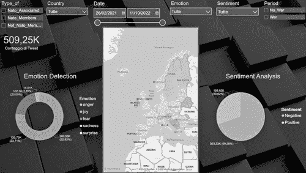

**图 9.2** Power BI 仪表盘。

提取数字语境信息后，我们应用了机器学习技术进行文本挖掘。

## 应用于人工智能的 NLP 技术

语言的使用自远古以来就是人类的重要工具。它使重要信息得以传播，最初通过口头形式，后来通过书写形式。这一工具立即被证明是传播知识的有效途径。随着时间的推移，媒介和语言发生了变化，但工具始终如一。如今的信息量巨大；无数文本存储在世界各地的图书馆中。技术的出现及其在日常生活中的迅速普及，造就了难以想象数量的文本。人们很快意识到，机器的进化可在解决这一问题中发挥作用：自然语言处理是一门融合了计算机科学和语言学的交叉学科，旨在通过计算机以自动化方式研究文本（Chowdhary & Chowdhary, 2020）。

自然语言处理（NLP）的众多方法通常可归纳为四类。

1.  **基于规则的方法**：由专家或语言学家定义语言规则和模式，以识别和提取文本中的相关信息。这些方法通常用于情感分析、信息抽取和文本分类任务。
2.  **统计方法**：利用数学模型和算法学习语言数据中的模式和关系。这些方法广泛应用于文本分类、机器翻译和语音识别任务。
3.  **基于神经网络的方法**：使用深度学习模型，如循环神经网络（RNN）和卷积神经网络（CNN），来学习语言数据中的模式和结构。这些方法有利于情感分析、机器翻译和自然语言生成任务。
4.  **混合方法**：结合上述两种或多种方法，以提高 NLP 模型的准确性和性能。

为了从语料库中提取元文本数据，我们必须对其进行预处理。

## 情感分析与情绪检测

情感分析是一个研究领域，涉及对文本中表达的观点、情感和情绪进行计算处理。它是 NLP 的一个分支，旨在确定说话者或作者对特定主题、产品或服务的态度。由于数字数据的指数级增长以及对公众舆论和客户反馈洞察需求的增加，情感分析已成为一个重要的研究领域（Sahayak 等，2015；Birjali 等，2021；Parveen 等，2023）。

情感分析的目的是自动将给定文本的极性分类为积极、消极或中性。积极极性表示赞同或支持的观点，消极极性代表不赞同或批评的观点，中性极性则表明缺乏强烈的情感或观点。情感分析旨在从文本数据中提取有意义的信息，并用其推断公众舆论、品牌声誉和消费者行为。

情绪检测，也称为情感计算，是一个研究领域，涉及识别和分析人类行为中的情绪，包括面部表情、语言模式和身体动作。它是人工智能和计算机科学的一个分支，旨在开发能够自然直观地识别和响应人类情绪的计算机系统。由于教育、娱乐、医疗和客户服务等各个领域对更个性化、以人为中心的交互需求不断增长，情绪检测已成为一个重要的研究领域（Garcia-Garcia 等，2017；Nandwani & Verma, 2021；Kusal 等，2023）。

情绪检测的目的是根据人的行为线索，自动识别和分类其表达的情绪。情绪可分为基本情绪，如 `happiness`（快乐）、`sadness`（悲伤）、`anger`（愤怒）、`fear`（恐惧）和 `surprise`（惊讶），或更复杂的情绪，如 `joy`（喜悦）、`frustration`（沮丧）、`excitement`（兴奋）和 `boredom`（厌倦）。情绪检测旨在从行为数据中提取有意义的信息，并用其改善人机交互、提升客户体验和促进情感健康。

## 结果

从 Twitter 收集的数据显示，公众对 2022 年俄乌战争事件的反应多种多样，其中很大比例的推文对事件表达了负面情绪（~70%）。许多推文表达了对俄罗斯政府行为的担忧和谴责，而另一些则表示支持乌克兰的领土完整。在情绪方面，我们可以看到推文分析的结果为愤怒（~50%）、恐惧（~20%），以及令人惊讶的喜悦（~25%）（图 9.3）。

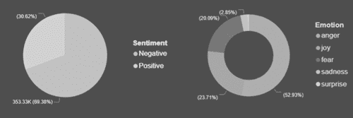

**图 9.3** 俄乌冲突的情感与情绪。

我们对战争现象总体进行了情感和情绪分析。我们发现，在战前时期，主要情绪是恐惧（~47%），符合预期。仅在战争的前两周，惊讶（~52%）占相当大的比例，随后几个月这一比例下降，取而代之的是愤怒和恐惧，两者数值相近，分别约为 ~30% 和 ~29%。在同一时期，意外地也出现了相当比例的喜悦（~20%）。这一数字引起了我们的注意。因此，我们单独探究了标记为“喜悦”的推文，以了解这种情绪背后的动机。

### 情绪洞察

**喜悦**：在观察到的案例中，无论推文喜悦情绪的地域来源如何，大多数都指代欢迎和支持逃离冲突的乌克兰公民的做法。在其他情况下，推文的解读需要更深入的分析。结果显示，例如，喜悦并非指传统意义上的欢迎，而是某些推文中存在讽刺和反讽，而工具未能识别出来。例如，在推文提到从战区接收“漂亮女孩”（`bunnies`）（见图 9.4）的情况下，这是一个显著的例子，显示了结果不准确的风险。

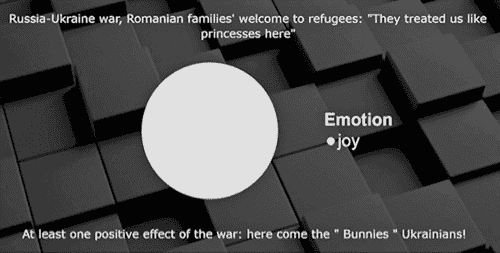

**图 9.4** 俄乌战争中的喜悦。

**愤怒**是与冲突相关的大多数内容中表达的主导情绪。这表明人们对局势高度沮丧和愤怒，这可能归因于与冲突相关的暴力、政治紧张局势和侵犯人权行为（见图 9.5）。这表明，虽然人们对局势感到不安，但他们主要集中在表达愤怒和沮丧。

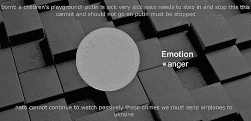

**图 9.5** 俄乌战争期间的愤怒。

# 俄乌冲突的情感分析

## 愤怒动态

在冲突的第一阶段（以及整个观察期内），愤怒主要指向俄罗斯，尤其是普京。特别是针对轰炸平民以及战争对儿童造成的影响，产生了强烈的负面情绪。随着时间的推移，针对俄罗斯联邦特定经济部门的制裁措施这一话题，起初鲜少被讨论，但逐渐占据了更多讨论空间，直到 2022 年夏季后达到顶峰。此时高昂的生活成本影响了个人和家庭的生活（特别是电费成本），导致愤怒情绪加剧。这主要发生在南欧国家，而非北欧国家。

这些发现为俄乌冲突的情感本质及其对人们生活和认知的影响提供了宝贵见解。通过了解驱动冲突的深层情绪，政策制定者和其他利益相关者可以在寻求`可持续`解决方案的过程中，更好地解决冲突的根本原因。

## 恐惧

战争导致军事人员和平民伤亡。失去亲人、朋友或自身生命的恐惧，对所有参与方来说都可能是创伤性且令人恐惧的。冲突可能影响俄罗斯和乌克兰的经济，并向全球传导连锁反应。对经济衰退的恐惧让人们对未来感到不确定。此外，战争导致流离失所并可能引发人道主义需求。流离失所、生活在难民营或无法返回家园的想法令人痛苦。最后是对核武器的恐惧：俄罗斯拥有核武器，其使用可能造成大规模动荡、环境破坏和生命损失。核武器被使用的念头令人恐惧。

即使对于恐惧情绪（见图 9.6），情绪检测也使我们能够识别出所考察国家中不同的成因根源。在北欧国家（丹麦、瑞典和芬兰），恐惧主要与冲突不可预测的升级、北约直接介入的风险以及俄罗斯使用战术核武器的风险相关联。


*图 9.6* 俄乌战争中的恐惧。

在其他国家，尤其是地中海国家，恐惧主要与战争的经济影响相关联。俄罗斯入侵乌克兰显著影响了欧盟经济。冲突及随之而来的制裁扰乱了该地区金属、粮食、石油和天然气等大宗商品的出口，将通胀推高至几十年来未见的水平。进一步的贸易中断或加强经济制裁可能将欧洲经济推入衰退。增长放缓在靠近乌克兰的国家（如波兰和匈牙利）尤为明显。意大利、其他一些地中海国家以及严重依赖俄罗斯石油和天然气的德国也感受到了压力，因此也产生了与冲突长期化及其后果相关的恐惧。

## 惊讶

在收集的推文进行情绪检测时，我们注意到大量惊讶情绪的表达（图 9.7）。我们决定调查其背后的原因，发现表达这种情绪的大多数推文都与西方经历了数年的和平社会政治背景有关。一些人看到了与以往战争动态的相似之处。一些人对俄罗斯的欺骗性选择感到惊讶，而另一些人则因为战争首次也在数字和社交媒体上进行而感到惊讶。

乌克兰总统决定通过社交媒体进行沟通，监控摄像头拍摄的首批俄罗斯车辆进入乌克兰领土的视频将永远载入史册。这一系列事件给以不同方式使用媒体的不同世代的许多人造成了巨大的冲击、不信任，确实也带来了惊讶。


*图 9.7* 俄乌战争中的惊讶。

## 一些现实主义考量

机器学习、情感分析和情绪检测快速处理大规模数据集的能力，在识别冲突不同阶段出现的情感模式方面至关重要。这使得我们能够全面探究导致情感转变的多重因素，增强了现实主义评估框架所需的分析深度（Leeuw, 2025，本卷）。

由于所分析事件的固有性质，严格应用现实主义方法并不可行，但我们从中汲取灵感，试图在 Twitter 的数字领域内探索战争的情感连锁反应。事件展开的动态性质使我们能够辨别出定义更广泛 Twitter 格局的三个截然不同的“话语语境”。每个语境都由主题要素区分，这些要素概括了针对战争、作为对信息传播、沟通和互动的反应，在 Twitter 上传达的情感反应。数据收集期间的不同领土区域（北欧和南欧）和冲突阶段也构成了语境的特征。

表 9.2 展示了语境、假设机制以及 Twitter 用户引发的情感反应。

*表 9.2* 语境、机制与情感反应

| 语境 | 机制假设 | 情感反应 |
| --- | --- | --- |
| 言论类型（话题） | 冲突阶段 | 领土区域 | 情绪 | 情感倾向 (+/-) |
| 战争事件（和平破坏、轰炸和战争行动、对普京的蔑视、可能的介入） | 从冲突开始至约三个月后 | 所有 | 冲突的意外性引发恐惧，并对其潜在的经济、政治和人道主义影响产生担忧。 | 惊讶 | - |
| 整个观察期 | 所有 | 战争参与导致军民双方伤亡。蓄意以轰炸针对平民及冲突对儿童的深远影响，助长了不公和残酷感。 | 愤怒 | - |
| 整个时期，早期阶段峰值最显著 | 北欧 | 冲突不可预测的升级及俄罗斯可能使用核武器，在邻国引发恐惧，担心对地区安全稳定造成即时严重后果。 | 恐惧 | - |
| 经济形势（生活成本上升） | 整个观察期 | 南欧 | 俄罗斯入侵乌克兰严重扰乱了该地区关键大宗商品出口，导致高通胀。进一步的贸易中断或升级制裁可能将欧洲经济推入衰退。 | 恐惧 | - |
| 2022 年 6 月至 10 月 | 南欧 | 放缓在乌克兰邻国（如波兰和匈牙利）尤为明显。意大利、其他一些地中海国家及严重依赖俄油气的德国也感受到压力，从而产生与冲突长期化及其经济后果相关的愤怒。 | 愤怒 | - |
| 迎接与人道主义行动 | 整个观察期 | 所有 | 对难民的积极接待和援助能唤起同情与慷慨之情。因认为自己积极影响了逃离战火者的生活、提供了庇护与支持而产生喜悦。对面临困境者表现出的迎接与共情的人道主义层面，能激活喜悦机制。 | 喜悦 | + |

## 机器学习在现实主义评估中的局限性

在探索政治决策中的现实主义评估时，显而易见，机器学习（ML）面临着固有的局限性。ML 的优势在于数据中的模式检测，但它难以应对现实主义评估所强调的复杂人类情境。后者凸显了在政治干预中理解情境的重要性，而 ML 在解释人类互动的复杂性方面往往力不从心。社会关系的微妙细微差别、文化的复杂性以及社区内不断演变的动态，往往会让倾向于过度简化这些互动丰富性的算法望而却步。

此外，现实主义评估认识到政治决策和社会情境随时间的动态性质。相比之下，ML 系统一旦训练完成通常保持静态，缺乏跟上不断演变情况的适应性。这一局限性阻碍了 ML 对政策长期影响提供洞察的能力，妨碍了其满足现实主义评估所必需的适应性要求的有效性。随着政治版图和社会动态的持续变化，ML 系统的静态特性在捕捉政治干预微妙、不断变化的现实方面显得捉襟见肘。

## 结论

数字技术在越来越多的机构和实践中的普及，重塑了社会诸多领域的关系和社会动态。在技术、设备和数字数据编织进社会肌理的场景下，数字与社会正演变为一个社会数字世界，其中社会性与物质性日益难以分离（Amaturo & De Falco, 2022）。因此，数字化转型开启了需要新的概念和方法论模型来研究和解释的场景。

在本文中，我们展示了 ML 和文本分析工具如何为评估者理解复杂社会现象发展的情境条件提供有力支持。这些技术可用于分析大量文本数据，如新闻文章、社交媒体帖子和其他信息来源，以提取关于其生成情境的洞见。特别是 ML 算法，可用于分析文本数据的情感，以识别积极、消极或中性情绪。这能提供对生成文本数据者态度和情绪的洞察。

此处呈现的案例在严格意义上不具备评估目的。我们并未评估政策、项目或计划等干预措施以判断其有效性。基于“若不联系激活干预措施的情境，就难以解释复杂社会干预的结果”这一理念，我们测试了 ML 和文本分析工具在情境分析中的潜力。特别而言，我们的观点是：面对针对全球性或国际性事件采取的措施时，应考虑对数字情境或数字广场的研究。在某些情况下（如本文呈现的案例），这可能是针对复杂事件快速获取信息的唯一途径。

尽管上文讨论了 ML 固有的局限性，但这些工具能为集体反应提供有价值的洞见——这些反应可能由显著影响个人和家庭生活及消费的措施（如欧盟对俄制裁及其对生活成本的长期影响）触发。通过衡量个人的情感和情绪，政府和决策者能更好地理解公众如何看待这些举措。

我们展示了此类分析如何服务于几个基本目的。它允许评估公众认知。通过对情感和情绪进行分类，可以判断特定措施是受到好评还是批评。其次，此分析能识别公众提出的共同关切和问题。如果大部分人表达负面情绪，这可能表明该措施存在必须解决的缺陷。

此外，国际比较提供了关于情境因素如何影响对同一措施认知的洞见。跟踪情感随时间的变化，能为干预措施发展过程中公众舆论的演变提供参考。政府可利用这些数据及时做出必要调整或解决问题（Mazzeo Rinaldi et al., 2017）。

不受欢迎的措施/全球性重大现象可能引发愤怒和恐惧，导致抵制政策措施，或使人们寻求民粹主义势力的安抚。从评估角度看，因此，决策者拥有关于广泛情感和主导情绪的实时信息可能至关重要。关于人们情绪的实时信息可帮助决策者识别可能需要回应的新出现的问题和关切。例如，假设社交媒体帖子或新闻文章表明某项特定措施（如制裁）未按预期发挥作用，或引发了未预料到的公众反应。在这种情况下，决策者可利用这些信息调整策略。

这些工具对评估研究有益，因为它们允许通过收集大量数据，重建信息传播、情感和感觉产生的数字化和全球化情境。这样，就能比传统评估研究工具更快地观察趋势、推测反应和行为。

为理解特定情境条件触发何种机制、导致个人采取特定行为反应，有必要用与真实情境的历史、文化、社会、技术等维度相关的其他信息，来补充在线发现的信息。还必须将填充真实情境的社会行动者的特定观点纳入分析。这一要素是大数据（BD）分析所无法捕捉的。

与所有社交网络一样，Twitter 分析也受各种偏差影响，可能影响洞见的准确性。选择偏差源于 Twitter 用户非代表性的人口统计特征，他们以年轻、精通技术者为主。志愿者偏差源于用户自我选择分享内容，导致数据集倾斜。确认偏差表现为用户接触符合其信念的内容，形成回声室效应。时间偏差则源于平台的快速趋势和事件驱动特性。一个潜在问题是算法偏差风险，可能导致结果不准确或倾斜（Greenstein & Cho, 2025，本卷）。

此外，人们可能会对基于 AI 的评估的透明度和问责制表示担忧，尤其是在所用数据敏感或有争议的情况下。为缓解这些弊端，评估者应采用多元化的数据来源，运用适当的统计方法，并承认数据的局限性，以实现更准确的 Twitter 分析。最后，必须认识到，虽然 AI 工具可以成为评估者的有力辅助，但它们不应取代开展高质量评估研究所需的批判性思维和判断力。

## 注释

1. Pawson 和 Tilley (1997) 在将科学实在论应用于评估研究时，认为项目发挥作用的机制只有在特定的情境条件存在时才会运行。在一个实在论理论框架中，虽然无法孤立地对什么构成“情境”做出概括，但可以形成可推广的、中程因果解释 (Merton, 1968)，说明情境如何与机制互动以产生结果。

2. 当今的 数字环境远非单行道；个体是塑造它的积极贡献者。与过去互联网是被动内容消费平台形成对比，社交媒体的出现改变了权力动态。`Facebook` 和 `Twitter` 等平台使“产消者”能够在全球范围内建立联系，提供分享经验和专长的空间。产消者通过其在线存在影响公众舆论、推动对话并影响政策。然而，这种转变并非没有挑战。大量用户生成内容模糊了事实与虚构的界限，导致错误信息泛滥并削弱了对在线来源的信任。批判性评估和真实性验证对用户而言现在至关重要。

3. 然而， 其使用伴随着几个重要考量。研究人员在利用 `Google Trends` 数据时应谨慎，因为它存在局限性和潜在偏差。一个关键局限是 `Google Trends` 缺乏情境。它提供搜索查询量和模式的数据，但无法解释因果关系或准确反映用户意图。因此，它不应成为得出确定性科学结论的唯一依据。另一个担忧是 `Google Trends` 数据的偏差和代表性。它主要捕捉互联网用户的兴趣，排除了无法上网的人群和使用非 Google 搜索引擎的人群。此外，搜索趋势可能受媒体报道和外部因素影响，这可能与真实的公众情绪不一致。

4. 从 2023 年 2 月 9 日起，`Twitter` 将不再支持免费访问其 API——包括 v2 和 v1.1 版。“将提供付费基础层级作为替代。多年来，数亿人发送了超过一万亿条推文，每周还在增加数十亿条。`Twitter` 数据是世界上最强大的数据集之一。我们致力于提供快速且全面的访问，以便您能继续与我们共同构建，”`Twitter Dev` 账号在 2023 年 2 月初发帖称。虽然官方账号保证将尽快提供更多细节，但这些新付费层级的费用目前尚不清楚。然而，新任所有者 `Elon Musk` 推文称“仅约每月 100 美元即可获得带有身份验证的 API 访问权限”，这将有助于防范机器人骗局和舆论操纵者 (Mitra, 2023)。

5. 标签 不予翻译，因为它们已以英文形式提取。只有推文本身保留原语言。

6. 我们 应用以下技术从语料库中提取元文本数据：(1) `Tokenization`（分词），将文本分解为更小的单元或标记，可以是单词、字符或子词；(2) `Stemming`（词干提取），将屈折词还原为其词根形式；(3) `Lemmatization`（词形还原），找到称为词元的基本词形；(4) `Part of Speech Tagging`（词性标注），根据单词在句子中的角色和功能为句子中的每个单词分配语法标签；(5) `Named Entity Recognition`（命名实体识别），利用标记在文本中识别实体（例如公司名称、数字、数值、地点、组织和人名）。

## 参考文献

1. Amaturo, E., & De Falco, C. C. (2022). Traces and Algorithms as Socio-digital Objects. In F. Comunello, F. Martire, and L. Sabetta (eds.). *What People Leave Behind*. Frontiers in Sociology and Social Research, vol 7. Springer. [`doi.org/10.1007/978-3-031-11756-5_18`](https://doi.org/10.1007/978-3-031-11756-5_18)

2. Appadurai, A. (2001). Deep democracy: Urban governmentality and the horizon of politics. Environment and urbanization, *13*(2), 23–43. [`doi.org/10.1177/09562478010130020`](https://doi.org/10.1177/09562478010130020)

3. Birjali, M., Kasri, M., & Beni-Hssane, A. (2021). A comprehensive survey on sentiment analysis: Approaches, challenges and trends. *Knowledge-Based* Systems, *226*, 107134. [`doi.org/10.1016/j.knosys.2021.107134`](https://doi.org/10.1016/j.knosys.2021.107134)

4. Bishop, J. (2018). Evaluating the Risk of Digital Addiction in Blended Learning Environments: Considering ICT Intensity, Learning Style, and Architecture. In B. Bozoglan (ed.). *Psychological, Social, and Cultural Aspects of Internet Addiction* (pp. 169–185). IGI Global.

5. Burrell, J., & Fourcade, M. (2021). The society of algorithms. Annual Review of Sociology, *47*, 213–237. [`doi.org/10.1146/annurev-soc-090820-020800`](https://doi.org/10.1146/annurev-soc-090820-020800)

6. Castells, M. (2004). Informationalism, networks, and the network society: a theoretical blueprint. In M. Castells (ed). The Network Society: A Cross-cultural Perspective (pp. 3–45). Egaronline.

7. Choi, H., & Varian, H. (2012). Predicting the present with Google Trends. Economic Record*,* *88*(1), 2–9. [`doi.org/10.1111/j.1475-4932.2012.00809.x`](https://doi.org/10.1111/j.1475-4932.2012.00809.x)

8. Chowdhary, K., & Chowdhary, K. R. (2020). Natural language processing. Fundamentals of Artificial Intelligence*,* 603–649. [`doi.org/10.1007/978-81-322-3972-7_19`](https://doi.org/10.1007/978-81-322-3972-7_19)

9. Coldwell, M. (2019). Reconsidering context: Six underlying features of context to improve learning from evaluation. Evaluation, *25*(1), 99–117. [`doi.org/10.1177/1356389018803234`](https://doi.org/10.1177/1356389018803234)

10. Coleman, S., & Blumler, J. G. (2009). The Internet and Democratic Citizenship: Theory, Practice and Policy. Cambridge University Press.

11. Da, Z., Engelberg, J., & Gao, P. (2011). In search of attention. Journal of Finance, 66(5), 1461–1499. [`doi.org/10.1111/j.1540-6261.2011.01679.x`](https://doi.org/10.1111/j.1540-6261.2011.01679.x)

12. Ebenso, B., Manzano, A., Uzochukwu, B., Etiaba, E., Huss, R., Ensor, T., & Mirzoev, T. (2019). Dealing with context in logic model development: reflections from a realist evaluation of a community health worker programme in Nigeria. Evaluation and Program Planning, *73*, 97–110. [`doi.org/10.1016/j.evalprogplan.2018.12.002`](https://doi.org/10.1016/j.evalprogplan.2018.12.002)

13. Fitzpatrick, J.L. (2012). An introduction to context and its role in evaluation practice. *New Directions for Evaluation* 135: 7–24. [`doi.org/10.1002/ev.20024`](https://doi.org/10.1002/ev.20024)

14. Fourcade, M., & Johns, F. (2020). Loops, ladders and links: The recursivity of social and machine learning. *Theory and Society*, *49*, 803–832. [`doi.org/10.1007/s11186-020-09409-x`](https://doi.org/10.1007/s11186-020-09409-x)


## 参考文献

15. Freire, M., Antunes, F., & Costa, J. P. (2023). Enhancing decision‐making support by mining social media data with social network analysis. *Social Network Analysis and Mining*, *13*(86), 1–15. [`doi.org/10.1007/s13278-023-01089-6`](https://doi.org/10.1007/s13278-023-01089-6)

16. Garcia-Garcia, J. M., Penichet, V. M., & Lozano, M. D. (2017). Emotion Detection: A Technology Review. In *Proceedings of the XVIII International Conference on Human Computer Interaction* (pp. 1-8). [`doi.org/10.1145/3123818.3123852`](https://doi.org/10.1145/3123818.3123852)

17. Gatto, L., & Bundi, P. (2025). The Use of Quantitative Text Analysis in Evaluations. In S. B. Nielsen, F. Mazzeo Rinaldi and G. J. Petersson (eds.). *Artificial Intelligence and Evaluation. Emerging Technologies and Their Implications for Evaluation* (pp. 144–167). Routledge. [`doi.org/10.4324/9781003512493`](https://doi.org/10.4324/9781003512493)

18. Ginsberg, J., Mohebbi, M. H., Patel, R. S., Brammer, L., Smolinski, M. S., & Brilliant, L. (2009). Detecting influenza epidemics using search engine query data. *Nature*, *457*(7232), 1012–1014. [`doi.org/10.1038/nature07634`](https://doi.org/10.1038/nature07634)

19. Giuffrida, G., Gozzo S., Mazzeo Rinaldi, F., & Tomaselli, V. (2018). Big Data and Network Analysis: A Combined Approach to Model Online News. In F. Greselin, L. Deldossi, L. Bagnato, and M. Vichi (eds.). *Statistical Learning of Complex Data* (pp. 183–191). Springer.

20. Giuffrida, G., Gozzo, S., Mazzeo Rinaldi, F., & Tomaselli, V. (2019). Building decision-making indicators through network analysis of big data. *Social Indicators Research*. [`doi.org/10.1007/s11205-020-02363-2`](https://doi.org/10.1007/s11205-020-02363-2)

21. Greenhalgh, J., & Manzano, A. (2022). Understanding ‘context’ in realist evaluation and synthesis. *International Journal of Social Research Methodology*, *25*(5), 583–595. [`doi.10.1080/13645579.2021.1918484`](https://doi.10.1080/13645579.2021.1918484)

22. Greenstein, N., & Cho, S.-W. (2025). Ethics & Equity in Data Science for Evaluators. In S. B. Nielsen, F. Mazzeo Rinaldi and G. J. Petersson (eds.). *Artificial Intelligence and Evaluation. Emerging Technologies and Their Implications for Evaluation* (pp. 56–77). Routledge. [`doi.org/10.4324/9781003512493`](https://doi.org/10.4324/9781003512493)

23. Grossmann, I., Feinberg, M., Parker, D. C., Christakis, N. A., Tetlock, P. E., & Cunningham, W. A. (2023). AI and the transformation of social science research. *Science*, *380*(6650), 1108–1109. [`doi.org/10.1126/science.adi1778`](https://doi.org/10.1126/science.adi1778)

24. Holm, J., Newman-Griffis, D., & Petersson, G. J. (2025). Big Data for Big Investments: Making Responsible and Effective Use of Data Science and AI in Research Councils. In S. B. Nielsen, F. Mazzeo Rinaldi and G. J. Petersson (eds.). *Artificial Intelligence and Evaluation. Emerging Technologies and Their Implications for Evaluation* (pp. 120–143). Routledge. [`doi.org/10.4324/9781003512493`](https://doi.org/10.4324/9781003512493)

25. Hong, S. (2020). *Technologies of Speculation: The Limits of Knowledge in a Data-Driven Society*. New York: NYU Press.

26. Hooghe, L., & Marks, G. (2001). *Multi-level Governance and European Integration*. Rowman & Littlefield.

27. Jing, F. S. (2022). Our digital agora: Politics without privacy. *Techné: Research in Philosophy and Technology*, *26*(3), 529–533. [`10.5840/techne2022263167`](https://10.5840/techne2022263167)

28. Kapoor, K. K., Tamilmani, K., Rana, N. P., Patil, P., Dwivedi, Y. K., & Nerur, S. (2018). Advances in social media research: Past, present and future. *Information Systems Frontiers*, *20*, 531–558. [`doi.org/10.1007/s10796-017-9810-y`](https://doi.org/10.1007/s10796-017-9810-y)

29. Kerr, H., Price, J., Nicholl, H., & O’Halloran, P. (2018). Facilitating transition from children’s to adult services for young adults with life-limiting conditions (TASYL): Programme theory developed from a mixed methods realist evaluation. *International Journal of Nursing Studies*, *86*, 125–138. [`doi.org/10.1016/j.ijnurstu.2018.06.015`](https://doi.org/10.1016/j.ijnurstu.2018.06.015)

30. Kusal, S., Patil, S., Choudrie, J., Kotecha, K., Vora, D., & Pappas, I. (2023). A systematic review of applications of natural language processing and future challenges with special emphasis in text-based emotion detection. *Artificial Intelligence Review*, 1–87. [`doi.org/10.1007/s10462-023-10509-0`](https://doi.org/10.1007/s10462-023-10509-0)

31. Leeuw, F. L. (2025). The Algorithmization of Policy and Society: The Need for a Realist Evaluation Approach. In S. B. Nielsen, F. Mazzeo Rinaldi and G. J. Petersson (eds.). *Artificial Intelligence and Evaluation. Emerging Technologies and Their Implications for Evaluation* (pp. 242–265). Routledge. [`doi.org/10.4324/9781003512493`](https://doi.org/10.4324/9781003512493)

32. Lythreatis, S., Singh, S. K., & El-Kassar, A. N. (2022). The digital divide: A review and future research agenda. *Technological Forecasting and Social Change*, *175*, 121359. [`10.1016/j.techfore.2021.121359`](https://10.1016/j.techfore.2021.121359)

33. Mathias, K., Mathias, J., Goicolea, I., & Kermode, M. (2018). Strengthening community mental health competence - A realist informed case study from Dehradun, North India. *Health & Social Care in the Community*, *26*(1), e179–e190. [`doi.org/10.1111/hsc.12498`](https://doi.org/10.1111/hsc.12498)

34. Mazzeo Rinaldi, F., Giuffrida, G., & Negrete, T. (2017). Real-time monitoring and evaluation–- Emerging news as predictive process using big data based approach. In G. Petersson and J. D. Breul (eds.). *Cyber Society, Big Data and Evaluation* (vol. 24, pp. 191–214). Routledge.

35. Merton R. K. (1968). *Social Theory and Social Structure*. New York: The Free Press, Extended edition.

36. Miracula, V., & Celardi, E. (2023). The Role of Twitter and Google Trends in Identifying the Perception of Russia-Ukraine Wars. *5th International Conference on Advanced Research Methods and Analytics (CARMA 2023)* (pp. 71–80). Editorial Universitat Politècnica de València.

37. Mitra, A. (2023). Twitter 停止免费 API 访问——意味着什么，会影响用户吗？ *Mint*, 2023 年 2 月 4 日。 <https://www.livemint.com/companies/news/twitter-to-stop-free-api-access-what-does-this-mean-and-will-it-affect-users-11675516987841.html>

38. Næss, T., Prabhu, C., Mjaaland, M., Holtermann, H., & Engebretsen, L. S. (2025). 文本挖掘与机器学习在挪威警方处理网络犯罪评估中的应用。载 S. B. Nielsen, F. Mazzeo Rinaldi and G. J. Petersson (编). *人工智能与评估：新兴技术及其对评估的启示* (pp. 103–119). Routledge. <https://doi.org/10.4324/9781003512493>

39. Nandwani, P., & Verma, R. (2021). 基于文本的情感分析与情绪检测综述。 *社会网络分析与挖掘*, *11*(1), 81. <https://doi.org/10.1007/s13278-021-00776-6>

40. Nielsen, S. B., Lemire, S., & Tangsig, S. (2022). 解析实在主义评估中的情境：来自综合评述的发现。 *评估*, *28*(1), 91–112. <https://doi.org/10.1177/13563890211053032>

41. Nielsen, S. -B. (2023). 颠覆评估？新兴技术及其对评估行业的启示。 *评估新方向*, 45–57. <https://doi.org/10.1002/ev.20558>

42. Nielsen, S. B., Rinaldi, F. M., & Petersson, G. J. (2025). 人工智能时代的评估。载 S. B. Nielsen, F. Mazzeo Rinaldi and G. J. Petersson (编). *人工智能与评估：新兴技术及其对评估的启示* (pp. 1–12). Routledge. <https://doi.org/10.4324/9781003512493>

43. Pan, Z., Nguyen, H. L., Abu-Gellban, H., & Zhang, Y. (2020). COVID-19 大流行的 Google Trends 分析。载 *2020 IEEE 国际大数据会议 (Big Data)* (pp. 3438–3446). IEEE.

44. Parveen, N., Chakrabarti, P., Hung, B. T., et al. (2023). 基于混合门控注意力循环网络的 Twitter 情感分析。 *大数据期刊*, *10*(50). <https://doi.org/10.1186/s40537-023-00726-3>

45. Parycek, P., Rinnerbauer, B., & Schossböck, J. (2017). 数字时代的民主：数字广场还是反乌托邦。 *电子治理国际期刊*, *9*(3–4), 185–209. <https://doi.org/10.1504/IJEG.2017.088224>

46. Pawson, R. (2013). *评估科学：实在主义宣言*. Sage.

47. Pawson, R. (2016). 批判实在主义的伪实在主义：回应 Porter。 *评估*, *22*(1), 49–57. <https://doi.org/10.1177/1356389015605>

48. Pawson, R., & Tilley, N. (1997). 科学实在主义评估导论。载 E. Chelimsky & W. R. Shadish (编). *21 世纪的评估：手册* (pp. 405-418). Sage Publications, Inc.


# 49. Pearce, S. C., & Rodgers, J. (2020). 社交媒体即公共新闻业？数字时代的抗议报道。 *社会学指南针*, *14*(12), 1–14. https://doi.org/10.1111/soc4.12823

# 50. Petersson, G. J., & Breul, J. D. (编). (2017). *网络社会、大数据与评估*. Routledge.

# 51. Pfadenhauer, L. M., Mozygemba, K., Gerhardus, A., Hofmann, B., Booth, A., Lysdahl, K. B., & Rehfuess, E. A. (2015). 情境与实施：面向概念成熟度的概念分析。 *卫生保健证据、培训与质量杂志*, *109*(2), 103–114. https://doi.org/10.1016/j.zefq.2015.01.004

# 52. Picciotto, R. (2020). 评估与大数据挑战。 *美国评估杂志*, *41*(2), 166–181. https://doi.org/10.1177/10982140198503

# 53. Raffini, L. (2011). 参与。载 G. Bettin Lattes and L. Raffini (编). *社会学手册*, *2* (pp. 709–728). CEDAM.

# 54. Reis, J., Amorim, M., Melão, N., Cohen, Y., & Rodrigues, M. (2020). 数字化：文献综述与研究议程。载 Z. Anisic, B. Lalic, and D. Gracanin (编). *第 25 届工业工程与运营管理国际联合会议论文集 – IJCIEOM. IJCIEOM 2019. 多学科工业工程讲义*. Springer.

# 55. Rogers, P. J. (2008). 运用项目理论评估干预措施的复杂与棘手层面。 *评估*, *14*(1), 29-48. https://doi.org/10.1177/1356389007084674

# 56. Rosenau, J. N., & Czempiel, E. O. (编). (1992). *无政府的治理：世界政治中的秩序与变迁* (No. 20). 剑桥大学出版社。

# 57. Sahayak, V., Shete, V., & Pathan, A. (2015). Twitter 数据情感分析。 *先进工程创新研究国际期刊*, *2*(1), 178–183.

# 58. Schradie, J. (2019). *未发生的革命：数字行动主义如何偏向保守派*. 剑桥, MA: 哈佛大学出版社。

# 59. Shaw, R. L., Hiles, D. R., West, K., Holland, C., & Gwyther, H. (2018). 从方法混合到探究逻辑：重新审视混合设计研究的开发。 *健康心理学与行为医学*, *6*(1), 226–244. https://doi.org/10.1080/21642850.2018.1515016

# 60. Svensson, M. (2014). 中国微博圈中的声音、权力与连接：新浪微博上的数字鸿沟。 *中国信息*, *28*(2), 168–188. https://doi.org/10.1177/0920203X14540082

# 61. Van Dijk, J. (2020). *数字鸿沟*. John Wiley & Sons.

# 62. Van Dijk, J. A. (2012). 数字鸿沟的演变——数字鸿沟转向技能与使用的不平等。载 J. Bus, M. Crompton, M. Hildebrandt and G. Metakides (编). *数字启蒙年鉴 2012* (pp. 57–75). IOS Press.

# 63. Walker, A., Hopkins, C., & Surda, P. (2020). 利用 Google Trends 调查 COVID-19 爆发期间与嗅觉丧失相关的搜索。 *国际过敏与鼻科学论坛*, *10*(7), 839–847. https://doi.org/10.1002/alr.22580

# 64. Wellman, B. (2001). 物理场所与网络空间：个性化网络的兴起。 *国际城市与区域研究期刊*, *25*, 227–252. https://doi.org/10.1111/1468-2427.00309

# 10 利用地理空间方法强化评价证据

Anupam Anand, Geeta Batra, and Juha I. Uitto

DOI: [10.4324/9781003512493-10](https://doi.org/10.4324/9781003512493-10)

本章已根据 CC-BY-NC-ND 4.0 许可发布。

## 引言

### 空间思维的融合

地理空间方法可用于分析生物物理和环境状况，以及居住模式、基础设施的分布与变化，还有社会经济发展。正如本书中 Bruce, K., Vandelanotte, J., and Gandhi, V.J. (2025) 以及 York, P., and Bamberger, M. (2025) 的章节所讨论的，数字工具、数据和分析能显著提升监测、评价和报告系统的性能，在提高覆盖面和质量的同时，提高效率并降低数据收集、分析和存储的成本 (Bamberger et al., 2016)。同样，将地理空间技术与其他方法和数据源（如文献研究、调查、实地考察等）结合使用，有助于强化评价证据，实现各信息源之间的增强三角互证，并提高证据的准确性和透明度 (Lech et al., 2018)。

评价学科也能以多种方式为地理空间科学做出贡献，包括为改进数据方法和质量提供反馈、提供有效性和实用性的见解，以及为未来的研究和应用领域生成证据。评价工作评估干预措施的相关性、价值、绩效和持久性。它们还凸显了在追踪进展和衡量应对气候变化或土地利用变化等重大全球议题的举措成果时面临的方法论挑战和数据缺口。例如，直到最近，追踪减排进展的数据仍然有限——这是一个重大的数据缺口，但 GHGSat [此处原文似未完，按原样保留]

在本章中，我们借鉴全球环境基金（GEF）独立评价办公室（IEO）的经验，探讨空间科学如何增强 IEO 强化其评价证据的能力，并展示 GEF 资助的环境项目的全球影响力。我们采用案例研究来重点展示地理空间科学的切实效益，包括将卫星和无人机数据与传统评价方法相结合应用于评价中。

本章首先介绍评价中的地理空间分析，讨论不同评价主体对其采纳和使用的激增，并详细阐述关于技能、资源需求以及隐私、法律和伦理问题的几项关键考量。后续部分重点介绍地理空间分析如何在各类 GEF IEO 评价中强化了评价证据。在讨论挑战与机遇之后，本章总结强调了解决当前挑战的必要性，以及通过合作制定准则和标准以整合地理空间工作的必要性。

## 通过地理空间分析获得评价洞见

地理信息系统（GIS）科学有效整合了空间、地点和时间要素——这些对于思考关键的人道主义和环境问题，以及诠释人类福祉和环境变化均至关重要。GIS 整合多种类型的数据，提供对模式、相互联系和背景的更深入洞见，从而有助于评价发展干预措施。在评价领域的早期应用中，GIS 主要用于利用二维地图进行数据可视化。Renger et al. (2002) 指出了其在评价中应用不足的现状，并演示了 GIS 如何用于数据可视化、变化检测以及以用户友好的方式呈现结果。随时间评估变化是评价者极感兴趣的领域。评价文献已讨论了使用地理空间数据衡量基线和产出，以及如何利用这些数据改进评价实践 (Lech et al., 2018; Azzam, 2013; Azzam & Robinson, 2013)。利用地理空间数据的准实验设计被用于林业和生物多样性干预的影响评价。地理空间分析也已用于随机对照试验 (Ferraro & Pattanayak, 2006; Andam et al., 2008)。一项对 437 项利用大数据衡量或评价发展成果的评价研究的系统性综述发现，卫星数据在超过 70% 的衡量研究和超过 80% 的影响评价中被使用 (Rathinam et al., 2021)。

此外，随着各国转向更多基于证据的政策决策和实践，地理空间科学的作用正日益受到若干主要环境与发展政策公约及机构的认可。例如，《联合国防治荒漠化公约》（UNCCD）已认可利用遥感获取的指标，以监测扭转和阻止土地退化与荒漠化的进展（Anand & Batra, 2022）。《联合国气候变化框架公约》（UNFCCC）和《生物多样性公约》（CBD）也认可使用客观指标，其中许多指标是通过地理空间方法得出的。全球环境基金（GEF）独立评价办公室（IEO）一直处于开创地理空间方法用于各领域环境干预的前沿，包括土地退化、气候变化、国际水域和生物多样性（Anand & Batra, 2021）。在对 GEF 支持保护区的具体评价中，我们利用相当于数十亿次观测（像素）的卫星数据，分析了 147 个国家 37,000 个保护区（平均面积约 400 平方公里）的森林数据（GEF IEO, 2016）。卫星数据驱动的分析使我们能够评估 GEF 支持的保护区与未获得 GEF 支持的区域（缓冲区、其他保护区）相比的相关性和有效性。在土地退化评价中，我们应用了由地理空间数据和计量经济分析驱动的机器学习算法，这使我们能够处理大量数据，测量生物物理指标的环境变化，深入了解与结果相关的因素，并以一种生态系统服务——碳封存——的形式估算协同效益（GEF IEO, 2017）。这项全球分析得到了实地考察、受益人调查以及利用智能手机收集 GIS 数据的补充。我们还利用地理空间分析和生态预测方法，量化了土地覆盖变化，估算地上碳储量，并事前评估了肯尼亚 GEF 支持的保护区提供的生态系统服务（Thieme 等, 2020）。

世界银行、联合国粮农组织（FAO）和国际农业发展基金（IFAD）等多边组织的评价办公室，也在利用 GIS 和地理空间数据来提高其评价的质量和有效性。这些机构已将随机对照试验、准实验设计和案例研究等多种方法与地理空间方法相结合，以评估发展项目和计划的成果。世界银行独立评价集团（IEG）一直在各类评价中使用地理空间方法和数据，包括与城市增长、灾害风险管理和社会经济发展相关的评价。例如，在其“城市空间增长管理”评价中，^()

随着地理空间方法持续为评价揭示新的可能性，我们将深入探讨可能影响其在评价过程中采纳的关键考量因素。

### 整合地理空间方法的关键考量因素

#### 技术基础设施要求

地理空间分析可被理解为决策过程和支持基础设施的一个组成部分。它是一个多层面的系统，包括软件程序（`GIS`）和硬件、来自传感器的数据、学科专业知识，以及空间、交通规划、农业 | 环境监测、天气预报、灾害管理、国家安全、城市规划 | 环境监测、精准农业、基础设施巡检、搜索救援、灾害响应 |

| **M&E 中的应用** | 变化检测、实验设计（如`RCT`）、准实验方法（如双重差分法） | 数据可用于时间序列分析、变化检测、模式分析，并作为计量经济模型和实验设计的输入。适用于多个地理尺度 | 可视化难以用于变化检测或时间序列分析和计量经济模型。主要适用于较小尺度。 |

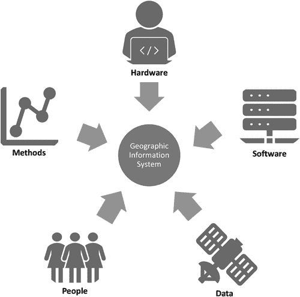

图 10.1 地理信息系统的各种组成部分。

# 数据存储与管理

数据存储与管理包括开发能够存储和管理大量地理空间数据、并以安全高效的方式为用户提供访问的数据库系统。这需要使用合适的硬件和软件系统，例如基于云的解决方案、数据库管理系统（`DBMS`）和地理信息系统（`GIS`）。用于处理和分析地理空间数据及卫星影像的软件工具非常流行，例如 `ENVI` 或 `ERDAS Imagine`，以及 `GIS` 软件，如 `ArcGIS` 和广泛使用的开源工具 `QGIS`。此外，`Python` 和 `R` 等编程语言可用于数据处理和分析。最后，数据可视化与传播涉及开发工具和平台，包括基于 Web 的制图工具，如 `Google Maps` 和 `OpenStreetMap`，以及为特定应用定制的基于 Web 的平台，用于向最终用户可视化和传播结果。此外，`Tableau` 和 `D3.js` 等数据可视化工具可用于可视化和沟通。最近，利用大数据集和算力进行的分析正在 `Amazon Web Services` 和 `Google Earth Engine` 等基于云的解决方案上执行。

## 技能

地理空间科学、数据及方法在评估中的应用尚处于起步阶段，评估人员通常未受过数据科学训练，更不用说空间科学了。因此，在多学科团队中开展合作至关重要，领域专家在解读地理空间分析、建立与评估标准的明确联系、以及为非技术受众量身定制传播信息方面发挥着关键作用。在 `IEO` 早期阶段，我们与外部专家合作，他们被整合进评估团队。然而，随着时间的推移，我们通过引进具备空间科学专业培训和专业知识的员工扩充了团队。此类员工的数量在过去几年中有所增长。此外，与专门从事特定类型分析的机构建立合作伙伴关系也大有裨益。

## 与隐私、伦理、合法性和安全相关的方面

地理空间数据的使用引发了与隐私、伦理、法律和安全相关的若干担忧，这些担忧连同潜在解决方案在表 10.2 中列出。为解决这些问题，遵循地理空间数据收集、处理和共享的最佳实践和指南非常重要；Greenstein, N., Cho, S-W. (2025) 中对此进行了详细讨论。此外，应重视及时了解与地理空间数据相关的最新法规和法律。第三部分提供了我们在自身评估中如何应对其中一些担忧的示例。

表 10.2 与地理空间数据相关的隐私、伦理、法律和安全问题

| 隐私、伦理、法律和安全问题 | 风险与挑战 | 潜在解决方案 |

| --- | --- | --- |

| **隐私问题** | 地理空间数据可能泄露位置、行为和活动等敏感信息；被用于监控和侵犯隐私权 | 可采取措施，如数据匿名化、限制对敏感信息的访问，以及实施强有力的数据保护政策和目的限制 |

| **伦理问题** | 数据准确性、偏见和可及性可能导致基于该数据做出错误或不公平的决策；可及性问题可能导致不公平的结果 | 识别并解决数据收集、处理和分析中的偏见；在决策中使用无偏算法；促进数据收集、存储和使用的公平利用与透明度 |

| **法律问题** | 所有权和知识产权；因未经授权用于制图、识别军事目标和监控边境而引发的国家安全问题 | 通过遵守与数据保护和隐私相关的相关法律法规，以及通过专利、商标和版权等各种形式的知识产权保护来解决 |

| **数据安全** | 未经授权的个人或组织访问或使用人员或敏感数据（关于人群的数据，如少数民族或政治异见人士）；易受网络攻击或黑客攻击 | 访问控制、数据加密、备份和负责任的数据治理 |

## IEO 案例研究的见解：将地理空间信息与多元方法和数据源相结合

本节通过 `GEF IEO` 展示了地理空间科学在各个环境领域的多样化应用。它还演示了如何有效利用地理空间数据和技术，将来自多种数据源的定量和定性数据相结合，管理数据不一致性和质量问题，考察影响环境结果的因素，估算结果，并开展实地验证。此外，本节深入探讨了地理空间方法在应对偏远或难以进入地区所带来的挑战方面的应用。它还强调了地理空间方法在解决与经济合作与发展组织发展援助委员会（`OECD DAC`）确立的评估标准相一致的关键问题方面的实用性。因此，它阐释了地理空间技术在解决关于干预措施的相关性、有效性和总体影响等问题中的应用。

## 将地理空间数据与实地考察相结合

`GEF IEO` 已有效地将地理空间数据和方法与其他互补的评估方法相结合。在小岛屿发展中国家评估（`GEFIEO`, 2018）中，地理空间分析和实地考察被战略性地结合，以提高发现的准确性和可靠性。地理空间分析专门用于说明项目的相关性及其初步成果。该项目于 2015 年启动，旨在加强对圣卢西亚东北海岸（位于东加勒比海）自然资源的高效管理和可持续利用，并寻求产生众多全球环境效益。值得注意的是，该地区包含 Iyanola 干性森林，其被列为关键生物多样性区域（`KBA`），也被指定为重要鸟区（`IBA`）。

地理空间分析作为实地考察的宝贵补充，促进了结果的三角互证。它有助于评估项目的相关性及其初步影响，包括评估特定恢复地点取得的进展（如图 10.2、10.3 和 10.4 所示）。

在整个实地考察过程中，IEO 评估团队利用手持 GPS 设备和无人驾驶飞行器（UAV），即俗称的无人机，收集地面实况数据。这些 GPS 设备和无人机在提供项目区域内毁林区和恢复地点的基本信息方面发挥了关键作用。这些数据作为地理空间分析的宝贵输入。该案例体现了如何整合两种截然不同的方法——地理空间方法和实地方法——从而促成了评价证据的三角互证。地理空间分析包括：（i）森林变化分析，以考察保护区及其周边地区森林损失的长期趋势；以及（ii）保护区内及评估团队实地考察的选定恢复地点的长期植被生产力趋势分析（图 10.2）。实地考察还证实，除了森林损失外，森林退化是影响该地区生态系统健康的主要环境因素。


*图 10.2* 伊亚诺拉国家公园内的一个森林恢复地点。

森林损失和植被生产力分析旨在佐证伊亚诺拉生态系统中森林损失和退化的既有挑战，这些挑战在项目启动前就已存在。这些评价证据还为全球环境基金（GEF）支持通过综合方法解决脆弱的伊亚诺拉森林生态系统问题提供了宝贵见解，该方法旨在解决生态系统退化的根本原因。这种方法既包含国家层面的规划和监管调整，也包含针对特定地点的活动。尽管如此，在此次评估过程中，团队遇到了若干挑战。其中包括应对数据缺口和不一致性，同时时刻关注与地理空间数据相关的伦理和法律考量。这些考量包括在操作无人机时尊重隐私和遵守指定飞行区域。

### 解决数据不一致性与实地观测验证

IEO 试图利用现有的世界保护区数据库（WDPA）和卫星数据检索地理空间分析所需数据。然而，边界数据和卫星产品存在不一致。这是小岛屿发展中国家面临的一个主要问题，因为全球数据集通常无法提供精细分辨率的数据。因此，采用了圣卢西亚政府环境部提供的数据进行边界划分，IEO 另行生成了额外的卫星数据产品用于地理空间分析。进一步分析表明，针对小岛屿发展中国家的全球卫星数据产品数据库准确性相对较低。


因此，开展了额外的密集时间序列植被生产力分析，以分析并突显植被健康的长期趋势。利用十六天周期的中分辨率成像光谱辐射计（MODIS）数据推导归一化差异植被指数（NDVI），这是一种广泛使用的植被健康替代指标。这一额外分析还有助于处理小岛屿等较小区域全球森林数据的不一致性。这种密集时间序列植被生产力分析有助于评估植被趋势的空间和时间范围。结果显示，总体而言，自 2018 年以来植被生产力略有增加，尽管降水呈下降趋势（图 10.3 和 10.4）。

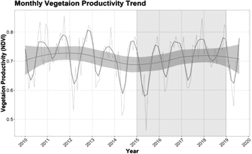

*图 10.3* 平均植被生产力趋势。¶ *来源*：GEFIEO。

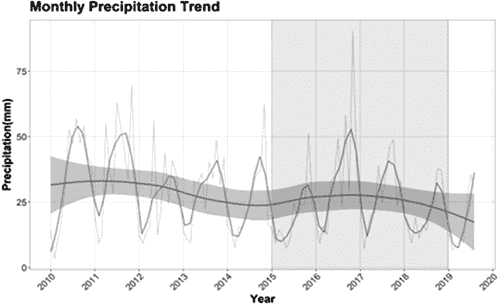

*图 10.4* 月降水趋势。¶ *来源*：GEFIEO。

鉴于地形陡峭且深入茂密森林存在后勤挑战，IEO 使用无人机收集毁林数据样本以训练^()

虽然无人机已广受欢迎，但在使用时必须优先遵守监管要求。IEO 团队认真获取了必要的政府许可，并严格遵守无人机操作法规，包括高度限制和飞行时间限制。为回应当地关切，无人机在林业部门官员在场的情况下部署。严格措施确保无人机仅在指定空域内运行，避开机场和私人财产。除了遵守当地有关无人机的法规外，团队还参考了 [`www.dji.com/flysafe/geo-map`](https://www.dji.com/flysafe/geo-map) 等资源以获取无人机部署的初步信息（见 图 10.5）。

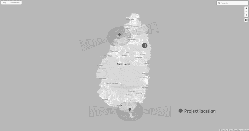

*图 10.5* 显示无人机部署限制区域和项目地点的地图。

这一地理空间数据在评估中的应用案例指出了对更好本地验证数据的需求，因为 WDPA 等全球数据集可能不一致。这对小岛屿发展中国家尤为重要，这些国家空间范围较小且海岸线高度不规则，需要更精确的边界划分以进行空间分析或规划。

## 在具有挑战性的评估环境中利用地理空间数据

全球环境基金（GEF）拥有大量（33%）位于受冲突影响国家的环境项目（GEF-STAP, 2018）。图 10.6 中的地图显示了冲突热点地区的 GEF 支持干预措施。脆弱和冲突背景下的发展项目复杂、难以到达、孤立且不安全，这些地区面临各种挑战，常规信息流难以维持。必须调整标准工具和流程，以收集信息用于项目设计、实施以及监测与评价（M&E）。在此背景下，后勤、时间和资源限制至关重要，地理空间方法显得尤为有用。我们已经看到，通过地理空间数据和方法得出的背景和基线信息如何帮助我们更清晰地构建评价问题。这对任务规划也很有用。此外，当与其他信息来源结合时，地理空间数据有助于识别因果因素，如环境退化和冲突的驱动因素，并量化栖息地退化和损失的程度。不同类型传感器的可用性使我们能够透过云层在夜间或恶劣天气下进行观测。

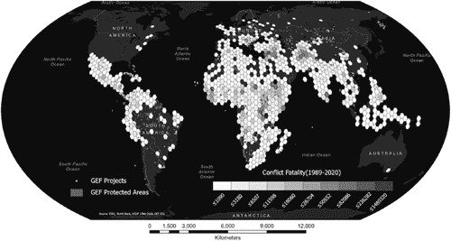

*图 10.6* 冲突热点地区的 GEF 支持干预措施。¶ *来源*：GEFIEO。

# 利用无人机与地理空间技术进行评估

通过无人机收集的遥感数据可用于在难以到达、孤立和不安全的区域进行快速评估。无人机可快速部署，在短时间内收集更精细的数据。使用无人机令人振奋之处在于，能够捕捉影像资料，后续可用于增强知识和学习产品。在对全球环境基金（GEF）主流化生物多样性支持的评估中（GEF IEO, 2019），独立评价办公室（IEO）利用无人机评估不同项目地点非法采矿和伐木区域的范围，并收集实地核查数据以验证卫星数据产品。在对哥伦比亚的实地任务中，评估人员无法轻松安全地进入非法采矿点（图 10.7），在获得当局许可后，不得不从安全距离部署无人机。

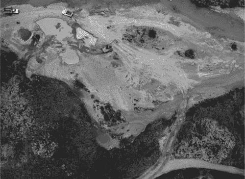

**图 10.7** 无人机影像显示哥伦比亚项目地点附近的非法采矿区域；摄影：Anupam Anand。

利用无人机收集地理空间数据不仅提供了环境退化的视觉证据，我们还将这些数据输入机器学习分类算法，以帮助划定采矿区及相关的环境退化范围。哥伦比亚太平洋地区云层覆盖率高，光学遥感平台无法穿透。然而，可穿透云层的雷达数据被用于训练分类模型（图 10.8）。

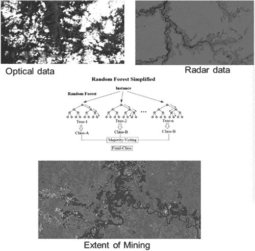

**图 10.8** 基于光学和雷达数据，利用机器学习进行采矿区分类。¶ **来源**：GEF IEO。

这些区域与冲突及项目位置数据叠加，有助于回答关于项目干预的相关性和有效性的问题（图 10.9）。

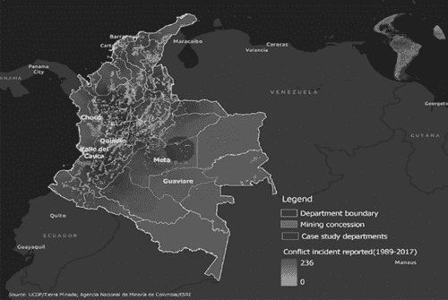

**图 10.9** 地图显示哥伦比亚采矿区与冲突热点和保护热点的重叠情况。¶ **来源**：GEF IEO。

此外，结果被用于更深入地考察冲突与环境结果之间的相互关系，并通过实地访谈和文献分析进行了验证。例如，表明冲突后时期森林砍伐增加的结果（图 10.10），通过访谈关键知情人和项目参与者收集的数据得到了验证。^()

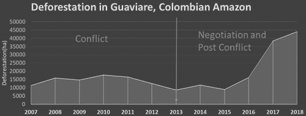

**图 10.10** 冲突后时期项目区域内森林砍伐的增加。

## 应对数字基础设施和资源需求

大规模分析卫星数据需要使用高性能计算机、专业软件以及强大的数据和 IT 基础设施，而这些资源通常在评估办公室中无法获得。为应对这些挑战，我们采取了充分利用现有资源的方法。例如，我们利用现有计算资源的能力来缓解其中一些障碍。一项值得注意的技术是利用并行计算，这是一种有效利用现代台式机和笔记本电脑中多个处理核心的方法。这种方法高效地分配计算任务，显著缩短了处理时间。实施并行计算通常只需对编程语言代码进行微小修改，且受 `R`、`Python` 和 `Stata` 等广泛使用的统计软件包支持。

为扩大分析规模，我们还转向云计算平台。例如，在利用森林覆盖数据评估保护区时（Hansen et al., 2013），我们在谷歌的云计算平台上进行分析，大幅缩短了处理时间。

此外，我们的工作还包括与外部组织的宝贵合作。值得注意的是，我们与美国国家航空航天局（`NASA`）合作，获取高分辨率图像和生态预测数据用于事前评估（Thieme et al., 2020），使用 `AID` 数据对项目位置进行地理编码（Runfola et al., 2020），并与马里兰大学合作，受益于其技术指导、数据资源和额外计算支持，开展了一项基于混合方法的影响评估，重点关注保护区的有效性（GEF IEO, 2016）。

## 讨论与结论

地理空间技术属于快速发展的领域之一，全球地理空间产业生态系统在 2020 年拥有约 3390 亿美元的市场收入。预计该行业将进一步扩张，到 2025 年将达到约 4390 亿美元（Statista, 2020）。地球轨道上卫星的激增是地理空间产业增长的重要催化剂，据卫星跟踪网站“Orbiting Now”报告，截至 2023 年 5 月 4 日，环绕地球运行的活跃卫星数量为 7,702 颗（NanoAvionics, 2023，5 月 4 日）。

这种快速增长归因于多个因素，包括定位传感技术的普及和成本降低、对基于位置的服务和解决方案需求的增长、机器学习和人工智能与空间数据的融合，以及新应用和创新的涌现。

地理空间技术广泛应用于各个领域，用于分析生物物理和环境状况、居住模式、基础设施以及社会经济发展。特别是数字工具和分析改进了监测、评估和报告，使数据收集更加高效且具成本效益。这些工具显著增强了我们高效、低成本开展评估的能力，涵盖单个项目、投资组合评估和生态学重要尺度。这些评估得出的见解揭示了与发展成果相关的、此前隐藏的变化和模式。

本章说明，通过结合评估与地理空间分析的优势，我们可以更好地理解干预措施的影响和有效性，特别是在涉及位置和空间关系的重要背景下。地理空间科学和评估都是多学科领域，要求具备技术熟练度、合作精神和广博的知识。

# 评估中的地理空间分析：总结与未来方向

贯穿本章始终，地理空间分析为评估引入了关键的空间维度。这一维度增强了我们对干预措施如何影响特定地点、区域或社区的理解。此外，地理空间数据作为一种有效的监测工具，能提供关于干预措施进展的实时洞见，并支持进行调整以提高有效性。地理空间分析促进了不同地点或区域之间的比较，揭示了导致干预措施成效差异的因素。这些工具还可用于基于不同干预策略的未来情景预测建模。最后，地理空间分析支持创建可视化成果，增强评估发现的可及性和清晰度。

本章还强调了评估如何反过来通过提供反馈、洞见和证据来促进地理空间科学的未来研究。评估考察干预措施的相关性、绩效和有效性，并凸显了方法论挑战和数据缺口。

评估通过为地理空间数据和工具的利用提供综合方法，在增强地理空间途径方面发挥着重要作用。它们通过将评估中使用的数据与其他来源进行三角互证，确保数据的准确性和可靠性。评估还应用质量控制指南和伦理考量，在处理敏感空间数据时尤为重要。评估考察应用地理空间分析的干预措施的影响和有效性，识别方法论和数据质量方面的改进领域。通过提供决策反馈和创建增强地理空间发现理解的可视化表达，评估确保地理空间途径对利益相关者更加友好易懂。

然而，随着这些地理空间技术因其实用性而被评估者更广泛地接受，其挑战也随之凸显。这些挑战包括能力局限、数据可用性与获取、基础设施与资源约束、伦理考量、透明度和验证等。这些挑战可能构成使用地理空间数据的障碍，特别是在数据稀缺地区资源有限的评估部门。它们可能影响采纳创新技术的意愿。

作为评估者，我们致力于利用先进技术，其动力源于数据源的持续扩展、开源工具的普及以及计算能力的提升。为鼓励这些技术的应用并应对上述挑战，评估者和评估部门必须积极推广这些方法论的认知，聘请精通空间分析的专家，并鼓励与在相关领域拥有专业知识的机构建立更紧密的合作。评估团队、学术界、数据提供方以及研究和政策机构之间建立有效伙伴关系至关重要，以制定指南、行为准则、数据质量标准、透明度标准，以及负责任地采纳新兴方法的伦理和法律框架，从而提升我们工作的质量。

## 注释

1.  **空间思维**是地理空间科学的指导原则。它是一种推理类型，涉及基于空间组织和整合概念，并利用它们解决问题和做决策。理解空间的特征，如维度、连续性、邻近性和分离性，对空间思维至关重要。

2.  <https://www.ghgsat.com/en/what-we-do/>

3.  <https://ieg.worldbankgroup.org/evaluations/managing-urban-spatial-growth>

4.  <https://ieg.worldbankgroup.org/evaluations/mexico-country-program>

5.  **来源：** Roger **Tomlinson** (2019)；*Thinking About GIS: Geographic Information System Planning for Managers*，第五版（ISBN: 9781589483484；及其他 [引用]）。

6.  **训练数据：** 该数据用于机器学习模型，将卫星数据分类为森林和非森林类别。

7.  采用混合方法的**SIDS – 圣卢西亚案例研究**可在此查看：<https://www.youtube.com/watch?v=y_Al2O-PqRo>。

## 参考文献

1.  **Anand, A.**, & Batra, G. (2021). Using Big Data and Geospatial Approaches in Evaluating Environmental Interventions. In J. I. Uitto (Ed.), *Evaluating Environment in International Development* (pp. 79–92). Routledge. <https://www.taylorfrancis.com/chapters/oa-edit/10.4324/9781003094821-7/using-big-data-geospatial-approaches-evaluating-environmental-interventions-anupam-anand-geeta-batra>

2.  **Anand, A.**, & Batra, G. (2022). Application of Geospatial Methods in Evaluating Environmental Interventions and Related Socioeconomic Benefits. In J. I. Uitto & G. Batra (Eds.), *Transformational Change for People and the Planet: Evaluating Environment and Development*. Springer Nature. <https://doi.org/10.1007/978-3-030-78853-7_19>

3.  **Andam, K. S.**, Ferraro, P. J., Pfaff, A., Sanchez-Azofeifa, G. A., & Robalino, J. A. (2008). Measuring the effectiveness of protected area networks in reducing deforestation. *Proceedings of the National Academy of Sciences*, *105*(42), 16089–16094. <https://doi.org/10.1073/pnas.0800437105>

4.  **Awange, J. L.**, & Kyalo Kiema, J. B. (2013). Spatial analysis. *Environmental Geoinformatics*, 225–236. <https://doi.org/10.1007/978-3-642-34085-7_17>

5.  **Azzam, T.** (2013). Mapping data, geographic information systems. *New Directions for Evaluation*, *2013*(140), 69–84. <https://doi.org/10.1002/ev.20074>

6.  **Azzam, T.**, & Robinson, D. (2013). GIS in evaluation. *American Journal of Evaluation*, *34*(2), 207–224. <https://doi.org/10.1177/1098214012461710>

7.  **Bamberger, M.**, Raftree, L., & Olazabal, V. (2016). The role of new information and communication technologies in equity-focused evaluation: Opportunities and challenges. *Evaluation*, *22*(2), 228–244. <https://doi.org/10.1177/1356389016638598>

8.  **Bruce, K.**, Vandelanotte, J., & Gandhi, V. (2025). Emerging Technology and Evaluation in International Development. In S. B. Nielsen, F. Mazzeo Rinaldi & G. J. Petersson (Eds.), *Artificial Intelligence and Evaluation. Emerging Technologies and Their Implications for Evaluation* (pp. 13–36). Routledge. <https://doi.org/10.4324/9781003512493>

9.  Editorial: A place for everything. *Nature*. 2008;453(2), 2. Anonymous. <https://doi.org/10.1038/453002a>

10. 粮农组织评价办公室. (2017). 喀布尔、巴米扬和卡皮萨省灌溉系统改善项目的最终评价. 联合国粮食及农业组织. [`www.fao.org/3/bd685e/bd685e.pdf`](https://www.fao.org/3/bd685e/bd685e.pdf)


11. Ferraro, P. J., & Pattanayak, S. K. (2006). 白花钱？呼吁对生物多样性保护投资进行实证评价. PLoS Biology, *4*(4), e105. [`doi.org/10.1371/journal.pbio.0040105`](https://doi.org/10.1371/journal.pbio.0040105)

12. 全球环境基金独立评价办公室. (2016). *全球环境基金对保护区和保护区系统支持的影响评价.* 评价 104. [`www.gefeo.org/sites/default/fles/ieo/evaluations/fles/BioImpactSupportPAs-2016.pdf`](https://www.gefeo.org/sites/default/fles/ieo/evaluations/fles/BioImpactSupportPAs-2016.pdf)

13. 全球环境基金独立评价办公室. (2017). 土地退化重点领域研究*.* [`www.gefeo.org/evaluations/land-degradation-focal-area-ldfa-study-2017`](https://www.gefeo.org/evaluations/land-degradation-focal-area-ldfa-study-2017)

14. 全球环境基金科学与技术咨询小组. (2018). 环境安全：维度与优先事项*.* [`www.thegef.org/sites/www.thegef.org/files/publications/52103%20STAP%20Report\_WEB.pdf`](https://www.thegef.org/sites/www.thegef.org/files/publications/52103%20STAP%20Report_WEB.pdf)

15. 全球环境基金独立评价办公室. (2018). 战略国家集群评价 (SCCE)：小岛屿发展中国家 (SIDS)*.* [`www.gefieo.org/evaluations/scce-sids`](https://www.gefieo.org/evaluations/scce-sids)

16. 全球环境基金独立评价办公室. (2019). 全球环境基金支持生物多样性主流化的评价. [`www.gefieo.org/evaluations/biodiversity-mainstreaming-2018`](https://www.gefieo.org/evaluations/biodiversity-mainstreaming-2018)

17. Goodchild, M. F., & Janelle, D. G. (2010). 走向社会科学和人文科学中的批判性空间思维. GeoJournal, *75*(1), 3–13. [`doi.org/10.1007/s10708-010-9340-3`](https://doi.org/10.1007/s10708-010-9340-3)

18. Greenstein, N., & Cho, S.-W. (2025). 评价者的数据科学伦理与公平. 在 S. B. Nielsen, F. Mazzeo Rinaldi & G. J. Petersson (编), *人工智能与评价.* *新兴技术及其对评价的影响* (第 56–77 页). Routledge. [`doi.org/10.4324/9781003512493`](https://doi.org/10.4324/9781003512493)

19. Hansen, M. C., Potapov, P. V., Moore, R., Hancher, M., Turubanova, S. A., Tyukavina, A., Thau, D., Stehman, S. V., Goetz, S. J., Loveland, T. R., Kommareddy, A., Egorov, A., Chini, L., Justice, C. O., & Townshend, J. R. (2013). 21 世纪全球森林覆盖变化高分辨率地图. Science, *342*(6160), 850–853. [`doi.org/10.1126/science.1244693`](https://doi.org/10.1126/science.1244693)

20. 国际农业发展基金. (2022). 绘制农村发展蓝图：如何利用 GIS 监测和评价项目. [`www.ifad.org/en/web/knowledge/-/mapping-rural-development-how-to-use-gis-to-monitor-and-evaluate-projects`](https://www.ifad.org/en/web/knowledge/-/mapping-rural-development-how-to-use-gis-to-monitor-and-evaluate-projects)

21. Lech, M., Uitto, J. I., Harten, S., Batra, G., & Anand, A. (2018). 通过地理空间数据和分析改进国际发展评价. 国际地理空间与环境研究期刊, *5*(2). [`dc.uwm.edu/ijger/vol5/iss2/3`](https://dc.uwm.edu/ijger/vol5/iss2/3)

22. Melesse, A., Weng, Q., Thenkabail, P., & Senay, G. (2007). 遥感传感器及其在环境资源制图和建模中的应用. Sensors, *7*(12), 3209–3241. [`doi.org/10.3390/s7123209`](https://doi.org/10.3390/s7123209)

23. Murillo-Sandoval, P. J., Dexter, K. V., Hoek, J. V. D., Wrathall, D., & Kennedy, R. (2020). 枪口下保护的终结：哥伦比亚和平协议签署后的森林扰动. Environmental Research Letters, *15*(3), 034033. [`doi.org/10.1088/1748-9326/ab6ae3`](https://doi.org/10.1088/1748-9326/ab6ae3)

24. NanoAvionics. (2023, May 4). 太空中有多少颗卫星？ *NanoAvionics*. [`nanoavionics.com/blog/how-many-satellites-are-in-space/`](https://nanoavionics.com/blog/how-many-satellites-are-in-space/)

25. Patton, M. Q. (2018). 评价性思维演变的历史视角. 在 A. T. Vo & T. Archibald (编), *评价性思维* (第 158 版, 第 11–28 页). 评价新方向.

26. Rathinam, F., Khatua, S., Siddiqui, Z., Malik, M., Duggal, P., Watson, S., & Vollenweider, X. (2021). 利用大数据评价发展成果：一张系统图谱. Campbell Systematic Reviews, *17*(3). [`doi.org/10.1002/cl2.1149`](https://doi.org/10.1002/cl2.1149)

27. Renger, R., Cimetta, A., Pettygrove, S., & Rogan, S. (2002). 地理信息系统 (GIS) 作为一种评价工具. American Journal of Evaluation, *23*(4), 469–479. [`doi.org/10.1177/109821400202300407`](https://doi.org/10.1177/109821400202300407)

28. Runfola, D., Batra, G., Anand, A., Way, A., & Goodman, S. (2020). 利用准实验地理空间插值 (QGI) 方法探索全球环境基金项目在乌干达的社会经济协同效益. Sustainability, *11*(18), 3225. [`doi.org/10.3390/su12083225`](https://doi.org/10.3390/su12083225)

29. Scriven, M. (1993). 项目评价中来之不易的教训. New Directions for Program Evaluation, *58*, 1–103.

30. Statista. (2020, October 28). 按技术划分的全球地理空间产业市场规模. Statista. [`www.statista.com/statistics/699497/worldwide-geospatial-industry-distribution-by-technology/`](https://www.statista.com/statistics/699497/worldwide-geospatial-industry-distribution-by-technology/)

31. Thieme, A., Glennie, E., Oddo, P., McCartney, S., Ruid, M., & Anand, A. (2020). 遥感在事前决策支持和影响评价中的应用. American Journal of Evaluation, *43*(1), 26–45. [`doi.org/10.1177/1098214020962579`](https://doi.org/10.1177/1098214020962579)

32. Tomlinson, R. (2019). 思考 GIS：管理者的地理信息系统规划 (第 5 版). Thinking about GIS.

33. Uitto, J. I. (2016). 评价中的环境-贫困关联：对可持续发展目标的启示. Global Policy, *7*(3), 441–447. [`doi.org/10.1111/1758-5899.12347`](https://doi.org/10.1111/1758-5899.12347)

34. Vaessen, J., Lemire, S., & Befani, B. (2020). 国际发展干预措施的评价：方法与途径概述*,* *独立评价组*. 世界银行.

35. York, P., & Bamberger, M. (2025). The Applications of Big Data to Strengthen Evaluation. In S. B. Nielsen, F. Mazzeo Rinaldi & G. J. Petersson (Eds.), *Artificial Intelligence and Evaluation. Emerging Technologies and Their Implications for Evaluation* (pp. 37–55). Routledge. https://doi.org/10.4324/9781003512493

# 11 评估分析的未来：结构因果建模实战案例研究

Pete York

DOI: 10.4324/9781003512493-11

本章已根据 CC-BY-NC-ND 4.0 许可协议提供。

## 引言

数字时代以大数据、人工智能和机器学习的出现为标志，显著增强了我们以更快的速度、更高的准确性和时效性评估项目的能力。这一变革由政府机构和社会项目管理系统产生的海量数据驱动，这些数据提供了一个丰富、复杂的存储库，包含多样化的行为和认知。这些数据揭示了错综复杂的模式和趋势，为发生了什么、针对谁以及在何种情况下发生提供了洞见。

然而，一个主要挑战在于，其中大部分数据植根于带有认知偏差的人类决策和自我报告的认知 (Spitzer & Weber, 2019)。从这些数据中提取有意义、无偏见的洞见既复杂又充满不准确的风险。传统的数据科学方法虽擅长做出准确的相关性预测，但在严格评估因果关系方面往往力不从心，而因果关系对于理解各种处理模式对受益人结果的影响至关重要 (Fan et al., 2014)。

本案例研究章节旨在解决的主要研究问题是：大数据和高级分析如何增强我们对项目的理解与评估？该问题承认评此类项目的复杂性日益增加，以及对更复杂方法的需求。为应对这一复杂性，本案例研究的方法论解决方案是应用结构因果建模 (SCM)。SCM 作为一个稳健的框架应运而生，能有效克服传统数据科学的局限性，特别是在梳理和理解社会影响评估中的因果关系方面。

为阐释这一点，本章深入探讨了两个相关的案例研究：Gemma Services 和公民企业援助计划 (PACE)。选择这些案例是因为它们在演示大数据和分析在现实场景中的应用方面具有相关性。Gemma Services 代表了在复杂人类服务领域进行个体层面案例管理的创新方法，而 PACE 则凸显了利用大数据评估社区组织间公平资源分配的做法。

通过探讨这些案例研究，本章展示了将大数据分析整合到项目评估中的实际意义，强调了实时数据收集和处理如何能在社会项目中带来更明智、更具影响力的决策。Gemma 案例展示了数据分析在个体层面管理复杂人类服务领域的潜力，全面阐述了数据驱动的洞见如何彻底改变项目评估和决策过程。

## 章节概览

本章介绍了结构因果建模 (SCM) 的数据科学方法及其在项目评估中的应用，具体使用的是一种称为精准分析 (PA) 的 SCM 类型。章节结构旨在提供对 SCM 的基础理解，随后通过阐释两个案例研究来演示其实际应用。这些案例研究展示了使用 PA 实施 SCM 的现实应用，证明了其在不同环境中的有效性，包括应对应用这些先进方法的挑战。这种理论探索与实践应用相结合的双重方法，提供了对 SCM 在加强项目评估中作用的整体和情境化理解。

本章以介绍性章节 *Applying Structural Causal Modeling to Advance Causal Inference in Data Science*（应用结构因果建模以推进数据科学中的因果推断）开篇，深入探讨了结构因果建模 (SCM) 的理论基础及其在数据科学中的作用。它强调了 SCM 克服传统关联模型固有局限性的能力，后者主要关注相关性而非因果性。通过阐释 SCM 的基本原理，本章为理解其在辨别数据中复杂因果关系方面的重要性奠定了坚实基础，而这一方面在传统数据分析方法中常被忽视。这一初始章节为更深入地理解 SCM 在提供更准确、更有意义的项目评估洞见方面的独特能力奠定了基础。

在介绍 SCM 的理论层面之后，下一章节转向 *Precision Analytics: An Applied Machine Learning Approach to Structural Causal Modeling*（精准分析：结构因果建模的一种应用机器学习方法）。本章节解释了 PA 作为 SCM 在项目评估中的实际应用。它详述了 PA 的方法论途径，展示了其如何提炼并将 SCM 原理应用于现实世界数据，从而实现对社会项目更有针对性、更有效的评估。本章强调了 PA 的独特优势，例如其处理大型数据集的能力，以及提供细致入微、特定情境下洞见的能力，这对于在复杂社会环境中做出明智决策至关重要。对 PA 的详细解释凸显了其作为连接理论数据科学与实践项目评估的有力工具的价值。

随后，本章在结构因果建模 (SCM) 框架下，考察了两个使用精准分析 (PA) 的案例研究：(1) PACE 的社区层面评估，关注不同非营利组织间的公平资源分配；(2) Gemma Services 的直接服务评估，聚焦于青少年心理健康干预。这些案例展示了 PA 在不同情境下的适应性，展示了其在项目评估中的现实有效性。它们提供了关于 PA 应用挑战及其在数据驱动项目评估中不断演变角色的洞见，突显了 PA 在多样化项目环境中带来显著改进和洞见的潜力。

最后，本章的 *Discussion*（讨论）和 *Conclusion*（结论）章节综合了案例研究和理论探索的关键洞见，反思了应用 SCM 和 PA 的意义与挑战。这些章节对研究发现进行了全面分析，讨论了它们对项目评估领域的贡献。结论概括了本章的主要论点，突显了这些方法论的变革潜力，同时承认其局限性，并为数据驱动的项目评估未来研究提出了建议方向。

## 应用结构因果建模以推进数据科学中的因果推断

将数据科学（特别是机器学习）应用于行政或交易收集的数据时，主要挑战在于使用监督式机器学习——数据科学领域内一种普遍工具。监督式学习是机器学习的一个子类别，它使用测量结果的标记数据来训练算法，以评估处理（自变量）变化如何影响目标结果（因变量）。

然而，从这些算法中获得的知识主要是关联性的，而非因果性的。换句话说，无论预测的准确性如何，识别出的相关性或关联性并不一定表明存在因果关系。当数据科学应用于研究社会现象和评估社会项目时，这种局限性变得尤为重要，因为在这些领域，理解因果关系应优先于预测准确性。

结构因果建模（SCM）为传统数据科学技术的因果挑战提供了解决方案。结构因果建模（SCM）是一种用于因果推断的理论框架，它统一了因果关系的图形化、潜在结果、决策分析和结构方程方法（Pearl, 2010）。它为因果和反事实分析提供了数学基础，允许推断潜在干预的效果、反事实场景，以及一个事件对另一个事件的直接或间接效应。

SCM 建立在这样一个理念上：因果关系应在视觉图表中明确表达，称为有向无环图（图 11.1），将结果变量表示为其直接原因的函数，包括对观测到的和未观测到的、混淆或中介解释变量与结果之间关系的情境因素的识别及因果假设。

结构因果建模（SCM）的关键特征之一是其能够解释混淆变量。混淆变量是指那些同时影响自变量和因变量的情境因素，从而产生虚假关联。SCM 允许研究人员表达在后续建模时应如何控制这些混淆变量，从而分离出自变量对因变量的真实因果效应。


随着越来越多的大数据可用，从而具备了增加更多情境和混淆变量的能力，SCM 在为因果建模做准备时容纳混淆变量的能力变得更加凸显。借助来自项目管理和其他来源的更大数据集，许多通常“未观测到”的混淆因子现在可以因更多指标（变量）的可用性和添加而变为“已观测到”。这使研究人员能够在进行数据建模时，将 SCM 作为一个框架来随后解释和控制这些混淆因子，而不是让未观测变量出现在误差项中。

> **结构因果建模 vs. 结构方程建模**
>
> 结构方程建模（SEM）和结构因果建模（SCM）在数据分析方法上存在根本差异。SEM 主要用于验证关于观测变量和潜在变量之间关系的假设，主要关注统计相关性，而不断言因果性。它依赖路径图和协方差矩阵来检验和完善理论模型（Madhanagopal, Amrhein, & McDougall Scientific Ltd., 2019）。
>
> 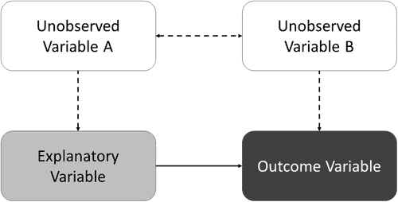
>
> 图 11.1 有向无环图。
>
> 相比之下，SCM 超越了相关性以推断因果性，将 SEM 与图形模型相结合，并遵守严格的条件，如确保有向和无环关系、变量的条件独立性，以及不存在混淆的“后门”路径。这种由有向无环图（DAG）表示的严谨结构，使 SCM 不仅能描绘相关性，还能揭示这些关系背后的因果机制，使其成为理解系统中变量复杂相互作用的更稳健工具。

例如，如果一项研究正在调查某社会项目的影响，社会经济地位、教育程度和资源获取等变量——在较小的数据集中可能未被观测到或不可用——现在可以被纳入 SCM 和后续建模中。这种数据可用性的增加显著增强了研究人员和评估者准确控制混淆变量的能力，从而提高了因果推断的效度。

一旦结构因果模型被清晰阐述并绘制成图，这可以用变革理论或逻辑模型的结构和格式来明确表达，只要 DAG 的所有元素都被绘制出来，研究人员和评估者就可以识别出包含反映 SCM 关于处理、混淆因子和目标（结果）变量的因果假设的变量的数据集。这些数据集随后可用于训练机器学习算法，以构建因果结果评估模型。

### 精准分析：应用于结构因果建模的机器学习方法

可应用于 SCM 框架的一种因果建模方法是精准分析（PA）。PA 在利用大规模数据解决复杂社会问题方面特别有用。它作为一种准实验观察数据研究的方法论版本，由 BCT Partners 在咨询各类政府和私人资助方（如美国国家科学基金会、美国卫生与公众服务部、美国住房和城市发展部）及直接服务提供商的过程中开发和测试（York, 2021）。

该方法涉及领域专家（SME）训练机器学习算法，以在历史数据中识别和分析“自然实验”。当一线从业者针对特定案例的项目干预组合、剂量和目标，为类似类型的案例做出不同决策时，就会发生这些实验。

PA 的主要优势在于其从大型数据集中挖掘细微洞察的能力，提供了对各项目要素与其结果之间因果关系更准确的理解。该方法特别擅长揭示不同项目干预在现实环境中的有效性，这进而可指导更有效、更有针对性的社会项目的开发。PA 流程的步骤如下：

1.  **寻找匹配比较组：** PA 首先训练机器学习算法，根据参与项目、治疗或干预的预测可能性，识别匹配的比较组或子人群。此过程最大限度地减少了选择偏差，这是观察性研究中的常见问题，即处理组与对照组在可能影响结果的方面存在差异。通过在一系列混淆（情境）变量上进行匹配，PA 确保比较组在除处理外的所有相关方面都相似。这有效地控制了（保持不变）情境混淆变量，使其在每个分块匹配的子组内保持恒定。

2.  **确定理想项目模型：** 一旦识别出匹配比较组，PA 就会为每个组确定治疗或项目要素的最佳组合。这一确定基于这些历史数据要素预测实现预期结果（目标指标）最高可能性的能力。通过识别出独特且共同促成分块匹配案例组实现预期结果的理想项目要素组合，PA 促进了更定制化、更有效干预措施的开发。

### 3. 方案模型的因果评估

PA 过程的最后一步是评估特定群体的理想方案模型的显著性和效应量。这涉及评估已识别的方案要素是否对期望结果具有显著的、尽管是观察性的准实验性因果影响。通过这样做，PA 提供了一个稳健的衡量标准，用于衡量方案、处理或干预的有效性。

PA 方法基于对相似匹配案例的不同处理变体的反事实分析，预测不同群体成功的可能性。此过程生成一组按因果归因排序和加权的方案要素，这些要素单独或整体上都能提高结果达成率。精准分析包括自动化处理数据的推断分析，以确定其在实现期望结果（因变量）中所起的“可归因”因果作用。

通过利用大数据的力量，专注于因果关系，并自动化评估过程，这些方法为方案评估提供了一种更细致、准确和公平的方法。它们提供了倡导更个性化干预所需的证据，彻底改变了我们对社会现象复杂性的理解，并为开发更有效、更公平的干预措施提供了依据。

精准分析为准实验性地评估社会方案提供了强大的工具。通过训练机器学习算法在历史数据中寻找和评估自然发生的反事实经验，将 SCM 框架操作化，从而能够更细致地理解数据中固有的因果关系。这可以带来更有效和公平的干预措施，并改善我们对社会现象的理解。

## 使用精准分析的结构因果建模：两个案例研究

使用 SCM 的精准分析相比传统评估方法，为方案评估和一线决策支持工具提供了优势。它支持按需开发个性化、公平的、针对特定案例的处理方案，在每个客户所在的位置满足其需求，并根据其独特需求定制干预措施。这种方法促进了对所有客户的公平对待，使组织能更好地理解为每个群体实现可归因成功所需的细微差别，并自动化准实验因果评估发现的实时、按需生成。更具体地说，PA 可以利用方案管理数据自动化社会方案的评估。通过系统分析这些数据，这些方法可以提供关于方案有效性的实时评估洞察，识别改进领域，并指导决策过程。

本章将通过两个案例研究来阐述精准分析（PA）的应用：(1) 助力公民企业计划（PACE）和 (2) Gemma Services。

*   **助力公民企业计划（PACE）**：一家非营利组织，致力于通过为社区组织提供技术援助和能力建设来促进社区经济发展。PACE 寻求利用 PA 研究资金、资源和支持向服务于匹兹堡地区弱势社区的非营利组织（特别是服务于有色人种社区的组织）的分配是否公平、如何公平。目标是利用 PA 识别匹兹堡周边十县地区需求最迫切的本地社区，确定服务这些社区的非营利组织，并评估其服务交付能力，为更公平的资金分配、能力建设和支持提供依据。

*   **Gemma Services**：一个通过心理健康服务、教育和专业支持，为弱势和高风险儿童、青少年及家庭带来希望与治愈的组织。该组织每年通过其住院和门诊行为健康项目及特殊教育学校为超过 3,000 名儿童提供服务。Gemma Services 提供的关键服务包括心理健康服务、教育项目、寄养和领养服务、预防项目，以及为经历过创伤或有严重心理健康问题的儿童和青少年提供的住院治疗。Gemma Services 计划利用 PA 识别对不同青少年亚群体最有效的住院精神科服务和治疗的具体组合，从而实现更个性化的干预。

这两项研究均由 BCT Partners 设计和实施，BCT Partners 是美国一家少数族裔拥有的中型咨询公司，与各组织合作开展。选择这两个案例研究是深思熟虑的，因为它们提供了在不同环境中阐释 SCM 应用的独特且相似的机会。

一方面，致力于促进社区经济发展的非营利组织 PACE，代表了 PA 在更广泛的社区导向背景下的应用。此案例中 SCM 的使用突显了如何利用数据来评估和改善社区组织（特别是服务于有色人种社区的组织）之间资源和支持的公平分配。该案例研究展示了 SCM 解决系统性问题和为政策层面决策提供依据的能力。

另一方面，专注于为弱势儿童和家庭提供心理健康和支持的 Gemma Services，体现了 PA 在直接服务交付背景下的应用。此处 PA 的使用展示了详细数据分析如何增强对亚群体特定需求的心理健康干预的理解和定制，展示了 SCM 在改善个性化护理和治疗结果方面的潜力。

这两个案例研究共同展示了使用 SCM 的 PA 在微观（个体聚焦）和宏观（社区聚焦）应用中的多功能性。它们展示了 SCM 如何在不同环境中有效用于改进方案评估、增强决策过程，并最终促成更有效、公平和个性化的社会干预。

### 助力公民企业计划：一项关于向服务有色人种社区的非营利组织公平分配能力建设的大数据地理空间研究

BCT Partners 是一家位于新泽西州纽瓦克的管理咨询公司，专门为政府机构、企业和非营利组织提供包括研究、评估和分析在内的一系列服务。该公司利用精准分析开发了大数据架构和平台，研究政府和慈善捐赠的流向及其对改善全美 74,000 多个社区福祉的影响。该平台称为 **Equitable Impact Platform (EquIP)**，一个地理空间大数据平台，用于评估非营利部门对公平社区改善的贡献。EquIP 将 `IRS 990` 纳税申报表数据和美国人口普查局的美国社区调查（ACS）数据与 BCT 的精准分析建模方法相结合。该平台帮助资助者和捐赠者识别需求最大的社区，优先考虑边缘化社区，找到能最好地服务这些社区的最易接触的非营利组织，并获得关于这些组织所需财务和能力建设支持类型的评估、预测和处方见解。

## EquIP：评估非营利组织对社区福祉的影响

EquIP 是一个旨在评估非营利组织项目产出对社区福祉影响的平台。该平台利用精准分析技术来测量区域剥夺指数（ADI）这一研究指标，具体方法参见 Knighton、Savitz、Belnap、Stephenson 和 VanDerslice（2016）的描述。

EquIP 采用的精准分析流程涉及根据社区获得 18 种不同类型非营利服务提供者直接服务的可能性来匹配社区，这些服务包括医疗保健、心理健康、教育、就业、住房和青少年发展服务等。基于福祉、社区捐赠、社会经济状况、人口密度及其他因素对社区进行匹配，旨在最大限度地减少选择偏差，并控制影响服务获取的情境因素。

地理空间分析被用于根据通勤模式、公共交通可及性水平、社会经济地位和人口密度，确定人们为获取非营利服务所需的出行距离。随后，对每个普查区进行分析，以确定每种服务类型可获得的非营利服务提供者数量，以及每种服务类型可获得的项目产出金额（以美元计）。

项目产出的测量源自非营利组织纳税申报数据集 `IRS 990`。具体而言，利用地理空间访问算法，计算了美国每个普查区在当地可获得的服务产出总额（以美元计）。该计算针对所有 18 种服务类型分别生成，具体包括：

*   动物相关
*   艺术、文化与人文
*   公民权利、社会行动与倡导
*   社区改善与能力建设
*   犯罪与法律相关
*   教育
*   就业
*   环境
*   食品、农业与营养
*   医疗保健
*   住房与庇护
*   心理健康与危机干预
*   公共与社会效益
*   公共安全、灾害准备与救济
*   娱乐与体育
*   宗教相关
*   青少年发展

为评估非营利项目产出对 ADI 得分的影响，训练了机器学习算法，以评估 18 种服务中每一种所需的项目产出水平，从而在三年内显著提高 ADI 得分。这种方法便于评估每个普查区，判断其可获得的项目产出是否足以在多年内促成社区福祉的显著改善。

这种精准因果方法控制了情境因素，如慈善及政府资助、个人捐赠、非营利部门规模、志愿服务水平、人口密度和社会经济地位。此外，它在控制与其他 17 种服务的交互作用和混杂效应的同时，分析了每种服务类型（图 11.2）。

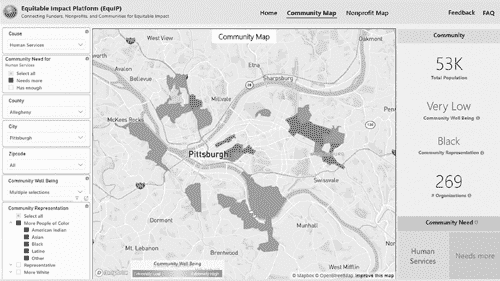

*图 11.2* 截图展示 EquIP 如何通过应用精准分析，识别出需要人类服务的匹兹堡弱势社区（美国普查区）。

## PACE 案例研究：能力建设与公平

公民企业援助计划（PACE）为非营利组织提供支持和关键资源获取以建设其能力，该计划利用 EquIP 对宾夕法尼亚州西南部地区非营利组织的能力建设需求进行了研究（公民企业援助计划，2021）。该研究旨在评估对当地非营利组织的能力建设支持，特别是服务有色人种社区的组织是否比服务白人社区的组织更难获得能力建设支持，以及原因何在。

该研究利用公平影响平台（EquIP）和精准分析来评估该地区非营利组织的财务健康状况和公平性。研究分析了收入模式、支出模式、管理费用、现金储备、资产负债率和收入来源等因素，发现将预算的 10%-25% 投入能力建设的非营利组织，在三年内实现增长、扩大规模并促进社区福祉的可能性是其他组织的两倍。

然而，研究也发现有色人种社区在获取能力建设资源和支持方面存在显著的不平等。在控制社区情境因素后，服务有色人种社区的非营利组织获得的支持在统计学上显著少于服务白人社区的组织，表现在个人捐赠、慈善拨款、政府拨款、志愿者参与和能力建设支持等方面均较少。研究发现，服务有色人种比例较高社区的非营利组织，财务状况不健康的可能性比服务白人社区的组织高 43%。

这项研究得益于美国 `IRS 990` 大数据（纳税申报数据）、家庭调查数据（来自美国人口普查局）以及因果精准建模的结合应用，这使研究团队能够通过区组匹配控制预测性社区情境因素，从而缓解选择偏差和社会偏见，进而识别导致不平等的因果贡献。

该案例研究为精准分析（PA）在社区发展背景下的应用提供了深刻的见解。研究凸显了 PA 在结构因果建模（SCM）支撑下，如何有效评估并改善社区组织间资源和支持的公平分配。此处的关键经验在于 PA 利用大数据识别和解决资源分配差异的能力，特别是针对服务有色人种社区的组织。PACE 对 PA 的应用展示了这些方法论在为政策层面决策提供依据和推动系统性变革方面的巨大潜力。

## Gemma Services：将评估从事后问责转变为动态管理工具

基于这些经验教训，本章现转向 Gemma Services 的案例研究，展示了 PA 的另一种不同但互补的应用。PACE 侧重于社区层面的干预和资源分配，而 Gemma Services 提供了更微观的视角，专注于为弱势儿童和家庭提供个性化的心理健康和支持服务。这种从社区发展的宏观关注到直接服务交付的微观关注的转变，体现了 PA 在不同情境下的通用性。

Gemma Services 案例研究将进一步探讨 PA 如何通过 SCM，量身定制心理健康干预措施以满足不同亚群体的特定需求，从而展示 PA 在创建个性化、有效治疗方案方面的适应性。这两个案例研究的并置凸显了 PA 在社区导向和个人导向设置中广泛的适用性和变革潜力。

# Gemma Services：为住院治疗提供精准护理建模

## 组织背景

Gemma Services 是一家多项目社会服务机构，为经历情绪和行为困难的儿童及家庭提供行为健康、教育和预防服务 (York, 2021)。其精神科住院治疗设施 (PRTF) 一次最多可服务 72 名儿童。其目标是减轻痛苦，改善生活，使他们能够成功地回归家庭或社区环境生活。

更具体地说，住院治疗项目为经历过丧失、创伤和重大挑战的儿童和青少年提供 24/7 全天候临床治疗和以创伤为中心的护理。该项目服务于 6-14 岁、面临重大情绪和行为挑战、导致其无法在社区安全生活的男孩和女孩。项目旨在提供疗愈治疗并教授新技能，以便这些儿童能在家庭和社区中安全、成功地生活。

住院治疗项目包含由硕士级治疗师提供的临床服务，包括个体、家庭和团体治疗，以及综合个案管理。还设有专门针对 10-14 岁、具有急性行为健康需求的青春期女童的住院项目，辩证行为疗法 (DBT) 是该项目的核心组成部分。此外还提供精神科服务，负责监督治疗并在需要时提供药物管理。

## 数据挑战

认识到项目评估对于改善结果和确保问责制的重要性，Gemma Services 的领导层投资于项目管理数据系统，以评估、监测和评价结果。然而，这些系统未能满足其证据生成需求，导致一线员工缺乏可操作的证据来改进项目规划和参与度。

数据系统使用经过科学验证的评估工具收集了客户的前测和后测数据，并进行了后续访谈和调查以评估长期结果。尽管如此，从业者并未在需要时获得见解以加强项目规划和参与度，他们、项目管理者或领导者也未收到涵盖所有受服务儿童的评估发现，以了解在实现项目预期成果方面的表现如何。

正如在实施了项目管理数据系统的组织中普遍存在的那样，Gemma Services 变得“数据丰富”却无法为项目领导者、管理者或一线从业者提取评估或决策支持见解。

## 采用分析方法

为弥补这一差距，Gemma Services 探索采用分析方法和数据科学工具，如预测分析和处方分析。其目标是为从业者提供可操作的证据，以提高其服务的每一位青少年的成功率。利用已收集的项目管理数据，他们开发了预测和处方模型，为从业者提供按需获取可操作证据的途径。

## 因果精准分析方法论

Gemma Services 采用了 BCT Partners 的因果精准分析方法论，如前文所述。该方法利用项目管理和个案评估数据，构建因果预测、处方和评估模型，使算法能够识别自然发生的现实世界“实验”，并确定哪些治疗模式能实现最大的比较收益。

从业者通过仪表板、报告和可视化工具获得按需的预测和处方洞察，同时为领导者和资助方生成严谨的评估发现，了解有多少生命得到了改善。通过利用项目管理数据和机器学习算法，这种因果建模方法比传统的总结性评估设计，为从业者提供了更具情境化、更及时、更精准的信息。

Gemma Services 开展了因果精准建模项目，以确定其住院治疗项目的有效治疗方案 (Gay & York, 2018)。Gemma Services 利用其管理数据集构建了最终所谓的“精准护理模型”，体现了精准医疗的概念。Gemma Services 的管理数据集包含 717 个儿童案例，包括出院后三年内接受调查的数百名儿童和家庭。

## 精准护理建模过程与发现

精准护理建模过程涉及将机器学习算法应用于管理数据，以识别具有相似背景和诊断史的匹配比较儿童群体。随后，算法基于临床医生对同一群儿童做出的不同干预决策所自然形成的“实验”，确定了最适合每个亚群体的治疗方法。

精准护理建模过程产出了若干重要发现，包括识别出十一个基于诊断、入院时的药物方案和照护者情况进行匹配的比较亚群体。

算法还识别出能显著降低儿童出院后再住院可能性的具体治疗特征，例如特定剂量的行为矫正或住院时长。

精准护理建模方法强调，随着数据集的扩大（即用于训练算法的案例数量增加），将案例分解为日益细化的群体至关重要。这种策略能更精准地理解适用于每个群体的独特项目和治疗组合。这种方法承认“一刀切”的解决方案是不够的，量身定制的解决方案更有可能带来成功。

## 应用与优势

通过采用精准护理模型，从业者能够根据每位客户的实际情况，依据其独特需求（包括诊断、病史、智力障碍及其他相关因素）定制干预措施。


例如，Gemma Services 旨在降低儿童出院时的病情严重度，从而降低其出院后第二年内再住院的可能性。利用这种方法，他们识别出精神科医生和临床医生可用于为每个不同青少年亚群体量身定制干预措施的具体服务、治疗和药物组合。

精准护理模型的优势在于，它减少了统计建模相关的问题；统计建模依赖集中趋势度量（即平均值），往往忽略轻度至重度的离群案例、少数群体案例，尤其是正态分布尾部的案例。

随着数据集增长和匹配群体数量增加，模型的精准度和公平性得到提升，使从业者能够生成更准确的建议，增加成功的可能性。此外，这种方法促进了准实验因果分析，并推动了对所有客户的公平治疗。

## 评估与影响

精准护理建模过程为每个区组匹配群体自动生成了准实验评估发现，使 Gemma Services 更好地理解了实现各群体可归因成功所需的细微差别。这使他们能够管理预期，并向付费方提出更有力的论据，以争取更多量身定制和个性化的解决方案。

尽管从业者一直都知道“一刀切”的方法行不通，但精准护理建模提供的证据为 Gemma Services 提供了所需的依据，使其能够主张采取更个性化的干预措施。他们利用这些证据为更精准、更定制化的解决方案争取资金，包括主张缩短标准化的住院时长。评估证据表明，坚持单一程序模式——该模式旨在推动总体平均水平的提升——并不适用于所有人，为了最大化成功率，需要采取针对性的干预措施并设置不同的住院时长。

除了提供更多针对特定群体的发现，说明实现群体特定可归因结果所需的条件外，精准护理建模过程还为所有层级的结果产生了更准确、更精确的评估发现，使员工能够对离群值、逆境突围者等进行更深入的定性调查。机器学习算法为每个儿童评估并生成了准实验因果评估结果，使服务提供方能够将所有获得所需服务并取得成功的儿童计为“可归因成功”。然而，还有其他三类结果：(1) 未获得所需服务但仍然成功的儿童（即所谓的“独立成功”案例）；(2) 获得了所需服务但未成功的儿童（即所谓的“未知需求”案例）；(3) 未获得其群体有效服务且未成功的儿童（即所谓的“未满足需求”案例）。每种结果类型中的儿童现在都可以由临床医生单独或集体地进行评估，以定性研究这些案例成为例外的原因。这包括临床医生之间、临床医生与家庭之间、以及临床医生与儿童之间的会面，以更深入地从定性上了解他们为何获得或未获得其群体的有效服务，以及为何成功或未成功。

通过精准分析建模过程识别出的这四种结果类型，分别代表了真阳性、真阴性、假阳性和假阴性的概念，这些概念是理解预测模型性能的基础（请参阅图 11.3 查看生成结果的屏幕截图）。

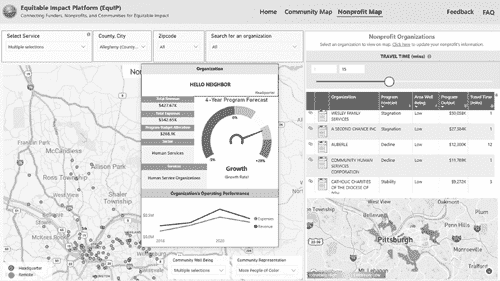

*图 11.3* 截图展示了 EquIP 如何识别最靠近弱势社区的非营利服务提供商，并分享其财务健康状况评估，该评估通过应用精准分析确定。

另一方面，假阳性（即未获得所需服务但仍成功的儿童）和假阴性（即获得了所需服务但未成功的儿童）代表了模型中的误差，即模型预测与实际结果不符。这些是从业者遇到现有数据无法充分解答的问题和假设的实例，凸显了当前数据收集过程中的缺口。因此，假阳性和假阴性表明，所收集的数据不够全面，无法完全支持其工作中所需的深度分析和决策制定（图 11.4）。

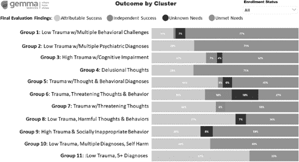

*图 11.4* 评估仪表板截图，展示了每个区组匹配比较组的项目接受者的精准分析结果，包含概率结果。

因此，挑战不仅在于识别这些额外的数据变量（指标），还在于优化模型以减少这些误差。这就是机器学习算法的因果建模训练发挥作用的地方，它有助于识别具体案例进行评估、假设和得出结论，了解发生了什么、为什么发生以及如何发生。然而，假阳性和假阴性的存在也凸显了预测模型固有的局限性，以及持续针对真实结果进行优化和验证的必要性。

这一认识凸显了精准护理模型中数据需求的演变性质。随着项目主管、管理者和从业者更深入地研究案例，他们遇到了现有数据无法充分解答的问题和假设。这凸显了当前数据收集过程中的缺口，表明所收集的数据并不总是足够全面，无法完全支持其工作中所需的深度分析和决策制定。因此，明确需要进一步优化数据收集过程，纳入能更完整描绘案例全貌的额外数据变量。一旦添加了新的数据变量（指标），便能更稳健地检验假设，并最终做出更明智的决策和干预。

因此，要克服的挑战在于识别这些额外的数据点，并以有意义且实用的方式将其整合到现有的数据收集和分析框架中。如果没有机器学习算法的因果建模训练帮助识别这些具体案例以进行评估、假设和得出结论（了解发生了什么、为什么发生以及如何发生），这是不可能实现的。Gemma Services 利用项目管理和案例评估数据实施了精准护理模型，构建了因果、预测、处方和评估模型。这种方法生成了自动化的基于证据的（即因果）评估发现和准确的建议，从而提高了儿童亚群体成功的可能性。他们的系统已运行近三年。Gemma 分析了实施精准护理模型前后的住院时长和出院锐度数据。他们发现，每个儿童的住院时长减少了 30 天：住院护理费用为每月每名儿童 10,000 美元。

此外，Gemma 发现儿童的出院锐度下降了 40%；重要的是，Gemma 追踪每个儿童的纵向出院后数据，其分析证明出院锐度与儿童出院后在社区停留 12 个月高度相关。值得注意的是，这些精准护理模型实施前后的对比结果并不反映实验性评估发现，但它们确实作为从业者逐案使用精准护理模型获益的早期迹象（图 11.5）。


*图 11.5* 通过精准分析确定的最新案例特定建议截图，向从业者展示了反事实证据（即，“绿色时成功”与“红色时成功”的对比），针对的是为提高期望结果（即出院敏锐度低于 1.5）的可能性而需要解决的目标（属性）。请注意姓名为虚构。

### 利用精准分析应用结构因果建模面临的挑战

尽管 Gemma Services 在实施精准护理模型方面取得了显著进展，但其应用引发了一个关键挑战：需要让受益人作为工具的使用者参与进来。目前，精准分析工具主要由从业者代表受益人使用。这意味着直接受益人——儿童及其家庭——尚未完全参与其中。Gemma Services 已认识到这一差距，并设定了让受益人直接参与使用精准学习工具的目标。其目的是使受益人能够积极参与解读输出结果，并规划优先事项以提高其成功的可能性 (York, 2021)。

然而，实现这一目标本身也面临一系列挑战。这不仅要求使工具对受益人易于获取且用户友好，还要求为他们提供必要的培训和支持，以有效使用这些工具。

此外，还涉及解决潜在的参与障碍，如缺乏技术访问条件、数字素养低或不愿接触数字工具。克服这些挑战对于充分实现精准护理模型的潜力至关重要，因为受益人自身最能从模型生成的洞察和建议中获益。

## 讨论

结构因果建模（SCM）与精准分析（PA）在社会影响项目评估中的融合，正如 Gemma Services 和公民企业援助计划（PACE）的案例研究所例证的那样，代表了项目评估领域的一项重大进展。这种融合有效应对了从大数据中得出有效因果推断的长期挑战，而大数据的特征往往是复杂的非实验性设置。

PACE 案例研究揭示了资源和支持向非营利组织的分配情况，特别是那些服务有色人种社区的组织。应用 SCM 和 PA 揭示了资源分配中的差异，提供了一种数据驱动的方法来理解和解决这些不公平现象。

在 Gemma Services 的背景下，精准护理模型使人们能够细致地理解治疗对不同儿童亚群体的效应。在此背景下使用 SCM 使得治疗方法更加个性化，考虑了每个亚群体的独特特征和需求。这种方法展示了从“一刀切”解决方案的转变，承认了治疗需求的复杂性和个体性。

尽管取得了这些进展，仍必须承认一些局限性。一个显著的局限是依赖可用数据，这些数据可能并不总是全面或具有代表性。这一局限凸显了持续改进数据收集方法的必要性，以确保数据充分捕捉所研究社会现象的复杂性。另一个局限是潜在的算法偏见。虽然 SCM 和 PA 提供了强大的分析工具，且这些方法控制了选择偏差，但它们并不免疫于数据固有的偏见。这引发了应对这些模型可能延续现有不公平现象的潜在风险的必要性，特别是在社会项目评估的背景下使用时。

未来的研究应侧重于解决这些局限性，特别是通过开发更稳健的数据收集方法和探索减轻算法偏见的途径。此外，还需要更多将 SCM 和 PA 应用于不同背景下的研究，以进一步验证和完善这些方法。

也就是说，SCM 和 PA 的融合代表了项目评估领域的一项重大贡献。它提供了一种更严谨、更细致的方法来理解社会项目中的因果关系，从而为项目改进提供更准确、更可操作的洞察。这种方法对政策制定也有影响，因为它为决策提供了更稳健的证据基础。通过阐明项目结果背后的因果机制，SCM 和 PA 使政策制定者和从业者能够设计更有效、更公平的干预措施。

虽然 SCM 和 PA 在项目评估中的融合标志着一个重要的进步，但继续探索和应对已识别的挑战至关重要。这将确保这些方法被负责任且有效地使用，以改进社会影响项目，并为建设一个更公平的社会做出贡献。

## 结论

总之，本文全面探讨了利用精准分析（PA）应用结构因果建模（SCM）的情况，特别关注了两个案例研究：Gemma Services 和公民企业援助计划（PACE）。利用 PA 的 SCM 展示了其彻底改变社会影响项目评估的潜力，提供实时、按需和个性化的洞察，可指导决策过程并改善结果。

Gemma Services 实施的精准护理模型利用项目管理和案例评估数据构建因果、预测、处方和评估模型，展示了该方法生成自动化、循证评估发现和准确建议的潜力。这反过来又提高了儿童亚群体成功的可能性。

公民企业援助计划（PACE）研究提供了几项关键收益。首先，它为非营利组织之间资源和支持的分配提供了关键洞察，特别是那些服务有色人种社区的组织。通过应用结构因果建模（SCM）和精准分析（PA），该研究为当地资助者揭示了资源分配中的差异，突出了可通过更有针对性的外展和拨款来改善公平性的领域。这种方法使人们能够以更数据驱动的方式理解这些不公平现象，指导更有效、更公平的政策决策。

然而，案例研究也凸显了若干挑战，包括需要额外的数据点来检验当前数据无法回答的假设，以及需要加强受益人使用精准学习工具的参与度。克服这些挑战对于充分实现精准护理模型的潜力至关重要。这些案例研究的发现凸显了 SCM 和 PA 改变社会影响项目评估的潜力。然而，它们也突显了持续完善这些模型的必要性以及应对已识别挑战的重要性。随着我们不断前进，继续探索和应对这些挑战对于充分利用基于大数据驱动的 SCM 评估的力量至关重要。

## 参考文献

1. Fan, J., Han, F., & Liu, H. (2014). Challenges of Big Data Analysis. *National Science Review*, *1*(2), 293–314. [`doi.org/10.1093/nsr/nwt03`](https://doi.org/10.1093/nsr/nwt03)

2. Gay, K. E., & York, P. (2018, February). A New Way to Use Data: Precision Care for Better Outcomes in Psychiatric Residential Treatment for Children. Retrieved from Scattergood Foundation: [`www.scattergoodfoundation.org/wp-content/uploads/2018/02/A-New-Way-to-Use-Data.pdf`](https://www.scattergoodfoundation.org/wp-content/uploads/2018/02/A-New-Way-to-Use-Data.pdf)

3. Knighton, A. J., Savitz, L., Belnap, T., Stephenson, B., & VanDerslice, J. (2016). Introduction of an Area Deprivation Index Measuring Patient Socioeconomic Status in an Integrated Health System: Implications for Population Health. *The Journal for Electronic Health Data and Methods*. [`doi.org/10.13063/2327-9214.1238`](https://doi.org/10.13063/2327-9214.1238)

4. Madhanagopal, B., Amrhein, J., & McDougall Scientific Ltd. (2019). Analyzing Structural Causal Models Using the CALIS Procedure. Retrieved from SAS: [`support.sas.com/resources/papers/proceedings19/3240-2019.pdf`](https://support.sas.com/resources/papers/proceedings19/3240-2019.pdf)

5. Pearl, J. (2010). Causal Inference. *Proceedings of Workshop on Causality: Objectives and Assessment at NIPS 2008*, (pp. 39–58).

6. Program to Aid Citizen Enterprise. (2021). The Health of the Nonprofit Sector in Western Pennsylvania. Retrieved from Pittsburgh Black Media Federation: [`pbmf.org/wp-content/uploads/2021/01/PACENonprofitEffectivenessstudyFINAL12.9.20-1.pdf`](https://pbmf.org/wp-content/uploads/2021/01/PACENonprofitEffectivenessstudyFINAL12.9.20-1.pdf)

7. Spitzer, S., & Weber, D. (2019). Reporting biases in self-assessed physical and cognitive health status of older Europeans. *PloS One*, *14*(10), e0223526. [`doi.org/10.1371/journal.pone.0223526`](https://doi.org/10.1371/journal.pone.0223526)

8. York, P. (2021, July). Unlocking Real-Time Evidence for Practitioners: How Evaluation and Data Analytics Are Generating *On-Demand,* *Actionable Evidence for Front-Line Practitioners at First Place for Youth and Gemma Services.* Retrieved from Project Evident: [`projectevident.org/wp-content/uploads/2022/09/FPFY-GemmaActionableEvidenceCaseStudyJuly21.pdf`](https://projectevident.org/wp-content/uploads/2022/09/FPFY-GemmaActionableEvidenceCaseStudyJuly21.pdf)

# 12 政策与社会的算法化：对实在论评估方法的需求

Frans L. Leeuw

DOI: [`10.4324/9781003512493-12`](https://doi.org/10.4324/9781003512493-12)

本章已根据 CC-BY-NC-ND 4.0 许可提供。

## 引言

纵观本书各章的贡献，呈现出这样一幅图景：人工智能（AI）不仅在各个专业研究领域站稳了脚跟，也已渗透到组织中，在这些组织中进行着决策制定、政策、项目、干预、法规、疗法、药物及法律安排的开发与实施。


# Misuraca, G. 和 van Noordt（2020：430）展示了一个包含 250 个案例的数据库，以说明（欧洲）政府对人工智能的使用

AI 似乎在政策制定（更快地发现社会问题、改进政策决策、监控实施）、公共服务（改进服务交付、开发创新服务）和内部管理（开发管理创新、人力资源、采购和财务等）方面发挥着作用。Sharma et al. (2020) 关注 AI 如何应用于从医疗保健、环境可持续性、教育到交通和经济应用等不同政府部门。荷兰政府政策科学委员会对 AI 的发展进行了如下阐述：

> 近年来，AI 已走出实验室的局限，在社会中广泛扩散。AI 现在广泛应用于经济和整个社会，以多种方式影响着公民的日常生活。正如所谓的通用技术所具有的特征，AI 的特点在于普遍性、持续改进和创新互补性。[我们] 认为 AI 是一种系统技术，可与蒸汽机、电力、内燃机和计算机相提并论。
>
> （2021：5）

Burrell and Fourcade (2021) 提到“算法社会”，而 Meijer 等人则使用“算法化”（2022: 837 ff）。

最近推出的大语言模型（`LLMs`），如 `ChatGPT`，经过训练可进行对话式交互，并能根据提示生成新内容，这有力地说明了这一与政策制定和实施相关的技术发展。

荷兰政府政策科学委员会补充道，至关重要的是“确保 AI 开发者、使用者以及体验其后果的人群之间存在强有力的反馈回路”（2021：35）。然而，这远未成为常态做法。

> 对 AI 系统结果的评估及其向开发者和其他利益相关者的反馈，听起来像是 AI 系统的一项合乎逻辑的要求，但在实践中却做得远远不够。一个新兴趋势是利用真实环境实验，在初步测试阶段后直接部署，而不再进行进一步评估。
>
> （第 36 页；16）
>
> [该委员会] 呼吁对 AI 使用进行（更多）真实世界评估。Sharma 等人提出了类似观点：“迫切需要分析 [AI] 技术的实施（采用前）及其评估（采用后）”（2020，第 5 页）。我们需要开始考虑评估者如何应对这一新需求，并运用评估性思维和方法加以解决。此外，AI 常被描述为`黑箱`（需要将其转化为白箱），甚至被视为`魔法`。

我聚焦于实在论评估，因为打开黑箱是其核心主题之一。这不仅适用于常规项目和干预，对于算法世界或许甚至更为适用。Pasquale (2015) 在金融和信息领域论述了“黑箱社会”。其他人则分析了在医疗（保健）及其他领域“揭开 AI 黑箱神秘面纱”的必要性（Price, 2018）。在二十多年的时间里，实在论评估已发展出其打开黑箱的方法。这包括处理 `CMO` 配置（情境/机制/产出）。因此，本章将探讨这一视角。

## 问题与章节结构

第一个问题是：评估期刊对 AI（使用）的关注有多普遍？我给出的答案引出了第二个问题：为什么评估期刊对这一主题的关注如此有限？第三个问题是：聚焦 AI 的影响评估会是什么样子？第四个问题是：算法化的实在论评估对知识库的贡献可能是什么？

需要提及一个定义问题。我关注的是作为干预（项目和政策、法规、立法、疗法等）构建模块或组件而使用的 AI（工具/系统）。我还提到算法化；我将这些术语视为可互换使用。

本文结构如下：首先考察过去 10 年十本评估期刊中对 AI（使用）评估的关注情况，随后简要讨论这些发现的可能解释。

> 接下来，提及了 AI（使用）影响评估的组成部分。随后，本章的核心部分将重点转移到现实主义评估能为政策、项目和干预措施的算法化实现更多（且更好）的评估做出何种贡献。在我研读的研究文献中，发现了约十五种机制，它们可被归纳为现实主义评估的五种机制构念。我还提及了一个关于机器人辅助手术的现实主义评估案例研究，以分享该方法在实践中如何运作的范例。最后，在本章的讨论与结论部分，提出了关于 AI 未来的几点建议。

## 问题 1：十本评估期刊是否关注 AI（使用）评估？

这个问题很相关，因为半个世纪前关于评估者对接纳和评估数字化发展的兴趣的证据显示，评估实践在这样做方面表现得犹豫不决。详见框 1。

> **框 1：评估者对数字化发展的兴趣指标（2012 年至今）**
>
> **截至 2012 年**
>
> Leeuw 和 Leeuw（2012）统计了自评估期刊创刊以来至 2012 年间，“互联网”、“数字”、“网络”、“网络空间”和“数字政策”等词汇在期刊中出现的频率。他们得出结论：“专业评估者对这些政策的关注程度，与互联网和数字政策渗透社会的速度之间，似乎存在差距”（第 111 页）。
>
> **截至 2017 年**
>
> Høljund、Olejniczak、Petersson 和 Rok（2017）使用了一份聚焦于大数据的电子调查问卷，通过在线调查链接分发给自称（专业）评估者的活跃 LinkedIn 群组（数据收集于 2015 年）。他们发现，样本中仅有 0.5%（十五位受访者）表示他们在评估中使用过大数据。
>
> Forss 和 Norén (2017)研究了来自选定国际发展机构的二十五份评估工作范围书样本，发现大数据鲜有应用，部分原因是工作范围书有时为大数据关闭了大门。

自 2012–2017 年以来，数字世界发生了变化，而且可能是剧变。AI、大数据和数字化越来越成为热门话题，包括 `ChatGPT` 等发展。因此，人们本期望在首次词频统计（Leeuw & Leeuw, 2012）与 2023 年之间，对项目和政策算法化的关注度会大幅提高。因此，我再次在十本评估期刊中进行了检索，但这次使用了两个词条：人工智能和数字。从该表可以公正地得出结论，这两个词条的使用次数微乎其微，这表明评估者对这一发展仍然兴趣非常有限（表 12.1）。

**表 12.1 十本评估期刊中“digital”和“artificial intelligence”两词的出现次数（自创刊以来）**

| 期刊 | 检索词：Artificial intelligence | 检索词：Digital |
| :--- | :---: | :---: |
| *American Journal of Evaluation* | 21 | 102 |
| *Evaluation* | 9 | 54 |
| *Evaluation Review* | 24 | 105 |
| *Evaluation and Program Planning* | 31 | 252 |
| *Assessment and Evaluation in Higher Education* | 58 | 292 |
| *Educational Research and Evaluation* | 15 | 96 |
| *Journal of Multidisciplinary Evaluation* | 1 | 2 |
| *Educational Evaluation and Policy Analysis* | 17 | 57 |
| *Evaluation and the Health Professions* | 4 | 36 |
| *New Directions for Evaluation* | 2 | 42 |

Nielsen、Mazzeo Rinaldi 和 Petersson（2025）提供的证实了这一点。他们在九本主要评估期刊中，针对过去十年（追溯至 2023 年）评估者在 AI 领域的工作进行检索，仅找到十八篇不同的文章，其标题、关键词或摘要中包含“大数据”、“人工智能”、“机器学习”、“文本分析”或“物联网”（另见 Nielsen, 2023）。

Kates 和 Wilson 也提供了证据以及一个有争议的解释：

> 因为它[AI]出现得太最近了……
>
> （2023: 101...

## 问题 2：为何对 AI 仍关注如此之少？四点推测？

一种推测是评估者不太熟悉这些发展，因此置身事外。Kates 和 Wilson (2023)在将 AI 称为“近期”议题时，给出了一个熟悉度有限的例子。第二种推测是评估者可能畏惧复杂性，以及在设计和实施旨在理清干预措施算法化后果的评估时面临的方法论困难。固守己知、恪守惯例，可能是他们的信条。

第三，也有可能一些评估者可被归类为二十一世纪“知识职业中的卢德分子”。

第四种推测是认为评估并非必要，因为算法化“多么”“糟糕”、“不可接受”、“有偏见”或“危险”这是显而易见的先验事实。同时，但可能只有少数评估者坚信 AI 的“美好与伟大”，因此也不认为有必要进行影响评估。

本章不旨在探究这些及其他推测，故仅供参考。我将视角转向前进的道路，讨论（影响）评估算法化的重要特征是什么，以及——紧接着——现实主义评估能为那些有兴趣评估 AI 使用的人提供什么。

## 问题 3：影响评估的基本特征是什么？

我首先指出什么不能被视为 AI 的（影响）评估。

通常，当新闻媒体或顾问提及 AI 的影响，并提到可衡量的、成功的、长期的和重大的部署（AI）时，除非这些术语被操作化并通过系统评估进行衡量，否则这种标签化是无用的（Press, 2022）。

当对可解释性（即可阐释性）、准确性、透明度、安全性、隐私性以及减轻 AI（使用）各种偏见的方式等标准进行评估和/或审计时，也不存在影响评估的问题。

这些标准很重要，但现实世界中的影响关乎这样一个问题：与未使用 AI 的（类似）情况相比，使用 AI 时，在多大程度上改善了社会和人们解决问题与挑战的能力（且无意外的负面副作用）。

尽管相关，但测试 AI 的数据模型，包括测试/训练数据、模型性能、指标以及（不正确）预测的示例，距离评估对社会行为的影响仍然很远。

然而，Price (2018)、Park & Han（2018）、Park et al. (2020), Havrda & Klocek（2023）和 Leeuw (2023) 的工作讨论了研究设计和数据收集方法，范围涵盖从数据质量控制和算法测试、识别需求的民族志研究、理解工作流程到文化背景、包括 `A/B` 测试在内的可用性测试……

> Hernandez-Orallo (2017: 399) 区分了
>
> > AI 系统和 AI 组件。系统（如 AI 代理、认知架构或机器人）可以按其原貌进行评估，因为它们接收某种问题（通过规范或奖励），并可依据效用函数进行评估。如果没有组件的规范，则无法评估组件（如特定技术、算法、方法或工具）。
>
> 因此，算法化（干预、政策、项目等）的影响评估至少必须关注以下问题：
>
> *   描述 AI 系统、工具、模型、数据及其目标；
> *   针对 AI 使用的底层假设，打开 AI 黑箱并进行实地核查；
> *   明确 AI 服务的对象（个人和组织）、使用情境及限制条件（时间、资金）；
> *   衡量 AI 在社会/组织/机构中的实施情况（过程）；
> *   应用研究设计/方法以衡量 AI 使用对受众（及其他人）产生的结果或后果（预期的、非预期的），如贡献分析、[理论驱动的] 反事实分析和比较案例研究。
> *   由于 AI 常与“人在回路中”（`HI`，人类智能）一起使用，评估设计需能聚焦于 `HI/AI` 交互及其后果（Crootof, Kaminski and Price, 2023）。

## 问题 4：实在论评估能为项目、政策和干预的算法化影响评估贡献什么？

### 为何采用实在论评估方法？

Pawson (2006, p. 26 ff) 指出“干预是理论的化身”，这已被证明是实在论传统的基石之一。这些理论通常必须从政治家、官员和利益相关者的言论、著作（有时还有行动）中重构；因此评估者提到需要打开政策或干预的黑箱。

这适用于 AI 不发挥作用的常规干预，但当涉及混合或完全数字化的干预时，可能更加适用 (Pasquale, 2015).

为何这种方法与评估算法化相关？关于机制，该方法相关性的一个信号可在 Pedersen & Johansen (2020) 的“`BAI`”概念中找到：行为人工智能，意指应关注“人工智能系统固有的人工推理及其表现出的行为，就像社会科学研究人类认知、推理和行为一样。”

与此相关的是“人在回路中”问题（Crootof, Kaminski & Price, 2023: 10–11）。“人在回路中”被定义为“参与与算法共同做出的单一特定决策的个体”。“人在回路中”与“人在回路上”——监督算法决策过程的人——以及“人在回路外”——无人类参与或监督的算法决策过程——形成对比。这些角色在实践中如何运作，至少部分取决于驱动相关行为的行为和认知机制，包括其“环境”（或生态系统，即情境）。Christen et al. (2023: 4) 指出，“对 AI 的有效人类控制依赖于人类预测 AI ‘行为’的能力，例如识别 AI 何时可能犯错。” 他们的几项研究结果促使作者建议一种不同的方法，即“AI 控制人类操作员。” 一项瑞典研究分析了公务员在面对“机器人流程自动化”引入时的行为反应，描述了引入发生的情境，并“拆解了行动者”的[行为] (Ranerup & Henriksen, 2020: 6, 13)。

其相关性的另一个指标由 Price (2019: 8) 提供，他研究了在医疗保健中使用和评估 AI 时的情境。他区分了顶级临床实践与农村实践，并探讨了这些情境差异对算法化成功的影响。

这些考量说明了为何实在论评估能够并将会促进对项目和干预算法化运作方式的更好理解：它们能解决 AI 驱动干预（结合 AI 和人在回路）背后的机制；它们能增强 AI 的可解释性；并能激发将“常规”干预评估中可用的知识储备与更混合的干预进行对比。

### 在文献中寻找（关于）CMO 的假设：方法、发现与案例研究

#### 方法

鉴于评估期刊极少报道 AI 使用（的影响）评估，我将研究范围扩大到其他研究领域的其他来源。我采用了两种策略。首先，我利用马斯特里赫特大学图书馆数据库查找文章、书籍和章节，其摘要和/或标题表明提供了关于算法化的机制、情境和结果的相关信息。我检索了 1998 年至 2023 年期间的文献，并使用了多个关键词（表 12.2）。

**表 12.2 马斯特里赫特大学图书馆数据库中找到的关键词频率 (1998–2023)**

| 检索词 | 频次 |
| --- | --- |
| 政府算法化 | 93 |
| 社会算法化 | 162 |
| 评估算法化 | 295 |
| 评估算法化对社会的影响 | 40 |
| 评估政府算法化的影响 | 15 |

结果发现，大部分参考文献涉及（完全）技术和 IT 问题。第二种策略是滚雪球式搜索提及人机交互及人类智能（`HI`）与 AI 交互的机制和情境的文献，最好是已评估或评价过的。同样，我使用了马斯特里赫特大学数据库。两种策略的结果是获得了约十五篇论文，我用它们来寻找机制、情境和结果。

#### 发现：机制

在选定的论文中，对机制的搜索得出了以下列表，包括来源及关于机制假设（功能）的背景信息。我遵循的方法与 Westhorp (2018: 49–50) 关于机制构念（范畴）的研究相关。她区分了力量与负债、力、交互、反馈/前馈、推理和资源。在我的搜索中，我发现了其中一些，如“推理”、“交互”和（认知/态度）“资源”。然而，我还发现了其他构念，如情绪处理和拟人化。

图 12.1 总结了搜索发现，我将在此后更深入地讨论。

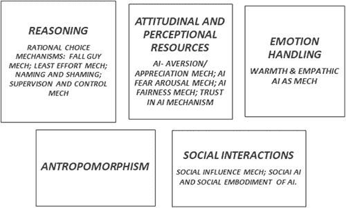

*图 12.1* 选定论文中发现的构念和机制。

##### 推理：理性选择决策机制

> **来源：** Godin (2015)；Rogers and Agarwala-Rogers (1976)；Pinto et al (2023).
>
> **背景：** Pinto et al. (2023) 从理性选择理论（`RCT`）的视角分析了数字世界中活跃的过滤气泡或回声室效应。同样符合推理的理性选择理论的是，面对算法化等创新的人们会参与决策，采纳（或拒绝）该创新，并权衡下文提到的属性。`RCT` 并不假设人们对这些属性拥有完全或完备的知识。尽管如此，`RCT` 仍试图将决策中涉及的机会成本纳入考量。人们对这些属性评价越积极，他们参与 AI 的可能性就越大。

以下是研究文献中的相关属性：

*   （AI）**创新的可证明性**；
*   **相对优势**（相较于其他可能性）；
*   **兼容性**（创新与潜在采纳者的价值观、经验和需求的一致性）；
*   **可尝试性**（在决定采纳前，创新可被测试或试用的程度）；以及
*   **可观察性**（创新提供有形成果的程度）。

AI 研究还发现了几个与推理和理性决策相关的其他机制。Croothof、Kaminski 和 Price (2022: 57) 提到了**替罪羊机制**：让一个人“在法律上承担责任、在道德上负有责任、或在其他方面对系统的决策负责”，从而在政策制定和实施中使用 AI 与大数据时，使其他人能够推卸因困难或意外副作用而应承担的责任。该机制与**最小努力原则**相关，该原则源自组织社会学和经济学，也与**指名道姓羞辱机制**相关：“犯错的不是我（或我的部门），而是‘别人’。” 相反的机制也可能在起作用：如果在流程中加入一个“无效的人类”，它可以充当“**伦理漂白**”，转移人们对其他更有效监管形式的关注”（第 9 页）。

### 人类监督与控制作为 AI 治理的机制

**来源：** Christen et al. (2023)；欧盟议会 (2020)；Koulu (2020); 和 Green, (2022)。

**背景：** Koulu (2020) 提供了证据表明，在欧盟内部，

> 多方行动者主张将人类监督作为 AI 开发和部署的核心伦理原则。例如，欧盟委员会 2019 年的通讯将人类能动性和监督描绘为 AI 应用程序要被视为值得信赖必须遵循的七项关键要求之首。人们希望通过人类监督来应对的风险和挑战包括：对人类自主权的危险、缺乏透明度和不透明的算法模型、隐私和数据保护问题，以及歧视。
>
> (第 721 页)

然而，Koulu (2020) 对此持批评态度：

> 对于法律而言，人类监督提供了一种具有吸引力、易于实施且可观察的程序性保障。然而，如果不了解其固有局限性，人类监督就有沦为一种自身价值、一个空洞的程序性外壳的危险，它被用作算法化的替代性理由，却无法为基本权利提供保护。
>
> (第 720 页)

Green (2022) 在研究全球 41 个国家的 AI 政策和立法时提出了类似观点。他发现：

> 成为全球监管政府算法努力核心的机制，是要求对算法决策进行人类监督。\[然而，\]尽管人类监督已被广泛采用，但这些政策建立在一个未经审视的假设之上：即人们能够有效地监督算法决策。

他发现：


> 这些政策存在两个重大缺陷。首先，绝大多数证据表明，人们无法充分提供设想中的监督形式。其次，对有效人类监督的错误假设，使政府使用有缺陷且无需问责的算法获得了合法性。
>
> (2022:16ff)

### 态度与感知机制

*   **AI 厌恶机制**：人们对 AI 持消极态度，因此不倾向于使用 AI；
*   **AI 欣赏机制**：当人们认为建议/忠告来自算法而非人类时，更倾向于采纳。

**来源：** Logg et al. (2019)；Lanz et al. (2022)；Kim et al., 2022；Siemon (2023)。

**背景：** Logg et al. (2019) 和 Lanz et al. (2022) 研究了

> 为什么人类厌恶接受来自算法的指令，尤其是在道德领域——或者相反，在重要生活领域中更倾向于并依赖 AI 而非人类指令（因为他们假设 AI 是公平、快速且无偏见的）。
>
> (第 2 页)

Lanz et al. (2022) 从 AI 厌恶/欣赏文献、领导力文献以及访谈的定性数据中，确定了四个理论上有意义的中介变量。

Kim et al. (2022: 2) 提出了**AI 设备使用接受理论**。该理论探讨“AI 聊天机器人的感知特征（如个性化、拟人化）通过感知到的人类特质（胜任力、温暖）和情感（共情）的顺序中介作用，对使用 AI 聊天机器人的意愿（结果阶段）的影响。”

Siemon (2023: 459) 检验了这样一个假设：“当计算机而非另一个人类评估他们的想法时，个体是否会感到担忧。”该假设与**评价担忧理论**相关，该理论指出，在群队中工作的参与者，因害怕其他成员的负面评价，而不愿提出更具独创性的想法。Siemon 实验的结果显示，当人们向基于 AI 的系统展示想法时，不会感到评价担忧；相反，当向人类展示想法时，则会感到担忧。

### AI 恐惧唤起机制

**来源：** Cugurollo and Acheampong (2022)。

**背景：** 先前的研究已将恐惧确定为一种能够影响人们对 AI（机器人和自动驾驶汽车）态度的行为决定因素 (Acheampong and Cugurullo 2019，Hinks 2020)。该研究回答了“人们与 AI 相关的恐惧和担忧在多大程度上影响其将 AI 作为日常生活一部分采纳的意图？”研究主题是 AI 驱动汽车，答案是“是的，影响相当大。我们展示了参与者对 AI 驱动汽车所感受到的各种恐惧和担忧”（Cugurullo and Acheampong, 2022:1; 14）。然而，他们也报告称，不存在**弗兰肯斯坦情结**（即“大多数人会害怕 AI 作为潜在危害来源，因此 AI 技术注定会被社会拒绝”这一假设）。

### AI 公平性机制

**来源：** Narayanan et al (2023)。

## 背景：人类与 AI 决策中的公平感知

作者发现（针对公平的不同维度），人们通常认为人类决策比 AI 辅助决策（更）公平，除非“当 AI 驱动决策中的解释被认为是合理的、可理解的，并能回应用户的需求和关切时。此时它们更有可能被感知为信息公平的” (2023: 9)。

与此相关的是 Kieslich 等人 (2022: 4 ff) 关于人们对 AI 感知的发现：“将 AI 视为不道德[且不公平]会对组织产生不利影响，表现为声誉降低以及抗议和诉讼的可能性增加。”

### 对 AI 机制的信任

**来源：** Chen 等人, (2019)；Okamura & Yamada (2020) 和 Tschobb (2020)。

**背景：** 研究表明，人机信任与人际信任共享一些重要特征。Okamura & Yamada (2020: 22035) 将人机协作中的信任定义为“用户在不确定性条件下，依赖智能体实现其目标程度的一种态度判断。” 人机协作的一个关键方面是人类用户应当信任 AI 系统，就像人类通常信任其他人类伙伴一样。” 然而，这意味着 AI 用户必须能够“根据 AI 系统的实际可靠性调整其信任水平 (‘信任校准’).” 在他们的研究中，他们研究了被称为“信任校准线索”的认知线索，以刺激用户调整其信任水平 (Okamura & Yamada, 2020: 220335)。

### 情绪处理与共情作为机制

**来源：** Bagozzi, Brady & Huang (2022)；Kim and Hur (2023)。

**背景：** 情绪长期以来被视为人类独有的特质，但 AI 的最新进展促使人们越来越有兴趣将情商融入机器。自然语言处理、计算机视觉和情感计算等技术正逐渐参与到人类情绪的检测与分析中。Bagozzi, Brady & Huang (2022: 499) 探讨了一种关于 AI 情绪的理论。其中一点是：

> 与 AI 互动可产生三类情绪：基本情绪、自我意识情绪和道德情绪。基本情绪是人们因与 AI 机器人互动而产生的感受；自我意识情绪是人们在与 AI 互动时可能产生的自豪、羞耻、内疚、尴尬、嫉妒和羡慕；第三类是道德情绪：当人们观察到或意识到另一个人（或组织[或机器]）对其他人、技术或组织做好事或坏事时，就会产生这种情绪。

在服务互动中，AI 能够在顾客和一线员工中产生所有三类情绪——基本、自我意识和道德情绪 (Assunção 等人, 2022; Bagozzi, Brady & Huang, 2022:501)。Kim and Hur 的 (2023) 研究可归属于“AI 设备使用接受 (AIDUA) 理论”，并涉及 AI 的温度（“个体感知到非人实体中关怀和社会性的程度。多项先前研究表明，AI 工件的特征能唤起用户对 AI 工件温度的推断”）、共情和拟人化等方面。

### 拟人化机制

**来源：** Li & Suh (2022)。

**背景：** 拟人化是指将人类特征归因于非人类生物或实体（如 AI 系统）。Li 和 Suh (2022) 进行了一项系统文献综述，对拟人化的六种定义进行了分类，并总结了该机制的约二十个理论基础。“我们的综述显示，人们越来越关注理解拟人化如何导致人类-AIET 关系的发展，^()

### 社会互动与社会 AI 机制

*社会影响机制（通过同伴、网络）。*

**来源：** Cabiddu 等人 (2022) 和 Caplan & Boyd (2018)。

**背景：** 该机制可通过个体及其同伴的模仿，以及组织的同质化（导致同构性），影响人们对 AI 的态度和行为。Caplan 和 Boyd (2018: 1) 考察了“算法和数据驱动技术如何通过 Facebook 等组织的实施，在行业内诱导相似性。” 利用组织社会学和新制度主义理论，该文追溯了大数据和算法的官僚根源，以考察由此产生并通过数据驱动和算法逻辑进行中介的制度依赖性。这种分析揭示了组织情境如何嵌入算法，进而嵌入其他组织和个人实践中。” 它考虑了算法化正作为“官僚机制概念的延伸”而发挥作用，而非增加创新和跳出框框的思考 (2018: 4)。

### 社会 AI 机制，包括 AI 的社会化身

**来源：** Bolotta and Duman (2022)；Dafoe 等人 (2021)。

**背景：** Bolotta and Duman 指出，尽管：

> 复杂的人类认知架构的表达力很大一部分归功于其进行社会和文化学习的能力，AI 领域主要却采用了一种唯我论的智能视角……社会互动不仅在该领域很大程度上未被探索，而且是高级认知能力的基本要素，因此隐喻性地构成了 AI 的“暗物质”。
>
> (2022: 1)

Dafoe 等人提到：

> 经典的 AI 问题，即孤立的机器面对非社会环境。历史上，这是一个合理的起点。AI 智能体——很像婴儿——必须首先掌握对其环境的基本理解以及如何与之互动。即使在涉及多个 AI 智能体的工作中，[AI 研究] 领域尚未解决合作的难题。
>
> (2021:34 ff)

问题在于 AI 如何能与人（互动）合作，从而提高 AI 的接受度和影响力。他们的建议之一是 AI 的社会化身。

> 因此，它与拟人化机制有关。它指的是“身体状态，如姿势、手臂动作和面部表情，这些是在社交互动中产生的，并在社交信息处理中发挥核心作用”（Bolotta & Dumas, 2022: 1）。人工智能体中社会具身性的观点“得到了具身智能体与人类互动改善的证据支持”（2022: 6）。研究表明，物理具身性对智能体社会在场感、对智能体的评价、对智能体公众评价的评估以及对与智能体互动的评价具有积极影响。在机器人中，社会在场感是社交互动成功的关键组成部分。

> Dafoe et al. (2021: 34) 提到实现协作式 AI 的四个要素：（1）理解（考虑行动后果/预测他人行为的能力），（2）沟通（与他人明确且可信地共享信息的能力），（3）承诺（在需要合作时做出可信承诺的能力），以及（4）作为社会基础设施或背景、强化前三个要素的规范和制度。前三个可视为机制，而第四个涉及背景。

### 发现：背语境

转向 C（背语境），Pawson and Tilley (1997) 认为背语境是一组影响干预措施何时以及如何实施、以及机制如何被触发的因素。因此，识别那些启用或阻碍机制的背语境条件对于现实主义评估至关重要。Pawson et al. (2004) 建议，背语境因素可在四个不同层面上识别：

1.  关键行动者和利益相关者的个人能力，如兴趣、态度、知识和技能。
2.  支持干预所需的人际关系，如沟通渠道、管理和行政支持，以及专业关系和契约。
3.  实施干预的制度环境，如实施主体的文化和规范、领导力及治理。
4.  更广泛的（基础）结构性系统，如政治支持、资金资源的可用性，以及竞争性的政策优先事项和影响（Pawson et al., 2004: 7–8; Nielsen, Lemire and Tangsig, 2022; Solaiman et al., 2023）

> 评估了生成式 AI 系统在系统和社会中的影响^()
>
> > 理解 AI 系统需要洞察诸如训练数据、模型本身、物质基础设施以及系统部署所在背语境等方面。它还要求理解人、社会，以及社会进程、制度和权力如何被 AI 系统改变和转移。

仅仅几行之后，他们再次强调背语境：“AI 系统的社会影响方面在很大程度上往往取决于背语境，从开发所在的领域到部署所在的用例和背语境。”

Makarius et al. (2020) 从社会技术[系统]理论（STSt）的视角研究了 AI 在组织中的引入。STSt 的核心思想是，只有将“社会”和“技术”两个方面结合起来，并将它们视为复杂系统中相互依存的部分，才能理解和改进组织系统的设计与绩效。他们指出了背语境感知在 AI 中的重要性，并提到一种可能性：当 AI“参与决策制定[时，这将]实现扁平化的组织结构，并赋能低层级员工的决策制定”（第 264 页）。如果背语境促成了 AI 技术与人类（即员工）的融合实现，这可能会创造“社会技术资本”，即两个实体作为一个紧密耦合的系统运作，表现出更强的响应能力”（Makarius et al., 2020: 265）。

Price（2019: 8）讨论了在医疗保健领域使用 AI 时背语境的相关性。Meijer et al. (2021) 研究了警察组织在经历“算法化”时背语境的作用，Van Noordt & Masagurka (2022) 则在其案例研究中研究了 AI&BD 使用周围的环境。采用准实验设计，Henkel et al. (2020) 在传统的呼叫`中心`背语境中引入了该技术。其他例子包括研究供应链如何在不同背语境下与 AI 协作（Helo & Hao 2022）、LLM 被用于法律分析（van Dijck, 2024）以及 AI 在发展/SDG（可持续发展目标）领域的功能（York & Bamberger, 2020; Leeuw & Bamberger, in press）。

### 发现：结果、后果、影响

最后，O 代表结果/后果/影响，几乎可以是任何内容：结果、绩效、失败、影响（健康和/或福利）、收益、效率等。

Babic et al. (2021: 285) 分析了让医疗 AI 具备“可解释性”的广泛接受的驱动力，这除了准确和（医学上）有效之外。“结果，[美国]立法者一直在朝着要求为黑箱算法决策提供解释的方向发展。确实，学术界、政府和公民社会团体中正形成一种近乎共识，支持可解释的 AI/ML”（2021: 286）。他们质疑这一发展，因为它

> > 既高估了益处，又低估了要求黑箱算法可解释（在医学中）的弊端。至少对于基于健康 AI/ML 的医疗器械而言，最好不要将可解释性视为一项刚性的硬性要求，而是专注于其安全性和有效性。
> >
> > （2021: 284）

下一个框总结了对 AI 在手术中（即机器人辅助手术）所扮演角色的现实主义评估方法，指出了解决“化身理论”以及背语境-机制-结果配置的相关性。

> > 框：机器人辅助手术的现实主义评估（Randell et al., 2014; 2017）。
> >
> > 问题在于机器人手术（即 RAS，机器人辅助手术）如何以及在何种情况下能有效引入常规实践，以及它如何以及在何种情况下影响团队协作、沟通、决策制定及后续患者预后。评估始于文献综述，以确定关于 RAS 如何融入实践并影响团队协作和决策制定的理论。这些理论通过在九家 NHS 信托机构与手术室团队的访谈得到完善，采用了“教师-学习者循环”方法，这是现实主义评估者常用的方法。这一阶段被称为“理论引出与完善”，产出了“机器人辅助手术初始理论”。该理论及随后多年的理论均以 CMO 配置形式呈现。随后开展了多中心案例研究；通过观察、视频录制、访谈和问卷收集数据。“初始理论”随之得到完善。第三阶段聚焦于其他外科专科的访谈，以评估研究发现的普遍性。此阶段还包含一个设计工作坊，使评估者“能够探索我们的发现对广泛利益相关者群体的意义，并与他们合作探索研究的潜在实际意义。”

## Discussion and Conclusions

设计、开发和实施政策、方案及干预措施时 AI 的角色与功能，需要更多影响评估。尽管 AI 创新在社会中的扩散与采纳迅速，^()

一种观点认为，由于“黑箱”既存在于传统方案和干预中，也存在于 AI 驱动的方案中，而现实主义评估者受过拆解黑箱、将其转化为“白箱”并审查其内容的训练，因此为这一事业做出贡献几乎是他们的责任。

第二个观点认为，在开展这项工作时，理解 CMO 的作用很重要。本章发现（尽管非源自评估期刊文章）有十五种机制在使 AI 驱动的干预生效、以及理解为何及如何在特定情境下 AI 驱动的干预（不）生效方面发挥作用。一些涉及推理与理性选择决策，一些涉及态度与知觉成分，一些涉及社会互动。我们还发现了更多生物-社会性质的机制，如共情、拟人化和具身 AI。既然非数字世界中关于这些及相关机制的研究库已存在，尝试将其应用于算法世界将大有裨益。

第三个观点面向未来。鉴于有感知 AI（包括“情感 AI”）可能在不太遥远的未来登陆，关于机制与情境运作的知识可能比现在更加重要。有感知 AI 是指一种人工智能系统^()

现实主义方法也非常适合在理解干预和方案的算法化方面发挥重要作用，无论是针对“受益者”或最终用户，还是针对政府、医疗、教育、安全及安保机构等组织中的中间人。

## Notes

1.  **The** 这一术语的历史比想象中更久远。1976 年，L. Landa & F. Kopstein 在一本关于教育与教学的书中提到了算法化（Englewood Cliffs, NJ, Educational Technology Publications, **1976**）。
2.  **The** 第 35、36 页的引用涉及荷兰语全报告的英文摘要；第 16 页的引用是文本的翻译。
3.  **See** Pasquale (**2015**); Rai (2019); and **Schinckus** (**#c12.xhtml#re_TNFUK_12_AREV_C012-CIT000078**), Gasparin, and Green (2020).
4.  **One** 应该问：“什么是‘近期’？AI 几十年前就已是一个话题。”
5.  **This** 这一说法并不完全正确；参见 **Nielsen (2023)** (**#c12.xhtml#re_TNFUK_12_AREV_C012-CIT000049**) 以获取一些文章。
6.  **Thanks** to Steffen Bohni Nielsen for this suggestion.
7.  **h**[ttps://www.historic-uk.com/HistoryUK/HistoryofBritain/The-Luddites/](https://www.historic-uk.com/HistoryUK/HistoryofBritain/The-Luddites/) (visited October 25, 2023).
8.  **h**[ttp://www.history.com/news/ask-history/who-were-the-luddites](http://www.history.com/news/ask-history/who-were-the-luddites).


## 参考文献

9. [https://www.forbes.com/sites/gilpress/2022/05/29/what-is-ai-understanding-the-real-world-impact-of-artificial-intelligence/](https://www.forbes.com/sites/gilpress/2022/05/29/what-is-ai-understanding-the-real-world-impact-of-artificial-intelligence/)。另见[www.mckinsey.com/industries/public-sector/our-insights/the-potential-value-of-ai-and-how-governments-could-look-to-capture-it#/](https://www.mckinsey.com/industries/public-sector/our-insights/the-potential-value-of-ai-and-how-governments-could-look-to-capture-it#/)，该文基于有争议的假设和方法，提出了非常基础的关于如何获取影响的建议。访问于2023年9月。

10. **How** to Test Machine Learning Models (deepchecks.com)（访问于2023年9月）。

11. **A/B**测试是指（随机）实验过程，其中两个或更多版本的变量（网页、页面元素、颜色等）同时展示给不同细分的网站访问者。它们常用于数字营销。

12. **Ground truth**被认为是AI工具正在学习解决的预测问题的“正确”答案。该数据（集）随后成为开发者衡量AI系统预测准确性的标准。关于管理者如何应用“ground truthing”的研究结果，参见**Lebovitz et al. (2023)**（**#c12.xhtml#re_TNFUK_12_AREV_C012-CIT000035**）；关于更具认识论层面的讨论，参见**Kang (2023)**（**#c12.xhtml#re_TNFUK_12_AREV_C012-CIT000029**）。

13. 有关在金融领域打开AI黑箱的示例，参见**Schinckus**（**#c12.xhtml#re_TNFUK_12_AREV_C012-CIT000078**）、Gasparin和Green (2020)。

14. [https://www.scientificamerican.com/article/demystifying-the-black-box-that-is-ai/](https://www.scientificamerican.com/article/demystifying-the-black-box-that-is-ai/)；[www.scientificamerican.com/article/why-we-need-to-see-inside-ais-black-box/](https://www.scientificamerican.com/article/why-we-need-to-see-inside-ais-black-box/)。

15. 参见**Logg et al. (2019: 90-103)**。他们在实验中还发现，“经常进行预测的经验丰富的专业人士，比外行人更少依赖算法建议。”

16. **AIET** = AI‑enabled technology（AI赋能技术）。

17. 值得注意的是，在数百个参考文献中，没有一次提到评估期刊。

18. **Mitchell (2021)**持更怀疑的态度。她提出了“Why AI is Harder Than We Think”这一问题，她的论据之一是：“即使以今天看似快速的AI突破步伐，长期以来承诺的自动驾驶汽车、家务机器人和对话伴侣等技术的发展，被证明比许多人预期的要难得多。”

19. [https://emeritus.org/blog/ai-and-ml-what-is-sentient-ai/](https://emeritus.org/blog/ai-and-ml-what-is-sentient-ai/)。

## 参考文献列表

1. Acheampong, R., & Cugurullo, F. (2019). Capturing the behavioural determinants behind the adoption of autonomous vehicles: Conceptual frameworks and measurement models to predict public transport, sharing and ownership trends of self-driving cars. *Transportation Research Part F: Traffic Psychology and Behaviour*, *62*, 349–375. https://doi.org/10.1016/j.trf.2019.01.009

2. Astbury, B., & Leeuw, F. L. (2010). Unpacking black boxes: Mechanisms and theory-building in evaluation. *American Journal of Evaluation*, *31*(3), 363–381. https://doi.org/10.1177/1098214010371972

3. Assunção, A., Patrão, B., Castelo-Branco, M., & Menezes, P. (2022). An overview of emotion in artificial intelligence. *IEEE Transactions on Artificial Intelligence*, *3*(6), 867–886. https://doi.org/10.1109/TAI.2022.3159614

4. Babic, B., et al (2021). Beware explanations from AI in health care. The benefits of explainable artificial intelligence are not what they appear. *Science*, *373*(6552). https://doi.org/10.1126/science.abg1834

5. Bagozzi, R., Brady, M., & Huang, M.-H. (2022). AI service and emotion. *Journal of Service Research*, *25*(4), 499–504. https://doi.org/10.1177/10946705221118579

6. Bolotta, S., & Dumas, G. (2022). Social neuro AI: Social interaction as the “dark matter” of AI. Preprint arXiv:2112.15459v3.

7. Burrel, J., & Fourcade, M. (2021). The society of algorithms. *Annual Review of Sociology*, *47*, 3.1–23.25. https://doi.org/10.1146/annurev-soc-090820-020800

8. Cabiddu, F., et al (2022). Why do users trust algorithms? A review and conceptualization of initial trust and trust over time. *European Management Journal*, *40*, 685–706. https://doi.org/10.1016/j.emj.2022.06.001

9. Caplan, R., & Boyd, D. (2018). Isomorphism through algorithms: Institutional dependencies in the case of Facebook. *Big Data & Society*, *9*, 1–12. https://doi.org/10.1177/2053951718757

10. Chen, J., et al (2019). Trust architecture and reputation evaluation for internet of things. *Journal of Ambient Intelligence and Humanized Computing*, *10*, 3099–3107. https://doi.org/10.1007/s12652-018-0887-z

11. Christen, M., et al (2023). Who is controlling whom? Reframing “meaningful human control” of AI systems in security. *Ethics and Information Technology*, *25*(10). https://doi.org/10.1007/s10676-023-09686-x

12. Crootof, R., Kaminski, M., & Price, W. Humans in the Loop. (2022). *Vanderbilt Law Review*, Forthcoming 2023/ U of Colorado Law Legal Studies Research Paper No. 22-10.

13. Cugurullo, F., & Acheampong, R. A. (2023). Fear of AI: An inquiry into the adoption of autonomous cars in spite of fear, and a theoretical framework for the study of artificial intelligence technology acceptance. *AI & Society*. https://doi.org/10.1007/s00146-022-01598-6

14. Dafoe, A., Bachrach, Y., Hadfield, G. K., Horvitz, E., Larson, K., & Graepel, T. (2021). Cooperative AI: Machines must learn to find common ground. *Nature*, *593*, 33–36. https://doi.org/10.1038/d41586-021-01170-0

15. EU Parliament. (2020). Artificial intelligence: How does it work, why does it matter, and what can we do about it? *European Parliamentary Research Service*, 2020.

16. Forss, K., & Norén, J. (2017). Using “Big Data” for Equity-Focused Evaluation - Understanding and Utilizing the Dynamics of Data Ecosystems. In G. Petersson & J. Breul (Eds.), *Cyber Society, Big Data and Evaluation* (pp. 171–191). New Brunswick, NJ: Transaction Publishers.

17. Godin, B. (2015). Models of innovation: Why models of innovation are models, or what work is being done in calling them models? *Social Studies of Science*, *45*(4), 570–596. https://doi.org/10.1177/0306312715596852

18. Green, B. (2022). The flaws of policies requiring human oversight of government algorithms. *Computer Law & Security Review*, *45*, 10568. https://doi.org/10.1016/j.clsr.2022.105681

19. Havrda, M., & Klocek, A. (2023). Well-being impact assessment of AI: A search for causality and proposal for an open platform for well-being impact assessment of AI systems. *Evaluation and Program Planning*, *99*, 102294. https://doi.org/10.1016/j.evalprogplan.2023.102294

20. Helo, P., & Hao, Y. (2022). Artificial intelligence in operations management and supply chain management: An exploratory case study. *Production Planning & Control*, *33*(16), 1573–1590. https://doi.org/10.1080/09537287.2021.1882690

21. Henkel, A., Bromuri, S., Iren, D., & Urovi, V. (2020). Half human, half machine-augmenting service employees with AI for interpersonal emotion regulation. *Journal of Service Management*, *31*(2), 247–265. https://doi.org/10.1108/josm-05-2019-016

22. Høljund, S., Olejniczak, K., Petersson, G., & Rok, J. (2017). The Current Use of Big Data in Evaluation. In G. Petersson & J. Breul (eds.), *Cyber Society, Big Data and Evaluation* (pp. 35–61). New Brunswick, NJ: Transaction Publishers.


## 参考文献

23. Hernández-Orallo, J. (2017). Evaluation in artificial intelligence: From task-oriented to ability-oriented measurement. *Artificial Intelligence Review*, *48*, 397–447. https://doi.org/10.1007/s10462-016-9505-7

24. Hinks, T. S. (2020). Fear of robots and life satisfaction. *International Journal of Social Robotics*, *13*, 327–340.

25. Kang, E. (2023). Ground truth tracings (GTT): On the epistemic limits of machine learning. *Big Data & Society*, *10*, 1–12. https://doi.org/10.1177/20539517221146122

26. Kates, A., & Wilson, K. (2023). AI for evaluators: Opportunities and risks. *Journal of Multidisciplinary Evaluation*, *19*(45), 99–104.

27. Kieslich, K., Keller, B., & Starke, C. (2022). 人工智能设计伦理。评估公众对人工智能伦理设计原则重要性的看法。*Big Data & Society*, *8*, 1–15. [doi.org/10.1177/20539517221092956](https://doi.org/10.1177/20539517221092956)

28. Kim, W., & Hu, H. (2023). 是什么让人们对 AI 聊天机器人产生共情？评估胜任力与温暖度的作用。*International Journal of Human–Computer Interaction*。[doi.org/10.1080/10447318.2023.2219961](https://doi.org/10.1080/10447318.2023.2219961)

29. Koulu, R. (2020). 将控制权与自由裁量权程序化：人工智能政策中的人工监督。*Maastricht Journal of European and Comparative Law*, *27*(6), 720–735. [doi.org/10.1177/1023263X20978649](https://doi.org/10.1177/1023263X20978649)

30. Lanz, L., Briker, R., & Gerpott, F. H. (2022). 员工更倾向于遵循人类而非 AI 主管的不道德指令：用机器学习补充实验证据。*Journal of Business Ethics*。[doi.org/10.1007/s10551-023-05393-1](https://doi.org/10.1007/s10551-023-05393-1)

31. Lebovitz, S., Lifshitz-Assaf, H., & Levina, N. (2023). 判断 AI 解决方案是否值得实施，需要超越绩效报告，找到 AI 训练和验证所依据的基本事实。*MIT Sloan Management Review*, 3 月 7 日。[papers.ssrn.com/sol3/papers.cfm?abstract_id=3839601](https://papers.ssrn.com/sol3/papers.cfm?abstract_id=3839601)

32. Leeuw, F. L. (2020). 项目评估 B：评估、大数据与人工智能：一枚硬币的两面。载 R. V. Dana 等（编），《公共管理、管理与政策研究方法手册：开拓新疆域》。切尔滕纳姆：EE Publishers, Cheltenham, 第 16 章。

33. Leeuw, F. L., & Leeuw, B. (2012). 网络社会与数字政策：对评估的挑战？*Evaluation*, *18*(1), 111–127. [doi.org/10.1177/1356389011431777](https://doi.org/10.1177/1356389011431777)

34. Lemire, S., et al (2020). 什么叫做机制？基于实在主义评估综述的发现。*New Directions for Evaluation*, *167*, 73–86. [doi.org/10.1002/ev.20428](https://doi.org/10.1002/ev.20428)

35. Li, M., & Suh, A. (2022). AI 赋能技术中的拟人化：文献综述。*Electronic Markets*, *32*, 2245–2275. [doi.org/10.1007/s12525-022-00591-7](https://doi.org/10.1007/s12525-022-00591-7)

36. Logg, J., et al (2019). 算法欣赏：人们更偏好算法判断而非人类判断。*Organizational Behavior and Human Decision Processes*, *151*, 90–103. [doi.org/10.1016/j.obhdp.2018.12.005](https://doi.org/10.1016/j.obhdp.2018.12.005)

37. Makarius, E. et al (2020). 与机器共舞：将人工智能引入组织的社会技术框架。*Journal of Business Research*, 120 (11 月): 262–273。

38. Meijer, W., Lorenz, L., & Wessels, M. (2021). 官僚组织的算法化：运用实践视角研究情境如何塑造预测性警务系统。*Public Administration Review*, *81*(5), 837–846. [doi.org/10.1111/puar.13391](https://doi.org/10.1111/puar.13391)

39. Mitchell, M. (2021). 为什么 AI 比我们想象的更难 Melanie Mitchell。*arXiv:2104.12871v2*。[doi.org/10.48550/arXiv.2104.12871](https://doi.org/10.48550/arXiv.2104.12871)

40. Misuraca, G. & van Noordt, C. (2020). 欧盟公共服务中 AI 的使用与影响概览，*EUR 30255 EN*。卢森堡：欧盟出版局。ISBN 978-92-76-19540-5。[doi.org/10.2760/039619](https://doi.org/10.2760/039619), JRC120399

41. Narayanan, D. (2023). 对人工智能公平性的感知：综述与前瞻。*International Journal of Human–Computer Interaction*。[doi.org/10.1080/10447318.2023.2210890](https://doi.org/10.1080/10447318.2023.2210890)

42. Netherlands Scientific Council for Government Policy. (2021). *Mission AI: The New System Technology*。海牙。

43. Nielsen, S. B. (2023). 颠覆评估？新兴技术及其对评估行业的影响。*New Directions for Evaluation*。[doi.org/10.1002/ev.20558](https://doi.org/10.1002/ev.20558)

44. Nielsen, S. B., Lemire, S., & Tangsig, S. (2022). 解构实在主义评估中的情境：基于综合综述的发现。*Evaluation*, *28*(1), 91–112. [doi.org/10.1177/13563890211053032](https://doi.org/10.1177/13563890211053032)

45. Nielsen, S. B., Mazzeo Rinaldi, F., & Petersson, G. J. (2025). 人工智能时代的评估。载 S.B. Nielsen, F. Mazzeo Rinaldi & G.J. Petersson（编），《人工智能与评估：新兴技术及其对评估的影响》（第 1–12 页）。伦敦：Routledge。[doi.org/10.4324/9781003512493](https://doi.org/10.4324/9781003512493)

46. Okamura, K., & Yamada, S. (2020). 人机协作中自适应信任校准框架的实证评估。*IEEE Access*, *8*, 220335–220351。[doi.org/10.1109/ACCESS.2020.3042556](https://doi.org/10.1109/ACCESS.2020.3042556)

47. Park, S., & Han, K. (2018). 评估用于医学诊断和预测的人工智能技术临床性能与效果的方法学指南。*Radiology*, *286*(3), 800–809。[doi.org/10.1148/radiol.2017171920](https://doi.org/10.1148/radiol.2017171920)

48. Park, Y., et al (2020). 评估医学中的人工智能：临床研究阶段。*JAMIA Open*, *3*(3), 326–331。[doi.org/10.1093/jamiaopen/ooaa033](https://doi.org/10.1093/jamiaopen/ooaa033)

49. Pasquale, F. (2015). *The Black Box Society: The Secret Algorithms That Control Money and Information*。剑桥：哈佛大学出版社。

50. Pawson, R. (2006). *Evidence-based Policy: A Realist Perspective*。伦敦：Sage。

51. Pawson, R. (2013). *The Science of Evaluation*。伦敦：Sage。

52. Pawson, R., & Tilley, N. (1997). *Realistic Evaluation*。伦敦：Sage。

53. Pawson, R., et al (2004). 实在主义综合：简介。*ESRC Research Methods Program, University of Manchester Methods Paper # 2*。[www.researchgate.net/publication/228855827_Realist_Synthesis_An_Introduction](https://www.researchgate.net/publication/228855827_Realist_Synthesis_An_Introduction)

54. Pedersen, T., & Johansson, C. (2020). 行为人工智能：系统性实证研究人工推理的议程。*AI & Society*, *35*, 519–532。[doi.org/10.1007/s00146-019-00928-5](https://doi.org/10.1007/s00146-019-00928-5)

55. Pinto, B.-J.等（2023）。生物伦理与人工智能：在价值审议与理性选择理论之间。*机器人学与人工智能前沿*，1140901。[doi.org/10.3389/frobt.2023.1140901](https://doi.org/10.3389/frobt.2023.1140901)

56. Press, G. (2022)。什么是人工智能；理解人工智能对现实世界的影响。[www.forbes.com/sites/gilpress/2022/05/29/what-is-ai-understanding-the-real-world-impact-of-artificial-intelligence/?sh=5d8cd59c4507](https://www.forbes.com/sites/gilpress/2022/05/29/what-is-ai-understanding-the-real-world-impact-of-artificial-intelligence/?sh=5d8cd59c4507)

57. Price, W. (2018)。大数据与黑箱医疗算法。*科学转化医学*，*10*(471)。[doi.org/10.1126/scitranslmed.aao5333](https://doi.org/10.1126/scitranslmed.aao5333)

58. Price, W. (2019)。医疗体系中的人工智能：潜在变革的四大角色。*耶鲁法律与技术杂志*，*21*，*31*，122–132。

59. Rai, A. (2020)。可解释人工智能：从黑箱到玻璃箱。*市场营销科学学院期刊* 48:137–8:13141。[doi.org/10.1007/s11747-019-00710-5](https://doi.org/10.1007/s11747-019-00710-5)

60. Randell, R.等（2017）。机器人辅助手术的现实主义过程评估：融入常规实践及对沟通、协作和决策的影响。*卫生服务交付研究*，*20*(5)，1–140。

61. Randell, R.等（2014）。机器人手术融入常规实践及对沟通、协作和决策的影响：一项现实主义过程评估方案。*实施科学*，*9*，52。[doi.org/10.1186/1748-5908-9-52](https://doi.org/10.1186/1748-5908-9-52)

62. Ranerup, A.，& Hendrikson, H. (2020)。数字自由裁量权：解析瑞典社会服务自动化决策中的人类能动性与技术能动性。*社会科学计算机评论*，*20*，1–17。[doi.org/10.1177/0894439320980434](https://doi.org/10.1177/0894439320980434)

63. Rogers, E. M.，& Agarwala-Rogers, R. (1976)。*组织沟通*。纽约：自由出版社。

64. Schinckus, C.，Gasparin, M.，& Green, W. (2020)。打开黑箱：金融算法与信息技术中的多范式研究。*系统与信息技术期刊*，*24*(3)，284–303。[doi.org/10.1108/JSIT-01-2020-0006](https://doi.org/10.1108/JSIT-01-2020-0006)

65. Sharma, G.等（2020）。人工智能与有效治理：综述、批判与研究议程。*可持续未来*，*2*，10004。[doi.org/10.1016/j.sftr.2019.100004](https://doi.org/10.1016/j.sftr.2019.100004)

66. Siemon, D. (2023)。让计算机评估你的想法：人机协作中的评价忧虑。*行为与信息技术*，*42*(5)，459–477。[doi.org/10.1080/0144929X.2021.2023638](https://doi.org/10.1080/0144929X.2021.2023638)

67. Solaiman 等（2023）。评估生成式人工智能系统在系统与社会中的社会影响。arXiv:2306.05949v2。

68. Tschopp, M. (2020)。PAS，完美自动化模式。*博客，SCIP，苏黎世*，5 月 7 日。检索自 [www.researchgate.net/publication/341458775_PAS_-The_Perfect_Automation_Schema_Influencing_Trust](https://www.researchgate.net/publication/341458775_PAS_-The_Perfect_Automation_Schema_Influencing_Trust)

69. van Dijck, G. (2024)。法律复杂性与法律现象评估：关联数据与法律数据分析的相关性。载 F. Leeuw & M. Bamberger (eds.)，*大数据、法治与发展：评估者的视角*。切尔滕纳姆：EE 出版社，即将出版。

70. Westhorp, G. (2018)。理解现实主义评价与研究中的机制。载 N. Emmel (eds.)，*开展现实主义研究*（第 41–59 页）。伦敦：Sage。


> 71. York, P. & Bamberger, M. (2020)。大数据时代的成果与影响衡量：评价、分析与数字技术的交汇点。洛克菲勒基金会。检索自：[`www.rockefellerfoundation.org/report/measuring-results-and-impact-in-the-age-of-big-data-the-nexus-of-evaluation-analytics-and-digital-technology/`](https://www.rockefellerfoundation.org/report/measuring-results-and-impact-in-the-age-of-big-data-the-nexus-of-evaluation-analytics-and-digital-technology/)

# 13 评价行业与新兴技术

Steffen Bohni Nielsen

DOI: [10.4324/9781003512493-13](https://doi.org/10.4324/9781003512493-13)

本章已根据 CC-BY-NC-ND 4.0 许可证提供。

## 引言

遍布全球，数字技术已在二十一世纪彻底改变了社会生活。数字设备在私营、公共和非营利机构的运作中已无处不在。此外，在私人生活中，数字设备也普遍存在。根据近期报告，全球 80 亿人口中有 52 亿人在线 (Datareportal, 2023)。

换句话说，我们目前正见证全球生成数据的指数级增长，相应地，利用此类数据的新方式在所有领域占据主导地位 (Nielsen, Ejler & Schretzmann, 2017)。

在私人领域，数字用户会留下关于其兴趣、偏好、消费习惯和物理位置的足迹。在用户界面背后，强大的计算机捕获、存储并处理关于我们在线行为的数据。对于亚马逊、谷歌、Meta、苹果和微软等大型科技公司而言，数据是新黄金。利用这些数据的能力建立在数字驱动的新兴技术 (ET) 基础之上。

基于文献综述，Rotolo 及其同事将新兴技术定义为：

> 一种根本新颖且增长相对迅速的技术，其特征在于……有可能对社会经济领域产生重大影响，这体现在参与者的构成、制度以及他们之间的互动模式，以及相关的知识生产过程中。然而，其最显著的影响在于未来，因此在萌发阶段仍显得有些不确定和模糊。
>
> (Rotolo, Hick & Martin, 2015: p. 1828)

迹象表明，我们仅看到了冰山一角。在管理咨询公司麦肯锡提供的综合分析中，他们得出结论：

> 我们对 800 多个职业中的 2000 多项工作活动进行的分析表明，某些活动类别比其他类别更容易实现自动化。它们包括高度可预测和结构化环境中的体力活动，以及*数据收集和数据处理*。这些约占跨所有部门人们从事活动的一半。最不易受自动化影响的类别包括管理他人、*提供专业知识，以及与利益相关者互动*。
>
> (2018, p. 2, 作者斜体)

此外，一项专门关注大语言模型（LLM）影响的最新研究提供了引人注目的见解。该研究聚焦于 1,016 个职业、19,265 项工作任务和 2,087 项日常工作活动，并采用专家评估和 LLM 方法相结合的方式，评估 LLM 对各职业的影响。研究得出结论，知识密集型行业属于受生成式人工智能（AI）出现影响最大的行业之一，尤其是那些涉及常规认知任务的行业，如定量数据收集与分析，以及技术和科学服务（Eloundou, Manning, Mishkin & Rock, 2023）。换句话说，无论是由学者还是从业者开展的社会科学研究，无论是基础性的还是应用性的，都同样有可能受到新兴技术（ET）的影响。其他分析也证实了这一点（Cotton, Cotton & Shipway, 2023）。作为一种应用社会科学方法的知识生产形式，评估也不例外。

从宏观来看，没有任何职业或行业能幸免于数字新兴技术的影响。问题不在于某个行业及其职业`whether`会受到影响，而在于`how`会受到影响。根据上述麦肯锡研究，公共部门和社会部门属于受影响最大的行业之一（2018）。这些正是评估活动盛行的领域。不久前有文献记载，这些领域内的组织在美国及其他地区也是评估服务的主要采购方（Kinarsky, 2018；Lemire, Fierro, Kinarsky, Fujita-Conrads & Christie, 2018）。

评估在多大程度上可被视为一门独立的职业，以及其实践是否划定了一个独立的行业，这仍有争议（Picciotto, 2011；Nielsen, Lemire & Christie, 2018a）。然而，很明显，它是一种专家知识形式，主要在市场条件下被采购、签约和交付（Nielsen, Lemire & Christie, 2018a, 2018b）。在此，我们从广义上理解市场，通常涉及公共服务组织作为评估服务的采购方、合作伙伴或提供方。

采购方在与相邻知识生产形式的竞争中需求评估服务（Nielsen & Hunter, 2013）。Nielsen 等人（2018c）将这种专家知识形式界定为“具有评价目的并通过由专业评价知识指导的一系列活动提供的评估服务”（第 21-22 页）。

在衡量新兴技术与评估实践之间的交互界面时，不能忽视塑造这一界面的市场力量。实际上，市场动态塑造了我们`whether`进行评估（或需求其他服务），`how`进行评估（事前、过程、事后——有时还涉及用何种方法），以及`what`进行评估（评价对象的特征）。* 本选集的各章贡献表明，新兴技术已经或很可能成为评价者`what`和`how`评价的组成部分。

然而，我们必须从市场视角审视其影响。新兴技术对作为一个行业的评估会带来什么后果？

在本章中，我试图回答这个总体问题。更具体地说，研究问题为：（1）新兴技术是否会影响作为一个行业的评估；（2）如果会，新兴技术将如何影响评估实践？

为此，我回顾了评估市场的相关文献，并将其与 Bruce 及其同事（第 2 章，本卷）以及 York 和 Bamberger（第 3 章，本卷）之前提出的新兴技术联系起来。然后，我将把研究发现与关于评估实践的更广泛讨论联系起来。

## 文献综述

在本章的这一节中，我回顾了关于新兴技术与评估市场及其行业的文献。这项文献综述为当前的分析提供了实证和概念基础。本章借鉴并扩展了我之前对该主题的分析（Nielsen, 2023）。

## 新兴技术与评估

在本卷中，Bruce、Gandhi 和 Vandelanotte（2025）以及 York 和 Bamberger（2025）概述了与评估实践相关的不同新兴技术。他们描述了这些技术是什么、其潜在用途和陷阱。关于现有技术的进一步分析，我参考这些章节。

本选集和本文的前提是，这些用于数据捕获、数据存储和数据处理的技术将对评估实践产生深远影响。

## 评估市场及其行业的特征

关于评估商业层面的研究很少。考虑到大多数评估实践都是在合同协议下进行的，因此属于评估市场的一部分，这是一个悖论。Nielsen、Lemire 和 Christie（2018c）作为《评估新方向》（NDE）一个专刊的一部分梳理了现有文献，该专刊完全专注于这一主题（Nielsen, Lemire & Christie, 2018a）。他们观察到，总体上缺乏关于评估市场的实证研究。这包括美国、加拿大、英国等主要市场。

在他们的 NDE 专刊中，多位作者对美国最大的评估委托细分市场进行了分析，包括联邦政府（Lemire, Fierro, Kinarsky, Fujita-Conrads & Christie, 2018）和慈善基金会（Kinarsky, 2018）。Peck 对美国市场上的大型评估服务提供商及其运作方式进行了深入分析（2018）。Hwalek 和 Straub 调查了小型评估服务提供商细分市场，并描述了他们的运作方式（2018）。Lahey、Elliott 和 Heath 对加拿大评估市场进行了分析（2018）。他们主要关注联邦层面。Davies、Morris 和 Fox 也对英国评估市场提供了类似的分析（2018）。在其他地方，Nielsen 及其同事分析了丹麦评估市场（Nielsen, Lemire & Christie, 2018d；Nielsen & Winther, 2014）。基于这些实证分析，Lemire、Nielsen 和 Christie 汇总了研究发现，并对评估市场及其参与者的总体性质提出了一些结论（2018）。我稍后将回到这些结论。

自 NDE 专刊出版以来，出现了一些新的出版物，为我们的知识提供了至少是切线性的新数据（即 Askim, Døving & Johnsen, 2021; Jarosewich, Feldmann, Martínez-Rubin & Clark, 2019；Martínez-Rubin, Germuth & Feldmann, 2019）。这些贡献为我们关于评估市场及其行业的知识增添了重要的进一步实证发现。总体而言，它们支持 Lemire 及其同事（2018）提出的结论。因此，允许我在此总结关键发现。在此我也借鉴了我早先尝试总结发现的工作（Nielsen, 2023）。

从全球来看，迹象表明评估仍然是一个增长型产业。话虽如此，但存在显著的国家或地区差异。主要评估采购方在采购战略上的优先级转变可能会从根本上改变市场规模和构成。一个例子是丹麦国家政府削减管理咨询服务。这实际上消灭了外部评估的市场。同样，加拿大联邦政府在 2000 年代改变了其采购策略，建立了重要的内部评估职能。结果，外部评估市场随之萎缩（Lahey, Elliott & Health, 2018：Lahey & Nielsen, 2013）。市场动态可能迅速改变市场规模和构成。面对快速增长的 ET（新兴技术），这是一个重要的观察。

在谈论评估市场时，很难断言存在一个连贯的单一市场。在某些行业中，专业协会会追踪市场趋势、规模和份额。任何**自愿专业评估组织**（`VOPEs`）都不这样做。从整体上看，评估市场是分割的且多层次的。它被划分为不同细分市场。细分依据包括国家（美国、加拿大、英国等）、地区（如太平洋西北部）、客户类型（如慈善基金会、联邦/州/地方政府）、领域（如国际发展、公共卫生、社会服务、教育）或方法论（如实验性影响评估、参与式评估模式）的差异。不同的客户和不同的提供方可能在各细分市场中占据主导地位。值得注意的是，跨国市场不存在全球性的主导市场参与者，这在审计和管理咨询等相邻专业服务领域是可见的。

在需求端，公共部门，特别是国家政府机构，是评估服务的主要采购方。多年来，评估服务的采购、管理和实践日益制度化（Jacob, Speer & Furubo, 2015）。公共机构作为评估服务主要采购方的主导地位也意味着，在大多数国家，它们受制于公共采购法规。此类采购法规通常转化为框架合同，提供进入潜在合同组合的渠道，以及针对单个合同的**提案请求**（`RfP`）。合同机制的性质——即框架合同作为守门人和单个合同授予（赢或一无所有），以及有限的合同数量——有效地限制了市场准入。框架合同倾向于青睐规模较大的评估提供方（见 Peck, 2018）。

如上所述，公共政府的主导地位意味着政府优先级和采购策略的转变可能会有效且迅速地改变市场规模和构成。上述丹麦和加拿大建立内部评估职能的政府政策，显著且迅速地减少了对外部提供方评估服务的需求。此类政策导致了评估需求的长期起伏。在美国等国家，大型慈善基金会是评估的重要资金来源，但资金通常通过资助接受者进行流转（Kinarsky, 2018）。因此，大型慈善资助方并不对市场构成产生相同的直接影响。

在供给端，一系列管理和研究咨询公司（半公共）、研究机构和个体评估顾问提供评估服务。如前所述，市场地位取决于其服务的细分市场。对于最大规模的合同，少数大型咨询公司占据主导地位（见 Lemire, Fierro, Kinarsky, Fujita-Conrads & Christie, 2018；Peck, 2018）。Peck 认为，这与联合体的强强组合有关，这些联合体为美国的单个合同结合了主题专业知识和方法论专长。对于合同而言，存在公司、研究机构、大学和专家之间的战略合作伙伴关系。大型评估合同通常由联合体承担，联合体由多家不同的公司和专家组成，他们交付不同的部分以汇成一个更大的项目（Peck, 2018）。Nielsen 及其同事在丹麦发现了类似的模式（2018d）。因此，评估提供方在方法论专长、领域专长和效用导向方面进行差异化。正如 Peck 所假设的，大型公司往往提供更广泛的服务，并提供超越评估服务的全方位服务能力。其经济敏锐度、服务广度和专业知识提供了独特的竞争优势。

让我们继续讨论最后几点。首先，评估服务的市场准入壁垒较低。不存在正式的准入壁垒，如资质认证项目（即使在加拿大，这个为数不多的拥有评估师专业资格认定项目的国家之一，也不存在）。人们可以轻易地自称评估师并提供评估服务。非正式地，大型合同的准入壁垒通常表现为应对 `RfP` 所需的资源，这对小企业来说可能极其耗时，以及进入框架合同的机会。

其次，评估服务与绩效审计、政策分析、监测和商业智能等相邻服务之间没有清晰的界限。Nielsen and Hunter (2013) 指出，在委托方眼中，评估与其他形式的知识生产之间没有明确的区分。

## 方法论

本研究基于对现有已发表报告和文章数据的环境扫描（见 Nielsen, 2023）。关于 ET（新兴技术）及其对评估实践影响的已发表同行评审文章相对较少。对 2013 年至 2023 年九大主要评估期刊的研究文章进行检索，确定了十八篇不同的文章，其标题、关键词或摘要中包含“大数据”、“人工智能”、“机器学习”、“文本分析”或“物联网”。所涉期刊包括：《*American Journal of Evaluation*》、《*Canadian Journal of Program Evaluation*》、《*Educational Evaluation and Policy Analysis*》、《*Evaluation*》、《*Evaluation and the Health Professions*》、《*Evaluation and Program Planning*》、《*Evaluation Journal of Australasia*》、《*Evaluation Review*》、《*Journal of Multidisciplinary Evaluation*》和 *New Directions for Evaluation*。

相比之下，2023 年 5 月使用相同搜索词在 Google Scholar 上进行的搜索，当将搜索词与“evaluation（评价）”结合时，产生了 5 到 1,480 条结果。在浏览文献时，很明显，绝大多数文献指的是对 AI 或 ML 模型预测性能的评价。它们并不侧重于与政策或项目评价的整合。尽管如此，同行评审文章的相对稀缺表明，灰色文献是该主题数据最可能的来源。

除在线搜索外，还采用了手工检索和引文追踪作为检索策略。在此过程中，我确定了相关的报告、书籍和文章。纳入标准为文本包含：(1) 对 ET 在评价实践中应用的讨论，(2) 相关实证发现，或 (3) 相关演示，且最好能提供实证证据。初步浏览表明，大多数文献可归类为 ET 在评价中应用的用例或反思性案例研究。极少数文稿（如果有的话）提供了涉及更广泛市场覆盖面的数据。由于内容的差异性使得这种方法难以施展，因此未开发数据提取表。

取而代之，我采用了归纳性主题分析。主题分析是一种定性研究方法，适用于各种认识论和研究问题。主题分析可用于多种目的，例如识别、分析、组织、描述和报告数据集（如本例中的现有文献）中发现的主题 (Nowell, Norris, White & Moules, 2017)。如前所述，关于 ET 对评价行业影响的实证数据有限。因此，大多数分析基于文献和本书中确定的行业动态知识和 ET 实践案例应用。因此，该分析扩展了 Nielsen 在其他地方进行的先前分析 (2023)。

## 发现

在本节中，我将针对两个研究问题分别呈现发现：(1) 新兴技术将如何影响评价作为一个行业？(2) 新兴技术将如何影响评价实践？本节的结构遵循这两个问题。

### ET 会影响评价作为一个行业吗？

在对评价市场动态的分析中，Nielsen、Lemire 和 Christie (2018c) 提供了一个分析框架，其中指出，影响市场的显著情境驱动因素是社会趋势，如社会生活数字化程度的提高，以及技术发展驱动因素，特别是大数据 (另见 Nielsen, Lemire & Christie, 2018d)。然而，一些职业及相关行业已经面临数字化颠覆一段时间，并更快地拥抱（或被迫适应）了日益增长的数字化和数字技术。评价领域采用 ET 的步伐较慢 (Petersson & Breul, 2017; Picciotto, 2020; Raftree & Bamberger, 2014)。最早聚焦于 ET（特别是大数据）与评价交织关系的书籍之一，是 Petersson 和 Breul 编辑的文集 (2017)。其中，一项针对 2010 年代中期自我报告为评价者的调查记录了约 10%的受访者拥有大数据经验 (Højlund, Olejniczak, Petersson & Rok, 2017)。该调查基于便利抽样，回收率极低（从多达 85,000 人的总体中仅收回 324 份回复）。未发现其他针对需求方或供给方的调查。此后，York 和 Bamberger 也呼应了这些发现 (2020)。

近来，评价界似乎对 ET 的应用表现出了越来越大的兴趣。ET 在评价中的应用案例开始出现在同行评审文献中 (Bonfiglio, Camaioni, Carta & Cristiano, 2023; Cintron & Montrosse-Moorhead, 2022; Roy & Rambo-Hernandez, 2021)。职业发展项目开始纳入 AI 和 ML 模块，MERL Tech 小组等专题小组应运而生，倡导者们也发出了协同呼吁，主张与数据科学进一步合作与融合 (Bruce, Gandhi & Vandelonotte, 2020; Hejnowicz & Chaplowe, 2021; Raftree, 2020; York & Bamberger, 2020)。


正如本卷导论章节所述 (Nielsen, Mazzeo Rinaldi & Petersson, 2025)，Linda Raftree 在国际发展评价背景下撰文指出，ETs 已开始在（国际发展）评价中以三个不同的浪潮扩散 (2020)。Rathniman 及同事的综述在一定程度上佐证了这一扩散过程 (2021)。

根据 Raftree 的观点，*第一波*浪潮本质上让评价者能够继续做他们原本的工作，但其方法得益于新的数据获取来源（如地理空间数据、大型行政登记册和移动电话）的增强。*第二波*浪潮聚焦于新形式的数据获取，如物联网、卫星和无人机，以及对数据分析技术（如 AI 和 ML）日益增长的关注。关于地理空间数据在评价中的应用分析，请参阅 Anand (本卷)、Batra 和 Uitto (本卷) 的章节。

*第三波*浪潮紧随第二波之后，探索用于数据获取、存储和处理的新技术。重要的是，Raftree 观察到，“新学科（如软件开发和数据科学）正进入 MERL 领域，带来新的理念和工作方式” (2020: 第 15 页)。请参阅 Næss 及同事对文本挖掘应用的分析（第 6 章，本卷）作为该浪潮的典范。

虽然 Raftree 的浪潮识别局限于国际发展评价，但它可能是整个评价行业采用 ET 的一个恰当隐喻。目前，仅有间接的实证证据说明 ET 如何在行业的各个领域扩散，以及从业者今天在多大程度上拥有更多 ET 能力和经验。近期同行评审文章的激增表明，文本和照片图像等新的数据处理方式是第三波浪潮的一部分 (Cintron & Montrosse-Moorhead, 2022; York & Bamberger, 2020)。最近出版了一整期《New Directions for Evaluation》，专门探讨 AI 与评价 (Montrosse Moorhead & Mason, 2023)。

这些发展，特别是在评估行业国际发展领域，表明评估实践已受到评估技术（ET）的影响。然而，必须记住评估市场是需求驱动的（Lemire, Nielsen, and Christie, 2018）。评估服务委托方在界定需求的范围、预算、时间框架和能力（通常还包括方法论）方面拥有很大的话语权。如果委托方对评估技术的需求是明确的，则更有可能在整个行业中推广。仅有一项略显陈旧的研究指出，国际发展评估的提案请求书（RfP）并未要求应用评估技术（Forss & Norén, 2017）。此类观察或许有助于解释评估技术在评估领域传播相对缓慢的原因。然而，有若干迹象表明该领域正在出现应用案例（即 Franzen et al., 2022）。

在考虑这些发展时，证据表明评估技术已影响评估实践。然而，*如何*影响评估实践仍缺乏深入分析。因此，让我们在下一节更详细地探讨这一问题。

## 评估技术将如何影响评估实践？

在本卷的引言章节中，Nielsen, Mazzeo Rinaldi and Petersson 认为，评估技术可通过替代、增强、促进或生成新任务的方式影响评估实践中的任务（本卷）。无论当今生成式 AI 的扩散被认为多具颠覆性，技术创新多年来一直是该行业的一部分。二十年前，Rebecca Maynard 观察到，评估行业的增长是由向新政策领域的应用以及赋予市场竞争优势的方法论创新所驱动的（2000）。这一观察至今仍适用。在当前的数字时代，这些技术创新（评估技术）是数字化的。然而，更细致的分析必须考虑若干因素。这些因素包括：

*   评估服务提供方的竞争策略
*   评估合同的规模与期限
*   评估服务的性质
*   评估服务提供方能力的广度与深度
*   技术的适用性

以下将对这些因素逐一进行分析。

### 竞争策略

大多数评估实践是以合同形式开展的，且财务条款是固定的。评估委托方通过提案请求书（RfP）设定条款。评估服务提供方的竞争策略在价格、质量和时间框架上展开竞争。换而言之，这些关乎效率（以何种成本交付评估任务）、有效性（以何种质量交付评估任务）和便捷性（多快能交付评估任务）。

实证分析表明，质量差异化因素在于方法论、主题专业知识和实用性（Lemire, Nielsen & Christie, 2018）。价格差异化因素是总额（有时细分到各人员类别）。时间框架差异化因素是工作交付的便捷程度。

当评估师在价格上竞争时，会出现第一个差异化因素。此时，技术使提供方能够降低价格或在固定价格下交付更多成果。例如，应用无人机或卫星影像收集家庭收入指标数据，而非前往难以到达地区实地考察（York & Bamberger, 2020），后者成本高得多。本卷中 Næss 及其同事提供了另一个例子（本卷）。此处，评估团队应用机器学习算法对*整个*数据集中的网络犯罪出现情况进行分类，而非像人工编码警方犯罪登记那样仅对*样本*进行分类（Næss et al., 2025）。

第二种差异化策略侧重于通过应用新技术提供更高质量的评估服务。一个驱动因素可能是*实证性*的，即引入新数据源、新数据收集方法或新分析类型。例如，结合机器学习和准实验设计，利用算法构建儿童虐待或忽视的预测和处方模型（Schwartz et al., 2017，另见 York & Bamberger, 2020）。

第三个差异化因素可能是*实用性*（报告和过程管理的多样性、即时性、频率和颗粒度）。一个典型案例是在纽约市建立一个综合评估系统，用于无家可归者预防项目中的驱逐预测和防范，实时报告在街道/街区层面提供颗粒度数据以供即时行动（Nielsen, Ejler & Schretzmann, 2017）。技术也可用于纳入难以触达的人群，或加强过程使用的联系和渠道。

### 合同的规模与期限

由评估研究委托方设定的合同规模和期限，可能对评估技术如何影响评估市场至关重要。开展基于算法的文本分析所投入的人力、技术和时间相当可观（Franzen et al., 2022；Næss et al., 本卷）。因此，对于小预算评估而言，这可能过于昂贵、耗时且繁琐。只要复杂的评估技术未商品化，小型评估提供方应用起来可能成本过高。其他方将不得不承担开发投资。通过 `ChatGPT`、`Rayyan` 和 `QDAminer` 等商品化解决方案获得访问权限的例子开始出现（Head et al., 2023）。

### 评估服务的性质

根据 Nielsen 及其同事对评估服务的定义（2018c），此类服务涵盖构建监测与评估系统、开展评估研究和建设评估能力。虽然植根于专家评价知识，但所要执行的任务截然不同。评估技术与这些不同服务的兼容性各异。

上述麦肯锡研究将管理他人、与利益相关者互动和提供专业知识等人类任务确定为最难被技术替代的任务（2018）。

在任务涉及大量、重复、潜在可自动化且可扩展任务的服务中，评估技术更有可能得到应用。最有可能的是，构建监测与评估（M&E）系统将受到最直接的影响（Mazzeo Rinaldi, Giuffrida & Negrete, 2017）。此类监测与评估系统提供持续的数据流，而非来自单一评估研究的情景式数据收集（Nielsen & Ejler, 2008）。数据流意味着数据收集、分析和报告活动的持续流动，蕴含自动化潜力。在某些情况下，监测与评估系统的数据流可能由评估技术或多或少地实现自动化，从而替代部分人工任务。请考虑私营部门的自动化客户参与度调查或员工敬业度调查。一旦问卷项目概念化完成（由专家完成），收集、管理、分析和报告数据的活动在前端和后端或多或少已实现全面自动化。

## 情境评估中的自动化潜力

在情境评估中，设计、数据收集、分析和报告均为一次性工作，因此自动化潜力较低。尽管如此，某些任务仍可借助 AI 增强，例如简练地总结文本主体和起草报告的部分内容。这种用法带来诸多影响，但已有部分报告由生成式 AI 解决方案完成的案例（Cotton, Cotton & Shipway, 2023）。

总体而言，在短期、情境化、高度依赖人际互动且更依赖专业评估师知识的项目中，这种情况发生的可能性较小。关系管理将受到 ET（评估技术）的影响。评估能力建设服务往往属于此类服务。在此类服务中，专家知识和关系技能至关重要（但可在培训等某些活动中借助 AI 工具增强）。

表 13.1 展示了用 ET 自动化替代人工任务的通用评估（高、中、低）及注释。鉴于行业按不同主题领域细分，其出现情况可能有所差异。

*表 13.1* 不同评估服务线在各任务类别中应用 ET 的潜力（改编并扩展自 Nielsen, 2023）

| 任务类别 | | 监测与评估体系 | 评估研究 | 评估能力建设 |
| --- | --- | --- | --- | --- |
| | | ET 应用潜力 | | |
| **设计** | | *低* | *低* | *低* |
| | | • 需专业知识设计体系、确定适当指标、来源和技术。<br>• 需专业知识管理利益相关者。 | • 需专业知识设计评估研究、来源、数据收集手段和来源。<br>• 需专业知识确立评估标准和准则。<br>• 需专业知识管理利益相关者。 | • 需专业知识设计 ECB 行动并确定组织成功标准。<br>• 需专业知识管理利益相关者。 |
| **数据获取** | | *高* | *中* | *低* |
| | | • ET 可提供新的数据收集来源和方法。<br>• ET 有潜力收集更多、更多样化的数据。<br>• 经常性数据收集使任务自动化成为可能。 | • ET 可提供新的数据收集来源和方法。<br>• ET 有潜力收集更多、更多样化的数据。<br>• 阶段性数据收集限制了规模经济的获取。 | • ECB 任务主要基于现有能力及有限的就绪度评估数据收集。<br>• 有限且阶段性的数据收集限制了规模经济的获取。 |
| **数据存储与管理** | | *高* | *中* | *低* |
| | | • 经常性和自动化数据收集支持结构化数据管理和存储。<br>• ET 支持大型数据集的自动汇总。<br>• ET 支持自动化数据管理和数据清洗。 | • 中小型数据集的汇总可借助 ET 增强。<br>• 阶段性数据收集限制了规模经济的获取。<br>• 大型数据集更适合由 ET 替代人工任务。 | • ECB 中数据收集需求有限。<br>• 阶段性数据收集限制了 ET 替代人工任务的潜力。 |
| **数据处理** | | *高* | *中* | *低* |
| | | • 机器学习支持广泛的定量分析（描述性和推断性）。<br>• 经常性数据流支持针对不同用户的预定义报告形式。<br>• 自动化报告将降低成本。<br>• 文本分析（LLM）支持跨不同维度的数据摘要。<br>• 报告的经常性支持提示词的规模化应用。<br>• 自动化处理的便捷性显著。 | • 现成的 AI 转录和翻译解决方案在效率和便捷性上潜力巨大，将部分替代人工任务。<br>• 机器学习支持广泛的定量分析（描述性和推断性）。<br>• 机器学习和 NLP 支持大量文本的挖掘、筛选和编码。<br>• 文本分析（LLM）支持跨不同维度的数据摘要。<br>• 报告的阶段性限制了自动化。 | • 数据分析需求有限。<br>• 阶段性报告限制了 ET 的使用，但摘要功能可增强报告。 |

### 评估师的能力

ET 在评估实践中的应用将依赖于评估团队的综合技能。评估团队通常结合评估方法论和主题专业知识（Hwalek & Straub, 2018; Peck, 2018）。多位观察家认为，若评估师欲充分利用 ET，评估团队必须在团队构成中增加数据科学能力（Petersson, Leeuw & Olejniczak, 2017; Raftree, 2020; York & Basmberger, 2020; 本卷）。目前，ET 培训才刚开始纳入评估培训体系（见 Nielsen, Mazzeo Rinaldi, & Petersson, 本卷）。

### 技术的适宜性

关于 AI 潜在伦理问题和不平等的文献汗牛充栋（Greenstein & Cho, 2025; Head et al., 2023; Reid, 2023）。毫无疑问，随着 ET 普及，将出现更多问题。评估师关于公平性、潜在偏见和设计的批判性思维，对于评估其适宜性至关重要。

### ET 是否将取代人类？

影响 ET 在评估行业应用的上述各因素，引出了一个问题：生成式 AI 等 ET 是否将取代人类？深入分析其影响，需要比此处允许的更彻底的任务层面分析，涵盖构成评估行业的各项服务（见 Eloundou, Manning, Mishkin & Rock, 2023）。然而，评估行业由专业水平参差不齐的从业者组成。与其他专业服务一样，存在“寻找者”（合伙人）、“管理者”（项目经理）和“执行者”（分析师）（Maister, 1997）。需要在任务和活动层面进行综合分析，以估算其影响。

如前所述，我们假设 ET 影响人工任务的四种主要方式：（1）替代、（2）增强、（3）促进、或（4）创造新的人工任务。

最可能的未来是，评估师将与数字化 ET 协同工作，并比今天大规模地应用它们（Leeuw, 2020）。可以说，一些较琐碎的任务将被技术完全或部分替代，而其他任务将通过获取和处理新的、更大的数据集而得到增强。更多或较少可自动化的任务，如访谈转录（Da Silva, 2021）、翻译、行政文件筛选、文献综述中的摘要筛选、文本高层编码，很可能由 AI 驱动的解决方案完成（Leeuw, 2020）。对初级评估师（执行者）的影响仍有待观察。

总体而言，某些任务和活动可能比其他任务更面临被取代的风险。例如，数据来源、数据收集类型，以及用于数据管理、处理和报告的工具都可能发生变化。物联网（IoT）和用于数据采集及即时处理的 AI 驱动工具等技术的革命，意味着*收集什么数据*、*如何处理数据*以及*谁来分析和报告数据*将发生重大变化（Head 等，2023）。顺着这一思路，麦肯锡全球研究院指出：“……伴随自动化和 AI 采用而来的转型将是巨大的。职业构成将发生变化，技能和教育要求也将随之改变。工作将需要重新设计，以确保人类与机器最有效地协同工作”（2018，第 3 页）。

在更宏观的层面上，Wilson 和 Daugherty 提出了协作智能的概念，即专业人士（和非专业人士）在训练、解释和维持 AI 以充分发挥其潜力方面发挥着关键作用（2018）。Frans Leeuw 尖锐地指出，我们预见的未来是人工智能和人类智能在评估中也将需要协作（Leeuw, 2020；本卷）。必须假设大语言模型（LLMs）的使用将被尽可能广泛地延伸。

有些任务最有可能仍由人类承担，例如与*评估委托方的评价性判断*相关的任务。如果他们要求特定的来源或技术，那么他们很可能会得到这些来源或技术。

麦肯锡全球研究院认为，公共部门预计将比以往更大程度地采用新兴技术（ET）（特别是 AI）。在美国（DeSouza, 2018）、欧洲（Misuraca & van Noordt, 2020）及其他地区均是如此。我在其他地方曾指出：“当*评估什么*注定要改变时，*如何评估*以及由*谁来评估*也很可能会随之改变”（2023: 55）。

如上所述，AI 和其他新兴技术极有可能通过取代部分人类任务、促进和增强其他任务，以及创造新任务（如无人机操作、安装和检索传感器数据等）来挑战评估实践。

正如表 13.1 所示，新兴技术极不可能完全颠覆该行业及其对评估专业知识的核心需求。正如 Petersson、Leeuw 和 Olejniczak（2017）具有前瞻性地观察到的那样，在快速变化的技术环境中，胜任力挑战是重大且真实存在的。因此，深思评估领域的不同参与者应采取何种行动至关重要（另见 Leeuw, Willemsen & Leeuw, 2017）。

*个体评估者*可能希望培养基本的 AI 素养，以批判性地理解和评估新兴技术，识别伦理问题，并有可能应用新兴技术（Greenstein & Cho, 本卷；Ng, Leung, Chu & Qiao, 2021）。随着 AI 的快速发展，这种技能提升将是必要的。Leeuw 讨论了（批判性地）拥抱新兴技术潜力的重要性，而非摒弃它们（本卷）。

*评估服务提供方*作为更广泛专业服务行业中的参与者，当市场动态发生变化时，必须选择适应策略。他们必须从组织内部*培养*所需胜任力，*招聘*人才，或*与*数据科学服务提供方*合作*。显然，经济敏锐度、市场地位和战略可能会促使评估服务提供方选择不同的策略。大型提供方很可能会投资于胜任力发展计划并招聘人才，而小型提供方则更有可能寻求合作，或等待 AI 驱动的解决方案商品化，以便在较低投资成本下加以利用。

*专业评估自愿组织*（VOPEs）在将评估定位为决策者不可或缺的知识形式方面，潜在地发挥着关键作用。然而，评估与其他相邻的知识生产服务之间的界限是可渗透的。评估是为决策提供信息的几种知识形式之一，并不占据特权地位。

## VOPEs 必须直面 ETs 的挑战

VOPEs 还必须通过战略性地评估未来评估师的胜任力，来直面 ETs 的挑战。AI 素养应纳入现有的评估师胜任力框架中。这应当催生有针对性的技能提升和再培训计划，重点在于在评估界广泛建立 AI 素养。VOPEs 需要倡导评估师能为 ET 的开发和利用带来哪些技能和胜任力，例如其对理论、因果关系、效度、伦理、公平、取值和判断的理解 (Leeuw, 2020)。正如本卷始终所主张的，评估师需要学习如何与数据科学协作。

提供评估课程和培训的*教育机构*必须将 ET 纳入课程并作为学习成果。迄今为止，这一直被忽视，必须迅速纠正。

## 结论

在本章中，我主张 ETs 将显著影响评估行业。它们将通过不同方式产生影响：通过取代、增强和促进现有的人工任务，以及创造新任务。实际后果将取决于多种因素，如评估服务提供商的竞争策略、合同的规模和期限、评估服务的性质、评估师的能力以及技术的适用性。新兴技术不会完全颠覆评估行业及其对专业评估知识的依赖，但评估师及其制度结构必须拥抱 ETs 的潜力，以保持与知识生产服务购买者的相关性。

## 参考文献

1.  Alvarez, R. M. (ed) (2016). Computational Social Science: Discovery and Prediction. New York, NY: Cambridge University Press.


## 参考文献

2. Anand, A., Batra, G., & Uitto, J. I. (2025). Harnessing Geospatial Approaches to Strengthen Evaluative Evidence. In S. B. Nielsen, F. Mazzeo Rinaldi and G. J. Petersson (eds.). *Artificial Intelligence and Evaluation.* *Emerging Technologies and Their Implications for Evaluation* (pp. 196–218). London: Routledge. [`doi.org/10.4324/9781003512493`](https://doi.org/10.4324/9781003512493)

3. Bonfiglio, A., Camaioni, B., Carta, V., & Cristiano, S. (2023). Estimating the common agricultural policy milestones and targets by neural networks. Evaluation and Program Planning. [`doi.org/10.1016/j.evalprogplan.2023.102296`](https://doi.org/10.1016/j.evalprogplan.2023.102296)

4. Bonfiglio, A., Camaioni, B., Carta, V., & Cristiano, S. (2023). Estimating the common agricultural policy milestones and targets by neural networks. Evaluation and Program Planning. [`doi.org/10.1016/j.evalprogplan.2023.102296`](https://doi.org/10.1016/j.evalprogplan.2023.102296)

5. Bruce, K., Vandelanotte, J., & Gandhi, V. (2025). Emerging Technology and Evaluation in International Development. In S. B. Nielsen, F. Mazzeo Rinaldi and G. J. Petersson (eds.). *Artificial Intelligence and Evaluation.* *Emerging Technologies and Their Implications for Evaluation* (pp. 13–36). London: Routledge. [`doi.org/10.4324/9781003512493`](https://doi.org/10.4324/9781003512493)

6. Bruce, K., Gandhi, V. J., & Vandelanotte, J. (2020). Emerging Technologies and Approaches in Monitoring, Evaluation, Research, and Learning for International Development Programs. MERL Tech Report # 4. Retrieved from [`merltech.org/wp-content/uploads/2020/07/4_MERL_Emerging-Tech_FINAL_7.19.2020.pdf`](https://merltech.org/wp-content/uploads/2020/07/4_MERL_Emerging-Tech_FINAL_7.19.2020.pdf)

7. Cintron, D. W., & Montrosse-Moorhead, B. (2022). Integrating big data into evaluation: R code for topic identification and modeling. American Journal of Evaluation, *43*(3), 412–436. [`doi.org/10.1177/10982140211031640`](https://doi.org/10.1177/10982140211031640)

8. Cotton, D., Cotton, P. A., & Shipway, J. R. (2023). Chatting and cheating. ensuring academic integrity in the era of ChatGPT. EdArXiv*.* [`doi.org/10.1080/14703297.2023.2190148`](https://doi.org/10.1080/14703297.2023.2190148)

9. Datareportal. (2023). Digital around the World. Retrieved from [`datareportal.com/global-digital-overview`](https://datareportal.com/global-digital-overview)

10. Da Silva, J. (2021). Producing ‘good enough’ automated transcripts securely: Extending Bokhove and Downey (2018) to address security concerns. *Methodological Innovations*, *14*(1), 2059799120987766.

11. Davies, P., Morris, S., & Fox, C. (2018). The evaluation market and its industry in England. New Directions for Evaluation, *160*, 29–43. [`doi.org/10.1002/ev.20347`](https://doi.org/10.1002/ev.20347)

12. Desouza, K. C. (2018). Delivering Artificial Intelligence in Government: Challenges and Opportunities. IBM Center for The Business of Government, 48. Retrieved from [`www.businessofgovernment.org/report/delivering-artificial-intelligence-government-challenges-and-opportunities`](https://www.businessofgovernment.org/report/delivering-artificial-intelligence-government-challenges-and-opportunities)

13. Eloundou, T., Manning, S. Mishkin, P., & Rock, D. (2023). GPTs are GPTs: An early look at the labor market impact potential of large language models. *arXiv:2303.10130* \[econ.GN\]. [`doi.org/10.48550/arXiv.2303.10130`](https://doi.org/10.48550/arXiv.2303.10130)

14. Forss, K., & Norén, J. (2017). Using “Big Data” for Equity-Focused Evaluation – Understanding and Utilizing the Dynamics of Data Ecosystems. In G. J. Petersson and J. Breul (eds.). Cyber Society, Big Data and Evaluation (pp. 171–190). London: Routledge.

15. Franzen, S., Quang, C., Schweizer, L., Budzier, A., Gold, J., Vellez, M., Ramirez, S., & Raimondo, E. (2022). Advanced Content Analysis: Can Artificial Intelligence Accelerate Theory-Driven Complex Program Evaluation?. Independent Evaluation Group. Washington, DC: World Bank. [`doi.org/10.1596/IEG167127`](https://doi.org/10.1596/IEG167127)

16. Greenstein, N., & Cho, S.-W. (2025). Ethics & Equity in Data Science for Evaluators. In S. B. Nielsen, F. Mazzeo Rinaldi and G. J. Petersson (eds.). *Artificial Intelligence and Evaluation.* *Emerging Technologies and Their Implications for Evaluation* (pp. 56–77). London: Routledge. [`doi.org/10.4324/9781003512493`](https://doi.org/10.4324/9781003512493)

17. Head, C. B., Jasper, P., McConnachie, M., Raftree, L., & Higdon, G. (2023). Large language model applications for evaluation: Opportunities and ethical implications. New Directions for Evaluation, *2023*, 33–46. [`doi.org/10.1002/ev.20556`](https://doi.org/10.1002/ev.20556)

18. Hejnowicz, A., & Chaplowe, S. (2021). Catching the wave: Harnessing data science to support evaluation’s capacity for making a transformational contribution to sustainable development. Canadian Journal of Program Evaluation*,* *36*(2), 162–186. [`doi.org/10.3138/cjpe.71527`](https://doi.org/10.3138/cjpe.71527)

19. Hwalek, M. A., & Straub, V. L. (2018). The small sellers of program evaluation services in the United States. New Directions for Evaluation, *160*, 125–143. [`doi.org/10.1002/ev.20340`](https://doi.org/10.1002/ev.20340)

20. Højlund, S., Olejniczak, K., Petersson, G. J. & Rok, J. (2017). 大数据在评估中的应用。载 G. J. Petersson 和 J. Breul (eds.)。*网络社会、大数据与评估* (pp. 35–60)。伦敦：Routledge。

21. Jacob, S., Speer, S., & Furubo, J.-E. (2015). 评估制度化至关重要：十年后更新《国际评估地图集》。《评估》，*21*(1)，6–31。[`doi.org/10.1177/1356389014564248`](https://doi.org/10.1177/1356389014564248)

22. Jarosewich, T., Feldmann, M.L., Martínez-Rubin, N., & Clark, N. (2019). 我们是谁：美国评估协会独立咨询专题兴趣小组 2015 十年调查的发现。《评估新方向》，164，27–41。[`doi.org/10.1002/ev.20387`](https://doi.org/10.1002/ev.20387)

23. Kinarsky, A. R. (2018). 评估全景：美国基金会在评估上的支出。《评估新方向》，*160*，81–96。[`doi.org/10.1002/ev.20342`](https://doi.org/10.1002/ev.20342)

24. Lahey, R., Elliott, C., & Heath, S. (2018). 加拿大系统评估不断演变的市场。《评估新方向》，*160*，45–62。[`doi.org/10.1002/ev.20346`](https://doi.org/10.1002/ev.20346)

25. Lahey, R., & Nielsen, S. B. (2013). 重新思考监测、评估与结果导向管理之间的关系：来自加拿大的观察。《评估新方向》，*137*，45–56。[`doi.org/10.1002/ev.20045`](https://doi.org/10.1002/ev.20045)

26. Leeuw, H. B. M., Willemsen, F., & Leeuw, F. L. (2017). 大数据与评估：背景、效益与挑战。*RIV Rassegna Italiana di Valutazione*，*68*，24–47。[`doi.org/10.3280/RIV2017-068003`](https://doi.org/10.3280/RIV2017-068003)

27. Leeuw, F. L. (2020). 项目评估 B：评估、大数据与人工智能：一枚硬币的两面。载 E. Vigoda-Gadot 和 D. R. Vashdi (eds.)。*公共行政、管理与政策研究方法手册* (pp. 277–297)。[`doi.org/10.4337/9781789903485.00024`](https://doi.org/10.4337/9781789903485.00024)

28. Leeuw, F. L. (2025). 政策与社会的算法化：对实在论评估方法的需求。载 S. B. Nielsen, F. Mazzeo Rinaldi 和 G. J. Petersson (eds.)。*人工智能与评估：新兴技术及其对评估的启示* (pp. 242–265)。伦敦：Routledge。[`doi.org/10.4324/9781003512493`](https://doi.org/10.4324/9781003512493)

29. Lemire, S., Nielsen, S. B., & Christie, C. A. (2018). 走向理解评估市场及其产业——推进研究议程。《评估新方向》，*160*，145–163。[`doi.org/10.1002/ev.20339`](https://doi.org/10.1002/ev.20339)

30. Lemire, S., Fierro, L. A., Kinarsky, A. R., Fujita-Conrads, E., & Christie, C. A. (2018). 美国联邦评估市场。《评估新方向》，*160*，63–80。[`doi.org/10.1002/ev.20343`](https://doi.org/10.1002/ev.20343)

31. Maister, D. H. (1997)。*管理专业服务公司*。纽约：Free Press。

32. Maynard, R. A. (2000). 无论是社会学家、经济学家、心理学家，还是仅仅是一位熟练的评估者：来自美国评估实践的教训。《评估》，*6*(4)，471–480。[`doi.org/10.1177/13563890022209433`](https://doi.org/10.1177/13563890022209433)

33. Martínez-Rubin, N., Germuth, A. A., & Feldmann, M. L. (eds.). (2019). 独立评估咨询：一个不断发展领域的方法与实践。《评估新方向》，164。[`doi.org/10.1002/ev.20338`](https://doi.org/10.1002/ev.20338)

34. Mazzeo Rinaldi, F., Giuffrida, G., & Negrete, T. (2017). 实时监测——基于大数据方法的新兴新闻作为预测过程。载 G. J. Petersson 和 J. D. Breul (eds.)。*网络社会、大数据与评估* (pp. 191–214)。纽约：Routledge。


## 参考文献

35. McKinsey Global Institute. (2018)。*人工智能、自动化与未来工作：待解决的十大问题*。为 Tech4good 峰会准备的简报。检索自 [`www.mckinsey.com/featured-insights/future-of-work/ai-automation-and-the-future-of-work-ten-things-to-solve-for`](https://www.mckinsey.com/featured-insights/future-of-work/ai-automation-and-the-future-of-work-ten-things-to-solve-for)

36. Misuraca, G., & van Noordt, C. (2020)。*欧盟公共服务中 AI 使用与影响概览*。欧盟出版办公室。检索自：[`joinup.ec.europa.eu/sites/default/files/document/2020-07/jrc120399_Misuraca-AI-Watch_Public-Services_30062020_DEF_0.pdf`](https://joinup.ec.europa.eu/sites/default/files/document/2020-07/jrc120399_Misuraca-AI-Watch_Public-Services_30062020_DEF_0.pdf)

37. Montrosse-Moorhead, B., & Mason, S. (eds.). (2023). 主编按语。《评估新方向》，1–6。[`doi.org/10.1002/ev.20554`](https://doi.org/10.1002/ev.20554)

38. Ng, D. T. K., Leung, J. K. L., Chu, S. K. W., & Qiao, M. S. (2021). AI 素养概念化：一项探索性综述。《计算机与教育：人工智能》，*2*，100041。[`doi.org/10.1016/j.caeai.2021.100041`](https://doi.org/10.1016/j.caeai.2021.100041)

39. Nielsen, S. B. (2023). 颠覆评估？新兴技术及其对评估产业的启示。《评估新方向》，47–57。[`doi.org/10.1002/ev.20558`](https://doi.org/10.1002/ev.20558)

40. Nielsen, S. B., Mazzeo Rinaldi, F., & Petersson, G. J. (2025). 人工智能时代的评估。载 S. B. Nielsen, F. Mazzeo Rinaldi 和 G. J. Petersson (eds.)。*人工智能与评估：新兴技术及其对评估的启示* (pp. 1–12)。伦敦：Routledge。[`doi.org/10.4324/9781003512493`](https://doi.org/10.4324/9781003512493)

41. Nielsen, S. B., Lemire, S., & Christie, C. A. (eds.). (2018a). 评估市场：探索评估产业。《评估新方向》，*160*。[`doi.org/10.1002/ev.20282`](https://doi.org/10.1002/ev.20282)

42. Nielsen, S. B., Lemire, S., & Christie, C. A. (eds.). (2018b). 主编按语。《评估新方向》，*160*，1–6。[`doi.org/10.1002/ev.20345`](https://doi.org/10.1002/ev.20345)

43. Nielsen, S. B., Lemire, S., & Christie, C. A. (2018c). 评估市场及其产业。《评估新方向》，*160*，13–28。[`doi.org/10.1002/ev.20344`](https://doi.org/10.1002/ev.20344)

44. Nielsen, S. B., Lemire S., & Christie, C. A. (2018d). 评估的商业侧面：评估作为一种产业和一种专业服务。载 J. E. Furubo 和 N. Stame (eds.)。*评估事业：评估评估*。纽约：Routledge。

45. Nielsen S. B., Ejler, N., & Schretzmann, M. (2017). Exploring Big (Data) Opportunities: The Case of the Center for Innovation through Data Intelligence, New York City. In G. J. Petersson and J. D. Breul (eds). *Cyber Society, Big Data and Evaluation* (pp. 147–170). New York, NY: Routledge.

46. Nielsen, S. B., & Winther, D. M. (2014). A Nordic evaluation tradition? A look at the peer-reviewed evaluation literature. *Evaluation*, *20*(3), 311–331. [`doi.org/10.1177/1356389014540703`](https://doi.org/10.1177/1356389014540703)

47. Nielsen, S. B., & Hunter, D. E. K. (2013). Challenges to and forms of complementarity between performance management and evaluation. *New Directions for Evaluation*, *137*, 115–123. [`doi.org/10.1002/ev.20051`](https://doi.org/10.1002/ev.20051)

48. Nielsen, S. B., & Ejler, N. (2008). Improving performance? Exploring the complementarities between evaluation and performance management. *Evaluation*, *14*(2), 171–192. [`doi.org/10.1177/1356389007087538`](https://doi.org/10.1177/1356389007087538)

49. Nowell, L. S., Norris, J. M., White, D. E., & Moules, N. J. (2017). Thematic analysis: Striving to meet the trustworthiness criteria. *International Journal of Qualitative Methods*, *16*(1). [`doi.org/10.1177/1609406917733847`](https://doi.org/10.1177/1609406917733847)

50. Næss, T., Prabhu, C., Mjaaland, M., Holtermann, H., & Engebretsen, L. S. (2025). Text Mining and Machine Learning in an Evaluation of Police Handling of Cybercrime in Norway. In S. B. Nielsen, F. Mazzeo Rinaldi and G. J. Petersson (eds.). *Artificial Intelligence and Evaluation. Emerging Technologies and Their Implications for Evaluation* (pp. 103–119). London: Routledge. [`doi.org/10.4324/9781003512493`](https://doi.org/10.4324/9781003512493)

51. Peck, L. R. (2018). The big evaluation enterprises in the United States. *New Directions for Evaluation*, *160*, 97–124. [`doi.org/10.1002/ev.20341`](https://doi.org/10.1002/ev.20341)

52. Petersson, G. J., & Breul, J. (eds.). (2017). *Cyber Society, Big Data, and Evaluation*. London: Routledge.

53. Petersson, G. J. Leeuw, F. L., & Olejniczak, K. (2017). Cyber Society, Big Data and Evalaution: A Future Perspective. In G. J. Petersson and J. Breul (eds.). *Cyber Society, Big Data, and Evaluation* (pp. 237–254). New York, NY: Routledge.

54. Picciotto, R. (2020). Evaluation and the big data challenge. *American Journal of Evaluation*, *41*(2), 166–181. [`doi.org/10.1177/1098214019850334`](https://doi.org/10.1177/1098214019850334)

55. Picciotto, R. (2011). The logic of evaluation professionalism. *Evaluation*, *17*(2), 165–180. [`doi.org/10.1177/1356389011403362`](https://doi.org/10.1177/1356389011403362)

56. Raftree, L. (2020). MERL Tech State of the Field. *The Evolution of MERL Tech*. MERL Tech Report # 1. Retrieved from [`merltech.org/resources/merl-tech-state-of-the-field-the-evolution-of-merl-tech/`](https://merltech.org/resources/merl-tech-state-of-the-field-the-evolution-of-merl-tech/)

57. Raftree, L., & Bamberger, M. (2014). Emerging Opportunities: Monitoring and Evaluation in a Tech-Enabled World. Retrieved from [`www.rockefellerfoundation.org/report/emerging-opportunities-monitoring/`](https://www.rockefellerfoundation.org/report/emerging-opportunities-monitoring/)

58. Rathinam, F., Khatua, S., Siddiqui, Z., Malik, M., Duggal, P., Watson, S., & Vollenweider, X. (2021). Using big data for evaluating development outcomes: A systematic map. *Campbell Systematic Review*, *17*(3), e1149. [`doi.org/10.1002/cl2.1149`](https://doi.org/10.1002/cl2.1149)

59. Rotolo, D., Hicks, D., & Martin, B. R. (2015). What is an emerging technology? *Research Policy*, *44*(10), 1827–1843. [`doi.org/10.1016/j.respol.2015.06.006`](https://doi.org/10.1016/j.respol.2015.06.006)

60. Reid, A. M. (2023). Vision for an equitable AI world: The role of evaluation and evaluators to incite change. *New Directions for Evaluation*, (178–179), 111–121.

61. Roy, A., & Rambo-Hernandez, K. E. (2021). There’s so much to do and not enough time to do it! A case for sentiment analysis to derive meaning from open text using student reflections of engineering activities. *American Journal of Evaluation*, *42*(4), 559–576. [`doi.org/10.1177/1098214020962576`](https://doi.org/10.1177/1098214020962576)

62. Schwartz, M., York, P., Nowakowski-Sims, E., & Ramos-Hernandez, A. (2017). Predictive and prescriptive analytics, machine learning and child welfare risk assessment: The Broward County experience. *Children and Youth Services Review*, *81*, 309–320. [`doi.org/10.1016/j.childyouth.2017.08.020`](https://doi.org/10.1016/j.childyouth.2017.08.020)

63. Wilson, J., & Daugherty, P. R. (2018). Collaborative intelligence: Humans and AI are joining forces. *Harvard Business Review*, July-August, 2018. Retrieved from [`hbr.org/2018/07/collaborative-intelligence-humans-and-ai-are-joining-forces`](https://hbr.org/2018/07/collaborative-intelligence-humans-and-ai-are-joining-forces)

64. York, P., & Bamberger, M. (2025). The Applications of Big Data to Strengthen Evaluation. In S. B. Nielsen, F. Mazzeo Rinaldi and G. J. Petersson (eds.). *Artificial Intelligence and Evaluation. Emerging Technologies and Their Implications for Evaluation* (pp. 37–55). London: Routledge. [`doi.org/10.4324/9781003512493`](https://doi.org/10.4324/9781003512493)

65. York, P., & Bamberger, M. (2020). Measuring Results and Impact in the Age of Big Data: The Nexus of Evaluation, Analytics, and Digital Technology. New York, NY: The Rockefeller Foundation. Retrieved from [`www.rockefellerfoundation.org/report/measuring-results-and-impact-in-the-age-of-big-data-the-nexus-of-evaluation-analytics-and-digital-technology/`](https://www.rockefellerfoundation.org/report/measuring-results-and-impact-in-the-age-of-big-data-the-nexus-of-evaluation-analytics-and-digital-technology/)

## 14 评估者面临的人工智能挑战

Francesco Mazzeo Rinaldi and Steffen Bohni Nielsen

DOI: [`10.4324/9781003512493-14`](https://doi.org/10.4324/9781003512493-14)

本章已根据 CC-BY-NC-ND 4.0 许可提供。


## 介绍

本书的核心前提是评估者必须高度关注 AI。真正的问题不是 AI *是否*与评估者相关，也不是 *何时* 相关。它正在发生：AI 已进入办公室、工厂和企业，并在我们中间运作。有时与人类并肩工作，提高生产力。有时——一种日益增长的担忧——取代人类的位置。

许多观察家认为我们正处于第四次工业革命之中。这场革命的关键驱动力是各种形式 AI 的快速演变。每当一种有潜力颠覆行业的新技术出现时，关于其取代人类工人潜力的担忧不可避免地会随之而来 (Felten et al., 2023; Vedantam, 2023)。

高盛最近的一项研究表明，全球多达 3 亿个全职工作岗位（包括美国和欧洲约三分之二的就业岗位）都可能面临被生成式 AI 单独取代的某种程度风险。该投行的经济学家在报告中强调，如果生成式 AI 发挥其潜在能力，可能会严重扰乱劳动力市场（Hatzius 等，2023）。其他报告也呼应了这些估算（例如，Eloundou 等，2023；麦肯锡公司，2023）。我们正面临一个未来，许多行业将遭受重大冲击，整个工作岗位和任务被取代，而其他岗位则得到增强。历史上，最初取代人类工人的技术进步也带来了长期的就业创造和经济增长。AI 有潜力成为就业创造者。然而，这将要求工人适应并在各行业范围的监管框架下监督该技术。

评估行业也不例外，无法幸免于这些变化（Nielsen 2023；2024，第 13 章）。正如 Nielsen 所观察到的：“当*评价对象*注定要改变时，*如何*评价，以及由*谁*来评价，也很可能会随之改变”（Nielsen, 2023，55）。我们为解决这些相关问题所采取的可操作方法，是向本书作者提出三个总括性的研究问题。

1.  有哪些新兴数字技术？
2.  评价人需要哪些必备技能？
3.  评价能为 AI 做出什么贡献，反之亦然？

本章的目的有二。首先，我们想从本书中提炼出关于这些问题的一些关键发现，并将其置于评价领域和 AI 的更大背景下。其次，基于主要发现，我们将讨论我们认为全球评价界在 AI 时代必须应对的关键挑战。

## 关键发现

在表 14.1 中，我们概述了每章如何回应本书的主要研究问题。鉴于每章的特定范围，它们直接聚焦于至少一个主要研究问题。对于希望深入探讨这些问题的读者，我们建议参阅本书的各个单独章节。

*表 14.1* 章节概览及其与主要研究问题的关系

| 章节 | 标题 | 研究问题 |
| --- | --- | --- |
| | | 1. 有哪些新兴数字技术？ | 2. 评价人需要哪些必备技能？ | 3. 评价能为 AI 做出什么贡献，反之亦然？ |
| 2 | 国际发展中的新兴技术与评价 | 是* | 是 | 在一定程度上 |
| 3 | 大数据应用强化评价 | 是* | 否 | 是 |
| 4 | 面向评价人的数据科学伦理与公平 | 否 | 是 | 在一定程度上 |
| 5 | 从文本数据中提取意义用于评价：世界银行独立评价组近期实践的经验教训 | 是 | 在一定程度上 | 在一定程度上 |
| 6 | 文本挖掘与机器学习在挪威警方处理网络犯罪评价中的应用 | 是 | 在一定程度上 | 在一定程度上 |
| 7 | 重大投资的大数据：在研究委员会中负责任且有效地利用数据科学与 AI | 是 | 在一定程度上 | 在一定程度上 |
| 8 | 定量文本分析在评价中的应用 | 是 | 在一定程度上 | 在一定程度上 |
| 9 | 评价复杂社会现象中的人工智能与文本分析：俄乌冲突 | 是 | 在一定程度上 | 是 |
| 10 | 利用地理空间方法强化评价证据 | 是 | 在一定程度上 | 是 |
| 11 | 评价分析的未来：结构因果建模实战案例研究 | 在一定程度上 | 否 | 是 |
| 12 | 政策与社会的算法化：对实在论评价方法的需求 | 否 | 否 | 是 |
| 13 | 评价行业与新兴技术 | 否 | 是 | 在一定程度上 |

*提供新兴数字技术的概览。

因此，让我们继续深入了解与每个问题相关的关键发现。

### 研究问题 1. 有哪些新兴数字技术？

多位观察家指出，评价领域在采用新兴数字技术方面进展缓慢（参见 Nielsen 等，2025，第 1 章；Nielsen, 2025，第 13 章），因此未能充分利用数据生产指数级增长的潜力（Nielsen 等，2017；Nielsen, 2023；York & Bamberger, 2020）。然而，有迹象表明这种情况正在改变（Nielsen 等，2025，第 1 章）。

在本书中，主要由 AI 驱动的新兴数字技术得到了描述。Bruce 及其同事（2025，第 2 章）以及 York 和 Bamberger（2025，第 3 章）对不同的新兴技术（ETs）及其在评价中的潜在应用（及注意事项）提供了*广泛*的概述。如需概览，请参阅这些章节。这些技术涵盖了捕获、存储和处理数据的新方式。其他章节则对在评价中应用特定技术进行了*深入*分析。

Anand 及其同事（2025，第 4 章）利用多种 ETs（如无人机、卫星和传感器的影像）提供了地理空间分析应用的分析。York 深入阐述了特定的定量分析技术（如精准分析和结构因果建模）如何促进评价利用和项目改进（2025，第 11 章）。

然而，大多数章节聚焦于不同形式的文本分析。我们认为，近年来最重大的进展在于用于进行文本分析的数字化驱动、有时已商品化的工具。此类工具支持分析大得多的数据集，有时甚至比以往可能的更详细。文本分析涵盖了应用机器学习（Holm 等，2025，第 7 章；Næss 等，2025，第 6 章；Ziulu 等，2025，第 5 章）、自然语言处理（Ziulu 等，2025，第 5 章）、定量文本内容分析（Gatto & Bundi, 2025，第 8 章）、情感分析和情绪检测（Mazzeo Rinaldi 等，2025，第 9 章）等多种不同的技术组合。

这些章节本质上是记录 ETs 为评价提供的机遇（和局限性）的用例。本书之外，近期的出版物强调了 AI 驱动技术在定性数据编码和主题分析方面的潜力，包括文献综述（Sabarre 等，2023）。

自 2022 年秋季以来，大语言模型（生成式 AI）解决方案在大量定量和定性数据摘要方面的巨大潜力，已在评估及其他领域显现出来（Mason & Montrosse-Moorhead, 2023; Mazzeo Rinaldi et al., 2024）。这项新兴技术对专业人士的潜在价值预计将十分巨大（Eloundou et al., 2023）。然而，管理咨询行业的最新实验性发现表明，其应用必须审慎且经过仔细衡量（Dell’Acqua et al., 2023）。还需要进一步分析其对评估的影响。

因此，让我们转向本书的第二个研究问题：评估人员需要哪些技能来使用评估技术（ETs）？

## 研究问题 2. 评估人员需要哪些必备技能？

各章节反复强调的一个主题是评估人员迫切需要适应数字时代。评估人员所需的技能涵盖管理和分析大型数据集的能力，以及与数据科学家协作的能力。数字时代要求评估人员弥合传统评估专长与创新数据科学方法论之间的鸿沟。

大多数章节都强调了评估人员获取与数据共享、数据快速反馈以及可视化技术熟练度相关技能的重要性。机器可读、API 可访问的格式正变得不可或缺，这凸显了评估人员保持技术流利度的必要性。将传统评估专长与创新数据科学方法论相结合，对于驾驭不断演变的技术格局至关重要。

想要满足数字革命需求的评估人员，应当获取一系列胜任力和技能，以便有效评估 AI 技术及其对各个领域影响的不断变化的格局，并做出相应调整。这份清单无疑是庞大的。下文中，我们重点列出了本书各章节中涌现的主要胜任力要求。

首先是**数字素养**。评估人员需要精通 AI 技术，包括软件、数据分析和新兴技术。他们应了解数据采集、存储和分析的基础知识，以及各种数字工具和平台的能力与局限性（Nielsen, 第 13 章）。数字素养不是一项静态技能，而是一项不断演进的技能。随着技术进步，数字素养也在演进，要求持续学习和适应。对于以任何身份处理数字信息和技术的个人而言，这是一项必备技能。发展和维护数字素养对于评估人员在现代职场中保持竞争力至关重要（Mazzeo Rinaldi et al., 2025, 第 9 章）。评估人员应能快速调整其评估方法，以跟上技术进步的步伐。

其次是**数据分析**。数据是数字革命的核心。评估人员应擅长从新来源收集、分析和解读数据。这不仅包括理解统计分析、数据可视化和处理大型数据集。还可能涉及使用 AI 工具的具体技能，例如机器学习（ML）算法、自然语言处理和预测分析，以进行预测或将数据分类（Ziulu et al., 2025, 第 5 章; Næss et al., 2025, 第 6 章; Gatto and Bundi, 第 8 章）；文本和情感分析，以分析文本、提取洞见并判定情感和情绪（Mazzeo Rinaldi et al., 2025, 第 9 章）；地理空间分析，以发掘空间模式和关系（Anand et al., 2025, 第 10 章）；大数据分析，以利用技术和分布式计算框架高效处理和分析大型数据集（York & Bamberger, 2025, 第 3 章; Holm et al., 2025, 第 7 章）。从社交媒体帖子和在线内容等大型数据集中提取有意义洞见的能力，在当今至关重要。

第三是**编程和编码基础**。虽然并非每位评估人员都需要成为软件开发人员，但具备基本的编程概念理解很重要。自动化和技术将在评估过程中变得日益普遍。编码技能可以帮助评估人员自动化特定任务、更高效地分析数据并简化评估流程，从而提高生产力（Gatto & Bundi, 2025, 第 8 章）。对编程语言（尤其是 R 和 Python）的基本了解，使评估人员能够适应不断变化的技术并在其领域保持相关性。编程技能有利于以编程方式处理和加工数据。这些知识可以帮助评估人员与数据分析师进行有效沟通，并了解数字解决方案的能力和局限性（Mazzeo Rinaldi et al., 2025, 第 9 章）。

第四是**数据伦理和隐私**。随着 AI 使用的增加，数据隐私、安全性和偏见等伦理问题已变得至关重要。评估人员需要了解这些伦理问题，并确保其评估遵守伦理标准。评估人员必须知晓与数据分析相关的伦理考量，包括隐私、知情同意和负责任的数据处理（Greenstein & Cho, 2025, 第 4 章）。

第五是**协作技能**。这有助于弥合数据分析的技术层面与评估目标之间的差距。这种协作必须鼓励跨学科学习（Næss et al., 2025, 第 6 章）。通过对齐目标、促进开放沟通和联合管理项目，评估人员和数据科学家建立起协同伙伴关系，提升评估的质量和相关性，从而为项目改进提供可落地的洞见（Leeuw, 2025, 第 12 章）。

## 研究问题 3. 评估能为 AI 做出什么贡献，反之亦然？

该问题涵盖两个方面：AI（及其他 ETs）能为评估做出什么贡献，以及评估能为 AI 做出什么贡献。让我们依次探讨这两方面。

本卷充满了评估者利用新兴技术收集新形式数据的实例，例如地理空间数据（Anand 等，2025，第 10 章）、社交媒体数据（Mazzeo Rinaldi 等，2025，第 9 章），或通过应用文本挖掘和文本分析覆盖大得多的数据集（Gatto and Bundi, 2025，第 8 章；Holm 等，2025，第 7 章；Næss 等，2025，第 6 章；Ziulu 等，2025，第 5 章），又或应用 AI/ML 技术进行更精准和常态化的分析以辅助决策（York, 2025，第 11 章）。实例不胜枚举，充分证明了 AI 对评估者的巨大潜力。例如，York（2025，第 11 章）强调了将结构因果建模与精准分析相结合代表了项目评估领域的一项进步。这种融合利用大数据、机器学习和因果建模的力量，提供实时的、个性化的和细致入微的洞见。York 强调，这种方法为社会项目提供了更严谨、更数据驱动的理解，促进了数据科学应用不断演变的格局。精准关怀建模涉及通过机器学习算法识别模式和特定治疗特征。此外，该过程有助于识别离群值和例外情况，鼓励开展更深入的定性调查。

本卷中 Næss 及其同事提供了另一个例子。在这里，评估团队应用机器学习算法对*整个*数据集中网络犯罪的出现进行分类，而非像使用人工编码警方犯罪登记那样仅在*样本*中进行（Næss 等，2025，第 6 章）。Ziulu 及其同事（2025，第 5 章）提出了类似的观点。他们讨论了世界银行集团（`WBG`）独立评价组（`IEG`）所开展评估中文本作为数据的使用日益增加，通过不同的应用展示了在评估中采用文本数据的巨大效益。借助投资组合识别和简化劳动密集型任务等自动化及半自动化技术，效率得以提升。质量的提升源于创新方法，如基于 NLP 的数据分类，其准确率高于传统编码。文本数据的使用拓宽了评估性探究，利用文本分析的新形式，如用于网络或情感分析的社交媒体数据。总体而言，在有利条件下，这些方法提升了评估工作的效率、准确性和范围，展示了在评估中利用文本数据的变革潜力。

然而，贯穿全卷始终有一个明确的警告：应用必须审慎、明智地进行，并高度关注伦理和公平问题（Bruce 等，2025，第 2 章；York & Bamberger, 2025，第 3 章）。Greenstein 和 Cho 为评估者在应用上述技术前解决此类公平和伦理问题提出了具体步骤。这关联到一个更广泛的辩论：应用 AI 于评估时应使用何种评估标准。

Montrosse-Moorhead (2023) 最近提出了一系列评估者在决定在其评估实践中使用 AI 时必须考量的评估标准。

1.  **设计与实施**。即，AI 是否适合评估目的？
2.  **过程效率**。即，与其他替代方案相比，AI 技术在执行任务时是否更高效？
3.  **过程公平性**。即，AI 技术是否关注公平性问题？
4.  **有效性**。即，与其他替代方案相比，AI 技术是否提供更好的解决方案（分析、叙述等）？
5.  **信任度**。即，利益相关者是否认为 AI 技术的结果值得信赖？
6.  **方法学效度与可信度**。即，AI 技术的结果在经受审查时是否被认为具有效度？
7.  **可理解性**。即，AI 技术的结果是否提供足够的透明度以便被理解？
8.  **结果信息与证据的公平性**。即，AI 生成的信息和证据是否关注公平性？

这些评估标准让我们更接近一个可操作的框架，用以决定何时、是否以及在何种条件下 AI 能为特定评估工作做出贡献。

贯穿全书，我们发现许多论据表明评估为 AI 提供了诸多价值。首先，尽管我们面临一项极具潜力的技术，但许多解决方案仍不成熟，我们尚未完全理解其积极和消极的影响、预期和非预期的后果。因此，评估必须在评估包含（AI 组件的）干预措施的后果方面发挥关键作用。Leeuw（2025，第 12 章）主张评估必须开发能够捕捉其中运作机制的框架，而实在评估为此目的特别适用。Mazzeo Rinaldi 及其同事（2025，第 9 章）也持有类似观点。York 和 Bamberger（2025，第 3 章）认为，评估工具箱中的核心工具，如构建项目理论、研究设计、三角互证以及确立合理的评估标准，为数据科学领域及其相关技术提供了诸多借鉴。评估对 AI 的几项关键贡献可概括为：

*   **情境理解**：评估，特别是实在评估，被强调为理解复杂社会现象、事件和干预发生的情境条件所必需。这种理解对于准确解读通过数据科学工具获得的结果至关重要。
*   **验证与解读**：评估可助力验证通过 AI 应用获得的结果，并利用其他来源对其进行解读。例如，评估可帮助验证 AI 算法的性能，特别是在真实场景中，实况数据对于训练和测试这些算法至关重要。
*   **以人为本的分析**：虽然 AI 工具能处理和分析大型数据集，但理解干预中的人类情境仍然至关重要。评估凭借其对人为因素的关注，可为事件和干预对个人及社区的影响提供更全面、更敏锐的分析。
*   **识别偏见与局限**：评估可在识别 AI 应用中的偏见、局限和伦理考量方面发挥作用，确保技术得到更稳健、更准确的使用。
*   **适应性与长期影响**：评估可随时间考量政治决策和社会情境的动态本质，这与机器学习系统的静态本质形成对比。强调适应性和理解长期影响的评估方法论，可通过提供对政治干预不断演变的现实的洞见，来补充数据科学。

在介绍章节中，Nielsen 及其同事认为，必须根据便捷性、效率、有效性、公平性和伦理等评估标准来考量 AI（Nielsen et al., 2025，第 1 章）。毋庸置疑，随着 AI 技术成为我们评估对象的组成部分，评估工具箱必须进一步演进和适应——并为 AI 提供其相关性。

到目前为止，我们已从当前卷册中提炼出一些关键信息。现在，我们将把这些信息置于更广泛的评估背景中。

## 讨论：评估的未来展望？

在本节中，我们旨在探讨四个关键议题，这些议题被认为对于塑造数字时代的评估实践至关重要。首先，我们讨论旨在规范 AI 应用的即将出台的立法框架。在此，我们阐述评估*为何*应在该类立法框架中处于核心地位。接着，我们探讨未来所需的评估者*何种*胜任力。随后，我们讨论*如何*通过组建未来评估团队和职业身份来实施，以及评估 AI 后果时*哪些*相关考量应塑造未来的评估路径。

### 立法框架与评估的角色

某些技术——如 AI——凸显了认识论、规范性、伦理和政治层面的议题。权力与监控的动态日益利用数字化手段，将“专家知识”自动整合进决策过程。一个关键方面随之而来：如何管理这一变革并监管 AI。此外，评估如何助力 AI 监管的监督？

2023 年 12 月 8 日，欧盟（EU）成员国与欧洲议会就《AI 法案》达成协议，标志着政府应对 AI 管理方式进入新纪元，超越了单纯的行为准则和自愿指南（European Parliament, 2023）。该立法禁止侵犯人权和公民自由的特定 AI 应用，例如使用潜意识技术操纵行为——并将“高风险”应用（涵盖关键基础设施、教育、医疗和司法等领域）纳入认证和标签流程，以确保透明度、人工监督、安全性和可持续性，防止算法从研究现实世界中“学习”到歧视。

《AI 法案》确立的目标与近期关于 AI 的行政命令及拜登政府的《AI 权利法案蓝图》（White House, 2022）所阐述的目标一致。然而，欧盟委员会已将这些愿景转化为有实质性潜在罚款支撑的切实法规。


文本介绍了欧盟监管 AI 方法的两项关键创新。首先，它扩展了禁用技术清单，禁止类似中国的“社会信用体系”、敏感领域的情绪识别算法，以及衡量犯罪倾向的预测性警务算法。实时生物识别身份验证仅限于在司法授权下针对严重犯罪使用。第二项创新回应了 `ChatGPT` 等进展，要求对特定 AI 系统进行注册（而非认证），并附加人工监督等条件。AI 生成内容必须透明标识其性质以对抗虚假信息，使用通用 AI 系统的公司受到保护。尽管这项对侵入性技术的打击很全面，但因各国政府对向执法部门提供此类工具立场不一，预计将与理事会产生冲突。这些措施旨在在技术进步与保障措施之间取得平衡，回应针对 AI 开发者的版权侵权诉讼担忧。因此，《AI 法案》不仅代表了监管快速演进的 AI 领域的重大举措，也为民主国家应对 AI 多方面的挑战与机遇提供了指导框架。

然而，《AI 法案》也存在批评声音。批评者认为，欧盟《AI 法案》对高风险应用的强调可能导致对低风险 AI 系统的监管不足。有人主张，特定低风险 AI 应用相关的风险仍可能值得监管关注，以确保消费者保护和伦理使用。此外，基于合规的方法（特别是针对高风险 AI 系统）可能给企业带来沉重负担。批评者担忧，合规要求可能复杂且资源密集，影响创新和竞争力，尤其是对中小企业而言。

例如，在一篇近期论文中，Laux 等人批评欧盟《AI 法案》基于风险的框架，认为其可能不足以增进对 AI 的信任，尤其是在政府使用方面（Laux et al., 2024）。该法案将 AI 风险分级，旨在通过使特定风险更可接受来增加信任。然而，作者认为政府效率和透明度等额外因素对于建立公众对 AI 技术的信任至关重要，主要当其被公共部门使用时。他们呼吁政府行为体就 AI 使用提供更清晰的说明，以促进信任、透明度和合法性，警惕通过风险评估简化信任建立的做法，并强调信任的多维本质，其因社区、部门和场景而异。作者建议采用更具参与性的 AI 风险评估方法，让外行参与负责评估任务的委员会。在公共部门建立对 AI 使用的信任，要求欧洲议会制定超越欧盟《AI 法案》基本规定的框架。他们主张采用更细致且参与性的方法，以应对 AI 系统信任的复杂本质（Laux et al., 2024）。

在这方面，透明度和可解释性是管理和监管 AI 系统的基本原则。这两大原则紧密相关，聚焦于使 AI 算法更易理解和可问责。透明度指 AI 系统及其运作的开放性和清晰度。它使 AI 系统的内部运作、数据、算法和决策过程对相关利益相关者可访问且可理解。这至关重要，因为它帮助用户、开发者、监管者和受影响个体理解 AI 系统如何做出决策和预测。它促进信任、问责，并能识别和解决偏见或歧视等问题。可解释性在透明度基础上更进一步，明确聚焦于为 AI 系统的行为和输出提供可理解、连贯的解释能力。它旨在回答*为何*做出特定决策或预测。它支持用户和利益相关者掌握 AI 决策背后的基本原理，这在决策后果重大的领域（如医疗、金融和刑事司法）尤为重要。它支持用户信任、问责，以及挑战或纠正不公正或错误决策的能力。

# AI 监管中的评估角色与评估员未来能力

## “人在回路”概念的局限与制度性监管的必要性

监管框架中常隐性或显性地提出“man in the loop”（人在回路）作为潜在解决方案，主张人类监督算法决策，预设人能有效监控并解释算法。但对 41 项政策的调查揭示两大缺陷（Green, 2022）：人类难以胜任监督职责，且政策在未解决核心问题的情况下使有缺陷的算法合法化。Green 主张转向**制度性监督**，要求机构以实证证据论证算法使用的正当性，并在采纳前接受民主审查，以强化问责并减少政府决策中的算法危害。

## 促进 AI 透明度与可解释性的具体策略

促进 AI 透明度与可解释性的具体策略包括：

*   使用本质上更易解释的模型类型（如决策树、线性模型、基于规则的系统）。
*   采用特定技术，如**局部可解释模型无关解释（LIME）**和**沙普利加性解释（SHAP）**，为解读和解释模型预测提供工具，即便是复杂模型亦适用。

这些策略有助于提升 AI 系统运行及决策过程的可访问性与可理解性，建立信任、问责机制，并赋予挑战或纠正 AI 决策的能力（Nohara et al., 2022; Wanner et al., 2022）。在模型性能与可解释性之间寻求平衡虽具挑战，但透明且可解释的 AI 对 AI 自身的发展与普及至关重要。

## 评估在推动透明可解释 AI 中的关键作用

评估可通过贡献专业知识、开发框架、推广最佳实践，在推动透明可解释 AI 方面发挥关键作用。例如：

*   开发评估 AI 模型可解释性的标准化指标，建立基准以评估模型输出的清晰度与可理解性，便于比较不同方法。
*   标准化可为评估与实施提供通用框架，便于从业者采纳透明 AI 实践。
*   建立评估 AI 模型透明度的基准，包括评估模型披露决策过程的程度，以及是否提供对其内部运作的可理解洞见。
*   整合用户反馈以理解个体如何感知和交互透明 AI 系统，有助于评估改进领域，确保透明度措施符合用户期望。

## EU AI Act 亟需的综合评估框架

**EU AI Act**将受益于综合评估框架。应定义与社会改善目标对齐的清晰、可衡量指标，以落实立法价值观。评估界可在监督 AI 监管中发挥枢纽作用，通过开发评估方法学、基准和框架来衡量对监管标准的合规性。评估员可：

*   监测伦理与社会影响，向监管机构提供反馈，实施独立审计以确保透明度与问责制。
*   通过识别监管缺口与挑战，为监管影响评估贡献数据与分析，涵盖 AI 监管对产业、创新和社会福祉的影响。这包括识别法规不足、过时或模糊之处，更新评估标准以应对新挑战与机遇，并提出改进建议。
*   通过参与**ground-truthing**（实地核验）过程，确保 AI 算法的可靠性与准确性。该过程涉及现场数据收集，以确认或提升从远程来源或算法获取信息的准确性。在训练和测试算法需要地面实况数据的场景中，这一角色至关重要，而这在使用 AI 进行知识验证的过程中常被忽视。

这种前瞻性贡献可确保法规在快速演进的 AI 技术面前保持相关性，支持决策者就法规的必要性与有效性做出明智决策（参见 Nielsen, 2025、第 13 章）。通过这些努力，评估员有助于维持 AI 法规的相关性与有效性，在创新、伦理考量与社会福祉间促成平衡。

## 应对 AI 技术与监管节奏错位的策略

AI 技术的快速发展与评估及监管调整的较慢节奏并存，管理这一矛盾颇具挑战。应对策略之一是建立**监管沙箱**或**试点项目**。这些举措可在受控环境中对新 AI 应用进行敏捷评估，使监管机构在实施广泛法规前收集潜在风险与收益的洞见。

## 评估界参与 AI 监管的现状与障碍

尽管评估在此背景下可发挥关键作用，但评估员参与 AI 监管的实践几乎为零。原因可能包括：

*   监管机构和决策者未意识到评估界在 AI 领域可提供的专业知识与贡献。
*   AI 复杂的跨学科性质、对改变既有监管流程的抵制、以及 AI 系统错综复杂的运作机制构成障碍。

## 弥合差距的路径

弥合这些差距的努力可包括：

*   提高监管机构对评估价值的认知。
*   促进跨学科合作。
*   更新监管框架。
*   为外部评估分配资源。
*   开发 AI 系统的标准化评估标准。

鼓励评估员、决策者和行业利益相关者间的对话对于克服障碍、促进有效 AI 监管至关重要。但同样关键的是，评估界必须倡导这一变革并采取果断行动，在相关制度语境中发出自己的声音。

## 评估员未来的能力图谱？

Nielsen（2025）（见第 13 章）通过任务层面分析得出结论：AI 将取代部分人类任务，增强其他任务。Mason 基于**美国评估协会（AEA）能力框架**（King & Stevahn, 2020）探讨 AI 对评估员工作的影响。AEA 能力框架包含五大领域——专业实践、方法学、情境、规划与管理、人际——及 50 项具体能力。Mason 指出，高度社交、高度创造性和战略性的能力在短期内最不易被取代，这一结论为更广泛的数字自动化任务风险综述所佐证（参见 Eloundou et al., 2023）。

我们梳理出一组评估员适应快速演进的 AI 世界所需的新能力：**数字素养、数据分析、编程与编码基础、数据伦理与隐私、协作技能**。我们认为，这些技能必须融入现有的评估员能力框架中。

为此，尼尔森呼吁个人评估者、评估服务提供方、教育机构（提供评估项目者），特别是专业评估自愿组织（`VOPEs`）采取行动（2023；2025，第 13 章）。在我们面临传统评估实践颠覆的当下，`VOPEs` 在重新定义评估者胜任力方面发挥着关键的战略作用。此外，它们必须建立战略性技能提升计划，以确保评估者获得必要的胜任力。

### 评估团队构成的未来

评估很少是个人的单打独斗。它主要由两人或更多人组成的团队完成（Hwalek & Straub, 2018；Peck, 2018）。评估团队传统上由评估方法学专家和主题专家混合组成（Nielsen, Lemire & Christie, 2018；Lemire, Nielsen, & Christie, 2018）。

随着 AI 成为我们评估的*内容*（what）和*方式*（how）的一部分，我们预计评估团队构成将发生变化，数据科学家将在未来成为评估团队不可或缺的成员（Mazzeo Rinaldi et al., 2017）。在本卷中，有若干实例展示了此类合作已然发生（即 Næss et al., 2025，第 6 章；Ziuli et al., 2025，第 5 章）。我们正面临一个未来：许多此前由高薪、高学历员工处理的认知任务将由 AI 完成。这一关键发现不仅适用于评估领域，也适用于所有专业服务领域。

一个近期的实验研究对此进行了例证，该研究探讨管理顾问如何利用大语言模型（`LLM`）（以 `ChatGPT 4.0` 为例）解决现实任务。研究涉及波士顿咨询公司（`BCG`）的管理顾问。`BCG` 以全球顶级战略咨询公司著称。他们从全球精英大学应届毕业生中招募最优秀、最聪明的人才。管理咨询与评估有许多相似之处。事实上，许多从事评估工作的服务提供方和个人首先将自己定位为管理顾问，而非评估者。管理咨询是一项专业服务，要求基于分析、专业知识、情境感知以及管理利益相关者的关系技能，提供建议（书面和口头）。这与评估实践相似。研究突显了使用 `LLM` 在迅捷性、效率和有效性方面的显著优势（在技术前沿任务内部）。然而，当任务（刻意）变得更加混乱（存在相互矛盾的证据）时，表现下降了，因为使用 `LLM` 的人员中提供不准确答案的比例高于对照组（未使用 `LLM`）（在技术前沿任务外部）。作者得出结论：使用 `LLM` 对大多数任务有显著益处，但对技术前沿之外的任务则不然。必须记住 `LLM` 仍处于起步阶段的非成熟技术。在这种情况下，作者总结道：“在这些任务上，本研究凸显了验证和审查 AI 的重要性，以及在与 AI 协作时继续投入认知努力和专家判断的重要性”（Dell’ Aqua et al., 2023:15）。

该例证表明，我们正面临一个 AI 应用（如 `LLM`）成为团队一员的未来。尼尔森（2025，第 13 章）指出，我们将看到一个协同智能的未来，专业人士（和非专业人士）将与 AI 并肩工作（Wilson and Daugherty 2018）。Leeuw 也提出了这一观点，他预见了一个 AI 与人类需要在评估中协作的未来（2020；2025，第 12 章）。

### 人工智能对评估者职业认同的影响

正如我们所述，AI 技术正在颠覆个人的工作方式及其与工作的关系——即他们的*职业认同*。与许多其他专业人士一样，评估者随着 AI 的出现，可能面临角色上的挑战和变化。

关于个人职业认同的构成与演变，存在不同视角。自我决定理论（Deci & Ryan, 1985；Ryan & Deci, 2000）强调了三个基本层面：*胜任感*（重视自身角色与经验）、*自主感*（决策自主权）和*归属感*（有意义的连接）。必须解决这些要素，以应对 AI 对评估者职业认同的影响。

*胜任感*的需求被理解为个体渴望与环境进行有效互动。AI 展现的非凡能力可能严重削弱评估者对自己应对特定任务能力的认知。因此，随着 AI 接管原本由人类完成的任务，可能会削弱评估者对自己胜任力的感知。在不断演变的格局中，问题随之而来：什么定义了评估者等专业人士的有意义工作？组织必须确定评估者擅长的任务，以注入新的目标感，将其与 AI 的优势区分开来。利用 AI 处理这些独特任务，能解放人力从事超越 AI 的角色，增强其专业胜任力并增加价值。AI 可通过自动化常规任务、数据分析和报告生成来增强评估者的工作。这能让评估者专注于解释结果、设计评估和提出建议等高层级任务。在此情境下，评估者的职业认同可能演变，但他们仍能发挥宝贵作用。此外，部分评估者可专攻 AI 相关领域，如算法审计或基于 AI 的评估工具开发。这种专业化有助于他们维持职业认同，并保持在领域前沿。

另一方面，*自主感*的需求指对任务的责任感和主动投入感。若缺失此感，工作者可能感到被迫在外部力量下行动，导致责任感和对活动的兴趣下降。AI 拥有独特的决策能力或提供决策指导的能力，这可能被视为侵犯专业人士的自主权（如预测性和规范性 AI 算法）。生成式 AI 日益增强的决策能力加剧了这一担忧。组织需确保 AI 实施包含人工覆盖选项。这能恢复控制感，建立正向反馈循环，增加评估者等专业人士接受 AI 的可能性。例如，此法有助于缓解常见的人类偏见——*算法厌恶*，即个人不信任并拒绝 AI。允许人们定制 AI 输出有助于克服这种厌恶。

最后，*归属感*于一个专业群体是最能影响个人动机的因素之一，因为归属感的融合方面是个人适应中最重要的方面之一。AI 可能会导致一个人互动的专业社区发生变化。例如，评估者可能需要与数据科学家或 AI 及技术相关领域的其他专家进行更紧密的合作。这种转变可能会改变他们的专业网络，并要求他们适应新的社区或与不同背景的个人合作。

当他们在探索新的关系和合作时，这些变化可能会影响一个人对其原始专业社区的归属感。评估领域与其他许多领域一样，在不断演变。评估者传统上一直在适应新的方法、工具和工作情境——而 AI *只是*又一次演变。持续学习和适应对于保持专业身份至关重要。

### 关于 AI 评估的研究议程

Margaryan 最近主张，为了更好地理解 AI 技术扩散导致的技能转型，该领域未来的研究需要遵循一种综合方法。即，利用多方法研究设计，结合不同行动者和科学学科的视角。他确定了该领域未来研究核心的四个整合维度（Margaryan, 2023，第 3 页）。在设计未来的评估团队和评估 AI 干预及其后果的评估设计时，这些维度可能极大地引起评估界的兴趣。

1.  **跨 AI 生产链对工作实践和技能要求的综合探索** —— 未来研究应调查 AI 生产链一线行动者的多样化技能要求，该生产链包含三个阶段：数据生产、AI 设计与开发，以及 AI 最终用途。
2.  **整合社会科学、人文学科和计算机科学的见解** —— 关于 AI 和技能的研究传统上分别在计算机科学/工程学、社会科学和人文学科中单独进行。未来研究应采用多学科方法，整合来自不同领域的发现、见解和理论视角。
3.  **整合定量和定性方法论** —— 技能分析方法既包括直接测量（如专家评分和自我报告数据），也包括间接测量（如从工资和教育数据外推技能数据，或利用 ML 识别 AI 技能差距）。增加民族志和基于访谈的研究设计，可能有效地提供对 AI 中介工作场所中 AI 对技能要求影响的整体的、情境化的理解。
4.  **整合不同利益相关者的视角** —— 未来关于 AI 和技能的研究应采用综合方法，利用参与式共同设计方法分析不同利益相关者的观点。

Margaryan 的呼吁与评估的多学科性和跨学科性产生了强烈共鸣。

## 结论

在 AI 时代，评估者面临着源于 AI 系统的跨学科性质、快速演变和伦理考量的复杂挑战。跨领域合作对于全面理解 AI 的影响至关重要。跟上技术进步是一个持续的挑战，要求评估者适应新兴创新。透明度和可解释性至关重要但难以实现，这需要方法来解决问责制和用户信任问题。伦理挑战，包括偏见和社会影响，要求评估者驾驭复杂的两难困境，并为伦理准则做出贡献。不断演变的法规要求持续保持警惕以确保合规，凸显了全球合作的必要性。评估界的共同努力对于应对这些挑战至关重要，预示着将通过数据科学家和 AI 解决方案的整合团队，向协作智能演进。未来的研究应探索跨学科合作、多元利益相关者视角和负责任的 AI 发展，以造福数字时代的社会。

## 参考文献

1.  Anand, A., Batra, G., & Uitto, J. I. (2025). Harnessing Geospatial Approaches to Strengthen Evaluative Evidence. In S. B. Nielsen, F. Mazzeo Rinaldi and G. J. Petersson (eds.). *Artificial Intelligence and Evaluation.* *Emerging Technologies and Their Implications for Evaluation* (pp. 196–218). London: Routledge. [`doi.org/10.4324/9781003512493`](https://doi.org/10.4324/9781003512493)

2.  Bruce, K., Gandhi, V., & Vandelanotte, J. (2025). Emerging Technology and Evaluation in International Development. In S. B. Nielsen, F. Mazzeo Rinaldi and G. J. Petersson (eds.). *Artificial Intelligence and Evaluation.* *Emerging Technologies and Their Implications for Evaluation* (pp. 13–36). London: Routledge. [`doi.org/10.4324/9781003512493`](https://doi.org/10.4324/9781003512493)


## 参考文献

3. Deci, E. L., & Ryan, R. M. (1985). *Intrinsic Motivation and Self-Determination in Human Behavior*. New York, NY: Plenum.

4. Dell’Acqua, F., McFowland, E., Mollick, E.R., Lifshitz-Assaf, H., Kellogg, K., Rajendran, S., Krayer, L., Candelon, F., & Lakhani, K. R. (2023). Navigating the Jagged Technological Frontier: Field Experimental Evidence of the Effects of AI on Knowledge Worker Productivity and Quality. *Harvard Business School Technology & Operations Mgt. Unit Working Paper.* 24-013. [`dx.doi.org/10.2139/ssrn.4573321`](http://dx.doi.org/10.2139/ssrn.4573321)

5. Eloundou, T., Manning, S. Mishkin, P., & Rock, D. (2023). GPTs are GPTs: An Early Look at the Labor Market Impact Potential of Large Language Models. *arXiv:2303.10130 [econ.GN]*. [`doi.org/10.48550/arXiv.2303.10130`](https://doi.org/10.48550/arXiv.2303.10130)

6. European Parliament. (2023). Artificial Intelligence Act 2021/0106(COD). Retrieved from [`oeil.secure.europarl.europa.eu/oeil/popups/ficheprocedure.do?reference=2021/0106(COD)&l=en`](https://oeil.secure.europarl.europa.eu/oeil/popups/ficheprocedure.do?reference=2021/0106(COD)&l=en)

7. Felten, E., Raj, M., & Seamans, R. (2023). How Will Language Modelers Like Chatgpt Affect Occupations and Industries?

8. Gatto, L., & Bundi, P. (2025). The Use of Quantitative Text Analysis in Evaluations. In S. B. Nielsen, F. Mazzeo Rinaldi and G. J. Petersson (eds.). *Artificial Intelligence and Evaluation. Emerging Technologies and Their Implications for Evaluation* (pp. 144–167). London: Routledge. [`doi.org/10.4324/9781003512493`](https://doi.org/10.4324/9781003512493)

9. Green, B. (2022). The Flaws of Policies Requiring Human Oversight of Government Algorithms. *Computer Law & Security Review*, 45. [`doi.org/10.1016/j.clsr.2022.105681`](https://doi.org/10.1016/j.clsr.2022.105681)

10. Greenstein, N., & Cho, S.-W. (2025). Ethics & Equity in Data Science for Evaluators. In S. B. Nielsen, F. Mazzeo Rinaldi and G. J. Petersson (eds.). *Artificial Intelligence and Evaluation. Emerging Technologies and Their Implications for Evaluation* (pp. 56–77). London: Routledge. [`doi.org/10.4324/9781003512493`](https://doi.org/10.4324/9781003512493)

11. Hatzius J., Briggs J., Kodnani D., & Pierdomenico, G. (2023). *人工智能对经济增长潜在的巨大影响*。高盛，全球经济分析师。检索自 <https://www.gspublishing.com/content/research/en/reports/2023/03/27/d64e052b-0f6e-45d7-967b-d7be35fabd16.html>

12. Holm, J., Newman-Griffis, D., & Petersson, G. J. (2025). 大数据助力大投资：在研究委员会中负责任且有效地利用数据科学与人工智能。载 S. B. Nielsen, F. Mazzeo Rinaldi and G. J. Petersson (eds.)。*人工智能与评估。* *新兴技术及其对评估的启示* (pp. 120–143)。伦敦：Routledge。 <https://doi.org/10.4324/9781003512493>

13. Hwalek, M. A., & Straub, V. L. (2018). 美国项目评估服务的小型供应商。评估新方向，*160*, 125–143。 <https://doi.org/10.1002/ev.20340>

14. King, J. A., & Stevahn, L. (2020). 呈现 2018 年 AEA 评估师胜任力。评估新方向，*168*, 49–61。 <https://doi.org/10.1002/ev.20435>

15. Laux, J., Wachter, S., & Mittelstadt, B. (2024). 可信赖的人工智能与欧盟人工智能法案：关于可信赖性与风险可接受性的混淆。监管与治理，*18*(1), 13–32。 <https://doi.org/10.1111/rego.12512>

16. Leeuw, F. L. (2020). 项目评估 B：评估、大数据与人工智能：同一枚硬币的两面。载 E. Vigoda-Gadot and D. R. Vashdi (eds.)。公共管理、管理与政策研究方法手册 (pp. 277–297)。 <https://doi.org/10.4337/9781789903485.00024>

17. Leeuw, F. L. (2025). 政策与社会的算法化：对实在论评估方法的需求。载 S. B. Nielsen, F. Mazzeo Rinaldi and G. J. Petersson (eds.)。*人工智能与评估。* *新兴技术及其对评估的启示* (pp. 242–265)。伦敦：Routledge。 <https://doi.org/10.4324/9781003512493>

18. Lemire, S., Nielsen, S. B., & Christie, C. A. (2018). 走向理解评估市场及其产业——推进研究议程。评估新方向，*160*, 145–163。 <https://doi.org/10.1002/ev.20339>

19. Margaryan, A. (2023). 职场中的人工智能与技能：一个综合研究议程。大数据与社会，*10*(2)。 <https://doi.org/10.1177/20539517231206804>

20. Mason, S., & Montrosse-Moorhead, B. (2023). 主编寄语。评估新方向, 7–10。 <https://doi.org/10.1002/ev.20563>

21. Mazzeo Rinaldi, F., Celardi, E., Miracula, V., & Picone, A. (2025). 评估复杂社会现象中的人工智能与文本分析：俄乌冲突。载 S. B. Nielsen, F. Mazzeo Rinaldi and G. J. Petersson (eds.)。*人工智能与评估。* *新兴技术及其对评估的启示* (pp. 168–195)。伦敦：Routledge。 <https://doi.org/10.4324/9781003512493>

22. Mazzeo Rinaldi, F., Giuffrida, G., Nicotra, S., & Dispinseri F. (2024). 一种将官方文件与可持续发展目标相关联的分类算法。载 I. K. Lindkvist., K. Forss & P. Øyvind Bastøe (eds.)。迈向可持续未来——评估有何角色？ (pp. 166–185)。伦敦：Routledge。

23. Mazzeo Rinaldi, F., Giuffrida, G., & Negrete, T. (2017). 实时监测与评估——基于大数据方法利用新兴新闻作为预测过程。载 G. J. Petersson & J. D. Breul (eds.)。网络社会、大数据与评估 (pp. 191–214)。纽约：Routledge。

24. McKinsey & Co. (2023). 生成式人工智能的经济潜力：下一个生产力前沿。麦肯锡。检索自 <https://www.mckinsey.com/capabilities/mckinsey-digital/our-insights/the-economic-potential-of-generative-ai-the-next-productivity-frontier#introduction>

25. Montrosse-Moorhead, B. (2023). 人工智能的评估标准。评估新方向，*2023*, 123–134。 <https://doi.org/10.1002/ev.20566>

26. Nielsen, S. B. (2025). 评估产业与新兴技术。载 S. B. Nielsen, F. Mazzeo Rinaldi and G. J. Petersson (eds.)。*人工智能与评估。* *新兴技术及其对评估的启示* (pp. 266–286)。伦敦：Routledge。 <https://doi.org/10.4324/9781003512493>

27. Nielsen, S. B. (2023). 颠覆评估？新兴技术及其对评估产业的启示。评估新方向, 47–57。 <https://doi.org/10.1002/ev.20558>

28. Nielsen, S. B., Mazzeo Rinaldi, F., & Petersson, G. J. (2025). 人工智能时代的评估。载 S. B. Nielsen, F. Mazzeo Rinaldi and G. J. Petersson (eds.)。*人工智能与评估。* *新兴技术及其对评估的启示* (pp. 1–12)。伦敦：Routledge。 <https://doi.org/10.4324/9781003512493>

29. Nielsen, S. B., Lemire, S., & Christie, C. A. (2018). 评估的商业侧面：评估作为一种产业和一种专业服务。载 J. E. Furubo and N. Stame (eds.)。评估企业：评估评估 (pp. 243–265)。纽约：Routledge。

30. Nielsen S. B., Ejler, N., & Schretzmann, M. (2017). 探索大(数据)机遇：纽约市数据智能创新中心案例。载 G. J. Petersson and J. D. Breul (eds)。网络社会、大数据与评估 (pp. 147–170)。纽约：Routledge。

31. Næss, T., Prabhu, C., Mjaaland, M., Holtermann, H., & Engebretsen, L. S. (2025). 挪威警方处理网络犯罪评估中的文本挖掘与机器学习。载 S. B. Nielsen, F. Mazzeo Rinaldi and G. J. Petersson (eds.)。*人工智能与评估。* *新兴技术及其对评估的启示* (pp. 103–119)。伦敦：Routledge。 <https://doi.org/10.4324/9781003512493>

32. Nohara, Y., Matsumoto, K., Soejima, H., & Nakashima, N. (2022). 使用 Shapley 加性解释解释机器学习模型及其在医院真实数据中的应用。生物医学计算机方法与程序，*214*, 106584。 <https://doi.org/10.1016/j.cmpb.2021.106584>

33. Peck, L. R. (2018). The Big Evaluation Enterprises in the United States. *New Directions for Evaluation*, *160*, 97–124. [`doi.org/10.1002/ev.20341`](https://doi.org/10.1002/ev.20341)

34. Ryan, R. M., & Deci, E. L. (2000). Self-determination Theory and the Facilitation of Intrinsic Motivation, Social Development, and Well-being. *American Psychologist*, *55*(1), 68–78. [`doi.org/10.1037/0003-066X.55.1.68`](https://doi.org/10.1037/0003-066X.55.1.68)

35. Sabarre, N. R., Beckmann, B., Bhaskara, S., & Doll, K. (2023). Using AI to Disrupt Business as Usual in Small Evaluation Firms. *New Directions for Evaluation*, 59–71. [`doi.org/10.1002/ev.20562`](https://doi.org/10.1002/ev.20562)

36. Vedantam, K. (2023). Is AI The Cause Of Job Cuts This Year?. [`news.crunchbase.com/ai-robotics/artificial-intelligence-layoffs-job-market/`](https://news.crunchbase.com/ai-robotics/artificial-intelligence-layoffs-job-market/) (Accessed July 2023)

37. Wanner, J., Herm, L. V., Heinrich, K., & Janiesch, C. (2022). The Effect of Transparency and Trust on Intelligent System Acceptance: Evidence from a User-based Study. *Electron Markets* *32*, 2079–2102. [`doi.org/10.1007/s12525-022-00593-5`](https://doi.org/10.1007/s12525-022-00593-5)

38. White House. (2022). Blueprint for an AI Bill of Rights: Making Automated Systems Work for the American People. Retrieved from [`www.whitehouse.gov/ostp/ai-bill-of-rights/`](https://www.whitehouse.gov/ostp/ai-bill-of-rights/)

39. Wilson, J., & Daugherty, P. R. (2018). Collaborative intelligence: Humans and AI are joining forces. *Harvard Business Review*, July-August, 2018. Retrieved from [`hbr.org/2018/07/collaborative-intelligence-humans-and-ai-are-joining-forces`](https://hbr.org/2018/07/collaborative-intelligence-humans-and-ai-are-joining-forces)


## 参考文献

40. York, P. (2025). The Future of Evaluation Analytics: Case Studies of Structural Causal Modeling in Action. In S. B. Nielsen, F. Mazzeo Rinaldi and G. J. Petersson (eds.). *Artificial Intelligence and Evaluation.* *Emerging Technologies and Their Implications for Evaluation* (pp. 219–241). London: Routledge. [`doi.org/10.4324/9781003512493`](https://doi.org/10.4324/9781003512493)

41. York, P., & Bamberger, M. (2025). The Applications of Big Data to Strengthen Evaluation. In S. B. Nielsen, F. Mazzeo Rinaldi and G. J. Petersson (eds.). *Artificial Intelligence and Evaluation.* *Emerging Technologies and Their Implications for Evaluation* (pp. 37–55). London: Routledge. [`doi.org/10.4324/9781003512493`](https://doi.org/10.4324/9781003512493)

42. York, P., & Bamberger, M. (2020). Measuring Results and Impact in the Age of Big Data: The Nexus of Evaluation, Analytics, and Digital Technology. New York, NY: The Rockefeller Foundation. Retrieved from [`www.rockefellerfoundation.org/report/measuring-results-and-impact-in-the-age-of-big-data-the-nexus-of-evaluation-analytics-and-digital-technology/`](https://www.rockefellerfoundation.org/report/measuring-results-and-impact-in-the-age-of-big-data-the-nexus-of-evaluation-analytics-and-digital-technology/)

43. Ziulu, V., Anuj, H., Hagh, A., Raimondo, E., & Vaessen, J. (2025). Extracting Meaning from Textual Data for Evaluation. Lessons from Recent Practice at the Independent Evaluation Group of the World Bank. In S. B. Nielsen, F. Mazzeo Rinaldi and G. J. Petersson (eds.). *Artificial Intelligence and Evaluation.* *Emerging Technologies and Their Implications for Evaluation* (pp. 78–102). London: Routledge. [`doi.org/10.4324/9781003512493`](https://doi.org/10.4324/9781003512493)

## 索引

*   问责制 20, 47, 56, 60, 61, 63, 73, 105, 159, 174, 189, 230, 231, 297, 298, 303
*   准确性 16, 20, 22, 23, 40, 49, 58–60, 62–64, 67, 72, 86, 90, 91, 94–97, 99, 136, 180, 189, 197, 203, 204, 206, 219, 221, 247, 260, 293, 298
*   高级分析 20, 219
*   情感计算 180, 254; 情绪检测 70, 72, 180, 183, 184, 187, 290
*   阿富汗 1
*   AI 法案（欧盟） 295–298
*   AI 权利法案（白宫） 296
*   算法化 242–250, 252, 255, 257, 259, 260, 290
*   亚马逊 201, 266
*   亚马逊云服务 201
*   美国评估协会 (AEA) 4, 299
*   分析 2, 4, 5, 8, 14, 17, 20, 24, 25, 37–39, 41, 43, 44, 46, 47, 51–53, 78, 80, 82, 92, 95, 97, 137, 145, 148, 178, 196, 214, 219, 220, 221, 223–225, 227–231, 233, 234, 236–240, 245, 271, 273, 275, 278, 288, 290–293; 高级 20, 219
*   适用性 22, 169, 230
*   应用程序接口 (API) 18, 28, 30, 32, 177, 178, 190, 291
*   ArcGIS 201

### 人工智能 (AI)

**参考文献：** 1, 2, 4, 5, 13, 21, 25, 37, 38, 43, 56, 80, 120, 121, 130, 136, 138, 168, 178, 214, 219, 242, 245, 248, 259, 271, 287, 289

**相关术语：**

*   **AI 素养** 98, 237, 281, 291, 299
*   **人工智能与机器学习 (AI/ML)** 1, 4, 121, 258, 292
*   **偏见** 15, 18, 23, 27, 29, 42, 43, 45, 52, 60–63, 65, 68, 73, 83, 135, 136, 189, 190, 203, 224, 227, 239, 292, 297, 302
*   **构建模块** 224
*   **程序组件** 49, 83, 90, 244, 247, 259, 294
*   **后果** 17, 56, 79, 246, 256, 267, 268, 294
*   **通用目的技术 (GPT)** 39, 48
*   **生成式人工智能** 1, 3, 15, 25–27, 29, 44, 51, 257, 267, 274, 276, 279, 287, 290, 302
*   **资源** 20, 24, 27, 31, 43, 64, 67, 69, 78, 79, 86, 97, 104, 107, 113–115, 126, 134–136, 139, 144, 145, 168, 196, 209, 211, 212, 215, 223, 225, 226, 271, 299
*   **解决方案** 2, 45, 48, 64–66, 72, 87, 114, 135, 137, 138, 197, 201, 203, 214, 232, 233, 239, 275, 276, 278, 279, 281, 290, 292, 294, 303
*   **系统** 26, 135–138, 168, 169, 296–299, 303
*   **系统技术** 242
*   **工具** 44, 189, 276, 291, 294

### 增强

**参考文献：** 288

**相关术语：** 工作 288；任务 288

### 自动化

**参考文献：** 15, 47, 48, 78, 106, 134, 136, 249, 254, 275–279, 292, 299

### 偏见

**子类型：**

*   **算法偏见** 15, 52, 239
*   **确认偏见** 27, 189
*   **数据偏见** 52
*   **人为偏见** 43, 60–63, 65, 302
*   **选择偏见** 189, 224, 227, 239
*   **时间偏见** 189
*   **志愿者偏见** 189

### 大数据，作为一种现象

**参考文献：**

*   **分析** 4, 14, 24, 25, 53, 220
*   **定义** 38
*   **伦理关切** 8, 24, 56–71, 73, 137, 202, 281, 289, 292, 293, 295, 299
*   **历史发展** 272–274
*   **隐私与保密性** 14, 16, 18, 21–23, 30, 56, 58–60, 73, 105, 160, 197, 202, 203, 247, 251, 292, 297, 299

### 大数据，在各领域的应用

**领域：**

*   **医疗保健** 228, 242, 249, 259
*   **私营部门** 2, 43, 51, 92–94, 98, 99, 120, 275
*   **安全** 2, 185, 200, 202, 259
*   **交通运输** 48, 50, 171, 200, 227, 242
*   **大数据，使用**：决策制定 40, 46, 49, 62, 63, 67, 68, 73, 95, 117, 120, 124, 134, 139, 159, 160, 168, 172, 187, 203, 215, 220, 225, 226, 233, 235, 239, 242, 248, 250–253, 257–259, 281, 293, 295, 297, 298, 301, 302；社交媒体 2, 14, 17–19, 41, 43, 48, 53, 57, 58, 72, 78, 79, 81, 96, 97, 99, 110, 117, 124, 130, 132, 144, 159, 170–172, 174, 176, 184, 188–190；社会科学家 4, 168, 169, 171, 292, 293

*   **必应** 26
*   **黑箱** 15, 96, 97, 111, 117, 135, 243, 247, 248, 258
*   **波士顿咨询公司 (BCG)** 300
*   **加拿大** 268–270
*   **聊天机器人** 13, 14, 21–23, 26, 27, 252
*   **ChatGPT** 1, 3, 15, 26–29, 32, 44, 59, 73, 99, 137, 243, 245, 275, 296, 300
*   **分类** 80–82, 85, 86, 88, 90–93, 95–97, 108–110, 112, 113, 115, 116, 122, 126, 128, 133, 135, 137, 140, 147, 148, 178, 206, 209, 212, 293；**归类** 82, 92, 99, 108, 109, 117, 127；**标签** 15, 29, 81, 88, 90, 95, 110, 114, 128；**模型** 81, 82, 85, 86, 88, 90, 95, 110, 135, 137, 147, 148, 178, 209；**文本** 80–82, 85, 86, 90, 178
*   **聚类** 80, 81, 126–128
*   **编码** 2, 7, 15, 28, 31, 49, 50, 60, 80, 82, 83, 87, 91, 97, 104, 106–110, 114, 116, 150, 274, 278, 279, 290, 292, 293, 299；**自动化** 2, 7, 15, 28, 31, 80, 108, 150, 279；**手工** 82, 83, 91, 97, 104, 106, 107, 110, 114, 116, 274, 293
*   **协作**：**人机/人工智能** 248；**跨学科** 4, 6, 8, 73, 91, 98, 104, 106, 115, 116, 201, 292, 299, 300, 303
*   **胜任力** 4, 6, 7, 38, 53, 66, 116, 137, 139, 273, 276, 280, 281, 291, 295, 299, 300；**评估者的** 4, 66, 137, 273, 276, 280, 281, 291, 295, 299–303；**技能** 1, 3, 4, 9, 18, 20, 25, 31, 32, 57, 65, 115, 145, 159, 160, 168, 197, 199, 201, 256, 276, 281, 288–292, 299
*   **计算机辅助数据分析** 31；**定性** 31, 48, 50；**软件工具** 51, 62, 88, 145, 199, 201, 211, 273, 291
*   **计算平台** 211
*   **同意** 14, 18, 31, 58–60, 62, 65, 72, 73；**知情** 58, 65, 72, 73
*   **内容分析** 17, 19, 26, 88, 145, 146, 160, 290
*   **对话分析** 146
*   **共同生产** 137

### C

*   **COVID-19** 1, 81, 121, 147, 168, 177; **大流行** 1, 147, 168, 177
*   **克里米亚** 173
*   **网络犯罪** 8, 103–118, 274, 289, 293
*   **Daboll, Peter** 5
*   **数据**：**分析** 13–15, 24, 26, 31, 43, 47, 48, 50, 106, 124, 134, 137, 138, 145, 147, 150, 220, 222, 226, 278, 291, 292, 299, 301；**采集** 2, 6, 37, 268, 273, 277, 279, 291；**收集** 3, 5, 7, 8, 13–16, 19–27, 30, 31, 37–40, 42, 48, 52, 53, 96, 97, 115, 116, 124, 125, 144, 187, 196, 203, 214, 220, 235, 239, 247, 267, 275–277, 279, 298；**数据库** 16, 28, 39, 48, 50, 51, 78, 98, 99, 107, 113, 117, 133, 201, 205, 206, 249；**数据源** 18, 19, 25, 27, 40, 68, 78, 116, 120, 125, 129–135, 138, 178, 189, 197, 203, 215；**提取** 97, 271, 280；**情报** 1, 256, 271, 280；**管理** 277, 279；**挖掘** 5, 7, 39, 152；**开源** 178；**处理** 2, 3, 6, 20, 24, 37, 91, 201, 267, 268, 273, 278；**科学家** 6, 53, 68, 69, 73, 86, 91, 98, 104, 106, 107, 110, 112, 115, 116, 197, 291, 292, 300, 302, 303；**二手** 25；**安全** 203；**存储** 2, 13, 37, 201, 268, 277；**结构化** 49, 78, 277；**文本** 28, 48, 78–81, 97, 99, 147, 150, 157, 159, 160, 177, 180, 190, 289, 293；**可信度** 294；**未知** 90；**非结构化** 2, 26, 39, 78, 144
*   **数据分析**：**定性** 31, 47, 48, 50；**定量** 26, 48, 104, 108, 109, 176, 278
*   **数据驱动** 46, 120, 121, 123, 126, 134, 135, 138–140, 148, 198, 221, 237, 240, 255, 293；**决策制定** 139；**评估** 46, 123, 221, 240；**学习** 121；**政策** 120, 121
*   **数据科学** 4–6, 8, 30, 31, 38, 40–44, 46, 48–53, 56, 57, 59–67, 69, 70, 73, 86, 96, 98, 106, 115, 120, 121, 123–125, 134, 136, 138, 139, 145, 147, 201, 219–221, 231, 272, 273, 276, 280, 281, 289, 291, 293–295；**科学家** 6, 53, 68, 69, 73, 86, 91, 98, 104, 106, 107, 110, 112, 115, 116, 197, 291, 292, 300, 302, 303
*   **决策制定**：**算法** 252, 258, 297；**现实世界** 57
*   **丹麦** 176, 177, 183, 269, 270
*   **英国国际发展部** 13
*   **部署策略** 62–64
*   **发展 CAFE 博客** 16
*   **数字广场** 172, 173, 188


# 索引

*   **数字基础设施** 120, 170, 211
*   **数字化** 124, 172
*   **分布式账本技术 (DLT)** 2；**区块链** 2
*   **数字素养** 237, 291, 299
*   **数字平台** 170–172
*   **数字技术** 2, 3, 5–7, 37, 187, 266, 278, 288–290; **设备** 19–21, 59, 61, 144, 187, 199, 204, 258, 266
*   **有向无环图** 222, 223
*   **话语分析** 146
*   **置换** 183, 279, 287; **工作** 279, 287; **任务** 279, 287
*   **无人机** 1, 2, 6, 14, 19–21, 42, 61, 197, 199, 200, 204–209, 211, 273, 274, 280, 288; **无人驾驶飞行器 (UAV)** 1, 204
*   **教育（领域）** 1, 2, 17, 23, 24, 47, 68, 124, 130, 171, 180, 226–228, 230, 242, 259, 269, 296
*   **电子健康记录** 41
*   **新兴技术 (ET)** 3, 4, 7, 8, 13–15, 24, 30–32, 169, 266, 268, 272, 280, 281, 288–291
*   **情绪检测** 70, 72, 180, 183, 184, 187, 290; **情感计算** 80, 254
*   **实体识别** 26, 131, 190
*   **ENVI** 201
*   **公平影响平台** 46, 227, 228
*   **ERDAS Imagine** 201
*   **伦理** 7, 8, 24, 56–73, 137, 202, 203, 251, 281, 289, 293, 295, 299
*   **民族志内容分析** 146
*   **欧盟委员会** 2, 56, 58, 296
*   **欧洲评价学会 (EES)**
*   **评价（活动类型）**; **过程** 51, 97, 136, 199, 225, 292; **结果** 233
*   **评价**: **标准** 201, 204, 277, 279, 293–295, 298, 299; **职能** 269, 270; **行业** 6, 266, 272–274, 276, 279–281, 290; **市场** 4, 268–270, 273, 275, 280; **实践** 4–7, 41, 44, 51, 97, 122, 160, 169, 198, 244, 267, 268, 271–274, 280, 293, 295, 300; **服务** 267, 270, 271, 273–275, 277, 279–281
*   **评价信息** 144
*   **评价性思维** 37, 243, 279
*   **评价者**: **胜任力** 281, 295, 299, 300; **课程** 4, 281; **角色** 295; **技能** 1, 3, 4, 9, 18, 20, 25, 31, 32, 57, 65, 115, 145, 159, 160, 168, 197, 199, 201, 256, 276, 281, 288–292, 299; **培训** 4, 31, 276
*   **循证决策** 31
*   **专家主导法** 135
*   **Facebook** 17, 23, 58, 110, 132, 172, 174, 190, 255
*   **联合国粮农组织 (FAO)** 21, 199
*   **预测** 199, 212, 260
*   **Gemma Services** 219, 221, 225, 226, 230–233, 237, 239
*   **通用数据保护条例 (GDPR)** 18, 58
*   **地理信息系统 (GIS)** 17, 39, 40, 197–201, 216
*   **地理空间** 1, 8, 19, 20, 37, 39, 42, 46, 51, 196–205, 207, 209, 214, 215, 292; **分析** 37, 42, 51, 197–199, 204, 205, 214, 215, 227, 288, 291; **数据** 1, 8, 19, 196–205, 207, 214, 215, 292; **方法** 198, 199, 201, 204; **工具** 196
*   **全球环境基金 (GEF)** 54, 197–199, 203–207, 209, 210, 212, 213
*   **全球定位系统 (GPS)** 1, 15, 199, 204
*   **高盛** 288
*   **Google** 4, 16, 41, 174, 176, 177, 190, 201, 211, 266, 271; **Earth** 201; **Forms** 16; **Maps** 201; **Scholar** 4, 271; **Trends** 174, 176, 177, 190
*   **实地核验** 42, 97, 204, 209, 247, 260, 294, 298
*   **医疗保健（领域）** 60, 171, 226, 228, 243, 249, 257, 259, 296, 297
*   **人类**：**资本** 87, 88, 98, 275; **编码** 83; **专业知识** 49, 92; **智能** 8, 139, 248, 249, 279
*   **ICT4D** 13
*   **ICTWorks** 16
*   **图像** 6, 7, 25, 26, 39, 43, 54, 57, 61, 65, 95, 201, 211, 212, 273, 274, 288; **识别** 39, 60, 65
*   **影响评估** 4, 198, 212, 219, 243, 246–248, 259, 269
*   **行业**：**评估** 6, 266, 272–274, 276, 279–281, 290; **专业服务** 269, 276, 281, 300
*   **信息技术 (IT)** 108, 114, 249; **信息与通信技术 (ICT)** 104, 106, 109, 118, 169, 172
*   **创新** 2, 106, 121, 124, 125, 129, 146, 169, 171, 214, 242, 250, 251, 255, 259, 274, 296, 298, 299, 303; **方法论** 121, 169; **技术** 2, 146, 171, 274
*   **Instagram** 17, 172, 174
*   **跨学科** 17, 115, 122, 126–128, 137, 292, 299, 303
*   **国际红十字委员会 (ICRC)** 24
*   **国际发展（领域）** 4, 6, 13–16, 22, 30, 42, 44, 245, 269, 272, 273, 289
*   **国际农业发展基金 (IFAD)** 199
*   **国际发展评价培训项目 (IPDET)** 4
*   **互联网** 2, 3, 5, 6, 16, 17, 19, 27, 41, 69, 97, 105, 124, 145, 146, 177, 190, 244, 245, 271, 273
*   **物联网 (IoT)** 2, 5, 6, 14, 19–21, 41, 144, 245, 271, 273, 279
*   **知识密集型职业** 2
*   **Kobo Toolbox** 16
*   **标注** 71, 96, 113, 246, 296; **分类** 82, 92, 99, 108, 109, 117, 127; **归类** 80–82, 85, 86, 88, 90–93, 95–97, 108–110, 112, 113, 115, 116, 122, 126, 128, 133, 135, 137, 140, 147, 148, 178, 206, 209, 212, 293; **分类学** 83, 85, 86, 92–95
*   **大语言模型 (LLM)** 3, 28, 47–49, 59, 95, 99, 243, 290, 300; **Bard** 26; **BARTLarge** 39; **BERT** 48; **ChatGPT** 1, 3, 15, 26–29, 32, 44, 59, 73, 99, 137, 243, 245, 275, 296, 300; **GPT-4** 39
*   **隐含狄利克雷分布 (LDA)** 94, 99, 128, 148
*   **隐性语义分析 (LSA)** 148
*   **执法（领域）** 296
*   **法律** 82, 95, 105, 111, 197, 202, 203, 205, 215, 227, 251, 257; **问题** 203
*   **利比亚** 1
*   **Linkedin** 17, 244
*   **局部可解释模型无关解释 (LIME)** 297
*   **机器学习** 3–5, 13, 15, 19, 20, 27–32, 37–39, 43, 44, 46, 47, 49, 60, 80, 82, 86, 88, 95, 98, 99, 103, 104, 106–116, 118, 121–130, 134–136, 139, 148, 168, 198, 199, 212, 214, 216, 219–225, 228, 231–233, 235, 245, 260, 271, 274, 275, 278, 289–291, 293, 295; **深度学习** 47, 180; **结构化 (SML)** 27–30; **非结构化 (UML)** 27–30
*   **机器翻译** 81, 82, 98, 178, 180
*   **Magpi** 16
*   **麦肯锡** 3, 267, 275, 279, 280, 287
*   **机制** 48, 59, 123, 169, 170, 173, 185–187, 189, 190, 223, 239, 243, 244, 248–259
*   **MERL Tech** 272
*   **Messenger** 17
*   **Meta** 266
*   **微软** 50, 266
*   **移动** 2, 6, 14–16, 21, 31, 81, 199, 273; **数据** 14–16, 21, 31; **手机** 2, 6, 273
*   **模型**：**训练** 81, 94, 95; **验证** 94
*   **建模**：**主题式** 39, 148; **主题** 17, 26–28, 29, 39, 49, 80, 81, 99, 127, 128, 131, 146, 147
*   **监测** 13–16, 19–21, 23, 24, 27, 30, 31, 37, 47, 56, 59, 60, 64–66, 68, 69, 81, 87, 91, 134, 136, 196, 197, 199, 200, 203, 214, 247, 271, 275, 277, 278
*   **监测与评估 (M&E)** 13, 15, 20, 21, 24, 30, 31, 37, 47, 64, 134, 199, 200, 209, 275, 277, 278; **系统** 47, 275, 277, 278
*   **纳戈尔诺-卡拉巴赫** 1
*   **朴素贝叶斯** 90, 94, 99, 111, 112
*   **美国国家航空航天局 (NASA)** 32, 212
*   **自然语言处理 (NLP)** 8, 15, 21, 25, 26, 30, 31, 39, 44, 47–50, 80, 83, 85–88, 91, 92, 94–97, 99, 103, 124, 137, 178, 180, 254, 290, 291, 293; **监督式** 83, 85–88, 91; **技术** 80, 178; **无监督式** 80
*   **自然语言理解 (NLU)** 47–50, 52, 103
*   **荷兰** 177, 242, 243
*   **神经网络** 94, 99, 180; **卷积** 180; **循环** 180
*   **北大西洋公约组织 (NATO)** 176, 177, 183
*   **NVivo** 88, 91
*   **挪威审计长办公室 (OAGN)** 103, 106, 113, 116
*   **光学字符识别 (OCR)** 111
*   **性能**：**测试** 111
*   **绩效审计** 8, 103–106, 113, 115–117, 271
*   **政策**：**政策制定者** 8, 61, 82, 152, 169, 173, 174, 183, 188, 189, 239, 298, 299; **政策制定** 2, 6, 8, 31, 144, 239, 251
*   **Power BI** 176–179
*   **精准**：**分析** 37, 38, 46, 47, 49, 220, 221, 223–231, 236–240, 288, 293; **护理建模** 232, 233, 235, 237, 239, 240, 293
*   **预测性** 4, 37, 44, 46, 49, 53, 114, 214, 221, 227, 230, 231, 233, 235, 239, 271, 275, 291, 296, 302; **分析** 37; **分析学** 44, 291; **预测性警务** 296
*   **预训练** 48, 60, 61, 72, 73, 94, 96, 99; **工具** 60, 61, 72
*   **隐私** 14, 16, 18, 21–23, 30, 56, 58–60, 73, 105, 160, 197, 202, 203, 205, 247, 251, 292, 299; **数字** 58
*   **职业** 2–5, 7, 14, 21, 25, 45, 52, 53, 62, 63, 66, 138, 147, 169, 242, 244, 246, 260, 267, 269–272, 276, 279, 281, 290, 295, 299–302
*   **职业认同** 295, 301, 302
*   **援助公民企业计划 (PACE)** 219–221, 225, 226, 228, 230, 237, 239, 240
*   **项目评估文件 (PAD)** 79, 83, 85, 88
*   **公共卫生 (领域)**
*   **Python** 29, 30, 39, 159, 178, 201, 211, 292
*   **QDAminer** 275
*   **QGIS** 201
*   **Qualtrics** 16
*   **Quanteda** 153, 159
*   **准实验设计** 198, 200
*   **射频识别 (RFID)** 16
*   **Raftree, Linda** 6, 272, 273, 280
*   **随机森林** 99, 111
*   **随机对照试验 (RCT)** 51, 54, 200, 247, 250
*   **Rayyan** 275
*   **实在论评估** 169, 187, 242, 248, 290
*   **实时** 189
*   **Reddit** 132, 172
*   **监管** 18, 58, 160
*   **表征** 58, 72
*   **研究 (领域)** 8, 43, 51, 105, 120–140; **委员会** 122, 125, 127, 136, 138, 289; **投资** 49, 120, 122, 123, 125, 127, 129, 136
*   **挪威研究委员会 (RCN)** 122, 125, 126, 139
*   **俄乌** 69, 70, 168, 169, 173, 174, 176, 178, 181–184; **冲突** 168, 173, 174, 181–183; **战争** 69, 70, 169, 173, 176, 178, 181, 183, 184
*   **安全** 228
*   **卫星** 14, 19–21, 54, 200
*   **科学 (领域)** 120–140
*   **安全** 13, 21, 23, 113, 185, 200, 203, 259, 292, 296
*   **自我决定理论** 301
*   **情感分析** 180
*   **SHapley Additive exPlanations (SHAP)** 297; **协作** 49, 73, 91, 98, 104, 106, 110, 115, 116, 201, 216, 279, 281, 291, 292, 299–303; **评估者** 57, 65; **技能** 1, 3, 4, 9, 18, 20, 25, 31, 32, 57, 65, 115, 145, 159, 160, 168, 197, 199, 201, 256, 276, 281, 288–292, 299


# 索引

*   **Snapchat** 110

*   **社交媒体** 2, 14, 21, 17, 18, 19, 41, 43, 48, 53, 57, 58, 72, 78, 79, 81, 96, 97, 99, 110, 117, 124, 130, 132, 144, 159, 169–174, 184, 188–190, 292, 293; **分析 (SMA)** 17–19, 43; **数据** 14, 17, 18, 72, 96, 97, 99, 292, 293; **平台** 2, 18, 96, 110, 145, 159, 171, 174

*   **社交网络分析 (SNA)** 18, 19, 51, 52, 174–176

*   **词干提取** 93, 99, 190

*   **结构因果模型 (SCM)** 219–226, 230, 237, 239, 240, 288, 290, 293

*   **结构方程模型 (SEM)** 222

*   **支持向量机 (SVM)** 90, 94, 98, 99, 11, 112

*   **瑞典** 177, 183

*   **瑞士金融市场监管局** 152

*   **瑞士议会 (联邦议会)** 151

*   **任务** 2, 3, 7, 8, 21, 22, 37, 43, 65, 79, 83, 85–88, 91, 92, 96–99, 103, 106, 112–116, 122, 126, 127, 135, 138, 139, 147, 169, 178, 180, 211, 267, 274–282; **增强** 3, 6–8, 253, 273, 274, 276–281, 288, 299, 301; **替代** 7, 8, 172, 275–279; **促进** 7, 8, 19, 171, 204, 214, 224, 228, 232, 274, 276, 280, 281; **生成** 7, 60, 235, 237, 278

*   **分类学** 83, 85, 86, 92–95; **分类** 82, 92, 99, 108, 109, 117, 127; **分类** 80–82, 85, 86, 88, 90–93, 95–97, 108–110, 112, 113, 115, 116, 122, 126, 128, 133, 135, 137, 140, 147, 148, 178, 206, 209, 212, 293

*   **技术发展** 38, 65, 103, 114, 144, 146, 171, 243, 272, 274, 287, 291, 296, 303

*   **技术: 新兴 (ET)** 3, 4, 7, 8, 13–15, 24, 30–32, 169, 266, 268, 272, 280, 281, 288–291

*   **Telegram** 17

*   **词频-逆文档频率 (TD-IDF)** 85, 110

*   **文本: 分析** 8, 144–150, 157, 159, 160, 168, 169, 180, 188, 289; **分析** 2, 5, 8, 39, 44, 51, 78, 80, 82, 92, 95, 97, 148, 245, 271, 275, 278, 288, 293; **分类** 80–82, 85, 86, 90, 93, 178; **聚类** 80, 81; **编码** 104, 106, 279; **数据 (文本)** 48, 78–81, 97, 99, 147, 150, 157, 159, 160, 177, 180, 190, 289, 293; **挖掘** 8, 80, 82, 83, 86, 103, 104, 106, 107, 109, 110, 114–116, 178, 273, 278, 289, 292; **预处理** 85; **定性分析** 47, 50; **定量分析** 8, 144–151, 158–160, 289; **筛选** 2; **摘要** 80, 81; **转录** 2, 7, 26, 278, 279; **翻译** 2, 7, 26, 79, 81, 82, 98, 178, 180, 260, 278, 279

*   **Textrazor** 130, 140

*   **文本: 数据** 48, 78–81, 97, 99, 147, 150, 157, 159, 160, 177, 180, 190, 289, 293; **信息** 78; **主题建模** 39, 148

*   **Tiktok** 17, 110, 170, 172

*   **令牌** 18, 29, 80, 93, 110, 113, 117, 154, 155, 190

*   **主题建模** 17, 26–28, 29, 39, 49, 80, 81, 99, 127, 128, 131, 146, 147; **自动化** 49

*   **流量** 108, 109, 113

*   **运输** 50

*   **透明度** 20, 62, 63, 72, 73, 96, 117, 125, 137, 138, 155, 159, 189, 197, 203, 215, 247, 251, 294, 296–298, 303

*   **公共交通** 48, 50, 171, 200, 227, 242

*   **信任** 19, 20, 62, 106, 137, 138, 190, 253, 254, 258, 294, 296–298, 302, 303

*   **可信度** 138, 251, 294

*   **Tweepy** 178

*   **Twitter** 19, 96, 132, 172, 174, 176–178, 181, 187, 189, 190

*   **乌克兰** 1, 8, 70, 168, 169, 173, 176, 178, 181–184, 186, 289

*   **联合国儿童基金会** 24

*   **联合国开发计划署**

*   **美国国际开发署** 29, 30, 32

*   **美利坚合众国** 46, 48, 63, 73, 121, 126, 227, 268, 287

*   **无人机** 1, 204

*   **乌普兰兹-布罗（瑞典）** 1

*   **价值观** 19, 45, 46, 53, 58, 67, 80, 85, 86, 104, 111, 112, 116, 122, 123, 126, 128–130, 138, 155, 160, 169, 171, 176, 181, 190, 197, 221, 251, 252, 260, 298, 299, 301; **平等** 45, 46, 87; **公平** 7, 8, 14, 29, 30, 38, 45, 56–73, 81, 228, 232, 240, 276, 281, 289, 293–295; **性别** 43, 45, 46, 60, 65, 68, 70, 87; **种族** 29, 30, 45, 60, 63–65, 68

*   **向量** 18, 29, 90, 94, 98, 99, 111

*   **虚拟代理** 14, 21–23

*   **虚拟现实** 14, 23, 24, 171

*   **可视化** 2, 29, 39, 50, 53, 145, 178, 198, 200, 201, 214, 231, 291; **数据** 39, 50, 145, 178, 198, 201, 291

*   **评价专业化自愿组织** 269, 281, 300

*   **微信** 17

*   **WhatsApp** 17, 170

*   **白宫（美国）** 31, 296

*   **世界银行** 8, 23, 24, 28–30, 78–99, 199, 289, 293

*   **Xgboost** 111

*   **Youtube** 17, 172, 216
