# 人工智能与机器学习：全面指南


## 引言

人工智能（AI）和机器学习（ML）已成为现代技术格局中的关键学科，对从医疗保健到金融等多个领域产生了深远影响。从自动化个人助手到复杂的安全系统，AI 应用的范围不断扩大，凸显了其在塑造人机交互未来中不可或缺的角色。

人工智能旨在创建具有人类认知功能的系统，如解决问题、学习和适应。与此同时，机器学习作为 AI 的分支，侧重于算法和统计模型的发展，使计算机能够在没有显式编程的情况下执行任务。它们共同构成了尖端应用和解决方案的基础。

本书名为《人工智能与机器学习：全方位指南》，旨在对这些领域提供全面的概述，为读者提供驱动 AI 机制的见解。每一章都经过精心设计，在前一章的基础上，引导读者理解复杂的 AI 主题。初始章节介绍了 AI 的基本原理，并逐步涵盖复杂的学习机制和技术。

本书的承诺不仅限于技术阐述，还延伸到 AI 的伦理考量和未来影响。通过探索这些方面，读者将对 AI 进步相关的责任和社会影响产生全面的理解。通过关注事实陈述和清晰解释，本指南旨在让读者掌握并为不断发展的人工智能与机器学习领域所需的知识。

## 1. 人工智能简介

人工智能（AI）代表了计算能力的飞跃，使机器能够执行传统上需要人类智能的任务。本章深入探讨了 AI 的历史与演变，阐明了其基础的核心概念和术语。它将 AI 分为不同的类型，展示了其在日常生活和各个行业中的变革性作用。读者将了解 AI 系统的基本组件，以及该动态领域面临的当前挑战和局限性。本章最后展望了塑造 AI 演变格局的未来方向和创新。

### 1.1 AI 的历史与演变

人工智能（AI）的历史与其本身一样丰富且复杂，其根源可以追溯到早期对人工生物和机械智能的哲学思考。AI 的演变涵盖了古代奠定的理论基础，也包含了现代技术时代取得的卓越进展。本节考察了 AI 开发中的里程碑式事件，提供了哲学概念如何转化为实际实现的全面视角，从而引发了计算思维和实践的革命。


人工实体的概念早于现代计算，起源可以追溯到古希腊，那里产生了关于自动机器和智能实体的神话。然而，直到 20 世纪 50 年代，“人工智能”这一术语才被正式提出。一个关键时刻是约翰·马卡西在 1956 年组织了`Dartmouth Conference`，这标志着人工智能从理论论述转向严肃追求的开创性事件。这一倡议汇聚了马文·明斯基、纳撒尼尔·罗彻斯特和克劳德·香农等先驱人物。

### 早期发展与 AI 寒冬

随后的几十年见证了加速增长，每个阶段都标志着关键的突破和挑战。在 20 世纪 50 年代和 60 年代，人工智能研究主要集中在问题解决上。显著的成就包括由艾伦·纽威尔和赫尔伯特·西蒙开发的`Logic Theorist`，该程序能够证明数学定理。这一时期还见证了为 AI 设计的编程语言诞生，例如约翰·马卡西在 1958 年开发的`LISP`，它通过递归函数促进了符号推理。

20 世纪 70 年代引入了一波审查浪，通常被称为“AI 寒冬”，其特征是资金减少。早期人工智能系统未能有效地在不同领域间进行泛化，导致了对研究目标的的重新评估。尽管有这些挫折，重大进展仍在静悄进行，例如如`MYCIN`等专家系统的开发。

### 连接主义与机器学习的兴起

20 世纪 80 年代复兴了人们对人工智能的兴趣，这部分归功于硬件的进步以及`XCON`等专家系统的成功部署。同时，连接主义模型——神经网络的复兴，受生物神经网络的启发，提供了新的见解。这一时代标志着对机器学习的重新重视，机器学习是现代人工智能至关重要的子领域。

随着领域进入 20 世纪 90 年代，在可用数据和计算能力指数级增长的推动下，向统计模型和数据驱动方法的转变变得易见。显著的突破包括`Hidden Markov Models`和`support vector machines`的研究。

### 深度学习时代

千禧年开启了大数据和深度学习时代，这催化了能力的变革性转变。2012 年，人工智能实力的一个突破性展示出现，当时一个由杰弗里·辛顿领导的团队使用深度学习技术赢得了`ImageNet`竞赛，极大提升了图像分类能力。这一关键时刻强调了具有多个隐藏层的神经网络在计算机视觉和自然语言处理等任务中优于传统方法的潜力。

深度学习的崛起可归功于算法创新、改进的数据集以及由`GPUs`促进的计算能力增强。由于这些因素的汇聚触发了人工智能的快速发展，产生的系统在语音识别和策略性游戏等多个领域中已与人类表现媲美。值得注意的是，2016 年谷歌的`DeepMind AlphaGo`击败了冠军李世石，例证了人工智能解决复杂问题的潜力。

### 强化学习与未来趋势

与此同时，强化学习成为人工智能领域的一种强大范式，通过在不确定环境中的试错来优化行为。强化学习在开发通过奖励机制自主学习最优动作的智能体方面了关键作用，促进了机器人、自动驾驶和游戏 AI 的进步。

人工智能的演进不仅仅是技术成就的积累。它体现了一个微妙的叙事，其中哲学思考、社会考量和跨学科协作交织。人工智能的伦理影响，包括算法偏见和对决策自主性的担忧，为开发者和政策制定者提出了关键考量，需要建立框架以确保人工智能系统的设计和利用是以有利于社会的方式进行的。

新兴趋势表明，人工智能的演进可能会继续向更通用的形式发展，超越狭窄的特定任务应用。对通用人工智能（`AGI`）的追求虽仍是目标，但它激励了对能够跨领域进行自适应学习和推理的认知架构的持续研究。AGI 渴望模仿人类的多样性，具备在系列学科中理解、学习和应用知识的能力。

配套的研究致力于将人工智能与其他新兴技术相结合，例如量子计算，它具有超越当前计算限制的潜力。量子计算的叠加和纠缠属性有望处理能力的指数级增长，这可能会显著影响人工智能解决难题的能力，彻底改变密码学和复杂系统建模等领域。

通过综合人工智能的历史画锦，显易见该领域经历了非凡的转型。从推测性的哲学概念到执行卓越成就的复杂系统，人工智能代表了一个动态且快速发展的领域。持续的跨学科协作和自我反思对于负责任地利用人工智能的力量至关重要，在解决其社会影响的同时，释放其增强人类能力的巨大潜力。

# 使用 TensorFlow 构建简单神经网络的示例

```python
import tensorflow as tf
from tensorflow.keras import layers, models

### 创建一个简单的序列模型
model = models.Sequential()
### 添加输入层
model.add(layers.InputLayer(input_shape=(784,)))
### 添加带有 ReLU 激活函数的隐藏层
model.add(layers.Dense(128, activation='relu'))
### 添加带有 softmax 激活函数的输出层
model.add(layers.Dense(10, activation='softmax'))
### 使用优化器和损失函数编译模型
model.compile(optimizer='adam',
              loss='sparse_categorical_crossentropy',
              metrics=['accuracy'])
### 显示模型架构
model.summary()
```

```
Model: "sequential"
_________________________________________________
Layer (type)                Output Shape              Param #
================================================
dense (Dense)               (None, 128)               100480
dense_1 (Dense)             (None, 10)                1290
================================================
Total params: 101,770
Trainable params: 101,770
Non-trainable params: 0
_________________________________________________
```


随着人工智能（AI）持续渗透到现代生活的各个方面，理解其历史基础和演进轨迹至关重要。这些见解不仅为已涌现的技术提供了视角，也为塑造未来创新的原则和范式提供了参考。通过重视 AI 悠久的历史，个人和机构能够更好地应对其持续发展，并为其在不同领域中的伦理且有效的部署做出贡献。

## 1.2 核心概念与术语

在人工智能（AI）领域，清晰理解基本概念和术语对于掌握该技术的复杂性是必不可少的。这些概念是理解 AI 方法论、应用及其对现代计算贡献的基石。本节将深入探讨核心 AI 概念，阐明诸如算法、模型、机器学习和通用人工智能（AGI）等术语。通过建立稳固的词汇体系，读者可以更有效地参与到 AI 的理论和实践中。

AI 中的 `algorithm`（算法）是指一组为了实现特定目标或执行任务而设计的定义的指令或规则。算法构成了 AI 系统的核心逻辑，协调数据处理、模式识别和决策。从本质上说，算法决定了 AI 系统如何处理输入以产生输出。著名的示例包括搜索算法，如 `A*` 和 `Dijkstra’s algorithm`，它们在复杂环境导航和路径规划中具有基础性。

AI 中的 `model`（模型）是一种数学抽象，代表数据集中不同变量之间的关系。开发模型涉及使用数据对其进行训练，使其能够识别模式并做出预测。模型可以分为多种类型，包括线性模型、决策树、支持向量机和神经网络，每种模型都具有适用于特定问题领域的独特优势。重要的是，模型的准确性和泛化能力是模型开发和评估过程中的首要考虑因素。

`Machine Learning`（机器学习，`ML`）是 AI 的一个子领域，专注于使系统能够在没有显式编程的情况下从数据中学习。它包含了许多技术，允许算法通过识别大型数据集中的模式来迭代改进其性能。机器学习分为三大类：监督学习、无监督学习和强化学习。监督学习涉及在标记数据上训练模型，为预期的输出提供清晰的指导。相比之下，无监督学习识别未标记数据中的内在结构，揭示潜在模式。如前文所述，强化学习涉及训练智能体通过奖励和惩罚来做出顺序决策。

`neural networks`（神经网络）的概念是现代 AI 的基础，特别是在深度学习领域。受生物神经元的启发，人工神经网络（`ANNs`）由组织成层的相互连接节点或“神经元”组成。这些网络使用 `backpropagation`（反向传播）等算法进行训练，调整权重和偏置来最小化误差并提高预测准确性。神经网络是图像和语音识别等功能不可或的一部分，它们在处理复杂的高维数据集方面表现出卓越的能力。

`Deep learning`（深度学习）通过采用多个隐藏层扩展了神经网络，便于从原始数据中自动提取和表示分层特征。在图像分类等任务中，低层可能会捕捉如边缘等基本视觉特征，而高层则检测如物体等复杂模式。深度神经网络的出现显著提升了 AI 能力，特别是在需要细致和复杂信息处理的领域。

一个核心 AI 概念是模型的训练和测试。训练涉及使用数据的子集调整模型的参数，以最小化误差或损失。这一阶段允许模型学习模式并提高准确性。测试阶段评估已训练模型在新的、未见数据上的性能。有效的训练需要解决如 `overfitting`（过拟合）之类的挑战，即模型在训练数据上表现出色，但无法泛化到新数据。诸如 `cross-validation`（交叉验证）和 `regularization`（正则化）等技术分别通过在不同条件下评估模型性能和引入约束来缓解过拟合。

此外，`overfitting`（过拟合）和欠拟合（欠拟合）是理解模型性能的关键概念。过拟合发生在模型捕捉相关模式的同时捕捉了噪声，导致在训练数据上准确率高，但泛化能力差。相反，欠拟合产生于模型过于简单，无法捕捉底层结构，导致在训练数据和测试数据上的性能均不理想。平衡复杂性和灵活性是开发具有良好泛化模型的关键。

`Natural Language Processing`（自然语言处理，`NLP`）是 AI 的一个分支，专注于使机器能够理解、解释和生成语言。NLP 涵盖了如文本分类、情感分析等任务。`tokenization`（分词）、`stemming`（词干提取）和 `named entity recognition`（命名实体识别）等技术是其基础。`Transformer`架构（以 `BERT` 和 `GPT` 模型为代表）通过自注意力机制改变了 NLP。

AI 涵盖智能的多个维度，可分为 `Narrow AI`（窄人工智能）、`General AI`（通用人工智能）和 `Superintelligence`（超级智能）。`Narrow AI` 也称为弱人工智能，是指旨在特定任务的专用系统，如医疗诊断、语音识别或下棋。这些系统在指定领域表现出色，但缺乏跨背景的适应性和理解能力。

`Artificial General Intelligence`（通用人工智能，`AGI`）或强人工智能代表了一种理论框架，旨在开发能够执行人类所需的任何认知任务的系统。AGI 追求模仿人类的理解和学习能力，在多任务中具有通用性。虽然 AGI 仍是一个理论愿景，但它持续引导着认知架构和学习策略的研究。

`Superintelligence`（超级智能）意味着 AI 在几乎所有领域都超过了人类，拥有卓越的问题解决和推理能力。这一概念因其潜在影响引起了对控制和伦理考虑的讨论。超级智能的前景强调了确保 AI 进步符合人类价值观的重要性。


AI 的伦理考量对于确保技术负责任地开发和部署至关重要。数据隐私、算法偏见和决策透明度等问题是 AI 伦理的核心，这需要强调问责制、公平性和包容性的指南和框架。理解这些影响需要一种多学科的方法，整合来自社会学、哲学和法律等领域的见解。

AI 与其他技术进步的融合进一步扩大了它的范围和潜力。将 AI 与物联网（IoT）设备相结合，可以创建能够自主数据收集和环境感知决策的智能系统。AI 在医疗保健、金融和交通等领域的部署强调了它的变革能力，能够分别实现个性化医疗、欺诈检测和自动驾驶汽车。

可解释性和可解释性是 AI 的关键属性，确保结果和决策是可理解且透明的。可解释性是指说明 AI 系统如何得出特定决策的能力，而可解释性则涉及对模型预测的理解。如 `LIME`（局部可解释模型无关解释）和 `SHAP`（Shapley 加性解释）等技术通过为影响特定预测的特征分配重要性，有助于对复杂模型的理解。

通过掌握这些概念和术语，从业者和爱好者完全有能力应对 AI 领域的微妙格局。对这些基础要素的良好理解为与 AI 系统的有效参与提供了基础，使创新应用的发展和 AI 技术的伦理成为成为。这些知识对于促进围绕 AI 变革潜力及其社会影响的信息性对话至关重要。

# 1.3 人工智能的类型

人工智能（AI）的特征是能够执行通常需要人类智能的任务。它涵盖了从专门的狭义应用到超级智能理论概念的一系列系统。理解 AI 的各种类型，可以对其当前应用、局限性以及对未来技术和社会版图的潜在影响提供见解。这种探索基于将 AI 分为三大类：狭义人工智能、通用人工智能和超级智能。

### 狭义人工智能

实际 AI 应用的前沿是狭义人工智能，也称为弱人工智能。狭义人工智能系统设计用于以高精度的执行单一任务或一组密切相关的任务。这些系统在预定义的约束下运行，没有超出其专门领域的能力。狭义人工智能目前主导着 AI 格局，为不同领域的许多应用提供动力，包括智能手机中的预测性文本输入、人脸识别系统以及 `Siri` 和 `Alexa` 等个人虚拟助手。

狭义人工智能的一个关键特征是它对大型数据集和针对其任务的特定算法的依赖。机器学习模型，特别是深度学习网络，被广泛应用于狭义人工智能中，以处理复杂的数据输入并生成具有极准确性的输出。例如，卷积神经网络（`CNNs`）在图像识别任务中表现出色，识别照片和视频中的物体、脸部或场景。同样，循环神经网络（`RNNs`）和 `transformers` 了自然语言处理（`NLP`）领域，使语言翻译和情感分析等任务成为可能。

```python
### 使用 TensorFlow 进行图像分类的卷积神经网络示例
import tensorflow as tf
from tensorflow.keras import layers, models

### 定义简单的 CNN 模型
model = models.Sequential()
### 添加卷积层和池化层
model.add(layers.Conv2D(32, (3, 3), activation='relu', input_shape=(64, 64, 3)))
model.add(layers.MaxPooling2D((2, 2)))
model.add(layers.Conv2D(64, (3, 3), activation='relu'))
model.add(layers.MaxPooling2D((2, 2)))
### 添加全连接层
model.add(layers.Flatten())
model.add(layers.Dense(64, activation='relu'))
model.add(layers.Dense(10, activation='softmax'))
### 编译模型
model.compile(optimizer='adam',
              loss='sparse_categorical_crossentropy',
              metrics=['accuracy'])
### 模型摘要
model.summary()
```

### 通用人工智能

相比之下，通用人工智能或人工通用人工智能（`AGI`）代表了 AI 社区的一个希望性目标，寻求开发能够在广泛语境下理解、学习和应用智能的系统，类似于人类智能。虽然狭义人工智能在特定任务中表现出色，但 AGI 的目标是适应性和认知灵活性，展现出独立于特定编程、进行推理、解决新问题和在多样化环境中学习的能力。

对 AGI 的追求涉及克服重大的技术和理论挑战，包括开发整合了多种智能组件的全面认知架构。它需要无监督和自监督学习的进步，以及更复杂的、模拟人类化理解和推理的人机交互模型。AGI 的出现可能通过一个能够解决复杂多方面问题的通用代理来彻底改变行业，但它目前在很大程度上仍处于概念阶段，目前没有任何系统实现了真正的 AGI 状态。

### 超级智能

超级智能的概念延伸了 AGI，描述了一种在几乎所有方面都超过人类认知能力的假设性代理。超级智能不仅将比任何人类更高效地处理数据和解决问题，还将产生超出当前人类理解范围的新颖见解和创新。这种可能性引发了关于此类系统的控制、安全以及其与人类价值观和社会利益的对齐的重要哲学和伦理问题。

超级智能的影响是深远的，它设定了 AI 可以自主管理整个行业、增强科学发现，甚至重新定义创造和艺术边界的场景。然而，超级智能的实现也需要应对生存风险，确保这些系统在考虑人类福祉和伦理考虑的框架下运行。

### 其他分类

在这个分类法中，存在其他各种 AI 分类方法，进一步增加了格局的多样性。例如，反应式机器代表了 AI 最简单的形式，根据预设的反应运行，没有内部记忆或学习能力。相比之下，有限记忆系统可以使用历史数据指导当前决策，这是现代机器学习系统的特征，它们会根据新信息更新知识。

心理理论 AI 是 AGI 开发中一个雄心勃勃的方面，展望了能够理解和模拟人类心理状态、情感和社会交互的系统。此类系统可能会促进更复杂的协作和交互，为人类行为和情感驱动的决策提供见解。

将 AI 分为这些类型提供了一个评估其能力和潜在发展轨迹的力框架。然而，实际的 AI 实现往往会模糊这些边界，整合多个元素以实现所需的功能。AI 的不断演进反映了一个连续体，新兴研究不断重新定义可能性，引导向更先进、更通用的系统发展。


从弱人工智能向通用人工智能（AGI）以及可能的超级智能的演进是一个渐进的过程，依赖于机器学习、数据处理、认知科学和计算理论的进步。创新者必须跨学科合作，以解决 AI 开发轨迹中固有的技术障碍和伦理考量。虽然 AGI 和超级智能的实现仍然遥不可及，但当前弱人工智能进展和初级 AGI 研究所设定的轨迹，为 AI 的未来可能性提供了引人入目的展望。

理解这些类型的 AI 不仅阐明了它们当前和潜在的应用，还强调了驱动 AI 研发的基础性原则。对 AI 能力演变和多样化的洞察，使利益相关者能够就 AI 在塑造未来社会结构、经济框架和伦理范式方面的作用做出明智决策，确保其以负责且有利的方式融入全球体系。

## 1.4 日生活中的 AI

人工智能（AI）已逐渐成为现代社会不可或缺的组成部分，无缝融入日常生活的各个方面。从提高便利性和效率到转型行业和个人体验，AI 的影响是深远且无处不在。本节探讨了 AI 在日常活动中的无处不在，说明了其多样化的应用以及驱动这些创新的底层技术。

### 个人助手技术
日常生活中 AI 的一个显著例子是其在个人助手技术中的作用。虚拟助手，如 `Siri`、`Google Assistant`、`Amazon Alexa` 和微软的 `Cortana`，利用自然语言处理（`NLP`）来理解并响应用户查询。这些由 AI 驱动的助手提供了从设置提醒、控制智能家居到提供天气更新和回答常识问题等的功能。`NLP` 算法使系统能够解析复杂的语言模式、进行情感分析并响应相关信息，展示了 AI 在处理复杂语言交互的能力。

### 智能家居技术
AI 还显著影响着智能家居技术，彻底改变了个人与其生活环境交互的方式。AI 驱动的系统通过自动化和远程访问提供了对家庭安全、照明、加热和娱乐的增强控制。智能温控器（如 `Nest`）利用机器学习算法学习用户偏好并优化能源消耗。AI 使得智能安全系统能够实时监控和检测威胁，保护家庭免受潜在入侵或危害。

### 医疗健康整合
AI 与医疗健康的整合极大改善了患者护理和诊断准确性。AI 算法协助分析医学图像、检测异常并以更高的精度预测患者结果。在放射学中，AI 模型通过在海量医学数据集上训练的卷积神经网络（`CNNs`），帮助放射科医生识别医学扫描中的模式（如肿瘤或骨折）。此外，AI 驱动的预测模型可以确定疾病进展的概率，促进早期干预和个性化治疗方案。

### 自主交通
在交通运输领域，AI 通过自动驾驶车辆的发展发挥着至关重要的作用。`Tesla` 和 `Waymo` 等公司利用 AI 在复杂的驾驶环境中，通过基于机器学习的计算机视觉系统感知周围环境。自动驾驶车辆利用传感器（如 `LIDAR` 和摄像头）的数据对速度、方向和避障做出实时决策，旨在实现安全高效的导航。

### 推荐系统
AI 驱动的推荐系统是另一个关键领域，改变了个人与数字内容及服务的交互方式。这些系统分析用户偏好和行为，在娱乐、电子商务和社交媒体等多个领域提供个性化推荐。Netflix 和 Spotify 等平台采用协同过滤算法和深度学习模型，根据个人喜味推荐电影、音乐和电视节目。同样，`Amazon` 等在线零售商使用 AI 根据客户的浏览历史和购买模式推荐产品，增强用户体验并推动销售。

#### 使用协同过滤的简单推荐系统示例

```python
import numpy as np
from scipy.sparse.linalg import svds

# 示例用户-物品评分矩阵 R
R = np.array([[
    [5, 4, 0, 0],
    [4, 0, 0, 2],
    [0, 3, 0, 4],
    [0, 0, 5, 0],
    [0, 0, 3, 4]
]])

# 通过减去平均评分对矩阵归一化
user_ratings_mean = np.mean(R, axis=1).reshape(-1, 1)
R_demeaned = R - user_ratings_mean

# 执行奇异值分解 
U, sigma, Vt = svds(R_demeaned, k=2)

# 重建带有预测结果的用户物品矩阵
predicted_ratings = np.dot(np.dot(U, sigma), Vt) + user_ratings_mean

print("Predicted Ratings:\n", predicted_ratings)
```


随着 AI 技术的不断演进，其在日常生活中的融合有望带来进一步的创新与便利。通用（通用人工智能）和边缘计算等领域的进步可能会扩展 AI 的能力和易用性，实现更复杂的应用和实时处理。正在进行的研究致力于创建更高效的 AI 系统，在提供更强功能和性能的同时，减少资源消耗。

归根结底，日常生活中的 AI 代表了技术的变革性进步，提供了提高效率、提供个性化体验和改善生活质量的机会。这种持续的演变反映了 AI 解决复杂挑战并对社会进步做出积极贡献的潜力，要求进行审慎的实施和监管，以在最大化收益的同时规避风险。

## 1.5

## AI 系统的核心组成部分

人工智能（AI）系统是由多个相互作用的组件构成的复杂结构，每个组件在感知、推理、学习和决策过程中都起着至关重要的作用。理解这些核心组件对于领会 AI 系统如何在各个领域中运作和实现是至不可缺的。本节将深入探讨 AI 系统的基本构建块，例如机器学习算法、数据处理和决策框架，并阐明它们之间的相互作用及其意义。

AI 系统的基础始于数据获取和处理组件。数据是 AI 的命脉，为训练和精炼算法提供必要的输入。数据获取涉及从各种来源（包括传感器、数据库和用户交互）收集相关信息。一旦获取数据，就会对其进行预处理以确保质量和一致性，这一步涵盖了数据清洗、归一化、转换和增强。这种预处理至关重要，因为数据中的任何噪声或不一致性都会显著阻 AI 模型的性能。

AI 系统中有效的数据管理通常涉及分布式处理框架，例如 `Apache Hadoop` 和 `Apache Spark`，这些框架旨在处理 AI 应用中典型的大规模数据。这些框架允许并行处理和分布式存储，从而能够高效地处理大数据。

AI 功能的核心在于机器学习算法，它们通过从数据中学习来做出预测或决策。机器学习分为几种范式：

监督学习：在这种范式中，算法在带标记的数据上进行训练，这意味着每个输入都与一个正确的输出相关。目标是学习从输入到输出的映射，以便对未见的数据做出准确的预测。常见算法包括线性回归、决策树和支持向量机。

# 使用 scikit-learn 决策树进行监督学习的示例
```python
from sklearn.datasets import load_iris
from sklearn.tree import DecisionTreeClassifier
from sklearn.model_selection import train_test_split
# Load 数据集
iris = load_iris()
X = iris.data
y = iris.target
# 将数据分为训练集和测试集
X_train, X_test, y_train, y_test = train_test_split(X, y, test_size=0.2, random_state=42)
# 创建并训练决策树分类器
clf = DecisionTreeClassifier()
clf.fit(X_train, y_train)
# 在测试数据上进行预测
y_pred = clf.predict(X_test)
print("Predictions:", y_pred)
```

无监督学习：在这里，算法用于在没有标签的情况下识别数据中的模式或分组。这涉及聚类（例如 `k-means`）和降维技术（例如主成分分析，`PCA`）。

# 使用 k-means 聚类进行无监督学习的示例
```python
from sklearn.cluster import KMeans
# 示例数据集
data = [[1, 2], [1, 4], [1, 0], [10, 2], [10, 4], [10, 0]]
kmeans = KMeans(n_clusters=2, random_state=42)
labels = kmeans.fit_predict(data)
print("Clusters:", labels)
```

强化学习：这涉及训练代理通过最大化累积奖励来做出一系列决策。代理通过与环境交互学习，根据收到的奖励或惩罚反馈来调整动作。


人工智能（AI）代表了技术领域的范式转移，能够处理大规模数据集并以高精度和高效率执行任务。尽管具有这些优势，AI 系统仍面临着许多挑战和局限性，这些因素限制了它们的能力和广泛应用。理解这些挑战对于克服限制以及开发更健壮、可靠且符合伦理的 AI 系统至关重要。本节将探讨 AI 面临的关键挑战和局限性，从技术、社会和伦理维度进行分析。

## 技术挑战

首要的技术挑战涉及数据质量和可用性。AI 系统高度依赖数据输入来训练模型、获取洞察并做出决策。数据质量直接影响模型性能；数据中的不一致、不准确或偏差可能导致错误输出和系统可靠性较差。此外，获取大量的高质量数据是一项重大挑战，特别是在涉及敏感或专有信息的领域。标注数据的稀缺会阻碍监督学习，需要创新的解决方案，如无监督学习、数据增强和合成数据生成。

与之相关，AI 系统中的偏差和公平性也值得高度关注。源于社会和历史背景的数据偏差可能会被 AI 算法无意中学习并延续，导致歧视性结果。这些偏差体于许多应用中，包括招聘算法、信用评分和法律执法系统，引发了伦理和法律关注。解决偏差需要全面的策略，包括偏差检测工具、增强公平性的算法以及包容性的数据收集实践。

过拟合现象是 AI 领域的另一个技术障碍。当模型变得过于复杂或过度针对训练数据进行定制时，它们面临着在未见数据集上泛化能力差的风险。过拟合的模型在训练数据上可能表现出色，但在实际应用中无法提供准确的预测。交叉验证、正则化和剪枝等技术通过平衡模型复杂性和泛化能力来缓解过拟合。

```python
# Example to illustrate overfitting with polynomial regression
import numpy as np
import matplotlib.pyplot as plt
from sklearn.preprocessing import PolynomialFeatures
from sklearn.linear_model import LinearRegression
from sklearn.pipeline import make_pipeline

# Generate synthetic data
np.random.seed(42)
X = np.random.rand(20, 1) * 10
y = 2 * X + 3 + np.random.normal(0, 1, (20, 1))

# Fit models
plt.scatter(X, y, color='black', label='Data')
for degree in [1, 3, 10]:
    model = make_pipeline(PolynomialFeatures(degree), LinearRegression())
    model.fit(X, y)
    y_pred = model.predict(np.linspace(0, 10, 100).reshape(-1, 1))
    plt.plot(np.linspace(0, 10, 100), y_pred, label=f'Degree {degree}')
plt.legend()
plt.xlabel('X')
plt.ylabel('y')
plt.title('Polynomial Regression with Overfitting')
plt.show()
```

在技术限制方面，AI 系统还在与可解释性和透明度斗争。黑箱模型（尤其是深度神经网络）对决策过程的洞察有限，增加了问责和信任的难度。随着 AI 应用渗透到医疗和金融等关键领域，对可解释 AI（XAI）的需求日益增加。研究重点在于开发能够阐明模型预测的解释性框架和工具，促进利益相关者之间的理解。

AI 系统必须应对安全漏洞，这是一个可能产生严重后果的重大局限性。对抗攻击（通过构造恶意输入来混淆 AI 模型）展示了这些漏洞。此类攻击可以欺骗图像识别模型使其错误分类输入，或欺骗自动驾驶汽车的物体检测。开发针对对抗攻击的健壮防御对于确保 AI 系统的可靠性和安全性至关重要。

从计算的角度来看，AI 的资源密集型特性是另一个挑战。训练复杂的 AI 模型需要大量的计算能力、内存和能量，通常需要 GPU 和 TPU 等专用硬件。这种资源密集性可能会限制访问性，特别是在基础设施受限的地区。研究人员正在探索资源高效的模型架构和量化技术以减少计算需求，实现 AI 进步的民主化。

## 社会和伦理考虑

在社会伦理方面，AI 引发了关于自主性和控制的深刻思考。当 AI 系统承担复杂的决策角色时，关于人类监督、控制和责任的问题随之产生。确保适当的人机回环（human-in-the-loop）框架和失效机制对于防止意外结果或系统故障至关重要。

此外，AI 对就业和经济差异的影响需要仔细审查。AI 驱动的自动化进步带来了各行业工作流失的前景，引发了社会经济调整和潜在的不平等。推广再岗计划、劳动力转型和公平的技术获取，是最大化 AI 收益同时减轻对就业负面影响的关键措施。

AI 的法律和监管框架尚处于起步阶段，但对于协调 AI 开发与社会价值观已已变得至关重要。建立全面的指南来治理 AI 应用、确保伦理标准并界定责任是迫不可行的。政策制定者、技术人员和伦理学家之间的合作可以营造出支持创新和社会福利的凝聚监管环境。

尽管存在这些挑战，在不断进步和跨学科协作的推动下，AI 持续进化。克服局限性需要一种整体方法——整合技术创新、伦理远见和利益相关者的参与。随着 AI 系统的进步，重点必须保持在开发透明、公平、可靠和安全的解决方案，以响应社会需求和愿景。

通过解决这些挑战，AI 可以超越其局限性，在促进增强和创新的重大机会的同时，维护人类价值和权利。拥抱包容且深虑的未来路径确保 AI 的潜力被造用于集体利益。

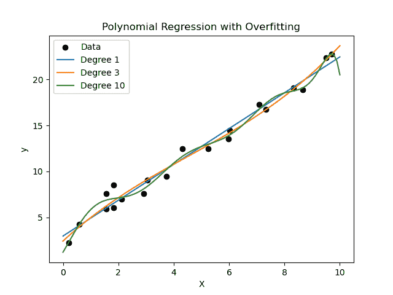

## 1.7 AI 的未来方向

随着人工智能（AI）的不断进化，其轨迹有望塑造技术和社会未来的格局。AI 的未来方向涵盖了一系列变革性进展，旨在扩展 AI 系统的能力，解决现有挑战并解锁新的可能性。本节将探讨刻画 AI 未来发展的新兴趋势、创新和社会影响，为前瞻发展及其潜在影响提供见解。

对通用人工智能（AGI）的追求仍然 AI 研究的一个首要目标。AGI 旨在复制人类的认知能力，使机器能够在不同语境下理解、学习和适应。实现 AGI 需要在认知架构、学习算法和推理模型方面取得重大进展。目前的研究正在探索神经符号系统的混合方法，将神经网络在模式识别方面的优势与符号 AI 的逻辑推理能力相结合。认知科学、神经科学和 AI 的协作努力对于实现 AGI 梦想至关重要，它有望彻底改变依赖复杂问题解决和自适应推理的领域。


随着通用人工智能（AGI）的发展，类形态计算的发展预示着 AI 技术将发生突破性变化。类形态计算旨在模拟生物神经系统的架构和功能，产生高能效且高度并行的处理器。这些系统有望在降低功耗的同时增强处理能力，使其成为实时决策至关重要的边缘计算应用的理想选择。研究在开发新型硬件架构和材料（如 `memristors` 忆阻器）方面正快速进展，以支持类形态计算的实现。

量子计算的进步进一步为 AI 开启了变革性的前景。量子计算机利用叠加和纠缠原理，执行比经典计算机快指数数量倍的复杂计算。通过解决 AI 中的计算不可行问题，量子计算可以增强优化算法、机器学习模型和数据分析技术。尽管仍处于初级阶段，但量子计算与 AI 的结合在密码学、药学和物流领域具有突破的潜力。

可解释 AI（`XAI`）的兴起仍然未来 AI 研究的关键方向，解决了 AI 系统对透明度和解释性的需求。随着 AI 模型变得越来越复杂，理解其决策过程变得至关重要。未来的 `XAI` 框架旨在提供更直观、人类易于理解的解释，同时不损害模型性能。反事实推理、因果推理和注意力机制等技术正在被探索，以开发能够阐明 AI 决策依据的可解释模型，促进各领域的信任和采用，特别是医疗保健和金融等具有伦理和法律影响的领域。

AI 与物联网（`IoT`）的协同预计将重新定义智能生态系统，驱动智能城市、家庭和工业的发展。这种集成使 AI 能够处理连接设备的数据，增强实时决策、资源优化和预测性维护。在 AI 的赋能下，未来的 `IoT` 应用将从响应式模型转向预测模型，能够在问题出现之前预测需求并缓解问题的主动解决方案。AI 驱动的 `IoT` 解决方案可能会增强可持续性努力，优化能源消耗并改善城市交通和安全。

AI 与生物技术的融合预示着未来，AI 在推进个性化医疗、基因组学和合成生物学方面将发挥性作用。AI 分析海量基因数据集和识别生物系统中复杂相互作用的能力，为精准治疗和药物发现开辟了新途径。基于 AI 驱动诊断和预测分析的个性化健康干预，有望改善患者预后并优化医疗服务交付。

在教育领域，AI 准备通过个性化和自适应教育平台转型学习体验。未来的 AI 系统将量身定制教育内容以满足学生的需求，适应不同的学习节奏和风格。通过利用 AI 驱动的辅导系统，教育者可以提供针对性的支持，促进对复杂学科的掌握并促进终身学习。此外，AI 在开发创新评估工具方面具有潜力，这些工具提供实时反馈和可操作的见解，简化评估流程并提高教育成果。

AI 在创意领域的整合将彻底改变艺术表达和内容创作。AI 已经通过生成式模型和增强人类创造力的算法为音乐作曲、图形设计和文学做出贡献。未来的发展将看到 AI 系统与艺术家合作，提供新的探索和创新工具，同时保留定义创造力的人类触感。随着 AI 深深融入创作过程，围绕作者和知识产权的伦理讨论将变得日益重要。

围绕 AI 的伦理、社会和监管考量对其未来发展和部署至关重要。建立一个平衡创新与伦理责任的全面框架，对于 AI 持续整合到社会至关重要。努力必须专注于确保 AI 系统的公平性、包容性和问责制，解决偏偏、保护隐私并定义清晰的伦理准则。涉及技术人员、伦理学家、政策制定者和社区的协作倡议。

（此处省略后续重复的段落，根据指令不重复输出原文）

# 未来趋势：使用高效数据处理实现绿色 AI 模型，使用 numpy 和 sklearn 简化操作
```python
import numpy as np
from sklearn.linear_model import LinearRegression

# 使用高效的 numpy 模拟数据集
X = np.random.rand(1000, 2)
y = X @ np.array([3, 5]) + np.random.normal(0, 0.1, 1000)

# 使用高效资源利用实例化并训练简单的回归模型
model = LinearRegression()
model.fit(X, y)

# 预测并展示绿色 AI 实践
predictions = model.predict(X)
print("Efficient Predictions Computed using Green AI Practices")
```

AI 作为积极变化催化剂的潜力强调了在引导其未来时进行战略远见的重要性。以基于伦理、负责任和包容性实践的愿景拥抱 AI 的未来方向，确保 AI 技术的发展符合人类的价值观和抱负。通过营造创新、协作和反思的环境，AI 社区可以走向一个利用 AI 变革力量的未来，使个人、社区和全球生态系统受益。

总之，AI 的未来方向涵盖了技术进步、伦理考量和跨学科协作的广泛领域。这些发展有望重新定义 AI 在社会中的角色，提高生活质量，开启探索的新途径，并培养一个更连接、更智能的世界。随着 AI 格局的不断演变，利益相关者必须保持警觉、主动和创新，确保 AI 的旅程符合进步和以人为本的发展理念。


机器学习（ML）是人工智能领域的一个关键领域，它对于开发能够通过经验自主改进性能、而非需要显式编程的系统至关重要。机器学习的核心在于设计和开发能够识别数据中模式的算法，使系统能够根据新的、未见过的数据做出预测或决策。这种从数据中学习的特性将机器学习与更传统的基于规则的编程范式区分开来。

理解机器学习的核心是学习算法的概念，这些算法可以大致分为监督学习、无监督学习和强化学习。每种方法都有不同的用途，并由不同的学习目标驱动。监督学习是最常见的形式，涉及在标记的数据集上训练模型，其中输入数据与正确输出配对。模型的任务是学习从输入到输出的映射，然后将其泛化以预测新的、未见输入的输出。`linear regression`、`logistic regression`和`neural networks`等算法属于此类。相比之下，无监督学习处理的是缺乏标记响应的数据，侧重于发现输入数据中的隐藏结构。`clustering`和`association`等技术是典型的例子。最后，强化学习采取了另一条路径，使智能体通过与环境交互并接收奖励或惩罚形式的反馈来学习。这种交互与最大化累积奖励的目标一致。

典型的机器学习项目生命周期涉及几个关键阶段，从数据收集和准备开始，经过模型训练、验证，最后是模型评估和部署。这一生命周期要求对细节进行密切关注，因为训练数据的质量会显著影响模型性能。数据清洗、`normalization`和`transformation`等预处理步骤对于确保数据适用于训练至关重要。

该生命周期中的一个至关阶段是模型训练。在这里，选定的学习算法迭代处理输入数据，以调整模型参数，从而最小化预定义的误差指标。例如，在监督学习中，这涉及最小化预测结果与实际标记结果之间的差异，而无监督学习可能会使用`intra-cluster distance`等指标来评估聚类质量。

```python
import numpy as np
from sklearn.model_selection import train_test_split
from sklearn.linear_model import LinearRegression
from sklearn.metrics import mean_squared_error
# Generating synthetic data
np.random.seed(0)
X = 2 * np.random.rand(100, 1)
y = 4 + 3 * X + np.random.randn(100, 1)
# Splitting data into training and testing sets
X_train, X_test, y_train, y_test = train_test_split(X, y, test_size=0.2, random_state=42)
# Training the linear regression model
model = LinearRegression()
model.fit(X_train, y_train)
# Making predictions
y_pred = model.predict(X_test)
# Evaluating the model
mse = mean_squared_error(y_test, y_pred)
print("Mean Squared Error:", mse)
```

模型评估是随后的阶段，对于评估模型的泛化能力至关重要。为此目的有多种指标：用于分类问题的`classification accuracy`、`precision`、`recall`、`F1-score`，以及用于回归任务的`mean squared error`、`RMSE`（均方根误差）。评估还必须考虑`overfitting`——即模型对训练数据的学习过度（包含了噪声），从而导致在新的、未见的数据上表现不佳。

过拟合是一个普遍问题，可以通过等策略进行缓解，例如在多样化的数据集上进行训练、采用`regularization`技术以及在模型验证期间引入`cross-validation`。`regularization`对模型复杂度引入了惩罚，防止其拟合训练数据中的噪声。`cross-validation`是另一个基本策略，涉及将数据划分为子集以确保每个数据点都有进入训练集和验证集，从而对模型性能提供稳健的评估。

模型选择的探索也值得关注。选择合适的模型需要考虑其复杂性及其捕捉数据中细微差的能力。简单模型虽然容易解释，但可能因为没有捕捉到潜在趋势而`underfit`，而过于复杂的模型则存在`overfitting`的风险。平衡这种权衡在模型选择中是至关重要的。

机器学习中经常出现的另一个概念是偏差-方差权衡。`Bias`是指由于学习算法中过度简单的假设导致的误差，这可能导致系统性误差和`underfitting`。另一方面，`Variance`指的是模型对训练数据波动的敏感性，可能导致`overfitting`。其目标是找到一个模型复杂度最优且偏差与方差之和最小的平衡点，从而在新数据上实现低错误率。

```python
import matplotlib.pyplot as plt
from sklearn.preprocessing import PolynomialFeatures
from sklearn.pipeline import make_pipeline
from sklearn.linear_model import Ridge
import numpy as np

# Function to plot polynomial models with varying degree
def plot_polynomial_models(X, y, degrees):
    plt.figure(figsize=(10, 6))
    plt.scatter(X, y, color="black", label="Data")
    X_plot = np.linspace(0, 2, 100)[:, np.newaxis]
    for degree in degrees:
        model = make_pipeline(PolynomialFeatures(degree), Ridge(alpha=0.1))
        model.fit(X, y)
        y_plot = model.predict(X_plot)
        plt.plot(X_plot, y_plot, label=f"Degree {degree}")
    plt.xlabel("X")
    plt.ylabel("y")
    plt.title("Polynomial Regression with Different Degrees")
    plt.legend()
    plt.show()

# Plotting the models with increasing complexity
plot_polynomial_models(X, y, [1, 3, 10])
```


机器学习（ML）涵盖了一系列算法方法，旨在使机器能够从数据中自主学习。该领域的核心方法论分为三大主要类型：监督学习、无监督学习和强化学习。每种类别都有不同的目的，并应用于不同的场景，利用不同的策略来学习和评估数据模式。

## 监督学习

监督学习无疑可能是应用最广泛的机器学习类型。它涉及在标记的数据集上训练模型，其中输入数据与正确的输出相对应。模型学习如何将输入映射到正确的输出，从而在面对新的、未见过的数据时能够预测结果。这种范式被广泛应用于分类和回归等任务。在分类场景中，目标是将输入数据分配到离散的类别中，例如电子邮件垃圾邮件检测或图像识别。相反，回归任务涉及预测连续输出，例如预测股票价格或估算房屋价值。

```python
from sklearn import datasets 
from sklearn.model_selection import train_test_split 
from sklearn.svm import SVC 
from sklearn.metrics import classification_report 
# Loading the iris dataset 
iris = datasets.load_iris() 
X = iris.data 
y = iris.target 
# Splitting data into training and testing sets 
X_train, X_test, y_train, y_test = train_test_split(X, y, test_size=0.3, random_state=42) 
# Training an SVM classifier 
classifier = SVC(kernel='linear') 
classifier.fit(X_train, y_train) 
# Making predictions 
y_pred = classifier.predict(X_test) 
# Evaluating the classifier 
print(classification_report(y_test, y_pred))
```

## 无监督学习

无监督学习是机器学习的一种特殊形式，处理的是未标记的数据。其主要目标是发现数据集内部内在的模式或结构。聚类和降维是此类类别中的基础技术。聚类算法（如 `k-means` 和层次聚类）旨在根据特定特征将相似的数据点进行分组，而无需预先知道分组标签。这种技术广泛用于客户细分或将大型数据集组织成可管理的子集。降维方法，例如`主成分分析`（`PCA`），减少了考虑的特征数量，从而在不丢失重要信息的情况下简化模型。

```python
import numpy as np 
from sklearn.cluster import KMeans 
import matplotlib.pyplot as plt 
# Generating synthetic data 
np.random.seed(0) 
X = np.random.rand(100, 2) 
# Applying K-Means clustering 
kmeans = KMeans(n_clusters=3) 
kmeans.fit(X) 
labels = kmeans.labels_ 
# Plotting the clusters 
plt.scatter(X[:, 0], X[:, 1], c=labels) 
plt.title('K-Means Clustering') 
plt.xlabel('Feature 1') 
plt.ylabel('Feature 2') 
plt.show()
```

在数据压缩、可视化和降噪背景下，降维是一项不可缺的技术。通过将数据投影到低维子空间，`PCA` 等方法擅长在保留数据本质的同时以较低的复杂度总结数据。这种方法有助于可视化，能够直观地理解高维数据之间的相关性。

## 强化学习

强化学习通过模仿受行为心理学启发的学习框架，区别于上述方法。智能体通过与环境交互来学习决策，并根据所采取的操作以奖励的形式接收反馈。目标是发现一系列动作，以便随时间推移最大累积奖励。这种方法特别适用于需要复杂决策序列支持的系统，例如机器人或游戏 AI。

在强化学习中，智能体处于环境中，感知其状态并根据策略采取行动。环境转换到新状态，以奖励或惩罚的形式向智能体提供反馈。随着时间的推移，智能体试图学习一种优化预期奖励的策略，在利用已知资源与探索未知领域之间取得平衡。

```python
import gym 
# Creating an environment 
env = gym.make('CartPole-v1') 
env.reset() 
# Running a simple simulation 
for _ in range(1000): 
    env.render() 
    action = env.action_space.sample()  # randomly selecting an action 
    observation, reward, done, info = env.step(action) 
    if done: 
        env.reset() 
env.close()
```

强化学习的工作流严重依赖价值函数、策略和价值迭代的概念。价值函数估计了处于某一状态并在随后遵循特定策略的预期回报，这是决策的核心。策略定义了智能体的行为，因为它将感知到的环境状态映射为动作。`Q-learning`和策略梯度等方法是寻找最优策略的关键。

## 比较与进展

这些学习策略之间的一个关键区别在于它们的应用范围和计算需求。监督学习严重依赖于高质量的标记数据，而获取这些数据可能耗费资源。无监督学习通过处理原始的未标记数据开启了发现的可能性，但对学习过程的直接控制较少，因此需要对结果进行仔细的解读。强化学习虽然强大，但由于其试错的性质，存在巨大的计算需求，通常适用于可以高效进行模拟的环境。

对机器学习进展的探索揭示了结合这些传统类型的混合方法，利用每种优势来克服各自的局限性。例如，半监督学习同时利用标记和未标记的数据，旨在在缺乏大量标记数据的情况下提高学习准确性。迁移学习允许模型将从一个问题获得的知识应用于另一个问题，特别是当相关领域具有重叠特征时。

理解每种机器学习类型的独特特征、优势和局限性，使从业人员能够根据特定的应用需求选择最合适的方法。这种选择不仅取决于可用数据，还取决于实施的最终目标。


决策树是监督学习领域的一种基石算法，特别适用于分类任务，但也适用于回归任务。正如其名，决策树使用树状的决策模型将数据划分为不同的类别。树中的每个节点代表输入数据中的一个特征，每个分支代表一条决策规则，最终通向包含结果的叶节点。驱动决策树创建的核心概念是数据集的递归划分，它根据特征值阈值迭代地分割数据。决策树算法旨在找到能够最大化根据目标标签分离数据程度的划分点，并使用了基尼不系数（Gini impurity）和信息增益（熵）等指标。

```python
from sklearn.datasets import load_iris
from sklearn.model_selection import train_test_split
from sklearn.tree import DecisionTreeClassifier
from sklearn.metrics import accuracy_score
# Load the iris dataset
iris = load_iris()
X = iris.data
y = iris.target
# Split the dataset into training and testing sets
X_train, X_test, y_train, y_test = train_test_split(X, y, test_size=0.2, random_state=42)
# Initialize and train the decision tree classifier
tree_clf = DecisionTreeClassifier(criterion='gini', max_depth=3, random_state=42)
tree_clf.fit(X_train, y_train)
# Predict and evaluate the model
y_pred = tree_clf.predict(X_test)
print("Accuracy:", accuracy_score(y_test, y_pred))
```

决策树因其可解释性以及处理数值和分类数据的能力而受到青睐。尽管它们非常简单，但很容易产生过拟合，这一问题可以通过集成方法来解决，集成方法通过结合多个决策树的预测，例如随机森林和梯度提升树。

支持向量机（SVMs）是另一种多功能算法，以其执行线性和非线性分类任务的能力而闻名。SVM 试图寻找一个能够分离数据类别的超平面。在无法实现明显的线性边界的情况下，会采用核技巧（kernel trick），使算法将输入特征投影到高维空间，在其中可能找到线性分类器。线性、多项式和径向基函数（RBF）等各种核函数扩展了 SVM 在复杂数据集上的适用性。

```python
from sklearn import datasets
from sklearn.model_selection import train_test_split
from sklearn.svm import SVC
from sklearn.metrics import classification_report
# Load the iris dataset
iris = datasets.load_iris()
X = iris.data
y = iris.target
# Split the dataset into training and testing sets
X_train, X_test, y_train, y_test = train_test_split(X, y, test_size=0.3, random_state=42)
# Initialize and train the SVM classifier with RBF kernel
svm_clf = SVC(kernel='rbf', gamma='scale', C=1.0)
svm_clf.fit(X_train, y_train)
# Predict and evaluate the model
y_pred = svm_clf.predict(X_test)
print(classification_report(y_test, y_pred))
```

SVM 的优势在于其在高维空间中的有效性、对过拟合的鲁棒性（特别是在特征多于样本的情况下），以及它们在分类和回归场景中的适用性。

K 近邻算法（k-NN）以其作为分类和回归任务中非参数技术的简单性和高效性而脱颖而出。k-NN 根据邻居的分类情况对数据点进行分类，而对于回归，它预测邻居的平均值。该算法取决于所考虑的最近邻的数量。

```python
from sklearn import datasets
from sklearn.model_selection import train_test_split
from sklearn.neighbors import KNeighborsClassifier
from sklearn.metrics import accuracy_score
# Load the iris dataset
iris = datasets.load_iris()
X = iris.data
y = iris.target
# Split the dataset into training and testing sets
X_train, X_test, y_train, y_test = train_test_split(X, y, test_size=0.2, random_state=42)
# Initialize and train the KNN classifier
knn_clf = KNeighborsClassifier(n_neighbors=3)
knn_clf.fit(X_train, y_train)
# Predict and evaluate the model
y_pred = knn_clf.predict(X_test)
print("Accuracy:", accuracy_score(y_test, y_pred))
```

神经网络及其高级变体深度学习因其在图像和语音等领域无与伦比的性能而受到了广泛关注。通过模拟类似于大脑的互连神经元，神经网络擅长捕捉模式。

```python
import tensorflow as tf
from tensorflow.keras.models import Sequential
from tensorflow.keras.layers import Dense, Flatten
# Load and prepare the MNIST dataset
mnist = tf.keras.datasets.mnist
(X_train, y_train), (X_test, y_test) = mnist.load_data()
X_train, X_test = X_train / 255.0, X_test / 255.0
# Build the model
model = Sequential([
    Flatten(input_shape=(28, 28)),
    Dense(128, activation='relu'),
    Dense(10, activation='softmax')
])
# Compile the model
model.compile(optimizer='adam',
              loss='sparse_categorical_crossentropy',
              metrics=['accuracy'])
# Train the model
model.fit(X_train, y_train, epochs=5)
# Evaluate the model
model.evaluate(X_test, y_test)
```


有效的训练始于数据准备，在这个阶段，原始数据会经过清洗、转换和特征选择。清洗处理缺失值、降噪和离群值处理，为后续过程奠定稳定的基础。转换步骤对数据集进行标准化处理，通常涉及缩放、类别变量编码和降维，以便为特征输入机器学习算法做好准备。特征选择则从数据集中识别出最相关的属性，通过降低维度和防止过拟合来提高模型的效率和性能。

训练过程中的一个关键组成部分是模型架构的选择和超参数的确定。架构涉及选择算法及其结构安排，而超参数是模型学习过程外部的可调设置，但对模型的性能起着至关重要的作用。`grid search` 和 `random search` 等技术被用于系统地探索超参数空间，通过识别能够产生最佳结果的组合来优化模型性能。

```python
from sklearn.datasets import load_digits
from sklearn.model_selection import train_test_split, GridSearchCV
from sklearn.tree import DecisionTreeClassifier
# Load digits dataset
digits = load_digits()
X, y = digits.data, digits.target
# Split data into training and testing sets
X_train, X_test, y_train, y_test = train_test_split(X, y, test_size=0.3, random_state=42)
# Define a decision tree model
tree = DecisionTreeClassifier()
# Setup the hyperparameter grid
param_grid = {
    'criterion': ['gini', 'entropy'],
    'max_depth': [3, 5, 10, None],
    'min_samples_split': [2, 5, 10]
}
# Execute grid search
grid_search = GridSearchCV(estimator=tree, param_grid=param_grid, cv=5, scoring='accuracy')
grid_search.fit(X_train, y_train)
print("Best CV accuracy:", grid_search.best_score_)
print("Best hyperparameters:", grid_search.best_params_)
```

设置好超参数后，模型进入训练，所选算法从数据集中学习模式。这一步涉及迭代调整模型参数以最小化损失函数——该函数是衡量预测输出与实际输出之间误差的指标。对于神经网络，这包括通过反向传播进行权重调整。在训练期间，使用训练损失和准确率等指标监控学习过程至关重要。

验证是防止过拟合的保障，确保模型不仅仅是记忆训练数据，而是能够良好地适应新的数据实例。常见的验证技术包括留出法、交叉验证和自助法。特别是交叉验证，提供了一种稳健的机制，将数据分为多个子集，确保每个样本都有机会用于训练和验证。这种迭代的采样和训练过程为模型在不同数据划分下的性能提供了可靠的估计。

```python
from sklearn.datasets import load_boston
from sklearn.linear_model import LinearRegression
from sklearn.model_selection import cross_val_score
# Load the Boston housing dataset
boston = load_boston()
X, y = boston.data, boston.target
# Initialize a linear regression model
linear_reg = LinearRegression()
# Perform 5-Fold Cross-Validation
cv_scores = cross_val_score(linear_reg, X, y, cv=5, scoring='neg_mean_squared_error')
print("Cross-Validation MSEs:", -cv_scores)
print("Mean Cross-Validation MSE:", -cv_scores.mean())
```

设置好超参数后，模型进入训练，所选算法从数据集中学习模式。这一步涉及迭代调整模型参数以最小化损失函数——该函数是衡量预测输出与实际输出之间误差的指标。对于神经网络，这包括通过反向传播进行权重调整。在训练期间，使用训练损失和准确率等指标监控学习过程至关重要。


# 特征工程

过程始于特征工程，涉及从现有原始数据中创建新特征。这一步骤至关重要，因为特征的质量和相关性直接影响模型的学习能力。特征工程被认为既是一门艺术也是一门科学——它需要领域知识、创造力以及对数据结构的理解。常见技术包括变换、提取和交互特征的创建。

## 变换

变换意味着将现有特征转换为更有用的格式。一种基础的变换是缩放（Scaling），即将特征通过最小最大归一化重新缩放到特定范围（例如 `[0,1]`），或者将其标准化为零均值和单位方差。对于对特征量级敏感的算法（如基于距离的模型），这一步骤是至关重要的。

```python
from sklearn.preprocessing import StandardScaler
# Example dataset
X = [[1, 2000], [2, 3000], [3, 4000]]
# Initialize a StandardScaler
scaler = StandardScaler()
# Fit and transform data
X_scaled = scaler.fit_transform(X)
print(X_scaled)
```

## 特征提取

特征提取是另一个核心概念，旨在保留本质信息的同时降低数据维度。诸如主成分分析（PCA）或 t-分布随机邻嵌入（t-SNE）等技术将数据投影到低维子空间，其中保留了最显著的方差。

```python
from sklearn.decomposition import PCA
import numpy as np
# Example dataset
np.random.seed(0)
X = np.random.rand(100, 5)
# Initialize PCA to reduce dimensionality to 2 components
pca = PCA(n_components=2)
X_pca = pca.fit_transform(X)
print("Original shape:", X.shape)
print("Transformed shape:", X_pca.shape)
plt.scatter(X_pca[:, 0], X_pca[:, 1])
plt.title('PCA Projection')
plt.show()
```

## 交互特征

交互特征捕捉多个特征之间的关系，揭示了单个特征可能无法揭示的复杂模式。这些在线性模型中特别有用，因为引入平方项和交互项可以显著提升模型性能。多项式特征生成是创建交互项的一种方法。

```python
from sklearn.preprocessing import PolynomialFeatures
# Example dataset
X = np.array([[0.44, 0.68], [0.99, 0.23]])
# Initialize PolynomialFeatures
poly = PolynomialFeatures(degree=2, include_bias=False)
X_poly = poly.fit_transform(X)
print("Original Features:\n", X)
print("Polynomial Features:\n", X_poly)
```

# 特征选择

在特征工程之后，特征选择变得至关重要。它涉及为模型训练选择最相关的特征子集，以减少计算负载、增强模型泛化能力并提高可解释性。特征选择有多种方法，大致分为过滤法（Filter）、包装法（Wrapper）和嵌入法（Embedded）。

## 过滤方法

过滤方法依赖数据的内在属性对特征进行排序和选择。这包括统计检验，例如针对分类数据的卡方检验和针对连续数据的相关系数。其主要优势是速度快且简单，因为计算器的较低且不涉及模型训练。

```python
import pandas as pd
import seaborn as sns
# Example dataset
data = pd.DataFrame(np.random.rand(100, 5), columns=list('ABCDE'))
data['F'] = 2 * data['A'] + 3 * data['B']
# Compute correlation matrix
corr = data.corr()
# Plot the heatmap
sns.heatmap(corr, annot=True)
plt.title('Feature Correlation Matrix')
plt.show()
```

## 包装方法

包装方法通过训练和评估模型性能来评估特征子集。这些方法虽然计算需求更高，但能产生高度相关的特征集。前向选择、后向消除和递归特征消除（`RFE`）是典型示例。`RFE` 迭代拟合模型，根据估计器的属性移除不重要的特征，直到达到所需的特征数量。

```python
from sklearn.datasets import load_digits
from sklearn.feature_selection import RFE
from sklearn.linear_model import LogisticRegression
# Load dataset
digits = load_digits()
X, y = digits.data, digits.target
# Initialize a Logistic Regression model
log_reg = LogisticRegression(max_iter=10000)
# Apply RFE selector
selector = RFE(estimator=log_reg, n_features_to_select=5)
selector = selector.fit(X, y)
print("Selected Features:", selector.support_)
print("Ranking of Features:", selector.ranking_)
```

## 嵌入方法

嵌入方法将特征选择与模型训练相结合，通常使用正则化技术，如 `LASSO`（`L1`），它通过将某些特征权重压缩为零来执行特征选择，从而将其排除在模型之外。这种同步特征选择和训练优化了模型复杂度与准确性之间的平衡。

```python
from sklearn.linear_model import Lasso
# Initialize a Lasso model with L1 penalty
lasso = Lasso(alpha=0.1)
# Fit model
lasso.fit(X, y)
print("Coefficients of features:\n", lasso.coef_)
```

# 结论

将特征工程、选择与超参数调优相结合可以显著提升模型性能，并洞洞数据的底层结构。然而，过拟合的风险仍然存在，特别是当工程特征无意中编码了噪声而非信号时。

特征工程的艺术在于其对独特数据集和特定领域知识的适应性。因此，探索性数据分析对于引导工程师进行有意义的变换和选择仍然起着性作用，确保与现实现象保持一致。通过关注一致性和相关性，特征工程和选择是数据数据提炼为最有信息部分的强大工具，使模型能够充分发挥预测潜力。

随着当代数据集量和复杂性的增加，自动化特征工程和选择工具（如 `featuretools` 以及其他自动机器学习（`AutoML`）解决方案）日益突出。这些框架旨在简化特征的创建和策划，提高生产力并促进机器学习领域的创新。


随着机器学习模型越来越多地驱动影响不同群体的决策，偏见与公平性已成为迫在眉的问题。偏见可能进入多个阶段，从反映历史不平等的偏偏数据，到源于模型选择或超参数调优的算法偏见。机器学习中的公平性要求对这些偏见给予批判关注，强调创建在不同人口统计群体中表现公平的模型。算法公平性指标和去偏技术是该领域的研究前沿，旨在减轻模型预测中的无意后果。

```python
def disparate_impact_score(predictions, sensitive_attribute):
    """
    Calculate disparate ratio.
    """
    # Group data
    positive_outcome = predictions == 1
    group_a_positive_rate = np.mean(positive_outcome[sensitive_attribute == 'A'])
    group_b_positive_rate = np.mean(positive_outcome[sensitive_attribute == 'B'])
    # Return disparate impact
    return group_a_positive_rate / group_b_positive_rate

# Example usage
sensitive_feature = np.array(['A', 'B', 'A', 'B', 'A'])
predicted_outcomes = np.array([1, 0, 1, 1, 0])
disparate_impact = disparate_impact_score(predicted_outcomes, sensitive_feature)
print("Disparate Impact:", disparate_impact)
```

模型的可解释性至关重要，但往往存在问题，特别是对于像深度学习网络这样作为黑箱的复杂模型。可解释性不仅能建立信任，还能让利益相关者根据模型输出做出明智决策。如 `LIME (Local Interpretable Model-agnostic Explanations)` 和 `SHAP (SHapley Additive exPlanations)` 等技术旨在阐明模型，揭示输入如何影响输出并使模型更加透明。

```python
import shap
from sklearn.ensemble import RandomForestClassifier

# Example and data
X = np.random.rand(100, 5)
y = np.random.randint(0, 2, 100)
model = RandomForestClassifier().fit(X, y)

# Initialize SHAP explainer and calculate values
explainer = shap.Explainer(model, X)
shap_values = explainer(X)

# Visualize SHAP values
shap.summary_plot(shap_values, X)
```

机器学习的计算需求（特别是涉及大型数据集或复杂模型时）是另一个重大挑战。训练此类模型需要大量的计算能力、内存，通常还需要如 `GPUs` 或 `TPUs` 等专用硬件。高效的算法设计、并行处理以及硬件技术的进步对于克服计算障碍至关重要，允许处理日益增长的规模和复杂的的可扩展机器学习解决方案。

持续的模型维护和适应是一个持久的挑战。机器学习模型通常运行在动态环境中，数据分布随时间演变，这种现象被称为概念漂移。除非使用最新数据定期更新模型，否则这种偏移会导致模型性能下降。增量学习、模型重训练和自动更新机制是在存在数据漂移的情况下保持模型相关性和准确性的常用策略。

```python
from sklearn.linear_model import Perceptron
from sklearn.metrics import accuracy_score

# Initialize the perceptron with partial_fit
model = Perceptron()

# Simulated data stream with concept drift
data_stream = [(np.random.rand(10, 5), np.random.randint(0, 2, 10)) for _ in range(5)]

# Incremental learning
for X_batch, y_batch in data_stream:
    model.partial_fit(X_batch, y_batch, classes=[0, 1])
    y_pred = model.predict(X_batch)
    print("Batch Accuracy:", accuracy_score(y_batch, y_pred))
```

伦理考虑是机器学习中许多挑战的基础。除了技术偏见外，机器学习系统必须尊重隐私，特别是个人数据。联邦学习、差分隐私和安全多方计算等技术旨在实现这些目标，在保护隐私和伦理标准的同时实现健壮机器学习。

此外，可解释性和“黑箱”模型的概念会导致伦理和法律挑战，特别是当模型用于医疗保健或刑事司法等敏感领域时。确保决策可以被人类利益相关者追踪和理解对于避免误用和滥用至关重要。

最后，机器学习的环境影响和可持续性正成为日益关注的问题。训练大型模型的碳足迹不容忽视，这需要向更具能源效率的算法和硬件发展。总之，机器学习面临的挑战既多样又关键，并涉及了从计算机科学到伦理和法律研究的广泛学科。解决这些问题需要共同努力、持续研究以及能够适应技术进步和社会需求的动态解决方案。随着机器学习继续融入日常生活，面对这些挑战的严谨性将定义其在塑造未来方面的作用和潜力。追求负责任、公平且可持续的机器学习实践仍然是这一不断发展的领域的核心。

### 2.7 机器学习的工具与框架

近年来机器学习（ML）的爆炸式增长很大得益于强大工具和框架的发展。这些软件环境简化了设计、训练和部署机器学习模型的复杂过程，使得从研究人员到行业从业人员的广泛用户能够方便且高效地使用。这些工具和框架提供了多种功能，如数据预处理、实现复杂算法、管理模型迭代以及扩展应用以部署到生产环境中等。

### Scikit-learn
Scikit-learn 是一个多功能的 Python 库，为数据挖掘和数据分析提供了简单、高效的工具。它基于 `NumPy`、`SciPy` 和 `matplotlib` 构建，提供系列监督和无监督学习算法。Scikit-learn 以其整洁的 API 和易于集成而闻名，是初学者快速实现和测试机器学习模型的极佳选择。

```python
from sklearn.datasets import load_iris
from sklearn.model_selection import train_test_split
from sklearn.ensemble import RandomForestClassifier
from sklearn.metrics import accuracy_score

# 加载鸢花数据集
iris = load_iris()
X, y = iris.data, iris.target

# 将数据分为训练集和测试集
X_train, X_test, y_train, y_test = train_test_split(X, y, test_size=0.2, random_state=42)

# 初始化随机森林分类器
clf = RandomForestClassifier(n_estimators=100, random_state=42)

# 训练模型
clf.fit(X_train, y_train)

# 预测并评估
y_pred = clf.predict(X_test)
print(f'Accuracy: {accuracy_score(y_test, y_pred):.2f}')
```

### TensorFlow
TensorFlow 由 Google Brain 团队开发，用于高性能数值计算和模型构建的底层库。它支持深度学习框架和其他机器学习算法，能够在 `CPUs`、`GPUs` 和 `TPUs` 上无缝执行。用户可以通过其高级层 `Keras API` 灵活利用 TensorFlow 的架构来快速构建深度网络原型，并利用 TensorFlow 的 `Estimators API` 构建稳健的生产级模型。


```python
import tensorflow as tf
from tensorflow.keras import layers
# Load dataset
mnist = tf.keras.datasets.mnist (X_train, y_train), (X_test, y_test) = mnist.load_data()
X_train, X_test = X_train / 255.0, X_test / 255.0  # Normalize data

# Initialize model
model = tf.keras.Sequential([
    layers.Flatten(input_shape=(28, 28)),
    layers.Dense(128, activation='relu'),
    layers.Dropout(0.2),
    layers.Dense(10, activation='softmax')
])

# Compile model
model.compile(optimizer='adam',
              loss='sparse_categorical_crossentropy',
              metrics=['accuracy'])

# Fit model
model.fit(X_train, y_train, epochs=5, validation_data=(X_test, y_test))
```

### PyTorch
PyTorch 由 Facebook 的 AI 研究实验室开发，为开发者提供了动态计算图的能力。它因其易于调试和简单直观的语法而广赞誉。由于其灵活性和对命令式编程的支持，PyTorch 广泛应用于学术界的自然语言处理和计算机视觉项目。

```python
import torch
import torch.nn as nn
import torch.optim as optim
from torchvision import datasets, transforms
# Dataset and data loader
train_loader = torch.utils.data.DataLoader(
    datasets.MNIST('./mnist_data', train=True, download=True),
                  transform=transforms.Compose([transforms.ToTensor()])),
    batch_size=64, shuffle=True)

# Define a simple neural network
class SimpleNN(nn.Module):
    def __init__(self):
        super(SimpleNN, self).__init__()
        self.fc1 = nn.Linear(28*28, 128)
        self.fc2 = nn.Linear(128, 10)
    def forward(self, x):
        x = x.view(-1, 28*28)
        x = torch.relu(self.fc1(x))
        x = self.fc2(x)
        return x

# Initialize model, loss function, and optimizer
model = SimpleNN()
criterion = nn.CrossEntropyLoss()
optimizer = optim.Adam(model.parameters(), lr=0.001)

# Train network
model.train()
for epoch in range(5):
    for data, target in train_loader:
        optimizer.zero_grad()
        output = model(data)
        loss = criterion(output, target)
        loss.backward()
        optimizer.step()
```

### Jupyter Notebooks
Jupyter Notebook 已成为机器学习工作流中探索性数据分析、模型原型和教学目的的标准工具。它们提供了一个交互式计算环境，支持在单一 Web 平台上执行，并利用 Matplotlib 和 Seaborn 等集成库方便的可视化。

```python
import seaborn as sns
import matplotlib.pyplot as plt
from sklearn.datasets import load_iris
# Load dataset
iris = load_iris()
data = iris.data
# Create a pairplot using seaborn
sns.pairplot(sns.load_dataset("iris"), hue="species")
plt.show()
```

### Apache Spark MLlib
Apache Spark 的 MLlib 是一个健壮的分布式机器学习框架，以高效处理大规模数据而闻名。它扩展了对大数据集群上运行的机器学习算法实现的支持，为分类、聚类和协同过滤提供了多种库，以及底层的优化原语。

```python
from pyspark.sql import SparkSession
from pyspark.ml.classification import LogisticRegression
from pyspark.ml.feature import VectorAssembler
# Spark session
spark = SparkSession.builder.appName("Spark MLlib Example").getOrCreate()
# Load and preprocess data
data = spark.read.csv("path_to_csv", header=True, inferSchema=True)
assembler = VectorAssembler(inputCols=data.columns[:-1], outputCol="features")
data = assembler.transform(data)
# Split data
train, test = data.randomSplit([0.7, 0.3])
# Define model
lr = LogisticRegression(featuresCol="features", labelCol="label")
# Train model
lr_model = lr.fit(train)
# Evaluate model
accuracy = lr_model.evaluate(test).accuracy
print(f"Accuracy: {accuracy:.2f}")
spark.stop()
```

这些框架由一组辅助工具完善，这些工具集成了监控、编排和部署，形成了一个完整的机器学习生态系统。例如，MLflow 提供了管理机器学习生命周期的工具，从实验和可复性到部署和共享。Docker 促进了容器化和环境管理。在这个不断演变的领域，工具的选择对性能和成本至关重要。

## 第 3 章
### 数据获取与预处理
数据获取和预处理是机器学习中的关键阶段。本章概述了各种来源和技术。

#### 3.1 机器学习的数据来源
数据来源的多样性和丰富性是算法成功部署的核心。这些来源的广泛分类可以分为两大类：结构化数据和非结构化数据。

### 结构化数据
结构化数据是指高度组织的信息，机器算法可以轻松读取。通常存储在数据库中，以行和列的形式组织。结构化数据的常见属性包括定义的字段、约束和关系。

在结构化数据中，存在几种类型：

**关系数据库**：这些数据库将数据组织成具有行和列的表，每行由唯一键标识。表与表之间的关系使用外键定义，提供了强大的数据查询机制。考虑一个例子：客户数据存储在一个表中，订单存储在另一个表中。使用 SQL 查询，可以通过以下方式提取客户详情及其相应的购买记录：

```sql
SELECT customers.name, orders.amount
FROM customers
JOIN orders ON customers.id = orders.customer_id
WHERE orders.amount > 100;
```

**数据仓库**：数据仓库旨在分析和报告，针对读密集型操作进行了了优化。它们将来自多个源的数据聚合到中央存储中。对于机器学习而言，数据仓库提供了丰富的历史数据源，以识别模式和趋势。

**API（应用程序编程接口）**：API 通过提供可以查询特定信息的端点，便于访问外部结构化数据。它们在 Web 和服务中非常常见。例如，社交媒体 API 可能会提供获取用户活动或媒体交互的端点。

```python
import requests
url = 'https://api.example.com/data'
response = requests.get(url, headers={'Authorization': 'Bearer YOUR_TOKEN'})
data = response.json()
```

通过 API 获取数据后，通常需要额外的处理才能用于训练。


### 非结构化数据
相比之下，`unstructured data` 缺乏预定义的数据模型，通常使其用传统的数据库系统直接处理变得更具挑战性。尽管如此，它构成了机器学习可用数据的重要部分。

### 文本数据
这是常见的非结构化数据类型之一，通过电子邮件、社交媒体帖子、在线评论等生成。自然语言处理（`NLP`）技术在将文本数据转换为机器学习模型可结构化方面起着至关重要的作用。转换过程通常涉及分词、去停词以及词干提取或还原。在 Python 中使用 `NLTK` 库进行分词的示例如下：

```python
from nltk.tokenize import word_tokenize
text = "Machine learning is fascinating."
tokens = word_tokenize(text)
print(tokens)  # Output: ['Machine', 'learning', 'is', 'fascinating', '.']
```

### 图像和视频数据
图像和视频由像素组成，是非结构化数据的丰富来源。为图像设计的机器学习模型使用卷积来捕捉图像数据集中的特征和模式。例如，卷积神经网络（`CNNs`）被广泛用于此目的。

### 音频数据
来自演讲、歌曲和其他声源的音频数据可以转换为频谱图（一种结构化数据的形式），从而捕捉声音的频域表示。梅尔频率倒谱系数（`MFCC`）等特征提取技术有助于为机器学习模型预处理音频数据。

### 网络爬虫
当无法使用结构化 API 时，网络爬虫是从网站提取非结构化数据的关键技术。诸如 `BeautifulSoup`（用于 Python）等库使得解析 HTML 和 XML 文成为可能。以下是一个简单的示例：

```python
from bs4 import BeautifulSoup
import requests
url = 'https://example.com'
response = requests.get(url)
soup = BeautifulSoup(response.content, 'html.parser')
titles = [title.text for title in soup.find_all('h2')]
```

### 传感器数据
随着 `IoT` 设备的出现，传感器数据提供了持续的时间监控，这对医疗保健和农业等领域至关重要。生成的数据包括温度读取、湿度水平和运动读取等。

# 结构化与非结构化数据的整合
在现实场景中，通常需要整合结构化和非结构化数据。一种常见的方法是从非结构化数据中提取特征，以创建更结构化的数据集。例如，使用词频-逆文档频率（`TF-IDF`）转换文本数据，从而将其与现有的结构化数据集整合以进行全面分析。

数据合并可以丰富数据集，揭示单一数据源可能无法提供的洞察，并引导更具信息量的机器学习模型训练。数据融合技术被大量用于将不同的数据集对齐到统一的框架中。

### 挑战与考虑
虽然访问这些数据源具有巨大的益处，但必须承认以下几个考虑：

*   **数据隐私**：在处理用户数据时，必须遵守 `GDPR` 或 `HIPAA` 等法规。确保匿名化和用户同意对于从法律和伦理角度获取和使用数据至关重要。
*   **数据质量**：派生数据必须对准确性、相关性和完整性进行严格检查。在低质量数据上训练的机器学习模型可能会产生不理想的性能。
*   **数据整合复杂性**：将异的数据源组合成全面的数据集可能会引入异构性，导致数据重复、不一致或格式不兼容等问题。解决这些问题需要实现稳健的数据流水线架构。
*   **可扩展性**：访问和处理大量数据需要可扩展的解决方案，如分布式数据库或云计算资源，以适应数据提取和处理需求的激增。

明智地选择数据源并理解其内在属性是构建成功机器学习项目的基石。平衡与多样性、数量和速度相关的权衡，并结合严格遵守伦理和法律考虑，可以确保所利用的数据不仅适用而且能增强模型性能。

## 3.2 数据收集技术
在机器学习解决方案的部署中，获取相关且高质量的数据集至关重要。数据收集需要强大的技术来确保数据既具有代表性又是全面的。在本节中，我们将探索各种数据收集方法，重点强调可靠性、伦理考虑以及对数据获取策略的改进。

### 初手数据收集
一手数据收集涉及直接从原始源收集新数据。当公开的数据集无法满足项目的特定需求时，这种方法通常是必要的。

**调查和问卷调查**：这些是获取与人类行为、偏好或感知相关数据的强大工具。设计有效的调查需要清晰和中立，以避免回答中产生偏差。`Google Forms` 或 `SurveyMonkey` 等在线工具促进了可扩展的数据收集，并提供了解析响应以进行统计分析的接口。

**实验**：在受控环境中，实验可以产生高度相关的数据。它们能够隔离变量以确定因果关系。例如，营销中常用的 `A/B test` 涉及更改一个变量（例如网页设计），以确定其对用户参与指标的影响。实验结果可以直接指导模型训练。

**访谈和焦点小组**：这些方法允许对某些主题进行深入探索，但需要仔细的转录和编码，以将定性数据转换为用于分析的结构化格式。

**观察性研究**：在不干预的情况下，通过观察自然环境下的受试者来收集数据。这可以是手动的（例如行为追踪），也可以通过视频录像等技术自动化。可以部署机器学习模型解释视频流以跟踪运动或表情。

### 二手数据收集
二手数据收集利用现有数据，可以是内部或外部的，结构化的结构化的。

**公共数据库**：`UCI Machine Learning Repository` 或 `Kaggle` 等平台提供了预收集的数据集，适用于基准测试或初步分析。政府数据库（如 `U.S. Census Bureau` 发布的）为城市规划、教育等提供了全面的数据集。

**API 访问**：使用 `API` 从提供结构化数据集的平台收集数据可以简化检索。一个常见的用例包括金融数据 `API`，如 `Alpha Vantage` 或金融机构提供的股市数据。

**网络爬虫**：如前所述，网络爬是从没有结构化 API 的网站提取数据。虽然 `BeautifulSoup` 或 `Scrapy` 等库对于小规模数据爬取非常高效，但大规模操作可能需要开发自动化爬虫。一个示例扩展了我们的讨论：

```python
from scrapy import Spider
class MySpider(Spider):
    name = 'my_spider'
    start_urls = ['https://example.com']
    def parse(self, response):
        for title in response.xpath('//h2/text()'):
            yield {'title': title.get()}
```

`Scrapy` 虫提供了异步处理，能够更高效地爬取大型数据集。然而，必须以道德的方式使用它们，通过 `robots.txt` 文件等机制尊重网站策略。


### 数据收集中的伦理考量

随着数据隐私法律的涌入，伦理考量在数据收集过程中至关重要。

### 知情同意
数据主体必须被告知数据的使用情况及其影响。获得明确同意是必要的，特别是在受 `GDPR` 等法规监管的地区。在数字平台中设计同意机制需要透明且简单性，以确保用户理解。

### 匿名化
数据应进行`anonymized`处理以保护个人标识符。诸如 `data Masking` 或 `pseudonymization` 等技术可以使数据变得`non-identifiable`，从而降低隐私泄露的风险。

### 偏差最小化
伦理数据收集追求代表性并减少`sampling bias`。诸如 `stratified sampling` 等技术可以确保 `dataset` 中关键 `sub-groups` 的比例代表。`Over-representation` 或 `under-representation` 可能会偏差模型的 `outcomes`，因此需要使用 `balancing techniques`。

---

# 数据收集技术的增强

技术和方法论的创新不断改进了机器学习收集数据的方式。

### 分布式数据收集
`IoT` 解决方案和`edge devices` 允许跨分布式数据源进行实时数据收集。这在农业或城市规划等领域特别有利，这些领域`spatial data` 提供了丰富的见解。使用`cloud resources` 进行`Real-time syncing` 确保了`data collection nodes` 之间的集成和访问性。

### 自动化数据流水线
建立稳健的`data pipelines` 可实现收集、清洗和转换过程，确保高质量数据稳定流向`machine learning systems`。使用 `Apache NiFi` 或 `Airflow` 等框架，可以调度`data pipelines` 以聚合来自`heterogeneous sources` 的数据，同时应用初步的转换步骤。

### 众包
诸如 `Amazon Mechanical Turk` 等平台能够利用人类智能来收集数据或标注 `datasets`。这对于需要人类直觉的任务（如文本中的`emotion detection` 或识别图像中的物体）通常是高效的，但需要严格的`quality control` 来确保`data reliability`。

### 合成数据生成
当现实数据稀缺时，`synthetic data generation` 技术通过使用`models` 模拟数据来填补空白。例如，`Generative Adversarial Networks (GANs)` 在`image data augmentation` 中非常强大，可以创建模拟现有 `datasets` 统计属性的新且多样化样本。这增强了`model robustness` 并在训练期间使模型接触更广泛的`feature spaces`。

---

### 数据收集面临的挑战

数据收集并非没有挑战。这些挑战必须被承认并纳入计划，以维护`data integrity` 和`reliability`。

### 体量与速度
处理海量数据和快速数据输入需要高效的存储解决方案和处理能力。需要像 `Apache Hadoop` 或 `Spark` 这样的分布式式系统来管理和处理此类数据。

### 质量控制
在大规模数据收集中确保质量涉及优化定期`validation` 和清洗的机制。这包括在收集阶段早期处理`missing data`、`duplicates` 和 `outliers`（离群值）。

### 合规性与法律问题
`Cross-border data flows` 和不同的国家法规增加了`data collection strategies` 的复杂性。采用`standardized protocols` 和指南有助于降低`compliance risks`。

机器学习的成功与底层数据的稳健性密不可分。通过强调可靠性、伦理和技术增强的深思的`data collection strategies`，从业者能够更好地构建出不仅准确而且在预测中具有泛化性和公平性的模型。

## 3.3

## 数据清洗与转换

数据清洗和转换是`machine learning pipeline`中的关键阶段。确保`data accuracy`、`consistency` 和`quality` 是直接影响模型性能和可靠性的关键任务。清洗和转换数据的过程使`dataset` 与分析需求对齐，并解决如`incomplete records`、`outliers` 和 `inconsistencies` 等问题，最终增强模型的预测能力。

### 数据清洗过程

数据清洗过程涉及纠正`dataset` 中的不准确之处并消除损坏或无关的元素。目标是将数据精炼到用于分析和建模的最优状态。

### 处理缺失值
缺失数据会显著影响`model accuracy`。处理`missing values`的方法取决于`data type` 和分布：

- **删除 (Deletion)**：删除带有`missing values`的行是直接的，但可能会导致价值信息的丢失，特别是在小型`datasets` 中。当`missing data`的百分比忽略不计时，这种方法合适。
- **插补 (Imputation)**：更复杂的技巧使用统计或机器学习方法填充`missing values`。常见策略包括：
    - **均值/中值插补**：适用于`numerical data`，用列的`mean` 或 `median` 替换`missing values`。

```python
import pandas as pd
data = pd.DataFrame({'Feature': [1, 2, None, 4, 5]})
data['Feature'].fillna(data['Feature'].mean(), inplace=True)
```

- **K-近邻 (KNN)**：这种方法利用`k-nearest points`来插补`missing values`。它可能更好地保留数据的`variance`，但计算密集型。
- **预测性插补 (Predictive Imputation)**：`machine learning models` 根据其他`features` 预测`missing values`。这可以使用`linear regression` 处理`continuous variables`，或使用`logistic regression` 处理分类变量。

### 处理离群值
`Outliers` 可能会偏差分析并影响`machine learning model’s performance`。有几种策略可以处理`outliers`：

- **转换 (Transformation)**：应用如`logarithmic` 或`square root` 等转换可以通过压缩数据缩尺来减少离群值的影响。
- **剪切 (Clipping)**：设置边界将数据限制在最小值和最大值。

```python
data['Feature'] = data['Feature'].clip(lower_bound, upper_bound)
```

- **缩尾处理 (Winsorizing)**：限制极值以减少其影响，用阈值内的最接近的值替换离群值。
- **统计检验**：使用`Z-score` 或 `IQR` 方法检测并移除离群值：
    - **Z-Score**：设置典型阈值（例如 `Z-score > 3`）来定义离群值。

```python
from scipy.stats import zscore
data['Feature'] = data[zscore(data['Feature']) < 3]
```

### 纠正数据不一致
从不同来源收集的数据在格式或语义上可能表现出不一致。必须确保以下方面一致性：

- **单位**：标准化单位以避免计算错误，特别是在金融或科学测量领域。
- **日期格式**：统一日期格式以避免对时间数据的误读。

```python
data['Date'] = pd.to_datetime(data['Date'], format="%Y-%m-%d")
```

- **分类值**：规范分类值以确保一致性和有效的编码。例如，将 ’Yes’、’yes’ 和 ’Y’统一为同一个类别。

### 删除重复项
重复记录会扭曲分析和学习。识别并删除重复项可以确保数据集的完整性和可靠性。

```python
data.drop_duplicates(inplace=True)
```

### 处理噪声
数据中的随机误差或波动影响模型学习模式的能力。技术包括平滑方法，使用`moving averages` 或 `medians` 替换小波动。

```python
data['Smooth'] = data['Feature'].rolling(window=3).mean()
```

### 数据转换技术

转换将原始数据转换为适用于算法的格式，解决比例归一化和编码等问题。

**归一化与缩放**：通过将数据缩放到统一范围来确保特征的可比较性，增强模型收敛。

- **Min-Max 缩放**：将值缩放到特定范围，通常为 \[0, 1\]。


```python
from sklearn.preprocessing import MinMaxScaler
scaler = MinMaxScaler()
data[['Scaled']] = scaler.fit_transform(data[['Feature']])
```

- **标准化 (Standardization)**：使用 `z-scores` 将数据中心化为均值为零、标准差为一。对于符合 `Gaussian` 分布的数据，这种方法有效。

```python
from sklearn.preprocessing import StandardScaler
scaler = StandardScaler()
data[['Standardized']] = scaler.fit_transform(data[['Feature']])
```

- **类别变量编码 (Encoding Categorical Variables)**

机器学习算法需要数值输入，因此必须对类别数据进行转换。

- **独热编码 (One-Hot Encoding)**：为每个类别级别创建二进制列，这会增加维度但保留了信息。

```python
data = pd.get_dummies(data['Category'])
```

- **标签编码 (Label Encoding)**：为类别分配数值值。这种方法效率很高，但可能会误导模型将其解释为顺序关系。

```python
from sklearn.preprocessing import LabelEncoder
encoder = LabelEncoder()
data['Encoded'] = encoder.fit_transform(data['Category'])
```

### 特征工程 (Feature Engineering)

从现有数据中派生新特征可以最大化其信息价值。技术包括：

- **多项式特征 (Polynomial Features)**：添加交互项以捕捉非线性关系。

```python
from sklearn.preprocessing import PolynomialFeatures
poly = PolynomialFeatures(degree=2)
data_poly = poly.fit_transform(data[['Feature1', 'Feature2']])
```

- **分箱 (Binning)**：通过将数据划分为不同的箱，将数值特征转换为类别特征，能够有效处理偏态数据分布。

- **对数变换 (Log Transformation)**：用于实现正态性，特别是针对偏态数据，它能压缩高端的差异并扩大低端的差异。

```python
import numpy as np
data['LogTransformed'] = np.log(data['Feature'])
```

### 降维 (Dimensionality Reduction)

高维数据会引入计算开销，并可能导致过拟合。`主成分分析` (`PCA`) 等技术可以在保留方差的同时降低维度。

```python
from sklearn.decomposition import PCA
pca = PCA(n_components=2)
data_pca = pca.fit_transform(data[['Feature1', 'Feature2', 'Feature3']])
```

### 聚合与汇总 (Aggregation and Summarization)

3.4 数据归一化与缩放

数据点可以进行聚合以实现简化并提高模型的可扩展性。例如，时间序列数据可以从秒级聚合为分钟级平均值。

机器学习模型的有效性与其训练数据的质量密不可分。通过全面且系统的清洗和转换过程，数据质量得到了显著提升，为构建准确、泛化性强且可靠的预测模型奠定了坚实基础。

数据归一化和缩放是机器学习流水中的基础预处理步骤。这些技术确保数据特征对距离计算有同等的贡献，从而带来更好的模型收敛、提高预测准确性并增强可解释性。在本节中，我们将深入探讨各种归一化和缩放方法、它们对模型结果的影响，以及各自最合适的适用场景。

### 归一化与缩放的原理

归一化和缩放的必要性源各种机器学习算法的固有特性，这些算法对特征值的大小非常敏感。未缩放的特征会导致若干挑战：

- **梯度下降优化 (Gradient Descent Optimization)**：依赖于`gradient descent` 的算法受输入数据特征范围的影响。巨大的幅度差异会导致收敛不均，并使优化算法花费更长时间达到最小损失。
- **基于距离的算法 (Distance-Based Algorithms)**：如`K 近邻` (`KNN`)、`K-Means 聚类`和`主成分分析` (`PCA`) 等算法对特征值敏感。
- **正则化模型 (Regularization Models)**：如 `Lasso` 和 `Ridge` 回归包含了缩放操作。

### 归一化技术 (Normalization Techniques)

归一化通常涉及将特征缩放到一个固定范围内。

- **离极值归一化 (Min-Max Normalization)**：将特征缩放到 `[0, 1]` 范围。
  ```python
  from sklearn.preprocessing import MinMaxScaler
  scaler = MinMaxScaler()
  data[['Scaled']] = scaler.fit_transform(data[['Feature']])
  ```
  其中 `x` 是值，`min(x)` 和 `max(x)` 是极值。

- **最大绝对值缩放 (Max-Abs Scaling)**：专门为稀疏数据定制，它通过每个特征的最大绝对值进行缩放。
  ```python
  from sklearn.preprocessing import MaxAbsScaler
  scaler = MaxAbsScaler()
  data_scaled = scaler.fit_transform(data)
  ```

### 标准化技术 (Standardization Techniques)

标准化将特征缩放为均值为零、标准差为一。

- **标准化 (Standardization)**：
  ```python
  from sklearn.preprocessing import StandardScaler
  scaler = StandardScaler()
  data[['Standardized']] = scaler.fit_transform(data[['Feature']])
  ```
  其中 `x` 是值，`μ` 是均值，`σ` 是标准差。

- **鲁棒缩放 (Robust Scaling)**：该方法通过中位数和四分位距等统计量，使数据对异常值鲁棒。
  ```python
  from sklearn.preprocessing import RobustScaler
  scaler = RobustScaler()
  data_scaled = scaler.fit_transform(data)
  ```

### 高级缩放技术 (Advanced Scaling Techniques)

基础基础方法，高级方法提供了更精细的缩放控制。

- **对数变换 (Log Transformation)**：用于具有长尾分布的特征。
  ```python
  import numpy as np
  data['LogTransformed'] = np.log1p(data['Feature'])
  ```
- **幂变换 (Power Transformation)**：实现了一系列变换（例如 `Box-Cox`, `Yeo-Johnson`）以稳定方差并实现正态性。
  ```python
  from sklearn.preprocessing import PowerTransformer
  pt = PowerTransformer(method='yeo-johnson')
  data_transformed = pt.fit_transform(data[['Feature']])
  ```


# 在训练-测试划分背景下的示例

```python
train_data, test_data = train_test_split(data, test_size=0.2)
scaler = StandardScaler().fit(train_data[[’Feature’]])
train_scaled = scaler.transform(train_data[[’Feature’]])
test_scaled = scaler.transform(test_data[[’Feature’]])
```

模型敏感性：评估模型对归一化的敏感性至关重要，因为某些模型对缩放的反应较小或更明显。因此，在执行之前，应根据方法的适用性交叉验证算法需求。

性能改进：正确且策略性的缩放可以显著提高算法性能，不仅体现在准确率上，还能加快收敛并缩短计算时间。因此，超参数调优应该包含缩放与未缩放的评估。

归一化和缩放并非普遍需要，但它们仍然是现代数据科学中不可或缺的工具。这些技术是必要的重新校准，确保不同的特征尺度不会掩盖意义关系或阻碍算法效能，从而在跨学科领域产生更简洁、更稳健且具有预测性的模型。

## 3.5 ## 处理类别和文本数据

在机器学习流水线中，处理类别和文本数据至关重要，因为许多数据集包含非数值属性，这些属性必须转换为算法可以处理的数值格式。本节深入探讨了将类别和文本数据转换为定量特征的方法，同时保留了这些数据类型固有的语义本质。此处概述的转换策略增强了模型从数据中有效学习并基于数据进行预测的能力。

### 处理类别数据

类别数据通常以离散标签或类别的形式出现，不具备任何内在的数值顺序或关系。对类别数据进行适当编码可以确保模型正确解释信息。

独热编码（One-Hot Encoding）：这是将分类变量转换为提供机器学习算法的形式的最常用方法。它为特征的每个类别创建二进制列，确保模型不会推断出内在的顺序关系：

```python
import pandas as pd
df = pd.DataFrame({’Color’: ['Red’, ’Blue’, ’Green’]})
df_encoded = pd.get_dummies(df, columns=[’Color’])
```

独热编码对于类别数量不是过大的非序类类别数据特别有效，因为它会大幅增加数据集的维度。

标签编码（Label Encoding）：为每个类别分配一个整数。虽然简单且节省空间，但它假设了顺序关系，当用于对数值顺序敏感的算法时，可能会误导结果：

```python
from sklearn.preprocessing import LabelEncoder
encoder = LabelEncoder()
df[’EncodedColor’] = encoder.fit_transform(df[’Color’])
```

标签编码适用于希望保持排序的序类类别数据。

二进制编码（Binary Encoding）：独热编码和标签编码之间的折中，二进制编码首先将类别转换为顺序，然后转换为二进制形式，从而降低维度：

```python
from category_encoders import BinaryEncoder
encoder = BinaryEncoder(cols=[’Color’])
df_encoded = encoder.fit_transform(df)
```

二进制编码对于减少类别变量具有高基数的数据集的维度非常高效。

目标编码（Target Encoding）：利用目标变量计算每个类别的平均值，用此平均值替换类别。这在需要最小化特征空间的大数据集中很有处：

```python
from category_encoders import TargetEncoder
encoder = TargetEncoder()
df[’EncodedColor’] = encoder.fit_transform(df)
```

### 处理文本数据

处理文本在本质上比类别数据复杂。

分词（Tokenization）：将文本分割成小的单元。`NLTK` 和 `spaCy` 等库提供了分词功能：

```python
from nltk.tokenize import word_tokenize
tokens = word_tokenize("Machine learning is.")
```

词干（Stemming）：使用启发式规则切掉后缀，可能会丢失含义。

```python
from nltk.stem import PorterStemmer
stemmer = PorterStemmer()
stemmed = [stemmer.stem(word) for word in tokens]
```

词形还原（Lemmatization）：更复杂，考虑了形态分析以返回根形式：

```python
from nltk.stem import WordNetLemmatizer
lemmatizer = WordNetLemmatizer()
lemmatized = [lemmatizer.lemmatize(word) for word in tokens]
```

### 向量化技术

使用各种方法将文本数据转换为数值格式：

词袋模型（Bag-of-Words, BoW）：基于频率将文本转换为特征向量，但丢弃了上下文和顺序：

```python
from sklearn.feature_extraction.text import CountVectorizer
vectorizer = CountVectorizer()
X = vectorizer.fit_transform(["This is a sample sentence", "Another sentence"])
```

TF-IDF（词频-逆文档频率）：通过对稀有词赋予更高的权重来改进 BoW，揭示了跨文档的词的重要性：

```python
from sklearn.feature_extraction.text import TfidfVectorizer
vectorizer = TfidfVectorizer()
X = vectorizer.fit_transform(["This is a sample sentence", "Another sentence"])
```

词嵌入（Word Embeddings）：提供捕捉语义含义的稠密向量表示，适用于深度学习模型。`Word2Vec`、`GloVe` 和 `FastText` 是流行的嵌入：

```python
from gensim.models import Word2Vec
sentences = [["this", "is", "a", "sentence"], ["and", "another", "one"]]
model = Word2Vec(sentences, vector_size=100, window=5, min_count=1)
vector = model.wv['sentence']
```


对分类数据和文本数据的有效处理可以提升机器学习模型描述真实特征和关系的能力，为有意义的预测铺平道路。通过审慎地采用编码和预处理策略，可以利用分类和文本数据的丰富性和多样性，来驱动具有影响力的计算分析。

### 3.6 数据增强与合成

数据增强和合成是机器学习中不可或缺的实践，特别是当可用数据集有限或不平衡时。这些技术使从业者能够人为扩大数据集，增强训练示例的多样性，从而提高模型的稳健性和准确性。本节将阐述数据增强和合成在多个领域中的原理、方法论和应用，并辅以全面的代码示例和实践见解。

数据增强涉及创建数据的修改版本，以增加训练数据集的大小和变异。这在计算机视觉和自然语言处理（NLP）等领域特别有用，因为收集大量的真实世界数据可能昂贵且耗时。

### 图像增强
这些技术通过操作图像在不改变原始数据内在属性的情况下生成新实例。潜在的变换包括：

- **旋转**：在预定义的角度范围内调整图像方向。
- **翻转**：图像的水平或垂直反转，以模拟不同的视角。
- **缩放**：放大或缩小以产生图像比例的变化。
- **平移**：沿水平或垂直轴移动图像。

```python
from keras.preprocessing.image import ImageDataGenerator
datagen = ImageDataGenerator(rotation_range=10, width_shift_range=0.1, height_shift_range=0.1, zoom_range=0.1, horizontal_flip=True)
```

实现这些变换可以使化训练集，减少过拟合，并通过模拟真实世界的差异来增强模型的泛化能力。

### 文本增强
增强文本数据涉及修改句子或单词以创建新的语法正确版本。技术包括：

- **同义词替换**：随机将单词与其同义词交换。
- **随机插入**：在句子中添加随机单词。
- **回译法**：将文本翻译成另一种语言再翻译回原始语言，在保留上下文含义的同时引入不同的表达。

```python
import random
from nltk.corpus import wordnet
def synonym_replacement(sentence, n):
    words = sentence.split()
    new_sentence = words.copy()
    for _ in range(n):
        word_to_replace = random.choice(words)
        synonyms = wordnet.synsets(word_to_replace)
        if synonyms:
            synonym = synonyms[0].lemmas[0].name()
            new_sentence = [synonym if word == word_to_replace else word for word in new_sentence]
    return ' '.join(new_sentence)
sentence = "Machine learning is fascinating."
augmented_sentence = synonym_replacement(sentence, 2)
```

文本增强增加了语料库的多性，并大幅提升了 NLP 模型在理解上下文方面的性能。

### 时间序列数据增强
时间序列数据通过等技术从增强：

- **时间扭曲**：对时间序列进行随机拉伸和压缩。
- **抖动**：向数据点添加随机噪声。
- **窗口切片**：从原始序列中提取切片以引入变化。

时间序列增强允许模型泛化时间依赖关系，并处理罕见但合理的波动。

### 数据合成
数据合成主动生成能够信服地模拟真实分布的新点，在不完全依赖增强技术的情况下，为数据不足和不平衡提供解决方案。

### 使用生成对抗网络 (GANs) 生成合成数据
GANs 是一类通过学习数据分布来生成真实数据样本的神经网络。

- **生成器**：学习从噪声输入中产生类似于真实数据的伪数据。
- **判别器**：区分实际样本和生成样本，提供反馈以优化生成器。

```python
import tensorflow as tf
# 用于说明目的的简化 GAN 结构
generator = tf.keras.Sequential([
    tf.keras.layers.Dense(128, activation='relu', input_dim=100),
    tf.keras.layers.Dense(784, activation='sigmoid')
])
discriminator = tf.keras.Sequential([
    tf.keras.layers.Dense(128, activation='relu', input_dim=784),
    tf.keras.layers.Dense(1, activation='sigmoid')
])
# 编译判别器
discriminator.compile(optimizer='adam', loss='binary_crossentropy', metrics=['accuracy'])
# 用于训练生成器的组合模型
discriminator.trainable = False
gan_input = tf.keras.layers.Input(shape=(100,))
generated_image = generator(gan_input)
gan_output = discriminator(generated_image)
```

使用 GAN 生成的数据有助于通过引入化的示例来减少过拟合。

### 变分自动编码器 (VAEs)
VAEs 是一种用于学习表示的架构，VAEs 生成具有细微差异的新数据：

- **编码器**将输入映射到潜变量。
- **解码器**将变量转换回原始空间。

```python
from tensorflow.keras.layers import Input, Dense, Lambda
from tensorflow.keras.models import Model
from tensorflow.keras import backend as K
### 编码器模型
inputs = Input(shape=(784,))
h = Dense(512, activation='relu')(inputs)
z_mean = Dense(2)(h)
z_log_sigma = Dense(2)(h)
# 采样方法
def sampling(args):
    z_mean, z_log_sigma = args
    epsilon = K.random_normal(shape=(K.shape(z_mean)[0], 2))
    return z_mean + K.exp(z_log_sigma / 2) * epsilon
# 用于采样的 Lambda 层
z = Lambda(sampling, output_shape=(2,))([z_mean, z_log_sigma])
### 解码器模型
decoder_h = Dense(512, activation='relu')
decoder_mean = Dense(784, activation='sigmoid')
h_decoded = decoder_h(z)
x_decoded_mean = decoder_mean(h_decoded)
### VAE 模型
vae = Model(inputs, x_decoded_mean)
vae.add_loss(mse(inputs, x_decoded_mean) + K.mean(K.square(z_mean) + K.square(z_log_sigma) - 1 - z_log_sigma))
vae.compile(optimizer='rmsprop')
```

### 何时合成合成增强
选择这些方法取决于项目的性质和需求：

- **数据增强**：当数据存在但需要扩展和多样性时最有效。
- **数据合成**：适用于数据缺失或严重不平衡的情况，因为它引入了全新的数据点，以扩展理解和属性覆盖。

### 挑战与考虑
数据增强和合成都引入了特定的挑战，需要仔细的管理：

- **计算需求**：如 GAN 等技术是计算密集型的，需要大量的资源和专业知识来进行有效实施和调优。
- **保护数据完整**：虽然增强会修改现有数据，但必须注意与原始数据集的相关性。过度增强可能会引入噪声并削弱信号强度。


安全与偏差缓解：合成数据如果没有经过仔细生成或验证，可能会传播或引入偏差。对合成数据进行公平性和代表性分布的彻底评估至关重要，以避免在模型训练中延续偏差。

数据增强和合成是机器学习模型探索更广泛可能性和变化的基础，它们能够增强模型的学习能力并提升性能。对这些技术进行仔细的应用和监控，使从业者能够利用并最大化数据驱动洞察的潜力，促进跨应用领域的进步。

## 3.7

## 评估数据质量与适用性

在机器学习中，评估数据质量和适用性至关重要，因为高质量数据是构建稳健准确模型的基础。理解数据的质量和适用性可以确保在数据集上训练的模型不仅具有预测性，而且具有泛化能力。本节探讨了评估数据质量和适用性的全面策略和方法，考虑了完整性、一致性和相关性等方面，同时应对了内在挑战并提供了示例以增强理解。

### 数据质量的核心维度

数据质量的概念包含多个属性，每个属性都对数据集的整体效用可靠性做出贡献：

**完整性**：代表所有所需数据的可用程度。完整性检查用于验证模型训练所需的关键数据点是否存在。

```python
import pandas as pd # Sample 完整性检查
df = pd.DataFrame({'Feature1': [1, 2, None, 4], 'Feature2': ['A', 'B', 'C', 'D']})
completeness = df.notnull().sum() / len(df)
print(completeness)  # 输出包含每列非缺失数据的比例
```

缺失值可能会导致模型结果产生偏差，应该根据领域背景通过插补、删除或输入策略进行妥善处理。

**一致性**：确保数据在整个范围内表示统一。一致性检查涉及发现并纠正由于不同的数据输入过程或来源产生的差异。

```python
### 统一数据类型的一致性检查
if df['Feature2'].apply(lambda x: isinstance(x, str)).all():
    print("Consistent data types")
else:
    print("Inconsistencies found")
```

不一致会负面影响分析解释和计算操作，导致数据在不解决的情况下不可靠。

**准确性**：记录数据与真实值的接近程度影响分析结果的完整性和可靠性。准确性评估可能涉及将样本数据与参考数据或源数据进行交叉比较。

**相关性**：涉及数据相对于分析目标的贴切程度。评估相关性包括确定直接影响模型结果的关键属性的覆盖范围，并与底层研究或业务目标保持一致。

### 检测和处理数据偏差

数据质量评估通常会揭示内在偏差——即可能扭曲机器学习预测的系统性误差：

**采样偏差**：子集表示的不平衡可能会偏斜模型结果。检测和修正采样偏差涉及分层采样、过采样、欠采样或如 `SMOTE`（合成少数类过采样技术）等合成技术。

```python
from imblearn.over_sampling import SMOTE
X_resampled, y_resampled = SMOTE().fit_resample(X, y)
```

**测量偏差**：发生在数据收集过程引入系统性误差。定期审计测量仪器和方法可以减轻此类偏差。

**观察者偏差**：数据收集者的主观判断或解释可能会注入偏差。对数据获取过程进行培训和标准化处理至关重要。

### 机器学习的数据适用性

理解数据适用性涉及确保数据符合预期机器学习模型的特定需求和约束条件：

**特征变异**：特征内部足够的变异对于识别模式至关重要，因为方差有限会限制模型推断意义关系的能力。

```python
### 特征方差检查
feature_variances = df.var()
print(feature_variances)  # 识别变异低的特征，表明可能不适用
```

**相关性与冗余**：高度相关的特征可能意味着冗余。使用相关性矩阵和特征选择/还原技术有助于消除多余的数据维度，节省计算资源。

```python
correlation_matrix = df.corr()
print(correlation_matrix)  # 评估特征之间的相关性
```

**数据不平衡**：在分类问题中，类别分布的不平衡会导致模型预测偏斜。应该使用精确率-召回率（Precision-Recall）曲线或 AUC-ROC 等性能指标进行平衡的模型评估。

### 数据质量评估的工具和框架

对卓越数据质量追求需要采用结构化的框架和工具来简化评估流程：

**数据分析工具**：Python 包 `Pandas Profiling` 通过自动生成数据质量报告提供全面的探索性数据分析，突出潜在的质量问题。

```python
from pandas_profiling import ProfileReport
profile = ProfileReport(df)
profile.to_file("your_report.html")
```

**数据质量框架**：利用如 `DQAF`（数据质量评估框架）等框架可以确保在标准化程序下对数据质量进行方法论评估。

### 确保长期数据质量

建立可持续实践并建立基础设施在整个生命周期内监控和维护数据质量至关重要：

**数据治理政策**：实施政策来划分数据管理的角色、职责和标准，指导整个范围内一致的数据处理实践。

**自动化数据流水线**：集成的流水线有助于一致的数据提取、转换、验证和存储过程，促进维护数据质量规范。`Apache NiFi` 和 `Airflow` 等工具负责编排此类工作流。

**定期质量检查**：计划好的数据质量评估程序可以快速识别新出现的质量问题，防止对机器学习性能产生不利影响。

强调数据质量和适用性评估为机器学习模型提供了稳健的基础，增强了它们的可靠性、预测准确性和整体性能。通过严谨地处理潜在偏差和质量差距，从业者可以确保他们的模型带来可操作的洞察和明智决策，对多个领域做出积极贡献。

## 第 4 章

## 监督学习技术

监督学习是一种基础的机器学习方法，使用标记数据训练模型以预测结果。本章探讨了监督学习中采用的主要技术，包括连续输出预测的线性回归和用于分类任务的逻辑回归。它研究了决策树和随机森林等集成方法，以及用于多种应用的支持向量机和 k 近邻算法。重点强调了模型评估和验证技术的重要性，以确保性能准确性，处理过拟合等问题，并确保跨数据集具有稳健的泛化能力。


监督学习是机器学习方法论的基石之一。它涉及在标记数据集上训练模型，这意味着每个训练示例都与一个输入-输出对相关。其主要目标是使模型能够对未见的数据进行预测或推断结果。这种方法类似于“师生”的动态关系，其中模型类似于学生，从老师提供的标记数据集中进行学习。

监督学习的过程主要由两个核心部分组成：训练阶段和验证阶段。在训练阶段，模型迭代地处理每个训练示例，调整内部参数以减小其预测值与实际结果之间的差异。在验证阶段，则在独立的数据集上评估模型的性能，以确定其对新的、未见的示例的泛化能力。

为了便于说明，我们考虑预测房价的任务。在这种场景下，输入数据（各种特征，如平方面积、卧室数量和地理位置）被用于预判一个连续的结果：房屋价格。这类问题是监督学习中回归任务的典型代表。

监督学习的数学公式可以表示如下。给定一个数据集 `{(x(i),y(i))}i=1m`，其中 `x(i)` 是来自输入空间 `𝒳` 的第 `i` 个输入向量，`y(i)` 是来自输出空间 `𝒴` 的对应输出，我们的目标是学习一个函数 `f : 𝒳 → 𝒴`，以近似输入与输出之间的真实映射。

模型由一组参数 `θ` 参数化。在训练过程中，目标是找到最优参数 `θ∗`，以最小化预定义的损失函数 `ℒ(f(x;𝜃),y)`。回归任务中常用的损失函数是均方误差 (`MSE`)，其公式如下：

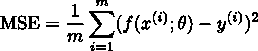

相比之下，对于目标是将输入归类为离散标签的分类任务，通常采用交叉熵损失：

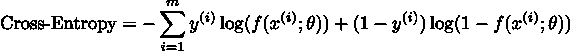

请考虑以下 Python 示例，该示例使用了使用神经网络库实现的通用监督学习模型，展示了训练循环。

```python
import numpy as np 
from sklearn.model_selection import train_test_split 
from sklearn.neural_network import MLPRegressor 
from sklearn.metrics import mean_squared_error 
# Example input data (X) and output data (y) 
X = np.array([[2.0], [3.0], [4.0], [5.0]]) 
y = np.array([4.0, 9.0, 16.0, 25.0]) 
# Example continuous values for a regression task 
# Split the data into training and validation sets 
X_train, X_val, y_train, y_val = train_test_split(X, y, test_size=0.2, random_state=42) 
# Initialize the supervised learning model 
model = MLPRegressor(hidden_layer_sizes=(10,), max_iter=1000, random_state=42) 
# Train the model 
model.fit(X_train, y_train) 
# Predict on validation data 
predictions = model.predict(X_val) 
# Compute the mean squared error 
mse = mean_squared_error(y_val, predictions) 
print(f"Mean Squared Error on Validation Set: {mse}")
```


在这里，`y` 表示我们想要预测的因变量，`x` 是自变量，`β0` 是截距，`β1` 是直线的斜率，`𝜖` 表示误差项，用于解释线性关系无法捕捉的变异。

### 多线性回归

现实世界的应用通常涉及多个特征，因此需要多变量方法。对于多个变量，线性回归模型定义为：

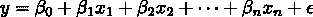

在矩阵表示法中，可以简洁地表示为：

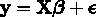

其中 `y` 是观测值向量，`X` 是输入特征矩阵，`β` 是系数向量，`𝜖` 是误差向量。

### 参数估计

系数 `β` 通过普通最小二乘法 (OLS) 进行估计的，该方法最小化了观测值与模型预测值之间的残差平方和。OLS 的解由公式给出：

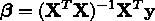

该方程源于求解正规方程，这一过程通过将损失函数的导数置零来寻找最优参数集。

### 梯度下降

在矩阵求逆在计算上不可接受的情况下（特别是在处理非常大的数据集时），梯度下降等迭代方法变得非常有吸引力。梯度下降通过迭代取与当前点损失函数梯度负成比例的步骤来优化参数。

迭代更新规则为：

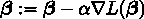

其中 `α` 是学习率，`∇L(β)` 是损失函数的梯度。

### Python 中的线性回归示例

以下是一个使用 Python 语言和 `scikit-learn` 库对数据集实现线性回归的示例。

```python
import numpy as np
from sklearn.linear_model import LinearRegression
from sklearn.metrics import mean_squared_error 
# 模拟数据：自变量 X 和因变量 y
X = np.array([[1, 1], [1, 2], [2, 2], [2, 3]])
y = np.dot(X, np.array([1, 2])) + 3 
# 初始化线性回归模型
model = LinearRegression() 
# 使用数据拟合模型
model.fit(X, y) 
# 系数 (beta_0, beta_1, ...)
print("Coefficients:", model.coef_) 
print("Intercept:", model.intercept_) 
# 进行预测
predictions = model.predict(X)
print("Predictions:", predictions) 
# 计算均方误差
mse = mean_squared_error(y, predictions)
print("Mean Squared Error:", mse)
```

### 应用领域

线性回归因其直观的解释性和预测能力，在许多领域中都有应用。其中一些领域包括：

- **经济学**：根据投资、利率和就业水平等多个因素预测 GDP 增长等经济指标。
- **生物学**：确定基因表达水平与相应表型结果之间的关系。
- **医学**：根据血压、胆固醇和其他诊断指标等临床参数预测患者结果。
- **环境科学**：对污染水平与各种环境变量之间的关系进行建模。
- **社会科学**：分析调查结果，以衡量人口统计变量对政治或社会态度的影响。

### 优点与局限性

线性回归的优点包括其透明性和易于解释。计算出的系数表示了在保持其他其他变量不变的情况下，自变量每变化一个单位导致因变量的变化。

然而，线性回归假设自变量和因变量之间存在线性关系。它对离群值和多共线性敏感，多共线性是指两个或多个自变量之间高度相关的现象，这可能会导致参数估计不稳定。为了缓解这些问题，可以采用正则化技术（例如岭回归和 Lasso 回归）来约束模型，特别是在高维空间中。

### 扩展与高级用法

可以通过以下预处理策略来增强线性回归的有效性：

1. **多项式回归**：将自变量 `x` 与因变量 `y` 之间的关系建模为 n 次多项式。这种方法通过将输入特征转换为多项式特征来捕捉非线性模式。

```python
from sklearn.preprocessing import PolynomialFeatures
# 将原始特征转换为二次项项
poly = PolynomialFeatures(degree=2)
X_poly = poly.fit_transform(X) 
# 拟合模型
model.fit(X_poly, y) 
# 多项式特征转换后的预测
predictions_poly = model.predict(X_poly)
print("Polynomial Predictions:", predictions_poly)
```

2. **正则化技术**：如 Ridge 和 Lasso 等方法对系数引入额外的约束以防止过拟合，特别是在预测变量数量相对于观测数量较大时。

3. **岭回归 (L2 正则化)**：增加与系数幅度等效的惩罚。这会将系数缩小到零，但永远不会将其置为零，有助于管理多共线性。

```python
from sklearn.linear_model import Ridge
# 拟合岭回归
ridge = Ridge(alpha=1.0)
ridge.fit(X, y) 
# 岭系数
print("Ridge Coefficients:", ridge.coef_)
print("Intercept:", ridge.intercept_)
```

4. **Lasso 回归 (L1 正则化)**：与岭回归类似，但使用 L1 惩罚，可以将某些系数压缩为零，从而有效地进行特征选择。

```python
from sklearn.linear_model import Lasso
# 拟合 Lasso 回归
lasso = Lasso(alpha=0.1)
lasso.fit(X, y) 
# Lasso 系数
print("Lasso Coefficients:", lasso.coef_)
print("Intercept:", lasso.intercept_)
```

### 残差分析

残差分析是验证线性回归假设的关键组成部分。残差是观测值与预测值之间的差异，理想情况下应该是随机分布且不显示任何模式。

```python
import matplotlib.pyplot as plt
# 绘制残差
plt.scatter(predictions, y - predictions) 
plt.hlines(y=0, xmin=predictions.min(), xmax=predictions.max(), colors='r') 
plt.title('Residuals Plot') 
plt.xlabel('Predicted Values') 
plt.ylabel('Residuals') 
plt.show()
```


其中 `z` 是输入变量的线性组合，权重由模型的系数决定，可以表示为：

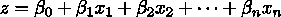

逻辑函数输出 `σ(z)` 被解释为输入属于特定类别（通常表示为类别 1）的概率。一种常见的决策规则是：如果 `σ(z) ≥ 0.5`，则分类为类别 1。

### 最大似然估计

逻辑回归不是通过最小化平方误差和（如线性回归那样），而是通过最大化观测给定数据的似然来估计逻辑回归系数。将逻辑回归视为一种 `Bernoulli` 分布，其似然函数可以通过最大似然估计（`MLE`）进行对齐优化：

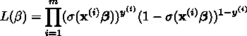

为了简化计算，经常使用对数似然（`log-likelihood`）：

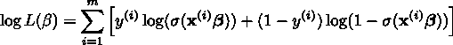

利用诸如 `gradient ascent`（或者考虑到逻辑损失是凸的，更常用的其变体 `gradient descent`）或更高级的方法（如 `Newton-Raphson`，迭代加权最小二乘法）等优化技术来寻找最优参数。

### 多分类扩展

逻辑回归主要为二分类设计；然而，对于多分类问题存在扩展方法。对多（`OvR`）是一种常见的策略，通过训练多个二分类器，每个分类器将一个类与其他类区分开。另一种方法是多项逻辑回归（也称为 softmax 回归），它使用 `softmax` 函数将逻辑回归扩展到能够直接处理多个类别：

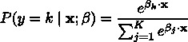

### Python 中的逻辑回归示例

考虑使用 `scikit-learn` 构建逻辑回归模型解决二分类问题：

```python
import numpy as np
from sklearn.linear_model import LogisticRegression
from sklearn.metrics import accuracy_score, confusion_matrix # 示例二分类数据
X = np.array([[0.1, 1.1], [1.2, 1.9], [2.3, 2.2], [3.1, 2.8]])
y = np.array([0, 0, 1, 1]) # 对应的二标签
# 初始化逻辑回归模型
model = LogisticRegression()
# 训练模型
model.fit(X, y)
# 进行预测
predictions = model.predict(X)
# 评估准确率
accuracy = accuracy_score(y, predictions)
print("Accuracy:", accuracy)
# 计算混淆矩阵
conf_matrix = confusion_matrix(y, predictions)
print("Confusion Matrix:\n", conf_matrix)
```

### 在不同领域的应用

逻辑回归的简单性和可解释性使其适用于多种应用领域：

- **医学与健康医疗**：用于预测疾病的存在与否（例如，根据患者的年龄、`BMI` 和血压等属性预测糖尿病）。
- **金融**：通常应用于信用评分，以预测贷款违约的概率。
- **营销**：根据历史购买数据和人口统计信息，帮助决定客户是否会购买某产品。
- **社会科学**：在政治学研究中预测投票行为等类别性结果。

### 优势与假设

逻辑回归具有显著的优势，特别是在可解释性至关重要的情况下。模型的系数可以解释为：预测变量每变化一个单位，属于正类别的对数几率（`log-odds`）的变化。这一特征对于理解每个特征对预测的影响具有极高价值，同时通过对系数取指数（`eβ`）可以获得优势比。

### 特征变换与交互项

尽管逻辑回归假设线性关系，但可以通过引入多项式来建模非线性效应。交互项是两个或多个变量的乘积。

```python
from sklearn.preprocessing import PolynomialFeatures
from sklearn.pipeline import Pipeline # 创建多项式和交互项
poly_transformer = PolynomialFeatures(degree=2, interaction_only=False)
model_pipeline = Pipeline(steps=[('poly', poly_transformer), ('logistic', LogisticRegression())]) # 使用多项特征训练
model_pipeline.fit(X, y)
predictions_poly = model_pipeline.predict(X)
print("Predictions with Polynomial:", predictions_poly)
```

在高维数据集中，逻辑回归可能会出现过拟合。正则化，特别是 `L1`（Lasso）和 `L2`（Ridge），通过向损失函数添加惩罚项来控制复杂度：

- **L1 正则化**：偏于具有少数非零系数的稀疏模型，有助于特征选择。
- **L2 正则化**：偏好较小但密集的系数向量，使估计具有稳定性。

### 逻辑回归中的正则化

正则化逻辑回归平衡了准确拟合训练数据与良好泛化到新数据之间的关系。

```python
from sklearn.linear_model import LogisticRegressionCV # 带交叉验证的正则化逻辑回归
regularized_model = LogisticRegressionCV(Cs=10, cv=5, penalty='l1', solver='liblinear')
regularized_model.fit(X, y)
print("Regularized Coefficients:", regularized_model.coef_)
```

### 模型评估与验证

评估二分类模型的关键指标包括：

- **准确率 (Accuracy)**：正确预测的比例；适用于平衡分类，但对于不平衡数据集误误。
- **精确率 (Precision) 和召回率 (Recall)**：精确率衡量正例预测的准确性（真正例 / (真正例 + 假正例）），而召回率（敏感性）衡量识别正例的能力（真正例 / (真正例 + 假负例））。
- **F1 分数 (F1-score)**：精确率和召回率的调和平均数，在两者之间提供平衡，对于不平衡类别特别有用。
- **ROC 曲线和 AUC**：受受者工作特征曲线绘制了不同阈值设置下的真正例率与假正例率。`AUC`（曲线下面积）评估了模型不依赖于分类阈值的判别能力。

```python
from sklearn.metrics import precision_score, recall_score, f1_score, roc_auc_score, roc_curve
import matplotlib.pyplot as plt
# 计算精确率、召回率和 F1 分数
precision = precision_score(y, predictions)
recall = recall_score(y, predictions)
f1 = f1_score(y, predictions)
# 计算 ROC 和 AUC 分
fpr, tpr, thresholds = roc_curve(y, predictions)
auc_score = roc_auc_score(y, predictions)
print(f"Precision: {precision}, Recall: {recall}, F1-score: {f1}, AUC: {auc_score}")
# 绘制 ROC 曲线
plt.plot(fpr, tpr, marker='.', label='Logistic')
plt.xlabel('False Positive Rate')
plt.ylabel('True Positive Rate')
plt.title('ROC Curve')
plt.legend()
plt.show()
```

逻辑回归是二分类和多分类任务中不可或缺的工具，提供了预测因子与结果之间关系的见解。其可解释性使其成为模型透明度至关重要领域的理想选择。尽管神经网络等更复杂的算法兴起，逻辑回归的有效性、简单性和易实现性确保了它在机器学习各个领域的持续应用。


决策树是一种多功能且具有解释性的机器学习方法，可用于分类和回归任务。它们提供了一种分层模型结构，其中输入根据特定的特征属性进行迭代划分，直到确定最终的输出类别或值。在集成形式中，即随机森林，这些模型通过聚合多棵决策树的预测来增强其鲁棒性和性能。

### 决策树

决策树的结构类似于树形图，由三个主要实体组成：节点、分支和叶子节点。内部节点代表基于特征的决策点，分支对应这些决策的结果，而叶子节点包含最终的预测或输出。

模型的构建过程是一个自顶向下的递归划分过程，被称为“贪婪划分”，这需要在每个节点处选择最佳属性来划分数据。用于划分的选择指标可以是：

- **基尼不纯度 (Gini Impurity)**：衡量从集合中随机选择元素被分类错误的概率频率。较低的 `Gini` 索引表示更高的纯度。

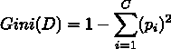

- **熵 (Entropy)**：量化数据中的不确定性或无序性。使用此准则的分类树的目标通常是最小化 `entropy`，从而增加信息增益。

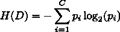

其中 `pi` 代表类别 `i` 的概率。

- **均方误差 (Mean Squared Error)**：用于回归树，以衡量观测值与预测值之间的差异，指导最优的数据划分。

## 树的构建算法

1. 从根节点开始。
2. 应用所选的不纯度量或代价函数来评估并选择用于划分的最佳属性。
3. 根据该属性将节点划分为子节点。
4. 对每个子节点递归重复此过程。
5. 当达到停止条件时终止过程，例如最大树深度、节点处的最小样本数或节点足够纯净。

## Python 决策树示例

以下 Python 示例展示了如何使用 `scikit-learn` 库实现决策树：

```python
from sklearn.tree import DecisionTreeClassifier
from sklearn.datasets import load_iris
from sklearn.model_selection import train_test_split
from sklearn.metrics import accuracy_score

# 加载示例数据集
iris = load_iris()
X, y = iris.data, iris.target

# 将数据集划分为训练集和测试集
X_train, X_test, y_train, y_test = train_test_split(X, y, test_size=0.3, random_state=42)

# 初始化决策树分类器
tree_clf = DecisionTreeClassifier(criterion='gini', max_depth=3, random_state=42)

# 训练模型
tree_clf.fit(X_train, y_train)

# 进行预测
y_pred = tree_clf.predict(X_test)

# 计算并打印准确率
accuracy = accuracy_score(y_test, y_pred)
print("Decision Tree Accuracy:", accuracy)
```

## 优缺点

决策树直观且提供了简单的可视化方法，非常适合用户友好的解释和简单的规则提取。它们可以处理数值和分类数据，而无需归一化或缩放，并能轻松捕捉特征之间的非线性相互作用。然而，它们容易过拟合，特别是对于深度树而言，并且对数据的微小变化敏感。

# 随机森林

随机森林通过在训练期间构建大量树并输出其预测的众数或平均值来增强决策树，从而克服了单树容易过拟合的倾向。这种集成方法通过自助聚合（bagging）和特征随机性机制实现了准确性的提升并减少了方差：

- **自助聚合 (Bootstrap Aggregation)**：在训练数据的随机子集上训练每个基学习器（决策树）。
- **随机特征子集**：在树构建构建的每个划分点选择随机特征集，进一步增加了树的多样性和鲁棒性。

随机森林模型有多个超参数，例如树的数量、最大树深度以及在每个划分处考虑的特征数量。适当调优这些参数可以确保最优的模型性能和效率。

## Python 随机森林示例

考虑以下使用 `scikit-learn` 实现分类问题的随机森林：

```python
from sklearn.ensemble import RandomForestClassifier
from sklearn.metrics import classification_report, confusion_matrix

# 初始化随机森林分类器
rf_clf = RandomForestClassifier(n_estimators=100, max_depth=5, random_state=42)

# 训练随机森林模型
rf_clf.fit(X_train, y_train)

# 在测试数据上进行预测
y_pred_rf = rf_clf.predict(X_test)

# 评估并打印模型性能
print("Random Forest Classification Report:")
print(classification_report(y_test, y_pred_rf))
print("Confusion Matrix:")
print(confusion_matrix(y_test, y_pred_rf))
```

## 特征重要性和可解释性

随机森林提供了特征重要性的见解，量化了每个特征对模型预测的贡献。特征重要性基于森林中所有树对减少纯度（例如基尼不纯度的减少）的平均贡献计算的。

```python
import pandas as pd
import matplotlib.pyplot as plt

importances = rf_clf.feature_importances_
# 对特征重要性排序
feature_importances = pd.Series(importances, index=iris.feature_names).sort_values(ascending=False)

# 绘制特征重要性
feature_importances.plot(kind='barh')
plt.title('Random Forest Feature Importances')
plt.show()
```

## 应用与场景

由于其灵活性和对过拟合的抵抗力，随机森林适用于各种应用：

- **医疗保健**：对患者数据进行预测建模和预测分析，用于疾病风险评估。
- **金融**：通过从交易历史数据中学习复杂模式进行欺诈检测。
- **营销**：通过评估客户行为预测用于细分和定位。
- **环境科学**：对生态模式进行建模并预测气候对生态系统的影响。

## 相比决策树的优势

随机森林通过平均噪声和捕捉跨数据集的更泛化模式，缓解了单个决策树的局限性，减少了过拟合。由于它们处理特征子集，因此固有执行了特征选择，有助于处理高维数据。

## 随机森林的局限性

尽管随机森林具有鲁棒性，但其计算密集型，预测可能较慢。在部署大量树时，它们会产生大量的内存需求。此外，虽然它们提供了特征重要性的聚合视图，但与单个决策树相比，其可解释性较低。


# SVM 的数学基础

对于二分类，SVM 的主要目标是找到一个最优超平面，以尽可能地将数据集分为两类。在更正式的语境下，这种划分可以描述为：

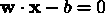  

在这里，`w` 表示垂直于超平面的权重向量，`b` 是偏置。间隔（Margin）定义为两类中最最近实例（支持向量）之间的距离，其目标是使其最大化。在数学上，这转化为求解以下优化问题：

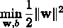  

受限于约束：

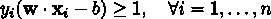  

上述是一个二次优化问题，可以使用拉格日乘子法高效求解，从而导出对偶形式。只有训练样本子集（即支持向量）有助于定义超平面。

## 核技巧

核函数技巧使 SVM 能够使用原始线性分类器算法高效地执行非线性分类。它通过等函数隐式将输入特征映射到高维特征空间，而无需显式计算：

- **线性核**：用于线性可分。
  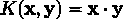  

- **多项式核**：适用于具有多项式趋势的非线性可分数据。
  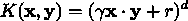  

- **径基函数 (RBF) 核**：适用于分类边界非线性的数据划分。
  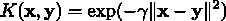  

- **Sigmoid 核**：模拟神经网络。
  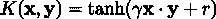  

## 软间隔 SVM

实际中的 SVM 引入了软间隔的概念，使用松弛变量 `ξi` 来重叠类别和非线性数据集。修改后的优化问题变为：

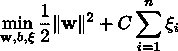  

受限于：

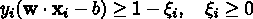  

这包含一个惩罚项 `C`，用于控制最大化间隔与最小化分类误差之间的平衡。

## 多分类

虽然 SVM 本质上是二分类器，但存在针对多分类问题的扩展方法，包括：

- **对对多 (OvR)**：为 `k` 个类构建 `k` 个二分类 SVM 分类器，每个预测某一类是目标类还是其他。
- **一对一 (OvO)**：为类别对构建 `k(k−1)∕2` 个分类器，通过多数投票决定类别归属。

## 实践中的支持向量

以下是一个使用 scikit-learn 中 RBF 核的 SVM 分类器的代码示例：

```python
import numpy as np
from sklearn import datasets
from sklearn.svm import SVC
from sklearn.metrics import classification_report, confusion_matrix
from sklearn.model_selection import train_test_split
# 加载示例数据集鸢花
iris = datasets.load_iris()
X, y = iris.data, iris.target
# 为了简单起见保留二分类场景
binary_X = X[y != 2]
binary_y = y[y != 2]
# 将数据分为训练集和测试集
X_train, X_test, y_train, y_test = train_test_split(binary_X, binary_y, test_size=0.3, random_state=42)
# 初始化并拟合 SVM 模型
svm_classifier = SVC(kernel='rbf', C=1.0, gamma='scale')
svm_classifier.fit(X_train, y_train)
# 预测并评估
y_pred = svm_classifier.predict(X_test)
print(classification_report(y_test, y_pred))
print(confusion_matrix(y_test, y_pred))
```

## 超参数优化

调优超参数对 SVM 的性能至关重要。网格搜索或随机搜索等技术可以识别最优设置。

```python
from sklearn.model_selection import GridSearchCV
# 定义参数格格
param_grid = {
    'C': [0.1, 1, 10, 100],
    'gamma': ['scale', 'auto'],
    'kernel': ['rbf', 'poly', 'sigmoid', 'sigmoid']
}
# 初始化并执行网格搜索
grid_search = GridSearchCV(SVC(), param_grid, refit=True, verbose=1)
grid_search.fit(X_train, y_train)
# 输出最佳参数
print("Best Parameters:", grid_search.best_params_)
```

## SVM 的应用

由于其处理复杂、高维数据的能力，SVM 在各行业中具有广泛的应用性：

- **生物信息学**：分类蛋白质或基因。
- **金融**：通过异常检测检测欺诈活动。
- **图像识别**：用于手写识别或脸识别。
- **文本与分类**：对文档或网站进行分类。

### 优点与局限性

SVM 在中小型数据集上表现卓越的性能。它们在高维空间中抗过拟的鲁健性以及选择核函数的灵活性是其显著优势。然而，由于计算密集和内存需求，它们在处理大型数据集时面临挑战。此外，如果不采用 OvR 或 OvO 等策略，SVM 往往难以扩展到二分类之外的领域。


```python
import numpy as np
from sklearn.datasets import load_iris
from sklearn.model_selection import train_test_split
from sklearn.neighbors import KNeighborsClassifier
from sklearn.metrics import accuracy_score, confusion_matrix, classification_report

# 加载鸢花数据集
iris = load_iris()
X, y = iris.data, iris.target

# 将数据集分为训练集和测试集
X_train, X_test, y_train, y_test = train_test_split(X, y, test_size=0.3, random_state=42)

# 初始化 KNN 分器
knn = KNeighborsClassifier(n_neighbors=5, metric='euclidean')

# 训练模型
knn.fit(X_train, y_train)

# 进行预测
y_pred = knn.predict(X_test)

# 评估准确率并生成分类报告
accuracy = accuracy_score(y_test, y_pred)
conf_matrix = confusion_matrix(y_test, y_pred)
report = classification_report(y_test, y_pred)
print("KNN Accuracy:", accuracy)
print("Confusion Matrix:\n", conf_matrix)
print("Classification Report:\n", report)
```

# 注意事项与增强技术

可以应用若干考虑和增强技术来优化 KNN 算法的性能：

### 归一化与标准化
特征缩放至关重要，因为距离对测量的大小敏感。对数据进行归一化，使得每个特征对距离计算的贡献相等。

```python
from sklearn.preprocessing import StandardScaler
# 通过移除均值并缩放到单位方差来标准化特征
scaler = StandardScaler()
X_train_scaled = scaler.fit_transform(X_train)
X_test_scaled = scaler.transform(X_test)
```

### 距离度量的选择
根据领域和数据特征选择合适的距离度。在处理多元分布时，可以考虑马哈拉宾距离（Mahalanobis distance）。

### 维度
高维空间会稀释距离的概念，使得难以区分近远点。可以使用如 `PCA`（主成分分析）等技术进行降维。

```python
from sklearn.decomposition import PCA
### 降维
pca = PCA(n_components=2)
X_train_pca = pca.fit_transform(X_train_scaled)
X_test_pca = pca.transform(X_test_scaled)
```

### 加权投票
实现加权投票系统，与远距离邻居相比，近邻居对预测结果的影响更大。引入与距离反比的权重。

```python
# 使用距离加权的 KNN
weighted_knn = KNeighborsClassifier(n_neighbors=5, weights='distance')
weighted_knn.fit(X_train_scaled, y_train)
```

# 超参数调优

KNN 中最重要的超参数是 `k`。可以使用网格搜索、交叉验证或其他优化方法针对特定数据集进行适当调优。

```python
from sklearn.model_selection import GridSearchCV
# 定义参数网格
param_grid = {'n_neighbors': np.arange(1, 30), 'metric': ['euclidean', 'manhattan']}
# 设置网格搜索
grid_search = GridSearchCV(KNeighborsClassifier(weights='distance'), param_grid, cv=5)
grid_search.fit(X_train_scaled, y_train)
# 输出最佳参数
print("Best Parameters:", grid_search.best_params_)
```

# K 近邻算法的应用

由于其简单性和有效性，KNN 广泛应用于多个领域：

- **金融**：用于信用评分以及基于最邻概况分析的贷款资格评估。
- **医疗健康**：用于医疗诊断系统，通过将患者指标与历史数据集进行比较来检测疾病。
- **推荐系统**：通过识别具有相似偏好的用户或与过去搜索相似的产品来增强推荐过程。
- **社交网络平台**：KNN 通过用户参与指标中的邻近性计算，帮助识别相似的社交画像和潜在连接。

### 优点与局限性

KNN 的优点主要在于其简单易于实现。它可以自然地适应边界移动，因为每个预测直接从数据集中得出，没有显式的模型假设。然而，由于依赖于逐实例比较，随着训练数据规模的增加，KNN 的计算成本变得昂贵。由于维度灾难，其在高维数据上的性能可能会下降；除非应用分层采样或人工数据平衡等调整，否则它在处理不平衡数据集时表现不佳。

K 近邻仍然是监督学习中一种至关重要的工具，证明了即使在日益复杂的现代机器学习发展中，简单性也能提供宝贵的见解。尽管存在计算限制，KNN 在应用中的灵活性确保了它作为解决分类和回归问题的一种易用方法的持续影响力和价值。

## 4.7

# 模型评估与验证

模型评估和验证是机器学习工作流中至关重要的阶段，确保模型良好地泛化到未见数据，而不仅仅是拟合训练数据集。这些过程有助于评估模型性能、比较不同的模型，并最终选择提供最佳预测能力的模型。

### 概念与重要性
有效的评估和验证涉及衡量模型准确性、稳健性和泛化能力的技术。过拟合现象（模型在训练数据上表现良好，但在未见数据上表现较差）使得这些方法变得必要。相反，当模型过于简单而无法捕捉底层数据趋势时，就会发生欠拟合。

模型评估和验证的主要目标包括：

- **准确性评估**：量化模型预测结果与实际结果的接近程度。
- **模型选择**：比较多个模型或配置以识别最合适的选项。
- **超参数调优**：精细调整参数以优化模型性能。
- **泛化能力**：确保模型在不同数据集上的性能保持一致。

### 训练集-测试集划分
评估的标准方法是将数据集分为两个部分：训练集和测试集。模型在训练集上训练并在测试集上评估，从而提供在新数据上性能的估计。

```python
from sklearn.model_selection import train_test_split
from sklearn.datasets import load_boston
from sklearn.linear_model import LinearRegression
from sklearn.metrics import mean_squared_error
# 加载波士房价数据集
boston = load_boston()
X, y = boston.data, boston.target
# 将数据集划分为 80%训练和 20%测试
X_train, X_test, y_train, y_test = train_test_split(X, y, test_size=0.2, random_state=42)
# 训练模型
model = LinearRegression().fit(X_train, y_train)
# 评估模型
predictions = model.predict(X_test)
mse = mean_squared_error(y_test, predictions)
print(f"Mean Squared Error: {mse}")
```

### 交叉验证
虽然训练集-测试集划分提供了性能快照，但它没有利用所有可用数据，可能会引入划分特定的偏差。K 折交叉验证通过将数据集分为 `k` 个子集（折）来克服这个问题。模型在 `k−1` 个折上训练，并在剩余的一个折上验证。此过程重复 `k` 次，每次使用不同的折作为验证数据。最后对结果取平均值，以获得稳健的性能估计。

```python
from sklearn.model_selection import cross_val_score
from sklearn.linear_model import Ridge
# 使用 5 折交叉验证
cv_scores = cross_val_score(Ridge(), X, y, cv=5, scoring='neg_mean_squared_error')
mean_score = -cv_scores.mean()
# 评分返回的是负均 MSE
print(f"Mean Cross-Validated MSE: {mean_score}")
```


# 分层 K 折交叉验证

对于不平衡数据集，`分层 K 折交叉验证保持了所有折叠中每个类别的比例`，确保每个折叠都代表整个数据集的类别分布。这在分类任务中显得尤为重要，因为类别不平衡可能会偏差性能指标。

```python
from sklearn.model_selection import StratifiedKFold
from sklearn.ensemble import RandomForestClassifier
from sklearn.metrics import accuracy_score
# Example dataset
X, y = load_breast_cancer(return_X_y=True)
# Initialize stratified k-fold
skf = StratifiedKFold(n_splits=5)
# Evaluate model accuracies
accuracies = []
for train_index, test_index in skf.split(X, y):
    X_train, X_test = X[train_index], X[test_index]
    y_train, y_test = y[train_index], y[test_index]
    model = RandomForestClassifier().fit(X_train, y_train)
    y_pred = model.predict(X_test)
    accuracies.append(accuracy_score(y_test, y_pred))
mean_accuracy = np.mean(accuracies)
print(f"Stratified Cross-Validated Accuracy: {mean_accuracy}")
```

# 模型评估指标

对于分类和回归任务，各种指标提供了对模型性能不同层面的洞察：

### 分类指标

- **准确率 (Accuracy)**：所有实例中分类正确的实例的比例。
  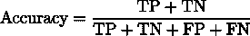
- **精确率 (Precision)**：在检索到的实例中相关实例的比例。
  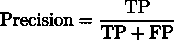
- **召回率 (Recall/敏感度)**：被检索到的相关实例的比例。
  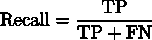
- **F1 分**：精确率和召回率的调和平均数，提供了两者之间的平衡。
  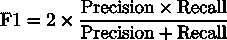
- **ROC 曲线和 AUC**：展示了跨分类阈值的性能，其中 `AUC` 总结了整体判别能力。

```python
from sklearn.metrics import roc_auc_score, roc_curve
import matplotlib.pyplot as plt
# Assume binary classification with the test set
probs = model.predict_proba(X_test)[:, 1]
auc = roc_auc_score(y_test, probs)
fpr, tpr, _ = roc_curve(y_test, probs)
# Plot ROC curve
plt.plot(fpr, tpr, label=f'AUC: {auc:.2f}')
plt.plot([0, 1], [0, 1], 'k--')
plt.xlabel('False Positive Rate')
plt.ylabel('True Positive Rate')
plt.title('Receiver Operating Characteristic (ROC) Curve')
plt.legend()
plt.show()
```

### 回归指标

- **平均绝对误差 (MAE)**：实际值与预测值之间的平均绝对差异。
  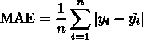
- **均方误差 (MSE)**：实际值与预测值之间的平均平方差，对较大的误差有更重的惩罚。
  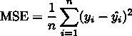
- **均方根误差 (RMSE)**：`MSE` 的平方根，以因变量的单位表示误差。
  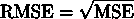
- **R 方值 (R²)**：因变量中可由自变量预测的方差比例。
  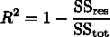

```python
from sklearn.metrics import mean_absolute_error, mean_squared_error, r2_score
mae = mean_absolute_error(y_test, predictions)
rmse = np.sqrt(mean_squared_error(y_test, predictions))
r2 = r2_score(y_test, predictions)
print(f"MAE: {mae}, RMSE: {rmse}, R²: {r2}")
```

# 验证技术

除了交叉验证，其他验证技术也有助于完善模型评估：

- **留一交叉验证 (LOOCV)**：一种交叉验证形式，折叠数量等于数据点数量，尽管计算开销很大。
- **时间序列交叉验证**：特别适用于时间序列数据，确保训练在时间上始终在验证之前，以尊重时间顺序，通常采用滚动预测起点技术。

# 过拟合与欠拟合

评估让我们注意到过拟合和欠拟合的情况：

- **过拟合**：模型对训练数据的解释非常好，但在未见数据上表现糟糕。对抗过拟合的方法包括：
    - **正则化**：在损失函数中添加惩罚（例如 `L1` 或 `L2` 正则化）。
    - **剪枝**：特别是在决策树中，移除提供能力有限的模型部分。
- **欠拟合**：模型太简单，导致高偏差。可以通过增加特征提高模型复杂度或选择更复杂的算法来缓解。

# 模型验证与评估的重要性

除了验证指标外，解释影响模型性能的众多因素（如特征工程、数据质量和任务性质）有助于实现全面的理解。此外，可解释性、扩展性和现实世界可行性等定性方面丰富了定量评估。

总而言之，模型评估和验证是确定模型在不同领域有效性和可用性的基本过程。通过适当的评估方案，研究人员和从业者可以确保部署可靠、深刻的机器学习解决方案，稳健地应对现实世界的挑战。

# 第 5 章

## 无监督学习与聚类

无监督学习专注于在没有预定义标签的情况下发现数据中的模式和结构，提供显而易见的见解。本章深入探讨各种聚类技术，如划分法和层次法，这些是根据内在相似性对数据进行分组的核心。讨论了关键算法，包括 `k-means` 和 `DBSCAN`，同时涵盖了 `PCA` 和 `t-SNE` 等维度还原技术的关键作用。强调了无监督学习的实际应用，如市场细分和异常检测，凸显了其从原始数据中挖掘价值信息的能力。

## 5.1

### 无监督学习的核心原理

在机器学习中，无监督学习利用算法从仅包含输入而无标签响应的数据集中进行推断的方法。该领域的主要目标是识别数据中的模式或分组，从而发现通过直接检查可能无法看到的结构。与需要输入输出对进行训练的监督学习不同，无监督学习寻求仅从未标记数据中识别潜在的趋势和关系。

无监督学习的核心假设是数据具有内在结构，在采用适当技术时可以揭示这种结构。缺乏预定义标签意味着这些算法必须自主探索数据的结构。

显式训练标签的缺失使得必须利用数据的内在特征来指导学习过程。因此，无监督学习的模型构建是由利用数据内在相似性和差异的策略驱动的。

无监督学习的重要应用是聚类。聚类是将数据集划若干组，使得同一组（或簇）中的项之间的相似性大于与其他组项项。聚类技术具有多功能，可以根据不同的数据类型和目标进行定制。

为了说明无监督学习的原理，考虑以下 Python 代码，它展示了如何使用 `k-means` 算法构建简单的聚类模型。该示例为理解无监督学习算法如何在未标记数据上运行以揭示隐藏结构提供了基础。


```python
from sklearn.datasets import make_blobs
from sklearn.cluster import KMeans
import matplotlib.pyplot as plt
# 生成合成数据
X, _ = make_blobs(n_samples=300, centers=4, cluster_std=0.6, random_state=0)
# 初始化具有 4 个聚类的 kkmeans
kmeans = KMeans(n_clusters=4, random_state=0)
# 拟合 k-means 模型
kmeans.fit(X)
# 预测聚类
y_kmeans = kmeans.predict(X)
# 可视化聚类
plt.scatter(X[:, 0], X[:, 1], c=y_kmeans, s=50, cmap='viridis')
centers = kmeans.cluster_centers_
plt.scatter(centers[:, 0], centers[:, 1], c='red', s=200, alpha=0.75)
plt.show()
```

在上述代码中，使用 `make_blobs` 函数合成数据生成用于聚类的各向同性高斯块，这是评估聚类算法的常用方法。值得注意的是，应用 `KMeans` 函数将合成数据划分为四个聚类，其中每个聚类由一个质心表示。这简洁地说明了 k-means 聚类的核心操作——将数据空间划分为由质心决定的沃罗伊单元。

无监督学习的一个关键元素是距离度量或相似性指标的选择。在 k-means 中，`欧几式距离`是聚类分配的标准选择。然而，取决于数据的性质和预期的聚类结果，可以使用其他的距离度量，例如`余弦相似度`或`曼哈顿`。

除了 k-means，其他几种聚类方法使用了不同的策略。例如，层次聚类通过自底而上的方法（凝聚）或自上而下的方法（分裂）创建聚类的层次结构。树状图（一种树形图）通常被用于可视化层次聚类所产生的聚类布局。

降维技术是无监督学习的另一个方面。这些技术，例如`主成分分析`（`PCA`）和`t 分布随机邻域嵌入`（`t-SNE`），有助于将复杂数据集降低到维度，同时保留重要的数据特征。这在聚类任务中被证明是有益的，因为高维数据可能会掩盖数据点之间的内在关系。

下面的 Python 示例演示了 `PCA` 用于降维的简单应用：

```python
from sklearn.decomposition import PCA
import numpy as np
# 具有 5 维数据的样本数据矩阵
data_matrix = np.random.rand(100, 5)
# 初始化 PCA 并降至 2 个维度
pca = PCA(n_components=2)
# 拟合 PCA 模型并转换数据
reduced_data = pca.fit_transform(data_matrix)
# 查看解释方差率
print("Explained Variance Ratio:", pca.explained_variance_ratio_)
```

在这个示例中，一个 5 维随机数据集被降至 2 维。`PCA` 对象的 `explained_variance_ratio_` 属性量化了主成分捕获的方差，这对于理解降维的效能至关重要。

数据中固有的类别和分布的自动发现可以在各个领域产生极具洞察力的应用。市场细分是聚类的一个典型应用，根据购买行为对消费者进行分组，从而允许定制营销策略并改进客户服务。

此外，异常检测通过识别偏离常规的数据点从无监督学习中受益。此类技术在金融和网络安全等领域至关重要，因为及早检测异常值等同于防止欺诈或攻击的重要预防措施。

自然语言处理（NLP）也利用无监督学习来组织和理解文本数据。主题建模采用诸如`隐狄利克雷分配`（`LDA`）等方法，有助于从大型语料库中提取潜在主题，从而将原本难以处理的文本内容结构化为协调的信息。

无监督学习固有的多功能性源于其能够适应各种数据集和目标，而不需要标记数据。然而，这种灵活性也带来了模型评估中固有的复杂性，因为准确率或精确率等传统的性能指标无法直接应用。

替代的评估指标，如`轮廓系数`、`戴维斯-鲍尔丁指数`或`手肘法`分析虽然被采纳，但它们通常需要更细致的解释，并且并不总能提供模型能力单一清晰的图景。

最后，计算能力和算法复杂性的进步不断扩展着无监督学习应用的边界。无监督学习范式与深度学习框架的整合——产生了能够自我组织特征并自主完善架构的模型——进一步强调了自主信息发现的潜力。

在这种背景下，无监督学习不仅是一种发现模式和结构的技术，而且是更复杂范式的基础组件，使得各种机器学习维度能够收敛，以实现稳健的数据理解和复杂的决策制定。

## 5.2

## 聚类技术概述

聚类是无监督学习中的一种基本技术，用于将数据集划分为组（称为聚类），这些组包含具有高度相似性的数据点。其目标是确保类内距离最小化，同时类间距离最大化，从而勾勒出可能显而见的内在数据分组。本节提供了各种聚类技术的深度概述，探索了划分方法和层次方法，并将它们置于实际应用语境中。

划分方法，如 `k-means` 和 `k-medoids`，通过优化给定标准将数据集划分为不同的聚类。这些技术通常涉及反复完善划分以达到目标。划分方法的有效性取决于对聚类数量和结构的假设。

`k-means` 算法是划分聚类技术的支柱，其特点是简单高效。它涉及选择 `k` 个初始质心，将每个数据点分配到最近的质心，并根据分配重新计算质心。此循环一直持续直到质心位置收敛，通常通过聚类的最小变化或改进来衡量：

```python
from sklearn.datasets import make_blobs
from sklearn.cluster import KMeans
import matplotlib.pyplot as plt
# 生成合成数据集
X, _ = make_blobs(n_samples=400, centers=3, cluster_std=0.7, random_state=42)
# 应用 k-means 聚类
kmeans = KMeans(n_clusters=3, random_state=42)
kmeans.fit(X)
y_kmeans = kmeans.predict(X)
# 可视化聚类结果
plt.scatter(X[:, 0], X[:, 1], c=y_kmeans, s=30, cmap='viridis')
centers = kmeans.cluster_centers_
plt.scatter(centers[:, 0], centers[:, 1], c='red', s=100, alpha=0.9, marker='x')
plt.title("K-Means Clustering")
plt.xlabel("Feature 1")
plt.ylabel("Feature 2")
plt.show()
```

`k-medoids` 算法是 `k-means` 的替代方案，特别是在需要对异常值具有鲁棒性时。与 `k-means` 不同，`k-medoids` 选择数据内部的代表性点（中心）作为聚类中心，减轻了对极端值的敏感性。该算法通常以围绕质心划分（PAM）实现，计算开销比 `k-means` 大，但在受噪声的数据集中可以产生更可靠的结果。


划分技术的成功与数据内部聚类的性质密切相关，其中关于聚类数量和分布的底层假设直接影响结果。`k` 的选择至关重要，通常需要启发式方法或如 `elbow method`（肘部法）或 `silhouette analysis`（轮廓分析）来估计最优聚类数。

层次聚类技术通过将数据组织成树形结构（或 `dendrogram`，树状）提供了另一种视角，反映了数据中固有的嵌套分组。这些方法在揭示层级关系方面具有优势，对于自然存在此类关系的数据集来说是理想的。

凝聚层次聚类通过最初将每个数据点视为单独的类，并根据指定的连接标准（例如 `single`、`complete`、`average`）迭代合并最近的对，来逐步构建聚类：

```python
from scipy.cluster.hierarchy import dendrogram, linkage from matplotlib import pyplot as plt # 生成样本数据
X, _ = make_blobs(n_samples=300, centers=4, cluster_std=0.5, random_state=0) # 执行层次/凝聚聚类
linked = linkage(X, ’single') # 绘制树状图
dendrogram(linked, orientation=’top’, distance_sort=’descending’, show_leaf_counts=True)
plt.title("Hierarchical Clustering Dendrogram (Single Linkage)")
plt.xlabel("Sample Index")
plt.ylabel("Distance")
plt.show()
```

该脚本说明了使用 `single linkage`（单链）进行层次聚类的过程，形成了一个 `dendrogram`，直观地封装了数据点或类合并时的距离。可以采用不同的连接策略（如 `complete` 或 `average`）来改变聚类的合并方式并影响生成的层级结构。生成的 `dendrogram` 提供了聚类的全面视觉总结，对于理解层级结构或确定合适的聚类配置可能非常有参考价值。

分裂层次聚类与凝聚聚类相反，采用自上而下的方法。它从所有数据点归为一个类开始，并递归地划分它们。这两种策略的选择取决于数据特征和计算资源，因为分裂聚类对于大型数据集通常在计算上是不可行的。

基于密度的聚类代表了另一种创新方法，`DBSCAN`（基于密度的空间聚类算法）是其最著名的实现。`DBSCAN` 将密集密集的点识别为类，并通过低密度区域隔开，使其对于发现任意形状的类和处理噪声非常有效：

```python
from sklearn.cluster import DBSCAN import numpy as np # 生成合成数据集
X, _ = make_blobs(n_samples=300, centers=3, cluster_std=0.5, random_state=0)
noise = np.random.rand(20, 2) * [5, 5] + [-2.5, -2.5]
X = np.vstack((X, noise)) # 应用 DBSCAN 聚类
dbscan = DBSCAN(eps=0.3, min_samples=5)
y_dbscan = dbscan.fit_predict(X) # 可视化聚类结果
plt.scatter(X[:,, 0], X[:,, 1], c=y_dbscan, cmap=’plasma’, marker=’.’)
plt.title("DBSCAN Clustering with Noise")
plt.xlabel("Feature 1")
plt.ylabel("Feature 2")
plt.show()
```

在 `DBSCAN` 中，诸如 `𝜖`（邻域搜索半径）和形成密集区域所需的最小点数必须仔细选择以适应数据特征。该算法自然处理噪声并发现不同密度的类，而不需要预先指定聚类数量，这是一个巨大的优势。

聚类技术的多样性为处理各个领域的大许多任务提供了灵活的工具包。无论是专注于在定义聚类环境中表现优异的 `k-means` 或 `k-medoids` 等划分方法，能够揭示丰富结构见解的层次技术，还是擅长管理噪声和复杂形状的基于密度的方法，选择取决于数据集的特定特征和解释目标。

深慎考虑聚类方法的选择、参数调优和评估对于充分利用这些技术的潜力至关重要。评估策略（包括 `silhouette scores` 轮廓系数、`Davies-Bouldin Index` 或对已知基准数据集的测试）为调整参数和选择合适方法提供了指导，以使模型与预期结果对齐。

最终，这些聚类技术固有的适应性、多样性和可扩展性使其成为探索性数据分析不可或缺的一部分，使从业者能够发现并解释数据中有意义的模式。

## 5.3

### K-Means 聚类

`K-Means` 聚类是非监督学习中最广泛采用的迭代划分方法之一。它的流行归功于其简单性、高效性和易于实现，可以快速获取数据结构的洞察。`K-Means` 将 `n` 个观测值分为 `k` 个类，每个观测值属于具有最近均值的类，该均值充当该类的原型。本节深入探讨了 `K-Means` 聚类算法，涵盖了其运行机制、实现细节点、参数选择以及它对各种数据类型的适用性。

`K-Means` 算法通过最小化类内平方和（也称为 `inertia` 惯性或方差）来运行。该过程从选择 `k` 个初始质心开始。这些质心可以随机选择，也可以通过如 `K-Means++` 等启发式方法来增强优化效率。

标准算法包含以下步骤：

1. **初始化**：从数据集中随机选择 `k` 个初始质心。这些初始猜测会显著影响最终的聚类解决方案，因此使用如 `K-Means++` 等方法。
2. **分配**：根据欧几里得距离将每个数据点分配给最近的质心，形成 `k` 个类。
3. **更新**：计算分配给每个类的平均值作为新质心。
4. **迭代**：重复分配和更新步骤直到收敛。当分配不再变化或代价函数下降到预设阈值时发生收敛。

让我们考虑使用 `SciKit-Learn` 库的 `K-Means` Python 实现，展示该算法的实际应用：

```python
from sklearn.datasets import make_blobs from sklearn.cluster import KMeans import matplotlib.pyplot as plt # 生成样本数据
X, y = make_blobs(n_samples=300, centers=4, cluster_std=0.6, random_state=0) # 应用 K-Means 算法
kmeans = KMeans(n_clusters=4, init=’k-means++’, n_init=10, max_iter=300, random_state=0)
y_kmeans = kmeans.fit_predict(X) # 可视化聚类
plt.scatter(X[:,, 0], X[:,, 1], c=y_kmeans, cmap=’viridis’, marker=’.’)
plt.scatter(kmeans.cluster_centers_[:,, 0], kmeans.cluster_centers_[:,, 1], s=300, c=’red’, label=’Centroids’)
plt.title("K-Means Clustering")
plt.xlabel("Feature 1")
plt.ylabel("Feature 2")
plt.legend()
plt.show()
```

这段代码段展示了使用等向同性高斯块生成的数据集对 `K-Means` 的实现。通过设置 `init=’k-means++’`，我们确保质质的位置是通过设计用于分散初始聚类中心的方法选择的，从而提高收敛速度和聚类质量。


尽管 `K-Means` 具有许多优势，但它存在一些必须承认的固有局限性。首先，该算法对离群点敏感。由于 `K-Means` 通过均值计算质心，极端值会显著偏偏聚类中心。此外，用户必须预定义聚类数量 `k`，而这在先往往无法确定。

此外，该算法假设簇是各向同性且呈凸形状的，这一假设在实践中可能并不成立。当该算法用于用于长形或不规则形状的聚类时，这种限制可能会导致次优的划分。

选择最佳聚类数量 `k` 对 `K-Means` 的成功至关重要。有几种方法可以帮助选择合适的 `k`：

### 肘部法 (Elbow Method)
这是一种启发式方法，通过绘制解释变异随聚类数量变化的函数图，并选择边际收益出现“肘部”或趋于平缓的点来确定簇的数量。

```python
import numpy as np
from sklearn.cluster import KMeans
import matplotlib.pyplot as plt
# 部法惯性示例
inertia = []
for i in range(1, 11):
    kmeans = KMeans(n_clusters=i, init='k-means++', max_iter=300, n_init=10, random_state=0)
    kmeans.fit(X)
    inertia.append(kmeans.inertia_)
plt.plot(range(1, 11), inertia, marker='o')
plt.title('Elbow Method')
plt.xlabel('Number of clusters')
plt.ylabel('Inertia')
plt.show()
```

该方法涉及使用不同的 `k` 值运行 `K-Means` 并绘制 `inertia`（样本到其最近聚类中心距离的平方和）以识别肘部点，该点意味着增加聚类带来的收益递减。

### 轮廓系数分析 (Silhouette Analysis)
该技术衡量了对象与其所属簇与其他簇相比的相似性，有助于评估拟合程度并决定 `k`。

```python
from sklearn.metrics import silhouette_score
# 轮廓系数得分
silhouette_avg = silhouette_score(X, y_kmeans)
print("For n_clusters =", 4, "The average silhouette_score is :", silhouette_avg)
```

`轮廓系数` 量化了凝聚度和分离度，为聚类的合理性提供了见解。得分范围介于 `-1` 和 `1` 之间，数值越高表示聚类边界越清晰。

`K-Means` 聚类已应用于众多领域。在市场篮子分析中，公司利用 `K-Means` 进行客户细分，根据购买行为对消费者进行分组，从而量身定制营销策略以实现影响最大化。

此外，它在图像压缩中也有用武；通过将图像使用的颜色数量减少到有限的调色板，`K-Means` 可以大幅缩小文件大小而不会显著损害视觉质量。

```python
from sklearn.cluster import KMeans
import numpy as np
from skimage import io
# 加载示例图像
image = io.imread('example_image.jpg')
rows, cols, ch = image.shape
# 将图像数据重塑为二维数组
data = image.reshape(rows * cols, ch)
# 应用 k-means 压缩图像
kmeans = KMeans(n_clusters=16, random_state=0).fit(data)
compressed_data = kmeans.cluster_centers_[kmeans.labels_]
# 将数据重塑回原始图像形状
compressed_image = np.clip(compressed_data.reshape(rows, cols, ch), 0, 255).astype('uint8')
# 绘制原始图像和压缩图像
f, axarr = plt.subplots(1, 2, figsize=(10,5))
axarr[0].imshow(image)
axarr[0].title.set_text('Original Image')
axarr[1].imshow(compressed_image)
axarr[1].title.set_text('Compressed Image (16 colors)')
plt.show()
```

此示例展示了通过降低颜色复杂度将 `K-Means` 应用于图像压缩。算法找到 `k = 16` 种主颜色，将每个像素替换为最最近的代表颜色，从而有效地压缩图像。

虽然 `K-Means` 有显著的应用，但实际使用需要考虑其在初始化敏感性、对球形簇的假设以及离群点影响方面的局限性。`K-Means++` 等扩展可以改进初始质心的选择，而删除离群点等后处理步骤可以处理噪声敏感性。

总之，`K-Means` 聚类仍然是数据科学工具箱中不可或缺的工具。它在众多任务中计算简单性与有效性之间的平衡确保了它被持续应用，尽管适当的实现和参数化对于充分发挥其潜力仍然至关重要。随着技术的进步，特别是在质心初始化或调整算法以适应不同形状的聚类方面，`K-Means` 应用的广度和深度将有望进一步扩展。

## 5.4

## 层次聚类 (Hierarchical Clustering)

层级聚类是一种强大的无监督学习技术，用于构建通过名为 `dendrogram`（树状）的树状图表示的嵌套簇。这种方法不需要预先指定聚类的数量，提供了灵活性并揭示了数据中固有的层次关系。该方法分为两种类型：凝聚聚类（Agglomerative）和分裂聚类（Divisive）。

### 凝聚聚类 (Agglomerative Clustering)
这是层次聚类中最常见的形式。它从每个数据点作为一个独立的簇开始，根据特定的准则迭代地合并最近的簇，直到所有点都位于同一个簇中。

凝聚聚类的操作框架涉及：

1. **初始化**：从 `n` 个簇开始，每个簇包含一个数据点。
2. **计算距离**：使用选定的度量计算簇之间的所有距离（例如欧氏距离）。
3. **合并簇**：根据所选连接方法合并最近的簇。
4. **更新距离矩阵**：重新计算新簇与所有剩余簇之间的距离。
5. **重复**：直到只剩下一个簇或满足另一个停止条件。

不同的连接准则可以决定合并哪些簇，影响簇的形状和结构：

- **单链 (Single Linkage)**：最近最近点对之间的距离，倾向于产生长形簇。
- **全链 (Complete Linkage)**：最远点对之间的距离，倾向于产生紧凑的簇。
- **平均链 (Average Linkage)**：所有点对之间的平均距离，在紧凑和链状结构之间取得平衡。
- **Ward 法 (Ward’s Linkage)**：最小化类内方差，通常产生球形簇。

```python
from scipy.cluster.hierarchy import dendrogram, linkage
from scipy.cluster.hierarchy import fcluster
import matplotlib.pyplot as plt
from sklearn.datasets import make_blobs
# 生成合成数据集
X, _ = make_blobs(n_samples=200, centers=5, cluster_std=0.7, random_state=42)
# 使用 Ward 法执行层次聚类
linked = linkage(X, 'ward')
# 绘制树状图
plt.figure(figsize=(10, 7))
dendrogram(linked, orientation='top', distance_sort='ascending', show_leaf_counts=False)
plt.title("层次聚类树状图 (Ward 法)")
plt.xlabel("簇大小")
plt.ylabel("距离")
plt.show()
# 使用阈值提取簇
clusters = fcluster(linked, t=6, criterion='distance')
# 可视化聚类数据
plt.scatter(X[:, 0], X[:, 1], c=clusters, cmap='prism')
plt.title("使用层次聚类的聚类数据")
plt.xlabel("特征 1")
plt.ylabel("特征 2")
plt.show()
```

示例代码通过使用 Ward 法执行层次聚类，该方法倾向于产生类内方差最小的簇，从而形成紧凑的球形簇。此示例展示了用于可视化的树状图以及使用距离阈值的最终聚类。


# 划分法层次聚类

相反，划分法聚类通过自上而下的方法运行。算法从一个包含所有数据点的单个簇开始，递归地分裂簇，直到每个簇只包含一个点或满足预设标准。虽然由于计算复杂度增加，这种方法并不常见，但它对于某些类型的嵌套数据结构可能很有益。

层次聚类的核心是树图（dendrogram），这是一种用于分析数据簇之间关系和距离的图形化表示。树图的 y 轴表示簇之间的距离或不相似性，而分支则说明了点或簇合并的顺序。树图的一个关键优势是能够通过选择距离阈值来动态选择簇，提供了事后处理的灵活性。

## 层次聚类的应用与标准

层次聚类在数据反映嵌套关系或自然以层级结构组织的场景中表现出色，例如生物分类学、社交网络分析以及文本分析中的文档聚类。该技术的非参数特性使其对不同的数据假设具有更强的鲁棒性。

在选择层次聚类时，以下考虑因素至关重要：

- **数据维度**：层次聚类的计算可能非常密集，特别是对于大型数据集（复杂度为 `O(n³)`）。在聚类之前可以采用分解或降维技术（如 `PCA`）来减轻计算负担。
- **距离度量**：距离度量的选择（例如 `Euclidean`、`Manhattan`、`cosine`）会显著影响聚类结果，并应与数据性质和聚类目标保持。
- **连接标准**：多样化的连接标准会导致聚类形状和紧凑性的产生差异，因此选择一个与特定数据特征相匹配的标准可以增强聚类效率。

## 增强变体与递归方法

诸如 `BIRCH`（基于层次结构的平衡迭代划分聚类）等高级技术解决了可扩展性问题，将层次聚类应用于大型数据集。`BIRCH` 使用内存中的 `CF tree` 来总结簇表示，以最小的 I/O 成本增量且动态地对输入点进行聚类。

```python
from sklearn.cluster import Birch # Implement BIRCH clustering
birch = Birch(n_clusters=5)
birch.fit(X)
y_birch = birch.predict(X)
# Visualize BIRCH clusters
plt.scatter(X[:, 0], X[:, 1], c=y_birch, cmap='coolwarm')
plt.title("BIRCH Clustering")
plt.xlabel("Feature 1")
plt.ylabel("Feature 2")
plt.show()
```

这段 Python 代码演示了 `BIRCH` 算法在数据集上的应用，为面对大量数据量时的聚类提供了高效的解决方案。

将层次聚类与其他方法相结合，允许研究人员探索分层数据洞察。例如，混合模型可以先使用 `K-Means` 对数据进行聚类，然后引入层次方法来优化子聚类层，形成多阶段聚类流水线。

总之，层次聚类仍然聚类工具箱中一种通用且直觉驱动的方法。它通过树图提供的视觉输出为聚类过程增加了透明度，有助于可解释性，并在不同领域增强了可操作的洞察。尽管大型数据仍然存在计算限制，但先进的适应方法和混合方法扩大了适用范围，证实了层次聚类是数据科学探索中持久的组成部分。

## 5.5 

## 基于密度的聚类：DBSCAN

带噪声的基于密度的空间聚类（`DBSCAN`）是一种稳健的聚类算法，以其发现任意形状簇和有效处理噪声的能力而闻名。与划分和层次聚类方法不同，`DBSCAN` 不需要预定义的簇数量，这使其特别适用于簇数量模糊的场景。

`DBSCAN` 的基本原理是识别数据点的密集区域，这些区域随后被较稀疏的区域隔开。这种基于密度的方法允许算法不仅识别球形簇，还能识别表现出不规则边界的簇。`DBSCAN` 将数据点分类为核心点、边界点或噪声，这对于理解其聚类机制至关重要。

`DBSCAN` 算法包含以下步骤：

1. **识别核心点**：如果点 `P` 在 `eps` 径内内至少有 `minPts` 个点（包括 `P` 本身），则认为它是核心点。
2. **分类可达点**：核心点 `eps-邻域` 内的任何点从该核心点都是直接密度可达的。
3. **形成簇**：通过连接直接或间接密度可达的核心点来形成簇。
4. **确定噪声**：无法从任何核心点可达的点被归类噪声。

对参数 `eps` 和 `minPts` 的概念性理解至关重要。`eps` 参数指定了两个样本被视为同一邻域的最大距离，而 `minPts` 是形成密集区域所需的最小点数。

图 ?? 插释了使用 `DBSCAN` 对一组数据点进行聚类。

```python
import numpy as np
import matplotlib.pyplot as plt
from sklearn.cluster import DBSCAN
from sklearn.datasets import make_moons # Generate synthetic dataset (moon-shaped clusters)
X, _ = make_moons(n_samples=300, noise=0.05, random_state=0)
# Apply DBSCAN algorithm
db = DBSCAN(eps=0.1, min_samples=5)
y_db = db.fit_predict(X)
# Visualize the clusters
plt.scatter(X[:, 0], X[:, 1], c=y_db, cmap='plasma', marker='.')
plt.title("DBSCAN Clustering of Moons with Noise")
plt.xlabel("Feature 1")
plt.ylabel("Feature 2")
plt.show()
```

在这个示例中，`DBSCAN` 应用于一个月形簇的数据集。这些簇是非凸的，凸显了 `DBSCAN` 能够捕捉 `K-Means` 等划分方法无法处理的形状。可视化展示了簇以及噪声点。

选择合适的 `eps` 和 `minPts` 至关重要。这些参数直接影响簇检测：

- **eps**：较小的 `eps` 值可能会导致许多小簇或噪声，而较大的 `eps` 可能会合并分离的簇。
- **minPts**：`minPts` 的值通常设置为数据集维度的两倍，影响对离群值的敏感性。较低的 `minPts` 可能会增加对噪声的敏感性，而较高的值可能会忽略小簇。

启发方法可以确定 `eps`，这是一种通过距离图识别合适阈值的技术。

```python
from sklearn.neighbors import NearestNeighbors # Compute the k-distance graph
nbrs = NearestNeighbors(n_neighbors=4).fit(X)  # ‘4‘ is commonly used distances
indices = nbrs.kneighbors(X)
# Sort distances for k-dist graph
distances = np.sort(distances[:, 3], axis=0)
plt.plot(distances)
plt.title("Elbow Method for Determining eps")
plt.xlabel("Data Points sorted by distance")
plt.ylabel("k-distance")
plt.show()
```

这段代码片段生成 k-距离图，通过识别肘部点帮助选择最优的 `eps`，为参数规范化提供指导。

`DBSCAN` 的优势在于其灵活性和稳健性：

- **任意形状的识别**：与假设球形簇的算法不同，`DBSCAN` 能够识别具有复杂非线性边界的簇。
- **自动处理噪声**：该算法将噪声点归类为异常值无需显式标记，简化了预处理步骤并增强了稳健性。
- **无需预定义 K**：`DBSCAN` 根据密度自动确定簇的数量，避免了预设簇数量的需求，简化了探索性分析中的应用。


然而，DBSCAN 在应用中面临着挑战：

- **参数敏感性**：选择合适的 `eps` 和 `minPts` 需要经验性的洞察，特别是在密度变化剧烈的环境中。
- **不适用于变密度数据**：DBSCAN 在处理密度差异巨大的聚类时表现不佳，可能会合并较小的密集聚类，或将其视为噪声忽略。
- **高维数据的性能**：随着维度的增加，邻居的定义变得模糊，计算成本随之增加，因此需要 `PCA` 等降维技术来处理大量的特征空间。

为了解决这些局限性，开发了如 `OPTICS`（识别聚类结构的点排序）等变体。`OPTICS` 通过改变 `eps` 迭代提取密度结构，特别是在变密度环境中提供了更细致的视角。

其他实现方案，例如 `HDBSCAN`（分层次 DBSCAN），通过在密度框架内引入层次聚类扩展了这一点，从而改进了在不同密度范围内的性能。

```python
import hdbscan # Apply HDBSCAN clustering
clusterer = hdbscan.HDBSCAN(min_cluster_size=10)
labels = clusterer.fit_predict(X) # Visualize HDBSCAN clusters
plt.scatter(X[:, 0], X[:, 1], c=labels, cmap='viridis', marker='.')
plt.title("HDBSCAN Clustering")
plt.xlabel("Feature 1")
plt.ylabel("Feature 2")
plt.show()
```

`HDBSCAN` 提供了视觉洞察力，并通过改变密度层级来适应层次聚类，同时保留了基于密度的方法的稳健性。当聚类之间的密度差异显著时，该模型能够精炼地提取数据见解。

总而言之，DBSCAN 因其对任意形状的稳健聚类和内在的噪声处理能力而不可或缺，适用于地理空间分析、网络入侵检测和天体物理数据聚类等领域。精通参数调优和对上下文局限性的认知，是在复杂数据集中充分发挥其全部潜能的前提。随着 `OPTICS` 和 `HDBSCAN` 等扩展算法的发展，基于密度的聚类继续扩大其范围，增强了其在多维数据格局中的重要性。

## 5.6

### 降维技术

降维是机器学习和数据分析中的关键预处理步骤，旨在通过获取一组主变量来减少所考虑的随机变量的数量。它有助于简化模型、减少计算时间并消除噪声，同时保留数据的本质特征和结构。这些技术在涉及高维数据集的背景下特别有用，因为它们可以防止过拟合并增强可视化效果。

`主成分分析 (PCA)` 和 `t 分布随机邻域嵌入 (t-SNE)` 是该领域的两种流行技术，它们各自具有独特的方法和应用场景。

### 主成分分析 (PCA)

`PCA` 是一种正交线性变换技术，将一组相关的变量转换为一组线性不相关的变量，这些称为主成分。该过程涉及寻找一个新的基，使得前几个主成分保留原始数据集中存在大部分方差。

**PCA 流程**：实现 PCA 的步骤如下：

1. **数据标准化**：通过减去每个特征的均值使数据中心化，确保每个特征对结果的贡献相等。
2. **计算协方差矩阵**：计算协方差矩阵以理解数据的方差相关性。
3. **特征值分解**：对协方差矩阵执行特征值分解，以获得特征向量和特征值。
4. **选择主成分**：根据相关的特征值对特征向量进行排序，并选择前 `K` 个特征向量作为主成分。
5. **转换数据**：应用所选的主成分将数据集转换为低维形式。

使用 Python 和 SciKit-Learn 对 PCA 的实际实现展示了它的简单性和有效性：

```python
import numpy as np
from sklearn.decomposition import PCA
from sklearn.preprocessing import StandardScaler
import matplotlib.pyplot as plt
from sklearn.datasets import load_iris
# Load Iris dataset
iris = load_iris()
X = iris.data
y = iris.target
# Standardize the features
X_std = StandardScaler().fit_transform(X)
# Apply PCA
pca = PCA(n_components=2)
X_pca = pca.fit_transform(X_std)
# Visualize the PCA transformation
plt.scatter(X_pca[:, 0], X_pca[:, 1], c=y, cmap='viridis', edgecolor='k')
plt.title("PCA of Iris Dataset")
plt.xlabel("Principal Component 1")
plt.ylabel("Principal Component 2")
plt.show()
```

这段代码段说明了 `PCA` 在 Iris 数据集上的应用，将其特征减少为两个主成分以便可视化。`PCA` 通过利用方差最大化来揭示内在模式和聚类。

`PCA` 的主要优势在于能够在不丢失重要的情况下简化数据集。然而，它假设特征之间存在线性关系，并且由于依赖方差而对异常值敏感。

### t 分布随机邻域嵌入 (t-SNE)

`t-SNE` 是一种非线性降维技术，特别适用于将高维数据可视化为二维或三维。与 `PCA` 不同，`t-SNE` 侧重于保留局部结构，并确保高维空间中的相似实例在低维空间中距离接近。

**t-SNE 算法**：

`t-SNE` 过程包括：

1. **计算两对距离**：计算高维空间中数据点之间的两对相似性，将其转换为概率。
2. **在低维空间中初始化点**：初始化数据点的低维表示，通常是随机的。
3. **迭代位置更新**：迭代调整点，以最小化高维概率与低维相似性之间的 Kullback-Leibler 散度。

```python
from sklearn.manifold import TSNE
# Apply t-SNE
tsne = TSNE(n_components=2, random_state=42)
X_tsne = tsne.fit_transform(X_std)
# Visualize the t-SNE transformation
plt.scatter(X_tsne[:, 0], X_tsne[:, 1], c=y, cmap='viridis', edgecolor='k')
plt.title("t-SNE of Iris Dataset")
plt.xlabel("t-SNE Component 1")
plt.ylabel("t-SNE Component 2")
plt.show()
```

在此示例中，`t-SNE` 应用于 Iris 数据集，提供了一种强调数据点之间局部关系的紧凑可视化。

`t-SNE` 因其能够描述不同形状的聚类并在不牺牲非线性关系的情况下减少维度而备受赞誉。尽管有这些优点，它的计算量很大，并且有时会扭曲全局结构，这对于需要此类洞察的分析来说是一个需要注意的缺点。


# t-SNE：用于保留复杂非线性结构的理想选择

`t-SNE` 以计算开销和全局结构完整性为代价，实现了令人深刻的可视化效果。

选择正确的技术：选择取决于数据的特征。对于理解内在线性趋势和方差分布，`PCA` 更优；而 `t-SNE` 则擅长发现局部数据结构和聚类。

## 高级技术与扩展

除了 `PCA` 和 `t-SNE` 之外，其他显著方法也增强了降维的威力：

- **自动编码器 (Autoencoders)**：作为特征提取器的神经网络，能够学习非线性嵌入，适用于大型数据集。
- **核主成分分析 (Kernel PCA)**：`PCA` 的扩展，能够通过核技巧的应用捕捉非线性结构。
- **UMAP (均匀流形逼近与投影)**：作为一种近期出现的 `t-SNE` 替代方案，`UMAP` 提供了更快的计算速度并能准确地保留全局结构。

```python
import umap # Apply UMAP
reducer = umap.UMAP(n_components=2, random_state=42) 
X_umap = reducer.fit_transform(X_std) 
# Visualize UMAP transformation
plt.scatter(X_umap[:, 0], X_umap[:, 1], c=y, cmap='Spectral', edgecolor='k') 
plt.title("UMAP of Iris Dataset") 
plt.xlabel("UMAP Component 1") 
plt.ylabel("UMAP Component 2") 
plt.show()
```

`UMAP` 的应用展示了对局部和全局结构的改进保留能力，为 `t-SNE` 提供了一种具有更高计算效率和稳定性的现代替代方案。

降维技术在数据科学中是不可或缺的，它们能够在缓解高维挑战的同时保留有意义的模式。理解可用方法的细微差别使从业人员能够根据数据特征和分析目标明智地选择和应用技术，确保在不同领域中进行连贯、具有洞察力的数据分析和模型开发。

### 5.7 无监督学习的应用

无监督学习是机器学习的一个强大分支，擅长在没有预定义标签的情况下发现数据中隐藏的模式和结构。这种能力使其在各种应用中都具有特别的相关性，从数据组织到异常检测。本节探讨了无监督学习的几个关键应用，证明了其在现代数据分析中的变革性作用。

### 市场细分

市场细分无监督学习算法的重要应用，特别是聚类技术。企业利用这些方法对其多样化的客户群进行分类，从而实现针对性的营销策略、个性化的用户体验和新产品的识别。

例如，`k-means` 聚类通常用于根据行为和人口统计对客户进行细分。通过对购买历史、网络活动或社交媒体互动进行聚类，公司可以获得对消费者偏好购买行为的见解。这种针对性的方法有助于营销资源的高效配置，并培养客户忠诚度。

考虑一个使用 `k-means` 聚类进行客户细分的实际工作流：

```python
import pandas as pd 
from sklearn.cluster import KMeans 
import matplotlib.pyplot as plt 
# Load customer data
data = pd.read_csv('customer_data.csv') 
X = data[['annual_income', 'spending_score']] 
# Apply k-means with 4 clusters
kmeans = KMeans(n_clusters=4, random_state=42) 
data['Cluster'] = kmeans.fit_predict(X) 
# Visualize the clustering results
plt.scatter(X['annual_income'], X['spending_score'], c=data['Cluster'], cmap='viridis', marker='.') 
plt.title("Customer Segmentation") 
plt.xlabel("Annual Income") 
plt.ylabel("Spending Score") 
plt.show()
```

在这个示例中，客户根据其年收入和消费评分进行聚类，提供了可操作的分段，以定制营销策略并提高客户参与度。

### 异常检测

异常检测（或离群点检测）是无监督学习的另一个关键用例，特别是需要监控异常模式的领域，如欺诈检测、网络安全和医疗健康。

基于密度的聚类方法（如 `DBSCAN`）通过识别由稀疏点分隔的密集区域来识别离群点。这些异常的识别可以指示银行交易中的欺诈活动，或检测网络安全中的系统入侵。

这是一个说明将 `DBSCAN` 应用异常检测的示例：

```python
from sklearn.datasets import make_blobs 
from sklearn.cluster import DBSCAN 
import numpy as np 
# Generate synthetic data with anomalies
X, _ = make_blobs(n_samples=300, centers=1, cluster_std=0.5, random_state=0) 
noise = np.random.uniform(low=-5, high=5, size=(20, 2)) 
X = np.vstack((X, noise)) 
# Apply DBSCAN for anomaly detection
dbscan = DBSCAN(eps=0.2, min_samples=5) 
labels = dbscan.fit_predict(X) 
# Visualize the results
plt.scatter(X[:, 0], X[:, 1], c=labels, cmap='plasma', marker='.') 
plt.title("Anomaly Detection using DBSCAN") 
plt.xlabel("Feature 1") 
plt.ylabel("Feature 2") 
plt.show()
```

此示例生成了一个带有异常的数据集，并应用 `DBSCAN` 来区分正常数据点和异常点，有助于采取主动措施缓解潜在风险。

### 文本挖掘

无监督学习在文本挖掘中的用处包括将文本数据组织为凝聚的类，或在大规模语料库中识别主题。文档聚类有助于将大量的非结构化文本组织成相似组，改进信息检索并能够高效处理大型文本数据集。

潜在狄利克雷分配 (`LDA`) 是一种生成式概率模型，经常被用于主题建模。`LDA` 发现隐藏的主题结构，允许对内容进行组织和总结。

```python
from sklearn_extraction.text import CountVectorizer 
from sklearn.decomposition import LatentichletAllocation 
# Sample text documents
documents = [
    "The economy is showing signs of recovery.", 
    "Epidemiological research is progressing rapidly.", 
    "Investors are optimistic about market prospects.", 
    "The pandemic led to increased adoption of digital health." 
] 
# Convert the text data into a bag of words
vectorizer = CountVectorizer() 
X = vectorizer.fit_transform(documents) 
# Apply LDA for topic modeling
lda = LatentichletAllocation(n_components=2, random_state=42) 
lda.fit(X) 
# Display the top words of each topic
for topic_idx, topic in enumerate(lda.components_): 
    print(f"Topic #{topic_idx}: ", [vectorizer.get_feature_names_out()[i] for i in topic.argsort()[-5:-1]])
```

在这个示例中，`LDA` 对文档集进行建模，捕捉反复模式。

### 图像处理

在图像处理中，无监督学习有助于压缩大型数据集并在没有示例的情况下对图像分类。主成分分析 (`PCA`) 可以有效降低维度，提高存储效率和处理速度。

对于图像分类，聚类方法根据视觉相似性对图像进行分类，通常作为应用复杂的监督学习模型之前的初步步骤。

这是一个使用 `PCA` 进行图像压缩的示例工作流：

```python
from sklearn.decomposition import PCA 
import numpy as np 
from matplotlib.image import imread 
import matplotlib.pyplot as plt 
# Load example image
image = imread('example.jpg') / 255.0 
X = image.reshape(-1, 3) 
# Apply PCA for compression
pca = PCA(n_components=30) 
compressed_image = pca.fit_transform(X) 
# Reconstruct the image
restored_image = pca.inverse_transform(compressed_image) 
restored_image = restored_image.reshape(image.shape) 
# Display original and compressed images
fig, ax = plt.subplots(1, 2, figsize=(12, 6)) 
ax[0].imshow(image) 
ax[0].set_title("Original Image") 
ax[1].imshow(restored_image) 
ax[1].set_title("Compressed Image") 
plt.show()
```


此示例使用 `PCA` 对图像进行压缩，在降低其维度复杂性的同时保留了关键视觉信息，以便高效存储和传输。

在生物信息学中，无监督学习有助于管理生物数据的复杂性、识别基因序列中的新模式并对相似的基因表达谱分组。聚类方法促进了全基因组关联研究和表型分类，揭示了疾病潜在的遗传影响。

分层次聚类通常用于基因表达分析，因为它可以阐明不同实验条件下基因活动之间的关系。

```python
from scipy.cluster.hierarchy import dendrogram, linkage
import numpy as np 
# 模拟基因表达数据 
gene_data = np.random.rand(40, 5) # 40 个基因，5 种条件 
# 分层次聚类 
linked = linkage(gene_data, method='average') 
# 可视化树图
plt.figure(figsize=(10, 7)) 
dendrogram(linked, orientation='top', labels=np.arange(40), distance_sort='descending') 
plt.title("Hierarchical Clustering of Gene Expression") 
plt.xlabel("Gene index") 
plt.ylabel("Distance") 
plt.show()
```

该树图可视化强调了应用于基因表达数据的分层次聚类，使人员能够探索功能相似性和生物学相关性。

无监督学习也是推荐系统的基础，特别是在协同过滤中，通过形成用户或物品聚类来推荐用户未显式评分的项目。聚类算法分析用户行为以识别具有共同偏好的个体，从而高效地推荐相似的物品。

协同过滤通过高效地策划海量的数字内容，提升了用户体验，增强了参与度和满意度。

无监督学习为从未标记数据中提取价值信息提供了强大的工具，驱动了各个领域的创新。它高效地处理、组织和解释复杂的多维数据集的能力，使研究和工业实践取得了突破。随着数据量和复杂性的增长，无监督学习在揭示模式和促进与信息的有意义交互方面的通用性仍然至关重要。

# 第 6 章

## 神经网络与深度学习

神经网络和深度学习通过分层架构模拟复杂模式，彻底改变了人工智能领域。本章探讨了神经网络的基础，讨论了神经元、层和激活函数的作用。它研究了多种架构，包括对于处理序列数据和图像至关重要的卷积网络和循环网络。文中涵盖了网络训练、正向和反向传播以及优化技术等关键过程。本章还强调了过拟合等挑战以及缓解这些问题的正则化方法创新，展示了对深度学习进展至关重要的工具和框架。

# 6.1

## 神经网络的基础

神经网络代表机器学习的一种范式，其灵感源于生物神经连接的结构和功能。神经网络的核心由称为神经元的基本构建单元组成。这些神经元被组织成层，协作执行计算以近似复杂的函数。要理解神经网络的机制，探索构成它的元素是至关重要的：神经元、层和激活函数。

神经网络中的神经元可以在数学上被建模为一个函数，该函数接收一个或多个输入，应用线性变换，然后将结果通过非线性激活函数。在数学上，神经元的输出 `o` 可以表示为：

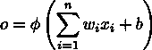

其中 `xi` 表示输入特征，`wi` 是应用于输入的相应权重，`b` 是偏置项，`ϕ` 是激活函数。层中的每个神经元都有助于确定后续层的计算，并在形成复杂的层次表示中起着关键作用。

神经元在网络内部被组织成层。当考虑多个层时，神经元的用用表达力最强。输入层作为入口，隐藏层处理信息，输出层提供结果。以下示例演示了单层感知器：

```python
import numpy as np 
# 定义激活函数 
def sigmoid(x):
    return 1 / (1 + np.exp(-x)) 
# 输入数据 
inputs = np.array([0.7, 0.3]) 
# 定义权重和偏置
weights = np.array([0.6, 0.4]) 
bias = 0.1 
# 计算输出 
output = sigmoid(np.dot(weights, inputs) + bias)
```

上面的示例中，我们演示了使用激活函数的简单神经网络。激活函数（如 sigmoid、修正线性单元 `ReLU` 和双曲正切 `tanh`）为网络引入了非线性：

- **Sigmoid 函数**：`ϕ(x)=images/image-9EEKB0W8.png` 将输入转换到 0 到 1 之间的范围，使其适用于二分类。
- **ReLU 函数**：`ϕ(x)=max(0,x)`。在深度网络中常用，可加速收敛。
- **Tanh 函数**：将输入转换到 `[-1, 1]` 范围，有助于均值化。

通过深入研究数据从输入层到输出层的交互和流动，可以对网络架构的全面理解。以下示例将之前的单层设置扩展涉及多个神经元和隐藏层的前馈神经网络：

```python
import numpy as np 
# 定义激活函数 
def relu(x):
    return np.maximum(0, x) 
def sigmoid(x):
    return 1 / (1 + np.exp(-x)) 
# 输入数据 
input_data = np.array([0.4, 0.6, 0.9]) 
# 第一隐藏层的权重 
weights_hidden1 = np.array([[0.5, 0.2, 0.1], [0.8, 0.3, 0.7]]) 
bias_hidden1 = np.array([0.4, 0.1]) 
# 输出层的权重 
weights_output = np.array([0.6, 0.9]) 
bias_output = 0.1 
# 前向传播 
hidden_layer_input = np.dot(weights_hidden1, input_data) + bias_hidden1 
hidden_layer_output = relu(hidden_layer_input) 
output_layer_input = np.dot(weights_output, hidden_layer_output) + bias_output 
final_output = sigmoid(output_layer_input)
print("Final Output of Network:", final_output)
```


1. **误差计算**：网络预测值与实际输出之间的差异，通常使用均方误差或分类任务中的交叉熵等损失函数进行计算。

2. **权重调整**：误差的反向传播，采用随机梯度下降（`SGD`）等算法，更新模型参数（权重和偏置）以迭代减少误差。

3. **收敛**：迭代更新持续进行直到收敛，收敛标志着网络在任务上达到了满意的性能。

在较大的网络中，复杂度随着深层架构的增加而增加，许多隐藏层通过从数据中逐步提取更抽象的特征，有助于捕捉分层表示。然而，这种复杂性也引发了挑战，例如梯度消失问题，这可以通过采用仔细的初始化、如 `Adam` 等高级优化器以及擅长处理非线性的激活函数来解决。

神经网络在各个领域具有多功能性，这在从图像分类、视觉目标识别、语言翻译到医学诊断等任务领域表现得卓越。网络架构的设计和训练范式的选择取决于预期应用，这凸显了神经网络在现代人工智能应用中的适应性和鲁健性。在这些探索过程中，经验技术与理论理解相结合，指导了针对特定任务微调架构的必要性，并在深度、容量和计算效率之间进行平衡。

上述所描述的对神经网络的基础性理解，神化了构建和优化这些强大预测模型的本质。这种架构包含着变革流程的潜力，以科学和实践的严谨性驱动创新，强化了人工智能领域中独创、精确和持续改进的原则。

### 6.2 训练神经网络

神经网络的训练过程构成了程序骨干，使这些计算模型能够从数据中学习，通过经验自适应地提高其性能。在监督学习背景下，训练涉及对模型参数进行微调，通过涵盖正向和反向传播的循环过程，最小化给定数据集上的预测误差。本节详细检查了这些基本机制和相关的优化技术，并结合说明性代码示例以阐其实际应用。

### 前向传播

前向传播是训练周期中的初始阶段，网络处理输入数据以产生输出预测。这涉及将输入信号通过网络层，其中每个神经元根据预定义的权重和偏置处理其输入，随后将其输出传递后续层。在数学上，这表示为：

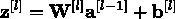

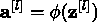

其中 `W[l]` 和 `b[l]` 代表第 `l` 层的权重和偏置，`z[l]` 是线性变换输入，`a[l−1]` 是上一一层的激活值，`ϕ` 是激活函数。

考虑一个使用 Python 和 NumPy 的简单前向传播场景：

```python
import numpy as np # Activation function
def relu(x):
    return np.maximum(0, x) 
# 给定输入
input_data = np.array([0.2, 0.5, 0.9])
# 定义权重和偏置
weights_1 = np.array([[0.1, 0.3, 0.5], [0.4, 0.7, 0.9]])
bias_1 = np.array([0.1, 0.2])
weights_2 = np.array([0.6, 1.0])
bias_2 = 0.3 
# 经过第一个隐藏层的前向传播
z_1 = np.dot(weights_1, input_data) + bias_1
a_1 = relu(z_1) 
# 计算最终输出
z_output = np.dot(weights_2, a_1) + bias_2
output = relu(z_output)
print("Output of Forward Propagation:", output)
```

这段代码阐明了前向传播如何通过连续层传输输入，产生用于后续学习阶段的中间结果。

### 反向传播

反向传播（或反 back 传播）是神经网络训练的基石，允许调整权重和偏置。其主要功能是利用链式法则计算损失函数对每个参数的梯度。当与优化策略结合时，这些梯度指导了参数应如何调整以减少网络的预测误差。

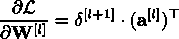

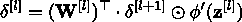

其中 `δ[l]` 代表第 `l` 层的误差项，`ℒ` 是损失函数，`⊙` 表示逐元素乘积。

反向传播的程序设计涉及迭代更新网络参数。一个使用 Python 的实现示例说明了这一概念：

```python
import numpy as np # Initialization of derivatives for demonstration
dW_1 = np.zeros_like(weights_1)
db_1 = np.zeros_like(bias_1)
dW_2 = np.zeros_like(weights_2)
db_2 = np.zeros_like(bias_2)
# 假设某些梯度（仅用于演示）
gradients = np.ones_like(output) 
# 经过输出层的反向传播
delta_output = gradients * derivative_relu(z_output)
dW_2 += np.outer(delta_output, a_1)
db_2 += delta_output 
# 经过第一个隐藏层的反向传播
delta_1 = np.dot(weights_2.T, delta_output) * derivative_relu(z_1)
dW_1 += np.outer(delta_1, input_data)
db_1 += delta_1 
# 使用学习率更新权重和偏置
learning_rate = 0.01
weights_1 -= learning_rate * dW_1
bias_1 -= learning_rate * db_1
weights_2 -= learning_rate * dW_2
bias_2 -= learning_rate * db_2
print("Updated weights and biases after Backpropagation:\n", weights_1, bias_1, weights_2, bias_2)
```

该算法通过沿损失函数的梯度下降来迭代减少预测误差，目标是局部最小值。

### 优化技术

优化策略推进了最小化损失函数的要任务。各种优化器动态修改学习率，提高收敛速度并缓解鞍点等问题的影响。每种方法都有独特的优势，可调节神经网络训练的性能和效率。我们在下面探索了一些最主要的优化技术：

**随机梯度下降 (`SGD`)**：使用小批量数据而非整个数据集来更新参数值，从而提高了计算效率并引入了有助于跳局部最小值的随机性。

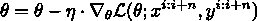

其中 `η` 是学习率，`θ` 代表正在优化的参数。

**动量 (Momentum)**：对 `SGD` 的增强，通过引入动量项来累积过去的梯度，从而抑制震荡并在一致的梯度方向上加速收敛。

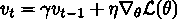

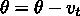

项 `γ` 控制对当前速度的贡献率。

**Adam 优化器**：一种特别有利于噪声数据或稀疏梯度的自适应学习率优化器。`Adam` 结合了 `RMSProp` 和带动量的 `SGD` 的优点：

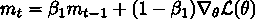

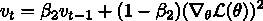

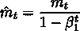

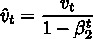

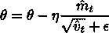

这些策略的使得训练过程更加精细，根据网络不断演变的参数和输入数据特征有效地调整学习。


训练神经网络涉及迭代评估，以衡量模型对未见数据的泛化能力。常见方法对分类任务使用 `accuracy`（准确率）、`precision`（精确率）、`recall`（召回率）和 `F1 score` 等验证指标，对回归任务则使用 `mean squared error`（均方误差）和 `root mean squared error`（均方根误差）。

此外，监控监控 `loss` 和 `accuracy` 等模型指标有助于理解过拟合和欠拟合等现象，为超参数调整策略提供指导。

最后，训练神经网络包含了前向传播与反向传播方法之间的协同作用。这些过程共同塑造了网络，优化其预测能力，从而能够在各个应用领域部署稳健的 AI 系统。通过精细的调优、监控和评估，从业人员可以有效利用神经网络的变革潜力，推动机器学习和人工智能的进步。

### 6.3 深度学习架构

深度学习架构代表了神经网络的高度专门化配置，旨在通过海量数据集和复杂模式解决复杂的现实世界问题。这些架构为从图像识别、自然语言处理到自动驾驶和医疗诊断的众多应用提供了骨干。深度学习的标志在于其分层模型，能够直接从原始数据中学习表示，而仅需少量的人工特征工程。

### 卷积神经网络 (CNNs)

卷积神经网络专为空间数据（如图像和视频识别任务）定制，因为它们具有捕捉空间层次结构的内在能力。它们由卷积层、池化层和全连接层组成，逐步收敛到对输入数据的层次理解。

### 卷积层

卷积层利用滤波器（或 `kernels`）通过在输入数据上进行卷积来提取特征图，保留空间关系并强调局部模式。该操作的数学表达式为：

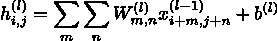

其中 `hi,j(l)` 是第 `l` 层的输出，`Wm,n(l)` 是卷积，`b(l)` 是偏置项。

代码示例：

```python
import numpy as np # Sample input data 
input_data = np.array([[1, 2, 3, 0], [4, 5, 6, 1], [7, 8, 9, 0], [0, 1, 2, 3]]) # Define a 2x2 kernel 
kernel = np.array([[1, -1], [-1, 1]]) # Perform convolution 
output = np.zeros((3, 3)) 
for i in range(3):
    for j in range(3):
        output[i, j] = np.sum(input_data[i:i+2, j:j+2] * kernel) 
print("Convolution Output:\n", output)
```

### 池化层

池化层（如 `max pooling` 最大池化）通过汇总数据区域对特征图进行下采样，引入了空间不变性并降低了计算负载。“Max pooling` 从每个区域提取最大值，定义如下：

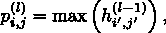

其中 `i',j′` 是池化窗口内的索引。

```python
import numpy as np # Sample feature map 
feature_map = np.array([[1, 3, 2], [4, 6, 5], [7, 8, 9]]) # Max pooling with 2x2 window and stride 1 
pooled_output = np.zeros((2, 2)) 
for i in range(2):
    for j in range(2):
        pooled_output[i, j] = np.max(feature_map[i:i+2, j:j+2]) 
print("Max Pooled Output:\n", pooled_output)
```

### 全连接层

在 CNN 架构中，全连接层用于对特征图进行高层推理，将其转换为最终输出格式（如类别概率）。这些层通过以下方程跨整个特征图计算加权和：

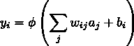

产生对输入数据丰富的表示总结。

## 循环神经网络 (RNNs)

循环神经网络擅长处理序列任务，通过循环传播建立时间步之间的依赖关系。通过维护捕获前一个时间步信息的状态，RNN 在涉及语言建模和时间序列预测等序列的任务中表现出色。

RNN 传播的核心方程是：

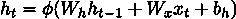

其中 `ht` 是隐藏状态，`Wh` 和 `Wx` 分别是循环权重和输入权重。

考虑一个基于 Python 的示例来阐明 RNN 处理：

```python
import numpy as np # Initial hidden state 
h_prev = np.array([0.0]) # Sample input sequence 
x_sequence = np.array([0.1, 0.3, 0.5, 0.7]) # Weights and bias 
W_h = np.array([0.4]) 
W_x = np.array([0.6]) 
b_h = np.array([0.2]) # Process sequence 
for x_t in x_sequence:
    h_prev = np.tanh(np.dot(W_h, h_prev) + np.dot(W_x, x_t) + b_h) 
    print(f"Hidden state: {h_prev}")
```

## 长短期记忆网络 (LSTM)

LSTM 是 RNN 的高级变体，通过引入门控机制来控制信息流，改进了捕捉长期依赖的能力。该架构包含输入门、遗忘门和输出门，通过细胞状态辅助信息的保留和丢弃。

LSTM 操作遵循：


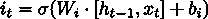

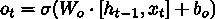


利用 LSTM 增强了模型建模序列的能力。

## 生成对抗网络 (GANs)

生成对抗网络围绕两个对抗神经网络——生成器和判别器。生成器试图产生与真实数据无异的输出，而判别器将输入分类为真或假。生成器的目标是最小化：

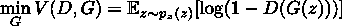

而判别器努力最大化：


竞争训练机制产生了强大的生成能力，应用涵盖图像合成到数据增强。

考虑一个简单的 GAN 架构：

```python
import torch # Define simple fully connected networks for the generator and discriminator 
class Generator(torch.Module):
    def __init__(self):
        super(Generator, self).__init__()
        self.layer = torch.nn.Linear(10, 2)
    def forward(self, z):
        return torch.sigmoid(self.layer(z))

class Discriminator(torch.Module):
    def __init__(self):
        super(Discriminator, self).__init__()
        self.layer = torch.nn.Linear(2, 1)
    def forward(self, x):
        return torch.sigmoid(self.layer(x))

# Initialize generator and discriminator 
generator = Generator() 
discriminator = Discriminator() # Sample input to generator 
noise = torch.randn(10) 
generated_data = generator(noise) # Score with discriminator 
score = discriminator(generated_data) 
print("GAN output score:", score.item())
```

## 自编码器

自编码器促进了降维、去噪和无监督特征学习。它由一个将输入数据映射到潜在空间表示的编码器和一个重建原始输入的解码器组成，该架构旨在最小化重建误差。此类生成模型对于压缩和意义表示至关重要。

## 集成与应用

深度学习架构整合了多种技术和配置，使从业人员能够设计出针对特定问题领域的解决方案。在 CNN、RNN、GAN 和自编码器之间进行选择取决于数据结构、任务需求以及计算资源的考量。


深度学习的进一步进步不断演进，研究正向感受野分析、注意力机制以及增强的模型解释性方向发展。通过有意识地整合深度学习架构，从业者们释放了跨越多个领域的潜力，为整个技术光谱的变革性工作奠定了基础。这种整合性的方法巩固了深度学习在人工智能探索与应用中不可或的资产地位。

### 6.4 卷积神经网络

卷积神经网络（`CNNs`）由于其在处理和解释视觉数据方面的高效性，在深度学习领域取得了显著的成就。`CNNs` 的架构特别适用于处理图像的网格状拓扑结构，利用卷积操作来检测和学习输入中特征的空间层级结构。本节将深入探讨 `CNNs` 的详细工作机制，包括其基础组件、数学基础以及在图像和视频识别任务中的实际应用。

### CNN 的核心组件

`CNNs` 的主要构建模块包括卷积层、池化层和全连接层。这些组件共同协作处理并学习输入数据的分层表示。

### 卷积层

卷积层在 `CNNs` 中至关重要，设计用于将输入数据与一组可学习的过滤器（`kernels`）进行卷积，以产生特征图。内核在输入上滑动，计算点积，并有效检测边缘、纹理和形状等局部模式。

从数学角度来看，由卷积滤波器 `Wk` 在输入 `x` 上产生的单个特征图 `hk` 的操作表示为：


其中 `*` 表示卷积操作，`bk` 是偏置。

考虑一个使用 `Python` 和 `TensorFlow` 应用卷积操作的实际示例：

```python
import tensorflow as tf # 定义样本输入和内核
input_data = tf.constant([[[[1], [2], [3]], [[4], [5], [6]], [[7], [8], [9]]]], dtype=tf.float32) 
kernel = tf.constant([[[1]], [[-1]], [[0], [1]]], dtype=tf.float32) 
# 执行 2D 卷积
output = tf.nn.conv2d(input_data, kernel, strides=[1, 1, 1, 1], padding='SAME') 
print("Convolutional Output:\n", output.numpy())
```

### 激活函数

在卷积操作后采用非线性激活函数，如 `Rectified Linear Unit`（`ReLU`），以引入非线性，使 `CNNs` 能够学习线性关系之外的复杂映射。`ReLU` 的定义如下：


与传统的 `sigmoid` 或双曲正函数相比，`ReLU` 在 `CNNs` 中更受青睐，因为它具有诱稀疏特性以及缓解梯度消失问题的能力。

### 池化层

池化层通常位于卷积层之后，执行下采样操作，在减少维度降低计算需求的同时，保留显著的空间信息。最大池化（Max pooling）是一种常用技术，它选择每个池化窗口内的最大值，定义为：


这种下采样引入了平移不变性，有助于在不同物体位置实现稳定的识别。

示例实现：

```python
import tensorflow as tf # 样本 2D 特征图
feature_map = tf.constant([[[[1], [3]], [[4], [2]]]], dtype=tf.float32) 
# 应用 2x2 最大池化
pooled = tf.nn.max_pool2d(feature_map, ksize=2, strides=1, padding='VALID') 
print("Pooled Output:\n", pooled.numpy())
```

#### 归化层

批量归一化经常集成到 `CNN` 架构中，通过归一化激活值来稳定学习率，从而加速敛。这种归一化过程表示为：


其中 `μ` 和 `σ²` 是批均值和方差，`ε` 是一个小的常数。


循环神经网络（RNNs）是专为序列数据处理设计的特殊神经网络架构，这种数据固有存在于时间序列分析、自然语言处理以及其他数据点之间相互依赖的领域。RNN 的特点在于它们能够通过循环连接维持形式的记忆，从而允许信息在不同的时间步之间持续。然而，原生 RNN（vanilla RNNs）具有局限性，特别是在保留长期依赖方面，这通过其高级变体长短期记忆网络（LSTMs）得到了有效解决。

# 理解循环神经网络

RNN 由神经元之间的循环连接组成，形成一个通过串行处理输入向量来引导序列预测的环。这些循环允许它们维持隐藏状态 `ht`，从而影响未来的预测。RNN 隐藏状态的通用更新规则定义为：


其中：

- `ht` 是时间 `t` 时的隐藏状态。
- `Wh` 和 `Wx` 分别是隐藏到隐藏层以及输入到隐藏层的权重矩阵。
- `ϕ` 是非线性激活函数，传统上是双曲正切（`tanh`），用于压缩网络输出。
- `xt` 表示时间 `t` 时的输入。

# RNN 的前向传播

RNN 中的前向传播是迭代的，使用上一步维持的隐藏状态计算每个时间步的输出。以下是一个使用 Python 和 NumPy 实现的示例代码：

```python
import numpy as np
def rnn_cell_forward(x_t, h_prev, W_x, W_h, b):
    return np.tanh(np.dot(W_x, x_t) + np.dot(W_h, h_prev) + b)

# 初始化参数
W_x = np.random.randn(5, 5)
W_h = np.random.randn(5, 5)
b = np.random.randn(5)

# Sample 输入序列
sequence = [np.random.randn(5) for _ in range(4)]

#初始隐藏状态
h = np.zeros((5,))

# 跨时间步的前向传播
for x_t in sequence:
    h = rnn_cell_forward(x_t, h, W_x, W_h, b)
    print("Hidden state:", h)
```

# RNN 面临的挑战

尽管设计直观，但 RNN 由于梯度消失问题，在学习长期依赖方面面临困难。在反向传播过程中，梯度在通过长序列反向传播时往往会减小，从而抑制有效学习。为了应对这个问题，人们设计了更复杂的架构，如 LSTM。

# 长短期记忆网络 (LSTMs)

LSTM 由 Hochreiter 和 Schmidhuber 引入，旨在通过其门控架构更好地保留长期依赖。LSTM 的独特结构包含记忆单元、门以及调节信息流的各种权重：

- **遗忘门 `ft`**：决定从单元状态中丢弃哪些信息。

- **输入门 `it`**：控制哪些新信息存储在单元状态中。

- **单元候选 `ct`**：生成包含在状态中的潜在值。

- **输出门 `ot`**：决定部分单元输出作为隐藏状态的输出。


整体单元状态更新结合了这些门：


以及隐藏状态更新：


# 在 Python 中实现 LSTM

以下是简版 LSTM 的实现，重点在于核心计算：

```python
import numpy as np
def sigmoid(x):
    return 1 / (1 + np.exp(-x))

def lstm_cell_forward(x_t, h_prev, c_prev, W_f, W_i, W_o, W_c, b_f, b_i, b_o, b_c):
    concat = np.concatenate((h_prev, x_t), axis=0)
    forget_gate = sigmoid(np.dot(W_f, concat) + b_f)
    input_gate = sigmoid(np.dot(W_i, concat) + b_i)
    output_gate = sigmoid(np.dot(W_o, concat) + b_o)
    cell_candidate = np.tanh(np.dot(W_c, concat) + b_c)
    c_state = forget_gate * c_prev + input_gate * cell_candidate
    h_state = output_gate * np.tanh(c_state)
    return h_state, c_state
```


```python
import numpy as np
import matplotlib.pyplot as plt
from sklearn.preprocessing import PolynomialFeatures
from sklearn.linear_model import LinearRegression
from sklearn.metrics import mean_squared_error

# Generate data
np.random.seed(0)
X = np.linspace(0, 10, 100)
Y = np.sin(X) + np.random.normal(scale=0.5, size=X.shape)

# High degree polynomial features
poly = PolynomialFeatures(degree=15)
X_poly = poly.fit_transform(X.reshape(-1, 1))

# Fit regression model
model = LinearRegression().fit(X_poly, Y)
Y_pred = model.predict(X_poly)

# Evaluate and plot
mse_train = mean_squared_error(Y, Y_pred)
plt.scatter(X, Y, label='Data')
plt.plot(X, Y_pred, color='red', label='Fitted Curve')
plt.title('Overfitting in Polynomial Regression')
plt.xlabel('X')
plt.ylabel('Y')
plt.legend()
plt.show()
print("Training MSE:", mse_train)
```

上述代码生成了一个复杂的多项式模型，它可以完美地拟合训练数据，但在新数据上的表现会糟糕，这说明了过拟合。

# 正则化技术

正则化是指引入额外信息防止过拟合，通常通过限制模型复杂的惩罚方法来实现。深度学习中的正则化方法包括：

### 1. L1 和 L2 正则化

L1 正则化（Lasso）将权重绝对值添加到损失函数中，产生参数较少的稀疏模型：


L2 正则化（Ridge）将权重的平方值添加到损失函数中，有效通过惩罚大权重：


### 示例：

```python
import numpy as np
from sklearn.linear_model import Ridge

# Create an artificial dataset
X = np.random.rand(100, 3)  # 100 个样本，3 个特征
Y = np.dot(X, np.array([1.5, -2.0, 1.0])) + np.random.randn(100) * 0.1

# Train Ridge model
ridge_model = Ridge(alpha=1.0)
ridge_model.fit(X, Y)
print("Ridge Weights:", ridge_model.coef_)
```

### 2. Dropout

Dropout 在训练过程中随机丢弃神经网络中的单元（神经元），以防止神经元的共同适应。它有助于在网络内部开发独立的特征检测器，增强泛化能力：

```python
from tensorflow.keras.models import Sequential
from tensorflow.keras.layers import Dense, Dropout

# Define a sequential model
model = Sequential([
    Dense(64, activation='relu', input_shape=(20,)),
    Dropout(0.5),
    Dense(32, activation='relu'),
    Dropout(0.5),
    Dense(1, activation='sigmoid')
])
print(model.summary())
```

### 3. 批量归一化 (Batch Normalization)

批量归一化对每个批次（mini-batch）的层输入进行标准化，从而缓解与内部协变量偏移相关的问题。它能稳定并加速训练，并伴随着轻微的正则化效果：

```python
from tensorflow.keras.models import Sequential
from tensorflow.keras.layers import Dense, Dropout

# Define a sequential model
model = Sequential([
    Dense(64, activation='relu', input_shape=(20,)),
    Dropout(0.5),
    Dense(32, activation='relu'),
    Dropout(0.5),
    Dense(1, activation='sigmoid')
])
print(model.summary())
```
（注：为 Batch Normalization 提供的源文本包含了 Dropout 的代码；我已按照源块中的内容保留了它。）

```python
from tensorflow.keras.models import Sequential
from tensorflow.keras.layers import Dense, Dropout

# Define a sequential model
model = Sequential([
    Dense(64, activation='relu', input_shape=(20,)),
    Dropout(0.5),
    Dense(32, activation='relu'),
    Dropout(0.5),
    Dense(1, activation='sigmoid')
])
print(model.summary())
```

### 4. 数据增强

数据增强通过对输入数据应用随机变换来增加训练集的多样性：

```python
from tensorflow.keras.preprocessing.image import ImageDataGenerator

# Define data augmentation generator
datagen = ImageDataGenerator(
    rotation_range=20,
    width_shift_range=0.2,
    height_shift_range=0.2,
    shear_range=0.2,
    zoom_range=0.2,
    horizontal_flip=True
)
```

### 5. 早停 (Early Stopping)

早停在验证集上的上的性能停止提升时停止训练过程，防止模型过拟合训练数据：

```python
from tensorflow.keras.callbacks import EarlyStopping

# Define early stopping callback
early_stopping = EarlyStopping(monitor='val_loss', patience=5, restore_best_weights=True)
```


```python
import tensorflow as tf # Define a simple sequential model model = tf.keras.Sequential([
    tf.keras.layers.Dense(units=128, activation='relu', input_shape=(784,)),
    tf.keras.layers.Dropout(0.2),
    tf.keras.layers.Dense(units=10, activation='softmax')
]) # Compile the model
model.compile(optimizer='adam',
              loss='sparse_categorical_crossentropy',
              metrics=['accuracy'])
# Training the model on example data
# train_images, train_labels = fetch_your_data_function()
# model.fit(train_images, train_labels, epochs=5)
```

TensorFlow 的生态系统包含了用于可视化的 `TensorBoard`、用于移动和嵌入式设备的 `TensorFlow Lite`，以及用于在生产环境中部署机器学习模型的 `TensorFlow Serving`。

### PyTorch

`PyTorch` 由 Facebook 的 AI 研究实验室开发，以其动态计算图和直观的设计而闻名，使其成为研究人员进行实验和原型设计的首选。`PyTorch` 促进了易用性和集成，通过其强大的社区和库支持，鼓励广泛的自定义和扩展。

### 核心特性：

- 动态计算图支持灵活的模型修改。
- 原生支持 `CUDA`，实现无缝的 GPU 加速。
- 广泛的生态系统，包括 `TorchText`、`TorchVision` 和 `TorchAudio` 等库。

### 示例：使用 PyTorch 实现神经网络

```python
import torch
import torch.nn as nn
import torch.optim as optim
# 定义一个简单的前馈神经网络网络
class SimpleNet(nn.Module):
    def __init__(self):
        super(SimpleNet, self).__init__()
        self.fc1 = nn.Linear(28*28, 128)  # 假设输入大小为 28x28
        self.relu = nn.ReLU()
        self.fc2 = nn.Linear(128, 10)
    def forward(self, x):
        x = self.fc1(x)
        x = self.relu(x)
        x = self.fc2(x)
        return x
# 实例化模型，定义损失和优化器
model = SimpleNet()
criterion = nn.CrossEntropyLoss()
optimizer = optim.Adam(model.parameters(), lr=0.001)
# 前向传播和优化逻辑模拟
# inputs, labels = fetch_your_data_function()
# optimizer.zero_grad()
# outputs = model(inputs)
# loss = criterion(outputs, labels)
# loss.backward()
# optimizer.step()
```

# Keras

`Keras` 最初作为一种高级神经网络库被开发，现在已集成到 `TensorFlow` 中，同时保留了其作为独立 API 的身份。`Keras` 设计旨在实现对深度神经网络的快速实验，并通过其用户友好的 API 简化模型构建过程。

### 核心特性：

- 直观且人类可读的 API。
- 支持多个后端（`TensorFlow`、`Microsoft Cognitive Toolkit`、`Theano`）。
- 模块化且可扩展，促进了快速原型设计。

### 示例：Keras 模型定义与训练

```python
from tensorflow import keras
from tensorflow.keras import layers
# 使用 Keras 定义一个简单的 MLP 模型
model = keras.Sequential([
    layers.Dense(64, activation='relu', input_shape=(784,)),
    layers.BatchNormalization(),
    layers.Dense(10, activation='softmax')
]) # 编译并训练模型
model.compile(optimizer='adam',
              loss='sparse_categorical_crossentropy',
              metrics=['accuracy'])
# 在示例数据上训练模型
# model.fit(train_images, train_labels, epochs=10)
```

# JAX

`JAX` 是 Google Research 开发的一个用于高性能数值计算和机器学习的库。它的特点是能够将原生 Python 和 `NumPy` 函数转换为在 GPU 上高效运行的代码，并具有自动微分能力。

### 特性：

- 可组合的函数变换（例如 `autodiff` 和向量化）。
- 支持在多 GPU 上进行并行计算。
- 与 `NumPy` 的兼容性。

### 示例：使用 JAX 进行模型训练

```python
import jax
import jax.numpy as jnp
from jax import grad, jit, vmap
### 激活函数
def relu(x):
    return jnp.maximum(0, x)
# 简单的神经网络向传播
def predict(parameters, inputs):
    W, b = parameters
    return relu(jnp.dot(inputs, W) + b)
# 优化梯度
def loss(parameters, inputs, targets):
    predictions = predict(parameters, inputs)
    return jnp.mean((predictions - targets))
```

# MXNet

Apache `MXNet` 由亚马逊支持，是一种用于神经网络扩展训练的灵活深度学习库。

### 特性：

- 跨 GPU 的扩展性和性能。
- 支持符号和命令式编程。
- 多语言绑定，包括 Python、Java 和 R。

### 示例：MXNet 实现

```python
import mxnet as mx
from mxnet import gluon, autograd, nd
# 定义简单的网络
net = gluon.Sequential()
net.add(gluon.nn.Dense(128, activation="relu"),
        gluon.nn.Dense(64, activation="relu"),
        gluon.nn.Dense(10))
net.initialize(mx.init.Xavier())
# 模拟训练
trainer = gluon.Trainer(net.collect_params(), 'adam', {'learning_rate': 0.001})
# 假设数据和标签
# data, label = fetch_your_data_function()
# 前向反向传播
with autograd.record():
    output = net(data)
    loss = gluon.loss.SoftmaxEntropyLoss()(output, label)
loss.backward()
trainer.step(batch_size)
```

# Caffe 和 Caffe2

`Caffe` 最初由 Berkeley AI 研究开发，用于高效特征提取的卷积架构，是一个强大的深度学习框架。尽管它的人气不如 `PyTorch` 和 `TensorFlow` 等更动态的框架，但其继任者 `Caffe2` 与 `PyTorch` 合并，以利用 Facebook 的进展，专注于可扩展生产。

### Caffe 的核心特性：

- 最初专注于图像分类和深度信念网络。
- 由于其效率和速度，在前向传播中提供了高性能。

### Caffe 模型定义

`Caffe` 并不那么依赖代码，而是更多地依赖模型定义文件（`.protxt`）和权重文件（`.caffemodel`），通过 C++ 或 Python API 直接使用。


自然语言处理（NLP）是人工智能领域的一个关键领域，它使机器能够理解和生成人类语言。本章详细介绍了文本处理的关键技术，如分词、词干提取和词形还原，并深入探讨了情感分析和文本分类等高级方法。文中强调了语言模型和词嵌入（包括 `Word2Vec` 和 `GloVe` 等算法）在捕捉词间关系方面的重要性。此外，本章还探索了 `Transformers` 和注意力机制等前沿进展，以及命名实体识别、信息提取和语音识别等实际应用，彰显了 NLP 在技术领域的变革性作用。

## 7.1

## 自然语言处理基础

自然语言处理（NLP）是人工智能和计算语言学中的一个核心领域。它侧重于使机器有效地理解和生成人类语言输入。其主要目标是促进人与机之间以自然的方式通信，超越传统的指令编程模式。NLP 整合了计算机科学、语言学、认知科学和心理学的原理，用于处理和分析大量的自然语言数据。

这一过程涉及多个阶段，其中一个阶段是将人类语言转换为机器可以处理的格式。本节深入探讨了 NLP 的基础原理，并对其重要性和随时间的发展提供了见解。我们深入研究了构成 NLP 流水线的组件，包括句法切、分词、词性标注和句法分析等步骤，每个步骤都是语言处理框架不可或缺的一部分。

NLP 系统建立在语言数据的结构化表示之上，通常采用计算模型来管理自然语言的复杂性。NLP 中采用的基础模型之一是概率语言模型，它支持机器对句子中的下一个单词进行预测，从而实现更流畅的对话系统。该模型熟悉的实例是 `n-gram` 模型，其中单词的概率是根据前置 `n-1` 个单词决定的。

```python
import nltk
from nltk import bigrams, FreqDist
from collections import defaultdict
sentence = "this is a simple example sentence to demonstrate an n-gram model"
tokens = nltk.word_tokenize(sentence.lower())
# Generate bigrams
bigrams = list(nltk.bigrams(tokens))
# Initialize a dictionary to store frequency counts
bigram_freq = defaultdict(lambda: defaultdict(int))
# Update frequency counts for w1, w2 in bigrams:
    bigram_freq[w1][w2] += 1
# Calculate probabilities for w1 in bigram_freq:
for w1 in bigram_freq:
    total_count = float(sum(bigram_freq[w1].values()))
    for w2 in bigram_freq[w1]:
        bigram_freq[w1][w2] /= total_count
# Display probabilities
print(bigram_freq)
```

双元语法（Bigrams）形成了最简单的语言上下文模型，允许我们捕捉相邻单词之间的依赖关系。更高级的语言模型，如隐马尔可夫模型（`HMMs`）和递归神经网络（`RNNs`），提供了管理序列数据中更长、更复杂依赖的能力，反映了更自然的人类语言模式。

NLP 的重大挑战是语言歧义，它出现在不同的语言层面：词汇、语法和语义。词歧义涉及具有多个含义的单词；句法歧义涉及会导致不同解释的句子结构；语义歧义则涉及句子或短语层面的意义。这些歧义通过各种方法来解决。

解析的两种主要形式是依存法分析和成分法分析。依存法分析关注单词之间的关系，而成分法分析处理短语和成分的层级结构。

```python
import spacy
# Load spaCy’s English model
nlp = spacy.load("en_core_web_sm")
# Text to parse
text = "The cat sat on the mat."
# Parse text
doc = nlp(text)
# Extract dependency
for token in doc:
    print(f"{token.text} -> {token.dep_} -> {token.head.text}")
```


文本预处理是自然语言处理（NLP）中的一个关键步骤，涉及将原始文本转换为清洁且格式化的输入，以便进行后续的处理和分析。这一阶段对于消除数据中的噪声和不一致性至关重要，有助于机器学习算法和语言模型高效处理数据。预处理阶段包含多项技术，为分类、情感分析和语言建模等任务准备文本数据。

从本质上说，文本数据通常是非结构化的，并且由于不同作者和语境之间语法、拼写和词汇使用的差异而具有内在的变异。文本预处理旨在消除这种变异。在这里，我们将深入探讨文本预处理涉及的关键技术，讨论它们的用途、复杂性和实现方式。

### 分词 (Tokenization)

预处理的第一步是分词，即将文本切分成称为标记（tokens）的较小组件，通常是单词或短语。分词是基础性的，因为后续步骤如句法分析、词性标注和命名实体识别都需要被分成分标记的数据。分词器可以是简单的，通过空格和标点符号分割文本；也可以是复杂的，考虑特定语言的规则。

```python
import nltk # Sample text
text = "This is an example sentence to demonstrate tokenization." # Tokenize text into words
word_tokens = nltk.word_tokenize(text)
print(word_tokens) # Tokenize text into sentences
sentence_tokens = nltk.sent_tokenize(text)
print(sentence_tokens)
```

### 停用词移除 (Stop Word Removal)

分词之后，通常会执行停用词移除。停用词是常见的词，如“is”、“and”、“the”，这些词经常被从文本数据中移除，因为它们携带的语义价值很小，并且可能会干扰相关特征。库通常提供各种语言的预定义停用词列表，允许根据需要进行自定义。

```python
from nltk.corpus import stopwords # Load English stop words
stop_words = set(stopwords.words('english')) # Remove stop words from tokenized words
filtered_tokens = [word for word in word_tokens if word.lower() not in stop_words]
print(filtered_tokens)
```

### 词干提取与词还原 (Stemming and Lemmatization)

在移除停用词后，采用词干提取和词还原将单词还原为基础或或根形式。词干提取涉及剪掉单词后缀以产生词干，这通常会产生非语言单词，但能有效降低向量空间模型中的维度。流行的词干提取算法包括 `Porter Stemmer` 和 `Snowball Stemmer`。

```python
from nltk.stem import PorterStemmer # Initialize the stemmer
stemmer = PorterStemmer() # Apply stemming to the filtered tokens
stemmed_tokens = [stemmer.stem(word) for word in filtered_tokens]
print(stemmed_tokens)
```

词还原是一个更精细的过程，通过考虑单词的词性将单词转换为其字典基础形式或词元。这个过程通常确保返回的单词是真实的单词，而不是截后的形式。

```python
from nltk.stem import WordNetLemmatizer # Initialize the lemmatizer
lemmatizer = WordNetLemmatizer() # Apply lemmatization to the filtered tokens
lemmatized_tokens = [lemmatizer.lemmatize(word, pos='v') for word in filtered_tokens]
print(lemmatized_tokens)
```

### 归一化技术 (Normalization Techniques)

文本预处理流水线还可能包括大小写归一化，这种方法涉及将所有字符转换为统一（通常是小写），以避免“Apple”和“apple”等单词之间的区别。这一预处理步骤减少了单词表示中的冗余。

```python
# Normalize case of tokens
normalized_tokens = [word.lower() for word in word_tokens]
print(normalized_tokens)
```

标点符号移除是另一项预处理任务，旨在消除不对语义内容但可能给文本分析引入噪声的字符。

```python
import string # Remove punctuation from normalized tokens
no_punctuation_tokens = [word for word in normalized_tokens if word not in string.punctuation]
print(no_punctuation_tokens)
```

对于涉及数值数据的应用，可能需要数字归一化，将数字替换为标准化的标记或进行适当缩放，特别是在情感分析中，以区分量级。

```python
import re # Replace numbers with a special token 'NUM'
number_normalized_tokens = [re.sub(r'\d+', 'NUM', word) for word in no_punctuation_tokens]
print(number_normalized_tokens)
```

空白符归一化是另一个考虑因素，特别是在空格起句法作用的语言中。移除多余的空格，确保只保留有意义的间距。

在整个过程中，文本预处理必须保留对当前分析任务至关语义信息，在减少数据噪声和保留意义数据模式之间取得平衡。

### 高级预处理技术 (Advanced Preprocessing Techniques)

高级文本预处理技术包括 N-gram 生成，涉及提取连续的标记序列以捕捉上下文和短语级信息。通过从单词标记扩展到 n-gram，系统可以更好地识别短语结构和词的共现。

```python
from nltk import ngrams # Generate bigrams (n=2)
bigrams = list(ngrams(no_punctuation_tokens, 2))
print(bigrams) # Generate trigrams (n=3)
trigrams = list(ngrams(no_punctuation_tokens, 3))
print(trigrams)
```


一种常见的方法是使用经过训练的机器学习模型来识别指示情感的模式。这些模型使用标注了情感标签的数据集开发，涵盖了从经典算法（如 `Naive Bayes` 朴素贝叶斯和 `Support Vector Machines` (`SVM`)）到先进的神经网络架构。

```python
from sklearn.feature_extraction.text import CountVectorizer 
from sklearn.model_selection import train_test_split 
from sklearn.naive_bayes import MultinomialNB 
from sklearn.metrics import accuracy_score, classification_report 
# Sample data
documents = ["I love this product", "This is the worst service", "Not happy with the purchase", "Absolutely fantastic", "Would not recommend"] 
labels = ["positive", "negative", "negative", "positive", "negative"] 
# Vectorize text data 
vectorizer = CountVectorizer() 
X = vectorizer.fit_transform(documents) 
# Split data into training and testing
X_train, X_test, y_train, y_test = train_test_split(X, labels, test_size=0.2, random_state=42) 
# Train Naive Bayes classifier

classifier = MultinomialNB() 
classifier.fit(X_train, y_train) 
# Predict and evaluate
y_pred = classifier.predict(X_test) 
print("Accuracy:", accuracy_score(y_test, y_pred)) 
print(classification_report(y_test, y_pred))
```

深度学习方法，特别是卷积神经网络 (`CNNs`) 和长短期记忆网络 (`LSTM`)，由于其能够在无需手动提取特征的情况下学习复杂的模式而变得日益重要。这些模型尤其是当它们与 `Word2Vec` 或 `GloVe` 等预训练词嵌入结合时，能够提供更卓越的情感分析性能。

```python
import numpy as np 
from keras.preprocessing.text import Tokenizer 
from keras.preprocessing.sequence import pad_sequences 
from keras.models import Sequential 
from keras.layers import Embedding, LSTM, Dense 
# Sample data
documents = ["I love this product", "This is the worst service", "Not happy with the purchase", "Absolutely fantastic", "Would not recommend"] 
labels = np.array([1, 0, 0, 1, 0])  # Positive:1, Negative:0 
# Tokenize and pad sequences 
tokenizer = Tokenizer() 
tokenizer.fit_on_texts(documents) 
sequences = tokenizer.texts_to_sequences(documents) 
data = pad_sequences(sequences, maxlen=5) 
# Define LSTM model
model = Sequential() 
model.add(Embedding(input_dim=50, output_dim=8, input_length=5)) 
model.add(LSTM(units=16)) 
model.add(Dense(1, activation='sigmoid')) 
# Compile and train the model
model.compile(optimizer='adam', loss='binary_crossentropy', metrics=['accuracy']) 
model.fit(data, labels, epochs=10) 
# Evaluate on new data
predictions = model.predict_classes(data) 
print(predictions)
```

转向文本分类，该任务是将大量的文本语料库组织成有意义的类别。传统的文本分类采用基于规则和机器学习模型，基于提取的特征创建决策边界。然而，目前的趋势是利用神经网络和基于 Transformer 的架构，特别是 `BERT` (`来自 Transformer 的双向编码表示`)，它为文本分类提供了上下文嵌入。

文本分类任务通常需要将文本转换为数值表示。基础模型使用基于计数的方法，如词袋模型词频逆文档频率 (`TF-IDF`)，而更高级的模型使用词嵌入来捕捉语义信息。

```python
from sklearn.feature_extraction.text import TfidfVectorizer 
from sklearn.svm import SVC 
# Sample data
documents = ["Email offers free cruises", "Business meeting tomorrow", "Congratulations on winning!", "Join us for free ice cream", "Review the contract today"] 
labels = ["spam", "not_spam", "spam", "spam", "not_spam"] 
# Vectorize text with TF-IDF
tfidf_vectorizer = TfidfVectorizer() 
X = tfidf_vectorizer.fit_transform(documents) 
# Train and test split
X_train, X_test, y_train, y_test = train_test_split(X, labels, test_size=0.2, random_state=42) 
# Train SVM classifier
svc_classifier = SVC(kernel='linear') 
svc_classifier.fit(X_train, y_train) 
# Evaluate model
y_pred = svc_classifier.predict(X_test) 
print("Accuracy:", accuracy_score(y_test, y_pred)) 
print(classification_report(y_test, y_pred))
```

处理多语言和特定领域的文本分类涉及迁移学习，即使用在大量数据集上预训练的模型，并针对特定任务进行微调。`BERT` 及其变体（如 `RoBERTa` 和 `DistilBERT`）由于其能够通过自注意力机制和 Transformer 编码器理解上下文，在这些领域表现出色。

虽然情感分析和文本分类增强了洞察力的提取和数据组织，但在处理讽刺和辞性语言时仍然存在挑战，这些内容对于模型来说准确解释仍然是一项难题。专门的技术和细致的模型不断演进，以缓解这些问题。

结合利用情感分析和文本分类为有效的决策、市场分析和内容审核提供了全面的工具。随着这些任务变得日益复杂，系统必须整合海量多样化数据，反映文化动态并适应新兴的语言趋势。对这些任务卓越性能的追求推动了 NLP 研究的进展以及日益复杂的语言技术的发展。

## 7.4

## 语言模型与词嵌入

语言模型和词嵌入是自然语言处理 (`NLP`) 的基石，在使机器有效理解和操作人类语言方面发挥着至关作用。这些概念构成了许多 NLP 应用的核心，为有意义地理解和生成文本数据提供了框架。

语言模型为词序列分配概率，捕捉文本中的句法和语义规律。复杂语言模型的发展增强了预测句子后续单词的能力，实现了文本生成、机器翻译和对话系统等任务。传统的 n-gram 模型是基础语言模型，它们根据前面的 `n - 1` 个词估计单词的概率。尽管这些模型非常简单，但它们为更高级的概率模型奠定了基础。

```python
from nltk import ngrams, FreqDist 
from collections import defaultdict 
# Sample text
text = "The quick brown fox jumped over the lazy dog." 
# Tokenize text into words 
tokens = text.lower().split() 
# Generate trigrams 
trigrams = list(ngrams(tokens, 3)) 
# Initialize a frequency distribution 
freq_dist = FreqDist(trigrams) 
# Compute the probability of each trigram 
trigram_probabilities = defaultdict(float) 
total_trigrams = float(len(trigrams)) 
for trigram in trigrams: 
    trigram_probabilities[trigram] = freq_dist[trigram] / total_trigrams 
print(trigram_probabilities)
```

n-gram 模型依赖局部上下文限制了其捕捉长程依赖的能力。为了解决这些局限性，现代语言模型采用了神经网络。递归神经网络 (`RNNs`)，特别是长短期记忆网络 (`LSTM`)，通过编码时间序列并在较远距离内保持上下文，彻底了该领域。


```python
from keras.models import Sequential
from keras.layers import Embedding, SimpleRNN, Dense
from keras.preprocessing.text import Tokenizer
from keras.preprocessing.sequence import pad_sequences
import numpy as np

# Sample text data
data = ["hello world", "machine learning", "natural language processing", "deep learning models"]

# Tokenize text data
tokenizer = Tokenizer()
tokenizer.fit_on_texts(data)
sequences = tokenizer.texts_to_sequences(data)
X = pad_sequences(sequences, maxlen=5)

# Define RNN model
model = Sequential()
model.add(Embedding(input_dim=50, output_dim=8, input_length=5))
model.add(SimpleRNN(units=16))
model.add(Dense(1, activation='softmax'))

# Compile model
model.compile(optimizer='adam', loss='categorical_crossentropy')

# Print model summary
model.summary()
```

尽管取得了进展，RNN 在并行化和捕捉层次依赖关系方面存在局限性，这导致了 Transformer 模型的兴起。Transformer 模型放弃了递归结构，转采用自注意力机制，并行处理所有单词。由于能够对长距离依赖并具有内在的可扩展性，该模型成为了许多先进 NLP（自然语言处理）系统的基础。

语言模型是词嵌入（word embeddings）的基础，词嵌入是一种协作技术，用于将单词转换为稠密向量表示，用以编码语义信息。词嵌入假设出现在相似语境中的单词往往具有相似的含义，利用这一观点来捕捉语言的细微之处。

Word2Vec 是一种广泛用于创建词嵌入的算法。它提供了两种架构：连续词袋模型 (CBOW) 和 Skip-gram。CBOW 从周围的上下文预测目标词，而 Skip-gram 则反之——在给定目标词的情况下预测上下文词汇。

```python
from gensim.models import Word2Vec
# Sample text data
sentences = [["hello", "world"], ["machine", "learning"], ["natural", "language", "processing"], ["deep", "learning", "models"]]

# Train Word2Vec model
word2vec_model = Word2Vec(sentences, vector_size=50, window=5, min_count=1, sg=1)

# Access word embeddings
word_vector = word2vec_model.wv['learning']
print(word_vector)
```

GloVe (Global Vectors for Word Representation) 是另一种强大的嵌入算法，它的特点是利用从全局语料库中收集的词共现统计来生成向量空间，从而强调了局部上下文和全局统计信息。

```python
from gensim.models import KeyedVectors
# Load pre-trained GloVe model
glove_model = KeyedVectors.load_word2vec_format('glove.6B.50d.txt', binary=False)

# Get vector for a word
word_vector = glove_model['language']
print(word_vector)
```

词嵌入通过将单词转换为向量，巧妙地捕捉了语法和语义、单词之间的关系，甚至是类比推理（例如：国王 - 男 + 女 = 女王）。这些稠密的固定长度向量在实用性上超过了 TF-IDF 等稀疏高维向量。

在最近的进展中，上下文感知嵌入（如 BERT，基于 Transformer 的双向编码器表示）允许根据句子语境生成动态单词表示。BERT 模型利用深层双向性，捕捉来自前一个和后续单词的上下文，显著提升了众多 NLP 任务的性能。

词嵌入的实现促进了各种应用，包括语义相似性评估、信息检索和语言翻译。嵌入实现的向量运算揭示了底层的语言关系，使其成为情感分析、摘要生成和本体构建中无价的工具。

现实世界中的用法通常涉及使用预训练嵌入，它们提供了一个强大的初始化基础，并结合特定领域的任务进行微调。上述嵌入和模型是通向自然语言理解进化的关键催化剂，对人工智能领域做出了基础性贡献。

总结，语言模型与词嵌入之间的相互作用为语言学家、数据科学家和 AI 从业者提供了开启洞察、促进创新并创建计算系统的方法。随着研究的不断，这些嵌入以及与其他模态的整合继续重塑 NLP 的边界，描绘了机器理解的未来。

## 7.5

## Transformer 与注意力机制

Transformer 和注意力机制的出现标志着自然语言处理（NLP）新时代的到来，提供了处理复杂语言结构的空前能力。这些创新极极地改变了语言任务的格局，为翻译、摘要、问答等模型提供了动力。这种变革的核心是在生成新单词或短语时关注句子的不同部分，允许系统有效地利用上下文。

Transformer 是 Vaswani 等人于 2017 年的一种模型架构，其特点是依赖自注意力机制而非递归来处理序列。这种方法的标志是能够同时检查并关联序列中的元素，使模型能够忽略单词间的距离捕捉全局依赖。

### 自注意力机制

自注意力机制通过将查询和键值对映射到输出来运作，其中查询、键、值和输出都是向量。注意力得分源于查询与键的点积，决定了对输入序列不同部分的注意力权重。

在这里，`Q`、`K` 和 `V` 分别代表查询、键和值的矩阵，`dk` 是键的维度。通过对这些向量进行归一化，模型根据上下文的重要性调节数据点的影响，实现了动态关注。

### 多头注意力

为了增强模型的能力，Transformer 使用多头注意力，并行运行多个自注意力操作，允许模型同时关注序列的不同部分。这一过程涉及将数据分成多个较小的子集，对每个子集执行自注意力并合并结果。多头注意力为 Transformer 模型提供了更好地捕捉数据多方面关系的方法。

每个注意力头产生一个大小为 `dv` 的输出，`WO` 是可训练的权重矩阵。

### Transformer 架构

Transformer 架构由可重复的编码器和解码器层组成，每层独立运行。每个编码器层包含两个子层：多头自注意全连接前馈网络。这些层促进了位置无关变换的学习，促进了高效的信息处理。

解码器增加了第三个子层，对编码器输出的注意力，允许解码器整合输入序列的上下文信息——这对于语言翻译任务至关重要。


```python
import torch from torch import nn
class TransformerEncoderLayer(nn.Module):
    def __init__(self, d_model, num_heads, d_ff, dropout_rate):
        super(TransformerEncoderLayer, self).__init__()
        self.self_attn = nn.MultiheadAttention(embed_dim=d_model, num_heads=num_heads, dropout=dropout_rate)
        self.ffn = nn.Sequential(
            nn.Linear(d_model, d_ff),
            nn.ReLU(),
            nn.Linear(d_ff, d_model)
        )
        self.layernorm1 = nn.LayerNorm(d_model)
        self.layernorm2 = nn.LayerNorm(d_model)
        self.dropout = nn.Dropout(dropout_rate)
    def forward(self, src, src_mask):
        # Self-attention
        src2 = self.self_attn(src, src, src, attn_mask=src_mask)[0]
        src = src + self.dropout(src2)
        src = self.layernorm1(src)
        # Feedforward network
        src2 = self.ffn(src)
        src = src + self.dropout(src2)
        src = self.layernorm2(src)
        return src
```

# Transformers 的影响

Transformers 在自然语言处理（NLP）领域的深远影响可以通过 `BERT`（来自 Transformer 的双向编码器表示）、`GPT`（生成式预训练 Transformer）及其后续者 `RoBERTa` 和 `T5` 等模型得到最好的证明。这些模型在海量语料上进行预训练，并针对特定任务进行微调，由于对上下文复杂的理解，在处理复杂的语言任务方面表现出色。

Transformers 在并行化方面表现，能够同时处理整个序列，与循环模型相比显著缩短了训练时间。它们的灵活性允许在不调整模型架构的情况下处理变长序列，这种灵活性在句子级和文档级建模任务中得到了强调。

## 实际应用

Transformers 超了传统的语言边界，应用于生物信息学中的蛋白质序列分析、与卷积操作结合的计算机视觉，甚至用于强化学习领域。它们的通用性在于其底层机制：`注意力`（attention），它直观地模拟了人类的认知聚焦。

```python
from transformers import BertTokenizer, BertForSequenceClassification
from transformers import Trainer, TrainingArguments
# 加载预训练模型和分词器
tokenizer = BertTokenizer.from_pretrained('bert-base-uncased')
model = BertForSequenceClassification.from_pretrained('bert-base-uncased')
# 示例文本和标签
texts = ["This is great!", "I am not happy with this."]
labels = [1, 0]  # 假设二分类：正面=1，负面=0
# 编码文本输入
inputs = tokenizer(texts, padding=True, truncation=True, return_tensors='pt')
inputs['labels'] = torch.tensor(labels)
# 设置训练器
training_args = TrainingArguments(output_dir="./results", num_train_epochs=3)
trainer = Trainer(model=model, args=training_args, train_dataset=inputs)
# 训练模型
trainer.train()
```

## 未来方向与挑战

尽管 Transformers 在 NLP 中设定了新的基准，但仍面临待解决的挑战。这些包括训练大型模型所需的计算成本以及高耗能过程对环境的影响。解决方案涉及优化算法、更高效地利用迁移学习，以及在不损害性能的情况下提高模型效率的架构创新。

新兴趋势指向在 Transformer 框架内整合多种模态——如文本、图像和音频，推动语言模型在语境中理解并生成多模态数据。随着研究的进展，重点在于创建不仅强大全面，而且在伦理上负责、具有可解释性并在更大范围内应用的模型。

Transformers 深远地扩展了 NLP 系统的能力，随着注意力机制的持续进步，它们有望开启更复杂的 AI 驱动应用，反映出对人类语言复杂模式的更深层次的理解和参与。

## 7.6

## 命名实体识别与信息提取

命名实体识别（NER）和信息提取（IE）是自然语言处理（NLP）的关键组件，负责从非结构化文本中识别和提取结构化信息。这些功能在将原始文本数据转换为可操作的洞察方面具有不可价值的价值，支持数据挖掘、知识图谱、自动索引等大量应用。

### 理解命名实体识别

命名实体识别是一个专注于定位并将文本中的命名实体分类到预定义类别的过程，如人物、组织、地点、时间表达式、数量等。NER 是信息提取的基础步骤，有助于组织和分类文档中存在的关键信息要素。因此，NER 系统的性能影响了后续数据检索和分析的有效性。

### NER 中的关键挑战

NER 的主要挑战包括不同数据集之间实体识别的差异，以及由上下文引起的歧义。一个特定的命名实体可能指的是不同的实体，例如“Apple”，它可以指水果，也可以指公司。

### NER 技术和方法

已经开发了多种执行 NER 的方法，从基于规则的系统到先进的神经网络：

- **基于规则的系统**：这些系统依赖人工构建的词表和正则表达式来识别命名实体。虽然对于受控数据有效，但这些系统在新的数据集上的泛化能力较差。
- **监督机器学习**：条件随机场（`CRF`）和隐马尔可夫模型（`HMM`）等算法用于建模序列标记问题，将 NER 任务转换为序列预测任务。这些方法需要标注数据集和大量的特征工程。
- **深度学习模型**：随着深度学习的兴起，循环神经网络（`RNNs`）、长短期记忆网络（`LSTMs`）和 Transformer 模型（例如 `BERT`）主导了 NER 任务。这些模型直接从语料中学习数据驱动的特征，通常比传统技术显著提升了性能。

```python
import spacy # 加载 spaCy 的预训练模型
nlp = spacy.load("en_core_web_sm")
# 示例文本
text = "Apple Inc. is looking at buying U.K. startup for $1 billion."
# 执行 NER
doc = nlp(text)
# 并显示实体
for entity in doc.ents:
    print(entity.text, entity.label_)
```

## 信息提取

信息提取（IE）将目标扩大到实体检测之外，涵盖了实体间关系的识别、事件探索以及文本内容转换为智能结构化数据。

### 信息提取的核心组件

**实体识别**：涉及识别和分类文本中的主要实体。

**实体链接**：将提取的实体连接到参考知识库（如 `Wikidata`），解决歧义。

**关系提取**：识别实体之间的语义关系，对于构建知识图谱等任务至关重要。这里使用的技术包括句法分析和神经关系提取。


## 事件提取
识别文本中讨论的事件，以及扮演各种语义角色的关联实体，从而构建时间线并预测趋势。

## 模板填充
涉及特定语境的结构化模板，对文本进行处理并与这些模板匹配，以实现快速摘要。

```python
from stanza import Pipeline # Initialize the pipeline 
nlp = Pipeline(lang=’en’, processors=’tokenize,pos,lemma,depparse’) # Input text 
text = "Barack Obama was born in Honolulu, Hawaii." # Process the text
doc = nlp(text) # Display dependency relations for sentence
for sentence in doc.sentences:
    for dep in sentence.dependencies:
        print(dep)
```

## 信息提取中的高级方法
深度学习的最新进展使得模型超越了传统的信息提取（IE）方法。基于 transformer 架构的模型，如 OpenAI 的 `GPT` 和 Google 的 `BERT` 已用于提取复杂的关系和事件。这些模型表现出稳健的上下文理解能力，受益于广泛的预训练和特定领域的微调。

语义角色标记（SRL）等框架的引入为谓词-论元结构提供了更深层次的理解，捕捉了单词在句子中扮演的角色，这对于确定不同实体和事件之间的相互作用至关重要。

## 应用与现实案例
命名实体识别（NER）和信息提取的适用性跨越多个领域：

- **法律与合规**：从法律文本和监管文件中自动提取相关信息，简化了合规流程。
- **医疗健康**：从医疗记录中提取患者和治疗信息，增强了临床决策支持系统。
- **金融领域**：自动从报告中提取财务数据，加速投资策略分析。
- **内容管理**：总结海量科学文献，帮助研究人员高效识别相关研究。

## 工作流中整合 NER 和 IE
将 NER 和 IE 整合到业务工作流中涉及与数据管理平台集成，并使用 API 促进自动化提取。系统通常采用流水线，根据反馈不断完善和调整提取模型，提高准确性并扩大适应性。

## 结论
命名实体识别和信息提取是需要对文本数据进行复杂分析场景的核心。随着自然语言处理的发展演进，这些技术逐渐变得更加精细和强大，释放了不断扩展的领域中的潜力。解决如多语言处理和特定领域实体识别等挑战将继续是活跃探索的领域，在不断互联的数字格局中推进这些系统的能力。通过专门的研究和创新，NER 和 IE 承诺提供更大的实用，使组织和个人能够利用现代世界海量数据的无尽潜力。

## 7.7
## 语音识别与合成
语音识别和合成是自然语言处理（NLP）领域中引人注目的领域，专注于将口语转换为文本以及反之。这些技术改变了人机交互，使设备能够处理通过语音命令发出的请求，并从文本输入生成类人语音。随着从数字助手到自动客户服务系统的广泛应用，精通这些技术为现代计算提供了竞争优势。

### 语音识别
语音识别，又称为自动语音识别（ASR），是机器识别口语并将其翻译文本的过程。这一过程包含几个复杂阶段，包括信号处理、特征提取、声学建模和语言建模。

#### 语音识别的基础阶段
- **信号处理**：涉及将模拟音频信号转换为数字格式。该过程通常包括过滤、采样和量化，为进一步分析做好准备。
- **特征提取**：使用梅尔频率倒谱系数（`MFCCs`）等技术提取代表语音能量和频率的声学特征，将听觉信号转换为频谱以便有效分析。
- **声学建模**：将提取的特征与音位单元连接。通常使用隐马尔可夫模型（`HMMs`）和深度神经网络（`DNNs`）将声学信号映射到语言单元。
- **语言建模**：结合概率来预测单词序列，通常使用 n-grams 或更复杂的神经网络架构。语言模型通过考虑上下文单词用法帮助纠正潜在错误。
- **解码**：将声学信号转换为最可能的文本序列。

```python
import speech_recognition as sr # Create a recognizer instance 
recognizer = sr.Recognizer() # Load an audio file 
with sr.AudioFile('example.wav') as source: # Record the audio with source:
    audio = recognizer.record(source)
try:
    text = recognizer.recognize_google(audio) # Recognize the speech using Google’s API
    print("识别文本:", text)
except sr.UnknownValueError:
    print("无法识别音频")
except sr.RequestError:
    print("无法请求结果")
```

#### 语音识别的挑战
- **噪声与变异性**：口音、背景噪声和语音细微差别会影响识别。
- **上下文敏感性**：区分同音词需要更细致的模型。
- **资源限制**：实时 ASR 系统必须优化延迟和计算需求。

最近的发展采用了卷积神经网络（`CNNs`）、长短期记忆网络（`LSTMs`）和 Transformer 模型等深度学习架构来缓解这些挑战。

### 语音合成
语音合成，通常被称为文本转语音（TTS），涉及将文本输入转换为自然的语音。该过程需要考虑音位转录、韵律建模和语音信号生成。

#### 语音合成的关键组件
- **文本归一化**：将数字、缩写和特殊字符转换为标准的文本表示以便处理。
- **音位转录**：涉及将文本转换为音素（语音中的基本单位），便于发音。
- **韵律建模**：捕捉节奏、重音和语调，对于生成自然且迷人的语音至关重要。
- **语音信号生成**：使用拼接合成、参数化合成或神经波编码器（如 `WaveNet`）合成音频波形。

```python
import pyttsx3 # Initialize the TTS engine 
engine = pyttsx3.init() # Set properties 
engine.setProperty('rate', 150) # 语音速度 
engine.setProperty('volume', 1) # 音量级 (0.0 到 1.0) # 输入文本 
text = "你好，来到文本转语音的世界。" # Convert text to speech
engine.say(text)
engine.runAndWait()
```

#### 语音合成的改进
- **波形拼接**：拼接预录的语音片段，受限于对大量口语数据库的需求。
- **共振峰与发音合成**：模拟人类声道机制，适用于定制化语音合成。
- **神经 TTS**：深度网络方法（如 `Tacotron 2` 和 `WaveNet`）通过模拟自然语音模式并无缝整合韵律超越了早期技术。

#### 语音技术的现实应用：


语音助手：`Siri`、`Alexa` 和 `Google Assistant` 提供动态交互服务，利用 `ASR` 和 `TTS` 做出有效响应。

无障碍工具：`ASR` 和 `TTS` 为视障和听障人士提供了无足价值的帮助，确保了无障碍访问。

客户服务自动化：自动电话系统提高了效率，提供了无缝的音频交互。

### 语音处理的未来方向：

- 情感识别：通过语音中的情感使设备具备上下文感知能力。
- 多语言处理：扩展能力以同时处理多语种的 `ASR` 和 `TTS`。
- 边缘计算：在保持效率和隐私的同时，将计算本地化。

随着语音识别合成技术的进步，这些技术将进一步融入到日常生活中，改变人类与机器交互的方式。它们不仅承诺提高效率和便利性，还预示着机器能够以理解和共情回应人类需求的未来，以创新的方式融合人类语言的复杂性和无障碍性。

# 第 8 章

## 计算机视觉

计算机视觉是人工智能的一个动态领域，专注于让机器能够解释来自世界的视觉信息。本章概述了分析视觉数据所需的各种图像处理技术，如滤波和边缘检测。它探索了特征检测和匹配方法，如 `SIFT` 和 `ORB`，这些方法对于识别模式和物体至关重要。书中重点介绍了基于深度学习的方法，包括用于图像分类的卷积神经网络，以及用于物体检测和分割的高级算法。本章最后讨论了计算机视觉在自动驾驶汽车和增强现实等领域的实际应用。

## 8.1 计算机视觉的基础

计算机视觉作为人工智能的基石，涉及让机器能够解释和理解视觉数据。这涉及到对数字图像或视频的获取、处理、分析和高层理解，从而产生计算模型或符号信息。该领域弥补了低级图像处理与用于理解图像的高级机器学习之间的差距，致力于让机器实现与人类视觉相似的视觉理解。

计算机视觉的过程涵盖了几个关键阶段：图像获取、图像处理和图像分析。通过涵盖这些阶段，计算机视觉的研究在人工认知领域开启了无数种可能。


### 图像获取

计算机视觉的第一步是使用相机等传感器捕捉数字图像。图像获取过程将物理参数转换为可以进行计算处理的图像格式。这一阶段的精度会影响计算机视觉应用的整体质量和可靠性。

- **分辨率**：较高的分辨率可以增强所获取图像的细节，允许更好的分析和解释。
- **色彩深度**：定义用于表示颜色的位数决定了图像中颜色表示的丰富程度。
- **传感器规格**：传感器的类型（例如 `CCD` 或 `CMOS`）和特性（如灵敏度和信噪比）影响所获取图像的质量。

为了用代码说明图像获取的实际操作方面：

```python
import cv2 # 初始化相机
cap = cv2.VideoCapture(0) # 捕捉单帧
ret, frame = cap.read()
if ret:
    # 显示图像
    cv2.imshow('Acquired Image', frame)
    cv2.waitKey(0) # 释放相机
cap.release()
cv2.destroyAllWindows()
```

### 图像处理

对获取的数字图像进行处理在计算机视觉任务中起着至关重要的作用，涉及准备和增强图像以便进一步分析的操作。滤波、变换和增强等技术被用于纠正失真并突出特定方面。

#### 图像滤波

滤波是图像处理中去噪和修改特定图像属性的基础。高斯滤波或中值滤波等技术可以在平滑图像的同时保留重要的边缘和细节。

```python
import cv2 # 加载图像
image = cv2.imread('image.jpg') # 应用高斯滤波
filtered_image = cv2.GaussianBlur(image, (5, 5), 0) # 显示经过滤波的图像
cv2.imshow('Filtered Image', filtered_image)
cv2.waitKey(0)
cv2.destroyAllWindows()
```

#### 边缘检测

边缘检测对于识别图像中的边界至关重要。像 `Canny` 边缘检测器算法通过识别强度变化来分离重要的图像轮廓。

```python
import cv2 # 加载图像
image = cv2.imread('image.jpg', 0) # 应用 Canny 边缘检测
edges = cv2.Canny(image, 100, 200) # 显示边缘
cv2.imshow('Edges', edges)
cv2.waitKey(0)
cv2.destroyAllWindows()
```

### 图像分析

图像分析是从视觉数据中提取意义信息的过程。这通常涉及用于识别模式、分类物体以及从图像中推断语义的算法和模型。

#### 特征提取

特征提取涉及识别相关的特征（如形状、边缘或纹理），以便于后续分类或识别任务。如 `SIFT`、`SURF` 和 `ORB` 等关键点检测算法有助于提取独特特征。

```python
import cv2 # 加载图像
image = cv2.imread('image.jpg', 0) # 初始化 ORB 检测器
orb = cv2.ORB_create() # 检测关键点并计算描述符
keypoints, descriptors = orb.detectAndCompute(image, None) # 在图像上绘制关键点
image_with_keypoints = cv2.drawKeypoints(image, keypoints, None, color=(0, 255, 0)) # 显示带关键点的图像
cv2.imshow('ORB Keypoints', image_with_keypoints)
cv2.waitKey(0)
cv2.destroyAllWindows()
```

#### 物体识别

计算机视觉的核心围绕识别和分类图像中的物体。卷积神经网络（`CNNs`）等模型从根本上改变了物体分类的准确率。

```python
from tensorflow.keras import datasets, layers, models # 加载数据集
(train_images, train_labels), (test_images, test_labels) = datasets.cifar0.load_data() # 归一图像
train_images, test_images = train_images / 255.0, test_images / 255.0
# 构建 CNN 模型
model = models.Sequential([
    layers.Conv2D(32, (3, 3), activation='relu', input_shape=(32, 32, 3)),
    layers.MaxPooling2D((2, 2)),
    layers.Conv2D(64, (3, 3), activation='relu'),
    layers.MaxPooling2D((2, 2)),
    layers.Conv2D(64, (3, 3), activation='relu'),
    layers.Flatten(),
    layers.Dense(64, activation='relu'),
    layers.Dense(10)
])
### 编译模型
model.compile(optimizer='adam',
              loss='sparse_categorical_crossentropy',
              metrics=['accuracy'])
# 训练模型
model.fit(train_images, train_labels, epochs=10, validation_data=(test_images, test_labels))
```

这种 CNN 是一个能够将图像分类分类的基础模型，它利用卷积层从输入图像中提取空间层次，从而学习滤波器以有效总结复杂的视觉模式。

#### 语义理解

机器学习和人工智能的进步使得更深层的语义理解成为可能，允许计算机区分图像数据中的细微类别和物体之间的关联。语义分割和实例检测通过对每个像素进行分类，体现了这种能力，这对于自动驾驶技术至关重要。


计算机视觉的基础理论为该领域的持续演进提供了原则和工具的基石。理解这些原理——从图像的捕获、处理到分析——可以使人们掌握开发算法的核心技能，这些算法能够在视觉上理解并与周围的世界进行交互。通过利用图像数据与复杂模型的协同效应，计算机视觉成为技术与感知交汇处的一个创新领域。

# 8.2

## 图像处理技术

图像处理是计算机视觉领域的一个关键组成，侧重于通过各种技术将原始图像转换为更精细的形式，为后续分析做好准备。这些过程为模式识别、物体区分以及从视觉数据中推断结论的应用铺了道路。本节将深入探讨一些基础图像处理技术，包括滤波、边缘检测和图像变换，旨在有效地增强和处理图像以供后续分析。

### 图像滤波

图像滤波是一种用于平滑或锐化图像的关键技术，旨在减少噪声并增强某些特征。滤波可以通过图像与滤波器掩码（filter mask）或核（kernel）进行卷积，应用线性或非线性操作来实现。两种基本的类型的滤波器如下：

#### 线性滤波器

常用的线性滤波技术包括高斯滤波器（Gaussian filter）、均值滤波器（mean filter）和拉普拉斯滤波器（Laplacian filter）。这些涉及将图像与核进行卷积，核根据周围的像素值来修改像素强度。线性滤波器对于图像模糊、锐化和边缘检测任务至关重要。

```python
import cv2
import numpy as np
# 加载图像
image = cv2.imread('image.jpg')
# 定义高斯核
kernel_size = (9, 9)
sigma = 1.5
# 应用高斯模糊
blurred_image = cv2.GaussianBlur(image, kernel_size, sigma)
# 显示模糊后的图像
cv2.imshow('Blurred Image', blurred_image)
cv2.waitKey(0)
cv2.destroyAllWindows()
```

#### 非线性滤波器

与线性滤波器不同，非线性滤波过程采用非线性变换。一种常见的非线性滤波器是中值滤波器（median filter），它用邻域的中位数替换每个像素的值，从而有效地去除盐粒噪声。

```python
import cv2
# 加载图像
image = cv2.imread('noisy_image.jpg')
# 应用中值滤波
median_filtered = cv2.medianBlur(image, 5)
# 显示滤波后的图像
cv2.imshow('Median Filtered Image', median_filtered)
cv2.waitKey(0)
cv2.destroyAllWindows()
```

### 边缘检测

边缘检测用于识别和分离图像中的剧烈不连续点。边缘通常由于图像强度的局部突然变化产生。检测这些边缘对于从图像中提取结构上的重要元素至关重要，这些元素通常被保留用于机器理解任务。

著名的边缘检测方法包括 Sobel、Prewitt、Laplacian 和 Canny 边缘检测器。这些方法中的每都使用不同的算子或系列滤波器来突出强度的显著变化。

#### Canny 边缘检测

Canny 边缘检测器因其考虑了噪声消除、梯度幅度和边缘连接过程，其边缘检测性能备受推崇，使其对光照变化和噪声具有良好的鲁棒性。

```python
import cv2
# 加载灰度图像
image = cv2.imread('edges.jpg', 0)
# 应用带阈值的 Canny 边缘检测器
edges = cv2.Canny(image, threshold1=100, threshold2=200)
# 显示边缘
cv2.imshow('Canny Edges', edges)
cv2.waitKey(0)
cv2.destroyAllWindows()
```

Canny 方法之所以表现良好，是因为它的多阶段算法，包括使用高斯滤波器进行噪声滤波、梯度计算、消除虚假边缘的非极大抑制以及通过滞后检测（hysteresis）进行边缘跟踪。

#### 拉普拉斯边缘检测

拉普拉斯算子计算图像的二阶导数，有助于增强强度剧烈变化的区域。它通过关注强度变化剧的区域来检测边缘，足以突出那些在一阶导数跨越区域恒定时结果为零的边界。

```python
import cv2
import numpy as np
# 加载灰度图像
image = cv2.imread('image.jpg', 0)
# 应用拉普拉斯算子
laplacian = cv2.Laplacian(image, cv2.CV_64F)
# 转换为绝对比例以便可视化
laplacian_abs = np.absolute(laplacian)
laplacian_8u = np.uint8(laplacian_abs)
# 显示边缘检测图像
cv2.imshow('Laplacian Edge Image', laplacian_8u)
cv2.waitKey(0)
cv2.destroyAllWindows()
```

### 图像变换

图像变换包含了一系列改变图像空间配置的技术。平移、旋转、缩放和仿射变换等变换对于为某些分析过程准备图像是不可不可的，确保了不同样本之间方向、尺寸和裁剪的一性。

#### 几何变换

几何变换通过操纵图像的方向和位置来调整其空间配置。

```python
import cv2
# 加载图像
image = cv2.imread('image.jpg')
# 获取图像尺寸 (h, w)
h, w = image.shape[:2]
center = (w // 2, h // 2)
# 定义 45 度旋转矩阵
M = cv2.getRotationMatrix2D(center, angle=45, scale=1.0)
# 执行旋转
rotated_image = cv2.warpAffine(image, M, (w, h))
# 显示旋转后的图像
cv2.imshow('Rotated Image', rotated_image)
cv2.waitKey(0)
cv2.destroyAllWindows()
```

#### 仿射变换

仿射变换在修改图像的同时保持行的平行性和相对距离。这种变换对于缩放、旋转、平移和剪切等常见调整非常有效。

```python
import cv2
import numpy as np
# 加载图像
image = cv2.imread('image.jpg')
# 定义变换点
pts1 = np.float32([[50, 50], [200, 50], [50, 200]])
pts2 = np.float32([[10, 100], [200, 50], [100, 250]])
# 获取仿射变换矩阵
M = cv2.getAffineTransform(pts1, pts2)
# 应用仿射变换
affine_transformed = cv2.warpAffine(image, M, (image.shape[1], image.shape[0]))
# 显示变换后的图像
cv2.imshow('Affine Transformed Image', affine_transformed)
cv2.waitKey(0)
cv2.destroyAllWindows()
```

#### 傅里叶变换

傅里叶变换促进了图像从空间域转换到频域。它在滤波任务中特别有用，提供了图像内组分频率的视图。

```python
import cv2
import numpy as np
import matplotlib.pyplot as plt
# 加载灰度图像
image = cv2.imread('image.jpg', 0)
# 应用快速傅里叶变换 (FFT)
f_transform = np.fft.fft2(image)
f_shift = np.fft.fftshift(f_transform)
# 计算幅度谱
magnitude_spectrum = 20 * np.log(np.abs(f_shift))
# 可视化幅度谱
plt.subplot(121), plt.imshow(image, cmap='gray')
plt.title('Input Image'), plt.xticks([]), plt.yticks([])
plt.subplot(122), plt.imshow(magnitude_spectrum, cmap='gray')
plt.title('Magnitude Spectrum'), plt.xticks([]), plt.yticks([])
plt.show()
```

结果变换提供了主要频率成分的信息，有助于噪声减少、图像压缩和特征增强。


特征检测与匹配在计算机视觉中起着关键作用，它能够识别并比较图像中的显著点或区域。这些技术对于目标识别、图像拼接、3D 重建和运动跟踪等各种应用至关重要。在本节中，我们将探索用于检测特征的关键机制，如尺度不变特征变换 (`SIFT`)、加速鲁棒特征 (`SURF`) 以及定向旋转 BRIEF (`ORB`)。此外，我们将深入研究跨多幅图像关联相似特征的匹配技术。

## 特征检测

特征检测识别图像中唯一且具有描述性的关键点的过程，这些关键点可以与其他图像进行比较。关键点通常是角点、斑点、脊线或表现出独特强度模式的点。

### 尺度不变特征变换 (SIFT)

`SIFT` 是一种广为人的方法，用于从图像中提取独特且不变的特征，对跨不同图像尺度、旋转和光照的鲁棒匹配做出了巨大贡献。该过程涉及几个阶段：

- **尺度空间极值检测**：算法使用`高斯差分` (`DoG`) 函数来识别对尺度变化不变的潜在关键点。
- **关键点定位**：对关键点进行精炼以确定准确的位置和尺度。
- **方向分配**：根据局部图像梯度方向为每个关键点分配一个方向，以确保旋转不变性。
- **关键点描述符生成**：通过量化关键点区域的梯度形成描述符向量，从而实现高区分度。

```python
import cv2 # Load an image
image = cv2.imread('example.jpg', 0) # Initialize SIFT detector
sift = cv2.SIFT_create() # Detect keypoints and descriptors
keypoints, descriptors = sift.detectAndCompute(image, None) # Draw keypoints on the image
image_with_keypoints = cv2.drawKeypoints(image, keypoints, None, flags=cv2.DRAW_MATCHES_FLAGS_DRAW_RICH_KEYPOINTS) # Display the image with keypoints
cv2.imshow('SIFT Keypoints', image_with_keypoints)
cv2.waitKey(0)
cv2.destroyAllWindows()
```

### 加速鲁棒特征 (SURF)

`SURF` 在 `SIFT` 的基础上进行了增强，提高了计算效率。它利用积分图像进行快速计算，并利用基于 Hessian 矩阵的检测器识别关键点。虽然 `FAST-SURF`（缩写）保留了特征质量，但在速度优先的实时应用中通常更受青睐。

```python
import cv2 # Load an image
image = cv2.imread('example.jpg', 0) # Initialize SURF detector
surf = cv2.xfeatures2d.SURF_create(400) # Detect keypoints and descriptors
keypoints, descriptors = surf.detectAndCompute(image, None) # Draw keypoints on the image
image_with_keypoints = cv2.drawKeypoints(image, keypoints, None, (255, 0, 0), 4) # Display the image with keypoints
cv2.imshow('SURF Keypoints', image_with_keypoints)
cv2.waitKey(0)
cv2.destroyAllWindows()
```

### 定向旋转和旋转 BRIEF (ORB)

`ORB` 作为实时应用的一种成本效益替代方案出现，它融合了 `FAST` 关键点检测器和 `BRIEF` 描述符，具有快速计算和鲁棒性的双重优势。它对图像旋转和尺度具有显著的不不变性，有利于硬件受限的环境。

```python
import cv2 # Load an image
image = cv2.imread('example.jpg', 0) # Initialize ORB detector
orb = cv2.ORB_create() # Detect keypoints and descriptors
keypoints, descriptors = orb.detectAndCompute(image, None) # Draw keypoints on the image
image_with_keypoints = cv2.drawKeypoints(image, keypoints, None) # Display the image with keypoints
cv2.imshow('ORB Keypoints', image_with_keypoints)
cv2.waitKey(0)
cv2.destroyAllWindows()
```

## 特征匹配

匹配是跨多幅图像关联相似特征的过程。

### 暴力匹配器

`暴力`匹配器将一组中的每个描述符与另一组中的所有描述符进行比较，使用距离找到找到最佳匹配。

```python
import cv2 # Load an image
image = cv2.imread('example.jpg', 0) # Initialize ORB detector
image2 = cv2.imread('example.jpg', 0) # Initialize ORB detector
orb = cv2.ORB_create() # Detect keypoints and descriptors
keypoints1, descriptors1 = orb.detectAndCompute(image, None) # Draw keypoints on the image
keypoints2, descriptors2 = orb.detectAndCompute(image2, None) # Draw keypoints on the image
bf = cv2.BFMatcher(cv2.NORM_HAMMING, crossCheck=True) # Use Brute-Force matcher
matches = bf.match(descriptors1, descriptors2) # Match
matches = sorted(matches, key=lambda x: x.distance) # Sort by distance
img = cv2.drawMatches(image, keypoints1, image2, keypoints2, matches[:50], None) # Draw first few matches
cv2.imshow('Brute-Force Matches', img) # Display
cv2.waitKey(0)

### FLANN 匹配器

`FLANN`（快速近似邻域）匹配器提供了一种高效的方案，特别是对于大数据集和需要近似搜索的情况。

```python
import cv2
import numpy as np # Load images
image1 = cv2.imread('example.jpg', 0)
image2 = cv2.imread('example.jpg', 0)
sift = cv2.SIFT_create() # Initialize SIFT detector
keypoints1, descriptors1 = sift.detectAndCompute(image1, None)
keypoints2, descriptors2 = sift.detectAndCompute(image2, None)
# Define FLANN parameters
FLANN_KDTREE = 1
flann_params = dict(algorithm=FLANN_KDTREE, trees=5)
search_params = dict(checks=50)
flann = cv2.FlannBasedMatcher(flann_params, search_params)
# Perform KNN matching
matches = flann.knnMatch(descriptors1, descriptors2, k=2)
# Store only good matches using Lowe’s ratio test
good_matches = []
for m, n in matches:
    if m.distance < 0.7 * n.distance:
        good_matches.append(m)
# Draw matches
img = cv2.drawMatches(image1, keypoints1, image2, keypoints2, good_matches, None)
# Display
cv2.imshow('FLANN Matches', img)
cv2.waitKey(0)
cv2.destroyAllWindows()
```

## 特征检测与匹配的挑战

尽管取得了进步，特征检测与匹配仍面临若干挑战：

- **光照变化**：光照的波动会显著影响特征检测，因为图像梯度和强度高度取决于光照条件。
- **视角变化**：角度和透视的变化改变特征的外观。
- **尺度变化**：特征应在多个尺度上可检测，以确保不同距离拍摄图像的一致性。
- **噪声与干扰**：图像中的缺陷（如噪声和遮挡）可能会阻碍有效检测。

解决这些挑战需要开发鲁棒的特征跟踪算法，并结合深度学习等方法从整体上理解和学习特征，从而对传统的不利因素更高的韧性。


图像分类是计算机视觉领域一项一项性的任务，涉及为图像分配预定义类别的标签。卷积神经网络（`CNNs`）的引入彻底改变了这一领域，极大地提高了分类准确率，并增强了直接从数据自动提取和学习模式的能力。`CNNs` 专为处理和分析视觉数据中的层次模式结构而设计，使其在图像相关任务中异常高效。

`CNNs` 的灵感来自动物视觉皮层的结构和功能，由多个层组成，学习识别图像的不同特征。典型的 `CNN` 架构由几个关键组件或层组成：

### 卷积层
卷积层是 `CNN` 的基石。它使用一组可学习的内核或滤波器对输入图像进行卷积操作。每个滤波器都关注输入的某个特定方面（例如边缘、纹理或模式），生成捕捉空间层次结构的特征图。

卷积操作可以用数学公式定义为：


其中 `I` 是输入图像，`K` 是卷积核，`S` 是生成的特征图。

```python
import torch
import torch.nn as nn
# Define a convolutional layer
conv_layer = nn.Conv2d(in_channels=1, out_channels=1, kernel_size=3, stride=1, padding=1)
# Example input (one channel)
input_tensor = torch.rand(1, 1, 5, 5)
# Apply convolution
output = conv_layer(input_tensor)
print(output)
```

### 激活函数
卷积之后，会应用激活函数来引入非线性，使网络能够从更复杂的数据中学习。线性线性单元（`ReLU`）由于其简单且高效，成为流行的选择。


其中 `f(x)` 代表应用 `ReLU` 后的输出。

```python
import torch
import torch.nn as nn
# Initialize ReLU activation function
relu = nn.ReLU()
# Example input
input_tensor = torch.tensor([-1.0, 0.0, 1.0, 2.0])
# Apply ReLU activation
output = relu(input_tensor)
print(output)
```

### 池化层
池化层执行下采样操作以减少特征图的空间维度，允许网络管理计算复杂度并提高平移不变性。最大池化是一种流行的方法，它在指定的窗口内选择最大值。

```python
import torch
import torch.nn as nn
# Define a max pooling layer
pool_layer = nn.MaxPool2d(kernel_size=2, stride=2)
# Input feature map
input_map = torch.tensor([[[[1.0, 2.0], [3.0, 4.0]]]])
# Apply max pooling
output_map = pool_layer(input_map)
```

### 全连接层
全连接层聚合卷积层和池化层学习的高级特征以进行预测。这些层通常放置在网络的末端，并在通过之前层获得的特征图上操作。

```python
import torch
import torch.nn as nn
# Define a fully connected layer
fc_layer = nn.Linear(in_features=4, out_features=2)
# Example input
flat_input = torch.rand(1, 4)
# Apply the fully connected layer
output = fc_layer(flat_input)
```

### 训练
训练 `CNN` 涉及输入带标签的数据，并通过优化策略（通常是 `SGD` 或 `Adam` 等梯度下降方法）迭代调整参数以最小化误差。

#### 数据集准备
训练的第一步是设置数据集，通常将其划分为训练集和验证子集以评估性能。可以通过归一化和增强通过引入旋转、平移或缩放等变化来增强泛化能力。

#### 定义并训练网络
以下是一个使用 `PyTorch` 处理图像分类问题的示例：

```python
import torch
import torch.nn as nn
import torch.optim as optim
from torchvision import datasets, transforms
# Define transformations for the training set
transform = transforms.Compose([transforms.ToTensor(), transforms.Normalize((0.5,), (0.5,))])
# Load datasets
train_dataset = datasets.MNIST(root='./data', train=True, download=True, transform=transform)
train_loader = torch.utils.data.DataLoader(dataset=train_dataset, batch_size=64, shuffle=True)
# Define a simple CNN
class SimpleCNN(nn.Module):
    def __init__(self):
        super(SimpleCNN, self).__init__()
        self.conv1 = nn.Conv2d(in_channels=1, out_channels=32, kernel_size=5)
        self.pool = nn.MaxPool2d(2, 2)
        self.fc1 = nn.Linear(32 * 12 * 12, 10)
    def forward(self, x):
        x = self.pool(F.relu(self.conv1(x)))
        x = x.view(-1, 32 * 12 * 12)
        x = self.fc1(x)
        return x
# Initialize network and optimizer
net = SimpleCNN()
optimizer = optim.Adam(net.parameters(), lr=0.001)
criterion = nn.CrossEntropyLoss()
# Training loop
for epoch in range(5):
    running_loss = 0.0
    for images, labels in train_loader:
        optimizer.zero_grad()
        outputs = net(images)
        loss = criterion(outputs, labels)
        loss.backward()
        optimizer.step()
        running_loss += loss.item()
    print(f"Epoch {epoch+1}, Loss: {running_loss/len(train_loader)}")
```

为了评估 `CNN` 的充分性，可以使用多种指标，包括准确率、精确率、召回率和 `F1-score`。混淆矩阵等工具可以提供分类器性能的细粒视图，展示跨类别的分类错误计数。

### 超参数调优
通过调整学习率、批量大小、滤波器数量和网络深度等超参数，通常可以获得最优性能。网格搜索或随机搜索等技术可以自动化并加速这一调优过程。

### 正则化
正则化方法包括 `dropout` 和权重衰减，通过简化学习的特征表示并鼓励稀疏性来防止模型过拟合。

```python
import torch
import torch.nn as nn
import torch.nn.functional as F
# Define a CNN with dropout
class CNNWithDropout(nn.Module):
    def __init__(self):
        super(CNNWithDropout, self).__init__()
        self.conv1 = nn.Conv2d(1, 32, kernel_size=5)
        self.pool = nn.MaxPool2d(2, 2)
        self.fc1 = nn.Linear(32 * 12 * 12, 10)
        self.dropout = nn.Dropout(p=0.5)
    def forward(self, x):
        x = self.pool(F.relu(self.conv1(x)))
        x = x.view(-1, 32 * 12 * 12)
        x = self.dropout(x) # Apply dropout
        x = self.fc1(x)
        return x
# Create the network
net = CNNWithDropout()
```

### 迁移学习
迁移学习利用预训练的网络（如 `VGG16`、`ResNet` 或 `MobileNet`），将其学习到的权重适应到新任务。这种做法可以加速收敛，并利用在预训练阶段从海量数据集积累的先验知识。

```python
import torch
from torchvision import models
# Load a pre-trained ResNet model
resnet = models.resnet18(pretrained=True)
# Freeze all layers
for param in resnet.parameters():
    param.requires_grad = False
# Modify the final fully connected layer for the new task
resnet.fc = nn.Linear(resnet.fc.in_features, 10)
# Model is now ready for training on a new dataset
```


在本节中，我们全面探讨了 CNN 在图像分类中的强大性能，为在实际应用中构建和优化模型提供了见解。随着领域的演进，先进架构与训练策略的整合将继续突破边界，为构建稳健、高效的图像分类系统开启新的可能。CNN 的战略性设计模仿了人类视觉的某些特性，这是其在人工智能领域产生深远影响的核心。

## 8.5 目标检测与定位

目标检测是计算机视觉领域的一项基础任务，涉及对图像中对象的识别和定位。除了识别对象的存在外，检测任务还要确定它们在帧内的精确位置。深度学习的兴起使得目标检测取得了显著进展，`YOLO`（一眼看全）和 `Faster R-CNN`（基于区域的卷积神经网络）等模型因其准确性和效率而处于核心地位。本节将深入探讨目标检测与定位的技术、模型和应用。

### 理解目标检测

目标检测涉及两个同时进行的任务：分类和定位。分类确定对象所属的类别，而定位则涉及通过边界框（bounding boxes）指定对象在图像中的空间坐标。该过程可以划分为几个阶段：

*   **特征提取**：利用卷积层提取突出对象存在及其特征的特征。
*   **区域建议**：提出候选对象区域，过滤掉无关区域。
*   **边界框预测**：预测边界框坐标，以最佳方式封装检测到的对象。
*   **分类**：将候选区域归类为预定义的标签集。
*   **后处理**：如`非极大值抑制`（`Non-Maximum Suppression`, `NMS`）等技术可消除冗余的边界框。

### 目标检测的方法

目标检测有多种技术，从使用手工特征的传统方法到基于现代深度学习的方法应有尽。

#### 滑动窗口方法

早期方法是在不同尺度和位置的图像上滑动窗口，使用分类器识别每个框内的对象。尽管这种方法很直观，但计算开销巨大，因此在现代大规模图像处理中的用性受限。

#### 基于区域的 CNN (R-CNN)

`R-CNN` 模型体现了范式的转移，它引入了将区域建议与 `CNNs` 结合的多步流程。尽管在特征复用方面效率很高，但由于重叠区域之间的冗余计算，该方法涉及计算密集型操作。

#### Faster R-CNN

`Faster R-CNN` 是 `R-CNN` 的改进，它集成了区域建议网络（`Region Proposal Network`, `RPN`），直接从 `CNN` 特征图生成高质量的区域建议，通过减少区域建议时间提高了效率。以下是一个使用 `PyTorch` 概述简化工作的代码片段：

```python
import torchvision
from torchvision.models.detection import fasterrcnn_resnet50_fpn
# 加载预训练的 Faster R-CNN 模型
model = fasterrcnn_resnet50_fpn(pretrained=True)
# 将模型切换到评估模式
model.eval()
# 示例输入图像
from PIL import Image
from torchvision.transforms import functional as F
image = Image.open('example.jpg')
image_tensor = F.to_tensor(image)
# 执行目标检测
with torch.no_grad():
    predictions = model([image_tensor])
print(predictions)
```

#### YOLO (一眼看全)

`YOLO` 将检测建模为单一回归问题，在单次评估中直接从完整图像预测边界框和类别概率。通过将图像划分为网格，每个网格单元预测边界框和类别概率，使得 `YOLO` 异常快速，并适用于实时应用。

```python
import cv2
# 加载 YOLO 模型
net = cv2.dnn.readNet("yolov3.weights", "yolov3.cfg")
layer_names = net.getLayerNames()
output_layers = [layer_names[i[0] - 1] for i in net.getUnconnectedOutLayers()]
# 加载图像
image = cv2.imread("example.jpg")
height, width, channels = image.shape
# 为模型准备图像
blob = cv2.dnn.blobFromImage(image, scalefactor=0.00392, size=(416, 416), mean=(0, 0, 0))
```


目标检测与定位是人工智能系统发展的基础，体现了视觉与计算的协同作用。随着这些技术的成熟，它们在不同领域的应用范围将不断扩大，使机器能够以前所未有的精度和速度与其环境进行感知和交互。高级模型与不断演进的计算资源相结合将是实现检测任务前所未有的粒度和效率的关键，从而增强计算机视觉的触达能力。

## 8.6

## 语义分割与实例分割

计算机视觉中的分割是将图像划分为多个片段的过程，通过识别和标记具有特定属性的像素，实现详细的图像分析。语义分割和实例分割是该领域中的两个高级任务，每项任务都针对不同的目标执行全面的像素级分类。这些任务增强了机器对视觉数据的理解，为自动导航和医学影像等应用提供了必要的技能。

### 语义分割
语义分割为图像中的每个像素分配一个类别标签，将其分割为如汽车、道路或天空等连贯类别。这种方法不区分同一类别的不同物体，而是通过将场景中相似的部分标记为相同类别来提供整体性的理解。

### 全卷积网络 (FCNs)
FCN 是现代语义分割的基础，它有效地将标准卷积网络适配于密集预测任务。通过将全连接层替换为卷积层，FCN 实现了像素级分类，并保留了图像的空间层次结构。

```python
import torch
import torch.nn as nn
import torch.optim as optim
from torchvision import datasets, transforms

# 定义一个简单的全卷积网络类
class SimpleFCN(nn.Module):
    def __init__(self, num_classes):
        super(SimpleFCN, self).__init__()
        self.conv1 = nn.Conv2d(3, 64, 3, padding=1)
        self.conv2 = nn.Conv2d(64, 128, 3, padding=1)
        self.conv3 = nn.Conv2d(128, num_classes, 1)
    def forward(self, x):
        x = F.relu(self.conv1(x))
        x = F.relu(self.conv2(x))
        x = self.conv3(x)
        return x

# 模型实例
num_classes = 21  # 例如具有 21 个类别的 PAS2012 数据集
model = SimpleFCN(num_classes)

# 准备示例输入
x = torch.randn(1, 3, 256, 256)
out = model(x)
print(out.shape)  # 输出形状
```

### U-Net 架构
U-Net 架构为医学图像分割开发，它通过带有跳跃连接的编码器-解码器结构彻底改变了语义分割。编码器将图像压缩为特征表示，而解码器则重建图像。

```python
import torch
import torch.nn as nn
import torch.nn.functional as F

class UNet(nn.Module):
    def __init__(self, in_channels, out_channels):
        super(UNet, self).__init__()
        self.encoder = nn.Sequential(
            nn.Conv2d(in_channels, 64, 3, padding=1),
            nn.ReLU(),
            nn.Conv2d(64, 128, 3, padding=1),
            nn.ReLU()
        )
        self.decoder = nn.Sequential(
            nn.Conv2d(128, 64, 3, padding=1),
            nn.ReLU(),
            nn.Conv2d(64, out_channels, 3, padding=1)
        )
    def forward(self, x):
        enc1 = self.encoder(x)
        dec1 = self.decoder(enc1)
        return dec1

x = torch.randn(1, 3, 256, 256)
model = UNet(in_channels=3, out_channels=21)
out = model(x)
print(out.shape)
```

### DeepLab 模型
DeepLab 模型（包括 DeepLabV3）引入了空洞卷积（atrous convolutions）以保持空间分辨率。这种技术在捕捉多尺度上下文方面非常成功。

### 实例分割
实例分割结合了目标检测与语义分割，能够区分不同的实例。与语义分割不同，实例分割会标记每一个物体。

### Mask R-CNN
通过增加一个预测掩码的分支扩展了 Faster R-CNN。它处理区域建议以为每个物体生成二值掩码。

```python
import torch
import torchvision
from torchvision.models.detection import maskrcnn_resnet50_fpn

# 加载预训练的 R-CNN
model = maskrcnn_resnet50_fpn(pretrained=True)
model.eval()

# 准备图像
from PIL import Image
from torchvision import transforms as F
image = Image.open('example.jpg')
image_tensor = F.to_tensor(image)

# 执行实例分割
with torch.no_grad():
    predictions = model(image_tensor)
print(predictions)  # 输出边界框、标签和对应的掩码
```


计算机视觉作为人工智能的一个关键领域，为机器赋予了类人类的视觉感知能力，在多个行业中开启了广泛的应用前景。本节将探索计算机视觉的重要应用，展示了其对医疗保健、汽车、安全、娱乐等领域的变革性影响。理解这些应用可以揭示计算机视觉技术在增强效率、提供洞察以及实现智能决策方面的深刻作用。

## 医疗保健
在医疗保健领域，计算机视觉简化了工作流程，提高了诊断准确性，并支持了创新的治疗方法。AI 驱动的图像分析整合为临床医生提供了更强大的工具和洞察，用于识别疾病、制定治疗方案以及监测患者健康。

### 医学影像
计算机视觉技术被广泛应用于分析医学图像，如 X 光光、MRI 和 CT 扫描。高级算法可以精确检测异常和疾病，有助于早期诊断。例如，卷积神经网络（`CNNs`）被用于区分放射图像中的良性和恶性肿瘤。

```python
import torch
import torch.nn as nn
import torch.optim as optim
from torchvision import datasets, transforms

# 定义一个用于肿瘤分类的 CNN
class TumorClassifier(nn.Module):
    def __init__(self, num_classes=2):
        super(TumorClassifier, self).__init__()
        self.conv1 = nn.Conv2d(1, 32, kernel_size=5)
        self.pool = nn.MaxPool2d(2, 2)
        self.fc1 = nn.Linear(32 * 12 * 12, num_classes)

    def forward(self, x):
        x = self.pool(F.relu(self.conv1(x)))
        x = x.view(-1, 32 * 12 * 12)
        x = self.fc1(x)
        return x

# 加载并预处理数据集，然后训练网络
# 为了简洁起省略了示例
```

### 手术辅助
在机器人辅助手术中，计算机视觉引导机械臂，提供手术精度并确保最小创入。视觉系统允许医生看到详细的解剖结构，帮助以更高的准确性完成复杂的手术。

## 汽车与自动驾驶车辆
计算机视觉为汽车系统注入了智能，支撑了增强车辆模式安全性和自主性的技术基础。

### 高级辅助辅助系统 (ADAS)
`ADAS` 技术利用目标检测和分割来感知环境，检测车道偏移、识别交通标志并识别行人或障碍物，发出警告或纠正指令。

### 自动驾驶
在自动驾驶车辆中，计算机视觉理解复杂的视觉输入以确定导航所需的动作。通过语义分割和 3D 视觉处理，自驾驶汽车能够实时识别路标、信号灯和车辆动态。

```python
import cv2
import numpy as np

def detect_lane_lines(image):
    # 将图像转换为灰度模式
    gray = cv2.cvtColor(image, cv2.COLOR_BGR2GRAY)
    # 应用高斯平滑
    blur = cv2.GaussianBlur(gray, (5, 5), 0)
    # 使用 Canny 进行边缘检测
    edges = cv2.Canny(blur, 50, 150)
    # 定义一个四边形作为掩码
    mask = np.zeros_like(edges)
    ignore_mask_color = 255
    imshape = image.shape
    vertices = np.array([(100, imshape[0]), (400, imshape[0]), (500, imshape[1]), (0, imshape[1])], dtype=np.int32)
    cv2.fillPoly(mask, vertices, ignore_mask_color)
    masked_edges = cv2.bitwise_and(edges, mask)
    # 使用霍夫变换寻找车道
    lines = cv2.HoughLinesP(masked_edges, rho=1, theta=np.pi/180, threshold=50, minLineLength=40, maxLineGap=20)
    line_image = np.copy(image)
    if lines:
        for x1, y1, x2, y2 in lines:
            cv2.line(line_image, (x1, y1), (x2, y2), (255, 0, 0), 10)
    # 将线条图像与原始图像合并
    color_edges = np.dstack((edges, edges, edges))
    combo = cv2.addWeighted(color_edges, 0.8, line_image, 1, 0)
    return combo

# 示例用法
image = cv2.imread('road.jpg')
lane_lines_image = detect_lane_lines(image)
cv2.imshow('Lane Lines', lane_lines_image)
cv2.waitKey(0)
cv2.destroyAllWindows()
```

## 安全与监控
计算机视觉增强了安全系统，提供了复杂的监控功能，可以在减少人工监督的情况下自动检测未经授权的活动或侵入行为。

### 人脸识别
人脸识别系统通过将实时捕获的图像与数据库中的图像进行对比来验证身份。这些系统通过深度学习模型实现，支持安全访问。

### 侵入检测
人脸识别系统通过将实时捕获的图像与数据库中的图像进行对比来验证身份。这些系统通过深度学习模型实现，支持安全访问。

## 农业
智能农业受益于计算机视觉，通过监测作物健康、优化资源分配来提高产量。

### 作物监控
监控系统通过视觉图像监测作物健康、识别虫害并预测生长。

### 精准农业
智能农业受益于计算机视觉，通过监测作物健康、优化资源分配来提高产量。

## 零售与制造
零售和制造部门整合视觉技术以提高效率、改善客户体验并提供创新服务。

### 库存管理
自动化视觉系统准确计数并跟踪库存水平，减少与人工统计相关的开销。

### 质量控制
在制造过程中，计算机视觉检查产品，检测缺陷并及时采取纠正措施，从而保持质量标准。

## 娱乐与增强现实
计算机视觉通过互动式娱乐体验和沉浸式现实技术重塑了参与策略。

### 增强现实 (AR) 与虚拟现实 (VR)
在 `AR` 和 `VR` 系统中，视觉处理通过将虚拟元素精确叠加到物理环境中提供真实感。应用范围涵盖从游戏到复杂的建筑可视化。


在这些多化的应用中，计算机视觉将数据转化为可操作洞察的强大能力，为创新开辟了新地平。通过使机器理解并分析图像，计算机视觉成为智能系统的关键赋能者，重新定义了人机交互，推进了工业流程并丰富了社会福祉。方法、数据增长和计算能力的不断演进预示着日益增长的影响，不断扩展其所触及每个行业的可能性领域。随着持续的进步，未来将由机器观察、解释并与世界进行有意义交互的内在能力，孕育出无数新应用。

# 第 9 章

## 强化学习基础

强化学习是机器学习的一个核心领域，智能体通过与环境交互，并在奖励反馈的引导下学习最优动作。本章探索了核心概念，包括探索与利用之间的权衡，并区分了基于策略和基于价值的方法，如 `Q-learning` 和 `policy gradients`。它对比了无模型和基于模型的方法，并对其各自的优势和应用提供了见解。此外，还讨论了整合深度学习以管理复杂的状态空间。强化学习在机器人领域、游戏和推荐系统中的实际应用说明了其多功能性，而当前的挑战和新兴趋势则阐明了它的未来潜力。

## 9.1 强化学习的核心概念

强化学习（RL）是机器学习的一个分支，其核心目标是使智能体通过与环境交互来学习最优动作，并利用奖励形式形式的观测反馈。这一过程与监督学习和无监督学习不同，纯粹关注最大化随时间增加的累积奖励。为了便于理解，本节将详细阐述典型强化学习设置的组成部分，包括智能体、环境、动作、状态和奖励。这些元素共同构成了强化学习框架，并对于实现任何强化学习算法至关重要。

强化学习智能体在离散的时间步中与环境交互。在每个时间步 `t`，智能体接收有关环境状态的信息，表示为 `st ∈𝒮`，其中 `𝒮` 代表状态空间。随后，智能体在 `at ∈𝒜` 中选择一个动作，其中 `𝒜` 表示动作空间。执行该动作后，智能体接收一个奖励 `rt+1 ∈ℝ` 并转移到新状态 `st+1`。这个循环过程持续进行，理想情况下是获得一个能够最大化时间总期望奖励的策略。

### 1. 智能体与环境

智能体是强化学习框架内的学习者或决策者。它试图通过采取影响环境状态的动作来实现某些目标。环境封装了智能体交互的所有内容。因此，智能体与环境之间清晰的边界有助于智能体的学习和决策过程。核心交互围绕智能体采取动作以及环境通过状态和奖励做出响应。这种交互通常可以建模为马尔可夫决策过程（MDP），其特征为元组 `(𝒮,𝒜,P,R,γ)`，其中：

- `𝒮` 是有限状态集。
- `𝒜` 是有限动作集。
- `P` 是状态转移概率矩阵，`P(s′,r|s,a)`，它定义了给定当前状态 `s` 和动作 `a` 的情况下转移到状态 `s'` 并获得奖励 `r` 的概率。
- `R` 是奖励函数，给出从一个状态-动作对转移后的期望奖励。
- `γ∈[0,1]` 是折扣因子，代表未来奖励相对于即时奖励的重要性。

智能体在 MDP 中的目标是确定一个最优策略 `π*`，这是一个从状态到动作的最优概率分布的映射，旨在最大化期望回报。期望回报定义为折扣奖励的累加和：`Gt = ∑ k=0∞γkrt+k+1`。

### 2. 动作与状态

动作空间 `𝒜` 和状态空间 `𝒮` 可以是离散或连续的，取决于强化学习的具体应用。离散动作空间在数学上通常更容易处理，但可能需要对自然连续的领域进行离散化。连续动作空间更为复杂，通常需要函数近似技术来实现有效的策略表示。

状态封装了环境的可观测配置和决策所需的关键信息。在实践中，完全观测环境可能是不可行的，导致部分可观测马尔可夫决策过程（POMDP）。POMDP 通过考虑观测而非状态来扩展了 MDP，这使得有必要使用信念状态（belief states，对可能环境状态的分布）来表示策略表示。

### 3. 奖励函数

奖励函数作为智能体的反馈机制，引导其朝着期望的行为发展。奖励设计是强化学习系统的关键部分；指定不当的奖励可能导致次优甚至有害的策略开发。奖励应该准确反映系统的最终目标，而不过度指定或无意中引导智能体走向非预期的策略。一个简单的例子是游戏，到达目标可以获得 `+10` 奖励，而像跳悬崖这样结束游戏的动作可能会导致 `-100` 的奖励。挑战在于选择能够正确权衡即时利益与长期收益的奖励。

### 4. 策略、价值函数与贝尔曼方程

策略 `π(a|s)` 描述了智能体在给定状态下选择动作的策略。策略可以是确定性的，即对于每个 `s`，`π` 分配单一动作：`a = π(s)`；也可以是随机性的，即策略提供动作的概率分布：`π(a|s)`。

价值函数估计了智能体处于特定状态的好有多坏，并考虑了其期望回报。

- 状态价值函数 `Vπ(s)`，给出从状态 `s` 开始并遵循策略 `π` 的期望回报。


- 动作价值函数 `Qπ(s,a)`，返回从状态 `s` 开始、采取动作 `a` 然后遵循策略 `π` 的期望回报。


动态规划求解方法（如值迭代或策略迭代）的核心建立在贝尔曼期望方程之上，


反映通过遍历所有可能的动作和状态转移来计算状态值的递归性质。

在旨在学习最优策略的情景中，贝尔曼方程方程将替换为最大化步骤：


使得诸如 `Q-learning` 等方法能够在不需要环境动力学模型的情况下找到最优动作价值函数。

### 5. 实现与理解强化学习核心概念

为了进一步探讨实践方面，下面是表格设置下 Q-learning 算法的简单实现。Q-learning 根据采样的转移逐步改进动作价值函数的估计。


```python
import numpy as np
class QLearningAgent:
    def __init__(self, state_space_size, action_space_size, alpha=0.1, gamma=0.99, epsilon=0.2):
        self.q_table = np.zeros((state_space_size, action_space_size))
        self.alpha = alpha  # learning rate
        self.gamma = gamma  # discount factor
        self.epsilon = epsilon  # exploration rate
        self.action_space_size = action_space_size

    def choose_action(self, state):
        if np.random.uniform(0, 1) < self.epsilon:
            return np.random.choice(self.action_space_size)  # explore
        return np.argmax(self.q_table[state, :])  # exploit

    def update_q_value(self, state, action, reward, next_state):
        best_next_action = np.argmax(self.q_table[next_state, :])
        td_target = reward + self.gamma * self.q_table[next_state, best_next_action]
        td_error = td_target - self.q_table[state, action]
        self.q_table[state, action] += self.alpha * td_error

# Usage
env = SomeEnvironment()  # This should be defined according to the application
agent = QLearningAgent(state_space_size=env.n_states, action_space_size=env.n_actions)
num_episodes = 1000
for episode in range(num_episodes):
    state = env.reset()
    done = False
    while not done:
        action = agent.choose_action(state)
        next_state, reward, done, _ = env.step(action)
        agent.update_q_value(state, action, reward, next_state)
        state = next_state
```

上面的代码展示了 Q-learning 的应用，其中动作是通过整合了探索与利用的 𝜖-greedy 策略选择的。智能体通过时序分差误差动态更新 `Q-values` 来学习策略。

强化学习是一种为各种环境中的序列决策任务定制的范式，从离散网格世界到复杂的连续领域。熟练掌握其基础概念——智能体、环境、动作、状态、奖励函数、策略和价值函数——可以为从业者提供必要的工具，以有效地设计和解释强化学习应用。通过这些概念，强化学习方法不仅有助于解决理论问题，还能优雅地转化为现实系统中的实际实现。

## 9.2

## 基于策略的方法和基于价值的方法

强化学习（RL）涵盖了一系列以动态环境中的决策为中心的方法。其中，基于策略和基于价值的方法是构建允许智能体学习最优行为算法的两种主要范式。本节深入探讨了这两类方法之间的区别，研究了基于价值的方法的基础算法如 `Q-learning` 以及基于策略策略的 `Policy Gradient`（策略梯度）技术。分析强调了其运行机制、理论基础和实际实现，以便全面理解。

### 1. 基于价值的方法

基于价值的方法侧重于估计最优价值函数，这些函数捕捉了状态或状态-动作对的长期预期奖励。主要目标是通过最大化这些价值函数来确定在任何给定状态下采取的最佳动作。其核心概念依赖于动作价值函数 `Q(s,a)`，它代表了在状态 `s` 下采取动作 `a` 然后遵循最优策略的预期奖励。

基于价值的方法中的一种算法是 `Q-learning`，这是一种离策略时序分差控制算法。它使用表如所示的贝尔曼最优方程迭代地精炼 `Q-values`：


其中 `α` 是学习率，`γ` 是折扣因子，`r` 是获得的奖励，而 `s′` 表示执行动作 `a` 后转移到的状态。

`Q-learning` 的离策略特性源于它能够在评估当前策略的同时，基于另一个（通常是更具探索性的策略）来选择动作。这一特性使得它具有鲁棒性，并能更快地向最优策略收敛，特别是在随机环境中。

```python
import numpy as np
import gym
class QLearningAgent:
    def __init__(self, state_space_size, action_space_size, alpha=0.1, gamma=0.99, epsilon=0.2):
        self.q_table = np.zeros((state_space_size, action_space_size))
        self.alpha = alpha
        self.gamma = gamma
        self.epsilon = epsilon
        self.action_space_size = action_space_size

    def choose_action(self, state):
        if np.random.uniform(0, 1) < self.epsilon:
            return np.random.choice(self.action_space_size)
        return np.argmax(self.q_table[state, :])

    def update_q_value(self, state, action, reward, next_state):
        best_next_action = np.argmax(self.q_table[next_state, :])
        td_target = reward + self.gamma * self.q_table[next_state, best_next_action]
        td_error = td_target - self.q_table[state, action]
        self.q_table[state, action] += self.alpha * td_error

env = SomeEnvironment()  # This should be defined according to the application
agent = QLearningAgent(state_space_size=env.n_states, action_space_size=env.n_actions)
num_episodes = 1000
for episode in range(num_episodes):
    state = env.reset()
    done = False
    while not done:
        action = agent.choose_action(state)
        next_state, reward, done, _ = env.step(action)
        agent.update_q_value(state, action, reward, next_state)
        state = next_state
```

上面的 Q-learning 实现说明了精炼动作价值的迭代过程，通过 𝜖-greedy 策略平衡探索，并利用已知信息。

该范式中的另一种重要方法是 `SARSA`，其全称为 State-Action-Reward-State-Action。与 `Q-learning` 不同，`SARSA` 作为同策略方法运行，强调学习与智能体行为直接相关的动作价值函数。`SARSA` 的更新规则与 `Q-learning` 相似，但细微的差别在于公式中对下一个动作的选择：


### 2. 基于策略的方法

基于策略的方法通过直接参数化策略 πθ(a|s) 并优化这些参数 `θ` 来改进预期累计奖励。这种直接策略搜索在连续或大型动作空间中非常有益，因为基于价值的技术可能会因为函数近似问题而面临不稳定性。

基于策略方法最常见的实例化是 `Policy Gradient`（策略梯度）方法。它将学习问题表述为优化问题，利用策略梯度定理推导出期望回报相对于策略参数的梯度估计器。更新步骤如下：


其中 `∇θJ(πθ)` 是梯度估计器，用于评估策略参数的变化如何影响预期奖励。

利用策略梯度的基础算法是 `REINFORCE`（蒙特卡洛策略梯度），它从整个轨迹评估策略梯度：


其中 `Gti` 是轨迹 `i` 中时间步 `t` 之后的回报。


```python
import torch
import torch.nn as nn
import torch.optim as optim
import gym

class PolicyNetwork(nn.Module):
    def __init__(self, state_space_size, action_space_size, hidden_size=128):
        super(PolicyNetwork, self).__init__()
        self.fc1 = nn.Linear(state_space_size, hidden_size)
        self.fc2 = nn.Linear(hidden_size, action_space_size)

    def forward(self, x):
        x = torch.relu(self.fc1(x))
        x = torch.softmax(self.fc2(x), dim=-1)
        return x

def reinforce(env, policy, optimizer, num_episodes=1000, gamma=0.99):
    for episode in range(num_episodes):
        state = env.reset()
        log_probs = []
        rewards = []
        while True:
            state_tensor = torch.from_numpy(state).float().unsqueeze(0)
            action_probs = policy(state_tensor)
            action = np.random.choice(env.action_space.n, p=action_probs.detach().numpy().ravel())
            log_prob = torch.log(action_probs.squeeze(0)[action])
            next_state, reward, done, _ = env.step(action)
            log_probs.append(log_prob)
            rewards.append(reward)
            state = next_state
            if done:
                break
        discounted_rewards = []
        for t in range(len(rewards)):
            G = sum([gamma**i * rewards[t+i] for i in range(len(rewards)-t)])
            discounted_rewards.append(G)
        discounted_rewards = torch.tensor(discounted_rewards)
        discounted_rewards = (discounted_rewards - discounted_rewards.mean()) / (discounted_rewards.std() + 1e-7)
        episode_loss = []
        for log_prob, G in zip(log_probs, discounted_rewards):
            episode_loss.append(-log_prob * G)
        optimizer.zero_grad()
        loss = torch.cat(episode_loss).sum()
        loss.backward()
        optimizer.step()

env = gym.make('CartPole-v1')
policy = PolicyNetwork(state_space_size=env.observation_space.shape[0], action_space_size=env.action_space.n)
optimizer = optim.Adam(policy.parameters(), lr=0.01)
reinforce(env, policy, optimizer)
```

这段代码提供了 `REINFORCE` 算法的一种简单实现，展示了在 `PyTorch` 环境中如何使用策略梯度估计更新。`PolicyNetwork` 将状态映射到动作概率，这些概率随后用于驱动决策并告知参数更新。

基于策略和基于价值的方法之间的选择取决于问题领域的性质。基于价值的方法通常具有更高的样本效率，利用价值函数来推断未直接观测到的动作。相反，基于策略的方法擅长处理高维动作空间，并能够在不断变化的连续领域中直接学习随机策略。

新兴的策略结合了这些范式以利用它们的各自优势。Actor-Critic 方法就体现了这一点，它同时利用了策略（即 `Actor`）和价值函数近似器（即 `Critic`）。因此，它们受益于基于价值学习的稳定性，同时具有基于策略方法的直接策略策略优化能力。

Actor-Critic 框架维持一个规定策略 `π(a|s)` 的 `Actor` 模型，以及一个估计状态价值函数 `V(s)` 或动作价值函数 `Q(s,a)` 的 `Critic` 模型。训练通过通过最小化 `Critic` 预测值之间的均方误差来进行。

诸如 `Advantage Actor-Critic (A2C)` 和 `Proximal Policy Optimization (PPO)` 等算法整合了这些约束，增强了传统策略梯度的稳定性和鲁棒性。

```python
class ActorCritic(nn.Module):
    def __init__(self, state_space_size, action_space_size, hidden_size=128):
        super(ActorCritic, self).__init__()
        self.fc = nn.Linear(state_space_size, hidden_size)
        self.actor = nn.Linear(hidden_size, action_space_size)
        self.critic = nn.Linear(hidden_size, 1)

    def forward(self, x):
        x = torch.relu(self.fc(x))
        action_probs = torch.softmax(self.actor(x), dim=-1)
        state_value = self.critic(x)
        return action_probs, state_value

def a2c(env, model, optimizer, num_episodes=1000, gamma=0.99):
    for episode in range(num_episodes):
        state = env.reset()
        log_probs = []
        values = []
        rewards = []
        while True:
            state_tensor = torch.from_numpy(state).float().unsqueeze(0)
            action_probs, state_value = model(state_tensor)
            action = np.random.choice(env.action_space.n, p=action_probs.detach().numpy().ravel())
            log_prob = torch.log(action_probs.squeeze(0)[action])
            next_state, reward, done, _ = env.step(action)
            log_probs.append(log_prob)
            values.append(state_value)
            rewards.append(reward)
            state = next_state
            if done:
                break
        qvals = []
        for t in range(len(rewards)):
            G = sum([gamma**i * rewards[i+t] for i in range(len(rewards)-t)])
            qvals.append(G)
        qvals = torch.tensor(qvals)
        values = torch.cat(values)
        qvals = (qvals - qvals.mean()) / (qvals.std() + 1e-7)
        advantage = qvals - values.squeeze(-1)
        actor_loss = -(torch.cat(log_probs) * advantage.detach()).mean()
        critic_loss = advantage.pow(2).mean()
        optimizer.zero_grad()
        loss = actor_loss + critic_loss
        loss.backward()
        optimizer.step()

env = gym.make('CartPole-v1')
model = ActorCritic(state_space_size=env.observation_space.shape[0], action_space_size=env.action_space.n)
optimizer = optim.Adam(model.parameters(), lr=0.01)
a2c(env, model, optimizer)
```


在多臂老虎机场景中，智能体面临多个动作（臂），每个动作都会提供随机奖励。其目标是通过在“采样每个臂以估计其收益”与“执行被认为最好的臂”之间取得平衡，从而实现随推移的累积奖励最大化。该公式强调了通过牺牲短期收益来尝试不同动作的**探索（exploration）**行为，而**利用（exploitation）**则专注于专注于感知的最佳选项。

该问题的解决方案通常涉及定义“遗憾值”（regret），即在时间 `T` 内获得的奖励与最优奖励之间的差值。主要目标是通过优化探索和利用阶段来最小化遗憾值，这需要算法能够根据收集到的经验自适应地调整平衡。

## 2. 探索策略

强化学习（RL）中采用了多种策略来管理探索，每种策略都具有适用于特定问题背景的独特优势。这些策略可以大致分类为依赖随机选择、面对不确定性时的乐观态度以及信息增益的方法。

### 2.1. 𝜖-greedy 策略

`𝜖-greedy` 策略是管理探索的最简单且有效的技术之一。在这里，分配一个较小的概率 `𝜖` 用于选择随机动作（探索），而 `1 - 𝜖` 的概率倾向于选择估计值最高的动作（利用）。

```python
import numpy as np
class EpsilonGreedyAgent:
    def __init__(self, n_actions, epsilon=0.1):
        self.q_values = np.zeros(n_actions)
        self.epsilon = epsilon
        self.action_counts = np.zeros(n_actions)
    def select_action(self):
        if np.random.rand() < self.epsilon:
            return np.random.choice(len(self.q_values))
        else:
            return np.argmax(self.q_values)
    def update(self, action, reward):
        self.action_counts[action] += 1
        self.q_values[action] += (reward - self.q_values[action]) / self.action_counts[action]

# Usage
n_actions = 10
agent = EpsilonGreedyAgent(n_actions=n_actions, epsilon=0.1)
for _ in range(1000):
    action = agent.select_action()
    reward = np.random.randn()  # Sample reward from some distribution
    agent.update(action, reward)
```

`𝜖-greedy` 方法的灵活性可以通过使用衰减探索率来增强，其中 `𝜖` 随着时间的增加或对环境熟悉度的增加而减少，逐渐将焦点从探索转向利用。

### 2.2. Softmax 动作选择

另一种概率策略是 softmax 动作选择，它使用玻尔兹曼分布根据相对 Q 值对动作进行优先级排序。奖励较高的动作被赋予指数级权重，但每个动作都保留了正的（但逐渐小的）的选择概率。

```python
class SoftmaxAgent:
    def __init__(self, n_actions, tau=1.0):
        self.q_values = np.zeros(n_actions)
        self.action_counts = np.zeros(n_actions)
        self.tau = tau
    def select_action(self):
        exp_values = np.exp(self.q_values / self.tau)
        probs = exp_values / np.sum(exp_values)
        return np.random.choice(len(self.q_values), p=probs)
    def update(self, action, reward):
        self.action_counts[action] += 1
        self.q_values[action] += (reward - self.q_values[action]) / self.action_counts[action]

# Usage
agent = SoftmaxAgent(n_actions=n_actions, tau=1.0)
for _ in range(1000):
    action = agent.select_action()
    reward = np.random.randn()
    agent.update(action, reward)
```

Softmax 在动作值差异微妙的环境中增强了稳定性，并通过温度参数 `τ` 调整探索强度。

### 2.3. 上置信边界 (UCB)

上置信边界（UCB）方法通过结合平均奖励和奖励方差来选择动作，体现了面对不确定性时的乐观，从而隐含地平衡了探索与利用。

UCB 动作选择标准可以表述为：


其中 `c` 是一个可调的探索强度参数，`t` 是时间步，`N(a)` 是动作选择次数。

```python
class UCBAgent:
    def __init__(self, n_actions, c=2):
        self.q_values = np.zeros(n_actions)
        self.action_counts = np.zeros(n_actions)
        self.c = c
        self.total_count = 0
    def select_action(self):
        self.total_count += 1
        ucb_values = self.q_values + self.c * np.sqrt(np.log(self.total_count) / (self.action_counts + 1e-5))
        return np.argmax(ucb_values)
    def update(self, action, reward):
        self.action_counts[action] += 1
        self.q_values[action] += (reward - self.q_values[action]) / self.action_counts[action]

# Usage
agent = UCBAgent(n_actions=n_actions, c=2)
for _ in range(1000):
    action = agent.select_action()
    reward = np.random.randn()
    agent.update(action, reward)
```

UCB 代表了一种有原则的探索方法，常用于多臂老虎机等场景，这些场景中理解不确定性是有效决策的关键。


```python
import gym
class EfficientRLAgent:
    def __init__(self, env, strategy="epsilon_greedy", params=None):
        self.env = env
        self.strategy = strategy
        if params is None:
            params = {}
        if strategy == "epsilon_greedy":
            self.agent = EpsilonGreedyAgent(n_actions=env.action_space.n, epsilon=params.get("epsilon", 0.1))
        elif strategy == "softmax":
            self.agent = SoftmaxAgent(n_actions=env.action_space.n, tau=params.get("tau", 1.0))
        elif strategy == "ucb":
            self.agent = UCBAgent(n_actions=env.action_space.n, c=params.get("c", 2))
    def run(self, n_episodes):
        for _ in range(n_episodes):
            done = False
            state = self.env.reset()
            while not done:
                action = self.agent.select_action()
                next_state, reward, done, _ = self.env.step(action)
                self.agent.update(action, reward)
                state = next_state # Utilize environment
env = gym.make("CartPole-v1")
agent = EfficientRLAgent(env, strategy="ucb", params={"c": 2})
agent.run(n_episodes=1000)
```

上面的代码示例实现了一个采用不同探索策略的代理，展示了根据任务需求和环境复杂度灵活调整方法的灵活性。

高效地处理探索与利用（exploration and exploitation）之间的平衡，对于充分发挥强化学习系统的潜力至关重要。任务成功至关重要的复杂平衡凸显了探索方法所需的样化性和复杂性，这是一个持续研究和创新的活跃领域，为稳健的智能体设计提供了广泛的可能。

# 9.4

## 无模型学习 vs 基于模型的学习

强化学习（RL）分为两种主要方法：无模型学习（model-free）和基于模型的学习（model-based）。这些方法决定了智能体如何在不确定环境中学习做出决策，在评估其行动后果的策略上存在根本区别。理解这些范式可以策略性地设计和部署利用各自优势的强化学习系统。在本节中，我们将探索无模型和基于模型的强化学习，检查它们的理论基础、算法框架、优点、局限性以及实际实现。

### 1. 无模型学习

无模型方法跳过了对环境显式模型的学习。相反，它们仅专注于学习策略（policies）或价值函数（value functions），通过经验直接引导最优决策。无模型强化学习中的两个主流类别是：

### 1.1. 基于价值的方法

如前几节所述，基于价值的方法包括 `Q-learning` 和 `SARSA` 等方法。这些算法通过迭代近似价值函数来推导出最优策略。`Q-learning` 是最广为人知的，它试图使用更新规则学习最优动作价值函数 `Q*(s,a)`：


其中 `α` 是学习率，`γ` 是折扣因子，`s',r` 表示接收到的下一个状态和奖励。

基于价值的无模型强化学习的某些显著特征包括：

- 直接学习价值函数：不需要环境的显式模型。
- 在函数近似方法的辅助下，适用于离散及某些连续动作域。
- 非常适用于高维状态空间，尽管代价是以需要大量采样为代价。

```python
import gym
import numpy as np
class QLearningAgent:
    def __init__(self, state_space_size, action_space_size, alpha=0.1, gamma=0.99, epsilon=0.2):
        self.q_table = np.zeros((state_space_size, action_space_size))
        self.alpha = alpha
        self.gamma = gamma
        self.epsilon = epsilon
        self.action_space_size = action_space_size
    def choose_action(self, state):
        if np.random.rand() < self.epsilon:
            return np.random.choice(self.action_space_size)
        return np.argmax(self.q_table[state, :])
    def update(self, state, reward, next_state):
        best_next_action = np.argmax(self.q_table[next_state, :])
        td_target = reward + self.gamma * self.q_table[next_state, best_next_action]
        td_error = td_target - self.q_table[state, action]
        self.q_table[state, action] += self.alpha * td_error
env = gym.make('FrozenLake-v0')
agent = QLearningAgent(state_space_size=env.observation_space.n, action_space_size=env.action_space.n)
for episode in range(1000):
    state = env.reset()
    done = False
    while not done:
        action = agent.choose_action(state)
        next_state, reward, done, info = env.step(action)
        agent.update(state, reward, next_state)
        state = next_state
```

### 1.2. 基于策略的方法

基于策略的方法另一种依赖于学习参数化的策略。这些方法（如 `REINFORCE` 和 `Actor-Critic`）涉及使用梯度上升法估计使累积预期奖励最大化的参数：


其中 `∇θ(πθ)` 是梯度的估计。

基于策略的方法的关键特点包括：

- 自然地处理连续动作空间。
- 直接学习随机或确定性策略。
- 产生高方差，通常通过基线（baselines）或优势归一化来缓解。

```python
import torch
import torch.nn as nn
import torch.optim as optim
import gym
class PolicyNetwork(nn.Module):
    def __init__(self, state_dim, action_dim):
        super(PolicyNetwork, self).__init__()
        self.fc1 = nn.Linear(state_dim, 128)
        self.fc2 = nn.Linear(128, action_dim)
    def forward(self, state):
        x = torch.relu(self.fc1(state))
        x = torch.softmax(self.fc2(x), dim=0)
        return x
class REINFORCEAgent:
    def __init__(self, state_dim, action_dim, lr=0.01):
        self.policy = PolicyNetwork(state_dim, action_dim)
        self.optimizer = optim.Adam(self.policy.parameters(), lr=lr)
        self.trajectories = []
    def select_action(self, state):
        state_tensor = torch.from_numpy(state).float()
        action_probs = self.policy(state_tensor)
        action = np.random.choice(len(action_probs), p=action_probs.numpy())
        return action, torch.log(action_probs[action])
    def store_trajectory(self, reward, log_prob):
        self.trajectories.append((reward, log_prob))
    def update_policy(self, gamma=0.99):
        trajectory_returns = []
        trajectory_return = 0
        for reward, _ in reversed(self.trajectories):
            trajectory_return = reward + gamma * trajectory_return
            trajectory_returns.insert(0, trajectory_return)
        trajectory_returns = torch.tensor(trajectory_returns)
        trajectory_returns = (trajectory_returns - trajectory_returns.mean()) / (trajectory_returns.std() + 1e-5)
        loss = torch.tensor(0.0)
        for (reward, log_prob), G in zip(self.trajectories, trajectory_returns):
            loss -= log_prob * G
        self.optimizer.zero_grad()
        loss.backward()
        self.optimizer.step()
        self.trajectories = []
env = gym.make('CartPole-v1')
agent = REINFORCEAgent(state_dim=env.observation_space.shape[0], action_dim=env.action_space.n, lr=0.01)
for _ in range(500):
    state = env.reset()
    while True:
        action, log_prob = agent.select_action(state)
        next_state, reward, done, _ = env.step(action)
        agent.store_trajectory(reward, log_prob)
        state = next_state
        if done:
            agent.update_policy()
            break
```

### 2. Model-Based Learning


在基于模型的强化学习中，智能体构建环境动力学的显式模型，并利用该模型来推断最优策略。环境模型根据状态-动作对预测状态转移和奖励，将强化学习任务转化为一个规划问题。与无模型（model-free）方法相比，基于模型的方法通常具有更高的样本效率。

### 2.1. 基于模型的强化学习的组件

基于模型的学习涉及三个关键阶段：

- **模型学习**：智能体从观测到的环境转移 `(s,a,s′,r)` 推断出模型 `M`，其中 `M` 映射状态转移概率和相关的奖励。
- **规划**：在已有模型的情况下，利用动态规划、蒙特卡洛树搜索（Monte Carlo tree search）或值迭代迭代（value iteration）等规划技术来指导策略的改进。
- **策略执行**：将优化后的策略部署到环境中，以获得改进决策。

### 2.2. 数据效率与规划

基于模型的技术通过模拟虚拟实验来探索可能的轨迹，优先考虑样本效率，从而减轻真实世界样本采集的负担。这一属性在机器人和自动驾驶等领域至关重要，在这些领域中，真实数据的获取往往耗时且成本高昂。

```python
class ModelBasedAgent:
    def __init__(self, state_dim, action_dim, model_learning_func):
        self.model = None  # The learned model of the environment
        self.policy = np.zeros((state_dim, action_dim))
        self.state_dim = state_dim
        self.action_dim = action_dim
        self.model_learning_func = model_learning_func

    def learn_model(self, transitions):
        self.model = self.model_learning_func(transitions)  # Use a provided function to learn the model

    def plan_policy(self, horizon=10, gamma=0.99):
        # Example: Value Iteration to derive a policy
        value_function = np.zeros(self.state_dim)
        for _ in range(horizon):
            q_values = np.zeros((self.state_dim, self.action_dim))
            for s in range(self.state_dim):
                for a in range(self.action_dim):
                    for (next_state, reward, prob) in self.model[s][a]:
                        q_values[s, a] += prob * (reward + gamma * value_function[next_state])
            value_function = q_values.max(axis=1)
            self.policy = np.argmax(q_values, axis=1)

    def execute_policy(self, state):
        return self.policy[state]

def example_model_learning(transitions):
    # Example of learning a simplistic model from transitions
    model = {s: {a: [] for a in range(4)} for s in range(16)}  # Assume 16 states and 4 actions
    for (s, a, s_prime, r) in transitions:
        model[s][a].append((s_prime, r, 1.0))  # Append transition without probability computation
    return model

# Accumulate transitions from an environment, like storage or experience replay
transitions = [(0, 1, 1, 0), (1, 1, 2, 1)]  # Populate with observed transitions
agent = ModelBasedAgent(state_dim=16, action_dim=4, model_learning_func=example_model_learning)
agent.learn_model(transitions)
agent.plan_policy()  # Create policy through planning
```

在这个简单的基于模型的插图中，假设来自环境的转移已经积累完毕。智能体调用预定义的方法 `example_model_learning` 来学习模型，然后通过值迭代等技术进行策略规划。

### 3. 比较与混合方法

无模型方法和基于模型的方法适用于不同的强化学习场景，各自具有独特的优势和局限性：

- **无模型方法的优点**：实现简单，对模型不准确性具有鲁棒性，并适用于高随机性环境。然而，它需要大量的采样，带来了巨大的计算负担。
- **基于模型的优点**：具有极佳的样本效率和模拟轨迹的灵活性。这些技术在适用于精确建模的环境中非常有效，但会受到不完美模型学习带来的偏差（“模型偏差”）的严重影响。

为了协同两者的优势，混合方法应运而生，它们结合了无模型和基于模型学习的元素。其中一种融合涉及使用基于模型的见解来补充和加速无模型学习，反之亦然。汽车行业利用了这种混合框架，高保真的基于模型的模拟器提供见解，指导初始策略的形成，随后通过实际驾驶数据收敛无模型的精细化。

### 3.1. Dyna-Q 方法

Dyna-Q 体现了一种混合方法，智能体将 `Q-learning` 的直接学习与来自模型模拟经验的间接更新交替进行。这种融合在真实交互采集和利用模型更新值函数之间动态移动。

```python
class DynaQAgent:
    def __init__(self, state_dim, action_dim, alpha=0.1, gamma=0.95, epsilon=0.1, planning_steps=10):
        self.q_table = np.zeros((state_dim, action_dim))
        self.model = {s: {a: None for a in range(action_dim)} for s in range(state_dim)}
        self.alpha = alpha
        self.gamma = gamma
        self.epsilon = epsilon
        self.planning_steps = planning_steps

    def choose_action(self, state):
        if np.random.rand() < self.epsilon:
            return np.random.choice(len(self.q_table[state]))
        return np.argmax(self.q_table[state])

    def learn(self, state, action, reward, next_state):
        q_predict = self.q_table[state, action]
        q_target = reward + self.gamma * np.max(self.q_table[next_state])
        self.q_table[state, action] += self.alpha * (q_target - q_predict)
        # Save this transition in the model
        self.model[state][action] = (reward, next_state)

    def planning(self):
        for _ in range(self.planning_steps):
            s = np.random.choice(list(self.model.keys()))
            a = np.random.choice(list(self.model[s].keys()))
            if self.model[s][a] is None:
                continue
            r, s_prime = self.model[s][a]
            q_target = r + self.gamma * np.max(self.q_table[s_prime])
            q_predict = self.q_table[s, a]
            self.q_table[s, a] += self.alpha * (q_target - q_predict)

env = gym.make('FrozenLake-v0')
agent = DynaQAgent(state_dim=env.observation_space.n, action_dim=env.action_space.n)
for episode in range(1000):
    state = env.reset()
    done = False
    while not done:
        action = agent.choose_action(state)
        next_state, reward, done, _ = env.step(action)
        agent.learn(state, action, reward, next_state)
        agent.planning()
        state = next_state
```


深度强化学习（Deep RL）源于深度学习与强化学习的交叉，它利用神经网络来管理和处理高维输入。这种融合利用了深度学习的模式识别能力来应对强化学习（RL）问题的复杂性和高维性。深度强化学习在游戏、机器人学和自动驾驶等领域取得了重大的里程碑式，通过日益复杂的任务量化了其影响。在这里，我们剖析其基础架构，检查详细的算法框架，并探索展示其动态潜力的应用。

# 1. 深度强化学习的基础

从本质上说，深度强化学习使用神经网络来逼近价值函数、策略或环境动力学模型。这种方法使得能够从离散的状态-动作空间扩展到连续且广泛的领域。由 DeepMind 首次引入的深度 Q 网络（`DQNs`）通过应用卷积神经网络（`CNNs`）处理 Atari 游戏中的原始像素输入，标志着一项重大的进展。

一个深度强化学习设置的关键组件包括：

*   **神经网络**：用作函数近似器，以封装价值函数或策略。这些网络通常由对高维输入的操作层组成，以产生必要的输出，如价值估计或动作分布。
*   **经验回放**：一种至关技巧，通过破坏数据序列内部的相关性来稳定训练。经验数据（状态、动作、奖励、下一状态）存储在缓冲区中，并在更新期间随机采样以打破依赖关系。
*   **目标网络**：用于稳定 DQN 更新，其中克隆网络通过使用学习网络的权重进行定期更新，以计算目标 Q 值。

```python
import torch
import torch.nn as nn
import torch.optim as optim
import random
import numpy as np
import gym
from collections import deque

class DQNetwork(nn.Module):
    def __init__(self, state_dim, action_dim):
        super(DQNetwork, self).__init__()
        self.fc1 = nn.Linear(state_dim, 128)
        self.fc2 = nn.Linear(128, 128)
        self.fc3 = nn.Linear(128, action_dim)
    def forward(self, x):
        x = torch.relu(self.fc1(x))
        x = torch.relu(self.fc2(x))
        return self.fc3(x)

class ReplayBuffer:
    def __init__(self, buffer_size=100000):
        self.buffer = deque(maxlen=buffer_size)
    def add(self, experience):
        self.buffer.append(experience)
    def sample(self, batch_size):
        return random.sample(self.buffer, batch_size)

class DQNAgent:
    def __init__(self, state_dim, action_dim, buffer_size=100000, learning_rate=0.0005, gamma=0.99, epsilon=1.0, epsilon_decay=0.995, min_epsilon=0.01):
        self.q_network = DQNetwork(state_dim, action_dim)
        self.target_network = DQNetwork(state_dim, action_dim)
        self.optimizer = optim.Adam(self.q_network.parameters(), lr=learning_rate)
        self.replay_buffer = ReplayBuffer(buffer_size)
        self.gamma = gamma
        self.epsilon = epsilon
        self.epsilon_decay = epsilon_decay
        self.min_epsilon = min_epsilon
        self.update_target_network()
    def update_target_network(self):
        self.target_network.load_state_dict(self.q_network.state_dict())
    def select_action(self, state):
        if np.random.rand() < self.epsilon:
            return np.random.randint(0, self.q_network.fc3.out_features)
        with torch.no_grad():
            return torch.argmax(self.q_network(torch.FloatTensor(state)))
    def learn(self, batch_size):
        if len(self.replay_buffer.buffer) < batch_size:
            return
        batch = self.replay_buffer.sample(batch_size)
        states, actions, rewards, next_states, dones = zip(*batch)
        states = torch.FloatTensor(states)
        actions = torch.LongTensor(actions)
        rewards = torch.FloatTensor(rewards)
        next_states = torch.FloatTensor(next_states)
        dones = torch.FloatTensor(dones)
        q_values = self.q_network(states).gather(1, actions.unsqueeze(1)).squeeze()
        next_q_values = self.target_network(next_states).max(1)[0]
        target_q_values = rewards + (self.gamma * next_q_values * (1 - dones))
        loss = nn.MSELoss()(q_values, target_q_values.detach())
        self.optimizer.zero_grad()
        loss.backward()
        self.optimizer.step()
        if self.epsilon > self.min_epsilon:
            self.epsilon *= self.epsilon_decay

env = gym.make('CartPole-v1')
agent = DQNAgent(state_dim=env.observation_space.shape[0], action_dim=env.action_space.n)
for episode in range(500):
    state = env.reset()
    done = False
    while not done:
        action = agent.select_action(state)
        next_state, reward, done, _ = env.step(action)
        agent.replay_buffer.add((state, action, reward, next_state, done))
        state = next_state
        agent.learn(batch_size=64)
    agent.update_target_network()
```

此实现展示了一个包含经验回放和目标网络的简化 DQN。智能体通过 epsilon 贪婪策略选择动作，并根据采样经验更新其策略。

# 2 深度强化学习中的高级技术

虽然 `DQNs` 突破了领域，但其设计的局限性促成了更先进技术的产生，以解决探索、稳定性和收敛等问题。

## 2.1 双 Q DQN

双 Q DQN（`DDQNs`）通过解耦动作选择与价值评估来解决标准 `DQNs` 中的高估计偏差。这是通过使用主网络选择动作，使用目标网络估计这些动作的值来实现。


其中 `θ` 和 `θ−` 分别代表主网络和目标网络的权重。

```python
class DoubleDQNAgent(DQNAgent):
    def learn(self, batch_size):
        if len(self.replay_buffer.buffer) < batch_size:
            return
        batch = self.replay_buffer.sample(batch_size)
        states, actions, rewards, next_states, dones = zip(*batch)
        states = torch.FloatTensor(states)
        actions = torch.LongTensor(actions)
        rewards = torch.FloatTensor(rewards)
        next_states = torch.FloatTensor(next_states)
        dones = torch.FloatTensor(dones)
        q_values = self.q_network(states).gather(1, actions.unsqueeze(1)).squeeze()
        next_actions = torch.argmax(self.q_network(next_states), dim=1)
        next_q_values = self.target_network(next_states).gather(1, next_actions.unsqueeze(1)).squeeze()
        target_q_values = rewards + (self.gamma * next_q_values * (1 - dones))
        loss = nn.MSELoss()(q_values, target_q_values.detach())
        self.optimizer.zero_grad()
        loss.backward()
        self.optimizer.step()
```

此双 DQN 示例演示了如何通过解耦动作选择与其评估来缓解高估计偏差并稳定智能体性能。

## 2.2 决斗 DQN

决斗 DQN 通过在神经网络中引入两个流来增强 DQN 架构：一个流估计状态价值函数 `V (s)`，另一个流估计优势函数 `A(s,a)`。最终的 Q 值通过这些组件计算得出：


这种分离强化了学习，使网络能够区分 Q 值在多程度上是源于特定状态还是源于所选特定动作。


```python
class DuelingDQNetwork(nn.Module):
    def __init__(self, state_dim, action_dim):
        super(DuelingDQNetwork, self).__init__()
        self.fc1 = nn.Linear(state_dim, 128)
        self.advantage = nn.Linear(128, action_dim)
        self.value = nn.Linear(128, 1)
    def forward(self, x):
        x = torch.relu(self.fc1(x))
        V = self.value(x)
        A = self.advantage(x)
        Q = V + (A - A.mean(dim=1, keepdim=True))
        return Qclass DuelingDQNAgent(DQNAgent):
    def __init__(self, state_dim, action_dim, buffer_size=100000, learning_rate=0.0005, gamma=0.99, epsilon=1.0, epsilon_decay=0.995, min_epsilon=0.01):
        self.q_network = DuelingDQNetwork(state_dim, action_dim)
        self.target_network = DuelingDQNetwork(state_dim, action_dim)
        self.optimizer = optim.Adam(self.q_network.parameters(), lr=learning_rate)
        self.replay_buffer = ReplayBuffer(buffer_size)
        self.gamma = gamma
        self.epsilon = epsilon
        self.epsilon_decay = epsilon_decay
        self.min_epsilon = min_epsilon
        self.update_target_network() env = gym.make(’CartPole-v1’) agent = DuelingDQNAgent(state_dim=env.observation_space.shape[0], action_dim=env.action_space.n)
```

`Dueling DQN` 在那些能够独立于所选动作来更清晰地评估处于状态的价值的情况下非常有效，它增强了对价值函数学习中相关且未强调元素的计算关注。

# 3 深度强化学习应用

深度强化学习的应用在传统强化学习可能由于复杂性或维度问题而无法扩展的场景中蓬勃发展。以下是几个说明其多功能性的领域：

## 3.1 游戏玩

深度强化学习在学习和掌握游戏方面展示了卓越的成功。成就包括：

- `AlphaGo`：将树搜索与深度神经网络相结合，在围棋游戏中击败了人类世界冠军。
- `OpenAI Five` 和 `Dota 2`：使用策略梯度和自我对弈强化学习，在复杂的策略游戏中取得了具有竞争力的性能。

这些成功展示了深度强化学习解释海量输入动作、在广泛的游戏树中识别最优策略的能力。

## 3.2 机器人

在机器人领域，深度强化学习在对精度和适应性要求的领域提供了进展，例如：

- `机械臂学习`：教机器人手臂使用视觉输入来掌握抓取和组装等任务。
- `运动控制`：设计能够在环境中导航、避开障碍物并通过动态运动策略最小化能量成本的智能体。

深度学习处理实时视觉感知和连续控制的能力扩展了机器人在各种操作语境下的适用性。

```python
from stable_baselines3 import PPO
from stable_baselines3.common.vec_env import DummyVecEnv # 创建环境
env = DummyVecEnv([lambda: gym.make(’BipedalWalker-v3’]) # 初始化智能体模型
model = PPO(’MlpPolicy’, env, verbose=1)
model.learn(total_timesteps=100000) # 评估智能体
obs = env.reset()
for _ in range(1000):
    action, _states = model.predict(obs)
    obs, rewards, dones, info = env.step(action)
    env.render()
```

在这个用 `Stable Baselines3` 的代码中，预训练模型使用 `PPO` 获得了对 `BipedalWalker` 的显著熟练度，强调了如何使用并行环境高效地训练和验证 RL 模型。

## 3.3 自主驾驶

自动驾驶车辆从强化学习工具箱中受益匪浅：

- `决策`：深度强化学习能够根据快速变化的环境条件略微评估不同的可能动作，使汽车做出毫秒级的决策。
- `路径模拟`：使用模拟器训练模型显著限制了与早期自动驾驶软件缺陷相关的风险，在现实世界应用之前在虚拟环境中进行安全的运行测试。

# 4 挑战与未来方向

尽管取得了成功，深度强化学习仍然面临许多挑战，包括：

- `样本效率`：深度强化学习模型通常需要大量的训练回合才能收敛到最优策略。数据高效算法或利用预训练模型可能会缓解样本效率低的问题。
- `稳定性与收敛性`：在强化学习中训练深度网络可能会由于输入、输出和学习策略交互产生的非平稳目标导致不稳定或发散。
- `泛化与迁移学习`：在不同但相关的任务之间迁移学习到的策略仍然是一个新兴领域，要求训练模型具有更强的适应性。

深度强化学习的未来创新可能会聚焦于提高样本效率、学习速度和泛化能力，在扩大适用性的同时，继续推动人工智能在更复杂和以人为中心的问题上的边界。随着研究版图的不断扩大，整合了层次、多模态学习和生物启发的系统正朝着能够在动态类似于人类学习的设置中实现更广泛的问题解决的能力发展。

# 9.6

# 强化学习的应用

强化学习（RL）已经超越了它的理论根基，成为各个领域现实世界应用的基石。它通过交互学习最优动作的能力，使其成为从机器人到金融等领域的强大工具。本节探讨了强化学习的重要现实应用，阐明了这一范式如何通过自动化和优化决策过程来转型行业。

## 1 机器人

机器人是强化学习能力的最突出领域之一，正在改变自主功能和人机协作。从原始传感器数据适应并学习的能力允许机器人处理任务。

### 1.1 操作与运动

机器人操作极大受益于强化学习在处理组装和排序等任务中的精度。在这种情况下，强化学习可以开发控制器来优化特定目标，如速度或精度。

在运动方面，实施强化学习允许设计能够在环境中无缝导航、双足或四足的智能体。此类智能体可以从零学习高效的运动行为。

### 1.2 协作机器人

随着机器人越来越多地整合到人类环境中，强化学习增强了它们与人类协作执行任务的能力。在这里，强化学习促进了考虑人类动作、协调时机和安全交互的适应性行为的学习。

# 2 游戏玩

游戏玩体现了强化学习取得突破性成就的领域。游戏为测试复杂的策略和决策过程提供了结构化的环境。

## 2.1 经典游戏与棋类游戏


一个标志性的例子是 DeepMind 的 AlphaGo，它成功应用了深度强化学习技术（包括树搜索和卷积神经网络驱动的策略）击败了人类围棋高手。这之所以可能，是因为强化学习能够处理巨大的状态和动作空间，而在这些空间中，构建详尽的动作列表是不可能的。

## 视频游戏与模拟环境

对于视频游戏，RL 通过探索诸如 `Gym Retro` 或 `Unity ML-Agents` 提供的环境来开发能够实现高性能的智能体。与传统的 AI 启发算法不同，这些 RL 智能体利用复杂的观测，策略性地利用实时输入数据来实现卓越的游戏体验。

```python
from stable_baselines3 import PPO 
import retro 
# Initialize retro environment
env = DummyVecEnv([lambda: retro.make(game='Airstriker-Genesis')]) 
# Set up Proximal Policy Optimization model
model = PPO("CnnPolicy", env, verbose=1) 
# Train the agent
model.learn(total_timesteps=1e5) 
# Evaluate the agent
obs = env.reset() 
for _ in range(1000): 
    action, _state = model.predict(obs) 
    obs, rewards, dones, info = env.step(action) 
    env.render()
```

这段代码段了如何在 `Gym Retro` 环境中设置和训练智能体，展示了 RL 库如何在不同游戏类型之间进行优接口，将基于像素的输入处理与离散动作动力学相结合。

## 金融

最近，强化学习已进入金融领域，为投资策略、投资组合优化和市场做市提供了新的方法。

### 算法交易

RL 系统为算法交易提供了一种结构化的方法，其中自适应策略形成允许智能体动态地响应市场波动并优化利润结果。通过将交易环境建模为马尔可夫过程（MDP），这些系统可以考虑到交易成本、滑点和流动性限制。

```python
import numpy as np 
import pandas as pd 
import gym 
from gym import spaces 

class TradingEnvironment(gym.Env): 
    def __init__(self, data): 
        super(TradingEnvironment, self).__init__() 
        self.data = data 
        self.current_step = 0 
        self.balance = 1000  # Starting USD balance 
        self.shares_held = 0 
        self.max_steps = len(self.data) - 1 
        self.action_space = spaces.Discrete(3)  # Buy, Sell, Hold 
        self.observation_space = spaces.Box(low=0, high=1, shape=(len(self.data.columns),), dtype=np.float32) 

    def reset(self): 
        self.current_step = 0 
        self.balance = 1000 
        self.shares_held = 0 
        return self._next_observation() 

    def _next_observation(self): 
        return self.data.iloc[self.current_step].values / self.data.max().values 

    def step(self, action): 
        prev_val = self.balance + self.shares_held * self.data.iloc[self.current_step]['Close'] 
        if action == 0:  # Hold 
            pass 
        elif action == 1:  # Buy 
            self.shares_held += 1 
            self.balance -= self.data.iloc[self.current_step]['Close'] 
        elif action == 2:  # Sell 
            self.shares_held = max(self.shares_held - 1, 0) 
            self.balance += self.data.iloc[self.current_step]['Close'] 
        self.current_step += 1 
        done = self.current_step >= self.max_steps 
        obs = self._next_observation() 
        current_val = self.balance + self.shares_held * self.data.iloc[self.current_step]['Close'] 
        reward = current_val - prev_val 
        return obs, reward, done, {} 

# Loading data and preparing the environment
data = pd.read_csv('data.csv') 
env = TradingEnvironment(data)
```

### 投资组合管理

RL 在通过动态权重和风险最小来变革资产配置方面具有前景。

## 医疗保健

RL 应用涵盖了治疗等关键任务。

### 个性化医疗

RL 模型通过定制患者的反应，在治疗方案方面提供了重大进展。

### 诊断与临床决策支持

在诊断过程中实施 RL 可以通过智能建议辅助医疗工作人员。

## 云计算与资源管理

在云计算中，RL 的潜力通过自动资源分配和任务调度增强了资源管理。

### 任务调度

RL 应用于数据中心以优化计算任务的分配，从而降低延迟并增加吞吐量。

### 自动缩放

自动缩放利用 RL 根据应用负载实时调整资源分配（例如计算能力、存储）。


强化学习的应用通过提供优化的、上下文敏感的决策能力，预示着这些及其他领域将发生深刻变革。其所展现的灵活性成为不断扩展强化学习（RL）潜力边界的基础，通过符合人类规范预期的算法卓越性，为克服特定领域的挑战提供了新动力。通过这种方式，在蓬勃跨学科应用和进步的推动下，强化学习跨越了其理论边界，并巩固了其在实践领域的地位。

# 9.7 挑战与未来方向

强化学习（RL）虽然在各种合成和现实环境中取得了卓越成功，但仍面临阻碍其更广泛应用的重大挑战。克服这些挑战将开辟新进展的途径，可能重新定义 RL 的能力和适用性。本节深入探讨了 RL 领域常见的挑战，并探索了旨在解决这些问题的未来方向，为领域发展提供了路线图。

## 1. 样本效率

`RL` 的一个反复出现的挑战是其样本效率低下——智能体需要与环境进行大量交互才能收敛到最优策略。在机器人或自动驾驶等领域，收集此类大规模数据成本高昂且耗时。这种低效性要求开发相关策略以减少所需的样本数量，有助于加速且廉成本的学习。

### 1.1. 策略外学习 (Off-Policy Learning)

策略外方法通过使用从当前学习策略不同的策略收集的数据来提高样本效率。`Q-learning` 及其深度变体是策略外方法的示例，使智能体能够利用存储的经验而无需实时交互。

重要性采样的概念可以扩展到策略外评估和控制，允许重用收集的轨迹数据来改进策略。`DQN`（深度 Q 网络）中经验回放池保留了过去的交互，促进了批量更新并最小化了对新样本的需求。

```python
class OffPolicyReplayBuffer:
    def __init__(self, buffer_size=10000):
        self.buffer = deque(maxlen=buffer_size)
    def add_experience(self, state, action, reward, next_state, done):
        self.buffer.append((state, action, reward, next_state, done))
    def sample(self, batch_size):
        return random.sample(self.buffer, batch_size)

# Usage in an agent
replay_buffer = OffPolicyReplayBuffer()
# Add experience with replay_buffer
replay_buffer.add_experience(state, action, reward, next_state, done)
# Sample experiences with replay_buffer.sample(batch_size)
```

使用回放池可以稳定地提高智能体的能力，即使在稀疏采样场景下也是如此。

### 1.2. 基于模型的强化学习

基于模型的 `RL` 方法通过引入预测环境动力的模型来解决样本效率。这些模型被用于规划，并通过允许“想象中的”展开（即智能体在构建的环境模型中执行模拟），可以显著减少对现实世界交互的依赖。

模型可以是简单的转移表，也可以是复杂的神经网络，这取决于环境表示的复杂性和保真度需求。高保真仿真可以解决部分可观测或随机环境的问题，为智能体提供一个不受物理限制的多样探索区域。

```python
class SimpleModelBasedAgent:
    def __init__(self, env_model):
        self.env_model = env_model
    def plan_with_dynamics(self, current_state):
        # Plan actions using a simple imagined rollout mechanism
        for _ in range(planning_steps):
            next_state, reward = self.env_model.predict(current_state)
            # Evaluate scenario and update strategies
            # ...
# Model with predict function to simulate next_state
# env_model = FunctionApproximatorOrSimulationModel()
# agent = SimpleModelBasedAgent(env_model)
# Use agent.plan_with_dynamics(current_state) for planning steps
```

结合模型动力学可能会加速策略近似，并在减少对高频采样的依赖，同时增强泛化能力。

## 2. 探索挑战

有效的探索平衡了强化学习中探索与利用之间的权衡。智能体努力在利用当前知识的同时，充分评估环境内的潜在奖励。

### 2.1. 探索策略

开发稳健的探索策略决定了智能体规避次优局部最小值的能力。内在动机（如好奇驱动的探索）衡量状态的新颖性和不确定性，引导智能体进入环境未未探索的区域。

基于好奇的方法通常包含探索奖励，根据访问状态或执行动作的新颖性对智能体给予奖励。这些探索方案表示为：


其中 `reternal` 是期望奖励，`rinrinsic` 是由参数 `β` 促进的内在动机度。

```python
def compute_intrinsic_reward(state, model):
    # Example placeholder function
    novelty_score = model.evaluate_novelty(state)
    return novelty_score

# Integrate intrinsic rewards into RL agent
state = observation_from_env()
intrinsic_reward = compute_intrinsic_reward(state, model)
total_reward = observed_external_reward + beta * intrinsic_reward
```

学习算法和内在奖励方案的改变促使智能体更有效地探索，减少对穷举状态枚举的依赖。

### 2.2. 分层强化学习

分层强化学习 (`HRL`）将任务分解为子任务序列，以促进学习和决策。通过创建抽象序列或层次结构，复杂问题被分解为可管理的组件——促进了跨维度和环境的可扩展解决方案。

子问题可能是时间上广泛的，也可能是空间上复杂的，这要求预定义的子任务允许重用和迁移学习的优势。`HRL` 框架（如 Options 框架）通过将选项定义为扩展的、重复的动作序列来利用这一点。

```python
import gym

class HierarchicalAgent:
    def __init__(self, subpolicy_creator):
        self.subpolicies = subpolicy_creator.create_subpolicies()  # Options framework
    def select_action(self, state):
        for subpolicy in self.subpolicies:
            if subpolicy.is_applicable(state):
                return subpolicy.perform_action(state)

# Subpolicy creation function
def subpolicy_creator():
    # Dummy subpolicies implementation
    return [Subpolicy() for _ in range(num_subpolicies)]

# Integration
agent = HierarchicalAgent(subpolicy_creator)
action = agent.select_action(current_state)
```

分层架构提供了结构化的解决方案，其中简单的计划累积贡献于复杂目标，这在自动驾驶导航等领域至关重要。

## 3. 泛化与迁移学习

确保 `RL` 系统跨环境的泛化对于现实世界的适用性至关重要。泛化等同于智能体的鲁健性，使其能够在不可预见的复杂中保持决策的一致性。

### 3.1. 深度强化学习的领域适应

领域适应策略主要旨在减少迁移策略时源领域和目标领域之间的差异。目标可以通过以下方式实现：


- **对抗网络**：利用对抗者来对齐领域之间的特征分布。
- **正则化**：整合正则化技术，以鼓励跨领域的特征泛化能力。

```python
class DomainRegularizer(nn.Module):
    def __init__(self, feature_dim):
        super(DomainRegularizer, self).__init__()
        self.regularizer = nn.Linear(feature_dim, feature_dim)
    def forward(self, x):
        return self.regularizer(x)

# Integration
features = extract_features(input_data)
regularized_features = DomainRegularizer(feature_dim)(features)
# Use regularized_features to ensure alignment
```

这些特征适应技术促进了更平滑的策略性能迁移，在不同环境中保持操作效能。

## 3.2. 安全探索与风险敏感性

最优强化学习（RL）代理不仅能有效解决任务，还能保持风险敏感性——根据潜在的不确定性和损失来调整选择。

安全探索涉及培养保守的代理行为以避免灾难性故障。它进一步涉及针对风险容忍度调优的算法，使用风险感知指标和探索约束来定义具有设定不良容忍阈值的策略。

实现上利用约束马尔可夫决策过程（CMDPs）将安全保证直接集成到强化学习学习流水中。

```python
class SafeRLAgent:
    def __init__(self, constraints):
        self.constraints = constraints
    def reward_function(self, state, action):
        # 根据约束修改奖励
        if not self.conforms_to_constraints(state, action):
            return penalty
        return compute_reward(state, action)
    def conforms_to_constraints(self, state, action):
        # 应用约束以验证安全动作
        # ...
        return is_safe

# Constraints definition
constraints = {"max-risk": certain_threshold}
agent = SafeRLAgent(constraints)
```

## 4. 计算挑战与可扩展性

随着强化学习进入更具挑战性的领域，围绕扩展性、并行性和复杂性管理的出现了计算挑战。高效的强化学习解决方案必须包含策略性的并行化和资源管理，以满足实时和高维输入的需求。

可扩展的架构，特别是：

- **分布式学习**：利用多个并发运行的代理来最大化数据效率，并探索大型状态-动作空间。
- **异步强化学习**：维护跨不同节点执行的并行学习流水线，优化吞吐量。

```python
# 异步任务执行示例
async def learn_agent(agent, environment):
    while not environment.is_done():
        state = await environment.get_state()
        action = agent.select_action(state)
        reward, next_state = await environment.step(action)
        agent.update(state, action, reward, next_state)
asyncio.run(learn_agent(agent, env))
```

未来的强化学习开发将强调利用分布式系统的混合计算，确保提供适用于广泛现实世界规模和复杂性的最优、及时的解决方案。

通过承认这些挑战并追求前瞻性的方向，强化学习可以释放其潜力波前！这种促进与追求在动态空间中的流体适应、创造性使用的涌现，以及无无边界自动化和技术可能性紧密契合。

## 第 10 章

## AI 伦理与未来趋势

AI 伦理和未来趋势涵盖对 AI 技术部署所产生的道德和社会影响的批判性审查。本章深入探讨了隐私、公平性和问责等伦理挑战，强调了建立透明且无偏 AI 系统的必要性。它回顾了全球范围内指导伦理 AI 实践的现有和发展的监管框架及标准。本章还讨论了 AI 对社会和就业的影响，强调了工作流失和数字鸿沟等问题。新兴趋势（包括边缘 AI 进展和生物技术应用）与潜在的机遇和风险被共同探讨，为 AI 在塑造未来创新和社会规范中的作用提供了全面概述。

## 10.1

## AI 开发中的伦理考量

在人工智能（AI）中，伦理考量已成为开发和部署过程中的关键方面。AI 系统由于其自主决策能力，对隐私、公平透明度具有重大影响。AI 的伦理化需要一个精心构建的框架，将技术进步与道德原则对齐。本节探讨了这些关键伦理问题，对其影响以及解决这些途径进行了详细检查。

AI 中的隐私是指保护个人数据免受未经授权的访问和滥用。AI 系统通常需要海量数据集才能有效运行，其中可能包含敏感个人信息。保护这些数据对于维护用户信任和维护个人权利至关重要。采用了匿名化、数据最小化和差分隐私等技术来缓解隐私风险。

```python
import pandas as pd
from sklearn.utils import shuffle

def k_anonymize(data, k):
    shuffled_data = shuffle(data)
    anonymized_data = []
    while len(shuffled_data) > 0:
        group = shuffled_data[:k]
        generalized_group = group.mean()
        anonymized_data.extend([generalized_group] * k)
        shuffled_data = shuffled_data[k:]
    return pd.DataFrame(anonymized_data, columns=data.columns)

# 使用示例
data = pd.DataFrame({
    'Age': [25, 30, 27, 35, 28, 40],
    'Salary': [50000, 54000, 57000, 66000, 52000, 68000]
})
anonymized_data = k_anonymize(data, 2)
print(anonymized_data)
```

AI 对大量数据的需求引发了对数据所有权和控制权的极大关注。个人对数据的控制涉及了解数据如何被收集、使用和存储。伦理 AI 系统应确保有机制允许个人访问、更正和删除其数据。

为了促进公平，AI 开发者必须尽谨地识别并减轻数据集和算法中的偏差。AI 偏差可能导致歧视性结果，对边缘群体产生不公平影响。开发者进行偏差审计并利用增强公平性的技术至关重要。

```python
from fairlearn.metrics import MetricFrame
from sklearn.metrics import accuracy_score

y_true = [0, 1, 0, 1, 1, 0, 1, 0]
y_pred = [0, 1, 0, 0, 1, 0, 1, 1]
sensitive_features = [0, 0, 1, 1, 0, 1, 0, 1]

accuracy = accuracy_score(y_true, y_pred)
accuracy_by_group = MetricFrame(
    metrics=accuracy_score,
    y_true=y_true,
    y_pred=y_pred,
    sensitive_features=sensitive_features
)
print("总体准确率:", accuracy)
print("分组准确率:\n", accuracy_by_group.by_group)
```

透明度的概念对于伦理 AI 开发至关重要。AI 系统以其“黑箱”性质而闻名，其决策往往难以解释或挑战。透明度涉及披露 AI 系统如何运行和做出决策，以便开发者和用户进行审查。诸如解释 AI (XAI) 工具、模型可解释性框架和标准化文档在增强透明度方面起着关键作用。


AI 模型还应体现问责制。开发者负责确保其 AI 系统不会造成伤害。这包括准备好对 AI 驱动的决策负责，并为受负面影响的人提供救济机制。此外，应在开发阶段纳入问责机制，以确保符合伦理标准和法规。

自主性的这一伦理概念认为，AI 系统应该增强人类的决策，而不是削弱它。目标不是取代人类监督，而是增强人类能力。开发者设计 AI 系统的方式必须能够赋予用户行使控制权，并根据需要提供足够的警报和选项供用户进行干预。

组织应致力于将伦理框架和原则整合到其 AI 开发生命周期中。此类框架指导开发者遵守伦理规范，促进 AI 系统与社会价值观及法律前提保持一致。建立 AI 伦理指南（例如由 IEEE 自主与智能系统伦理全球倡议提供的指南）为伦理 AI 开发提供了一份全面的路线图。

AI 伦理的跨学科协作涉及与法律、社会学、认知科学和哲学等领域的专家合作，以评估更广泛的社会影响。通过整合多元视角，丰富了开发过程，最终催出更稳健、更符合伦理的 AI 解决方案。

为了补充这些实践，日益增许多规范 AI 伦理的国际标准和法规。监管框架在不同地区和国家有所不同，但它们统一强调信赖、可靠性和包容性等原则。对于开发者来说，密切关注这些法规对于确保合规和促进伦理行为至关重要。

```python
import numpy as np
def add_noise(data, epsilon):
    noise = np.random.laplace(0, 1/epsilon, data.shape)
    return data + noise
# Example usage
salaries = np.array([50000, 54000, 57000, 66000, 52000, 68000])
epsilon = 0.1
private_salaries = add_noise(salaries, epsilon)
print(private_salaries)
```

伦理 AI 开发还涉及主动风险管理，即在潜在伦理问题发生之前进行预测。开发者应该进行彻底的风险评估，识别潜在的伦理困境，并实施策略减轻减轻后果。

一个新兴的伦理挑战是 AI 对环境的影响。大型 AI 模型的能量消耗引发了可持续性的担忧，凸显了高效模型设计和运行的需求。开发者必须旨在优化计算资源并利用更环保的技术，以尽可能地减少 AI 的环境足迹。

最后，AI 中的伦理考量必须承认文化规范和价值观的多样性。AI 系统应该适应不同的环境，尊重文化敏感性，并反映其服务社区的道德。通过培养包容性的 AI 开发方法，开发者可以创建对所有利益相关者都尊重且有益的技术。

这些伦理原则——隐私、公平、透明、问责、自主、风险管理、可持续性和包容性——每一个都是负责任 AI 开发的基石。随着 AI 技术的发展，它们需要持续的评估和迭代改进，以确保在不损害伦理诚信的情况下利用 AI 的收益。

## 10.2

## AI 中的偏见与歧视

AI 中的偏见和歧视涉及 AI 系统表现出的倾向或偏见行为，源于有偏的数据和算法。随着 AI 系统越来越多地影响各个领域（如医疗保健、金融、刑事司法和招聘）的决策，理解并解决其无意中延续甚至加剧现有社会偏见的潜力变得至关重要。本节将深入探讨 AI 系统中存在的偏见、这些偏见的后果以及减轻其负面影响的策略。

理解偏见的来源从检查用于训练 AI 模型的数据开始。训练数据集是通常反映社会平等和偏见的历史数据。如果 AI 模型在有偏见的数据集上进行训练，它们可能会学习并传播这些偏见。例如，在主要包含浅肤人士图像的数据集上进行训练的面部识别系统，在深肤人士身上的表现可能很差，导致歧视性结果。

面部识别数据集的构成：

- 浅肤人士：80%
- 深肤人士：20%

`Dataset Bias => Model Bias`

数据中固有的偏见可以分为几类：采样偏偏、测量偏差和聚合偏差。采样偏误发生在数据集不能代表人口的真实多样性时，而测量偏差发生在数据收集方法导致持续性错误数据时。聚合偏差发生在异质群体的数据被不当聚合时，忽略了重要的群体特有差异。

```python
import pandas as pd
# Sample dataset
data = pd.DataFrame({
    'Gender': ['Male', 'Female', 'Male', 'Female', 'Male'],
    'Income': [40000, 50000, 42000, 52000, 39000]
})
# Sampling bias: Underrepresentation of females
sampled_data = data.sample(frac=0.4, random_state=1)
print(sampled_data)
```

在算法方面，模型偏见可能产生 AI 模型开发过程中的设计选择。例如，所选模型的结构、其损失函数以及采用的优化技术可能会引入意外的偏见。此外，超参数设置可能会比例地影响模型在不同群体中的性能，导致不公平的结果。

算法偏见的一个有力例子是预测性执法系统，该系统的历史犯罪数据可能包含反映执法实践中系统性不平等的偏见。这些偏见随后根根于 AI 模型中，可能导致歧视性执法。

AI 中偏见和歧视的后果是多方面且深远的。不公平的 AI 系统会侵蚀信任、延续刻板印象，并系统性地使某些群体处于劣势。例如，有偏见的招聘算法可能会无意中筛选掉来自代表性不足的少数族的候选人，从而剥夺他们的就业机会。

减轻 AI 中的偏见需要预处理、处理中和后处理策略的结合：

预处理方法涉及模型训练之前更改训练数据以减少偏见。数据重新加权、采样调整和合成数据生成等技术可以帮助实现平衡的数据集。

```python
from sklearn.utils import resample
# Upsample minority class for balanced dataset
minority_class = data[data['Gender'] == 'Female']
majority_class = data[data['Gender'] == 'Male']
upsampled_females = resample(minority_class,
                            replace=True,  # sample with replacement
                            n_samples=len(majority_class), # match number in majority class
                            random_state=1)
balanced_data = pd.concat([majority_class, upsampled_females])
print(balanced_data)
```

处理中方法集成到机器学习算法中，修改其拟合过程以减少偏见。公平表示学习和对抗性去偏是此类类别中具有影响力的技术。


后处理技术通过调整模型的决策阈值和输出来缓解歧视。这些方法旨在初始模型应用后，通过修正模型预测结果来支持公平性。

使用公平性指标和测试框架，开发者可以量化并评估 AI 系统中的偏差。常用的公平性指标包括差异影响（disparate impact）、平等机会（equal opportunity）和均等机会（equalized odds）。通过计算这些指标，开发者可以识别模型表现出偏见行为并需要调整的区域。

```python
from fairlearn.metrics import demographic_parity_difference
# Synthetic predictions
y_true = [0, 1, 0, 1, 0, 1]
y_pred = [1, 1, 0, 1, 0, 0]
groups = ['A', 'A', 'B', 'B', 'A', 'B']
dem_parity_diff = demographic_parity_difference(y_true, y_pred, sensitive_features=groups)
print("Demographic Parity Difference:", dem_parity_diff)
```

在处理 AI 内部歧视时，考虑 AI 决定的语境影响至关重要。一刀切的方法很少足够，因为支撑每个应用背后的和社会伦理维度存在巨大差异。开发者必须与利益相关者（包括伦理学家、社会科学家和受影响的社区）互动，确保多元视角能指导 AI 偏差的解决方案。

监管框架已开始应对 AI 系统中的偏差和歧视。立法行动（例如欧盟的《通用数据保护条例》`GDPR`）强调透明性、公平性和问责制，要求开发者披露有关自动化决策过程的信息，并实施措施来反击偏差。

对未来的 AI 从业者普及偏差和歧视的潜在风险至关重要。在教育课程中加入伦理培训并研究偏见 AI 结果的案例研究，可以帮助开发者识别并解决自身项目中的偏差，培养一种伦理管理的文化。

企业责任在解决 AI 偏差方面也起着关键作用。各机构日益采纳 AI 伦理指南来引导其开发流程，并建立负责监督 AI 完整性的内部委员会。谷歌、IBM 和微软等公司已启动了确保 AI 公平性的倡议，这标志着行业对技术进步所相关的社会责任的认可。

追求无偏见的 AI 是一个不断演进的过程，需要技术、政策和社会之间的全面协作。通过理解偏差的复杂性并实施战略性干预，开发者可以努力构建体现公平性的 AI 系统，增强社会公平而非强化现有的偏见。

## 10.3

## AI 问责与治理

AI 问责与治理是 AI 系统开发和部署的关键元素。随着 AI 技术整合到不同领域，由于其自主性质和潜在的广泛影响，它们带来了独特的挑战。确保 AI 的问责制涉及 AI 系统对其行为和决策负责，而治理则涉及引导这些系统伦理和法律标准的框架和法规。本节探讨了支撑 AI 问责与治理的框架和责任。

AI 问责涵盖三个主要维度：责任、透明度和责任。每个维度都构成了伦理 AI 实践的基础，并有助于与用户和利益相关者建立信任。

责任指的是与 AI 开发和部署相关的角色和义务的划分。开发者、数据科学家和企业实体承担着确保伦理 AI 实践的共同责任。从开始就定义清晰的问责机制，可以确保个人或组织对 AI 系统的结果负责。

透明度意味着 AI 系统的设计应允许对其操作进行检查和理解。这包括但不限于模型的可解释性、决策过程和数据消费模式。透明度有助于利益相关者评估可信度并理解 AI 决策背后的逻辑。

```python
import numpy as np
from sklearn.datasets import load_iris
from sklearn.linear_model import LogisticRegression
import lime
import lime.lime_tabular
# Load dataset and train model
iris = load_iris()
X, y = iris.data, iris.target
model = LogisticRegression().fit(X, y)
# Explain predictions using LIME
explainer = lime.lime_tabular.LimeTabularExplainer(X, feature_names=iris.feature_names, class_names=iris.target_names, discretize_continuous=True)
i = np.random.randint(0, len(X), 1)[0]
exp = explainer.explain_instance(X[i], model.predict_proba, num_features=2)
exp.show_in_notebook(show_table=True)
```

AI 系统中的责任是指在系统失效或造成损害时确定谁承担法律责任。由于 AI 的自主能力，这仍然是一个复杂的问题。例如，界定自动驾驶事故的责任可能涉及软件开发者、车辆制造商甚至网络提供商，取决于具体情况。

将问责机制嵌入 AI 生命周期中，有助于预判责任分配和法律问题。此类机制之一是采用影响评估，通过检查公平性、偏差、数据安全等方面评估 AI 系统部署的影响。

```python
def impact_assessment(data, model):
    """评估影响"""
    # 检查公平性指标
    fairness_results = {}
    # 示例：差异影响
    sensitive_feature = 'Gender'
    disadv_group = 'Female'
    fairness_results['disparate_impact'] = disparate_impact_ratio(model, data, sensitive_feature, disadv_group)
    # 进行隐私检查
    privacy_results = check_privacy_preservation(data)
    return {'fairness': fairness_results, 'privacy': privacy_results}

# 用于的占位函数
def disparate_impact_ratio(model, data, sensitive_feature, disadv_group):
    """计算模型预测的差异影响率"""
    # 模拟实现
    return 0.8

def check_privacy_preservation(data):
    """评估数据隐私顾虑"""
    # 模拟实现
    return True

# 使用示例
results = impact_assessment(X, model)
print(results)
```

AI 治理框架的建立有助于问责机制的形式化。这些框架为 AI 系统在整个生命周期内提供结构化的监督，确保其符合伦理原则并遵守监管标准。

这些框架通常包含伦理指南，引导 AI 开发者处理伦理困境。谷歌、微软和 IBM 等公司已经制定了自身的 AI 原则，强调以人为本的设计、公平性、安全性和可解释性。


AI 治理的全球协作与标准化对于协调国际法规和准则至关重要。诸如电气电子工程师学会（IEEE）和国际标准化组织（ISO）等实体正致力于创建全球标准，促进跨国伦理 AI 开发。

除了法律合规外，企业治理还要求 AI 系统符合企业社会责任（`CSR`）。这涉及企业自愿承诺伦理实践（`ethical_practices`），在追求利润的同时优先考虑社会利益。面向 AI 的社会责任倡议可能包括发布透明度报告、投资公平的 AI 研究以及在社区内推广 AI 素养。

教育倡议是培养未来 AI 从业者问责制文化的基石。将伦理培训、AI 失败案例研究和法律教育纳入学术课程，使学生能够考虑 AI 项目中的问责问题，为开展负责任的 AI 创新做好准备。

算法审计的概念作为一种有效的外部验证工具已受到关注。独立审计师对 AI 系统进行评估，以确保符合透明度、公平性和问责标准。这一过程引入了客观性，使利益相关者能够评估 AI 系统的公正性。

在 AI 系统的开发和部署中应用透明度和问责制，延伸到了创建全面的文档，详细说明模型的设计、预期用途、局限性以及伦理考量。文档作为一种问责工具，为开发者和用户提供了参考，阐明了 AI 系统的运行边界和伦理基准。

社会对 AI 问责治理的影响使得多学科团队参与 AI 项目。心理学家、社会学家、伦理学家和法律专家提供了宝贵的见解，使 AI 系统更符合情境并与社会保持一致。通过重视视角，开发者可以从不同角度预测潜在的伦理挑战。

利益相关者的参与对 AI 治理至关重要，促进了开发者、用户、立法者和受影响社区之间的对话。透明的通信渠道确保 AI 系统反映利益相关者的需求和期望，培养植于信任和共同责任的伦理 AI 生态系统。

通有效 AI 问责和治理的路径是动态的，需要随着 AI 技术的演进不断重新评估。开发者、监管机构和社会之间交织的角色促进了负责任的 AI 景观，维护问责制并减轻不利影响。通过稳健的治理框架、积极的利益相关者参与和伦理监督，AI 技术可以在维护正义、透明度和问责原则的同时蓬勃发展。

### 10.4 AI 对社会和就业的影响

人工智能（AI）的出现对社会和劳动力产生了深远影响。它在各个领域的整合引入了机遇与挑战，重新定义了传统的经济、社会和文化范式。本节探讨了 AI 对社会和就业的多方面影响，研究了其对劳动力市场、技能需求、社会动态和经济结构的转型性影响。

AI 自动化传统由人类执行的任务的能力导致了就业格局的巨大变化。随着 AI 系统的改进，它们越来越能够处理复杂的认知任务，而不仅仅是常规的体力工作。这种转变影响了各行业的劳动力市场，促进了职位的创造也导致流失。

当 AI 应用取代人类角色时，就出现了职位流失的概念，特别是在制造业、运输和物流等领域。自动化装配线和机器人流程自动化体现了这一趋势，在提高生产力的同时，可能导致人员裁员。

```python
import cv2
import numpy as np
def automated_inspection(image):
    """通过图像处理模拟基于 AI 的质量检测."""
    gray_image = cv2.cvtColor(image, cv2.COLOR_BGR2GRAY)
    _, threshold_image = cv2.threshold(gray_image, 128, 255, cv2.THRESH_BINARY)
    return cv2.findContours(threshold_image, cv2.RETR_TREE, cv2.CHAIN_APPROX_SIMPLE)
# 假设图像 'product.jpg' 代表检查的物品。
image = cv2.imread('product.jpg')
contours = automated_inspection(image)
print(f"Detected {len(contours[0])} contours.")
```

虽然 AI 取消了某些工作，但同时也充当了几个新兴领域就业的催化剂。AI 开辟了新角色，如数据科学家、机器学习工程师和 AI 伦理学家——这些职业要求在数据分析、模型开发和 AI 实现的伦理理解方面具有高级技能。

工作要求的转变需要劳动力进行持续的再培训和技能提升。员工和求职者必须获得新能力，以在 AI 增强的环境中保持竞争力。提供培训计划和教育资源对于为个人准备准备技术型岗位至关重要，从而促进经济增长和社会福祉。

教育机构在提供整合 AI 素养、编程和数据科学学科的课程方面发挥着关键作用。通过培养跨学科教育，机构帮助毕业生的技能与行业需求保持一致。此外，如 Coursera、edX 和 Udacity 等在线平台普及了 AI 教育的获取，加速了不同人群的技能习得。

AI 的影响通过重塑人与技术以及人与人的互动方式扩展到社会动态。像 Amazon 的 Alexa 和 Apple 的 Siri 这样的虚拟助手体现了 AI 在日常生活中的作用，改变了通信和娱乐范式。它们的功能提高了便利性，尽管这引发了隐私担忧并改变了人机交互的仪式。

AI 在社交网络平台中的嵌入引入了新挑战，特别是与信息传播和隐私相关的挑战。算法根据个人偏好策划内容，影响公共话语并可能导致“回声室效应”——即个人只能遇到与其现有观点相符的信息。

```python
from sklearn.metrics.pairwise import cosine_similarity
import numpy as np
# 假设 'user_interactions' 和 'content_features' 是预定义的矩阵
user_interactions = np.array([[5, 3, 0], [4, 0, 0], [1, 1, 0]])
content_features = np.array([[1, 0, 3], [0, 1, 2], [0, 0, 1]])
def recommend_content(user_index):
    """使用余弦相似度生成内容推荐."""
    similarity_scores = cosine_similarity([user_interactions[user_index]], content_features)
    return np.argsort(-similarity_scores[0])
# 示例
recommended_content = recommend_content(0)
print(f"Recommended content indices: {recommended_content}")
```

如果 AI 技术的获取不平等，AI 可能会剧或放大现有的社会分化。这种数字鸿沟表现为 AI 采用和素养的差异，通常沿着社会经济、地理和教育界限划分。弥合这一鸿沟需要对技术可用性进行基础设施投资，并实施确保公平利益的包性数字政策。

对 AI 数字鸿沟的考虑延伸到了算法偏见的可能性，即不公平的 AI 系统边缘化某些群体。伦理使命是设计公平公正的 AI 系统，避免基于种族、性别或社会经济地位的歧视。


# AI 的经济影响

在经济影响方面，AI 影响了生产力和效率，改变了传统的业务模式。采用 AI 解决方案的公司体验了物流增强、成本的降低以及创新产品的推出。AI 驱动的数据分析帮助企业识别趋势和客户偏好，从而完善竞争策略并促进创新生态系统。

随着组织对 AI 的依赖程度日益增加，网络安全成为首要关注的问题。AI 系统容易受到对抗攻击，需要稳健的安全协议来保护敏感数据。实施基于 AI 驱动的安全措施（如异常检测系统）可以加强对网络威胁的防护。

# 医疗领域的 AI

AI 与医疗健康的交叉展示了 AI 在变革社会福利方面的潜力。AI 在疾病诊断、治疗计划和个性化医疗中的应用提升了医疗服务水平，改善了患者效果和运营效率。

尽管如此，在医疗领域部署 AI 需要严格的伦理监管，以避免损害患者的自主权和隐私。随着 AI 在患者护理中扮演日益重要的角色，确保知情同意和保护敏感医疗信息至关重要。

```python
from sklearn.datasets import load_iris
from sklearn.model_selection import train_test_split
from sklearn.tree import DecisionTreeClassifier
from sklearn.metrics import classification_report
# Load dataset and train a classifier
X, y = load_iris(return_X_y=True)
X_train, X_test, y_train, y_test = train_test_split(X, y, test_size=0.3, random_state=42)
clf = DecisionTreeClassifier()
clf.fit(X_train, y_train)
# Evaluate model performance
y_pred = clf.predict(X_test)
print(classification_report(y_test, y_pred))
```

# 农业与交通

AI 在农业领域的意义为可持续发展开启了道路，应对全球粮食安全挑战。AI 系统优化了资源配置、作物监控和病虫害控制，促进了环保农业实践。AI 驱动的洞察增强了产量预测，支持了韧性供应链并减轻了对环境的影响。

在交通领域，AI 加速了向自动化和智能化系统的演进。自动驾驶车辆、交通管理解决方案和物流优化体现了 AI 对移动变革性影响，提高了效率并减少了碳足迹。

# 公共部门与文化

AI 在公共部门的整合为推进治理和公共服务交付带来了希望。AI 应用简化了官僚流程，增强了公民参与，并提升了透明度。然而，在公共领域实施 AI 要求严谨地遵守伦理标准，确保公平性、问责和包容性。

随着 AI 的不断演变，它在塑造文化规范方面的作用将不断增长。AI 生成的艺术、音乐和文学重新定义了创造力和作者身份的概念，模糊了人类智慧与机器智慧之间的传统边界。这种文化转变引发了关于知识产权和人类对人类艺术活动价值评估的问题。

# 社会、就业与治理

应对 AI 在社会和就业方面的影响需要协作框架，这些框架整合了公私合作伙伴关系、政策制定者、教育者和技术人员。在鼓励创新的同时保护个人权利的平衡政策干预对于负责任地利用 AI 优势至关重要。

AI 治理的全球合作确保了跨越国界的标准化监管实践，促进了对伦理 AI 开发的共同承诺。对这些框架进行持续监测和调整，可以在维持 AI 积极社会贡献的同时降低其内在风险。

AI 在社会中的变革性作用提供了一个重新定义文化运作方式和经济繁荣的关键机会。通过拥抱伦理 AI 系统、促进包容性教育并促进公平的技术获取，社会可以利用 AI 的潜力来催化进步并将人类推向新的高度。

## 10.5

## AI 的法规与标准

人工智能（AI）的快速发展使得有必要制定全面的法规和标准，以引导其在各个领域的伦理部署。随着 AI 系统嵌入到医疗、金融和交通等关键领域。


IEEE 的《伦理对齐设计》（EAD）标准强调了设计符合伦理原则和社会价值观的 AI 系统的重要性。它鼓励将人权、多学科投入和文化视角纳入 AI 开发中。

AI 标准还涵盖了互操作性挑战，这对于确保 AI 系统在异构环境中的无缝集成至关重要。采用标准化的数据格式、协议和接口可以增强协作、系统兼容性和操作协调性。

行业特定标准承认了各行业内部独特的挑战和限制。在医疗保健领域，健康七级国际（`HL7`）标准促进了健康信息系统之间的互操作性，确保了数据的准确交换和患者隐私。金融机构遵循欧洲 `PSD2 指令`等法规，这些法规影响了银行、支付和欺诈检测中的 AI 应用。

行业自律允许 AI 开发者和组织通过建立与更广泛监管框架相符的内部政策和指南，来承担伦理责任。谷歌和微软等公司已经开发了关注 AI 开发中隐私、公平和透明度的 AI 原则。行业设计的自律在创新与维护伦理标准的使命之间取得了平衡。

```python
def compliance_check(ai_use_case):     """Evaluate AI application compliance in financial sector."""    compliant = True    compliance_issues = []    required_permissions = ['KYC’, ’AML’, ’Data_Protection’]     for permission in required_permissions:         if permission not in ai_use_case.get('permissions’, []):            compliant = False             compliance_issues.append(permission)     return compliant, compliance_issues # Example usage ai_application = {'permissions’: ['KYC’, ’Data_Protection’]} compliance_result, issues = compliance_check(ai_application) print(compliance_result, issues)
```

解决 AI 监管和标准中的挑战涉及由于 AI 的复杂性和动态性而带来的错综性。AI 技术的快速演进往往快于监管框架，因此需要灵活的政策在适应技术发展的同时，保留伦理基础。

监管沙盒环境提供了一种新解决方案，允许在监管机构的监督下对 AI 系统进行受控实验。沙盒通过允许开发者测试 AI 应用、识别潜在风险并在全规模部署之前符合伦理基准，促进了创新。

有效的 AI 法规和标准的起草涉及利益相关者的参与，包括技术人员、政策制定者、行业代表和公民社会的投入。多学科协作确保了法规反映了不同的观点、优先事项和伦理考量。

AI 监管还需要全局视角，考虑监管跨国 AI 应用的跨境复杂性。协调国际法规可以减少不一致性，实现简化的 AI 开发并建立司法管辖区之间的信任。

文化适应对于将全球标准调整到本地背景至关重要，需要承认文化差异和伦理认知。AI 治理应该拥文化多元主义，承认并尊重价值观和社会技术互动方面的差异。

AI 监管和标准的未来方向强调对全球技术、社会价值观变化的持续重新评估和适应。政策制定者和行业领袖必须进行前瞻性对话，以预测新兴的 AI 趋势并将监管与社会进步对齐。

投资 AI 伦理教育可以增强合规性并促进伦理 AI 开发。专注于伦理标准的教育计划为未来的 AI 专业人员负责任地设计、部署和审计 AI 系统。

最后，在 AI 开发组织内部培养责任文化可以加强对伦理标准的遵守，并与利益相关者建立信任。通过伦理承诺和透明实践，AI 开发者为可持续的未来做出贡献，使 AI 服务于人类的最大利益。

## 10.6

## AI 技术新兴趋势

人工智能（AI）继续快速演进，驱动各业的创新并重塑了传统范式。本节深入探讨 AI 技术的新兴趋势，探索了突破性进展，如边缘 AI、联邦学习以及生物技术中的 AI 应用。这些趋势强调了 AI 在解决复杂挑战、提高效率和赋能转型应用方面的潜力。

边缘 AI 代表了 AI 领域的重大发展，其特征是将 AI 算法部署在设备上，靠近数据生成的地方。与传统的云端 AI 系统不同，边缘 AI 在本地处理数据，提供了更低的延迟、增强的隐私保护和最少的带宽消耗。这种去中心化趋势对于需要实时数据处理的应用（如自动驾驶汽车、远程医疗监控和工业 IoT 系统）至关重要。

边缘 AI 利用了硬件进步，如增强的处理单元、低功耗芯片和 AI 优化的硬件加速器。边缘设备（如智能手机、传感器和摄像头）现在可以独立执行复杂的 AI 任务，减少对计算资源的依赖。

```python
import tensorflow as tf
import tensorflow.lite as tflite # Load and convert pre-trained AI model to TensorFlow Lite for edge deployment
model = tf.keras.applications.MobileNetV2(weights='imagenet’, include_top=True)
converter = tflite.TFLiteConverter.from_keras_model(model)
tflite_model = converter.convert()
with open('mobilenet_v2.tite’, ’wb’) as f:
    f.write(tflite_model)
# Deployment in edge device: loading model
interpreter = tflite.Interpreter(model_path="mobilenet_v2.tite")
interpreter.allocate_tensors() # Implement real-time inference logic here using camera feed on the edge device
```

边缘 AI 的泛增强调了对隐私和安全的考虑。通过在本地处理敏感数据，边缘 AI 缓解了云环境中固有的隐私担忧。此外，保护边缘设备上的 AI 模型免受对抗性攻击需要健健的加密和访问控制机制，以确保数据的完整性和机密性。

联邦学习在协作模型训练领域出现了一种范式转变。与在单一位置聚合数据集的中心化训练方法不同，联邦学习允许在保护数据隐私的同时跨分布式数据孤岛进行模型训练。数据保留在本地，仅共享模型更新（例如梯度），从而减少了敏感信息的暴露。

联邦学习促进了处理专有数据集的机构（如医疗机构和金融公司）之间的协作。它通过集体智能来提高模型性能，对于开发个性化医疗、智能设备和安全金融分析的 AI 应用特别有益。


```python
class FederatedClient:
    def __init__(self, data):
        self.data = data
        self.model = self.initialize_model()

    def initialize_model(self):
        # Initialize local model
        return tf.keras.Sequential([
            tf.keras.layers.Dense(128, activation='relu', input_shape=(self.data['train'].shape[1],)),
            tf.keras.layers.Dense(1, activation='sigmoid')
        ])

    def train_locally(self):
        # Train the model on local dataset
        self.model.compile(optimizer='adam', loss='binary_crossentropy', metrics=['accuracy'])
        self.model.fit(self.data['train'], self.data['labels'], epochs=3)
        return self.model.get_weights()

def federated_training(clients):
    # Simulate parameter aggregation
    global_weights = np.mean([client.train_locally() for client in clients], axis=0)
    # Update each client’s model to global weights
    for client in clients:
        client.model.set_weights(global_weights)

# Simulate multiple clients with distinct datasets
clients_data = [{'train': np.random.rand(100, 20), 'labels': np.random.randint(2, size=100)} for _ in range(5)]
clients = [FederatedClient(data) for data in clients_data]
federated_training(clients)
```

联邦学习通过确保数据保留在本地环境中其安全性，符合如《通用数据保护条例》（`GDPR`）等隐私法规。与联邦学习相关的挑战包括通信开销、客户端异异性，以及对稳健联邦优化器的需求。

AI 在生物技术中的作用说明了计算方法与生命科学的汇聚，使得在药物发现、基因组学和个性化医疗领域取得了突破。AI 驱动的模型通过分析海量化学化合物数据集并预测药代动力学特性，加速了潜在候选药物的识别。

AI 模型通过揭示与疾病相关的复杂遗传关联促进了基因组研究，实现了靶向治疗和个性化治疗方案。AI 生物信息学工具的整合加速了假设生成、生物标志物发现以及微生物基因组分析。

```python
from rdkit import Chem
from rdkit.Chem import Descriptors
def calculate_descriptor(smiles):
    """使用 SMILES 符号计算分子描述符."""
    molecule = Chem.MolFromSmiles(smiles)
    mol_weight = Descriptors.MolWt(molecule)
    log_p = Descriptors.MolLogP(molecule)
    return {'molecular_weight': mol_weight, 'logP': log_p}
# 使用药物化合物的示例
drug_smiles = 'CCOCCOC(=O)C1=CC=C(O)C=C1'
descriptor = calculate_descriptor(drug_smiles)
print(descriptor)
```

AI 向生物技术领域的扩张需要跨学科协作，加强了计算专家与生物科学专业人员之间的伙伴关系。合规性与伦理考量至关重要，确保 AI 驱动的生物技术解决方案符合医疗标准和社会价值观。

AI 工具和技术的民主化放大了这些新兴趋势，使 AI 资源具有更广访问性。开源框架、预训练模型和云平台允许开发者在无需大量资金投入的情况下进行创新，培养了一个包容性的 AI 开发生态系统。

随着 AI 技术不断成熟，对伦理 AI 的关注仍然是确保进步能够整体造福社会的核心。伦理 AI 倡导公平、透明、问责制，诸如可解释 AI（`XAI`）等框架在工具和方法论中正日益受到关注，以提高模型的可解释性。

此外，AI 与量子计算的交叉正成为一种前沿趋势。


```python
import shap
import xgboost as xgb
import numpy as np

# Generate sample data
X = np.random.rand(100, 5)
y = np.random.rand(100)

# Train XGBoost model
model = xgb.XGBRegressor(objective='reg:squarederror')
model.fit(X, y)

# Explain predictions using SHAP explainer
explainer = shap.Explainer(model, X)
shap_values = explainer(X)

# Visualize SHAP values
shap.summary_plot(shap_values, X)
```

人工智能与超级智能的交汇带来了潜在的机遇和生存性风险。超级智能——即超越人类智能的 AI 系统——可能会彻底改变气候建模和疾病管理等领域的解决问题能力。然而，不受监管的超级智能带来了控制丧失和不可预见后果的威胁，因此需要稳健的治理和监督。

AI 的进步引发了对数据隐私和安全的担忧。AI 系统对海量数据的依赖引入了与数据泄露和滥用相关的漏洞。保护敏感信息需要严密的多层安全协议和隐私保护技术，如差分隐私。

```python
import pandas as pd
from sklearn.preprocessing import OneHotEncoder

# Sample user data with sensitive attributes
data = pd.DataFrame({
    'User': ['User1', 'User2', 'User3'],
    'Location': ['New York', 'San Francisco', 'Los Angeles'],
    'Purchase': ['Books', 'Electronics', 'Apparel']
})

# Anonymize with one-hot encoding
encoder = OneHotEncoder(sparse=False)
encoded_data = encoder.fit_transform(data[['Location']])
anonymized_data = pd.DataFrame(encoded_data, columns=encoder.get_feature_names_out())

# Display anonymized data
print(anonymized_data)
```

对齐是另一个重大风险，指的是确保 AI 目标与人类价值观和意图一致的挑战。AI 系统必须与伦理标准严格对齐，避免可能伤害个人或社区的意外行为。

AI 未来的前景轨迹是其在解决全球性挑战中的作用。医疗保健、可再生能源和资源保护领域 AI 驱动的解决方案对于解决人类最紧迫的问题具有巨大潜力。AI 驱动的诊断工具可以改善医疗服务的获取性，特别是在服务不足的地区；而智能能源系统可以优化资源利用，减轻对环境的影响。

AI 的未来需要强有的跨学科合作。技术人员、伦理学家、政策制定者和社会科学家之间的伙伴关系丰富了 AI 系统的设计和部署。这些协作确保 AI 开发符合社会价值观，尊重文化差异并促进共识驱动方案的产生。

全球 AI 治理框架必须演进，以管理 AI 跨国界的复杂交互。协调法规可以确保一致的标准和实践，实现全球范围内安全且公平的技术部署。协调治理工作可以优化监管系统以适应 AI 的动态特性，在促进负责任创新的同时最大限度降低风险。

公众意识和教育是塑造 AI 未来的关键部分。通过培养公民的 AI 素养和批判性理解，社会可以更好地与 AI 技术互动，为明智决策和政策制定做出贡献。

AI 的变革力量既带来了乐观，也带来了谨慎。它提供了重塑世界的空前潜力，开启新的增长途径，赋能社区并提高生活质量。同时，其风险需要警觉的监督和伦理管理。通过有目的的整合，AI 可以为一个充满机遇且风险得到审慎缓解的未来铺平道路，确保 AI 的承诺为了人类的福祉而得到充分实现。

