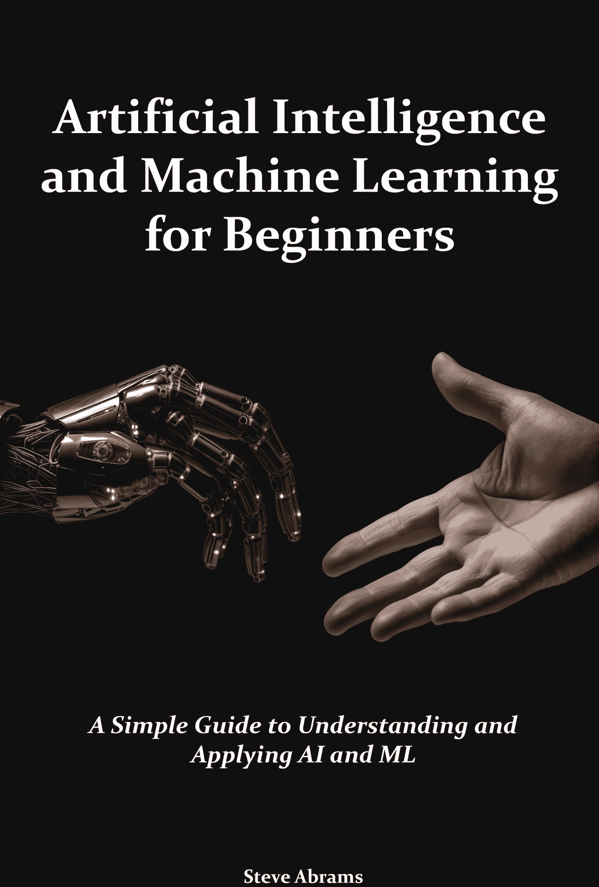

# 初学者人工智能与机器学习：理解与应用 AI 和 ML 的简单指南

## 1. 引言

### 什么是人工智能？
人工智能（AI）是计算机科学的一个分支，专注于创建能够执行通常需要人类智能才能的任务的系统。这些任务包括学习、推理、解决问题、感知、语言理解和逻辑推理。人工智能结合了计算机科学、数学、心理学、语言学、哲学、神经科学等领域的元素，使其成为一个真正跨学科的领域。

人工智能系统的开发涉及创建算法，这些算法能够处理输入并产生与人类相似的输出。这些算法的设计旨在通过一种被称为“学习”的过程随时间提高其性能。机器学习作为人工智能的一个核心子领域，使计算机能够从数据中学习、识别模式并在极少的人工干预做出决策。这是通过各种方法实现的，包括监督学习、无监督学习和强化学习。

人工智能可以大致分为两类：窄人工智能（Narrow AI）和通用人工智能（General AI）。窄人工智能也称为弱人工智能，旨在执行特定的单一任务（例如面部识别或网络搜索），是目前广泛使用的类型。通用人工智能或称强人工智能（Strong AI）目前在很大程度上仍处于理论阶段，它将在几乎所有的认知任务上都优于人类。

在实际应用中，人工智能已应用于许多领域，例如医疗保健领域（帮助诊断疾病）、汽车行业（通过自动驾驶汽车）、金融服务（用于欺诈检测和自动化交易）等。持续的进步预示着创新的应用将继续改变行业并提高生活质量，但也带来了伦理考量方面的挑战。

### 什么是机器学习？
机器学习（ML）是人工智能（AI）的一个子集，它赋予软件应用程序预测结果方面变得更准确的能力，而无需对这些结果进行显式编程。它的核心思想是使用算法来解析数据、从数据中学习，然后对某事做出判断或预测。因此，机器学习使计算机能够通过分析、自训练和经验来处理新情况。

机器学习的过程涉及将大量数据输入算法，让计算机系统学习如何执行特定任务，例如识别语音、识别图像或做出预测。机器学习的关键在于模型的使用——这些模型不是人类编写的显式指令，而是从输入数据中派出的模式。模型的复杂度可以差异巨大，取决于它被设计用来执行的任务。

机器学习方法有几种类型：监督学习、无监督学习和强化学习。监督学习发生在算法在标记的数据集上进行训练时，此时正确输出是已知的，有助于模型根据这些训练对未来数据预测结果。另一方面，无监督学习不使用标签——系统尝试直接从数据中识别模式和关系。强化学习是一种行为学习模型，算法通过做出某些决策并从奖励或惩罚中学习，从经验中学习执行某种动作。

机器学习在当今世界有广泛的应用，影响着许多领域，例如金融领域（预测股市趋势）、医疗保健（通过增强诊断能力和个性化医疗策略）、零售业（提供个性化客户体验）等。深度学习的兴起（一种由许多层神经网络组成的特殊机器学习类型）显著增强了实际应用的能力，从能够感知周围环境的无人驾驶汽车，到集成在智能手机中的有效实时翻译工具。

### 当今人工智能与机器学习的重要性

人工智能（AI）和机器学习（ML）在当今世界的重要性不言而喻。这些技术正驱动着各业的重大变革，重塑了业务运营方式，提高了效率并为创新开启了新机会。`AI` 和 `ML` 在解读复杂数据、优化流程以及提供以往无法获取的洞察方面至关重要，从而使各行业能够做出更明明的决策。

在医疗领域，`AI` 和 `ML` 正在彻底改变患者护理和研究。`AI` 算法分析医学图像的速度比人类放射科医生更快，且通常更准确，有助于癌症等疾病的早期发现。机器学习模型也被用于个性化治疗，预测个体患者对各种疗法的反应，从而制定更有效的治疗方案。此外，`AI` 驱动的机器人辅助了手术，提高了精准度并缩短了恢复时间。

金融领域受益于 `AI` 和 `ML` 带来的风险管理改进、欺诈检测和客户服务。算法分析客户行为模式，以识别可能暗示欺诈的异常交易。这种能力使银行和金融机构能够更有效地保护客户资产。此外，`AI` 驱动的聊天机器人提供 24/7 的客户服务，处理日益日益复杂的查询和交易，提升了客户体验和运营效率。

在交通和物流领域，`AI` 和 `ML` 有助于优化路线、预测维护和管理库存。在很大程度上由 `AI` 驱动的自动驾驶汽车注将重新定义个人和公共交通，有望增加安全性并减少拥堵。在物流领域，`AI` 通过预测需求增强了供应链管理，从而优化了库存水平并减少了浪费。

此外，`AI` 和 `ML` 对环境和可持续发展工作产生了巨大影响。`AI` 系统用于监测环境变化、预测气候模式，甚至控制智能电网中的能源消耗，帮助更高效地管理资源并减少环境足迹。

尽管取得了这些进展，`AI` 和 `ML` 也带来了挑战，包括伦理考量、数据隐私问题以及某些行业职业流失的风险。应对这些挑战需要深思熟虑的监管和伦理考虑，以确保 `AI` 和 `ML` 技术能让整个社会受益。

`AI` 和 `ML` 不仅仅是技术的增强；它们是工具，当应用得当时，可以显著提高生活质量、经济效率和环境可持续性。这些技术的持续开发以及与日常生活、业务运营的整合，继续为探索和增长开启新的前沿。

## 2. AI 和 ML 的历史与演变

### AI 的关键里程碑

人工智能（`AI`）领域自诞生以来见证许多关键里程碑，每一项都对其发展以及我们今天看到的技术做出了重大贡献。以下是其中一些关键时刻的简单回顾：

1. **达特茅会议（1956 年）**：通常被认为是 `AI` 作为一个领域的诞生，这次会议由约翰·麦卡锡、马文·明斯基、内赛尔·罗彻斯特和克劳·香主办。他们认为学习的每一个方面或智能的任何其他特征原则上都可以被描述得如此精确，以至于机器可以模拟。这一事件创造了“人工智能”这一术语，标志着 `AI` 作为一门学科的开始。

2. **感知器的发明（1958 年）**：弗兰克·罗森布拉特在康奈尔航空实验室期间发明了感知器（`perceptron`）。它是神经网络的早期形式——后期机器学习发展的基础模型——并且具有模式识别能力，这在当时是非常具有突破性的。

3. **专家系统（1970 年代-1980 年代）**：像为化学分析设计的 `DENDRAL` 和为诊断血液感染而开发的 `MYCIN` 等专家系统，代表了巨大的进展。

4. **反向传播算法（1986 年）**：由鲁梅尔特、杰弗里·辛顿和罗纳德·威廉姆斯开发的反向传播（`backpropagation`）使得多层神经网络的训练成为可能，显著提升了它们的性能。

5. **深蓝击败卡斯帕罗夫（1997 年）**：IBM 的深蓝（`Deep Blue`）成为第一个击败现任国际象棋冠军卡斯帕罗夫的计算机系统。

6. **Siri 的发布（2010 年）**：苹果推出了 `Siri` 作为首批语音激活助手之一，使 `AI` 更加个性化易用。

7. **深度学习革命（2012 年）**：由 Alex·克里泽沃夫斯基、伊亚·苏特塔维基和杰弗里·辛顿领导的团队赢得 2012 年 ImageNet 挑战，标志着深度学习的重要时刻。他们的卷积神经网络 `AlexNet` 极大提升了图像识别的技术水平。

8. **AlphaGo 的胜利（2016 年）**：谷歌 DeepMind 的 `AlphaGo` 在围棋中击败了世界冠军李世石，围棋是一种曾被认为计算机难以应对的高难度游戏。

9. **GPT-3 发布（2020 年）**：OpenAI 发布了生成式预训练 Transformer 3（`GPT-3`），展示了语言处理能力的飞跃。

这些里程碑突出了 `AI` 技术的快速发展和广泛影响。随着 `AI` 的持续演变，新的里程碑将不断出现，进一步扩展这一变革性技术的应用。

## ML 如何从 AI 演变而来

机器学习（`ML`）已成为人工智能（`AI`）这一更广泛学科中一个充满活力和最具变革性的领域之一。`ML` 从 `AI` 的演变是技术史上的重要篇章，反映了向能够从数据中学习、提高性能并随时间获得智能的系统的转变。

这段旅程始于 20 世纪中叶 `AI` 的起源，当时创建能够像人类一样思考机器的概念首次捕捉了研究人员的想象。早期的 `AI` 工作专注于基于规则的系统，试图通过编程指令和逻辑来模拟人类思维。这种方法被称为符号 `AI`，最初占据了主导地位。然而，显而易见的是这些系统受限于预定义规则的僵化性，无法适应新的、不可见的场景。

在 20 世纪 80 代，重心开始转向我们现在所说的机器学习，这得益于对基于规则的系统局限性的日益增长幻灭，并受到统计分析可能的启发。这一转变标志着人们意识到：与其显式地编写计算机来执行特定任务，不如开发能够从数据中“学习”并随时间推移不断改进的算法更加高效。这是一个革命性的思想，意味着 AI 系统可以独立地适应新数据，而无需人工干预。

`Geoffrey Hinton`、`Yann LeCun` 和 `Yoshua Bengio` 等先驱对该领域做出了巨大贡献，特别是通过神经网络的发展。这种 AI 架构受到人类大脑的启发，标志着从浅层学习到深度学习的转变，系统可以从海量数据中学习，其方式更接近于模拟人类的思维过程。深度学习作为 `ML` 的子集，利用具有许多层处理单元的大型神经网络，使 AI 系统能够以更高的准确性处理图像和语音识别等日益复杂的任务。

21 世纪初神经网络的复兴，结合数据可用性的爆发和计算能力的增长，催化了机器学习的快速发展。深度学习模型在高知名度挑战（如 `ImageNet` 竞赛中的图像分类）中的成功，证明了它们的潜力，并巩固了 `ML` 在 AI 研究和应用前沿的地位。

今天，机器学习是 AI 开发中不可或缺的工具，推向了机器能力的边界。从电子商务和流媒体服务中的推荐系统等日常应用，到自动驾驶中的高级用途以及科学研究中的复杂数据分析，`ML` 持续不断着技术和人类能力的边界。这种从 `AI` 到 `ML` 的演变代表了从手动编码智能向自主、数据驱动学习系统的重大转变，标志着向实现人工智能的全部潜力的飞跃。

# 3. 人工智能的基础

## AI 的类型：弱人工智能、通用人工智能和超级人工智能

人工智能（`AI`）可以根据其能力和潜在应用大致分为三类。这些类别帮助我们理解 `AI` 的当前进展，以及理论上可能改变我们与技术交互方式的未来发展。AI 的三种主要类型是：`Narrow AI`（弱人工智能）、`General AI`（通用人工智能）和 `Super AI`（超级人工智能）。

### 1. 弱人工智能 (Narrow AI)

弱人工智能，也称为 `Weak AI`，指的是为处理特定任务或一组任务设计的 AI 系统。这些系统之所以被称为“狭义”，是因为它们只能在预定义的功能范围内运行，无法表现出其特定编程之外的通用智能。我们每天遇到的大多数 `AI` 技术都是 `Narrow AI` 的例子。这些包括图像和语音识别系统、`Netflix` 或 `Amazon` 上的推荐系统、聊天机器人，甚至如自动驾驶汽车等复杂系统。尽管这些系统某些可能看起来很智能，但它们在受限的指南下运行，无法在设计区域之外执行任务。

弱人工智能通常被称为 `Weak AI`，是擅长执行特定的、狭定义的任务的人工智能类型。与其对应的 `General AI`（目标是复制人类认知能力并执行人类可以完成的任何智力任务）不同，`Narrow AI` 是专门的，并限于其预定义的功能。这种 AI 在我们的日常生活中非常普遍，且往往不被察觉，因为它驱动了我们经常使用的许多技术。

例如，像 `Siri` 和 `Alexa` 等语音激活助手是由 `Narrow AI` 驱动的。这些系统可以理解并响应语音命令、播放音乐、设置提醒，甚至控制智能家居设备。然而，它们的能力被严格限制在其特定任务内。

`Narrow AI` 的另一个优秀例子是 `Netflix` 和 `Amazon` 使用的推荐系统。这些系统分析之前的选择和行为，推荐你可能喜欢的电影、节目或产品。同样，自动驾驶汽车代表了 `Narrow AI` 的高级形式，能够导航并适应道路状况，但它们无法参与驾驶以外的活动。

尽管这些 `Narrow AI` 系统可能看起来很智能，但它们在有限的范围内运行。它们无法超越特定任务，强调了 `Narrow AI` 与 `General AI` 更广泛愿景之间的本质区别，后者试图创建能够进行通用推理的机器。

### 2. 通用人工智能 (General AI)

通用人工智能，也称为 `Strong AI`，指的是一种能够以与人类无异的方式理解、学习和应用知识的 AI 类型。这种 AI 目前尚不存在，但理论上它能够执行人类可以完成的任何智力任务。`General AI` 将具有自我意识、情感理解能力以及在不确定条件下做出判断的能力。开发 `General AI` 不仅涉及模拟人类大脑的神经架构，还要赋予机器在不同场景中情境化应用这些技能的能力，本质上拥有从一种情况泛化到另一种情况的能力。

通用人工智能（General AI）的追求既带来了令人兴奋的可能性，也引发了重大的伦理关注。一方面，这种水平的人工智能可能会在医学、教育、环境保护等领域带来突破性进展，可能解决目前人类无法触及的问题。另一方面，通用人工智能的出现带来了不可预见后果的风险，包括围绕自主性、隐私和控制的伦理困境。此类技术的开发需要一种谨慎且受监管的方法，以避免潜在的陷阱，例如偏见性决策或工作机会的流失。

虽然通用人工智能在现阶段仍然是一个理论构想，但它的发展可能标志着人类与机器交互方式的变革性转变。研究人员和技术人员继续探索人工智能的边界，向创造一个真正能够以人类水平进行思考、学习和交互的机器迈进，尽管实现通用人工智能可能还有很长一段路要走。这些努力强调了对所需的伦理框架和监管措施进行稳健讨论的重要性，以便将高度先进的人工智能系统安全地整合到社会中。

## 3. 超级人工智能 (超级人工智能)

超级人工智能比通用人工智能更进一步，它代表了一种假设的人工智能，其在所有领域（包括创造力、情感和社交智能）都超越了人类智能。这种形式的人工智能不仅能够复制人类的多方面智能，而且具有显著超越人类的能力。超级人工智能可能以人类无法理解的速度执行复杂的问题解决，甚至可能具有自主改进和升级自身的能力。超级人工智能的发展引发了重大的伦理和生存风险，因为此类系统对社会和全球权力结构可能会产生难以预测或控制的影响。

超级人工智能是通用人工智能的扩展和演变，它代表了一个推测性的概念，即人工智能在所有可以想象的方面（包括创造力、情感、社交技巧和解决问题的能力）都超越了人类智能。这种水平的人工智能不仅是人类智能的增强版，而且远超人类，能够以人类头脑无法理解的速度和深度处理并分析数据。

超级人工智能的理论能力既令人赞叹又令人恐惧。它可能会在量子计算、纳米技术和生物技术等领域取得里程碑式的突破，可能为人类最紧迫的挑战（如衰老、疾病和气候变化）提供解决方案。此外，凭借其自我改进的能力，超级人工智能可以对其初始设计进行迭代，在没有人类干预的情况下不断增强自身。这种自我改进的特性可能会导致所谓的“智能爆炸”，即人工智能迅速升到与人类标准相比日益趋向神灵的能力水平。

然而，超级人工智能的出现构成了深远的伦理和生存风险。主要的关注点之一是控制问题：人类如何管理或治理一个在智力上高于任何人类的实体？还存在一种风险，即超级人工智能可能会产生与人类价值观和优先事项不一致的目标，可能导致其决策对人类福祉产生不利的局面。此外，这种强大技术的集中可能会破坏全球权力平衡，为国际关系引入新的动态，其中对超级人工智能技术的控制可能成为权力的枢纽。

应对这些风险需要积极的治理和国际合作，在超级人工智能实现之前开发好安全协议和监管框架。学者和伦理学家认为，人类必须建立稳健的机制，确保这些力量被负责任地使用，并使其与人类繁荣的广泛目标和伦理规范密切对齐。关于超级人工智能的讨论不仅关乎技术可行性，还关乎哲学、伦理和政策考量，这些因素决定了我们作为一个社会如何选择引导未来。

每种类型的人工智能都伴随着自身的挑战、可能的伦理考虑。随着我们继续从弱人工智能（Narrow AI）向通用人工智能以及可能的超级人工智能领域发展，理解和管理此类进展的影响变得越来越至关重要。关于我们可能如何以及何时从当前的弱人工智能状态过渡到更高级的形式，辩论仍在，这对人类生活和社会的每一个方面都有影响。

## 人工智能在各行业中的应用

人工智能（AI）已渗透到无数行业，彻底改变了传统流程，提高了效率并为创新开辟了新途径。以下是人工智能在各个领域的应用概述：

### 1. 医疗保健

医疗领域的人工智能正在改变护理和管理系统。人工智能驱动的诊断可以比人类从业人员更快、更准确地分析数据。例如，人工智能算法被用于解释 X 光片和 MRI 扫描，预测患者病情恶化，甚至通过机器人协助进行复杂手术。人工智能在药物研发和基因组学中也起着至关重要的作用，机器学习模型有助于预测不同化学品如何与人体相互作用，显著加速了新药的开发。

人工智能（AI）正在通过增强患者护理和管理系统来彻底变革医疗行业。凭借其快速准确地分析海量数据的能力，诊断、治疗计划和医疗运营管理日益依赖人工智能。将人工智能整合到医疗领域不仅改善了结果，还使护理交付变得更加高效。

在诊断领域，人工智能算法正在取得巨大进展。它们现在被常用于解释医学影像（如 X 光片和 MRI 扫描），其精度达到或甚至超过了人类放射科医生。这些人工智能系统可以检测图像中人眼可能会忽略的细微模式，实现对癌症、骨折和神经系统疾病等状况的早期诊断。此外，正在开发人工智能辅助工具来预测临床环境中患者病情的恶化。这些系统分析患者监护器的实时数据，在潜在的关键状况变得危及生命之前提醒医疗提供人员，以便及时干预。

人工智能还通过机器人协助改变外科领域，这增强了手术程序的精确性和有效性。在人工智能引导的机器人手术系统可以以最小侵入性执行复杂手术，缩短康复时间并改善手术结果。这些机器人可以执行超出人类能力的精确动作，显著降低手术期间并发症的风险。

除了直接的患者护理外，人工智能对药物研发和基因组学做出了巨大贡献。机器学习模型用于预测不同化学品与人体之间的相互作用，简化了药物开发过程。这不仅加速了新药的发现，还通过在临床试验之前预测副作用增加了这些药物的安全性。在基因组学中，人工智能有助于理解疾病的遗传基础，实现个性化医疗方案，根据个人的基因图谱定制治疗。

此外，AI 正在简化医疗保健领域的行政任务，例如日程安排、患者数据管理和账单处理，这些任务通常非常耗时且容易出现人为错误。通过自动化这些流程，AI 让医疗专业人员能够出来，更多地关注患者护理而非文书工作，从而提升了医疗服务的整体效率。

AI 在医疗保健领域的影响是深远且日益增长的。随着技术的不断进步，它有望进一步改变医疗护理的方式，使其更加准确、高效和个性化。这不仅提高了患者的生活质量，还优化了医疗服务提供者的工作流，为建立更稳健、响应更快的医疗系统铺平了道路。

## 2. 金融

在金融领域，AI 的应用广泛且影响巨大。算法被用于高频交易、风险管理、欺诈检测和客户服务。AI 帮助实时分析大量的交易数据，以人类无法比拟的速度进行预测并执行交易。银行利用 AI 提供个性化的财务建议服务，并通过语音识别和面部识别系统等生物识别数据功能来增强安全性能。

在金融领域领域，人工智能（AI）的应用既广泛又具有深远的影响，彻底改变了金融机构的运营方式以及与客户的互动方式。AI 以惊人速度处理和分析海量数据集的能力，使其运营和洞察水平达到了仅凭人类是无法实现的。

AI 在金融领域最可见的应用之一是高频交易（HFT）。在这里，算法在以极快速度执行大量订单方面发挥着关键作用。这些 AI 系统能够在毫秒级内分析市场状况并做出交易决策，比任何人类交易员都能更快地利用微小的价格差异和市场趋势。AI 在这一领域带来的速度和效率不仅提高了盈利能力，还为市场增加了流动性，尽管这些做法对交易环境带来的公平性和稳定性引发了某些争议。

风险管理是另一个 AI 产生重大影响的关键领域。金融机构利用 AI 以更具预测性和更精确的方式理解并缓解风险。通过分析历史数据和趋势，AI 模型可以识别潜在的风险因素并高精度地预测未来场景。这种能力允许银行和投资公司主动调整策略，增强它们抵御市场波动和信贷风险的韧性。

欺诈检测也被 AI 技术改变了。传统的欺诈检测方法通常涉及被动手段，即仅在欺诈发生后才检测到。然而，AI 能够通过识别暗示欺诈活动的模式和异常，来实现更主动的方法。机器学习算法不断学习并适应新的欺诈技术，使其在欺诈造成重大损害之前防止欺诈变得极其有效。这不仅保护了金融资产，还建立了对金融服务的信任和安全感。

在消费者端，银行正越来越多地使用 AI 提供个性化的财务建议服务。机器人投顾（Robo-advisors）利用 AI 根据用户的财务行为和目标提供个性化投资建议，已成为个人银行的常见功能。此外，AI 通过智能机器人和虚拟助手增强了客户服务，这些工具对客户查询提供即时响应，简化了银行体验，并释放人类员工处理更复杂的客户需求。

最后，通过生物识别数据功能增强安全性，代表了金融机构保护客户数据和防止未经授权访问的一次飞跃。使用语音识别和面部识别技术的 AI 驱动系统不仅更安全，而且通过简化身份验证过程而不损害安全的情况下提高了用户体验。

AI 与金融的整合正在重塑该行业，使其更加高效、安全且对客户友好。随着 AI 技术的演进，它们有望在金融领域揭示更深层次的洞察和更智能的解决方案，驱动全球市场的创新和竞争力。

AI 对零售业的影响是深远的，为那些有效利用其能力的企业提供了竞争优势。通过提高预测性分析的准确性、通过个性化增强客户关系，以及优化供应链和库存管理，AI 不仅是一次技术升级，更是零售运营模式的根本转变，承诺着一个更智能、更灵敏且以客户为中心的市场。

## 4. 制造业

制造业中的 AI（通常被称为智能制造）涉及使用 AI 驱动的机器人和传感器来改进生产流程。这些技术提高了效率，降低了错误率，并增强了工业工作场所的安全。由 AI 驱动的预测性维护可以预测故障并在不中断生产过程的情况下安排维护，从而节省了宝贵的时间资源。

制造业中的 AI 通常被称为“智能制造”，它正通过集成机器人和传感器等 AI 驱动技术来彻底改变行业，以提高生产效率、质量和工作安全。对 AI 的采用正在带来更自动化、更高效且更具适应性的制造流程，从根本上改变了生产格局。

在生产线中集成 AI 驱动的机器人是智能制造的一个关键方面。这些机器人能够比人类工人更快、更具一致性执行高精度且重复的任务。例如，在汽车制造中，AI 机器人处理从焊接、喷漆到组装和检查的任务。这不仅加快了生产过程，还显著降低了错误率，从而减少了浪费并提高了成品的整体质量。

此外，配备 AI 能力的传感器的使用将生产车间变成了数据丰富的环境。这些传感器持续收集制造过程中各个部分的数据，包括机器运行、温度状况和产出。AI 算法实时分析这些数据，以优化速度、温度和压力等生产参数。这种实时数据分析确保制造过程保持在最佳参数范围内，从而提高了效率并减少了缺陷概率。

AI 在制造业中影响最大的应用之一是预测性维护。传统的维护计划通常基于估计的使用量和间隔，这可能过于谨慎，也可能晚得危险。相比之下，AI 驱动的预测性维护利用嵌入机器的传感器数据持续监测其状态。通过分析这些数据，AI 可以预测机器何时可能故障或需要维护。这允许在准确的时间安排维护，以避免计划外停机，同时避免不必要的维护。结果是预测性维护可以显著延长设备寿命，降低维护成本，并避免生产过程的干扰。

AI 在提高工业工作场所安全方面也发挥着关键作用。通过监控设备和环境，AI 可以识别潜在的安全危害，并在事故发生前提醒人类操作员。此外，AI 机器人可以承担危险任务，例如处理危险材料或在不安全的条件下作业，从而降低了人类工人的受伤风险。

AI 正处于通过更智能、更安全、更高效的生产流程彻底变革制造业的前沿。AI 驱动的机器人和传感器的采用不仅增强了生产能力，还给质量控制和工作场所安全带来了显著改进。随着制造商继续接受这些先进技术，制造流程中进一步创新和效率提升的潜力似乎是无限的，承诺了一个智能制造成为常态的未来。

## 5. 交通运输

AI 通过自动驾驶车辆和智能交通管理系统显著影响着交通业。自动驾驶汽车、卡车和无人机使用 AI 进行安全高效的导航，减少了人为错误并提高了运输效率。AI 还有助于根据实时数据和预测性分析来优化公共交通路线和计划。

人工智能 (AI) 正在剧烈重塑交通部门，特别是通过自动驾驶车辆和智能交通管理系统的开发。这些进步有望提高全球交通网络的效率和安全性，显著减少人为错误，并优化交通和运输系统的流量。

自动驾驶车辆（包括自动驾驶汽车、卡车和无人机）代表了运输领域的革命性一步。这些车辆配备了 AI 系统，可以处理来自传感器和摄像头的海量数据以导航道路、识别障碍并做出秒级决策。这种能力使其能够在复杂的交通条件下安全高效地运行。自动驾驶车辆的潜在收益是巨大的，从减少由人为错误导致的事故到改善交通流和减少拥堵。此外，自动驾驶卡车和无人机通过实现更快速、更可靠且成本效益高的货物运输，正在改变物流和服务业。

除了自动驾驶车辆，AI 还显著增强了智能交通管理系统。这些系统利用 AI 实时分析交通数据，调整信号定时和流量模式，以最小化延误并防止瓶颈。例如，AI 可以预测特殊活动或高峰期间的流量增长，并相应调整交通信号以保持交通顺畅。这不仅缩短了旅行时间，还通过防止长时间怠速和走走停降低了车辆排放。

AI 在根据实时和预测性分析优化路线和计划方面在公共交通中起着至关重要的作用。AI 系统可以分析历史和当前数据，预测公共交通服务的需求，并调整路线和计划以匹配这些需求。这确保了公共交通资源得到有效利用，在提高乘客服务质量的同时降低了运营成本。例如，在非高峰时，AI 可以建议减少某些路线的巴士频率；而在高峰期间，它可以增强服务以避免拥挤和延迟。

此外，AI 驱动的运输系统可以通过移动应用程序为通勤者提供个性化的旅行建议，整合公共交通时刻表、交通状况和用户偏好，提供最快或最方便的旅行选择。AI 在个人旅行规划中的整合使通勤更具预测且高效，进一步增强了用户体验。

AI 对交通的影响是变革性的，不仅促进了更高的效率和安全性，还为集成和智能交通系统可能成为常态未来铺平了道路。这些进步有望显著缓解交通拥堵、运输成本和环境影响等常见挑战，标志着向更智能、更可持续城市迈出的一一步。

## 6. 农业

农业 AI 应用有助于增加作物产量并监测作物健康。AI 驱动的无人机和卫星图像分析土壤和作物健康，辅助精准农业。AI 还帮助预测天气状况，优化水和肥的使用，并通过早期检测系统管理病虫害。

# 农业中的人工智能

人工智能（AI）正日益成为现代农业的基石，为农民和农艺学家提供了强大的工具，以增加作物产量、增强作物健康并确保可持续的耕作实践。通过利用 AI 技术，农业领域正在经历一场变革，这种变革在提高效率和生产力的同时，尽可能地减少对环境的影响。

## 精准农业

AI 在农业中的关键应用之一是精准农业，无人机和卫星图像在此起着关键作用。配备了 AI 的这些技术可以分析关于土壤健康、作物健康和水分水平的海量数据。例如，无人机飞越农田，利用传感器和成像功能收集有关作物状况的详细信息。这些数据将使用 AI 算法进行处理，以便在早期阶段检测营养缺乏、水分胁迫或疾病。这种早期检测允许及时干预，防止作物大面积受损并确保作物的最佳健康。

此外，AI 驱动的系统分析卫星图像以在更大范围内监测作物生长并预测产量。这些见解有助于农民对所需的资源类型和数量（如种子、水和肥料）做出明智决策。通过在需要的时间和地点精确地应用必要的投入，农民可以显著减少浪费并增强其运营的可持续性。

## 天气与资源管理

AI 还彻底改变了农业使用的天气预测模型。通过更准确、更本地化的天气预报，农民可以更好地规划种植和收割计划以及灌溉系统。这对于避免意外天气变化的负面影响至关重要，这些变化会严重影响产量。例如，AI 可以预测旱期并建议最佳的灌溉策略，以在不损害作物健康的情况下减少用水。

此外，AI 在优化水和肥的使用方面起着重要作用。智能灌溉系统使用 AI 分析从土壤收集的水分数据并自动浇水计划。这种精准灌溉确保作物在正确的时间获得恰好的水分，使水效率最大化并减少径流。同样，AI 驱动系统通过评估土壤营养水平并根据每个作物区域的特定需求定制肥料类型和数量，更高效地管理肥料投放。

## 害虫管理

害虫管理是 AI 产生重大影响的另一个领域。AI 驱动的监测系统可以在早期识别害虫侵害并预测其扩散模式。这使得针对性的害虫防治措施成为，与广泛喷洒农药相比，这些措施更有效且对环境的伤害更小。AI 工具还可以帮助制定可持续且较少依赖化学干预的综合害虫管理策略。

## 结论

农业中的 AI 应用不仅提高了作物产量和健康水平，还在推向可持续耕作实践的边界。通过提供精确的、数据驱动的见解和自动化，AI 赋予农民在尊重和保护自然资源的同时实现更高生产力，为现代农业树立了新标准。

# 7. 娱乐

在娱乐行业中，AI 用于内容创作、个性化和消费者互动。Netflix 和 Spotify 等流媒体服务使用 AI 分析用户偏好并提供个性化的内容推荐。AI 还用于游戏领域，通过驱动对玩家动作做出智能反应的非玩家角色（NPC）来增强用户体验。在快速发展的娱乐行业中，人工智能（AI）已成为游戏规则的改变者，特别是在内容创作、个性化和增强消费者互动方面。这种 AI 的整合不仅改善了用户体验，还改变了内容的生产和交付方式。

### 流媒体中的个性化

Netflix 和 Spotify 等流媒体服务处于利用 AI 根据个人喜好和偏好定制其服务的前沿。这些平台采用复杂的机器学习算法来分析来自用户互动的海量数据——例如观看历史、评分和搜索习惯。通过理解这些模式，AI 可以推荐与用户偏好紧密匹配的电影、节目和音乐曲目，从而增强用户的参与度和满意度。这种个性化不仅限于建议内容，还扩展到根据可用设备和带宽修改用户界面和流媒体质量，确保无缝的观看或收听体验。

### 内容创作

此外，AI 在内容创作中的作用也是深远的。在电影和音乐行业，AI 工具被用于编辑、剧本编写，甚至生成音乐。AI 算法可以分析成功的电影剧本，以识别吸引观众的元素并提出修改建议。在音乐领域，AI 应用能够创作原创曲目，或通过建议和弦进行和节奏来协助音乐家。这种 AI 与艺术家之间的创意合作为娱乐领域开辟了新的途径。

### 游戏与开发

在游戏世界，AI 通过驱动非玩家角色（NPC）的行为显著丰富了用户体验。这些由 AI 驱动的 NPC 可以对玩家动作做出智能反应，创建动态且不可预测的环境。这使得游戏更具吸引力和真实感，提供了更丰富、更有沉浸感的体验。除了角色互动外，AI 还用于游戏开发中的程序化内容生成——游戏的景观、关卡和谜题等元素是动态生成的。这种技术让每次玩游戏都能获得独特的体验，增加了其重玩价值。

### 消费者互动

AI 还在重塑娱乐行业中的消费者互动。AI 驱动的聊天机器人被许多平台用于提供客户支持和增强用户互动。这些机器人可以处理许多客户服务任务，从回答有关内容可用性的常见问题到排排除流媒体问题，显著提升了整体客户体验。此外，AI 驱动的消费者反馈分析可以帮助制片公司和开发者快速适应并响应用户需求或投诉，保持内容的趣味性。

AI 在娱乐行业的整合从多个角度改变着该行业——从内容的创作和个性化到增强用户体验的互动性和动态。随着 AI 技术的不断演进，其在该行业进一步创新的潜力似乎是无限的，预示着未来将更加个性化和吸引力的娱乐选择。

# 8. 能源

在能源领域，AI 提高了电力管理和电网稳定的效率。它预测需求模式并据此调整供应。AI 在可再生能源领域也起着关性作用，根据天气预测和现有需求优化风力发电机和太阳能电池板的运行。

在能源领域，人工智能（AI）在提高电力管理和电网稳定效率方面正发挥着日益重要的作用。随着全球能源需求的不断增长，AI 的整合为满足这些需求提供了更具前景的解决方案，并减少了对环境的影响。

# AI 技术在管理和预测能源需求方面至关重要。通过分析来自历史消耗模式、天气状况和经济活动等多种来源的数据，AI 算法可以准确预测能源需求的高峰和低谷。这种能力使能源供应商能够动态调整供应，确保能源生产与消费需求紧密匹配。这不仅有助于减少浪费和运营成本，还增强了电网的可靠性。

此外，AI 在电网稳定方面发挥着至关重要的作用。现代电网必须处理来自多种来源的输入，包括传统的化石燃料和日益增加的可再生能源。AI 有助于平稳整合这些多样化的能源，管理风能和太阳能固有的波动性。通过预测天气状况的变化，AI 系统可以预判再生能源发电的波动并相应地调整电网负荷。这对于维持稳定持续的电力、防止停电以及确保能源高效分配至关重要。

在可再生能源领域，AI 的影响尤为具有变革性。对于风能，AI 算法通过分析风力预报并调整叶片角度以捕捉最大的风能，从而优化涡轮机的运行。这种优化不仅提高了能量产量，还通过减少不必要的磨损延长了涡轮机的寿命。同样，在太阳能运营中，AI 被用于预测光模式并监控太阳能电池板的健康状况。这实现了电池板的精准定位和主动维护，确保了设备的巅峰性能和使用寿命。

AI 还助力风电场和太阳能发电场的设计与布局，利用模拟工具分析地形、天气数据和其他环境因素，以确定涡轮机和面板的最佳位置。这种前期的优化可以从源上显著提高可再生能源项目的效率。

AI 在能源领域的部署不仅提高了运营效率，还支持了全球向可再生能源的转型。通过使可再生能源更具预测性并更容易整合到电网，AI 正在帮助减少对化石燃料的依赖，向更加可持续和韧性的能源未来发展。这种转变对于应对气候变化和资源枯竭带来的紧急挑战至关重要，预示着更智能、更清洁、适应适应能源管理的新时代。

## 9. 教育

AI 通过个性化学习和自动化正在改变教育。AI 系统适应每个学生的学习节奏和风格，提供定制的资源和支持。它还将行政任务自动化，让教育机构能够更多地关注教学，减少对官僚事务的投入。

人工智能（AI）正通过引入更个性化的学习体验和简化行政操作来彻底改变教育领域。这些进步不仅提升了教育系统的效率，也深刻影响着教学和学习过程的有效性。

在教室里，AI 促进了个性化学习，这是一种根据学生的节奏、风格和兴趣定制的教学方法。AI 系统可以分析学生学生在作业和测试中的表现，识别他们的优处和短板，然后相应地调整教学内容。例如，如果一个学生在算术方面表现出色，但在应用题上遇到困难，AI 可以提供额外的资源或练习来解决这一特定挑战。这种程度的定制确保了所有学生都能获得与其独特学习需求相匹配的支持，有助于优化他们的学习成果。

除了内容适应外，AI 还通过在学习活动中加入互动元素来增强参与度。AI 驱动的教育软件可以包含模拟、教育游戏甚至虚拟现实体验，让学习更具趣味性和沉浸感。这些工具可以满足不同的学习风格，无论学生是通过视觉辅助、听觉指令还是动手操作学习得效果最好，从而提高教育干预的有效性。

在行政方面，AI 显著减轻了重复性任务的负担，让教育者能够专注于教学这一核心目标。AI 可以自动完成多选择测试评分和耗时任务，让学校能够投入更多资源和精力。此外，AI 协助数据管理和分析，使学校和学院能够监控个人和班级层面的学术进展。从 AI 分析中获得的见解有助于识别趋势和模式，例如对某一特定概念的普遍困难或表现下降，从而提示及时干预。

通过减少行政开销并提供更个性化的学习体验，AI 正在赋能教师并丰富学习体验，营造一个培养智力与个人成长的环境。随着 AI 的不断演进，它与教育系统的整合有望以深远的方式改变格局。

## 4. 理解机器学习

### 机器学习算法概述

机器学习算法是人工智能的核心方面，使计算机能够从数据中学习并基于数据做出预测或决策。这些算法可以泛分为三大类：监督学习、无监督学习和强化学习。每种类型解决不同类型的学习问题，并在金融、医疗、汽车等多个领域具有独特的应用。

监督学习是机器学习最常见的形式。在这种方法中，算法在标记的数据集上进行训练，这意味着每个输入数据点都对应一个正确的输出（标签）。监督学习的目标是建立一个模型，根据这些训练对新的、未见的数据进行预测。常见的监督学习算法包括用于连续输出预测的线性回归和用于二分类结果的逻辑回归。更复杂的算法如决策树、支持向量机和神经网络也被广泛使用，能够处理更广泛的数据类型和关系。

无监督学习涉及在没有任何显式标签的数据集上训练算法。这里的主要目标是在预先不知道这些分组可能是什么的情况下，发现潜在的模式或数据分组。聚类技术（例如 `k-means`、`层次聚类`）和降维技术（例如 `principal 成分分析`、`t-SNE`）是无监督学习的显著示例。这些方法对于探索性数据分析、异常检测和复杂数据可视化特别有用。

强化学习是一种机器学习，智能体通过与环境交互来学习做出决策。与监督学习不同，正确的操作并不是预先教导的，而是通过使用奖励和惩罚作为信号，通过试错过程发现的。诸如 `Q-learning`、`Deep Q Networks (DQN)` 和 `policy gradient methods` 等算法是开发随时间推移改进性能系统的核心，适用于机器人、游戏和自动驾驶汽车等领域。

这些类别中的每一个都使用了针对特定数据类型和问题定制的不同算法，而深度学习等演进技术横跨了这些领域，特别是利用大量数据来训练复杂的神经网络。随着机器学习领域的不断发展，这些 算法的开发和完善将进一步增强它们变革行业和日常生活的能力。

# 机器学习的类型：监督学习、无监督学习和强化学习

机器学习是人工智能中的一个基本概念，主要分为三种类型：监督学习、无监督学习和强化学习。每种类型为机器从数据中学习并随时间不断改进提供了独特的方法和方法论，适用于从医疗保健到汽车技术等众多行业。

## 1. 监督学习

监督学习可能是最常用的机器学习形式。这种方法涉及在标记的数据集上训练模型，其中每个输入数据都带有一个正确的输出标签。模型的任务是学习从输入到输出的映射，优化其参数以最小化误差。一旦训练完成，模型就可以应用于新的、未见的数据以进行预测。监督学习算法的关键示例包括：

*   用于连续输出预测的 `Linear Regression`。
*   用于分类结果的 `Logistic Regression`。
*   `Decision Trees` 和 `Random Forests`，它们对于处理具有复杂关系的非线性数据特别有用。
*   `Support Vector Machines` 和 `Neural Networks`，它们在高维空间中表现出色，并能模拟复杂的线性关系。

监督学习的应用非常广泛，包括图像和语音识别、电子邮件垃圾过滤和医学诊断。

## 2. 无监督学习

与监督学习不同，无监督学习利用标记数据。相反，它根据输入特征之间的内在相似性和差异对未标记数据进行分析和聚类。它主要用于发现隐藏的模式或数据分组，而无需事先知道这些分组可能。主要的技术包括：

*   `Clustering`，例如 `K-means` 或 `Hierarchical clustering`，它将一组对象分组，使得同一类中的对象彼此之间比与其他类中的对象更相似。
*   `Dimensionality Reduction`，例如 `Principal Component Analysis (PCA)` 和 `t-Distributed Stochastic Neighbor Embedding (t-SNE)`，它们减少了需要考虑的随机变量数量，有助于高维数据可视化。
*   `Association Rule Learning`，涉及在大型数据库变量之间寻找有趣的关系（“规则”）。

无监督学习在异常检测、市场篮分析以及作为探索性数据分析或自动组织结构的工具方面特别有用。

## 3. 强化学习

强化学习的独特之处在于，它基于智能体通过与动态环境试错交互来学习决策的概念。在这里，学习过程由奖励驱动——做出正确决策的激励和错误的惩罚。目标是开发一种策略来选择能够最大化累积奖励的操作。流行的方法包括：

*   `Q-Learning`，智能体学习一种策略，告诉它在什么情况下应该采取什么操作，而不需要环境模型。
*   `Deep Q Networks (DQN)`，它使用 `neural networks` 将 `Q-learning` 扩展到复杂场景。
*   `Policy Gradient Methods`，它们直接优化策略而不是估计值。

强化学习被有效用于自动驾驶汽车、游戏（例如 AlphaGo）、机器人领域。每种机器学习类型都有其优缺点，使得它们适用于特定的任务。

# 5. 深度学习与神经网络

## 神经网络简介

神经网络（通常与 `ANNs` 同义）是人工智能中的一个基本概念，它们改变了机器学习和决策的方式。神经网络受到人类大脑生物结构和功能的启发，设计用于模拟神经元相互作用的方式。

神经网络由相互连接的节点层组成。每个神经元处理其收到的输入，并将其输出传递给下一层。基本结构包括一个输入层、一个或多个隐藏层和一个输出层。输入层接收各种形式的数据，隐藏层通过数学函数处理数据，输出层产生最终结果。

神经网络中的关键操作之一是通过层将输入数据转换为输出。这是通过与每个连接相关的权重和偏置实现的，这些权重和偏置在训练期间进行调整。训练涉及向网络输入已知输出的数据，并调整权重和偏置以最小化预测输出与实际输出之间的差异。这一过程被称为 `backpropagation`，它通过计算 `loss function`（预测误差的衡量标准）的梯度并使用如 `stochastic gradient descent` 等优化算法来迭代地调整权重。

神经网络具有学习数据中复杂模式和关系的能力，这使得它们对于图像识别、自然语言处理甚至玩复杂游戏等任务非常有效。它们从提供的示例泛化到未见数据的能力，使得它们在众多行业的实际应用中变得极其强大。

神经网络的灵活性也体现在它们的各种架构中，包括在图像处理任务中占主地位的 `convolutional neural networks (CNNs)`，以及对于时间序列分析或语言建模等序列数据具有优势的 `recurrent neural networks (RNNs)`。每种架构都对神经处理的基本思想进行微调，以针对特定类型的数据和任务优化性能。

神经网络是现代 AI 应用的基石，模仿人类认的复杂性，并不断演进以以更高的效率应对新挑战。它们的发展使机器学习取得了显著进展，提供了可以从数据中自主学习的工具，从而变革了整个行业。

深度学习是机器学习的一个专门子集，它采用具有许多层的神经网络——这一特征导致了“深度”一词产生。深度学习的核心理念是模拟人类获取特定类型知识的学习方法，使机器能够以分层的方式处理数据，并具有抽象程度和复杂性的不断提高。

深度学习的核心是深度神经网络，它由输入层和输出层之间的多层神经元组成。这些中间层（或称为隐藏层）使网络能够从数据中学习复杂的模式和特征，这种过程在层数较少的情况下是无法实现的。每一层的输出作为下一层的输入，意味着网络随着每一层的演进，对数据的理解也得到了不断完善。例如，在图像识别中，初始层可能识别边缘和颜色，中间层可以识别模式或纹理，而更深层则可能识别出图像中的特定物体。

深度学习模型的训练过程涉及向其输入大量数据，并根据输出与已知实际结果之间的误差来调整内部参数（权重和偏置）。这种调整主要通过反向传播完成——这种算法通过更新权重有效地将误差传回网络，以最小化损失函数，损失函数量化了实际输出与预测输出之间的差异。

优化算法，如随机梯度下降（SGD）或其变体（Adam、RMSprop），在此过程中起着至关重要的作用。这些算法在损失函数形成的复杂多维空间中导航，并寻找最低点，这对应于模型的最佳参数集（权重和偏置）。这种搜索是一个迭代过程，并且需要大量的计算能力，特别是随着网络深度和数据量的增加时。

此外，深度学习自动执行特征提取的能力——无需人工干预或手动设计特征——是其优于传统机器学习的一个显著优势。这种自动化不仅提高了模型的性能，还使深度学习适用于更广泛的复杂问题，从自动驾驶、医疗诊断到语言翻译和文本生成。

深度学习模型的有效性在很大程度上取决于大规模标记数据集的可用性以及强大的计算能力，这些资源通常由 GPU 或 TPU 等专用硬件提供。这些资源使得在复杂且海量的数据上训练模型成为可能，允许模型捕捉人类观察者无法察觉的复杂模式。

深度学习代表了人工智能领域一个强大的框架，在从海量数据中提取模式和见解方面表现出色。它彻底改变了多个领域，提供了日益接近人类智能和熟练程度的解决方案。随着计算能力算法效率的不断进步，深度学习继续推向机器可以学习和完成的边界。

# 深度学习的应用

深度学习在广泛的行业和应用中迅速普及，彻底改变了我们处理问题的方式，并提供了以前无法想象的创新解决方案。以下是深度学习一些最具影响力的应用：

## 1. 图像和视频识别

深度学习极大提升了机器理解和解释视觉数据的能力。卷积神经网络（CNNs）作为一种深度学习模型，在分析图像方面特别强大。这项技术是人脸识别、自动驾驶系统和医学影像诊断等系统的基石。例如，CNN 可以分析视网膜图像以检测糖尿病视网膜病，或以高准确度对 X 光和 MRI 中的肿瘤进行分类。

得益于深度学习，图像和视频识别技术经历了革命性的进展，特别是通过卷积神经网络（CNNs）的使用。CNN 是专用的深度学习模型，擅长处理和组织来自图像的像素数据。

在安全和个人识别领域，人脸识别系统利用 `CNNs` 分析来自图像和视频流的特征。这对于增强公共场所和活动中的安全性起了重要作用。

汽车技术是图像识别产生重大影响的另一个领域，其标志是自动驾驶汽车的发展。在这里，`CNNs` 处理并解释实时数据，以检测并导航行人、其他车辆和交通标志。这项技术不仅有望减少驾驶中的人为错误，还旨在彻底变革交通行业。

在医疗领域，通过 `CNNs` 进行图像识别通过提供能够从影像数据识别和分类医疗状况的工具，改变了诊断程序。这种能力不仅加快了诊断过程，还提高了检测的准确性，这对于治疗计划和患者护理至关重要。

## 2. 自然语言处理 (NLP)

深度学习改变了 NLP，使机器能够以既符合上下文又具有细微差别的方式理解、解释和生成人类语言。应用包括实时翻译服务、情感分析和聊天机器人。诸如 Transformer（包括 `BERT` 和 `GPT`）的模型为问答、文本摘要甚至生成类人文本等任务设定了新标准，增强了用户与技术的交互。

自然语言处理（NLP）在当今数字时代最重要的应用之一是实时翻译服务。像 `Google Translate` 这样的平台曾在语言细微差别和语境方面苦苦，但现在利用先进的 NLP 模型提供不仅更准确而且保持原始文本细微之处的翻译。这种能力极大地改善了跨越语言障碍的通信，促进了全球背景下更好的理解与协作。

情感分析是 NLP 取得实质进展的另一个领域，它使企业和组织能够分析社交媒体帖子、评论和客户反馈来评估公众舆论、监控品牌健康并理解客户体验。通过使用 NLP 技术，公司可以识别文本表达的情感，对其进行分类，并利用这些数据来优化营销策略、改进产品或增强客户服务。

此外，由 NLP 驱动的聊天机器人和虚拟助手改变了客户服务和用户交互。与以往基于规则的前身不同，今天的聊天机器人可以进行更自然、更有用的对话，理解复杂的查询，并提供相关的、感知上下文的响应。例如，先进的 NLP 模型可以驱动客户服务机器人，它不仅回答常见问题，还能理解用户的情绪并据此调整回复以增强交互体验。

深度学习与 NLP 的集成导致了系统的开发，这些系统能够以前所未有的水平执行问答、文本摘要和类人类文本生成任务。这不仅增强了用户与技术交互的方式，还为教育、医疗和客户服务在内的各个领域的自动化和效率开辟了新的可能性。然而，与任何强大的技术一样，它也面临挑战和伦理考量，例如生成误导性信息的潜在风险或模型训练中的偏差，这些需要经过仔细管理。

### 3. 语音识别与生成

`Siri`、`Alexa` 和 `Google Assistant` 等语音激活助手使用深度学习来理解并响应用户命令。用于语音识别的深度学习模型将语音转换为文本，而用于语音生成的模型执行相反操作。这些能力不仅是个人助手不可或缺的，对于残障人士的辅助技术也至关重要，促进了与技术更自然的交互。

语音识别和生成代表了现代技术的关键方面，极大地增强了人类与机器交互的方式。在深度学习的驱动下，这些技术形成了 `Siri`、`Alexa` 和 `Google Assistant` 等语音激活助手的骨干，它们已成为许多人生活中不可或缺的一部分。这些系统利用复杂的神经网络模型将人类语音解码为文本（语音识别），然后执行反过程从文本生成口语响应（语音合成）。

语音识别的深度学习模型在包含数千小时口语语言的海量数据集上进行训练，使其能够理解广泛的口音、方言和语言。这种训练帮助模型不仅识别所说出的词汇，还能识别词汇被使用的语境，这对于有效处理同音词（读音相同但意义不同的词）至关重要。一旦语音转换为文本，就可以由其他 NLP 模型进行处理，以理解用户命令背后的意图并生成适当的行动或响应。

在生成方面，得益于深度学习，语音合成技术在自然和表现力方面取得了显著改进。这些系统被称为文本转语音（`TTS`）技术，将书面转换为语音输出，这种输出越来越难以与人类语音区分。先进的 `TTS` 模型将语调、重音和节奏融入输出中，使对话更具吸引力并更易于用户理解。

此外，语音识别和生成不仅关乎便利性，还关乎无障碍性。对于残障人士来说，这些技术是改变游戏规则者。它们让视觉障碍人士能够与设备交互并获取信息，而无需阅读屏幕上的文本。发现传统计算界面具有挑战性的行动障碍人士可以通过语音控制设备并进行通信。语音转文本系统通过提供其语音的实时转录，让言障碍人士能够更有效地通信，转录随后可以根据需要进行修正或修改。

语音识别和生成技术促进了与技术更包容、更自然的交互，打破了障碍并增强了无障碍性。随着这些系统的不断演进，它们有望进一步整合到日常生活的各个方面，让技术对每个人都更加直观和易于获取。然而，这些技术的进步也需要对隐私和安全进行仔细考虑，特别是在数据处理以及设计用于持续监听其激活词的设备可能产生的窃听方面。

### 4. 自动驾驶车辆

自动驾驶汽车使用深度学习来理解其环境并做出实时决策。这涉及处理和解释来自各种传感器的海量数据，包括 `LIDAR`、雷达和摄像头，以识别物体、预测行人和和其他车辆的行为并做出导航决策。

自动驾驶车辆（通常被称为自动驾驶汽车）代表了现代技术领域深度学习和人工智能最心勃勃的应用之一。这些车辆的设计目标是通过持续处理和解释从复杂传感器阵列收集的海量数据，在没有人类干预的情况下引导道路和交通行驶。这些传感器包括 `LIDAR`（激光雷达）、雷达和摄像头，为车辆提供了环境的详细 360 度视图。

自动驾驶车辆智能系统的核心是其通过深度学习模型理解这些数据的能力。这些模型使车辆能够实时识别和分类物体，例如其他车辆、行人、自行车行者、交通标志和车道线。通过这种方式，车辆可以理解周围环境，预测其他道路使用者的动作，并对其路线和速度做出明智决策。例如，如果检测到前方有行人过马路，汽车系统可以根据距离和行人的速度决定减速或停止。

此外，这些决策必须在几分之一秒内做出，以确保驾驶的安全和顺畅，鉴于现实世界环境的复杂性和变性，这是一项重大的挑战。深度学习的帮助不仅在于识别感知数据中的模式，还在于通过从测试期间收集的海量驾驶数据中学习，模拟车辆在道路上可能遇到的一系列潜在场景。这种持续的学习过程对于改进车辆的决策算法并适应新情况至关重要，就像人类驾驶员随着时间的积累经验一样。

自动驾驶汽车的愿景不仅限于个人便利；它们有望通过减少交通拥堵、降低排放水平以及大幅减少与交通事故相关的事故（这些事故主要由人为错误引起）来改变我们的城市。此外，它们还可以显著提高老年人和残障人士的行动机性，提供更多的独立性并提高生活质量。

然而，自动驾驶汽车的部署并非没有挑战。在不可避免的事故场景下的决策引发了伦理问题，与数据收集相关的隐私担忧，以及车辆应对潜在网络攻击的安全性。此外，由于这项技术从根本上改变了驾驶概念，还存在监管障碍和公众接受的需求。尽管存在这些挑战，在深度学习和人工智能进步的推动下，自动驾驶技术不断取得突破，标志着向智能、连接交通系统的未来迈出了大胆的一步。

## 5. 游戏

深度学习改变了游戏的设计和玩法，允许出现更复杂、更具挑战性的 AI 对手。它还驱动了虚拟现实体验，提供了能够对玩家操作做出智能反应的高度沉浸式环境。由 `DeepMind` 开发的算法曾在`围`和`星际争霸 2`等游戏中著名的击败了人类职业选手，展示了 AI 先进的策略能力。

深度学习显著改变了游戏行业，推向了游戏设计和游戏体验可能的边界。这项人工智能的高级分支不仅增强了游戏的视觉真实感，还深度丰富了 AI 角色和环境与玩家互动的方式。

深度学习在游戏领域最显而易见的影响之一是 AI 对手的开发。这些对手不再仅仅受预设规则或简单反应模式的支配。相反，AI 角色现在从每次接触中学习，并实时调整其策略，提供了更加动态且更具挑战性的体验。这使得游戏过程更具不可预测且更具吸引力，因为玩家必须不断进化自己的策略以战胜日益复杂的 AI。例如，在`星际争霸 2`等复杂策略游戏中，`DeepMind` 开发的 AI 已经证明了在专业水平竞争的能力，展示了卓越的战略规划、资源管理和适应能力。

此外，深度学习在虚拟现实（VR）体验的开发中至关重要，它提供了能够对玩家操作做出智能反应的高度沉浸式环境。通过深度学习，VR 环境可以分析玩家行为、动态修改游戏场景并增强互动元素，使每次游戏过程都是独一无二的。这种能力显著提升了游戏中的存在感，因为环境会以真实的细微方式对玩家的决策和动作做出反应。

此外，深度学习促进了更复杂的程序化内容生成，其中关卡、环境甚至情节元素等游戏内容可以实时动态创建。这不仅让游戏玩法保持新鲜感，还根据个人玩家的风格定制了游戏体验，使游戏更具吸引力且内容更丰富。

深度学习驱动的进步还扩展到提高游戏中的玩家互动和包容性。例如，AI 可用于调节玩家互动、过滤有害内容，并通过预测服务器负载和玩家行为来协助管理大型多人环境，确保所有参与者都能获得顺畅的游戏体验。

深度学习继续推动游戏在技术和创意上可能的前沿。通过使游戏更具反应性、智能性和个性化，深度学习不仅增强了玩家体验，还为开发者探索互动娱乐中的新概念开辟了新途径。随着技术的进步，游戏的未来似乎将变得更加创新和沉浸，通过互动式、自适应的叙事和环境重新定义娱乐。

## 6. 医疗保健

医学影像之外，深度学习被用于基因组学，以理解基因序列并预测突变和疾病。它还通过比传统实验方法快得多的预测分子相互作用来支持药物发现，可能缩短新药上市的时间成本。

深度学习正在彻底改变医学影像领域的医疗保健领域，将其转型影响延伸到基因组和药物发现。这项技术分析和解释海量数据的能力为医学进步、个性化医疗和更高效的医疗解决方案开辟了新途径。

在基因组学中，深度学习算法用于筛选大量的遗传数据，识别人类研究人员无法有效识别的复杂或微妙的模式。这些算法可以预测某些基因序列如何导致特定的疾病或突变。例如，通过分析数千个基因组的遗传标记，深度学习模型可以识别遗传性疾病的概率，预测对特定治疗的反应，甚至为高风险个体建议预防性措施。这种能力显著增强了早期诊断和更具针对性的治疗干预的潜力，标志着追求个性化医疗迈向前了一步。

此外，在药物发现领域，深度学习被证明是游戏规则的改变者。传统的药物药开发过程涉及大量的实验室研究，包括化学化合物的试错测试，这是一个耗时且昂贵的过程。然而，通过深度学习，可以模拟并预测不同分子将如何相互作用。这可以在物理试验开始之前，通过缩小最有可能针对特定疾病有效的候选分子，极大地加快药物开发的初级阶段。例如，深度学习模型可以预测药物分子与人体内特定蛋白或受体的结合亲和力，这是设计有效药物的关键步骤。

这些深度学习模型不仅比传统方法更快地预测结果，而且其准确性令人印象深刻，可能同时减少与将新型治疗性药物上市相关的时间和成本。这在紧急情况下尤为关键，例如在流行病期间快速开发疗法或在应对快速传播的疾病时。

将深度学习整合到医疗保健中正在创造更高效、更有效且更具个性化的医疗实践。随着这些技术的不断进化和成熟，它们有望进一步增强诊断、治疗和预防疾病的能力，可能改变全球医疗保健的格局。然而，此类技术的应用也带来了重要的伦理和实际挑战，包括数据隐私、安全担忧，以及对稳健监管框架的需求以确保患者安全和对这些新工具的信任。

## 7. 金融

在金融领域，深度学习被用于算法交易、欺诈检测和客户服务。通过分析大型数据集，深度学习模型可以识别预测股市走势或检测可能指示欺诈的异常交易的模式。

# 金融领域的深度学习

深度学习正在迅速改变金融行业，增强了算法交易、欺诈检测和客户服务等领域的能力。深度学习模型快速且高准确地处理和分析海量数据的能力，在这些复杂的金融环境中证明是无价的。

## 算法交易
在算法交易领域，深度学习模型被用于通过分析包含历史价格、交易量甚至全球经济指标在内的大型数据集来预测股市走势。这些模型能够识别出人类分析师可能察觉的细微模式和相关性。通过从过去的市场数据中学习，深度学习算法可以开发预测模型，帮助交易员做出更快、更有见见的决策，从而可能实现投资回报的最大化。算法交易的速度和自动化还允许更高效地管理大型投资组合，降低了成本并增加了运营的可扩展性。

## 欺诈检测
欺诈检测是深度学习在金融领域的另一个关键应用。金融机构每天处理数百万笔交易，手动监控欺诈活动是不现实的。深度学习模型可以实时分析这些交易，识别出暗示潜在欺诈的异常。这些模型在海量交易数据上进行训练，学习识别欺诈活动的典型模式，例如偏离客户正常行为模式的异常交易大小、频率或地理位置。深度学习的使用不仅加速了检测过程，还提高了准确性，减少了可能导致客户不满的虚假警报。

## 客户服务
此外，深度学习正在通过聊天机器人和虚拟助手增强金融业的客户服务。这些 AI 驱动的工具使用自然语言处理（深度学习的另一个应用）来自动理解和响应客户查询。这项技术可以处理从回答常见问题（FAQs）到更复杂任务的范围，如协助账户交易或提供个性化的财务建议。这不仅提高了客户服务部门的效率，还通过提供全天候服务和缩短响应等待时间增强了客户体验。

## 金融结论
深度学习在金融领域的应用正带来更高效、更安全且对客户更友的服务。它允许金融机构以更高的精度和极少的人工错误处理大量业务。然而，与任何处理敏感信息的技术一样，它引发了对数据隐私、安全以及需要严格监管合规监管的重大关注，以保护客户和金融市场的完整性。

---

# 零售与电子商务

深度学习通过个性化购物推荐、库存管理和客户情感分析，增强了零售业的客户体验和运营效率。计算机视觉模型帮助管理货架库存，而推荐系统则根据消费者行为对广告和产品投放进行个性化处理。

深度学习正深度进入零售和电子商务领域，改变了企业与客户互动以及管理运营的方式。通过利用这项技术的能力，零售商可以增强客户体验，提高运营效率，并通过更个性化、更有见地的策略驱动销售。

## 个性化购物推荐
深度学习在零售业中最引人的应用之一是通过个性化购物推荐。电子商务平台使用深度学习算法分析客户之前的购物历史、搜索模式甚至社交媒体活动，以针对个人品味和偏好定制特定的产品建议。这种程度的个性化不仅通过使购物更具相关性和吸引力提升了购物体验，还增加了购买可能性。通过向客户展示他们可能更感兴趣的产品，零售商可以有效提高转化率和客户忠诚度。

## 库存管理
在实体店中，深度学习通过使用计算机视觉模型增强了库存管理。这些模型实时监控货架库存，识别哪些物品库存低且需要补货，哪些物品销售情况不如预期。这些实时数据允许店经理立即对库存分布做出调整，从而最大限度地减少积压和缺货情况。此外，深度学习可以根据趋势、季节性和即将到来的促销活动预测库存需求，进一步优化库存水平并减少浪费。

## 客户情感分析
此外，深度学习被用于客户情感分析，AI 工具分析客户评论、反馈和社交媒体帖子，衡量公众对品牌和产品的情感。这些信息对于公司理解其市场地位、完善营销策略以及主动解决任何客户疑虑无无价值。情感分析有助于维护良好的品牌形象，并指导产品开发以更好地满足需求。

## 广告投放
此外，在广告领域，深度学习通过分析消费者行为并优化投放实现了更有效的定位。通过了解哪些内容消费者，零售商可以个性化广告以产生共鸣，提高营销活动的效果。

深度学习与零售和电子商务的结合正在创造更动态、响应迅速且以客户为中心的购物环境。它不仅帮助零售商跟上客户预期，还能在竞争激烈的市场中保持领先。然而，随着零售商日益依赖数据驱动的技术，数据隐私和消费者信息的伦理使用问题成为焦点，需要审慎的考虑和监管。

---

# 6. 机器学习入门

## 工具与语言：Python、R 及其他
得益于旨在简化模型开发和实现的工具和编程语言，深度学习已变得越来越容易。其中最流行的是 `Python` 和 `R`，尽管根据应用和行业，许多其他工具和语言也发挥作用。

### Python
`Python` 是深度学习和机器学习项目的领先编程语言，因为它简单易读，并结合了强大的库和框架。深度学习的主要 Python 库包括：

* `TensorFlow`: 由 Google 开发，`TensorFlow` 是一个通用且广泛使用的框架，允许用户相对轻松地创建复杂的神经网络。它的功能涵盖从研究到生产，支持 CPU 和 GPU。
* `Keras`: 最初是一个独立的库，现在作为 `tf.keras` 集成在 `tensorflow` 中。它为构建和训练神经网络提供了高层、易用的界面，使非专家也能上手。
* `PyTorch`: 由 Facebook AI 研究实验室开发，`PyTorch` 在学术和研究社区特别受青睐，因为它具有易用性、灵活性以及允许在运行时进行调整的动态计算图。

虽然 `R` 在深度学习领域没有 Python 那样流行，但它仍然是一个强大的工具，特别是对于统计学家和数据分析师而言。它经常被学术界和统计学家使用，用于数据分析、可视化和统计计算。`R` 中用于深度学习的关键包包括：

* `KerasR` 和 `keras`：这些包提供了 `Keras` 库的 R 接口，允许 `R` 用户访问 `Keras` 功能并使用 `R` 语法构建深度学习模型。
* `mxnet`：这是另一个可以配合 `R` 用于构建、训练和部署神经网络的框架。它支持高效的分布式训练，并从其底层 `C++` 实现中获得优化。

### 其他工具和语言

* `Julia`：以其高性能著称，`Julia` 用于对速度至关重要的场景，并在机器学习和科学计算社区中正受到关注。
* `MATLAB`：在工程和科学计算中流行，`MATLAB` 提供了深度学习能力，并广泛用于原型设计和神经网络架构探索。
* `Java` 和 `Scala`：这些语言用于需要 `Java` 虚拟机 (`JVM`) 兼容性的大数据环境。像 `Deeplearning4j` 这样的库允许将深度学习集成到基于 `Java` 或 `Scala` 构建的企业级应用中。

### 支持工具

* `Jupyter Notebooks`：对于原型设计和共享机器学习项目无价之，它提供了一个基于 Web 的交互式计算环境，你可以在其中结合代码执行、文本、数学、图表和富媒体。
* `Docker` 和 `Kubernetes`：对于将模型部署到环境中，使用 `Docker` 进行容器化和 `Kubernetes` 进行编排有助于管理和扩展深度学习应用。
* 云平台：`AWS`、`Google Cloud Platform` 和 `Microsoft Azure` 都提供基于云的机器学习和服务 API，为训练深度学习模型提供强大的 GPU。它们还支持这些模型的规模部署。

深度学习工具和语言的格局丰富且多样，满足了从学术界的快速原型设计到企业环境中稳健、可扩展解决方案的不同需求。`Python` 由于其庞大的生态系统和易用性仍然领先，但根据项目需求和环境兼容性，其他语言和工具提供了宝贵的替代方案。

### 核心库：`TensorFlow`、`PyTorch`、`Scikit-Learn`

深度学习和机器学习的领域拥有密集的库，它们满足了从构建复杂神经网络到执行更简单机器学习任务的各种需求。在众多选择中，`TensorFlow`、`PyTorch` 和 `Scikit-Learn` 成为任何进入该领域的人的重要工具。每个库都提供了独特的特性和优势，使其成为学术界和工业界的热门。

### TensorFlow

`TensorFlow` 是由 `Google Brain` 团队开发的开源库，广泛用于各种机器学习和深度学习应用。它以在计算数学（涉及多维数组/张量）中的灵活性和扩展性而闻名。`TensorFlow` 同时提供了高层 API（主要通过 `Keras`）和低层 API，允许用户在需要时操作模型更细粒度的细节。

关键特性：

* 可扩展且灵活：`TensorFlow` 支持分布式计算，允许模型跨越多个 `CPUs` 或 `GPUs` 甚至跨不同的设备进行扩展。
* 生态系统和工具：`TensorFlow` 不仅仅限于构建模型——它提供了用于可视化的 `TensorBoard`、用于生产流水线的 `TensorFlow Extended` (`TFX`) 以及用于移动和嵌入式设备的 `TensorFlow Lite`。
* 动态和静态图：最初围绕静态计算图（定义后运行）构建，`TensorFlow 2.0` 及更高版本集成了更动态的特性（即时执行），使其更加直观且对用户友好。

### PyTorch

由 `Facebook’s AI Research` 实验室开发的 `PyTorch` 因其简单性和允许开发者构建深度学习模型的易用性而获得了巨大的人气。它的设计非常直观，特别是对于具有 `Python` 编程背景的用户来说。

关键特性：

* 动态计算图：`PyTorch` 使用动态计算图（运行即定义方法），这意味着网络的行为可以在运行时更改，且调试更加容易，使其成为研究和原型设计的理想选择。
* Python 特性：`PyTorch` 与 `Python` 数据科学栈无缝集成，这使得模型构建和实验更加简单和灵活。
* 强大的社区和工具：它拥有健壮的生态系统，拥有诸如用于图像处理的 `TorchVision`、用于自然语言处理的 `TorchText` 以及简化代码库同时又不失构建复杂模型灵活性的 `PyTorch Lightning`。

### Scikit-Learn

`Scikit-Learn` 主要用于经典机器学习而非深度学习。它基于 `NumPy`、`SciPy` 和 `Matplotlib` 开发，是初学者和专业人士实现标准机器学习算法的最佳可用库之一。

关键特性：

* 广泛的算法：它为数据挖掘和数据分析提供了简单高效的工具，并提供了广泛的标准监督和无监督机器学习算法。
* 模型拟合、数据预处理、模型选择和评估工具：它包含了多个用于模型拟合、数据预处理、模型选择和评估的工具，以及多个内置数据集。
* 文档齐全且易于学习：它以其全面的文档和强大的社区支持而闻名。

这些库各都有其优势，适用于不同的数据科学任务和工作流。`TensorFlow` 和 `PyTorch` 更多针对大规模深度学习模型和复杂的神经网络架构，通常出现在研究和生产环境中。。Scikit-Learn` 虽然不是为深度学习设计的，但在快速实现许多标准机器学习算法方面是无可比拟的，对于不需要深度学习复杂性的任务具有巨大的价值。

### 你的第一个机器学习项目

开启第一个机器学习项目可能是一项令人兴奋但也令人畏惧的尝试。项目成功的关键在于系统性的规划、对基础知识的清晰理解以及实践。以下是帮助你开始第一个机器学习项目的分步骤指南：

### 第 1 步：选择问题

从选择一个你感兴趣解决的问题开始。这可以是简单的任务，例如根据一组特征预测房价价格（回归）、将电子邮件分类为垃圾邮件和非邮件（二分类），或识别手写数字（多分类）。你对问题的选择将影响你需要的数据类型以及可能考虑的算法。

### 第 2 步：收集并准备数据

数据是每个机器学习项目的核心。你可以从 `Kaggle`、`UCI Machine Learning Repository` 或 `Google Dataset Search` 等平台提供的许多公共数据集中选择。一旦你拥有数据：

* 清理数据：处理缺失值，删除重复项并修正错误。
* 转换数据：必要时对特征进行归一化或标准化。
* 划分数据：将数据分为训练集和测试集（通常按 `70:30` 或 `80:20` 划分）。

### 第 3 步：选择模型

有很多机器学习模型，你的选择取决于所面临的问题。对于初学者，建议从简单的模型开始：

* 对于回归问题，考虑 `linear 回归`。

-   对于分类任务，逻辑回归或决策树是很好的起点。

### 第 4 步：训练模型

训练涉及使用你的训练数据来拟合模型。这一步是模型通过调整参数从数据中学习的过程。大多数 Python 库（如 `Scikit-Learn`）通过 `.fit()` 等方法简化了这一步骤，你可以在模型对象上调用该方法并传入你的训练数据。

### 第 5 步：评估模型

训练完成后，使用测试数据评估你的模型性能。这有助于你理解模型在未见数据上的可能表现。评估指标取决于问题的类型：

-   对于回归任务，通常使用均方误差 (`MSE`) 或平均绝对误差 (`MAE`) 等指标。
-   对于分类任务，准确率（accuracy）、精确率、召回率和 F1 分数是标准指标。

### 第 6 步：调整参数

模型性能可以通过调优超参数来提高。`Scikit-Learn` 等库提供了 `GridSearchCV` 等工具用于超参数调优，它能系统地探索多种参数组合以找到最佳拟合点。

### 第 7 步：进行预测

一旦你对模型的性能感到满意，就可以用它对新数据进行预测。这通常通过 `.predict()` 方法完成。

### 第 8 步：展示你的结果

最后，展示你的发现。这可能涉及使用 `Matplotlib` 或 `Seaborn` 等库绘制结果，或者简单地讨论性能指标。

#### 使用的工具和库

-   `Python`：最流行的机器学习语言，因为它简单且拥有庞大的数据科学库生态系统。
-   `Scikit-Learn`：非常适合入门 Python 机器学习。
-   `Pandas`：数据处理和清洗的必修工具。
-   `NumPy`：数值计算的基础。
-   `Matplotlib`/`Seaborn`：用于创建可视化。
-   `Jupyter Notebook`：编写代码、可视化数据以及与他人分享工作的理想选择。

从这种结构化的方法开始，不仅有助于获得更好的结果，还有助于理解机器学习项目的每个阶段。这确保了你在转向更复杂的项目和算法时，拥有一个坚实的基础。

## 7. 伦理与未来影响

#### AI 和 ML 中的伦理考量

随着人工智能 (AI) 和机器学习 (ML) 日益成为日常生活中不可或缺的一部分，影响着医疗保健、金融、交通和执法等许多领域，伦理考量变得至关重要。伦理担忧主要源于滥用的可能性、偏见、缺乏透明以及更广泛的影响。解决这些问题对于建立信任并确保 AI/ML 技术对社会做出积极贡献至关重要。以下是一些主要的伦理考量：

### 偏见与公平

AI 系统通常从历史数据中学习，而这些数据可能包含内在偏见。这些偏见可能会被机器学习模型延续并放大，导致不公平的结果。例如，用于招聘的 AI 模型可能会根据其训练的倾斜数据产生性别或种族偏见。确保公平涉及检测、减轻和防止 AI 模型中偏见的技术，并促进训练数据集和开发团队的多样性。

人工智能 (AI) 系统具有通过自动化流程、优化运营和提供新见解来彻底改变许多领域的潜力。然而，如果这些系统在反映人类偏见的历史数据上进行训练，它们也可能在无意中延续并放大现有的偏见。这个问题在招聘、贷款审批和执法等领域尤为显著，因为偏见的 AI 决策可能对公平和公正产生严重影响。

#### 透明度与可解释性

AI 模型（尤其是深度学习）经常被批评为“黑箱”，这意味着它们的决策过程人类 Model 于理解。这种透明度的缺乏可能导致不信任和验证困难，特别是在医疗诊断或刑事司法等关键应用中。开发可解释人工智能（Explainable AI）的努力对于使这些技术具有可责性且易于理解至关重要，让用户和利益相关者能够信任并有效地管理 AI 系统。

人工智能 (AI) 的快速发展和采用，特别是深度学习模型，为各个领域带来了前所未有的能力。然而，这种进步往往伴随着一个巨大的挑战：决策过程的不透明性，通常被称为“黑箱”问题。这个术语强调了理解复杂的 AI 模型（如涉及深度神经网络的模型）如何得出结论的困难。

在医疗保健等关键应用中，AI 模型辅助进行诊断、治疗计划和风险评估，无法解释 AI 的决策可能会导致严重后果。例如，如果一个深度学习模型错误地诊断了某种疾病，但临床医生无法理解其决策的依据，那么想要信任或验证 AI 的建议将变得具有挑战性。同样，在刑事司法系统中，用于风险评估或预测性警务的 AI 必须具有透明度，以确保公平性并防止偏见影响对个人的、改变命运的决策。

向可解释人工智能（XAI）的推动旨在使这些系统更加透明和更易于理解。可解释 AI 涉及开发各种技术和方法，使人类能够理解并信任 AI 系统的结果和操作。通过提高 AI 决策的可解释性，利益相关者可以更好地理解、管理，并甚至可能挑战 AI 驱动的结果。这种透明度不仅对于建立信任至关重要，而且有助于促进人类与 AI 之间的协作，增强人类监督和伦理治理的潜力。

目前人们正在探索实现可解释 AI 的多种方法。一种方法涉及设计神经网络，使其能够报告其决策过程，或突出显示对达成决策最显著的数据特征。另一种方法是开发“事后”解释方法，即在模型做出决策后，使用专门用于揭示模型推理过程的额外工具对决策进行解释。

此外，为 AI 透明度制定监管标准正受到越来越多的关注。例如，欧盟的《通用数据保护条例》（`GDPR`）包含了相关规定，要求在某些情境下对自动化系统所做出的决策进行解释。这种监管推动可以驱动可解释 AI 领域的进一步创新，确保 AI 系统不仅是有效的，而且是负责任且公平的。

可解释 AI 的发展对于确保 AI 技术服务公共利益至关重要，并确保其服务符合公平、问责和透明的价值观。随着 AI 继续整合到日常生活的各个方面，可解释性的重要性将不断增加，使其成为研究人员、开发者和政策制定者的共同关注焦点。

## 隐私

机器学习通常需要大量数据，其中可能包含敏感个人信息。确保这些数据的隐私至关重要，特别是在欧洲 `GDPR`（通用数据保护条例）等监管法规下。差分隐私、联邦学习和安全多方计算等技术正成为重要的工具，帮助在保护数据隐私的同时，允许 AI 从广泛的数据集中进行学习。

机器学习应用在各各业的快速扩张凸显了处理海量数据（通常包含敏感个人信息）的关键重要性。保护这些数据的隐私不仅是技术上的必要，也是法律的要求，特别是在欧洲严格的监管法规下，如《通用数据保护条例》（`GDPR`）。`GDPR` 以及全球范围内类似的法律规定了关于数据隐私的严格准则，赋予了个人对其个人信息更多控制权，并对未能合规的机构处以严罚。

为了应对这些挑战，研究人员和技术人员正在创新并采用先进的隐私保护技术，在保护个人数据隐私的同时允许 AI 继续开发和应用。在这些技术中，差分隐私、联邦学习和安全多方计算因其有效性和实用性脱颖而出。

`Differential Privacy`（差分隐私）是一种向数据集或算法输出中添加一定数量随机噪声的技术。这种修改确保了在理论上无法识别或追溯任何信息到特定个人，从而维护了每个个人数据的隐私。尽管存在噪声，统计准确性仍能保持足够完整，允许从数据中得出有意义的见解。差分隐私被广泛应用于需要聚合和共享数据的场景中，例如人口研究或用户行为分析。

`Federated Learning`（联邦学习）是另一种创新方法，特别适用于由于隐私考虑或物流问题导致数据无法中心化的场景。在联邦学习中，机器学习模型被发送到数据所在的设备或本地服务器上，而不是将数据带到中央服务器。模型在本地进行训练，仅将模型更新传回中央服务器，并在那里进行聚合以改进整体模型。这种方法不仅有助于保护隐私，还减少了传输巨大型数据集所需的带宽。

`Secure Multi-Party Computation`（安全多方计算）允许实体在保持输入私密的情况下，对输入进行联合函数计算。这种加密方法允许各方贡献数据进行计算而不泄露实际数据。`SMPC` 在竞争对手需要协作但不直接共享敏感信息的行业中特别有价值，例如跨公司欺诈检测或基准研究。

这些技术共同构成了一个关键的工具箱，确保 AI 和机器学习的进步不会以牺牲个人隐私为代价。通过实施这些方法，机构可以在利用大数据进行 AI 开发的同时，符合国际数据保护法规。这些技术不仅有助于降低隐私风险，还能赢得用户的信任，这对于 AI 系统的长期采纳和成功至关重要。

## 安全

AI 系统可能会受到操纵其非预期行为的攻击。例如，对抗攻击涉及细微改变输入会导致 AI 产生错误；这些攻击可能被恶意用于欺骗自动驾驶或脸识别技术等。确保 AI 系统的安全性对于其在敏感或关键应用中的安全部署至关重要。

AI 系统虽然在各个领域提供了变革性的能力，但也容易受到利用其设计和功能漏洞的特定网络安全威胁。在这些威胁中，最令人担忧的是对抗攻击，通过精心构造的输入欺骗 AI 模型做出错误决策。这些攻击构成了重大风险，特别是当 AI 部署在敏感或安全关键的环境（如自动驾驶汽车、安全系统和身份验证流程）时。

此类漏洞带来的安全影响是深远的。随着人工智能日益深度整合到关键基础设施和技术中，对抗性攻击造成危害的风险正在不断加剧。这推动了对稳健安全措施的需求，这些措施不仅要解决传统的网络安全问题，还必须针对 AI 技术带来的独特挑战量身定制。

为了防御这些漏洞，研究人员和网络安全专家正在探索各种策略。一种方法是开发更健壮的 AI 模型，使其从本质上对对抗性样本具有抵抗力。这涉及到在更广泛的数据集上训练模型，其中包含潜在的对抗输入，从而增强它们识别和忽略此类异常的能力。另一种策略是采用防御蒸馏，这种技术旨在简化模型的决策过程，使攻击者更难找到导致模型出错的精确更改。

此外，对 AI 系统进行持续监控和更新对于确保其能够适应新出现且不断演变的威胁至关重要。实施包括软件和硬件防御的多层安全机制可以进一步降低与对抗性攻击相关的风险。

随着 AI 继续演进并渗透到生活的更多方面，确保这些系统的安全性成为一个首要考虑的问题。利益相关者（包括开发者、监管机构和终端用户）必须保持警惕，并积极实施全面的安全措施，以防止对抗性攻击，并确保 AI 技术的安全可靠部署。

## 岗位流失

AI 和 ML 的自动化潜力可能导致各行业出现大量的岗位流失。虽然 AI 可能会创造新的就业机会，但这些新工作所需的技能与当前劳动力能力之间存在不匹配的风险。这引发了对社会调整的需求，包括重新培训计划以及教育系统的更新，以为为受 AI 影响的就业市场做好准备。

人工智能（AI）和机器学习（ML）技术的兴起有望通过自动化复杂和常规任务来转型行业，可能导致效率的显著提高和成本的降低。然而，这股自动化潮流也带来了一个严峻挑战：各行业的岗位流失。从制造业到零售，从金融到运输，随着 AI 系统能够更高效地执行这些任务，许多传统上由人类承担的角色面临着风险。

AI 和 ML 导致的潜在岗位流失可能对劳动力市场产生深远影响。尽管 AI 无疑会创造新的就业机会，特别是在技术驱动的领域以及涉及 AI 系统开发、维护和监督的领域，但人们对这些新兴工作所需的技能与被流失人员所拥有能力之间的不匹配日益担忧。这种技能缺口对劳动力转型新角色的能力构成了关键挑战，威胁到经济稳定和个人生计。

应对这些挑战需要积极的社会调整。教育系统需要演进，为后代进入受 AI 和技术深远影响的就业市场做好准备。这不仅涉及从早期阶段将数字素养和 AI 相关科目纳入课程，还涉及强调 AI 短内难以复制的技能，例如创造性问题解决能力、同理心和人际沟通。

对于现有的劳动力，重新培训计划至关重要。政府、行业和教育机构必须合作，提供所有社会阶层都能参与的全面重新培训计划。这些计划的设计目标应该是为流失岗位的工人提供 AI 驱动型岗位和其他增长部门所需的可能技能，确保他们能够在不断变化的职业格局中适应并蓬勃发展。

此外，政策制定者必须考虑各种措施，例如加强社会安全网，并可能探索如通用基本收入等概念，以保护那些对 AI 自动化引起的经济变化最脆弱的群体。只有通过共同努力，才能以最小程度减少社会动荡的方式管理向 AI 影响经济的转型。

## 社会与伦理影响

AI 更广泛的社会影响包括依赖性问题，即过度依赖 AI 技术可能会侵蚀人类技能。随着 AI 系统变得越来越普遍，其影响成为一个日益关注的话题。一个重要问题是对 AI 技术的潜在依赖，这可能导致人类能力的退化。当机器接管了导航、记忆和复杂决策等任务时，个人可能面临在没有技术辅助的情况下无法有效执行这些技能的风险。这种依赖可能对认知发展和个人韧性产生深远影响。

此外，在军事行动和监控等敏感领域部署 AI 引起了重大的伦理关注。例如，在军事无人机中使用 AI 引入了关于自动化杀戮的道德性以及意外冲突风险的问题。同样，AI 驱动的监控系统在可能增强安全同时，也对隐私构成了严重威胁，并可能导致侵犯个人权利和自由的过度监控行为。这些应用对自主性和知情同意提出了挑战。

为了应对这些挑战，社会制定一套全面的指南和法规来规范 AI 技术的开发、部署和使用至关重要。这一监管框架旨在确保以负责任且符合伦理的方式使用 AI，并建立机制防止滥用和意外后果。公共话语和参与也至关重要，因为它鼓励人们对 AI 的潜在影响有更广泛的理解，并促进其治理的民主方法。

此外，应当建立伦理准则，以尊重人权和价值观引导 AI 开发。这些准则可以包括透明度、问责制以及保护隐私和自主性。通过将伦理考虑嵌入 AI 系统的设计和部署中，开发者和政策制定者可以帮助确保这些技术在不损害基本人类价值的情况下增强社会福利。

虽然 AI 提供了许多进步和效率的机会，但其更广泛的社会影响必须经过仔细管理。建立稳健的、基于伦理的法规并鼓励公众的知情参与，是实现 AI 融入社会平衡方法的关键步骤。

## 监管与监督

随着人工智能（AI）的快速发展和部署，迫切需要稳健的监管框架来引导伦理 AI 开发。这不仅包括国家和国际法律，还包括帮助开发者遵循最佳实践的行业标准和伦理指南。

人工智能技术的蓬勃增长已为医疗保健、金融、运输等多个领域带来了变革性变化。然而，随着这种飞速的发展，也迫切需要建立全面的监管框架，以确保 AI 系统以伦理且负责任的方式进行开发和实施。这些法规的重要性不言而喻，因为它们有助于防止滥用、保护隐私、确保公平，并维护公众对人工智能技术的信任。

在国家层面，各国政府日益意识到制定立法以应对 AI 带来的独特挑战的紧迫性。这包括旨在防止偏见算法的法律，这些算法可能导致招聘、贷款和执法执法产生歧视性行为。此外，鉴于 AI 系统通常处理海量个人数据，还需要能够解决数据隐私和安全问题的法规。有效的监管还应确保 AI 决策过程的透明度和问责制，使人类能够理解并质疑 AI 系统做出的决策。

在国际范围内，不同文化对隐私、伦理和治理的观点存在差异，这为 AI 监管营造了复杂的格局。因此，国际合作对于创建跨国界的标准至关重要，特别是考虑到 AI 技术是在全球范围内运行的。联合国和欧盟等国际机构已开始出台指南和框架以促进此类合作。

行业标准和伦理指南在塑造伦理 AI 发展方面也发挥着至关重要的作用。这些标准通常由科技公司、学术机构和其他利益相关者组成的联盟制定，为负责任的 AI 开发提供了蓝图。它们鼓励最佳实践，例如确保 AI 系统在设计时考虑到公平性、具有包容性，并对多样化人群开放。此外，这些标准可以帮助公司应对复杂的法律环境，并预先解决可能导致监管或声誉风险的问题。

AI 技术的动态性质要求采取多层监管方法，包括国家法律、国际合作和稳健的行业标准。这些框架不仅对于应对当前的伦理挑战至关重要，对于预测 AI 持续演进带来的未来问题也同样重要。确保 AI 在造福社会的同时尽可能减少伤害是一项协作努力，需要立法者、技术人员、伦理学家和更广泛公众之间的持续对话。

应对这些伦理考量需要一种涉及伦理学家、技术人员、监管者和公众的多学科方法。开放的对话、对 AI 从业人员持续的伦理培训以及积极治理，对于确保 AI 技术以符合社会价值观和伦理原则的方式进行开发和部署至关重要。

人工智能（AI）和机器学习（ML）领域快速演进，不断突破边界并转型行业。展望未来，正在出现一些趋势和预期，它们有望将 AI 进一步整合到我们的日常生活中，并可能彻底改变我们与交互的方式。以下是 AI 和机器学习的一些关键未来趋势和预期：

### 1. AI 模型能力的提升

预计 AI 模型将变得更加强大和高效。算法的进步，结合 `GPUs` 和专用芯片等计算硬件的改进，将允许模型以更快速、更准确地处理更大的数据集。这可能会在理解人类语言、天气模式和生物过程等复杂系统方面取得突破。

随着 AI 技术的进步，我们正见证 AI 模型力量和效率的显著提升。这一增长在很大程度上是由算法的持续改进以及计算硬件的演进驱动的，包括 `GPUs` 和 `TPUs`（张量处理单元）等专用芯片。这些技术进步使 AI 模型能够处理日益庞的数据集，以以前未有的速度和提高的准确性进行处理。这种进展有望催化各种复杂系统的突破性发展，从自然语言处理到预测气象学和生物研究。

例如在人类语言领域，更强大的 AI 模型正在增强自然语言理解和生成，使与 AI 的交互变得日益无缝和直观。这些模型可以从大量的文本数据语料中学习，捕捉早期版本难以处理的细微差别和上下文细节。结果，我们正越来越接近能够进行意义对话、以近人类的准确度翻译语言，并在从写作支持到跨语言实时通信等任务中提供更高级辅助的机器。

天气预测另一个从这些进步中受益的领域正变得能够分析和合成来自卫星图像、传感器和历史天气数据的大集的模型日益准确。这种增强允许更好地预测天气事件，通过对飓风和洪水等自然灾害提供早期预警，可能拯救生命并减轻经济影响。快速处理大型数据集的能力也意味着模型可以实时更新预测，根据情况的变化适应新数据。

同样，在生物科学领域，AI 正在改变我们对复杂生物过程的理解。例如，蛋白质折叠这一困扰科学家几十年的问题，在 AI 的帮助下取得了重大突破。先进的 AI 模型可以以与昂贵且耗时的实验室方法相当的精度预测蛋白质结构。这种能力对于药物发现和理解疾病机制至关重要，可能加速新治疗方法和疗法的开发。

此外，随着 AI 模型变得更加高效，它们也变得更容易获取。较小的组织甚至个人都可以利用这些强大的工具，使 AI 的益处民主化。这种广泛的获取可能会导致教育、公共安全和个性化医疗等不同领域创新应用的泛增，进一步将 AI 嵌入到日常生活的各个。

在算法改进和优越硬件的支持下，AI 的未来轨迹不仅承诺带来更复杂、更强大的 AI 模型，还将影响人类生活和环境的核心方面提供更广泛的应用范围。这预示着我们理解和操控复杂系统以造福社会的能力进入了一个变革时代。

### 2. 泛化与少样本学习

AI 面临的重要挑战是构建能够从有限示例中良好泛化的模型，即少样本学习（few-shot learning）。未来的发展可能会侧重于创建需要更少数据即可准确预测的模型，这在数据稀缺或获取成本昂贵的领域将特别有利。

人工智能研究的一个重要前沿领域是`few-shot learning`（少样本学习）的挑战，其目标是设计能够从极少数示例中良好泛泛化的 `AI` 模型。这与传统的机器学习方法不同，后者通常需要海量数据才能进行有效训练。从有限数据中学习的能力不仅效率更高，而且在数据稀缺、敏感或获取成本昂贵的领域至关重要，例如医疗保健领域的罕见病或法律判例中的独特案例。

目前，大多数 AI 系统依赖于大规模数据来学习学习；然而，这种方法存在其局限性，特别是在收集数据不现实的场景下。例如，在医疗保健领域，由于此类疾病的发病率低，收集有关罕见医疗状况的全面数据通常非常困难。同样，在自动驾驶技术中，要遇到所有可能的驾驶场景以训练 AI 系统是不可行的。少样本学习旨在通过开发可以使用最少输入示例来适应新任务或新条件的算法，从而克服这些障碍。

人工智能未来的发展可能会强调少样本学习技术的进步。这可能涉及多种策略，例如元学习（meta-learning），即在多种学习任务上训练模型，并对其进行优化以快速适应新任务。另一种方法是迁移学习（transfer learning），将从一个任务中获得的知识应用于不同但相关的任务，从而减少对新数据的需求。这些技术不仅在解决数据稀缺问题方面充满前景，还有助于构建更具适应性和灵活性的 AI 系统。

通过增强 AI 模型利用较少数据做出准确预测的能力，可以实现多项益处。例如，在药物研发中，少样本学习使研究人员根据有限的初步试验预测新药的有效性，从而加速开发进程。在环境科学中，AI 可用于极少的历史数据预测罕见气象事件的影响，帮助对此类异常做好更好的准备。

对高效少样本学习模型的推动也符合人工智能开发的更广泛的伦理考量，例如隐私保护。通过要求使用更少的数据样本，可以最大限度地减少敏感信息的暴露，更有效地解决隐私担忧。此外，它还允许在不同地区和社区之间实现更公平的 AI 应用，特别是那些可能没有资源汇编大型数据集的社区。

人工智能少样本学习的进步代表了向创建更通用、更符合伦理的 AI 系统的关键转变。这一发展不仅有望将 AI 的应用范围扩大到数据成为瓶颈的领域，还增强了各个领域 AI 解决方案的整体效率和适应性。随着这一 AI 领域的演变，它可能会开启新的可能性，并从根本上改变 AI 应用的格局。

### 3. AI 伦理与监管

随着 AI 技术无处不在，伦理考量和监管框架将变得越来越重要。人们期望在数据隐私、AI 透明度和公平性方面有更强有力的监管。标准化 AI 伦理的努力可能会对如何负责任地开发和部署 AI 达成全球共。

随着人工智能（AI）技术更深入地织入日常生活的 fabric，影响着从医疗决策到个人财务和公共安全的方方面，围绕其使用的伦理考量变得越来越至性。随着 AI 影响力的增长，人们更加呼吁建立稳健的监管框架，以保护个人权利并促进 AI 系统的公平、透明和问责制。AI 系统的复杂性——它们有时作为“黑箱”运行，其决策过程对用户来说是不透明的——引发了需要解决的重大伦理问题，以维护公众信任和合规性。

数据隐私是 AI 伦理中的首要关注问题之一。由于 AI 系统需要大量数据才能保持最佳运行，如果这些系统没有得到严格控制，侵犯的风险就会增加。因此，加强数据保护法并确保其与技术进步同步至关重要。

AI 的透明度是另一个需要监管的关键领域。如果没有透明度，用户和监管机构无法理解 AI 所做出的决策。这在刑事司法或医疗保健等领域尤为重要，因为这些决策可能深刻影响人类。监管可能会要求 AI 开发人员用易懂的术语解释其输出。

AI 的公平性与隐私和透明度密切相关。如果基于缺陷的数据集上进行训练，AI 系统可能会无意中延续甚至加剧社会偏见。因此，预计监管机构将执行指南，确保 AI 算法既公平无偏，包括严格测试以防止基于种族、性别、年龄或其他无关因素的歧视性结果。

### 4. 增强决策

AI 将在医疗、金融和城市规划等复杂领域的增强人类决策方面发挥更重要的作用。通过提供从大规模数据分析中获得的见解，AI 可以帮助专业人士做出更明智的决策，提高各个领域的成果。

在医疗保健领域，人工智能正在改变医疗专业人员诊断和治疗疾病的方式。通过将 AI 与现有的医疗数据系统相结合，医疗服务提供者可以利用这项技术更高效地分析患者数据、医学影像和治疗结果。例如，AI 算法可以帮助放射科医生通过快速扫描数千张图像，检测出人类可能会错过的疾病早期异常迹象，如肿瘤或骨折。此外，AI 驱动的预测模型可以预测患者各种疾病的风险，从而实现更早的干预，这可能挽救生命并降低医疗成本。

金融领域也从 AI 中受益匪浅，特别是在风险评估、欺诈检测和客户服务方面。AI 系统可以分析大量的交易数据，以识别可能表明欺诈活动的模式，从而增强安全措施。在投资和财务咨询方面，AI 算法可以处理市场数据以预测趋势并提供建议，支持金融分析师做出更符合市场状况和客户目标的明智决策。

城市规划是另一个 AI 可以产生实质性影响的领域。随着城市的扩张和变得日益复杂，城市规划者面临着优化资源分配和基础设施建设的挑战，要在最大限度减少环境影响的同时提高居民的生活质量。AI 可以通过根据人口增长、交通模式和土地利用等各种数据输入模拟城市增长场景来提供协助。这些模型可以帮助规划者做出促进可持续发展和资源高效利用的决策。此外，AI 可以在智慧城市倡议中发挥作用，例如能够实时适应的交通管理系统，减少拥堵和污染。

然而，AI 在这些领域的整合需要仔细考虑伦理影响，特别是关于透明度和数据隐私。专业人士必须对 AI 决策支持系统保持监督，以确保它们不会延续偏见或做出可能损害个人或社区的暗箱决策。

AI 在增强人类决策方面的作用在各个行业正变得日益明显和富有影响力。通过从大规模数据分析提供深度见解，AI 帮助专业人士做出更明智、更有效的决策。然而，当我们利用这些能力时，必须解决随之产生的伦理挑战，确保 AI 在这些领域的整合始终保持有益且公正。

### 5. 自主系统

自主技术的进展（特别是在车辆和机器人领域）预计将持续。这不仅包括自动驾驶汽车，还包括用于交付的自主无人机、自动化农业机械以及能够提供老年护理机器人。随着 AI 技术的改进，这些系统可能会变得更加复杂、强大且安全。

随着我们进一步迈入 21 世纪，自主技术的进展没有放缓的迹象。特别值得注意的是自动驾驶汽车和机器人领域的发展，它们将重新定义各个行业执行任务的方式。在人工智能增强的驱动下，这些技术预计将变得更加复杂、强大且安全，不仅将彻底改变运输，还将改变物流、农业和医疗保健等行业。

在运输领域，自动驾驶汽车仍然是自主技术的焦点。大型科技公司和汽车制造商正投入大量资源来精炼控制这些车辆的 AI 系统，提高它们在复杂交通环境中进行安全导航的能力。随着这些技术的不断进，我们可以预计自动驾驶汽车在理解和应对动态驾驶状况方面变得更加熟练，从而减少由人为错误导致的事故并提高道路安全。此外，车对车（V2V）通信的整合有望优化交通流并提高整体运输效率。

在道路之外，自主无人机正在开发用于商业配送服务。这些无人机可以显著缩短交付时间和成本，特别是在拥堵的城市地区或传统手段难以到达的远地区。随着 AI 技术的进步，这些无人机将更擅长规避障碍物、预测天气状况和优化配送路线。这对电子商务、医疗保健和应急服务等行业具有深远影响，因为它们可以更快地交付关键物资。

在农业领域，自动化机器越来越多地被用于执行播种、收割和除草等任务。这些机器依赖 AI 通过先进影像监测作物健康，并施加精确的水量、农药和肥料。这不仅提高了生产力和作物产量，还有助于以更可持续的方式管理资源。随着 AI 能力的演进，这些系统将帮助满足全球食品需求。

机器人领域在老年护理方面也取得了巨大进展，机器人正被设计用于协助老年人的日常活动、社交互动和健康监测。这些机器人可以减轻护理机构的负担，并为老年人提供陪伴。随着机器人 AI 技术的进步，这些机器将变得更加感性，并对其照顾对象的需求和情绪做出反应，提供更具吸引力的互动。

自主技术的轨迹看起来前景广阔，并将对生活的各个方面产生巨大影响。然而，随着这些技术的发展并日益融入社会，持续解决伦理和安全考量以确保它们对社会进步做出积极且公平的贡献至关重要。

### 6. 边缘设备中的 AI

边缘计算的兴起在本地设备而非中心数据中心进行数据处理，可能会受到 AI 创新的加速。这一趋势对于需要实时决策的应用至关重要，如物联网（IoT）设备、可穿戴技术和智能家居系统。

在人工智能进步推动下，边缘计算的发展标志着各行业数据处理和利用方式的转型。这种计算范式侧重于在数据产生源或附近处理数据，而不是依赖中心数据中心。这种方法对于需要实时处理和快速决策能力的应用尤为关键，例如 `IoT` 设备、可穿戴技术和智能家居系统。

在 `IoT` 背景下，边缘计算通过减少将数据发送到远端云服务器并等待响应的延迟，允许更快的处理速度。这对于即使是微小延迟也可能导致严重后果的场景至关重要，例如 IoT 监测关键操作的工厂，或需要瞬时处理数据以做出驾驶决策的自动驾驶汽车。通过将 AI 集成到边缘设备中，这些系统不仅可以实时反应，还能随着时间的推移变得更加智能，从其处理的数据中学习并做出日益复杂的决策。

可穿戴技术也从边缘计算与 AI 的崛起中受益匪浅。健身追踪器、智能手表和健康监测仪等设备收集了大量关于个人健康指标的数据。直接在设备上处理这些数据可以确保个人信息的私密性和安全性，降低数据泄露的风险。此外，凭借 AI 能力，这些设备可以为用户提供个性化的反馈和见解，增强他们有效管理健康和健康状况的能力。

同样，智能家居系统也受益于边缘计算，使其能够实现具响应性和自适应性的 AI 应用。例如，具有边缘 AI 能力的智能恒温器可以在本地处理有关家庭温度和业主偏好的数据，实时调整环境，而无需将信息发送到云端。这不仅让系统更快、更可靠，还通过将敏感信息留在家庭网络内部增强了数据隐私。

此外，边缘计算解决了与大规模数据传输到云端相关的成本和带宽问题。通过在本地处理数据，需要通过网络的数据量显著减少，从而降低了带宽消耗和相关成本。这对于在大型地理区域拥有大量传感器和设备网络的企业特别有利。

随着 AI 的不断进步，AI 与边缘计算的集成预计将进一步深化，从而带来更强大、更安全、更高效的实时处理系统。这种协同作用不仅增强物联网和智能设备的性能和实用性，还符合更广泛的去中心化、关注数据隐私的科技趋势。因此，边缘计算的崛起不仅是一次技术转型，更是向更敏捷、响应更迅速且以用户为中心的计算范式的战略重新定位。

## 7 AI 与其他技术的集成

AI 将越来越多地与区块链、增强现实 (AR) 和虚拟现实 (VR) 等其他新兴技术相结合。例如，AI 可以通过更智能的共识协议和更高效的数据处理增强区块链，而 AR 和 VR 则可以从 AI 创建更具沉浸感和交互性的环境中受益。

人工智能 (AI) 与区块链、增强现实 (AR) 和虚拟现实 (VR) 等其他尖端技术的融合，有望创造出协同创新，重新定义多个行业的可能性。这些技术中的每项都提供了独特的优势，当它们与 AI 集成时，可以显著增强其能力和应用。

从区块链开始，AI 可以通过增强该技术的几个方面发挥转型性作用。区块链从根本上是一种分布式账本技术，以安全性和不可篡改性而称，通常用于交易和数据存储。通过集成 AI，区块链系统可以实现更智能的共识协议，这对于区块链网络中的验证过程至关重要。AI 算法可以实时分析过去的交易和交互，以预测并缓解潜在的威胁或效率低下，从而增强区块链的安全性和性能。此外，AI 可以协助优化区块链内部的数据处理，以更低的能量消耗实现更交易处理，这解决了关于区块链技术环境影响的主要关注点之一。

在 AR 和 VR 领域，AI 的集成为创建更具沉浸感和交互性的环境释放了巨大的潜力。AR 技术将数字信息叠加在现实世界之上，可用于从游戏到复杂手术的操作的所有领域；而 VR 则创建一个完全数字化的环境，使用户与现实世界隔离开。AI 可以通过提高 AR 中对物体和环境的识别来增强这些技术，使叠加更加准确且符合上下文。在 VR 中，AI 可用于生成具有响应性的、自适应的环境，这些环境能对用户的操作做出智能反应，创造出深度参与和个性化的体验。例如，在教育类 VR 应用中，AI 可以根据用户的表现和参与程度实时调整模拟的难度。

此外，AI 可以通过自然语言处理和情感识别的进步，促进 AR 和 VR 内部更自然的交互，允许用户以一种直观且类人类的方式与系统通信。这可以极大地增强用户体验，使技术更易于且更有趣。

AI 与 AR 和 VR 的集成还开辟了培训和模拟的新途径，AI 可以动态修改场景和环境以适应个人的培训需求，使他们感到更加真实、更有效。例如，在基于 VR 的飞行模拟器中，AI 可以创建各种天气场景和技术挑战，帮助飞行员在不同条件下进行训练。

AI 与区块链、AR 和 VR 的融合不仅增强了这些技术的能力，还扩展了它们在不同领域的应用。从创建安全的区块链网络到开发具有参与感的 AR 和 VR 体验，创新的潜力是巨大的。随着这些集成的深化，可能会提高技术应用的性能和实用性标准，为更先进、高效和用户型的解决方案铺路。

## 8 个性化和自适应用户体验

AI 预计将驱动数字平台更加个性化的用户体验。通过理解用户偏好和行为，AI 可以为用户定制内容、推荐和功能，增强用户满意度和参与度。

数字平台的未来正受到人工智能 (AI) 集成的显著影响，而个性化是这场转型的前沿。AI 快速准确分析海量数据的能力使得以前无法实现的定制水平成为可能。通过理解用户的偏好、行为甚至情感，AI 可以为个人用户定制数字体验，从而增强满意度和参与度。

在内容平台领域（如流媒体服务和在线出版物），AI 已经产生了显著影响。通过检查用户交互数据——用户阅读了哪些文章、看了什么电影、对某些类型的内容投入了多久——AI 算法可以生成非常准确的推荐。例如，流媒体服务可能会利用 AI 不仅根据用户的观看历史推荐更多电影，还根据其过去的行为建议最佳观看时间。这种个性化方法让用户更有可能继续使用该服务，因为这感觉是为他们量身定制的。

电子商务平台是另一个 AI 驱动的个性化变得日益关重要的领域。AI 系统分析过去的购买行为、浏览历史甚至客户反馈，以提供定制的购物体验。这包括个性化的产品推荐、量身定制的优惠活动，甚至在用户用完特定物品之前预测其需求的预测购物清单。通过让购物更加直观、更易于使用，AI 增强了客户忠诚度并增加了整体销售额。

此外，AI 正通过提供个性化学习路径，不断提升教育平台的用户体验。这些平台利用 AI 评估用户的现有知识储备和学习速度，并据此调整课程。这意味着当用户表现优异时会推荐更具挑战性的内容，或者在用户遇到困难时提供额外的资源。这种定制化不仅改善了学习效果，还通过契合学生的个人学习风格和需求，使他们保持更高的参与度。

此外，AI 将通过使其用户界面对个人用户需求更具适应性和响应性，从而彻底改变界面本身。例如，AI 可以根据用户的设备、使用模式，甚至根据用户环境或物理状态的实时变化（如切换到深色模式）来更改界面。AI 的作用正在推动数字平台的飞跃式发展，以满足更广泛的个人偏好和需求。随着 AI 技术的持续演进，个性化的范围可能会进一步扩大，使平台更加直观、高效且用户满意。

## 9. 量子机器学习

尽管量子机器学习仍处于起步阶段，量子计算与机器学习的整合有望解决传统计算机无法处理的复杂问题。这可能会为能源行业、材料科学等领域带来根本性的变革。量子计算与机器学习的结合可能会开启计算的新时代，增强我们处理信息和理解世界的能力。量子计算与机器学习的整合有望为从科学到行业的各个领域带来变革性变革。尽管量子机器学习仍处于起步阶段，量子计算与机器学习的整合有望解决传统计算机无法处理的复杂问题。然而，随着这些技术障碍的逐步克服，量子机器学习的全部潜力将释放。量子计算与机器学习的整合有望为从科学到行业的各个领域带来变革性变革。

## 10. 可持续 AI

随着对气候变化和可持续性的关注日益增长，将更加关注开发节能高效的 AI 模型和系统。这包括研究减少大型模型训练碳足迹，以及 AI 在各行业中优化能源使用。

随着全球对气候变化的担忧加剧，对可持续性的关注开始影响人工智能领域，推动开发更节能高效的 AI 模型和系统。

在建筑与施工领域，AI 技术正在使智能建筑管理系统成为可能，这些系统能够根据实时占用情况和天气状况优化供暖、通风、空调及照明。这种定制化的方法不仅提升了舒适度，还确保了能源不浪费，从而支持可持续发展目标。

人们对 AI 环境影响的意识日益增强，这推动着科技社区重新思考 AI 系统的设计、训练和部署。这种转变不仅对于缓解气候变化的影响至关重要，也符合倾向于可持续性的更广泛社会经济趋势。随着这些趋势的持续发展，AI 在提高能源效率和可持续性方面的作用预计将成为技术演进的核心焦点。

AI 和机器学习的未来充满活力且潜力无限。然而，在取得这些技术进步的同时，还需要持续关注并应对随这些创新而来的伦理、社会和监管挑战。
