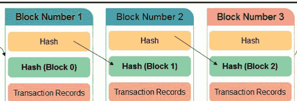
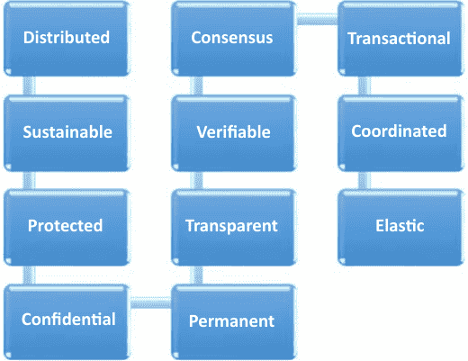
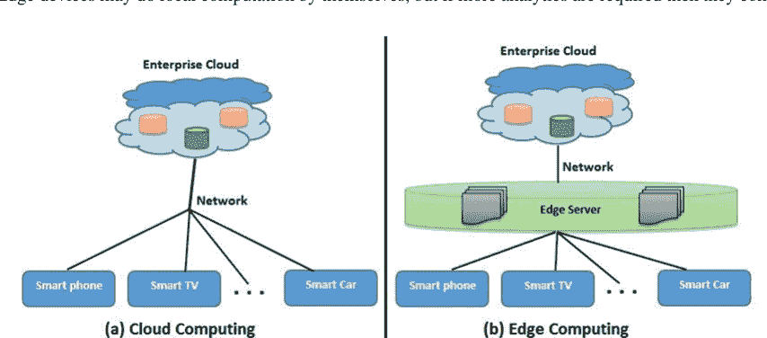
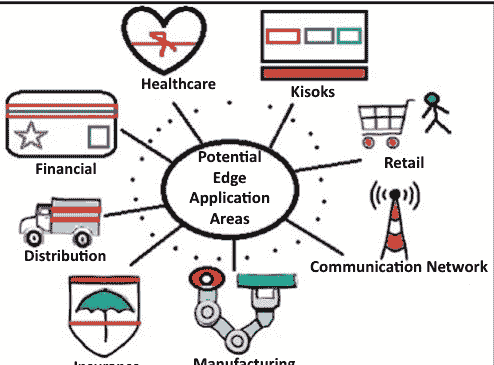
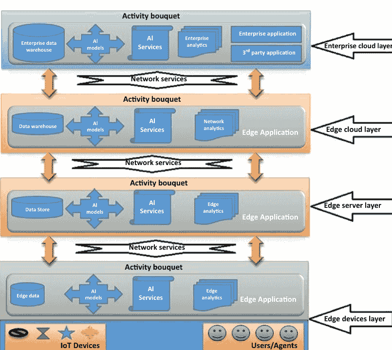

# 边缘计算的人工智能与机器学习

## 第 12 章

### 人工智能与机器学习在区块链技术中的应用

#### 1 引言

分布式不可篡改账本是区块链技术的骨干，它促进了在业务网络中实时记录、审计所有交易以及跟踪资产的过程 [1]。人工智能（AI）试图让机器执行那些目前由人类恰当完成的任务。区块链与人工智能的结合可以促进几乎每个行业中软件开发及其维护的进程。例如，我们可以看到在医疗保健领域实施的这两项技术如何为各自做出贡献。然而，供应链、娱乐、网络安全和物流也受到了影响。区块链可以为其中的每一个领域进行构建。人工智能的局限性包括隐私、透明度和信任度，而区块链可以推导出隐私性和透明度。类似地，效率、可扩展性和安全性是区块链技术的主要瓶颈。

每个区块链都包含多个交易。新知的加密工具如哈希算法或工作量证明 [4] 算法、`SHA256`、伦理等均被用于计算区块的哈希值。前一个区块的哈希值被视为当前区块的基区块（见图 1）[5]。

区块链提供了一个不可篡改的账本，能够以更透明、更易理解的方式存储人工智能的决策过程。区块链上的数据是公开的；比特币可以在区块链账本中执行智能合约和数据机密。人工智能和机器学习的进步促进了它们在区块链技术中的应用。在自动驾驶汽车和精通自然语言的个人助手等事物中使用人工智能已成为我们的新常态 [7]。一方面一方面引起了人们巨大的兴趣，但另一方面，人工智能和机器学习可能会导致严重问题，如创建虚假照片、视频、针对虚假的笔记以及色情内容 [8]。借助人工智能的隐私泄露 [9] 对我们来说是一个潜在威胁。在这里，区块链技术可以提供帮助，因为它赋予你控制自己数据的权力。区块链技术为人工智能的实施带来了解释能力、隐私性和信任度。

##### 1.1 区块链特性

传统银行系统的电子交易成本高昂，且容易受到中间机构的恶意攻击 [10]。然而，区块链网络是一种高效且具有成本效益的技术，因为它通过消除对中间机构的需求消除了努力的差异。使用共识模型来验证信息使其不易受到攻击。区块链技术中的交易是安全的、可验证的经过认证的。

# 表 1 什么是区块链？

| 数据库 | 交易或记录的列表，类似于账本 |
| :--- | :--- |
| 分布式 | 数据库在网络上的多台计算机上进行镜像，并在几分钟/几秒内同步； |
| 可调节的透明性 | 账本对所有相关的利益相关者可见，且没有任何修改风险； |
| 高安全性 | 恶意的攻击者（黑客）无法再攻击单台计算机并更改任何记录 |
| 且不可篡改 | 数学算法和加密触点使得无法更改/删除已记录并接受的任何数据 |

图 1 区块链的基本示意图。

以下是区块链技术的通用特性：

- 共识：区块链网络中的所有成员必须对交易的有效性达成共识。
- 不可篡改性：一旦交易记录在账本中，区块链网络的任何成员都将无法对其进行篡改。如果交易出现错误，则必须执行新交易来撤销所引起的错误。区块链的美妙之处在于，现在两个交易对所有人都是可见的。
- 来源：资产的来源对区块链的所有节点都是知的，资产所有权的变更对所有人也可见。
- 必然性：区块链以单账本的形式提供了一站式解决方案，验证交易的完成情况以及资产的所有权。

##### 1.2 区块链的优势

区块链技术对业务具有以下优势：

- 更短的周转时间：与其它传统的中间方业务相比，区块链中交易的周转时间短得多。缺乏中央权威验证提升了交易速度。
- 不可摧的堡垒：由于其具有的安全特性，区块链应用程序可以被认为是坚不可摧的堡垒。在区块链账本中，黑客攻击、网络安全漏洞或信任问题是不可能的。
- 成本效益：区块链网络的以下属性使其与其他具有权威性的经典网络相比更具成本效益。
- 低维护：没有中央权威来监控区块链中的活动。所有参与者都共同维护网络正常运行。
- 点对点交易：区块链成员可以直接交换资产或服务，不受任何干扰或中央权威的限制。
- 无重复劳动：区块链网络的所有成员共享一个单一账本，消除了重复性劳动。

图 2 区块链信任构建属性

##### 1.3 区块链信任构建属性

区块链技术因为它向系统注入的信任而成为人们讨论的焦点。不依赖中间介的构建是这项技术的独特卖点。图 2 显示了区块链信任构建属性 [11]。

- 分布式：没有可以信任的中央权威。每笔交易在区块链成员的共享账本中镜像。共享账本实时更新。
- 可持续性：区块链网络的持续性取决于其架构。没有任何单一实体会对区块链平台的存在构成任何威胁。
- 受保护：通过加密工具和对权限的限制来检查未经授权的访问。
- 机密性：加密技术结合数据分区技术保护了交易双方和交易的隐私。
- 永久性：一旦智能合约达成交易并完成交易，没有人可以更改账本中的交易。在发生错误交易的情况下，错误的影响将仅通过账本中的新交易来撤销。
- 透明性：由于网络参与者可以访问相同的账本，所有参与交易实实证验证以及每笔交易的验证都是通过每个成员的各种加密工具完成的，无需调解。
- 可验证性：区块链的美妙在于我们可以实时验证所有交易，因为交易按顺序记录并带有时间戳。
- 共识：智能合约是区块链的灵魂，共识算法是智能合约的核心。网络的所有利益相关者必须确保交易的有效性。
- 交易性：区块链的每个智能合约都可以制定自己的交易条款。
- 协调：参与方可以对区块链平台上的每笔交易协调、设计并达成规则、条款和条件。
- 弹性：区块链网络非常灵活；所有生活的需求都可以通过智能合约进行设计和开发。不需要中央或最高权威的批准。

#### 2 人工智能、机器学习与区块链技术的应用

##### 2.1 区块链技术的领军者

区块链技术已被证明是人工智能之后的热门。行业和普通公众在过去对区块链技术产生了兴趣。随着时间的推移，区块链技术的普及程度正在增长了许多倍。排除中介实体是这项技术的独特卖点。然而，区块链技术专家的“知识隐瞒” [12] 现象正为区块链技术成为行业宠儿的道路上制造障碍。

在金融科技之后，区块链技术在医疗保健行业 [13] 证明了其自身的价值最为充分。

在区块链技术领域取得卓越成就的公司列于表 2 中。

## 表格 2 区块链的领军者

| 序号 | 公司名称 | 地点 | 应用领域 |
|---|---|---|---|
| 1. | Coinbase | 加利福尼亚州旧金山 | 金融科技 (Fintech) |
| 2. | SALT Lending | 科罗拉多州丹佛 | 金融科技、贷款 |
| 3. | Mythical Games | 谢尔曼奥克斯 | 游戏 |
| 4. | Gemini | 纽约 | 金融科技、加密货币、 交易 |
| 5. | Circle | 马萨诸塞州波士顿 | 金融科技 |
| 6. | Celsius Network | 纽约 | 金融科技、贷款 |
| 7. | OPKins | 加利福尼亚州圣莫莫尼卡 | 电子商务、游戏 |
| 8. | Civil | 纽约布鲁克林 | 数字媒体、新闻报道 |
| 9. | Bloq | 伊利诺伊州芝加哥 | 软件 |
| 10. | Ripple | 加利福尼亚州旧金山 | 金融科技 |
| 11. | TraDove | 加利福尼亚州帕洛阿尔托 | 社交媒体、电子商务 |
| 12. | Robinhood | 加利福尼亚州梅尔洛帕克 | 金融科技 |
| 13. | DocAi | 加利福尼亚州帕洛阿尔托 | 医疗保健、软件 |
| 14. | Learning Machine | 纽约 | 数字溯源 |
| 15. | TrustToken | 加利福尼亚州旧金山 | 金融科技 |
| 16. | Oasis Labs | 加利福尼亚州伯克利 | 云 |
| 17. | Chronicled | 加利福尼亚州旧金山 | 物联网、供应链、物流 |
| 18. | Lemonade | 加利福尼亚州旧金山 | 金融科技、保险 |
| 19. | High Fidelity | 加利福尼亚州旧金山 | 虚拟现实、社交媒体 |
| 20. | Ankr Network | 加利福尼亚州伯克利 | 云、网络安全 |
| 21. | IBM | 纽约州阿莫克 | IT 技术、软件、计算 |
| 22. | Voatz | 马萨诸塞州波士顿 | 网络安全 |
| 23. | Blockstack | 纽约 | 物联网、开源 |
| 24. | Steem | 德克萨斯州奥斯汀 | 社交媒体 |
| 25. | Lockheed Martin | 马里兰州贝塞尔 | 航空航天、国防 |
| 26. | Ford | 底特律 | 汽车 |
| 27. | Omega Grid | 芝加哥 | 金融科技 |
| 28. | Tokken | 科罗拉多州丹佛 | 金融科技 |
| 29. | Filecoin | 旧金山 | 金融科技 |
| 30. | Mediachain | 纽约 | 数字媒体、电子商务 |

##### 2.2 人工智能与机器学习的领军者

随着 Alexa、Siri 和 Google Assistant 等个人助理的引入，AI 变得越来越流行。随着特斯拉自动驾驶汽车等创新性突破，AI 现在正以全速运行。AI 的迷之处在于其跨学科的本质；因为它触及了各行各业。在 AI 的庇护下，深度学习和机器学习（ML）正在展现出前所未有的实力。在法医学领域，机器学习在检测犯罪模式以及人脸识别方面非常有帮助 [14]。

许多公司在 AI 领域表现出色。除了微软、谷歌、苹果、特斯拉和亚马逊之外，其他几家提供基于 AI 和机器学习解决方案的知名公司列于表 3 中。

##### 2.3 区块链与人工智能的领军者

一方面，AI 凭借其计算和预测能力帮助扩展业务；另一方面，区块链技术提供了一个不可篡改的账本，以防止对业务流程和数据的未经授权访问。表 4 列出的某些公司在监管 AI 和区块链技术的使用方面做出了显著工作。

| 序号 | 公司名称 | 地点 | 应用领域 |
| --- | --- | --- | --- |
| 1. | AEye | 加利福尼亚州普莱森顿 | 机器人 |
| 2. | Airbnb | 加利福尼亚州梅尔洛帕克 | 机器学习、机器人 |
| 3. | AlphaSense | 纽约 | 金融科技 |
| 4. | Ascent | 芝加哥 | 法律 |
| 5. | Blue River Tech | 加利福尼亚州萨尼维尔 | 农业 |
| 6. | Casetext | 旧金山 | 法律 |
| 7. | Clarifai | 纽约 | 软件 |
| 8. | CloudWinds | 加利福尼亚州圣克拉拉 | 云 |
| 9. | CognitiveScale | 德克萨斯州奥斯汀 | 软件 |
| 10. | DataRobot | 马萨诸塞州波士顿 | 大数据 |
| 11. | Figure Eight | 旧金山 | 软件 |
| 12. | Freenome | 加利福尼亚州旧金山 | 医疗科技 |
| 13. | Grammarly | 旧金山 | 生产力 |
| 14. | H2O.ai | 加利福尼亚州帕洛阿尔托 | 大数据 |
| 15. | Insulico Medicine | 马里兰州贝塞斯达 | 生物技术 |
| 16. | Narrative Science | 伊利诺伊州芝加哥 | 大数据 |
| 17. | Nauto | 加利福尼亚州帕洛阿尔托 | 汽车 |
| 18. | Neurala | 马萨诸塞州波士顿 | 机器学习 |
| 19. | NuTonomy | 马萨诸塞州波士顿 | 汽车 |
| 20. | Nvidia Corporation | 加利福尼亚州圣克拉拉 | 硬件 |
| 21. | OpenAI | 加利福尼亚州旧金山 | 软件 |
| 22. | Persado | 纽约 | 软件 |
| 23. | Sherpa | 加利福尼亚州红木城 | 物联网 |
| 24. | SoundHound | 加利福尼亚州圣克拉拉 | 软件 |
| 25. | Tempus | 伊利诺伊州芝加哥 | 医疗科技、大数据 |

174 第一部分 | 人工智能与机器学习

## 表格 3 人工智能与机器学习的领军者——续

| 序号 | 公司名称 | 地点 | 应用领域 |
| --- | --- | --- | --- |
|| 26. | Vicarious | 加利福尼亚州旧金山 | 机器人 |
| 27. | X-AI | 纽约 | 机器学习 |
| 28. | Zebra Vision | 加利福尼亚州伯克利 | 机器学习 |
| 29. | Zoox | 加利福尼亚州福斯特城 | 汽车 |
| 30. | Zymger | 加利福尼亚州埃默维尔 | 生物信息 |

## 表格 4 区块链与人工智能的领军者

| 序号 | 公司名称 | 地点 | 应用领域 |
|---|---|---|---|
| 1. | AI Blockchain | 加利福尼亚州圣莫拉 | 网络安全 |
| 2. | AlphaNetworks | 俄亥俄州霍博肯 | 娱乐 |
| 3. | Best360 | 华盛顿州 | 机器学习 |
| 4. | Blackbird | 旧金山 | 虚假信息 |
| 5. | Box AI | 纽约 | 基于 AI 工具 |
| 6. | Botspring | 马萨诸塞州波士顿 | 机器人 |
| 7. | Clarifai | 加利福尼亚州丹佛斯维尔 | 金融科技 |
| 8. | Dopamine | 丹佛 | 医疗保健 |
| 9. | Chainhaus | 纽约 | 媒体 |
| 10. | CoinGenius | 加利福尼亚州 | 加密货币 |
| 11. | Computable | 旧金山 | 分享市场 |
| 12. | Figure | 华盛顿州 | 供应链 |
| 13. | Cyware Labs | 纽约 | 网络安全 |
| 14. | Dopamine | 纽约 | 知识产权 |
| 15. | Figure | 旧金山 | 贷款 |
| 16. | Finalze | 不列颠比亚州 | 基础设施 |
| 17. | Gainly | 加利福尼亚州 | 医疗 |
| 18. Hannah Systems | 旧金山 | 自动驾驶汽车 |
| 19. LiveEdu | 圣莫拉尼卡 | 在线平台 |
| 20. | Mobs | 旧金山 | 视频市场 |
| 21. NetObjex | 加利福尼亚州 | 智能城市基础设施 |
| 22. Neural | 盐湖城 | 预测引擎 |
| 23. Numerai | 旧金山 | 数据科学 |
| 24. | ObEN | 加利福尼亚州帕塞迪纳 | 智能 AR/VR |
| 25. Stawk | 伯克利 | 业务运营 |
| 26. | Synapse AI | 旧金山 | 分享市场 |
| 27. | Versaris | 伦敦 | 知识产权 |
| 28. | VIA | 马萨诸塞州萨姆维尔 | 能源 |
| 29. | Vytalx | 德克萨斯州 | 医疗 |
| 30. | Wealthblock.AI | 芝加哥 | 营销 |

##### 2.4 印度政府的区块链倡议

NITI Aayog (2020) 的案例研究：

- 土地储备：用于管理记录转让和所有权的系统。
- 药品供应链：通过区块链赋能信任对该行业进行“自我监管”。
- SuperCert：用于教育证书的反欺诈区块链身份解决方案。
- 接种供应链：为供应链开发的新基础设施，将更具统一性和增强性。
- 民间基金：一种基于区块链的模式，以增强信任并释放价值创造。
- 保险（医疗、汽车等）。
- 电动汽车农业。
- 能源交易。
- 加密货币。

##### 2.5 区块链与人工智能当前的应用领域

在过去几年，研究人员将人工智能和机器学习注入区块链技术中。这种努力现在以该领域成功应用的形式表现出来。表 5 概述了 AI 和区块链链发挥奇作用的应用领域。

## 表格 5 区块链与人工智能的活跃应用领域

| 金融科技 | 新闻报道 | 物流 |
|---|---|---|
| 贷款 | 软件 | 保险 |
| 游戏 | 社交媒体 | 虚拟现实 |
| 加密货币 | 医疗保健 | 网络安全 |
| 交易 | 数字溯源 | 计算 |
| 电子商务 | 云 | 航空航天 |
| 数字媒体 | 供应链 | 防护 |
| 法律 | 供应链 | 民用基础设施 |
| 农业 | 虚假信息 | 在线学习平台 |
| 生物技术 | 媒体频道 | 视频市场 |
| 汽车 | 教育 | 自动驾驶汽车 |
| 交通 | 营销 | 智能城市基础设施 |
| 生物信息 | 知识产权 | 预测引擎 |
| 数据科学 | | |

#### 3 舞者共舞：人工智能与机器学习在区块链技术中的未来

安全性是传统电子商务项目中主要的关注领域 [15]。区块链具有许多优势，但也存在一些实现问题。例如，医疗保健领域的区块链威胁和局限性在文献中已有讨论 [16]。图3显示了人工智能和机器学习关注的区块链技术。为了克服这些局限性和问题，人工智能的能力可以被利用。

##### 3.1 可持续性

可持续性是区块链技术中的主要关注问题，因为挖掘需要大量的能量。人工智能在优化能耗方面证明了它的实力。因此，它可以被利用。

##### 3.2 可扩展性

可扩展性是区块链的另一个关键问题。区块链的大小正以每秒 MB 的速度增长。区块链剪枝 [6] 无法处理此问题。人工智能驱动的联邦学习或新颖可能会在此使用。

##### 3.3 安全

由于区块链的高能耗，几乎不可能被黑入；但其应用层由程序员编写的智能合约是不安全的。在这里，我们可以利用机器学习的入侵检测能力。

##### 3.4 隐私

人工智能和机器学习模型在保护区块链数据隐私方面非常有用。例如，旨在在不违反隐私 [17] 的情况下自动化医疗。

##### 3.5 适应性

人工智能和机器学习模型可以准确预测区块链应用的适应性。区块链的适应性根据业务需求、以及员工转向新技术的意愿进行预测。

图3 区块链关注领域。

### 3.6 效率

人工智能和机器学习模型通过预测最有前景的节点来最小化某些活动的不确定性。

### 3.7 交易速度

优化是人工智能和机器学习模型优秀的领域。账本的大小降低了交易速度。这个问题可以通过人工智能优化技术解决。

### 3.8 性能

性能可以通过机器学习模型的改进。机器学习具有从经验中学习的能力。

### 3.9 各元素的验证

交易的验证和检查由人工智能驱动的模型自动完成。

### 3.10 可维护性

区块链的可维护性是一项巨大的任务。人工智能和机器学习模型可以实现区块链的可维护性。

### 3.11 范围估计

人工智能可以促进机器学习模型检查区块链项目。在垂直处理中的区块链范围可以通过机器学习模型提出。

### 3.12 成本估计

由于底层架构的原因，无法通过传统方法估计区块链项目/应用的成本。机器学习模型在更高效的方式预测成本估计方面起着重要作用。

### 3.13 工作估计

区块链应用没有传统的工作估计方法；在这里，机器学习和人工智能工具可能被用于准确预测所需的工作。

### 3.14 项目特定的模式

有四种区块链项目/应用：

- (i) 公有链或无许可区块链

   示例：Bitcoin、Litecoin、Ethereum等

- (ii) 私有链或基于许可的区块链

   示例：Sawtooth、Fabric、Corda等

- (iii) 联盟链或去中心化区块链

   示例：R3、Energy Web Foundation等

- (iv) 混合区块链（私有链和公有链的结合）

   示例：Dragonchain等

可以在项目特定的数据上进行机器学习训练。可以通过人工智能技术设计项目特定的模式。

## 边缘计算：区块链的潜在用途

边缘计算的想法是将计算能力带到“即时数据”的源头。因此，这种边缘计算范式可以通过将云计算能力推到网络的边缘 [18]，更好地服务延迟敏感的任务。边缘计算的骨干是其分布式计算框架。其目的是将数据源设备的存储能力和计算能力带到实际需要的企业业务逻辑处 [19]。边缘计算的工作方式不同；边缘设备在本地处理计算，而云计算将其集中在单个数据中心 [22]，如图4所示。在延迟和带宽方面，边缘计算优于云计算，边缘设备在对本地数据处理后只需将结果发送到边缘服务器。

物联网 (IoT) 是边缘计算的可能用途之一。以服装店为例，库存和销售都需要本地和批量两种类型的处理。地理分布的商店每天统计库存和销售，然后将计算结果发送到总部。在这个例子中，顶层总部对商店（边缘）发生的每次交易感兴趣，而是对商店（边缘设备）计算出的销售和库存最终统计感兴趣。通过利用边缘计算的能力，我们重塑了每一个行业。边缘计算的用例包括电信、健康、金融服务、媒体与娱乐、制造业、供应链、零售、保险、医药以及带有智能和智慧城市的汽车。图5显示了边缘计算的一些用途。

### 4.1 边缘计算架构

云计算和物联网的架构可以扩展到边缘计算架构的示意图中。基本上，边缘计算利用多层分布式架构在云层、边缘层（边缘网络）以及连接边缘本地服务器层和边缘设备的边缘层之间平衡；图6展示了边缘计算架构的高级示意图。图7表示了基于IBM边缘计算架构的简化边缘架构参考。

顶层（或云微云）用于分析大规模数据。它由一个可能是设备管理和监控焦点的仪表板组成。这一层可能有数百个设备。每一层作为AI服务和模型的软件组件的大小取决于其需要处理的数据量。

第二层是边缘云或微数据中心，可以认为是边缘设备计算的本地云。这一层在电信领域也被认为是边缘网络。边缘云可以在自己完成大部分计算，无需咨询顶层，从而降低延迟并减少带宽。这一层可能有数千个设备。

第三层是边缘服务器层。边缘设备通过安装的代理与边缘服务器通信。边缘设备可以自己进行计算，如果需要更多分析，它们会与本地边缘通信。这些边缘服务器还用于在边缘设备上部署所需的应用程序。这一层是数百万个设备的所在地。

架构的底层是边缘设备层。边缘设备非常紧凑且精密，资源有限（如存储容量小），但配备了人工智能和机器学习的高端软件即服务。

图4 云与边缘计算的高级概念。

图5 边缘应用领域。

图 7 高级边缘计算参考架构。

- Intel Network Builders 边缘生态系统/Intel IoT 市场就绪解决方案 (Intel IMRS)/Intel 数据中心构建：Intel合作伙伴解决方案

- AWS 边缘：

    - 基础设施：AWS Wavelength/AWS Local Zones/AWS Outposts

    - 网络：Amazon CloudFront

    - 物联网：AWS SiteWise/AWS IoT Greengrass/FreeRTOS/用于 AWS IoT Core 的 AWS 语音集成

    - 网络：Amazon CloudFront

- 坚固型与离线边缘设备：AWS Snowcone/Snowball Edge

- 存储：AWS Storage Gateway

- 分析：Amazon Kinesis Video Streams

- 机器学习：Amazon SageMaker Edge Manager/Amazon SageMaker Neo/AWS Panorama/Amazon

- Microsoft Azure 边缘：

    - 基础设施：Azure Stack (1U, 2 x 10 核 Intel Xeon, 128 GB 设备)

    - Azure Stack HCI: 一种超融合基础设施

    - Azure Stack Hub: 云原生应用的部署

- Google 边缘：

    - 边缘认证

    - Google 边缘云

# 人工智能与机器学习的应用 章节 | 12 181

计算中使用的通用协议：

CoAP：这是 IET 受限资源 RESTful 环境 (CoRE) 工作组的智力结晶。它是一种应用层协议。在 HTTP 功能的基础上，该传输协议运行在表述状态转移 (REST) 之上。

AMQP：应用层协议是 TCP 中的一种开放标准，用于消息交换。AMQP 为消息传递提供了三种保证，包括恰好一次、最多一次和至少一次传递。

MQTT：MQTT 由三个部分组成：发布者、代理（broker）和订阅者。它是一种连接协议，用于连接各种边缘设备，如边缘网络、嵌入式设备、中间件和边缘服务。

IoT 通信：机器对机器、物网、物联网模型包括：发布-订阅、请求-响应等。通信模式包括通知、遥测和状态更新。

### 4.2 边缘计算的领军者

边缘计算市场参与者包括谷歌、微软公司、亚马逊、IBM 公司、通用电气公司、华为技术有限公司和思科系统。这些公司正为边缘计算的技术开发努力工作，使其被行业客户所接受。除了少数帮助边缘计算实现其真正潜力的知名公司外，如表 6 所示。

表 6 区块链与人工智能的领军者。

| 序号 | 公司名称 | Location | 应用领域 | 核心贡献 |
|---|---|---|---|---|
| 1. | ClearBlade | 德克萨斯州 | 软件平台提供商 | 边缘 IoT 软件 - 企业 IoT 平台 - 安全 IoT |
| 2. | EdgeConneX | 吉尼亚州 | 边缘数据中心 | 边缘小区 - 运营商中立数据中心 - 边缘计算基础设施 - 接入点 |
| 3. | Mutable | 纽约 | 公共边缘云技术 | 面向以下对象的边缘技术平台：br>- 电缆运营商 - 云提供商 - 应用提供商 |
| 4. | MobileX | 加州 | 软件平台提供商 | 边缘云 |
| 5. | Saguna | 以色列 | 通信网络 | Open-RAN MEC 解决方案 |
| 6. | Cato Networks | 以色列 | 通信网络 | 安全访问服务边缘 (SASE) |
| 7. | Edge Intelligence | 美国 | 软件平台提供商 | 分布式分析平台 |
| 8. | 惠普工业企业 (HPE) | 加州 | 软件平台提供商 | 边缘企业级 IT |
| 9. | Vapor IO | 德克萨斯州 | 通信网络 | 动力边缘 |
| 10. | FogHorn | 加州 | 软件平台提供商 | 边缘 IoT 部署 |

# 表 6 区块链与人工智能的领军者 – 续

| 序号 | 公司名称 | Location | 应用领域 | 核心贡献 |
|---|---|---|---|---|
| 11. | Swim | 美国 | 云原生应用部署 | 云原生 |
| 12. | Affirmed | 美国 | 通信网络 | 边缘云 |
| 13. | Gravity | 美国 | 基础设施 | 边缘云 |
| 14. | Packet | 美国 | 基础设施 | 云原生 |
| 15. | EdgeConnX | 美国 | 数据中心 | 云原生 - 边缘性 |
| 16. | Aruba | 加州 | 通信网络 | 边缘平台 |
| 17. | AT&T | 达拉斯 | 通信网络 | 边缘计算 |
| 18. | Infi | 加州 | 通信网络 | 边缘 |
| 19. | Sierra Wireless | 加拿大 | 通信网络 | 云原生 |
| 20. | Citrix | 美国 | 通信网络 | 安全边缘 |
| 21. | ClearBlade | 德克萨斯州 | 软件平台提供商 | 平台 - 智能监控 - 轨道跟踪 |
| 22. | Edgeworx | 加州 | 软件平台提供商 | Fog |
| 23. | IGEL | 德国 | 软件平台提供商 | 云工作区 |
| 24. | Pens | 美国 | 软件平台提供商 | 云工作区 |
| 25. | Gravity | 美国 | 基础设施 | 边缘云 |
| 26. | Pensando | 美国 | 通信网络 | 边缘平台 |
| 27. | Ananda | 加州 | 通信网络 | 边缘网络 |
| 28. | EverLife | 美国 | 通信网络 | 数字遗产 |
| 29. | PTC | 德克萨斯州 | 通信网络 | 智能治理 |
| 30. | VMware | 加州 | 通信网络 | NSX 数据中心 |

# 人工智能与机器学习的应用 章节 | 12 183

| 应用领域 | 年份 | 核心贡献 |
|---|---|---|
| IoT 网络 [26] | 2018 | 提出了深度神经网络模型。 |
| 移动 IoT 系统 [27] | 2018 | 提出了区块链。 |
| IoT 网络 [28] | 2019 | 在边缘计算中部署区块链。 |
| 智慧城市 [29] | 2019 | 讨论了所提架构的局限性和优势。 |
| 智能网络 [30] | 2020 | 提出了赋能 AI 的边缘计算管理。 |
| 资源交易系统 [31] | 2020 | 提出了基于混合区块链的资源交易系统。 |
| 政府招标 [32] | 2020 | 提出了安全框架。 |
| 车辆联网 [33] | 2020 | 开发了集成区块链的 CUTE。 |
| 工业 IoT [19] | 2020 | 在中国移动中成功实现了 CUTE。 |
| 访问管理系统 [34] | 2021 | 提出了区块链的边缘计算模型。 - 通过 CPN 进行验证。 - 通过 WISE 平台验证了该模型的实际应用。 |

### 4.3 区块链技术在边缘计算中的应用

在边缘计算中，边缘设备经常与边缘服务器通信以进行 AI 和学习型决策。通信网络和设备本身容易受到黑客攻击或设备故障带来的安全威胁，导致信息篡改或泄露 [23]。区块链的不可篡账本可以发挥关键作用。区块链技术可以确保边缘设备、边缘网络和企业云上的通信和存储不可篡改。边缘计算中的 AI 信任模型可以通过区块链的智能合约和共识机制进行优化和改进 [24]。区块链和边缘计算技术具有巨大的效能，并为各种场景提供了解决方案。区块链驱动的信任、安全且不可篡改的边缘计算框架可以提供有效的解决方案。研究人员提出了多种区块链支持的边缘计算框架。最新的区块链边缘计算框架总结见表 7。

## 5 结论

从加密机器人交易加密货币，到 AI 驱动的音乐流媒体平台 MusicLife，再到通过创建在线化身帮助人们拥有数字遗产的 EverLife，这些只是

区块链与人工智能交织的景象。人工智能的局限性通过区块链消除，而区块链的局限性则通过人工智能量身定制。机器学习正在证明其在区块链自动化方面的能力。边缘计算物联网是与区块链和人工智能结合的另一大武器。通过边缘计算，我们的计算能力可以增加许多倍。缺乏中间方或治理方是区块链技术的魅力所在，但这是一把双刃剑。为了消除围绕区块链的不确定性，人工智能和机器学习可以发挥至关重要的作用。本文讨论了人工智能和机器学习在区块链中的许多应用。我们还讨论了边缘计算作为区块链技术的潜在用途。这些领域的研究欢迎贡献。

## 致谢

手稿通讯稿 (MCN): IU/R&D/2021—MCN0001092 研究与开发部，Integral Unity,

## 参考文献

- [1] M. Gupta, Grasping blockchain fundamentals, for Blockchain in Dummies, IBM, Hoboken, NJ, 2017. Limited Edition.

- [2] T.N. Din, M.T. Thai, Ai AI as a disruptive innovation, Computer System, 51 (2018) 48–53.

- [3] M.N.T.I. Ayayog, Blockchain: The Industry Strategy, N.I.T.I. Ayayog, 2020.

- [4] M. Jakobson, A. Jaels, Proof of work and building protocols; in Computer Information Networks, Springer, 1999, pp. 258–272.

- [5] S. Ali, A. Rahman, F. Shafei, Smart Blockchain: Understanding the challenges and needs of blockchain software: a survey, Empir. Soft. Eng., 24 (2019) 2660–2673.

- [6] S. Nakamoto, Bitcoin: A Peer-to-Peer Electronic Cash System, 2008. https://bitcoin.com/bicoin.pdf.

- [7] Y. Leviaqu, Google Duplex: An AI for Automating Real-World Tasks over the Phone, Google AI Blog, 2018. https://ai.google/blog/google-duplex-ai/

- [8] A. Hern, AI for Face-to-face World Stories into Imprintof Fotos, The Guardian, 2018. https://www.theguardian.com/technology/2018/05/25/ai-face-to-face-emotion-recognition-craftsman-johnson-taylor-risley-daily-tracker-marie-miles

- [9] J. McCraft, AI Will Make Smart Homes Autonomous, But Don't Expect Performance or Privacy, Digital Trends, 2018. www.digitaltrends.com/home/ai-will-make-smart-homes-autonomous-but-don-t-expect-performance-or-privacy/

- [10] T. Laurence, Blockchain for Dummies, John Wiley & Sons, 2019.

- [11] T. Chang, Y. Huang, H. Zhang, Q. Q. Li, N. Zhang, M. Amin, How blockchain can enhance financial services-surveys, the challenges and merits from expert interviews, Foretech, Sec. Conf., 158 (2020) 12166.

- [12] S. Tanwar, K. Park, R. Evans, Blockchain-enabled electronic health record system for healthcare 4.0, Int. J. Fe. App., 50 (2020), 10240.

- [13] M. Haron, M. Merouti, F. Tabibi, Application of machine learning in healthcare: Critical Concepts, Standards, and Techniques in Cybersecurity, FIG Global, 2020, pp. 228–239.

- [14] M.S. Hussain, D. Haron, A. Naseem, M. Alharbi, H. Alrajhi, The benefits and threats of blockchain technology in healthcare: a review, IEEE J. Res. Comput. Sci. Technol. 8 (2020) 271–277.

# References

- [15] F. K. Khan, M. Asif, A. Ahmed, A secure framework for smart grid and its application in has for sustainable development, Cities Soc. 55 (2020), 102018.
- [16] K. Alaniezi, S. Mishra, Edge-based architecture to support the execution of machine intelligence with the IOP platform, Future Gen. Comput. Syst., 114 (2020) 1–13.
- [17] Y. Wu, H. Dai, W. Wang, J. Yi, S. Azdari, A. Y. Zomata, Edge intelligence: the fusion of edge computing and artificial intelligence, IEEE Intelligent Syst. 10 (4) (2020) 92–100.
- [18] S. Deng, H. Wang, F. Liu, Edge computing for secure and scalable IoT infrastructures in 4.0, IEEE Internet Things J. 8 (2020) 2300–2317.
- [19] L.U. Khan, Y. Iqbal, N. Tran, S. A. Kazmi, T. Ni, C.-S. Ho, Edge-computing-enabled smart cities: a comprehensive review, IEEE Internet Things, 7 (2020) 10229–10232.
- [20] A. Sanayye, Fog and edge computing; in: Internet Computing, Springer, Cham, 2020, 237–274.
- [21] S. El-Amin, M. Hassan, B. Yoon, Blockchain security attacks, challenges, and solutions for the future IoT network, IEEE Access 9 (2021) 13938–13950.
- [22] S. Singh, P.K. Sharma, B. Yoon, M. Shoojafar, G.H Cho, L.H Ra, Convergence of blockchain and artificial intelligence in IoT network for the sustainable smart city, Cities Soc. 55 (2023), 102364.
- [25] R. Yang, F. Yu, P. Si, Z. Yang, Y. Zhang. Integrated blockchain and edge computing systems: a survey, some research issues and challenges, IEEE Commun. Surv. Tutorials 21 (2) (2019) 1508–1552.
- [26] N.C. Liang, Z. Xiong, P. Wang, D. Niato, Optimal auction for edge computing resource management in mobile blockchain: a deep learning approach, in: 2018 IEEE International Conference on Communications (ICC), IEEE, 2018, pp. 1–6.
- [27] Z. Xiong, Y. Zhang, D. Niato, P. Wang, Z. Han. When mobile blockchain meets edge computing, IEEE Commun. Mag. 56 (8) (2018) 33–39.
- [28] U. Jayantunge, G.M. Lee, A. Macermott, W.S. Rice, TrustChain: a privacy preserving blockchain with edge computing, Wirel. Commun. Mob. 23 (1) (2019) 110–17.
- [29] A. Damianos, C. Angelopoulos, V. Katos, An Architecture for blockchain over edge-enabled IoT for smart cities, in: 2019 15th International Conference on Distributed Computing Systems (DCOSS), IEEE, 2019, pp. 465–472.
- [30] J. Xu, S. Wang, A. Zhou, F. Yang, Edgence: a blockchain-enabled edge-computing platform for intelligent iot-based apps, China Commun. 17 (4) (2020) 595–600.
- [31] S. Fan, H. Zhang, Y. Zeng, W. Cai, Hiyato Hybrid blockchain-based resource trading system for federated learning in edge computing, IEEE Internet Things 8 (4) (2020) 2252–2264.
- [32] V. Havassija, Y. Ding, G. Krishna, N. Kumar, M. Guizani, A blockchain and edge computing-based secure framework for government tender allocation, IEEE Internet Things 8 (4) (2020) 2409–2418.
- [33] L. Lu, Z. Chen, S. Yang, M. Jing, Q. Li, Y. Zhou, Q. Lu, A blockchain-based containerized edge computing platform for the internet of vehicles, IEEE Internet Things 8 (8) (2020) 2395–2408.
- [34] Y. Zhu, C. Huang, Z. Hu, A. Al-Dhelaean, M. Al-Dhelaean, Blockchain-enabled access management system for edge computing, Electronics 10 (9) (2021) 10000.
