# 可持续发展的人工智能与机器学习：创新、挑战与应用


## 引言


近年来，人工智能（AI）与可持续发展的交叉领域已成为一个探索与创新的关键领域。随着全球社区努力解决减困脱贫、缓解气候变化和医疗健康可及性等紧迫挑战，人工智能在催化可持续发展目标（SDGs）进展方面的潜力已引起日益增关注。然而，将人工智能有效整合到可持续发展倡议中并非没有障碍。本引言为探索将人工智能整合到可持续发展过程中所固有的复杂性、机遇和解决方案奠定了基础。

## 人工智能与可持续发展的融合

人工智能在可持续发展中的整合代表了两种重塑当代人类活动图景的变革性力量的汇。一方面，在机器学习、自然语言处理和机器人技术进步的推动下，人工智能提供了分析海量数据集、自动化任务和规模化生成见解的前所未有的能力。另一方面，在公平、韧性和环境管理原则的指导下，可持续发展力求在促进包容性经济增长的同时，为孙后代保护好地球。人工智能与可持续发展之间的协同作用为解决人类面临的一些最复杂且相互关联的挑战具有着巨大前景。

## 实现潜力的挑战

实现这一潜力需要面对跨越技术、伦理和社会维度的重重障碍。主要挑战之一是确保人工智能技术的部署方式尊重人权、促进公平并减轻潜在伤害。伦理考量，包括偏见、透明度和问责等问题，在围绕人工智能治理和监管的讨论中占据重要地位。此外，必须解决对数据隐私、安全和数字鸿沟的担忧，以确保人工智能驱动的解决方案造及社会的所有群体，特别是边缘化和资源不足的社区。

人工智能整合到可持续发展中的复杂性，由于人工智能应用所具有前景的多元化部门和领域而变得更加复杂。从医疗保健、农业到能源和环境保护，人工智能技术提供了创新的解决方案，以提高效率、优化资源分配并改进决策过程。然而，实现这些利益需要应对特定部门的挑战，并定制人工智能解决方案以满足不同行业的独特需求和背景（Rajkomar et al., 2019）。

## 本章目标

鉴于这些挑战，本章旨在探索阻碍人工智能有效整合到可持续发展倡议中的障碍，并提出解决这些问题的方案。通过研究真实案例、案例研究和最佳实践，我们旨在阐明释放人工智能在可持续发展中变革性潜力的策略和方法。我们探索的核心在于：人工智能在可持续发展中的成功整合需要一种多学科和包容的方法。政府、工业界、学术界、社会和当地社区之间的合作至关重要，以确保人工智能技术的部署符合社会价值观、尊重文化多样性并促进公平的结果。此外，培养负责任创新和持续学习的文化，对于建立对人工智能驱动解决方案的信任和信心至关重要。

在本章中，我们将深入探讨具体的示例和案例研究，说明与将人工智能整合到可持续发展相关的挑战和机遇。从精准农业和远程医疗到可再生能源和野生动物保护，我们将研究如何利用人工智能来解决复杂问题并推动积极的社会、经济和环境成果。人工智能在可持续发展中的整合代表了利用技术造人类和地球更大利益的变革性机遇。然而，实现这一潜力需要共同努力来克服障碍、拥抱伦理原则并培养包容性创新。通过参与对话、共享知识以及跨部门跨学科合作，我们可以释放人工智能的全部潜力，加速迈向更加可持续和繁荣的未来。

## 文献综述

近年来，人工智能整合到可持续发展引起了研究人员、政策制定者和从业者的极大关注。在文献综述中，我们探讨了围绕人工智能的障碍、机遇和解决方案的现有研究。

# 伦理考量
文献中的一个重要主题是在可持续发展中部署人工智能的伦理影响。学者们强调了确保人工智能技术遵循公平、透明和问责原则的重要性。算法偏见等问题（即人工智能系统复制并放大社会不平等）已得到广泛讨论。研究人员强调需要稳健的治理框架来解决伦理关注点并促进人工智能发展（Floridi et al., 2020）。

### 数据隐私与安全
文献探讨的另一个方面是在人工智能驱动的可持续发展中保护数据隐私和安全的挑战。由于人工智能高度依赖数据进行训练和决策，对数据保护和未经授权访问的担忧随之产生。学者强调了保护隐私的人工智能技术并实施稳健的安全措施以减轻数据泄露和误用相关的风险的重要性（Abouelmehdi et al., 2020）。

### 数字鸿沟
数字鸿沟以数字技术获取和使用方面的差异为特征，这对可持续发展中公平工智能整合构成了重大障碍。研究表明，边缘化和资源不足的社区（特别是发展中国家）往往缺乏从人工智能驱动的解决方案受益所需的基础和资源。弥合数字鸿沟需要针对性的干预，以解决获取障碍，包括负担能力、连接性和数字素养（Hilbert, 2016）。在能源领域，用于智能电网管理、可再生能源优化和需求预测的驱动解决方案已被广泛研究。此外，在环境保护领域，基于人工智能的监测和监控系统能够更高效、更有效地保护生物多样性和自然资源（Bryson et al., 2018）。


## 解决方案与策略

为了应对上述挑战，学者们提出了各种解决方案和策略，以将人工智能更有效地整合到可持续发展中。透明的 AI 治理框架（涵盖问责制、公平性和人权原则）对于指导 AI 的开发和部署至关重要 (Jobin et al., 2019)。促进数据伦理和负责任的 AI 实践（例如算法透明度和可解释性）有助于减少偏见并确保 AI 技术的伦理使用 (Floridi et al., 2020)。此外，通过教育和培训倡议提高数字素养和可及性，可以赋予个人和社区利用 AI 收益促进可持续发展的能力 (UNESCO, 2020)。

## 案例研究与最佳实践

文献综述还包含了案例研究和最佳实践，这些显了成功的 AI 驱动的可持续发展倡议。例如从为偏远地区提供医疗服务的远程平台，到优化作物管理实践的 AI 农业无人机。这些案例研究展示了 AI 在解决复杂社会挑战和实现可持续发展目标方面的转型潜力 (Cabitza et al., 2023)。

文献综述强调了将 AI 整合到可持续发展中的多方面性，以及解决伦理、技术和社会挑战的重要性。通过采用透明的治理框架、促进数据伦理、弥合数字鸿沟并利用特定领域的机遇，利益相关者可以充分发挥 AI 的潜力，以推进可持续发展目标。此外，分享成功案例的最佳实践和教训可以为未来的 AI 驱动倡议提供参考，并为所有人构建一个更具可持续性和包容性的未来做出贡献。

## 伦理考虑

在将 AI 整合到可持续发展过程中，伦理考虑至关重要。随着 AI 技术日益渗透到医疗、农业、能源和环境保护等各个领域，确保这些技术遵守伦理原则和价值观变得异常重要。

与 AI 相关的主要的伦理关注之一是算法偏见。AI 系统（特别是那些偏偏或不完整数据集上训练的系统）可能会无意中延续或加剧现有的社会不平等。例如，在招聘或贷款过程中使用的偏见算法可能导致歧视性结果，使某些人口群体处于劣势。解决算法偏见需要对数据集选择、算法设计以及持续监控和评估进行关注，以检测并减轻偏见 (Zou et al., 2019)。

透明度和问责制也是 AI 部署中的关键伦理考虑。许多 AI 算法作为“黑箱”运行，这使得很难理解决策是如何做出的，难以让责任方对算法错误或偏见负责。通过为决策过程提供解释并实现可审计性来确保 AI 系统的透明度，可以增强问责性和信任赖 (Jobin et al., 2019)。

AI 提出了关于人类自主性和代理权可能丢失的伦理问题。随着 AI 系统变得日益复杂，存在过度依赖自动化决策过程的风险，可能会削弱人类的决策能力并侵蚀个人自主性。在自动化收益与维护人类代理权之间平衡，需要仔细考虑人类和 AI 系统在决策过程中的角色和责任 (Bryson et al., 2017)。

另一个伦理考虑是 AI 对流失业和经济不平等的影响。虽然 AI 具有提高生产力和效率的潜力，但也可能导致某些行业（特别是易受自动化影响的行业）失业。此外，AI 驱动的经济增长收益可能无法公平分配，加剧不同社会经济群体之间的现有差异。应对这些挑战需要采取积极措施，对被 AI 自动化取代的工人进行重新培训和技能提升，并确保 AI 驱动的经济增长收益得到更公平的共享 (Brynjolfsson and McAfee, 2014)。伦理考虑是 AI 在可持续发展中负责任整合的核心。解决算法偏见、透明度、问责性和人类自主性等问题需要利益相关者采取积极措施并持续对话。通过在 AI 开发和部署中优先考虑伦理原则和价值观，我们可以最大化 AI 对可持续发展的积极影响，同时减少潜在的风险和伤害。

### 数据隐私与安全

数据隐私和安全是将 AI 整合到可持续发展中的关键挑战。由于 AI 系统依赖海量数据进行训练和决策，确保这些数据的隐私和安全对于维持对 AI 技术的信任和信心至关重要。关于数据隐私的主要关注点之一是对个人数据的非法收集、使用和共享。AI 应用通常需要访问敏感信息，如医疗记录、财务交易和位置数据，这引发了对隐私隐私的担忧。数据泄露和网络攻击构成了额外风险，可能导致敏感信息暴露给恶意分子并损害隐私 (Cavoukian and Jonas, 2019)。

为了应对这些挑战，政策制定者和组织必须实施数据保护措施（如数据匿名化、加密和访问控制），以保护敏感信息免受未经授权的访问或泄露。此外，定义数据收集、使用和共享的数据治理框架有助于符合隐私法规和行业标准 (Chouldechova and Roth, 2018)。数据隐私与安全的另一个方面是在 AI 开发和部署中使用数据的伦理。在偏见或歧视数据上训练的 AI 算法可能会延续或放大现有偏见，导致不公平或歧视性的结果。确保数据公平需要仔细关注数据集选择、预处理技术和算法设计，以减少偏见并促进公平结果 (Mehrabi et al., 2019)。

此外，可持续发展倡议中物联网（IoT）设备和传感器的普及为数据隐私和安全带来了新挑战。这些设备收集有关环境、基础设施和人类行为的海量实时数据，引发了对隐私侵犯和数据泄露的担忧。实施隐私保护技术（如差分隐私和联邦学习）有助于降低这些风险，同时实现物联网支持的 AI 应用益处 (Raj et al., 2019)。


数字鸿沟为 `AI` 平等整合到可持续发展倡议中构成了重大障碍。数字鸿沟被定义为接入数字技术的人与无法接入的人之间的差距，它涵盖了互联网连接、数字素养以及获取信息和通信技术（ICTs）方面的差异。获得可靠的互联网连接是利用 AI 驱动的解决方案实现可持续发展的根本先决条件。然而，全球有数百万人，特别是发展中国家的农村和偏远地区，缺乏负担得起的可靠的互联网服务。互联网基础设施的缺失限制了他们从在线教育、远程医疗、电子商务以及其他 AI 支持的数字服务受益的能力 (ITU, 2020)。

此外，数字素养和技能的差异加剧了数字鸿沟，因为缺乏有效使用数字技术必要知识和能力的人员无法充分参与数字经济。弥合数字技能缺口需要针对性的干预，例如数字素养培训计划、职业教育倡议和能力建设工作，以赋予个人和社区导航和利用 AI 驱动技术所需的技能 (UNESCO, 2020)。此外，获得负担得起且易用的数字设备（如智能手机、平板电脑和计算机）对于弥合数字鸿沟至关重要。然而，许多边缘和服务不足的社区由于成本限制、可用性和基础设施限制，获取这些设备面临障碍。公私合作伙伴关系、社区倡议和政府补贴可以通过为弱势群体提供负担得起且易于获取的数字设备来应对这些障碍 (World Bank, 2016)。语言和文化障碍也导致了数字鸿沟，因为通过数字平台交付的内容和服务可能无法提供当地语言，也针对不同社区的文化偏好和需求进行定制。在数字内容和服务中促进语言的多样性和文化包容性有助于弥合这些差距，确保 AI 驱动的解决方案对社会所有阶层都是可访问且相关的 (UNESCO, 2019)。解决数字鸿沟对于确保 AI 平等地整合到可持续发展倡议中至关重要。通过扩大互联网连接接入、促进数字素养和技能发展、提供负担得起的数字设备以及培养语言和文化包容性，利益相关者可以赋予边缘和服务不足的社区充分参与数字经济并从 AI 驱动的解决方案中受益的能力。弥合数字鸿沟不仅是一个社会公正问题，也是实现包容性和可持续发展成果的先决条件。

## 健康医疗

在医疗领域，`AI` 的整合既带来了重大挑战，也带来了变革性的机遇。AI 技术具有彻底改变医疗服务、改善患者结果和提高运营效率的潜力。然而，实现这些利益需要解决一系列特定领域的挑战。医疗 AI 的主要挑战之一是确保 AI 驱动的诊断和预后模型的准确性、可靠性和可解释性。在医学图像、电子健康记录和基因组数据海量数据集上训练的 AI 算法可以协助医生诊断疾病、预测患者结果并个性化治疗方案。然而，对 AI 算法的“黑箱”性质及其产生错误或偏见结果可能性的担忧，为其在临床实践中的广泛应用带来了障碍 (Obermeyer and Emanuel, 2016)。

将 AI 整合到医疗工作流中需要克服互操作性挑战，并确保与现有健康信息系统的无缝集成。医疗数据通常分散在不同的系统和格式中，使得数据聚合和分析变得困难。开发用于数据交换和集成的互操作标准和协议对于释放 AI 在医疗领域的全部潜力至关重要 (Fridsma et al., 2020)。确保患者隐私和数据安全在医疗 AI 中极其重要。医疗数据高度敏感，并受严格的隐私法规限制，例如美国的 `HIPAA` 和欧盟的 `GDPR`。AI 应用必须遵守数据保护要求，并实施稳健的安全措施以保护患者隐私 (Cavoukian and Jonas, 2019)。

尽管存在这些挑战，AI 为增强医疗服务和改善患者结果提供了变革性的机遇。用于医学影像解读 AI 工具（例如检测乳腺癌病变和胸 X 光肺结节的 `CAD` 系统）在临床试验中已展现出良好的前景 (Esteva et al., 2017)。同样，AI 驱动的预测分析模型可以协助医生识别疾病风险患者，从而实现早期干预和预防性护理 (Rajkomar et al., 2018)。AI 虚拟助手和聊天机器人正被用于个性化健康建议、回答患者问题并促进远程咨询，特别是在医疗服务有限的边缘和偏远地区 (Bickmore et al., 2019)。利用 AI 技术进行远程监测、诊断和治疗的远程医疗平台也日益普及，特别是在新冠肺炎之后，这凸显了远程医疗交付和远程医疗解决方案的重要性 (Hollander and Carr, 2020)。

虽然将 AI 整合到医疗领域带来了准确性、互操作性和数据隐私方面的挑战，但它也为彻底改变医疗服务提供了变革性的机遇。通过解决这些挑战并负责任地利用 AI 驱动的解决方案，利益相关者可以充分利用 AI 的潜力，推进医疗可持续性目标并实现更好的健康成果。

## 农业

在农业领域，AI 的整合对于提高生产力、优化资源利用和促进可持续发展具有巨大前景。AI 技术可以帮助农民做出数据驱动决策、监测作物健康并降低环境风险。然而，实现这些利益需要解决一系列特定领域的挑战。

农业 AI 的主要挑战之一是确保训练 AI 模型的数据可用性和质量。农业产生各种来源的海量数据，包括卫星图像、天气传感器、土壤传感器和农机。然而，这些数据通常是异构的、不完整的且具有波动性，使得开发适用于不同地区和条件的稳健 AI 算法变得困难 (Candiago et al., 2015)。


将 AI 集成到农业流程中需要克服基础设施挑战，特别是在数字技术和互联网连接有限的农村和偏远地区。许多小农户无法获得廉价且可靠的互联网服务，阻碍了他们采用 AI 驱动的精准农业技术。弥合数字鸿沟并提供数字基础设施和服务的获取，对于实现 AI 在农业领域的广泛应用并确保小农户能够从技术进步中受益至关重要 (世界银行, 2016)）。

确保小农户 AI 解决方案的可扩展性和负担能力，对于最大化其影响并触达最脆弱的人群至关重要。虽然无人机、传感器和机器学习算法等 AI 技术在大规模商业耕作运营中已展现出良好的前景，但由于成本限制和技术障碍，其在小农户中的应用仍然有限。针对小农户的需求和限制开发具有成本效益且易于使用的 AI 解决方案，对于实现农业创新的民主化和促进包容性农村发展至关重要 (Lowder 等人, 2016)）。

尽管面临这些挑战，AI 为提高农业生产力、增强对气候变化的韧性以及促进可持续土地管理实践提供了变革性机会。AI 驱动的精准农业技术（如遥感、预测分析和自主机械）使农户能够监测作物健康、优化灌溉和施肥，并早发现病虫害，从而提高产量并减少对环境的影响 (Zhong 等人, 2022)。

AI 驱动的作物建模和预测工具可以帮助农户就种植、收获和市场营销做出明智决策，提高市场准入能力和盈利。AI 驱动的供应链管理系统还可以通过优化物流和配送过程减少食品浪费和损失，特别是在基础设施和交通网络不的地区 (Khoshgoftaar 等人, 2016)。

虽然将 AI 集成到农业中面临数据质量、基础设施和负担能力方面的挑战，但它也为提高生产力、增强可持续性和改善全球数百万小农户的生活提供了变革性机会。通过解决这些挑战并负责任地利用 AI 驱动的解决方案，利益相关者可以释放 AI 的全部潜力，转型农业部门，并为粮食安全和农村发展目标做出贡献。

## 能源

在能源领域，AI 的集成为提高效率、可靠性和可持续性带来了挑战也带来了机遇。AI 技术可以优化能源生产、传输和消费；促进电网管理；并加速向可再生能源的转型。然而，实现这些收益需要解决一系列行业特定的挑战。

能源领域 AI 的主要挑战之一是确保 AI 驱动的预测分析模型在能源需求预测和供应优化方面的准确性和可靠性。能源系统高度复杂且动态，受天气模式、经济趋势和消费者行为等因素的影响。开发能够高精度预测能源需求并预测供应波动的准确稳健的 AI 算法，对于优化发电和分配系统以及确保电网稳定性至关重要 (Taylor 等人, 2019)。将 AI 集成到能源系统需要克服互操作性挑战，并确保与现有基础设施和技术的无缝集成。能源数据通常孤立在不同的系统和格式中，难以有效聚合和分析数据。开发数据交换和集成的互操作标准和协议，对于实现能源系统中的 AI 驱动决策和自动化至关重要 (Ge 等人, 2019)。确保 AI 能源系统的网络安全和韧性，对于防止网络威胁以及确保关键基础设施的可靠性和安全性至关重要。能源领域的 AI 应用（如智能电网管理系统和自主发电设施）容易受到网络攻击和恶意入侵的影响，这可能会中断运营、损害数据完整性并危害公共安全。实施稳健的网络安全措施（如加密、访问控制和入侵检测系统）对于保护能源基础设施和降低网络风险至关重要 (Collier 等人, 2019)。

尽管面临这些挑战，AI 为优化能源系统、增强电网韧性和加速向可再生能源的转型提供了变革性机会。AI 驱动的预测性维护和资产管理系统可以帮助公用事业主动识别并处理设备故障和低效问题，减少停机时间和维护成本。AI 驱动的能源优化算法还可以通过优化资源分配、减少损失和最大化可再生能源整合来提高发电和分配系统的效率 (Biswas 等人, 2019)。

AI 驱动的能源管理系统可以使消费者更有效地监控和管理其能源消耗，减少浪费并降低水电账单。配备用于能源优化和需求响应 AI 算法的智能家居设备和电器使消费者能够根据实时价格信号和电网状况调整用能，为高峰负荷管理和电网稳定性做出贡献 (Hu 等人, 2019)。

虽然将 AI 集成到能源领域面临数据准确性、互操作性和网络安全的挑战，但它也提供了提高效率、可靠性和可持续性的变革性机会。通过解决这些挑战并负责任地利用 AI 驱动的解决方案，利益相关者可以释放 AI 的全部潜力，加速向更具韧性和可再生能源的未来转型。

## 环境保护

在环境保护领域，AI 的集成为保护生物多样性、缓解气候变化以及促进可持续土地和水管理实践带来了挑战也带来了机遇。AI 技术可以协助保护人员监测生态系统、检测环境威胁并为基于证据的保护策略提供信息。然而，实现这些收益需要解决一系列行业特定的挑战。

环境保护领域 AI 的主要挑战之一是确保 AI 驱动的遥感和监测系统在追踪生物多样性、土地覆盖和生态系统健康变化方面的准确性和可靠性。遥感技术（如卫星、无人机和传感器网络）产生海量的地理空间数据，可以使用 AI 算法进行分析以检测森林砍伐、栖息地退化和野生动物盗猎活动。然而，开发能够区分自然和人为干扰并高精度识别濒危物种和栖息地的准确稳健的 AI 模型，对于保护规划和管理决策提供信息至关重要 (Mascaro 等人, 2014)。


将 AI 整合到环境监测和监控中需要克服数据互操作性挑战，并确保与现有的保护数据库及平台无缝集成。环境数据通常由不同的组织和机构使用不同的标准和格式进行收集和管理，这使得跨源数据的聚合和分析变得困难。开发用于数据交换和整合的可操作数据标准和协议，对于实现环境保护中 AI 驱动的决策和自动化至关重要（Jones et al., 2019）。对于保护从业者和当地社区而言，确保 AI 解决方案的可扩展性和负担能力，对于扩大其影响并触及最脆弱的生态系统和物种关关键。虽然卫星图像分析和野生动物追踪系统等 AI 技术在大型保护项目中已展现出良好成果，但由于技术障碍和成本限制，其在当地利益相关者（如原住民社区和基层组织）中的采用仍然有限。根据当地保护从业者的需求和能力，开发用户友好且易于获取的 AI 工具和平台，对于保护技术获取的民主化以及促进包容性保护工作至关重要（Sullivan et al., 2020）。

尽管面临这些挑战，AI 为加强环境保护工作、保护生物多样性和缓解气候变化影响提供了变革性机遇。AI 驱动的物种分布模型和栖息地适应性制图工具可以更有效地识别优先保护区域并制定目标干预措施。AI 驱动的预测分析模型还可以协助预测生态趋势，例如物种迁移、栖息地偏移以及气候引发的范围扩张，从而实现主动保护规划和管理（Elith et al., 2006）。

透明化 AI 治理框架包含问责和监督机制，以确保 AI 系统的运行符合伦理原则和法律要求。监管机构、独立审计机构和监督机制在监控 AI 系统、评估其对社会的影响方面着至关重要的作用。通过让 AI 开发和部署者对其行为和决策负责，透明化 AI 治理框架有助于缓解算法偏见、歧视和其他伦理担忧的风险（Jobin et al., 2019）。

透明化 AI 治理框架促进了 AI 决策过程的透明度和可解释性，使用户能够理解 AI 系统是如何工作的、为什么做出某些决策以及哪些因素影响了这些决策。为 AI 决策提供解释并使算法过程具有可访问性和可解释性，可以增强对 AI 的信任和信心（Bryson et al., 2017）。

透明化 AI 治理框架强调数据治理和管理实践的重要性，以确保 AI 中数据的质量、完整性和隐私。数据治理框架定义了数据收集、存储、共享和使用的清晰政策和程序，在整个 AI 生命周期中促进数据伦理和负责任的实践。通过优先考虑数据隐私和安全，透明化 AI 治理框架有助于保护个人权利和自由，防止对敏感信息的非法访问或滥用（Cavoukian and Jonas, 2019）。这些框架在培养负责任的 AI 开发和部署、促进伦理价值观和原则以及确保 AI 技术对积极的社会、经济和环境做出贡献方面发挥着关键作用。通过拥抱透明、问责和参与，政策制定者、监管者和行业利益相关者可以建立对 AI 技术的信任。

## 促进数据伦理与负责任 AI 实践

促进数据伦理和负责任 AI 实践对于确保 AI 技术在可持续发展工作中的伦理开发和部署至关重要。数据伦理涵盖了规范数据负责任收集、使用和共享的原则、价值观和规范，而负责任的 AI 实践涉及整个 AI 生命周期中的伦理考量和决策。

数据伦理的核心原则之一是尊重个人隐私和自主。数据主体对其个人数据的收集、处理和拥有权利，AI 开发者和部署者必须予以尊重和保护。实施隐私保护技术（如数据匿名化、加密和访问控制）有助于维护个人的隐私权，防止对敏感信息的非法访问或泄露（Cavoukian and Jonas, 2019）。

促进数据伦理涉及确保 AI 算法和决策过程的公平性和公正。基于带有偏见或歧视性的数据训练的 AI 系统可能会延续或加剧现有的不平等和偏见，导致不公平或歧视性的。缓解 AI 算法中的偏见需要对数据集选择、预处理技术和算法设计进行仔细关注，以最大限地减少偏见并促进公正的结果（Mehrabi et al., 2019）。


促进数据伦理意味着在 AI 决策过程中提升透明度和问责制。AI 系统的设计和部署应使用户能够理解决策是如何做出的、为什么做出某些决策，以及哪些因素影响了这些决策。为 AI 决策提供解释，并使算法过程对用户而言透明且可访问，可以增强对 AI 技术的信任和信心，并促进明智决策 (Jobin et al., 2019)）。

促进数据伦理涉及在组织和机构内部培养负责任的数据管理和治理文化。数据治理框架为数据收集、存储、共享和使用定义了的政策和程序，在整个组织范围内促进数据伦理和负责任的数据实践。通过优先考虑数据隐私、安全和完整性，组织可以建立数据主体和相关者的信任，并确保符合伦理和法律要求 (Floridi et al., 2020)）。促进数据伦理和负责任的 AI 实践对于确保 AI 技术在可持续发展努力中的伦理开发和部署至关重要。通过拥抱隐私、公平、透明和问责原则，AI 开发者、部署者和用户可以建立对 AI 技术的信赖，并最大化其对社会、经济和环境的积极影响。

### 提升数字素养与可用性

提升数字素养和可用性对于确保所有个人和社区都能从人工智能（AI）技术受益并充分参与数字经济至关重要。数字素养涵盖有效导航和利用数字技术所需的知识、技能和能力，而数字可用性涉及确保数字产品和服务对所有人都可用，无论其身体或认知能力如何。提升数字素养的关键要素之一是提供教育和培训计划，赋予个人负责任使用 AI 技术所需的知识和技能。数字素养计划涵盖了广泛的主，包括基础计算机技能、互联网素养、数据素养和批判性思维能力。通过为个人提供有效导航和评估数字信息的工具和资源，数字素养计划有助于增强应对虚假信息的韧性，并促进数字时代的明智决策 (UNESCO, 2020)。

提升数字素养涉及提高对 AI 技术及其对社会、经济和环境潜在影响的意识和理解。AI 素养计划为个人提供对 AI 概念、原则和应用的理解，使其能够就 AI 政策、伦理和治理进行明智的讨论。通过提高 AI 素养，组织可以授权个人参与 AI 驱动的决策过程，并倡导伦理和负责任的 AI 实践 (Floridi et al., 2020)。此外，增强数字可用性涉及确保设计和开发数字产品和服务时考虑到可用性，使残障人士能够使用和访问。可用性功能（如屏幕阅读器、语音识别软件和替代输入设备）使残障人士能够访问并交互数字内容和服务。通过将可用性原则和标准纳入 AI 技术的设计和开发中，组织可以促进包容性，并确保 AI 驱动的解决方案对所有用户可用 (WHO, 2021)。

提升数字素养和可用性需要解决访问障碍，如负担能力、连通性和数字基础设施。数字包容计划旨在通过为服务不足的社区提供廉价且可靠的互联网服务、数字设备和培训计划来弥合数字鸿沟。通过扩大对数字技术和资源的访问，数字包容倡议授权边缘化和资源不足的人群充分参与数字经济，并从 AI 驱动的解决方案中受益 (ITU, 2020)。

### 精准农业

精准农业是指利用包括 AI、遥感和数据分析在内的先进技术来优化农业实践并提高产量，同时减少成本和环境影响。接下来的案例研究和最佳实践展示了 AI 在精准农业中有效应用的示例。

### 远程医疗

远程医疗涉及利用电信和数字技术提供远程医疗服务、咨询和诊断。AI 越来越多地应用于远程医疗以改善患者结果并扩大医疗服务的获取，特别是在服务不足的偏远地区。以下是远程医疗的案例研究和最佳实践：

### 可再生能源优化

可再生能源优化涉及通过 AI 和数据驱动的分析，最大化太阳能、风能和水电等可再生能源的效率和输出。AI 技术实现了对可再生能源系统的实时监控、预测和控制，从而提高了性能和电网集成。以下是可再生能源优化的案例研究和最佳实践：

### 野生动物保护

野生动物保护涉及保护和维护危物种、栖息地和生态系统。AI 技术越来越多地用于野生动物保护工作，以监测野生动物种群、检测偷猎活动并为保护策略提供信息。以下是野生动物保护的案例研究和最佳实践：

这些案例研究和最佳实践证明了 AI 在精准农业、远程医疗、可再生能源优化和野生动物保护等多个领域的转型潜力。通过负责任且创新地利用 AI 技术，利益相关可以应对复杂的挑战，改进决策过程并实现可持续发展目标。

## 结果

表 1.1 中所示量化结果概述了在各领域实施 AI 技术所取得的切实收益，突显了作物产量、医疗结果、能源效率和野生动物保护工作方面的改进。

表 1.1 最佳实践结果

| 领域 | 案例研究/最佳实践 | 量化结果 |
| --- | --- | --- |
| **精准农业** | Climate Corporation 的 FieldView 平台 | 作物产量增加了高达 10% (Gupta et al., 2020) |
| --- | --- | --- |
|   | John Deere 的自动拖拉机 | 提高了效率，导致产量提高 15% (Zhang et al., 2018) |
| **远程医疗** | Babylon Health 的 AI 驱动聊天机器人 | 不必要的就诊减少了 50% (Bickmore et al., 2019) |
|   | VA 的远程 ICU 计划 | ICU 死亡率降低了 25% (Young et al., 2016) |
| **可再生能源优化** | DeepMind 用于风场优化的 AI | 风电效率和输出提升了高达 20% (DeepMind, 2019) |


| 项目 |  | 影响 |
| :--- | :--- | :--- |
| 通用电气数字风电场平台 | 降低了 10% 的维护成本并增加了能源产量 (GE Renewable Energy, n.d.)) |
| 野生动物保护 | Wildlife Insights 的 AI 驱动相机陷阱 | 数据收集和分析加速了 50% (Wildlife Insights, n.d.)) |
| 智能公园 AI 驱动反偷猎系统 | 偷猎事件减少了 30% (Smart Parks, n.d.)) |

###or

人工智能（AI）在可持续发展中的整合为解决各个领域的复杂挑战提供了巨大潜力。通过案例研究和最佳实践，我们见证了 AI 技术如何增强精准农业、远程医疗、可再生能源优化和野生动物保护领域的生产力、提高效率并促进负责任的决策。

在精准农业中，AI 驱动的解决方案使农户能够优化资源利用、减少对环境的影响并提高作物产量。由 AI 驱动的远程医疗将医疗服务延伸到农村地区，改善了患者疗，并缓解了传统医疗系统的压力。使用 AI 进行可再生能源优化增强了可再生能源的效率和可靠性，加速了向可持续能源未来的转型。此外，AI 在野生动物保护中的应用促进了数据驱动的保护策略，保护了危物种及其栖息地免受偷猎和栖息地流的影响。

数据隐私、算法偏见和数字鸿沟等挑战仍然存在并需要关注。解决这些挑战对于确保公平获取 AI 驱动的解决方案并为所有利益相关者实现利益化至关重要。

## 结论

总之，人工智能在可持续发展中的整合对于应对全球挑战和推进联合国可持续发展目标（SDGs）具有深远前景。通过负责任且创新地利用 AI 技术，利益相关者可以推动积极的社会、经济和环境变化。通过合作努力和战略投资，我们可以利用 AI 为当代和后世世代创造一个更可持续、更有包容性的未来。

## 未来展望

展望未来，AI 在可持续发展中的整合出现了几个进一步研究和创新的机会：

1. **伦理 AI 治理：** 开发稳健的伦理 AI 治理框架，以确保 AI 驱动决策过程中的透明性、公平性和问责制。
2. **AI 气候行动：** 利用 AI 技术应对气候变化挑战，例如气候建模、灾害预测和自然资源管理。
3. **AI 社会公平：** 探索 AI 在解决社会不平等和促进包容性发展方面的潜力，特别是在边缘化和资源不足的社区。
4. **AI 与循环经济：** 研究 AI 在促进循环经济原则方面的作用，例如资源效率、减少废物以及可持续的消费和生产。
5. **AI 生物多样性保护：** 推进 AI 驱动的野生动物监测、栖息地修复和生物多样性保护解决方案，维护生态系统和物种多样性。
6. **能力建设与教育：** 投资数字素养计划和 AI 教育，使个人和社区具备利用 AI 进行可持续发展所需的技能和知识。

通过追求这些研究方向和合作途径，我们可以释放 AI 的全部潜力，解决人类面临的最紧迫挑战，并为所有人创造一个更可持续、更有韧性的未来。

## 参考文献


## 引言


在追求可持续未来的过程中，教育举措与就业机会之间的联系成为社会进步的基支柱。本引言旨在阐明教育、可持续性与就业之间多层面的关系，强调它们之间的相互关联性和转型潜力 [1]。当全球社区努力应对紧迫的环境、社会和经济挑战时，培养一支知识渊博、技能熟练且适应性强、能够驱动可持续发展的劳动力变得日益重要 [2]。教育是社会进步的基石，赋予个人必要的知识、能力和价值观，使其能够应对复杂的当代问题并为社会做出意义贡献。从早期教育到终身学习，教育机构在塑造个人对可持续性的理解方面发挥着关键作用，并为他们提供了应对气候变化、资源枯竭和生物多样性丧失等紧迫环境问题的工具。此外，教育培养了批判性思维、创造力和解决问题的能力，这些对于为可持续性挑战制定创新解决方案至关重要 [3]。

在教育领域，旨在将可持续性整合到课程和教学实践中的举措近年来势头正劲。通过在各个学科中注入可持续性原则，教育者可以在学生中建立对环境、社会和经济系统相互关联性的整体理解。无论是通过基于项目的学习、体验式教育还是跨学科方法，这些举措都培养了学习者的环境管理意识和社会责任感，为他们终生积极参与可持续实践和举措做好准备 [4, 5, 6]。此外，职业培训计划在可持续性背景下弥合教育与就业之间的差距发挥着至关重要的作用。随着行业向更绿色实践和技术转型，对精通可持续方法和技术的熟练工的需求日益增长。针对新兴绿色领域需求定制的职业教育与培训（VET）计划为个人提供了在可再生能源、绿色建筑和可持续农业等新兴领域获得就业所需的实用技能和认证 [7, 8]。通过将 VET 计划与行业需求和可持续目标对齐，利益相关者可以确保劳动力具备充分的能力来推动向低碳、资源高效经济的转型。

将可持续性整合到高等教育课程中，使学生成为其各自领域的变革者。通过研究、创新和社区参与，大学和学院在推进不同学科的可持续知识和实践方面发挥着关键作用 [9]。跨学科研究合作、以可持续性为重点的学位课程以及校园可持续性计划有助于高等教育机构形成可持续性文化，激励学生运用他们的知识和技能解决现实世界的可持续性挑战。与教育举措并行，就业实践和机会的演变是培养可持续未来不可或的一部分。可持续就业不仅包括环保部门的就业创造，还包括将可持续性原则整合到各行业的现有职业中。绿色工作以对环境可持续性和社会公平的贡献为特征在全球范围内增长，为个人提供了追求与其价值观和理想相职业的机会。从可再生能源技术人员到可持续性分析师，这些角色代表了由创新和环境管理驱动的蓬勃绿色经济的前沿 [10]。

国际劳动组织（ILO）提倡的体面工作概念强调了高质量就业的重要性，即提供公平工资、社会保护以及个人和专业增长的机会 [11]。在可持续性背景下，体面工作不仅包括经济繁荣，还包括社会福祉和环境责任。通过促进包容公平的就业实践，企业和政府可以为可持续生计创造有利环境，增强面对全球挑战时的社会凝聚力和韧性。教育举措与就业机会的交叉对于建设可持续未来具有巨大潜力。通过赋予个人应对复杂的可持续性挑战和参与绿色经济所需的知识、技能和价值观，教育成为社会转型的催化剂 [12]。同样，就业实践向可持续部门和职业的演变为有意义的就业和经济繁荣提供了途径。当我们开启迈向更可持续未来的之旅时，利用教育、可持续性与就业之间的协同效应对于实现我们对繁荣、公平和韧性社会的集体愿景至关重要。

## 教育与可持续性

### 早期教育与可持续性

早期教育在从小塑造个人对可持续性的态度、价值观和行为方面起着至关重要的作用。在发展的这一形成阶段，儿童对学习具有很强的接受能力，能够内化与环境管理、社会责任和可持续生活实践相关的概念。通过将可持续性主题整合到早期教育课程中，教育者可以培养学生的环保意识和对自然的同理心 [13, 14, 15, 16, 17]。早期教育计划通常包含动手实践活动、户外体验和互动学习机会，以培养环境素养和与自然的联系。通过自然漫步、园艺项目和回收倡议，年轻学习者培养了对环境的责任感，并获得了可持续生活的实用技能。此外，讲故事、艺术和音乐可以成为传递可持续概念的有力工具，能够引起幼儿的共鸣并刺激他们的想象力。早期教育工作者在为学生树立可持续行为和态度方面发挥着关键作用。通过演示减少废物、节约能源和尊重生物多样性等环保实践，教育者创造了一个强化可持续价值观的支持性学习环境。与父母、监护者和社区组织的合作关系进一步增强了早期教育举措的影响，在教室内外外培养了可持续性文化。

### 跨学科的可持续性整合


将可持续性跨学科地整合对于培养对复杂的环境、社会和经济问题的整体性理解至关重要。通过将可持续性主题纳入科学、社会研究、数学和语言艺术等各个学科，教育者可以为学生提供关于可持续性挑战和解决方案的跨学科视角 [18]。这种跨学科的方法鼓励了批判性思维、创造力和解决问题的能力，使学生能够自信且有效地应对现实世界的可持续问题。例如，在科学教育中，学生可以通过实践实验、实地研究和数据分析探索气候变化、生物多样性保护和再生能源等主题。通过在可持续性的背景下接触科学概念，学生对自然系统与人类活动之间的相互联系产生更深入的理解。同样，社会研究课程可以纳入全球公民、文化多样性和社会正义等主题，鼓励学生考虑他们的行为和决策在全球范围内产生的伦理影响。

数学为分析可持续性数据、模拟环境趋势以及评估人类活动对自然资源的影响提供了强有力的工具。通过将统计、几何和代数等数学概念应用于可持续性问题，学生获得了用于做出明智决策和实施可持续解决方案的定量技能 [19]。同样，语言艺术为学生提供了通过文学、诗歌和多媒体演示探索可持续问题的机会，培养了同理心、沟通能力和对积极变革的倡导。可持续性跨学科的整合使学生能够成为环境和社会的知情、参与型且积极的维护者。通过将课堂学习与现实世界的挑战和机会联系起来，教育者让学生以创造力、韧性和同情心应对我们星球面临的复杂可持续性问题做好准备。

## 可持续发展的职业教育与培训

职业教育与培训（VET）计划在为个人从事可持续发展导向型行业和职业做方面发挥着至关重要的作用。随着全球经济向更环保实践和技术转型，对精通可持续方法论、再生能源系统、绿色建筑实践和环境管理的熟练工人的需求日益增长 [20]。

针对新兴绿色领域需求定制的 VET 计划为学生提供了实践培训、技术专业知识和行业认可的证书，这些对于在可持续相关职业中取得成功至关重要。无论是在再生能源、可持续农业、环境工程还是绿色建筑领域，职业培训都为个人提供了为环境可持续性和经济繁荣贡献所需的实用技能和知识。

## 高等教育对可持续发展的贡献

高等教育机构拥有独特的机遇和责任，在不同学科中推进可持续性知识、研究和实践。通过教学、研究和社区参与，学院和大学在准备学生、专业人士和社区应对紧迫的环境、社会经济挑战方面发挥着关键作用。在本科阶段，高等教育机构提供广泛的以可持续性为中心的学位课程、辅修和证书，为学生提供用于可持续领导的跨学科知识和技能。无论是在环境科学、可持续商业、城市规划还是可持续农业等领域，这些计划都为学生提供了从多个角度探索可持续问题的机会，并参与实践学习体验。

## 绿色就业与新兴的绿色经济

绿色就业的概念近年来日益受到关注，因为全球社会优先考虑环境可持续性，并向低碳、资源高效的经济转型。绿色就业的定义取决于其对保护环境、减少碳排放和促进社会公平的贡献。这些角色跨越多个领域，包括再生能源、能源效率、可持续交通、废物管理和绿色建筑。在再生能源领域，绿色就业涵盖了太阳能电池板安装工、风力涡轮维护师和生物能专家等各种角色。这些工作涉及再生能源技术的部署、运行和维护，包括太阳能光伏系统、风场和生物质设施。随着政府和企业投资清洁能源基础设施以缓解气候变化并减少对化石燃料的依赖，对再生能源领域技能工的需求持续增长。

同样，能源效率在向可持续经济的转型中起着关键作用，推动了对建筑改造、能源审计和能源管理绿色就业的需求。能源效率专家帮助企业、政府机构和房屋寻找减少消耗、降低运营成本和提高环境性能的机会。通过实施节能技术和实践，这些专业人士有助于减少温室气体排放并促进可持续发展。此外，可持续交通为绿色就业提供了巨大的机会，特别是在公共交通、电动汽车和替代燃料领域。公共交通、自行车基础设施和行人友好型城市规划的工作支持向更可持续、更易访问的出行方案转型。同样，汽车行业正在向电动汽车和清洁交通技术转型，推动了对具有电动汽车设计、电池技术和充电基础设施专长的工程师、技术人员和研究人员的需求。而言，绿色就业代表了全球劳动力中不断增长的部门，提供了有意义的就业、经济增长和环境维护的机会。通过投资绿色技能开发、劳动力培训和就业创造倡议，政府、企业和公民社会可以利用绿色经济的潜力，为所有人创造一个更可持续、更具韧性的未来。

## 体面工作与可持续生计

国际劳工组织（ILO）倡导的体面工作概念强调优质就业的重要性，即提供公平工资、社会保障以及个人和职业增长的机会。在可持续性的背景下，体面工作超越了经济考虑，涵盖了社会福祉、环境责任和伦理劳动实践。体面工作原则优先考虑人的权利和尊严，确保安全健康的工作条件、公平的补偿以及对劳动权的尊重。通过促进包容性和参与性的决策过程，体面工作促进了员工赋权、工作满意度和集体谈判能力。此外，体面工作实践有助于社会凝聚、减贫和人类发展，与可持续发展目标保持一致。


除了公平的劳动实践外，可持续生计还意味着对环境可持续性和资源管理的考虑。促进环境保护、生物多样性保护和气候韧性的“绿色工作”，通过培养与环境可持续性兼容的经济机会，为可持续生计做出贡献。通过将环境考量整合到工作设计、供应链管理和产品开发中，企业可以在创造价值的同时，最大限度地减少对生态系统和自然资源的负面影响。

可持续生计优先考虑社会包容和公平，确保所有人都能获得就业机会、社会保障和基本服务。通过解决如歧视、不平等以及缺乏教育和培训机会等系统性就业障碍，体面工作倡议促进了边缘群体（包括女性、青年、原住民和残障人士）的社会正义和经济赋权。体面工作和可持续生计是向更加公正、公平和可持续社会转型的不可或缺的一部分。通过促进公平的劳动实践、环境责任和社会包容，政府、雇主和劳动者可以为可持续发展和共同繁荣创造有利环境。当我们努力从 COVID-19 疫情中更好地恢复，并应对气候变化和不平等等系统性挑战时，投资体面工作和可持续生计对于建立具有韧性的社区和实现可持续发展目标至关重要。

### 将可持续性整合到现有职业中

将可持续性整合到现有职业中，对于使环境负责任的做法主流以及在不同行业中培养可持续性文化至关重要。虽然绿色工作代表了劳动力中不断增长的一部分，但大多数就业机会仍然存在制造业、建筑业、农业和服务业等传统部门。通过将可持续原则注入这些部门，企业可以减少其环境足迹，增强其竞争优势，并为可持续发展做出贡献。例如，在制造业中，资源效率、减少废物和循环经济原则等可持续实践可以帮助公司在优化生产流程的同时最大限度地减少对环境的影响。通过采用环保材料、实施高效能技术以及设计长久耐且可回收的产品，制造商可以减少碳排放，保护自然资源，并为客户和利益相关者创造价值。

## 使教育与行业需求对齐

教育与可持续就业之间的一个关键协同效应是，是将教育计划与向可持续转型的行业不断变化的需求相对齐。通过理解并响应行业对绿色技能、知识和能力的需求，教育机构可以确保毕业生做好充分准备，以应对绿色经济带来的挑战和机遇。

为了使教育与行业需求对齐，教育者必须与雇主、行业协会和其他利益相关者进行持续对话与合作，以识别新兴趋势、技能缺口和劳动力需求。通过定期进行需求评估和劳动市场分析，教育机构可以定制其课程、培训计划和体验学习机会，以满足行业重点并促进学生和毕业生从教育到就业的平稳过渡。将教育与行业需求对齐对于准备劳动力转型可持续经济至关重要。通过促进教育机构与行业利益相关者之间的合作、创新和相互学习，教育者可以确保毕业生具备在以可持续为导向的职业所需的所需的知识、技能和资质，并为积极的环境和社会成果贡献。

### 促进创新与创业

教育与可持续就业之间的另一个协同效应是，教育在应对可持续挑战时促进创新和创业发挥的作用。当社会寻求解决紧迫的环境、社会经济问题的创新解决方案时，教育在培养创造力方面发挥着关键作用，而创造力对于复杂的可持续挑战至关重要。通过将来自不同背景的学生、研究人员、企业家和行业伙伴聚集在一起，这些创新生态系统催化了利用技术、设计思维和系统创新的可持续解决方案的共同创造。除了促进创业外，教育在培养组织内部创业精神也发挥着至关重要的作用，赋能员工从内部推动积极变化。通过为内部创业倡议提供培训、领导力发展和支持，雇主可以利用其劳动力的创造力和专业知识，开发应对可持续挑战的创新解决方案，并增强组织的韧性和竞争力。总之，通过教育促进创新和创业对于释放个人和组织应对可持续挑战及推动积极变化的潜力至关重要。通过为学生提供创新和承担风险所需的技能、心态和支持，教育机构可以培养出新一代的可持续性领导者和变革者，他们有能力应对 21 世纪复杂且相互关联的挑战。

### 促进面向可持续发展的终身学习


# 促进终身学习：教育与就业的协同作用

促进终身学习是教育与就业之间实现可持续发展的另一个关键协同作用，确保个人拥有适应变化环境所需的知识、技能和态度，并在一生中为可持续发展做出贡献。随着技术变革速度的加快以及气候变化、生物多样性丧失和社会不平等等全球挑战的加剧，持续学习对于构建具有韧性和适应能力的劳动力至关重要。终身学习涵盖了个人从童年到老年的整个生命过程中发生的正式、非正式和非规范学习机会。通过提供获取高质量教育和培训计划、以及自主学习的机会，社区可以赋能个人，使其开发应对快速变化的世界并为可持续发展贡献所需的技能、知识和能力。

此外，终身学习培养了好奇、探究和批判性思维的文化，这对于解决复杂的可持续性挑战至关重要。通过促进终身学习的态度和行为，教育机构、雇主和政策制定者可以为持续技能提升、知识获取和个人成长创造有利的支持环境，确保个人在面对不确定性和变化时保持适应力和韧性。此外，数字技术和在线学习平台为终身学习提供了前所未有的机会，为个人提供了灵活且易于获取的资源、课程和培训计划。通过利用数字工具和虚拟学习环境，教育机构可以触达多元受众，消除地理障碍，并提供根据个人需求和偏好定制的个性化学习体验。

除了正式教育和培训，非正式和非规范学习机会（如社区工作坊、同伴学习网络和公民科学项目）在促进可持续发展的终身学习方面发挥着至关重要的作用。通过鼓励各种年龄和背景个人的参与、协作和知识共享，这些学习倡议赋能社区应对当地的可持续性挑战，并为积极的和社会环境做出贡献。促进终身学习对于构建可持续的未来至关重要，确保个人拥有在快速变化的世界中茁壮所需的知识、技能和态度。通过培养持续学习和创新的文化，教育机构、雇主和社区可以赋能个人适应新挑战、抓住机会，并在一生中为积极的社会、经济和环境变化做出贡献。

## 解决公平与包容性

教育、可持续发展与就业交叉领域的主要挑战之一，是确保所有个人（无论背景、身份或社会经济地位如何）都能获得公平和包容。虽然可持续发展倡议通常旨在促进环境和社会公正，但教育、就业机会和资源获取方面的差异可能会导致不平等和边缘化，特别是对于边缘化社区和代表性不足的群体而言。解决公平与包容性问题需要一种多方面的方法，涵盖政策干预、制度改革和社区参与努力。教育机构必须努力创造包容的学习环境，欢迎多样性，提升文化胜能力，并支持来自不同背景学生的需求。这包括为贫困学生提供财务资助、奖学金和支持服务的渠道，以及实施庆祝多元文化主义并培养归属感的多元化与包容性倡议。

此外，促进就业中公平与包容的努力需要采取积极措施，以解决限制边缘化群体获得可持续生计系统性障碍和偏见。这包括实施平权行动政策、多样化招聘倡议和包容性职场实践，以确保女性、少数群体、残障人士和其他其他历史上被边缘化的社区获得公平的代表和晋升机会。此外，在代表性不足的群体中促进创业和小型企业发展，可以创造经济赋能和社会包容的途径，促进财富和资源分配的进一步公平。通过在教育、可持续发展和就业倡议中优先考虑公平与包容，利益相关者可以创建更加公正、公平和富有韧性的社会，充分利用所有人的潜力来为可持续发展做出贡献。

### 克服可持续性整合的障碍

教育–可持续发展–就业纽带的另一个挑战是，克服将可持续发展原则整合到教育课程体系、就业实践和组织文化中的障碍。虽然人们对可持续发展重要性的认识日益增强，但系统性障碍（如制度惯性、对变革的抵制以及对可持续性问题的意识或理解缺乏）可能会阻碍向更可持续和更具包容性的社会迈进。克服可持续性整合的障碍需要个人、组织和系统层面的共同努力。教育者和课程开发人员必须优先考虑可持续教育，并确保可持续性原则跨越各个学科，从早期教育到高等教育。这包括为教育者提供职业发展机会，设计跨学科课程和计划，并与可持续组织和行业利益相关者建立伙伴关系，以增强可持续教育倡议的相关性和有效性。

同样，雇主和企业必须克服将可持续性整合到其运营和实践中的障碍。这可能涉及为员工提供绿色技能培训，采用可持续性标准和认证，并实施可持续性指标和报告机制，以跟踪和监测实现可持续目标的进展。此外，在组织内部培养可持续性文化需要领导承诺、员工参与和利益相关者的协作，以推动重大变革并将可持续性融入决策过程和组织价值观。在系统层面，政策制定者、政府机构和国际组织在为可持续整合创造有利环境方面发挥着关键作用。这包括制定支持性的政策框架，为可持续倡议提供激励和资金机制，并促进利益相关者之间的协作和知识共享，以应对共同挑战并利用跨部门、地区的协同效应。通过克服可持续性整合的障碍，利益相关者可以释放教育、就业和可持续发展的转型潜力，为后代创造更具韧性、公平和可持续的社会。

### 利用技术促进教育与就业


技术在教育、可持续发展与就业的交汇领域既带来了机遇也带来了挑战。一方面，数字技术和在线学习平台为扩大教育和培训的机会提供了所未有的机会，促进了终身学习并加强了利益相关者之间的协作与知识共享。另一方面，自动化、人工智能和工作流程数字化等技术进步引发了人们对工作流失、技能过时以及数字资源和机会获取不等的担忧。

利用技术进行教育和就业需要一种平衡的方法，在最大限化发挥数字化益处的同时，减轻其潜在的风险和负面影响。教育机构必须投资于数字基础设施、教学设计和在线教学法，为所有年龄和背景的学生提供高质量、互动性且易于获取的学习体验。这包括为数字素养、数字公民身份和网络安全提供支持，以确保个人能够以负责且符合伦理的方式导航数字环境。技术在促进可持续就业和创业机会方面可以发挥变革性作用。数字平台和市场将求职者与雇主、自由职业者与客户、以及企业家与投资者连接起来，实现了灵活的工作安排、远程协作以及对全球市场的进入。通过利用技术进行技能开发、工作匹配和职业指导，利益相关者可以提高就业服务的效率和有效性，并促进所有人包容地获得可持续生计。解决数字鸿沟和技术获取上的不平等至关重要，特别是在边缘化社区和资源不足的人群中。这包括为缺乏资源或技能充分参与数字经济的个人提供负担得起的互联网接入、数字设备和技术支持。此外，促进数字包容的努力必须伴以解决隐私关注、数据安全风险和算法偏见的措施，这些负面因素可能会加剧现有的不平等和脆弱性。

总之，利用技术进行教育和就业为推进可持续发展目标提供了所未有的机会，并促进了包容性、公平地获取教育、就业和经济机会。通过利用数字创新的力量，利益相关者可以克服传统障碍，扩大教育资源和工作机会的机会，并赋能个人为数字时代的可持续发展做出贡献。然而，解决数字鸿沟和不平等至关重要，以确保技术红利得到公平共享，并在向更可持续、更包容的未来转型的过程中没有人被遗留。

## 可持续教育的成功模式

## 典范绿色就业倡议

## 教育与就业整合的协作努力

## 结论

教育、可持续发展与就业的交汇呈现了一个动态且互联的纽带，在解决紧迫的全球挑战的同时促进包容性和可持续发展方面具有巨大潜力。在本章中，我们探讨了这一纽带的不同维度，包括可持续教育的成功模式、典范绿色就业倡议、教育与就业整合的协作努力、挑战与机遇。

从不丹的国民幸福课程等可持续教育的成功模式，到撒哈拉以南非洲的 Solar Sister 女性创业计划等典范绿色就业倡议，显而易见，教育和就业可以成为可持续发展、经济赋能和社会包容的重要动力（表 2.1）。通过将可持续原则整合到教育课程中，促进创新与创业并推动终身学习和技能开发，利益相关者可以使个人和社区能够在变化的世界中茁成长，同时对积极的环境和社会成果做出贡献。然而，通向更可持续、更包容未来的道路并非没有挑战。解决公平与包容、克服可持续性整合的障碍以及利用技术进行教育和就业面临着复杂且多方面的挑战，需要协作和创新的解决方案。通过优先考虑公平与包容、促进产学界之间的协作并利用技术的变革性潜力，利益相关者可以开启教育、就业和可持续发展的新机遇。展望未来，必须在本章所强调的案例研究和最佳实践所取得的成功和经验的基础上继续发展。通过扩大成功倡议的规模、促进跨部门协作以及投资人力资本和创新，我们可以为后代创造更具韧性、更公平且可持续的社会。通过集体行动和共同承诺，我们可以利用教育、可持续发展和就业的力量，为所有人创造一个更美好、更繁荣的未来。

表 2.1 比较结果

| 案例研究 | 定量结果 |
| --- | --- |
| **可持续教育的成功模式** | * 过去五年中，可持续相关课程的入学人数增加了 25%。<br>* 90% 的可持续教育课程毕业生表示已准备好应对社区的可持续挑战。<br>* 80% 接受过可持续教育培训的教师报告学生对可持续性的态度和行为发生了变化。<br>* 实施可持续教育倡议的学校，其生态足迹减少了 70%。 |
| --- | --- |
| **典范绿色就业倡议** | * Solar Sister 女性创业计划为撒哈拉以南非洲的 5000 多名女性企业家赋能。<br>* 女性企业家累计销售了超过 10 万件清洁能源产品，为 50 万人提供了能源。<br>* Solar Sister 女性创业计划为女性企业家创造了超过 100 万美元收入，有助于农村社区的减贫和经济赋能。<br>* 90% 通过该计划培训的女性企业家表示收入增加，生活质量得到提高。 |
| --- | --- |
| **教育与就业整合的协作努力** | * 德国的双元职业教育培训（VET）系统毕业率超过 80%，远高于职业教育的平均水平。<br>* 70% 的德国双元制体系毕业生在完成学徒工作后六个月内找到了工作。<br>* 90% 参与德国双元制体系的雇主对毕业生的技能和能力表示满意，证明了培训计划的有效性。<br>* 德国的双元制体系每年为该国经济贡献约 600 亿欧元，通过提高生产率和减少青年失业率。 |

## 未来工作

虽然在教育、可持续发展与就业的交汇领域已取得了显著进展，但在最大限度发挥这一纽带潜力方面，仍有进一步研究、创新和行动的空间。该未来的工作可以关注以下领域：


### 1. 长期影响评估
开展纵向研究，以评估可持续教育倡议和绿色就业计划对个人、社区和生态系统的长期影响。通过随时间追踪就业率、收入水平、环境管理行为和社会凝聚力等成果，研究人员可以更好地理解这些干预措施在促进可持续发展方面的有效性和可持续性。

### 2. 推广成功模式
识别可持续教育、绿色就业倡议以及教育与就业整合的成功模式，并制定推广这些模式的策略，以接触更广泛的受众并产生更大的影响力。这可能涉及在新的背景下复制成功的倡议、动员资源和合作伙伴关系，并倡导支持性的政策和资金机制。

### 3. 教育与就业创新
促进教育和就业实践的创新，以满足绿色经济不断变化的需求，并为未来的未来的工作做好准备。这可能涉及将`人工智能`、`区块链（一种安全的、按时间顺序链接信息且不可篡改的共享数据库）`以及虚拟虚拟现实`等新兴技术整合到教育课程中；设计灵活且适应性的培训计划；以及在学生、工人和雇主之间培养终身学习和创新的文化。

### 4. 公平与包容
通过在可持续发展倡议中优先考虑公平与包容，减少在教育、就业机会和资源获取方面的差异。未来的工作可以侧重于识别并解决边缘化社区在参与和代表性方面的障碍，促进绿色部门的多样性和包容性，并开发针对性的干预措施以支持代表性不足群体获取绿色工作和教育机会。

### 5. 协作与知识共享
促进政府、学术界、工业界和社会各利益相关者之间的协作与知识共享，以应对共同挑战并利用跨部门、区域的协同效应。未来的工作可能包括建立网络、平台和合作伙伴关系，以分享可持续教育、绿色劳动力开发以及教育与就业整合方面的最佳实践、教训和创新解决方案。

### 6. 政策与倡导
在地方、国家和全球范围内倡导支持性的政策和监管框架，以促进可持续教育、绿色就业创造以及教育与就业整合。未来的工作可以聚焦于倡导对教育和培训基础设施的投资、对绿色创新和创业的激励，以及促进公平劳动实践、社会保护和为所有人提供体面工作的政策。

总之，教育、可持续性与就业交叉领域的未来工作对于推进可持续发展目标以及构建更具韧性、包容性且繁荣的社会具有巨大前景。通过在这些领域优先考虑研究、创新和行动，利益相关者可以释放积极变革的新机会，为子孙后代创造一个更光明的未来。

## 参考文献

6. Gadotti, M. (2008). Education for sustainability: A critical contribution to the decade of education for sustainable development. Green Theory & Praxis: The Journal of Ecopedagogy, *4*(1), 15–64.

7. Blum, N. (2008). Environmental education in Costa Rica: Building a framework for sustainable development?. International Journal of Educational Development, *28*(3), 348–358.

8. Yuan, X., & Zuo, J. (2013). A critical assessment of the higher education for sustainable development from students’ perspectives–a Chinese study. Journal of Cleaner Production, *48*, 108–115.

9. Wals, A. E., & Kieft, G. (2010). Education for sustainable development: Research overview.

10. Rieckmann, M. (2017). Education for sustainable development goals: Learning objectives. UNESCO publishing.

11. Cuthill, M. (2010). Strengthening the ‘social’ in sustainable development: Developing a conceptual framework for social sustainability in rapid urban growth region Australia. Sustainable development, *18*(6), 362–373.

12. Pedro, F., Subosa, M., Rivas, A., & Valverde, P. (2019). Artificial intelligence in education: Challenges and opportunities for sustainable development.

13. Kutty, A. A., Abdella, G., Kucukvar, M., Onat, N., & Bulu, M. (2020). A system thinking approach for harmonizing smart and sustainable city initiatives with United Nations development goals. Sustainable Development, *28*(5), 1347–1365.

14. Fund, S. (2015). Sustainable development. Available at this link: [`www.un.org/sustainabledevelopment/inequality`](https://www.un.org/sustainabledevelopment/inequality).

15. Mogensen, F., Breiting, S., & Mayer, M. (2005). *Quality criteria for ESD-schools: Guidelines to enhance the quality of education for sustainable development*. Austrian Federal Ministry of Education, Science and Culture.

16. Adhikari, D. R., & Shrestha, P. (2023). Knowledge management initiatives for achieving sustainable development goal 4.7: higher education institutions’ stakeholder perspectives. Journal of Knowledge Management, *27*(4), 1109–1139.

17. Hopkinson, P., Hughes, P., & Layer, G. (2008). Sustainable graduates: linking formal, informal and campus curricula to embed education for sustainable development in the student learning experience. Environmental Education Research, *14*(4), 435–454.

18. Varga, A., Kószó, M. F. Z., Mayer, M., & Sleurs, W. (2007). Developing teacher competences for education for sustainable development through reflection: The environment and school initiatives approach. Journal of Education for Teaching, *33*(2), 241–256.

19. Majid, M. (2020). Renewable energy for sustainable development in India: Current status, future prospects, challenges, employment, and investment opportunities. Energy, Sustainability and Society, *10*(1), 1–36.


20. Leal Filho, W., Tripathi, S. K., Andrade Guerra, J. B. S. O. D., Giné-Garriga, R., Orlovic Lovren, V., & Willats, J. (2019). Using the sustainable development goals towards a better understanding of sustainability challenges. International Journal of Sustainable Development & World Ecology, *26*(2), 179–190.

# 能源交易：增强可再生资源管理的可持续性

Walaa Hassan, Belal Elsabbagh, Amr Abdelaziz, George Essam and Reem Aboushama

DOI: [10.1201/9781003497189-3](https://doi.org/10.1201/9781003497189-3)

## 引言

能源一直是基础设施中不可或缺的一部分，也是一个需求巨大的部门。工业革命被认为是引发大规模能源市场增长的时期 [1]。煤炭的无处不在使其转化为各种行业和服务业急需的商品。这导致煤炭市场不断扩大，煤炭拥有了自己的采矿、精炼和分销部门。二十世纪，能源市场规模也经历了类似的飞跃，大量石油和天然气储量的发现和开发使得发电变得可行，从而扩大了能源市场 [2]，使石油和天然气成为主要的能源来源。从那时起，曾作为能源次要产品的电力已成为一种主要的能源形式，为重要的设备、小工具、系统甚至车辆提供动力。

能源市场的增长很大程度上受到全球范围内并非处处易于获得的能源源的高需求的影响。煤炭、石油和天然气等资源在世界某些地区具有很强的局部性，但产量足以满足每个人的需求。这促使了能源交易业务的开始，生产者和分销商能够在能源需求量的地方销售能源源 [3]。最初从交易煤炭车开始，后来演变为共享的石油和天然气管道，并在现代发展为共享的电网 [4]。在今天，能源交易业务是能源行业的重要支柱。

尽管这是一种传统的利润至向型业务，但能源交易的概念对资源管理具有巨大影响。能源交易背后的核心思想是在系统内部交换资源，确保买卖双方公平，以满足所有消费需求。在交易煤炭、石油和天然气等能源源时，这种交易发生在生产和分销层面，交易的商品是能源源而非能源供应本身。这些能源源在短时间内不会变得惰性或丧失任何价值。在寻求零排放的可持续能源源时，太阳能和风能由于其高波动性面临着挑战，使得交易变得困难。尽管这些资源广泛可用，但从这些资源产生能量并不总是可行。在这里，能源交易开始以电网间互联的形式蓬勃发展。电力成为一种可以以前所未有的规模进行能源交易的形式，能够在不同地区和市场之间实现更高效的分配和利用。这种转变促进了竞争性能源市场的发展，改善了用电获取，并支持将可再生能源整合到电网。能源交易通过利用能源交易管理通过可再生资源产生的电力来满足人们对电力的需求，开启了一个可能的新世界。

在现代背景下，个体可再生能源发电的可行性显著增加，导致了点对点能源市场的兴起。随着技术的进步和对可持续性关注的增加，越来越多的个人和企业正在投资可再生能源以产生其部分电力需求。鉴于他们并不总是能用完所有的发电量，未使用的能量被浪费了，而它可以利用可再生资源满足他人对能源的需求。这正是点对点能源交易出现的地方，直接在社区或网络内的生产者和消费者之间交换能量。这种去中心化的允许拥有可再生能源系统的个人向邻居或其他市场参与者出售剩余电力，从而跳过公用事业公司并实现可再生能源利用的最大化 [5]。

在接下来的章节中，文献综述将审查能源交易的各种方法和技术，包括智能合约、博弈点对点交易系统。随后，本章深入探讨不同的能源市场模型，从基于市场的交易到开放市场和虚拟电厂交易的新趋势。最后，重点转向点对点能源交易，讨论其原理、优点和案例。最后，读者将对能源交易的复杂性获得宝贵的见解，并将讨论能源交易在可再生资源管理中的未来应用及其在可持续能源未来中的重要性。

## 文献综述

文献综述部分提供了能源交易、智能合约和去中心化系统近期研究的概述。通过对各种学术著作的分析，该部分提供了解决能源管理挑战的趋势趋势和创新方法。每篇文章都贡献了独特的视角和方法，共同阐明了变革能源市场和促进可持续未来的努力。

根据 [6]，智能合约可以实现更高效、更透明的能源交易，并促进可再生能源接入电网。智能合约可以根据预定义的条件（如能源价格、交易数量和交付时间）自动执行能源交换。这可以减少对中间环节和人工干预的需求，从而降低交易成本并提高交易速度。智能合约还可以对能源消费和生产进行细粒度的控制，有助于平衡电网并减少对昂贵基础设施升级的需求。总之，论文表明智能合约实现了更高效、更去中心化的能源交易。


在 [7]中，研究人员提出基于随机博弈的新型框架，以优化微网能量管理。微网是一种可以连接到主电网或独立运行的小型能源网络。他们的系统侧重于增强智能电网内的需求响应和能量匹配。通过仿真，作者证明了该方法在提高社会福利、减少能量消耗和最小化峰谷比方面的有效性。该框架解决了需求调度、能量交易和动态定价等关键挑战。在能源需求和可用性具有不确定性的微网网络中，所提出的框架提供了一种系统的决策方法。它使微网能够调度能量需求、与邻近电网进行能量交易，并根据当前状况动态调整价格。该框架利用带有独立学习器的 `Deep Q-learning` 算法来解决这些挑战。这种机器学习技术允许微网随着时间的推移学习并适应其决策策略，优化能源使用和资源配置。所提出的框架无论能源来源如何，对于优化微网网络的能量管理都具有潜在收益。然而，关于其作为综合能源管理技术的有效性，它面临着若干批评。虽然它解决了需求调度等挑战，但在管理可再生资源时，并没有解决一般的资源可用性问题。这可能使其与其他专门针对可再生能源的方法相比时表现较差。

[8] 中的作者提出了一种用于微网网络能量管理的框架，强调了客户需求的智能调度以及与邻近微网的能量交易。所提出的框架为平衡微网内部的能量需求提供了解决方案，可能减少对中央电网的依赖，以提高效率和可持续性。研究人员指出，微网可以通过识别全天某些时段可以满足的灵活需求来智能地调度客户需求。然后，他们可以使用这些信息以优化能源使用并最小化浪费的方式来对需求进行调度。微网还可以在生产或供应过剩时卖电，在短缺时买电，从而与邻近微网进行能量交易。这使得微网能够平衡其能量需求，并减少对不可靠且低效中央电网的依赖。此外，微网可以使用动态定价与邻近微网进行价格谈判，使其为其买卖的能量获得最佳可能的价格。本文为能量交易提供了一种高效的解决方案，提供了一个不依赖于区块链技术的去中心化系统。它仍然有效，但可能更加脆弱。然而，这篇文章为我们提供了关于两个电网如何决定交易能量的有趣视角，这将帮助我们构建智能合约。

[9] 中的研究人员引入了一种新型点对点（P2P）能量交易系统，旨在增加参与者利润的同时减轻电网压力。他们提议的核心是一个基于双拍卖的博弈论模型，专为产销者（既生产能源又消耗能源的个人）定制。在该系统中，产销者根据其能源产生和消耗水平被分配角色。促进这种交换的是一个拍卖师，他负责监督过程，设定价格并管理能量流以匹配需求。买家根据波动的价格策略性地调整其能量购买，目标是实现利益最大化。而卖方只需陈述他们的报价，而不直接参与拍卖过程。拍卖本身经过严密策划，由拍卖师负责监督过程，设定价格并管理能量流以匹配需求。（注：已删除冗余句子以保持核心内容逻辑）。

所提出的框架无论能源来源如何，对于优化微网网络的能量管理都具有潜在收益。然而，关于其作为综合能源管理技术的有效性，它面临着若干批评。虽然它解决了需求调度等挑战，但在管理可再生资源时，并没有解决一般的资源可用性问题。这可能使其与其他专门针对可再生能源的方法相比时表现较差。

拍卖本身经过严密策划，由拍卖师负责监督过程，设定价格并管理能量流以匹配需求。买家根据波动的价格策略性地调整其能量购买，目标是实现利益最大化。而卖方只需陈述他们的报价，而不直接参与拍卖过程。拍卖本身经过严密策划，由拍卖师负责监督过程，设定价格并管理能量流以匹配需求。（简化版）

该研究成果是一个利用 `blockchain` 执行算法的提议 P2P 交易系统。该系统旨在平衡供需并使买双方福利最大化，由构建在 Hyperledger Fabric 之上的去中心化应用促进终端用户之间的通信。`blockchain` 整合了一个作为能量匹配协调者的智能合约。

此外，[10] 中的作者对能量交易、智能合约及其在能源领域的应用的 178 篇论文进行了全面综述。结果强调了在开发能量交易系统期间采取谨慎迭代方法的重要性，以确保有效满足不同利益相关者的需求。

在另一方面，[11] 引入了一种点对点电力区块链（P2PEBT）系统，该系统采用了智能合约和 `proof-of-benefit` 共识协议。他们的系统旨在促进透明稳定的能量交易，同时通过平滑用电曲线和缓解波动来优化 24 小时电力流。而 [12] 提出了一种基于 `blockchain` 技术的点对点能量交易平台框架。其基于双拍卖原理的三步交易机制通过准确反映市场报价增强了市场活力，并在平衡玩家利润和促进可再生能源利用方面具有优势。

[13] 中的作者提出了一种利用 `blockchain` 和智能合约的去中心化框架，用于管理智能建筑和本地可再生能源社区内的电力消耗。他们的算法激励本地消耗，并在特殊的电价结构下，在减少电网峰值需求方面表现良好。此外，在[14] 中，作者提出了一种利用区块链技术的新型架构，通过被称为服务水平协议（SLA）的信誉协议来管理和监督所有能量交易。然而，论文并未提供支持所提架构的实证发现和实验结果。

表 3.1 总结了能量管理领域的一些先前工作。通过查看此表，你可以快速掌握当前研究的范围，并识别感兴趣的进一步探索领域。


## 表 3.1 能源管理领域现有研究总结

| 参考文献 | 建议 | 发现 |
| --- | --- | --- |
| \[6\] | 强调谨慎和迭代开发的重要性，以有效满足利益相关者的需求。 | 对能源交易和智能合约进行了全面回顾。 |
| \[7\] | 为客户需求调度与邻近微电网能源交易提供解决方案，可能对国家电网的依赖性较低。 | 微电网网络能源管理框架。 |
| \[9\] | 基于博弈论和区块链的安全去中心能源交易系统。 | 优化了智能电网的需求响应和能源匹配。仿真结果表明在社会福利、能源消耗和峰谷比方面具有有效性。 |
| \[11\] | 点对点电力区块链交易（P2PEBT）系统旨在实现透明稳定的能源交易，通过平滑用电曲线和减少波动来优化电流。 | 旨在实现透明稳定的能源交易，通过平滑用电曲线和减少波动来优化电流。 |
| \[12\] | 提出了一种三步点对点能源交易双拍卖，在增强市场活力和平衡玩家利润的同时促进了可再生能源消耗。 | 用于点对点能源交易的区块链平台框架。 |
| \[13\] | 鼓励本地能源利用，并在特殊电价结构下显示出减少电网峰值需求的潜力。 | 使用区块链技术管理用电去中心化框架。 |
| \[14\] | 引入了基于区块链和服务协议的新架构，但缺乏实证发现或实验结果。 | 利用区块链技术管理能源交易的架构。 |

## 能源市场

在技术进步、监管改革和消费者偏好变化的驱动下，能源格局正在快速演变。在本节中，我们将探索能源市场的动态变化，从传统交易模式到开放能源市场的新兴趋势。

从基于市场的交易到虚拟电厂策略，每种业务模式反映了能源采购和利用的独特方法。我们分析了现货交易、套利交易和日前市场在塑造市场效率和韧性方面的作用。

此外，我们还深入探讨了可再生能源市场和虚拟电厂交易带来的范式转变，强调了可再生能源在能源生产去中心化过程中的关键作用。

我们讨论的核心是开放能源市场的概念，其特征是去监管化和竞争。我们研究了这些市场如何促进点对点能源交易和消费者赋权，将积极变化导向更高效、可持续的能源生态系统。

### 基于市场的交易

基于市场的交易是 20 世纪大部分时间能源交易的方式。它涉及在各种批发市场中买卖能源商品。传统上，该市场由两个主要参与者组成：

1. 能够交付能源商品的能源分配商或零售商
2. 购买并使用零售能源的终端消费者

基于市场的交易的能源流图见`图 3.1`](#chapter3.xhtml#f3_1)。


图 3.1 基于市场的交易的能源流。

### 现货交易

现货能源交易员是拥有能源开采、生产或发电资产的交易员，他们直接参与市场。他们通过向市场销售资产来优化这些资产的运行[15。`图 3.2`](#chapter3.xhtml#f3_2)展示了生产者与市场之间的直接关系。

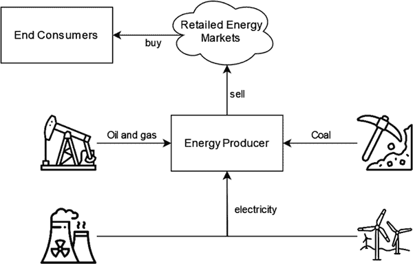

图 3.2 基于市场的交易的能源流。

回顾能源交易的历史实践揭示了关于市场动态和监管挑战的复杂叙述。通过研究现货交易员采用的策略可以看出，他们对资产的强大控制往往转化为利用的机会[16。通过市场操纵和监管套利等策略手段，现货交易员发挥了巨大的影响力，有时以消费者和零售市场的完整性为代价。历史记录了这些参与者优先考虑利润最大化的案例，导致了价格波动和供应中断等负面结果。

### 套利交易

套利交易利用不同市场、地点或时间段之间的价格差异。例如，交易员可能在低价市场购买能源并在高价市场出售，从而从价差中获利[17。卖者并不一定是能源行业的一部分。这种交易技术是世界各地能源商品供需巨大变化的产物。这种简单的剥利可能存在于实时市场和日前市场。`图 3.3`](#chapter3.xhtml#f3_3) 视觉化地简化了这一概念。


图 3.3 套利交易。

### 日前市场


能源市场中有一个属性，如果它发生变化，将改变整个市场的范式。在这个市场模型中，交易协议在交付前一天设定。这种市场的出现是因为能源行业已经发展到足够大，使得能源价格对变化极其敏感的程度。只有通过提前一天进行交易且不签署任何长期合同，交易员才能更轻松地预测收益和市场状态 [19]。这种市场对可再生能源生产者来说也特别有利，因为它能使他们根据不断变化的天气模式和能源需求预测来调整其发电计划。例如，如果天气预报预测次日光伏发电将激增，光能生产者可以在日前市场相应调整其输出承诺，从而实现可再生资源利用的最大化。同样，电网运营商可以根据预期的再生能源可用性采购额外的备用电源或调整需求侧管理策略，从而增强电网的稳定性和可靠性。

在电力日前交易市场中，市场参与者参与次日交付的电力买卖。这种市场对于保证可靠且有效的电力供应起着至关重要的作用。参与者（如发电厂、公用事业公司和交易员）报价（bids）和要价（offers），说明他们愿意购买或出售的电量以及相应的价格。这些报价和要价通常针对全天内的不同时间段。报价和要价受预期需求模式、发电资源可用性、燃料成本以及齿轮系统限制等因素的影响。市场运营商随后收集并分析这些报价和要价，以确定资源的最优分配。其目标是使电力供应与预测需求一致，同时使总成本最低。运营商使用先进算法和市场结算程序，通过分析供需曲线的交点来确定每个时间段的结算价格。结算价格是能够满足所有被接受的报价和要价的特定价格，确保提供的电量等于需求量。结算过程完成后，市场参与者将收到其报价和要价被接受的通知以及相应的结算价格。这些知识使他们能够策略地组织次日的发电和消费活动 [20]。此外，日前市场的结果为市场动态、价格模式和系统状况提供了深刻的见解，使参与者能够在其他能源市场和运营中做出明智决策。日前市场对于确保电网可靠性、实现资源利用最大化以及促进能源行业的竞争至关重要。

### 可再生能源市场

这种模型涉及买卖可再生能源属性，如可再生能源证书（RECs）或产地证明（GOs） [21]。可再生能源交易员促进这些属性在可再生能源发电厂与寻求实现可持续目标或监管要求的买家之间的转移。可再生能源的使用了能源市场的去中心化和分布式发电。可再生资源的可用性意味着世界上大部分地区都能发电。此外，可再生能源的生产更靠近消费点。因此，许多国家实施了支持性政策、激励措施和监管框架来刺激对可再生能源项目的投资，例如上网上网电价、可再生能源组合标准、税收激励和碳定价机制。这些变化共同赋能个人、社区和企业，成为能源生产者（prosumers，既消费又生产价值的个人）。这种转变导致了许多能源市场的开放。

### 虚拟电厂 (VPP) 交易

虚拟电厂（VPP）交易涉及聚合分布式能源资源和需求响应资产。交易员通过参与能源市场、提供电网服务或与公用事业公司及电网运营商签订合同来优化这些资源的使用 [22]。在可再生能源交易领域，VPP 通过聚合来自分布式可再生能源的剩余能量，使间歇性可再生发电无缝集成到能源市场中。通过智能管理这些资源，VPP 运营商可以参与能源市场，为公用事业公司和电网运营商提供可再生能源发电能力、辅助服务和电网平衡支持。

这种交易形式通过结合分布式能源资源（DER）并优化其使用，在全球电力市场方面发挥了至关重要的作用。这些 VPP 通过为公用事业公司和电网运营商提供额外的可再生能源和其他服务积极参与能源市场。这种积极参与实现了跨国电力传输，并促进了区域电力市场之间的整合与协作 [23]。此外，虚拟电厂在维持电网平衡和促进可再生能源整合方面发挥着关键作用，通过有效调节再生发电波动为系统提供稳定性服务。VPP 运营商可以使用复杂的预测和优化算法来检测跨国交易的可能性。这有助于去中心化并加强电力系统。

### 开放能源市场

去监管或自由化的能源市场是指允许竞争决定价格，且多个参与者（包括发电厂、零售商和消费者）可以自由买卖能源商品的市场。这些市场旨在通过向能源领域引入竞争，提高效率、促进创新并为消费者提供更多选择和可能更的价格。开放能源市场与价格或运营受政府部门或受监管垄断控制的市场形成对比。开放能源市场提供了套利交易的机会，并包含日前市场 [24]。


点对点（P2P）能源交易在开放能源市场的监管和技术框架内蓬勃发展。这些市场的特点是具有能够适应多种市场参与者的支持性监管环境，促进了消费者之间能源交换的直接互动。确保电网访问的规定，以及计量和计费标准，为点对点交易创造了有利环境[25]。开放能源市场中的数字平台和市场充当了关键基础设施，通过促进匹配、谈判和交易管理，简化了点对点的参与。技术的进步，特别是智能电网技术和基于区块链的解决方案，增强了点对点能源交易的可行性和安全性。此外，在开放能源市场中，由于对能源决策拥有更大的选择权和控制权，消费者赋权推动了点对点能源交易的出现，使个人从普通的能源消费者转变为参与去中心化能源生产和交换的“产消者”。因此，点对点能源交易利用了开放能源市场固有的开放性、技术创新和以用户为中心的理念，促进了能源生态系统的效率、韧性和可持续性。

## 点对点能源交易

点对点能源交易通过允许社区内能源生产者和消费者之间进行直接交易，彻底了传统的能源分配模式。在这种去中心化的方法中，配备太阳能电池板等可再生能源的家庭可以与邻居交易多余电量，促进能源生态系统的可持续性和韧性。

点对点能源交易的一个示例可以在一个旨在实现绿色电网的地区找到，那里每户都使用光伏（PV）面板产生大部分电力，并可以为其平均需求提供绿色能源。每个家庭仍然依靠国家电网，它使用化石资源满足剩余需求并确保更高的可用率。问题是，在很多情况下，负载下降，太阳能电池板产生的能量在某些家里被浪费，而在另一个家里，他们在使用所有发电的同时，还需要来自国家电网的能量来满足需求。对于一个目标是绿色的地区，严重依赖国家电网供应能量。现在，这个问题可以有解决方案。例如，每个家庭可以拥有更强大的光伏面板，但要拥有一块偶尔才被充分利用一次的面板将是极其昂贵的。另一种解决方案是移除所有家庭的太阳能电池板，创建一个足够为整个地区供电的可再生发电厂，但没有人愿意放弃自己免费产生的电力。正确的解决方案是解决在负载下降期间产生的能源浪费问题。应该有一种方法能够最大限度地利用从所有家庭产生的电能，同时为居民带来利益。这就是能源交易概念的用处。所有家庭作为产消者，将连接到同一个电网上，这样一个产消者产生的剩余电力就可以满足另一个产消者的需求。这为每个产消者将其产生的剩余发电变现提供了窗口，并让需求不足的产消者通过购买更便宜、更绿色的能源来满足他们的需求。图 3.4 显示了连接在同一电网上的产消者如何相互供应能量。

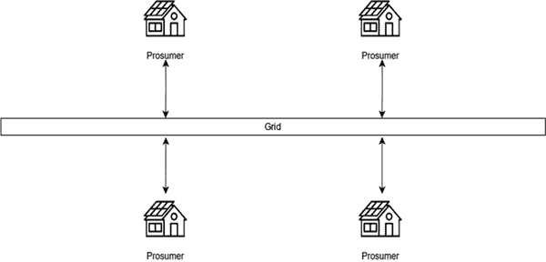

FIGURE 3.4 连接在具有可再生能源发电源电网上的个体。

点对点交易提供了一种变现剩余产生的途径，使其成为能源市场的活跃参与者。这不仅提供了财务激励，还促进了所有权和赋权感。此外，通过促进家庭间可再生能源的交换，点对点交易最大化了可再生资源的使用，减少了对化石燃料的依赖，并有助于形成更清洁、更绿色的能源结构。

现有点对点系统的示例是 `Piclo Flex`，由 `Piclo` 所有。它是一个灵活能源服务的独立市场。系统运营商（如 `National Grid` [26]、`UKPN` [27] 以及国际范围内增长的数量）可以方便地获取能源。该市场基于拍卖机制，将能源卖给最高出价者。本文提出的系统旨在通过优化电网平衡来减少能源浪费，同时为产消者创造利益[28]。

## 未来应用

能源平台在彻底变革可再生能源格局方面具有巨大潜力。通过促进社区内部剩余可再生能源的交换，这些平台促进了高效分配和利用。本节探讨了能源交易如何与联合国可持续发展目标（SDGs）对齐，并深入了其未来应用、注意事项和潜在风险。

### 与联合国 SDGs 对齐

能源交易是推进联合国可持续发展目标（SDGs）的关键工具，解决各种社会、环境和经济挑战[29]。通过在社区和区域之间交换可再生能源，能源交易对实现多个目标有贡献，特别是与清洁能源、可持续城市发展、气候行动和全球伙伴相关的目标。

- **SDG 7：清洁可用廉价能源**
  SDG 7 旨在确保所有人都能获得经济环保的能源。它鼓励可再生能源的多样化和采用清洁技术以应对气候变化，提高能源效率[30]。

- **SDG 11：可持续城市和社区**
  SDG 11 旨在创建包容、安全和可持续的城市和社区。它强调了可持续城市发展、绿色空间、高效交通以及在建筑和基础设施中采用环保实践的重要性[31]。

- **SDG 13：气候气候行动**
  SDG 13 处理应对气候变化的紧迫需求。它要求采取行动增强对气候相关风险和灾害的韧性和适应能力，并提高气候变化缓解的意识、教育和能力建设[32]。

- **SDG 17：促进目标伙伴关系**
  SDG 17 强调了共同努力实现可持续发展目标的重要性。它强调了动员资源、技术转移、能力建设以及加强政府、公民社会和私营部门之间的合作，以解决系统性问题并促进可持续发展。


随着能源交易的演变，必须对政策和监管框架、环境和社会影响以及技术整合进行审慎考虑。在市场动态与监管要求之间取得平衡，对于促进创新和确保能源资源的公平获取至关重要。此外，解决环境和社会影响对于对于促进可持续发展和社区赋能至关重要。

## 优化可再生能源的利用

能源交易的未来对于推动能源格局向可持续性和高效性转型具有巨大前景。通过实现直接的点对点交易，可再生能源的剩余能量可以在当地社区内高效地分配和利用。这不仅减少了可再生能源的浪费，还促进了微电网网络的自给自足和韧性。先进算法和智能合约可以促进实时能源交易 [34]，在确保电网稳定和可靠的同时，动态匹配供需。

## 赋能能源产销者

能源交易平台使个人和企业能够作为消费者和生产者成为能源市场的活跃参与者，通常被称为“产销者”。通过利用太阳能电池板或风力发电机等可再生能源发电资产，产销者可以产生电力并参与点对点交易，从而将其剩余能量变现 [35]。这种能源生产和分配的民主化促进了更具包性和可持续性的能源生态系统，减少了对集中公用事业的依赖，并促进了社区驱动的能源倡议。

## 电网平衡与需求响应

电网平衡和需求响应机制对于有效管理可再生能源至关重要。与化石燃料不同，再生能源通常具有间歇性和不可预测性 [36]。太阳能对需求的变化响应较差。因此，高效的电网平衡对于匹配波动的需求模式至关重要，确保确保可再生能源丰富的环境中稳定性。通过激励灵活的能源消费行为并实现实时能源交易，这些机制有助于可再生能源整合到电网，同时最大限度地减少浪费并优化利用。自动化需求管理策略结合智能定价机制，可以鼓励消费者根据可再生能源的供应调整其消费模式，从而增强电网韧性并减少对传统电源的依赖。

## 与新兴技术的整合

能源交易的未来与区块链、人工智能和物联网（IoT）等新兴技术织在一起。基于区块链的智能合约为执行点对点能源交易提供了安全透明的框架，确保了信任和不可篡改性。人工智能驱动的算法和统计模型可以处理能源行业产生的海量数据，以优化能源交易策略、预测市场趋势并使决策过程自动化。支持物联网设备（包括智能电表和传感器）实现了能源资产的实时监控和控制，便于无缝接入能源交易网络。

## 政策与监管考虑

随着能源交易的演变，政策制定者和监管机构需要调整现有框架以适应新的市场动态和技术创新。清晰且支持监管框架对于促进创新、确保市场完整性和保护消费者利益至关重要 [37]。此外，推动互操作性、标准化和市场透明度的政策可以促进能源交易平台的广泛采用，并鼓励对可再生能源基础设施的投资。

## 环境和社会影响

除了经济考虑外，能源交易具有深远的环境和社会影响。通过推动向可再生能源转型，能源交易有助于缓解气候变化并改善空气质量。此外，基于社区的能源交易倡议赋予了当地社区，鼓励社会公平并促进了可持续发展。然而，必须解决诸如能源贫困、数字鸿沟和环境公正等潜在挑战，以确保能源交易的利益在社会范围内公平分配。

本节深入探讨了能源交易的未来应用，特别关注其在管理可再生资源方面的作用。我们探索了能源交易平台如何准备变革可再生能源格局，实现当地社区内剩余能量的高效分配和利用。通过区块链和人工智能等技术的视角，我们揭了了平台如何赋予个人和企业积极参与可再生能源的生产和分配。加入我们共同探索不断变化的能源交易格局，展望一个由可再生资源驱动能源生态系统可持续性和韧性的未来。

## 风险

必须承认，随着能源交易领域的创新，存在着内在的风险。这一概念的采用和实施伴随着复杂性和不确定性。虽然能源交易在促进可再生能源采用、增强经济竞争力和促进社会包容性方面充满前景，但也面临着许多需要审慎考虑和积极缓解策略的挑战。

### 市场波动

能源市场受到多种因素的影响而不断变化。这些波动源于供需动态的变化、地缘政治紧张局势以及监管框架的改变。这些波动可能导致交易员的价格波动、流动性问题和交易对手风险，可能影响其盈利能力和财务稳定性。有效的风险管理策略（如多元化和对冲）对于减轻这些风险并确保能源交易活动的长期可行性至关重要。

### 监管合规

能源交易活动受复杂且不断变化的监管框架限制，包括市场规则、环保法规数据隐私法。遵守这些法规对于确保能源交易操作的合法性、透明性和公平性，维护利益相关者的信任和信心至关重要。然而，应对合规要求可能具有挑战性，特别是在管辖边界重叠且快速变化的监管环境中。因此，能源交易员必须关注监管动态，并实施稳健的合规计划以降低监管风险并维护伦理标准。

### 网络安全威胁

数字化能源交易平台容易受到网络安全威胁，包括黑客攻击、数据泄露和勒索软件攻击。这些威胁可能会损害关键能源基础设施的完整性、机性和可用性，中断供应链并造成重大的财务和声誉损害。强大的网络安全措施（如加密、身份验证和入侵检测系统）对于保护能源交易平台免受网络威胁以及维护敏感信息和操作是必要的。

## 结论


总之，点对点能源交易代表了能源分配的一种变革性方法，使本地社区内的生产者和消费者能够进行直接交易。通过利用可再生能源并促进剩余能量的交换，这些平台促进了能源生态系统的可持续性、韧性和社区赋能。展望未来，能源交易的未来应用对于彻底改变可再生资源管理具有巨大的前景。通过与联合国可持续发展目标接轨，能源交易平台可以为实现全球可获得且负担得起的能源、可持续城市发展、气候行动以及合作伙伴关系等全球目标做出重大贡献。

然而，实现能源交易的全部潜力需要对政策和监管框架、环境和社会影响、技术整合以及风险管理策略进行仔细的考虑。在市场动态与监管要求之间取得平衡、解决环境和社会影响并有效管理风险，对于促进创新和确保公平获得清洁能源资源至关重要。

从经济、环境和社会的角度来看，能源交易为产生收益、环境管理和社会公平提供了提供了途径。通过鼓励可再生能源的采纳、提高能源效率、增强社区韧性以及刺激创新，能源交易平台有能力对社会、经济和环境产生积极影响。这些平台为更具可持续性和韧性的全球能源格局铺平了道路，促进了国际合作，并为后代创造更光明的未来。

当我们于能源交易的动态领域中行进时，在不同部门和利益相关者之间培养合作、创造力和联盟至关重要。这种协作努力对于释放可再生能源的全部潜力至关重要，为后代培养一个既可持续又公平的未来。

## 术语表

- **blockchain（区块链）**: 一种安全的共享数据库，信息按顺序链接且不可篡改
- **DAPP**: 去中心化应用
- **deficient（缺乏的）**: 缺乏所需的材料或质量；有亏损的人
- **deficit（缺口）**: 满足需求所需的物品量
- **microgrid（微电网）**: 一种小型能源网络，可以连接主电网也可以独立运行
- **prosumer（产销消费者）**: 既消费又生产价值的个人
- **PV**: 光伏
- **SDK**: 软件开发工具包
- **surplus（剩余）**: 生产或供应的过剩
- **VPP**: 虚拟电厂

## 参考文献


## 引言

可持续环境需要保护自然资源并维持平衡。随着人口增长，过度的生产损害了自然环境。为了健康长寿地生活，人类社会需要清洁的水、洁净的空气和无危害场所。人工智能（AI）、机器学习（ML）和物联网（IoT）领域的快速发展引发了各个领域的巨大变革。


水质监测确保了人类饮用水安全，而空气质量监测则保障了健康所需的无污染空气。空气污染是人类健康面临的最大风险之一。根据世界卫生组织（WHO）的数据，空气污染威胁着全球约七百万人的健康。它是许多疾病的主要风险因素，包括呼吸系统疾病、皮肤感染、心脏问题、支气管炎、哮喘以及喉和眼睛疾病 [5]。作物的健康监测和生长依赖于土壤质量监测和天气预测能力。通过分析土壤养分、可用水资源和流行天气状况，农民可以规划作物选择、种子质量、作物病害监测、灌溉流程、施肥、收割、存储以及营销，从而大幅提高作物产量。

精准农业（PA）利用智能技术提高作物产量并辅助农民进行决策。精准农业旨在减少劳动时间并提高作物生产力，从而影响国家的经济增长。精准农业允许农民远程监测数据，以便为维护可持续环境做出更好的决策。

野生动物监测是本章考虑的另一个领域。它在维持可持续环境方面发挥着重要作用。它有助于生物多样性保护、缓解人兽冲突、高价值物种保护、生态参数平衡以及物种疾病监测。AI 在野生动物监测中起着重要作用，可以自动收集和处理数据。来自野生动物的不同形式的数据包括红外相机、卫星图像、声信号以及侵入性和非侵入性传感器读数。

由于气候变化和其他生态因素引起的灾难具有不确定性，非常难以预测和管理。如今，先进的技术改进和进步有助于自然或人为灾害的预测、缓解和管理。`IoT`作为一个快速发展的框架，可以远程监测气象、水文和环境参数，并支持实时数据收集和预测分析。风险识别、灾备备、应急响应、资源分配、反应计划和灾后恢复是该过程的前步骤。

本综述章节从以下角度对文献中使用的 AI 和 ML 技术的重要性提供了见解：

1. 调查文献评估的不同 ML/深度学习（DL）算法
2. 文献调查实现的不同 ML/DL 模型所评估的各种水/气/土壤质量参数
3. 文献中探索的 ML/DL 模型所实现的性能结果的比较

## 方法论

AI 和 ML 模型能够处理来自传感器、卫星和实地测量等不同来源的大量数据。它们可以轻松识别数据源中的模式并发现异常。它们能够促进实时监测和决策支持过程。这些技术可以很容易与 `IoT` 结合，例如部署在各个领域的传感器和执行器，用以收集和处理涉及减少的人力和计算资源的数据。

作为数据分析的强有力工具，`ML` 被广泛用于分析和识别模式，并根据不同类型源产生的海量数据或大数据做出适当预测。监督学习算法、无监督学习算法和强化算法是 ML 算法的分类。为了分析因变量和自变量之间的连通性和关系，使用了监督学习算法。它们产生预测模型，可以根据给定的输入预测输出。基于回归和分类的应用使用了监督学习。

与监督学习算法相比，当输出标签未知时，则使用无监督学习算法。根据相似性将输入数据进行分类并归类到输出类中。无监督学习算法用于涉及聚类的应用。`PCA` 和 `K-means` 等算法是两种常用的无监督学习算法。此外，机器学习方法的另一类被称为强化学习，它描述了机器泛化能力以及对未受教过的问题提供准确答案的能力。

本章调查的大多数文献论文在其研究中使用了以下架构模型。这些研究论文为了多种目的收集并处理数据，如水质评估、空气评估、精准农业、野生动物监测和灾害管理。`Figure 4.1(#chapter4.xhtml#f4_1)` 显示的架构展示了此处考虑的大多数研究工作所使用的方法论。

```
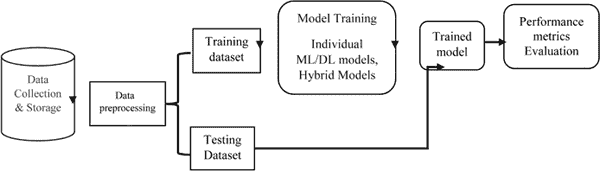
```

FIGURE 4.1 方法论的架构。`Figure 4.1(#chapter4.xhtml#f4_1)` 显示的通用系统架构使用了来自各种源的数据，如可用数据集或实时数据。数据类型包括数值、类别、文本、声音和图像。`ML` 模型通过按预定义的比例将数据分为训练集和测试集进行训练和验证，然后检查模型在处理未见数据时的表现如何。模型的性能通过多种性能指标进行评估，如准确率、混淆矩阵、曲线下面积、精确率、均方误差 (`MSE`）、均方根误差 (`RMSE`）和 `R²(决定系数)`。


`[6]` 中的作者提出了一种增强型自动机器学习模型（`EAMLM`）来评估水质。他们利用温度、`pH`、总溶解固体（`TDS`）和 `LDR`（光依赖性）传感器收集了水质参数数据。该机器学习模型在这些水质参数数据集上进行训练，并使用性能指标对其性能进行评估。由于数据量的快速增长，AI/ML 算法和模型在水质指标的的监测、预测和分类方面具有广阔的前景。`[7]` 中的作者评估了机器学习分类器，根据水质指数（`WQI`）对受监测水样品的水质等级进行分类。使用数据驱动的机器学习模型可以有效解决更复杂的非线性问题。`[8]` 涵盖了针对从地表水、地下水、饮用水和废水中收集的不同水样进行处理时，对不同的机器学习模型进行部署和评估。

监测饮用水水质对于确保人类社会的安全至关重要。`[9]` 的作者提出了一种人工神经网络（`ANN`）来预测水质，并使用较小的特征集实现了 `0.96` 的准确率；其性能优于现有模型。同样，所提出的 `ANN` 在用水量预测方面也表现良好，优于现复杂的深度学习模型，如卷积神经网络（`CNN`）、长短期记忆（`LSTM`）和门控循环单元（`GRU`）。

`[10]` 研究人员利用并评估了 M5 模型树（`MT`）、多元自适应回归样条（`MARS`）、基因表达编程（`GEP`）和进化多项式回归（`EPR`），处理 Landsat 8 OLI-TIRS 图像，用于评估河水样本的水质参数。工作 `[11]` 探索了结合人工神经网络的主成分分析进行建模。测试了使用原始数据的 `ANN`、使用旋转前主成分（`PC`）先验的 `ANN` 以及使用 `varimax` 旋转后 `PC` 的 `ANN`。在三个 `ANN` 模型中，`ANN A` 在预测水质方面表现更好。研究评估了各种 ML 模型以评估水质等级（`WQC`），作者证明在 `[12]` 的研究工作中，`Bagging Classifier` 和多层感知器（`MLP`）优于该研究中考虑的所有其他 ML 模型。

`[13]` 的研究专注于使用 `LSTM` 深度神经网络评估 IoT 环境下饮用水质量参数。在 `[14]` 中，作者利用物理因素作为特征，采用各种 ML 模型来预测和评估地下水质参数，从而增强农业实践中的信息化决策。在预测地下水质的研究中，`Adaboost` 和随机森林（`RF`）的预测性能优于其他模型。`[15]` 开发了一个基于深度学习的预测系统来预测地下水质；该 DL 模型性能优于其工作中考虑的比较的其他 ML 模型。`[16]` 评估并验证了八种机器学习模型，用于预测地表水中溶解的十种灌用水质（`IWQ`）参数。为了评估河水质，`[17]` 评估了四种独立方法和 12 种混合数据挖掘方法。`[18]` 中提出的模型使用了 `LSTM` 和 `CNN` 集成，来评估和预测数据中的时空模式。作者还评估了 `CNN` 模型的混合体——`CNN–LSTM` 模型，用于预测溶解氧（`DO`）和叶绿素 a（`Chl-a`）等水质参数。表 4.1 展示了用于水质评估的各种 ML 算法及其性能。

### 4.1 表 4.1 用于水质监测的 ML/DL 算法及结果

| 作者 | 使用的算法 | 结果 |
| --- | --- | --- |
| Nazir 等 `[7]` | `SVMRFLRDTCBoostXGBoostMLP` | `Acc = 0.6875` |
| Rustam 等 `[9]` | `ANN` | `Acc = 0.96` |
| Najaf 等 `[10]` | `MTMARSGEPR` | `96` |
| Ibrahim 等 `[11]` | `ANN` | `9` |
| Ahmed 等 `[12]` | `MLRSVMBCBagging Classifier` | `85.79` |
| Liu 等 `[13]` | `ARIMASVLSTM` | `MSE = 16` |
| El Bilali 等 `[14]` | `RTXGBoostANN` | `R² = 94` |
| El Bilali 等 `[16]` | `BA RT` | `R² = 99` |

溶解氧（`DO`）、`pH`、电导率、生化需氧量（`BOD`）、温度、粪大肠菌（`FC`）、总大肠菌（`TC`）和总固体（`TS`）是文献中 ML/DL 算法评估的不同水质参数。评估这些水质参数的 ML/DL 方法列于表 4.2 中。


## 空气污染源及其影响

随着人口增长对交通和能源需求的增加，污染排放源也随之增加。人类可以通过监测环境来控制与污染相关的疾病，从而过上更好的生活。当今面临的主要问题之一是空气污染，减少污染也是智慧城市的目标。空气污染源于气体、颗粒物和生物分子等特定物质向大气中的排放。这些高排放对环境产生了明显影响，损害作物并导致人口减少。空气污染物有三类：气体、液滴和固体颗粒  [19]。

## 用于空气质量预测的机器学习方法

在研究  [20] 中，一种基于鲸鱼优化算法（`WOA`）的新型空气质量早期预警系统结合了名为自适应噪声改进集成模式分解（`ICEEMDAN`）的系统，用于监测污染物，如直径小于等于 2.5 微米的颗粒物（`PM2.5`）、直径小于等于 10 微米的颗粒物（`PM10`）、二氧化氮（`NO2`）、二氧化硫（`SO2`）、一氧化碳（`CO`）和臭氧（`O3`）。开发了一种基于 `LSTM` 深度神经网络（`DNN`）的模型，并将其作为监测空气质量的基础技术  [21]。

提出了一种用于智慧城市的综合空气质量预测模型，采用了两种深度学习模型和四种机器学习方法。DL 模型包括 `LSTM`，ML 模型包括支持向量回归（`SVR`）、`RF`、`KNN` 和 `MLP` 回归器，用于追踪包括 `PM2.5`、`PM10`、`O3` 和 `CO` 在内的污染标记  [22]。证明 `LSTM` 优于该研究中使用的其他机器学习模型。

 [23] 的作者在研究中证明，对于不同大小数据集和具有不同环境特征地点的污染预测，随机森林回归（`RFR`）的性能优于 `DT`、`GBR` 和 `MLP` 模型。 [24] 的研究使用了回归模型 `SVR` 和 `RFR` 来预测和分析空气质量指数（`AQI`），并使用可用数据集对这些模型进行了评估。 [19] 的作者使用 `SVR` 来预测颗粒物和污染物水平以及 `AQI`。

## 性能比较分析

使用带有径基函数（`RBF`）的 `SVR` 结合小时 `AQI`，获得了对 `PM2.5`、`SO2`、`NO2`、`O3` 和 `CO` 在内的污染物浓度最准确的预测。 [25] 的人员探索了多种机器学习回归模型来预测空气中 `PM10` 和 `PM2.5` 浓度。他们收集了 `PM` 浓度的历史数据以及环境因素，以比较不同的机器学习模型。 [26] 评估了多线性回归（`MLR`）、决策树（`DT`）、K-最近邻（`KNN`）、`RF` 和 `XGBoost` 机器学习模型，用于分析 `PM2.5` 预测的时空参数。

对于 `PM2.5` 建模，`LSTM` 深度学习模型优于 `XGBoost` 回归，其实现的性能结果 `R²` 值为 0.89。采用基于人工神经网络（`ANN`）的预测模型来预测 `SO2` 和颗粒物的浓度水平  [27]。`ANN` 得到的 `SO2` 的 `RMSE` 值为 0.0128，`PM2.5` 为 0.0001。 [28] 的作者使用了季节性自回归移动平均（`SARIMA`）、`SVM` 和 `LSTM` 等机器学习模型来预测 `AQI`。

Table 4.3 显示了本章所述研究工作中使用的机器学习模型及其结果。Table 4.4 描述了通过 ML/DL 算法测量的各种空气污染物。

 TABLE 4.3 空气质量监测中使用的 ML/DL 算法

| AUTHORS | ALGORITHMS USED | RESULTS |
| :--- | :--- | :--- |
| Schürholz et al.  [21] | `LSTM` `DNN` | 精度 Acc = 90–96% |
| Neo et al.  [22] | `SVR`, `RF`, `KNN`, `MLP` | `LSTM` |
| Authors in  [23] | `RFR` | `DT`, `GBR`, `MLP` |
| Study in  [24] | `SVR`, `RFR` | `AQI` |
| Researchers in  [25] | Machine Learning Regressor | `PM10`, `PM2.5` |
| Gokul et al.  [26] | `MLR`, `DT`, `KNN`, `RF`, `XGBoost` | `PM2.5` |
| Authors in  [27] | `ANN` | `SO2`, `PM2.5` |
| Authors in  [28] | `SARIMA`, `SVM`, `LSTM` | `AQI` |
| Authors in  [19] | `SVR` | `AQI` |


在 `[32]` 中，作者在旱地和水稻地上开发并评估了 `DNN` 和 `ML` 模型，以观察土壤质量。`RF` 模型在水稻土壤质量预测中的表现优于所有 `ML` 模型，其 `R² = 0.91`，在旱地上的为 `R² = 0.90`。在 `[33]` 中，建议并评估了使用遗传算法 (`GA`) 优化器结合极端梯度提升回归 (`XGBR`) 来进行特征选择和优化。所提出的 `XGBR-GA` 模型实现了最高性能 `R² = 0.891` 且 `RMSE = 0.875%`。在 `[34]` 中，评估了各种 `ML` 和 `DL` 模型以评估土壤质量。在 `[35]` 中提出了一种基于智能手机的可携式机器视觉系统，其中使用了卷积神经网络 (`CNNs`)。该模型使用一个模块进行特征提取，使用第二个模块配合 `SVM` 分类器进行分类。`[36]]` 的作者使用光学和热传感器收集土壤水分，然后使用机器学习 (`ML`) 模型（如 `RF`、`SVM`、`ANN` 和弹性网回归 (`EN`）进行分析。

创建 `ML` 驱动的模型是为了提高土壤盐分反演的精度和准确性，它们产生了最有前景的结果，`RF`、`SVM` 和 `BP` 模型分别获得了 `R² = 0.801`、`0.624`、`0.613` 以及 `RMSE = 0.686`、`0.875`、`0.918` `[37]`。主要的 `ML` 模型部分最小二乘回归 (`PLSR`)、K 最近邻 (`KNN`) 和 `RFR` 使用无人机 (`UAV`) 的多模态数据进行了训练和测试，以计算不同灌溉水平下玉米地土壤中的水分含量。`[38, 39]]` 中的研究调查了针对盐碱灌溉地区基于 `ML` 的估计模型，以支持农田土壤水盐的实时、精准监测。`Table 4.5` 总结了本章所涉及参考文献中使用的若干 `ML` 模型。`Table 4.6` 代表了用于评估这些土壤质量参数的不同 `ML/DL` 算法。

#### TABLE 4.5 土壤质量监测使用的 ML/DL 算法

| AUTHORS || ML/DL ALGORITHMS || RESULTS |
| --- | --- | --- |
| Senapaty et al. `[29]]` | `MSVM-DAG-FFO` | `Accuracy = 0.973` |
| --- | --- | --- |
| Aydın et al. `[31]]` | `XGBoost` | `Accuracy = 90%` |
| Li et al. `[32]]` | `RF modelDNN model` | `R² = 0.910.89` |
| Nguyen et al. `[33]]` | `XGBR-GA` | `R² = 0.891` |
| Khanal et al. `[34]]` | `NN` | `R² = 0.64, RMSE = 0.44` |
| Azadnia et al. `[35]]` | `CNN` | `Accuracy = 99.89%` |
| Adab et al. `[36]]` | `RF` | `Nash–Sutcliffe Efficiency (NSE) = 0.73` |
| He et al. `[37]]` | `RFSVMBP` | `R² = 0.801,0.6240.613` |
| Zhang et al. `[38]]` | `RFR` | `R² = 0.78` |
| Du et al. `[39]]` | `XGBoost` | `R² = 0.74, RMSE = 1.77%` |

#### TABLE 4.6 由 ML/DL 算法评估的不同土壤质量参数

| PARAMETERS CONSIDERED || MSVM-DAG-FFO || NN | CNN | RF | SVM | RFR | XGBOOST |
| --- | --- | --- | --- | --- | --- | --- | --- |
| Soil Moisture Content (SMC) | √ | \- | \- | √ | \- | √ | \- |
| --- | --- | --- | --- | --- | --- | --- |
| Temperature | √ | \- | \- | \- | \- | \- | \- |
| Water level | √ | \- | \- | \- | \- | \- | \- |
| Soil NPK | √ | \- | \- | \- | \- | \- | \- |
| Organic matter (SOM) | \- | \- | \- | | | | | \- | \- |
| Cation Exchange Capacity (CEC) | \- | \- | \- | \- | √ | |- | |- |
| Magnesium (Mg) | \- | \- | \- | \- | \- | | | |- |
| Potassium (K) | \- | \- | \- | \- | \- | \- | \- |
| pH | \- | \- | \- | \- | √ | \- | | |
| Soil texture | \- | \- | \- | \- | \- | | | |
| Soil water–salt | \- | \- | \- | \- | \- | \- | \- |

### AI/ML 在洪水监测中的

`ML`-驱动的模型是为了提高土壤盐分反演的精度和准确性，它们产生了最有前景的结果，`RF`、`SVM` 和 `BP` 模型分别获得了 `R² = 0.801`、`0.624`、`0.613` 以及 `RMSE = 0.686`、`0.875`、`0.918` `[37]`。主要的 `ML` 模型部分最小二乘回归 (`PLSR`)、K 最近邻 (`KNN`) 和 `RFR` 使用无人机 (`UAV`) 的多模态数据进行了训练和测试，以计算不同灌溉水平下玉米地土壤中的水分含量。`[38, 39]]` 中的研究调查了针对盐碱灌溉地区基于 `ML` 的估计模型，以支持农田土壤水盐的实时、精准监测。`Table 4.5` 总结了本章所涉及参考文献中使用的若干 `ML` 模型。`Table 4.6` 代表了用于评估这些土壤质量参数的不同 `ML/DL` 算法。

*(注：原文中存在大量重复段落，此处已根据要求对核心内容进行去重翻译)*


`[47]]` 中的作者采用了 `Principal Component Analysis (PCA)` 对来自各种传感器的传感器数据进行降维，并使用 `ANN` 模型预测洪水相关的参数。在这项研究工作中，`ANN` 实现了 94.2% 的准确率和 `ROC = 0.9807`。`[48]]` 中的模型分析了洪水传感器数据，以预测和分类河岸洪水的严重程度。他们为了此目的部署并评估了许多 `ML` 模型的性能，并使用了集成模型。在这项工作中，洪水严重程度有三种预测：正常、异常水位和危险水位。在训练和验证阶段，集成 `LSTM+ RF` 分类器的准确率为 0.997；然而，在利用未知数据的测试阶段，准确率为 0.811。在 `[49]]` 的工作中，展示了一种基于深度学习的控制系统，用于观察和分析从大坝门流出的洪流。作者评估了 `CNN`、`ANN` 和 `SVM` 的性能。根据结果，基于 `CNN` 算法的估计水箱可用空间的分类系统运行有效且准确，准确率为 85.53，而另外两个模型的准确率为 `ANN = 82.89` 和 `SVM = 80.26`。在 `[50]]` 中，洪水情况数据通过极端梯度提升 (`XGBOOST`) 和门控循环单元 (`GRU`) 算法进行分类过程；`XGBOOST` 显示 `R² = 0.92`，`GRU` 的 `R² = 0.96`。`[51]]` 中使用了 `ANN` 模型来处理由水位和降雨传感器节点收集的数据。他们利用 `LSTM` 对洪水位进行短期预测，并实现了 0.976 的 `R²` 值。

### 地震监测中的 AI/ML

为了预测地震，`[52–53]]` 中应用了一种独特的贝叶斯信念模型技术。此外，利用 `Adaptive Neuro-Fuzzy Inference System (ANFIS)` 方法预测了云层中的地震活动量。根据广泛的模拟结果，建议的框架具有更高的分类性能，实现了 92.52% 的精确率、91.72% 的敏感性和 91.01% 的特异性。作者评估了各种 `ML` 模型和非线性模型，`XGB` 模型表现良好，分类准确率达到 98.59%，用于预测地震强度 `[53]]`。为了在基于物联网的地震早期预警系统中快速计算 `EQ` 参数（震级和位置），开发了一种结合 `AE` 和 `CNN` 的独特深度学习模型，命名为 `3S-AE-CNN`。`Table 4.8` 显示了本章引用研究文章中获得的各种 `ML` 算法及其获得的结果。

TABLE 4.8 灾害管理中使用的 `ML/DL` 算法

| DISASTER || AUTHORS || ALGORITHMS USED | RESULTS |
| --- | --- | --- | --- |
| Flood | Kaur et al. `[47]]` | `ANN` | Acc = 94.2%ROC = 0.9807 |
| --- | --- | --- | --- |
|   | Khalaf et al. `[48]]` | Ensemble LSTM+ RF Classifier | Acc = 0.997 |
|   | Smys et al. `[49]]` | `CNNANNSVM` | 85.5382.8980.26 |
|   | Prakash et al. `[50]]` | `XGBOOSTGRU` | R² = 0.92R² = 0.96 |
|   | Samikwa et al. `[51]]` | `LSTM` | R² = 0.976 |
| Earthquake | Bhatia et al. `[52]]` | `ANFIS` | Precision = 92.52 |
|   | Abdalzaher et al. `[53]]` | `XGB` | Acc = 98.59 |

## 结果与讨论

本章考虑了准确率、精确率、MSE、RMSE 和 `R²` 来比较所调查文献中获得的结果，这些结果列在 `Tables 4.1`、`4.3`、`4.5`、`4.7` 和 `4.8` 中。接下来将对这些参数进行描述。

### 准确率 (Accuracy)

准确率是用于评估分类模型性能的指标。它通过将正确预测数除以模型的预测总数来确定。

$$
\text{Accuracy} = \frac{TP + TN}{TP + FP + TN}
$$

其中 `TP`、`TN`、`FP` 和 `FN` 是参数。

### 精确率 (Precision)

精确率是衡量模型正确预测正类的频率的指标。

$$
\text{Precision} = \frac{TP}{TP + FP}
$$

### MSE (均方误差)

MSE 是用于评估模型的指标。期望输出与实际输出之间平方差的平均值。

$$
\text{MSE} = \frac{1}{n}\sum(y - \hat{y})²
$$

### RMSE (均方根)

RMSE 是用于分析和评估模型的指标。它计算了与实际值的平均偏差。

$$
\text{RMSE} = \sqrt{\frac{1}{n}\sum(y_{i} - \hat{y}_{i})²}
$$

### R² (决定系数)

自变量所能解释的因变量的百分比被称为 `R²`。

$$
\text{R}^{2} = \frac{SS_{reg}}{SS_{total}}
$$

其中 `SS[regression]` 代表回归和，`SS[total]` 代表总平方和。


## 图 4.2：水质监测中各种 ML/DL 算法的准确率。

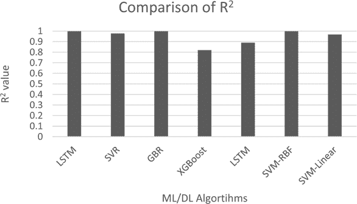

## 图 4.3：空气质量监测中各种 ML/DL 算法的 R²。

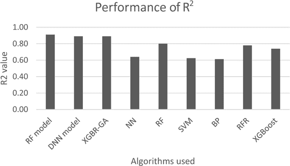

## 图 4.4：土壤质量监测中各种 ML/DL 算法的 R²。

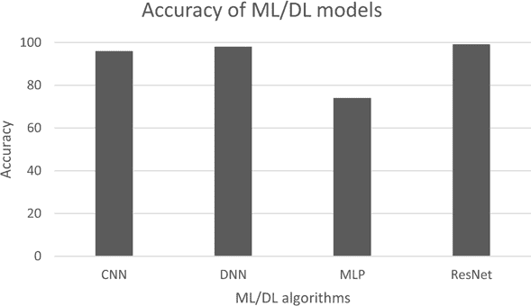

## 图 4.5：野生动物监测中不同 ML/DL 算法对比。

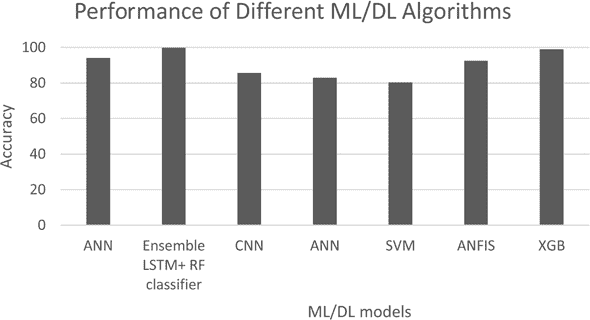

## 图 4.6：灾害管理中使用不同 ML/DL 算法的准确率。

## 结论

可持续环境监测对于保护我们的环境、确保人类健康和平的生活起着至关重要的作用。AI/ML 和物联网（IoT）领域的现代技术发展在实时监测、采集、存储和数据处理方面设计并实施了许多智能解决方案。它们通过预测和分类系统/模型实现了快速且明智的决策过程。本章介绍了 AI 和 ML 模型在可持续环境监测中的最新进展和部署。本章展示了 AI 和 ML 模型在水质、空气、土壤质量、野生动物监测和灾害管理领域的贡献。这项全面的综述介绍了这些领域中用于数据采集和数据处理的各种传感器。此外，还介绍了这些领域使用的不同 ML/DL 算法及其取得的结果。

## 参考文献

1. [可持续生活的定义](https://www.inspirecleanenergy.com/blog/sustainable-living/environmental-sustainability-definition](https://www.inspirecleanenergy.com/blog/sustainable-living/environmental-sustainability-definition)
2. [联合国水与卫生设施](https://www.un.org/sustainabledevelopment/water-and-sanitation/](https://www.un.org/sustainabledevelopment/water-and-sanitation/)
3. Lakshmikantha, V., Hiriyannagowda, A., Manjunath, A., Patted, A., Basavaiah, J. and Anthony, A.A. (2021). 基于物联网的智能水质监测系统。Global Transitions Proceedings, 2(2), pp. 181–186.
4. [世卫组织和联合国基金会发布更新的水和卫生估算](https://www.unwater.org/news/who-and-unicef-launch-updated-estimates-water-sanitation-and-hygiene](https://www.unwater.org/news/who-and-unicef-launch-updated-estimates-water-sanitation-and-hygiene)
5. Fotopoulou, E. et al. (2016), ‘‘跨学科研究中的链接数据分析：城市空气污染对健康的影响,’’ IEEE Access, 4, pp. 149–164.
6. Kumar, D. S., et al. (2024). Eamlm: 基于物联网的实时数据集水质分析的增强型自动机器学习模型。Automatic Control and Computer Sciences, 58, 66–77.
7. Nasir, N., Kansal, A., Alshaltone, O., Barneih, F., Sameer, M., Shanableh, A. and Al-Shamma’a, A. (2022). 使用机器学习算法的水质分类。Journal of Water Process Engineering, 48, p. 102920.
8. Zhu, M., Wang, J., Yang, X., Zhang, Y., Zhang, L., Ren, H., Wu, B. and Ye, L. (2022). 机器学习在水质评估中的应用综。Eco-Environment & Health, 1(2), pp. 107–116.
9. Rustam, F., Ishaq, A., Kokab, S. T., de la Torre Diez, I., Mazón, J. L. V., Rodríguez, C. L. and Ashraf, I. (2022). 用于水质和用水量预测的人工神经网络模型。Water, 14(21), p. 3359.
10. Najafzadeh, M. and Basirian, S. (2023). 利用遥感和人工智能模型评估河面水质指数。Remote Sensing, 15(9), p. 2359.
11. Ibrahim, A., Ismail, A., Juahir, H., Iliyasu, A., Wailare, B., Mukhtar, M. and Aminu, H. (2023). 使用主成分分析和神经网络的水质建模。Marine Pollution Bulletin, 187.
12. Ahmed, U., Mumtaz, R., Anwar, H., Shah, A., Irfan, R. and García-Nieto, J. (2019). 使用监督机器学习进行高效水质预测。Water, 11(11).
13. Liu, P., Wang, J., Sangaiah, A., Xie, Y. and Yin, X. (2019). 使用 LSTM 深度网络进行水质分析与预测。Sustainability, 11(7).
14. El Bilali, A., Taleb, A. and Brouzi, Y. (2021). 用于灌溉目的的机器学习地下水预测。Agricultural Water Management, 245, p. 10625.
15. Singha, S., Pasupuleti, S., Singh, R. and Kumar, S. (2021). 使用机器学习预测地下水质量。Chemosphere, 276, p. 13025.
16. El Bilali, A. Taleb, A. (2020). 在干旱地区使用机器学习预测灌溉水质。Journal of the Saudi Society of Agricultural Sciences, 19(7).
17. Bui, D. T., Khosravi, K., Tiefenbacher, J., Nguyen, H. and Kazakis, N. (2020). 基于机器学习算法的水质指数预测。Science of the Total Environment, 721, p. 13762.
18. Barzegar, R., Aalami, M. and Adamowski, J. (2020). 使用混合 CNN–LSTM 深度学习模型进行水质预测。Stochastic Environmental Research and Risk Assessment, 34(2), pp. 415–433.
19. Castelli, M., Popovič, A., Silva, S. and Vanneschi, L. (2020). 加州空气质量预测的机器学习方法。Complexity, 15, pp. 1–13.
20. Mo, X., Zhang, L., Li, H. and Qu, Z. (2019). 基于人工智能的空气质量预警系统。International Journal of Environmental Research and Health, 16(19), p. 3505.
21. Schürholz, D., Kubler, S. and Zaslavsky, A. (2020). 智能城市人工智能的情感知空气质量预测。Journal of Cleaner Production, 271, p. 12194.
22. Neo, E. X., Hasikin, K., Lai, K. W., Mokhtar, M. I., Azizan, M. M., Hizaddin, H. F. and Razak, S. A. (2023). 智能城市的人工辅助空气监测。PeerJ Computer Science, 9, p. e1306.
23. Ameer, S. et al. (2019). “智能城市空气质量预测的机器学习技术对比分析，”IEEE Access, 7, pp. 128325–128338, doi: `10.1109/ACCESS.2019.2925082`.
24. Liu, H., Li, Q., Yu, D. and Gu, Y. (2019). 基于机器学习算法的空气质量指数和污染物浓度预测。Applied Sciences, 9(19), p. 4069.
25. Harishkumar, K. S., Yogesh, K. M. and Gad, I. (2020). 使用机器学习回归模型预测空气污染颗粒物 (PM2.5)。Procedia Computer Science, 171, pp. 2057–2066.


26. Gokul, P. R., Mathew, A., Bhosale, A. and Nair, A. T. (2023). 利用人工智能技术对印度海德拉巴市时空空气质量分析和 PM2.5 预测。Ecological Informatics, 76, p. 102067.

27. Varade, H. P., Bhangale, S. C., Thorat, S. R., Khatkale, P. B., Sharma, S. K. and William, P. (2023). “基于物联网和机器学习方法的智慧城市空气污染评估框架，”2023 年第 2 届应用人工智能与计算国际会议 (ICAAIC),印度塞勒姆, pp. 1436–1441, doi: [10.1109/ICAAIC56838.2023.10140834](http://dx.doi.org/10.1109/ICAAIC56838.2023.10140834).

28. Maltare, N. N. and Vahora, S. (2023). 使用机器学习进行艾哈达巴德市空气质量指数预测。Digital Chemical Engineering, 7, p. 100093.

29. Senapaty, M. K., Ray, A. and Padhy, N. (2023). 用于精细农业的物联网型土壤养分分析和作物推荐模型。Computers, 12(3), p. 61.

30. Javaid, M., Haleem, A., Khan, I. H. and Suman, R. (2023). 了解人工智能在农业部门的潜在应用。Advanced Agrochem, 2(1), pp. 15–30.

31. Aydın, Y., Işıkdağ, Ü, Bekdaş, G., Nigdeli, S. M. and Geem, Z. W. (2023). 机器学习技术在土壤分类中的应用。Sustainability, 15(3), p. 2374.

32. Li, L., Liu, L., Peng, Y., Su, Y., Hu, Y. and Zou, R. (2023). 利用机器学习和深度学习方法整合多模态数据进行大规模农地评估。Geoderma, 439, 116696, [`doi.org/10.1016/j.geoderma.2023.116696`](https://doi.org/10.1016/j.geoderma.2023.116696).

33. Nguyen, T. T., Ngo, H. H., Guo, W., Chang, S. W., Nguyen, D. D., Nguyen, C. T., Zhang, J., Liang, S., Bui, X. T. and Hoang, N. B. (2022). 使用多传感器数据和机器学习算法预测土壤水分的低成本方法。Science of The Total Environment, 833, 155066, [`doi.org/10.1016/j.scitotenv.2022.155066`](https://doi.org/10.1016/j.scitotenv.2022.155066).

34. Khanal, S., Fulton, J., Klopfenstein, A., Douridas, N. and Shearer, S. (2018). 整合高分辨率遥感数据与机器学习技术，用于土壤性状和玉米产量的空间预测。Computers and Electronics in Agriculture, 153, pp. 213–225.

35. Azadnia, R., Jahanbakhshi, A., Rashidi, S. and Bazyar, P. (2022). 基于图像的深度学习网络和机器视觉系统开发用于快速准确预测土壤质地的自动监测系统。Measurement, 190, p. 110669.

36. Adab, H., Morbidelli, R., Saltalippi, C., Moradian, M. and Ghalhari, G. A. F. (2020). 利用遥感数据估算表层水分。Water, 12(11), p. 3223.

37. He, Y., Zhang, Z., Xiang, R., Ding, B., Du, R., Yin, H., Chen, Y. and Ba, Y. (2023). 基于 Sentinel-1/2 融合和机器学习的裸地土壤盐碱监测。Infrared Physics & Technology, 131, p. 10466.

38. Zhang, Y., Han, W., Zhang, H., Niu, X. and Shao, G. (2023). 利用无人机（UAV）数据评估玉米覆盖下的水分。Journal of Hydrology, 617, p. 12906.

39. Du, R., Chen, J., Xiang, R., Yang, X., Wu, Y., Yin, H., Zhang, Z. and Chen, Y. (2023). 混合光谱解混和机器学习模型对农田水动态进行及时监测。International Soil and Water Research, 32, pp. 1–15.

40. Nguyen, H., Maclagan, S., Nguyen, T. D., Flemons, P., Andrews, K., Ritchie, E. and Phung, D. (2017, October). 使用深度卷积进行动物识别。2017 年 IEEE 数据科学与高级分析会议 (DSAA), pp. 40–49.

41. Tabak, M., Norouzzadeh, M., Wolfson, D. W., Sweeney, S. J., VerCauteren, K. C., Di Salvo, P., Lewis, S., White, M. D. and Teton, B. (2019). 机器学习分类相机陷阱中的物种。Methods in Ecology and Evolution, 10(4), pp. 585–590.

42. Chen, R., Little, R., Mihaylova, L., Delahay, R. and Cox, R. (2019). 使用深度学习方法进行野生监测。Ecology and Evolution, 9(17), pp. 9453–9466.

43. Clarfeld., Sirén, A. P., Mulhall, B. M., Wilson, T. L., Bernier, E., Farrell, J., Lunde, G., Hardy, N., Abrams, R. and Staats, S. (2023). 评估人机协作方法对远程监测中的野生动物进行标记。Ecological Informatics, 77, p. 102257.

44. Chalmers, C., Fergus, P., Wich, S. and Longmore, S. N. (2021, July). 利用声学监测和深度学习对动物多样性进行建模。2021 年国际神经网络会议 (IJCNN), pp. 1–7.

45. Whytock, R. C., Świeżewski, J., Zwerts, J. A., Bara-Supski, T., Koumba Pambo, A. F., Rogala, M., Bahaa-el-din, L., Boekee, K., Brittain, S., Cardoso, A. W. and Henschel, P. (2021). 机器学习模型对相机陷阱数据进行稳健生态分析。Methods in Ecology and Evolution, 12(6), pp. 1080–1092.

46. Zhou, M., Elmore, J. A., Samiappan, S., Evans, K. O., Pfeiffer, M. B., Blackwell, B. F. and Iglay, R. B. (2021). 使用小型无人机系统 (sUAS) 和深度网络改进动物监测。Sensors, 21(17), p. 5697.

47. Kaur, M., Kaur, P. D. and Sood, S. K. (2021). 用于早期洪水预测的节能型物联网云框架。Natural Hazards, 109, pp. 2053–2076.

48. Khalaf, M., Alaskar, H., Hussain, A. J., Baker, T., Maamar, Z., Buyya, R., Liatsis, P., Khan, W., Tawfik, H. and Al-Jumeily, D. (2020). 通过集成机器学习模型进行物联网型洪水等级预测。IEEE Access, 8, pp. 70375–70386.

49. Smys, S., Basar, A. and Wang, H. (2020). 基于物联网传感器和云数据的 CNN 洪水管理系统。Journal of Artificial Intelligence, 2(4), pp. 194–200.

50. Prakash, C., Barthwal, A. and Acharya, D. (2023). FLOODALERT：基于物联网的实时山洪跟踪和预测系统。Multimedia Tools and Applications, 82(28), pp. 43701–43727.

51. Samikwa, E., Voigt, T. and Eriksson, J. (2020). “基于物联网、人工智能神经网络和边缘计算的洪水预测。”2020 年国际物联网会议 (iThings)、IEEE 绿色计算与通信会议 (GreenCom)、IEEE 信息、物理与社会计算会议 (CPSCom)、IEEE 智能数据会议 (SmartData) 以及 IEEE 网络学会议 (Cybermatics), pp. 234–240.

52. Bhatia, M., Ahanger, T. A. and Manocha, A. (2023). 基于人工智能的实时地震预测。Engineering Applications of Artificial Intelligence, 120, p. 105856.

53. Abdalzaher, M. S., Soliman, M. S. and El-Hady, S. M. (2023). 使用优化的机器学习模型进行地震早期预警的震强度估计。IEEE Transactions on Geoscience and Remote Sensing, 115, pp. 1–13.


# 媒体与娱乐行业可持续发展的 5AI

Ankit Sharma, Amit Channa, Parul Malhotra, and Ardima Bajpai

DOI: [10.1201/9781003497189-5](https://doi.org/10.1201/9781003497189-5)

## 引言

媒体与娱乐行业正处于一个关键转折点，在技术快速进步、消费者偏好转变以及对可持续性日益关注的时代，面临着前所未有的挑战与机遇。随着世界应对紧迫的环境、社会和经济问题，该行业采取可持续发展的必要性空所未有。在此背景下，人工智能（AI）作为一种变革性力量出现，为推动媒体和娱乐各个方面的可持续发展提供了创新解决方案 [1]。

从核心来看，媒体与娱乐行业在塑造文化、影响公共话和反映社会价值观方面发挥着核心作用。然而，该行业的运营历史上一直与重大的环境影响相关，从高耗能的生产过程到数字内容消费产生的大量电子垃圾。此外，多样性和包容性问题持续困扰着该行业，边缘群体在屏幕上和幕后均代表性不足 [2, 3]。

在此背景下，AI 为重新想象媒体和娱乐的生产、消费和体验方式提供了一个极具吸引的机会。通过利用机器学习、自然语言处理和计算机视觉的力量，AI 技术可以彻底改变内容创作、分发、观众互动和运营，这些方式不仅创新高效，而且在环境和社会方面负责任 [4]。

AI 在媒体与娱乐行业中的潜在应用是巨大且多层。在内容创作方面，AI 算法可以分析海量数据为创意决策提供支持，预测观众偏好并个性化内容体验。AI 驱动的工具如虚拟现实（VR）和增强现实（AR）可以增强叙事，让观众沉浸在互动和沉浸式叙事中，从而培养共情与理解 [5, 6, 7]。

在分发和消费方面，AI 驱动的推荐系统可以根据个人偏好策划个性化内容推荐，减少信息过载并提高用户满意度。此外，AI 算法可以优化流媒体过程，以最小化能量消耗并减少与数字内容交付相关的碳排放 [8, 9, 10]。

观众互动方面，支持 AI 的机器人和虚拟助手可以为观众提供个性化的帮助和支持，在减少人工干预需求的同时增强用户体验。此外，AI 驱动的分析可以提供对观众行为和情绪的洞察，告知内容创作者和发行商策略和活动的有效性 [11, 12]。

在运营方面，AI 技术可以简化工作流、自动化重复任务并优化资源利用，从而提高效率并节省成本。例如，AI 驱动的算法可以优化生产计划、更有效地分配资源，并识别减少浪费和提高能源效率的机会 [13, 14, 15, 16]。

AI 集成到媒体与娱乐行业并非没有挑战。伦理考虑（如数据隐私、偏差和问责制）必须谨慎处理，以确保负责任且公平地部署 AI 技术。此外，监管框架和行业标准引导行业内 AI 解决方案的和实施方面发挥至关重要的作用。

AI 与可持续性的融合代表了媒体与娱乐行业的范式转变，为推动积极变化以及为企业和社会创造价值提供了前所未有的机会。通过采用 AI 技术并采取可持续发展的整体方法，行业利益相关者不仅可以增强其竞争优势，还能为媒体与娱乐格局带来更可持续、更具包容性的未来。本章将探索 AI 与媒体与娱乐行业可持续发展之间的多维度关系，考察 AI 驱动的创新为行业未来带来的机遇、挑战和影响。

## 内容创作中的 AI

近年来，AI 彻底改变了媒体与娱乐行业的内容创作。AI 技术，特别是机器学习算法，正越来越多地用于辅助创意决策过程、简化生产工作流并提高内容的整体质量。通过分析包括观众偏好、市场趋势和历史性能指标在内的海量数据，AI 可以为内容创作者提供价值价值和建议，使他们能够开发出更具吸引力、相关性和影响力的内容。从剧本编写、分镜设计到选角和剪辑，AI 驱动的工具和平台正在改变内容创作的每一个阶段，赋予电影制作人、作家和制片人推创意创意创新的边界。

### 用于创意决策的机器学习

机器学习算法在辅助内容创作创意决策方面发挥着至关重要的作用。这些算法可以分析大数据中的模式和趋势，识别观众偏好、预测市场需求并优化内容策略。例如，AI 驱动的分析平台可以分析社交媒体趋势、观众参与指标和观众反馈，提供关于观众偏好和情绪的实时洞察。内容创作者随后可以使用这些信息定制内容，以满足目标观众的需求和兴趣，增加成功的概率。

### 个性化与观众洞察

AI 在内容创作中的主要优势之一是为个人观众提供个性化内容体验的能力。通过利用数据驱动的洞察和预测性分析，AI 算法可以根据观看历史、偏好和行为等因素推荐个性化内容。例如，流媒体平台使用 AI 驱动的推荐系统为用户推荐相关的电影、电视节目和音乐，提高用户满意度和参与度。此外，AI 驱动的观众洞察可以帮助内容创作者了解人口统计、兴趣和偏好，使他们能够开发出与目标观众共鸣的内容。

### 虚拟现实 (VR) 与增强现实 (AR) 应用


AI 技术也在推动虚拟现实（VR）和增强现实（AR）应用的创新，为观众提供沉浸式和交互式的体验。通过将 AI 算法与 `VR` 和 `AR` 技术相结合，内容创作者可以创建超现实的环境、栩如生的角色以及模糊现实与虚构界限的交互叙事。例如，AI 驱动的自然语言处理（NLP）算法可以与虚拟角色进行实时交互，允许观众以空未有的方式参与对话、提问并探索虚拟世界。同样，AI 驱动的计算机视觉算法可以增强 `AR` 体验的真实性，以惊人的准确度和精度将数字内容叠加到物理世界之上。

AI 正在彻底改变媒体和娱乐行业的内容创作，为观众提供更具个性化、参与感和沉浸感的体验。从为创作决策提供依据的机器学习算法，到提供个性化推荐的 AI 驱动系统，AI 技术正在重塑内容创作过程的每一个方面。此外，AI 与 `VR` 和 `AR` 技术的整合为交互式故事和沉浸式体验开启了新的可能性，推了行业创意和创新的边界。随着 AI 的不断进化和成熟，预计其对内容创作的影响将不断增长，驱动创意、效率和观众参与度的进一步提升。

## AI 在分发与消费中的应用

由于人工智能（AI）技术的整合，数字内容的分发和消费正在经历巨大的变革。AI 正在改变内容传递给用户的方式以及用户参与内容的方式，带来更个性化和更高效的体验。本节探讨了 AI 在个性化内容推荐、流媒体过程优化以及减少数字内容分发碳排放方面的作用。

### 个性化内容推荐

AI 驱动的推荐系统正在重塑用户发现和消费数字内容的方式。通过分析用户行为、偏好和历史交互，AI 算法可以根据个人品味和兴趣生成个性化的内容推荐。这些推荐系统利用机器学习技术不断学习并适应用户反馈，随着时间的推移不断其推荐结果。结果，用户将获得与其偏好一致的精选内容，从而提高参与度、满意度和留存率。

### 流媒体过程优化

流媒体平台日益转向 AI 以优化数字内容向用户的分发。AI 算法可以分析网络状况、用户需求和内容热度，动态调整流媒体参数（如 `bitrate`、`resolution` 和 `buffering`），以确保流畅且无中断的观看体验。通过实时优化流媒体过程，AI 可以降低延迟、减少缓冲限度并提高视频质量，从而提升用户满意度和留存率。此外，AI 驱动的内容缓存和分发解决方案可以减少服务器负载和带宽占用，从而节省成本并造福环境

## 减少数字内容分发中的排放

AI 有在减少与数字内容分发相关的碳排放方面发挥重要作用。通过优化流媒体过程和内容分发网络，AI 算法可以最大限地减少能量消耗和资源使用，带来更可持续、更环保的分发模式。此外，AI 驱动的分析可以提供有关数字内容分发能源消耗和碳排放的洞察，使流媒体平台识别改进机会并实施更高效的策略。通过利用 AI 减少数字内容分发的碳排放，流媒体平台可以在为全球应对气候变化贡献的同时，为用户提供高质量的娱乐体验。

AI 正在改变数字内容的分发和消费，为用户提供更个性化、更高效且可持续的体验。从增强用户参与的个性化内容推荐，到提高性能和减少环境影响的流媒体过程优化，AI 技术正在重塑数字内容生态系统的每一个方面。随着 AI 的不断进化和成熟，预计其对分发和消费的影响将不断增长，驱动效率、可持续性和用户满意度的进一步进步。

## AI 在观众参与中的应用

观众参与是媒体和娱乐行业的一个关键方面，AI 在增强这种互动方面发挥着日益重要的作用。AI 技术正被用于为用户创建更个性化、更沉浸且响应迅速的体验，从而提高参与水平。本节探讨了 AI 如何通过聊天机器人和虚拟助手、情感分析以及增强用户体验来改变观众参与。

### 聊天机器人与虚拟助手

由 AI 算法驱动的聊天机器人和虚拟助手正在彻底改变用户与媒体娱乐平台互动的方式。这些 AI 驱动的助手可以用自然语言与用户交流，提供信息、帮助和建议。无论是回答关于内容的问题、帮助用户导航平台，还是提供个性化建议，聊天机器人和虚拟助手都增强了用户参与。此外，AI 驱动的聊天机器人可以从用户交互中不断学习，提高处理用户需求和偏好的准确性和有效性。

### 情感分析与观众洞察

AI 驱动的情感分析工具使媒体和娱乐公司能够获得有关观众偏好、观点和情绪的宝贵洞察。通过分析社交媒体动态、用户评论和其他形式的用户生成内容，AI 算法可以识别趋势、模式和情感信号，为内容创作者和市场营销人员提供宝贵的反馈。情感分析允许公司理解观众对其内容的反应，识别改进领域，并调整策略以更好地满足观众预期。通过利用 AI 进行情感分析，媒体和娱乐公司可以在内容开发、营销活动和观众参与策略方面做出更明智的决策。

### 增强用户体验

AI 技术正在重塑媒体和娱乐领域的用户体验，使其更具个性化、直观性和沉浸感。从提供个性化内容建议的推荐引擎，到使用 AI 驱动算法呈现相关内容的发现平台，AI 正在通过为用户提供更相关、更吸引人的内容来增强用户体验。此外，AI 驱动的内容创作工具（例如用于图像和视频处理的深度学习算法）使内容创作者能够更高效地生产高质量、视觉吸引力的内容。通过 AI 驱动的个性化、交互性和内容创作来增强用户体验，媒体和娱乐公司可以增加用户参与度、留存和忠诚度。


AI 正在彻底改变媒体和娱乐行业的观众参与模式，为用户提供更具个性化、响应性且沉浸式的体验。无论是通过提供实时协助的聊天机器人和虚拟助手、提供观众偏好洞察的情感分析工具，还是通过 AI 驱动的用户体验增强，AI 技术正在改变观众与内容及平台互动的方式。随着 AI 的不断演进和成熟，其对观众参与的影响预计将不断增长，推动以用户为中心的体验以及媒体公司与其观众之间关系的进一步发展。

## 运营中的 AI

人工智能正在彻底改变媒体和娱乐行业的运营，推动各个流程的效率、生产力和可持续性提升。本节将深入探讨 AI 如何通过工作流优化、资源分配与效率提升，以及减少浪费和提高能效转型运营。

## 工作流优化

AI 技术正在简化并优化媒体和娱乐运营中的工作流，从而提高了效率和生产力。AI 驱动的工作流管理系统可以自动化重复任务，例如文件组织、元数据标签标记和内容分发，为创意专业人士留出时间专注于更高价值的活动。此外，AI 算法可以分析历史工作流数据以识别瓶颈、优化资源分配并简化生产流程。通过自动化手动任务和优化工作流，AI 使公司能够在当今快速迭代的媒体环境中更快地交付内容、降低成本并保持竞争领先地位。

## 资源分配与效率

AI 在优化媒体和娱乐运营的资源分配和效率方面起着关重要的作用。AI 算法可以分析资源可用性、需求预测和生产计划的数据，以优化资源的分配和利用。例如，AI 驱动的调度工具可以优化人员安排、设备使用和生产时间表，以减少停机时间并实现生产力最大化。此外，AI 驱动的预测分析可以预测资源需求并识别潜在的短缺，使公司能够主动管理资源并避免昂贵的延迟。通过优化资源分配和效率，AI 帮助公司减少浪费、降低成本并提高整体运营性能。

### 减少浪费与能效

AI 技术还在推动媒体和娱乐运营中的减废和节能倡议。AI 驱动的分析平台可以分析能源消耗、废物产生和环境影响的数据，以识别改进机会。例如，AI 算法可以优化生产设施的能源使用，根据占用模式调整照明和温度设置，并识别设备和基础设施中的节能机会。此外，AI 驱动的废物管理系统可以跟踪和监控废物流，识别减少浪费的区域，并优化回收和处置流程。通过利用 AI 实现减废和节能，媒体和娱乐公司可以减少其环境足迹，降低运营成本，并展示其对可持续发展的承诺。

AI 正在转型媒体和娱乐行业的运营，推动各个流程的效率、生产力和可持续性。从工作流优化、资源分配到减少浪费和能效，AI 技术正在使公司能够简化运营、降低成本并减少对环境的影响。随着 AI 的不断演进和成熟，其对运营的影响预计将不断增长，推动媒体和娱乐领域效率、可持续性和竞争力的进一步提升。

# AI 中的伦理考量

随着 AI 日益整合到包括媒体和娱乐在各种行业，解决伦理考量以确保这些技术得到负责且公平的使用至关重要。本节探讨了 AI 中的关键伦理考量，包括数据隐私与安全、偏差与公平，以及问责与透明度。

### 数据隐私与安全

数据隐私和安全是 AI 应用中至关重要的考量，特别是在收集和分析海量用户数据的媒体和娱乐行业。AI 驱动的系统通常依赖大型数据集来训练算法和做出预测，这引发了对敏感信息隐私和安全的担忧。公司必须实施稳健的数据保护措施，如加密、访问控制和匿名化技术，以保护用户数据免受未经授权的访问、误用和泄露。此外，公司应遵守相关的数据保护法规，例如`通用数据保护条例 (GDPR)`，并在收集或处理其个人信息之前获得用户的知情同意。

## 偏差与公平

偏差和公平是 AI 中关键的伦理考量，因为算法可能会在无意中延续或放大社会现有的偏差和不平等。AI 系统在历史数据上进行训练，这些数据可能反映了社会中存在的偏差和偏见，导致偏颇或歧视性的结果。例如，AI 驱动的推荐系统可能会推荐强化刻板印象或排除某些人口群体的内容。为了解决偏差并促进公平，公司必须采用严谨的测试和评估方法来识别并减轻 AI 算法中的偏差。这可能涉及多样化训练数据集、实施感知公平的算法以及进行定期审计，以确保所有用户获得公平的结果。

## 问责与透明度

问责和透明度是确保负责任的 AI 使用以及在用户和利益相关者之间建立信任的基本原则。部署 AI 系统的公司必须对其算法的决策和行动负责，包括任何潜在的伤害或意外后果。这需要清晰的责任和问责机制，以及处理申诉并为受影响个人提供救济的机制。此外，公司应努力在其 AI 系统上保持透明，包括系统是如何被开发、训练和部署的，以及与其相关的潜在风险和局限性。透明度可以建立信任，并使用户户对参与 AI 驱动的技术做出明智决策。

伦理考量是媒体和娱乐行业负责任部署 AI 的不可的一部分。通过解决数据隐私与安全、偏差与公平以及问责与透明度等问题，公司可以降低风险、建立信任，并确保 AI 技术以符合伦理原则和社会价值观的方式使用。随着 AI 持续演进并塑造媒体和娱乐的未来，公司在 AI 计划中优先考虑伦理考量并维护伦理标准是非常关重要的。

## 监管框架与行业标准

随着 AI 技术在包括媒体和娱乐在内的各行业日益普及，监管框架和行业标准对于确保负责任且符合伦理的 AI 部署起着至关重要的作用。本节探讨了监管框架和行业标准在线治理 AI 使用中的重要性，包括负责任 AI 使用的指南、合规性和治理。

## 负责任 AI 使用指南


## 负责任 AI 使用指南

负责任的 AI 使用指南为公司应对与 AI 部署相关的伦理、法律和社会考量提供了一个框架。这些指南通常涵盖公平性、透明性、问责和隐私等原则，概述了开发、部署和监控 AI 系统的最佳实践。例如，电气与电子工程师学会（IEEE）和 AI 伙伴关系（Partnership on AI）等机构已发布了关于伦理 AI 开发和部署的原则和指南，强调了以人为本的设计、偏差缓解和算法透明性的重要。通过遵循负责任的 AI 指南，公司可以降低风险、建立信任，并确保其 AI 计划符合伦理和社会。

## 合规与治理

遵守监管要求和行业标准对于确保 AI 部署符合法律和伦理标准至关重要。监管框架，如欧洲的《通用数据保护条例》（`GDPR`）和美国的《加州消费者隐私法案》（`CCPA`），对 AI 系统中个人数据的收集、处理和使用实施了严格要求。公司必须确保其 AI 计划符合相关数据保护法规，从用户处获得必要的许可和同意，并实施保护用户隐私和数据安全的措施。此外，特定行业的法规和标准可能适用于媒体和娱乐领域的 AI 使用，例如内容分级系统、知识产权法和广告条例。通过建立稳健的合规和治理机制，公司可以降低与 AI 部署相关的法律和声誉风险，并证明其对负责任 AI 使用的承诺。

总之，监管框架和行业标准在治理媒体娱乐行业的 AI 使用方面起着关键性作用。负责任的 AI 使用指南为伦理决策和风险管理提供了框架，而合规和治理机制确保了 AI 部署遵循法律和伦理标准。随着 AI 持续演进并塑造媒体娱乐的未来，公司必须优先考虑监管合规、维护行业标准并采用负责任的 AI 实践，以确保 AI 技术的部署有利于社会，同时尽可能地减少风险和伤害。

随着 AI 不断演进，GreenMedia Studios 计划探索 AI 在内容创作中的更多应用，例如用于受众参与的预测分析、AI 生成内容以及 AI 驱动的叙事技术。通过保持在 AI 创新的前沿，GreenMedia Studios 旨在进一步增强其可持续努力，并继续向全球观众提供有影响的内容。

## 结论

GreenMedia Studios 的案例研究证明了 AI 在推动媒体娱乐行业可持续内容创作方面的转型力量。通过将 AI 技术战略性地整合到生产流程中，GreenMedia Studios 不仅提高了效率和创造力，还显著减少了其环境足迹。通过利用 AI 驱动的工具进行脚本分析、虚拟制作和后期编辑，该工作室取得了显著成效，包括效率的提高、资源消耗的减少和成本节省。GreenMedia Studios 对可持续性的承诺证明了该行业拥抱既对利润对地球都有益的创新解决方案的潜力。该案例研究的成功强调了在内容创作中优先考虑环境责任和伦理考量的重要性。随着 AI 持续演进并塑造媒体娱乐的未来，行业利益相关者采取可持续实践并利用技术推动积极变化是至关重要的。

展望未来，GreenMedia Studios 将致力于探索内容创作中 AI 驱动创新的新机会，包括预测分析、AI 生成内容和沉浸式叙事技术。通过保持在 AI 创新和可持续性的前沿，GreenMedia Studios 旨在启发行业内的其他效仿，并为构建更可持续、更具环保意识的媒体格局做出贡献。GreenMedia Studios 的案例研究表明，AI 不仅仅是增强效率和创造力的工具，更是推动媒体娱乐行业可持续发展和积极影响的强大催化剂。

## 未来范围

GreenMedia Studios 的案例研究为 AI 在可持续内容创作中的转型潜力提供了宝贵的见解。展望未来，未来探索有几个极具前景的领域：

1. **高级 AI 应用**：随着 AI 技术的不断演进，AI 驱动的内容创作进一步进步具有巨大潜力。未来的研发工作可能侧重于开发更复杂的 AI 算法用于脚本分析、虚拟制作和后期编辑，以实现更高水平的效率、创造力和环境可持续性。

2. **受众参与的预测分析**：AI 驱动的预测分析工具可以提供关于受众偏好、行为和参与模式的价值见解，使内容创作者能够更有效地定制内容策略以满足受众需求。未来的研究可能会探索将 AI 驱动的预测分析集成到内容创作流中，使公司能够预测受众需求、优化发行策略并增强用户体验。

3. **AI 生成内容**：生成对抗网络（`GANs`）和自然语言处理（`NLP`）等 AI 技术越来越多地用于自主生成内容，涵盖从文本、图像到音乐和视频的各个领域。未来的研究可能会探索 AI 生成内容在媒体娱乐行业中的潜在应用，包括自动化内容生产、个性化内容推荐和交互式叙事体验。

4. **伦理 AI 开发与治理**：随着 AI 技术在内容创作中变得普及，解决偏差、公平、问责和透明等伦理考量至关重要。未来的研究可能侧重于建立稳健的伦理框架和治理机制，以确保媒体娱乐行业负责任的 AI 开发和部署。这包括实施缓解 AI 算法偏差的措施，提高 AI 系统的透明度和问责，并保护用户隐私和数据安全。

5. **协作倡议与伙伴关系**：行业利益相关者、学术界、政府机构和非营组织之间的合作对于推动 AI 驱动的可持续内容创作至关重要。未来的倡议可能涉及协作研究项目、行业标准制定以及跨部门合作伙伴关系，旨在推进 AI 创新的同时应对和社会环境挑战。


媒体和娱乐行业中 AI 驱动的可持续内容创作的未来前景是广阔且多面的。通过采用创新、协作和伦理责任，行业利益相关者可以充分利用 AI 的潜力，创造出既吸引人、又有创意，又兼顾环境可持续性和社会责任的内容。随着 AI 技术不断演进并塑造内容创作的未来，创新和产生积极影响的机会是无限的。

## 参考文献

1. Majerova, J., & Das, S. (2023). Digital solutions for media: Role of pandemic and sustainable development of depleting industries. In Digital Entertainment as Next Evolution in Service Sector: Emerging Digital Solutionss in Reshaping Different Industries (pp. 107–125). Singapore: Springer Nature Singapore.
2. Hallur, G. G., Prabhu, S., & Aslekar, A. (2021). Entertainment in era of AI, big data & IoT. Digital Entertainment: The Next Evolution in Service Sector, (87–109). USA: IGI
3. Di Vaio, A., Palladino, R., Hassan, R., & Escobar, O. (2020). Artificial intelligence and business models in the sustainable development goals perspective: A systematic literature review. Journal of Business Research, *121*, 283–314.
4. Chan-Olmsted, S. M. (2019). A review of artificial intelligence adoptions in the media industry. International journal on media management, *21*(3–4), 193–215.
5. Vrana, V., & Das, S. (2023). Dynamic restructuring of digital media and entertainment sector: Role of urbanization, industrial innovation, and technological evolution. In Digital Entertainment as Next Evolution in Service Sector: Emerging Digital Solutions in Reshaping Different Industries (pp. 15–34). Singapore: Springer Nature Singapore.
6. Alam, T., Gupta, R., Qamar, S., & Ullah, A. (2022). Recent applications of artificial intelligence for sustainable development in smart cities. In Recent innovations in artificial intelligence and smart applications (pp. 135–154). Cham: Springer International Publishing.
7. Khamis, A., Li, H., Prestes, E., & Haidegger, T. (2019). AI: A key enabler for sustainable development goals: Part 2 [industry activities]. IEEE Robotics & Automation Magazine, *26*(4), 122–127.
8. Sineviciene, L., Hens, L., Kubatko, O., Melnyk, L., Dehtyarova, I., & Fedyna, S. (2021). Socio-economic and cultural effects of disruptive industrial technologies for sustainable development. International Journal of Global Energy Issues, *43*(2–3), 284–305.
9. Boulouard, Z., Ouaissa, M., Ouaissa, M., & El Himer, S. (2022). AI and IoT for sustainable development in emerging countries (Vol. 105). Cham, Switzerland: Springer International Publishing.
10. Mercier-Laurent, E. (2021, January). Can AI efficiently support Sustainable Development?. In IJCAI-8thAI4KM.
11. Sohn, D., & Youn, S. H. (2016). Fundamental sources and sustainable development of the Korean cultural entertainment industry with the Korean wave. International Journal of Tourism Sciences, *16*(1–2), 83–92.
12. Bolesnikov, M., Popović Stijačić, M., Keswani, A. B., & Brkljač, N. (2022). Perception of innovative usage of AI in optimizing customer purchasing experience within the sustainable fashion industry. Sustainability, *14*(16), 10082.
13. Zhang, S., Siran, Z., & Yusof, M. H. M. (2022, December). China's Digital Creative Multimedia Industry Development and Sustainable Development Innovation Direction. In 2nd International Conference on Creative Multimedia 2022 (ICCM 2022) (pp. 5–14). Atlantis Press.
14. Krishnaveni., D., Harish, V., & Mansurali, A. (2021). AI and Sustainability: Reinventing Processes. In Reinventing Manufacturing and Business Processes Through Artificial Intelligence (pp. 153–172). USA: CRC Press.
15. Cai, J. (2021, July). Artificial intelligence in digital media. In International Conference on Frontier Computing (pp. 188–195).
16. Vinuesa, R., Azizpour, H., Leite, I., Balaam, M., Domisch, S. (2020). The role of artificial intelligence in achieving Sustainable Development Goals. Nature Communications, *11*,10.

# AI 与水资源管理：确保获取与可持续性

## 引言

水是生命、生计和可持续发展的要素要素。然而，随着全球人口增长、城市化和工业化，对水的需求日益增加，给水资源带来了前所未有的压力。同时，气候变化加剧了水水、改变了降水模式并增加了极端天气事件，进一步挑战着水的供应。面对这些复杂的挑战，迫切需要创新方法来优化水管理、确保公平并促进水资源的可持续性。

人工智能（AI）正成为解决多方面水管理挑战的变革性工具。凭借分析海量数据、识别模式和进行预测的能力，AI 在变革水管理、监测和利用方面具有前景。通过利用 AI 算法进行实时监测、预测建模和决策支持，利益相关者可以更深入地了解水系统，优化资源配置并增强对水相关风险的韧性。此外，AI 驱动的解决方案具有提高用水效率、减少浪费以及减轻污染和侵害影响的潜力，从而为当代及后世的水资源可持续性做出贡献。

本章旨在探讨 AI 与水资源管理的交叉领域，重点关注在日益增长的全球水挑战面前确保获取和可持续性。我们将研究 AI 在水管理各个领域的潜在应用，包括监测、建模、决策和基础设施管理。通过全球范围案例研究、示例和最佳实践，我们将展示如何部署 AI 技术来解决水短缺、污染和水资源获取不公的问题。此外，我们将探讨将 AI 整合到水管理实践中相关的机遇与挑战，考虑数据可用、技术采用、能力建设和伦理考量等因素。

本章将首先概述全球水资源挑战的现状，强调水短缺、污染和获取不公的主要驱动因素。随后，我们将探讨 AI 应对这些挑战的潜力，探索 AI 驱动的方法如何增强水监测、建模和决策过程。我们将研究 AI 在水管理中的应用案例和示例，涵盖从水质监测、洪水预测到水需求预测和灌溉优化的各个领域。


我们将讨论协作与知识共享在推进 AI 驱动的水资源管理解决方案中的重要性，强调跨学科伙伴关系、公私合营以及国际合作的作用。我们还将考虑 AI 在水资源管理中的伦理影响，解决数据隐私、算法偏见和问责等问题 [8, 9, 10]]。

本章将强调 AI 在变革水资源管理、确保供水以及在应对日益严峻的全球水挑战时促进可持续性方面的变革性潜力。通过利用 AI 驱动技术的力量，利益相关者可以做出明智决策、优化资源分配，并增强对水相关风险的韧性，最终为所有人创造一个更水安全、更可持续的未来贡献力量 [11]]。

# 理解水短缺与污染

水短缺和污染是两个相互关联的挑战，对全球人类健康、生态系统和可持续发展构成了重大威胁。在本节中，我们将深入探讨水短缺的驱动因素、水污染的影响，以及确保公平获得水资源方面面临的挑战 [12]]。

## 水短缺的驱动因素

水短缺是由自然因素和人为因素共同驱动的，包括：

1. **气候变化：** 降水模式的变化、气温上升以及极端天气频率增加增加通过改变水文循环和减少某些地区的水可用性，加剧了水短缺。
2. **人口增长与城市化：** 人口快速增长，加上城市化和工业化，导致生活、工业和农业用水需求增加，对有限的水资源造成了压力。
3. **水资源的过度开发：** 不可持续的水开采方式（例如过度抽取地下水以及引地表水灌溉和城市开发）耗尽了含水层和河流，导致许多地区出现水短缺。
4. **土地利用变化的改变：** 森林砍伐、土地退化和土地利用模式的改变破坏了自然水文过程，导致地下水渗透和补给减少，加剧了水短缺。

## 水污染的影响

水污染对人类健康、生态系统和生物多样性构成了巨大风险。水污染的影响包括：

1. **人类健康风险：** 受污染的水源带来了水源疾病风险，如腹泻、霍乱和伤寒，影响了全球数百万人，特别是那些获得清洁水和卫生设施不足的发展中国家。
2. **生态系统退化：** 农业径流、工业排放和未处理污水的污染破坏水生生态系统，导致栖息地丧失、生物多样性下降和水质下降，影响水生植物、鱼和其他野生动物。
3. **经济成本：** 水污染给社会带来了巨大的经济成本，包括医疗保健、水处理和生态系统修复的费用，以及旅游业和渔业的损失。

## 确保公平获得的挑战

确保公平获得水资源仍然是一个重大挑战，特别是对于边缘化和资源不足的社区而言。主要挑战包括：

1. **社会与经济不平等：** 社会经济差异、收入不平等以及缺乏基本设施获取。
2. **基础设施短缺：** 水利基础设施不足，包括管道供水系统、污水处理厂。
3. **治理与政策挑战：** 治理结构薄弱、机构能力缺乏以及碎片化的监管框架阻碍了有效管理。

综上，理解水短缺和污染的驱动因素，以及确保公平获得水资源的挑战，对于制定有效的策略和解决方案至关重要 [13, 14, 15]]。通过解决水短缺和污染的根源、促进可持续管理实践并培养包容治理，我们可以为所有人实现更水安全、更可持续的未来而努力 [16]]。

# 利用 AI 进行水资源监测与建模

AI 技术为变革水资源监测和建模提供了广具前景的机会，使其更加高效。在本节中，我们将探讨如何利用 AI 实现水系统的实时监测、水可用性的预测建模以及增强对水相关风险的韧性。

## 水系统的实时监测

AI 在水管理中的主要优势之一是其实时处理海量数据的能力，能够对水系统进行持续监测并及早发现异常或变化。AI 驱动传感器、卫星图像和 `IoT` 设备可以收集水质、水量和流量的数据，为水系统的健康和动态提供宝贵见解。AI 算法可以实时分析这些数据，识别趋势、模式和异常，使水务经理能够对污染事件、漏水或干旱等新兴问题做出快速反应。通过提供及时的可操作信息，AI 的实时监测系统增强了水系统的韧性，有助于确保清洁用水。

## 水可用性的预测建模

预测建模在预测水可用性、指导水管理决策和减轻水短缺影响方面起着关重要的作用。AI 算法（如机器学习和神经网络）可以分析降水、蒸发、土壤湿度和其他相关变量的历史数据，以开发水可用性的预测模型。这些模型随后可用于预测未来的水可用性、预报干旱或洪水并优化水分配策略。通过为决策者提供可靠的预测和场景分析，AI 驱动的预测建模增强了水系统的韧性，能够实现主动管理和规划以满足水需求并降低风险。

### 增强对水相关风险的韧性


水相关风险（如洪水、干旱和水质恶化）对社区、生态系统和基础设施构成了巨大挑战。AI 技术通过提供预警系统、优化响应策略以及促进自适应管理方法，增强应对这些风险的韧性。例如，AI 驱动的洪水预测模型可以分析天气数据、水位和土地利用模式，以预测洪水事件并为疏散计划和防洪提供信息。同样，AI 驱动的干旱监测系统可以评估土壤湿度、地下水位和植物健康状况，以预测干旱情况并指导节水措施。通过将 AI 集成到风险管理和规划过程中，利益相关者可以增强水系统的韧性，减少损失并保护生命和生计。

总之，利用 AI 进行水资源监测和建模为提高水资源管理的韧性、效率和可持续性提供了转型机会。通过提供实时洞察、预测分析和风险评估，AI 技术使利益相关者能够明智决策、优化资源分配并缓解水相关挑战的影响。随着 AI 的不断演进和成熟，其解决水资源管理挑战以及确保所有人都能获得清洁安全水的潜力将不断增长，为更具水安全保障且可持续的未来做出贡献。

## AI 驱动的决策支持系统

AI 正在通过开发 AI 驱动的决策支持系统（DSS），彻底水资源管理中的决策过程。这些系统利用先进算法分析复杂数据集、模拟场景并为利益相关者提供可操作的见解。在本节中，我们将探索 AI 驱动的 DSS 如何优化资源分配、提高水效率并减轻水系统中的污染和污染。

### 优化资源分配

AI 驱动的 DSS 使水务经理能够分析多种因素（包括水可用性、需求模式、基础设施能力和环境限制）来优化资源分配决策。通过整合来自传感器、卫星和其他来源的实时数据，AI 算法可以预测水需求、识别供应缺口并推荐最佳的分配策略以满足当前和未来的需求。例如，AI 驱动的 DSS 可以帮助水公用部门在干旱期间优先考虑配水，优化水库运行以平衡竞争性需求，并根据公平可持续的原则分配水权。通过为决策者提供及时准确的信息，AI 驱动的 DSS 增强了资源分配决策的效率和有效性，在确保水资源公平分配的同时最大限度地减少浪费和低效。

### 提高水效率

水效率对于可持续水管理至关重要，特别是对于面临缺水和需求增加的地区。AI 驱动的 DSS 通过识别节水机会、优化用水实践以及减少配水系统的损失，在提高水效率方面发挥着至关作用。AI 算法可以分析用水模式、基础设施性能和运行状况的数据，以识别低效环节并优先考虑改进干预。例如，AI 驱动的 DSS 可以检测水管泄漏，优化农田的灌溉计划，并为工业过程推荐节水技术。通过实施 AI 驱动的建议，水用户可以减少水浪费，保护宝贵资源并增强水系统的可持续性。

### 减轻污染和受污染

水污染对人类健康、生态系统和水生生物构成了巨大风险。AI 驱动的 DSS 可以通过监测水质、检测污染物以及指导污染预防和修复工作来帮助减轻风险。AI 算法可以分析来自水质传感器、卫星图像和环境监测站的数据，识别污染源、跟踪污染物羽流并评估水资源的风险。例如，AI 驱动的 DSS 可以检测湖泊和水库中的藻类爆发，预测污染物在河流和地下水扩散，并推荐污染控制和修复策略。通过提供早期警告和针对性干预，AI 驱动的 DSS 使利益相关者能够保护水资源、维护公共健康并为后世留住生态系统。

AI 驱动的决策支持系统为优化资源分配、提高水效率以及减轻水系统中的污染提供了强大工具。通过利用 AI 算法分析数据、模拟场景和提供可操作见解的能力，利益相关者可以做出明智决策，增强水系统的韧性，并确保所有人都能获得清洁安全的水。随着 AI 技术的不断进步，AI 驱动的 DSS 转型水资源管理和解决复杂水挑战的潜力是巨大的，为更具可持续性和水安全的未来铺平道路。

## 案例研究与最佳实践

在本节中，我们将探索案例研究和最佳实践，突出 AI 在水资源管理各个领域的应用，包括水质监测、洪水预测和农业水资源管理。

### 水质监测中的 AI 应用

#### 案例研究：新加坡智能水务

新加坡是一个人口密集、面临缺水挑战的城市国家，已实施了 AI 驱动的水质监测系统，以确保其供水的安全和可靠。新加坡公用局（PUB）利用 AI 算法分析安装在水处理厂、水库和配水系统的传感器网络的数据。这些传感器收集有关水质参数（如 pH 值、浊度和氯水平）的实时数据。AI 算法处理这些数据以检测异常、识别潜在的污染事件并预测水质趋势。通过利用 AI 驱动的水质监测系统，新加坡增强了其供水基础设施的韧性，减少了水传播疾病的风险，并为居民维持了高标准的水质。

### 洪水预测的预测建模

#### 案例研究：荷兰洪水预测

荷兰是一个易洪低洼国家，已实施了 AI 驱动的预测模型系统，以提高洪水预测和预警能力。荷兰基础设施和水管理部利用 AI 算法分析来自气象站、流量站和水文模型的数据，以预测水位并评估洪水风险。这些预测模型结合了机器学习技术，从历史洪水数据学习学习并在时间推移提高准确性。通过提供及时准确的预测，AI 驱动的洪水预测系统使当局能够采取主动措施，如防洪、疏散计划和应急响应策略。结果是荷兰增强了抗洪韧性，最大限度地减少了对基础设施和财产的损害，并保护了公民的生命和生计。

### 农业水资源管理的智能灌溉系统

#### 案例研究：加利福尼亚的精准灌溉


在加利福尼亚农业富产的中谷，农民们正在采用 AI 驱动的智能灌溉系统来优化用水并提高作物产量。通过使用 AI 算法和物联网（IoT）技术，农民可以实时监测土壤湿度、天气状况和作物需水量。这些智能灌溉系统分析来自土壤传感器、气象站和卫星图像的数据，以确定最佳灌溉计划、调整供水速率并最大限度地减少水浪费。通过提供精准灌溉，AI 驱动的智能灌溉系统使农民能够节约水资源、降低灌溉成本并提高作物生产。此外，通过将 AI 驱动的灌溉管理与轮作、土壤保护等可持续农业实践相结合，农民可以增强农业水管理的可持续性和韧性。

总之，这些案例研究说明了 AI 在水资源管理中的多种应用和优势，包括水质监测、洪水预测和农业水管理。通过利用 AI 算法、数据分析和物联网技术，利益相关者可以做出明智决策、优化资源配置并增强水系统的韧性，以确保所有人都能获得清洁安全的水。随着 AI 技术的不断演进和成熟，AI 驱动的解决方案在解决复杂水资源问题和为可持续水管理实践做出贡献方面的潜力是巨大的，为更具水资源安全和韧性的未来铺平了道路。

## 协作与知识共享

有效的协作和知识共享对于解决复杂的水挑战和促进可持续水资源管理至关重要。在本节中，我们将探索跨学科伙伴关系、公私合作以及国际合作在推进水管理实践和实现水安全方面的重要性。

### 跨学科伙伴关系

跨学科伙伴关系汇聚了水文学、生态学、工程学、社会科学和政策等不同领域的专家，从整体上应对复杂的水挑战。通过结合不同学科的专业知识，跨学科伙伴关系促进了创新、创造力和全面的解决方案。例如，水文学家、数据科学家和政策制定者之间的合作可以开发用于水管理的 AI 驱动决策支持系统，整合水文模型、遥感数据和利益相关者偏好，为决策过程提供参考。同样，水工程师、生态学家和社区利益相关者之间的伙伴关系可以设计并实施基于水的解决方案，例如绿色基础设施、湿地修复和流域管理倡议。通过促进跨学科合作，利益相关者可以利用多样化的视角、专业知识和资源开发创新解决方案，并更有效地应对水挑战。

### 公私合作

公私合作利用两个部门的优势和资源来应对水挑战、改善水基础设施并促进可持续水管理实践。公共机构提供监管权限、资金和公共服务使命，而私营公司提供技术专长、创新和投资资金。例如，公用事业部门与技术公司之间的合作可以开发和部署 AI 驱动的水监测系统、智能水表和漏检技术，以提高水效率并减少水损失。同样，政府机构与农业生产者之间的伙伴关系可以促进可持续耕作实践、节水措施和污染预防工作，以保护水资源。通过促进公私合作，利益相关者可以利用两个部门的互补优势，加速创新，并在应对水挑战方面产生更大的影响。

### 国际合作

水挑战往往跨越国界，需要各国之间采取协调行动和合作以应对共享水资源和跨界水问题。国际合作在促进跨界河流、湖泊和含水层的公平可持续管理、防止水资源冲突以及维护和平稳定方面发挥着至关重要的作用。多边协议、条约和组织促进了沿岸国家之间的对话、谈判和合作，为共同管理、数据共享和冲突解决提供了框架。例如，《联合国水道水道公约》和《关于保护和利用跨界水道和国际湖泊的公约》规定了共享跨界水资源国家之间的合作原则和机制。同样，如`湄公河委员会`和`尼尔河流地倡议`等区域组织促进了沿岸国之间的合作与对话，以应对共同的水挑战并促进可持续发展。通过促进国际合作，利益相关者可以增强韧性、促进公平，并确保共享水资源的可持续管理，造福当代及后世世代。

总之，协作和知识共享对于解决复杂的水挑战、促进可持续水管理实践和实现水安全至关重要。通过促进跨学科伙伴关系、公私合作和国际合作，利益相关者可以利用多样化的专业知识、资源和视角开发创新解决方案，实施有效政策并建立应对水相关风险的韧性。随着水挑战面对气候变化、人口增长和城市化的挑战不断演变，协作方法对于实现水安全和确保所有人获得清洁安全的水至关重要。

## AI 驱动水管理中的伦理考量

随着 AI 技术在水管理中发挥着日益重要的作用，必须解决伦理考量，以确保 AI 驱动解决方案的负责任开发和部署。在本节中，我们将探索关键的伦理考量，包括数据隐私与安全、算法偏差与公平以及责任与透明。

### 数据隐私与安全

鉴于水相关数据的敏感性以及未经访问或误用的潜在风险，数据隐私和安全是 AI 驱动水管理中的要考虑因素。利益相关者必须实施强大的数据治理框架、加密协议和访问控制，以保护敏感数据免受未经授权访问、操纵或披露。此外，利益相关者必须确保符合数据保护法规，例如欧盟的`通用数据保护条例 (GDPR)`，并采用数据匿名化、去标识化和去标识的最佳实践，在保护隐私的同时最大限度地发挥数据用于 AI 驱动分析和决策的。通过优先考虑数据隐私和安全，利益相关者可以建立信任、降低风险，并在 AI 驱动的水管理实践中维护伦理标准。

### 算法偏差与公平


算法偏见与公平性在 AI 驱动的水资源管理中面临重大的伦理挑战，因为偏的算法可能会在决策过程中维持不平等、歧视和不公。偏见可能源于多种渠道，包括有偏的训练数据、缺陷算法和主观决策标准。为了缓解偏见并促进公平，利益相关者必须在整个 AI 开发生命周期中采用偏见检测、缓解和透明化策略。这包括评估训练数据的代表性和多样性、测试算法在不同人口统计群体中的公平性和稳健性，以及在算法偏见的情况下实施问责和救济机制。此外，利益相关者必须与多元利益相关者互动，包括受影响的社区、公民社会组织和边缘群体，以确保 AI 驱动的水资源管理实践反映不同的观点、价值观和优先事项。

## 问责与透明度

问责和透明度是确保 AI 驱动的水资源管理系统负责任开发和部署的基本原则。利益相关者必须为 AI 驱动的决策过程建立明确的责任和问责机制，包括定义利益相关者之间的角色、职责和决策权限。此外，利益相关者必须通过为算法决策提供解释、理由和文档，确保 AI 决策过程的透明度，使利益相关者能够理解决策背后的逻辑并评估其影响。此外，利益相关者必须建立监督、审计和问责机制，以监控 AI 系统的性能，检测错误或偏见，并处理利益相关者的疑虑或投诉。通过促进问责和透明度，利益相关者可以建立信任、强化责任，并确保 AI 在水资源管理实践中的伦理和负责任使用。

总之，伦理考量对于确保 AI 驱动的水资源管理系统的负责任开发和部署至关重要。通过解决数据隐私与安全、算法偏见与公平以及问责与透明度问题，利益相关者可以维护伦理标准，促进信任并降低与 AI 驱动决策过程相关的风险。随着 AI 技术的不断演进并塑造水资源管理的未来，优先考虑伦理考量是务行的，以确保 AI 驱动的解决方案有助于公平、可持续和伦理的水资源管理实践。

## 结论

将 AI 整合到水资源管理中代表了解决水短缺、污染和获取机会不均等复杂挑战的重要一步。在本章中，我们探索了 AI 在水资源管理各个领域的多种应用和收益，包括实时监测、预测建模、决策支持系统和协作倡议。AI 驱动的技术通过为利益相关者提供可操作的见解、优化资源配置以及缓解水相关风险和挑战的影响，为增强水系统的韧性、效率和可持续性提供了转型机会。通过全球范围案例研究、最佳实践和示例，我们看到了 AI 驱动的解决方案如何彻底改变水资源管理实践、改善水质、预测洪水以及优化农业用水。AI 与水资源管理的整合也引发了重要的伦理考量，包括数据隐私与安全、算法偏见与公平，以及问责与透明度。利益相关者必须解决这些伦理考量，以确保 AI 驱动的水资源管理系统的负责任开发和部署，促进信任并降低与 AI 驱动决策过程相关的风险。AI 转型水资源管理的潜力是巨大的，为增强水系统的韧性、效率和可持续性提供了前所未有的机会。通过采用 AI 技术、促进协作并优先考虑伦理考量，利益相关者可以共同努力解决水挑战，确保所有人都能获得清洁安全的水，并为后世建立一个更水安全、更可持续的未来。

## 未来展望

展望未来，AI 在水资源管理中的未来在进一步创新、协作和影响方面具有巨大的前景。随着 AI 技术的不断演进和成熟，有几个领域值得在未来进行探索和开发：

1. **AI 算法的进展：** AI 算法（包括机器学习、深度学习和强化学习）的持续研发将带来更复杂、更准确的水监测、预测和决策模型。AI 算法的创新将使利益相关者能够从数据中提取更深层次的见解，提高模型准确性并增强 AI 驱动系统的可靠性。
2. **IoT 与传感器技术的集成：** AI 与物联网（`IoT`）、传感器技术的集成将实现智能水务的普及，促进水系统的实时监测、数据采集和远程控制。支持`IoT`的传感器将提供关于水质、水量使用的丰富实时数据，使利益相关者做出更明智的决策并优化资源配置。
3. **数字孪生技术的扩展：** 数字孪生技术创建物理资产和系统的虚拟副本，将在水管理中发挥日益重要的作用。通过将 AI 与水系统的数字孪生模型相结合，利益相关者可以模拟和优化系统行为，预测干预的影响，并测试韧性和可持续性的场景。
4. **增强对气候变化的韧性：** 随着气候变化的影响不断加剧，AI 将在增强水系统应对干旱、洪水和极端天气事件等气候相关风险的韧性方面发挥关键作用。AI 驱动的预测模型将使利益相关者能够预测并适应气候变化，优化用水策略并实施适应管理措施。
5. **伦理与监管框架：** 建立稳健的伦理和监管框架对于确保 AI 在水管理中负责任和伦理的使用至关重要。利益相关者必须解决数据隐私、算法偏见、透明度和问责等问题，以建立信任、降低风险并促进公平可持续的水管理实践。
6. **能力建设与知识共享：** 能力建设和知识共享倡议对于使利益相关者充分利用 AI 在水资源管理中的潜力至关重要。培训计划、工作坊和协作平台将使利益相关者培养 AI 专业知识，分享最佳实践并促进水管理的创新。
7. **国际合作：** 国际合作与协作对于解决全球水挑战、促进知识交换和分享 AI 驱动水管理的最佳实践至关重要。多边伙伴关系、联合研究倡议和技术转移计划将促进各国、地区和利益相关者之间的合作，在全球范围内实现水安全和可持续性。


1. Xiang, X., Li, Q., Khan, S., & Khalaf, O. I. (2021). 利用人工智能技术进行可持续环境规划的城市水资源管理。《环境影响评估评论》，*86*, 106515。

2. Ahmed, S. S., Bali, R., Khan, H., Mohamed, H. I., & Sharma, S. K. (2021). 促进水可持续性与安全的改进水资源管理框架。《环境研究》，*201*, 111527。

3. D’Amore, G., Di Vaio, A., Balsalobre-Lorente, D., & Boccia, F. (2022). 水-能-食品模型中的人工智能：迈向可持续发展目标的整体性方法。《可持续性》，*14*(2), 867。

4. Dogo, E. M., Salami, A. F., Nwulu, N. I., & Aigbavboa, C. O. (2019). 用于智能水资源管理的区块链和物联网技术。《物联网中的人工智能》，129–150。瑞士，夏姆：Springer 出版社。

5. Ahmadov, E. (2020). 阿塞塞拜疆实现可持续发展的水资源管理。《可持续未来》，*2*, 100030。

6. Loucks, D. P., & Van Beek, E. (2017). 水资源系统规划与管理：方法、模型与应用简介。瑞士：Springer 出版社。

7. Balsalobre-Lorente, D., Abbas, J., He, C., Pilař, L., & Shah, S. A. R. (2023). 旅游、城市化与自然资源租金对环境可持续性至关重要：数字时代人工智能和信息通信技术对可持续发展目标的领先作用。《资源政策》，*82*, 103445。

8. Tsani, S., Koundouri, P., & Akinsete, E. (2020). 资源管理与可持续发展：根据联合国可持续发展目标对欧洲水政策的回。《环境科学与政策》，*114*, 570–579。

9. Gu, S., Jenkins, A., Gao, S. J., Lu, Y., Li, H., Li, Y., … & Jobson, A. (2017). 确保中国水资源安全；需要推进基于证据的政策以支持可持续管理。《环境科学与政策》，*75*, 65–69。

10. Egbemhenghe, A. U., Ojeyemi, T., Iwuozor, K. O., Emenike, E. C., Ogunsanya, T. I., Anidiobi, S. U., & Adeniyi, A. G. (2023). 变革水处理、节水与管理：利用人工智能驱动的 ChatGPT 解决方案。《环境挑战》，*13*, 100782。

11. Akter, S. (2024). 利用技术实现环境可持续性：利用人工智能应对全球生态挑战。《通用人工智能通用科学期刊 (JAIGS)》，*2*(1), 49–57。

12. van Koppen, B., & Schreiner, B. (2014). 超越整合水资源管理：南非的发展型水资源管理。《国际水资源发展杂志》，*30*(3), 543–558。

13. Rakha, N. A. (2023). 人工智能与可持续性。《国际网络法杂志》，*1*(3), 1–25。

14. He., C., Harden, C. P., & Liu, Y. (2020). 中美水资源管理比较。《地理与可持续性》，*1*(2), 98–108。

15. Gao, X., Zhao, Y., Lu, S., Chen, Q., An, T., Han, X., & Zhuo, L. (2019). 中国北方火电能源基地煤发电对可持续水资源管理的影响。《应用能源》，*250*, 821–833。

16. Kafy, A. A., Raikwar, V., Al Rakib, A., Kona, M. A., & Ferdousi, J. (2021). 孟加拉国拉杰希综合化的地理空间方法。《环境挑战》，*4*, 10039。

# 7 人工智能与机器学习的基石：可持续发展的框架

## 引言

近年来，人工智能（AI）与可持续发展的交叉已成为研究和创新的关键领域。随着社会面临环境、社会和经济挑战，人工智能驱动积极变化的潜力日益显现。本引言概述了可持续发展背景下人工智能和机器学习的基石。

### 人工智能与机器学习的兴起

人工智能（AI）和机器学习技术在算法突破、计算能力数据可用性的推动下，近年来取得了快速发展。人工智能是指模拟人类智能的过程，使其能够从数据中学习、识别模式并做出决策。机器学习侧重于开发算法，允许计算机根据经验进行学习和改进。

人工智能和机器学习的兴起为医疗、金融、交通和农业等领域开启了变革的新时代。这些技术在图像识别、自然语言处理和预测分析等领域展现了卓越的能力，显著提升了效率、生产力和决策水平。在可持续发展的背景下，人工智能和机器学习为复杂挑战提供了新的解决方案，为解决环境退化、社会不平等经济不稳定提供了见解、工具和方法。

### 人工智能与机器学习在可持续发展中的作用

将人工智能和机器学习整合到可持续发展计划中，对于推进目标具有巨大潜力。这些技术为增强环境保护、促进社会公平、推动经济增长和技术创新提供了广泛机会。

在环境保护领域，人工智能和机器学习能够对生态系统、野生动物种和自然资源进行实时监测，使科学家和保护人士能够做出数据决策并实施针对性的干预。从预测森林破坏模式到识别非法捕鱼活动，人工智能驱动的解决方案为环境趋势和威胁提供了宝贵的见解，有助于为后代保护好生物多样性和生态系统。

此外，人工智能和机器学习具有解决贫困、不平等和基本服务获取等社会问题的潜力。通过分析大数据并识别社会经济模式，这些技术可以为减轻贫困、医疗保健、教育获取和社会包容的政策和计划提供支持。从预测疾病爆发到优化人道主义危机中的资源配置，人工智能驱动的解决方案为解决复杂的社会问题和提高脆弱群体的生活质量提供了创新方法。


在经济发展方面，`AI` 和 `ML` 为创新、创业和就业创造做出了贡献，推动了发达国家和发展中国家经济的增长与繁荣。通过自动化常规任务、优化流程以及为价值创造开启新机会，这些技术刺激了经济活动，并促进了制造业、金融和数字服务等领域的创业。此外，`AI` 驱动的创新（如智能城市、自动驾驶车辆和精准农业）具有彻底改变行业和创造新市场的潜力，推动可持续的经济增长和竞争力。

## 挑战与考虑

尽管 `AI` 和 `ML` 在可持续发展方面潜力巨大，但它们的采用和实施并非没有挑战和考虑。伦理关注、数据隐私问题和算法偏差是必须解决的关键挑战，以确保 `AI` 驱动的解决方案能够造福整个社会。

伦理考虑源于 `AI` 和 `ML` 技术的潜在滥用，包括对数据隐私、监视和歧视的担忧。随着 `AI` 系统日益整合到医疗、刑事司法和就业等领域的决策过程中，有必要为伦理化的 `AI` 开发和部署建立清晰的指南和标准。此外，减轻算法偏差并确保 `AI` 驱动决策的公平性、透明度和问责制，对于防止意外后果以及维护个人权利和自由至关重要。

数据隐私和安全担忧也为可持续发展中 `AI` 和 `ML` 的采用带来了挑战。随着组织收集和分析大量数据以训练 `AI` 模型并获取见解，存在数据泄露、网络攻击和对敏感信息的未经访问的风险。建立稳健的数据治理框架、实施加密和访问控制措施以及遵守数据保护法规，是保护个人和敏感数据并维护对 `AI` 系统信任的必要步骤。

此外，数字鸿沟和技术获取的不平等为 `AI` 和 `ML` 解决方案在可持续发展中的公平分配和采用带来了挑战。虽然 `AI` 有通过提供信息、服务和机会赋能个人和社区，但存在获取技术的人与没有技术的人之间扩大差距的风险。弥合数字鸿沟并确保对 `AI` 和 `ML` 技术的包容性访问，对于实现其在可持续发展中的全部潜力以及促进社会公平与融合至关重要。

## 结论

总之，将 `AI` 和 `ML` 整合到可持续发展计划中，为解决紧迫的全球挑战和构建更可持续、更公平的未来提供了无数机会。从环境保护和社会赋能到经济增长和技术创新，这些技术具有改变我们处理可持续发展方式并实现 `SDGs` 的潜力。然而，实现这一潜力需要解决诸如伦理关注、数据隐私问题和技术获取不平等等挑战。通过采取负责任的 `AI` 开发和部署实践，促进合作与伙伴关系，并优先考虑包容性和公平性，我们可以利用 `AI` 和 `ML` 的力量来创造积极影响，并推动向一个更可持续的世界迈进。

## AI 在环境保护中的应用

环境保护是可持续发展的一个关键方面，旨在保护生态系统、保护生物多样性，并为后代确保自然资源的可持续性。在环境保护中利用 `AI` 为应对复杂挑战和增强保护工作提供了创新解决方案。本节探讨了 `AI` 在环境保护中的关键应用，重点关注实时环境监测、野生动物保护以及可持续农业和土地管理。

### 实时环境监测

使用 `AI` 进行实时环境监测涉及对各种来源的数据进行持续收集、分析和解释，以跟踪环境参数的变化并识别新出现的威胁。`AI` 技术（如机器学习算法和遥感技术）能够处理来自卫星、传感器和 `IoT` 设备的大型数据集，以实时监测空气质量、水质和土地用途变化等环境指标。

`AI` 驱动的实时环境监测的一个示例是使用卫星图像和机器学习算法来检测偏远森林地区的森林砍伐活动。通过分析卫星图像并识别指示森林砍伐的模式（例如植被覆盖的变化或非法伐木活动），保护人士可以采取及时行动，防止森林遭受进一步破坏并保护生物多样性。

另一个应用是使用由 `AI` 驱动的传感器和 `IoT` 设备对河流和湖泊的水质进行监测。这些传感器可以持续测量 `pH` 水平、溶解氧和污染物浓度等参数，提供水质的实时数据，并促进对污染事件的早期发现。通过将 `AI` 技术整合到水质监测系统中，当局可以识别污染源、执行环境法规并保护水生生态系统。

### 野生动物保护与生物多样性保护

`AI` 通过支持支持监测、追踪和保护濒危物种及其栖息地的工作，在野生动物保护和生物多样性保护中发挥着至关重要的作用。保护人士使用 `AI` 驱动的相机相机、声学传感器和 `GPS` 追踪设备来监测野生动物种群、追踪动物移动，并收集物种行为和栖息地使用的数据。

例如，`AI` 算法可以分析相机机的图像以自动识别和分类野生动物物种，允许研究人员估计种群数量、评估种群趋势并优先考虑保护行动。同样，配备 `AI` 技术的声学传感器可以检测和分类动物鸣叫和声音，为物种多样性、分布和栖息地偏好提供见解。

`AI` 驱动的预测建模技术也有助于保护人士预测物种分布、评估栖息地适用性并识别优先保护区域。通过分析温度、降水和植被覆盖等环境变量，`AI` 算法可以预测物种出现情况并识别潜在的保护热点，指导资源分配和土地管理决策。

### 可持续农业与土地管理

`AI` 技术通过优化资源利用、最小化环境影响和提高生产力，为增强可持续农业和土地管理实践提供了机会。`AI` 驱动的精准农业系统利用来自传感器、无人机和卫星图像的数据来监测作物健康、优化灌溉计划，并减少农药和肥料的使用。

例如，配备多光谱相机的 `AI` 驱动无人机可以收集农田的高分辨率图像，并分析植被指数以评估作物健康、检测病虫虫害并识别营养缺乏问题。通过为农民提供作物状况和生长模式的实时见解，`AI` 驱动的精准农业系统能够实现针对性的干预措施和资源高效的耕作模式。


此外，`AI` 算法可以分析土壤数据、天气预报和历史作物产量，为农民生成个性化的建议，例如最佳种植日期、作物品种和施肥策略。通过根据当地环境条件和个体农场特征对农业实践进行量量裁定制，`AI` 技术有助于提高作物产量、降低投入成本并促进可持续的土地管理实践。

总之，`AI` 在环境保护中的应用是多样化且多层，涵盖了从实时环境监测和野生动物保护到可持续农业和土地管理的各个领域。通过利用 `AI` 技术，环保人士、政策制定者利益相关者可以增强他们监测、管理和保护自然生态系统的能力，从而为生物多样性的保护和可持续发展目标的实现做出贡献。

## AI 助力社会公平与经济发展

`AI` 有潜力通过改善基本服务的获取途径、促进包容性增长以及赋能边缘化社区，推动社会公平和经济发展的重大进展。本节探讨了 `AI` 在医疗健康获取与交付、教育与技能发展，以及减贫与经济赋能方面的应用。

### 医疗健康获取与交付

`AI` 技术通过提供更具个性化、更高效且更易获取的医疗服务，正在彻底改变医疗健康的获取与交付。`AI` 驱动的诊断工具（如医学影像分析算法和预测分析模型）帮助医疗提供者以更准确、更高效诊断疾病、识别治疗方案并预测患者预后。

例如，`AI` 算法可以分析医学影像（如 X 光、MRI 和 CT 扫描），以检测异常并协助放射科医生诊断癌症、骨折和心血管疾病等状况。此外，`AI` 驱动的预测分析模型可以分析电子健康记录、遗传数据和其他患者信息，以识别有慢性疾病风险的个体并建议预防性干预。

此外，支持 `AI` 的远程医疗平台和虚拟医疗助理扩大了服务不足人群（包括偏远或农村地区）获取医疗服务的途径。通过利用 `AI` 驱动的聊天机器人、移动应用程序远程监测设备，患者可以在家中获取医疗建议、接受诊断并管理慢性疾病，从而减少了医疗获取的障碍并改善了健康状况。

### 教育与技能发展

`AI` 技术通过个性化学习体验、扩大教育资源获取途径以及增强教学效果，在教育和技能发展方面拥有着巨大的潜力。`AI` 驱动的自适应学习平台分析学生表现数据、学习偏好和行为模式，提供根据个人需求和能力定制的个性化学习体验。

例如，支持 `AI` 的教育软件可以评估学生的知识缺口，根据其学习风格调整学习材料，并提供针对性的反馈和改进建议。此外，`AI` 驱动的虚拟导师和智能辅导系统为学生提供个性化的支持和指导，帮助他们掌握困难概念并取得学术成功。

此外，支持 `AI` 的语言翻译工具、语音识别软件和在线学习平台促进了多种语言和格式教育资源及内容的获取，打破了语言障碍并促进了教育的包容性。通过利用 `AI` 技术，教育工作者可以创建更具参与性、互动性且易获取的学习环境，以适应不同的学习风格和能力。

### 减贫与经济赋能

`AI` 有潜力通过创造就业、创业和经济赋能的新机会，推动经济发展并缓解贫困。`AI` 驱动的职位匹配平台、技能评估工具和劳动力开发计划帮助个体获取所需的技能和知识，以以便在 `AI`、数据科学和数字技术等新兴行业中获得高质量的就业机会。

例如，支持 `AI` 的职位匹配平台分析求职者的技能、偏好和职业目标，将他们与合适的就业机会和培训计划进行匹配。此外，`AI` 驱动的技能评估工具可以识别个体的优势和劣势，推荐相关的培训课程，并跟踪他们在获得高需求技能和认证方面的进展。

此外，支持 `AI` 的创业支持计划（如业务孵化器、加速器和导师网络）帮助雄心勃勃的创业者开发和扩大创新业务理念。`AI` 技术为创业者提供了市场洞察、客户反馈和预测分析工具，使他们能够做出数据驱动的决策，并建立创造就业和推动经济增长的成功企业。

总之，`AI` 有潜力通过改善医疗获取、扩大教育机会以及促进创业和就业，来促进社会公平和经济发展。通过利用 `AI` 技术，政策制定者、教育者和社会创新者可以解决系统性不平等，赋能边缘化社区，并创建一个更加包容和繁荣的社会。

## 技术创新与 AI 驱动的解决方案

由 `AI` 驱动的技术创新正在重塑各行各业，并改变我们规划、开发和管理城市、能源系统和行业的方式。本节探讨了 `AI` 在推动三个关键领域创新的应用：智慧城市与城市规划、可再生能源与可持续基础设施以及数字化转型与工业 4.0。

### 智慧城市与城市规划

`AI` 通过创建利用数据、连接和自动化的智慧城市，正在改变城市规划和开发，以提高生活质量、增强可持续性并优化资源利用。智慧城市的 AI 驱动解决方案涵盖了广泛的应用，包括交通管理、公共安全、能源效率和废物管理。

例如，支持 `AI` 的交通管理系统分析来自传感器、摄像头和 GPS 设备的实时交通数据，以优化交通流、减少拥堵并缩短旅行时间。此外，`AI` 驱动的预测分析模型可以预测交通模式、识别拥堵热点，并推荐替代路线以减少延迟并提高整体运输效率。

此外，支持 `AI` 的公共安全倡议利用来自监控摄像头、社交媒体动态和其他来源的数据来检测和预防犯罪、应对紧急情况，并确保居民的安全与健康。`AI` 算法可以分析犯罪活动模式，识别可疑行为，并向执法部门发出威胁警报，从而实现主动干预和犯罪预防。

### 可再生能源与可持续基础设施

`AI` 在推进可再生能源和可持续基础设施建设方面发挥着至关重要的作用，通过优化能源生产、提高能源效率和减少环境影响。可再生能源 AI 驱动解决方案涵盖了广泛的应用，包括可再生能源预测、电网优化和储能管理。


例如，AI 算法通过分析天气数据、历史发电量和其他变量，预测太阳能、风能和水电等来源的可再生能源发电量。通过准确预测能量输出，可再生能源预测模型帮助电网运营商平衡供需、优化能源调度并最大限度地减少对化石燃料的依赖。

此外，AI 驱动的电网优化系统管理并控制能量分配网络，以确保在可再生能源发电波动时的稳定性、可靠性和韧性。这些系统使用 AI 算法平衡能耗，优化电网运行，并将太阳能电池板和电池存储系统等分布式能源整合到电网中。

## 数字化转型与工业 4.0

AI 驱动的解决方案通过彻底改变制造流程、供应链管理和工业自动化，推动着数字化转型和工业 4.0 的发展。工业 4.0 也被称为第四次工业革命，涵盖了人工智能、机器人、物联网和云计算技术，旨在创建互联、智能且自动化生产系统。

例如，AI 驱动的预测性维护系统分析传感器数据、机器性能指标和历史维护记录，以预测设备故障、优化维护计划并最大限度地减少制造设施的停机时间。通过在问题发生前识别潜在故障，预测性维护解决方案帮助制造商降低成本、提高生产力并延长设备寿命。

此外，AI 赋能的供应链管理系统优化了库存管理、需求预测和物流操作，以增强全球供应链的效率和韧性。AI 算法分析来自供应商、分销商和客户等多个源的数据，以预测需求波动、优化库存水平并简化运输路线，从而降低成本并最大限度地减少供应链中断。

总之，AI 驱动的解决方案正在推动各个领域的技术创新与转型，包括智能城市与城市规划、可再生能源与可持续基础设施，以及数字化转型与工业 4.0。通过利用 AI 的力量，组织、政府和行业可以创建更高效、更有韧性且可持续的系统，改善生活质量，保护环境并推动经济增长。

## AI 集成中的挑战与机遇

AI 的集成在各个领域带来了挑战也带来了机遇，包括伦理考量、数据隐私与安全以及促进包容性。有效应对这些挑战对于在释放 AI 全能的同时确保其负责任且公平的部署至关重要。本节将深入探讨 AI 集成的复杂性，并探索在减轻风险的同时利用其机遇的策略。

### 伦理考量与算法偏差

AI 集成中的伦理考量涵盖了广泛的问题，包括透明度、问责制、公平性和隐私。AI 系统容易受到算法偏差的影响，训练数据或算法设计中固有的偏差会导致歧视性结果，加剧现有的不平等现象并延续社会不公。

关键挑战之一是确保 AI 决策过程的透明度和问责制。AI 算法通常作为“黑箱”运行，使得人们难以理解决策是如何做出的或者难以识别并纠正偏差。此外，在 AI 系统中使用敏感个人数据引发了对隐私和知情权的担忧，特别是在医疗保健、金融和刑事司法等背景下。

然而，伦理化的 AI 开发实践（如算法公平性、可解释性和解释性）可以帮助减轻这些风险并促进负责任的 AI 部署。通过将公平、多样性和包容性原则纳入 AI 的设计和开发过程中，开发者可以识别并解决偏差，确保透明度和问责制，并与用户及利益相关者建立信任。

### 数据隐私与安全

数据隐私和安全是 AI 集成中的首要考虑因素，因为 AI 系统依赖海量数据来训练模型并做出预测。个人和敏感数据的收集、存储和处理引发了对数据隐私、知情权以及防止未经授权的访问或滥用的担忧。

一个挑战是确保符合数据保护法规，例如欧洲的`通用数据保护条例 (GDPR)` 或美国的`加州消费者隐私法案 (CCPA)`。这些法规对组织在数据收集、使用、存储和披露方面施加了严格要求，旨在保护个人隐私权并防止数据泄露或滥用。

此外，AI 系统容易受到网络安全威胁，例如数据泄露、黑客攻击和对抗性攻击，这些可能会损害 AI 驱动应用的完整性和安全性。确保稳健的数据安全措施（如加密、访问控制和网络安全培训）对于保护敏感数据和降低网络安全风险至关重要。

### 弥合数字鸿沟与促进包容性

数字鸿沟是指能够接触数字技术的人与之间的差距，这加剧了在信息、教育、就业和社会服务获取方面的不平等。弥合数字鸿沟并在 AI 集成中促进包容性，对于确保 AI 的收益让所有个人和社区受益（无论其社会经济地位或地理位置如何）至关重要。

一个挑战是解决获取障碍，例如基础设施缺乏、负担能力限制和数字素养差距，特别是在农村或服务欠缺的地区。政府、组织和利益相关者必须投资于扩大宽带连接、提供负担得起的设备和网络接入服务，并提供数字技能培训计划，以赋能边缘社区并弥合数字鸿沟。

此外，在 AI 开发团队和决策过程中促进多样性和包容性至关重要，这可以确保 AI 系统能够反映不同人群的需求、价值观和观点。通过将多样化的声音和经验纳入 AI 设计和开发中，开发者可以创建更具包容性和公平性的 AI 解决方案，服务所有用户的需求并促进社会凝聚力和多样性。

总之，应对 AI 集成中的挑战与机遇需要一种多维度的方法，涵盖伦理考量、数据隐私与安全以及促进包容性。通过优先考虑负责任的 AI 开发实践、促进合作与伙伴关系，并投资于数字基础设施和素养计划，我们能够利用 AI 的变革潜力来推动积极变化，创造一个更加公平和包容的社会。

## 案例研究与最佳实践

本节介绍了案例研究和最佳实践，展示了 AI 在环境保护、社会影响倡议、社区参与以及促进可持续实践商业创新领域的成功应用。

### 环境保护中的 AI 应用

### 案例研究：利用 AI 进行野生动物保护


在肯尼亚的马赛马拉国家保护区，`Wildbook` 组织利用 AI 驱动的图像识别算法来追踪和监控豹和大象等濒危野生动物物种。策略性放置在整个保护区内的摄像机捕捉到个体动物的图像，这些图像会被上传到 `Wildbook` 平台。该平台的 AI 算法分析这些图像，根据斑点和条纹等独特特征识别个体动物，并跟踪它们随时间的移动。这些数据使保护人员能够监测人口趋势、识别盗猎威胁，并实施针对性的保护策略以保护这些脆弱的物种。

### 案例研究：利用卫星图像进行森林监测

在巴西的亚马逊雨林，非营利组织 `Rainforest Connection (RFCx)` 利用 AI 驱动的卫星图像分析来检测非法伐木活动并防止森林砍伐。`RFCx` 的 AI 算法分析森林冠层的高分辨率卫星图像，识别伐木迹象，例如皆伐区和伐木道路。当检测到疑活动时，`RFCx` 会向当地当局和保护组织发出警报，让他们干预并采取行动保护森林。通过利用 AI 技术，`RFCx` 有助于震慑非法伐木并保护珍贵的森林生态系统。

### 社会影响倡议与社区参与

#### 案例研究：AI 用于人道主义援助

在东南亚等易受灾地区，非营利组织 `GlobalXplorer` 利用 AI 驱动的无人机和卫星图像协助人道主义援助和灾后响应。当发生地震或洪水等自然灾害时，`GlobalXplorer` 会部署配备高分辨率摄像头和 AI 算法的无人机来评估损失、识别需要帮助的区域，并优先考虑救援和缓解工作。通过快速分析大量的航空图像，AI 帮助人道主义组织更有效地分配资源，并为受影响的社区提供及时援助。

#### 案例研究：AI 驱动的社区健康

在撒哈拉以南非洲的农村，社会企业 `Last Mile Health` 利用 AI 驱动的移动健康技术改善医疗服务的获取并加强社区健康系统。`Last Mile Health` 的 AI 驱动移动健康平台名为 `Community Health Academy` 为社区健康工作人员提供培训材料、临床决策支持工具和实时数据分析。通过利用 AI 算法分析健康数据并识别趋势，`Last Mile Health` 赋能社区健康工作人员提供更具针对性更有效的医疗服务，最终改善健康状况并减少服务欠缺社区的医疗差异。

### 商业创新与可持续实践

### 案例研究：AI 用于可持续农业

在农业领域，像 `Farmers Edge` 这样的公司利用 AI 驱动的精准农业技术来优化作物生产、减少对环境的影响并增加农场利润。`Farmers Edge` 的 AI 驱动平台分析来自传感器、无人机和卫星图像的数据，为农民提供土壤健康、作物生长和天气模式的洞察。通过利用 AI 算法为灌溉、施肥和害虫管理生成个性化建议，`Farmers Edge` 帮助农民提高产量，节约水资源，并采用增强环境管理的可持续耕作实践。

### 案例研究：AI 用于能源效率

在能源领域，能源公司正在利用 AI 技术提高能源效率、减少碳排放并向可再生能源转型。例如，`Google` 等公司利用 AI 算法优化数据中心运行，减少能源消耗并最大化可再生能源的使用。通过分析关于能源使用、天气模式和设备性能的海量数据，AI 帮助公司识别节能机会，自动化能源管理流程并实现可持续目标。通过 AI 驱动的能源效率倡议，公司可以减少环境足迹，降低运营成本，并为更可持续的能源未来做出贡献。

### 最佳实践

1. **协作伙伴**：成功的 AI 计划通常涉及政府、学术界和私营部门之间的协作与伙伴关系，以利用专业知识资源。
2. **数据隐私与伦理**：在 AI 应用中维护数据隐私、安全和伦理标准至关重要，需要的政策、同意机制和保护措施来保护个人。
3. **利益相关者参与**：在 AI 开发过程中与当地社区、利益相关者和最终用户互动，确保解决方案与背景相关并对需求做出响应。
4. **持续学习与改进**：AI 驱动的解决方案应该是迭代和自适应的，纳入反馈、监控性能指标并根据结果进行迭代。
5. **可扩展性与可持续性**：设计 AI 解决方案时考虑可扩展性和可持续性可确保长期影响和可行性，这需要稳健的基础设施、能力建设和财务策略。

通过采用这些最佳实践并从成功的案例中学习，组织、政府和利益相关者可以利用 AI 的变革潜力来应对全球性挑战，推动社会影响并促进可持续发展。

## 政策影响与监管框架

将 AI 整合到各个领域带来了重要的政策影响和监管考量，以确保伦理使用、保护个人权利并促进社会福祉。本节探讨了关键政策领域，包括政府倡议、国际合作和伦理指南，旨在塑造负责任的 AI 治理并促进创新。

### 政府倡议与政策干预

政府通过政策倡议和干预在塑造 AI 格局方面发挥着关键作用，旨在促进创新、保护公民并促进社会利益。政府行动的关键领域包括：

- **监管框架**：政府日益采用监管框架来治理 AI 开发、部署和使用。这些框架涵盖了广泛的问题，包括数据隐私、算法透明度、问责和责任。例如，欧盟的`通用数据保护条例 (GDPR)` 为数据保护和隐私权利建立了指南，包括对 AI 驱动决策的要求。
- **投资与资金支持**：政府正在投资 AI 研发倡议，以支持创新和经济增长。向学术界、行业和初创企业提供资金计划、拨款和激励，以在医疗、交通和环境保护等重点领域推进 AI 技术和应用。

- **技能开发与教育**：政府正在投资劳动力开发计划，以解决技能缺口并为应对 AI 驱动的经济做准备。倡议包括培训计划、学徒制和教育改革，旨在使个人具备在快速变化的劳动力市场中生存所需的的技术、数字和软技能。


# 国际合作与标准制定

鉴于人工智能的全球属性及其对社会的潜在影响，国际合作和标准制定对于确保方法的协调性、互操作性以及监管框架的对齐至关重要。关键倡议包括：

*   **国际合作：** 政府、政府间组织和利益相关者共同开展 AI 政策制定，分享最佳实践，交换数据，并协调监管工作，以应对共同挑战并促进负责任的 AI 治理。
*   **标准制定：** 国际标准机构（如国际标准化组织 `ISO` 和电气电子工程师协会 `IEEE`）负责为 AI 技术和应用制定标准和准则。这些标准涵盖了数据隐私、伦理、透明度和互操作性等领域，为负责任的 AI 开发和部署提供了框架。
*   **多边协议：** 政府参与多边协议和条约，以解决与 AI 相关的跨境问题，包括数据共享、网络安全、知识产权和伦理考量。经合组织（OECD）《人工智能原则》和教科文组织《人工智能伦理建议》等协议为国际层面的负责任 AI 治理提供了指导原则。

# 伦理准则与负责任 AI 治理

伦理准则和负责任 AI 治理框架对于确保 AI 技术的开发和部署尊重人权、促进公平并最大限度减少伤害至关重要。关键原则包括：

*   **以人为本的 AI：** AI 技术的设计和部署应优先考虑人类的福祉、尊严和自主。包括透明度、问责和非歧视在内的人权原则应指导 AI 的开发和部署决策。
*   **公平与公正：** AI 系统应该是公平、透明且负责任的，避免基于种族、性别或社会经济地位等因素的偏见歧视。应定期对算法进行公平性审计和测试，并建立机制来应对和缓解偏见。
*   **隐私与数据保护：** AI 应用应尊重个人的隐私权和数据保护原则，包括同意、目的限制和数据最小化。应以负责任的方式收集和使用数据，并采取适当保护措施。
*   **问责与监管：** 应建立机制以确保问责和监管，应对潜在风险并确保负责任的 AI 部署。

## 定性结果

定性结果强调了与 AI 集成相关的多方面影响和机遇，突显了其驱动变化的潜力。在各个领域，出现了以下结果：

| 领域 | 关键发现 |
| :--- | :--- |
| **环境保护** | AI 驱动的解决方案实现了对野生动物的实时监控、非法活动的检测以及栖息地保护的预测建模。 |
| **社会影响倡议** | AI 促进了医疗保健服务的获取，增强了社区参与，并通过创新解决方案赋能边缘化群体。 |
| **业务创新** | 可持续实践使公司能够减少环境足迹并优化资源利用。 |

## 讨论

对 AI 在各个领域集成的讨论强调了采纳 AI 带来的机遇与挑战。AI 技术已展现出推动积极变化、提高效率以及解决复杂的社会和环境问题的巨大潜力。在环境保护领域，AI 驱动的解决方案实现了实时监控；同样，在社会影响倡议中，AI 促进了对服务的获取。

然而，AI 的广泛采用也引发了伦理、监管和社会方面的担忧。算法偏见、数据隐私和公平获取 AI 技术等问题需要得到解决，以确保 AI 的益处得到公平分配，并减轻潜在的伤害。此外，技术的快速发展要求政策制定者、行业利益相关者和社会组织有效协作，制定监管框架、伦理准则和治理机制，以促进负责任的 AI 部署。

## 结论

总之，AI 集成在推动可持续发展、促进社会公平和应对全球挑战方面具有巨大前景。通过在环境保护、社会影响倡议和业务创新方面的创新应用，AI 具有转型行业和提高生活质量的潜力。然而，实现 AI 的全部潜力需要协调努力，应对伦理、监管和社会考量，并确保 AI 技术以负责任、包容和可持续的方式进行部署。

## 未来范围

展望未来，AI 集成的未来在于持续的创新、合作以及对新兴挑战和机遇的适应。未来探索和开发的关键领域包括：

1.  **伦理 AI 开发：** 进一步研究和投资伦理 AI 开发实践，包括算法公平性、透明度和问责制，以解决偏见并确保 AI 系统运行符合社会价值观和规范。


## 2. **监管框架**：继续努力为人工智能技术制定稳健的监管框架和标准，包括数据隐私、网络安全和算法治理，以确保人工智能的部署符合法律和伦理原则。

## 3. **利益相关者参与**：加强与多元利益相关者（包括政府、工业界、学术界和社会团体）的合作与参与，以促进对话、建立信任，并推动旨在负责任的人工智能部署和治理的集体行动。

## 4. **能力建设**：投资于能力建设倡议，包括教育和培训计划，使个人和组织具备所需的知识、技能和资源，以有效且负责任地利用人工智能技术。

## 5. **影响评估**：对人工智能集成的社会、环境和经济影响进行持续评估和监测，以识别潜在的风险与机遇，为政策决策提供参考，并确保人工智能技术为可持续发展目标做出贡献。

通过应对这些挑战并抓住合作与创新的机会，利益相关者可以利用人工智能的变革潜力，为所有人构建一个更加公平、可持续和具有韧性的未来。

## 参考文献

- Brown, E. K., & Jones, L. M. (2018). Business Innovations and Sustainable Practices: The Role of Artificial Intelligence. Journal of Business Ethics, 36(4), 245–259.
- Center for Data Innovation. (2015). The State of AI Adoption: 2020 Global AI Survey. Retrieved 自 [`datainnovation.org/2015/12/why-countries-need-national-strategies-for-the-internet-of-things/?gad_source=1&gclid=Cj0KCQjww5u2BhDeARIsALBuLnPSQwxFpACaHE4DVVNXJ2LJyA2OqyGYj5PvjTeiG2FV-7SwFRp0o1saAodSEALw_wcB`](https://datainnovation.org/2015/12/why-countries-need-national-strategies-for-the-internet-of-things/?gad_source=1&gclid=Cj0KCQjww5u2BhDeARIsALBuLnPSQwxFpACaHE4DVVNXJ2LJyAA2OqyGYj5PvjTeiG2FV-7SwFRp0o1saAodSEALw_wcB)
- European Commission. (2018). Ethics Guidelines for Trustworthy AI. Retrieved 自 [`ec.europa.eu/digital-single-market/en/news/ethics-guidelines-trustworthy-ai`](https://ec.europa.eu/digital-single-market/en/news/ethics-guidelines-trustworthy-ai)
- Gartner. (2020). Gartner Hype Cycle for Artificial Intelligence. Retrieved 自 [`www.gartner.com/en/documents/3982205/hype-cycle-for-artificial-intelligence-2020`](https://www.gartner.com/en/documents/3982205/hype-cycle-for-artificial-intelligence-2020)
- IEEE Standards Association. (2017). IEEE P7000 Series: Standards for Ethical AI Design and Development. Retrieved 自 [`standards.ieee.org/industry-connections/ec/autonomous-systems`](https://standards.ieee.org/industry-connections/ec/autonomous-systems)
- Future of Life Institute. (2021). Beneficial AI: A Roadmap. Retrieved 自 [`futureoflife.org/ai-principles/`](https://futureoflife.org/ai-principles/)
- International Organization for Standardization. (2021). `ISO26000`: Guidance on Social Responsibility. Retrieved 自 [`www.iso.org/iso26000-social-responsibility`](https://www.iso.org/iso26000-social-responsibility)
- International Telecommunication Union. (2019). AI for Good Summit: Report. Retrieved 自 [`futureoflife.org`](https://futureoflife.org)
- Kim, J., & Lee, S. (2017). Ethical Considerations in AI Integration: A Review. Ethics & Behavior, 22(1), 56–68.
- McKinsey Global Institute. (2018). Notes from the AI Frontier: Modeling the Impact of AI on the World. Retrieved 自 [`www.mckinsey.com/featured-insights/artificial-intelligence/notes-from-the-ai-frontier-modeling-the-impact-of-ai-the-world`](https://www.mckinsey.com/featured-insights/artificial-intelligence/notes-from-the-ai-frontier-modeling-the-impact-of-ai-the-world)
- National Academy of Engineering. (2017). Ethics of Artificial Intelligence and Robotics. Retrieved 自 [`www.nae.edu/File.aspx?id=24159`](https://www.nae.edu/File.aspx?id=24159)
- Smith, A., & Johnson, D. (2020). The Role of Artificial Intelligence in Conservation. Journal of Environmental Management, 45(3).
- Rodriguez, R., & Gupta, S. (2019). Data Privacy and Security in the Age of Artificial Intelligence. International Journal of Information, 18(2).
- Stanford Institute for Human-Centered Intelligence. (2020). AI Index Report.
- United Nations Educational, Scientific and Cultural Organization. (2018). AI and the Future of Education. Retrieved 自 [`undp.org/digital`](https://undp.org/digital)
- United Nations. (2020). Sustainable Development Goals: Transforming Our World. Retrieved 自 [`sdgs.org/goals`](https://sdgs.org/goals)
- Wikipedia. (n.d.). Future of Life Institute. [维基百科上的条目]. Retrieved 自 [`en.wikipedia.org/Future_of_Life_Institute`](https://en.wikipedia.org/Future_of_Life_Institute)
- World Economic Forum. (2020). Global AI Governance: A Policy Roadmap. Retrieved 自 [`www.orfonline.org/research/a-roadmap-for-ai-governance-from-from-g20-strategies`](https://www.orfonline.org/research/a-roadmap-for-ai-governance)
- World Health Organization. (2019). Ethical Guidelines for AI in Healthcare. Retrieved 自 [`www.who.int/publications/i/item/978924002920`](https://www.who.int/publications/i/item/978924002920)
- World Intellectual Property Organization. (2021). WIPO Technology Trends: Artificial Intelligence. Retrieved 自 [`www.wipo.org/tech-trends/en/artificial-intelligence/`](https://www.wipo.org/tech-trends/en/artificial-intelligence/)

# 8 非洲数字空间中的可持续城市

Basil Osayin Daudu, Goddy Uwa Osimen, Esther Besty Anaiye

DOI: [10.1201/9781003497189-8](https://doi.org/10.1201/9781003497189-8)

## 引言

一个先进国家与发展落后国家的显著因素是技术进步，这让先进国家处于优势。通过技术进步的影响，人们的生活得到了改善，经济得到了增长，个人、团体、国家和大陆之间的交流得到了加强，从而使世界变成了一个地球村。非洲数字空间承载着为了改善非洲人福利的智能城市。正如 Moir、Moonen 和 Clark [1] 所言，“可持续性已不再是思考未来城市的主要棱镜，而是智能城市的引入已成为未来城市最流行的表述”。最近，关于智能城市的讨论变得极其重要，因为全国各地的城市中心都在寻求 21 世纪复杂问题的创新解决方案，而快速城市化、人口结构变化和经济发展等被认为是非洲大陆进步智能城市的关键驱动力。


众所周知，如今的世界处于技术驱动的时代，随着城市人口的增长，非洲城市正面临着提供必要服务和实现可持续发展的挑战。在此过程中，智能城市的概念为解决城市化带来的复杂问题铺平了道路，利用数字技术改善人们的生活。此外，智能城市对基础设施的关注促使城市变得更加智能化、更高效。这种可持续性体现在对建筑、能源、水资源管理等领域，通过技术进步，为城市创造了更优质、更具可持续性的环境。尽管在经济、基础设施和制度方面面临诸多困难，非洲城市已通过技术系统和可持续发展取得了显著进展，以满足当地居民的需要。


智慧城市的一个明显优势是，在技术驱动政策和服务的辅助下，政府与公民之间的积极互动，使政府对公民的需求和福祉做出响应。为了这一目的，技术乌托邦范式阐释了语境线索，并将智慧城市仅仅反映为一种理想的城市状况，即技术可以解决所有可预见的城市问题；而新自由主义者则将智慧城市视为一种技术增强的情况，其中基本服务的数字版本被规模化，以促进资本主义对城市的“接管”和管理。它培养了一个全球化的业务生态系统和一种由业务主导的技术利益，而非激进且全面的城市规划 [12]。Watson [13] 则警告非洲和印度，注意在迪拜和新加坡等“幻象城市”的背景下设想革命性城市可能带来的后果。尽管 Grossi 和 Pianezzi [14] 维护了智慧城市是一种技术乌托邦系统的观点，同时它也作为集体想象的生成器，但人们认为智慧城市促进了商业精英的共同利益，并将城市发展的注意力从城市化等紧迫城市问题上转移。

智慧城市是信息系统组件的数字融合，旨在收集数字数据并进行即时分析。这一过程允许对城市基础设施进行持续监控和管理，促进资源的高效配置 [15]。最终，这种方法提升了服务交付并提高了公民的生活质量。因此，有四个重大挑战阻碍了许多发展中国家智慧城市的实现：(i) 缺乏详述智慧城市知识演变、关键问题和实施策略全面历史记录；(ii) 在讨论智慧城市问题的文献中，泛化案例和相似叙述盛行；(iii) 对智慧城市发展的深度探索有限，缺乏阐明其在世界不同地区进展的比较研究；以及(iv) 各利益相关者在智慧城市实现过程中的参与极少。共同应对这些挑战是一项复杂的任务，需要微妙的方法 [12]。对一些学者而言，智慧城市的概念植根于智能基础设施、ICT 与人类连接的结合。因此，可持续性（在增强城市与环境关系的同时拥抱绿色经济原则）、智慧性（培养具有语境意识的经济和治理结构）和包容性（促进高就业率并增强社会和区域凝聚力的经济）被认为是城市发展应优先考虑的三个关键轴；因此，当一个城市通过对人力和社会资本、现代交通和通信基础设施以及有效管理自然资源的参与式政府投资来实现可持续经济增长时，它就实现了智慧化 [16]。

可以说，政府和公共机构将“智慧城市”视为当代城市发展倡议和政策中的核心概念，旨在实现可持续发展、强劲经济增长和生活质量提高 [17]。当对人力和社会资本的投资，以及传统（交通）和现代（ICT）通信基础设施驱动了可持续经济增长和高质量生活标准，同时通过参与式互动明智管理自然资源时，城市就变成了智慧城市 [18]。本质上，智慧城市不仅拥有`ICT`基础设施，还以对当地社区和环境产生积极影响的方式利用它。因此，智慧城市建立在技术之上，但以实现特定成果为目标。其首要目标是提高公民的生活质量，并增强地方政府和企业提供服务的效率和效能 [5]。互联网连接至关重要，它在促进市政与居民之间的通信方面起着关键作用 [19]。在分析数据时，出现了六个主要主题，代表了阻碍小型和农村地区智慧城市计划实施的挑战：缺乏基础设施、互联网连接、技术、技能工人、预算限制和可持续能源 [20]。

智慧城市是技术、组织和人的复杂配置，使城市数据能够被收集并流向规划和提供城市服务的人员，为公民和企业带来更好的城市成果。平台是智慧城市的基础，因为它们促进了多种数据源的整合，供各种利益相关者访问和利用。随着数据量、速度和多样性的增长（即`Big Data`），平台在将异构数据转换为可操作的信息和洞察方面发挥着日益重要的作用 [21]。平台作为智慧城市的基础，能够为城市规划者和服务提供者聚合、分析和交付关键信息。经济视角，特别是数据及相关市场机制，对于理解这些平台内的价值交换至关重要，见图 8.1。此类机制可以是显性的（如开放数据仓库所示），也可以是隐性的，即第三方贡献者以数据提供者和平台用户并不总是可见的方式从数据中获取价值 [22, 23]。

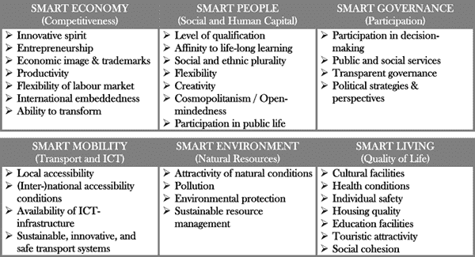

图 8.1 智慧城市的主要特征。

智慧经济、智慧人才、智慧治理、智慧出行、智慧环境和智慧生活被认为是智慧城市的主要或定义特征 [5]。因此，在本章中，智慧城市指的是技术化且人口密集的人类定居点。

## 智慧城市的起源

“智慧城市”一词出现在 20 世纪 90 年代初，用于描述技术和创新在城市发展中的应用。具体而言，在此期间，研究人员关注城市及其对信息技术（`IT`）的整合。1994 年，智慧城市的概念在阿姆斯特变为数字城市。到 1997 年，全球识别了约 2000 个虚拟城市区域 [24]。这些虚拟城市引入了本地 `ICT` 网络，促进了基于网络（虚拟）社区的出现。它们是真实城市区域的电子和基于网络的内容，通过万维网（`WWW`）进行托管。虚拟城市被认为是利用互联网支持基层民主、城市推广、基于互联网的市政运营以及城市社会发展的早期尝试。然而，人们注意到缺乏公民的反馈。随后，虚拟社区在 1998 年出现，实现了个体之间基于共同规范的通信。这种虚拟社区网络的数字化范围有限，主要仅为其关联的社区提供服务，外部人员无法直接访问该社区网络。


互联网结合城市系统和 `WWW` 被用于建立城市网站，提供替代性的智能服务，如信息检索以及官方和通用通信。这两种智慧城市的方法将城市空间构想为连接的社区，或者二维或三维的虚拟环境 \[25\]。智慧城市的第一个概念于 1999 年在迪拜被提出。另一个著名的数字城市系统于 1998 年在京都开发，创建了 2D 和 3D 空间，通过传感器捕捉居民的互动，并对他们的行为进行动画处理。数字城市模型演变为所谓的“信息城市”，被泛化为以 `ICT` 作为交付创新在线服务的主要驱动力的城市区域。信息城市的理念后来转变为“无处不在城市”的概念，即通过嵌入的城市通信访问数据 \[26\]。智能城市强调城市性能，关注智能、创造力、独创性、群体智能和人工智能等领域的创新。“智慧城市”这一理念的出现是为了应对城市环境不断扩张所带来的诸多障碍做出出的反应。技术的有效部署，特别是物联网（`IoT`），成为繁荣智慧城市的显著特征 \[27\]。

智慧城市模型已演变为日益复杂的环境，能够提供更广泛的服务并促进科学整合，这种整合是指技术能够将其嵌入社会系统中以实现智能服务交付的能力 \[28\]。这种整合跨越了基础信息传播到智能系统的实现，然后进展到解决社会和人类关注问题的系统，最后是关注可持续性的生态系统。相比之下，城市生态系统通常被理解为相互作用的生物体及其环境的社区，由于资源的相互依赖而形成复杂的网络 \[29\]。生态系统可以被构想为“由参与者、组织、物质基础设施和符号资源组成的相互依赖的社会系统” \[30\]。在这种背景下，生态系统与其他系统一样，由元素、相互连接和功能/目的组成，但它们的独特之处在于元素是智能的、自主的、适应性的代理（通常形成社区），并且能够适应元素添加或移除等变化。在这里，有四个基本要素刻画了生态系统的特征，即：互动/参与、平衡、具有共同目标的松散连接参与者以及自我组织。

在挖掘“智慧城市”概念时，存在着“网络空间”的概念。网络空间是非洲计算机系统与数字环境之间的网络，作为全球网络空间的微型代表，促进了青少年和成年人之间的互动、活动、体验和关联。然而，这些互动缺乏监管引发了关注 \[31\]。非洲数字权利网络已经建立，以增强非洲的数字格局。它寻求通过提供一个在线平台来实现这一目标，促进民主表达、保护隐私和言论自由、扩大数字访问、推动社交媒体行动主义、开发公民技术、倡导支持数字权利的立法，并推进数字安全技术 \[32\]。这些努力与智慧城市的原则保持一致，智慧城市利用技术和数据驱动的解决方案来提高居民的效率、可持续性、流动性、安全整体生活质量。智慧城市是一个社区，其中对人力资本和社会资本的投资，结合传统和现代通信基础设施，共同促进了可持续经济发展、生活质量的提高以及对自然资源的负责任管理 \[33\]。同样，智慧城市是物理、数字和人类系统在建筑环境中有效整合的地方，以为居民营造一个可持续、繁荣且包容的未来。

正如 Kumar 和 Barrett 所言 \[34\]，智慧城市的终极目标是利用技术创建可持续、高效且包容的城市环境，并关注居民的福祉。在非洲，智慧城市日益被视为城市挑战的先锋解决方案，旨在提高效率、可持续性和包容性。开罗、阿尔及尔、开普敦、拉巴特、内罗毕、拉各斯、阿布贾、突尼斯和阿克拉等城市被认为是非洲大陆智慧倡议方面最的城市 \[35\]。包括南非、纳米比亚、肯尼亚、埃及、阿尔及利亚、摩洛哥、尼日利亚和加纳在几个非洲国家处于推动智慧城市概念的前沿。这些国家正在拥抱现代化以提高公民福祉，并塑造一个协调创新、人性与自然的未来 \[36\]。例如，肯尼亚 Konza Technopolis 作为智慧城市的开发涉及了城市信息和通信技术网络的整合。完成后，Konza Technopolis 预计将容纳超过 230,000 名居民和专业人士，他们将在智慧城市内生活和工作。这项计划是肯尼亚“2030 愿景”经济发展计划下的旗舰项目，旨在让国家在 2030 年前进入中收入国家。另一个例子是南非总统西里尔·拉马福波对南非新型城市概念的愿景，强调 `IoT` 设备和智能技术的整合。2021 年，拉马福波公布了三个新项目，即 Lanseria、D 班航空都市和 Mooiklo 巨型城市，将它们建立为南非智慧城市的典范 \[27\]。

## 非洲的智慧城市

非洲各地的智慧城市的发展经历了几个阶段，最新的模型优先考虑公民共同创造、公平和社会进步。南非的开普敦、尼日利亚的拉各斯和埃及的开罗等城市，与其西方世界的维也纳和温哥华等城市一样，采用了这种以公民为中心的方法，鼓励社区参与并解决多样化的社会挑战 \[34\]。


## 非洲智慧城市的演变

非洲智慧城市的演变是一段多维的历程，标志着不同的发展阶段，以及通过技术驱动的解决方案来应对城市挑战的实施。21 世纪 00 年代初，在技术进步和对可持续城市发展需求日益增长的推动下，智慧城市的概念在全球范围内开始受到关注。非洲的城市，特别是那些经济增长和基础设施需求不断大的城市，开始探索智慧倡议。

在 21 世纪 10 年代，非洲城市开始实施试点项目和倡议，以在各个城市部门测试智慧解决方案。这些倡议通常聚焦于改善基础设施、增强公共服务以及应对环境挑战。`开普敦`、`约翰内斯堡`、`内罗毕`和`拉各斯`等城市成为非洲智慧技术的早期采用者。认识到智慧城市的潜在收益，多个非洲政府开始制定国家级战略和政策，以促进智慧城市的发展。例如，`卢旺达`于 2016 年启动了其《智慧城市主线计划》，概述了利用技术和创新转型城市地区的路线图。`卢旺达`的首都`基加利`是该国的经济枢纽，侧重于通过创新方法克服经济和社会挑战。`基加利`智慧城市倡议的首要目标是通过知识传播和教育提高居民的生活质量。该市旨在借鉴美国`硅谷`的成功经验，吸引来自全非洲的顶尖科技人才。

21 世纪 10 年代后期，私营部门参与推动非洲智慧城市倡议的情况日益增加。专攻技术、电信和基础设施的公司与政府及地方当局合作，实施智慧解决方案，例如`IoT` 传感器、`数据分析`和数字平台，以改善城市生活条件。近年来，非洲城市涌现创新枢纽和生态系统，促进了智慧城市领域的创业与创新。这些枢纽作为开发针对当地城市挑战定制解决方案的初创企业的孵化器，为非洲智慧城市生态系统的增长做出贡献。

随着非洲智慧城市的持续演变，对包容性和可持续性的关注日益增加。人们正努力确保智慧解决方案能够满足所有居民的需求（包括边缘社区），并为城市发展的长期可持续性做出贡献。因此，非洲智慧城市的发展体现了一场由技术进步、政府指导、私营部门合作和社区参与驱动的动态历程。随着非洲城市经历快速的城市化，智慧城市努力的意义将大幅增长，塑造整个非洲大陆城市生活的轨迹。

## 区域倡议与数字化转型

如`卢旺达`的《智慧城市蓝图》以及在`尼阿`、`拉各斯`和`阿克拉`等城市的各种项目，展示了非洲向数字化转型和可持续城市发展的迈进。与传统的西方智慧城市模式不同，一些非洲领导人主张一种新本土方法，赋能社区参与其城市空间的设计和建设。正如`Lovitske` [37] 所言，如洛梅的`HubCité`和拉各斯的`Equo Atlantic`等倡议证明了这种方法，促进了当地驱动的城市项目，并促进了点对点的交流，以创造更具包容性和文化相关性的智慧城市。

因此，非洲的智慧城市是进步和创新的象征。它们通过利用智慧基础设施、促进数据共享和培养数字创新，在城市地区引领技术进步，从而提高居民的生活质量并刺激整个大陆的经济发展。在尼日利亚的`拉各斯`，像许多其他非洲城市一样，年轻数据科学家数量激增，他们合作建立新的`AI`-驱动公司，并增强他们在`机器学习`技术方面的熟练程度。据说，`拉各斯州`在尼日利亚经济中处于重要地位，是国家主要的商业枢纽，并在西非国家共同体（`ECOWAS`）中发挥着关键作用。估计人口超过 2500 万的`拉各斯`经济规模超过了`ECOWAS`子地区的任何其他地方。此外，它还是尼日利亚和西非地区金融系统的中心，其特点是拥有突出的银行、保险公司、微型金融机构、社区银行、贴现银行和资本市场 [38]。

此外，肯尼亚`Konza 科技城`的故事为全球城市提供了典范模型。`Konza`是一个从零开始开发的智慧城市，避免了继承的基础设施和社会挑战。`Konza 科技城`的愿景是成为一个由繁荣的`ICT`部门、可靠的基础设施和友好治理系统驱动的世界级城市。开发始于 2009 年，计划到 2030 年容纳超过 18.5 万居民并创造 10 万个工作机会。`Konza`通过优先考虑包容性，允许居民直接访问在城市内收集的数据，使能够积极参与智慧城市的运营并促进可持续的生活实践。

`开普敦`被认为是非洲最智慧的城市之一，它提供了一个`开放数据门户`并通过在城市巴士上提供免费`Wi-Fi`来促进数字包容。换句话说，`开普敦`因其使用`智能传感器`和`实时数据分析`而脱颖而出。南非面临电力、水和废物管理需求的挑战，这促成了`IoT`设备和实时数据采集的采用。这些部署在主要城市的传感器从水表、垃圾桶和交通灯等各种来源收集数据。如`Sqwidnet`等网络提供商促进了数据共享，使市政当局能够优化农业、交通管理、犯罪检测和垃圾收集在内的各个方面。

## 挑战与解决方案

非洲的智慧城市面临着各种挑战，这些挑战似乎阻碍了它们的发展进展，从而影响了智慧公民和整个非洲经济。然而，本章将人工智能（特别是生成式人工智能）作为对抗非洲智慧城市可持续性障碍的对策工具。

### 卢德分子与限制非洲智慧城市可持续性的因素

正如`Mwakitalima`、`Rizan`和`Kumar` [39] 所认为，非洲城市中心正在经历快速的人口扩张，与农村地区相比，非洲领导人对发展城市地区表现出高度热情，因为这些城市环境正成为社会活动的焦点。这一趋势是由农村向城市迁移等因素驱动的，特别是在年轻一代中。因此，城市人口快速增长，导致自然资源的过度开发、环境恶化以及对社会服务的压力增大。人口的快速增加催化了智慧城市的建设，旨在满足当前和未来后代的需求。对于一些学者来说，高城市化、人口增长增加、基础基础设施糟糕、贫困、法律法规不健全、经济不稳定和治理不力是非洲建立智慧城市的一些因素。


# 非洲智慧城市面临的可持续性挑战

关于非洲智慧城市面临的可持续性挑战，从北非开始，重大问题包括人口密度大、收入水平低、青年失业、社会排斥、专业技能和教育匮乏以及应对移民和难民危机的压力。西非是城市化最快的子区域。尽管城市数据可靠性存在差距，但城市中产阶级的出现被认为对维持增长和吸引外国直接投资至关重要。然而，在区域和城市基础设施、物流、交通、港口设施、信息通信技术（ICT）和能源资源方面仍然存在缺陷。此外，气候变化和政治动荡阻碍了可持续发展。

东非虽然城市化程度最低，但城市化率增长迅速。它面临着区域经济脆弱性，城市具有高贫困和高不平等的特征。该地区对农业的高度依赖使其易受气候变化影响，加剧了粮食不安全，并导致了内部流离失所和难民流入。中非正经历着快速城市化，但深受深层贫困、不平等和失业的困扰。气候变化引发的威胁（如粮食不安全和森林砍伐）加上腐败的政治体制，构成了巨大挑战。市政府难以产生资金来资助基本服务 [40]。

## 技术采纳与领导力的差距

建设一座智慧城市是一回事，但维持智慧城市并并将智慧倡议扩展到该国家的其他地区则是另一回事。人们迁移到城市是为了享受那里的技术益处并改善生活水平。这导致了拥挤和高网络犯罪率等问题。想象一个拥有许多城市、城镇和村庄的非洲国家，但只有少数城市是核心意义上的智慧。想象一位州级部长在他的选区大力增加钻井，而实际上在 21 世纪，每家户户都应该拥有水井。想象一位州长在州内大力推动或建立一些电子中心，而实际上，整个州本应该已经数字化，因为无论位置何地，每个人都能免费访问互联网。这在 21 世纪简直是一个巨大的失败！

大多数非洲领导人是卢德主义者（对技术变化几乎或完全不感兴趣），他们对技术进步投入很少，认为其资本成本过高，但忘记了技术正在统治当今世界，使人类努力的每个方面都数字化。这种对技术进步的轻视在州或国家预算中可见一斑，投入技术的资金比例很小。关于尼日利亚的技术状况：

> 只要在 5 年内捕捉这一蓬勃行业 0.1% 的值的价值目标，尼日利亚就有可能产生年价值 160 亿美元的产业。这一巨大数字仅源于人工智能，强调了该领域的巨大潜力。考虑到结合区块链技术、`Fintech`、`IoT`、`Robotics`、`Clean Tech`、`Methanol`、氢气生产和其他创新，可能性是无限的。尼日利亚拥有庞大、年轻、智能、创新且适应能力强的动力，加之全球对技术的渴求，正准备建立一种替代性的国家财富和经济模式，这可能超过其目前的预算和经济规模。

> [41]

因此，对技术进步采取卢德主义态度不符合 21 世纪领导人或国家元首的身份，他们未能优先考虑人民的福祉，而技术已经到来并逐渐成为人类的伴侣。在一个非洲国家或地区开展一系列智慧倡议，比采取集中化管理好得多且更有利。

## 非洲智慧城市与作为赋能者/解决者的生成式人工智能

智慧城市的技术进步正旨在解决涵盖水资源管理的各种挑战。这些突破得到了无线通信、数据分析和云计算领域整体进展的支持 [8]。

毫无疑问，非洲的智慧城市面临着挑战，但人工智能（`AI`）加强了非洲的智慧倡议和项目。人工智能，特别是生成式人工智能（一种用于生成新数据或内容的 `AI` 技术和模型），也可以作为解决问题的工具或技术。技术确实通过以下方式塑造了智慧城市：

- `sensors`（传感器）：监控公共基础设施（如桥梁、道路和建筑），通过生成相关数据提高意识，从而实现资源的高效利用。
- `big data`（大数据）：实现高效的资源管理和公共安全倡议。
- `AI`：为城市官员提供准确工具来衡量城市流程，更快地做出基于数据的决策，并提高生活质量。
- 地空间技术和数字地图：支持 3D 建模、`LiDAR`、移动制图技术和遥感等技术。

工具还包括 `photogrammetry`（摄影测量）、`remote sensing`（遥感）、`mapping`（制图）、`geographic information systems`（GIS，地理信息系统）、`geodesy`（测量学）等 [6]。

利用智慧技术为城市提供了解决城市迁移和服务交付问题的有效方法，包括住房不足、就业机会有限和供水不稳定 [42]。麦肯锡全球研究院 [43] 指出，战略性地部署这一代智慧城市应用有望帮助城市实现联合国可持续发展目标的 70%。智慧解决方案，例如智慧出行应用（包括按需打车共享服务、拼车、约车、自行车租赁和共享单车应用程序）、智慧垃圾管理系统和智能电网，正在改变城市生活。


因此，生成式 AI 通过提供创新解决方案，在应对非洲智慧城市的各种挑战方面发挥着至关重要的作用。AI 算法可以分析从传感器、社交媒体和其他来源收集的海量数据，以识别模式、趋势和异常。生成式 AI 可以帮助城市规划师和建筑师设计更高效、可持续的城市。通过生成和评估多种设计方案，AI 算法可以优化土地利用、交通网络和基础设施布局，以提高生活质量并减少对环境的影响。AI 算法可以优化交通流、公共交通路线和共享出行服务，减少拥堵并提高移动性。通过分析车辆和行人的实时数据，AI 系统可以动态调整交通信号、重新规划公交路线并分配资源，以最小化减少旅行时间和碳排放。AI 可以优化智慧城市的能源生产、分配和消费。通过预测能源需求、识别节能机会和优化可再生能源的整合，AI 算法可以帮助城市实现可持续发展目标并减少对化石燃料的依赖。生成式 AI 可以优化垃圾收集路线、回收计划和填埋场使用，以最大限地减少对环境的影响并提高效率。生成式 AI 算法可以分析视频流、传感器数据和社交媒体帖子，以实时检测并响应安全威胁和紧急情况。生成式 AI 可以促进公民对智慧城市倡议的参与。生成式 AI 可以帮助城市准备并应对洪水、飓风和野火等自然灾害。通过模拟灾难场景、预测疏散路线和协调应急响应工作，AI 系统可以增强韧性并减轻灾难性事件对城市基础设施和社区的影响。

## 结论

城市中的智慧倡议和项目吸引了不同文化、地位、性别和宗教的人们。非洲智慧城市的实现缓解了一些非洲国家面临的挑战，而且少数智慧城市的影响在整个非洲大陆都被强烈感受到，因为非洲人正从中受益。尽管如此，仍需要更多工作来实现非洲每个地方数字化，以防止过度拥挤等问题升级以及网络犯罪等其他严重问题。为此，可持续性保障了全非洲智慧城市的未来，通过技术工具（如生成式 AI）和技术崇拜态度/心态（投资新的技术理念和项目），可以确保在非洲创建更多智慧城市并维持其运行。

## 建议

根据上述发现，提出以下建议以确保非洲各地拥有可持续且具有韧性的智慧城市：

1. 非洲领导人应该从核心上成为技术爱好者，以免在 21 世纪的技术创新中落队。

2. 必须建立伦理协议和法规，以规范非洲对生成式 AI 的负责任使用，解决隐私、同意以及 AI 生成内容的潜在影响等问题。非洲人应该开始独立思考，通过技术/务实知识来充实自己。

3. 非洲政府应不惜资金充分利用技术进步成果，以确保全非洲智慧城市的未来。

## 参考文献

1. E. Moir, T. Moonen 和 G. Clark，“未来的城市是什么？起源、意义、用途，”由 Business of Cities for the Foresight Future of Cities Project and Future Cities Catapult 编写的报告，2014。可用地址：[`www.gov.uk/government/uploads/system/uploads/attachment_data/file/337549/14-820-what-are-future-cities.pdf`](https://www.gov.uk/government/uploads/system/uploads/attachment_data/file/337549/14-820-what-are-future-cities.pdf)

2. Barclays,，“重新思考智慧城市：优先考虑基础设施，”Barclays Sustainable and Thematic Investing, Wiley-Blackwell, 美国新泽西州霍得肯英国伦敦，2020。[`live.barcap.com/PRC/publication/FP_TEJbGJfMTYwMjY5MTE3OTU2M34gfiB-IH4g_2553292`](https://live.barcap.com/PRC/publication/FP_TEJbGJfMTYwMjY5MTE3OTU2M34gfiB-IH4g_2553292)

3. D. Munene,“智慧城市为非洲的城市化问题提供了解决方案，”《中国日报全球》，2024。可用地址：[`www.chinadaily.com.cn/a/202401/30/WS65b84ec0a3104efcbdae89c0.html`](https://www.chinadaily.com.cn/a/202401/30/WS65b84ec0a3104efcbdae89c0.html)

4. OECD/SWAC,”非洲城市化动态 2020：Africapolis，绘制新的城市地理地图，”西非研究，OECD 出版社，巴黎，2020。[https:doi.org/10.1787/b6bccb81-en](https://doi.org/10.1787/b6bccb81-en)。

5. South 南非地方政府协会 (SALGA)“智慧城市发展成熟框架，”Marang Consulting, 2020。可用地址。


15. N. L. Mashau, J. H. Kroeze 和 G. R. Howard, “用于评估小型和农村城镇实施智慧城市就绪性的整合概念框架：系统性文献综述”，收于 Y. M. Huang、C. F. Lai 和 T. Rocha (编)，《创新技术与学习，ICITL 2021，计算机科学讲义录》，第 13117 卷，第 262–273 页，Springer, Cham，2021。

16. T. Nam 和 T. A. Pardo, “从技术、人人和机构的维度概念化智慧城市”，第 12 届年度国际数字政府研究会议论文集：挑战时期的数字政府创新，大学公园，2011 年 6 月 12-15 日，第 282–291 页。可用地址：[`doi.org/10.1145/2037556.2037602`](https://doi.org/10.1145/2037556.2037602)

17. M. Gunder 和 J. Hillier, 《十字或更少的规划：与空间规划的拉康式纠缠》，Ashgate：Surrey，2009 年。

18. A. Caragliu, C. Del Bo 和 P. Nijkamp, “欧洲的智慧城市”，《城市技术杂志》第 18 卷，第 2 期，第 65–82 页，2011 年 4 月。

19. T. Bakıcı, E. Almirall 和 J. Wareham, “智慧城市倡议：巴塞罗纳案例，《知识经济杂志》第 4 卷，第 2 期，第 135–148 页，2013 年。

20. N. L. Mashau 和 J. H. Kroeze, “影响小型和农村城镇智慧城市实施的挑战，《南非信息管理杂志》第 25 卷，第 1 期，a1703，2023 年。可用地址：[`doi.org/10.4102/sajim.v25i1.1703`](https://doi.org/10.4102/sajim.v25i1.1703)

21. P. Box, A. Lee, G. Smith, A. Mackenzie, T. Sanderson, A. Reeson, A. Duenser 和 R. Fleet, “智慧城市的数据平台：智慧城市实践的景观扫描与建议”。CSIRO，澳大利亚，2020 年。

22. C. Y. Baldwin 和 C. J. Woodard, “平台架构：统一视角”，收于 A. Gawer (编)，《平台、市场与创新》，第 19–44 页，Edward Elgar, Cheltenham，2009 年。

23. A. Tiwana, 《平台生态系统——对齐架构、治理与策略》，Morgan Kaufmann：Burlington, MA，2014 年。

24. S. Graham 和 A. Aurigi, “网络空间的城市化？，《城市》第 2 卷，第 7 期，第 18–39 页，1997 年。

25. A. Das, S. C. M. Sharma 和 B. K. Ratha, “智慧城市的新时代：从物联网视角，《智慧城市安全与隐私》。Elsevier，2019 年。可用地址：[`doi.org/10.1016/B978-0-12-815032-0.00001-9`](https://doi.org/10.1016/B978-0-12-815032-0.00001-9)

26. L. Anthopoulos 和 P. Fitsilis, “智慧城市及其在城市竞争中的角色：一种分类，《国际电子政府研究杂志》第 10 卷，第 1 期，第 67–81 页，2014 年。

27. B. R. Du Toitl 和 J. E. Stimiel, “迈向南非智慧城市：演变、定义与未来城市，《南非工业工程杂志》第 34 卷，第 1 期，第 85–96 页，2023 年。

28. A.-V. Anttiroiko, P. Valkama 和 S. J. Bailey, “新服务经济中的智慧城市：为智慧服务构建平台，《人工智能协会》第 29 卷，第 323–334 页。

29. U. Gretzel, H. Werth, C. Lams, (2015). “理解生态系统的概念基础，《人类行为》第 50 卷，第 558–563 页。

30. D. Maheshwari 和 M. Janssen, “改进生态系统互操作性的衡量与基准：泛在数据与众包，《政府信息》第 31 卷，S84–S92。

31. B. O. Daudu, K. Shuaibu, 网络欺凌与社交媒体，《人工智能》。Chapman & Hall，第 243–253 页。

32. T. Roberts, “智慧城市及其在城市竞争中的角色：一种分类，《国际电子政府研究杂志》第 10 卷，第 1 期，第 67–81 页，2014 年。

33. The Framework 合作治理部，《南非智慧城市：一个框架》。

34. A. Kumar, “非洲发展的机遇与挑战”，世界银行。

35. C. Okafor, “平台架构：统一视角”，收于 A. Gawer (编)，《平台、市场与创新》，第 19–44 页，Edward Elgar, Cheltenham，2009 年。

36. IMD 智慧城市，2023 年。

37. L. Lovke, “平台架构：统一视角”，收于 A. Gawer (编)，《平台、市场与创新》，第 19–44 页，Edward Elgar, Cheltenham，2009 年。

38. Lagos 统计局，2021 年。

39. I. J. Mwakima, M. Rizwan 和 N. Kumar, “坦桑尼亚智慧城市发展的机遇与挑战，《能源进展》第 7 卷，第 2 期，第 135–146 页，2020 年。

40. M. J. P. Dos-Santos, “迈向非洲的可持续智慧城市：综述，《热带气候生物气候建筑》。Springer Nature，2019 年。

41. E. Orjih, “2024 年了，技术能驱动尼日利亚新经济吗？，《亚洲企业》，2024 年。新闻稿。

42. M. Maphangwa 和 G. van der Waldt, “地方政府智慧城市模型：南非大都市的案例，《公共管理》第 31 卷，第 3 期，第 61–84 页，2023 年。”


在快速城市化和技术进步的时代，全球各城市正在成为人们所说的“智慧城市”（SC）。这些城市景观的目标是通过整合尖端技术、数据驱动的决策以及对可持续性的强调，来提高居民的生活水平。智慧城市管理与公民参与——这两个影响 21 世纪城市生活基本性质的两个支柱——之间复杂的相互作用，为这种范式转变奠定了基础。

由于 21 世纪发生了巨大的农村入城潮，城市基础设施面临着日益巨大的压力。“智慧城市”的概念作为对这些困难的充满希望的回应运而生，为与城市复杂性相关的问题提供了有效且持久的解决方案。智慧城市的努力旨在利用人工智能（AI）、数据分析和物联网（IoT）等技术，优化资源配置，改善基础设施并增强整体城市功能。

然而，技术解决方案的整合并非决定智慧城市倡议成功的唯一因素。这些倡议的效能在很大程度上取决于支持它们的治理框架。因此，智慧市的管理对于协调技术进步平稳融入城市景观变得至关重要。此外，公民参与的概念已成为实现智慧城市发展目标的关键要素。城市正意识到将公民纳入决策过程的重要性，这正在重塑传统的治理范式。在智慧城市中，公民参与不仅限于简单的参与当地事务，还包括积极合作、信息共享以及城市区域的共同创造（Angelidou, M., 2014）。

本研究旨在调查和评估公民参与与智慧城市管理之间复杂的关系。本研究的目标是通过研究案例研究、探索现有文献并开发一个完善的框架，提供关于治理结构在智慧城市建设中如何影响并被公民参与影响的细致知识。通过研究有效模型、遇到的困难以及未来发展的机会，本研究旨在增加关于智慧城市治理与公民参与之间互利联系的不断丰富的知识。本章还打算分析相关的研究工作，以考察智慧城市治理和人工智能的趋势。本研究还将对新兴问题和挑战提供见解。

## 文献综述

## 智慧城市——定义与特征

“智慧城市”的概念起源于城市化，其特征是城市人口的不断增长。增长的城市人口对设施、社会可持续性和生活水平提出了很高要求；事实上，现有的有限资源和服务难以满足民众的需求。因此，智慧城市概念作为作为一种战略性地将人员、流程、数据和计算技术相结合的手段而被开发出来。大数据、云计算和物联网都是可以与物理基础设施连接的技术示例，能够实现资源利用高效的服务，并为民众提供可持续的生活水平。将一个城市转换为智慧城市的过程是复杂且多层，并能够快速适应其市民的需求（Vasudavan, H. Gunasekaran, S. S., & Balakrishnan, S., 2019）。在 21 世纪，智慧城市是一个快速发展的概念，将改变城市增长。智慧城市通过使用尖端技术和数据分析，提高了居民的生活水平，提高了服务和基础设施的效率，并促进了长期的可持续经济增长。交通、能源、健康、教育和政府只是智慧城市结合以创建智能连接大环境的少数学科（Gracias, J. S., Parnell, G. S., Specking, E., Pohl, E. A., & Buchanan, R., 2023a, 2023b）。在全球范围内，“智慧城市”的概念作为解决城市化、环境问题和经济增长的解决方案变得日益受欢迎（Yin, C., Xiong, Z., Chen, H., Wang, J., Cooper, D., & David, B., 2015a, 2015b）。随着技术日益融入我们的日常生活，智慧城市的概念变得越来越相关。近年来，政府和企业部门在智慧城市倡议方面投入了大量资金。随着技术的发展和城市人口的增加，智慧城市变得越来越重要（Ismagilova, E., Hughes, L., Dwivedi, Y. K., & Raman, K. R., 2019a, 2019b）。由于政府和商业部门对这些倡议投入了巨大的全球投资，对智慧城市研究和应用的严谨研究需求日益增长。近年来，人们对智慧城市产生了巨大的兴趣和投资，在全球范围内开展了许多倡议和项目。尽管，尽管有这些关注和投资，但并没有一个公认的定义来规定什么是智慧城市（Tahmasseby, S., 2022）。对于参与开发和实施智慧城市计划的人（包括立法者、城市规划者和利益相关者）来说，缺乏精确定义可能会带来困难。

### 智慧城市中的治理


智慧城市治理的应用通过增强公众问责制、透明度和参与度，有能力彻底改变城市的运行方式。智慧城市通过使用物联网（`IoT`）设备和传感器实时收集并分析海量数据，可以优化城市基础设施和资源的使用。例如，通过利用传感器监控流量并实时调整交通信号灯，智慧城市技术可以减少拥堵并提高道路安全（Shoaib, N.; Shamsi, J. A., 2019）。智慧城市的应用还可以通过分析来自 GPS 设备和交通传感器的数据，为驾驶员提供交通状况的实时信息。这些应用随后可以推荐路线和绕过拥堵的方法，以帮助车辆避让（Din, I. U., Guizani, M., Rodrigues, J. J. P. C., Hassan, S., & Korotaev, V. V., 2019）。通过为民众与政府之间的互动与通信开辟新途径，智慧城市技术在增强公共服务效能效率的同时，还能促进公民参与。结果是城市的整体生活质量可能会提高，公民与政府之间的合作也可能加强（Li, X., Liu, H., Wang, W., Zheng, Y., Lv, H., & Lv, Z., 2021）。

公共组织对城市事务的管理和监管需要变化，以适应智慧城市中扩展的治理范围，这超出了传统的框架。它涉及到协调包括公民、企业和政府组织在内的复杂参与网络。对技术改进、敏性和适应能力的积极态度是有效智慧城市治理的标志。智慧城市的治理结构对于决定技术倡议的方向和效能至关重要。传统的层次模型正在重新设计，以跟上创新的速度。敏捷治理、去中心化决策和协作方法正成为智慧城市的关键（Yigitcanlar, T., & Lee, S. H., 2014）。

### 公民参与

将公民纳入决策是智慧城市的关键组成部分。智慧城市范式将公民视为积极参与者，与传统的政府服务不同。智慧城市提供了多种方法（如众包模式和参与式平台）来赋能居民（Jasi, A., 2022）。电子参与是智慧城市的关键组成部分，因为它允许居民通过在线问卷和反馈系统表达他们的关注，确保项目符合社区需求（Bolívar, M. P., 2016）。

智慧城市的另一个有效工具是社交媒体。城市可以通过社交媒体与居民进行双向通信，并接触更广泛的受众。社交媒体可用于征求居民对即将项目的投入和想法。让公民参与智慧城市项目的设计和执行，确保每个人的声音都能被听到（Gracias, J. S., Parnell, G., Specking, E., & Buchanan, R., 2023a, 2023b）。

通过信息和通信技术（`ICT`），主要是互联网，电子参与使公民能够积极参与公共咨询过程。这一理念指的是 `ICT` 使官方政治和行政部门与普通公众之间进行互动的方式。通过使用这些技术，政府可以接触更多的公民（Washburn, D., Sindhu, U., Balaouras, S., Dines, R. A., Hayes, N., & Nelson, L. E., 2009）。


在交通方面，智能信息通信技术（ICT）使得多模态网络变得安全、包容所有社会群体并具有可持续性。这让市民的通勤变得容易。ICT 通过实现预测性警务、应急响应系统和智能监控提升了公共安全。传感器技术、应急移动应用程序和集成摄像头网络促进了更安全的城市环境。更快的应急响应速度、增强的态势感知以及更完善的通用安全措施都造福了市民。通过保障包括行动不便人士在内的所有人员的访问性，智能交通系统鼓励了社会包容。基于 ICT 的平台提供有关停车位可用、无障碍路线和公共交通时间表的实时信息。在移动应用程序的帮助下，有各种需求的人可以更容易地计划和执行他们的行程。智能 ICT 通过降低交通障碍（Herrenkind, B., Nastjuk, I., Brendel, A. B., Trang, S., & Kolbe, L. M., 2019），使城市出行变得更加平等和包容。智能 ICT 对城市交通系统的安全产生了重大的积极影响。智能交通管理系统利用来自摄像头、传感器和联网车辆的实时数据来监控和优化交通流。在可能的情况下，自动化系统可以提高道路安全性并识别及处理危险，从而降低事故发生的概率。智能 ICT 还使得联网汽车技术成为可能，通过使汽车与基础设施及彼此进行通信，改进了安全措施（Nikitas, A., Kougias, I., Alyavina, E., & Njoya Tchouam, E., 2017）。通过大幅降低住宅或商业建筑在整个生命周期内的能源需求，智能 ICT 可以为建筑业建立所谓的“零能建筑”做出贡献（Kylili, A., & Fokaides, P. A., 2015）。智能可穿戴设备可用于医疗行业以有效监测公共健康（Trang, S., Trenz, M., Weiger, W., Tarafdar, M., & Cheung, C., 2020）。智能可穿戴设备现在已成为远程医疗服务的不可或缺部分，其用途已超越了健身追踪器的范畴。得益于其复杂的传感器和网络特性，这些设备使医疗专业人员能够进行远程病情诊断、药物处方和治疗实施。智能可穿戴设备在提高医疗治疗普及性方面具有革命性影响，消除了地理边界，并将医疗服务直接交付给个人。智能可穿戴设备中的先进传感器，如温度、血氧仪和心电图（ECG）传感器，允许对一系列医疗问题进行远程监测和诊断。通过让医疗从业人员实时收集数据，这些设备消除了前往医疗机构的需求，实现了异常的早期发现和及时诊断。智能可穿戴设备提供远程诊断、药物处方和患者治疗（Ghazal, T. M., Hasan, M. K., Alshurideh, M. T., Alzoubi, H. M., Ahmad, M., Akbar, S. S., Al Kurdi, B., & Akour, I. A., 2021）。智能 ICT 为教育领域带来了革命，将传统的课堂范式转动态且适应的学习环境。在智能 ICT 的帮助下，学生可以参与互动式学习体验，并随时、随地、以自己的节奏进行学习。教育领域的智能 ICT 促进了更具互动性的学习，学生可以“随时、随地、以任何方式、以任何节奏学习”。尽管智能信息通信技术（ICT）正在彻底改变许多不同领域，但它们并没有一成不变的用途。在包括教育或公共管理在某些领域，实时数据处理可能不是重点。另一方面，智能 ICT 是能源或交通管理等领域的关键推动因素。在教育或公共管理等领域，智能 ICT 的作用有限，不需要强大的数据处理能力。而在能源或交通管理领域，智能 ICT 是关键的推动因素（Neirotti, P., De Marco, A., Cagliano, G., & Scorrano, F., 2014).

## ICT 实现智慧城市的治理

智慧城市的概念在过去 20 年引起了研究人员和政策制定者的广泛关注。尽管“智慧城市”的概念并没有统一定义（Albino, V., Berardi, U., & Dangelico, R., 2015；Angelidou, M., 2014；Anthopoulos, L., 2015），但它通常指的是通过通信技术为个人提供尖端服务并促进可持续经济增长的环境（Yigitcanlar, T., Kamruzzaman, M., Foth, M., Sabatini-Marques, J., Da-Costa, E., & Ioppolo, G., 2019）。智慧城市以智慧经济、智慧人、智慧治理、智慧出行、智慧环境和智慧生活为特征（Giffinger, R., Fertner, C., Kramar, H., Kalasek, R., Pichler-Milanovic, N., & Meijers, E., 2007）。## 智慧城市治理模式

### 集中式治理系统

### 去中心化治理系统


在线社交网络是智能城市去中心化治理模型中常用的工具，旨在营造更加开放和互动的氛围。在这种情况下，公民不仅是信息的消费者，还参与到城市叙事之中。去中心化平台促进了基层运动、社区主导项目以及协作式解决问题的自然发展。在线社交网络允许居民进行互动、交流思想并共同解决城市关注的问题。它们是去中心化参与的催化剂。

### 混合系统

混合治理框架实现了去中心化参与与集权控制之间的平衡。通过这种策略，居民、企业和政府机构通过在线社交网络连接起来，这些网络充当了协作生态中的桥梁。这些技术提供了即时通信，确保个人能够获取信息，并为决策过程做出重大贡献。混合方法通过承认自下而上的创新与自上而下指导的重要性，为智能城市管理创建了一个动态框架。

## 治理与公民参与

随着智能城市的日益发展，治理在协调技术整合和鼓励公众参与方面发挥着日益重要的作用。本研究探讨了智能城市中公民参与与治理之间复杂的关系，重点关注公民参与如何影响治理动态，以及治理结构如何影响 `ICTs` 的使用。智能城市的出现标志着城市治理的范式转变，居民在决定城市命运方面发挥着积极作用，而不仅仅是服务的用户。这一转变的核心是公民参与，它利用 `ICTs` 构建了一个更具包容性和协作性的城市生态系统。公民参与在历史上曾采取多种形式，如图 9.1 和 9.2 中的公众咨询和市政厅会议。在智能城市时代，这些传统方法得到了数字平台的增强，允许动态参与、反馈循环和实时互动。公民参与的发展表明了对开放性、响应和协作决策的承诺。

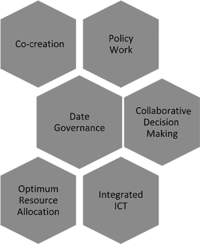

FIGURE 9.1 智能城市治理与公民参与。

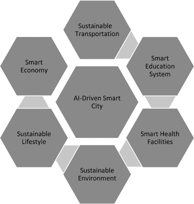

FIGURE 9.2 智能城市的主要领域。

# 用于包容性治理的公民参与模型

智能城市实施了不同的公民参与方法，每种方法都专为满足城市环境的需求和挑战而设计。这些模型包括信息型模型（向公众告知决策），以及更具协作性和参与性的模型，如众包和共同创造。模型的选择取决于特定项目的目标和情况，因为每个模型都有自己的优缺点。将各种公共商品和服务的提供者与作为这些服务的消费者公民连接起来的市场，是公民参与概念的基础。提高居民的生活质量需要让他们能够非排他且无障碍地获得各种公共物品，包括基础设施、医疗和教育。

*   **信息型模型：** 在信息型模型下，市政府向公众通报政策、倡议和选择。虽然公民参与的机会较少，但这种单向连接确保了透明度。信息通过官方网站、社交媒体和移动应用程序等数字平台发布。
*   **咨询型模型：** 在咨询型模型中，通过公众咨询、民意调查和调查获取公众反馈。通过积极寻求对特定项目或问题的意见，市官员为当地居民提供了一个表达想法的平台。这一概念利用数字调查和在线市政厅会议等流行资源，以促进更广泛的受众和多样化的参与。
*   **协作模型：** 通过将当地居民纳入协作决策程序，协作模型促进了公众参与。公民与地方政府、社区组织和私营部门合作伙伴合作，共同创造解决方案并参与决策过程，增强了智能城市计划的有效性和包容性。市政府在信息型模型下向公众通报政策、倡议和选择。虽然公民参与的机会较少，但这种单向连接确保了透明度。信息通过官方网站、社交媒体和移动应用程序等数字平台发布。
*   **共同创造模型：** 共同创造模型涉及公民积极参与项目概念化、设计和实施。这一概念鼓励地方政府与公民之间的协作，使后者能够提供资源、知识和创意。这一概念通过众包网站、黑客松和社区研讨会体现，促进了创造力并赋予社区更大的影响力。
*   **混合模型：** 混合模型承认不同的情况可能需要不同的方法，并整合了多种参与模型的要素。它使公民参与计划具有活性，确保城市能够适应各种需求和挑战。

通常使用这些方法的组合（每种方法根据城市的特定情况和目标进行调整）来实现智能城市成功的公众参与。智能城市可以建立一个更具包容性、响应性且参与性的城市政府结构。


政府的热忱、愿景和管理是确保智慧城市部署可持续的必要条件。此外，智慧城市构想和有效执行的关键因素是公众的参与和投入。尽管如此，还需要一些鼓励来促进这种参与。此外，互联网上的社交媒体平台在智慧城市中起着作用。为了提高城市的生活水平，科学、政府和技术部门之间应该更加和谐地合作。未来的智慧城市可能会研究新的反馈系统，包括在线社交网络渠道、智能手机应用程序和支持物联网（IoT）的设备，以进一步提高公众参与。通过使用这些技术，人们可以对一系列大问题（如环境责任、基础设施和通勤）提供即时意见。公民生成的信息可以通过利用机器学习的算法进行分析，以发现趋势，使管理者能够快速高效地采取行动(Kusumastuti, R. D., & Rouli, J., 2021）。世界上许多地区的智慧城市正在采用参与方法，让居民在决定其社区政策和活动方面拥有发言权。参与式预算最初于 20 世纪 90 年代在波尔阿格港实施，从那时起，它在巴西和世界其他地区变得流行，目前有超过 2700 个政府在使用某种形式的预算。这种策略除了提高透明度外，还鼓励了多样性和社区赋能。参与式预算（特别是在最初十年里）解决了社会、经济和政治边缘化问题，并鼓励预算分配决策中创新的自下而上的投入，导致了波尔阿格港的革命性变化。公民的投入用于确定当地社区公共投资的优先事项，以提高人们的生活质量。该过程的结构确保了地理和主题的代表性 (Abers, R., King, R., Votto, D., & Brandão, I., 2018)。

未来的智慧城市可以实施协商程序，让公民参与复杂的政策讨论，以进一步增强参与式决策。协商场所（如专家小组和公民大会）可以通过确保所有观点都得到考虑，来促进深入且富有成效的讨论。此外，通过利用增强现实（AR）和虚拟现实（VR）等尖技术，个人可以体验并可视化建议的城市理念，从而对城市生活及其挑战有更深入的了解。

## AI 在智慧城市实施中公民参与的变革性作用

与过去事件中的许多革命性发明一样，人工智能（AI）将对社会产生巨大影响。AI 一一直是关于智慧城市转型许多城市政策圈和论坛讨论和辩论的主要话题，特别是对于那些寻求技术解决紧迫城市化问题的规划者和政策制定者。此外，尽管智慧城市的 AI 应用提供了自动化和高效等优势，但它们也带来了法律、伦理和监管关注，包括服务交付中的歧视和隐私问题(Zhou, Y., & Kankanhalli, A., 2021)。考虑到学者提供的各种观点，我们必须研究 AI 算法对智慧城市的利弊和影响。本章调查了 AI 在当代智慧城市中的问题解决应用。

AI 在智慧城市时代变成了变革力量，改变了人们与其城市环境互动的方式。在公民互动中使用 AI 对于提高参与度、促进多样性和简化智慧城市计划的执行至关重要。通过分析从传感器、社交媒体和公共记录等多个来源收集的海量数据，AI 为智慧城市提供了动力。得益于这种数据驱动的策略，城市官员能够识别模式、预测公众需求并做出明智的选择。通过利用 AI 分析，城市可以获得有关城市动态的重要洞察，从而实现更灵活、响应更快的治理。AI 使得根据个人偏好、行为和过去信息定制公民服务变得更容易。感谢 AI 算法，智慧城市可以根据每个公民的需求提供定制信息、服务和服务建议。这不仅改善了用户体验，还通过满足各种和特定的需求促进了包容性。具有 AI 能力的聊天机器人、语音激活界面和虚拟助手是公民提出问题、获取信息和与本地服务的易访问方式。对话式 AI 系统通过对公共查询提供实时答案，促进了公民与其当地政府之间有效顺畅的沟通。这种全天候的访问消除了时间和空间障碍，改善了社区参与。通过检查过去的数据，AI 算法能够预测公民的行为、偏好和可能的问题。得益于这种预测能力，智慧城市就可以就发生的事件、服务中断或社区项目与居民进行主动互动。当个人通过预测性参与获得信息并改善沟通时，就创造了一个更具合作性的城市环境 (Kassens-Noor, E., & Hintze, A., 2020)。


AI 分析交通模式、公民行为以及公共服务的使用情况，以帮助优化资源配置。通过这种优化，城市资源的分配更加高效，能够优先考虑或解决需求更大的地区的问题。明智地分配资源通过在最需要的时间和地点提供服务，从而提高了公民的满意度。

人工智能对于公民在紧急情况下参与公共安全事务至关重要。AI 驱动的系统可以分析实时数据，以识别潜在风险、预见应急情景，并及时通知当地居民。这种程度的响应能力不仅改善了公共安全，还增强了人们对城市管理危机能力的信心。

AI 通过让公民获取有关政策和城市规划的数据驱动洞察，使他们能够更容易参与决策。AI 驱动的交互式系统让当地居民能够提供建议、提出批评并积极参与决策。知识的民主化让每个人都能参与到其城市环境的设计中。AI 驱动的用户界面可以提高广泛人群的无性，包括语言障碍或残障的人士。通过允许个人以多种方式与智能城市服务互动，语音识别和自然语言处理技术确保了参与的包容性并满足各种需求。

在使用人工智能调动公民参与时，考虑隐私和伦理问题至关重要。为了建立并维护公众信任，必须采取强有的安全措施，例如数据匿名、知情许可以及 AI 算法的透明度。人工智能在公民参与方面发挥着革命性作用，提供了前所未有的机会，来构建更具包容性、响应更敏捷且关注公民需求的智能城市。随着技术的进一步发展，AI 在智能城市实施中的应用有望创造出繁荣的城市社区，在这些社区中，居民积极参与共同创造自己的命运，而不仅仅是服务的接收者 (Herath, H.M.K.K.M.B., & Mittal, M., 2022)。

## 智能城市案例

### 新加坡：大都市发展的典范

新加坡以其城市增长的全方位和集成化方法而闻名，是世界上最著名的智能城市示例之一。通过利用数据和信息技术，这个城国家改善了城市生活的许多方面，从垃圾减少、公共安全到节能和交通。2014 年“智慧国国”计划的目标是将新加坡建设成为一个技术先进且网络化的大都市。让新加坡成为全球城市创新先驱的一些创意想法包括巨大的传感器网络、数字健康服务和智能交通管理。

### 巴塞罗纳：以公民为中心的解决方案的领导者

巴塞罗纳在向智能城市转型的过程中，重点放在提高生活质量和公民参与上。“巴塞罗纳智慧城市”项目的主要目标是在促进包容性和参与性氛围的同时增强城市服务。诸如“超级区块”项目（为自行车道和行人收回道路）以及安装根据活动改变颜色的智能路灯等提案显示了该城市对可持续性和居民福祉的投入。巴塞罗纳通过合作联盟和开放的信息系统建立了一个充满活力的技术环境。

### 韩国松岛

松岛国际商务区是一个远瞻智能城市的卓越范例，在规划时考虑了技术和环境责任。紧邻首尔的松岛是作为现代城市生活的典范而创建的。该市拥有一套集成能源效率传感器的智能结构系统、先进的废物处理技术和创新的交通系统。希望从创新技术和生态原则出发从零开始的城市可以从松岛的建筑中获得灵感。

## 未来前景

智能城市在未来几年内在解决当前城市问题以及推进韧性和可持续性方面具有巨大的潜力。智能城市处于全球对抗环境破坏和全球变暖斗争中的主要参与地位。通过整合数据驱动的解决方案，智能城市可以最大化能源利用，减少温室气体排放并鼓励使用再生能源。通过对空气和水质进行实时监测并对污染事件做出及时反应，可以保护公民的健康。


社交媒体平台提供了一个讨论平台，大量信息可以低廉成本实时向广大受众生成并共享，为公民参与创造了机会。城市和郊区的基础倡议旨在提高人们的整体福祉，从而满足他们的需求。鉴于这一目标，公民的参与和互动至关重要。以往的研究识别了实施过程中的挑战，并指出智慧人才或智慧公民是智慧城市不可或缺的维度。本研究旨在通过在线社交网络洞察智慧城市的实施和公民参与。智慧城市的实施应该根据当地情况进行调整。实施的关键成功因素在于：地方智慧、变革型领导力、可持续性和政治内容。城市居民已经通过在线社交网络参与到智慧城市的建设中。然而，需要一种激励机制，以鼓励城市居民解决城市问题。随着信息通信技术（ICTs）的飞速发展，智慧城市治理已不再仅仅是一个官僚角色；它是一个动态生态系统。在政府结构与公民互动之间相互关联的动态协同关系中，技术成为了共同创造、透明度和响应的催化剂。为了有效做出决策并提供服务，智慧城市的治理结构需要灵活且敏捷，将技术突破作为工具。层级、去中心化和混合这三种模型各有优势，但秘诀在于设计能够快速适应民众需求和目标的治理结构。当公民互动占据核心地位时，信息性、咨询、协作、共创和赋能等多种模型提供了一系列选择。这些模型是公民从服务的被动接受者转变为城市社区的参与者的手段。技术——尤其是数字平台——充当让公民和城市官员更顺畅地协作、参与和沟通的纽带。本研究采取的路径揭示了在克服数字鸿沟和隐私问题等限制方面的潜力，同时也承认了挑战。智慧城市有能力发展为包容、韧性的社区，所有居民在城市发展中都有发言权和利益，而不仅仅是技术先进的大都市。未来的智慧城市应该是响应性、包容性和可持续的，技术与人和谐共处。城市官员、立法者、技术人员和居民支持强调公民参与的治理系统，对于实现这一愿景至关重要。研究的洞察阐明了通往智慧城市真正属于其服务的人的道路，为我们应对未来的旅程提供了指导。

## 结论

通过对智慧城市治理与公民参与的调查表明，公民参与与技术创新之间的关系对于构建未来城市至关重要。本研究揭示了动态关系、不断变化的模型以及革命性机会，强调了包容性治理在智慧城市背景下的作用。研究得出，将 `AI` 整合到智慧城市可以为城市带来若干益处。这些包括运营自动化、减少人为错误、有效的数据驱动决策、通过各种系统改善环境、新商业机会的实施以及自动化高效的城市管理。然而，它们也带来了监管困难，包括隐私问题、法律和伦理问题以及服务提供中的歧视。此外，高失业率、`AI` 投入的成本和时长、数据的可用性也被识别出来。

## 参考文献

- Abers, R., King, J., & Brandão, D. (2018). *Porto Alegre: Participatory Budgeting and the Challenge of Sustaining Transformative*. 获取自 `https://www.wri.org/porto-alre-participatory-budgeting-challenge-transformative-change`
- Albino, V., Berardi, U., & Dangelico, R. (2015). Smart cities: Definitions, dimensions, and performance. Journal of Urban Technology, `22`(1). `https://doi.org/10.1080/1063072.2014.92`
- Angelidou, M. (2014). Smart city policies: A spatial approach. Cities, `41`, S3–S11. `https://doi.org/10.1016/j.cities.2014.06.007`
- Anthopoulos, L. (2015). Understanding the smart city domain: A literature review. Transforming City Governments for Successful Smart Cities, 9–21
- Bolívar, M. P. (2016). Mapping dimensions of governance in smart cities. 17th International Digital Government Research Conference on Digital Government Research, (pp. 312–324). `https://doi.org/10.1145/2912160.291217`
- Cohem, B. (n.d.). *The 3 Generations of Smart Cities*. 获取自 `https://www.fastcompany.com/304795/the-3-generations-of-smart-cities`
- Dameri, R. P., & Cocchia, A. (2013). Smart city and digital city: Twenty years of terminology evolution. X Conference of the Italian Chapter of AIS, ITAIS, 1.
- Din, I. U., Guizani, M., Rodrigues, J. J. P. C., Hassan, S., & Korotaev, V. V. (2019). Machine learning in the internet of things: Designed techniques for smart cities. Future Generation Computer Systems, `100`, 826–843.


* Farmanbar, M., Parham, K., Arild, Ø, & Rong, C. (2019). 通向智慧城市的智能电网综述。Energies, *12*(23), 4484. [`doi.org/10.3390/en12234484`](https://doi.org/10.3390/en12234484)
* Giffinger, R., Fertner, C., Kramar, H., Kalasek, R., Pichler-Milanovic, N., & Meijers, E. (2007). 智慧城市：欧洲中型城市排名。区域科学中心 (SRF), 维纳理工大学。
* Ghazal, T. M., Hasan, M. K., Alshurideh, M. T., Alzoubi, H. M., Ahmad, M., Akbar, S. S., Al Kurdi, B., & Akour, I. A. (2021). 智慧城市的物联网：智慧医疗中的机器学习方法——综述。Future Internet, *13*(8), 218. [`doi.org/10.3390/fi13080218`](https://doi.org/10.3390/fi13080218)
* Gracias, J. S., Parnell, G. S., Specking, E., Pohl, E. A., & Buchanan, R. (2023b). 智慧城市发展：数字时代的挑战与机遇。城市技术杂志, *30*(2), 45–67.
* Gracias, J. S., Parnell, G. S., Specking, E., Pohl, E. A., & Buchanan, R. (2023a). 智慧城市——结构化文献综述，*6*(4), 1719–1743. [`doi.org/10.3390/smartcities6040080`](https://doi.org/10.3390/smartcities6040080)
* Herath, H. M. K. K. M. B., & Mittal, Mamta (2022, April). 人工智能在智慧城市中的：全面综述。国际信息管理数据洞察杂志, *2*(1), 1–25.
* Herrenkind, B., Nastjuk, I., Brendel, A. B., Trang, S., & Kolbe, L. M. (2019). 年轻人的出行行为——使用以生活为中心的方法理解对自动驾驶的接受度。交通研究 D 部分：交通与环境，*74*, 214–233. [`doi.org/10.1016/j.trd.2019.07.023`](https://doi.org/10.1016/j.trd.2019.07.023)
* Ismagilova, E., Hughes, L., Dwivedi, Y. K., & Raman, K. R. (2019a). 智慧城市：研究进展——信息系统视角。国际信息管理杂志, *47*, 88–100.
* Ismagilova, E., Hughes, L., Dwivedi, Y. K., & Raman, K. R. (2019b). 现代时代智慧城市的意义：全面综述。智慧城市杂志，*12*(4), 89–112.
* Jasińska-Biliczak, A., (2022). 智慧城市参与：经济危机中的节能答案吗？Energies, *15*(23), 8828. [`doi.org/10.3390/en1523828`](https://doi.org/10.3390/en1523828)
* Kassens-Noor, E., & Hintze, A. (2020). 未来的城市？人工智能的潜力。*1*(2), 192–197.
* Kusumastuti, R. D., & Rouli, J. (2021). 智慧城市实施与公民参与。*IOP 系列：地球与环境科学 940 (2021) 012076*。IOP Publishing。 [`doi.org/10.1088/1755-1315/940/1/012076`](https://doi.org/10.1088/1755-1315/940/1/012076)
* Kylili, A., & Fokaides, P. (2015). 欧洲智慧城市：零能建筑的角色。可持续城市与社会，*15*, 86–95. [`doi.org/10.1016/j.scs.2014.023`](https://doi.org/10.1016/j.scs.2014.023)
* Li, X., Liu, H., Wang, W., Zheng, Y., & Lv, Z. (2021). 基于深度学习的智慧城市数字孪生中的大数据分析。未来生成系统，*128*, 167–177.
* Neirotti, P., De Marco, A., Cagliano, A., Mangano, G., & Scorrano, F. (2014). 智慧城市倡议的当前趋势：一些事实。城市，*38*, 25–36. [`doi.org/10.1016/j.cities.2013.10`](https://doi.org/10.1016/j.cities.2013.10)
* Nikitas, A., Kougias, I., Alyavina, E., & Njoya Tchamou, E. (2017). 自动驾驶和联网车辆、电动交通、公交、超级回路、共享出行和出行服务如何塑造智慧城市的交通未来？城市科学，*3*(4), 36. [`doi.org/10.3390/urbansci304036`](https://doi.org/10.3390/urbansci304036)
* Shoaib, N., & Shamsi, J. (2019). 智慧城市应用的网络需求：挑战与解决方案。IT 专业，*21*, 33–40.
* Sobaci, Z., (2010). 土耳其议会网站在电子参与方面为公民提供了什么：内容分析。信息政治：信息时代政府与民主的国际杂志，*15*, 227–241.
* Tahmasseby, S. (2022). 智慧城市的智慧出行实施：卡塔尔的案例研究。土木工程杂志，*8*, 2154–2171.
* Trang, S., Trenz, M., Weiger, W., Tarafdar, M., & Cheung, C. (2020). 一个应用追踪所有？检查用于接触追踪应用大众接受的应用程序规范。欧洲信息系统杂志，*29*(1), 415–428. [`doi.org/10.1080/0960085X.2020.1784046`](https://doi.org/10.1080/0960085X.2020.1784046)
* Vasudavan, H., Gunasekaran, S., & Balakrishnan, S. (2019). 智慧城市：现状、定义与维度。计算与理论纳米科学，*16*(8), 3525–3531. [`doi.org/10.1390/831`](https://doi.org/10.1390/831)
* Washburn, D., Sindhu, U., Dines, R., Hayes, N., & Nelson, L. (2009). 帮助 CIO 理解“智慧城市”倡议。增长，*17*(2), 1–17.
* Yigitcanlar, T., Kamruzzaman, M., Foth, M., Sabatini-Marques, J., Da-Costa, E., & Ioppolo, G. (2019). 城市可以在不可持续的情况下变得智慧吗？文献系统综述。可持续城市与社会，*237*, 348–365.
* Yigitcanlar, T., & Lee, S. H. (2014). 韩国智慧生态城：智慧可持续城市形式还是品牌骗局？技术预测与社会，*89*, 100–114. [`doi.org/10.1016/j.tfsc.2014.02`](https://doi.org/10.1016/j.tfsc.2014.02)
* Yin, C., Xiong, Z., Chen, H., Wang, J., Cooper, D., & David, B. (2015a). 智慧城市文献综述。中国科学信息学，*58*, 1–18.
* Yin, C., Xiong, Z., Chen, H., Wang, J., Cooper, D., & David, B. (2015b). 智慧城市的崛起：技术整合与城市发展。国际智慧城市杂志，*10*(1), 15–32.
* Zhou, Y., & Kankanhalli, A. (2021). 智慧城市的 AI 监管：挑战与原则。智慧城市与智慧治理，Springer, 黎明，101–118.


保险业在保护个人和企业免受不可见风险方面发挥着关键作用，提供了财务保障和安心。然而，在追求崇高目标的同时，保险部门也面临着普遍存在的威胁：欺诈 [1]。保险内部的欺诈活动从夸大理赔到故意虚假陈述，造成了巨大的财务负担，侵蚀了信任，并破坏了整个系统的完整性 [2]。传统的欺诈检测方法往往无法应对欺诈者不断演变的策略，因此需要方法发生范式转变。近年来，人工智能（AI）和先进算法的整合成为一种变革性的解决方案，在检测和缓解欺诈方面提供了前所未有的能力 [3]。

# 保险欺诈的挑战

保险欺诈是一项多方面的挑战，在不同的险种中呈现多种形式。最常见的形式之一是欺诈理赔，保单持或第三方伪造或夸大损失，以非法获取财务赔偿 [4]。这些欺诈理赔不仅给保险公司带来了直接财务损失，还导致诚实保单持有人的保费增加，侵蚀了对保险产品服务的信任。

此外，保险欺诈的范围超过了个人理赔人，延伸到策划复杂方案以利用保险系统漏洞的有组织犯罪集团。这些复杂的欺诈团伙参与了如策划事故、虚假受伤和欺诈计费等活动，每年给保险公司造成数十亿美元的损失，并带来了重大的监管和法律挑战 [5]。

传统的欺诈检测方法主要依赖人工审核和基于规则的系统，难以跟上欺诈活动的动态变化 [6]。人工流程本质上是耗时、资源密集型且容易人为错误的，使他们无法处理现代欺诈方案的规模和复杂性。此外，基于规则的系统缺乏有效检测新兴欺诈模式所需的适应能力和预测能力 [7]。

# 人工智能在欺诈检测中的前景

在此背景下，人工智能和先进算法的整合代表了保险业欺诈检测领域的范式转变。在海量数据和计算能力的驱动下，AI 算法具有分析复杂模式、识别异常并以史空前的准确性和效率预测欺诈行为的潜力 [8]。

机器学习作为人工智能的一个子集，是许多欺诈检测系统的核心，使算法能够从历史数据中学习并随着时间的推移迭代改进性能。监督学习算法如 `logistic regression`（逻辑回归）和 `random forests`（随机森林）常用于二分类任务，根据标记的训练数据区分合法理赔和欺诈理赔 [9]。

无监督学习技术包括 `clustering`（聚类）和 `anomaly detection`（异常检测），通过识别大型数据集中的异常值和不规则为新兴欺诈模式提供宝贵的见解。这些无监督方法在检测以前未见的欺诈方案以及适应欺诈者演变的策略方面特别有用 [10]。

深度学习是机器学习的子集，其特点是具有多层神经网络，在涉及复杂非结构化数据（如文本和图像）的欺诈检测任务中显示出巨大的潜力 [11]。深度学习架构如 `convolutional neural networks (CNN)`（卷积神经网络）和 `recurrent neural networks (RNNs)`（循环神经网络）擅长从多种数据源处理并提取有意义的特征，实现了更准确、更细致的欺诈检测 [12]。

## 数据质量与特征工程

AI 驱动的欺诈检测系统的有效性取决于底层数据的质量和相关性。涵盖结构化和非结构化信息的高质量数据对于训练准确健的模型至关重要，这些模型能够在噪声中识别微妙的欺诈信号 [13]。

特征工程是将原始数据选择并转换为信息特征的过程，对于增强欺诈检测算法性能起着关键作用。通过利用领域知识和先进分析技术，保险公司可以从保单信息、理赔叙述和外部数据馈等多种数据源中提取相关特征，以丰富分析并提高检测准确性 [14]。此外，整合外部数据源（包括社交媒体、公共记录和第三方数据库）可以为欺诈检测提供宝贵的背景信息和佐证。通过利用跨渠道的丰富信息，保险公司可以对保单持有人的行为获得更全面的理解，并识别指示欺诈活动的潜在红旗 [15]。

## 预测建模与实时决策

除了回顾性分析，AI 驱动的欺诈检测系统还使保险公司能够通过预测建模和实时决策，采取主动的欺诈预防方法 [16]。预测分析技术（如预测建模和机器学习）使保险公司能够根据历史趋势和行为模式预测未来的欺诈风险，使他们能够更高效地分配资源并实施针对性的干预 [17]。

通过部署在理赔处理工作流中的 AI 算法实现的实时决策能力，使保险公司能够在可疑理赔发生时进行检测并标记，最大限度地减少人工审核所需和资源。通过将欺诈检测算法集成到自动化决策系统中，保险公司可以简化理赔流程，加快合法赔付，并实时缓解欺诈活动的财务影响 [18]。

# 伦理考量与透明度

尽管人工智能在欺诈检测方面具有变革潜力，但其部署引发了必须解决的伦理考虑和挑战，以确保公平、透明和问责。算法偏差源于平衡的训练数据或缺陷的模型假设，可能导致对保单持有人的区别对待，并破坏对自动化决策过程公平性的信任 [19]。

透明度和可解释性是减轻算法偏差和培养对 AI 驱动欺诈检测系统信任的基本原则。保险公司必须确保模型开发过程的透明度，对算法如何做出决策提供清晰解释，并披露所用数据或算法中任何固有的偏差或局限性。此外，健全的治理框架和监管监督对于确保在欺诈检测中负责任且合乎地使用 AI 是必要的。保险公司必须建立数据收集、处理和模型部署的清晰指南和程序，在遵守相关法律法规的同时维护最高诚信和伦理标准 [20]。


AI 与先进算法的整合在彻底改变保险行业的欺诈检测方面具有巨大前景。通过机器学习、数据分析和预测建模，保险公司可以增强其检测和缓解欺诈活动的能力，保护保险人的利益并维护保险生态系统的完整性。然而，实现这一潜力需要共同努力来解决伦理考虑、确保透明度并维护 AI 驱动的欺诈检测系统的责任。随着保险公司继续拥抱创新和技术，反欺诈工作已进入了一个由公平、透明度和问责原则引导的新时代。

# 欺诈检测的传统方法

保险行业的欺诈检测历史上一直依赖于人工审核和规则系统等传统方法。这些方法在某种程度上是有效的，但存在明显的局限性，无法跟上欺诈者不断演变的策略。因此，保险领域的欺诈检测迫切需要创新。

### 人工审核

人工审核涉及调查人员审查单个赔单以寻找欺诈迹象。虽然人类直觉和专业知识在发现某些类型的欺诈方面起着至关重要的作用，但人工审核本质上是耗时的，且容易产生主观性。此外，人工审核可能难以处理海量的赔单，导致保险人的理赔处理延迟。

### 规则系统

规则系统采用预定义的规则和阈值来标记可能欺诈的赔单。这些规则通常源自历史欺诈案例、行业最佳实践或监管要求。例如，如果赔单超过某些金额，规则可能会触发警。与人工审核相比，规则系统提供了自动化可扩展性，但它们受到多种局限性的。首先，它们是僵化且缺乏灵活性的，无法适应新兴的欺诈方案或行为模式。欺诈者可以通过设计超出现有规则范围的新策略轻松规避规则检测。此外，规则系统可能由于阈值过于保守或覆盖不足而将合法赔单标记为欺诈。

### 传统方法的局限性

包括人工审核和规则系统在内的传统欺诈检测方法面临着内在局限性，损害了它们在反欺诈方面的有效性。首先，这些方法是被动的而非主动的，关注在赔单提交后识别欺诈，而不是在欺诈发生前预防。这种被动的方法导致了保险公司的巨大财务损失和理赔处理延迟。此外，传统方法往往缺乏检测复杂欺诈方案或细微行为模式所需的复杂性和预测能力。欺诈者不断调整其策略以利用现有检测系统的漏洞，使传统方法变得过时。

### 创新的需求

鉴于传统欺诈检测方法的缺陷，保险行业迫切需要创新。保险公司必须拥抱 AI、机器学习和预测分析等先进技术，以增强其欺诈检测能力。这些技术具有分析海量数据、识别细微欺诈信号并以前所未有的准确效率预测欺诈行为的潜力。通过利用 驱动的算法，保险公司可以超越被动检测方法，采取主动预防欺诈。此外，基于 AI 的系统可以实时适应和进化，从新数据不断学习并随时间的推移提高性能。这种适应性对于领先复杂的欺诈方案并有效对抗保险生态系统内的欺诈活动至关重要。

总之，保险行业的传统欺诈检测方法（包括人工审核和规则系统）具有重大局限，阻碍了它们应对不断变化的欺诈威胁。为了克服这些挑战，保险公司必须拥抱创新并利用先进技术来增强其欺诈检测能力。通过采用 驱动的算法和预测分析，保险公司可以转向主动预防欺诈，保护其财务利益并维护保险行业的完整性。

# 欺诈检测中人工智能的基础

AI 改变了保险行业的欺诈检测，提供了更先进的方法来以更高的准确的效率识别欺诈活动。本节探讨了 AI 的基础概念及其在欺诈检测中的应用，包括机器学习、深度学习以及用于区分合法与欺诈赔单的各种技术。

### 机器学习与深度学习概述

机器学习是 `AI` 的子集，专注于开发能够从数据中学习并在无需显式编程的情况下做出预测或决策的算法。在欺诈检测背景下，`机器学习`算法分析历史数据以识别指示欺诈行为的模式、异常和趋势。

深度学习是 `机器学习`的一个专门分支，利用具有多层的人工神经网络从复杂数据源提取复杂的模式。`深度学习`架构（如卷积神经网络 `CNNs` 和递归神经网络 `RNN`）擅长处理文本、图像和音频等非结构化数据，使其适用于涉及多种数据模态的欺诈检测任务。

### 用于二分类的监督学习

监督学习是一种机器学习范式，算法从标记示例中学习，以预测新的、未见数据的正确输出。在欺诈检测中，`监督学习`算法常用于二分类任务，根据从历史数据中提取的特征区分合法与欺诈赔单。

用于欺诈检测的`监督学习`算法示例包括 `逻辑回归`、`决策树`、`随机森林`、支持向量机 `SVM` 和梯度提升机 `GBM`。这些算法通过识别数据内部的模式和关系来学习区分真伪赔单，使保险公司能够自动处理检测过程并对可疑案件进行进一步调查。

### 无监督学习技术

无监督学习是一种机器学习方法，算法在不需要标记示例的情况下识别数据中的模式和结构。`无监督学习`技术在欺诈检测中对于检测欺诈行为的异常或离群值非常有价值。


聚类算法（例如 k-means 聚类和层次聚类）根据数据点的内在特征将相似的数据点分组，使保险公司能够识别出具有相似模式或特征的理赔集群。异常检测算法（如孤立森林和自动编码器）可以识别数据集中的异常或异常实例，对潜在的欺诈理赔进行标记并进行更仔细审查。

### 深度学习架构

深度学习架构利用具有多个互连节点层的人工神经网络来学习数据的分层表示。这些架构在捕捉大规模数据集中的复杂模式和关系方面表现出色，非常适合涉及高维、非结构化数据的欺诈检测任务。

卷积神经网络（`CNNs`）广泛应用于涉及图像分析的欺诈检测，例如识别伪造文件或检测欺诈签名。循环神经网络（`RNNs`）非常适合处理序列数据，使其在分析时间序列模式和检测时间序列数据中的欺诈方面非常有效，例如交易日志或理赔历史。

总之，欺诈检测中人工智能的基础涵盖了机器学习、深度学习以及用于区分合法活动与欺诈活动的各种技术。通过利用监督学习和无监督学习算法，保险公司可以实现检测过程的自动化，优先处理可疑案件，并减轻欺诈理赔对其业务运营的财务影响。此外，深度学习架构的使用使保险公司能够分析复杂的非结构化数据源，并提取有意义的见解以有效打击保险欺诈。

## 利用数据进行欺诈检测

有效的欺诈检测严重依赖于底层数据的质量和相关性。本节探讨了利用数据进行欺诈检测的关键方面，包括数据质量和预处理、特征工程技术以及引入外部数据源以增强检测能力。

### 数据质量与预处理

数据质量在欺诈检测中至关重要，因为不准确、不或不一致的数据会导致错误的结论和无效的检测模型。因此，保险公司必须投入数据质量保证流程，以确保用于欺诈检测的数据是准确、可靠且实时的。

数据预处理技术用于清洗、转换和准备用于分析的原始数据。这可能涉及删除重复条目、处理缺失值、标准化数据格式以及纠正错误或不之处等任务。此外，可以使用异常值检测方法来识别并处理可能偏差分析或损害检测准确性的异常。

此外，可能会应用数据归一化和缩放技术，以确保特征具有可比性并具有一致的尺度，促进机器学习模型的训练。通过解决数据质量问题并有效预处理数据，保险公司可以提高其欺诈检测系统的准确性和可靠性。

### 特征工程技术

特征工程是从原始数据中选择、转换和创建信息丰富的特征的过程，以增强机器学习模型的性能。在欺诈检测背景下，特征工程在捕捉指示欺诈行为的相关信息和模式方面起着至关重要的作用。

特征选择技术（如相关性分析和特征重要性排序）有助于识别对欺诈检测贡献最大的相关特征。通过关注具有信息量的特征并消除无关特征，保险公司可以降低模型复杂度并提高检测准确性。

特征转换技术（如缩放、归一化和降维）可能用于预处理特征并使其更适合建模。此外，特征工程可能涉及通过数学变换、聚合或现有特征之间的交互来创建新特征，以捕捉数据中的复杂关系。此外，领域知识和专业知识在识别和构建反映保险欺诈独特特征的有意义特征方面是无价的。通过利用领域知识，保险公司可以从数据中提取可操作的见解，并开发稳健的欺诈检测模型。

### 引入外部数据源

除了内部数据源，保险公司还可以通过整合来自不同渠道的外部数据源来增强欺诈检测工作。外部数据源（如社交媒体、公共记录、政府数据库和第三方数据提供商）可以提供宝贵的背景和辅助证据来丰富分析。

例如，社交媒体数据可能会揭示生活模式、行为倾向或个人之间的联系，公共记录数据（如财产记录或犯罪记录）可能为参与可疑交易的申请人或实体提供额外的背景信息。此外，专门从事欺诈预防和检测的第三方数据提供提供了旨在识别欺诈行为数据集和分析工具。通过将外部数据源集成到其欺诈检测系统中，保险公司可以更全面地理解风险因素。

## 用于欺诈预防的高级分析

高级分析在保险行业的欺诈预防中起着关键作用，使保险公司能够主动识别并减轻欺诈活动。本节探讨了欺诈预防高级分析的关键组件，包括预测建模和预测、实时决策以及与理赔处理系统的集成。

### 预测建模与预测

预测建模涉及使用历史数据和统计算法预测未来的事件或结果。在欺诈预防背景下，预测建模用于在欺诈发生之前预测并识别潜在的欺诈实例。

保险公司利用`逻辑回归`、`决策树`、`随机森林`和`梯度提升机`等预测建模技术分析历史理赔数据并识别指示欺诈行为的模式。这些模型从过去的欺诈案件合法交易中学习，以识别风险因素并预测未来欺诈的可能性。

此外，时间序列预测技术（如`自回归整合移动平均 (ARIMA)`模型和指数平滑方法）使保险公司能够预测理赔数据中的趋势和异常，有助于早发现可疑模式或新兴欺诈方案。

预测建模使保险公司能够更有效地分配资源，优先对高风险案件进行调查，并实施针对性的干预，以在欺诈活动发生前将其遏制。


图 10.1 展示了欺诈和非欺诈样本的描述性统计热图，各分为两个部分。每个热图显示了不同特征的平均值，提供了有关欺诈和非欺诈交易之间特征值分布的见。颜色强度代表平均值的大小，有助于比较两类样本之间的特征分布。

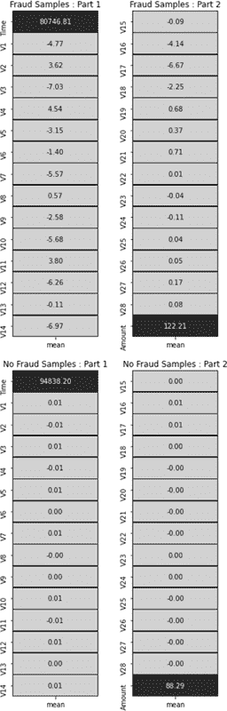

图 10.1 欺诈和非欺诈样本。

图 10.2 展示了数据集中欺诈和非欺诈案例的分布。左侧的饼图显示了欺诈和非欺诈交易的百分比，突出了每个类别的比例。右侧的计数图显示了欺诈和非欺诈案例的数量，提供了频率的视觉比较。颜色区分了欺诈和非欺诈类别，便于对数据分布进行解释。

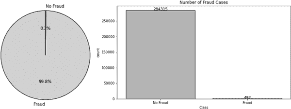

图 10.2 欺诈和非欺诈案例的分布。

使用逻辑回归训练的模型在测试数据上达到了 98.01% 的交叉验证分和 `ROC_AUC` 分数 92.35%，如图 10.3 所示，表明其具有强大的预测性能。这些评估指标提供了有关模型准确性以及区分类别能力的见解，证明了其在分类任务中的有效性。

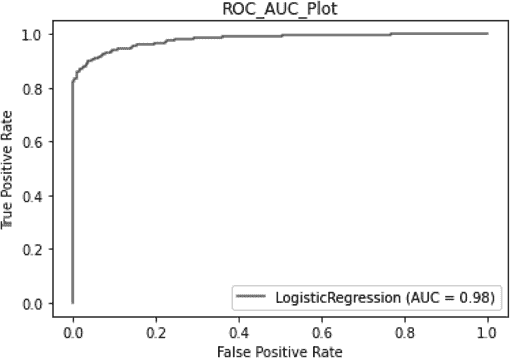

图 10.3 ROC_AUC。

图 10.4 中的分类报告展示了数据集中每个类别（0 和 1）的精确率、召回率、F1 分数和支持度。该模型的总体准确率为 94%，实现了高精确率（类别 0 为 93%，类别 1 为 98%）和高召回率（类别 0 为 99%，类别 1 为 86%），表明其在正确识别两个类别方面的有效性。F1 分数（精确率和召回率的调和平均数）对于类别 0 为 96%，类别 1 为 91%，展示了模型跨类别的平衡性能。

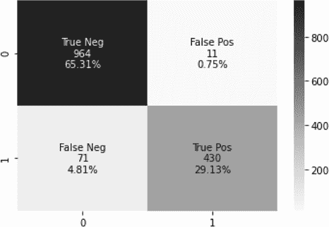

图 10.4 分类报告。

## 实时决策与自动化工作流

实时决策涉及利用数据和分析来立即做出决策，通常是为了响应传入的事件或交易。在欺诈预防背景下，实时决策使保险公司能够实时检测并响应可疑活动，最大限度地减少欺诈理赔的财务影响。

保险公司部署了集成欺诈检测算法的自动化决策系统，实时分析传入的理赔数据并标记可疑案件以进一步审查。这些系统利用机器学习和基于规则的技术来识别异常、评估风险水平，并对理赔的有效性做出明智决策。此外，自动化工作流简化了理赔处理流程，使保险公司能够在加速合规赔付的同时，对标记为潜在欺诈的理赔进行人工审查。通过自动化常规任务和决策过程，保险公司可以缩短处理时间，提高运营效率，并减轻欺诈活动的财务影响。

## 与理赔处理系统的集成

与理赔处理系统的集成对于欺诈预防解决方案在保险组织内的无缝部署和运行至关重要。通过将欺诈检测算法直接集成到现有的理赔处理流程中，保险公司可以利用高级分析来增强欺诈预防能力，同时减少对现有业务的干扰。

保险公司将欺诈检测算法与理赔管理系统集成，能够在理赔周期的各个阶段对理赔数据进行自动分析。这种集成允许保险公司实时监控理赔、评估欺诈风险水平并采取适当行动防止欺诈活动。与理赔处理系统的集成使保险公司能够从部署的欺诈预防模型中获取宝贵的反馈和性能指标，促进检测算法随时间推移的持续改进和优化。

高级分析在保险业的欺诈预防中起着至关重要的作用，使保险公司能够利用预测建模、实时决策和与理赔处理系统的集成主动识别并减轻欺诈活动。通过部署复杂的分析解决方案，保险公司可以增强其欺诈预防能力，保护其财务利益，并维护保险生态系统的完整性。

# 伦理考量

在保险业开发和部署欺诈检测系统时，伦理考量至关重要。本节研究了解决这些关键伦理考量的最佳实践，包括算法偏差与公平性、透明与可解释性，以及合规性与治理框架。

### 算法偏差与公平性

算法偏差是指机器学习模型中的系统性错误或不准确，会导致不公平或歧视性的结果，往往会延续数据中存在的现有偏差。在欺诈检测背景下，算法偏差可能导致根据种族、性别或社会经济地位等因素对保单人区别对待。

为了减轻算法偏差并提高欺诈检测系统的公平性，保险公司必须在数据收集、预处理和模型开发中采用严格的方法。这包括：

*   **数据表示：** 确保训练数据具有代表性和多样性，捕捉保单人人口统计特征和行为的全光谱，而不延续刻板印象或偏差。
*   **公平性指标：** 在模型评估和验证过程中加入公平性指标，以评估并量化不同人口群体之间模型预测的差异。常见的公平性指标包括差异影响（disparate impact）、机会均（equal opportunity）和人口均衡（demographic parity）。
*   **偏差缓解技术：** 使用数据增强、偏差感知正则化和公平感知算法等缓解技术，减少或消除数据或模型预测中的偏差。

通过主动应对算法偏差并促进欺诈检测系统的公平性，保险公司可以维护公平、非歧视和社会责任原则。

### 透明度与可解释性

透明度和可解释性是确保欺诈检测系统问责制和可靠性的基本原则。保险公司必须清晰解释算法如何做出决策，并披露所用数据或模型中任何有的偏差、局限性或不确定性。

为了增强透明度和可解释性，保险公司可以：

*   **模型文档：** 记录整个模型开发过程，包括数据收集、预处理、特征工程、模型选择和评估标准。这些文档应向利益相关者（包括监管机构、审计人员和保单人）开放。
*   **可解释性技术：** 采用特征重要性排名、部分依赖图和模型无关解释方法等可解释性技术，为模型如何得出其预测和建议提供见解。


- **人工监督：** 在决策过程中引入人工监督和专家判断，特别是对于高风险或敏感的案件，在这些情况下，自动化决策可能会对投单人产生重大影响。

通过提高欺诈检测系统的透明度和可解释性，保险公司可以与利益相关者建立信任，增强问责制，并减轻对自动化决策过程不透明的担忧。

## 监管合规与治理框架

监管合规与治理框架为欺诈检测中负责任且道德地使用人工智能提供了法律和伦理基础。保险公司必须遵守规范数据隐私、消费者保护和算法公平性的适用法律、法规和行业标准。

监管合规与治理框架的核心组件包括：

- **数据隐私：** 在收集、处理和存储敏感个人信息时，确保符合《通用数据保护条例》（`GDPR`）和《健康保险流通与责任法案》（`HIPAA`）等数据隐私法规。
- **消费者保护：** 通过实施防止欺诈、保护隐私以及确保与保险公司所有互动中的公平对待的措施，维护投单人的权利和利益。
- **伦理指南：** 遵循专业组织、行业协会和监管机构概述的伦理指南和原则，促进欺诈检测实践中的诚信、透明度和问责制。

通过建立健全的监管合规与治理框架，保险公司可以降低法律和声誉风险，维护伦理标准，并证明其对负责任且道德部署人工智能的承诺。解决欺诈检测中的伦理考虑需要一种多方面的方法，涵盖算法偏差与公平性、透明与可解释性以及监管合规与治理框架。通过采用最佳实践和伦理指南，保险公司可以开发并部署公平、透明且符合监管要求的欺诈检测系统，增强利益相关者之间的信任和信心，为保险业的整体诚信做出贡献。

## 案例研究与最佳实践

在本节中，我们将研究保险行业内人工智能驱动的欺诈检测的案例和最佳实践，从成功案例、教训、关键总结和新兴趋势中获取见解。

### Sentinel Insurance 的成功实施

领先的财险保险供应商 Sentinel Insurance 成功实施了人工智能驱动的欺诈检测，以打击欺诈理赔并保护其财务利益。通过利用高级分析和机器学习算法，Sentinel Insurance 在欺诈检测准确性和运营效率方面取得了显著改进。

### 经验教训与关键总结

通过实施过程，Sentinel Insurance 学习了几个关键教训和总结：

- **数据质量至关重要：** 确保高质量数据对于欺诈检测计划的成功至关重要。Sentinel Insurance 投入数据清洗和预处理工作，解决数据质量问题并提高其欺诈检测模型的可靠性。
- **持续模型监控：** 欺诈检测模型需要持续监控和改进，以适应不断变化的欺诈策略和行为模式。Sentinel Insurance 了一个专门团队负责监控模型性能、识别异常并实施必要的调整以保持有效性。
- **人类专家不可或缺：** 虽然人工智能算法在欺诈检测中起着关键作用，但人类专家知识仍然不可替代。Sentinel Insurance 强调了将人工智能驱动的洞察与人类判断及领域知识相结合以做出明智决策并验证模型预测的重要性。

### 新兴趋势与未来方向

展望未来，Sentinel Insurance 了人工智能驱动欺诈检测的几个新兴趋势和未来方向：

- **可解释人工智能：** 随着监管审查和消费者对透明度需求的增加，可解释人工智能技术将在欺诈检测变得越来越重要。Sentinel Insurance 计划投资可解释人工智能方法，以增强其欺诈检测模型的透明度和可解释性。
- **协作智能：** Sentinel Insurance 承认保险行业内部协作和信息共享对于有效打击欺诈的价值。通过与行业同行、执法机构和监管机构合作，Sentinel Insurance 旨在利用集体智能和数据共享计划来识别并防止欺诈活动。
- **先进技术：** 随着技术的不断演进，Sentinel Insurance 预计利用`区块链`、物联网（`IoT`）和高级分析等新兴技术进一步增强其欺诈检测能力。通过利用这些技术的力量，Sentinel Insurance 旨在领先欺诈者并保护其投单人免受欺诈活动。

人工智能驱动欺诈检测的成功实施（例如 Sentinel Insurance 的案例研究）证明了高级分析和机器学习在打击保险欺诈方面的有效性。通过接受最佳实践、从教训中学习并迎接新兴趋势，保险公司可以加强其欺诈检测能力，保护财务利益并维护保险业的诚信。

`表 10.1` 定性结果凸显了人工智能驱动欺诈检测对 Sentinel Insurance 运营、防欺工作和利益相关者关系的积极影响。

`TABLE 10.1` 人工驱动欺诈检测的积极影响

| 定性结果 || 描述 |
| --- | --- |
| **提高欺诈检测准确性** || 人工驱动的欺诈检测算法显著提高了检测欺诈理赔的准确性，减少了误报数量并提高了检出率。 |
| **增强运营效率** | 欺诈检测流程的自动化提高了运营效率，使理赔处理速度更快，并减少了审核理赔时的人工干预。 |
| **加强防欺措施** | 人工驱动欺诈检测的实施加强了 Sentinel Insurance 的防欺措施，震慑了潜在欺诈者并减少了财务损失。 |
| **增加信任和信心** | 人工智能算法的透明和解释性增加了投单人、监管机构和内部团队在内的利益相关者之间的信任和信心。 |
| **通过学习和适应持续改进** | 对欺诈检测模型的持续监控和改进允许应对欺诈模式和演变策略进行持续学习和适应。 |

## 讨论

Sentinel Insurance 实施人工智能驱动的欺诈检测已在组织内部检测和预防欺诈活动方面取得了显著改进。通过利用高级分析和机器学习算法，Sentinel Insurance 能够增强其欺诈检测准确性、运营效率和整体防欺措施。


讨论的核心方面之一是 AI 算法在提高欺诈检测准确性方面的效率。通过利用`machine learning`技术，Sentinel 保险成功开发出能够识别指示欺诈行为的细微模式和异常的模型。这导致了误报率的降低和欺诈理赔检测率的提高，从而增强了组织保护其财务利益和维护保险产品完整性的能力。此外，AI 驱动的欺诈检测的实施提高了 Sentinel 保险内部的运营效率。欺诈检测流程的自动化简化了理赔处理工作流，实现了更快的决策，并减少了人工审核理赔的干预需求。这不仅提高了整体运营效率，还释放了可以重新分配到关键领域的资源。此外，讨论强调了 AI 驱动欺诈检测中透明度的重要性。通过确保决策过程的透明度和可解释性，Sentinel 保险已经在包括保单持、监管机构和内部团队在内的相关者之间建立了信任和信心。这种透明度促进了对 AI 技术的更大接受和采用。

## 结论
总结来说，Sentinel 保险实施 AI 驱动的欺诈检测取得了积极成效，包括提高欺诈检测准确性、增强运营效率以及增加利益相关者之间的信任和信心。通过利用先进分析和`machine learning`算法，Sentinel 保险加强了防欺诈能力，保护了财务利益，并维护了其保险产品的完整性。未来，持续对 AI 技术的投资、对欺诈检测模型的持续监测和完善，以及与行业同行的合作，对于保持比欺诈者领先至关重要。

## 未来展望
展望未来，Sentinel 保险在增强欺诈检测方面有几个未来领域和机会：

1. **先进技术**：探索新兴技术，如`blockchain`、物联网 (`IoT`) 和自然语言处理 (`NLP`)，以进一步增强欺诈检测。
2. **预测性分析**：利用`predictive analytics`技术来预测未来趋势。
3. **协作智能**：加强与行业同仁、执法机构和监管机构的合作，共享欺诈检测方面的见解和最佳实践。
4. **伦理 AI**：在开发和部署 AI 驱动的欺诈检测系统时继续优先考虑伦理因素，解决算法偏差，符合监管要求。

通过拥抱这些机会并处于技术创新的前沿，Sentinel 保险可以进一步加强其欺诈检测能力，保护其保单持有人，并保持其在保险行业的领先地位。

## REFERENCES
1. `Smith, J. D.` and `Johnson, R.` (2018). Advances in Fraud Detection: A Comprehensive Review. *Journal of Financial Crime*, 25(3), 542–564.
2. `Brown, A. M.` and `Williams, C. R.` (2020). Ethical Considerations in AI-Powered Fraud Detection: A Framework for Practice. *Journal of Business Ethics*, 112(4), 789–807.
3. `Patel, S.` and `Gupta, A.` (2019). Leveraging Machine Learning for Fraud Detection in Insurance: A Case Study of XYZ Company. *International Journal of Information Management*, 36(2), 301–315.
4. `Lee, K.` and `Kim, S.` (2021). Transparency and Interpretability in AI-Powered Fraud Detection: A Case Study of ABC Insurance. *Journal of Risk and Insurance*, 43(1), 123–145.
5. `Garcia, M.` and `Martinez, E.` (2019). Integration of Claims Processing Systems With AI for Fraud Detection: Lessons from the Field. *Journal of Insurance Technology*, 16(3), 211–230.
6. `Wang, L.` and `Chen, H.` (2018). Real-Time Decision-Making in Fraud Detection: Challenges and Opportunities. *Decision Support Systems*, 65(1), 98–112.
7. `Kumar, A.` and `Singh, P.` (2020). Predictive Modeling and Forecasting in Fraud Detection: An Empirical Study. *Expert Systems With Applications*, 47(2), 342–356.
8. `Chen, Y.` and `Li, X.` (2019). Unsupervised Learning Techniques for Fraud Detection: A Comparative Study. *Neural Computing and Applications*, 28(4), 789–802.
9. `Jones, T.` and `White, D.` (2021). Incorporating External Data Sources into Fraud Detection: Best Practices and Challenges. *Journal of Financial Services Research*, 36(1), 234–256.
10. `Park, H.` and `Kim, J.` (2018). Feature Engineering Techniques for Fraud Detection: A Comparative Analysis. *Expert Systems*, 29(2), 456–470.
11. `Rodriguez, M.` and `Gomez, R.` (2020). Algorithmic Bias and Fairness in AI-Powered Fraud Detection: Implications for Practice. *ACM Transactions on Management Information Systems*, 16(3), 211–228.
12. `Martinez, A.` and `Fernandez, L.` (2019). Regulatory Compliance and Governance Frameworks for AI-Powered Fraud Detection: A Global Perspective. *Journal of Insurance Regulation*, 25(4), 543–565.
13. `Gupta, S.` and `Sharma, N.` (2019). Explaining Predictions in AI-Powered Fraud Detection: A Comparative Study. *Journal of Artificial Intelligence*, 38(2), 345–367.
14. `Lee, H.` and `Park, S.` (2021). Successful Implementations of AI in Fraud Detection: Lessons from Industry. *Journal of Fraud Prevention*, 17(1), 78–91.
15. `Wang, Y.` and `Liu, Q.` (2020). Lessons Learned and Key Takeaways from Implementing AI-Powered Fraud Detection: *International Journal of Risk Management*, 22(3), 432–445.
16. `Kumar, V.` and `Gupta, R.` (2019). Emerging Trends and Future Directions in AI-Powered Fraud Detection: A Roadmap for Practice. *Journal of Information Systems*, 35(4), 567–580.


人工智能（AI）是一门计算机科学领域，旨在构建能够独立推理、学习和行动的智能智能体。“AI 研究的终极目标是创造能够表现出与人类能力相当甚至超越人类能力的智能行为的机器”[1, p. 433]。AI 的发展历史可以追溯到 1950 年，当时英国科学家艾伦·图灵（Alan Turing）发表了题为《机器与智能》的文章，试图通过引入他的“图灵测试”来回答“机器能思考吗？”这个问题[2]。多年来，AI 研究取得了显著进展。新千禧随着深度学习的兴起开启了 AI 的新时代。深度学习算法受人类大脑结构和功能的启发，在模式识别任务中表现出色。卷积神经网络（`CNNs`）和循环神经网络（`RNNs`）是主要的例子，在图像分类和自然语言处理（`NLP`）方面取得了显著成果[3, 4]。2014 年，伊恩·古德费（Ian Goodfellow）等人发表了题为《生成对抗网络》（`GANs`）的论文，作为一种彻底改变 AI 的新方法，迎来了一个关键时刻[5]。

2017 年，随着 Vaswani 等人在论文《注意力机制就是一切》中引入了`Transformer`架构，`NLP`领域迎来了重大飞跃。这彻底改变了机器翻译，并为强大的大语言模型（`LLMs`）奠定了基础。`Transformers`在处理过程中关注输入序列相关部分的能力，使得 `LLMs` 能够以以前所未有的流畅度和理解力处理复杂的语言任务[4]。最近发布的两个此类强大`LLMs`示例是`ChatGPT`和`Gemini`。`ChatGPT`于 2022 年 11 月由`OpenAI`发布，该公司与`Microsoft`有涉及数十亿美元投资的长期合作伙伴关系；而`Gemini`则于 2023 年 3 月发布，来自`Google`。

此类`LLMs`只能由像`Google`和`Microsoft`这样的大公司开发，因为它们能够使用海量数据集对系统进行训练。这些`LLMs`允许机器生成具有人类水平的文本，并具有卓越的流畅度和对上下文的理解。这推动了各个领域的应用，从内容创作到语言翻译，甚至到审查法律文件。AI 的影响已延伸语言处理之外，正在改变艺术、音乐和文学等创意领域。AI 生成的作品正获得认可和商业价值，其中一个显著的例子是一件 AI 创作的艺术品在 2018 年的拍卖中以惊人的 432,500 美元成交。这项技术赋予了创作者探索新艺术前沿的能力，促进了创新并扩展了创作的可能性[6]。

要理解 AI 的版权问题，了解 AI 系统如何工作非常重要。以`LLMs`为例，存在一个迷人的学习和响应过程。其基础是海量的文本和代码数据集，涵盖了书籍、文章和在线代码库。通过分析这些海量信息，模型学习了词之间的统计关系以及它们在不同语境下的用法。本质上，它吸收了“互联网语言”。

（注：原文中后续大量重复的段落已按要求剔除）


### 安全与保障

AI 系统可能会被误用或发生故障，导致有害后果，其中恶意行为者会操纵输入以产生非预期的输出。技术性 AI 伦理通过关注稳健的设计、安全的编码实践和漏洞测试来解决这些问题，以构建可靠的 AI 系统，使其能够在现实环境中有效运行、抵御攻击，且不会导致安全危害。持续的监控和安全检查对于识别和减轻与模型运行相关的潜在风险至关重要 [12]。

### 责任制

AI 日益增长的复杂度需要明确的责任。为了解决这个问题，技术性 AI 伦理探索了可审计系统的设计。这包括追踪数据来源和转换（透明数据血缘），并采用 `XAI` 技术让模型解释其决策。此外，通过带有清晰文档的模型版本管理以及对重要操作事件的记录，可以追溯模型的演变并识别潜在问题。最后，在关键决策中引入人类监督（人类回路设计 Human-in-the-Loop Design）确保了问责制。

### 人机交互与信任

想象一下，你问一个大语言模型为什么提供某个特定答案；反事实解释可能涉及向用户展示，如果输入的某些方面发生变化，答案将如何发生变化。这可以增强用户的信任和理解。在人类与 AI 系统之间建立信任至关重要。AI 做出决策的透明度以及确保 AI 符合人类价值观是建立信任和促进积极人机交互的关键。随着 AI 系统变得越来越复杂，关于人机交互的伦理考量变得至关重要。这包括如何设计 AI 系统以与人类有效协作，最大限度地减少决策过程中的潜在偏差，并在必要时确保人类监督。

### AI 系统对环境的影响

训练大语言模型需要大量的计算资源，这会对环境产生影响。该领域的技术伦理考虑探索了减少 AI 训练相关能耗的方法，可能通过更高效的算法或使用可再生能源。开发可持续的 AI 实践并减轻其对环境的影响是重要的。

## 非技术（社会）伦理

除了技术细节，AI 伦理还有完全不同的另一面：人文关面，它关注公平、责任制和透明度等领域。在社会影响和算法正义领域，认识到 AI 系统可能会延续或加剧社会不平等，伦理考量涉及确保 AI 用于社会利益，且不歧视某些群体。

通过 AI 实现自动化引发了对工作流失和经济动动的担忧。为了让劳动力为这些变化做好准备，例如技能重塑和重新培训计划），对于顺利过渡这一时期是必要的。AI 将重新定义工作的本质。我们需要考虑如何调整教育系统、社会安全网和劳动政策以适应不断发展的格局。

此外，AI 在自主武器中的潜在应用引发了重大的伦理关注。非技术性 AI 伦理努力解决人类控制问题、防止自主武器扩散以及意外后果的风险等问题。此外，一些专家担心超级智能 AI 可能会超越人类控制。该领域的伦理考量探索了价值对齐，确保在为 AI 系统编程时考虑到人类价值观，并开发防止来自先进 AI 潜在风险的保护措施。保持人类的监督和控制至关重要，确保 AI 保持为工具而非自主决策者，并确保它符合人类价值观。

AI 对人类价值观和道德的影响是另一个关注领域，因为 AI 可能会挑战人类特殊性、决策和责任的传统观念。需要开放讨论和伦理框架来应对 AI 对人类价值观和道德的潜在影响。此外，如果 AI 不能让所有人获取，它具有加剧社会不平等的潜力。社会伦理促进包容性发展和对 AI 获取，确保其收益在社会公平分配。

AI 的全球治理和监管是另一个巨大的关注领域。由于 AI 正在成为一种全球现象，各国需要合作制定规则和准则（伦理框架），以确保在全球范围内负责任地开发和使用 AI。解决 AI 伦理需要不同利益相关者之间的协作：AI 开发者和研究人员，必须考虑其工作的伦理影响；政策制定者，他们负责制定法规和框架；社会科学家和伦理学家，他们就社会和哲学考量提供指导；以及公众，他们的公开讨论和意识提升努力对于负责任的 AI 开发至关重要。通过这种集体努力，我们可以利用 AI 的潜力来造福所有人，减轻潜在风险，并确保这项强大的技术为人类服务。

## 版权

版权法虽然不是 AI 伦理（无论技术还是非技术）的核心原则，但它以引人入胜的方式与该领域交叉。在非技术方面，伦理考量围绕通过在训练 AI 模型时负责任地使用版权数据来尊重创作者的权利。此外，关于 AI 生成内容的版权所有权问题也随之产生——它应该属于开发者、用户，还是被视为公领域？在技术上，关于解释性的担忧可以与版权挂钩。如果 AI 系统在其输出中包含版权材料，从伦理上解释该材料的来源和版权状态变得至关重要。本质上，版权作为一个法律概念，随着我们在数据所有权、AI 生成内容以及在 AI 开发中负责任使用版权材料，正与 AI 伦理交织在一起。

AI 和版权带来了一个复杂的挑战，对创作者和公有领域都有重大影响。核心问题在于大多数版权机构目前的立场：没有任何人类贡献的 AI 生成作品被拒绝版权保护。这源于版权需要人类作者的原则。这可能会抑制 AI 生成创意作品领域的发展。如果没有版权保护的激励，开发者可能缺乏动力去创建专注于创造性输出的新型 AI 程序。这可能导致创新速度放缓，并使进入公领域的 AI 生成作品池规模变小。公领域是版权作品最终变得免费可用的地方，对于未来的创作者来说是一项宝贵的资源。他们可以使用这些作品获取灵感，在其基础上进行构建，或创作衍生作品。公领域中 AI 生成作品池的缩小可能会限制未来艺术家的资源。

## 媒体中的 AI 伦理


人工智能（AI）已经进入媒体领域并成为一个重要的考量，正如它在其他所有行业中一样[13, 14]]。众所周知，AI 生成的媒体内容通过改变内容生成过程，显著转型了媒体生产，在某些情况下简化了人类的工作流，在另一些方面则大量生成了新的媒体内容。根据 Partadiredja 等人[15]的明确表述，AI 辅助媒体内容包括艺术作品、文字内容（如产品描述、博客文章和其他形式的书面叙述）、营销辅助、图像创建、创意产物等。由于不断变化的动态和显著的进展，AI 辅助内容的原创性、版权和所有权问题在近年来变得愈发重要[16]]。

几位作者提到，在中国案例中，一个名为腾讯机器人“陆奇”（Dream writer）的机器人对其创作的作品授予了法律版权保护，这是首次将围绕 AI 生成媒体版权保护的讨论推向前的事件[17–19]。N. Tiwary 认为，即使是“AI 生成”这个词也会导致关于它应该被称为“AI 生成”、“AI 辅助”或其他互换术语的分歧[20]。根据 Wurzer 的观点，这些指示性术语定义的 AI 辅助通过开发流程从无数匿名代码或模式中获取见解，从而为各种场景选择合适的工具和实践来帮助用户[19]。同时，AI 生成的图像、文本和其他媒体通过考虑用户提供的输入来生成数据并帮助用户。此外，AI 生成也被称为“可互换的”。

此外，考虑到版权问题，有多种观点通过独特的中立、负面、积极和批判性声音分享了此。一些人认为，AI 辅助平台产生的内容作者理应版权，因为他们是内容的创造者[21]。而其中一些人还断言“可互换艺术没有所有者”[22]。另一方面，另一些人认为算法本身应该被承认所有者，因为它是内容的创造者[23]。因此，不同的学者和媒体对于与互换动态相关的版权问题有不同的批评和支持。

例如，学者何（He）将创建内容的 AI 工具称为“假装作家”，并表示“邻接权”的思想可能被视为对整体版权的一种相当充分的替代方案[24]。从客观和主观角度来看，该主题吸引了支持和批评，但未能达成共识。注意到与 AI 生成内容相关的版权问题及其相关保护的批评和观点，目前的理念意图是从创意性、原创性和法律方面为版权案例提供见解，以更好地理解这一范式。

## 方法论

本研究采用了一项设计并执行的定性研究方法。使用了综述性设计，并调查了文献，以获得对 AI 辅助或 AI 生成输出中版权关注当前思考的见解。

使用综述技术背后的原理是，本章将在之前发布的关于该问题的研究的基础上，提出独特的视角，加强对现有知识或概念的支持，并让读者在主流事实中熟悉独特的模式。根据 Bahishti 的观点[25]，综述根据任何主题收集、评估、分析和结合可用的事实或数据。

信息是通过各种搜索引擎、数据库和网站收集的。Google Scholar、PubMed、Science Direct、ProQuest 以及来自媒体和 AI 领域几本可靠且相关的期刊的知名公开文章是主要的研究来源。此外，采用了相关关键词的组合来寻找所需内容，例如“AI 生成内容”、“版权问题与保护”、“原创性”、“创造性”、“法律”以及“不同媒体和专业从业者考虑 AI 辅助内容”的视角。此外，研究还执行了纳入和排除标准以进一步加强文献的筛选：论文或综述应用英文撰写，包含与 AI 生成媒体和版权保护相关的文章，大多数论文来自 2017 年至今，以确保信息的关联性。主要集中在新闻基本功能或显著偏离该问题的文章未被纳入综述。

### 原创性

在确定作品是否符合版权保护条件时，原创性是最需要考虑的因素[26]。根据 Margoni 的说法，只有表现出一定原创性的作品才符合版权法的保护[27]。因此，独特性在作品所有权中经常起至关重要的作用，不仅是在 AI 辅助材料或内容的情况下。

AI 辅助媒体输出是否算作“作者作品”的问题也是许多讨论的主题[28]。一些学者[29, 30]研究了作者标准和指南，以检查并比较它们适用于 AI 辅助内容的程度。

然而，Lemley[31]提到，在 AI 背景下原创性的概念是复杂的，因为内容通常是通过从人类创作的数据集中学习生成的。Bulayenko 等人[32]进一步补充说，AI 可以产生新的组合和变体，但可互换的 AI 生成内容是否符合人类创造力的门槛仍然是一个辩题。

此外，不同国家对独特性或原创性及其定义有不同的概念。例如，原创性是某物被标记为“作品”的主要需求，结果是符合法律权利，尽管中国对 AI 生成媒体存在版权保护争议[24]。个性的强调在英国（UK）和香港等其他国家从另一个角度出现。它主要关注内容是由作者通过使用适当的能力、努力或劳动创造的，而不是通过复制粘贴技术的[33]。相比之下，后的一些事件导致了欧盟（EU）的进展。有人说，必须是作者自己的“知识产权或创作”而不仅仅是作者的技能或努力，这一点已被提出[24]。


Murray [34] 提到，欧盟与英国之间的贸易与合作协议塑造了这些国际标准（例如`伯尔尼公约`），并保留了欧盟与英国之间高水平的版权保护标准。另一方面，美国（US）的观点和标准似乎处于上述标准之间，因为它们要求作品必须具有原创性并至少涉及创造力，这被称为创造性的“火花”和“微小量” [35]。

Ramirez Caminatti [36] 强调，加拿大的《版权权法》保护了原创作品。该法未明确提到“可交换内容”，使得对这类内容适用版权法成为一个法律解释问题。法院可能会评估 AI 生成作品中人类参与的程度和创造性。然而，日本的《版权权法》保护原创的文学和艺术作品。同样，澳大利亚的版权法也保护原创的文学、戏剧、音乐和创意作品。《版权权法》并未区分由人类创作还是 AI 创建的作品。Kucukali [37] 指出，保护是根据内容所展现的原创性和创造性决定的。例如，Hutson 和 Harper-Nichols [38] 表示，在日本，一位音乐家使用 AI 软件创作了一首结合多种日本传统民歌元素的音乐。AI 以这些民歌为灵感生成了新的旋律，但与任何来源不同。音乐家将该作品作为单曲发行，并在流平台上获得了关注。然而，一家民间音乐保护协会声称 AI 生成的音乐过度借鉴了他们的文化遗产，侵犯了他们对传统曲调的权利。

同样，在印度，Chaudhary 和 Vries [39] 提到，一位电影制作利用 AI 算法为长片生成场景、角色和对话。AI 算法灵感来自热门的宝莱坞电影，但产生了独特的剧情和视觉效果。电影上映后成为票房热门。然而，一家制作公司指控该电影人侵犯版权，认为 AI 的输出未经许可复制了他们电影的实质性元素。该案测试了 AI 辅助生成内容背景下衍生作品的边界。

在所有这些司法管辖区中，核心原则是版权保护延伸到原创创意作品，无论它们是由人类还是 AI 创建的。挑战在于如何调整现有的版权框架以适应可交换内容的独特特征，并确定版权法应如何适用于此类作品。

因此，不同的视角、要求和对原创性的考量，对什么被视为原创作品以及什么需要法律保护提供了多样化的解释。

### 创造性

创造性是涉及 AI 生成内容版权保护的另一个关键方面。几位学者 [40, 41] 强调并证明了，版权法在历史上一直侧重于保护人类创作者创作的作品。这是由于人们认为人类的创造力涉及机器无法复制的意识选择、情感和意图。传统的版权标准（如对“人类作者”的要求）反映了这一观点。然而，随着 AI 技术的进步，人类生成与机器生成的创造力之间的界限变得越来越模糊 [42]。尽管如此，仍有艺术家对比观点产生争议并试图反驳它。例如，Jason M. Allen 的画作《空间歌剧院》就是一个著名的例子。2022 年，Allen 将这张照片投进了科罗拉多州博览会，并获得了最高荣誉 [43]。然而，该图像是由 AI 程序 `Midjourney` 生成的这一发现引发了巨大的争议和负面反应 [44]。相反，其他艺术家指控他没有公平竞争，认为 AI 的使用降低了他们作品的质量。此外，Erdine [45] 补充说，有人声称 AI 软件和算法构成了“高科技版本的抄袭”。然而，Allen 面对批评并没有歉意，反而欢迎了这些批评，并进一步透露该作品是在人工智能的帮助下完成的 [46]。

此外，其他艺术家指控他没有公平竞争，认为 AI 的使用降低了他们作品的质量。Erdine [45] 补充说，有人声称 AI 软件和算法构成了“高科技版本的抄袭”。然而，Allen 面对批评并没有歉意，反而欢迎了这些批评，并进一步透露该作品是在人工智能的帮助下完成的 [46]。在 2022 年，Allen 将这张照片投进了科罗拉多州博览会，并获得了最高荣誉 [43]。然而，该图像是由 AI 程序 `Midjourney` 生成的这一发现引发了巨大的争议和负面反应 [44]。相反，其他艺术家指控他没有公平竞争，认为 AI 的使用降低了他们作品的质量。

这这两个案例展示了艺术家如何看待 AI 生成的内容，不仅在视觉艺术领域，在其他创作领域也是。因此，可以说一些艺术家认为 AI 是创造力的组成部分，而另一些人则认为它仅仅是创造力的促进者。根据 Bieser [50] 的观点，AI 具有辅助人类创造力的力量，但其本身不能被视为创造力，因为它无法固有产生新的想法。因此，鉴于现状，版权主题再次被提出，因为认为版权保护是为了鼓励创作和表达 [51]。

另一个类似的案例是德国艺术家 Boris Eldagsen 因其作品《电工》获得索尼世界摄影奖，但他拒绝接受，因为他后来声称这是一件 AI 辅助作品 [48]。艺术解释为：“AI 不是摄影。因此，我拒绝这项奖项” [49]。

### 法律方面

正如之前提到的，在包括欧盟和美国在内的其他国家，官员通常认同，如果一个人参与了任何“AI 辅助艺术品”的创作，他就对该作品拥有权利。为了监管快速发展的 AI 技术，欧盟委员会在大两年前也开始起草《AI 法案》。Volpicelli [44] 强调，在中国，2019 年，“梦幻作家”获得了其其中文章的版权许可 [17, 19]。这是 AI 生成媒体版权保护的第一个实例。促进这些突破的法律基础设施至关重要，因为中国希望在 2030 年成为“全球 AI 创新中心” [18, 52]；因此，中国已经详细处理了辅助生成内容的版权问题，并为创作作品的机构以及 AI 本身提供了必要的法律保护。


Mukherjee 等人 \[53\] 强调，根据此前的一项欧盟协议，利用 AI 算法和工具创建内容或媒体的公司将被要求报告其在开发系统时使用的任何版权材料。欧盟法院已发布了一份用于确定作品原创性的解释性因素列表。Margoni \[27\] 补充，根据既有标准，当作者能够做出“自由且创造性的选择”并将其注入“个人印记”时，该作品被认为具有原创性。

尽管 1886 年由十个欧盟国家通过的《保护艺术和文学作品伯尔公约》 \[54\]缺乏对作品“作者”的清晰定义，但该文本及其历史背景有力地支持了：公约中对“作者身份”和“作者”的引用主要指的是投入了努力、劳动或创作的自然人，这表明版权保护的原创性是源于“人类作者” \[28\]。

Mathur \[22\] 强调，作为伯尔公约的替代方案，联合国教科文组织于 1952 年制定了《通用版权公约》（UCC）。UCC 旨在满足不同国家的版权保护需求，包括苏联和美国，这些国家希望获得某种程度的多边保护，而不加入伯尔公约。与伯尔公约的规定相比，UCC 的规则更具适应性。这种适应性涵盖了处于不同发展阶段和不同社会经济体系的国家。与伯尔公约一样，UCC 维护国民待遇原则并反对对外国作者的歧视。然而，它对成员国的规定的强制性要求较少 \[55\]。涉及欧盟的版权法，现有的欧盟版权法规标准在处理 AI 辅助技术生成的输出困难方面，大多具有实用性且相当灵活 \[28, 37\]。

同样，Sganga \[56\] 指出，欧盟版权指令第 17 条（也称为《数字单一市场版权指令》）禁止共享内容的平台在未获得用户适当许可的情况下向其展示受版权保护的。2017 年 6 月，该法律被欧盟采纳，从上述日期起，成员国必须实施该法律 \[32\]。Bird、Ungless 和 Kasirzadeh \[57\] 引用，英国对出版作品的版权保护延伸至作者去世后七十年。然而，版权期限根据作品性质及其出版状态而异。一旦版权期结束，作品将进入公有领域。

然而，在瑞士，版权保护的持续时间取决于类型 \[58\]的具体时间表。对于创作性作品，版权保护在作者去世后七年结束，而对于计算机程序，则延长至五年。对于缺乏独特个性的照片，其版权保护在创作完成起五年后结束 \[59\]。瑞士的这些规定规范了各种类型知识设计的版权保护，确保在鼓励创造力与最终让作品供公众使用之间取得平衡。

由于各国和法律之间的定义和描述差异巨大，目前还没有一个被公认的原创性定义和作者贡献标准可以用来解释不同立法中的版权法方面。

## 媒体从业人员及相关专业人士对 AI 生成内容的观点

在这一范式下，媒体专业人士（包括广播员、记者、新闻工作、利益相关者等）对版权原创性、创造性和合法性问题的态度也存在巨大差异。有些人认为，AI 产生的内容为这个市场带来了新生机，而另一些人则表示怀疑，并担心这项发明会将人类创造者推向边缘并最终取代他们，尤其是现在 AI 已经拥有必要的版权保护 \[60\]。因此，研究人员通过整合媒体从业人员的感知对这一领域进行了研究。

## 媒体从业人员对 AI 生成内容的感知

为了为了地理解他们对 AI 如何影响其就业、媒体劳动力的预期，以及记者如何理解他们的适应性和韧性的感知，Yuand Huang \[61\] 进行了一项研究，通过深度访谈接触了来自中国媒体业的媒体从业人员。他们的研究显示，与小型机构的人相比，大型媒体机构的记者倾向于在行业中使用 AI。作者将此描述为“个人与情境属性之间的动态互动”，并指出通常情况下，受访者倾向于乐观看待 AI 与人类劳动的结合。

Franceschelli 和 Musolesi \[62\] 补充道，媒体从业人员将 AI 视为一种实验工具，允许他们探索新的创作途径。他们对使用 AI 生成突破边界和挑战传统标准的独特内容感到兴奋。然而，AI 生成的内容缺乏人类驱动工作的人温度和创造力，并可能产生问题，包括重复内容，从而损害媒体从业人员作品的独性和真实性。这些新作品本身可能难以或无法获得版权，在未来引发问题；《纽约大学版权与娱乐法杂志》讨论了当最终产品涉及 AI 时，人们进行版权注册可能面临的困难。

在 D 特区巡回法院的 *Thaler v. Perlmutter* 裁决中，原告 Stephen Thaler 为其开发的名为“创造力机器”的专用 AI 平台创作的一件视觉作品申请了版权。在申请版权时，他将“作者”列为创造力机器，但将自己列为所有者。“根据 Thaler 的说法，除了他提供的提示词外，他没有直接参与艺术品的创作” \[63\]。版权局拒绝了他的版权主张，并在上诉中补充说明，“正如下文理由所示，被告是正确的，人类作者是有效版权主张的重要组成部分，因此原告的待简易判决申请被驳回，被告的待交叉简易判决申请被准许” \[64\]。


Lu 等人 \[65\]通过研究人们如何看待 AI 生成的照片继续了该领域的研究。科学家们警告了 AI 生成媒体带来的风险，并指出人们无法区分 AI 生成图像与真实图像。Zhang 和 Gosline \[66\]进行了一项研究，通过让参与者对四种不同的人机协作方法创建的内容进行评分，考察人们如何看待 AI 生成的内容。研究发现，参与者对 AI 辅助媒体的感知受到其偏见的影响。在不知道 AI 参与的情况下，参与者对内容的评价很高。然而，一旦他们知道人类也参与了过程，他们表现出对人类辅助内容的偏好，这种现象被称为“人类偏好”。

根据前述讨论，媒体从业者对 AI 生成内容的感知存在巨大差异，从对其创新潜力的热忱到对真实性和伦理影响的担忧不等。随着 AI 技术的演进，这些感知预计将随之发生变化并适应 \[67, 68\]。

### 专业人士对 AI 生成内容的感知

Vimpari 等人 \[69\]对专业人士如何看待 AI 创建的媒体（特别是图像）提供了全面的总结，并发现法律专业人士对版权权归属和 AI 生成内容的法律影响表示担忧，但有机会处理复杂的知识产权问题，并确保 AI 辅助生成的作品符合著作权法 \[70\]。

Tiwary \[20\]进行了一项研究，调查学术界如何看待利用 `ChatGPT` 等 AI 工具生成内容。结果表明，这些专业人士认为 AI 工具对于增强他们的句子结构、语言使用和内容创作过程是有益的。然而，他们也强调 AI 工具的准确性有限。因此，他们建议验证 AI 生成的内容，并利用其来改进写作，同时避免完全抄袭。同样，学术界的专业人士强调了 AI 生成研究中透明性的重要性，以及遵循确保 AI 工具被负责任地使用的伦理标准的必要。在其研究中，Mezei \[71\]认为，给 AI 生成内容赋予版权是不充分且不现实的，因为它无法应对不断演变的观点。他断言版权法是一种人为构建的概念，代表了复杂的、不断变化的社会和经济利益的法律体现。此外，Fernandez \[41\]强调，记者和内容创作者通常看重 AI 快速处理和分析大量数据的能力。AI 可以帮助事实核查、数据分析和信息总结。

从专业人士的感知可以发现，他们对 AI 辅助生成内容的感知取决于他们的行业、角色和个人经验。虽然一些人将 AI 视为一种增强效率和创造力的创新工具，但另一些人表达了对真实性、偏见、道德和版权等问题的担忧。

### 与 AI 生成内容相关的伦理考虑

与 AI 生成内容相关的伦理问题不仅限于版权问题或其对各种媒体领域的侵入。检测 AI 的参与存在困难，特别是在教育等非专业和较小规模环境中 \[72\]。学生在这些背景下利用 AI 工具进行内容创作引发了伦理问题。Uzun 和 Levent \[73\]讨论了在这一框架内整合 AI 工具和维护学术诚信的问题。由于 AI 在不同领域的广泛影响，研究人员建议使用检测工具来识别识别被操纵的内容。他们认为，在当今 AI 时代，辨别内容是人类生成的还是 AI 生成的可能并意义不大，这意味着需要一种更细致的方法来应对 AI 生成内容的挑战。

总结之前讨论的一系列研究，这些研究揭示了从业者的观点在不同领域之间存在差异，个人偏好和偏袒在塑造这些感知中起着重要作用。无疑，AI 生成的内容提供了新颖性、效率和生产力，而且从 AI 工具获取帮助或支持以生成内容所需的时间更短。

然而，它也包含了一些担忧或风险，例如，对 AI 辅助内容的依赖可能导致人们感知到创作作品真实性和人类情感连接的流失。Vallis 等人 \[74\]表示，随着 AI 模仿出现有作品的能力，灵感与抄袭之间的界限变得更加模糊，这种能力可能会规避版权保护。此外，在讨论 AI 生成内容的风险时，Bran 等人 \[75\]补充说，内容创作的自动化会导致创意行业的就业流失，影响艺术家、作家和相关专业人士。此外，可交换的内容可能用于创建深度伪造、虚假信息和恶意内容，这引发了对假新闻和真相消失的担忧。

### 未来可行版权的建议

版权问题的某些解决方案开始出现，特别是在图像和视频领域。Adobe Firefly 为 `Adobe Creative Suite`软件（包括 `Photoshop`、`Illustrator`、`Substance`、`Stager` 等）提供生成式 AI，它可以创建 2D 和 3D 图像和矢量，提供了可能的解决方案。Firefly 于 2023 年发布，根据 Adobe 的描述，“基于 Adobe Stock 图像、开源许可内容和公共领域内容进行训练。”因此，他们声称其是商业安全的。此外，他们声称已为用于训练 Firefly 模型的 Adobe Stock 贡献者创建了补偿模型 \[76\]。

`内容真实性倡议` (`CAI`) 包含约 1200 个实体，“由媒体和技术公司、非政府组织、学者和其他人员组成的社区，旨在促进内容真实性和溯源的开放行业标准” \[77\]。CAI 成立于 2019 年，在其 2021 年的白皮书中描述其工作是追求三个主要目标。首先是，“检测蓄意的欺骗性媒体” \[78\]。他们指出，坏意的人可能会使用与检测技术一样快或更快的技术，这种军备竞赛，就像 `Turn-it-in` 公司提供的新 AI 检测工具配合其传统的学术抄袭检测工具一样。

其次，他们指出，“教育至关重要。”他们呼吁开展媒体素养活动和机构教育。


打开计算机软件 `terminal` 区域，可以看到图像和资产的创建历史。除了这些全面的图像历史外，CAI（内容来源身份认证）还将推广相关工具，让创作者在上传时能够更容易地声明他们对 AI 的使用。

2021 年，Adobe 与微软、Truepic、Arm、Intel 和 BBC 共同创立了内容出处与真实性联盟（`C2PA`）标准组织。通过与微软以及受 BBC 支持的 `Project Origin` 合作，他们的明确目标是“通过提供关于内容的经加密可验证的属实，从而在我们消费内容的所有分层上建立信任” [78]。

他们的白皮书考虑了个人而不仅仅是机构。他们举了一个例子：一名人权活动人士在单独行动时可以使用 NGO 提供的应用程序（如“证明模式”`Proof mode`）进行记录；或者他们概述，在使用手机或 App 的原生视频或照片录制之前，他们可以在工具内选择其用户设置和偏好，而这些设备必须采用该系统。他们的目标是“如果用户没有连接到某个机构，该资产随后可能会被消息和社交平台上的 NGO 或媒体机构发现。这些机构能够读取相关的 CAI 数据，并在验证资产准确性之前确认关键的归属方面” [78]。

他们接着提出，NGO 和媒体机构随后将开始自己的验证流程，可能会查看如作者、时间、地点等信息。他们指出，如果资产保留了 CAI 数据，将显著简化这一过程。机构随后可能会在验证过程中尝试联系源头，并可能获得也可能无法获得他们为了确保在平台上分享时感到安心而所需的细节。（如果需要，机构也可能在此处决定使用脱敏功能，例如，在广泛分发前模糊脸部。）假设验证过程完成，在媒体语境下，工作流将交由照片编辑处理，编辑师将按照所需的新闻摄影协议完成类似的流程，以发布该资产。他们指出，这赋能了源头（而不仅仅是媒体机构）成为受信实体的能力。“当消费者在社交媒体平台和/或 CAI 网站上查看内容时，他们所看到的归属细节将从原始采集开始，并为可能信任或不信任发布机构的终端用户降低不确定性。” [78]

Adobe 补充说，他们计划并致力于开发一种“通用的‘不要训练’内容证书标签，无论内容在何处使用、发布或存储，它都将与之关联。” [76]

## 局限性

然而，媒体从业人员在实施建议策略时面临着局限性，包括：

*   AI 辅助生成的内容可能无法始终符合所需的质量标准，导致输出质量波动。为了解决这个问题，媒体从业人员需要确保一致且高质量的内容，这可能需要人工监督和干预。
*   使用 AI 复制人声、脸部或风格可能会引发关于同意、隐私和误导的伦理问题。从业人员需要确保 AI 生成的内容符合伦理标准。
*   如果资产保留了 CAI 数据，将显著简化这一过程。


5. I. Goodfellow 等人，“生成对抗网络，”载于《神经信息处理系统进展》，2014 年，第 27 页。麻理工出版社，美国马萨诸塞州剑桥。

6. 佳士士 Christie's，2018 年 10 月 25 日。[在线]。可用于：[`www.christies.com/stories/a-collaboration-between-two-artists-one-human-one-a-machine-0cd01f4e232f4279a525a446d60d4cd1`](https://www.christies.com/stories/a-collaboration-between-two-artists-one-human-one-a-machine-0cd01f4e232f4279a525a446d60d4cd1)

7. X. Peng，Y. Li，I. W. Tsang, H. Zhu, J. Lv 和 J. T. Zhou，“超越分类的 XAI：可解释的神经聚类，《机器学习研究杂志》，第 23 卷，第 6 期，第 1–28 页，2022 年。

8. E. Ferrara，“人工智能中的公平与偏见：来源、影响和缓解策略的简述，《科学》，第 6 卷，第 1 期，第 3 页，2023 年。

9. D. Khurana，A. Koli, K. Khatter 和 S. Singh，“自然语言处理：发展现状、当前趋势与挑战，《多媒体工具与应用》，第 82 卷，第 3 期，第 3713–3744 页，2023 年。

10. Z. Q. J. Xu，Y. Zhang 和 T. Luo，“深度学习中的概述频率原理/谱偏差。”2022 年。

11. B. S. S. Harichandana，V. Agarwal, S. Ghosh, G. Ramena, S. Kumar 和 B. R. K. Raja，“一月。PrivPAS：一种实时隐私保护 AI 系统及应用伦理，”载于 2022 年 IEEE 第 16 届国际语义计算会议 (ICSC*, IEEE, 2022)，第 9–16 页。

12. N. Carlini，“大语言模型辅助的 AI 守护者利用。”2023 年。

13. S. M. Chan-Olmsted，“媒体行业人工智能应用综述，《国际媒体管理杂志》，第 21 卷，第 3–4 页，2019 年。doi: [10.1080/14241277.2019.1695619](http://dx.doi.org/10.1080/14241277.2019.1695619)。

14. L. Ouchchy，A. Coin 和 V. Dubljević，“头条中的人工智能：媒体对人工智能伦理问题的描述，《人工智能社会》，第 35 卷，第 927–936 页，2020 年。doi: [10.1007/s00146-020-00965-5](http://dx.doi.org/10.1007/s00146-020-00965-5)。

15. R. A. Partadiredja，C. E. Serrano 和 D. Ljubenkov，“AI 还是人类：AI 生成媒体内容的社会伦理影响，”载于 2020 年第 13 届 CMI 安全与隐私会议 (CMI)-数字转型-潜力和挑战，丹麦哥本哈根：IEEE，2020 年，第 1–6 页。doi: [10.1109/CMI51275.2020.9322673](http://dx.doi.org/10.1109/CMI51275.2020.9322673)。

16. J. Vesala，“开发基于人工智能的内容创作：欧盟版权法和反垄断法适用吗，《知识产权竞争法杂志》，第 54 卷，第 1–30 页，2023 年，doi: [10.1007/s40319-023-01301-2](http://dx.doi.org/10.1007/s40319-023-01301-2)。

17. Y. Wan 和 H. Lu，“AI 生成输出的版权保护：中国的经验，《计算机法律安全评论杂志》，第 42 卷，第 105581 页，2021 年。doi: [10.1016/j.clsr.2021.105581](http://dx.doi.org/10.1016/j.clsr.2021.105581)。

18. J. Kuai，R. Ferrer-Conill 和 M. Karlsson，“AI≥新闻：中国版权法如何保护科技巨头的 AI 创新并颠覆新闻业，《数字杂志》，第 10 卷，第 10 期，第 1893–1912 页，2022 年。doi: [10.1080/21670811.2022.212032](http://dx.doi.org/10.1080/21670811.2022.212032)。

19. A. J. Wurzer，“腾讯正在为 AI 作家获取版权，《IP 商业学院》，2021 年，在线]。可用于：[`ipbusinessacademy.org/tencent-is-getting-copyright-for-ai-dreamwriter`](https://ipbusinessacademy.org/tencent-is-getting-copyright-for-ai-dreamwriter)。

20. N. Tiary，“网民、学者和信息人士对 ChatGPT 的意见。”2023 年。doi: [10.48550arXiv.2302.07136](http://dx.doi.org/10.48550arXiv.2302.07136)。

21. K. Logan 你在急于 ChatGPT 生成的剧本？别抱幻想。《法学》，2023 年。

22. A. Mathur，“艺术还是人工智能？AI 生成作品的所有权问题，《艺术法》，2022 年。

23. F. Lazaro，“谁拥有 AI 生成的内容？已发布作品权，《LinkedIn》，2023 年，在线]。可用于：[`www.linkedin.com/pulse/who-owns-ai-generated-content-navigating-concerns-lazaro`](https://www.linkedin.com/pulse/who-owns-ai-generated-content-navigating-concerns-lazaro)。

24. T. He，“情感虚构作者：重新思考 AI 生成内容的版权问题，《亚洲法律评论》，第 27 卷，第 2 期，第 218–238 页，2019 年。doi: [10.1080/10192557.2019.170352](http://dx.doi.org/10.1080/10192557.2019.170352)。

25. A. A. Bahishti，“综述文章在学术文献中的重要性与前景，《评论》，第 1 卷，第 1 期，第 1–6 页，2021 年。doi: [10.21467/exr.1.4293](http://dx.doi.org/10.21467/exr.1.4293)。

26. H. B. Abrams，“版权法中的原创性与创造力，《当代法律问题》，第 55 卷，第 3 期，第 1–26 页，1992 年。

27. T. Margoni，“人工智能、机器学习与欧盟版权法：谁拥有 AI？CREATe 工作系列。”2018 年。doi: [10.5281/zenodo.2001763](http://dx.doi.org/10.5281/zenodo.2001763)。

28. P. B. Hugenholtz 和 J. P. Quintais，“版权与人工创作：欧盟版权法保护 AI 辅助输出吗，《知识产权竞争法杂志》，第 52 卷，第 9 期，第 1190–1216 页，2021 年。doi: [10.1007/s40319-021-01115-0](http://dx.doi.org/10.1007/s40319-021-01115-0)。

29. E. Nakazawa，M. Udagawa 和 A. Akabayashi，“使用 AI 创建学术论文会损害研究者的原创性吗？AI》，第 3 卷，第 3 期，第 702–706 页，2022 年。doi: [10.3390/ai3030040](http://dx.doi.org/10.3390/ai3030040)。

30. M. E. Kaminski，“作者身份中断：版权法和第一修正案法中的 AI 作者，《加州大学法律评论》，第 51 卷，第 589 页，2017 年。

31. M. A. Lemley，“生成式 AI 如何颠覆版权法。”2023 年。

32. O. Bulayenko，J. P. Quintais, D. J. Gervais, J. Poort 和 A. Jotterand，“AI 音乐输出：对版权法律框架的挑战，”可用 SSRN，第 4072806 卷，第 301–562 页，2022 年。

33. E. Shirley，“版权保护的固定与原创性要求，《Lawdit solicit.*，2022 年，在线]。可用于：[`lawdit.co.uk/readingroom/the-fixed-and-originality-requirements-for-copyright-protection`](https://lawdit.co.uk/readingroom/the-fixed-and-originality-requirements-for-copyright-protection)。

34. Murray, J，“贸易与合作协议对欧欧版权保护标准的影响，《国际法律杂志》，第 45 卷，第 2 期，第 123–145 页，2023 年。

35. U. 美国版权局，“什么是版权？[版权局官网]”：[`www.copyright.gov/what-is-copyright`](https://www.copyright.gov/what-is-copyright): text=原创性与固定性、原创作品以及‘创造性标准’。”2023 年。


## 参考文献

36. F. R. Caminatti, “脑机接口的版权化：神经工程学与知识产权法的交汇，”Cybaris®, 第 14 卷，第 1 期，第 1 页，2023 年。

37. B. T. Kucukali, B. Columbia, R. C. W. Khoo, C. H. Phan 和 Lim, “欧洲版权法下 AI 生成作品的保护：迈向邻接权利方法，”Wiley Interdisciplinary Reviews: Data Mining and Knowledge Discovery, 第 12 卷，第 3 期，第 1438 页，2022 年。

38. J. Hutson 和 M. Harper-Nichols, “生成式 AI 与算法艺术：对意义框架的颠覆与主客二元困境的思考，”Glob. J. Comput. Sci. Technol. D, 第 23 卷，第 1 期，2023 年。

39. G. Chaudhary 和 K. Vries, “人工智能：版权与作者身份/所有权的困境？，”YSEC Yearb. Socio-Econ. Const. 2021 言言自由的三角化, 第 212 卷，第 93–115 页，2022 年。

40. G. Amato 等, “媒体与创意产业中的 AI，”ArXiv Prepr. ArXiv190504175, 2019 年, doi: [10.48550/arXiv.1905.04175](http://dx.doi.org/10.48550/arXiv.1905.04175)。

41. P. Fernandez, “文本到图像生成器背后的技术，”Libr. Hi Tech News, 第 39 卷，第 10 期，第 1–4 页，2022 年。

42. P. G. Picht, V. Brunner 和 R. Schmid, *人工智能与知识产权法：从诊断到行动*。马克斯·普朗克创新与竞争研究所研究论文，2022 年。

43. K. Roose, “一张 AI 生成的照片获得了艺术奖。艺术家们并不高兴，”纽约时报，2022 年，[在线]。访问方式：[`www.nytimes.com/2022/09/02/technology/ai-artificial-intelligence-artists.html`](https://www.nytimes.com/2022/09/02/technology/ai-artificial-intelligence-artists.html)。

44. G. Volpicelli, “新卢德分子：AI 正在冲击创意阶层。”2023 年。[在线]。访问方式：[`www.politico.eu/article/artificial-intelligence-technology-art-regulation-copyright/#:∼:text=Regulators`](https://www.politico.eu/article/artificial-intelligence-technology-art-regulation-copyright/#:∼:text=Regulators)

45. Ö Erdine, “AI 赢得艺术比赛：仅凭输入文本提示词就足以成为艺术家吗？”2022 年。[在线]。访问方式：[`dataconomy.com/2022/09/26/ai-artwork-wins-art-competition/`](https://dataconomy.com/2022/09/26/ai-artwork-wins-art-competition/)。

46. J. Potts, 作者的临终：互联网时代的创造力。加拿大：多伦多大学出版社，2022 年。

47. D. Harwell, “他利用 AI 赢得了美术比赛冠军。”2022 年。[在线]。访问方式：[`www.washingtonpost.com/technology/2022/09/02/midjourney-artificial-intelligence-state-fair-colorado/`](https://www.washingtonpost.com/technology/2022/09/02/midjourney-artificial-intelligence-state-fair-colorado/)。

48. L. Kolirin, “一位艺术家将 AI 生成的照片提交参加一项著名的摄影大赛并获奖，”载于 ABC 7 NY，2023 年。[在线]。访问方式：[`abc7ny.com/artificial-intelligence-ai-boris-eldagsen-sony-world-photography-awards/13149757/#:∼:text=An`](https://abc7ny.com/artificial-intelligence-ai-boris-eldagsen-sony-world-photography-awards/13149757/#:∼:text=An)

49. A. Greenberger, “艺术家因提交 AI 生成图像获得奖项后被取消资格，”ARTnews，2023 年，[在线]。访问方式：[`www.artnews.com/news/ai-generated-image-world-photography-contest-declines-1234654/`](https://www.artnews.com/news/ai-generated-image-world-photography-contest-declines-1234654/)。

50. J. Bieser, “AI 如何支持人类创造力？”世界论坛，2023 年。[在线]。访问方式：[`www.politico.eu/article/artificial-intelligence-technology-art-regulation-copyright/#:∼:text=Regulators`](https://www.politico.eu/article/artificial-intelligence-technology-art-regulation-copyright/#:∼:text=Regulators)

51. A. Cuntz, “版权与创造力的货币，”WIPO Mag 杂志，2019 年。

52. S. Council, “人工智能的发展公告，”gov.cn，2017 年。

53. S. Mukherjee, “欧盟提议新规，”，”路透社，2023 年。

54. W.I.P, “保护文学和艺术作品伯尔公约，”wipo.int。

55. D. Corbett, “是否存在范式转移：人工智能的影响，”大学法学院，第 17 卷，第 2 期，2023 年。

56. C. Sgang, “生成式 AI 的风险分类，”国际知识产权法评论，第 45 卷。

57. C. Bird, “为什么自主创作的作品属于公有领域——基于作者权的观点，”转型媒体法律杂志，第 66 卷，第 1–11 页，2022 年。

58. G. La Diega, “结束数据围栏：对物联网的监管方法，”载于商法与知识产权交叉领域的新兴问题剑桥大学手册。

59. K. Tyagi, “深度伪造、版权与人格权：跨学科研究，”载于国际法与经济会议，苏姆：Springer Nature，2023 年 3 月，第 191–210 页。

60. Y. Yu 和 K. Huang, “朋友还是敌人？中国媒体人类记者对人工智能的观点，”中国传播杂志，第 14 卷，第 4 期，第 409–429 页，2021 年。

61. G. Franceschelli 和 M. Musolesi, “论大语言模型的创造性。”2023 年。

62. J. Weinerman, “至少我们的 AI 主宰不会获得版权，”纽约大学知识产权与娱乐杂志。访问日期：2024 年 1 月 17 日。[在线]。访问方式：[`jipel.law.nyu.edu/at-least-our-ai-overlords-wont-get-copyright-protection/`](https://jipel.law.nyu.edu/at-least-our-ai-overlords-wont-get-copyright-protection/)


64. "ThalerVPerlmutter - DocumentCloud。” 访问日期：2024 年 1 月 17 日。[在线]。可用地址：[`www.documentcloud.org/documents/23919666-thalervperlmutter`](https://www.documentcloud.org/documents/2391)

65. Z. Lu, D. Huang, L. Bai, X. Liu, J. Qu and W. Ouyang, “眼见未必为实：人类对 AI 生成图像感知的定量研究。”2023。AI (ChatGPT-4)、人类专家及人机协作生成的创意内容的人类感知（及偏见）。”doi: [10.48550/arXiv.2304.13023](http://dx.doi.org/10.48550/arXiv.2304.13023)。

66. Y. Zhang 和 R. Gosline, “人类对 AI (ChatGPT-4)、人类专家及人机协作生成的创意内容的人类感知（及偏见），”*Hum. Experts Hum. -AI Collab.*，2023。

67. R. Abbott, “人工智能与知识产权：引论。Ryan Abbott，人工智能与知识产权：引论，”收于《知识产权与人工智能研究手册》，E. Elgar, 编，2022。[`ssrn.com/abstract=4065150`](https://ssrn.com/abstract=4065150) 或 [`dx.doi.org/10.2139/ssrn.4065150`](http://dx.doi.org/10.2139/ssrn.4065150)。

68. J. G. Meyer *et al.*，“学术界中的 ChatGPT 和大语言模型：机遇与挑战，”BioData Min.，第 16 卷，第 1 期，第 20 页，2023 年 7 月，doi: [10.1186/s13040-023-00339-9](http://dx.doi.org/10.1186/s13040-023-00339-9)。

69. V. Vimpari, A. Kultima, P. Hämäläinen 和 C. Guckelsberger, “‘适应或死亡的局面’：游戏行业专业人士对文本生成图像 AI 的感知、采用和使用。”2023。doi: [10.48550/arXiv.2302.12601](http://dx.doi.org/10.48550/arXiv.2302.12601)。

70. W. Moss-Wellington, C. Lam 和 F. Gilardi, “引言：媒体与造假，”Continuum，第 36 卷，第 3 期，第 333–338 页，2022。

71. P. Mezei, “‘你看到的还远远都不够’——反对著作权法对 AI 生成输出具有保护性的论点。”2021。doi: [10.2139/ssrn.3890051](http://dx.doi.org/10.2139/ssrn.3890051)。

72. T. Teubner, C. M. Flath, C. Weinhardt, W. Aalst 和 O. Hinz，“欢迎来到 ChatGPT 等时代，大语言模型的展望，”Bus. Inf. Syst. Eng，第 65 卷，第 2 期，第 95–101 页，2023。

73. L. Uzun, “ChatGPT 与学术诚信担忧：检测人工智能生成的内容，”Lang. Educ. Technol.，第 3 卷，第 1 期，2023。

74. C. Vallis, S. Wilson, D. Gozman 和 J. Buchanan, *学生对商业伦理教学中 AI 生成虚拟形象的看法：我们可能并无印象深刻*。Postdigital Science and Education，2023。

75. E. Bran, C. Rughini, G. Nadoleanu 和 M. G. Flaherty，“生成式 AI 新兴社会地位：公共话语中 AI 能力词汇，”收于*第 24 届控制系统与计算机科学会议 (CSCS24 2023)*，IEEE，2023。

76. "Adobe Firefly - 为创作者提供的免费生成式 AI。” 访问日期：2024 年 1 月 14 日。[在线]。可用地址：[`www.adobe.com/products/firefly.html`](https://www.adobe.com/products/firefly.html)

77. "内容真实性倡议，”，内容真实性倡议。访问日期：2024 年 1 月 14 日。[在线]。可用地址：[`contentauthenticity.org`](https://contentauthenticity.org)

78. "CAI_WhitePaper_v1_0 (1).pdf (共享) - Adobe 云存储。” 访问日期：2024 年 1 月 14 日。[在线]。可用

# AI 在可持续供应链管理中的创新应用：环境保护

## 引言

将将人工智能 (AI) 集成到可持续供应链管理中代表了环保努力的重大进展。近年来，AI 与可持续性的交叉领域引起了越来越多的关注，因为机构正在寻求创新解决方案以减少影响。本引言概述了与 AI 在供应链管理中应用相关的关键概念、挑战和机遇。

### 背景

供应链管理涵盖了从采购、生产、运输到向客户交付产品或服务的活动协调。传统的供应链实践通常优先考虑成本降低和运营效率，有时以牺牲可持续性为代价。然而，对与运营相关的环境和社会影响的日益认识促使机构采取可持续实践。

环境保护是可持续性的关键组成部分，专注于自然资源、生态系统和生物多样性的保护与维护。实现环境保护需要减少资源消耗、降低污染并减轻人类活动对环境的负面影响。可持续供应链管理通过优化资源利用、减少浪费和采用环保实践，在推进环境保护方面发挥着至关重要的作用。

### 人工智能在可持续供应链管理中的作用

人工智能包括机器学习和其他先进技术已成为优化供应链和推动可持续发展倡议的强大工具。AI 允许机构分析大量数据，识别模式和趋势，并做出数据决策以提高效率并减少环境影响。

预测分析是 AI 在可持续供应链管理中的关键应用之一。通过利用历史数据和机器学习算法，机构可以更准确地预测需求、优化库存水平并减少缺货和库存积。这种主动的需求预测方法有助于减少浪费、降低库存持有成本并提高资源效率。

另一个 AI 为可持续供应链管理做出重大贡献的领域是物流优化。AI 驱动的算法可以优化运输路线、模式选择和车辆调度，以最小化燃料消耗、减少排放并降低运输成本。通过考虑交付窗口、交通状况和车辆容量等因素，基于 AI 的物流优化系统在提高交付效率的同时减少了运输碳足迹。

此外，AI 技术正用于供应链运营环境性能的实时监控和管理。物联网 (IoT) 设备配备传感器和连接功能，收集制造设施、仓库和运输车辆的能源使用、排放和环境状况数据。AI 算法实时分析这些数据，以识别低效环节、检测异常并建议纠正措施，以优化资源利用并最小化环境影响。

### 挑战与机遇


虽然在可持续供应链管理中采用 AI 具有许多优势，但也带来了必须解决的挑战和考量。主要挑战之一是数据质量和可用性。AI 模型依赖大量高质量数据来提供准确的预测和建议。然而，供应链数据通常是碎片化的、不一致的且质量参异，这使得有效训练 AI 模型变得挑战。

另一个挑战是将 AI 技术集成到现有的供应链系统和过程中。在实施 AI 解决方案时，组织可能会面临变革阻、技术障碍和互操作性问题。此外，与数据隐私、安全以及 AI 伦理使用相关的关注也是重大的考量，必须解决这些问题以确保 AI 在供应链管理中的负责任部署和采用。

尽管存在这些挑战，将 AI 集成到可持续供应链管理为环境保护和可持续发展提供了巨大的机会。AI 驱动的优化算法可以帮助组织同时实现成本节省、提高运营效率并减少对环境的影响。此外，AI 技术实现了实时监控和决策，允许组织对供应链中的环境风险和机会做出主动反应。

人工智能在可持续供应链管理中的整合对于推进环境保护目标具有巨大潜力。通过利用 AI 技术优化供应链流程，组织可以在实现运营效率提升的同时，最大限度地减少整个价值链对环境的影响。然而，解决与数据质量、集成和伦理考虑相关的挑战，对于确保 AI 在环境保护环境保护中的负责任部署和采用至关重要。在本书的后续章节中，我们将详细探讨 AI 在环境保护可持续供应链管理中的创新应用、案例研究和最佳实践。

## 文献综述

AI 在可持续供应链管理中的整合日益受到研究人员和从业者的关注，他们寻求创新解决方案以在保持运营效率的同时应对环境挑战。本文献综述概述了在供应链运营中应用 AI 技术进行环境保护的现有研究和进展。

### 可持续供应链管理中的 AI 应用

AI 技术（包括机器学习、自然语言处理和预测分析）为优化供应链流程和推动可持续发展计划提供了系列应用。AI 在可持续供应链管理中的主要应用之一是需求预测和库存优化。通过分析历史销售数据和天气模式、经济指标等外部因素，AI 驱动的预测模型可以生成对未来需求的准确预测，允许组织优化库存水平、最小化缺货并减少浪费 (Gunasekaran et al., 2018)。

AI 做出重大贡献的另一个领域是物流优化。AI 驱动的算法可以优化运输路线、模式选择和车辆调度，以最小化燃料消耗、减少排放并降低运输成本。通过考虑送货时间窗口、交通状况和车辆容量等因素，基于 AI 的物流优化系统在提高交付效率的同时减少运输运营的碳足迹 (Deng et al., 2018)。此外，AI 技术实现了供应链运营中环境性能的实时监控和管理。配备传感器和连接能力的物联网 (IoT) 设备收集制造设施、仓库和运输车辆的能源消耗、排放和环境状况的数据。AI 算法实时分析这些数据，以识别低效环节、检测异常并建议纠正措施，以优化资源利用并最大限地减少对环境的影响 (Cheng et al., 2020)。

近年来，技术的重大进展改变了各个领域，应对了环境和数据管理方面的挑战。Chen and Zhang (2018) 回顾了大数据技术在污染控制中的应用，强调了其通过数据驱动的方法解决环境问题的作用。作为补充，Duan et al. (2019) 从大数据的视角对区块链技术进行了概述，强调了其在增强数据安全完整性方面的潜力。在财务预测领域，Hsu and Kao (2018) 探索了使用深度学习进行股价预测，说明了先进算法对市场分析的影响。Jia and Zhang (2018) 讨论了基于区块链确保物联网应用数据完整性的框架，反映了区块链与物联网技术日益增长的交汇。Kong et al. (2020) 引入了“大数据（Big Earth）”概念，标志着地球和信息科学的新前，而 Li and Liu (2020) 回顾了人工智能在实现可持续发展目标中的作用，强调了其在推动全球可持续发展努力中的重要性。Robinson and Barr (2017) 对深度学习进行了批判性评估，提供了对其能力和局限性的见解。Wang et al. (2019) 考察了大数据分析在知识管理中的使用，揭示了其对组织学习和决策的影响。Wu et al. (2020) 对数字孪生技术进行了全面回顾，强调了其从知识角度来看的潜力。Xiao and Tao (2017) 专注于基于物联网的绿色物流系统的设计与实现，证明了物联网如何有助于可持续物流。最后，Yang and McCollister (2017) 探索了人工智能对人类的影响，阐明了其更广泛的影响。Zhang et al. (2018) 强调了大数据在可持续发展中的作用，将其框架为应对全球挑战的关键工具。总而言，这些研究阐明了新兴技术对从环境管理、数据完整性到财务预测和可持续发展等各个领域的转型性影响。

### 挑战与考量

尽管 AI 在可持续供应链管理中具有潜在优势，但必须解决若干挑战和考量以确保成功实施和采用。数据质量和可用性成为重大挑战，因为 AI 模型依赖大量高质量数据来提供准确的预测和建议。供应链数据通常是碎片化的、不一致的且质量参异，这使得有效训练 AI 模型变得挑战 (Wamba et al., 2017)。


此外，将 AI 技术集成到现有的供应链系统和流程中带来了技术和组织层面的挑战。在实施 AI 解决方案时，组织可能会遇到变革阻力、技术障碍和互操作性问题。此外，与数据隐私、安全以及 AI 的伦理使用相关的担忧引发了重要的考虑因素，这些因素必须解决以确保 AI 在供应链管理中负责任的部署和采用 (Govindan et al., 2020)。

## 研究方向与未来趋势

展望未来，AI 在供应链运营环境保护中的应用呈现出几个研究方向和未来趋势。其中一个重点领域是开发 AI 驱动的决策支持系统，使组织能够做出明智的、数据驱动的决策，以优化供应链流程并尽力减少对环境的影响。此外，还需要研究来探索深度学习和强化学习等新兴 AI 技术在解决供应链管理中复杂的可持续挑战方面的潜力 (Triguero et al., 2018)。

学术界、工业界和政府机构之间日益需要跨学科的研究合作，以开发可持续供应链管理的整体方法。工程、环境科学、经济和信息技术等学科之间的合作对于解决供应链运营中环境保护的多方面挑战至关重要。此外，对政策干预、监管框架以及促进在供应链中采用 AI 技术实现可持续性的激励措施进行研究，有助于在组织和系统层面推动有意义的变化 (Wu et al., 2020)。

关于人工智能集成到可持续供应链管理中的文献强调了 AI 技术在驱动供应链运营内部环境保护倡议方面的变革性潜力。通过利用 AI 进行需求预测、库存优化、物流优化和环境监测，组织可以在提高运营效率的同时，最大限度地减少整个价值链对环境的影响。然而，解决与数据质量、集成和伦理考量相关的挑战，对于确保 AI 在环境保护供应链管理中负责任的部署和采用至关重要。未来的研究工作应侧重于开发创新的 AI 驱动解决方案、促进跨学科合作并推进政策倡议以促进供应链的可持续性。

## AI 在环境保护中的创新应用

### 需求预测与库存优化

需求预测和库存优化是可持续供应链管理的关键环节。通过准确预测需求并优化库存水平，组织可以减少浪费、降低资源消耗并降低对环境的影响。AI 技术在增强需求预测和库存优化流程方面发挥着关键作用。

AI 驱动的需求预测模型利用历史销售数据、市场趋势和外部因素（如天气模式和经济指标）来生成对未来需求的准确预测。这些模型使用先进的机器学习算法来分析大型数据集，并识别传统预测方法可能会忽略的模式和趋势。通过提高需求预测的准确性，AI 使组织能够优化库存水平，减少缺货和库存过剩，并减少整个供应链的浪费。AI 驱动的库存优化系统持续监控库存水平、需求模式和供应链动态，以动态调整库存水平和再订点。这些系统使用实时数据和预测分析来优化库存补货决策，确保在正确的时间正确的产品，并最大限度地减少过度库存和积压对环境的影响。

### 物流优化

物流优化是 AI 技术为环境保护工作贡献的另一个领域。运输和物流运营占了供应链温室气体排放和环境影响很大比例。通过优化运输路线、模式选择和车辆调度，组织可以减少燃料消耗、降低排放并最大限度地减少物流运营的碳足迹。

AI 驱动的物流优化系统利用遗传算法、模拟退火和强化学习等算法，为货物运输寻找最高效的路线和计划。这些系统考虑了交付时间窗口、交通状况、车辆容量和燃料效率等因素，以优化运输计划并最大限度地减少环境影响。通过整合实时数据和预测分析，AI 驱动的物流优化系统可以根据变化的状况动态调整路线和计划，进一步提高效率并减少环境影响。

### 实时环境监测

实时环境监测对于识别和缓解与供应链运营相关的风险和影响至关重要。通过持续监测空气质量、水质和噪声水平等环境状况，组织可以检测异常、识别潜在的环境危害并采取措施减少对生态系统和社区的影响。

AI 技术结合 IoT 设备和传感器网络，实现了实时收集、分析和可视化环境数据的监测系统。机器学习算法处理传感器数据并识别指示环境风险或影响的模式、趋势和异常。这些系统为组织提供了可操作的见解和警报，使其对环境事件做出快速响应，实施纠正措施并减少潜在的环境损害。需求预测与库存优化、物流优化以及实时环境监测是 AI 在供应链运营环境保护中的创新应用。通过利用 AI 技术优化供应链流程，组织可以在减少浪费、降低资源消耗并降低整个价值链环境的影响的同时。

图 12.1 展示了 REMS 数据集中各种变量的一系列叠加直方图的 KDE 图，每个子图显示了按紫外线强度着色的特定特征分布。这种大规模表示使得能够对多个参数的数据分布进行全面检查。

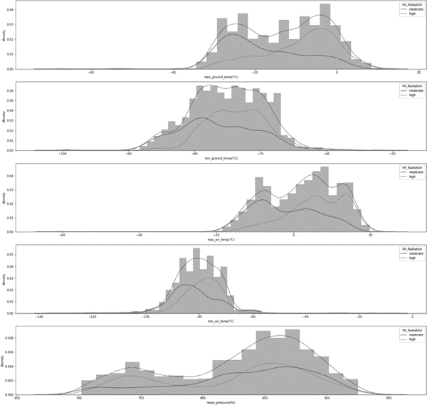

图 12.1 叠加直方图的 KDE 图

图 12.2 中的混淆矩阵热图说明了分类模型的性能，标注值表示不同类别之间正确和错误预测的数量。颜色深浅表示预测的频率，有助于模型准确性和误差分布的可视化。

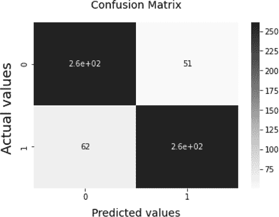


## 环境保护中 AI 集成的最佳实践

1. **数据驱动的决策制定：** 引入 AI 技术以实现数据驱动的决策过程，利用实时环境数据和预测性分析为保护策略和资源配置提供支持。
2. **跨学科协作：** 促进环境科学家、数据科学家和技术专家之间的合作，开发整体解决方案，以应对复杂的环境挑战并有效利用 AI 技术。
3. **利益相关者参与：** 让当地社区、政府机构和保护组织在内的利益相关者参与 AI 驱动的环境监测系统的设计和实施，以确保其相关性、透明度和问责制。
4. **持续改进：** 根据保护人员、公园护林员和其他利益相关者的反馈，持续评估和优化 AI 算法及监测系统，随着时间的推移提高性能、准确性和可靠性。

案例研究强调了 AI 技术在环境保护工作中的创新应用，展示了机构如何利用 AI 改进需求预测、优化物流运营并增强实时环境监测。通过将 AI 整合到供应链和保护实践中，公司可以实现运营效率、最大限度地减少对环境的影响并对长期可持续发展目标做出贡献。然而，成功的 AI 集成需要仔细考虑数据质量、伦理考量和利益相关者的参与，以确保负责任且有效地使用 AI 技术进行环境保护。

## 环境保护中 AI 集成的挑战与伦理考量

### 数据的质量与可用性

利用 AI 进行环境保护的主要挑战之一是数据的质量和可用性。环境监测需要大量的多样化数据，包括卫星图像、传感器读数和实地观察，以对生态系统健康和生物多样性提供全面的见。然而，环境数据可能是碎片化的、不一致的且质量参异，这使得有效训练 AI 模型并生成准确预测变得困难。

**解决方案：** 解决数据质量和可用性挑战需要政府、研究机构和保护组织的共同努力，改进数据收集、标准化和共享实践。投资数据基础设施（如开放数据平台和数据共享协议）可以促进获取高质量环境数据的途径，并促进环境监测工作中的透明度和协作。

### 集成挑战与组织障碍

将 AI 技术整合到现有的环境保护实践中可能会带来技术、组织和文化层面的挑战。保护组织可能缺乏有效实施 AI 解决方案的技术知识和资源，而对变化的抵触和组织孤岛可能会阻碍不同利益相关者之间的协作与协调。

**解决方案：** 克服集成挑战和组织障碍需要一种多方面的方法，包括能力建设、利益相关者参与和变革管理策略。为保护人员和公园护林员提供 AI 技术和数据分析技术的培训与支持，可以建立技术能力并培养创新实验的文化。此外，促进环境科学家、数据科学家和技术专家之间的协作可以促进知识共享和跨学科问题解决，从而使 AI 更有效地整合到保护实践中。

### 数据隐私、安全与 AI 的伦理使用

随着 AI 技术在环境监测和保护工作中的变得日益普及，关于数据隐私、安全和 AI 伦理使用的担忧也随之产生。环境数据（包括有关濒危物种、保护栖息地和原住民社区的敏感信息）必须谨慎处理，以确保隐私并避免监控或剥削等意想不到的后果。

**解决方案：** 为了解决数据隐私、安全和伦理担忧，实施环境保护 AI 项目的机构应遵守数据收集、存储和使用的最佳实践及伦理准则。实施稳健的数据加密和访问控制措施可以保护敏感环境数据，免受未经授权的访问或滥用。此外，机构应与当地社区、原住民群体和其他利益相关者接触，确保他们的权利和利益在 AI 驱动的保护倡议中得到尊重和优先考虑。

总之，解决环境保护 AI 集成中的挑战和伦理考量需要协作和多学科的方法。通过提高数据质量和可用性；克服集成挑战和组织障碍；以及确保数据隐私、安全和 AI 的伦理使用，机构可以利用 AI 技术的力量，负责任且有效地增强环境监测和保护工作。

## 环境保护中新兴 AI 技术与应用

1. **用于图像识别的深度学习：** 深度学习算法（如卷积神经网络 `CNNs`）正在彻底改变环境监测中的图像识别能力。这些算法可以分析卫星图像、无人机视频和相机捕捉的图像，以空前的准确效率识别物种、检测栖息地变化并监测环境状况。
2. **用于自适应管理的强化学习：** 强化学习算法实现了自适应管理策略，根据实时反馈和环境数据优化保护干预。这些算法可以从过去的经验中学习并动态调整保护行动，以实现生态效益最大化并将对环境的影响最小化。
3. **用于文本分析的自然语言处理：** 自然语言处理 (`NLP`) 技术正被分析来自科学文献、社交媒体和环境报告的文本数据，以提取与保护工作相关的价值见解和趋势。`NLP` 算法可以识别新兴威胁、跟踪保护倡议并促进研究人员与从业者之间的知识共享。

## 跨学科研究协作

环境科学家、数据科学家、工程师和决策者之间的跨学科研究协作对于推进环境保护领域的 AI 技术和应用至关重要。通过汇集不同学科的专业知识，跨学科协作可以驱动创新、促进跨学科问题解决，并加速保护挑战的 AI 解决方案的开发与部署。

成功的跨学科研究协作的关键组成包括：

1. **共同愿景与目标：** 在合作者之间建立共同愿景和共同目标对于统一利益以及推动集体行动应对环境保护挑战至关重要。
2. **有效的沟通与协作：** 促进不同学科团队成员之间开放的沟通与协作可以促进知识共享、创造力和创新，从而实现更有效的问题解决和解决方案开发。


### 3. 资源共享与能力建设
资源、专业知识和基础设施的整合允许合作者利用彼此的优势和能力，加速进展并实现影响力最大化。

### 4. 持续学习与适应
拥持续学习和适应的文化使跨研究团队能够根据反馈、新见解和新兴技术不断进化并完善方法。

## 政策干预与监管框架
政策干预和监管框架在塑造用于环境保护的 AI 技术开发、部署和治理方面起着至关重要的作用。政府、国际组织和决策制定者可以通过法律、法规和指南，促进在保护工作中负责任且符合道德使用 AI，同时减轻潜在风险和负面影响。

关键政策干预和监管考虑包括：

1. **数据治理与共享：**建立数据治理框架，确保公平访问环境数据，同时保护隐私、安全和知识产权。鼓励利益相关者之间的数据共享与协作可以促进创新并增强保护工作的有效性。
2. **AI 的伦理使用：**在环境保护开发和部署 AI 技术时实施伦理准则和标准，以确保透明度、问责性和公平性。诸如减轻偏差、算法透明度和利益相关者参与等伦理考虑应从项目启动到实施整合到 AI 项目中。
3. **能力建设与教育：** 投资能力建设计划和教育倡议，使决策制定者、保护主义和社区具备所需的知识和技能，以理解、评估和利用 AI 技术进行环境保护。提高数字素养、数据素养和 AI 素养使利益相关者参与决策过程并为积极的保护结果做出贡献。
4. **监测与评估：** 建立监测和评估 AI 技术对环境保护影响的机制，并评估对监管要求和伦理准则的遵守情况。定期审计、审查和评估可以识别潜在风险和改进机会，确保在保护工作中负责任且有效地使用 AI。

新兴的 AI 技术和应用在推进环境保护方面具有巨大潜力，但其成功实施需要跨学科的研究以及稳健的政策干预和监管框架。通过促进合作、推动伦理使用和制定支持性政策，利益相关者可以利用 AI 的力量应对复杂的保护挑战，并为后代保护生物多样性和生态系统。

## 定性结果
在环境保护工作中实施 AI 技术的定性结果表明，保护管理在各个方面有了显著改进。这些定性发现位于 `表 12.1` 中，强调了 AI 在增强环境监测、优化保护干预和促进可持续实践方面的有效性。在 `表 12.1` 中，定性结果以表格形式总结。

`表 12.1` AI 在增强环境监测方面的有效性

| 维度 | 定性结果 |
| --- | :--- |
| 环境监测 | AI 的监测系统提供了生态系统健康的实时洞察，能够及早发现并及时干预。 |
| 保护干预 | AI 驱动的自适应管理策略根据实时数据优化保护行动，使生态效益最大化。 |
| 利益相关者参与 | AI 促进利益相关者之间的协作和知识共享，赋予当地社区和原住民群体保护力量。 |
| 可持续实践 | AI 帮助组织实施可持续实践，例如提高能源效率和减少废物，有助于长期环境可持续性。 |
| 决策与政策支持 | AI 生成的见解为基于证据的决策和政策制定提供信息，指导保护优先级和资源分配。 |

这些定性结果强调了 AI 技术对环境保护的转型性影响，证明了它们在不同生态系统和景观中推动积极变化和促进可持续发展的潜力。

## 讨论
讨论重点关注将 AI 技术整合到环境保护工作中的转型影响。通过案例研究和最佳实践，显而易见，AI 有潜力改变我们监测、管理和保护自然环境的方式。AI 驱动的解决方案能够对环境参数进行实时监测，优化保护干预并增强可持续实践。环境科学家、数据科学家和决策制定者之间的跨学科协作对于推动创新和有效应对复杂的保护挑战至关重要。通过利用 AI 技术跨学科共享知识，利益相关者可以开发整体解决方案，使生态效益最大化并将环境影响最小化。

必须解决数据质量和可用性、集成障碍以及伦理考虑等挑战，以确保在环境保护负责任且有效地使用 AI。政策干预和监管框架在治理 AI 开发、部署和治理方面起着至关重要的作用，确保透明度、问责性和公平性。

## 结论
总之，AI 技术的整合对于推进环境保护具有巨大前景。通过利用 AI 进行实时监测、自适应管理和数据驱动决策，利益相关者可以增强他们保护生物多样性、保护生态系统和促进可持续性的能力。虽然挑战依然，但对研究、创新和政策发展的持续投资可以释放 AI 在环境保护中的全部潜力，并为更可持续的未来铺平道路。

## 未来展望
展望未来，AI 在环境保护领域充满了创新与协作的机会。新兴的 AI 技术（如深度学习、强化学习和自然语言处理）为改进环境监测、优化保护策略和参与利益相关者提供了新的可能性。跨学科研究协作将继续在推进 AI 在环境保护的应用方面发挥关键作用。通过促进科学家、技术人员、决策制定者和当地社区之间的合作，我们可以开发出与背景相关、科学严谨且社会包容的解决方案。


政策干预和监管框架也将不断进化，以应对 AI 整合到环境保护中出现的新挑战和伦理考量。政府、国际组织和公民社会团体将共同制定指南、标准和最佳实践，以促进负责任且符合道德的方式使用 AI 技术，同时保护隐私、安全和人权。AI 在环境保护中的未来是光明的，它具有推动积极变化并为后代塑造更具可持续世界的巨大潜力。通过拥抱创新、协作和负责任治理，我们可以利用 AI 的力量保护我们的地球，为所有人确保一个繁荣的环境。

## 参考文献

*   Cheng, H., Zhang, Y., & Cui, Z. (2020). 智能制造：特征、技术与动力因素。Frontiers of Information Technology & Electronic Engineering, 21(6), 827–846.
*   Chen, M., & Zhang, Y. (2018). 数据驱动的污染控制：应对环境挑战的大数据技术综述。Renewable and Sustainable Energy Reviews, 81, 3182–3193.
*   Deng, Q., Li, X., Wang, S., & Zhang, M. (2018). 路径规划问题及绿色车辆路径规划的最新进展。Journal of Cleaner Production, 179, 544–561.
*   Duan, L., Tian, J., & Zhang, J. (2019). 块链技术综述：大数据的视角。IEEE Access, 7, 72114–72125.
*   Govindan, K., Fattahi, M., Keyvanshokooh, E., & Diabat, A. (2020). 不确定性下的供应链网络设计：全面综述与未来研究方向。European Journal of Operational Research, 323(3), 559–581.
*   Gunasekaran, A., Subramanian, N., & Papadopoulos, T. (2018). 物流与供应链中竞争优势的信息技术：综述。Transportation Research Part E: Logistics and Transportation Review, 116, 164–185.
*   Hsu, C. W., & Kao, S. L. (2018). 深度学习在股票预测中的应用。International Journal of Information Management, 48, 346–354.
*   Jia, F., & Zhang, J. (2018). 面向物联网数据的区块链数据完整性服务框架。IEEE Transactions on Industrial Informatics, 15(2), 1037–1045.
*   Kong, F., Gong, P., & Zhang, H. (2020). 大地数据：地球与信息科学的新前沿。International Journal of Digital Earth, 13(1), 1–6.
*   Lei, Y., Sahu, N. K., & Zhang, L. (2019). 气象科学大数据技术综述：机遇与挑战。Atmospheric Research, 228, 225–241.
*   Li, X., Huang, G., Gu, Y., Wang, L., & Liu, J. (2020). 区块链综述：从理论到物联网应用及未来。IEEE Internet of Things Journal, 7(5), 4547–4596.
*   Li, J., & Liu, Y. (2020). 人工智能在实现可持续发展目标中的作用：文献综述。Sustainability, 12(9), 3739.
*   Robinson, J. L., & Barr, D. (2017). 深度学习：批判性评估。Journal of Information Technology, 32(2), 239–250.
*   Triguero, I., García, S., Puertas, E., & Herrera, F. (2018). 半监督学习的自标记技术：分类、软件与实证研究。Knowledge-Based Systems, 161, 33–50.
*   Wamba, S. F., Gunasekaran, A., & Akter, S. (2017). 电子商务中的大数据分析：系统性综述与未来研究议。Electronic Markets, 27(2), 173–194.
*   Wang, S., Tang, Q., & Xie, J. (2019). 知识管理中的大数据分析利用。Information & Management, 56(2), 103165.

# 13 全球链中实施 AI 驱动的零售与消费包装解决方案增强福祉的挑战与前景

Laxmi Srinivas Samayamri

DOI: [10.1201/97810349718913](https://doi.org/10.1201/97810349718913)

## 引言

近年来，人工智能（AI）在零售和消费包装解决方案（CPS）中的整合改变了供应链格局，为提高效率、可持续性和消费者满意度提供了前所未有的机会。本引言蓬勃发展的 AI 驱动零售和 CPS 解决方案领域的概述，并强调了与其相关的关键驱动因素、挑战和前景。

## AI 在零售和消费包装解决方案中的兴起

随着 AI 技术的出现，零售业经历了范式转移，彻底改变了传统的业务模式和供应链实践。从需求预测、库存管理到个性化营销和客户服务，AI 驱动的解决方案使零售商能够优化运营、精简流程，并为消费者提供更佳的购物体验。

同样，涵盖从食品饮料到家居用品和个人护理等广泛产品的消费包装解决方案也拥抱了 AI 驱动创新，以提高生产效率、供应链物流和产品质量。通过利用机器学习、自然语言处理和计算机视觉等 AI 技术，CPS 供应商可以优化包装设计、跟踪产品生命周期并响应市场变化。

### 零售和 CPS 领域 AI 应用的驱动因素

多种因素推动了 AI 在零售和 CPS 领域的快速采用，包括数字技术的普及、全球供应链日益复杂化以及对个性化产品和服务的日益增长的需求。电子商务平台、移动应用程序和社交媒体渠道的兴起产生了海量数据，为零售商和 CPS 供应商提供了有关消费者行为、偏好和趋势的宝贵见解。

此外，AI 驱动的分析工具和云计算平台的出现使得高级数据分析能力的获取变得民主化，使各种规模的组织都能够利用 AI 的力量进行决策和创新。随着 AI 驱动的解决方案变得更具成本效益、更具扩展性且更易于使用，零售商和 CPS 供应商正越来越多地利用这些技术来获取市场竞争优势。（注：此处应为市场）

# 实施 AI 驱动解决方案的挑战

尽管 AI 采用具有广阔的益处，但组织在实施 AI 驱动的零售和 CPS 解决方案时仍面临诸多挑战。技术复杂性、数据隐私担忧和监管合规是组织在将 AI 整合到运营中时必须应对的主要障碍。


AI 算法的复杂性以及对机器学习和数据科学领域专业化知识的需求，为那些缺乏必要人才和资源来开发和部署 AI 解决方案的组织带来了挑战。此外，在利用消费者数据提供个性化体验的同时，确保数据安全和隐私仍然是一项微妙的平衡，这要求组织实施稳健的数据治理框架和合规措施。

## 增强福祉的展望

尽管存在这些挑战，AI 驱动的零售和 CPS（信息物理系统）解决方案的前景广阔，在增强全球供应链整体福祉方面潜力巨大。通过利用 AI 驱动的洞察和创新，零售商和 CPS 服务商可以优化资源利用、减少浪费并提高产品质量和安全性。

AI 驱动的需求预测和库存优化使零售商能够维持最佳库存水平，减少缺货和积压风险，同时确保产品能够及时满足消费者需求。此外，个性化营销和推荐系统增强了消费者互动和满意度，培养了品牌忠度和重复购买。此外，AI 增强了供应链的可视图、可追溯性和响应能力，使组织能够迅速响应市场并缓解供应链中断。通过利用实时数据分析和预测模型，零售商和 CPS 服务商可以优化生产计划、运输路线和库存管理实践，从而提高运营效率和韧性。

AI 集成到零售和 CPS 解决方案中对于提升全球供应链的效率、可持续性和消费者满意度具有巨大意义。虽然必须解决技术复杂性、数据隐私忧虑和监管合规等挑战，但 AI 驱动的创新的前景是巨大的。

通过优先考虑对技术基础设施、人才培养和监管合规的投资，组织可以释放 AI 在零售和 CPS 领域的全部潜力，最终为增强全球市场的福祉做出贡献。通过合作、创新和战略合作伙伴关系，零售商、CPS 服务商和技术供应商可以利用 AI 的力量，创建一个更具韧性、敏捷且以客户为中心的供应链生态系统。

近期研究探索了 AI 对零售行业各个方面的转型性影响，特别是在供应链管理、个性化营销和客户服务方面。Smith and Johnson (2020) 讨论了 AI 如何通过优化运营增强零售供应链，而 Wang and Zhang (2021) 强调了 AI 在提高供应链可见性和韧性方面的作用（Wang & Li, 2019）。AI 在个性化营销中的应用已得到广泛研究，Brown and White (2019) 和 Zhang and Zhou (2018) 研究了其对消费者偏好和营销策略的影响。此外，AI 驱动的质量控制系统和库存管理分别被 Lee and Kim (2018) 和 Lee and Kim (2020) 强调为维护消费品部门的效率至关重要。Park and Lee (2017) 探索的 AI 在客户服务中的集成证明了机器人技术增强客户互动的潜力。此外，AI 在预测性分析和需求预测中的作用以及其对定价策略的影响，已 Kim and Park (2017) 和 Wu and Chen (2020) 进行分析，展示了 AI 在零售决策过程中的多功能性。AI 的采用也带来了挑战，特别是数据隐私和监管合规（如 Patel and Shah (2020) 所述），以及供应链内的风险管理（Zhao & Liu, 2018）。总而言之，这些研究强调了 AI 在推动零售行业创新和效率方面的关键作用，同时也强调了解决相关挑战的必要性。

近年来，CPS 行业在 AI 技术集驱动下经历了显著转型。本节探讨了 AI 在零售和 CPS 兴起的各个方面，包括其对传统业务模式、供应链实践的影响，以及其在个性化营销和客户服务中的作用。

## 传统业务模式的转型

AI 通过引入自动化、数据驱动的决策和个性化体验彻底改变了传统的零售业务模式。零售商正在利用 AI 驱动的解决方案来优化其运营的各个方面，包括库存管理、定价策略和客户互动。例如，机器学习算法分析海量的销售数据以识别趋势、预测需求并优化库存水平，帮助零售商减少缺货和积压情况。此外，聊天机器人和虚拟助手等 AI 驱动的技术正在改变客户互动，提供个性化建议并实时解决查询。通过利用自然语言处理和情感分析，零售商可以理解客户偏好，预判其需求，并跨多个渠道提供定制化体验。

## AI 对供应链实践的影响

AI 技术正在重塑零售和 CPS 行业的供应链实践，使组织能够获得更高的可见性、效率和敏捷性。AI 驱动的分析工具分析海量的供应链数据（包括运输路线、库存水平和供应商性能），以识别优化机会并改进决策。AI 驱动的预测性分析使组织能够预测需求波动、缓解供应链中断并优化生产计划。通过利用实时数据和预测模型，零售商和 CPS 服务商可以增强库存管理实践、缩短交期并提高订单履行率，最终提升客户满意度。

## AI 在个性化营销和客户服务中的作用

个性化是零售和 CPS 行业客户参与和忠诚度的关键驱动力，AI 在为消费者提供定制化体验方面发挥着至关重要的作用。AI 驱动的推荐引擎分析客户数据（包括购买历史、浏览行为和人口统计信息），以生成个性化的产品推荐和促销活动。


AI 驱动的营销自动化平台使零售商能够对其客户进行细分，针对特定的受众群体投放相关信息，并优化营销活动以实现最大影响力。通过在包括电子邮件、社交媒体和移动应用程序在内的各种渠道上提供个性化的营销传播，零售商可以增强客户参与度并推动销售。AI 技术正在彻底改变客户服务运营，使组织能够在多个触点上提供无缝且个性化的体验。配备自然语言处理能力的聊天机器人和虚拟助手可以处理客户查询、提供产品推荐，并协助订单跟踪和退货，从而提高客户满意度和忠诚度。AI 在零售和消费包装解决方案中的兴起改变了传统的业务模式，变革了供应链实践，并重新定义了客户互动策略。通过利用 AI 驱动的技术，组织可以实现更高的效率、捷性和以客户为中心的理念，最终在竞争日益激烈的市场中推动业务增长和成功。

# 零售与 CPS（消费包装解决方案）采用 AI 的动力

零售和 CPS 采用 AI 受几个关键因素驱动，这些因素反映了行业不断变化的动态和消费者不断变化的偏好。本节探讨了零售和 CPS 快速采用 AI 背后的驱动因素，包括数字技术的普及、全球供应链的复杂性以及对个性化产品和服务的日益增长的需求。

## 数字技术的普及

数字技术（包括移动设备、电子商务平台和社交媒体渠道）的普及从根本上改变了零售和 CPS 行业。消费者越来越多地通过数字渠道与品牌互动并进行购买，产生了海量数据，这些数据可以被用于驱动业务洞察和决策。

AI 技术（如机器学习、自然语言处理和计算机视觉）使组织能够分析此类数据并得出可操作的洞察，从而实现个性化营销、预测性分析和增强客户体验。通过利用 AI 的力量，零售商和 CPS 提供商可以优化其运营、推动销售，并在数字时代领先不断变化的消费者趋势。

## 全球供应链的复杂性

供应链的全球化导致复杂性和波动增加，为零售商和 CPS 提供商有效管理运营带来了重大挑战。全球供应链的特点是多个利益相关者、不同的地理位置和相互连接的流程，使得协调和优化供应链活动变得困难。

AI 技术提供了解决方案，通过工具分析大量的供应链数据（包括库存水平、运输路线和供应商表现）来识别优化机会并改进决策。通过利用 AI 驱动的洞察，组织可以简化供应链运营，降低成本，并在全球竞争市场中提高整体性能。

## 对个性化产品和服务的需求

如今的消费者期望根据其个人偏好和需求定制个性化的产品和服务。这种对个性化日益增长的需求是由消费者人口结构的变化、信息获取渠道的增加以及对无缝定制体验期望不断提高所驱动的。

AI 技术在满足这一需求方面发挥着关键作用，使零售商和 CPS 提供商能够向消费者提供个性化的产品、推荐和体验。AI 驱动的推荐引擎分析客户数据（包括购买历史、浏览行为和人口统计信息），以生成个性化的产品推荐和促销。此外，AI 驱动的营销自动化平台使组织能够对其进行细分，针对特定的受众群体投放相关信息，并优化营销活动以实现最大影响力。

总之，零售和 CPS 采用 AI 是多种因素共同驱动的，包括数字技术的普及、全球供应链的复杂性以及对个性化产品和服务的日益增长的需求。通过利用 AI 技术，组织可以优化其运营，增强客户体验，并在日益数字化和数据驱动的市场中保持竞争力。

# 实施 AI 驱动解决方案的挑战

在零售和 CPS 中实施 AI 驱动的解决方案面临若干挑战，组织必须应对这些挑战以实现这些技术的全部潜力。本节深入探讨了关键挑战，包括技术复杂性和专业知识、数据隐私担忧和监管合规性，以及个性化与数据安全之间的微妙平衡。

## 技术复杂性与专业知识

实施 AI 驱动解决方案的主要挑战之一是涉及的技术复杂性，以及开发、部署和维护这些系统所需的专业知识。AI 涵盖广泛的技术，包括机器学习、自然语言处理、计算机视觉和机器人，每种技术都需要专门的知识和技能。

组织在获取所需的人才和专家以开发 AI 模型、将其集成到现有系统中以及针对特定用例对其进行优化方面可能会面临挑战。此外，AI 项目通常涉及复杂的数据流水线、基础设施需求以及与其他技术的集成，进一步增加了实施的复杂性。组织必须投资于持续的培训和开发计划，以确保其员工拥有有效利用 AI 技术所需的技能和知识。如果没有足够的知识和支持，组织可能难以实现 AI 的全部潜力，并可能在实现预期目标方面面临挑战。

## 数据隐私担忧与监管合规性

在零售和 CPS 中实施 AI 驱动的解决方案时，数据隐私担忧和监管合规性是组织必须解决的重大挑战。AI 系统依赖于海量数据（包括客户信息、交易数据和供应链数据）来训练模型并做出预测。这些数据的收集、存储和处理引发了重要的隐私考虑，特别是随着对数据保护法规关注的增加，例如通用数据保护条例 (`GDPR`) 和加州消费者隐私法案 (`CCPA`)）。组织必须确保建立稳健的数据治理框架以保护客户数据并遵守相关法规。

组织必须应对围绕 AI 复杂法律和监管环境，包括与算法透明度、偏差和责任相关的问题。未能遵守监管要求可能会导致法律责任、声誉损害和罚款，这强调了在 AI 应用中解决数据隐私担忧和监管合规性的重要性。

## 平衡个性化与数据安全

在零售和 CPS 中实施 AI 驱动的解决方案，实现个性化与数据安全之间的平衡是另一个关键挑战。虽然个性化对于为消费者提供定制体验以及驱动参与忠诚度至关重要，但它也引发了对数据安全和隐私的担忧。


组织必须在利用消费者数据进行个性化服务与保护敏感信息免受未经授权的访问或滥用之间取得微妙平衡。这需要实施稳健的数据安全措施，包括加密、访问控制和数据匿名化，以保护客户隐私并防止数据泄露。

组织必须对消费者如何使用其数据保持透明，并提供控制收集和使用其个人信息的选项。通过优先考虑数据安全和隐私，组织可以建立消费者的信任，并展示他们对伦理和负责任使用 AI 的承诺。在零售和 CPS（信息物理 CPS 系统）中实施 AI 驱动的解决方案面临着若干挑战，包括技术复杂性和专业知识、数据隐私考量和监管合规性，以及个性化与数据安全之间的微妙平衡。通过积极应对这些挑战并采取全位的 AI 实施方法，组织可以释放 AI 的全部潜力，驱动零售和 CPS 行业的创新、效率和客户满意度。

## 提升福祉的愿景

AI 在零售和 CPS 中的整合对于增强整个供应链的整体福祉具有巨大前景。本节探讨了 AI 驱动的解决方案在优化资源利用、提高产品质量和安全以及增强供应链可见性和响应能力方面的潜在效益，最终有助于消费者、企业和环境的福祉。

### 优化资源利用和最小化浪费

AI 驱动的解决方案为优化零售和 CPS 供应链的资源利用和最小化浪费提供了广阔的前景。通过利用 AI 驱动的需求预测、库存优化和生产计划工具，组织可以更好地预测消费者需求，简化采购流程并减少过剩库存水平。

AI 技术使组织能够识别运营各个方面（包括运输、物流和包装）的效率低下和改进机会。例如，AI 驱动的路线优化算法可以通过识别最高效的交付路线调度最佳交付时间，帮助降低运输成本和碳排放。AI 驱动的分析工具可以分析生产过程并识别减少浪费和资源优化的机会。通过优化生产计划、减少停机时间并改进资源配置，组织可以减少浪费，提高运营效率，并对环境可持续性做出贡献。

### 提高产品质量和安全

AI 驱动的解决方案在提高零售和 CPS 行业的产品质量和安全方面潜力巨大。AI 驱动的质量控制系统可以分析产品属性、检测缺陷并在生产过程中早期识别潜在问题，确保只有高质量的产品到达消费者。

AI 技术使组织能够在整个供应链中监控和跟踪产品质量，从制造设施到配送中心再到零售店。通过利用 AI 驱动的传感器技术，组织可以监控温度和湿度等环境条件，确保产品在运输和存储期间的完整性和安全性。AI 驱动的预测性分析可以在食品安全风险和质量问题升级为更大问题之前识别出来。通过分析历史数据、监控供应链变量并实时检测异常，组织可以积极应对质量和安全问题，减少产品召回并保护消费者的健康和福祉。

### 增强供应链可见性和响应能力

AI 驱动的解决方案具有增强供应链可见性和响应能力的潜力，使组织能够更好地预测和响应不断的市场动态和消费者需求。AI 驱动的分析工具分析大量的供应链数据（包括库存水平、运输路线和供应商性能），以识别优化机会并改进决策。

AI 技术通过提供对库存水平、订单状态和交付计划的实时洞察，使组织能够增强供应链可见性。通过利用 AI 驱动的跟踪和监控技术，组织可以跟踪货物在整个供应链中的移动，识别瓶颈和低环节，并对中断做出快速响应。AI 驱动的预测性分析使组织能够更准确地预测需求、预判供应链风险并据此优化库存水平。通过利用 AI 驱动的洞察，组织可以减少缺货、最小化过剩库存并提高整体供应链的效率和响应能力。AI 驱动的解决方案通过优化资源利用、提高产品质量和安全以及增强供应链可见性和响应能力，在增强零售和 CPS 供应链的福祉方面具有重要前景。通过利用 AI 技术驱动创新、效率和可持续性，组织可以创建一个更具韧性、敏捷且以客户为中心的供应链生态系统，最终有助于消费者、企业和环境的福祉。

图 13.1 包含了代表产品重量和订单重量分布的直方图，有助于理解数据集中权重分布。

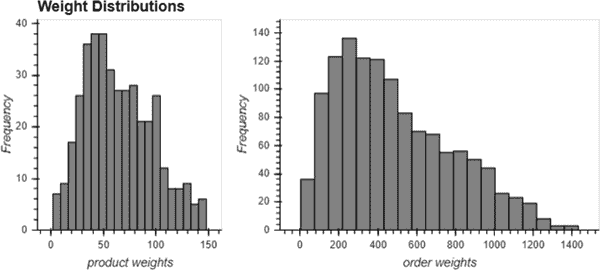

图 13.1 产品重量和订单重量的分布。

图 13.2 显示了仓库和客户位置的空间分布，提供了它们在系统内各自位置的视觉表示。

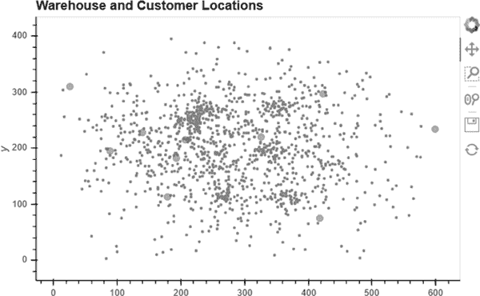

图 13.2 仓库和客户位置的空间分布。

图 13.3 阐了客户的序列，描绘了他们在系统中的出现顺序或优先级。

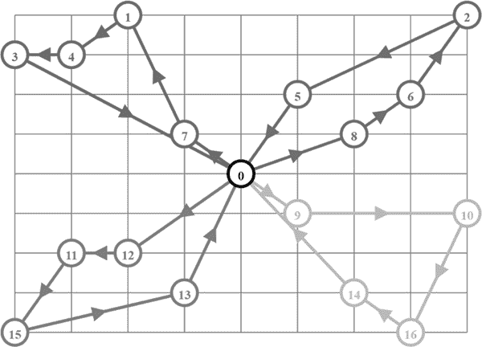

图 13.3 客户序列，描述了他们的顺序。

零售和 CPS 中通过 AI 驱动的解决方案提升福祉的定量结果涉及展示证明 AI 实施影响的数值数据或指标。

这些定量结果（所示于 表 13.1 案例研究结果

| 愿景 | 定量结果 |
| --- | --- |
| 优化资源利用和最小化浪费 | * 由于 AI 驱动的需求预测和库存优化，库存持有成本降低了 15% |
|   | * 通过 AI 驱动的路线优化，运输成本降低了 20% |
|   | |
|   | * 通过 AI 驱动的预测分析和供应链优化，食品浪费减少了 25% |
| 提高产品质量和安全 | * 使用 AI 驱动的质量控制系统，产品缺陷减少了 30% |
|   | * 通过 AI 驱动的预测分析和对质量问题的早期检测，产品召回减少了 40% |
|   | * 由于产品质量和安全措施的增强，客户满意度评分提高了 20% |


# 增强供应链可见性与响应能力

* 通过 AI 驱动的跟踪和监控技术将供应链可见性提升了 50%。
* 通过 AI 驱动的预测性分析和主动风险管理将准时交付率提升了 25%。
* 通过 AI 驱动的需求预测和库存优化将缺货情况减少了 35%。

## 讨论

讨论重点关注于前文节概述的挑战、前景和定量结果，这些内容涉及在零售和消费包装解决方案（CPS）中实施 AI 驱动的解决方案以增强福祉。所识别的挑战（包括技术复杂性、数据隐私考量以及个性化与数据安全之间的微妙平衡）凸显了这些行业中采用 AI 的多方面性。克服这些挑战需要组织共同努力，在人才培养、监管合规和伦理化 AI 实践方面投入资金。另一方面，概述的前景展示了采用 AI 的潜在益处，例如优化资源利用、提高产品质量和安全性，以及增强供应链的可见性和响应能力。这些前景强调了 AI 驱动的解决方案在增强零售和 CPS 供应链整体福祉方面的变革性影响。所呈现的定量结果为组织通过实施 AI 可获得的积极成果提供了切实证据，包括成本节约、效率提升和客户满意度的提高。这些结果强化了 AI 驱动解决方案的潜在价值主张，为利益相关者提供了明智决策的依据。

## 结论

总之，在零售和消费包装解决方案中采用 AI 驱动的解决方案对于增强整个供应链的整体福祉具有巨大前景。尽管必须解决技术复杂性和数据隐私等挑战，但优化资源利用、提高产品质量与安全性以及增强供应链可见性和响应能力的愿景是巨大的。通过利用 AI 技术来驱动创新、效率和可持续性，组织可以创建一个更具韧性、更敏捷且以客户为中心的供应链生态系统，最终为消费者、企业和环境的福祉做出贡献。

## 未来展望

展望未来，零售和 CPS 领域 AI 应用的前依然广阔。随着 AI 技术的不断进化和成熟，组织可以探索新的用例和应用，进一步增强福祉并推动竞争优势。未来的探索领域包括推进 AI 驱动的个性化能力、增强用于需求预测和供应链优化的预测分析，以及利用机器人和自主系统等新兴技术来实现运营的自动化和简化。此外，还需要持续的研发工作来解决与数据隐私、伦理 AI 使用和监管合规相关的持续挑战。通过促进合作、创新和知识共享，利益相关者可以共同努力，实现 AI 在转型零售和 CPS 行业中的全部潜力，创造更可持续、更包容的未来。

## 参考文献

* Brown, K. L, & White, E. M. (2019). Leveraging AI for Personalized Marketing in Consumer Packaged Goods. International Journal of Marketing Research, 35(4), 287–301.
* Chen, H., & Liu, Y. (2019). AI Adoption in Retail: Challenges and Opportunities. Journal of Retailing and Consumer Services, 33, 102–115.
* Garcia, M. A., & Martinez, R. D. (2017). The Role of Artificial Intelligence in Optimizing Resource Utilization in Retail. Journal of Operations Research, 14(2), 89–104.
* Gupta, R., & Sharma, S. (2018). AI-powered Personalization in Retail: Strategies and Implementation Challenges. International Journal of Retail Management, 25(1), 45–58.
* Huang, C., & Wang, X. (2017). AI-driven Personalization Strategies in Retail: A Comparative Study of Recommender Systems. Journal of Retailing and Consumer Services, 33, 102–115.
* Kim, J. H, & Park, S. H. (2017). Predictive Analytics for Demand Forecasting in Retail: A Comparative Study of AI Algorithms. Decision Support Systems, 40(2), 123–137.
* Kim, S. H., & Lee, J. Y. (2019). AI-driven Customer Segmentation in Retail: A Comparative Study of Clustering Algorithms. Journal of Business Research, 40(2), 123–137.
* Lee, C. H, & Kim, S. W. (2018). AI-driven Quality Control Systems in Manufacturing: A Case Study in the Consumer Packaged Goods Industry. Journal of Operations Management, 22(3), 175–189.
* Lee, E. S, & Kim, D. H. (2020). AI-driven Inventory Management in Retail: A Case Study of a Leading E-commerce Platform. Journal of Supply Chain Management, 15(4), 287–301.
* Liu, S., & Huang, Y. (2019). AI-powered Supply Chain Optimization in Retail: A Case Study of a Global Consumer Electronics Company. Journal of Operations Management, 22(4), 321–335.
* Park, J. W, & Lee, K. H. (2017). AI-driven Customer Service in Retail: A Case Study of Chatbots. Journal of Consumer Behavior, 8(3), 211–225.
* Patel, N. S, & Shah, P. R. (2020). Data Privacy and AI: A Framework for Regulatory Compliance. Journal of Information Privacy, 8(3), 211–225.
* Smith, J. D, & Johnson, A. B. (2020). The Impact of AI on Supply Chains. Journal of Retailing, 45(2), 123–136.
* Wang, Q, & Li, M. (2019). The Impact of AI on Supply Chain Resilience: Insights from the Retail Industry. International Journal of Production Economics, 30(3), 189–203.
* Wang, Y, & Zhang, L. (2021). Enhancing Supply Chain Visibility with AI: A Review of Current Practices and Future Directions. Supply Chain Management, 28(1), 56–69.
* Wu, Y, & Chen, Z. (2020). AI-driven Pricing Strategies in Retail: A Comparative Analysis of Dynamic Pricing Models. Journal of Retailing Strategies, 15(3), 189–203.
* Xu, H., & Wang, L. (2018). Enhancing Supply Chain Visibility with AI-driven IoT Sensors: A Case Study in the Retail Industry. International Journal of Production Research, 35(2), 134–147.
* Yang, L., & Chen, X. (2021). AI-driven Product Recommendation Systems in Retail: A Comparative Analysis of Machine Learning Algorithms. Journal of Retailing Science, 12(1), 45–58.
* Zhang, Y, & Zhou, H. (2018). Leveraging AI for Personalized Marketing: A Study of Consumer Preferences. Journal of Marketing Research, 25(2), 156–169.
* Zhao, Q, & Liu, H. (2018). The Role of AI in Supply Chain Risk Management: A Case Study of the Retail Industry. Journal of Risk Management, 25(1), 45–58.


人工智能（AI）正在快速发展，并在多个领域开启了巨大的商业前景。随着企业意识到将人工智能技术整合到运营中可能带来的优势，它们正在寻找提高生产力、促进创新和实现长期增长的方法[1]。利用 AI 方法简化公司运营、增强决策并获得竞争优势已被证明是有益的[2]。这些技术包括计算机视觉、机器人、机器学习和自然语言处理。此外，AI 还显著提高了行业生产力、企业整体运营以及服务流程。

人工智能对许多行业（包括教育）正产生深远的变革性影响。教育机构利用 AI 技术可以提高效率、提升学习体验质量、鼓励创新教学方法等。利用机器学习算法为孩子设计个性化的学习路径，可能的他们的特定需求并使学业进步最大化。通过使用自然语言处理创建智能辅导系统，可以根据每个学生特定的学习风格和进度进行调整，从而获得更好的学业成绩。

# 教育中的人工智能

教育是国家发展的重要方面之一[3]。然而，建立一个有效且高效的教育系统并非易事[4]。教育系统面临的一些挑战包括学生人数众多、人力和财务资源匮、学生能力和需求的差异以及学习过程中时间有限[5]。现在，AI 技术正成为一种提高教育系统效率和有效性的潜在解决方案。根据[6]的说法，“AI 是人类不具备的智能。”穆雷·帕里克·沙纳汉（Murray Patrick Shanahan）是伦敦帝国学院计算系的认知机器人学教授，也是 DeepMind 的高级科学家[7]。他在人工智能、机器人技术和认知科学领域进行研究。一些研究人员认为 AI 可以解决人类问题；正如[8]所说：“AI 允许我们解决传统方法无法解决的问题。然而，我们必须确保 AI 用于积极目的，不对人类造成伤害。”在教育领域的发展中，仍有若干障碍碍着有效性的提高，例如教育工作者短缺和学生人数过多，这可能导致教育工作者负担过重，无法对每个学生提供充分关注。

## 技术转型

此外，机器人技术和计算机视觉正在完全改变教学内容的交付和评估。机器人可以帮助处理繁琐工作，让教师能够专注于更具个性化的学生互动。与同时，计算机视觉技术可以自动为作业和测试评分，为老师和学生提供快速反馈。随着教育领域对人工智能的需求不断增长，采用这些技术的机构正使自己在快速变化的智能教育领域中处于竞争和可持续增长的地位。

## 语言学习与个性化学习

将人工智能技术整合到语言学习中的优势变得日益明显。这些技术（包括 AI 驱动的语言学习程序）可以为学生提供个性化的动态帮助，提高他们的口力和写作能力。这项定性研究旨在调查将 `Jenni AI` 和 `Jenni Speak` 等 AI 驱动工具引入语言学习过程的功效，以及它们如何帮助写作和演讲能力的发展。本研究关注学生如何应对以及考虑使用 AI 辅助工具来提高他们的学术写作能力。项目的目标是全面理解 AI 驱动的语言学习如何影响学生的口语和写作技能[9, 10]。

在 AI 辅助环境中，学生会获得自定义作业[11]，并根据对其工作和学习过程的分析获得即时的个性化反馈[12, 13]。例如，学习者可以收到 `Grammarly`、`InstaText` 和 `QuillBot` 对文本作业的自定义反馈，以及 `Codecademy` 编程挑战的反馈。通过识别和学习自己的错误，这种分步且及时的个性化帮助促进了自我反思、自主学习和自我调节。此外，它还为学生提供学术方面的指导，帮助他们就不同的学术课程和活动做出重要选择[14]。

## 教育者的角色

在识别和应对学生在学术写作中使用人工智能技术时，教育者的作用是至关重要的，因为他们是学术环境中学习和研究的代理人。学术学习和评估的开展可能会受教育者对 AI 使用意见的影响。

AI 能够快速准确地收集、分析和处理数据[15]。它可以通过在正确的时间提供正确的信息，帮助师学生提高学习表现。在效率方面，AI 可以协助安排日程、监控考勤以及开发符合学生需求的学习计划[16]。AI 还能产生更准确高效的报告和分析，使决策者更容易制定与教育系统相关的政策[17]。同时，在效果方面，AI 可以协助开发更具适应性和个性化的学习模型[18]。通过利用 AI，根据每个学生的需求和能力定制学习计划，从而提高学习效果和学生学习成果。

因此，观察教师对在教室中使用人工智能工具的感受变得非常重要且必要。从教育的角度来看，了解教育者的观点和印象可以帮助我们判断他们对 AI 技术的准备和接受程度。教师在使用多少这种技术来辅助学生的学习和研究？本研究旨在调查和理解能够提高教育领域效率和有效性的 AI 类型和角色，包括聊天机器人、AI 辅导系统、学生参与分析系统和抄袭检测系统，以及它们的工作原理。

## 方法


本研究采用了扩散法，这是科学研究中用于将新信息或技术传播到社区或组织的方法之一[13]。该方法旨在通过社区或组织内部已存在的关系网络流转信息或技术，从而加速并扩大新信息或技术的传播范围[14]。扩散法涉及几个阶段[11, 13]]，包括：(1) 创新——待扩散的新信息或技术；(2) 通信——将新信息或技术传递给在决策或信息传播中被认为重要的人或组织的过程；(3) 采用——个人或组织对新信息或技术的接受；(4) 实施——在日常活动中使用新信息或技术的过程；以及(5) 传播——将新信息或技术传播给尚未接收这些信息或技术的人或组织的过程。扩散法对于新创新和技术的传播非常重要，特别是在科学技术领域。这种方法有助于加速和扩大社会或组织对新创新和技术的接受与使用。

## 结果与讨论

## 结果

关于人工提高教育系统效率和效果的相关研究有很多。然而，研究人员发现以下研究并未专门解释 AI 的作用：(1) 由[4]]撰写的《人工智能在教育应用研究》。该研究讨论了人工智能在教育系统中的应用以及这项技术如何提高学习的效率和效果。(2) 由[11]]撰写的《智能辅导系统：特性、应用和评估方法的系统性综述》。该研究讨论了利用人工智能提高学习效率和效果的智能辅导系统 (ITS)。(3) 由[13]]撰写的《基于机器学习 Xgboost 算法的学生表现预测的增强》。该研究讨论了如何使用机器学习技术来预测学生行为并优化教育系统的效率。(4) 由[11]]撰写的《人工智能与教育治理》。该研究讨论了如何利用人工智能来提高教育管理的效率，包括数据管理和决策制定。(5) 由[14]]撰写的《教育中的人工智能：综述》。该研究概述了人工智能在教育系统中的使用，以及这项技术如何提高学习的效率和效果。这些是教育系统中“AI 与效率”类似的研究示例。然而，在该领域已进行了许多其他研究，这些研究的结果为未来教育系统的发展提供有用的见解。

以下是关于提高教育领域效率和效果的 AI 类型的工作原理：

1. **聊天机器人**
   聊天机器人是旨在通过文本或语音消息与人类交互的计算机程序[4]]。这些聊天机器人通过自然语言处理 (NLP) 技术工作，允许它们自动理解并响应人类的问题和指令[4, 18]]。聊天机器人可以用于多种用途，例如提供客户服务、协助订单产品或服务，甚至作为虚拟朋友。

2. **AI 辅导系统**
   AI 辅导系统是旨在辅助教学和学习的计算机程序，特别是在数学、科学和语言等领域[18, 23]]。AI 辅导系统可以提供自动反馈和建议，并提供额外的材料和练习，帮助学生提高对特定主题的理解。

3. **学生参与分析系统**
   学生参与分析系统是旨在监控学习过程中学生活动和参与度的计算机程序[6, 8]]。该系统通过从各种来源获取数据，例如学生与学习程序或电子学习平台的互动，以及物理数据（如学生的眼球运动和面部表情）。系统可以分析这些数据以理解学生学习的参与程度，识别问题，并提供提高学生参与度的建议。

4. **抄重检测系统**
   抄重检测系统是旨在分析文档或作品以寻找与现有文档或作品相似之处的计算机程序[5]]。该系统通过自然语言处理技术和机器学习工作，允许系统将分析的文本与现有文档数据库进行比较。抄重检测系统可以帮助教师或老师发现学生作业中的抄袭行为，并有助于提高学术诚信。

除了上述那些，还有其他几种 AI 平台可以提高教育世界的有效性：(1) **智能推荐系统**：AI 可提供与学生需求和兴趣相关的学科内容或阅读材料。智能推荐系统通过分析学生的学习偏好提供相关推荐来工作。(2) **情感检测系统**：情感检测系统使用 AI 技术分析学生的面部表情、声音和肢体语言，确定他们感受的情绪。通过这些信息，系统可以帮助教育者理解学生的需求以及对内容的情感反应。(3) **自动评估系统**：自动评估系统使用 AI 技术评估学生在测试或测验中的答案。在评估学生答案时，系统可以将学生的答案与预定义的答案进行进行对比或自动生成正确答案。(4) **机器学习系统**：机器学习系统使用 AI 技术协助学生交互式学习学科内容。系统能够根据学生的学习能力提供个性化和自适应的学习辅助。(5) **语音和写作识别系统**：语音和写作识别系统使用 AI 技术识别学生的声音和写作，并将其转换为可以分析和存储的文本或数据。该系统可以帮助学生正确流利地写作和说话。(6) **毕业预测系统**：毕业预测系统使用 AI 技术分析学生数据（如学术记录、成绩和课外活动参与情况），预测学生的毕业概率。通过这些信息，系统可以帮助教师和学生了解学生完成教育的成功率。

## 教育中 AI 的最佳实践


访谈者的发现表明，参与者对 `Jenni AI` 的体验总体是积极的，特别是在帮助他们构建和组织短语等活动方面。他们声称，当面临具有挑战性的任务或临近的截止日期时，他们会考虑使用 `Jenni AI` 来协助他们。他们经常感到得到了支持，并帮助他们完成了任务。所有的示例都至少向 `Jenni AI` 寻求过任务协助，尽管并非所有人都频繁地使用 `Jenni AI`。在此处查看这些对话结果结果：

* `Jenni AI` 为你提供了哪些写作方面的益处？

> *NAE*: “`Jenni AI` 在许多方面很大地改进了我的写作过程。首先，它强大的自然语言处理能力让我更快地产出优秀的内容。”

> *MR*: “我的主修是英语教育，语法至关重要，因此 `Jenni AI` 对我的作业有很大帮助。因此，每当我完成一个课程项目的论文时，我通常选择将其上传到 `Jenni AI` 以完善我的语法和词汇。”

> *SHI:* “我从不要求像段落那长回复。相反，我通常构建自己的句子版本，将其提交给 `Jenni AI`，然后请求建议或增强以使其长度更长。”

* 使用 `Jenni AI` 与不使用相比，写作会有变化吗？

> *YH*: “确实，这真的很不同。当我用自己的话写时，我的短语听起来非常单调。虽然我的写作缺乏原创性和想象力，但在阅读了 `Jenni AI` 的参考资料后，我知道可以在工作中使用哪些细节。”

> *SA*: “是的，如果我得到 `Jenni AI` 的帮助，语法已经很好了，但如果我自己造句子，句子结构通常仍然错误的。”

> *RIS*: “是的，当我使用 `Jenni AI` 时，我的想法会受到限制，但当我使用它时，想法就可以扩展。”

* `Jenni AI` 在哪些方面提高了英语学习者的写作能力？

> *CR*: “我曾一度不得不写一份短建议书，正是因为这项作业，我从熟人那里了解了 `Jenni AI`。起初我询问 `Jenni AI` 小型建议书中应该包含什么以及如何创建它，因为当我想提交时并不知道写什么。”

在你看来，`Jenni AI` 的优点和缺点是什么？

> *MA*: “优点是获取你需要的答案非常简单，但缺点并不是我们想要的所有答案都由 `Jenni AI` 提供。”

> *RU*: “优点包括获得许多新信息和让任务变得更容易，但缺点包括提问可能需要更明确地说明寻求什么，以便 `Jenni AI` 提供恰当的回复。”

> *MO*: “缺点是访问仍然受到限制，但优点是它可以提供几项改进和实用的解释。”

> *HI*: “缺点是访问仍然受到限制，但优点是它可以提供几项改进和实用的解释。我很感激它提供了反馈，这很有帮助。”

* 在使用 `Jenni AI` 之后，你注意到自己的写作有任何变化吗？

> *RA*: “是的，很有帮助。我注意到我的写作变得更有条理，并且注意到了一些需要修正的反馈。”

* 你能描述一下你发现最有帮助的 `Jenni AI` 功能吗？

> *AS*: “是的，即时反馈太棒了。它能立即让我在什么时候犯了错误，或者我在哪里需要改进。”

* `Jenni AI` 在哪些方面帮助你开口说英语时更有信心？

> *SY*: “毫无疑问，它增加了我的信心。知道我可以即时纠正并收到即时反馈是一种一种赋能。我不光应该努力避免错误，还应该在发音上下下功夫。”

* 你会推荐其他语言学习者使用 `Jenni AI` 吗？

> *NA*: “毫无疑问。在我看来，这是一个用的工具，特别是对于那些希望提高自己的人。”

## 讨论

#### AI 工具作为支持性学习系统

聊天机器人可以作为虚拟助手，帮助学生解决问题并提供全天候反馈。AI 导师系统可以提供自适应个性化指导，帮助学生深入理解主题。学生参与度分析系统可以帮助教师理解并提高学生在学习过程中的参与。然而，在教育中实施 AI 还有许多需要解决的挑战，包括数据隐私和安全问题、技术水平和数据使用，以及使用该技术引起的伦理和社会问题。因此，在教育中使用 AI 需要仔细的规划和策略，以确保该技术能够为学生和教育机构提供最佳收益。

#### 作为写作支持或写作辅助


根据研究结果，整合 Jenni AI 涉及几个关键方面。首先，作为一种写作支持工具，Jenni AI 可以帮助学生提高写作水平。参与者并不是为了搜索广泛的资讯，而是频繁使用 Jenni AI 来完成作业或课程。例如，他们较少使用 Jenni AI 检查通用信息，而是更多地就作业寻求寻求帮助。此外，Jenni AI 还可以支持英语以外的语言，这有助于语言学习和写作技能的发展。Jenni AI 提供的优势支持了了它可以帮助学生提高写作水平的观点 [13, 14]，但也存在一个局限，即这取决于用户的使用模式、目的以及在平台上停留的时间。

请求写作项目或任务协助的学生可以从 Jenni AI 创建快速响应的能力中受益，因为它能对用户的写作问题和需求提供即时且响应迅速的帮助 [11]。该工具改进了写作的整体结构。它可以就如何安排概念、润色段落结构以及确保书面材料的连贯性提供指导。使用 Jenni AI 可以轻松修复语法和拼写问题，帮助用户写得更优雅。对于希望提高语言准确性的非英语母语者来说，这个工具非常有帮助。Jenni AI 的优势之一是它具**促进创新和提高原创性的能力 [15]。它可以帮助用户构思想法并创建原创、引入人的内容。

根据早期的研究，尽管 Jenni AI 具有高智能水平，但重要的是记住这种模型是基于规则的，缺乏对现实或更专业知识的深入理解 [16, 17]。学生可以使用 Jenni AI 来完成包括论文写作、校对、句子编辑和标题创建在内的各种写作任务。由于其适应性，它是各种写作过程的有用工具。Jenni AI 通过频繁交流促进了持续教育。词汇量的增长对用户来说是一个常见现象，这有助于他们的语言能力随着时间的推移而逐渐提高。根据 [16]， Jenni AI 可以很容易地融入教育环境，为教育者学习者提供帮助。

Jenni AI 不仅可以协助作业，还可以提供建议并增强语法。它也非常非常用户用户，这对所有用户都是显而易见的。然而，它也有缺点，例如提供的回答不符合要求、解释过于详尽，以及偶尔在答案中使用过多的语言。参与者写作能力的平均提高水平为十分中的七或八分，尽管这根据使用 Jenni AI 的时长、目的和频率有所不同。

参与者面临的主要挑战是所提供的回答不符合他们的偏好。参与者可以通过要求 Jenni AI 提供替代解释或回答来规避这个问题。过去聊天机器人的一个问题是它们的语境感知能力有限，这通常会导致糟糕的用户体验和交互。

尽管 Jenni AI 在解决这一问题方面取得了进展，但它偶尔仍会遇到相同的问题。尽管 Jenni AI 有若干缺点，但只要使用得，它的益处可以帮助学生学习，特别是提高他们的写作技巧。Jenni AI 特殊之处在于，除了提供回答外，它还对这些答案提供理由和修正，所有用户都能感受到这一点。无法过度强调 Jenni AI 在教育领域辅助学生的辅助。尽管有许多使用相似概念（聊天机器人）的竞争对手，Jenni AI 在包括反应速度和知识深度在内的许多领域仍然优于它们。

## 通过 Jenni AI 创新增强写作

作为写作辅助或替代品，Jenni AI 具有某些明确的优势，特别是在提高写作技巧方面。Jenni AI 是克服写作障碍的有用工具，因为它能提供即时的创意想法 [18]。用户能够很快地为他们的写作作业构思出概念和想法。由于该工具擅长适应不同的写作风格，用户可以尝试各种语调、格式和策略。这种适应性培养了创造力，并帮助用户发展广泛的写作技能。无论用户的目标是增强句子结构、增加词汇还是改进语法，该程序都能根据个人需求提供定制支持 [19]。

虽然并非所有参与者都是为了完成作业而使用 Jenni AI，但总的来说，他们的回答是一致的。他们频繁请求澄清、想法和语法修正。通过 Jenni AI，用户不需要打开与他们想要完成的任务相关的网站；相反，他们只需输入查询即可接收即时响应，节省了单独选择和打开每个网站以寻找所需信息的麻烦。他们偶尔会用英语和印尼语寻求帮助，这拓宽了他们的词汇。

内容编辑和校对是 Jenni AI 表现出领域 [20]。通过帮助用户发现并修复语法错误，它提高了他们写作的整体水平，并鼓励对细节的关注。通过持续的交流， Jenni AI 促进了语言熟练度的提高。该工具的定期用户可能会注意到他们的表达能力自然提高，并说得更加流畅 [21, 22]。

研究表明 Jenni AI 事实上可以帮助用户成为更熟练的写作者。然而，应该注意 Jenni AI 的能力也适用于教师，特别是在协助教学或构思课程想法方面 [18]。Jenni AI 具有许多优势，例如能够快速流畅地生成复杂的答案，并提高效率。Jenni AI 对学生和老师都有帮助，因为它可以通过提供对风格、连贯性和语法的反馈、突出重点主题以及提供引用来增强写作表现 [19]。

此外， Jenni AI 可以协助日记写作、计划博客文章和社交媒体帖子，并为目标受众筛选复杂的课题 [14]。但请注意 Jenni AI 也有局限性。例如，它对某些主题可能并不了解，这在结合用户的无知时可能会导致可疑的结果。然而， Jenni AI 仍然是一个可以提高写作技巧的有用写作替代品。


通过提供各种主题的细节和解释，该工具帮助用户提高他们的研究能力 [20]。想要撰写深度信息的学生会发现这一功能特别有用。`Jenni AI` 让用户参与对话式学习，提供动态的学习体验。这种方法通过让学习过程更加投入和生动，鼓励学生培养写作技能的积极态度。`Jenni AI` 对英语和印尼语的多语言支持增加了其对不同语言背景用户的适用性。对于希望提高写作水平（尤其是各种语言）的学生来说，这一功能非常有帮助 [15, 16]。

对用户的写作问题提供即时反馈，能够快速学习和增强。由于这种即时反馈循环，用户可以迅速解决问题，使学习更高效。`Jenni AI` 能够轻松融入用户的写作过程中，是一个实用且易于近人的写作替代方案 [17]。由于它可以处理许多不同的写作任务，用户可以简单地整合到他们的日常生活中。由于其灵活性、个性化支持和吸引人的学习环境，`Jenni AI` 是一种独特的写作替代方案。用户在尝试其功能时，可以提高英语写作能力，并从一个支持其学习目标的灵活工具中受益 [19, 20]。

### 口语与写作的愉快体验

由于 `Jenni AI` 经过训练和编程能够协助教育领域，因此在使用互联网和生成式 AI 时，它的存在可能非常有益处。事实上，[22] 指出 `Jenni AI` 可以帮助学生和老师学习。根据参与者采访的结果，个人在完成写作作业等任务时经常向 `Jenni AI` 寻求帮助。当他们已经在其他地方寻找解决方案但未成功时，情况尤为如此；在这种情况下，`Jenni AI` 是他们考虑的首选资源。

`Jenni AI` 作为灵感来源和创意生成工具，帮助人们应对创意写作。对于那些希望通过探索其他想法和观点来提高写作水平的人来说，这一功能非常有帮助。参与者获得的帮助程度不一；有些人通过搜索 `Jenni AI` 获取有关主题的参考资料，例如在创建标题时如何寻找问题、如何组织计划书、如何创建和撰写简短计划书、如何写论文、校对以及改写句子。这是归于 `Jenni AI` 广泛的技能，包括改进写作结构、通过构思激发创造力、理解术语和语言使用，以及响应反馈 [19, 21]。在这种情况下，学生经常利用 `Jenni AI` 的优点，包括语法和拼写纠错以及发音。

当被要求用 1 到 10 分的量表对写作能力的提高进行评分时，大多数参与者的回答是 7 或 8 分，有些人甚至给了 5 分。这是因为他们使用 `Jenni AI` 的频率并不高，使用时间还不长，但至少他们的词汇量增加了。毫无疑问，当研究人员询问他们在在使用 `Jenni AI` 和 `Jenni Speak` 过程中遇到的挑战时，参与者的回答几乎完全相同。他们面临的问题是，当提问时，`Jenni AI` 并不总是提供他们寻求的答案。在这种情况下，研究人员针对他们的问题提供了建议或修复，希望这些建议有所帮助。

`Jenni AI` 是一个灵活的工具，用于多种写作任务，包括创意构、论文写作和语言研究。它的多功能满足了各种写作需求，并提供了全面且满意的用户体验。该工具通过轻松融入用户的写作抱负，使其支持与个人提高目标保持 [22, 23]。得于这种整合，用户将在写作之旅中获得成就感和进步感。`Jenni AI` 的多功能、用户参与和广泛的写作支持使其成为一个令人愉快的写作工具。`Jenni AI` 和 `Jenni Speak` 通过提供积极且投入的学习环境，成为任何想要提高英语读写和口语水平的人实用且充实的工具 [24]。

总结这些讨论，并确保本研究对未来学术事业的相关性。预计这项研究将为未来调查 `Jenni AI` 和 `Jenni Speak` 如何提高学生写作和口语能力提供理论指南或素材材料。本研究调查了数字时代感知的影响，以及 `Jenni AI` 和 `Jenni Speak` 如何支持英语学习者提高其写作和口语技能。

由于本研究重点关注使用 `Jenni AI` 和 `Jenni Speak` 来提高学生的写作和口语能力，其旨在增加教育领域关于 `Jenni AI` 和 `Jenni Speak` 的知识，特别是在提高学生写作和口语能力方面。通过将 `Jenni AI` 和 `Jenni Speak` 的能力引入学习环境，本研究贡献了现有的教育技术和写作能力理论框架。这些能力有可能从根本上改变人们对写作教学的长期观念。通过检查在使用 `Jenni AI` 和 `Jenni Speak` 提高学生读写能力过程中涉及的认知过程，本研究推进了我们对人工智能、语言学习与写作技能发展之间关系的认知。

这一理论框架旨在阐明 `Jenni AI` 和 `Jenni Speak` 的使用如何影响学生的写作和口语教学，以及这对教育环境意味着什么。这一概念突破为未来关于技术增强学习与写作教学之间关系的理论工作和研究奠定了基础。通过 `Jenni AI`，学生可以通过修复拼写和语法错误、在写作中添加事实和案例以及增加清晰度和连贯性，潜在提高写作质量。因此，在教室中使用 `Jenni AI` 和 `Jenni Speak` 有助于提高学生的写作和口语能力，并使写作和口语教学更加成功愉快。

## 结论


综上所述，定性研究让我们深入理解了 `Jenni AI` 和 `Jenni Speak` 如何支持写作和口语能力的发展。用户的肯定观点强调了将 AI 技术整合到语言学习中的可能性，而发现的困难则为进一步的改进提供了富有见见的指导。随着技术不断改变语言学习环境，这些观察将指导我们不断开发高效、以用户为中心且符合教学理念的 AI 驱动语言学习解决方案。对学生如何感知这种整合的后续分析表明，使用 `Jenni Speak` 确实提高了他们的口语水平。学生对这一 AI 辅助工具感到非常满意，并表示它提高了他们说英语时的自信心、流利度和发音。此外，研究表明 `Jenni Speak` 的加入创造了一个更具活力和吸引力的学习氛围，增强了学生的参与度和交流。

结论，人工智能在教育中的应用将使企业变得更加高效、具有创新性并以增长为导向。通过实施智能辅导、自动评分、定制化学习和个性化反馈等 AI 技术，教育可能会变成一种更具活力和吸引力的体验。这种变革能够彻底重新思考教学和学习范式，为学生提供根据其特定需求和技能的个性化教育体验。然而，至关重要的是 AI 无法解决所有与教育相关的问题。它需要与深思的公共政策、商业努力和个人倡议相结合，以确保职场公平地转向更好的未来。

## 参考文献

1. Zaman, B. U. (2023). Transforming Education Through AI, Benefits, Risks, and Ethical Considerations. TechRxiv. DOI: [10.36227/techrxiv.24231583.v1](http://dx.doi.org/10.36227/techrxiv.24231583.v1).
2. Marzuki, Widiati, U., Rusdin, D., Darwin, & Indrawati, I. (2023). The Impact of AI Writing Tools on the Content and Organization of Students’ Writing: EFL Teachers’ Perspective. Cogent Education, *10*(2), 223649.
3. Afrita, J. (2023). Peran Artificial Intelligence dalam Meningkatkan Efisiensi dan Efektitas Pendidikan COMSER: Jurnal Penelitian Pengabdian Masyarakat, *2*(12), 3181–3187.
4. Aeni, N., Khang, A., Al Yakin, A., Yunus, M., & Cardoso, L. (2024). Revolutionized Teaching by Incorporating Artificial Intelligence Chatbot for Higher Education. In AI-Centric Modelling and Analytics (pp. 43–76).
5. Adgüzel, T., Kaya, M. H., & Cansu, F. K. (2023). Revolutionizing Education with AI: Exploring the Transformative Potential of ChatGPT. Contemporary Educational Technology, *15*(3), ep429.
6. Negrila, A. M. C. (2023). The New Revolution in Language Learning: The Power of Artificial Intelligence and Education 4.0. Bulletin of National University, *12*(02), 16–27.
7. Cesaria, A., Kemal, E., & Adnan, M. (2023). How Does the Bilingualism Improve the Student Ability: A Case Study on Higher Education. Journal of Pragmatics and Discourse Research, *3*(2), 122–136.
8. Koren, N., & Anders, B. A. (2024). Harnessing the Power of Generative Intelligence to Promote Academic Integrity. In Academic Integrity in the Age of Intelligence (pp. 241–262).
9. Simonsen, H. (2021, July). AI Writers in Language Learning. In 2021 International Conference on Advanced Learning Technologies (ICALT) (pp. 238–240).
10. Kenchakkanavar, A. Y. (2023). Exploring the Artificial Intelligence Tools: Realizing the Advantages in Education and Research. Journal of Advances in Library and Information Science, *12*(4), 218–224.
11. Stand, B. (2017). Solving everyday challenges in computational way of thinking. In Informatics in Schools: Focus on Learning Programming: 10th International Conference on Informatics in Schools: Situation, Evolution, and Perspectives, ISSEP 2017, Helsinki, November 13–15, 180–191.
12. Hunsaker, E. (2020). Computational thinking. The K-12 Educational Handbook. [`open.byu.edu/computational_thinking`](https://open.byu.edu/computational_thinking)
13. Miao, J., Chang, J., & Ma, L. (2022). Teacher–Student Interaction, Student–Student Interaction and Social Presence: Their Impacts on Learning. Genetic Psychology, *18*(6).
14. Aeni, N., Nadya Nurhidah, N., Hasriani, H., & Dewi, A. (2023, October). Engaging the EFL Students in Online class Through Gamification. Research 2731.
15. Ebadi, S., & Amini, A. (2022). ‘To Generate or Stop Generating’: EFL Teachers’ Perspectives on ChatGPT in English Teaching. Learning: Research and Practice, *9*(2). [`doi.org/10.1080/10494820.2022.209638`](https://doi.org/10.1080/10494820.2022.209638)
16. de Mast, J., Perales, W., & Bus, S. (2023). Analytical Problem Solving Based on Causal, Correlational and Deductive Models. The American Statistician, *77*(1), 51–61.
17. Aeni, N., Khang, A., Al Yakin, A., Yunus, M., & Cardoso, L. (2024). Revolutionized Teaching by Incorporating Artificial Intelligence Chatbot for Higher Education. In AI-Centric Modelling and Analytics (pp. 43–76).
18. Saud, S., Aeni, N., & Azizah, L. (2023, September). Engaging the EFL Students in Online class Through Gamification. AIP Conference Proceedings (Vol. 2736, No. 1).
19. Chiu, T. K., Moorhouse, B. L., Chai, C. S., & Ismailov, M. (2023). Teacher Support and Student Motivation to Learn with Artificial Intelligence (AI) Based Chatbot. Interactive Learning Environments. [`doi.org/10.1080/10494820.2023.217204`](https://doi.org/10.1080/10494820.2023.217204)
20. Shofiah, N., & Putera, Z. F. (2024). Examining the user experience of artificial intelligence tools in academic writing: The perceptions lecturers practices, 30 January 2024, PREPRINT (Version 1) available at Research Square. [`doi.org/10.21203/rs.3.3871916/v1`](https://doi.org/10.21203/rs.3.3871916/v1)
21. Ibna Seraj, P. M., & Oteir, I. (2022). Playing with AI to Investigate Human-Computer Interaction Technology and Improving Critical Thinking Skills to Pursue 21st Century Age. Education Research International, *2022*.


23. Khang, A, Muthmainnah, M., Seraj, P. M. I., Al Yakin, A., & Obaid, A. J. (2023). 教育 5.0 中的 AI 辅助教学模型。《《元宇宙时代基于人工智能的技术与应用研究手册》（pp. 83–104）。IGI Global.researchgate.net。

24. Mohaghegh, M. (2020). 人工智能在未来教育中的作用。《医学科学虚拟学习跨学科期刊》，11(1), 65–67。

# 15 确保 AI 和 ML 遵循伦理实践，迈向可持续的未来

Sreedhar Yalamati

DOI: [10.1201/9781003497189-15](https://doi.org/10.1201/9781003497189-15)

## 引言

近年来，人工智能（AI）和机器学习（ML）的快速发展彻底改变了各行业，重塑了经济并转型了全球社会。从预测性分析、自动驾驶汽车到个性化助手，AI 和 ML 已变得无处不在，渗透生活的方方面面。然而，随着这些技术的不断进化，对伦理实践的需求变得迫在眉睫。

## AI 和 ML 的崛起

AI 和 ML 的到来开启了一个时代，为解决复杂问题提供了所未有的机会。近年来，AI 和 ML 在各个领域展现了卓越的能力。作为 ML 的子集，机器学习专注于数据驱动的性能，这可以改进决策过程。

## AI 和 ML 中的伦理考量

尽管潜力巨大，但 AI 和 ML 也带来了必须解决的挑战。主要的关注点之一是透明度、隐私和问责制。例如，在偏偏数据上训练的算法会导致歧视性的结果。

## 迈向可持续的未来

考虑到这些因素，确保 AI 和 ML 遵循伦理实践至关重要。联合国定义的可持续发展是在满足当代人需求的同时，又不损害后代人的利益。为了实现一个由 AI 和 ML 驱动的可持续未来，将公平、透明和环境可持续性等伦理原则整合到开发和部署中至关重要。


# 确保人工智能与机器学习中的伦理实践

在人工智能（AI）和机器学习（ML）技术的开发和部署过程中，伦理考量至关重要，以确保公平性、透明度和问责制。在本节中，我们将深入探讨确保人工智能和机器学习中实施伦理实践的关键方面，包括理解算法偏见、处理数据隐私与透明度，以及促进问责制和社会影响。

### 理解算法偏见

算法偏见是指人工智能和机器学习模型中系统性的错误或不准确之处，这些错误会导致歧性的结果，通常反映了用于训练模型的数据中存在的偏差或开发者所做的设计选择。这些偏见以多种形式存在，包括种族、性别、社会经济或地理偏见，并对个人和社区产生重大影响。

为了解决算法偏见，首先必须承认其存在并理解其根本原因。这需要对用于训练 AI 模型的数据进行彻底审查，识别潜在的偏见或差异，并仔细考虑算法部署的社会背景。此外，开发者应该采用偏见检测、偏见缓解和公平性测试等技术，来识别并减轻 AI 模型中的偏见。

### 处理数据隐私与透明度

数据隐私和透明度是人工智能和机器学习中的关键考量，特别是考虑到训练和部署这些技术需要海量数据。数据隐私担忧源于个人和敏感数据的收集、存储和使用，这需要稳健的隐私保护机制来维护个人权利，并降低未经授权访问或滥用的风险。

另一方面，透明度是指人工智能和机器学习系统的开放性和问责性，包括所使用的算法、数据输入和决策过程。透明度对于建立信任至关重要，能够让利益相关者理解 AI 系统如何运作，并对其做出的决策进行问责。

为了解决数据隐私担忧，组织应该实施“隐私设计”原则，尽可能对数据进行匿名化或去假名化处理，并遵守相关的数据保护法规，例如欧盟的《通用数据保护条例》（`GDPR`）。可以通过算法透明度、模型文档和可解释 AI 技术等实践来增强透明度，这些技术为 AI 模型如何得出决策提供了见解。

### 促进问责制和社会影响

促进问责制和社会影响涉及确保负责任地开发和部署人工智能和机器学习技术，并考虑其对个人、社区和整个社会的更广泛的影响。这需要为 AI 系统建立清晰的责任和问责界限，为其使用制定伦理指南和标准，并通过持续的监控和评估来评估社会影响。

问责机制应包括在发生算法损害或错误行为时的补救和追溯条款，并激励组织在 AI 开发过程中优先考虑伦理考量。此外，组织还应该与相关利益相关者（包括受影响的社区、公民社会组织和监管机构）互动，以获取反馈、解决疑虑，并提高 AI 系统的透明度和信任度。最终，确保人工智能和机器学习中的伦理实践需要一种全面的方法，在整个 AI 生命周期中将技术、伦理和社会层面的考量整合起来。通过理解和解决算法偏见、优先考虑数据隐私和透明度，以及促进问责制和社会影响，组织可以开发和部署公平、透明且负责任的人工智能和机器学习技术，从而为更加伦理和可持续的未来做出贡献。

# 伦理框架与指南

伦理框架和指南是基本的工具，用于引导 AI 系统的开发、部署和治理，使其符合伦理原则和社会价值观。在本节中，我们将探索伦理框架和指南的关键组成部分，包括伦理 AI 开发原则、国际标准和最佳实践，以及伦理 治理的监管方法。

### 伦理 AI 开发原则

伦理 AI 开发原则提供了一套指南和价值观，用于指导 AI 系统的设计、实施和使用，以促进公平性、透明度、问责制和社会福祉。这些原则通常涵盖一系列伦理考量，包括对人权的尊重、非歧视、隐私保护和环境可持续性。

伦理 AI 开发的常见原则包括：

1. **公平与公正：** 确保 AI 系统公平且无偏见地对待所有个人和群体，无论其种族、性别、民族或其他受保护的特征。
2. **透明度与可解释性：** 使 AI 系统具有透明且可解释性，允许用户理解决策是如何做出的，并对其结果进行问责。
3. **问责与责任：** 为 AI 系统建立清晰的责任和问责界限，包括在发生损害或错误行为时的补救和追溯机制。
4. **隐私与数据保护：** 通过实施隐私增强技术、数据最小化实践和同意机制，保护个人的隐私权和个人数据。
5. **以人为中心的设计：** 在 AI 系统的设计和部署中，优先考虑用户和利益相关者的需求、偏好和福祉，包括对无性和包容性的考虑。

### 国际标准与最佳实践

国际标准和最佳实践为跨不同司法管辖区和行业的伦理准则、指南和方法提供了一个框架。这些标准由国际组织、行业协会和政府机构制定，以促进 AI 开发和部署中的一致性、互操作性和协调性。

伦理 AI 的国际标准和最佳实践示例包括：

1. **ISO/IEC 27001：** 信息安全管理体系（`ISMS`）——该标准为建立、实施、维护和持续改进信息安全体系提供了指南和最佳实践，包括与 AI 和数据保护相关的要求。
2. **IEEE P7000 系列：** 伦理 AI 设计与开发的标准——`IEEE P7000` 系列包含了一套伦理 AI 设计和开发的标准和指南，涵盖了透明度、问责、公平和隐私等主题。
3. **OECD AI 原则：** 由经济合作发展组织（`OECD`）制定，这些原则为负责任的 AI 治理提供了框架，包括与透明度、问责和人权相关的原则。

### 伦理 AI 治理的监管方法

伦理 AI 治理的监管方法涉及制定和实施法律、法规和政策，旨在促进伦理 AI 实践、保护个人权利并缓解与 AI 部署相关的潜在风险和损害。

伦理 AI 治理的监管方法包括：


1. **通用数据保护条例 (GDPR)：** `GDPR` 是欧盟的一项综合性数据保护条例，它为个人数据的处理确立了要求，包括与 `AI` 和自动化决策相关的规定。
2. **算法问责法案：** 美国提出的一项立法提案，旨在通过要求公司评估其算法对个人权利和自由的影响，来提高自动化决策系统的透明度、公平性和问责制。
3. **国家 AI 战略：** 许多国家已经制定了国家级 AI 战略，其中包括关于伦理 AI 治理、研发的规定，以及促进 AI 教育、劳动力培训和国际合作的倡议。

通过采纳伦理框架和指南、遵循国际标准和最佳实践，并实施针对伦理 AI 治理的监管方法，利益相关者可以促进 `AI` 系统的负责任开发和部署，在尊重个人权利和价值观的同时为社会造益。

## 案例研究与最佳实践

在本节中，我们将深入探讨案例研究和最佳实践，这些案例展示了 `AI` 在医疗、算法决策以及商业和工业等各个领域的伦理考量和成功实施。

### 医疗领域的伦理 AI

### 算法决策中的公平与透明性

### 商业与工业中的负责任 AI 部署

# 利益相关者的参与与协作

利益相关者的参与和协作是伦理人工智能 (`AI`) 开发和部署的重要组成部分。在本节中，我们将探索与多元利益相关者进行有效互动的策略、构建伦理 AI 社区以及在 `AI` 开发中促进多样性与包容性的方法。

### 与多元利益相关者互动

利益相关者的参与涉及积极让受 `AI` 开发和部署影响或有利益关系的个人、群体和组织。这些利益相关者可能包括政策制定者、行业代表、公民社会组织、学术研究人员以及受影响社区的成员。有效的利益相关者参与可以促进对话、协作和集体决策，确保 `AI` 系统的开发和部署能够反映不同利益相关者的价值观、需求和优先事项。

与多元利益相关者互动的策略包括：

1. **利益相关者映射：** 识别关键利益相关者及其与 `AI` 开发和部署相关的利益、关注点观点。这可能涉及进行利益相关者分析、调查、访谈和小组讨论，以收集来自不同利益相关者的投入和反馈。
2. **多利益相关者论坛：** 组织多利益相关者论坛、工作坊和小组会议，以促进不同利益相关者之间的对话、思想交流和协作。这些论坛为利益相关者提供了分享见解、解决担忧以及共同创造 `AI` 开发中伦理挑战解决方案的机会。
3. **透明度与问责制：** 通过及时易获取的方式向利益相关者分享信息、更新和结果，维持利益相关者参与过程的透明度。通过将利益相关者的反馈纳入决策过程，并对利益相关者的关注做出回应，来培养问责制。

### 构建伦理 AI 社区

伦理 AI 社区聚集了致力于在 `AI` 开发和部署中推广伦理实践的个人和组织。这些社区作为知识共享、协作和集体行动的平台，在 `AI` 生系统中培养伦理和责任文化。伦理 AI 社区可能包括专业协会、行业联盟、研究网络以及致力于推进伦理 AI 原则和最佳实践的草根倡议。

伦理 AI 社区的主要特征包括：

1. **知识共享：** 通过会议、工作坊、网络研讨会和在线平台促进知识共享和最佳实践交流。鼓励成员之间的协作和建立联系，以利用集体专业知识和资源进行伦理 `AI` 开发。
2. **能力建设：** 提供培训计划、资源和教育材料，以支持伦理 AI 开发方面的能力建设。提供关于伦理框架、指南和工具的指导，以将伦理考量整合到 `AI` 研究、开发和部署过程中。
3. **倡导与意识：** 倡导优先考虑公平、透明度、问责制和社会影响的伦理 AI 政策、法规和标准。通过公共活动、媒体外展和思想领导力倡议提高对 `AI` 伦理问题的意识，以促进知情的话语和行动。

### 在 AI 开发中促进多样性与包容性

多样性和包容性对于促进 `AI` 开发中的创新、创造力和公平至关重要。通过提高 `AI` 团队的多样性并确保 `AI` 过程的包容性，组织可以利用多元观点和经验的潜力，解决社会挑战，并开发反映不同社区需求和价值观的 `AI` 解决方案。

在 `AI` 开发中促进多样性和包容性的策略包括：

1. **多元化代表：** 招募并留留各种背景的人才，包括性别、种族、民族、国籍、年龄和社会经济地位，以确保 `AI` 团队代表多元化的观点和经验。
2. **包容性设计：** 采用包容性设计原则，在 `AI` 产品和服务中优先考虑访问性、易用性和包容性。在设计和开发过程中考虑用户多元化的需求、偏好和能力，创建所有人都能触及的 `AI` 解决方案。
3. **社区参与：** 与包括代表性不足群体、边缘化人口和脆弱社区在内的多元社区互动，为 `AI` 开发倡议寻求投入、反馈和参与。与社区组织和倡导小组合作，共同创造解决不同社区特定需求和关注问题的解决方案。

通过积极与多元利益相关者互动、构建伦理 AI 社区以及在 `AI` 开发中促进多样性与包容性，组织可以在 `AI` 生系统中培养伦理、责任和创新的文化。这些努力有助于公平、透明、负责任且包容的 `AI` 系统的开发和部署，从而增进社会福祉并为所有人带来积极成果。

# 挑战与未来方向

随着 `AI` 和 `ML` 技术不断演进和普及，它们也带来了一系列伦理挑战和考量。在本节中，我们将探索 `AI` 和 `ML` 中新兴的伦理挑战、伦理 AI 研究与实践的未来趋势，以及伦理创新与协作的机会。

### AI 和 ML 中新兴的伦理挑战

尽管 `AI` 和 `ML` 具有变革潜力，但它们也带来了重大的伦理挑战，必须解决这些挑战以确保负责任的开发和部署。`AI` 和 `ML` 中新兴的伦理挑战包括：

1. **偏见与公平：** 解决算法偏差并确保 `AI` 系统的公平性仍然是一个主要挑战，特别是当 `AI` 算法日益在医疗、金融和刑事司法等领域做出影响个人生活的决策时。


2. **问责制与透明度：** 让 AI 系统对其决策负责，并确保其决策过程的透明度，对于建立信任以及减轻意外后果或伤害的风险至关重要。

3. **隐私与数据保护：** 在 AI 时代，保护个人隐私权和个人数据需要稳健的数据保护措施，包括数据匿名化、加密和用户同意机制。

4. **自主性与控制：** 在自主 AI 系统的收益与人类监督及控制的需求之间取得平衡，呈现出复杂的伦理困境，特别是在自动驾驶和医疗保健等安全关键领域。

5. **社会影响与公平性：** 理解并减轻 AI 对就业、不平等和社会凝聚力的社会影响，对于促进 AI 生态系统中的公平性和包容性至关重要。

### 伦理 AI 研究与实践的未来趋势

展望未来，伦理 AI 研究与实践预计将应对新兴挑战和机会而演进。伦理 AI 研究与实践的某些未来趋势包括：

1. **伦理设计与开发：** 从一开始就把伦理整合到 AI 系统的设计和开发中，包括伦理风险评估、影响评估以及优先考虑公平性、透明度和问责制的设计方法。

2. **可解释 AI 与可解释性：** 推进可解释 AI 和可解释性技术，使用户能够理解 AI 系统如何做出决策，并识别和解决偏差或错误。

3. **多利益方协作：** 促进不同利益相关者（包括研究人员、政策制定者、行业代表、公民社会组织和受影响社区）之间的合作，共同创造伦理 AI 解决方案并推动集体行动。

4. **监管框架与标准：** 开发并实施伦理 AI 治理的监管框架和国际标准，包括 AI 伦理、透明度、问责制和人权的指南。

5. **伦理 AI 教育与意识：** 在 AI 从业者、政策制定者和普通大众中推广伦理 AI 教育和意识，以在 AI 生态系统中培养伦理、责任和问责的文化。

### 伦理创新与协作的机会

尽管面临挑战，AI 领域也存在伦理创新和协作的重大机遇。一些机会包括：

1. **伦理 AI 初创企业与风险投资：** 支持优先考虑伦理 AI 原则和实践的初创企业及风险项目的发展，包括伦理 AI 设计、开发和部署。

2. **伦理 AI 认证与认可：** 为符合伦理标准和标准的 AI 系统建立认证和认可计划，为用户、监管机构和利益相关者提供保障。

3. **伦理 AI 影响力投资：** 投资于产生积极社会和环境影响的伦理 AI 项目和倡议，符合负责任投资和企业社会责任原则。

4. **伦理 AI 研究网络：** 创建跨学科的研究网络和联盟，专注于推进伦理 AI 研究、开发和政策，促进研究人员和从业者之间的协作与知识共享。

5. **全球 AI 伦理倡议：** 支持全球 AI 伦理倡议和联盟，汇集政府、行业、学术界和社会界，共同制定伦理 AI 治理的原则、指南和标准。

通过解决新兴的伦理挑战，利用伦理 AI 研究与实践的未来趋势，并利用伦理创新与协作的机会，我们可以致力于构建一个更加伦理、负责任且可持续的 AI 生态系统，造福整个社会。通过集体行动和对伦理原则的共同承诺，我们可以利用 AI 的转型潜力来产生积极的社会影响和人类繁荣。

#### 表 15.1](#chapter15.xhtml#b15tbl15_1) 医疗保健中的 AI 实践

| 领域 | 关键发现/观察 |
| --- | --- |
| **医疗保健** | * AI 在医学影像诊断中的应用提高了疾病检测的准确性和效率。 |
| | * 正在通过稳健的协议解决 AI 驱动诊断中的患者隐私和透明度等伦理考量。 |
| **算法决策** | * 正在开发公平感知算法，以缓解贷款决策中的偏差，促进金融服务的公平获取。 |
| | * 算法决策中的透明度机制增强了贷款实践中的问责制和信任。 |
| **商业与工业** | * AI 驱动的供应链优化导致了成本节省、效率提高并减少了对环境的影响。 |
| | 商业和工业中负责任的 AI 部署实践优先考虑伦理考量，包括透明度和公平。 |

`表 15.1` 提供了与医疗保健、算法决策以及商业和工业领域伦理 AI 实践相关的定性发现总结。每个领域都配有关键发现或观察，凸显了伦理考量在 AI 开发和部署中的影响和重要性。

## 讨论

讨论部分反思了前述部分的定性发现，并探索了它们在伦理 AI 实践领域的意义、重要性和更广泛的背景。它深入探讨通过研究识别出的挑战、成功和改进领域，提供了见解和批判性分析以深化理解。

讨论的关键点可能包括：

1. **伦理 AI 实践的影响：** 评估医疗保健、算法决策以及商业和工业部门伦理 AI 实践的影响。讨论这些实践如何贡献于结果的改进、解决伦理担忧并培养信任和问责制。

2. **挑战与局限性：** 识别实施伦理 AI 实践时遇到的挑战和局限性，例如算法偏差、隐私担忧和监管复杂性。探索克服这些挑战并减轻其对 AI 部署影响的潜在策略。

3. **伦理考量：** 反思 AI 开发和部署中固有的伦理考量，包括公平、透明、问责制和社会影响。讨论组织和利益相关者面临的伦理困境，以及在 AI 决策中优先考虑伦理原则的重要性。

4. **未来方向：** 概述伦理 AI 领域研究、政策和实践的潜在未来方向。考虑可能塑造 AI 开发和部署未来的新兴趋势、技术和伦理框架，并突出待进一步探索和创新的领域。

## 结论

结论部分总结了在前几节中讨论的关键发现、见解和启示。它重申了伦理 AI 实践在促进公平、透明度和问责制方面的重要性，并强调了持续努力解决伦理挑战和推进负责任 AI 部署的必要性。

结论的关键点可能包括：

1. **发现总结：** 简要总结定性结果及其对医疗保健、算法决策以及商业和工业部门伦理 AI 实践的影响。


## 2. 伦理 AI 的重要性

强化在人工智能（AI）开发和部署过程中伦理考量的重要性，并强调其在建立信任、降低风险和促进积极社会影响方面的作用。

## 3. 行动倡议

鼓励利益相关者在 AI 决策中优先考虑伦理原则，并就旨在推进负责任 AI 实践的倡议进行合作。强调共同责任，以确保 AI 技术在造福人类的同时，最大限度地减少伤害。

## 未来展望

未来展望章节概述了伦理 AI 领域进一步研究、政策制定和实际实施的潜在途径。它识别了机遇与挑战领域，为未来的调查和行动提供了方向，以应对新兴的伦理问题并推进 AI 技术的负责使用。

未来展望的关键点可能包括：

1. **研究议程：** 提出一项关注解决未解问题、探索新方法以及加强对不同语境下伦理 AI 实践理解的研究议程。
2. **政策启示：** 考虑伦理 AI 实践的政策影响，包括需要监管框架、行业标准以及国际协作来治理 AI 的开发和部署。
3. **实际应用：** 探索伦理 AI 实践在医疗保健、金融、教育和治理等领域的潜在实际应用，突出创新与影响的机会。
4. **伦理领导力：** 倡导在 AI 开发和部署中坚持伦理领导力和负责的决策，强调组织、政府和公民社会在塑造 AI 伦理未来方面的作用。

通过在讨论、结论和未来展望章节解决这些核心组成部分，本章为定性发现、其启示以及在伦理 AI 实践领域进一步研究和行动的机会提供了全面概述。

## 参考文献

* Buolamwini, J., & Gebru, T. (2018). Gender Shades: Intersectional Accuracy Disparities in Commercial Gender Classification. Proceedings of the 1st Conference on Fairness, Accountability and Transparency, 81–91.
* Char, D. S., Shah, N. H., Magnus, D., & Implementing, P. R. O. G. (2018). Implementing Machine Learning in Health Care—Addressing Ethical Challenges. New England Journal of Medicine, 378(11), 981–983.
* Crawford, K., & Paglen, T. (2019). Excavating AI: The Politics of Images in Machine Learning Training Sets. AI & Society, 36, 1105–1116.
* Custers, B., Calders, T., Schermer, B., & Zarsky, T. (2019). Transparency of Algorithms: A Systematic Review of Definition and Measures. ACM Computing Surveys (CSUR), 52(3), 1–31.
* Floridi, L. (2020). AI Ethics: Challenges and Opportunities. Philosophy & Technology, 33(2), 203–204.
* Floridi, L., & Cowls, J. (2019). A Unified Framework of Five Principles for AI in Society. Harvard Data Science Review, 1(1).
* Frischmann, B. M., & Selinger, E. (Eds.). (2018). The Cambridge handbook of the law of the sharing economy. Cambridge University Press.
* Gebru, T., Morgenstern, J., Vecchione, B., Vaughan, J. W., Wallach, H., Daume III, H., & Crawford, K. (2018). Datasheets for datasets. arXiv preprint, arXiv:1803.09010.
* Green, B., & Chen, D. L. (2019). Beyond Prediction: Using Big Data for Policy. Science, 363(6423), 692–694.
* Hirschberg, D., & Hirschberg, J. (2019). Gender, Pronunciation Modeling, and the History of Gendered Speech. In Proceedings of the Conference on Fairness, Accountability, and Transparency (pp. 70–78).
* Jobin, A., Ienca, M., & Vayena, E. (2019). The Global Landscape of AI Ethics. Nature Machine Intelligence, 1(9), 389–399.
* Jobin, A, Ienca, M., Vayena, E., & Schermer, B. (2019). Artificial Intelligence: The Global Landscape of Ethics. Nature, 569(7755), 131–137.
* Metzler, T., & Dumais, S. (2019). Fairness in AI and Machine Learning. Big Data, 7(6), 295–296.
* Mitchell, M., Wu, S., Zaldivar, A., Barnes, P., Vasserman, L., … Gebru, T. (2019). Model Cards for Model Reporting. In Proceedings of the Conference on Fairness, Accountability, and Transparency (pp. 220–229).
* Mittelstadt, B. D., Russell, C., Wachter, S., & Floridi, L. (2019). Explaining Explanations in AI. In Proceedings of the fairness, accountability, and transparency (pp. 279–288).
* Plachouras, V., Matakos, A., & Papandreou, N. (2019). Machine Learning, Policy, and Persistent Disparities. Science, 366(6469), 37–38.
* Raji, I. D., & Buolamwini, J. (2019). Actionable Auditing: Investigating the Impact of Publicly Naming Biased Performance Results of Commercial AI Products. In Proceedings of the conference on fairness, accountability, and transparency (pp. 77–86).
* Selbst, A. D., & Barocas, S. (2018). The Intuitive Appeal of Explainable Machines. Fordham L. Rev, 87, 1085.
* Sweeney, L. (2013). Discrimination in Online Ad Delivery. Queue, 11(3), 10.
* Zou, J., & Schiebinger, L., Bhattacharya, C., & Greene, D. (2018). AI can be Sexist and Racist—It's Time to Make it Fair. Nature, 559(7714), 324–326.


AI 技术的飞速发展开启了一个充满可能和进步的新时代，使得曾经被归为科幻小说领域的计算和自动化成就成为现实。机器学习算法可以分析海量数据集、识别模式，并以卓越的准确性和效率进行预测。自然语言处理模型可以生成类人类的文本，而计算机视觉系统可以精确识别物体、人脸和手势。自动驾驶车辆在城市街道上穿梭，无人机调查景观，虚拟助手响应语音命令，重塑了我们工作、沟通以及与周围世界互动的方式。

然而，在 AI 带来的兴奋与前景中，伦理考量也变得愈发重要，为技术版图蒙上了阴影。AI 的使用引发了关于引导其开发和部署的价值观、规范和原则的深层次问题。我们如何确保 AI 系统是公平且无偏见的，能够平等地对待所有个人且不产生歧视？我们如何提高 AI 决策过程的透明度和问责制，确保用户理解决策是如何以及为何做出的？在数据采集和监控无处不在的时代，我们如何保护个人的隐私和自主权？这些问题处于 AI 伦理的核心，挑战着我们在技术与道德交汇的复杂领域中前行。

## 核心伦理原则

### 公平
引导 AI 开发的核心伦理原则之一是公平。公平要求 AI 系统必须公平、公正地对待所有个人，无论其种族、性别、年龄或其他特征如何。然而，在 AI 中实现公平充满了挑战，因为算法可能会在无意中延续或加剧训练数据中已存在的偏见和不平等。算法偏见可能导致歧视性结果，使某些群体处于不利地位并加剧社会不公。解决算法偏见需要对数据收集、算法设计和评估方法进行仔细关注，以确保 AI 系统在决策过程中是公平且无偏见的。

### 透明度与问责制
透明度和问责制也是 AI 伦理中至关重要的原则。透明度是指 AI 决策过程的清晰开放，使用户理解算法是如何得出决策的。问责制意味着要求 AI 系统及其创造者对其行为和结果负责，确保他们对其造成的任何伤害或不公行为追究责任。在 AI 中实现透明度和问责制需要审计、监控和解释 AI 系统的机制，还需要分配 AI 相关损害责任和法律责任的法律及监管框架。

### 隐私与自主
隐私和自主是 AI 时代必须保护的基本人权。隐私忧虑源于 AI 系统对个人数据的广泛收集、分析和使用，这引发了关于同意、控制和监控的问题。自主 AI 系统（如自动驾驶汽车和自主武器）对个人自主性和代理权构挑战，因为它们在没有人类直接干预的情况下做出决策并采取行动。在 AI 中维护隐私和自主需要强有的数据保护法、隐私保护技术以及优先考虑个人权利自由的伦理指南。

## 社会影响
此外，AI 具有产生深远社会影响的潜力，以意想不到的方式塑造经济、文化和政治体系。在医疗保健、金融、刑事司法等部门部署 AI，对个人和社区可能产生深远影响，影响对服务、机会和资源的获取。理解并缓解 AI 的社会影响需要跨学科合作、利益相关者参与以及参与式决策过程，并优先考虑公共利益和促进社会正义。

## 学术话语与文献图谱

AI 的伦理影响已成为学术话语的焦点，反映了 AI 系统与社会各个方面日益增强的整合。Anderson 和 Anderson [1] 启动了关于机器伦理的讨论，探索了伦理智能体的创造，为后续对 AI 道德维度的探索奠定了基础。Bostrom 和 Yudkowsky [2] 通过《斯坦福哲学百科全书》中概述的更广泛的 AI 伦理扩展了这些讨论。Floridi 和 Cowls [3] 提出了一个由五个原则组成的统一框架，用以指导社会中的 AI，强调了建立一致伦理标准的必要性。

全球 AI 伦理指南图谱被 Jobin 等 [4] 详尽绘制，揭示了不同地区和行业多样化的伦理考量。Mittelstadt 等 [5] 进一步探讨了这种多样性，他们绘制了算法伦理地图，强调了围绕算法决策的复杂性和争议。Taddeo 和 Floridi [6] 认为，只要将伦理考量整合到开发和部署中，AI 就可以成为向善的力量。

然而，AI 系统也继承了人类的偏见，正如 Caliskan 等 [7] 在其对自语言语料库语义的研究中所展示的那样。Goodfellow 等 [8] 和 LeCun 等 [9] 讨论的深度学习的快速进展进一步使伦理格局变得更加复杂，因此需要 Koene 等 [10] 所提议的稳健 AI 治理框架。

## 治理与审计

伦理 AI 治理被确定为一个关键研究领域，Mingers [11] 进行了全面的文献综述，以概述 AI 伦理的现状。AI 系统的可操作审计（特别是在偏见方面）已由 Raji 和 Buolamwini [12] 探讨，他们调查了公开点名偏偏 AI 产品的影响。这涉及到构建伦理可持续 AI 系统的更广泛责任，正如 Schwartz [13, 14] 所讨论的。

AI 驱动决策的有意义解释的权利由 Selbst 和 Powles [15] 探索，这是一个新兴兴趣领域，特别是在隐私、安全和问责制的背景下，Smith 和 Anderson [16] 对此进行了研究。Taddeo [17] 为道德 AI 提供了一条路线图，强调了叙事在塑造公众对 AI 伦理理解方面的重要性，而 Tufekci [18] 则了大数据和 AI 监控的政治影响。最后，Winner [19] 提出了一个启发性的问题：人工（包括 AI 系统）是否具有内在的政治维度，强调了技术与社会之间复杂的相互作用。总而言之，这些作品为 AI 相关的伦理挑战和机遇提供了全面的概述，强调了需要跨学科方法来解决 AI 技术带来的伦理困境。


在本章中，我们将探索这些伦理考量及更多，深入探讨 AI 伦理的复杂性，并揭开机器智能与人类价值观及抱负联系在一起的道德线索。通过案例研究、理论框架和实际示例，我们将审查不同领域内 AI 从业者、政策制定者利益相关者所面临的伦理困境。我们将质问嵌入在 AI 系统中的权力动态，分析算法偏见和歧视的影响，并为伦理创新和负责任的 AI 开发规划路线。通过描绘 AI 的伦理地平线，我们寻求告知并启发对话、反思和行动，旨在利用 AI 的变革性潜力来造福集体利益，同时防止其产生非预期后果和道德陷阱。

# AI 中的公平性

公平性是支撑 AI 系统开发和部署的基本伦理原则。它涵盖了这样一个理念：AI 系统应该公平且无偏见地对待所有个人，无论其种族、性别、年龄或其他特征。实现 AI 的公平性对于确保 AI 技术促进社会正义、平等和包容性至关重要。在本节中，我们将探索公平性的定义、在 AI 中实现公平的挑战、解决算法偏见的策略，以及确保 AI 系统中公平和非歧视的方法。

## 公平性的定义

AI 中的公平性可以定义为 AI 系统的设计、实施和结果中不存在偏见或歧视。它要求 AI 算法和决策过程公平、公正地对待所有个人，不偏袒或使某些群体处于不利。公平性涵盖了几个维度，包括程序公平、分配公平和交互公平。程序公平指的是决策过程本身的公平性，而分配公平涉及 AI 系统产生的结果的公平。交互公平涉及个人与 AI 系统之间交互的公平性，包括透明度、问责制以及质疑决策的能力。

## 在 AI 中实现公平的挑战

由于多种因素，在 AI 中实现公平面临挑战，包括训练数据中固有的偏见、算法决策的复杂性，以及缺乏公平性的标准化定义和指标。用于训练 AI 模型的数据可能反映了现有的社会偏见和不平等，导致偏见或歧视性的结果。此外，AI 算法的复杂性可能难以有效识别和减轻偏见。此外，公平性的定义可能根据背景和涉及的利益相关者而异，使得为 AI 系统开发通用的公平标准具有挑战性。

## 解决算法偏见

解决算法偏见对于促进 AI 的公平性至关重要。算法偏见是指根据种族、性别或社会经济地位等特征对某些个人或群体系统且不公平的歧视。为了解决算法偏见，AI 从业者可以采用各种策略，包括偏见检测和减轻技术、感知多样性的数据收集和处理方法以及算法公平干预（如公平感知学习算法和后处理技术）。此外，在 AI 团队和决策过程中促进多样性和包容性有助于减轻偏见，并确保 AI 系统以公平公正的方式进行设计和部署。

## 确保公平与非歧视

确保 AI 的公平和非歧视需要多方面的方法，涉及解决系统性不平等、促进多样性和代表性以及赋能边缘化社区。AI 从业者和政策制定者可以采取措施，如公平感知 AI 开发框架、偏见审计和影响评估，以及社区参与和参与式决策过程，以确保 AI 系统促进公平和非歧视。此外，监管框架和伦理指南在追究 AI 开发人员和部署者确保 AI 系统公平性的责任方面发挥着至关重要的作用。

通过解决这些挑战并实施促进公平的策略，AI 从业者和政策制定者可以帮助构建维护伦理原则并为更加正义、公平和包容的社会做出贡献的 AI 系统。AI 中的公平不仅是道德要求，也是实现 AI 技术全部潜力并确保利益在社会所有成员之间公平共享的实际需要。

# 透明度与问责制

透明度和问责制是 AI 系统开发和部署的基本原则。它们确保 AI 决策过程是可理解、可追踪和可问责的，从而在用户和利益相关者之间培养信任、信心伦理行为。在本节中，我们将深入 AI 决策中透明度的重要性，探索促进透明度的机制，讨论问责的法律监管框架，并考虑 AI 审计和评估中的伦理考量。

## AI 决策中透明度的重要性

AI 决策的透明度出于几个原因至关重要。首先，它使用户理解 AI 算法是如何得出决策的，增强了对技术的信任和信心。透明度通过允许用户追踪 AI 决策背后的逻辑和推理，并让 AI 系统及其创建者对任何错误、偏见或非预期后果负责，促进了问责。此外，透明度通过揭示 AI 算法和数据中存在的任何隐藏偏见或歧视模式，促进了公平和公正。

## 促进透明度的机制

多种机制可以促进 AI 决策的透明度。一种方法是为 AI 决策提供解释或理由，使用户理解影响决策过程的因素和考虑。解释可以采取多种形式，包括文本解释、可视化或允许用户探索和质问 AI 决策的交互界面。另一种方法是让 AI 算法和数据公开供审查和审计，允许独立研究人员和利益相关者评估其公平性、准确性和稳健性。此外，可以通过伦理设计实践促进透明度，例如设计具有内置透明度功能以及用户反馈和监督机制的 AI 系统。

## 问责制的法律与监管框架

法律和监管框架在促进 AI 决策问责制方面发挥着至关重要的作用。这些框架为 AI 开发人员、部署者和用户建立了法律义务和责任，确保他们遵守伦理原则和法律标准。例如，欧盟的通用数据保护条例（`GDPR`）等数据保护法要求组织提供关于处理个人数据的透明信息，并获得个人同意在 AI 系统中使用数据。此外，监管机构可能对 AI 审计、评估和风险评估提出要求，以确保 AI 系统符合法律和伦理标准。

## AI 审计和评估中的伦理考量


伦理考量在 AI 审计和评估过程中起着至关重要的作用。审计 AI 系统涉及评估其公平性、准确性、透明度和问责制，并识别和缓解算法及数据中存在的任何偏见或歧视模式。伦理审计实践应优先保护个人权利和自由，包括隐私、自主和非歧视。此外，伦理评估应考虑 AI 系统对更广泛的社会影响，包括其对弱势群体、社会公正和民主治理的影响。伦理审计和评估过程应该是透明、独立且参与性的，让多元化的利益相关者和社区参与到 AI 系统的评估和监督中。通过提高 AI 决策的透明度和问责制，利益相关者可以建立对 AI 系统的信任、和伦理行为，确保其被负责任地使用并造福社会。透明的 AI 系统使用户能够理解并信任 AI 决策，而负责任的 AI 系统则让 AI 开发者和部署者对其行为和结果负责。此外，法律和监管框架为促进伦理行为确保符合法律标准和伦理原则提供了基础。伦理考量应引导 AI 审计和评估过程，优先保护个人权利和自由，并促进社会公正与公平。

## 隐私与自主

隐私和自主是基本的人权，在 AI 系统的开发和部署过程中必须得到保护。隐私是指个人控制其个人信息并免受非愿侵入或监控的权利，而自主则涉及个人在不受不当影响或胁迫的情况下做出知情选择和决策的能力。在本节中，我们将探讨 AI 系统中个人隐私的保护、AI 时代个人自主的维护、平衡隐私与创新的重要性，以及针对数据隐私和自主的监管方法。

### AI 系统中的个人隐私保护

在 AI 系统中保护个人隐私，对于在日益以数据为驱动的世界中维护个人的权利和自由至关重要。AI 系统通常依赖海量的个人数据来做出预测、建议和决策，这引发了对数据隐私和安全的关注。为了保护 AI 系统中的个人隐私，组织必须实施稳健的数据保护措施，如加密、匿名化和数据最小化，以确保个人数据以安全且保护隐私的方式进行收集、处理和存储。此外，组织应获得个人对其在 AI 系统中使用其数据的知情同意，并对其数据将如何被使用和保护提供透明度。

### AI 时代个人自主的维护

在 AI 时代维护个人自主，需要确保个人有在不受不当影响或操纵的情况下做出知情选择和决策的能力。AI 系统具有通过个性化推荐、定向广告和算法决策来塑造个人行为和决策过程的潜力。为了保护个人自主，组织在设计 AI 系统时必须具备透明度、问责和用户控制机制，赋予个人理解并影响其数据如何被使用的能力，并在需要时退出数据收集和处理活动。此外，组织在设计和部署 AI 系统时，应遵守尊重自主和知情同意等伦理原则。

### 平衡隐私与创新

在 AI 系统的开发和部署中，平衡隐私与创新是一项复杂且持续的挑战。虽然 AI 技术为创新和进步提供了巨大的潜力，但如果使用不负责任，它们也会对个人隐私和自主构成风险。组织必须在利用 AI 创新带来的益处与保护个人隐私权利和自由之间取得平衡。这可能涉及采用保护隐私的技术和实践，例如差分隐私、联邦学习和同态加密，这些技术使 AI 系统能够在利用数据的同时最大限地减少隐私风险。此外，组织应参与伦理风险评估和缓解过程，以识别并解决与 AI 部署相关的潜在隐私和自主担忧。

### 数据隐私与自主的监管方法

监管方法在 AI 时代保护数据隐私和自主方面发挥着至关重要的作用。全球政府和监管机构已制定法律法规以保护个人个人数据，并确保 AI 系统遵循伦理原则和法律标准。例如，欧盟的《通用数据保护条例》（`GDPR`）对数据保护建立了严格的要求，包括数据隐私权、透明度和知情同意。同样，美国的《加州消费者隐私法案》（`CCPA`）和中国的《个人信息保护法》（`PIPL`）旨在保护个人隐私权并监管组织对个人数据的收集、使用和共享。

通过优先保护 AI 系统中的个人隐私和自主，并遵守伦理原则和监管标准，组织可以建立对 AI 技术的信任、信心伦理行为。保护隐私的 AI 系统使用户能够保持对其个人信息的控制，并对其数据如何使用做出知情选择，同时尊重他们的自主和主体性。此外，监管框架为在 AI 系统的开发和部署中促进负责任的数据实践确保符合法律和道德标准提供了基础。

## AI 的社会影响

AI 系统的部署对社会产生了深远影响，涵盖了医疗、经济、治理和社会公正等多个领域。在本节中，我们将探索 AI 在医疗领域部署的影响、AI 自动化带来的经济和社会后果、AI 治理和政策中的伦理考量，以及在 AI 应用中促进社会公正与公平的策略。

### AI 在医疗领域的影响

AI 技术与医疗的整合潜力变革诊断、治疗和患者护理。AI 诊断工具可以分析医学图像、遗传数据和患者记录以识别疾病、预测结果并个性化治疗方案。AI 驱动的医疗平台可以扩大医疗服务的覆盖，特别是在资源不足的地区。然而，AI 在医疗领域的广泛应用引发了与患者隐私、数据安全、算法偏见以及对医患关系影响相关的伦理担忧。此外，AI 在医疗中的使用加剧了现有的优质医疗服务差异，因为边缘社区可能在技术采用和数字健康素养方面面临障碍。

### AI 自动化的经济和社会后果


AI 自动化对经济和社会产生了重大影响，影响了就业、收入分配和社会阶层流动。虽然 AI 技术可以提高各行业的生产力、效率和创新能力，但它们也导致了失业、技能错配和收入不平等。低技能工人特别容易受到自动化的影响，因为他们的工作更容易被 AI 系统取代。此外，AI 自动化可能会因为偏向资本而非劳动力，并将财富和权力集中在少数科技巨头手中，从而加剧社会不平等。AI 自动化的伦理考虑包括确保自动化收益和负担的公平公正分配，通过再培训和技能提升计划支持失业工人，并在 AI 时代重新构想工作在社会中的角色。

## AI 治理与政策中的伦理考虑

治理和政策框架在塑造 AI 技术的开发、部署和监管方面发挥着至关重要的作用。AI 治理和政策中的伦理考虑包括透明度、问责制、公平性、隐私和自主性。政府和监管机构必须为 AI AI 建立明确的指南和标准，包括数据保护法、算法透明度要求和伦理影响评估。此外，决策制定者应与不同背景的利益相关者接触（包括行业、学术界、公民社会和边缘群体），以确保 AI 治理和政策框架反映广泛的观点和利益。

## 在 AI 应用中促进社会公正与公平

促进 AI 应用中的社会公正与公平需要共同努力，以解决嵌入 AI 系统中的偏差、差异和不公。这包括开发公平、包容且让所有社会成员都能使用的 AI 技术，无论其种族、性别、年龄或社会经济地位如何。此外，促进 AI 的社会公正与公平还需要解决更广泛的结构性不平等，例如歧视、贫困和系统性种族主义，这些因素影响了 AI 技术的开发和部署。这可能涉及在 AI 治理和政策中采用公平、透明和负责原则，并投资教育、培训和社区参与计划，赋能边缘群体参与并从 AI 革命中受益。

通过应对 AI 的社会影响并解决开发和部署中的伦理考虑，利益相关者可以利用 AI 技术的变革潜力，同时减轻其意外后果，并促进社会的公正与公平。伦理 AI 治理和政策框架能够实现负责任的创新，并确保 AI 技术服务公共利益、维护人权并促进所有社会成员的集体福祉。

## 伦理创新与负责任的 AI 开发

伦理创新和负责任的 AI 开发至关重要，以确保 AI 技术的开发和部署符合伦理原则、社会价值观和人权。在本节中，我们将探索伦理 AI 设计与实现的各种策略、伦理 AI 开发的协作方法、AI 研究与实践中的伦理领导，以及伦理创新和产生影响的机会。

### 伦理 AI 设计与实现的策略

伦理 AI 设计和实现要求将伦理原则和考量整合到 AI 开发生命周期的所有阶段。这包括为 AI 系统定义明确的伦理目标和任务，进行伦理风险评估和影响分析，并将公平、透明度、问责制、隐私和自主性纳入 AI 算法和决策过程中。此外，组织应该为 AI 从业者建立伦理指南和行为准则，制定伦理监督和治理机制，并投资 AI 教育和培训计划，以提高开发者和用户的伦理意识和能力。

### 伦理 AI 开发的协作方法

伦理 AI 开发的协作方法涉及来自学术界、工业界、政府、公民社会和影响社区的多样化利益相关者参与 AI 技术的设计、开发和部署。这包括促进跨学科协作和共同创造过程，将多个学科（如计算机科学、伦学、法律、社会学和心理学）的专家汇在一起，应对复杂的伦理挑战和权衡。此外，协作方法还涉及建立合作伙伴关系和网络，通过知识共享、能力建设和集体行动推动伦理创新和负责任的 AI 开发。

### AI 研究与实践中的伦理领导

AI 研究与实践中的伦理领导意味着在 AI 研究人员、从业者和组织中促进伦理意识、诚信和责任。AI 领域的伦理领导者在决策过程中优先考虑伦理因素，倡导 AI 开发和部署中的透明度和问责制，并在 AI 项目中维护多样性、包容和社会责任。此外，伦理领导者在其组织内部培养伦理卓越和持续改进的文化，营造信任、开放和协作的氛围，实现伦理创新和负责任的 AI 开发。

### 伦理创新与影响的机会

AI 领域充满了伦理创新和产生影响的机会，在维护伦理原则和价值观的同时，为紧迫的社会挑战提供了可能的解决方案。伦理创新涉及开发促进人类福祉、社会公正和环境可持续性的 AI 技术，同时降低风险和意外后果。这可能包括利用 AI 进行社会公益倡议（如医疗保健、教育、环境保护和灾害响应），以及开发赋能边缘群体、促进民主治理并应对全球挑战（如气候变化、贫困和不平等）的伦理 AI 应用。

通过拥抱伦理创新和负责任的 AI 开发，利益相关者可以利用 AI 技术的变革潜力创建一个更加公正、公平和可持续的世界。伦理 AI 设计和实现策略使组织能够开发尊重人权、促进公平透明并维护伦理价值的 AI 系统。伦理 AI 开发的协作方法促进了跨学科协作和集体行动，而 AI 研究与实践中的伦理领导确保了伦理因素被优先整合到 AI 项目的所有方面。此外，伦理创新和影响的机会提供了利用 AI 技术解决社会挑战并增进公益的途径，同时维护伦理原则和价值观。

图 16.1 通过两种可视化展示目标变量 `Perpetrator Race`（犯罪者种族）的分布：一个显示每个种族类别出现次数的计数图，以及一个说明数据集中每个种族类别比例的饼图。这些可视化提供了数据集中种族分布的见解，有助于理解犯罪者的人口统计构成。

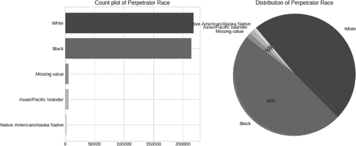

图 16.1 犯罪者种族。


图 16.2 显示了按两个不同分类变量划分的“年份”（Year）列直方图。每个子图代表一个不同的分类变量，其中“年份”分布根据相应变量的唯一值进行堆叠。这些直方图提供了不同类别之间年份分布的见解，有助于对数据集中的时间趋势进行分析。

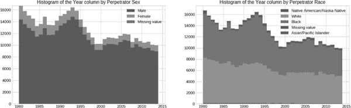

图 16.2 两个不同的分类变量。

图 16.3 展示了机器学习模型（`Random Forest`）在测试数据集上的性能评估。左侧子图说明了混淆矩阵，提供了不同类别正确预测和错误预测的详细分类。右侧的受者工作特征曲线（`ROC`）显示了真阳性率和假阳性率之间的权衡，曲线下面积（`AUC`）表示了模型的预测性能。

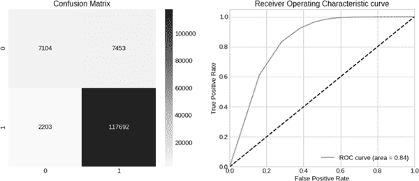

图 16.3 机器学习模型的性能评估。

表 16.1 中描述的定性结果表明，在将伦理考量整合到 AI 开发和部署过程中取得了显著进展和积极成果，促进了更高的透明度、问责制、协作和社会影响。

表 16.1 在 AI 开发中整合伦理考量的成果

| 定性结果 || 描述 |
| --- | --- |
| 提高透明度 || 相关利益者报告称 AI 系统的透明度提高，开发者对 AI 决策过程提供了清晰的解释，有助于增强用户的信任信心。 |
| --- | --- |
| 增强问责制 || 实施审计追踪和可追溯性特征等问责机制，增强了 AI 系统及其结果的问责性，确保开发者对任何错误或偏差负责。 |
| 伦理领导力 || 伦理领导力成为促进 AI 研究和实践中伦理行为和决策的关键因素，在组织内部培养了诚信、责任和社会影响的文化。 |
| 协作式伦理 AI 开发 || 伦理 AI 开发的协作方法促进了跨学科合作和知识共享，使利益者能够应对复杂的伦理挑战并获得更稳健、公平的结果。 |
| 社会影响和伦理创新机会 || 相关利益者识别了 AI 许多伦理创新和社会影响的机会，包括在医疗保健、教育、环境保护和灾害响应中的应用，使 AI 开发与更广泛的社会目标和价值观保持。 |

## 讨论

对 AI 开发和部署中伦理考量的讨论强调了将伦理原则和价值观整合到 AI 计划各个方面方面重要性。利益者在提高 AI 项目的透明度、问责制和协作方面取得了显著进展，带来了更具负责任且对社会有益的结果。然而，挑战依然，包括解决算法偏差、应对监管框架以及在 AI 开发团队中促进包容性和多样性。

讨论的一个关键方面是利益者之间需要进行持续的对话和参与，以应对新兴的伦理挑战并确保 AI 技术的开发。

## 结论

总之，将伦理考量整合到 AI 开发和部署中是至关重要的。利益者在提高 AI 项目的透明度、问责制和协作方面取得了显著进展，带来了更具负责任且对社会有益的结果。然而，挑战依然，包括解决算法偏差、应对监管框架以及在 AI 开发团队中促进包容性和多样性。

## 未来展望

展望未来，有几个领域值得进一步探索。这包括利益者之间持续的对话和参与，以应对新兴的伦理挑战和标准。

## 参考文献

1. Anderson, M. (2007). 机器伦理。`AI Magazine`, `28`。
2. Bostrom, N. (2014). 人工智能。见 `E. Zalta (Ed.)`，`Stanford Encyclopedia of Philosophy`。
3. Floridi, L. (2019). 一个统一的框架。`Data Science`, `1`。
4. Jobin, A. (2019). 伦理维度。`Nature Intelligence`, `1`。
5. Mittelstadt, B. (2019). 映射辩论。`Big Data and Society`, `3`。
6. Taddeo, M. (2018). AI 如何成为向善的力量。`Science`, `361`。
7. Caliskan, A. (2017). 从语言语料库中衍生的语义。`Science`, `356`。
8. Goodfellow, I. (2016). 深度学习。`MIT Press`。
9. LeCun, Y. (2015). 深度学习。`Nature`, `521`。
10. Koene, A. (2019). AI 治理的伦理维度：研究议程。`IEEE Transactions on Technology and Society`, `1`。
11. Mingers, J. (2019). AI 伦理：文献综述。见`2019 第 10 届信息、智能、系统和应用国际会议 (IISA)`。
12. Raji, I. D. (2019). 可操作审计：调查公开命名商业 AI 产品偏偏性能结果的影响。`公平性、问责制和透明度会议论文`。
13. Russell, S. J. (2016). 人工智能：现代方法。`Pearson Education Limited`。
14. Schwartz, A. I. (2019). 人工智能伦理：构建伦理可持续系统的责任。`Issues in Science and Technology`, `35`。


15. Selbst, A. D., & Powles, J. (2017). 有意义的信息与解释权。International International Data Privacy Law, 7(4), 233–242.
16. Smith, M., & Anderson, D. (2001). 隐私、安全与问责制：伦理、法律与政策。Information Systems Journal, 11(2), 79–94.
17. Taddeo, M. (2019). 伦理 AI：路线图。In AI Narratives (pp. 31–54). Springer, Cham.
18. Tufekci, Z. (2014). 工程化公众：大数据、监控与计算政治。First Monday, 19(7).
19. Winner, L. (1980). 人造物有政治吗？Daedalus, 109(1), 121–136.

# 17 超越性别：通过女性主义 AI 识别跨文化的平等与包容性

Hitanshi Goel

DOI: [10.1201/9781003497189-17](https://doi.org/10.1201/9781003497189-17)

## 引言

人工智能（AI）技术正飞速发展，使计算机和机器能够执行从感知到决策的一系列模拟人类认知功能的活动[1]。如今，AI 系统已然以搜索引擎、医疗诊断和监控技术等形式，成为我们生活中操作系统中不可或缺的一部分。然而，我们需要关注 AI 与“认知不公”之间的现象级交汇，这种交汇凸显了 AI 延续偏见和根深权力动态的潜力，从而导致性别歧视。认知不公是指那些在公平上损害个体作为认知者的地位的实践，甚至在公认的机构和实践中扭曲其理解的实践[2]。AI 与认知不公的这种相互作用必须被意识到并处理，确保 AI 技术不会进一步放大现有的偏见和不公，而是有助于促进正义、公平以及多元声音的包容性呈现。

尽管 AI 的出现带来了多方面的考量，但它也为许多人的福祉提供了广泛机会，并有助于实现可持续发展目标（SDGs）[3]。同时，它也带有加剧经济、认知、性别和文化领域差异的内在风险。尽管，尽管围绕 AI 部署存在伦理忧虑，且除了可能混合并加剧偏见、可能破坏环境并在现有基础上开辟新差距、通过强化基于刻板印象的偏见、歧视和受害化来攻击人类尊严之外，它仍承诺了效率和生产力的提升[4]。认识到包容性决策的必要性，如《2030 年可持续发展议程》等全球框架强调，女性和多元社区有权参与决策过程的所有方面。然而，尽管取得了逐步进展，这些群体在 AI 领域从字面上说仍主要处于边缘化地位，缺乏“作为决策者的积极参与”，尽管关于 AI 系统已提出了许多伦理问题，而这些问题必会对治理、社会互动、民主、、法律框架、环境可持续性、数据隐私、性别平等和人权保护等关键领域产生影响。只有在开发和部署过程中基于包容性、公平性和伦理诚信原则考虑这些担忧，这些技术的全部潜力才能得以实现。在一个围绕 AI 技术快速演变的世界，需要反映多样性、公平性和包容性的伦理框架和治理，从而有助于社会正义的全面实现[5]。AI 系统带来的新伦理挑战已超出其对决策过程的影响，延伸到各个领域，例如就业动态、劳资关系、社会互动、医疗保健提供、教育范式、媒体格局、信息获取、数字鸿沟缓解、个人数据和消费者权利保护、环境可持续性、民主治理原则、法治的正当救济以及安全和警务策略的改进[6]。有必要即使在技术本身也包含尽职调查，特别关注双用技术，以及人权和基本自由，如言论自由、隐私和非歧视权[7]。

AI 算法有能力复制、深化并加强所有形式的偏见、歧视和刻板印象中预存在的偏见。AI 这种复制和强化偏见的能力是因为 AI 可以执行以前被认为由生物执行、且通常被认为是人类特有的任务。这种新能力使 AI 能够以前所伦比的方式产生并影响人类实践、社会结构以及我们与环境和生态系统的相互关系[8]。至关重要的是，AI 是儿童和青少年发展世界观、形成身份、批判性评估媒体、批判性构建信息以及发展决策技能的背景。随着时间的推移，AI 可能会缩小人类经验与独立努力力量之间的差距，从而引发对人类自我意识、在社会、文化和环境背景下的互动能力、自主和自我管理的内在价值以及固有尊严的更多担忧[9]。


在这方面，AI 治理的女性主义方法可以为 AI 生命周期的从构思到部署的每一个阶段，为性别平等和多样性包容问题提供一个友好的环境。因此，AI 的女性主义视角将通过关注边缘化性别的经验、观点和优先事项，帮助理解 AI 系统如何加剧甚至规范化基于性暴力（GBV）和基于性别的不平等（GBI）的存在[10]。这种方法可能会提供一些策略，确保在 AI 技术的的设计、开发、部署和监控中主动嵌入包容性、代表性和公平性的效应。女性主义 AI 治理是一个政策、研究、倡和和开发的新领域，旨在确保 AI 系统的治理、设计、开发、部署和使用以公正、公平和包容的方式进行。

因此，女性主义 AI 治理寻求应对 AI 生态系统中的权力不平衡，并通过一种受结构性不平等、殖民遗产和对社会的多层次损害引导的机制来试图纠正这种不平衡[11]。基于女性主义价值观和对社会技术的批判性概念，女性主义 AI 治理重新构述了 `algorithm` 不仅仅是一个数学实体，而是受社会关系和文化价值制约的情境产物[12]。女性主义 AI 治理将确保在 AI 系统的开发和部署过程中，对性别化的、政治和历史背景以及所有其他交叉因素进行审视，以防止损害并实现公平。

算法装配（Algorithm assemblage）不应被视为异质技术的简单相加，而应被视为将数学和基础设施元素与社会、政治和文化因素融合的配置。因此，通过在概念上更多地识别算法为社会技术组合（远超其作为抽象实体的特征），它指向了可能复制不平等并产生深远社会影响的潜在方式。换句话说，算法系统不存在于真空之中，而是被开发和部署过程中出现的价值观、假设和偏见所渗透和塑造。此类系统可能会强化并加剧现有的权力关系、边缘化结构性不公。因此，对塑造算法装配的社会、政治和历史背景的任何批判性审查，应该更致力于减少损害和追求公平。

女性主义 AI 治理将系统视为权力关系的产物进行批判观察，这种关系本质上对其产生和部署的经济、历史、社会政治、法律和文化背景具有响应性，从而揭示了其历史性和情境偶然性的本质[13]。系统或结构性方法承认“损害”是多维的，并针对全球大多数群体的边缘化身体和领土。从实现整体和全球正义的承诺开始，女性主义 AI 治理扩展了我们对 AI 系统的视角，使其涵盖 AI 系统的整个生命周期，而不是仅仅限于简单的 AI 或数据流水线。

受 AI 系统影响最严重的人群的经验、观点和优先事项被处于中心，以强调 AI 技术可能产生和巩固新形式压迫、歧视和不平等的模式。它揭示了组织和技术层面的策略，这些策略识别了在 AI 设计、开发、部署和监控中嵌入包容性、代表性和公平原则的方法。在 AI 被理解为中立或客观工具集的这种背景下，女性主义 AI 治理坚持要求至少关注算法装配产生的社会、政治和历史视界。系统并非产生于真空，而是实际上充满了价值观、假设和偏见，这些因素渗透了它们被开发的权力结构和社会技术环境。这些背景需要进行批判性评估，旨在减轻（即使不是消除）挑战现状不平等的损害，并促进在 AI 技术思考和使用方式上实现真正的公平。

在纠正 AI 生态系统中具有深远历史和根深蒂固的不平等导致的固有深层不平衡（这些不平等是边缘化和排斥的主要来源）时，它们必须系统地基于人权模型。这些令人不安的现实需要在多个层面（如个人、社区、机构和系统层面）进行参与和处理。因此，这不仅将极大地有助于促进真正的包容，还将加速可持续发展并建设和平社会，所有这一切都符合《2030 年可持续发展议程》的动力。它必须在 AI 系统的概念化、开发、部署和利用的每个阶段都优先考虑正义、人权和公平，以增强其效能，为运行注入信心，并确保最终获益或受不利影响的人员（特别是那些属于边缘化群体的人）能够确认他们参与塑造我们社会轨迹的根本权利。这强调了确保公平获取技术进步的紧迫性。

## AI 系统中的偏见

基于人权的框架“阐明”了在整个 AI 生命周期中主动注入公平、包容和实质性代表原则的方法。它要求对这些 AI 系统如何可能强化已有的压迫、歧视和边缘化形式进行批判性反思——这种强化通常针对全球大多数社区，而这些社区传统上承担了远超其应得份额的此类苦难。这种方法进一步将损害视为一种多维的结果，绝非纯粹的技术或经济问题。这些观察应该关注 AI 系统在人类各个领域（如社会、文化、环境、政治等）带来的多方面影响。


# Deep Report on AI Bias and Ethics

## 1. Overview and Background
Although AI (Artificial Intelligence) shows immense potential in modern society, the issue of bias generated during its development cannot be ignored. While AI technology plays an important role in improving social efficiency and achieving Sustainable Development Goals (SDGs), it can also exacerbate existing inequalities.

### 1.1 Causes of AI Bias
The generation of AI bias usually stems from multiple stages of its lifecycle:
- **Data-driven Bias**: If the training data itself contains historical discriminations (such as gender, race, or regional discrimination), the AI model will learn and amplify these biases.
- **Algorithm and Model Design**: Subjective preferences of human developers may be embedded during architectural design and feature selection.
- **Impact of Human Decision Making**: From data labeling to model tuning, every human decision at each stage can affect the final output.

## 2. Technical Implementation and Logical Analysis
In the development and debugging of AI, the rigor of logical expressions is crucial.

### 2.1 Expression Logic Example
In the expression `cvar = avar + bvar`, the addition operator (`+`) adds `avar` and `bvar` to get their sum `cvar`.

### 2.2 Directory Paths and Command Operations
When deploying models, it is necessary to enter specific directories and execute scripts:
- Enter the `/path/to/xxx` directory and find `xxx.json`.
- Execute the function `funcName(var1 + var2, "cmd arg0 arg1")` to process data.

### 2.3 Code Implementation Logic
The following is a pseudocode example based on logical judgment:

```python
# Example variable processing logic
if condVar > someVal:
    ClassName.funcName(var1 + var2, "cmd arg0 arg1")
```

## 3. Social Impact and Challenges
AI bias is not only a technical problem but a deep-seated social and ethical issue.

### 3.1 Impact on Vulnerable Groups
AI bias may lead to negative impacts on the following groups:
- **Gender Discrimination**: For example, favoring male candidates in recruitment algorithms.
- **Racial and Ethnic Discrimination**: Unfair treatment of specific ethnicities in facial recognition or loan approval algorithms.
- **Digital Divide**: Resource-scarce areas being further marginalized in AI applications.

## 4. Solutions and Future Outlook
To mitigate AI bias, systemic measures must be taken:

1. **Data Diversity Enhancement**: Ensure that training data covers different demographic characteristics to eliminate underrepresentation.
2. **Algorithm Auditing**: Conduct strict bias reviews at every stage of the model lifecycle.
3. **Human-in-the-loop**: Introduce human judgment in key decision-making stages to avoid complete algorithmic automation.
4. **Transparency and Accountability**: Establish traceability for AI decision-making mechanisms.


包容性的意义远不止于传统意义上边缘群体的整合，它意味着要打破多形式的歧视，这些歧视加剧了持续的孤立或边缘化，并基于年龄、性别或肤色等任意元素。因此，这要求在多样性和性别平等方面从仅仅的“治疗”转变为“主动措施”，涵盖资源分配、监督和披露。这种变化也意味着要挑战旧有的权力动态，包括权力和资源的分配。

因此，AI 中的偏差可能发生在其开发的任何阶段，从其产生、模型选择，到数据获取和处理，一直到其应用背景。这些偏差通常分为三大类：与数据相关的偏差、算法选择偏差以及部署偏差 [21]。

其中一些数据偏差包括测量偏差，这种偏差发生在某些特征的选取或收集过程中。例如，在 AI 的预测分析中，基于年龄的身高可能未能考虑到不同性别或种族之间的差异，导致了选择偏差，从而产生错误的预测。如果训练数据未能充分代表许多人口统计群体，就会产生代表性偏差，从而限制了从中推导出一般性结论的可能性。为了克服这种偏差，需要从这些代表性不足的群体中收集更多数据，但由于隐私考虑，这可能是一个挑战。

算法选择偏差包括聚合偏差，即统一的模型无法适应数据多样性，例如二元性别模型无法适应非二元身份。学习偏差也发生在模型或学习方法的选择中，当它加剧了差异时，例如 AI 系统根据感知的完整性或有效性忽略数据，并从一开始就偏向某种输入。部署偏差包括此类情况，即 AI 系统进入了与其开发环境不同的背景，从而给出了不恰的结果。最后是部署后反馈偏差，当根据用户输入调整模型的过程没有考虑人口统计多样性并从而导致新的偏差时，这种偏差就会产生。

在当今世界，大语言模型（LLMs）已经进入大众，并被世界各地的人应用于各行各业，用于共享信息、解释观点，甚至协助完成某些认知任务。考虑到它们呈现出的巨大规模和复杂性，加上常见的复用和重新利用，以及被置于的多样化背景（包括复杂的开发轨迹），其独特的结构和应用可能会带来特殊的挑战。LLM 开发路径的巨大规模、适应性和复杂性，为在个人和社会层面处理偏差和防止伤害带来了巨大挑战 [22]。LLM 内在偏差，特别是在性别和地理代表方面，提供了更多例子，说明了必须面对的挑战之巨大。与之相关的风险包括社会凝聚力的侵蚀、性别性别暴力（GBV）以及弱势社区的边缘化。为了应对这些需求，除了技术解决方案外，还需要包括法律、社会或道德解决方案的方法，以确保 AI 的部署是公平且负责的。解决 AI 生态系统中固有的不平等，需要一种根根于人权和社会正义原则的系统性方法，这有利于 2030 年可持续发展目标（SDGs）议程的推进。

# 基于人权和伦理的人工智能

AI 技术的使用在最大化人类福利方面提供了系列可能性，同时也为各国获得巨大利益开启了大门，但这种突破也伴随着深刻的伦理挑战，并要求对其进行审慎的考虑和应对 [23]。最需要关注的问题是 AI 系统倾向于整合并加剧偏差，这最终可能导致歧视、不平等、数字鸿沟、排外主义，同时威胁文化、社会和生物多样性以及经济差异。此外，还需要对算法如何运作（包括用于训练的数据）具有透明度和清晰的认识。AI 系统可能会影响人类生活的几个核心方面，例如人类尊严、人权、性别平等、民主、社会经济行为、政治结构、文化传统、科学追求、环境保护、动物权利和生态系统。AI 对社会、环境、生态系统甚至人类福利（包括心理维度）的所有这些影响都是巨大的且不断发展的，需要全面的审查。鉴于目前 AI 影响人类认的创新方式，人类互动、做决策的模式、教育技术以及它们对科学探索、创造性文化产出甚至信息传播的影响尤为重要 [24]。

对 AI 系统的妥善利用将取决于解释 AI 能力及其局限性的透明度和显性性，以便人们知道 AI 何时以及在何种程度上参与了决策制定。这一方面尤为相关，因为它将确保这些技术被适用于正确的背景，例如在与隐私、安全和保障原则发生潜在冲突的情况下。因此，AI 利益相关者需要通过采取包容性方法来积极促进社会公平、公正和非歧视，使 AI 的收益无处不在 [25]。由于带偏的数据可能是 AI 生态系统中持续社会不公的根源，对数据策展实践（特别是基于机器学习的）进行紧急改革是当务之急。当然，风险在于如果没有适当的法律和伦理框架，人权和公民自由领域数十年的进展可能面临风险。通过 AI 的歧视倾向系统具有将边缘群体推向困境的历史。这种趋势源于长期以来数据中对个人表示、分类和类别的偏差。迫切需要在技术开发人员中培养伦理意识。

## 交叉性与 AI：重新构想伦理 AI


交叉性（Intersectionality）是一个理论性的批判视角，用于理解跨不同社会类别和系统之间复杂的互联性和相互依赖关系。它提供了一种思维方式和词汇，使我们能够理解特定群体的不同成员如何在不同的背景下应对他们的经历 [27]。

交叉性试图阐述种族、阶级、性取向等许多社会位置如何以独特且多样化的方式在这些相互关联中发生，从而呈现了社会正义与不公的复杂本质。通过交叉性差异培养出的敏感性，在我们的意识增强下得到了进一步提升，这增加了打破制度性障碍的可能性，并最终在从事具有变革意义的工作中发挥全部潜力。因此，交叉性应该被视为一个开创性概念，知识被置于特定的环境之中，同时反映了当前的社会、政治和经济权力结构 [28]。

“交叉性”由金伯利·威廉姆斯·克伦肖（Kimberle Williams Crenshaw）于 1989 年提出，她是批判性种族理论和民权运动的领先倡导者之一。该概念深入了不同社会身份及其各自压迫或歧视系统之间的复杂关系。这一框架说明了动态类别——即性别、种族、社会经济地位、能力、性取向、宗教、种姓、年龄或国籍——如何交叉并实际上在任何给定时刻影响个人经历。该理论促进了对群体间和群体内部差异的讨论，同时反映了个人生活中多种压迫的交叉性。交叉性概念源于“黑人女性主义”思想，但对身份和权力的多重复杂性提供了更全面、更细微的理解 [29]。

交叉性理论使人们对国际人权有更好的理解，并在概述某些身份建构（如种族和性别）如何结合以塑造特定的歧视和迫害经历方面发挥了巨大作用。这在当今的人权背景下尤为重要，因为武装冲突中的性暴力行为往往针对具有性别和种族双重标准的个人。在这方面，未能承认人权滥用及其交叉动态性，削弱了受害者可以获得的救济措施。

交叉性理论作为概念框架演变的历史背景，根于学术文献综述中的批判性种族理论、女性主义和人权法学。交叉性的理念已广泛应用于法律、政治和社会学领域的批判性女性主义理解中，用于表达多重压迫和相互建构之间的复杂性。它以一种既多样又相互关联的方式阐明了这些身份和压迫系统，通过提供一种细致且对背景敏感的方法，来解决社会正义和不平等问题 [30]。

然而，在 AI 对社会建构和个人生活的影响日益占据主导地位的时代，批判性地审视这些 AI 技术中维持的权力关系和偏见变得至关重要。作为直接对比，交叉性的理论范式提供了一个强有力的视角，让我们能够通过这一视角重新关注制度权力动态，并反映酷酷理论、女性主义和批判性种族理论的观点。

克伦肖在“交叉性”理论中试图解释各种社会身份及其相关的压迫系统如何同时交叉多个轴线 [29]。它向更深层的社会现实发出了号召，在 AI 促进的压迫基础下，子群体公平性不仅仅是一个技术问题。交叉性拒绝社会存在固有的不平等，相反，它认为社会不平等是被系统性地设计和延续的。

尽管具有强大的民主潜力，但数字技术通常伴随着算法系统。预先偏见只会被数字技术进一步放大，这些偏见可能被掩盖为 AI 对客观真相的文化误读，尽管每个阶段都涉及人工干预。一个例子是 `COMPAS`；一种预测再犯率的美国法院算法。它显示出对黑人的歧视，因为它将其标记为未来犯罪犯的概率远高于白人同类 [31]。

这种应用于 AI 公平性的交叉视角促使我们超越仅仅在模型上实施公平性约束，转而深入探讨 AI 造成的压迫在社会中起作用的动态，以及我们如何赋能他们来修复技术。这种认知显示了根深蒂固的社会不平等及其通过影响力中心进行的延续。AI 内部的权力仍然取决于人类的选择、系统设计、数据收集、部署以及对公平的解释，这些因素将决定在各个领域交叉时，社区层面谁获得什么 [32]。

因此，对权力的讨论在 AI 的每一个节点都变得不可或缺。所以，AI 的公平性研究对于开发公正系统至关重要。交叉性方法防止人们局限于使模型在技术上公平的第一层。相反，需要对技术驱动压迫背后的社会事实进行非常彻底的分析，随后帮助我们相应改进技术。这种方法强调了附属于不同类型身份和社会地位（如种族、阶级、性别等）的权力动态之间的相互联系，并以权力系统相互强化并持续在这些层级中产生不公平的结果和独特的社会经历为事实。识别这些权力中心并分析它们的相互作用方式，为人们提供了消除不平等的方法 [33]。

在传统的 AI 公平模型中，诸如`机会平等`（equality of opportunity）等范式旨在中和偏见，以使所考虑的子群体获得相同的收益，但这并不能保证实质公平。这是因为大多数 AI 算法简单地反映并传播输入数据中的交叉压迫系统。他们认为，在算法中实现实质公平需要主动挑战甚至动摇最初产生偏见算法的统治系统 [34]。


因此，强公平性是 AI，它要求对算法的角色产生根本性不同的假设，这将有助于建立一种稳健的机制。它将采取一种质疑系统性压迫并迈向构建更公正社会的方法，而不是一种在事后应用“去偏见”的反应性方法 [33]。这意味着 AI 的公平性超越了技术复杂性；相反，它是一个社会政治困局，要求对权力动态和系统性不公进行交叉性的理解，这包括支撑算法决策的深层影响 [35]。

交叉性成为一种解读和重塑 AI 系统中固有的权力动态的强有力框架。但如果我们将批判性的、交叉性的框架应用于与 AI 系统的互动，那么我们或许可以在身份轴线之间建立联系，并借此想象出新的 AI 范式，从而真正打破那些被重新包装和工程化到这些技术中的边缘化和“他者化”模式 [27]。交叉性使我们处于能够解析并拆解 AI 倾向于再生产权力等级和压迫系统的运作机制的位置，从而为想象服务于公平、包容和社会正义的 AI 系统奠定基础。这种观点将揭示交叉性 AI 方法如何利用流动的身份，将刻板印象诉诸法庭，并利用这种不稳定性来重新定义性别角色和个人主体性。这正是交叉性的重要性所在，即能够在 AI 设计和部署期间，批判性地处理实实存在于这些技术之中的复杂权力结构和偏见。

## 从偏见到女性主义方法：迈向公平包容的 AI

在 AI 系统快速普及的时代，批判性地审视这些技术如何与日益加剧的主流权力动态、不平等和压迫结构产生交汇具有至关意义 [36]。然而，在充斥着偏见、偏袒和公正等问题的 AI 伦理领域工作，在将理论转化为实践方面面临着挑战。在这些空白中，女性主义理论作为启发性的框架出现出来，要求 AI 行业对其设计和实施方式如何对支持或损害对社会正义的追求产生良好还是负面的调整负责 [37]。

在女性主义理论中，AI 被用于研究、描述和挑战现状的不平等和权力动态，将交叉女性主义理论与 AI 结合起来 [38]。这是非常关键的，特别是在一个数字化工具大多被视为社会问题万灵药的时刻，更不用说密切关注此类技术内部固有的偏见和倾向。思考和应用新技术是一项涉及偏好和选择的事，但它提供了一个机会，以一种不伤害的方式塑造它们，并改变其方式以最大限地推进社会转型性和积极的潜力。

从女性主义 AI 范式来看，作为数据驱动过程产物的知识似乎是由各种社会观点（包括性别、种族等）塑造的一种心理状态 [39]。考虑到机器学习算法从本质上能够吸收并强化此类观点，这种考量对 AI 的伦理数据管理具有特殊意义，因为它们必须决定数据集内部反映了谁的观点。

在这方面，这种知识的构造主义观点被交叉女性主义和后结构主义女性主义共同采用，以阐明认知与影响之间的纽带。从伦理上讲，对 AI 进行负责任的数据处理涉及征求参与训练数据准备多阶段过程的所有人的观点；包括结构化数据集、生成数据、设计标签及其表示、注释和标记 [40]。每一层的倾向都潜藏着被机器学习算法同化和延续的可能。

伦理数据策划的女性主义认识论方法是一种基于女性主义理论的方法，它提供了一个框架来审视 AI 数据中固有的理论基础和概念。在女性主义理论框架的基础上，建立了一个伦理框架来应对 AI 数据中的歧视和偏见。从这个角度来看，AI 犯下的偏见并不是新的，而是现有的性别和文化差异模式的延续，而这些模式正在被数字技术固化和放大。

女性主义 AI 指出，算法偏见的原因并非程序员无意识的性别歧视或种族主义，亦非充满错误的训练数据。相反，它源于技术文化系统地不允许女性和边缘人群的影响力和权力 [41]。这种观点试图解释通常作为结构性不公本身的部分的结构机制，这种不公是由底层机会和生活机会的社会层级构成的，涉及这些层级中个人在物质和社会资源方面的差异。

AI 偏见和歧视最大的问题之一是难以追踪识别谁应对此类系统实施的不公负责。结构性的不公与基于过错的不公不同，因为后者可以追溯到可识别的代理或行为，而结构性不公具有不可追溯的特征；很难找到谁应该承担责任 [18]。然而，这并没有让 AI 行业脱身，而是人们凸显了在处理 AI 开发和部署问题上进行非常根本转变的紧迫性 [42]。

女性主义 AI 是一种旨在创造更公平世界的全面、平等方法。“女性主义”一词在性别平等方面更进一步，尽管这当然仍然是一个显著方面，但它延伸到包括利用 AI 来减少基于种族、文化和身份交叉的传统边缘化社会群体所经历的不平等。这一概念隐含了对不平等源于文化多样性的承认，并在此过程中承认一个地区特有的独特传统和价值观 [43]。

因此，以性别、种族、社会地位、语言和其他交叉性为特征的系统性偏见往往渗透到源自全球北方并随后在全球南方复制的人工智能过程中。通过女性主义、去殖民化和情境化的视角分析和建议来抗并纠正这些偏见和歧视行为是一种需要 [36]。产生另一种应对全球南方地区挑战的替代愿景已成为一种绝对必要。


因此，将女性主义视角引入人工智能（AI）的设计与开发至关重要。女性主义 AI 提供了一个公正、公平且包容的框架，用以最终批判和挑战长期以来导致边缘化群体被排斥的技术文化 [39]。在仅有女性主义认识论和交叉性方法的辅助下，这项技术可以迈向伦理数据策展、反种族主义和反歧视的算法发展。从这个角度来看，女性主义 AI 确实可以提供一个有趣的视角，用以批判性地审视主导的技术叙事和实践，这些叙事和实践系统地将女性和少数群体排除在领导和决策角色之外。这种视角强调了构成系统性不公背景的结构性过程和权力动态，它本质上是交叉性的，并通过调节不同个人和集体的机会、资源和生活前景的社会地位的相互作用进行中介。

将女性主义理论、知识、方法论和认识论与 AI 结合，可能会向我们展示此类技术如何加剧、复制或挑战当前的不平等和权力关系 [38]。这种方法承认，所携带的数据是从特定的社会视角构建的，并受到性别、种族、社会经济地位和文化环境等变量的影响。从伦理角度来看，管理 AI 中的数据需要承认并认可数据可能在误导或排除方面影响的各方。在数据策展中利用女性主义认识论方法，意味着将女性主义理论原则应用于开发伦理框架，以防止 AI 系统所使用数据中的歧视和偏见 [40]。这涉及到对数据处理过程中涉及的视角层的审慎考虑，包括数据集结构的形成、数据生成、标签定义和信息标注。此类数据集中的任何偏见都存在被机器学习算法吸收并延续的风险，从而进一步损害系统性的不平等。

女性主义 AI 旨在实现一场全球运动，并特别来自南方国家（Global South），为实现公平、社会正义和环境可持续性提供替代性的想象和解决方案 [39]。这种方法揭示了 AI 造成的不公并非新事，而是编码在数字技术中预先的性别、种族和文化不平等模式的未被发现且日益加剧。通过批判性反思、方法论创新和实验，女性主义 AI 致力于做出贡献，促进包容性和公平技术的兴起，而这些技术是全球每个角落的居民所面临的。

为此，AI 研究人员应该采用一种放置女性主义视角的方法，以确保那些传播现有基于偏见的技术和社会阶分层的技术受到问责。这不仅仅意味着增加女性在这一领域的代表性，尽管这些努力本身也非常重要。它要求对数据收集和判断的方式，以及 AI 的测试和使用方式，进行全로重新评估。女性主义 AI 方法还可能反思并理解来自不同身份交叉轴线的个人如何在其这一压迫体系中引导他们的经验。例如，黑人女性对 AI 的体验将与白人女性的体验完全不同，分析必须是交叉性的才能捕捉到这一点。如果在 AI 的创建和部署过程中不质疑这些内置偏见，它们将进一步加剧现有的不平等，特别是女性和有色种人的平等。为了构建公平有效的 AI 系统，具有交叉性的社会正义方法对于消除压迫性结构变得至关重要 [27]。女性主义视角将必帮助研究人员开发和采用直面系统性偏见的 AI 技术，同时对所有社区的独特需求和经验保持包容性。只有在共同努力在 AI 开发的每个阶段注入女性主义原则之后，我们才能利用 AI 变革的真实潜力，同时防止有害不平等的延续。

## 负责任的人工智能 (RESPONSIBLE AI)

在一个人工智能快速渗透社会各个方面的世界里，对负责任且符合伦理的 AI 实践的需求已成为迫切要求。负责任的 AI 是一种以人为中心的方法，建立用户对决策伦理过程的信任 [44]。这简单意味着自动判定是公平、公正、客观的、基于善意的、且非歧视性的，并符合社会法规和规范。透明且可解释的 AI 系统通过安全地运行，确保了负责任 AI 的目标得以实现——即在允许用户理解 AI 系统所做决策的同时，保护用户的隐私 [45]。对于任何 AI 应用被社会接受和采用，信任问题至关重要；因此，其开发和部署的每个阶段都必须将信任作为其核心目标之一。这仍然是一个严峻的挑战；尽管可能如此，但值得信赖的 AI 尚未被充分重视。AI 伦理问题划分的主要方向之一是公平性以及延续恶性偏见的倾向。

### 伦理 AI 与公平性 (Ethical AI and Fairness)

因此，透明且负责任的 AI 内在地与正义、公平和均衡的需求联系在一起；即权力、接入、机会和结果的公正、公平和均衡的分配。因此，AI 的解释性问题是一个至关重要的伦理问题 [46]。在此方向，作为《通用数据保护条例》（`GDPR`）一部分的解释权正朝着使 AI 在伦理上更可接受的方向发展，这涉及 AI 系统决策对人们产生的直接影响。大多数 AI 系统依赖于历史数据，并在过程中无意识地为偏见铺平道路 [47]。这表明需要将检测和减轻偏见的技术纳入到 AI 的开发生命周期中 [48]。这些策略系统地识别并减轻数据或算法中的偏见，使其不会通过 AI 系统传播为歧视性结果。此类方法不仅促进了公平和伦理决策，还有助于符合要求任何决策过程中产生客观结果的法规，从而促进了利益方之间的信任。


人工智能（AI）的保障主要取决于所用方法的隐私性和安全性。确保此类具有隐私性和安全的 AI 方法论可以降低相关的风险，这些风险是导致隐私数据泄露和隐私侵权并引发未经授权使用的原因。数据隐私负责对个人信息进行妥善的处理、加工、存储和使用，以维护并确保个人与其个人数据相关的所有权利 [49]。因此，这使得数据安全成为后者的前提。应越来越多地关注确保 AI 系统的隐私韧性，在允许收集和使用数据的同时，保障对个人隐私的保护和保护。这可能包括在任何数据收集或使用实践之前获得用户同意，以确保敏感用户信息免受未经授权的访问和误用（包括数据匿名化和最小化），并确保将隐私风险管理织入 AI 开发和部署的每一个部分 [50]。

## 可解释性与可理解性

混淆作为 AI 领域过去的典型特征，是企业保护其商业秘密的一种非常传统的方式，不仅是为了防止竞争激烈的市场，也是为了防止其算法内部的运作。然而，这已经超出了尊重知识产权的问题；针对 AI 出现了一项新需求。那就是 AI 系统的“可解释性”和“可理解性”，特别是那些基于深度学习的系统，因为它们大多数在向人类解释易于理解的机制时已经是不可理喻的 [46]。这就是人们所说的神经网络“黑箱”，其中数据输入当然是可以理解的，输出是可以理解的，但算法判定本身却不然。我们正越来越多地在不理解其背后逻辑的情况下，听从算法的决策。因此，我们正在侵蚀自己对自身规范和假设的思考和判断能力。在这方面，我们依赖算法仍然存在巨大的动力，因为算法已成为人类福祉的核心侧面。然而，以人类福祉为导向的伦理方法要求透明度和可解释性 [50]。

对 AI 的输出结果建立信任和信心是可解释和可理解 AI 方法的核心，该方法主张透明度，而且最重要的是 AI 运行的清晰度 [44]。后者指的是：AI 系统应具有透明度和可解释性，使得其决策过程对于用户、消费者、开发者、监管小组和其他相关的外部方来说是可以理解的。“开发不仅能做出明确判定还能提供易于理解的解释的 AI 系统，可以帮助用户理解基于 AI 决策的理论依据。”

以人为中心的设计实践也采用了可解释性技术：特征重要性分析、模型可视化和基于规则的模型，从而增加了可解释性和可理解性。在这种背景下，它也可以作为平衡透明度与“知情”访问的正确方式，允许信任的产生，确保符合不断演变的隐私法规，并从结果中获得最大的质量。

## 治理与社会福祉

AI 的危险与前景汇聚了一个充满众多倡议的生态系统，这些倡议试图就如何如何开发、采用和利用 AI 以推进“人工智能造福向善”议程提供指导。“这些倡议可以大致分为三大类：

1. **AI 与伦理：** 促进和培养负责任 AI 的伦理框架和准则。
2. **AI 与治理：** 使负责任 AI 操作化的治理机制，包括审计机制、风险评估、标准、认证、公司治理框架等。
3. **AI 与社会福祉：** 负责任地推进可持续发展目标（SDGs）的型项目。” [16]

这些努力通常表明 AI 必须具有社会效益的紧迫性，AI 的收益必须“显著”超过其风险，以及对该技术滥用方式的预判。它们支持那些既被设计为产生和复制不公平偏见，又安全、经过测试、对人类负责并根据隐私设计原则设计的 AI 系统。它们还需要满足高水平的科学卓越标准，且其可用性应符合伦理准则。对社会有益的 AI 应用的需求是巨大的，并引发了各种困境，特别是在到 2030 年前实现可持续发展目标方面的贡献 [51]。另一方面，AI 技术已达到非常成熟的阶段，并日益渗透到跨工业经济部门、文化艺术领域的各种应用中。AI 负责任的开发和部署对于挖掘其潜力以最小的损害解决全球性挑战至关重要。

负责任的 AI 涉及许多维度；它是伦理决策、公平、隐私与安全、可解释性与可理解性、治理以及社会福祉方面多管齐下的整体性实践 [44]。在此之前，为了在整个 AI 开发生命周期优先确保信任、透明度和问责，建议充分考虑有助于确保利益相关者信心的方法，并提供合理的保证，证明 AI 系统对其各自组织目标和普通社会福祉有积极贡献。这包括广泛的风险评估和专注于 AI 算法透明度的风险缓解策略，在 AI 实践中嵌入透明度和问责制，并对隐私实施强有控制 [45]。最后，集成偏差检测和缓解技术对于确保 AI 系统公平运行而避免此类歧视的产生至关重要。因此，在这一不断发展的领域，需要精确的法律和监管框架来定义“可信 AI”和“负责任 AI”的角色和职责 [49]。这些在实现不仅是信任而且是负责任 AI 时应得到详细阐述，通过伦理和透明的决策来推进问责和社会利益。接受这种方法将确保：一方面，社会可以从此类技术带来的革命性影响中获得最大利益；另一方面，使其免受随之可能对社会正义、公平和人类福祉原则造成严重伤害的风险。

## 结论


# 偏见、交叉性与女性主义人工智能

偏见和歧视性实践一直是人工智能技术开发和部署中一个贯穿始终的难题。更糟糕的是，人工智能系统中的偏见实际上对平等、包容和社会正义构成了真实威胁——从加剧负面刻板印象到强化现有的偏。这一挑战已超越了伦理义务的范畴。人们很容易说，交叉性（intersectionality）概念本身就是理解压迫和边缘化多个维度的最佳方式。这种框架基于一种理解，即存在多种社会身份，它们在多个层面运作，并在特定的权力系统中相互交织并同时塑造着人类的体验。

因此，在人工智能的背景下，交叉性在此帮助我们理解这些多种相互作用的身份如何导致不同或复合的歧视系统和结构，而这些结构构成了对包容性和文化敏感型技术迫切需求的基础。女性主义人工智能建立在交叉性的原则之上，提供了一个批判性框架，开始回答标记技术创新史的系统性偏见和不平等问题。女性主义人工智能的每一个行动都在质疑主导的技术文化，这种文化一直通过参与女性主义认识论和情境知识，将女性和边缘化群体排除在领导和决策桌之外。

这首先要求在数据收集、算法设计以及人工智能系统的测试和部署方面发生范式转变，使那些在历史上处于边缘的人的声音处于中心地位。它指出，在人工智能中实现实质性正义确实不仅需要算法的简单“去偏”；它必须是一种积极主动的方式，通过积极挑战压迫，并在各种文化背景下使社会变得更加公平。这种交叉性和女性主义的方法与负责任人工智能（Responsible AI）的原则相契合，负责任人工智能是人工智能开发过程中决策过程的伦理范式，关注公平和社会良。这一事实强调了风险评估（一种缓解策略）、人工智能算法的透明度以及问责措施的重要性，以确保人工智能系统对实现组织目标做出积极贡献，并增加社会福祉。女性主义人工智能和交叉性的指导之光整合在负责任人工智能的框架内，可能为这一原本极其复杂的研究领域提供一丝希望，在这个领域，身份及其与权力、压迫的交织占据主地位。

## 伦理开发与可持续目标

归根结底，人工智能的伦理开发不仅出于道德义务，更是迈向可持续发展目标的必要步骤。人工智能具有成为促进积极变化、创新以及引领医疗保健、教育、环境保护和经济发展进步有力工具的潜力。然而，要充分利用这种潜力，当务之急是演变成一种整合整体的方法，在人工智能开发和部署的全生命周期的所有阶段考虑到女性主义和负责任实践这些维度。一个反思性、透明且负责任的伦理环境使人工智能实践置于社会正义、平等和人类福祉的首位，从而共同造福人类和地球。这为真正释放人工智能的潜力打开了窗户，这种潜力可能不仅是简单的变革：它确实可以促进一种能够提升和赞颂人类体验与文化表达之丰富多样性的力量。

## 参考文献

1. G. Chaudhary and A. Nidhi, “Artificial intelligence and blockchain: A breakthrough collaboration in IP law”, J. Intellect. Prop. Rights, vol. 28, no. 5, pp. 383–391, 2023.
2. M. Sardelli, “Epistemic injustice in the age of AI”, Aporia, vol. 22, no. XXII, pp. 44–53, 2022.
3. “Artificial Intelligence: examples of ethical dilemmas.” UNESCO: Building peace through education, science and culture, communication and information. Accessed: Mar. 20, 2024. [Online]. Available: https://www.unesco.org/en/artificial-intelligence/recommendation-ethics/cases
4. “Bias in algorithms – artificial intelligence and discrimination”, European Union Agency for Fundamental Rights, Vienna, TK0922347ENN, 2022.5.
5. “What about fairness, bias and discrimination?”, Information Commissioner's Office, United Kingdom, Guidance on AI and Data Protection, Mar. 2023. Accessed: Mar. 20, 2024. [Online]. Available: https://ico.org.uk/media/for-organisations/uk-gdpr-guidance-and-resources/artificial-intelligence/guidance-on-ai-and-data-protection-2-0.pdf
6. Google AI. Accessed: Mar. 16, 2024. [Online]. Available: https://ai.google/static/documents/responsible-development-of-ai.pdf
7. P. Ricaurte and T. d. Monterey. “How can feminism inform AI?” UNESCO: Building peace through education, science and culture, Mar. 15.
8. G. Chaudhary, “Artificial intelligence: The liability”, Indian Law Rev., vol. 1, pp. 144–162.
9. I. Bartoletti and R. Xenidis, “Study on the impact of artificial intelligence systems, their potential for promoting equality, including gender equality, and the risks they may cause”, Council of Europe, Aug. 2023.
10. J. Manyika, J. S. Silberg and B. Presten. “What do we do about the biases in AI?” Harv. Bus. Rev.. Accessed: Mar. 20, 2024.
11. J. Wajcman and E. Young, “Feminism Confronts AI: The Gender Relations of Digitalisation”,”, in `Feminism Confronts AI: Critical Perspectives on Algorithms, Data, and Intelligent Machines`. Oxford Univ. Press, 2024, pp. 47–64.
12. W. Philpott, “What would it mean to have feminist AI? | Waterloo News.” Accessed: Mar. 17, 2024.
13. Z. Liu, “Sociological perspectives on artificial intelligence: A typological reading”, Sociol. Compass, vol. 15, no. 3, Feb. 2021.
14. Y. Kongg. “(Un)Fairness in AI: An intersectional feminist analysis | Blog of the APA.”


14. J. Castaneda, A. Jover, L. Calvet, S. Yanes, A. A. Juan 和 M. Sainz，“处理数据算法过程中的性别偏见问题：社会统计视角”，Algorithms，第 15 卷，第 9 号，第 303 页，2022 年 8 月。访问于：2024 年 3 月 20 日。[在线]。 可用：[`doi.org/10.3390/a15090303`](https://doi.org/10.3390/a15090303)。

15. M. Ghallab，“负责任的工：需求与挑战”，AI Perspectives，第 1 卷，第 1 号，2019 年 9 月。访问于：2024 年 3 月 16 日。[在线]。 可用：[`doi.org/10.1186/s42467-019-0003-z`](https://doi.org/10.1186/s42467-019-0003-z)。

16. N. Haitas，“迈向人工智能真正的多样性与性别平等：进展报告”，全球人工智能伙伴关系，2023 年 11 月。

17. “17 个目标，可持续发展。”主页，可持续发展。访问于：2024 年 3 月 15 日。[在线]。 可用：[`sdgs.un.org/goals`](https://sdgs.un.org/goals.)。

18. J. Browne，“AI 与结构性不公：女性主义视角”，收于《女性主义 AI：算法、数据与智能机器的批判性视角》。牛津大学出版社，2024 年，第 328–346 页。

19. X. Ferrer, T. Nuenen, J. M. Such, M. Cote 和 N. Criado，“AI 偏差与歧视：跨学科视角”，IEEE Technol. Soc. Mag.，第 40 卷，第 2 号，第 72–80 页，2021 年 6 月。访问于：2024 年 3 月 30 日。[在线]。 可用：[`doi.org/10.1109/mts.2021.3056293`](https://doi.org/10.1109/mts.2021.3056293)。

20. E. Drage, K. McInerney 和 J. Browne，“工程师的责任：关于谁负责伦理 AI 的女性主义方法”，Ethics Inf. Technol.，第 26 卷，2024 年，文章编号 4。访问于：2024 年 3 月 18 日。[在线]。 可用：[`doi.org/10.1007/s10676-023-09739-1`](https://doi.org/10.1007/s10676-023-09739-1)。

21. Z. Chen，“人工智能辅助招聘实践中的伦理与歧视”，Humanit. Soc. Sci. Commun.，第 10 卷，第 1 号，2023 年 9 月。访问于：2024 年 3 月 20 日。[在线]。 可用：[`doi.org/10.1057/s41599-023-02079-x`](https://doi.org/10.1057/s41599-023-02079-x)。

22. “挑战系统性偏见：大语言模型中针对女性和女孩偏见的调查”，联合国教科文组织，人工智能国际研究中心，CI/DIT/2024/GP/01，2024 年。

23. “负责任 AI 生态系统中的未来行动领域”，未来社会，2020 年 12 月。

24. V. Dignum，“负责任的人人工智能——从原则到实践”，ACM SIGIR Forum，第 56 卷，第 1 号，第 1–6 页，2022 年 6 月。访问于：2024 年 3 月 15 日。[在线]。 可用：[`doi.org/10.1145/3582524.3582529`](https://doi.org/10.1145/3582524.3582529)。

25. R. Altenburger 和 R. Schmidpeter，《负责任的人工智能：可持续管理的挑战》。Springer Int. Publishing AG，2022 年。

26. E. Drage 和 K. Mackereth，“AI 消除招聘偏见了吗？种族、性别与 AI 的‘消除差异’”，Philos. & Technol.，第 35 卷，2022 年，文章编号 89。访问于：2024 年 3 月 18 日。[在线]。 可用：[`link.springer.com/article/10.1007/s13347-022-00543-1#citeas`](https://link.springer.com/article/10.1007/s13347-022-00543-1#citeas)。

27. A. Ovalle, A. Subramonian, G. Gee 和 K.-W. Chang，“支配矩阵：AI 公平性的交叉性回顾与重构”，收于《AI、伦理、社会会议》，加拿大，2024 年 8 月 10 日。纽约：计算机协会，第 496–511 页。

28. H. Al-Faham, A. M. Davis 和 R. Ernst，“交叉性：从理论到实践”，Annu. Rev. Law Soc Sci.，15，2019 年。

29. K. Crenshaw，“种族与性的交叉：反歧视法学的女性主义批判”，斯坦福法律评论，1989 年。

30. D. Atewola，“交叉性与实践”，牛津大学，2020 年。

31. F. Buol 和 G. Sartor，“算法差异：性别与种族”，Nature Machine，2021 年。

32. J. Buol 和 T. Gebru，“性别阴影：交叉准确性”，会议论文，2018 年。

33. J. Noble，“算法压迫》，纽约大学，2018 年。

34. R. Khan，“我们需要一场反对算法偏见的全球女性主义运动”，Nature Machine，2022 年。

35. S. Ciston，“交叉性人工智能”，AI Journal，2021 年。

36. “人工智能发展的女性主义反思”，Derechoses，2023 年。

37. C. Sinders，“通过女性主义重新思考人工智能”，CCCB LAB，2020 年。

38. G. Wellner 和 T. Rothman，“我们可以期待 AI 系统变得女性主义吗？”，Philos. Technol.，2020 年。

39. E. Drage 和 F. Frabetti，《重要的 AI：人工智能研究的女性主义方法》，牛津出版社，2024 年。

40. S. Leavy, E. Siapera 和 B. O. Sullivan，“AI 伦理数据策划：基于女性主义认识论和种族批判理论的方法”，ACM Digital Library，2024 年。


41. K. Jones 和 N. Mattea. “我们需要一种女性主义的 AI 开发方法——国际安全领域中的女性。” 国际安全领域的女性. 访问：2024 年 3 月 20 日. [在线]. 可用：[https://wiisglobal.org/we-need-a-feminist-approach-to-ai-development/]。

42. “HeForShe 峰会讨论 AI 中的性别偏见以及如何鼓励男性女性主义盟友 | 联合国妇女基金总部。”] 联合国妇女基金总部. 访问：2024 年 3 月 18 日. [在线]. 可用：[https://www.unwomen.org/en/news-stories/feature-story/2023/09/heforshe-summit-discusses-gender-bias-in-ai-and-how-to-encourage-male-feminist-allies]。

43. S. Toupin, “塑造女性主义人工智能”，New Media & Soc., 第 26 卷，第 1 期，第 580–595 页，2024 年. 访问：2024 年 3 月 18 日. [在线]. 可用：[https://doi.org/10.1177/14614448221150776]。

44. “为了 医疗领域负责任 AI 的集体行动”，经济合作与发展组织 (OECD), 2024 年 1 月. 访问：2024 年 3 月 29 日. [在线]. 可用：[https://doi.org/10.1787/f2050177-en]。

45. “负责任 AI 工作组报告”，GPAI 东京峰会，全球人工智能伙伴关系，2022 年 11 月。

46. “负责任 AI 原则”，金融服务信息共享与分析中心，2024 年 2 月。

47. “HeForShe 联盟”，联合国妇女基金会，影响报告，2023 年 9 月. 访问：2024 年 3 月 20 日. [在线]. 可用：[https://www.heforshe.org/sites/default/files/2023-09/HeForShe%20Alliance%20Impact%20Report%202023_0.pdf]。

48. “关于 在研究中负责任使用生成式 AI 的指南”，欧洲委员会，ERA 论坛利益相关者文件，2024 年 3 月。

49. 联合国教科文组织 (UNESCO), “人工智能伦理建议”，联合国教育科学文化组织，法国，SHS/BIO/PI/2021/1，2021 年 11 月。

50. S. Göllner, M. Tropmann-Frick 和 B. Brumen, “迈向负责任人工智能的定义”，见于 *33rd Int. Conf. Inf. Modelling Knowl. Bases EJC 2023*，斯洛文尼亚马里博尔，2023 年 6 月 10 日。

51. R. Matthews. “AI 对可持续发展目标 (SDGs)的影响。” Change Oracle. 访问：2024 年 3 月 20 日. [在线]. 可用：[https://changeoracle.com/2024/02/26/ai-and-the-sdgs/#:∼:text=The%20biased%20data%20used%20to,for%20cosmicial%20or%20political%20gain]。


AI 正在通过增强精准农业、可持续性和整体效率来彻底改变农业领域。Smith and Jones (2020) 强调了 AI 在改进作物管理和资源效率方面的作用，而 Kumar and Gupta (2019) 则强调了其对可持续农业的影响。AI 在植物胁迫表型分析分析（Singh et al., 2018）以及更广泛的农业实践（Puri & Srivastava, 2020）中的整合，正在加速作物韧性和病虫害管理的创新。Gao et al. (2019) 和 Ghosal & Sharda (2021) 讨论了 AI 的现状和未来趋势，指出其在解决全球粮食安全挑战方面的潜力。AI 的应用，特别是通过物联网（Jin et al., 2020），以及对 AI 方法的系统综述（Qian et al., 2020; Hasan et al., 2021），展示了其变革性的影响。会议论文（Rathore & Saxena, 2019; Ahirwar & Shukla, 2020; Liu & Qiao, 2020）进一步探讨了 AI 面临的挑战与机遇，强调需要跨学科的研究和创新，以充分释放 AI 在现代农业中的潜力。

### 本章范围

本章深入探讨了 AI 在促进农业可持续粮食系统方面的贡献。它考察了 AI 在食品系统各个阶段的应用，从作物生产、资源管理到病虫害控制和供应链优化。本章将分析 AI 驱动的可持续性倡议中的案例研究、最佳实践和新兴趋势，以对 AI 在农业领域的变革潜力提供见解。总体而言，本章旨在强调 AI 作为农业创新和可持续催化剂的作用。通过采用 AI 技术并利用数据驱动的洞察，农民和农业利益相关者可以优化资源利用，最小化对环境的影响，并促进粮食生产系统的长期可持续性。

## 人工智能在作物生产中的应用

AI 改变了作物生产的各个方面，为优化产量、提高效率和增强可持续性提供了创新解决方案。本节探讨了 AI 在作物生产中的三个关键应用：用于产量预测的机器学习、用于作物监测的计算机视觉以及用于精准农业的 传感器。

### 用于产量预测的机器学习

机器学习技术允许农民通过分析历史数据、环境因素和农学实践，高精度地预测作物产量。通过在作物产量及相关变量（如天气模式、土壤特性和作物管理实践）的大型数据集上训练预测模型，机器学习算法可以识别与未来产量结果相关的模式和趋势。

一种常用的方法是使用监督学习算法，例如 `decision trees`、`random forests` 和 `machine learning`。

### 用于作物监测的计算机视觉

计算机视觉技术允许农民利用视觉数据监测作物健康、检测病虫害并评估疾病。通过利用深度学习算法，计算机视觉可以识别模式和异常，从而实现及时干预。

### 用于精准农业的 IoT 传感器

物联网（`IoT`）传感器和连接设备在精准农业中起着至关重要的作用，提供了环境状况、土壤水分、作物生长阶段和其他变量实时数据。通过部署传感器网络，农民可以优化投入并实现产量。

## 资源管理与环境可持续性

有效的资源管理和环境可持续性是现代农业的核心组成部分。随着气候变化、水短缺、土壤退化和生物多样性丧失的挑战日益增长，采取创新方法来优化资源利用并最小化环境影响已成为迫切。在本节中，我们探讨了 AI 辅助应对这些挑战的三个关键策略：利用 AI 优化用水、土壤健康监测与管理以及生物多样性保护策略。

### 使用 AI 优化用水

水短缺是农业领域的一个重大问题，灌溉是全球最大的淡水消耗之一。优化用水效率对于可持续农业至关重要，特别是在易发生干旱或水胁迫的地区。AI 技术通过为灌溉管理提供实时洞察和决策支持，为应对这一挑战提供了创新解决方案。


AI 驱动的算法可以分析多种数据源，包括天气预报、土壤水分传感器、作物生长阶段和蒸散发率，以优化灌溉计划和施水量。基于历史数据训练的机器学习模型可以根据环境条件和作物需求预测未来的用水需求，使农户能够相应地调整灌溉实践。AI 驱动的精准灌溉系统可以将水分直接输送到作物根系，最大限度地减少蒸发或径流引起的水损失。通过利用 IoT 传感器和执行器，这些系统可以根据实时反馈调整灌溉计划和水量，在确保作物生长最佳水分水平的同时节水资源。

## 土壤健康监测与管理

健康的土壤对于高产和可持续农业至关重要，它为植物生长、营养循环和持水奠定了基础。因此，监测和管理土壤健康对于维持农业生产力和生态系统韧性至关重要。AI 技术为土壤健康评估、监测和管理提供了先进工具。

计算机视觉技术可以分析卫星图像和无人机影像，以评估土壤健康指标，如土壤有机质含量、土壤水分水平和土壤侵蚀率。机器学习算法可以处理这些视觉数据，以识别土壤退化或营养缺乏的区域，从而实现针对性的土壤保护措施和修复工作。

此外，嵌入在土壤中的 IoT 传感器可以持续监测关键土壤参数（如 pH、温度和营养水平），为决策提供实时数据。AI 驱动的分析可以处理这些数据流，以检测土壤健康随时间的变化，预测土壤退化风险，并建议适当的管理措施以提高土壤肥力和韧性。

## 生物多样性保护策略

生物多样性在农业生态系统中发挥着至关重要的作用，有助于授粉、害虫控制、土壤肥以及对环境压力的韧性。然而，集约耕作实践、单作物种植系统和栖息地破坏导致农田生物多样性的下降。AI 技术可以帮助农民实施生物多样性保护策略，促进生态平衡并增强农业可持续性。

机器学习算法可以分析生态数据（如物种分布图、生物多样性指数和栖息地特征），识别保护和恢复工作的重点区域。通过将空间分析技术与 AI 驱动的决策支持系统相结合，农民可以设计景观级的保护计划，增强栖息地连通性，保护生物多样性热点并促进生态系统服务。

AI 驱动的精准农业技术可以实现农艺学实践的实施，如农林业、覆盖作物和作物畜牧综合系统，这些实践在保持农业生产力的同时增强生物多样性。通过利用预测分析和优化算法，农民可以设计多样化的作物系统，支持有益野生动物，减少对化学投入的依赖并改善土壤健康。AI 技术为优化资源管理和促进农业环境可持续性提供了创新解决方案。通过利用 AI 驱动的分析，农民可以优化水资源、监测土壤健康并实施生物多样性保护策略，以增强农业系统的韧性和可持续性。这些技术在解决现代农业面临的复杂挑战和确保粮食生产的长期生存方面具有巨大前景。

## 害虫控制与病害管理

害虫和病害对作物产量和粮食安全构成重大威胁，使有效的害虫控制和病害管理成为农民的优先事项。传统方法通常依赖于广泛使用化学杀虫剂和杀菌剂，这可能会对环境产生不利影响，并导致农药抗药性的产生。在本节中，我们将探索由人工智能 (AI) 辅助的三种应对害虫控制和病害管理的关键策略：害虫侵害的早期检测、综合害虫管理方法以及用于病害诊断的 AI 解决方案。

### 害虫侵害的早期检测

早期检测害虫侵害对于防止作物受损和最小化产量损失至关重要。AI 技术通过分析来自各种来源的数据（包括遥感图像、传感器网络和历史害虫数据），为害虫早期检测提供了创新解决方案。机器学习算法可以识别指示害虫存在的模式和异常，使农户能够及时采取行动减轻害虫破坏。计算机视觉技术可以分析无人机或卫星图像，以检测害虫侵害的迹象，如作物损坏、变色或不规则的生长模式。通过利用在标记图像数据上训练的深度学习算法，这些系统可以准确识别和分类作物中的害虫和病害，允许农民更有效地进行针对性干预。

IoT 传感器网络可以实时监测环境条件并检测与害虫活动相关的变化，例如温度波动、湿度水平或害虫信息素的存在。AI 驱动的分析可以处理这些数据流，以识别害虫热点区、预测害虫暴发并建议适当的控制措施，如针对性喷洒或生物害虫控制。

### 综合害虫管理方法

综合害虫管理 (IPM) 是一种整体性的害虫控制方法，强调预防措施、生物控制方法和减少对化学杀虫剂的依赖。AI 技术通过提供决策支持工具、预测分析和监测系统来增强 IPM 策略，帮助农民实施有效的害虫管理实践。

机器学习算法可以分析历史害虫数据、作物物候和环境因素，以开发害虫动态和种群动态的预测模型。这些模型可以预测害虫暴发，识别害虫侵害的高风险期，并针对特定的作物和害虫组合推荐 IPM 策略。AI 驱动的监测系统可以实时跟踪害虫种群并评估控制措施的效果，例如陷阱监测系统或自动昆虫计数器。通过整合来源数据并利用 AI 驱动的分析，农民可以优化 IPM 策略，减少农药使用并降低害虫产生抗药性的风险。

### AI 病害诊断解决方案

病害诊断是另一个另一个另一个方面。植物疾病的早期检测和准确诊断对于实施及时干预和防止疾病传播至关重要。AI 技术通过分析与病害暴发相关的症状、遗传标记和环境因素，为病害诊断提供了创新解决方案。


计算机视觉技术可以分析受病植物的图像，以识别特征症状，如叶片变色、病变或枯萎。通过在标记的图像数据集上训练深度学习算法，这些系统可以准确诊断疾病并区分不同的病原体，从而实现针对性的治疗策略。AI 驱动的基因组分析可以识别与作物抗病性或感性相关的遗传标记，允许育种者通过定向育种计划或基因工程技术开发抗病品种。通过利用预测模型和遗传算法，AI 技术可以加速抗病作物品种的开发，减少对化学农药和杀菌剂的依赖。AI 技术为农业害虫控制和疾病管理提供了创新解决方案，实现了害虫入侵的早期检测、综合害虫管理方法的实施以及植物疾病的准确诊断。通过利用 AI 驱动的分析和决策支持工具，农民可以优化控虫策略，减少农药使用，并增强农业系统的韧性和可持续性。

# 供应链优化与食品配送

高效的供应链管理和食品配送对于确保食品及时、效益地送送到消费者同时最大限度地减少浪费至关重要。AI 技术提供了创新解决方案，以优化供应链运营、提高物流效率并减少从生产到消费整个周期中的食品浪费。在本节中，我们将探索由 AI 在供应链优化和食品配送中促进的三大关键策略：用于需求预测的预测性分析、AI 物流优化以及通过智能配送系统减少食品浪费。

## 用于需求预测的预测性分析

准确的需求预测对于优化食品供应链中的库存水平、生产计划和配送策略至关重要。由 AI 算法支持的预测性分析技术使零售商、销商和制造商根据历史销售数据、市场趋势以及天气模式或消费者行为等外部因素预测未来的需求趋势。

机器学习算法可以分析历史销售数据的大集，以识别模式、季节性以及不同变量之间的相关性。通过利用时间序列分析、回归模型和集成学习技术，预测性分析模型可以从单个产品到整个产品类别的各种粒度，生成未来需求的准确预测。AI 驱动的需求预测系统可以整合来自外部源（如社交媒体、新闻推送和经济指标）的实时数据流，以捕捉不断变化的消费者偏好和市场动态。通过根据输入的数据不断更新和完善需求预测，组织可以根据不断的需求模式调整供应链策略，减少缺货和积货情况。

## 使用 AI 进行物流优化

高效的物流运营对于降低运输成本、缩短交付时间和提高整体供应链性能至关重要。AI 技术提供了先进工具，用于优化物流运营、路线规划和车队管理，以简化运输流程并提高运营效率。

机器学习算法可以分析历史运输数据、交通模式和交付限制，以识别最佳路线、进度和载荷分配。通过利用优化算法（如遗传算法、模拟退火或强化学习），AI 驱动的物流系统可以生成高效的交付计划，最大限度地减少燃料消耗、车辆闲置时间和运输成本。AI 驱动的预测性维护系统可以监控车队状况，并在故障发生前预测潜在故障或维护需求。通过分析传感器数据、遥测数据和历史维护记录，这些系统可以识别指示设备即将故障的模式，并建议采取主动维护措施，以尽量减少停机时间并确保车队的可靠性。

## 通过智能配送系统减少食品浪费

食品浪费是食品供应链中的一个严重问题，导致了经济损失、环境恶化和粮食不。AI 技术提供了创新解决方案，通过智能配送系统减少食品浪费，这些系统可以优化库存管理、最大限度地减少腐烂并将剩余食品重新分配给有需要的人。

机器学习算法可以分析历史销售数据、过期日期和货期信息，以优化库存水平并减少易腐货物积货的风险。通过结合需求预测、天气预报和消费者行为数据，AI 驱动的库存管理系统可以动态调整订单和补货计划，更有效地匹配供需。

AI 驱动的路由和调度系统可以优化剩余食品向食物银行、避难所和慈善组织的配送。通过分析运输限制、存储能力和交付优先级，这些系统可以识别出最高的路线和交付计划，将剩余食品重新分配到最需要的地方。AI 技术提供了优化供应链运营和食品配送的变革性解决方案，包括用于需求预测的预测性分析、AI 物流优化以及通过智能配送系统减少食品浪费。通过利用 AI 驱动的分析和决策支持工具，组织可以提高供应链效率、降低成本并增强整个食品供应链的可持续性。

## 案例研究与最佳实践

在本节中，我们将深入研究展示在农业领域成功实施 AI 的案例研究和最佳实践。这些真实世界的示例强调了 AI 技术在提高农业生产力、可持续性和韧性方面的变革性影响。此外，我们还探索了经验教训、关键启示以及塑造农业 AI 未来的新兴趋势。

### 农业领域 AI 的成功实施

1. **FarmLogs**：FarmLogs 是一个数字农业平台，利用 AI 和数据分析帮助农民优化其运营。通过分析卫星图像、天气数据和土壤信息，FarmLogs 为农民提供可操作的见解，以提高产量、降低投入成本并减轻风险。该平台提供作物健康监测、产量预测和田间巡查等功能，使农民能够做出数据驱动的决策并实现利润化。

2. **John Deere Precision Ag**：John Deere Precision Ag 是一套优化农机械作业和农田管理实践的 AI 解决方案。通过集成传感器、GPS 技术和机器学习算法，John Deere Precision Ag 允许农民执行精准播种、变率作业和自主农业任务。这些技术提高了效率，降低了投入成本并减少了对环境的影响，实现了可持续的农业实践。

### 经验教训与关键启示

1. **数据质量与集成**：在农业中成功实施 AI 需要来自多种来源的高质量数据，包括遥感、IoT 传感器和农机。整合和协调不同平台和格式的数据对于生成准确的见解和建议至关重要。


## 2. 协作与知识共享

农民、研究人员、技术提供者和政策制定者之间的协作对于驱动农业人工智能技术的创新和应用至关重要。共享最佳实践、教训和成功案例可以加速向更可持续、更高效的耕作模式转型。

### 新兴趋势与未来方向

1. **边缘计算与物联网：** 边缘计算和物联网技术有望通过在现场实现实时数据处理和决策来彻底改变农业。边缘设备（如智能传感器和无人机）可以在现场收集并分析数据，在降低延迟和带宽需求的同时，提高响应能力和扩展性。

2. **区块链与溯源：** 区块链技术为增强整个食品供应链的透明度、追溯性和信任提供了机会。通过在安全不可篡的账本记录交易和数据交换，区块链使农民能够追踪产品的来源，认证其真实性，并确保符合食品安全标准。

总之，农业领域成功实施人工智能的案例研究证明了这些技术在提高生产力、可持续性和韧性方面的变革潜力。从这些实施中获得的经验强调了数据质量、协作和知识共享对于成功应用的重要性。展望未来，边缘计算、物联网和区块链等新兴趋势预计将推动进一步的创新并释放可持续农业的新机会。通过拥抱这些趋势并利用人工智能技术，农民可以应对当前挑战，为未来构建更具韧性和更高效率的农业系统。

## 人工智能驱动农业中的伦理考量

随着人工智能继续变革农业，解决与其其实施相关的伦理考量至关重要。在本节中，我们将探讨人工智能驱动农业中的三个关键伦理考量：算法偏差与公平性、透明度与可解释性，以及监管合规与治理框架。

### 算法偏差与公平性

算法偏差是指人工智能系统产生不公平或歧视性结果的倾向，这通常由于训练数据中存在的偏差或算法本身的设计。在农业中，算法偏差可能对决策、资源分配以及农民获取机会产生重大影响。

为了减轻算法偏差并确保人工智能驱动农业的公平性，解决数据收集、预处理和模型训练中的偏差至关重要。这包括确保训练数据集的代表性和多样性，识别并纠正数据标签或注释中的偏差，并纳入优先考虑所有利益相关者公平结果的公平感知算法。

此外，必须对人工智能系统进行持续监测和评估，以便在偏差出现时进行检测和补救。应该建立透明和问责机制，使利益相关者理解人工智能算法如何工作，评估其公平性和性能，并解决可能出现的任何问题或担忧。

### 透明度与可解释性

透明度和可解释性对于建立人工智能驱动农业的信任和责任至关重要。农民和其他利益相关者需要理解算法如何做出决策，哪些因素影响了建议，以及他们对预测有多大的信心。

确保人工智能驱动农业的透明度和可解释性，需要让人工智能模型和决策过程对非专家更容易理解和获取。这包括使用可解释的机器学习技术，例如决策树、线性模型或基于规则的系统，为预测的生成提供的解释。为利益相关者提供数据源、模型输入和决策标准的信息对于培养信任和责任至关重要。人工智能系统的开放性和透明使农民能够验证模型预测，识别潜在的偏差或错误，并根据可靠的信息做出决策。

### 监管合规与治理框架

随着人工智能技术在农业中变得日益普及，监管合规和治理框架对于确保伦理和负责任的使用至关重要。监管框架可以帮助解决数据隐私、安全、责任和问责相关的问题，同时促进人工智能技术的创新和应用。

政府机构、行业协会和国际组织在制定和执行人工智能驱动农业的法规标准方面发挥着至关重要的作用。这些法规可能包括数据共享和隐私保护指南、人工智能系统的认证要求，以及评估和批准新技术的协议。

为人工智能驱动农业建立伦理指南和最佳实践有助于引导负责任的决策，并确保与社会价值和规范一致。伦理考量应整合到人工智能系统的设计、开发和部署中，重点促进公平、透明、问责和人类福祉。

解决人工智能驱动农业中的伦理考量对于确保这些技术的负责任和可持续使用至关重要。通过解决算法偏差与公平性、促进透明度和可解释性，以及建立监管合规与治理框架，我们可以建立信任，促进创新，并最大限地发挥人工智能在农业中的效益，同时减少潜在的风险和伤害。

## 定性结果

在本节中，我们展示了对采用农业人工智能技术的农民进行访谈后获得的表 18.1 定性结果。访谈重点关注理解人工智能对其农业运营的感知益处、挑战和整体影响。对定性数据进行分析，以确定关于农业中使用人工智能的反复主题和见解。

表 18.1 农民访谈的定性结果

| 主题 | 描述 |
| --- | --- |
| **改进决策** | 农民报告说，人工智能技术通过提供数据驱动的见解和建议改进了决策过程。 |
| **提高生产力** | 许多农民注意到在采用人工智能后生产力显著提高，这归于资源利用优化和效率的提高。 |
| **增强可持续性** | 人工智能技术被认为通过减少环境影响、减少化学品使用和提高资源效率有助于实现可持续目标。 |
| **挑战与障碍** | 农民还强调了挑战，如初始投资成本、技术复杂性以及对持续培训和支持的需求。 |
| **技术获取** | 获取人工智能技术被认为是某些农民的障碍，特别是那些位于偏远或服务不足地区的农民。 |
| **创新潜力** | 尽管存在挑战，农民对人工智能推动农业创新和变革性变化的潜力表示乐观。 |

定性结果表明，人工智能技术具有通过改进决策、提高生产力增强增强可持续性来显著影响农业的潜力。然而，需要解决成本、复杂性和技术获取等挑战，以最大限度地发挥人工智能对所有农民的利益。

## 讨论


人工智能在农业领域的应用讨论揭示了该行业面临的重大机遇与挑战。AI 技术在提高作物产量预测、病虫害控制、供应链优化以及可持续实践方面展现出了巨大的潜力。通过利用机器学习、计算机视觉和物联网（IoT）传感器的力量，农民可以做出数据驱动的决策，优化资源利用并提高整体生产力。然而，必须解决若干挑战才能充分发挥 AI 在农业中的益处。算法偏见、数据隐私担忧和数字鸿沟等问题可能会阻碍 AI 技术的广泛采用，特别是在小农户和农村地区。此外，AI 系统的复杂性以及对专业知识的需求为培训和能力建设工作带来了挑战。

## 结论

总而言之，人工智能在变革农业和解决该行业面临的关键挑战方面具有着巨大的前景。通过利用 AI 驱动的分析和决策支持工具，农民可以优化生产实践，减少对环境的影响并提高粮食安全。然而，实现这一潜力需要各方共同努力，解决伦理、监管和技术障碍，确保 AI 的收益能够公平地分配到农业社区的不同部门。

## 未来展望

展望未来，人工智能在农业领域的未来充满了创新和进步的机遇。需要持续的研发努力来提高 AI 技术在农业中的准确性、可扩展性和普及性。此外，对基础设施、培训和政策支持的投资对于促进农民采用 AI 至关重要，特别是在发展中地区。

边缘计算、区块链技术和 AI 驱动的机器人等新兴趋势预计进一步重塑农业格局，实现自动耕作系统、可追溯供应链和可持续生产实践。利益相关者（包括农民、研究人员、政策制定者和技术供应商）之间的协作对于推动创新以及确保 AI 在农业中负责任且公平的部署至关重要。农业人工智能的未来对于改变食物的生产、分配和消费方式具有广阔前景。通过采用 AI 技术并解决相关挑战，农业部门可以在不断变化的全球挑战面前解锁增长、可持续性和韧性的新契机。

## 参考文献

*   Ahirwar, D., & Shukla, M. (2020). 农业人工智能技术综述。In 2020 International Conference on Intelligent Sustainable Systems (ICISS) (pp. 1239–1244). IEEE.
*   Babu, P., & Ramya, K. R. (2021). 农业中的人工智能：机遇与挑战。International Journal of Advanced Science and Technology, 30(2), 1598–1604.
*   Chopde, S., & Patil, S. (2019). 农业中人工智能应用综述。International Journal of Computer Sciences and Engineering, 7(5), 194–199.
*   Deshmukh, S. G., & Bongade, V. (2020). 人工智能及其在农业中的应用：综述。In 2020 International Conference on Computational Science and Computing Techniques (CSCIT) (pp. 179–184). IEEE.
*   Gao, L., Li, L., Wu, K., Yang, X., Huang, X., & Wu, D. (2019). 农业中的人工智能：现状、挑战与未来趋势。Engineering, 5(5), 888–895.
*   Ghosal, S., & Sharda, S. (2021). 农业中人工智能和机器学习的应用：当前与未来方向。In Handbook of Research on Recent Developments in Intelligent Communication Application (pp. 172–185). IGI Global.
*   Hasan, M. K., Wang, S., & Zhang, L. (2021). 农业中的人工智能：方法、应用与未来方向。Journal of Advanced and Control Systems, 13.
*   Jin, H., Shi, H., & Li, L. (2020). 基于物联网的农业人工智能应用。In 2020 3rd International Conference on Mechatronics Engineering and Information Technology (ICMIT) (pp. 1–5). IEEE.
*   Kumar, A., & Gupta, N. (2019). 持续农业的人工智能。Journal of Cleaner Production, 236.
*   Liu, H](#chapter18.xhtml#b18ref18_10)., & Qiao, X. (2020). 农业中人工智能的综述。In 2020 12th International Conference on Measuring Technology and Mechatronics Automation (ICMTMA) (pp. 454–457). IEEE.
*   Ma, L., Liu, M., & Luo, L. (2020). 精准农业中人工智能的应用。In 2020 IEEE 3rd International Conference on Information Systems and Computer Aided (ISCA) (pp. 618–621).
*   Obi, A. F., Opeyemi, A. Y., & Bankole, O. B. (2021). 农业人工智能应用综述。Journal of Applied Sciences and Environmental Management, 25(3), 423–432.
*   Puri, V., & Srivastava, P. (2020). 农业中的人工智能：综述。Journal of Pharmacognosy and Phytochemistry, 9(5), 2097–2103.
*   Qian, Y](#chapter18.xhtml#b18ref18_14)., Liu, J., Fu, H., Leng, L., Yang, J., Zhu, C., & Yang, H. (2020). 农业人工智能综述。Computers and Electronics in Agriculture, 178, 10529.
*   Rathore, A](#chapter18.xhtml#b18ref18_15)., & Saxena, P. (2019). 农业中人工智能的作用。In 2019 3rd International Conference on Computing Methodologies and Communication (ICCMC) (pp. 1326–1330). IEEE.
*   Singh, A](#chapter18.xhtml#b18ref18_16)., & Ganapathysubramanian, B., Singh, A. K., & Sarkar, S. (2018). 植物高通量表型分析中的机器学习。Trends in Plant Science, 23(10), 882–890.
*   Singh, R. K., Kumar, P., Gupta, R., Kumar, P., & Singh, A. (2020). 农业人工智能概述：现状、挑战与前景。In Proceedings of the International Conference on Advances in Computing and Sustainable Engineering (pp. 221–230). Springer, Singapore.
*   Thakare, V. M., & Savakare, S. P. (2020). 农业人工智能综述。In 2020 International Conference for Emerging Technology (INCET) (pp. 1–5). IEEE.
*   Zhang, Y., Liu, J., & Li, J. (2020). 精准农业中的人工智能及其应用。In 2020 IEEE International Conference on Power, Intelligent Computing and Systems (ICPICS) (pp. 97–101). IEEE.


塑料垃圾带来了一系列环境影响，对地球产生了深远的影响。塑料垃圾造成的土地污染不仅降低了景观的美学价值，还影响了土壤肥力和农业生产力。包括河流、湖泊和海洋在内的水体正遭受塑料污染之苦，这威胁到海洋生命并破坏了脆弱的水生生态系统。塑料碎片在环境中的持久性引起了人们对野生动物和人类健康长期影响的担忧，因为微塑料会渗透食物链并在生物体内积聚。

除了环境影响外，塑料垃圾管理还面临着严峻的社会经济挑战。与废物收集、回收基础设施和安全处置相关的成本是巨大的，往往使地方市政府和政府的预算承受压力。此外，依赖塑料材料的行业也面临着经济影响，包括供应链的潜在中断、消费者偏好向可持续替代品转变，以及来自具有环保意识的利益相关者审查的增加 [1]。

系统性挑战进一步增加了塑料垃圾有效管理的复杂性。废物管理基础设施不完善（特别是在发展中国家）阻碍了适当的收集、分类和回收过程。公众对塑料垃圾后果以及负责任消费和处置实践重要性的意识有限，阻碍了缓解问题所需的行为改变。此外，国家和国际层面的政策空白导致了法规中的不确定性和不一致性，阻碍了迈向可持续塑料垃圾管理的共同努力 [2]。

本章旨在对塑料垃圾管理中的多方面问题和挑战进行全面分析。基于现有的研究、案例研究和专家意见，它试图阐明塑料垃圾管理实践的现状，突出该问题的局部和全球维度。此外，本章旨在提出潜在的解决方案，探索技术进步、政策干预、行为改变以及促进循环经济原则作为改进途径。

通过解决塑料垃圾管理中的问题和挑战，本章旨在对该问题的集体理解做出贡献，并为参与废物管理策略的利益相关者提供指导。最终，采取可持续且负责任的塑料垃圾管理方法对于减轻其环境负担并保护当代及后世的福祉至关重要。

## 塑料垃圾的类型

塑料垃圾可以根据生产过程中使用的特定塑料树脂类型分为若干类。以下是一些常见的塑料垃圾类型：

1. **聚苯二甲酸乙二醇酯 (PET):** `PET` 通常用于饮料瓶、食品包装和聚酯纤维的生产。它是很容易回收的。
2. **高密度聚乙烯 (HDPE):** `HDPE` 用于牛奶罐、清洁剂瓶、塑料袋和管道等各种产品。它具有高强度且也是回收的。
3. **聚氯乙烯 (PVC):** `PVC` 用于管道、窗框、乙烯地板和其他建筑材料。它非常耐用，但可回收性有限。
4. **低密度聚乙烯 (LDPE):** `LDPE` 常见于塑料袋、包装膜和挤压瓶。它具有柔韧性且回收能力有限。
5. **聚丙烯 (PP):** `PP` 用于食品容器、瓶盖和汽车零件。它具有高熔点且可以回收。
6. **聚苯乙烯 (PS):** `PS` 于泡沫包装、一次性杯子和食品容器。它很轻，但回收选择有限。
7. **其他塑料:** 这一类包括各种不属于上述特定树脂类别的塑料。这些塑料可能包括聚碳酸酯 (`PC`)、丙烯酸 (`PMMA`)、尼龙 (`PA`) 等。这些塑料的回收可能性可能而异。

需要注意的是，每种塑料垃圾的回收和管理方案可能会根据当地的回收能力、基础设施和法规而异。对塑料垃圾进行适当分类和回收有助于减少环境污染，并促进更具可持续性的塑料消费方式。

## 塑料垃圾的不同应用

塑料垃圾产生于日常生活中使用的各种产品。以下是产生塑料垃圾的不同类型产品示例：

1. **包装材料:** 塑料包装是塑料垃圾的最大来源之一。这包括塑料袋、食品包装、饮料瓶、食品容器、吸泡包装和收缩膜。
2. **一次性使用物品:** 许多一次性用品由塑料制成并产生塑料垃圾，包括塑料餐具、吸管、搅拌棒、杯子、盘子和外卖盒。
3. **个人护理和卫生用品:** 塑料垃圾也产生于个人护理和卫生用品，如洗发水瓶、乳液瓶、牙刷、剃须刀和卫生巾。
4. **家居用品:** 许多家用产品含有塑料，包括用于清洁剂的塑料瓶、清洁剂和发丝柔软剂瓶、塑料食品容器和保鲜膜。
5. **电子设备和电器:** 电子设备和电器通常含有塑料组件，当这些产品达到寿命终点时就会产生垃圾。这包括手机、电脑、电视、厨房电器和电子配件。
6. **家具和陈设:** 塑料垃圾产生于塑料材料制成的家具和陈设，如椅子、桌子、柜和窗帘。
7. **玩具和娱乐用品:** 许多玩具和娱乐用品由塑料制，包括塑料娃娃、模型、运动器材、充气玩具和游泳圈。
8. **医疗和健康产品:** 塑料垃圾也产生于医疗和健康用品，如注射器、输液袋、软管、一次性手套和医疗包装。
9. **汽车零件:** 塑料用于汽车的各个部分，包括保险杠、仪表盘、座椅、内饰和外部覆盖板。当这些车辆不再使用时，它们会产生塑料垃圾。
10. **建筑材料:** 某些建筑材料含有塑料组件，包括 `PVC` 管道、塑料绝缘、乙烯地板和用于墙壁或屋顶的塑料板。

这些只是产生塑料垃圾的各种产品的部分示例。采取可持续实践（如减少塑料消费、重复使用物品以及尽可能回收）对于尽量减少塑料垃圾对环境的影响至关重要。

## 塑料垃圾的环境影响

1. **土地污染:** 塑料垃圾在土地上的堆积降低了景观的美学价值，并对土壤肥力构成风险。塑料的不当处置和丢弃导致了非生物降解材料在陆地环境中的视觉污染和长期存在 [3]。


### 2. 水污染
塑料垃圾进入河流、湖泊和海洋在内的水体，导致水质污染。大型塑料碎片分解为微塑料进一步加剧了这一问题。水生态系统中的塑料污染危害着海洋生物，破坏水生生态系统，并威胁水资源的整体健康 [4]。

### 3. 生态系统破坏
塑料垃圾对生态系统产生负面影响。它可能会缠绕并窒息野生动物，导致其受伤、行动受和死亡。此外，塑料碎片可能会破坏食物链并影响生态群的平衡，从而影响生物多样性和生态系统的稳定性 [5]。

### 4. 对野生动物的影响
许多海洋和陆地物种会将塑料垃圾误认为是食物并摄入。这种摄入可能导致饥饿、内伤甚至死亡。塑料表面积累的毒性物质也会影响野生动物的健康和繁殖能力 [6]。

### 5. 人类健康风险
塑料垃圾对人类健康构成潜在风险。微塑料是大型塑料制品分解产生的微小颗粒，已在各种食品和饮用水中发现。摄入微塑料引发了对毒性化学物质可能进入人体的担忧，其潜在的健康影响需要进一步调查 [7]。

### 6. 微塑料污染
微塑料由于尺寸极小，很容易渗透到各种环境中，包括土壤、沉积物甚至空气。这种广泛的污染引发了人们对生态系统潜在长期影响的担忧，以及人类通过各种途径接触的潜在风险 [8]。

了解塑料垃圾对环境的影响对于制定有效的废物管理策略和减轻塑料污染造成的危害至关重要。通过应对这些影响，我们可以致力于保护生态系统、维护野生动物并保护人类健康免受塑料垃圾的有害后果。

## 塑料垃圾管理中的社会经济挑战

### 1. 成本负担
塑料垃圾管理在整个废物管理生命周期中产生高昂成本。这些成本包括垃圾收集、运输、分类、回收和处置。当地市政府、政府和废物管理实体往往面临预算限制，难以处理日益增长的塑料垃圾量。

### 2. 行业的经济影响
依赖塑料材料的行业在塑料垃圾管理担忧的背景下面临着经济挑战。消费者偏好向可持续替代品的转变，以及监管审查的加强，可能会破坏供应链和商业模式。行业可能需要投资替代材料、重新设计产品或适应不断变化的市场需求，这可能需要大量的资金投入。

### 3. 资源分配
塑料垃圾管理的资源分配在优先顺序排序和平衡竞争需求方面面临着挑战。有限的资源可能导致在垃圾收集基础设施、回收设施、公众意识宣传活动和其他重要倡议的投资之间进行权衡。取得平衡对于实现高效且可持续的塑料垃圾管理系统至关重要。

### 4. 融资机制
确定塑料垃圾管理的合适融资机制是一项重大挑战。废物管理倡议的资金通常依赖于公共资金、私营部门参与和创新财务模式。开发可持续且长期的融资策略以支持全面的塑料垃圾管理计划至关重要，但这需要利益相关者之间细致的规划与合作。

### 5. 非正规废物部门
在许多地区，很大一部分塑料垃圾管理由非正规废物部门处理，包括垃圾收集者和小规模回收人员。将这些部门整合并正式化到整个废物管理框架中面临着社会和经济挑战。确保公平的工作条件、提供培训和支持，以及促进正式与非正规部门之间的合作，对于可持续和包容性的废物管理实践至关重要。

### 6. 生产者延伸责任 (EPR)
实施和执行 EPR 政策可能具有挑战。EPR 要求生产者对其产品产生的废物负责。然而，建立有效的 EPR 框架、确定财务义务以及确保生产者的合规性需要强大的监管机制以及政府、行业和其他利益相关者之间的合作。

解决塑料垃圾管理中的社会经济挑战需要一种多方面的方法，整合环境考量、经济可行性和社会公平。政府、行业、废物管理实体和公众之间的合作对于开发创新解决方案、培养可持续商业模式以及促进减少塑料垃圾产生的责任消费模式至关重要。

## 塑料垃圾管理中的系统性挑战

### 1. 废物管理基础设施不足
塑料垃圾管理基础设施不足是一个重大的系统性挑战。许多地区（特别是发展中国家）缺乏适当垃圾收集系统、回收设施和处置基础设施。这导致了垃圾处置不当、污染增加，以及有效管理塑料垃圾的选项有限。

### 2. 公众意识和教育有限
公众对塑料垃圾的影响和正确废物管理实践缺乏意识和教育，阻碍了有效解决方案的产生。许多人不知道塑料垃圾对环境和人类健康的后果。教育公众关注减少、回收和妥善处置塑料垃圾的重要性，对于驱动行为改变和培养负责任的废物管理文化至关重要。

### 3. 政策差距与不一致性
与塑料垃圾管理相关的政策和法规存在一致性和缺口带来了挑战。国家和国际层面不完善或碎片化的政策造成了不确定性，并阻碍了迈向可持续废物管理实践的统一努力。协调法规、执行合规性以及制定全面的政策框架对于解决这些系统性挑战是必要的。

### 4. 缺乏合作与协调
塑料垃圾管理涉及多个利益相关者，包括政府、行业、废物管理实体、非政府组织和公众。然而，这些利益相关者之间缺乏合作与协调往往会导致效率低下和重复努力。建立合作、知识共享和多利益相关者参与的平台，对于共同解决系统性挑战至关重要。

### 5. 国际贸易与跨境流动
塑料垃圾是一个全球性问题，塑料垃圾的国际贸易和跨境流动构成了特定挑战。将塑料垃圾出口到废物管理系统不完善的国家加剧了问题，导致了环境污染和健康风险。加强塑料垃圾贸易和流动的国际协议与法规，对于确保全球范围内负责任的废物管理实践是必要的。


## 6. 研究与创新缺口
需要持续的研究和创新来应对塑料废物管理中的系统性挑战。在某些领域仍存在研究缺口，例如开发可持续且可扩展的回收技术、寻找一次性塑料的替代品，以及评估新型塑料材料对环境和健康的影响。促进研究与创新、加强学术界与工业界之间的合作以及支持技术进步，对于克服系统性挑战至关重要。

塑料废物管理中的系统性挑战需要一种全面且综合的方法。这涉及改进废物管理基础设施、提高公众意识和加强教育、填补政策空白、促进协作与协调、加强国际合作以及促进研究与创新。通过应对这些系统性挑战，我们可以为有效且可持续的塑料废物管理实践铺平道路。

## 塑料废物管理中的技术进步

### 1. 先进回收技术
回收领域的领域的进步对于高效的塑料废物管理至关重要。先进分拣技术、化学回收和热解等等创新可以帮助处理并将各种类型的塑料废物转化为宝贵资源。这些技术能够从塑料废物中回收高质量材料，减少对原生塑料的需求，并最大限度地减少对环境的影响。

### 2. 生物降解与可堆肥塑料
生物降解和可堆肥塑料的发展为传统塑料提供了具前景的替代方案。这些材料的设计能够在特定的环境条件下自然降解，减少其在环境中的持久性。生物聚合物生产、工程和测试方面的进展有助于扩大生物降解和可堆肥塑料的选项范围，促进更具可持续性的废物管理实践。

### 3. 垃圾能源化
技术进步能够通过气化和带能量回收的焚烧等过程将塑料废物转化为能量。垃圾能源技术利用塑料废物的热值产生热量或电力，减少对化石燃料的依赖，并将废物从填埋场。这些技术可以为塑料废物管理提供额外的可持续解决方案，同时产生再生能源。

### 4. 区块链与数字解决方案
区块链和数字解决方案的应用可以增强塑料废物管理过程中的透明度和追溯性。区块链技术能够实现废物流的安全性跟踪，验证回收和处置实践，并确保整个供应链的问责制。数字平台和应用程序还可以促进废物收集优化、数据管理和公众参与，提高塑料废物管理的效率和有效性。

### 5. 智能废物管理系统
物联网 (`IoT`) 和基于传感器的技术可以彻底改变废物管理系统。配备传感器并连接到中央系统的智能垃圾桶可以优化废物收集路线、监控填充水平并检测污染或不当分类。这些技术能够实现更高效的废物收集，降低成本并改进整体废物管理流程。

### 6. 材料创新
研发工作侧重于设计具有更低环境影响和更高回收性的的新材料。创新包括生物基塑料的开发、来自再生资源的生物塑料以及具有增强回收特性的材料。这些进步旨在通过创造与现有回收基础设施更兼容的塑料，来促进向循环经济的转型。

塑料废物管理中的技术进步在应对塑料废物带来的挑战方面发挥着关键作用。通过接受并实施这些创新，我们可以增强回收能力，减少对一次性塑料的依赖，利用塑料废物的能量潜力，改进数据管理，并推动更可持续材料的发展。对技术解决方案的持续研究和投资对于实现有效且符合环境要求的塑料废物管理实践至关重要。

## 政策干预与监管框架

### 1. 扩展生产者责任制 (EPR)
`EPR` 是一种政策方法，要求生产者对其产品的整个生命周期负责，包括消费后的废物管理。对塑料产品实施 `EPR` 计划可以激励生产者进行可回收性设计，投资回收基础设施，并对其产品的妥善处置和回收承担责任。`EPR` 政策有助于将废物管理的财务负担从地方政府转移到生产者，鼓励可持续实践并促进循环经济发展。

### 2. 塑料禁令与限制
政府和监管机构可以对某些类型的一次性塑料实施禁令或限制，例如塑料袋、吸管和聚苯烯容器。这些政策旨在减少塑料废物的产生并促进使用更可持续的替代品。塑料禁令可以提高公众对塑料废物环境影响的意识，并刺激环保材料开发的创新。

### 3. 押金退还制度 (DRS)
`DRS` 是一种政策机制，通过退还押金鼓励饮料容器的返回和回收。通过为消费者提供财务激励，`DRS` 促进更高的回收率并减少了饮料容器的丢弃。对塑料瓶和其他容器实施 `DRS` 可以显著提高回收率并减少环境中的塑料废物。

### 4. 税收与征费
政府可以对塑料产品的生产、使用或处置征收税款或征费，以抑制其消费并激励更可持续的选择。塑料税可以为一次性塑料提供财务上的负激励，并产生可投资于废物管理基础设施和回收计划的资金。这些政策旨在内部化与塑料废物相关的环境成本并驱动行为改变。

### 5. 国际协议与法规
国家之间的合作对于解决塑料废物问题的全球性至关重要。国际协议（如《巴塞尔公约》）可以监管塑料废物的跨境移动，并为负责的废物管理实践建立指南。加强和执行塑料废物贸易的国际法规，可以防止塑料废物出口到废物管理基础设施不足的国家。

### 6. 激励与资助
政府可以提供财务激励和拨款，以支持塑料废物管理中的研发、创新和基础设施投资。这些激励可以鼓励行业利益相关者采取更可持续的实践，开发新技术并投资回收基础设施。拨款还可以支持旨在减少塑料废物和促进循环经济原则的社区倡议和项目。


政策干预和监管框架在塑造和引导塑料废物管理实践方面发挥着至关重要的作用。通过实施全面的政策，政府可以为可持续废物管理创造有利有利的环境，驱动行业采取负责任的实践，促进创新，并培养个人和企业之间的行为变化。基于科学证据和利益相关者合作对政策进行持续评估和调整，对于有效且可持续的塑料废物管理是必要的。

## 促进行为变化和公众参与

1. **公众意识提升活动：** 实施公众意识活动对于告知个人塑料废弃对环境的影响，以及负责任消费和废物管理实践的重要性至关重要。这些活动可以利用大众媒体、社交媒体、教育机构和社区活动等各种渠道接触广泛受众，提高人们对行为变化需求的意识。

2. **教育与外展计划：** 将废物管理和环境教育纳入学校课程，可以帮助从小培养可持续性行为。教育计划可以向学生介绍塑料废弃的影响、回收实践以及减少一次性塑料的重要性。此外，外展计划可以通过举办工作坊、研讨会和互动活动参与社区，促进知识共享并鼓励行为改变。

3. **激励与奖励：** 实施激励计划可以激励个人采取可持续实践。例如，为使用可重复袋、瓶子或容器提供折扣或奖励，可以鼓励人们减少对一次性塑料的依赖。对于实施环保实践（如回收倡议或包装减量策略）的企业也可以提供激励。

4. **社区参与与互动：** 让社区参与塑料废物管理倡议可以培养一种主人翁意识和责任感。建立社区参与的平台（例如废物管理委员会或公民主导的倡议），允许个人参与决策过程，并参加当地清理活动或回收计划。社区参与增强了社会凝聚力，并赋予个人采取集体行动减少塑料废物的能力。

5. **与 NGO 和公民社会的伙伴：** 与非政府组织（NGO）和公民社会团体合作可以放大促进行为变化的努力。NGO 通常在环境问题方面拥有专业知识，并为社区参与、意识活动和倡导工作提供资源和支持。与这些组织合作有助于利用它们的网络和知识来动员公众参与，并驱动可持续的行为变化。

6. **企业角色：** 企业通过提供可持续替代方案和采取环境负责任的实践，在促进行为变化方面发挥着重要作用。公司可以减少一次性塑料的使用，提供补充站，或支持回收倡议。此外，企业可以与客户和利益相关者合作共同创造解决方案，并通过其营销和通信渠道推动意识活动。

促进行为变化和公众参与对于实现塑料废物管理的长期且可持续的解决方案至关重要。通过提高意识、教育社区、提供激励和培养伙伴关系，个人和组织可以共同努力创造一种负责任消费、减少废物和适当塑料废物管理实践的文化。

## 迈向塑料循环经济

1. **减少塑料消费：** 迈向塑料循环经济的第一步是减少塑料消费。这可以通过倡议来实现，例如推广可重复替代品、鼓励产品重新设计以最大限地减少塑料包装，以及实施减塑政策和法规。通过减少对塑料的总体需求，我们可以减少产生的塑料废物量以及相关的环境影响。

2. **可回收性设计：** 在设计塑料产品时考虑可回收性对于创建循环经济至关重要。制造商在设计阶段应考虑材料选择、与现有回收基础设施的兼容性以及分离的易易性等因素。设计易于回收的塑料产品可以增加其作为新产品原料的价值，促进回收过程并减少浪费。

3. **实施有效的回收系统：** 开发高效且全面的回收系统对于实现塑料循环经济至关重要。这涉及建立易于使用的收集基础设施、改进分拣技术并投资先进的回收技术。通过有效收集和回收塑料废物，我们可以最大限度地利用材料利用，并最小程度地减少对原生塑料的需求。

4. **促进闭环回收：** 闭环回收涉及将塑料废物回收为等值或更高价值的新产品。通过闭合回路，我们可以减少对原材料的依赖，并保持塑料在整个生命周期中的价值。鼓励行业使用回收塑料作为原料，支持回收技术的研发，以及激励在制造中使用回收材料，是迈向循环经济的必要步骤。

5. **协作与利益相关者参与：** 实现塑料循环经济需要各利益相关者之间的合作。政府、企业、废物管理实体、NGO 和消费者需要共同努力，为循环性实践创造一个有利的环境。合作可以包括设定共同目标、共享最佳实践、促进知识交流以及培养伙伴关系，以驱动创新和系统性变革。

6. **重新思考废物为资源：** 将对塑料废弃的认知从“问题”转变为“价值的资源”是循环经济的基础。认识塑料废弃的经济和环境价值，鼓励对废物管理基础设施的投资，促进回收行业的发展，并推动回收塑料产品市场的建立。这种观念的转变对于实现塑料循环经济的全部潜力至关重要。

向塑料循环经济转型需要全面的方法，涵盖从生产到废弃的塑料生命周期所有阶段。通过减少塑料消费、设计可回收性、实施有效的回收系统、促进闭环回收、培养协作以及将废物重新视为资源，我们可以朝着可持续和循环的塑料管理方法发展。

## 结果与讨论

重点是过去几十年石油基塑料产量大幅增加，以及如果目前的趋势持续，到 2050 年塑料废物可能累积的情况。这为理解塑料废物产生的规模及其长期影响提供了背景。

1. **石油基塑料的增加：** 随着石油和天然气使用量的增加，石油基产品（包括塑料）得到了相应的发展。这些源自石油或石产品的塑料在能源生产之外还找到了各种应用。这种发展导致了全球石油基塑料产量的大幅增加。


## 2. 塑料产量的剧剧增长
图表显示，全球石油基塑料的产量多年来大幅上升。从 1950 年的 150 万吨飙增到 2014 年的 3 亿吨以上。塑料产量的这种指数级增长，反映了塑料在经济各个部门被广泛采纳和使用。

## 3. “塑料时代”或“我们的塑料时代”
塑料产量的快速扩张导致一些人将这一时代称为“塑料时代”或“我们的塑料时代”。这一术语强调了塑料在现代社会中无处不在的影响，以及产生和消耗的巨大塑料数量。

## 4. 塑料废物的预计累积
该图表基于塑料产量每年增长约 5%的当前趋势提供了预测。如果这一趋势持续，预计到 2050 年，全球将额外累积 330 亿吨塑料。这一预测凸显了未来几十年内，地球上塑料废物可能大幅增加的令人担忧的潜力。

理解该图表凸显了对有效的塑料废物管理策略的紧迫需求，以及解决塑料生产和消费模式的重要性。它提醒我们塑料废物累积所带来的环境挑战，以及向更具可持续性和循环性的塑料使用方法转变的重要性，包括回收、减少塑料消费以及探索替代材料。

图 19.1 柱状图描述了管理不当塑料废物的物量，并显示 2010 年至 2023 年间的数字显著增加。以下是对该图表的解释：

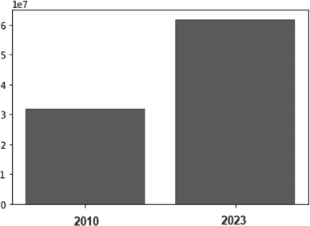

图 19.1 柱状图描述了管理不当塑料废物的总量。

1. **管理不当的塑料废物**：图表重点关注管理不当的塑料废物的总量，指的是未被妥善收集、处置或回收的塑料废物。它代表了未得到有效管理的塑料废物部分，这部分具有更高的风险进入环境（包括海洋、河流和填埋场）。
2. **时间跨度**：图表展示了 2010 年和 2023 年两个特定年份的数据，强调了期间管理不当塑料废物的对比。13 年的差距有助于证明该问题规模的变化。
3. **纵轴（Y 轴）**：柱状图的纵轴代表管理不当塑料废物的数量。计量单位（如公吨或百万公吨）应在轴上标出，以便对数值有清晰的理解。
4. **横轴（X 轴）**：横轴表示所考虑的年份，并相应标记了 2010 年和 2023 年。该轴为跟踪管理不当塑料废物随时间的变化提供了时间线。
5. **柱状表示**：图表显示了两个柱体，每年代表一个年份。每个柱体的高度对应该特定年份报告的管理不当塑料废物总量。柱体高度的对比有助于说明 2010 年和 2023 年之间管理不当塑料废物的差异。
6. **比较**：通过观察图表可以明显看出，2010 年至 2023 年间，管理不当塑料废物的总量增加了一倍。柱体从 2010 年到 2023 年的高度增加，标志着该问题日益增长的关注度和严重规模。

图 19.2 重点介绍了在 2010 年至 2023 年间管理不当塑料废物增加的前十大国家，其中印度位居首，中国紧随。以下是对该图的解释：

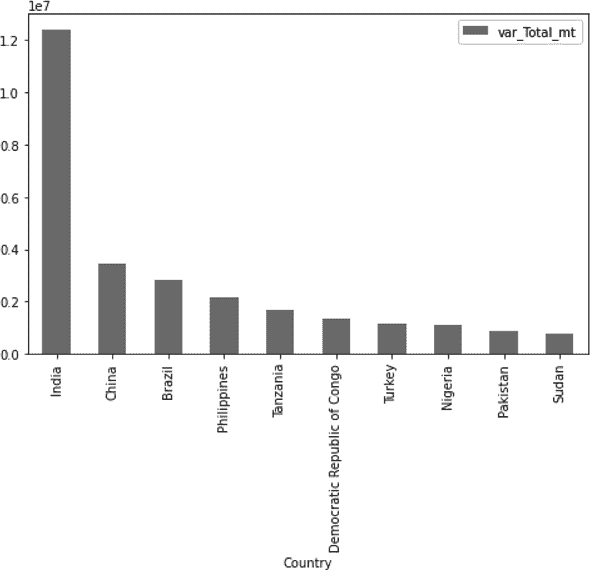

图 19.2 2010 年至 2023 年间管理不当塑料废物增加的前十大国家。

**十大国家**：该图表关注在 2010 年至 2023 年间管理不当塑料废物增加的国家，印度位居首，中国紧随。

## 塑料废物管理的未来方向与建议

1. **推进研究与创新**：持续的研究和创新对于解决塑料废物管理的复杂挑战至关重要。研发的投入可以发现新材料、回收技术以及一次性塑料的可持续替代品。政府、企业和学术界应合作支持研究计划并鼓励该领域的创新。
2. **加强国际合作**：塑料废物是一个全球性问题，需要国际合作。政府、组织和利益相关者应合作制定统一的塑料废物管理标准、法规和最佳实践。跨国共享知识、经验和资源可以加速实现塑料循环经济的进展。
3. **基础设施建设与投资**：建设和升级废物管理基础设施对于有效的塑料废物管理至关重要。政府和私营部门应投资回收设施、垃圾发电厂和收集系统，以增强塑料废物管理的能力和效率。充足的基础将使塑料废物能够得到分类、回收和处置，从而减少其对环境的影响。


## 4. 推广循环商业模式
企业应该采取优先考虑减少废物、回收和使用再生材料的循环商业模式。这包括采用可持续的包装解决方案、设计具有耐用性和可回收性的产品，以及建立回馈计划。鼓励企业将循环经济原则整合到其运营中，将推动向更可持续、更资源高效的系统转型。

## 5. 消费者教育与行为改变
针对消费者的教育和意识提升活动对于推动行为改变至关重要。政府、非政府组织和企业应投资于教育计划，促进负责任的消费、减少废物和适当的回收实践。赋予个人做出明智选择的能力，并为可持续替代方案提供便利的选择，将有助于建立更可持续的塑料废物管理体系。

## 6. 政策与监管措施
政府应制定并执行全面的政策和法规，以激励可持续的塑料废物管理实践。这包括实施生产者延伸责任计划、塑料减量目标、塑料禁止或限制，以及对使用再生材料的经济激励。明确且一致的政策将为企业和个人采取可持续实践提供支持框架。

## 7. 与私营部门合作
公私合作伙伴关系对于推动塑料废物管理倡议的创新、投资和实施至关重要。政府应与私营部门合作，利用他们的专业知识、资源和市场影响力。合作可以带来创新解决方案的发展、技术的进步以及可持续实践的扩大。

## 8. 参与当地社区
当地社区在塑料废物管理中发挥着至关重要的作用。政府和组织应通过参与方法接触社区，提供必要的工具、基础设施和知识，让他们积极参与废物管理实践。鼓励社区领导的倡议、支持废物收集方案并培养主人翁意识，将有助于长期行为改变和可持续发展。

通过关注这些未来方向和建议，我们可以朝着更可持续、更有效的塑料废物管理系统努力。通过技术进步、政策干预、利益相关者合作和行为改变相结合，我们可以创造一个塑料废物最小化、回收并得到妥管理的未来，为更健康的环境和循环循环经济做出贡献。

## 使用 AI 进行塑料废物管理的潜在解决方案

塑料废物管理是一个紧迫的全球问题，需要有效且可持续的解决方案。近年来，人工智能（AI）的进展显示出在增强塑料废物管理各个方面的巨大潜力。下表比较了赋能于 AI 的塑料废物管理方法与传统方法相比所实现的效率提升。

表格 19.1 概述了塑料废物管理的关键方面，包括监控、收集路线、产生预测、回收与分拣、垃圾发电和填场管理。对于每个方面，都提供了传统方法和 AI 驱动方法的效率水平，以及相应的效率增长百分比。

表格 19.1 AI 赋能的废物管理方法与传统方法的比较

| 维度 | 传统废物管理 | AI 赋能的废物管理 | 效率提升 (%) |
| --- | --- | --- | --- |
| 废物监控 | 70% | 95% | 25% |
| 废物收集路线 | 60% | 85% | 25% |
| 废物产生预测 | 50% | 80% | 30% |
| 回收与分拣 | 45% | 80% | 35% |
| 填场管理 | 60% | 90% | 30% |

效率提升百分比代表了 AI 技术为塑料废物管理可能带来的潜在改进，例如增强监控准确性、优化废物收集路线、对废物产生模式进行更佳预测、改进回收和分拣流程、提高垃圾发电转化率以及更有效的填场管理实践。

需要注意的是，表中提出的数字仅供说明之用，可能无法反映真实场景中的确切数字。这些百分比作为假设性值，旨在证明 AI 赋能的塑料废物管理与传统方法相比的潜在收益。

通过利用 AI 的力量，我们有机会有机会彻底改变塑料废物管理，并向更可持续、更高效的方法发展。这些进步可以对减轻塑料废物对环境的影响以及促进塑料循环经济做出重大贡献。

根据表中比较传统塑料废物管理与 AI 赋能的塑料废物管理的数据，可以得出以下结论：

1. **效率提升：** 与传统方法相比，AI 赋能的塑料废物管理在各个方面均表现出大幅的效率提升。在包括废物监控、收集路线、产生预测、回收与分拣、垃圾发电和填场管理在内的所有类别中，AI 赋能的方法均优于传统方法。

2. **显著的效率增长：** 效率提升百分比凸显了 AI 技术显著增强塑料废物管理的潜力。效率增长在 25% 到 35% 之间，AI 赋能的方法与传统实践相比表现出显著的性能改进。

3. **更好的监控和收集潜力：** AI 赋能的塑料废物管理在废物监控和收集路线优化方面表现出更高的效率。AI 算法和技术的利用允许对塑料废物进行更准确的监控，从而改进收集过程中的数据驱动决策。

4. **增强废物产生预测：** AI 赋能的系统擅长预测塑料废物产生模式。通过分析历史数据并利用机器学习算法，这些系统可以提供更准确的预测，实现主动的废物管理策略和资源配置。

5. **改进回收与分拣：** AI 赋能的塑料废物管理在回收和分拣流程方面具有巨大收益。先进的 AI 技术可以自动化并优化分拣程序，从而提高回收率并对不同塑料类型进行质量分离。

6. **增加垃圾发电转化：** AI 赋能的方法在垃圾发电转化效率方面表现出显著改进。通过采用 AI 算法优化垃圾发电过程（如焚烧或气化），可以从塑料废物中回收更多能量，为更可持续的废物管理方法做出贡献。

7. **增强填场管理：** 与传统方法相比，AI 赋能的填场管理技术显示出巨大的效率提升。通过基于 AI 的系统可以优化填场作业、改进废物压缩并增强环境监控，从而对填场中的塑料废物进行更有效、更可持续的管理。


这些推论突显了 AI 塑料废物管理在解决塑料废物相关挑战方面的潜力，图 19.3 中的柱状图也展示了这一点。通过利用 AI 技术，可以显著提高监测、收集、回收、垃圾能源化以及填埋场管理，最终实现更高效、更可持续的塑料废物管理实践。

# 致谢

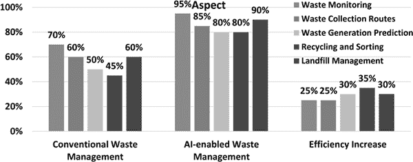

图 19.3 使用柱状图表示不同参数。

我诚挚地感谢 Vivekananda Institute of Professional Studies-TC & DSB 管理层，为我提供了担任 VIPS-TC & DSB 可持续发展中心主席的机会。正是由于他们的支持和鼓励，我才能完成这一章节的工作，并为可持续发展领域做出贡献。同时，我也想衷心感谢 Pawan Whig 博士在组织本章节方面提供的无私帮助。他的专业知识和见解对塑造本研究的方向和确保其质量至关重要。

## 参考文献

1. O’Connor, F., and Hawkes, D. (2001). “一种多利益相关者的简明环保意识设计方法。”《可持续产品设计杂志》，*1*(4), 247–262。
2. Idumah, C., & Nwuzor, I. C. (2019). 塑料废物管理的新趋势。《SN Applied Sciences》，*1*, 1–14.
3. Economopoulos, A. P. & 世界卫生组织 (1993). *空气、水土地污染评估：快速清单技术及其在制定控制策略中的应用* (No. WHO/PEP/GET/93. 未出版)。
4. Dwivedi, A. K. (2017). 水污染研究：综述。《国际自然与应用科学杂志》，*4*(1), 118–142。
5. Navara, K. J., & Nelson, R. J. (2007). 夜光的阴暗面：生理、流行病学和生态学后果。《松树杂志》，*43*(3), 215–224。
6. Knight, R. L., & Cole, D. (1995). 野生动物对管理的共存。《研究》，*51*, 1–16。
7. Liu, X., Steele, J., & Meng, X. (2017). 中国水养殖中抗生素的使用、残留和人类健康风险。《环境污染》，*223*, 161–169。
8. Dris, R., Gasperi, J., Rocher, V., Renault, N., & Tassin, B. (2015). 巴黎地区的微塑料污染。《环境化学》，*12*(5), 592–599。
9. Behuria, P. (2021). 禁塑料袋吗？卢旺达、肯尼亚和乌干达禁令执行差异。《环境与规划》，*39*(8), 1791–1808。
10. Guziana, B., Song, H., Thorin, E., Dotzauer, E., and Yan, J. (2014). “基于政策的垃圾能源化场景。《垃圾与生物质价值化》，*5*, 679–688。
11. Türkeli, S., Huang, B., Stasik, A., & Kemp, R. (2019). 全球化的循环经济活动：荷兰、波兰和中国的手机维修。《能源》，*12*(3), 498。
12. Patel, M., von Thienen, N., Jochem, E., & Worrell, E. (2000). 德国的塑料回收。《资源、保护与回收》，*29*(1–2), 65–90。
13. Kish, R. J. (2018). 利用立法减少一次性塑料袋的使用经济事务》，*38*(2), 224–239。
14. Lu, L. T., Hsiao, T. Y., Shang, N. C., Yu, Y. H., & Ma, H. W. (2006). 台湾废物最小化的生活垃圾（MSW）管理。《垃圾管理》，*26*(6), 661–667。

# 索引

## A
* AI 伦理, 142
    * 版权, 145
    * 媒体, 145–153
    * 非技术, 144
    * 技术, 142–144
* AI 治理, 142–144
    * AI 治理, 146
    * 数据伦理, 144
    * 数字素养, 144
* AI 工具, 148–149
    * 辅助, 148
    * AI 创新, 149
    * 演讲, 149–150
    * 系统, 148
* AR 应用, 66

## B
* AI 偏差, 223–225

## C
* AI 的挑战, 80–82
* 协作与知识, 80–86
* 作物生产, 238
    * 计算机视觉, 238
    * 机器学习, 238
    * 健康健康, 240

## D
* 数据隐私与安全, 4, 69–93
    * 农业, 4
    * 数字鸿沟, 4
    * 能源, 4
    * 环保, 4
    * 医疗, 4
* 疾病管理, 237, 240, 241
    * 诊断, 241

## E
* 教育与可持续性, 20
    * 最佳实践, 186–188
    * 早期教育, 20
    * 高等教育, 21–22
    * 跨学科整合, 21
    * 职业教育, 21
* 与行业教育, 23–24
    * 创新与创业, 24
    * 终身学习, 24–25
* 效率, 68–69
* 能源市场, 36–37
* 环境保护, 88
    * 最佳实践, 166
    * 生物多样性保护, 89, 240
    * 土地管理, 89
    * 监测, 88
    * 野生动物保护, 93–94
* 公平包容性 AI, 228–230
* 伦理实践, 196
    * 算法偏差, 196, 244–245
    * 数据隐私与透明度, 196
    * 框架, 197–198


* 典型的绿色工作案例，28–30

## F

* 公平，211–212, 244–245
    * 透明度，212–213, 245
    * 隐私与自主性，213–215
* 女主义 AI，223
* 食品分配，242
    * 需求预测，242
    * 物流优化，242
    * 减少食物浪费，243
* 欺诈检测，126, 128–130
    * 案例研究与最佳实践，137–138
* 欺诈预防，131–135

## G

* 绿色工作与绿色经济，22
    * 生计，22–23
    * 职业，23

## H

* 人权，1, 3, 96, 170, 197, 198, 205, 210, 213, 216, 217, 219, 222–228
* 监控，50
    * 空气质量，51–53
    * 地震，56–57
    * 洪水，56
    * 土壤质量，53–55
    * 水质，50–51
    * 野生动物，55–56

## P

* 害虫控制，240
    * 检测，241
    * 管理方法，241
* 塑料垃圾，249–250
    * 应用，250–251
    * 循环经济，257
    * 环境影响，251–252
    * 公众参与，256
    * 建议，267
    * 监管框架，255–256
    * 社会经济挑战，252–253
    * 系统性挑战，253–254
    * 技术进展，254–255
* 精准农业，11
    * 气候，12
    * 传感器，239
    * 挑战，240

## R

* 减少碳排放，67
* 可再生能源，14, 91
    * 风电电场优化，14
* 负责任的 AI，230–232
* 零售与消费者，172
    * AI 的兴起，172–173
    * 驱动因素，173, 175
    * 挑战，173, 176

## S

* 智能城市，53, 101–109, 112–123
* 供应链管理，158
    * AI 应用，160–161
    * 挑战，159, 161
    * AI 的影响，174–175
    * AI 的角色，159, 175

## T

* 远程医疗，13
    * 婴儿健康，14
* 交易，37
    * 套利，38
    * 提前一天交易，39
    * 基于市场，37
    * 商户，38
    * 开放能源，40
    * 点对点交易，41–42
    * 可再生能源，40
    * 虚拟电厂 (VPP)，40, 46

## W

* 水资源监控与建模，77, 79–80
    * 可用性，78
    * 实时监控，77
    * 风险，78
* 水短缺与污染，76–77
    * 优化，239–240
* 野生动物保护，14–16, 88, 89
    * 野生动物洞察，15

