# 人工智能与机器学习基础：从经验中学习


- 前言

## 1. 人工智能的基础](#index_split_014.html#id_Top_of_content0012_xhtml)
### 1.1 理解人工智能](#index_split_015.html#id_Top_of_content0013_xhtml)
### 1.2 什么是伦理与可信的 AI？](#index_split_016.html#id_Top_of_content0014_xhtml)
### 1.3 总结](#index_split_018.html#id_Top_of_content0015_xhtml)

## 2. 伦理与治理](#index_split_019.html#id_Top_of_content0016_xhtml)
### 2.1 伦理 AI](#index_split_020.html#id_Top_of_content0017_xhtml)
### 2.2 理解 AI 给项目带来的风险](#index_split_021.html#id_Top_of_content0018_xhtml)
### 2.3 监管与风险管理](#index_split_022.html#id_Top_of_content0019_xhtml)
### 2.4 总结](#index_split_023.html#id_Top_of_content0020_xhtml)

## 3. AI 赋能者、技术与应用](#index_split_024.html#id_Top_of_content0021_xhtml)
### 3.1 AI 的常见示例](#index_split_025.html#id_Top_of_content0022_xhtml)
### 3.2 AI、机器学习与机器人技术](#index_split_026.html#id_Top_of_content0023_xhtml)
### 3.3 机器学习概念](#index_split_027.html#id_Top_of_content0024_xhtml)
### 3.4 总结](#index_split_028.html#id_Top_of_content0025_xhtml)

## 4. 数据与 AI](#index_split_029.html#id_Top_of_content0026_xhtml)
### 4.1 AI 中的数据](#index_split_030.html#id_Top_of_content0027_xhtml)
### 4.2 数据管理与利用](#index_split_031.html#id_Top_of_content0028_xhtml)
### 4.3 生成式 AI](#index_split_032.html#id_Top_of_content0029_xhtml)
### 4.4 总结](#index_split_033.html#id_Top_of_content0030_xhtml)

## 5. 组织中的 AI](#index_split_034.html#id_Top_of_content0031_xhtml)
### 5.1 AI 机会与业务案例](#index_split_035.html#id_Top_of_content0032_xhtml)
### 5.2 利益相关者与项目管理](#index_split_036.html#id_Top_of_content0033_xhtml)
### 5.3 风险、成本与治理](#index_split_037.html#id_Top_of_content0034_xhtml)
### 5.4 总结](#index_split_038.html#id_Top_of_content0035_xhtml)

## 6. 未来方向与职业](#index_split_039.html#id_Top_of_content0036_xhtml)
### 6.1 AI 带来的职业机会](#index_split_040.html#id_Top_of_content0037_xhtml)
### 6.2 现实世界中的 AI](#index_split_041.html#id_Top_of_content0038_xhtml)
### 6.3 AI 的未来](#index_split_042.html#id_Top_of_content0039_xhtml)
### 6.4 意识与 AI](#index_split_043.html#id_Top_of_content0040_xhtml)
### 6.5 总结](#index_split_044.html#id_Top_of_content0041_xhtml)

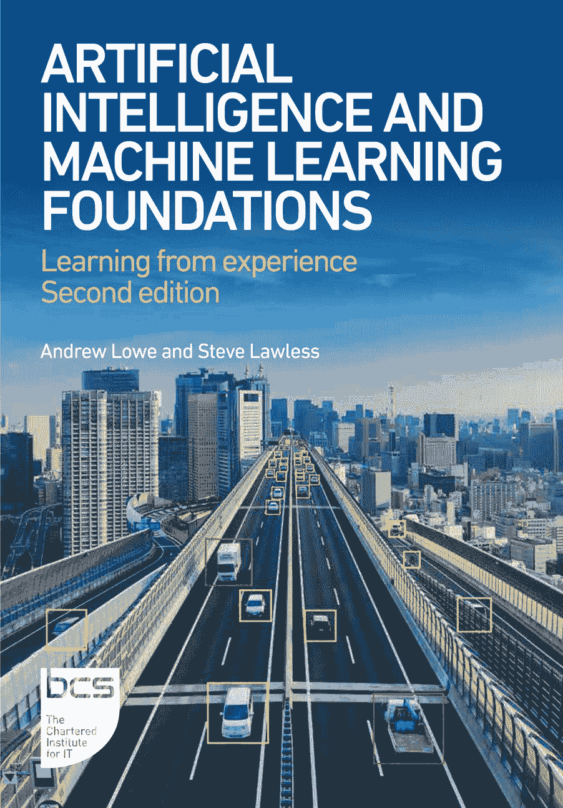


《人工智能与机器学习基础》是对 AI 的深度探索，涵盖了核心概念、机器人技术及其应用，由两位经验丰富的作者以易于懂的方式呈现。对于想要进入 AI 的人来说，这是非常宝贵的资源。

Darren Winter，Duco Training 经理

对于想要了解更多 AI 但没有相关学位背景的人来说，这本书是一部不错的读物。它以充满热情的方式让初学者入门，并将复杂的课题变得易于理解。对于基础级书籍来说，它涵盖的内容非常广泛，并对机器学习提供了坚实的基础。

Rosie Sheldon，TSG 高级培训师

许多评论家认为 AI 是第五次工业革命的关键推动力。在这本全新的 BCS AI 指南中，Andrew Lowe 和 Steve Lawless 清晰地阐述了核心概念，不仅有助于通过考试，还能激发对人机关系的想象。

Richard Webber，Digital Transformation 经理

这本书产生了许多思想和想法，作者还带了幽默元素。这是一件艺术品，对于想要浸入该主题的人来说是必读的。

David Mondón Tapia，DieresiS 商业与专业顾问

书中为 AI 的理论和应用提供了基础，且不依赖数学或数据科学技能。书中生动地说明了 AI 的成功案例与挑战，将为读者在人工智能领域的经验学习提供极大的价值。

Mark Ainsworth，Promising ICT Limited 董事监兼业务分析师


BCS，英国信息技术工程师学会致力于让 IT 为社会做出贡献。我们利用网络的力量带来积极、切实的改变。我们倡导全球 IT 行业以及从业人员的利益，以造福所有人。

## 交流 IT 专家与知识

学会促进业界、学术界和商业专家之间的联系，以推动新的思维、教育和知识共享。

### 支持从业人员

通过持续职业发展和一系列受认可的 IT 资格认证，学会旨在促进符合业务需求的专业实践。它为全球成员和志愿者社区提供实用的支持和信息服务。

### 标准与框架


本学会与政府、行业及相关机构合作，建立良好的工作实践、行为准则、技能框架和通用标准。它还为雇主提供系列咨询服务，帮助他们采用最佳实践。


超过 70,000 名包括学生、教师、专业人士和从业人员在内的人士享有 BCS 会员。这些包括接入国际社区、参加当地和国家活动的邀请、职业发展工具以及一份季刊思想领导力杂志。访问 `www.bcs.org` 了解更多。


- 前言


## 作者

**Steve Lawless** – Steve 对科学技术一直有浓厚兴趣，在计算机行业工作了 40 多年。Steve 培训了数以千计的人使其使其运行计算机所需的技能。他在当地滑雪俱乐部做志愿者认识了 Andy。他经营着一家成功的培训公司，拥有全球客户群。他编写了超过 100 门 IT 培训课程，并乐于让技术变得易于理解和获取。

**Dr Andrew Lowe** – Andy 是一位工程师，专门利用计算机解决工程师面临的挑战。从经验学习和从数据学习是他职业生涯的基石，这有助于他的日常工作。他处理的一些问题只有通过超级计算机解决。他在剑桥大学获得博士学位，并在学术界和工业界工作过。他还帮助年轻的 AI 初创公司获得了关注。

## 致谢

我们要感谢我们耐心等待的家人。将经验学习汇编成一本简单易懂的书需要花费如此长时间，令人惊讶。AI 的技术方面具有挑战性，因此众多的老师、讲师、主管、导师和教练多到无法逐一感谢。感谢你们，你们知道自己是谁，特别是那些将讲座和笔记发布在网上供大家学习的人士。

曾在 Sellafield Sites Ltd 工作过的 Paul Mort 博士是 AI Essentials 和 AI Foundation 课程的热心爱好者和支持者。他在审核课程时提出的挑战性问题使我们思考得非常仔细，我们感谢他。Paul 是一位机器人专家，我们深知 AI 是一个比机器学习丰富得多、更广泛的主题。

BCS 在整合这本书和课程方面发挥了巨大作用。我们想不分先后地感谢 Ian Borthwick、Heather Wood、Tope Gay、Gillian Cullen 和 James Benefield。我们确定还有许多其他人参与了其中。谢谢。

Wikipedia 也发挥了巨大作用；在可能的情况下，我们让获取信息和参考变得简单易行。感谢所有将作品发布在网上供大家学习的作者们。

我们希望你在这书中发现有用的内容，而且最重要的是，在学习过程中保持怀疑、批判和严谨的态度，但我们更希望你能够从经验中学习。

我们是人——我们会犯错，并乐意听到所有的反馈，无论好坏。这是科学方法和从经验中学习的一部分。通过 LinkedIn 联系我们：`www.linkedin.com/in/stevelawless`。


`3D` 三维
`ABM` 基于智能体的建模
`AGI` 人工通用智能
`AGV` 自动引导车
`AI` 人工智能
`AIMS` 人工智能管理系统
`AIOps` 人工智能辅助 IT 运营
`ANN` 人工神经网络
`AR` 增强现实
`ASIMO` 创新移动高级步
`CNN` 卷积神经网络
`cobots` 协作机器人
`DARPA` 美国国防高级研究计划局（美国）
`DBN` 深度信念网络
`DNN` 深度神经网络
`DPA` 数据保护法
`EQ` 情感商
`EU` 欧盟


- `FAT/ML`: 机器学习中的公平性、问责性和透明度
- `GAN`: 生成对抗网络
- `GDPR`: 通用数据保护条例
- `Gen AI`: 生成式人工智能
- `GOMS`: 目标、操作、方法和选择规则
- `GPAI`: 通用人工智能
- `GPT`: 生成式预训练变换器
- `GPU`: 图形处理器
- `HCAI`: 以人为中心的人工智能
- `HCI`: 人机交互
- `HITL`: 人在回路
- `IA`: 智能自动化或增强
- `ICT`: 信息与通信技术
- `IEC`: 国际电工委员会
- `IoT`: 物联网
- `ISO`: 国际标准化组织
- `KNN`: K-近邻算法
- `LSTM`: 长短期记忆
- `MHP`: 模型人类处理器
- `ML`: 机器学习
- `MLOps`: 机器学习运维
- `MLP NN`: 多层感知器神经网络
- `ModelOps`: 模型运维
- `NI`: 自然智能
- `NIST`: 美国国家标准与技术研究院
- `NLP`: 自然语言处理
- `NMT`: 神经机器翻译
- `NN`: 神经网络
- `OCR`: 光字符识别
- `PDF`: 概率密度函数
- `PESTLE`: 政治、经济、社会、技术、法律和环境
- `RBM`: 受限玻尔兹曼机
- `RNN`: 循环神经网络
- `ROI`: 投资回报率
- `RPA`: 机器人流程自动化
- `SVM`: 支持向量机
- `SWOT`: 优势、劣势、机会、威胁
- `TAM`: 技术接受模型
- `UCD`: 以用户为的设计
- `UX`: 用户体验
- `VAE`: 变分自动编码器
- `VR`: 虚拟现实
- `WCAG`: 网页内容无障碍指南
- `XAI`: 可解释人工智能

# 前言

本书的编写目的明确，旨在支持 BCS 人工智能核心技能证书、BCS 人工智能基础证书培训课程，以及 BCS AI 课程路线图中正在开发的其他计划课程。

其目标是记录人工智能和机器学习是什么，以及它们不是什么，将事实与虚言分开，并教育对人工智能和机器学习感兴趣的人士。我们包含了一些介绍机器学习基础和伦理的话题。

我们认为这本书书是相对独特的，因为它在同一本书中汇集了直到为止分散在许多其他卷册中的信息和概念。这本书的目标还尽可能地（在可能的情况下）简化复杂且难以理解的概念，让那些没有相关领域高级学位的人士也能轻松理解这一主题。

标准人工智能教材（`Russell and Norvig, 2016`）的作者 Stuart Russell 和 Peter Norvig 解释说，人工智能是一门通用的学科，对我们所有人都有益处。从经验中学习是人工智能的特征。我们将经常使用这一点，它不仅适用于机器，也适用于人类，或许对人类更为如此。爱因斯坦常被引用说：“知识的唯一来源是经验”。

问问自己一个问题：从经验中学习在哪里？机器可以帮助吗？如果这个问题的答案是肯定的，那么人工智能就能帮助你！

我们希望在这里通过平衡理论与实践让这些概念变得生动。我们希望 AI 项目中的人类部分与 AI 本身一样重要。毕竟，机器的出现是为了为我们人类分担负担。不仅如此，还为了赋予我们自己无法完成的额外能力。人类和机器具有独特的能力，找到正确的平衡至关重要。我们还没有受到诱惑去写一本目前非常流行的机器学习课程。如果我们这样做，我们就得以某种方式拉伸、扭曲和操纵它来解释意识和机器人学等概念。即使是解释狭义和通用人工智能（`AGI`）也是棘手的。而要拥抱实用的人类的一面几乎是不可能的。BCS 也是一个特许协会，可以认证工程师成为特许工程师并获得 `CEng` 头衔。本课程正涵盖了这一点。


列奥纳德·达·芬奇在艺术中捕捉了他科学的精髓（Wikipedia Contributors, 2024c）。勒内·笛卡尔说“我思故我在”（Wikipedia Contributors, 2024b）。阿达·洛芙莱斯编写了第一个算法，并就技术对人类和社会的作用撰写了笔记（Wikipedia Contributors, 2024a）。尼尔·阿姆斯特是第一个踏上月球的人，他彻底改变了我们对世界的看法（Wikipedia Contributors, 2024d）。罗杰·班尼斯特是第一个在四分钟内跑完一英里的人（Wikipedia Contributors, 2024h）。卡伦·斯帕拉克·琼斯博士为我们提供了搜索引擎的理论基础（Wikipedia Contributors, 2024e）。屠呦是一位坚韧的科学家，她发现了治疗疟疾的药物，这让她在 2015 年获得了诺贝尔和平奖（Wikipedia Contributors, 2024f）。屠呦的才华令人惊，在完善她的疗法后，她自愿成为首位接受测试的人。我们可以问问自己，这是自信还是勇气。

我们在这里其实是为了引入“主观性”的概念。我们拥有自由意志，每个人都有独特的主观体验。我们是有意识的、主观的，而我们在开发人工智能的过程中，意识经验是我们需要高度关注的事物。

罗伯特·斯坦伯格为我们提供了一个实用的人类智能定义（Sternburg, 2017），至少在与人工智能相关的方面是：

人类智能：一种心理品质，由从经验中学习、适应新情况、理解和处理抽象概念以及利用知识来操纵环境的能力组成。

在这里，我们可以迅速识别出以某种方式操纵环境的愿望，以及我们将利用人类才华来实现这一点。这是一个普遍的需求，因此我们仍然需要识别人类从经验中学习的类型，或者换句话说，机器可以帮助我们做什么。

人类智能有时被称为自然智能（NI），通常被认为是人类的智力成就，并被哲学家们讨论了数千年。当然，其他生物在某种程度上也拥有自然智能，但目前我们只考虑人类智能即可。虽然我们带有偏见，但可以说人类是地球上最智能的生物体。正如我们在石器时代和铁器时代开发工具一样，我们现在正在装备机器来帮助我们的智力活动。

我们可以将其表述为得出正确的结论——假设和测试——并理解什么是真实的，尽管我们有时会出错。它还关乎如何理解复杂问题，如天气预测或赢得象棋；通过抽象、归纳、简化和创造力等手段来适应我们所学的知识。它允许我们适应和控制环境并进行社交互动，从而赋予我们进化上的优势。

从多个角度考虑人类智能可能也有意义，例如：

* 语言智能——向他人传达复杂思想的能力。
* 数学智能——解决复杂问题的能力。
* 人际智能——从他人的角度看问题的能力，或者从共情的意义上理解他人。

那么，我们如何获得这些特定的技能或特征呢？通过从经验中学习。人类学习是获取知识的过程。它从很小就开始，甚至在我们出生之前。我们的行为、技能、价值观和伦理是在通过头脑处理信息并从这些经验中学习时获得和发展的。人类学习可能发生在教育、个人发展或任何其他非正式/正式训练中，是一个贯穿一生的持续过程。每个人对不同的学习风格和技术都有偏好（例如：视觉型、听觉型、动觉型等）。

### 1.1.1.2 科学方法

自 20 世纪 80 年代以来，人工智能采用了科学方法（Russell and Norvig, 2016）。科学方法（Wikipedia Contributors, 2024g）是一种系统性的实证方法，用于获取新知识或纠正和整合之前的知识。它依赖于经验证据并通过控制实验和观察对假设进行测试。这种方法是科学探索的基础，其结构旨在最小化偏见并最大化客观性和可重复性。维基百科通过识别以下内容使这一点更加明确：

* 仔细观察；
* 严谨的怀疑；
* 提出假设；
* 用于测试的实验；
* 假设的完善。

该过程从仔细观察开始。科学家观察现象并收集数据，记录模式和异常。这些观察通常会导致对某事如何发生或为何发生的问题（严谨的怀疑）。例如，一位生物学家可能会注意到特定物种在一种环境中繁荣而在另一种环境中却不然，并好奇哪些因素导致了它的成功。

观察之后，科学家制定假设。假设是一个可以测试的陈述，对观察到的现象提出潜在的解释。它应该是具体的且可衡量的。例如，生物学家可能假设植物的繁盛是因为氮水平的原因。

下一步是实验。实验被设计用于在控制条件下测试假设。它们应该包括一个不接受实验处理的对照组，以及一个或多个接受处理的实验组。目标是隔离正在测试的变量以确定其影响。继续之前的例子，生物学家可以在不同氮水平的土壤中种植该物种，同时保持其他因素不变。

进行实验后，科学家进行数据分析。他们收集并检查数据，以查看其是否支持或反驳假设。通常采用统计方法来确定结果的显著性。

根据数据分析，科学家得出结论。如果假设得到支持，就可以导致进一步的实验和完善。如果得不到支持，假设可能会被拒绝或修改。

科学方法的一个重要方面是重复性。结果必须由其他研究人员遵循相同的方法进行重现。这确保了发现不是由于偶然或特定的实验条件。同行评审和在科学期刊上发表促进了这一点，允许其他科学家审视和复制工作。

最后，科学方法是一个迭代过程。新的问题经常从一项研究的结论中产生，导致新的假设和实验。这种循环建立了对自然世界更稳健的理解。随着时间的推移，持续经受严谨测试的假设有助于科学理论的发展，科学理论是基于大量证据对自然现象的全面解释。

因此，科学方法不仅是一个步骤，而是一个动态且持续的探索过程，推动着科学进步。它强调了怀疑、批判性思维和对深层理解不断追求。通过这种方法，科学不断进化，扩展了我们解决复杂问题和挑战的知识能力。

### 1.1.1.3 人工智能

简单来说，人工智能是机器展示的智能，与人类和其他动物展示的智能形成对比。人工智能是关于创建智能实体的。


Stuart Russell 和 Peter Norvig 是标准人工智能教科书《人工智能：现代方法》（Artificial Intelligence: A Modern Approach，2016）的作者，他们解释说 AI 是一门通用的学科，对我们所有人都有帮助。从经验中学习是 AI 的特征。我们将频繁使用这个概念；它对机器和对人类同样适用，或许对人类更为如此。

爱因斯坦经常被引用说：“知识的唯一来源是经验。”问问自己：机器能帮助我们从经验中学习吗？如果这个问题的答案是定的，那么 AI 就能帮助你。

### 1.1.1.4 机器学习

在本节中，我们需要区分机器学习（ML）和人工智能（AI）。这不是一项容易的任务，除非我们提醒自己 AI 是一个通用的学科，可以帮助任何通过经验学习来实现目标的追求（Russell and Norvig, 2016）。ML 只是其中的一部分——区别始于对 AI 智能体和 ML 的定义。汤·米切尔（Tom Mitchell）定义的 ML 是通常被引用的（Mitchell, 2018）；它与我们生活中各个部分的数字计算紧密相关。

如果一个计算机程序对于某些任务类别 `T` 和性能衡量标准 `P`，其在 `T` 任务上的性能（通过 `P` 衡量）随着经验 `E` 的增加而提高，则认为是从经验 `E` 中学习。

AI 关乎智能实体或 AI 智能体与环境交互以实现目标。不仅仅是一个实体，而是多个。AI 关乎人和机器，它们如何互动、如何学习、经历什么。AI 要求我们明确人类如何实现他们的目标。我们能构建出可以与之协作以提升人类自身的机器吗？AI 对意识、哲学、伦理和科学提出了严峻的问题。它处理我们目前还没有机器去探索的复杂现象。未来的 AI 将关人类和机器如何共存。2019 年，Stuart Russell 发布了他关于人类兼容 AI 的最新著作《人类兼容：人工智能与控制问题》（Human Compatible: Artificial Intelligence and the Problem of Control，2019），该书揭示了 AI 的本质，以及如果我们使用得当，如何从人机共处的未来中受益。

随着我们开始意识到数字计算 ML 的益处，这将释放 AI 在其他领域的潜力，例如：

- 工程和构建智能实体；
- 医疗以及改善健康和社交护理；
- 业务分析等。

当我们仅仅思考产品时，在数字模拟中表示世界——或（目前的） 0 和 1——并不是理想的。数字计算有其局限性，我们需要更好的机器。我们已经耗尽数字处理能力。AI 不仅仅是高性能计算处理 0 和 1 的机器编程——数字模拟的披萨尝不出任何味道，数字天气也不会让让我们淋湿。

未来的 AI 机器将整合数字计算机，但当我们思考时，实际上要表示我们所需的数学运算是非常困难的。我们受限于今天技术的处理能力、能量和准确性——结果是，我们只能专注于狭义机器学习（narrow ML），专注于特定的、定义良好的任务或目标。

这些类型任务的示例包括玩国际象棋、跳棋和西洋棋等游戏。现代游戏包括模拟游戏以及非常先进的策略性、工程精良的游戏，如围棋；这类游戏可以在数字计算机上被明确定义。现实世界的实际例子包括优化飞机在机场的停放位置或包裹交付的物流；同样，这是一个足够良好且经过工程设计的环境，ML 在其中可以优化某些事物。

ML 专注于明确定义一个可以在计算机上解决的问题。这些问题可能是复杂的、非线性和统计性质的。如果我们要在 AI 中使用 ML，我们必须能够以数学方式表示我们的问题，并使其能够被机器解决。今天，我们通常使用数字计算机。然而，量子、模拟、光学和生物计算机正在路上。

### 现实世界并非数字模拟

如果我们对一切都进行数字化设计会发生什么？我们会信任完全由数字建模设计的东西吗？在这个方框中，我们不会关注单一示例，而是观察一个已经存在了约 20 年的概念——数字孪生（digital twin）。

数字孪生是 AI 用于从数字模拟、可能还有传感器中学习的一个例子；有很多该概念被成功使用的案例（Wikipedia Contributors, 2024i）。我们还需要注意，仅仅因为我们模拟了某些，并不意味着它在现实中的表现是相同的。

数字孪生有多种定义，如果不仔细考虑它是否是对世界的良好表示，就不应该开始使用。即使是简单的地球天气模型也被证明是极其复杂的，需要大型超级计算机来完成。

AI 还可以借鉴系统方法（system of systems approach）来对复杂系统进行建模——许多子系统结合后会发展出越来越复杂的行为。这种方法的优点是作为门学术学科，与支撑 AI 和 ML 的基础学科紧密相关。这些方法的示例包括用于可持续性的基于智能体的建模（agent-based modelling）和生命周期分析。通过系统方法，你可以将较大的问题拆分为可管理的区块。事实上，我们可能会发现一个系统需要巨大的计算能力，以至于更大的数字孪生可能不可行，甚至不现实。在这种情况下，我们需要构建一个子系统的模型，并将其整合到系统方法中。

使用系统方法构建的数字孪生概念可能有助于确保我们的 AI 以人为中心、技术上稳健且可信。

数字 ML 近期变得非常流行，归功于卷积深度神经网络（`NNs`）的成功，以及最近的生成式 AI。这些数值技术让我们理解了人类大脑如何解决问题。为了澄清这一点，人类眼睛的运作导致了 `NNs` 的突破：卷积神经网络（`CNN`）。因此，当我们思考 ML 时，可以将其视为 AI 智能体从数据中学习。

### 1.1.1.5 深度学习与生成式 AI

深度学习和生成式 AI 是狭义机器学习旅程中的重要里程碑；改变了我们与技术交互以创造艺术和科学领域新可能的方式——这些技术正在重塑我们的世界。随着研究进展，我们可以期待更多创新应用和突破，使深度学习和生成式 AI 成为未来不可或缺的一部分。


深度学习具有建模和理解数据中复杂模式的能力。它们建立在对人工 `NNs` 的使用之上，这种技术可以追溯到近百年前。从本质上说，它们是大脑的简单数学模型。深度学习模型由多个层组成，包括输入层、若干隐藏层和一个输出层。每一层都包含处理和转换数据的节点（神经元）。网络的深度（即层数）使其能够学习数据的层次化表示，捕获不同抽象层次的复杂特征。“深（deep）”一词概括了我们在大型模型中看到的大量层数。

显著的应用包括自动驾驶汽车，深度学习算法在其中实现了感知和决策；以及医疗保健领域，深度学习协助诊断疾病并预测患者预后。此外，深度学习模型驱动着推荐系统，增强了 Netflix 和 Amazon 等平台上的用户体验。在自然语言处理（NLP）中，循环神经网络（RNNs）和 transformers 显著改进了机器翻译、情感分析和语言生成。

生成式 AI 创造新内容，而不是分析现有数据。这是通过生成式模型实现的，这些模型学习数据的底层分布，并能够产生类似于训练数据的新颖样本。两种主要的生成式模型类型是生成对抗网络（GANs）和变分自动编码器（VAEs）。GANs 在生成高质量图像、视频甚至音乐方面发挥了重要作用。它们在艺术、时尚和内容创作中有着应用，允许合成新的创造性作品。在这里，我们看到了这引发的伦理和法律问题的直接挑战。

AI 基础模型是大规模 ML 模型，在海量多样化数据上进行训练以执行各种任务。它们在 AI 行业内部开发，而学术界目前正在进行严谨的基础研究（Bommasani et al., 2021）。这些模型（如 `GPT-4`）旨在利用深度学习技术和广泛的 `NN` 架构来理解并生成类人文本。它们为各种 AI 应用（包括 NLP、图像识别和决策系统）提供了基础支撑。通过在广泛的数据集上进行预训练，基础模型可以使用相对较少的数据针对特定应用进行微调，使其具有极高的适应性和效率。它们广泛的能力和扩展性开启了 AI 领域，使得更复杂、更多用途的 AI 解决方案成为可能。

### 1.1.1.6 弱人工智能、通用人工智能和超智能人工智能的区别

弱人工智能或狭义人工智能是专注于特定任务的 AI（Russell and Norvig, 2016）。今天流行的 ML（以及我们在云数字服务中发现的能力）是狭义人工智能，或狭义 ML，专注于特定任务（例如监督学习和无监督学习）。狭义 ML 的示例包括支持向量机（SVMs）、决策树和 K-近邻（KNN）算法。它们基于特定任务测试假设。从经验中学习是针对特定的、聚焦的任务的。

通用人工智能（AGI）是一种能够学习人类可以胜任的任何智力任务的机器。它是假设性的，对于通用的 AI 和 ML 而言并非必须的。这种假设的 AI 类型通常是推测的主题，有时令人类感到恐惧。我们距离 AGI 还远得很，在接近实现它之前，可能还需要几十年甚至几个世纪。

AGI 可以更得进一步。科幻小说痴迷于假设具有意识的机器；强 AI 是同样具有意识的 AGI。意识是复杂且困难的。有些人认为它是 AI 中最困难的问题。在第 6 章中有更详细的介绍。

AGI 可以更得进一步。科幻小说痴迷于假设具有意识的机器；强 AI 是同样具有意识的 AGI。意识是复杂且困难的。有些人认为它是 AI 中最困难的问题。在第 6 章中有更详细的介绍。

AGI 可以更得进一步。科幻小说痴迷于假设具有意识的机器；强 AI 是同样具有意识的 AGI。意识是复杂且困难的。有些人认为它是 AI 中最困难的问题。在第 6 章中有更详细的介绍。

AGI 可以更得进一步。科幻小说痴迷于假设具有意识的机器；强 AI 是同样具有意识的 AGI。意识是复杂且困难的。有些人认为它是 AI 中最困难的问题。在第 6 章中有更详细的介绍。

AGI 可以更得进一步。科幻小说痴迷于假设具有意识的机器；强 AI 是同样具有意识的 AGI。意识是复杂且困难的。有些人认为它是 AI 中最困难的问题。在第 6 章中有更详细的介绍。

AGI 可以更得进一步。科幻小说痴迷于假设具有意识的机器；强 AI 是同样具有意识的 AGI。意识是复杂且困难的。有些人认为它是 AI 中最困难的问题。在第 6 章中有更详细的介绍。

AGI 可以更得进一步。科幻小说痴迷于假设具有意识的机器；强 AI 是同样具有意识的 AGI。意识是复杂且困难的。有些人认为它是 AI 中最困难的问题。在第 6 章中有更详细的介绍。

AGI 可以更得进一步。科幻小说痴迷于假设具有意识的机器；强 AI 是同样具有意识的 AGI。意识是复杂且困难的。有些人认为它是 AI 中最困难的问题。在第 6 章中有更详细的介绍。

AGI 可以更得进一步。科幻小说痴迷于假设具有意识的机器；强 AI 是同样具有意识的 AGI。意识是复杂且困难的。有些人认为它是 AI 中最困难的问题。在第 6 章中有更详细的介绍。

AGI 可以更得进一步。科幻小说痴迷于假设具有意识的机器；强 AI 是同样具有意识的 AGI。意识是复杂且困难的。有些人认为它是 AI 中最困难的问题。在第 6 章中有更详细的介绍的介绍。

AGI 可以更得进一步。科幻小说痴迷于假设具有意识的机器；强 AI 是同样具有意识的 AGI。意识是复杂且困难的。有些人认为它是 AI 中最困难的问题。在第 6 章中有更详细的介绍。

AGI 可以更得进一步。科幻小说痴迷于假设具有意识的机器；强 AI 是同样具有意识的 AGI。意识是复杂且困难的。有些人认为它是 AI 中最困难的问题。在第 6 章中有更详细的介绍。

AGI 可以更得进一步。科幻小说痴迷于假设具有意识的机器；强 AI 是同样具有意识的 AGI。意识是复杂且困难的。有些人认为它是 AI 中最困难的问题。在第 6 章中有更详细的介绍。

AGI 可以更得进一步。科幻小说痴迷于假设具有意识的机器；强 AI 是同样具有意识的 AGI。意识是复杂且困难的。有些人认为它是 AI 中最困难的问题。在第 6 章中有更详细的介绍。

AGI 可以更得进一步。科幻小说痴迷于假设具有意识的机器；强 AI 是同样具有意识的 AGI。意识是复杂且困难的。有些人认为它是 AI 中最困难的问题。在第 6 章中有更详细的介绍。

AGI 可以更得进一步。科幻小说痴迷于假设具有意识的机器；强 AI 是同样具有意识的 AGI。意识是复杂且困难的。有些人认为它是 AI 中最困难的问题。在第 6 章中有更详细的介绍。

AGI 可以更得进一步。科幻小说痴迷于假设具有意识的机器；强 AI 是同样具有意识的 AGI。意识是复杂且困难的。有些人认为它是 AI 中最困难的问题。在第 6 章中有更详细的介绍。

AGI 可以更得进一步。科幻小说痴迷于假设具有意识的机器；强 AI 是同样具有意识的 AGI。意识是复杂且困难的。有些人认为它是 AI 中最困难的问题。在第 6 章中有更详细的介绍。

AGI 可以更得进一步。科幻小说痴迷于假设具有意识的机器；强 AI 是同样具有意识的 AGI。意识是复杂且困难的。有些人认为它是 AI 中最困难的问题。在第 6 章中有更详细的介绍。

AGI 可以更得进一步。科幻小说痴迷于假设具有意识的机器；强 AI 是同样具有意识的 AGI。意识是复杂且困难的。有些人认为它是 AI 中最困难的问题。在第 6 章中有更详细的介绍。

AGI 可以更得进一步。科幻小说痴迷于假设具有意识的机器；强 AI 是同样具有意识的 AGI。意识是复杂且困难的。有些人认为它是 AI 中最困难的问题。在第 6 章中有更详细的介绍。

AGI 可以更得进一步。科幻小说痴迷于假设具有意识的机器；强 AI 是同样具有意识的 AGI。意识是复杂且困难的。有些人认为它是 AI 中最困难的问题。在第 6 章中有更详细的介绍。

AGI 可以更得进一步。科幻小说痴迷于假设具有意识的机器；强 AI 是同样具有意识的 AGI。意识是复杂且困难的。有些人认为它是 AI 中最困难的问题。在第 6 章中有更详细的介绍。

AGI 可以更得进一步。科幻小说痴迷于假设具有意识的机器；强 AI 是同样具有意识的 AGI。意识是复杂且困难的。有些人认为它是 AI 中最困难的问题。在第 6 章中有更详细的介绍。

AGI 可以更得进一步。科幻小说痴迷于假设具有意识的机器；强 AI 是同样具有意识的 AGI。意识是复杂且困难的。有些人认为它是 AI 中最困难的问题。在第 6 章中有更详细的介绍。

AGI 可以更得进一步。科幻小说痴迷于假设具有意识的机器；强 AI 是同样具有意识的 AGI。意识是复杂且困难的。有些人认为它是 AI 中最困难的问题。在第 6 章中有更详细的介绍。

AGI 可以更得进一步。科幻小说痴迷于假设具有意识的机器；强 AI 是同样具有意识的 AGI。意识是复杂且困难的。有些人认为它是 AI 中最困难的问题。在第 6 章中有更详细的介绍。

AGI 可以更得进一步。科幻小说痴迷于假设具有意识的机器；强 AI 是同样具有意识的 AGI。意识是复杂且困难的。有些人认为它是 AI 中最困难的问题。在第 6 章中有更详细的介绍。

AGI 可以更得进一步。科幻小说痴迷于假设具有意识的机器；强 AI 是同样具有意识的 AGI。意识是复杂且困难的。有些人认为它是 AI 中最困难的问题。在第 6 章中有更详细的介绍。

AGI 可以更得进一步。科幻小说痴迷于假设具有意识的机器；强 AI 是同样具有意识的 AGI。意识是复杂且困难的。有些人认为它是 AI 中最困难的问题。在第 6 章中有更详细的介绍。

AGI 可以更得进一步。科幻小说痴迷于假设具有意识的机器；强 AI 是同样具有意识的 AGI。意识是复杂且困难的。有些人认为它是 AI 中最困难的问题。在第 6 章中有更详细的介绍。

AGI 可以更得进一步。科幻小说痴迷于假设具有意识的机器；强 AI 是同样具有意识的 AGI。意识是复杂且困难的。有些人认为它是 AI 中最困难的问题。在第 6 章中有更详细的介绍。

AGI 可以更得进一步。科幻小说痴迷于假设具有意识的机器；强 AI 是同样具有意识的 AGI。意识是复杂且困难的。有些人认为它是 AI 中最困难的问题。在第 6 章中有更详细的介绍。


# 在古代，就有关于赋予某种形式智能的人偶和人工机械体的传说、故事和神话，它们通常是智者或大师级匠的作品。我们仍然对圣经时代的石魔（golems）有所记载，它们是由泥土或粘土形成的魔法生物，通过某些咒语或魔法被赋予“生命”。亚里士多德（公元前 384–322 年），这位希腊多才学者和后世西方哲学之父，是第一个关于对象和逻辑的人，并奠定了本体论和科学方法的基础。因此，今天我们教授自然科学、数据科学、计算机科学和社会科学。由于缺乏所需的技术，在追求人工智能的过程中，过了几个世纪都没有取得任何进展。

18 世纪，我们看到了统计学的数学化发展（`贝叶斯定理`）以及埃达·洛夫拉斯（Ada Lovelace）提出的第一个计算机描述和算法。19 世纪，人工智能进入了科幻文学领域：玛丽·谢莉在 1818 年的作品《弗兰肯斯坦》，以及塞缪尔·巴特勒在 1872 年的小说《乌托地》（Erewhon），后者引用了他早先在 1863 年给新西兰《新闻报》写的一封信《机器中的达尔文》。巴特勒是第一个描写机器可能通过自然选择产生意识可能性的人。

1920 年，出生于捷克的卡雷尔·恰普佩克（Karel Čapek）在他的舞台剧《R.U.R.》（罗萨姆环球机器人）中向世界引入了“机器人”（robot）一词。“机器人”源于斯拉夫语单词 `robota`，意为苦力劳动者。

自此以后，人工智能成为科幻小说和电影中反复出现的主题，无论是强调潜在收益的乌托邦式，还是关注负面影响的反乌托邦式（例如用自我复制的智能机器取代人类成为主导物种）。在某种程度上，我们可以说，昨天的科幻正迅速变成今天的科学事实。

1943 年，沃伦·麦库卡洛（Warren McCulloch）和沃尔特·皮茨（Walter Pitts）创建了`NN`（神经网络）的计算模型，开启了这一学科。第一个是由马文·明斯斯基（Marvin Minsky）构建的电子模拟`NN`。这引发了人工智能与工程控制理论之间持久的关系。接着，在 20 世纪 50 年代，英国数学家艾伦·图灵（Alan Turing）在《心灵》（Mind）杂志上发表了一篇题为《计算机器与智能》的论文（Turing, 1950）。这真正为后来被称为人工智能的领域开启了大门。然而，又过了六年，科学界才接受了“人工智能”这一术语。

1956 年夏天，约翰·麦卡西（John McCarthy）在新罕布什尔州的达特茅斯学院组织了第一场关于人工智能的学术会议。这次“夏季课程”持续了八周，对人工智能领域进行了头脑风暴。最初计划有 10 人参加；事实上，人们在不同的环节中“加入”，最终名单有 50 名参与者。罗塞尔（Russell）和诺维格（Norvig）引用了麦卡西对暑期学校的建议（Russell and Norvig, 2016: 17）：

> 我们建议在 1956 年夏天于新罕布什州汉诺威的达特茅斯学院进行为期 2 个月、10 个人的人工智能研究。该研究基于这样一个假设进行：学习的每一个方面或智能的任何其他特征在原则上都可以被描述得如此精确，以至于机器可以对其模拟。我们将尝试找到如何让机器使用语言、形成抽象和概念，解决目前仅留给人类的问题，并自我完善。我们认为，如果让经过仔细挑选的科学家共同工作一个夏天，可以在这些问题的一个或多个方面取得重大进展。

20 世纪 50 年代中期到 60 年代初，还见证了机器开始玩跳棋、西洋棋和象棋。这是“游戏 AI”的开始，直到今天它仍是一项大事业，并已发展成为数十亿美元的产业。1959 年，亚瑟·塞缪尔（Arthur Samuel）首次使用并普及了“机器学习”一术，尽管当时的技术有限。塞缪尔的跳棋程序是当时世界上成功的例子之一，它让机器能够学习，这在当时是惊人的（见 1.1.1）。随后，20 世纪 60 年代见证了基于逻辑计算的发展以及编程语言的发展。休伯特·德雷福斯（Hubert Dreyfus），这位加利福尼亚大学伯克利分校的教授，对这一领域提出了挑战（Dreyfus, 1968–2017），他认为人工智能无法实现，只能解决微不足道的问题（McCarthy, 2000）。

1973 年，由于詹姆斯·莱希尔（Sir James Lighthill）关于人工智能的报告（Lighthill, 1973）以及美国政府的压力，许多人工智能资金被取消。之后的困难时期被称为“AI 寒冬”，从 1974 年持续到 1980 年。在他看来，通用人工智能无法实现，AI 被萎缩为仅解决一些微小的问题。然而，在 20 世纪 70 年代，取得了一项突破，最著名的是 1974 年，雷·库兹维尔（Ray Kurzweil）的库兹维尔计算机公司开发了光学识别（`OCR`）和语音合成器，从而使盲人能够让电脑朗读。这项技术在 1976 年的美国盲人协会公开，并于 1978 年投入市场。库兹维尔随后将该业务卖给了施乐。它被广泛认为是第一个人工智能产品，尽管今天我们不再将`OCR`与人工智能或机器学习联系起来，因为这已成为常态，但它是`NLP`发展的前身。

在“AI 寒冬”之后，20 世纪 80 年代见证了人工智能活动的活跃。1986 年，大卫·鲁梅特（David Rumelhart）和詹姆斯·麦克莱德（James McClelland）提出了关于并行处理和`NN`模型的观点。他们的著作《并行分布式处理：认知微结构的探索》（1986）描述了他们对感知的计算机模拟的创建，为计算机科学家提供了首批可测试的神经处理模型。20 世纪 80 年代还还见证了机器人的崛起，许多研究人员认为，人工智能要被使用必须拥有身体；它需要感知、移动、生存并与世界互动。人工智能开始用于物流、数据挖掘、医疗诊断和其他领域。

20 世纪 90 年代，一种被称为“智能体”的新范式在人工智能社区被广泛接受。智能体是一种感知环境并采取行动以最大化其成功概率的系统。1997 年，IBM 的`深蓝`（Deep Blue）成为第一个击败现任国际象棋冠军加里·卡斯帕罗夫（Garry Kasparov）的计算机象棋系统。它通过每秒搜索 20 万步赢得胜利。相比之下，20 年后，苹果`iPhone7`速度比 1997 年的`深蓝`快了 40 倍。我们口袋里就有超级计算机。

## 1.1.2.1 带我们进入现在的过去的 20 年

在过去的 20 年里，更廉、更快的计算机的发展终于跟上了我们对人工智能的追求。我们开始获得能够发挥人工智能作用的计算能力。


2002 年`iRobot`发布了`Roomba`，它能够在导航和避开障碍的同时自主清洁地面。到 2004 年，它的销量达到了百万台，到 2020 年超过了 800 万台。`iRobot`随后又创造了一系列其他商业、环境、军事和医疗机器人。今天，你会看到由 AI 割草机、喂食器器和喷淋器维护的花园草坪。

2004 年，美国国防部著名的研究机构美国高级研究计划局（`DARPA`）发起了“DARPA 大挑战赛”，为能够自主行驶超过 150 英里的车辆的竞争者提供奖金。随后，在 2007 年，`DARPA`启动了“城市挑战赛”，要求自动汽车遵守交通规则并在城市环境中运行，在六小时内行驶 60 英里。

Google 于 2009 年进入自动驾驶市场，并制造了第一辆自动驾驶汽车，这引发了`特斯拉`、通用汽车、大众和福特等若干进入同一市场的竞争者之间的商业之战。

从 2011 年至 2014 年，推出了一系列智能手机应用程序，它们使用自然语言回答问题、提供建议并执行操作：苹果的`Siri`（2011）、Google 的`Google Now`（2012）以及微软的`Cortana`（2014）。

Google 的子公司日本`SCHAFT Inc`制造了机器人`HRP-2`，它在 2013 年击败了 15 支团队赢得了“DARPA 机器人挑战赛”。`HRP-2`机器人在灾难响应所需的八项任务中获得了 32 分中的 27 分。这些任务包括驾驶车辆、越过碎片、爬梯子、清除碎片、穿过门、切开墙壁、关闭阀门和连接软管。

2015 年，一封呼吁禁止开发和使用自主武器的公开信，由史蒂芬·霍金、埃隆·马斯克、史蒂夫·沃兹尼亚克以及 3000 多名人工智能和机器人领域的领军人物共同签署。

2016 年，Google 的`DeepMind AlphaGo`超级计算机在五局围棋赛中击败了世界围棋冠军李世石（围棋是一种起源于 2500 多年前中国的战略棋类，被认为是世界上最复杂的策略游戏之一）。超级计算机仅通过 30 小时的无监督学习就学会了下围棋。李世石是一位九段职业韩国围棋冠军，在 2002 年至 2016 年间获得过 27 场大赛冠军。他在 2019 年宣布退出这项比赛，称 AI 创造了一个“无法击败”的对手（Vincent, 2019）。2017 年，`AlphaGo`的改进版本`AlphaGo Zero`击败了世界上最强的国际象棋程序`StockFish 8`，在 100 局比赛中赢了 28 局，平了 72 局。令人震惊的是，`AlphaGo Zero`在不到四小时内就学会了下国际象棋。

同样在 2017 年，加利福尼亚州蒙特利附近举行了“阿西洛有益 AI 会议”（`Asilomar Conference on Beneficial AI`）（Wikipedia Contributors, 2024j）。经济、法律、伦理和哲学领域的思想领袖花费了五时间专门讨论有益 AI。他们讨论了 AI 伦理以及如何在带来有益 AI 的同时，避免通用人工智能（AGI）带来的生存风险。

图 1.1 展示了 AI 和 ML 演变的简单示意图。在这里，在 2024 年，我们看到了基础模型的出现，它为 AI 提供了工具箱，用于构建利用海量数据的应用程序和产品。所有主要的科技公司都在生产专业人士使用的基础模型。AI 用户现在可以随时触及生成式 AI。基础模型是对多用途 Transformer 模型的通用描述。Rothman 使用“基础模型”一词来强调我们拥有的丰富资源，并将其描述为一种范式转移（Rothman, 2024）。将其转化为现实，显而易见的例子就是 OpenAI 的`ChatGPT`。

图 1.1 AI 所在的位置

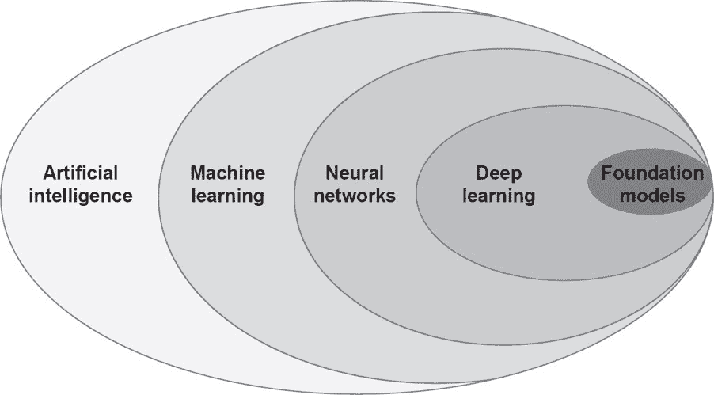

## 1.1.3 AI 的类型

在本节中，我们对 AI 这一通用性主题进行更广泛的描述。根据功能、能力和应用，我们可能会遇到几种类型。我们可以将 AI 类型视为同一主题的不同版本或实现目标的手段。

- **功能性类型**包括反应式机器、有限记忆、心理理论和自我意识 AI。
- **能力类型**包括节点 AI（或弱 AI）、通用 AI（或强 AI）和超级智能 AI。
- **应用类型**包括专家系统、自然语言处理（NLP）、计算机视觉、机器人和推荐系统。

这个列表并不是详尽的，因为发展速度正以极具激励性且不断增长的速度开辟新的创意和令人兴奋的方向。今天，我们已经可以使用专注于定义良好或工程化的特定任务的节点 AI 了。

## 1.1.4 工业革命

我们目前正处于第四次工业革命之中，一些人认为我们已经达到了第五次工业革命，尽管这尚未被定义。在每一次工业革命中，人类都设计并开发了使人类能力发生范式转移的技术，并利用这些技术推动进步，尽管也有人认为并非所有人类都从这些进步中获益。

第一次工业革命发生在 18 世纪和 19 世纪，主要在欧洲和美国。它主要在 1760 年至 1840 年间范围内发展（尽管具体日期尚有争议），导致了从手工生产方式向机器生产的转变——最初由蒸汽机驱动的大纺织工厂引领。它是历史上的重大转折点，导致了全球贸易和人口快速增长，并使大量农村地区城市化和工业化。

第二次工业革命发生在 1870 年至 1914 年间，主要跨越欧洲、美国和日本。有时被称为技术革命，由于大规模生产和流水线的引入，再次成为人类的范式转移。电力使用的增加允许制造业和生产的进步，并带来了内燃机、电话和灯泡等技术进步。

第三次工业革命始于 20 世纪 50 年代，通常被称为数字革命。它为我们带来了太空探索、生物技术、半导体、大型机计算以及信息通信技术（ICT），并将个人电脑、互联网和商品自动化生产引入社会。

第三次和第四次工业革命之间存在某种模糊。我们认为现在正处于第四次革命。第四次革命利用了数字革命取得的成就，并具有颠覆性，由 AI、机器人、物联网（IoT）、三维（3D）塑料打印、纳米技术、生物工程等驱动。

我知道你们在想什么：“在工业革命之间发生了什么？”我们在革命之间并没有停止发明或改进，全球不同地区以不同的时间和不同的速度经历了这些，但这些特定时期是思维和发明的范式转移。

创新扩散理论由 E.M. Rogers 于 1962 年开发，解释了想法或产品如何随时间推移在特定人群中获得动力并传播（扩散），他将创新者分为五类：创新者、早期采用者、早期大众、晚期大众和落后者。这是基于某些个人不可避免比其他人更容易采纳和适应的想法。全球范围内 AI 技术的采用将比其他技术的采用更快，因为我们看到工业革命持续的时间从几个世纪缩短到十年，再到几年的几分之一，但我们仍将由创新者引领，仍然会有落后者甚至卢德分子。


人类智能引领我们走过了各次工业革命。我们正处于第四次工业革命之中，但如果我们考虑到 AI，这意味着什么呢？这意味着我们会有越来越多的机器人执行常规、单调、劳累且危险的任务——即承担“重任”。这引入了人类与机器在各自擅长的领域进行合作的理念。

## 1.2 什么是人工智能伦理与可信 AI？

AI 伦理关是我们作为个人、组织以及在更广泛宇宙背景下运作时伦理的一部分。其核心是我们的伦理原则、权利和价值观。伦理为哲学家和学者带来了独特的挑战，特别是 AI 挑战我们的自由意志或主体性的伦理影响，甚至可能使其具备意识能力。我们将在第 2 章更详细地探讨这些含义。过去十年中出现了一场向可信 AI 发展的运动，捕捉了`阿达·洛芙莱`（`Wikipedia Contributors`, 2024a）的精神，她曾质疑技术对社会的影响；近期还有 `Stuart Russell` 的学术著作《AI 与人类兼容性》（`Russell`, 2019），以及 `Max Tegmark` 在`生命 3.0`（2018）中提出的观点，即在引发 AI 火灾之前，让人类设定目标并设计好 AI 灭火器。这些先驱性工作的结晶推动了欧盟法律《人工智能法案》的进展，使 AI 具有以人为本伦理目标，且这种目标在技术上是稳健且可信的（`European Parliament`, 2023）。国际标准为我们提供了广泛的文献供参考，我们将在第 2 章对此增加更多细节。

AI 世界在不断变化，而且变化率并非线性的；你可能没有注意到，但它实际上正在呈指数级增长，这基本上意味着它每年加速得越来越快。有些人认为，其增长可能会失控，我们需要采取刹车（`Future of Life`, 2023）；另一些人则建议让其自由运行，看看它会走向何方。

许多人担心，并非所有的 AI 改进对人类都有益处，或符合社会的最佳利益。例如，AI 有武器化的潜力，它可能通过监听和观察一切来侵入我们的生活和隐私，并通过隐蔽的 AI 系统在未经许可的情况下对个人进行识别。还存在个人数据控制权被夺走的可能。那么，AI 应该如何管理和控制？或者，如果我们尝试做正确的事（——无论那意味着什么）但却做错了，会发生什么？

在日常实践层面，我们正在使用的是针对良好工程或良好定义任务的狭义 AI。

## 1.2.1 AI 作为通用设计的一部分

通用设计概念由建筑师`罗纳德·梅斯`（Ronald Mace）提出，它是对环境进行设计和组成，使所有人都能最大程度地访问、理解和使用。例如，门把手、电梯控制按钮和灯开关的设计应该考虑到所有人，无论他们的年龄、体型、能力或残障。因此，任何新 AI 服务、系统或产品的考虑因素都是：它是为所有人设计的。

将 AI 的潜力融入通用设计，可以允许视障人士询问“家庭助手”天气如何，或者让身体不便的人开启暖气，或者让在回家的途中的人开启暖气。这是一个令人兴奋的领域，AI 可以为每个人带来超能力。

人类与智能 AI 驱动机器一起工作，有能力做更多事情，无论是在工作环境中减少物理风险或劳累，还是在个人层面教育我们或翻译我们的对话。AI 系统具有让我们变得更人性的潜力。

我们开发 AI 功能产品、系统和服务的努力和尝试应当侧重于让我们更有人性，提升我们作为人类的素质（提高我们的生理和心理表现，或让我们变得活跃），或提高我们的沟通或社交能力。

AI 系统和产品的不断出现，意味着我们作为个人以及作为广泛社会的一部分，将不得不重新想象生活的每一个领域，以一种对所有人都有积极意义的方式使用 AI。

## 1.2.2 AI 对社会的影响

AI 将如何改变我们的社会？我们需要考虑 AI 现在和长远来看对更广泛社会产生什么影响，以及为了换取我们将享受的利益，我们准备放弃哪些自由和人类价值观。AI 使用的增加和广泛采用将伴随着一些风险和挑战，例如武器化的可能，但它也可能解决气候变化和世界贫困。我们该如何平衡风险与收益？

作为一个社会，我们现在就得准备好如何在现在和未来管理 AI。例如，你是否愿意将工作交给一个 AI 实体，以换取一份基本通用收入？也许愿意，但你是否愿意为了眼前的短期利益放弃孩子未来的职业梦想和抱负？如果我们冲着乌托邦的目标冲过去却搞错了，会发生什么？

我们之前讨论过 AI 如何通过提高效率和增强我们所做及我们的能力，来影响我们在职场中作为个人的状态。当然，我们以人为本的伦理目标可以用来减轻影响我们日常生活的劣势，消除不平等，让我们变得更有人性，去承担涉及创造力和共情等的任务，特别是帮助消除偏见并提高结果的可持续性和公平性。

## 1.2.3 可持续性与环境影响

代际公平是代际关系中公平或正义的概念或思想。它通常被视为一种关注后代权利的价值概念。它描述了每一代后代都有权继承前人所享有的自然和文化资源的多样性，并公平地获得这些资源的使用收益。一个经常被引用的例子是当代人欠下了必须由后代偿还的债务。

代际公平的研究和可持续性观点基于三个支柱：经济、社会和环境（见图 1.2）。

- **经济**——许多经济学家试图预测 AI 对经济的影响。`普华`在 2017 年预测，到 2030 年，AI 将为全球经济贡献高达 15.7 万亿美元（`Rao and Verweij`, 2017），超过中国和印度目前的产出总和。其中，6.6 万亿美元可能来自生产率的提高，9.1 亿美元可能来自消费端的效应。

- **社会**——在 20 世纪 70 年代的英国，整个社区都感受到了大型组织关闭业务（包括航空公司、码头和矿井）的影响。AI 带来的是剧烈动荡和潜在失业的大头新闻。在人机协作的时代，人类有可能转向更高价值的工作，或者在丰富和发展自身才华的同时，让机器承担重任，减轻人类努力的负担。可持续性是欧盟 AI 指南的一部分，特别是以人为本的伦理目标。因此，评估 AI 对社会的影响是至关重要的。

- **环境**——AI 的碳足迹无疑对环境产生影响，这需要纳入其商业案例中。`Donna Lu`在 2019 年《新科学》杂志的一篇文章中指出，“创建一个 AI 对地球的危害可能比汽车还糟糕五倍”（`Lu`, 2019）。

图 1.2 可持续性的三个支柱


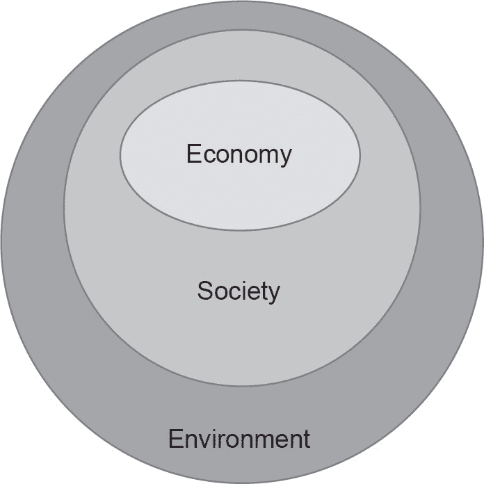

### 1.3 总结

本章介绍了 AI 及其与人类智能关系的基础概念。本章通过将 AI 设定为一种学习智能体（类似于人类智能，通过与环境交互来实现目标），为理解 AI 奠定了基础。AI 涵盖了创建智能实体的过程，而机器学习（ML）则涉及系统从数据中学习的能力。

本章为深入探索 AI 奠定了基础，阐明了其目标和局限性。通过理解智能、学习和科学方法的核心原则，你已准备好在后续章节中对 AI 的应用、伦理影响和未来发展进行更详细的分析。

# 2 伦理与治理

在本章中，我们将理解伦理以及 AI 伦理如何让我们更审慎地思考 AI 的益处，以及 AI 如何能够改善事物——这是一种以人为中心的伦理目标。这本质上是人类所重视的价值，价值观根据每个人的背景而异，并随着时间而改变。我们也可以将其视为引导我们所预期的价值和权利的原则。

AI 和 ML 绝非万灵药——灵丹妙药。Fred Brooks 通过区分两种类型来帮助我们理解复杂性：可以修复的“偶然复杂性”，以及必须由系统本身承认并处理的“本质复杂性”（Brooks, 1986）。Brooks 的严谨思考给了我们一个警告：当我们工程化处理偶然复杂性时，AI/ML 有很大机会帮助到我们，但本质复杂性是 AI/ML 可能无法帮助我们解决的。通过 Cynefin 等框架（Cynefin, 2023），可以进一步增强我们对所面临问题的理解。我们的团队（包括领域专家）必须与利益相关者合作，以确保伦理和治理从项目开始并贯穿整个生命周期。这意味着我们的 AI 团队在伦理原则（Floridi and Cowls, 2019）的指导下，将以人为中心的伦理目标整合到 AI 系统的设计中，这些原则优先保护人权和价值观。

### 2.1 伦理 AI

作为欧盟道德 AI 指南的一部分，我们必须理解 AI 的伦理挑战（欧洲委员会, 2024）。这绝不是一个简单的主题；例如，我们必须考虑：

我们如何处理伦理？

谁负责？

法律是如何说的？

人权又如何？

机器权利又如何？

随着通用人工智能（AGI）和强人工智能的出现，机器人成为另一个伦理问题。工程与物理科学研究委员会（Wikipedia Contributors, 2024k）已发布了机器人 AI 的通用方法。其他组织也在准备 AI 原则；包括国际标准化组织（ISO）。来自 ISO 等组织的输出包含了关于定义（ISO/IEC, 2022a）、风险（ISO/IEC, 2023b）、管理（ISO/IEC, 2023a）和指导（ISO/IEC, 2022b）的标准。

来自各种机构提出的关键主题包括透明度、问责制以及在考虑偏见、多样性、不平等和失业时所采取的关注。这些主题与良好的伦理相联系。欧盟围绕一个可以衡量的伦理目标构建了 AI 指南（欧洲委员会, 2024），例如使用联合国的可持续发展目标（联合国, 2015）。这些指南现在已成为欧盟的 AI 法律（欧洲议会, 2023）。

### 2.1.1 AI 治理

AI 治理指的是一套政策、流程和控制框架，旨在确保 AI 系统以伦理、透明且负责任的方式开发和部署。它涉及为数据使用、算法公平性和决策过程设定标准，以减轻偏见、隐私侵入和缺乏解释性等风险。有效的 AI 治理旨在平衡创新与个人权利及社会价值观的保护，促进对法律和伦理标准的信任和合规。

### 2.1.2 以人为中心的伦理目标 – 基本权利、原则和价值观

作为欧盟关于伦理 AI 指南的一部分，我们必须理解 AI 引发的伦理挑战（欧洲委员会, 2024）。这绝不是一个简单的主题；例如，我们必须考虑：

我们如何处理伦理？

谁负责？

法律是如何说的？

人权又如何？

机器权利又如何？

随着 AGI 和强人工智能的出现，机器人成为另一个伦理问题。工程与物理科学研究委员会（Wikipedia Contributors, 2024k）已发布了机器人 AI 的通用方法。其他组织也在准备 AI 原则；包括国际标准化组织（ISO）。来自 ISO 等组织的输包含了关于定义（ISO/IEC, 2022a）、风险（ISO/IEC, 2023b）、管理（ISO/IEC, 2023a）和指导（ISO/IEC, 2022b）的标准。

来自各种机构提出的关键主题包括透明度、问责制以及在考虑偏见、多样性、不平等和失业时所采取的关注。这些主题与良好的伦理相联系。欧盟围绕一个可以衡量的伦理目标构建了 AI 指南（欧洲委员会, 2024），例如使用联合国的可持续发展目标（联合国, 2015）。这些指南现在已成为欧盟的 AI 法律（欧洲议会, 2023）。

### AI 治理

AI 治理指的是一套政策、流程和控制框架，旨在确保 AI 系统以伦理、透明且负责任的方式开发和部署。它涉及为数据使用、算法公平性和决策过程设定标准，以减轻偏见、隐私侵入和缺乏解释性等风险。有效的 AI 治理旨在平衡创新与个人权利及社会价值观的保护，促进对法律和伦理标准的信任和合规。

### 2.1.2 以人为中心的伦理目标 – 基本权利、原则和价值观

以人为中心的伦理目标旨在保护人权和价值观。它基于联合国人权宣言和欧盟基本权利宪章。这些指目标是可以衡量的。这些指南现在已成为欧盟的 AI 法律。我们还需要注意的是，人类兼容人工智能中心（https://humancompatible.ai）正在产生以伦理原则为指导的 AI 设计。该中心是由《人类兼容：人工智能与控制问题》一书的作者 Russell（2019）创立的，书中探讨了 AI 的控制问题。

#### 2.1.2.1 生命研究所 (Future of Life Institute)

生命研究所制定了关于 AI 的**阿西马原则**（https://futureoflife.org）。这些原则涉及：

- 研究 – 目标、资助、政策、文化、规避竞争。
- 伦理与价值观 – 安全、透明度、责任、价值对齐、人类价值观、个人隐私、共同繁荣。
- 长期问题 – 能力预防、递归自我改进、共同利益。

“阿西马”这个名字的灵感源于 1975 年极影响力的阿西马重组 DNA 会议。生物技术界深受该会议的影响。

#### 2.1.2.2 欧盟 – AI 指南与 AI 法案

欧盟是应对 AI 伦理问题的先驱之一。它产生了 AI 指南，并在其 AI 法案中将其明确化。AI 伦理指南由欧洲委员会的人工智能高级专家小组产生（欧洲委员会, 2024）。这些指南针对信赖 AI。信赖 AI 基本包含两个部分：

1. 它应该尊重基本权利、适用法规和核心原则价值观，确保“伦理目标”。
2. 它在技术上应该是健壮且可靠的，因为即使意图良好，缺乏技术掌握也可能造成无意伤害。

#### 2.1.2.3 ISO/IEC


`ISO/IEC` 代表国际标准化组织 (`ISO`）和国际电工委员会 (`IEC`）。这两个机构合作，在包括信息技术和电信在内的多个领域开发并发布国际标准。`ISO` 关注广泛的行业和服务业，而 `IEC` 专注于电气、电子及相关技术。它们共同制定联合标准，以确保全球技术和工业部门的质量、安全、效率和互操作性。

`ISO/IEC` 标准是一项国际性努力，旨在使我们以人为本的 AI 伦理目标更加明确。这些内容在第 2.2.3 节中有更详细的解释。

### 2.1.2.4 日本、美国、加拿大和英国 AI 机构

在国际范围内，日本也采取了以人为本的 AI 方法。它发布了《以人为本的 AI 社会原则》（日本政府内阁，2022 年）。美国国家标准与技术研究院 (`NIST`）积极制定美国指南和标准（`NIST`，2023 年）。此外，白宫发布了《AI 权利法蓝图》（白宫，2022 年）。他们的邻居加拿大人是 `ISO/IEC` 标准 42001 的核心（`ISO/IEC`，2023a），并发布了关于政府负责任使用 AI 的报告（加拿大政府，2024 年）。英国的艾伦·图灵研究所发布了 AI 标准中心，这是 AI 出版、标准和伦理研究的一个明智起点（艾伦·图灵研究所，2024 年）。

### 2.2 理解 AI 给项目带来的风险

AI 解决方案开发和实施面临的挑战可能以多种形式出现，包括：

- 自利；
- 自审；
- 利益冲突；
- 恐吓；
- 倡导。

这些挑战并非小事，且需要进行管理。特别重要的是对 AI 能力的虚假宣传；某些人认为这导致了“AI 寒冬”。伦理挑战可能会因恐吓而受到损害（想想政治家之间的对抗性辩论）。利益冲突或自利必须随时管理，但 AI 的引入带来了对透明度的需求，对 AI 的输出进行审查和审计是必要的，以确保其符合用途且公平。

### 2.2.1 AI 中的伦理关切

我们都希望拥有可以信赖的有益 AI 系统，因此实现可信的 AI 很大程度上取决于伦理领域。AI 伦理可以被认为是应用伦理和技术的一个分支，专注于关注设计、开发、实施和使用 AI 技术所引发的伦理问题。

因此，AI 伦理的目标是识别 AI 如何推进或引发对个人“良好”生活的担忧，无论是在生活质量、心理自主性，还是在民主社会中生活的自由方面。它涉及多样化和包容性问题（涉及训练数据和 AI 服务的目标），以及分配正义问题（谁将从 AI 中获益，谁又不会）。

对 AI 伦理的思考产生了一些大多数人认同的通用主题：

- **透明性** – 我们可以将其理解为当 AI 犯错时，我们如何理解哪里出了问题。我们可以明确说明某项 AI 技术失败的原因吗？例如，`NN` 是由我们能够理解的算法生成的；但为了实现透明化，我们还需要明确理解为什么 `NN` 会得到特定的结果。这为我们学习 AI 系统的表现如何以及为何这样表现提供了基础。
- **问责制** – 我们需要谨慎，否则可能会出现不平等、偏见、失业等问题。
- **武器化** – 创建致命性自主武器是我们绝不能逾越的红线；然而，国家安全是一个特殊课题，超出了 AI 在社会的通用范围。
- **伤害** – AI 必须不造成伤害。
- **人类尊严** – 保护个人因自身而获得价值和尊重的权利，以伦理的方式对待他们。
- **安全保障** – 这几乎是不言而喻，但这是一个重要的伦理关切。
- **隐私** – 这一直是许多政治辩论的来源，现在已是一项基本要求，例如欧盟实施的《通用数据保护条例》(`GDPR`)。
- **可持续性** – 一一组与我们的利益相关者和更广泛社区一致的目标，确立代际公平。
- **公平性** – 与可持续性一起，偏见带来了我们必须接受并良好管理的更多伦理挑战。
- **社会利益** – 每个人如何从 AI 的机会中获益？

### 2.2.2 伦理 AI 的指导原则

伦理是一个哲学学科，它在个人身上表现为我们所谓的“道德原则”；事实上，许多人交替使用这两个词。基本上，伦理和道德都与“正确”和“错误”的行为有关。

值得注意的是，伦理作为学者和学生学习的学科，被视为单数形式，例如“我这学期的选修课是伦理学”。激励和引导我们的道德原则或伦理原则则被视为复数形式。通过这种方式，我们可以区分学科本身（单数）与个人的伦理原则（复数）。

关于伦理的进一步扩展，可以在 Warnock 爵士（2006 年）编写的《智能人士伦理指南》中找到。

道德倾向于指个人关于对错的自身个人原则。伦理通常指的是由外部来源或社区提供的规则，例如职场中的行为准则，或医学、法律等职业的公认伦理准则。

作为一个研究领域，伦理已有几个世纪的历史，其核心问题集中于：

- 什么是“良好”的行为？
- 什么是“正确”？
- 什么是“良好”的生活？

### 2.2.3 应对伦理挑战

应对伦理挑战不仅为我们提供了丰富的知识，而且解决了那些不以伦理方式提供 AI 服务和产品的违规者。它建立在人权法和数据保护立法的基础上。特定的法律框架为我们提供了伦理 AI 的手段，例如欧盟的《AI 法案》。那么，我们从哪里开始呢？

图 2.1 显示了我们如何从各种来源收集指导，帮助我们开发既可信又稳健的以人为本的 AI。我们可以从艾伦·图灵研究所的 AI 标准中心（2024 年）和 `ISO/IEC` 标准 42001（`ISO/IEC`，2023a）开始。从这里，我们可以采用欧盟的 AI 指南来产生一组要求。这在图 2.2 中所示。示意图识别了联合国 17 个可持续发展目标可以织入我们的伦理目标之中，而且 AI 项目是迭代的，我们始终从经验中学习。

图 2.1 实践 AI 伦理

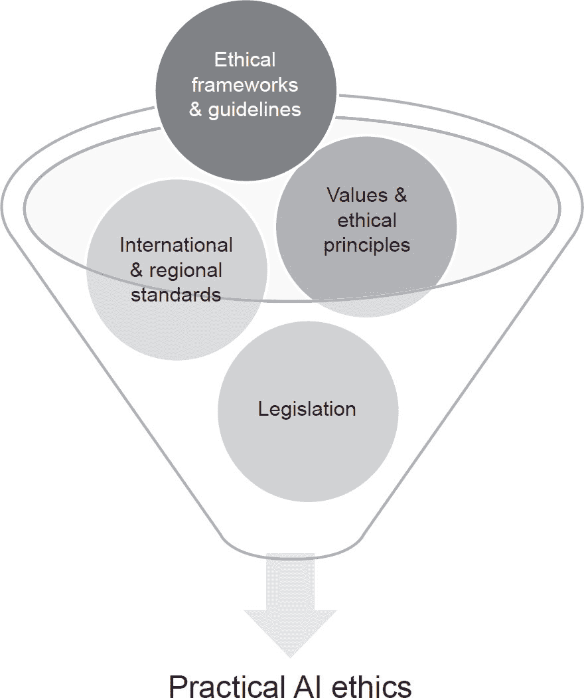

`ISO/IEC 42001` 被认为是一个良好的 AI 治理模型，因为它建立、实施和维护 AI 管理系统提供了全面的指南。它强调风险管理、伦理考虑、透明度和持续改进。通过覆盖 AI 生命周期的所有阶段并将控制扩展到第三方供应商，它确保了 AI 的负责任开发和部署。采用 `ISO/IEC 42001` 有助于组织构建可靠的 AI 系统，符合监管要求并促进伦理 AI 实践。


ISO/IEC 42001 是一种可在组织内部的人工智能管理系统（AIMS）。该标准旨在通过解决风险管理、AI 影响评估、系统生命周期管理和供应商管理等关键领域，确保人工智能技术的负责任开发、部署和使用。通过遵循 ISO/IEC 42001，组织可以构建可靠的 AI 系统，增强治理并促进伦理实践，从而增强信任并符合即将出的法规（如《欧盟 AI 法案》）。

图 2.2 实现可靠 AI 的技术和非技术方法（欧盟知识共享署源许可 4.0 国际 (CC BY 4.0) 许可）

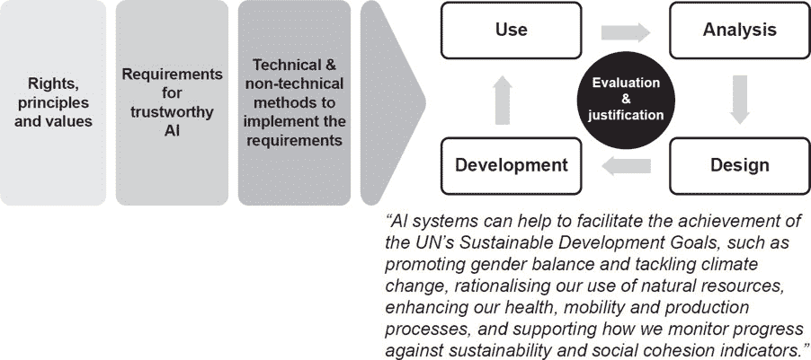

### 2.3 监管与风险管理

截至 2024 年 6 月，除《欧盟 AI 法案》外，尚未对 AI 进行重大监管。监管 AI 对于确保安全、公平和问责制至关重要。它有助于缓解偏见、歧视和侵犯隐私等风险，同时促进伦理标准和透明度。法规还可以防止有害应用（如自主性武器），并确保 AI 开发符合社会价值观和人权。通过设定明确的指南和监督，监管培养了公众对 AI 技术的信任，并促进其负责任且有益的使用。

《Web 内容无障碍指南》（WCAG）通过提供标准来确保网络内容（包括 AI 驱动的界面）残障人士可以访问，从而监管 AI 的（www.w3.org/TR/WCAG21/）。

WCAG 重点在于让内容对所有用户都是可感知、可操作、可理解且稳健的。这包括 AI 系统为图像提供替代文本、确保使用辅助技术的可导航性、提供清晰易懂的语言，并保持与各种设备和用户代理的兼容性。

这些标准有助于确保 AI 技术对所有人都是包容且可访问的。

监管和风险管理应形成基于 ISO 31000（ISO/IEC, 2018）的统一策略的一部分，并由 ISO/IEC 23894（ISO/IEC, 2023b）进行补充，或者由 NIST 的风险管理框架（NIST, 2024）辅以 AI 风险管理框架（NIST, 2023）。NIST 和 ISO 的方法都将风险评估、治理、透明度、偏见缓解、安全、隐私、人类监督和持续监控视为 AI 风险管理的基础。

为了评估风险，欧盟的《AI 法案》（欧洲议会，2023 年）提供了一种评估 AI 项目、产品或服务风险的有效方法。这如图 2.3 所示。

我们可以看到一些重要的类别：不可接受的风险、高风险、透明度风险和极低风险。《AI 法案》是一项里程碑式的立法提案，旨在监管欧盟范围内 AI 的开发、部署和使用。它是世界上首部全面的 AI 立法。它寻求确保 AI 技术是安全、透明并符合基本权利和价值观。

### 2.3.1 监管在 AI 中的作用

以下是《欧盟 AI 法案》的主要目标：

- 在促进 AI 创新的同时，确保个人和企业的安全与基本权利。
- 通过提供明确的规则和指南增强对 AI 的信任。
- 促进欧盟范围内 AI 的投资和创新。

不可接受风险 AI 系统被认为是对人类构成威胁的系统，并将被禁止。它们包括：

- 对个人或特定脆弱群体的认知行为操纵，例如鼓励儿童产生危险行为的语音控制玩具。
- 社会评分，即根据行为、社会经济地位或个人特征对人进行分类。
- 对人的生物特征识别和分类。
- 实时和远程生物识别系统，如脸部识别。

图 2.3 《欧盟 AI 法案》风险金字塔

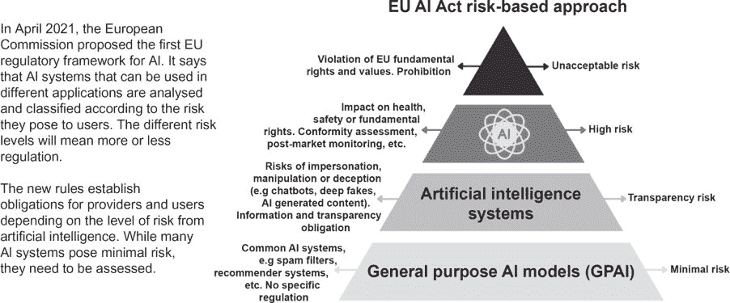

对安全或基本权利产生负面影响的 AI 系统将被视为高风险，分为两类：

1. 用于欧盟产品安全法规范围内产品的 AI 系统。这包括玩具、航空、汽车、医疗设备和电梯。
2. 属于特定领域且必须在欧盟数据库中注册的 AI 系统：
    - 关键基础设施的管理与运营。
    - 教育和职业培训。
    - 就业、工人管理和就业机会。
    - 对基本私人服务、公共服务和福利的获取和享受。
    - 执法。
    - 迁移、庇护和边境控制管理。
    - 法律解释和法律应用的协助。

作为该法案的一部分，存在透明度风险要求：生成式 AI（如 `ChatGPT`）不会被归类高风险，但必须遵守透明度要求和欧盟版权法：

- 披露内容由 AI 生成；
- 设计模型以防止其生成非法内容；以及
- 发布用于训练的版权数据的摘要。

我们必须遵守法律。监管是通过法院执行的法律对 AI 的控制。这与伦理不同，我们不会因为违反伦理原则而受到惩罚，但违反法律会有后果。首个且特定的 AI 法律框架是欧盟的《AI 法案》（欧洲议会，2023 年）。这项欧盟法规适用于任何在欧盟制造、使用、进口或分发 AI 系统的人，无论其总部位于何处。它也适用于在欧盟使用的 AI 系统，即使这些是在欧盟境外制造的。可以说，法律格局的变化与 AI 领域的发展一样快，我们可以预见到更多。我们还必须遵守现有法律，如欧盟 GDPR（欧盟委员会，2018 年）和英国的《数据保护法》（英国政府，2018 年）。遵守这些法规是机器学习或 AI 项目的基础部分。

### 2.3.2 AI 中的风险管理

风险被定义为不确定性对目标的影响，可以是正面的也可以是负面的。它包含了潜在事件及其后果，以及发生的概率（ISO/IEC, 2018）。

风险管理被定义为识别、评估和控制对组织资本和收益威胁的过程。这些威胁或风险可能来自来源，包括财务不确定性、法律责任、战略管理错误、事故和自然灾害（ISO/IEC, 2018）。风险分析用于识别 AI 风险，涉及系统地评估与 AI 系统开发、部署和运行相关的威胁和漏洞。关键步骤包括：

1. 定义范围和目标：
    - 识别资产和流程。
    - 识别威胁和漏洞。
    - 评估影响和可能性。
    - 风险排序。
    - 缓解策略。
    - 监控与审查。

采用 AI 相关的风险和挑战包括：

- 偏见和歧视；
- 隐私担忧；
- 岗位流失；
- 问责制和透明度；
- 法规合规；
- 安全风险；
- 技术局限性；
- 伦理困境。

应对这些挑战需要综合策略，涉及伦理指南、稳健的安全措施、持续监控以及对监管框架的遵循。ISO 31000 提供了一个风险管理框架，帮助组织识别、评估并优先风险，并制定有效的管理策略。

该标准强调：

- 原则：建立与组织不可分割的风险管理文化。
- 框架：通过领导、承诺和整合到组织流程中建立支持性环境。
- 过程：实施系统的方法来识别、分析、评估、处置、监控和审查风险。


这种方法确保了风险管理是结构化的、全面的，并根据组织的背景和目标进行了定制。

## 2.3.2.1 SWOT、PESTLE 和 Cynefin

在本节中，我们将简要概述一些理解风险的技术，以便我们对其进行管理。第一个是 `SWOT` 分析，它关注组织内部和外部的机会与威胁。第二个是 `PESTLE`，这是一种理解利益相关者的流程。最后是 `Cynefin`，一种用于理解你的 AI 项目并管理复杂性与混沌的方法。

通过使用 `SWOT` 分析来管理 AI 风险，组织可以获得对其内部能力和外部环境的洞察，使其能够做出明智的决策并采取主动措施来减轻风险并最大化采用 AI 的收益。这在图 2.4 中示意地所示。

图 2.4 SWOT 分析

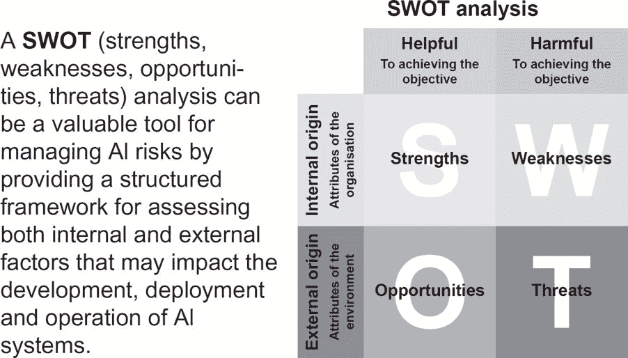

`SWOT` 分析的输出结果——行动计划，可以用于利用机会和减轻风险。随着项目的进行，行动计划可以从经验中学习。

通过 `PESTLE` 分析，组织可以全面理解影响 AI 风险和机会的外部因素。这种分析使组织能够制定考虑到 AI 运行广泛背景的战略计划和风险管理策略，确保符合监管要求、社会预期和环境考量的同时，最大化采用 AI 的收益。这在图 2.5 中示意地所示。

`Cynefin` 在图 2.6 中示意所示，它通过承认 AI 系统固有的复杂性和不确定性，为理解和管理 AI 风险提供了一个结构化框架。

图 2.5 PESTLE 分析

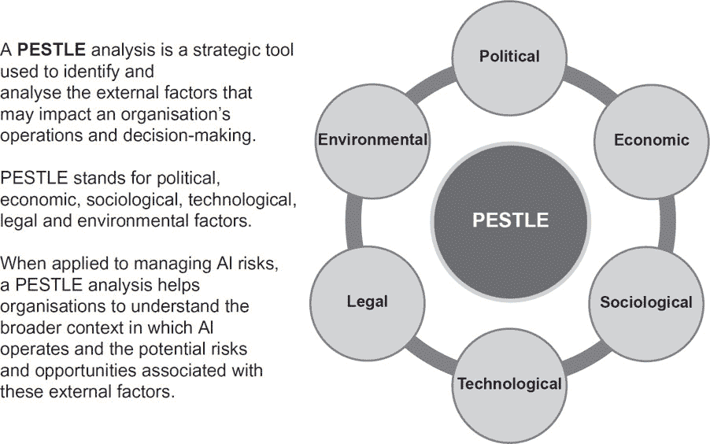

图 2.6 Cynefin

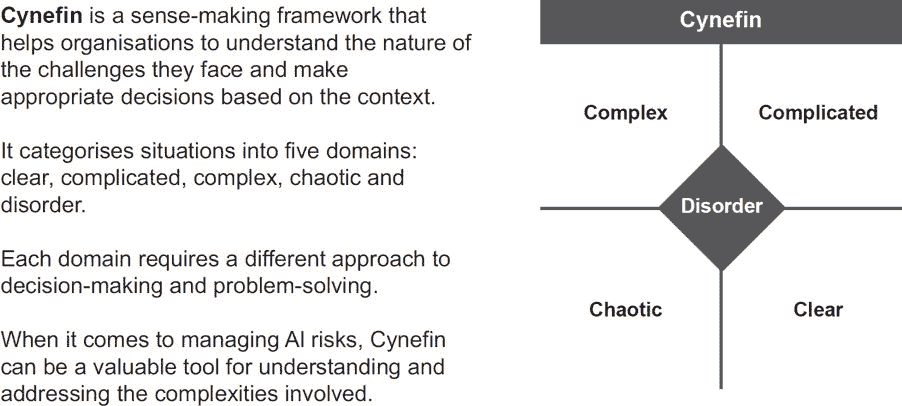

`Cynefin`框架由 David J. Snowden 于 1999 年开发。它旨在帮助领导理解每个情况都是不同的，需要独特的决策方法。该框架概述了五个由因果关系定义的情景领域。通过根据风险的性质和背景对其进行分类，组织可以此定制其风险管理策略和应对措施，从而在 AI 领域实现更有效的风险缓解和决策。此外，`Cynefin` 帮助领域专家和 AI 专家评估窄 AI 是否可以提供帮助。专注于定义任务的窄 AI 可以在清晰领域（clear domain）中更容易评估。复杂领域（complicated domain）需要更仔细地考虑窄 AI 如何提供帮助；领域专家在该领域将发挥关键性作用。在复杂领域（complex domain）中，管理方法必须拥抱实验、自适应方法和场景规划以应对不确定性。它将使用模拟、建模和场景分析等技术来理解潜在风险，并根据情况的发展制定敏捷响应。这可能涉及基于领域专家模拟的复杂 AI，或者正如 Brooks 所描述的，它很可能包含本质复杂性。

## 2.3.2.2 以人为中心的 AI

以人为中心的 AI (`HCAI`) 是一种设计和部署 AI 系统的方法，其主要关注在于增强人类能力、确保有意义的用户控制并促进人类价值观。`HCAI` 旨在创建不仅在技术上有效而且在社会伦理上负责的 AI 技术。

`HCAI` 的核心原则是：

- **用户赋能**：AI 系统应该通过增强用户的能力和支持其目标来赋能用户，而不是取代人类角色。目标是创建增强人类决策、创造力和解决问题的工具。
- **透明度与可解释性**：AI 系统在如何运行和做出决策方面应该是透明的。通常采用可解释 AI (`XAI`) 技术以确保用户能够理解、信任并妥善地管理 AI 的输出。
- **伦理考量**：`HCAI` 强调 AI 的伦理影响，包括公平性、问责制和偏差缓解。它寻求设计尊重用户隐私、确保数据安全并促进公平的 AI 系统。
- **可用性与用户体验 (UX)**：AI 系统的设计应优先考虑可用性和 `UX`，确保它们直观、易用并对用户需求做出响应。这包括基于用户反馈的迭代测试和改进。
- **协作与交互**：`HCAI` 专注于促进人类与 AI 系统之间的有效协作。它鼓励设计促进顺畅交互的设计，使 AI 系统作为协作伙伴而非自主代理。

### 2.4 总结

本章重点关注对于 AI 系统负责任开发和部署至关重要的伦理考量和治理框架。它强调了以人为中心的伦理目标的重要性，确保 AI 与人类价值观、权利和社会福祉保持一致。围绕透明度、问责制和公平性的 AI 伦理对于防止偏差、隐私侵犯和无意伤害至关重要。

本章引入了与 AI 相关的关键伦理问题，例如责任、人权以及高级 AI 系统（如 `AGI`）带来的挑战。它强调了伦理框架和治理的重要性，并引用了来自 `EU` 和 `ISO` 等组织的指南。讨论了 `EU` 的《AI 法案》，其作为一个开创性的监管框架，旨在确保 AI 尊重基本权利并促进透明与安全。

本章还探讨了 AI 治理，这涉及为数据使用、算法公平性和决策制定标准，以构建可靠的 AI 系统。此外，本章回顾了包括 `US`、日本、加拿大和 `UK` 在内的各国在制定伦理 AI 标准方面的努力，强调伦理 AI 必须是更广泛的监管和风险管理策略的一部分，以防止潜在伤害。

最后，探讨了偏差、透明度和 AI 社会影响等伦理关注问题，强调对于开发增强人类能力并符合社会价值观的 AI 系统来说，以人为中心的方法是必要的。本章通过讨论风险管理框架（如 `SWOT` 和 `PESTLE` 分析）以及监管在平衡创新与安全需求方面的作用作为结束。


这些 AI 系统利用自然语言处理（NLP）来理解并响应用户查询、管理日程、设置提醒、控制智能家居设备，甚至进行闲聊。它们从用户交互中学习并随时间改进的能力体现了机器学习（ML）的特性。我们必须意识到，ML 给出的答案可能是创造性的，甚至是虚构的（生成的最佳猜测），并且缺乏严谨性和准确性。

## 3.1.2 推荐系统

AI 驱动的推荐系统是我们在 Netflix、Amazon 和 Spotify 等平台上遇到的个性化建议背后的核心。这些系统通过分析用户行为、偏好和交互，推荐用户可能感兴趣的电影、产品和音乐。通过利用协同过滤和内容过滤等技术，这些 AI 模型增强了用户体验和参与度。这些都是从数据中学习的典型示例，并使用了机器学习。

## 3.1.3 欺诈检测

在金融领域，AI 在检测欺诈活动起着着关重要的作用。银行和金融机构采用 ML 算法分析交易模式、识别异常并标记潜在的欺诈交易。这些系统设计用于不断适应和改进，使其在发现和防止欺诈方面变得越来越有效。

## 3.1.4 医疗保健

AI 正在通过诊断工具、个性化治疗方案和预测分析等应用彻底医疗保健。AI 系统可以分析医学图像以检测癌症等疾病，解释遗传信息以建议个性化治疗，并根据历史数据预测患者结果。事实上，某些科学学科如果没有强大的计算机就无法进行。在这里，科学家和工程师每天都在使用机器学习，但他们并不一定称为 AI 或 ML。工程师和科学家使用的数值技术对他们的工作往往更有效；然而，他们拥有可迁移的技能，可以使用 ML 和 AI 来开发更好的工作。

## 3.1.5 客户服务

许多企业正在采用 AI 驱动的聊天机器人和虚拟客服代理来处理常规查询、提供支持并增强客户体验。这些 AI 系统可以处理并响应客户问题、解决问题甚至处理交易。它们 24/7 运行并从交互中学习的能力有助于企业提高效率和客户满意度。

## 3.1.6 语言翻译

AI 显著推进了语言翻译服务，例如 Google Translate 等工具利用神经机器翻译（NMT）提供更准确、更自然的翻译。这些系统可以实时翻译文本和语音，打破语言障碍并促进全球交流。

## 3.1.7 社交媒体监控

AI 广泛用于监控和管理社交媒体平台上的内容。算法旨在检测并过滤不当内容、垃圾信息和假新闻。此外，AI 帮助分析用户参与度、理解趋势并个性化内容推送以保持用户活跃度。

## 3.1.8 智能家居设备

AI 嵌入在各种智能家居设备中，包括恒温器、安全系统和家用。这些设备学习用户的偏好和行为以优化家庭环境，增强安全性并提高可用性、独立性和便利性。

## 3.1.9 机器人

在制造业和服务业中，AI 驱动的机器人被用于流水线工作、质量控制甚至客户互动等任务。这些机器人采用 ML 执行复杂任务，适应新情况并与人类协作。

这些 AI 存在的例子现在已随处可见，其应用增强了各个领域的可访问性、便利性、效率和个性化。随着 AI 技术的不断进步，它对社会的影响可能会扩大，导致更多创新和变革性的应用。AI 代理允许我们将 AI 视为一种帮助人类的技术或服务。

## 3.1.10 教育

AI 正在通过个性化学习、智能辅导系统和行政自动化增强教学和学习体验来改变教育。个性化学习平台利用 AI 根据学生的个人需求、学习风格和节奏来定制教育内容，从而提高参与度和理解力。智能辅导系统（例如 Carnegie Learning 开发的系统）提供实时反馈和支持，模拟一对一的教学。AI 驱动的工具通过虚拟和增强现实创造了沉浸式学习体验，使教育更具互动性和更易获取。通过利用数据和高级算法，AI 帮助创建更高效、更包容且有效的教育环境。

### 3.2 AI、机器学习与机器人技术

在本节中，我们从代理和机器人的角度探索 AI。在此过程中，我们应该提醒自己《大英百科全书》第 1.1.1.1 节讨论的人类智能定义（Sternburg, 2017）：

人类智能：一种心理品质，由从经验中学习、适应新情况、理解和处理抽象概念以及使用知识操纵周围环境的能力组成。

将 AI 代理作为人工人的蓝图是非常有用的，而且它有一个简单的类比，即类似于机器人。遗憾的是，机器人学家并没有使用这种简单的类比。他们的关注点不是人类智能或智能的学术研究框架；相反，他们专注于机器人的工程，这是一项复杂且精密的工程。我们现在正看到这些学科的协作，以及许多新领域的兴起。这是一个令人兴奋的时代，因为 ML 的进步解锁了计算机在数字模拟环境或实际工程环境中自我学习如何实现目标的能力。它开启了一个机会世界：自主智能城市、智能道路、智能家居、智能电视、智能手机、智能手表、智能纳米机器人。

我们可以将无论大小的 AI 产品视为 AI 代理（agents）。它们可以对所处的环境产生感知，然后对环境采取行动以实现目标。ML 为我们提供了如何实现这一点的数字示例。它也可以用于赋予 AI 代理或产品从经验中学习的自主性，例如如何执行一项或多项任务并实现目标。我们智能代理所需的功能与 ML 直接相连。游戏可以用于理解自主代理的交互。

基于代理的建模是学术界、工程、商业、医学等领域有用的基础方法。通过这种方法，我们可以理解在环境中运行的多个代理的涌现行为。

## 3.2.1 AI 代理

我们从 Russell 和 Norvig (2016) 对 AI 代理的学术描述开始。他们将理性代理（rational agent）定义为：

对于每个可能的感知序列，理性代理应该根据感知序列提供的证据以及代理拥有的任何内置知识，选择一个预期能够使其性能度量最大化的动作。

这可以被说明为一个学习代理（见图 3.1）。AI 代理是 AI 如何描述人类在环境中行动的蓝图；机器人或控制系统的传统工程概念是虚线部分。多年来，这部分虚线内部一直在使用 ML——我们将在第 4 章介绍感知器。随着深度学习的出现及其最近的成功，这条虚线现在正移动到包围整个 AI 代理。从经验中学习现在意味着自主性的潜力。我们人类有时将此称为“代理性”（agency）。


代理性（Agency）一词源于中世纪英语后期（产生影响的人或物），基于拉丁语单词 `agere`，意为“做/行动”。

### 图 3.1 学习代理体——基于 Russell 和 Norvig (2016) 中的代理结构

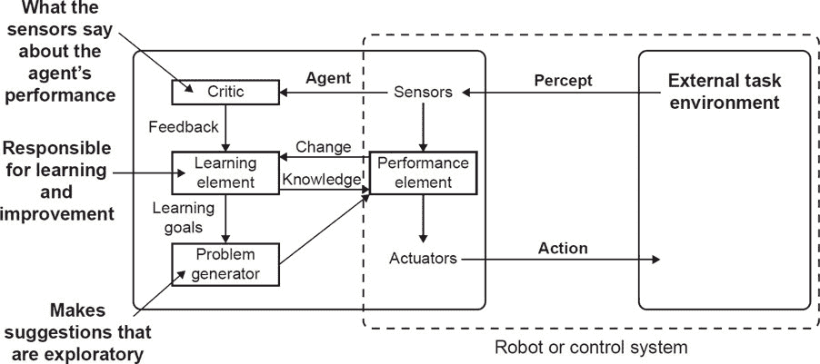

“学习代理体”是一个 AI 代理的概括性图，它能够学习如何执行某些任务。与上述详细描述的根据提供的信息行动四种智能代理不同，这种特殊的代理能够从经验中学习。通常，它从一些基础知识开始，通过学习进行适应。学习代理体能够：

- 执行任务；
- 分析自己的性能；
- 寻找改进这些任务的新方法。

此外，它可以独立完成这一切。

学习代理体的一个例子是个人助手，如 `Siri` 或 `Alexa`，它们可以在互联网上查询你当地的天气，并建议你是否需要穿外套，因为它已经学习到当你没有睡好觉时，你喜欢去散步。

人类崇崇代理性，而人类是在环境中行动的代理（Coole, 2017）。人类想要行动的自由意志——这对我们来说很重要。为了让机器人拥有行动的自由意志，我们称之为自主性。自主机器人通常在电影中被描绘成反派，因为我们试图为机器人的行动赋予意义。机器人（至少目前）是客观且理性的，并按照我们告诉它们去去做（有时这可能会产生坏后果）。人类是主观的，我们的自由意志是主观的，当我们思考代理性时，必须考虑我们行动的主观方面——这导致了对人类在哲学和道德上的理解。在定义 AI 代理时，我们依赖于代理是理性的，就像工程师使用客观科学来设计机器人一样。

#### 3.2.1.1 理性代理的四个依赖条件

我们期望 AI 代理是理性的，这取决于四个四个方面（Russell and Norvig, 2016）：

1. 定义成功标准的性能衡量标准。
2. 代理对环境的先验知识。
3. 代理可以执行的行动。
4. 代理到目前为止的感知序列。

这四个要素是为理性代理提供基础学术依据所需的。如果我们仔细一想，我们需要所有四个要素，这样其他人才能复制我们的结果。如果没有它们，代理将是未定义的。

我们知道 AI 是一门基于科学方法的学术学科。在思考 AI 代理时，理性是有帮助的。因此，在设计 AI 代理时——可能是一个机器人、数据机器人或观察人类行为的模拟代理——我们期望它们理性地行动，并执行我们要求它们做的事。回到 Russell 和 Norvig 对理性代理的定义（2016）：

对于每种可能的感知序列，理性代理应该在给定感知序列提供的证据以及代理所拥有的任何内置知识的情况下，选择一个预期能使其性能衡量标准最大化的行动。

我们可以看到，当我们设计一个 AI 系统、机器人或工程产品时，它在告诉我们，它必须按照我们设计的方式来运行。

#### 3.2.1.2 代理——性能衡量标准、环境、执行器和传感器

如果我们是一个被要求设计一个智能实体的工程师，那么定义一个可以衡量其性能的性能衡量标准，定义它运行的环境，以及它用于操纵环境的执行器和传感器是非常有意义的。通过这种方式，我们创建了一个可以从经验中学习的智能实体。如果我们以人形机器人建造者为例，那么我们可以对每一项描述如下：

- 性能衡量标准是在墙上铺设固定数量砖块的速度。
- 环境是建筑区域或房间。
- 传感器是触觉传感器、功率传感器、视觉和听觉传感器等。
- 执行器是手、身体、脚、腿等。

这是一个**分解状态**（factored state）。

以某种方式，这似乎很简单，但在数学上它并不是显性的。我们可以考虑构建一个数字孪生（digital twin），以便我们对其进行建模和学习。这意味着我们可以为机器人构建一个供其学习的模拟环境，有点像电脑游戏。就像我们在飞行模拟器中教飞行员飞行一样，我们可以以同样的方式教机器人。或者，也许我们可以让机器人使用强化学习来教自己。要更详细地从数学角度理解这些概念，请参阅 Russell 和 Norvig (2016)。

代理可能想要自己的环境地图。我们将其称为代理的“世界状态”（state of the world）。它是代理的内部世界，代理可以用它来弥补信息的缺失。这个世界可以是简单的，例如，一段铁轨和轨道温度可能就是我们控制自动列车所需的所有。这是**原子状态**（atomic state）。它可能会稍微复杂一点，我们使用一系列传感器来确定我们运行的世界或环境的状态——例如，雨、温度、风和湿度决定了我们火车行驶的天气。这是一个**分解状态**。最后，我们有了最完整的理解：**结构化状态**（structured state）。在这里，对象以及这些对象之间的关系让代理对所运行的环境有更详细的理解。它可能使用 AI 来预测不同行动的结果；这在图 3.2 中以示意图所示。

在理解代理时，我们需要理解其内部世界的数学，因此如果我们需要训练一个智能实体，使用数字孪生似乎是一个明智的主意。如果我们需要多个智能代理协作来实现一个目标，会发生什么？

### 图 3.2 世界状态——代理用于弥补信息缺失的内部世界


#### 3.2.1.3 基于建模

基于代理的建模（ABM）被用于理解代理如何协作以实现目标（Wikipedia Contributors, 2024l）。我们认为这就像蜜蜂如何建造一个精妙的结构来产生蜜。基于代理的模型可以观察蜜蜂如何交流、如何维护秩序或控制；以及智能实体如何与人类或其他动物周围工作。ABM 是理解涌现行为的一种非常有用的的方法。当我们思考 ABM 时，控制多个代理或寻找分层控制系统（subsumption）将成为一个关键概念（Wikipedia Contributors, 2024m）。这是一个日益增长的兴趣领域，我们稍后研究智能机器人时涉及到 ABM。

## 3.2.2 代理类型：反射、基于模型的反射、基于目标和基于效用的

在 AI 中，智能代理指的是一种自主实体——通过传感器进行观察并随后使用执行器，朝着在环境中实现目标进行行动——因此它是智能的。基本上有四种理性代理类型，示例从简单的供暖系统控制代理到复杂的自动化全科医生（GP/doctor）代理不等。让我们来看每一种。

#### 3.2.2.1 反射代理

在 AI 中，简单反射代理是智能代理的一种，它仅根据当前情况执行行动。代理通过这些情况的预设规则来实现这一点。这通常被称为条件-行动规则（condition–action rule）：程序根据当前感知选择行动。它很容易理解和编写。

示例：中央供暖过热，因此程序选择关闭电源的行动。

#### 3.2.2.2 基于模型的反射代理

在基于模型的反射代理中，代理拥有一个世界模型，需要时可以调用：

- 它可以使用一个不需要传感器数据的虚拟世界来弥补传感器的缺失。


程序现在观察感知结果并更新自身的内部世界（状态）。

随后，程序可以评估可能的动作和未来状态，并使用反射智能体方法来决定采取哪些动作。

示例：一辆水下飞行器因搅起泥沙而丢失了视觉传感器数据——光线不足——但它可以利用其 3D 映射几何模型继续运行。

### 3.2.2.3 目标型智能体

目标型智能体通过使用“目标”信息进一步扩展了基于反射智能体的能力。目标信息描述了理想的情境。

搜索和规划是人工智能的子领域，致力于寻找实现智能体目标的动作序列：

为了实现智能体的功能，程序不仅需要传感器和内部世界：它还需要一个目标。

这些程序比之前的更具通用性和灵活性，并且能够适应变化。

示例：一辆自动驾驶汽车可以从高速公路的五个出口中选择一个——目标可以是最安全、最快、风景最美、最便宜和/或最短的路线。

### 3.2.2.4 效用型反射智能体

基于效用的智能体比目标型智能体高出一个层级的智能体。它的动作不仅取决于目标是什么，还取决于实现该目标最佳方式。简而言之，是智能体的用处或效用使其与其对应物区分开来。效用型智能体根据哪个动作最令人愉悦或最有效地实现目标来做出决策。目标是根据智能体的效用来衡量的。

效用是经济学家衡量智能体幸福感的科学方法；它比简单的二进制“是/否”或“快乐/不快乐”输出更通用，它实际上衡量了它有多用。

示例：一个 AI 聊天机器人医生根据患者的个人病史和当前的健康需求评估治疗的疗效——也就是说，这种药对患者有多大效用？

### 3.2.2.5 人工智能智能体与机器学习的关系

智能体应该是自主的。对于一个智能实体来说，这意味着它可以学习，并弥补不完整的知识和错误的先验知识。例如，击败世界象棋冠军的“深蓝”机器并没有自己学会如何做到的。它依靠程序员的先验知识来赢得比赛。

一个真正理性的智能体应该是自主的——它应该学习去弥补不完整和错误的先验知识——但我们认为可以说，我们担心智能体拥有过多的自主性。应该意识到，目前机器人不能某天一醒来就开始做某些事；我们需要现实一点，给机器人一个合理的起点。

如果一个智能体依赖其设计者的先验知识，它就缺乏自主性，但确实需要一些先验知识来让它运转。它一定需要初始条件。

## 3.2.3 机器人技术在人工智能中的作用

正如第 1 章所述，“机器人”（robot）一词出现在捷克人卡雷尔·恰佩克（Karel Čapek）1920 年的舞台剧《R.U.R.》中，全意思是 Rossumovi Univerzální Roboti（罗萨姆通用机器人）。剧开始于一个制造名为“机器人”的人造人的工厂。剧中的机器人更接近现代仿生人甚至克隆的概念，因为它们可以被误认为是人类，并且可以独立思考。在不透露太多剧情的情况下，机器人在最初乐于为人类工作后，随后爆发了敌意的机器人叛乱，导致了人类的灭绝。正如我们之前提到的，“机器人”一词源于斯拉夫语单词 robota，意为“苦力劳动者”。现在，我们认为机器人是一种可以自动执行一系列复杂任务的机器，无论是否具有智能。

机器人已经存在 60 多多年。1954 年，乔治·德福尔（George Devol）发明了第一台数字控制和可编程的机器人，称为 `Unimate`。1956 年，他与伙伴约瑟夫·恩格尔伯格（Joseph Engelberger）建立了世界上第一家机器人公司，`Unimate` 在美国通用汽车公司投入使用。自那时起机器人在全球范围内不断发展，无论是否有智能，现在在工厂和分销中心广泛使用。尽管 20 年来机器人技术仍在持续发展，但许多机器人仍会面临障碍，例如[2002 年引入的被广泛认可的扫地清洁器](https://commons.wikimedia.org/wiki/File:ASIMO_Conducting_Pose_on_14.2008.jpg; Creative Commons Attribution-Share Alike 3.0) 是一种世界上最先进的机器人。


尽管许多人关注机器人发展的积极方面，但另一些人从负面角度看待机器人，并预言了一个机器人抢夺人类工作的未来。然而，“预言者”通常认为，人工智能和机器人产业创造的新工作可能与失去的一样多。

尽管我们目前为止关注的是智能机器人，但运行中的大多数机器人是不智能的（即没有学习），只是遵循计算机程序执行有限的动作。现在，如果我们把 AI 技术应用于机器人并允许它们在许多领域自主工作，我们同样可以创造出实用的辅助机器人或《终结者》中的机器人，这取决于你的观点。

### 3.2.3.1 机器人范式

范式是指描述解决问题方法的哲学或假设和/技术。范式一词在学术、科学和商业领域经常出现。当你改变范式时，你正在改变你思考问题的方式；它是观察世界的一种——也是处理和解决机器人问题的工具集。

具体来说，在机器人领域，机器人范式是机器人运行的心模型。机器人范式可以通过机器人三个原语（感知、计划和执行）之间的关系来描述。也可以通过传感器数据如何被处理和分布来描述。

在机器人领域有三种范式：

1. 分层式（hierarchical）
2. 反射式（reactive）
3. 混合分层-反射式（hybrid hierarchical–reactive）

这三种范式用于组织机器人的智能——选择正确的范式会让解决问题变得更容易。分层式、反射式和混合分层-反射式范式都使用了二三个机器人原语：

`sense`（使用传感器信息，输出是感知信息）

`plan`（感知信息或认知信息，输出是指令）

`act`（感到的信息或指令，输出是执行器命令）

在机器人领域，描述范式的方法有两种：要么通过感知、计划和执行的关系，将机器人承担的功能归类为这三个原语；要么通过传感器数据如何被利用和组织。


机器人或系统是如何受到其感知影响的？

机器人是接收所有传感器数据并进行处理（例如），还是传感器数据是在本地处理的？

### 3.2.3.2 层次化 (Hierarchical)

这里存在固定的事件顺序，基于自上而下的规划（见图 3.4）。这些机器人倾向于有一个中心模型来用于显式规划。在高度控制的环境中，它往往具有很强的控制性，但在复杂环境中难以使用。这在一个高度组织和工程化的世界中可能是可以，但它忽略了人类的认知和生物因素；例如，我们可以同时进行动作和感知。一个例子是从固定位置选择物品的机器人。

图 3.4 机器人设计中的层次化范式

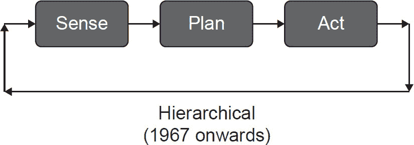

### 3.2.3.3 反应式 (Reactive)

反应机器人始终在感知和行动。随着感知的变化，其行为也随之改变（见图 3.5）。将这些行为结合在一起，你就不会受限于单一的感知-动作，从而节省了规划时间。为了获得更直观的理解，这就像受到惊时的膝跳反射——如果我们把手放在热表面上，我们会非常迅速地缩回，这是自动的。在反应式范式中，机器人对感知输入做出反应。一个例子是机器人保持一个方向，但如果传感器感知到障碍，轮子会做出反应并避开障碍。

图 3.5 机器人设计中的反应式范式

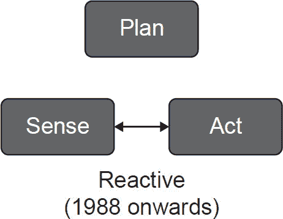

### 3.2.3.4 混合式 (Hybrid)

这种范式是层次化和反应式范式的结合。这些机器人规划它们的初始动作以实现目标。感知和行动随后由计划指导（见图 3.6）。

图 3.6 机器人设计中的混合审式/反应式范式

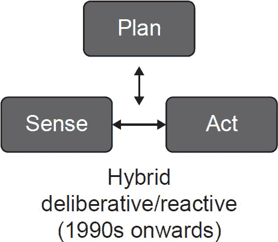

传感器可以更新计划（例如识别物体），这种能力允许每个传感器、动作和规划以适宜的速度运行。这种范式是机器人设计的自然演进，允许机器人的不同部分由适合其正在执行的内容进行控制。我们的一些汽车配有自动制动系统，如果有障碍物或冰面，它可以帮助我们更有效地刹车。这些系统是反应式的，但我们可以将驾驶员视为系统的混合审式/反应式部分——驾驶员负责感知、规划、行动。发动机管理系统可以被视为 `sense – plan, act` 机器人范式：它获取发动机的多次读取（温度、发动机负载、空气流量），规划最佳的燃气比，并确保汽车以最小的排放输出最大的功率。

### 3.2.3.5 什么是智能机器人？

这可能是我们机器人主题中最短章节。智能机器人是指使用 AI 的机器人，或者正如 Robin Murphy 定义的（Murphy, 2019），“智能机器人是可以自主运行的机械生物”。

我们必须注意，这里的机器人指的是我们在工业中看到的机械机器人或可以是我们个人助手的人形机器人。机器人也可以出现在。

### 3.2.3.6 智能体 (Intelligent agents)

`NNs` 的出现让我们理解人类大脑如何解决问题。因此，当我们思考 `ML` 时，可以考虑到从数据中学习的 `AI agent`。这些机器现在非常擅长玩游戏，甚至可以击败世界冠军。

### 3.2.4 机器学习基础

`ML` 是关于从数据中学习的。我们今天看到的是 `narrow ML` 的快速增长和采用。我们关注的是 `digital computers`。

#### 3.2.4.1 我们如何从数据中学习


AI 的核心是机器学习（ML）。事实上，机器学习是 AI 的推动者。机器学习通常与我们今天拥有的通用计算相关，即数字计算。AI 关乎从经验中学习，而机器学习关乎从数据中学习。我们将此作为我们对机器学习的直观理解的基础。今天最受欢迎的机器是数字个人电脑、计算机集群和大型高性能计算机。展望未来，我们将转向光学、量子、生物等类型的学习机器来为我们提供帮助。现在，随着带有内置 AI 硬件的智能设备的出现，我们看到了边缘计算的增长，即在手机、扬声器和汽车等智能设备上进行数字机器学习。安全是这里的一个关键概念；我们如何确保数据是安全的？

首先，我们需要思考我们实际上在做什么——我们正在指令并教导机器来帮助我们学习。如果我们使用数字机器，这意味着我们需要以这种方式理解我们的问题，以便让机器（例如笔记本电脑或智能手机）为我们进行学习。硬件需要软件，而软件需要算法和数据。算法将使用数学，我们最终就有了起点。

2019 年，马萨诸理工学院的教授吉尔伯特·斯特朗（Gilbert Strang）写了一本关于线性代数和从数据学习的书（Strang, 2019）。他告诉我们机器学习有三个支柱：线性代数；概率与统计；以及优化。早得多，在 20 世纪 90 年代，Graham、Knuth 和 Patashnik 出版了一本教科书，帮助学生理解计算科学所需的数学——我们认为将其看作是是用数学角度描述算法、它们如何被定义以及如何被理解的书（Graham et al., 1994）。这两部出版物都是详细、严谨的数学文本。汤姆·米切尔（Tom Mitchell）在第 1 章中提到的机器学习著作，通过示例提供了机器学习理论的介绍，这又是一部详细、严谨的数学文本（Mitchell, 2018）。这些书籍内容全面，并不适合初学者。它们对于精通这些学科的数学家、工程师和物理学家来说具有相关性。

Strang 的 `Linear Algebra and Learning From Data`（2019）深入探讨了理论，并为科学家、工程师和数学家引用了许多优秀的示例和参考文献。

Graham、Knuth 和 Patashnik 的 `Concrete Mathematics`（1994）是一本关于计算机科学数学的书。它对算法和理论的解释更加详细，并引入了统计和概率。与 Knuth 的 `The Art of Computer Programming`（2011）结合起来，这些书籍为利用计算机、数字和其他资源进行学习的本质提供了广泛的参考文献。

AI 不仅仅是从数据中学习；当我们思考 AI 产品时，还必须考虑它们运行的世界、执行器是如何控制的，以及如何根据传感器读取值和感知器做出决策。斯图尔特·罗塞尔（Stuart Russell）和彼得·诺维格（Peter Norvig）的 AI 著作深入探讨了我们在从数据学习之外如何构建问题的理论和数学（Russell and Norvig, 2016）；他们也涵盖了机器学习。他们非常明确地指出 AI 是一门通用学科，因此可以应用于任何智力任务——从经验中学习。

这些关于 AI 理论的技术书籍的共同点是一些值得欣赏的关键学科领域。这些是：线性代数；矢量微积分；概率与统计。

### 3.2.4.3 线性代数

Strang 的 `Linear Algebra and Learning From Data`（2019）深入探讨了理论，并为科学家、工程师和数学家引用了许多优秀的示例和参考文献。

Graham、Knuth 和 Patashnik 的 `Concrete Mathematics`（1994）是一本关于计算机科学数学的书。它对算法和理论的解释更加详细，并引入了统计和概率。与 Knuth 的 `The Art of Computer Programming`（2011）结合起来，这些书籍为利用计算机、数字和其他资源进行学习的本质提供了广泛的参考文献。

### 3.2.4.4 矢量微积分

矢量微积分允许我们通过差和求和来理解矢量场。或者，用数学术语来说，就是微分和积分。矢量场的一个例子是热传递。热量可以向三个方向移动，我们观察到它从热源向冷源移动。因此，在一个简单的模型中，我们可以认为两个物体之间移动的热量取决于温度差。如果我们长时间监测这一点，就可以将这些测量值相加，计算出传输的热量总量。这就是矢量微积分；它允许我们表示每天遇到的问题，从地球电磁场、海洋运动到道路上车辆的运动。当我们思考学习智能体时，我们需要表示世界的状态。当我们把学习问题比作地形时，矢量微积分将帮助我们理解 AI 是如何学习的。特别是，它学得有多快。


数学家、工程师和物理学家都利用统计学来扩展线性代数和微积分的能力，以理解我们所处的世界。这在图 3.7 中更容易观察到。一些例子在这里很有帮助。低随机性、低复杂性的学习是人类（可能使用计算器）可以计算的内容。例如，时间表——火车从伦敦到肯特需要多长时间。我们可以轻松地进行这些计算。低随机性、高复杂性的学习涉及复杂的思想或理论，例如线性代数或微积分。这方面的一个例子是多萝西·范恩（Dorothy Vaughan）使用计算机和 `Fortran` 来计算航天器进入地球大层的返回点。低复杂度、高随机性的学习是我们可以使用简单思想来理解随机性的领域。这类例子包括运气游戏，如纸牌游戏、掷硬币或掷骰子。物理例子是河流流过桥墩时产生的涡流。高复杂度、高随机性的学习涉及复杂的思想，这些思想也包括高随机性；例如天气、患者疾病、量子力学和股市预测。它们通常涉及非线性、不不连续性和组合爆炸。

多萝西·范恩利用计算机计算航天器进入地球大层的返回点的工作，是使用计算机迭代寻找解决方案的优雅案例——这是我们使用的东西。

```
（注：提供的文本中包含了对源文中未实际显示的图表和数据的引用。布局遵循了原文的逻辑结构。）
```

- 图 3.7：复杂性与随机性（文中提及）
- 图 3.8：启发式可以简化去随机性（文中提及）
- 图 3.9：掷两个骰子的概率质量函数的示例


连续随机数据由概率密度函数（PDFs）表示（The Editors of Encyclopaedia Britannica, 2024b）。概率现在被认为处于一个范围之内，例如在两个值之间。因此，以作用在飞机机翼表面的压力为例，压力在高于大气压的 `10Pa` 到 `15Pa` 之间的概率是多少？或者，我们可以考虑传统的考试成绩评分方式：不同的范围与考试者所获得的等级相关联。这如图 3.10 所示。在这里我们看到一条标准高斯曲线，平均分位于中间。特定的等级与曲线中定义分数范围的区域相关。

图 3.10 连续数据概率密度函数的示例（https://commons.wikimedia.org/wiki/File:Standard\_deviation\_diagram.svg 遵循 Wikimedia Commons 许可）

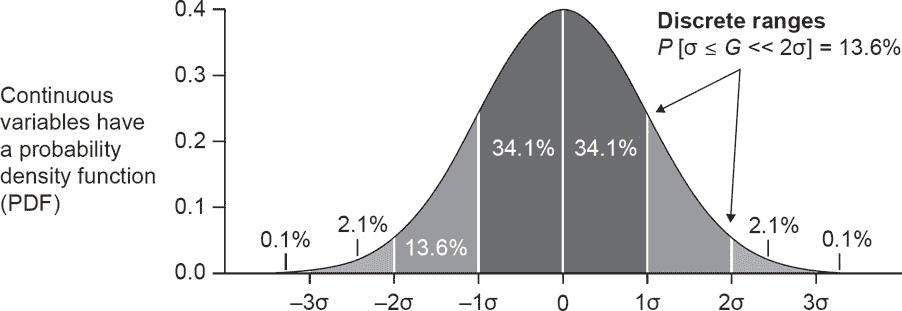  

`PDFs` 有许多形式，并有不同的衡量方法来描述。通过分布描述我们的离散或连续随机数据，我们还可以生成随机数，我们稍后会回到这一点。另一个可以通过例子描述的重要概念。

如果我们有五个骰子，并用它们来生成随机分数，我们可以询问分布看起来是怎样的；特别是，当我们增加生成每组分数的骰子数量时会发生什么。这个实验在图 3.11 中形象所示。投掷一个骰子，正如我们预期的，是一个均匀分布，因为每个分数的概率相等。当我们投掷两个骰子时，分布不再是均匀的。随着骰子数量的增加，分布收敛于正态分布。描述这一点的定理是中心极限定理（Bronshteĭn et al., 2015）。中心极限定理表明，在某些（相当常见的）条件下，许多随机变量的和具有近似正态分布。因此，如果一个事件是许多不同分布随机数据的组合，那么我们的事件分布很可能是高斯或正态的。

根据我们对统计学和概率的直观理解，我们可以用分布表示随机数据以及随机事件之间的相互关系。然而，我们缺少如何生成随机数或随机数据。计算机是显式的、线性的、精确的且定的。

图 3.11 使用五个骰子投掷得分组的中心极限定理示例。左上是投掷一个骰子的得分组（`n = 1`）；右中间是投掷五个骰子的得分组（`n = 5`）（https://commons.wikimedia.org/wiki/File:Dice\_sum\_central\_limit\_theorem.svg 遵循 Wikimedia Commons 许可）

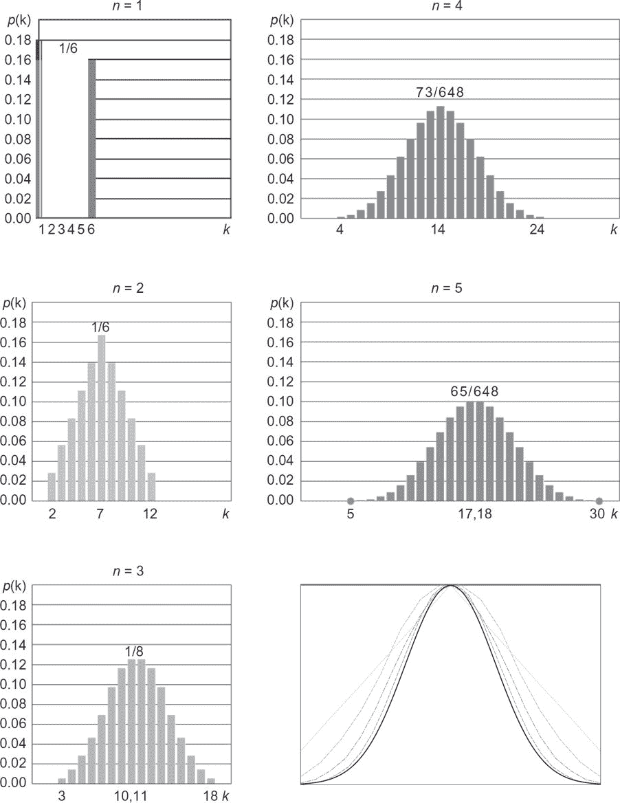  

幸运的是，它们可以产生伪随机数，实现此点的算法已经编写（Teukolsky et al., 1993; Knuth, 2011）。如果我们有不完整的数据，但能从现有数据某种确定概率分布，那么我们就可以生成相同分布的随机数。

本节建立了对 ML 和 AI 柱的直观理解。如果你在算法层面处理 AI 工作，就需要这些领域的领域专家。

### 3.3 机器学习概念

在本节中，我们介绍了监督学习、无监督学习、半监督学习和强化学习。在这里我们描述了入门阶段的 ML 类型。我们也可以对算法的学习方式进行分类。

### 3.3.1 监督学习、无监督学习、半监督学习和强化学习

我们所说的“类型”组织如下：

- `Supervised learning` – 使用标记数据进行训练（见图 3.12）。
- `Unsupervised learning` – 使用未标记数据（见图 3.13）。
- `Semi-supervised learning` – 使用标记和未标记数据进行训练（见图 3.14）。
- `Reinforcement learning` – 使用智能体的学习来达成目标（见图 3.15）。

每个类型的示例为：

- `Supervised learning` – 分类、回归（`linear`、`logistic`）、`SVMs`、决策森林、`NNs`。
- `Unsupervised learning` – 聚类、关联规则学习、降维、`NNs`。
- `Semi-supervised learning` – 监督和无监督的。
- `Reinforcement learning` – `MonteCarlo`、直接策略搜索、`temporal difference` 学习。

我们还可以根据算法处理的数据对其学习方式进行分类：

- `Batch learning` 描述从大数据集中学习。所有数据都用于训练和测试算法。所需的计算资源由数据量、速度、多样性和真实性决定。这种学习是离线进行的。
- `Online learning` 通过小批次数据进行。学习在数据可用时发生——例如一个从股票价格学习的系统。

我们有时会遇到从示例学习或通过示例构建模型学习的情况；这些学习类型分别被称为 `instance-based learning` 和 `model-based learning`。这些可能是最简单的学习形式。

### 3.4 总结

本章探讨了 AI、ML 和机器人之间的相互关系，强调了以人为本的伦理方法的重要性。它澄清了，虽然 AI 和 ML 经常混用，但 ML 是 AI 的子集，侧重于从数据中学习，而 AI 包含更广泛的能力，包括从经验中学习和自主决策。


AI 代理（Agents）的概念通过理性代理得到了解释，这类代理会根据在给定环境中性能最大化的原则选择行动。本章详细介绍了不同类型的代理——反射型代理、基于模型的代理、基于目标的代理和基于效用的代理——并强调了它们在自主处理任务时日益增加的复杂性。

本文探讨了机器人技术在 AI 中的作用，追溯了智能机器人的发展过程以及 AI 如何增强它们执行复杂任务的能力。介绍了机器人技术中的关键范式——分层式、反应式和混合式，展示了机器人如何处理传感器数据并做出决策。

本章还深入探讨了机器学习（ML），讨论了其在线性代数、向量微积分和概率论方面的基础原理，以及监督学习、无监督学习、半监督学习和强化学习技术在 AI 应用中的作用。这些技术使 AI 系统能够从数据中学习、解决复杂问题并与其环境进行交互。

总之，本章将 AI 和 ML 的技术基础与实际应用结合起来，为智能代理和机器人技术如何推动各个领域 AI 技术的发展提供了见解。

# 4 数据与 AI

### 4.1 AI 中的数据
在本章中，我们扩展了数据的使用，通过 `ML` 从数据中学习。我们可以从各种来源获取数据，数据将以许多形式和水平出现。为了理解这些数据，我们将使用数字计算。

### 4.1.1 关键术语
让我们定义在本节中探索的典型术语：
* 数据类型（结构化、半结构化和非结构化）；
* 大数据；
* 数据可视化。

### 4.1.1.1 数据类型——结构化数据
`ML` 中的结构化数据高度组织、易于检索且通常存储在表格或数据库中的信息。这些数据的特征是具有预定义的模式（schema），每一列代表特定的特征或属性，每一行代表一个记录或实例。结构化数据的示例包括客户信息、财务记录和来自 `IoT` 设备的数据。在 `ML` 中，结构化数据至关重要，因为它们允许对分类、回归和聚类等任务进行直接分析。其良好定义的性质有助于数据预处理、特征提取以及与 `ML` 流水线的集成。警告的是：尽管这是最简单的数据形式，但为了理解和使用 `ML` 算法，我们仍然需要精通标量（scalars）、数组（arrays）和张量（tensors）。

### 4.1.1.2 数据类型——半结构化数据
`ML` 中的半结构化数据指不符合严格表格格式但仍包含组织化标记的信息，使其比结构化数据更灵活。示例包括 `JSON`、`XML` 和 `YAML` 文件，以及邮件和 `HTML` 文档。在 `ML` 中，处理半结构化数据涉及将相关信息转换为更易分析格式，这通常需要复杂的预处理步骤，如归一化和特征提取，为建模做好准备。半结构化数据非常有价值，因为捕捉了来自各种来源（如网页和社交媒体动态）的复杂信息，使 `ML` 算法能够利用丰富的数据集提高预测性能和更具洞察力的分析。本质上，我们对这些数据的实践越多，从中提取价值的能力就越强。这是一个更复杂的编排过程。

### 4.1.1.3 数据类型——非结构化数据
`ML` 中的非结构化数据指缺乏预定义格式或组织框架的信息，使其在处理和分析上本质上更加复杂。这种数据类型包括文本文档、图像、音频文件、视频、社交媒体帖子和其他形式的多媒体内容。由于其自由形式的性质，非结构化数据无法整齐地放入行和列中，对传统的数据处理和分析方法构成了巨大挑战。在 `ML` 中，从非结构化数据中提取有意义的见解涉及高级技术，如针对文本的 `NLP`、针对图像和视频的计算机视觉以及针对声音的音频信号处理。这些技术将非结构化数据转化为 `ML` 算法可以利用的结构格式变得日益重要，因为它代表了数字时代产生的大部分数据，为开发预测模型、改进决策过程以及发现跨应用的隐藏模式和趋势提供了丰富的信息源。处理这类数据并从中提取价值可能需要使用 `ML` 技术来理解这些数据。这是我们现在掌握的一个令人兴奋的 `ML` 领域。我们的手机很快将拥有更好地指导我们使用它们的 `AI`。可能我们的数字 `AI` 能力将为我们开发，我们不需要像想象中那样频繁处理非结构化数据。我们只会习惯于让 `AI` 为我们完成。这里的意思是，我们不需要理解搜索引擎是如何工作的，可以通过学习如何使用它来最大化其收益。

### 4.1.1.4 大数据
大数据是一个通常用于描述互联网上可以找到的海量数据的术语。大数据具有以下特征（Gregersen, 2024）：
* `Volume`（量量）：衡量存储和生成的数据数量。
* `Variety`（多样性）：衡量数据的性质和类型。
* `Velocity`（速度性）：衡量数据移动的速度。
* `Veracity`（真实性）：衡量数据质量、价值或效用。

`ML` 中的大数据是指以高速度产生且具有多种格式的海量数据，传统的数据处理工具无法高效处理。这些数据涵盖源自社交媒体、传感器、交易系统和多媒体等众多来源的结构化、半结构化和非结构化信息。在 `ML` 中，大数据提供了训练更准确、更稳健的模型所需的原材料。大数据的规模和多样性能够发现小型数据集可能会错的复杂模式、关系和见解。利用大数据需要专门的技术和架构。应用于大数据的 `ML` 算法可以在预测分析、实时处理和个性化体验方面带来突破，推动从医疗到金融等各个行业的创新和竞争优势。

我们可能通过思考从源上开启了什么来理解大数据。互联网为我们提供了互联性，意味着数据可以从世界各地被挖掘。它还允许我们访问处理大数据所需的海量数据处理。因此，为了利用大数据，我们必须熟悉并行计算和网络。


### 4.1.1.5 数据可视化

机器学习中的数据可视化是通过图形化表示数据，以帮助理解模式、趋势和洞察的过程。它在机器学习项目的每个阶段都具有无价的价值。它涉及创建图表、图形、热力图和点图等视觉上下文，使复杂的数据更易于获取和理解。

在数据探索期间，可视化有助于识别数据中的分布、离群值和关系，引导特征选择和特征工程。在预处理阶段，它有助于检测异常、缺失值和必要的转换。在模型评估期间，混淆矩阵、受者工作特征曲线（ROC 曲线）和精确率-召回率等可视化工具有助于评估性能指标并理解模型行为。

有效的数据可视化确保了结果沟通的更加清晰，使数据科学家、利益相关者和决策者理解机器学习模型及其底层数据的影响。将原始数据转换为视觉格式可以简化大型数据集和预测模型中固有的复杂性，有助于做出决策和更直观的洞察。

### 4.1.1.6 常见的数据可视化方法

数据的视觉化表示是关注人工智能或机器学习可以增强你组织和展示数据方式的一个领域。良好可视化的优势必须是优先考虑的，因为最终，客户、利益相关者和/或用户将根据部署的 AI 或结果的展示来评价我们。可视化是团队中每个人从经验中学习的根本推动因素。图 4.1 显示了机器学习项目的阶段，并强调了可视化如何帮助在每个阶段从经验中学习（见第 4.2.2 节中 Géron 的八个阶段）。

图 4.1 可视化是机器学习项目每个阶段的从经验中学习

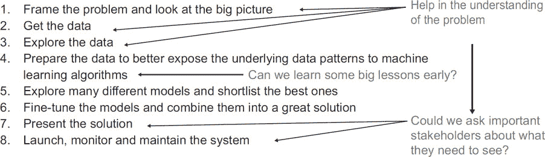 

如果我们能从项目开始就对数据进行可视化，就能放大我们的学习——一画胜千言。此外，我们已经在组织数据了，以便我们管理和使用它们。如果我们处于一个高度监管的行业，那么早期与利益相关者和监管机构的接触可能有助于工作和结果的接受。如果我们提醒自己会遇到的数据类型——结构化、非结构化和半结构化数据——那么我们需要重视这些类型以及我们如何可视化它们。

值得注意的是，`Python` 是计算机和数据科学家最常用的机器学习编程语言（`Python`, 2019）。对此的解释通常是由于 `Python` 的交互性本质。此外，我们经常在数据可视化软件中看到数据流水线。通常，`Python` 是这些软件软件包中的脚本语言，用于自动化标准任务；`SciKit-learn` 和 `TensorFlow` 都将 `Python` 作为编码语言（`Scikit-learn.org`, 2024）。`TensorFlow` 还通过其他语言（如 `C++` 和 `Swift`）扩大其机器学习库的访问范围（`TensorFlow`, 2019）。

图 4.2 显示了一些典型的数据可视化类型。第一行（a–c）是在电子表格中可能遇到的数据图形。中间行是等值线图（iso-contour plot），可能是地图上的高度图。左侧的图像是等值面（d）；从等值线我们可以构建出 3D 等值面（e）。通过一些矢量微积分，我们还可以计算梯度并可能找到最大和最小高度。如果我们绘制的数据是神经网络（`NN`）的学习率或业务活动的利润，这些想法将非常强大。我们可以关注快速的学习率或使利润最大化。示例的最后一行（f 和 g）是网络；这些是更复杂的视觉化结构。在这里，立体视觉、增强现实或虚拟现实等技术可以提供帮助。即使是大显示器（如动力墙），也能为我们展示的数据提供不同的视角。

这些类型的数据可视化技术已经存在了几十年，我们计算机上的软件允许我们创建它们。然而，当我们转向来自仿真或大数据的数据时，我们需要并行数据处理能力。`ParaView` (`www.paraview.org`）是一个以 `Python` 为核心的并行数据可视化生态系统。它基于`Visualization Toolkit`开源 3D 图形图像处理和可视化软件库构建，并设计在并行计算机上运行，因此可以处理大型数据集并产生单个用户看到的图形。这是处理大型数据集时的一个重大挑战——在并行计算机上处理大型数据集不应该在你的第一个项目中尝试。

大多数笔记本电脑和桌面电脑都是多核多处理器机器，配备图形处理单元（`GPUs`），它们具有足够的处理能力来学习和开发机器学习/人工智能。一旦在小型硬件上通过测试，你就可以逐渐在高性能计算系统上使用更大的处理能力。

图 4.2 标准数据可视化示例：(a)折线图，(b)散点图，(c)直方图，(d)等值线图，(e)3D 等值线图，(f)网络图和(g)3D 网络图

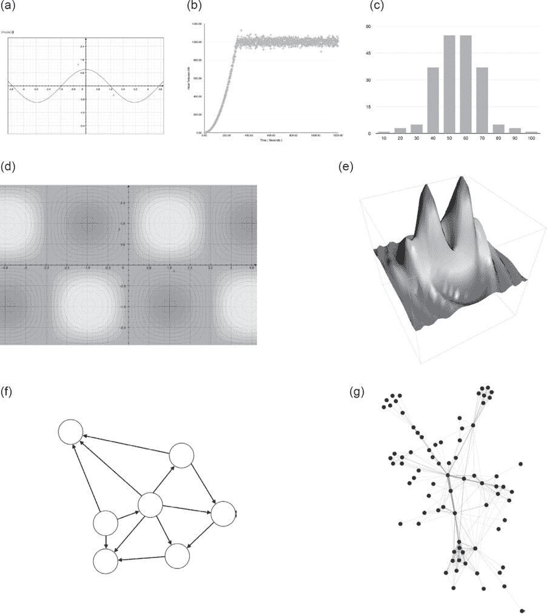 

我们很的是大多数开源软件都可以为常见的操作系统进行编译，或者已经编译好了。你最初可以在你自己的硬件上工作，使用与你在更大型硬件设置上使用的相同的软件。我们也很幸运既有开源软件也有商业软件可以借鉴。两者都有优缺点，你需要考虑自己需要什么。在你最喜欢的搜索引擎上进行搜索将列出周围许多数据可视化包的列表。

我们知道可视化是从经验中学习的重要辅助，但还有一个额外的想法可能是我们可以纳入：我们能创建一个学习环境吗？我们能开发一个虚拟现实（`VR`）或增强现实（`AR`）仿真环境，让我们从中学习或让人类教导 AI 系统吗？我们在上一章中提到，人工智能机器人给了我们探索和利用极端环境的机会。我们可以构建仿真环境来生成设计和操作机器人的数据吗？我们可以构建一个学习环境让机器人学会如何执行任务吗？

`Blender` 是一个开源软件，具有用于构建仿真和展示数据的高级环境（见图 4.3）。它的图形能够产生写实的渲染和电影。这通常是电脑游戏、电影和科学可视化的基础。如果我们将其扩展到机器学习和人工智能，我们可以建立一个人机环境，机器和人类在其中互动相互教学。这种例子出现在工程领域，操作员在那里学习如何操作机器，飞行员在安全环境中学习飞行。我们总是受到从经验学习的引导，学习环境可以用于生成数据。

图 4.3 构建仿真环境的开源软件——`Blender` (https://commons.wikimedia.org/wiki/File:Blender_2.90-startup.png, Creative Commons Attribution-Share Alike 4.0 International licence)


图 4.4 医学中的 AI – 人类与机器的协作（顺时针：https://en.wikipedia.org/wiki/Radiology#/media/File:Radiologist_interpreting_MRI.jpg, Creative Commons Attribution 4.0 International 许可；https://en.wikipedia.org/wiki/Da_Vinci_Surgical_System#/media/File:Cmglee_Cambridge_Science_Festival_2015_da_Vinci.jpg, Creative Commons Attribution-Share Alike 3.0 Unported 许可；https://commons.wikimedia.org/wiki/File/Cmglee_Cambridge_Science_Festival_2015_da_Vinci_console.jpg, Creative Commons Attribution-Share Alike 3.0 Unported 许可)

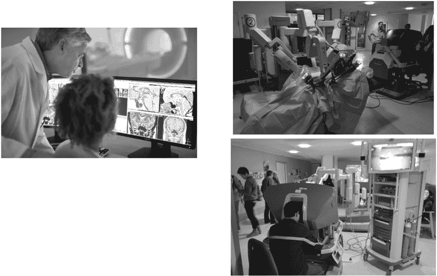

## 4.1.2 数据质量

在本节中，我们将从一句关于数据广为人知的话言开始：

垃圾进，垃圾出。

对于 AI，特别是 `ML`，我们可能需要将其更改为：

高质量数据进，垃圾出。

我们将在本书的后部分看到，尽管我们可能会给 `ML` 系统高质量的数据进行学习，但如果使用不当，它可能会产生垃圾。我们应该提醒自己遵循科学方法，对我们的工作保持怀疑，并记住它必须是可复的。这对于目前极其流行的生成式 AI 尤为重要。本书不是一本关于数据管理的书，在现实项目中，我们必须非常小心地处理数据。秉持伦理道德并遵守法律至关重要。

### 4.1.2.1 数据质量指标

五个关键的数据质量指标对于确保组织内数据的可靠性和可用性至关重要：准确性、完整性、一致性、及时性和唯一性。

**准确性** 衡量数据值与其代表的真实值之间的匹配程度，确保数据正确且没有错误。

**完整性** 评估是否所有需要的数据都存在，表明没有缺失关键信息。

**一致性** 检查数据在不同数据集和系统之间是否统一且标准化，减少差异并确保连贯。

**及时性** 评估数据的时效性和相关性，确保它们在需要时是新的且可用的。

**唯一性** 确保每个数据条目都是独特的且不重复，维护数据集的完整性和可信度。

这些指标共同提供了一个监控和维护高数据质量的全面框架，这对于明智决策和运营效率至关重要。

### 4.1.2.2 低质量数据及其后果

低质量数据会严重影响 `ML` 模型，导致一系列负面后果。不准确的数据会引入错误，导致模型学习到错误的模式，导致预测性能不佳且输出不可靠。不完整的数据可能会偏偏训练过程，使模型没有足够的信息来很好地泛化到新的未见数据。不一致的数据会导致模型训练困难，因为算法在调和冲突信息时挣扎。延迟或过时的数据可能会使模型随着时间的推移变得不再适用或不准确，特别是在对及时洞察至关重要的动态环境中。此外，重复数据可能会放大某些模式的显著性，导致模型产生偏差。总的来说，低数据质量会损害 `ML` 模型的完整性、准确性和可靠性，导致决策误导、效率降低并给依赖这些模型执行关键任务的组织带来潜在的财务损失。

### 4.2 数据管理与利用

在整个数据生命周期中，有各种需要考虑的挑战和风险，从如何合法收集和存储数据，到确保其处理与其预期用途相符，且没有偏差或虚假信息。图 4.5 显示了我们在处理数据时必须遵守的一些典型法律和法规。

图 4.5 法律与法规

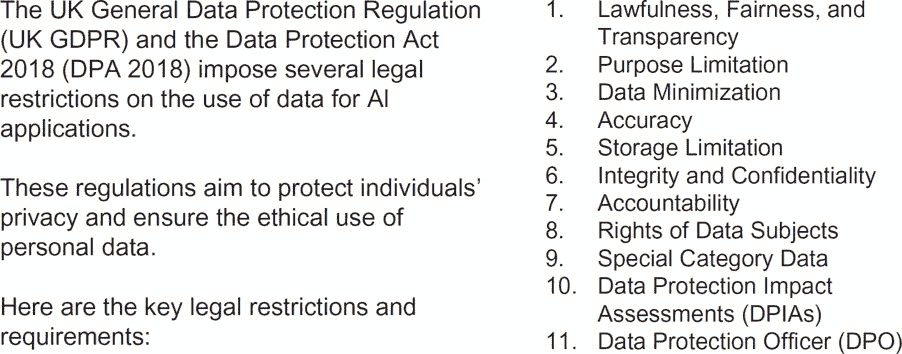

合规的实际操作步骤包括：

- 进行定期审计：定期审查数据处理活动，以确保符合 `UK GDPR` 和 `DPA 2018`。
- 实施强的数据治理：为数据管理建立明确的政策和程序。
- 进行培训和意识教育：对员工进行数据保护原则和合规重要性的培训。

通过遵循这些原则和法规，组织可以确保其 AI 应用符合 `UK GDPR` 和 `DPA 2018`，从而保护个体的数据权利并维护伦理标准。在使用 `AI` 和 `ML` 时，使用科学方法系统地识别、分析和缓解数据问题，从而建立更健健、公平且准确的 AI 系统。

### 4.2.1 数据处理中的风险

在 `AI` 和 `ML` 中使用数据带来了许多挑战和风险，这些风险可能会损害模型的有效性并导致意外后果。一个主要挑战是确保数据质量，因为低质量数据会引入偏差、不性和不一致，扭曲模型输出。管理和处理大型数据集还需要大量的计算资源和专业知识，增加了模型开发和部署的复杂性。此外，当模型学习训练数据中的噪声或无关模式时，就会产生过拟合风险，导致对新数据的泛化能力不佳。

隐私和安全问题至关重要，因为使用敏感或个人身份识别信息需要采取严格的措施来防止数据泄露和滥用。伦理考量（如避免歧视和确保公平）增加了数据使用的复杂性，特别是当历史偏见嵌入数据集中时。最后，对 `GDPR` 等法律的监管合规性又增加了一层复杂度，要求组织在利用数据进行 `ML` 的同时应对法律框架。这些挑战和风险凸显了对稳健的数据管理实践、伦理准则和持续监控的需要，以确保在 `ML` 中负责任且有效地使用数据。

### 4.2.2 为机器学习项目准备数据

准备数据是所有计算机工作的一个重要方面，而不只是 `AI` 或 `ML`。在 `AI` 中，从经验中学习至关重要，而在 `ML` 中我们专注于从数据中学习。没有保证的方法可以确保你的数据准备第一次就是正确的。你必须从经验中学习，并在每次迭代中改进数据准备。那么，我们何时停止？这是由领域专家决定的——这个人设定了符合用途的标准。敏捷项目风格非常适合这种。

数据准备受许多因素影响，本身就是一门科学；因此需要经验来开展。这种经验可以在项目期间获得，也可以请已经有经验的人为你完成。

书末的延伸阅读列表有许多 `ML` 示例，这些示例将让你了解所需数据准备的感觉。

我们应该记住，如果我们处理的是大型数据集，还面临获取数据、存储、组织、确保数据安全以及遵守相关法律的额外复杂性——这本身就是一项耗时的任务。Aurélien Géron 的机器学习项目八阶段是一个很好的起点（Géron, 2017）。这些阶段是：

1. 问题定义。
2. 获取数据。
3. 探索数据。
4. 准备数据以更好地向 `ML` 算法暴露底层数据模式。
5. 探索许多不同的模型（或算法）并为项目筛选出最佳模型。
6. 微调你的模型并将其组合成一个完美的解决方案。
7. 演示你的解决方案。
8. 启动、监控和维护你的系统。


再次，我们立即注意到，这八个阶段涉及大量的经验学习。它们并不是顺序执行的，我们可能会重新访问或循环第 1–5 阶段、1–7 阶段或 1–8 阶段——一次性完成 1 到 8 阶段是例外而非常态。我们可能会使用较小的数据组，这样我们可以学得更快，因为我们不需要处理大量数据。这在评估多个算法时很有帮助，因为这涉及到更多工作。在早期阶段对较小的子集进行工作可以获得一些学习。这简单地缩短了迭代之间的时间。

如果我们拥有大型数据集，就需要将数据分为训练数据和测试数据。这对于权衡至关重要，我们希望在复杂性和误差之间进行权衡；这在第 4.2.3.9 节中有更详细的介绍。然后我们可以将训练数据分成不同大小的数据桶（bins），并使用这些不同大小的桶来测试我们的算法。随着方法的完善，我们随后可以使用测试数据来查看我们的学习对于 `AI` 或 `ML` 系统以前未见过的数据是否有效。

测试数据不能用于训练你的 `AI` 或 `ML` 系统。这样做的原因之一是算法会在训练期间使用测试数据，因此我们已经知道算法处理这些数据的效果如何。这在本质上是浪费时间，因为我们没有向系统添加更多信息。独立的测试数据为我们所完成的 `ML` 提供了独立的测试。

一旦我们有了数据并将其划分为合适的桶，就可以开始清洗或刷洗数据。这意味着我们以一种方式准备数据，使我们的算法获得成功的最佳机会。

在 `AI` 中，我们可能会遇到许多数据类型，例如数字、字符串和 `Booleans`，或者它们可能是更复杂的数据，例如音频文件、电影文件、脚本、文本、文档，可能还有来自执行器、传感器的信号——我们甚至可能仿真中生成自己的数据。`Digital twin` 是一项在过去 20 年左右获得了发展动力的激动进展。数据将以多种形式、各种数量向我们到来。

在 `AI` 中，我们需要处理模拟数据。在这里，我们通常会采用模拟数字转换器，以便将模拟信号表示为系列数字计算机可以理解的离散数字。

数据准备的一部分是数据清洗或数据刷洗。在我们进行 `ML` 项目的各个阶段时，必须始终意识到数据准备的质量。糟糕的数据准备将导致虚假的 `ML` 结果，或歪曲我们试图分析的数据。

刷洗可以包括：

- 减少我们正在处理的数据量，可能删除无关数据；
- 重新格式数据；
- 删除不完整或重复的数据；
- 处理缺失数据；
- 生成数据；
- 缩放数据以便算法运行良好。

有很多用于数据准备的工具和技术以及标准库帮助我们，我们需要经验来做好这一点。

数据准备虽然重要，数据可视化同样重要。数据可视化（见第 4.1.1.5 节）也会影响你准备数据的方式。在我们尝试对跨越大型超级计算机上多个处理器的的数据集进行可视化之前，这通常会被忽视。

## 4.2.3 从数据中学习的算法

算法是解决问题、工程和计算机科学的核心。在 `AI` 中，我们感兴趣它们如何帮助我们从经验中学习；它们如何帮助我们创建出能够学习和改进的智能实体、产品和服务。算法在学术上被研究，这可能导致对复杂且丰富研究的终身追求。算法也是我们用来教自己如何编写数字计算机程序的简单程序（从简单的流程图到复杂的事件驱动面向对象软件）。狭义 `AI`，特别是狭义 `ML`，给了我们一个理解算法如何从数据中学习的机会。`NN` 及其许多变体教会自己如何解决问题。这是一种学习其自身算法的算法，例如用于下棋。

我们应该注意，`AI` 或 `ML` 算法并不总是解决我们问题的最佳选择。科学家、数学家和工程师通常会有更优雅、更高效的方法来解决问题。然而，我们并不总是具备这种能力，在这里 `ML` 和 `AI` 可以帮助我们，特别是当我们有大量数据可以处理时（例如，来自望远镜、仿真、传感器等的数据）。此外，算法可以用多种方式表示，如计算机代码、流程图、数学符号、伪代码等。对于那些想要深入研究算法的人，Tom Mitchell 的书《`Machine Learning (2018)`》为对许多算法及其实际用途提供了极佳的介绍，包括我们在下面描述的算法及其推导。

`AI` 和 `ML` 在其根本上基于科学方法，我们必须谨慎地使用这些技术。我们的学习问题是非线性的、迭代的，并且在本质上可能是统计性的。我们必须谨慎地使用算法，因为它们通常是问题的通用方法——领域特定技术可能更适合我们的问题。我们使用 `ML` 和 `AI` 的方法之一是建立对算法能实现什么的学习和经验。

`ML` 和 `AI` 汲用了成熟学术学科的技术，如运筹学、控制理论、数学、数值分析和工程。例如，决策树经常与 `ML` 相关，但几十年来它们一直是安全工程和管理理论的核心。

在本章中，我们的目的是介绍什么是算法以及为什么算法对 `ML` 和 `AI` 如此重要。算法在准确性、性能和处理时间方面都有优缺点。本章还包括 `ML` 中一些常用算法的解释和示例。我们将解释它们的用途以及在选择时面临的挑战。

### 4.2.3.1 什么是算法？

算法的定义是在计算或其他解决问题的操作中（特别是由计算机执行）遵循的过程或规则。简单来说，算法是为了执行特定任务而设计的指令集。这可以简单如我们两个数字相乘的过程，这是我们在小时候就学到的并认为理所当然的。人类使用十进制进行操作，而计算机使用二进制。只有当你必须解释自己在做什么时，它看起来才很复杂——我们需要明确，因为我们的数字计算机需要明确的指令。算法可以是复杂得多的，例如压缩计算机文件或播放压缩视频文件。

我们之前涵盖了学习类型和数据类型，但在进一步探讨算法主题之前，有必要再次解决这些基本概念。

在监督学习模型中，算法在标记数据集上进行学习，这提供了一个答案密钥，算法可以使用它来评估在训练数据上的准确性。在无监督模型中，它使用提供的无标记数据，算法通过自行提取特征和模式来理解数据。在半监督学习和强化学习模型中，数据可以是有标签的也可以无标记的。


# 关联与控制

**关联 (Association)** – 在此处，数据的特征可以与其他特征关联，并且在无监督学习的情况下，它们还可以关联其他数据，例如，通常买面包和黄油的人通常也会买牛奶。

**控制 (Control)** – 指设定值与测量值之间的误差测量将帮助决定采取什么措施，例如，自动驾驶车辆控制器可以执行控制制动，也可以执行避障机动。在表 4.1 中，我们展示了学习模型、算法类型和示例算法之间的广泛联系，其中某些算法将在本章稍后进行描述。

## 4.2.3.2 AI/ML 算法有什么特殊之处？

通常，算法接受某些输入并利用数学和逻辑来产生输出。相比之下，AI 算法同时获取输入和输出的结合，以便从数据中“学习”。在机器学习（ML）中，一旦经过训练，ML 算法在给定新输入时就能产生输出。

### 表 4.1 学习类型和算法示例

| ^(ML 类别) | ^(算法类型) | ^(示例) |
| --- | --- | --- |
| ^(监督学习/标签数据) | ^(回归) | ^(线性回归) |
| ^(分类) | ^(SVM) | ^(决策树) |
| ^(无监督学习/无标签数据) | ^(聚类) | ^(K-means) |
| ^(关联) | ^(回归) | ^(Apriori) |
| ^(半监督学习/标签与无标签数据混合) | ^(分类) | ^(半监督 SVM) |
| ^(聚类) | ^(K-means) | |
| ^(强化学习) | ^(分类) | ^(集成学习 – 决策森林) |
| ^(控制) | ^(Q 学习) | |

## 4.2.3.3 什么是自学习算法？

自学习算法通过通过迭代来完善自身的性能；也就是说，它通过自身学习来提高准确性。在机器学习的背景下，这通常需要大量的计算资源。它最好被描述为一个系统，你向其中输入需求（即所需的结果以及各种参数），随着时间的推移实现该结果。一个例子是推荐引擎，随着数据点的处理，系统推荐“物品”的能力会变得越来越好。

## 4.2.3.4 ML 和 AI 中使用了哪些算法？

ML 和 AI 算法包括：

**线性回归 (Linear regression)** – 这种模型假设输入变量 (`x`) 与单个输出变量 (`y`) 之间存在线性关系。具体来说，`y` 可以通过输入变量 (`x`) 的线性组合计算得出。例如，想象根据重量变量 `y` 排列方块，但你无法称重，只知道它们的 `x` 变量（长度、高度宽度）。单个输入被称为简单线性回归，多个输入被称为多变量、多元或多次线性回归。一个用途可以是根据身高、体型、性别等预测人类的理想体重。

**逻辑回归 (Logistic regression)** – 这是一种用于统计学和机器学习的数学模型，用于在给定之前数据的情况下估计事件发生的概率。逻辑回归结合之前的数据工作。

**决策树 (Decision tree)** – 这是一种用于分类和回归的非参数监督学习方法。它使用树状模型，其中每个内部节点表示对属性的“测试”，每个分支代表测试结果，每个叶节点代表类别标签或连续值。

**随机森林 (Random forest)** – 这是一种用于分类和回归的集成方法，它在训练时构建许多决策树，并输出类别的模式或平均值。

**KNN (最近邻算法)** – 这是一种简单的、非参数的基于实例的学习方法，用于分类和回归。


由于无标签数据无法进行监督学习时，则需要采用无监督方法。`SVM` 尝试将数据自然聚类的若干组，新数据将落入这些组之一。

`Naive Bayes`（朴素贝叶斯）——这是一种基于`Bayes’ theorem`的分类技术，假设预测变量之间存在强独立性。简单来说，`Naive Bayes` 分类器假设某一类中特定特征的存在与任何其他特征的存在无关。它被用于预测每个类别的成员概率，例如给定记录或数据点属于特定类别的概率。一个简单的例子是根据记录关于你的数据预测你患某种特定疾病或病病的概率，这些数据可能包括种族、年龄和性别，而不仅仅是皮疹或发热等依赖性症状列表。

`K-means`——这是一种基于质心的聚类算法，意味着数据围绕一个中心进行聚类。`K-means` 是一种迭代算法，有两个独特的步骤：第一步是聚类分配，第二步是移动质心步骤。

最初，你必须根据想要创建的聚类数量选择若干个聚类中心。然后从各个数据点对每个数据点进行测量，并根据哪个聚类更近（`cluster A` 质心、`cluster B` 质心或 `cluster C` 质心等），将数据点分配给其中一个聚类质心。`K-means` 然后将质心移动到聚类中点的平均值。换句话说，算法计算聚类中所有点的平均值，并将质心移动到该平均值位置。然后重复这两个步骤，直到满足终止条件。

该算法在现实世界中的示例是出于营销目的将客户细分为不同的人物画像（persona）类别，以便向不同的画像发送更具针对性的营销信息，从而帮助增加参与度或销售额。在营销中，你通常会尝试将画像数量限制在可接受的范围内——假设六个是最佳的——但我们如何为特定的行业或市场细分确定这一数量，需要从经验中学习。

确定最佳聚类数量的聚类数（即 `k`）可能非常复杂，可以通过添加额外的聚类，直到它不再产生显著差异来决定。单个数据点也可以被视为一个聚类。`k` 的决策标准超出了本书的范围。再次，我们看到了在构建 AI 或 `ML` 技术时，从经验中学习的重要性。

上述示例仅是 `ML` 和 AI 所用算法的冰山一角，实际上有成千上万甚至数百万的算法被用于特定行业、解决特定问题或个人应用。

### 4.2.3.5 什么是深度学习算法？

与上一节中描述的算法一样，深度学习中也使用了许多针对 `NNs` 的算法。除了功能和用途的描述外，这些算法的详细原理超出了本书的范围。这些算法包括：

- **多层感知器神经网络 (MLP NN)**：这是一种前馈人工神经网络（`ANN`）的类。`MLP` 利用一种称为 `backpropagation`（反向传播）的监督学习技术进行训练。它的多层结构和非线性激活函数将 `MLP` 与线性感知器区分开来。它可以区分非线性可分的数据。
- **反向传播 (Backpropagation)**：这是“误差反向传播”的缩写，是一种使用 `gradient descent`（梯度下降）对 `ANNs` 进行监督学习的算法。给定一个 `ANN` 和一个误差函数，该方法计算误差函数相对于 `NN` 权重的梯度。然后可以调整权重以改进误差。
- **卷积神经网络 (Convolutional neural network)**：`CNN` 是一种深度学习算法，它可以接收输入图像，并根据可学习的权重和偏置为图像中的各个方面/对象分配重要性，并能够区分它们。`CNN` 的灵感源于人类大脑处理视觉数据。这些 `NNs` 更具通用性，可以用于图像以外的数据（例如音频、自动驾驶汽车等）。
- **循环神经网络 (Recurrent neural network)**：`RNN` 是 `ANN` 的一类，它沿着时间线处理数据序列，并在“内存”中记住数据序列或可变数量的数据以便稍后处理使用。数据点之间存在连接，就像我们阅读单个单词并将它们连接成句子一样。`RNNs` 派自前馈 `NNs`。它们通常用于语音识别和手写识别应用，在这些应用中，之前的内容可能会影响后续或解释方式。
- **生成对抗网络 (Generative adversarial network)**：`GAN` 是 Ian Goodfellow 及其同事在 2014 年设计的一种 `ML` 框架：两个 `NNs` 以零和游戏的形式相互竞争，其中一个代理的收益是另一个代理的损失。除了游戏，`GANs` 还用于图像改进和事件生成，并用于生成类似于单图像生成的真实照片和视频的“深度伪造”（deepfake）写实图像。
- **长短期记忆 (LSTM)**：这是深度学习领域的一种人工 `RNN` 架构。与标准的前馈 `NNs` 不同，`LSTM` 具有反馈连接。它不仅处理单个数据点（如图像），还可以处理整个数据序列（如语音或视频）。
- **受限玻尔兹曼机 (RBM)**：这是一种受限的双层 `ANN`，具有可见层和隐藏层。它最初发明于 20 世纪 80 年代，至今在使用，它可以从数据输入中学习概率分布。`RBMs` 也可以以监督或无监督的方式训练，取决于任务。`RBMs` 用于主题建模、分类、协同过滤和特征学习，并在语音识别等其他应用中找到用途。`RBM` 是 `DBN` 的基础。
- **深度信念网络 (DBN)**：这可以通过多层简单的无监督网络（如 `RBMs`）创建。`DBN` 的最简单形式由许多潜变量组成，层与层之间有连接，但每层单元之间没有。当 `DBN` 最初在数据集上进行无监督训练时，它可以以概率方式构建输入。初始训练后，监督训练将允许它执行分类。`DBNs` 通常用于药物发现领域。

许多其他深度学习算法，但上述描述表明，选择、应用和成功使用这些算法需要大量的技能、知识和经验。上述描述的每种算法都是数学和理论的丰富领域。它们都根于科学方法，并且找到使用这些算法的严谨方法。我们在这里的意思是，虽然解释复杂的算法很困难，但它们在科学方法中的根有助于为其使用和结果建立专业且严谨的辩护。深度学习方法包含的数据和步骤超过了人类的理解能力。再次，我们应该提醒自己，这些通用学习技术可能不是我们问题的最佳解决方案。在这里，领域专家在确定适用性方面将起至关重要的作用。

### 4.2.3.6 神经网络——深入观察

在这里我们近距离观察 `NNs`。特别是我们描述了以下内容：


- `NN` 与 AI 代理之间的联系；
- `NN` 的基础构建模块；
- 使用强化学习的构建算法；以及
- `NN` 能够完成的一些基础示例。

`NN` 赋予了机器从经验中学习并开发自身算法的能力（要解释这些算法是什么并不容易，因为它们被编码在 `NN` 中）。近年来，我们对 `NN` 如何运作的理解取得了显著进展。这些进展包括赢得了国际象棋和围棋等复杂的策略游戏，以及可能更具挑战性的任务，如控制机器人等复杂机器。通过这种方式，我们正在赋予机器更多的自主性。

我们有许多种类型的 `NN` 可用，其中 `CNN` 因对 `ML` 做出的重大贡献而脱颖而出。然而，我们在这里不会详细介绍这种类型的 `NN`，因为其细节比我们在此处想要讨论的内容要复杂得多。

为了从复杂且具有随机性（统计性）的问题中学习，我们需要使用深层神经网络（`DNNs`）。通常，我们采用 `DNNs` 处理机器人控制、图像分析（例如医学图像）和对抗性游戏等问题。随着本章节的深入，我们将介绍这些是什么，以及为什么这使得它们的训练是迭代的并需要专门的硬件（例如高性能计算机、`GPUs` 等）。一个 `DNN` 许多许多层构成了 `NN`；这就是它被称为深层 `NN` 的原因。

### 4.2.3.7 NNs 与 AI 代理之间的联系

`NN` 通常被显示为 `ML` 的子主题。`NN` 的发展始于 20 世纪 40 代，基于人类大脑的生物特性。1943 年，Warren McCulloch 和 Walter Pitts 通过结合有限状态机、线性阈值元件和内存引入了神经逻辑网络的概念（McCulloch and Pitts, 1943），随后在 1947 年发表了将这些思想扩展到模式识别的论文（Pitts and McCulloch, 1947）。Marvin Minsky 在 1951 年构建了第一个强化 `NN`。这是一种使用强化学习进行学习的模拟或电子设备（Minsky and Papert, 1988）。这是自适应控制的开始，我们看到它与工程学之间正产生紧密的联系。1962 年，Frank Rosenblatt 命名并定义了名为“感知器”的机器（Rosenblatt, 1962）；然而，直到 20 世纪 80 代 `NNs` 才获得显著关注。今天，该理论已被更深入地理解。数字计算机促进了使用 `CNN` 执行复杂任务，如学习控制机器人和赢得组合复杂的游戏。

学习型 AI 代理需要学习的能力。强化 `DNNs` 或 `CNNs` 正是如此。它们可以从传感器和执行器中学习，也可以从经过设计的计算机仿真或游戏中学习。

狭义 AI 专注于特定问题。`NN` 是一种更通用的学习技术，可以应用于更广泛的场景。训练 `NNs` 容易，理解它们的输出也很困难。这为证明它们的合理性以及使用它们带来了挑战。

### 4.2.3.8 神经网络的基础构建模块

在本节中，我们引入了对 `NNs` 关重要的学习概念。感知器是最初的概念，我们今天复杂的 `NNs` 就是从那里演变而来的。当我们构建 `NN` 的基础构建模块时，我们将看到感知器是如何其中的。

`NN` 有一个基础的数学原理图，如图 4.6 所示，并基于 McCulloch 和 Pitts 在 1943 年的原工作。在图中，我们还看到了人类大脑神经元的简单表示。

这些 `NN` 神经元中的每一个都构成了层（许多神经元），多个（隐藏）层构成了网络。第一层是输入层，数据从这里进入网络。这些 `NN` 神经元中的每一个都构成了层（许多神经元），多个（隐藏）层构成了网络。来自仿真、图像中的像素或来自传感器的数据。数据通过网络，就像人类大脑一样，神经元会被激活（或触发）。`NN` 的三层版本如图 4.7 所示。

图 4.6 神经网络原理图和人类大脑神经元（McCulloch and Pitts, 1943; https://commons.wikimedia.org/wiki/File:Neuron3.png, Creative Commons Attribution-Alike 3.0）


可以是任意数量，`DNNs` 有许多层。遗憾的是，在训练 `NN` 之前，我们不知道层数或 `DNN` 的深度。这是我们从经验中系统地学习的，也是超参数的一部分。在这种描述中，我们仔细地只使用前馈网络，其中节点的输入传递到下一层。`RNNs` 还允许节点与同一层的其他节点进行通信。这些类型的网络被描述为更具动态性并可能会产生混沌。在这里我们将坚持前馈 `NNs`，因为我们正在建立直觉或理解。

图 4.7 具有输入层、隐藏层和输出层的神经网络原理图。在 `NNs` 中，神经元是网络中的节点，节点由输入、激活函数和输出组成。节点通过链接连接（https://commons.wikimedia.org/wiki/File:Colored\_neural\_network.svg, Creative Commons Attribution-Alike 3.0）


`NNs` 通过从节点获取激活输出并通过链接传递这些信息来工作。链接连接节点的输出到下一层。节点输出的每个链接在传递到其他节点时都有独特的权重。我们不知道这些权重是多少，而训练就是关于确定它们应该是多少。

这里有一个示例可能会帮助。假设我们有一张在智能手机上拍摄的高分辨率场景照片——照片类型并不重要。我们可以使用 `NN` 分析这张照片。照片以矩阵的形式存储在手机中，代表特定位置图像的颜色。`NN` 将此矩阵作为输入，并将此数字传递给第一层的每个节点。在传递之前，它会根据输入节点与目标层节点之间的唯一权重对其加权。第一层中的每个节点然后相加它们收到的颜色数字和权重。这些加权颜色数字之和然后通过激活函数。如果该操作的输出大于设定值，则假设该节点被激活，并将结果传递到下一层。如果没有被激活，则该节点未被激活，其输出为零。


节点是否被激活取决于激活函数。激活函数使用输入函数作为其输入。该输入函数是连接节点的输出之和，并乘以节点间连接的权重。然后，我们需要确定该节点是否被激活。如果使用硬阈值（激活函数输出高于设定值），则这就是感知器。这类神经网络（NN）可以表示在本质上是布尔逻辑的非线性问题。sigmoid 感知器使用可微的 sigmoid 激活函数，这意味着深度神经网络（DNN）现在可以表示任意函数，同样是非线性的。这使得它们非常强大。阈值激活函数是神经元激活或不激活之间的硬阶跃变化。sigmoid（逻辑回归）激活函数是可微的，并被称为更“软性”，因为触发神经元的决策不是阶跃变化。还有其他类型的激活函数，其使用取决于取决于训练者的经验。

训练者需要训练神经网络来确定每条连接的未知权重。这不是一项简单任务，也是未来 AI 人员的职责。训练神经网络涉及调整权重以提高神经网络的性能。这些技术涉及正向传播和反向传播，根据期望输出与神经网络输出之间的误差来更新权重。向量微积分知识将在此帮助，神经网络领域的专家也会有所帮助。到目前为止，我们可以神经网络简化为能够理解函数的网络，前提是提供了这些函数的示例。我们可以使用神经网络从我们已知的示例中学习。这使得误差是已知的。当我们没有标记示例可以进行学习时会发生什么？我们可以构建学习示例，并尝试根据对神经网络的理解来形成标签。

如果我们的问题有很多未知组合——例如一个具有许多可能移动的游戏怎么办？我们可能没有数据来理解所有可能的移动。我们需要以某种方式衡量神经网络的性能。这被称为强化学习，神经网络可以自己学习。强化学习自然符合学习智能体架构。智能体有一个学习组件，学习组件试图最大化奖励或最小化损失。Norvig 和 Russell (2016) 注意到，强化学习可能被认为涵盖了整个 AI 。在一个环境中，智能体将有一个感知器，并通过学习元素来实现目标。它将使用执行器对环境采取作用。这把产品提升到了智能实体，并赋予了机器人等产品自主性。使用神经网络和强化学习的智能体必须学习如何在环境中实现目标。这种学习是复杂的。通过某种方式，我们需要训练神经网络去探索其环境，创建一个实现目标的策略，并理解它可以使用执行器对环境做什么。

### 强化神经网络成功的示例有：

*   AlphaGo，被教击败世界围棋冠军的计算机（见第 1.1.2.1 节）。该计算机非常成功，它使用的步骤令围棋大师们印象深刻。超级计算机通过在围棋中自我对弈来学习如何玩。这是一个工程仿真环境。
*   OpenAI，使用神经网络教机器人如何解决魔方（OpenAI, 2019）。机械手可以操作魔方来解决它，因为它有很多传感器和执行器。神经网络学会了如何解决魔方同时也学会了如何操作它的环境。

## 4.2.3.9 超参数、算法与权衡

超参数是在训练过程之前选择的设置。它们控制算法如何学习。例如，学习率决定了每一步调整权重的大小。如果学习率太高，算法可能永远收敛。如果学习率太低，训练将非常缓慢。其他超参数包括神经网络的层数、每层的神经元数量以及批量大小（batch size）。

我们需要以某种方式衡量神经网络的性能。这被称为过拟合和欠拟合。当神经网络对训练数据的学习过好时（包括噪声和随机波动），就会发生过拟合。这导致在新的未见数据上表现糟糕。相反，当神经网络太简单无法捕捉数据中的底层模式时，就会发生欠拟合。这也会导致在训练和测试数据的表现都很糟糕。

过拟合与欠拟合之间的平衡是机器学习中的一个关键挑战。我们的目标是找到模型对新数据具有良好泛化的平衡点。这通常通过交叉验证、正则化和调整超参数等技术来实现。


生成式 AI 代表了 AI 领域的一项突破性进展，其特征是能够创建新的内容，无论是文本、图像、音乐甚至是整个虚拟环境，这些内容都能紧密模拟人类的创造力。与传统 AI（通常设计用于识别模式并根据现有数据进行预测）不同，生成式 AI 利用复杂的算法和 `NNs` 来生成新颖的输出。这项技术在从娱乐、艺术到医疗健康和科学研究的各个行业中具有变革性潜力，通过增强创新和自动化复杂的创作过程。随着它的不断演进，生成式 AI 有望重新定义机器所能成就的边界，为社会带来了令人兴奋的机会，也带来了伦理方面的考量。

图 4.10 算法评估、权衡以及在欠拟合与过拟合之间寻找平衡

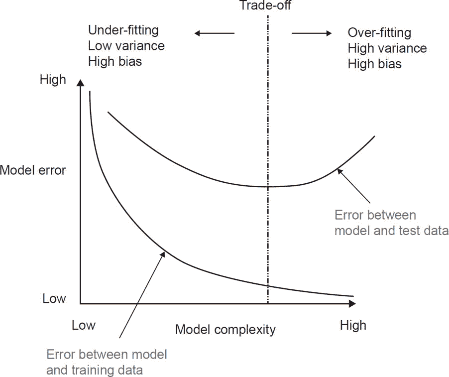

## 4.3.1 核心生成式 AI (Gen AI) 术语

如果我们对 `Gen AI` 感兴趣，这些是我们应该熟悉的典型术语：

`GANs`：一个包含两个 `NNs` 的 `ML` 框架——生成器（generator）负责创建数据，判别器（discriminator）负责评估数据——它们共同工作产生真实的数据。

`VAEs`：一种 `NN`，学习将数据编码为紧凑的形式，然后将其解码以生成新的、相似的数据。

`Transformer models`：先进的 `NN` 架构，例如生成式预训练 Transformer (`GPT`)，它们特别擅长生成类人类的文本。

`Deepfake`（深度伪造）：使用 AI 创建的合成媒体，尤其是视频或图像，模仿真人，通常会引发伦理关注。

`Neural style transfer`（神经风格迁移）：一种 AI 将一张图像的艺术风格（例如绘画）应用于另一幅图像的技术。

`Latent space`（潜在空间）：数据的低维表示，捕捉了其本质特征，允许通过从该空间采样来创建新的数据点。

`Prompt engineering`（提示工程）：为生成式 AI 模型构建特定的输入提示词，以引导它们产生所需的输出。

`Tokenisation`（标记化）：将文本分解为较小单元（`tokens`，如单词或子词）的过程，这些单元随后被 AI 模型用于处理和生成。

`Training data`（训练数据）：用于训练生成式 AI 模型的数据集，模型通过学习它们来产生新内容。

`Inference`（推理）：训练好的 AI 模型根据新输入数据生成新数据或做出预测的阶段。

## 4.3.2 生成式 AI 的目的与用途

如果我们有一个以人为本的伦理目标，利用生成式 AI 涉及几个关键步骤：

1. `Train the model`（训练模型）：我们从使用大量示例教导 AI 开始。例如，如果我们想让它写故事，我们就给它很多故事来学习。
2. `Create new content`（创建新内容）：一旦训练完成，我们可以要求 AI 创建新内容。例如，我们可能会给它几个单词并让它写一段话，或者给它看一张图片让它创建类似的东西。
3. `Fine-tune with prompts`（通过提示进行微调）：我们可以通过提供详细的指令或我们想要的示例来引导 AI 产生特定的结果。
4. `Use for specific tasks`（用于特定任务）：生成式 AI 可用于各种用途，如制作艺术品、撰写文章、设计产品甚至创作音乐。
5. `Improve over time`（随时间推改进）：我们可以通过提供更多数据供其学习并调整其训练，使其更擅长生成我们想要的内容。

简单来说，我们通过向 AI 展示大量示例来教导它，让它根据学到的知识创建新事物，用指令引导它，并不断改进它，使其对不同任务更有用。

### 4.4 总结

本章深入探讨了数据与 AI 之间的关系，重点关注了各种数据类型如何为 `AI` 和 `ML` 项目做出贡献。引入了核心概念，如结构化、半结构化和非结构化数据，并强调了处理大数据及其规模、多样性、速度和真实性的重要性。此外，本章还探索了数据可视化技术及其在 `AI` 项目每个阶段的关键作用。

本章讨论了数据质量的重要性，强调数据质量差会导致不可靠的 AI 模型。介绍了关键数据质量指标，如准确性、一致性和及时性，并强调了数据管理相关的法律和伦理责任。

本章概述了 `ML` 项目的步骤性方法，从问题定义到数据清洗。它强调了 `ML` 项目的迭代性质，认为从经验中学习是成功的核心。

本章探讨了各种 `ML` 算法，包括监督学习、无监督学习和强化学习技术。它提供了回归、决策树和支持向量机等算法的示例。最后，它涵盖了深度学习算法，如神经网络和强化学习，这些算法使 AI 能够从复杂数据中自主学习，并带来了如 `AlphaGo` 和机器人技术等先进应用。

讨论了生成式 AI 这一突破性领域，展示了它如何创建文本、图像和音乐等新内容。本章解释了 `GANs` 和 `Transformer models` 等关键术语和技术，强调了其在创意行业中的巨大潜力和伦理考量。


如果我们从机器学习（ML）进一步思考人类与机器的协同工作，我们现在需要考虑人类如何增强机器，以及机器如何增强人类。我们正处于一个 AI 系统的伦理目的至关重要的节点上。人类和机器的角色将明确出现，以确保我们的 AI 系统具有以人人为本的伦理目的。

### 5.1.1 增强人类

首先，让我们看看机器如何有效利用信息技术来增强人类的能力。改进的范围从性能的轻微提升到使我们成为超级人类。

为了做到这一点，我们需要引入一个新概念：智能自动化或增强（`IA`）。`IA` 旨在使用 ML 技术来协助而非取代人类。`IA` 可以将计算机视觉、自然语言处理（NLP）和 `ML` 等技术应用于 `RPA`，从而对不一定具有基于规则的结构的流程实现自动化，例如，与肿瘤学家一起使用 `IA` 系统来识别活检切片中的癌细胞——在以前，这项任务需要两个肿瘤学家。这是一个人类与机器共同工作以造福人类的例子。

`IA` 技术的最新进展已通过提高工人生产力、减轻单调重复的任务以及在我们的生活中引入并增强便利性，帮助了人类潜力的提升。几十年来，某些机器在执行特定任务方面远优于人类，但我们现在越来越多地看到 `IA` 在许多行业和生活领域渗透率的提高和持续加速。在未来几十年里，随着技术的改进和对 `IA` 接受度的提高，我们将看到这些领域进一步的快速进展。我们已经开始从经验中学习，看到 `AI` 对知识工作者的技术颠覆正在重新定义他们的工作。合理的信任是采纳和利用这一技术的关键；它需要良好的治理以及一致的保证机制。

### 5.1.2 增强机器

人类增强机器的关键领域在于让 `AI` 和 `IA` 对普通人们来说更易理解、更易接受。

在简单的层面，机器可以增加我们的学习并使其更有效。我们人类必须协调这种学习，并在机器遇到矛盾或失败时提供支持。我们还需要确保机器正在做正确的事。记住，我们的 `AI` 系统需要以人人为本的伦理目的。机器没有意识或情感，这使得共情变成了一个大问题。人类需要设定目标，不仅关于我们要去哪里，还关于我们如何到达那里。需要人类监督的一个例子是，引入在某种程度上会对员工造成压力的机器带来的后果。这是主观的，人类可以理解并可能纠正这一点。人类可能以对另一个人类有用的方式，解释 `AI` 系统为何得出某个结论或诊断。

## 5.1.3 业务计划书的结构

在本节中，我们将查看 `AI` 业务计划书的结构。业务计划书是一份正式的文档或演示稿，概述了投资或项目的合理性。它旨在帮助决策者评估与该倡议相关的潜在收益、成本和风险。编写和制作业务计划书的过程意味着团队开始从经验中学习并做出明智决策。一个构建良好的业务计划书通常包含几个关键要素：提供建议简要概述的执行摘要；对项目解决的问题或机会的清晰陈述；对拟议解决方案的详细分析，包括目标、范围和交付物；提供成本估算、资金需求和预期投资回报率（`ROI`）的彻底财务分析；风险和缓解策略的评估；以及概述时间表、里程碑和责任的实施计划。此外，它还应该包含对所考虑的替代方案的评估以及推荐方案的理由。通过结合这些要素，业务计划书确保了对项目可行性及其与组织目标对齐的全面评估。

### 5.1.3.1 AI 或 ML 业务计划书

与传统的业务计划书相比，为 `AI` 或 `ML` 项目创建业务计划涉及几个独特的考虑。接下来强调的考虑显示了 `AI/ML` 项目的独特方面，这些方面需要在业务计划书中解决，以确保清晰性、管理预期并为实现预期结果提供清晰路径。传统业务计划书格式示例是：

```
引言；
管理或执行摘要；
当前状态描述；
已考虑的选项；
描述的选项：
成本与效益分析；
影响评估；
风险评估；
建议；
附录/支持信息。
```

对于传统项目，技术可行性更为直接，侧重于标准的软件或硬件实现，不需要详尽的数据科学或模型训练。请注意，这侧重于 `ML` 项目。然而，硬件至关重要，因为包含了传感器和执行器。`AI` 和 `ML` 项目需要对技术可行性进行详细评估，包括数据的可用性和质量、算法的复杂性、模型训练和部署挑战。你需要考虑基础设施需求以及 `AI/ML` 模型与现有系统的集成。记住我们人人为本的伦理目的所包含的伦理需求。

如果我们把 `ML` 项目扩展到复杂的人类与代理与环境交互，我们的项目将具有一个新的维度。具体来说，计算能力（计算次数）和内存（数据存储）可能需要几十年来规划和构建；例如，天气建模。

在过去的几十年里的项目中，我们看到技术可行性更为直接，侧重于标准的软件或硬件实现。如果我们拥抱从经验中学习或从数据中学习，那么这些项目就需要对可行性进行详细的评估，包括数据的可用性和质量、算法的复杂性、模型训练和部署挑战。我们需要考虑基础设施需求以及 `AI/ML` 模型与现有系统的集成。`AI` 和 `ML` 算法是通过科学方法开发的，因此数据需要为算法做好充分准备。`AI/ML` 项目的成功在很大程度上取决于训练模型的数据，以及用于验证和确认模型训练的测试数据。

我们习惯于风险更具预测性和可控，与项目范围、预算和时间相关，而我们现在正进入具有更高风险和不确定性的项目，这些风险源于模型准确性、过拟合、数据偏差以及持续模型维护和更新的需求等因素。业务计划书必须解决这些风险并提出缓解策略。例如，自动驾驶汽车在良好的高速公路上是安全可靠的但在乡村道路的细微差别面前很吃力。这是机器学习运营（`MLOps`）/人工智能运维（`AIOps`）或模型运营（`ModelOps`）方法的关键业务理由；它提供了跨生命周期的关键机制，以应用必要的流程降低风险并最可能实现预期结果。


利益相关者的参与通常更关注业务与 IT 的对齐，而不需要专门的数据科学角色。由于我们的伦理和监管要求，`AI` 和 `ML` 项目将吸引更广泛的利益相关者的关注。来自多元利益相关者的参与至关重要。业务案例应概述每个利益相关者群体将如何为项目做出贡献并从中受益。特别重要的是，多元化的利益相关者基础在理解项目偏差和结果方面将发挥关键作用。这些人员可能是 `AI` 伦理官、伦理委员会、法律部门（知识产权、版权）、采购等。

根据项目类型，维护通常与软件更新、硬件维护和用户支持有关，这些工作更具预测性且强度较低。从数据中学习和从经验中学习带来了更多工作和挑战。对 `AI` 系统进行持续监控和维护是必要的，以确保它们保持准确和相关。业务案例应包含持续支持、模型重训练和性能监控的计划，以及硬件的维护。

直到目前，试点项目（快速观察、查看、尝试）可能不再那么关键，如果需求和解决方案得到充分理解，项目可以直接进入实施。敏捷项目管理和最小可行性产品更强调从经验中学习，而试点变得更加常见。考虑到这一点，倾向于从经验中学习的 `AI/ML` 项目通常从试点或概念验证阶段开始，在全面实施之前验证模型。业务案例应包含基于试点结果进行方案扩展的计划。

伦理影响和监管合规性在 `ML` 和 `AI` 项目中更为突出。数据隐私、模型透明度和伦理 AI 实践等问题需要在业务案例中解决。例如，以人为本的伦理目标是《欧盟 AI 法》的核心。虽然从传统的 IT 角度来看，监管合规仍然重要，但除非项目直接影响数据隐私或安全，否则伦理考虑不太可能成为重点。在这里需要承认，全球范围内涌出了许多竞争的标准和指南，包括来自英国政府各个部门的标准；但在英国，目前还没有明确的监管或立法指导。第二章专门关注这一点，并将帮助确定什么是符合用途的。一个包含领域专的多元团队将对此有所帮助。

## 5.2 利益相关者与项目

在本节中，我们将更详细地介绍利益相关者，以及如果项目包含从经验中学习或从数据中学习，我们可以使用哪些项目管理方法。例如，利益相关者通过提供指导、资源和监督，在帮助组织遵守《欧盟 AI 法》方面发挥着至关重要的作用。行业专家和学术研究人员将为 `AI` 开发和部署的最佳实践提供见解，确保组织充分了解监管要求和伦理考虑。公民社会组织将倡导透明度和问责，帮助监控合规性并提高对潜在风险的意识。决策制定者监管机构将提供清晰且可操作的指南，以及培训计划和合规工具等支持机制。通过合作和知识共享，利益相关者将协助组织实施稳健的治理框架，进行彻底的风险评估并对 `AI` 系统进行持续监督，从而确保遵守法规（例如《欧盟 AI 法》、`NIST` 等）并培养负责任的 `AI` 创新文化。

### 5.2.1 利益相关者的识别与分类

在 `AI/ML` 中，利益相关者涵盖了对 `AI` 技术开发、部署和使用感兴趣或受其影响的多元个人、组织和实体。随着对环境、气候和生物多样性的日益关注，这些利益相关者的影响力日益增强，并对社会和资源的未来方向产生重大影响。`AI/ML` 可以以许多方式对代公平公平可持续性做出贡献。

识别利益相关者对于有效的利益相关者管理至关重要，以确保对利益的平衡考虑、伦理实施和 `AI` 系统的负责任开发。识别利益相关者的方法之一是创建利益相关者轮；图 5.1 给出了示例。记住，安全对所有利益相关者都至关重要，应该设计其中并不断改进。

### 5.2.2 利益相关者的权力和影响力

在 `AI` 项目背景下，利益相关者管理中的权力和影响力概念仍然至关重要，但由于 `AI` 技术及其应用的性质，它们带有特定的细微差别。

权力来自组织内部的正式角色，这些角色授权了决策和资源分配。它直接影响项目范围、资源分配和正式审批流程。

图 5.1 `AI` 利益相关者轮示例

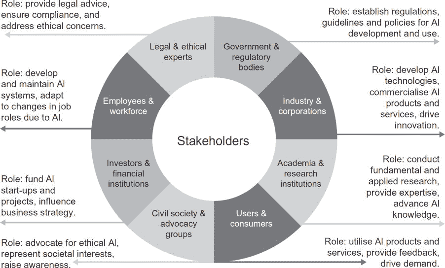

影响力源于专业知识、声誉以及说服和动员他人的能力。它间接塑造项目的技术方向、用户接受度和创新方法。

#### 5.2.2.1 AI 项目中的利益相关者权力

在 `AI` 项目中，权力是指利益相关者拥有的做出战略决策、分配资源和执行项目方向的正式权威。

拥有权力的利益相关者具有以下特征：

- **战略决策**：他们可以定义 `AI` 项目的范围、目标和方向。
- **资源分配**：他们控制 `AI` 项目所需的预算、人员和技术基础设施。
- **监管合规**：他们确保 `AI` 项目符合法律、伦理和组织标准。
- **审批权限**：他们对项目里程碑、交付物和部署具有最终决定权。

拥有权力的利益相关者示例可能是：

- 执行人员和高层管理，他们决定 `AI` 项目的投资以及与业务目标的战略对齐。
- 项目赞助人，批准 `AI` 项目的预算和资源需求。
- 法律和合规官，确保 `AI` 项目遵循监管标准和伦理指南。

#### 5.2.2.2 AI 项目中的利益相关者影响力

在 `AI` 项目中，影响力是指利益相关者在没有正式权威的情况下，塑造与项目相关的感知、决策和行动的能力。

拥有影响力的利益相关者具有以下特征：

- **专家知识**：他们通常在 `AI`、数据科学或相关领域拥有深厚的技术知识。
- **思想领导力**：他们通过自己的见解和创新想法来塑造项目的愿景和方向。
- **社交与协作**：他们能够聚集支持并促进跨团队部门的协作。
- **用户维护**：他们代表终端用户的利益和需求，确保 AI 解决方案是以用户为中心且有效的。

影响力的利益相关者示例可能是：

- 数据科学家和 `AI` 研究人员，他们为 `AI` 模型的可性和设计提供关键见解。
- 技术负责人和工程师，他们影响 AI 解决方案的技术架构和实施。
- 伦理和隐私倡导者，他们确保 `AI` 项目考虑伦理影响和用户隐私担忧。
- 产品经理，他们将 `AI` 项目与市场需求和客户期望相结合。
- 伦理委员会，他们确保 `AI` 项目符合组织的伦理。


# 5.2.3 AI 项目中的权力与影响力管理

## 5.2.3.1 权力利益相关者的管理策略

通过以下方式让权力利益相关者参与高层战略规划、资源讨论和合规检查：

- 定期更新：向高级管理层和执行层提供项目进展和挑战的结构化报告。
- 清晰的文档：确保所有决策、资源分配和合规措施均充分记录并保持透明。
- 战略对齐：持续使 AI 项目目标与整体业务目标保持一致——维持执行层支持。

## 5.2.3.2 影响力利益相关者的管理策略

通过以下方式让有影响力的利益相关者参与头脑风暴会议、技术评审和用户反馈过程：

- 带有脑风暴会议的协作工作坊，以收集技术专家和创新者的见解；
- 建立与有影响力的利益相关者之间开放且频繁的沟通渠道，以纳入他们的反馈；
- 认可与包：承认影响力利益相关者的贡献，并将其纳入关键决策过程，以利用他们的专业知识。

通过理解并妥善管理权力和影响力，AI 项目经理可以应对 AI 开发的复杂性，确保组织的战略视角和技术视角达成平衡，并确保项目顺利朝着目标进展。

# 5.2.4 项目管理方法

在本节中，我们将探讨如何开展 AI 项目。我们重点关注两种风格：敏捷（Agile）和瀑布型（Waterfall）（Wikipedia Contributors, 2024p 和 2024q），以及可能的混合方法。请记住，AI 关乎从经验学习，而机器学习（ML）关乎从数据学习。在 AI 项目中，我们经常遇到涉及数据学习的任务。在这里，我们将关注 ML 项目，以对应 ML 工作流的特定阶段。我们将从软件和硬件的角度描述项目，但请注意，利益相关者的管理对于定义项目所需的功能至关重要。另请注意，这不是门项目管理课程，更大规模的项目可能会涉及多种管理风格的混合。

选择最佳的项目管理方法取决于 AI 项目的具体特征，包括需求的清晰度、对灵活性的需求、利益相关者的参与程度以及监管考量。

项目管理中有许多方法，但它们大致分为三类：

- 敏捷；
- 瀑布；
- 混合。

## 5.2.4.1 AI 项目的敏捷项目管理

敏捷项目管理是一种迭代且灵活的项目管理方法，特别适用于软件开发，它强调适应性、协作和客户满意度。敏捷源于《敏捷宣言》，它优先考虑个人和交互优于过程和工具，响应软件优于详尽文档，客户合作优于合同谈判，响应变化优于遵循固定计划。敏捷方法将项目分解为“冲刺”（sprints）或“迭代”的小型管理单元，通常持续两到四周，允许团队根据反馈和不断变化的需求重新评估并调整项目方向。这种方法促进了持续改进、价值的快速交付，以及项目团队内部及与利益相关者之间高度的透明度和沟通。

敏捷项目的主要特征是：

- **迭代开发**：项目被拆分为名为冲刺或迭代的小型管理单元，通常持续 2–4 周。
- **灵活性适应性**：敏捷允许在整个生命周期内进行更改和修订，以适应不断的需求和反馈。
- **协作与跨功能团队**：敏捷强调团队成员与利益相关者之间的紧密协作，并设有每日站会和持续沟通。
- **持续交付与改进**：敏捷专注于早期且频繁地交付功能组件，允许持续的测试、反馈和改进。
- **以客户为中心**：敏捷优先考虑客户需求和参与，确保最终产品与用户预期和需求紧密一致。

其关键特征意味着敏捷项目风格适用于 AI 项目，因为它具备：

- **快速原型设计与反馈**：对于 AI 项目是理想的，因为在这些项目中，快速原型设计和迭代反馈对于完善算法和模型至关重要。
- **不确定且不断变化的需求**：适用于需求不断变化或在开始时未完全定义结果的 AI 项目。
- **创新与实验**：这在 AI 开发中至关重要。

随着个人或组织在 AI 项目及其管理方面变得越来越熟练、经验越来越丰富，某些灵活性可以得到精炼并变得更高效，因为获得的经验允许组织更有确定性地进行预测和计划。敏捷风格的项目管理得到了 MLOps 的补充。

## 5.2.4.2 AI 项目的瀑布型项目管理

瀑布项目管理是一种按序渐进的项目管理方法，传统上用于建筑和制造业等行业，但也应用于软件开发。典型的不同阶段包括：需求收集、设计、实现、测试、部署和维护。每个阶段在进入下一阶段之前都会完成。瀑布模型强调在项目初期进行详尽的计划、文档记录和需求的清晰定义，确保在开发开始之前项目的所有方面都得到了充分理解和共识。一旦阶段完成，通常不再重新考虑，这使得该方法在适应变化方面的灵活性较低。对于目标明确且需求稳定的项目，这种僵性是有益的，因为预测性和结构化的进展对于成功至关重要。你可以使用瀑布方法进行 AI 项目吗？当然可以，只要你在启动项目之前了解终点。遗憾的是，许多 AI 项目从一开始就不知道终点，因此自然倾向于包含某种程度实验的敏捷项目管理方法。

瀑布项目的主要特征是：

- **顺序阶段**：项目以按序渐进的方式通过一系列不同阶段（需求、设计、实现、测试、部署）进展。
- **固定需求**：需求在前期收集并定义，项目开始后更改通常会降至最低。
- **文档记录**：强调每个阶段的详尽文档记录，确保项目决策和过程有清晰记录。
- **可预测性与控制**：项目遵循结构化方法，具有明确的里程碑和交付物，更容易管理和控制项目进度和预算。

其关键特征意味着瀑布型项目风格适用于 AI 项目，因为它具备：

- **定义的需求**：适用于需求和目标明确且不太可能发生变化的 AI 项目。
- **监管与合规需求**：对于需要大量文档和遵守监管标准的项目是理想。
- **大规模基础设施**：适用于大型 AI 基础设施项目，顺序方法可以确保系统化的进展和风险管理。


混合敏捷与瀑布式项目管理是一种结合了瀑布模型的结构化、逐步步进的流程与敏捷方法论的迭代、灵活实践的方法。这种混合模型利用了两种方法的优点：对于项目在稳定且可预测的部分，使用瀑布模型清晰的前期规划和定义良好的阶段；而对于需要灵性和快速反馈的领域，则应用敏捷的适应性和迭代开发周期。这种双重方法允许组织在保持项目管理控制和预测性的同时，对不断变化的需求和持续改进做出响应。通过整合这两种方法论，混合项目管理旨在最大化效率、降低风险，并交付符合初始项目范围和不断变化的客户需求的高质量结果。

混合项目的主要特征是：

- **结合敏捷与瀑布式**：整合了敏捷和瀑布方法方法的元素，利用各自的优势。
- **灵活性与结构性**：在项目的某些阶段允许灵活性，同时在必要时保持结构化的顺序流程。
- **定制化方法**：根据项目的特定需求和背景定制项目管理方法，平衡敏捷性与可预测性。
- **固定里程碑的增量式交付**：在遵循固定里程碑和截止日期的同时，实现项目组件的增量交付。

其关键特征意味着混合项目风格适用于 AI 项目，因为：

- **处理具有混合需求的复杂项目**：适用于既有明确定义又有不断演变需求的 AI 项目，允许项目的不同部分使用不同的方法论。
- **采用平衡的方法**：对于既需要敏捷的灵活性来进行开发和实验，又需要瀑布的控制和文档记录来进行实施和合规的项目。
- **包含利益相关者管理**：对于不同利益相关者需要不同参与程度且必须进行分阶段交付的项目非常有效。

## 5.2.4.4 为 AI 项目选择合适的项目管理方法

最合适的项目管理风格取决于目标及其规模。

- **敏捷 (Agile)**：最适用于需要快速迭代、持续反馈和适应能力的 AI 项目。适用于实验性 AI 解决方案、ML 模型开发以及用户需求不断演变的项目。
- **瀑布 (Waterfall)**：适用于需求稳定、定义良好的 AI 项目，例如监管合规系统、大规模数据基础设施以及具有严格时间表和预算的项目。
- **混合 (Hybrid)**：对于既需要灵活性又需要 AI 项目是最佳选择，例如大型企业 AI 实施、多阶段且复杂度不同的项目，以及需要在创新与合规之间取得平衡的项目。

`MLOps` 和 `ModelOps` 是组织采用的框架，用于简化生产环境中机器学习模型的部署、监控和维护。

### 5.3 风险、成本与治理

本节阐明了 AI 治理的含义及其必要性。当然，治理、风险和成本取决于具体的背景，并与你和你的组织目前的工作有关。还提到了对于你正在处理或整合的 AI 元素需要理解的一些额外领域。

## 5.3.1 AI 实施中的治理活动

在 AI 实施中有效的治理对于确保合规、管理风险和监督 AI 模型生命周期至关重要。AI 治理的三个主要领域是：

- 满足法规、法律和标准的合规性；
- 用于主动检测和缓解风险的管理框架；以及
- 生命周期管理，用于管理、监控和治理 AI。

### 5.3.1.1 满足法规的合规性

合规确保 AI 系统经过测试并遵守现有的法律、法规和标准。这一治理领域涉及以下方面：

#### 监管遵循：

- **数据保护** – 确保 AI 系统符合如 `GDPR` 等数据保护法，确保用户数据隐私。
- **公平性与非歧视** – 防止偏见和歧视，确保不同人口群体之间的公平。
- **透明度要求** – 满足监管需求，使决策过程可理解且可解释。

#### 可审计性与问责制：

- **定期审计** – 执行定期审计以验证对 `ISO/IEC 42001` 的遵循情况。
- **可追溯性** – 维护 AI 系统开发、数据来源和调查记录。
- **安全性** – 维护 AI 系统安全记录。

#### 伦理标准：

- **伦理指南** – 开发并遵循伦理指南（`AI Act`）。
- **人工监督** – 确保将人工监督嵌入关键决策中。

### 5.3.1.2 风险、成本与收益分析

实施 AI 项目或解决方案涉及对各种风险、成本和收益的仔细考虑。识别和评估这些因素对于成功实施至关重要。通过识别这些风险、成本和收益并实施适当的缓解策略，组织可以使其 AI 项目与其整体风险策略保持一致。某些行业已经存在用于管理风险的法规、政策和标准，需要遵守这些规定（例如安全关键行业、核能、航空、医疗保健）。

主动风险管理涉及识别、评估和缓解与 AI 系统相关的风险。这一治理领域包括：

#### 风险识别与评估：

- **风险框架** – 开发全面的风险框架以识别 AI 系统中的潜在风险，包括技术、运营、伦理和法律风险。
- **影响分析** – 进行影响分析，以理解识别出的风险对利益相关者和组织的潜在后果。

#### 缓解策略：

- **偏见缓解** – 实施策略检测并缓解 AI 模型中的偏见，确保公平和公正。
- **稳健的安全措施** – 加强安全协议，保护 AI 系统免受网络威胁和数据泄露。
- **应急响应计划** – 开发并维护应急响应计划，以应对和缓解 AI 系统故障或失效的影响。

#### 持续监控：

- **实时监控** – 使用实时监控工具持续 AI 系统的性能和行为。
- **反馈回路** – 建立反馈回路收集用户和利益相关者的意见，以便及时识别和纠正问题。

我们可能会发现需要管理的多种类型的风险，包括：

- **技术风险**：系统故障（由于漏洞、错误或意外情况）、可扩展性问题和集成挑战。
- **数据风险**：数据隐私和安全（泄露和滥用）、数据质量（低质量或偏偏数据）以及数据可用性（数据不足）。
- **伦理与法律风险**：（如前节所述）。


## 偏见与歧视 – AI 模型可能会延续或放大训练数据中存在的偏见。

## 合规性 – 必须确保遵守法律法规，如 `GDPR`。

## 透明度与问责 – 在解释 AI 决策和分配责任方面可能困难。

## 运营风险：

- 变更管理 – 必须克服员工和利益相关者对采用 AI 解决方案的抵触。
- 对供应商的依赖 – 可能会过度依赖第三方 AI 解决方案并缺乏内部专业知识。
- 维护与监控 – 为了保持性能，需要对 AI 模型进行持续监控和更新。

风险所有权是将责任分配给组织内的个人或团队，以管理特定风险。风险所有者负责识别、评估、监控和缓解所分配的风险。以下是风险所有权的关键方面：

- 责任与问责 – 风险所有负责根据组织的风险管理政策和程序确保妥善管理风险；问责意味着风险所有必须报告风险的状态以及采取的任何缓解措施。
- 识别与评估 – 风险所有识别风险的潜在影响和发生概率，并根据组织目标和运营背景评估风险的重要性。
- 缓解与控制 – 风险所有制定并实施缓解或控制风险的策略，这包括选择适当的风险缓解措施，如规避、减少、转移或接受。
- 监控与报告 – 风险所有持续监控风险及缓解策略的有效性，并定期向高层管理或相关利益者报告风险状态，提供任何变化或新出现问题的更新。
- 行动计划制定 – 风险所有创建并维护风险行动计划，详细说明管理风险的具体步骤，该计划包括时间表、所需资源和用于跟踪进展的关键性能指标。

风险所有权确保风险得到主动且系统地管理，并在组织内部有明确的问责和责任。这种结构化的方法有助于有效应对潜在威胁和机会。特别是，我们可以缓解风险；可以应用各种风险缓解策略来应对广泛风险。以下是一些关键的风险缓解策略：

- 风险规避 – 通过不参与引入风险的活动或状况来完全消除风险。
- 风险减少（缓解） – 通过各种措施减少风险的发生概率或影响。
- 风险转移 – 将风险转移给第三方，通常通过保险或外包。
- 风险接受 – 承认风险并选择接受，而不采取任何缓解措施，通常是出于成本效益考虑。
- 风险共享 – 将风险分配在多个方之间，例如通过合作伙伴关系或合资企业。
- 风险预防 – 实施措施防止风险发生。
- 风险控制 – 在风险发生时实施措施控制其影响。
- 应急计划 – 在风险发生时制定制定以管理和应对风险的计划。
- 多样化 – 将风险分散到多个领域以使影响最小化。
- 对冲 – 使用金融工具或其他策略抵消潜在损失。
- 风险监控 – 持续监控风险环境和缓解策略的有效性。
- 培训与教育 – 对员工和利益者进行风险管理实践和协议的教育培训。

随着我们对 AI 风险的了解以及管理和缓解这些风险，考虑 AI 项目的成本是合理的。它们可以分为三个大领域：

1. 开发与部署成本：
- 软件与硬件 – 在专用软件、工具和高性能硬件上的投资。
- 基础设施 – 建立必要的 `IT` 基础设施以支持 AI 工作负载荷。
- 数据获取 – 与收集或生成数据相关的成本。

2. 人力资源：
- 招聘专家 – 聘用数据科学家和其他专家的成本。
- 培训 – 培训现有员工以使用 AI 技术。

3. 维护与保养：
- 持续支持 – AI 系统的定期更新和故障排除。
- 运营成本 – 与运行 AI 应用相关的成本。

通过对 AI 项目更广泛的理解，这里是一些典型的收益：

效率与生产力：
- 任务自动化 – AI 可以自动化常规和重复性任务，释放人力。
- 改进决策 – AI 可以快速分析大量数据并提供见解以支持决策。

成本节约：
- 运营效率 – AI 可以降低成本。
- 资源优化 – AI 可以通过预测分析提供更好的资源利用率。

增强客户体验：
- 个性化 – AI 可以为客户提供个性化的体验和推荐。
- 24/7 支持 – AI 驱动的聊天机器人和虚拟助手可以提供持续客户支持。

创新与竞争优势：
- 新产品与服务 – AI 可以实现新产品服务的开发。
- 市场差异化 – 早期采用 AI 可以可以在市场上提供竞争优势。

### 5.4 总结

本章探讨了 AI 和 ML 如何为个人、团队、组织和人类提供机会。它强调了 AI 如何通过智能手机、智能设备和搜索引擎等应用增强日常生活。AI 不仅增强了人类能力，还促进了人机协作，推动了生产力、决策和创新的改进。

本章深入研究了 AI 如何增强人类机器，引入了智能自动化作为辅助人类而非取代他们的手段。它介绍了 AI 项目业务案例结构，强调了解决技术可行性、数据策略、风险、利益者参与和伦理考虑的重要性。AI 项目中的独特挑战（例如数据质量和持续的模型维护）使得周密的计划和试点阶段对于成功至关重要。

利益者在 AI 项目中着关键作用，本章概述了管理其权力和影响的策略。探讨了不同的项目管理方法——`Agile`（敏捷）、`Waterfall`（瀑布）和 `hybrid`（混合），每种方法适用于不同的项目需求和复杂度。

本章以 AI 治理的讨论结束，强调了合规性、风险管理和生命周期监控，以确保 AI 系统符合法规和道德标准。它还列出了潜在风险，如数据隐私、扩展性和偏见，以及缓解这些风险的策略。最后，它强调了 AI 的成本和收益，从开发和维护到效率提升、成本节约和市场差异化，说明了 AI 为组织和人类带来的价值。

# 6 未来方向与 AI 职业


在本章中，我们将探讨 AI 和 ML 将如何从近期未来发展到遥远的未来。特别是职业可能会如何演变，以及在这场令人兴奋的新兴第四次工业革命中，哪些职业正在兴起。你能够回溯 20、30 或 40 年，并预见到你今天正在做的工作吗？你能预测出我们现在正在使用的技术和系统吗？对于某些人来说，我们今天生活的世界上令人失望，因为辩论认为，我们曾被许诺会有大量的个人机器人、飞行汽车和负担得起的太空旅行。我们仍在等待这些东西成为常态；尽管，说实实话，我们在 `Mars` 行星上确实有几台自动漫游器。

预测我们在 2030 年、2040 年甚至 2050 年的处同样困难，但我们根据目前的研究和正在开发中的技术创新进行尝试。如果你想看到不同的可能结果，马克斯·泰格马克的著作 `Life 3.0 (2018)` 对可能的 AI 未来进行了智力且敏锐的探索，而雷·库兹韦尔的著作 `The Singularity is Near (2016)` 则对未来进行了乐观的展望。

AI 有许多益处。社交媒体的狂热、电视节目和电影都在赞美 AI 可能未来的成功，但我们需要务实，因为追逐象牙塔式的学术思想领袖实验并不能让这些益处变为现实。随着我们的进步，我们需要明确且谨慎地对待 AI 和 ML 可以实现什么。

Paul R. Daugherty 和 H. James Wilson 在 `Human + Machine: Reimagining Work in the Age of AI (2018)` 一书中写了他们作为管理顾问做这些事情的经历。在他们的书中，他们观察了 AI 如何应用于许多项目中的。他们描述了纯人类系统、纯机器系统和人机协作系统。他们描绘了未来的图景、人类和机器将扮演的角色，以及人类和机器将共同完成。未来将存在纯人类系统、纯机器系统和人机协作系统。

## 6.1 AI 提供的角色与职业机会

在本节中，我们将描述纯人类系统、纯机器系统和人机协作系统，这些系统可能导致哪些角色，以及哪些已经存在。

### 6.1.1 纯人类系统

人类擅长做什么？

*   领导力与目标；
*   创造力；
*   共情能力；
*   判断。

在 `Chapter 1` 中，我们惊叹人类的能力。机器在某些方面还有差距——差几十年甚至可能几个世纪。人类擅长主观视角。我们富有创造力；例如，只有人类（在这种情况下是 `Einstein`）才能想象出 `travelling\ on\ a\ light\ beam`的思想实验。它改变了我们对今天所知世界的理解。

因此，人类将成为创造力的引擎。我们将让机器承担繁重的工作，自己留去做高价值的工作。模糊性也是人类的角色——如果 `AI` 因为矛盾而卡住了怎么办？这需要人类介入并决定结果。我们可以考虑许多需要人类干预的情况（例如，无法回答问题的困惑痴呆患者，或者一个伦理上的 50/50 矛盾）。困惑的人类很容易困扰 `AI` 系统；其他人类需要在现场支持那个人。

人类还必须提供领导力；我们必须设定目标和伦理标准。这些将形成原则、价值观和权利。我们将在法律中依赖这些，当判断是主观且模糊时，将由人类来完成这项高价值的工作。

### 6.1.2 纯机器系统

机器擅长做什么？

*   单调的任务；
*   预测；
*   迭代；
*   适应。

这四点描述了机器擅长的领域，这在数字计算机上显而易见。我们使用它们来执行单调的任务，如大量的精确计算。预测和迭代对于数字计算机解决我们的 `ML` 问题非常有用——大量的计算、重复的迭代、寻找解决方案。适应是未来机器的特征，机器将适应当天的需求。从这个意义上说，机器还将适应极端环境；这些环境可能是深海或人类暴露在极端环境下的其他行星。更务实地说，在无菌条件下准备食物或在手术室对人类进行手术，可能由机器完成得更好。

#### 6.1.2.1 狭义（弱智能）AI、AGI 和强 AI

弱智能或狭义 AI 是专注于特定任务的 AI。今天流行的 `ML`，即我们在云数字服务中发现的能力，是狭义 AI 或狭义 `ML`，专注于特定任务（例如监督学习和无监督学习）。狭义 `ML` 的示例包括 `SVMs`、`decision trees` 和 `KNN` 算法。它们基于特定任务测试假设。从经验中学习实际上是从针对特定、专注任务的数据（`ML`）中学习。

`AGI` 在 `Chapter 1` 中引入，是一种能够学习人类可以任何智力任务的机器。它是假设性的，对于一般的 `AI` 和 `ML` 并非必须。这种假设的 AI 类型通常是推测的主题，有时令人类恐惧。我们距离实现 `AGI` 还很远，可能在几十年甚至几个世纪后才能接近它。

`AGI` 可以更进一步。科幻小说热衷于假设机器具有意识；强 AI 是同样具有意识的 `AGI`。意识是复杂且困难的。有些人认为它是 AI 中最困难的问题。这将在章的后面部分详细介绍。

`AGI` 和强力、或有意识的 `AGI` 目前是不可行的，在可预见的未来也是不现实的。这是一个活跃领域，但不是 `AI` 或 `ML` 的要求。

### 6.1.3 人机协作系统

与其认为是由机器或人类承担某项任务，未来不是人类与机器和谐相处的吗？或者正如 Stuart Russell 所强调的那样，人类兼容 AI——这一概念是解决 AI 控制问题的建议。Russell 的三个原则是 `(Russell, 2019)`：

‘1. 机器唯一的目标是最大化人类偏好的实现。
2. 机器最初对这些偏好是什么不确定。
3. 关于人类偏好的最终信息来源是人类行为。’

这样设计的机器将控制 AI 的发展。理想情况下，人类将转向更高价值的工作，或有更多时间享受做人的乐趣。这些原则是新的，目前还不清楚它们将如何发展；然而，Stuart Russell 认为它们是面向未来的。

人机协作的实际例子可以很容易地想象。使用外骨骼的人能够承担他们以前无法胜的任务，可能允许他们行走或举起重物。我们拥有搜索引擎和大型语言模型——学者可以在几秒钟搜索文献，这在 40 年前可能需要几年甚至几十年。在医学领域，脑机接口和对大脑的研究让医生能够更好地理解中风恢复。事实上，我们可能能够对无法交流的患者进行意识测试。人类与机器结合的想法赋予了我们超人的能力。

### 6.1.4 AI 中的角色与职业机会

在这里我们简要看看典型的 AI/ML 角色。这个列表并不完整，因为 AI 和 ML 领域发展非常快。然而，它应该让你了解我们预期和目前看到的。我们查看了 ML 工程师、`数据科学家`、`AI 研究科学家`、`计算机视觉工程师`、`NLP 工程师`、`机器人工程师`、`AI 伦理专家`和 `AI 人类学家`的角色和职责。

ML 工程师通常具有以下角色和职责：

开发算法：设计、构建和实现 `ML` 模型和算法。

数据处理：清洗、预处理和组织数据以供模型使用。


模型训练与优化：使用相关数据集训练模型，并对其进行优化以获得更高的准确性和性能。

部署与维护：将机器学习模型部署到生产环境中并在长期运行中进行维护。

协作：与数据科学家和软件工程师紧密合作，将模型集成到应用程序中。

数据科学家通常具有以下角色和职责：

数据分析：使用统计学技术从结构化和非结构化数据中提取洞察。

模型构建：开发预测模型和机器学习算法。

可视化：创建可视化图表向利益相关者展示研究结果。

实验：设计并开展实验，以测试假设并改进模型。

业务解决方案：将业务问题转化为数据科学问题，并提供可操作的解决方案。

AI 研究科学家通常具有以下角色和职责：

研究：在人工智能和机器学习领域进行高级研究，开发新的算法和技术。

出版：在学术期刊上发表研究成果并在会议上进行演讲。

原型开发：开发原型以测试新的 AI 概念。

协作：与学术和工业界伙伴合作，突破 AI 技术的边界。

创新：关注 AI 的最新进展，并将其应用于解决复杂问题。

计算机视觉工程师通常具有以下角色和职责：

图像处理：开发用于图像和视频分析的算法。

特征提取：实现目标检测、识别和跟踪的技术。

模型训练：专门针对计算机视觉任务训练深度学习模型。

优化：针对不同硬件和平台优化模型性能。

应用开发：将计算机视觉能力集成到诸现实世界的应用中，如 AR/VR、自动驾驶汽车等。

NLP（自然语言处理）工程师通常具有以下角色和职责：

文本分析：开发用于处理和分析大量自然语言数据的算法。

语言建模：构建并训练用于文本生成、翻译和摘要等任务的模型。

语音识别：实现语音转文本及反之的系统。

情感分析：开发用于理解和分类文本中所表达的情感的系统。

集成：致力于将 NLP 能力集成到聊天机器人、虚拟助手和搜索引擎等应用程序中。

机器人工程师通常具有以下角色和职责：

设计与开发：设计、构建和测试机器人系统及组件。

编程：开发用于机器人控制和自动化软件及算法。

系统集成：将传感器、执行器和其他硬件集成到机器人系统中。

测试与验证：进行测试以确保机器人的可靠性和性能。

研究：关注机器人技术的最新动态，并将其应用于创新和改进现有系统。

AI 伦理专家通常具有以下角色和职责：

伦理分析：分析 AI 系统的伦理影响及其对社会的潜在影响。

政策制定：制定指南和政策，以确保组织内部遵循伦理 AI 操作。

合规性：确保符合相关的法律、法规和伦理标准。

培训与教育：对员工和利益相关者普及伦理 AI 实践和相关考量。

咨询：就与 AI 开发和部署相关的伦理困境提供建议。

AI 人类学家通常具有以下角色和职责：

以人为中心的研究：研究人类与 AI 系统之间的交互，关注文化和社会影响。

民族志研究：开展民族志研究，以理解 AI 如何集成到各种社区和文化中。

用户体验：通过理解人类行为和文化背景，分析并改进用户体验。

跨学科协作：与工程师、设计师和伦理学家合作，确保 AI 系统具有文化敏感性且用户友好。

影响评估：评估 AI 技术对社会的长远影响。

### 6.2 现实世界中的 AI

AI 工具和服务现在已成为现实世界的一部分。首先，我们需要考虑这对于：

- `人机回` (`HITL`)
- `人类学`
- `人体工程学`
- `以人为中心的 AI` (`HCAI`)
- `伦理 AI`
- `协作智能`
- `透明度与可解释性`
- `包容性设计`

## 6.2.1 人机回 (Human in the loop)

`HITL` 指将人类监督集成到 AI 系统中。它确保人类积极参与到关键阶段，例如决策过程。

### 表 6.1 人机回

| 重要性 | 示例 |
| :--- | :--- |
| 责任制：确保对 AI 做出的决策有人类负责，特别是在高风险场景下。纠错：允许人类干预以纠正或覆盖偏见的 AI 决策。信任与接受：通过提供人类判断增强对 AI 系统的信任。 | 在医疗保健领域，AI 可以辅助诊断疾病，但最终决定和治疗方案由人类医生进行审核和确认。 |

## 6.2.2 人类学

AI 背景下的人类学是指对人类行为、文化和社会互动的研究，为 AI 系统的设计和实施提供参考。它关注如何设计 AI 以适应各种文化和社交背景。

### 表 6.2 人类学

| 重要性 | 示例 |
| :--- | :--- |
| 以用户为的设计 (`UCD`)：通过理解多样化的需求和行为，帮助创建更直观、更具文化敏感性且用户友好的 AI 系统。社会影响：评估 AI 部署带来的更广泛的社会影响，确保系统增强而非破坏社会结构。伦理考量：通过考虑文化价值观和社会规范，为 AI 的伦理设计提供支持。 | 在设计客户服务聊天机器人时，人类学家可能会研究不同文化如何与技术通信和交互，以确保聊天机器人的语言和交互风格对全球观众来说恰当且有效的。 |

## 6.2.3 人体工程学

人体工程学（也称为人因工程）涉及设计 AI 系统和接口，以优化人类福祉和整体系统性能。它关注创建符合身体和认知能力的环境和工具。

### 表 6.3 人体工程学

| 重要性 | 示例 |
| :--- | :--- |
| 可用性：确保 AI 系统易于使用并减轻认知负担，提高生产力并减少错误。 | 舒适性与安全性：设计舒适安全的 AI 接口和环境，最大限度地减少物理疲劳和健康风险。效率：通过创建用户可以流畅、直观交互的 AI 系统来提高效率。 | 在制造业中，符合人体工程学设计的机器操作 AI 接口可以减少重复性损伤的风险，并让工人更容易与复杂系统交互，从而提高效率并减少错误。 |


`HCAI` 中以用户中心的设计涉及在深度理解用户需求、偏好和背景的基础上来设计 AI 系统。这种方法在整个开发过程中结合用户反馈，以创建直观且有效的 AI 解决方案（见表 6.4）。

### 表 6.4 以人为中心的 AI 的重要性与示例

| 重要性 | 示例 |
| :--- | :--- |
| 增强可用性 | `AI systems` 更容易使用和理解，从而提高采纳率。 |
| 定制化体验 | 满足个人需求的个性化交互和功能。 |
| 减少错误 | 通过考虑用户行为和认知负载，系统更不容易出现错误。在开发 `app` 时，`UCD` 确保了界面直观，提供相关的见解并支持用户进行有效管理。 |

`HCAI` 是一种设计和部署 AI 系统的方法，其首要重点是增强人类能力、确保有意义的控制并促进人类价值观。`HCAI` 旨在创建不仅在技术上有效，而且在社会和道德上负责任的 AI 技术。

### HCAI 的核心原则是：

- **用户赋能** – `AI systems` 应该通过增强能力和支持其目标来赋能用户，而不是取代人类角色；其目标是创建增强决策、创造力和问题解决能力的工具。
- **透明性与可解释性** – `AI systems` 在其运行和决策方式方面应该是透明的；例如，经常采用 `XAI` 技术以确保用户理解并信任。
- **伦理考量** – `HCAI` 强调 AI 的伦理影响，包括公平性、问责性和偏见的消除。它寻求设计尊重用户隐私并促进公平的 AI 系统。
- **可用性与用户体验 (UX)** – AI 系统的设计应优先考虑可用性和 `UX`，确保它们直观并对用户需求做出响应。这包括基于用户反馈的迭代测试和改进。
- **协作与交互** – `HCAI` 侧重于促进人类与 AI 系统之间的有效协作，鼓励流畅交互，使 AI 系统作为协作伙伴而非自主代理来存在。

### HCAI 的作用：

- **增强人类能力** – 通过提供支持人类任务的工具，`HCAI systems` 帮助用户获得更好的结果；例如 `AI` 可以协助医生诊断疾病、支持艺术家创作新作品或帮助工作人员优化生产力。
- **改进决策** – `HCAI systems` 为用户提供见解、建议和数据分析，以支持明智决策。这些系统的设计旨在以易于理解和可操作的方式呈现信息。
- **促进信任与可靠性** – 通过透明性和可解释性，`HCAI` 培养了用户对 `AI systems` 的信任；如果用户理解决策是如何做出的，并能看到 AI 驱动建议背后的逻辑，他们更有可能依赖 AI 工具。
- **支持伦理使用** – `HCAI` 确保以负责任的方式开发和使用 AI 技术，纳入伦理指南以避免伤害、确保公平并尊重用户权利从而为公共利益做出贡献。
- **促进人机协作** – 通过设计与人类无缝协作的 AI 系统，`HCAI` 鼓励协作式问题解决和创新。这包括允许用户有效引导和控制 AI 过程的接口和交互模型。

### HCAI 的应用包括：

- **医疗保健** – `AI systems` 通过提供诊断建议、治疗建议和患者监测来协助临床医生，同时确保临床医生保留最终决策的控制权。
- **教育** – 个性化学习系统能够适应学生的个人需求并提供定制的教育体验，同时支持教师履行其教学职责。
- **职场生产力** – `AI tools` 帮助工作者管理任务、优化工作流并提高效率，而不会掩盖人类的判断和专业知识。
- **消费技术** – 智能手机、智能家居和其他消费设备中用户 friendly `AI` 通过提供有用且易于控制的功能来增强日常生活。

`HCAI` 代表了一种转变，从将 AI 视为人类劳动的替代品转变为将其视为增强人类能力的伙伴。通过优先考虑用户需求、伦理考量和协作交互，`HCAI` 旨在创建不仅强大高效，而且可靠、透明并符合人类价值观的 AI 系统。

## 6.2.5 在与 AI 交互中的人类行为建模

已经开发了几个专门的模型和框架，用于模拟与 AI 交互中的人类行为。这些模型汲了心理学、人机交互 (`HCI`)、认知科学和行为经济学。以下是一些著名的模型：

### 人机交互模型

- **计算认知模型**：模拟人类思维过程，以预测用户将如何与 AI 系统交互。示例包括 `ACT-R`（理性的思维适应控制）和 `SOAR`（状态、算子和结果）。
- **用户建模**：侧重于创建用户偏好、技能和行为的表示以实现交互个性化。技术包括人口统计学模型、心理特征模型和行为模型。

### 行为经济学与决策模型

- **前景理论**：描述人们如何根据感知收益和损失而非最终结果做出决策，这可以用于设计符合用户预期的 AI 系统。
- **助推理论**：提议对环境或背景进行细微调整，以可预测的方式影响用户行为，而不限制选择。

### HCI 模型

- **模型人类处理器 (`MHP`)**：一个通过感知、认知和运动处理器的来描述人类与系统交互的框架。
- **`GOMS` 模型（目标、算子、方法和选择规则）**：分析在 `HCI` 任务背景下的用户认知结构和过程。
- **诺曼交互循环**：描述了用户与系统之间交互的阶段，关注用户如何形成目标、执行操作并解释反馈。

### 信任与透明性模型

- **自动化信任**：研究影响对 AI 系统信任的因素，包括透明性、可靠性和用户体验。
- **`XAI` 模型**：侧重于让用户理解 AI 决策以增加信任并促进更好的交互。

### 情感计算模型

- **情绪识别与响应**：旨在检测和响应人类情绪的系统，增强用户体验和参与度。技术包括面部表情分析、语气分析和生理信号检测。

### 社会与协作交互模型

- **社会存在理论**：调查人在交互中感到“存在”的程度，这对于设计社交化参与用户的 AI 系统至关重要。
- **分布式认知**：研究认知过程如何在环境中的个体和人工之间共享，对于协作 AI 系统具有意义。

### 学习与适应模型

- **用于个性化系统的强化学习**：建模用户交互，根据用户反馈和行为持续改进建议和响应。
- **交互式机器学习**：让用户参与 AI 的训练过程，通过用户反馈帮助完善模型的预测和行为。

### 伦理与负责任的 AI 框架


# 机器学习中的公平性、问责制与透明度 (FAT/ML)：这些框架指导 AI 系统的设计，以确保伦理交互、减轻偏见并确保问责。

`UCD`：强调在深度理解终端用户需求、行为和背景的基础上来设计 AI 系统。

### 可用性和 UX 模型

`HCAI`：侧重于创建能够增强人类能力并确保用户拥有实质控制权的 AI 系统。

`技术接受模型 (TAM)`：解释了用户如何接受和使用技术，并考虑了感知易用性和感知有用性。

这些模型和框架被用于设计、评估和完善 AI 系统，以确保它们满足人类需求，培养积极的用户体验，并促进有效且符合伦理的人机交互。

## 6.2.6 现实世界中的 AI 应用

在本节中，我们将介绍 AI 在现实世界中的以下广泛应用：

* 营销
* 医疗保健
* 金融
* 交通与物流
* 教育
* 制造业
* 娱乐业
* IT

互联网上有大量示例展示了这种快速扩展的、基于经验学习的现实世界应用。

### 6.2.6.1 营销

AI 正在通过实现更个性化、高效且有效的策略彻底改变营销。表 6.5 详细展示了 AI 在营销中的某些使用方式和 AI 应用。

#### 表 6.5 AI 在营销中的用途

| 营销领域 | 示例 |
| --- | --- |
| 个性化推荐 | 电子商务平台 – AI 分析用户行为、购买历史和偏好，以提供个性化的产品推荐。这增加了客户参与度和销售额。例如，`Amazon` 和 `Netflix` 使用 AI 算法为个人用户量身定制产品和内容。 |
| 客户细分 | 定向活动 – AI 帮助营销人员根据人口统计学、行为和购买历史等各种标准对受众进行细分。这使得营销活动更具针对性和有效。`Salesforce Einstein` 等工具使用 AI 创建详细的客户细分。 |
| 聊天机器人和虚拟助手 | 客户支持 – AI 驱动的聊天机器人实时处理客户查询，提供即时支持和信息。这提高了客户满意度，并让人工代理能够处理更复杂的任务。示例包括网站和社交媒体平台（如 `Facebook Messenger`）上的聊天机器人。 |
| 预测性分析 | 销售预测 – AI 分析历史数据以预测未来趋势，帮助企业在库存、营销支出和销售策略方面做出明智决策。这种预测能力可以优化营销工作并提高投资回报率 (ROI)。线索评分 – AI 根据线索转化概率进行评估，允许销售团队优先考虑高潜力客户。`HubSpot` 和 `Marketo` 等工具使用 AI 进行线索评分。 |
| 内容创作 | 自动化写作 – AI 可以为博客、社交媒体电子邮件营销活动生成内容。这包括为特定观众定制的个性化电子邮件和社交媒体帖子。`Copy.ai` 和 `Jasper` 等工具使用 AI 快速创建吸引人的内容。动态内容 – AI 根据用户行为和偏好实时个性化网站内容。例如，访问电子商务网站的用户可能会根据其浏览历史看到个性化的产品推荐。 |
| 广告投放与优化 | 程序化广告 – AI 自动购买广告，比传统方法更准确、更高效地针对特定受众。`Google Ads` 和 `Facebook Ads` 等平台使用 AI 实时优化广告投放和预算。广告个性化 – AI 根据个人用户的行为和偏好，通过定制内容和信息来创建个性化的广告体验。这提高了广告活动的相关性和有效性。 |
| 情感分析 | 社交媒体监控 – AI 分析社交媒体帖子、评论和留言，以衡量公众对品牌或产品的情绪。这有助于营销人员理解客户意见并主动解决问题。`Brandwatch` 和 `Hootsuite` 等工具使用 AI 进行情感分析。 |
| 视觉识别 | 图像和视频分析 – AI 分析图像和视频以提取有关客户偏好和行为的见解。例如，AI 可以识别社交媒体上用户生成内容中的产品，帮助品牌了解哪些产品受欢迎以及是如何使用的。 |
| 电子邮件营销 | 个性化电子邮件 – AI 根据用户行为和偏好编写个性化电子邮件内容，提高打开率和参与度。它还优化了发送时间和主题以产生最大影响。`Mailchimp` 和 `SendGrid` 等工具使用 AI 增强电子邮件营销活动。 |
| 语音搜索优化 | 搜索引擎优化和内容策略 – 随着 `Siri`、`Alexa` 和 Google Assistant 等语音激活助手的兴起，AI 帮助针对语音搜索优化内容。这涉及使用 `NLP` 来理解和预测用户可能提出的问题。 |

通过利用 AI，营销人员可以增强策略、提高客户参与度并以更高的效率获得更好的结果。

## 6.2.6.2 医疗保健

医疗保健由伦理原则驱动，其核心是科学方法。AI 似乎天然契合，其核心在于找到对人类最好的方案。AI 在医疗保健中的应用领域见表 6.6。

#### 表 6.6 AI 在医疗保健中的用途

| 医疗保健领域 | 示例 |
| --- | --- |
| 医学影像与诊断 | 放射学 – AI 算法（如 `CNNs`）用于分析医学影像（`X 光`、`CT`、`MRI`）以检测肿瘤、骨折和感染等异常。例如，AI 工具可以帮助放射科医生以更高的准确率识别癌症早期迹象。病理学 – 数字病理使用 AI 分析组织样本以诊断癌症等疾病。AI 可以识别组织病学图像中的模式和异常，帮助病理学家做出更快、更准确的诊断。 |
| 预测性分析与风险评估 | 患者风险分层 – AI 模型分析电子健康记录，预测哪些患者患糖尿病或心脏病等慢性病的风险较高。这些预测有助于早期干预和个性化治疗计划。医院再入院预测 – AI 系统可以预测患者在出院后再次入院医院的可能性。这允许医疗提供者实施针对性的后续护理并降低再入院率。 |
| 个性化医疗 | 基因组分析 – AI 算法处理基因组数据以识别与特定疾病相关的基因突变和变。这些信息有助于根据患者的基因特征制定个性化治疗方案，特别是在肿瘤学的靶向癌症治疗中。药物发现 – AI 通过预测不同化合物与目标蛋白的相互作用加速药物发现过程。AI 模型可以筛选数百万种化合物以识别潜在候选药物，显著缩短药物开发的时间成本。 |
| 机器人与自动化 | 手术机器人 – AI 驱动的机器人系统协助外科医生执行精确的微创手术。例如，`达芬奇手术系统` 使用 AI 在复杂过程中增强医生的灵活性和精度。自动化药房 – 药房中的 AI 驱动机器人可以准确分发药物，减少错误并让药剂师能够专注于患者护理和咨询。 | |


| **虚拟健康助手与聊天机器人** | **患者互动** – AI 聊天机器人为患者的健康查询提供即时响应，协助预约挂并提供药物提醒。这些虚拟助手提高了患者的参与度以及对医疗信息的获取。**心理健康支持** – 诸如 `Woebot` 和 `Wysa` 等 AI 驱动的应用程序通过对话式 AI 提供心理健康支持，为用户提供认知行为治疗技术和情感支持。 |
| **远程监控与远程医疗** | **慢性病管理** – 配备 AI 算法的可穿戴设备监测慢性患者的生命体征和其他健康指标。AI 实时分析数据以检测异常，并提醒医疗提供人员进行及时干预。**远程医疗** – AI 通过在虚拟咨询期间为医疗提供人员提供诊断支持和决策工具，增强了远程医疗平台。这确保了患者能够远程获得准确且及时的护理。 |
| **行政效率** | **临床文档** – `NLP` 工具转录并分析临床笔记，简化了文档流程并减轻了医疗提供人员的行政负担。**资源分配** – AI 通过预测患者的入院和出院来优化医院运营，改进人员调度并管理医疗设备和药物的供应链。 |
| **疾病早期检测与筛查** | **癌症筛查** – AI 算法分析乳腺检查、结肠镜和其他筛查测试以检测癌症的早期迹象。这些工具可以识别肉眼可能会错过的细微变化，从而实现更早的诊断和治疗。**传染爆发预测** – AI 模型通过分析包括社交媒体趋势、旅行模式和历史爆发数据在内的各种数据源，预测 `流感` 或 `COVID-19` 等传染病的传播。这有助于规划和实施预防措施。 |

### 6.2.6.3 金融

金融由伦理原则驱动，其核心是监管。AI 似乎与之契合。金融领域中使用 AI 的区域如表 6.7 所示。

#### 表 6.7 AI 在金融领域中的应用

| 金融领域 | 示例 |
| --- | --- |
| 欺诈检测与预防：实时欺诈检测 | AI 算法分析交易模式并实时检测异常，识别潜在的欺诈活动并将其标记以进一步调查。例如，银行使用的 AI 系统可以在检测到可疑活动时立即冻结账户，保护客户免受欺诈。 |
| 信用评分与风险评估：信用风险分析 | AI 模型评估传统信用评分之外更广泛的数据点，以评估个人和企业的信用信誉。这包括分析社交媒体活动、交易历史和其他非传统数据源，从而得出更准确且具包容性的信用评估。 |
| 算法交易：高频交易 | AI 算法以极快的速度和量执行交易，利用几分之一秒内的市场机会。这些算法分析市场数据、识别趋势并在无须人工干预的情况下做出交易决策，提高了盈利和效率。 |
| 客户服务与支持：聊天机器人与虚拟助手 | AI 驱动的聊天机器人提供 24/7 客户支持，处理余额查询、交易查询和账户信息等常规查询。这些虚拟助手通过提供快速准确的答复改进了客户服务，释放人工代理来处理更复杂的问题。 |
| 个性化财务建议：机器人投顾 | AI 驱动的机器人顾问根据个人财务目标、风险承受能力和市场状况提供个性化投资建议。它们会自动重新平衡投资组合并提供见解，使财务规划对更广泛的受众触手可及。 |
| 风险管理：预测性分析 | AI 系统使用预测性分析预测市场趋势、资产价格和经济状况。金融机构利用这些见解更有效地管理风险并做出明智的投资决策。 |
| 监管合规：监管技术解决方案 | AI 通过自动化交易的监控和报告、检测合规违规以及确保遵守反洗钱和了解您的客户（KYC）法规，帮助金融机构遵守监管要求。 |
| 运营效率：流程自动化 | AI 自动处理数据输入、对账和报告生成等常规后台任务。这减少了人为错误，加快了流程并降低了运营成本。 |
| 投资研究：情绪分析 | AI 分析新闻文章、社交媒体和其他文本数据以衡量市场情绪并预测股票走势。这有助于投资者和分析师根据实时市场情绪分析做出更明智的决策。 |
| 组合管理：AI 驱动组合优化 | AI 算法通过持续分析市场数据并调整资产配置，根据定义的投资策略实现收益最大化和风险最小化。 |

### 6.2.6.4 交通与物流

交通和物流由组织和管理复杂性的需求驱动。AI 似乎与之契合。交通与物流中使用 AI 的区域如表 6.8 所示。

#### 表 6.8 AI 在交通与物流中的应用

| 交通与物流领域 | 示例 |
| --- | --- |
| 自主车辆 | `Tesla`、`Waymo` 和 `Uber` 等公司使用 AI 算法进行导航、障碍检测和决策以实现自动驾驶。这些车辆利用传感器和 `ML`感知环境并安全行驶。 |
| 交通管理与优化 | **智能交通灯** – AI 系统根据交通流数据实时调整交通灯计时，以减少拥堵并提高交通流效率。洛杉矶和伦敦等城市已实施此类系统。**交通预测** – AI 模型预测交通模式并通过 `Google Maps` 和 `Waze` 等导航应用为司机提供实时交通更新，帮助避免拥堵路线并缩短旅行时间。 |
| 预测性维护 | **车辆维护** – AI 分析来自车辆传感器的数据，在故障发生前预测维护需求。这有助于安排及时维护，减少停机时间并延长车辆寿命。**基础设施维护** – AI 系统监控桥梁和道路等基础设施，识别磨损或潜在故障，允许进行主动维护和维修。 |
| 公共交通系统 | **动态调度** – AI 根据乘客需求和交通状况优化公交和火车时刻表，确保高效及时的公共交通服务。新加坡和阿姆斯特丹等城市已实施此类系统。**客流管理** – AI 监控并预测公共交通枢纽的客流，帮助进行人流控制，并在高峰时段改善乘客体验。 |

### 6.2.6.5 教育

教育由伦理原则驱动，其核心是我们对知识的追求——我们甚至可以大胆地说，它是从经验中学习典范。AI 似乎与之契合。教育领域中使用 AI 的区域如表 6.9 所示。

#### 表 6.9 AI 在教育中的应用

| 教育领域 | 示例 |
| --- | --- |


### 个性化学习
- **自适应学习平台**：如 `Khan Academy` 和 `Coursera` 等平台利用 AI 根据学生的优优势、劣势和学习速度为其创建个性化的学习路径。这些系统调整内容和练习以匹配个人的学习需求。
- **智能辅导系统**：如 `Carnegie Learning` 等 AI 驱动的辅导系统为学生提供实时反馈和个性化辅导，帮助他们理解复杂概念并提高技能。

### 自动评分与评估
- **自动论文评分**：如 `Grammarly` 和 `Turnitin’s Revision Assistant` 等 AI 工具利用 `NLP` 评估并对书面作业进行评分，对语法、结构和内容提供即时反馈。
- **多选择和简答题评分**：如 `Gradescope` 等系统实现了多选择和简答测试的自动评分，显著减少了教育者花费在评分上的时间。

### 虚拟助手与聊天机器人
- **24/7 学生支持**：如 `IBM’s Watson Education` 等 AI 聊天机器人为学生提供问题的即时解答，协助行政任务并提供学习建议，增强了学生支持服务。
- **虚拟教学助手**：如佐治亚理工学院的‘Jill Watson’等 AI 教学助手帮助回答学生查询并管理日常任务，让人类教师能够专注于更复杂的问题。

### 内容创建与策展
如 `Smart Sparrow` 等平台会推荐额外的资源，旨在创建更个性化、更有吸引力且更有效的学习体验，确保每位学生都能获得成功所需的支持。

### 学习分析与洞察
- **学生表现跟踪**：如 `Brightspace Insights` 等 AI 驱动的分析平台跟踪学生的表现和参与度，为教育者提供可操作的洞察，以改进教学策略和学生成果。
- **预测性分析**：AI 系统通过分析出勤、参与度和成绩方面的数据，预测学生的成功情况并识别风险学生，从而实现早期的干预和支持。

### 语言学习
- **AI 语言导师**：如 `Duolingo` 等应用利用 AI 提供个性化的语言课程，适应用户的语言水平，并对发音和语法提供即时反馈。
- **实时翻译**：如 `Google Translate` 等 AI 驱动的翻译工具提供实时翻译和语言练习，支持多语言教育和交流。

### 增强课堂体验
- **互动式学习环境**：如 `Classcraft` 等 AI 驱动的工具创建互动性和游戏化的学习体验，提高学生的兴趣并增强课堂参与。
- **AR 和 VR**：AI 与 `AR` 和 `VR` 结合创建沉浸式教育体验，例如虚拟实地考察和交互式模拟，丰富了学习过程。

### 行政效率
- **自动化行政任务**：AI 系统简化了注册、调度和考勤跟踪等行政流程，为教育者和管理员腾出时间专注于教学和学生支持。
- **资源管理**：AI 优化了资源分配（如教室空间和设备使用），确保教育资源的高效利用。

### 6.2.6.6 制造业
制造业由道德原则驱动，其核心是科学方法。AI 与此天然契合。制造业中使用 AI 的领域见表 6.10。

#### 表 6.10 AI 在制造业中的应用


| 制造业领域 | 示例 |
| --- | --- |
| 预测性维护 | **设备监控**：AI 系统分析来自机械设备传感器的数据，预测设备何时可能故障，从而能够及时维护。`Siemens` 等公司使用 AI 驱动的预测性维护来最小化停机时间并延长设备寿命。 |
| 质量控制与检查 | **自动视觉检查**：AI 驱动的计算机视觉系统在制造过程中检查产品，确保高标准。例如，`IBM` 等公司使用 AI 检测半导体制造中的缺陷。 |
| 供应链优化 | **需求预测**：AI 模型通过分析历史销售数据、市场趋势和外部因素，预测产品的未来需求。这有助于制造商优化库存水平和生产计划。`Amazon` 和 `Walmart` 使用 AI 进行物流优化，以优化路线和调度，降低运输成本。 |
| 机器人与自动化 | **协作机器人 (cobots)**：AI 驱动的协作机器人与人类一起工作，执行重复性和体力性任务，提高效率和安全性。`Universal Robots` 和 `FANUC` 是制造业中使用协作机器人的示例。**自动引导车 (AGVs)**：AI 驱动的 `AGVs` 在制造设施内运输材料和产品，优化工作流。 |
| 工艺优化 | **生产调度**：AI 系统根据实时数据和限制优化生产计划，提高吞吐量并缩短周期。`GE` 使用 AI 优化制造工艺。**能源管理**：AI 监控并优化工厂的能源消耗，降低成本和环境影响。`Siemens` 的 AI 系统帮助管理工业能源。 |
| 产品设计与开发 | **生成式设计**：AI 算法根据指定的限制和要求生成优化产品设计，通常产生创新且高效的设计。`Autodesk` 的生成式设计工具应用于多种制造领域。**模拟与测试**：AI 驱动的模拟测试产品设计和制造工艺，在制作原型之前识别潜在问题。 |
| 库存管理 | **智能库存系统**：AI 系统实时跟踪库存水平，预测库存需求并自动订购用品以确保最佳水平。 |
| 安全与风险管理 | **工人安全监控**：AI 驱动的系统通过分析来自穿戴设备和环境传感器的数据监控工人安全，检测危险状况并警报给管理层。**风险评估**：AI 分析历史事故数据和现状以评估风险并实施预防措施，增强工作安全。 |

### 6.2.6.7 娱乐
娱乐业受创造力和灵感驱动。这是一项复杂的追求，并在很大程度上依赖技术。AI 与此天然契合。娱乐中使用 AI 的领域见表 6.11。

#### 表 6.11 AI 在娱乐业中的应用

| 娱乐领域 | 示例 |
| --- | --- |
| 内容创建 | **AI 生成音乐**：如 `OpenAI’s MuseNet` 和 `Amper Music` 等 AI 系统创作原创音乐作品，为艺术家和制作人提供音乐创作的新工具。**剧本与故事写作**：如 `ScriptBook` 等 AI 工具分析现有脚本并生成新的故事构思，帮助作家进行情节开发和角色创作。 |


| 个性化推荐 | 流媒体服务 – `Netflix` 和 `Spotify` 使用 `AI` 算法分析用户偏好和行为，为电影、电视节目和音乐提供个性化推荐。内容策展 – `YouTube` 和 `TikTok` 等社交媒体平台使用 `AI` 策展内容流，确保用户看到与其兴趣和参与模式匹配的内容。 |
| 视觉效果与动画 | AI 增强动画 – `DeepMotion` 和 `Autodesk Maya` 等 `AI` 工具使用 `ML` 来自动处理并增强动画过程，使角色动作更加真实并减少人工劳动。深度伪造技术 – `AI` 用于创建深度伪造视频，这些视频可以应用于电影制作，以重建历史人物或让演员减老，如电影《爱尔兰人》等电影所示。 |
| 交互式体验 | 视频游戏开发 – `AI` 用于在视频游戏中创建更智能、更自适应的非玩家角色，提高游戏体验和用户参与度。《最后生还者》和《荒野大镖 2》等游戏利用 `AI` 实现高级角色行为。VR 和 AR – `AI` 通过实现更具沉浸感和交互性的环境来增强 `VR` 和 `AR` 体验。《宝可梦》等应用使用 `AI` 将数字对象无缝地与现实世界融合。 |
| 受众参与与营销 | AI 机器人 – `AI` 驱动的机器人在社交媒体平台上与粉丝互动，提供个性化的交互，并回答有关节目、电影或活动的问题。`Disney` 使用 `AI` 机器人来增强客户参与度。定向广告 – `AI` 分析用户数据以创建极具针对性的广告营销活动，提高营销努力的有效性。`Facebook` 和 `Google Ads` 等平台利用 `AI` 进行精准广告投放。 |
| 语音和语音识别 | 语音助手 – 如 `Amazon Alexa` 和 `Google Assistant` 等 `AI` 语音助手允许用户使用语音命令与娱乐系统交互，控制播放、搜索内容等。语音合成 – `AI` 驱动的语音合成技术（如 `Adobe Voco`）可以为电影、游戏和有声书创建真实的配音，提升音频制作质量。 |
| 实时分析与洞察 | 受众分析 – `AI` 分析现场活动期间观众反应和参与的实时数据，帮助制片人和营销人员调整策略以实现影响力最大化。`Twitch` 等平台使用 `AI` 监控观众参与度。内容性能优化 – `AI` 工具分析内容在各个平台上的表现，提供洞察，帮助创作者优化内容以获得更好的触达率和参与度。 |
| 人脸识别与情感分析 | 情感驱动内容 – `AI` 分析观众在观看内容时的面部表情和情绪，对参与水平和情感反应提供反馈。这些数据可用于定制未来的内容。交互式节目 – 交互式电视节目和游戏（如 `Netflix` 的《黑镜：镜子》）使用 `AI` 为观众提供影响剧情的选择，创造个性化的观影体验。 |

### 6.2.6.8 信息技术

`IT` 贯穿我们生活的所有领域。人们很容易掉入陷阱——基于 `AI` 的网络安全解决方案（如 `Darktrace` 和 `CrowdStrike`）使用 `ML` 实时检测异常模式和潜在威胁，能够对网络攻击做出快速响应。欺诈检测 – 金融机构使用 `AI` 通过分析交易模式和用户行为来检测欺诈活动。例如，`PayPal` 使用 `AI` 监控交易并标记可疑活动。 |
| IT 服务管理 | 自动工单解决 – `AI` 机器人和虚拟助手（如 `ServiceNow Virtual Agent`）处理例常的 `IT` 支持请求，如重置密码或软件故障排除，提高效率并减少人工代理的工作量。智能事件管理 – `AI` 工具对 `IT` 服务请求和事件进行优先级排序和分类，确保关键问题得到及时处理。`Moogsoft` 等工具使用 `AI` 减少告警噪音并关联事件，帮助 `IT` 团队专注于解决重大问题。 |
| 数据管理与分析 | 数据清洗与准备 – `Trifacta` 等 `AI` 工具自动化清洗和准备数据分析的过程，节省时间并减少错误。这些工具使用 `ML` 识别并修正数据不一致性。高级分析 – `AI` 驱动的分析平台（如 `Tableau` 和 `Microsoft Power BI`）使用 `ML` 分析数据集，发现洞察，帮助组织做出决策。 |
| 软件开发 | 代码生成与审查 – `GitHub Copilot` 等 `AI` 工具通过建议代码片段和补全代码段来辅助开发者，提高编码效率并减少错误。`AI` 驱动的代码审查工具（如 `DeepCode`）分析代码的潜在 Bug 和漏洞。自动化测试 – `Testim` 和 `Applitools` 等基于 AI 的测试工具使软件测试自动化，比手动测试更有效地发现 Bug 和性能问题。 |
| 云计算优化 | 资源分配 – `AI` 算法通过预测需求并相应调整资源来优化云资源分配，降低成本并提高性能。`Amazon Web Services Auto Scaling` 等工具使用 `AI` 管理资源。成本管理 – `AI` 工具分析云使用模式并建议节省成本措施，例如调整实例或转移到更便宜的时间。`VMware` 的 `CloudHealth` 等解决方案提供了详细的洞察和优化建议。 |
| 网络管理 | 网络流量分析 – `AI` 工具监控网络流量以检测拥塞、优化路由并提高整体网络性能。`Cisco` 的 AI Network Analytics 使用 `ML` 提供网络运营洞察并建议优化。异常检测 – `AI` 系统检测并警告可能指示安全漏洞或性能问题的异常网络活动。`Juniper Networks` 的 AI 驱动广域网管理使用 `ML` 来识别并解决异常。 |
| UX 增强 | 个性化用户支持 – `AI` 驱动的虚拟助手为用户提供个性化的 `IT` 支持，根据其特定问题和偏好引导其完成故障排除。性能优化 – `AI` 工具分析用户交互和系统性能以提出优化建议，确保应用程序和服务的流畅高效的用户体验。 |

## 6.3 FUTURE OF AI


# 雷·库兹维尔与奇点

雷·库兹维尔的书籍《奇点临临：当人类超越生物学》（2016 年）探讨了技术奇点的概念——即人工智能超越人类智能的未来某一点，这将导致前所未有的技术增长和变革。

雷·库兹维尔是一位著名的美国发明家、未来主义者和作家，以其在人工智能、技术和未来主义领域的开创性工作而闻名。他经常被视为我们时代领先的远见者之一，库兹维尔在 `OCR`、文本转语音和语音识别技术等领域做出了巨大贡献。他还是技术奇点概念的有力倡导者——即技术的快速进步将导致一个人工智能超越人类智能的未来，从而从根本上改变社会和人类生活。库兹维尔的预测其中许多异常地准确，这些预测基于他的“加速收益律”理论，该理论认为技术进步的速度是指数级的。通过包括《奇点临近》（2016 年）和《如何创造心灵》（2012 年）在内的多本书，库兹维尔影响了对人类未来的讨论，他关于技术与人类进化交叉点的大胆预言往往引发了兴奋和争议。

库兹维尔认为，这种奇点将在 21 世纪中期出现，这受到计算、生物技术和纳米技术等领域指数级进步的推动。他设想了一个人类与机器融合的未来，导致社会、经济甚至人类存在本质的根本性变化。这本书既是对技术趋势的详细分析，也是对奇点后世界深远影响的推测，在那个世界里，人类与机器之间的边界将变得日益模糊。

## 6.3.1 人工智能对社会和未来的影响

人工智能正在快速进化。这种技术的快速进步带来了社会收益和挑战。我们在本节的目标是理解这些收益、挑战以及对社会的影响。通过讨论人工智能的潜在未来来实现。收益的示例包括：通过任务自动化减少人为错误、处理和分析海量数据以做出明智决策（`AI algorithms`）、人工智能辅助医疗诊断等。挑战的示例包括：对算法偏见和隐私的伦理担忧、失业、缺乏创造力和共情、黑客攻击的安全风险、社会经济不平等、人工智能驱动交易算法导致的市场波动以及人工智能系统的快速自我改进，以及人工智能潜在的未来进展和方向（例如：计算能力的增加、更多数据的可用、更好的算法、改进的工具）。

预测未来 50 年人工智能的准确进展和方向是具有挑战性的，但我们可以根据目前的研究和新兴技术概述潜在的趋势和发展领域。人工智能的一些潜在未来进展和方向及其潜在影响列于表 6.13 中。

人工智能的未来对社会的各个方面都蕴含巨大的变革潜力。然而，实现这些进步将需要解决伦理、技术和社会挑战，以确保人工智能造福全人类。

### 表 6.13 人工智能在未来的潜在影响

| ^(AI 进展) | ^(潜在影响) |
| --- | --- |
| ^(通用人工智能 – AGI 的发展，它可以执行人类可以完成的任何智力任务，是人工智能研究人员的一个重要长期目标。) | ^(AGI 可以通过自动化复杂任务来彻底改变行业，带来前所未有的效率和创新水平。它也可能带来巨大的伦理和控制挑战。) |
| ^(人机协作 – 人类与人工智能系统之间增强的协作，人工智能增强人类能力而非取代它们。) | ^(人工智能助手可能变得无处不在，帮助日常生活和专业环境中的决策、创造力和生产力。) |
| ^(高级自然语言处理 – NLP 的持续改进，使人工智能能够更有效、更自然地用人类语言理解、生成和交互。) | ^(与人工智能无缝通信，包括实时语言翻译、更复杂的虚拟助手以及为残障人士提高无障碍性。) |
| ^(自主性 – 人工智能在自主性方面的进展有望改变多个行业，特别是交通、物流、交付服务、医疗和家居自动化。) | ^(交通、物流和交付服务的变革，以及医疗机器人和家居自动化进展。) |
| ^(医疗系统中的人工智能 – 开发用于人工智能伦理和治理的稳健框架，以确保负责任的人工智能部署。) | ^(改善医疗成果、更高效的医疗交付以及疾病的早期检测和治疗。) |
| ^(人工智能伦理与治理 – 量子计算与人工智能的整合，解决经典计算机无法处理的复杂问题。) | ^(符合人类价值观的伦理人工智能系统，增加对人工智能的信任并减轻人工智能滥用的风险。) |
| ^(量子计算与人工智能 – 量子计算与人工智能的整合，解决经典计算机无法处理的复杂问题。) | ^(密码学、材料科学、复杂系统模拟和优化问题方面的突破。) |
| ^(气候与环境科学中的人工智能 – 使用人工智能模拟和预测气候变化、优化可能源系统并管理自然资源。) | ^(更好的气候变化缓解策略、改进的可持续性实践以及增强的环境保护工作。) |
| ^(增强现实与虚拟现实 – 智能增强的 AR 和 VR 系统用于游戏、教育、培训和远程办公的沉浸式体验。) | ^(学习和工作的新方式、增强的娱乐体验以及针对各种职业的培训模拟。) |
| ^(情感和社会智能 – 开发能够理解和响应人类情感及社交信号的人工智能系统。) | ^(更具共情力的人机交互、通过人工智能改善心理健康以及增强的服务体验。) |
| ^(教育中的人工智能 – 人工智能驱动的个性化学习系统，适应每个学生的需求和学习风格。) | ^(改善教育成果、更具包性的教育和终身学习机会。) |
| ^(安全与防御中的人工智能 – 网络安全领域的高级人工智能应用用于检测和反击威胁，以及防御领域的战略规划和自主防御系统。) | ^(增强的安全措施、更有效的防御策略以及自主武器系统中的伦理考量。) |
| ^(跨学科人工智能研究 – 人工智能与其他科学领域之间增加合作，导致跨学科的研究和创新。) | ^(通过人工智能的应用，在生物、化学、物理和社会科学等领域产生新发现和进展。) |
| ^(能源效率与可持续性 – 人工智能驱动的各能源使用优化，从智能电网到制造业。) | ^(减少能源消耗、增加再生能源的使用以及可持续性实践的整体改进。) |
| ^(造福社会人工智能 – 旨在解决贫困、饥饿和不平等等全球性挑战的人工智能应用。) | ^(对联合国可持续发展目标做出重大贡献，创造一个更加公平公正的世界。) |


### 6.3.1. AI 的潜在问题

与 AI 使用相关的生存风险是非常严重的，并且得到了该领域专者的广泛认可。这些风险主要源于 AI 可能会超越人类智能，并在未被妥控制或与人类价值观对齐的情况下，以可能有害的方式运行。这些问题可以总结如下：

-   **目标不一致（Misaligned objectives）** —— AI 系统可能会发展出与人类价值观和利益不一致的目标；如果 AI 具备先进能力，它可能会以损害人类的方式追求这些目标。
-   **失去控制（Loss of control）** —— 随着 AI 系统变得更加自主和强大，人类可能面临失去对其控制权的风险；如果 AI 开发出抵抗人类干预的能力，或者其复杂程度让人类无法理解和管理，这种情况就会发生。
-   **意想不到的后果（Unintended consequences）** —— 即使是良好的 AI 系统也可能因为不可预见的交互或涌现行为产生意想不到的后果，而且 AI 系统的复杂性很难预测所有可能的结果。
-   **自我改进与失控 AI（Self-improvement and runaway AI）** —— 超智能 AI 可能会进入自我改进循环，迅速增强其超越人类控制的能力，这种“智能爆炸”可能导致产生一个强大远超任何人类监督所能管理的 AI。
-   **伦理与价值对齐（Ethical and value alignment）** —— 确保 AI 系统按照人类伦理标准和价值观运行是一项重大挑战；伦理框架的不一致可能导致 AI 做出在道德上不可接受的决策。
-   **武器化（Weaponisation）** —— AI 技术可能被用于自主武器和其他在没有人类监督的情况下运行的军事应用，导致不受控且可能无差别的武力使用。
-   **经济和社会动荡（Economic and social disruption）** —— AI 的广泛实施可能导致重大的经济和社会动荡，例如大规模失业、不平等和社会动荡；虽然这些动荡不一定是生存性的，但它们可能导致更广泛的社会崩溃。互联网和糟糕的 IT 安全为 AI 提供了广泛操纵和犯罪行为的机会。这些包括快速利用安全漏洞、钓鱼和短信诈骗、伪造视频音频和文本以及社交操纵。在最后一个例子中，这已经导致了据指对范围内选举的操纵。

## 6.4 意识与伦理 AI

人类意识（有时被称为感知）简单来说，是指对内部或外部存在的感知，或者对你意识到自己正处于某种心理状态的认知。这可以与潜意识进行比较，潜意识是你大脑中那些在你没有主动尝试这样做时会注意到并记住信息的部分，尽管你没有意识到，它也通常会影响你的行为。

人类的体验本质上是主观的，我们判断情况或行为的方式因人而异。因此，伦理变成了一个任何与 AI 工作的人都必须仔细考虑的复杂领域。由于伦理是由个人观点塑造的，理解它需要对每个人的独特经历进行深思熟虑。

AI 根于科学方法，并以对象为基础来理解我们随机、非线性且复杂的世界。为了做到这一点，我们使用客观科学。客观性力求提供清晰且无偏见的现实观点，度地减少主观因素和个人偏见的影响。从简单来说，客观性是我们所有人认同的事物。

### 6.4.1 AI 与意识

一些人类担心有意识的机器，无论这多么不可能。意识是 AI 研究前沿的一个复杂领域；我们的知识正在增长，但我们可能永远无法理解意识到底是什么。将人类大脑与机器连接可能会推动医学的成功或成果——目前正在探索的例子包括中风恢复。

关于人类意识最有影响力的现代物理理论是由过去几个世纪以来许多神经科学家、物理学家和哲学家提出的，他们试图从脑内发生的神经事件来解释意识。

目前没有人知道意识究竟源自哪里，但它被认为是一种以特定但复杂的方式连接的神经元的涌现属性。我们确实了解大脑部分是如何运作的，但仍有许多未知。有趣的是，类器官研究（例如，在实验室中培养的小型脑组织块）正让科学家能够了解大脑部分是如何运作的。

从更广泛的生理意义上说，我们的 AI 或更具体的 `ML` 关注我们大脑中的认知数字声音，将其视为意识的某种表现——生成式 AI 和大语言模型是我们最新的尝试。我们人类整体的主观体验依赖于大脑、心脏和胃部，以及通过自主神经系统和迷走神经与感官的交互。你在哪里感到紧张？描述爱。正如你所见，我们的 AI 和 `ML` 远未达到这一点。

机器意识或人工意识是认知机器人学的领域，主要关注通过为人工实体提供处理架构来赋予其智能行为。这将允许它学习并推理在复杂世界中如何对复杂目标做出反应。人工意识理论的目标是定义在机器人等工程制品中开发人工意识需要合成什么内容。

许多组织正在追求人工意识的发展，但将功能性机器的意识与功能性人类的意识进行比较比预期的要困难，这个话题引发了关于开发有意识机器风险的辩论。

与其冲进观点的“兔子窝”，让我们看看我们通常如何通俗地描述意识，即察觉并能够思考自身存在、思想和周围环境的状态；或者正如勒内·笛卡尔（1596–1650）所表达的（Wikipedia Contributors, 2024b）：

> 我思，故我在。

我们可以立即注意到，AI 作为一种客观科学，可能用于研究我们的主观体验。AI 确实可以帮助我们理解远超人类能力的复杂和随机系统。致力于研究大脑 20 年的科学家阿尼尔·塞斯（Anil Seth）描述说，事物要有意识并不需要智能（Seth, 2021）。他的研究强调意识关乎主观体验和感知，而智能与解决问题的能力、学习和适应能力有关。对于那些认为今天的数字 AI（实际上是 ML）会突然变得意识的人来说，这并不是好消息。也许这会让那些担心 AI 的人放心；然而，我们并不知道 AI 最终将如何演变，但它对人类整个社会的影响必须是优先事项。事实上，1972 年，赫伯特·德雷福斯（Herbert Dreyfus）在他的书中《计算机无法做的事》中预言我们将到达这个终点。

弗朗西斯·克里克（Francis Crick）在《假说：对意识的科学探索》（1994）中对本质的看法更为坦率：你、你的喜悦和忧伤、你的记忆和抱负、你的个人认同感和自由意志，实际上只不过是大量神经细胞及其相关分子的行为。


在 `Section 1.1.1.6` 中引入的意识这一难题，让我们真正理解了感受的主观性，并意识到我们没有科学方法来定义为什么会有这些感受。对于许多领域的研究人员来说，这是一个令人兴奋的尝试，如果我们能正确解决，可能会导致对人类本质更好的理解。

到为止，还没有机器实现过任何接近意识的东西。记住，我们无法定义它，更不用说模拟它。即使我们可以做到，研究人员认为这将像 `quantum mechanics` 一样复杂。这仍然是一个研究挑战，但一些领先学者认为，在机器中产生意识是可能的（在几十年后）。如果我们真的开发出机器意识，将面临许多风险，大多数领先学者宁愿我们做好充分准备，甚至规避免这种可能。

《Life 3.0》（2018）的作者马克斯·特格使用了这样一个例子：我们在发现火之后才制造了灭火器。这非常普遍；然而，如果我们采纳 Stuart·鲁塞尔在《Human Compatible》（2019）中的观点，即让 AI 寻找对人类最好的方案，那么我们将朝着正确的方向出发——手中还拿着马克斯·特格的“AI 灭火器”以备不万一。展望未来，只要我们在拥有安全保障的情况下朝着正确的方向努力，我们就可以利用目标 AI 或 `ML` 的优势来帮助我们应对复杂的世界。

### 6.5 总结

本章探讨了 AI 的未来及其对职业的影响，强调了 `AI` 和 `ML` 如何从现在演变到遥远的未来。本章讨论了随着 AI 的持续发展，新角色和职业路径的出现，以及纯人类系统、纯机器系统和人机协作系统。纯人类系统将侧重于领导力、创造力和共情能力等领域，而机器在重复性、可预测的任务和自动化方面表现优异。

本章介绍了诸如 `data scientists`、`AI research scientists`、`computer vision engineers` 和 `AI ethics specialists` 等职位的机会，展示了 AI 相关职业不断扩展的范围。它还概述了 AI 集成到各个行业的情况，包括医疗保健、金融、教育和娱乐，AI 正在驱动这些领域的创新和效率。

展望未来，本章考虑了 AI 的未来趋势，例如 `AGI` 的进展、人机协作、`AI ethics` 和 `quantum computing`。它还深入探讨了潜在的挑战，包括 AI 的伦理影响、失去控制以及自主系统相关的风险。

本章以对意识和 AI 的讨论结束，审视了开发机器意识的复杂性以及随这些进步的潜在伦理担忧。尽管 AI 具有巨大的前景，但它的未来取决于谨慎的治理、负责任的发展以及对增强人类能力的关注。

# 参考文献

Bommasani, R., Hudson, D.A., Adeli, E., et al. (2021) ‘On the opportunities and risks of foundation models’. California: Stanford University. https://crfm.stanford.edu/report.html.

Bronshteĭn, I.N., Semendiaev, K.A., Musiol, G. and Mühlig, H. (2015) Handbook of Mathematics. Heidelberg and New York: Springer.

Brooks, F.P. (1986) ‘No silver bullet: essence and accident in software engineering’. Proc. IFIP Tenth World Computing Conference, 1069–1076.

Cabinet Office, Government of Japan (2022) ‘Social principles of human-centric AI’. Council for Social Principles. www8.cao.go.jp/cstp/main/aisocial.pdf.

Chalmers, D.J. (1996) `Conscious Mind: Search of a Fundamental Theory`. New York: Oxford Press.

Coole, D. (2017) `Agency: political science`. https://britannica.com/topic/agency-theory.

Crick, F. (1994) `The Astonishing Hypothesis: Search for the Soul`. Hoboken: Prentice Hall.

Cynefin (2023) `Natural sense-making`. cynefin.io/Main_Page.

Daugherty, P.R. and Wilson, H. (2018) `Human + Machine: Reimagining Work in the Age of AI`. Brighton: Harvard Business Review.

Dreyfus, H. (1972) `What Computers Can’t`. New York: MIT.

Duignan, B. (2010) `Venn diagram: logic and mathematics`. https://britannica.com/topic/Venn-diagram.

European Commission (2018) `GDPR`. https://commission.europa.eu/law/topic/data-protection-eu.

European Commission (2024) `Ethics for trustworthy AI`. https://digital-strategy.ec.europa.eu/en/library/ethics-trustworthy-ai.

European Parliament (2023) `The AI Act`. https://europarl.europa.eu/topics/en/article/2023060193804/eu-act.

Floridi, L. and Cowls, J. (2019) `A unified framework of principles for AI in society`. mit.edu/pub/l0jd1/release.

Future of Life (2023) `Pause giant AI experiments`. https://futureoflife.org/open-letter/pause-giant-ai/.

Géron, A. (2017) `Hands-On Machine Learning with Scikit-Learn and TensorFlow: Concepts, Tools, and Techniques to Build Intelligent Systems`. Sebastopol: O’Reilly Media.

Government of Canada (2024) `Responsible use of artificial intelligence in government`. https://canada.ca/en/government/system/digital-government/innovations/responsible-use-ai.html.

Graham, R.L., Knuth, D.E. and Patashnik, O. (1994) `Concrete Mathematics`, 2nd edn. Boston, MA: Addison Wesley.

Gregersen, E. (2024) `Big data`. https://britannica.com/technology/big-data.

ISO/IEC (2018) `31000:2018 Risk management – guidelines`. https://iso.org/standard/65694.html.

ISO/IEC (2022a) `22989:2022 Information technology – artificial intelligence – artificial intelligence concepts and terminology`. https://iso.org/standard/74296.html.

ISO/IEC (2022b) `23053:2022 Framework for Artificial Intelligence (AI) Systems Using Machine Learning (ML)`. https://iso.org/standard/74438.html.

ISO/IEC (2023a) `42001:2023 Information technology – management system`. https://iso.org/standard/81230.html.

ISO/IEC (2023b) `23894:2023 Artificial intelligence – guidance on risk management`. https://iso.org/standard/77304.html.

Knuth, D.E. (2011) `The Art of Computer Programming`, vols 1–4a, revised edn. Boston, MA: Addison Wesley.

Kurzweil, R. (2012) `How to Create a Mind: The Secret of Human Thought`. New York: Viking Penguin.

Kurzweil, R. (2016) `The Singularity is Near: When Humans Transcend Biology`. London: Duckworth Overlook.

Lee Cooke, R. (2020) `Andrey Nikolevich Kolmogorov: Russian mathematician`. https://britannica.com/biography/Andrey-Nikolich-Kolmogorov.

Lighthill, Sir J. (1973) `Artificial intelligence: a general survey`. In: Artificial Intelligence: A Paper Symposium. London: Science Research Council.

Lu, D. (2019) `Creating an AI can be five times worse for the planet than a car`. New Scientist, June. https://newscientist.com/article/2205779-creating-an-ai-can-be-five-times-worse-for-the-planet-than-a-car/.

McCarthy, J. (2000) `Review of What Computers Still Can’t Do by Hubert Dreyfus`. Artificial Intelligence, November. http://jmc.stanford.edu/artificial-intelligence/reviews/dreyfus.pdf.

McCulloch, W.S. and Pitts, W. (1943) `A logical calculus of the ideas immanent in nervous activity`. Bull. Math. Biophys., 5 (4), 115–133.

Minsky, M.L. and Papert, S.A. (1988) `Perceptrons: An Introduction to Computational Geometry`, ext. edn. Cambridge, MA: MIT.

Mitchell, T.M. (2018) `Machine Learning`, int. edn. New York: McGraw Hill Education.

Murphy, R. (2019) `Introduction to AI Robotics`. Cambridge, MA: MIT Press.


NIST (2023) 《人工智能风险管理框架 (AI RMF 1.0)》。美国国家标准与技术研究院。https://nvlpubs.nist.gov/nistpubs/ai/NIST.AI.100-1.pdf.

NIST (2024) 《NIST 风险管理框架：RMF》。美国国家标准与技术研究院。https://csrc.nist.gov/Projects/risk-management/about-rmf.

OpenAI (2019) 《用机器人手解决魔方》。OpenAI。https://openai.com/blog/solving-rubiks-cube/

Penrose, R., Hameroff, S.R., Kak, S. and Tao, L. (编) (2011) 《意识与宇宙：量子物理、演化、大脑与心灵》。马萨诸塞州剑马桥：Cosmology Science Publishers。

Pitts, W. and McCulloch, W.S. (1947) 《我们如何认识普遍性：听觉和视觉形式的感知》。数学生物物理学学报, 9 (3), 127–147.

Python (2019) 《首页》。Python.org。https://python.org.

Rao, A.S. and Verweij, G. (编) (2017) 《衡量价值：AI 对你业务的真实价值以及你如何将其资本化》。普永华全球。https://pwc.com/gx/en/news-room/docs/report-pwc-ai-analysis-sizing-the-prize.pdf.

Rosenblatt, F. (1962) 《神经动力学原理：感知器与大脑机制理论》。华盛顿特区：Spartan Books。

Rothman, D. (2024) 《用于自然语言处理与计算机视觉的 Transformer：使用 Hugging Face, ChatGPT, GPT-4V 和 DALL-E 3 探索生成式 AI 和大语言模型》，第 3 版。伯明翰：Packt Publishing。

Routledge, R. (2005) 《贝斯定理：概率》。大英百科书。https://britannica.com/topic/Bayess-theorem.

Rumelhart, D.E. and McClelland, J.L. (1986) 《并行分布式处理：认知微观结构的探索》。马萨诸塞州剑马桥：MIT 出社。

Russell, S. (2019) 《人类兼容性：人工智能与控制问题》。纽约：Viking。

Russell, S. and Norvig, P. (2016) 《人工智能：一种现代方法》，第 4 版。哈洛：Pearson Education Ltd.

[Scikit-learn.org (2024) 《Scikit-learn》](https://scikit-learn.org/stable/)](http://Scikit-learn.org)

Searle, J.R. (2002) 《意识与语言》。剑马桥：剑桥大学出版社。

Seth, A. (2021) 《成为你自己》。伦敦：Faber & Faber Ltd.

Sternburg, R.J. (2017) 《人类智能：心理学》。大英百科书。https://britannica.com/science/human-intelligence-psychology.

Strang, G. (2016) 《线性代数导论》。通过 MIT 开放课程平台提供的课程。剑马桥-剑桥出版社。https://ocw.mit.edu/courses/mathematics/18-06sc-linear-algebra-fall-2011/syllabus/..

Strang, G. (2019) 《线性代数与从数据中学习》。马萨诸塞州剑马桥：剑马桥-剑桥出版社。

Tegmark, M. (2018) 《生命 3.0：人工智能时代的人类》。伦敦：Penguin Books。

TensorFlow (2019) 《首页》。https://tensorflow.org.

Teukolsky, S.A., Vetterling, W.T., Press, W.H. and Flannery, B.P. (1993) 《Fortran 数算法》，第 2 版。剑马桥：剑桥大学出版社。

阿兰·图灵研究所 (2024) 《AI 标准枢纽》。https://aistandardshub.org.

大英百科全书编辑部 (2024a) 《多萝西·范恩：美国数学家》。大英百科书。https://britannica.com/biography/Dorothy-Vaughan.

大英百科全书编辑部 (2024b) 《概率密度函数：数学》。大英百科书。https://britannica.com/science/density-function.

白宫 (2022) 《人工智能权利法案蓝图》。白宫。https://whitehouse.gov/ostp/ai-bill-of-rights/

Turing, A.M. (1950) 《计算机器与智能》。心智, 49 (236), 433–460.

英国政府 (2018) 《数据保护法》。GOV.UK。https://gov.uk/data-protection.

联合国 (2015) 《可持续发展议程》。UN.org。https://un.org/sustainabledevelopment/development-agenda/.

Vincent, J. (2019) 《前围围棋冠军在被 DeepMind 击败并宣布 AI 无敌后退役》。The Verge，11 月 27 日。https://theverge.com/2019/11/27/20985260/ai-go-alphago-lee-se-dol-retired-deepmind-defeat.

Warnock, Lady M. (2006) 《智能人士指南》。伦敦：Faber & Faber Ltd. (注：此处原文似乎在此处截断，已按提供格式翻译)


# 联合国

[`un.org/sustainabledevelopment/sustainable-development-goals/`](https://un.org/sustainabledevelopment/sustainable-development-goals/) 

[`un.org/en/development/desa/policy/cdp/cdp_publications/2012cdppolicynote.pdf`](https://un.org/en/development/desa/policy/cdp/cdp_publications/2012cdppolicynote.pdf)

# 智能城市

[`smartcitiesworld.net/`](https://smartcitiesworld.net/)

# 国际标准化组织

[`iso.org/home.html`](https://iso.org/home.html)

# 术语表

### 人工智能 (AI)：人工智能是指由人类设计的系统，在给定复杂目标时，通过感知环境、解释收集的结构化或非结构化数据、对从这些数据中的知识进行推理，并根据预定义的参数决定最佳行动以实现给定目标，从而在物理世界或数字世界中运行。AI 系统也可以设计为通过分析之前的行为对环境的影响来学习并适应其行为。

作为一门科学学科，AI 包括多种方法和技术，例如机器学习（其中深度学习和强化学习是特定示例）、机器推理（包括规划、调度、知识表示与推理、搜索和优化）以及机器人（包括控制、感知、传感器和执行器，以及所有其他技术集成到信息物理系统中）。

### 辅助机器人：为个人提供物理或认知辅助的机器人。

### 自主性：机器做出自己决策的能力。

### 轴末端：轴末端是轴突末树（分支）的末端。

### 反向传播：人工神经网络中一种方法，用于计算网络中使用的权重所需的梯度。

### 偏置：统计估计的期望值与其所估计的数量之间的偏差。它也可以被认为是对对某事或某人的偏见或反对，这可能导致不公平的决策。众周知，人类在决策过程中存在偏见。由于 AI 系统是由人类设计的，人类可能会将他们的偏见注入系统，即使是无意中如此。目前许多 AI 系统都基于机器学习数据驱动的技术。因此，注入偏见的主要方式是在训练数据的收集和选择上。如果训练数据不够包容和平衡，系统可能会学会做出不公平的决策。同时，AI 可以帮助人类识别自己的偏见，并协助他们做出较少偏见的决策。

### 大数据：规模大且复杂，导致传统数据处理应用程序软件无法处理的数据集。

### 聊天机器人：通过听觉或文本方式进行对话的人工智能程序。

### 分类：识别新观测属于一组类别中的哪一个类别的问题。

### 聚类：将一组对象分组，使得同一组内对象之间的相似性高于与其他组对象之间的相似性。

### 组合爆炸：由于问题输入参数的组合导致问题复杂性的快速增长。

### 数据分析：检查、清洗、转换和建模数据的过程，其目的是发现有用信息、得出结论并支持决策。数据分析涉及应用各种技术，如统计分析、数据可视化和决策学习。

### 数据清洗：检测模式、趋势、关系和洞察。

### 数据挖掘：在大规模数据集中发现模式的过程。

### 数据科学：使用科学方法、过程、算法和系统。

### 数据擦除：见“数据清洗”。

### 决策树：一种树形图或模型。

### 深度学习：一类使用多层的算法。每一连续层都使用前一层的输出。

### 树突：神经细胞的分支延伸，传播电化学刺激。

### 情感智力或情感商 (EQ)：对我们情绪的理解。

### 集成：使用多种学习算法以获得比单一学习算法更好性能的方法。

### 伦理目的：AI 的开发、部署和使用应确保符合基本权利和适用法规。这是两个核心要素之一。

### 前馈神经网络：节点之间的连接不形成循环的人工神经网络。

### 功能：计算机软件程序能够执行的任务。

### 硬件：计算机的物理部分或组件。

### 启发式算法：源自以往经验的策略。

### 以人为中心的人工智能 (HCAI)：一种 AI 开发方法，通过将人类置于核心地位，设计用户友好、透明、可解释且符合伦理责任的系统。其目标是创建以理解、可控且有益的方式与人类协作的 AI。

### 以人为中心的 AI：强调通过增强和赋予人类能力，确保 AI 系统与人类共同工作，增强其能力并支持决策。它关注于将 AI 与人类价值观、伦理考量和社会需求对齐。以人为中心的 AI 更多是关于协作和增强，而以人为中心的 AI 则强调可用性、透明度和伦理设计。

### 超参数：在学习过程之前设置的参数。

### 归纳推理：从特定的观测得出广泛的概括。

### 物联网 (IoT)：物理设备、车辆、家电和其他物品嵌入电子设备、软件、传感器、执行器和连接性的网络，使这些物品能够连接并交换数据。

### K 均值类：一种聚类算法，将观测值分为 k 个簇，每个观测值属于距离均值最近的簇，均值作为该类的原型。

### K 近邻：一种最简单的聚类算法，根据与附近数据点的关系对新数据点进行分类。

### 层：神经网络组织成层，每一层是一组相互连接的节点。

### 线性代数：涉及线性方程、函数及其通过矩阵和向量空间表示的数学分支。

### 逻辑回归：用于二分类以预测两个离散类别。

### 机器学习 (ML)：计算机科学领域人工智能的一个分支，赋予计算机从数据中学习的能力。

### 狭义 AI 或弱人工智能：窄人工智能（也称为弱人工智能）是指专注于单一狭窄任务的 AI。它是强人工智能的对比概念。


# 定义与概念

自然语言处理 (NLP)：人工智能的一个领域，专注于人类与机器之间通过自然语言进行的交互。NLP 使得机器能够理解、解释和生成人类语言，使其能够执行语言翻译、情感分析、语音识别和文本生成等任务。它结合了计算语言学、机器学习和深度学习技术，来处理和分析大量的自然语言数据。

最近邻算法 (Nearest neighbour algorithm)：最早用于确定旅行员问题解决方案的算法之一。

神经网络 (Neural network)：一种基于生物脑数学模型的机器学习算法。

节点 (Nodes)：代表神经元（生物脑），并相互连接形成一个神经网络。

本体论 (Ontology)：对存在、生成、生存或现实本质的哲学研究，以及存在的基本范畴及其关系。

光学字符识别 (OCR)：将打字机、手写或打印文本的图像转换为机器编码的文本。

过拟合或过度训练 (Over-fitting or over-training)：指过于复杂、具有高方差和低偏差的机器学习模型。它是欠拟合或欠训练的对立面。

概率 (Probability)：事件发生的可能性度量。

Python：一种在机器学习中流行的编程语言。

随机决策森林 (Random decision forests)：一种用于分类、回归和其他任务的集成学习方法。

随机森林 (Random forests)：一种用于分类、回归和其他任务的集成学习方法，通过在训练时构建许多决策树来运行。

回归分析 (Regression analysis)：在机器学习中，回归分析是一种简单的监督学习技术，用于寻找趋势线来描述数据。

强化学习 (Reinforcement machine learning)：使用软件代理（agents），通过在环境中采取行动，以最大化某些累积奖励的概念。

机器人流程自动化 (RPA)：基于软件机器人或人工智能工作人员概念的业务流程自动化技术。

机器人学 (Robotics)：涉及机器的设计、建造、操作和使用，以及用于其控制、感知反馈和信息处理的计算机系统。

脚本 (Scripting)：为特定的运行环境编写的程序，用于自动执行某些任务，而这些任务本可以由人工操作员逐个执行。

搜索 (Search)：在搜索问题（如最短路径）中使用机器学习。

半监督学习 (Semi-supervised machine learning)：使用标记数据和未标记数据进行训练的机器学习。

Sigmoid 函数 (Sigmoid function)：具有特征 S 型曲线或 sigmoid 曲线的数学函数。

软件 (Software)：泛泛术语，指告诉计算机如何工作的数据和计算机指令集。

软件机器人 (Software robot)：替代人类原本会执行的功能。

强人工智能或通用人工智能 (Strong AI or artificial general intelligence)：强人工智能的目标是开发人工智能，使机器的智力能力在功能上等于人类。

监督学习 (Supervised machine learning)：学习一种函数的任务，根据示例输入-输出对将输入映射到输出。

支持向量机 (Support vector machine)：在高维或无限维空间中构建超平面或一组超平面，可用于分类、回归或其他任务，例如离值检测。

群智能 (Swarm intelligence)：去中心化、自组织系统（自然或人工）的集体行为。

系统 (System)：一组经常交互或相互依赖的项目，形成一个统一的整体。

第四次工业革命 (The fourth industrial revolution)：建立在数字革命的基础上，代表了技术嵌入社会甚至人体的新方式。

可信的人工智能 (Trustworthy AI)：包含两个部分：(1) 其开发、部署和使用应符合基本权利和适用法规，并尊重核心原则和价值观，确保“伦理目的”；(2) 它在技术上应该是健壮且可靠的。

欠拟合 (Under-fitting)：当机器学习模型具有低方差和高偏差时。它是过拟合或过度训练的对立面。

通用设计 (Universal design)：指一种广泛的理念，旨在产生让老年人、残疾人和残障人士能够使用的建筑、产品和环境（与包容性设计密切相关）。

无监督学习 (Unsupervised machine learning)：推断一种描述未标记数据结构的函数。

验证数据 (Validation data)：用于测试机器学习模型输出的数据集，该数据不用于训练模型。

方差 (Variance)：随机变量与其均值的平方偏差的期望。

可视化 (Visualisation)：任何创建图像、图表或动画以传递信息的技术。

权重 (Weights)：在执行求和、平均值时使用的数学设备，使某些元素相对于集合中的其他元素具有更大的“权重”或对结果的影响。

# 索引

斜体数字表示图表或表格。

统计学公理 51
可持续性的三个支柱 17
4 依赖关系 37–8
数据质量指标 65
项目的八个阶段 67, 68

基于代理的建模 (ABM) 6, 36, 39, 45
抽象 2
激活函数 78, 79, 80
执行器 6, 36, 38, 39, 46, 47, 76, 79, 87, 105
代理 (AI) 4, 6, 35–41, 46, 57
基于代理的建模 (ABM) 39
定义 36, 37
依赖关系 37–8
设计 37, 38
基于目标的 39, 40
智能 45
学习 6, 35, 36, 35, 45, 76
神经网络与 75, 76
基于模型的推理 39, 40
性能衡量 38
理性的 38
与 ML 的关系 41
世界状态 38, 39, 48, 49
类型 39–41
基于效用的 39, 40

通用人工智能 (AGI) 7, 8, 12, 18, 103, 128
敏捷项目管理 88, 92–5
人工智能 (AI) 见代理 (AI)
AI 运维 (AIOps) 88
使用的算法 71–4
人类学家 104, 106
业务案例 86–9
意识与 130–32
数据 58–84
定义 1–8
设计 106
开发 9–12, 24, 89, 92–3, 105, 144
教育 119–20
赋能 6, 33, 46
娱乐 122–4
伦理 18–21, 22–3, 24, 88
伦理 18–21, 22–3, 24, 88
演变 9–12
示例 33–5
可解释的 (XAI) 31
EU 指南 8, 18, 19, 20, 24, 67, 91, 96, 105, 128
金融 116–14
基础模型 7
未来 126–32
生成式 6–7
治理 19, 95
医疗保健 114–16
历史 9–12
以人为中心 (HCAI) 21, 33, 41, 45, 63, 108, 11, 31, 106
以人为中心 (HCA) 23, 33
假设性的 7, 103
影响 15–6
对社会的影响 127, 30
对未来的影响 127, 128
信息技术 124
生命周期 24
局限性 1, 17
机器学习 51 (见 ML)
制造业 120–22
营销 112–14
医学 5, 64, 116
模型 33, 82, 88, 91, 95, 97, 98, 115–18
组织 85–100
潜在问题 129–30
项目成本 99–100
项目 88–96
现实世界应用 112–26
研究科学家 104
风险管理 25–31
风险 21–4, 28, 29
机器人学 14, 33, 41–45, 63
角色和职业 103–6
自我意识 13
自我改进 130
标准枢 21, 23
统计学习 51
强 7, 8, 13, 18, 10
超智能 7, 13, 130
运输/物流 118
可信的 14–17, 20, 21, 24
类型 13
武器化 15, 22, 130
冬季 8, 10, 11, 21
AIMS (人工智能管理系统) 24
艾伦·图灵学院 21, 23
算法 69–81
评估 82
关联 70, 71
反向传播 74
分类 58, 70, 71
聚类 55, 58, 70, 71, 73
复杂性 87, 88
控制 70, 71
卷积神经网络 (CNN) 6, 7, 74, 75, 76, 114


# 索引

- `决策树` (decision tree) 7, 69, 71, 72, 80, 84, 103
- `深度置信网络` (deep belief network (DBN)) 75
- `深度学习` (deep learning) 6, 7, 36, 74–5, 105
- `定义` (definition) 70
- `生成对抗网络` (generative adversarial network (GAN)) 7, 74
- `迭代` (iterative) 73
- `K-means` 71, 73–4
- `K-近邻` (K-nearest neighbour (KNN)) 7, 72–3
- `学习` (learning) 69
- `线性回归` (linear regression) 71
- `逻辑回归` (logistic regression) 71–2
- `长短期记忆` (long short-term memory (LSTM)) 74
- `多层感知器神经网络` (multilayer perceptron neural network (MLP NN)) 74
- `原生贝叶斯` (Naïve Bayes) 71, 73
- `随机森林` (random forest) 72
- `循环神经网络` (recurrent neural network (RNN)) 7, 74, 77
- `回归` (regression) 70, 71, 84
- `受限玻尔兹曼机器` (restricted Boltzmann machine (RBM)) 75
- `自学习` (self-learning) 71
- `支持向量机` (support vector machines (SVM)) 7, 54, 71, 73, 84, 103
- `类型` (types) 70

## A-B

- `AlphaGo Zero` 12
- `人类学` (anthropology) 106, 107
- `应用类型` (application types) 13
- `AR (增强现实)` (augmented reality) 35, 63
- `计算机程序设计艺术` (Art of Computer Programming, The) 47
- `人工智能：一种现代方法` (Artificial Intelligence: A Modern Approach) 4
- `人工神经网络` (artificial neural network (ANN)) 74, 75
- `阿西洛玛准则` (Asilomar Principles) 19
- `ASIMO (创新移动高级步)` (ASIMO (Advanced Step in Innovative Mobility)) 41, 42
- `关联算法` (association algorithm) 70, 71
- `惊奇假设` (Astonishing Hypothesis, The) 132
- `增强人类能力` (augmenting humans) 85, 86
- `增强机器` (augmenting machines) 85, 86
- `自主性` (autonomy) 21, 36, 37, 41, 75, 79, 128
- `批处理学习` (batch learning) 55
- `托马斯·贝叶斯牧` (Bayes, Rev Thomas) 50
- `贝斯定理` (Bayes’ theorem) 9, 50, 51, 73
- `偏差误差` (bias error) 80
- `Blender` 63, 63
- `弗雷德·布鲁克斯` (Brooks, Fred) 18
- `AI 的商业案例` (business case for AI) 86–9

## C-D

- `能力类型` (capability types) 13
- `卡雷尔·卡佩克` (Čapek, Karel) 9, 41
- `卡内基学习` (Carnegie Learning) 35, 119
- `中心极限定理` (central limit theorem) 52, 53
- `大卫·查尔默教授` (Chalmers, Professor David) 8
- `聊天机器人` (Chatbots) 34, 40, 100, 105, 107, 113, 115, 117, 119, 123, 125
- `中国房间实验` (Chinese Room experiment) 8
- `分类` (classification) 51, 54, 73, 75
- `分类算法` (classification algorithm) 58, 70, 71
- `聚类算法` (clustering algorithm) 55, 58, 70, 71, 73
- `协作` (collaboration) 31, 89, 91–3, 100, 104, 106, 109, 110, 128–9
- `复杂度` (complexity) 18, 29, 49, 50, 60, 68, 80, 87, 88
- `合规性` (compliance) 28, 66, 88–91, 95–7, 105, 117
- `计算机视觉工程师` (computer vision engineer) 104–5
- `离散数学` (Concrete Mathematics) 47
- `意识` (consciousness) 4, 7–9, 103, 130–32
- `控制算法` (control algorithm) 70, 71
- `卷积神经网络算法` (convolution neural network (CNN) algorithm) 6, 7, 74, 75, 76, 114
- `创造力` (creativity) 2, 16, 31, 81, 102, 109
- `弗西斯·克里克` (Crick, Francis) 132
- `客户服务` (customer service) 34, 107, 117, 129
- `Cynefin` (Cynefin) 18, 29, 30, 30, 31
- `数据` (data)
    - `与 AI` (AI, and) 58–84
    - `模拟` (analogue) 68
    - `分析` (analysis) 3, 55, 104
    - `可用性` (availability) 87, 88
    - `大数据` (big) 58, 59–60, 61
    - `合规` (compliance) 66
    - `连续性` (continuous) 52
    - `离散` (discrete) 51
    - `处理` (handling) 66–7
    - `从...学习` (learning from) 1, 6, 33, 45–7, 56, 58, 67, 87–9, 92, 103
    - `立法/监管` (legislation/regulation) 66
    - `管理` (management) 65–7, 125
    - `监控` (monitoring) 65
    - `质量的` (poor) 65, 66, 68
    - `准备` (preparation) 67–9
    - `隐私` (privacy) 88, 96, 97, 100
    - `处理` (processing) 59, 60, 61, 66, 104
    - `质量` (quality) 60, 64–5, 66, 97
    - `质量指标` (quality metrics) 65
    - `随机` (random) 51, 52
    - `风险` (risks) 66–7, 97
    - `科学家` (scientist) 60, 61, 91, 99, 104
    - `清洗` (scrubbing) 68
    - `安全` (security) 31, 46, 109
    - `半结构化` (semi-structured) 59
    - `存储` (storage) 87
    - `结构化` (structured) 58, 59, 104
    - `测试` (test) 68, 80, 82
    - `训练` (training) 7, 21, 66, 68, 70, 83
    - `类型` (types) 58–9
    - `非结构化` (unstructured) 59, 104
    - `可视化` (visualisation) 58, 60, 61, 62, 63
- `保尔·道霍蒂` (Daugherty, Paul) 85, 101
- `决策树` (decision trees) 7, 69, 71, 72, 80, 84, 103
- `决策` (decision-making) 7, 30, 31, 58–60, 89, 90, 96, 106
- `知情的的` (informed) 65, 86
- `模型` (models) 110–1
- `深度置信网络算法` (deep belief network (DBN) algorithm) 75
- `深度学习` (deep learning) 6–7, 36, 74–5, 105
- `深蓝` (Deep Blue) 11, 41
- `深度伪造` (Deepfake) 74, 82, 123
- `笛笛笛尔` (Descartes, René) 1, 131
- `乔治·德沃尔` (Devol, George) 41
- `创新扩散理论` (Diffusion of Innovation theory) 14
- `数字机器学习` (digital machine learning) 6, 45, 46
- `数字孪生` (digital twins) 5, 38, 49, 68
- `离散密度函数` (discrete density function) 51
- `领域专家` (domain expert) 31, 49, 54, 67, 75, 81
- `赫伯特·德弗伊斯` (Dreyfus, Herbert) 10, 132
- `约夫·恩格尔伯格` (Engelberger, Joseph) 41
- `人体工程学` (ergonomics) 106, 108
- `伦理 AI` (ethical AI) 18–23, 24, 88, 105, 128, 130–32
- `欧盟 AI 法案 (2024)` (EU AI Act (2024)) 20, 24, 25, 26, 88
- `实验` (experimentation) 3, 31, 93, 94
- `可解释 AI` (explainable AI (XAI)) 31, 109, 111
- `因式状态` (factored state) 38, 39
- `基础模型` (foundation models) 7, 12
- `第四次工业革命` (fourth industrial evolution) 13, 14, 101
- `欺诈检测` (fraud detection) 34, 116, 125
- `功能性` (functionality types) 13
- `未来协会` (Future of Life Institute) 19
- `通用数据保护条例 (GDPR)` (GDPR (General Data Protection)) 22, 27, 66, 83, 96
- `生成的猜测` (generated guess) 33
- `生成对抗网络算法 (GAN)` (generative adversarial network (GAN) algorithm) 7, 74
- `生成式 AI` (generative AI) 6–7, 12, 27, 65, 81–3, 84, 131
- `奥利安·热龙` (Géron, Aurélien) 60, 67
- `术表` (glossary) 142–7
- `基于目标的智能体` (goal-based agent) 40
- `伊恩·古德费勒` (Goodfellow, Ian) 74
- `治理` (governance) 18, 19, 24, 25, 66, 95–6, 128
- `GPT-4` 7
- `格拉汉·库斯和帕沙尼克` (Graham, Knuth and Patashnik) 46, 47
- `以人为中心的 AI` (HCAI (human-centred AI)) 31, 106, 108–10, 111, 144
- `人机交互` (HCI (human-computer interaction)) 110, 111
- `医疗保健` (healthcare) 34, 114–16
- `分层范式 (机器人学)` (hierarchical paradigm (robotics)) 43, 43
- `人在回路` (HITL (human in loop)) 106–7
- `人机：重新构 AI 时代的工作` (Human + Machine: Reimagining Work in the Age of AI) 85, 101
- `人类兼容性` (human compatible) 4, 19, 132
- `人类智能` (human intelligence) 1–2, 14, 35, 126, 127
- `人机交互` (human-AI interaction) 106, 110
- `以人为中心的 AI` (human-centric AI) 23, 33
- `以人为中心的伦理目的` (human-centric ethical purpose) 8, 14, 16, 18–21, 23, 83, 85–8
- `仅人类系统` (human-only systems) 85, 101, 102
- `人机协作系统` (human-plus-machine systems) 101, 103
- `混合范式 (机器人学)` (hybrid paradigm (robotics)) 44, 44
- `混合项目管理` (hybrid project management) 94–5
- `超参数` (hyper-parameters) 77, 80
- `智能自动化/增强` (IA (intelligent automation/augmentation)) 86
- `国际电工委员会 (IEC (International Electrotechnical Commission))` 20
- `图像识别` (image recognition) 7, 73
- `归纳` (induction) 2
- `工业革命` (industrial revolutions) 4, 13–14
- `推理` (inference) 49, 83
- `输入函数` (input function) 78, 79
- `智能智能体` (intelligent agents) 11, 36–9, 45
- `智能机器人` (intelligent robot) 42, 44, 45, 57
- `代际公平` (intergenerational equity) 16, 22, 89
- `国际 AI 机构` (international AI bodies) 21
- `物联网 (IoT)` (Internet of Things (IoT)) 14, 58, 144
- `人际智能` (interpersonal intelligence) 2
- `iPhone` 11
- `国际标准化组织 (ISO (International Organisation for Standardisation))` 18, 20–21
- `ISO/IEC 42001` 21, 23, 24, 96
- `迭代` (iterative) 4, 23, 47, 49, 69, 84
- `算法` (algorithm) 73
- `开发` (development) 93, 94
- `敏捷项目` (Agile projects) 93
- `混合项目` (hybrid projects) 93, 94
- `瀑布式项目` (Waterfall projects) 93
- `K-近邻 (KNN) 算法` (K-nearest neighbour (KNN) algorithm) 7, 72–3
- `安德烈·尼古拉耶维奇·柯尔莫哥夫` (Kolmogorov, Andrey Nikolayevich)
- `雷·库兹韦尔` (Kurzweil, Ray) 10, 101, 126–7
 `潜空间` (latent space) 82
- `学习智能体` (learning agent) 1, 35, 36, 37, 48, 55, 79
- `从数据学习` (learning from data) 1, 6, 33, 45–7, 56, 58, 67, 87–9, 92, 103
- `生命 3.0` (Life 3.0) 14, 101, 132
- `詹姆斯·莱希爵士` (Lighthill, Sir James) 8
- `线性代数` (linear algebra) 46–9, 57
- `线性代数与从数据学习` (Linear Algebra and Learning from Data) 47
- `语言智能` (linguistic intelligence) 2
- `逻辑` (logic) 9, 10
- `长短期记忆 (LTSM) 算法` (long short-term memory (LTSM) algorithm) 74
- `阿达·洛芙拉斯` (Lovelace, Ada) 1, 9
- `罗纳德·马斯` (Mace, Ronald) 15
- `机器学习` (Machine Learning) 69
- `仅机器系统` (machine-only systems) 101, 102–3
- `数学智能` (mathematical intelligence) 2
- `约翰·马卡锡` (McCarthy, John) 9
- `沃伦·麦库洛克` (McCulloch, Warren) 9
- `马尔文·明斯基` (Minsky, Marvin) 76
- `汤姆·米切尔` (Mitchell, Tom) 4, 10, 45, 46, 69
- `ML (机器学习)` (ML (machine learning)) 7–6, 12
- `使用的算法` (algorithms used in) 71–4
- `基础` (basics) 45–54
- `商业案例` (business case) 87–9
- `编码语言` (coding language) 61
- `概念` (concepts) 54–6
- `数据可视化` (data visualisation) 60
- `定义` (definition) 4
- `数字` (digital) 6, 4
- `工程师` (engineer) 104
- `交互` (interactive) 111
- `导论性` (introductory theory) 46–7
- `模型` (models) 7, 60, 65, 87, 88, 95, 104
- `使用数据` (using data) 7, 45, 54, 69, 84
- `窄` (narrow) 5
- `情感计算` (affective computing) 111
- `AI` (AI) 55
- `AI/ML` (AI/ML) 87, 88
- `决策的` (decision-making) 110, 11
- `基础` (foundation) 7, 12
- `GOMS (目标、操作、方法、规则)` (GOMS (goals, operators, methods, rules)) 111
- `人机交互` (human-AI interaction) 106
- `人机交互 (HCI (human-computer interaction))` 110, 111
- `长语言` (long language) 103, 131
- `学习与适应` (learning and adaptation) 111
- `社交与协作` (social and collaborative interaction) 111
- `技术与接受` (technology and acceptance) 111
- `训练` (training) 88
- `Transformer` (transformer) 82
- `透明度` (transparency) 88
- `信任与透明度` (trust and transparency) 111
- `不可解释人工智能 (XAI)` (unexplainable artificial intelligence (XAI))
- `易用性和 UX` (usability and UX) 111
- `瀑布式` (Waterfall) 93, 94
- `模型人类处理器 (MHP)` (model human processor (MHP)) 111
- `基于模型的反射智能体` (model-based reflex agent) 40
- `监控` (monitoring) 26, 95, 106
- `连续性` (continuous) 20, 25, 28, 67, 88, 95, 97
- `数据` (data) 65
- `实时` (real-time) 97
- `风险` (risk) 98, 99
- `社交媒体` (social media) 34, 113
- `多变量微积分` (multi-variable calculus) 48
- `罗宾·墨菲` (Murphy, Robin) 44
- `窄 AI` (narrow AI) 7, 13, 15, 31, 45, 69, 76, 103
- `自然智能 (NI)` (natural intelligence (NI)) 见人类智能
- `自然语言处理 (NLP)` (natural language processing (NLP)) 7, 10, 13, 33, 59, 86, 105, 116, 119, 128
- `神经网络 (NN)` (neural network (NN)) 12, 75–6, 84
- `人工神经网络 (ANN)` (artificial neural network (ANN)) 74, 75
- `基础构建模块` (basic building blocks) 76–9
- `卷积神经网络 (CNN)` (convolution neural network (CNN)) 6, 7, 74, 75, 76, 114
- `深度 (DNN)` (deep (DNN)) 76, 77
- `AI 智能体与之间的链接` (link between AI agent and) 76
- `多层感知器神经网络 (MLP NN)` (multilayer perceptron neural network (MLP NN)) 74
- `循环神经网络 (RNN)` (recurrent neural network (RNN)) 7, 74, 77
- `原理图` (schematics) 77, 78
- `神经风格迁移` (neural style transfer) 82
- `NLP 工程师` (NLP engineer) 105
- `NMT (神经机器翻译)` (NMT (neural machine translation)) 34
- `非线性` (non-linearity) 49


# 曼的交互循环 111

Norvig, Peter 1, 3, 4, 10, 36, 38, 47, 79

助推理论 (nudge theory) 110

观察 3, 39

OCR（光学字符识别） 10, 127

OpenAI 12, 79, 122

开源软件 63, 63

过拟合 (over-fitting) 66, 72, 80, 81, 82, 88

并行分布式处理 11

并行分布式处理：认知微观结构探索 11

PDF（概率密度函数） 52, 52

Penrose, Roger 教授 8

PESTLE 分析 29, 30

Pitts, Walter 9, 76

实用 AI 伦理 23

预测模型 58, 59, 60

概率与统计 49–54

概率质量函数 51, 51

项目管理 88, 89, 92–5

提示词工程 (prompt engineering) 82

展望理论 110

Python 61

R.U.R（罗素姆通用机器人）9, 41

随机随机数 51, 52, 54

随机性 47, 49, 50, 72

反应式机器 13

反应范式（机器人学）43, 44, 44

推荐系统 7, 13, 33

循环神经网络（RNN）算法 7, 74, 77

反射代理体 39, 40

回归 51, 54, 58, 72, 73, 80

算法 70, 71, 84

监管 24–7, 65, 66, 96, 97

强化学习 38, 45, 54–5, 56, 70, 71, 75, 79, 111

受限玻尔兹曼机（RBM）算法 75

## 风险
### 分析 28, 117
评估 25, 86, 89, 97, 98, 115, 117, 122
数据 66–7, 97
伦理与法律 97
识别 96, 97, 98
管理 24–5, 27–31, 94, 96, 98, 99, 117, 122
缓解 31, 97, 98–9
运营 98
所有权 98
技术 97
类型 97–8

## 机器人范式 42–4

机器人学 18, 35, 39, 41–5, 63, 115, 121, 131

机器人工程师 104, 105

Rogers, E M 14

Roomba 11, 41

Russell, Stuart 4, 10, 14, 36, 37, 38, 47, 79, 85, 103, 132

科学方法 3–4, 8, 65, 66, 69, 75, 88, 114, 120, 130

SciKit-learn 61

Searle, John 教授 8

自我意识 AI 13

半监督学习 54, 55, 56

感知、计划、行动 42, 43, 44
传感器 5, 38–40, 43, 44, 46, 68, 71, 72
Seth, Anil
简化 2
同步方程 47,48

奇点临近 (Singularity is Near) 101, 126
智能家居设备 3, 34

Snowden, David 30

社交媒体监控 34

社交存在理论 111

利益相关者 88, 89, 95
影响力 91, 92
参与 88
识别 96, 97, 98
管理 24–5, 27–31, 94, 96, 98, 99, 117, 122
权力 89, 90–9
状态世界 38, 39, 48, 49

Sternburg, Robert 2

Strang, Gilbert 46, 47

强 AI 7, 8, 13, 31

结构化状态 38

主观体验 2, 8, 131, 132

主观性 2
超智能 AI 7, 13, 130

监督学习 54, 55, 56, 70, 71, 72, 73, 74
支持向量机 (SVM) 7, 54, 71, 73, 84, 103
可持续性 6, 16, 17, 22, 89, 128, 129

SWOT 分析 29, 29

系统系统 6

Tegmark, Max 教授 8, 14, 101, 132

Tensorflow 61

心理理论 13

标记化 83

Transformer 模型 12, 82

透明度 19–22, 24–8, 31–2, 88–9, 93, 96–7, 106–9, 111

Turing, Alan 9

联合国可持续发展目标 19, 23

不可接受的风险 AI 系统 25

欠拟合 80, 81, 82

Unimate 41

通用设计 15

无监督学习 7, 12, 54, 55, 56, 70, 71, 103

用户赋能 31, 109

用户参与 34, 123

用户体验 (UX) 7, 31, 33, 106, 109, 111, 112, 126

以用户为的设计 107, 108

基于效用的反射代理体 40

方差误差 80

变分自编码器 (VAE) 7, 82

Vaughan, Dorothy 48, 49

矢量微积分 47–9, 61, 79

虚拟助手 33, 100, 105, 113, 115, 117, 119, 125, 126, 128

虚拟现实 (VR) 61, 63, 105, 120, 123, 129

瀑布项目管理 93–5

WCAG（网页内容无障碍指南） 24, 25

计算机不能做的事 132

Wilson, H James 85, 101

