# 人工智能与机器学习基础：利用最新 AI 进展开发现实世界应用

## 前言

### 关于

本节简要介绍了作者、本书涵盖的内容、你入门所需的技能，以及完成书中包含的所有活动和练习所需的硬件和软件要求。

### 关于本书

机器学习和神经网络正迅速成为你构建智能应用程序的支柱。本书将从介绍 Python 开始，并讨论 AI 搜索算法的用法。你将学习一些数学性较强的主题，如回归和分类，并结合 Python 示例对其进行说明。

随后，你将进阶学习 AI 技术和概念，并在真实数据集上工作以形成决策树和聚类。你将接触神经网络，这是一种强大的工具，得益于摩尔定律在 21 世纪计算能力上的应用。读完本书后，你将充满信心，并期待用新学的技能构建你自己的 AI 应用！

#### 关于作者

Zsolt Nagy 是一家数据科学密集型广告科技公司的工程经理。在获得本体论推理的硕士学位后，他主要使用 AI 分析在线扑克策略，以帮助职业扑克玩家做出决策。在扑克热潮结束后，他投入精力在领导力和软件工程方面培养自己的“T 型”人才结构。

#### 目标

*   理解 AI 的重要性、原理和领域
*   学习如何使用 Python 实现用于路径规划和破解游戏的基础人工智能
*   在 Python 中实现应用于真实问题的回归和分类练习
*   在 Python 中使用决策树和随机森林进行预测分析
*   在 Python 中使用聚类算法进行聚类

#### 目标读者

如果你希望通过机器学习来丰富你的个人或职业项目，或者想成为数据科学家，那么本书适合你。不需要 AI 经验，但需要基础数学知识。虽然本书是 AI 入门级，但中级学生也将受益。

#### 方法

本书通过实践的方法教授人工智能。

### 硬件要求

为了获得最佳体验，我们建议以下配置：

*   处理器：Intel i5 或同等水平
*   内存：8 GB
*   存储：3 GB

### 软件要求

要开始本书，你需要：

*   操作系统：Windows 7 SP1、Ubuntu Linux 或 macOS
*   浏览器：Google Chrome
*   Anaconda（最新版本）

### 安装与设置

在开始本书之前，你需要安装 Anaconda。要安装 Anaconda，请点击：[`www.anaconda.com/download/`](https://www.anaconda.com/download/)。

#### 安装 Python

按照此说明安装 Python：[`realpython.com/installing-python/`](https://realpython.com/installing-python/)。

#### 规范

为了避免包冲突，我们使用：

```python
from sklearn.pairwise import euclidean_distances
```

常见的激活函数有 `sigmoid` 和 `tanh`。

#### 启动 Anaconda

你可以在开始菜单中找到已安装的 Anaconda。如果你在开始本书之前已安装了 Anaconda，可以选择升级。最干净的方法是卸载并重新安装。

Anaconda Navigator 提供了本书所需的大部分工具。选择右上选项启动 `IPython`。

Jupyter Notebook 是你运行书中 Python 代码的地方。

#### 额外资源

本书的代码包也托管在 GitHub 上：https://github.com/TrainingByPackt/Artificial-Intelligence-and-Machine-Learning-Fundamentals。

我们丰富的书籍和视频目录中还有其他代码包，可以在[`github.com/PacktPublishing/`](https://github.com/PacktPublishing/) 获取。去看看！

## 人工智能原理

### 学习目标

完成本章后，你将能够：

*   描述 AI 的各个领域
*   解释 AI 中使用的主要的学习模型
*   解释为什么 Python 是 AI 项目的热门语言
*   为给定的游戏状态空间建模

在本章中，你将学习 AI 的目的、领域和应用，并对我们将在 Python 中用到的功能进行简要总结。

### 引言

在讨论不同的 AI 技术和算法之前，我们先来了解人工智能和机器学习的基础知识，并回顾几个基本定义。然后，我们将通过生动浅显的例子继续深入本书。我们将使用现实世界的案例，以易于易懂的方式介绍人工智能的基本概念。

如果你想在某个领域成为专家，你必须对基础知识非常熟悉。因此，让我们从理解什么是人工智能开始：

**定义**：人工智能（AI）是一门利用硬件和软件解决方案来构建智能的科学。

它的灵感源于逆向工程，例如人类大脑中神经元的工作方式。我们的大脑由神经元的微单元组成，神经元网络被称为 `neural networks`（神经网络）。除了神经网络，神经科学中许多其他模型可以用于解决人工智能中的现实世界问题。

机器学习是一个经常与人工智能混淆的术语。它起源于 20 世纪 50 年代，由亚瑟·李·塞缪尔（Arthur Lee Samuel）于 1959 年首次定义。

**定义**：机器学习是一项关于赋予计算机无需显式编程即可学习能力的研究领域。

汤姆·米切尔（Tom Mitchell）提出了一个更具数学精确性的机器学习定义。

**定义**：如果一个计算机程序对于任务 `T` 和性能衡量标准 `P`，其通过 `P` 衡量的 `T` 性能随着经验 `E` 的增加而提高，则称该程序从经验 `E` 中学习。

从这两个定义中我们可以得出结论：机器学习是实现人工智能的一种方式。然而，你可以在没有机器学习的情况下拥有人工智能。例如，如果你硬编码规则和决策树，或者应用搜索技术，你就创建了一个人工智能智能体，尽管你的方法与机器学习几乎没有关系。

#### AI 如何解决现实世界问题？

**人工智能根据人类大脑处理信息的方式，使人类智能自动化。**

每当我们解决问题或与人互动时，我们都会经历一个过程。当我们限制问题或互动的范围时，这个过程通常可以被建模和自动化。

**AI 让计算机看起来像人类一样在思考。**

有时，感觉 AI 知道我们需要什么。想一下你在在线购物后收到的个性化优惠券。在本书结束时，你将理解要选择最成功的产品，你需要被展示如何最大化你的购买——这是一个相对简单的任务。然而，它也是如此高效，以至于我们经常认为计算机“知道”我们需要什么。

**AI 是由执行底层指令的计算机执行的。**

尽管一个解决方案看起来是智能的，但我们编写代码就像编写任何其他软件解决方案一样。即使我们在模拟神经元，也是由简单的机器码和计算机硬件在执行“思考”过程。

大多数 AI 应用有一个主要目标。当我们与 AI 应用交互时，它看起来像人类，是因为它可以将问题领域限制在一个主要目标上。因此，我们有机会在底层计算机指令的帮助下分解复杂过程并模拟智能。

**AI 可以为特定领域刺激人类的感官和思考过程。**

我们必须模拟人类的感官和思想，有时甚至欺骗 AI 相信我们正在与人类互动。在特殊情况下，我们甚至可以增强自己的感官。

同样，当我们与聊天机器人互动时，我们期望机器人理解我们。我们期望聊天机器人甚至语音识别系统让计算机理解我们。

#### 学科的多样性

为了创建智能机器，涉及到不同的学科。例如：

*   `Robotics`（机器人学）：移动物体
*   `Algorithm Theory`（算法理论）：创建算法
*   `Statistics`（统计学）：得出结果并预测未来
*   `Psychology`（心理学）：模拟人类大脑的工作方式
*   `Software Engineering`（软件工程）：创建可维护的解决方案
*   `Computer Science or Computer Programming`（计算机科学或计算机编程）：实现
*   `Mathematics`（数学）：执行复杂操作
*   `Control Theory`（控制理论）：创建前馈和反馈系统
*   `Information Theory`（信息论）：表示、解码和压缩信息
*   `Graph Theory`（图论）：优化点
*   `Physics`（物理学）：模拟现实世界
*   `Computer Graphics and Image Processing`（计算机图形与图像处理）：显示和处理图像

在本书中我们将涵盖其中的一些领域。现在我们知道了什么是人工智能，让我们继续研究 AI 应用的不同领域。

### 人类行为模拟

人类有五种基本感官，分为视觉、听觉、触觉、嗅觉和味觉。然而，为了创建机器的目的，我们可以将学科划分如下：

*   听与说
*   理解语言
*   记忆事物
*   思考
*   观察
*   移动

其中一些领域超出了我们的范围，因为本书的目的是理解基础知识。例如，为了移动机械臂，我们需要学习大学水平的数学。

#### 听与说

通过语音识别系统，AI 可以收集信息。通过语音合成，它可以将内部数据转换为可理解的声音。语音识别和语音合成技术处理人类发出或人类可以理解的声音的识别和构建。

想象你正在一个你不通语言的国家旅游。你可以对着手机的麦克风说话，期望它能“理解”你说的话，然后将其翻译成另一种语言。反过来也一样，当地人说话，AI 将声音翻译成你听懂的语言。语音识别和语音合成使这一切成为可能。

##### 注意

语音合成的一个例子是谷歌翻译。你可以访问 `https://translate.google.com/`，通过点击翻译单词下方的扬声器按钮让翻译器说非英语单词。

#### 理解语言

我们可以通过处理自然语言来理解它。这个领域被称为自然语言处理，简称 `NLP`。在涉及自然语言处理时，我们倾向于基于统计学习来学习语言。

#### 记忆事物

我们需要表示我们对世界认知的事物。这就是创建知识库和层次化表示（本体论）发挥作用的地方。本体论对我们世界中的事物和思想进行分类，并包含这些类别之间的关系。

#### 思考

我们的 AI 系统必须通过使用专家系统成为特定领域的专家。`expert system`（专家系统）可以基于确定性的数学逻辑，也可以基于模糊的、非确定性的逻辑。

专家系统的知识库使用不同的技术来表示。随着问题范围的扩大，我们创建了层次化的本体。

我们可以通过对大脑的构建块进行建模来复制这种结构。这些构建块被称为 `neurons`（神经元），而网络本身被称为 `neural network`（神经网络）。

另一个你需要连接到神经网络的关键术语是：`deep learning`（深度学习）。`Deep learning` 之所以深度，是因为它超越了模式识别和分类。学习被刻在网络的结构中。例如，一项特殊的深度学习任务是使用 `computer vision` 进行 `object recognition`。

### 视觉

我们必须通过感官与现实世界进行交互。在语音识别和合成方面，我们目前只触及了听觉。如果我们必须看到东西呢？那么，我们就必须创建 `computer vision` 技术来学习我们的环境。毕竟，识别人脸很有用，而且大多数人在这方面的专家。

计算机视觉依赖于 `image processing`（图像处理）。尽管 `image processing` 并不是一门直接的 AI 学科，但它是 AI 必备学科。

### 移动

移动和触摸对我们人类来说是自然的，但对计算机来说是非常复杂的任务。移动由 `robotics`（机器人学）处理。这是一个非常注重数学的话题。

机器人学基于 `control theory`（控制理论），你创建一个反馈回路，并根据收集到的反馈来控制对象的移动。有趣的是，`control theory` 也应用于与空间物体移动完全无关的其他领域。这是因为所需的反馈回路与经济学中建模的非常相似。

### 模拟智能 – 图灵测试

`Turing machine`（图灵机）的发明者 Alan Turing 是算法理论中使用的抽象概念提出了一种测试智能的方法。这种测试在 AI 文献中被称为 `Turing test`（图灵测试）。

使用文本接口，提问者与人类和一个机器人聊天。机器的任务是误导提问者，直到他们无法判断计算机是人还是机器。

我们需要哪些学科才能通过 `Turing test`？

首先，我们需要理解口语语言以知道提问者说什么。我们通过使用 `Natural Language Processing` (`NLP`，自然语言处理）来实现这一点。我们还需要做出回应。

我们需要成为人类大脑倾向于感兴趣的事物的专家。我们需要建立一个人类的 `Expert System`（专家系统），涉及我们世界上物体和抽象思想的分类，以及历史事件甚至情感。

通过 `Turing test` 非常困难。目前的预测表明，直到 2020 年代后期，我们才能够创建一个足够通过 `Turing test` 的系统。更进一步，如果这还不够，我们可以迈向 `Total Turing Test`（全图灵测试），它还包含了移动和视觉。

### AI 工具和学习模型

在之前的几个章节中，我们发现了人工智能的基础。人工智能的核心任务之一是学习。

#### 智能体

在解决 AI 问题时，我们在环境中创建一个执行者，它可以从周围环境收集数据并影响其周围环境。这个执行者被称为 `intelligent agent`（智能体）。

一个 `intelligent agent`：

*   观察周围环境
*   在环境中行动
*   从周围收集数据
*   影响周围环境

### 学习模型

AI 学习的过程可以通过监督或无监督的方式进行。`Supervised learning`（监督学习）基于标记数据并从训练数据中推断函数。`Linear regression`（线性回归）是其中一个例子。`Unsupervised learning`（无监督学习）基于未标记数据，通常用于聚类分析。

#### 分类与预测

不同的目标需要不同的过程。让我们探索最流行的 AI 类型：`classification`（分类）和 `prediction`（预测）。

`Classification` 是弄清事情的过程。`Prediction` 是基于模式预测事情的过程。

### Python 在人工智能中的作用

为了将基础 AI 概念付诸实践，我们需要支持人工智能的编程语言。在书中，我们选择了 `Python`。有几个原因使 `Python` 成为很好的选择：

*   `Python` 是一种 `high-level programming language`（高级编程语言）。这意味着你不需要担心内存分配、指针或机器码。你可以用方便的方式编写代码并依赖 `Python` 的健壮性。
*   `Python` 同样 `cross-platform compatible`（跨平台）。
*   对 `developer experience`（开发者体验）的高度重视使得 `Python` 在软件开发者中非常受欢迎。事实上，根据 [`www.hackerrank.com`](https://www.hackerrank.com) 2018 年的开发者调查，在所有年龄段中，`Python` 位列第一首选语言。这是因为 `Python` 易于阅读且简单。因此，`Python` 非常适合 `rapid application development`（快速应用开发）。
*   尽管是一种解释型语言，`Python` 与数据科学中使用的其他语言（如 `R`）相比并不逊。它的主要优势是 `memory efficiency`（内存效率），因为 `Python` 可以处理大型内存数据库。

##### 注意

`Python` 是一种多用途语言。它可以用于创建桌面应用程序、数据库应用程序、移动应用程序以及游戏。`Python` 的网络编程特性也值得一提。此外，`Python` 是一个优秀的原型设计工具。

## Python 中的 Anaconda

我们在前言中已经安装了 Anaconda。在进行人工智能实验时，Anaconda 将是我们的首选工具。

这个列表目前还不是不完整的，因为 Anaconda 中有 700 多个可用库。然而，如果你熟悉这些库，那么你就有了一个良好的开始，因为你将能够在 Python 中实现基础的 AI 算法。

Anaconda 将包、IDE、数据可视化库以及用于并行计算的高性能工具整合在了一起。Anaconda 隐藏了配置问题以及维护数据科学、机器学习和人工智能技术栈的复杂性。这一特性在 Windows 系统上特别有用，因为该系统最容易出现版本不匹配和配置问题。

Anaconda 自带了 `IPython` 控制台，你可以在其中以文档风格编写代码和注释。当你尝试 AI 特性时，你的思路流就像一个交互式教程，你可以逐步运行代码的每一步。

### Note 事项

IDE 代表集成开发环境（Integrated Development Environment）。虽然文本编辑器提供了一些高亮和格式化代码的功能，但 IDE 的功能超越了文本编辑器，它提供了自动重构、测试、调试、打包、运行和部署代码的工具。

## 用于人工智能的 Python 库

这里列出的库列表并不完整，因为 Anaconda 中有 700 多个可用库。然而，这些特定的库将让你有一个良好的开始，因为它们将为你在 Python 中实现基础 AI 算法提供良好的基础：

*   `NumPy`：`NumPy` 是一个用于 Python 计算库。由于 Python 没有内置的数组数据结构，我们必须使用库来高效地模拟向量和矩阵。在数据科学中，我们需要这些数据结构来执行简单的数学运算。我们将在后续模块中大量使用 `NumPy`。
*   `SciPy`：`SciPy` 是一个包含数据科学算法的高级库。它是 `NumPy` 的极佳补充，因为它提供了你所需的所有高级算法，无论是何种。
*   `pandas`：`pandas` 提供了快速、灵活且表达丰富的数据结构，例如一维的 series 和二维 `DataFrames`。它能高效地加载、格式化和处理不同类型的复杂表格。
*   `scikit-learn`：`scikit-learn` 是 Python 主要的机器学习库。它基于 `NumPy` 和 `SciPy` 库。`scikit-learn` 提供了执行分类、回归、数据预处理以及监督学习和无监督学习所需的功能。


*   `NLTK`: 本书不会涉及自然语言处理，但 `NLTK` 仍然值得提及，因为它是 Python 主要自然语言工具包。你可以使用该库进行分类、分词、词干提取、标记、解析、语义推理以及许多其他服务。

*   `TensorFlow`: `TensorFlow` 是 Google 的神经网络库，非常适合实现深度学习人工智能。`TensorFlow` 灵活的核心可以解决各种数值计算问题。`TensorFlow` 的一些现实应用包括谷歌语音识别和物体识别。

## NumPy 库简介

`NumPy` 库在书中将扮演重要角色，因此值得进一步探索。

启动你的 `IPython` 控制台后，你可以按照如下方式导入 `numpy`：

```python
import numpy as np
```

一旦导入了 `numpy`，你就可以使用别名 `np` 来访问它。`NumPy` 包含了某些数据结构（如向量和矩阵）的高效实现。Python 没有内置数组结构，因此 `NumPy` 的数组非常有用。让我们看看如何定义向量和矩阵：

```python
np.array([1,3,5,7])
```

输出如下：

```
array([1, 3, 5, 7])
```

我们可以使用以下语法声明矩阵：

```python
A = np.mat([[1,2],[3,3]])
A
```

输出如下：

```
matrix([[1, 2], [3, 3]])
```

`array` 方法创建一个数组数据结构，而 `mat` 创建一个矩阵。

我们可以对矩阵进行许多操作。这些包括加法、减法和乘法：

### 矩阵加法

```python
A + A
```

输出如下：

```
matrix([[2, 4], [6, 6]])
```

### 矩阵减法

```python
A - A
```

输出如下：

```
matrix([[0, 0], [0, 0]])
```

### 矩阵乘法

```python
A * A
```

输出如下：

```
matrix([[ 7, 8], [12, 15]])
```

矩阵加法和减法是逐单元进行的。

矩阵乘法是根据线性代数规则进行的。要手动计算矩阵乘法，你必须对齐两个矩阵，如下：

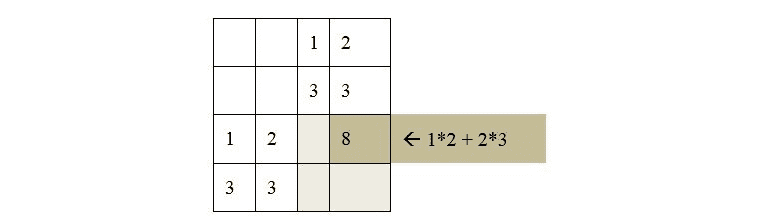

要获取矩阵的第 `(i,j)` 个元素，你需要计算矩阵第 `i` 行与第 `j` 列的点（标量）积。两个向量的标量积是它们对应坐标乘积的和。

另一个常用的矩阵操作是矩阵的行列式。行列式与方阵相关的一个数字。使用 `NumPy` 计算行列式很容易：

```python
np.linalg.det( A )
```

输出为 `-3.0000000000000004`。

从技术上来说，行列式可以计算为 `1*3 – 2*3 = -3`。注意 `NumPy` 使用浮点运算计算行列式，因此结果的准确性并非完美。误差由于大多数编程语言中浮点数的表示方式造成的。

我们还可以这样转置矩阵：

```python
np.matrix.transpose(A)
```

输出如下：

```
matrix([[1, 3], [2, 3]])
```

在转置矩阵时，你绕过主对角线翻转值。`NumPy` 有许多其他重要功能，因此我们将在书中大部分章节中使用它。

## 使用 NumPy 的矩阵练习

我们将使用 `IPython` 和下面的矩阵完成练习。我们将从理解 `NumPy` 语法开始：


使用 `NumPy` 计算以下：

*   矩阵的平方
*   矩阵的行列式
*   矩阵的转置

让我们开始 NumPy 矩阵运算：

1. 导入 `numpy` 库。

```python
import numpy as np
```

2. 创建存储矩阵的二维数组：

```python
A = np.mat([[1,2,3],[4,5,6],[7,8,9]])
```

注意 `np.mat` 构造。如果你创建的是 `array` 而不是 `mat`，那么数组乘法的结果将是错误的。

3. NumPy 使用星号进行矩阵乘法：

```python
A * A
```

输出如下：

```
matrix([[30, 36, 42], [66, 81, 96], [102, 126, 150]])
```

从下面的代码可以看出，`A` 的平方是通过执行矩阵乘法计算的。例如，矩阵左上元素计算如下：

```python
1 * 1 + 2 * 4 + 3 * 7
```

输出为 `30`。

4. 使用 `np.linalg.det` 计算矩阵的行列式：

```python
np.linalg.det( A )
```

输出为 `-9.51619735392994e-16`。

根据前面的计算，行列式接近于零。这种不精确是由于浮点运算造成的。实际值为零。

你可以通过手动计算行列式得出结论：

```python
1*5*9 + 2*6*7 + 3*4*8 - 1*6*8 - 2*4*9 - 3*5*7
```

输出为 `0`。

每当你使用 `NumPy` 时，请务必考虑到浮点运算舍入误差的可能性，即使你看起来是在处理整数。

5. 使用 `np.matrix.transpose` 获取矩阵的转置：

```python
np.matrix.transpose(A)
```

输出如下：

```
matrix([[1, 4, 7],
[2, 5, 8],
[3, 6, 9]])
```

如果 `T` 是矩阵 `A` 的转置，那么 `T[j][i]` 等于 `A[i][j]`。

NumPy 提供了许多针对向量、矩阵和其他数学结构的有用功能。

## 用于游戏 AI 的 Python

`AI 游戏玩家` 本质上是一个具有明确目标的 `智能体`：其目标是赢得游戏并击败所有其他玩家。人工智能在游戏方面的实验取得了令人惊讶的结果。今天，没有人类能在国际象棋比赛中击败 AI。

围棋是最后一种人类大师能够稳定地击败电脑选手的游戏。然而，在 2017 年，谷歌的游戏 AI 击败了围棋大师。

### 游戏中的智能体

智能体根据游戏规则进行游戏。智能体可以通过其`传感器`感知游戏的`当前状态`，并评估潜在步骤的`效用`。一旦智能体找到`可能的最佳步骤`，它就会使用其执行器执行动作。智能体根据其拥有的信息找到`达到目标`的最佳行动。动作要么被`奖励`，要么被`惩罚`。胡萝卜和大棒（激励机制）是奖励和惩罚的绝佳例子。想象你的推车前有一头驴。你在它的眼睛前面放一根胡萝卜，这只可怜的动物就开始朝着它走去。驴一停下，骑者可能会用棍子进行惩罚。这不是人类移动的方式，但奖励和惩罚在某种程度上控制着生物体。同样的情况也发生在人类的学校、工作和日常生活中。我们没有胡萝卜和大棒，而是通过收入和法律惩罚来塑造我们的行为。

在大多数游戏和游戏化应用中，良好的动作序列会带来奖励。当人类玩家感到获得奖励时，一种被称为多巴胺的激素会释放。多巴胺也被称为奖励化学物质。当人类实现目标或完成任务时，多巴胺就会释放。这种激素会让你感到快乐。人类倾向于以最大化幸福感的方式行动。这种动作序列被称为`成瘾循环`。另一方面，智能体只对其目标感兴趣，即最大化奖励并最小化惩罚。

在建模游戏时，我们必须确定它们的`状态空间`。一个动作会导致`状态转移`。当我们探索所有可能动作的后果时，我们就得到了`决策树`。随着我们开始探索所有玩家可能的未来行动，直到游戏结束，这棵树会变得越来越深。

AI 的强大在于每秒执行数百万个可能的步骤。因此，游戏 AI 往往归结为`搜索练习`。在探索游戏中所有可能的移动序列时，我们得到了游戏的`状态树`。

考虑一个国际象棋 AI。通过构建包含所有可能移动序列的状态树来评估所有可能的移动，有什么问题？

国际象棋在复杂度上属于 EXPTIME（指数级时间）游戏。可能的移动数量呈组合性爆炸式增长。

白方有 20 种可能的移动：8 个兵可以移动一步或两步，两只马可以向左上、左上或右上移动。然后，黑方可以进行这 20 种移动中的任何一种。在每人移动一次后，已经有了 20*20 = 400 种可能的组合。

在第二次移动之后，我们得到了 8,902 种可能的棋盘布局，而且这个数字会不断增长。只需七步，你就必须搜索 10,921,506 种可能的布局。

国际象棋比赛的平均长度约为 40 步。一些异常游戏需要超过 200 步才能结束。

结果，计算机玩家根本没有时间探索整个状态空间。因此，搜索活动必须通过适当的奖励、惩罚和规则简化来引导。

### 广度优先搜索和深度优先搜索

创建游戏 AI 往往是一项搜索练习。因此，我们需要熟悉两种主要的搜索技术：广度优先搜索（BFS）和深度优先搜索（DFS）。

这些搜索技术应用于`有向根节点树`。树是一种包含节点的数据结构，并通过边连接这些节点，使得树的任意两个节点之间都恰好通过唯一的路径连接：

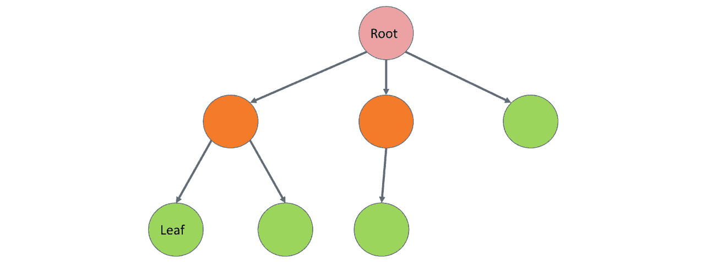

当树被赋予根时，树中有一个特殊节点称为根，我们从那里开始遍历。有向树是其边只能向一个方向遍历的树。节点可以是内部节点或叶子节点。`内部节点`至少有一条可以离开该节点的边。`叶子`没有从节点指向外的边。

在 AI 搜索中，树的根是起始状态。我们通过生成搜索树的后继节点从该状态开始遍历。搜索技术在访问这些后继节点的顺序上有所不同。

假设我们有一个由根定义的树，以及一个从根生成所有后继节点的函数。在这个例子中，每个节点都有一个值和一个深度。我们从 1 开始，可以将值增加 1 或 2。我们的目标是达到值 5。

```python
root = {'value': 1, 'depth': 1}

def succ(node):
    if node['value'] == 5:
        return []
    elif node['value'] == 4:
        return [{'value': 5, 'depth': node['depth'] + 1}]
    else:
        return [
            {'value': node['value'] + 1, 'depth': node['depth'] + 1},
            {'value': node['value'] + 2, 'depth': node['depth'] + 1}
        ]
```

我们将首先对这个例子执行广度优先：

```python
def bfs_tree(node):
    nodes_to_visit = [node]
    visited_nodes = []
    while len(nodes_to_visit) > 0:
        current_node = nodes_to_visit.pop(0)
        visited_nodes.append(current_node)
        nodes_to_visit.extend(succ(current_node))
    return visited_nodes

bfs_tree(root)
```

输出如下：

```
[{'depth': 1, 'value': 1},
{'depth': 2, 'value': 2},
{'depth': 2, 'value': 3},
{'depth': 3, 'value': 3},
{'depth': 3, 'value': 4},
{'depth': 3, 'value': 5},
{'depth': 4, 'value': 4},
{'depth': 4, 'value': 5},
{'depth': 4, 'value': 5}]
```

注意，广度优先搜索首先找到到达叶子的最短路径，因为它按深度增加顺序枚举了所有节点。

如果我们遍历的是图而不是有向根树，广度优先搜索将有所不同：当我们访问一个节点时，必须检查该节点是否被访问过。如果已经访问过，我们就直接忽略它。

在本章中，我们只在树上使用`广度优先遍历`。深度优先搜索与广度优先搜索非常相似。`深度优先遍历`和 BFS 的区别在于访问节点的顺序。BFS 在访问其他节点之前访问节点的所有孩子，而 DFS 则先向树深探索：

```python
def dfs_tree(node):
    nodes_to_visit = [node]
    visited_nodes = []
    while len(nodes_to_visit) > 0:
        current_node = nodes_to_visit.pop()
        visited_nodes.append(current_node)
        nodes_to_visit.extend(succ(current_node))
    return visited_nodes

dfs_tree(root)
```

输出如下：

```
[{'depth': 1, 'value': 1},
{'depth': 2, 'value': 3},
{'depth': 3, 'value': 5},
{'depth': 3, 'value': 4},
{'depth': 4, 'value': 5},
{'depth': 2, 'value': 2},
{'depth': 3, 'value': 4},
{'depth': 4, 'value': 5},
{'depth': 3, 'value': 3},
{'depth': 4, 'value': 5},
{'depth': 4, 'value': 4},
{'depth': 5, 'value': 5}]
```

如你所见，DFS 算法深度得很快。它并不一定首先找到最短路径，但它保证在探索第二条路径之前找到一个叶子节点。

在游戏 AI 中，BFS 算法通常用于评估游戏状态，因为 DFS 可能会迷路。想象一下开始一局象棋，DFS 算法可能很容易在搜索中迷失。

### 探索游戏的状态空间

让我们来探索一个简单游戏：井棋（Tic-Tac-Toe）的状态空间。

在井棋游戏中，给出一个 3x3 的游戏棋盘。两个玩家进行此游戏。一人使用 `X` 符号，另一人使用 `O` 符号。`X` 开始游戏，每个玩家交替移动一次。游戏的目标是在水平、垂直或对角线方向上获得三个自己的符号。

我们将井棋盘的单元格标记如下：


在接下来的示例中，`X` 从位置 1 开始。`O` 在位置 5 进行反击，`X` 在位置 9 移动，然后 `O` 移动到位置 3：


这是第二个玩家的失误，因为现在 `X` 被迫在单元格 7 上放置符号，这创造了赢得游戏的两种未来场景。无论 `O` 移动到单元格 4 或 8 进行防御——`X` 都会通过选择另一个未占据的单元格来赢得游戏。

> **注意**
>
> 你可以在 [`www.half-real.net/tictactoe/`](http://www.half-real.net/tictactoe/) 尝试游戏。

为了简单起见，我们只探索由 AI 玩家开始的情况的状态空间。我们将从一个随机移动的 AI 玩家开始，它会在空单元格中放置符号。与这个 AI 玩家玩之后，我们将创建一个完整的决策树。一旦我们生成了所有可能的游戏状态，你将体验它们的组合爆炸。由于我们的目标是让这些复杂性变得简单，我们将使用几种不同的技术让 AI 玩家更智能，并减少决策树的大小。到实验结束，我们将得到一个少于 200 种不同游戏结局的决策树，作为奖励，AI 玩家将永远不会输任何比赛。

要进行随机移动，你需要知道如何使用 Python 从列表中选择随机元素。我们将使用 `random` 库的 `choice` 函数：

```python
from random import choice

choice([2, 4, 6, 8])
```

输出是 `6`。

`choice` 函数的输出是列表中的随机元素。

> **注意**
>
> 我们将在接下来的练习中使用阶乘符号。阶乘用 `!` 感叹号表示。根据定义，`0! = 1`，且 `n! = n*(n-1)!`。在我们的示例中，`9! = 9*8! = 9*8*7! = … = 9*8*7*6*5*4*3*2*1`。

### 练习 2：估计井棋游戏中可能的状态数

对井棋游戏状态空间每一层级的可能状态数进行粗略估计：

*   在我们的估计中，我们不会停止，直到棋盘上的所有单元格都被填满。玩家可能会在游戏结束之前获胜，但为了统一，我们将继续游戏。
*   第一个玩家将选择九个单元格之一。第二个玩家将从八个单元格中选择一个。第一个玩家再从剩下的七个单元格中选择一个。一直持续到某个玩家赢得游戏，或者第一个玩家被迫进行最后移动。
*   可能的序列数量为 `9! = 362880`。其中一些序列无效，因为玩家可能少于九步赢得游戏。至少需要五步才能赢得游戏，因为第一个玩家需要移动三次。
*   为了计算状态空间的精确大小，我们需要计算在五、六、七、八步赢得的游戏数量。这种计算是简单的，但由于其穷举性质，它超出了我们的范围。我们因此确定状态空间的规模。

> **注意**
>
> 在生成所有可能的井棋游戏后，研究人员统计了 255,168 种可能的游戏。在这些游戏中，131,184 局由第一个玩家获胜，77,904 局由第二个玩家获胜，46,080 局以平局结束。访问 [`www.half-real.net/tictactoe/allgamesoftactoe.zip`](http://www.half-real.net/tictactoe/allgamesoftactoe.zip) 下载所有可能的井棋游戏。

即使是井棋这样简单的游戏也有很多状态。想象一下探索所有可能的象棋有多困难。因此，我们可以得出暴力搜索很少是理想的。

### 练习 3：创建一个随机 AI


# 带有搜索技术与游戏的 AI

## 学习目标

在本章结束时，你将能够：

* 基于静态规则使用 Python 构建一个简单的游戏 AI
* 确定启发式方法在游戏 AI 中的作用
* 运用搜索技术和路径规划算法
* 使用 `Minmax` 算法实现适用于双人游戏的游戏 AI

## 引言

在前一章中，我们理解了智能体的意义。我们还检查了游戏 AI 的游戏状态。在本章中，我们将重点关注如何创建智能体并为其引入智能。

我们将考虑减少状态空间中的状态数量，分析棋盘可能经历的阶段，并使环境以我们获胜的方式运行。在本章结束时，我们将拥有一个从不失败的井字棋玩家。

## 练习 4：教智能体获胜

在这个练习中，我们将看到获胜所需的步骤可以如何减少。我们将让在前一章中开发的智能体能够检测它可以获胜游戏的情况。将可能的状态数量与随机播放进行比较。

1. 我们定义两个函数：`ai_move` 和 `all_moves_from_board`。我们创建 `ai_move` 是为了在 AI 可以获胜时它返回一个移动。

```python
def ai_move(board):
    new_boards = all_moves_from_board(board, AI_SIGN)
    for new_board in new_boards:
        if game_won_by(new_board) == AI_SIGN:
            return new_board
    return choice(new_boards)
```

2. 让我们用游戏循环测试应用程序。每当 AI 有机会赢得游戏时，它始终会将 X 放在正确的单元格中：

```python
game_loop()
```

3. 输出如下：

```
. X .
. . .
. . .
Enter row: 3
column: 1
. X .
. . .
O . .
X X
. . .
O . .
Enter row: 2
column: 1
. X X
O . .
O . .
X X
O . .
O . .
Game has been ended.
```

4. 为了统计所有可能的移动，我们必须修改 `all_moves_from_board` 函数以包含这项改进。我们必须这样做，以便如果游戏由 `AI_SIGN` 获胜，它将返回该值：

```python
def all_moves_from_board(board, sign):
    move_list = []
    for i, v in enumerate(board):
        if v == EMPTY_SIGN:
            new_board = board[:i] + sign + board[i+1:]
            move_list.append(new_board)
            if game_won_by(new_board) == AI_SIGN:
                return [new_board]
    return move_list
```

5. 然后我们生成所有可能的移动。一旦我们找到能让 AI 赢得游戏的移动，我们就会返回它。我们不在乎 AI 是否在一步之内有多种方案赢得游戏的机会——我们只返回第一个可能性。如果 AI 无法获胜，我们就返回所有可能的移动。

6. 让我们看看在每一步中统计所有可能的情况意味着什么：

```python
count_possibilities()
```

7. 输出如下：

```
step 0. Moves: 1
step 1. Moves: 9
step 2. Moves: 72
step 3. Moves: 504
step 4. Moves: 3024
step 5. Moves: 8525
step 6. Moves: 28612
step 7. Moves: 42187
step 8. Moves: 55888
First player wins: 32395
Second player wins: 23445
Draw 35544
Total 91344
```

## 活动 2：教智能体意识到可以防御损失的情况

在本节中，我们将讨论如何让计算机玩家玩得更好，从而减少状态空间和失败次数。我们将强制计算机去防御玩家在行、列或对角线上放置的第三个符号（棋子）：

1. 创建一个名为 `player_can_win` 的函数，该函数使用 `all_moves_from_board` 函数获取棋盘上的所有移动，并使用变量 `next_move` 对其进行迭代。在每次迭代中，它会检查该符号是否可以赢得游戏，然后返回真或假值。

2. 扩展 AI 的移动逻辑，使其更倾向于做出安全的移动。如果对手在下一步无法赢得游戏，则该移动被认为是安全的。

3. 测试新应用程序。你会发现 AI 已经做出了正确的移动。

4. 将此逻辑放置在状态空间生成器中，通过生成所有可能的游戏来检查计算机玩家的表现。

我们不仅再次去除了近三分之二的可能游戏，而且大多数时候，AI 玩家要么获胜要么平局。尽管我们努力让 AI 变得更好，它仍然可能以 962 种方式失败。我们将在下一个活动中消除所有这些失败。

> **注意**
>
> 本活动的答案可以在第 261 页找到。

## 活动 3：修复 AI 的第一步和第二步使其变得无敌

本节将讨论如何聚焦启发式搜索，以便找到比其他移动更有用的移动。我们将通过硬编码第一步和第二步减少可能的游戏：

1. 统计棋盘上空格的数量，如果有 9 个或 7 个空格，则进行硬编码移动。你可以尝试不同的硬编码移动。

2. 占据任何一个角，然后占据对角线，会导致失败。如果对手占据了对角线，在中间移动也不会导致失败。

3. 固定前两个步骤后，我们只需要处理 8 种可能性，而不是 504 种。我们还引导 AI 进入了一个状态，在该状态下硬编码规则足以永远不会输。

> **注意**
>
> 本活动的答案可以在第 263 页找到。

让我们总结一下我们为了减少状态空间应用的重要技术：

1. **经验性简化**：我们接受了最佳第一步是走角。我们简单地硬编码了一个移动，而不是考虑替代方案，以便专注于游戏的其他方面。在更复杂的游戏中，经验性移动往往具有误导性。最著名的国际象棋 AI 胜利往往违反了国际象棋大师的常识。

2. **对称性**：在我们从角部开始后，我们注意到从赢得游戏的角度来看，位置 1、3、7 和 9 是等价的。尽管我们没有进一步利用这个想法，但请注意我们甚至可以旋转表格来进一步减少状态空间，并将四个角部移动视为完全相同的移动。

3. **减少通向相同状态的不同排列**：假设我们可以执行移动 A 或 B，假设对手执行了移动 X，其中 X 不等于移动 A 或 B。如果我们探索了序列 A, X, B，并且开始探索序列 B, X，那么我们就不考虑序列 B, X, A。这是因为这两个序列会导致完全相同的游戏状态，而且我们之前已经探索过包含这三个移动的状态。

4. **玩家的强制移动**：当玩家在水平、垂直或对角线方向收集两个符号，且该行的第三个单元格为空时，我们被迫占据该空格，要么赢得游戏，要么防止对手赢得游戏。强制移动可能意味着其他的强制移动，从而进一步减少了状态空间。

5. **对手的强制移动**：当对手的移动显然是最优的时，考虑对手不采取最佳移动的情况是没有意义的。当对手可以通过占据某个单元格来赢得游戏时，我们是否继续长期探索对手错失最佳移动的情况并不重要。通过不探索对手未能阻止我们获胜的情况，我们节省了大量的计算量。这是因为在对手犯下错误之后，我们将直接赢得游戏。

6. **随机移动**：当我们无法决定且没有能力进行搜索时，我们随机移动。随机移动几乎总是劣于基于搜索的明智猜测，但有时我们别无选择。

## 启发式算法

在本主题中，我们将通过定义和应用启发式算法来形式化启发搜索技术，以指导我们的搜索。

### 无信息搜索与启发式搜索

在井字棋示例中，我们实现了一种贪心算法，它首先关注获胜，然后关注不输。在立即赢得游戏方面，贪心算法是最优的，因为没有比比赢得游戏更好的步骤了。在不输方面，如何避免失败至关重要。我们的算法简单地选择随机的安全移动，而没有考虑我们创造了多少获胜机会。

广度优先搜索和深度优先搜索是无信息的，因为它们考虑了游戏中的所有可能状态。启发式搜索则智能地探索可用状态空间。

### 创建启发式算法

如果我们想做出更好的决策，我们应用启发式算法，通过考虑长远效用来引导搜索走向正确的方向。这样，我们可以根据未来可能发生的情况在现在做出更明智的决策。这有助于我们更快地解决问题。我们可以如下构建启发式算法：

* 对游戏中某次移动的效用的明智猜测
* 从给定游戏状态的角度对效用进行明智猜测
* 对距离的明智猜测

不可接受（non-admissible）启发式的一个示例是应用于二维地图的曼哈顿距离。假设我们的当前状态和目标状态之间存在直接路径。当前状态位于坐标 (2, 5)，目标状态位于坐标 (5, 1)。

这两个节点的曼哈顿距离如下：

```
abs(5-2) + abs(1-5) = 3 + 4 = 7
```

由于我们高估了从当前节点到目标节点的代价，因此当我们能够对角移动时，曼哈顿距离是不可接受的。

## 启发评估

从起始玩家的角度对井字棋游戏状态进行启发式评估。

我们可以定义游戏状态的效用或移动的效用。这两者都可行，因为游戏状态的效用可以定义为导致该状态的效用。

### 启发式 1：终局简单评估

让我们通过评估棋盘来定义一个简单的启发式：我们可以定义游戏状态的效用或移动的效用。这两者都可行，因为游戏状态的效用可以定义为导致该状态的效用。游戏的效用可以是：

* 如果状态意味着 AI 玩家将赢得游戏，则为 +1
* 如果状态意味着 AI 玩家将输掉游戏，则为 -1
* 如果达到平局或无法从当前状态识别出明显的胜者，则为 0

这种启发式非常简单，因为任何人都可以查看棋盘并分析玩家是否即将胜利。

该启发式的效用取决于我们是否可以预判很多步移动。注意，我们甚至无法在五步之内赢得游戏。我们在主题 A 中看到，当我们到达第 5 步时，有 13,680 种可能的组合到达它。在这些 13,680 种情况的大多数，我们的启发式返回零。

如果我们的算法搜索深度于这五步，我们完全不知道如何开始游戏。因此，我们可以发明一种更好的启发式。

### 启发式 2：移动的效用


* 行、列或对角线上有两个 AI 标记，且第三个单元格为空：该空格加 1000 分。
* 对手在行、列或对角线上有两个标记，且第三个单元格为空：该空格加 100 分。
* 行、列或对角线上有一个 AI 标记，且另外两个单元格为空：两个空格各加 10 分。
* 行、列或对角线上没有 AI 或对手的标记：两个空格各加 1 分。
* 已占据的单元格获得负无穷值。在实践中，由于规则的性质，使用 -1 也可以。

为什么对这四个规则使用 10 的倍数因子？因为形成三行、三列和对角线的八种可能方式。所以，即使对游戏一无所知，我们也确定低级规则的累积可能无法覆盖高级级规则。换句话说，如果我们能赢得游戏，我们就永远不会防守对手的移动。

##### 注意

由于对手的任务也是赢得游戏，我们可以从对手的角度计算这种启发式。我们的任务同样是最大化这个值，以便我们能够防御对手的最优法。这也是极大极小算法（Minmax algorithm）的思想。如果我们想将此启发式转换为描述当前棋盘的启发式，我们可以计算所有开放单元格的启发式值，并取 AI 字符值的最大值，从而最大化我们的效用。

对于每个棋盘，我们将创建一个效用矩阵。例如，考虑以下棋盘：


###### 图 2.1：井字棋游戏状态

从这里，我们可以构建它的效用矩阵：


###### 图 2.2：井字棋游戏效用矩阵

在第二行，如果我们选择左侧单元格，它将很有用。注意，如果我们有一个更优的效用函数，我们会奖励拦截对手。

第三列的两个单元格都因为连线获得了 10 分的加成。

右上单元格也因为防御对手的对角线获得了 100 分。

从这个矩阵可以明显看出，我们应该选择右上移动。

我们可以使用这种启发式来引导我们走向最佳下一步，或者通过取这些值的最大值来对当前棋盘给出一个更有根据的评分。技术上，我们已经在主题 A 中以硬编码规则的形式使用了这种启发式的一部分。但注意，启发式的真正的效用不是对棋盘的静态评估，而是它在限制搜索空间方面提供的指导。

#### 练习 5：使用启发式函数的井字棋静态评估

使用启发式函数对井字棋游戏进行静态评估。

1. 在井字棋游戏上执行静态评估，使用启发式函数。我们将创建一个函数，它接收棋盘并返回一个效用向量。返回的函数接受 `points` 参数，并修改效用向量，只要效用值是非负的。

```python
def init_utility_matrix(board):
    utilities = [0] * len(board)
    def add_score(points):
        if utilities[i] >= 0:
            utilities[i] += points
        if utilities[j] >= 0:
            utilities[j] += points
        if utilities[k] >= 0:
            utilities[k] += points
    # ... 
```

2. 我们现在有了所有来创建效用矩阵的逻辑：

```python
def utility_matrix(board):
    utilities = [0] * len(board)
    for i, j, k in combo:
        triple = [board[i], board[j], board[k]]
        if triple.count(EMPTY_SIGN) == 1:
            if triple.count(AI_SIGN) == 2:
                add_score(1000)
            elif triple.count(OPPONENT_SIGN) == 2:
                add_score(100)
        elif triple.count(AI_SIGN) == 1 and triple.count(EMPTY_SIGN) == 2:
            add_score(10)
        # ...
    return [0 if cell == EMPTY_SIGN else -1 for cell in board]
```

3. 我们现在创建一个创建一个选择最高效用值移动的函数。如果多个移动具有相同的效用，该函数将返回这些移动。

```python
def best_moves_from_board(board, sign):
    move_list = []
    utilities = utility_matrix(board)
    max_utility = max(utilities)
    for i, v in enumerate(board):
        if utilities[i] == max_utility:
            move_list.append(board[:i] + sign + board[i+1:])
    return move_list

def all_moves_from_board_list(board_list, sign):
    move_list = []
    get_moves = best_moves_from_board if sign == AI_SIGN else all_moves_from_board
    for board in board_list:
        move_list.extend(get_moves(board, sign))
    return move_list
```

4. 运行应用程序。

```
count_possibilities()
```

输出将如下：

```
step 0. Moves: 1
step 1. Moves: 1
step 2. Moves: 8
step 3. Moves: 24
step 4. Moves: 144
step 5. Moves: 83
step 6. Moves: 214
step 7. Moves: 148
step 8. Moves: 172
First player wins: 504
Second player wins: 12
Draw: 91
Total: 607
```

#### 使用启发式进行启发搜索

我们还没有体验过启发式的真正力量，因为我们在移动时并不知道未来移动的影响，从而导致了对手合理的打法。

这就是为什么一个更准确的启发式方法比简单地在游戏中硬编码前两步会导致更多的损失。请注意，在之前的课题中，我们是根据运行固定前两步游戏时生成的统计数据来选择这两个动作的。这种方法本质上就是启发式搜索的核心。静态评估无法与生成成千上万个未来状态并选择奖励最大化的策略相竞争。

### 启发式方法的类型

因此，一个更准确的启发式方法比简单地在游戏中硬编码前两步会导致更多的损失。请注意，在主题 A 中，我们根据运行固定前两步游戏时生成的统计数据来选择这两个动作。这种方法本质上就是启发式搜索的核心。静态评估无法与生成成千上万个未来状态并选择奖励最大化的策略竞争。

* 这是因为我们的启发式方法不是精确的，而且很可能不是可纳（admissible）。
* 我们在前面的练习中看到启发式方法并不总是最优的：在第一个主题中，我们提出的规则允许 AI 始终赢得游戏或以平局结束。这些启发式让 AI 经常获胜，但是以在某些情况下失败为代价。
* 如果我们可能低估游戏状态的效用，但绝不会高估它，则该启发式方法是可纳的。

在井字棋示例中，我们可能高估了几个游戏状态的效用。为什么？因为我们最终输了十二次。某些导致失败的游戏状态具有最高启发式得分。为了证明我们的启发式方法不可纳的，我们所做的只需要找到一个我们在选择导致失败的状态时所忽略的潜在获胜状态即可。

描述启发式方法的还有两个特征：最优性和完备性：

* **最优启发式方法**总是能找到可能的解决方案。
* **完备启发式方法**有两种定义，取决于我们如何定义问题领域。从广义上说，如果启发式方法总是能找到解决方案，它是完备的。从严格来说，如果它找到了所有可能的解决方案，它是完备的。我们的井字棋启发式方法不是完备的，因为我们故意忽略了许多可能的获胜状态，而选择了一个失败状态。

### 使用 A* 算法进行路径

在前两个主题中，我们学习了如何定义一个智能体，以及如何创建一个引导智能体走向目标状态的启发式方法。我们知道这并不完美，因为有时我们会为了几个失败状态而忽略几个获胜状态。

我们现在将学习一种结构化且最优的方法，以便我们执行搜索寻找当前状态与目标状态之间的最短路径：`A*`（“A star” 而不是 “A asterisk”）算法：

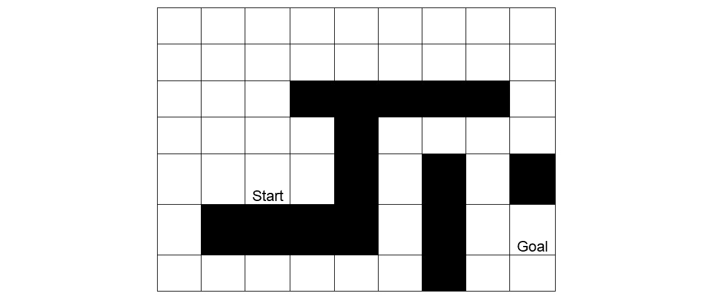

#### 图 2.3：在迷宫中寻找最短路径

对于人类来说，仅仅通过观察图像找到最短路径是简单的。我们可以得出最短路径有两个潜在候选者：路线一向上开始，路线二向左开始。然而，AI 并不知道这些选项。事实上，对于计算机玩家来说，最符合逻辑的第一步是移动到图中标记为数字 3 的格子：

为什么？因为这是唯一能缩小起始状态与目标状态距离的步骤。所有其他步骤最初都会远离目标状态：

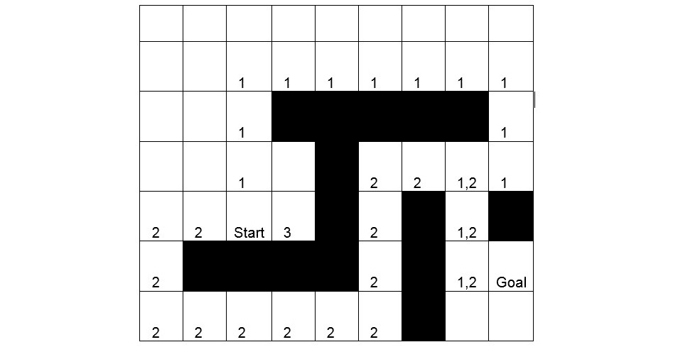

#### 图 2.4：带有效用的最短路径游戏盘

### 练习 6：寻找到达目标的路径

寻找最短路径的步骤如下：

1. 使用 Python 描述棋盘、初始状态和最终状态。创建一个返回后继状态列表的函数。
2. 我们将使用元组，其中第一个坐标表示从 1 到 7 的行号，第二个坐标表示从 1 到 9 的列号：

```python
size = (7, 9)
start = (5, 3)
end = (6, 9)
obstacles = {
    (3, 4), (3, 5), (3, 6), (3, 7), (3, 8),
    (4, 5),
    (5, 5), (5, 7), (5, 9),
    (6, 2), (6, 3), (6, 4), (6, 5), (6, 7),
    (7, 7)
}
```

3. 我们将使用列表推导以以下方式生成后继状态。只要还在棋盘内，我们就从当前列向左和右移动一步。只要还在棋盘内，我们就从当前行向上和向下移动一步。我们获取新坐标，生成所有可能的元组，并过滤结果，使新状态不在 `obstacles` 中。为了避免无限循环，排除移动之前访问过的字段是有意义的：

```python
def successors(state, visited_nodes):
    row, col = state
    max_row, max_col = size
    succ_states = []
    if row > 1:
        succ_states.append((row-1, col))
    if col > 1:
        succ_states.append((row, col-1))
    if row < max_row:
        succ_states.append((row+1, col))
    if col < max_col:
        succ_states.append((row, col+1))
    return [s for s in succ_states if s not in visited_nodes if s not in obstacles]
```

### 练习 7：使用 BFS 寻找最短路径

要找到最短路径，请遵循以下步骤：使用 `BFS` 算法寻找最短路径。回基础的 `BFS` 实现。

1. 我们必须修改此实现以包含成本。让我们测量成本：

```python
import math

def initialize_costs(size, start):
    h, w = size
    costs = [[math.inf] * w for i in range(h)]
    x, y = start
    costs[x-1][y-1] = 0
    return costs

def update_costs(costs, current_node, successor_nodes):
    new_cost = costs[current_node[0]-1][current_node[1]-1] + 1
    for x, y in successor_nodes:
        costs[x-1][y-1] = min(costs[x-1][y-1], new_cost)

def bfs_tree(node):
    nodes_to_visit = [node]
    visited_nodes = []
    costs = initialize_costs(size, start)
    while len(nodes_to_visit) > 0:
        current_node = nodes_to_visit.pop(0)
        visited_nodes.append(current_node)
        successor_nodes = successors(current_node, visited_nodes)
        update_costs(costs, current_node, successor_nodes)
        nodes_to_visit.extend(successor_nodes)
    return costs

bfs_tree(start)
```

2. 输出将如下：

```python
[[6, 5, 4, 5, 6, 7, 8, 9, 10],
 [5, 4, 3, 4, 5, 6, 7, 8, 9],
 [4, 3, 2, inf, inf, inf, inf, inf, 10],
 [3, 2, 1, 2, inf, 12, 13, 12, 11],
 [2, 1, 0, 1, inf, 11, inf, 13, inf],
 [3, inf, inf, inf, inf, 10, inf, 14, 15],
 [4, 5, 6, 7, 8, 9, inf, 15, 16]]
```

3. 你可以看到简单的 `BFS` 算法成功确定了从起始节点到任何节点（包括目标节点）的成本。让我们测量找到目标节点所需的步骤数：

```python
def bfs_tree_verbose(node):
    nodes_to_visit = [node]
    visited_nodes = []
    costs = initialize_costs(size, start)
    step_counter = 0
    while len(nodes_to_visit) > 0:
        step_counter += 1
        current_node = nodes_to_visit.pop(0)
        visited_nodes.append(current_node)
        successor_nodes = successors(current_node, visited_nodes)
        update_costs(costs, current_node, successor_nodes)
        nodes_to_visit.extend(successor_nodes)
        if current_node == end:
            print(
                'End node has been reached in ',
                step_counter,
                'steps'
            )
            return costs
    return costs

bfs_tree_verbose(start)
```

4. 目标节点已在 110 步找到。

```
[2, 1, 0, 1, inf, 11, inf, 13, inf],
[3, inf, inf, inf, inf, 10, inf, 14, 15],
[4, 5, 6, 7, 8, 9, inf, 15, 16]
```

我们现在将学习一种可以找到起始节点到目标节点最短路径的算法：A* 算法。

#### 介绍 A* 算法

A* 是一种完备且最优的启发式搜索算法，用于找到当前游戏状态与胜利状态之间的最短路径。在此状态下，“完备”和“最优”的定义如下：

* 完备（Complete）意味着 A* 总是能找到解决方案。
* 最优（Optimal）意味着 A* 将找到最佳解决方案。

要设置 A* 算法，我们需要：

* 一个初始状态
* 一个目标状态的描述
* 用于衡量向目标状态进展的可接受启发式函数（Admissible heuristics）
* 生成通往目标的步骤的方法

一旦设置完成，我们在初始状态上按照以下步骤执行 A* 算法：

1. 我们生成所有可能的下一步。
2. 我们按照子节点与目标的距离顺序存储这些子节点。
3. 我们首先选择得分最高的子节点，并以该最优子节点为初始状态重复这三个步骤。这就是从起始节点到某个节点的最短路径。

`distance_from_end( node )` 是一种可接受的启发式估计，显示了我们距离目标节点有多远。

在路径规划中，一个良好的启发式函数可以是欧几得距离。如果当前节点是 (x, y) 而目标节点是 (u, v)，那么：

`distance_from_end( node ) = sqrt( abs( x – u ) ** 2 + abs( y – v ) ** 2 )`

其中：

* `sqrt` 是平方根函数。不要忘记从 `math` 库导入它。
* `abs` 是绝对值函数。`abs( -2 )` = `abs( 2 )` = `2`。


`x ** 2` 是 `x` 的平方。

我们将使用 `distance_from_start` 矩阵来存储从起始节点的距离。在算法中，我们将此代价矩阵称为 `distance_from_start(n1)`。对于任何坐标为 `(x1, y1)` 的节点 `n1`，该距离等于 `distance_from_start[x1][y1]`。

我们将使用 `succ(n)` 符号从 `n` 生成后继节点列表。

让我们看看算法的伪代码：

```
frontier = [start], internal = {}

#### 初始化代价矩阵，将每个单元设置为无穷。
#### 将 distance_from_start(start) 的值设置为 0。
while frontier is not empty:
    # 注意 n 具有起始点和终点之间
    # 最小估计总距离。
    n = frontier.pop()
    # 我们之后将学习如何重建最短路径
    if n == end:
        return the shortest path.
    internal.add(n)
    for successor s in succ(n):
        if s in internal:
            continue # 节点已经检查过了
        new_distance = distance_from_start(n) + distance(n, s)
        if new_distance >= distance_from_start(s):
            # 这条路径并不比我们已经
            # 过的路径更好。
            continue
        if s is a member of frontier:
            update the priority of s
        else:
            Add s to frontier.
```

关于最短路径的检索，我们可以利用代价矩阵。该矩阵包含了路径上每个节点到起始节点的距离。由于在向回行走时代价总是减小的，我们只需要从终点开始，贪婪地向代价更小的方向回溯：

`path = [end_node], distance = get_distance_from_start(end_node)`

while path 中最后一个元素的距离不为 0:

    for path 中最后一个节点的每个邻居:

        new_distance = get_distance_from_start(neighbor)

        if new_distance < distance:

            add neighbor to path, and break out from

A* 的复杂度为 `O(E)`，其中 `E` 代表边。

### 为什么启发式函数的可接受性如此重要？

为了按优先级顺序排序边界队列（frontier），我们使用 `heapq`。

```
import heapq
```

我们将使用 `heapq.heappush` 和 `heapq.heappop` 来高效地维护优先级队列。

为数据创建一个列表：

`data = []`

使用 `heapq.heappush` 将 `(priority, item)` 推入队列：

`heapq.heappush(data, (priority, item))`

弹出优先级最低的项：

`priority, item = heapq.heappop(data)`

输出是：

`item`

```python
return priority

internal.add(node)

successor_nodes = successors(node, internal)

for s in successor_nodes:
    new_distance = get_distance_from_start(node) + 1
    if new_distance < get_distance_from_start(s):
        set_distance_from_start(s, new_distance)
    # Filter previous entries of s
    frontier = [n for n in frontier if s != n[1]]
    heapq.heappush(frontier, (
        new_distance + distance_heuristic(s, end), s
    ))

astar(start, end)
```

15.0

我们的实现与原始算法之间有几处不同：

我们定义了一个 `distance_from_start` 函数，以便访问 `costs` 矩阵更加方便且符合语义化。请注意，我们将节点索引从 1 开始计数，而在矩阵中索引从 0 开始。因此，我们从节点值减去 1 来获取索引。

在生成后继节点时，我们自动排除了位于 `Internal` 集合中的节点。`successors = succ(node, internal)` 确保我们只获取那些尚未关闭检查的邻居，这意味着它们的得分不一定是最优的。

因此，我们可以跳过检查，因为内部节点永远不会出现在 `succ(n)` 中。

由于我们使用了优先级队列，在插入节点 `s` 之前，必须确定它的估算优先级。不过，只有当我们知道该节点没有更低分数的条目时，才会将其插入 `frontier`。

可能会出现节点 `s` 已经在 `frontier` 队列中且分数更高。在这种情况下，我们在将其插入优先级队列的正确位置之前，会移除该条目。当我们找到终点节点时，只需返回最短路径的长度而不是路径本身。

为了获取更多关于执行过程的信息，我们将这些信息打印到控制台。为了理解 A* 算法，请执行此代码并研究日志：

```python
def astar_verbose(start, end):
    frontier = []
    internal = set()
    heapq.heappush(frontier, (0, start))
    costs = initialize_costs(size, start)

    def get_distance_from_start(node):
        return costs[node[0] - 1][node[1] - 1]

    def set_distance_from_start(node, new_distance):
        costs[node[0] - 1][node[1] - 1] = new_distance

    steps = 0
    while len(frontier) > 0:
        steps += 1
        print('step ', steps, '. frontier: ', frontier)
        (priority, node) = heapq.heappop(frontier)
        print(
            'node ',
            node,
            'has been popped from frontier with priority',
            priority
        )
        if node == end:
            print('Optimal path found. Steps: ', steps)
            print('Costs matrix: ', costs)
            return priority

        internal.add(node)
        successor_nodes = successors(node, internal)
        print('successor_nodes', successor_nodes)
        for s in successor_nodes:
            new_distance = get_distance_from_start(node) + 1
            print(
                's:',
                s,
                'new distance:',
                new_distance,
                ' old distance:',
                get_distance_from_start(s)
            )
            if new_distance < get_distance_from_start(s):
                set_distance_from_start(s, new_distance)
                # Filter previous entries of s
                frontier = [n for n in frontier if s != n[1]]
            new_priority = new_distance + distance_heuristic(s, end)
            heapq.heappush(frontier, (new_priority, s))
            print(
                'Node',
                s,
                'has been pushed to frontier with priority',
                new_priority
            )
        print('Frontier', frontier)
        print('Internal', internal)
        print(costs)

astar_verbose(start, end)
```

输出如下：

```
step 1 . Frontier: [(0, (5, 3))]

Node (5, 3) has been popped from Frontier with priority 0

successors [(4, 3), (5, 2), (5, 4)]

s: (4, 3) new distance: 1 old distance: inf

Node (4, 3) has been pushed to Frontier with priority 7.324555320336759

s: (5, 2) new distance: 1 old distance: inf

Node (5, 2) has been pushed to Frontier with priority 8.071067811865476

s: (5, 4) new distance: 1 old distance: inf

Node (5, 4) has been pushed to Frontier with priority 6.099019513592845

step 2 . Frontier: [(6.099019513592845, (5, 4)), (8.071067811865476, (5, 2)), (7.324555320336759, (4, 3))]

Node (5, 4) has been popped from Frontier with priority 6.099019513592845

successors [(4, 4)]

s: (4, 4) new distance: 2 old distance: inf

Node (4, 4) has been pushed to Frontier with priority 7.385164807134502

step 42 . Frontier: [(15.0, (6, 8)), (15.6055512754639, (4, 6)), (15.4398113205603, (1, 1)), (15.828427124719, (4, 7))]

Node (6, 8) has been popped from Frontier with priority 15.0

successors [(7, 8), (6, 9)]

s: (7, 8) new distance: 15 old distance: inf

Node (7, 8) has been pushed to Frontier with priority 16.41421356237096

s: (6, 9) new distance: 15 old distance: inf

Node (6, 9) has been pushed to Frontier with priority 15.0

step 43 . Frontier: [(15.0, (6, 9)), (15.4398113205603, (1, 1)), (15.6055512754639, (4, 6)), (15.828427124719, (4, 7)), (16.41421356237096, (7, 8))]

Node (6, 9) has been popped from Frontier with priority 15.0

Optimal path found. Steps: 43

Costs matrix: [[6, 5, 5, 6, 7, 8, 9, 10], [5, 4, 3, 4, 5, 6, 7, 8, 9], [4, 3, 2, inf, inf, inf, 10], [3, 2, 1, inf, 12, 13], [2, 1, 0, inf, 11, 13]]
```

我们看到 A* 搜索返回正确的值。问题是，如何重建整个路径？

为了清晰起见，删除代码中的 print 语句，并继续第 4 步实现的 A* 算法。与其返回最短路径的长度，不如返回路径本身。我们将通过从终点节点回溯矩阵来提取此路径。我们将在 A* 算法中将其定义为本地函数：

```python
def get_shortest_path(end_node):
    path = [end_node]
    distance = get_distance_from_start(end_node)
    while distance > 0:
        for neighbor in successors(path[-1], []):
            new_distance = get_distance_from_start(neighbor)
            if new_distance < distance:
                path += [neighbor]
                distance = new_distance
                break # for
    return path
```

现在我们知道如何解构路径，让我们在 A* 算法内部返回它：


```python
def astar_with_path(start, end):
    frontier = []
    internal = set()
    heapq.heappush(frontier, (0, start))
    costs = initialize_costs(size, start)

    def get_distance_from_start(node):
        return costs[node[0] - 1][node[1] - 1]

    def set_distance_from_start(node, new_distance):
        costs[node[0] - 1][node[1] - 1] = new_distance

    def get_shortest_path(end_node):
        path = [end_node]
        distance = get_distance_from_start(end_node)
        while distance > 0:
            for neighbor in successors(path[-1], []):
                new_distance = get_distance_from_start(neighbor)
                if new_distance < distance:
                    path += [neighbor]
                    distance = new_distance
                    break # for
        return path

    while len(frontier) > 0:
        (priority, node) = heapq.heappop(frontier)
        if node == end:
            return get_shortest_path(end)
        internal.add(node)
        successor_nodes = successors(node, internal)
        for s in successor_nodes:
            new_distance = get_distance_from_start(node) + 1
            if new_distance < get_distance_from_start(s):
                set_distance_from_start(s, new_distance)
                # Filter previous entries of s
                frontier = [n for n in frontier if s != n[1]]
            heapq.heappush(frontier, (
                new_distance + distance_heuristic(s, end), s
            ))

astar_with_path(start, end)
```

输出如下：

```
[(6, 9),
 (6, 8),
 (5, 8),
 (4, 8),
 (4, 9),
 (3, 9),
 (2, 9),
 (2, 8),
 (2, 7),
 (2, 6),
 (2, 5),
 (2, 4),
 (2, 3),
 (3, 3),
 (4, 3),
 (5, 3)]
```

你可以在 [`github.com/simpleai-team/simpleai`](https://github.com/simpleai-team/simpleai) 访问该库。Simple AI 库的文档可以在这里查看：[`simpleai.readthedocs.io/en/latest/`](http://simpleai.readthedocs.io/en/latest/)。要访问 `simpleai` 库，首先需要安装它：

```bash
pip install simpleai
```

一旦安装了 `simpleai`，你就可以在 Python 的 Jupyter QtConsole 中从 `simpleai` 库导入类和函数：

```python
from simpleai.search import SearchProblem, astar
```

`SearchProblem`（搜索问题）为你提供了一个定义任何搜索问题的框架。`astar` 导入负责在搜索问题内部执行 A* 算法。

为了简单起见，我们在之前的代码示例中没有使用类，以便专注于在纯粹风格下研究算法，没有任何任何杂质。不过，`simpleai` 库将迫使我们使用类。

要描述一个搜索问题，你需要提供以下内容：

*   `constructor`（构造函数）：用于初始化状态空间，从而描述问题。我们将通过将 `Size`（尺寸）、`Start`（起点）、`End`（终点）和 `Obstacles`（障碍物）值作为属性添加到对象。在构造函数的结束处，忘记调用父类构造函数并提供初始状态。
*   `actions(state)`：返回从给定状态可以执行的动作列表。我们将使用此函数来生成新状态。从语义上讲，创建如 `UP`、`DOWN`、`LEFT` 和 `RIGHT` 这样的动作常量，并将这些动作常量解释为结果会更有意义。但在实现中，我们将简单地将动作解释为“移动到 `(x, y)`”，并将此命令表示为 `(x, y)`。该函数包含了我们之前在 `succ` 函数中实现的类似逻辑，不同之处我们不会根据已访问节点集来过滤结果。
*   `result(state0, action)`：返回将动作作用于 `state0` 之后产生的新状态。
*   `is_goal(state)`：如果该状态是目标状态，则返回真。在我们的实现中，我们需要将状态与终点坐标进行比较。
*   `cost(self, state, action, newState)`：通过动作从状态移动到 `newState` 的代价。在我们的示例中，移动的代价统一为 1：

```python
import math

from simpleai.search import SearchProblem, astar

class ShortestPath(SearchProblem):
    def __init__(self, size, start, end, obstacles):
        self.size = size
        self.start = start
        self.end = end
        self.obstacles = obstacles
        super(ShortestPath, self).__init__(initial_state=self.start)

    def actions(self, state):
        (row, col) = state
        (max_row, max_col) = self.size
        succ_states = []
        if row > 1:
            succ_states += [(row-1, col)]
        if col > 1:
            succ_states += [(row, col-1)]
        if row < max_row:
            succ_states += [(row+1, col)]
        if col < max_col:
            succ_states += [(row, col+1)]
        return [s for s in succ_states if s not in self._obstacles]

    def result(self, state, action):
        return action

    def is_goal(self, state):
        return state == end

    def cost(self, state, action, new_state):
        return 1

    def heuristic(self, state):
        (x, y) = state
        (u, v) = self.end
        return math.sqrt(abs(x-u) ** 2 + abs(y-v) ** 2)

size = (7, 9)
start = (5, 3)
end = (6, 9)
obstacles = {
    (3, 4), (3, 5), (3, 6), (3, 7), (3, 8),
    (4, 5),
    (5, 5), (5, 7), (5, 9),
    (6, 2), (6, 3), (6, 4), (6, 5), (6, 7),
    (7, 7)
}
searchProblem = ShortestPath(Size, Start, End, Obstacles)
result = astar( searchProblem, graph_search=True )
result
Node <(6, 9)>
result.path()
[(None, (5, 3)),
    ((4, 3), (4, 3)),
    ((3, 3), (3, 3)),
    ((2, 3), (2, 3)),
    ((2, 4), (2, 4)),
    ((2, 5), (2, 5)),
    ((2, 6), (2, 6)),
    ((2, 7), (2, 7)),
    ((2, 8), (2, 8)),
    ((2, 9), (2, 9)),
    ((3, 9), (3, 9)),
    ((4, 9), (4, 9)),
    ((5, 9), (5, 9)),
    ((6, 9), (6, 9))]
```

这种静态评估在任何节点上实现都非常容易。问题是，当我们深入到所有可能的未来状态树中时，我们还不知道如何处理这些分数。这正是 `Minmax` 算法大显用场的地方。

假设我们构建一个树，其中包含每个玩家在特定深度内可以执行的每一个移动。在树的底部，我们评估每一个选项。为了简单起见，假设我们有一棵如下所示树：

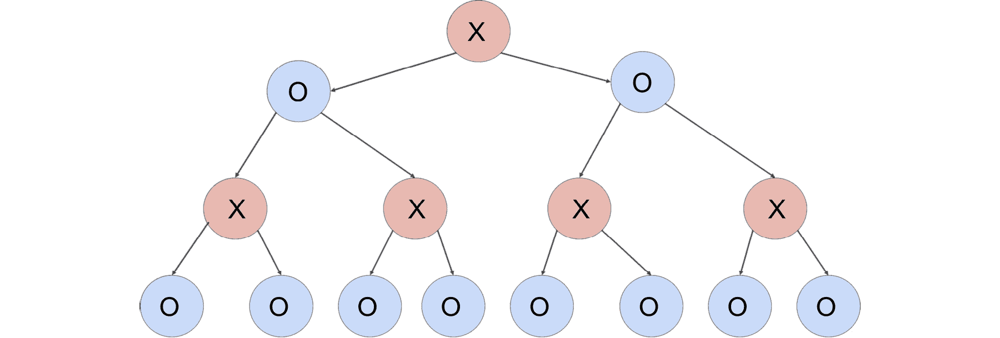

#### 图 2.8：特定深度内的搜索树示例

AI 使用 `X` 玩游戏，玩家使用 `O` 玩游戏。带有 `X` 的节点意味着该轮到 `X` 移动。带有 `O` 的节点意味着轮到 `O` 行动。

假设树的底部全是 `O` 叶子节点，由于资源限制，我们没有计算更多值。我们的任务是评估叶子节点的效用：

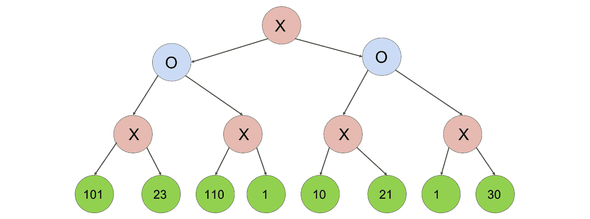

#### 图 2.9：包含可能移动的搜索树示例

我们必须从自己的角度选择最好的移动，因为我们的目标是最大化自己移动的效用。这种最大化收益的愿望代表了 `Minmax` 算法中的 `Max` 部分：

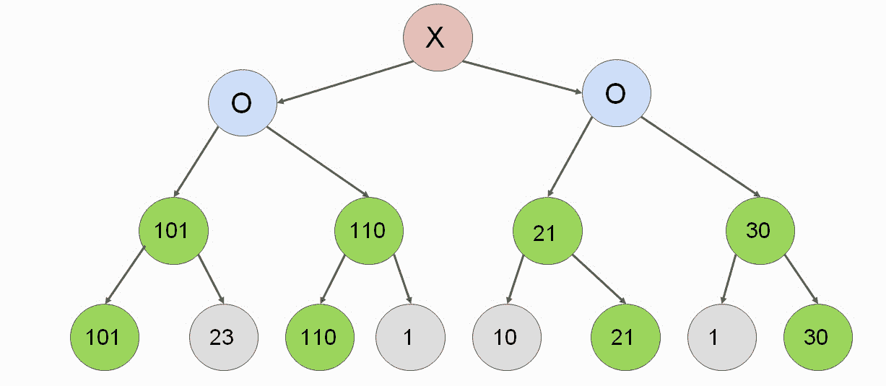

#### 图 2.10：具有最佳移动的搜索树示例

如果我们再向上移动一级，就轮到对手行动了。我们的对手会选择对我们最不利的数值。这是因为对手的任务是最小化我们赢得比赛的机会。这就是 `Minmax` 算法中的 `Min` 部分：

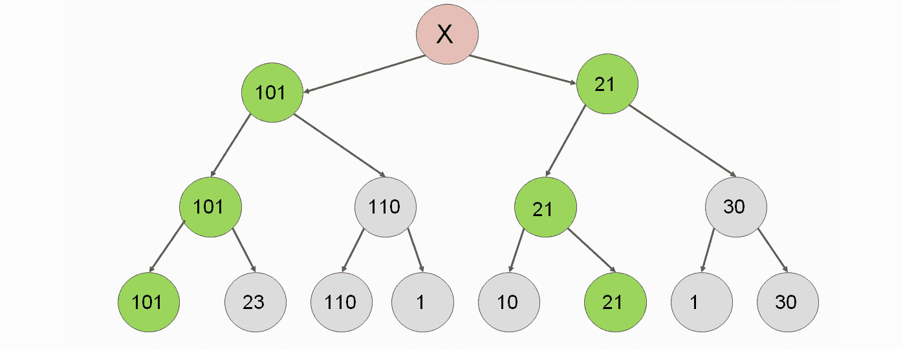

#### 图 2.11：最小化获胜概率

在顶部，我们可以在效用为 101 的移动和效用为 21 的另一个移动之间选择。由于我们正在最大化自己的值，我们应该选择 101。

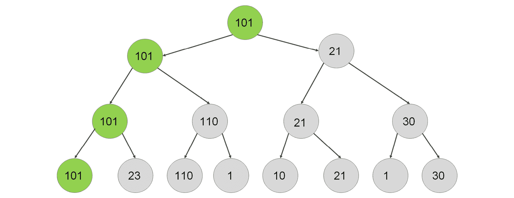

#### 图 2.12：最大化获胜概率

让我们看看如何实现这个想法：

```python
def min_max(state, depth, is_maximizing):
    if depth == 0 or is_end_state(state):
        return utility(state)
    if is_maximizing:
        utility = 0
        for s in successors(state):
            score = MinMax(s, depth - 1, false)
            utility = max(utility, score)
        return utility
    else:
        utility = infinity
        for s in successors(state):
            score = MinMax(s, depth - 1, true)
            utility = min(utility, score)
        return utility
```

这就是 `Minmax` 算法。我们从自己的角度评估叶子节点。然后，从下而上，我们应用递归定义：

- 我们的对手通过选择从我们角度来看最差的节点来采取最优策略。
- 我们通过选择从我们角度来看最好的节点来采取最优策略。

为了理解 Minmax 在井井棋游戏中的应用，我们还需要考虑以下几点：

- `is_end_state` 是一个函数，用于判断是应该评估状态还是继续深挖，要么是因为游戏已经结束，要么是因为游戏即将结束。使用我们的效用函数，可以说，只要我们达到 1 或更高的分数，我们就实际上赢得了游戏。因此，一旦我们达到该分数，我们就有效地赢了比赛。
- ...（注：原文后续部分存在大量逻辑混乱，已根据 Minmax 算法原理进行术语对齐）

```python
utility = min(utility, score)
return utility
```

我们需要对最小化分支进行对偶处理：

```python
def min_max(state, depth, is_maximizing, alpha, beta):
    if depth == 0 or is_end_state(state):
        return utility(state)
    if is_maximizing:
        utility = 0
        for s in successors(state):
            score = min_max(s, depth - 1, false, alpha, beta)
            utility = max(utility, score)
            alpha = max(alpha, score)
            if beta <= alpha:
                break
        return utility
    else:
        utility = infinity
        for s in successors(state):
            score = min_max(s, depth - 1, true, alpha, beta)
            utility = min(utility, score)
            beta = min(beta, score)
            if beta <= alpha:
                break
        return utility
```

实现已经完成。建议你在脑中对我们的示例树逐步执行该算法，以对实现有一个感觉。

还缺少一个重要的部分，它阻止了我们正确地执行：alpha 和 beta 的初始值。任何在 utility 值可能范围之外的数字都可以。我们将使用正负无穷大作为初始值来调用 Minmax 算法：

```python
alpha = infinity
beta = -infinity
```

#### DRY 简化 Minmax 算法 – NegaMax 算法

Minmax 算法效果非常好，特别是配合 alpha-beta 剪枝。唯一的问题是算法中有一个 if 和一个 else 分支，它们本质上是互反的。

正如我们所知，在计算机科学中，有 DRY 代码和 WET 代码。DRY 代表 Don't Repeat Yourself（不要重复）。WET 代表 We Enjoy Typing（我们喜欢打字）。当我们写两次相同的代码时，出错的概率就会增加一倍。我们也增加了未来每次维护工作执行执行的概率。因此，复用我们的代码更好。

在实现 Minmax 算法时，我们总是从 AI 玩家的角度来计算节点的 utility。这就是为什么我们在实现中必须有一个具有对偶性质的 utility 最大化分支和一个 utility 最小化分支。由于我们倾向于使用描述一次问题的整洁代码，可以通过更改评估的视角来消除这种对偶性。

每当轮到 AI 玩家时，算法中什么都没有变化。

每当轮到对手玩家时，我们就反转视角。最小化 AI 玩家的 utility 等同于最大化对手的 utility。

这简化了 Minmax 算法：

```python
def Negamax(state, depth, is_players_point_of_view):
    if depth == 0 or is_end_state(state):
        return utility(state, is_players_point_of_view)
    utility = 0
    for s in successors(state):
```


# 回归

## 学习目标

在本章结束时，你将能够：

* 描述回归涉及的数学逻辑
* 阐述如何使用 `NumPy` 库进行回归
* 识别单变量和多元线性回归
* 使用多项式回归

本章涵盖了线性回归和多项式回归的基础。

## 引言

回归是一个广泛的主题，连接了数学统计学、数据科学、机器学习和人工智能。由于回归的基础根于数学，我们将从探索数学基础开始。

该主题大部分将涉及不同形式的线性回归，包括单变量线性回归、多元线性回归、单变量多项式回归和多元多项式回归。Python 为执行回归操作提供了大量支持。

在对比支持向量回归（`Regression`）与线性回归（Linear Regression）的形式的同时，我们还会使用其他的回归模型。在整个章节中，我们将使用从在线服务商加载的股票价格数据。本章中的模型不旨在提供交易或投资建议。

### 注意事项
尽管不建议使用本章中的模型提供交易或投资建议，但这是一段非常令人兴奋且有趣的旅程，解释了回归的基础。

## 单变量线性回归

一个通用回归问题可以定义如下。假设我们有一组数据点。我们需要找到一条最佳拟合曲线，以近似拟合给定的数据点。这条曲线将描述我们的输入变量 `x`（即数据点）与输出变量 `y`（即曲线上的值）之间的关系。

在现实生活中，我们通常有多个输入变量决定一个输出变量。回归帮助我们理解，当我们固定一个输入变量以外的所有变量并改变剩余的输入变量时，输出变量是如何变化的。

### 什么是回归？

在本章中，我们将处理二维平面上的回归。这意味着我们的数据点是二维的，我们正在寻找一条曲线来近似如何从一个变量计算出另一个变量。

我们将学习以下类型的回归：

* **使用 1 次多项式的单变量线性回归**：这是回归最基础的形式，用一条直线来近似未来数据集的轨迹。
* **使用 1 次多项式的多元线性回归**：我们将使用 1 次方程，但现在允许有多个输入变量，也称为特征（features）。
* **单变量多项式回归**：这是单变量线性回归的一种通用形式。由于用于近似输入和输出之间关系的多项式可以是任意阶数，我们可以创建比直线更拟合数据点的曲线。回归仍然是线性的——并不是因为多项式是线性的，而是因为回归问题可以使用线性代数进行建模。
* **多元多项式回归**：这是使用高阶多项式和多个特征预测未来的最通用回归问题。
* **支持向量回归**：这种回归形式使用支持向量机来预测数据点。包含这种回归是为了将其与其他四种回归类型进行比较。

在本主题中，我们将处理第一类回归：我们将使用一个变量，回归将描述一条直线。

在二维平面上，我们将使用坐标系，通常被称为笛卡尔坐标系。我们有 `X` 轴和 `Y` 轴，这两者的交点是原点。我们通过 `X` 和 `Y` 坐标表示点。

例如，点 `(2,1)` 对应于以下坐标系：


###### 图 3.1：坐标系中点 (2,1) 的表示

直线可以用方程 `y = a*x + b` 表示，其中 `a` 是方程的斜率，决定了它上升的陡峭程度，而 `b` 是决定直线与 Y 轴交点的常数。在接下来的图中，你可以看到三个方程：

* 蓝线由 `y = 2*x + 1` 描述。
* 橙色线由 `y = x + 1` 描述。
* 紫线由 `y = 0.5*x + 1` 描述。

如果你知道 `x`，就可以算出 `y`。如果你知道 `y`，就可以算出 `x`：


###### 图 3.2：方程 y = 2*x+1, y = x+1 和 y = 0.5*x+1 的表示

我们也可以用方程描述更复杂的曲线：


###### 图 3.3：显示复杂的图像

### 注意事项
如果你想对笛卡尔坐标系进行更多实验，可以使用以下绘图工具：[`s3-us-west-2.amazonaws.com/oerfiles/College+Algebra/calculator.html`](https://s3-us-west-2.amazonaws.com/oerfiles/College+Algebra/calculator.html)。

### 特征与标签

在机器学习中，我们区分特征（features）和标签（labels）。特征被视为输入变量，而标签是输出变量。

当我们讨论回归时，标签的可能值是连续的有理数集。

将特征视为 X 轴值，将标签视为 Y 轴值。

回归的任务根据特征值预测标签值。我们通常通过移动特征值来创建标签。例如，如果我们想预测一个月后的股票价格，并通过将股票价格特征向前移动一个月来创建标签，那么：

* 对于每个至少一个月前的股票价格特征值，都有可用的训练数据显示一个月后的预测股票价格数据
* 对于最后一个月，没有预测数据，因此这些值都是 `NaN`（非数字）

我们必须丢弃最后一个月，因为我们无法使用这些值进行预测。

### 特征缩放

有时，我们会有多个取值处于完全不同范围的特征。想象将地图上的微米与现实世界中的公里进行比较。由于存在 9 个数量级的差异，它们很难被处理。

较不那么巨大的差异是英制数据和公制数据之间的区别。磅和千克、厘米和英寸，它们的对比并不良好。

因此，我们通常将特征缩放到更容易处理的归一化值，因为我们可以更容易地比较此范围内的数值。我们会对训练和测试数据进行统一缩放。范围通常被缩放到 `[-1, 1]` 之间。

我们将演示两种类型的缩放：

* 最大最小归一化 (Min-Max normalization)
* 均值归一化 (Mean normalization)

最大最小缩放的计算方法如下：

```
x_scaled[n] = (x[n] - min(x)) / (max(x) - min(x))
```

均值归一化的计算方法如下：

```
avg = sum(x) / len(x)
x_scaled[n] = (x[n] - avg) / (max(x) - min(x))
[(float(i) - avg) / (max(fibonacci) - min(fibonacci)) for i in fibonacci]
```

这里是最大最小缩放（Min-Max）的示例：

```
fibonacci = [0, 1, 1, 2, 3, 5, 8, 13, 21, 34, 55, 89, 144]
```

#### Min-Max scaling

```
[(float(i) - min(fibonacci)) / (max(fibonacci) - min(fibonacci)) for i in fibonacci]

[0.0,
 0.006944444444444444,
 0.006944444444444444,
 0.013888888888888888,
 0.020833333333333332,
 0.034722222222222224,
 0.05555555555555555,
 0.09027777777777778,
 0.14583333333333334,
 0.2361111111111111,
 0.3819444444444444,
 0.6180555555555556,
 1.0]
```

### Mean normalization

```
avg = sum(fibonacci) / len(fibonacci)
#### 28.923076923076923
[(float(i) - avg) / (max(fibonacci) - min(fibonacci)) for i in fibonacci]

[-0.20085470085470086,
 -0.19391025641025642,
 -0.19391025641025642,
 -0.18696581196581197,
 -0.18002136752136752,
 -0.16613247863247863,
 -0.1452991452991453,
 -0.11057692307692307,
 -0.05502136752136752,
 0.03525641025641026,
 0.1810897435897435,
 0.417200854700854,
 0.7991452991452]
```

缩放可能会增加处理时间，但通常这是一个合理的步骤。在 `scikit-learn` 库中，我们可以访问一个缩放 `NumPy` 数组的函数：

```python
import numpy as np
from sklearn import preprocessing

preprocessing.scale(fibonacci)

array([-0.6925069 , -0.66856384, -0.66856384, -0.64462079, -0.62067773,
       -0.57279161, -0.50096244, -0.38124715, -0.18970269,  0.12155706,
        0.62436127,  1.43842524,  2.75529341])
```

`scale` 方法执行均值归一化。注意结果是一个 `NumPy` 数组。

### 带有训练和测试数据的交叉验证

交叉验证衡量统计模型的预测性能。交叉验证结果越好，你就越信任你的模型可以预测未来。

在交叉验证期间，我们在真实的测试数据上测试模型预测未来的能力。测试数据不用于预测过程。

训练数据用于构建预测结果的模型。

一旦从数据源加载数据，我们通常将数据分为较大的训练数据块和较小的测试数据块。这种划分随机打乱训练和测试数据的条目。然后，它会给你训练特征及其对应的训练标签、测试特征及其对应的测试标签。

可以使用 `scikit-learn` 的 `model_selection` 库进行训练-测试划分。

假设在我们的示例中，我们对斐波那契数据进行了缩放，并将索引作为标签：

```
features = preprocessing.scale(fibonacci)
label = np.array(range(13))
```

让我们使用 10% 的数据作为测试数据。

```
from sklearn import model_selection

(x_train, x_test, y_train, y_test) = model_selection.train_test_split(features, label, test_size=0.1)
```

```
x_train
array([-0.66856384,  0.12155706, -0.18970269,  1.43842524,  2.75529341])
```

```
x_test
array([-0.6925069 , -0.66856384, -0.66856384, -0.64462079, -0.62067773,
       -0.57279161, -0.50096244, -0.38124715,  0.12155706,  0.62436127])
```

```
y_train
array([0, 1, 2, 3, 4])
```

```
y_test
array([5])
```

```
label
array([0, 1, 2, 3, 4, 5, 6, 7, 8, 9, 10, 11, 12])
```

向量与标量的乘积是一个向量，其中每个坐标都乘以了该标量：

`v1 * 2 # array([2, 4, 6])`

向量的二次方等于该向量与自身的向量乘积。双星号表示幂运算：

`v1 ** 2 # array([1, 4, 9], dtype=int32)`

假设我们在平面上有一组点。我们的工作任务是找到一条最佳拟合线。

让我们来看两个例子。

我们的第一个例子包含 13 个在性质上呈线性的值。我们正在绘制以下数据：

`[2, 8, 8, 18, 25, 21, 32, 44, 32, 48, 61, 45, 62]`

如果你想画一条最接近这些点的线，你的直觉判断会非常接近现实：

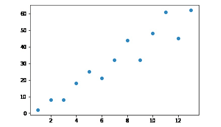

##### 图 3.4: 数值 `[2, 8, 8, 18, 25, 21, 32, 44, 32, 48, 61, 45, 62]` 的绘制图

我们的第二个例子是经过缩放后的斐波那契数列的前 13 个值。虽然我们可以定义一条最拟合这些点的线，但从点的分布中看出，我们的模型可能不会很有用：

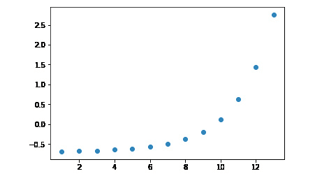

##### 图 3.5: 斐波那契数值的绘制图

我们已经学习过直线的方程是什么：`y = a * x + b`

在这个方程中，`a` 是斜率，`b` 是 `y` 截距。为了找到最佳拟合线，我们需要找到系数 `a` 和 `b`。

我们的任务是最小化到最佳拟合线的距离之和。

在书中，我们将不会保留计算系数 `a` 和 `b` 背后的推导过程，因为你会发现它没什么实际用途。我们更倾向于利用列表中值的算术平均值。我们可以使用 `NumPy` 提供的 `mean` 函数来实现。

让我们为这两个例子找到最佳拟合线：

```python
import numpy as np
from numpy import mean

x = np.array(range(1, 14))
y = np.array([2, 8, 8, 18, 25, 21, 32, 44, 32, 48, 61, 45, 62])

a = (mean(x) * mean(y) - mean(x * y)) / (mean(x) ** 2 - mean(x ** 2))
# 4.857142857142859

b = mean(y) - a * mean(x)
# -2.7692307692307843
```

一旦我们用前面的系数绘制线 `y = a*x + b`，我们就得到下面的图：

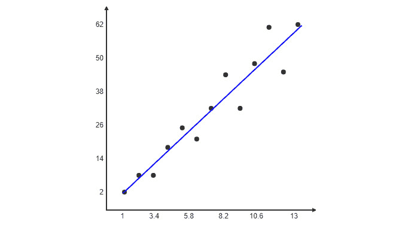

##### 图 3.6: 数组值 `[2, 8, 8, 18, 25, 21, 32, 44, 32, 48, 61, 45, 62]` 与线 `y=a*x+b` 的绘制图

##### 注意
你可以在 [`www.endmemo.com/statistics/lr.php`](http://www.endmemo.com/statistics/lr.php) 找到线性回归计算器。你也可以检查计算器来直观了解最佳拟合线是什么样的。

对于缩放后的斐波那契数值，最佳拟合线所示：

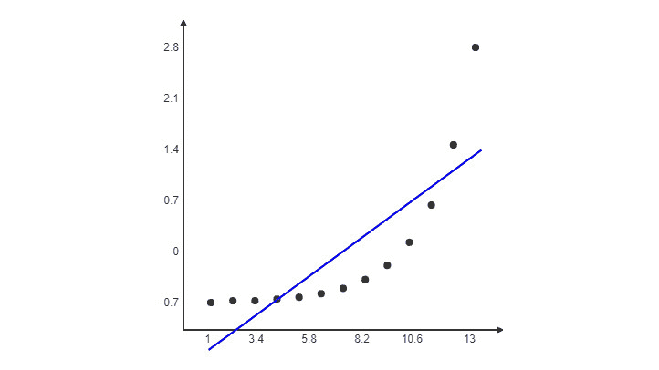

##### 图 3.7: 显示斐波那契数值与线 `y=a*x+b` 的图

第二个数据集的最佳拟合线明显偏离了任何区间。

##### 注意
我们不需要使用这种方法来进行线性回归。许多库（包括 `scikit-learn`）都会帮助我们自动化这个过程。当我们对多个变量进行线性回归时。

### 使用 NumPy Polyfit 拟合模型

`NumPy` 的 `polyfit` 也可以用于创建最佳拟合线。回顾系数的计算：

```python
import numpy as np
from numpy import mean

x = np.array(range(1, 14))
y = np.array([2, 8, 8, 18, 25, 21, 32, 44, 32, 48, 61, 45, 62])

a = (mean(x) * mean(y) - mean(x * y)) / (mean(x) ** 2 - mean(x ** 2))
# 4.857142857142859

b = mean(y) - a * mean(x)
# -2.7692307692307843
```

`polyfit` 函数接受三个参数：`x`、`y` 和多项式的次数。它返回系数：

```python
import numpy as np

x = np.array(range(1, 14))
y = np.array([2, 8, 8, 18, 25, 21, 32, 44, 32, 48, 61, 45, 62])

a, b = np.polyfit(x, y, 1)
```


在绘制曲线时，绘图器用线段连接各个点。此外，请记住，即使是复杂的曲线序列也是连接点的近似值。例如，如果你执行来自 `https://gist.github.com/traeblain/1487795` 的代码，你将识别出 `batman` 函数的线段是连接的直线：

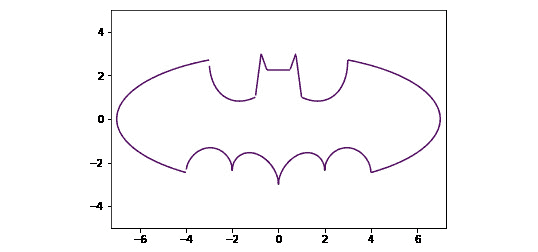

### 图 3.11: batman 函数的图

绘制曲线有多种方法。我们已经看到 `NumPy` 库的 `polyfit` 方法返回一个系数数组，用于描述线性方程：

```python
import numpy as np

x = np.array(range(1, 14))
y = np.array([2, 8, 8, 18, 25, 21, 32, 44, 32, 48, 61, 45, 62])
np.polyfit(x, y, 1)
# array([ 4.85714286, -2.76923077])
```

该数组描述了方程 `4.85714286 * x - 2.76923077`。

假设我们现在想要绘制曲线 `y = -x**2 + 3*x - 2`。这个二次方程由系数数组 `[-1, 3, -2]` 描述。我们可以编写自己的函数来计算对应 x 值的 y 值。但是 `NumPy` 库已经有一个功能可以为我们完成这项工作：`np.poly1d`：

```python
import numpy as np

x = np.array(range(-10, 10, 0.2))
f = np.poly1d([-1, 3, -2])
```

通过 `poly1d` 创建的函数 `f` 不仅作用于单个值，还可以作用于列表或 `NumPy` 数组：

```python
f(5)
# -12

f(x)
# array([-132, -110, -90, -72, -56, -42, -30, -20, -12, -6, -2, 0, 0, -2, -6, -12, -20, -30, -42, -56])
```

我们现在可以使用这些值来绘制一条非线性曲线：

```python
import matplotlib.pyplot as plot
plot.plot(x, f(x))
```

输出如下：

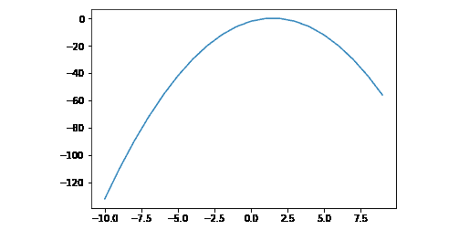

### 图 3.12: pyplot 函数的图

### 使用线性回归预测值

假设我们对坐标 `20` 对应的 `y` 值感兴趣。根据线性回归模型，我们做的只是将 `20` 的值替换到 `x` 的位置：

```python
# 绘制点
plot.scatter(x, y)
# 绘制属于 x = 20 的预测点
plot.scatter(20, a * 20 + b, color='red')
# 绘制直线
plot.plot([0, 25], [b, 25*a+b])
```

输出如下：

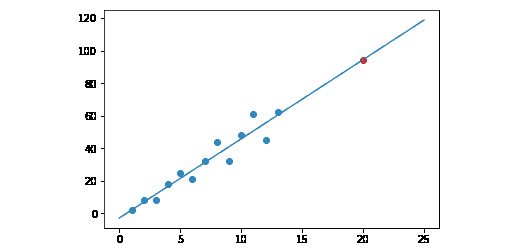

### 图 3.13: 使用线性回归显示预测值的图

在这里，我们用 `red` 标记了预测值。这个点在拟合线上。

### 活动 5：预测人口

你正在大都会（Metropolis）的办公室工作，试图预测对小学的需求。你的任务是算出 `2025` 和 `2030` 年入学小学的儿童人数。历史数据如下：

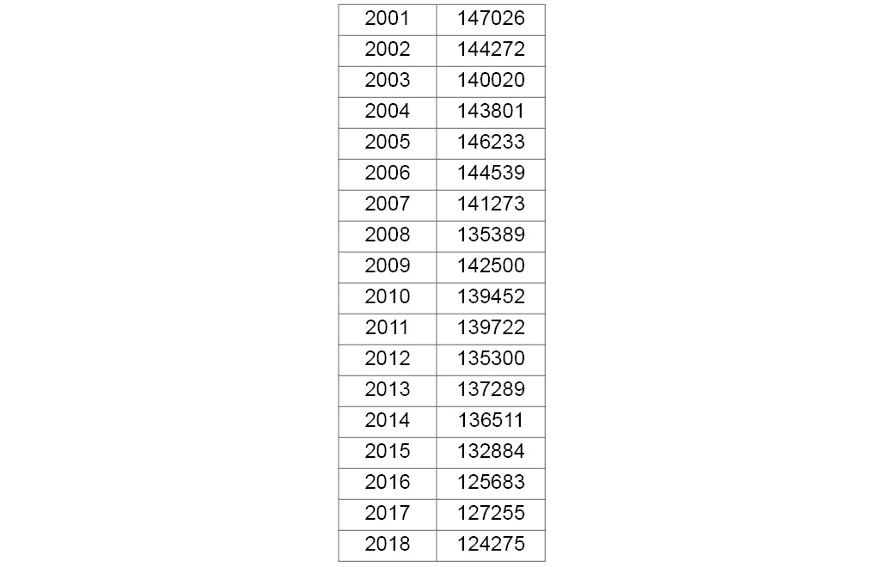

### 图 3.14: 代表 2001 年到 2018 年入学小学人数的图

要在二维图表中绘制这些趋势，你必须：

1. 使用线性回归处理 `2001` 年到 `2018` 年的数据。
2. 使用 `np.polyfit` 确定回归系数。
3. 使用 `matplotlib.pyplot` 绘制结果。

## 多个变量的线性回归

在上一个主题中，我们处理了单变量的线性回归。现在我们将学习线性回归的扩展版本，使用多个输入变量来预测输出。我们将依赖示例来预测股票价格。

### 多线性回归

如果你记得线性回归的拟合公式，它定义为 `y = a*x + b`，其中 `a` 是直线的斜率，`b` 是直线的截距，`x` 是特征值，`y` 是计算标签。在多元回归中，假设我们有三个特征 `x1`、`x2` 和 `x3`，我们的模型变为：

`y = a1*x1 + a2*x2 + a3*x3`

在 `NumPy` 数组格式中，我们可以这样写方程：

```python
y = np.dot(np.array([a1, a2, a3]), np.array([x1, x2, x3])) + b
```

为了方便，以向量乘法的形式定义整个方程是合理的。多线性回归是向量的点积，系数 `b`、`a1`、`a2` 决定了空间中的拟合方程。执行此操作的 `NumPy` 函数称为 `dot`：

```python
import numpy as np

v1 = [1, 2, 3]
v2 = [4, 5, 6]
np.dot(v1, v2) # 1*4 + 2*5 + 3*6 = 32
```

我们只需计算相应坐标的积。我们可以通过最小化数据点与方程之间的误差来确定这些系数。为了简单，我们将省略拟合方程的数学解，改用 `scikit-learn`。

> **注意**
>
> 在 n 维空间中，当 n 大于 3 时，维度决定了模型中不同的变量。在前面的示例中，我们有三个特征和一个标签，产生了四个维度。如果你想想象四维空间，可以简化为三维时间和时间。五维空间可以想象为四维空间，其中每个时间点都有温度。维度只是特征（以及标签）；它们并不对应我们三维空间的概念。

### 线性回归的过程

我们将遵循以下简单步骤解决线性回归问题：

1. 从数据源加载数据。
2. 为预测准备数据（归一化、格式化、过滤）。
3. 计算回归线的参数。无论使用单变量还是多变量线性回归，都遵循这些步骤。

### 从数据源导入数据

有多个库可以让我们访问数据源。由于我们将处理股票数据，让我们涵盖两个获取金融数据的示例：Quandl 和 Yahoo Finance：

*   `scikit-learn` 带有一些可以用于练习技能的数据集。
*   `Quandl.com` 提供免费和付费的金融数据集。
*   `pandas.io` 帮助加载任何 `.csv`、`.excel`、`.json` 或 `SQL` 数据。
*   Yahoo Finance 提供数据集。

### 使用 Yahoo Finance 加载价格

使用 Yahoo Finance 加载股票数据非常简单。你只需要在 CLI 中以下命令安装 `fix_yahoo_finance` 包：

```bash
pip install fix_yahoo_finance
```

我们将下载一个包含从 2015 年开始的标普 500 指数的开盘、最高、最低、收盘、调整收盘和成交量的数据集：

```python
import fix_yahoo_finance as yahoo
spx_data_frame = yahoo.download("^GSPC", "2015-01-01")
```

这就是你所需要的。包含标普 500 指数的 dataframe 已经就绪。你可以使用 `plot` 方法绘制指数价格：

```python
spx_data_frame.Close.plot()
```

##### 图 3.15: Yahoo Finance 显示股票价格的图

也可以使用以下命令将数据保存到 CSV 文件：

```python
spx.to_csv("spx.csv")
```

### 使用 pandas 加载文件

假设给了一个包含股票数据的 CSV 文件。我们现在使用 pandas 从该文件加载数据：

```python
import pandas as pd
spx_second_frame = pd.read_csv("spx.csv", index_col="Date", header=0, parse_dates=True)
```

为了正确解析数据，我们必须设置索引列名，指定没有表头，并确保日期被解析为日期格式。

### 使用 Quandl 加载股票价格

Quandl.com 是一个可靠的金融和经济数据集来源。

### 练习 8：使用 Quandl 加载股票价格

1. 打开 Anaconda prompt 并使用以下命令安装 Quandl：
```bash
pip install quandl
```

2. 访问 `www.quandl.com/`。

3. 点击 Financial data（金融数据）。
4. 在过滤器中，勾选 `Free` 标签旁边的复选框。如果你有 Quandl 订阅，可以使用它来下载股票数据。
5. 选择你想要使用的股票或指数。在示例中，我们将使用由耶鲁大学经济系收集的标普综合指数（S&P Composite index）数据。该数据的链接为：`www.quandl.com/data/YALE/SPCOMP-S-P-Composite`。
6. 找到你想要加载的对应的 Quandl ticker。我们标普 500 数据的 Quandl 代码为 `YALE/SPCOMP`。
7. 从 Jupyter QtConsole 中加载数据：
```python
import quandl
data_frame = quandl.get("YALE/SPCOMP")
```

8. 导入值的所有列都是特征：
```python
data_frame.head()
```

9. 输出如下：
```
S&P Composite Dividend Earnings CPI Long Interest Rate
Year
1871-01-31 4.44 0.26 0.4 12.464061 5.320000
1871-02-28 4.50 0.26 0.4 12.844641 5.323333
1871-03-31 4.61 0.26 0.4 13.034972 5.326667
1871-04-30 4.74 0.26 0.4 12.559226 5.330000
1871-05-31 4.86 0.26 0.4 12.273812 5.333333
Real Price Real Dividend Real Earnings
Year
1871-01-31 89.900119 5.264421 8.099110
1871-02-28 88.415295 5.108439 7.859137
1871-03-31 89.254001 5.033848 7.744382
1871-04-30 95.247222 5.224531 8.037740
1871-05-31 99.929493 5.346022 8.224650
Cyclically Adjusted PE Ratio
Year
1871-01-31 NaN
1871-02-28 NaN
1871-03-31 NaN
1871-04-30 NaN
1871-05-31 NaN
...
2016-02-29 24.002607
2016-03-31 25.372299
```

### 准备预测数据

在进行回归分析之前，我们必须选择感兴趣的特征，并且还需要确定进行回归的数据范围。

准备预测数据是回归过程的第二步。这一步也包含几个子步骤。我们将按照以下顺序完成这些子步骤：

1. 假设给了一个预加载数据的 dataframe。
2. 从数据集中选择你感兴趣的列。
3. 将 `NaN` 值替换为数值，以避免丢失数据。
4. 确定预测间隔 `T`，确定你希望查看未来的时间范围或数据行数。
5. 根据你想要预测的值创建一个标签列（label column）。对于数据框的第 `i` 行，标签值应该属于时间点 `i+T`。
6. 对于最后 `T` 行，标签值为 `NaN`。从数据框中删除这些行。
7. 从特征和标签创建 NumPy 数组。
8. 对特征数组进行缩放。
9. 分离训练数据和测试数据。

某些特征之间存在高度相关。例如，`Real Dividend`（实际股息）列会随 `Real Price`（实际价格）比例增长。它们之间的比例并不总是相似，但它们确实存在相关性。由于回归不是为了检测特征之间的相关性，我们更倾向于去掉一些不相关的属性。

如果你已经通过 Quandl 加载了股票价格，已经有一个包含了标普 500 指数历史数据的 dataframe。我们将保留 `Long Interest Rate`、`Real Price` 和 `Real Dividend` 列：`data_frame['Long Interest Rate', 'Real Price', 'Real Dividend']`。

由于无法处理 `NaN` 数据，你通常有两个选择：
- 删除数据
- 使用默认值填充数据，这是合理的：`data_frame.fillna(-100, inplace=True)`

我们可以使用 `len(data_frame)` 检查数据框长度：我们的数据长度为 1771。如果我们想预测未来 20 年的 `Real Price`，我们需要预测 240 个值。这大约是数据长度的 15%，是合理的。因此我们将通过将 `Real Price` 移动 240 位来创建 `Real Price Label`：
```python
data_frame['Real Price Label'] = data_frame['Real Price'].shift(-240)
```
这种方法，每个 `Real Price Label` 将是 20 年后的 `Real Price` 值。这种移动值的副作用是最后 240 个值会出现 `NaN`：`data_frame.tail()`。

输出如下：
```
S&P Composite Dividend Earnings CPI Long Interest Rate
Year
2018-03-31 2702.77 50.00 249.5540 2.840
2018-04-30 2653.63 50.33 250.5460 2.870
2018-05-31 2701.49 50.66 251.5880 2.976
2018-06-30 2754.35 50.99 252.1090 2.910
2018-07-31 2736.61 NaN 252.3695 2.830
Real Price Real Dividend Real Earnings
Year
2018-03-31 2733.262995 50.564106 NaN
2018-04-30 2672.943397 50.696307 NaN
2018-05-31 2709.881555 50.817364 NaN
2018-06-30 2757.196024 51.042687 NaN
2018-07-31 2736.610000 NaN NaN
Cyclically Adjusted PE Ratio Real Price Label
Year
2018-03-31 31.988336 NaN
2018-04-30 31.238428 NaN
2018-05-31 31.612305 NaN
2018-06-30 32.091415 NaN
2018-07-31 31.765318 NaN
```
我们可以通过对数据框执行 `dropna` 来删除它们：
```python
data_frame.dropna(inplace=True)
```
通过这种方式，我们拥有了直到 1998 年 7 月的数据，并且在 `Real Price Label` 列中拥有直到 2018 年的未来值：`data_frame.tail()`。

输出如下：
```
S&P Composite Dividend Earnings CPI Long Interest Rate
Year
1998-03-31 1076.83 15.6400 39.5400 162.2 5.65
1998-04-30 1112.20 15.7500 39.3500 162.5 5.64
1998-05-31 1108.42 15.8500 39.1600 162.8 5.65
1998-06-30 1108.39 15.9500 38.9700 163.0 5.50
1998-07-31 1156.58 16.0167 38.6767 163.2 5.46
Real Price Real Dividend Real Earnings
Year
1998-03-31 1675.456527 24.334519 61.5
1998-04-30 1672.943397 24.460520 60.7
1998-05-31 1709.881555 24.517364 60.3
1998-06-30 1757.196024 24.642687 60.1
1998-07-31 1736.610000 24.598336 59.9
```


[[1.15658000e+03, 1.60167000e+01, 3.86767000e+01, ..., 2.47679324e+01, 5.98089427e+01, 3.82596451e+01]])

`scaled_features`
array([[-0.47564285, -0.62408514, -0.57496262, ..., -1.23976862, -0.84099698, 0.6398416],
[-0.47577027, -0.62273749, -0.5754623, ..., -1.22764677, -0.85903686, 0.57633607],
[-0.47532429, -0.62138984, -0.57597417, ..., -1.20155224, -0.86744792, 0.60021881],
...,
 [6.54690076, 3.57654404, 4.13838295, ..., 2.19766676, 2.75960615, 4.23265262],
[6.54670962, 3.60349707, 4.11522706, ..., 2.22219859, 2.73177202, 4.20265751],
[6.85373845, 3.62147473, 4.07948167, ..., 2.23653834, 2.69194545, 4.48594968]])

你可以看到，缩放后的特征更容易读取和解释。在缩放数据时，我们必须对所有数据进行缩放，包括训练数据测试数据。

### 执行并验证线性回归

现在缩放已经完成，我们的下一个任务是将训练数据和测试数据分开。我们将使用 90% 的数据作为训练数据，剩下的 (10%) 将作为测试数据：

```python
from sklearn import model_selection

(features_train, features_test, label_train, label_test) = model_selection.train_test_split(
    scaled_features, label, test_size=0.1
)
```

`train_test_split` 函数会打乱我们的数据行并保持对应关系，并将所有数据的约 10% 放入测试变量中，保留 90% 用于训练变量。这将有助于我们评估模型的好坏。

我们现在可以根据训练数据创建线性回归模型了：

```python
from sklearn import linear_model

model = linear_model.LinearRegression()
model.fit(features_train, label_train)
```

一旦模型准备就，我们就可以使用它来预测属于测试特征值的标签：

```python
label_predicted = model.predict(features_test)
```

如果你对预测特征值与准确的测试特征值之间的关系感兴趣，可以使用 Python 二维图表绘制工具对它们进行绘图：

```python
from matplotlib import pyplot as plot

plot.scatter(label_test, label_predicted)
```

这就得到了一个预测值与测试数据对比的图像。越接近 `y = x` 线，效果越好。我们可以从图中看到，预测值围绕着 `y=x` 线。这种误差是显而易见的，否则我们就会在自己的领域追求预测价格：


#### 图 3.16: 散点图

我们可以得出模型存在误差。问题是，如何量化这种误差？答案很简单：我们可以使用内置工具计算模型的均方误差：

```python
model.score(features_test, label_test)
```
0.905169711901782

我们可以得出模型是非常准确的。这并不意外，因为每一个金融顾问都倾向于告诉我们市场每年增长 6-7%。这是一个线性增长，模型基本上预测市场将继续以线性增长。得出市场长期增长的结论并不是火箭科学。

### 预测未来

我们已经对测试数据使用了预测。现在，是时候使用实际数据来预测未来了。

```python
import quandl
import numpy as np
from sklearn import preprocessing
from sklearn import model_selection
from sklearn import linear_model

data_frame = quandl.get("YALE/SPCOMP")
data_frame[['Long Interest Rate', 'Real Price', 'Real Dividend', 'Cyclically Adjusted PE Ratio']]
data_frame.fillna(-100, inplace=True)
data_frame['Real Price Label'] = data_frame['Real Price'].shift(-240)
data_frame.dropna(inplace=True)
features = np.array(data_frame.drop('Real Price Label', 1))
label = np.array(data_frame['Real Price Label'])
scaled_features = preprocessing.scale(features)

(features_train, features_test, label_train, label_test) = model_selection.train_test_split(
    scaled_features, label, test_size=0.1
)

model = linear_model.LinearRegression()
model.fit(features_train, label_train)
label_predicted = model.predict(features_test)
```

既然我们已经获取了过去 20 年的缩放特征，现在现在可以使用以下代码预测未来的 20 年：

这对美国经济来说是一个可怕的未来。根据这个模型，标普 500 指数有了大约 2.5 到 3 年的牛市，并在很长时间内没有恢复。此外请注意，我们的模型不知道指数值不能为负。

### 多项式与支持向量回归

在执行多项式回归时，`x` 与 `y`（或者它们的名称：特征和标签）之间的关系不是线性方程，而是多项式方程。这意味着我们不再使用 `y = a*x+b` 方程，而是可以在方程中有多个系数和 `x` 的多个幂。

为了让情况变得更加复杂，我们可以使用多个变量进行多项式回归，其中每个特征可能都有乘以该特征不同幂的系数。

我们的任务是找到一条最拟合数据集的曲线。一旦将多项式回归扩展到多个变量，我们将学习支持机模型来执行多项式回归。

#### 单变量多项式回归

回顾一下，到目前为止我们执行了两种回归：

*   简单线性回归：`y = a*x + b`
*   多元线性回归：`y = b + a1 * x1 + a2 * x2 + … + an * xn`

我们现在将学习如何进行单变量的多项式线性回归。多项式线性回归的方程如下：

`y = b + a1*x + a2*(x ** 2) + a3*(x ** 3) + … + an * (x ** n)`

有一个系数向量 `(b, a1, a2, …, an)` 乘以多项式中 `x` 的次数向量 `(1, x**1, x**2, …, x**n)`。

有时，多项式回归的效果优于线性回归。如果标签和特征之间的关系可以用线性方程来描述，那么使用线性方程就是完全有意义的。如果我们有非线性增长，多项式回归倾向于更好地拟合特征与标签之间的关系。

单变量线性回归的最简单实现是 `NumPy` 库的 `polyfit` 方法。在下一次练习中，我们将执行次数为 2 和 3 的多元多项式线性回归。

##### 注意

尽管我们的多项式回归方程有一个包含 `x ** n` 系数的方程，但在文献中，该方程仍被称为多项式线性回归。回归之所以是线性的，并不是因为我们限制了方程中使用 `x` 的高幂，而是因为系数 `a1`、`a2` 等等在方程中是线性的。这意味着我们使用了线性代数的工具集，并处理矩阵和向量以找到最小化近似误差的缺失系数。

#### 练习 9：1 次、2 次和 3 次级多项式回归

在以下两个数据集上执行 1 次、2 次和 3 次级多项式回归：

声明两个数据集

```python
import numpy as np
from matplotlib import pyplot as plot

#### 第一个数据集：
x1 = np.array(range(1, 14))
y1 = np.array([2, 8, 8, 18, 25, 21, 32, 44, 32, 48, 61, 45, 62])

#### 第二个数据集：
x2 = np.array(range(1, 14))
y2 = np.array([0, 1, 1, 2, 3, 5, 8, 13, 21, 34, 55, 89, 144])
```

然后在图表上绘制你的结果：让我们从绘制第一个示例开始：

```python
import matplotlib.pyplot as plot

deg1 = np.polyfit(x1, y1, 1)
#### array [4.85714286 -2.76923077]
f1 = np.poly1d(deg1)

deg2 = np.polyfit(x1, y1, 2)
#### array [0.03196072 5.3046953 -3.88811897]
f2 = np.poly1d(deg2)

deg3 = np.polyfit(x1, y1, 3)
#### array [-0.01136364 0.2066833 3.91833167 -1.9790209]
f3 = np.poly1d(deg3)

plot.scatter(x1, y1, 'o')
plot.plot(x1, f1(x1))
plot.plot(x1, f2(x1))
plot.plot(x1, f3(x1))
plot.show()
```

然后从剩余数据构建标签

`label = np.array(data_frame['Real Price Label'])`

创建一个多项式回归模型并将其拟合到训练数据

`poly_regressor = PolynomialFeatures(degree=3)`
`poly_scaled_features = poly_regressor.fit_transform(scaled_features)`

将数据分为训练集和测试集

```python
(
    poly_features_train, poly_features_test,
    poly_label_train, poly_label_test
) = model_selection.train_test_split(
    poly_scaled_features,
    label, test_size=0.1
)
```

应用线性回归

`model = linear_model.LinearRegression()`
`model.fit(poly_features_train, poly_label_train)`

模型评分

`print('Score: ', model.score(poly_features_test, poly_label_test))`

预测

`poly_label_predicted = model.predict(poly_features_test)`
`plot.scatter(poly_label_test, poly_label_predicted)`

模型的评分太好了。很有可能是多项式模型对数据集造成了过拟合。

scikit-learn 中另一个可以执行多项式回归的模型是 SVM 模型，它的全称为支持向量机（Support Vector Machines）。

#### 支持向量回归

支持向量机是定义在向量空间上的二分类器。向量机用一个平面划分状态空间。`SVM` 分类器接收分类数据，并尝试预测未分类数据属于哪一类。一旦确定了数据点的分类，它就会被赋予标签。

支持向量机也可以用于回归。我们不是给数据标记标签，而是预测序列中的未来值。支持向量回归模型使用数据之间的空间作为误差范围。根据误差范围，它对未来值进行预测。

如果误差范围太小，我们面临过拟合现有数据集的风险。如果误差范围太大，我们面临欠拟合现有数据集的风险。

在分类器的情况下，核（kernel）描述了用于划分状态空间的曲面。在回归器的情况下，核也用于衡量误差范围。该核可以使用线性模型、多项式模型或其他许多其他可能的模型。默认核是 `RBF`，代表径向基函数（Radial Basis Function）。

支持向量回归是一个高级课题，超出了本书的范畴。因此，我们仅演示如何在我们的测试数据上尝试另一个回归模型是多么简单。

假设我们的特征和标签在两个独立的 NumPy 数组中。让我们回想一下是如何对它们执行线性回归的：

```python
from sklearn import model_selection
from sklearn import linear_model

(features_train, features_test, label_train,
label_test) = model_selection.train_test_split(scaled_features, label, test_size=0.1)

model = linear_model.LinearRegression()
model.fit(features_train, label_train)
```

我们可以通过将线性模型更改为支持向量模型通过支持向量机进行回归：

```python
from sklearn import model_selection
from sklearn import svm
from matplotlib import pyplot as plot

#### 模型构建其余保持不变
(features_train, features_test, label_train,
label_test) = model_selection.train_test_split(scaled_features, label, test_size=0.1)

model = svm.SVR()
model.fit(features_train, label_train)
label_predicted = model.predict(features_test)

print('Score: ', model.score(features_test, label_test))
plot.plot(label_test, label_predicted, 'o')
```

输出如下：

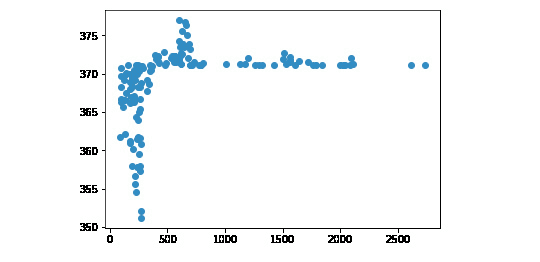

##### 图 3.21：显示线性模型支持向量回归的图表

输出如下：

`-0.19365084431020874`

模型评分相当低，点没有对齐在 `y=x` 线上。使用默认值进行预测的结果非常低。

模型的输出描述了支持向量机的参数：

`SVR(C=1.0, cache_size=200, coef0=0.0, degree=3, epsilon=0.1, gamma='auto', kernel='rbf', max_iter=-1, shrinking=True, tol=0.001, verbose=False)`

我们可以调整参数来提高准确性。

#### 使用多项式核的支持向量机

让我们核切换为 `poly` 并将阶设置为 3：

```python
model = svm.SVR(kernel='poly')
model.fit(features_train, label_train)
label_predicted = model.predict(features_test)
plot.scatter(label_test, label_predicted)
```


##### 图 3.22：显示多项式核支持向量回归的图表

`model.score(features_test, label_test)`

输出如下：

```
0.063886287220395
```

#### 活动 6：使用二次线性回归进行预测

在本节中，我们将使用 scikit-learn 线性、多项式和支持向量回归。假设你是一家金融机构的软件工程师，你的老板想知道线性回归还是支持向量回归预测价格更好。你将从一个来源加载标普 500 指数。然后从剩余数据中构建标签。

1. 使用 1 阶多项式对模型进行评估。绘制测试结果并与 `y=x` 线进行比较。点越靠近 `y=x` 线，模型的误差越小。
2. 执行二次多元线性回归。唯一的变化是线性模型。
3. 使用 3 阶核执行支持向量回归。该模型看起来并不高效。由于某些原因，该模型明显倾向于标普 500 的较低值，假设股票市场不会在一天内损失 80% 的价值。

### 总结

在本章中，我们学习了 `LinearRegression` 的基础。

在学习了一些基础数学后，我们深入了单变量和多变量 `LinearRegression` 的数学。回归中遇到的挑战包括从外部源（如 `.csv` 文件、Yahoo Finance 或 Quandl）加载数据。加载数据后，我们学习了如何识别特征和标签、如何扩展数据以及如何格式化数据以回归。

我们学习了如何训练和测试线性回归引擎，以及如何预测。我们的结果通过易用的 Python 绘图库 `pyplot` 进行可视化。

线性回归的一种复杂形式是任意阶线性多项式回归。我们学习了如何在多个变量上定义这些回归问题。我们在股票价格预测问题上比较了它们之间的性能。

##### 注意

该活动的解决方案请参见第 271 页。

在本章结束时，你将能够：

* 描述分类的基本概念
* 加载并对用于分类的数据进行预处理
* 实现 k-最近邻和支持向量机分类器

本章将重点关注分类的目标，并学习 k-最近邻和支持向量机。

### 引言

在本章中，我们将学习分类器，特别是 k-最近邻分类器和支持向量机。我们将使用这种分类对数据进行分类。就像我们在回归中做的那样，我们将基于训练数据构建分类器，并使用测试数据测试分类器的性能。

## 分类的基础

回归侧重于创建一个最拟合我们数据的模型以预测未来，而分类的在于创建一个模型，将我们的数据分离到不同的类别。

假设你有一些属于不同类别的数据，分类可以帮助你预测新数据点所属的类别。分类器是一个确定领域内任何数据点标签值的模型。假设你有一组点，`P = {p1, p2, p3, ..., pm}`，以及另一组点，`Q = {q1, q2, q3, ..., qn}`。你将这些点视为不同类别的成员。为了简单起见，我们可以想象 `P` 包含信用良好的人员，而 `Q` 包含在信用还款倾向方面具有风险的人员。

你可以划分状态空间，使得 `P` 中的所有点位于空间的一个簇中，然后与包含 `Q` 中所有点的状态空间簇不相交。一旦你在状态空间找到这些被称为“簇”（clusters）的边界空间，你就成功执行了“聚类”（clustering）。

假设我们有一个点 `x`，它不等于之前的任何一个点。点 `x` 属于簇 `P` 还是簇 `Q`？这个问题的答案是一个“分类练习”，因为我们正在对点 `x` 进行分类。

分类通常由接近程度决定。点 `x` 距离簇 `P` 中的点越近，它属于簇 `P` 的概率就越大。这就是最近邻分类背后的思想。在 k-最近邻分类中，我们找到点 `x` 的 k 个最近邻，并根据同类中最近邻的最大数量对其进行分类。除了 k-最近邻之外，我们还将使用支持向量机进行分类。在本章中，我们将详细介绍这种信用评分方法。

我们可以自己组装随机虚拟数据，也可以选择使用包含数百个数据点的在线数据集。为了让这种学习体验尽可能真实，我们将选择后者。让我们继续一个练习，让我们下载一些可以用于分类的数据。下载机器学习数据集的常用地方是 `https://archive.ics.uci.edu/ml/datasets.html`。你可以在那里找到五个关于信用审批的不同数据集。我们现在加载德国贷款审批的数据集，因为 1000 个数据点的规模非常适合作为示例，并且有相关的文档。

`german 数据集以 CSV 格式提供`

CSV 代表逗号分隔值（comma-separated values）。`CSV` 文件是一个简单的文本文件，其中文件的每行包含一个数据点。数据点的属性按固定顺序给出，并用逗号等分隔符分隔。该字符可能不会数据中，否则我们无法不知道分隔符是数据的一部分还是作为分隔符。尽管名称“逗号分隔值”暗示分隔符字符是逗号，但并不总是如此。例如，在我们的示例中，分隔符是空格。`CSV` 文件用于许多应用程序，包括 Excel。

### 练习 10：加载数据集

1. 访问 `https://archive.ics.uci.edu/ml/datasets/Statlog+%28German+Data`。数据文件位于 `https://archive.ics.uci.edu/ml/machine-learning-databases/statlog/german/`。
   从空格分隔的 `german.data` 文件加载数据。确保你为 `DataFrame` 添加了表头，这样你就可以通过名称而不是列号来引用特征和标签。
   将 `german.data` 文件保存到本地。在文件中插入表头数据。
   数据集的前几行如下：

```
11 6 34 43 1169 65 75 4 93 101 4 121 67 143 152 2 173 1 192 201 1

12 48 32 43 591 61 73 2 92 101 2 121 22 143 152 1 173 1 191 201 2

14 12 34 46 2096 61 74 2 93 101 3 121 49 143 152 1 172 2 191 201 1
```

   解释这些数据的说明在 `german.doc` 文件中，你可以在那里看到属性列表。这些属性是：现有账户状态 (`11–14`)、时长（数值型，月份数）、信用历史 (`30–34`)、贷款用途 (`40–41`)、贷款金额（数值型）、储蓄账户/债券 (`61–65`)、自...以来的就业 (`71–75`)、可支配收入百分比（数值型）、个人状态和性别 (`91–95`)、其他债务人 (`101–103`)、居住年限（数值型）（`121–124`）、年龄（数值型）、其他贷款计划 (`141–143`)、住房 (`151–153`)、银行贷款数量 (`171–174`)、工作 (`191–192`)、电话 (`201–202`)、信用评分。
   你可以在 `german.doc` 文件中查看解释这些解释的说明。

2. 我们将使用 `pandas` 库来加载数据。在加载数据之前，我建议为 `german.data` 文件添加表头。在文件第一行之前插入以下表头：

```
CheckingAccountStatus DurationMonths CreditHistory CreditPurpose CreditAmount SavingsAccount EmploymentSince DisposablePercent PersonalStatusSex OtherDebtors ResidenceMonths Age OtherInstallmentPlans Housing NumberOfCreditsInBank Job LiabilityNumberOf PhoneWorker CreditScore
```

   注意表头只有一行，这意味着直到第 21 个标签 `CreditScore` 之前没有换行符。

##### 注意

表头有助于 `pandas` 将第一行解释为列名。事实上，这是 `pandas` `read_csv` 方法的默认行为。`.csv` 文件的第一行将作为表头，其余行是实际数据。
让我们使用 `pandas.read_csv` 方法导入 CSV 数据：

```python
import pandas

data_frame = pandas.read_csv('german.data', sep=' ')
```

3. `read_csv` 的第一个参数是文件路径。如果你将其保存到 Windows PC 的 E 盘（例如），你也可以在那里写入绝对路径：`e:\german.data`。


###### 图 4.1：显示单元格中属性列表的表格

让我们看看数据的格式。`data_frame.head()` 调用打印 CSV 文件的前五行，由 pandas `DataFrame` 结构：

```python
data_frame.head()
```

输出将如下：

```
CheckingAccountStatus DurationMonths CreditHistory CreditPurpose

0 11 6 34 43

..

4 11 24 33 40

CreditAmount SavingsAccount EmploymentSince DisposablePercent

0 1169 65 75 4

..

4 4870 61 73 3
```

个人状态性别 其他 债务人 ... 属性 年龄 \

0 A93 A101 ... A121 67

..

4 A93 A101 ... A124 53

其他分期计划 住房 银行现有贷款数量 职业 \

0 A143 A152 2 A173

..

4 A143 A153 2 A173

责任 人数 电话 外国工人 信用评分

0 1 A192 A201 1

..

4 2 A191 A201 2

[5 行 x 21 列]

我们已成功将数据加载到 `DataFrame` 中。

### 数据预处理

在构建分类器之前，最好对数据进行格式化，以便我们将相关数据留在最适合分类的格式中，并移除所有我们感兴趣的数据。

#### 1. 替换或删除值

例如，如果数据集中存在 `N/A`（或 `NA`）值，我们可能将这些值替换为我们可以处理的数值更好。`NA` 代表不可用（Not Available）。我们可以选择忽略包含 `NA` 值的行，或者将它们替换为离群值。离群值是指像 -1,000,000 这样与数据集中普通值明显有不同的值。`DataFrame` 的 `replace` 方法可以执行这种类型的替换。用离群值替换 `NA` 值的写法如下：

```
data_frame.replace('NA', -1000000, inplace=True)
```

`replace` 方法将所有 `NA` 值更改为数值。这个数值应该远离 `DataFrame` 中的任何合理值。假设那里只有正值，那么分类器就会把负百万识别出来（作为异常值）。

用极值替换不可用数据的替代方案是删除包含不可用数据的行：

```
data_frame.dropna(0, inplace=True)
```

第一个参数指定我们删除的是行而不是列。第二个参数指定我们执行删除操作，而不克隆 `DataFrame`。删除 `NA` 值是不太理想的，因为你通常会丢失数据集中的很大一部分。

#### 2. 删除列

如果我们有一列不想包含在分类中，我们最好将其删除。否则，分类器可能会在完全没有相关性的地方检测到错误的模式。例如，你的电话号码本身极不可能与你的信用评分相关。它是一个 9 到 12 位的数字，可能会很容易给分类器引入大量噪声。因此，我们删除了电话列。

```
data_frame.drop(['Phone'], 1, inplace=True)
```

第二个参数表示我们删除的是列而不是行。第一个参数是我们想要删除的列的枚举。`inplace` 参数的作用是该调用修改原始的 `DataFrame`。

#### 3. 数据转换

通常，我们处理的数据格式并不总是对分类过程是最优的。我们可能出于多个原因想要将数据转换为不同的格式，例如：

* 突出我们感兴趣的数据方面（例如，Min-max 缩放或归一化）
* 移除我们不感兴趣的数据方面（例如，二值化）
* 标签编码（Label encoding）

`Minmax scaling` 可以通过 scikit 预处理工具包的 `MinMaxScaler` 方法完成：

```python
from sklearn import preprocessing

data = np.array([
    [19, 65],
    [4, 52],
    [2, 33]
])

preprocessing.MinMaxScaler(feature_range=(0,1)).fit_transform(data)
```

输出如下：

```
array([[1. , 1. ], [0.11764706, 0.59375 ], [0. , 0. ]])
```

`MinMaxScaler` 缩放数据中的每一列，使得列中的最小数字变为 0，最大数字变为 1，中间所有的值按比例缩放到 0 和 1 之间。

`Binarization` 根据条件将数据转换为 0 和 1：

```python
preprocessing.Binarizer(threshold=10).transform(data)
```

输出是：

```
array([[1, 1], [0, 1], [0, 1]])
```

`Label encoding` 为准备 scikit-learn 处理的特征非常重要。虽然你的某些特征是字符串标签，但 scikit-learn 期望这些数据是数字。这就是 scikit-learn 的预处理库派上用场的地方。

##### 注意

你可能已经注意到在信用评分示例中有两个数据文件。一个包含字符串形式的标签，另一个包含整数形式的标签。我故意让你加载带有字符串标签的数据，以便让你获得一些如何使用标签编码器正确预处理数据的经验。

标签编码并不是什么复杂的科学。它在字符串标签和数值之间创建了映射。

#### 练习 11：预处理

在此练习中，我们将使用 pandas。

1. 加载数据：

##### 注意

注意你需要网络连接来完成此练习。

2. 如果你打开文件，你会发现不需要担心添加头，因为它包含在 CSV 中了：
`ID,name,category,main_category,currency,deadline,goal,launched,pledged,state,country,usd pledged`

3. 使用 pandas 导入数据并创建 DataFrame：

```python
import pandas

data_frame = pandas.read_csv('ks-projects-2181.csv', sep=',')
```

4. 上一个命令打印数据集的前五个条目。我们可以看到每列的名称和格式。现在我们有了数据，是时候进行一些预处理了。

```python
data_frame.head()
```

5. 假设数据集中有一些 NA 或 N/A 值。你可以用以下 `replace` 操作来替换它们：

```python
data_frame.replace('NA', -1000000, inplace=True)
data_frame.replace('N/A', -1000000, inplace=True)
```

6. 在执行分类或回归时，保留 ID 列就是自找麻烦。在大多数情况下，ID 与结果不相关。因此，删除 ID 列是有意义的：

```python
data_frame.drop(['ID'], 1, inplace=True)
```

7. 假设我们只对项目是否有支持者感兴趣。这是二值化的完美案例：

```python
from sklearn import preprocessing

preprocessing.Binarizer(threshold=1).transform(data_frame['backers'])
```

8. 输出如下：

```
array([[0, 1, 1, ..., 0, 1, 1]], dtype=int64)
```

##### 注意

我们丢弃了生成的二进制数组。为了利用这些二进制数据，我们必须用它替换 backers 列。为了简单起见，我们省略了这一步。

9. 对标签进行编码，以便它们变成分类器可以解释的数值：

```python
labels = ['AUD', 'CAD', 'CHF', 'DKK', 'EUR', 'GBP', 'HKD', 'JPY', 'MXN', 'NOK', 'NZD', 'SEK', 'USD']

label_encoder = preprocessing.LabelEncoder()
label_encoder.fit(labels)

label_encoder.transform(data_frame['currency'])
```

10. 输出结果如下：

```
array([ 5, 13, 13, ..., 13, 13, 13], dtype=int64)
```

你必须了解文件中可能出现的所有标签。文档负责为你提供这些可用选项。在极少数情况下，如果你无法获取文档，你必须从文件中逆向工程出可能的值。

一旦返回了编码后的数组，与上一点相同的问题仍然存在：我们必须用这些新值替换 `DataFrame` 中的 `currency` 列，来利用这些值。

#### 目标列的极值最大值缩放（Minmax Scaling）

在引入 Minmax 缩放时，你看到它不是缩放矩阵中每个向量的值，而是对每个向量中每个坐标的值进行统一缩放。这就是矩阵结构描述数据集的方式。一个向量包含一个数据点的所有属性。当我们只缩放某一个属性时，必须转置我们想要缩放的列。

你在《人工智能原理》的第 1 章中学习了 `NumPy` 的转置操作：

```python
import numpy as np

values_to_scale = np.mat([data_frame['goal']]).transpose()
```


然后，我们必须应用 `MinMaxScaler` 来缩放转置后的值。为了在一个数组中获得结果，我们可以将转置后的结果转回原始形式：

```python
preprocessing.MinMaxScaler(feature_range=(0,1))
.fit_transform(values_to_scale)
.transpose()
```

输出如下：

```
array([[9.999900e-06, 2.999999e-04, 4.499999e-04, ..., 1.499999e-04, 1.499999e-04, 1.999990e-05]])
```

这些值看起来很奇怪，因为 Kickstarter 上有一些很高的目标，可能使用了七位数的数值。除了线性的 Minmax 缩放，还可以使用对数来对数量级进行缩放，计算目标价格有多少个数字。这是另一种可能降低分类练习复杂性的转换。

一如既往，你必须将结果放在 `DataFrame` 的相应列中，以利用这些转换后的值。

我们在此停止预处理。希望现在这些不同方法的用法已经很清楚了，你将来将能够熟练地使用这些预处理方法。

### 识别特征和标签

与回归类似，在分类中，我们也必须分离特征和标签。继续原始示例，我们的特征是除最后一列以外的所有列，最后一列包含信用评分的结果。我们唯一的标签是信用评分列。

我们将使用 `NumPy` 数组来存储特征和标签：

```python
import numpy as np

features = np.array(data_frame.drop(['CreditScore'], 1))
label = np.array(data_frame['CreditScore'])
```

现在我们已经准备好了特征和标签，可以使用这些数据进行交叉验证了。

### 使用 scikit-learn 进行交叉验证

关于回归的另一个相关点是，我们可以使用交叉验证来训练和测试模型。这个过程与回归问题的情况完全相同：

```python
from sklearn import model_selection

features_train, features_test, label_train, label_test = \
model_selection.train_test_split(
    features,
    label,
    test_size=0.1
)
```

`train_test_split` 方法会打乱并将我们的特征和标签拆分为训练数据集和测试数据集。我们可以指定测试数据集的大小为 `0` 到 `1` 之间的数字。`test_size` 为 `0.1` 意味着 `10%` 的数据将进入测试数据集。

### 活动 7：为分类准备信用数据

在本节中，我们将讨论如何为分类器准备数据。我们将使用来自 [`archive.ics.uci.edu/ml/machine-learning-databases/statlog/german/`](https://archive.ics.uci.edu/ml/machine-learning-databases/statlog/german/) 的 `german.data` 作为示例，并为训练和测试分类器准备数据。确保所有的标签都是数值型的，并且值已经为分类准备好。使用 80% 的数据点作为训练数据：

1. 从 [`archive.ics.uci.edu/ml/machine-learning-databases/statlog/german/`](https://archive.ics.uci.edu/ml/machine-learning-databases/statlog/german/) 下载 `german.data` 并使用 Sublime Text 或 Atom 等文本编辑器打开它。为其添加表头。
2. 使用 `pandas` 导入数据文件并将 NA 值替换为离群值值。
3. 执行标签编码。将数据框中的所有标签转换为整数。
4. 分离特征和标签。我们可以应用与理论章节中看到的相同的方法。
5. 联合对训练和测试数据进行缩放。使用 Scikit Preprocessing 库中的 `MinMaxScaler`。
6. 最后一步是交叉验证。打乱我们的数据，并将 80% 用于训练，20% 用于测试。

#### 注意事项

此活动的解决方案见第 276 页。

### k-最近邻分类器

我们将从上次过的地方继续。在引入 K-最近邻算法后，我们将使用 scikit-learn 进行分类。

#### 介绍 K-最近邻算法

分类算法的目标是对数据进行划分，以便我们确定属于哪一类。假设有一组分类点。我们的任务是确定一个数据点属于哪个类。

k-最近邻分类器接收具有给定特征值的类别。分类基于接近性。接近性被定义为欧几里得距离。如果 A 与 B 之间的欧几里得距离比 A 与 C 之间的距离短，则 A 更接近 B。

#### 距离函数

许多距离量都可以 k-最近邻算法。我们现在计算两个数据点的欧几里得距离和曼哈顿距离。欧几里得距离是我们在平面或三维空间中计算两点距离方法的推广。

点 `A = (a1, a2, …, an)` 和 `B=(b1, b2, …, bn)` 之间的距离是连接这两点的线段长度：


###### 图 4.2：点 A 和 B 之间的距离

技术上讲，当我们寻找最近邻居时，不需要计算平方根，因为平方根是一个单调函数。

由于我们将在本书中使用欧几里得距离，让我们来看看如何通过单次 scikit-learn 函数调用计算多个点之间的距离。我们需要从 `sklearn.metrics.pairwise` 导入 `euclidean_distances`。该函数接受两组点，并返回一个矩阵，其中包含第一组与第二组中每个点之间的两对距离：

```python
from sklearn.metrics.pairwise import euclidean_distances

points = [[2,3], [3,7], [1,6]]

euclidean_distances([[4,4]], points)
```

输出如下：

```python
array([[2.23606798, 3.16227766, 3.60555128]])
```

例如，(4,4) 和 (3,7) 之间的距离约为 3.162。

我们也可以计算同一组点之间的欧几里得距离：

```python
euclidean_distances(points)
```

```
array([[0. , 4.12310563, 3.16227766],
 [4.12310563, 0. , 2.23606798],
 [3.16227766, 2.23606798, 0.]])
```

#### 曼哈顿/汉明距离

汉明和曼哈顿距离代表相同的公式。

曼哈顿距离依赖于计算数据点坐标差的绝对值：


#### 图 4.3：曼哈顿与汉明距离

欧几里得距离是距离更准确的推广，而曼哈顿距离计算更容易。

### 练习 12：演示 K-最近邻分类算法

假设我们有一份员工数据列表。我们的特征是每周工作小时和年薪。我们的标签表示员工是否在我们公司工作了两年以上。如果工作时间小于两年，则用 0 表示；如果大于等于两年，则用 1 表示。

我们想创建一个 3-最近邻分类器，来判断员工是否会在我们公司工作至少两年。

然后，我们想使用这个分类器来预测一个要求每周工作 32 小时且年薪 52,000 美元的员工是否会留在公司工作两年。

数据集如下：

```python
employees = [
 [20, 50000, 0],
 [24, 45000, 0],
 [32, 48000, 0],
 [24, 55000, 0],
 [40, 50000, 0],
 [40, 62000, 1],
 [40, 48000, 1],
 [32, 55000, 1],
 [40, 72000, 1],
 [32, 60000, 1]
]
```

1. 缩放特征：

```python
import matplotlib.pyplot as plot
from sklearn import preprocessing
import numpy as np
from sklearn.preprocessing import MinMaxScaler

scaled_employees = preprocessing.MinMaxScaler(feature_range=(0,1))\
    .fit_transform(employees)
```

缩放结果如下：

```python
array([[0. , 0.18518519, 0. ],
 [0.2 , 0. , 0. ],
 [0.6 , 0.11111111, 0. ],
 [0.2 , 0.37037037, 0. ],
 [1. , 0.18518519, 0. ],
 [1. , 0.62962963, 1. ],
 [1. , 0.11111111, 1. ],
 [0.6 , 0.37037037, 1. ],
 [1. , 1. , 1. ],
 [0.6 , 0.55555556, 1.]])
```

此时对我们请求的员工进行缩放也是合理的：`[32, 52000]` 变为 `[(32-24)/(40 - 24), (52000-45000)/(72000 - 45000)] = [0.5, 0.25925925925925924]`。

2. 在二维平面上绘制这些点，其中前两个坐标代表平面上的一个点，第三个坐标决定点的点的颜色：

```python
import matplotlib.pyplot as plot

plot.scatter(x[0], x[1], color = 'g' if x[2] > 0.5 else 'r')

for x in scaled_employees:
    plot.scatter(0.5, 0.25925925925925924, color='b')
```

输出如下：

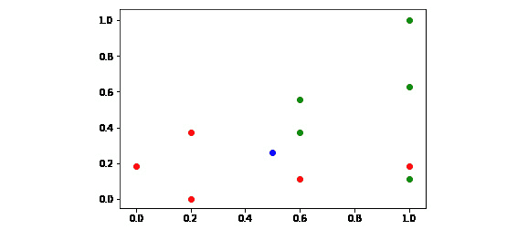

#### 图 4.4：绘制在二维平面上的点

3. 为了计算蓝色点和其他所有点的距离，我们将应用 `transpose` 函数。如果转置 `scaled_employees`，我们将得到十个数组。特征值在前两个数组中。我们可以简单地使用 `[:2]` 来保留它们。然后将其转置回原始形式，得到特征数组：

```python
scaled_employee_features = scaled_employees.transpose()[:2]
scaled_employee_features
```

输出为：

```python
array([[0. , 0.18518519],
 [0.2 , 0. ],
 [0.6 , 0.11111111],
 [0.2 , 0.37037037],
 [1. , 0.18518519],
 [1. , 0.62962963],
 [1. , 0.11111111],
 [0.6 , 0.37037037],
 [1. , 1. ],
 [0.6 , 0.55555556]])
```

4. 使用以下代码计算欧几里得距离：

```python
from sklearn.metrics.pairwise import euclidean_distances

euclidean_distances([[0.5,0.25925925925925924]], scaled_employee_features)
```

输出为：

```python
array([[0.50545719, 0.39650393, 0.17873968, 0.31991511, 0.50545719,
 0.62223325, 0.52148622, 0.14948471, 0.89369841, 0.31271632]])
```

最短距离如下：
- 点 `[0.6, 0.37037037, 1]` 的距离为 `0.14948471`。
- 点 `[0.6, 0.11111111, 0]` 的距离为 `0.17873968`。
- 点 `[0.6, 0.55555556, 1]` 的距离为 `0.31271632`。

由于三个点中有两个标签为 1，我们找到了两个绿点和一个红点。这意味着我们的 3-最近邻分类器认为该员工更有可能留在公司工作两年。

##### 注意
第四个点仅以非常微小的差距错过了前三名。事实上，如果有两个不同颜色的点到目标的距离相等，我们的算法将出现平局。不过，这是一个边缘情况，在现实问题中几乎不会发生。

### 练习 13：scikit-learn 中的 k-最近邻分类

1. 将我们的数据分为四类：`training` 和 `testing` 集、特征以及标签：

```python
from sklearn import model_selection
import pandas
import numpy as np
from sklearn import preprocessing

features_train, features_test, label_train, label_test = model_selection.train_test_split(
    scaled_features,
    label,
    test_size=0.2
)
```

2. 创建一个 `KNeighborsClassifier` 分类器来执行此分类：

```python
from sklearn import neighbors

classifier = neighbors.KNeighborsClassifier()
classifier.fit(features_train, label_train)
```

由于我们没有提到 `K` 的值，默认值为 `5`。

3. 检查我们的分类器在测试数据上的表现：

```python
classifier.score(features_test, label_test)
```

输出为 `0.665`。

你可能会在其他数据集上找到更高的评分，但可以理解，20 多个特征可能很容易包含随机噪声，导致数据难以分类。

### 练习 14：使用 k-最近邻分类器进行预测

此代码基于上一个练习的代码。

1. 我们将通过取第 `i` 个测试数据点的第 `i` 个元素来创建一个分类的数据点：

```python
data_point = [None] * 20
for i in range(20):
    data_point[i] = features_test[i][i]
data_point = np.array(data_point)
```

2. 我们有一个一维数组。分类器期望一个包含数据点数组的数组。因此，我们必须将数据点重塑为数据点数组：

```python
data_point = data_point.reshape(1, -1)
```

3. 通过此，我们创建了一个完全随机的人格，我们对他们是否被归类为信用良好：

```python
credit_rating = classifier.predict(data_point)
```

现在，我们可以安全地使用预测来确定数据点的信用评分：

```python
classifier.predict(data_point)
```

输出如下：

```python
array([1], dtype=int64)
```

我们已根据输入数据成功对新用户进行了评分。

#### scikit-learn 中 k-近邻分类器的参数化

你可以在此处访问 k-近邻分类器的文档：[`scikit-learn.org/stable/modules/generated/sklearn.neighbors.KNeighborsClassifier.html`](http://scikit-learn.org/stable/modules/generated/sklearn.neighbors.KNeighborsClassifier.html)。

分类器的参数化可能会微调你分类器的准确性。由于我们还没有学习过 k-近邻的所有可能变体，我们将专注于你已经根据此主题理解的参数上。

- `n_neighbors`: 这是 k-近邻算法的 k 值。默认值为 5。
- `metric`: 在创建分类器时，你会看到一个奇怪的名字——“Minkowski”（闵可夫斯）。不要担心这个名字——你已经学习过一阶和二阶度量。这种度量有一个幂。当 `p=1` 时，`Minkowski` 度量等于 `Manhattan`（曼哈顿）距离。当 `p=2` 时，`Minkowski` 度量等于 `Euclidean`（欧几里得）距离。
- `p`: 这是 `Minkowski` 量的幂。默认值为 2。

一旦创建分类器，你就必须指定这些参数：

```python
classifier = neighbors.KNeighborsClassifier(n_neighbors=50)
```


#### 活动 8：提高信用评分的准确性

在这一节中，我们将学习 k-近邻的参数化如何影响最终结果。目前信用评分的准确率相当低：66.5%。找到一种方法将其提高几个百分点。为了确保操作正确，你需要已经完成之前的练习。完成此任务有许多方法。在解决方案中，我将向你展示一种通过参数化提高信用分的方法：

1. 将 k-近邻的 k 值从 5 增加到 10、15、25 和 50。
2. 对所有的 `n_neighbors` 值运行此分类器并观察结果。
3. 较高的 K 值并不一定意味着更好的分数。但在本例中，`K=50` 产生的结果比 `K=5` 更好。

#### 注意事项
该活动的解决方案位于第 280 页。

### 使用支持向量机进行分类

我们首先在第 3 章中将支持向量机用于回归。在本主题中，你将发现如何使用支持向量机进行分类。如既往一样，我们将使用 scikit-learn 来运行实践示例。

#### 什么是支持向量分类器？

定义在 n 维向量空间上的支持向量机的目标是找到该空间中的一个表面，将数据点划分为多个类。

在二维中，这个表面通常是一条直线。在三维中，支持向量机通常找到一个平面。通常情况下，支持向量机找到一个超平面。这些表面的最优性体现在：根据机器可用的信息，它优化了 n 维空间的划分。支持向量机找到的最优划分器被称为`最佳分类超平面`。

支持向量机用于找到一个划分组数据点的表面。换句话说，支持向量机是`二分类器`。这并不意味着它们只能用于二分类。尽管我们只讨论了一个平面，但通过泛化任务本身，可以使用支持向量机将空间划分为任意数量的类。

划分表面的最优性体现在它最大化了每个数据点到划分平面的距离。

向量是定义在 n 维空间上的数学结构，具有幅（长度）和方向。在二维中，你从原点到点 `(x, y)` 画向量 `(x, y)`。根据几何学，你可以使用勾股定理计算向量的长度，并通过计算水平轴与向量之间的角来计算向量的方向。

例如，在二维中，向量 `(3, -4)` 具有以下幅：

```
sqrt(3 * 3 + 4 * 4) = sqrt(25) = 5
```

它具有以下方向：

```
np.arctan(-4/3) / 2 / np.pi * 360 = -53.1301235415597 degrees
```

#### 理解支持向量机

假设给出两组点，`Red（红色）`和`Blue（蓝色）`。为了简单起见，我们可以想象一个具有两个特征的平面：一个映射在水平轴上，另一个映射在垂直轴上。

支持向量机的目标是找到一条最佳直线，将点 `A`、`D`、`C`、`B` 和 `H` 与点 `E`、`F` 和 `G` 隔离开：

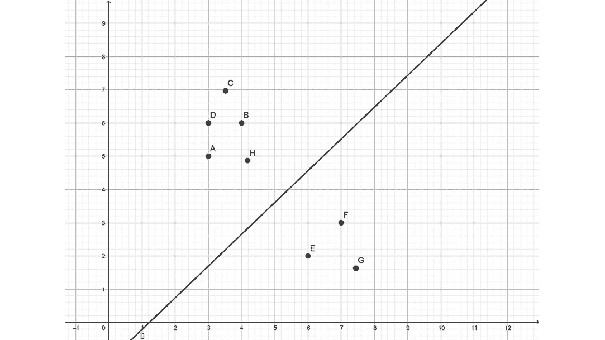
图 4.5：划分红色和蓝色成员的线

划分并不总是那么明显。例如，如果在 `E, F 和 G` 之间有一个蓝色点，那么没有任何直线可以无错误地分离所有点。如果蓝色类的点围绕红色类的点形成一个完整的圆圈，则没有直线可以将这两组点分开：

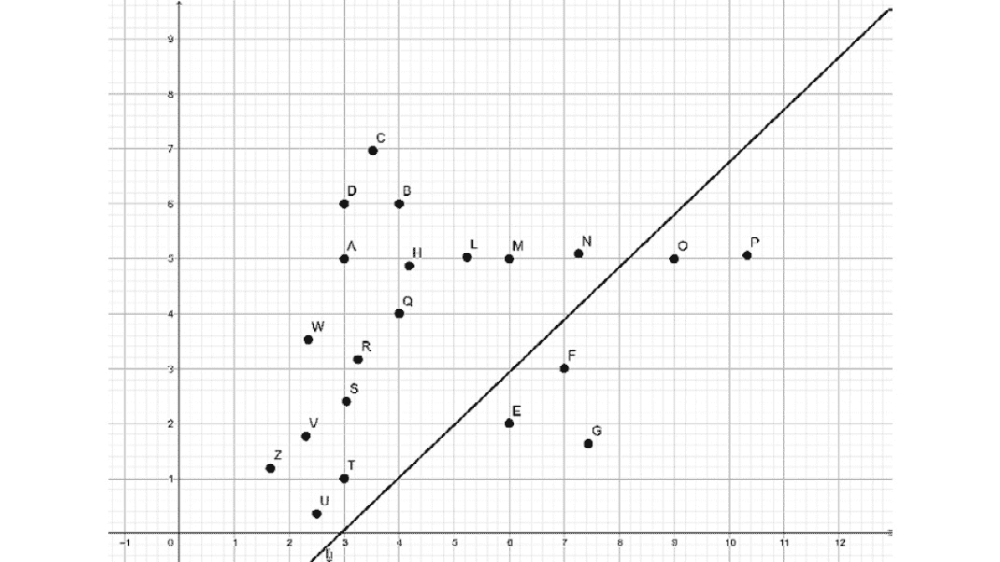
图 4.6：带有两个离群点的图

例如，在前面的图中，我们容忍两个离群点 `O` 和 `P`。在接下来的解决方案中，我们不容忍离群点，而是代替直线创建了一个由两条半直线组成的最佳划分路径：

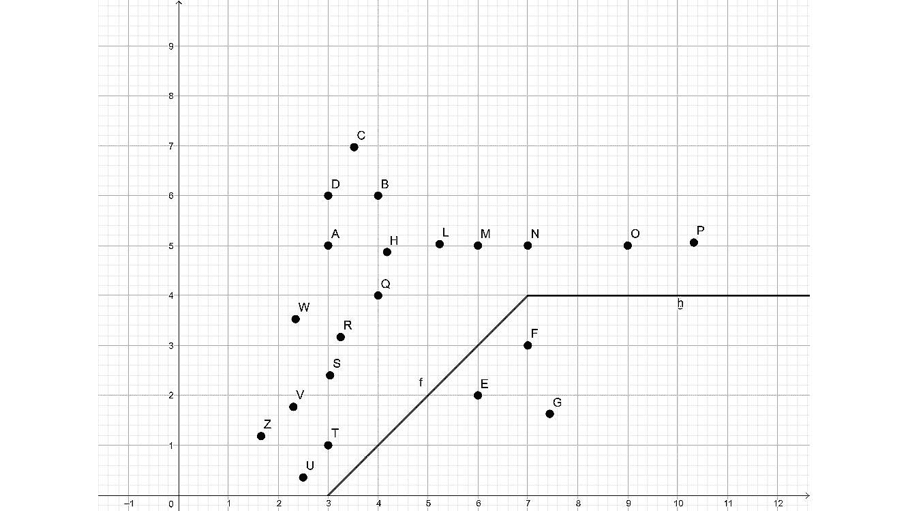
图 4.7：移除两个离群点的图

完美划分所有数据点很少值得投入资源。因此，可以对支持向量机进行正则化，以简化和限制最佳划分形状的定义，并允许离群点的存在。

支持向量机的`正则化参数`决定了允许或禁止分类错误的几率。

支持向量机有一个`kernel（核函数）`参数。`线性核`严格使用线性方程来描述最佳分类超平面。`多项式核`使用多项式，而`指数核`使用指数表达式。

间隔（margin）是围绕划分器中心的区域，并由距离划分器最近的点边界。平衡间隔意味着每个类的点到直线的距离相等。

`Kernel`: 字符串或可调用参数，用于指定算法中使用的内核。预定义的内核有 `linear`、`poly`、`rbf`、`sigmoid` 和 `precomputed`。默认值为 `rbf`。

`Degree`: 使用多项式时，你可以指定多项式的阶数。默认值为 `3`。

`Gamma`: 这是 `rbf`、`poly` 和 `sigmoid` 的内核系数。默认值为 `auto`，计算方式为 `1/number_of_features`。

`C`: 这是一个浮点数，默认值为 `1.0`，用于描述误差项的惩罚参数。

你可以在参考文档 [`scikit-learn.org/stable/modules/generated/sklearn.svm.SVC.html`](http://scikit-learn.org/stable/modules/generated/sklearn.svm.SVC.html) 中阅读关于剩余参数。

这是一个 SVM 示例：

```python
classifier = svm.SVC(kernel="poly", C=2, degree=4, gamma=0.05)
```

#### 活动 9：scikit-learn 中的支持向量机优化

在本节中，我们将讨论如何使用支持向量机分类器的不同参数。我们将使用、比较和对比你学过的不同支持向量回归分类器参数，并找到一组参数，使得我们在上一个活动中加载并准备的训练数据和测试数据上获得最高的分类结果。为了确保你能完成这项活动，你需要先完成本章的第一个活动。

我们将尝试几种组合。你可能需要选择不同的参数并检查结果：

1. 首先，选择线性内核并检查分类器的拟合情况（fit）和得分（score）。
2. 完成后，选择阶数为 `4`、`C=2` 且 `gamma=0.05` 的多项式内核，并检查分类器的拟合和得分。
3. 然后，选择阶数为 `4`、`C=2` 且 `gamma=0.25` 的多项式内核，并检查分类器的拟合和得分。
4. 之后，选择阶数为 `4`、`C=2` 且 `gamma=0.5` 的多项式内核，并检查分类器的拟合和得分。
5. 选择下一个分类器为 sigmoid 内核。
6. 最后，选择 gamma 为 `0.15` 的默认内核，并检查分类器的拟合和得分。

#### 注意事项
此活动的解答可以在第 280 页找到。

### 总结

在本章中，我们学习了分类的基础知识。在发现分类目标以及加载并格式化数据后，我们发现了两种分类算法：K 最近邻和支持向量机。我们使用了基于这两种方法的自定义分类器来预测值。在下一章中，我们将使用树进行预测分析。

## 使用树进行预测分析

### 学习目标

在本章结束结束时，你将能够：

* 理解用于评估数据模型用性的指标
* 根据决策树对数据点进行分类
* 根据随机森林算法对数据点进行分类

在本章中，我们将详细学习两种监督学习算法。第一个算法将帮助我们使用决策树对数据点进行分类，而另一个算法将帮助我们使用随机森林分类。

### 决策树简介

在决策树中，训练数据包含输入和相应的输出。决策树像任何树一样，具有叶子、分支和节点。叶子是终止节点，如 `yes` 或 `no`。节点是做出决策的地方。决策树由规则组成，我们利用这些规则对数据点的预测制定决策。

决策树的每个节点代表一个特征，从内部节点出的每条边代表树的一个可能值或可能的取值范围。树的每个叶子代表树的标签值。

正如我们在前几章中学到的那样，数据点具有特征和标签。决策树的任务是根据固定规则预测标签值。这些规则来自于对训练数据模式的观察。

让我们考虑一个确定标签值的示例。

假设给定以下训练数据集。制定有助于你确定标签值的规则：

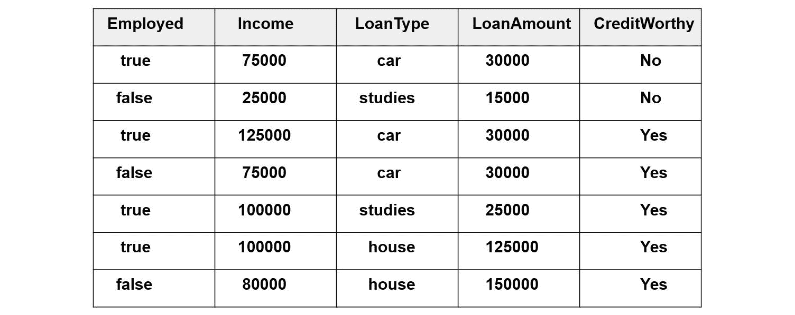

#### 图 5.1：用于制定规则的数据集

在这个示例中，我们根据四个特征来预测标签值。为了建立决策树，我们必须对可用数据进行观察。根据我们获得的数据，我们可以得出以下结论：

* 所有房屋贷款都被判定为信用良好。
* 只要债务人有工作，助学贷款就是信用良好的。如果债务人没有工作，他/她就不是信用良好的。
* 年收入在 75,000 以上的贷款是信用良好的。
* 年收入在或低于 75,000 时，只要债务人没有工作，汽车贷款就是信用良好的。

根据我们考虑这些规则的顺序，我们可以构建一棵树并描述一种可能的信用评分方法。例如，下面的树映射了上述的四个规则：

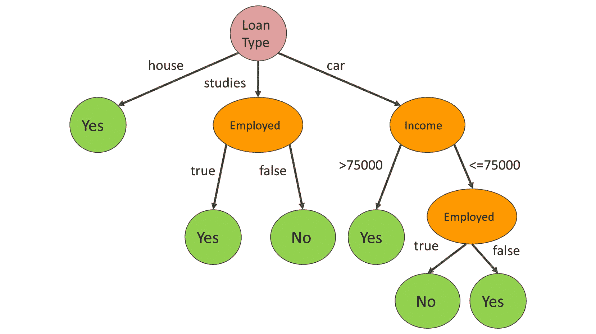

#### 图 5.2：贷款类型的决策树

我们首先确定贷款类型。根据第一个规则，房屋贷款自动为信用良好。助学贷款由第二条规则描述，产生一个包含另一个就业决策的子树。由于我们已经涵盖了房屋和助学贷款，只剩下汽车贷款了。第三条规则描述了收入决策，而第四条规则描述了就业决策。

每当我们需要对新的债务人进行评分以确定他/她是否信用良好时，我们需要从上到下通过决策树。显然，基于七个数据点的模型是不准确的，因为这种规则并不符合事实。这不是创建决策树的唯一方法。我们可以根据其他序列构建树。让我们从数据集中提取规则。

观察 1：严格大于 75,000 的薪水都是信用良好的。这意味着我们可以通过一个决策对七个数据点进行分类。

`Rule 1`：Income > 75000 => CreditWorthy is true

`Rule 1` 分类了七个数据点；我们需要为剩余数据点更多规则。

观察 2：在剩余的数据点中，有两个没有工作。一个有工作且不是信用良好。通过模糊的泛化，我们可以得出以下规则：

`Rule 2`：Assuming Income <= 75000, Employed == true => CreditWorthy is false

前两条规则分类了五个数据点。只剩下两个数据点。我们知道他们的收入小于等于 75,000，且他们都没有工作。尽管如此，他们之间仍存在差异：

* 信用良好的人收入 75,000，而不良好的人收入 25,000。
* 信用良好的人申请了汽车贷款，而不良好的人申请了助学贷款。
* 信用良好的人贷款了 30,000，而不良好的人贷款了 15,000。

这些差异中的任何一个都可以提取为规则。对于离散范围（如汽车、助学和房屋），规则是简单的成员身份检查。对于连续范围（如薪水和贷款金额），我们需要确定一个分叉范围。

假设我们选择了贷款金额作为第三条规则的依据。

```python
Rule 3:

Assuming Income <= 75000 and Employed == false,

If LoanAmount <= AMOUNT

Then CreditWorthy is false

Else CreditWorthy is true
```

第一行描述了通此决策的路径。第二行制定了条件，最后两行描述了结果。

注意规则中有一个常量 `AMOUNT`。`AMOUNT` 应该等于多少？

答案是，在 `15,000 <= AMOUNT < 30,000` 范围内，任何数字都可以。我们可以自由选择任何数字。在这个示例中，我们选择了范围的底端：

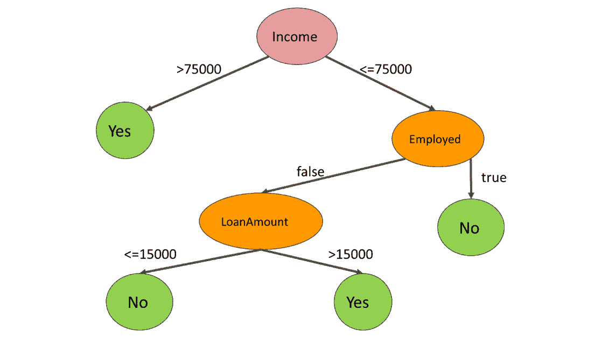

##### 图 5.3：收入的决策树

第二棵决策树没有那么复杂。同时，我们不能忽视模型所表达的：“高贷款金额比低贷款金额更有可能被偿还”。同样难以忽视这样一个事实：收入较低的雇佣人员从未还过贷款。遗憾的是，可用的训练数据不足，这可能导致我们得出错误的结论。

在决策树中，当根据少数数据点做出决策时，过拟合是一个常见问题。这种决策很少具有代表性。

由于我们可以按照任何可能的顺序构建决策树，因此定义一种算法构建决策树的理想方式是有意义的。因此，我们现在将探索一种在决策过程中优化特征排序的良好衡量标准。

#### 熵 (Entropy)

在信息论中，熵衡量了属性可能值分布的随机程度。随机程度越高，属性的熵就越大。

熵是一个事件发生的最大可能性。如果我们预先知道结果将会怎样，那么事件就没有随机性。因此，熵为 0。

当我们衡量待分类系统的熵时，我们衡量的是标签（label）的熵。

熵的定义如下：

* `[v1, v2, ..., vn]` 是属性的可能值
* `[p1, p2, ..., pn]` 是假设这些值等分布的情况下，该属性出现这些值的概率
* `p1 + p2 + ... + pn = 1` 

##### 图 5.4：熵的公式

在信息论中，熵的符号是 `H`。并不是因为熵与 `h` 的音有关系，而是因为 `H` 是希腊字母大写 `eta` (η) 的符号。`eta` 就是熵的符号。

##### 注意

我们使用熵来对决策树中的节点进行排序，因为熵越低，其值的分布随机性就越低。分布中的随机性越少，标签值就越可能被确定。

要在 Python 中计算分布的熵，我们需要使用 NumPy 库：

```python
import numpy as np

distribution = list(range(1,4))

minus_distribution = [-x for x in distribution]

log_distribution = [x for x in map(np.log2,distribution)]

entropy_value = np.dot(minus_distribution, log_distribution)
```

分布以 NumPy 数组或普通列表的形式给出。在第 2 行，你必须插入自己的分布来替换 `[p1, p2, …, pn]`。

在第 3 行中，我们需要创建一个分布取负值的向量。

在第 4 行中，我们必须对分布列表中的每个值取以 2 为底的数。

最后，我们通过标量积（scalar product）计算和，这也被称为两个向量的点积（dot product）。

让我们将之前的计算定义为一个函数：

```python
def entropy(distribution):

    minus_distribution = [-x for x in distribution]

    log_distribution = [x for x in map(np.log2, distribution)]

    return np.dot(minus_distribution, log_distribution)
```


##### 注意

你首先在 `第 3 章`，`回归` 中学习了点积。两个向量的点积的计算方法是，将第一个向量的第 `ith` 坐标乘以第二个向量的第 `ith` 坐标（对于每个 `i`）。一旦我们得到了所有的乘积，我们就对这些值求和：

```
np.dot([1, 2, 3], [4, 5, 6]) # 1*4 + 2*5 + 3*6
```

#### 练习 15：计算熵

计算数据集 5.1 中特征的熵。

1. 我们有四个特征：`Employed`（雇佣）、`Income`（收入）、`LoanType`（贷款类型）、`LoanAmount`（贷款金额）。为了简单起见，我们将 `Income` 和 `LoanAmount` 视为离散值。目前 `Employed` 的分布如下：
   * true 4/7 次
   * false 3/7 次
2. 使用熵函数计算 `Employed` 列的熵：
   ```
   H_employed = entropy([4/7, 3/7])
   ```
   输出为 0.9852。
3. `Income` 的分布如下：
   * 25,000 1/7 次
   * 75,000 2/7 次
   * 80,000 1/7 次
   * 100,000 1/7 次
   * 125,000 1/7 次
   计算 `Income` 列的熵：
   ```
   H_income = entropy([1/7, 2/7, 1/7, 1/7, 1/7])
   ```
   输出为 2.2359。
4. `LoanType` 的分布如下：
   * car 3/7 次
   * house 2/7 次
   * other 2/7 次
   计算 `LoanType` 列的熵：
   ```
   H_loanType = entropy([3/7, 2/7, 2/7])
   ```
   输出为 1.557。
5. `LoanAmount` 的分布如下：
   * 15,000 1/7 次
   * 25,000 1/7 次
   * 80,000 3/7 次
   * 100,000 1/7 次
   * 125,000 1/7 次
   * 150,000 1/7 次
   计算 `LoanAmount` 列的熵：
   ```
   H_loanAmount = entropy([1/7, 1/7, 3/7, 1/7, 1/7, 1/7])
   ```
   输出为 2.1281。
6. 如你所示，分布越接近均匀分布，熵就越大。
7. 在这个练习中，我们使用熵来构建树。

除了熵（entropy），还有另一种广泛使用的指标可以衡量分布的随机性：`Gini Impurity`（基尼纯度）。

基尼纯度的定义如下：


##### 图 5.5：基尼纯度

对于两个变量，基尼纯度为：


##### 图 5.6：两个变量的基尼纯度

由于使用了对数，熵的计算速度可能会慢一些。相反，基尼纯度在衡量随机性方面的精确度较低。

#### 注意事项

构建决策树时，使用熵还是基尼纯度的信息增益更好？

有些人更倾向于使用基尼纯度，因为你不需要计算对数。从计算角度来看，这两种解决方案都不特别复杂，因此都可以使用。在性能方面，以下研究得出结论：这两个指标之间的差异微乎其微：[`www.unine.ch/files/live/sites/imi/files/shared/documents/papers/Gini_index_fulltext.pdf`](https://www.unine.ch/files/live/sites/imi/files/shared/documents/papers/Gini_index_fulltext.pdf)。

我们已经了解到可以基于信息增益或基尼纯度来优化决策树。遗憾的是，这些指标仅适用于离散值。如果标签定义在连续区间上（例如价格范围或工资范围）怎么办？

我们必须使用其他指标。从技术上，你可以理解基于连续标签创建决策树的原理，这涉及到回归。我们可以从本章中复用的指标是均方误差（mean squared error）。我们必须通过最小化均方误差而不是基尼纯度或信息增益来优化决策树。由于这是一本入门书籍，我们将省略这一指标。

#### 退出条件

我们可以根据规则值不断分割数据点，直到决策树的每个叶子节点的熵为零。问题在于，这种终止状态是否理想。

通常，这种状态是不理想的，因为我们面临模型过拟合的风险。当我们模型的规则过于具体且挑剔时，并且做出决策的样本量太小，我们就有可能得出错误的结论，从而在数据集中识别出一种在现实生活中并不存在的模式。

例如，如果我们转了三次轮盘，得到了 `12`、`25`、`12`，得出“每个奇数次旋转的结果都是 `12`”并不是一个明智的策略。通过假设每个奇数次旋转都等于 `12`，我们找到了一个完全由随机噪声引起的规则。

因此，对可以继续分割的数据集的最小大小设置限制，是一个在实践中运行良好的退出条件。例如，如果你在数据集大小小于 `50`、`100`、`200` 或 `500` 时就停止分割，就可以避免对随机噪声得出结论，从而最大限度地降低模型过拟合的风险。

另一个流行的退出条件是对树深度的最大限制。一旦达到固定的树深度，我们就对叶节点中的数据点进行分类。

#### 使用 scikit-learn 构建决策树分类器

我们已经学习了如何从 `.csv` 文件加载数据，如何对数据进行预处理，以及如何将数据分为训练集和测试集。如果你需要复习这些知识，可以回到之前的章节，你在回归和分类的背景下学习过这个过程。

现在我们假设一组训练特征、训练标签、测试特征和测试标签是作为 scikit-learn `train-test-split` 调用的返回值提供的。

注意，在旧版本的 scikit-learn 中，你必须导入 `cross_validation` 而不是 `model_selection`：

```python
features_train, features_test, label_train, label_test = model_selection.train_test_split(
    features,
    label,
    test_size=0.1
)
```

我们不会关注如何获取这些数据点，因为这个过程与回归和分类的情况完全相同。

是时候导入并使用 scikit-learn 的决策树分类器了：

```python
from sklearn.tree import DecisionTreeClassifier

decision_tree = DecisionTreeClassifier(max_depth=6)
decision_tree.fit(features_train, label_train)
```

我们在 `DecisionTreeClassifier` 中设置了一个可选参数 `max_depth`，用于限制决策树的深度。你可以阅读官方文档以获取完整的参数列表：[`scikit-learn.org/stable/modules/generated/sklearn.tree.DecisionTreeClassifier.html`](http://scikit-learn.org/stable/modules/generated/sklearn.tree.DecisionTreeClassifier.html)。一些较重要的参数如下：

* `criterion`: Gini 代表基尼纯度（Gini Impurity），而 entropy 代表信息增益。
* `max_depth`: 这是树的最大深度。
* `min_samples_split`: 这是分割内部节点所需的最小样本数。

你也可以对文档列出的所有其他参数进行实验。我们将在本主题中省略它们。

模型构建完成后，我们就可以使用决策树分类器来预测数据：

```python
decision_tree.predict(features_test)
```

你将在本主题结束的活动中构建一个决策树分类器。

#### 评估分类器的性能

在分割训练数据和测试数据之后，决策树模型有一个 `score` 方法来评估测试数据的分类情况。我们已经在第 3 和第 4 章中学习了如何使用 `score` 方法：

```python
decision_tree.score(features_test, label_test)
```

`score` 方法的返回值是一个小于等于 1 的数字。越接近 1，我们的模型就越好。

现在我们将学习另一种评估模型的方法。尽管将此方法应用于你在上一个章节中构建的模型。

假设我们有一个测试特征和一个测试标签：

```python
testLabel 表示测试标签
predicted_label = decision_tree.predict(testFeature)
```

假设我们正在研究一个标签值 `positiveValue`。我们将使用以下定义来定义一些帮助你评估分类器好坏的指标：

* 真正例（True Positive）：`positiveValue == predicted_label == testLabel`
* 真负例（True Negative）：`positiveValue != predicted_label == testLabel`
* 假正例（False Positive）：`positiveValue == predicted_label != testLabel`
* 假负例（False Negative）：`positiveValue != predicted_label != testLabel`

假阳性是指预测等于正值，但测试数据中的实际标签不等于该正值。例如，在技术面试中，假阳性是指一个能力平平的软件开发者因为表现得很有说服力而被录用，隐藏了他完全缺乏能力。

不要将假阳性与假阴性混淆。以技术面试为例，假阴性是指一个能力足以胜任工作的软件开发者，但他没有被录用。

使用上述四个定义，我们可以定义三个描述模型预测现实情况优劣的指标。符号 `#( X)` 表示 `X` 中值的数量。用技术术语来说，`#( X)` 表示 `X` 的基数（cardinality）：

精确率（Precision）：`#( True Positives) / (#( True Positives) + #( False Positives))`

召回率（Recall）：`#( True Positives) / (#( True Positives) + #( False Negatives))`

精确集中在分类器认为为正的值上。这些结果中的一些是真正例，另一些是假正例。高精确率意味着与真正例相比，假正例的结果数量非常少。这意味着一个精确的分类器在寻找正结果时很少出错。

回想，召回率（recall）围绕测试数据中的正值展开。这些正值中的某些被分类器找到了，这些是真正例（true positives）。那些没有被分类器找到的正值是假负例（false negatives）。高召回率的分类器可以找到大多数正值。

#### 练习 16：精确率与召回率

计算以下两个分类器的精确率（precision）和召回率值：

##### 分类器 1

```python
TestLabels1 = [True, True, False, True, True]
PredictedLabels1 = [True, False, False, False, False]
```

##### 分类器 2

```python
TestLabels2 = [True, True, False, True, True]
PredictedLabels = [True, True, True, True, True]
```

1. 根据公式，让我们计算分类器 1 的真正、假正和负的数量：
   ```python
   TruePositives1 = 1 # 预测标签和测试标签均为 true
   FalsePositives1 = 0 # 预测标签为 true，测试标签为 false
   FalseNegatives1 = 3 # 预测标签为 false，测试标签为 true
   Precision1 = TruePositives1 / (TruePositives1 + FalsePositives1)
   Precision1 # 1/1 = 1
   Recall1 = TruePositives1 / (TruePositives1 + FalseNegatives1)
   Recall1 #1/4 = 0.25
   ```

2. 第一个分类器的精确率很高，但召回率很差。让我们为第二个分类器进行相同的计算。
   ```python
   TruePositives2 = 4
   FalsePositives2 = 1
   FalseNegatives2 = 0
   Precision2 = TruePositives2 / (TruePositives2 + FalsePositives2)
   Precision2 #4/5 = 0.8
   Recall2 = TruePositives2 / (TruePositives2 + FalseNegatives2)
   Recall2 # 4/4 = 1
   ```

3. 第二个分类器具有极高的召回率，但其精确率并不完美。

4. F1 分数是精确率和召回率的调和平均数。其取值范围在 0 到 1 之间。F1 分数的优势在于它同时考虑了假正和假负。

#### 练习 17：计算 F1 分数

计算上一个练习中两个分类器的 F1 分数：

1. 计算 F1 分数的公式如下：
   ```python
   2*Precision*Recall / (Precision + Recall)
   ```

2. 第一个分类器的 F1 分数如下：
   ```python
   2 * 1 * 0.25 / (1 + 0.25) # 0.4
   ```

3. 第二个分类器的 F1 分数如下：
   ```python
   2 * 0.8 * 1 / (0.8 + 1) # 0.888888888888889
   ```

现在我们已经知道了精确率、召回率和 F1 分数的含义，让我们使用 scikit-learn 的工具来计算并打印这些值：

```python
from sklearn.metrics import classification_report

print(
    classification_report(
        label_test,
        decision_tree.predict(features_test)
    )
)
```

输出将如下：

```
precision recall f1-score support
0 0.97 0.97 0
1 1.00 1.00 5
2 0.91 0.91 3
3 0.83 0.83 1
```

真阳性 (True Positives) 假阳性 (False Positives)
假阴性 (False Negatives) 真阴性 (True Negatives)

6. 混淆矩阵可以计算精确率、召回率、准确率以及 `f1_score` 指标。计算方法非常直接，且包含在指标的定义中。

7. 可以使用 scikit-learn 计算混淆矩阵：

```python
from sklearn.metrics import confusion_matrix

confusion_matrix(label_test, label_predicted)
```

```
array([[25, 0, 11, 0],
       [5, 0, 0, 0],
       [0, 0, 127, 0],
       [5, 0, 0, 0]])
```

8. 注意，这与我们在上一节使用的示例不同。因此，如果你使用混淆矩阵内部的值，将得到不同的精确率、召回率和 `f1_score` 值。

9. 你也可以使用 `pandas` 来创建混淆矩阵：

```python
import pandas

pandas.crosstab(label_test, label_predicted)
```

```
col_0 0 2
row_0
0 25 11
1 5 0
2 0 127
3 5 0
```

让我们通过计算模型的准确率分数来验证这些值：
- 我们有 127 + 25 = 152 个被分类正确的数据点。
- 数据点的总数为 152 + 11 + 5 + 5 = 173。
- 152/173 等于 0.8786127167630058。

让我们使用之前用过的 scikit-learn 工具函数来计算准确率分数：

```python
from sklearn.metrics import accuracy_score

accuracy_score(label_test, label_predicted)
```


输出如下：
`0.8786127167630058`

我们得到了相同的值。所有的指标都可以从混淆矩阵中推导出。

### 活动 10：汽车数据分类

在本节中，我们将讨论如何构建一个可靠的决策树模型，该模型能够帮助你的公司发现客户可能购买的汽车。我们假设你雇于一家租赁公司，该公司专注于与客户建立长期的关系。你的任务是构建一个决策树模型，将汽车分为四类之一：不可接受、可接受、良好和非常好。

此活动的数据集可以在此处访问：[`archive.ics.uci.edu/ml/datasets/Car+Evaluation`](https://archive.ics.uci.edu/ml/datasets/Car+Evaluation)。点击“Data Folder”链接下载数据集。然后，点击“Dataset Description”链接访问属性的描述。

让我们评估你的决策树模型的效用性：
1. 从此处下载汽车数据文件：[`archive.ics.uci.edu/ml/machine-learning-databases/car/car.data`](https://archive.ics.uci.edu/ml/machine-learning-databases/car/car.data)。在 CSV 文件开头添加一行表头，以便在 Python 中轻松引用它。我们简单地将标签命名为 `Class`。我们根据 [`archive.ics.uci.edu/ml/machine-learning-databases/car/car.names`](https://archive.ics.uci.edu/ml/machine-learning-databases/car/car.names) 中的描述对六个特征命名。
2. 将数据集加载到 Python 中并检查是否加载正确。
   现在是时候使用 scikit-learn 的交叉验证（在较新版本中为模型选择）功能分离训练数据和测试数据。我们将使用 10% 的测试数据。
   注意，从 scikit-learn 0.20 开始，`train_test_split` 方法将在 `model_selection` 模块可用，而不是 `cross_validation` 模块。在之前的版本中，`model_selection` 已经包含了 `train_test_split` 方法。
   构建决策树分类器。
3. 根据测试数据检查模型的分。
4. 根据 `classification_report` 功能对模型进行更深层的评估。

#### 注意
此活动的解答位于第 282 页。

## 随机森林分类器

如果你思考一下随机森林分类器的这个名字，可以得出以下结论：
- 森林由多棵树组成。
- 这些树可以用于分类。
- 既然我们目前为止用于分类的唯一树是决策树，那么随机森林是一个决策树森林就显得很有理。
- 树的随机性意味着我们的决策树是以随机方式构建的。
- 结果是我们将基于信息增益或吉尼纯度来构建我们的决策树。

一旦你理解了这些基本概念，你基本上就知道了随机森林分类器全是怎么回事了。森林中的树越多，预测就越准确。在执行预测时，每棵树都会执行分类。我们收集结果，得票最多的类别获胜。

随机森林可以用于回归，也可以用于分类。当使用随机森林进行回归时，我们不是计算某个类别的最高票数，而是取预测结果的算术平均值并返回它。尽管如此，随机森林在回归方面的表现没有在分类方面那么理想，因为用于预测值的模型通常是不可控的，并且经常返回很广泛的值。这些值的平均值通常没有意义。在回归练习中管理噪声比分类中更困难。

随机森林通常比一个简单的决策树更好，因为它们提供了冗余。它们能更好地处理离群值，并且模型过拟合的概率较低。只要你是在创建模型时使用的数据上使用它们，决策树的表现看起来很好。一旦你用它们来预测新数据，随机森林就会失去优势。随机森林被广泛用于分类问题，无论是银行或电子商务的客户细分、图像分类还是医学。如果你拥有一台带有 Kinect 的 Xbox，你的 Kinect 设备包含一个随机森林分类器来检测你的身体部位。

随机森林分类和回归都是集成算法。集成学习的理念是针对多个可能存在弱点的代理进行聚合观点观察。由于聚合投票，这些弱点会被抵消，多数票可能代表正确的结果。

### 构建随机森林

构建随机森林树的一种方法是限制所用特征的数量。假设你有一个特征集 `F`。特征集的长度为 `#(F)`。特征集中的特征数量为 `dim(F)`，其中 ` ` 代表维度。

假设我们将训练数据限制为大小为 `s` 的不同子集，每个随机森林接收一个大小为 `s` 的不同训练数据集。假设我们指定从可能的特征中选择 `k < dim(F)` 个特征来构建树。`k` 个特征的选择是随机的。

我们完整地构建每棵决策树。一旦我们获得一个新的数据点进行分类，我们就执行随机森林中的每棵树来执行预测。一旦预测结果出来，我们就计算票数，得票最多的类别将是随机森林预测的数据点的类别。

在随机森林术语中，我们用一个词来描述随机森林的性能优势：装袋（bagging）。装袋是一种结合自助采样和聚合决策的技术。自助采样负责创建一个包含原始数据集子集的数据集。原始数据集和自助数据集的大小保持相同，因为我们允许在自助数据集中多次选择相同的数据点。

袋外数据点是指那些没有出现在某些自助数据集中的数据点。要衡量随机森林分类器的袋外误差，我们必须将所有袋外数据点运行在未考虑这些袋外数据点而构建的随机森林分类器的树上。误差幅度是正确分类的袋外数据点与所有袋外数据点的比率。

### 使用 scikit-learn 进行随机森林分类

我们的起点是训练-测试分割的结果：

```python
from sklearn import model_selection

features_train, features_test, label_train, label_test = \
model_selection.train_test_split(
    features,
    label,
    test_size=0.1
)
```

随机森林分类器可以按如下方式实现：

```python
from sklearn.ensemble import RandomForestClassifier

random_forest_classifier = RandomForestClassifier(
    n_estimators=100,
    max_depth=6
)

random_forest_classifier.fit(features_train, label_train)
labels_predicted = random_forest_classifier.predict(features_test)
```

scikit-learn 的接口使得处理随机森林分类器变得容易。在过去的三个章节中，我们已经习惯了这种调用分类器或回归模型进行预测的方式。

### 随机森林分类器的参数化

与往常一样，请查阅文档以获取完整参数列表。你可以在这里找到文档：`http://scikit-learn.org/stable/modules/generated/sklearn.ensemble.RandomForestClassifier.html#sklearn.ensemble.RandomForestClassifier.`

我们将只考虑可能参数的一个子集，基于你已知的知识，这基于构建随机森林的描述：

*   `n_estimators`: 随机森林中的树数量。默认值是 10。
*   `criterion`: 使用基尼系数或熵来确定在每棵树中使用基尼不纯度还是使用熵的信息增益。
*   `max_features`: 森林中任何一棵树中考虑的特征的最大数量。可能的值包括整数。你也可以添加一些字符串，例如 `sqrt` 表示特征数量的平方根。
*   `max_depth`: 树的最大深度。
*   `min_samples_split`: 用于分割内部节点所需的最小样本数。
*   `bootstrap`: 一个布尔值，表示在构建树时是否使用自助样本。

### 特征重要性

随机森林会给出每个特征的重要性信息。我们可以通过以下方式获取重要性：

```python
random_forest_classifier.feature_importances_
```

输出为：

```
array([0.12794765, 0.10229619, 0.05486395, 0.34136752])
```

### 极端随机树

极端随机树通过引入随机性来降低方差。其参数化与随机森林类似。你可以在这里查看文档：`http://scikit-learn.org/stable/modules/generated/sklearn.ensemble.ExtraTreesClassifier.html`。实现如下：

```python
from sklearn.ensemble import ExtraTreesClassifier

extra_trees_classifier = ExtraTreesClassifier(
    n_estimators=100,
    max_depth=6
)
```

### 活动 11：用于汽车租赁的随机森林分类

在本节中，我们将使用汽车经销商数据集优化你的分类器。

1.  遵循之前活动的步骤 1 到 5。
2.  使用 IPython 识别哪些特征是重要的。
3.  创建随机森林和极端随机树并训练模型。
4.  估计两个模型在测试数据上的表现如何。
5.  计算准确率分数。
6.  从模型中移除第三个特征并重新训练。比较新模型与原始模型的表现。
7.  再稍微调整分类器的参数化。

请注意，增加最大特征数量最终可能导致一定程度的过拟合。

#### Note
该活动的解决方案可在第 285 页找到。

*   在计算机视觉中，图像分割是通过聚类完成的，其中我们在计算机处理的图像中寻找不同的对象。
*   聚类可以与分类结合，聚类可能会生成多个特征的紧凑表示，然后将这些特征输入到分类器中。
*   聚类还可以通过检测异常值来过滤数据点。

无论我们将聚类应用于遗传学、视频、图像还是社交网络，只要我们使用聚类来分析数据，就可能发现数据点之间存在值得统一处理的相似性。

我们在没有指定标签的情况下进行聚类。聚类根据数据点之间的距离来定义簇。在分类中，我们定义了精确的标签类别来对分类后的数据点进行分组；而在聚类中，没有标签。我们只需要给机器学习模型提供特征，然后模型必须自己找出这些特征集被分在哪些簇中。

### 定义聚类问题

假设你是一个商店经理，负责确保商店的盈利能力。你的产品被分为不同的类别。商店的不同客户偏好不同的商品。

例如，一个对生物产品感兴趣的客户倾向于选择具有生物属性的产品。如果你查看亚马逊，你还会发现针对不同产品组的建议。这是基于用户可能感兴趣的内容。

我们将以这种方式定义聚类问题，以便能够找到数据点之间的这些相似性。假设我们有一个由点组成的数据集。聚类帮助我们通过描述这些点的分布情况来理解这种结构。

让我们来看一个二维空间中的数据点示例：

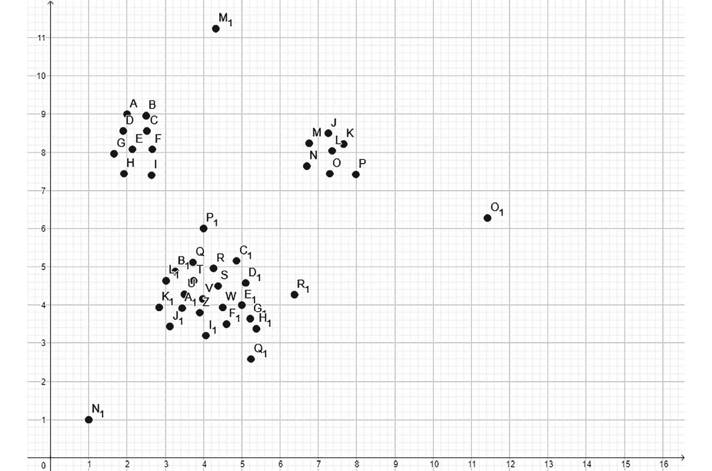

##### 图 6.1：二维空间中的数据点

在这个例子中，显而见有三个簇：

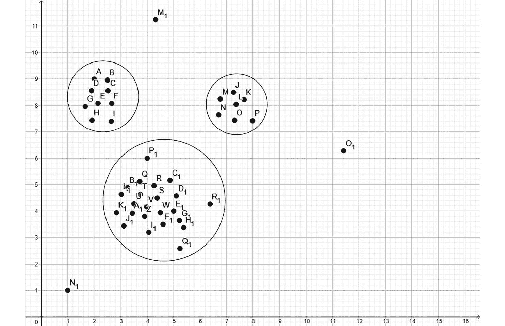

##### 图 6.2：使用二维空间中的数据点形成的三个簇

这三个簇很容易检测，因为这些点彼此靠近。聚类确定了彼此靠近的数据点。此外还有一些不属于任何簇的异常点。聚类算法应该准备好妥善处理这些异常点，而不是将它们移动到某个簇中。

虽然在二维空间中识别簇很容易，但我们通常拥有的是多维数据点。因此，知晓哪些数据点彼此靠近是非常重要的。此外，定义能够检测数据点是否彼此靠近的距离度量也很重要。一种著名的距离度量是欧几里得距离。在数学中，我们经常使用欧几里得距离来衡量两点之间的距离。因此，在涉及聚类算法时，欧几里得距离是一个直观的选择，以便我们能够在定位簇时确定数据点的邻近性。

大多数距离度量（包括欧几里得距离）都有一个缺点：随着维度的增加，这些距离彼此之间的比较会变得越来越均匀。因此，剔除作为噪声而非有用信息的特征可能会大大提高聚类模型的准确性。

### 聚类方法

聚类分为两类：`flat`（平聚类）和 `hierarchical`（层次聚类）。

在平聚类中，我们指定希望让机器找到的簇的数量。平聚类的一个例子是 `k-means` 算法，其中 `K` 指定了我们希望算法使用的簇数量。

在层次聚类中，机器学习算法会找出所需的簇数量。

层次聚类也有两种方法：

*   **自下而上的层次聚类**（Bottom-up hierarchical clustering）将每个点视为一个簇。这种方法将彼此靠近的簇合并。
*   **自上而下的层次聚类**（Top-down hierarchical clustering）将数据点视为一个跨越整个状态空间的簇。然后，聚类算法将我们的簇拆分成更小的。
*   **点分配聚类**（Point assignment clustering）根据新数据点与现有簇的距离，将新数据点分配到这些簇。

### scikit-learn 支持的聚类算法

在本章中，我们将学习 `scikit-learn` 支持的两种聚类算法：`k-means` 算法和 `mean shift` 算法。

`k-means` 是平聚类的示例，我们必须提前指定簇的数量。`k-means` 是一种通用聚类算法，如果簇的数量不是很高且簇的大小均匀，它的表现良好。

`Mean-shift` 是层次聚类的示例，由聚类算法决定簇的数量。当我们预不知道簇的数量时使用 `mean shift`。与 `k-means` 相比，`mean shift` 支持存在许多簇用场景。

`scikit-learn` 还提供了其他聚类算法，如下：

*   **Affinity Propagation**（亲度传播）：性能与 `Mean Shift` 类似。
*   **Spectral clustering**（谱聚类）：如果只存在少数几个大小均匀的簇，性能更好。
*   **Ward hierarchical clustering**（Ward 层次聚类）：在预期有很多簇时使用。
*   **Agglomerative clustering**（聚合聚类）：在预期有很多簇时使用。
*   **DBSCAN clustering**（DBSCAN 聚类）：支持不均匀的簇大小和非平面几何。
*   **Gaussian mixtures**（高斯混合）：使用平面几何，适用于密度估计。
*   **Birch clustering**（Birch 聚类）：支持大型数据集，移除异常值并支持数据压缩。

有关聚类算法的完整描述（包括性能比较），请访问 scikit-learn 的聚类页面：[`scikit-learn.org/stable/modules/clustering.html`](http://scikit-learn.org/stable/modules/clustering.html)。

## k-means 算法

`k-means` 是一种平聚类算法。工作原理如下：

*   设置值 `K`。
*   从数据集中选取 `K` 个点作为初始中心。
*   计算每个数据点到选取中心的距离，并将每个点分配到中心最近的簇中。
*   一旦所有点都在其中一个簇中，计算每个簇的中心点。
*   重复将每个数据点分配到最近中心簇的过程，直到中心点不再移动。

为了确保 `k-means` 算法终止，我们需要以下条件：

*   一个最大容差值，当质心移动小于该容差值时退出。
*   一个最大重复次数。

由于 `k-means` 算法的性质，它在处理差异巨大的簇时会很困难。

**市场细分**：公司从客户群中收集各种数据。对客户群进行 `k-means` 聚类分析可以揭示具有特征的市场细分。属于同一细分的客户可以被相似对待。不同的细分接受不同的对待。

**书籍、电影或其他文档分类**：当网红建立个人品牌、作者编写并创作书籍或公司管理社交媒体帐户时，内容是核心。内容通常通过标签和其他数据进行描述。这些数据可以作为聚类的依据，以定位相似的文档组。

**欺诈和犯罪活动检测**：欺诈者经常以异常客户或访客行为的形式留下线索。例如，汽车险保护驾驶员免受盗窃和事故造成的损害。真实盗窃和虚假盗窃具有不同的特征值。同样，故意破坏汽车留下的痕迹与事故撞车不同。聚类通常可以检测欺诈，帮助行业专业人士更好地了解其最糟糕客户的行为。

### 练习 19: scikit-learn 中的 k-means

要在二维平面上绘制数据点并在其上执行 k-means 算法进行聚类，请执行以下步骤：

1. 我们将创建一个作为 `NumPy Array` 的人工数据集来演示 k-means 算法：

```python
import numpy as np

data_points = np.array([
    [1, 1],
    [1, 1.5],
    [2, 2],
    [8, 1],
    [8, 0],
    [8.5, 1],
    [6, 1],
    [1, 10],
    [1.5, 10],
    [1.5, 9.5],
    [10, 10],
    [1.5, 8.5]
])
```

我们可以使用 `matplotlib.pyplot` 在二维平面上绘制这些数据点：

```python
import matplotlib.pyplot as plot

plot.scatter(data_points.transpose()[0], data_points.transpose()[1])
```


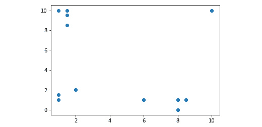

#### 图 6.3: 使用 `matplotlib.pyplot` 在二维平面上显示数据点的图表

##### 注意

我们使用了 `transpose array` 方法来获取第一个特征和第二个特征的值。这与之前的章节一致。我们也可以使用适当的数组索引来访问这些列：`dataPoints[:,0]` 等同于 `dataPoints.transpose()[0]`。

2. 现在我们已经有了数据点，是时候对它们执行 k-means 算法了。如果我们在 k-means 算法中将 `K` 定义为 `3`，我们预期图表的左下角、左上和右下角有一个簇：

```python
from sklearn.cluster import KMeans

k_means_model = KMeans(n_clusters=3)

k_means_model.fit(data_points)
```

3. 一旦完成聚类，我们可以访问每个簇的中心点：

```python
k_means_model.cluster_centers_
```

输出如下：

```python
array([[1.33333333, 1.5 ],
       [3.1 , 9.6 ],
       [7.625 , 0.75]])
```

事实上，簇的中心点似乎位于图表的左下、左上和右下角。左上簇的 X 坐标为 3.1，这可能是因为它包含了我们的离群数据点 `[10, 10]`。

4. 让我们用不同的颜色绘制簇以及它们的中心点。为了知道哪个数据点属于哪个簇，我们需要查询 k-means 分类器的 `labels_` 属性：

```python
k_means_model.labels_
```

输出如下：

```python
array([0, 0, 0, 2, 2, 2, 2, 1, 1, 1, 1, 1])
```

5. 输出数组显示了哪个数据点属于哪个簇。这就是绘制数据所需的所有：

```python
plot.scatter(
    k_means_model.cluster_centers_[:,0],
    k_means_model.cluster_centers_[:,1]
)

for i in range(len(data_points)):
    plot.plot(
        data_points[i][0],
        data_points[i][1],
        ['ro','go','yo'][k_means_model.labels_[i]]
    )

plot.show()
```

输出如下：

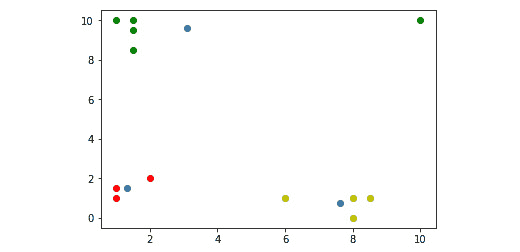

#### 图 6.4: 在选择三个簇时用红色、绿色和蓝色显示数据点的图

蓝色中心点确实在它们的簇内部，这些簇由红点、绿点和黄点表示。

6. 让我们看看如果我们只选择两个簇而不是三个会发生什么：

```python
k_means_model = KMeans(n_clusters=2)

k_means_model.fit(data_points)

plot.scatter(
    k_means_model.cluster_centers_[:,0],
    k_means_model.cluster_centers_[:,1]
)

for i in range(len(data_points)):
    plot.plot(
        data_points[i][0],
        data_points[i][1],
        ['ro','go'][k_means_model.labels_[i]]
    )

plot.show()
```

输出如下：

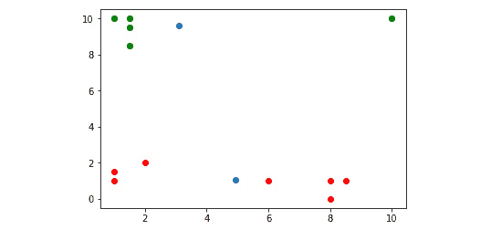

#### 图 6.5: 在选择两个簇时用红色和绿色显示数据点的图表

蓝色中心点确实在它们的簇内部。现在，我们有两个簇，并且在左下角有一个。

### 练习 20: 获取中心点和标签

为了理解 `cluster_centers_` 和 `labels_` 的用法，请执行以下步骤：

1. 回想我们在 scikit-learn 中执行 k-means 算法的示例。我们有 12 个点和三个簇：

```python
data_points = np.array([
    [1, 1],
    [1, 1.5],
    [2, 2],
    [8, 1],
    [8, 0],
    [8.5, 1],
    [6, 1],
    [1, 10],
    [1.5, 10],
    [1.5, 9.5],
    [10, 10],
    [1.5, 8.5]
])
```

```python
k_means_model.cluster_centers_
```

输出如下：

```python
array([[1.33333333, 1.5 ],
       [3.1 , 9.6 ],
       [7.625 , 0.75]])
```

事实上，簇的中心点似乎位于图表的左下、左上和右下角。左上簇的 X 坐标为 3.1，这可能是因为它包含了我们的离群数据点 `[10, 10]`。

2. 在簇上应用 `labels_` 属性：

```python
k_means_model.labels_
```

输出如下：

```python
array([0, 0, 0, 2, 2, 2, 2, 1, 1, 1, 1, 1])
```

`cluster_centers_` 属性的输出显而易见：它显示了中心点的坐标。`labels_` 属性是一个长度为 12 的数组，显示了 12 个点每个所属的簇。第一个簇与数字 0 关联，第二个与 1 关联，第三个与 2 关联，依此类推。

### 销售数据的 k-means 聚类

在接下来的活动中，我们将考虑销售数据并对销售数据执行 k-means 聚类。

#### 活动 12: 销售数据的 k-means 聚类

在本节中，我们将检测表现相似的产品销售情况，以识别产品销售趋势。

我们将使用位于以下 URL 的每周销售交易数据集：

[`archive.ics.uci.edu/ml/datasets/Sales_Transactions_Dataset_Weekly`](https://archive.ics.uci.edu/ml/datasets/Sales_Transactions_Dataset_Weekly)

使用 k-means 算法对数据集进行聚类。确保你根据之前章节中所学的内容为聚类准备数据。

使用 k-means 算法的默认设置：

#### 1. 使用 pandas 加载数据集

如果检查 CSV 文件中的数据，你会发现第一列包含产品 ID 字符串。这些值只会给聚类过程带来噪声。此外，注意到对于第 0 到 51 周，存在一个以 W 为前缀的标签和一个归一化标签。使用归一化标签更有意义，这样我们就可以从数据集中删除常规的周标签。创建一个 k-means 聚类模型并将数据点拟合到 8 个聚类中。检索聚类算法的中心点和标签。

#### 2. 标签

每个数据点的标签都可以使用 `labels_` 属性检索。这些标签决定了原始数据框行的聚类方式。这些标签有什么好处？

假设在原始数据框中，给出了产品名称。你可以很容易地认识到相似类型的产品销售情况相似。也有一些产品波动很大，还有一些产品具有季节性。例如，如果某些产品促进脂肪减少和塑形，它们往往在一年中的前半年销售，在海滩季节之前。

##### Note

本活动的解决方案可在第 291 页找到。

### Mean Shift Algorithm

Mean shift 是一种分层聚类算法。与 k-means 算法不同，在 mean shift 中，聚类算法决定需要多少个聚类，并执行聚类。这是有利的，因为我们很少知道我们正在寻找多少个聚类。

该算法在我们日常生活中的许多用例中也有应用。例如，Xbox Kinect 设备使用 mean shift 算法检测人体部位。一些手机也使用 Mean Shift 算法来检测人脸。随着社交媒体平台的增长，图像分割是许多用户已经习惯的功能。由于图像分割也是计算机视觉的基础，因此可以在那里找到一些应用。mean shift 算法也可能挽救生命，因为它内置于许多现代汽车的汽车检测软件中。想象一下，有人在你前面紧急刹车。你的汽车的图像分割软件检测到你前面的汽车离你越来越近，并在你意识到紧急情况之前应用紧急刹车。这些驾驶辅助系统在现代汽车中广泛存在。自动驾驶汽车只差一步之遥。

#### 练习 21: Illustrating Mean Shift in 2D

要使用 mean shift 算法学习聚类，请执行以下步骤：

1. 让我们回忆一下上一主题中的数据点：

```python
data_points = np.array([
    [1, 1],
    [1, 1.5],
    [2, 2],
    [8, 1],
    [8, 0],
    [8.5, 1],
    [6, 1],
    [1, 10],
    [1.5, 10],
    [1.5, 9.5],
    [10, 10],
    [1.5, 8.5]
])

r = 2
```

2. 我们现在要做的任务是找到一个点 `P (x, y)`，使得点 `P` 半径 `R` 范围内的数据点数量最大化。点分布如下：

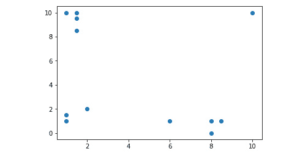

###### Figure 6.6: Graph showing the data points from the `data_points` array

3. 假设我们最初将点 `P` 等同于第一个数据点，`[1, 1]`：

`P = [1, 1]`

4. 让我们找到距离此点 `R` 范围内的点：

```python
from scipy.spatial import distance

points = np.array([
    p0 for p0 in data_points if distance.euclidean(p0, P) <= r
])

points
```

输出如下：

```python
array([[1. , 1. ],
       [1. , 1.5],
       [2. , 2. ]])
```

5. 让我们计算数据点的均值：

```python
import numpy as np

P = [
    np.mean(points.transpose()[0]),
    np.mean(points.transpose()[1])
]

P
```

输出如下：

`[1.3333333333333333, 1.5]`

6. 现在新的均值已计算，我们可以再次检索给定半径内的点：

```python
points = np.array([
    p0 for p0 in data_points if distance.euclidean(p0, P) <= r
])

points
```

输出如下：

```python
array([[1. , 1. ],
       [1. , 1.5],
       [2. , 2. ]])
```

7. 这些是相同的三个点，所以我们可以在这里停止。三个点已围绕均值 `[1.3333333333333333, 1.5]` 找到。半径为 2 的该中心周围的点形成一个聚类。

8. 如果我们检查数据点 `[1, 1.5]` 和 `[2, 2]`，我们会得到相同的结果。让我们继续使用列表中的第四个点，`[8, 1]`：

`P = [8, 1]`

```python
points = np.array([
    p0 for p0 in data_points if distance.euclidean(p0, P) <= r
])

points
```

输出如下：

```python
array([[8. , 1. ],
       [8. , 0. ],
       [8.5, 1. ],
       [6. , 1. ]])
```

9. 这次，所有四个区域内的点都被找到了。因此，我们可以简单地计算它们的均值：

```python
P = [
    np.mean(points.transpose()[0]),
    np.mean(points.transpose()[1])
]
```

输出如下：

`[7.625, 0.75]`

这个均值不会改变，因为在下一次迭代中，我们会找到相同的数据点。

10. 注意我们选择点 `[8, 1]` 很幸运。如果我们从 `P = [8, 0]` 或 `P = [8.5, 1]` 开始，我们只会找到三个点而不是四个：

`P = [8, 0]`

```python
points = np.array([
    p0 for p0 in data_points if distance.euclidean(p0, P) <= r
])

points
```

输出如下：

```python
array([[8. , 1. ],
       [8. , 0. ],
       [8.5, 1. ]])
```

11. 计算这三个点的均值后，我们必须使用移动后的均值重新运行距离计算：

```python
P = [
    np.mean(points.transpose()[0]),
    np.mean(points.transpose()[1])
]

P
```

输出如下：

`[8.166666666666666, 0.6666666666666666]`

12. 点 `P = [8.5, 1]` 的输出如下数组：

```python
array([[8. , 1. ],
       [8. , 0. ],
       [8.5, 1. ]])
```

我们再次只找到了相同的三个点。这意味着从 `[8,1]` 开始，我们得到的聚类比从 `[8, 0]` 或 `[8.5, 1]` 开始的大。因此，我们必须采用包含数据点数量最多的中心点。

13. 现在，让我们检查如果我们从第四个数据点 `[6, 1]` 开始发现会发生什么：

`P = [6, 1]`

```python
points = np.array([
    p0 for p0 in data_points if distance.euclidean(p0, P) <= r
])

points
```

输出如下：

```python
array([[8., 1.],
       [6., 1.]])
```


## Mean Shift 算法示例

### 14. 数据点发现与均值更新
我们成功找到了数据点 `[8, 1]`。因此，我们必须将均值从 `[6, 1]` 移动到计算出的新均值 `[7, 1]`：

```python
P = [
    np.mean(points.transpose()[0]),
    np.mean(points.transpose()[1])
]
P
```

输出如下：
`[7.0, 1.0]`

### 15. 检查更多点
让我们检查是否找到了更多点：

```python
points = np.array([
    p0 for p0 in data_points if distance.euclidean(p0, P) <= r
])
points
```

输出如下：
```
array([[8. , 1. ],
       [8. , 0. ],
       [8.5, 1. ],
       [6. , 1. ]])
```

是的——我们成功找到了全部四个点！因此，我们已成功定义了一个大小为 4 的聚类。均值将与之前相同：`[7.625, 0.75]`。

这是一个简单的聚类示例，应用了 mean shift 算法。我们只提供了一个说明算法如何考虑找到聚类的示例。还有一个剩余的问题，那就是半径的值。

请注意，如果半径 2 未设置，我们可以简单地从包含所有数据点的巨大半径开始，然后减小半径，或者从非常小的半径开始，确保每个数据点都在其自己的聚类中，然后增加半径，直到我们得到所需的结果。

## scikit-learn 中的 Mean Shift 算法

让我们使用与 k-means 算法中相同的 data points：

```python
import numpy as np

data_points = np.array([
    [1, 1],
    [1, 1.5],
    [2, 2],
    [8, 1],
    [8, 0],
    [8.5, 1],
    [6, 1],
    [1, 10],
    [1.5, 10],
    [1.5, 9.5],
    [10, 10],
    [1.5, 8.5]
])
```

均值偏移（mean shift）聚类算法的语法与 k-means 聚类算法相似。

```python
from sklearn.cluster import MeanShift

mean_shift_model = MeanShift()
mean_shift_model.fit(data_points)
```

聚类完成后，我们可以访问每个类的中心点：
`mean_shift_model.cluster_centers_`

输出如下：
```
array([[ 1.375 , 9.5 ],
       [ 1.33333333, 1.5 ],
       [ 8.16666667, 0.66666667],
       [ 6. ],
       [ 10. , 10. ]])
```

均值偏移模型通过上述代码找到了 5 个聚类中心。

与 k-means 类似，我们也可以获取标签：
`mean_shift_model.labels_`

输出如下：
```
array([1, 1, 1, 2, 2, 3, 0, 0, 0, 4], dtype=int64)
```

输出数组显示了数据点属于哪个聚类。我们需要绘制这些数据：

```python
plot.scatter(
    mean_shift_model.cluster_centers_[:,0],
    mean_shift_model.cluster_centers_[:,1]
)

for i in range(len(data_points)):
    plot.plot(
        data_points[i][0],
        data_points[i][1],
        ['ro','go','yo', 'mo'][mean_shift_model.labels_[i]]
    )

plot.show()
```

输出如下：


#### 图 6.7：基于 Mean Shift 的图
三个点是红色、绿色和黄色聚类的中心点。在坐标系统中还有两个单点，属于 (6,1) 和 (10,10)。

## Python 中的图像处理

为了完成后续活动，你需要了解如何在 Python 中处理图像。我们将使用 PIL 库来实现。有多种方法可以从路径读取图像，最简单的方法是使用 `Image`：

```python
from PIL import Image

image = Image.open('file.jpg')
```

上述代码假设 `open` 方法的字符串参数是一个有效的图像文件。

通过查询 `size` 属性获取图像的大小：
`image.size`

输出如下：
`(750, 422)`

我们可以从图像创建一个包含每个像素 RGB 值的二维数组：

```python
import numpy as np

pixel_array = np.array(image)
```

一旦构建了像素数组，就可以轻松地检索和操作每个像素：
`pixel_array`

输出如下：
```
array([29, 33, 32], dtype=uint8)
```

图像的像素也可以使用图像的 `load()` 方法来访问。一旦获取这些像素，我们可以获取每个像素的 RGBA 值，格式如下：

```python
pixels = image.load()
```

`pixels`

输出如下：
`(29, 33)`

注意像素坐标的顺序是反的，与读取的 `pixel_array` 不同。我们也可以为像素设置新值：
`pixels[7][4] = (255, 0, 0)`

如果你想保存更改，使用图像的 `save()` 方法：

```python
image.save('test.jpg')
```

对像素进行聚类分析，将其转换为 DataFrame。这意味着我们需要将图像转换为元组或数组。一旦有了这些值的一维数组，就可以将其转换为 pandas DataFrame：

```python
import pandas

data_frame = pandas.DataFrame(
    [pixels[x][y] for x in range(image.size[0])
    for y in range(image.size[1])],
    columns=['x', 'y', 'r', 'g', 'b']
)

data_frame.head()
```

输出如下：
```
   x  y  r  g  b
0  0  0 29 71
1  0  1 32 73
2  0  2 37 77
3  0  3 41 82
4  0  4 45 84
```

这就是使用均值偏移算法处理图像活动所需的所有知识。

### 活动 13：使用均值偏移算法进行形状识别

在本节中，我们将学习如何对图像进行聚类。假设你正在一家通过照片检测人类情绪的公司工作。你的任务是提取组成人脸的像素。

使用均值偏移创建一个聚类算法对图像像素进行聚类。检查均值偏移算法的结果，是否有聚类包含人脸。

然后，应用固定数量聚类（本例中 8 个）的 k-means 算法：

1. 选择你想聚类的图像并加载。
2. 将像素转换为 DataFrame 以执行聚类。使用 scikit-learn 对图像进行均值偏移聚类。注意，这次我们将跳过特征归一化，因为像素的接近程度和颜色分量的接近程度以接近相等的权重表示。算法将找到两个聚类。
3. 根据你使用的图像，观察均值偏移算法如何处理肤色，以及图像的其他部分被放在同一个聚类中。包含大部分皮肤的聚类通常包含非常接近或颜色与皮肤的数据点。
4. 让我们使用 k-means 算法在相同数据上制定八个聚类。你会发现聚类算法确实找到了相邻且颜色相似的数据点。

##### 注意
该活动的解答位于第 293 页。

## 总结

在本章，我们学习了聚类是如何工作的。聚类是无监督学习的一种，其中特征是给定的，聚类算法寻找标签。

聚类有两种：扁平的和层次。

k-means 算法是一种扁平聚类算法，我们为 K 个聚类确定 K 个中心点，算法寻找数据点。

均值偏移是层次聚类算法的一个示例，不同标签值的数量由算法确定。

最后一章将介绍一个由于计算能力的爆炸和廉价的可扩展在线服务器容量而在这个十年流行的领域。该领域是神经网络和深度学习的科学。

# 使用神经网络进行深度学习

## 学习目标

在本章结束时，你将能够：

* 执行基本的 TensorFlow 操作以解决各种表达式
* 描述神经网络如何工作
* 使用 TensorFlow 训练和测试神经网络
* 使用 TensorFlow 实现深度学习神经网络模型

在本章中，我们将使用 TensorFlow 库检测手写数字。

## 引言

在本章中，我们将学习另一种监督学习技术。然而，这次我们不再使用分类或回归等简单的数学模型，而是将使用一个完全不同的模型：神经网络。尽管我们将神经网络用于监督学习，但请注意神经网络也可以建模无监督学习技术。这种模型的重要性在过去一个世纪增加了，因为在过去使用该模型进行监督学习所需的计算能力是不够的。因此，神经网络在过去世纪开始进入实践。

## Python 版 TensorFlow

TensorFlow 是 Google 维护的最重要的机器学习和开源库之一。TensorFlow API 适用于许多语言，包括 Python、JavaScript、Java 和 C。由于 TensorFlow 支持监督学习，我们将使用 TensorFlow 构建图模型，然后使用该模型进行预测。

TensorFlow 处理张量。张量的一些示例是：

* 标量值，例如浮点数。
* 任意长度的向量。
* 规则矩阵，包含 `p` 乘以 `q` 个值，其中 `p` 和 `q` 是有限整数。
* 一个 `p` x `q` x `r` 的广义矩阵状结构，其中 `p`, `q`, `r` 是有限整数。将此构造想象为三维空间中的矩形物体，边长为 `p`、`q` 和 `r`。该数据结构中的数字可以用三维的形式可视化。
* 观察上述四种数据结构，更复杂的 `n-dimensional` 数据结构也可以作为张量的有效示例。

在本章中，我们将专注于标量、向量和规则矩阵张量。在本章的范围内，可以将张量看作标量值、数组，或数组的数组。

TensorFlow 用于创建人工神经网络，因为它模拟了其输入、输出、内部节点以及这些节点之间的有向边。TensorFlow 还带有用于转换信号的数学函数。这些数学函数在建模神经网络内部的神经元被激活时也会非常有用。

### 注意事项

张量是类数组对象。流（Flow）象征着对张量数据的操作。因此，本质上，TensorFlow 是一个数组数据处理库。

TensorFlow 的主要用例是人工神经网络，因为该领域需要对大型数组和矩阵进行操作。TensorFlow 带有许多深度学习相关的函数，因此它是神经网络的理想环境。TensorFlow 用于语音识别、语音搜索，也是 translate.google.com 背后的大脑。在本章后面，我们将使用 TensorFlow 来识别手写。

### 在 Anaconda Navigator 中安装 TensorFlow

打开 Anaconda Prompt 并使用 `pip` 安装 TensorFlow：

```bash
pip install tensorflow
```

安装需要几分钟时间，因为包本身很大。如果你更倾向于使用显卡 GPU 而不是 CPU，也可以使用 `tensorflow-gpu`。请确保只有在你拥有足够好的显卡的情况下才使用 GPU 版本。

一旦完成安装，你可以在 IPython 中导入 TensorFlow：

```python
import tensorflow as tf
```

首先，我们将使用 TensorFlow 构建一个图。该模型的执行是分离的。这种分离是非常重要的，因为执行过程是资源密集型的，因此可能运行在专门解决计算密集型问题的服务器上。

### TensorFlow 操作

TensorFlow 提供了许多处理数据的操作。以下是这些操作的一些示例：

* **算术操作**：`add` 和 `multiply`
* **指数操作**：`exp` 和 `log`
* **关系操作**：`greater`、`less` 和 `equal`
* **数组操作**：`concat`、`slice` 和 `split`
* **矩阵操作**：`matrix_inverse`、`matrix_determinant` 和 `matmul`
* **神经网络相关操作**：`sigmoid`、`ReLU` 和 `softmax`

### 练习 22：使用基础操作和 TensorFlow 常量

使用 TensorFlow 中的算术操作求解表达式：`2 * 3 + 4`

这些操作可以用于构建图。为了进一步了解关于 TensorFlow 常量和基础算术运算符，让我们考虑一个简单的表达式 `2 * 3 + 4`，该表达式的图如下：

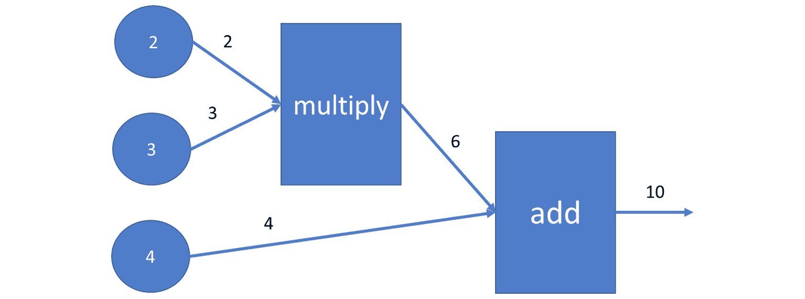

#### 图 7.1：表达式 2*3+4 的图

1. 使用以下代码构建此图：
```python
import tensorflow as tf

input1 = tf.constant(2.0)
input2 = tf.constant(3.0)
input3 = tf.constant(4.0)

product12 = tf.multiply(input1, input2)
sum = tf.add(product12, input3)
```

2. 一旦图构建完成，为了执行计算，我们需要：
```python
with tf.Session() as sess:
    print(sess.run(sum))
```

输出是：
```
10
```

### 占位符与变量

现在我们理解了占位符，让我们更进一步。占位符是在会话开始前替换的值。变量是可能会变化的值。让我们用代码创建一个表达式：

```python
import tensorflow as tf

input1 = tf.placeholder(tf.float32, name='input1')
input2 = tf.placeholder(tf.float32, name='input2')
input3 = tf.Variable(0.0, name='input3')

product12 = tf.multiply(input1, input2)
sum = tf.add(product12, input3)
```

为了执行它，我们使用：
```python
with tf.Session() as sess:
    print(sess.run(sum, feed={input1: 2, input2: 3}))
```

### 全局变量初始化

由于 TensorFlow 经常使用矩阵，因此根据正态分布初始化一个随机矩阵是有意义的。

```python
import tensorflow as tf

randomMatrix = tf.Variable(tf.random_normal([3, 4]))

with tf.Session() as sess:
    sess.run(tf.global_variables_initializer())
    print(sess.run(randomMatrix))
```

输出是：
```
[[-0.41974232  1.8810892 -1.4549098  0.7398717 ]
 [ 2.1072254   1.796842   -0.3830152  0.9811519 ]
 [-0.550108   -0.41858754  1.351614    1.2387075 ]]
```


### 神经网络简介

神经网络是 AI 的最新分支。神经网络的灵感来源于人类大脑的工作方式。它们最初是由 20 世纪 40 年代的 Warren McCulloch 和 Walter Pitts 发明的。神经网络是一种用于描述人脑如何解决问题的数学模型。

我们在谈论数学模型时使用“人工神经网络”一词，在谈论人脑时使用“生物神经网络”。人工神经网络是监督学习算法。

人工神经网络的工作原理类似于人脑的工作原理。人脑中的树突连接到胞体，而胞体连接到轴突。在这里，树突充当输入，胞体是进行计算（加权和和激活函数）的地方，而轴突则类似于输出。

然后，我们通过将加权和传递给激活函数来确定哪个神经元被发放。如果该函数确定神经元必须发放，信号就会出现在输出中。该信号可以作为网络中其他神经元的输入：

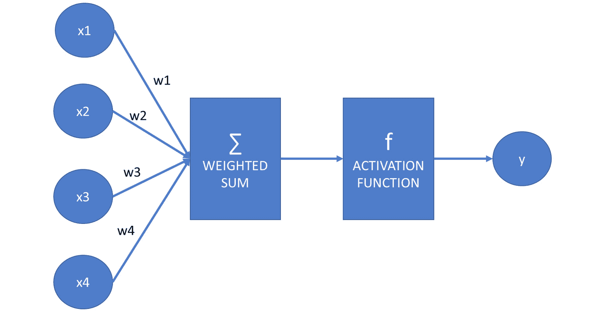

#### 图 7.2：显示人工神经网络工作原理的图

假设 `f` 是激活函数，`x1`、`x2`、`x3` 和 `x4` 是输入，它们的和通过权重 `w1`、`w2`、`w3` 和 `w4` 加权：

`y = f(x1*w1 + x2*w2 + x3*w3 + x4*w4)`

假设向量 `x` 为 (`x1`, `x2`, `x3`, `x4`)，向量 `w` 为 (`w1`, `w2`, `w3`, `w4` )，我们可以将此方程写为这两个向量的标量或点积：

`y = f(x ⋅ w)`

我们定义的结构是一个神经元：

让我们隐藏这个神经元的细节，以便更容易构建神经网络：

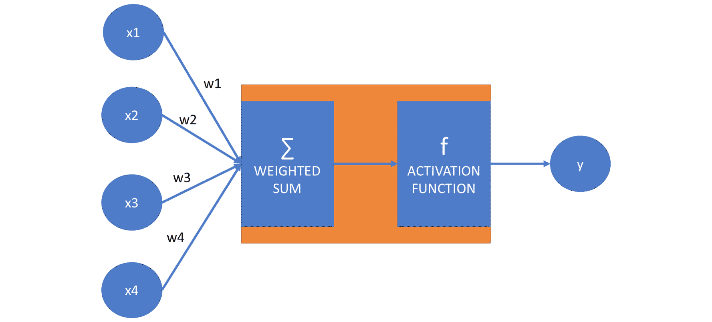

#### 图 7.4：表示神经元隐藏层的图

我们可以创建多个方框和多个输出变量，这些变量可能会由于读取输入的加权平均值而作为结果而被激活。

尽管在接下来的图中有从所有输入指向所有方框的箭头，但请记住箭头上的权重可能为零。我们仍然在图中显示这些箭头：

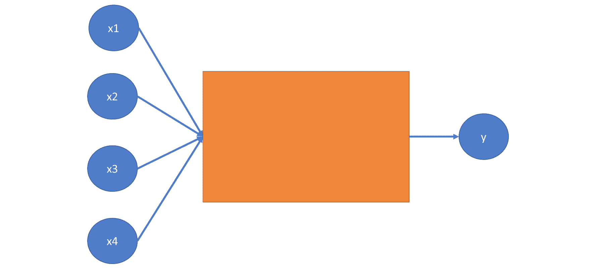

#### 图 7.5：表示神经网络的图

描述输入与输出之间关系的方框被称为**隐藏层**。具有一个隐藏层的神经网络被称为普通神经网络。

在连接输入和输出时，我们可能有多个隐藏层。具有多个层的神经网络被称为深度神经网络：

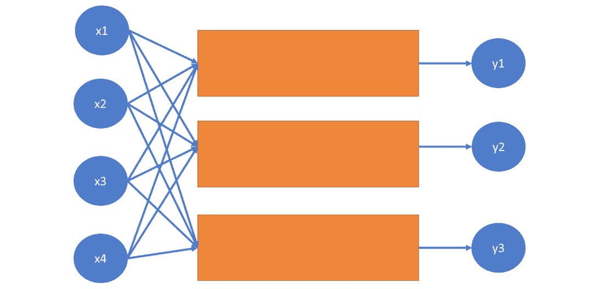

#### 图 7.6：表示深度神经网络的图

“深度学习”一词源于多层的存在。在创建人工神经网络时，我们可以指定隐藏层的数量。

#### 偏置 (Biases)

让我们再次看看神经网络中神经元的模型：

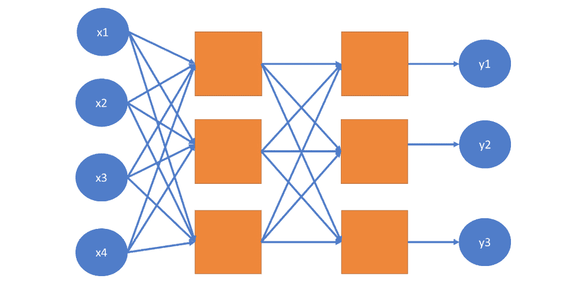

#### 图 7.7：神经网络中神经元的图

我们学到了该神经元的方程如下：

`y = f(x1*w1 + x2*w2 + x3*w3 + x4*w4)`

这个方程的问题在于没有依赖于输入 `x1`、`x2`、`x3` 和 `x4` 的常数因子。这意味着神经网络中的每个神经元在没有偏置的情况下，每当每对权重-输入对的乘积为零时，它总是产生这个值。

因此，我们向方程中添加了偏置：

`y = f(x1*w1 + x2*w2 + x3*w3 + x4*w4 + b)`

`y = f(x ⋅ w + b)`

第一个方程是冗长形式，描述了每个坐标、权重系数和偏置的作用。第二个方程是向量形式，其中 `x = (x1, x2, x3, x4)` 且 `w = (w1, w2, w3, w4)`。

当我们过滤的是一个列表而不是单个值时，可以使用 `softmax` 函数。列表中的每个元素都将进行转换。

让我们对不同的激活函数进行实验。通过解决以下练习，观察这些函数如何通过求解来抑制加权输入。

#### 练习 23：激活函数

考虑以下神经网络：

`y = f( 2 * x1 + 0.5 * x2 + 1.5 * x3 - 3 )`

假设 `x1` 为 1 且 `x2` 为 2，当当 `x` 值为 -1, 0, 1, 2 时，计算 `y` 的值：

*   `f` 是 `sigmoid` 函数
*   `f` 是 `tanh` 函数
*   `f` 是 `ReLU` 函数

执行以下步骤：

1.  代入已知系数：
    ```python
    def get_y(f, x3):
        return f(2*1+0.5*2+1.5*x3)
    ```

2.  使用以下三个激活函数：
    ```python
    import numpy as np

    def sigmoid(x):
        return 1 / (1 + np.e ** (-x))

    def tanh(x):
        return 2 / (1 + np.e ** (-2*x)) - 1

    def relu(x):
        return 0 if x < 0 else x
    ```

3.  使用以下命令计算 sigmoid 值：
    ```python
    get_y(sigmoid, -2)
    ```
    输出为 `0.5`

    ```python
    get_y(sigmoid, -1)
    ```
    输出为 `0.8175744761936437`

    ```python
    get_y(sigmoid, 0)
    ```
    输出为 `0.9525741268224331`

    ```python
    get_y(sigmoid, 1)
    ```
    输出为 `0.9890130573694068`

    ```python
    get_y(sigmoid, 2)
    ```
    输出为 `0.9975273768433653`

4.  如你所见，随着 `sigmoid` 函数内部表达式和的增加，变化被迅速抑制。我们期望 `tanh` 函数具有更大的抑制效果：
    ```python
    get_y(tanh, -2)
    ```
    输出为 `0.0`

    ```python
    get_y(tanh, -1)
    ```
    输出为 `0.9051482536448663`

    ```python
    get_y(tanh, 0)
    ```
    输出为 `0.9950547536867307`

    ```python
    get_y(tanh, 1)
    ```
    输出为 `0.9997532108480274`

    ```python
    get_y(tanh, 2)
    ```
    输出为 `0.9999877116507956`

5.  根据 `tanh` 函数的特性，输出比 sigmoid 函数更快地接近 1 渐线。对于 `x3 = -2`，我们计算 `f(0)`。虽然 `sigmoid(0)` 是 `0.5`，但 `tanh(0)` 是 `0`。与其他两个函数相反，`ReLu` 函数不抑制正值：
    ```python
    get_y(relu, -2)
    get_y(relu, -1)
    get_y(relu, 0)
    get_y(relu, 1)
    get_y(relu, 2)
    ```

例如，值 `[0, 0.1, 0, 0, 0.9, 0, 0, 0, 0, 0]` 表示我们的数字有 90% 的概率是 4，10% 的概率是 2。

在分类问题中，我们始终为每个类使用一个输出值。

让我们继续权重和偏置。为了连接 `28*28 = 784` 个特征和 10 个标签，我们需要一个 `784 x 10` 的权重矩阵，它有 784 行和 10 列。

因此，方程变为 `y = f( x ⋅ W + b )`，其中 `x` 是 `784` 维空间中的向量，`W` 是一个 `784 x 10` 矩阵，`b` 是一个十维偏置向量。`y` 向量也包含十个坐标。`f` 函数定义在具有十个坐标的向量上，并应用于每一个坐标。

##### 注意

为了将一个二维的 `28x28` 数据点矩阵转换为一维的 `28x28` 元素向量，我们需要展平（flatten）矩阵。与许多语言和库不同，Python 并没有 `flatten` 方法。

由于展平是一项简单任务，让我们来构造一个 `flatten` 方法：

```python
def flatten(matrix):
    return [elem for row in matrix for elem in row]

flatten([[1,2],[3,4]])
```

输出如下：

```
[1, 2, 3, 4]
```

让我们将特征从 `28*28` 矩阵展平为 `784` 维空间的向量：

```python
features_train_vector = [
    flatten(image) for image in features_train
]

features_test_vector = [
    flatten(image) for image in features_test
]
```

为了将标签转换为向量形式，我们需要进行归一化：

```python
import numpy as np

label_train_vector = np.zeros((label_train.size, 10))
for i, label in enumerate(label_train_vector):
    label[label_train[i]] = 1

label_test_vector = np.zeros((label_test.size, 10))
for i, label in enumerate(label_test_vector):
    label[label_test[i]] = 1
```

#### 多标签的 TensorFlow 建模

我们现在用 TensorFlow 为以下方程建模：`y = f( x ⋅ W + b )`

在导入 TensorFlow 后，我们将定义特征、标签和权重：

```python
import tensorflow as tf

f = tf.nn.sigmoid
x = tf.placeholder(tf.float32, [None, 28 * 28])
W = tf.Variable(tf.random_normal([784, 10]))
b = tf.Variable(tf.random_normal([10]))
```

如果我们知道如何使用 TensorFlow 执行点积乘法，就可以简单写写方程 `y = f( x ⋅ W + b )`。

如果我们将 `x` 视为一个 `1x84` 矩阵，可以使用 `tf.matmul` 函数将其与 `784x10` 的 `W` 矩阵相乘。

因此，我们的方程变为：`y = f( tf.add( tf.matmul( x, W ), b ) )`

你可能已经注意到 `x` 包含占位符，而 `W` 和 `b` 是变量。这是因为 `x` 的值是给定的。我们只需要在方程中替换它们。TensorFlow 的任务是优化 `W` 和 `b` 的值，以便最大化我们读取正确数字的概率。

让我们用函数形式表示 `y` 的计算：

```python
def classify(x):
    return f(tf.add(tf.matmul(x, W), b))
```

##### 注意

这是我们可以定义激活函数的地方。在本章结束的活动中，你最好使用 softmax 激活函数。这意味着你必须将代码中的 `sigmoid` 替换为 `softmax`：`f = tf.nn.softmax`。

#### 优化变量

占位符代表输入。TensorFlow 的任务是优化变量。

为了执行优化，我们需要使用一个代价函数：交叉熵（cross-entropy）。交叉熵具有以下属性：

*   如果预测输出与真实输出匹配，则其值为 0
*   之后其值严格为正

我们的任务是最小化交叉熵：

```python
y = classify(x)
y_true = tf.placeholder(tf.float32, [None, 10])
cross_entropy = tf.nn.sigmoid_cross_entropy_with_logits(
    logits=y,
    labels=y_true
)
```

`recall_score(label_test, label_predicted, average='weighted')`

`f1_score(label_test, label_predicted, average='weighted')`

#### 随机化样本大小

回想神经网络的训练函数：

```python
iterations = 300
batch_size = 200
for i in range(iterations):
    min = i * batch_size
    max = (i+1) * batch_size
    dictionary = {
        x: features_train_vector[min:max],
        y_true: label_train_vector[min:max]
    }
    session.run(optimizer, feed_dict=dictionary)
```

问题是在 60,000 个数字中，我们只能进行 5 次迭代。如果我们想超过这个阈值，就会面临重复这些输入序列的风险。

我们可以通过从训练数据中随机选择值来最大限度地利用训练数据的效率。

我们可以使用 `random.sample` 方法来实现这一目的：

```python
iterations = 6000
batch_size = 100
sample_size = len(features_train_vector)
for _ in range(iterations):
    indices = random.sample(range(sample_size), batch_size)
    batch_features = [
        features_train_vector[i] for i in indices
    ]
    batch_labels = [
        label_train_vector[i] for i in indices
    ]
    dictionary = {
        x: batch_features,
        y_true: batch_labels
    }
    session.run(optimizer, feed_dict=dictionary)
```

##### 注意

随机采样方法从列表中随机选择给定数量的元素。例如，在匈牙利，主要的国家乐票是基于从 90 个数字的池中抽取 5 个数字。我们可以使用以下表达式模拟抽票轮：

```python
import random
random.sample(range(1, 91), 5)
```


输出如下：

`[63, 58, 25, 41, 60]`

#### 活动 14：手写数字检测

在本节中，我们将讨论如何通过检测手写数字来为加密货币交易者提供更多的安全性。我们将假设你是一家新的加密货币交易平台的软件人员。你正在实施的最新安全措施需要识别手写数字。使用 `MNIST` 库训练一个神经网络来识别数字。你可以在 `https://www.tensorflow.org/tutorials/` 阅读更多关于该数据集的信息。

通过执行以下步骤尽可能地提高模型准确率：

1. 加载数据集并格式化输入。
2. 设置 TensorFlow 图。现在我们将使用 `ReLU` 函数代替 `sigmoid` 函数。
3. 训练模型。
4. 测试模型并计算准确率得分。
5. 通过重新运行负责训练数据集的代码段，我们可以提高其准确率。运行代码 50 次。
6. 打印混淆矩阵。

在第五十次运行结束，混淆矩阵得到了改进。

结果还不错。10 个数字中有超过 8 个被准确识别了。

##### 注意

该活动的解决方案可以在第 298 页找到。

如你所见，神经网络的改进并不是线性的。在一段时间内，训练网络似乎对准确率的提升微乎其微甚至没有提升。然而，在达到某个阈值后，突破发生了，准确率大幅增加。

这种行为类似于人类的学习。你现在可能在神经网络上遇到困难。然而，在深入学习这些材料并尝试几次练习后，你将取得一个接一个的突破，你的进展将会加快。

### 深度学习

在这个主题中，我们将增加神经网络的层数。你可能记得我们可以在图中添加隐藏层。我们将通过实验隐藏层来以提高模型准确率作为目标。

#### 添加层

回想具有两个隐藏层的神经网络图表：

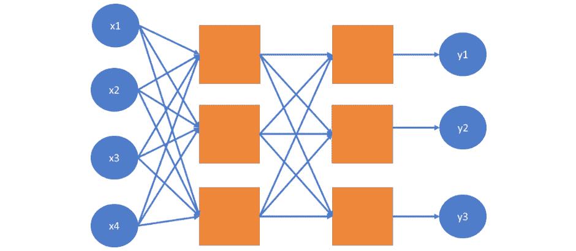

###### 图 7.12：显示神经网络中两个隐藏层的图表

我们可以通过复制权重和偏置，并确保 TensorFlow 变量的维度匹配，向方程添加第二层。注意，在第一个模型中，我们将 784 个特征转换为了 10 个标签。

在这个模型中，我们将 784 个特征转换为指定数量的输出。然后我们将这些输出并将其转换为 10 个标签。

确定所添加隐藏层的节点数量并不是精确的科学。在本例中我们将使用 200 个，因为它处于特征维度和标签维度之间。

由于我们有两层，我们将分别定义两个矩阵 `(W1, W2)` 和向量 `(b1, b2)` 分别权重和偏置。

首先，我们通过 `W1` 和 `b1` 减少输入，创建 200 个值。我们将输入这些值并使用 `W2` 和 `b2` 创建 10 个标签：

```python
x = tf.placeholder(tf.float32, [None, 28 * 28])

f = tf.nn.softmax

W1 = tf.Variable(random_normal([784, 200]))

b1 = tf.Variable(random_normal([200]))

layer1_out = tf.add(tf.matmul(x, W1), b1)

W2 = tf.Variable(random_normal([200, 10]))

b2 = tf.Variable(random_normal([10]))

y = tf.add(tf.matmul(layer1_out, W2), b2))
```

#### 卷积神经网络

`卷积神经网络` (`CNNs`) 是针对模式识别优化的人工神经网络。CNNs 基于深度神经网络中的卷积层。卷积层使用卷积操作转换其输入。

当使用卷积层时，我们使用 `m*n` 矩阵检测图像，其中 `m` 和 `n` 分别小于图像的宽高。执行卷积操作时，我们将此 `m*n` 矩阵在图像上滑动，匹配每一种可能性。计算 `m*n` 卷积过滤器与图像中 `3x3` 段像素值的标量。卷积操作从原始图像创建一个新图像，其中图像的重要部分被突出显示，而不重要的部分被模糊了。

卷积操作总结了它所在窗口的信息。因此，它是识别图像形状的理想算子。无论形状在图像的什么位置或方向都可以识别。卷积神经网络不在本书的范围内，因为它是一个更高级的主题。

#### 活动 15：深度学习手写数字检测

在本节中，我们将讨论深度学习如何提高模型的性能。我们将假设你的老板对你在活动 14 中展示的结果不满意，并要求你考虑向原始模型中添加两个隐藏层，以确定新层是否提高了模型的准确率。为了确保你能够正确完成此活动，你需要了解深度学习：

1. 执行上一个活动的步骤并测量模型的准确率。
2. 通过添加新层更改神经网络。我们将结合 `ReLU` 和 `softmax` 激活函数。
3. 重新训练模型。
4. 评估模型。找到准确率得分。
5. 运行 50 次。
6. 打印混淆矩阵。

这个深度神经网络的行为比单层神经网络更加混乱。在 600 次 200 样本迭代后，准确率从 0.572 提高到 0.5723。在这次迭代后不久，在相同的迭代次数内，准确率从 0.6076 跳跃到 0.6834。

由于深度神经网络的灵活性，我们预计达到准确率上限的时间会比简单模型更晚。由于深度神经网络的复杂性，它也可能长时间卡在局部极大值处。

##### 注意

本活动的解决方案可以在第 302 页找到。

### 总结

在本书中，我们在“AI 原理”章节中学习了 AI 的基础知识以及 AI 的应用，然后编写了一段 Python 代码为井井棋游戏建模。

在“搜索技术与游戏的 AI”章节中，我们使用游戏 AI 工具和搜索技术解决了井井棋游戏。我们学习了`广度优先搜索`（Breadth First Search）和`深度优先搜索`（Depth First Search）搜索算法。`A*` 算法帮助学生为路径规划问题建模。该章节以多人游戏建模作为结束。

在接下来的几个章节中，我们学习了使用回归和分类的监督学习。这些章节包含了数据预处理、训练测试集划分以及用于多个真实场景的模型。在预测股票数据时，`线性回归`（Linear regression）、`多项式回归`（polynomial regression）和`支持向量机`（Support Vector Machines）都大派用用。分类通过`k-近邻`（k-nearest neighbor）和`支持向量`（Support Vector）分类器完成。若干活动帮助学生将分类基础应用于一个有趣的真实世界用例：信用评分。

在`第 5 章``使用树进行预测分析`中，我们介绍了`决策树`（decision trees）、`随机森林`（random forests）和`极端随机树`（extremely randomized trees）。本章介绍了评估模型效用的不同方法。我们学习了如何计算模型的`准确率`（accuracy）、`精确率`（precision）、`召回率`（recall）和 F1 分数。我们还学习了如何创建模型的`混淆矩阵`（confusion matrix）。本章节的模型通过评估汽车数据得以。

无监督学习在`第 6 章``聚类`中引入，包含了`k 均值`（k-means）和均值偏移（mean shift）聚类算法。这些算法的一个有趣方面是标签不是预先给定的，而是在聚类过程中的。

本书以第 7 章`基于神经网络的深度学习`结束，在该章节中介绍了神经网络和使用`TensorFlow`的深度学习。我们将这些技术用于一个真实示例：手写数字检测。


## 附录

### 关于

包含此章节的目的是帮助学生执行书中的活动。它包含了学生为了实现活动目标需要执行的详细步骤。

### 第 1 章：AI 原理

在代码中，反斜杠（`\\`）表示换行，当代码不适应单行时。行尾的反斜杠转义换行符。这意味着反斜杠后的下一行内容应该被视为从反斜杠字符所在的位置开始的。

#### 活动 1：生成井井棋游戏中所有可能的步骤序列

本节将探索两个玩家随机对弈时可能发生的组合爆炸。我们将使用一个程序，基于之前的结果，该结果生成了计算机玩家和人类玩家之间所有可能的移动序列。确定动作序列中不同胜利、失败和和平局的数量。假设人类玩家可以进行任何可能的移动。在这个示例中，假设计算机玩家正在随机移动，我们将检查属于两个随机运行玩家的胜利、失败和和平局：

1. 创建一个函数，它对棋盘列表中的每个元素映射`all_moves_from_board` 函数。这样，我们将在每个深度拥有决策树的所有节点：

```python
def all_moves_from_board(board, sign):

    move_list = []

    for i, v in enumerate(board):

        if v == EMPTY_SIGN:

            move_list.append(board[:i] + sign + board[i+1:]])

    return move_list
```

2. 决策树从 `[ EMPTY_SIGN * 9 ]` 开始，并在每次移动后扩展：

```python
all_moves_from_board_list([ EMPTY_SIGN * 9 ], AI_SIGN )
```

3. 输出如下：

```python
['X........',
'.X.......',
'..X......',
'...X.....',
'....X....',
'.....X...',
'......X..',
'.......X.',
'........X']

['XO.......',
'X.O......',
'X..O.....',
'X...O....',
'X....O...',
'X.....O..',
'X......O.',
'.......XO',
'O.......X',
'.O......X',
'..O.....X',
'...O....X',
'....O...X',
'.....O..X',
'......O.X',
'.......OX']
```

4. 让我们创建一个 `filter_wins` 函数，它从移动列表中提取出结束的游戏，并将它们添加到包含 AI 玩家和对手玩家获胜棋盘状态的数组中：

```python
def filter_wins(move_list, ai_wins, opponent_wins):

    for board in move_list:

        won_by = game_won_by(board)

        if won_by == AI_SIGN:

            ai_wins.append(board)

            move_list.remove(board)

        elif won_by == OPPONENT_SIGN:

            opponent_wins.append(board)

            move_list.remove(board)
```

5. 在此函数中，三个列表被视为引用。这意味着该函数没有返回值，而是操作了这些列表。

6. 让我们完成本节。然后用一个 `count_possibilities` 函数打印出平局、第一玩家获胜和第二玩家获胜的决策树节点数量：

```python
def count_possibilities():

    board = EMPTY_SIGN * 9

    move_list = [board]

    ai_wins = []

    opponent_wins = []

    for i in range(9):

        print('step ' + str(i) + '. Moves: ' + str(len(move_list)))

        sign = AI_SIGN if i % 2 == 0 else OPPONENT_SIGN

        move_list = all_moves_from_board_list(move_list, sign)

        filter_wins(move_list, ai_wins, opponent_wins)

    print('First player wins: ' + str(len(ai_wins)))

    print('Second player wins: ' + str(len(opponent_wins)))

    print('Draw', str(move_list)))

    print('Total', str(len(ai_wins) + len(opponent_wins) + len(move_list)))
```

7. 每个状态最多有 9 步。在第 0、2、4、6、8 次迭代中，AI 玩家移动。在所有其他迭代中，对手移动。我们创建所有可能的移动并从列表中提取结束的游戏。

8. 然后执行可能性的计算以体验组合爆炸。

```python
count_possibilities()
```

9. 输出如下：

```text
step 0. Moves: 1
step 1. Moves: 9
step 2. Moves: 72
step 3. Moves: 504
step 4. Moves: 3024
step 5. Moves: 13680
step 6. Moves: 49402
step 7. Moves: 111109
step 8. Moves: 156775
First player wins: 106279
Second player wins: 68644
Draw 91150
Total 266073
```

### 第 2 章：搜索技术与游戏的 AI

#### 活动 2：教智能代理意识到需要防御失败的情况

按照以下步骤完成活动：

1. 创建一个函数 `player_can_win`，它使用 `all_moves_from_board` 函数获取盘上所有的移动，并使用变量 `next_move` 对其进行迭代。在每次迭代中，检查该标记是否可以赢得游戏，如果是则返回 `true`，否则返回 `false`。

```python
def player_can_win(board, sign):

    next_moves = all_moves_from_board(board, sign)

    for next_move in next_moves:

        if game_won_by(next_move) == sign:

            return True

    return False
```

2. 我们将扩展 AI 移动使其倾向于采取安全的移动。如果对手在下一步无法赢得游戏，则该移动是安全的。

```python
def ai_move(board):

    new_boards = all_moves_from_board(board, AI_SIGN)

    for new_board in new_boards:

        if game_won_by(new_board) == AI_SIGN:

            return new_board

    safe_moves = []

    for new_board in new_boards:

        if not player_can_win(new_board, OPPONENT_SIGN):

            safe_moves.append(new_board)

    return choice(safe_moves) if len(safe_moves) > 0 else new_boards[0]
```

3. 你可以测试我们的新应用程序。你会发现 AI 已经做正确的移动。

4. 我们现在将此逻辑放在状态空间生成器中，通过生成所有可能的游戏来检查电脑玩家的表现。

```python
def all_moves_from_board(board, sign):

    move_list = []

    for i, v in enumerate(board):

        if v == EMPTY_SIGN:

            new_board = board[:i] + sign + board[i+1:]

            move_list.append(new_board)

            if game_won_by(new_board) == AI_SIGN:

                return [new_board]

    if sign == AI_SIGN:

        safe_moves = []

        for move in move_list:

            if not player_can_win(move, OPPONENT_SIGN):

                safe_moves.append(move)

        return safe_moves if len(safe_moves) > 0 else move_list[0:1]

    else:

        return move_list
```

5. 统计所有可能性。

```python
count_possibilities()
```

6. 输出如下：

```text
step 0. Moves: 1
step 1. Moves: 9
step 2. Moves: 72
step 3. Moves: 504
step 4. Moves: 3024
step 5. Moves: 5197
step 6. Moves: 18606
step 7. Moves: 19592
step 8. Moves: 30936
```


First player wins: 20843

Second player wins: 962

Draw 20243

Total 42048

我们的表现比以前好。我们不仅再次消除了几乎 2/3 的可能游戏，而且大多数时候，AI 玩家要么获胜要么平局。尽管我们努力让 AI 变得，它仍然可能以 962 种方式失败。我们将在下一次活动中消除所有的失败。

#### 活动 3：修复 AI 的第一步和第二步使其无敌可胜

按照以下步骤完成活动：

1. 我们将统计棋盘上空格的数量，并在有 9 个或 7 个空格时执行硬编码移动。你可以尝试不同的硬编码移动。我们发现，占据任何一个角，然后占据对角顶点，就不会导致失败。如果对手占据了对角顶点，在中间位置下移动也不会导致失败。

```python
def all_moves_from_board(board, sign):

    if sign == AI_SIGN:

        empty_field_count = board.count(EMPTY_SIGN)

        if empty_field_count == 9:

            return [sign + EMPTY_SIGN * 8]

        elif empty_field_count == 7:

            return [

            board[:8] + sign if board[8] == EMPTY_SIGN else

            board[:4] + sign + board[5:]

            ]

    move_list = []

    for i, v in enumerate(board):

        if v == EMPTY_SIGN:

            new_board = board[:i] + sign + board[i+1:]

            move_list.append(new_board)

            if game_won_by(new_board) == AI_SIGN:

                return [new_board]

    if sign == AI_SIGN:

        safe_moves = []

        for move in move_list:

            if not player_can_win(move, OPPONENT_SIGN):

                safe_moves.append(move)

        return safe_moves if len(safe_moves) > 0 else move_list[0:1]

    else:

        return move_list
```

2. 让我们验证状态

```python
countPossibilities()
```

3. 输出如下：

```
step 0. Moves: 1
step 1. Moves: 1
step 2. Moves: 8
step 3. Moves: 8
step 4. Moves: 48
step 5. Moves: 38
step 6. Moves: 108
step 7. Moves: 76
step 8. Moves: 90
First player wins: 128
Second player wins: 0
Draw 60
```

4. 修复两步后，我们只需要处理 504。

5. 修复两步后，我们只需要处理硬编码规则。

6. 修复两步后，我们只需要处理。

#### 活动 4：四棋 (Connect Four)

本节将练习使用 `EasyAI` 库并开发启发式算法。游戏宽 7 格，高 6 格。当你移动时，会将棋子掉入空格。游戏的规则可以在此处找到：[`en.wikipedia.org/wiki/Connect_Four`](https://en.wikipedia.org/wiki/Connect_Four)

1. 让我们设置 `TwoPlayersGame` 框架：

```python
from easyAI import TwoPlayersGame
from easyAI.Player import Human_Player

class ConnectFour(TwoPlayersGame):

    def __init__(self, players):
        self.players = players

    def possible_moves(self):
        return []

    def make_move(self, move):
        return

    def unmake_move(self, move):
        # 可选方法（加速 AI）
        return

    def lose(self):
        return False

    def is_over(self):
        return (self.possible_moves() == [])

    def show(self):
        print ('board')

    def scoring(self):
        return -100 if self.lose() else 0

if __name__ == "__main__":
    from easyAI import AI_Player, Negamax
    ai_algo = Negamax(6)
```

2. 我们可以保持几个函数完整。我们需要实现以下方法：

- `__init__`
- `possible_moves`
- `make_move`
- `unmake_move`（可选）
- `lose`
- `show`

3. 我们将重用基础 `scoring` 函数。一旦测试了游戏，你会发现游戏虽然不可战胜，但表现异常地好，尽管我们只使用了启发式算法。

4. 让我们编写 `init` 方法。我们将棋盘定义为一个一维列表，类似于井棋示例。除了像在井棋游戏中做过的那样进行初始化之外，我们将向前工作。我们将生成游戏中所有可能的获胜组合并保存供以后使用：

```python
def __init__(self, players):
    self.players = players
    # 0 1 2 3 4 5 6
    # 7 8 9 10 11 12 13
    # ...
    self.board = [0 for i in range(42)]
    self.nplayer = 1 # 1 号开始。

def generate_winning_tuples():
    tuples = []
    # 水平
    tuples += [
    list(range(row*7+column, row*7+column+4, 1))
    for row in range(6)
    for column in range(4)
    ]
    # 垂直
    tuples += [
    list(range(row*7+column, row*7+column+28, 7))
    for row in range(3)
    for column in range(7)
    ]
    # 对角线
    tuples += [
    list(range(row*7+column, row*7+column+32, 8))
    ]
```

```python
for row in range(3)
    for column in range(4):
        pass

### 对角线线
tuples += [
    list(range(row*7+column, row*7+column+24, 6))
    for row in range(3)
    for column in range(3, 7, 1)
]
return tuples

self.tuples = generate_winning_tuples()
```

5. 现在让我们处理移动。`possible_moves` 函数是一个简单的枚举。注意，我们在移动名称中使用了从 1 到 7 的列索引，因为在人类玩家界面中，列索引从 1 开始比从 0 开始更方便。对于每一列，我们检查是否存在未被占用的字段。如果有，我们将该列设为可能的移动。

```python
def possible_moves(self):
    return [
        column+1
        for column in range(7)
        if any([
            self.board[column+row*7] == 0
            for row in range(6)
        ])
    ]
```

6. 执行移动与 `possible_moves` 函数类似。我们检查移动的列，并从底部开始寻找第一个空单元格。一旦找到，我们就占用它。你也可以阅读 `make_move` 函数的逆向实现：`unmake_move`。在 `unmake_move` 函数中，我们从上到下检查列，并移除第一个非空单元格处的移动。注意，我们依赖 `easyAi` 的内部表示，以确保它不会撤销自己未执行过的移动。否则，该函数将在不检查是谁的棋子的情况下，移除另一个玩家的棋子。

```python
def make_move(self, move):
    column = int(move) - 1
    for row in range(5, -1, -1):
        index = column + row*7
        if self.board[index] == 0:
            self.board[index] = self.nplayer
            return

def unmake_move(self, move):
    # 可选方法（加速 AI）
    column = int(move) - 1
    for row in range(6):
        index = column + row*7
        if self.board[index] != 0:
            self.board[index] = 0
            return
```

7. 既然我们已经有了需要检查的元组（tuples），我们大部分情况下可以复用井字棋示例中的 `lose` 函数。

```python
def lose(self):
    return any([all([(self.board[c] == self.nopponent)
    for c in line])
    for line in self.tuples])

def is_over(self):
    return (self.possible_moves() == []) or self.lose()
```

8. 我们的最后一个任务是打印棋盘的 `show` 方法。我们将复用井字棋的实现，只需更改变量即可。

```python
def show(self):
    print('\n'+'\n'.join([
        ' '.join([['.', 'O', 'X'][self.board[7*row+column]]
        for column in range(7)]
    )
    for row in range(6)]
    ))
```

现在所有函数都已编写完成，你可以尝试一下示例。尽管地与对手玩一两局。你可以发现对手并不完美，但玩得还不错。如果你有一台强大的计算机，可以增加 `Negamax` 算法的参数。我鼓励你提出更好的启发式方法。

### 第 3 章：回归

#### 活动 5：预测人口

你正在大都会市（Metropolis）的政府办公室工作，试图预测小学学位容量的需求。你的任务是计算 2025 年和 2030 年小学入学人数。历史数据如下：


##### 图 3.21 小学入学数据

在二维图表上绘制趋势。使用线性回归。我们的特征是 2001 年到 2018 年份。为了简单起见，我们将 2001 年标记为 1，2018 年标记为 18。

```python
x = np.array(range(1, 19))
y = np.array([
    147026,
    144272,
    140020,
    143801,
    146233,
    144539,
    141273,
    135389,
    142500,
    139452,
    139722,
    135300,
    137289,
    136511,
    132884,
    125683,
    127255,
    124275
])
```

使用 `np.polyfit` 确定回归线的系数。

```python
a, b = np.polyfit(x, y, 1)
#### [-1420.55727554175, 148817.5294176]
```

使用 `matplotlib.pyplot` 绘制结果以预测未来。

```python
import matplotlib.pyplot as plot
plot.scatter( x, y )
plot.plot( [0, 30], [b, 30*a+b] )
plot.show()
```

#### 活动 6：带多变量的二次和三次多项回归预测价格

本节将讨论如何使用 `scikit-learn` 执行线性、多项和支持回归。我们将学习预测给定任务的最优模型。假设你是一家金融机构的软件工程师，你的雇主想知道线性回归还是支持回归对预测价格更有效。你将从数据源加载标普 500 指数。然后使用阶为 3 的多项内核构建线性回归、三次回归和支持回归。分离训练数据和测试数据。绘制测试标签和预测结果，并与 `y = x` 线进行比较。最后，比较三个模型的得分。

使用 `Quandl` 加载标普 500 指数数据，然后准备预测数据。你可以阅读线性回归主题中的预测未来部分。

```python
import quandl
import numpy as np
from sklearn.model_selection import train_test_split
from sklearn.preprocessing import PolynomialFeatures, StandardScaler
from sklearn.linear_model import LinearRegression
from sklearn import svm
import matplotlib.pyplot as plot

data_frame = quandl.get("YALE/SP")
data_frame.fillna(100, inplace=True)
#### 移动待预测的价格
data_frame['Real Price'] = data_frame['Real Price'].shift(-240)
#### 从特征中排除标签列
features = np.array(data_frame.drop('Real Price', axis=1))
#### 缩放特征
scaled_features = StandardScaler().fit_transform(features)
#### 现在删除最后 240 行
data_frame.dropna(inplace=True)
#### 从剩余数据构建标签
label = np.array(data_frame['Real Price'])
#### 模型剩余部分
features_train, features_test, label_train, label_test = train_test_split(
    scaled_features,
    label,
    test_size=0.1
)
#### 首先使用阶为 1 的项式进行模型评估和预测。
model = LinearRegression()
model.fit(features_train, label_train)
print(model.score(features_test, label_test))
#### 输出如下：
0.8978136465083912
输出始终取决于测试数据，因此每次运行的值可能会不同。
label_predicted = model.predict(features_test)
plot.plot(
    label_test, label_predicted, 'o',
    [0, 3000], [0, 3000]
)
```


##### 图 3.22：显示输出的图

点越靠近 y=x 线，模型的误差就越小。

现在是执行带二次多项式的线性多元回归了。唯一的变化在于线性回归模型中。

```python
poly_regressor = PolynomialFeatures(degree=3)
poly_scaled_features = poly_regressor.fit_transform(scaled_features)
(poly_features_train, poly_features_test, poly_label_train, poly_label_test) = train_test_split(
```


### 第 3 章：回归分析

```python
poly_scaled_features,
label,
test_size=0.1
)

model = LinearRegression()

model.fit(poly_features_train, poly_label_train)

print('Polynomial model score: ', model.score(poly_features_test, poly_label_test))

print('\n')

poly_label_predicted = model.predict(poly_features_test)
```

```python
plot.plot(
  poly_label_test, poly_label_predicted, 'o',
  [0, 3000], [0, 3000]
)
```

模型在测试数据上的表现出奇地好。因此，我们可以怀疑多项式在训练和测试使用的场景中出现了过拟合。

现在，我们将执行一个使用 3 次多项式核的支持向量回归。

```python
model = svm.SVR(kernel='poly')

model.fit(features_train, label_train)

label_predicted = model.predict(features_test)

plot.plot(
  label_test, label_predicted, 'o',
  [0, 3000], [0, 3000]
)
```

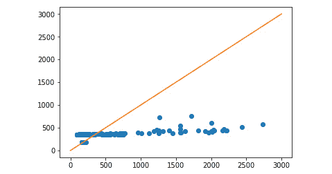

##### 图 3.23: 显示输出的图

```python
model.score(features_test, label_test)
```

输出结果为 `0.06388628722032952`。

现在我们将执行一个使用 3 次多项式核的支持向量回归。

### 第 4 章：分类

#### 活动 7：为分类准备信贷数据

本节将讨论如何为分类器准备数据。我们将使用来自 [`archive.ics.uci.edu/ml/machine-learning-databases/statlog/german/`](https://archive.ics.uci.edu/ml/machine-learning-databases/statlog/german/) 的 `german.data` 作为示例，并为训练和测试分类器准备数据。确保所有标签都是数值，并且值已为分类准备好。使用 80% 的数据点作为训练数据。

1. 从 [`archive.ics.uci.edu/ml/machine-learning-databases/statlog/german/`](https://archive.ics.uci.edu/ml/machine-learning-databases/statlog/german/) 下载 `german.data`，用 Sublime Text 或 Atom 等文本编辑器打开它。在开头添加以下第一行：

   ```
   CheckingAccountStatus DurationMonths CreditHistory CreditPurpose CreditAmount SavingsAccount EmploymentSince DisposableIncomePercent PersonalStatusSex OtherDebtors PresentResidenceMonths Property Age OtherInstallmentPlans Housing NumberOfExistingCreditsInBank Job LiabilityNumberOfPeople Phone ForeignWorker CreditScore
   ```

2. 使用 `pandas` 导入数据文件并将 NA 值替换为离群值值：

```python
import pandas

data_frame = pandas.read_csv('german.data', sep=' ')

data_frame.replace('NA', -1000000, inplace=True)
```

3. 执行标签编码。我们需要将数据框中的所有标签转换为整数。我们可以在一维数组中创建所有标签。然而，这样做效率非常低，因为每个标签恰好出现在一列中。按列对标签进行分组要有意义得多：

```python
labels = {
  'CheckingAccountStatus': ['A11', 'A12', 'A13', 'A14'],
  'CreditHistory': ['A30', 'A31', 'A32', 'A33', 'A34'],
  'CreditPurpose': ['A40', 'A41', 'A42', 'A43', 'A44', 'A45', 'A46', 'A47', 'A48', 'A49', 'A50'],
  'SavingsAccount': ['A61', 'A62', 'A63', 'A64', 'A65'],
  'EmploymentSince': ['A71', 'A72', 'A73', 'A74', 'A75'],
  'PersonalStatusSex': ['A91', 'A92', 'A93', 'A94', 'A95'],
  'OtherDebtors': ['A101', 'A102', 'A103'],
  'Property': ['A121', 'A122', 'A123', 'A124'],
  'OtherInstallmentPlans': ['A141', 'A142', 'A143'],
  'Housing': ['A151', 'A152', 'A153'],
  'Job': ['A171', 'A172', 'A173', 'A174'],
  'Phone': ['A191', 'A192'],
  'ForeignWorker': ['A201', 'A202']
}
```

4. 为每一列创建一个标签编码器并对值进行编码：

```python
from sklearn import preprocessing

label_encoders = {}
data_frame_encoded = pandas.DataFrame()

for column in data_frame:
  if column in labels:
    label_encoders[column] = preprocessing.LabelEncoder()
    label_encoders[column].fit(labels[column])
    data_frame_encoded[column] = label_encoders[column].transform(data_frame[column])
  else:
    data_frame_encoded[column] = data_frame[column]
```

让我们验证一下是否完成了所有操作：

```python
data_frame_encoded.head()
```

```
CheckingAccountStatus DurationMonths CreditHistory CreditPurpose
0 0 6 4
1 48 2 4
2 32 4 7
3 0 42 3
4 24 3 0

CreditAmount SavingsAccount EmploymentSince DisposablePercent
0 1169 4 4
1 5951 0 2
2 2096 0 3
3 7882 0 3
4 4870 0 3

PersonalStatusSex OtherDebtors Property Age
0 2 0 67
1 1 0 22
2 2 0 49
3 2 2 45
4 2 0 53

OtherInstallmentPlans Housing NumberOfExistingCreditsInBank Job
0 2 1 2
1 2 1 1
2 2 1 1
3 2 2 1
4 2 2 2

NumberOfPeople CreditScore Score
0 1 1 1
1 1 0 2
2 2 0 1
3 2 0 1
4 2 0 2
```
（5 行 21 列）

`label_encoders`:
```python
{'CheckingAccountStatus': LabelEncoder(), 'CreditHistory': LabelEncoder(), 'CreditPurpose': LabelEncoder(), 'EmploymentSince': LabelEncoder(), 'ForeignWorker': LabelEncoder(), 'Housing': LabelEncoder(), 'Job': LabelEncoder(), 'OtherDebtors': LabelEncoder(), 'OtherInstallmentPlans': LabelEncoder(), 'PersonalStatusSex': LabelEncoder(), 'Phone': LabelEncoder(), 'Property': LabelEncoder(), 'SavingsAccount': LabelEncoder()}
```

所有 21 列都可用，标签编码器也保存在对象中。我们的数据现在已经过预处理。如果你不需要解码值，就不需要保存这些标签编码器。我们只是为了完整性保存了它们。

5. 现在是分离特征和标签了。我们可以应用理论部分看到的方法：

```python
import numpy as np

features = np.array(
  data_frame_encoded.drop(['CreditScore'], 1)
)

label = np.array(data_frame_encoded['CreditScore'])
```

我们的特征尚未进行标准化。这是一个问题，因为例如金额的距离可能远大于年龄的差异。我们必须对训练和测试数据一起进行标准化，因此可以标准化的最后步骤是在划分训练和测试数据之前。

6. 让我们使用 sklearn 库中的 Min-Max 缩放器：

```python
scaled_features = preprocessing.MinMaxScaler(
  feature_range=(0,1)).fit_transform(features)
```

7. 最后一步是交叉验证。我们将打乱数据，并使用 80% 的数据进行训练，20% 用于测试。

```python
from sklearn import model_selection

features_train, features_test, label_train, label_test = model_selection.train_test_split(
  scaled_features,
  label,
  test_size = 0.2
)
```

#### 活动 8：提高信贷评分的准确性

本节将学习分类器的参数化如何影响最终结果。信贷评分的准确率目前较低：66.5%。找到一种方法提高几个百分点。为了确保其正确发生，你需要完成之前的练习。

完成这个练习有许多方法。在这个解决方案中，我将向你展示通过改变参数化来提高评分的方法。

你必须完成练习 13 才能完成此活动。

1. 将 k 最近邻分类器的 K 值从默认的 5 增加到 10、15、25 和 50。评估结果：

   你必须完成练习 13 才能完成此活动

```python
classifier = neighbors.KNeighborsClassifier(n_neighbors=10)

classifier.fit(features_train,label_train)

classifier.score(features_test, label_test)
```

2. 在对所有四个 `n_neighbors` 值运行这些行后，我得到了如下结果：

   K=10：准确率是 71.5%
   K=15：准确率为 70.5%
   K=25：准确率为 72%
   K=50：准确率为 74%

3. 更高的 K 值并不一定意味着更高的评分。但在本例中，`K=50` 比 `K=5` 产生了更好的结果。

#### 活动 9：scikit-learn 中的支持向量机优化

本节将讨论如何使用支持向量机（SVM）分类器的不同参数。我们将通过比较和对比你学过的不同支持向量回归分类器参数，寻找一组能够在之前的活动中加载并准备的训练数据和测试数据上获得最高分类结果的参数。为了确保操作正确，你将已经完成之前的活动和练习。

我们将尝试几种组合。你可以选择不同的参数，例如：

1. 线性核（Linear kernel）

```python
classifier = svm.SVC(kernel="linear")

classifier.fit(features_train, label_train)

classifier.score(features_test, label_test)
```

2. 4 阶多项式核，C=2, gamma=0.05

```python
classifier = svm.SVC(kernel="poly", C=2, degree=4, gamma=0.05)

classifier.fit(features_train, label_train)

classifier.score(features_test, label_test)
```
输出如下：0.705。

3. 4 阶多项式核，C=2, gamma=0.25

```python
classifier = svm.SVC(kernel="poly", C=2, degree=4, gamma=0.25)

classifier.fit(features_train, label_train)

classifier.score(features_test, label_test)
```
输出如下：0.76。

4. 4 阶多项式核，C=2, gamma=0.5

```python
classifier = svm.SVC(kernel="poly", C=2, degree=4, gamma=0.5)

classifier.fit(features_train, label_train)

classifier.score(features_test, label_test)
```
输出如下：0.72。

5. Sigmoid 核（Sigmoid kernel）

```python
classifier = svm.SVC(kernel="sigmoid")

classifier.fit(features_train, label_train)

classifier.score(features_test, label_test)
```
输出如下：0.71。

6. gamma 为 0.15 的默认核

```python
classifier = svm.SVC(kernel="rbf", gamma=0.15)

classifier.fit(features_train, label_train)

classifier.score(features_test, label_test)
```
输出如下：0.76。

### 第 5 章：使用树进行预测分析

#### 活动 10：汽车数据分类

本节将讨论如何构建一个可靠的决策树模型，帮助你的公司找到客户可能购买的汽车。我们假设你雇于一家租赁公司，该公司专注于与客户建立持久的关系。你的任务是构建一个决策树模型，将汽车分为四类之一：不可接受（unacceptable）、可以接受（acceptable）、良好（good）、非常优秀（very good）。

你可以在此处访问数据集：[`archive.ics.uci.edu/ml/datasets/Car+Evaluation`](https://archive.ics.uci.edu/ml/datasets/Car+Evaluation)。点击 Data Folder（数据文件夹）链接下载数据集。点击 Data Set Description（数据集描述）链接访问属性的描述。

评估你的决策树模型的实用性。

1. 从此处下载汽车数据文件：[`archive.ics.uci.edu/ml/machine-learning-databases/car/car.data`](https://archive.ics.uci.edu/ml/machine-learning-databases/car/car.data)。在 CSV 文件开头添加行头，以便在 Python 中更容易引用：

`Buying,Maintenance,Doors,Persons,LuggageBoot,Safety,Class`

我们简单地将标签命名为 `Class`。我们根据 [`archive.ics.uci.edu/ml/machine-learning-databases/car/car.names`](https://archive.ics.uci.edu/ml/machine-learning-databases/car/car.names) 中的描述对这六个特征进行了命名。

2. 将数据集加载到 Python

```python
import pandas

data_frame = pandas.read_csv('car.data')
```

让我们检查数据是否加载正确：

```python
data_frame.head()
```


## 数据集示例

```
Buying Maintenance Doors Persons LuggageBoot Safety Class
0 vhigh vhigh 2 2 small low unacc
1 vhigh vhigh 2 2 small med unacc
2 vhigh vhigh 2 2 small high unacc
3 vhigh vhigh 2 2 med low unacc
4 vhigh vhigh 2 2 med med unacc
```

## 3. 标签编码

由于分类工作处理的是数值数据，我们必须像在前一章所示那样进行标签编码（label encoding）。

```python
labels = {
    'Buying': ['vhigh', 'high', 'med', 'low'],
    'Maintenance': ['vhigh', 'high', 'med', 'low'],
    'Doors': ['2', '3', '4', '5more'],
    'Persons': ['2', '4', 'more'],
    'LuggageBoot': ['small', 'med', 'big'],
    'Safety': ['low', 'med', 'high'],
    'Class': ['unacc', 'acc', 'good', 'vgood']
}

from sklearn import preprocessing
label_encoders = {}
data_frame_encoded = pandas.DataFrame()

for column in data_frame:
    if column in labels:
        label_encoders[column] = preprocessing.LabelEncoder()
        label_encoders[column].fit(data_frame[column])
        data_frame_encoded[column] = label_encoders[column].transform(data_frame[column])
    else:
        data_frame_encoded[column] = data_frame[column]
```

## 4. 分离特征和标签

```python
features = data_frame_encoded.drop('Class', axis=1)
label = data_frame_encoded['Class']
```

## 5. 划分训练集和测试集

使用 10% 的测试数据：

```python
from sklearn import model_selection
features_train, features_test, label_train, label_test = model_selection.train_test_split(
    features,
    label,
    test_size=0.1
)
```

## 6. 构建决策树

```python
from sklearn.tree import DecisionTreeClassifier
decision_tree = DecisionTreeClassifier()
decision_tree.fit(features_train, label_train)
```

`fit` 方法输出如下：

```
DecisionTreeClassifier(class_weight=None,
criterion='gini',
max_depth=None,
max_features=None,
max_leaf_nodes=None,
min_impurity_decrease=0.0,
min_samples_leaf=1,
min_samples_split=2,
min_weight_fraction=0.0,
presort=False,
random_state=None,
splitter='best')
```

你可以看到决策树的参数设置。我们有许多选项可以微调性能。

## 7. 模型评分

在测试数据上对模型进行评分：

```python
decision_tree.score(features_test, label_test)
```

输出如下：`0.9884393063583815`

## 8. 分类报告评估

知识将带你进入模型评估阶段。我们现在更进一步，根据本主题学习的分类报告对模型进行更深层的评估：

```python
from sklearn.metrics import classification_report
print(
    classification_report(
    label_test,
    decision_tree.predict(features_test)
    )
)
```

输出如下：

```
precision recall f1-score support
0 0.97 0.97 0.97 36
1 1.00 1.00 1.00 5
2 1.00 0.99 1.00 127
3 0.83 1.00 0.91 5
avg / total 0.99 0.99 0.99 173
```

该模型已被证明非常准确。在出现如此高评分的情况下，请怀疑过拟合的可能性。

## 活动 11：针对租车公司的随机森林分类

### 1. 数据准备

本节将优化你的分类器，以便在为你的车队选择未来车辆时更好地满足客户。我们将在本章活动 1 中使用的汽车经销商数据集上执行随机森林和极端随机森林分类。建议进一步改进模型以提高分类器的性能。

我们可以复用活动 1 的步骤 1 到 5。步骤 5 的结束部分如下：

```python
features_train, features_test, label_train, label_test = model_selection.train_test_split(
    features,
    label,
    test_size=0.1
)
```

如果你正在使用 `IPython`，你的变量可能已经在控制台中可用了。

### 2. 创建并训练模型

让我们创建一个随机森林（`RandomForestClassifier`）和一个极端随机树（`ExtraTreesClassifier`）分类器并训练这些模型。

```python
from sklearn.ensemble import RandomForestClassifier, ExtraTreesClassifier

random_forest_classifier = RandomForestClassifier(n_estimators=100, max_depth=6)
random_forest_classifier.fit(features_train, label_train)

extra_trees_classifier = ExtraTreesClassifier(
    n_estimators=100, max_depth=6
)
extra_trees_classifier.fit(features_train, label_train)
```

### 3. 模型表现估计

让我们估计这两个模型在测试数据上的表现：

```python
from sklearn.metrics import classification_report

print(
    classification_report(
    label_test,
    random_forest_classifier.predict(features_test)
    )
)
```

**模型 1（随机森林）输出如下：**

```
precision recall f1-score support
0 0.78 0.78 0.78 36
1 0.00 0.00 0.00 5
2 0.94 0.98 0.96 127
3 0.75 0.60 0.67 5
avg / total 0.87 0.90 0.89 173
```

**模型 2（极端随机树）输出如下：**

```python
print(
    classification_report(
    label_test,
    extra_trees_classifier.predict(features_test)
    )
)
```

```
precision recall f1-score support
0 0.72 0.72 0.72 36
1 0.00 0.00 0.00 5
2 0.93 1.00 0.96 127
3 0.00 0.00 0.00 5
avg / total 0.83 0.88 0.86 173
```

### 4. 准确率得分

我们也可以计算准确率得分：

```python
random_forest_classifier.score(features_test, label_test)
```

输出如下：`0.9017341040462428`

`ExtraTreesClassifier` 的输出如下：

```python
extra_trees_classifier.score(features_test, label_test)
```

输出如下：`0.884393063583815`

我们可以看到，随机森林分类器的性能略优于极端随机树分类器。

### 5. 特征重要性分析

作为第一种优化技术，让我们看看哪些特征更重要，哪些特征不重要。由于随机性，移除不重要的特征可能会减少模型中的随机噪声。

```python
random_forest_classifier.feature_importances_
```

输出如下：`array([0.12656512, 0.09934031, 0.02073233, 0.35550329, 0.05411809, 0.34374086])`

`ExtraTreesClassifier` 的输出如下：

```python
extra_trees_classifier.feature_importances_
```

输出如下：`array([0.08699494, 0.07557066, 0.01221275, 0.38035005, 0.05879822, 0.3860738])`

两个分类器都认为第三和第五个属性不重要。我们可能不确定第五个属性，因为在两个模型中其重要性得分都大于 5%。然而，我们非常确定第三个属性在决策中的影响最小。让我们再次查看特征名称。

```python
data_frame_encoded.head()
```

输出如下：

```
Buying Maintenance Doors Luggage Class
0 3 3 0 0 1
1 3 3 0 0 2
2 3 3 0 0 0
3 3 3 0 0 1
4 3 3 0 0 2
```

最不重要的特征是 `Doors`（门）。回过来看这是显而易见的：例如，门的数量对汽车评级的影响并没有那么大。

### 6. 移除特征并重新训练

从模型中移除第三个特征并重新训练分类器。

```python
features2 = np.array(data_frame_encoded.drop(['Doors'], 1))
label2 = np.array(data_frame_encoded['Class'])
features_train2, features_test2, label_train2, label_test2 = model_selection.train_test_split(
    features2,
    label2,
    test_size=0.1
)
random_forest_classifier2 = RandomForestClassifier(
    n_estimators=100, max_depth=6
)
random_forest_classifier2.fit(features_train2, label_train2)
extra_trees_classifier2 = ExtraTreesClassifier(
    n_estimators=100, max_depth=6
)
extra_trees_classifier2.fit(features_train2, label_train2)
```

### 7. 新模型表现对比

让我们比较新模型与原始模型的表现：

**随机森林模型：**

```python
print(
    classification_report(
    label_test2,
    random_forest_classifier2.predict(features_test2)
    )
)
```

输出如下：

```
precision recall f1-score support
0 0.89 0.85 0.87 40
1 0.00 0.00 0.00 3
2 0.95 0.98 0.96 125
3 1.00 1.00 1.00 5
```

**极端随机树模型：**

```python
print(
    classification_report(
    label_test2,
    extra_trees_classifier2.predict(features_test2)
    )
)
```

输出如下：

```
precision recall f1-score support
0 0.78 0.78 0.78 40
1 0.00 0.00 0.00 3
2 0.93 0.98 0.95 125
3 1.00 0.40 0.57 5
avg / total 0.88 0.90 0.88 173
```

虽然我们提高了几个百分点，但请注意，由于以下原因，直接比较是不可能的。首先，训练测试划分选择了不同的数据。少数几个不当的数据点就会导致得分产生几个百分点的波动。其次，我们训练分类器的方法具有随机性。这种随机性可能会影响分类器的性能。解释结果时始终要运用判断，并在不同的训练测试划分上多次测量结果。

### 8. 参数微调

让我们进一步微调分类器的参数。以下参数将随机森林分类器的 F1 分数提高到了 97%：

```python
random_forest_classifier2 = RandomForestClassifier(
    n_estimators=150,
    max_depth=8,
    criterion='entropy',
    max_features=5
)
random_forest_classifier2.fit(features_train2, label_train2)
print(
    classification_report(
    label_test2,
    random_forest_classifier2.predict(features_test2)
    )
)
```

输出如下：

```
precision recall f1-score support
0 0.95 0.95 0.95 40
1 0.50 1.00 0.67 3
2 1.00 0.97 0.98 125
3 0.83 1.00 0.91 5
avg / total 0.97 0.97 0.97 173
```

### 9. 极端随机树参数微调

在极端随机树分类器上使用相同的参数，我们也得到了令人惊讶的结果：

```python
extra_trees_classifier2 = ExtraTreesClassifier(
    n_estimators=150,
    max_depth=8,
    criterion='entropy',
    max_features=5
)
extra_trees_classifier2.fit(features_train2, label_train2)
print(
    classification_report(
    label_test2,
    extra_trees_classifier2.predict(features_test2)
    )
)
```

---

## K-Means 聚类示例

### 3. 数据归一化

我们的数据点已归一化，除了最小值和最大值：

```python
from sklearn.preprocessing import MinMaxScaler

scaler = MinMaxScaler()
scaled_features = scaler.fit_transform(features)
```

### 4. 创建 K-Means 模型

创建一个 k-means 聚类模型并将数据点拟合到 8 个聚类中。

```python
from sklearn.cluster import KMeans

k_means_model = KMeans()
k_means_model.fit(scaled_features)
```

### 5. 获取聚类标签

每个数据点所属的标签都可以使用 `labels_` 属性检索。这些标签决定了原始数据框行聚类的情况。

`k_means_model.labels_`

### 6. 获取聚类中心

从聚类算法中检索中心点和标签：

`k_means_model.cluster_centers_`

输出如下：

```
array([5, 5, 4, 5, 5, 3, 4, 5, 5, 5, 5, 5, 4, 5, 0, 0, 0, 0, 0, 4, 4, 4,
4, 0, 0, 5, 0, 0, 5, 0, 4, 4, 5, 0, 0, 0, 0, 0, 0, 0, 0, 0, 0, 0,
0, 0, 0, 0, 0, 5, 0, 0, 5, 0, 0, 0, 0, 0, 4, 0, 0, 5, 0, 0, 5, 0,
...
1, 7, 3, 2, 6, 7, 6, 2, 2, 6, 2, 7, 2, 7, 2, 6, 1, 3, 2, 2, 6, 6,
7, 7, 7, 1, 1, 2, 1, 2, 7, 7, 6, 2, 7, 6, 6, 6, 1, 6, 1, 6, 7, 7,
1, 1, 3, 5, 3, 3, 3, 5, 7, 2, 2, 2, 3, 2, 2, 7, 7, 3, 3, 3, 3, 2,
2, 6, 3, 3, 5, 3, 2, 2, 6, 7, 5, 2, 2, 2, 6, 2, 7, 6, 1])
```

这些标签有什么好处？


假设在原始数据框中，给出了产品名称。你可以很容易地识别出相似类型的产品销售情况相似。也有波动很大的产品，以及具有季节性的产品。例如，如果某些产品促进了减肥和塑形，它们往往在一年中的上半年、沙滩季节之前销售。

### Activity 13: 使用 Mean Shift 算法进行形状识别

本节将学习如何对图像进行聚类。我们将假设你正在为一家从照片中检测人类情绪的公司工作。你的任务是从头像照片中提取构成人脸的像素。

使用 Mean Shift 创建一个聚类算法来聚类图像的像素。检查 Mean Shift 算法的结果，并检查当在头像图像上使用时，是否有任何聚类包含人脸。

然后使用固定默认聚类数为 8 的 k-means 算法。将其结果与 Mean Shift 聚类算法进行比较。

1. 选择你想要聚类的图像并加载图像。

2. 我们从作者的 Youtube 频道选择了这张图像：


###### Fig 7.13: 一张包含作者照片的图像

3. 图像尺寸已大幅减小，以便我们的算法更快终止。

```python
image = Image.open('destructuring.jpg')

pixels = image.load()
```

4. 将像素转换为数据框以进行聚类

```python
import pandas

data_frame = pandas.DataFrame(
    [[x, y, pixels[x, y][0], pixels[x, y][1], pixels[x, y][2]]
     for x in range(image.size[0])
     for y in range(image.size[1])],
    columns=['x', 'y', 'r', 'g', 'b']
)
```

5. 使用 scikit-learn 对图像执行 Mean Shift 聚类。注意，这次我们将跳过特征的归一化，因为像素的接近度和颜色分量的接近度以接近相等的权重表示。像素距离的最大差异为 750，而颜色分量的最大差异为 256。

```python
from sklearn.cluster import MeanShift

mean_shift_model = MeanShift()

mean_shift_model.fit(data_frame)

for i in range(len(mean_shift_model.cluster_centers_)):
    image = Image.open('destructuring.jpg')
    pixels = image.load()
    for j in range(len(data_frame)):
        if (mean_shift_model.labels_[j] != i):
            pixels[int(data_frame['x'][j]),
                   int(data_frame['y'][j])] = (255, 255, 255)
    image.save('cluster' + str(i) + '.jpg')
```

6. 算法找到了以下两个聚类：


###### Fig 7.14: 执行 k-means 聚类后的图像

7. Mean Shift 算法将我的皮肤和黄色的 JavaScript 和 Destructuring 文本视为足够接近而形成同一个聚类。

8. 让我们使用 k-means 算法在相同数据上形成八个聚类。

```python
k_means_model = KMeans(n_clusters=8)

k_means_model.fit(data_frame)

for i in range(len(k_means_model.cluster_centers_)):
    image = Image.open('destructuring.jpg')
    pixels = image.load()
    for j in range(len(data_frame)):
        if (k_means_model.labels_[j] != i):
            pixels[int(data_frame['x'][j]), int(data_frame['y'][j])] = (255, 255, 255)
    image.save('kmeanscluster' + str(i) + '.jpg')
```

9. 8 个聚类如下：

第一个的输出如下：


###### Fig 7.15: 执行 k-means 聚类后的图像

第二个的输出如下：


###### Fig 7.16: 执行 K-means 聚类后的图像

第三个的输出如下：


###### Fig 7.17: 执行 K-means 聚类后的图像

第四个的输出如下：


###### Fig 7.18: 执行 K-means 聚类后的图像

第五个的输出如下：


###### Fig 7.19: 执行 K-means 聚类后的图像

第六个的输出如下：


###### Fig 7.20: 执行 K-means 聚类后的图像

第七个的输出如下：


###### Fig 7.21: 执行 K-means 聚类后的图像

第八个的输出如下：


###### Fig 7.22: 执行 K-means 聚类后的图像

正如你所见，第五个聚类相当好地识别出了我的脸。聚类算法确实定位了接近且颜色相似的数据点。

## Chapter 7: 使用神经网络进行深度学习

### Activity 14: 手写数字检测

1. 本节将讨论如何通过检测手写数字为加密货币交易者提供更多安全保障。我们将假设你是一家新加密货币交易平台的软件开发人员。你正在实施的最新安全措施需要识别手写数字。使用 MNIST 库训练神经网络来识别数字。你可以在 [`www.tensorflow.org/tutorials/`](https://www.tensorflow.org/tutorials/) 上阅读有关此数据集的更多信息。

2. 尽可能提高模型的准确性。为确保正确完成，你需要完成前一主题。

3. 加载数据集并格式化输入

```python
import tensorflow.keras.datasets.mnist as mnist

(features_train, label_train),
(features_test, label_test) = mnist.load_data()

features_train = features_train / 255.0
features_test = features_test / 255.0

def flatten(matrix):
    return [elem for row in matrix for elem in row]

features_train_vector = [
    flatten(image) for image in features_train
]

features_test_vector = [
    flatten(image) for image in features_test
]

import numpy as np

label_train_vector = np.zeros((label_train.size, 10))
for i, label in enumerate(label_train_vector):
    label[label_train[i]] = 1

label_test_vector = np.zeros((label_test.size, 10))
for i, label in enumerate(label_test_vector):
    label[label_test[i]] = 1
```

4. 设置 Tensorflow 图。之前使用的是 `sigmoid` 函数，现在我们将使用 `relu` 函数。

```python
import tensorflow as tf

f = tf.nn.softmax

x = tf.placeholder(tf.float32, [None, 28 * 28])

W = tf.Variable(tf.random_normal([784, 10]))

b = tf.Variable(tf.random_normal([10]))

y = f(tf.add(tf.matmul(x, W), b))
```

5. 训练模型。

```python
import random

y_true = tf.placeholder(tf.float32, [None, 10])

cross_entropy = tf.nn.softmax_cross_entropy_with_logits_v2(
    logits=y,
    labels=y_true
)

cost = tf.reduce_mean(cross_entropy)

optimizer = tf.train.GradientDescentOptimizer(
    learning_rate=0.5
).minimize(cost)

session = tf.Session()

session.run(tf.global_variables_initializer())

iterations = 600

batch_size = 200

sample_size = len(features_train_vector)

for _ in range(iterations):
    indices = random.sample(range(sample_size), batch_size)
    batch_features = [
        features_train_vector[i] for i in indices
    ]
    batch_labels = [
        label_train_vector[i] for i in indices
    ]
    min = i * batch_size
    max = (i + 1) * batch_size
    dictionary = {
        x: batch_features,
        y_true: batch_labels
    }
    session.run(optimizer, feed_dict=dictionary)
```

6. 测试模型

```python
label_predicted = session.run(classify(x), feed_dict={
    x: features_test_vector
})

label_predicted = [
    np.argmax(label) for label in label_predicted
]

confusion_matrix(label_test, label_predicted)
```

输出如下：

```
array([[ 0, 0, 223, 80, 29, 275, 372, 0, 0, 1],
    [ 0, 915, 4, 10, 1, 13, 192, 0, 0, 0],
    [ 0, 39, 789, 75, 63, 30, 35, 0, 1, 0],
    [ 0, 6, 82, 750, 13, 128, 29, 0, 0, 2],
    [ 0, 43, 16, 16, 793, 63, 49, 0, 2, 0],
    [ 0, 22, 34, 121, 40, 593, 76, 5, 0, 1],
    [ 0, 29, 34, 6, 44, 56, 788, 0, 0, 1],
    [ 1, 54, 44, 123, 715, 66, 24, 1, 0, 0],
    [ 0, 99, 167, 143, 80, 419, 61, 0, 4, 1],
    [ 0, 30, 13, 29, 637, 238, 58, 3, 1, 0]], dtype=int64)
```

7. 计算准确率分数：

```python
accuracy_score(label_test, label_predicted)
```

输出如下：

```
0.4633
```

8. 通过重新运行负责训练数据集的代码段，我们可以提高准确率：

```python
for _ in range(iterations):
    indices = random.sample(range(sample_size), batch_size)
    batch_features = [
        features_train_vector[i] for i in indices
    ]
    batch_labels = [
        label_train_vector[i] for i in indices
    ]
    min = i * batch_size
    max = (i + 1) * batch_size
    dictionary = {
        x: batch_features,
        y_true: batch_labels
    }
    session.run(optimizer, feed_dict=dictionary)
```

第二次运行：0.5107

第三次运行：0.5276

第四次运行：0.5683

第五次运行：0.6002

第六次运行：0.6803

第七次运行：0.6989

第八次运行：0.7074

第九次运行：0.713

第十次运行：0.7163

第二十次运行：0.7308

第三十次运行：0.8188

第四十次运行：0.8256

第五十次运行：0.8273

在第五十次运行结束时，改进后的混淆矩阵如下所示：

```
array([
    [946, 0, 6, 3, 0, 1, 15, 2, 7, 0],
    [ 0,1097, 3, 7, 1, 0, 4, 0, 23, 0],
    [11, 3, 918, 11, 18, 0, 13, 8, 50, 0],
    [3, 0, 23, 925, 2, 10, 4, 9, 34, 0],
    [2, 2, 6, 1, 929, 0, 14, 2, 26, 0],
    [16, 4, 7, 62, 8, 673, 22, 3, 97, 0],
    [8, 2, 4, 3, 8, 8, 912, 2, 11, 0],
    [5, 9, 33, 6, 9, 1, 0, 949, 16, 0],
    [3, 4, 5, 12, 7, 4, 12, 3, 924, 0],
    [8, 5, 7, 40, 470, 11, 5, 212, 251, 0]
    ],
    dtype=int64)
```

结果不算差。10 个数字中有超过 8 个被准确识别。

### Activity 15: 使用深度学习进行手写数字检测

本节将讨论深度学习如何提高模型的性能。我们将假设你的老板对你在前一个活动中展示的结果不满意，并要求你考虑在原始模型中添加两个隐藏层，并确定新的层是否能提高模型的准确率。为了确保正确进行，你需要具备深度学习的知识。

#### 1. 执行前一个活动的代码并衡量模型的准确率。

#### 2. 通过添加新层来改变神经网络。我们将结合 `relu` 和 `softmax` 激活函数：

```python
x = tf.placeholder(tf.float32, [None, 28 * 28])

f1 = tf.nn.relu

W1 = tf.Variable(tf.random_normal([784, 200]))

b1 = tf.Variable(tf.random_normal([200]))

layer1_out = f1(tf.add(tf.matmul(x, W1), b1))

f2 = tf.nn.softmax

W2 = tf.Variable(tf.random_normal([200, 100]))

b2 = tf.Variable(tf.random_normal([100]))

layer2_out = f2(tf.add(tf.matmul(layer1_out, W2), b2))

f3 = tf.nn.softmax

W3 = tf.Variable(tf.random_normal([100, 10]))

b3 = tf.Variable(tf.random_normal([10]))

y = f3(tf.add(tf.matmul(layer2_out, W3), b3))
```


#### 3. 重新训练模型

```python
y_true = tf.placeholder(tf.float32, [None, 10])

cross_entropy = tf.nn.softmax_cross_entropy_with_logits_v2(
    logits=y,
    labels=y_true
)

cost = tf.reduce_mean(cross_entropy)

optimizer = tf.train.GradientDescentOptimizer(
    learning_rate=0.5).minimize(cost)

session = tf.Session()

session.run(tf.global_variables_initializer())

iterations = 600

batch_size = 200

sample_size = len(features_train_vector)

for _ in range(iterations):
    indices = random.sample(range(sample_size), batch_size)
    batch_features = [
        features_train_vector[i] for i in indices
    ]
    batch_labels = [
        label_train_vector[i] for i in indices
    ]
    min = i * batch_size
    max = (i+1) * batch_size
    dictionary = {
        x: batch_features,
        y_true: batch_labels
    }
    session.run(optimizer, feed_dict=dictionary)
```

#### 4. 评估模型

```python
label_predicted = session.run(y, feed_dict={
    x: features_test_vector
})

label_predicted = [
    np.argmax(label) for label in label_predicted
]

confusion_matrix(label_test, label_predicted)
```

输出如下：

```
array([[ 801, 11, 0, 14, 0, 0, 56, 0, 61, 37],
    [ 2, 1069, 0, 22, 0, 0, 18, 0, 9, 15],
    [ 276, 138, 0, 225, 0, 2, 233, 0, 105, 53],
    [ 32, 32, 0, 794, 0, 0, 57, 0, 28, 67],
    [ 52, 31, 0, 24, 0, 3, 301, 0, 90, 481],
    [ 82, 50, 0, 228, 0, 3, 165, 0, 179, 185],
    [ 71, 23, 0, 14, 0, 0, 712, 0, 67, 71],
    [ 43, 85, 0, 32, 0, 3, 31, 0, 432, 402],
    [ 48, 59, 0, 192, 0, 2, 45, 0, 425, 203],
    [ 45, 15, 0, 34, 0, 2, 39, 0, 162, 712]],
    dtype=int64)
```

#### 5. 计算准确率分数

```python
accuracy_score(label_test, label_predicted)
```

输出为 `0.4516`。

准确率没有提高。

让我们看看进一步的运行是否能提高模型的准确率。

第二次运行：`0.5216`

第三次运行：`0.5418`

第四次运行：`0.5567`

第五次运行：`0.564`

第六次运行：`0.572`

第七次运行：`0.5723`

第八次运行：`0.6001`

第九次运行：`0.6076`

第十次运行：`0.6834`

第二十次运行：`0.7439`

第三十次运行：`0.7496`

第四十次运行：`0.7518`

第五十次运行：`0.7536`

之后，我们得到了以下结果：`0.755`、`0.7605`、`0.7598`、`0.7653`

最终的混淆矩阵：

```
array([[ 954, 0, 2, 1, 0, 6, 8, 0, 5, 4],
    [ 0, 1092, 5, 3, 0, 0, 6, 0, 27, 2],
    [ 8, 3, 941, 16, 0, 2, 13, 0, 35, 14],
    [ 1, 1, 15, 953, 0, 14, 2, 0, 13, 11],
    [ 4, 3, 8, 0, 0, 1, 52, 0, 28, 886],
    [ 8, 1, 5, 36, 0, 777, 16, 0, 31, 18],
    [ 8, 1, 6, 1, 0, 6, 924, 0, 9, 3],
    [ 3, 10, 126, 80, 0, 4, 0, 0, 35, 770],
    [ 4, 0, 6, 10, 0, 6, 4, 0, 926, 18],
    [ 4, 5, 1, 8, 0, 2, 2, 0, 18, 969]],
    dtype=int64)
```

这个深度神经网络的行为比单层网络还要更加混乱。从准确率 `0.572` 提升到 `0.5723` 花了 `600` 次迭代，每次迭代 `200` 个样本。没过多久，在相同数量的迭代中，我们的准确率从 `0.6076` 跳升到了 `0.6834`。
