# 商业管理中的人工智能与机器学习：概念、挑战与案例研究

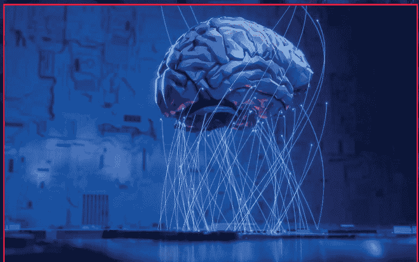

编辑者

Sandeep Kumar Panda

Vaibhav Mishra

R. Balamurali

Ahmed A. Elngar


编辑者：

Sandeep Kumar Panda

Vaibhav Mishra

R. Balamurali

Ahmed A. Elngar


使用 Times 字体字体

由 SPi Technologies India Pvt Ltd (Strave) 设计

献给我的姐妹Sushri Susmita、Sujata、Bhaina Sukanta，侄子 Surya Datta，妻子 Itree (Leena)，儿子 Jay Jagdish，以及已故父亲 Jaya Gopal Panda 和已故母亲 Pranati Panda。

Sandeep Kumar Panda

献给我的父亲 Ravindra Kumar Mishra、母亲 Shakuntala Mishra 以及我的其他家人和朋友。

Vaibhav Mishra

献给全能主（湿婆父亲）以及 Mt. Abu 布拉哈马库米世界精神大学的所有神圣兄弟姐妹。

R. Balamural

献给我的父母，你们的笑容为我的孩子 Farida 和 Malek 带来了快乐。

Ahmed A. Elngar


## 序言

本书的重点是在商业管理的背景下介绍人工智能（AI）和机器学习（ML）技术。随着 AI 或 ML 在商业智能领域日益成熟，本书探讨了超越组织限制的创新 AI 案例。它遵循预测性建模工具包，提供了关于如何在业务领域使用 AI 工具的见解。通过采用多学科方法来使用 AI，本书为本科生、研究生、商业专业人士及相关学科提供了全面的参考资源。

如今，AI 在供应链领域不断进步，用于追踪产品、提供工业、金融等领域的智能。在这方面，传统的教学学习模式已无法满足工业4.0政策的需求。在此，我们编辑了本书以缩小学术与工业之间的差距。

本书由15章组成：

第1章“营销中的人工智能”讨论了如何通过应用文本挖掘等技术帮助人们更好地理解语音（识别），结合编程的最新进展实现了直接营销响应的建模以及使用分类树预测流失。

第2章“零售分析中的消费者洞察”深入描述了印度零售公司如‘Shoppers Stop’和‘Future Group’如何利用客户数据和其他交易数据，预测其未来的购买行为并设计产品陈列策略。

第3章“B2C 电子商务的多智能体范式”讨论了 KBS、CBR、ANN、GA 和 MAS 在业务中的应用，以及谈判、客户关系管理和以客户为中心。从计算角度来看，还讨论了智能体特性、多智能体范式及其通信协议。最后，该章节描述了用于心理状态和其他认知参数的 BDI 架构，如

其他认知参数。

# 前言

在任何电子商务系统中，计算信任所需的偏好、承诺和能力，使复杂智能体的内部架构正式化。

第4章《人工智能与机器学习：发现业务新模式》阐述了人工智能（AI）和机器学习（ML）应用对金融业的影响，重点关注银行业、AI如何影响客户、维护客户关系、影响业务绩效，以及AI将如何改变银行业的未来。人工智能是当今金融领域广泛的前沿数字化转型战略之一。

第5章《基于机器学习的信用卡欺诈检测分析与比较》讨论了保护或防止持卡人遭受巨大损失的欺诈检测技术。为了确定欺诈交易，使用了多种深度学习算法，如长短期记忆（LSTM）、门控循环单元（GRU）、卷积神经网络（CNN）和多层感知器（MLP）。

第6章《全民人工智能：机器学习与医疗健康》深入探讨了医疗健康领域，将其视为机器学习应用的主要挑战领域。机器学习的作用是帮助普通人无限制地获得医疗服务。

第7章《揭秘机器学习与人工智能在个性化护理中的能力》讨论了由机器学习赋能的人工智能，它能够在早期检测异常，让医生和患者尽早对未来的疾病或健康状况收到警报，从而通过个性化建议提供早期治疗；医生和患者还结合小型案例研究查看了这些技术。

第8章《人工智能与第四次工业革命》侧重于简要理解数据隐私、网络伦理和网络安全问题的治理，并强调了未来对更广泛法律和政策制定者的需求。人工智能、机器学习和嵌入技术的变革性影响将塑造新的经济和市场空间。在这个不断扩张的互联世界中，经济、市场、生态系统和组织将如何反应和应对。

第9章《基于AI的评估辅助学生通过在线系统学习》关注用于在线学习环境中学生表现的AI技术，并提供反馈以改进学习过程。书中给出基于马尔可夫决策过程的简单实现，以便理解这种方法。

第10章《调查新冠期间利用人工智能引发电子学习变革》审视了AI在新冠期间电子学习中的描绘，除了发现AI在这一大流行病期间的作用外，该研究还调查了新冠后AI在电子学习中的未来。

第11章《利用AI进行员工流失管理》描述了一种AI模型，该模型通过显著调查机构过去的指数，帮助人力资源管理预测哪些代表可能在不远的未来离开机构。

前言

第12章《机器学习：统计预测方法主导地位的新纪元》简要涵盖了流行的实证研究预测和用于预测目的的ML（AI）方法及其结果，以及对未来研究方向的建议。

第13章《基于循环神经网络的长短期记忆深度神经网络模型用于外汇预测》提供了不同国家的每日数据，并分别使用反向传播神经网络（BPNN）、功能链接人工神经网络（FLANN）和LSTM进行比较。在对这三个模型的每日汇率预测进行比较时，LSTM模型以最高的准确性和更快的收敛速度表现最优。

第14章《AI应用涉及的伦理问题》强调了目前不同领域正在解决的伦理问题和方法。

第15章《利用视频分析进行语义数据提取：AI分析视角》论述了如何通过四个步骤从CCTV捕获的视频中提取车牌号，包括将视频转换为连续图像序列、图像分割、字符分割和字符识别，并在每个阶段进行预处理，以提高下一阶段可用输入数据的质量。在问题复杂性日益增加以及视频分析提供的功能不断丰富的时代，这可以成为支持许多应用的最基础、通用的解决方案。


### 致谢

首先，我们要感谢全能的主宰。在汇编这本书的过程中，我们意识到自己是多么地幸运。您赋予了我们相信自己的激情并追求梦想的力量。如果没有对全能主主的信仰，我们永远无法完成这些。

我们对在第一版准备期间提供帮助的许多人表示感谢。

感谢所有作者，他们投入宝贵的时间、知识、见解和想法贡献了书中的多个章节。我们也感谢大家在文档处理的各个阶段提供的友好合作。

感谢Kanugonda Lokesh Reddy先生（M.Tech），他通过将图片放在合适的位置对书中章节进行了格式化。

感谢IFHE（ICAI高等教育基金会）管理层、顾问、院长、院长长以及IcaITech（科学技术学院）和IBS（ICAI商学院）教职员工提供了必要的设施、氛围、鼓励、建议和精神支持，这些帮助我们很好地塑造了这本书并高效地完成了任务。

我们非常感谢CRC Press和Taylor & Francis，他们提供了编辑《业务管理中的人工智能与机器学习：概念、挑战与案例研究》一书的机会。在此，特别感谢Keith Editorial Services Ltd对英语语言和句法的大量改进。我们坚信这本书将读者产生积极影响。

最后，但同样重要的是，我们要感谢这本书的所有潜在读者。我们在编写时心中一直有你们。我们欢迎建议、改进提示、批评和赞赏。您的宝贵意见对我们的未来至关重要。


# 贡献者

Rachna Agrawal

教授

管理学系

J. C. Bose科学技术大学

YMCA, Faridabad

Pradosh Kumar Gantayat

计算机科学

DRIEMS自治工程学院

Tangi Cuttack Odisha, India

Vaidik Bhatt

运营与IT部门，ICFAI商学院（IBS），Hyderabad

ICAI高等教育基金（IFHE）（根据UGC法第3条被视为大学）

Ajay Kumar Jena

计算机工程学院

Kalinga工业大学（被视为大学）

Bhubaneswar, Odisha

Rachita Kashyap

营销与策略部门

IBS

IFHE大学

Hyderabad

Aditi Bansal

计算机科学与工程系

工程技术学院

Bhubaneswar, Odisha

Dr Puspalata Mahapatra

计算机工程学院

Kalinga工业大学（被视为大学）

Bhubaneswar, Odisha, India

Dhiraj Bhattarai

计算机工程学院

Kalinga工业大学（被视为大学）

Bhubaneswar, Odisha, India

Breshwar Das Mazumdar

计算机科学系

IERT Allahabad

Allahabad, India

Sujata Priyambanda Dash

管理系

比尔拉理工学院

Mesra, Ranchi, India

Sambit Mohanty

软件开发员 CTSC

Hydabad, India

Rishi Dwesar

营销与策略部门，

IBS

IFHE大学

Hyderabad, India

Subhadarini Mohanty

计算机科学与工程系

工程技术学院

Bhubaneswar, Odisha, India

## 者

### Subashish Mohapatra

### Minakhi Rout

计算机科学与工程系

工程与技术学院，比布巴纳斯尔，奥里萨邦，印度

计算机工程学院

卡林加加工业技术学院（认定大学）

比布巴纳斯尔，奥里萨邦，印度

### Vidushi Pandey

### Shubhagata Roy

信息系统系

印度管理学院

科泽里科德，喀拉拉邦，印度

运营与 IT 部门

IBS 海德拉德

IFHE，海德拉德，印度

### Vijay Shankar Pandey

### P. Sashikala

助理教授

管理科学学院

勒克瑙大学

勒克瑙，印度

海德拉德 ICFAI 商务学院 (IBS) 运营与 IT 部门

ICFAI 高等教育基金 (IFHE)（根据 1956 年 UGC 法案第3条认定的大学）

### Sanghmithra Patnaik

### Alok Kumar Sahai

KIIT 认定大学

奥里萨邦，印度

管理研究学院

Sri Sri 大学

库塔马克，印度

### Parthasarathi Pattanayak

### Saloni

计算机应用学院

KIIT 认定大学

奥里萨邦，印度

计算机工程学院

卡林加加工业技术学院（认定大学）

比布巴纳斯尔，奥里萨邦，印度

### K. S. Perianayagam

### Musarrat Shaheen

首席技术官

Sahara Net Corp Ltd.

勒克瑙，印度

人力资源系助理教授，海德拉德 ICFAI 商务学院 (IBS)，IFHE（认定大学）

### Pooja Rani

### Nidhi Shukla

研究生

管理研究系

J.C. 玻斯科学与技术大学

YMCA，法里达巴德，哈里亚邦

管理商业与经济学院

Sri Ramswaroop 纪念大学系

勒克瑙，印度

### Namita Rath

### Anand Sinha

管理研究学院

Sri Sri 大学

库塔马克，印度

Sahara Net Corp Ltd.

勒克瑙，印度

### Sarita Kumari Singh

计算机工程学院

卡林加加工业技术学院（认定大学）

比布巴纳斯尔，奥里萨邦，印度

### Farrah Zeba

助理教授

营销与策略系

海德拉德 ICFAI 商务学院 (IBS)

IFHE（认定大学）


## 编辑者

Sandeep Kumar Panda 目前担任 ICFAI 高等教育基金（认定大学）IcfaiTech（科学与技术学院）数据科学与人工智能系的副教授，该校位于印度特伦甘纳纳纳邦海德拉德。他的研究兴趣包括密码学与安全、区块链技术、物联网、人工智能和云计算。他在国际期刊和国际会议上发表了许多论文。他曾获得 2020 年 1 月在新德里举行的印度政府 MSME 旗下的由 WIEF 和 EduSkills 主办的“年度研究与创新奖”。他拥有 17 项印度专利。他的专业会员身份包括 MIEEE、MACM 和 LMIAENG。

Daibhav Mishra 目前担任印度 IBS 海德拉德 IFHE 大学的助理教授。他在技术大学完成了计算机科学工程学学位。随后，他在阿拉拉巴德印度信息技术学院 (IIT) 完成了 MBA 和博士学位。在博士期间，Mishra 博士获得了 MHRD 学金金。他拥有多项证书，如毕马奇颁发的六格玛（质量管理）“绿带”、BSI 的 ISO 20000-1:2005（IT 服务管理），以及来自坎普尔理工的 R 编程实用方法。他在国际报告类期刊（被 SCOPUS 和 ABDC 收录）、《国际银行营销期刊》(A)、《国际电子业务期刊》(C) 等期刊上发表了研究文章。他还担任了多个期刊的审稿人，如 Elsevier 的 *Information & Management* (ABDC-A*)、Inderscience 的《印度文化与商业管理国际期刊》、《高等教育可持续性国际期刊》等。他的兴趣领域包括管理信息系统、数据库管理系统、加密货币、云计算、电子商务、ERP 系统、质量管理和数据挖掘。

Ramurali 博士目前担任印度海德拉德 ICFAI 高等教育基金科学与技术学院计算机科学与工程系的助理教授兼协调员。他的研究兴趣包括传感器网络的能量效率、无线体域网络、物联网和深度学习。Ramurali 博士是印度技术教育协会 (ISTE) 的终身成员。他 2002 年获得印度 PET 工程学院的计算机科学与工程学士学位。他于 2008 年在印度清奈的 Satyabhama 大学完成信息技术硕士学位，并于 2017 年在印度清奈的大学获得无线传感器网络方向的计算机科学与工程博士学位。


2017 年 6 月至 2018 年 6 月，他在印度大诺伊的 Bennett 大学担任博士后研究员。他在国际期刊和知名会议上发表了研究文章。

Ahmed A. Elgar 博士是贝尼苏埃夫大学计算机科学教授、技术与信息中心 (TISC)科学创新小组 (SIRG) 主席，《网络安全与管理期刊》(JCIM) 成员。他在国际期刊和知名会议上发表了研究文章。他的研究兴趣包括物联网 (IoT) 以及数据挖掘和人工智能领域的许多活动。他还获得了技术领域的“最佳青年研究员奖”。


通过监督学习、无监督学习和强化学习来实现。在监督学习中，会向机器提供若干组输入和输出。在这种方法中，数据被输入到算法中，机器试图识别输入与输出之间的关系。当机器停止学习时——换句话说，它已经完成了最优学习——学习的模型就可以预测新数据点的值或类别。例如，可以训练一个系统来区分袋鼠和考拉。通过向该系统提供这两种动物的数十张图像，系统将学习区分它们的特征并改进其预测能力。在无监督学习中，对数据进行分析，而不尝试进行任何预测。它侧重于学习和理解观测数据之间的底层结构属性和关联。这种学习可以用于检测离群值、客户及市场的分类与分割。在强化机器学习中，系统没有历史数据来得出结论；相反，算法通过采取不同的行动并评估其成功与失败来学习。Facebook 在首次投放广告时使用了强化学习。随着时间的推移和销售额的增长，Facebook 的算法会分析可用数据，然后在特定的地理位置、一天中的特定时间以及屏幕位置向组客户展示广告。

我们看到 AI、ML 和数据科学被结合使用，它们在今天被认为是利润丰厚的职业选择。数据科学可以定义为一个宽泛的研究领域，涉及数据系统和流程，旨在维护数据并从中得出意义。随着技术和互联网的出现，如今所有组织都通过日常交易产生大量数据，对于这些组织来说，监控、存储、组织和从这些数据中提取重要信息变得具有挑战。数据科学家使用工具、应用程序和原理的组合，从各种随机数据簇中提取有用信息，并以此引导业务流程以实现组织目标。提取出的信息可用于任何业务领域的持续数据趋势，并有助于提供业务预测，基于所得的洞察和推断制定行动方案。机器学习的最好例子是 Netflix 根据客户的观影行为向其推荐电影，并根据客户在网站上的过去的购买记录推荐书籍。在机器学习的帮助下，营销人员为客户提供定制化内容以及他们可能希望购买的产品。

机器学习是一项赋予计算机在无需显式编程的情况下进行学习能力的研究领域，而数据科学处理的是从数据中提取知识。深度学习是一种模仿人类大脑神经元网络的大人工神经网络。它是机器学习的一个子集，被称为“深度学习”，因为它使用深层神经网络进行学习。机器使用不同的层从数据中学习，模型的深度由模型中的层数表示。

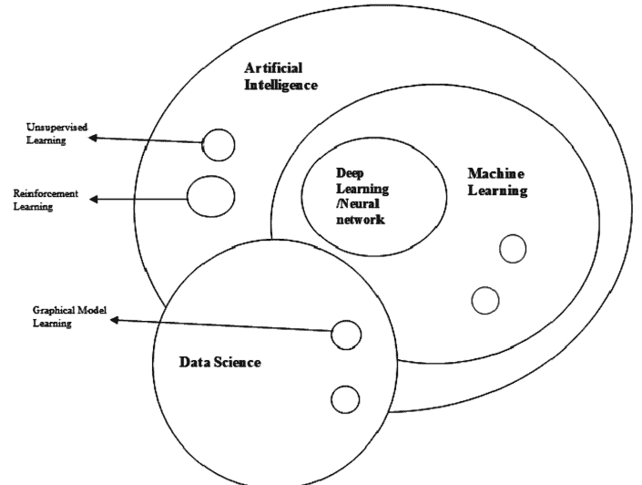

图 1.1 AI、ML 与数据科学之间的关系。

深度学习是 AI 领域的一个新术语。参考图 1.1 AI、ML 与深度学习之间的关系（如图1.1所示）。

在一个世纪里，人类文明在技术、医疗、经济和每一个可能的物质维度上都取得了飞跃的发展。在未来几年里，我们可能会预计人类驱动汽车被自动驾驶汽车取代、医生通过机器人手术设备进行远程手术、纳米技术清洁衣物、3D打印机促进即时交付（这意味着制造时间可以缩短）、植入式通信设备取代手机以及许多其他技术进步。如果所有广告和营销任务完全由计算系统管理，那也无奇。目前，营销人员使用大量技术，但在未来的几十年里，AI 和 ML 方法将把营销游戏推向一个新的水平。


从业者和学者已经预计 AI 将改变营销策略和客户行为。根据 Salesforce 进行的一项调查，AI 将是未来几年营销人员采用最多的技术。在 AI 的帮助下，业务流程正在实现自动化，机器能够以更高的准确性和更少的人为干预执行预设任务，例如传输数据、向现有及潜在客户发送促销邮件、更新客户文件、更换丢失的 ATM 卡、使用自然语言处理读取文档提取要点等。通过 AI 的帮助，公司可以从海量的交易和客户数据中获得洞察，这些数据不仅包括数值类型，还包括文本、客户与客服人员对话的录音、面部表情，甚至是语调。通过在日常运行中使用 AI，公司可以更好地预测客户、部署适当数字营销策略或预测潜在的信用欺诈。

营销机器人是最流行的软件形式之一，可以被编程为独立执行特定的动作set。机器人通常设置成本低，易于编程和运行。机器人驱动的商业是我们现代的宿天使命，也是营销的未来。例如，为了给新买的台灯买灯泡，你需要访问网站、浏览多个页面、填写有关收货地址的表格、提供支付信息等。如果有机器人，你只需要告诉它为你的台灯找灯泡，它将引导你选择灯泡的高度、电压等，然后为你下单。在后台，机器人会引导你通过一系列问题，以更好地理解你的意图，并向你提供正确的信息。AI 机器人可以同时提供客户和销售支持服务，24/7 全天候，错误率低，且其部署可以根据需求扩大或缩小。

以下是机器人可以执行的几个功能，对任何业务都可能有益：

- 协助网站访问者寻找答案。
- 帮助进行营销研究。
- 筛选线索。
- 帮助跟踪个人团队成员的工作，并让整个团队了解彼此的工作进展。
- 为客户提供个性化广告。

根据上述的所有描述，AI 具有减少所产生成本和增加收入的潜力。可以通过做出明智且改进的营销决策来增加收入（例如：产品推荐、竞争性定价、个性化促销、增强客户参与度）。成本可能会由于简单营销任务的自动化而下降，并释放人工来处理更复杂的营销任务。

存在一种误解，认为 AI 正在取代人类的工作，但公司可以使用 AI 来增强员工的能力。例如，领先的服装和外提供商 Stitch Fix 使用 AI 机器人协助其员工为客户提供更好的服务。在 AI 的帮助下，造型师通过整合客户提供的数据（同时表达他们的偏好、通用风格趋势、手写笔记、Pinterest 画板以及同细分领域其他客户的偏好），为客户识别最佳服装。Ginni Rometty（IBM 首席执行官）在媒体互动中经常表示，AI 不会导致“人对抗机器”的世界，而是导致“人加机器”的世界 [1]。

### 1.4.1 优点

- A) 个性化和相关信息

AI 驱动的预测性分析可以通过触达正确的客户群体并分析其浏览历史，从而向正确的人群展示合适的广告，来帮助公司。这可以帮助公司在之前了解客户的偏好，然后做出相应的建议。Amazon 和 Netflix 广泛使用这一技术，通过让客户留在他们的服务中并避免取消服务，节省了数十亿美元。作为一名营销人员，AI 在开发某些数据点方面赋予了你巨大的力量，引导客户找到正确的产品。

- B) 简化营销工作

深度学习 AI 可以理解行为模式，并预测哪部分客户最可能进行某类购买。这可以帮助企业更准确地定位客户群体，而不会在潜在线索上浪费时间和金钱。

- C) 节省成本

根据全球开展的多项研究，品牌与客户之间的互动约有 85% 将发生在在线。与黄金时段电视、印刷广告、广告牌等其他广告媒体相比，在 AI 的帮助下，在线广告更加廉价，并且在定位目标客户方面更加精准。

- A) 仍需要人类控制

AI 在没有人类干预的情况下无法运行，因为它缺乏创造力、灵活性想象力，而这些特使人类成为营销世界的中心。人类有各种口味、偏好、经验等，让他们能够比由公式、统计、命令等算法运行的机器做出更好的决策。

- B) 算法可能会出错

由于数据不良，AI 会产生偏见。例如，自动偏好并筛选白人男性的简历，而不是属于其他种族、性别、肤色的人，因为这些职位上的成功人士大多是白人男性。这使得 AI 推断出白人男性比其他人更适合这些职位。

- C) 自动聊天机器人和机器回答并非总是解决方案

许多人（尤其是老年人）不习惯与机器而不是人类客户服务代理交谈。此外，我们知道当手头有紧急事务并向机器人寻求解决方案时，会是多么令人沮丧。因此，企业只有在对其客户细分和产品供应进行仔细研究后，才安装聊天机器人。

Amazon.com, Inc 由 Jeff Bezos 于 1994 年创立，当时名为 Cadabra (1994-95)。它最初是一个在线图书市场，但后来进军了家具、服装、食品、珠宝、软件等领域。它被认为是大科技公司之一（与 Google、Apple 和 Facebook 并列），专注于电子商务、人工智能、数字流媒体和云计算。2018 年，Amazon 宣布了其两日送服务 Amazon Prime，目前在全球拥有 1000 万订阅者。Prime Video、Amazon Music、Audible 和 Twitch 是下载内容平台，音频书、视频和音乐是流媒体平台。Amazon 通过 Fresh、Amazon Studios、Kindle Store.com 分发各种产品和服务。收购了约 40 家子公司，包括 Zappos、Goodreads、Amazon Robotics、IMDb、Amazon Maritime、Ring、Whole Foods Markets 等。

Amazon 于2018 年在西雅图开了第一家商店。它是便利店链，全美有 26 家店，并在 2020 年进一步进入英国。Amazon Go 不仅仅是一家杂货店；它是一个拥有“即拿即走”（Walk Out）技术的商店，客户只需进入商店，拿取他们需要的物品离开，消除了结账队伍。为了开始购物，购物者需要拥有 Amazon 账户、智能手机和 Amazon Go App。因为购物者需要在入口闸机处在智能手机的 App 内扫描条码，随身携带手机，并在离开商店前取所需的任何物品。Amazon 将自动驾驶汽车使用的技术（AI、ML、图像识别、传感器阵列、深度学习、计算机视觉）应用于 Amazon Go 的购物体验。从购物者进入商店的那一刻起，他们通过安装在商店各处的传感器和摄像头被识别并追踪。技术会自动检测从货架上取下的物品。它跟踪虚拟购物车中的产品，一旦购物完成购物者离开商店，Amazon 会从其 Amazon 账户中扣费并向客户发送收据。

首先，通过采集几个传感器获取数据，以便对从过道或货架上取下的商品进行感知。传感器类型的示例包括重量测量、压力检测器、产品的尺寸测量。其次，使用深度学习算法来理解客户拿了或放回什么产品；虚拟购物车中有哪些产品；客户花了多久做决定；哪些产品销售得更快，以及将这些产品放在哪里以便于获取。最后，当客户离开商店通过出口点时，将为虚拟购物车中的物品生成账单，这是幕后工作的智能机器进行自动分析的结果。

在 Amazon Go 商店成功后，许多零售商对这种技术产生了兴趣，这种技术是传感器、摄像头和软件的复杂系统结合，可以跟踪购物者在商店内的每项活动和移动。Amazon Go 技术包已上市。“即拿即走”技术可以安装在正在装修的现有零售店中，也可以安装在建设中的新店，整个设置程序只需要几周。该品牌更进了一步，创建一个专门用于“即拿即走”技术的新网站，涵盖了所有相关方面，如销售优惠、有关新业务线的常见问题等。该网站不涵盖价格信息，但涵盖了硬件、软件解决方案等各种零售。Amazon 通过电话或邮件提供 24/7 客户支持 [2]。

Amazon 使用计算机成像和传感器融合技术来记录和分析客户行为，并给出相应的结果。但如果客户戴着口罩呢？在目前的流行病条件下，佩戴口罩是必要的。Amazon Go 的产品数量可能会增加，如果客户没有将取出的物品放回原先的货架上呢？客户会被收费吗？如果客户在商店内消费了产品（例如果汁瓶或盒装糖果）并将空包装放回货架上呢？在这种情况下怎么办？如果带着孩子的家庭进入商店呢？技术如何识别孩子拿的物品？而且观察到商店里一次有超过 20 名客户，软件崩溃了；Amazon 如何处理这些问题？这项技术仍在增长中，还有很长的路要走。

Amazon Go 商店：未来的趋势如图 1.2 所示。图 1.3 显示了一个无结账商店，客户在里面取产品并离开商店，图 1.4 代表 Amazon Go 无结账便利店。图 1.5 显示了员工在无结账商店内上货。

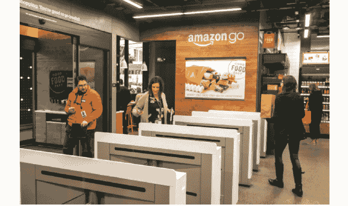

FIGURE 1.2 Amazon Go 商店：未来的趋势。


图 1.4 Amazon Go 无收银便利店 [2, 3]。


图 1.5 一名员工在无收银商店内上架 [5]。

人工智能的应用在本质上非常广泛。得益于检测和推断数据中模式的能力趋势，营销人员可以识别机会和威胁，并实时采取行动。以下是我们在营销计划的不同阶段利用人工智能潜力的方法。

此阶段涉及通过分析现状和理解业务环境，对宏观环境因素和未来业务环境进行分析 [6]。营销人员使用 `SWOT`（优势、劣势、机会、威胁）分析来对目标市场进行深入理解。通过社交倾听等 AI 辅助功能，可以获得有关购买模式和客户满意度的数据驱动信息，从而评估和估算需求市场趋势及相应的客户。在机器学习（`ML`）的帮助下，消费者研究调查了在线论坛并建议品牌在分析竞争品牌时不应仅关注自身，这可以对竞争对手的反应产生理解。

此阶段涉及对微观环境因素的分析。组织试图理解影响其忠诚度、态度、购买模式、产品类别和市场需求的消费者行为因素。人工智能可以帮助营销人员处理通过社交媒体账户、移动活动搜索和接触互动的海量数据。例如，在 2019 年拉斯维加斯消费者电子产品展上，Data Labs 和 Promobot（一家机器人制造商）演示了用于客户体验的情绪检测 [6]。启用人工智能系统结合眼球运动、心率、语音手势和面部表情来确定客户的情绪状态。Rosbank 正在呼中心使用此技术，收集音量变化和语音转换时间的数据 [7]。

此阶段涉及对某些标准进行大量的消费者研究，使营销人员能够精确地传递信息并根据目标客户的需求开发产品。人工智能可以帮助预测客户意图，并通过定制化促销获得更多洞察。例如，名为 Albert 的营销算法负责了 2016 年哈雷戴维森 40% 的摩托车销售。尽管人工智能在细分和定位方面具有某些优势，但它也可能导致无意的价格歧视，以及向谁提供产品和服务的问题 [9]。

此阶段涉及短期目标、长期目标的制定、未来策略的规划以及客户服务（Campbell 等，2020）。人工智能可以通过在网站、App 和社交媒体渠道上集成聊天机器人来帮助营销人员促进销售（Wood, 2011）。美国 24% 的企业使用 AI 辅助客户服务，54% 的企业正在使用客户服务团队可以使用 AI 的方法。在之前的研究中发现，2019 年至 2021 年间，大多数客户倾向于与人类交流而非聊天机器人，人工智能仍然可以提供后端支持，根据其专业知识更好地匹配客户。

此阶段涉及品牌要提供的产品进行开发和选择，涉及与产品特性、质量、设计和定制相关的决策。目标客户定位的洞察可供营销人员用于开发成功的产品。在此阶段，人工智能可以协助产品交付和物流 [6]。例如，三星正在利用 AI 辅助来理解其现有和潜在客户对他们的评价。这有助于三星改进产品并恰当地设计其营销活动。同样，耐克也在使用启用人工智能的聚类算法以及通过 App 从不同地理位置收集的数据来管理哪些产品应该陈在一起。

此阶段涉及了解目标客户的价格敏感度、竞争者的定价策略，并据此决定其产品定价以实现利润最大化。在此阶段，人工智能可以帮助公司跟踪购买趋势，从而实现动态定价（例如溢价定价）并检测相关的异常（例如，无利客户、欺诈案件和定价错误）[12]。例如，Airbnb 员工使用人工智能和机器学习，通过分析季节变化、位置、特殊物业属性和当地活动的数据，为客户建议每个日期的设置价格 [13]。

此阶段涉及开发与物流或渠道相关的策略，包括整个配送渠道、零售渠道和直接配送渠道。人工智能可以帮助经理优化和预测配送、库存、商店陈列和布局。例如，Afresh 使用 AI 辅助管理库存和物资 [6]，Browse 也是一个社交电商 App，它能将发布的图片转化为可购物的内容 [14]。这类平台技术让消费者可以在任何地方拍照，并使图像中的物品变为可购买状态。

在此阶段，公司制定沟通策略，通过告知客户其产品及相关利益，在客户脑海中创建并增强品牌形象。人工智能可以在此阶段帮助营销人员，通过分析其搜索历史将广告投放给正确的客户。在人工智能的帮助下，品牌可以根据视频内容在视频投放投放广告 [15]。例如，乐高通过向 AI 系统提供其广泛的产品供应知识，使用了互动广告 [16]。

最后阶段涉及监控之前开发阶段的性能指标，识别问题并采取纠正措施以提高效率。该阶段最重要的方面是识别指标中的异常并决定如何应对。在此阶段，人工智能可以取代人类，因为它能够收集和分析来自实时环境以及历史数据的海量数据。人工智能还可以用于评估在线功能和广告性能，并持续为客户提供相关内容 [6]。

根据 Statista 的报告 [17]，机器学习和人工智能是当今企业使用的最有效的数字营销技术之一。2016 年人工智能的采用率为 43%，到 2019 年增加到 88%，营销人员意识到人工智能的真正潜力，它可以帮助他们为营销相关问题创建更好的解决方案。

以下是人工智能可能影响营销未来的一些方式：

随着技术的发展，电子设备的尺寸随时间的推移而缩小。平均而言，一个人拥有六个连接设备，但针对这个人在不同屏幕上的广告仍然非常不专业。大多数时候，用户在所有屏幕上都会收到无关且碎片化的广告轰炸，因为意外的点击点击也被考虑在内。这种个性化广告的空白可以通过人工智能来填充。它有能力匿名分析用户数据，以便更准确地投放广告，从而提高

广告的投资回报率（ROI）可以实现指数级增长。Google 已经在其平台上使用了由 AI 驱动的个性化广告投放。

企业可以依赖 AI 进行个性化电子邮件营销，因为这可以帮助他们分析客户行为和偏好。它能够助力企业与受众建立更紧密的联系，从而增加收入。在起步阶段，只有 AI 可以处理和分析数千个数据点，并有效预测一天中发送邮件的最佳时间。结合个性化内容，知识可以驱动更有效的点击。像 Bootrain 和 Persado 这样强大且有效的工具目前正在使用 AI 来策划更好的电子邮件营销活动。在监督 ML 算法的帮助下，还可以用于训练垃圾邮件过滤器，以识别不需要的邮件 [18]。

在当前情况下，AI 尚无法在没有人工干预的情况下编写文章和内容，但在某种程度上，它仍然可以为访问者生成内容。通过空白表单和模板输入关键词和数据，可以在 ML 算法生成独特且具有针对性的内容。通过 AI 生成的内容与专业生成的内容一样无懈可击。《福布斯》和《华盛顿邮报》 [19] 等知名媒体正在使用 Quill 和 Wordsmith 等 AI 驱动的工具来增加点击量并为其网站生成内容。营销人员生成将改变一切的内容已指远。

除了内容生成外，AI 还可以根据客户偏好组织内容，然后向访问网站的客户展示个性化内容。Amazon 确实在使用这种技术，提供如“购买过 xyz 的人也买了 abc”之类的推荐。这有助于 Amazon 销售更多产品。List.Ly 和 Curata 等 AI 工具正被企业用于内容策划。

根据统计，全球 42% 的人口使用搜索而不是输入与他们寻找的信息相关的单词。Amazon 的 Alexa、Microsoft 的 Cortana、Apple 的 Siri 和 Google 助手让 AI 在语音识别领域变得极其流行。然而，营销人员在弄清楚如何在自然对话语言中识别用于个性化产品推荐的关键词方面还有很长的路要走。

在各项研究中发现，技术的使用有助于增强客户体验；例如，AI 驱动的技术，如根据客户的所在地、使用的屏幕类型、他们的品味和人口统计特征提供推荐。这可以进一步强调客户与品牌互动时的体验。学术研究表明，如果客户喜欢他们在网站上的体验，他们在网站上停留更长时间的概率就会增加，并提高从浏览到购买的转化率。Uizard 和 Mockplus 是帮助企业改善客户体验的两个工具 [2, 30–10]。

设计网站比以往任何时候都更加容易，因此赋予了资本较少的初创企业以拥有自己的网站并在市场中展现影响力。这进一步让客户有了更多选择，因为市场中会有更多的参与者。

- 1. Carpenter, J., n.d. IBM 的 Virginia Romney 告诉美国毕业生：技术将增强我们。Chicagribune.com. https://www.chicagribune.com/bluesky/originals/ct-northwest-virginia-romney-ibm-bis-2015019-story.html (访问于 2020年10月28日)。
- 2. Koksar, I. “Amazon 正式向零售商出售无现金商店技术。”https://www.forbes.com/sites/ikerkoskal/2020/03/30/amazon-officially-selling-cashless-store-technology-to-retailers/#7b4cd817c647 (访问于 2020年8月19日)。
- 4. 更多阅读：访问 https://www.0360.ai/blog/ai-driven-persona-development-0560。
- 5. Dunwoodie, B. “AI 如何影响客户之声。”CMS Wire.https://www.cmswire.com/customer-experience/how-ai-is-impacting-the-voice-of-the-customer (访问于 2020年9月29日)。
- 6. De Leon, S. “AI、机器人可以读懂你的情绪。”Grit Daily.https://grittaily.com/ai-bots/ (访问于 2021年1月11日)。
- 8. Vilar, H. “英国 Nationwide 分析与 SAS 的交互。”Fintech Futures.https://www.banktech.com/2019/03/nationwide-analytics-with-sas/ (访问于 2021年1月8日)。


# 参考文献

- 9. Power, B. “哈雷戴维森利用人工智能使纽约销售额增长了 20%。” https://www.hbr.org/2017/05/harley-davidson-used-predictive-analytics-to-increase-new-sales (访问于 2021年1月8日)。
- 10. Newell, S., and Marabelli, M. “决策的战略机会（及挑战）：对数据化的长期影响。” Journal of Strategic Information Systems, 24, no. 1 (2015): 3–14。
- 12. Sentence, R. “三星如何利用社交媒体倾听进行产品营销，” https://samsung-uses-social-listening-for-product-marketing/ (访问于 2020年10月20日)。
- 13. Areillo, J. “一种通过汽车细分评估价格敏感性的机器学习方法。” Applied Computing, 76。
- 14. Hill, D. “是多少？”
- 16. Caygill, D. n.d. “2018 年品牌应该了解的趋势。”
- 17. Sweeney, E. n.d. “IBM 的互动。”
- 18. 更多阅读：访问 https://www.0360.ai/blog/ai-driven-persona-development-0560。
- 20. 华盛顿邮报的实验。
- 21. 创新研究会议。
- 22. Amazon Go 的财务影响。
- 24. 人均连接设备预测。
- 25. 业务的重要性。
- 26. 最有效的在线营销渠道。
- 28. 全球语音搜索地区设备。
- 29. AI 是否将颠覆营销行业。
- 30. 人工智能如何改变营销的未来。

Farrah Zeba
市场与战略系，ICFAI 商学院 (IBS) 海德拉巴，IFHE（认定大学），特伦甘纳

Musarrat Shaheen
人力资源系，ICFAI 商学院 (IBS) 海德拉巴，IFHE（认定大学），特伦甘纳

# 引言

流传着这样一个都市传说：不久前有一家大型超市连锁店在其客户购买模式中发现了非常异常的现象。令他们惊讶的是，他们发现两个不相关的物品之间——啤酒和尿布——存在着统计学上的显著相关性。他们无法理解尿布销量的增加如何会导致啤酒销量的大幅增加。该连锁的智库成员苦思苦想，经过反复考虑后推断出，这种奇怪关联的原因很可能是：因为是周五晚上，父亲们会在途中去连锁店为宝宝买尿布，由于自从为人父母后无法像以前那样在周五晚上去酒吧，因此可能通过在买尿布的同时买瓶啤酒来缓解这一点。

由于这一发现，该超市连锁店经历了“灵光时刻”，并在商店的啤酒架旁放置了尿布。据称，这导致啤酒和尿布的销量都出现了爆炸式增长 [1,2]。

这个关于啤酒和尿布关联的奇怪故事无缘地被广泛认为来自零售巨头沃尔玛（Walmart）[2]。尽管这个故事有许多版本，但其核心意图是超市发现买尿布的客户往往也会买啤酒。这种洞察引出了一个非常重要的问题：不相关产品之间如何存在这种关系？答案是零售分析。啤酒和尿布的相关性虽然是一个传说，但可以说它促进了超市客户交易数据的广泛使用，以揭示关于客户的异常、未知且奇特的闪光信息 [3]。只有在零售店中进行数据驱动的分析时，这种相关性才可能。消费者的购买行为被捕捉并用于预测未来的消费者购买行为。

分析原始数据以从趋势和指标形式的海量信息中得出结论的科学被称为“数据分析”。在实践中，数据分析是一个涵盖数据分析不同方面的通用术语。

利用分析工具分析业务趋势，并计算指标以理解零售业务决策的过程被称为“零售分析”。零售是分析领域的新兴业务领域，因为它拥有丰富的数据和许多待优化问题，如最优价格、折扣、推荐和库存水平，这些问题可以通过部署分析技术来解决。特别是当零售行业面临新挑战时，如经济不确定性、数字化竞争以及信息灵通且需求日益增加的客户出现。这为那些能够通过在正确的时间、正确的地点以正确的价格提供正确的产品，从而准确预测客户欲望和需求的零售商开启了新机会。

Hanham 说：“客户数据可以通过三种方式收集：直接询问客户、间接跟踪客户，以及将其他来源的客户数据附加到自己的数据中。一个稳健的业务策略需要这三者。”为了简单起见，零售客户可以分为四个领域 ([4–9]; 以及 [10])。

- a) **个人数据**：此类数据包括个人身份识别信息，如姓名、年龄、性别、IP 地址、浏览器 Cookie 等。
- b) **参与数据**：这类数据涵盖了客户与零售商互动的方式，包括访问实体店、网站和移动端应用程序，以及公司的社交媒体页面和公司的其他数字足迹。
- c) **行为数据**：此类类数据涉及消费者的交易细节，如购买历史、追踪和使用信息、重复购买以及某些如鼠标移动信息等定性数据。
- d) **态度数据**：此类数据与消费者指标有关，如客户满意度、购买标准、产品向往和客户忠诚度。

## 2.4 消费者数据的应用——零售分析

零售公司有几种方式可以利用其收集的消费者数据来得出相关的消费者洞察：

- i. **增强客户体验**：消费者数据为零售组织提供了一个更好地理解客户需求的途径，不仅能满足客户的预期，还能通过从零售分析中获得的洞察超越客户预期，从而获得竞争优势。例如，通过分析评论和反馈中的客户行为，公司可以在微调整其实体或数字渠道的商品、服务或品牌方面获得敏捷性，以适应当前的竞争格局。
- ii. **制定有效的营销策略**：语境化的数据可以识别消费者如何参与以及响应其营销活动，从而在过程中能够根据目标需求实现营销策略的个性化。零售分析的预测能力提高提高营销策略的有效性，不仅满足消费者的当前需求，还能为现有及潜在消费者的所有未来做好准备。
- iii. **数据向现金流的转化**：日益认为，使用零售分析做出业务决策的公司比那些不使用的公司更具利润。因此，事事买卖客户信息的服务提供商在业务运营上获得了巨大的推动。因此，那些捕捉大量数据并将其转化为有价值的洞察的业务，将为新的收入来源提供机会。
- iv. **保障数据安全**：在这种情况下，消费者数据通常被用作保护本质高度敏感信息的手段。例如，越来越多的零售银行正在使用语音识别等尖端技术来授权用户访问其财务信息，以防范盗取其敏感信息的欺诈尝试。因此，随着数据采集和分析技术的日益复杂，零售组织必须通过寻找新颖且相对更有效的方法，在与客户的每一个互动点上收集并语境化数据（表 2.1）。

根据 DW
来源：MFD (n.d.)

## 2.5 零售行业中的分析——其运作原理

事实证明，零售商对客户的了解可以让他们在商品陈列和库存管理领域的投资上做出更明智的决策（Anonymous, n.d.）。分析还能够将这些组织级策略落实到个人级订单中。Future Group 首席执行官（零售业务）Rakesh Bijani 指：“零售分析对于确保‘在正确的时间、正确的商店提供正确的产品’关重要。我们已利用零售分析优化了我们的供应链。”[11]。目标是连接客户行为与零售商及其供应商之间汇合的“甜点”。在加尔各答的南城购物中心（South City Mall）开设 Shoppers 商店之前，这家公司通过研究居住在南加尔各答并在 Elgin Road Forum 商店购物的“第一公民”的购买模式，识别出了这一“甜点”。结果表明，拥有这些会员身份的客户中购买配件的频率高于其他人员。基于这一洞察，Shoppers Stop 在新店中为美容部门分配了更大的空间。Bhatia 还补充道：“为了进行定位，我们将数据库细段划分为价值型、高端型和准奢侈型（BTL）购物者，并根据文化和职业亲和力进行分组。”[11]。然而，针对业务问题选择分析方法本身就是一个难题。分析市场充斥着供应商，他们拥有大量的设备，相似的解决方案会让零售商感到困惑。专业的零售商应该意识到在使用分析技术时的实际和显著差异，这些技术能提供不同形式的洞察并产生业务效益。众所周知，“一刀切”并不适用于所有类型的业务需求。为了让分析投资产生实质性回报，开发出用于实现业务目标的正确技术至关重要（参见表 2.2）。

本质上，现在显而易见，大多数竞争性零售商正在使用零售分析驱动的模型来为客户提供及时、定制且相关的优惠，从而提高响应率和收入。分析提供了一种科学手段，来实现长期以来的客户中心化号。因此，它使零售商能够根据对客户欲望、偏好和未来行为的洞察，满足每位客户的独特需求。尽管如此，下一个问题是零售分析是否有经验法则。答案是：并不如此！尽管如此，确实存在几个关键步骤，正如三位零售分析专家概述的那样：研究客户的态度和行为、交易数据分析以及预测建模 [12]。

首先，零售商尝试追踪其高端客户的多个参数，包括他们的位置、生活方式、社会经济背景和年龄。其次，交易数据阐明了如布局规划和货架摆放邻近性等领域，以便在正确的位置放置商品以实现销售最大化。第三个领域可能是最困难但至关重要的——预测建模。通过使用这一点，零售商可以了解客户如何升级其购买行为，以及根据生活方式的变化他们未来可能感兴趣的类别。这将帮助他们根据区域范围内未来消费者的偏好做出开设未来门店的决策。

存在多种指标可以衡量零售店的销售效率，这些指标间接地作为客流量的指标 [13]。一些流行的指标包括：

- a) 客户流量（Customer Traffic）：访问商店的顾客，无论他们是否购买。潜在客户数量的增加允许零售商预测至少会有少数人购买某些商品。此外，足迹是人们对你商店里的商品感兴趣的标志。顾客人数是零售商可以无限增长的唯一指标。
- b) 零售转化率（Retail Conversion Rate）：并非所有访问商店的客户都会购买。需要识别并针对在商店购买了某物品的客户。这被称为客户转化率。转化率在很大程度上取决于所经营零售商品的类型。根据零售行业的调查，电子商务网站的平均转化率为 2%-3%。

### 根据业务目标和目的的分析技术

| 分析技术 | 适用范围 | 适用对象 | 收益 |
| --- | --- | --- | --- |
| 协同过滤 (Collaborating Filtering) | 基于相似性推断客户行为，适用于同时购买 A 和 B 的人。 | 首次客户的购买行为。 | 在没有客户购买行为数据的情况下，有助于有限的差异化。 |
| 聚类算法 (Clustering Algorithms) | 根据相似的历史行为模式对客户分组。 | 为促销活动和战略规划创建广泛的客户群体。 | 促进大规模数据驱动的客户差异化，为商店设计、商品陈列等方面的业务投资提供依据。有助于泛化基于传统的细分响应率。 |
| 回归模型 (Regression Models) | 基于已识别的客户属性预测未来行为。 | 行为预测并允许营销和个性化处理。 | 允许预测响应（带有双重效应）并提高转化率。 |
| 事件时间模型 (Time-to-Event Models) | 特定客户行为可能发生的时间。 | 预测客户最可能购买的时间。 | 提高响应率并实现增长策略的开发。 |
| 提升模型 (Uplift Models) | 零售商特定的行为或行动可能导致预测客户行为发生变化。 | 确定特定行动的投资价值。 | 零售商的成本效益分析。有助于避免对客户本就会购买的产品提供优惠和折扣。 |
| 决策模型 (Decision Models) | 将多个模型的概述与其他决策元素（如一系列可能的零售行动和客户响应）进行数学映射。 | 改进并帮助复杂的设计。还捕捉了关键结果驱动因素，包括用于优化引擎的约束条件。 | 在考虑所有零售商和供应商目标的情况下，帮助选择最佳优惠。 |

- c) 平均销售额：无就是购买价值。即客户平均在商店花费的卢比、美元、英镑、日元或欧元的金额。花费金额会有增加或减少。计算平均销售额的公式为：

平均销售额 = 总销售额/交易次数

- b) 每单件数：平均购物篮的大小。即客户平均购买的物品数量（相对于价格）。这是客户购买的物品数量，但销售额较小意味着他们在购买廉价的商品。你需要检查这一点以获得合理的销售销售额。零售商可以针对购物篮中的商品开展两三个（2=3）的营销活动。
- c) 毛利 (GM)：扣成本前的销售利润。通常情况下，

经验法是始终保持足够高的毛利（GM），以便在需要时有足够的削减空间。公式如下：

产品销售价格 = 产品采购或制造价格 + 毛利

购买尿尿布和啤酒之间的相关性是否确实是一个段子，目前仍有争议。但可以确定，在沃尔玛及类似公司不远的地方，新一代印度零售商正呈现出增长趋势，他们在分析领域取得了真正的成功。分析正在改变游戏规则，通过为零售商提供宝贵的洞察，帮助他们在选址、商品组合、客户细分和忠诚度计划、沟通策略以及尽可能减少自有门店的内性竞争方面做出决策，从而在印度零售业务中发挥着关键作用 [14]。例如，Shoppers Stop 的一项名为“首要洞察”（First Insight）的内部计划利用了其“第一公民”印度消费者忠诚计划，基于九年的库存单位（SKU）历史记录，追踪每位第一公民消费者在该零售链购买过的商品。正如 Shoppers Stop 营销与忠诚度副总裁兼分析团队主管的 Vinay Bhatia 所解释的：“为了从这些数据中受益，我们致力于通过购买行为分析等模型来支持商品规划” [15]。

Shoppers Stop 这些努力的成功在常客 Suchitra 女士在孟买一家门店的愉快体验中显而易见。正如 ET 部门报道：

Suchitra 和她的朋友是孟买 Inorbit 购物中心 Shoppers Stop 商店的常客。通常在逛街期间，如果她去买民族服装，她就会上楼到一楼，选一双搭配的鞋子。一天，当她在店里走动时，她惊讶地发现鞋类区已移动到了楼，紧邻印度服装区。尽管她当天并没有决定购买任何东西，但由于这种愉悦的布局，她最终还是买了。民族服装配鞋子；这种组合非常有效：

[15]

《印度时报》电子报的专家们揭示，通过运用分析，Shoppers Stop 早早就预测了 Suchitra 和其他类似客户的行为。他们通过以下案例说明了这一点：

Suchitra，鞋类区恰好移动到她想要的地方似乎只是一个巧合。但并非巧合。相反，这一移动是 Shoppers Stop 在筛选了 24 个月的客户数据后进行的邻近分析的示例；

发现了一种模式，即购买民族服装（sal-kameez-dupatta）的女性倾向于也购买鞋子。基于这一洞察，Shoppers Stop 将鞋类区从一楼移动到了民族服装所在的地面层。很快，他们发现这导致销售增长了 25%。

[15]

以分析为支撑的业务导向在里思卡尔顿酒店举行的一次会议上成为焦点。印度领先零售商 Future Group 联合总经理 Rakesh Biyani 与全球消费行业分析领先企业 Manthan 首席执行官 Atul Jalan 愉快地分享了他们在零售与分析领域为期 10 个月的丰硕合作 [11]。Rakesh Biyani 通过这一具有前瞻性的声明强调了零售与分析之间不可避免的现实的重要性，他评论道：

我们知道每个客户都是独特的，我们有机会调整自己的业务规划和执行。通过 Manthan 的分析提供的客户需求超本地化视角，我们能够定制商品组合、库存、补货、营销活动和门店互动，以满足市场和门店的需求。通过做出更快、更精确的决策并提高执行效率，我们相信这有潜力减少 7%–9% 的库存，追回平均 5%–7% 的流失销售，并减少 10%–12% 的流。如果没有发现和利用分析驱动机会的能力，这一切将是不可能的。

[11]

Future Group 与 Manthan 分析的合作使该零售商能够获得全国 166 个城市 370 多家门店的实时、可操作信息，通过在一个月内追踪 3,000 家供应商网络中 13,000 个产品品牌的 1000 万次客户交易。此外，超过 2500 万名忠实客户的活动及其交易在 Manthan 分析的数据仓库中得到了跟踪 [11]。Future Group 推出了分析，以跨其业务部门做出决策。Manthan 首席执行官 Atul Jalan 表示：

将分析驱动的能力变为现实，对于如今的印度零售商来说是一个巨大的机会。Future Group 在这一方向拥有领先优势，他们在合作中分享的一些结果简直非常惊人。Manthan 12 年的经验一直专注于简化理解客户行为所需的复杂技术和统计科学，并将其在易于使用、业务友好的分析应用程序中实现潜力。

为了简单解释零售分析可以做什么，并增强零售商与其客户之间的关系，Future Group 创始人兼首席执行官 Rakesh Biyani 补充：“如果没有分析、预测和追踪消费者行为，就不可能经营一个在效率方面不断增长的业务。” [16]。为 Future Group 服务的零售分析公司创始人 Atul Jalan 评论道：“有了分析，我至少可以对你们说，我在这里看到了，谢谢你们。你们从我们这里购买面粉（aata）、豆类（daal）和米饭（chawal）。”Future Group 是前 20 大消费者中首个加入电子商务巨头的印度公司。”

（此处注：与 Shoppers Stop 和 Future Group 不同，大多数零售商由于没有重视分析工具而落后）。

## 2.8 零售分析的挑战与陷阱

在乐观的气氛中，Landmark Retail 首席运营官 Himansu Chakravarti 表示，分析的使用仍处于婴儿阶段。他补充道：“印度零售分析在很大程度上仍限于研究消费者和交易。” [11]。但令人欣慰的是，印度零售商现在理解了分析的重要性，并投入了大量资金。作为塔集团旗下的图书和礼品零售连锁，Landmark 已经建立了内部分析团队，试图解决开设新门店时的内性竞争问题。

| 客户分析 | 商品计划 |
| :--- | :--- |
| - 客户获取 | 门店本地化营销分析 |
| - 客户留存 | - 购物篮分析 |
| - 消费者忠诚度 | - 多渠道 |
| 行为分层 | |
| 营销分析 | 供应链与需求分析 |
| :--- | :--- |
| - 购物篮分析 | 库存分析 |
| - 多渠道活动 | - 补货 |
| - 营销组合 | |
| - 品牌分析 | |

通过追踪老客户的地址，锁定可能因购买习惯改变而流失的消费者，并制定有助于促进优惠和商品调整的解决方案。


挑战对于像未来集团（Future Group）这样的大型集团来说，他们近期收购了 Bharti Retail 的零售业务，正计划设定宏大的目标，即从其千万客户中实现至少 10 万卢比的销售额。比亚尼（Biyani）试图推动他的公司向 Target（美国）和 Tesco（英国）等传统的国际零售巨头方向发展。规则的改变者在于利用零售分析在消费者自己意识到之前就预测他们的需求。他对于彻底了解客户日益增长的渴望，从以下关于他一位客户——38 岁的 Chandrakant Dhawan（化名）的插图中可见一斑：

每个月，Dhawan 和他的家人都会去孟买 Vile Parle 的 Big Bazaar（大百货场）门店备购食品和其他家居用品。在节日期间，他的购物篮里会有几件礼物；在学年开始时，他会为孩子们购买文具。总之，他每年在未来集团所有的 Big Bazaar 花费约 60,000 卢比。然而，比亚尼对 Dhawan 的需求并不满足于此。

客户分析就像是一张王牌。他希望利用这张“信任底牌”，在未来几年内通过接近 1,000 亿卢的营业额实现指数级增长，他补充道：“与过去我们追求盲目增长不同，我们现在想要的是盈利增长。我们不会通过债务增长，而是通过现金流增长，” [19]。

但要通过处理数千万条客户记录来应用数据科学，并预测他们的行为，确实并非易事。这展现出的阻碍多于解决方案。

正如《经济时报》 de记者 Jayadevan 所理解的，“未来集团的 Food Bazaar、Big Bazaar、Home Town 和 Nilgiri 等商店每年吸引约 3 亿次客流量，公司拥有一个拥有300 万人的忠诚计划数据库 [23,24]。它希望将该数据库扩大到 7.8 亿客户，并利用分析向他们销售更多产品” [12]。

零售业在过去的几十年直到 2017 年间经历了剧烈变化，预计 2017 年其全球市场规模将达到 20,002 亿美元。市场快速增长仍在持续，但受到利润率和极度竞争的环境的限制。信息灵通且精通数字的客户正在寻求更个性化的购物体验。这进一步增加了压力。零售商需要通过处理数据，将处理预测需求转向多样化且独特的口味，以便精准掌握客户需求 [20]。此外，要理解当今衰退后不愿花钱的客户，零售商需要建立基于互动、个性化和相关性的关系。因此，零售分析对于帮助零售商在他们运营的所有渠道中实时有效地收集、分析客户和组织数据至关重要。尽管人们已经承认零售分析是增加客户“钱包份额”、获取更高利润率、增加销售额和减少无浪费性投资的有效工具，但大多数零售商仍在苦苦于如何确定各种分析方法的适用性。因此，他们正面临着若干瓶颈，如选项数量多得惊人；处理来自多个销售点（POS）系统、在线门户网站和内部交易流程获取的数据效率低下 [21]。正如零售增长的轨迹一样，分析的应用也可能经历其自身的学习曲线。

然而，像 Spencer’s 这样的零售商正通过努力利用数据分析来提高某些表现不佳门店的销售额，从而在热烈的推动下扩展这一学习曲线。他们正在研究客户、常客和偶尔性客户，以了解门店的真实痛点以及区域内客户的购买驱动力。“根据研究，我们为门店制定了转型策略，并看到了近 98% 的成功率，”米什拉（Mishra）声称 [15]。对于 Spencer’s 来说，它是在研究表现不佳的门店；但对于 Shoppers Stop，它是对其 150 万 First Citizen 会员进行细分，以识别门店促销和奢侈品买家，并引导他们重复购买。正如哈蒂亚（Bhatia）提到的：

BTL（线下）和奢侈品领域的增长超过 60%，这些客户的访问频率明显高于普通客户——大约是行业基准的三倍。因此，我们不再针对整个 First Citizen 会员群体进行 BTL 品牌传播，而是针对这一群体提供优惠、方案和新品发布。

为了让零售商的学习曲线更加平滑，像 Openbravo 这样的零售分析咨询公司也十分乐观，正如亚太及中东渠道业务经理 Sunando Banerjee 兴奋地解释道：

我们把印度视为一个拥有无限机会的重要市场，特别是在零售领域，预计到 2017 年底将增长到 7928.4 亿美元。印度是全球第五大零售目的地。我们很高兴能提供完整的解决方案，这使我们的客户能够在这一波零售浪潮中保持竞争力。我们的突破性解决方案将帮助我们的客户适应快速变化的业务挑战。[22]

但真正的挑战不在于拥有一个运行分析团队，正如零售咨询公司 Thirdight 执行官 Devshu Dutta 所理解的，实施这些解决方案才是真正的挑战。“更难的是让组织对洞察做出反应。如果存在短期机会，但零售商无法从供应商那里进货，那这不等于没有吗？” [18]。

### 问题

- 1. 分析为零售带来了什么价值？
- 2. 如何锁定可操作的洞察？
- 3. 哪种零售分析应该匹配哪种零售场景？
- 4. 印度零售商面临哪些挑战？

### 参考文献

- 1. Rao, S. S. (2013). Diaper-berry Syndrome, 于 2018 年 1 月 20 日检索自 https://www.forbes.com/forbes/1998/04/06/6107128a#63dd57726260
- 2. Whitehorn, M. (2006). The Parade of the Bear and Diapers, 于 2010 年 9 月 23 日检索自 https://www.theregister.co/2006/08/15/heer_diapers/
- 3. Kotu, Y. & Deshpande, B. (2014). Predictive Analytics and Data Mining: Concepts with Rapidminer, Magnus Kaufmann, ScienceDirect, 2015.
- 4. Agarwal, R. (2015). Category Management: Definitions, Significance and 8-Step Process, 于 2018 年 3 月 12 日检索自 https://goo.gl/9cZXD
- 5. Chain Drug Review [CDR]. (2015). It’s Time to Apply Analytics to Category Management, 于 2018 年 1 月 23 日检索自 https://goo.gl/e2smGb
- 6. Chplunkar, R. M. (2011). Product Category Management. New Delhi, India, Tata McGraw Hill.
- 7. Dotactic., (n.d.). What is Category Management?, 于 2018 年 2 月 20 日检索自 https://www.dotactic.com/wha074-is-category-management
- 8. ECR Community Forum [ECRa]. (2010). ECR Forum ‘05. Use the ECR Scorecard to Benchmark and Improve, 于 2018 年 3 月 23 日检索自 https://goo.gl/ckzWB

# 通过零售分析获取消费者洞察

- 9. Salmon, K. (n.d.). 现代品类管理的七个方面，检索于2018年1月20日，自 http://www.indiaretailnews.com/index.php/best-practices/category-management/203336-seven-facets-of-modern-category-management
- 10. ECR D-A-C汉堡 [ECRb], (2007). 品类管理实践导向的入门指南与效益分析。汉堡，Klafsak/Klien 演讲，检索于11月12日。
- 11. 资讯媒体杂志 [AIM] (2015). Future 集团宣布与分析公司 Manhattan 建立战略合作伙伴关系，检索于2018年3月12日，自 http://google.gl/swf9fd
- 12. IBM 知识中心 [IBMC], (n.d.). 保险案例研究中的产品选择，检索于2018年2月20日，自 http://google.gl/sGGkNp
- 13. Frankenfield, J. & Drury, A. (2020). 数据分析，检索于2020年11月20日，自 https://www.investopedia.com/terms/d/data-analytics。
- 14. Freman, M. (2020). 企业如何收集数据（以及它们如何利用这些数据），检索于2020年11月10日，自 https://www.businessnewsday.com/10625-businesses-collecting-data.html
- 15. Sreeradha, D. B. 与 Witar, M. (2010). 分析在零售业务中发挥关键作用，检索于2018年1月23日，自 http://google.gl/2A2BEa
- 16. Jayadevan, P. (2015). Future 集团依靠分析进行电子商务的案例研究，检索于2018年2月12日，自 http://google.gl/yTGgSa
- 17. FICO. (2015). 你需要多少零售分析？*FICO*，检索于2018年3月20日，自 https://www.fico.com/en/us/latest-white-paper/retail-analytics-do-you-need
- 18. Srivastava, S. (2015). Future 集团的雄心重塑，检索于2018年1月12日，自 http://google.gl/G634UAT
- 19. Pinto, V. S. & Kamath, R. (2015). Kishore Bihari 的无限野心，检索于2018年3月20日，自 http://google.gl/ySRMND
- 20. Sugandha, P. (2017). 2017年零售分析的7大趋势，检索于2018年3月20日，自 https://www.happiestmind.com/blogs/7-big-trends-of-2017-in-retail-analytics/
- 21. HCL 技术公司 (n.d.). 什么是零售分析？HCL 技术公司，检索于2018年1月20日，自 https://www.hcltech.com/technology/what-is-retail-analytics
- 22. Openbravo. (2014). Openbravo 将印度零售论坛上展示带有零售分析的新商业平台，检索于2018年1月20日，自 http://openbravo.com/about/news/Openbravo-to-showcase-new-commerce-platform-with-retail-analytics-at-Retail-Forum/
- 23. 匿名 (n.d.-a). 影响并连接客户的零售需求，检索于2020年10月25日，自 https://www.nielsen.com/eu/en/solutions/retail-analytics/
- 24. 匿名 (n.d.-b). 大数据分析 - 是什么以及为什么重要|SAS India，检索于2020年9月23日，自 https://www.sas.com/en_in/insights/analytics/big-data-analytics.html
- 25. 匿名 (n.d.-c). 如何衡量零售性能？5个关键指标，检索于2020年11月25日，自 https://erply.com/how-to-measure-retail-performance-5-essential-metrics/


Breshhwar Dass Mazumdar

计算机科学系，IERT Allahabad，印度

Shubhagata Roy

运营与 IT 部门，IBS Hyderabad，印度

客户关系管理 (CRM) 是帮助企业管理客户关系的方法和工具。CRM 流程有助于识别和吸引潜在客户，产生销售线索并根据特定的优先级和目标开展营销策略；帮助建立个性化的客户体验并为高价值客户提供最高水平的支持；为员工提供所需的知识。客户关系管理的工具包括软件和浏览器应用程序 [67]。例如，组织可能会使用客户数据库辅助创建客户反馈调查的一部分，或确定消费者可能感兴趣的潜在产品 [44,45]。

# 业务管理中的人工智能与机器学习

- 3. 为了客户利益而解决优先事项问题。
- 4. 妥协、牺牲并为客户创造价值。
- 5. 对客户受过的不公正对待进行补偿。
- 6. 采取“不惜一切”的政策来满足特殊需求。
- 7. 当服务效率受到影响时，重新设计政策并重新部署人员。（Drucker, 1994）。

消费者导向有三种形式：

- 1. 以利润为中心
- 2. 了解客户
- 3. 与客户建立伙伴关系

每个导向都有一些基本的（私人的）和一般的（公共的的标准的标准这些标准适用于其他导向。三种导向中的公共和私人标准下所示：

## 以利润为中心的导向

该导向的目标是收集和评估客户之前的购买和偏好细节。对利益贡献更大的消费者以及具有强烈定价预期的消费者将获得维护和后续处理。这允许了以下参数：历史记录、需求和能力。

## 客户理解

现有和潜在消费者的需求和期望有助于对消费者需求的感知。对消费者在潜在层面状况和行为的深入理解等同于销售杠杆。需求、匹配和优先级是这种导向的三大标准。

## 客户关系

买卖双方之间的实体或集体伙伴关系决定了公司的销售额，并奖励了消费者。当他们之间存在强力匹配时，伙伴关系就会变得强大且联系。良好的匹配定义为请求的项目与实际提供的物品之间的差异。及时性也从匹配的角度支配着关系。构成消费者关系的三个标准也是良好的匹配和技能 [21,42,43]。

### 3.1.3. 经纪与经纪业务（Broker AND BROKERING）

中间代理（经纪代理）在买方代理输入产品请求时，会检索其营销数据库，寻找可以满足此类请求的产品。当销售代理的广告足够接近买方代理的需求时，中间代理将满足请求。供应商与客户之间的关系基于对代理施加的限制 [39]。经纪人的效能完全取决于市场。参与同一事务的代理必须相互匹配。找到一个销售代理后，市场必须为其提供可能的买方代理列表，并通知经纪代理向所有潜在买家告知新销售代理的存在 [47]。因此，经纪人是作为买卖双方调介的代理。通过评估不同卖家的概况，经纪代理确定买方的需求，然后选择最佳卖家，并最终在买方和卖家之间进行谈判，这种方法被称为经纪业务。经纪过程主要有两种形式 [70]：

#### 1. 商人经纪（Merchant brokering）

寻找良好商户（卖家）购买商品的代理从事的是商人经纪。交货时间、保修、定价和服务涉及了商人经纪过程中，用以选择合适的销售代表的问题。此外，许多商户选择不仅根据价格来判断其报价。因此，有一个阶段是扩展这些代理以考虑各项属性。寻找良好商户（卖家）购买商品的代理从事的是商人经纪。各种特征的意义在不同消费者代理之间可能不同 [36]。

#### 2. 产品经纪（Product brokering）

在确定需求后，产品经纪阶段涉及代理确定什么满足这种需求。经纪人在这一阶段使用的主要技术是基于特征的过滤、协同过滤和基于约束的过滤。基于特征的过滤根据特征关键词选择产品。协同过滤涉及根据不同用户偏好代理之间的相似性提供提供个性化推荐。基于约束的过滤需要代理定义限制（例如价格范围和日期限制）[36]。

经纪人在不同视角下的地位：

表 3.1 以表格形式展示了在各种买卖双方场景下，经纪作为协调员（在多智能体系统 MAS）和市场视角的角色。

### 3.1.4 商业模式

商业模式主要由两个部分组成：财务模型和易用性模型（Ease model）。下面讨论了这两个模型中的不同定义和术语：

## 财务模型

基于价格的问题被称为财务模型。因此，所有与价格集成的质量都会被代理重新考虑。当然，根据价格，各种特征的意义在买方和卖家代理之间会有不同。评估基于对每个卖家和买家衡量的这些个体质量的加权得分。买方和卖家获得这些权重，并在提供权重的特定配置文件下定义它们 [1]。

## 易用性模型

在易用性模型中，考虑了费用以外的问题，如运输时间、保修和售后。此外，许多商户选择不仅根据价格来判断报价。因此，代理考虑几个基于易用性的实用属性。当然，在买方和卖家代理之间，各种特征的意义可能不同。分析是基于对每个卖家和买家衡量的这些个体特征的加权总分。购买者和卖家获得这些权重，并在提供权重的清晰配置文件中定义它们 [51]。

## 3.2 计算视角

这包含了从多智能体系统进化而来的不同计算方法：

## B2C电子商务的多智能体范式

### 3.2.1 多智能体系统（MULTI-AGENT SYSTEM）

### 3.2.1.1 智能体（Agent）：定义与特征

| 买方的感知 | 卖方的感知 | 市场感知 | 智能体的感知 |
| :--- | :--- | :--- | :--- |
| - 自主性：动态记录环境的进展； | - 合作：通信经纪领域的可用技能； | - 委托：协助客户监控请求并报告结果； | - 技能：完成目标或子图； |
| - 推理：评估自身及他人的能力； | - 学习：通过知识资本化和交换获得改进的结果 [73]。 | | |
| | 电子市场，提供B2C | 电子商务交易设施。 | |
| | 任何种的对一促销，带有智能协助。 | | |
| | 与客户的通用连接。 | | |
| | 为客户提供定制化支持和通知。 | | |
| | 通过协助和单一视图导航并审查各种报价和需求。 | | |
| | 需求的传播。 | | |
| | 向潜在感兴趣的客户通信交易。 | | |
| | 交互清晰。 | | |
| | 获取业务整体兴趣以及供应商交易的详情。 | | |
| | 提升调解标准。 | | |
| | 应对不断变化的供需求的灵活性。 | | |
| | 获得的专家（结合知识资本化和共享记忆及推荐，机器学习的形式）对所有消费者都可用。 | | |

**表 3.1 经纪人的角色与市场视角**

# 业务管理中的人工智能与机器学习


（例如，通过展示其他代理体关注或令代理体困惑的）。它特别关注团队工作作为一种合作模式，这种模式对于目标的实现和任务的执行尤为相关。合作的目标是获得或防止被一个或多个代理体视为有利或不利的操作状态出现。代理体必须专门考虑其操作之间的依赖关系，以组织它们的优先级和责任。团队工作的两种不同模式是协作（Collaboration）和竞争（Competition）。协作型代理体尝试做人们做不到的事，并作为一个团队共同努力或共同取得卓越。与此相反，当目标不同时，某些代理体在竞争情况下会相互制抗。竞争型代理体试图以牺牲他人为代价优化自己的利润，因此人的成功意味着他人的损失。代理体是一个软件程序，代表其创建者灵活工作以完成明确的目标 [30]。为了实现这一点，程序必须具备以下特征：

- `自主性`（Autonomous）：能够决定如何持续向用户反馈（即在没有人类直接干预或任何其他干扰的情况下运行，并对其行动和内部状态保持控制力）。
- `社会能力`（Social ability）：能够与其他代理体协调（即为了完成其任务，它与人类或其他代理体合作）。
- `反应性`（Reactive）：能够在复杂且不可预测的情况下对主要环境情况做出反应。
- `主动性`（Proactive）：能够在预先考虑潜在优先事项的情况下采取行为，以满足其代理体的预期（即采取行动。它不仅仅是针对环境做出反应，而是通过采取行动来掌握主导向的行动）。

此外，在必要时，代理体可以是移动的，具有在计算机网络上各个节点之间移动的潜力。它应该是诚实的，确保不会有意地分享虚假事实。它可以是良善的；它总是尝试执行符合预期的行为。它可以是理性的，为了实现其目标而运行，且绝不限制目标的实现，并能学习响应环境及其用户的需求 [50]。

## 3.2.1.2 多代理体系统：显著特征

分布式的人工智能是人工智能的一个分支，它涉及由在某一领域内进行通信的个体实体组成的网络。这项研究主要分为两个子学科：分布式问题求解（DPS）和多代理体系统（MAS） [35,49,75]。通过整合它们的专业知识、信息和技能，DPS 侧重于利用多个代理体的共同努力设计策略。它还用于通过将大问题分解为较小的子任务来解决；每个任务被委托给独立的人，因此可能是一种紧密耦合的自上而下策略。另一方面，MAS 是一种松散的多代理体范式，是一种 B2C 的自下而上技术，它试图包含开发由许多代理体组成的复杂结构的原则，并强调这些框架中代理体行动的同步 [35,49,75]。MAS 中的代理体在理论上具有相互对立的独立优先级。协作帮助多个代理体运行得更快，并完成它们无法独立执行的任务。更准确地说，使用 MAS 有以下优势 [35,49,75]。

- 代理体的存在将加速系统的运行，因为计算可以由代理体并行执行。事实上，对于整体任务可以分解为由不同代理体执行和管理的若干单独任务的领域，情况确实如此。
- 通常，MAS 表现出水平的稳健性。在单代理体方案中，单一故障会导致设备崩溃。而 MAS 如果一个或多个代理体失败，它会优雅地降级，设备仍将运行，工作负载将由剩余代理体接管。
- MAS 模式允许在必要时将额外的代理体纳入方案中，并具有高度的可扩展性。在单体结构中加入额外功能要困难得多。
- MAS 可以同时在许多地点进行观察并执行行动，并利用地理分布的优势。
- MAS 的性能成本比通常比其他单代理体程序更好。一个具备所有所需工作能力的机器人确实比使用几个具有这些能力子集的廉价机器人要昂贵得多。

## 3.2.2 认知与社会参数

上述参数被确定为认知参数。它们的含义如下所示：

### 念（Belief）

信念是指代理体选择去实现的关于世界的知识。信念被视为一种信息性的心态。从时间的角度来看，代理体的观点源于经验的背景；以及作为实例获得的感知和信息。对其他原则的依赖关系也可能通过推导或构建推理的内部机制发挥作用。此外，感知通过其对构成行动基础的其他策略概念（例如动机或愿望）的影响来影响代理体的潜在行动。信念与代理体的历史相关。在其他动机性态的语境解释中，讨论了它们与未来的关系 [2,3]。

### 欲望（Desire）

欲望指的是世界所需的事件状态（包括其他代理体），也指要执行（期望的）的行为 [6,11,25,27,30,31]。代理体的愿望被认为是代理体需要带入的世界状态 [2,3,33,36]。欲望反映了委托给代理体的角色，因此与它能够实现的目标或优先级相关。

### 偏好（Preference）

代理体的偏好在社会现实思维中起着重要作用，在这种思维中，选择某种行动是为了满足给定的目的 [17,26,27,52]。

### 意图（Intention）

意图本质上是代理体想要完成的目标；代理体的意会对应该做什么提出指令 [69,70,78]。意图是代理体需要特定类型奉献的核心方式 [5,21,66]。

### 承诺（Commitment）

代理体对事态的个人目标需要采取的承诺 [17,20,21,52]。

### 性能（Performance）

代理体的效率可以根据其执行的任务或任务来计算。性能指标有三个方面被广泛使用：生产（工作完成良好）、效能（以任何输入执行任务以使性能最大化）和感知效率（被利益相关者如公众、管理层、董事会或媒体感知为执行者）[29]。

### 能力（Capability）

代理体所需的能力是根据周围代理体的活动做出决策的能力 [18,29]。

### 信任与声誉（Trust and Reputation）

参数/特征反映了代理体在业务领域的输出，广泛用于信任和声誉 [15,16,54]。

信任：信任有多种含义，取决于领域。研究人员提供的显著含义包括 [30,35]：

- 信任是信念的集合，导致由于缺乏控制力而可能失败的行为意图。
- 信任被描述为对物体特征、事件发生或为了获得所需的但未知对象的个人行为的依赖，或者为了获得所需但不确定的目标而处于风险位置的事件发生或个人行为的依赖。

### B2C电子商务多智能体范式

- 通常，这包含三个维度的信任：智力（与能力匹配）、道德（诚信与诚实）和善意（善良）[13,79]。

Rotter还将将信任描述为“个人或群体维持的一种信念，认为可以依赖世界、另一个个人或群体的口头或书面承诺、宣言。”再次，信任被表征为一种定义行为的特定预期。

Zucker 将信任描述为相互社会期望的集合，这些期望是社会活动的核心，并决定了行为的走向，鼓励人们在不定义合同信息的情况下相互响应[41]。类似地，Korsgaard 等人认为，信任是群体成员对领导善意和忠诚的信心（即诚信和善良）。Hart 和 Saunders 将信任描述为对另一方将按照计划行动的信念，并结合对对方善意的预期。这种信任由伙伴的诚信感、透明度（不愿隐藏信息的意愿）、关怀（不取不当利益）和可靠性组成[29,38,40]。

McAllister 将信任描述为个体在多大程度上确信并基于他人的条款、行为和选择采取行动，“即一种基于信念的行为目的”。Kumar、Ramwami 等人描述了关系管理中基于程序规则和面对感知的可靠性，以及将分配正义描述为一种假设的公平性。

Rousseau 等人描述道，信念涉及到基于他人行动或行为的乐观假设的认可渴望。Rousseau 等人与 Lewis 和 Weigert 一起承认，信任会根据双方协议的历史和本质而变化[64,75]。

Dwyer 等人将信任刻画为一组与伙伴参与交换的能力以及参与社会交换的意愿相关的价值观。Moorman 等人将信任表征为对他人可靠性和道德的信仰，即“依赖一个自己所信任的交换伙伴的愿望”。Morgan 和 Hunt 将信任描述为基于源自伙伴知识、可靠性和善意的价值观或感知，而产生的一种相互依赖的愿望。在电子商务领域，Gefan (2002) 将信任描述为一个单一维度结构，该结构基于客户对供应商可靠性的评估，这参考了 Luhmann (2006) 的概念，即信任是一个减少社会复杂性并有助于对供应商做好准备的过程。这种意愿源于对卖家将履行其责任的假设[42,61]。

**声誉：** 声誉是基于消费者信任评分感知的[56,75]。Histos 的声誉[56,75] 基于客户的见证细节；基于经纪人和第三方代理与该智能体的最近接触经验。因此，任何用户的声誉价值都是由所有观察者交换的全球性衡量标准[72]。

### 3.2.3 MAS 通信

智能体基本上是一种共享代码程序，因此它们与经典的双部分分布式计算模型概念一致：元素和连接器。消费者、供应商以及通过连接器共享的联系消息的促进者都是其组成部分。

### 3.2.4 智能物理智能体基础 (FIPA)

FIPA 是一个全球性的非营利性企业和机构社区，他们共同提议开发标准的智能体技术需求。FIPA 的设计不仅作为单一应用程序技术。

以下原则集是 FIPA () 的核心：

- 1. 智能体创新具有一个解决旧问题和新问题的现代框架。
- 2. 智能体技术已实现很大程度的成熟。
- 3. 某些智能体技术为了发挥作用，标准化是必要的。
- 4. 已经证明通用技术的标准化是可行的，其他针对智能体的标准化也取得了成功的成果。
- 5. 标准化智能体内部的机制并非首要任务，而是实现可访问协调所需的框架和语言。

FIPA 中智能体的通信侧重于消息的传递，智能体通过制定和发送彼此的消息进行交互。通过设定文本的编码、语法和语用，FIPA ACL（智能体交流语言）定义了一种基础消息语言。标准中没有规定消息内部传输的特定方法。相反，FIPA 规定平台之间传输的消息应该以文本格式编码，因为不同的智能体可能运行在不同的平台上，并使用不同的网络技术。认为智能体有某种方式传递这种信息。ACL 语法与常用的语言 KQML 非常相似。然而，考虑到语法上的相似性，ACL 和 KQML 之间存在根本差异，ACL 拥有形式化语义，可以消除使用该语言时的复杂性和不确定性。通过定义接触协议，该规范促进了典型的非活动智能体对话类型，即两个或多个智能体共享的消息模式。这些协议从基础的查询-请求方法一直变化到更好地了解英语和荷兰语合同及拍卖的谈判方法。其他元素，包括智能体软件集成、智能体敏捷性和保护、本体论服务以及人机智能体通信，在 FIPA 标准的其他部分有所定义。尽管如此，在 JADE 的实现中尚未考虑到这些内容[60,67]。

FIPA 参考模型如图 3.1 所示。

符合 FIPA 的智能体框架由 DF（目录辅助）、ACL（智能体接触通道）和 AMS（智能体管理系统）组成。这些智能体在智能平台启动时同步启用。可以将智能平台分为许多主机（主机之间没有防火墙）。为了实现多域应用，可以在运行时启动一组符合 FIPA 标准的目录辅助（DF）。

### B2C电子商务多智能体范式


图 3.1 FIPA 参考模型。

### 智能体接触通道 (ACC)

ACC 是直接在平台上为智能体提供服务的机构。为了执行消息传输任务，ACC 可以访问其他平台服务（如 AMS 和 DF）提供的信息。

### 智能体管理系统 (AMS)

对于每个智能平台，AMS 是核心且强制的。它监控并处理智能平台以及智能体的活动。换句话说，它处理智能体的注册和撤销。此外，白名单服务是 AMS 为智能体社区提供的另一项重要服务。它是平台上注册智能体的列表，通过 GUID（全局唯一标识符：在社区内唯一标识智能体的标识符）进行识别。为了获取平台用户的信息，任何智能体都可以查询 AMS。

### 目录辅助 (DF)

DF 智能体通过黄页服务帮助智能体。这对于获取提供不同服务的智能体详情非常有帮助。智能域在给定的 DF 中创建。每个智能域由一个独立的 DF 处理。

### FIPA 的言语

言语被定义为通信行为的形式。使用 FIPA ACL 消息实现了智能体通信。如表 3.2 所示，FIPA 使用了以下言语消息。

# 业务管理中的人工智能与机器学习

## 表 3.2

### FIPA 通信行为（执行体）

FIPA 通信行为

| 行为 | 解释 |
| --- | --- |
| 接受提案 (Accept Proposal) | 批准之前提交的执行某操作请求。 |
| 同意 (Agree) | 同意承担任何行动（可能在未来）。 |
| 取消 (Cancel) | 一个代理告诉另一个代理，前者不再打算后者执行某些操作。 |
| 征求 (Call for Proposal) | 代理需要某些提案来执行给定动作。 |
| 确认 (Confirm) | 发者通知接收者给定的提案是有效的，此时理解接收者对该建议不确定。 |
| 否 (Disconfirm) | 发者告诉接收者给定的提案是虚假的，此时理解接收者假设该想法是真实的。 |
| 失败 (Failure) | 通知另一个代理某操作已执行，但失败了。 |
| 通知 (Inform) | 发者告诉接收者给定的提案是有效的。 |
| 如果通知 (Inform If) | 发者告诉接收者给定的提案是否真实。 |
| 通知引用 (Inform Ref) | 宏允许前者通知接收者某个特定项目，并声称该项目指向特定的描述符（例如名称）。 |
| 未理解 (Not Understood) | 行为（例如 i）告诉接收者（例如 j）j 执行的某些操作未胜任。相关案例是 i 告诉 j i 没有理解 j 刚刚发送给 i 的文本。 |
| 传播 (Propagate) | 发者计划接收者处理立即发送给接收者的嵌入消息，并希望接收者识别由提供的描述符指示的代理，并将传播消息获取他们。 |
| 提议 (Propose) | 发送一个计划以执行某些活动，并满足前提条件。 |
| 代理 (Proxy) | 发者希望接收者选择由给定定义表示的目标代理，并向他们传输嵌入消息。 |
| 查询 (Query) | 询问另一个代理给定提案是否有效。 |
| 引用查询 (Query Ref) | 对引用性语句所指的项进行查询。 |
| 拒绝 (Refuse) | 对某行为表示不赞并澄清拒绝理由。 |
| 拒绝提案 (Reject Proposal) | 在谈判阶段拒绝执行某操作的提案。 |
| 请求 (Request) | 发者提出一个让接收者承担的请求。请求行为的一个重要类别是诉求接收者执行另一个通信行为。 |
| 当……时请求 (Request When) | 发者在给定提案变得相关时需要接收者采取行动。 |
| 每当……时请求 (Request Whenever) | 发者需要在命题变为真以及随后每当命题再次变为真时立即让接收者执行某动作。 |
| 订阅 (Subscribe) | 请求某种意图，以通知发送者引用的值，并在对象通过引用变化被识别时再次每次通知。 |

## B2C 电子商务的多智能代理范式

## 3.3 机器学习：功能与方法

机器学习是一种持续的机制，通过自动或手动方法由发现决定开发。在探索性研究场景中，机器学习非常有用，因为对于什么会产生有趣的结果还没有固定的想法。机器学习是在海量数据中对新的、用的且非平凡知识的追求。它是人类与机器之间共同努力的结果。最佳的结果通过平衡人类专家在解释挑战和优先事项方面的专家知识与自动化搜索能力获得的。在操作中，机器学习的两个主要目标是估计和解释。为了预测其他感兴趣变量的不确定或可能的值，估计需要使用数据集中某些变量或领域。另一方面，解释侧重于识别说明人类可以理解的数据的模式。它将机器学习的任务分为两类 [77,80]：

- 1. 预测性 (Predictive)，根据提供的数据集定义生成系统模型。
- 2. 描述性 (Descriptive)，生成依赖于数据集的新型、非平凡结果。

机器学习的目的是在预测光谱端生成一个以可执行代码表示的模型，该模型可用于分类、预测分析、近似或其他相关任务。其目标是在描述性光谱端，通过发现数据集中的技术和连接，获得对分析结构的解释。对于特定的机器学习应用，预测和解释的重要性可能大不相同。机器学习源于许多领域，其中统计学和机器学习是最重要的两个。统计学起源于数学，因此在投入实践之前重点放在数学严谨性上。另一方面，机器学习文化很大程度上植根于计算机经验。这导致了一种务实的心态，渴望在没有标准化效率证明的情况下尝试某些事物，以查看其效果如何。

### 3.3.1 监督与无监督学习

#### 监督学习

- 1. 分类 – 发现一种用于预测学习的函数，将数据对象分类为许多预定义组别之一。
- 2. 回归 – 发现一种用于预测学习的函数，将数据数据映射到具有实值的预测变量。

#### 无监督学习

- 1. 聚类 – 一种基本的描述性活动，通过识别有限范围的类别或簇来定义数据。
- 2. 摘要 – 一种辅助的描述性活动，结合了寻找数据组的简练描述的方法。
- 3. 依赖建模 – 在数据集中寻找局部模型，定义变量之间或值之间的主要依赖关系。
- 4. 变化和偏离检测 – 探索数据采集中最关键的进展。

# 业务管理中的人工智能与机器学习

### 3.3.2 决策树 (DT)

决策树是用于创建分类模型的众多方法之一。专注于所呈现的数据，通过归纳推理创建一个树形结构。树的每个节点都是一个单一属性，用于判断输入数据是大于、等于还是小于某个值。这些节点中的任何一个随后都会导入的数据分配到各种类别中。同时提供分类和预测功能的典型方法是决策树。决策树通过一系列问题和答案分类（Chein et al., 2011）。ID3、C4、分类和回归树 (CART)、卡方检验自动交互检测器 (CHAID) 模型以及 C5.0 算法是决策树分析模型的主要算法。C5.0 可以非常高效地用于海量数据集的基础处理。它也被称为 Boosting 树，因为它使用了 Boosting 方法来提高模拟精度。在内存中，它比 C4.5 快得多且更有效 [73]。

神经元是神经网络的基础部分。这是一种基础虚拟系统，接收许多输入，将它们求和，施加（通常是非线性的）传递函数，并产生输出，作为模型投影或指向其他神经元的源。神经网络是由若干此类神经元以系统化的方式连接而成的设备。在 Clementine 中，使用的神经网络也称为多层信念、前馈网络。神经元在这些网络中按层组织（它们很少被称为单元）。通常有一个输入神经元层——输入层，或多个一个处理单元层——隐藏层，以及一个输出神经元层——输出层。随后的层与每一层都是完全连接的。为了产生投影，信息通过处理层从输入层流向输出层。网络通过训练期间调整连接权重，使投影等于特定记录的目标值，从而学习提供更好的预测。

一种特殊的神经网络是径向基函数网络 (RBFN)。它由三层组成：输入层、隐藏层（也称为受体层），以及一个输出层。输入层和输出层与多层感知器的输入输出相同。

# B2C 电子商务多智能体范式

# 快速方法


当遵循快速策略（swift strategy）时，会训练单个网络。默认情况下，该网络具有隐藏神经元层 (3, $(n+n)/20$)其中 $n$ 是输入神经元的数量，$n$ 是输出神经元的数量。网络使用反向传播法进行训练。

# 动态方法

当选择动态方法时，网络拓扑结构在训练过程中会变化，通过插入神经元来提高效率，直到网络达到所需的精度。对于动态训练，有两个阶段：发现拓扑结构和测试最终网络。

## 3.3.4 敏感性分析 (SA)

敏感性分析是一种分析和反映模型对各种差异条件的可分配和改变的灵敏程度的方法 [73]。通常情况下，它首先在分析中确认影响结果的敏感变量。通过获取敏感因素的变化或有关变化趋势的信息，该方法可以验证研究中的目标和客观目标的变化趋势。进行敏感性分析是为了通过删除对网络训练没有影响或影响较小的变量来降低网络复杂度，并理解每个变量对网络训练的影响程度。敏感性程度越高，对人工网络结果的影响就越大 [73]。

## 3.3.5 特征选择

机器学习问题通常涉及数百个甚至数千个变量。结果是，在模型构建过程中花费了大量的时间和资源来检查用于模型的日益增加的变量。这花费的时间可能比让神经网络或决策树适应如此庞大的变量集还要长。

特征的集合有助于将变量范围的规模缩小到最小，提供一个更易于处理的建模属性范围。在分析过程中引入特征选择具有一些优点：

- 简化并收窄构建预测模型时重要的特征谱。
- 最小化创建预测模型所需的所需的处理时间和内存需求，从而将注意力集中在最相关的预测变量子集上。
- 产生更精确和/或更简洁的模型。
- 缩短生成评分的时间，因为预测模型仅基于预测变量子集。

### 商业管理中的人工智能与机器学习

特征选择包括三个步骤：

1. **筛选** – 排除不重要和有问题的预测变量和案例。
2. **排序** – 对剩余的预测变量进行排序并分配排名。
3. **选择** – 确定包含在未来模型中的重要特征子集。

此处提到的算法限于监督学习，其中目标变量是使用一系列预测变量进行估计的。分析中的任何变量都可以是类别的，也可以是连续的。常见的目标变量决定了客户是否选择、个人是否会购买以及是否存在疾病。

特质（traits）、原因（causes）和特征（traits）这些词也交替使用。在本文中，在处理特征选择算法的反馈时，我们使用变量（variables）和预测变量（predictors），而特征（features）与算法在稍后的建模过程中当前选定的预测变量相关。

## 3.4 结论

在本章中，我们阐述与现代智能计算方法相关的各种概念/思想，以实现电子商务的各种功能。概述并描述了经纪人客户导向、客户关系管理和谈判的概念，以使内容具有意义且相关。从计算的角度来看，还对智能体特性、多智能体设备模型及其通信协议进行了详细阐述。此外还解释了人工智能的功能和方法、监督学习和无监督学习的概念、决策树、神经网络和敏感性分析，以理解它们在电子商务中的应用。

## 参考文献

1. Abdul-Rahman, A. and Hailes, S. (2000). 虚拟社区中的信任。智能体系统国际会议，夏威夷。
2. Bell, R. (1995). 智能体架构与语言。在 AI 会议中，Springer，柏林。
3. Bell, J. (2007). 基于 JADE 的多智能体系统。Wiley & Sons，霍泽肯州。
4. Blau, P. (1964). 电子数据交换中的权力与信任。
5. Bratman, F. (1990). 什么是意图？在 Cohen, P. 编中，MIT Press，马萨诸塞市。
6. Brazier, F., (1997). 智能体的信念。在智能体会议中。
7. Carter, C., S. and Ghorbani, A. (2001). 使用相似性进行多议题谈判的权衡。在智能体系统国际会议中，夏威夷。
8. He, M., Jennings, N.R. and Leung, H. (2003). 介导的电子商务。IEEE 知识与数据工程事务期刊，15(4), 985–1003。
9. Ha, S.H. Bae, S.M. and Park, S.C. (2002). 客户的时变购买行为和营销策略：计算机与工业工程，43, 801–820。
10. Hake, R. ed. (1996). 英国计算机软件，英国威尔特郡。
11. Garg, S.K. and Mishra R.B. (2008). 用于语义网服务的选择混合模型。国际智能技术期刊，4 (4), 55–69。
12. Giffin, K. 1967. 可信度研究对人际信任理论的贡献。心理公告，68(2), 104–140。
13. Giffin, D. (2004). 社会存在：电子商务中的实验。Omega，32, 407–424。
14. Gutman, R. and Maes, P., (1998). 协作与竞争性的多智能体谈判。在信息智能体国际会议中 (pp. 135–177)。Springer，柏林。
15. Esfandari, M. and Chandrasaran, S. (2001). 用于检测欺诈的信任获取。在智能体国际会议中，蒙特利尔。
16. Lee, J.H. and Parkb, S.C. (2005). 基于商业智能工具的智能盈利客户细分。专家系统与应用，29, 145–152。
17. Faratin, P., Sierra, C. and Jennings, N. (2003). 自动谈判。在智能体系统国际会议中，梅尔本。
18. Fisher, R., Ury, and Patton, B. (2001). 谈判技巧。哈佛大学出版社，马萨诸塞市。
19. Frederick, F.R. (1996). 局部效应。哈佛大学出版社，马萨诸塞市。

### 商业管理中的人工智能与机器学习

- 30. Jonker, C.M., Robu, V. and Treur, J. (2007). 一种基于不完全偏好信息的多属性谈判代理架构，《自主代理与多智能体系统*, 15, doi:10.1017/S10458-006-9009-y.
- 31. Jung, J. and Go, O. (2000). 基于约束满足问题模型的买方与卖方代理之间的经纪机制，《决策支持系统*, 28, 293–304.
- 32. Kang, N. and Han, S. (2002). 用于公平高效交易的基于代理的电子商务系统，《决策支持系统*, 34, 157–165.
- 33. Karl, K. and Iouri, L. 人员获取中基于代理的市场在时间约束下的多智能体谈判, 2003.
- 34. Korsgaard, M.A., Schweizer, D.M. and Sapienza, H.J. 1995. 战略决策技术中承诺、依恋与信任的建立：程序公正的作用, AMA, 38(1), 60–64.
- 35. Kraus, S., Sygara, C. and Evernich, A. (1998). 通过论证达成协议：一种逻辑模型与实现，《人工智能*, 104, 1–48.
- 36. Krulwich, B. 讨价价者代理：互联网上的价格比购物，《机器人和其他其他网络怪兽》，J. Williams 编, pp. 257–263. Macmillan Computer Publishing, 纽约, 1996.
- 37. Luhmann, N. 信任与权力. 伦敦, 1979.
- 38. Subramani, M. and Walden, E. (2000). “企业对企业电子商务倡议给企业带来的经济回报：一项实证评估》，第21次国际系统会议论文集, pp. 229–241, 2000.
- 39. Sim, K.M. and Chan, R. (2000). 基于代理的电子商务经纪协议，《IEEE系统、人与机控制学报部分C：应用与综述*, 30(4), 474–484.
- 40. Bichler, M. and Segev, A. 互联网贸易的经纪框架 CMIT 工作论文 WP-101, n.d.
- 41. Martin, L. 组软件代理作为下一代软件组件。《基于组件的软件工程：整合碎片》，第36章, G. T. Heineman & W. T. Counsel, 2001年5月, Addison-Wesley, 波士顿，马萨诸塞州
- 42. Mazumdar, B.D. and Mishra, R.R. 2009. B2C流程中代理选择与谈判的多级范式，《智能信息系统杂志*, 5(1), 61–82.
- 43. Mishra, R.R. 2009. 用于CRM中客户导向评估的基于规则和人工神经网络（ANN），IE(1), 90, 28–33.
- 44. Murch, R. and Johnston, T. 智能代理系统, 编.第14章, pp. 131–137, Prentice Hall, Upper Saddle River, 新泽西州 1999.
- 45. Jennings, N.R. 2001. 构建复杂系统的基于代理的方法，《ACM通讯报*, 44(4), 35–41.
- 46. Jennings, N.R., Faratin, P., Lominus, A.R.S., Parsons, C.S. and Wooldridge, M. 2001. 自动谈判：前景、方法与挑战，《小组决策与谈判国际会议*, 10(2), 199–215.
- 47. Nehemiah, M. Armstrong Kadyatmitra 综合代理中介的电子市场框架 ICEC 2003. 匹兹堡, 宾夕法尼亚州 ACM 1-58113-788-5/03/9
- 48. Faratin, P., Sierra, C. and Jennings, N.R. 2002. 使用相似性标准进行自动谈判中的权衡，《人工智能*, 142(2), 205–237.
- 49. Stone, P. and Veloso, M. 市场中学习客户行为的分层方法, (n.d.)
- 50. Wurman, P.R. 2001. 市场中的动态定价，《IEEE计算机*, 5, 36–42.

# 基于代理的B2C范式

- 51. Panzara, P., Jennings, N.R. and Norman, T. (2002). 多代理系统的形式化决策与推理，《逻辑与计算杂志*, 12(1).
- 52. Perry, P.Y. and Henry, C. 用于移动电子商务的基于马尔可夫决策的协议，《IEEE会议论文集*, 0-7695-2009/04.
- 53. Robert, J. (1971). 人际信任的期望，《美国心理学家杂志*, 26, 443–450.
- 54. Russell, S. (2001). 客户关系管理（CRM）的未来方向，《研究杂志*, 89–105.
- 55. Sabater, J. and Sierra, C. (2005). 信任评估的计算模型，《人工智能*, 24, 33–60.
- 56. Salvatore, G. and Domenico, R. 支持B2C的代理框架.
- 57. Sandholm, T. 分布式系统中的理性决策，《多智能体系统*, 197–258.
- 58. Schurr, P. and Dayal, U. (1985). 卖方信誉的评估，《电子学*, 11, 939–953.
- 59. Shoham, Y. (1993). 基于规则的信任，《电子报*, 60, 51–92.
- 60. Su, W. and Das, A. (2000). 基于代理的电子商务架构，《IEEE计算机*, 5, 15–29.
- 61. Takayuki, I. 代理之间的经纪协议.
- 62. Tang, T. and Niu, X. (2003). 电子市场中的经纪机制，《IEEE会议论文集*, 12.
- 63. Liang, W. and Cheng, Y. (2018). 电子商务中的代理研究，《可持续性杂志*, 7, 81.
- 64. Wilkes, J. (2008). 代理模型，技术报告.
- 65. Von Wright, G. 信任的保护，荷兰出版社.
- 66. Wu, W. and Hu, R. 《ACM通讯报*, 代理模型.
- 67. Zacharia, G. (1999). 贝叶斯学习，《Master's thesis*, 麻省理工学院.
- 68. Zeng, D. and Singh, M. (2001). 分布式任务分配，《自主代理系统*, 10, 5–40.
- 69. Zhang, X. and Lin, C. (2005). 协作决策，《IEEE会议论文集*, 125–137.
- 70. Zhou, L. (2007). 代理模型.
- 71. Zhao, Y. and Deng, W. (2020). 大数据下的B2C物流创新模式与优化策略，《可持续性杂志*, 12, 3381.
- 72. Zhao, R. and Zhang, C. 电子商务环境中的代理研究，北京大学信息科学学院.
- 73. Zhibin, X. (2008). 中国私有企业的动态：一项实证评估, 博士论文.

## 4 人工智能与机器学习：探索银行业业务的新模式

Puspalata Mahapatra 和 Sarita Kumari Singh

KSCE, KIIT DU, BBSR, Odisha

## 目录

- 章节结构 ............................................................................................ 54
- 4.1 引言 ................................................................................................................ 54
- 4.2 银行业中的 AI：其适用场景及用途 ................................................... 58
- 4.2.1 AI 与客户服务 ........................................................................................ 60
- 4.2.1.1 聊天机器人 ................................................................................................ 60
- 4.2.1.2 AI 与个性化银行服务 ............................................................... 60
- 4.2.1.3 智能钱包 ................................................................................................. 61
- 4.2.1.4 语音辅助银行服务 ................................................................ 61
- 4.2.1.5 机器人建议 ....................................................................................... 61
- 4.2.1.6 AI 驱动的区块链用于加速支付 ................................................ 61
- 4.2.2 提升银行效率 ................................................................................. 61
- 4.2.2.1 确定信用评分与贷款决策 ...................................... 62
- 4.2.2.2 AI 与 CRM ............................................................................ 62
- 4.2.3 强化安全与风险控制 ........................................................ 62
- 4.2.3.1 金融欺诈的检测与预防 ................................................ 63
- 4.2.3.2 减少洗钱 ....................................................... 63
- 4.2.3.3 网络安全 ................................................................ 63
- 4.2.3.4 AI：风险的管理与控制 ............................................................ 64
- 4.3 印度银行的 AI 应用：部分选定案例 ...................................... 64
- 4.3.1 印度银行银行 .......................................................................................... 66
- 4.3.2 HDFC 银行 ................................................................................................. 68
- 4.3.3 轴线银行 ............................................................................ 70


### 4.3.4 旁遮普国家银行

### 4.4 AI 及其对银行 KPI 的影响

#### 4.4.1 AI 对盈利能力的影响

#### 4.4.2 AI 对银行生产力和效率的影响

#### 4.4.3 AI 对提升客户满意度的影响

#### 4.4.4 AI 帮助提供创新和定制化服务

#### 4.4.5 AI 帮助减少客户流失

#### 4.4.6 AI 对整体表现的影响

### 4.5 结论与 AI 的未来

### 参考文献

# 章节结构

本章旨在提供关于 AI 如何在银行业中开发和采用的不可或缺的信息。其目标是传达关于实用 AI 应用领域的基本概念，以及这项技术如何被使用及其对银行业的帮助。因此，本章旨在探讨那些开始在业务经营中实施 AI 和 ML 解决方案的银行，同时强调了它们所获得的益处。

第 4.1 节为引言，简述了带有机器学习的人工智能、金融领域的 AI 应用，特别关注银行业。4.2 节总结了 AI 可以应用的领域及其具体运作方式，特别是对银行双方的适用性。4.3 节探讨了印度银行应用 AI 的一些特定案例。4.4 节涵盖 AI 及其对银行关键绩效指标（KPI）的影响，包括 AI 对盈利能力的影响、对生产力和效率的影响，对提升客户满意度的影响、如何帮助提供创新和定制化服务、如何帮助减少客户流失，以及对整体表现的影响。最后，4.5 节给出结论和 AI 的未来。图 4.1 展示了 AI 在银行业的应用框架。

## 4.1 引言

在人工智能时代，带有机器学习的人工智能已成为一个热门概念。我们需要了解 AI 在金融领域的应用，特别关注银行业。AI 在可以应用的领域及其具体运作方式，特别是对银行双方的适用性。4.3 节通过案例研究了印度银行对 AI 技术的使用。4.4 节包含了 AI 以及对银行关键绩效指标（KPI）的影响，如盈利能力、性能和减少欺诈。最后，4.5 节给出结论和 AI 的未来。图 4.1 展示了 AI 在银行业的应用框架。

# 人工智能机器学习

与资金相关的交易更简单且位于客户端。尽管人工智能（AI）和机器学习（ML）的发展处于增长阶段，且尚未完全实现，但印度银行业已开始选择 AI 用于后台办公以及提供客户服务。

目前，全球银行已经意识到采用和使用 AI 不是为了满足客户的财务需求，更是为了在全球化世界中获得竞争优势。我们意识到银行构成了印度经济的核心部分并被视为灵魂，因此每一项与信贷或资金相关的事务都必须以极其严谨的态度完成，并进行适当的记录。因此，审慎的银行基本上使用电脑，并通过 ATM、网上银行、电话银行和移动银行开展所有活动。银行通过电脑完成的所有任务在利用 AI 和 ML 的基础上都是可以实现的。如今许多银行正转向使用 AI 来替代流程自动化，它们正将 AI 应用于贷款的预审、申请处理、核保（承保）和贷款发放。随着客户选择和偏好的变化，为了跟上需求变化的速度，银行业也正在采用新的创新方法，这从其业务中实施 AI 和 ML 是显而易见的 [AI 在银行业中的应用非常明显，AI 的使用不仅使其现代化，并将银行业推向了更高的高度。根据世界经济论坛在 2018 年发布的一份报告，以及德勤的报告，76% 的金融企业首席执行官担心 AI 不仅仅是为了业务的分离。]。

尽管银行面临许多挑战，无论是网络威胁、网络犯罪、缺乏培训、缺乏对提升人力资源的投入，还是对这类熟练且经验丰富的工程师的需求，银行业正逐渐在其运营活动中采用 AI 和 ML [5]。银行正积极采用新技术以寻求增长前景并服务新客户。从会计到合同再到网络安全，AI 正在帮助银行全方位转型运营 [6,7]。根据对金融援助专的公开审查，80% 的银行深刻意识到 AI 从前台到后台办公室分期催收的潜在优势。AI 的应用不仅限于零售银行服务，还扩展到投资银行以及共同基金和商行业等其他金融服务。对 AI 的需求和利用日益增长，印度金融部门正通过不同方式移动并实现创新。人工智能正在不断改进并变得越来越敏锐。AI 在银领域的应用增长已远超其他领域。这种现象是因为金融领域在任务中实际上包含大量人类交互。印度金融部门正在探索借助 AI 实施客户服务的方法。

因此，需要提到的是 AI 提供了巨大的变革，从而改善了一致性、高质量的客户支持、客户留存并实现了整体运营效率。看到印度金融领域正积极拥抱 AI，因为它从多个角度来看具有巨大的优势。根据普华永道（PwC）2020年发布的《印度金融科技报告》，全球 AI 应用支出达到 51 亿美元，高于 2015 年的 40 亿美元。对于印度金融领域，这也是明显的趋势。金融领域看到聊天机器人使用的激增，降低了运营成本并提高了效率。

根据麦肯锡全球研究所的研究，在 13 个行业中，金融服务在 AI 采用方面排名第三，其次是高科技、电信以及汽车组装行业。银行需要采用 AI 和 ML 来提供高水平客户服务、留住客户并理解个人银行习惯和需求。通过全面采用 AI 和 ML 提供许多服务，银行在降低成本、增加盈利能力和增强竞争力方面有巨大的空间。AI 的重要性和实用性可以通过其不同形式的应用在包括银行在内的经济、商业和工业中实现。它被用于网上银行、移动银行，并为银行提供了高安全性的交易。在移动银行中，AI 也帮助交易变得更简单更安全。在 AI 的帮助下，银行无需聘用专业的推荐人员即可处理以客户为中心的操作。AI 的采用对于预测客户信誉或进行客户推荐特别有帮助。防止金融欺诈、捕获罪犯和检测洗钱。与其他领域相比，印度银行业正在探索黄金领域的 AI 应用，以看到超越基础应用的变革方式。银行还利用 AI 技术为其后台带来更高的效率，并减少违法的避税欺诈行为和不良贷款（NPAs）。银行可以通过多种方式采用基于 AI 的应用，如维护客户数据库、签名验证、支票簿读器功能、信贷和利率控制、信贷评估、投资组合、风险评估、员工绩效评估和投资成本预测。

## 4.2 AI 在银行业中的应用：适用领域及用途

在过去的十年中，AI 一词进入了现实，并成为快速发展行业（包括印度银行业）不可或缺的一部分。“银行业中许多以前由人类执行的常规和手动任务现在正被具有先进技术的自动化机器（AI）所取代”[10]。前瞻性的银行主管正积极通过不同的应用探索新的创新技术 AI 及其 ML，以在市场中获得竞争优势。根据研究发现，如果有一项创新技术正在为银行业行业带来回报，那非 AI 和 ML 莫属。AI 以一种方式塑造了银行业格局，满足客户需求，以更智能、更快、更方便的方式提供个性化服务。创新的先进技术 AI 对金融部门产生了深远影响。在引入 AI 和金融科技之后，银行的历程已从数字化转型转向使用 AI。观察到 AI 结合 ML 技术改变了银行与其客户互动的方式。银行在 AI 的帮助下正驱动个性化的历程，AI 这一强大武器有助于为客户提供有效的全渠道个性化策略。银行希望对其所有交易投入新技术，其中之一就是 AI。现在，AI 已进入并采用了银行运营的所有区域以及每个部门的工作。有时客户甚至在没有意识到 AI 存在的情况下使用并从 AI 应用中受益。

如图 4.2 所示，银行业领域的 AI 应用基本上可以分为三个领域，即人工智能已经进入金融业务（包括银行）的核心，其影响在客户服务的许多领域得到显而易见的体现，提高了生产力并减少了欺诈。AI 正在帮助银行简化和优化从金融风险管理、欺诈检测、信贷决策、风险预测、反洗钱流程以及预测客户的需求。

- 增强客户服务和体验包括聊天机器人、个性化金融服务、语音银行、机器人建议、生物识别认证、智能钱包和通过区块链的快速支付。
- 提高银行效率包括信用评分、自动化投诉管理、维护客户关系管理（CRM）和身份验证（KYC）以及数据驱动决策。
- 增强安全和风险控制包括欺诈预防、包括反洗钱在内的异常检测、风险控制和网络风险管理。

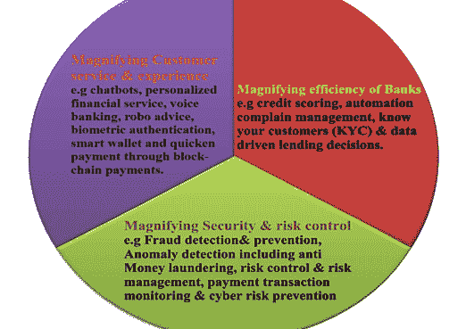

图 4.2 银行业的 AI 应用。来源：作者

# 业务管理中的人工智能与机器学习

## 4.2.1 AI 与客户服务

“AI 指的是机器、计算机或机器人所表现出的智能性能和行为，用于协助人类和企业，”[9]。根据世界经济论坛（2018年）与德勤联合发布的一报告，约 76% 的银行业首席执行官同意 AI 是一项优先任务，因为对于通过聊天机器人、个性化金融服务、智能钱包、辅助客户支持、区块链等提供智能客户服务至关重要。银行需要采用 AI 和 ML 来提供高水平的客户服务、留住客户并理解客户的个人银习惯和需求，以获得更好的客户体验。通过使用 AI，银行正在优化客户体验，同时也增加了客户数量。SBI、PNB 和 HDFC 等大银行正在采用聊天机器人、自然语言处理（NLP）和认知计算等 AI 工具，为客户提供个性化服务、全天候用户支持，并对交易和贷款进行分析。“Personnetics”是一家总部位于伦敦的公司，它利用其聊天机器人识别信息模式并进行预测性分析。通过这种分析，它可以猜测客户侧下一次可能的互动。AI 不仅帮助银行提供创新的客户服务，还帮助确定可靠性，简化贷款流程并提高借款人的客户体验。

### 4.2.1.1 聊天机器人

聊天机器人是一种 AI 软件，能够用自然语言简化用户与机器之间的交互。它帮助银行增强客户体验、提高客户参与度、提高运营效率并降低客户服务成本。印度金融部门在聊天机器人和 AI 上投入了巨资以增强客户服务，”[11]。AI 驱动的聊天机器人被广泛采用，易于部署，适用于在线客户支持、电话互动、回答产品和公司相关查询等各种活动。它们通常 24/7 部署，以便与客户互动互动。2020 年新的聊天机器人平台包括 Mobile-money、Chatfuel 及其 Alive。Allahabad Bank 也在开发并应用自己名为“Empower”的移动聊天机器人。

### 4.2.1.2 AI 与个性化银行

银行通过数字处理利用现有数据，为其客户提供有意义且强大的个性化服务。通过 AI，银行专注于根据客户的需求、喜好、情绪和资源来理解其需求。这为银行和客户创造了双赢的局面，但它为领先的银行带来了竞争优势。在探索为个人用户提供额外利益和舒适的新方法方面，AI 真正大放异彩。这些 App 通过跟踪个人数据收入、经常支出、消费习惯和工作经验，可以为客户提供财务建议和优化方案。美国一些最大的银行，如美国银行和富盛银行（Wells Fargo），通过其移动银行 App 为客户提供不同的服务，例如发送电费账单提醒、规划其财务交易并以简化的方式与银行联系。

### 4.2.1.3 智能钱包

数字钱包（又称智能钱包）是指通过 AI 应用，通过数字货币向另一方进行商品和服务的数字化支付。在当前情况下，数字支付是未来的世界支付技术。为了减少对实体现金支付的依赖并增加资金在更高层次的触达，银行正在实施 AI 技术。银行业对 AI 应用促进了智能钱包和数字钱包的使用，Google、Apple、PayPal 等开发了自己的支付网关。通过数字钱包，银行存储用户的支付信息和密码以进行支付。

### 4.2.1.4 语音辅助银行

如今，AI 的影响使客户习惯于语音命令和触摸屏银行服务，结果导致语音辅助和物理临场银行服务正在消失。它有助于处理查询以回答问题，提供必要的信息并帮助客户获得各种银行服务。

### 4.2.1.5 机器人顾问

对于银行来说，法规起着重要作用，AI 在各方面也帮助了银行。所有收集的数据在转发进行进一步决策之前都会经过仔细的检查、组织和分析。如果没有 AI 的干预，整个工作将是劳动密集型的，导致耗时严重且容易出错。AI 提供的这种解决方案在某种程度上可以称为 RPA。HDFC 基金和投资银行 Axis Securities 与 Arth Yantra 等机器人顾问初创公司合作，在其业务交易中使用了一种名为个人财务生命周期管理的方法。

### 4.2.1.6 用于支出支付的 AI 后区块链

这是一种交易数字记录，其中称为“块”的个人记录连接在一个被称为“链”的单一列表中，用于记录使用比特币等加密货币进行的交易。通过 AI 辅助的区块链，银行已经用快速支付取代了缓慢支付。区块链具有实时支付处理、加快支付程序和提高客户满意度等优势。

## 4.2.2 AI 与提高银行效率

银行正在采用 AI 作为降低成本和提高效率的工具，“银行无法负担等待，为了开启它们的 AI 之旅，它们必须在充满创新和先进技术的未来中竞争。”[10]。据公认的是，投资正确的 AI 技术可以提高员工生产力，增加银行的运营效率和盈利能力。

### 4.2.2.1 确定信用评分和贷款决策

根据国际数据公司的报告，金融公司到 2020 年将花费 1100 万美元通过 AI 和 ML 进行运营。据基于 AI 的开发（包括承保和 AI 信用评分），金融部门将在不到十年内将其 GDP 提高高达 10%（Volodymyr Soffininsky，Datacentrix 信用数据科学家）。Zestfinance 和 Lendo 等许多公司已经开发了用于信用评分的 AI 和 ML，它们正试图确定个人客户的信誉状况或特定客户还款的可能性。这些公司根据互联网浏览历史、地理位置、社交媒体帐户等变量查看潜在申请者；ML 将所有这些数据转化为银行授予的信用评分，以确定个人客户的信用分。另一方面，一家初创公司 Ustart 正在使用现代科学数据来自动化贷款流程。它关注年轻成人的教育、SAT 分数、GPT、工作历史；学习领域并通过 ML 预测信誉状况。现在，AI 是银行根据更多数据提供信用评分的更好解决方案。AI 考虑了收入、就业状况、工作经验、信用历史、背景背景等因素，银行根据这些因素向客户贷款。ML 通过开发风险评分模型提供了最佳的技术解决方案。这些模型预测了针对特定客户信贷供应的困难。

### 4.2.2.2 AI 与 CRM

AI 通过提供建议和授权客户做出更明智的财务决策来维护客户关系。基于集成数据，AI 开发定制化产品和服务，并识别对每个客户此时最重要且实用的领域。AI 作为一种先进创新的技术，通过预算工具或技术驱动的互动帮助银行建立强大持久的客户关系。它还协助银行在提高客户满意度、减少客户流失、增强客户关系、增加存款发生以及为客户提供更多创新定制化产品方面提高表现。

## 4.2.3 增强安全与风险控制

将 AI 引入流程使银行业的人为错误概率降低到几乎为零，对于维护银行贷款和资金安全都是非常有益的。从贷款角度来看，AI 有助于识别与贷款可靠性和借款人信誉相关的风险。同时，银行由于其应用，可以感知网络犯罪并立即发现网络中的恶意软件。

# 人工智能与机器学习

## 4.2.3.1 金融欺诈的检测与预防

AI 在预防金融欺诈和捕捕罪犯方面高效且有用。它能揭示洗钱、信用卡欺诈和异常欺诈，这些行为对银行的盈利能力具有重大影响。观察发现，由于在线和电子商务交易的扩大，信用卡欺诈呈指数级增长；AI 在预防欺诈和洗钱方面的应用起着至关重要的作用，通过这种应用，银行分析客户的行为、购买习惯、位置以及网上银行的使用情况等，当发现某些偏差时，安全机制会提供有关欺诈的信息。在这方面，AI 技术的应用减少了信用卡欺诈和其他异常欺诈的数量。

## 4.2.3.2 减少洗钱

AI 结合人工智能有助于揭示和防止特定类型的金融犯罪，例如洗钱。Plaid 通过其复杂的算法与花旗银行、高盛银行合作，在不同条件和变量下的交互构建了多种独特的模式。Plaid 作为一个连接银行与客户应用程序的小型设备，有助于确保金融交易的安全。银行等金融机构已经配备了 AI 和 ML 等技术武器来防止洗钱和其他金融欺诈。基于 AI 的组织建模和客户细分在提高金融欺诈准确性方面更为有效。使用 ML 的 AI 被证明在识别复杂交易来源以及发现其不规则性和异常方面非常有影响力。它有助于发现可疑金融交易、不规则的交易网络和欺诈交易。通过这种技术，银行作为供应商可以识别出看似合法的欺诈支付，以及看似像欺诈那样的合法付款。Aydesi 和 SAS 是提供 AI 反洗钱解决方案的两个示例。据报道，它们正向客户银行提供解决方案以减少洗钱和金融欺诈。这些公司构建了自己的数据仓库平台，识别客户行为的变化，并分析这些数据以寻找与欺诈性转账相关的模式。Aydesi AML 包含了核心能力，如自动特征工程、智能细分、组织洞察、智能事件分拣和上下文警报信息，以便为客户提供关于 AML 的更准确的结果。

## 4.2.3.3 网络安全

如今，银行认为有必要采取主动减少并消除网络安全和金融欺诈，而 AI 在此为止发挥着至关重要的作用。AI 作为一种数字技术增强了在线金融安全。银行每天处理大量的数字金融交易，形式包括转账、支票存款、账单和贷款发放等，这非常需要网络安全以及欺诈检测技术。在这方面，像 Shape 解决方案这样的知名公司已经证明了自己是先驱，它们保护客户免受账户被劫持，并帮助检测凭据填充攻击。

### 4.2.3.4 AI：风险的管理与控制


对于包括银行在内的金融部门，未被察觉的风险对组织来说可能是致命且危险的。因此，为了保护银行交易，非常需要对未来的金融服务进行详细且细微预测。由于由于原因，金融市场使用 AI 的子集 ML 来进行管理。AI 在包括银行、保险和基金在内的金融服务风险管理中的作用就像一把强大的武器。AI 凭借其巨大的处理能力可以在极短时间内处理数据。认知计算管理数据，算法分析风险历史，并据此识别和预测问题及风险。美国租赁公司 Crest Financial 雇用了 AI 依赖传统数据科学方法进行风险分析，并在该领域取得了显著改进，减少了大量风险。KENSHO（剑桥）公司提供的使用云计算和 NLP（自然语言处理）相结合的分析解决方案，为复杂的金融问题提供了答案。Ayasis 为银行创建了云端和机器智能解决方案，以解决金融科技领域的复杂挑战，Ayasis AI 和 ML 理解并管理风险，预测客户需求，并协助反洗钱流程。AI 成为整个银行公司信赖的技术脚板之一并不意外。它不仅是首要的创新技术，而且改变了客户与银行互动的方式。就像区块链一样，银行业的 AI 是一场技术革命，它让银行的工作变得更简单、高效，并及时提高了服务的质量和速度。AI 和 ML 被证明是银行业发展的有力推动者。

### 4.3 AI 在印度银行的应用：一些示例

“金融领域正在研究如何利用 AI 的优势，以便从长远来看改进流程并升级客户服务。” [8]。根据麦肯锡全球调查（2018年），AI 的采用已成为银行在内的机构关注的关键课题。研究中大多数在特定领域实施 AI 的受访者报告说，这有助于从该用途获得中等或巨大的价值，只有 21% 的受访者将 AI 引入了多个业务流程。

AI 带来的基础应用包括用于客服的智能聊天机器人、为个人提供个性化服务，甚至在银行放置自助服务的 AI 机器人。除了这些基础应用外，银行还可以实施该技术来提高其后台部门的效率，甚至减少欺诈和安全风险。

尽管印度银行家对 AI 采用有需求，但大多数印度银行家承认，由于风险偏好低且投资巨大，银行对大规模使用尚未表现出极大兴趣。

## 人工智能与机器学习

尽管许多印度银行正积极采用领先技术以获得更好的增长、发展和服务现代客户的前景，但此处只有少数被选中并讨论。分析师和专家估计并预测，到 2030 年底，AI 将为印度银行业平均节省 1 万亿美元。同时，叙事科学预计，接近 32% 的参与银行已在其流程中纳入了预测分析、推荐引擎、语音识别和响应时间。如图 4.3 所示，《商业内幕》报告（2020年）显示，75% 资产超过 1000 亿美元的受访银行表示他们目前正在实施 AI 策略，而资产少于 1000 亿美元的银行这一比例为 46%。受访银行表示，前台（对话式银行）的成本节约机会为 1990 亿美元，中台（反欺诈）银行则高达 2170 亿美元。但根据麦肯锡全球学院，AI 技术在银行中的应用可以为整个行业产生超过 2500 亿美元的价值。本节讨论了哪些银行寻求采用和整合 AI，以及它们如何在现有系统中应用 AI。

正如国家业务研究学院和叙事科学对许多印度银行进行的联合调查所示，在过去的几年里，其中包括 SBI、巴罗罗达银行（BoB）、阿拉拉哈德银行、安得拉银行、YES Bank、HDFC、ICICI、Axis、坎纳银行、

### 银行 AI 策略的实施

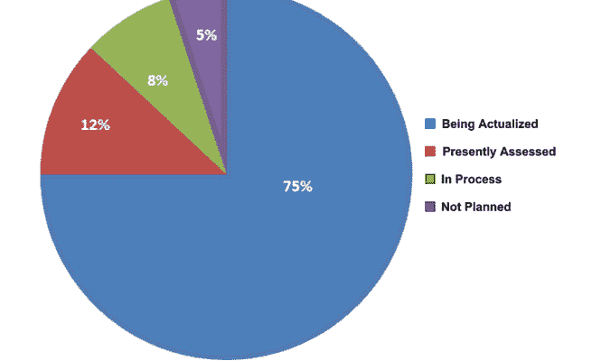

图 4.3 资产超过 1000 亿美元银行执行 AI 技术的情况。

来源：作者

#### 业务管理中的人工智能与机器学习

### AI 在银行中的实施

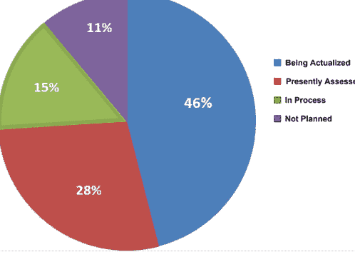

**图 4.4** 资产超过 1,000 亿美元的银行执行 AI 技术的状况。

来源：作者

City Union Bank、Punjab National Bank、IndusInd Bank。已采用或即将采用 AI 技术的银行可以在三个广泛领域实施实施：前台业务、中台业务或后台业务活动。AI 的初级应用包括：用于客户服务的更智能智能的聊天机器人、为个人提供个性化服务，甚至在银行内放置 AI 机器人进行自助。除了这些基础应用外，银行还可以利用该技术提高其后台业务的效率，并减少欺诈和安全风险。

#### 4.3.1 印度银行（State Bank of India）

SBI 证明了，政府持有超过 50% 股份的公立银行可以通过合作伙伴关系生态系统促进技术创新和领导力。SBI 是全球第 43 大的银行，也是印度最大的行业银行，拥有 23% 的市场份额和 25% 的市场负载，在 2019 年世界财富 500 强中排名第 236 位。包括国有 SBI 在内的印度银行已开始将 AI 作为工具，帮助提高效率、盈利能力、降低运营成本、检测人为欺诈并降低网络风险。如图 4.5 所示，这家印度最大的贷款银行已实施了不同的应用程序和支持 AI 的软件，其中之一是 SBI 智能助手（SIA），这是一个智能助手。SIA 为银行查询提供即时解决方案，像银行代表一样在聊天框中高效解决海外印度人（NRI）客户的疑问。SBI 现在正在利用 Chapdex 创建的 AI 安排，该小组是其首场黑客松“Code for bank”的获胜者。在前台工作区域，它利用了 SIA 聊天机器人，一个 AI 控制的访客伙伴。SIA

## 人工智能与机器学习

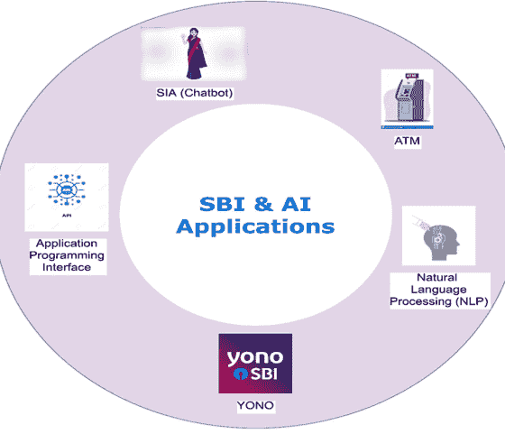

图 4.5 SBI 使用的 AI 技术。来源：作者自编。

能够流利地提供有关所有银行产品、服务的答案，并回答诸如如何开户、如何享受其他客户服务的所有查询。这有助于客户跨多个客户渠道使用多种地区语言处理交易。经验表明，通过采用 SIA，SBI 能够成功为不同的银行产品获取新客户。

SBI 从 2014 年开始使用分析，并在 2016 年从 IDBRT 和 Manipal 大学接受了 AI 使用培训，以开始使用集成分析、AI 和机器学习来解决许多业务运营问题。SBI 使用的一些技术包括自然语言处理（NLP）、地理位置分析（GLA）、字符串匹配、网络分析、易受欺诈分行的识别、早期预警系统和预测性分析等，正试图将客户旅程从物理转为数字化。它有三个主要的技术计划，包含 500 多个项目，分别是管理、客户关系管理和 YONO（You Only Need It），后者即其移动应用程序。该银行有 3,000 万银行客户和 4,700 万网银客户，但有巨大的潜力待开发。它正在采用 YONO 平台，其中包括在五分钟内批准预审无纸贷款，使海外客户能够轻松开户。它具有基于协作的共生关系。SBI 将通过对坏账的早期预警信号带来贷款的审慎，并应用最新的创新 YONO 进行欺诈预防。YONO是一年前推出的移动应用 App，提供带有生活购物功能的银行服务，计划将其扩展到个人客户之外的农业和企业部门。金融科技提供了技术解决方案，并证明了双方的双赢局面。SBI 改进的贷款组合表现归功于风险管理和欺诈检测计划。它已部署了识别不良资产（NPAs）的早期预警信号，以及用于分析小额贷款或个人贷款行为模式的数据分析。根据 SBI CTO Shiv Kumar Bhasin（2019）的说法，SIA 是 AI 和对话式银行领域的此类首个应用程序，它将客户服务提升几个台阶。Bhasin 说：“Payjo 在对话领域的专业知识帮助我们将 SIA 打造成为全球银行领域卓越的聊天机器人。” SBI 在其银行解决方案之上构建了应用程序编程接口（API）层。

#### 3.3.2 HDFC 银行

HDFC 银行（1994）在孟买设有注册办事处，截至 2019 年 6 月 30 日，该银行在 2,764 个城市的 5,500 家分行拥有分销网络。该银行安装了 430,000 个 POS 终端，发行了 2,357 万张借记卡和 1,200 万张信用卡。截至 2020 年 3 月，HDFC 银行是印度市值最大的私营银行。如图 4.6 所示，HDFC 银行通过不断发展的分支和 ATM 机构以及先进通道（例如网上银行）为客户提供不同范围的货币项目和银行服务。

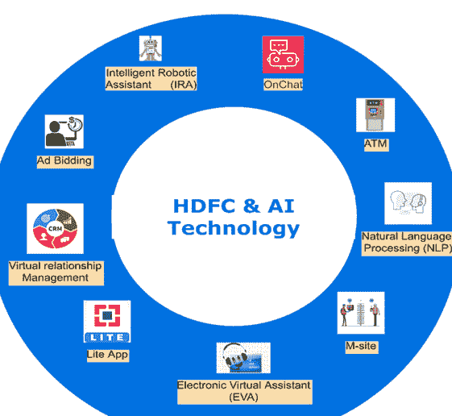

图 4.6 HDFC 使用的 AI 技术。来源：作者。

## 人工与机器学习

电话银行和移动银行。该银行在高度期待的环境中运营，反映在所有分行的网上，对于移动银行，为其客户提供资金转账设施。该银行在 AI、Flexcube 核心银行系统等技术上投入了巨资，使零售客户能够体验。该银行还利用 AI 进行广告竞价，帮助客户将转化率提高了五倍。这一举措有助于降低数字产品的整体获客成本并提高整体盈利能力。AI 的领域延伸到完善客户服务、核心银行、员工培训与互动、运营效率、分析电子商务。

在 AI 方面，机器人 EVA（电子虚拟助手）由总部位于孟加尔的 SenseAI 开发，它可以从多个来源收集信息并在几秒钟内回答。自发布以来，它已帮助了 270 万多客户，连接了超过 53 万新客户，并消除了搜索、浏览或拨打电话的需求。EVA 此外具有通过客户互动学习而变得更加智能的潜力，“EVA 将有权处理真实的银行交易，这将使 HDFC 银行能够为客户提供真正的对话式银行，”该银行在一份机构新闻稿中表示。根据数字银行负责人 Nitin Chugh 的说法，EVA 将辅助他们提升客户体验的正确阶段。HDFC 的 IRA（智能机器人助手）机器人给人一种创新的感觉，而其他银行已尝试使用店内机器人来帮助客户或访客。像我们的移动银行 AI-OnChat 等解决方案是为享受良好连接的客户开发的。连接受限的 HDFC 客户可以使用 Lite App 和 m-site 来享受银行服务，没有连接或使用功能手机的客户有回电电话中心、短信/免费热线银行服务。HDFC 银行对 AI 的方法是

# 业务管理中的人工智能与机器学习

它是整体性的，并且通过强大的测试和以学习驱动的方法，实施了 AI 解决方案，涵盖客户体验、客户支持、流程自动化、人力资源或欺诈检测等领域。HDFC 不仅仅想要创造小摆件，而是相信“通过 AI 创造客户价值”的原则。简单来说，银行正在应用 AI，这将有助于更有效地管理内部和外部客户，并在不久的将来指数级地降低运营成本。

#### 4.3.3 AXIS 银行

Axis Bank 成立于 1993 年，是印度第三大私营银行，拥有约 2000 万名客户、59,000 名员工，客户增长率为 18%。Axis Bank 在全印度 2100 多个城市和城镇设有业务网点，并集中在八大都市区。根据执行董事 Rajiv Anand 的说法，Axis Bank 旨在以直观且原生的方式为客户提供 24x7 的援助、即时满足和便利服务。

这家印度第三大私人银行在一年前成立了一个名为“思想工厂”（Thought Factory）的先进实验室，旨在通过 AI 创新为银行业领域提供创造性的改进。其创新团队中心位于孟加罗尔，银行在 3 个月的短期内与初创公司合作。Axis Bank 管理层将 AI 引入其客户服务流程的目标有两个目标：(1) 通过自动化渠道处理日益增加的客户服务；2) 通过提供满意的客户服务来减少客户投诉。为了实现这些目标，它启动了名为“Asha Aha!”的 AI 聊天机器人解决方案。通过 Asha Aha！客户可以方便地转账、订购支票、支付账单、使用预付卡、锁定现有卡的交易或重置卡 PIN 码、更改信用卡额度、下载银行对账单、申请贷款或信用卡。聊天机器人还可以帮助客户解答有关 Axis Bank 产品和服务的问题或投诉。Asha Aha! 提供了许多此类功能，作为您所有银行和金融相关需求的对话助手。Asha Aha 仍处于在 Axis Bank 更广泛生态系统中集成的初始阶段。Axis Bank 最近推出了一款由 AI 和 NLP 驱动的应用程序，通过回答常见问题、与贷款及其他产品建立联系并解答查询。Asha Aha! 结合了 NLP 进行通信，使用 NLU（自然语言理解）处理客户数据，并利用深度学习提取和总结原始数据，同时学习 ML 和基于规则的技巧，以理解并响应客户的需求。图 4.7 显示了 AI 技术在 Axis Bank 的不同应用领域。

Axis Bank 利用 AI 的另一个基本现实是运营风险和反洗钱（AML），这使得在效率、时间和成本节省方面有了关键性的改进。银行拥有强大的信用风险模型，通过该模型，80% 的可疑交易来自 AI 赋能神经网络识别出的 5% 客户。银行还开始对大多数循环进行自动化（RPA），包括账户维护和调整、预付款、批量交易循环和 ATM 维护。

人工智能与机器学习

71

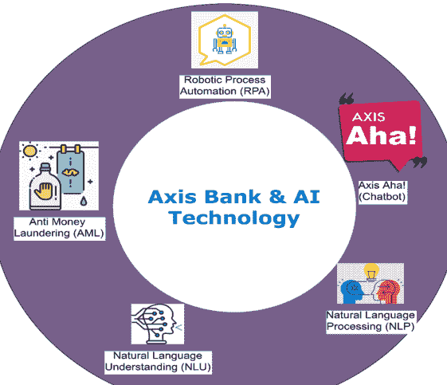

图 4.7 Axis Bank 使用的 AI 技术。来源：作者。

通过实施 AI，银行正试图缩短周转时间（TAT），银行已在 125 多个循环中实现了 AI，并在约 90 个循环中实现了智能自动化，这些循环曾需要繁琐的人工工作。据发现，利用 RPA 后，TAT 明显缩短，投资账户开设的时间缩短了 90%，活期账户缩短了 92%，其他循环缩短了 50% 到 80%。

根据 Axis Bank 数字银行业负责人 Sameer Shetty 的说法，由于身份验证和安全系统的兴起，欺诈已经有所下降，他甚至表示 Axis 没有发生过数字银行身份欺诈事件，这得益于包含客户身份验证和 AI 的多层防御系统。通过实施 AI，Axis 将客户的身份信息与印度的国家身份识别系统进行交叉引用，Axis 验证实客户提供的号码与国家数据库中的号码一致，以达到减少欺诈和反洗钱的目标。这种即时验证系统使得合成欺诈几乎成为可能，因为与政府数据库的即时交叉意味着任何伪造的身份号码都会立即被发现。入职系统还由 AI 平台补充，该平台寻找账户接取的迹象，如位置数据不匹配或异常交易。

#### 4.3.4 旁遮普国家银行

根据 2020 年 6 月 30 日发布的报告，PNB 是除 SBI 之外该国第二大公共部门银行（PSB）。旁遮普国家银行是印度第一家本土银行（Swadeshi bank），于 1895 年 4 月 12 日在拉部尔开始运营，在银行悠久的历史中有九家银行并入 PNB。其目前的市值模型为 31,478.56 亿卢比。它为 8,900 万客户提供服务，通过 6,081 个分行（包括五分行）和 6,940 台 ATM 拥有广泛业务。

印度金融领域正开始将 AI 用于后台和面对客户的业务。根据 RBI 提供的信息，在印度的国有银行中，PNB 在全印贷款欺诈数量上列名前茅，在过去的五个财年中共有 389 起案件。在今年发生震惊银行欺诈丑闻后，旁遮普国家银行（PNB）可能会调整安排部署 AI 进行账户对账并改进审计框架，因为它正寻求尽早清理流程并反欺诈。内部审计措施也在扩大，以提供离线工具更大的支持，并减少对人工检查和审计的依赖。这一决策是在发生了一起银行欺诈案后做出的，两名初级官员在单一分行错误地向受尼拉夫·莫迪及其叔叔乔克西控制发放了 17.7 亿美元（14.3 亿欧元）贷款。

PNB 实施了其聊天机器人“PHHU”，即 PNB 即时帮助，旨在增强客户体验并解决有关银行欺诈、信用卡和记卡的常见问题（FAQs）。PHHU 将提升客户服务体验并解决客户投诉和查询。“PNB 管理层认为，在 PNB 处理案件对于确保银行继续增长并更好地与其竞争对手竞争至关重要。”

# 人工智能与机器学习

对借款人进行360度画像分析。PNB计划帮助向印度储备银行（RBI）和相关监管部门对欺诈行为进行预测、早期识别和揭示。这将更好地理解印度框架针对不合规行为的零抵抗策略。该银行扩大了其数字化基础，网上银行用户增长了35%，手机银行用户增长了45%。它成功地将核心银行解决方案（CBS）阶段升级至 Finacle 10.x 版本，以提供更好的客户体验。Finacle 是由 Infosys 开发的一款核心金融产品，在银行领域拥有广泛的数字金融亲和力。2015年8月，PNB 发布了多项创新性应用以鼓励数字化交易，例如 PNB MobiEase、PNB Rewards、PNB Fin Literacy、PNB Yuva、PNB m-banking、PNB ATM Assist、PNB Kitty 等。此外，PNB 在“2018财年”发布了 PNB M-Passbook，以便客户在手机上查看账户明细。SWIFT 与 CBS 对接，所有的投资信息均通过 CBS 自动生成，无需人工干预。图 4.8 显示了 PNB 和 PNB MetLife 使用的 AI 技术。根据 PNB MetLife 首席信息官 Samrat Das 的说法：

PNB MetLife 引入了两个首创创新：首先是基于虚拟现实（VR）的客服平台 - conVerse，它是与 LumenMetLife 在新加坡的创新中心合作构建。其次是一个名为 Infinity 的安全数字中心，它允许你在发生意外时，通过与受益人分享重要文件和记忆来创建一个数字遗产。如果你深入了解 MetLife 系统，我们还有 MetLife Japan，它包含一些有趣的

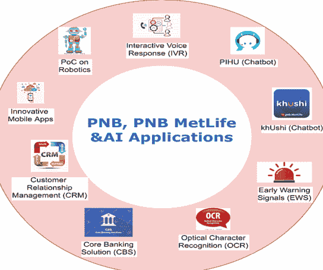

**图 4.8** PNB 和 PNB MetLife 中采用的 AI 技术。来源：作者。

# 业务管理中的人工智能与机器学习

在退保现金价值处理领域开展了一项名为机器人概念验证（PoC）的工作。这有助于处理现金价值证书请求，此类请求过去是通过从多个源和账单中提取数据进行人工处理的。通过这一过程，团队减少了约 50% 的耗时，91% 的交易实现了自动化，进一步的认知能力可以将这一比例提高到 110%。


PNB Metlife 发布了名为 Khushi 的聊天机器人，这是一款客户服务应用程序，由 AI 驱动，用于获取保险相关的查询。PNB 已与 Mphasis 签署了长期合同，在诺伊拉和芒格洛尔建立联系中心。Mphasis 将提供全方位的客户关系管理（CRM）服务，包括电话银行、外呼电话和投诉管理。服务范围涵盖了对所有金融产品和服务的支持，包括存款、核心银行流程、贷款服务、网上银行、账户及卡相关服务。PNB 计划通过数据应用来提高客户服务质量并赋能客户考虑。IT 组织将激活交互式语音响应（IVR）框架和 CRM 互动方案 Advisor360，该方案将涵盖印度 13 个地区的银行分行、网点和满意度需求。这些服务将通过 Mphasis 在南北方的重点以多种语言（英语、印地语、马拉雅拉姆语、坎纳德语、泰米尔语和泰卢固语）提供。根据研究，表明有许多原因和领域可以使用 AI 驱动的创新。这些原因包括实现更好的开发和进步、仅针对最前沿业务线，或者通过金融领域增加文化优势，这几乎迫使银行采用 AI，这是开展业务的另一种时代技术。大型银行不分规模正在接受并实施的最广泛的 AI 应用是特定的聊天机器人、RPA（机器人流程自动化）和 NLU（自然语言理解）。

## 4.4 AI 及其银行 KPI 的影响

银业是一个极其多元且复杂的行业或领域，需要不断提供先进的技术解决方案来简化复杂的银行功能。银行及其客户对 AI 都有巨大需求。全球银行采用 AI 的主要原因是在数字时代保持竞争力。正如福布斯最近进行的分析所示，在各种银行流程中实施 AI 将在 2030 年为该行业节省超过 1 万亿美元。因此，预计银行业在不久的将来将从 AI 系统中受益最多。AI 为金融领域带来了许多优势，无论 AI 能为金融业务带来进步性的变化。

最近，高层经理意识到，为了提高运营效率、增强员工生产力以高速处理海量数据，采用 AI 和 ML 等技术已变得必要。[21] 探讨了 AI 对中东银行系统和银行网络整体性能的显著积极影响。AI 的应用还增强了决策过程，有助于分析师就银行的整体性能做出关键决策。根据未来的几个银行趋势，AI 正在银行业产生最大的影响。今天的银行正努力降低运营成本、实现目标并通过客户体验超越客户预期，而这在 AI 存在的情况下是可能实现的。

早期采用 AI 和 ML 的银行在欺诈检测、制造性能优化、预防性维护和推荐引擎方面显示了高影响的结果。基于大量的文献，发现 AI 与 ML 为日常运营带来了利益。传统业务现在正转向被区块链、大数据和云计算的应用所取代。从银行的角度来看，KPI 是一个衡量其在不同水平上实现目标的定量价值，如盈利能力、生产力、提高客户满意度、客户流失、增加存款和 CRM。

### 4.41 AI 对盈利能力的影响

作为数字化的一部分，AI 预计从长期来看将提高成本结构提高盈利能力。由于大部分工作已自动化，它需要的分行和人员有限。依赖 AI、区块链、云计算等创新技术的银行能够产生巨大的利润或收入，反过来反映在银行的盈利状况中。AI 通过三种方式贡献于银行的盈利能力：
- 通过接管银行员工的创造性任务并提高优秀银行员工的效率来降低薪酬。
- AI 执行也可以增加收入的产生。
- 提高预测准确性并降低风险成本。

Orgun Kaya (2019) 证明了盈利能力与 AI 专利活动水平之间存在 80% 的相关性。因此，推断银行的盈利能力与不同银行使用 AI 的程度正相关。

### 4.4.2 AI 对银行生产力与效率的影响

银行还利用 AI 进行广告竞价，这帮助客户将转化率提升了五倍。这一举措有助于降低数字产品的整体获客成本，并提高整体盈利能力。银行的生产力是人均业务量、人均利润、就业创造和分行数量的结合体。数字化对银行生产力有直接影响，而在深度数字化背景下，AI 和 ML 构成了至关重要的部分。AI 的应用可以提高客户服务以及产品和服务提供方面的生产力和竞争力。

大多数行业的业务重点是效率和可持续性，银行业在这一方面也无例外。这种可持续性完全建立在正确的决策的基础上，而 AI 在这一过程中是无与伦比的，因为它从决策树中消除了人类偏见。

数字革命为银行业的生产力带来了非凡的增长。人类意识为银行带来了一套巨大的突破性工具，改变并平滑了其部分关键的货币周期。包括大规模分布式计算能力、数据存储成本降低以及开源框架兴起在内的元素结合，有助于加速 AI 在银行业领域的应用。提高安全性、遵循指南以及有效的合规性总体上都是 AI 策略的优势，有助于提高生产力，也是保持竞争领先的必要条件。AI 可以帮助银行财务团队通过处理海量数据来重新构和重组模型及流程，有助于提高银行的生产力和效率。RPA 中使用的软件机器人可以编程以处理规则和某些异常，但跨越复杂挑战和频繁变化任务的额外 ML 层，使得 RPA 和 AI 的结合变得特别强大。

### 4.4.3 AI 对提升客户满意度的影响

有一些细分属性在提供客户满意度方面起着重要作用：更好的客户体验、便捷的银行、可访问性、安全与保护以及成本效益。AI 驱动的工具和策略具有巨大的潜力来满足客户满意度的这五个属性。如果考虑到企业风险管理，AI 在检测和预防欺诈风险、犯罪风险和运营风险方面更有益。区块链是广知名的网络安全系统之一，它能够通过计算机代码链实现金融交易。区块链技术提供了更高可靠性、更持久的数据存储、透明度、快速处理、成本降低和易于维护的直接交易。由于此，几乎每家银行都采用了区块链技术；特别是用于维护人工智能和机器学习的 KYC 记录及其认证，并由于其极短周转时间（TAT）的特性进行支付。在金融领域，聊天机器人正成为各种符号和角色的虚拟专家，这些专家基本上通过将客户的内容和情感转化为有价值的信息库来了解客户的反应和个人行为标准，帮助银行为其客户提供更好的客户体验。而支付、电子清算服务、即时支付服务（IMPS）、自然自动清算、统一支付接口（UPI）、预付支付工具（PPIS）、国家电子资金传输（NEFT）、作为 AI 一部分的社交媒体银行，为其客户提供了更高的可访问性。ML 和深度学习技术专门设计用于解决银行业的细分问题而用。

### 4.4.4 AI 帮助提供创新和定制化服务

利用深度学习进行客户分析，使得整合来自不同信息源（例如交易所和网上银行日志）的知识片段变得更加简单。它有助于更好地理解客户，并提供定制化的建议和智能客户助手，使业务更具响应性且更高效。

对于银行来说，改善客户体验是基础性的。“对于低复杂度任务，消费者认为 AI 的解决问题能力高于人类客户服务，并且更有可能使用 AI。” [14] Alexa 和 Google Home 目前是普通的家庭成员，，允许购买者购买非凡的协作。此外，个人通常期望其银行提供类似水平的服务。情境智能可以传递深度定制的客户体验。在 AI 时代之前不存在的智能语音和聊天机器人正在改变和重塑银行的运营以及与客户交流的方式。就像一个用于银行业的 Alexa，它可以提供个人化的数字助手，帮助买家获取关于规划、退休储等方面的大量信息，然后根据其财务需求进行定制。通过更深入的理解和更具个性化的服务，银行可以更准确地响应市场需求，创造适合的客户体验并获得竞争优势。每个客户根据其支出、习惯、活动、行为特征和收入产生都有独特的需求。AI 完备地发展了这一点，使银行能够通过添加个性化特征和直观交互来定制金融产品和服务，从而与客户建立稳固的关系。

### 4.4.5 AI 帮助减少客户流失

客户流失（或持续流失）是客户放弃某个品牌并停止成为特定业务付费客户的倾向。客户留存是任何组织的主要增长支柱之一。AI 帮助银行同时增加客户数量、留住现有客户并减少客户流失。减少客户流失是可能的，因为 AI 帮助业务管理中的人工智能和机器学习以更具创意的方式理解客户的行为、态度、感知以及购买和储蓄行为，并为银行创建个性化推荐。AI 通过使用准确的算法使业务更具响应性和效率，通过改进流失概率预测来提高客户留存。此外，得于精确的 AI 算法，流失概率预测改进了客户维护。这对于那些经常没有明显预警迹象的客户来说至关重要。另一方面，维护活动可能是昂贵的，有时甚至远超过潜在客户可能带来的价值。因此，AI 在减少客户流失和为银行带来更多忠诚客户方面可以发挥重要作用。

### 4.4.6 AI 对整体性能的影响

ML、区块链和数据分析是银行有能力的一些技术，通过降低风险、减少不良贷款（NPA）和欺诈、评估信用评分以及增强客户服务来提高银行的整体性能。AI 正在改变金融服务，通过聊天机器人和个性化为客户提供更显著的利益，限制风险和成本，提高员工效率并确保更高的行政合规性。尽管这些只是 AI 使用的开始，不久它将成为金融业务的运营中心。随着 AI 将员工的所有日常和重复工作变得更准确更高效，员工可以将时间投入到重要的业务决策，这有助于提高银行业的整体性能。AI 应用可以管理风险，这对于银行的良好性能至关重要。因此，可以认为 AI 应用可以增加显著的经济价值，从而影响银行的整体性能。

本文讨论了 AI 和 ML，最后可以得出结论，这可以被视为银行业的一个巨大的生产力工具。AI 在印度拥有光明的前景。

## 4.5 结论与 AI 的未来

总结来说，AI 正在变得日益流行，银行正在探索并实施这项技术以改变服务方式。银行业正以比记忆中以往任何时候都快的速度移动，AI 驱动着金融业务的变革。

## 参考文献

- 1. Adam, M., Wessel, M., and Benlian, A. (2020) “客户服务中的基于AI聊天机器人及其对用户合规的影响”，Electronic Markets. doi:10.1007/s12525-020-00414-7
- 2. Alzaidi, A. (2018) “人工智能对中东银行业表现的影响”，International Journal of Computer Science and Network Security, http://paper.ijcsns.org/07_book/2018/2018101021.pdf.
- 3. Hassia, T. and Srivastava, A. (2020) “人工智能对银行业客户满意度的影响”，International Journal of Advanced Science and Technology, Volume 29, issue 9s, pp. 1947-1962.
- 4. [https://www.idrbt.ac.in/assets/publications/Best%20Practices/2020/AI_2020.pdf](https://www.idrbt.ac.in/assets/publications/Best%20Practices/2020/AI_2020.pdf)
- 5. [https://www.managedoutsource.com/blog/6-ways-artificial-intelligence-is-changing-the-sector/](https://www.managedoutsource.com/blog/6-ways-artificial-intelligence-is-changing-the-sector/)
- 6. [https://www.mckinsey.com/~media/mcksey/industries/advanced%20electronics/ourinsights/how%20artificial%20intelligence%20can%20deliver%20real%20value%20to%20companies/mgi-artificial-intelligence-discussion-paper.asx](https://www.mckinsey.com/~media/mcksey/industries/advanced%20electronics/ourinsights/how%20artificial%20intelligence%20can%20deliver%20real%20value%20to%20companies/mgi-artificial-intelligence-discussion-paper.asx)
- 7. Kumar, S. and Akalya, A. (2020) “人工智能在银行业的影响与挑战”，Journal of Information and Computational Science, Volume 10, Issue 2, pp. 1101–1109.
- 8. Lakshminnarayana, N. and Deepti, B. R. (2019) “人工智能的发展及其印度领先商业银行的影响——案例研究”，International Journal of Scientific Research and Development, Volume: 3, Issue: 4, e-ISSN: 2456–6470.
- 9. Prentice, C., Lopes, S., and Wang, X. (2020) “人工智能和员工服务质量对客户满意度和忠诚度的影响”，Journal of Hospitality Marketing and Management, ISSN: 1936–8623.
- 10. Sadheb, S., Sharma, M., Kaur, N. and Siddiqui, L. (2020) “银行 4.0：人工智能对银行业的影响以及AI如何改变现代银行的面貌”，International Journal of Management, Volume 11, Issue 6, pp. 577–585.
- 11. Salukhe, R. (2019) “人工智能在提供客户服务中的作用——以SBI和HDFC银行为例”，International Journal of Recent Technology and Engineering (IJRTE), Volume-8, Issue 4, November 2019, ISSN: 2277–3878.
- 12. Smith, A. and Nobanee, H. (2020) “人工智能：银行业应用简述”，SSRN Electronic Journal, doi:10.2139/ssrn.3539171
- 13. Vijay, C. (2019) “印度银行业的人工智能：挑战与机遇”，International Journal of Advanced Research, ISSN: 2320-5407, doi:10.21474/IJAR/01/8987.
- 14. Xu, Y., Shiebh, C., Escha, P., and Ling I. (2020) “AI服务：任务复杂度、问题解决能力和使用意愿”，Australasian Marketing Journal. doi:10.1016/j.ausasmj.2020.03.005.

## 基于机器学习的信用卡欺诈检测分析与比较

Saloni and Minakhi Rout

KIIT 认定大学计算机工程学院，奥里萨邦，布巴内斯尔

## 目录

- 5.1 引言 ............................................................................ 81
- 5.2 相关工作 ............................................................................ 82
- 5.3 提议方法 ................................................................ 83
- 5.4 结果 ..................................................................................... 85
- 5.5 结论与未来展望....................................................... 91
- 参考文献 ....................................................................................... 92

## 5.1 引言

信用卡是一种由带有磁条的薄矩形条片组成的塑料卡，由金融机构向其客户发放。提供这些卡是为了让客户无需支付现金或支票即可购买物品。金融机构在将卡交给客户之前，会根据其月收入预设额度，而欺诈被定义为非法人员通过冒充身份为了获取金钱或财产而进行的错误活动。因此，信用卡诈骗无非是入侵者获取密码、CVV码等机密信息。因此，我们需要信用卡欺诈检测技术来保护持卡者免受虚假活动的影响。

印度正朝着成为发展国家努力。为了实现这一，印度政府（GoI）启动了多计划，其中之一是“数字印度”计划。该计划的主要意图是通过使用借记卡、信用卡、网上银行和 UPI 来赋能国家。政府和印度储备银行（RBI）高度关注经济的数字化。数字交易的重要优点之一是节省了时间。客户不再需要访问 ATM 机并排队等取款。每当他们想要付款时，只需刷卡并输入 PIN 码即可。

# 信用卡欺诈检测的分析与比较

Aji Mubarak Mubalike 等 [4] 提出了一种深度学习模型，该模型在确定欺诈交易提供了高效的结果。他们使用了决策树集成 (EDT)、堆叠自动编码器 (SAE) 和受限玻尔兹曼机 (RBM) 进行分类。对比分析显示，RBM 提供了更好的结果。

Abhimanyu Roy 等 [5] 使用各种深度学习拓扑结构，如人工神经网络 (ANN)、循环神经网络 (RNN)、LSTM 和 GRU 对数据集进行了分析。实施后发现，LSTM 和 GRU 的性能优于 ANN。

Dilip Singh Sisodia 等 [6] 提了不同的采样方法来通过 SMOTE 处理不平衡集合。在实验结束时，他们观察到 SMOTE ANN 能够更好地检测欺诈。此外，在 [7] 中，Yu Xie 等人讨论了特征提取的不同方法。

Dr V Sharmila 等 [8] 使用异常检测技术来检测信用卡欺诈。他们使用了局部离群因子 (LOF) 和孤立森林算法 (IFA) 进行异常检测。

然而，在 [9] 中，E. Sarwasathi 等提出了一种包含 ANN 和自组织映射 (SOM) 的模型，用于高效检测欺诈。

Wang Wang 等 [10] 提出了一种使用分布式深度学习框架进行隐私保护的模型。他们使用了 Report-NoisyMax 算法选择较大的绝对梯度以保证其隐私性。


## 5.3 提出的方法

所有实验均在 `Jupyter` `Python 3.7` 语言中进行。软件运行环境是 `Jupyter notebook 6.0.3`，这是一个 `Anaconda` 平台。该研究实验使用 `Tensorflow` 库作为后端通过 `Keras` 库实现了 `LSTM`、`GRU`、`CNN` 和多层感知器 `MLP` 等深度学习架构。使用的其他库还包括 `numpy`, `scipy`, `pandas`, `matplotlib`, `seaborn`, `sklearn`。数据集按 `20:80` 的比例进行划分。图 5.1 显示了实验的流程图。

实验在三个公开的数据集上进行，分别是德国数据集、台湾数据集和欧洲数据集。欧洲和台湾数据集从 `Kaggle` 下载，德国数据集从 `UCI` 仓库下载。德国信用卡数据集包含 25 个特征和 1,000 笔交易，其中只有 300 笔是欺诈。台湾信用卡数据集包含 25 个特征和 30,000 笔交易，其中 6,636 笔是欺诈；欧洲信用卡数据集包含 31 个特征和 2,840,807 笔交易，其中 492 笔是欺诈。这些数据集都是高度平衡的。

在收集数据后，对馈到深度学习分类器的数据应用了预处理步骤。数据预处理主要涉及三个步骤：数据清洗、降维和数据转换。在提出的方法中，首先检查了收集的数据集中是否存在缺失或不一致的值。发现三个数据集均不存在缺失值。

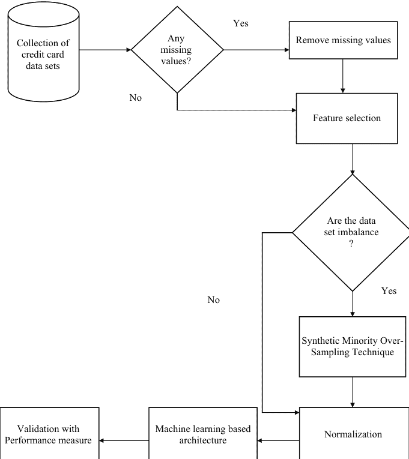

图 5.1 用于信用卡欺诈检测的提出的模型流程图。

然后，在这些数据集上应用了单变量特征选择，仅选择了 75% 的特征，这意味着欧洲数据集中仅选择了 22 个特征，而在台湾和德国数据集中仅选择了 18 个特征。特征选择很重要，因为它有助于缩短训练时间、提高准确性并限制模型的过拟合问题。

此外，根据观察到的统计，所有数据集都是高度不平衡的。欧洲数据集只有 0.0173% 的欺诈交易，而台湾数据集为 0.2212%，德国数据集的欺诈交易为 0.3%。为了解决数据集不平衡的问题，应用了 `SMOTE`。`SMOTE` 有助于平衡类别分布。此外，所有收集的数据集包含不同的数值。为了将其转换为 0 到 1 的范围，应用了标准归一化。在深度学习中，归一化被认为是训练的最佳实践，并有助于加速收敛。

预处理后，将这些数据集馈到 `LSTM`、`GRU`、`CNN` 和多层感知器 `MLP` 等不同的深度学习架构中进行分析。计算了准确率、精确率、召回率、F1 分等评估指标，我们的重点是 F1 分。

## 5.4 结果

研究实验使用 `LSTM`、`GRU`、`CNN` 和多层感知器 `MLP` 等深度学习架构在德国数据集、台湾数据集以及欧洲数据集上进行。为了分析和比较模型，我们调整了激活函数、隐藏层数和层中的神经元数量等参数。在此实验中，每个实现的迭代次数 `epochs` 保持为 150。在欧洲数据集上实施时，输入神经元数为 22；在台湾和德国数据集实施时，输入神经元数为 18。由于数据集不平衡，该实验考虑了 F1 分。表 5.1 显示了从德国数据集获得的结果。

由于使用了深度学习架构，从表 5.1 可以观察到训练和测试集的准确率良好。然而，当调整参数（如隐藏层数和激活函数）时，观察到结果略有变化。在所有架构中，双隐藏层比单隐藏层效果更好。此外，使用 `sigmoid` 激活函数实施架构时观察的结果是最好的。从表中可以看出，使用 `sigmoid` 激活函数的双层 `MLP` 架构精确率为 0.68，召回率为 0.51，F1 分为 0.56，MCC 分为 0.411。使用 `sigmoid` 激活函数的双层 `CNN` 架构的精确率为 0.60，召回率为 0.57，F1 分为 0.58，MCC 分为 0.413。使用 `sigmoid` 激活函数的双层 `LSTM` 架构的精确率为 0.54，召回率为 0.57，F1 分为 0.55，MCC 分为 0.35。使用 `sigmoid` 激活函数的双层 `GRU` 架构的精确率为 0.49，召回率为 0.76，MCC 分为 0.388。但在本实验中，使用 `sigmoid` 激活函数的双层 `GRU` 实现了四个架构中最高的 F1 分 `0.60`。图 5.2 表示使用 `sigmoid` 的 `GRU` 架构获得的数据集 ROC 曲线。

### 表 5.1 德国数据集的结果

| 模型名称 | NH | 激活函数 | NN | 精确率 | 召回率 | F1 | MCC | Tra | ROC |
| :--- | :--- | :--- | :--- | :--- | :--- | :--- | :--- | :--- | :--- |
| MLP | 1 | Relu | 10 | 0.58 | 0.11 | 0.18 | 0.14 | 0.7450 | 0.7088 / 0.759 |
| | 2 | Relu | 10 | 0.70 | 0.27 | 0.39 | 0.35 | 0.7350 | 0.7437 / 0.733 |
| | 1 | tanh | 10 | 0.00 | 0.03 | 0.05 | 0.12 | 0.6900 | 0.7075 / 0.774 |
| | 2 | tanh | 10 | 0.61 | 0.30 | 0.40 | 0.281 | 0.7350 | 0.7325 / 0.733 |
| | 1 | sigmoid | 10 | 0.66 | 0.41 | 0.51 | 0.38 | 0.7500 | 0.7613 / 0.778 |
| | 2 | sigmoid | 10 | 0.68 | 0.51 | 0.56 | 0.411 | 0.7580 | 0.7650 / 0.794 |
| | 1 | swish | 10 | 0.49 | 0.15 | 0.23 | 0.149 | 0.7500 | 0.6090 / 0.589 |
| | 2 | swish | 10 | 0.55 | 0.24 | 0.34 | 0.216 | 0.7700 | 0.7141 / 0.659 |
| CNN | 1 | Relu | 10 | 0.67 | 0.01 | 0.02 | 0.049 | 0.7150 | 0.7013 / 0.665 |
| | 2 | Relu | 10 | 0.71 | 0.02 | 0.05 | 0.064 | 0.7150 | 0.7008 / 0.717 |
| | 1 | tanh | 10 | 0.67 | 0.06 | 0.11 | 0.131 | 0.7150 | 0.7038 / 0.728 |
| | 2 | tanh | 10 | 0.52 | 0.19 | 0.28 | 0.165 | 0.7500 | 0.7023 / 0.786 |
| | 1 | sigmoid | 10 | 0.64 | 0.20 | 0.31 | 0.23 | 0.7950 | 0.7262 / 0.786 |
| | 2 | sigmoid | 10 | 0.60 | 0.57 | 0.58 | 0.413 | 0.7650 | 0.7575 / 0.744 |
| | 1 | swish | 10 | 0.60 | 0.01 | 0.02 | 0.051 | 0.7150 | 0.7013 / 0.669 |
| | 2 | swish | 10 | 0.71 | 0.02 | 0.04 | 0.084 | 0.7100 | 0.7038 / 0.617 |
| LSTM | 1 | Relu | 10 | 0.53 | 0.19 | 0.27 | 0.1728 | 0.6660 | 0.7333 / 0.694 |
| | 2 | Relu | 10 | 0.54 | 0.31 | 0.35 | 0.121 | 0.7350 | 0.7659 / 0.664 |
| | 1 | tanh | 10 | 0.48 | 0.49 | 0.53 | 0.359 | 0.8650 | 0.6660 / 0.712 |
| | 2 | tanh | 10 | 0.56 | 0.53 | 0.55 | 0.360 | 0.7750 | 0.7732 / 0.768 |
| | 1 | sigmoid | 10 | 0.42 | 0.33 | 0.37 | 0.147 | 0.8350 | 0.6650 / 0.664 |
| | 2 | sigmoid | 10 | 0.54 | 0.57 | 0.55 | 0.350 | 0.7350 | 0.7225 / 0.751 |
| | 1 | swish | 10 | 0.54 | 0.19 | 0.28 | 0.179 | 0.7900 | 0.6787 / 0.658 |
| | 2 | swish | 10 | 0.39 | 0.33 | 0.35 | 0.119 | 0.7150 | 0.6425 / 0.641 |
| GRU | 1 | Relu | 10 | 0.75 | 0.02 | 0.04 | 0.0929 | 0.7100 | 0.7022 / 0.455 |
| | 2 | Relu | 10 | 0.58 | 0.18 | 0.25 | 0.190 | 0.7325 | 0.7237 / 0.663 |
| | 1 | tanh | 10 | 0.67 | 0.15 | 0.25 | 0.190 | 0.7100 | 0.7200 / 0.623 |
| | 2 | tanh | 10 | 0.59 | 0.21 | 0.31 | 0.757 | 0.7500 | 0.7448 / 0.216 |
| | 1 | sigmoid | 10 | 0.54 | 0.47 | 0.50 | 0.309 | 0.7700 | 0.7100 / 0.703 |
| | 2 | sigmoid | 10 | 0.49 | 0.76 | 0.60 | 0.388 | 0.7650 | 0.6925 / 0.752 |
| | 1 | swish | 10 | 0.48 | 0.05 | 0.09 | 0.070 | 0.6700 | 0.6900 / 0.484 |
| | 2 | swish | 10 | 0.84 | 0.07 | 0.12 | 0.184 | 0.7100 | 0.7163 / 0.757 |

NH = 隐藏层数, NN = 神经元数, Tra = 训练准确率, Tea = 测试准确率。

激活函数和双隐藏层，图 5.3 表示了使用双隐藏层评估模型时不同参数的统计数据。

# 信用卡欺诈检测的分析与比较

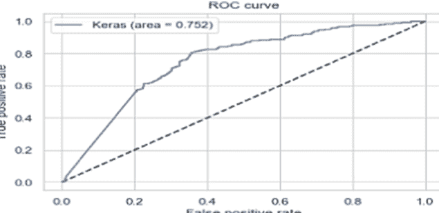

图 5.2 使用 `sigmoid` 激活函数和 2 个隐藏层的 `GRU` 模型 ROC 曲线。

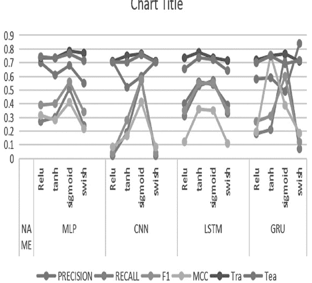

图 5.3 所有模型在德国数据集上使用 2 个隐藏层的性能图表表示。

## 表 5.2 台湾数据集的结果

| 模型名称 | 激活函数 | NH | NN | 精率 | 召回率 | F1 | MCC | Tra | Tea | ROC |
|---|---|---|---|---|---|---|---|---|---|---|
| | | Relu | 10 | 0.62 | 0.002 | 0.0056 | 0.0054 | 0.028 | 0.792 | 0.778 | 0.621 |
| | | Relu | 10 | 0.27 | | | 0.026 | 0.7797 | 0.778 | 0.633 |
| | | tanh | 10 | 0.38 | 0.40 | | 0.209 | 0.777 | 0.778 | 0.700 |
| | | tanh | 10 | 0.40 | 0.39 | | 0.228 | 0.777 | 0.718 | 0.710 |
| | | sigmoid | 10 | 0.61 | 0.32 | | 0.341 | 0.8149 | 0.758 | 0.317 |
| | | sigmoid | 10 | 0.60 | 0.33 | | 0.439 | 0.737 | 0.778 | 0.496 |
| | | swish | 10 | 0.16 | 0.00 | | 0.08 | 0.7784 | 0.783 | 0.387 |
| | | swish | 20 | 0.17 | 0.36 | | 0.231 | 0.7783 | 0.778 | 0.428 |
| CNN | | Relu | 10 | 0.68 | 0.02 | | 0.844 | 0.7907 | 0.7809 | 0.739 |
| | | Relu | 10 | 0.66 | 0.18 | | 0.266 | 0.7933 | 0.798 | 0.916 |
| | | tanh | 10 | 0.61 | 0.32 | | 0.3378 | 0.7572 | 0.916 |
| | | tanh | 20 | 0.58 | 0.43 | | 0.3365 | 0.7283 | 0.8006 | 0.694 |
| | | sigmoid | 10 | 0.68 | 0.29 | | 0.342 | 0.8403 | 0.8095 | 0.732 |
| | | sigmoid | 20 | 0.65 | 0.39 | | 0.402 | 0.8178 | 0.8179 | 0.749 |
| LSTM | | swish | 20 | 1.22 | 1.00 | | 0.036 | 0.7363 | 0.7663 | 0.721 |
| | | swish | 20 | 0.26 | 0.38 | | 0.328 | 0.7937 | 0.8080 | 0.721 |
| | | Relu | 10 | 0.19 | 0.02 | | 0.007 | 0.7160 | 0.7582 | 0.495 |
| | | Relu | 20 | 0.17 | 0.02 | | 0.01 | | | | |
| | | tanh | 10 | 0.67 | 0.37 | | 0.399 | 0.8227 | 0.8196 | 0.753 |
| | | tanh | 20 | 0.66 | 0.38 | | 0.485 | 0.8213 | 0.8119 | 0.749 |
| | | sigmoid | 10 | 0.63 | 0.40 | | 0.401 | 0.8120 | 0.8170 | 0.736 |
| | | sigmoid | 20 | 0.64 | 0.51 | | 0.407 | 0.8200 | 0.8176 | 0.749 |
| GRU | | swish | 10 | 0.20 | 0.10 | | 0.013 | 0.4240 | 0.7183 | 0.536 |
| | | swish | 20 | 0.23 | 0.13 | | 0.016 | 0.6229 | 0.6663 | 0.480 |
| | | Relu | 10 | 0.29 | 0.19 | | 0.037 | 0.7210 | 0.6854 | 0.551 |
| | | Relu | 20 | 0.23 | 0.29 | | 0.013 | 0.7050 | 0.4872 | 0.500 |
| | | tanh | 10 | 0.64 | 0.35 | | 0.369 | 0.8073 | 0.8115 | 0.736 |
| | | tanh | 20 | 0.65 | 0.40 | | 0.406 | 0.8240 | 0.8186 | 0.755 |
| | | sigmoid | 10 | 0.62 | 0.42 | | 0.512 | 0.8233 | 0.8181 | 0.752 |
| | | sigmoid | 20 | 0.63 | 0.43 | | 0.511 | 0.8160 | 0.8176 | 0.750 |
| | | swish | 10 | 0.91 | 1.00 | | 0.003 | 0.7723 | 0.7728 | 0.500 |
| | | swish | 20 | 0.65 | 0.39 | | 0.402 | 0.7640 | 0.7778 | 0.758 |

## 信用卡检测的分析与比较

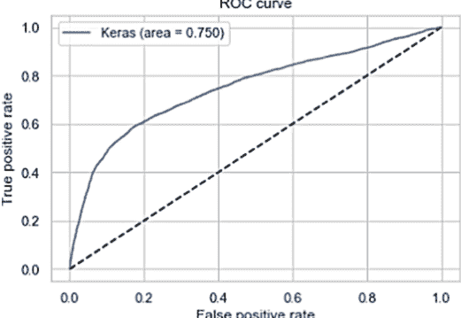

图 5.4 使用 `sigmoid` 激活函数和 2 个隐藏层的 `GRU` 模型 ROC 曲线。

# 图表标题

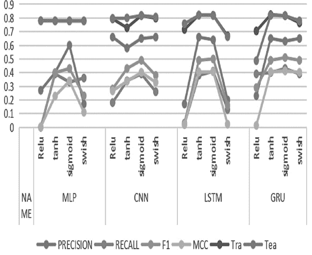

图 5.5 所有模型在台湾数据集上使用 2 个隐藏层的性能图表表示。

# 管理中的人工智能与机器学习

代表了使用 2 个隐藏层模型评估的不同参数统计。

除了通用数据集和台湾数据集外，还在欧洲数据集进行了实施。表 5.3 显示了欧洲数据集的结果。

从表 5.3 可以看到，在每种架构中，当使用 `sigmoid` 激活函数和两个隐藏层实现架构时获得了最佳结果。从表 5.3 可以说明，带有 `sigmoid` 激活和两个隐藏层的 `MLP` 架构提供了 0.87 的精率、0.79 的召回率、0.83 的 F1 分和 0.829 的 MCC 分。`CNN` 架构 `sigmoid` 激活和

## 表 5.3 欧洲数据集的结果

| 模型 | NN | 激活函数 | 精率 | 召回率 | F1 | MCC | Tra | Tea | ROC |
|---|---|---|---|---|---|---|---|---|---|
| MLP | 1 | Relu | 10 | 0.85 | 0.81 | 0.83 | 0.825 | 0.9991 | 0.905 |
| | 2 | Relu | 10 | 0.84 | 0.81 | 0.83 | 0.824 | 0.9985 | 0.9986 | 0.953 |
| | 2 | tanh | 10 | 0.84 | 0.81 | 0.83 | 0.824 | 0.9867 | 0.9966 | 0.938 |
| | 2 | tanh | 10 | 0.84 | 0.81 | 0.83 | 0.824 | 0.9966 | 0.946 |


| | 1 | sigmoid | 10 | 0.85 | 0.81 | 0.823 | 0.8983 | 0.9981 | 0.981 |
| | 2 | sigmoid | 10 | 0.87 | 0.79 | 0.829 | 0.9994 | 0.984 | 0.966 |
| | 1 | swish | 10 | 0.87 | 0.79 | 0.83 | 0.825 | 0.9985 | 0.985 |
| | 2 | swish | 10 | 0.87 | 0.79 | 0.83 | 0.829 | 0.9984 | 0.986 |
| CNN | 1 | Relu | 10 | 0.84 | 0.42 | 0.56 | 0.9598 | 0.9989 | 0.973 |
| | 2 | Relu | 10 | 0.83 | 0.78 | 0.80 | 0.8039 | 0.9992 | 0.993 |
| | 1 | tanh | 10 | 0.85 | 0.80 | 0.8168 | 0.9993 | 0.999 | 0.954 |
| | 2 | tanh | 10 | 0.85 | 0.80 | 0.8151 | 0.9992 | 0.996 | 0.967 |
| | 1 | sigmoid | 10 | 0.88 | 0.75 | 0.81 | 0.8137 | 0.9989 | 0.958 |
| | 2 | sigmoid | 10 | 0.88 | 0.82 | 0.8151 | 0.9991 | 0.9994 | 0.966 |
| | 1 | swish | 10 | 0.84 | 0.73 | 0.78 | 0.7111 | 0.9993 | 0.871 |
| | 2 | swish | 10 | 0.84 | 0.78 | 0.78 | 0.8007 | 0.9994 | 0.9994 | 0.922 |
| LSTM | 1 | Relu | 10 | 0.87 | 0.65 | 0.694 | 0.9985 | 0.9984 | 0.500 |
| | 2 | Relu | 10 | 0.84 | 0.69 | 0.760 | 0.9984 | 0.9982 | 0.902 |
| | 1 | tanh | 10 | 0.86 | 0.66 | 0.74 | 0.929 | 1.105 | 0.0012 | 0.929 |
| | 2 | tanh | 10 | 0.84 | 0.79 | 0.81 | 0.8165 | 0.4469 | 0.392 | 0.923 |
| | 1 | sigmoid | 10 | 0.84 | 0.81 | 0.8153 | 0.9990 | 0.9986 | 0.946 |
| | 2 | swish | 10 | 0.84 | 0.79 | 0.82 | 0.8153 | 0.9998 | 0.946 |
| | 1 | swish | 10 | 0.86 | 0.72 | 0.78 | 0.709 | 0.9982 | 0.9981 | 0.922 |
| | 2 | swish | 10 | 0.84 | 0.78 | 0.78 | 0.8007 | 0.9994 | 0.9994 | 0.922 |
| GRU | 1 | Relu | 10 | 0.83 | 0.36 | 0.542 | 0.9984 | 0.9985 | 0.910 |
| | 2 | Relu | 10 | 0.82 | 0.39 | 0.53 | 0.5666 | 0.9985 |
| | 1 | tanh | 10 | 0.86 | 0.66 | 0.74 | 0.929 | 1.105 | 0.0012 | 0.929 |
| | 2 | tanh | 10 | 0.84 | 0.79 | 0.81 | 0.8165 | 0.4469 | 0.392 | 0.923 |
| | 1 | sigmoid | 10 | 0.88 | 0.75 | 0.81 | 0.8137 | 0.9989 | 0.958 |
| | 2 | sigmoid | 10 | 0.88 | 0.82 | 0.8151 | 0.9991 | 0.9994 | 0.966 |
| | 1 | swish | 10 | 0.84 | 0.73 | 0.78 | 0.7111 | 0.9993 | 0.871 |
| | 2 | swish | 10 | 0.84 | 0.78 | 0.78 | 0.8007 | 0.9994 | 0.9994 | 0.922 |

# 图表标题

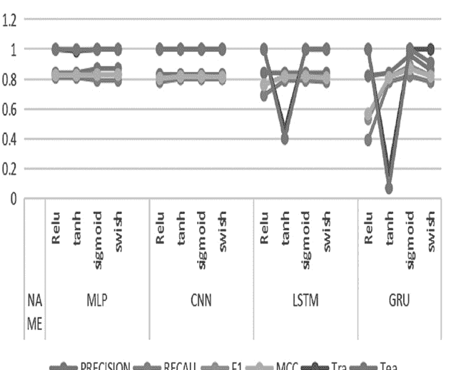

**图 5.7** 在欧洲数据集上使用 2 个隐藏层的所有模型的性能图表表示。

2 个隐藏层的结果为 0.89。未来可以探索更多的深度学习架构及其参数，以提高所提模型的性能。在本次分析中，使用了有限数量的隐藏层，且每个隐藏层的神经元数量也保持不变，因此进一步研究可能会改变层数和每层神经元的数量，以深入洞察增加网络规模对性能的影响。

## 参考文献

- 1. Pillai, T. R., Hashem, I. A., Brohi, S. N., Kaur, S., & Marjani, M. (2018, October). 使用深度学习技术进行信用卡欺诈检测. In 2018 Fourth International Conference on Advances in Computing, Communication & Automation (ICACCA) (pp. 1–6). IEEE.
- 2. Zamini, M., & Mantazer, G. (2018, December). 使用基于自编码器的构建进行信用卡欺诈检测. In 2018 9th International Symposium on Telecommunications (IST) (pp. 486–491). IEEE.
- 3. Kazemi, Z., & Zarrabi, H. (2017, December). 使用深度网络进行信用卡交易中的欺诈检测. In 2017 IEEE 4th International Conference on Knowledge-Based Engineering and Innovation (KBEI) (pp. 0630–0633). IEEE.

# 信用卡欺诈检测的分析与比较

- 4. Mubalaike, A. M., & Adali, E. (2018, September), 智能金融欺诈检测的深度学习方法. In 2018 3rd International Conference on Computer Science and Engineering (UBMBK) (pp. 598–603). IEEE.
- 5. Roy, A., Sun, J., Mahoney, R., Alonzo, L., Adams, S., & Beling, P. (2018, April). 深度学习检测信用卡交易中的欺诈. In 2018 Systems and Information Engineering Design System (SIEDS) (pp. 129–139). IEEE.
- 6. Sisodia, D. S., Reddy, N. K., & Bhandari, S. (2017, September). 信用卡欺诈检测类别平衡技术的性能评估. In 2017 IEEE International Conference on Power, Control, Signals and Instrumentation Engineering (ICEPSI) (pp. 2747–2752). IEEE.
- 7. Xie, Y., Liu, G., Cao, R., Li, Z., Yan, C., & Jiang, C. (2019, February). 一种信用卡欺诈检测特征提取方法. In 2019 2nd International Conference on Intelligent Autonomous Systems (ICOIAS) (pp. 70–75). IEEE.
- 8. Sharmila, V. C., Kumar, K., Sundaram, R., Samyuktha, D., & Harish, R. (2019, April). 使用异常技术进行信用卡欺诈检测. In 2019 1st International Conference on Innovations in Information and Technology (ICICT) (pp. 1–6). IEEE.
- 9. Saraswati, E., Kulkarni, P., Khalili, M., N., & Nigam, S. C. (2019, March). 使用人工神经网络和自组织映射进行信用卡欺诈预测与检测. In 2019 3rd International Conference on Methodologies and Communication (ICCMC) (pp. 1124–1128). IEEE.
- 10. Wang, Y., Adams, S., Beling, P., Greenspan, S., Rajagalan, S., Velez-Rojas, M., & Brown, D. (2018, August). 分布式深度学习及其在欺诈检测中的应用. In 2018 17th International Conference on Trust, Security and Privacy In Communications/12th International Conference on Big Data Science and Engineering (TrustCom/BigDataSE) (pp. 1070–1078). IEEE.


# 6 全民人工智能

## 机器学习与医疗保健：印度的挑战与

Sanghamitra Patna 和 Parthasar Pattayak

计算机应用学院，KIIT大学，奥里萨邦

## 目录

- 6.1 引言 ................................................................ 96
- 6.2 印度医疗保健：挑战 ............................................ 97
- 6.3 健康框架必须考虑....................................................... 98
- 6.3.1 健康源必须仔细对待.................................................. 99
- 6.3.2 健康整合.................................................. 99
- 6.3.3 定义结果的设定.................................................... 100
- 6.3.4 在社会保险背景下理解结果................................................ 100
- 6.3.5 警惕泄露.................................................................. 100
- 6.4 医疗保健中的倾向....................................................... 101
- 6.4.1 诊断与治疗期间的临床任务自动化.................................. 101
- 6.4.2 临床影像自动化.................................................. 101
- 6.4.3 常规流程自动化............................................................... 101
- 6.4.4 临床支持与增强...................................................... 102
- 6.4.5 规范化临床任务.......................................................... 102
- 6.4.6 整合分布式记录....................................................... 102
- 6.4.7 医疗能力增长：筛选、分析与治疗的新蓝线................................ 102
- 6.4.8 证据的纳入....................................................... 103
- 6.4.9 向持续监测发展........................................................... 103
- 6.5 人口保护（人群监控）........................................................... 104
- 6.6 营销策略................................................................ 104
- 6.7 人口筛选................................................................ 104
- 6.8 患者倡导........................................................... 104

## 商业管理中的人工智能与机器学习

| 章节 | 标题 | 页码 |
|---|---|---|
| 6.9 | 机器学习在社会中的作用 | 104 |
| 6.10 | Ayushman Bharat：向前一步... | 105 |
| 6.11 | 国家健康管理局 (Neha)... | 105 |
| 6.12 | 癌症筛选与机器学习 | 106 |
| 6.13 | 从“病态”护理到“健康”护理：向前迈 | 106 |
| 6.14 | 机器学习与医疗保健机会... | 106 |
| 6.14.1 | 诊断与治疗期间的临床任务自动化... | 107 |
| 6.14.2 | 临床影像自动化................................................ 107 |
| 6.14.3 | 常规流程自动化... | 107 |
| 6.14.4 | 临床支持与增强... | 107 |
| 6.14.5 | 扩展临床能力................................................ 107 |
| 6.14.6 | 早期个体化治疗的精准医学.................................. 108 |
| 6.14.7 | 为创新研究开启大门... | 108 |
| 6.14.8 | 为 AI 和评估添加通信................................ 108 |
| 6.14.9 | 大规模多源网络中的表示识别 | 108 |
| 6.15 | 医疗保健中常见的机器学习应用... | 108 |
| 6.15.1 | 药物发现中的机器学习应用 | 109 |
| 6.15.2 | 神经科学与图像计算... | 109 |
| 6.15.3 | 构建机器学习-医疗的云计算框架... | 109 |
| 6.15.4 | 个性化医疗保健中的机器学习 | 110 |
| 6.15.5 | 爆发预测中的机器学习... | 110 |
| 6.15.6 | 患者风险分层中的机器学习... | 110 |
| 6.15.7 | 远程医疗中的机器学习 | 111 |
| 6.15.8 | 医学影像数据融合的多模态机器学习... | 111 |
| 6.16 | 整合期望并为空间学习重要表征... | 111 |
| 6.17 | 结论... | 112 |
| 参考文献... | 112 |

## 6.1 引言

每个患者的临床数据在为特定患者规定治疗方法方面起着决定性作用。信息有助于医疗保健的改进。在临床数据的帮助下，机器学习练习对自动语音产生影响

# 全普及的人工智能

语音识别（ASR）、计算机视觉和自然语言处理（NLP）。其从医疗健康相关数据中提取信息的能力有助于机器学习（ML）的进一步研究。

机器学习在医疗领域的应用范围不断扩大，了许多领域，如糖尿病视网膜病、自闭症以及通过乳腺病理检测淋巴结转移。尽管有了这些进展，机器学习在医疗保健中的应用仍面临着各种挑战。其中大多数问题源于个性化预测。数据仅用于促进后续分析，而不是替代医疗保健。

人工智能在大型人口数据集领域支持机器学习，例如电子健康记录（EHRs）、医学影像和全基因组研究。这些信息对于高风险个体非常有用。目前的应用可以用于预测大量的临床结果，例如院内死亡率、患者首次出院和住院时间过长。出院问题在于如何获取大多数人高质量且大型的数据以供机器学习应用。理解特定疾病的行为及其治疗方法将非常有益。这可以帮助为研究产生假设。

为了更好地理解机器学习在印度的应用，需要识别医疗系统中面临的挑战。

## 6.2 印度的医疗保健：挑战

医疗保健的一些措施是寻找合格的医生、护士和技术人员。基础设施也是医疗保健的一个主要问题。每1000人口中只有0.76名医生和2.09名护士，这与世界卫生组织（WHO）的建议不符。根据WHO，每1000人口应至少有1名医生和2.5名护士；目前每1000人口拥有1.3张床位，而WHO建议每1000人口至少有3.5张床位[2]。

图6.1 显示了印度医疗保健的可及性。普华分析，世界银行数据（2017）。


观察发现，私立医院倾向于位于一线和二线城市及其周边。农村地区的患者被迫奔波远路才能获得基础和先进的医疗保健服务。塔塔纪念医院（Tata Memorial Hospital）的数据显示，2015年癌症治疗的新注册人数超过67,000人。还注意到，来自马施特拉邦邦以外的患者多于该医院所在的马施特拉邦本地患者。来自马施特拉邦的患者少于23%，而来自比哈尔邦、北方邦、西孟加拉邦和贾坎德邦等其他州的患者占总人数的21.7%。这反映了印度医疗保健的严峻状况。

## 商业管理中的人工智能与机器学习

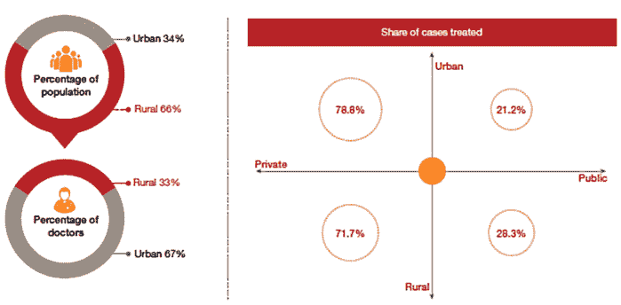

**图6.1** 反映印度医疗保健的可及性。

经济负担是印度医疗保健的一个严重问题。估计患者70%的支出中有62%是自付的，这超出了患者的承受能力。患者不得不依靠贷款或出售资产来支付医院费用。每年有6300万人面临因医疗支出导致的生活贫困的挑战[4]。
大多数人对基础医疗保健并不积极。这是因为要么缺乏意识，要么缺乏可及性。通常，他们只在疾病晚期时才咨询医生。这增加了治疗成本，但康复几率较低。
气候传感器可以提供数据以预测生态系统和环境状况的变化。与现有系统相比，它能更准确地检查污染趋势[5]。它还将将信息发送给民众和政府相关部门以应对紧急情况。城市交通审计也通过数据支持来识别因交通事故导致受伤的位置[6]。
印度政府的全民健康覆盖显示了对让初级医疗保健更易于获取的坚定承诺。印度医疗保健面临的主要挑战有望通过机器学习寻找适当的解决方案。在这里，分析关注机器学习可以应对挑战的途径，以及印度为解决这些问题所采取的步骤。

### 6.3 健康框架必须考虑缺失性

无论影响因素是否为社会保险数据集的成员，考虑到所有因素，许多感知将会缺失。由于成本和数量的原因，真正完整的信息往往是不逻辑的。从缺陷或缺失信息中获益在AI领域很少受到关注（尽管存在特殊情况）[7]，但在统计学中这是一个经过充分研究的主题[8]。由于医疗服务是一项复杂的程序，值会进行估计，并且专家根据过去的感知在一段时间后要求实验室检查，因此估计的因素与其性质之间存在稳固的联系，必须特意记录以防止产生片面结果。缺失数据组件有三种公认的分类（即决定某个值是否被记录的工具[9]）：第一种是完全随机缺失（MCAR），它置于一个固定的缺失概率。在这种情况下，删除完美的观测值——被称为完全案例分析（尽管是草率的）——会导致错误的结果。第二种信息可能是随机缺失（MAR），其缺失概率根据观测到的因素是不规则的。在这种情况下，常规策略包括使用逆概率加权删除等技术对不同信息进行重新加权，或使用各种调整方法进行填充[10]。最后，信息可能是非随机缺失（MNAR），其缺失概率取决于缺失变量本身或其他缺失且不完美的因素。

#### 6.3.1 必须仔细理解缺失性的源头

缺失性的源头可能在学习算法之前被特意分析。例如，实验室估计通常作为症状出现的主要方面被要求，这意味着数据点传递了有关患者状态的信息。考虑一家急诊室，临床人员持续监测酸水平。如果某个因素导致大量酸水平丢失，则信息是MCAR。如果医疗人员更倾向于对受伤的患者测量酸水平，而我们记录了患者是否受伤，则信息是MAR。但可能，如果医疗人员在认为病情严重时更倾向于测量酸水平，那么酸水平估计本身就是MNAR，且该指标本身是重要的。

#### 6.3.2 缺失性的整合

将缺失标记作为特征为预测提供了最丰富的数据[11]。在任何情况下，缺乏适当缺失性模型的学习框架会导致问题，例如对重要性的评估错误以及框架对估计变化的敏感。例如，肌蛋白-T通常在心肌死亡被明智判断时进行估计。通过将肌蛋白-T视为MAR来学习的模型，可能会在肌蛋白-T估计越一致的数据上过度预测心肌坏死的速度。使用MAR肌蛋白特质准备的模型对这一点将更强大。

# 业务管理中的人工智能与机器学习

这反映了文化偏见 [12]。如果 AI 专家不了解这种隐藏的差异性，那么基于此类信息准备的框架可能会对某些人群表现出不合理的执行；沿着此思路，跨群体检查框架是至关重要的 [13]。

### 6.3.3 在定义结果时做出审慎选择

在表征任务时，获取稳健的学习结果是一项重大优势。结果通常用于为受控的预测任务生成所需的最高质量标签，但在不同场景下也至关重要（例如，在分类任务中确保高度特征化的伙伴）。定义结果时有几个关键要素需要考虑：创建稳健的结果、从临床角度理解结果的意义，以及名称拼写的细微差别。

### 6.3.4 在社会保险框架下理解结果

临床定义是利用对感染的动态理解建立的工作框架。随着理解的发展，定义也会随之演。对于 AI 而言，基于此类定义进行命名的可接受的预测执行等同于基础框架。例如，急性肾损伤 (AKI) 是一种重要的疾病，有两种晚期定义：RIF34 和 KDIGO35。因此，利用临床医生的真实内容作为名称是有吸引力的，但要记住他们可能是错误的。例如，客观临床活动的工作应避免考虑药物是否是可接受的标记，以及在确定药物时，“错误预测”是指不同临床医生会提供的药物，而不是理想上治疗患者的药物 [11]。

### 6.3.5 小心标记泄露

在个人医疗经历中收集的数据在时间上是强一致的，这可能导致目标任务结果的数据泄露到特征中。虽然在特征和目标上滥用此类关联是学习的目标，但数据泄露会导致预期偏差。考虑利用患者死亡前的每一个账户来预测每个患者的死亡率。此类任务可能会导致偏执的预期规则：“如果在过去一小时内死亡，器官功能衰竭”。这通常发生在家庭及其患者决定撤回末期视野时。检查整个 EHR（电子健康记录）的高限神经网络也可能导致标记泄露；例如，最后的记录可能会使用显示内部医生潜在理论的标记，从而在推测中确认临床一致性，而不是根据相关信息做出结论。

# 面向的人工智能

## 6.4 医疗保健中的倾向机会

医疗服务领域存在一些高影响力的机会。在适配框架之前，目标应当被清晰区分并证明具有解释价值。在这里，我们将潜在的医疗服务机会分为三个重要水平类别：临床任务的自动化、提供医疗帮助和扩展临床限制。特定安排的细微差别可以传递任何预期，因此在早期与临床伙伴建立联系至关重要。

### 6.4.1 在确定和治疗期间自动化临床任务

目前由医生执行的许多任务对于 AI 专家来说是低耗的业务。临床任务分配机制包括医生的各项工作。这些任务被高度特征化（即已知信息和输出空间），因此只需要最少程度的空间调整和投入。任务的评估同样清晰：执行情况可能根据现有标准进行估计。我们强调，计算不应取代临床工作人员，而应用于推进临床工作流程。随着这些程序的改进，临床工作可能会不断进步，使员工能够投入更多精力在患者身上。

### 6.4.2 计算机临床图像评估

临床成像是人工智能的一个典型机会，因为医生需要经过严格培训来将一个固定的数据空间（例如图像）映射到输出（例如诊断）。在将计算方法应用于临床成像方面已取得了一些近期胜利。例如，在糖尿病视网膜发现中达到医生水平的均衡、利用皮肤镜图像识别有害和无威胁损伤 [12]、从乳腺病理切片中识别脾脏转移，以及区分 X 射线图像中的髋部骨折 [13]。

### 6.4.3 常规程序的自动化

常规临床程序的自动化有望减轻临床工作人员的负担。例如，急诊室的分诊工作通常留给工作人员负责 [14]，但通过算法实现应该是可能的。同样，总结患者病历的内容是一项繁琐但重要的任务。例如，当急诊室人员不确定患者的病情状况时，他们可能需要相关的访谈，在访谈中仔细审核所有可用的患者信息，并在建议的检查和治疗序列中物理性地总结独特的起源。专家可以使用自然语言处理的工作来从结构化的信息中生成输出，从而节省必要的时间 [15]。

# 业务管理中的人工智能与机器学习

### 6.4.4 优化临床决策和实践支持

另一类变革安排集中在支持和增强考虑上。支持不是取代高度特征化的功能，而是需要理解临床痛点并与临床工作人员合作以理解正确的信息、输出目标和评估能力。由于时间表和资源的硬性要求，经常进入工作领域的帮助工作开启了大门，导致了误解和错误（例如：混淆的可识别个人概况、缺陷的翻译或错误的召回 [16]）。在这种设定下，评估框架如何结合临床信息改进下游结果，比与临床人员进行无关联更为合适。

### 6.4.5 规范临床程序

临床准备的差异导致了治疗决策的范围，这些范围对于关注患者状态的隐性疾病可能并不理想。例如，临床工作人员可能不确定哪种药物组合或剂量对患者通常合适。为了帮助满足此类需求，过去的工作分析了处方以协助护理，通过人员配备正确评估他们可能遗漏的内容，以及避免危险行为的默认职责 [17]。在这里，注意自动化一个静态的、现有的方案比完全帮助可能随时间变化的复杂临床规则要容易得多，而且在医疗机构和移动决策支持中可能存在巨大的激励 [18]，以及家庭支持。

全民人工智能 103

### 6.4.8 扩大证据支持的包容性

虽然人类医疗服务本质上是一个由信息驱动的领域，但大多数临床医生在做出选择时缺乏直接证据支持。随机初步研究评估了初步人群的常规治疗效果，但日常决策并非基于顶尖的随机对照试验（RCTs）。例如，大多数经常使用的 ICU（重症监护室）药物并未经过少数评估人员的严谨准确的验证，而这些评估人员估计多达 20% 的药物是有 RCT 支持的。事实上，在存在 RCT 的环境中，初步人群通常是受限的群体，其特征由 RCT 的纳入标准决定，但这些标准并不适用于所有人群。最后，RCT 结果无法反映治疗的多样性。早期的研究发现，约 10% 的糖尿病患者和 25% 的高血压患者具有某种特殊的治疗途径（例如，由于亲属关系）。未来的方向是利用异质性实验来应对这种异质性，允许探索更广泛的医疗咨询问题。

### 6.4.9 迈向持续监测

持续监测是医疗保健中的一个重要目标，利用持续的数据收集设备来提供重要信息，并在患者需要时发出警告。近期的工作关注于预测转变的结果。在进一步的非侵入性环境中，可以发现早期问题。例如，通过程序化发现老年患者，允许在医疗环境中进行一致性检查。关键的是，在医疗事故中识别出的早期问题，正在被谨慎地处理。通过精确的医疗试验来引入每个患者的治疗；这对于原因不明的疾病尤为重要。例如，急性肾损伤（AKI）表现为各种症状……可能已经导致了各种原因的 AKI。通过个性化治疗，可以发现差异，这有助于推荐选择性治疗策略。

104 商业管理中的人工智能与机器学习

## 6.5 人口保护（人群监测）

可以通过机器学习分析来自各种数字源的数据预测疾病扩散。可以通过采用人群监测的方法来保护人们。社交媒体的数据有助于监测流感等疾病的传播，以便及时采取措施预防。可以确定覆盖率低的原因，并相应采取策略来提高覆盖率。

## 6.6 营销策略

机器学习对于促进医疗保健的营销策略也非常有用。通过信息过滤系统，可以做出有效的决策来引导人们的健康行为。机器学习算法通过基于内容的分析为个人信息提供了强大的解决方案。人们过去的行为模式被用于预测其未来的行为。获得适当许可的电子健康记录（EHRs）可以研究人们对烟草、含糖饮料和酒精的不健康行为。

## 6.7 人口筛查

基于机器学习的人口筛查对于疾病预防非常有帮助。例如，基于全血的机器学习标记系统有助于识别结直肠癌高风险患者。目前，深度学习影像已用于乳腺检查以做出合理的诊断决策。

## 6.8 患者倡导

患者倡导强调为了人们的福利而应用伦理学。大数据分析将消除传统的歧视和偏见。例如，它可以研究特定社区成员健康保险水平下降的问题。然而，机器学习的机器学习将为识别不平等或不合理的歧视铺路，从而确保整个社会的健康公平。

## 6.9 机器学习在社会中的作用

机器学习在社会中具有潜在作用：它可以解决医疗从业人员短缺的问题。起初，它将支持诊断活动，逐渐其范围

105 全民人工智能

可以扩大到医疗的不同水平。它将研究如为工作人员安排预约和提供直接医疗建议等问题。

关于医疗保健中机器学习的益处存在观点差异。它会对社会产生负面影响，因为有些人认为这会导致工作流和失业。例如，机器学习算法能够在 24 小时内处理诊断放射学或病理学的大量图像。尽管有这些争论，人们仍然可以看到基于机器学习的技术优势，这些技术可以创造新的工作。它还将使医疗从业人员能够投入更多时间照顾患者。

机器学习在政策中的作用支持艾伦·图灵（1950）的观点，即人工智能（或“机器智能”）将解放现代社会。它的作用可以在健康治理领域进行探索。机器学习解决方案可以提供政策声明批准以帮助后代。

## 6.10 AYUSHMAN BHARAT：迈出一步

Ayushman Bharat 被认为是印度最大的政府资助医疗保健计划。其目标是让普通人能够负担得起并获得医疗服务。它为每个家庭提供 50 万卢比的住院保险。超过 10 个脆弱群体的家庭根据社会经济人口普查（SECC）数据库受到 Ayushman Bharat 的保障。成为受益者没有年龄和家庭规模的限制。大多数医疗和外科疾病都在涵盖范围内。这些福利可以在公立医院和治疗过的私立医院获得。2018 年，联邦预算为健康与中心（HWC）预留了 200 亿卢比。与现有系统相比，气候传感器可以提供预测生态系统变化的数据。这将发送人们和政府以警惕紧急情况。交通审计也支持数据来识别交通事故导致的伤害。

## 6.11 国家电子健康局 (NEHA)

国家电子健康局正通过技术帮助改善医疗保健做出巨大努力。它采用电子健康策略重新定义医疗部门。整合健康信息计划（IHIP）的目标是为印度公民提供电子健康记录（EHR），并为现有的电子健康记录/电子病历（EMRs）提供互操作性。

# 106 业务管理中的人工智能与机器学习

为普通民众提供医疗设施。人工智能、机器人技术和医疗健康物联网（IoMT）被认为可以帮助政府解决广大民众的所有健康相关问题。

## 6.12 癌症筛查与机器学习

人工智能在癌症筛查及其治疗方面具有巨大的干预空间。印度每年新增病例超过一百万例。随着印度生活方式的变化和人口老龄化，这一数字可能会增加。早期发现和管理对于癌症的有效治愈至关重要。治疗癌症迫切需要高质量病理服务，而这仅在印度少数选定的城市可用。只有约2000名具有肿瘤学经验的病理学家。能够被称为专家肿瘤学医的病理学家不足500名。机器学习解决方案可以协助普通病理学家进行高质量诊断，从而弥补提供基础医疗服务的空白。为了得出解决方案，需要大量的高质量标注病理数据集。印度转型委员会（NITI Aayog）正在开发一个国家存储库来解决这个问题。这被称为“数字病理学”。

## 6.13 从“疾病治疗”转向“健康管理”：前行

印度转型委员会正努力与微软和 Focus Health 合作，探索早期检测糖尿病视网膜病变的技术。Focus Health 开发了 3Nethra：一种用于筛查眼睛问题的便携式设备。Ravind 眼科医院、Narayana Netraya 和 Sankar Netraya 与 Alphabet Inc 公司合作，引入了某种人工智能系统来检测糖尿病视网膜病变。该项目是印度引入人工智能支持的医疗解决方案的例。

探索机器学习在医疗健康领域提供的各种机会至关重要。以下分析侧重于这些问题。

## 6.14 机器学习与医疗健康机会

社会保险领域有许多开放的道路。在建立模型之前，应该明确区分并批准目标。潜在的医疗服务机会可以分为三个重要的层次类别：临床任务的机器人化、临床辅助安排以及扩大临床能力的范围。

### 6.14.1 诊断与治疗期间的临床任务自动化

目前临床医生执行的许多任务为人工智能科学家提供了低复杂度的产品。临床任务自动化围绕临床医生目前执行的一类工作展开。这些任务具有非常明显的特征，因此对空间调整和投入的要求极小。计算不应取代临床工作人员，而应用于升级临床工作，让员工能够投入更多精力在患者身上 [31]。

### 6.14.2 临床图像评估自动化

临床成像为人工智能提供了一个独特的机遇。例如，临床医生需要接受严格训练，以便从固定的数据空间（例如图像）规划到输出（例如结果）。在将计算应用于临床成像任务方面已经取得了一些近期性成就。例如，在糖尿病视网膜病变识别中达到医生水平的精度、利用皮肤镜图像识别危险和非威胁性皮肤 [32]、从乳腺病理切片中识别淋巴结转移，以及在 X射线图像中识别髋骨折 [33]。

### 6.14.3 常规程序自动化

常规临床程序的自动化减轻了临床人员的负担。例如，总结患者病历的内容 [34] 是一项枯燥但重要的工作。例如，当临床人员不确定患者的病情时，它可能会迫使他们进行一场不可避免的疾病讨论，权威会细致地引导所有可用信息，并物理地总结不同的原因以建议治疗和检查 [35]。专家可以利用来自自然语言处理的工作来从结构化信息中创建大纲，从而节省真正需要的时间。

### 6.14.4 临床支持与增强

机器学习有助于支持和扩展护理。它为缓解因时间和资源需求而产生的工作压力打开了大门。它经常导致数据不成熟和错误（例如，混淆的患者 ID、错误的翻译或错误的召回）。在这种情况下，评估模型如何开发与临床信息相关的下游结果，比直接与临床人员关联更为合适。

### 6.14.5 扩展临床能力

机器学习可以通过涉及临床人员在筛查、分析和治疗方面开辟新天地。随着数字化的人类服务记录，医生面临着关于患者和人口日益增长的新信息。这为医疗框架提供了另一种能力配置，以更好、更智能的方式提供社会保险。创建对临床伙伴最需要贡献的新列表至关重要，并根据开发和临床价值来评估效果。

### 6.14.6 早期个体化治疗的精准医疗

精准医疗寻求每位患者的治疗个体化。这对于具有多种表现且原因不明的疾病状况特别重要。例如，急性肾损伤 (AKI) 的特征是描述肾衰竭的多种副作用，而非根本原因。两个个人可能由于各种原因产生 AKI，因为有许多导致肾功能衰竭的原因，产生了可选的治疗策略。通过定制，可以针对特定疾病确定单一特定的治疗方案。

### 6.14.7 为创新研究开启大门

医疗健康领域的机会链为创新研究开启了大门。重要的是，临床人员和人工智能专家通常具有综合能力。各种高影响问题必须通过社区引导的努力来解决。我们注意到了一些前景的研究障碍，特别是那些处理数据平稳性、模型可解释性和寻找合适表示的问题。

### 6.14.8 为人工智能和评估增加沟通

社会保险中的人工智能工作提供了与人类专家合作和团队合作的机会。临床人员贡献了多他们的知识 [17]。此外还涉及父母框架，且写作被认为是临床实践的重要组成。构建协作框架可以利用医生和学习框架的综合特性。AI 写作中有许多研究方向可以作为此类框架的基础。

### 6.14.9 在大型多源网络中区分表示

表示学习对人工智能的巨大进步负责。卷积神经网络学习的数据集的低维、客观上不重要的表示可以被视为示例。医疗健康数据需要这样的标准结构，以及关于合适的多源连接和学习空间合适表示的研究。

## 6.15 医疗健康领域常见的机器学习应用


医疗健康行业有许多且无限的机器学习应用。本节引用了一些常见的应用。机器学习有助于简化医院的行政流程。它还有助于映射和

# 人民的智能

针对个性化医疗的传染病。机器学习（`ML`）将在临床决策支持中发挥非常主导的作用，从而影响医生和医院。例如，它将帮助更早地识别疾病并定制治疗方案，以确保最佳结果。机器学习可用于教育患者有关潜在疾病以及不同治疗方案的后果。因此，它可以通过降低医疗保健成本来提高医院和医疗系统的效率。医疗保健中的机器学习可用于健康信息管理以及健康信息的交换，旨在改进并使工作流程流程化，促进临床数据的获取，并提高健康信息的准确性。最重要的是，它为信息处理带来了了效率和透明度。

## 6.15.1 机器学习在药物发现中的应用

近期，机器学习方法在药物发现过程中发挥了关键作用。它通过利用高质量数据的可用性，降低了药物开发中高失败率的问题。机器学习在药物开发中面临着多重挑战。药物发现过程中极具挑战性且复杂的任务之一是确保药物安全性，分析和解释已知药物的可用信息，并预测其副作用。来自各种声誉良好的机构的研究人员，当然，还有许多制药公司一直在利用机器学习从临床试验使用的临床数据中获取相关信息。在药物发现背景下使用机器学习分析和解释这些数据是近期的一个活跃研究领域。最重要的是，药物发现中的计算解决方案显著降低了药物进入市场的成本。

## 6.15.2 神经科学与图像计算

神经科学图像计算（`NIC`）特别关注先进成像方法的发展及其在临床研究中的解释。`NIC`研究试图利用先进技术来解码脑疾病的病因，包括精神疾病、神经退行性疾病和创伤性脑损伤。

## 6.15.3 构建基于机器学习的医疗保健的云计算框架

广义的人工智能特别是机器学习近期经历了巨大的增长，因为它们能够利用海量数据，并对手头问题产生准确且深入的理解。云计算使得更具成本效益成为可能，并具有处理日益的市场需求的能力。使用机器学习的模型被认为比使用云计算资源的模型更具稳健性。云计算资源可以跟踪来自可穿戴设备和健康追踪器的数据。然后，它们可以在云存储中有效地流式传输并聚合成本结果。海量数据可以使用云计算基础设施进行高效分析。这使得机器学习模型更加准确和稳健。

## 商业管理中的人工智能与机器学习

## 6.15.4 个性化医疗中的机器学习

医疗保健中的物联网（`IoT`）使得连接大量的人、带有智能传感器的物体（如可穿戴和医疗设备）以及环境变得越来越可能。患者的生命体征和各种实时数据由物联网设备中的传感器和智能资产捕。数据分析技术（如机器学习）可为人们提供基于价值的护理。例如，运营改进增强了效率，以更低的成本提供优质护理。同样，临床改进确保了快速且相对准确的诊断。它还确保了更以患者为中心、更科学地确定最佳治疗方法，以支持更好的健康结果。机器学习使用数据集来改进运动方法和疾病预测。机器学习的解释性模型被整合到各种服务应用中。这些模型通常分解从传感器设备和不同来源收集的收集，以识别患者的个人行为标准和临床状态。

## 6.15.5 爆发预测中的机器学习

近期，研究人员广泛使用多种爆发预测模型，以做出最合适的决策并实施相关措施来控制爆发。例如，研究人员正在使用一些标准模型（如流行病学模型和统计模型）对 `COVID-19` 进行预测。由于涉及不确定性和相关数据的匮乏，这些模型得出的预测证明其稳健性和准确性较差。近期，许多研究人员正在使用机器学习模型对这一爆发进行长期预测。研究人员表明，与替代模型相比，基于机器学习的模型在这种爆发中证明更为稳健。

## 6.15.6 患者风险分层中的机器学习

在医疗保健中，风险分层被理解为将患者分类为风险类型的过程。状态取决于从各种来源获得的数据，例如医疗、健康指标和人口的生活方式。分层索引的目标是处理人口管理、个性化治疗计划以降低风险，并将风险与护理水平相匹配。传统的预测模型主要取决于从业者的专业知识和经验。机器学习不需要人工输入即可分析医疗报告、健康指标和保险记录等大量数据并应用机器学习提供最佳结果。

# 人民的智能

## 6.15.7 远程医疗中的机器学习

医疗保健中的远程医疗是一个重要行业。它让提供者和患者的护理过程都变得更容易。该行业在全球范围内增长速度很快。医疗保健中机器学习等新技术的进步为医疗专业人员提供了真正的工具和资源，以管理每天涌入的患者。机器学习帮助这些专业人员以新方法分析和解释海量原始数据，并为实现更好的健康结果提供有趣的见解和方向。

## 6.15.8 医学影像数据融合的多模态机器学习

多模态图像融合技术是一种从多模态医学图像中获取互补信息来研究疾病的有效且重要的技术。这些策略已在临床实践中持续且逐步地应用。多模态图像研究和机器学习策略正在快速发展，并为临床应用带来了显著的激励。由于对将这些策略应用于临床图像搜索的持续参与，研究人员提出了算法设计，通过跨方法论组合将多模态图像研究管理到胜任的学习水平、分类器水平以及动态水平。此时，执行了一个基于深度神经网络的图像框架，利用多模态图像（包括磁共振成像、计算机断扫描和正电子发射断层扫描）来形状组织肉瘤。使用多模态图像的模型比使用单模块图像的模型显示出更好的性能。

## 6.16 整合预期与学习重要表征的空间

单一患者信息已扩展到整合多种来源和模态，这使得初始测试成为一个巨大的挑战。预测项目需要新的记忆框架，这是因为许多记录是分散的、跨度很长的，且早期事件会影响多年后的理解。

学习在各种任务和特定情景下提供良好预测性能的重要状态表征是一个巨大的优势。清晰地管理表征可能是有益的，因为它们可以帮助传播对于单一科学家任务并不显见的发现。对于医疗机构范围内的表征，存在一些可以探讨的机会。首先，单一的持续信息（例如生理信息）可以导致多种可能的正确结果（例如诊断分类），这在我们研究的表征中必须是可能的。对于其他信息类型的教育表示已有一些基础研究。

# 112 业务管理中的人工智能与机器学习

## 6.17 结论

机器学习（`ML`）被认为是最期待的人工智能应用之一。它展现了支持医疗政策的众多方式。通过采用预防性策略照顾了大量人群。它围绕以患者为中心的方法，涵盖了患者倡导以及劳动力和资源的有效管理。机器学习日益增长的使用将为印度为大部分人口提供适当的医疗体系提供巨大的便利。它激励政府在医疗保健领域满足普通人的需求。事实上，机器学习有望成为使医疗服务更具主动性的跳板——从“疾病”护理向“健康”护理的转变，这是一个受欢迎的变化。

## 参考文献

- 1. Chen I, Solovits P, Ghashemi M. AI 能帮助减少普通医疗和心理健康保健中的差异吗？AMA Ethics 21(2), 167–179, 2019.
- 2. Du J, Xu J, Song HY, Tao C. 利用基于机器学习的方法通过 Twitter 评估乳头瘤病毒疫苗接的情绪。BMC Med Inform Decis Mak 17(Suppl 2), 69 2017 Jul 5. doi:10.1186/s12911-017-04960-G PMID:2869569. Published Central PMC:5506590.
- 3. Mackey T, Kalahyan J, Katsuki T, Lanckriet G. 基于 Twitter 的处方药非法在线销售检测。Aj Public Health 107(12), 1910–1915, 2017 Dec. doi:10.2105/AJPH.2017.303994 PMID:29048660.
- 4. Jones N. 机器学习如何帮助改善气候结果。Nature 548(7668), 379–380, 2017 Aug 23. doi:10.1038/s41586-017-3839A
- 5. Kishdori A, Fallahi Tafi. 用于城市收集道路安全提升的的碰撞频率模型。Int J Traffic Saf Promor 24(4), 519–533, 2017 Dec. doi:10.1080/17457300.2016.127827 PMID:2818766
- 6. Sadivas R, Cutona SK, Kinney RL, Martin BM, Mazor KM, Lemon SC, et al. 集体智能推荐系统：推进用于行为改变的计算定制化。Med Internet Rec 18(3), e422, 2016 Mar 7. doi:10.2196/jmir.4448 PMID:26052574. Published Central PMC:4802103
- 7. Goshen C, Holman R A, Mueller E, Karvir R, Chodick G, et al. 使用 colonflex 检测在大型健康管理组织中计算机辅助检测处于结直肠癌高风险的标记。JCO Clin Cancer Inf (2), 1–8, 2018.
- 8. d’Alessandro B, O Neic C, Lagarta, Athanasiou T. 新颖分类：科学家的歧视规避分类指南。Big Data 5(2), 120–134, 2017 Jun. doi:10.1089/big.2016.0048 PMID:28632437.
- 9. Darzi A 为所有人提供更好的健康和护理：2020 年代的 10 点计划。IPPR. 可获取自：https://www.ippr.org/files/2016-08/better-health-and-care-for-all-june2018.pdf
- 10. Ashrafian H, Dari. 医疗保健中人工智能和机器人图灵测试的新型改进。Int J Med Robot
- 11. Phillips SP, Hamilton K. 随机试验的盲法。
- 12. Subbaswamy A, Saria A. 应对数据偏移的因事实归一化。
- 13. Gong JI, Naumann T, Szolovits P, Guttag J. 预测健康记录。
- 14. Obermeyer Z, Lee TH. 人类的局限。
- 15. Mali AK, Bhatia G. 交互性。
- 16. Letham B, Rudin C. 统计主动性。
- 17. Bates DW, Gawande AA. 利用信息技术改进安全性。
- 18. Zhu J, Efros AA. 视觉操作。
- 19. Ranganath R, Elhadad N, Blei D. 深度学习。
- 20. Dessel J, Farid H. 可扩展性。
- 21. Lin C, Kim H. 单细胞数据高通量表型。
- 22. Ze C, Purushotham S, Liu Y. 多变量时间序列神经网络。
- 23. Shah NH, Corla-Souza A. 促进健康健康的机器学习公平性。
- 24. Misidou X, Perotte A, Elhadad N, Ranganath R. 深度分析。
- 25. Robins JM. 统计健性估计。
- 26. Ding P, Li KJ. 统计视角。
- 27. Ghashemi M, Mu W, Feng M, Szolovits P. 异质性数据的压力预测。
- 28. Rajkumar A, Oren E, Chen K, Dai AJ, Liu N. 电子健康记录的准确深度学习。
- 29. Casey McIntyre DD, Levens KJ. 评估新生评分的价值。
- 30. Wei-Q, Tequeira PL, Mo H, Cronin RN, Warner JL, Denny JC. 电子健康记录中的账单代码、临床笔记和药物。
- 31. McCoy TH, Yu S, Hart KL, Castro VM, Brown BR, Rosenquist JN. 电子健康记录中维度精神病学的表型。
- 32. Shheidnerman B, Plaisant C, Hesse BW. 用交互可视化改进医疗。
- 34. Pivovarov R, Coppelson YJ, Gorman SL, Vaudrey DK, Elhadad N. 患者记录摘要能支持质量指标抽象吗？
- 35. Fishbane S, Niederman MS, Daly C, Magin A, Kawabata M, Corla-Souza A, et al. 标准化医集和强化病例管理对社区获得性肺炎结果的影响。
- 36. Bates DW, Gawande AA. 利用信息技术提高安全性.

# 业务管理中的人工智能与机器学习

在社会中为几乎每一个人提供个性化护理是可能的 [5]。在 SARS-COV-19 病毒引发的大流行时代，我们的医疗保健体系意识到采用现代技术的重要性 [6]。随着预期寿命的显著提高，当前社会正成为一个人口老龄化的老年患者聚集社会。成年人和老年人需要不断的护理和支持，因为他们大多数人正遭受高血压、心律失常、糖尿病等生活方式疾病的困扰。老年患者需要更多个性化的护理，因为他们无法控制自己的生理症状，并不断向家庭和医疗从业人员寻求支持 [7]。

个性化医疗被定义为从治疗、诊断和治疗，到治疗后及进一步随访的所有阶段，在尽可能可能的范围内适应个人的医疗保健需求。与个性化医疗一起被使用的一些概念包括基因组医学、分层医学和精准医学。清晰地理解这些术语有助于避免任何误解。

个性化医疗演变的主要动力源于基因组测序产生的数据。个性化医疗的潜力在于基于基因组数据的疾病风险预测、治疗反应和护理。用于调整医疗保健的各种类型数据与基因组测序数据相去甚远。此外，参与者对个性化医疗扩展和执行的接受度可能会受到这种认知的影响：基因组学尚未达到预期水平，并可能导致对大量疾病的脆弱性。因此，有必要回答那些认为个性化医疗基于误读（认为它仅代表基因组）的反对意见 [8]。

临床实验室对信息系统的使用有助于整合报告、警告以及结果，并通过电子健康记录（`EHR`）及相关系统应用结果。网关促进了对遗传数据的访问，并决定了如何使用这些数据。目前，所需基础设施的发展处于起步阶段，精准医学的基础设施正在演变中。

患者的角色对于支持精准医学至关重要。通过收集尽可能的信息，可以为每个基因组测序唯一的患者提供定制的精准医学 [9]。电子健康记录（`EHR`）定位为通过技术支持遗传信息。它们应该通过提供有关患者的完整信息以及遗传数据来辅助临床医生。获得的信息应当系统化并展示，使其能够实现顺畅的诊断和与治疗相关的决策 [10]。

21世纪医学面临的最大挑战是根据患者的精确生物状况提供定制的有效治疗，以促进医疗保健解决方案。通常，在治疗开始之前应该对患者进行评估方案，以帮助医疗保健工作者提供准确的药物、剂量或干预。这导致了根据某些遗传特征对患者进行分类，为提供平衡营养和生活方式提供了一个高效的模型 [11]。

## 揭秘机器学习的能力

苹果公司在2015年初宣布了 `ResearchKit` 的推出，这是一个移动平台，通过捕捉全球7亿 iPhone用户的用户的手机设备数据，来识别对人类研究项目感兴趣的个人。这些应用程序包含了一套工具包，可以帮助个人在帕金森病观察性研究（`mPower` 应用）、心血管健康（`MyHeart Counts`）、乳腺癌（`The Journey`）、哮喘（`Asthma Mobile`）和糖尿病（`GlucoSuccess`）的观察性研究中进行注册。这些研究是与美国17家不同的研究机构合作进行的。`Research Kit` 正在驱动创造力，追求连接移动技术、用于确定表型指标的可穿戴式传感器，以及用于确定血液、粪便和组织中基因组、表观遗传、蛋白质组和代谢标记物的极具渗透性的机器。这种技术的出现，具有存储、共享、过滤和分析数据的计算设施，将为人类居民收集健康数据，为生物医学研究提供巨大机会 [12]。

这种移动技术的另一个强大点是它提供了长期监测表型的能力。通过使用 `mPower` 应用，研究人员可以每天跟踪疾病如何影响步态、震颤、情绪、认知、语言和睡眠。对这些新模式的理解可能是揭示疾病发展和严重程度的指标。这使得能够获得充足的样本进行统计分析，有助于将疾病分层为精确定义的组别。这有助于更快速、更有效地进行诊断 [12]。

随着这些技术的出现和海量数据，数据驱动和网络驱动的理性方法在个性化医疗保健的发展中变得至关重要。某些疾病具有可避免的风险特征，或者至少是风险的预测因素。对这些特征进行适当分类将有利于个性化医疗保健，并降低疾病风险。由于可能的风险因素是复杂的，医生在与患者互动时很难单独识别实时数据。通常，医疗保健提供者查看患者的既往病史、体检和诊断来确定患者健康状况并预测疾病风险。这对于某些疾病具有局限性，并且受到从业人员的能力、知识以及人类挑战性不确定性的限制。在这种情况下，需要一个分析框架来整合和吸收大数据，以从患者的电子病历中获取深度知识，并将患者的信息和影响与其他患者进行比较，为每个患者提供个性化的风险概况。这允许主动医学、积极应对疾病，并赋予患者自主权。

大数据将对医疗保健产生巨大影响，特别是在个性化医疗方面。根据健康技术转型研究所提供的报告，美国医疗机构已产生了大量的医疗数据 [13]，这些数据在短期内将持续增加。如果这种异常量的数据被隐含地使用，它可以提供实质性的洞察力来避免重复治疗、减少药物失误、最大化整体健康，并最终导致一个有效且胜任的医疗保健系统。

# 业务管理中的人工智能与机器学习

在患者正常活动期间可以获取广泛的数据，这些数据可以被收集、处理和评估。移动平台与基于传感器的 `IoT` 设备集成并将数据共享到云端的 `mHealth` Enables患者的实时监测 [14]，这有助于做出知情决策。人工智能和机器学习是医疗系统的智能代理的一部分，并通过大数据进行集成。

### 7.2 护理的时间替代

医疗保健提供者可以通过 IT 实施时间替代，为自己和患有自身免疫性疾病的患者创造价值。[16] 建议从医疗保健的角度来看，时间性需要由医疗保健组织生成的 IT 和分析，用于识别、跟踪和分析健康状况，在适当的时间是管理疾病服务和活动的关键因素。

该理论涉及在治疗慢性疾病时何时消费任务和服务，这还包括如何对其进行治疗。[16] 的假设局限于生活方式慢性疾病，不包括传染性治疗或急性疾病中应遵循的方案。然而，在目前的某些情况下，该理论也适用于急性和传染性疾病。患有生活方式疾病的患者将乐意在处方的治疗期间参与和协作。然而，[17] 发现了二型糖尿病患者的不从性，并得出他们逃避了该项目的结论。

为了更好地实施干预时间的替代，提供者必须配备 IT 和分析，具备编码时间因素、治疗类别、成本和结果的能力。将信息整合到 IT 系统可以获取知识并捕捉和传输指令和细节，扩大了利益相关者之间的协作 [18]。


## 7.3 人工智能在医疗保健中的应用

当患者去医院时，从业人员无法确保特定程序在患者身上执行是安全的。对于使用的约一半天和程序，没有关于其有效性或效果的数据，因为这些证据集中在极有限的样本上，这些研究发现是无法复制的，因为研究结果仅

### 揭秘机器学习的能力

通常仅根据平均值进行考虑。这简单意味着医生在手头没有足够的细节来为患者推荐准确的康复计划。然而，通过引入 AI 这一未来目标，医疗健康得以改善，我们的医生也可以变得更加智力化。AI 将作为医生的第二位值得信赖的同伴。

AI 在医疗健康方面有很多影响。AI 在放射科医生分析医学影像方面提供支持（C. W. L. [19]）。近期，Idx-DR AI 驱动设备获得了美国食品药品监督管理局（US-FDA）的许可，它不需要临床干预即可预防诊断为糖尿病的成人出现糖尿病视网膜病变较的结果 [20]。这种支持 AI 的系统允许患者进行测试，如果结果不理想，则会将患者转诊给眼科医生。患者可以在 12 个月内随访，且产生不利影响。得益于 AI 和机器学习（ML），用于个人医疗的自适应技术的开发和评估正成为利用 AI 促进青少年健康的机遇。由 AI 驱动的定制化技术可以影响青少年以及成年人和老年用户，利用自适应技术来建立特质和知识 [21]。

如今，智能手机应用程序已经开发出来，并易于用于生理位置的专业护理 [22–24]。尽管正向个性化医疗发展，但这些发展面临某些问题，如可扩展性、安全性和机性。此外，这些应用程序提供了生理状况的快照，而不是一段时间内的整体健康状况。

AI 在医疗健康方面有很多影响。智能手机应用程序已经开发出来，并易于用于生理位置的专业护理。

随着传感器网络研究的最新进展，我们可以向植入家庭和生活环境的创新低成本医疗监测系统迈进 [25]。这导致了 AI 中的设备向环境智能（AMI）系统的演变。这种系统是渗透性的、反应性的、自适应且通用的。AMI 系统能够更生动地推动医疗领域的发展。它不仅用于监测患有慢性疾病的老年患者的健康，还为个人提供心理和身体上的适当照顾 [26]，并分享他们的结果和行为。这可以用于开发有影响力的服务，鼓励人们过健康的生活并增强人类福祉。最后，它还帮助医疗专业人士以透明适度的方式提供沟通和监测健康的开创性工具。它可以作为一种与各种情况和设备相结合的持续服务使用。

根据 [27]，多种 ML 算法为实现个性化医疗目标的概率提供了合理的估计。该模型与网络应用程序相结合，帮助医疗专业人士进行确定性预测。年轻人的肢体活动通过可穿戴设备和移动传感器进行监测，这简化了社会评估并提供了智能反馈 [28]。佩戴在腕上的合适设备有助于持续监测患者的心率。记录的数据随后通过模糊技术进行演示，以理解远程心脏设置。

物联网（IoT）的接受正通过在日常活动中使用这些设备，通过动画对象实现电子教练（e-coaching）[29]。神经系统不适的患者经常在活动中挣扎，他们对执行责任的顺序感到困惑，或者可能忘记针对特定项目应实施哪种操作。这项工作提供了一系列样本，通过尽量减少动画对象上灯光和音频的使用来减少运动不确定性的影响。

## 7.4 可穿戴健康设备

医疗健康技术，如物联网（也称为医疗物联网，IoMT）和可穿戴健康设备（WDs），通过其生成和传输生命体数据的巨大能力发挥着至关重要的作用 [4,30]。今天市场上已有许多 WDS，它们可以准确测量心率、运动跟踪、体温、女性健康和其他生命体征 [31]。一些先进的 WDs 在遭受压力时会发出通知，并为用户提供引导运动以调节 SpO2 氧水平 [32]，而其他设备具有生成和共享心电图（称为 ECG）的能力 [33–35]。表 7.1 列出了适用于印度用户的可穿戴设备详情。图 7.1 显示了医疗保健的现状以及未来医疗的可能。医疗保健的现状以及未来医疗的可能如图 7.2 所示。

## 表 7.1 印度提供的各种可穿戴健康设备

| 设备 | 健康功能 | 参考文献/来源 |
| --- | --- | --- |
| 三星 Apple Watch | 睡眠周期、压力水平、引导性呼吸练习、运动跟踪、血压、女性健康、心率 | [32] |
| Fitbit 智能手表 | 心电图、心率、运动跟踪、运动建议、女性健康、睡眠跟踪 | [34] |
| Apple Watch | 睡眠监测、冥想、运动、心电图、心率、温度、血压 | ([33]; [36]) |
| 小米手环 | 心率基础功能、步数、有氧和无氧活动跟踪 | [37] |
| 真我智能手表 | 氧水平、运动跟踪。睡眠周期监测、增强睡眠、压力监测、心率、代谢和卡路里 | [38] |

[图 7.1：实验室和放射科结果、全球数据、医院和病理实验室、信息学中心 + 推荐治疗、检查、电子健康记录、医院病理放射科实验室、症状、临床数据、医生、数据摘要、患者、诊断、医生、治疗、疾病、最佳治疗]

图 7.1 显示了医疗保健的现状以及未来医疗的可能。如图 7.2 所示。

[图 7.2：智慧城市场景下的未来医疗]

## 7.5 结论

要实施个性化医疗，患者的角色至关重要。通过收集尽可能的信息，这有助于为每个基因测序独特的患者提供定制的个性化医疗。由于电子健康记录（EHR）旨在通过技术支持基因信息，它们将通过提供患者的完整信息减轻医生的负担。获得的信息将被系统化和验证，从而赋能流畅诊断和与患者评估相关的决策。这有助于医疗专业人士不断进化，在治疗开始前提供精确的药物剂量或干预。这导致了根据遗传特征对患者进行分类，为提供平衡营养和生活方式提供了一个高效的模型。可以得出，随着 AI 的出现，这种个性化医疗将对医疗健康产生巨大影响。可穿戴设备和智能手机在生理位置专业护理中的应用。

### 揭秘机器学习的能力

3. Chakraborty, S., Bhatt, V., & Chakravorty, T. (2019). IoT 采用对医疗保健机构敏捷性与灵活性的影响。International Journal of Innovative Technology and Exploring Engineering, 8(11), 2673–2681, 10.3590/K2119.0981119

4. Chakraborty, S., & Bhatt, V. (2019). 移动 IoT 采用作为护理服务效率与提升的前因素：医疗保健背景下的实证研究。Journal of International Technology and Information Management, 28(3), 101.

5. Chakraborty, S., & Bhatt, V. (2020). 关系资源采用。Handbook of Research on Innovations and Technology Management in Organizations, 253–268, 10.4018/978-1-7998-2722-6_014

6. Bhatt, V., Chakraborty, S., Chakravorty, T. (2020). 在 COVID-19 期间提供高效医疗服务的数字技术采用的重要性。International Journal on Engineering Metrics, 11(3), 1–13.

7. Li, J., Zhang, C., Li, X., & Zhang, C. (2020). 患者与移动健康应用的情感连接：使用移动健康应用的视角。International Journal of Information Management, 51(December), 102054, 10.1016/j.ijomgt.2019.102054

8. Simmons, L. A., Dinan, M., Robinson, T. J., & Snyder, R. (2012). 个性化医疗不仅仅是基因医学：术语混淆正向个性化医疗演进。Personalized medicine, 10.2217/ppne.16

9. Aronson, S. J., & Reich, H. L. (2015). 为精准医学中的基因组学奠定基础。Nature, 10.1038/nature15811

10. Hoffman, M. A., & Williams, M. S. (2011). 电子健康记录与个性化医疗。Human Genetics, 10.1007/s0023-011-0992-2

11. Nicholson, J. K. (2006). 全球系统生物学、个性化医疗与分子流行病学。Molecular Systems Biology, 10.1038/msb400095

12. 人类表型的时代到来。(2015)。Nature Biotechnology, 10.1038/nbt3266

13. Terry, S. F. (2015). 奥斯马的精准医疗倡议。In Genetic Testing and Molecular Biomarkers. 10.1089/gtmb.2015.1563

14. Chakraborty, S., Bhatt, V., & Chakravorty, T. (2020). 大数据、IoT 可穿设备与移动健康云平台的集成：患者健康监测的逻辑方法。International Journal of Engineering and Advanced Technology, 9(3), 388–394. 10.35940/ijeat.05241.09320

15. Bhatt, V., Vashisht, S., & S. (2019). 信息技术和分析对健康规模性能的影响：印度背景下的规模开发。International Journal of Recent Technology and Engineering, 8(3), 2861–2869. 10.35940/ijrete.c5229.09839

16. Thompson, S., Whitaker, J., Kohli, R., & Jones, C. (2020). 慢性病管理：它和分析如何通过护理的时间位移创造医疗价值。MIS Quarterly, 44(1), 227–256. https://doi.org/10.25300/misq/2020/15085

17. Brundisi, F., Vasteone, M., Hulan, D., & Giacomini, M. (2015). 2 型糖尿病患者与提供者对药物不依从性的的不同观点：一项定性研究。BMC Health Research. 10.1186/s12913-015-1174-8

18. Kotarsky, J., Scarbrough, H., & Oshri, I. (2014). 离包项目中跨知识边界的专业知识协调：编码准则。MIS Quarterly: Management Systems. 10.25300/MISQ/2014/38.2.13

19. Ho, C. W. L., Soon, D., Kaals, K., & Kapur, J. (2019). 医疗保健中自动化图像分析和 AI 人工智能。Clinical Radiology, 74, 329–337. 10.1016/j.crad.2019.02.005

20. FDA 许可基于人工智能的设备检测某些糖尿病相关眼部事件 | FDA。(n.d.) 检索于 2020 年 11 月 25 日，来自 https://www.fda.gov/news-events/press-announcements/artificial-intelligence-based-device-diabetes-related-eye

21. Pelánek, R. (2018). 数据结果：模型评估中的方法论细微差别。User-Adapted Interaction.10.1007/s11257-04

22. Gregoski, M., Mueller, V., Vertel, A., Shapurov, A., Frenzel, R., Sprehn, S., & Schaefer, F. (2012). 用于健康促进的智能手机心率获取。International Journal of Telemedicine and Applications, 5(4), 6924

23. Milošević, S., Shreve, M., & Jovan, E. (2011). 智能手机在无处不在的健康中的应用。JITA - Journal of Information Technology and 10.7251/jit1107

24. Scully, C., Lee, J., Meyer, J., Gorbach, A., Nelson, E., & K. (2012). 来自手机记录的生理监测。IEEE Transactions on Biomedical Engineering, 59(2), 2163

25. Black, J., Schwarz, M., Cohen, N., Libra, B., Ebling, M., & Stern, E. (2004). 医疗保健中的感知计算：智能空间和企业系统。MobiSys Workshop on Context Awareness, USA.

26. Cook, D., Augusto, C., & Vakura, R. (2009). 环境智能：技术、应用与机会。uasive and Mobile Computing.10.1106/jcm.2009.04

27. Dijku, T., Ittersum, H., & Aiello, M. (2018). 个性化健身：一种机器学习方法。Sensors (Switzerland).10.3390/s180206

28. Klein, M., Manszoor, A., & Mollee, J. (2017). 确保身体活动的个性化移动健康干预。Sensors (Switzerland).10.3390/s170614

29. Baber, C., Khattab, A., Russell, M., Herdsfer, D., & Wing, J. (2017). 创建情境：通过移动物体。Sensors (Switzerland)10.3390/s171230

30. Deshkar, S., Thasseh, R., & Menon, V. G. (2017). 基于 IoT 的健康系统概述。International Journal of Computer Science and Technologies (Vol. 8, Issue 1). www.ijcsc.org

31. Samsung Galaxy Watch 2 – 功能 | 印度。(n.d.) 检索于 2020 年 4 月 19 日，来自 https://www.samsung.com/in/gadgets/galaxy-watch-activity-2/

32. Apple Watch 上已提供 ECG 和心律不齐通知。(n.d.) 检索于 2020 年 9 月 21 日，来自 https://www.apple.com/in/newsroom/2019/09/ecg-app-and-irregular-heart-rhythm-available-today-on-watch/

33. Fitbit 的房颤应用获得 FDA 批准。(n.d.) 检索于 2020 年 9 月 16 日，来自 https://www.modernhealthcare.com/patients/fitbits-atrial-fibrillation-app-gets-fda-approval

34. Fitbit Versa 2 | 健康健身智能手表。(n.d.) 检索于 2020 年 4 月 19 日，来自 https://www.fitbit.com/in/versa

35. 医疗保健 – Apple Watch – Apple (印度)。n.d.) 检索于 2020 年 9 月 21 日，来自 https://www.apple.com/in/healthcare/apple-watch/

36. Mi Smart Band 4 @ ₹ 2,299 | 生活更精彩 – 印度。(n.d.) 检索于 2020 年 4 月 19 日，来自 https://www.mi.com/in/mi-smart-band-4/

37. Realme Watch ~ realme (印度)。n.d.) 检索于 2020 年 11 月 24 日，来自 https://www.realme.com/in/realme-watch


# 8 人工智能与第四次工业革命

Alok Kumar Sahai 和 Namita Rath

Sri Sri University 管理研究学院, Cuttack

## 目录

- 8.1 引言 ................................................................ 128
- 8.2 工业革命 ............................................................ 128
- 8.3 第四次工业革命的技术 ................... 131
- 8.3.1 物联网 ................................................... 131
- 8.3.2 第四次工业革命：新技术 ........................ 132
- 8.3.3 机器学习与人工智能 ....................... 132
- 8.3.4 物联网、微电传感器与生物传感器技术 ... 133
- 8.3.5 机器人学 ................................................................ 133
- 8.3.6 虚拟现实、增强现实与混合现实 .............. 133
- 8.3.7 3D 打印与增材制造 ................................ 134
- 8.3.8 神经形态计算 ..................................................... 134


- 8.3.9 生物芯片 ................................................................ 134
- 8.4 人工智能在第四次工业革命中的应用 ...................... 135
- 8.4.1 游戏行业 ...................................................... 135
- 8.4.2 监控与人类行为营销 ............... 135
- 8.4.3 身份管理 ....................................................... 135
- 8.4.4 聊天机器人 ............................................................ 136
- 8.4.5 医疗保健 ....................................................... 136
- 8.4.6 可穿戴健康监测器 ....................... 136
- 8.4.7 资产监测与维护 ................................ 136
- 8.4.8 社交媒体虚假新闻监控 ........................ 137
- 8.4.9 家具设计 ........................................................ 137
- 8.4.10 航空航空工程设计 ......................... 137
- 8.4.11 自动驾驶车辆 ................................................... 138
- 8.4.12 AI 驱动的智能电网 ....................................... 138
- 8.5 结论 ................................................................ 138
- 参考文献 ................................................... 141

# 业务管理中的人工智能与机器学习

## 8.1 引言

整个历史时间线上的技术进步以当前计算机化时代之前的剧烈变化为着点。这些技术时代给社会政治信仰和人类物质财富带来了广泛的变革。

“技术”一词源于两个希腊语词，意为对艺术和工艺的系统化处理。它定义了如何利用科学知识来达成所需的结果[1]。技术变革提升了人类技能以及自然资源部署的应用，并获得了竞争优势。人口增长的需求、环境挑战和竞争压力促使了工具的发展，以最大化和优化人类努力[2]。机器的设计和开发是为了减少或取代人类劳动，并将电能和机械能进行物质形式的相互转换。这导致了经济从狩猎采集到农业经济，再到工业经济的转变。“工业”一词是指使用技术和机器生产商品和服务的过程。工业化意味着在更大规模上发展工业。工业革命始于18世纪后期。17世纪世纪70年代的工业革命标志着从农业社会向以产业繁荣为核心的工业社会的转变[3]。自17世纪70年代工业化的第一阶段以来，各国的人口和财富爆炸了十倍[4]。由于数以百万计的消费者对商品和服务的需求激增，引发了第二次和第三次工业革命。

## 8.2 工业革命

西方工业化随后是东方，由于地理位置和技术进步的差异采取了不同的道路。工业革命被认为是从1770年代到1870年代的时期，技术飞跃使我们能够利用电力和机械能来造福社会。这导致了制造和生产方式的多种变化。新的运输形式被发现和开发，为大部分社会创造了基础设施，反过来导致了人口的大幅扩张。英国成为工业中心，并将技术浪潮传播到其殖民边疆[5]。

20世纪初，世界人口突破了16亿，随之的是世界GDP的增长、发电和配电技术的快速进步、商品的大量生产，以及随着更快速交通工具出现而开启的全球化。20世纪中期，世界见证了两次大战，这导致了快速的工业化。战争努力要求改变高效生产机械和设备的方法。新的全球权力格局开始出现，人们见证了核能和消费电子产品的进步。电子设备逐渐成为日常生活的一部分，并导致了大型机的兴起。这是工业化第三次浪潮的黎明，随着信息系统的兴起和制造系统的自动化。电信技术的进步缩小了全球维度并缩短了时间。生物科学、交通、媒体、工程、通信技术、小型化和商业化的新前沿标志了20世纪的最后一个季度。虽然第一波工业化起源于欧洲，第二波侧重于欧洲和美国。亚洲国家在电子领域脱而出，中国、日本和韩国主导了消费电子和电子元件的制造与工程。来自巴西、俄罗斯、印度、中国和南非的金砖国家（BRICS）的崛起，成为世界经济舞台上一股强大力量。英国为了获取靛蓝和棉花对印度进行的殖民推动了英国的工业革命[6]。亚洲巨头印度和中国成为美国IT市场合格且廉价的信息技术（IT）专家的来源。印度和中国都见证了大规模工业化，这导致这两个国家成为主要的贸易国，为高度工业化的西方国家提供原料。

太空竞赛是第三次工业化浪潮的另一个因素。苏联发射的第一颗轨道卫星斯普尼克开启了一场将第一个人送入太空的竞赛。这场竞赛由美国和苏联主导。世界大战产生了火箭，后来在太空竞赛中提供了帮助。火箭和推进器后来为通信卫星提供了急需的填充，而这些卫星是IT革命的踏脚石。20世纪80年代出现的个人计算机改变了第三次工业革命的特征。

随着第三次工业化浪潮结束，第四波浪潮的到来标志着知识型经济成为社会变革和经济增长的核心[7]。重点从在第一波和第二波工业化中看到的能量相互转换转移了其他。21世纪的黎明让位于了基于成熟IT系统的知识型数字革命（表8.1）。

在现代化之前，人类和动物的人力劳动主导着旅行。风、水和火的机械能已经使用了几个世纪，例如帆船和水轮。托马斯·塞弗里（Thomas Savery）于1698发明的蒸汽机改进了蒸汽机的设计，使其更适用于各种用途。詹姆斯·沃特（James Watt）被归功于蒸汽机，因为他的设计是热能转换的突破，标志着欧洲工业革命的黎明。到1886年，蒸汽机可以产生10,000马力，并用于驱动蒸汽轮和长途蒸汽机车。世纪末，汽油机出现，戴姆勒（Daimler）制造了第一辆汽车[8]。

第三次工业革命标志着数字革命，或微电子和半导体技术（VLSI和IC）的发展，这能够在单个芯片上放置日益的晶体管[9]。

## 表 8.1 四次工业革命

| 周期 | 1780–1870 | 1880–1930 | 1950–1990 | 2000–2030 |
| :--- | :--- | :--- | :--- | :--- |
| 阶段/时期 | 第一次工业革命 | 第二次工业革命 | 第三次工业革命 | 第四次工业革命 |
| 特征 | 机械生产 | 大量生产 | 信息技术赋能服务 (ITEs) | 移动计算、社交媒体、区块链、电子商务、eCRM |
| 关键技术 | 机械能转换 | 电能和化石燃料能量转换 | | 转换 |
| 重点领域 | 交通 | 电气化 | 电子和信息技术、柔性制造、精益生产、JIT、六西格 | 物联网、纳米技术、生物技术和人工智能 |

数字电子加速了模拟技术向数字技术的进程，涵盖了从媒体到通信到制造再计算的广泛行业。企业级计算主要由美国的IBM、HP和微软主导，以及其他日本和韩国公司如NTT、索尼、通电和三星。阿帕帕网（Arpanet）是连接计算机系统互联网的前身，它改变了技术格局。20世纪最后十年互联网的增长为数据处理和存储、搜索引擎、在线交易、移动计算甚至社交媒体革命奠定了框架。Google、Apple、Facebook、Twitter以及大多数其他公司处于数字和社交革命的前沿。第三次工业革命标志着大规模连接工作空间的兴起。技术赋能设备通过电信骨干网络和超级计算机服务器进行无缝连接，支持全球范围内数PB级信息的传输。数据交换交易既发生在大型机阶段，也发生在小型化和移动数据计算阶段。从大型机到个人电脑再到移动数据计算，第三次工业化将控制权交到了移动中个人手中。

# 人工智能与第四次工业革命

其他。4G 电信不仅实现了模拟语音，还通过每秒数千字节的数据干线实现了文件交换和视频信息通话。频谱的可用性和移动电信为交通、能源和公用事业基础设施开启了新的业务实体愿景。数字销售平台和市场随处可见并蓬勃发展。这一切的负面影响是数字鸿沟，或所有人互联网访问的不平等。在像印度这样的国家，新冠肺炎后发现，互联网和光纤网络并未覆盖全国，存在一些盲点或数据空白，这些在为所有人提供在线访问之前需要被填补。

生物科学的技术进步、太空科学衍生技术、材料科学，以及医疗保健领域（如机器学习和人工智能）具有引发生活质量根本性变化、并使工作变得更加智能化和及时的潜力，这标志着所谓的第四次工业革命的到来。

## 8.3 第四次工业革命的技术

世界经济论坛创始人兼执行主席克劳斯·施瓦伯（Klaus Schwab）在2016年提出了“第四次工业革命”一词[10]，以描述迄今未知的新兴技术与物理世界及数字世界的融合。有趣的是，德国政府在2010年更早就提出了“工业4.0”（Industry 4.0）[11]。2006年，海伦·吉尔（Helen Gill）提出了“信息-物理系统”一词，以描述构成智能工厂的核心机器间自动化。现在这一切都被包含在“第四次工业革命”这一术语中，以及随之而来的经济、社会技术变革。

### 8.3.1 物联网

20世纪70年代的早期计算机进入了制造系统，工厂采用了计算机集成制造（CIM）、准时制（JIT）以及约束理论-计算机辅助设计（CAD）和计算机辅助制造（CAM）。帕罗奥研究中心的马克·魏斯（Mark Weiss）引入了物联网（IoT）的概念[12]。凯文·阿什顿（Kevin Ashton）[13] 提出了 IoT 一术语，用以描述用于供应链优化的 RFID 启用寻寻。这些技术允许用户在快速演变的领域管理其资产，从工厂到仓库再到设计、制造到物联网。物联网包括广泛的压力传感器、太阳能电池板、热电，以及大量通过语音激活互联网连接的家用电器和其他设备。以客户为中心的物联网面临着通用电气公司工业物联网（IIOT）的挑战，其重点在于涵盖设计、开发、制造到终端客户物流的生命周期方法。

物理材料中的微型和纳米技术导致了小型化。3D打印材制造[14]是一种用于创建数字控制复合的数字技术。纳米技术在分子水平上运行，通过半导体设计、碳纳米管和医学应用中的分子工程取得了突破。纳米技术主要涉及基因工程和分子生物学[15,16]，例如基因治疗、基因拼接、基因嫁接和转基因作物。物联网将涵盖电网、开放银行系统、下一代防御系统、智能高速及公路系统、机器人制造等许多开发领域。

第四次工业革命的基石是将材料、位置和机器与生物过程相结合的技术。物理、生物和数字领域通过这些新技术的集成方式融合，产生了人工智能和机器学习。

象棋长期以来被认为是人类智能的测试，20世纪出现了人工智能与人类的首次公开对决。1996年，由IBM开发的超级计算机“深蓝”号被测试与冠军卡斯帕罗夫（Kasparov）对弈。卡斯帕罗夫输了，在次年的比赛中，“深蓝”号在1997年5月赢得了六局挑战赛[17]。计算的连续进步使得计算机速度快了多100倍，而消耗的功率仅为“深蓝”号的一部分。有趣的是，一台 iPhone 8 的性能远超“深蓝”号，却能握在掌中。

第四次工业革命的构建基石是将材料、位置和机器与生物过程相结合的技术。物理、生物和数字领域通过这些新技术的集成方式融合，产生了人工智能和机器学习。

### 8.3.2 第四次工业革命：新技术

物理材料中的微型和纳米技术导致了小型化。第四次工业革命展示了工程、科学和医学中的突破性技术，以及物联网的普及。令人惊讶的是，第四次工业革命的基础基础、虚拟现实、增强现实以及人工智能、纳米技术、机器人和可穿戴技术源于上世纪。

### 8.3.3 机器学习与人工智能

人工智能在1956年的达特茅斯会议上首次被提及。人工智能的概念通过图形用户界面（GUI）、硬件进步、编程语言以及半导体技术的发展在70年代得到了发展。下一个十年见证了神经网络和智能体的发展。

机器学习和人工智能的市场规模预计将达到160亿美元，从2016年到2022年的复合年增长率（CAGR）为63%。人工智能和机器学习涵盖了预测营销、风险分析、欺诈检测、预测性维护和业务分析领域。人工智能应用现在出现在更多行业，著名的包括营销、媒体、广告、制造业和银行。

### 8.3.4 物联网、微传感器与生物传感器

物联网始于RFID技术，但在这些年取得了巨大进展。今天，物联网应用于各种服务和遥测。在其实际融合中，物联网出现在喷气推进发动机、轮机、核电站监控、供应链自动化以及机器人气象测量和优化中。无人机通过传感器读取准确信息，并在地面范围内运行。微型物联网传感器可以植入皮肤或注射，以监测宿主的生物指标。这些微型传感器在移动和基于互联网的平台（如mHealth和eHealth）、远程医疗和诊断非常有用。可穿戴技术现在已经可用，可以测量心理和生理压力，并用于分析以实现更好的监控和集成。

物联网市场规模呈指数级增长。Gartner预计2017年有85亿连接设备，而思科预计2020年将有500亿设备[20]。IDC估计到2021年达到8.6万亿美元和212亿连接物体[21]。BCG预测市场规模为276亿美元。Gartner预测到2020年超过50%的企业将引入物联网元素，物联网安全将是下一个重点。

### 8.3.5 机器人

人工智能的软件只是故事的一半，由机器智能硬件完成。机器人中的传感器实现了智能自动化。智能多功能机器人是第四次工业革命的突破，涉及制造、危险品处理和危险生物实验。从无人机到无人引导车辆，从自动飞行机器人，机器人领域将特定背景计算、分布式智能应用于工业机器人。亚洲市场（尤其是中国）在汽车和重工业中使用机器人。欧洲在电子、金属加工、焊接、橡胶和汽车的机器人应用方面处于领先。

### 8.3.6 虚拟现实、增强现实与混合现实

伊万·萨瑟兰（Ivan Sutherland）在1968年创建了第一个虚拟（VR）显示系统[23]。三维VR模型代表物理环境或虚拟环境，为用户提供沉浸式体验。通过

20世纪90年代，商业用VR头戴设备已上市，由世嘉和任天堂在视频游戏市场制造[24,25]。在接后的二十年里，VR游戏让位于工业用途，例如医学成像、建筑和用于土地应用的地理信息系统（GIS）。消费产品中显著的VR产品包括Google Glass和微软HoloLens。增强现实利用摄像头或手机等数字采集设备将数字对象添加到真实物体中。混合现实则将数字对象与物理物体实时融合。这是通过一种被称为“数字孪生”的概念实现的。

### 8.3.7 3D打印与增材制造

CAD和CAM的不断渗透导致了工业设计和制造的新形式，并最终形成了离散型制造系统（DMS）、可调制造系统（AMS）以及柔性制造系统（FMS）或可重构制造系统（RMS）。所有制造系统都得到了机器学习和机器人技术的帮助。

增材制造或3D打印是光刻固化技术的最新发展[26]。3D打印现在更加灵活，通用电气已将其用于RMS中打印喷气发动机的部件[27]。

### 8.3.8 神经形态计算

神经形态计算试图复制逻辑元素的计算属性；即它们存储信息以及修改、更新和适应环境触发的能力。目前的趋势是利用混合信号技术，使用替代的硅基材料来模仿有机碳基材料。欧洲脑计划是一项协作努力，旨在模拟生物功能，并加速学习，其速度了生物系统可能实现的速度。

计算领域中备受推崇的摩尔定律已不再适用，因为最新研究的重点已转向了根据自然界和生物系统工作方式建模的大规模计算。这种方法的主要优势是功耗显著降低。通常情况下，人工智能需要巨大的功率资源，但神经形态芯片消耗的功率为70瓦，仅为等性能Intel芯片功率的十分分之一。

### 8.3.9 生物芯片

生物计算使用结合生物学与自然的纳米细胞，将DNA作为存储介质。纳米工程与生物技术的结合是第四次工业革命的绝佳案例。生物系统与技术系统的融合将对能源系统和计算速度产生重大影响。生物传感器和磁电阻传感器、混合动力汽车电池以及车载网络设备等设备代表了第四次工业革命的展开[28]。

## 8.4 人工智能在第四次工业革命中的应用

人工智能已经达到了以多种方式影响人类生活的门槛，通过分析各种工业应用中的数据进行预测。人工智能的引入不仅提高了基础设施的运行效率，还降低了成本。本节描述了具有第四次工业革命特征的人工智能工业应用。

### 8.4.1 游戏行业

全球游戏市场在2015年的规模为1520亿美元，预计到2025年达到2570亿美元，复合年增长率达17%。从桌游到交互式策略游戏，人工智能无处不在。卡内基·梅隆大学开发了一种名为Libratus的神经网络。这种深度学习可以进行统计预测，并在扑克游戏中将行为元素“虚诈”作为一种策略。该AI的设计并不是为了学习象棋那样的策略，而是根据规则以及其他玩家提供的信息来玩。Libratus在处理基于不完全信息的响应时表现有效。Libratus的深度学习计划包含了对1500万小时训练的评估，以润炼其策略。Libratus在一场为期20天的扑克锦标赛中获胜[29]。

### 8.4.2 监控与人类行为营销

监控和人类行为追踪是人工智能创造有用利基的领域。机器学习可以使用监控来标记因员工偏离正常行为模式而产生的安全风险。

在这里，机器学习捕捉此类数据，以标记员工偏离正常行为模式而产生的安全风险。

迫在眉睫的危险或崩溃。机器学习使得深度学习成为可能，通过注入多年的数据，并测试系统是否能成功检测到下一次灾难 [35]。

## 8.4.8 监控社交媒体上的虚假新闻

社交媒体的使用量持续呈趋势，Facebook 的用户数量超过了世界上最受欢迎国家的人口。这对虚假新闻构成了巨大威胁，而且虚假新闻在 Facebook、WhatsApp 和 Twitter 等社交媒体平台上的全球传播速度极快。输入到任何社交媒体平台的误导信息都能很容易获得关注并开始成为趋势。在这里，AI 能够标记可疑内容并防止其不受节制地传播。例如，WhatsApp 会检测出链式文本转发的消息，并禁止将其发送给超过一个个人。AI 可以让第三方标记的虚假新闻可见，并传播这些信息。例如，Google 会根据标头元数据标记垃圾邮件信息。AI 还可以通过监控社交媒体的点赞和分享行为模式，帮助破坏虚假经济。Facebook 启动了一项识别和根灭虚假新闻传播的活动。这项在 14 个国家同步开展的活动旨在提高人们的辨别能力并增强读者意识 [36,37]。

## 8.4.9 家具设计


Autodesk Dreamcatcher 是一种工程机器学习软件包，曾被用于设计椅子。设计师决定了使用的材料和面料，剩下的由软件接手。椅子的基本设计（如座椅的高度和承重能力）以及椅子的三维模型被输入到软件中，软件经过多次迭代找到了最佳家具。任何多余的金属或木材都被切除。经过多次迭代后，软件去除了死重，并优化了承重关节，创造出流线型的最终产品 [38]。

## 8.4.10 航空领域的工程设计

该工程设计问题是为飞机制造更轻量但更坚固的隔板，将飞行员区域与客舱隔离开。飞行员坐在折叠椅上，这些由这些隔板支撑，因此需要隔板足够坚固。使用 Dreamcatcher 设计了隔板。欧洲空客制造商（Airbus）与 Autodesk 合作，利用 3D 打印实现了隔板的轻量化和强度需求。这种基于 3D 打印的隔板比原始设计减轻了 50%，并超过了目标 [39]。

## 8.4.11 自动驾驶车辆

工程设计问题是制造更轻但更坚固的隔板，将飞机的飞行员区域与乘客区域分开。飞行员坐在由隔板支撑的折叠椅上，这要求隔板足够坚固。自动驾驶汽车集成了机器学习、图像识别、传感器、执行器和机器人技术等多种技术。AI 在车辆应用中的下一步是辅助驾驶，在车载计算机的帮助下，从引擎速度、温度和流量中收集大量数据。AI 赋能汽车能够快速响应事故或行人闯入等突发情况。这将需要大量的处理能力来运行复杂的 AI 子系统。自动驾驶汽车已处于原型阶段，特斯拉和福特的“Argo AI”项目投入了 10 亿美元。

## 8.4.12 AI 赋能智能电网

电力需求不断增加。作为一种无法储存的商品，管理电网各节点的供应变得至关重要。随着从化石燃料发电厂向风能、太阳能和地热能等清洁能源的转型，电力公司需要思考应对波动容量的方法。全球电网正转向 AI 赋能的智能电网来管理需求。Google DeepMind 正在使用机器学习提供比人类电网操作员更多的解决方案。基于 AI 的系统将利用机器学习更好地预测需求，并在不需要任何额外基础设施的情况下节省 10% 的需求 [41,42]。

## 8.5 结论

人工智能的历史是一部坎折史，从 20 世纪 40 年代开始充满了对当时可用能力的承诺和幻想预测。当今的多层神经网络与传统的现代技术大相径庭。它们从神经和认知科学中获得动力和灵感。现在的方法不是编写机器，而是教机器像人类一样学习寻找解决方案。思考机器的实现由于机器学习、大数据和计算能力的融合。机器智能正通过模糊逻辑被日常设备中。机器学习和人工智能是第四次工业革命的核心，正如计算机和微处理器是第三次工业革命的核心，电力是第二次的核心，蒸汽动力是第一次的核心。

生成式 AI 与我们以前看到的完全不同。在构建上下文的过程中，我们需要将注意力从指令集领域转向神经科学和认知科学领域。在 Google Speech 中，我们正在使用 10-12 层深度网络技术。回顾一下，第四次工业革命并非由单一技术驱动，而是由尝试为复杂问题提供解决方案的技术组合驱动。

AI 技术越来越多地用于解决各行业特有的复杂问题，从医疗、教育到制造、监控、安全和娱乐。AI 赋能技术或 AI 技术正在为企业提供竞争优势。第四次工业革命的商业机会仅限于想象力，并存在世界上某个地方的实验室。世界经济论坛全球议程调查了 80 位高管，以衡量这些业务领导者如何推动第四次工业革命的变革性技术渗透到公共领域 [43]。调查报告列出了工业领域 AI 应用的 21 个重大转变及其触发点，其中一些重现于表 8.2。

## 商业管理中的人工智能与机器学习

### 表格 8.2

AI 工业应用中的深度转型及其触发点

| 范式转移 | 触发点 | 额外信息 |
| :--- | :--- | :--- |
| 植入技术 | 第一款商用的植入式移动设备 | 人类与设备的连接变得日益紧密，设备不仅是佩戴的，还被植入体内，实现了通信、定位和生命健康监测。人工蜗植入、牙齿植入和起搏器是目前的例子。诺斯康开发的一种可生物降解药片含有一种可生物降解设备，可与手机通信以提供药代动力学信息。Google 眼镜是眼镜、护目/耳机如何变得智能化并连接互联网的示例。这些眼镜允许用户在三维空间中操作物体。 |
| 视觉的新界面 | 10% 的阅读连接到互联网 |  |
| 可穿戴式互联网 | 10% 的人穿着连接互联网的衣服 | 移动技术通过嵌入芯片连接衣物和所有者，比手机更近。这对于婴儿或个人的监测非常有用。 |
| 物联网 (IoT) | 1 万亿传感器连接到互联网 | 硬件价格使得将任何事物连接到互联网都是经济的。智能传感器具有竞争性的价格。连接到互联网的设备将能够相互通信。 |
| 智能城市 | 第一个少于 50,000 人且没有红灯的城市 | 智能城市将服务、道路或街道连接到互联网。智能城市管理能源消耗、物料、物流和项目任务。新加坡和巴塞罗尼亚已经推出了数据驱动的服务、智能停车系统以及自动垃圾收集。 |
| 范式转移 大数据与决策 | 触发点：第一个用大数据源取代人口普查的政府 | 政府可能开始转向大数据技术，实现其民粹运动自动化以提供创新服务。数据分析将实现更好、更快的决策。 |
| 人工智能与决策 | 公司董事会级别的 AI 决策 | AI 可用于分析过去的数据和情况，根据上下文输入自动化复杂的决策过程。做出理性的、基于数据的决策。 |
| 服务业机器人 | 机器人药剂师 | 现代汽车 75% 的工作由机器人完成。服务业机器人将是下一波浪潮。 |
| 3D 打印与制造 | 第一辆量产 3D 打印汽车 | 增材制造或 3D 打印可以在没有设备的情况下创建复杂的物体。打印机能够使用塑料、铝、陶瓷或其他等多种材料打印多个物体。这将取代工厂中的许多设备，使其规模更小。 |
| 神经技术 | 人脑中的人工记忆植入 | 世界上两个资助最大的研究计划——欧盟委员会（EC）的“人脑计划”和美国的“通过创新技术推进脑科学 (BRAIN)”——专注于科学和医学研究。 |

# 人工智能与第四次工业革命

### 表格 8.2（续）

| 范式转移 | 触发点 | 额外信息 |
| :--- | :--- | :--- |
| 医疗保健中的 3D 打印 | 首次人体肝移植 | 生物打印可以使用钛作为骨骼材料，或使用陶瓷作为牙齿等定制部件来打印器官。医院可以为每位患者定制身体部位、植入物等的假体打印。 |
| 无人汽车 | 道路上十分分之一的汽车变为无人驾驶 | 无人汽车已处于试点阶段，具有潜在更高的安全性，并实现更低的排放和交通拥堵，同时改善物流。 |

## 参考文献

- 1. 牛津英语字典, Technology, https://en.oxforddictionaries.com/definition/technology.
- 2. Age of Enlightenment, Zafiroski, Milan, The Enlightenment and its Effects on Modern Society, Springer 2010.
- 3. Baten, J (2016), A History of the Global Economy: From 1500 to the Present. Cambridge University Press. p. 13–16. ISBN 9781057015710.
- 4. By IT – uploaded to en.wikipedia as Population curve. 数据源自 census.gov (archive.org) 的“低”估计, Public Domain, https://com.wikipedia.org/wiki/index.php?curve=1355720.
- 5. Share of Global GDP, 1000, Data table in Madison A (2007), Contours of the World Economy I-1930/2080, Oxford University Press, ISBN 978-019927204. By M Tracy Hunter – onward work, CC-BY-SA 4.0, https://wikimedia.org/index.php?curve=3408589.
- 6. Economic: Why Asia missed the Industrial Revolution that began in the 18th century? https://www.quora.com/Economic-History-Why-did-Asia-miss-the-Industrial-Revolution-in-the-18th-century.
- 7. Crouzet, François (1996), “France”. In Tech, Mikuláš, Porter, Roy, The Industrial Revolution in Modern Context: Europe and the USA. Cambridge University Press. p. 45. ISBN 978-0-521-40940-7. LCCN 95025377.
- 8. Gottlieb Dailer’s First Automobile (8, 1886), http://germanhistories.org, ghi-de/sub_image.cfm/image_id=126
- 9. The History of Integrated Circuits (2016), http://www.nobelprize.org/educational/integrated-circuit/history/.
- 10. Klaus Schwab, The 4th Industrial Revolution. January 2016, World Economic Forum. ISBN 1944835008.
- 11. Jürgen, Jaspernite: Was immer Begriff wie Industrie 4.0 steckt in Computer & Automation. http://www.computer-automation.de/steuerungsebene/steuerungregeln/article/93559/0/
- 12. “Computer for the 21st Century, Mark Weiser, PARC, ACM SIGMOBILE Mobile Computing and Communications Review Vol 3 Issue 3, July 1999, 3–11 http://dl.acm.org/citation.cfm?id=329126.
- 13. Harnessing the power of feedback loops, Wired June 2011 https://www.wired.com/2011/06/ff_feedbackloop/all/.
## 商业管理中的人工智能与机器学习

- 14. The rise of additive manufacturing. The Engineer, 2010, 24 May 2024 https://theengineer-er.co.uk/issues/24-may-2010/the-rise-of-additive-manufacturing/
- 15. Definition of Bioengineering. University of California, Berkeley. http://bioeng.berkeley.edu/about/what-is-bioengineering.
- 16. Definition of Genetic Engineering. United States Environmental Protection Agency, EPA https://pias.epa.gov/search/registry/termsearch/searchretrieval/termsandchromium/search?term=%20engineering&matchCriteria=true&checkedAcronym=true&checkedTrue&hasDefinitions=false
- 17. Engande, Defeating the World Chess champion, https://www.computerhistory.org/chess/main.php?sec=thm-42f15dec568f68sel=thm-42f15d339c41.
- 18. A proposal for the Dartmouth Summer Research Project on Artificial Intelligence, August 31, 1955, November, New Hampshire, https://www.stanford.edu/
- 19. Artificial Intelligence (Chipsets) market worth 16.6 Billion by 2022, n.d. markets, https://www.com/
- 20. Gartner Says More Half of New Business Incorporate Some Element of the Internet, 2017, January 14, https://www.gartner.com/
- 21. The Internet of Things Is Poised to Change, IDC Business World, October 3, https://www.businessworld.com/
- 22. Gartner By 2020, 8.4 Billion, https://www.gartner.com/newsroom/id
- 23. Ivan Sutherland A.Turing Award 1988, http://www.amturing.com/award_winners/s
- 24. Sega-VR headset 1995, http://segrator.org/Sega
- 25. Virtual Boy Nintendo 1995, http://www.nintendo.com/wiki/Virtual_Body
- 26. Erik Puik, Daniel Teljen van Moest Assembly of reconfiguration schemes for Reconfigurable Manufacturing based on resources and lead time, Robotics and Computer-Integrated Manufacturing 47 (2017) 30–38.
- 27. Additive Manufacturing, GE, the world’s largest manufacturer, is on the verge of using 3-D printing to make parts. MIT Technology Review La Martin, https://www.technologyreview.com/513716/additive-manufacturing/
- 28. John Schmitz Reliability in the moon Landscape, Keynote, IEEE International Reliability Workshop, October 18, 2009, https://www.iiir.org/post_workshops/09/IIW_keynote_final.pdf
- 29. AI won a poker tournament against professional players, 31 Jan 2017, New Scientist, https://www.newscientist.com/article/2119815-ai-just-won-a-poker-tournament-professional-players/
- 30. AI tracks your every move and tells your boss if you’re slacking 30 Jan 2017, New Scientist, https://www.newscientist.com/article/2119734-ai-tracks-your-revery-move-and-tells-your-boss-if-slacking.
- 31. Voice-checking device stops hackers hijacking your Siri or Alexa, 30 Jan 2017, New Scientist, https://www.newscientist.com/article/2119766-voice-checkingdevice-stops-hackers-hacking-your-siri-or-alexa/

# 人工智能与第四次工业革命

- 33. 斯坦福的新型AI识别皮肤癌警告信号的效率与人类皮肤科医生相当 http://www.alphr.com/science/1005233/stanford-snew-ai-can-recognise-the-warning-signs-of-skin-cancer-as-effectively-as.
- 34. 数字健康：使用可穿戴传感器追踪生理和活动以获取有健康相关信息，《PLOS Biology》杂志，Li 等，2017年1月12日。
- 35. 智能建筑可以预测关键系统何时故障，2017年1月21日《新科学家》https://www.newscientist.com/2118499-smart-buildingspredict-critical-systems-are-about-to-fail,
- 36. 在社交媒体上管理面部，马克·扎克伯格，Facebook，2016年11月19日 https://www.facebook.com/zucker/posts/1010329680149061.


- 37. Facebook 通过教育活动应对虚假新闻，2017年4月，BBC `http://www.bbc.co.uk/news-technology-39517033`,

- 38. 所以，算法现在开始设计椅子了，n.d. `https://www.wired.com/2016/10/elbow-chair-deskt-algorithm/`

- 39. 空客客的新设计基于骨骼和粘黏菌，n.d. `https://www.wired.com/2015/12/airbus-newest-design-is-based-on-slime-mold-and-bones/`

- 40. 原始设备制造商（OEM）与联网汽车：抓住互联未来的时机。Bearing Point 2017年 `https://www.bearingpoint.com/en-gb/our-success/thought-leadership/oems-and-connected-cars-time-to-seize-the-connected-future/`

- 41. Anthony, S., “DeepMind 与国家电网谈判以减少英国 10% 的能源消耗，”Ars Technica UK，2017年3月14日。[在线]。访问：`https://artechnica.co.uk/information-technology/2017/03/deepmind-national-gridmachine-learning/?comments=1.`（2020年11月11日访问）。

- 42. Mark, Skiton, Felix Hoveian, “Google DeepMind 想要削减英国全部电费的 10%，”Business Insider UK，2017年3月13日。[在线]。访问：`http://uk.businessinsider.com/google-deepmind-wants-to-cut-ten-percent-off-entire-energy-bill-using-artificial-intelligence-2017-3.` [2020年11月14日访问]。

- 43. 世界经济论坛-深层转型-技术转折点与社会影响报告，GlobalAgenda 软件与社会未来委员会，2015年11月。


# 9 种基于 AI 的评估，用于辅助通过在线系统学习的学生

Nidhi Shukla

印度勒克诺维 Shri Ramswaroop 大学管理与经济学院系副教授

K. S. Perianagayam

印度 Sahara Net Corp Ltd. 首席技术官

Anand Sinha

Sahara Net Corp Ltd. 运营主管，勒克诺维（印度）

## 目录

- 9.1 问题描述.................................................................................................... 146
- 9.2 在线学习环境............................................................................... 146
- 9.2.1 内容输送过程....................................................................................... 147
- 9.2.2 评估过程............................................................................................... 148
- 9.3 问答模型........................................................................................... 148
- 9.3.1 最广泛使用的问题类型............................................................... 148
- 9.4 人工智能与机器学习简述........................................................ 151
- 9.5 解决我们问题的机器学习算法选择......................... 152
- 9.5.1 强化学习 (RL)................................................................................ 152
- 9.6 评估过程...................................................................... 154
- 9.6.1 问题下发...................................................................................... 154
- 9.6.2 问题属性.............................................................................................. 154
- 9.7 评估者的状态与动作................................................................ 155
- 9.8 实现...................................................................................... 158
- 9.8.1 列表 1........................................................................................... 158
- 9.8.2 列表 2........................................................................................... 163
- 9.8.3 实现细节............................................................................... 167
- 9.8.4 测试评估器....................................................................................... 168
- 9.8.5 测试用例输出................................................................................ 168
- 9.9 结论.................................................................................................. 169

参考文献.................................................................................................................. 169

DOI: 10.1201/978100312529

## 146 业务中的人工智能与机器学习

目前有不同的在线学习方法，包括虚拟课堂、视频教程、电子书等。关于人工智能作为教学工具的证据很少。我们希望介绍通过人工智能技术来评估这些方法的有效性。最广泛接受的学生测试方法是通过问答模式，这依赖于学生的样本。评估在课程结束时进行。问题重点在于测试学生最近学习的主题。

在本文中，我们将关注基于人工智能技术的持续评估过程。文中展示了一个基于马尔可夫决策过程的简单实现，以理解这种方法。

### 9.1 问题描述

在线学习环境由学习材料（课程和相关问题）、课程交付机制和评估过程组成。这三个实体在使学习过程变得高效方面起着至关重要的作用。需要注意的是，所有这些实体都是相关的，并共享反馈以改进学习过程。学生评估在完成在线课程之前，通过持续评估过程进行。评估基于问答模型。问题侧重于测试学生最近学习的主题。

### 9.2 在线学习环境

内容交付和评估过程是在线学习环境的核心组成部分。主要目标是为学生提供获取所需知识/技能的环境。内容交付主要负责

- 1 印度勒克诺维 SaharaNext 2 印度勒克诺维 Shriswaroop Memorial University

因此，性能评估应尽可能准确，以便为学习环境提供反馈。这种类型的评估是将学生判定为“通过”或“不通过”。

因此，问题归结：

通过评估学生的在线学习情况，为学习环境提供良好的反馈，从而提高学习过程的性能。

# 基于人工智能的评估，辅助学生通过在线系统进行学习

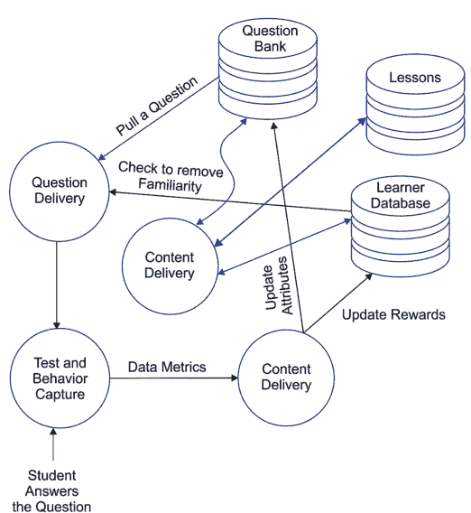

**图 9.1** 一个典型的在线学习环境。

浏览课程。评估过程负责进行定期评估并提供反馈。评估学生的流行方法包括发布作业（作业）、问答环节、进行测验等。最流行且最合适的反馈机制是问答法。然而，Ann Polis 等人的分析表明，反馈的有效性不仅取决于交付方式和时效性，还取决于提供反馈的讲师的信誉 [1]。在无教师的环境中，自动化反馈机制应该承担这种信誉责任。图 9.1 所示了一个典型的在线学习环境。

#### 9.2.1 内容交付过程

内容交付的主要任务是向学生展示学习材料（文本/音频/视频），模拟教室环境。教室里的经验教师在面对面的环境中授课，他/她通过分析学生回答问题时的反应来理解学生对学科的掌握程度。老师可以增强和解释该学科以帮助学生。如果我们能模拟这种模型，就可以实现有效的在线学习环境。在教室里，老师面对的是一群具有不同能力的学生，而在在线环境下会有个体学生，内容交付应该为每个学生定制内容。因此，必须对每个学生进行单独评估。

## 商业管理中的人工智能与机器学习

图 9.1 显示了一个典型的在线学习环境。

所使用的算法可能根据不同的实现而不同。

#### 9.2.2 评估过程

评估过程在评估学生表现后提供关于学生的反馈。这一过程很大程度上取决于问题的质量、选择问题的策略，以及对学生等待期间行为的捕捉。为了增强问题的生成，人们在2014年提出了自动出题技术 [2]。发表在《教育人工智能国际期刊》(IJAIED) 上的一篇综述指出，有必要进一步进行实验研究，协调评估指标，并调查其他更行的评估方法 [3]。评估过程包括题目交付、测试与行为捕捉、评估以及提供反馈。

在线学习环境中的题目交付机制应该拥有关于学生的一致知识，以避免重复题目。这与在课程结束时从更范围内测试学生知识的在线测试不同。Nandakumar 提出了应用马尔可夫链来评估题目分类的可靠性，并根据学生在一段时间内处理难度等级的程度对其表现进行分类 [4]。

### 9.3 问答模型

通常，随机选择问题并呈现给学生。学生的知识通过答案来判断。题目的制定是为了判断对特定学科（主题或概念）的知识。如果答案正确，我们推断学生知道该学科，否则他/她不知道。

尽管问答法被广泛接受，但它可能无法准确发现学生是否掌握了所需的知识。主要原因是回答的概率性质。为了理解这一点，我们首先讨论问题的类型并对其进行分类。

#### 9.3.1 最常用的问题类型

简单且最常用的问题是“是”（真）或“否”（假）类型。答案具有二元性质。这也包括“这个或那个”、“真或假”类型的题目。示例如下：

示例 1：

- Python 是一种蛇
- 是
- 否

对蛇没有任何知识的学生可能会回答“是”。但如果有人说“否”，我们就可以高概率地推断他/她知道蛇的物种。

# 示例 2：

- Python是一种编程语言
- 正确
- 错误

对编程语言没有任何知识的学生可能会回答“是”。但如果有人说“否”，我们就可以高概率地推断他/她不知道 Python 语言。

# 示例 3：

- 哪种金属更重？
- 铝
- 铜

回答铜的学生可能不知道铜的密度（8,940 Kg/m³）和铝的密度（2,710 Kg/m³）。

综之，很难从这类问题中推断学生的知识。

第二种广泛使用的问题类型是 MCQ（多选题）。题目给出几个选项并要求从中给出答案。正确答案可以是给出的选项列表中的一个或多个。

# 示例 4：

- 对于给定的面积，哪种形状的周长最小？
- 正方形
- 三角形
- 五边形
- 圆形
- 不

如果学生选择了“圆形”，我们可以推断他/她拥有计算各种形状面积和周长以及优化技术的知识吗？如果学生有先验知识或对这个问题熟悉，那么他/她就可以选择正确答案。然而，如果学生选择了“圆形”以外的任何答案，我们就推断他/她不知道如何使用优化技术。我们可以假设这个学生知道如何计算不同形状的面积和周长吗？问题的意图始终是寻找一个且唯一的知识点。因此，如果题目的意图是测试对各种形状面积或周长的知识，我们应该重新组织题目。

## 商业管理中的人工智能与机器学习

# 示例 5：

- Python 中哪些可变对象？
- 整数 (Int)
- 字符串 (String)
- 列表 (List)
- 字典 (Dictionary)
- 元组 (Tuple)
- 不

让我们分析可能的答案及其对应的推断：

- 列表和字典 - 正。知道可变对象。可能不是完整的列表。
- 列表、字典和字符串 - 错误。不知道字符串是不可变的。
- 列表和字符串 - 错误。不知道字典是可变的字符串是不可变的。
- 字符串和元组 - 错误。不知道可变对象。
- 以上都不是 - 错误。不知道可变对象。

综之，这些类型受限于选项数量。它们对作答者的熟悉程度或先验推断具有免疫力。我们还有其他类型的问题，它们寻求用户的最小输入。例如“纠正句子”、“填写缺失字段”、“提供替代方案”等。

我们将查看下面的示例：

# 示例 6：

- 加上括号使以下表达式有效。
- 7² + 6² - 5² - 4² * 3² - 2² * 1 = 0

该问题旨在测试学生对表达式求值顺序的知识。如果学生回答正确，我们可以推断他们掌握了所需的知识。答案评估只需要与结果进行简单比较。由于答案是输入的而不是选择的，推断的质量将更准确。

总结，当我们让学生更多地参与并得出解决方案而不是选择或猜测答案时，对学习者知识的推断将更加准确。

还有更多类型的问题，我们不会详细介绍每种类型。本文提出的方法适用于所有类型的问题，前提它们遵循一套规则：

规则 1：问题的意图应该专注于测试学生在一个逻辑独立的主题上的知识。不建议制作复合题来测试另一个相关或不相关的主题。

在这种情况下，问题需要被分层拆解为一组逻辑上相关的问题，而不是单个问题。

- 规则 2：应该有一个大量的题目库来用于处理相同的意图。这有助于减少交付过程中的随机性。例如，可以针对表达式求值生成百万道题。

上述规则是作者/教师的责任，他们期望获得学习者表现的反馈。

- 规则 3：在多选题（MCQ）中，不应使用“以上均非”。相反，应使用“不知道”选项。
- 规则 4：每个问题都应该有一个“生命周期”。在生命周期结束后，它会进入休眠期，然后再次重生。这有助于我们追踪学习者的熟悉程度和心理预期值。
- 规则 5：每个问题都应该有一个冷却期以避免重复。
- 规则 6：如果同一人已成功尝试过，则不应重复该问题。如果该人员没有回答正确，则可以低优先级再次展示（不再从题库中选择新问题）。
- 规则 7：对于多选题，可以修改答案的短语/顺序以避免产生记忆。
- 规则 8：如果学生没有回答问题，则被视为“不知道”。

题目生成的实现不在本文目前的范围范围内。我们将侧重于使用 AI 技术进行评估过程。

### 9.4 AI 与机器学习简要介绍

1950年，艾兰·米恩·图灵（Alan M Turing）在论文《计算机器与智能》中提到：“机器学习的一个重要特征是，它的老师对内部正在发生的情况一无所知，尽管他可能仍然预测学生的行为”。这与使用机器进行计算的正常程序形成了鲜明对比，在正常程序中，人的目标是使计算过程中每个时刻的机器状态都有清晰的心理表图 [5]。他所使用的“教师”一词是指计算机和用于学习的算法。需要注意的是，他使用了三个重要的实体：学习机器、教师和学生。他还提到学生的行为在某种程度上是可预测的。机器学习算法的目标是做出尽可能准确的预测。

“人工智能”（Artificial Intelligence）一词最早于1956年由达特茅斯的一次计算机科学会议上的一群科学家提出的（构词）[6]。他们的目标是建立一个框架以更好地理解人类智能。基于他们的工作，他们确定了机器模拟人类因素的关键因素是机器学习。

机器学习（ML）是一组用于解决特定现实世界问题的算法、数据结构和模型。它是 AI 的子集，用于理解和提高其性能，而无需更改任何实现（编程）。机器可以学习执行特定任务。机器学习常见任务示例包括从数字图片中识别物体，或预测进行在线购物的买家的行为。机器学习技术对许多通常与人工智能（AI）相关的应用做出了巨大贡献。

### 9.5 用于解决我们问题的机器学习算法选择

对于每种学习范式都有对应的问题和解决方法。通常，学习范式使用输入数据并产生输出以解决问题。我们将考虑广泛使用的三类主要的机器学习范式：监督学习、无监督学习和强化学习。

监督学习是指使用一组已知的训练数据进行工作。对于每个训练数据集，都存在一个目标。监督学习的目标是映射未包含在样本数据集中的未见样本并产生可接受的结果。监督学习最小化了模型预测输出与训练集中指定目标之间的误差。这种学习范式最适用于分类、识别、预测等类型的任务。

无监督学习让我们释放机器去数据集中发现隐藏模式。我们不针对数据集提供任何已知的输出。因此，在无监督学习中，识别数据集中的隐藏模式并将其作为输出。无监督学习算法包括聚类和主成分分析（PCA），以及用于寻找模式或行为的数据挖掘类应用。PCA 是一种用于输入数据降维和特征提取的无监督算法。PCA 试图收集数据中的匹配信息，并通过分组推导出聚类。


强化学习（`RL`）在序列决策问题中使用一组控制动作。与已知数据集固定的监督和无监督学习算法不同，强化学习使用不断变化的数据。强化学习基于反馈机制，由环境的反馈来评估代理（`agent`）的行为。正是反馈的存在使得强化学习区别于无监督学习。此外，如果我们想使用监督或无监督学习算法，那么我们需要让大量学生尝试每个问题并收集他们的响应以创建一个固定的已知数据集。这并不是一项容易完成的任务。在本文中，我们使用 `RL` 技术来解决我们的问题。

### 9.5.1 强化学习 (`RL`)

强化学习框架中有许多元素，即代理（`Agent`）、动作（`Actions`）、环境（`Environment`）和策略（`Policy`）。

- 代理（`Agent`）：

  这是核心元素。它根据当前情况执行动作。

- 动作（`Actions`）：

  代理可以执行的各种动作。

- 环境（`Environment`）：

  它是代理执行的上下文。它由状态（`State`）、动力学（`Dynamics`）和奖励（`Rewards`）组成。

  状态代表环境所有可能存在的情况。代理进入环境。

  动力学描述动作如何影响状态。

  奖励描述了目标。

- 策略（`Policy`）：

  代理执行任务时使用的逻辑。

## 9.6 评估过程

如上所述，学习环境有两个相关的实体：内容交付和评估过程。内容交付不在我们目前的范围之内。然而，我们将讨论将其与评估过程绑定所需的必要元素。我们将开始构建一个评估过程的模板实现，以演示 `RL` 技巧的使用。

评估过程执行的主要任务有：

- 题目交付
- 执行测试
- 指标收集
- 评估
- 给其他代理的反馈

### 9.6.1 题目交付

题目交付包括基于当前评估状态、学生水平和题目属性的问题选择。当题目被选中时，它会呈现给学生进行回答。这不是我们的主要范围，因此我们将强制向学生推送题目。然而，来自评估过程的反馈对于确保题目遵循表 9.1 中提到的规则非常重要。这通过将属性绑定到题目来实现。

### 9.6.2 题目属性

所需的题目属性分为静态属性和动态属性。静态属性（见表 9.2）仅供评估过程引用。它们在题目的生命周期内不会改变，并在创建新题目时分配。动态属性主要由评估过程更新，以向学习环境提供反馈。

## 基于 AI 的评估辅助学生通过在线系统进行学习

## 表 9.2

题目的静态属性

| 属性 | 描述 |
| --- | --- |
| 标识符 | 用于在编程环境中标识问题。 |
| 内容 | 问题的陈述（文本、音频、视频） |
| 类型 | 问题类型，如单选题（MCQ）、是或否等。 |
| 选项列表 | 列表中的每个元素有一组用于选择正确答案的选项。如果没有则学生需要输入答案。提供该列表是为了根据规则 7 重新构建选项。 |
| 正确答案列表 | 与选项列表相对应的正确答案列表。 |
| 出现次数 | 问题呈现的最大次数 |
| 每次出现之间的预期回答时间间隔 | 熟悉主题的人员回答所需的时间。在该问题出现之前，池中其他选项需要展示的时间。问题将在时间结束时消失。 |

表 9.3 给出的动态属性在学生完成问题回答后进行更新。静态属性被用于选择要展示的问题。由于我们没有实现题目的派发过程，我们将强制使用一个具有最小属性的问题来测试我们的实现。

## 9.7 评估器状态与动作

评估器使用简单的马尔可夫决策过程（`MDP`）实现。`MDP` 状态和动作如图 9.2 所示。它有五个状态：开始（Beginning）、基础（Basic）、平均（Average）、良好（Good）和差（Poor）。评估器根据当前状态、从学生回答收集的指标以及学生水平来改变状态。

马尔可夫决策过程评估器和动作如图 9.2 所示。评估器的初始状态为 `S1`（开始）。当评估器对新主题进行测试时，分配此状态。学生在回答问题时的行为会被观察并收集为指标。它们列如下：

- 1. 已回答

    a. 首次尝试回答正确
    b. 迭代后回答正确
    c. 部分正确
    d. 回答错误
- 2. 未回答

实现 `MDP` 使用的逻辑和执行的动作使用了这些指标。状态转换逻辑和所采取的动作如下：

## 商业管理中的人工智能与机器学习

## 表 9.3

题目的动态属性

| 名称 | 描述 | 备注 | 推断 |
| --- | --- | --- | --- |
| 回答时间 | 正确回答问题花费的时间 | 存储为列表。这是响应时间列表的子集 | 应计算最大时间、最小时间（最佳回答时间）和平均时间 |
| 响应时间 | 人员花费的总时间 | 存储为列表 | 可以推导出可见性是否取决于时间 |
| 部分回答时间 | 部分正确回答花费的时间 | 存储为列表。这是响应时间列表的子集 |  |
| 正确答案数量 | 回答正确的人数 |  | 数字越大表示问题越简单 |
| 错误数量 | 回答错误的人数 |  | 数字越大表示问题越难或不清晰 |
| 部分正确数量 | 回答正确的人数 | 例：在单选题中，正确答案可能包含多个选项，人员选择了几个但不是完整的一。对于某些类型的问题不适用 | 人缺乏知识或时间不足 |
| 部分正确且部分错误数量 | 部分正确且部分错误的人数 | 例：在单选题中，正确答案可能包含多个选项，人员选择了几个正确的和几个错误的。对于某些类型的问题不适用 | 人未完全理解该主题。 |
| 首次尝试正确回答数量 | 在提交答案前未修正答案而首次尝试回答的人数 | 此值将小于或等于回答正确人数。计数不包括部分正确回答 | 人对答案是确定的 |
| 未回答 | 回答的人数（可能由于超时） |  | 数字越大表示问题不清晰，需要重新构建 |
| 当前出现次数 | 每次出现后递增的序列号 |  | 表示题目的熟练程度和评估结果 |

## 基于 AI 的评估辅助学生通过在线系统进行学习 157


**图 9.2** `MDP` 评估器状态和动作。

- A. 已回答

    a) 如果问题首次尝试回答正确，则状态和学生水平均增加。
    b) 如果问题回答正确但经过了迭代，且当前状态不等于学生水平，则状态和学生水平减小，否则保持不变。
    c) 如果问题回答部分正确，则学生水平减小。
    d) 如果问题回答错误，则状态和学生水平均减小。
- B. 未回答

    a) 如果问题未回答，则状态减小。

状态转换矩阵如表 9.4 所示。

当学生开始学习特定主题时，为其分配级别 1。通过定期进行评估过程来衡量学生的进度。学生水平和评估器状态会根据回答问题时收集的指标进行修改。此外，评估过程还对问题的质量提供反馈。我们还有其他属性，如回答时间、正错比例等，可以用于改进机器学习过程。

## 表 9.4

评估器状态矩阵

| 行为 | 当前状态 | 下一状态 | 学生水平 | 学生水平 |
|---|---|---|---|---|
| 首次尝试回答正确 | `$S_i$` | `$S_{i+1}$` | `$L_i$` | `$L_{i+1}$` |
| 迭代后回答正确 | `$S_i$` | `$S_{i-1}$` | `$L_i$` | `$L_{i-1}$` |
| 部分回答 | `$S_i$` | `$S_i$` | `$L_i$` | `$L_{i-1}$` |
| 回答错误 | `$S_i$` | `$S_{i-1}$` | `$L_i$` | `$L_{i-1}$` |

## 商业管理中的人工智能与机器学习

## 9.8 实现

一个示例评估器过程用 `Python 3` 编写。列表 1 包含了所有必要的类，列表 2 是测试实现的测试程序。

### 9.8.1 列表 1

```python
# evaluator.py

class Student:
    def __init__(self, name):
        Initializer
        Args:
            name : 学生的名字

        self.level = 1
        self.name = name
        self.top_level = 4
        self.bottom_level = 0

    def reset(self, subject):
        """
        将评估器状态重置为开始
        Args:
            subject(str): 学科
        """
        self._level = 1
        self.subject = subject

    def begin_course(self, subject):
        """
        为课程创建评估器
        Args:
            subject = 学科
        """
        self.subject = subject
        self.evalator = Evaluator()

    def answer_correctly_firstattempt(self, question):
        """
        模拟学生首次尝试回答正确答案的行为。
        Args:
            question: 被观察并收集指标的问题
        Returns:
            Answer 类型的指标对象。
        """
        metrics = Answer()
        metrics.sample_answer_metrics(question, True, 1, True, 70.9)
        return metrics

    def answer_correctly_with_iteration(self, question):
        """
        模拟学生通过迭代后回答正确答案的行为。
        Args:
            question: 被观察并收集指标的问题
        Returns:
            Answer 类型的指标对象。
        """
        metrics = Answer()
        metrics.sample_answer_metrics(question, True, 1, False, 100)
        return metrics

    def answer_partly(self, question):
        """
```

## 160 业务管理中的人工智能与机器学习

模拟学生给出部分正确答案的行为。

参数：

question: 用于观察行为并收集指标的题目

返回：

类型为 Answer 的指标对象。
```
metrics = Answer()
metrics.sample_answer_metrics(question, True, False, 200)
return metrics
```

```python
def answer_wrongly(self, question):
```

模拟学生给出错误答案的行为。

参数：

question: 用于观察行为并收集指标的题目

返回：

类型为 Answer 的指标对象。
```python
metrics = Answer()
metrics.sample_answer_metrics(question, True, 0, False, 100)
return metrics
```

```python
def did_not_answer(self, question):
```

模拟学生未回答的行为。

参数：

question: 用于观察行为并收集指标的题目

返回：

类型为 Answer 的指标对象。
```python
metrics = Answer()
metrics.sample_answer_metrics(question, False, 0, False, 100)
return metrics
```

```python
class Question:
```

此类用于测试评估器类（`Evaluator Class`）
```python
def __init__(self, expected_answer_time, max_no_appearances, interval_between_appearances, visibility_time):
```

初始化题目属性的构造函数

# 基于人工智能的在线系统学习辅助评估

# 以下属性在创建题目对象时初始化

self_expected_answer_time = expected_answer_time

self_max_no_appearances = max_no_appearances

self_interval_between_appearances = interval_between_appearances

self_visibility_time = visibility_time

# 以下属性在每次回答问题后都会更新

self_no_of_appearances = 0

self_no_of_correctly_answered = 0

self_no_of_first_attempted_correct_answers = 0

self_no_of_partly_answered = 0

self_no_of_wrongly_answered = 0

self_no_of_unattempted = 0

self_visibility_time = visibility_time

self_list_of_answer_times = [expected_answer_time]#学生正确回答所需的时间
```python
def present_question(self):
    """
    展示题目并收集答案
    """

# 展示题目超出了我们的职责范围
```

```python

class Answer:

    """

    此类用于测试

    评估器类中使用的逻辑

    """

```
```python

def __init__(self):

    """

    初始化为答案设置默认值。

    """

    self.answered = False

    self.correct_answer = 0

    self.first_attempt = False

    self.answer_time = 0

```
```python

def sample_answer_metrics(self, question, answered, correct_answer,
    first_attempt,
    answer_time):

    """

    根据给定参数的学生响应创建指标

    并更新题目的动态属性

    参数：

        question: 正在回答的题目

        answered: 如果回答为 True，未回答为 False

```
## 162 业务管理中的人工智能与机器学习

Correct_answer: 错误答案为 0，正确答案为 1，部分正确为 2
first_attempt: 如果是首次尝试为 True，重复尝试为 False
answer_time: 回答所需的时间
"""
```python

self._question_answered = question

self.answered = answered

self.correct_answer = correct_answer

self.first_attempt = first_attempt

self.answer_time = answer_time

question.no_of_appearances += 1

question.list_of_answers.append(answer)

if answered:

    if correct_answer == 1:

        if first_attempt:

            question.no_of_first_attempted_correct_answers += 1

        elif correct_answer == 2:

            question.no_of_partly_answered += 1

        elif correct_answer == 0:

            question.no_of_wrongly_answered = +1

    else:

        question.no_of_unattempted += 1

```
```python

class Evaluator:

"""

一个实现 MDP（马尔可夫决策过程）的简单评估器

"""
```
```python

def __init__(self):

"""

评估器类的构造函数

"""

self.state = 1

self.lower_state = 0

self.upper_state = 4

```
```python

def evaluate(self, student, metrics):

"""

该函数评估并更新评估器的状态。

同时也作为内容交付的反馈，更新学生的水平。

参数：

answered: 布尔值。如果回答为 TRUE，未回答为 FALSE

correct_answer: 整数，0 表示不正确，1 表示完全，2 表示部分正确

```
# 基于人工智能的在线系统学习辅助评估 163

first_attempt: 布尔值。未迭代直接回答为 True，迭代回答为 False
answer_time: 秒
返回：
根据输入参数评估学生后返回性能得分。
```python

if metrics.answered:

    if metrics.correct_answer == 1 and metrics.first_attempt:

        if self._state != self._upper_state:
```


```python
self._state += 1

if student.level != student.top_level:

    student.level += 1

elif metrics.correct_answer == 1 and not metrics.first_attempt:

    if self._state != self._lower_state:

        self._state -= 1

    if student.level != student.bottom_level:

        student.level -= 1

elif metrics.correct_answer == 0:

    if self._state != self._lower_state:

        self._state -= 1

    if student.level != student.bottom_level:

        student.level -= 1

else:

    if self._state != self._lower_state:

        self._state -= 1
```

```python
print("Evaluator State is {} and Student Level is {}".format(self._state, student.level))

return self._state + student.level
```

# 列表结束

# 9.8 列表

# `testcases.py`

```python
from evaluator import *
```

## 创建并注册学生

`studentA = Student('An')`
`studentA.begin_course('Algebra')`

### 164 业务管理中的人工智能与机器学习

```python
studentB = Student('Bob')
studentB.begin_course('Algebra')
studentC = Student('Charlie')
studentC.begin_course('Algebra')
studentD = Student('Drav')
studentD.begin_course('Algebra')
studentE = Student('Esh')
studentE.begin_course('Algebra')
studentF = Student('Fred')
studentF.begin_course('Algebra')
studentG = Student('Glen')
studentG.begin_course('Algebra')
```

## 创建题目模板

`QuestionAnswerTime, NumberOfAppearances, IntervalBetweenAppearances, VisibilityTime`
`question1 = Question(120.0, 100, 20, 360)`
`question2 = Question(100.0, 100, 20, 400)`
`question3 = Question(200.0, 100, 20, 500)`
`question4 = Question(100.0, 100, 20, 360)`
`question5 = Question(150.0, 100, 20, 300)`
`question6 = Question(100.0, 100, 20, 300)`
`question7 = Question(200.0, 100, 20, 400)`
`question8 = Question(200.0, 100, 20, 400)`

## 根据表 9.4 评估学生

### EvaluateStudentA

```python
print("Evaluating StudentA".format(studentA.name))
metricsA = studentA.answer_correct_first_attempt(question1)
studentA.evalator.evaluate(studentA,metricsA)
metricsA = studentA.answer_correct_first_attempt(question2)
studentA.evalator.evaluate(studentA,metricsA)
metricsA = studentA.answer_correct_first_attempt(question3)
studentA.evalator.evaluate(studentA,metricsA)
metricsA = studentA.answer_correct_first_attempt(question4)
studentA.evalator.evaluate(studentA,metricsA)
metricsA = studentA.answer_correct_first_attempt(question5)
studentA.evalator.evaluate(studentA,metricsA)
metricsA = studentA.answer_correct_first_attempt(question6)
studentA.evalator.evaluate(studentA,metricsA)
metricsA = studentA.answer_correct_first_attempt(question7)
studentA.evalator.evaluate(studentA,metricsA)
metricsA = studentA.answer_correct_first_attempt(question8)
performance_scoreA = studentA.evalator.evaluate(studentA,metricsA)
```

### 基于人工智能的在线系统学习辅助评估 165

### EvaluateB

```python
print("Evaluating StudentB".format(studentB.name))
metricsB = studentB.answer_correct_first_attempt(question1)
studentB.evalator.evaluate(studentB,metricsB)
metricsB = studentB.answer_correct_first_attempt(question2)
studentB.evalator.evaluate(studentB,metricsB)
metricsB = studentB.answer_correct_first_attempt(question3)
studentB.evalator.evaluate(studentB,metricsB)
metricsB = studentB.answer_correct_first_attempt(question4)
studentB.evalator.evaluate(studentB,metricsB)
metricsB = studentB.answer_correct_with_iteration(question5)
studentB.evalator.evaluate(studentB,metricsB)
metricsB = studentB.answer_correct_with_iteration(question6)
studentB.evalator.evaluate(studentB,metricsB)
metricsB = studentB.answer_correct_with_iteration(question7)
studentB.evalator.evaluate(studentB,metricsB)
metricsB = studentB.answer_correct_with_iteration(question8)
performance_scoreB = studentB.evalator.evaluate(studentB,metricsB)
```

### EvaluateC

```python
print("Evaluating StudentC".format(studentC.name))
metricsC = studentC.answer_correct_first_attempt(question1)
studentC.evalator.evaluate(studentC,metricsC)
metricsC = studentC.answer_correct_with_iteration(question2)
studentC.evalator.evaluate(studentC,metricsC)
metricsC = studentC.answer_correct_first_attempt(question3)
studentC.evalator.evaluate(studentC,metricsC)
metricsC = studentC.answer_correct_with_iteration(question4)
studentC.evalator.evaluate(studentC,metricsC)
metricsC = studentC.answer_correct_first_attempt(question5)
studentC.evalator.evaluate(studentC,metricsC)
metricsC = studentC.answer_correct_with_iteration(question6)
studentC.evalator.evaluate(studentC,metricsC)
metricsC = studentC.answer_correct_first_attempt(question7)
studentC.evalator.evaluate(studentC,metricsC)
metricsC = studentC.answer_correct_with_iteration(question8)
performance_scoreC = studentC.evalator.evaluate(studentC,metricsC)
```

### EvaluateD

```python
print("Evaluating StudentD".format(studentD.name))
metricsD = studentD.answer_correct_with_iteration(question1)
studentD.evalator.evaluate(studentD,metricsD)
metricsD = studentD.answer_correct_first_attempt(question2)
studentD.evalator.evaluate(studentD,metricsD)
metricsD = studentD.answer_correct_with_iteration(question3)
```

# 企业管理中的人工智能与机器学习

`studentD_evaluator.evaluate(studentD,metricsD)`
`metricsD = studentD.answer_correct_firstattempt(question4)`
`studentD_evaluator.evaluate(studentD,metricsD)`
`metricsD = studentD.answer_correct_with_iteration(question5)`
`studentD_evaluator.evaluate(studentD,metricsD)`
`metricsD = studentD.answer_correct_firstattempt(question6)`
`studentD_evaluator.evaluate(studentD,metricsC)`
`metricsD = studentD.answer_correct_with_iteration(question7)`
`performance_scoreD = studentD.evaluator.evaluate(studentD,metricsD)`

## 评估学生E

```python
print("Evaluating {} (StudentE)".format(studentE.name))
metricsE = studentE.did_not_answer(question1)
studentE_evaluator.evaluate(studentE,metrics_E)
metricsE = studentE.did_not_answer(question2)
studentE_evaluator.evaluate(studentE,metricsE)
metricsE = studentE.did_not_answer(question3)
studentE_evaluator.evaluate(studentE,metricsE)
metricsE = studentE.did_not_answer(question4)
studentE_evaluator.evaluate(studentE,metricsE)
metricsE = studentE.did_not_answer(question5)
studentE_evaluator.evaluate(studentE,metricsE)
metricsE = studentE.answer_correct_with_iteration(question6)
studentE_evaluator.evaluate(studentE,metricsE)
metricsE = studentE.answer_correct_firstattempt(question7)
studentE_evaluator.evaluate(studentE,metricsE)
metricsE = studentE.answer_correct_with_iteration(question8)
performance_scoreE = studentE.evaluator.evaluate(studentE,metricsE)
```

## 评估学生F

```python
print("Evaluating {} (StudentF)".format(studentF.name))
metricsF = studentF.did_not_answer(question1)
studentF_evaluator.evaluate(studentF,metricsF)
metricsF = studentF.did_not_answer(question2)
studentF_evaluator.evaluate(studentF,metricsF)
metricsF = studentF.did_not_answer(question3)
studentF_evaluator.evaluate(studentF,metricsF)
metricsF = studentF.answer_correct_with_iteration(question4)
studentF_evaluator.evaluate(studentF,metricsF)
metricsF = studentF.answer_correct_with_iteration(question5)
studentF_evaluator.evaluate(studentF,metricsF)
metricsF = studentF.answer_correct_with_iteration(question6)
studentF_evaluator.evaluate(studentF,metricsF)
metricsF = studentF.answer_correct_firstattempt(question7)
studentF_evaluator.evaluate(studentF,metricsF)
metricsF = studentF.answer_correct_firstattempt(question8)
performance_scoreF = studentF.evaluator.evaluate(studentF,metricsF)
```

## 基于AI的评估辅助学生通过在线系统学习

```python
print("Evaluating {} {}".format(studentG.name))
metricsG = studentG.did_not_answer(question1)
studentG.evaluate(studentG,metricsG)
metricsG = studentG.answer_correctly_firstattempt(question2)
studentG.evaluate(studentG,metricsG)
metricsG = studentG.did_not_answer(question3)
studentG.evaluate(studentG,metricsG)
metricsG = studentG.did_not_answer(question4)
studentG.evaluate(studentG,metricsG)
metricsG = studentG.answer_correctly_firstattempt(question5)
studentG.evaluate(studentG,metricsG)
```


`metricsG = studentG.answer_correctly_firstattempt(question6)`

`studentG.evaluate(studentG, metricsG)`

`metricsG = studentG.did_not_answer(question7)`

`studentG.evaluate(studentG, metricsG)`

`metricsG = studentG.answer_correctly_firstattempt(question8)`

`performance_scoreG = studentG.evaluate(studentG, metricsG)`

### 上述学生的性能评分总结

```python
print("Performance Score of {} is {}".format(studentA.name, performance_scoreA))

print("Performance Score of {} is {}".format(studentB.name, performance_scoreB))

print("Performance Score of {} is {}".format(studentC.name, performance_scoreC))

print("Performance Score of {} is {}".format(studentD.name, performance_scoreD))

print("Performance Score of {} is {}".format(studentE.name, performance_scoreE))

print("Performance Score of {} is {}".format(studentF.name, performance_scoreF))

print("Performance Score of {} is {}".format(studentG.name, performance_scoreG))
```

### 列表结束

列表1和2 可于 `https://github.com/perianagam/Evaluator`

### 9.8.3 实现细节

在 `evaluator.py` 中创建了：
- `Student` 类
- `Question` 类
- `Answer` 类
- `Evaluator` 类

### 企业管理中的人工智能与机器学习

`StudentClass` 有以下功能：
- 创建学生
- 开始新课程
- 回答问题
- 首次尝试正确
- 迭代后正确
- 部分正确
- 错误
- 未回答问题

回答功能使用 `answer` 对象来收集指标。
`Question` 类仅用于显示静态和动态属性。
其他功能（如演示）未包含在范围内。
`Answer` 类支持收集各种场景的指标并做出决策。`Evaluator` 更新学生的性能。

### 9.8.4 测试评估器

为了测试评估器，我们创建了：
- 七个问题
- 八个学生

执行测试用例后的输出：

```python
Evaluating Anand (A)

Evaluating Bob (B)

Evaluating Charlie (C)

Evaluating Dravid (D)

Evaluating Eshwar (E)
```

### 9.5 结果总结

| 学生 | Q1 | Q2 | Q3 | Q4 | Q5 | Q6 | Q7 | Q8 | 评估器(最终) | 级别(最终) | 总计 |
|---|---|---|---|---|---|---|---|---|---|---|---|
| StudentA | 1 | 1 | 1 | 1 | 1 | 1 | 1 | 1 | 4 | 5 | 8 |
| StudentB | 1 | 1 | 0 | 0 | 0 | 2 | 2 | 0 | 0 | 0 | 0 |
| StudentC | 1 | 1 | 2 | 2 | 0 | 0 | 0 | 1 | 1 | 2 | 2 |
| StudentD | 2 | 1 | 2 | 1 | 2 | 0 | 1 | 1 | 2 | 2 | 0 |
| StudentE | 0 | 0 | 0 | 0 | 0 | 2 | 2 | 1 | 2 | 3 | 3 |
| StudentF | 0 | 0 | 0 | 2 | 2 | 1 | 1 | 2 | 3 | 4 | 5 |
| StudentG | 0 | 1 | 0 | 1 | 1 | 0 | 1 | 1 | 1 | 4 | 5 |

```python
Evaluating Fred (F)

Evaluating Glen (G)

Performance Score of Anand is 8

Performance Score of Bob is 0

Performance Score of Charlie is 2

Performance Score of Dravid is 0

Performance Score of Eshwar is 3

Performance Score of Fred is 5

Performance Score of Glen is 5
```


上述结果可以分类为：

- `P` 为 7 或 8：良好
- `P` 为 5 或 6：中
- `P` 为 3 或 4：差
- `P` 为 0 或 1 或 2：极

## 9.9 结论

证明了评估过程的简单 MDP 实现有助于评估学生的进度并为其他过程提供反馈。我们可以扩展评估器的策略，以考虑学生更多的行为属性。选择正确的问题是评估器的一项任务，我们未将其包含范围内。这个小练习揭示了 AI 技术增强在线学习的力量。

## 参考文献

- 1. https://www.researchgate.net/publication/232893466_Effectiveness_of_Feedback_Students'_Perspective
- 2. Afzal, N., & Mitkov, R. (2014). Automatic generation of multiple choice questions using dependency-based semantic relations. Soft Computing, 18(7), 1269–1281.
- 3. Ghader, K., Jared, L., Bijan, U., & Salam, Al-E. (2019). A Systematic Review of Automatic Question Generation for Educational Purposes. The International Journal of Artificial Intelligence in Education (IJAIED), 30, 121–204, 2020.
- 4. https://www.academia.edu/11820245/APPLICATION_OF_HIDDEN_MARKOV_MODEL_IN_QUESTION_ANSWERING_SYSTEMS
- 5. https://www.csee.umbc.edu/courses/471/papers/turing.pdf
- 6. https://250.dartmouth.edu/highlights/artificial-intelligence-ai-coined-dartmouth

# 10 探讨新冠肺炎疫情期间人工智能的使用以引发电子学习的变革

Pooja Rani
研究学者，管理研究系，
J.C. Bose 科学与技术大学，YMCA，
法里达巴德（Faridabad），哈里亚邦（Haryana）

Rachna Agrawal
副教授，管理研究系，
J. C. Bose 科学与技术大学，YMCA，法里达巴德（Faridabad），哈里亚邦（Haryana）

+ 目录
10.1 引言.................................................................... 171
10.2 现有文献综述............................................... 172
10.3 研究目标................................................................ 173
10.4 研究方法论............................................................... 174
10.5 数据分析与讨论...................................................... 174
10.6 启示与结论.............................................. 174
10.7 局限性与未来展望............................................... 176
致谢......................................................................................... 177
参考文献...................................................................................... 177

## 10.1 引言

首批新冠肺炎疫情爆发于 2019 年底和 2020 年的中国，意大利是首个受新冠肺炎严重影响的国家。意大利于 3 月 4 日宣布了全面封锁 [1]。在印度，2020 年 1 月 30 日发现了病毒的首例病例，此后病毒扩散到了印度尽可能多的地区。截至 2020 年 4 月 9 日，印度报告的确诊病例总数为 5,734 例，其中 166 人死亡，给卫生官员和管理部门带来了巨大的压力 [2]。管理感染的唯一干预措施是社交距离和封锁 [1]。新冠肺炎不仅影响了人们的生活和健康，还对该地区的所有行业产生了负面影响。然而

DOI: 10.1201/9781003125129-10

商业管理教育领域的人工智能和机器学习受此疫情影响最大。疫情导致的封锁导致学校和大学关闭，扰乱了学期，并在家长、教师和学生之间引发了紧张和焦虑 [3]。所有学院都开设了在线课程，并调整了学期以应对这一疫情形势。对于教师和学生来说，这种在线课程系统在学习模式方面取得了巨大的进步。评估者发现，人们对人工智能的知识和意识有所增加，为教学创造了新的独特技术和改进。目前需要高级别的授权工具，经验丰富的教师借此开发包含人工智能技术的教学材料。其中一个益处是人工智能允许构建更好的培训，且成本并不比传统的计算机辅助培训（CBT）高，而且比其他方法更具成本效益 [4]。

本文的主要目标是探讨新冠肺炎期间电子学习中人工智能的呈现，研究的第二个目标是调查新冠后人工智能在电子学习中的未来。本研究在几个方面与以往的研究有所不同。其中一项重要研究 [5] 关注了疫情期间实施电子学习的最佳实践。本研究侧重于探讨新冠肺炎期间人工智能的使用以引发电子学习的变革，并通过数据分析得出一些创新性实践。

## 10.2 现有文献综述

印度目前是亚洲确认病例数量最多的国家。印度总理宣布了影响印度 13 亿人的全国性封锁（来源：CNBC 全球新闻）。由于强制性封锁，人们被迫留在家办公。印度的学校和大学已开始授课。在这篇研究论文中，利用人工智能引发新冠肺炎期间电子学习的变革是具有实验性的。对当前研究的分析旨在出于同样的原因填补研究空白。

Falevale [1] & Jolivet 等人 [6] 解释说，拯救经济的唯一步骤是社交距离和封锁。印度的学校和大学已开始课程。利用人工智能引发新冠肺炎期间电子学习的变革在本研究论文中是实验性的。对当前研究的分析旨在出于同样的原因填补研究空白。

社交距离和封锁是应对新冠肺炎的唯一步骤。Rajmi 和 Jaeger [8] 讨论了在线课程。Sultana [7] 探讨了在新冠肺炎疫情期间通过 Microsoft Teams、Zoom、WebEx 等工具进行在线学习。作者的研究结果显示，由于学校和大学关闭，在线课程有助于保持学生的心理健康。

由于在线，发展中国家面临许多困难。人工智能技术的需求是所有发展中国家需要关注的。Dev & Sengupta [9] 指出，人工智能是能够执行通常需要人类智能的任务的计算机科学。人工智能技术在营销、广告等领域有助于酒店业。Bounatiru 和 Lim [10] & Farré 等人 [11] 研究了人工智能对酒店业的影响。人工智能技术的采用可以带来持续的利益和竞争优势。

Phobon 和 Vichepan [12] & Ferg 等人 [13] 研究了电子学习的自适应系统，预测人工智能作为多智能体系统可以发挥作用。培训师能够在距离学习期间检测学习者的情绪。Bounatiru 和 Lim [10] & Kramer 等人 [14] 得出结论，人工智能技术的应用可以帮助企业获得准确的洞察，优化实时数据，帮助员工更高效地工作，专注于决策。

## 10.4 研究方法论

研究方法论重点关注目标群体、采样技术、数据收集和数据分析技术。数据主要来自原始来源。教职人员涵盖了独立的私立和政府机构。通过在线 Google 表单创建了问卷，以收集来自各种私立和政府大学在本次疫情期间采取在线学习模式决策的信息。向教职人员发放了问卷，收集了与研究直接相关的几个方面的原始数据。将根据 AI 对在线学习的影响，以及 AI 在 COVID-19 之后的潜在触达范围得出结论。在本次分析中，使用了五点李克特量表来测试教职人员的观点。量表分为五个等级：强烈同意（SA）、同意（N）、不同意（DA）和强烈不同意（SD）。教职人员被要求对在这次大流行利用 AI 进行在线教育变革的提供意见。

## 10.5 数据分析与讨论

AI 被认为是一门具有多种方法的跨学科科学，AI 技术的进步使得虚拟产业向科技产业转型。AI 的方法有助于模拟人类语音、翻译语言、人类护理诊断、起草法律文件以及玩游戏。人工智能管理的重要性已经增加，由于这次疫情，它吸引了大量的关注（表 10.1 和表 10.2）。

使用社会科学统计包（SPSS）对数据分析。大多数参与者同意 AI 为教育行业带来了革命，而且未来 AI 技术将有效推动教育产业的进步。

由于封锁，所有数字交易如数字支付、在线培训、在线预订以及在线学习、在线研讨会或会议等所有数字活动已投入。关于 AI 已经有很多研究，但还需要更多工作。对 AI 技术的理解将在许多方面造于知识管理和资源管理。之前的研究已针对旅游业、医疗保健业等各行业采用 AI 技术进行。因此，我们扩展了文献，以识别 AI 技术在 COVID-19 期间为教育行业带来变革的潜力，以及在此疫情之后 AI 技术的未来如何。

## 10.6 启示与结论

研究结果将通过实施，以发现教育行业的技术进步，这将对从业决策者、学习者以及政府都有帮助。COVID-19 疫情完全改变了教育部门的课程。可以发现，COVID-19 疫情的封锁改变了人们的行为，个人开始遵循在线服务。从面对面到完全在线世界的转变并非易事。AI 技术帮助在 COVID-19 期间有效地实施了在线课程。在 AI 技术的帮助下，教育行业正发生以下变革：

- 所有的教科书都在 AI 的帮助下实现了数字化。
- 在 AI 的帮助下，数据分析更快，理论可以更容易地开发。
- 人类教育者可以被 AI 技术取代。

这项研究为未来的研究开启了大门，因为 AI 的范围不仅限于教育领域，还涵盖经济的各个领域。它的范围是无限的。最后可以得出结论：AI 技术将作为人类专家的支持系统。

## 商业管理中的人工智能与机器学习

### 表 10.1
COVID-19 期间在线学习革命的 AI 使用情况

| N | 最小值 | 最大值 | 平均值 | 标准差 |
|---|---|---|---|---|
| 你是否认为 AI 解决方案为在线学习期间的问题提供了真实的解决方案？ | 204 | 2.0 | 5.0 | 4.059 | .8284 |
| 你是否认为 AI 技术有助于处理人类语言？ | 204 | 1.0 | 5.0 | 3.966 | .9064 |
| 你是否认为 AI 技术有助于提供个性化的辅导课程？ | 204 | 1.0 | 5.0 | 3.245 | 1.0067 |
| 你是否认为 AI 技术有助于获取新知识？ | 204 | 1.0 | 5.0 | 3.245 | 1.0165 |
| 你是否认为 AI 技术在 COVID-19 期间实现了技术升级？ | 204 | 1.0 | 5.0 | 3.270 | 1.0127 |
| 你是否认为 AI 技术在在线学习期间改变了学习材料？ | 204 | 2.0 | 5.0 | 3.946 | .8257 |
| 你是否认为 AI 技术有助于在在线学习期间高效管理数据？ | 204 | 2.0 | 5.0 | 3.912 | .8076 |
| 你是否认为先进的 AI 技术有助于减少人力资源？ | 204 | 2.0 | 5.0 | 3.902 | .8004 |
| 你是否认为 AI 技术有助于减少错误？ | 204 | 1.0 | 5.0 | 3.877 | .8479 |

来源：由研究人员计算并编制

### 表 10.2
COVID-19 之后在线学习中 AI 的未来

| N | 最小值 | 最大值 | 平均值 | 标准差 |
|---|---|---|---|---|
| 你是否认为 AI 技术在未来能够提供对研究有用的技术？ | 204 | 2.0 | 5.0 | 3.917 | .8173 |
| 你是否认为由于 AI 的进步，人们在 COVID-19 之后的未来有更多的职业选择？ | 204 | 2.0 | 5.0 | 3.936 | .7946 |
| 你是否认为 AI 技术有效地强调了 COVID-19 之后在线学习中需要改进的领域？ | 204 | 2.0 | 5.0 | 3.897 | .8270 |
| 你是否认为 AI 技术将有助于在远程学习中创造沉浸式体验而非课程？ | 204 | 2.0 | 5.0 | 3.882 | .8339 |
| 你是否认为因为 AI 大数据分析将更快、更简单？ | 204 | 1.0 | 5.0 | 3.892 | .8411 |
| 你是否认为 AI 技术将帮助使未来充满前景？ | 204 | 2.0 | 5.0 | 3.877 | .8471 |
| 你是否认为 AI 技术有助于深度探索？ | 204 | 2.0 | 5.0 | 3.897 | .8270 |
| 你是否认为 AI 技术将有助于提供智能内容？ | 204 | 2.0 | 5.0 | 3.941 | .7961 |
| 你是否认为 AI 技术将担任虚拟促进者的角色？ | 204 | 2.0 | 5.0 | 4.063 | .8033 |

来源：由研究人员计算并编制

## 10.7 局限性与未来范围

本研究的局限性在于样本量，这限制了结果的推广性。未来研究有很多机会。

### 调查在线学习中人工智能的使用

### 致谢

## 参考文献

# 业务管理中的人工智能与机器学习

13. Ferdinand, E. Emily Baumgartner Hartshorne, Regina Kaplan-Rakowski, & Chystalla Mouza. 2020. “Covid-19疫情期间的教学、技术与教师教育：来自一线的故事.” AACE-Association for the Advancement of Computing in Education, Chesapeake.

14. Kramer, Moritz U. G., Chia-Hung, Yang. Bernardo, Gutierrez, Chieh-Hsi, Wu, Brennan, Klein, David M., Louis du Plessis et al. 2020. “人类流动和控制措施对中国 COVID-19 疫情的影响.” Science 368 (6490): 493–497. doi:10.1126/science.ab42188.

15. Gross, Daniel. 1998. “AI 技术在在线数据库中的应用.” Online Review 12(5):248–285. doi:10.1108/eb0242-285.

16. King, Tania, Belinda Heith, Bradley Crawley, Georgia Sutherland, Humaira Maheen, & Anne Kavanagh. 2020. “重新排列性别系统：COVID-19 提高性别平等与健康.” The Lancet 396: 80–81.

17. Chiodini, Jane. 2020. “COVID-19 期间的在线学习.” Travel Medicine and Infectious Disease, 34–101669. doi:10.1016/j.tmid.2020.101669.

18. Bagaria, Bhiragath Prakash. 2020. “作为一系列经济冲击的印度 COVID-19 疫情：简述.” Economic Affairs 65 (3), doi:10.46852/0424-2513.2.2020.1.

19. Robinson, Maurice, & Lee Rusnyak. 2020. “在没有学校经验的情况下学习教学：南非背景下的困境与可能性.” Journal of Education for Teaching 46 (4): 517–527. doi:10.1080/02610476.2020.1804008.

20. Khalili, H. (2020). “在线跨专业教育与 COVID-19 疫情后.” Journal of Interprofessional Care. doi:10.1080/13561820.2020.192424 [Taylor & Francis Online]

21. Kaplashrami, Anuj, & Kamaldeep Bhui. 2020. “心理健康与 COVID-19：病毒有种族歧视吗?” The British Journal of Psychiatry 217 (2): 405–407. doi:10.1192/bpj.2020.993.

22. Sohrabi, Catrin, Zaid Alsafi, Niamh O’Neill, Mehed Khan, Ahmed Kerwan, Al-Jabar, Christos Ioifidis, & Riaz Agha. 2020. “世界卫生组织宣布全球紧急状态：2019 新型冠病毒 (COVID-19) 述.” International Journal of Surgery 76: 71–76. doi:10.1016/j.ijjs.2020.02.034.

23. Zu, Zi Yue, Meng Di Jiang, Peng Peng Xu, Wen Chen, Qian Qian Ni, Guang Ming Lu, & Long Jiang Zhang. 2020. “2019 冠病毒 (COVID-19)：来自中国的视角.” Radiology 296 (2): E15–E25. doi:10.1148/radiol.2020200490.

24. Scull et al. (2020), Journal of Education for Teaching: 国际研究与教学法 46 (5): 1–10. doi:10.1080/02610476.2020.182701.

# 11 使用 AI 进行员工流失管理

Sujata Priyambada Dash
Birla Institute of Technology, Management Department,
Mesra, Ranchi, India

Pradosh Kumar Gantayat
DRIEMS Autonomous Engineering College, CSE Department, Tangi, Cuttack, Odisha, India

Sambit Mohanty
Software Developer CTSC, Hydrabad, India

- 11.1 引言............................................................................... 179
- 11.2 提议方法............................................................... 180
  - 11.2.1 数据集审查........................................................................... 180
- 11.3 模型构建............................................................................... 185
  - 11.3.1 训练测试划分......................................................................... 186
  - 11.3.2 模型构建........................................................................... 187
  - 11.3.3 随机森林分类器...................................................... 188
  - 11.3.4 XGBoost................................................................................ 188
- 11.4 比较............................................................................... 189
  - 11.4.1 AUC–ROC 曲线................................................................ 190
  - 11.4.2 结论............................................................... 191
- 11.5 参考文献............................................................... 193

# 业务管理中的人工智能与机器学习

```python
```


`data.info()`

```
<class 'pandas.core.frame.DataFrame'>

Index: 14999 entries, 0 to 14998

Data columns (total 10 columns):

satisfaction_level  14999 non-null float64

last_evaluation      14999 non-null float64

number_project      14999 non-null int64

average_monthly_hours 14999 non-null int64

time_spend_company   14999 non-null int64

work_accident        14999 non-null int64

left                 14999 non-null int64

promotion_last_5years 14999 non-null int64

Departments          14999 non-null object

salary               14999 non-null object

types: float64(2), int64(6), object(2)

memory usage: 1.0+ MB
```

**图 11.3** 数据集特征描述。

**work accident**: 员工是否发生过工事故，其数据类型为整数。

**promotion_last_5years**: 员工在过去5年内是否获得过晋升，其数据类型为整数。

**Departments**: 员工的工作部门/分支，其数据类型为字符串。

**Salary**: 员工的薪资水平，如低、中、高，其数据类型为字符串。

**Left**: 员工是否离了公司，其数据类型为整数。这里 0 表示员工目前在该公司工作，1 表示员工已从该公司辞职。

### 探索性数据分析
为了更深入了解数据集，我们将进行更深层次的数据分析，当我们使用 `describe()` 时，它将向我们提供关于数据集的一些有趣信息。

目前在组织中工作的员工数据集如图 11.4 所示。在此数据集中，我们仅有两类员工：目前在组织中工作的员工和离开公司的员工。因此，如果比较这两种情况，我们就能获得更多关于员工行为的信息。上图显示了目前在组织中工作的员工数据集。

离职的员工数据集如图 11.5 所示。该图清晰地显示在 14,999 名员工中，11,428 名员工正在工作，3,571 名员工离开了公司。因此，总约有 23% 的员工离开了公司（图 11.4）。

离职员工对比在职员工图如图 11.6 所示。

## 员工流失管理 AI

# 183

| satisfaction_level | last_evaluation | number_project | average_monthly_hours | time_spend_company | Work_accident | left | promotion_last_5years |
| --- | --- | --- | --- | --- | --- | --- | --- |
| count | 14999 | 14999 | 14999 | 14999 | 14999 | 14999 | 14999 |
| mean | 0.612834 | 0.716202 | 3.005054 | 201.250397 | 3.498233 | 0.146160 | 0.238053 | 0.021268 |
| std | 0.248371 | 0.171253 | 1.235292 | 49.843909 | 1.496135 | 0.357199 | 0.429224 | 0.144281 |
| min | 0.360000 | 0.350000 | 2.000000 | 96.000000 | 0.000000 | 0.000000 | 0.000000 | 0.000000 |
| 25% | 0.440000 | 0.560000 | 3.000000 | 156.000000 | 3.000000 | 0.000000 | 0.000000 | 0.000000 |
| 50% | 0.640000 | 0.720000 | 4.000000 | 200.000000 | 3.000000 | 0.000000 | 0.000000 | 0.000000 |
| 75% | 0.820000 | 0.875000 | 4.000000 | 245.000000 | 4.000000 | 0.000000 | 0.000000 | 0.000000 |
| max | 1.000000 | 1.000000 | 7.000000 | 318.000000 | 10.000000 | 1.000000 | 1.000000 | 1.000000 |

# 图 11.4 目前在组织中工作的员工数据集。

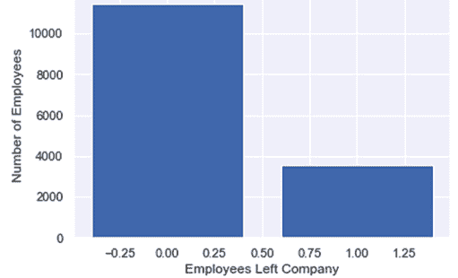

## 图 11.5 离职的员工数据集。

| satisfaction_level | last_evaluation | number_project | average_monthly_hours | time_spend_company | Work_accident | promotion_last_5years | Departments |
| --- | --- | --- | --- | --- | --- | --- | --- |
| left | 0.068819 | 0.754731 | 3.085544 | 199.960323 | 3.388532 | 0.175999 | 0.026251 | 1.347154 |
| 1 | 0.440998 | 0.710132 | 3.055033 | 207.41021 | 3.769035 | 0.047326 | 0.005321 | 1.345612 |

# 图 11.6 离职员工对比在职员工。

从该图中得出结论：与在职员工相比，离职员工的满意度较低、晋升较少、薪资较低，且工作时间更多。因此，我们可以说这些可能是员工离开公司的驱动因素。为了理解这些情况，我们需要更深入地分析数据。

让我们使用 Python 的 `seaborn` 模块通过绘图来分析数据集的所有特征。

数据集的特征如图 11.7 所示。

从图中我们可以得出关于数据集的一些重要点：大多数员工在处理 3 到 5 个项目，过去 5 年内晋升较少，且大多数员工的薪资处于中等水平。

# 业务管理中的人工智能与机器学习

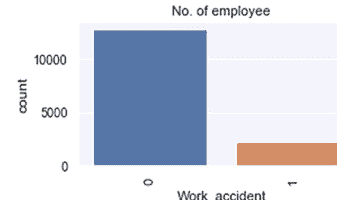

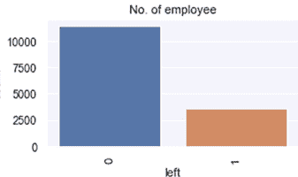

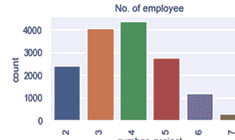

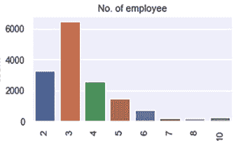

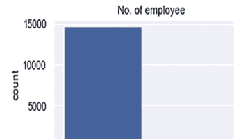

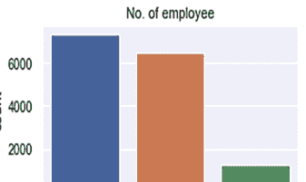

# 图 11.7 目前在组织中工作的员工数据集。

# 使用 AI 进行员工流失管理

模型或 `X_test` 的性能是未见过的数据，它帮助我们了解模型的准确率和性能。

关于多少数据用于训练以及多少数据用于测试，并没有严格的规定。

```
x_train, x_test, y_train, y_test = train_test_split(X_scaled, y, test_size=0.25, random_state=1)
```

在我们的案例中，我们取 75% 的数据用于训练，25% 的数据用于测试。现在是时候使用不同的机器学习算法构建模型了。

## 11.3.2 模型构建

### K 近邻算法 (KNN)

KNN 是一种非参数正则化学习算法，它根据给定的数据集构建模型结构。在 KNN 中，k 是一个数字，用于选择利用多少个最近邻点来获得该数据集的最佳结果。假设点 'a' 是待预测的点，我们需要找到距离 'a' 最近的 K 个近点。此时，它形成了一个特定类别的最近信息 [4]。不同的类别可以通过几种可用算法形成，例如欧几里德距离、汉明距离、曼哈顿距离等。为信息索引寻找最佳 k 值是一项艰巨的任务。对于信息集合，k 值是唯一的。在任何情况下，某些假设认为 k 值是一个奇数，这非常重要。我们可以说 k 的准确性是该问题的控制参数。研究，如果我们取 k 为较小值，可能会导致过拟合；选择合适的 k 值非常重要，否则它对真实结果将产生更大影响 [5]。如果我们取较大的 k 值，则会导致欠拟合。我们可以通过在信息集合上使用不同的 k 运行我们的程序来找到理想的估计。k 值给出最佳结果的将适用于特定的信息集合。

在应用 KNN 后，我们测试了训练数据并获得了 0.96888623210952 的准确率，但当我们用未见过的数据（在模型创建之前已经准备好的测试集）测试模型时，我们得到了 0.95266666666667 的准确率。

接下来，我们应用了超参数调优技术来提高模型性能。为此我们使用了 Sklearn 模块中的 `GridSearchCV`。它为我们提供一组可以提供更高准确率的参数。在获得最佳参数集后，我们再次使用这些最佳参数训练了模型，并在训练数据集上获得了 0.9799093252733576 的准确率，这比之前使用的参数集更高。现在我们再次用未见过的数据测试模型，得到了 0.95866666666666667 的准确率，这比之前的也要好。

因此，在超参数调优后，我们获得了比没有时略高的准确率。

### 11.3.3 随机森林分类器

随机森林是一种集成技术，同时用于回归和分类问题。它包含大量的决策树来寻找输出。每棵决策树都使用自己的逻辑来寻找更好的结果。然后，在从这些决策树中获得所有结果后，随机森林通过投票找到哪个输出是最好的。[6] 分类问题和得票最多的类别成为随机森林模型的输出。对于回归，分数的平均值是模型的最终输出。随机森林总是从数据中寻找更好的特征，而不是仅仅获取所有数据。它从根节点开始向叶节点移动，最终输出始终位于叶节点中 [7]。对于分类任务，叶节点包含预测类别。虽然决策树和随机森林的工作方式相似，但在操作上存在差异。在深度决策树中可能会出现过拟合，随机森林通过取特征子集并使用这些子集构建较小的树来处理这种情况。然后它组合较小的树以获得最终结果。与决策树相比，随机森林针对低偏差高方差问题提供了更好的结果，因此可能获得准确的预测值。[8] 因此，为了克服这类问题，随机森林使用了大量的决策树以减少高方差，提供更准确的预测。随机森林的主要问题是当决策树数量增加时，过程会变慢。

我们应用随机森林算法来构建模型，因为它很好地处理了不平衡数据集。创建模型后，我们用训练数据集对其进行测试，返回了 0.99786647201796 的准确率。但当我们用未见过的数据或测试集测试模型时，我们得到了 0.9864 的准确率，这是一个不错的结果。

## 11.3.4 XGBOOST

XGBoost 是一种新型机器学习算法，是梯度提升决策树的实现，旨在速度和性能而设计。XGBoost 是解决机器学习问题的硬件和软件的完美结合。它花费很长时间，但与其他算法相比提供了更好的结果。它也被称为“极端梯度提升” [9]。提升（Boosting）是一种集成技术，通过添加新模型来纠正现有模型产生的错误。

XGBoost 使用并行化方法构建顺序决策树，比其他基于树的算法耗时更短。该算法旨在通过正确使用缓冲区高效利用硬件资源，使其运行更快。XGBoost 支持回归和分类问题。即使在大多数问题中，XGBoost 需超参数调优；它自然表现得更好。由于这个原因，XGBoost 是现代数据科学家最青睐的。

我们在数据集上使用了 XGBoost 算法来查看其性能。当我们用训练数据测试模型时，得到了 0.9951074762108 的准确率；当我们用未见过数据或测试集测试模型时，得到了 0.98773333333333 的准确率，这低于训练数据。

## 11.4 比较

为了比较这些算法的性能，我们使用了各种混淆矩阵和 F1 分（表 11.2）。混淆矩阵显示在图 11.10。

- TP: 预测为正且实际为正的
- TN: 预测为负且实际为负的
- FP: 预测为正但实际为负的
- FN: 预测为负且实际为正的

### 表 11.2 模型性能比较

| 准确率 | 混淆矩阵 | F1 分 |
|---|---|---|
| KNN | 0.9586 | [2766 67 729] | 0.9145 |
| 随机森林 | 0.9864 | [2846 43 853] | 0.9709 |
| XGBoost | 0.9877 | [2863 38 841] | 0.9733 |

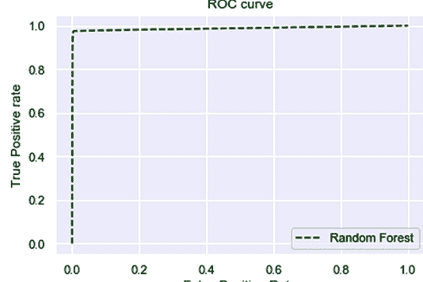

FIGURE 11.10 混淆矩阵。

# 管理中的人工智能与机器学习

### F1 分 = 2 * 召回率 * 精率 / (召回率 + 精率)

FIGURE 11.11 F1 分。

F1 分是一个提供关于模型准确信息的指标，平衡了召回率和精确率。F1 分通过使用调和平均数同时衡量召回率和精确率。F1 分如如图11 所示。

## 11.4.1 AUC–ROC 曲线

AUC 是受者工作特征曲线下的面积。它主要用于可视化模型的运行情况。ROC 或受者工作特征曲线用于分类问题的真正与假负 [10]，AUC 或曲线下面积是衡量模型获取部分的指标。当 AUC 为 1 时，意味着模型完美且正确地分类了真正和假负。如果 AUC 值为 0，则意味着模型将所有假负错误地分类为真正，反之亦然。当 AUC 值为 0.5 时，意味着模型无法分类真正假负。当 AUC 值落在 0.5 到 1 之间时，我们的模型有很大的概率正确分类真正和假负。

KNN 的 ROC 曲线如图 11.12 所示。
随机森林的 ROC 曲线如图 11.13 所示。
如果我们查看 KNN 和随机森林算法基于模型的 AUC 值，可以发现随机森林分类器的得分略高于 KNN 分类器。

KNN 和随机森林的 ROC 分数如图 11.14 所示。

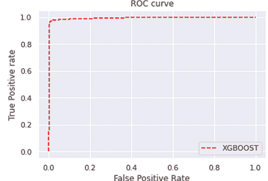

FIGURE 11.12 KNN 的 ROC 曲线。

# 使用 AI 进行员工流失管理

# 191


图 11.13 随机森林的 ROC 曲线。

```python
auc_score1 = roc_auc_score(y_test, pred_prob1[:,1])
auc_score2 = roc_auc_score(y_test, pred_prob2[:,1])
print(auc_score1, auc_score2)
```

0.9791176023517265 0.9877824238680089

图 11.14 KNN 和随机森林的 ROC 分数。

我们对对 XGBoost 模型进行了 ROC-AUC 分析以了解模型的性能，与两者相比，我们得到了相对较好的得分。
XGBoost 的 ROC 曲线如图 11.15 所示。
XGBoost 的 ROC 分数如图 11.16 所示。
对于 XGBoost，AUC 得分为 0.99403091，这是一个很好的分数。我们还为不同模型下的所有模型绘制了一张单一的 ROC–AUC 图。
KNN、随机森林对比 XGBoost 的 ROC 曲线如图 11.17 所示。

## 11.5 结论

在本章中，我们对员工流失数据集使用了三种不同的机器学习算法，并观察到与随机森林和 KNN 相比，XGBoost 更好的性能。存在其他算法和深度学习技术可以应用于此数据集以检查性能。我们可以使用不同类型的超参数调优方法来获得更好的结果。通过使用这种模型，组织可以跟踪其人力资源，并帮助他们制定更好的策略来留住资产并从员工那里获得更好的表现。在人力资源部门中使用 AI，将提高

# 业务管理中的人工智能与机器学习


图 11.15 XGBoost 的 ROC 曲线。

```python
auc_score1 = roc_auc_score(y_test, pred_prob1[:,1])
print(auc_score1)
0.9940309153384559
```


图 11.16 XGBoost 的 ROC 分数。

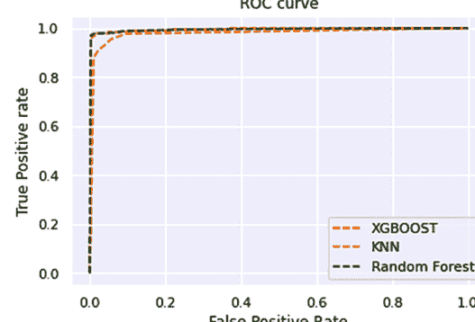

图 11.17 KNN vs 随机森林 vs XGBoost 的 ROC 曲线。

# 使用 AI 进行员工流失管理

193

HRM 系统将在管理员工方面为组织带来更好的性能。对于任何组织来说，技能丰富的员工可以提高性能并缩短产品或服务的交付时间。因此，没有任何组织会希望失去这些员工，这就是组织努力寻找员工满意度并减轻员工压力的原因。一些组织根据工作环境创建不同类型的互动娱乐活动，使员工没有工作压力。最后，我们可以说，对于任何组织的任何员工来说，薪水、晋升、工作压力工作环境对于决定留在该组织还是离开至关重要。因此，预测这些员工的行为将产生巨大影响，组织将积极行动改进其工作文化和其他相关活动。

## 参考文献

- 1. Jauhari, A. "How AI and Machine learning will impact HR practices", News corp Vccle partners summit, 2017.
- 2. Matsa, P. and Gummajji, K. "To study the impact of Artificial Intelligence on Human Resource Management" IRIJET(6), 2019.
- 3. Nunn, J. "Emerging impact of AI on HR" Forbes Technology Council, February 6, 2019.
- 4. Milani, L., et. al. "Exploring the Impact of AI on HRM", London School of Economics, 2017.
- 5. Verma, R., Bandi, S. "Artificial Intelligence & human resources management in Indian IT Sector, Proceeding of 10th International Conference on Digital Strategies for Organizational Success, 2019.
- 6. Ahmed, O., (2018) Artificial intelligence in HR, JRAR December 2018, 5(4) pp 971–978.
- 7. Cappilli, P., Tambe, P. and Yakubovich, V. "Artificial Intelligence in Human Resource Management: Challenges and a path forward" SSRN Electronics Journal, 2018 doi:10.2.139/smm.3263878
- 8. Saklani, P. Sometimes small data is enough to create small product" Harvard Business Review, 2019 available at https://hbr.org/2017/07/sometimes-small-data-is-enough-to-create-small-products
- 9. Pfe, J. and Sutton, R. “Evidence-based Management", 2019. Available at https://hbr.org/2006/01/evidence-based-management
- 10. Meskő, B., Hétényi, G., and Györőfi, Z. “Will Artificial Intelligence solve the Human Resource crisis in healthcare?" BMC Health Services Research, 18(1),

（注：原文中存在大量重复内容和乱码，此处已按要求进行逻辑翻译）


（注：原文中存在大量重复内容和学码，此处已按要求进行逻辑翻译）

# 机器学习开启新时代

机器学习 Machine Learning
开启的111201/9781003125
Science Direct, Elsevier

（注：原文中存在大量重复内容和学码，此处已按要求进行逻辑翻译）

# 机器学习开启新时代

维杰·尚卡·潘迪（Vijay Shankar）
助理教授
北方大学管理学院， 印度

## 目录

- 12.1 引言...........................................................................195
- 12.2 分析主要研究..................................................................196
- 12.3 使用机器学习技术进行时间序列预测..................................199
- 12.4 结论...........................................................................203
- 参考文献.........................................................................203

## 12.1 引言

通过机器学习算法，人工智能在预测领域开启了新纪元。人工智能的神经网络带来了预测结果。在这些几年中，基于机器学习的研究论文预测了未来。机器学习的股票预测预测了趋势。股票价格的预测分为两个分支：一类是基本分析，另一类是技术分析。基本分析基于公司的财务报表，而技术分析整合了历史数据。预测的准确性取决于适当的模型。在 12

## 12.2 分析主要研究

Hansen 等 [5] 利用指数平滑、自回归移动平均 (ARIMA)、部分 ARIMA 模型和机器学习模型分析了趋势、周期、季节性成分。结果显示支持向量机主于其他模型并取得了最佳结果。

Carbonneau 等 [6] 使用包括循环神经网络和支持向量机在内的先进机器学习技术处理需求效应的影响。他们将结果与传统模型如原生预测法和移动平均进行了比较。他们的发现表明机器学习技术优于传统方法，但差异在统计上是显著的。

Choudhary 和 Garg [7] 使用基于遗传算法 (GA) 和支持向量机 (SVM) 的混合机器学习来预测股市数据。他们的发现显示 GA-SVM 优于独立的 SVM 系统。技术分析师从市场中获利的持续成功对有效市场假设 (EMH) 提出了质疑。在当前十年，使用 AI 技术预测成功结果的趋势日益增加。由于这些后果，在目前的情况下，研究人员将 EMH 作为零假设。

Tsai 和 Wang [8] 尝试使用混合机器学习技术预测台湾交易所上市公司的股票价格。决策树 (DT) 和人工神经网络 (ANN) 的具有更好的预测能力。混合模型 (DT+ANN) 提供了 77% 的预测准确率。他们的发现表明基于生物神经系统的人脑具有良好的预测能力，但缺乏解释性输出。

Ahmed 等 [9] 尝试预测由 3003 个每日、季度和每月时间序列组成的 M3 数据。该数据集是为了由国际预测期刊 [10] 组织的竞赛而生成的。用于比较的模型有多层感知器、贝叶斯神经网络、径基函数、广义回归网络（也称为内核回归）、分类回归树 (CART) 回归树、支持向量回归和高斯过程。这些方法与机器学习预测模型结合使用。发现表明多层感知器 (MLP) 和高斯过程 (GP) 两个模型优于其他。

Cheangga [11] 尝试利用神经网络改进风力预测。该技术的特征是能够将随机输入向量映射到相应的输出，而无需假设任何固定关系。

# 机器学习 197

它们之间。一种用于预测风速的 MLP LM 学习算法。模型发现显示了良好的前景。

Chang 等人 [12] 开发了一种灰色轮系数，以创建一个适用于小样本预测的混合模型。在使用小样本灰色轮系数模型之前，先使用小模型来寻找真实序列的趋势。结果表明，使用多模式程序可以减少预测误差并提高小样本的预测结果。该研究的作者声称，统计方法、数据挖掘和神经网络（ANNs）等流行的预测技术无法准确预测小样本。

Chen 等人 [13] 尝试基于网络日志和实时社交媒体来预测电影票房，以更好地增强收支。使用遗传算法（GA）进行特征选择，并通过五种机器学习模型，即多元线性回归（MLR）、决策树回归（DTR）、随机森林回归（RFR）、支持向量回归（SVR）和神经网络回归（NNR）来预测每周电影票房。结果表明，机器学习机器学习的预测能力与用于预测工作的线性模型一样高。

Yildiz 等人 [14] 对回归模型和机器学习模型进行了对比分析，以预测当地建筑的电费，从而最小化环境危害并增加经济效益。在校园负载建模方面，ANN 和贝叶斯回归反向传播算法的平均百分比误差低于单体建筑模型。然而，与调整后的机器学习模型相比，回归模型的表现仍然更好。

Makridakis 等人 [15] 应用了八类机器学习模型，称为 MLP、贝叶斯神经网络（BNN）、径向基函数（RBF）、广义回归神经网络（GRNN，也称为核回归）、K-近邻回归（KNN）、CART 回归树（KART）、SVR 和高斯过程（GP）。根据对称平均绝对百分比误差（SMAPE）对这些模型进行排名，MLP 排名第一，BNN、GP、GRNN、KNN、SVR、CART 和 BERT 分列。此外，他们还使用了两种模型：递归神经网络（RNN）和长短期记忆网络（LSTM）。将顶部的 M3 模型与六种统计方法（SES、Holt 和阻尼指数平滑，第五种是所有三种指数平滑方法的组合，第六种模型称为 Theta 方法）进行了比较。Theta 方法与 M3 模型相比取得了更优的结果。这些发现表明，尽管机器学习模型优于传统模型，但这种优势并不显著。

Mohagham 等人 [16] 使用机器学习方法寻找 Haraz 流域（伊朗马赞德兰省）的洪易性。他们使用的八种模型是 ANN、CART、判别分析（FDA）、广义线性模型（GLM）、广义加性模型（GAM）、增强回归（BRT）、多变量适应回归样条（MARS）和最大熵（MaxEnt），以及集成模型如集成模型委员会平均（EMca）、集成置信区间推断（EMcinf）、集成置信区间上限（EMciup）、变异系数估计集成模型（EMcv）、均值估计集成模型（EMmean）、位数估计集成模型（EMmedian）、基于加权平均的集成模型（EMmean）。模型的性能通过接收者特征曲线下面积（AUROC）的统计结果显示。根据统计，所有用于预测的模型都高度显著，因为所有模型的值均小于 0.05（Sig = 0.000）。在个体模型中，BRT 和 GML 是最好的模型，而集成中位数和 EMmean 是用于预测的最佳模型。机器学习模型和集成模型之间没有显著差异，但从泛化能力和预测准确性的持续性来看，他们更倾向于集成模型。

Oh Su [17] 将气象变量的时间滞后用于波浪预测模型。使用如 ANN 和混合模型等机器学习技术，结合经验正交函数和小波分析（简称为 EOFNN）来预测显著波高和周期。小波分析的使用了 ANN 模型处理非平稳数据的能力。该研究还分析了方法数据的滞后效应。结果显示，最高准确水平取决于所使用的时间。

Pathak [18] 使用混合机器学习模型预测混沌过程。机器学习技术与过去使用的基于知识的模型相比取得了有前景的结果。机器学习与基于知识技术的结合填补了旧技术未定义的空白。

Pechacek [19] 使用机器学习算法开发了军事留存预测。该研究的目标是预测个人服役人员何时离开军队。该模型实现了高水平的准确性，一年内的模型预测准确率达到 88%，四年的内为 80%，更长时间的预测准确率为 78%。

Shi 等人 [20] 研究了用于风能的风速预测准确性。所提出的预测模型基于时空相关性（SC）理论和小波相干变换分析（WCT）。结果显示，相邻风力涡电机与目标风力涡电机之间存在强相关性。该研究使用了深度神经网络模型，并与用于风速的传统方法进行了比较。结果显示，机器学习模型的风预测均方根误差（RMSE）、平均绝对误差（MAE）、平均绝对百分比误差（MAPE）最低。结论认为用于风预测的整体混合模型优于未来。

Sun 等人 [21] 使用机器学习和互联网搜索索引预测中国的游客人数，并与 Google 指数和百度指数进行了比较。集成百度指数和 Google 指数游客量序列的核极学习机（KELM）给更好的结果。以“游客量序列 + 百度指数 + Google 指数”的形式对游客数据进行建模提供了更准确、稳健的结果。这完成了 [22,23] 构建的研究。

Feizabadi [24] 使用机器学习技术预测需求和供应链性能。ARIMAX 和混合形式的神经网络用于预测源自多阶段供应链扭曲的需求和供应链信息的波动放大现象。使用机器学习进行建模显著改进了预测结果。

# 机器学习 199

## 12.3 使用机器学习技术进行时间数据预测的主要研究汇总

| 序号 | 作者 | 研究方法 | 结果 |
| --- | --- | --- | --- |
| 01 | Hansen 等人 [5] | 使用指数平滑、自回归积分移动平均（ARIMA）和部分自适应估计 ARIMA 模型的方法，以及一种称为 SVM 的改进机器学习技术。 | 本研究的目标是比较 SVM 学习模型与三种已证明模型的效率。结果显示，SVM 学习模型略优于其他模型，并在八个不同的数据集中获得了最佳结果。 |
| 02 | Carbonneau 等人 [6] | 该研究使用了带有先进机器学习技术（递归神经网络和 SVM）的神经网络技术来预测扭曲的需求（牛鞭效应）。 | 他们将结果与传统模型（即朴素预测、趋势法和线性回归）进行了比较。他们的发现表明，机器学习技术优于传统技术。 |
| 03 | Choudhary 和 Garg [7] | 用于预测股票价格的技术使用了基于 GA 和 SVM 的混合学习系统。 | 他们的发现显示混合 GA-SVM 优于单一 SVM 系统。技术分析师通过市场策略获利对有效市场假设（EMH）提出了质疑。 |
| 04 | HamzaEebi 等人 [1] | 使用 ANN 的迭代法和直接法预测多期序列数据。与 ARIMA 和部分自适应估计技术进行了比较。 | 基于观测数据的单步预测直接法优于迭代法。在迭代法，预测日期作为下一个时间段的输入会导致预测误差增加。总体而言，ANN 方法优于用于比较的其他模型。 |
| 05 | Tsai 和 Wang [8] | 该研究使用了 DT 和 ANN 技术预测股票价格。 | DT + ANN 和 DT + DT 模型用于预测台湾股市。DT+ANN 模型给出 77% 的预测准确率，是最高准确率之一。 |
| 06 | Ahmed 等人 [9] | 该研究对比了 MLP、BNN、RBF；广义回归神经网络（也称为核回归）、CART 回归树、SVR 和高斯过程。这些方法与机器学习预测模型结合使用。 | 结果表明 MLP 和 GP 两个模型的表现优于其他使用的模型。 |

## 200 业务管理中的人工智能与机器学习

| 序号 | 作者 | 研究方法 | 结果结果 |
|---|---|---|---|
| 07 | Cheggaga [11] | 使用带有 Levenberg-Marquardt 算法的 MLP 技术用于预测风速。该模型用于预测未来 t 天的风速。 | 使用带有 LM 算法的 MLP 用于预测风速。模型发现显示了相关结果。 |
| 08 | Deng [2] | 使用了源自人工神经网络（ANN）的机器学习深度学习技术。深度学习被广泛分为三个部分，称为生成式架构、判别式深度架构和混合式深度架构。 | 本文介绍了深度学习的历史。单一深度学习技术能够处理所有类型的分类。即：因果推理和决策是深度学习技术最重要的产物。语音识别、机器翻译和信息检索是机器学习执行的有效任务。 |
| 09 | Chang 等人 [12] | 该研究使用两阶段程序对业务数小时内的小样本进行预测。第一阶段称为灰色关联分析，第二阶段使用灰色系数来创建混合预测模型。 | 所创建的模型用于预测目的，结果显著提高。将新开发的模型 MM 的结果与流行的预测模型进行比较，显示出显著改进。MM 与 LR、BPN、SVR 和 EGM 的比较显示了预测的改进。 |
| 10 | Chen 等人 [13] | 使用遗传算法（GA）进行特征选择，并使用五种机器学习模型（即 MLR、DTR、RFR、SVR 和 NNR）预测每周访问人数。 | 结果表明，与用于预测工作的线性模型相比，机器学习模型的预测能力较高。 |
| 11 | Zhang 和 Sugathan [3] | 用于分析随机数据的人工神经网络（ANN）技术。 | 在文中，作者综述了使用 ANN 方法学习预测能力的文献。本文讨论了带有随机化的标准前馈神经网络、随机向量函数链接网络、径向基函数网络、循环神经网络、深度神经网络、传统神经网络以及核矩阵方法。随机反向传播和近似方法是未来工作中可以使用的最佳方法。 |

## 机器学习

## 201

| 序号 | 作者 | 研究方法 | 结果结果 |
|---|---|---|---|
| 12 | Salaken 等人 [4] | 使用极端机器学习（EML）技术来寻找迁移学习（TL）算法的算法。 | 本研究深入讨论了使用基于 ELM 的迁移学习的程序，它可以应用于不同的领域，即预测、分类和聚类。该研究有助于机器学习工具的用户使用基于 ELM 的技术分析数据。 |
| 13 | Yildiz 等人 [14] | 使用热模型、自回归模型（称为 ARIMA 建模）、称为 ANNs 的机器学习模型、SVM 学习和回归，通过独立变量预测商业建筑的用电量。使用机器学习工具进行预测。与传统预测技术相比没有对比。 | ANN 和贝叶斯回归反向传播在校区建模方面的 MAPE 低于单建筑负荷。然而，机器学习模型的复杂性仍然提供了偏好回归模型的机会。 |
| 14 | Makridakis 等人 [15] | | 机器学习的八大族，称为 MLP、BNN、RBF、GRNN，也称为核 K最近邻回归 (KNN)、CART 回归树 (KART)、SVR 和高斯过程 (GP)。根据对称平均绝对百分比误差（SMAPE）排名对这些模型进行排名，MLP 排名第一，然后是 BNN、GP、GRNN、KNN、SVR、CART 和 RBF。总体而言，与作为 ARIMA 的 Box Jenkins 系列模型以及带有机器学习的 GARCH 比较显示，后者预测效果优于前者。 |
| 15 | Moghamad 等人 [16] | 他们使用的八个独立模型是 ANN、CART、FDA、GLM、GAM、BART、MRS 和最大熵（MaxEnt），以及集成模型，如集成委员会平均（EmCa）、集成置信区间误差（EmCIfin）、集成置信区间优势（EmciSup）、估计方差系数的集成模型（EMv）、估计均值的集成模型（EMmean）、估计中值的集成模型（EMmedian）、基于加权平均的集成模型（EMmean）。 | 使用受工作特征曲线（ROC）评估独立模型和集成模型的性能。一种用于评估模型的定量指标。AUROC 值为 0.5 或更多时，模型处于随机运行。AUROC 值越高，表示模型性能越高。据此，独立模型 BART 和 GML 是最佳模型。在集成模型中，EMmedian 和 EMmean 是用于预测目的的最佳模型。 |

# 业务管理中的人工智能与机器学习

| 序号 | 作者 | 研究方法 | 结果结果 |
|---|---|---|---|
| 16 | Oh 和 Suh [17] | 本文使用了一种结合经验正交函数（EOF）分析和小波分析与神经网络模型（EOFWNN）的混合模型。EOF 用于寻找空间分布的气象变量与风力预测模型之间的关系，并同时对多个站点进行预测。 | 结果显示，取决于使用的时间滞后条件，准确率最高。24小时提前预测的 RMSE 处于 0.038 到 0.069 之间。 |
| 17 | Pathak 等人 [18] | 该研究结合了基于知识的方法和机器学习方法来构建用于天气预测的混合模型。 | 与过去使用的基于知识的模型相比，机器学习技术提供了有前景的结果。机器学习与基于知识的结合填补了旧技术的未定义空白。 |
| 18 | Pechacek 等人 [19] | 混合模型。 | 与过去使用的线性模型相比，机器学习技术提供了有前景的结果。 |
| 19 | Shi 等人 [20] | 使用长短期记忆网络（LSTM）。 | 机器学习技术提供了有前景的结果。 |
| 20 | Sun 等人 [21] | 使用。 | 机器学习技术提供了有前景的结果。 |
| 21 | Feizadi | 使用 ARIMA 和 神经网络。 | 这种方法显著改进了结果。 |

## 机器学习

## 203

### 结论

上述文献综述了神经网络在领域的作用。Moghamad 等人 [16] 使用了名为 MLP、BNN、RBF、GRNN，也称为核 K最近邻回归 (KNN)、CART 回归树 (KART)、SVR 和高斯过程 (GP) 的八类模型。小样本预测预测的未来。

## 参考文献

1. Hamza, C., Akay, and Kutay, F. (2009). 用于时间序列预测的机器学习方法综述。Expert Systems with Applications, 36 383–384。doi:10.1016/j.eswa.2008.
2. Deng, L. 深度学习架构、算法与应用综述。IEEE Transactions on Signal and Processing, 33 (2014): 14–29.doi:10.1011/asip.2013.
3. Zhang, L. and Sugathan, P. 随机神经网络算法综述。Information Sciences, 364–365 (Supplement): 146–155.
4. Salaken, M., McDonald, J. and Nelson, R. 支持机在时间序列预测中的实证。Journal of Operational Research, 57(9)(2006): 1053–1063.http://www.jstor.org/stable/410233.
5. Hansen, J., Carbonbeau, L., Raflimboise, K. and Vahid, R. 机器学习在供应链预测中的应用。European Journal of Operational Research, 184(2008): 1140–1154.doi:10.1016/j.eor.2006.12.
6. Choudhary, R. and Kang, S. P. 用于股票预测的混合机器学习系统。World Academy of Science, Engineering and Technology, 39(2008): 315–318.http://www.researchgate.net/publication/238479905.
7. Tsai, C. F. and Wang, S. P. 通过混合机器学习技术进行股票预测。国际工程与计算机科学家会议论文，2009): 1–6.ISBN: 978-988-17012-2-0. Corpus ID: 14233594.
8. Ahmed, N. K., Atiya, A. F., El-Gayar, N. and El-Shishy, 时间序列预测机器学习模型的实证比较。Economic Research, 29(5–6) (2010): 594–621.doi:10.1080/07474938.2010.481556.
9. Makridakis, S. and Hibon, M. M3竞赛：结果、结论和启示。International Journal of Forecasting, 16(2000): 451–476.doi:10.1016/S0169-2070(00)00057-1.

## 商业管理中的人工智能与机器学习

11. Cheggaga, N. "用于改进风速预测的新型神经网络".《风工程》, 37 (4) (2013): 369–379. http://www.jstor.org/stable/4385250

12. Chang, C. Dai, Wai, and Chen, C. "一种利用灰色轮廓系数进行小数据集预测的多模型开发新程序".《运营研究学会杂志》, 66(11, 2015): 1887–1894. http://www.jstor.org/stable/43830589.

13. Chen, R, Wu, and Zhang, X. "基于微博数据的动态票房预测预测".《定量经济学及其发展》, 30(15) (2016): 4111–4124. doi:10.2298/FEL11615114C. http://www.jstor.org/stable/2489944.

14. Yildiz, B. Bilbao, J. and Sproul, A. B. "商业建筑用电负载预测分析与回归学习模型回顾".《再生与可持续能源》, 73 (2017): 1104–1122. doi:10.1016/j.rer.2017.02.023.

15. Makridakis, Spilios, E. and Assimamakopoulos, V. "统计与机器学习预测方法：共识与未来方向".《PLoS ONE》 13(3) (2018): 1–26.e0194889. doi:10.1371/journal.pone.0194889.

16. Moghamad, H. S. Valavi, R. Shirahi, H. Chapi, and Shirardi, A. "结合机器学习与统计模型进行洪水易性制的新型预测方法".《环境管理杂志》, 217(2018): 1–11. doi:10.1016/j.envman.2018.03.089.

17. Oh, J. and Sun, H. D. "气象变量滞后时间对波预测模型的影响".《海岸研究杂志》。特刊 85. 第十五届国际研讨会议论文，海云台，釜山 (2018): 1186–1190. http://www.jstor.org/stable/2648405.

18. Pathak, J. Wiener, A. Fussell, R. Chandra, S. Hunt, B. R. Girvan, and M. Ott, E. "混沌过程的混合预测：将机器学习与基于知识的模型结合".《CHAOS：国际非线性科学杂志》, 28(2018): 041101–041109. doi:10.1063/5083328.

19. Pechack, J. Roberts, C. King, J. Bishop, J Guggisberg, M. and Kipchevsky, Y. "一种新型营销留存预测模型：用于高保真预测的机器学习".国防分析学院, (2019): 1–18. http://www.jstor.org/stable/resqp22733.

20. Shi, X. Wang, S. Huang, Q. Li, X. Li, J. Li, and Yang. "利用与相邻风力机的时空相关深度学习风速预测".《海岸研究杂志》，特刊 93(2019): 623–632. http://www.jstor.org/stable/2685328.

21. Sun, S. Wei, Y. Tsui, K.-L., Wang, S. "利用机器学习和互联网搜索指数预测游客人数".《旅游管理》, 70(2019): 1–10. doi:10.1016/j.tourman.2018.07.010.

23. Song, H. and Li, G. "旅游需求建模与预测：近期研究回顾".《旅游管理》, 29(2) (2008): 203–220. doi:10.1016/j.tourman.2007.07.016.

24. Feizabadi, J. "机器学习需求预测与供应链性能".《国际物流研究与应用杂志》, 23(5) (2020): 1–24. doi:1/10.1080/13675567.2020.1803246

# 13. 基于循环神经网络的长短期记忆深度神经网络模型在外汇预测的应用

Minakhi Rout, Dhiraj Bhattarai, and Ajay Kumar Jena
卡林加工业技术学院（认定）大学，计算机工程学院，奥里巴斯普尔，奥里萨邦

## 目录
13.1 引言 ................................................................................ 205
13.2 相关工作 ..................................................................................... 206
13.3 LSTM 的工作原理 ................................................................ 208
13.4 结果与仿真 ....................................................................... 208
13.4.1 数据准备 ....................................................................... 209
13.4.2 性能衡量 ....................................................................... 210
13.5 结果与讨论 ....................................................................... 211
13.6 结论 ................................................................................ 212
参考文献 ................................................................................ 212

# 13.1 引言

外汇预测是一项至关重要且具有挑战性的任务，准确的汇率预测对于金融机构处理全球进出口业务至关重要。尽管投资者和经济学家总是渴望能够预测未来的汇率，但由于汇率的动态性，高保真预测是难以实现的。长期以来，许多统计方法已被引入并实施。然而，引入神经网络（ANN）在这一领域通过调整模型参数可以减少误差。

# 13.2 相关工作

各种基于学习的预测模型已被研究人员实施以提高模型的准确性。汇率对数的标准差[1]表明，每日最高最低值的加权平均优于每日收盘价。利用神经网络（ANN）预测外汇（如标准反传播算法 SBP、缩共轭梯度法 SCG 和带贝叶斯正则化的反传播算法 BPR)[2]的结果优于 ARIMA 模型。不同技术指标的移动平均被用于开发和估计，其中 SCG 在三种神经网络中给出了最佳输出。金融市场分析[3]应用神经网络预测美元兑英镑实现了较低的均方误差（MSE），并结合了其他技术和基本分析。短期汇率预测通常比长期预测准确[4]。使用周、月、季数据集可以增加长期预测的准确性。在不同输入频率的比较中[5]，一周后预测比一天或一个月后更好，因为周数据包含了足够的汇率波动信息。

为了提高模型性能，许多研究人员[6,7]开发了混合模型。为了增加集成模型的准确性，每个个体模型的性能必须良好。一种应用逻辑回归模型[8]并遗传优化的自适应 ANN[9]用于演化结构和多层神经网络。所提模型的结果在预测准确性方面取得了显著改进。另一种由两个并行系统[10]（最小二乘法 LMS 和自适应功能人工神经网络 FLANN）组成的混合结构比单个 LMS 和 FLANN 提供了更准确、高效的结果。遗传规划[11]具有选择最佳特征、网络架构和连接模式的能力，以决定是使用循环连接还是前馈连接。模型的准确性随着反馈路径的增加而提高，并增强了网络的能力。

时间序列。它还可以处理复杂的非线性数据，并能够更好地预测长期汇率。

随着外汇预测变得流行，各种神经网络（ANN）技术的使用日益增加。新开发的深度信念[12,13]具有某些改进，并比典型的预测方法提供了更好的结果。

## 基于循环神经网络的长短期记忆

受限玻尔兹机具有对连续建模的能力。自适应平滑网络 [14] 使用自适应平滑技术自动调整 ANN 学习参数。该模型跟踪动态环境下的信号，加速训练过程和收敛，使得网络的泛化能力强于传统的多层前馈网络 (MLFFN)。同样，正则化动态自组织多层感知器 [15] 使用免疫算法改进了金融时间序列预测。多层感知 [16] 使用简单移动平均 (SMA) 和自回归移动平均 (ARIMA) 等旧的统计技术作为输入，并使用单层感知器 (SLP)、多层感知器 (MLP)、径向基函数 (RBF) 和支持向量机 (SVM) 计算。关于 SVM 的论文 [17] 证明其预测性能优于基于 ARIMA 的模型。汇率的高效预测 [18]。具有非线性输入的单层 ANN 模型通过历史数据进行训练，产生了出色的预测，并能预测一个月后的情况。自助自助法 [19] 多个神经网络（同时针对每日和每周）时间序列预测使用对比学习，并在组合的帮助下输出每个模型的结果。该功能优于传统的简单模型（神经网络、支持向量机等）。两阶段预测模型 [20] 结合了参数化（ARIMA 和自回归）和非参数化（MLP 和 SVR），通过确定因变量和自变量的数量估计数学模型的参数。对于二次凸规划问题，支持向量回归 (SVR) 通过达到全局最优优于 MLP。具有单层、多层或混合神经网络的简单 ANN 已应用于各种学习算法。然而，这些模型难以应对长期依赖问题。那么，任何通过存储以前数据来记忆的架构单元都能处理长期依赖问题；该模型可以用于减少误差并增强模型性能。随着时间的推移，深度学习神经网络模型由于其处理长序列数据的特征变得越来越流行，并成功地广泛应用于机器学习领域。这些应用之一是 [21] 用于语音识别，作者产生了一种双向 LSTM，其中训练良好的 RNN 能够提供更好的结果。另一项研究报告了使用基于 RNN 模型进行股票市场预测 [22]。由于股票的波动性和非线性特征，准确预测股价是非常困难的。凭借 RNN 架构 LSTM 的记忆优势，可以以更高的精度预测股票值。长短期记忆神经网络 (LSTM) [23] 的应用也被报道于旅游流量领域，实验表明 LSTM 性能优于自适应模型 (差分移动平均 (ARIMA)) 模型和反向传播神经网络 (BPNN)。堆叠 LSTM [24] 模型已成功用于情感强度预测，并优于以往研究中提出的词典、回归和基于传统神经网络的方法。然后，我们考虑使用 LSTM 进行汇率预测，以实现高精度的预测。

## 13.3 LSTM 的工作原理

长短期记忆网络最早由 Hochreiter 和 Schmidhuber 于 1997 年提出 [25]，并被其他研究人员在广泛的研究领域中进行了改进和推广。长期记忆信息的特征是为了克服 RNN 架构中的长期依赖问题。由于 RNN 网络的这种特性，它通过具有相似网络循环结构来维持预测未来值所需的信息，这类似于人类基于经验的理解过程。

在本文中，实现了具有学习长期依赖能力的特殊类型的 RNN——长短期记忆网络 (LSTMs)，用于预测外汇汇率。

在该模型中，使用反向传播算法通过时间训练 LSTM，因此可以开发复杂的循环神经网络 (RNN) 以应用于不同的序列问题。LSTM 单元在神经元位置设有模型块，应选择相应的组件。单元状态 ($C_{t-1}$ 或 $C_t$) 是 LSTM 的灵魂，像传送带一样运行，执行一些简单的线性计算。LSTM 能够在神经结构作为门的帮助下移除旧信息并添加新信息。门（遗忘门、输入门和输出门）由激活的 Sigmoid 层和点乘法组成。Sigmoid 层输出 0 到 1 之间的值，并决定允许通过多少以及通过哪些值。

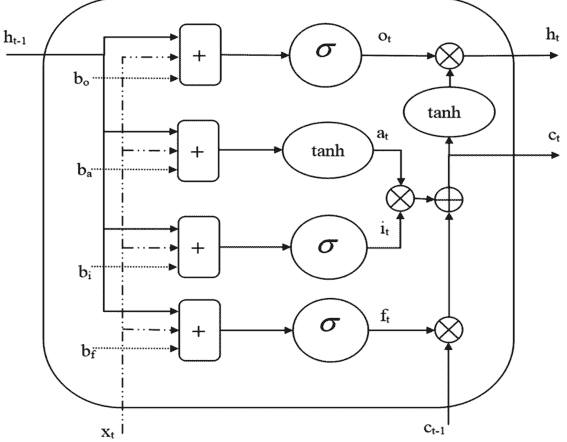

图 13.1 长短期记忆网络 (LSTMs) 单元。

输入变量通过该块（图 13.1）并使用 Sigmoid 函数进行激活。门 $f_t$ 使用 Sigmoid 激活函数 $s=\frac{1}{1+e^{-x}}$ 决输入 $h_{t-1}$ 和 $x_t$ 决定从状态中丢弃哪些信息，其中 $h_{t-1}$ 是来自上一个隐藏层的输入，$x_t$ 是来自网络的输入。

$f_t = \sigma(W_f \cdot x_t + U_f \cdot h_{t-1} + b_f)$ (13.1)

短期记忆网络 (LSTMs) 单元如图 13.1 所示。接下来的步骤决定哪些新信息将存储在单元状态中。Sigmoid 层（即输入层，$i_t$）输出更新值和 $tanh$ 层

$tanh = \left(\frac{e^x-e^{-x}}{e^x+e^{-x}}\right)$ 创建了一个值 $a_t$

$i_t = \sigma(W_i \cdot x_t + U_i \cdot h_{t-1} + b_i)$
$a_t = \tanh(W_a \cdot x_t + U_a \cdot h_{t-1} + b_a)$ (13.2)

通过这两个层的点乘来更新单元状态 $C_{t-1}$ 到 $C_t$。

$f_t \odot C_{t-1} + i_t \odot \tilde{C}_t$ (13.3)

最后，执行输出操作。输出门通过输出门决定输出。

$o_t = \sigma(W_o \cdot x_t + U_o \cdot h_{t-1} + b_o) \cdot \tanh(c_t)$ (13.4)

为了简化单元状态，我们使用以下形式：

$c_t = f_t \odot c_{t-1} + i_t \odot \tilde{c}_t$ (13.5)

在反向传播 LSTM 之前，计算损失函数。

$e = \frac{(o-\hat{o})^2}{2}$ (13.6)

对于反向传播，我们有：

$\delta e = o - \hat{o}$ (13.7)

现在对 LSTM 进行反向传播：

$\delta h_t = \Delta t$ (13.8)

$\Delta t$ 是实际值与预测值之间的差异。

$\delta c_i = \delta h_i \cdot (1-\tanh^2(c_i)) + \delta c_{i+1} \cdot f_{i+1}$
$\delta a_i = \delta c_i \cdot i_i \cdot (1-a_i^2)$
$\delta i_i = \delta c_i \cdot \tanh(c_i)$
$\delta f_i = \delta c_i \cdot c_{i-1}$ (13.9)

内部参数的最终更新为：

$\delta W = \sum_{t=0}^{T} \delta s_t \cdot x_t$
$\delta U = \sum_{t=0}^{T} \delta s_{t+1} \cdot h_t$ (13.10)
$\delta b = \sum_{t=0}^{T} \delta s_{t+1}$

为了调整神经网络模型，权重矩阵的旧权重值通过加上学习率与权重矩阵变化的乘积来更新。

$W^{new} = W^{old} - \lambda \cdot \delta W$
$U^{new} = U^{old} - \lambda \cdot \delta U$
$b^{new} = b^{old} - \lambda \cdot \delta b$ (13.11)

# 基于循环神经网络的长短期记忆网络

## 13.4 结果与仿真研究

在本研究中，我们实现了三种神经网络模型——BPNN、FLANN 和 LSTM，用于外汇汇率预测。我们考虑并比较了使用这三种模型对五种不同货币汇率进行预测的结果。历史汇率值不能直接应用于预测模型，因此我们需要从历史数据中提取特征，具体细节见第 13.5.1 节中的数据准备说明；此外，为了评估预测准确性，我们需要依赖于第 13.5.2 节中讨论的某些性能指标。

## 13.4.1 数据准备

历史数据集从财务预测中心（www.forecasts.org）下载。获取了 2012 年 1 月至 2018 年 4 月期间以 1 美元为基准的五种不同货币（印度卢比 (INR)、澳元 (USD)、加拿大加元 (CAD)、英镑 (GBP) 和日元 (JPY)）。每个汇率数据集中均获得了 1,570 个每日汇率样本。

下载数据集后，这些样本最初通过最大最小归一化技术归一化到 [0,1] 范围内。利用滑动窗口的概念从归一化样本中确定输入特征模式。同样，通过每次移动窗口大小一步步，提取了随后的输入特征模式。从滑动窗口样本中提取了三个特征，分别是第 12 个值、平均值和标准差。如果数据具有 N 个样本且滑动窗口大小为 W，则生成的总数将为 (N–W+1)。在本研究中，我们将窗口大小设定为 12，因为许多研究人员在这一领域的分析中报告了相同的窗口大小。提取出的特征模式被进一步分为两个不同的集合，其中 80% 的样本用于训练，20% 的样本用于测试。

## 13.4.2 性能指标

为了评估和验证预测模型的性能，我们使用了两种广泛接受的误差指标：平均绝对百分比误差 (MAPE) 和均方根误差 (RMSE)。在预测测试过程中得到的 MAPE 和 RMSE 值越小，预测越准确。这两个误差指标的计算方法如下：

```


`MAPE` = \frac{1}{n}\sum\frac{|d_a - d_f|}{d_a}*100\%

`RMSE` = \sqrt{\frac{1}{n}\sum(d_a - d_f)^2}


其中 $d_a$ 是实际外汇值，$d_f$ 是预测外汇值，n 是执行预测执行的测试样本数量。

## 商业管理中的人工智能与机器学习

## 13.5 结果与讨论

所有三种预测模型都针对每种外汇数据集使用 80% 的训练数据进行了适当的仿真和训练，并在模型测试阶段根据性能指标获得了结果并制表。表 (13.1–13.8) 显示了三种不同的反传播神经网络 (BPNN)、功能连接人工神经网络 (FLANN) 和长短期记忆网络 (LSTM) 在以下情况下的预测性能：

### 表 13.1
使用三种模型对 1 美元兑五种不同货币的提前一天预测

| 货币 | MAPE | RMSE | MAPE | RMSE | MAPE | RMSE |
|---|---|---|---|---|---|---|
| AUD | 0.4874 | 0.0047 | 0.5123 | 0.005 | **0.3724** | 0.0036 |
| GBP | 0.5836 | 0.0095 | 0.5209 | 0.0087 | **0.4068** | 0.0068 |
| CAD | 0.3477 | **0.0058** | 0.4215 | 0.0069 | **0.3397** | **0.0058** |
| INR | 0.6024 | 0.4288 | 0.575 | 0.4247 | 0.188 | 0.1694 |
| JPY | 0.7647 | 0.0117 | 0.6663 | 0.9135 | **0.4112** | 0.6097 |

### 表 13.2
使用三种模型对 1 美元兑五种不同货币的提前三天预测

| 货币 | MAPE | RMSE | MAPE | RMSE | MAPE | RMSE |
|---|---|---|---|---|---|---|
| AUD | 0.8793 | 0.0085 | 0.8382 | 0.008 | **0.7094** | 0.0068 |
| GBP | 0.9599 | 0.0158 | 0.8319 | 0.0138 | **0.7274** | **0.0122** |
| CAD | 0.6774 | 0.0109 | 0.7148 | 0.0115 | **0.6299** | **0.0103** |
| INR | 0.7114 | 0.5222 | 0.6365 | 0.4791 | **0.4202** | 0.3595 |
| JPY | 1.0726 | 1.4522 | 0.9037 | 1.2279 | **0.7265** | 1.007 |

### 表 13.3
使用三种模型对 1 美元兑五种不同货币的提前五天预测

| 货币 | MAPE | RMSE | MAPE | RMSE | MAPE | RMSE |
|---|---|---|---|---|---|---|
| AUD | 1.2024 | 0.0116 | 1.1013 | 0.0107 | **0.8951** | 0.0087 |
| GBP | 1.2385 | 0.0205 | 1.0651 | 0.0178 | **0.9075** | 0.0149 |
| CAD | 0.9211 | 0.0147 | 0.9345 | 0.0149 | **0.8952** | 0.0143 |
| INR | 0.8108 | 0.6003 | 0.6896 | 0.5268 | **0.4434** | 0.3612 |
| JPY | 1.3582 | 1.803 | 1.1083 | 1.4746 | **0.9516** | 1.3141 |

### 表 13.4
使用三种模型对 1 美元兑五种不同货币的提前七天预测

| 货币 | BPNN MAPE | BPNN RMSE | FLANN MAPE | FLANN RMSE | LSTM MAPE | LSTM RMSE |
|---|---|---|---|---|---|---|
| AUD | 1.4377 | 0.0139 | 1.3272 | 0.0129 | 1.1948 | 0.0116 |
| GBP | 1.4975 | 0.0225 | 1.3105 | 0.0219 | 1.2086 | 0.0204 |
| CAD | 1.1022 | 0.0178 | 1.1028 | 0.0177 | 1.0274 | 0.0164 |
| INR | 0.911 | 0.6718 | 0.7463 | 0.5669 | 0.5246 | 0.436 |
| JPY | 1.6045 | 2.1194 | 1.2959 | 1.7111 | 1.077 | 1.47 |

### 表 13.5
使用三种模型对 1 美元兑五种不同货币的提前十天预测

| 货币 | BPNN MAPE | BPNN RMSE | FLANN MAPE | FLANN RMSE | LSTM MAPE | LSTM RMSE |
|---|---|---|---|---|---|---|
| AUD | 1.7753 | 0.0173 | 1.6431 | 0.0162 | 1.3444 | 0.0131 |
| GBP | 1.8717 | 0.0308 | 1.6495 | 0.0274 | 1.419 | 0.0243 |
| CAD | 1.3582 | 0.0222 | 1.3355 | 0.0217 | 1.2609 | 0.02 |
| INR | 1.0476 | 0.7702 | 0.821 | 0.625 | 0.5997 | 0.51 |
| JPY | 1.985 | 2.5702 | 1.5486 | 2.0214 | 1.2943 | 1.7395 |

### 表 13.6
使用三种模型对 1 美元兑五种不同货币的提前十五天预测

| 货币 | BPNN MAPE | BPNN RMSE | FLANN MAPE | FLANN RMSE | LSTM MAPE | LSTM RMSE |
|---|---|---|---|---|---|---|
| AUD | 2.1576 | 0.0213 | 2.0076 | 0.0203 | 1.6717 | 0.0169 |
| GBP | 2.373 | 0.0385 | 2.1214 | 0.035 | 1.7597 | 0.0297 |
| CAD | 1.7032 | 0.028 | 1.6432 | 0.027 | 1.7325 | 0.0279 |
| INR | 1.2217 | 0.8943 | 0.9331 | 0.7076 | 0.7066 | 0.5929 |
| JPY | 2.5606 | 3.2738 | 1.9034 | 2.5005 | 1.7073 | 2.2659 |

### 表 13.7
使用三种模型对 1 美元兑五种不同货币的提前二十天预测

| 货币 | BPNN MAPE | BPNN RMSE | FLANN MAPE | FLANN RMSE | LSTM MAPE | LSTM RMSE |
|---|---|---|---|---|---|---|
| AUD | 2.4267 | 0.024 | 2.2924 | 0.0231 | 1.9468 | 0.021 |
| GBP | 2.7593 | 0.044 | 2.5272 | 0.0405 | 2.2668 | 0.0381 |
| CAD | 1.9765 | 0.0332 | 1.928 | 0.0312 | 1.8289 | 0.0289 |
| INR | 1.337 | 0.9968 | 1.0398 | 0.0801 | 0.8403 | 0.6973 |
| JPY | 3.0083 | 3.8442 | 2.1574 | 2.8907 | 1.7606 | 2.3321 |

### 表 13.8
使用三种模型对 1 美元兑五种不同货币的提前三十天预测

| 货币 | BPNN MAPE | BPNN RMSE | FLANN MAPE | FLANN RMSE | LSTM MAPE | LSTM RMSE |
|---|---|---|---|---|---|---|
| AUD | 2.8238 | 0.0278 | 2.7948 | 0.0276 | 2.5193 | 0.0251 |
| GBP | 3.3181 | 0.0521 | 3.1564 | 0.0495 | 2.8222 | 0.0446 |
| CAD | 2.4616 | 0.0384 | 2.3773 | 0.0374 | 2.3915 | 0.0375 |
| INR | 1.5428 | 0.1102 | 1.2608 | 0.9678 | 1.2961 | 1.002 |
| JPY | 3.6031 | 4.5334 | 2.5326 | 3.4303 | 2.1865 | 2.947 |

这是五种不同货币在短期和长期跨度内的每日汇率数据集。这些模型的性能结果取决于给定数据的特征。汇率预测的突发高低频率需要更多时间来理解权重更新并相应调整模型。预测模型（如 BPNN 和 FLANN）没有内存块，因此无法存储以前的值，这在学习这些波动数据时非常困难。因此，LSTM 模型可以在没有任何复杂性的情况下通过较少的迭代次数处理此数据集。

不同提前天数的预测性能如下表所示。随着提前预测天数的增加，MAPE 和 RMSE 值增加。在某些情况下，由于在估计不同天数预测时提取的模式，误差增长剧烈，而在另一些情况下增长缓慢。

相关表格表明，在大多数情况下，与其他模型相比，LSTM 具有更小的 MAPE 和 RMSE 值，但在少数情况下 FLANN 具有更好的 MAPE 和 RMSE 值。在整体性能指标上，LSTM 表现更好，FLANN 在短长期性能指标（MAPE, RMSE）上均优于 BPNN。

# 基于循环神经网络的长短期记忆网络

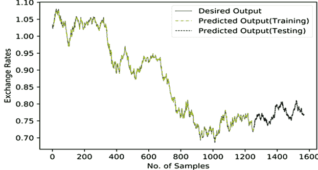

**图 13.2** (i). 基于深度学习的模型 (LSTM) 对澳大利亚澳元 (AUD) 数据集的预测接近实际趋势。

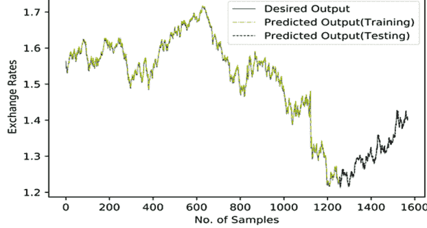

**图 13.3** (ii). 基于深度学习的模型 (LSTM) 对英国英镑 (GBP) 数据集的预测接近实际趋势。

五种不同货币汇率数据集的 LSTM 深度神经网络模型。从图 13.2 中也可以清楚地观察到，基于深度学习的模型 (LSTM) 对所有五个外汇数据集的预测都接近实际趋势。

图 13.2 (i) 显示了对澳元 (AUD) 数据集预测接近实际趋势的基于深度学习的模型 (LSTM)。

图 13.3 (ii) 显示了对英镑 (GBP) 数据集预测接近实际趋势的基于深度学习的模型 (LSTM)。

图 13.4 (iii) 显示了对加加元 (CAD) 数据集预测接近实际趋势的基于深度学习的模型 (LSTM)。

## 216 业务管理中的人工智能与机器学习

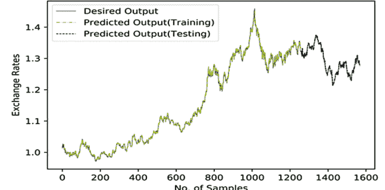

**图 13.4** (iii) 基于深度学习的模型 (LSTM) 对加加元 (CAD) 数据集的预测接近实际趋势。

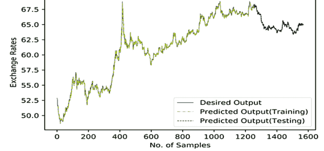

**图 13.5** (iv) 基于深度学习的模型 (LSTM) 对印度卢比 (INR) 数据集的预测接近实际趋势。

图 13.5 (iv) 和 13.6 (v) 显示了对印度卢比 (INR) 数据集预测接近实际趋势的基于深度学习的模型 (LSTM)。

图 13.2 是五种不同货币一日后预测的 LSTM 模型训练和测试观察：i) 澳大利亚澳元 (AUD) ii 英国英镑 (GBP) iii 加加元 (CAD) iv 印度卢比 (INR) 以及 v) 日本元 (JPY)。

图 13.7 (i) 显示了使用三种模型 BPNN、FLANN 和 LSTM 对澳元 (AUD) 外汇数据集进行一日后预测的 MSE 收敛性图。

图 13.8 (ii) 显示了使用三种模型 BPNN、FLANN 和 LSTM 对英镑 (GBP) 外汇数据集进行一日后预测的 MSE 收敛性图。

## 基于循环神经网络的长短期记忆网络 217

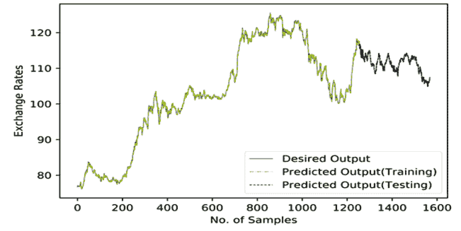

**图 13.6** (v). 基于深度学习的模型 (LSTM) 对日本元 (JPY) 数据集的预测接近实际趋势。

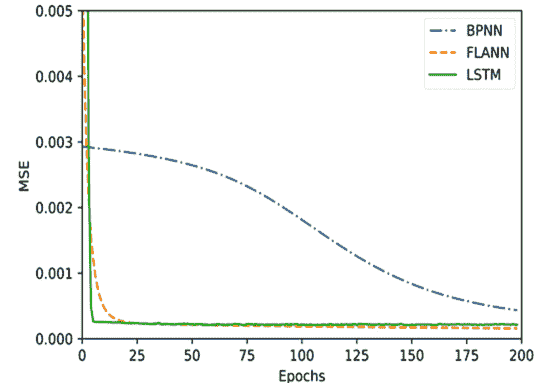

**图 13.7** (i) 使用三种模型 BPNN、FLANN 和 LSTM 对澳元 (AUD) 外汇数据集进行一日后预测的 MSE 收敛性图。

图 13.9 (iii) 显示了三种模型 BPNN、FLANN 和 LSTM 对加加元 (CAD) 外汇数据集进行一日后预测的 MSE 收敛性图。

图 13.10 (iv) 显示了三种模型 BPNN、FLANN 和 LSTM 对印度卢比 (INR) 外汇数据集进行一日后预测的 MSE 收敛性图。

图 13.11 (v) 显示了三种模型 BPNN、FLANN 和 LSTM 对日本元 (JPY) 外汇数据集进行一日后预测的 MSE 收敛性图。

# 业务管理中的人工智能与机器学习

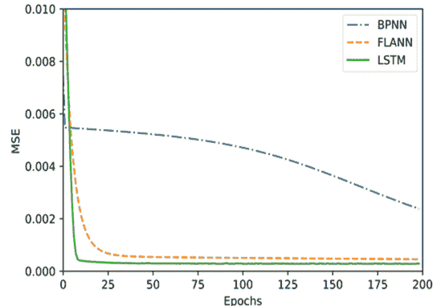

**图 13.8** (ii). 使用三种模型 BPNN、FLANN 和 LSTM 对英镑 (GBP) 外汇数据集进行一日后预测的 MSE 收敛性图。

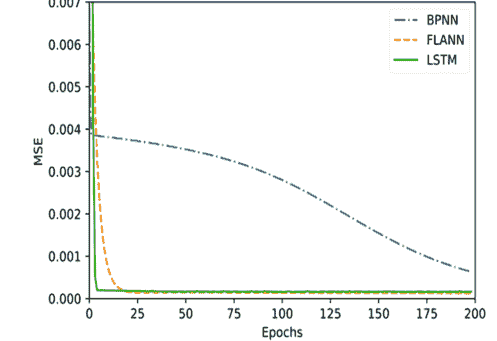

**图 13.9** (iii). 使用三种模型 BPNN、FLANN 和 LSTM 对加加元 (CAD) 外汇数据集进行一日后预测的 MSE 收敛性图。

13.3 是三种预测模型 (BPNN、FLANN 和 LSTM) 对五种不同货币进行一日后预测的 MSE 收敛性图：i) 澳大利亚澳元 (AUD) ii 英国英镑 (GBP) iii 加加元 (CAD) iv 印度卢比 (INR) 以及 v) 日本元 (JPY)。

在建议模型的训练阶段获得了图 13.3。这些图是使用模型 BPNN、FLANN 和 LSTM 对不同数据集进行一日后预测的 MSE 收敛性图，揭示了深度学习神经网络比研究中使用的其他两种模型收敛更快。

# 基于循环神经网络的长短期记忆网络

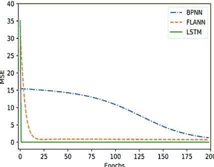

**图 13.10** (iv). 使用三种模型 BPNN、FLANN 和 LSTM 对印度卢比 (INR) 数据集进行一日后预测的 MSE 收敛性图。

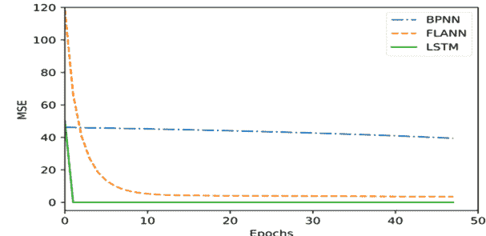

**图 13.11** (v). 使用三种模型 BPNN、FLANN 和 LSTM 对相同数据集日本元 (JPY) 进行一日后预测的 MSE 收敛性图。

## 13.6 结论

本文详细描述了用于汇率预测的特殊类型 RNN 长短期记忆网络的实现。由于其其的特征、门控输入输出和记忆块，LSTM 模型在时间序列预测中表现良好。门控负责数据的选择、删除和块的修改。这些门控通过存储之前的值并与后续变化进行比较来作为记忆单元工作，以更新模型。从第 4 节的仿真中可以清楚地观察到，建议的基于深度学习网络的 LSTM 模型在 1 天到 30 天的不同跨度提供了更好的准确性，并且比其他广泛接受的神经网络模型（即 BPNN 和 FLANN）更快。从结果中我们还发现长期误差会增加。因此，为了提高长期准确性，我们需要引入通胀因素、更多的统计特征和技术指标。通过探索深度神经网络模型的变体也可以提高预测准确性。

## 参考文献

- 1. Taylor, S. J. (1987). Forecasting the volatility of currency rates. International Journal of Forecasting, 3(1), 159–170.
- 2. Kamruzzaman, J., Sarker, R. A., & Ahmad, I. (2003, November). SVM models for predicting currency rates. In Third International Conference on Data Mining (pp. 557–560).
- 3. Nagarajan, W., Wu, Y., Li, M., & Wang, Q. (2005, June). Forecast studies for financial markets using technical analysis. In 2005 International Conference on Control and Automation (Vol. 1, pp. 259–264).
- 4. Galeshuk, S. (2016). Neural networks performance in exchange rate prediction. Neurocomputing, 172, 446–453.
- 5. Huang, W., Lu, S., Bao, Y., & Wang, L. (2006). Comparisons of the different frequencies of input data for neural networks in foreign exchange rates forecasting. In International Conference on Computational Science (pp. 517–524). Springer, Berlin, Heidelberg.
- 6. Bui, L. T., & D, T. T. H. (2018). A new evolutionary multi-objective learning approach for forecasting currency rates. Data & Knowledge Engineering, 114, 40–66.
- 7. He, K., Ji, L., To, G. K., Zhu, B., & Zou, Y. (2018). Forecasting Exchange Rate Value at Risk using Deep Belief Network Ensemble. Procedia computer science,139, 25–32.
- 8. Ni, H., & Yin, H. (2009). Exchange rate prediction using hybrid neural networks and trading indicators. 72(13-15), 2815–2823.
- 9. Andreou, A. S., Georgopoulos, E. F., & Likothanos, S. D. (2002). Exchange-forecasting: A hybrid algorithm on genetically optimized neural networks. Computational Economics, 20(3), 191–210.
- 10. Jena, P. R., Majhi, R., & Majhi, B. (2015). Development and performance evaluation of a novel knowledge guarded artificial neural network (KGANN) for exchange rate prediction. Journal of King Saud University-Computer and Information Sciences, 27(4), 450–457.
- 11. Rehman, M., Khan, G. M., & Mahmud, S. A. (2014). Foreign currency exchange rates prediction using cgg and recurrent neural network. IERI Proceedings, 10, 239–244.
- 12. Chao, J., Shen, F., & Zhao, J. (2011, July). Forecasting exchange rate with deep neural networks. In The 2011 International Joint Conference on Neural Networks (pp. 1259–1266). IEEE.
- 13. Shen, F., Chao, J., & Zhao, J. (2015). Forecasting exchange rate using deep belief works and conjugate gradient method. Neurocomputing, 167, 243–253.

# 基于循环神经网络的长期记忆

- 14. Yu, L., Wang, S., & Lai, K. K. (2005, 5月). 外汇率预测中的自适应平滑神经网络。计算科学国际会议 (pp. 523–530)。Springer, 柏林, 海德堡。
- 15. Hussain, A. J., Al-Jumeily, D., Al-Askar, H., & Radi, N. (2016). 免疫算法正则化的动态自组织神经网络用于金融时间序列预测。Neurocomputing, 188, 23–30.
- 16. Usmani, M., Ebrahim, M., Adil, S. H., & Raza, K. (2018). 用混合模型预测市场表现。2018第3届工程、科学与技术新兴技术国际会议 (IECEST) (pp. 1–4)。 IEEE.
- 17. Karunrajaman, J., & Sarker, R. A. (2003, 12月). 使用ANN预测货币汇率：案例研究。神经网络与信号处理国际会议，2003。2003年论文集 (卷 1, pp. 793–797)。 IEEE.
- 18. Majhi, R., Panda, G., & Sachs, G. (2006, 6月). 使用非线性单层人工神经网络模型对外汇率进行高效预测。2006年 IEEE 控制控制与智能系统会议 (pp. 1–5)。 IEEE.
- 19. He, H., & Shen, X. (2007). 外币汇率预测的自助自助法。决策支持系统, 42(2), 1054–1062.
- 20. Ince, H., & Traflis, T. B. (2006). 用于汇率预测的混合模型。2007年国际神经网络联合会议，2007) (pp. 1272–1277)。 IEEE.
- 21. Graves, A., Mohamed, A. R., & Hinton, G. (2013). 基于深度循环神经网络的语音识别。声学、语音与信号处理 (ICASSP), 2013 IEEE 国际会议 (pp. 6645–6649)。 IEEE.
- 22. Yu, P., & Yan, X. (2019). 基于深度神经网络的股价预测。神经计算与应用, 1–20.
- 23. Li, Y., & Cao, H. (2018). 基于 LSTM 神经网络的旅游流量预测。计算机科学进展, 129, 277–283.
- 24. Wang, J., Peng, B., & Zhang, X. (2018). 使用堆叠 LSTM 模型进行情感预测。Neurocomputing, 32, 93–101.
- 25. Hochreiter, S., & Schmiduber, J. (1997). 长短期记忆。神经计算, 9(8), 1735–1780.


# AI 应用面临的伦理问题

Vidushi Pandey
信息系统系
印度管理学院科泽科德校

## 目录

- 14.1 引言............................................................... 223
- 14.2 AI 应用中的伦理问题........................................................... 224
- 14.2.1 权力不平衡.................................................................. 225
- 14.2.1.1 资助机构与 AI 解决方案开发中存在的权力不平衡............................................................... 225
- 14.2.1.2 偏偏的 AI 解决方案放大社会中的权力不平衡......................... 226
- 14.2.2 劳工问题............................................................... 227
- 14.2.2.1 哪些工作最受到 AI 威胁的影响？............................................... 227
- 14.2.2.2 AI 真的可以消除对人类干预的所有需求吗？......................... 228
- 14.2.3 隐私.............................................................................. 228
- 14.2.4 误信息、虚假信息和假新闻.................................. 229
- 14.3 解决 AI 伦理问题的方法...................................... 230
- 14.3.1 隐私的算法方法................................................ 230
- 14.3.2 保护用户隐私的非算法方法....................... 232
- 14.3.3 处理虚假信息传播的方法....................... 232
- 14.3.4 解决 AI 应用中的偏差...................................... 233
- 14.3.5 解决 AI 应用中的风险和安全问题.................. 233
- 14.3.6 政策与伦理框架........................................ 234
- 参考文献........................................................... 236

## 引言

人工智能 (AI) 和机器学习 (ML) 的出现使我们进入了一个曾经被认为是科幻小说的时代。今天，这些应用已经解决了医学、国防、教育、交通等领域的问题。如今，这些应用处理了医疗、国防、教育、交通等行业的问题。AI 技术的发展极大地改变了我们的生活，但正如任何其他技术一样，AI 可能会产生意想不到的结果。这种技术的发展不仅限于科学家、开发者和工程师，还涉及到许多利益相关者，包括政府和立法者。本章旨在强调 AI 的伦理问题，并对这些利益相关者予以关注。

## AI 应用中的伦理问题

AI 应用的伦理问题如下图 14.1 所示。尽管 AI 应用具有改变游戏规则的潜力，但其使用引发了严重的担忧。AI 应用带来的伦理问题在图 14.1 中总结，这些担忧与权力不平衡、劳工问题和隐私有关，并在后续章节中详细讨论。

| 权力不平衡 | 劳工问题 | 隐私 | 虚假信息 |
| --- | --- | --- | --- |
| 存在的权力不平衡 | 失业 | 个人数据泄露 | 假新闻 |
| AI 模型偏差放大权力不平衡 | 计算劳动 | 缺乏同意 | 深度伪造内容 |
| 算法殖民 | 情感劳动 | 复杂的政策文档 | 人工生成文本 |
| | 糟糕的工作 | | 对民主的威胁 |

图 14.1 AI 应用的伦理问题。

### 14.2.1 权力不平衡

AI 解决方案的使用被认为是解决许多世界问题的方案，但 AI 应用对社会的影响受到权力分配的严重困扰。这种问题可以从两个角度来看：

#### 14.2.1.1 资助机构与开发 AI 解决方案中存在的权力不平衡

AI 解决方案的整个概念化、设计、训练和部署过程非常昂贵。组织需要高技能的数据科学家、软件工程师、研究人员和 UX 设计师。这种资源通常只有获得大量资金的机构和公司才能拥有。在发展中国家，这种人力资源对于小型公司和非营利组织往往难以获取，学术界也面临这个问题，因为高质量的研究人员往往被私人公司招聘，导致资源有限的学术研究出现差距。这种关键人才在少数强大机构手中的集中可能会影响 AI 的研发领域，使其产生的利润高于那些对社会影响更大但盈利能力较少的应用。最近谷歌伦理研究员 Timnit Gebru 因研究重点差异问题被解雇就是这种情况的一个例子。

例如，在农业 AI 干预中，获得大公司支持的农民有足够的资金和支持来尝试此类解决方案。即使这些解决方案可能不会立即成功，这些农民也能承担沉没成本，因为他们有行业的资金支持。一旦 AI 部署开始回报，这些农民可能会从农场中获得倍增的产出。另一方面，小型家庭资源有限的农场可能没有财务灵活性来尝试这些技术。

一旦大型农场开始从生产力提高中获益，这种资源的匮乏将进一步放大 [1]。

这种准入差异以及贫富差距扩大的问题并不新鲜。它一直存在于社会的各个领域，从制药研究到教育、工业化、互联网访问等许多领域。然而，发现 AI 也未能避免这一现象，并且建立解决此类问题的机制是非常关重要的。

## 14.2.1.2 偏偏的 AI 解决方案加剧社会现有的权力不平衡

设计不当的 AI 系统可能会通过无意或有意对社会某些成员产生歧视，进一步改变社会的权力平衡。AI 系统的概念化、训练方式决定了其性能对终端用户的影响。如果这些系统没有在代表所有阶层的数据上进行充分训练，并且没有对所有类别的用户进行适当测试，那么该系统可能会固化其性能中的偏见。例如，美国一个用于医疗医疗计划中候选人的预测算法被发现对社区中的非洲美国人成员存在偏见。在另一个例子中，高盛和苹果公司面临了抵制，因为它们的支付卡解决方案为比信用评分更好的女性分配了更高的信用额度 [2]。

即使在应用推出后识别出这些偏见，也很难追究责任，使用该系统的公司可能并不理解应用程序背后的代码。在苹果的案例中，公司、开发者和高盛否认算法存在偏见，但无法对算法为何做出这些决策提供解释。大多数深度学习 AI 应用都是“黑箱”模型，即使是开发者也不理解算法做出决策时使用的规则。开发者通常根据准确率等参数衡量成功，而代码确实交付了其中存在的偏见。例如，聚类算法通常用于通过将数据划分为同质的数据块来对数据进行大幅更改。然而，除非进行专门处理，否则算法可能不会遵循“个人或群体公平”原则，并可能导致高度倾斜的簇，从而放大社会中现有的偏见。

语音识别系统今天在全球范围内被广泛使用。但这些系统通常是在主要来自西方国家的英语母语者的数据上进行训练的。这种训练数据的多样性缺乏是与这些系统斗争的非英语使用者所感受到的。事实上，并不是机器学习系统适应用户的需求，而是这些用户被迫使改变说话方式以适应这些设备。对于有严重言语障碍的用户，这一问题可能更加严重。此类用户可能完全无法使用这些系统。问题不在算法本身，而在于训练数据缺乏多样性，以及对广泛终端用户的代表性不足。

## AI 应用涉及的伦理问题

输入数据中的其他形式的 AI 系统也存在类似问题，例如识别无法识别某些种族或面部差异的人，计算机视觉系统由于体型、姿势的变化或使用辅助设备而不将残障人士视为人类。内容分析系统可能还没有考虑阅读写症的情况。

“算法殖民主义”或“数据殖民主义”是学者使用的术语，指的是“现代种族、国家、贫富群体之间的权力不平衡是殖民者与被殖民者之间权力不平衡的延伸”。这在当前 AI 驱动的世界中以多种方式体现。训练数据和算法性能中内置的种族主义和其他偏见是上述讨论的一个方面。这种“殖民主义”形式变得明显的其他方式还：在 AI 政策和数据协议的讨论中排除发展中国家；利用这些国家的廉劳动力进行数据准备的影子工作；在西方市场推出应用之前使用某些脆弱群体进行 Beta 测试；以及在“AI 向善”倡议中采取“家长主义”方法，而不允许发展中国家实际建立设计其所需的 AI 解决方案的能力 [3]。

## 14.2.2 劳动问题

AI/ML 应用最受恐惧的威胁之一是它们将完全取代人类并导致社会大规模失业。确实有很多 AI 系统声称可以自动化劳动密集型操作并消除对人类中间人的需求。呼叫中心、客户服务自助机、零售店的人员，以及许多此类规则都面临着由于 AI 干预而变得多余的威胁。这种威胁有多个方面需要关注。两个关键方面是：

### 14.2.2.1 哪些工作最可能受到 AI 威胁的影响？

AI/ML 作为技术的关键能力是可以高效预测事件。用于职位申请筛选的 AI 应用预测哪个候选人最可能工作表现良好；医疗诊断 AI 应用可能会预测肿瘤可能是恶性还是良性；自动驾驶车辆预测道路上车辆/行人的下一步动作并相应做出决策。这些以及许多其他 AI 系统基本上依赖于算法预测结果的效率。这些系统对劳动力的影响取决于这种预测能力在工作中的重要性。对于完全依赖预测前预测能力的工作（如法律摘要、行政助理的邮件回复），被取代的威胁是巨大的。然而，对于结合了预测和其他某些技能的工作（如医学、诊断或教育，其中决策技能、从业者的人文关怀也很重要），AI 应用可能会补充现有工作，但不会完全取代它 [4]。

### 14.2.2.2 AI 真的可以消除对人类干预的所有需求吗？

对于能够完全取代人类需求的 AI 应用，实际情况可能并非如此。AI 应用仍然依赖人类工人来完善其边缘。创建了许多新类型的工作来支持这些。人类工人通常被要求来训练应用程序。“劳动力”指的是公司通过合同雇佣的这些员工，以协助相关任务 [5]。

这些来自发展中国家的人花费数小时为 AI 应用收集、分类和清理数据。在某些情况下，应用程序的结果需要处理，这需要人工支持。例如，在 Facebook 等平台的内容审核中，在使用复杂的 AI 算法仍然需要人工干预。因此，旨在减少人工劳动的 AI 应用也创造了新的工作形式。问题是，这些工作通常是不可见的，导致工人受到虐待、缺乏公平工资和指导方限制。印度公司内容审核人员遭受严重心理压力的案例就是此类情况的极端例子。AI 实施可能产生的其他形式的工作是顺应女性更适合护理和支持工作的普遍刻板印象，情感劳动往往倾向于女性工人。

## 14.2.3 隐私

用户以及非用户的隐私是 AI 社区需要解决的问题。想象你在公开的 Instagram 资料上上传了度假照片。几天后，你看到它被用在广告中。你向广告公司投诉其未经许可使用你的照片，并要求删除。公司告诉你，如果你不想让你的照片被使用，就不应该在社交媒体上公开你的个人资料。公司的逻辑合理吗？你会同意你的照片被使用吗？你可能不会。然而，我们如此多的照片、我们公开的其他形式的数据正被各种 AI 应用用于训练模型。在大多数情况下，用户不知道他们的公开数据被用于此类目的，而且没有为此给出同意。然而，许多 AI 公司通过指责人们来逃避责任，说如果他们不想让数据被使用，就不应该将其公开。这不是解决这一问题的可接受方法。我们大多数人不知道自己的数据可以被用于此类目的，我们也从未试图阻止或控制它。人们应该对自己的数据拥有控制权，并有权从此类模型中撤回他们的数据。现在，假设广告公司同意了你的要求，并要求他们删除广告。公司在他们那边这样做，但当广告已经通过各种媒体渠道。即使原始广告被删除，多个副本也已被创建并再次分享。无论你如何尝试，你可能永远无法摆脱那条广告。同样，如果你的数据已经被用于训练目的，而你决定不想让你的数据以那种方式使用怎么办？你要求公司从他们的训练数据集中删除你的数据点。他们确实做到了。但到此时，算法已经通过你的数据进行了多次会话，你的数据已经留下了一些痕迹，仅仅通过从训练集中删除你的数据点是无法简单消除的。人们有权在任何时候有效地从任何 AI 训练过程中撤回自己的数据。

隐私的另一个方面是计算机视觉、语音助手和其他监控设备/应用程序等 AI 应用在你不知情的情况下偷偷收集你的数据。在其中一个例子，研究人员实验表明 Amazon Echo 经常在没有官方唤词的情况下录音 [6]。这些设备可能会收集你的数据，并在无意中将其用于改进性能。你可能会说这些内容在用户接受的“条款与条件”中提到过；但我们知道没有人会阅读这些协议。科技公司在向这些协议中填充复杂的术语方面做得非常好，以至于普通用户几乎无法解读。公司不需要将维护隐私的全部责任推给用户，而是需要想出解决这一问题的解决方案。

## 14.2.4 误导信息、虚假信息与假新闻

2016 年美国大选后，美国 la调查发现了由俄罗斯“水军农场”——互联网研究局 (IRA) [7] 组织的协同媒体活动的存在。这些活动的重点是在该国营造一种愤怒和分裂的氛围。IRA 雇佣全天候人员盗用真实美国人的身份来创建虚假档案，通过了解数千名美国人的行为，创建了虚假信息、帖子和谣言，发布了能够融入美国人群且不引起怀疑的内容，据说这对选举期间美国的和谐与稳定氛围产生了如此影响 [9]。

为了实现这些结果，水军农场投入了数百万美元和资源。今天，得益于 AI 技术的进步，为了获得类似或更强大的效果，水军农场投入的人力和物力将减少。强大的语言生成器可以在瞬间创建数千条真实的人类帖子。AI 应用现在可以让你创建从未存在的人的真实照片和视频。深度伪造（Deepfake）技术允许任何人创建极具信服力的视频。这些事件引发了社交媒体上关于误导信息、虚假信息和假信息的严重问题。误导信息（Misinformation）发生在错误并非故意的情况下，而虚假信息（Disinformation）指的是故意误导性信息。这些可以以文本（类似于那些真人的帖子）、照片、视频和音频数据的形式存在。社交媒体平台的热门话题和推荐算法往往会此类虚假信息的扩散。

社交媒体平台正试图制定解决方案来过滤这些帖子，但其谣言活动的复杂性在不断上升，以规避这些监管尝试。事实核查机构和负责揭穿这些谣言的科学家往往在为揭穿虚假帖子提供精确证据方面面临额外压力。相反，传播谣言的公司很少面临提供证据的压力。不仅在政治领域，其他领域也开始在其平台上使用由南亚电信公司创建的虚假帖子来诋毁对手。Facebook 删除了几个针对消费者面前的竞争对手服务创建虚假“新闻”和“迷因”的页面。许多分享这些虚假信息的群体和社区是封闭小组。这使得过滤和事实核查工具访问这些数据变得更加困难。因此，目前无法对不同媒体平台上的所有内容进行筛选。

生成病毒式虚假信息活动的努力虽然减少，但这些努力的复杂性却增加了。大多数此类应用基于开源 AI 技术，如深度神经网络（DNN）、生成对抗网络（GANs – 图像生成器）和生成式 Transformer（GPT 语言生成器）。任何人都可以免费访问这种技术，并它可以构建任何类型的应用程序（无论好坏）。这引起了对发布此类强大 AI 的担忧。事实上，这些技术将导致许多社会生产性应用的创建，但它们很容易被用于许多恶意目的这是一个日益增长的担忧。GPT-3 的最新版本实际上由于此类担忧并未完全公开。这再次是 AI 社区面临的一个需要解决的伦理困境。

## 14.3 解决 AI 伦理问题的方法

上一节与 AI 应用相关的担忧需要 AI 生态系统中所有利益相关者采取整体性的解决方法。从大型企业到政府、学术研究人员、举报人、国际政策制定者、工程师、数据科学家和终端用户，每个利益相关者都需要意识到这些潜在问题，并朝着解决问题的方向努力。图 14.2 显示了目前实践中解决这些伦理关注的关键方法。这些将在后续节中讨论，解决 AI 伦理问题的方法如图 14.2 所示。

### 14.3.1 隐私保护的算法方法

通常，机器学习算法需要大量的详细用户数据用于训练和测试。公司可能出于各种目的发布或共享敏感数据的摘要。意图滥用这些信息的对手可能会尝试逆向工程此类统计摘要并获取访问。

AI 应用涉及的伦理问题
231

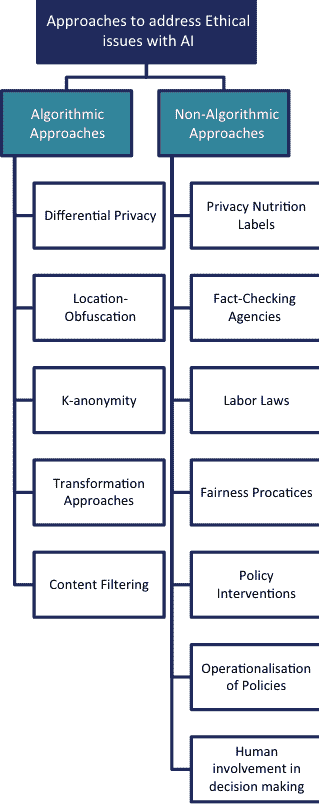

图 14.2 解决 AI 伦理问题的方法。

数据匿名化可能不足以防止此类隐私攻击。如果攻击者拥有来自其他来源的辅助信息，他们仍然能够检索用户级的数据。为了防止此类攻击，AI 专家提出了各种保护隐私的算法技术。其中一些是：

- **差异分隐私（Differential Privacy）**：差异分隐私是指用于分割/修改敏感数据部分的算法技术，以便对对手不可用。系统不是提供实际值，而是引入噪声。虽然系统内部知道如何过滤噪声，但攻击者可能不知道。然而，如果攻击者可以多次查询数据集，他们可能在噪声中找到模式。
- **位置混淆（Location obfuscation）**：为了保护用户的位置和跟踪数据，算法可能会在数据中引入距离误差。这将为对手提供一个不准确的位置，并防止他们识别出个人。
- **K-匿名性（K-anonymity）**：该技术通过将用户身份与一组用户的数据混合来隐藏用户的真实身份。
- **基于转换的方法**：利用加密技术来隐藏敏感数据。

### 14.3.2 维护用户隐私的非算法方法

除了干预之外，政策层面也正在进行非算法干预，以提高用户数据的隐私。该领域的工作之一专注于解决用户经常在不理解的情况下同意的“条款与条件”的复杂性。用户的一个主要障碍是这些协议中使用的极其复杂的专业语言。解决这一问题的方案是使用“隐私营养标签”。卡内基梅隆大学的 CyLab 与安全实验室（CUPS）开发了营养标签概念，使终端用户能够轻松理解和比较隐私政策 [10]。就像食品包装上的营养标签一样，隐私标签旨在用清晰易懂的语言列出任何应用程序的关键要素。苹果最近在其 iOS 14 平台上采用了这一功能，并要求开发者为其其 App Store 中的所有应用程序提供这些隐私营养标签 [11]。需要此类干预来让用户对自己的数据和隐私有更多的控制权。

### 14.3.3 处理虚假信息传播的方法

处理各个层次虚假信息的巨大威胁，需要在算法、政策层面和普通意识层面进行干预。算法可以识别机器人生成数据中的模式，方面涉及句子结构、重复性、视觉扭曲、位置、发布频率等。此外，还有一些应用程序通过添加水印或利用区块链技术来跟踪数据足迹，来“投毒”用于训练深度伪造（Deepfake）模型的数据 [12]。

然而，考虑到这些预防算法的改进速度，恶意输出也在以相同甚至某些情况下更高的速度改进。

仅依靠算法过滤的一个严重问题是，它可能会误判并拦截真实内容。因此平台必须进行这种权衡。

# AI 应用周围的伦理问题

在调优其过滤机制时，他们是应该降低准确性以防止任何真实的帖子被标记，还是应该专注于更高的准确性以删除所有恶意内容，尽管这在某些情况下会限制真正的言论自由？此外，社交媒体平台往往没有动力去阻止所有可疑内容，因为这类内容会带来大量的点击量，并可能为平台创造更多业务。

因此，还需要在政策和意识层面进行干预以遏制虚假信息。社交媒体的使用和误用需要制定规则。事实核查机构的参与、为此类机构提供充足的资金和支持、识别并标记可靠的信息源，对于控制媒体平台上的虚假信息威胁都是必须的。终端用户的媒体素养是另一个必要步骤，以教育他们他们所遇到的所有信息并非都是可靠的，并提高他们识别和标记可疑内容的敏感性。尽管付出了这些努力，这仍然是一个持续的战斗，需要新的解决方案来管理这一问题。

## 14.3.4 AI 应用中的偏差

为了解决内置于 AI 系统并最终导致歧视社会部门的偏差问题，在应用开发的设计和训练阶段必须极其谨慎。理想情况下，系统设计人员应该意识到给定状态下可能存在的偏差以避免它们。然而，系统本身并不总是知晓这些的。因此，需要努力选择代表所有类别终端用户的训练数据。在预处理和后处理阶段采用了算法技术来减少偏差。使用诸如平衡敏感数据、移除敏感属性、转换模型预测以满足公平性约束、在优化过程中施加公平性约束以及创新的数据训练技术等方法，防止离线系统的偏差侵入 AI 系统 [133]。

人们正努力增加深度学习模型的可解释性，以识别算法在偏差时考虑了哪些因素。需要遵循参与式设计方法，以确保目标用户参与到设计的各个阶段。

然而，关键挑战在于定义“公平性”。在个人和群体层面，公平性都有多种定义。没有哪一个定义是完备的且涵盖了公平性的所有方面。因此，选择 AI 系统应该遵循哪些参数是一项相当复杂的任务。期望数据科学家和工程师在他们已具有挑战性的技术角色之外，还参与到定义复杂性的工作中是不现实的。组织需要投资聘请伦理专家，让他们与 AI 团队合作并在此类事务上提供指导。

## 14.3.5 AI 应用中的风险与安全问题

AI 应用风险和安全的一个关键方面是分配责任。如果一辆自动驾驶汽车做出了错误决定并伤害了行人，谁来负责？汽车？代码？代码背后的工程师？公司？还是当时在车里的乘客？这种困境要求我们更深入地思考谁应该控制最终决策？取决于具体情况、背景及其相关的风险，做出最终决定的自主权应保留在他们手中。这将使他们能够监督 AI 可能做出的潜在有害的决策。应用场景包括机构入学、自动驾驶和办公室晋升、发放社会支持、司法服务，以及在某些错误结果可能会以某种形式影响人类生命的领域，使用 AI 进行推荐并让人类做出最终决策可能更有意义。然而，参与其中的的人类并不一定更擅长此类决策制定。为了确保参与该过程的人类具备足够的专业水平，他们需要在现实场景中接受广泛的培训，而不仅仅是与 AI 系统一起工作。2009 年法国航空飞机坠机事故说明了对自动化系统的过度依赖以及缺乏充分的现实世界训练如何削弱人类的决策能力。法国航空 AF447 航班于 2009 年坠入大海，导致机上 228 人丧生。该事故是飞机“失控”的结果。控制权的问题通常发生在飞机（大部分时间处于自动驾驶系统状态）由于输入数据不一致而退出自动驾驶模式并切换到手动飞行时。在在那架注定毁灭的法国航空航班中，飞行员在突然必须在高空条件下手动操纵飞机时感到震惊。飞行员无法正确解释系统读数，导致飞机自由落体坠海。这起事故可以归因于由于过度依赖自主系统导致飞行员缺乏现实场景的经验 [14]。对于自动驾驶系统，如果赋予人类覆盖能力，除非控制系统的人员接受过适当的培训以做出此类决策，否则它将不会很有用。

## 14.3.6 政策与伦理框架

随着对 AI/ML 解决方案伦理问题意识的提高，独立研究机构、政府、非营利组织和企业都提出了多种政策文件、框架和指南来解决这些关注。经济合作与发展组织（OECD）提出了“促进创新且值得赖、尊重人权政府价值观的 AI 原则”。这些原则于 2019 年被 37 个 OECD 国家采纳。除了它们之外，其他国家以及 G20 国家也根据 OECD 的提案采纳了 AI 原则。这些原则由一个拥有 50 多成员的专家小组设计，其中包括政府、商界、学术界、公民社会、劳动界和科学社区的代表。

## OECD AI 原则
- AI 应通过推动包容性增长为人类和地球带来利益

来源：https://www.oecd.org/going-digital/ai/principles/

其他政策层面的努力还包括英国数据伦理框架、新加坡个人数据保护委员会提出的《人工智能治理框架提议》、IEEE 自主系统全球倡议、欧洲委员会理事会的《人工智能与数据保护指南》等。即使是像 Google 和 SAP 这样的私营公司也设计并发布了 AI 实施的伦理指南。对 AI 应用相关问题的日益关注是一个非常需要且值得赞赏的举措。然而，许多努力也被批评为“伦理洗白”的尝试，没有采取任何具体行动。问题在于这些政策指南的有效操作和实施。说一家公司遵循伦理原则很容易，但是否有任何方法可以实际实施它们并衡量其影响呢？每个组织都有权按照自己的方式解释公平性、负责任的 AI 等术语的含义。因此，不仅政策和指南是当务之急。AI 领域可以从其他类似伦理问题发挥关键作用领域汲取经验。医学、法律和教育等长期处理伦理问题的领域可以为伦理价值观的有效操作提供参考。

此外，公司需要将决策权交给伦理委员会，而不仅仅是作为伦理指南的一个勾选框。需要对开发者和工程师关于哲学方法和伦理价值观进行全面的敏感化。这些敏感化努力不仅应包括西方的伦理观，还应包括来自其他文化的视角，如佛教、神道和乌班图（Ubuntu）。

应当有专家委员会在整个过程中为员工提供指导。强有 AI 新闻报道也发挥着另一个重要作用。为了让终端用户、开发者、公司和政府理解人工智能的技术和伦理方面，负责任的新闻报道将发挥至关重要的作用。该领域的新闻不需要恐吓和煽动，而是需要具有信息量且足够广泛，以展示利益相关者的不同观点。

对所有与人工智能相关的伦理问题的讨论似乎为这项技术描绘了一幅非常阴暗的图景。然而，必须理解的是每一项技术进步都面临过类似的担忧。从汽车的引入到工业机器、计算机和 IT 软件，这些担忧一直存在，并随着对人与技术之间关系的更深层次理解得到了解决。人工智能技术也将经历这一学习曲线，利益相关者将通过持续合作和知识共享提出更好的解决方案。

## 参考文献

- 1. https://datasociety.net/wp-content/uploads/2019/01/DataandSociety_AlinContext.pdf
- 2. https://www.washingtonpost.com/business/2019/11/11/apple-card-algorithm-sparks-gender-bias-allegations-against-goldman-sacs/
- 3. https://www.technologyreview.com/2020/07/31005824/decolonial-ai-for-everyone/
- 4. Agrawal, Ajay K., Gans, Joshua S. and Goldfar, Avi. Artificial Intelligence: The Ambiguous Labor Market Impact of Automating Prediction (February 25, 2019). Available at SSRN: https://ssrn.com/abstract=3341456 or http://dx.doi.org/10.2139/ssrn.3341456
- 5. Shestofsky, Benjamin. "Working algorithms: Software automation and the future of work." Work and Occupations 44.4 (2017): 376–423.
- 6. https://www.washingtonpost.com/technology/2019/05/06/alex-ai-has-been-eavesdropping-you-this-whole-time/
- 7. https://www.ft.com/content/55a3e92-8357-11ea-8b72-8db45df6f714
- 8. https://www.bbc.com/news/technology-43093390
- 9. https://cups.cs.umu.edu/privacy/Label
- 10. https://developer.apple.com/app-store/app-privacy-details/
- 11. https://spectrum.ieee.org/tech-talk/computing/software/what-are-deepfakes-how-are-created
- 12. https://www.mckinsey.com/featured-insights/artificial-intelligence/tackling-bias-in-artificial-intelligence-and-in-humans#
- 13. https://hbr.org/2017/09/the-tragic-crash-of-flight-af447-shows-the-unlikely-but-catastrophic-consequences-of-outcomes

## 15 使用视频分析的语义数据提取
AI 视角视角

Subashis Mohapatra, Aditi Bansal, and Subhadharini Mohanty

布巴内斯瓦尔工程技术学院计算机科学与工程系

## 目录

- 15.1 引言............................................................................... 238
- 15.2 视频分析............................................................................. 238
- 15.3 视频分析的需求................................................................ 238
- 15.4 工作流............................................................................... 239
- 15.4.1 帧提取............................................................... 240
- 15.4.2 分割模型........................................................... 241
- 15.4.3 预处理........................................................................... 242
- 15.4.4 特征提取............................................................... 243
- 15.4.5 目标定位............................................................... 244
- 15.4.6 字符分割...................................................... 245
- 15.4.7 使用水平和垂直投影进行边界提取.... 246
- 15.4.8 连通组件分析 (CCA)................................... 248
- 15.4.9 字符识别..................................................... 248
- 15.4.10 收集训练数据集........................................ 249
- 15.4.11 机器学习分类器.......................................... 249
- 15.5 未来增强.................................................................. 251
- 15.6 应用............................................................................... 252
- 15.7 医疗保健.................................................... 252
- 15.7.1 智慧城市/交通....................................... 252
- 15.7.2 安全........................................................................ 253
- 15.8 结论.......................................................................... 253
- 参考文献...................................................................................... 254

## 15.1 引言

当前的技术时代为用户提供了充足的机会，通过每一次点击、滑动、分享、搜索和流媒体来面对洪大的数据流。结果是，数字宇宙以前所未有的不同。全球每秒都产生海量数据。其规模不再限于 KB、MB 或 GB，甚至更大。必须理解的一个主要要点是，每一项技术进步都面临过类似的担忧。从汽车的引入到工业机器、计算机和 IT 软件，这些担忧一直存在，并随着对人与技术之间关系的更深层次理解得到了解决。人工智能技术也将经历这一学习曲线，利益相关者将通过持续合作和知识共享提出更好的解决方案。

对所有与人工智能相关的伦理问题的讨论似乎为这项技术描绘了一幅非常阴暗的图景。然而，必须理解的是每一项技术进步都面临过类似的担忧。从汽车的引入到工业机器、计算机和 IT 软件，这些担忧一直存在，并随着对人与技术之间关系的更深层次理解得到了解决。人工智能技术也将经历这一学习曲线，利益相关者将通过持续合作和知识共享提出更好的解决方案。

当前的技术时代为用户提供了充足的机会，通过每一次点击、滑动、分享、搜索和流媒体来面对洪大的数据流。结果是，数字宇宙以前所未有的不同。全球每秒都产生海量数据。其规模不再限于 KB、MB 或 GB，甚至更大。必须理解的一个主要要点是，每一项技术进步都面临过类似的担忧。从汽车的引入到工业机器、计算机和 IT 软件，这些担忧一直存在，并随着对人与技术之间关系的更深层次理解得到了解决。人工智能技术也将经历这一学习曲线，利益相关者将通过持续合作和知识共享提出更好的解决方案。

# 业务管理中的人工智能与机器学习

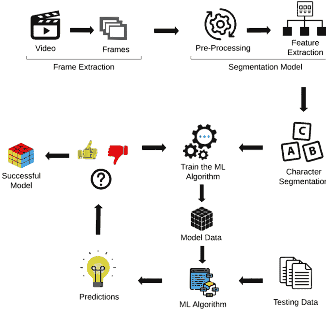

图 15.1 视频分析工作流。

- 4. 字符识别：这是最后阶段，它将生成最终输出。在上一个步骤中分割的字符将使用机器学习进行识别 [10,13]。

## 15.4.1 帧提取

图像分析（Image Analytics）是一个无处不在的领域，它通过某些处理技术从数字图像或视频中提取相关信息。OpenCV 库是一个开源的机器学习和计算机视觉库，用于对图像和图片执行操作和分析。在这里，它用于从视频中[提取]连续的图像序列，如图 15.2 所示。安装的摄像头用于 24/7 全天采集标准化且连续的视频流。因此，必须正确放置摄像头以便能够准确捕捉所需的物体。此外，视频应该是清晰且具有适当的分辨率。有时，采集到的视频可能是原始格式的，因此可能需要转换为 .avi 等可用的视频格式。使用媒体转换器等 Web 转换工具来执行此类转换。视频现在准备好第一步（帧提取）。

## 使用视频分析进行语义数据提取


图 15.2 从视频中获取图像序列。

接下来，需要开发一种程序方法将视频转换为静态图像。可以使用 OpenCV 库和包轻松实现这种转换。OpenCV 库是跨平台的且免费的，有助于各种计算机视觉任务。使用 OpenCV 的简单算法可以读取视频并根据需要将其分解为帧 [21]。最重要的参数是指定每秒提取的帧数。如果该参数值较小，就会获得几个重复帧。此外，如果参数值很大，可能会漏掉帧。因此，确保选择[一个]合适的每秒提取帧数是非常关重要的。

从视频中获取图像序列如图 15.2 所示。
此外，在某些情况下，视频中的物体可能保持不变，视频可能没有捕捉到任何运动。这将产生重复帧，对它们进行处理没有意义。因此，必须添加一种删除重复帧的算法。其一种方法是计算图像的哈希值并检查重复。一旦发现副本，算法将只保留一张同类图片，并删除其他所有重复项。最终获得一组用于进一步处理的图像集。

## 15.4.2 分割模型

在计算机视觉语境下，图像分割可以被认为是根据像素特征将数字图像分解为多个片段。图像分割 [14] 的目标是将图像表示为更具关联性、意义且易于分析的形式。图像分割用于将前景与背景分离，提取带有边缘（称为感兴趣区域）的所需物体，或对图像中具有相似特征的像素区域进行聚类。更准确地说，图像分割可以描述为为图像中的每个像素生成标签的过程，使得具有强度、颜色或纹理等相似特征的像素分配相同的标签。这里分割的目的是从图像中检测并提取汽车车牌。通过上述过程提取的帧集被传递到分割模型，其中我们需要做三件事：

- 预处理
- 特征提取
- 定位

## 242 业务管理中的人工智能与机器学习

## 15.4.3 预处理

分割步骤具有至关重要的意义，因为其余步骤都基于它。如果分割失败，识别也将无法产生所需的输出。为了确保准确性，在处理之前对数据进行预处理是必要的。预处理是对初始输入数据或上一个过程的输出数据进行的主要转换，以使其为进一步处理做好准备。它可能包括一些几何变换、颜色变换、图像标准化、图像模糊等。
图像模糊/平滑是最常用的预处理步骤之一。它是通过将图像与低通滤波器内核进行卷积来实现的。它对于去除噪声很有用。当应用此滤波器时，它会移除图像中的高频内容（例如噪声、边缘），导致不希望的边界变得模糊。
OpenCV 主要提供四种类型的模糊技术。

- 平均值法（Averaging）：
平均值法是一种通过减少像素之间强度差量来平滑图像的方法。它是通过将图像与归一化的框滤波器相结合的。它计算内核区域内所有像素的平均值，然后用平均像素值替换中心元素。这是通过函数 `cv.blur()` 或 `cv.boxFilter()` 完成的。
- 高斯滤波（Gaussian filtering）：
高斯滤波器是线性的。在这里通过高斯函数实现模糊。它使用高斯内核而不是框滤波器。它是使用函数 `cv.GaussianBlur()` 完成的，高斯模糊在移除图像中的任何高斯噪声方面非常有效。
- 中值滤波（Median filtering）：
中值滤波器是一种用于从图像去除噪声的非线性技术。在这里，它是改进结果的预处理步骤。在这里，内核区域下所有像素的中值和中心元素被替换为由 `cv.medianBlur()` 函数计算的中值。它主要用于存在盐和椒噪声的地方。在中值模糊中，中心元素总是被图像中的某些像素值替换，而在上述滤波器中，中心开销是重新计算的。
- 双边滤波（Bilateral filtering）：
双边滤波器是一种在减少噪声的同时保持边缘锐利的滤波器。它考虑了像素的差异。用于此点的滤波器是 `cv.bilateralFilter()`。双边滤波器在空间中使用了高斯滤波器。这种滤波器确保了边缘不会被模糊。

颜色变换也是从图像中提取信息时的基本步骤之一。颜色变换包括调整

## 使用视频分析进行语义数据提取

亮度、色调、饱和度或色、颜色分割、颜色平滑和锐化等。大多数颜色转换如转换为灰度或二值化在执行计算机视觉任务时非常有帮助，因为我们可以轻松分离前景和背景。此外，在二值化图像上应用算法变得更容易。

几何变换包括图像的平移、缩放、旋转、畸变等，以产生图像的修改版本。这些更改用于图像未正确对齐的各种应用。几何变换通常用于计算机图形和图像分析。

在分割模型的预处理步骤中，从帧提取的图像被转换为灰度图像。在灰度图中，像素可以选取 0-255 之间的任何值。然后，选择一个阈值，所有低于阈值的像素值和高于阈值的像素值都被赋予 255。对这些图像进行平处理以消除无关线条。

## 15.4.4 特征提取

特征提取是物体检测和识别系统中第一个也是关键的部分。由一组特征的物体可能包括其颜色、纹理、形状等。这些特征构成了用于识别和分类物体的特征向量。正确提取这些特征对于准确检测物体特别重要。有很多特征提取技术，如 HOG、SURF、PCA 等。一旦提取了特征，就可以利用它们构建机器学习模型，以实现物体识别或检测的目的。

在数据科学中，关注点之一是时间复杂度，它主要取决于特征的数量。在早期，这并不是问题。但今天，数据量和特征信息呈指数级增长。因此，必须找到方便的方法，通过识别和消除不重要的特征来减少特征数量。可视化的特征可以方便地作为决策依据。特征映射 [15] 就是这样一种在图中表示特征及其相关性的过程。它确保了特征是可视化的，并且相应的信息在视觉上可见。

特征提取的工作取决于计算机视觉与我们对车牌样子的理解。在特征映射中，为了

# 业务管理中的人工智能与机器学习

为了在图像中找到车牌，我们将车牌的特征作为特征向量传入。它包括矩形形状、高度小于宽度、车牌高度与汽车高度的比例，以及车牌宽度与汽车高度的比例。一旦确定了特征并找到了所有符合车牌特征的标记，我们需要使用目标定位 [16] 对这些区域进行标记。

## 15.4.5 目标定位 (OBJECT LOCALIZATION)

目标定位 [17] 是主流计算机视觉任务之一。计算机视觉关注通过单张图像或图像序列的数值或符号信息，对数字图像进行自动提取、处理、分析和理解。计算机视觉任务包括图像分类、目标定位、目标检测、语义分割、实例分割等。这些任务之间的区别可能会让人困惑且难以理解，图 15.3 展示了这些计算机视觉任务。

图像分类是根据图像内容为数字图像分配标签的任务。图像分类的输入是数字图像，输出是描述其在固定类别集合中所归类别的标签。计算机视觉中的分割任务大致分为两类：语义分割和实例分割。语义分割与分类不同，它为图像中的每个像素分配标签。在这里，所有属于同一类别的对象被视为单个实体，而在实例分割中，每个对象都被视为一个独立的实体。

目标检测是在图像或视频中寻找现实世界对象实例的计算机视觉技术。它应用于安全监控、图像检索、字符识别、自动停车系统等领域。目标定位可以被认为是图像分类和目标检测之间的一种中间任务。目标定位的工作方式如下：

| 分类 | 定位 | 目标检测 | 实例分割 |
| --- | --- | --- | --- |
| 单个对象 | 多个对象 | | |

目标是预测对象在图像中的精确位置（即对象精确出现在图片的哪个位置）。目标定位与目标检测的区别就在于此。目标定位寻找的是主要或最可见的对象，而目标检测旨在定位所有带有边界的对象。

图像中的多个区域可能表现出特征并被标记。从这些标记区域中，在映射所有特征并使用目标定位进行标记后，图像看起来如图 15.4 所示。在垂直投影中，对齐在直线上的所有像素值会被相加。这里的概念是，由于车牌上印有字符，其像素值会发生变化，而其他区域则缺乏这种变化。在对图像进行预处理、特征提取和像素垂直投影后，我们分割了图像所需的区域，结果如图 15.5 所示。

## 15.4.6 割分割 (SEGMENTATION)

现在我们已经获取了所需的图像段（即车牌），下一步是从图像中分割出单个字符。字符分割有许多可用技术 [12,18]：包括斑块提取、连通分量分析、扫描算法、基于投影的方法、模板匹配以及基于投影的过滤和形态学算法等。这里是最常用且易于实现的：

- 使用水平和垂直投影进行边界提取。
- 连通分量分析 (CCA)。

## 15.4.7 使用水平和垂直投影进行边界提取

根据拍摄条件，车牌图像的质量并不总是理想。在这种情况下，在进入边界提取步骤之前，会进行去噪、亮度调节等操作以提高图像质量。接下来，采用一些图像增强技术来增强字符像素并削弱背景。完成这些后，将使用基于投影的方法提取字符边界并对其进行分割。基于投影的方法是主流系统中仍在使用的传统方法之一。

执行水平和垂直投影是为了根据获得的信息进行水平和垂直分割。水平投影用于找到字符的顶部和底部位置，并移除车牌中字符上下不需要的部分。在水平投影中，计算沿特定直线的所有像素的像素值和。一旦获取了水平线上的所有值，将计算平均值并将其作为阈值，以获取字符的上下边界。这些边界之外的区域被丢弃，中间的区域则通过垂直投影进行进一步分割。

垂直分割用于检测车牌中字符之间的间隙。在这里，计算垂直方向上所有白色像素的像素值和。获取每条垂直线的值，根据垂直投影的结果，每个字符包含字符，其投影值将显示为零。

在某些情况下，由于其他原因，一个字符区域被分割成两个。因此，使用一种精细分割过程来调整分割字符的连接和分离。最后，获得车牌中每个字符的独立分割图像，如图 15.6 所示。

## 15.4.8 连通分量分析 (CCA)

连通分量分析 (CCA) 是一种基于图论的两遍扫描算法，根据图启发式算法对连通分量的子集进行唯一标记。它是基于遍历方法的图论算法应用。它是快速、简单、易理解且易实现的算法之一，用于寻找图像中所有连通区域。为了检测二值数字图像的区域，算法对图像进行两次扫描，遍历二维二值图像数据。从图像的第一个像素开始，我们为图像中的元素分配二值：1 代表前景（白色）像素，0 代表背景（黑色）像素。在第一遍扫描中，算法按列后按行遍历每个数据元素。如果该元素处于前景，则它为前景中的每个像素（即白色像素）分配标签。在第二遍扫描中，它与相邻像素进行连通性检查（即相邻像素的值是否与当前像素相同，或是否为前景像素）。

假设当前像素与其八连通性中的相邻像素（位于当前像素正北、东北、东、东南、南、西南、西和西北的像素）都处于前景中。在这种情况下，它为它们分配相同的标签（两者中时间标记最小的标签），并移动到下一个像素。该过程一直持续到图像数据中的所有元素都被扫描。在两遍扫描结束后，可以确保图像中的每个连通区域都分配了唯一标记，且同一区域中的所有像素都带有相同的标签。

![img/9665bc5b38d724f414bf1c78dda7410a_267_0.png]
**图 15.6** 车牌图像上的垂直直方图投影。

# 业务管理中的人工智能与机器学习

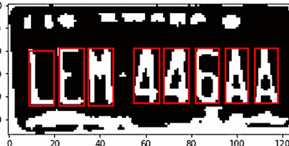

图 15.7 字符分割。

- iii. 否则，将相邻像素标签中最小的标签值分配给当前像素。
- iv. 保存相邻标签之间的等价关系。

在第二次遍历中：

- 1. 从上到下每行遍历图像中的每个像素。
- 2. 如果该元素是前景：
    i. 使用最小的等价标签重新标记像素。

正如 CCA（连通分析）一样，我们将白色像素视为前景，黑色像素视为背景，反转分割后号牌的二值图像，然后对其应用 CCA。一旦找到所有连接区域，就使用定位技术来标记图像中的连接部分，即字符。结果如图 15.7 所示。

## 15.4.9 字符识别

在字符分割之后，下一步是正确识别字符。在此之前，从上阶段分割出的每个字符都会被调整为 20px × 20px。这是字符识别的预处理步骤。

执行字符识别有多种方法，例如模板匹配、基于边缘距离的特征提取、机器学习等。我们的方法基于机器学习的；可以通过改进训练过程来提高系统准确性。通过机器学习，将提取的字符图像映射到其实际字符。

机器学习是人工智能的一个子集，涉及教系统接受数据、从数据中自学习、通过经验改进并利用这种学习产生更有用结果的过程。它可以简单地定义为处理数据、处理过程、发现模式并将其用于预测的人工智能分支。机器学习被分为监督学习、无监督学习和强化学习。在监督学习中，机器根据对提供的输入输出对的学习将输入映射到输出。在这里使用了监督学习，因为我们了解不同字符的样子，并且可以将字符图像及其标签的不同输入输出对作为训练数据。

## 使用视频分析进行语义数据提取


**图 15.8** 训练数据的预处理。

再次，监督学习分为分类和回归。字符识别属于分类类别。因此，使用了机器学习分类器。要使用机器学习进行字符识别，请遵循以下步骤：

- 1. 收集训练数据集。
- 2. 选择一个机器学习分类器。
- 3. 创建训练和测试模型。
- 4. 使用模型进行预测。

## 15.4.10 收集训练数据集

- 1. 收集每个字符（A–Z 和 0–9）的训练图像。
- 2. 使用 20 × 20 灰度数据和相应的标签作为训练集。
- 3. 进行扁平化、阈值化等预处理，以为下一步准备好数据。训练数据的处理如图 15.8 所示。

## 15.4.11 机器学习分类器

这里使用的 ML 分类器是支持向量分类器。它接收混合数据作为输入并输出数据所属的类别。支持向量机算法 [19] 的目标是在 N 空间（N = 特征数量）中找到一个超平面，以便如图 15.9 所示清晰地对数据点进行分类。为了分离两类数据点，可以选择许多可能的超平面。我们的目标是找到一个具有最大间隔的平面，即两类数据点之间的最大距离。最大化间隔提供了某种强化，以便未来的数据可以更有信心地进行分类。

支持向量分类器如图 15.9 所示。

超平面是帮助分类数据分类的决策边界。位于超平面任侧的数据点可以归为不同的类。此外，超平面的维度取决于特征的数量。如果输入特征的数量为 2，那么超平面就是直线。支持向量是距离超平面的数据点，它们决定了超平面的位置和方向。使用这些支持向量，我们最大化分类器的间隔。

## 250 业务管理中的人工智能与机器学习

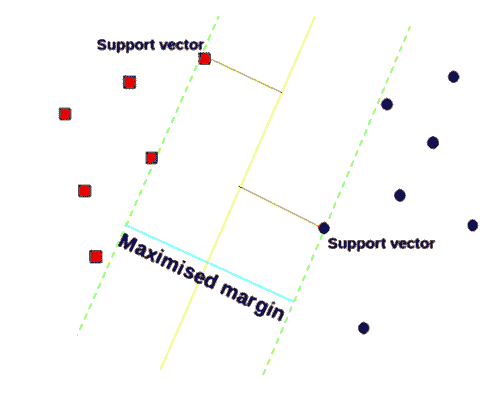

图 15.9 支持向量分类器。

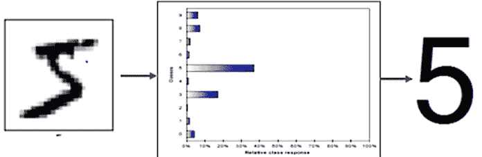

图 15.10 字符分类。

为了评估 ML 模型，使用了 4 折交叉验证。交叉验证是一种评估 ML 模型的方法，通过在可访问输入数据的子集上训练多个 ML 模型，并在数据的互补子集上对其进行评估。使用交叉验证来检测过拟合（即无法泛化模式）。在 k 折交叉验证中，你将输入数据分成 k 个子集（也称为折）。你在除一个以外的全部 (k-1) 个子集上训练 ML 模型，并在未用于训练的子集上评估模型。此过程重复 k 次，每次预留一个不同的子集用于评估（并排除在训练之外）。

## 使用视频分析进行语义数据提取

## 251

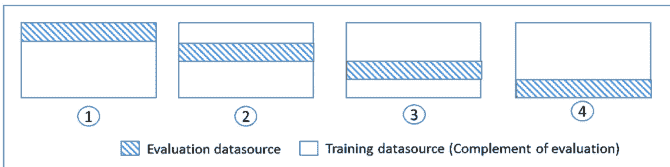

**图 15.11** 4 折交叉验证。

剩余的 75% 用于训练。模型二使用第二个 25% 子集（25% 到 50%）进行评估，并将剩余的数据子集用于训练。

# 业务管理中的人工智能与机器学习

## 15.6 应用

视频分析领域的一些应用已广为人知。一个例子是视频监控，这是一项已经存在了 50 年的任务。事实上，它的概念非常简单：通过策略性地安装摄像头，允许人类操作人员管理房间或公共空间内发生的情况。

在实践中，这项任务远非简单。一个操作员通常要负责监控多个摄像头，而且正如多项研究所示，增加监控的摄像头数量会对操作员的性能产生不利影响。换句话说，无论现场是否有可用的大量硬件在产生信号，在需要处理这些信号时，由于人类的局限性，会形成瓶颈。

## 15.7 医疗保健

从历史上看，医疗机构在视频监控解决方案上投入了巨额资金，以确保患者、员工和访客的安全，这些水平通常受到严格法律的监管。事实上，儿童绑架和误导是监控系统解决的最常见问题之一。

除了辅助监控任务外，视频分析还允许我们更进一步，利用收集到的数据来实现业务目标。例如，视频分析解决方案可以检测患者是否根据需要接受了检查并发出警报。分析患者和访客的流量对于确定缩短等待时间同时确保区域畅通具有极高的价值。

对老年人或健康问题人士进行家庭监控是另一个具有极价值的应用示例。例如，跌倒是老年人受伤和死亡的重要原因。虽然个人医疗设备可以检测，但它们需要佩戴，且经常被使用者忽视。视频分析解决方案可以分析家用摄像头的信号，实时识别人员是否跌倒。在设置恰当的情况下，此类系统还可以判断个人是否在指定后服用了特定的药物。

心理健康是视频分析可以做出重大贡献的另一个领域。分析面部表情、身体姿态和视线的系统旨在帮助临床医生评估患者。此类系统能够从视觉交流和微表情中检测情绪，为临床医生提供客观信息，这些信息可以证实他们的假设或为他们新的线索。

### 15.7.1 智慧城市/交通

视频分析已被证明是交通领域极大的帮助，有助于智慧城市的建设。交通流量的增加（特别是在城市地区）如果不采取适当的交通管理措施可能会导致事故和拥堵的增加。智能视频分析解决方案在这种情况下可以发挥至关重要的作用。

## 使用视频分析进行语义数据提取

交通分析师通常希望动态调整交通灯控制系统并观察交通拥堵。它在实时检测危险情况时可能很有用，例如车辆在高速公路的非授权区域停止、有人逆行、车辆行驶异常或发生事故的车辆。在发生事故的情况下，这些系统对于在诉讼中收集证据非常有帮助。

车辆计数（或区分汽车、卡车、公交、出租车等）可以产生高价值的统计数据，以获得有关交通的洞察。安装测速摄像头允许对司机进行整体控制。自动车牌识别可以识别违规车辆，或者通过实时搜索发现被盗车辆或用于犯罪的车辆。

智能的停车系统不再在停车区域使用传感器，而是在视频分析的支持下，通过分析摄像头的图像为驾驶员寻找空位。这些都是视频分析技术为创建更安全、更宜居城市所做的贡献示例。

### 15.7.2 安全

视频监控是安全领域的一项老任务。然而，从系统完全由人类监控到目前有视频分析支持，时代已经发生了巨大的变化。设施识别和车牌识别（LPR）可用于实时识别人员和车辆并做出相应决策。例如，可以实时在存储的视频录像中搜索嫌疑人，或识别未经授权的人员并允许进入安全设施。人群管理是安全系统的另一个关键功能。尖端分析工具在购物中心、医院、体育馆和机场等场所可以产生巨大影响。这些工具可以提供实时近似计数，并在达到或超过阈值时触发警报。它们还可以分析流量以检测向禁止或非预期方向的移动。这是这些方法的优点之一：视频内容分析系统通常被训练用于检测特定事件，有时具有很高的精密度。一个例子是尽快检测火灾。或者，在机场情况下，当有人逆着乘客预期方向行走或进入禁止区域时发出警报。另一个很棒案例是实时检测公共场所的无人行李。与入侵者检测等传统任务一样，这些任务执行得非常稳健，因为算法会过滤由风、雨、雪或动物引起的运动。智能视频分析提供的功能在安全领域日益增长，并且这是一个在未来将持续的趋势。

## 15.8 结论

视频分析解决方案对我们的日常任务很有帮助。许多领域都可以从这项技术中受益，特别是由于潜在应用的复杂性近年来蓬勃发展。从智慧城市到医院和机场的安全控制，再到零售和购物中心的人员追踪，视频分析领域使得流程对人类来说同步更加有效且不那么枯燥，对公司来说成本降低。

除了上述应用外，它可以根据场景用于不同领域的若干应用，以减少损失并转化为巨利。视频分析技术的贡献有助于建立更安全、更宜居的城市。智能视频分析提供的功能在安全领域日益增长，并且这是一个在未来将持续的趋势。

## 参考文献
（参考文献部分通常不翻译，保留原文格式）

- 14. Chaabene, S. Ben, Mounir Sayadi, Farhat Fnaieh, and Eric Brassart. "用于图像分割的 Dempster-Shafer 证据理论：在细胞图像中的应用." International Journal of Signal Processing 5(1), 2009.
- 15. [特征映射](https://www.geeksforgeeks.org/feature-mapping/)
- 16. Bulugu, Isack. "用于坦桑尼亚车辆车牌定位与识别的算法." (2013).
- 17. Tang, Sheng, Yu Li, Lixi Deng, and Yongdong Zhang. "基于提议融合的目标定位." IEEE Transactions on Multimedia 19(9), (2017): 2105-2116.
- 18. Pan, Mei-Sen, Jun-Biao Yan, and Zheng-Hong Xiao. "车辆车牌字符分割." International Journal of Automation and Computing 5(4), 2008: pp. 425-432.
- 19. Gandhi, Rohith. "支持向量机——机器学习算法入门." Towards Data Science (2018).
- 20. Tiwari, Bhawna, Archana Sharma, Mali Gautam Singh, and Bhawana Rathi. "基于 Matlab 的自动车牌识别系统." IOSR Journal of Electronics and Communication Engineering (IOSR-JECE) e-ISSN (2016): 2278-2834.
- 21. Kaur, H., and S. Manviad Balwider. "利用边缘检测和形态学算子从视频检测车牌." Singh International Journal of Engineering Research & Technology ISSN (2012): 2278-0181.


# 索引

A
- 已获取的, 6
- 可操作的, 22
- 仿射, 31
- 负担能力, 98
- 上述, 30
- 机构, 39, 223, 233
- 亚马逊海运, 6
- 分析, 21
- 预期的, 3, 187
- 成就, 148
- 增强, 242
- 自回归, 199, 207

E
- 专款的, 105
- 经验的, 198, 202, 206
- 赋能, 17
- 集成模型, 201
- 集成模型: 97–198, 201, 206
- 热情的, 180
- 展示的, 1
- 劝告, 19
- 极其活跃, 23

B
- 贝叶斯监管, 197, 201
- 双边的, 32
- 双边滤波, 242
- 生物计算, 134
- 块链技术, 76, 232

F
- 可行的, 32, 148
- 预测, 23, 58, 116, 195, 200, 227
- 帧集, 239, 241
- 欺诈的, 17, 63, 72, 79, 83, 91

C
- Cadabra, 6
- 加拿大元, 211, 215–216, 218
- 同类产品竞争, 23
- 气候传感器, 98, 104
- 认知的, 39, 49, 60, 64, 138
- 协作, 38
- 技能, 22
- 竞争力, 38
- 计算的, 36
- 集团团, 24
- 共轭的, 26
- 共轭梯度, 206
- 构成, 34, 97
- 控制论, 50, 221, 254
- 网络安全, 53, 57, 63, 76, 82

G
- 高斯滤波, 242
- 遗传优化, 206
- 地理的, 2
- 德国数据集, 84–85, 87
- 全球经济, 141
- 高盛s银行, 63, 226
- Google 助理, 1, 12, 136
- Google DeepMind, 138
- Google 语音, 139
- 梯度, 83, 188, 206, 208

H
- 人类智能, 1, 132, 151, 173
- 超参数, 178–198, 191

I
- 构思, 11
- 英特尔芯片, 134
- 介入预, 33

D
- 数据隐私, 18
- 揭穿, 230
- 民主, 224
- 皮肤科医生, 136
- 尿布, 19, 16
- 数字化的, 24
- 疾病, 109, 111, 117
- 分布式计算, 41, 76

K
- 考拉, 2

L
- 发布, 25
- 莱伯格, 200
- 物流, 10

M
- 磁阻电阻的, 134
- 乳腺摄影, 104
- 马尔可夫链, 148
- 马夸特学习, 200
- 货物, 20
- 误解, 4
- 洗钱, 53, 58

S
- 信誉, 40–41
- 零售分析, 16–17
- 安全, 63, 233
- 自组织映射, 82
- 敏感性, 10, 47
- 智慧城市, 140, 252
- 社会保险, 100
- 策略, 10, 17, 104
- 流程优化, 5, 59, 102
- 监督学习, 2, 45, 248
- 供应链, 18, 24, 198
- 支持向量机, 196, 207

N
- 谈判, 30–32
- 神经网络, 46, 196, 206

O
- 光学字符识别, 72, 239, 244
- 优化技术, 149

T
- 转换, 17, 130, 242
- 信任, 40–41

P
- 范式转移, 139–140
- 性能, 40, 78, 148, 211
- 预测, 19, 45, 64, 110
- 隐私, 18, 228, 232
- 投影方法, 246

U
- 无监督学习, 2, 45, 152

V
- 垂直投影, 245–246
- 视频分析, 238, 252
- 语音识别, 12, 17, 65

R
- 径向基函数, 46, 196, 207
- 强化学习, 2, 152

W
- 可穿戴设备, 120, 136, 140
