# 药物设计与开发的人工智能与机器学习（可持续数字社会的金融科技）


**Abhirup Khanna**
印度德拉登石油与能源大学计算机科学学院

**May El Barachi**
阿拉伯联合酋长国迪拜知识园迪拜伍伦贡大学工程与信息科学学院

**Sapna Jain**
印度德拉登石油与能源大学应用科学与人文学院（化学）

**Manoj Kumar**
阿拉伯联合酋长国迪拜知识园迪拜伍伦贡大学工程与信息科学学院

和

**Anand Nayyar**
越南岘山杜旦大学计算机科学学院


## 国会图书馆图书在版编目数据


# 5 利用人工智能理解抗菌耐药性机制与抗菌发现：转化研究的新时代模型

**Yashaswi Dutta Gupta 和 Suman Bhandary**

- 5.1 引言 117
- 5.2 AMR 常用人工智能算法 120
- 5.3 用于理解 AMR 机制和抗菌发现的人工智能 122
  - 5.3.1 理解 AMR 机制 122
  - 5.3.2 用于抗菌发现的人工智能 123
    - 5.3.2.1 潜在靶点的靶向与验证 123
    - 5.3.2.2 药物重新定位 125
    - 5.3.2.3 新型抗菌肽（AMP）发现 125
    - 5.3.2.4 优化药物剂型 126
- 5.4 克服抗生素耐药性的策略 127
  - 5.4.1 发现新型抗生素化合物 127
  - 5.4.2 抗生素重新定位与优化 128
  - 5.4.3 联合疗法优化 128
  - 5.4.4 加强抗生素管理计划 129
- 5.5 抗菌耐药性的人工智能应用 131
  - 5.5.1 人工智能在抗击真菌耐药性中的应用 131
  - 5.5.2 人工智能在抗击病毒耐药性中的应用 133
  - 5.5.3 人工智能在抗击寄生虫耐药性中的应用 135
  - 5.5.4 人工智能在 AMR 监测中的应用 136
  - 5.5.5 快速诊断 137
  - 5.5.6 通过人工智能对抗生物膜 137
- 5.6 向实际实施迈进的挑战 140
  - 5.6.1 微生物视角的挑战 141
  - 5.6.2 人工智能视角的挑战 141
  - 5.6.3 监管机构批准 142
- 5.7 结论与未来展望 143
- 参考文献 145

# 6 人工智能驱动的分子对接：合理药物设计的有前途工具

**Nabajit Kumar Borah, Yukti Tripathi, Aastha Tanwar, Deeksha Tiwari, Aditi Sinha, Shailja Sharma, Neetu Jabalia, Ruchi Jakhmola Mani, Seneha Santoshi 和 Hina Bansal**

- 6.1 引言 157
- 6.2 分子对接基础 159
  - 6.2.1 分子对接的基本流程 160
  - 6.2.2 分子对接的基本组件 161
  - 6.2.3 分子对接类型 163
    - 6.2.3.1 刚性对接 164
    - 6.2.3.2 灵活对接 164
    - 6.2.3.3 半灵活对接 165
  - 6.2.4 分子对接常用工具和软件 165
- 6.3 人工智能在分子对接中的作用 167
  - 6.3.1 基于机器学习的评分函数 167
  - 6.3.2 蛋白质-配体相互作用构象预测 168
  - 6.3.3 高通量虚拟筛选 169
- 6.4 新时代的药物发现 169
- 6.5 使用机器学习（ML）算法进行药物发现 170
  - 6.5.1 随机森林（RF） 171
  - 6.5.2 朴素贝叶斯（NB） 171
  - 6.5.3 支持向量机（SVM） 172
- 6.6 使用深度学习（DL）算法进行药物发现 172
  - 6.6.1 多层感知机（MLPs） 173
  - 6.6.2 循环神经网络（RNN） 174
  - 6.6.3 卷积神经网络（CNN） 174
  - 6.6.4 生成对抗网络（GANs） 175
- 6.7 用于药物发现的人工智能工具包 176
- 6.8 人工智能在分子对接中的应用 177
  - 6.8.1 药物-靶点相互作用预测 177
  - 6.8.2 药物重新定位 177
- 6.9 基于人工智能的分子对接的挑战与局限性 178
- 6.10 结论与未来展望 180
- 未来方向 181
- 参考文献 182

# 7 革新药物发现：人工智能与机器学习在加速药物研发中的作用 189

Anu Sayal, Janhvi Jha, Chaitra N., Atharv Rajesh Gangodkar 和 Shaziya Banu S.

- 7.1 引言 189
- 7.2 药物发现中的机器学习技术 191
  - 7.2.1 制药行业中的深度学习 191
  - 7.2.2 药物开发的自然语言处理（NLP）方法 192
  - 7.2.3 使用机器人进行处方自动管理与配发 195
  - 7.2.4 药物发现中的特征选择与遗传算法 196
  - 7.2.5 药物发现的聚类算法 197
- 7.3 药物预测与分析的人工智能技术 198
  - 7.3.1 随机森林（RF） 198
  - 7.3.2 支持向量机（SVM） 199
  - 7.3.3 贝叶斯网络 200
  - 7.3.4 ANN 和 CNN 201
  - 7.3.5 个体化治疗方案的制定 204
- 7.4 用于革新药物开发的人工智能 205
  - 7.4.1 个性化医疗、药物重新定位与药物安全性评价 205
    - 7.4.1.1 预测分析与精准医疗 206
    - 7.4.1.2 虚拟筛选 208
    - 7.4.1.3 从头设计 209
- 7.5 挑战与解决方案 212
- 7.6 结论与未来展望 214
- 未来展望 214
- 参考文献 215

# 8 针对人工智能驱动预测模型或中枢神经系统药物发现的数据处理方法 223

Ajantha Devi Vairamani, Sudipta Adhikary 和 Kaushik Banerjee

- 8.1 引言 223
  - 8.1.1 背景信息 224
- 8.2 人工智能和机器学习在药物发现中的作用 225
  - 8.2.1 机器学习和人工智能算法阐释 226
  - 8.2.2 用于数据预处理的分子指纹和标识符 227
  - 8.2.3 使用机器学习和人工智能进行靶点识别 228
  - 8.2.4 药物靶点发现早期阶段的人工智能应用 229
    - 8.2.4.1 靶点发现 229
    - 8.2.4.2 靶点解卷积 230
  - 8.2.5 药物筛选中的人工智能和机器学习 230
    - 8.2.5.1 数字配体筛选 231
  - 8.2.6 QSAR 预测 231
    - 8.2.6.1 用于理化性质和 ADME/T 预测的人工智能与机器学习 理化性质预测 231
  - 8.2.7 ADME-T 预测 232
  - 8.2.8 药物发现中的人工神经网络和机器学习使用 232
  - 8.2.9 使用人工智能和机器学习预测药物相互作用 233
  - 8.2.10 人工智能和机器学习在现有药物重新定位中的作用 233
- 8.3 人工智能和机器学习在中枢神经系统（CNS）中的作用 233
  - 8.3.1 关于 BBB 通透性的假设 234
  - 8.3.2 在神经系统疾病药物发现中使用人工智能和机器学习的好处 234
    - 8.3.2.1 使用 AI/ML 进行神经系统疾病药物发现 234
    - 8.3.2.2 机器学习和人工智能在抗抑郁药研发中的应用 235
    - 8.3.2.3 人工智能和机器学习在帕金森病药物发现中的应用 235
    - 8.3.2.4 人工智能和机器学习在阿尔茨海默病药物发现中的应用 235
    - 8.3.2.5 人工智能和机器学习在止痛药和麻醉剂中的医疗应用 236
- 8.4 AI/ML 对中枢神经系统药物研究的影响 236
- 8.5 未来中枢神经系统药物研究中 AI/ML 的前景 237
- 8.6 针对中枢神经系统药物样性预测的数据处理拟议方法 239
- 8.7 结论与未来展望 241
- 参考文献 243

# 9 用于药物重新定位的机器学习应用 251

*Bancha Yingngam*

- 缩写列表 251
- 9.1 引言 252
- 9.2 药物重新定位中机器学习应用的趋势 253
  - 9.2.1 药物重新定位中机器学习应用的全球研究 253
  - 9.2.2 药物重新定位中机器学习应用的聚类分析 256
  - 9.2.3 药物重新定位中机器学习应用的研究趋势 256
- 9.3 理解药物重新定位 258
- 9.4 药物重新定位的传统技术 259
  - 9.4.1 偶然发现 259
  - 9.4.2 *体外* 筛选 262
  - 9.4.3 表型筛选 263
  - 9.4.4 副作用分析 264
  - 9.4.5 生化检测 264
  - 9.4.6 非标签用药 265
- 9.5 药物重新定位的现代技术 265
  - 9.5.1 机器学习 266
  - 9.5.2 药物重新定位中的机器学习方法 266
    - 9.5.2.1 监督学习 268
    - 9.5.2.2 无监督学习 269
    - 9.5.2.3 半监督学习 269
    - 9.5.2.4 强化学习 270
  - 9.5.3 深度学习 271
  - 9.5.4 药物重新定位中机器学习的软件工具 273
- 9.6 药物重新定位的数据源 275
  - 9.6.1 生物医学数据库 275
    - 9.6.1.1 基因组数据库 276
    - 9.6.1.2 蛋白质组数据库 276
    - 9.6.1.3 化学信息学数据库 277
  - 9.6.2 临床数据源 277
    - 9.6.2.1 电子健康记录（EHR） 277
    - 9.6.2.2 临床试验数据库 278
    - 9.6.2.3 不良事件数据库 278


## 9.7 案例研究：机器学习在药物重新定位中的应用 279

### 9.7.1 癌症治疗 279

### 9.7.2 抗病毒治疗 280

### 9.7.3 抗糖尿病治疗 281

### 9.7.4 神经退行性疾病治疗 282

### 9.7.5 脱发治疗 284

## 9.8 机器学习在药物重新定位中的未来 285

### 9.8.1 先进机器学习技术 286

### 9.8.2 学科交叉方法 287

### 9.8.3 改进数据质量和可用性 287

### 9.8.4 与临床试验和医疗保健系统的整合 287

## 9.9 结论与未来展望 288

### 参考文献 288

# 10 个性化药物治疗：利用 AI 变革医疗保健 295

_阿比鲁普·坎纳和萨普娜·贾因_

## 10.1 引言 295

## 10.2 化学信息学 297

### 10.2.1 化学数据与数据库 297

### 10.2.2 化学结构表示 298

### 10.2.3 化学性质预测 298

### 10.2.4 化学反应预测 298

### 10.2.5 药物发现与设计 299

### 10.2.6 材料科学 299

## 10.3 数据来源 299

## 10.4 精准医学与个性化药物治疗 301

### 10.4.1 调查结果 302

### 10.4.2 个性化药物治疗的重要性 303

## 10.5 医疗保健的人工智能模型 305

### 10.5.1 基于 AI 的癌症个性化药物治疗 306

### 10.5.2 基于 AI 的心血管疾病个性化药物治疗 307

### 10.5.3 基于 AI 的心理健康个性化药物治疗 308

## 10.6 AI 赋能的个性化药物治疗中的伦理考量 309

## 10.7 AI 赋能的个性化药物治疗的优势与局限 310

### 10.7.1 优势 310

### 10.7.2 局限 311

## 10.8 案例研究 312

### 10.8.1 CancerLinQ 项目 312

### 10.8.2 Atomwise 项目 313

### 10.8.3 BenevolentAI 项目 314

### 10.8.4 Deep Genomics 项目 315

## 10.9 结论、挑战与机遇 316

### 参考文献 318

# 11 基于结构的药物设计的流程与应用 321

尚穆加·桑达里·M., 斯里·艾斯瓦里亚·托塔库拉, 莫尼卡·达尔马纳, 普里扬卡·加德拉和玛尤卡·曼迪亚·阿曼加塔姆布

## 11.1 引言 321

### 11.1.1 药物发现过程概述 323

### 11.1.2 基于结构的药物设计的重要性 324

### 11.1.3 历史背景与里程碑 324

## 11.2 基于结构的药物设计：步骤 327

### 11.2.1 靶点鉴定与验证 327

### 11.2.2 靶标蛋白的结构测定 328

### 11.2.3 化合物的虚拟筛选 329

### 11.2.4 命中化合物筛选与优化 330

### 11.2.5 先导化合物优化与开发 331

## 11.3 基于结构的药物设计中使用的工具与技术 331

### 11.3.1 X 射线晶体学 332

### 11.3.2 核磁共振波谱法 334

### 11.3.3 同源建模 337

### 11.3.4 分子对接 339

### 11.3.5 分子动力学模拟 340

## 11.4 应用 341

### 11.4.1 激酶抑制剂 341

### 11.4.2 酶抑制剂 343

### 11.4.3 G 蛋白偶联受体 (GPCR) 配体 343

### 11.4.4 抗体与疫苗 344

## 11.5 其他示例 345

### 11.5.1 抗癌药物 345

### 11.5.2 抗病毒药物 345

### 11.5.3 神经系统疾病 346

### 11.5.4 心血管疾病 347

## 11.6 基于结构的药物设计的优势与局限 348

### 11.6.1 合理药物设计的优势 348

### 11.6.2 局限性与挑战 350

### 11.6.3 与其他药物发现方法的比较 352

## 11.7 案例研究与示例 354

### 11.7.1 HIV 蛋白酶抑制剂的发现 354

### 11.7.2 HER2 激酶抑制剂的开发 355

### 11.7.3 流感神经氨酸酶抑制剂的设计 356

### 11.7.4 其他成功基于结构的药物设计示例 358

## 11.8 未来展望与影响 360

### 11.8.1 新兴趋势与技术 360

### 11.8.2 与其他药物发现方法的整合 362

## 11.9 对医疗保健和药物开发的潜在影响 363

### 11.9.1 研究方向 365

## 11.10 结论与未来展望 366

### 参考文献 366

# 12 基于 AI 的个性化药物治疗 369

尚穆加·桑达里·M., 哈希尼·雷迪·彭塔拉, 阿克希塔·莫古拉帕利和玛尤卡·曼迪亚·阿曼加塔姆布

## 12.1 引言 369

### 12.1.1 个体化医学背景 370

### 12.1.2 药物治疗中 AI 概述 371

### 12.1.3 个性化药物治疗的重要性 372

## 12.2 AI 如何改善药物治疗 373

### 12.2.1 预测药物疗效 374

### 12.2.2 识别患者亚组 375

### 12.2.3 定制剂量 377

### 12.2.4 尽量减少不良反应 377

### 12.2.5 简化药物开发 378

## 12.3 基于 AI 的药物治疗中使用的技术 379

### 12.3.1 基于 AI 的药物治疗中的机器学习 379

### 12.3.2 基于 AI 的药物治疗中的自然语言处理 (NLP) 382

### 12.3.3 基于 AI 的药物治疗中的深度学习 382

### 12.3.4 基于 AI 的药物开发中使用的其他 AI 技术 383

#### 12.3.4.1 强化学习 384

#### 12.3.4.2 贝叶斯网络 385

#### 12.3.4.3 遗传算法 386

#### 12.3.4.4 专家系统 387

## 12.4 案例研究与示例 388

### 12.4.1 Genomic Health 的 Oncotype DX 388

### 12.4.2 IBM Watson for Drug Discovery 389

### 12.4.3 BenevolentAI 药物发现平台 390

### 12.4.4 其他基于 AI 的药物治疗示例 391

## 12.5 基于 AI 的药物治疗的挑战与局限 393

### 12.5.1 数据质量与可用性 394

### 12.5.2 伦理考量 395

### 12.5.3 监管障碍 396

### 12.5.4 与现有医疗保健系统的整合 397

## 12.6 未来展望与影响 398

### 12.6.1 对医疗保健的潜在影响 399

### 12.6.2 研发机会 400

### 12.6.3 对患者和提供者的影响 401

## 12.7 结论与未来工作 402

### 12.7.1 要点总结 403

### 12.7.2 对药物治疗未来的影响 403

### 12.7.3 进一步的研发工作 404

### 参考文献 404

# 13 生物制药属性预测的 AI 模型 407

班查·英甘姆

### 缩略词列表 407

## 13.1 引言 408

## 13.2 生物制药属性预测的 AI 模型 411

### 13.2.1 生物制药属性预测的 ML 模型类型 413

#### 13.2.1.1 监督学习模型 414

#### 13.2.1.2 无监督学习模型 421

### 13.2.2 AI 模型的数据来源 423

### 13.2.3 开发 AI 模型常用软件 423

#### 13.2.3.1 SAS 424

#### 13.2.3.2 MATLAB 424

#### 13.2.3.3 IBM Watson 425

#### 13.2.3.4 Accelrys 425

### 13.2.4 用于预测特定生物制药属性的 AI 模型应用 425

#### 13.2.4.1 药物溶解度预测 425

#### 13.2.4.2 蛋白-配体结合亲和力预测 426

#### 13.2.4.3 稳定性预测 426

#### 13.2.4.4 聚集预测 427

#### 13.2.4.5 免疫原性预测 427

## 13.3 生物制药属性预测 AI 模型的最新进展 428

### 13.3.1 深度学习与集成模型 428

### 13.3.2 不同 AI 模型的比较 429

#### 13.3.2.1 Schrödinger’s Maestro Suite 429

#### 13.3.2.2 BIOVIA’s Discovery Studio 431

#### 13.3.2.3 Genedata’s Screener 431

### 13.3.3 AI 模型的成功应用 431

#### 13.3.3.1 G 蛋白偶联受体建模 431

#### 13.3.3.2 蛋白-配体结合 433

#### 13.3.3.3 药代动力学建模 433

#### 13.3.3.4 毒性预测 434

#### 13.3.3.5 药物相互作用预测 434

## 13.4 案例研究：COVID-19 疫苗 434

### 13.4.1 识别疫苗靶点 435

### 13.4.2 设计疫苗候选物 435

### 13.4.3 预测疫苗效力 436

### 13.4.4 优化疫苗配方 436

### 13.4.5 加速临床试验 436

## 13.5 生物制药中 AI 应用的当前研究 437

## 13.6 未来方向与挑战 439

### 13.6.1 AI 模型的潜在影响 439

### 13.6.2 AI 模型的潜在挑战与局限 439

#### 13.6.2.1 数据质量与偏差 439

#### 13.6.2.2 可解释性 440

#### 13.6.2.3 过拟合与欠拟合 440

#### 13.6.2.4 泛化能力 440

#### 13.6.2.5 伦理考量 441

### 13.6.3 该领域未来研发方向 441

#### 13.6.3.1 多任务学习 441


#### 13.6.3.2 融入生物数据 442
#### 13.6.3.3 提高可解释性 442
#### 13.6.3.4 迁移学习 443
#### 13.6.3.5 解决伦理问题 443
## 13.7 结论与未来展望 445
- 参考文献 446

# 14 阿尔茨海默病神经影像组学研究中的深度学习策略

米图恩·辛格·拉杰普特、吉格纳·沙阿、维拉尔·帕特尔、尼廷·辛格·拉杰普特和迪利普·库马尔

## 14.1 引言 452
## 14.2 阿尔茨海默病的病理生理学 454
## 14.3 AD预测、分类和诊断中的深度学习策略 456
## 14.4 基于深度学习的遗传变异鉴定 457
### 14.4.1 基于深度学习的基因组数据分割 457
### 14.4.2 使用深度学习的表型分类 458
## 14.5 基于深度学习的AD改变基因和mRNA水平预测 460
## 14.6 阿尔茨海默病中结合神经影像与基因组学的深度学习 462
## 14.7 阿尔茨海默病基于深度学习的神经影像组学研究中的局限性与挑战 462
## 14.8 阿尔茨海默病治疗环境中应用深度学习技术的未来前景 464
## 14.9 结论与未来展望 465
- 参考文献 465

# 15 计算机辅助药物设计（CADD）过程中化合物分类与筛选的人工智能技术

拉古纳特·萨特帕蒂

## 15.1 引言 473
## 15.2 药物设计过程概述 474
### 15.2.1 靶点鉴定 475
### 15.2.2 靶点表征 476
### 15.2.3 活性化合物鉴定 476
### 15.2.4 命中到先导化合物阶段和先导化合物优化 476
### 15.2.5 临床前及临床开发 477
## 15.3 CADD中的计算工具与技术 477
### 15.3.1 同源建模 477
### 15.3.2 分子对接 479
### 15.3.3 分子动力学模拟 479
### 15.3.4 QSAR建模 480
## 15.4 人工智能（AI）和机器学习（ML）方法的概念 483
### 15.4.1 在化合物筛选过程中实施人工智能技术的基本步骤 484
#### 15.4.1.1 从公共数据资源中搜索分子信息 484
#### 15.4.1.2 小分子表示格式 486
## 15.5 分子筛选过程中主要的机器学习（ML）技术与应用 488
### 15.5.1 朴素贝叶斯 488
### 15.5.2 支持向量机（SVM） 488
### 15.5.3 随机森林（RF） 489
### 15.5.4 人工神经网络（ANN） 489
## 15.6 挑战与机遇 490
## 15.7 结论与未来展望 491
- 参考文献 492

# 16 赋能临床决策：用于肝移植预测的AI驱动评分方法的深入系统综述 499

德维·拉杰伊、雷米娅·S.和阿南德·纳亚尔

## 16.1 引言 499
### 16.1.1 肝移植概述与意义 501
### 16.1.2 肝移植中高效临床决策的意义 501
### 16.1.3 基于AI的评分方法在提升肝移植决策效率中的作用 503
## 16.2 综述方法学 504
### 16.2.1 纳入标准 504
### 16.2.2 为肝移植决策中AI驱动评分方法的全面系统综述选择研究文献 505
## 16.3 肝移植预后预测中AI驱动评分方法的全面文献综述：用于肝移植预测的AI驱动方法 506
#### 16.3.1.1 肝移植预测中AI驱动方法的工作流程：增强临床决策 507
#### 16.3.1.2 决策树 508
#### 16.3.1.3 随机森林 508
#### 16.3.1.4 支持向量机（SVM） 509
#### 16.3.1.5 神经网络 509
#### 16.3.1.6 深度学习 509
#### 16.3.1.7 AI在提升肝移植决策中的潜力 512
### 16.3.2 将临床工具与AI算法相结合以增强肝移植预测：评论与观察 512
#### 16.3.2.1 带AI算法的MELD评分 512
#### 16.3.2.2 带AI算法的CHILD评分 514
#### 16.3.2.3 带AI算法的供体风险指数（DRI）评分 515
#### 16.3.2.4 带AI算法的供体-受体匹配（DRM）评分 516
#### 16.3.2.5 带AI算法的MILAN评分 516
#### 16.3.2.6 带AI算法的UCSF评分 517
#### 16.3.2.7 带AI算法的Up to Seven评分 518
### 16.3.3 评估基于AI的评分技术在提升肝移植临床决策中的功效 518
### 16.3.4 肝移植决策中AI与临床评分方法相结合的前景 521
## 16.4 讨论与见解 521
### 16.4.1 临床评分方法中的参数 522
### 16.4.2 使用多种AI算法评估临床评分准确性 522
### 16.4.3 基于AI的评分方法的优势与局限性 524
### 16.4.4 研究结果对改善肝移植临床决策的启示 525
## 16.5 结论与未来展望 526
- 参考文献 526

# 17 推动边界：AI驱动药物发现与开发的图景及监管方面洞察 533

**迪帕克·D·加代、迪潘克·A·库尔卡尼、拉维·拉杰、斯瓦普尼尔·G·帕蒂尔和阿努杰·莫迪**

## 17.1 引言 533
### 17.1.1 用于DDS和DVPT的AI 535
## 17.2 AI的分类 536
### 17.2.1 弱人工智能 536
### 17.2.2 通用人工智能 536
### 17.2.3 超级人工智能 536
## 17.3 DDS中使用的AI技术概览 537
### 17.3.1 机器学习（ML） 537
### 17.3.2 深度学习（DL） 538
### 17.3.3 自然语言处理（NLP） 539
### 17.3.4 机器人技术 539
### 17.3.5 模糊逻辑 539
### 17.3.6 群体智能 539
### 17.3.7 反应式机器 540
## 17.4 DDS和药物DVPT中的AI应用 540
### 17.4.1 临床前研究与安全性测试 540
### 17.4.2 靶点鉴定与验证 541
### 17.4.3 活性化合物鉴定与先导化合物优化 541
### 17.4.4 药物疗效与毒性预测 542
### 17.4.5 临床试验设计 542
## 17.5 关于在DDS和DVPT中使用AI的伦理考量 542
### 17.5.1 数据隐私 543
#### 17.5.1.1 知情同意 543
#### 17.5.1.2 匿名化 543
#### 17.5.1.3 数据安全 543
#### 17.5.1.4 数据治理 543
### 17.5.2 偏见 544
#### 17.5.2.1 靶点鉴定 544
#### 17.5.2.2 化合物筛选 544
#### 17.5.2.3 临床试验 544
### 17.5.3 透明度 545
#### 17.5.3.1 不透明AI系统的伦理影响 545
#### 17.5.3.2 基于AI的DDS和DVPT中透明度的重要性 545
### 17.5.4 问责制 546
#### 17.5.4.1 问责制的重要性 546
#### 17.5.4.2 维护问责制面临的挑战 546
### 17.5.5 安全性-有效性 546
#### 17.5.5.1 基于AI的DDS和DVPT中的安全性-有效性平衡 547
#### 17.5.5.2 与AI生成药物中安全性-有效性平衡相关的伦理考量 547
## 17.6 知识产权问题 547
### 17.6.1 AI生成发明的专利性 547
### 17.6.2 AI生成发明的所有权与许可 548
## 17.7 监管审批与市场准入 548
## 17.8 医学中的AI：当前DVPT与制药公司战略 551
## 17.9 结论与未来展望 555
- 参考文献 556

# 18 印度医疗保健中AI和机器人技术的可行性：叙事分析 563

拉胡尔·乔希和里瑟米娅·巴多拉

## 18.1 引言 564
### 18.1.1 AI的基础 564
### 18.1.2 AI的目标 564
### 18.1.3 医疗保健与AI 565
### 18.1.4 技术最新趋势 569
#### 18.1.4.1 健康行业最新趋势 569
### 18.1.5 医疗保健中AI的局限性 571
## 18.2 医疗保健中的机器人技术及其类型 572
### 18.2.1 机器人类型 572
### 18.2.1.1 外科机器人 572
### 18.2.1.2 康复机器人 577
### 18.2.1.3 社会辅助机器人 580
### 18.2.1.4 非医疗机器人 584
###### 18.3 医疗保健中机器人的优势 584
### 18.4 印度机器人手术洞察 586
##### 18.4.1 印度的机器人技术普及：日益普及 586
### 18.4.1.1 印度机器人手术治疗的疾病 588
###### 18.4.2 印度机器人手术的优势 589
### 18.4.3 印度机器人手术的机遇 590
### 18.4.4 印度医院机器人技术应用的实时成功案例 590
### 18.5 医疗保健中机器人的局限性 593
###### 18.6 机器人技术和AI的未来应用 594
### 18.7 结论与未来展望 597
- 未来展望 598
- 参考文献 598

## 19 医疗保健的未来：AIoMT——利用先进人工智能与机器学习技术重新定义医疗保健 605

瓦斯瓦·沙菲克

### 19.1 引言 605
###### 19.1.1 人工智能与机器学习概述 607
### 19.1.2 从医学角度看人工智能与机器学习 608
### 19.2 AI和ML在药物设计与开发中的应用 610
### 19.2.1 药物设计与开发中的AI 610
### 19.2.1.1 预测建模 610
### 19.2.1.2 药物重定位 611
### 19.2.1.3 临床试验优化 611
### 19.2.1.4 个体化医疗 611
### 19.2.1.5 药物安全性与毒性预测 612
### 19.2.1.6 虚拟筛选 612
### 19.2.1.7 从头药物设计 612
### 19.2.1.8 生物标志物发现 613
### 19.2.1.9 蛋白质结构预测 613
### 19.2.1.10 药代动力学建模 614
### 19.2.1.11 不良事件预测 614
### 19.2.1.12 天然产物发现 614
### 19.2.1.13 药物制剂优化 614
### 19.2.1.14 质量控制 615
### 19.2.1.15 法规遵从 615
### 19.2.2 机器学习在药物设计与开发中的应用 615
### 19.2.2.1 虚拟药物筛选 615
### 19.2.2.2 从头药物设计与开发 615
### 19.2.2.3 生物标志物检测 616
### 19.2.2.4 科学试验优化 616
### 19.2.2.5 患者移动医疗 616
### 19.2.2.6 毒性预测 617
### 19.2.2.7 蛋白质结构预测 617
### 19.2.2.8 药物重定位 617


## 索引 635

- 19.2.2.9 Quality Controller 617
- 19.3 Secure AIoMT Framework for Smart Healthcare 618
- 19.4 AIoMT Cybersecurity Aspects 621
- 19.5 AIoMT Threats, Attacks, and Countermeasures 622
- 19.6 Selected Case Studies 624
- 19.6.1 Early Detection of Diabetic Retinopathy 624
- 19.6.2 Predictive Analytics for Patient Outcomes 625
- 19.6.3 Personalized Treatment Recommendations 625
- 19.6.4 Chatbots for Mental Health 626
- 19.6.5 Early Detection of Alzheimer’s Disease 627
- 19.7 Conclusion and Future Scope 627
- References 628

## 前言

人工智能（AI）与机器学习（ML）在药物设计与开发领域的交汇，标志着医疗保健和制药史上的一个关键时刻。尖端技术与生命科学之间非凡的协同效应，开启了充满可能性的新时代，带来了前所未有的机遇、严峻挑战，以及对未来医学的诱人展望。

AI 可应用于制药行业的所有关键领域，例如药物发现与开发、药物新用途研究，以及在短时间内提高生产力。当代方法在促进针对不同疾病的药物发现方面已取得了有希望的结果。此外，AI 有助于预测分子的疗效和安全性，为研究人员在药物测试和输送中选择最佳分子提供了更广阔的化学调色板。在此背景下，药物新用途研究是另一个重要课题，AI 可以在其中产生重大影响。凭借目前可用的海量临床和制药数据，AI 算法能够找到可用于医学替代用途的合适药物。在传统的药物设计方法中，寻找一种既表现出所需生物活性又符合安全药理特征的药物，可能是一项漫长、昂贵且充满挑战的任务。采用复杂的方法来识别可能被开发并最终作为药物上市的新化合物。尽管技术取得了所有进步，但该过程非常漫长，平均估计需要 9 到 12 年，且成功率较低，这大大增加了总成本。

本书是对这一动态且快速发展的领域的全面探索。在精度和效率在药物发现中至关重要的时代，AI 和 ML 已成为变革性工具，重塑了我们识别、设计和开发药品的方式。本书见证了这些技术对制药行业、医疗保健以及最终患者福祉所产生的深远影响，并将继续产生影响。

本卷的编者汇集了一群杰出的专家、研究人员和思想领袖，来自 AI、ML 和制药领域。他们集体的知识和见解阐明了 AI 和 ML 在药物设计与开发中多维度的图景，为驾驭其复杂性和发挥其潜力提供了一条路线图。在每个部分，读者都将发现丰富的知识、案例研究和专家意见，全方位了解 AI 和 ML 在药物设计与开发中的作用。无论您是研究人员、科学家、行业专业人士、政策制定者，还是对未来医学充满好奇的人，本书都将提供宝贵的见解，并为探索前方激动人心的旅程提供指南。

本书包含 19 章，概述了 AI、ML 和 DL 方法在药物设计与开发中的发展和应用的最新状态。第 1 章，“智能机器的崛起：人工智能简介”，对人工智能和生成式 AI 提供了基础性方法，并全面涵盖了 AI 发展的各种伦理和社会影响。第 2 章，“生物信息学简介”，从原则、方法、应用和新兴趋势方面全面概述了生物信息学，同时强调了它如何作为生物学与计算机科学之间的跨学科桥梁。此外，本章还通过实时场景，说明了生物信息学在各种生物研究领域及其他应用领域的重要性。

第 3 章，“探索生物学与计算的交汇：通往生物信息学的未来之路”，讨论了生物信息学的重要性及其与药物发现和开发的关系。此外，本章还讨论了生物信息学领域对强大计算资源的需求，以及数据隐私和异质性问题。第 4 章，“药物发现中的机器学习：方法、应用与挑战”，强调了机器学习算法在药物发现和开发不同阶段的应用（如靶点验证）；讨论了 ML 技术在药物发现中固有的挑战和局限性；并展示了使用 ML 工具和技术进行药物发现的各种现有研究，以及药物开发的其他当前进展。

第 5 章探讨了使用 AI 对各种数据来源（例如基因组学、蛋白质组学和代谢组学数据）进行分析，并说明如何使用 AI 驱动的算法在关于耐药性（AMR）的大型复杂数据集中寻找关联和趋势。本章还解释了如何应用 AI 算法优化抗菌化合物的设计，促进将 AI 驱动的发现转化为临床实践和公共卫生政策。第 6 章，“人工智能驱动的分子对接：理性药物设计的有前途工具”，介绍了药物发现中的各种 AI 技术，并强调了分子对接及其应用。本章还讨论了在对接算法中实施 AI 时遇到的各种挑战，并提出了潜在解决方案。

第 7 章，“革新药物发现：AI 和机器学习在加速医学进步中的作用”，强调了 AI、ML、DL、NLP 和机器人技术在药物设计与开发中的潜力。此外，本章对 ML 算法进行了详细分析，并探讨了 AI 在个性化医疗、药物再分配、安全性评估、预测分析和药物制剂等领域的多样化方面。第 8 章，“AI 驱动的中枢神经系统药物发现预测模型的数据处理方法”，介绍了如何利用 AI 生成药物的思路，并强调了中枢神经系统药物设计中的 AI 和 ML 进展，以及包括药物新用途研究、药物协同预测、从头设计药物和药物敏感性预测在内的各种高级应用。此外，本章还阐述了 AI 和 ML 在药物发现中的各种制药研究方向。

第 9 章，“药物新用途研究的机器学习应用”，探讨了药物新用途研究中使用的 ML 技术以及 ML 在药物新用途研究中面临的挑战。它还为 ML 技术在药物新用途研究中的应用提供了研究方向。第 10 章，“个性化药物治疗：利用 AI 改变医疗保健”，探讨了医疗保健中 AI 的基础；研究了个性化治疗的数据来源和收集方法；并举例说明了 AI 对个性化药物治疗影响的各种案例研究。此外，本章还讨论了 AI 赋能的个性化医疗中的监管和伦理考量。

第 11 章，“基于结构的药物设计的过程与应用”，考察了基于结构的药物设计中涉及的各个步骤，以及基于结构的药物设计中使用的工具和技术和应用。本章概述了基于结构的药物设计的优势和局限性，并讨论了一些未来影响和潜在影响。第 12 章，“基于 AI 的药物开发”，详细说明了 AI 如何改善药物开发及所需技术；列举了基于 AI 的药物开发的挑战和局限性；并强调了一些案例研究和实例，以说明 AI 在药物开发中的重要性。第 13 章，“生物制药属性预测的 AI 模型”，描述了用于生物制药属性预测的 AI 模型的原理、优势和挑战；讨论了药物设计与开发中 ML 和 AI 的进展；并列举了与实施用于生物制药属性预测的 AI 模型相关的局限性和未来挑战。

第 14 章，“阿尔茨海默病神经影像基因组学研究的深度学习策略”，讨论了阿尔茨海默病预测、分类和诊断中的深度学习策略，并解释了阿尔茨海默病中改变的基因和 mRNA 的基于深度学习的预测。第 15 章，“计算机辅助药物设计（CADD）过程中化合物分类与筛选的人工智能技术”，回顾了 CADD 中的计算工具和技术，阐述了分子筛选过程中的 AI 和 ML 方法，并说明了相关的挑战和机遇。

第 16 章，“赋能临床决策制定：肝移植问题 AI 驱动评分方法的深入系统综述”，探讨了肝移植中使用的各种基于 AI 的评分方法，以提高临床决策制定效率，并评估了这些基于 AI 的评分方法在预测移植后结果（包括移植物失功、排斥反应和患者生存率）方面的准确性和预测性能。此外，本章还考察了基于 AI 的评分方法对肝移植临床决策制定效率的影响，同时关注资源分配、等待时间、工作流程优化和整体移植计划结果。本章还分析了影响基于 AI 的评分技术在肝移植常规临床决策制定中的实施和整合的特征。

第 17 章，“突破边界：AI 驱动的药物发现与开发图景，并附有监管方面的见解”，强调了药物设计和发现中使用的 AI 技术；记录了 AI 在 DDS 和 Drug DVPT 中的应用；并详细阐述了医学中的 AI、当前 DVPT 以及制药公司的策略。第 18 章，“印度医疗保健中 AI 和机器人技术的可行性：叙事分析”，描述了医疗保健中各种类型的机器人技术，并详细讨论了使用实时案例研究在印度医院引入机器人技术。本章还考虑了机器人技术和 AI 的未来应用。

第 19 章，“医疗保健的未来：AIoMT — 利用先进人工智能和机器学习技术重新定义医疗保健”，探讨了药物设计和开发中使用的许多技术，并提出了一种新颖且安全的 AIoMT 框架用于智能医疗保健。此外，本章讨论了各种案例研究，这些案例研究展示了


糖尿病视网膜病变早期检测、用于心理健康的聊天机器人，以及针对患者预后的预测分析。

我们衷心感谢所有为本书提供帮助的人，并由衷感谢 Martin Scrivener 和 Scrivener Publishing 团队在出版过程中提供的专业支持与宝贵协助。

- Abhirup Khanna
- May El Barachi
- Sapna Jain
- Manoj Kumar
- Anand Nayyar
- March 2023

## 智能机器的崛起：人工智能导论

Shamik Tiwari

计算机科学学院，UPES，印度德拉敦

### 摘要

人工智能（AI）是计算机科学的一个分支，致力于开发能够执行通常需要人类智能的任务的智能机器。AI 旨在创建能够复制认知过程的算法、系统和工具，包括语言理解、问题解决、学习和推理。AI 是一门多学科领域，汲取了包括计算机科学、数学、神经科学、哲学、心理学和语言学在内的多个领域的灵感。AI 的出现使人类历史进入了一个革命时期。智能机器的增长正受 AI 技术驱动，并正在影响工业、社会以及我们对计算机能力的认知。本章总结了 AI 和智能机器的主要概念、目的、最新发展及伦理问题。

**关键词：**人工智能，机器学习，神经网络，深度学习，智能机器，AI 应用

### 1.1 引言

人工智能是用来描述模拟人类认知过程的计算机系统的术语。它包括计算机执行通常需要人类智能的操作的能力，例如问题解决、学习、推理、感知、语言理解和决策。人工智能（AI）技术试图构建能够复制和增强人类认知能力的系统，改变我们与技术及环境交互的方式。能够模仿人类思维过程的设备的发展标志着 AI 的开端。关键里程碑包括 Alan Turing 为计算建立的理论框架、1956 年创造“人工智能”一词的达特茅斯研讨会，以及早期 AI 程序（如逻辑证明者和通用问题求解器）的开发 [1, 2]。

AI 的奠基人艾伦·图灵将这门学科定义为：
“AI 是制造智能机器和优秀计算机程序的科学与工程。”

人工智能还可以定义如下：

- 由程序操作的机器人或其他设备执行通常由智能生物执行的任务的潜力。
- 具有人工智能的计算系统表现出通常被认为需要智能的行为。
- 机器（尤其是计算机系统）对人类智力运作方式的复制。这些过程包括自我纠正、推理和学习。
- 机器模仿智能人类行为的能力。

关键问题是“与人类相比，计算机能多么接近或多好地模仿或超越人类”，尽管上述定义均适当。图 1.1 展示了人工智能的子领域。

AI 大致可分为两大类 [3]：

狭义 AI（弱 AI）：狭义 AI 是指为特定任务设计和训练，并在有限领域内运行的 AI 系统。狭义 AI 应用示例包括 Siri 或 Alexa 等虚拟助手、在线平台上的推荐系统以及图像识别算法。

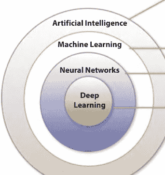

人工智能是机器执行通常与人类智能相关的任务的能力。

机器学习是 AI 的一种应用，使系统能够从经验中学习和改进，而无需进行显式编程。

神经网络是一种旨在模仿人脑功能和结构的机器学习模型。

深度学习是机器学习的一个子集，由具有三个或更多层的神经网络组成。

图 1.1 人工智能及其相关领域。

通用 AI（强 AI）：通用 AI 旨在复制各种任务中类似人类的智能和能力。它是指能够像人类一样理解、学习和推理各种领域的 AI 系统。通用 AI 仍在很大程度上处于理论阶段，并仍然是该领域的一项重大挑战。

### 本章组织

本章其余部分的组织安排如下：第 1.2 节详细探讨了 AI 的关键组件。第 1.3 节探讨了显著应用，随后在第 1.4 节深入讨论生成式 AI，在第 1.5 节讨论 AI 的伦理和社会影响。第 1.6 节和第 1.7 节侧重于伦理 AI 发展和 AI 的未来。最后，第 1.8 节以未来展望总结本章。

### 1.2 人工智能的关键组件

人工智能是一门多学科领域，包含多种基本要素和方法。这些要素共同作用，使机器能够模拟人类智力，并执行需要思考、问题解决、感知和学习的活动。图 1.2 展示了人工智能的关键组件。

### 1.2.1 机器学习（ML）

机器学习是人工智能的一个子领域，涉及开发算法和统计模型，使计算机系统能够学习并提高其

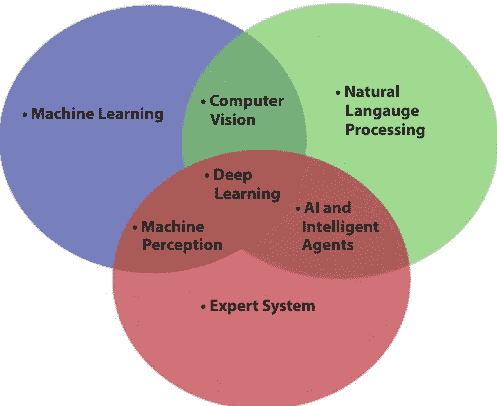

图 1.2 人工智能的关键组件。

在特定任务上的性能，方法是通过分析和适应数据而无需进行显式编程。图 1.3 详细介绍了各种机器学习算法 [4, 5]。

**a. 监督学习：**在监督学习中，人工智能模型在标记数据上开发，算法根据输入–输出关系学习分类或预测对象。算法通过检查输入和输出变量之间的趋势和关联，学习预测标记数据中的结果。监督学习的应用示例包括欺诈检测、推荐系统以及图像和语音识别。分类和回归是两种主要的监督学习技术。分类将数据分类到预设组或标签中，而回归预测连续数值。

回归是一种监督学习问题，用于预测连续数值输出或数值。回归算法发现输入特征与连续目标变量之间的相关性。回归模型输出数值，其典型目标是减少预测值与训练数据中实际值之间的差异。常用的回归算法包括回归树、多项式回归和线性回归。回归任务包括根据健康指标评估患者血压、预测股价，以及根据面积和位置等因素预测房价。

另一方面，分类是一种监督学习活动，旨在将传入数据分类到预定的组或类别中。在执行分类时，算法学习将输入特征与特定标签或类别相关联。标识输入类别的类标签充当分类模型的输出。标准分类技术示例包括逻辑回归、决策树、支持向量机和神经网络。分类任务示例包括将电子邮件分类为垃圾邮件或非垃圾邮件、识别照片中的对象，以及将患者分类到不同的疾病类别中。

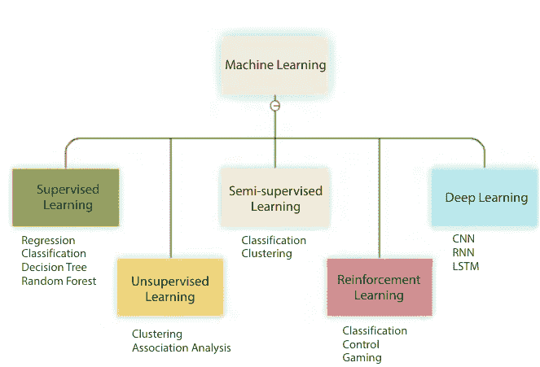

图 1.3 机器学习算法类型。


- **b. 无监督学习：** 无监督学习常用于聚类或降维，它通过使用未标记数据训练 AI 模型，以发现数据中的底层模式或结构。聚类、降维、异常检测、关联规则学习和生成模型只是无监督学习中包含的一些关键方法。像 K-means 这样的聚类算法将具有相似属性的数据点分组，而像 PCA 这样的降维技术则从高维数据中识别关键方面。使用异常检测来发现异常值或奇异数据点，使用关联规则学习来发现事务数据中的关联，并使用像 GANs 和 VAEs 这样的生成模型来创建新的数据样本。这些无监督学习方法在数据探索、模式发现以及标记数据稀缺或不可用的各种应用中起着至关重要的作用，从而实现有价值的洞察和数据表示。

- **c. 半监督学习：** 半监督学习使用较大规模的未标记数据进行模型训练，并使用少量标记数据。当获取标记数据困难或不切实际时，这种方法尤其有帮助。它使用未标记数据中的知识，通过有监督和无监督学习技术来增强模型性能。两种常见的方法是伪标记（在未标记数据上形成预测并将其用作伪标记）以及将传统的监督算法适应半监督环境。半监督学习可以提高模型性能，并在标记数据稀缺的各个领域中更好地利用可用资源。

- **d. 强化学习：** 强化学习（RL）涉及代理与其环境交互并执行行为，以随时间最大化累积奖励。RL 不像监督学习那样依赖标记数据；它是通过犯错来学习的。代理尝试多种选项，并考虑其选择的影响，然后调整计划以成功完成其目标。RL 的应用可以在各个领域找到，包括改进推荐系统、玩策略游戏和训练自主机器人。它解决顺序决策问题，使其成为开发能够从经验中学习并在变化环境中提升性能的智能、适应性系统的必要策略 [6]。

## 1.2.2 深度学习（DL）

深度学习是机器学习的一个分支，专注于使用多层人工神经网络（深度神经网络）来建模和完成挑战性任务。这些深度神经网络旨在自动从数据中识别和学习层次结构模式和特征。深度学习在语音识别、自然语言处理和图像识别等应用中已非常有效。之所以称为“深度”，是因为它采用了众多相互连接的人工神经元层，使其能够成功处理复杂的高维数据表示 [7]。

通过应用深度学习技术，计算机模型可以直接从图像、文本或声音中执行分类任务。当代深度学习模型可以达到显著的精度，有时甚至超过人类性能。训练这些模型涉及使用包含标记示例的大量数据集，并部署多层神经网络架构。深度神经网络的一种广泛使用的子类型是卷积神经网络（CNN 或 ConvNet）。CNN 包含 2D 卷积层，并将学习到的特征与输入数据集成，因此特别适合处理 2D 数据（如图像）。了解用于分类图像的特征并非必要，因为 CNN 会为你执行手动特征提取。CNN 的运作方式是直接从照片中提取特征。相关特征并未被训练；它们是在网络在一组图像上训练时被发现的。得益于这种自动特征提取，深度学习模型在对象分类等计算机视觉应用中具有极高的准确性。图 1.4 展示了各种深度学习方法的类型。

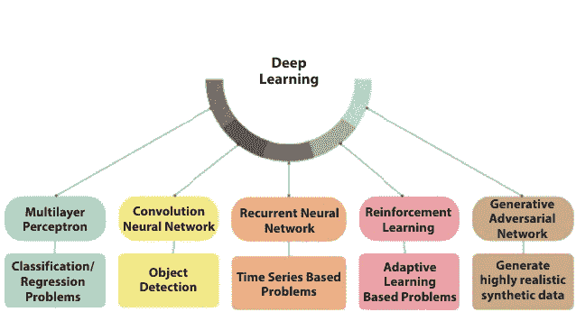

图 1.4 深度学习及其类型。

## 1.2.3 专家系统（ES）

专家系统（有时也称为基于知识的系统）是一种计算机程序或软件应用程序，用于模拟人类专家在特定学科领域中的判断力和问题解决能力。专家系统使用包含事实、定律和启发式知识的知识库，这些知识捕获了特定学科领域的专业知识，以提供智能建议、提出推荐或解决问题 [8]。DENDRAL 是一个专家系统示例，它是一种用于化学分析过程中预测分子结构的工具。PXDES 是另一个专家系统示例，用于预测肺癌的性质和严重程度。

## 1.2.4 自然语言处理（NLP）

借助人工智能，机器现在除了能够阅读外，还能理解和解释人类语言。它包括开发计算模型和算法，使计算机能够以有意义且有用的方式理解、解释和生成人类语言。为了让计算机能够像精通该语言一样与人类语言交互和处理，NLP 包含广泛的任务，包括文本分析、语言翻译、情感分析、语音识别等 [9]。

在 NLP 中，计算语言学（一种基于规则的建模人类语言的方法）与统计模型、机器学习和深度学习等其他模型相结合。当结合各种技术模型时，计算机可以处理口语或书面语来代表人类语言。因此，它们可以理解完整的含义，包括说话者或作者的意图和情感。搜索引擎的工作原理是 NLP 应用的一个例子。搜索引擎使用用户意图和过去的搜索历史，运用 NLP 来推荐适当的结果 [10]。

## 1.2.5 计算机视觉（CV）

计算机视觉是人工智能的一个子集，它使机器能够解释和理解来自图像和视频的视觉信息。它涵盖了多种任务，包括图像预处理、相关特征提取、对象检测、图像分类，甚至语义分割，从而能够更精细地理解图像细节。计算机视觉在各个领域都有应用，包括自动驾驶、人脸识别、医学影像、制造业质量控制、增强现实和监控系统 [11]。这项技术从根本上改变了我们对周围视觉世界的感知和交互方式。人脸识别就是计算机视觉的一个例子。计算机视觉用于人脸识别技术，以在图像和电影中定位特定个人。执法机构可以使用它来追踪可疑人员。然而，在最基本的形式中，Meta 或 Google 等企业会使用它来推荐在图像中标记的人员 [12]。

## 1.2.6 机器感知

机器感知是指 AI 系统通过摄像头、麦克风和加速度计等传感器感知和理解其环境的能力。通过采用传感器融合和深度学习等技术，机器可以整合来自多种模态的数据、识别对象和辨别情绪，从而有效地与其环境交互 [13]。这种扩展的能力为各个领域开辟了潜在应用，包括自动驾驶汽车、医疗诊断、沉浸式虚拟体验和人机交互。它增强了机器理解和响应复杂感官信息的能力。

## 1.2.7 智能代理（IA）

智能代理或 AI 代理是为与周围环境交互并做出决策以实现特定目标而创建的软件实体。从简单的基于规则的系统到复杂的决策者，AI 代理涵盖了许多 AI 应用 [14]。相比之下，智能代理更加重视自主性和灵活性，常用于动态的实时场景，例如机器人和自主系统。两者对 AI 都至关重要，因为它们为处理各种问题和任务提供了不同层次的推理和决策能力。


# 1.3 人工智能的应用

人工智能在各个行业和领域都有广泛的应用，正在改变我们的工作和生活。以下是 AI 在各个领域的一些显著应用 [15–30]。

### I. 计算机视觉

AI 在计算机视觉领域拥有众多应用，能够增强机器解释和理解来自世界的视觉数据的能力。图 1.5 展示了计算机视觉领域中的人工智能应用。以下是计算机视觉领域的一些关键 AI 应用。

- a. 图像分类：识别图像中的物体或模式。
- b. 目标检测：检测并定位图像或视频中的特定物体。
- c. 人脸识别：基于面部特征识别和验证个人身份。
- d. 视频分析：出于监控和内容推荐等各种目的分析视频内容。
- e. 光学字符识别（OCR）：由 AI 驱动的 OCR 系统可以识别并将印刷文本或手写文本转换为机器可读文本。
- f. 手势识别：AI 可以识别和解释手势，从而在游戏、虚拟现实和人机交互等应用中实现无接触界面和控制。

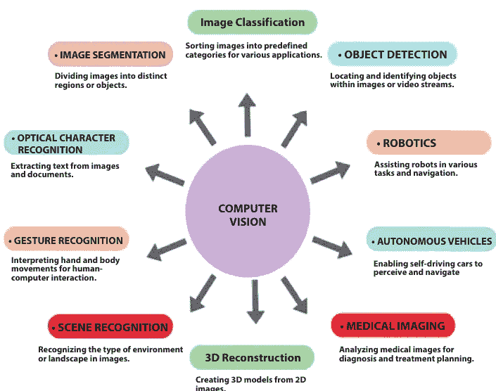

图 1.5 计算机视觉领域中的人工智能应用。

- g. 增强现实（AR）和虚拟现实（VR）：机器视觉中的 AI 会跟踪和分析用户环境，增强 AR 和 VR 体验。

- h. 体育分析：由 AI 增强的摄像头和视觉系统分析体育赛事，为教练提供实时数据。

### II. 自然语言处理

AI 在自然语言处理（NLP）领域有广泛应用，NLP 是 AI 的一个子领域，专注于计算机与人类语言之间的交互。图 1.6 展示了自然语言处理的常见应用。以下是 NLP 领域中 AI 的几项关键应用。

- a. 文本分类：将文本文档分类为预定义的类别。

- b. 情感分析：确定文本情感或情感基调的过程，通常用于社交媒体监控和客户反馈分析。

- c. 机器翻译：NLP 用于 Google Translate 等机器翻译系统，以自动将文本从一种语言翻译成另一种语言。

- d. 语音识别：语音识别系统利用 NLP 算法将口语翻译成书面文本。这被用于 Siri 和 Google Assistant 等语音助手以及转录服务。

- e. 问答系统：NLP 模型可用于创建问答系统，该系统可以使用文本库或知识库来响应用户问题。

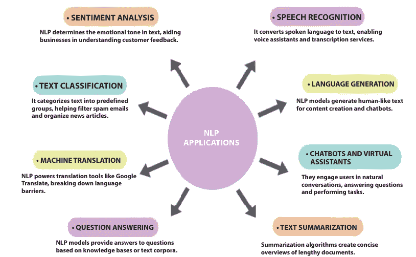

图 1.6 自然语言处理的常见应用。

- f. 文本摘要：文本摘要算法可以自动为长文本文档生成简洁的摘要，使大量信息更易于理解。

- g. 语言生成：GPT-3、4 等 NLP 模型可以生成类似人类的文本，可用于内容生成、聊天机器人和创意写作辅助。

- h. 聊天机器人和虚拟助手：自然语言处理对于开发聊天机器人和虚拟助手至关重要，使其能够与用户进行自然讨论、回答问题并执行任务。

- i. 信息检索：NLP 用于搜索引擎，通过理解用户查询和网页内容来提高搜索结果的准确性。

- j. 文本转语音（TTS）转换：NLP 技术在 TTS 系统中将书面文本转换为听起来自然的语音。旁白、辅助工具和导航系统都使用此技术。

### III. 推荐系统

基于客户喜好和行为推荐商品、服务或内容的系统在很大程度上依赖人工智能（AI）。AI 推荐系统在经济各个领域都有许多应用。推荐系统中主要的 AI 应用如下。

- a. 协同过滤：基于用户行为和偏好推荐产品、服务或内容。

- b. 基于内容的过滤：基于项目的特征及其与用户表现出兴趣的项目的相似性来推荐项目。

### IV. 医疗保健

AI 可以在医疗保健行业以多种方式使用，以显著改善行政、诊断和患者护理流程。以下是医疗保健中 AI 的一些重要应用。

- a. 医学图像分析：协助解释医学图像，例如 X 光、MRI 和 CT 扫描。

- b. 疾病诊断：基于患者数据协助早期发现和诊断疾病。

- c. 药物发现：加速新药发现并识别潜在药物候选物。

- d. 药物相互作用和不良事件检测：AI 系统通过分析患者数据和用药史来识别潜在的药物相互作用和不良事件。

- e. 虚拟健康助手：由 AI 驱动的聊天机器人和虚拟助手为患者提供医疗信息、回答问题并安排预约。

### V. 金融

在金融领域，AI 有许多用途，正在多方面彻底改变该行业。以下是几项重要的金融 AI 应用。

- a. 信用评分：评估个人或企业的信用度。

- b. 算法交易：基于历史和实时数据做出金融交易决策。

- c. 欺诈检测：识别银行和金融系统中的欺诈交易或活动。

### VI. 自动驾驶汽车

自动驾驶汽车（AV）的创建和使用在很大程度上依赖人工智能。AV 依靠 AI 技术来感知周围环境、做出实时决策并安全导航。以下是自动驾驶汽车中几项重要的 AI 应用：

- a. 自动驾驶汽车：使车辆能够使用传感器数据和机器学习算法自主导航和做出决策。

- b. V2X 通信：AI 在车联万物（V2X）通信中发挥作用，使自动驾驶汽车能够与其他车辆、基础设施和交通控制系统通信。

### VII. 工业和制造业

AI 在制造等行业的应用正在加速产出、可持续性和质量的改进，从而带来更具竞争力和高效率的制造流程。以下是制造业和工业中一些重要的 AI 应用。

- a. 预测性维护：预测设备故障并优化维护计划以减少停机时间。

- b. 质量控制：在生产线上实时识别缺陷并确保产品质量。

#### VIII. 零售

零售业正在因 AI 而发生变化，AI 加强了决策制定、增强了运营并改善了客户体验。零售中 AI 的关键用途包括以下内容：

- a. 需求预测：预测消费者对产品的需求以优化库存管理。

- b. 个性化营销：向单个客户提供量身定制的营销和产品推荐。

#### IX. 营销和广告

通过提供数据驱动的洞察、自动化任务以及实现更加个性化和针对性的活动，AI 正在对营销和广告行业产生重大影响。营销和广告中 AI 的一些主要用途如下：

- a. 客户细分：识别目标受众。

- b. 广告点击预测：最大化广告活动效果。

- c. 价格优化。

### X. 农业

农业中的 AI 应用促进了更具韧性、高效和可持续的耕作方法。它使农民能够在满足全球粮食需求的同时减少对环境的影响。以下是农业中 AI 的一些重要应用：

- a. 作物监测：使用遥感和传感器数据进行作物健康评估和产量预测。

- b. 精准农业：优化耕作方式以提高效率和节约资源。

- c. 除草和病虫害防治：基于 AI 的机器人系统可以自主识别并消除田间的杂草或害虫。

- d. 天气预报：基于 AI 的模型利用天气数据分析生成精确的预报和气候预测，帮助农民为天气模式的变化做计划，并相应调整耕作方式。

### XI. 能源管理

AI 正在通过优化资源分配、提高效率和改善可持续性，在能源管理中变得越来越重要。以下是能源管理中一些最重要的 AI 应用：

- a. 能源消耗预测：预测能源使用量以优化能源分配并降低成本。

- b. 智能电网：提高电网的效率和可靠性。

### XII. 空间探索

AI 通过改进任务能力、数据分析和决策过程来推动空间探索。以下是空间探索中一些最重要的 AI 应用：

- a. 识别空间数据中的天体和异常。

- b. 自主探测车。

- c. 外系行星发现。

- d. 航天员协助。

- e. 任务规划与优化。

##### XIII. 游戏和娱乐

AI 通过改进游戏性、个性化内容和整体用户体验，正在改变游戏和娱乐行业。以下是游戏和娱乐中一些最重要的 AI 应用：

- a. 电子游戏中的角色行为和策略开发。

- b. 创建逼真的角色动画，使动作栩栩如生。

- c. 增强图形、渲染和物理模拟，以构建更具沉浸感的世界。

- d. AI 在 VR 和 AR 体验中有助于跟踪、手势识别和对象识别，使其更具交互性和沉浸感。


## XIV. Human resources:

AI is increasingly used in human resources to expedite operations and improve the overall HR experience for employees and companies. Below are some significant AI uses in human resources:

- a. Resume screening and candidate selection.
- b. Employee churn prediction.
- c. Initial screening chatbots: AI-powered chatbots can conduct preliminary screenings of candidates by asking basic questions and rating their suitability for the post.

## XV. Environmental science:

AI assists in data processing, modeling, monitoring, and decision-making processes in environmental research. Below are some of the most significant AI applications in environmental science:

- a. Climate modeling and prediction.
- b. Wildlife monitoring and conservation.
- c. Natural disaster prediction and response.

## XVI. Sports analytics:

Sports analytics involves data and statistical analysis to gain insights into various aspects of sports performance, strategy, and management. AI plays a significant role in enhancing sports analytics. Following are few AI applications in sports analytics:

- a. Performance analysis in sports.
- b. Player and team strategy optimization.

## XVII. Social sciences:

AI has numerous applications in social science, offering new tools and insights to researchers and policymakers. Following are some critical applications of AI in social science:

- a. Opinion mining: Analyzing public opinions and trends.
- b. Criminal behavior prediction: Identifying potential criminal activity patterns.

## XVIII. Fraud detection and cybersecurity:

AI is a powerful fraud detection tool. It can analyze vast data and identify patterns, anomalies, and potential threats. The following are some critical AI applications in this domain:

- a. Credit card fraud detection: Identifying suspicious transactions.
- b. Malware detection: Detecting and preventing cybersecurity threats.

## XIX. Robotics:

AI plays a crucial role in advancing the capabilities of robotics, enabling them to perform a wide range of tasks with greater adaptability and efficiency. Here are some critical applications of AI in the field of robotics:

- a. Industrial automation in manufacturing.
- b. Autonomous vehicles and drones.
- c. Robotic surgery and healthcare assistance.
- d. Search and rescue robots.

## XX. Education:

AI has numerous applications in the field of education, revolutionizing the way students learn and educators teach. Some critical applications are as follows:

- a. Personalized learning platforms.
- b. Automated grading and assessment.
- c. Intelligent tutoring systems.
- d. Learning analytics for educators.

## XXI. Internet of Things (IoT):

AI plays a significant role in enhancing the capabilities and functionality of IoT applications. The following are a few applications of AI in the field of IoT:

- a. Smart home automation.
- b. Industrial automation.
- c. Healthcare monitoring.
- d. Smart agriculture.
- e. Supply chain management.
- f. Smart cities.
- g. Energy management.
- h. Environmental monitoring.
- i. Retail and customer engagement.
- j. Security and surveillance.

## 1.4 Generative AI

Generative AI refers to a subset of artificial intelligence techniques that focus on generating content, such as text, images, music, or even video, typically in a way that appears to be created by a human. These systems are designed to learn and mimic patterns in data to produce new, creative outputs [31]. Figure 1.7 displays various generative AI-enabling technologies.

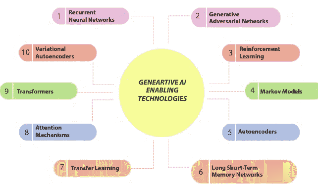

Figure 1.7 Generative AI-enabling technologies.

One of the most prominent generative AI models is the class of models known as generative adversarial networks (GANs). GANs consist of two neural networks: a generator and a discriminator. The generator tries to create indistinguishable data (e.g., images) from accurate data, while the discriminator tries distinguishing between real and generated data. Through a competitive training process, GANs can produce high-quality, realistic outputs, which have been used in various creative applications, including image synthesis, style transfer, and even generating artwork. Recurrent neural networks (RNNs) are a class of neural networks designed for sequential data and are commonly used in generative models like language modeling. Generative AI encompasses various enabling technologies that facilitate the generation of new content or data. Here are some key technologies that empower generative AI [32, 33]:

- a. Generative adversarial networks: GANs consist of two neural networks, a generator and a discriminator, which compete to produce realistic data, often used for generating images, videos, and other content.
- b. Variational autoencoders (VAEs): VAEs are probabilistic generative models that learn to encode and decode data, allowing for generating new, similar data points.
- c. Transformers: Transformers, especially models like GPT (generative pre-trained transformer), have revolutionized natural language generation and other sequence-to-sequence tasks.
- d. Reinforcement learning: Reinforcement learning can be used in generative AI to train agents to generate content that maximizes a specific reward, useful in-game AI and robotics.
- e. Markov models: Markov models are probabilistic models used for sequence generation, often applied in speech recognition and text generation.
- f. Autoencoders: Autoencoders are neural network architectures used for data compression and reconstruction, which can also be adapted for generative tasks.
- g. Long short-term memory (LSTM) networks: LSTMs are a type of RNN that is particularly effective for capturing long-range dependencies in sequential data.
- h. Attention mechanisms: Attention mechanisms, as used in transformers, enable models to focus on specific parts of the input data when generating output, improving performance in various generative tasks.
- i. Probabilistic graphical models: These models represent complex relationships between variables and are used in generative AI for tasks like image generation and recommendation systems.
- j. Monte Carlo methods: Monte Carlo methods, such as Markov chain Monte Carlo (MCMC), are used to sample from complex probability distributions, aiding in generative modeling.
- k. Neuro-evolution: Evolutionary algorithms can be used to evolve neural network architectures and parameters for generative tasks.

Figure 1.8 shows the major applications of generative AI.

- l. Conditional generative models condition content generation on specific input data, such as text-to-image generation or text-to-speech synthesis.
- m. Deep reinforcement learning: Combining deep learning and reinforcement learning to generate content with more complex interactions and behaviors.
- n. Transfer learning: Using previously learned models and optimizing them for generative tasks to increase effectiveness and performance.

Generative AI is becoming increasingly well-liked as a powerful technology reshaping businesses and opening new possibilities for strategy and content production. Generative AI systems can create new content, mimic human-like reasoning, and quicken technological change by utilizing DL algorithms.

Various industries are adopting generative AI to enhance productivity, creativity, and efficiency. Figure 1.9 shows the various industries using it to expand their reach [34, 35].

- a. Entertainment and media: Creating special effects, generating realistic computer graphics, and enhancing video game experiences.

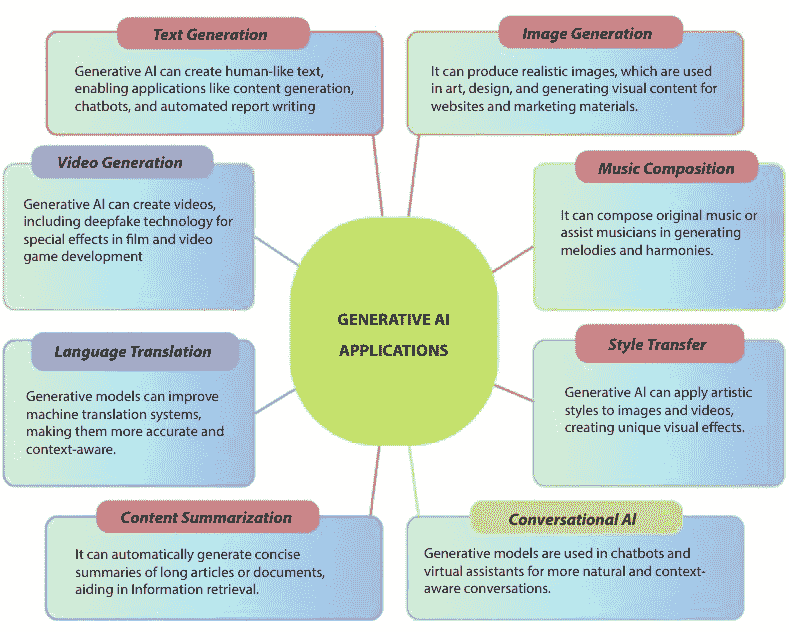

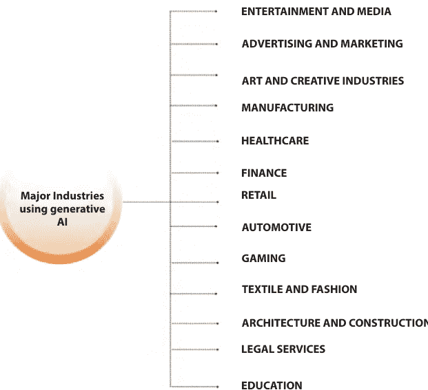

Figure 1.9 Industries using generative AI to expand their reach, providing innovative solutions and opportunities for automation, creativity, and problem-solving.

- b. Advertising and marketing: Generate personalized content, design graphics, and optimize ad campaigns.
- c. Art and creative industries: Generating artwork, music, and other creative works, as well as assisting artists and musicians in the creative process.
- d. Manufacturing: Design and optimize products, generate 3D models, and assist in product development.
- e. Healthcare: Medical image generation, drug discovery, and predictive analytics in patient care.
- f. Finance: Algorithmic trading, fraud detection, and financial data analysis.
- g. Retail: Inventory management, personalized product recommendations, and visual merchandising.
- h. Automotive: Designing autonomous vehicle systems and simulating driving scenarios.
- i. Gaming: Creating game content, generating levels, characters, and dialogues.
- j. Textile and fashion: Designing clothing and textile patterns and optimizing supply chains.
- k. Aerospace: Aircraft design, simulation, and maintenance.
- l. Architecture and construction: Generate designs and 3D models and simulate construction processes.


- m. 能源：优化能源消耗并预测设备故障。
- n. 法律服务：文档分析、合同审查和法律研究。
- o. 环境科学：气候建模、预测环境趋势和分析生态数据。
- p. 教育：创建教育内容、生成测验和个性化学习体验。
- q. 电信：优化网络性能、检测异常和预测网络故障。
- r. 旅游业：个性化宾客体验、定价优化和需求预测。
- s. 交通和物流：路线优化、需求预测和车队管理。
- t. 政府和公共部门：公共政策分析、安全和灾难响应规划。

## 1.5 AI 的伦理和社会影响

人工智能（AI）的伦理和社会影响是重大且多方面的。随着 AI 技术不断进步并日益融入我们生活的方方面面，考虑以下伦理和社会问题至关重要 [36, 37]：

- a. 偏见与公平性：AI 系统可能会延续甚至放大训练数据中存在的偏见。这可能导致不公平或歧视性的招聘、贷款和执法结果。确保 AI 系统公平、公正地对待所有个人，不论种族、性别或社会经济地位等因素，是一项重大的伦理挑战。
- b. 隐私：AI 通常依赖大型数据集，引发了关于个人信息收集、存储和使用的担忧。未经授权的数据访问和泄露可能导致隐私侵犯。由 AI 驱动的监控系统（如人脸识别）威胁个人隐私和公民自由。
- c. 透明度与问责制：许多 AI 模型（如深度学习神经网络）常被视为难以解释的“黑箱”。了解 AI 系统如何做出决策对于问责和信任至关重要。当 AI 系统出错或造成伤害时，确定责任是一项法律和伦理挑战。
- d. 职业流失与经济影响：由 AI 驱动的自动化可能会取代特定工作，特别是涉及常规和重复性任务的工作。为劳动力做好这些变化的准备并解决失业问题至关重要。AI 对经济（包括劳动力市场转变）的影响需要采取主动的政策和措施。
- e. 自主性与决策：由 AI 驱动的自主系统（如自动驾驶汽车和无人机）在关键情况下引发了关于决策的伦理问题。在这些场景中，谁应对 AI 做出的决策负责？
- f. 安全性：AI 可能被恶意用于网络攻击、深度伪造制作和其他形式的欺骗。这对个人、组织和政府构成威胁。开发 AI 驱动的安全措施和对策以应对这些风险至关重要。

## 1.6 伦理 AI 开发

伦理考量应贯穿 AI 开发的所有阶段，从数据收集和模型训练到部署和持续监控。AI 研究与开发社区日益倡导坚持伦理原则和指南 [38–40]。

- a. 监管与治理
  政策制定者和监管机构面临着为 AI 技术制定适当框架的挑战。在促进创新与保护个人和社会之间取得平衡是一项复杂的工作。

- b. 社会接受度与信任
  对 AI 技术的广泛信任对于其成功采用至关重要。伦理实践、透明度和问责制有助于建立和维护信任。

- c. 偏见缓解与多样性
  减少 AI 中偏见的努力必须包括多样化的观点和数据集，以确保 AI 系统具有代表性且不偏向某一群体。

- d. 教育与意识
  提高公众对 AI 能力、局限性和伦理挑战的认识和理解，对于知情决策和负责任地使用 AI 至关重要。

## 1.7 AI 的未来

由于 AI 和智能技术，各行业和社区预计将发生重大变革。随着 AI 技术的发展，我们可以期待越来越强大和灵活的系统来颠覆我们的生活和工作。深度学习和神经网络的进步将使 AI 更擅长解读复杂的数据模式，推动医疗保健等领域的发展，促进早期诊断和个性化治疗方案。从自动驾驶汽车到 AI 驱动的机器人等自主系统，将成为各个领域的重要组成部分，优化效率和安全。此外，AI 提供个性化体验和推荐的能力将超越虚拟助手，扩展到教育等领域，彻底改变学习体验 [41, 42]。

然而，随着 AI 能力的扩展，围绕 AI 使用的伦理和社会问题也在不断增加。AI 决策中的公平性、问责制和透明度将至关重要。

通过负责任地开发和监管 AI 系统，我们可以减少偏见、保护个人信息并防止职业流失。在创新与伦理保障之间取得正确平衡，对于塑造 AI 和智能机器的未来，并最终确定其对个人、社区和全球格局的影响至关重要 [43, 44]。

随着技术的发展，AI 预期将：

- 推进伦理 AI：将继续努力确保 AI 系统公平、透明且可问责。
- 人机协作：AI 将增强人类能力，带来新的协作机会。
- 监管与治理：政策制定者在塑造 AI 的伦理和负责任的发展中将发挥关键作用。

## 1.8 结论

本章对 AI 现状提供了引人入胜的总结。它深入探讨了理论基础和前沿创新，将 AI 从一个抽象概念提升为当代世界的一股强大力量。本章强调了 AI 如何改变各行业，从医疗保健和银行业到教育和娱乐，带来显著的改进和效率。除了发展的承诺之外，本章还突出了 AI 引发的道德和社会难题，迫使我们批判性地思考正义、责任以及自动化可能产生的影响，并迫使我们采取细致入微的方法来应对智能机器的出现。随着我们迈入 AI 正在发展并日益融入我们日常生活的时代，我们必须谨慎行事，并在人与机器之间建立相互依存的联系，以造福社会。

## 参考文献

- 1. Dwivedi, Y.K., Hughes, L., Ismagilova, E., Aarts, G., Coombs, C., Crick, T., Williams, M.D., 人工智能（AI）：关于新兴挑战、机遇以及研究、实践和政策议程的多学科视角. Int. J. Inf. Manage., 57, 101994, 2021.
- 2. Li, H., 特别专栏导论：人工智能与广告. J. Advertising, 48, 4, 333–337, 2019.
- 3. Haenlein, M. 和 Kaplan, A., 人工智能简史：关于人工智能的过去、现在和未来. California Manage. Rev., 61, 4, 5–14, 2019.
- 4. El Naqa, I. 和 Murphy, M.J., 什么是机器学习？第 3–11 页, Springer International Publishing, 瑞士, 2015.
- 5. Janiesch, C., Zschech, P., Heinrich, K., 机器学习与深度学习. Electron. Mark., 31, 3, 685–695, 2021.
- 6. François-Lavet, V., Henderson, P., Islam, R., Bellemare, M.G., Pineau, J., 深度强化学习简介. Foundations Trends® Mach. Learn., 11, 3–4, 219–354, 2018.
- 7. Zhao, Z.Q., Zheng, P., Xu, S.T., Wu, X., 基于深度学习的物体检测：综述. IEEE Trans. Neural Networks Learn. Syst., 30, 11, 3212–3232, 2019.


8. Zhou, Z.J., Hu, G.Y., Hu, C.H., Wen, C.L., Chang, L.L., 信念规则库专家系统综述. IEEE Trans. Systems, Man, Cybernetics: Syst., 51, 8, 4944–4958, 2019.

9. Deng, L. and Liu, Y., 自然语言处理与深度学习联合导论. Deep Learn. Natural Lang. Process., 1–22, 2018, https://doi.org/10.1007/978-981-10-5209-5_1.

10. Nadkarni, P.M., Ohno-Machado, L., Chapman, W.W., 自然语言处理：导论. J. Am. Med. Inf. Assoc., 18, 5, 544–551, 2011.

11. Islam, A.R., 计算机视觉中的机器学习. Appl. Mach. Learn. Artif. Intell. Educ., 48–72, 2022.

12. Wu, Q., Liu, Y., Li, Q., Jin, S., Li, F., 深度学习在计算机视觉中的应用，收录于：2017中国自动化大会（CAC），第6522–6527页，IEEE，2017年10月.

13. Giusti, A., Guzzi, J., Cireşan, D.C., He, F.L., Rodriguez, J.P., Fontana, F., Gambardella, L.M., 面向移动机器人森林小径视觉感知的机器学习方法. IEEE Robotics Automation Lett., 1, 2, 661–667, 2015.

14. Kumaran, D., Hassabis, D., McClelland, J.L., 智能代理需要什么学习系统？互补学习系统理论更新. Trends Cogn. Sci., 20, 7, 512–534, 2016.

15. Tiwari, S., Kane, L., Koundal, D., Jain, A., Alhudhaif, A., Polat, K., Althubiti, S.A., SPOSDS：基于机器学习的智能多囊卵巢综合征诊断系统. Expert Syst. Appl., 203, 117592, 1–14, 2022.

16. Davenport, T.H. and Ronanki, R., 现实世界中的人工智能. Harvard Business Rev., 96, 1, 108–116, 2018.

17. Jha, K., Doshi, A., Patel, P., Shah, M., 利用人工智能实现农业自动化的全面综述. Artif. Intell. Agric., 2, 1–12, 2019.

18. Cockburn, I.M., Henderson, R., Stern, S., 人工智能对创新的影响：探索性分析，收录于：人工智能经济学：议程，第115–146页，芝加哥大学出版社，美国芝加哥，2018.

19. Yu, K.H., Beam, A.L., Kohane, I.S., 医疗保健中的人工智能. Nat. Biomed. Eng., 2, 10, 719–731, 2018.

20. Hamet, P. and Tremblay, J., 医学中的人工智能. Metabolism, 69, 36–S40, 2017.

21. Tiwari, S., Jain, A., Sapra, V., Koundal, D., Alenezi, F., Polat, K., Nour, M., 基于集成ConvNet和ConvNet-LSTM模型的心律失常诊断智能决策支持系统. Expert Syst. Appl., 213, 118933, 2023.

22. Sharma, A.K., Tiwari, S., Aggarwal, G., Goenka, N., Kumar, A., Chakrabarti, P., Jasiński, M., 使用级联集成卷积神经网络和基于手工特征的深度神经网络进行皮肤癌的皮肤科医生水平分类. IEEE Access, 10, 17920–17932, 2022.

23. Goenka, N. and Tiwari, S., 基于脑生物标志物的深度学习阿尔茨海默病预测. Artif. Intell. Rev., 54, 7, 4827–4871, 2021.

24. Zawacki-Richter, O., Marín, V., II, Bond, M., Gouverneur, F., 高等教育中人工智能应用研究的系统综述——教育者在哪里？Int. J. Educ. Technol. Higher Educ., 16, 1, 1–27, 2019.

25. Tiwari, S., Jain, A., Ahmed, N.M.O.S., Charu, Alkwai, L.M., Dafhalla, A.K.Y., Hamad, S.A.S., 基于机器学习的智能电网电力消耗预测模型——迈向智慧城市的智能方式. Expert Syst., 39, 5, 12832, 2022.

26. Haenlein, M. and Kaplan, A., 人工智能简史：关于人工智能的过去、现在和未来. California Manage. Rev., 61, 4, 5–14, 2019.

27. Xiao, S.Q. and Peng, J.C., 人工智能技术在电气自动化控制中的应用. Appl. Mechanics Mater., 530, 1049–1052, 2014.

28. Brill, T.M., Munoz, L., Miller, R.J., Siri、Alexa和其他数字助手：关于人工智能应用客户满意度的研究. 智能技术在决策中的作用，第1版，第35–70页，2022年. 电子书ISBN 9781003307105.

29. Athey, S., 机器学习对经济学的影响，收录于：人工智能经济学：议程，第507–547页，芝加哥大学出版社，美国芝加哥，2018.

30. Tambe, P., Cappelli, P., Yakubovich, V., 人力资源管理中的人工智能：挑战与前进之路. California Manage. Rev., 61, 4, 15–42, 2019.

31. Budhwar, P., Chowdhury, S., Wood, G., Aguinis, H., Bamber, G.J., Beltran, J.R., Varma, A., 生成式人工智能时代的人力资源管理：关于ChatGPT的观点与研究方向. Hum. Resource Manage. J., 33, 3, 606–659, 2023.

32. Ali, S., DiPaola, D., Breazeal, C., 什么是GANs？：向初中生介绍生成对抗网络，收录于：AAAI人工智能会议论文集，第35卷，第15472–15479页，2021年5月.

33. Taulli, T., 生成式AI导论：这项技术的潜力巨大，收录于：生成式AI：ChatGPT和其他AI工具将如何彻底改变商业，第1–20页，Apress，美国加州伯克利，2023.

34. García-Peñalvo, F. and Vázquez-Ingelmo, A., 我们所说的GenAI是什么？生成式AI中涉及的演变、趋势和技术的系统映射. IJIMAI Magazine, 8, 4, 1–16, 2023.

35. Fui-Hoon Nah, F., Zheng, R., Cai, J., Siau, K., Chen, L., and ChatGPT: 应用、挑战与AI-人类协作. Generative AIJ, Inf. Technol. Case Appl. Res., 25, 3, 277–304, 2023.

36. Zohny, H., McMillan, J., King, M., 生成式AI的伦理. J. Med. Ethics, 49, 2, 79–80, 2023.

37. Whittlestone, J., Nyrup, R., Alexandrova, A., Dihal, K., Cave, S., 算法、数据和人工智能的伦理与社会影响：研究路线图. 伦敦：努菲尔德基金会，2019年，https://www.nuffieldfoundation.org/wp-content/uploads/2019/02/Ethical-and-Societal-Implications-of-Data-and-AI-report-Nuffield-Foundat.pdf.

38. Mittelstadt, B., 仅靠原则无法保证伦理AI. Nat. Mach. Intell., 1, 11, 501–507, 2019.

39. Schiff, D., Biddle, J., Borenstein, J., Laas, K., AI伦理、政策与治理的下一步是什么？全球概览，收录于：AAAI/ACM人工智能、伦理与社会会议论文集，2月，第153–158页，2020年.

40. Siau, K. and Wang, W., 人工智能（AI）伦理：AI伦理与伦理AI. J. Database Manage. (JDM), 31, 2, 74–87, 2020.

41. Artico, F., Edge III, A.L., Langham, K., BioTech大数据领域人工智能的未来. Curr. Opin. Biotechnol., 76, 102714, 2022.

42. Gill, S.S., Xu, M., Ottaviani, C., Patros, P., Bahsoon, R., Shaghaghi, A., Uhlig, S., 下一代计算的人工智能：新兴趋势与未来方向. Internet Things, 19, 100514, 2022.

43. Ramesh, P.V., Ramesh, S.V., Aji, K., Ray, P., Tamilselvan, S., Parthasarathi, S., Rajasekaran, R., 建模与缓解人类标注以设计用于青光眼缺陷的人环机器学习处理系统：人工智能的未来. Indian J. Ophthalmol., 69, 10, 2892, 2021.

44. Kopalle, P.K., Gangwar, M., Kaplan, A., Ramachandran, D., Reinartz, W., Rindfleisch, A., 通过全球视角审视营销中的人工智能（AI）技术：当前趋势与未来研究机会. Int. J. Res. Marketing, 39, 2, 522–540, 2022.

## 生物信息学导论

Bancha Yingngam

乌汶他尼大学制药科学学院制药化学与技术系，乌汶他尼，泰国

## 摘要

生物信息学是生物学、计算机科学和统计学交叉的关键学科领域。它在转化生命科学和生物医学研究中充当关键催化剂。尽管重要，但该领域面临着生物数据量庞大、数据处理标准不一以及缺乏精通所有交叉学科的专家等问题。这些挑战渗透到学术界、制药行业和公共卫生领域，影响着生物学研究、个性化医疗和疾病暴发理解的进步。本章旨在对生物信息学进行深入综述，涵盖其定义、重要性和固有挑战。它通过详细介绍常用工具和资源（如序列比对、基因和蛋白质预测、蛋白质结构建模以及复杂基因组数据分析），旨在提升读者的科学语境理解。本章还对现有局限性（包括数据整合障碍以及对先进计算方法的迫切需求）进行了批判性评估。总之，它描绘了这一快速发展领域的未来前景，并强调了可能深刻增进我们对生命理解并改善健康结局的突破潜力。

关键词：生物信息学，生物数据库，基因预测，基因组数据分析，蛋白质结构建模，序列比对

## 缩略语列表

- AI: 人工智能
- AWS: 亚马逊云服务
- CML: 慢性髓性白血病
- DNA: 去氧核糖核酸
- GATK: 基因组分析工具包
- ML: 机器学习
- MOE: 分子操作环境
- PDB: 蛋白质数据库
- PDXs: 患者来源移植瘤

Email: bancha.y@ubu.ac.th


QSAR 定量构效关系
RNA 核糖核酸

## 2.1 引言

生物信息学是一门利用计算工具分析和解释复杂生物数据的交叉学科 [1]。这种生物信息学技术诞生于生物学、计算机科学、数学和信息工程的交叉点。图 2.1 说明了生物信息学是一门交叉学科的基本概念，即它结合了多个学科的方面。生物学涉及理解从分子（如基因和蛋白质的结构与功能）到宏观（如生态系统和进化）各个尺度上的生命原理和机制。计算机科学是对算法过程、计算机器及其计算本身的研究。在生物信息学的语境下，计算机科学通常涉及设计和应用算法与软件工具，以存储、分析和可视化生物数据。统计学涉及数据的收集、分析、解释、呈现和组织。在生物信息学中，统计方法常用于理解复杂的生物数据，如基因表达数据或基因组序列。目前，生物信息学已迅速发展为现代生物学研究及其相关领域（包括药物设计与开发）的关键支柱 [2]。根据 Research and Markets 的报告，近年来全球生物信息学市场实现了强劲扩张。2022 年市场规模估计为 228.5 亿美元，2023 年增长至估计的 270.5 亿美元。预计复合年增长率为 18.49%，市场有望在 2033 年前增长至 888.4 亿美元 [3]。这种增长可归因于技术进步以及生物信息学在基因组学、生物技术和个体化医疗等领域日益增长的重要性。不断增长的市场规模凸显了生物信息学的商业潜力，可能将推动该领域进一步的投资和发展。生物信息学的主要目标是通过研究从分子到生态系统各个层面的生物数据，加深对生物过程的理解。这需要开发和应用新的算法、计算模型和统计方法，从海量生物数据中获取有用信息。这包括基因组学、蛋白质组学和代谢组学 [4]。生物信息学旨在破解生命“密码”——DNA。人类基因组计划在 21 世纪初实现了人类基因组的完整测序，常被视为推动生物信息学快速发展的催化剂 [5, 6]。该项目产生了大量数据，需要先进的计算工具进行存储、检索和分析——生物信息学满足了这一需求。

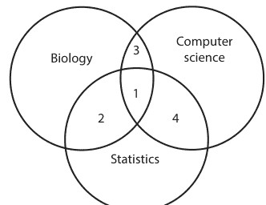

图 2.1 生物信息学的交叉性。

关于生物信息学的历史与演变，在 20 世纪 60 年代初，玛格丽特·戴霍夫（Margaret Dayhoff）等先驱开始开发蛋白质和核酸数据库，有效地为后来成为生物信息学的学科奠定了基础 [2]。大约在同一时期，保琳·霍赫韦格（Paulien Hogeweg）和本·赫斯珀（Ben Hesper）创造了“生物信息学”这一术语，用于指代生物系统中信息过程的研究 [7]。20 世纪 70 年代和 80 年代见证了序列比对算法（如 Smith-Waterman 算法）的发展，以及 GenBank 等重要序列数据库的建立 [2, 8]。在此期间还创建了几种用于系统发育分析的统计方法，反映了处理能力的增强和对数据解释工具的需求 [9]。然而，1990 年人类基因组计划的启动真正推动了生物信息学科学的发展。这一雄心勃勃的计划试图测序完整的人类基因组，导致大量生物数据涌现，需要现代计算工具进行存储、处理和解释。这一事件标志着当今科学家所认识的生物信息学的开端。在 2003 年人类基因组计划成功结束后，后基因组时期设想生物信息学将拓展至基因组学之外的更广阔领域。如今，对多种“组学”技术（如蛋白质组学（蛋白质研究）、代谢组学（代谢物研究）、转录组学（RNA 研究）以及许多其他“-组学”）的研究已被纳入这些领域 [11–13]。此外，高通量技术（如下一代测序（NGS））导致生物数据呈指数级增长，进一步凸显了生物信息学在生物研究中的必要性 [14]。在过去二十年中，生物信息学在加速多个领域（包括疾病生物标志物鉴定、药物发现与开发、个体化医疗、进化生物学和农业研究等）的发展方面发挥了关键作用 [15, 16]。BLAST、FASTA、PDB、UniProt 等生物信息学工具和数据库已成为当前生物研究中不可或缺的工具。此外，生物信息学中机器学习（ML）与人工智能（AI）的结合为复杂生物数据的解释开辟了新机遇 [17, 18]。这种融合产生了先进的模型和预测算法，提高了我们对分子水平生物系统的理解 [19]——例如，Gupta 等人 [20]深入探讨了帕金森病，这是一种以神经元细胞丧失为特征的神经退行性疾病，会导致认知障碍和突触功能障碍。尽管医学取得了进步，但帕金森病的管理仍然是一项艰巨的挑战。改善帕金森病管理的关键在于早期预测、诊断和精确的患者分类，而这些目前都面临重大障碍。AI 和 ML 技术正越来越多地被用来应对这些挑战，通过神经影像数据、语音录音和步态异常等指标，帮助区分帕金森病患者和健康个体。

作者回顾了 AI 和 ML 在检测、治疗以及识别与帕金森病进展相关的新生物标志物方面的应用，并讨论了这些技术在管理帕金森病中的作用，重点关注改变的脂质组学和肠脑轴。此外，作者强调了 AI 和 ML 在利用多种技术（如语音录音分析、书写模式、步态不规则和神经影像数据）进行帕金森病早期检测方面的潜力。因此，AI 和 ML 可以为帕金森病的管理和药物发现过程做出重大贡献。

由于能够管理、分析和解释海量生物数据，生物信息学在简化新疗法开发过程方面发挥着关键作用 [21]。在药物发现的早期阶段，识别适当的分子靶点（如蛋白质或基因）至关重要。生物信息学为基因组学、转录组学和蛋白质组学分析提供了强大的工具，可帮助识别潜在的疾病生物标志物和治疗靶点 [22]。此外，这些靶点可以通过计算机模拟分析进行验证，从而节省大量时间和资源。药物发现的下一阶段是识别一种能够与已确定靶点相互作用的化合物或“先导化合物”。生物信息学使对大型化合物数据库进行计算机模拟筛选成为可能，大大加速了先导化合物的鉴定过程 [23]。随后，可以利用多种生物信息学工具对这些先导化合物进行优化，这些工具可预测化合物的药物样特性及可能毒性 [24]。当实验数据不可用时，生物信息学在预测蛋白质三维结构方面发挥着关键作用 [25]。这些信息对于理解蛋白质功能及其与潜在药物的相互作用至关重要。分子对接和动态模拟等工具可以揭示药物如何与其靶点结合，从而有助于设计更有效的药物 [26]。生物信息学在药基因组学（即研究个人遗传构成如何影响其药物反应的学科）中发挥着重要作用 [27]。这些知识使个体化疗法的开发成为可能。现代药物设计产生海量数据。有效的数据管理对于存储、检索和分析这些数据至关重要。生物信息学提供了有效数据管理所需的工具和框架，确保有价值的洞察不会在数据洪流中丢失 [28]。最后，将 ML 和 AI 整合到生物信息学中已产生了变革性的影响。ML 算法可以从复杂的生物数据中识别模式并进行预测，从靶点鉴定到毒性预测等各个环节都能提供帮助 [29]。AI 与生物信息学相结合，为更高效、更成功的药物发现过程铺平了道路 [30–32]。

## 本章目标

本章的目标如下：

- (i) 提供生物信息学的全面概述，涵盖其核心原理、方法论、应用和新兴趋势；
- (ii) 阐明生物信息学如何作为生物学与计算机科学之间的交叉学科桥梁，帮助分析和解释复杂的生物数据；


(iii) 并且，为了强调生物信息学在各种生物学研究领域的重要性，包括但不限于基因组学、蛋白质组学，特别是药物发现与开发领域。

## 章节组织

本章剩余部分组织如下：第 2.2 节介绍生物信息学的关键概念，通过讨论数据结构、算法以及分子生物学的基本方面等基本原理，奠定基础。在第 2.3 节中，探讨了生物信息学的工具和数据库。第 2.4 节然后阐述了生物信息学在不同领域的应用及其在药物发现与设计中所发挥的重要作用。在第 2.5 节中，讨论了生物信息学中的挑战与机遇。第 2.6 节讨论了生物信息学在药物设计中的未来方向。这包括研究使用大数据、ML 和 AI 的应用的影响，以及日益发展的个体化医学领域，并讨论潜在的挑战和机遇。最后，第 2.7 节以未来展望总结本章。

### 2.2 生物信息学中的关键概念

在深入探讨生物信息学中某个关键概念的复杂细节之前，有必要奠定其基础。提供总体概览以帮助读者理解该领域及其基本组成部分至关重要。表 2.1 提供了与生物信息学相关的关键术语词汇表。基因组是生物体内完整的遗传物质集合，包括其所有基因。在生物信息学中，理解基因组至关重要，因为它使人们能够解读生物体的遗传蓝图。基因组测序和分析构成了许多生物信息学任务的基础，包括识别基因、预测其功能以及研究它们之间的相互作用。

| 术语 | 定义 |
|---|---|
| 基因组 | 生物体内完整的遗传物质集合，包括其所有基因。 |
| 蛋白质组 | 在某一时间，由基因组、细胞、组织或生物体表达或可能表达的完整蛋白质集合。 |
| 转录组 | 生物体基因表达的所有 RNA 分子的总量。 |
| 序列比对 | 一种将 DNA、RNA 或蛋白质序列进行排列的方法，以识别可能因序列间功能、结构或进化关系而产生的相似区域。 |
| 同源性 | 指由于共同祖先而导致不同物种间蛋白质或核酸序列的相似性。 |

蛋白质组是基因组可以表达的完整蛋白质集合。蛋白质作为细胞的主要功能单位，蕴含着关于细胞功能和状态的重要线索。蛋白质组学（即蛋白质组的研究）利用生物信息学技术来识别和定量蛋白质、分析其结构，并理解其功能与相互作用。转录组是指基因组产生的完整 RNA 分子集合。分析转录组有助于生物信息学家了解在特定时间点哪些基因处于活跃（或“表达”）状态，从而提供细胞功能状态的快照。RNA 测序（RNA-seq）等技术用于生成这些数据，随后可使用生物信息学方法对其进行分析，以深入了解基因表达模式。序列比对是一种用于识别 DNA、RNA 或蛋白质序列之间相似性的方法。这对生物信息学至关重要，因为它允许跨不同生物体比较遗传或蛋白质序列，从而揭示进化关系、预测蛋白质结构和功能，并识别基因组突变。在生物学语境中，同源性是指由于基因共同体而导致的序列间相似性。如果一个物种中的基因与另一个物种中的基因具有同源性，那么后者的功能将已知，因为可以推断前者很可能具有类似功能。同源性在理解物种间进化关系方面也发挥着至关重要的作用。

如上所述，生物信息学不仅仅是在生物数据上运行软件工具；它是一个整合生物学、计算机科学和统计学以提取生命复杂性中有意义洞见的系统过程。它还强调，生物信息学是一个迭代过程，其中一次分析的结果通常会导致新问题和进一步分析。常见的生物信息学工作流程可能会根据特定研究或数据类型略有不同，但一般步骤通常保持一致。图 2.2 概述了生物信息学中的标准工作流程，包括数据获取、预处理、分析（如序列比对、基因预测和蛋白质结构预测）、结果解释和假设生成。

DNA 测序
基因表达数据库
在线生物数据库
蛋白质数据库
已发表文献

数据获取
预处理
分析
结果解释
假设生成

图 2.2 典型生物信息学分析的工作流程。

数据获取步骤涉及为分析收集所需的生物数据。这些数据可来自多种来源，例如 DNA 测序、蛋白质数据库、基因表达数据库、已发表文献或在线生物数据库。数据获取后，需要进行预处理以使其适合分析，这包括清理数据以移除错误或噪声、归一化数据以确保公平比较，并将数据格式化为可输入生物信息学软件工具的形式——例如，在基因组研究中，预处理涉及对 DNA 序列读段进行质量控制检查，并移除无关或低质量序列。预处理后，使用各种生物信息学工具和方法对数据进行分析。这可能涉及序列比对（将序列相互比较或与参考序列比较）、基因预测（识别编码蛋白质的基因组区域）或蛋白质结构预测（使用计算技术从氨基酸序列预测蛋白质的 3D 结构）。具体的分析步骤将取决于研究中提出的具体问题。分析完成后，需要解释结果。这包括理解生物信息学工具的输出，并就所研究的生物现象得出结论。这还可能涉及统计分析，以确定结果的显著性。最后，对结果的解释通常会导致关于正在研究的生物系统的新假设。然后可以在未来的研究中验证这些假设，或许会引发新的数据获取和分析轮次。

因此，理解基本概念对于掌握生物信息学的全貌至关重要。这些概念在以下小节中详细阐述：序列比对、基因和蛋白质结构预测、计算进化生物学、基因组组装、生物网络分析，以及基因和蛋白质表达与调控的分析。

#### 2.2.1 序列比对

序列比对是生物信息学领域的基石操作，在 DNA、RNA 和蛋白质序列的分析与比较中发挥着至关重要的作用。序列比对所获得的洞见可能非常重要，它为理解序列间的保守程度、功能对应的可能性以及进化起源的线索提供了一扇窗户 [33]。该方法通常分为两大类：成对比对和多序列比对。表 2.2 对成对比对和多序列比对所使用方法之间的关键差异进行了全面对比 [14, 34]。所考察的标准包括


表 2.2 成对序列比对与多序列比对方法的比较分析。

| 标准 | 成对比对 | 多序列比对 |
|---|---|---|
| 定义 | 一次仅涉及两个序列的比较和比对 | 同时涉及三个或多个序列的比较和比对 |
| 用途 | 用于寻找两个查询序列的最佳分段（局部）或全局比对 | 用于识别能产生所有序列之间最高相似度或保守度的比对 |
| 复杂度 | 计算复杂度较低，因为一次只比较两个序列 | 由于同时比较多个序列，计算复杂度较高 |
| 评分 | 比对根据匹配/不匹配出现次数和间隙进行评分 | 评分通常是求和对的函数，或基于概况或概率模型 |
| 算法示例 | Smith-Waterman（局部比对），Needleman-Wunsch（全局比对） | ClustalW、MUSCLE、T-COFFEE、MAFFT |
| 应用 | 适合比对两个非常相似的序列，或在大序列中查找相似区域 | 适合分析系统发育关系，跨物种检测保守区域，并预测蛋白质结构域和结构 |

每种比对类型的定义、用途、计算复杂度、评分方法、算法示例和常见应用。成对比对是更简单的形式，涉及两个单个序列之间的直接比较。相比之下，多序列比对，如其名称所示，同时处理三个或更多序列。后者更复杂，但可以提供关于多个生物体或基因家族之间进化关系的更广阔视角。序列比对任务的计算实现由各种算法和工具促进，每种都有不同的优势和适用场景。基本局部比对搜索工具（BLAST）或许是最广泛认可的，提供一种快速的启发式方法来比对序列 [35, 36]。与此同时，Smith-Waterman 算法为局部序列比对提供了一种最优，尽管计算密集程度更高的方法论 [37]。对于多序列比对，ClustalW 等工具已被广泛采用，在广泛的生物数据集中表现出强健的性能 [38]。该过程始于计算成对比对矩阵以估计序列之间的进化距离。在此基础上，ClustalW 使用邻接法构建了系统发育导向树。该树提供了一个进化框架，指导随后的逐步比对，从最密切相关的序列开始，逐渐纳入更远亲的序列。最后，ClustalW 优化比对，调整间隙并可能提高比对质量 [38]。在作者看来，尽管有效，该算法并不总能产生最准确的比对，尤其是对于更分歧的序列或大型数据集。因此，研究人员在选择比对工具时应考虑每项分析的具体要求。

## 2.2.2 基因和蛋白质结构预测

基因和蛋白质结构的预测是生物信息学领域的一项基础性原则 [39]。这门学科提供了一个入口，通过它可以探索和阐明基因和蛋白质固有的功能和行为模式，从而揭示构成生命本身的复杂过程。基因结构预测过程是理解基因组内遗传物质结构组织的关键工具。这种做法涉及识别外显子、内显子及其他调控元素等基本基因特征 [40]。对这些组分的深入理解增强了对基因功能、其运行的调控控制以及其在更广泛生物现象背景下作用的理解。相反，蛋白质结构预测是理解蛋白质功能、相互作用和分子行为的基石。鉴于蛋白质执行了绝大多数细胞功能，准确预测其结构可能对其功能及其与其他分子实体的潜在相互作用提供重要洞察 [25, 39]。这种理解有助于推动药物设计的进步，促进疾病诊断，并阐明复杂的生物过程 [41]。

多种方法支撑着基因结构预测的实践，如表 2.3 所示。这些方法包括 _从头开始_ 预测，它部署统计模型来预测基因结构，以及基于同源性的预测，它依赖于遗传相似生物体中已有的基因结构知识 [42]。虽然 _从头开始_ 方法提供了更高的适应性，但它们更容易产生假阳性。相比之下，基于同源性的方法通常提供更高的准确性，但需要事先了解同源基因。蛋白质结构预测主要遵循三种方法：_从头开始_ 建模、同源建模和 Threading（折叠识别）[25]。_从头开始_ 建模仅根据氨基酸序列预测蛋白质结构，但由于潜在构象的庞大性，计算上可能具有挑战性。同源建模另一方面，需要类似蛋白质的已知结构可用。它利用这样一个事实：即使序列相似性不存在，结构完整性也常常保持。Threading（折叠识别），也称为折叠识别，将目标序列与已知蛋白质折叠进行比对，当序列相似性较低但折叠相似性较高时，这证明是有益的。

表 2.3 基因和蛋白质结构预测方法的比较。

| 预测方法 | 描述 | 优势 | 局限性 |
|---|---|---|---|
| 基因结构预测 | | | |
| 从头开始预测 | 利用统计模型预测基因结构 | 适应性高 | 可能更容易产生假阳性 |
| 基于同源性的预测 | 依赖相关生物体中已有的基因结构知识 | 准确性更高 | 需要事先了解同源基因 |
| 蛋白质结构预测 | | | |
| 从头开始建模 | 仅根据氨基酸序列预测蛋白质结构 | 无需已知同源物即可预测结构 | 由于潜在构象的庞大性，计算具有挑战性 |
| 同源建模 | 需要类似蛋白质的已知结构 | 即使序列相似性不存在，也能利用结构保守性 | 需要类似蛋白质的已知结构 |
| Threading（折叠识别） | 将目标序列与已知蛋白质折叠进行比对 | 当序列相似性低但折叠相似性高时有用 | 需要了解已知蛋白质折叠 |

## 2.2.3 计算进化生物学

作为生物信息学的基石，计算进化生物学（也称为进化生物信息学）采用复杂的计算方法和算法方法来分析和解释生物数据。这些过程主要专注于解码进化中不可或缺的机制和模式。该学科提供了对各种生物体（从简单的单细胞微生物到先进的多细胞实体）的遗传和基因组复杂性的更深入理解。对于阐明生物关系、解读基因组演化动态、考察分子进化以及进行种群基因组学的深入分析，计算进化生物学是不可或缺的。系统发育学是计算进化生物学的一个关键方面。这个子领域专注于考察不同生物物种之间的进化相互关系，其基础是跨物种遗传序列的比较研究。系统发育分析为物种形成事件的顺序提供了重要洞察，有助于识别共同祖先，并协助预测功能基因或蛋白质。

比较基因组学涉及比较各个物种的基因组序列以识别进化相关性，是计算进化生物学的另一个关键组成部分。这种方法有助于发现保守区域（表明某个功能或结构很重要）和变异区域（通常表明物种如何适应其环境）。比较基因组学对……作出了重大贡献


有助于理解基因组演化，并通过利用系统发育相关物种的已知基因组序列，简化新测序基因组的注释。此外，分子进化作为计算进化生物学的关键组成部分，探究分子水平的遗传改变机制。该学科涉及研究 DNA 或 RNA 中核苷酸序列以及蛋白质中氨基酸序列的改变。先进的计算方法使这些改变的分析成为可能，从而解读演化的驱动因素，包括突变、选择、遗传漂变和重组。另一方面，种群基因组学深入探讨种群内部及种群间的遗传变异，旨在阐明选择、迁移和遗传漂变等演化机制如何塑造这种变异。该领域借助计算工具分析大规模基因组数据集，从而提供关于适应、物种形成和疾病易感性的遗传基础的洞察。

### 2.2.4 基因组组装

基因组组装是生物信息学领域中不可或缺的核心过程。这种精细的程序涉及通过同化较短的 DNA 片段（称为 reads）来构建完整的基因组序列。这些 reads 通常源自高通量测序技术。鉴于大多数基因组的极高复杂性和巨大规模，组装过程常被比作解决一个宏大而复杂的拼图。生物体基因组的组装是揭示其遗传组成及进而解释其生物功能的关键步骤。这构成了众多高级遗传学研究的基石，涵盖遗传变异识别、演化关系探索以及基因功能预测。基因组组装的重要性不仅限于基础生物学研究，还延伸至医学遗传学、微生物基因组学和农业等应用学科。

基因组组装的主要方法包括 de novo 组装和参考指导组装（表 2.4）。前者即 de novo 组装，本质上是在没有参考基因组支持的情况下从头组装基因组。这种方法计算量大，需要采用先进算法来准确组装数百万条短 DNA reads。相反，参考指导组装利用近缘物种的预先测序基因组作为参考，以简化新基因组的组装。每种方法都具有独特的优势和挑战，选择通常取决于具体的研究问题和可用资源。这凸显了审慎选择方法论在确保组装过程有效性和准确性方面的重要作用。

表 2.4 de novo 组装和参考指导组装方法的比较。

| 方法论 | 关键特征 | 优势 | 挑战 |
| :--- | :--- | :--- | :--- |
| De novo 组装 | 在没有参考基因组支持的情况下从头组装基因组 | 不需要近缘参考基因组 | 计算量大，需要先进算法来组装数百万条短 DNA reads |
| 参考指导组装 | 借助近缘物种的预先测序基因组组装基因组 | 简化组装过程，计算量较小 | 依赖参考基因组的质量和亲缘关系，可能会遗漏目标生物特有的新型基因组元素 |

### 2.2.5 生物网络分析

生物网络分析方法能够可视化和解释支撑生物系统的错综复杂的相互作用网络。从基因、蛋白质和代谢物等分子，到细胞和生物体等更大结构，再到整个生态系统等宏大结构，生物网络分析的研究对象多样且广泛。生物网络的一个重要类别是基因相互作用网络或基因调控网络。该网络阐明了不同基因之间错综复杂的互联关系，常展示单个基因的表达如何影响其他基因。类似地，蛋白质-蛋白质相互作用网络映射了生物体内各种蛋白质之间的相互作用，从而增强了我们对细胞过程和机制的理解。代谢网络是另一种基本的生物网络类型。它们详细描述了生物体内各种代谢途径之间的复杂相互作用，对我们理解疾病机制并帮助识别潜在药物靶点起着重要作用。此外，它们还帮助界定各种生物体的代谢能力——这是合成生物学和生物技术进步的关键方面。

在更大尺度上，生态网络捕捉给定生态系统中不同物种之间的互联关系，有助于理解生态平衡，并便于预测对某一物种的修改如何在整个生态系统中产生连锁反应。分析这些生物网络的过程涉及旨在阐明网络属性（包括中心性、模块性和稳健性）的复杂计算算法。中心性度量用于定位网络中的关键节点（无论是基因、蛋白质、物种等）。模块性决定了网络被分割为较小的相互连接子网络的能力。稳健性表示网络承受并从扰动中恢复的能力。从更广泛的角度来看，生物网络分析构成了系统生物学中不可或缺的工具，系统生物学是一门新兴的生物学分支，致力于整体而非孤立地理解生物系统。通过整合涵盖基因组学、转录组学、蛋白质组学和代谢组学数据在内的多种数据类型，生物网络分析呈现了生物系统的全面概览。因此，这种方法代表了我们不断努力揭示生命复杂性的重要进展。

### 2.2.6 基因和蛋白质表达与调节分析

基因和蛋白质表达与调节分析构成了生物信息学领域的核心支柱。考察基因和蛋白质如何表达和受到调节的能力对于理解细胞机器及决定生物体功能的过程至关重要。基因表达分析涉及利用基因信息产生功能产物（通常是蛋白质）的过程。这包括转录研究（从 DNA 模板创建 RNA）和翻译研究（从此 RNA 产生蛋白质）。生物信息学工具可使用 RNA-Seq 等高通量技术定量基因表达水平。理解基因表达水平有助于了解在不同条件或生物体生命周期的不同阶段，哪些基因处于活跃或“表达”状态，这可为发育、疾病及对环境因素反应的研究提供依据。

相应地，蛋白质表达分析涉及检查生物体中产生的蛋白质的存在和数量。蛋白质作为细胞的工作马，执行许多对生命至关重要的功能。细胞中每种蛋白质的合成和降解都受到严格调控，以维持细胞稳态。通过质谱和二维凝胶电泳等技术，生物信息学允许大规模检查蛋白质表达。这有助于阐明蛋白质功能、翻译后修饰的影响以及蛋白质之间的相互作用。最后，基因和蛋白质表达的调节是一个复杂过程，涉及众多调控元件和机制，包括启动子、增强子、阻遏子和小 RNA 分子。调控元件可通过比较基因组学和机器学习算法识别，这些算法搜索跨物种保守且与基因调控相关的 DNA 序列模式。基因调控研究有助于理解细胞如何响应环境、分化为各种细胞类型，以及这些过程的改变如何导致疾病。这些关注领域——基因表达、蛋白质表达及其调节——共同构成一个错综复杂且相互关联的三联体，对我们理解生物过程至关重要。

## 2.3 生物信息学工具和数据库

### 2.3.1 公开可用的数据库

公开可用的数据库代表了生物信息学领域中多样化生物数据的重要存储库。这些数据库涵盖 DNA、RNA、蛋白质序列、蛋白质结构、代谢途径以及疾病相关信息等多个类别。此类数据库不仅提供数据存储，还便于分类、注释和标准化。这种全面的管理使全球科学家能够方便地在各自的科研工作中访问和利用这些数据。以下小节详细介绍了该领域中最常用的一些数据库、软件和工具。

#### 2.3.1.1 GenBank

GenBank（表 2.5）是一个开放获取、带注释的所有公开可访问核苷酸序列及其蛋白质翻译的集合 [43]。它是国际核苷酸序列数据库合作组织（INSDC） [44] 的一部分。INSDC 还包括欧洲核苷酸档案馆（ENA）和日本 DNA 数据银行（DDBJ）。GenBank 定期


### Table 2.5 主要生物数据库概览。

| 工具/数据库 | URL | 描述 |
|---|---|---|
| GenBank | https://www.ncbi.nlm.nih.gov/genbank/ | 开放获取、经注释的所有公开可用核苷酸序列及其蛋白质翻译的集合 |
| 蛋白质数据银行（PDB） | http://www.rcsb.org/ | 大型生物分子（如蛋白质和核酸）三维结构数据的存储库 |
| UniProt | https://www.uniprot.org/ | 蛋白质序列和注释数据的综合资源 |
| Ensembl | https://www.ensembl.org/ | 为脊椎动物和其他真核物种提供基因组数据库 |
| KEGG | https://www.genome.jp/kegg/ | 一组涵盖基因组、生物通路、疾病、药物和化学物质的数据库 |
| PubMed | https://pubmed.ncbi.nlm.nih.gov/ | 可自由访问的生物医学文献数据库 |

被全球研究人员广泛使用，因为它作为分子建模、基因组学、系统发育学及其他领域所用序列的主要存储库。特别是，遗传学家可以使用 GenBank 查找与其研究相关的基因的 DNA 序列，进化生物学家可以使用它来构建系统发育树，生物信息学家可以使用它来训练和测试用于基因查找或蛋白质功能预测的算法。GenBank 在医学和流行病学研究中也不可或缺——例如，研究传染病的研究人员可以使用 GenBank 通过比较不同地点或不同时间采集的病毒样本的序列来追踪病毒的传播。GenBank 每日更新，数据以多种格式分发，包括扁平文件格式以及作为 NCBI Entrez 系统的一部分。Entrez 是一种搜索和检索系统，可整合来自 NCBI 数据库的信息，包括文献（PubMed）、蛋白质序列和结构、基因组、基因等。GenBank 中的数据由全球研究人员贡献。当科学家发表包含新 DNA 序列的论文时，他们通常会将该序列提交到 GenBank。需要注意的是，尽管该数据库经过编纂，但注释信息的准确性很大程度上取决于原始提交者。

### 2.3.1.2 RCSB 蛋白质数据银行（RCSB PDB）

理解疾病病理在寻找新药中至关重要。生物学系统可比作相互作用并发挥功能的复杂蛋白质网络。RCSB PDB 库包含大型生物分子（如蛋白质和核酸）的三维结构数据 [45]。这些结构源于 X 射线晶体学、核磁共振光谱学以及最近的冷冻电镜等实验方法。PDB 数据在生物信息学和计算生物学中被广泛使用，允许 *in silico* 药物发现流程。分子对接、虚拟筛选和同源建模等技术在很大程度上依赖 RCSB PDB 提供的结构数据。因此，RCSB PDB 在基于结构的药物设计中至关重要，这是一种研究人员利用生物靶标三维结构知识来设计新药的方法。如果研究人员更好地了解化学物质如何附着在蛋白质上并改变其活性，他们就能制造出更高效的药物。一旦找到靶标，蛋白质的三维结构可用于验证它，确定其是否可成药——即，是否能与有益影响其活性的小分子结合。

### 2.3.1.3 UniProt

蛋白质通用资源（即 UniProt）是一个包含相关注释的蛋白质序列数据的综合存储库 [46]。这个集成平台是由欧洲生物信息学研究所（EBI）、瑞士生物信息学研究所（SIB）和蛋白质信息资源（PIR）主导的协作努力的成果。UniProt 使科研人员能够深入探索广阔的蛋白质宇宙，从而促进潜在治疗靶标的识别和潜在疾病过程的阐明。从根本上说，UniProt 通过提供有关蛋白质功能的全面且相关的数据，为药物发现做出贡献。相关注释提供了大量信息，涵盖蛋白质序列、结构域结构、翻译后修饰和变体形式。每一条信息都是理解疾病生物学及其寻找新型治疗化合物的关键组成部分。此外，UniProt 在解读蛋白质序列内变异的功能后果方面起着关键作用，为大量疾病的病理生理机制提供了宝贵的见解。纳入此类知识无疑增强了靶向药物发现和开发的能力，凸显了 UniProt 在科研和医学研究界不可或缺的作用。

### 2.3.1.4 Ensembl

Ensembl 是一个综合数据库，旨在提供大量物种基因组的信息 [47]。该项目于 1999 年启动，由欧洲生物信息学研究所（EBI）和威康信托桑格研究院开发。Ensembl 的主要目的是为基因、基因组及相关数据（包括 DNA 序列、蛋白质序列、基因位置、染色体映射、变异数据和比较基因组学）提供集中化资源。Ensembl 生成注释数据的方式独具特色。Ensembl 并非从其他数据库整理数据，而是通过整合多种数据类型（包括直接证据（如 cDNA 和蛋白质序列）和间接证据（如比较基因组学））来创建其基因注释。在应用方面，Ensembl 是从事基因组学研究及相关领域的人员的宝贵资源。它通常用于生物信息学研究，并为开发更具体的数据库和工具提供基础。研究人员可以使用 Ensembl 探索基因功能、变异及其对疾病的潜在影响。Ensembl 项目还包括多种可视化、探索和操作基因组数据的工具。这些工具包括 Ensembl 基因组浏览器（一种用于可视化基因组数据的基于 Web 的工具）和 BioMart（一种数据挖掘工具）。Ensembl 项目会持续更新，发布周期大约每两到三个月一次。每个版本都包含数据、软件和工具的更新，确保 Ensembl 仍然是基因组学研究的最先进资源。最后，Ensembl 倡导开放数据理念，即其所有资源均无任何限制地免费向任何人开放，从而促进科学界的协作和透明度。

### 2.3.1.5 KEGG

京都基因与基因组百科全书（KEGG）是一套整合基因组、化学和系统功能信息的数据库 [48]。起源于日本，自 1995 年由京都大学生物信息学中心开发以来，它一直为科学界做出重要贡献。KEGG 包含多个涵盖不同数据类型的数据库。这些数据库包括 KEGG GENES（提供基因序列和功能的信息）、KEGG PATHWAY（介绍生化通路的信息）、KEGG DISEASE（提供疾病及其相关基因和通路的数据）、KEGG DRUG（汇编药物及其靶标的信息）以及 KEGG COMPOUND（涵盖小分子数据）。

KEGG 在学术和工业领域都有广泛的应用。其数据库用于从基因组和分子信息中理解细胞、生物体和生态系统等生物系统的高级功能和实用性 [49]。KEGG 的主要用途是促进对基因组学、转录组学、蛋白质组学和代谢组学中由基因组测序及其他高通量实验技术生成的大规模数据集进行解释 [50]。KEGG 的独特功能之一是其通路图，这些图代表了代谢、遗传信息处理、环境信息处理、细胞过程、有机体系统、人类疾病和药物开发的分子相互作用和反应网络知识 [51]。这些图有助于科学家以更简单、更易于理解的方式可视化复杂的生物相互作用。此外，KEGG 提供一个应用程序编程接口，允许程序员将 KEGG 数据集成到其软件或工具中。它还具有用于浏览和搜索数据库的内置工具。该 KEGG 接口旨在支持广泛的生物信息学软件和数据分析流程。虽然 KEGG 提供了大量有用的信息，但它确实存在显著局限性——例如，新发现的基因、通路或化学物质可能需要一段时间才能被收录到数据库中。此外，通路图主要基于模型生物的知识，可能无法充分代表非模型生物的特定条件。未来的努力可能包括扩展和深化数据库、提高更新频率以及改进生物复杂性的表示。

### 2.3.1.6 PubMed

PubMed 是一个可免费访问的生物医学文献搜索引擎，已成为生物信息学中不可或缺的工具 [52]。该数据库包含超过 3000 万条引文


用于生物医学文献，涵盖生命科学、医学主题、化学实体和生物信息学等领域。作为一个突出且广泛使用的平台，PubMed 在生物信息学的各个方面发挥着重要作用，利用计算方法分析生物学数据。PubMed 提供了海量的生物医学文本数据，可用于挖掘生物学和医学信息。生物信息学使用数据挖掘算法从海量数据集中提取有价值的洞察，包括但不限于基因-疾病关联、蛋白质相互作用、药物-靶点关系以及疾病-疗法相关性的信息。此外，PubMed 中可用的海量数据集是训练机器学习模型的绝佳资源。这些模型可用于文本挖掘、语义分析和生物信息学领域的自动摘要等任务。

## 2.3.2 用于数据分析的软件与工具

随着测序技术和高通量方法的快速发展，生物信息学已迅速进入科学领域，随之而来的是复杂性和规模都惊人的生物数据洪流。这些数据虽有望揭示生命机制的前所未有的洞见，却也带来了巨大的挑战，需要精确高效的解读。为满足这一需求，各种专门的软件和工具已被设计和开发。表 2.6 汇总了生物信息学软件工具的对比。这些计算工具是生物信息学工作流程中的关键枢纽，能够对数据进行拆解、分析和可视化，执行严谨的统计检验，构建预测模型，以及实现其他众多对生物信息学分析至关重要的功能。本小节重点介绍了一些使用最广泛、影响最深远的软件和工具，它们已被证明在将原始生物信息学数据转化为有意义、可操作的生物学知识方面不可或缺。

表 2.6 生物信息学软件工具对比。

| 软件名称 | 功能 | 易用性 | 平台兼容性 | 开源或专有 |
|---|---|---|---|---|
| BLAST | 序列比对 | 中级 | Windows, macOS, Linux | 开源 |
| Clustal Omega | 多序列比对 | 中级 | 基于 Web | 开源 |
| BioEdit | 序列比对，序列操作 | 中级 | Windows | 免费软件 |
| PyMOL | 分子可视化 | 高级 | Windows, macOS, Linux | 开源和专有版本 |
| Cytoscape | 网络数据集成、可视化和分析 | 高级 | Windows, macOS, Linux | 开源 |

注：易用性会因用户对这些工具的熟悉程度及整体计算机操作能力而异。

### 2.3.2.1 BLAST（局部比对搜索工具）

局部比对搜索工具（BLAST）是生物信息学中的基础软件应用。由美国国家生物技术信息中心（NCBI）开发的 BLAST，可将查询核苷酸或蛋白质序列与序列数据库进行比对，从而促进识别它们之间的局部相似区域。BLAST 软件的主要元素包括序列查询、数据库选择、算法选择、比对和打分。例如，BLAST 允许用户输入查询序列，该序列可以是核苷酸或蛋白质序列。在数据库选择阶段，用户可选择用于比对查询序列的数据库。根据用户的研究兴趣，该数据库可以是广泛的通用数据库（如 GenBank），也可以是更专业的数据库。表 2.7 提供了 BLAST 算法与其他常用生物信息学算法的详细对比，全面概述了每种方法的关键差异和应用，重点介绍了 BLAST 算法。

表 2.7 常见生物信息学算法及其应用。

| 算法名称 | 应用描述 |
| :--- | :--- |
| BLAST（局部比对搜索工具） | 用于比较主要生物序列信息的算法。广泛用于查找序列间的局部相似区域，允许存在间隙和错配等差异。 |
| Smith–Waterman | 一种用于局部序列比对的动态规划算法。适用于在大序列中查找所有可能的比对和相似性。 |
| Needleman–Wunsch | 另一种动态规划算法，但用于全局序列比对。用于完整比对两个序列，适合比较大小大致相等的序列。 |
| FASTA | 一种用于将蛋白质或核苷酸序列与序列数据库进行比较并计算显著相似性的算法。比 BLAST 更快，但可能会遗漏某些更精细的比对。 |

关于算法选择，BLAST 包含一套算法，以适应各种类型的序列比较，包括 BLASTN（用于核苷酸-核苷酸比较）、BLASTP（用于蛋白质-蛋白质比较）、BLASTX（将核苷酸查询序列在所有阅读框中翻译后与蛋白质序列数据库进行比较）、TBLASTN（将蛋白质查询序列与动态翻译的核苷酸序列数据库进行比较）和 TBLASTX（比较核苷酸查询序列数据库的六框翻译）。此外，BLAST 会将查询序列与数据库中的序列创建比对，根据评分矩阵对这些比对进行评分，然后提供包含最相似序列、其比对及其统计显著性细节的结果 [53]。由于使用了启发式算法，BLAST 非常有效，能够快速搜索巨大的数据库。它已被广泛应用于众多生物信息学领域，包括基因发现、蛋白质功能预测和系统发育分析 [54]。值得指出的是，其功能还扩展到绘制基因和蛋白质之间的同源性图谱，从而更深入地了解进化关系。此外，BLAST 算法是其他更专业工具和数据库的基础，这使其成为生物信息学工具包中不可或缺的组成部分。

### 2.3.2.2 CLUSTAL Omega 和 CLUSTALW

CLUSTAL Omega 和 CLUSTALW 是两种广泛使用的多序列比对算法。两者均由 CLUSTAL 团队开发，但在速度、准确性和操作方法等多个方面有所不同。理解和使用这些工具在生物信息学中是基础性的，尤其是在比对核苷酸或蛋白质序列时。CLUSTALW（即 CLUSTAL W，weight 的缩写）是一种更传统的算法，自 20 世纪 90 年代以来在该领域广泛应用。它基于渐进式比对方法。该过程涉及通过执行成对序列比对来创建树状图，随后用树状图引导多序列比对。CLUSTALW 的优势在于其灵活性，允许用户调整间隙罚分和权重矩阵，并能有效处理较小的数据集 [38]。但是，由于其渐进式特性，该算法不适合处理大型数据集，因为比对早期阶段的不准确可能会在整个数据集中传播。

CLUSTAL Omega 是一种较新的算法，在多个方面优于 CLUSTALW [55]。它旨在比 CLUSTALW 更高效、更准确地比对大量序列。CLUSTAL Omega 使用带种子的引导树和隐马尔可夫模型谱进行序列比对，从而提高了比对的速度和质量。

该算法遵循三个主要步骤，即：

- 1) 构建成对比对以创建引导树。
- 2) 使用该引导树为每个序列子组生成隐马尔可夫模型谱。
- 3) 最后，合并这些隐马尔可夫模型以创建最终比对。

虽然 CLUSTAL Omega 在速度和准确性上优于 CLUSTALW，尤其适用于较大的数据集，但用户对间隙罚分和替换矩阵等参数的控制较少。在 CLUSTAL Omega 和 CLUSTALW 之间的选择，很大程度上取决于当前任务的具体需求。对于较小的数据集以及需要手动控制比对参数的任务，CLUSTALW 可能是首选。然而，对于优先考虑速度和比对准确性的较大数据集，CLUSTAL Omega 提供了更高效的解决方案。


## 2.3.2.3 BioPython, BioPerl, Bioconductor, and BioJava

这些软件工具——BioPython、BioPerl、Bioconductor 和 BioJava——是生物信息学领域的重要资源。它们是专门用于提供计算生物学和生物信息学工具的开源软件包。每个工具都基于不同的编程语言（Python、Perl、R 和 Java）构建，以满足不同用户的偏好和需求。在这些工具之间的选择主要取决于用户偏好的编程语言、项目的具体需求以及所处理的生物数据类型。

### 1) BioPython

BioPython 是一套用 Python 编写的工具，Python 是一种易于学习、功能多样的编程语言，广泛用于数据分析。该工具为生物信息学提供资源，例如序列分析、蛋白质结构、种群遗传学和系统发育学。它简化了读取、写入和操作生物数据的过程，并可以与 NCBI 和 Exasy 等在线服务交互。它是热爱 Python 的生物学家将计算方法融入工作的理想工具 [56]。

### 2) BioPerl

BioPerl 提供了一组全面的 Perl 模块，用于便于开发生物信息学应用的 Perl 脚本。Perl 是最早广泛用于生物信息学的语言之一，以其文本处理能力而闻名，在处理生物数据时通常需要这种能力。BioPerl 在序列比对、访问生物信息学数据库以及对 “.fasta” 和 “.fastg” 文件执行快速任务方面表现出色 [57]。

### 3) Bioconductor

Bioconductor 是一个用于基因组数据分析和理解的开源开放式软件项目，主要基于 R 编程语言。它拥有丰富的统计分析函数和图形表示方法，提供了超过 1,700 个生物信息学包。它尤其以其用于高通量基因组数据分析（例如微阵列和新一代测序数据）的工具而闻名。Bioconductor 的关键优势在于其先进的统计技术和广泛的可视化能力，这些能力在分析复杂基因组数据集时备受赞赏 [58]。

### 4) BioJava

BioJava 是一个开源项目，为处理生物数据提供 Java 框架。它包括用于操作序列的对象、文件解析器、生物数据库、用于制作序列分析图形用户界面 (GUI) 的工具，以及强大的分析和统计例程。它是希望将面向对象编程融入工作的生物信息学家的不错选择。尽管 Java 所需的前期学习比 Python 或 Perl 更多，但其“一次编写，到处运行”的概念是创建可移植软件解决方案的显著优势 [59]。

## 2.3.2.4 GATK (基因组分析工具包)

GATK 是由 Broad Institute 开发的先进开源生物信息学软件套件。它广泛用于分析高通量测序数据，特别是在基因组学领域。GATK 的主要目标是提供一套全面的工具，帮助研究人员处理和解释基因组数据，例如全基因组测序 (WGS)、全外显子组测序 (WES) 和靶向测序项目。GATK 工具包尤其以其最佳实践流程而闻名，这些流程引导用户完成数据分析的复杂步骤。这包括数据预处理（碱基质量分数重校准和插入缺失重比对）、变异发现（SNP 和插入缺失检测）以及变异调用后处理（变异过滤和注释）等过程。它为生殖系和体细胞变异检测及基因分型提供了强大、可靠且高效的解决方案 [60]。

HaplotypeCaller 是 GATK 套件中最流行的工具之一。它可以通过在活跃区域中使用单倍体的局部 *从头* 组装，同时检测 SNP 和插入缺失 [61]。这样做，它为表示数据中的固有不确定性提供了更准确的模型，从而提高了变异检测的准确性。GATK 构建在一个灵活且可扩展的框架上，使其能够处理各种类型的数据和基因组分析。此外，它不断更新和改进，融入基因组学研究中的最新科学发现和方法。但是，虽然 GATK 功能强大，但也可能计算密集，并且对于大型数据集可能需要大量资源。它还有一个相当陡峭的学习曲线，特别是对于初次接触生物信息学的研究人员。尽管存在这些挑战，但该工具包的准确性、鲁棒性和全面性使其成为全球基因组研究人员的首选资源。

## 2.3.2.5 PyMOL

PyMOL (https://pymol.org/2/) 是由 Warren DeLano 开发并由 Schrödinger, Inc. 商业维护的广泛使用且用户友好的分子可视化系统。它是可视化大分子（例如蛋白质、核酸 (DNA 和 RNA) 和化合物）结构的强大工具。它是开源的，可在各种操作系统上使用，包括 Windows、macOS 和 Linux。

PyMOL 的主要功能和用途包括以下内容：

- 1) 分子渲染：PyMOL 可以以多种类型（卡通、棒棍、表面、球体、点等）显示分子。这使其适用于各种应用。

- 2) 3D 可视化：PyMOL 提供用于旋转、缩放和平移 3D 分子结构的工具。这允许用户从各种角度和视角检查分子结构。

- 3) 分析工具：PyMOL 可以测量分子中的距离、角度和二面角。它还可以显示氢键、疏水作用及其他类型的分子相互作用。

- 4) 分子编辑：PyMOL 允许用户修改分子结构，这有助于研究突变对蛋白质结构和功能的影响。

- 5) 制作电影：PyMOL 可以创建分子运动的动画，并可将其导出为电影文件。这对于演示和教学特别有用。

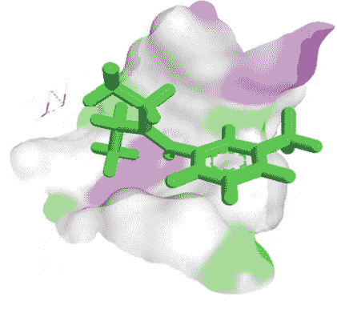

图 2.3 使用 PyMOL 软件可视化的 3K1E 结合口袋与香茅醛之间的相互作用。

- 6) 脚本编写：PyMOL 内置 Python 解释器，允许进行复杂的脚本编写和自动化。这为软件内的定制和新工具开发提供了潜力。

在生物信息学领域，PyMOL 通常用于可视化蛋白质结构、分析蛋白质-配体相互作用以及为科学出版物准备图表等任务。研究人员还使用它来了解遗传突变的结构含义，这在药物发现和开发等领域可能很有用——例如，在探索潜在驱蚊分子的过程中，作者对各种挥发性物质进行了广泛筛选。此过程涉及检查与 3K1E 的相互作用，3K1E 是源自埃及伊蚊（一种蚊子物种）的嗅觉结合蛋白 1 (AegOBP1) 的晶体结构。该分析使识别潜在驱避剂物质成为可能。该研究在提供的链接 (https://doi.org/10.2210/pdb3K1E/pdb) 中有详细介绍，发现了香茅醛作为一个有希望的候选物。发现香茅醛（香茅油的常见成分）能有效与 3K1E 结合口袋相互作用，表明其作为驱蚊剂的潜力。这些相互作用及其含义在图 2.3 中以视觉形式呈现。这项研究凸显了生物信息学在公共卫生中的重要作用，即通过帮助开发更有效的驱蚊剂，可以显著促进蚊媒疾病的预防。

## 2.3.2.6 Cytoscape

Cytoscape 是一个备受推崇的开源生物信息学软件平台，用于可视化复杂网络。虽然它主要用于分子生物学和基因组学领域，但它功能多样，可以处理任何类型的网络数据 [62]。Cytoscape 的优势在于其能够将生物分子相互作用网络与注释、基因


表达谱以及其他状态数据。Cytoscape 的基本前提是允许用户导入交互网络（例如，蛋白质-蛋白质交互、基因调控网络或代谢途径），然后叠加其他数据，如基因表达水平、细胞过程或疾病状态。这有助于生成复杂且富有洞察力的可视化结果，帮助理解复杂的生物过程和模式。除基本网络可视化外，Cytoscape 还提供大量功能，进一步支持生物信息学分析。它可以整合多种数据类型和来源，包括本地和远程数据库。Cytoscape 可以通过插件扩展以纳入新功能，有许多可用插件涵盖各种生物学分析和功能。它为网络布局、筛选以及节点和边属性的操作提供了先进的方法。Cytoscape 插件（如 BiNGO 和 ClueGO）有助于功能富集分析，揭示大型基因集中普遍存在的生物学主题。它可以生成适合用于科学出版物的高质量图像。Cytoscape 的一个显著特点是其广泛的社区支持。大量插件、定期更新以及活跃的用户论坛使其适应性强，适合多种类型的分析 [63]。

### 2.3.2.7 MOE (Molecular Operating Environment)

MOE 是一个完全集成、用户友好的软件套件，用于计算化学、分子建模和生物信息学。Chemical Computing Group 开发了它，并为小分子和生物药物基础的发现研究与开发提供了广泛的工具。MOE 的广泛适用性涵盖化学信息学、基于结构的设计、生物信息学、分子建模和模拟等领域，使其成为学术界和工业界不可或缺的工具 [64]。它既能处理小分子，也能处理大型生物系统，允许用户建模和模拟生化相互作用，因此对药物发现和设计极具价值。MOE 的关键功能包括分子建模和模拟、基于结构的设计、基于配体的设计、生物信息学和化学信息学以及数据分析。MOE 提供了一整套全面的建模工具，包括蛋白质和核酸构建工具、同源建模、构象搜索方法和分子动力学模拟。对于基于结构的设计，MOE 配备了用于蛋白质-配体对接、从头设计、药效团建模和自由能计算的工具，使研究人员能够建模和预测潜在药物与其生物靶标之间的相互作用。MOE 可以生成 2D 和 3D QSAR 模型，提供虚拟筛选和化合物库设计功能。MOE 包括序列比对工具、二级结构预测工具、聚类工具、数据可视化工具以及化学信息学功能，包括构效关系 (SAR) 和化学库设计。此外，MOE 强大的数据分析功能（如统计分析和 ML 工具）可用于理解和解释复杂数据集。

## 2.3.3 Cloud-Based Platform for Bioinformatics

基于云的生物信息学平台越来越受到采用，因为它们能够处理海量数据并提供高计算能力，其成本通常低于传统的本地托管服务器。这些平台提供可扩展资源，使研究人员能够灵活高效地处理大型数据集。表 2.8 突出了不同基于云的生物信息学平台的比较。以下小节介绍了一些最常用的基于云的生物信息学平台。

表 2.8 不同基于云的生物信息学平台的比较。

| 平台 | 提供商 | 关键功能 | 显著用例 |
| :--- | :--- | :--- | :--- |
| Google Cloud Genomics | Google | 与 Google AI 工具集成、高度可扩展、数据共享和协作能力 | 基因组数据处理、群体基因组学 |
| Amazon Web Services (AWS) Bioinformatics | Amazon | 高性能计算、大容量数据存储、强大安全性、与 AWS 易于集成 | 基因组测序、蛋白质结构预测 |
| Azure for Genomics | Microsoft | 与 Azure 服务无缝集成、高度可扩展、支持各种生物信息学工具 | 精准医疗、全基因组关联分析 |
| IBM Genomics | IBM | 与 IBM AI 能力集成、数据安全性、可扩展性 | 基因组研究、个性化医疗 |
| Galaxy | 独立 | 开源，广泛用于基因组学研究，活跃社区，支持许多生物信息学工具 | 基因组学数据分析、变异检测 |
| Seven Bridges Genomics | 独立 | 专为基因组学设计，强大的协作功能，合规性 | 大规模基因组测序、协作研究项目 |

### 2.3.3.1 Google Genomics

Google Genomics 是 Google Cloud Platform (GCP) 的一部分，是一项用于存储、处理、探索和共享大型复杂基因组数据集的基于云的服务 [65]。它提供了一套服务，可促进广泛的生物信息学分析，充分利用 GCP 强大且可扩展的基础架构。Google Genomics 服务建立在 Google 的核心数据存储和计算技术之上，继承了其高效性、可靠性和可扩展性。它允许研究人员将大量基因组数据无缝迁移到云端，克服这类大型数据集通常伴随的存储挑战。

Google Genomics 的核心是 BigQuery 平台，这是一个高度可扩展、无服务器且高可用的多云数据仓库。BigQuery 允许使用类似 SQL 的查询快速探索基因组数据集，使研究人员能够快速高效地挖掘基因组数据。在处理海量数据集（例如由下一代测序技术生成的数据）时，这特别有用。此外，Google Genomics 还集成了流行的生物信息学工具并支持标准基因组格式（如 FASTQ、BAM 和 VCF 文件）。它与基因组分析工具包 (GATK) 及其他工具的兼容性，促进了从变异检测到全基因组关联分析 (GWAS) 的广泛基因组分析。在协作方面，Google Genomics 促进数据共享和合作工作。研究人员可以控制谁有权访问其数据，从而实现安全协作。此外，还可以导入公共基因组数据集并与私有数据一起分析，使其成为比较基因组学的有用工具。因此，Google Genomics 为存储、分析和共享基因组数据提供了高效且可扩展的解决方案。通过利用云计算的强大功能，它让研究人员能够专注于研究问题，而无需担心计算资源，使其成为现代生物信息学中不可或缺的工具。

### 2.3.3.2 Amazon Web Services (AWS) for Genomics

AWS for genomics 是一个专门为支持基因组学研究而设计的高度可扩展云计算平台 [66]。它提供了一套服务，以满足基因组数据存储、处理、分析和协作的大量计算需求。AWS for genomics 的一个关键特性是其庞大的存储能力，能够处理基因组研究通常关联的海量数据。AWS 提供多种存储选项，包括针对数据归档和备份进行优化的 Amazon S3 (Simple Storage Service)，以及为数据归档和长期备份提供低成本存储的 Amazon Glacier。AWS for genomics 在提供高计算能力方面也表现出色。它支持分布式计算，从而可以高效处理大型数据集。它是可扩展的，意味着计算资源可以根据项目需求进行调整。这包括高性能计算 (HPC) 选项、用于机器学习应用的 GPU 实例以及用于硬件加速的 FPGA 实例。该平台与流行的生物信息学工具无缝集成，并支持常用的基因组数据格式。AWS 与各种基因组软件提供商合作，确保其工具能在 AWS 基础架构上流畅运行。这些工具包括用于比对读段、变异检测和功能注释等的工具。AWS for genomics 还支持协作研究。它提供高级安全功能，包括加密和访问控制，允许安全地共享数据和结果。此外，它还支持使用 Jupyter Notebooks，有助于促进可重复研究和协作。最后，AWS 提供按量付费模式，这意味着研究人员只需为其实际使用的资源付费。该模式结合 AWS 的可扩展性，使其成为基因组学研究的一种经济高效的解决方案，特别是对于计算需求波动的项目。

### 2.3.3.3 Microsoft Azure for Research

Microsoft Azure for Research 是一个强大的云计算平台，旨在支持包括生物信息学和基因组学在内的多个学科的研究 [67]。


利用 Azure 强大的基础设施和先进的计算能力，研究人员可以轻松高效地处理大规模数据集并进行复杂的计算分析。Microsoft Azure for Research 的一个关键方面是其庞大的存储能力。它可以轻松容纳生物信息学研究中通常产生的大量数据，例如高通量测序数据。Azure 提供多种存储解决方案，例如用于非结构化数据的 Azure Blob 存储和用于共享存储场景的 Azure 文件存储。在计算资源方面，Azure for Research 提供可扩展且通用的环境。它支持高性能计算（HPC）、用于机器学习任务的 GPU 以及多种可根据研究项目特定需求定制的虚拟机。这种可扩展性允许研究人员根据项目要求动态调整计算资源，提高效率和成本效益。

Microsoft Azure for research 还与流行的生物信息学工具和流水线实现无缝集成，支持从序列比对到变异检测和基因组组装等多种分析。此外，Azure 对容器技术（例如 Docker 和 Kubernetes）的支持，允许创建可复现且可移植的计算环境，这在生物信息学研究中特别有用。协作是 Azure 另一项擅长的领域。Azure 提供全面的安全功能，包括加密和严格的访问控制，使研究人员之间能够安全共享数据。此外，Azure Notebooks 支持 Jupyter Notebooks，促进可复现研究和协作分析。Azure 的定价模式也旨在支持研究，采用按需付费制度，确保研究人员仅为所使用的资源付费。通过 Azure for Research 计划，还有面向研究人员的资助可供申请，进一步提高了其可访问性。

### 2.3.3.4 IBM Watson for Genomics

IBM Watson for Genomics 是一个基于云、由 AI 驱动的平台，旨在支持基因组研究 [68]。通过利用 IBM Watson 的 AI 能力，该平台允许研究人员注释、解释和理解从下一代测序数据中得出的遗传变异的功能意义，从而加速基因组学研究及其临床应用。IBM Watson for Genomics 的独特卖点之一是其整合和分析结构化及非结构化生物医学数据的能力。该平台利用 AI 从海量基因组数据、医学文献、指南和研究数据库中提取相关信息，帮助研究人员解读遗传变异的功能意义。Watson 的 AI 算法会不断学习并以新发现更新其知识库，确保提供最新的洞察。此外，Watson for Genomics 提供高度可扩展的基于云的环境，能够处理基因组学研究的大量存储和计算需求。Watson 的深度学习算法也非常高效，与传统方法相比，大幅缩短了分析基因组数据集所需的时间。在协作方面，Watson for Genomics 促进数据共享和合作工作。它提供先进的安全措施，确保研究人员之间安全地共享数据。此外，它还允许生成详细且易于理解的基因组报告，这些报告可以与合作者甚至患者共享，支持个性化医疗工作。IBM Watson for Genomics 的一个值得注意的应用是在癌症研究领域，其中它用于根据患者肿瘤的独特基因特征识别潜在的治疗靶点。然而，其应用不仅限于肿瘤学；它可以用于任何需要基因组数据解释的研究。

### 2.3.3.5 Galaxy

Galaxy 是一个用于可访问、可复现和透明的计算生物医学研究的开源基于 Web 的平台 [69]。Galaxy 旨在使计算生物学对没有计算机编程经验的研究人员也易于使用，并提供用户友好的界面来进行复杂的生物信息学分析。Galaxy 提供了一个环境，用户可以在其中执行、复现和共享完整的分析。这是通过其基于 Web 的用户界面实现的，该界面使用户能够在无需编写代码的情况下创建、运行和共享工作流。该平台包含一系列广泛的流行生物信息学工具，新工具可以由用户社区添加，这有助于提升平台的通用性。该平台并不局限于特定的工具集或学科。它支持基因组学、转录组学、蛋白质组学、宏基因组学等多个领域的大规模研究。Galaxy 中可以找到用于质量控制、数据清洗、可视化、统计分析及许多其他任务的工具。

Galaxy 的关键特性之一是其对可复现性的关注。在 Galaxy 上执行的每个分析都会自动跟踪，并以一种存储格式保存，使研究人员能够重复和理解所使用的计算方法。这也有助于与合作者共享工作流和结果，促进协作研究。Galaxy 可以在个人计算机、本地服务器或云计算平台上运行，提供灵活性以适应各种计算需求和资源。基于云的 Galaxy 实例，例如运行在 Amazon Web Services (AWS) 上的 Galaxy 或运行在 Google Cloud Platform (GCP) 上的 Galaxy，可以提供更多计算资源并促进大规模分析。此外，Galaxy 项目培育了一个活跃且支持性的社区，有助于平台的持续开发和改进。该社区还提供了大量学习资源，帮助用户了解如何最佳地使用 Galaxy 平台。

### 2.3.3.6 Seven Bridges Genomics

Seven Bridges Genomics 是一个基于云的平台，旨在通过为数据分析、管理和协作提供统一环境来促进生物信息学和基因组研究 [70]。该平台的直观界面和强大的计算基础设施既适合经验丰富的生物信息学家，也适合没有大量编程经验的研究人员，使其成为基因组领域的一款通用工具。该平台提供大量存储和计算资源，能够管理基因组学中典型的大量数据。凭借其高效的数据压缩和传输功能，Seven Bridges Genomics 优化数据存储并减少数据传输所需的时间。

Seven Bridges Genomics 的一个决定性特征是其用于基因组数据分析的全面工具集。该平台提供超过 800 种生物信息学工具和工作流的访问权限，包括广泛使用的序列比对、变异检测和 RNA-seq 分析工具。该平台还支持通用工作流语言 (CWL)，从而能够创建可复现且可移植的工作流。此外，Seven Bridges Genomics 高度重视协作。该平台提供复杂的数据共享功能，使研究人员能够安全地共享原始数据和分析结果。它还允许共享工作流，促进可复现研究，并在科学界内培养协作。Seven Bridges Genomics 还可与 The Cancer Genome Atlas (TCGA) 和 1000 Genomes Project 等公共数据库无缝集成。此功能允许研究人员将公开可用的数据纳入其分析中，或将其结果与现有数据集进行比较，从而扩大潜在研究问题的范围。Seven Bridges Genomics 采用按需付费定价模式，这意味着研究人员只需为其使用的计算资源付费。该模式结合平台的可扩展性，确保了任何规模项目的成本效益分析。

## 2.4 生物信息学中的应用

生物信息学在生命科学的各个领域中具有深远的重要性。它涵盖从基因组和蛋白质组序列分析到结构生物学、药物发现和系统生物学等多个方面。其应用已从根本上加快了发现的步伐，为复杂的生物学世界提供了新的洞察，并在个性化医疗中发挥着关键作用。以下小节将深入探讨生物信息学的众多应用。图 2.4 说明了生物信息学如何帮助预测蛋白质结构、绘制生物分子序列图谱、追踪进化基因树、设计引物等，从而对我们理解生物系统和疾病机制做出重大贡献。

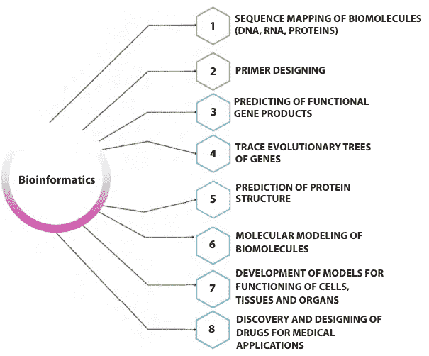

图 2.4 生物信息学各种应用示意图。


## 2.4.1 Sequence Mapping of Biomolecules (DNA, RNA, and Proteins)

Bioinformatics is fundamental to the sequence mapping of biomolecules such as DNA, RNA, and proteins, forming the backbone of genomic and proteomic research. With the advent of high-throughput sequencing technologies, large volumes of sequence data are generated, necessitating efficient bioinformatics tools for analysis. For DNA, bioinformatics allows researchers to map raw sequence reads to reference genomes, detect genetic variations, and understand their potential functional implications. Similarly, in RNA-Seq analysis, bioinformatics aids in mapping transcript sequences, quantifying gene and transcript expression levels, and detecting alternative splicing events. For proteins, bioinformatics tools are used to predict the amino acid sequence based on the DNA sequence, identify functional domains, and explore posttranslational modifications. These sequence mapping processes provide essential insights into the function of these biomolecules, their interactions, and their role in health and disease. Therefore, bioinformatics serves as a key enabling technology in the study and understanding of the molecular blueprints of life.

## 2.4.2 Primer Design

Bioinformatics plays an integral role in the design of primers, which are sequences of nucleic acids that serve as starting points for DNA synthesis in procedures such as polymerase chain reaction (PCR), DNA sequencing, and genetic testing. The selection of an appropriate primer sequence is crucial to ensuring the specificity and efficiency of these procedures. Bioinformatics tools, such as primer design software, can analyze a given DNA sequence to identify suitable primer binding sites, considering factors such as primer length, melting temperature, GC content, and the potential for secondary structure or primer-dimer formation. These tools can also verify the specificity of the designed primers against whole-genome sequences to avoid nonspecific amplification. Additionally, in multiplex PCR, bioinformatics can help design multiple primer sets that can operate concurrently without interfering with each other. Therefore, bioinformatics not only enhances the accuracy and efficiency of primer design but also expedites the overall process, making it an essential tool in molecular biology and genetic research.

## 2.4.3 Prediction of Functional Gene Products

Bioinformatics is fundamental in predicting functional gene products, a crucial step in deciphering the complexity of biological systems and understanding the basis of diseases. From a given DNA sequence, bioinformatics tools can identify potential genes and their structures, which include coding regions (exons), noncoding regions (introns), and regulatory elements. Once the genes are identified, sequence analysis can predict the resultant RNA and protein sequences. The functional annotation of these predicted gene products is performed using various bioinformatics databases and tools, which compare the predicted sequences with those of known function. This process can identify potential homologs, conserved domains, and motifs, providing insights into the probable function of the gene product. Additionally, bioinformatics can predict posttranslational modifications and interaction partners of the protein, offering further clues about its function. In the context of diseases, predicting functional gene products can reveal pathogenic mutations and potential therapeutic targets. Therefore, bioinformatics plays an indispensable role in predicting and functionally analyzing gene products, which has significant implications for both biology and medicine.

## 2.4.4 Trace Evolutionary Trees of Genes

Bioinformatics plays a pivotal role in tracing evolutionary trees, or phylogenies, of genes, a process that provides significant insights into the history of life and the molecular mechanisms underlying evolution. This process, known as phylogenetic analysis, involves the use of computational tools and algorithms to align sequences, calculate genetic distances, and construct phylogenetic trees. By comparing the sequences of a particular gene across different species, scientists can infer the evolutionary relationships among those species, understand the timing of evolutionary events, and identify the functional changes brought about by genetic variations over time. These evolutionary trees also allow us to understand how genes have evolved, duplicated, or been lost over millions of years. Moreover, phylogenetic analyses aid in identifying conserved sequences that play crucial roles in maintaining an organism's function and survival. Consequently, by enabling the tracing of evolutionary gene trees, bioinformatics enhances our understanding of evolution, biodiversity, and the complex relationship between genotype and phenotype.

## 2.4.5 Prediction of Protein Structure

Bioinformatics is indispensable in the field of protein structure prediction, which is fundamental to understanding the relationship between a protein's structure and its function. Given that the experimental determination of protein structures is often resource intensive and time consuming, computational methods offer a valuable alternative. Starting from the primary amino acid sequence of a protein, bioinformatics tools are used to predict secondary structural features such as alpha helices, beta sheets, and turns. Following this, advanced algorithms such as homology modeling, threading, and ab initio methods are employed to predict the three-dimensional structure of the protein. These models are crucial for gaining insights into protein functions, interactions, and enzymatic activities. Additionally, predicted protein structures are immensely valuable in drug discovery processes, where they facilitate the identification of potential drug targets and the design of drug molecules. Thus, bioinformatics plays an essential role in protein structure prediction, significantly advancing our understanding of protein biology and its applications in therapeutics.

## 2.4.6 Molecular Modeling of Biomolecules

Bioinformatics plays a pivotal role in the molecular modeling of biomolecules, a key process in understanding biological functions and interactions at the atomic level. This process encompasses the creation of three-dimensional structures of DNA, RNA, and proteins based on their sequence data, providing significant insights into their functions. Molecular dynamics simulations, a tool within bioinformatics, are utilized to study the physical movements and conformational changes of these biomolecules, revealing how they interact with each other and their environment. The modeling of complex biomolecular interactions, such as protein-protein, protein-DNA, or protein-ligand interactions, is critical to understanding cellular processes and the molecular basis of diseases. Furthermore, these models are essential in the field of rational drug design, where potential drugs are screened and optimized based on their predicted interactions with target molecules. Hence, the application of bioinformatics to molecular modeling forms the foundation for understanding biological systems and developing therapeutic interventions.

## 2.4.7 Development of Models for the Functioning of Cells, Tissues, and Organs

In the field of systems biology, bioinformatics plays a critical role in developing comprehensive models that elucidate the functioning of cells, tissues, and organs. Due to the immense complexity of biological systems, sophisticated computational models are essential to understanding and predicting their behaviors. Bioinformatics tools assist in decoding vast amounts of genomic, transcriptomic, proteomic, and metabolomic data to uncover intricate interactions and regulatory networks within cells. These networks can then be modeled to provide insights into cellular functions and to predict how changes in these networks can lead to diseases. On a larger scale, bioinformatics aids in tissue- and organ-level modeling by utilizing data about cell-cell interactions and communication as well as spatial and temporal patterns of gene expression. These models can help predict tissue or organ responses to various stimuli or pathological conditions and can be used to simulate the impact of potential therapeutic interventions. By integrating and interpreting multiscale data, bioinformatics significantly contributes to our understanding of complex biological systems, ultimately assisting in the development of more effective and targeted treatment strategies.

## 2.4.8 Drug Design and Development

Bioinformatics analysis serves as a powerful accelerant in the stages of drug discovery, notably in the identification of drug targets, screening, and refinement of drug candidates, as well as in the characterization of side effects and prediction of drug resistance [71]. This process typically involves the comparative analysis of high-throughput molecular data derived from patients, animal disease models, human cell lines, and normal controls. The principal objectives of bioinformatics in drug discovery include (1) establishing a link between disease symptoms and genetic mutations, epigenetic modifications, and other modulations of gene expression mediated by environmental factors; (2) identifying drug targets capable of restoring cellular function or eliminating dysfunctional cells; (3) predicting and refining drug candidates to achieve the intended therapeutic outcomes while minimizing side effects; and (4) assessing the environmental health impact and potential for drug resistance. These objectives underscore the pivotal role that bioinformatics plays in navigating the complex landscape of drug discovery.

Omics data have a broad range of applications in drug discovery, as summarized in Table 2.9. This includes data from genomics (the study of genes), transcriptomics (the study of mRNA transcripts), proteomics (the study of proteins), metabolomics (the study of metabolites), and many other "-omics" fields. In the context of target identification and validation, omics data can identify and validate new drug targets by studying the genes, proteins, and metabolites involved in disease processes—for instance, genomics data can


揭示某些疾病中发生突变的基因，而蛋白组学数据可以识别过表达或低表达的蛋白质。在药物重新定位方面，组学数据可以揭示现有药物的新用途——例如，通过比较用不同药物处理的细胞的转录组谱，研究人员可能识别出诱导类似反应的药物，从而可能用于治疗相同的疾病。在精准医学中，组学数据可以基于患者的遗传或分子特征将患者分层为不同群体，从而实现更个性化的治疗策略——例如，基因组

## 表 2.9 组学数据及其在药物发现中的应用摘要。

| 组学数据类型 | 描述 | 在药物发现中的应用 | 数据库 |
|---|---|---|---|
| 基因组学 | 基因组学涉及对生物体整个基因组的研究，包括基因组的结构、功能、进化和测绘 | 鉴定与疾病相关的基因和遗传变异作为潜在药物靶点；基于个体的遗传构成预测药物反应，用于精准医疗 | dbGaP<br>GWAS Catalog<br>GWAS central<br>PharmGKB |
| 转录组学 | 转录组学是研究在特定条件下或特定细胞中由基因组产生的完整 RNA 转录集合 | 了解基因表达谱对疾病或药物治疗的变化可为新治疗策略的开发提供信息；鉴定新的药物靶点和生物标志物 | ArrayExpress<br>DrugMatrix<br>Expression Atlas<br>GEO repository<br>LINCS 1000<br>TG-GATE |
| 蛋白组学 | 蛋白组学涉及对蛋白质的大规模研究，包括其结构、功能和相互作用 | 了解生物系统中蛋白质的功能和相互作用以鉴定潜在药物靶点；发现用于疾病诊断和预后的生物标志物；分析药物治疗响应中蛋白质表达或修饰的变化 | PRIDE Archive<br>Peptide Atlas<br>ProteomicsDB<br>Human Proteome Map<br>Human Proteome Atlas |
| 代谢组学 | 代谢组学是研究生物样本中完整代谢物集合的学科，可提供关于细胞功能状态的见解 | 鉴定疾病或药物治疗响应中代谢物水平的变化，可为药物开发提供信息；发现用于疾病诊断、预后和药物反应预测的生物标志物 | Human Metabolome<br>Madison Metabolomics<br>Golm Metabolome Database<br>MassBank<br>MetaboLights<br>MetabolomeExpress |

注意：每种组学数据类型都提供了关于生物系统的不同层次信息，可以单独使用或联合用于药物发现。

数据可用于基于个体的遗传构成识别可能对特定药物产生反应的患者。重要的是，组学数据（尤其是基因组数据）在药物基因组学中发挥着关键作用，药物基因组学研究个体的遗传构成如何影响其对药物的反应。这可以带来个性化的药物处方，以最大限度地提高疗效并最小化副作用。组学数据还有助于阐明药物的作用机制——例如，蛋白组学数据可以揭示药物相互作用的蛋白质，而代谢组学数据可以显示药物如何影响细胞代谢。此外，组学数据有助于发现生物标志物和药物治疗生物状态或反应的可测量指标。这些生物标志物可用于临床试验，以评估新药的疗效和安全性。

此外，生物信息学在药物设计中的应用大致可分为多种方法，包括配体基础、靶点基础、从头开始和基于结构的药物设计。每种方法在药物发现和开发的整体过程中都具有独特的作用和应用，如表 2.10 所述。对于配体基础方法，这些方法依赖于以前鉴定的生物活性分子（配体）的知识，这些分子与感兴趣的靶点相互作用。配体基础方法中的主要技术之一是定量结构-活性关系（QSAR）建模。QSAR 模型将化合物的化学结构与其生物活性相关联，从而允许预测新化合物的活性。同样，药效团建模是另一种配体基础方法，用于识别药物发挥活性所需关键特征的空间排列。这些模型可用于搜索化合物数据库，寻找具有相似特性的化合物，这些化合物可能也会与靶点相互作用。

## 表 2.10 不同生物信息学和药物设计方法及其作用摘要。

| 药物设计方法 | 描述 | 作用 |
|---|---|---|
| 配体基础方法 | 配体基础方法涉及使用已知活性化合物（配体）来设计新的药物候选物。所使用的技术包括三维定量结构-活性关系（3D QSAR）建模和药效团建模。 | 当靶点结构未知时使用。这些方法旨在寻找或设计与已知活性化合物具有相似特性的新化合物。 |
| 靶点基础方法 | 靶点基础方法涉及使用关于药物生物靶点的知识。这种方法通常涉及对接等技术，用于预测潜在药物与其靶点之间的相互作用。 | 当靶点结构已知时使用。其目标是设计与靶点有效相互作用的药物，通常通过嵌入靶点上的活性位点。 |
| 从头开始方法 | 从头开始药物设计涉及使用计算方法，基于靶点位点的特性从头设计新的药物分子。 | 当靶点结构已知时使用。这些方法旨在设计与靶点位点良好契合的新药物，通常在已知配体不可用或无效的情况下。 |
| 基于结构的药物设计（SBDD） | 基于结构的药物设计涉及使用生物靶点的三维结构来设计药物。这通常涉及 X 射线晶体学或 NMR 光谱法来确定靶点的结构，并使用计算方法来设计药物。 | 当靶点的三维结构已知时使用。其目标是设计与靶点三维结构有效相互作用的药物，通常通过嵌入靶点上的活性位点。 |

注意：每种方法都有其自身的优势和劣势，方法的选择通常取决于药物设计项目的具体情况。

方法。从头开始药物设计方法旨在在给定一组明确的化学构建模块和靶点活性位点的情况下，从头设计新型药物样分子。为了将组件组装成在活性位点内契合良好并具有良好预测活性的新分子，从头开始药物设计可以使用药物化学规则、来自实验或计算方法的活性位点信息以及优化算法作为指导。此外，基于结构的药物设计依赖于对生物靶点三维结构的知识，该知识主要通过


X射线晶体学、核磁共振光谱学或冷冻电子显微镜。详细的结构信息可用于设计能够结合到靶点功能位点的药物。SBDD中使用的技术包括分子对接，即将潜在药物通过计算机装配到靶点的活性位点，以及分子动力学模拟，它可以提供药物-靶点相互作用的动态视图。所有这些方法都具有独特的优势，可以单独或联合使用以指导药物发现过程。

表 2.11 提供了多个病例研究，以更清晰地理解生物信息学在药物设计与开发中的应用。每项研究都展示了生物信息学对现代治疗学进步做出重大贡献的独特方式——例如，Ghaffari 等人 [72] 开展了一项 I/II 期临床试验，以探讨慢性髓系白血病（CML）患者的替代方案，这些患者在接受至少15个月的伊马替尼（一种显著改善了CML治疗但并非所有患者都能实现完全缓解的药物）治疗后仍持续存在分子残留疾病。这些患者接受了 PR1/BCR-ABL 多肽疫苗接种。疫苗接种后1个月，四名患者的BCR-ABL转录水平显著下降，其中四名患者实现了主要分子学缓解（MMR）。7年随访后发现，疫苗接种使五名患者达到了MMR，一名患者达到了完全分子学缓解（CMR）。然而，在两名疫苗接种后达到MMR的患者停用伊马替尼后，白血病出现了复发和再燃。这表明，免疫疗法与伊马替尼治疗的联合方案可能改善CML患者的长期临床和分子学反应。

表 2.11 药物发现与开发中生物信息学的病例研究。

| 病例研究 | 研究问题 | 使用的生物信息学方法 | 关键发现 | 参考文献 |
| :--- | :--- | :--- | :--- | :--- |
| 1. 针对慢性髓系白血病的PR1/BCR-ABL多肽疫苗开发 | 如何靶向导致慢性髓系白血病的BCR-ABL癌基因？ | BCR-ABL转录 | 确定免疫疗法与伊马替尼靶向治疗的联合方案是PR1/BCR-ABL癌基因的强效抑制剂，从而成功应用于慢性髓系白血病治疗。 | Ghaffari 等人 [72] |
| 2. HIV蛋白酶抑制剂 | 如何阻止患者体内的HIV复制？ | 计算化学及对达那韦耐药HIV-1变异体的抗病毒活性 | 成功开发出达那韦等抑制HIV蛋白酶的药物，从而阻止病毒成熟 | Ma 等人 [73] |
| 3. 乳腺癌脑转移的个体化医疗 | 我们能否预测个别乳腺癌患者对特定疗法的反应？ | 基因组数据分析，特别是基因表达谱 | 鉴定与特定乳腺癌治疗反应相关的特定遗传特征，从而能够制定更个体化的治疗策略 | Morikawa 等人 [74] |

耐药HIV-1变异体日益频繁地出现，亟需开发能够对抗这些多药耐药株的强效蛋白酶抑制剂。在 Ma 等人 [73] 的一项研究中，研究人员合成了一系列新的HIV-1蛋白酶抑制剂，将酚或多酚作为P2配体，并引入各种磺酰胺类似物作为P2配体。许多这些新型抑制剂表现出令人印象深刻的抗病毒活性和酶抑制作用。具体而言，抑制剂15d和15f在低皮摩尔范围内表现出强效的抑制活性，其中15f对达那韦耐药HIV-1变异体尤为有效。分子建模研究进一步阐明了这些抑制剂与酶腔之间的相互作用，为未来优化这些强效抑制剂提供了宝贵的见解。

2023年，Morikawa 等人 [74] 阐明了脑转移的潜在治疗策略。脑转移通常具有独特的分子特征，可作为治疗干预的潜在靶点。研究人员研究了12例来源于乳腺癌的脑转移的分子谱，并将其与原发性乳腺肿瘤进行对比。作者从这些脑转移中构建了六例患者来源的异种移植模型（PDXs），并将这些PDXs用作潜在分子靶点研究的平台。值得注意的是，在原发肿瘤中发现的许多改变也存在于脑转移中，特别是在免疫相关和代谢通路中。当暴露于350多种药物时，这些PDXs对组蛋白去乙酰化酶抑制剂和蛋白酶抑制剂表现出高度敏感性。这一研究强调了配对原发性乳腺肿瘤与脑转移之间存在显著的分子差异。与使用肿瘤基因组分析的现有临床试验相结合，他们的功能性精准医疗策略通过扩大来源于乳腺癌的脑转移的潜在治疗途径，提出了有价值的增强方案。

### 2.5 生物信息学中的挑战与机遇

生物信息学面临着若干必须克服才能实现成功药物开发的独特挑战。生物信息学中的主要挑战之一是处理生物数据的巨量和复杂性。这一问题源于高通量筛选和下一代测序的进步，这些进步大幅提高了数据生成速度。因此，管理、分析和解释这股数据洪流是艰巨的任务，需要复杂的计算算法和大量的存储能力。此外，与数据质量和标准化相关的问题在生物信息学中也构成了相当大的挑战。生物实验受大量变量的影响，常常产生不一致且含噪声的数据。此外，缺乏表示和交换数据的标准格式，使得合并和比较来自不同来源的数据变得更加困难。这可能使生物信息学工具更难预测药物的安全性和有效性。尽管如此，认识到这些挑战也带来机遇至关重要。这些问题可以通过使数据管理系统更智能、改进人工智能和机器学习以及致力于数据标准化来解决 [75–77]。这将帮助生物信息学在药物发现与开发中发挥其全部潜力 [78, 79]。

### 2.6 生物信息学在药物设计中的未来方向

生物信息学在药物设计中的未来充满巨大潜力，尤其是随着技术的发展和计算能力的不断提升。随着生物系统复杂性的不断加深，生物信息学在药物发现中的作用将进一步提升。表 2.12 概述了生物信息学在药物设计与开发中的一些未来方向。

表 2.12 生物信息学在药物设计与开发中的未来方向。

| 未来方向 | 描述 |
|---|---|
| 用于蛋白质结构预测和药物–靶点相互作用模拟的增强算法 | 开发和改进用于准确蛋白质结构预测和药物–靶点相互作用模拟的算法，可以简化药物靶点鉴定并加快药物发现的早期阶段。 |
| ML与AI的集成 | 将机器学习和AI技术纳入生物信息学，将使处理大型复杂生物数据集更加高效，从而得出更精确、更可靠的预测。 |
| 多组学数据整合 | 结合基因组学、转录组学、蛋白质组学和代谢组学数据，可以全面了解不同生物功能层面的疾病过程和药物相互作用，揭示新的药物靶点和治疗策略。 |
| 生物信息学在个体化医疗中的应用 | 随着个体化基因组数据的日益普及，生物信息学将在分析这些数据集、将遗传变异与疾病风险相关联、预测个体对药物的反应以及协助设计个体化治疗策略方面发挥至关重要的作用。 |
| 生物标志物鉴定 | 生物信息学可以帮助鉴定用于早期疾病检测、患者分层和监测药物反应的生物标志物，从而帮助实现个体化医疗的全部潜力。 |


靶点并加速药物发现的早期阶段。此外，整合机器学习和人工智能将能够更高效地处理大型、复杂的生物学数据集，从而产生更精确、更可靠的输出。

对多组学数据整合日益关注是生物信息学另一个令人兴奋的未来方向，有可能彻底改变药物设计。目前，基因组学、转录组学、蛋白质组学和代谢组学数据通常被独立分析。然而，整合这些多组学数据可以更全面地理解不同生物学功能水平上的疾病过程和药物相互作用。此类整合分析可以揭示在分别分析每种数据类型时可能被遗漏的新药物靶点和治疗策略。生物信息学工具和策略在促进这种整合、管理多组学数据的复杂性和规模以及提取有意义、可操作的见解方面将发挥关键作用。

个性化医学是生物信息学有望产生重大影响的另一个领域。随着测序技术的进步和基因组测序成本的降低，个体基因组数据变得越来越容易获取。生物信息学将在分析这些海量数据集、将遗传变异与疾病风险相关联、预测个体对药物的反应以及帮助设计个性化治疗策略方面发挥至关重要的作用。此外，生物信息学还可以协助识别早期疾病检测、患者分层和药物反应监测的生物标志物，从而帮助实现个性化医学的全部潜力。展望未来，生物信息学在药物设计和发现中的角色将变得更加核心和具有影响力。

### 2.7 结论与前景

生物信息学，即应用计算技术来管理和分析生物学数据，已极大地改变了药物发现的格局。本章阐述了生物信息学丰富而多面的格局，探讨了其众多应用以及对药物设计与开发领域的深远影响。作为生物学、计算机科学和信息技术的结合，生物信息学已被证明是在处理和分析复杂生物学数据集中不可或缺的工具。生物信息学管理、分析和解释大规模生物学数据的能力已彻底改变了药物发现与开发的方法。它促进了基因组序列的解码、遗传变异的理解、蛋白质结构和功能的预测以及新型治疗靶点的鉴定，从而加速了从基础研究向临床应用的转变。特别值得关注的是，生物信息学能够实现药物–靶点相互作用的计算机模拟。这一强大工具使科学家能够以前所未有的规模和速度模拟和研究分子相互作用，显著降低了传统实验室和临床试验相关的时间和成本。此外，生物信息学为人工智能（AI）和机器学习（ML）算法的应用提供了强大平台，这些算法在从海量基因组、蛋白质组和代谢组数据中识别模式和进行预测方面显示出显著潜力。此类应用进一步提升了药物设计过程的效率和精度，为个性化医学和药物重新用途开辟了新途径。然而，将生物信息学整合到药物设计和开发过程中并非没有挑战。与数据质量、计算资源需求、模型可解释性以及数据隐私和安全相关的问题需要得到解决。此外，围绕数据使用的伦理考量以及算法预测中潜在的偏见，使得制定严格的法规和标准势在必行。尽管存在这些困难，生物信息学在未来药物研发与设计方面蕴藏着巨大希望。它所推动的进步正在改变我们对生物系统及其与治疗药物相互作用的理解。它催化了药物发现与开发从以实验为主的领域向数据密集型和计算驱动型学科的演变。随着知识的不断进步，设想生物信息学的进一步发展与人工智能和机器学习技术相结合将如何重塑医药研究格局，令人兴奋。这些技术有潜力使药物发现和开发更加高效、经济和个性化，标志着医疗保健新时代的到来。总之，生物信息学正处于药物设计与开发持续变革的最前沿。显而易见，其角色在人工智能和机器学习的推动下，将继续成为未来医药研究和医疗保健不可或缺的一部分。

## 参考文献

- 1. Hasija, Y.，第6章 - 结构生物信息学，载于：《生物信息学全书：从初学者到专家》，Y. Hasija（编），第135–152页，Academic Press，伦敦，英国，2023，https://doi.org/10.1016/B978-0-443-15250-4.00005-8。
- 2. Hasija, Y.，第1章 - 什么是生物信息学？，载于：《生物信息学全书：从初学者到专家》，Y. Hasija（编），第1–17页，Academic Press，伦敦，英国，2023，https://doi.org/10.1016/B978-0-443-15250-4.00012-5。
- 3. Research and Markets，2023年7月23日。https://www.researchandmarkets.com/reports/4829802/global-bioinformatics-market-by-product#src-pos-2。
- 4. Banimfreg, B.H.，生物信息学中云计算采用的综合回顾与概念框架。Healthcare Analytics，3，100190，2023，https://doi.org/10.1016/j.health.2023.100190。
- 5. Nakamae, K. 和 Bono, H.，基因组编辑与生物信息学。Gene Genome Editing，3-4，100018，2022，https://doi.org/10.1016/j.ggedit.2022.100018。
- 6. Romdhane, L.，Bouhamed, H.，Ghedira, K.，Ben Hamda, C.，Louhichi, A.，Jmel, H.，... Rebai, A.，生物信息学方法揭示的人类基因组病态皮肤解剖学。Genomics，112，6，4232–4241，2020，https://doi.org/10.1016/j.ygeno.2020.07.009。
- 7. Iqbal, N. 和 Kumar, P.，从数据科学到生物科学：生物信息学应用、工具与挑战的新时代。Proc. Comput. Sci.，218，1516–1528，2023，https://doi.org/10.1016/j.procs.2023.01.130。
- 8. Qazi, S. 和 Raza, K.，第1章 - 医疗保健中的转化生物信息学：过去、现在与未来，载于：《医疗保健与医学中的转化生物信息学》，K. Raza 和 N. Dey（编），第13卷，第1–12页，Academic Press，伦敦，英国，2021，https://doi.org/10.1016/B978-0-323-89824-9.00001-X。
- 9. Yu, J.，Blom, J.，Glaeser, S.P.，Jaenicke, S.，Juhre, T.，Rupp, O.，Goesmann, A.，比较基因组学生物信息学平台综述。EDGAR 2.0平台的最新进展及其在分类学和系统发育研究中的实用性。J. Biotechnol.，261，2–9，2017，https://doi.org/10.1016/j.jbiotec.2017.07.010。
- 10. Shoaib, M.，Singh, A.，Gulati, S.，Kukreti, S.，第8章 - 利用生物信息学数据和工具绘制基因组图谱，载于：《制药科学中的化学信息学与生物信息学》，N. Sharma，H. Ojha，P.K. Raghav，R.K. Goyal（编），第245–278页，Academic Press，伦敦，英国，2021，https://doi.org/10.1016/B978-0-12-821748-1.00002-6。
- 11. Nisar, N.，Mir, S.A.，Kareem, O.，Pottoo, F.H.，第4章 - 癌症生物标志物鉴定与药物发现中的蛋白质组学方法，载于：《蛋白质组学》，S. Ali，S. Majid，M.U. Rehman（编），第77–120页，Academic Press，伦敦，英国，2023，https://doi.org/10.1016/B978-0-323-95072-5.00001-8。
- 12. Palermo, A.，代谢组学和系统生物学引导的代谢物先导化合物及可成药靶点发现。Drug Discovery Today，28，2，103460，2023，https://doi.org/10.1016/j.drudis.2022.103460。
- 13. Xing, J.，Shankar, R.，Ko, M.，Zhang, K.，Zhang, S.，Drelich, A.，Chen, B.，解码COVID-19宿主转录组复杂性与变异，以针对新变种进行治疗发现。iScience，25，10，105068，2022，https://doi.org/10.1016/j.isci.2022.105068。
- 14. Larson, N.B.，Oberg, A.L.，Adjei, A.A.，Wang, L.，下一代测序生物信息学临床医生指南。J. Thoracic Oncol.，18，2，143–157，2023，https://doi.org/10.1016/j.jtho.2022.11.006。
- 15. Ayo, F.E.，Awotunde, J.B.，Ogundokun, R.O.，Folorunso, S.O.，Adekunle, A.O.，多靶点疾病诊断决策支持系统：一种生物信息学方法。Heliyon，6，3，03657，2020，https://doi.org/10.1016/j.heliyon.2020.e03657。
- 16. Roy, S.，癌症下一代测序生物信息学流程的原理与验证。Clinics Lab. Med.，42，3，409–421，2022，https://doi.org/10.1016/j.cll.2022.05.006。
- 17. Mitra, D.，Mitra, D.，Sabri Bensaad, M.，Sinha, S.，Pant, K.，Pant, M.，Das Mohapatra, P.K.，二十一世纪生物信息学的演变及其对现代生物科学的影响：特别关注药理学、植物科学和药物发现。Comput. Toxicol.，24，100248，2022，https://doi.org/10.1016/j.comtox.2022.100248。
- 18. Levy, J.，Lu, Y.，Montivero, M.，Ramwala, O.，McFadden, J.，Miles, C.，Vaickus, L.，人工智能、生物信息学与病理学：新兴趋势第一部分——机器学习技术简介。Adv. Mol. Pathol.，5，1，24，2022，https://doi.org/10.1016/j.amp.2023.01.001。
- 19. Theodosiou, A.A. 和 Read, R.C.，人工智能、机器学习与深度学习：感染临床医生的潜在资源。J. Infection，87，4，287–294，2023，https://doi.org/10.1016/j.jinf.2023.07.006。
- 20. Gupta, R.，Kumari, S.，Senapati, A.，Ambastha, R.K.，Kumar, P.，帕金森病中基于人工智能和机器学习的检测、诊断与治疗新时代。Ageing Res. Rev.，90，102013，2023，https://doi.org/10.1016/j.arr.2023.102013。
- 21. Wang, C.，Wang, L.，Li, Q.，Wu, W.，Yuan, J.，Wang, H.，Lu, X.，基于数据挖掘和生物信息学分析的强直性脊柱炎引起的骨质疏松症计算机辅助药物发现。World Neurosurgery，174，8–16，2023，https://doi.org/10.1016/j.wneu.2023.01.092。
- 22. O'Connor, L.M.，O'Connor, B.A.，Lim, S.B.，Zeng, J.，Lo, C.H.，转化神经科学中的整合多组学与系统生物信息学：一种数据挖掘视角。J. Pharm. Anal.，13，8，836–850，2023，https://doi.org/10.1016/j.jpha.2023.06.011。
- 23. Browne, R.B.，Vishwakarma, J.N.，Borah, V.V.，Pepu, R.K.，Roy, J.D.，第7章 - 针对COVID-19筛选药物候选物中数据科学、基因组学和生物信息学的计算机模拟应用，载于：《基因组学数据科学》，A.K. Tyagi 和 A. Abraham（编），第107–128页，Academic Press，伦敦，英国，2023，https://doi.org/10.1016/B978-0-323-98352-5.00016-1。
- 24. Sarigiannis, D.A.，Stratidakis, A.K.，Karakitsios, S.P.，计算机模拟方法与计算机毒理学，载于：《毒理学百科全书（第四版）》，P. Wexler（编），第503–507页，Academic Press，英国，2023，https://doi.org/10.1016/B978-0-12-824315-2.01173-8。


- 25. Paiva, V. d. A., Gomes, I. d. S., Monteiro, C.R., Mendonça, M.V., Martins, P.M., Santana, C.A., . . . Silveira, S. d. A., 蛋白质结构生物信息学：概述。计算生物学与医学，147，105695，2022，https://doi.org/10.1016/j.compbiomed.2022.105695.

- 26. Ajala, A., Uzairu, A., Shallangwa, G.A., Abechi, S.E., Ramu, R., Al-Ghorbani, M., 针对阿尔茨海默病的天然产物抑制剂作为潜在药物候选物：基于结构的药物设计、分子对接、分子动力学模拟实验和ADMET预测。印度化学会杂志，100，5，100977，2023，https://doi.org/10.1016/j.jics.2023.100977.

- 27. Shah, I.M., Ali, A., Wani, R.F.C., Malla, B.A., Dar, M.A., Wali, A., Ahmad, M., 第14章 - 计算和药物基因组学资源，收入：药物基因组学，S.A. Ganie, A. Ali, M.U. Rehman, A. Arafah（编），第345–362页，Academic Press，英国伦敦，2023，https://doi.org/10.1016/B978-0-443-15336-5.00005-1.

- 28. Silva, P.J. and Ramos, K.S., 7.03 - 预防性药物基因组检测的趋势与实施，收入：综合精准医学，K.S. Ramos（编），第2卷，第363–381页，Elsevier，荷兰，2024，https://doi.org/10.1016/B978-0-12-824010-6.00053-8.

- 29. Chen, Z., Wang, W., Zhang, Y., Xue, X., Hua, Y., 通过生物信息学和机器学习方法识别四基因签名以诊断骨关节炎。细胞因子，169，156300，2023，https://doi.org/10.1016/j.cyto.2023.156300.

- 30. Hasija, Y., 第9章 - 生物信息学的机器学习方法，收入：生物信息学全知道：从初学者到专家，Y. Hasija（编），第203–224页，Academic Press，英国伦敦，2023，https://doi.org/10.1016/B978-0-443-15250-4.00010-1.

- 31. Alzubi, J., Nayyar, A., Kumar, A., 从理论到算法的机器学习：概述。物理学：会议系列，1142，012012，2018，https://doi.org/10.1088/1742-6596/1142/1/012012.

- 32. Kumar, A., Krishnamurthi, R., Nayyar, A., Sharma, K., Grover, V., Hossain, E., 使用医疗4.0流程的新型智慧医疗设计、模拟与实施。IEEE Access，8，118433–118471，2020，https://doi.org/10.1109/ACCESS.2020.3004790.

- 33. Sofi, M.Y., Shafi, A., Masoodi, K.Z., 第5章 - 成对序列比对，收入：人人皆可懂的生物信息学，M.Y. Sofi, A. Shafi, K.Z. Masoodi（编），第37–45页，Academic Press，英国伦敦，2022，https://doi.org/10.1016/B978-0-323-91128-3.00013-6.

- 34. Amorim, A.R., Zafalon, G.F.D., Contessoto, A., d. G., Valêncio, C.R., Sato, L.M., 多序列比对的元启发式算法：系统综述。计算生物学与化学，94，107563，2021，https://doi.org/10.1016/j.compbiolchem.2021.107563.

- 35. Talamentes-Becerra, B., Carling, J., Georges, A., omicR：一种便于序列数据BLASTn比对的工具。SoftwareX，14，100702，2021，https://doi.org/10.1016/j.softx.2021.100702.

- 36. Naoram, L.D., Sharma, N., Raghav, G.P.S., 基于非比对和比对方法的IL-5诱导肽预测与扫描Web服务器。计算生物学与医学，158，106864，2023，https://doi.org/10.1016/j.compbiomed.2023.106864.

- 37. Váth, P., Münch, M., Raab, C., Schleif, F.M., PROVAL：蛋白质序列嵌入比较框架。计算数学与数据科学期刊，3，100044，2022，https://doi.org/10.1016/j.jcmds.2022.100044.

- 38. Sofi, M.Y., Shafi, A., Masoodi, K.Z., 第8章 - CLUSTALW软件，收入：人人皆可懂的生物信息学，M.Y. Sofi, A. Shafi, K.Z. Masoodi（编），第75–84页，Academic Press，英国伦敦，2022，https://doi.org/10.1016/B978-0-323-91128-3.00003-3.

- 39. Ayub, F., Ahmed, H., Sohail, T., Shahzad, K., Celik, F., Wang, X., Simsek, S., Cao, J., 基于生物信息学的弓形虫泡蛋白7、21和22免疫原性表位的预测与筛选，作为候选疫苗靶点。Heliyon，9，7，18176，2023，https://doi.org/10.1016/j.heliyon.2023.e18176.

- 40. Singh, N., Nath, R., Singh, D.B., 使用双向LSTM-RNN方法的剪接位点识别以进行外显子预测。生物化学与生物物理学报告，30，101285，2022，https://doi.org/10.1016/j.bbrep.2022.101285.

- 41. Cao, D., Wang, C., Zhou, L., 基于生物信息学方法的铁死亡相关基因的鉴定与综合分析，作为增殖性糖尿病视网膜病变诊断与治疗的潜在生物标志物。实验眼科研究，232，109513，2023，https://doi.org/10.1016/j.exer.2023.109513.

- 42. Lu, J., An, S., Ma, J., Yang, Y., Zhang, L., Yu, P., Zhang, H., 拓扑异构酶II α基因作为肝细胞癌预后预测标志物：生物信息学分析。中国医学科学杂志，37，4，331–339，2022，https://doi.org/10.24920/004006.

- 43. 美国国家医学图书馆，2023年7月23日，https://pubmed.ncbi.nlm.nih.gov/.

- 44. 国际核苷酸序列数据库合作组织，2023年7月23日，https://www.insdc.org/.

- 45. RCSB蛋白质数据库（RCSB PDB），2023年7月23日，https://www.rcsb.org/.

- 46. Uniprot，2023年7月23日，https://www.uniprot.org/.

- 47. Ensembl，2023年7月23日，https://ensemblgenomes.org/.

- 48. KEGG，2023年7月23日，https://www.genome.jp/kegg/.

- 49. Palu, M., Basile, A., Zampieri, G., Treu, L., Rossi, A., Morlino, M.S., Campanaro, S., KEMET – 用于KEGG模块评估和微生物基因组注释扩展的Python工具。计算结构生物技术杂志，20，1481–1486，2022，https://doi.org/10.1016/j.csbj.2022.03.015.

- 50. Chen, H., Zhang, Y., Awasthi, S.K., Liu, T., Zhang, Z., Awasthi, M.K., 基于京都基因与基因组百科全书通路的鸡粪堆肥过程中红高岭土对功能基因多样性的影响。生物资源技术，311，123584，2020，https://doi.org/10.1016/j.biortech.2020.123584.

- 51. Yu, R., Wang, Y., Liang, Q., Xu, Y., Yusuf, A.E., Sun, L., 使用RNA测序技术和生物信息学分析鉴定脓毒症的潜在生物标志物和通路。Heliyon，9，4，15034。2023，https://doi.org/10.1016/j.heliyon.2023.e15034.

- 52. PubMed.（2023年7月23日）。https://www.ncbi.nlm.nih.gov/

- 53. Xu, M., Xu, C., Chen, M., Xiao, Z., Wang, Y., Xu, Y., Xu, D., 基于组学的常用生物信息学软件比较分析。基因报告，32，101800，2023，https://doi.org/10.1016/j.genrep.2023.101800.

- 54. Sofi, M.Y., Shafi, A., Masoodi, K.Z., 第10章 - NCBI BLAST，收入：人人皆可懂的生物信息学，M.Y. Sofi, A. Shafi, K.Z. Masoodi（编），第95–102页，Academic Press，英国伦敦，2022c，https://doi.org/10.1016/B978-0-323-91128-3.00021-5.

- 55. Mustafa, S., Akhtar, Z., Asif, M., Amjad, M., Ijaz, M., Latif, M., Iqbal, F., 巴基斯坦入选家庭中FGFR1和FGFR3的新错义变异导致矮小症。Meta Gene，26，100778，2020，https://doi.org/10.1016/j.mgene.2020.100778.

- 56. Cornish, T.C., Kricka, L.J., Park, J.Y., 基于Biopython的在PubMed中全面搜索人名术语的方法。MethodsX，8，101264，2021，https://doi.org/10.1016/j.mex.2021.101264.

- 57. Agapito, G., 生物信息学计算语言：BioPerl，收入：生物信息学与计算生物学百科全书，S. Ranganathan, M. Gribskov, K. Nakai, C. Schönbach（编），第187–194页，Academic Press，英国伦敦，2019，https://doi.org/10.1016/B978-0-12-809633-8.20365-8.

- 58. Sepulveda, J.L., 在临床基因组学和转录组学中使用R和Bioconductor。分子诊断杂志，22，1，3–20，2020，https://doi.org/10.1016/j.jmoldx.2019.08.006.

- 59. Guzzi, P.H., 生物信息学的计算语言：Java，收入：生物信息学与计算生物学百科全书，S. Ranganathan, M. Gribskov, K. Nakai, C. Schönbach（编），第206–208页，Academic Press，英国伦敦，2019，https://doi.org/10.1016/B978-0-12-809633-8.20368-3.

- 60. Naj, A.C., Lin, H., Vardarajan, B.N., White, S., Lancour, D., Ma, Y., DeStefano, A.L., 基于两个调用流程的全基因组序列基因型质量控制与整合


- 阿尔茨海默病测序项目中的数据。*基因组学*, 111, 4, 808–818, 2019, https://doi.org/10.1016/j.ygeno.2018.05.004.

- 61. Park, J., Bakhtiari, M., Popp, B., Wiesener, M., Bafna, V., 使用 code-adVNTR 检测编码区中的串联重复变异。*iScience*, 25, 8, 104785, 2022, https://doi.org/10.1016/j.isci.2022.104785.

- 62. Rian, K., Hidalgo, M.R., Çubuk, C., Falco, M.M., Loucera, C., Estebán-Medina, M., Dopazo, J., 使基因组规模信号通路机制建模变得简单：用于组学数据分析的Bioconductor/Cytoscape/Web服务器框架。*计算结构生物技术杂志*, 19, 2968–2978, 2021, https://doi.org/10.1016/j.csbj.2021.05.022.

- 63. Tran, T.-D. 和 Nguyen, M.-T., C-Biomarker.net：一种用于从大型生物分子网络核心中识别癌症生物标志物基因的 Cytoscape 应用。*生物系统*, 226, 104887, 2023, https://doi.org/10.1016/j.biosystems.2023.104887.

- 64. Rauf, A., Al-Awthan, Y.S., Bahattab, O., Shah, Z.A., Rashid, U., Bawazeer, S., Rengasamy, K.R. R., 强效尿素酶抑制及从 Heterophragma adenophyllum Seem. 中分离出的四种次生代谢产物的 *体内计算机模拟* 对接研究。*南非植物学杂志*, 142, 201–205, 2021, https://doi.org/10.1016/j.sajb.2021.06.031.

- 65. Google Genomics，2023 年 7 月 23 日，https://cloud.google.com/life-sciences-solutions.

- 66. 亚马逊网络服务 (AWS) 基因组服务，2023 年 7 月 23 日，https://aws.amazon.com/health/genomics/.

- 67. 微软 Azure 研究服务，2023 年 7 月 23 日，https://www.microsoft.com/en-us/azure-academic-research/.

- 68. IBM Watson 基因组服务，2023 年 7 月 23 日，https://researcher.watson.ibm.com/.

- 69. Galaxy 项目，2023 年 7 月 23 日，https://galaxyproject.org/.

- 70. Seven Bridges 基因组服务，2023 年 7 月 23 日，https://www.sevenbridges.com/.

- 71. Yingngam, B., 新药发现，载于：M. Aslam 和 M. Ahmad (编), *药物发现与整合医学的自然科学多学科应用*, 第 134–184 页，IGI Global，宾夕法尼亚州，美国，2023 年，https://doi.org/10.4018/978-1-6684-9463-9.ch005.

- 72. Ghaffari, S.H., Osfouri, E., Ahmadvand, M., Bashash, D., Ghaffari, P., Niavarani, A., Ghavamzadeh, A., 慢性髓系白血病中 PR1/BCR-ABL 多肽疫苗的长期结局与疗效：一项 7 年纵向调查的结果。*IJBC*, 14, 4, 84–94, 2022, https://doi.org/10.58209/ijbc.14.4.84.

- 73. Ma, L., Wen, J., Dong, B., Zhou, J., Hu, S., Wang, J., Cen, S., 含酚或多酚作为 p2 配体、对 DRV 耐药 HIV-1 变异株具有高活性的新型 HIV-1 蛋白酶抑制剂的设计与评价。*国际分子科学杂志*, 23, 22, 14178, 2022, https://doi.org/10.3390/ijms232214178.

- 74. Morikawa, A., Li, J., Ulintz, P., Cheng, X., Apfel, A., Robinson, D., Merrill, N., 基于功能药物反应评估优化乳腺癌脑转移的精准医疗。*癌症研究与传播*, 3, 6, 1093–1103, 2023, https://doi.org/10.1158/2767-9764.CRC-22-0492.

- 75. Kumar, S., Nayyar, A., Paul, A., *医疗与药物研发中的群体智能与进化算法*，CRC Press，纽约，美国，2019 年，http://dx.doi.org/10.1201/9780429289675.

- 76. Zivkovic, M., Bacanin, N., Venkatachalam, K., Nayyar, A., Djordjevic, A., Strumberger, I., Al-Turjman, F., 基于混合机器学习和甲虫天线搜索方法的 COVID-19 病例预测。*可持续城市与社会*, 66, 102669, 2021, https://doi.org/10.1016/j.scs.2020.102669.

- 77. Nayyar, A., Gadhavi, L., Zaman, N., 医疗保健中的机器学习：综述、机遇与挑战，载于：K.K. Singh, M. Elhoseny, A. Singh 和 A.A. Elngar (编), *医疗保健中的机器学习与医疗物联网*, 第 23–45 页，Academic Press，伦敦，2021 年，https://doi.org/10.1016/B978-0-12-821229-5.00011-2.

- 78. Durgam, R., Devarakonda, N., Nayyar, A., Eluri, R., 基于机器学习方法用于微阵列基因数据特征建模的改进型遗传算法，载于：面向安全应用的软计算：ICSCS 2021 论文集，Springer，新加坡，第 859–872 页，2022 年，https://doi.org/10.1007/978-981-16-5301-8_60.

- 79. Solanki, A., Kumar, S., Nayyar, A., 机器学习新兴趋势与应用研究手册，IGI Global，宾夕法尼亚州，美国，2020 年，https://doi.org/10.4018/978-1-5225-9643-1.

## 探索生物学与计算的交汇点：通向生物信息学的前路

Ahmed Mateen Buttar*1, Muhammad Nouman Arshad1 and Anand Nayyar2

1Department of Computer Science, University of Agriculture Faisalabad, Faisalabad, Punjab, Pakistan
2Graduate School, Faculty of Information Technology, Duy Tan University, Da Nang, Vietnam

### Abstract

生物学、计算机科学、统计学和数学等领域均汇聚于生物信息学领域。利用计算机工具解码、分析和管理海量生物数据（尤其是常规科学方法无法处理的基因组序列），是未来生物信息学的核心目标。本章介绍了生物信息学，并探讨了该领域在理解复杂生物系统中的重要性。精准医学、药物研发和进化生物学等领域均由生物信息学驱动。此外，本章还讨论了与生物信息学相关的序列比对、基因和蛋白质表达分析、数据库、工具以及机器学习。生物信息学领域的关切包括数据质量与集成、数据隐私与安全问题，以及为管理生物数据的复杂性和多样性所需的高效算法。本章概述了生物信息学及其应用，并探讨其对生物科学研究的潜在影响。在大数据时代，生物信息学领域对生物研究产生了深远影响，为科学探索和医学进步开辟了新途径。本章还强调了持续改进数据质量、集成、隐私和安全性以及开发算法解决方案的重要性，以便有效地将生物信息学应用于海量多样化生物信息的管理。

**关键词：** 基因组学，精准医学，健康信息学，HPC，E-science，工具与算法

### 3.1 引言

*通讯作者：*ahmedmatin@hotmail.com

由于生物信息学将生物数据与信息存储、分发和分析相结合，科学的若干子领域都可从其应用中受益。生物信息学提供了一种整体视角，有助于识别统一的生物学原理，并使在生物科学领域做出创新发现成为可能。在典型的生物信息学研究中，科学家使用软件生成和分析数据，设计新算法和数据库，或应用统计方法来考察海量数据集之间的关系。这些活动都是该领域更好地理解生物系统这一总体目标的一部分。在生物信息学领域，基因序列、蛋白质样本、细胞群体，甚至生物医学状况的照片均可进行分析。

生物信息学的目标是分析并理解支撑生物过程的底层信息结构。基因组学和遗传学领域大量使用生物信息学。利用测序获得的信息，生物信息学允许对基因组进行组装、比对和注释，以及发现基因和调控元件并构建系统发育树。功能基因组学、结构基因组学、蛋白质组学、生物技术和医学等领域均从生物信息学的应用中获益匪浅。它有助于药物制剂、疫苗生产、代谢途径研究、遗传变异解释以及蛋白质结构预测。

因此，生物信息学是一个不断扩展的领域，在生物研究中发挥着至关重要的作用。基础生物研究和医疗救治越来越依赖生物信息学提供的数据和计算。生物信息学领域可能会发现新的生物系统，从而有助于疾病治疗，并有助于未来整体生活质量的提高。

本章介绍了生物信息学，即生物学与计算的交汇点。过去几十年来，技术进步和对生物系统认识的加深导致生物数据呈指数级增长，这催生了用于其存储、管理和分析的新方法。正因如此，生物信息学领域应运而生。本章讨论了生物信息学领域中数据的存储、分发和分析。为了对生物数据进行更准确的分析，生物信息学将生物学、计算机科学、数学和统计学相结合。本章表明，数据管理只是生物信息学的一个方面。生物信息学领域协助研究人员理解海量复杂的生物数据。研究人员有望获得对生物过程的新见解，并加深对这些现象的理解。

生物信息学的发展使得基于数据测试假设、做出发现和进行预测成为可能。基因组、蛋白质组、代谢途径分析以及新药的发现与开发，都得益于生物信息学。本章既承认生物信息学的困难，也肯定其变革潜力。该领域涉及数据异质性、隐私和伦理问题以及计算资源需求。本章全面概述了生物信息学，为读者探索该领域的复杂性及其潜力提供了机会。鼓励学生、科学家以及任何对生物学和计算在当代科学中所具有的革命性潜力感兴趣的人士参与。

本章《探索生物学与计算的交汇点：通向生物信息学的前路》的编写预期读者将来自不同的教育和专业背景。它解释了生物信息学是什么、其历史以及背后的核心概念。有了这些基础信息，该领域初学者的理解力将得到提高。在本介绍之后，将讨论生物信息学的原理及其应用。为了更好地组织和


在理解生物数据时，会使用计算方法。在生物信息学中，处理基因组、蛋白质组和代谢组数据，所有这些都是本章涵盖的主题。

本章讨论了生物信息学的一些最重要应用。其中涵盖了基因组测序、预测基因和蛋白质功能、分析生物网络和通路、药物发现与设计、疾病预测和个体化医疗等主题。同时也讨论了生物信息学中使用的基本方法和技术。其中包括机器学习、序列比对搜索、系统发育分析、分子建模与模拟以及系统发育树重建。

此外，本章还讨论了生物信息学领域对强大计算资源的需求，以及数据隐私和异质性问题。它展示了该领域的潜力。在本章的最后部分，讨论了生物信息学的主要软件、数据库和工具，展示了理论如何应用于实践。本章提供了生物信息学的概述，包括其重要性、用途和挑战。它为后续章节中更深入地探讨这一主题奠定了基础。

## 3.1.1 医学数据

生物信息学组织和检索生物数据库。这些数据库包含DNA、蛋白质、基因注释、蛋白质结构、通路等。

GenBank拥有来自众多动物的DNA序列。基因组学涉及基因、基因组和EST注释。GenBank存储所有已发表的核苷酸序列和蛋白质翻译。NCBI和国际核苷酸序列数据库合作组织（INSDC）维护此数据库。GenBank及其同事从全球实验室接收来自超过100,000种生物的序列。科学家可以探索数据库，获取数千种动物和物种的基因组序列用于研究。

### GenBank

它包含基因测序、EST、STS及其他数据。学术界和工业界的研究人员利用GenBank进行系统发育分析、基因表达后的蛋白质序列/功能预测以及蛋白质结构建模。GenBank与ENA和DDBJ协同，提供序列数据。为了创建一个全球数据库，这三个组织收集全球公布的部分序列数据并共享它们。自动注释系统、序列提交者和数据库策展人合作，对序列进行注释并维护数据库质量。GenBank致力于确保数据准确性；然而，它不验证注释。

### UniProt（蛋白质序列）

多个来源列出了蛋白质名称、功能、结构域和翻译后修饰。关于蛋白质序列和注释的数据可以在Universal Protein Resource中找到，也称为UniProt。它是由EBI、SIB和PIR共同合作的一个项目。UniProt数据库是一个免费、全面且高质量的科研资源。它专注于蛋白质的序列和功能。该数据库包含已描述的蛋白质以及预测的蛋白质。作为蛋白质功能的中心枢纽，可以在其中找到的信息精确、一致且详尽。它分为两个部分：一个是手动审查的，称为UniProtKB/Swiss-Prot，另一个称为TrEMBL。来自UniProtKB和UniParc的序列在此数据库中被分组在一起，这允许在多种分辨率下覆盖序列空间，同时隐藏重复序列。从各种来源（包括存储在其他数据库中的序列）获得的蛋白质序列是可靠且全面的。UniProt项目每4周发布一次更新的数据库，以完善和丰富数据。研究单一蛋白质以及研究复杂生物系统的研究人员都使用UniProt。

### PDB

它存储实验蛋白质、核酸和复合物组装的三维结构。结构生物学研究蛋白质结构、相互作用和药物设计。蛋白质和核酸（DNA和RNA）在蛋白质数据库（PDB）中具有三维结构数据。X射线晶体学、核磁共振光谱学和冷冻电镜等实验方法揭示了这些分子的形状和组织，从而揭示它们的细胞功能和相互作用。全球蛋白质数据库（wwPDB）管理PDB，该数据库于1971年由美国的生物信息结构协作研究中心（RCSB）、欧洲蛋白质数据库（PDBe）、日本蛋白质数据库（PDBj）和生物磁共振数据库（BMRB）创立。

PDB帮助生物信息学家、结构生物学家、计算化学家及其他科学家开发新药和疗法，设计具有定制功能的新蛋白质，并教授结构生物学。学者和学生可以免费从PDB数据库获取结构数据。用户可以使用分子图形软件研究分子的三维结构。

### Ensembl

这个基因组浏览器和注释数据库对多个基因组进行注释。它显示基因、调控元件、遗传变异和比较基因组学。Ensembl是一个庞大且高质量的基因数据库。由EBI和威尔康姆信托桑格研究所维护。Ensembl旨在为研究人员集中整理脊椎动物和模型动物的全基因组数据。它帮助研究人员进行基因功能分析。Ensembl包括基因组结构、基因变异（如SNPs）、基因表达、比较基因组学等。它资助疾病、药物、进化和生物多样性研究。

Ensembl浏览器让人们可视化基因组中的数据，并查看基因组区域、基因结构、变异和物种基因组。Ensembl还提供序列比对和变异效应预测的生物信息学工具和API。截至2021年9月，Ensembl支持来自100多个物种（包括人类、小鼠、斑马鱼等）的数据，其资源免费且每月更新。

### KEGG

它包含遗传、化学和系统功能数据。研究通路、疾病、治疗方法和分子相互作用。京都基因与基因组百科全书（KEGG）整合了基因组、化学和系统功能数据。由日本京都大学生物信息学中心维护。KEGG的数据库和工具让研究人员能够从分子数据中了解细胞、生物体和生态系统的高级功能和实用性。在这些生物系统中，可以研究通路、遗传信息和更高级别的系统过程。

KEGG PATHWAY数据库描绘了代谢、遗传信息处理、环境信息处理、有机体系统和人类疾病等生物过程。这些通路涵盖了当前的分子相互作用知识，可用于数据可视化、高通量数据解释和教学。截至2021年9月，全球研究人员使用KEGG进行基因组、转录组、蛋白质组和代谢组研究。

### Reactome（选定的生物通路）

它涵盖代谢、信号传导和基因调控。Reactome是一个免费、开源、经过策展和同行评审的生物通路数据库。它提供直观的通路可视化、解释和分析的生物信息学工具。Reactome是一个描述信号传输、转运、DNA复制、代谢及其他生物功能的化学变化的组织化网络。Reactome强调人类生物学和模型生物。该数据库让研究人员能够将人类生物系统的高级操作与其他物种进行比较。加拿大安大略癌症研究所、英国欧洲生物信息学研究所和美国纽约大学朗格尼医学中心合作开展了Reactome项目。

Reactome与其他通路数据库一样，让学者在公认的通路中分析其数据。这可以揭示数据集的生物学功能。Reactome数据（包括科学文献）被手动选择以确保准确性和相关性。数据库会根据生物学研究结果进行更新。Reactome应用于基因组学、蛋白质组学和系统生物学，截至2021年9月，包含了涉及数万种蛋白质和微小化学物质的成千上万个事件的信息。

### EMBL数据库

EMBL-Bank包含核苷酸序列，而EMBL-EBI包含蛋白质序列、基因表达数据和功能基因组学数据。

生物信息学为生物数据分析提供计算方法。这些方法包括数据存储、检索、分析、建模与模拟以及可视化。生物信息学的第一个问题是管理来自基因组测序、蛋白质组分析和其他高通量方法的海量生物数据。生物信息学家创建GenBank用于DNA序列，创建蛋白质数据库用于蛋白质结构，以管理这些数据。这些数据库高效地存储、检索和共享生物数据，并在存储后分析数据。这可能涉及将新序列与现有序列匹配，以检测相似性和差异。

生物信息学模拟生物系统，从生态系统建模到蛋白质的三维结构建模。分子动力学模拟可以预测原子的运动和相互作用。生物信息学需要可视化。它有助于解释复杂的生物数据，并可以发现从原始数据中不明显的模式和洞察。PyMOL用于分子结构，Cytoscape用于生物网络。生物信息学将生物数据转化为有用信息。它使用计算机方法，将巨大、复杂且看似混乱的数据转化为生物和医学研究的有用洞察。

## 3.1.2 序列比对与搜索

生物信息学比对DNA、RNA和蛋白质序列，以寻找共性、趋势和功能。这些过程对于序列保守、进化联系、蛋白质结构预测以及基因或蛋白质识别是必需的。这些算法使用匹配得分、不匹配罚分和间隙罚分进行比对。序列两两进行比对。MSA残基保守对三个或更多序列进行比对。MSA算法包括ClustalW、MUSCLE和T-Coffee。MSA确定进化联系、保守区域和蛋白质结构。BLAST将查询序列与序列数据库进行比较，快速发现局部序列相似性，并提供匹配显著性E值 [1]。


HMMs 可捕获序列中氨基酸或核苷酸的概率模式，并可训练以代表特定的蛋白质家族或结构域。基于 HMM 的算法（如 HMMER）用于蛋白质结构域识别和功能注释。

Profile Hidden Markov Models（HMMs）是 HMM 的扩展，它们将多序列比对作为“配置文件”来代表保守的序列模式。它们对于搜索序列数据库、检测远源同源物和识别蛋白质家族非常有效。HMMER 和 HHpred 等工具使用 profile HMM 进行序列搜索。

## 3.1.3 基因组学与功能基因组学

基因组测序、组装、注释和分析展示了基因、调控元件和非编码区域的结构。基因组组装生物信息学程序从同源片段组装基因组。基因组注释定位功能、调控、非编码和遗传元件，并预测基因、生物学作用、调控模式和位点。比较基因组学研究基因组进化。它阐明了基因组进化、基因功能和表型。功能基因组学研究基因组功能与关联、表达、蛋白质-蛋白质相互作用、调控网络和基因功能。RNA-seq 追踪随时间和组织变化的基因表达。生物信息学利用转录组数据寻找差异表达基因和调控网络。功能基因组学涉及启动子、增强子和转录因子结合位点。GO 数据库采用实验或计算基因功能术语。功能基因组学利用遗传学、转录组学、蛋白质组学和代谢组学。功能与生物信息学基因组学描述基因组结构、功能和控制，并推动医学、农业和生物技术领域的个性化医疗、基因治疗、作物改良等发展 [2]。

自诞生以来，生物信息学已取得显著发展，并在生物研究和应用的各个方面变得越来越重要，具体体现在以下几个方面：

- DNA 测序：20 世纪 70 年代和 80 年代自动化 DNA 测序技术的发展导致生成的 DNA 序列数据量大幅增加。生物信息学在管理、分析和解释这些数据方面发挥了关键作用，推动了基因组学和分子生物学的发展。

- 基因组数据库：建立 GenBank 等基因组数据库，为 DNA 序列数据提供了中心化存储库。开发了生物信息学工具来存储、检索和分析这些海量信息，从而促进比较基因组学、基因发现和全基因组研究。

- 序列比对与同源性：生物信息学引入了序列比对算法，使研究人员能够比较 DNA、RNA 和蛋白质序列。序列比对有助于识别保守区域、功能基序和进化关系，有助于理解基因功能和进化史。

- 基因注释与预测：生物信息学方法在基因注释及其基于序列分析的功能预测方面发挥了重要作用。这些信息对于理解基因调控、蛋白质结构和功能以及识别潜在药物靶点至关重要。

- 结构生物学：生物信息学工具和算法对结构生物学领域做出了重大贡献。它们有助于蛋白质结构预测、蛋白质折叠模式分析以及蛋白质-配体相互作用的识别，从而实现药物发现和设计。

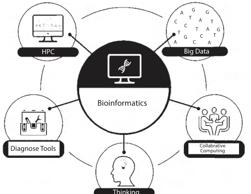

Figure 3.1 生物信息学问题求解过程的工作流。

- 系统生物学：生物信息学在系统生物学中发挥着至关重要的作用，系统生物学侧重于整体理解生物系统。它整合来自各种来源（如基因组学、转录组学、蛋白质组学和代谢组学）的数据，以构建生物过程和网络的全面模型。

- 个性化医疗：在个性化医疗时代，生物信息学至关重要，其中遗传信息被用于为个体患者定制医疗方案。它可实现疾病相关遗传变异的识别、药物反应预测以及用于诊断和预后的生物标志物识别。

- 二代测序（NGS）：NGS 技术的出现通过实现整个基因组、转录组和表观基因组的高通量、高效成本测序，彻底改变了基因组学。如图 3.1 所示，生物信息学对于管理和分析 NGS 平台生成的海量数据至关重要 [3]。

## 3.1.4 蛋白质组学与蛋白质结构预测

蛋白质组学、结构预测和生物信息学研究蛋白质结构、功能和相互作用，以及蛋白质序列、翻译后修饰、蛋白质-蛋白质相互作用和结构预测。蛋白质组学是大规模研究蛋白质、其丰度、变化、关系和生物学作用的学科。蛋白质识别、测定和表征阐明了生物过程。生物信息学工具通过将质谱数据与数据库蛋白质序列匹配来查找蛋白质。无标记和稳定同位素标记用于评估蛋白质表达。生物信息学分析蛋白质组学、统计学和差异表达蛋白质 [4]。生物信息学预测、识别和表征翻译后修饰（PTM），如磷酸化、乙酰化、糖基化和泛素化。这些发现解释了蛋白质功能、信号网络和疾病。

蛋白质-蛋白质相互作用：蛋白质组学研究生物系统中复杂的蛋白质-蛋白质网络。蛋白质相互作用数据库、网络分析和计算建模预测和分析蛋白质-蛋白质相互作用（PPI），构建相互作用网络，并发现功能模块。氨基酸序列可预测蛋白质的三维结构。这影响蛋白质功能、药物开发和相互作用。比较建模或同源建模基于与实证确定的结构（模板）的序列相似性来预测蛋白质结构。基于模板的生物信息学方法对靶蛋白结构进行建模。从头（ab initio）方法在没有模板的情况下预测蛋白质结构。物理学、能量最小化和统计势预测蛋白质折叠 [5]。

折叠识别：将蛋白质序列与折叠数据库进行匹配。穿线（threading）、序列特征和机器学习用于生物信息学中的蛋白质折叠预测和蛋白质结构验证。Ramachandran 图分析、能量评估和结构比较利用生物信息学揭示预期结构缺陷。生物信息学蛋白质组学和蛋白质结构预测强调了蛋白质功能、连接以及结构-功能关联。

## 3.1.5 代谢组学

生物信息学代谢组学分析小分子。为了理解细胞功能、代谢和疾病，会对代谢物进行定量和分析。系统生物学使用代谢组学。生物信息学发现并注释代谢物。生物信息学利用光谱相似性以及功能性、代谢性和生物学代谢物，在实验质谱或核磁共振光谱中寻找化学物质。KEGG、MetaboLights、HMDB 和 PubChem 列出了代谢物的特性、生物学作用和通路 [6]。

生物信息学提供了许多处理生物数据的工具。这些技术有助于分析、解释和预测基因组、蛋白质组和代谢组数据。生物体的基因组即为基因组数据。基因组利用 BLAST、FASTA、基因组组装程序和基因组浏览器等生物信息学工具进行测序、注释和可视化。PLINK 和 GATK 还用于研究物种间的遗传变异。大规模蛋白质研究属于蛋白质组数据。Mascot 和 SEQUEST 从质谱数据中识别蛋白质。SWISS-MODEL 和 Phyre2 预测蛋白质结构，而 STRING 和 Cytoscape 则研究蛋白质-蛋白质相互作用和通路。

代谢组数据包括生物系统中所有小分子代谢物。XCMS 和 MZmine 预处理和分析质谱代谢组数据。MetaboAnalyst 和 Cytoscape 可视化和理解代谢组数据。HMDB（人类代谢物数据库）有助于识别和理解这些化合物。这些工具和方法不断发展，以应对生物数据的复杂性和海量性。许多生物信息学工具易于使用且无需编程，使其能够被广泛研究人员所使用。Python 和 R 对于更复杂的研究很有用。

生物信息学在生物学和医学研究中有许多应用。高通量测序产生海量基因组数据。Velvet、BWA、Bowtie 和 MAKER 等生物信息学工具可预测基因位置和功能，而 de novo 组装程序和比对程序则将原始数据组装成完整基因组。生物信息学技术通过将序列或结构与已知功能进行比较来预测基因和蛋白质功能。BLAST 和


Swiss-Prot（人工注释和审核的蛋白质序列）被用于此。生物信息学揭示了复杂的分子关系。Cytoscape 可视化这些关系，而 KEGG 提供代谢和信号通路信息。

生物信息学通过预测蛋白质三维结构（SWISS-MODEL、Phyre2）、模拟蛋白质–药物相互作用（分子对接、AutoDock）以及评估药物对生物通路的影响（GSEA、基因集富集分析），加速药物研发。基因组数据有助于生物信息学预测疾病风险。PLINK 在遗传数据中发现与疾病相关的变异，基于患者数据训练的算法可以预测疾病进展或结局。在个性化医疗中，遗传学决定治疗方案。生物信息学有助于解读基因组数据、识别与疾病相关的遗传变异（GATK）以及预测治疗反应（药物基因组学）。生物信息学已改变生物科学和医学，使得几十年前还无法想象的发现和治愈成为可能。生物信息学技术与方法将继续提升我们对生命和疾病治疗的理解。

以下关键点说明了生物信息学如何归一化和分析特定平台的代谢组学数据：

- **数据预处理：** 基线校正、降噪、峰对齐和归一化减少了代谢组学数据的技术变异和伪迹。XCMS、MZmine 和 MetaboAnalyst 被提取。生物信息学使用 t 检验、ANOVA、PCA、PLS-DA 和聚类对代谢组学进行统计分析。这些方法可发现差异表达代谢物、样本组及与特定条件或表型相关的代谢特征。

- **集成代谢通路分析：** 基因组、转录组、蛋白质组和代谢组解释生物系统。代谢组学数据被映射到代谢通路中，以发现富集通路、功能模块和代谢通路扰动。PathVisio、MetScape 和 MetaboAnalyst 绘制通路。代谢组学及其他组学数据可以构建生物网络，并揭示分子和调控关联。Cytoscape 和 Network Analyst 揭示代谢网络枢纽、模块和关键代谢物。代谢组学数据展示生物系统活动、疾病原因和生物标志物。系统生物学代谢组学对生物学进行建模，并阐明细胞–有机体相互作用及调控网络 [7]。

- **生物标志物发现：** 代谢组学检测疾病、表型和药理学生物标志物。机器学习、特征选择和通路富集验证诊断、预后和治疗生物标志物。生物信息学代谢组学展示代谢通路、生物活性和疾病。它有助于个性化医疗、药物开发和复杂生物系统。

## 本章目标

本章的目标如下：

- 考察计算机如何处理、管理和评估生物数据；
- 掌握生物信息学工具和方法如何管理基因组、蛋白质组、代谢组等数据；
- 解释生物信息学的应用，例如基因组测序、基因和蛋白质功能预测、生物网络与通路分析、药物发现与设计、疾病预测和个性化医疗；
- 探讨生物信息学的伦理问题，包括数据隐私、异质性以及计算资源需求；
- 探讨生物信息学对科学和医学的潜在益处；
- 介绍生物信息学的主要软件、数据库和工具，为读者提供生物信息学理论的实践视角。

## 本章组织

本章余下内容组织如下：第 3.2 节探讨系统生物学中的生物信息学。第 3.3 节重点介绍生物信息学的工具和技术。第 3.4 节阐述精准医学中的生物信息学。第 3.5 节说明生物信息学面临的挑战，随后在第 3.6 节介绍研究方向。最后，第 3.7 节对本章进行总结并展望未来。

## 3.2 系统生物学中的生物信息学

### 3.2.1 系统生物学简介

生物信息学在系统生物学中使用基因组、转录组、蛋白质组和代谢组。基因、蛋白质和代谢物由计算机建模。系统生物学研究复杂的生物系统。组学整合的系统生物学调查基因组、转录组、蛋白质组和代谢组。研究人员通过合并数据集可以看到生物系统与分子–生物学过程之间的联系。网络分析在系统生物学中建模复杂的生物相互作用。网络指示代谢、调控或分子相互作用。基于网络的分析显示系统枢纽、模块和关键功能。数学和计算机模拟系统生物学，建模调控、反馈和动态过程。模拟和计算机分析协助系统生物学家预测系统行为。数据驱动方法（机器学习、统计建模和数据整合）帮助系统生物学理解海量且复杂的生物数据集。这些方法说明模式、生物标志物、表型和生物系统原理。系统生物学假设并评估生物系统调控。实验验证确认计算模型预测。建模、实验和改进有助于理解系统，如图 3.2 所示 [8]。

系统水平理解：系统生物学研究生物系统的涌现特征。涌现特征改变系统功能。系统生物学家考察复杂的生物学。系统生物学使用计算模型和生物数据来描述生物复杂性和行为。

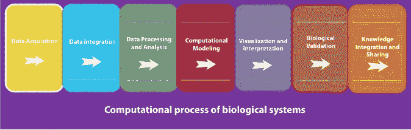

图 3.2 生物信息学中生物系统的系统流程图。

### 3.2.2 系统生物学中的数据整合

系统生物学使用生物信息学。生物学需要多组学数据分析。数据整合帮助研究人员在复杂生物系统中发现新的关系、路径和涌现特征。系统生物学使用基因组、转录组、蛋白质组和代谢组。这些数据库改进了生物系统和基因–蛋白质–代谢物研究。组学数据展示系统范围的分子参与者、功能模块和调控关联。组学分子相互作用网络被整合。基因、蛋白质和代谢物形成复杂网络。整合网络帮助研究人员发现功能连接、预测蛋白质–蛋白质相互作用，并理解生物过程 [9]。

基因表达、蛋白质–蛋白质相互作用和代谢通路数据揭示共调控基因、新基因功能和调控机制。统计建模、机器学习和计算机融合来自多个来源的数据。系统生物学研究表型和分子。分子数据、患者特征、疾病进展和治疗结局可以揭示生物标志物、评估疾病预后并调整药物。数学对系统生物学建模。数学生物学模型进行预测和假设。基因表达、蛋白质–蛋白质相互作用网络和代谢通路数据有助于表征系统行为。

可视化相关数据集有助于数据整合。可视化帮助研究人员理解生物学、趋势和系统活动。网络图、热图、通路图和多维图让研究人员评估跨数据类型的相互作用。系统生物学需要数据整合来理解复杂性与动态、性状、生物过程及调控机制。整合异质数据帮助研究人员整体地看待生物系统，从而促进个性化治疗、药物开发和生物技术应用 [10]。

### 3.2.3 系统生物学中的网络分析

系统生物学和生物信息学中的网络分析考察基因、蛋白质、代谢物和其他物质之间复杂的生物关系——建模、研究和理解生物网络。系统生物学网络分析揭示系统行为、功能模块、调控机制和涌现特性。


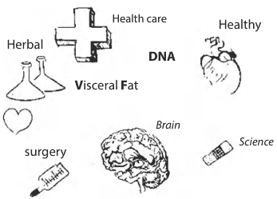

图 3.3 一个开发理解生物数据方法的跨学科领域。

- 基因调控网络追踪转录因子和增强子。基因表达、染色质免疫沉淀和计算确定 GRNs。
- 代谢网络展示生物过程和代谢物转运——代谢组学、通量组学和代谢途径数据库。
- 节点度连接、基因、蛋白质和代谢物构成生物网络。度分析发现强连接的信息枢纽。
- 网络枢纽的介数中心性、紧密度中心性和特征向量中心性衡量网络节点的影响力。这些指标突出影响信息流、瓶颈或代谢过程的关键节点。
- 可视化生物网络有助于分析。热图、节点-链接图、力导向布局和环形布局可视化网络、功能单元和链接。

功能富集通路研究：这确定网络或基因/蛋白质组是否过度代表生物通路或基因集。使用富集分析揭示与基因/蛋白质显著相关的通路或活性。功能富集在网络中发现基因本体和蛋白质域。它识别网络组件的功能主题、分子功能和生物过程 [11]。

网络模拟：生物网络模拟时间和扰动。ODEs 和布尔模型模拟网络动态，预测系统行为，并研究遗传或环境扰动对网络输出的影响。系统生物学网络分析展示复杂生物系统的工作方式。它具有生物过程调节机制、功能模块和涌现特性，如图 3.3 所示 [12]。

## 3.3 生物信息学中的工具与技术

### 3.3.1 常用生物信息学软件

以下是研究人员最常用的生物信息学软件：

- EMBOSS：序列、蛋白质结构、基因组注释和其他生物信息学操作。
- GROMACS：蛋白质结构和相互作用模拟。
- Qiagen CLC：生物、DNA、RNA 和蛋白质序列比对、引物设计、基因表达分析、变异检测。
- Bioconductor：统计和计算基因表达、通路及可视化技术。
- Galaxy：在线数据分析和生物信息学工具。
- Cytoscape：生物网络可视化和分析工具。多个插件可视化复杂的分子相互作用网络。
- PhyloSuite：重建、检索、比对和可视化树木改进进化生物学（生物信息学程序）[13]。

生物信息学原理包括机器学习、序列比对和搜索方法、系统发育分析、分子建模和模拟。生物信息学越来越多地使用机器学习从庞大复杂的数据集中进行预测。机器学习预测蛋白质结构、基因功能、疾病结局和药物反应。生物信息学使用决策树、神经网络、支持向量机和深度学习。生物信息学依赖这些方法将新序列与数据库条目进行比较。BLAST 和 FASTA 可以搜索数据库中的查询序列。比对算法构建基因组，寻找同源基因和蛋白质，并预测功能。

这确定物种或基因的进化关系。生物信息学家可以通过比较生物体序列生成系统发育树。MEGA 和 PHYLIP 是系统发育分析工具。这些方法预测和模拟蛋白质和生物分子的三维结构。预测结构可以揭示功能和药物靶点。GROMACS、AMBER、SWISS-MODEL 和 Phyre2 是分子动力学和结构预测工具。生物信息学依赖这些方法，这些方法被升级以管理日益增长的生物数据。它们帮助我们理解生物数据，并为研究和治疗预测生物系统。

### 3.3.2 生物信息学中的机器学习

生物信息学机器学习在庞大的生物数据中发现模式、相关性和预测。机器学习将基因、模式以及蛋白质结构和功能进行匹配。这些任务通常使用 HMM、SVM 和 RNN。ML 检查微阵列或 RNA 测序数据。层次聚类和 K-Means 将相似表达的基因分组。机器学习检测、测量和预测质谱后翻译修饰。分类、回归和神经网络确定蛋白质丰度。AI 预测蛋白质结构、蛋白质折叠、结构和相互作用。AI 预测药物-靶点相互作用、前景和毒性。机器学习评估庞大的化学库以确定生物活性。基于化学结构的 QSAR 模型预测药理作用 [14]。

基因组、转录组学、蛋白质组学和代谢组学构成机器学习。多视图和数据融合揭示生物组分之间的关系。基因组、临床和影像数据用于预测和诊断疾病。这些模型用于诊断、风险评估和治疗心血管疾病、神经系统疾病和癌症。生物信息学使用决策树、随机森林、支持向量机、神经网络、深度学习和集成方法。事实上，系统生物学中的生物信息学正在被用于心血管、神经和癌症研究，以生成诊断工具、风险评估模型和治疗策略。这些模型评估包括基因组、转录组学、蛋白质组学和代谢组学在内的复杂生物数据，以理解疾病机制和患者特征。决策树、随机森林、支持向量机、神经网络、深度学习和集成技术越来越多地用于预测疾病结局、分析疾病原因并构建个体化治疗。利用生物因素将患者分类到风险类别 [15]。遗传标记、生活方式因素和其他临床数据可以指示患者的心血管疾病风险。支持向量机可以根据生物数据对患病患者进行分类。支持向量机可以使用基因表达数据将肿瘤样本分类为恶性或良性。神经网络和深度学习擅长处理复杂的高维生物数据。卷积神经网络（CNN）用于分析神经系统疾病的 MRI 扫描和用于癌症诊断的病理图像。RNN 和 LSTM 可以评估心率或脑波等时间序列数据，以识别心血管或神经系统问题。集成方法使用多个机器学习模型进行预测，提高模型准确性和鲁棒性。在没有任何模型表现良好的困难决策边界中，它们很有用。这些算法使用标记数据模式来预测或分类新数据。生物信息学中的机器学习在庞大的生物数据库中调查生物过程、疾病机制和治疗方法。图 3.4 展示了研究人员如何利用海量数据集用于个性化健康、药物发现和精准农业 [16]。

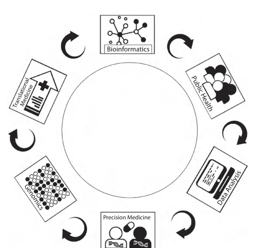

图 3.4 提议的基因组生物信息学能力。

### 3.3.3 生物信息学中的云计算

云计算处理海量生物信息学数据集。云平台处理大规模生物数据集。云存储保护基因组学、蛋白质组学和其他高通量测序数据。生物信息学需要快速计算。云计算提供强大的 HPC 集群和虚拟机。HPC 云使基因组组装、变异检测和分子动力学模拟成为可能 [17]。

按需、可扩展的云生物信息学工具和流程：预配置的生物信息学软件让研究人员分析和解释大规模生物数据集。云计算使研究人员能够协作。研究人员讨论数据、分析和棘手问题。云计算对生物过程进行扩展。云资源让研究人员处理高峰需求并在低活动期间缩减规模，优化资源利用和成本。云计算复制生物信息学工作流。Docker、Nextflow 和 Snakemake 创建或可复制分析流程。Git 和云平台管理分析和修改工作流 [18]。

云计算支持 AI/ML。基于云的 AI 提供预测模型、图像分析和生物数据洞察。生物信息学 AI 使用预训练和自定义的基于云的机器学习模型。云计算节省成本，因为研究人员按使用付费。无需基础设施投资的项目可以以成本效益的方式使用计算资源。生物信息学中的云计算帮助研究人员克服计算和存储限制，加速数据处理，改进协作，并尝试新方法。云技术可以处理不断扩大的生物数据 [19]。

## 3.4 精准医学中的生物信息学

### 3.4.1 精准医学的定义与重要性

生物信息学通过研究 DNA、基因表达和表观遗传学为精准医学提供动力。突变影响疾病和治疗、遗传异常以及患者特异性治疗。参考数据库和功能预测评估基因变异、诊断和预后。

生物标志物发现：生物信息学发现基因组、转录组、蛋白质组或代谢组信号，这些信号可预测疾病易感性、预后或治疗反应。生物信息学使用多组学数据、统计学和机器学习发现定制治疗的分子签名。基因组和蛋白质组数据帮助生物信息学算法发现和重新利用药物靶点。生物信息学使用与疾病相关的基因、通路和蛋白质结构寻找可成药靶点。生物信息学帮助医生选择药物。患者特异性的遗传、临床和分子数据为诊断、预后和治疗提供依据 [20]。

药物基因组学：生物信息学发现药物反应基因。药物基因组学检测药物-药物相互作用、剂量和不良反应，提高药物安全性和有效性。生物信息学整合基因组、临床和影像数据。生物信息学帮助研究人员在庞大的数据集中揭示疾病病因、进展和治疗趋势 [21]。

生物信息学模型复杂的生物学、药理学和病理学通路——优化治疗、遗传影响和药物-靶点相互作用。


生物信息学和精准医疗协助临床医生进行诊断、治疗并改善患者预后。个性化护理促进健康并降低风险 [22]。

## 3.4.2 生物信息学在精准医疗中的作用

生物信息学分析基因组、临床和分子数据以用于精准医疗。生物信息学研究 DNA、基因表达和表观遗传学。突变影响疾病和治疗——遗传异常和特定于患者的治疗。生物信息学发现遗传变异。参考数据库和功能预测评估基因变异——诊断和预后 [23]。

生物标志物发现：生物信息学发现基因组、转录组、蛋白质组或代谢组信号，这些信号可预测疾病易感性、预后或治疗反应。生物信息学利用多组学数据、统计学和机器学习发现定制的治疗性分子特征。基因组和蛋白质组数据帮助生物信息学算法发现并重新利用药物靶点。生物信息学利用与疾病相关的基因、通路和蛋白质结构寻找可成药靶点。生物信息学重新利用药物。生物信息学帮助医生定制治疗方案。特定于患者的遗传、临床和分子数据为诊断、预后和治疗提供依据 [24]。

医学生物标志物开发对个体化医疗至关重要。生物标志物是体内可测量的物质、结构或过程，可以指示正常或病理生物学状态。蛋白质、基因或其他物质、生物活动或生理特征可能会发生变化。生物标志物可用于疾病诊断、预后、治疗预测和患者监测。研究人员利用基因组、蛋白质组和代谢组学在健康和病患样本中寻找生物标志物。必须设计检测方法来评估生物材料中的潜在生物标志物。验证确保该测试可靠且一致地测量生物标志物。

为了证明临床价值，在更广泛的患者人群中对生物标志物进行检验。此步骤使用稳健的统计分析来确认生物标志物能够可靠地区分状态或预测临床结局。如果经过验证，生物标志物可以用于临床。实施后会监测性能。生物标志物发现既困难又具有多学科性。生物标志物可以帮助诊断、预测疾病进程、指导治疗，并跟踪疾病进展或对治疗的反应。它们可以改善患者预后和个体化治疗。

药物基因组学：生物信息学发现药物反应性基因。药物基因组学检测药物-药物相互作用、剂量和不良反应，提高药物安全性和有效性。生物信息学整合基因组、临床和影像学数据。生物信息学帮助研究人员在大型数据集中揭示疾病病因、进展和治疗趋势。生物信息学模型复杂的生物学、药理学和病理学通路——优化治疗、遗传影响和药物-靶点相互作用。生物信息学和精准医疗协助临床医生进行诊断、治疗并改善患者预后。个性化改善健康并降低风险 [25]。

药物基因组学研究遗传学如何影响药理学反应性。“个体化用药”至关重要，它利用遗传和基因组数据调整药物、疗法和干预措施以适应个体患者。药物基因组学认为，遗传多样性（如 SNPs、基因重复和表观遗传改变）可影响药物反应性。它影响药物吸收、分布、代谢、靶点功能和免疫反应。运输药物的蛋白质可能受基因变异影响。这会影响药物分布和靶点部位浓度。

基因影响药物代谢酶：某些遗传变异会导致酶工作更快，代谢药物过快并限制其疗效。某些变异会导致酶活性降低或酶无法发挥作用，减慢药物代谢并增加不良反应。药物通常通过与蛋白质（通常是受体或酶）相互作用来发挥作用。遗传差异可以改变药理学靶点，从而影响疗效。遗传差异可能增加对特定药物出现过敏或不良反应的可能性。

药物基因组学检测可以检测可能预测药物疗效或副作用的遗传多态性，使医生能够为每位患者量身定制治疗方案。它还承诺减少药物和剂量的试错过程。截至 2021 年 9 月，药物基因组学检测在肿瘤学中越来越多地用于调整药物，但尚未在医学所有领域成为常规检测。成本、检测可及性、理解检测结果以及伦理、法律和社会问题可能会影响其更广泛的接受度。

### 3.4.3 药物基因组学与个体化医疗

生物信息学和遗传学研究药物基因组学。CPIC 指南解释与药物反应相关的遗传变异。生物信息学与药物基因组学的相关性改善了这些指南中的疗效和安全性。这些案例展示了生物信息学在生物学和医学中的多功能性。生物信息学分析大量的基因组、转录组和临床数据，以改进诊断、疗法以及对复杂生物系统的理解 [26]。

药物基因组学研究药理学反应性和基因。药理学和遗传学在此新领域中被用来创造安全、有效且基于基因的定制药物。目前的药物是“统一尺寸”，但并非对每个人都有效。很难判断谁会从药物中获益，谁不会，谁会出现不良药物反应。药物反应导致许多美国住院和死亡案例。研究人员正在通过人类基因组计划发现基因如何影响药物反应。

药物基因组学检测确定遗传差异如何影响药物反应。这些检测可能帮助您的医生确定最佳药物和剂量，并预测药物反应。制药商可以利用基因衍生的蛋白质结构制造药物。针对基因或蛋白质可使这些药物更有效。医生可以分析患者的基因图谱，从一开始就开出最佳药物治疗方案，包括为避免副作用而进行的剂量调整。患者将接受遗传疾病易感性筛查。这允许早期检测和有效预防。

降低医疗成本：减少患者治疗中的试错过程、不良药物反应并提高治疗疗效将节省医疗成本。药物基因组学承诺基于遗传学提供个性化药物。了解一个人的基因构成被认为对个体化医疗至关重要。环境、营养、年龄、生活方式和健康状况都会影响一个人对药物的反应。

### 3.4.4 案例研究

TCGA 癌症研究使用生物信息学。癌症基因组分析为 TCGA 提供了大量的基因组、转录组和临床数据。TCGA 生物信息学揭示了癌症亚型、驱动突变和治疗靶点。

流行病学分析：生物信息学追踪并了解了 2014 年西非埃博拉疫情。埃博拉基因组测序揭示了其起源、传播和演化。生物信息学发现病毒基因组治疗靶点。生物信息学控制病毒。生物信息学改进农业育种。生物信息学分析小麦育种群体基因组数据以用于基因组选择。这能识别抗病、产量和营养质量基因。生物信息学加速作物育种。生物信息学被用于研究人体微生物组（HMP）。该研究检查了许多身体部位的宏基因组数据，以了解人体微生物组及其与健康和疾病的关系。生物信息学描述了微生物多样性、物种和微生物群功能 [27]。

生物信息学有可能改变科学和医学。它在基础生物学研究、临床医学和医疗保健中彻底改变了生命和疾病治疗。基因组、蛋白质组和代谢组数据可以使用生物信息学工具进行处理和分析。这有助于发现新基因、蛋白质和生物分子，理解其作用，并解读复杂的生物过程和网络。生物信息学分析基因组或其他组学数据以寻找与疾病相关的遗传变异。这有助于早期诊断、疾病预测和治疗疗效。生物信息学有助于开发定制医学，根据患者的基因组或其他特征量身定制疗法。药物基因组学考察基因如何影响药物反应性。

生物信息学技术检测治疗靶点，预测靶点分子结构，并创造新药物。这加速药物发现并降低成本。生物信息学可以追踪和建模疾病传播，识别人群健康风险，并改善疾病预防和控制方法。通过研究农业物种的基因组，生物信息学可以帮助培育具有更高产量、抗病性或其他理想特性的作物品种。生物信息学有助于研究不同栖息地中的微生物群落，评估生物多样性，并预测生态系统变化。未来，生物信息学将加速生物学研究，改善医疗保健，并增进我们对地球的理解 [28]。

## 3.5 生物信息学中的挑战

### 3.5.1 数据量与复杂性

生物信息学处理来自各种生物来源和实验技术生成的海量数据。由于高通量技术的进步以及大规模测序和组学数据集的可用性，生物信息学数据的数量和复杂性仍在快速增加 [29]。

基因组学和转录组学：基因组测序和转录组分析产生大量数据。全基因组测序项目（如人类基因组计划）已产生数十亿个碱基对的 DNA 序列数据。转录组研究


使用 RNA 测序（RNA-seq）生成数千个基因在多个样本中的转录本丰度数据，从而得到大规模表达矩阵 [30]。

蛋白质组学：基于质谱的蛋白质组学可生成大规模蛋白质鉴定和定量数据。对复杂样本中的蛋白质鉴定、翻译后修饰以及蛋白质-蛋白质相互作用的分析，都导致了蛋白质组学数据的复杂性。宏基因组学研究微生物。微生物宏基因组学测序需要生物信息学支持。生物信息学使用医学图像、空间转录组数据和显微镜图像。复杂算法用于分析大尺寸图像 [31]。

生物信息学关联基因组、转录组学、蛋白质组学和临床数据。现代计算机分析巨大的多维数据集，用于整合研究。多样本生物信息学可评估基因和蛋白质。多假设检验、降维和高维数据集需要统计学及机器学习方法。生物信息学研究纵向数据。分析时间动态、模式和变化需要特定方法 [32]。

生物信息学存储基因组和健康数据。生物信息学面临隐私、安全、共享和分析等方面的挑战。复杂的生物信息学数据需要可扩展的计算工具、高效的存储与检索以及先进的分析方法。云计算、并行计算和分布式计算可处理大规模数据集和计算成本高昂的分析。数据整合、可视化和机器学习可用于分析庞大的生物信息学数据集。

## 3.5.2 数据整合与标准化

生物信息学组织生物学数据。公共数据库、实验、医疗记录和出版物提供生物信息学数据。整合数据能够揭示生物学规律。本体和受控词汇标准化生物实体和概念的注释与分类。GO 和 MeSH 标准化基因、蛋白质、疾病及其他生物项目的分类，从而简化数据整合。跨数据库链接基因标识符可统一基因表达、功能注释和遗传变异 [33]。

标准化元数据包括实验设置、样本属性和数据处理，可简化数据交换、提升可重复性并改善可解释性。生物信息学使用 FASTA、FASTQ、BED 和 BAM 等格式。像 CDISC 临床数据标准这样的社区驱动数据交换标准，能够实现跨平台和跨应用的数据整合。生物信息学还标准化数据质量。MIAME 和 FGE 用于共享功能基因组学和微阵列数据。标准和提交要求确保公共数据仓库和数据库中的数据质量与互操作性。在这些仓库中标准化数据和元数据，可改进数据整合。生物信息学的标准化与整合，能够实现数据交换、跨研究比较和强大的分析方法。生物信息学研究具有可重复性、可靠性和实用性，能够促进协作，以理解生物系统并改善患者护理 [34]。

## 3.5.3 生物信息学分析的可重复性

生物信息学需要可重复性，即能够复制一项研究的数据、技术和计算环境。科学需要可重复性。共享数据、代码和分析方法，可使研究人员承担责任。

方法学进展：可重复的评估能够揭示流程中的不足。复制和评析分析可改进生物信息学。Docker 或 Singularity 容器可封装分析技术、环境、程序依赖项和配置（便于跨系统分析）。共享带有说明的分析代码和脚本，可让其他人复制研究并获得一致的结果。

开放科学：开放获取的存储库和出版物能够促进透明度、可重复性和协作。持续集成和自动化测试可复现代码和脚本的更改。自动化测试确保分析流水线的功能性和一致性。这些可重复的策略有助于推动生物信息学研究 [35]。

## 3.5.4 隐私与安全问题

生物信息学处理敏感且个人化的数据，包括基因组信息、医疗记录和其他可识别信息。因此，隐私与安全问题在生物信息学中至关重要。

数据隐私：生物信息学数据通常包含个人身份可识别信息（PII）或受保护健康信息（PHI）。保护个人隐私至关重要，研究人员在收集、存储和共享此类数据时，必须遵守伦理和法律准则。可以应用匿名化和去标识化技术，在保持数据实用性的同时删除或加密可识别信息。只有授权人员才能访问敏感的生物信息学数据。用户身份验证、RBAC 和其他安全方法可按角色和职责限制数据访问。

备份：安全的数据存储系统可防止泄露。安全的数据存储、备份和灾难恢复，可避免数据丢失、未经授权的更改和服务不可用。

数据共享与同意：生物信息学研究人员与其他团体合作。知情同意、数据使用协议和数据共享指南，对于隐私和合规是必要的。

数据匿名化与实用性：在生物信息学中，平衡数据匿名化与数据实用性是一项挑战。虽然匿名化技术旨在保护隐私，但不应损害数据用于研究目的的实用性。在隐私与数据实用性之间取得平衡至关重要，以便在保护个人身份的同时实现有意义的分析。

安全审计与合规：定期的安全审计和合规性评估，有助于识别生物信息学系统中的漏洞，并确保遵守相关数据保护法规，例如《通用数据保护条例》(GDPR) 或《健康保险可携性与责任法案》(HIPAA)。

生物信息学研究人员必须遵循伦理规范，以保护研究参与者的隐私和机密性（包括同意、数据安全和伦理研究）。生物信息学研究人员需要接受隐私和安全培训。研究人员应学习数据隐私、安全和风险，以降低风险。生物信息学隐私和安全需要技术、组织和法律措施。生物信息学、数据隐私专家和安全专业人员必须协作，以保护隐私并推进生物信息学研究 [36]。

生物信息学使生物学和医学领域取得突破，但也引发了必须解决的伦理问题。在遗传学和个性化医学中，生物信息学使用敏感的个人数据。为了隐私和权利，这些数据必须安全地维护和利用。遗传信息滥用可能导致就业或保险歧视。

美国的《健康保险可携性与责任法案》(HIPAA) 和欧洲的《通用数据保护条例》(GDPR) 保障数据隐私，尽管生物信息学可能使这变得困难。基因组、蛋白质和表型数据构成生物学数据。数据存储、元数据和分析可能因类型而异。这种异质性使生物信息学数据整合和比较变得困难。必须在数据库和技术之间保持数据标准化和互操作性。

生物信息学任务（尤其是涉及大规模数据集的任务）需要大量计算资源。研究能力在资源丰富和资源匮乏的机构之间存在差异，因为此类资源昂贵。这造成了“数字鸿沟”，使某些研究人员无法使用生物信息学。还可能出现其他伦理考量。要在伦理上使用生物信息学，必须解决这些挑战。随着技术和数据的增长，研究人员、伦理学家和监管机构必须解决这些问题。

## 3.6 研究方向

生物信息学是一门迷人的科学，利用计算来解决复杂的生物学问题。随着大数据和精准医疗的普及，生物信息学变得愈发重要。该领域提供了重要的研究机遇，具体包括：

- 随着全基因组测序成本降低，我们可以获取海量基因数据。这些数据有助于识别疾病基因并制定个性化治疗方案。开发算法和工具以评估海量数据量并获取有意义且可操作的洞察，是一项挑战。

- 基因组学、转录组学、蛋白质组学、代谢组学及其他“组学”技术正在揭示生物系统。将这些不同数据类型整合为一致的系统图景是困难的。数据整合策略可以帮助我们理解复杂的生物过程。

- 高通量技术极大地增加了生物学数据的规模和复杂性。数据分析越来越多地使用机器学习和 AI。这些方法必须进行修改，以适应生物数据的噪声、缺失数据和高维性。

- 基因、蛋白质和相互作用是生物网络中的节点。理解这些网络并开发研究方法，可以揭示生物系统和疾病过程。

- 蛋白质和 RNA 结构对于理解其功能和设计药物至关重要。计算工具可以预测和分析这些结构。

- 生物信息学改进药物设计和药理基因组学。生物信息学可以预测药物靶点，利用计算机模型设计药物，并研究遗传变异如何影响药物反应。

- 我们体内的微生物组对健康至关重要。微生物组数据分析需要生物信息学工具。

- 隐私、许可和个人基因组数据的使用是日益严重的问题。生物信息学研究人员必须审视这些伦理问题。


## 3.7 结论与未来展望

技术、数据和计算机推动生物信息学。单细胞基因组学和scRNA-seq展示谱系、异质性和关联性。高维单细胞组学数据需要卓越的生物信息学。整合基因组学、转录组学、蛋白质组学和代谢组学的范围不断扩大。多组学揭示疾病病因、复杂的生物过程和生物标志物。理解组学层间相互作用需要集成生物信息学和计算框架。生物信息学预测、建模并关联事件。图像分析、蛋白质结构预测、药物发现和疾病诊断使用深度学习算法、神经网络和其他机器学习方法。复杂的生物信息学数据需要可视化和交互式分析。交互式热图、网络可视化和3D建模帮助研究人员理解复杂的生物数据。

生物信息学支持基因和分子疗法。基因组、临床和生物信息学数据揭示疾病分组、预测性生物标志物和定制化治疗。微生物组中微生物基因组的分析很受欢迎。生物信息学用于微生物组物种、通路和疾病关联的研究。二代测序技术，例如长读长测序平台，越来越多地用于生成长片段且连续的DNA或RNA序列。分析长读长测序数据面临独特的计算挑战，包括从头基因组组装、结构变异检测和同源型鉴定。生物信息学数据量和复杂度的增加需要可扩展且高效的计算基础设施。云计算平台提供按需访问高性能计算资源，促进大规模数据处理、存储和分析。大数据分析框架，例如Apache Hadoop和Spark，支持生物信息学数据的分布式处理并加速分析流水线。

数据隐私与伦理：随着对数据隐私和伦理考量的日益重视，新兴趋势专注于确保敏感生物学和临床数据的安全存储、共享和分析。隐私保护方法、伦理准则和数据治理框架正在被开发，以应对与数据隐私和保护相关的挑战。生物信息学中的这些新兴趋势凸显了持续的进步，以及在理解生物系统、改善医疗保健结果和推动生命科学创新方面的变革潜力。适应这些趋势需要跨学科合作、持续开发计算工具，并紧跟技术发展。

## 未来展望与潜在机遇

生物信息学为研究人员、专业人员和行业提供了众多机遇。生物信息学辅助靶点鉴定、虚拟筛选、分子建模和药物重定位。计算方法可以从大规模基因组和蛋白质组数据中识别药物靶点并预测疗效。生物信息学引导的医疗保健使用基因组、临床和生活方式数据。基因图谱帮助生物信息学预测药物反应、风险和治疗方案。遗传咨询生物信息学分析医学遗传测序数据。生物信息学开发变异检测、解读和遗传病诊断，并协助遗传咨询师。农民友好的生物信息学寻找基因、育种标记并提高作物产量。生物信息学帮助植物疾病研究、遗传多样性管理和可持续农业。

微生物组研究：生物信息学检查复杂的微生物组数据，以理解微生物如何影响健康、疾病和生态系统动态。它促进生态保护、益生菌和个性化饮食。生物信息学利用大量数据、计算机建模和模拟来研究复杂的生物系统。生物学需要计算系统。生物学研究基因调节、代谢和信号网络。

生物信息学与大数据相关联。生物信息学和数据分析专家分析生物数据集，构建预测模型，并执行数据驱动的解决方案。对开发生物信息学软件、算法和工具的需求持续存在。机会存在于精通编程、数据分析和算法开发的专业人士，他们可以为数据处理、分析、可视化和解释创建创新解决方案。生物信息学专业知识在生物技术和制药公司中非常受欢迎。生物信息学为研发活动、靶点鉴定、临床试验、数据分析和法规合规做出贡献。生物信息学日益重要的地位创造了对能够在该领域传授知识和技能的教育者和培训师的需求。机会存在于学术界、培训机构和在线平台，用于教授生物信息学、开发课程并指导下一代生物信息学家。这些只是生物信息学中潜在机遇的几个例子。随着该领域不断发展，新的途径和应用可能会出现，提供多样化的职业前景和有影响力的研究与创新途径。

## 参考文献

- 1. Alam, M.S., Sultana, A., Reza, M.S., Amanullah, M., Kabir, S.R., Mollah, M.N.H., 探索乳腺癌诊断、预后和治疗分子生物标志物的集成生物信息学和统计方法。PLoS One, 17, 5, 0268967, 2022.
- 2. Giorgi, F.M., Ceraolo, C., Mercatelli, D., R语言：生物信息学和数据科学的引擎。Life, 12, 5, 648, 2022.
- 3. Engevik, K.A., Engevik, M.A., Engevik, A.C., 生物信息学揭示子宫内膜癌患者Myosin Vb水平升高，与细胞代谢增加和预后不良相关。PLoS One, 18, 1, 0280428, 2023.
- 4. Troeltzsch, M., Gogl, M., Berndt, R., Troeltzsch, M., 接种载体型COVID-19疫苗(Ad26.COV2.S)后的口腔扁平苔藓。Oral. Dis., 2021.
- 5. Saha, S., Di Cataldo, S., Giannessi, F., Cucciarì, A., Von Der Linden, W., Boeri, L., 高压氢化物中的超导率映射：超级水合物项目。Phys. Rev. Materials, 7, 5, 054806, 2023.
- 6. Debnath, S., Kant, A., Bhowmick, P., Malakar, A., Purkayastha, S., Jena, B.K., Azam, F., WRKY的增强亲和力强化番茄(Solanum lycopersicum L.)的抗旱性：一项创新的生物信息学研究。Plants, 12, 4, 762, 2023.
- 7. Pur, D.R., Krance, S., Pucchio, A., Bassi, A., Miranda, R.N., Felfeli, T., 生物信息学和人工智能在视网膜闭塞性疾病相关生物液体标志物分析中的新兴应用：一项系统综述。Graefe's Arch. Clin. Exp. Ophthalmol., 261, 2, 317–336, 2023.
- 8. Baeza, J.A., 甲壳类动物线粒体组学专题简介：使用用户友好且开源的生物信息学工具改进线粒体基因组的组装、注释和特征分析，以十足类甲壳类为例。J. Crustacean Biol., 42, 1, 12, 2022.
- 9. Chen, H., Xu, J., Wei, S., Jia, Z., Sun, C., Kang, J., Zhang, M., RABC：类风湿关节炎生物信息学中心。Nucleic Acids Res., 51, D1, 1381–1387, 2023.
- 10. Cantelli, G., Bateman, A., Brooksbank, C., Petrov, A., II, Malik-Sheriff, R.S., Ide-Smith, M., McEntyre, J., 2021年欧洲生物信息学研究所(EMBL-EBI)。Nucleic Acids Res., 50, D1, D11–D19, 2022.
- 11. Olson, R.D., Assaf, R., Brettin, T., Conrad, N., Cucinell, C., Davis, J.J., Stevens, R.L., 细菌和病毒生物信息学资源中心(BV-BRC)简介：整合PATRIC、IRD和ViPR的资源。Nucleic Acids Res., 51, D1, 678–689, 2023.
- 12. Marcroft, T.A., Rasmussen, C., Kelley, S.T., 生物信息学计算与学生主动学习：学生对预期活动和创新应用的看法。J. Coll. Sci. Teach., 52, 2, 3–5, 2022.
- 13. Shen, W., Song, Z., Zhong, X., Huang, M., Shen, D., Gao, P., Song, X., Sangerbox：一个全面、交互友好的临床生物信息学分析平台。Imeta, 1, 3, 36, 2022.
- 15. Banu, J.F., Rajeswari, S.B., Kallimani, J.S., Vasanthi, S., Buttar, A.M., Sangeetha, M., Bhargava, S., 用于预测模型的超参数调谐混合CNN和LSTM建模。Intell. Autom. Soft Comput., 33, 3, 1393–1405, 2022.
- 16. Bain, S.A. et al., 通过4273pi项目将生物信息学带入学校。PLoS Comput. Biol., 18, 1, 1–12, 2022. doi: 10.1371/journal.pcbi.1009705.
- 17. Hossain, M.A., Sohel, M.A., Rahman, M.H., Hasan, M., II, Khan, M.S., Amin, M.A.,... Peng, S., 生物信息学和体外计算方法，用于识别与女性不孕症进展相关的癌症新型生物标志物和关键通路：药物发现的综合方法。PLoS One, 18, 1, 0265746, 2023.
- 18. Li, Z., Zhang, Z., Feng, S., Wang, J., Guo, X., Sun, H., 基于自适应观测器的永磁同步直线电机无模型调速系统设计。IEEE Access, 10, 68545–68556, 2022.
- 19. Shah, S.U., Hameed, A., Ali Almazroi, A., Alqarni, M.A., 生物信息学中的基于代理的数据提取。Secur. Commun. Netw., 2022, Mar 26, 2022.
- 20. Hasan, M., II, Rahman, M.H., Islam, M.B., Islam, M.Z., Hossain, M.A., Moni, M.A., 系统生物学和生物信息学方法，用于识别COVID-19患者的血液标志物分子和药物靶点。Inf. Med. Unlocked, 28, 100840, 2022.
- 21. Yurina, V. and Adianingsih, O.R., 使用生物信息学工具预测疫苗开发的表位。Ther. Adv. Vaccines Immunother., 10, 25151355221100218, 2022.
- 22. Ricke, S.C., Dittloe, D.K., Tarcin, A.A., Rothrock Jr, M.J., 向小群禽类生产者传达微生物组和生物信息学的实用性。Poultry Sci., 101, 5, 101788, 2022.
- 23. Upadhyay, A., Kovalev, A.A., Zhuravleva, E.A., Kovalev, D.A., Litti, Y.V., Masakapalli, S.K., Vivekanand, V., 厌氧消化器中微生物群落分析的基本生物信息学技术综述。Fermentation, 9, 1, 62, 2023.
- 24. Bharadwaj, K.K., Ahmad, I., Pati, S., Ghosh, A., Sarkar, T., Rabha, B., Wan Rosli, W., II, 通过生物信息学研究从海藻废弃物中提取强效生物活性化合物以对抗癌症。Front. Nutr., 9, 889276, 2022.
- 25. Hassan, M.U. and Williamson, M.P., WxL结构域蛋白的生物信息学分析。Saudi J. Biol. Sci., 30, 2, 103526, 2023.


- 26. Miura, N. 和 Okuda S., 质谱基础宏蛋白组学生物信息学的当前进展及需克服的关键挑战. Comput. Struct. Biotechnol. J., 21, 1140–1150, 2023.

- 27. Su, Y., Tian, X., Gao, R., Guo, W., Chen, C., Chen, C.... Lv, X., 基于机器学习和生物信息学分析的结肠癌诊断与分期分类. Comput. Biol. Med., 145, 105409, 2022.

- 28. Buttar, A.M., Bano, M., Akbar, M.A., Alabrah, A., Gumaei, A.H., 基于深度学习的监控视频中可信人类可疑活动检测. Soft Comput., 1–13, 2023.

- 29. Krotova, A., Byadovskaya, O., Shumilova, I., van Schalkwyk, A., Sprygin, A., 新型重组结节性皮肤病病毒株的深入生物信息学分析：从独特模式到既定谱系. BMC Genom., 23, 1, 396, 2022.

- 30. Sultana, A., Alam, M.S., Liu, X., Sharma, R., Singla, R.K., Gundamaraju, R., Shen, B., 利用全面生物信息学方法通过单细胞RNA-seq分析识别非小细胞肺癌诊断和预后的潜在生物标志物. Trans. Oncol., 27, 101571, 2023.

- 31. Vijh, D., Imam, M. A., Haque, M. M. U., Das, S., Islam, A., Malik, M. Z., 网络药理学和生物信息学方法揭示姜黄素在阿尔茨海默病中的治疗作用机制. Metab. Brain Dis., 38, 4, 1205–1220, 2023.

- 32. Vickers, N.J., 动物通信：当我在呼唤你时，你会回答吗？ Curr. Biol., 27, 14, 713–715, 2017.

- 33. Kazybay, B., Ahmad, A., Mu, C., Mengdesh, D., Xie, Y., SARS-CoV-2 谱系中的 Omicron N501Y 突变：对酪氨酸激酶强结合及假设重新用药的计算机模拟分析. Travel Med. Infect. Dis., 45, 102242, 2022.

- 34. Yang, Y. 和 Lawson, D.J., HTRX: 一个用于学习与表型相关的非连续单倍型的 R 包. Bioinf. Adv., 3, 1, 38, 2023.

- 35. Cho, S., Sohn, Y.D., Kim, S., Rajakumar, A., Badell, M.L., Sidell, N., Yoon, Y.S., 重度而非轻度子痫前期中脐带血细胞的血管生成减少和炎症增加特征. Sci. Rep., 11, 1, 3630, 2021.

- 36. Yoon, H.S., Cho, C.H., Yun, M.S., Jang, S.J., You, H.J., Kim, J.H., Ko, G., Akkermansia muciniphila 分泌一种诱导胰高血糖素样肽-1的蛋白质，可改善葡萄糖稳态并缓解小鼠代谢疾病. Nat. Microbiol., 6, 5, 563–573, 2021.

## 药物发现中的机器学习：方法、应用与挑战

Geetha Mani* 和 Gokulakrishnan Jayakumar

1维洛尔技术学院维洛尔校区电气工程学院控制与自动化系，维洛尔，泰米尔纳德邦，印度 2密歇根大学安娜堡分校环境与可持续发展学院，安娜堡，密歇根州，美国

### 摘要

近年来，制药行业利用尖端技术从复杂的生物系统中获取洞察。技术进步推动了在药物发现与开发（DD&D）中应用机器学习（ML）和深度学习（DL）方法以生成潜在治疗假设的日益浓厚的兴趣。这些方法提供了一套框架及配套工具包，利用多样化的大规模数据来增强明确问题的发现和决策过程。在此领域，ML算法可以集成到DD&D的所有阶段中。其众多潜在应用包括靶点验证、预后生物标志物的识别、药物-蛋白相互作用和药物毒性的预测分析，以及临床试验中数字病理的数据分析。本章全面概述了药物发现科学家和研究人员所采用的无监督和监督ML算法，以及它们的有益应用。在药物发现和开发中利用ML算法有望显著缩减与传统方法和实验相关的时间、成本和资源。然而，ML在药物发现中的采用面临诸多挑战。为了在验证ML方法、增强决策、提高对ML方法的认识以及定位药物发现中的风险失败方面克服障碍，在临床试验期间生成准确且有条理的数据至关重要。本章还简要介绍了通过在药物开发各个阶段实施的ML方法进行DD&D的文献。

关键词：制药行业，药物发现与开发，无监督学习，监督机器学习，深度学习，决策，预测分析

### 4.1 简介

人工智能（AI）是机器对人类智力能力的近似或仿真。AI的目标包括增强基于计算机的学习、推理和感知。目前，AI应用于从金融到医疗保健等各个领域 [40]。AI涵盖广泛的应用并采用各种算法来解释和从数据中提取知识。它与线性代数、概率论与统计学、机器学习（ML）以及计算智能方法（包括神经网络和模糊逻辑模型）等学科密切相关 [50]。

ML（机器学习）是AI的一个子集，是一门涉及机器模仿人类行为或动作的领域。人工智能系统被用于以与人类问题解决方法可比的方式执行复杂任务 [56]。AI和ML技术都涉及分类、回归、预测和优化等复杂应用 [48]。ML在利用不同类型的现实世界数据方面发挥着至关重要的作用，其中必须定义带有其参数的特定模型。通过在可用数据上的训练，机器学习并掌握模型，从而能够进行未来预测并从新数据中提取信息 [40, 50, 56]。

近年来，制药行业中机器学习方法的使用显著增加 [16]。随着技术进步继续塑造各个行业，机器学习在彻底改变药物发现、临床试验、个性化医疗和医疗保健结果方面的潜力，吸引了研究人员、制药公司和医疗保健专业人员的共同关注。ML算法有潜力分析大型数据集、识别模式，并生成可以改善药物开发、患者护理和决策效率与效果的洞察。制药界希望通过采用机器学习来加速创新、优化疗法，并最终改善世界各地人们的生活 [13]。2020年，MIT科学家使用一种机器学习算法发现了一种强大的新抗生素化合物。实验室测试表明，该药物在消除多种引起疾病的困难细菌（包括对所有现有抗生素都有耐药性的菌株）方面是有效的。研究人员使用了一种计算机模型，该模型能够在几天内快速分析超过1亿种化学化合物，目标是寻找与现有药物作用方式不同的抗生素 [71]。该模型在两种不同的小鼠模型中成功治疗了感染。

使用机器学习和AI在为传染病治疗提供药物输送方面具有优势，可提供帮助。这归因于多种因素。首先，它能够识别复杂数据集中的关键组成部分，从而在无需重复生物学实验的情况下实现准确预测。这使其在药物创建、药物组合选择和药物剂量优化方面有益。其次，机器学习可以揭示隐藏模式并建立新规则，即使在没有先前基因组知识的情况下，也能预测抗菌耐药性并优化药物输送系统。第三，其快速的数据处理和分析能力允许早期预测不良治疗结果，从而便于及时干预与AMR相关的感染。第四，通过将计算软件纳入临床设备和/或移动设备，机器学习可以作为一种可行的工具，用于针对抗感染药物输送系统做出临床决策。最后，它能够实时调整并从新因素中获得知识，增强其执行能力，并创建适应性药物输送系统，以适应病原体、患者和抗菌药物的持续发展。

将机器学习整合到制药行业试图解决诸如降低流失率和总费用等重大业务问题。


制药公司可以通过采用机器学习算法 [16, 73] 提高发现可行药物候选物和优化药物开发流程的能力。机器学习能够高效地研究大量数据，通过模式识别增强决策能力。这不仅降低了淘汰率，还能简化流程、提高效率并增加成功结果的可能性。机器学习在制药业务中的整合与降低淘汰率和成本的战略目标相一致，最终鼓励采用更可持续、更有效的药物发现方法 [34]。

本章探讨了无监督和监督机器学习算法在药物发现中的应用。有建议认为，使用这些算法可以显著减少传统方法和实验所需的时间、成本和资源。然而，为了确保 ML 技术的准确性、改进决策、提高对 ML 方法的认识以及识别潜在风险，在临床试验期间收集精确且有条理的数据是必要的。本章还简要总结了机器学习工具和方法在药物开发各个阶段中使用的文献。在本章中，以下问题将在不同章节中进行研究：

- 机器学习算法在药物发现和开发的不同阶段（例如靶点验证）有哪些应用？
- 在药物发现中使用 ML 技术存在哪些挑战和局限性，如何克服这些挑战以改进决策、验证 ML 方法、提高认识并识别潜在的风险失败？
- 使用 ML 工具和技术进行药物发现的现有工作是什么？在药物开发的不同阶段中，利用这些方法取得了哪些进展？

## 本章组织

本章其余部分的组织安排如下：第 4.2 节侧重于 AI 和 ML 的实际应用，包括靶点验证、药物毒性预测、药物-靶点相互作用预测和药物生物活性预测。第 4.3 节深入探讨药物发现中使用的特定 AI 和 ML 方法，包括支持向量机 (SVM)、逻辑回归、朴素贝叶斯、k 最近邻 (kNN)、决策树、集成学习和神经网络。第 4.4 节探讨了在药物发现中实施 AI 和 ML 所面临的挑战，涵盖数据质量与数量、集成与互操作性、缺乏领域专业知识、验证与监管批准、伦理考量、成本和基础设施要求、泛化能力有限以及协作和数据共享等方面。最后，第 4.5 节对本章进行总结，并展望未来。

## 4.2 AI 和 ML 在药物发现中的应用

机器学习方法在药物发现和开发的多个领域已显示出应用。

### 4.2.1 靶点验证

药物发现依赖于分子靶点活性的调节，因为这使得开发出有效对抗疾病的药物成为可能 [29]。药物开发过程中的一个关键阶段是靶点识别。它涉及制定治疗假设以控制这些靶点是如何被调节的，这最终会影响感染的结局。体内和体外模型均用于靶点验证，重点在于确保所识别的靶点与所处理的病症相关 [79]。许多临床资源（包括代谢组学、转录组学和蛋白质组学图谱，以及公开可访问的数据库）被用来帮助识别和验证这些目标。随着更多数据驱动实验的出现，ML 在靶点识别中的应用越来越普遍。基于已知特征、与因果关系的联系以及先前识别的靶点，ML 方法可以从多个方面预测潜在靶点。

### 4.2.2 药物毒性预测

“毒性”一词描述了化学物质对人体可能产生的不利后果。为了识别可能对人体健康有害的物质，毒性评估是药物发现过程中的关键组成部分 [74]。然而，传统的体内研究通常需要动物实验，这增加了药物开发的成本。相比之下，计算方法具有更准确、更高效地预测物质毒性的优势。为了预测化学毒性，已经开发出各种基于 AI 的方法 [74, 78]。

DeepTox 预测模型利用三层深度神经网络 (DNN) 来评估化学品的毒性 [43]。该模型首先对数据进行清洗和验证，然后使用分子描述符对剩余化合物进行编码。对于 DNN，这些描述符作为输入。通过改进隐藏单元的数量、学习率和丢弃率等其他超参数，改进了 DeepTox 流程。根据利用 Tox21 数据集进行的比较研究，DeepTox 在准确预测毒性方面优于其他算法。

### 4.2.3 药物-靶点相互作用预测

研究活体生物体内化学化合物与蛋白质靶点之间的连接是药物-靶点相互作用 (DTI) 预测的关键部分。这是新药发现中的基本步骤 [35]。历史上，DTI 一直使用共免疫沉淀、噬菌体展示技术和酵母双杂交等实验方法进行计算。当用于 DTI 预测时，这些技术耗时较长。由于可获取的大量生物数据，现在可以进行体外（in silico）DTI 预测。因此，机器学习方法越来越多地用于 DTI 预测 [9]。

基于深度学习的方法在 DTI 预测中通常优于其他方法 [35, 77]。首先，使用化学品和蛋白质的相应特征对它们进行编码。通过化学品和蛋白质特征的嵌入，使得深度学习技术的应用成为可能。这使得基于卷积神经网络、深度置信神经网络和多层感知机的模型得以创建，用于预测药物-蛋白质相互作用，从而显著加快了药物发现过程 [77]。

### 4.2.4 药物生物活性预测

源自天然产物的多种药物缺乏生物活性是药物发现中普遍存在的问题。因此，确定药物生物活性已成为重要的研究领域 [3]。尽管体外和体内试验可以模拟分子在人体内的作用方式，但它们成本高昂且耗时 [21]。相比之下，人工智能方法提供了一种省时省力的方法来预测药物生物活性，例如抗癌、抗病毒和抗菌效果。这些 AI 技术已成功解决了确定药物生物活性的难题 [3, 21]。

## 4.3 用于药物发现的 AI 和 ML 方法

人工智能在药物设计的进步中至关重要，它利用机器学习技术并充分利用药理学信息。与推测性的改进不同，AI 有潜力将医学信息转化为可重复使用的方法，从而改进该领域 [57, 73]。ML 算法卓越的计算能力在于其无需显式编程即可获取知识的能力。计算“学习”的概念有潜力彻底改变各个领域和应用 [19, 40, 47]。通过采用多种技术，ML 算法由监督学习、无监督学习和强化学习这一经典三驾马车驱动，并由深度学习、对抗学习、迁移学习和元学习等颠覆性方法进一步增强。这种动态的相互作用不断催生长短期记忆网络和生成对抗网络等新模型，以及涵盖自然语言处理、对象识别、预测等更多应用 [17, 31]。

图 4.1 中的插图展示了 ML 的三种主要方法：监督学习、无监督学习和强化学习。这些是机器学习的核心范式。每种方法都有其独特的特点和应用。监督学习是一种使用标记数据训练模型的机器学习类型。这些数据包括输入特征（自变量）和相应的输出标签（因变量）。然后教导模型将输入特征映射到输出标签。其目标是掌握输入特征与输出标签之间的连接，以便模型能够准确预测或分类未来的、未见的数据。监督学习算法涉及预测连续值（回归）或为输入数据分配离散标签或类别（分类）。此类算法的示例包括线性回归、逻辑回归、支持向量机 (SVM)、决策树和神经网络。

无监督学习是一种从未标记数据中学习的机器学习技术。与监督学习不同，它不提供明确的输出标签。其目标是在没有任何先前理解的情况下，发现数据中隐藏的模式、结构或关联。无监督学习算法专注于寻找数据的有意义表示。这可以包括聚类、降维和


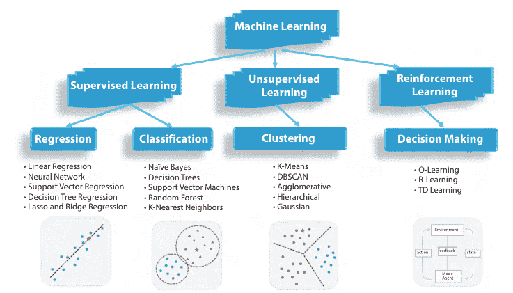

图 4.1 机器学习范式。

异常检测。无监督学习中的常用算法包括 k-means 聚类、层次聚类、主成分分析（PCA）和生成对抗网络（GANs）。

强化学习是一种机器学习形式，其中代理在给定环境中被训练以采取行动以最大化奖励。代理与其环境交互，采取行动并接收相应的奖励或惩罚。代理的目标是学习最佳策略，以使其随时间获得最高的累积奖励。强化学习模型通过试错来学习。它们在每次操作后接收来自环境的反馈，从而更新策略并随时间改进决策。

文献中常用的各种 ML 方法包括随机森林、朴素贝叶斯分类器、逻辑回归、线性判别分析、神经网络、支持向量机（SVM）等。这些方法使 AI 在特征提取和泛化方面表现出色，从而在药物设计中赋能深度学习技术 [1, 13]。监督学习方法采用分类器和回归算法来实现特定目标，例如预测连续或分类数据元素。另一方面，无监督方法用于构建数据聚类模型，旨在在没有预定义标签的情况下发现数据中的模式或关系。

传统机器学习方法中的特征设计经常需要人工干预。另一方面，深度学习系统通过采用多层特征提取算法来自动化此过程，这些算法可以将简单特征转换为高级特征。更大数据集的可用性允许这种加速 [8, 56]。深度学习方法通过降低泛化误差来产生更精确的结果，从而相较于传统方法具有优势。卷积神经网络（CNNs）、循环神经网络（RNNs）、自编码器和深度神经网络（DNNs）是该领域使用的深度学习方法之一。

AI 算法在药物研发中被广泛使用，增强了数据分析和预测。支持向量机（SVMs）、随机森林（RF）和多层感知机（MLPs）是成熟的模型，已在药物开发中证明了其有用性，这从它们在科学文献中的广泛出现可见一斑 [13]。

## 4.3.1 支持向量机

支持向量机（SVM）是广泛用于分类和回归任务的强大监督学习方法 [66]。SVM 具有多种优点，例如能够在高维空间中工作，以及维度数量（即形状）大于总样本数（即数据点数量）的情况。它们使用一部分训练点，称为支持向量，这使它们内存效率高。此外，SVM 具有多功能性，可用于线性和非线性分类。SVM 还通过允许使用各种核函数（包括定义自定义核的选项）来展示多功能性。但是，SVM 也存在一定的局限性。在特征数量相对于样本数量较多时，必须谨慎选择核函数和正则化项以防止过拟合。此外，SVM 不直接提供概率估计，计算这些概率通常需要计算成本高昂的技术，例如五折交叉验证 [60]。SVM 的数学决策可以表示如下：

```
y(\mathbf{x}) = \mathrm{w}_{_1}\phi(\mathbf{x}_{_1}) + \mathrm{w}_{_2}\phi(\mathbf{x}_{_2}) + \mathrm{w}_{_3}\phi(\mathbf{x}_{_3}) + \cdots + \mathrm{w}_{_n}\phi(\mathbf{x}_{_n}) + b
```

支持向量机（SVM）的权重 W = \([\mathrm{w}_{_1}, \mathrm{w}_{_2}, \mathrm{w}_{_3}, \cdots, \mathrm{w}_{_n}]\) 和偏差 \(b\) 源自训练数据集。核函数 \(\phi\) 可以有多种形式，包括线性、高斯或径向基函数。支持向量（即决策边界附近的样本）决定了权重 W 和偏差 b。训练 SVM 的目标是找到能够线性分离训练数据样本并扩大由核函数 \(\phi\) 定义的高维潜在空间边界的权重 W 和偏差 b。分类问题的目标是识别一个基于提供的示例能够有效区分两个类别的函数。此外，分类器在接触新的、未见的示例时应表现出强大的泛化能力 [20]。实现这一点无需牺牲普遍性。

在图 4.2 中，存在许多能够分离数据的线性分类器，但只有一个优化边界的分类器，即其与每个类别最近数据点之间的最大距离。这种线性分类器被称为最优分离超平面：\((\mathrm{w}, x^i) + b = 0\)，其中 \(x^i\) 是数据，\(\mathrm{w}\) 和 \(b\) 是超平面参数。

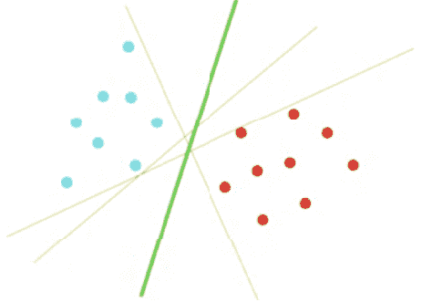

图 4.2 用于二分类（两个类别）的线性分类器。

## 4.3.2 逻辑回归

逻辑回归被广泛认为是医疗应用中评估临床数据的一种高度有效的机器学习技术。当试图确定样本属于某个类别的概率时，该技术非常有益。作为一种判别模型，逻辑回归通过将特征向量与输出类别进行对比来计算后验概率，而不考虑特征和目标变量的联合分布 [33]。它可以在数学上定义如下：

P(Y=y)=\frac{1}{1+e^{(w_1x_1+w_2x_2+w_3x_3+\cdots+w_nx_n+b)}}

权重 W 和偏差 b 是从训练数据集中学习到的参数。W 是一个长度为 n、包含元素 w_1, w_2, w_3, \cdots, w_n 的向量。

图 4.3 展示了逻辑回归的示意图。它通过估计每个输入特征的系数来提供可解释性，从而允许更深入地理解特征重要性。这种方法计算效率高，可以处理大型数据集。它生成概率输出，允许在决策中纳入不确定性 [30]。与先进方法相比，该模型对异常值具有抵抗力，并且需要较少的数据预处理。另一方面，逻辑回归预设了线性决策边界和特征独立性，限制了其在非线性实例和相关特征关系中的性能。它主要用于二分类，但可以扩展到多类情况。此外，极端异常值和非数值数据可能会影响其性能。在决定逻辑回归是否适合给定任务和数据集时，理解这些优缺点至关重要 [67]。

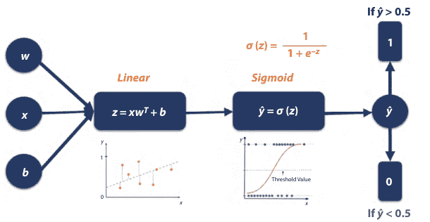

图 4.3 逻辑回归示意图。

## 4.3.3 朴素贝叶斯

朴素贝叶斯（NB）算法基于贝叶斯定理，根据特征向量及其先验概率计算每个类别的后验概率。在这个模型中，考虑了特征向量和类别标签的联合分布。该模型使用后验概率进行决策，假设特征是相互独立的 [76]。NB 方法计算后验概率如下：

```
argmax_y P(Y = y | X_1 = x_1, ..., X_n = x_n)
∝ argmax_y P(Y = y) ∏_{i=1}^n P(F_i = x_i | Y = y) =
```

预测类别（由 Y 表示）由最大后验概率决定，P 是概率。有关朴素贝叶斯的进一步数学信息可见文献 [15, 76]。

NB 机器学习算法以其在多类预测任务中的卓越性能而闻名。它使用简单且非常有效。它继续被广泛使用，并自 1961 年以来一直被用于生物信息学。朴素贝叶斯的可解释性——使我们能够理解每个特征如何对最终预测做出贡献——是其一大显著优势。然而，必须意识到，朴素贝叶斯基于所有输入特征相互独立的假设，这在实际数据集中可能并不成立。在处理复杂数据时，这一假设可能会限制其有用性 [15]。

## 4.3.4 k 最近邻

k 最近邻（k-NN）算法由 Cover 和 Hart 于 1967 年提出，属于保留所有训练样本的基于实例的机器学习方法 [75]。在对测试样本进行预测时，k-NN 直接检查测试数据与训练数据集中实例之间的关联以确定结果 [65]。对于特定测试数据集样本 x̃_test，其 k 个最近邻由具有 k 个最小距离（使用距离度量计算）的数据样本 x̃_1, x̃_2, ..., x̃_k 标识。最终结果通过以下方式获得：

```
y(x̃_test) = D([y(x̃_1), y(x̃_2), ..., y(x̃_k)])
```


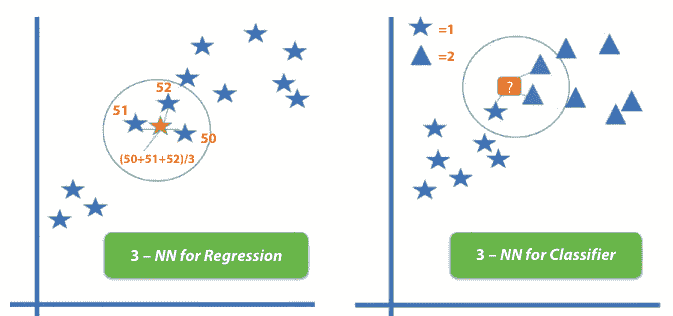

图 4.4 k近邻示意图。

最接近 $\vec{x}_{test}$ 的第 k 个样本的标签表示为 $y (\vec{x}_k)$。如果 y 是用于分类的类别标签，则 D 充当投票函数。如果 y 是用于回归的连续标签，则 D 充当平均操作 [75]。k-NN 的图形描述见 图 4.4。

k近邻算法的性能受参数 k 的影响。要找到最佳 k，通常会采用交叉验证（CV）或优化方法。该算法具有多种优点，包括其简单性、非参数特性、局部学习、无训练阶段，以及适用于分类和回归任务。它可以在正负样本分布均匀的小数据集上提供足够好的结果。然而，它也存在计算复杂度高、易受特征缩放和高维数据影响、缺乏可解释性以及对不平衡数据集敏感等缺点 [65, 75]。在决定是否为特定应用采用 k-NN 时，应权衡这些考量因素。

## 4.3.5 决策树与随机森林

决策树是一类依赖一组规则进行预测的机器学习算法。它们被组织为树状表示。树的根节点象征整个训练数据集，而分支节点表示决策点，叶节点表示累积决策的结果 [69]。在每个分支节点，数据使用既定的分割准则被划分为更紧凑、同质的子集。直到满足一组要求，此过程会迭代地将数据划分为越来越窄的子集。这些条件可能是超过最大深度限制，或子集内所有样本具有相同的标签 [6]。有几种广受欢迎的决策树算法，它们都使用不同的分割准则。ID3 和 分类与回归树（CART）方法是著名示例。这些算法对于构建决策树和选择最佳数据分割准则至关重要 [6, 69]。图 4.5 描绘了决策树的示意图。

决策树具有多种优点，包括可解释性、非参数特性、特征重要性识别、处理非线性关系的能力以及处理缺失值的能力。然而，它们容易过拟合，并对数据中即使是微小的变化做出快速反应，在线性建模方面存在困难，对主导特征表现出偏差，且缺乏全局优化。随机森林或梯度提升等集成方法可以帮助缓解其中一些局限性 [61]。

随机森林通常指一种通过“袋装（bagging）”方法结合多个决策树的机器学习模型 [22]。这种集成技术专门针对随机森林，其中单个树模型（具有低偏差、高方差和对训练数据集的过拟合特征）的预测被聚合。通过融合多样决策树的预测，随机森林提高了 ML 模型的整体效果 [22, 63]。图 4.6 展示了随机森林的示意图。

随机森林具有多种优点，包括其对过拟合的鲁棒性、高预测准确率、特征重要性分析、对各种数据类型的灵活性以及处理缺失值的能力。然而，它们在可解释性、计算成本、模型大小、黑盒特性及对噪声数据的敏感性方面存在局限性。在决定在特定场景中使用随机森林时，考虑这些因素至关重要 [37]。

决策树和随机森林通过回答一系列问题（分支节点处的分割规则）来模拟人类的决策过程，这些问题可以轻松地通过树的分支节点追踪 [6]。这些方法通常受到最终用户的青睐。树的结果可以通过经验实验进行验证，从而可能带来新的见解。此外，树擅长解决数据集中不完整或缺失数据所带来的挑战。

## 4.3.6 集成学习

提升（Boosting）是一种强大的集成学习方法，通过使用许多结构相同的模型来提高预测准确率和可靠性。这种方法通过整合各种模型的优势来改进预测。集成学习涉及创建多个具有随机生成参数的模型，然后将它们组合成一个集合。当这些模型的结果/预测结合在一起时，得到的预测更可靠，因为它减少了噪声、偏差和方差。与使用单一模型相比，提升方法提供了更高的准确率和可靠性。已经开发出多种提升算法以适应不同场景。这些算法包括自适应提升（AdaBoost）[59]、梯度树提升（GTB）[45]、极端梯度提升（XGBoost）[11]和分类提升（CatBoost）[55]。每种算法都为集成学习过程带来了其独特的优势和技术。

AdaBoost 是一种机器学习技术，它通过迭代过程将多个弱模型组合成一个单一的强模型，从而提高性能。它为每个样本分配可学习的权重，以控制其在弱模型训练过程中的重要性。在每个步骤中，被错误分类的数据样本的权重会增加，而被正确分类的数据样本的权重会减少。这确保了后续迭代更多地关注较难分类的样本，并赋予它们更大的权重。另一方面，梯度树提升（GTB）使用一组决策树，通过优化单个样本及其相关残差的梯度方向来进行训练。极端梯度提升（XGBoost）遵循类似原则，优化目标函数、树大小和权重大小以防止过拟合。

CatBoost 是标准梯度提升方法的改进版本，解决了两个关键问题：处理类别信息和防止目标泄露。提升方法因其多种优势而在各种研究中被广泛使用。它使用集成学习来超过单个分类器来提高预测准确率。它能有效处理相关数据，并天然支持稀疏、非线性和/或不平衡数据集。它可以突出关键方面，为决策提供有用的见解。

## 4.3.7 人工神经网络

人工神经网络（ANN）由相互连接的人工神经元组成，这些神经元充当基本的信息处理单元 [26]。如图 4.7 所示，ANN 也被称为神经网络，因为它们模拟了人脑中发现的神经元。神经元是 ANN 的基本要素，每个神经元的特征如下：

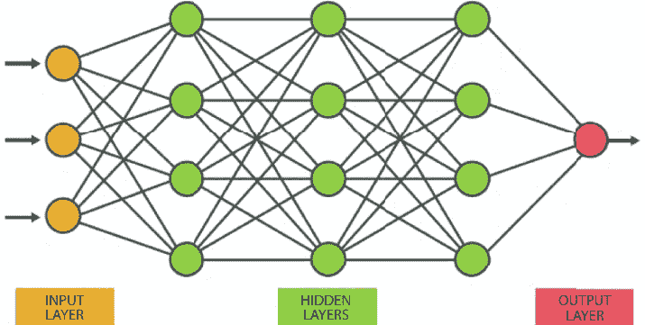

图 4.7 ANN 示意图 [26]。

```
z(x) = f(w_{1}x_{1} + w_{2}x_{2} + \cdots + w_{n}x_{n} + b)
```

其中 f 表示激活函数，可能是 Sigmoid 函数或修正线性单元（ReLU），而 z(x) 表示给定输入 x 时神经元的输出。神经元的权重 W = [w_1, w_2, ..., w_n] 和偏差 b 通过训练数据使用反向传播来确定。受人脑启发，神经元是一种非线性数学构造，旨在近似输入和输出之间的非线性关系。

人工神经网络（ANN）通常至少包含三层：
- 1) 输入层，直接接收数据，每个神经元代表特定的特征值
- 2) 隐藏层，通过应用加权线性组合和非线性激活函数，将输入层的信息传输到输出层
- 3) 输出层，产生最终结果

每层包含多个神经元，每个神经元都与下一层的所有神经元相连，从而允许信息从输入流向输出。具有超过两层且以前馈方式运作的 ANN 被称为多层感知机（MLP）[68]。

ANN 的架构由隐藏层的数量及其内部的神经元数量决定。ANN 的层数和每层内的神经元数量可以不同。在训练期间，神经网络通过误差的反向传播来学习，该误差基于网络输出与目标值之间的差异计算得出。随后修改网络的权重和偏差，以最小化训练样本上的误差 [52]。

深度学习最近获得了广泛关注，并已被证明在多个领域中很有用。本质上，深度学习是一种具有大量隐藏层的人工神经网络（ANN）。深度卷积神经网络（DCNN）常用于处理高维输入数据，例如图像，通过使用共享内核来减少参数数量。与传统的 ANN 不同，DCNN 通常具有更多的隐藏层，数量从 3 到 10 层，甚至可达 100 层 [24]。这种深度使深度神经网络能够通过从训练数据样本中提取相关特征，从大规模数据集中成功学习。术语“ANNs”涵盖所有


本章讨论的神经网络形式，包括标准人工神经网络、多层感知机和卷积神经网络。

总结而言，每种模型在应用于现实数据时都有其自身的优势和劣势。一般来说，参数较少的模型往往更具可解释性，但其能力不如参数数量较多的模型。

多元线性回归常用于药物-靶点相互作用，而决策树用于分析不良药物反应 [5, 10, 23, 39, 70]。为研究药物-药物相互作用，使用逻辑回归（LR）。支持向量机适用于化合物分类，而卷积神经网络（CNN）在预测生物活性方面表现出色。循环神经网络（RNN）在从零开始的药物设计中很重要，生成对抗网络（GAN）有助于分子发现。像 k-means 这样的聚类技术有助于药物候选物筛选，层次聚类应用于分子骨架分析。降维技术如主成分分析（PCA）在定量结构-活性关系（QSAR）中有用，t-分布随机邻域嵌入（t-SNE）用于化学空间映射。

这些方法在药物研究和分析的各个方面都充当着有价值的工具。

## 4.4 挑战

尽管 AI 和 ML 在药物发现中显示出巨大的前景，但如图 4.8 所示，仍有几项挑战需要解决。

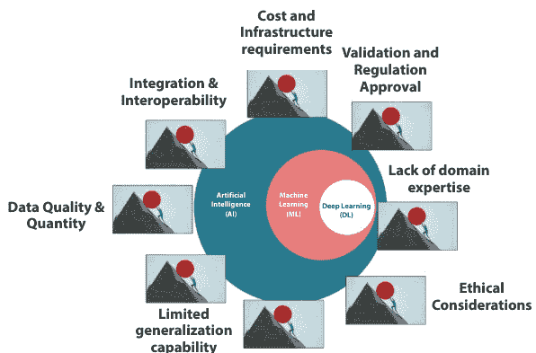

图 4.8 药物发现中 AI 和 ML 的挑战。

表 4.1 药物发现数据库。

| 数据库和 URL | 描述 |
|---|---|
| ChEMBL (https://www.ebi.ac.uk/chembl) | 创建了一个具有药物样特征的生物活性分子集合，包含化学、生物活性和基因组信息，以促进药物开发。 |
| ChemDB (http://cdb.ics.uci.edu) | 该数据库包含 500 万种商业可用的小分子及其相关理化性质，这些性质可以预测或通过实验确定。它是一个全面的化学数据库。 |
| DGIdb (http://www.dgidb.org) | 提供了一个包含来自 30 多个可靠来源的 DTI（药物-靶点相互作用）和可成药基因组数据的数据库。 |
| DrugBank (http://www.drugbank.ca) | 包含目标、三维模型及其他相关数据的药物库。 |
| DTC (http://druggtargetcommons.fimm.fi) | 一个用于获取药物-靶点生物活性信息和分类靶点的平台正在进行众包。 |
| INPUT (http://cbcb.cdutcm.edu.cn/INPUT) | 该平台提供一种面向中医药的网络药理学方法，包含来自 4716 种中药材的 29812 种已鉴定化合物。 |
| PubChem (https://pubchem.ncbi.nlm.nih.gov/) | 一个面向公众开放、包含分子及其特性信息数据的化学数据库，是化学家不可或缺的资产。 |
| SIDER (http://sideeffects.embl.de) | 一个存储管制药物及已记录不良反应数据的数据库。 |

### 4.4.1 数据质量与数量

大规模且高质量的训练和验证数据集的可用性对 AI 和 ML 模型的发展至关重要。这些模型在检测模式、做出预测和从数据中提取洞察方面表现出色，但需要大量多样且具有代表性的数据才能泛化 [51, 54]。然而，获取此类信息面临重大障碍，特别是在罕见病或特殊患者人群的背景下。一项重大困难是罕见病或特定患者人群的数据稀缺。由于这些疾病影响的人数较少，通常没有集中存档或详细的数据来源 [44]。因此，研究人员和组织可能难以收集足够的数据来准确捕捉这些情况的特征。此外，由于隐私担忧和数据保护要求，患者信息的访问可能受到限制，从而使寻找合适数据集的过程复杂化 [36, 44]。

为解决这些问题，研究机构、医院和技术企业可以合作，整合其资源、知识和数据。通过建立合作并共享信息，这些实体可以共同促成更大、更具代表性的数据库的创建。合作还允许交流领域知识并研究多样化的观点，从而提高所获得数据的整体质量和多样性。有多种公共数据库可用，例如 BindingDB、Drug-bank、ZINC、PUBCHEM 和 REAL 化学数据库。表 4.1 显示了这些各种数据库及其 URL。此外，利用先进技术和新方法可以帮助克服罕见病或特定患者人群中的数据短缺问题 [13, 44]。从应用角度来看，使用人工智能可以帮助数据增强，即生成合成数据或对现有数据进行变体。这些增强数据集可以补充有限的可用数据，同时提高训练数据集的多样性和代表性 [62]。

### 4.4.2 集成与互操作性

由于药物数据分散在多种来源和格式中，因此药物数据的集成和分析面临重大挑战。为了充分发挥 AI 和 ML 方法的能力，强调药物领域内的数据格式兼容性和标准化很重要 [80]。

互操作性是指各种系统和数据集高效地通信、交换和使用信息的能力。在药物数据的更广泛背景下，实现互操作性需要构建共同的标准和协议，以实现来自多个来源的数据集成和协调 [12]。这确保了数据可以在许多平台、应用程序和组织之间轻松共享、集成和分析。互操作性促进快速数据聚合，提高数据质量和完整性，并使学者和医疗保健从业者能够从集成数据中获得有价值的洞察。

数据格式标准化与互操作性密切相关，对于高效的数据集成和分析至关重要。制药行业可以通过采用标准化数据格式（如行业范围的数据模型或本体论 [12, 80]），确保数据收集、维护和传播的一致性和统一性。标准化改善数据理解，最大限度地减少歧义和错误，并允许跨系统和组织进行顺畅的数据集成和分析。它还通过为数据表示和处理提供统一框架，使 AI 和 ML 模型的创建和部署更加容易。

各利益相关方之间的合作对于建立制药行业的互操作性和标准化至关重要。制药企业、监管机构、研究机构、技术供应商及其他相关实体必须共同努力，制定行业范围的数据标准，推动数据共享工作，并开发互操作性框架。监管组织可以通过制定建议和法规，在鼓励使用标准化数据格式和互操作系统方面发挥重要作用。

### 4.4.3 缺乏领域专业知识

某些 AI 和 ML 模型，如深度学习神经网络，可能是黑盒，使得解释其决策过程变得困难。这对必须了解模型工作原理以依赖其预测的监管机构和医疗保健从业者来说可能是一个问题 [25]。

有几种方法可以用来解决这个问题。一种方法是采用可解释性方法，有助于解释模型如何做出决策 [41, 44]。另一种方法是采用更透明的模型，如决策树或线性模型。需要注意的是，并非总是需要可解释性。在某些情况下，模型的准确性可能比其可解释性更重要。然而，在其他情况下，模型既准确又可解释可能至关重要 [13]。

制药行业仍处于将 AI 和机器学习纳入药物研究的早期阶段。随着这些技术的发展，解决可解释性和透明度问题至关重要。这将有助于确保这些技术被负责任且有效地使用 [2, 28, 32, 38, 46, 53, 64]。

### 4.4.4 验证与监管批准

在药物发现中获得 AI 和 ML 算法的监管批准是一个艰难的过程，因为需要根据监管标准证明其可靠性、准确性和安全性 [14]。这至关重要，因为这些算法有能力影响人类健康，需要进行彻底的审查以验证准确性、可靠性和无安全问题 [27]。

在药物发现中验证基于 AI 和 ML 的算法可能会因噪声和不充分的患者数据而具有挑战性，这可能导致有偏见或不准确的模型。研究人员正在通过使用数据增强和超参数调整等策略来提高模型准确性，并开发理解模型复杂性的方法以更好地评估安全风险，从而解决这些问题 [18, 62]。尽管存在局限性，但基于 AI 和 ML 的药物开发算法的潜在益处巨大。这些算法可用于发现新药靶点、创造新药物，并预测药物疗效和安全性。随着这些技术的发展，预计它们将在药物发现过程中发挥越来越大的作用 [13]。

药物发现中的 AI 和 ML 涉及生物学家、化学家和药理学家等领域专家以及数据科学家之间的合作。弥合这些学科之间的差距并建立高效的沟通对于成功集成 AI 和 ML 至关重要。

### 4.4.5 伦理考量

在药物发现中集成 AI 和 ML 引发了与隐私、数据安全和偏见相关的伦理问题。为了保持透明度、公平性和问责制，至关重要的是


为应对这些影响。虽然 AI 和 ML 在药物发现中为效率和准确性提供了宝贵的提升，但必须谨慎处理与其使用相关的伦理考量 [7]。

AI 和 ML 算法中的偏见是一个主要问题，源于训练数据中代表性不足，这可能导致对某些人群做出不准确的预测 [4, 49]。隐私泄露是另一个担忧，因为这些算法通常依赖庞大的数据集（包括敏感信息），如果未得到充分保护，可能被用于歧视或定向营销目的。解决这些问题对于确保公平无偏的结果并保护个人隐私至关重要。

在药物发现中，伦理考量包括透明度、公平性和问责制，旨在避免歧视并确保负责任地使用。制定优先考虑这些原则的指南，可帮助研究人员和政策制定者确保 AI 和 ML 技术负责任且有益地应用，造福社会。

### 4.4.6 成本与基础设施要求

实施 AI 和 ML 技术需要大量计算资源和基础设施，这对资源有限的中小型企业或研究机构而言可能颇具困难 [42, 58]。人工智能和机器学习是提升药物发现效率与准确性的重要技术。然而，这些技术的采用成本高昂，且需要专业知识。因此，中小型企业和学术机构可能会发现实施 AI 和 ML 具有挑战性 [4]。

解决这一问题有多种方法。一种解决方案是采用云计算平台，可提供按需付费的强大处理资源和基础设施访问权限。必须强调的是，整合 AI 和 ML 技术的成本并非唯一的考量因素。这些技术的开发和执行可能需要数年时间。在决定是否采用 AI 或机器学习之前，评估这些技术的成本与收益至关重要。尽管面临挑战，AI 和 ML 在药物发现过程中变得越来越重要。随着这些技术不断发展，它们很可能变得更加经济实惠，中小型组织和研究机构也能更容易获得 [7]。

### 4.4.7 有限的泛化能力

在特定数据集和条件下训练的 AI 和机器学习模型可能难以推广到其他数据集或场景中。确保模型在不同人群、疾病和实验情境中具有韧性和可泛化性至关重要 [8, 72]。人工智能和机器学习是提升药物发现效率与准确性的重要技术。然而，由于这些模型经常在特定数据集和情境中训练，其推广到其他数据集或场景的能力有限。这可能导致过拟合（即模型学习了训练数据中的噪声，而非潜在模式）[72]。

可采用多种方法解决这一问题。数据增强是一种方法，即通过添加与原始数据可比的额外数据来人为扩大训练数据集 [62]。迁移学习是另一种策略，即先在可比任务的广泛数据集上训练模型，再针对目标任务进行微调。确保模型对噪声和异常值具有抵抗力也至关重要。这可以通过使用正则化和丢弃（dropout）等技术来实现。

因此，遵循这些步骤可以提高 AI 和 ML 模型在药物发现中的鲁棒性与泛化能力。这将有助于确保这些模型能够在各种情境下做出准确预测 [13]。

### 4.4.8 协作与数据共享

制药行业出于竞争原因保护数据的需求阻碍了协作与数据共享，限制了 AI 和 ML 在药物发现中的应用。为充分释放这些技术的潜力，鼓励研究人员和组织间的协作与数据共享不可或缺。这可以通过跨学科协作、法规、数据标准化以及持续的研发工作来实现，以确保 AI 和 ML 在药物发现中的适当与成功应用。

跨学科协作将多个学科的学者聚集在一起，共同应对共同挑战，为数据共享建立协作且开放的环境。监管框架通过制定质量、安全及研究使用指南，促进负责任的数据共享。数据标准化包括制定统一的格式与协议，以便公司之间实现无缝数据交换。持续的研发活动专注于通过开发新算法、训练数据集和性能评估，提高 AI 和 ML 系统的准确性与有效性。

通过解决这些问题，制药行业可以充分实现人工智能与机器学习在药物发现中的全部潜力。这可能带来新型药物与疗法的发现，帮助患者过上更好的生活。

## 4.5 结论与未来方向

制药行业已采用人工智能（AI）技术，将机器学习（ML）算法和深度学习方法融入日常活动。ML 技术在药物开发和医疗保健的各个领域都有应用，尽管也面临挑战。医学科学中的 ML 模型已展示出预测和分析化合物结构的能力，从而能够识别具有理想特性的替代工具和分子。深度学习模型在许多应用中显示出前景，有助于提高临床试验的成功率。随着 AI 技术在计算机辅助药物开发领域不断进步，它带来了强大的数据挖掘能力。然而，某些问题依然存在，例如深度学习方法的性能与解释性、“黑箱”模型可解释性的需求，以及神经网络训练参数的优化。解决这些挑战对于充分挖掘 AI 在药物发现与开发中的全部潜力至关重要。

医学科学与网络创新已相结合，以改进深度学习算法并提高对治疗不良反应做出明智决策的能力。预计在未来几年，借助 AI 技术，整个药物研发过程将发生根本性的转变。自动化 AI 系统必须成功整合各种数据来源，才能实现这一变革。

## References

- 1. AdekoYa, O.C. _等_, 药物递送中聚合物纳米凝胶机器学习应用的小型综述. *Mater. Today: Proc.*, 62, S141–S144, 2022.
- 2. Ali, S. _等_, 面向云启用医疗保健组件的基于模式的变更验证框架. *IEEE Access*, 8, 148007–148020, 2020.
- 3. Andi, H.K., 基于生物活性预测和药物释放跟踪的 AI 驱动药物检测系统. *J. Artif. Intell.*, 4, 4, 263–273, 2022.
- 4. Arabi, A.A., 药物设计中的人工智能：算法、应用、挑战与伦理. *Future Drug Discovery*, 3, 2, 59, 2021.
- 5. El-Attar, N.E. _等_, 埃及产精油植物分类与生物活性预测的深度学习模型. *Sci. Rep.*, 10, 1, 21349, 2020.
- 6. Bansal, M., Goyal, A., Choudhary, A., 机器学习中 K-近邻、遗传、支持向量机、决策树和长短期记忆算法的比较分析. *Decis. Anal. J.*, 3, 100071, 2022.
- 7. Blanco-Gonzalez, A. _等_, 药物发现中 AI 的作用：挑战、机遇与策略. *Pharmaceuticals*, 16, 6, 891, 2023.
- 8. Cerchia, C. 和 Lavecchia, A., 人工智能辅助药物发现的新途径. *Drug Discov. Today*, 28, 103516, 2023.
- 9. Chen, R. _等_, 药物-靶点相互作用预测的机器学习. *Molecules*, 23, 90, 2208, 2018.
- 10. Chen, W. _等_, 药物发现的人工智能：资源、方法与应用. *Mol. Therapy-Nucleic Acids*, 31, 691–702, 2023.
- 11. Chen, X. _等_, EGbMMDA：用于 MiRNA-疾病关联预测的极端梯度提升机. *Cell Death Dis.*, 9, 1, 3, 2018.
- 12. Chin, L. 和 Khozin, S., 精准医疗中数据流动性与数据公平性的数字高速公路. *Biochim. Biophys. Acta (BBA)-Reviews Cancer*, 1876, 1, 188575, 2021.
- 13. Dara, S. _等_, 药物发现中的机器学习：综述. *Artif. Intell. Rev.*, 55, 3, 1947–1999, 2022.
- 14. Ebrahimiian, S. _等_, FDA 监管的 AI 算法：验证研究的趋势、优势与差距. *Acad. Radiol.*, 29, 4, 559–566, 2022.
- 15. Frank, E. _等_, 用于回归的朴素贝叶斯. *Mach. Learn.*, 41, 5–25, 2000.
- 16. Gaudelet, T. _等_, 药物发现与开发中图机器学习的应用. in: *Briefings in Bioinformatics*, vol. 22, p. 159, 2021.
- 17. Geetha, M., Manikandan, P., Jerome, J., 基于软计算技术的化学罐式反应器虚拟反馈 PID 控制器最优调节. in: *2014 IEEE 进化计算大会 (CEC)*, pp. 1922–1928, IEEE, 2014.
- 18. Geetha, M. _等_, 连续搅拌罐反应器二维 PID 模糊控制器的实时实现与性能分析. in: *2013 第四届国际计算、通信与网络技术会议 (ICCCNT)*, pp. 1–5, IEEE, 2013.
- 19. Ghildiyal, S., Mani, G., Nersisson, R., 基于各种机器学习技术的肌电图模式识别假肢肢体控制. *J. Med. Eng. Technol.*, 46, 5, 370–377, 2022.
- 20. Gunn, S.R. _等_, 用于分类和回归的支持向量机. *ISIS Tech. Rep.*, 14, 1, 5–16, 1998.


- 21. Gupta, R. et al., 从人工智能到深度学习：药物发现的机器智能方法. Mol. Divers., 25, 1315–1360, 2021.

- 22. Haddouchi, M. and Berrado, A., 用于解释随机森林的方法和工具综述，收录于：2019年第1届智能系统与数据科学国际会议（ICSSD），第1–6页，IEEE，2019年。

- 23. Hammann, F. et al., 基于决策树建模的不良药物反应预测. Clin. Pharmacol. Ther., 88, 52–59, 2010.

- 24. Harrison, P.J. et al., 脂质纳米粒载药递送的深度学习模型. Nanomedicine, 16, 1097–1110, 2021.

- 25. He, J. et al., 医学中人工智能技术的实践实施. Nat. Med., 25, 30–36, 2019.

- 26. 什么是神经网络？, 2023. https://www.tibco.com/reference-center/what-is-a-neural-network (访问于 2023年6月10日).

- 27. Hwang, T.J., Kesselheim, A.S., Vokinger, K.N., 医学中基于人工智能和机器学习的软件设备生命周期监管. JAMA, 322, 2285–2286, 2019.

- 28. Ilmudeen, A. and Nayyar, A., 智慧医疗系统的新型设计：技术、架构与应用，收录于：面向关键医疗物联网的机器学习：应用与用例，第125–151页，Springer，Springer Cham，德国，2022年。

- 29. Keiser, M.J. et al., 已知药物新分子靶点预测. Nature, 462, 175–181, 2009.

- 30. Kleinbaum, D.G. et al., 逻辑回归，德国，2002年。

- 31. Koshiyama, A., Firoozye, N., Treleaven, P., 未来资本市场中的算法，ICAIF ’20：第一届ACM金融人工智能国际会议论文集，1–8，2020年。可在SSRN 3527511上查阅。

- 32. Kumar, A. et al., 基于医疗4.0流程的新型智慧医疗设计、仿真与实现. IEEE Access, 8, 118433–118471, 2020.

- 33. LaValley, M.P., 逻辑回归. Circulation, 117, 18, 2395–2399, 2008.

- 34. Lavecchia, A., 药物发现中的机器学习方法：方法与应用. Drug Discov. Today, 20, 3, 318–331, 2015.

- 35. Lee, I. and Nam, H., DeepConv-DTI：基于蛋白质序列卷积的深度学习药物-靶点相互作用预测. PLoS Comput. Biol., 15, 6, 1007129, 2019.

- 36. Leelananda, S.P. and Lindert, S., 药物发现中的计算方法. Beilstein J. Organic Chem., 12, 1, 2694–2718, 2016.

- 37. Lenhof, K. et al., 基于先进随机森林方法的药物敏感性预测中的同时回归与分类. Sci. Rep., 12, 1, 13458, 2022.

- 38. Mahapatra, B., Krishnamurthi, R., Nayyar, A., 医疗记录中隐私与安全的医疗模型与算法，收录于：电子医疗记录的安全与隐私：概念、范式与解决方案，第183页，2019年。

- 39. Maltarollo, V.G. et al., 新药发现中支持向量机的进展. Expert Opin. Drug Discov., 14, 1, 23–33, 2019.

- 40. Mani, G., Viswanadhapalli, J.K., Sriramalakshmi, P., 基于人工智能驱动的物联网实时空气污染监测与预报. J. Physics: Conf. Ser., 2115, 1, 012016, 2021.

- 41. Manikandan, P., Geetha, M., Jerome, J., 加权模糊容错模型预测控制，收录于：2014年IEEE模糊系统国际会议（FUZZ-IEEE），第83–90页，IEEE，2014年。

- 42. Manikandan, P. et al., 水位过程智能模糊逻辑控制器的实时实现与性能分析，收录于：2013年第四届计算、通信与网络技术国际会议（ICCCNT），第1–6页，IEEE，2013年。

- 43. Mayr, A. et al., DeepTox：基于深度学习的毒性预测. Front. Environ. Sci., 3, 80, 2016.

- 44. Miller, M.A., 药物发现中的化学数据库技术. Nat. Rev. Drug Discov., 1, 3, 220–227, 2002.

- 45. Natekin, A. and Knoll, A., 梯度增强机：教程. Front. Neurorobotics, 7, 21, 2013.

- 46. Nayyar, A., Gadhavi, L., Zaman, N., 医疗保健中的机器学习：综述、机遇与挑战. Mach. Learn. Internet Med. Things Healthcare, 7, 23–45, 2021.

- 47. Pandiyan, M., Jayakumar, S., Sivaraman, N., 印度专利，印度，2020年，IN201841047826.

- 48. Pandiyan, M., Jayakumar, S., Sivaraman, N., 印度专利，印度，2020年，IN 201841024297.

- 49. Pandiyan, M. and Mani, G., 工业应用嵌入式低功耗模拟CMOS模糊逻辑控制器芯片，收录于：2015年IFIP/IEEE超大规模集成（VLSI-SoC）国际会议，第43–48页，IEEE，2015年。

- 50. Pandiyan, M. and Mani, G., 基于Takagi-Sugeno模糊专家模型的双罐交互系统软故障诊断. Arch. Control Sci., 24, 3, 271–287, 2014.

- 51. Pandiyan, M. and Mani, G., 无线体域网可穿戴心电图SoC：基于模糊决策芯片的实现，收录于：VLSI-SoC：面向可靠性、安全性和低功耗的设计：第23届IFIP WG 10.5/IEEE超大规模集成国际会议，VLSI-SoC 2015，韩国大田，2015年10月5–7日，第67–86页，Springer，2016年，修改精选论文。

- 52. Patel, J. and Patel, A., 受控药物释放中的人工神经网络，收录于：药物设计、递释与分布中的人工神经网络，第195–218页，2016年。

- 53. Pramanik, P.K.D., Pareek, G., Nayyar, A., 远程医疗中的安全与隐私：问题、解决方案与标准，收录于：远程医疗技术：面向全球医疗的大数据、深度学习、机器人、移动与远程应用，第201–225页，2019年。

- 54. Priestley, M., O'Donnell, F., Simperl, E., ML开发管道中重要的数据质量要求调查. ACM J. Data Inf. Qual., 15, 2, 1–39, 2023.

- 55. Prokhorenkova, L. et al., CatBoost：具有类别特征的无偏增强. Adv. Neural Inf. Process. Syst., 31, 2017.

- 56. Murphy, K.P., 机器学习：概率视角，Taylor & Francis，MIT Press，美国，2014年。

- 57. Sahu, M. et al., 精准医学中的人工智能与机器学习：大数据分析的范式转变. Prog. Mol. Biol. Trans. Sci., 190, 1, 57–100, 2022.

- 58. Santa Maria Jr., J.P., Wang, Y., Camargo, L.M., 利用人工智能加速药物发现的挑战与机遇展望. Front. Bioinf., 3, 1121591, 2023.

- 59. Schapire, R.E., 解释AdaBoost，收录于：经验推理：向弗拉基米尔·N·瓦普尼克致敬文集，第37–52页，2013年。

- 60. Schölkopf, B. et al., 新型支持向量算法. Neural Comput., 12, 5, 1207–1245, 2000.

- 61. Schöning, V. and Hammann, F., 药物发现数据挖掘中决策树模型发展得如何？. Expert Opin. Drug Discov., 13, 12, 1067–1069, 2018.

- 62. Serov, N. and Vinogradov, V., 人工智能赋能纳米医学. Adv. Drug Deliv. Rev., 184, 114194, 2022.

- 63. Shaikhina, T. et al., 抗体不相容肾移植中预后预测的决策树与随机森林模型. Biomed. Signal Process. Control, 52, 456–462, 2019.

- 64. Sharma, K., Singh, H., Sharma, D.K., Kumar, A., Nayyar, A., Krishnamurthi, R., COVID-19热点地区药物及其他医疗物品无人机配送的动态模型与控制技术，收录于：抗击COVID-19的新兴技术：应用与创新，第1–34页，2021年。

- 65. Shen, M. et al., 药物候选物代谢稳定性k近邻QSPR模型的开发与验证. J. Med. Chem., 46, 14, 3013–3020, 2003.

- 66. Smola, A.J. and Schölkopf, B., 支持向量回归教程. Stat Comput., 14, 199–222, 2004.

- 67. Sperandei, S., 理解逻辑回归分析. Biochemia Med., 24, 1, 12–18, 2014.

- 68. Sutariya, V. et al., 药物递送与药学研究中的人工神经网络. Open Bioinf. J., 7, 1, 49–62, 2013.

- 69. Swain, P.H. and Hauska, H., 决策树分类器：设计与潜力. IEEE Trans. Geosci. Electron., 15, 3, 142–147, 1977.

- 70. Talevi, A. et al., 药物发现与开发中的机器学习第1部分：入门. CPT: Pharmacometrics & Syst. Pharmacol., 9, 3, 129–142, 2020.

- 71. 人工智能产生新抗生素，https://news.mit.edu/2020/artificial-intelligence-identifies-new-antibiotic-0220.2020 (访问于 2023年6月10日).

- 72. Tripathi, N. et al., 大数据时代药物设计与发现中人工智能的应用：全面综述. Mol. Divers., 25, 3, 1643–1664, 2021.

- 73. Vamathevan, J. et al., 药物发现与开发中机器学习的应用. Nat. Rev. Drug Discovery, 18, 6, 463–477, 2019.

- 74. Vo, A.H., Van Vleet, T. R., Gupta, R. R., Liguori, M. J., Rao, M. S., 药物毒性评估中机器学习与大数据概览. Chem. Res. Toxicol., 33, 1, 20–37, 2019.

- 75. Wang, A.X., Chukova, S.S., Nguyen, B.P., 基于质心置换的集成k近邻. Inf. Sci., 629, 313–323, 2023.

- 76. Webb, G. I., Keogh, E., Miikkulainen, R., 朴素贝叶斯，收录于：机器学习百科全书，第15卷，第713–714页，2010年。

- 77. Yang, Z. et al., ML-DTI：可解释药物-靶点相互作用预测的互学习机制. J. Phys. Chem. Lett., 12, 17, 4247–4261, 2021.

- 78. Zhang, L. et al., 药物毒性预测中机器学习方法的应用. Curr. Topics Med. Chem., 18, 12, 987–997, 2018.

- 79. Zhang, L. et al., 从机器学习到深度学习：合理药物发现中机器智能的进展. Drug Discovery Today, 22, 11, 1680–1685, 2017.

- 80. Zohuri, B. and Behgounia, F., 推动基于纳米的药物递送系统中人工智能的应用，收录于：药物递送人工智能手册，第145–212页，Elsevier，荷兰，2023年。


## 人工智能用于理解抗菌耐药性机制和抗菌药物发现：转化研究的新时代模型

Yashaswi Dutta Gupta and Suman Bhandary*

生物科学系，生命科学与生物技术学院，阿达马斯大学，加尔各答，西孟加拉邦，印度

## Abstract

抗菌耐药性（AMR）呈现出日益严重的全球卫生危机，其特征是细菌对常规抗生素的耐药性不断增强。理解AMR机制并开发创新抗菌药物，需要利用人工智能（AI）等强大工具作为应对这场危机的有效方案。本章的主要目标是通过双重分析凸显AI在对抗AMR中的作用——一方面，强调AI在解读促进AMR扩散的因素方面的预测潜力；另一方面，概述AI赋能的诊断工具和AI优化的个体化治疗策略等新兴前景。我们旨在批判性地评估各种AI方法论，以证明其在解读大规模细菌遗传数据集方面的效力。除了利用AI的预测能力来估计耐药性发生的可能性外，它还能够识别此前未被发现的抗菌作用靶点。本章将对AI技术的探索与其实际应用紧密结合，全面展示该领域的现状，并强调AI在对抗AMR中日益增长的作用。除了评估现状外，我们还旨在回顾并确定该领域未来潜在的研究方向。最终，本章强调了AI作为持续努力以减轻AMR影响的基石的能力，超越国界，推动医疗保健方法的变革性转变。

关键词：人工智能，抗菌耐药性，机器学习，诊断工具，抗生素发现，生物膜

### 5.1 引言

抗菌耐药性（AMR）是指细菌、病毒、真菌和寄生虫等微生物产生抵御先前能够有效治疗由这些微生物引起的感染的药物影响的能力的现象[1]。当微生物经历使其能够自我防御抗菌剂的进化变化时，就会发生这种情况，这会导致药物效果降低甚至完全失效[2]。随着细菌对常规抗生素表现出日益增强的耐药性，抗菌耐药性（AMR）构成了日益严峻的全球健康挑战[3]。除了使先前有效的治疗变得无效外，AMR还会显著增加发病率、死亡率和医疗成本[4]。

AMR由多种因素引起，包括抗菌剂的滥用、感染预防和控制措施不足，以及微生物适应和进化的自然能力[2]。发现新的抗菌剂对于对抗AMR并提供有效的治疗选择至关重要[5]。然而，抗菌药物发现中的传统试错方法面临着日益严峻的挑战，例如AMR上升率、抗菌药物发现成本增加且成功率降低，以及药物发现时间极其漫长[6]。随着对抗AMR的紧迫性迅速上升，开发创新策略来对抗AMR的需求变得显而易见[7]。

这个问题的范围非常广泛，AMR威胁着削弱现代医学取得的许多进步。估计到2050年，AMR每年可能导致1000万人死亡，并使全球经济损失高达100万亿美元[8]。除了对人类健康的影响，AMR还对动物健康和粮食安全产生重大影响[9]。为应对这一挑战，需要全球层面的协调行动。这包括减少抗生素的过度使用和滥用、促进新抗菌剂的开发，以及改善对AMR的监测和监控[10]。还需要增加对研发的投入，以更好地理解AMR背后的机制，并开发应对耐药细菌的新策略。

当前问题具有两个方面：首先，需要加深对AMR机制的理解，以便制定更有效的策略来对抗耐药细菌[11]。其次，迫切需要发现新的抗菌剂，以补充日益减少的有效抗生素储备[12]。在此背景下，人工智能（AI）已成为一种强大的工具，为这些紧迫挑战提供解决方案。AI有潜力通过提供对AMR机制的新见解并加速新型抗菌化合物的发现来应对这两个挑战。然而，实现这一潜力需要开发和应用先进的AI方法论。除了这些挑战之外，还有与AMR相关的更广泛问题需要解决。这些包括改善现有抗生素的管理以确保其持续有效性，以及通过改进感染控制措施来减少耐药感染传播的努力[13, 14]。

机器学习技术在医疗保健领域的应用可以通过提供更快、更准确的解决方案来协助医疗从业者[15]。在本章中，我们旨在评估机器学习、深度学习等AI算法如何在理解AMR机制方面发挥关键作用，以便分析海量基因组数据集，从而揭示AMR产生的难以捉摸的机制[16]。本章还试图阐明AI在提供克服抗生素耐药性的丰富策略方面的应用。我们将深入探讨从预测AMR模式到优化治疗方案的广泛AI驱动解决方案[17]。通过整合遗传和临床数据，AI模型可以预测AMR的调节，并指导临床医生做出更精确、更明智的治疗决策。优化抗生素和潜在药物组合也证实了AI的能力及其在应对多重耐药病原体方面所具有的前景[18]。由于AI的融入在改善患者护理方面具有前所未有的潜力，我们将旨在强调AI在增强抗生素管理方案、最大限度地降低AMR出现风险方面的重要性[19, 20]。本质上，本章重点介绍了利用AI来理解抗菌耐药性机制和抗菌药物发现的应用，旨在通过提供有价值的见解、加速新疗法的开发以及实现精准医疗方法来对抗日益严重的AMR威胁，从而革新转化研究。

### 本章目标

利用尖端计算技术来应对AMR带来的复杂挑战，并加速新抗菌剂的发现过程，是使用AI来理解AMR机制和抗菌药物发现的目标。
本章的具体目标如下：

- (a) 利用人工智能分析各种数据源，如基因组学、蛋白质组学和代谢组学数据，以阐明抗生素耐药性背后的分子机制；
- (b) 创建AI驱动的算法，以发现与AMR相关的大型复杂数据集中的关联和趋势；
- (c) 创建AI驱动的预测模型，以预测抗生素耐药性的建立和传播；
- (d) 使用人工智能（AI）技术检查微生物基因组和蛋白质组，以发现新的治疗靶点；
- (e) 应用AI算法优化抗菌化合物的设计，包括改变化学结构以提高疗效并降低耐药性发展的可能性；
- (f) 使用AI算法优化对大型化学文库的虚拟筛选，以寻找潜在的抗菌化合物；
- (g) 此外，促进AI驱动的发现转化为临床实践和公共卫生政策。

### 本章组织

本章其余部分的组织安排如下：第5.2节详细阐述了用于AMR的常用人工智能算法。第5.3节说明了用于理解AMR机制和抗菌药物发现的AI。第5.4节强调了克服抗生素耐药性的策略。第5.5节聚焦于抗菌耐药性的人工智能应用，随后第5.6节涵盖了实际实施面临的挑战，最后，第5.7节以未来展望结束本章。


## 5.2 用于 AMR 的常用人工智能算法

为应对耐药性（AMR），人工智能被应用于开发算法，这些算法可用于分析大规模基因组数据和生物化学数据集，并对临床研究和试验所得数据进行高效分析，所有这些均可用于识别 AMR 的离散或新兴模式。有多种不同的人工智能算法可用于理解 AMR 的基本原理，例如机器学习（ML）算法，如朴素贝叶斯（NB）、决策树（DT）、随机森林（RF）和支持向量机（SVM），以及深度学习（DL）算法，如人工神经网络（ANN）[21]。基于预测建模的人工智能算法在识别和预测 AMR 模式方面至关重要。这些算法采用 SVMs 和 RFs 等机器学习算法，以辨别遗传变异、致病因子与耐药性之间的隐藏关系 [22]。这种预测建模方法使研究人员能够预测耐药菌株的出现并采取主动措施。基因组数据也是解析 AMR 遗传基础的关键因素。人工智能算法可以设计为促进全基因组分析，以识别赋予耐药性的突变与 AMR 相关的特定基因 [23]。这将使研究人员能够根据遗传易感性量身定制治疗干预措施，以实现最大治疗效果。人工智能算法可以通过模拟潜在药物候选物与细菌靶点的相互作用，加速缓慢且昂贵的传统药物发现方法。虚拟筛选、分子对接模拟和基于深度学习的方法等技术可以识别与耐药靶点强结合的化合物 [24]。这可以加速新抗生素的发现，为应对不断演变的耐药菌株提供更强的防御 [25]。使用人工智能算法对抗 AMR 的实现示例如下：

- i. 朴素贝叶斯（NB）：它是一种概率机器学习算法，可用于预测事件发生的可能性 [26]。NB 基于贝叶斯定理，该定理描述了在给定某些证据的情况下事件发生的概率与事件发生情况下证据出现的概率之间的关系 [27]。在 AMR 的背景下，NB 可用于根据细菌菌株的遗传构成和其他相关因素，计算其对抗生素产生耐药性的概率 [28]。NB 算法还可预测细菌感染的概率及 AMR 发生的可能性。该预测可用于制定更具经验性的抗生素治疗开处方方法，在临床环境中，这有望降低患者中 AMR 的发病率 [29]。

- ii. 决策树（DT）：这些是强大的机器学习算法，可用于分类和回归任务，包括识别变量之间的模式和关系 [30]。DT 是一种用于回归和分类分析的监督机器学习算法。DT 遵循一组 if–else 条件，根据条件参数预测输出。DT 通过根据输入特征的值将数据递归划分为子集来工作，目标是最大化不同类别之间的分离度 [31]。DT 可用于对抗 AMR，通过提供评估治疗策略和做出抗生素使用明智决策的框架。在 Voermans 等人的一项研究中 [32]，采用了决策分析框架来评估使用基于降钙素原（PCT）指导的算法进行抗生素管理。该研究关注治疗策略的临床和经济结果，同时考虑医院费用和抗生素治疗的成本，以及抗生素使用减少的潜在益处。这种模型可以在临床环境中实施，以计算有效治疗的成本和每种结果的概率，为医院提供成本效益分析，以便就分配资源和资金用于治疗做出明智决策，在最大限度提高效率的同时降低 AMR 出现的风险。

- iii. 随机森林（RF）：RF 是 DT 的扩展，通过构建多棵树并组合其预测来提高准确性并减少过拟合。在 RF 模型中，算法基于一组 DT 构建森林 [33]。RF 算法是鲁棒的机器学习算法，因为它们为数据选择和处理高维数据集提供了更准确的特征 [34]。通过在大规模细菌基因组及其相应抗生素耐药性谱的数据集上训练 RF，研究人员可以识别与耐药性相关的遗传标记，并利用这些信息指导抗生素治疗方案，以降低 AMR 复发的几率 [35]。RF 算法还可用于识别针对不同细菌菌株的潜在抗生素联合疗法。RF 模型通过结合基因组和化学信息，可以预测拟议抗生素组合的效率 [36]。这种方法可以通过识别针对多种耐药机制的有效联合疗法，帮助最大限度地降低 AMR 风险，减少细菌对任何单一抗生素产生耐药性的可能性。通过使用 RF 算法指导新联合疗法的开发，研究人员可能改善治疗结果并减少抗生素耐药感染的传播。

- iv. 支持向量机（SVM）：这是另一种用于分类和回归任务的流行算法。SVM 通过寻找在数据中最大程度分离不同类别的超平面来工作。这个超平面由一部分训练样本定义，称为支持向量，它们位于最接近决策边界的位置 [37]。通过在大规模细菌基因组及其相应抗生素耐药性谱的数据集上训练 SVM，研究人员可以识别与 AMR 相关的遗传标记。SVM 模型已在 AMR 研究中被使用，通过扫描微生物的全基因组序列来预测负责 AMR 的表型 [23]，并基于基因组数据预测 AMR 的出现 [38]。

- v. 深度学习（DL）：深度学习是机器学习的一个分支，专注于使用人工神经网络（ANN）为挑战性问题创建模型和解决方案。它借鉴了人脑中神经元协同工作以处理和传输信息的方式。DL 中使用的这些 ANN 由许多层连接节点（神经元）组成，这些节点逐渐从输入数据中提取更高级别的属性 [39]。

深度学习算法可以分析海量生物和化学数据，以发现潜在的新药物候选物。它通过发现具有抗菌特性的化合物并预测分子间的相互作用，帮助加速药物发现过程。可以开发深度学习算法，以评估某种细菌对特定药物产生耐药性的可能性。这可以帮助医疗专业人员就抗生素的使用和治疗方法做出更明智的决策。通过在大规模细菌基因组及其相应抗生素耐药性谱的数据集上训练 ANN，研究人员可以识别遗传标记与抗生素耐药性之间的复杂模式和关系。然后，这些信息可用于指导针对这些特定耐药机制开发新抗生素 [25]。深度学习模型可以通过检查诊断测试的数据（如 DNA 测序或基因表达分析），快速检测耐药微生物的存在 [16]。这可能会导致更个性化且有效的治疗方案。

## 5.3 用于理解 AMR 机制和抗菌药物发现的人工智能

由于存在多种局限性，用于揭示 AMR 基础机制和抗菌药物发现的传统方法已不尽理想。为了克服这些局限性，人工智能已成为一款有前途的竞争者，因为它可以高效分析大规模数据集，并识别数据中人眼可能无法察觉的模式和关系。

### 5.3.1 理解 AMR 机制

影响耐药性发展的重要内在因素包括抗菌药物无效、阻碍药物-靶点相互作用的微生物生理学、微生物突变、微生物的基因型和表型改变等 [22]。可能很明显，其中许多变化可能被人眼忽略；这就是人工智能发挥作用的地方。人工智能和机器学习技术持乐观态度，弥合这一差距，可能有助于我们理解导致耐药性发生的机制原理和差异。

研究人员已开发出少量机器学习方法，研究微生物细胞如何对抗菌药物产生反应，然后基于这些数据使用机器学习算法创建模型和算法框架，以训练抗菌分类器——例如，开发了一种名为 MorphEUS 的机器学习模型；它使用高通量荧光显微镜来研究基于抗菌剂作用的形态特征分析 [40]。MorphEUS 根据细菌细胞的形态变化，快速表征了药物作用的机制性细胞通路。该算法基于药物特征的 k 近邻分析。可为具有已知耐药性的突变微生物菌株开发类似 MorphEUS 的算法，以研究药物作用的机制


菌株不同细胞通路的活性。这可能有助于识别具有绕过 AMR 潜力的新通路。可使用 AI 和 ML 方法对微生物序列进行深入而精密的扫描，以发现可能导致 AMR 发展的基因组和表型变化。基因组测序是从耐药微生物菌株中提取基因组数据的一种成本效益高的方法 [41]。为了为这些评估设计模型，首先根据 WGS 数据库中可用的临床数据收集 WGS 数据。WGS 数据包含微生物正常、耐药以及敏感菌株的遗传信息。随后提取关于遗传变异、特征等位基因等的重要特征，这些特征作为训练 ML 模型的参考特征 [42, 43]。在 ML 框架上训练这些模型后，再用测试数据或未知数据对数据进行测试，以验证 ML 模型的性能效率。还可以使用各种评估指标来研究测试输出的效率 [44]。研究人员调研了逻辑回归 (LR)、支持向量机 (SVM)、随机森林 (RF) 和卷积神经网络 (CNN) 等 ML 算法，用于预测大肠杆菌对四种不同抗生素的 AMR [42]。通过利用全基因组测序 (WGS) 评估的基因编码数据，作者报告称，他们的模型可以在无需事先了解微生物菌株中 AMR 基因的情况下有效预测 AMR。该研究证明了基于 WGS 方法的模型能够高效预测 AMR 基因。另一个名为代谢等位基因分类器 (MAC) 的分类器也接受了评估，它实现了使用 WGS 来根据遗传因素分析确定 AMR [45]。基于结核分枝杆菌的基因型和表型数据，作者训练了一个机器学习模型，以准确预测 AMR 表型以及诸如代谢通路参与等可解释的生化方面，从而深入了解 AMR 的潜在机制原理。在全基因组研究中实施此类 ML 模型，可以成功地提供准确精确的洞察，了解导致 AMR 的表型变异，以及理解调节 AMR 机制原理所涉及的代谢通路等生化原理。

## 5.3.2 抗菌剂发现中的 AI

AI 和应用 ML 模型通过辅助抗菌剂发现，在加速药物研究中可以发挥关键作用。ML 模型可应用于研究新药靶点、设计新型药物分子、药物新用、优化现有制剂等 [46]。

### 5.3.2.1 潜在靶点的靶向与验证

这是识别微生物中与调节疾病进程关键通路相关且可被潜在药物候选物靶向的潜在分子或细胞成分的第一个且非常重要的步骤 [47]。可借助在线数据库中大量的基因组、蛋白质组和临床数据来识别潜在靶点。基因组数据分析可提供大量与特定疾病或其在调节疾病关键代谢通路中的作用相关的潜在基因或蛋白质信息 [48]。随后可采用 ML 算法在基因组数据中查找可能与发现抗菌剂以控制特定疾病进展相关的模式。基因表达是创建用于筛选基因组数据的 ML 模型的一种高度可靠的方法。该分析研究正常和患病状态下基因的调控，以对两者进行比较分析。基于筛选提供的遗传数据，基于网络的 ML 模型可以识别在疾病进程中至关重要的关键蛋白质或代谢通路数据 [49]。必须以一种方式开发 ML 模型，以便在识别出潜在靶点后进一步验证获得的靶点数据。为了确定靶点是否可能引起特定疾病，AI 模型必须有效地交叉验证靶点数据。一组研究人员设计了一个 ML 模型，根据基因组数据和系统分析预测可能成为潜在药物靶点的疾病相关基因 [50]。基于 ML 的方法包括一系列数据，包括基因表达谱、蛋白质-蛋白质相互作用谱等，以预测可成药与不可成药靶点以及患病基因与正常基因的可能性。作者还通过训练和测试数据的多个子集来交叉验证 ML 模型，以证实其鲁棒性。本文展示了基于 ML 的框架在靶点识别和验证中的效率。表 5.1 列出了一些基于微生物基因组数据分析来预测 AMR 基因的 AI 模型示例。

| 基于 ML 的模型 | 目的和应用 | 参考文献 |
|---|---|---|
| DeepARG | 使用深度学习扫描宏基因组数据以预测 AMR 基因 | [43] |
| AntiSMASH | 使用 SVM、HMM、pHMM 预测细菌和真菌基因组中次生代谢产物的生物合成基因簇 | [51] |
| 抗性基因标识符 (RGI) | 基于同源性和 SNP 模型使用 HMM 从蛋白质或核苷酸数据预测抗生素抗性组 | [52] |
| ResFinder | 使用 BLAST 序列分析鉴定全基因组中获得的抗菌耐药基因 | [53] |
| ArgANNOT | 使用 BLAST 序列分析预测细菌基因组中现有的和新的 AMR 基因 | [54] |
| PRGPred | 使用 SVMs 预测抗性基因类似物的结构域 | [55] |
| Meta-MARC | 使用基于 DNA 的层次隐马尔可夫模型预测多样的抗菌耐药序列 | [56] |
| MEGARes 和 AMR++ | 使用基于 k-mer 的宏基因组分类器直接从 FASTA 对抗性组序列进行分类 | [57] |
| ARGMiner | 使用 RF 算法分析多个 AMR 基因数据库中可用的所有信息，并提供病原体携带的潜在 AMR 基因的信息 | [58] |

### 5.3.2.2 药物新用

药物新用是一种成本效益高的方法，用于将预批准药物重新用于疾病控制的新干预。开发一种新的药物或抗菌剂需要多年的研究和大量的长期投资。AI 可以通过有效地寻找药物新用的方法，在加速抗菌剂发现方面发挥潜在辅助作用 [59]。Prasad 和 Kumar [60] 强调了 AI 和基于 ML 的方法在为 SARS-CoV-2 药物新用方面的潜力。作者最初强调了可用数据库（如基因组数据、临床数据、蛋白质数据和结构数据）的重要性，所有这些都可以由 AI 算法筛选，以寻找参与调节 SARS-CoV-2 的潜在靶点。可使用 ML 算法分析这些大型数据集，并基于已知的药物-靶点相互作用或蛋白质数据，算法可以识别微妙的模式以预测新靶点或药物-靶点相互作用。作者还讨论了 AI 程序在虚拟筛选中的重要性，例如能够进行分子对接和分子动力学模拟 [60]。随着新靶点的识别，这些虚拟筛选方法可用于评估结合亲和力或虚拟模拟药物-靶点相互作用，以评估预测数据集的效率。同源建模、分子动力学和蛋白质结构预测等 AI 方法可用于辅助药物新用研究，以识别可能有助于调节疾病进展的潜在药物或药物靶点。

回顾来看，研究论文 [60] 还为一个关键且令人担忧的话题提供了实用洞察，即全球大流行等异常情况可能在未来任何时间发生。显而易见，在应对类似 SARS-CoV-2 的全球大流行的紧急情况下，在非常短的时间内创造一种副作用可忽略的新药几乎是不可能的。在这里，AI 可以作为重新利用现有药物来对抗新疾病的第一道防线，发挥重要作用。

### 5.3.2.3 新型抗菌肽 (AMP) 发现

AI 在从头开始进行药物和肽发现中发挥关键作用，因为 ML 模型可以被用来生成新化合物以加速抗菌剂发现。AI 算法可以预测可能表现出与已知抗菌剂结构相似的抗菌活性的化学结构。这种方法可能有助于探索广阔且潜在未被开发的化学途径，以创造新型抗菌化合物，克服现有的抗菌耐药机制 [61]。AMP 是对抗抗菌耐药微生物的高度有价值的治疗候选物 [62]——例如，开发了一种名为 DEEP-AmPEP30 的新型深度学习模型，以提高短长度 AMP 的预测准确性 [63]。DEEP-AmPEP30 模型在已知 AMP 的综合数据集上进行了训练。基于这些数据，AI 模型使用氨基酸组成、肽、理化数据和进化数据来评估 AMP 中存在的鉴别模式。采用了适当的训练和交叉验证算法来证实 AI 模型的鲁棒性。Yan 等人 [63] 报告称，DEEP-AmPEP30 在预测具有潜在抗菌活性的 AMP 方面比现有模型准确率高出 77%。该算法预测了一种新型短 AMP 序列，其效力与氨苄西林相似，并且对枯草杆菌和副溶血性弧菌具有强烈的抗菌活性。在 Porto 等人 [64] 的另一项研究中，ML 模型被纳入以


## Table 5.2 AI models employed for the discovery of antimicrobial peptides.

| ML-based model | Purpose and application | Reference |
|---|---|---|
| Deep-AmPEP30 | 利用基于简化氨基酸组成数据训练的卷积神经网络，预测短肽段 AMPs | [63] |
| AmPEP | 基于氨基酸特性分布模式和随机森林算法，实施序列分析以预测 AMPs | [65] |
| Co-AMPpred | 融合基于组成的序列与理化特征，训练特征选择模型以预测 AMPs | [66] |
| AMPpred-EL | 一种结合 LightGBM 和逻辑回归算法的集成学习模型，用于高效预测 AMPs | [67] |
| AMP-BERT | 一种基于优化的双向编码器表示（BERT）的深度学习模型，用于识别临床研究的候选 AMPs | [68] |
| Peptide Ranker | 使用 SVM 和 RF 等算法预测 AMPs 的效力 | [69] |
| iAMPPred | 使用 SVM 算法预测并识别 AMPs | [70] |

predict novel AMPs from guava. The AI model was trained to rapidly screen a vast variety of peptide sequences and predict the ones with potent antimicrobial activity. Using the AI model, authors were able to predict a novel AMP, Guavanin-2, which demonstrated potent antimicrobial activity against Gram-negative bacteria.

The potential of AI-based models in predicting novel AMPs can significantly confer potential in accelerating research in antimicrobial discovery in novel drug discovery. Table 5.2 provides examples of AI models for discovery of AMPs.

### 5.3.2.4 Optimizing Drug Formulations

AI models can be incorporated to optimize drug formulations in order to achieve maximum effectiveness from them. Based on data available on online databases regarding physicochemical properties of chemical compounds, structure, and stability of chemicals, etc., ML algorithms can predict the most suitable formulation for potent antimicrobial activity. Landin and Rowe [71] emphasized the use of ML algorithms such as artificial neural networks (ANN), genetic algorithms, and fuzzy logic to assist in optimizing drug formulations. Optimizing drug formulations can help researchers enhance the antimicrobial activity by targeting specific sites, increasing the bioavailability, and having a prolonged release, all of which can assist in improving the therapeutic efficacy of the antimicrobial drug.

## 5.4 Strategies to Overcome Antibiotic Resistance

The rampant over-use of antibiotics had led to a global rise in antibiotic resistance at an alarming level. Lack of advancing pharmaceutical research to combat this threat poses a major challenge in the pipeline for the discovery of new antibiotics [72]. AI has been a revolutionary approach in accelerating the drug discovery process to overcome antibiotic resistance by predicting novel antibiotic molecules, de novo drug design, antimicrobial susceptibility testing, and improved diagnosis [73].

### 5.4.1 Discovering Novel Antibiotic Compounds

ML holds great potential in assisting the global fight against antibiotic resistance by predicting novel compounds with potent antimicrobial activity. AI and ML approaches can assist efficiently in all stages of drug discovery such as target identification and validation, feature selection of biomarkers, and clinical trials [74]. A ground-breaking testament to the feasibility of this concept was presented with the discovery of a novel antimicrobial compound using a ML-based approach by Stokes et al. [25]. Authors used a ML model based on neural molecular representations to predict antimicrobial compounds from a library of more than 107 million compounds. The model predicted a novel molecule, later named halicin, as a potent antimicrobial with a chemical structure different from that of existing antibiotics. The molecule was also predicted to have low toxicity to humans. Authors tested halicin against multi-drug-resistant species like Clostridium difficile, Acinetobacter baumannii, and Mycobacterium tuberculosis. The novel molecule halicin showed potent antimicrobial activity against the three. To test its clinical efficacy, in vivo tests on mouse wound models of Acinetobacter baumannii were also performed as they have known AMR to all known antibiotics. The researchers found that a halicin-containing ointment was successfully able to clear out the A. baumannii infection within 24 h of topical application. A study for the development of AMR to halicin was also investigated. The authors found that E. coli did not develop resistance towards halicin after a 30-day treatment regime, but in contrast, E. coli developed resistance to a commonly used antibiotic ciprofloxacin within 1–3 days of treatment and developed a 200% increase in antibiotic resistance after 30 days. In a very recent publication from the Stokes Lab, authors discovered yet another new antibiotic capable of killing a deadly, drug-resistant superbug—Acinetobacter baumannii. The authors incorporated the use of ML models to scan and analyze a vast chemical space of 7,500 molecules to screen for those that inhibited the activity of A. baumannii. The dataset obtained from the growth inhibition results was used to train a neural network, leading to the discovery of Abaucin—a narrow-spectrum antibiotic compound with a potent antibacterial activity against A. baumannii. Further tests and research revealed that the antibiotic activity of Abaucin was attributed to the perturbation of lipoprotein trafficking through a mechanism involving LolE. In vivo tests also validated the potency of Abaucin in controlling A. baumannii infection in a mouse wound model [75]. Both of these studies emphasize and highlight the imperative role AI plays in contributing to the urgent and pressing need of discovering novel antibiotics that humans on their own may not be able to achieve. As we have discussed in previous sections, the discovery of AMPs also holds great potential in combating antibiotic resistance.

DL algorithms can be trained on a database of antimicrobial peptides with known antibiotic activity to predict novel peptide sequences [76]. Wu et al. [77] developed an AI model based on amino acid prediction titled “novel AMP” to perform quicker predictions for AMPs. The AI model was successfully able to predict a novel AMP molecule DP7 which showed a significantly potent antibiotic activity towards microbial as well as antibiotic-resistant strains. The DP7 AMP was also found to be less cytotoxic to human cells.

These studies highlight the importance of AI algorithms in the discovery of antibiotic molecules. This approach holds a promising optimism towards identifying novel antibiotic compounds to overcome antibiotic resistance to address the urgent need for new therapeutic options in the global combat against AMR.

### 5.4.2 Antibiotic Repurposing and Optimization

As discussed in the previous sections, apart from predicting new antibiotic compounds, AI algorithms can be used to screen existing antibiotics having potential as repurposed drugs for a different disease [59]. This can enable researchers to investigate alternate mechanisms of action which can be used to effectively treat antibiotic resistant bacteria. Based on the physicochemical properties of antibiotic drugs available in online databases, AI models can be trained to find patterns to optimize the drug formulation while minimizing the risks of antibiotic resistance [71]. By optimizing the pharmacokinetic properties of the drug, researchers will be able to improve the targeting to resistant bacteria and reduce the risks of emergence of new antibiotic resistance.

### 5.4.3 Optimization of Combinatorial Therapy

Combination therapy refers to the use of two or more combinations of different drugs to work synergistically to increase the therapeutic efficacy by targeting different disease pathways. Over the last few decades, combination therapy has been used widely to combat the growing antimicrobial resistance. Combination therapy in combating AMR has three variations: (a) different drug molecules inhibit different microbial pathways, (b) drug molecules inhibit different targets belonging to the same metabolic pathway, and (c) synergistic drug molecules inhibit the same metabolic pathway in different ways [78]. However, complications like drug–drug interactions and dose calculation need to be addressed alongside to ensure effective therapeutic outcomes and minimize AMR emergence [79]. Using different drug combinations may lead to harmful side effects and systemic toxicity. However, to efficiently screen potential drug combinations by conventional clinical techniques, it would take tedious hours of manual screening and data processing from results which are both difficult and expensive. The application of AI and ML algorithms can be incorporated to improve the therapeutic efficacy by comprehensive screening of potential drug combinations while reducing the risks of AMR [80].

ML-based approaches hold great potential combination therapy by addressing three problems: (a) predicting the sensitivity of the drug combination, (b) predicting the synergy of the drug combination, and (c) classifying the predicted drug synergy [81]. The ML-based prediction of the sensitivity of drug combinations allows researchers to predict the treatment response to different drug combinations. ML algorithms can predict the


基于可在线获取的临床数据评估药物组合的疗效。这有助于开发新型组合，这些组合可在治疗不同疾病时产生多种有效结果。comboFM是一个ML模型示例，可根据实验数据预测药物组合反应的细胞基因组特征和药物分子的化学描述符 [82]。预测药物组合的协同作用是识别两种药物联合效应程度的关键。ML算法可以通过全面分析药物化学数据库和基因表达数据的特征来预测药物组合协同作用。像DeepSynergy这样的深度神经网络算法是最早开发的用于基于训练有化学和基因组数据库的模型来预测药物组合协同作用的ML模型之一 [83]。DECREASE也是一个稳健的ML模型，可以通过从药物剂量响应值预测协同效应来预测协同和拮抗药物组合。DECREASE在预测抗菌、抗病毒和抗真菌药物组合方面也很高效 [84]。预测药物协同分类使用基于ML的方法，这些方法涉及对组合中药物的化学特征进行全面分析以预测组合的效力。目标蛋白的基因组数据与化学空间数据的结合，可能显著有助于创建治疗疾病的最佳药物组合。SyDRa是这种基于ML的方法的一个合适示例，因为SyDRa模型是一个随机森林算法，经过训练可分析治疗化合物、目标分子和药基因组数据的化学结构，以预测高效药物组合 [18]。这些基于ML的算法凸显了AI如何与化学和基因组数据相结合，以预测有效的协同药物组合。

在一项研究通信中，提出了一种名为ComboNET的深度学习ML模型，用于预测针对Covid-19的协同药物组合 [85]。该模型基于图卷积网络和药物-靶点相互作用进行训练，以预测药物与靶点的结合以及单一治疗剂的抗病毒活性，从而预测协同药物组合，以有效治疗SARS-CoV-2。ComboNET模型预测了两种有效的药物组合——remdesivir + reserpine和remdesivir + IQ-1S——这两种组合均具有较高的*体外*活性，且治疗Covid-19的系统性毒性风险较低。另一种ML模型INDIGO被开发用于预测抗生素药物组合 [36]。该模型纳入了仅基于化基因组相互作用的框架，以预测协同和拮抗抗生素组合。作者强烈认为，像INDIGO这样的基于ML的方法可以大幅缩短发现具有临床意义的抗生素组合所需的时间；配备基因组数据还可以帮助靶向关键通路，以规避或抑制耐药性（AMR）的发展。

### 5.4.4 加强抗生素管理方案

“管理”一词是指保护社区宝贵资源的实践。据报道，给予非ICU患者的大多数抗生素都是不必要的，并且还可能导致不良副作用 [86]。抗生素管理是一种量化和改善临床医生抗生素处方及患者用药的策略 [87]。最佳的抗生素剂量和疗程不仅对于最大化有效的感染治疗至关重要，而且对于保护患者免于产生抗生素耐药性也至关重要 [88]。ASP的核心目标是提供改善的患者护理，这反过来会导致抗生素的使用量、数量和疗程长度减少 [86]。针对疑似呼吸机相关性肺炎的患者，提出了短程抗生素治疗方案，随后对患者进行重新评估以确定持续治疗是否必要。这种方法减少了患者不必要的抗生素暴露 [89]。在另一项研究中，据报道，医院内随机分配的患者接受了医生推荐的标准护理或基于ASP的抗生素治疗。据报道，ASP组的患者比其他患者更有可能接受合适的抗生素治疗（可能性高出三倍），且ASP组的患者更有可能从感染中恢复（可能性高出两倍），治疗失败的可能性低80%。为了制定成功的抗生素管理方案，涉及七个关键原则，包括以下内容：

- 领导层承诺
- 负责结果的单一负责人
- 单一药学负责人
- 抗生素使用追踪
- 抗生素使用和耐药性的定期报告
- 对提供者进行用药和耐药性教育
- 特定改进干预 [86]

经验性抗生素处方（临床医生开具的初始药物）大多基于病原体及其对不同抗生素的敏感性进行有根据的推测。然而，检测和数据积累可能需要几天时间，这会延迟适当的治疗期间并可能对患者产生不良影响，这就是为什么医生通常建议使用能够治疗所有可能病原体的抗生素。医生的这一决定可能并不理想，因为他们最终可能会建议使用广谱抗生素，而在这些情况下，窄谱抗生素可能更有效。因此，AI和ML可以帮助抗生素处方。预测分析基于个体化预测和建议，并在医疗保健领域应用此策略；预测模型可以使用电子病历进行训练，以提高经验性抗生素处方的准确性和可靠性。AI模型可以使用统计数据进行训练来预测特定于患者的信息。输入正确变量和适当训练将帮助AI模型定量估计个体患者实时感染概率，同时也考虑AMR——例如，在斯坦福，一个ML模型能够比较感染开始时开具的初始经验性抗生素与最终获得的耐药性谱。使用这种ML模型策略不仅能提供关于应给患者使用的精准窄谱抗生素的信息，还能改善管理和安全性 [90]。在另一项研究中，一个学习模块能够识别与不正确处方相关的数据模式。该学习模块还能够识别基础系统无法预测的不适当处方模式 [91]。基于临床数据集使用AI预测AMR要求模型能够证明其预测背后的适当理由。还采用并评估了一种可解释AI方法，该方法分析个体患者数据中的模式以识别导致AMR的特征。这种策略有助于评估预测的可信度 [92]。Cai et al. [93] 使用患有复发性尿路感染（rUTIs）的女性的微生物学和临床统计数据训练了人工神经网络（ANN），以预测经验性抗菌处方的疗效。该ANN能够以87.8%的灵敏度和97.3%的特异度预测临床疗效。神经网络能够识别影响ANN针对不同疗法的决策输出的各种变量，这表明ANN可以被训练并用作抗菌管理的指南 [93]。Sethi et al. [19] 开发了使用AI模型的贝叶斯网络（BN）用于儿科重症监护室（PICU）中的抗生素管理，该网络识别了抗生素使用和耐药性模式，并检测了可以进一步改善抗生素使用的领域。

## 5.5 抗菌耐药性的人工智能应用

迄今为止，我们已讨论了将AI应用于AMR的一些关键实践，例如发现新型抗菌化合物、预测对细菌具有强效活性的新型AMP、药物重新定位和优化、个体化医疗等。除了预测抗菌化合物外，AI在对抗抗病毒、抗真菌和抗寄生虫耐药性方面也有基础。AI算法还可以用于基因组数据的监测，以便在AMR发生前预测其出现，利用现有临床数据快速诊断AMR，并用于对抗AMR的疫苗开发。

### 5.5.1 AI在对抗抗真菌耐药性中的应用

AI能够通过高效检测和管理预测的耐药标记以及耐药基因的真菌靶点，有效应对抗真菌耐药性。如前几节所述，AI模型可以建模用于对基因组或表型数据进行深度扫描，以预测抗菌耐药基因 [42]。一种用于真菌基因泛基因组分析的类似模型可用于预测抗真菌耐药性。在一项研究中，开发了一种ML算法，用于预测一种新兴的多药耐药真菌Candida auris的耐药基因 [94]。Li et al. [94] 评估了在358株Candida auris的WGS数据上训练的ML模型的性能。然后，ML分类器预测了C. auris对不同抗真菌药物的耐药模型，并根据曲线下面积（AUC）值进行评估。采用带有交叉验证的递归特征消除（RFECV）并结合ML分类器来对C. auris中的耐药突变进行排序。在其整体研究结果中，作者报告称，ML模型能够准确预测并排序C. auris中的耐药突变基因。除此之外，该模型还能预测真菌基因中一些与耐抗真菌药物（如fluconazole、micafungin和amphotericin B）相关的新型耐药突变。该研究凸显了将ML分类器纳入现有和新型抗真菌耐药基因预测的重要性，这对于推进抗真菌耐药性研究至关重要。

涉及抗真菌耐药性的基因及其代谢通路的功能知识，也为推动此背景下的制药研究提供了关键见解。关于导致抗真菌耐药性的重要突变基因的信息可以被用作抗真菌分子的靶点。通过一项研究来说明这一概念，将一个ML模型与致命真菌病原体Candida albicans的化基因组相互作用相结合，以开发新的抗真菌靶点 [95]。使用他们的AI模型，Fu et al. [95] 能够识别C. albicans的三种先前未被表征的必需基因——Krp1、Emf1和Tif33。对这些基因的实验验证确定了它们分别在着丝粒调节、线粒体完整性定向以及翻译起始中的作用。作者还进行了一项全面的


对9,600种化学化合物进行筛选，以寻找对白色念珠菌（C. albicans）关键基因具有抗真菌活性的化合物。在筛选后的评估中，作者鉴定出一种化合物N-嘧啶基-β-噻吩丙烯酰胺（NP-BTA），该化合物被发现对白色念珠菌（C. albicans）具有强效的抗真菌活性，并对耐药念珠菌（C. auris）和葡孢子念珠菌（C. glabrata）具有抗真菌活性。化基因组学分析表明，NP-BTA能有效靶向白色念珠菌（C. albicans）中已知的关键基因谷氨酰-tRNA合成酶（GLN4）。本研究强调了机器学习（ML）算法如何用于鉴定抗真菌化合物的新基因靶点，从而有助于开发新的抗真菌耐药性调控治疗研究。表5.3提供了一些用于对抗抗真菌耐药性的机器学习算法示例。

Table 5.3 ML models employed for combating antifungal resistance.

| ML algorithm(s) used | Purpose and application | Reference |
|---|---|---|
| 逻辑回归（LR）、支持向量分类器（SVC，包括SVC RBF和SVC线性）、K近邻（KNN）、决策树（DT）、集成学习（包括随机森林、AdaBoost和梯度提升）以及朴素贝叶斯（包括BernoulliNB和GaussianNB） | 一种成本效益高且高效的基于ML的方法，用于鉴定参与调节葡萄孢子念珠菌（C. auris）耐药机制的真菌耐药基因 | [94] |
| 随机森林、逻辑回归和线性判别分析（LDA） | 将ML模型纳入MALDI-TOF MS数据，以鉴定白色念珠菌（C. albicans）中的氟康唑耐药性，开发一种当天出结果的高效诊断工具 | [96] |
| 随机森林 | 使用ML和化基因组相互作用来鉴定具有先前未表征功能的关键真菌基因，这些基因有望成为新型抗真菌药物的新靶点 | [95] |
| 人工神经网络 | 展示了人工神经网络（ANN）在预测咪唑衍生物对白色念珠菌（C. albicans）的抗真菌活性方面的能力，以鉴定强效的抗真菌药物 | [97] |
| 回归分析 | 结合ML模型、同源建模和分子动力学，研究抗真菌药物甲氧苄啶（TMP）在肺孢子菌（Pneumocystis jirovecii）中的分子机制 | [98] |
| 深度学习 | 开发了Deep-AFPpred，利用1DCNN-BiLSTM深度学习算法从蛋白质序列预测抗真菌肽 | [99] |
| 随机森林、逻辑回归和支持向量机 | 用于筛选念珠菌血症预后因素的ML模型 | [100] |

## 5.5.2 对抗抗病毒耐药性的人工智能

人工智能在加速抗击抗病毒耐药性研究方面具有巨大潜力。抗病毒药物耐药性是由于长期抗病毒药物治疗或治疗方案中的抗病毒复制引起的 [101]。机器学习模型可以应用于大规模基因组和临床数据，以预测抗病毒耐药基因的模式，并发现用于抗病毒耐药突变的新耐药基因。其中一项研究采用了经过训练的机器学习算法来对HIV逆转录酶（RT）序列进行分类，以预测抗病毒耐药突变 [102]。基于机器学习模型获得的结果，Blassel et al. [102]发现了六种新的HIV耐药突变——L228R、L228H、E203K、D218E、I135L和H208Y。该研究强调了病毒基因组中新突变的发现如何有助于识别新的抗病毒治疗策略。从制药角度来看，机器学习模型还可用于预测病毒对抗病毒疗法的反应。Zazzi et al. [103]的另一项研究评估了一种名为EuResist的机器学习模型，以预测抗病毒治疗的结局 [103]。EuResist模型用于收集来自HIV基因组数据和不同国家49,000例HIV患者记录的临床数据。根据患者的临床数据和该患者中发现的HIV序列，机器学习模型可以为患者预测合适的抗病毒药物治疗方案。据报道，该模型提供可靠的治疗组合，准确率为76%。像EuResist这样的AI模型就是机器学习模型如何用于个性化医疗以降低抗病毒耐药性风险的示例。机器学习技术还可用于开发新的抗病毒化合物并优化现有抗病毒药物的效力，以抑制抗病毒耐药性的进展 [104]。针对HIV、埃博拉病毒和冠状病毒等日益严重的病毒威胁，有大量的化学、基因组和临床数据可用。这些数据可以整合到机器学习模型中，以预测病毒耐药模式和新的耐药基因，从而有助于发现新的抗病毒药物来对抗抗病毒耐药性。在过去十年中，许多涉及机器学习方法的研究已被纳入用于发现针对SARS-CoV-2 [105]、埃博拉 [106]和HIV [107]等病毒威胁的抗病毒药物候选物。使用机器学习方法开发新的抗病毒药物可以使研究人员绕过病毒病原体的现有耐药机制，提供一种高效且强效的治疗方法，同时消除耐药菌（AMR）出现的风险 [108]。表5.4提供了一些用于对抗抗病毒耐药性的机器学习算法示例。

Table 5.4 ML models employed for combating antiviral resistance.

| ML algorithm(s) used | Purpose and application | Reference |
|---|---|---|
| 多层感知机（MLP）、双向循环神经网络（BRNN）和卷积神经网络（CNN） | 用于预测HIV-1序列中耐药突变的机器学习模型 | [109] |
| 多变量逻辑回归（MLR）、弹性网（EN）、随机森林（RF）、梯度提升机（GBM）和前馈神经网络（FNN）机器学习算法 | 用于预测丙型肝炎病毒（HCV）感染患者直接抗病毒药物（DAA）治疗失败的机器学习算法 | [110] |
| 支持向量机、随机森林、基于朴素贝叶斯的分类器、深度神经网络 | 将机器学习模型纳入虚拟筛选，以发现针对黄热病病毒（YFV）的新抗病毒化合物 | [111] |
| 支持向量机（SVM）、朴素贝叶斯（NB）、多标签分类器层次结构（HOMER）、多标签K近邻（MLkNN）、预测聚类树（PCT）、随机K标签集（RAkEL） | 在不进行基因型耐药检测的情况下，从患者和医疗记录中预测HIV的耐药性 | [112] |
| 支持向量机（SVM）、随机森林、采用多种神经网络架构的深度学习以及超参数 | 使用特征知情的机器学习模型来预测潜在抗病毒肽 | [113] |
| 接收者操作特征（ROC）及相应的曲线下面积（ROC-AUC）分析 | 基于序列到结构的方法，通过分析HIV-1蛋白酶结合位点的分子相互作用来预测HIV-1的耐药性 | [114] |
| 神经网络 | 预测病毒突变，以早期检测纽卡斯尔病毒（NDV）中的耐药性 | [115] |
| 神经网络和决策树 | 用于检测甲型流感病毒对抗病毒药物奥司他韦和金刚烷耐药性的机器学习模型 | [116] |
| 2种经典机器学习算法（随机森林[RF]和极端梯度提升[XGBoost]）和4种深度学习算法（深度神经网络[DNN]、图卷积网络[GCN]、图注意力网络[GAT]、以及指纹和图神经网络[FP-GNN]） | 开发了VDBB，这是一个基于机器学习的预测框架，用于靶点和细胞感染检测，以支持各种抗病毒药物发现相关任务，例如生物活性预测、虚拟筛选、化合物重定位和靶点捕获 | [117] |
| 受限玻尔兹曼机（RBMs） | 用于预测和分类HIV蛋白酶耐药性的高效稳健机器学习模型 | [118] |

## 5.5.3 对抗抗寄生虫耐药性的人工智能

通过利用人工智能在探索抗寄生虫耐药性方面的能力，研究人员可以提供发现抗寄生虫耐药性新模式的新方法，针对寄生虫

Table 5.5 ML models employed for combating antiparasitic resistance.

| ML algorithm(s) used | Purpose and application | Reference |
|---|---|---|
| 决策树、弹性网、极端随机树、梯度提升、Lasso Lars、LightGBM、随机森林和随机梯度下降算法 | 使用机器学习准确预测*恶疟疟原虫（Plasmodium falciparum*）分离株中的青蒿素耐药性，并根据*体外*转录谱预测疟疾疟原虫分离株的寄生虫清除率 | [119] |
| 深度学习 | 使用基于机器学习的方法预测*恶疟疟原虫（Plasmodium falciparum*）和*间日疟原虫（Plasmodium vivax*）中的耐药位点 | [121] |
| 用于构建QSAR模型的深度学习 | 深度学习方法，用于预测以前未经测试的化学剂对敏感和耐药*恶疟疟原虫（Plasmodium falciparum*）株的抗疟活性和细胞毒性 | [122] |
| 深度神经网络 | 将神经网络算法与异质细胞测定相结合，以预测疟原虫*恶疟疟原虫（Plasmodium falciparum*）中药物作用的潜在机制 | [123] |
| 朴素贝叶斯、随机森林、J48和SMO | 计算建模，用于鉴定和预测针对*墨西哥利什曼原虫（Leishmania mexicana*）丙酮酸激酶酶（LmPK）的新型抗利什曼原虫化合物的生物活性 | [124] |
| 随机森林 | 用于预测生物活性抗疟分子的机器学习模型，这些分子可抑制*恶疟疟原虫（Plasmodium falciparum*）中天冬氨酰氨基肽酶（M18AAP）的活性 | [125] |
| LightGBM（基于树的梯度提升方法） | 用于预测与青蒿素治疗耐药性相关的保守表达转录生物标志物的稳健机器学习模型 | [120] |


泛基因组、预测新的治疗选择以及优化治疗方法，以绕过抗寄生虫耐药性。在Ford等人[119]评估的集成机器学习方法中，作者讨论了机器学习算法在应对疟原虫（Plasmodium falciparum，恶疟原虫）分离株中青蒿素耐药性方面的潜力。基于青蒿素的疗法是治疗由恶疟原虫引起的疟疾的第一道防线。然而，随着感染率逐渐增加，恶疟原虫耐药株的出现使得该疾病似乎难以治疗。鉴定抗寄生虫耐药基因可以有效管理该疾病。这种集成机器学习方法利用多种机器学习算法构建了一个稳健的预测模型。该模型在识别P. falciparum的耐药基因方面表现出准确的预测和特异性。鉴定导致青蒿素耐药性的关键基因，进一步具有作为药物靶点的巨大潜力，可用于改进对抗抗寄生虫耐药性的治疗策略。

另一项研究采用了机器学习算法，基于转录分子生物标志物预测青蒿素耐药性[120]。基于机器学习模型的预测，Zhang等人[120]鉴定了与恶疟原虫中青蒿素耐药性相关的三种新生物标志物，例如Pfmdr1、PF3D7_1372000和UBC12，这些标志物在调节恶疟原虫存活方面均具有已知功能，作者还建议，随着治疗策略的未来进展，关于赋予青蒿素耐药性的关键基因的知识可用于开发更具针对性的疗法来对抗抗寄生虫耐药性。表5.5提供了用于对抗抗寄生虫耐药性的机器学习算法的一些示例。

## 5.5.4 AMR监测中的AI

AMR监测涵盖对耐药病原体出现和传播的实时监测[126]。然而，传统的AMR监测方法耗时且依赖人工数据输入系统，其准确性存疑，可能并不完全可靠。基于AI和ML的方法为AMR监测提供了一种多用途的方法，因为它赋予了全面扫描大规模基因组和临床数据的能力。可以训练ML算法，基于临床和历史数据以及与AMR相关的微生物遗传模式，预测新出现AMR的指示性模式[127]。基于模式识别等方法，基于AI的方法可以在AMR发生之前预测其出现，从而提供显著帮助，这是AMR监测中的关键步骤。已有研究调查了用ML模型预测AMR的情况。基于ML的方法，如支持向量机（SVM）和集合覆盖机（SCM）模型，已被用于分析WGS以预测副肺炎放线杆菌（Actinobacillus pleuropneumoniae）对少数抗菌药物的耐药性（38）。据报道，两种模型在预测A. pleuropneumoniae的AMR表型方面均具有显著准确性，这证实了ML模型通过可用基因组数据监测AMR的效率。监测物种间AMR的传播也是AMR监测的一个关键方面。Peng等人[128]认为，动物农场等环境具有导致AMR基因发展的选择压力的最佳条件。因此，研究人员采用了基于WGS和基因共享网络分析的ML方法，以识别人类与动物牲畜物种之间的AMR基因交叉共享

情况[128]。作者从农场和畜牧环境中分离了大肠杆菌（E. coli）分离株，并使用WGS和单核苷酸多态性（SNPs）的基因网络分析进行了泛基因组分析。令人惊讶的是，作者发现人类、家禽和农场环境之间存在共同AMR基因的共享。这一发现表明大肠杆菌在不同物种和环境之间可能存在交叉传播。该研究强调了AMR监测在监测AMR传播方面的重要性。

## 5.5.5 快速诊断

AI在医疗保健和药物开发中的应用，重点在于各种复杂疾病的实时患者诊断，旨在为医疗从业者提供解决方案，以使用这些技术快速诊断危急情况[129]。AI可以通过简化抗菌药物感受性测试（AST）的过程来协助改进快速诊断。AST是一种用于个体的治疗方案方法，用于确定哪种药物具有最强的抗生素活性以及所需剂量。AST是调节AMR进展的一个重要方面，因为它降低了因诊断不当或滥用不必要药物而导致AMR发展的风险[130]。然而，当前的AST技术非常耗时，因为可能需要16-24小时才能看到结果，提供的信息有限，成本高昂，且不涵盖广泛的谱系[131]。可以建模AI算法来克服当前AST状态的这些局限性。Khaledi等人[132]评估了ML在分子诊断中对抗抗生素耐药性的效率。研究人员将机器学习方法与临床铜绿假单胞菌（Pseudomonas aeruginosa）分离株的转录组和表型数据集相结合，以精确预测抗生素耐药性。这些分子诊断方法可以轻松纳入，以克服AST中培养基方法的不足。人工神经网络等AI模型也已与IR光谱相结合，显著缩短了AST诊断时间，从24小时缩短至3小时[133]。

## 5.5.6 通过AI对抗生物膜

生物膜是高度耐抗生素的微生物聚集体，它们附着在表面并被保护性的细胞外基质包裹[134]。能够附着于任何已知表面的生物膜在污染和感染方面构成重大威胁[135]。生物膜对医疗保健行业构成重大威胁，因为它们易于在导管等医疗器械上形成，在农业环境中引起植物相关疾病，约导致60%的食源性疾病，对食品行业构成重大威胁，负责污染水质分布系统，污染船体和浮标等暴露于海洋的物体等[136]。目前的生物膜治疗标准包括应用抗生物膜剂，以破坏调节生物膜形成的途径。因此，可以将AI和ML模型纳入以加速这一发现过程（图5.1）。

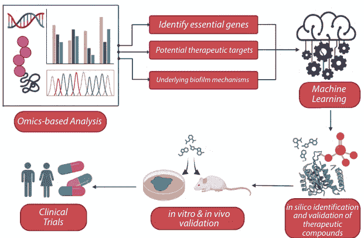

图5.1 基于AI驱动的组学分析和流程的示意性工作流程，用于开发治疗干预措施以对抗生物膜。

基于组学的系统生物学方法，如转录组学[137]、转座子插入测序[138]、蛋白质组学[139]和代谢组学[140]，此前已被用于研究生物膜，以揭示生物膜调节所需的代谢途径和关键基因。这些海量数据提供了对生物膜机制的洞察，并突出了可供ML模型进一步筛选的任何AMR出现原因。可以使用AI和ML模型筛选从基于组学的方法获得的数据，以选择潜在靶点并预测候选分子来靶向它们，从而有效对抗生物膜调节。可以使用分子对接、基于定量结构-活性关系（QSAR）的建模和机器学习等AI方法来整合组学数据以发现新解决方案[24]。分子对接研究可以用于揭示抗生物膜剂与生物膜蛋白（如QS蛋白、(p) ppGpp合成酶和关键生物膜调节蛋白等）的结合效率和取向。

一项研究调查了一种耐抗生素、形成生物膜的细菌痢疾链球菌痢疾亚种（Streptococcus dysgalactiae subsp. dysgalactiae，SDSD），并评估了SDSD中生物膜形成是如何被调节的[141]。Alves-Barroco等人[141]鉴定了SDSD中调节蛋白BrpA的潜在同源物，该蛋白参与生物膜形成，并使用ML框架进行高通量虚拟筛选，以鉴定BrpA蛋白的潜在抑制剂，并预测了五种与BrpA具有强结合亲和力的化合物。分子对接用于确认这五种化合物与BrpA蛋白的结合取向和效率，并发现它们在疏水裂口区域具有强结合。该实验强烈表明，ML方法可用于鉴定参与生物膜调节的蛋白质，并筛选潜在抑制剂，这可能导致开发针对生物膜相关疾病的新疗法。

可以使用ML算法来识别抗生物膜分子的特征，以基于已知的理化参数预测新分子。Di Luca等人[142]强调了使用BaAMPs等在线数据库作为全面数据库来搜索


## 表 5.6 用于对抗生物膜的 ML 模型。

| 使用的 ML 算法 | 目的和应用 | 参考文献 |
|---|---|---|
| 支持向量机 (SVM)、随机森林 (RF)、多层感知机 (MLP)、KStar 和 M5Rules | 用于预测和分析小分子生物膜抑制活性的 ML 模型 | [146] |
| 随机森林 (RF)、非线性支持向量机 (SVM)、梯度提升 (GB) | 用于识别对铜绿假单胞菌具有抗生物膜活性的地中海植物精油的 ML 模型 | [147] |
| 主成分分析 (PCA)、贝叶斯优化、逻辑回归 | 用于分析精油化学构型并识别其对金黄色葡萄球菌和表皮葡萄球菌生物膜抑制潜在活性的 ML | [148] |
| 随机森林 | 开发了 Molib，采用多种 ML 模型来预测潜在的生物膜抑制化学分子 | [145] |
| 随机森林 (RF)、逻辑回归 (LR)、支持向量 (SV)、梯度提升 (GB)、决策树 (DT) 和 K 近邻 (KNN) | 调查 ML 算法以预测精油对囊性纤维化患者分离出的铜绿假单胞菌株的抗生物膜作用 | [149] |
| 随机森林 | 基于 ML 的鸡尾酒检测法，用于利用镧系纳米颗粒检测生物膜 | [150] |
| K 近邻、神经网络、支持向量机、朴素贝叶斯分类器、随机森林和 XGBoost | 开发了 ML 框架 TargIDe 以预测具有对铜绿假单胞菌生物膜抑制活性的分子的蛋白质靶点 | [151] |
| 支持向量机和 Weka | 开发了 dPABBS，用于分析完整氨基酸组成以识别抗生物膜肽，并预测具有潜在重新用于抗生物膜治疗的 AMPs | [143] |
| 支持向量机 | 开发了 Biofilm-I，这是一个基于 ML 的平台，结合递归回归和 QSAR 来预测潜在化学化合物的抗生物膜效率 | [152] |
| 支持向量机 (SVM)、随机森林 (RF)、极端梯度提升 (XGBoost)、多层感知机 (MLP) 分类器 | 用于通过全面扫描现有肽数据库来预测新型、强效抗生物膜肽的 ML 算法 | [153] |

具有强效抗生物膜活性的 AMPs 可作为发现抗生物膜 AMP 的宝贵工具。Sharma 等人 [143] 还开发了一种新型 ML 框架—dPABBS，该框架结合机器学习和生物信息学技术来预测抗生物膜 AMP。作者报告称，dPABBS 模型在预测具有抗生物膜活性的 AMP 方面准确率约为 95%，并还具备预测新型抗生物膜肽的能力。Haney 等人 [144] 评估了一种基于 QSAR 的 ML 模型，用于识别对耐甲氧西林金黄色葡萄球菌 (MRSA) 生物膜具有抗生物膜活性的 AMP。作者报告称，预测具有抗生物膜活性的 AMP 的准确率约为 85%，并重点介绍了肽—3002 的预测结果，该肽的强效抗生物膜活性浓度仅为肽 1018 的八分之一，并在治疗慢性 MRSA 小鼠感染模型方面表现出显著的体内活性。还利用 QSAR 描述符和化学信息学开发了混合 RF 算法—Molib，以预测具有生物膜抑制活性的因子 [145]。

这些研究强调了 ML 模型在识别微生物生物膜形成的关键蛋白、筛选潜在生物膜抑制分子以及发现破坏生物膜调控的新型因子方面的能力。尽管发现新分子需要后续的体外和体内生物学实验来确定其效力、疗效及在临床环境中的应用可行性，但基于 AI 和 ML 的方法无疑为加速研究和发现过程提供了一条快捷通道。表 5.6 提供了一些用于对抗生物膜的 ML 算法示例。

## 5.6 向实际应用迈进的挑战

尽管在加速对抗耐药性 (AMR) 的研究以及新型抗菌剂发现方面是一种强大的辅助手段，但基于 AI 和 ML 的方法在实际应用方面仍面临诸多挑战（图 5.2）。

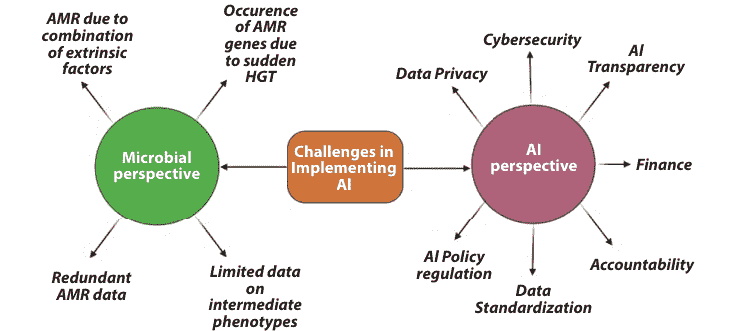

图 5.2. AI 实际应用中涉及的挑战。

### 5.6.1 微生物视角的挑战

由于微生物群落中各种方面导致的突变数量不断上升，往往会在理解 AMR 演化方面构成重大威胁 [154]。Ali 等人 [155] 讨论了这一主题及其对 AI 实施的影响。AI 模型可能难以理解耐药性的潜在机制，这些机制可能是由于突然的环境压力导致细菌亚种群基因组中发生水平基因转移而产生 AMR 基因所引起的 [156]。AI 模型需要一套更及时更新的基因组数据来应对这些方面，以克服 AMR。AI 模型可能无法理解由外源因素引起的遗传组合所产生的 AMR——例如，微生物群落中金属等环境因素与 AMR 基因的结合可能导致出现不同的 AMR 子集，这可能导致一种更具韧性的 AMR 形式 [157]。目前，AI 模型可能难以完全理解这些机制，因此可能无法理解由于这些多变量因素而产生的 AMR。当前基于 ML 的模型将 AMR 基因分为易感和耐药。然而，还需要对中间表型进行分类，以充分优化抗菌剂发现过程 [158]。由于关于中间表型的数据出现有限且可用性不足，AI 模型可能难以在这些参数上进行训练，导致数据输出效率低下。关于与不寻常环境相关的不常见微生物的数据可用性和理解不足，也使得训练 AI 模型从这些表型预测 AMR 变得困难 [155]。由于 ML 模型复杂度高而导致的过拟合可能包含冗余的 AMR 数据，从而导致数据生产效率低下 [159]。

### 5.6.2 AI 视角的挑战

除了微生物方面，AI 在全球范围内广泛应用时还面临其他挑战。数据共享是对抗 AMR 的一项宝贵实践，因为高质量数据集的可用性对于训练强大的 AI 模型至关重要。这些数据集包括临床数据、患者记录、临床试验数据、基因组数据等。然而，AI 实施的首要障碍是数据隐私、数据安全和伦理问题 [160]。数据必须首先进行适当的去标识化处理，以确保数据隐私和患者保密的完全匿名性，并解决随后的网络安全问题，以便高效共享数据 [161]。Patrzyk 等人 [162] 强调了数据透明度的重要性，即从人类角度解释 AI 模型的能力 [162]。AI 必须具有透明度，才能为其诊断和治疗结果预测提供依据，从而发现临床洞见 [163]。透明的 AI 模型还能为利益相关者和其他用户提供洞见，并优化创建更强大 AI 模型的捷径。AI 透明度还有助于克服种族或性别等歧视性偏见 [161]。由于 FDA 将 AI 视为与医疗保健传统方法不同的独立实体，因此责任归属问题凸显。如果患者因 AI 建议的治疗而遭受不良反应，由于不存在传统的医患关系——谁应为这些不良事件承担责任？迫切需要建立监管框架来解决此类问题。数据标准化是 AI 实施中的另一挑战，因为医疗保健和临床数据高度异构，且因人而异 [164]。Kruse 等人 [164] 强调了亟需标准化和整合一种通用格式


为了使 AI 模型能够验证异构数据集并实现强健性能。在 AI 的实际实施中，财务负担也是一大挑战，因为软硬件需要不断更新。AI 公司还可能从临床试验、药品和医疗器械中操纵利润 [161]。监管机构的作用也是实施 AI 的关键。监管框架对于实施 AI 相关政策，为医疗环境中安全、强健地实施 AI 制定监管标准至关重要 [160]。

### 5.6.3 监管机构批准

AI 已被证明是医疗保健领域的重要工具。ML 模型经过训练，旨在为患者预测个性化建议，甚至降低其 AMR 风险。医疗保健领域的神经网络方法有助于分类患者信息，还可以识别患者对某些疾病的发病或易感性 [165]。AI 自动分析和处理信息的能力使其远比传统方法更有用，而传统方法往往效果不佳。与 AI 相关的治理挑战包括为患者提供安全和高质量的医疗保健，这就是为什么更倾向于可解释 AI 模型，因为它们可以根据输入数据为输出证明其决策策略的合理性。然而，需要更严格的法规，因为 AI 模型可以不断自动更新/修改自身以确保可靠性。从临床医生的角度来看，对预测输出可能存在信任问题，导致临床医生拒绝 AI 建议的治疗方案。尽管 AI 在医疗保健领域具有巨大潜力，但如果没有监管系统，AI 模型的扩展和分发将会迅速激增，这些模型可能因 AI 模型训练数据不正确和质量差而带来风险和缺陷，进而导致预测不精确、偏见、医疗缺陷和辨别能力问题 [166, 167]——例如，一个开发用于预测可能出院的肺炎患者的 AI 模型错误地了解到，哮喘患者的死亡风险较低。该 AI 模型使用此数据集对自身进行训练，因此建议将患有肺炎和哮喘的患者送入 ICU。这凸显了临床医生在初步评估患者时判断的重要性 [168]。先前还提出了一种治理模型 (GMAIH)，包含四个要素——透明度、公平性、问责制和可信度——以解决道德、治理、质量和安全方面的问题 [167]。深度学习算法利用大数据集进行训练、预测和标准化。为了适当训练模型，还需要来自不同地理区域的数据收集和数据共享，这给 AI 带来了相关问题。患者普遍也对其机密医疗数据的使用方式表示担忧，因为患者数据泄露不仅不道德，还会在临床医生与其患者之间造成缺乏信任。克服此问题的一种策略是采用患者的广泛同意政策，患者可以同意其医疗记录用于二次目的，同时获得完全匿名的保证。当涉及患者安全时，AI 模型对数据的误读也是一个问题。操纵深度学习模型可能导致易错的输出，进而可能对患者造成危险。因此，AI 模型开发者必须努力将 AI 整合到现有的临床环境中，并使 AI 模型能够识别并从错误中学习。在模型开发阶段采用适当的参数将自动提高患者安全性。

为使软件作为医疗器械 (SaMD) 能够有效使用，美国食品药品监督管理局 (FDA) 已试点推行预认证计划 [168]，因为许多以 AI 为中心的 SaMD 已在医疗领域获准。FDA 采用平衡策略，既确保 SaMD 的有效性和安全性，又同时减少开发者部署 SaMD 时面临的障碍。世界卫生组织 (WHO) 可以参与服务于采用 SaMD 但缺乏传统治理流程的国家。监管的复杂性也体现为责任问题，这主要涉及 AI 对数据的误读。全球范围内的监管策略在 AI 软件/设备输出出现错误时，应归咎于谁仍不明确 [167]。不过，这取决于在每个 AI 运行阶段识别伦理问题，并需要标准化的决策来确定风险将如何在社会中分散 [168]。Morley 等人 [169] 提出，AI 的挑战不能仅通过实施规则和法规来解决。通常，问题出在开发者身上，他们未能采取策略保护患者隐私并忽视网络安全。个人层面的能力是解决这些挑战的一种策略。对于组织层面出现的问题，需要加强对设计和界面的控制，以确保医疗专业人员、患者和人工智能代理能够高效协作。在机构层面，为了妥善执行和利用医疗中的 AI，可以向希望使用基于 AI 的健康工具的个人提供宣传活动和专业认证。AI 在健康领域的挑战可以通过适当的治理模型来调节，但仍然存在一些未解决的问题，即法规和政策应涵盖什么内容以及应如何制定。一种解决方案采用综合策略，涵盖伦理问题和不同抽象层次 (LoA)——个人、群体、人际、部门、机构和社会 [169]。

## 5.7 结论与未来展望

AI 与 AMR 的融合成为一场深刻的范式转变，预示着转化研究在应对新兴全球 AMR 危机方面开启了一个新时代。本章的核心在于评估 AI 在重塑临床转化模式（从理解 AMR 机制到发现新型抗菌剂）方面所蕴含的巨大潜力。

整合 AI 算法的潜力已通过解剖复杂的基因组数据集，揭示了 AMR 出现的复杂底层机制。通过机器学习和深度学习等方法论，AI 超越了人类的局限性，揭示了传统方法难以发现的模式和关联。这一成就证明了 AI 解码基因组代码的能力，为有针对性的干预提供了基石，并提供了宝贵的见解。

AI 参与 AMR 研究最显著的方面之一是其重塑抗菌剂发现轨迹的能力。由 AI 算法驱动的体外预测分析提供了多种可能性，加速了新型抗菌化合物的识别。由 Halicin 的发现所体现的、展示 AI 能力的新型抗生素开发，跨越了传统的试错方法，有望通过为临床医生的武器库配备更广泛的有效治疗方案，直面 AMR 挑战，并扩大探索广阔化学空间的前景，以推动药物创新。

AI 的贡献不仅限于实验室，还延伸到患者护理领域。通过预测建模和临床数据整合，AI 拥有引导临床医生做出个性化治疗决策的洞察力，最大限度地降低 AMR 出现的风险。这与抗生素管理计划的加强相结合，反映了 AI 在保护个人和集体健康方面的变革作用。

尽管 AI 取得了重大进展，但在实际实施中，开发强健 AI 模型仍面临其自身的一系列挑战。将 AI 集成到现有医疗系统中，需要谨慎考虑数据安全、数据标准化和互操作性等因素。克服这些挑战需要跨学科合作、治理机构的监管规定以及一个强大的委员会来监督伦理方面和负责任的实施。随着 AI 与 AMR 的融合达到新高度，本章的探索揭示了知识与创新的和谐统一，推动医疗保健和临床环境走向一个未来，届时 AI 将成为解读 AMR 底层谜团、推动抗菌剂发现革命以及保护全球卫生基础设施根基的可靠盟友。

迄今为止，我们已经讨论了 AI 模型在理解 AMR 机制和抗菌剂发现方面的各种应用。毫无疑问，可以肯定 AI 在革新全球抗击 AMR 斗争方面具有巨大潜力。随着针对 AMR 的 AI 支持工具的发展，可预见的未来可以期望发现几条有希望的途径和创新策略，以加强医疗基础设施。AI 算法可以比较大规模的遗传、基因组和表型数据集 [49]，从而提供有关 AMR 耐药机制的预测洞察。利用 AI 研究这些数据集可能识别出人眼可能忽略的某些与 AMR 相关的模式和关联。进一步开发和整合新的数据集将无疑提高 AI 支持模型在识别先前未表征和新型 AMR 机制方面的稳健性和准确性。AI 技术也显著加速了抗菌剂发现。AI 模型能够利用大规模的化学数据、药理数据等，指导设计具有增强疗效和改善药理特征的新型抗生素，并有潜力克服现有耐药机制 [25, 75]。随着全球 AMR 威胁不断上升，发现新型抗生素以克服现有耐药机制势在必行。为个体患者量身定制个性化医疗可显著改善临床结局，同时降低 AMR 出现的风险。通过整合患者特异性基因组数据、病史等 [17]，可以制定个性化治疗方案，例如抗生素选择和剂量。生物传感器和纳米生物传感器有望通过检测临床样本中耐药细菌的存在，用于 AMR 的实时监测 [170]。AI 算法可以融入这些技术以提高其准确性和速度，使医疗保健提供者能够就治疗和感染控制措施做出明智决策。AI 算法可以实现在监测模型中，以全球规模监测 AMR 的出现和传播 [38]。由于监测计划的推动，早期识别耐药模式有助于指导必要的医疗干预并提供必要的公共卫生政策。


AI驱动的监测系统可以帮助我们应对不断变化的耐药性（AMR）格局。AI作为未来医疗保健的盟友，充满巨大希望。通过利用AI的力量，我们可以推进对耐药性底层机制的理解，开发精准治疗策略，并显著加速新型抗菌药物发现的过程。针对耐药微生物设计和生产疫苗可以从深度学习中受益。它可以通过建模抗原与免疫系统组件之间的相互作用，帮助开发更强效的疫苗。深度学习技术可用于多学科项目，以应对抗菌药物耐药性带来的复杂问题，改善患者预后，并加强全球卫生安全。

## 参考文献

- 1. Dadgostar, P., 耐药性：影响与成本。Infect. Drug Resist., 12, 3903–10, 2019, 可从以下网址获取：https://www.tandfonline.com/action/journalInformation?journalCode=didr20.
- 2. Khaznadar, O., Khaznadar, F., Petrovic, A., Kuna, L., Loncar, A., Kolaric, T.O. 等人，耐药性和抗菌药物管理：COVID-19 大流行前、中、后。Microbiol. Res., 14, 2, 727–740, 2023, 可从以下网址获取：https://www.mdpi.com/2036-7481/14/2/52/htm.
- 3. Morrison, L. 和 Zembower, T.R., 耐药性。Gastrointest. Endosc. Clin. N. Am., 30, 4, 619–35, 2020 年 10 月 1 日.
- 4. De Oliveira, D.M.P., Forde, B.M., Kidd, T.J., Harris, P.N.A., Schembri, M.A., Beatson, S.A. 等人，ESKAPE 病原体中的耐药性。Clin. Microbiol. Rev., 33, 3, e00181-19, 2020, 可从以下网址获取：https://pubmed.ncbi.nlm.nih.gov/32404435/.
- 5. Schrader, S.M., Vaubourgeix, J., Nathan, C., 耐药性生物学及应对方法。Sci. Transl. Med., 12, 549, 1–14, 2020 年 6 月 24 日.
- 6. Wong, C.H., Siah, K.W., Lo, A.W., 临床试验成功率及相关参数的估计。Biostatistics, 20, 2, 273–86, 2019 年 4 月 1 日.
- 7. Kaprou, G.D., Bergspica, I., Alexa, E.E., Alvarez-Ordóñez, A., Prieto, M., 耐药性诊断的快速方法。Antibiotics, 10, 2, 209, 2021 年 2 月 20 日.
- 8. de Kraker, M.E.A., Stewardson, A.J., Harbarth, S., 到 2050 年，是否每年将有 1000 万人死于耐药性？PLoS Med., 13, 11, 1002184, 2016 年 11 月 1 日, 可从以下网址获取：https://journals.plos.org/plosmedicine/article?id=10.1371/journal.pmed.1002184.
- 9. George, A., 耐药性、贸易、食品安全与保障。One Health, 5, 6, 6–8, 2018 年 6 月 1 日, 可从以下网址获取：/pmc/articles/PMC5725214/.
- 10. Papitou, N.I., 耐药性：应对日益增长的微生物挑战的行动。Int. J. Antimicrob. Agents, 42, 1, 25–8, 2013 年 6 月 1 日.
- 11. Harikumar, G. 和 Krishanan, K., 耐药性病原体日益严重的威胁以及克服药物耐药性的最新策略：综述。J. King Saud. Univ. Sci., 34, 4, 101979, 2022 年 6 月 1 日.
- 12. Wise, R., Blaser, M., Carrs, O., Cassell, G., Fishman, N., Guidos, R. 等人，迫切需要新型抗菌剂。J. Antimicrob. Chemotherapy, 66, 9, 1939–40, 2011 年 9 月 1 日, 可从以下网址获取：https://dx.doi.org/10.1093/jac/dkr261.
- 13. Doron, S. 和 Davidson, L.E., 抗菌药物管理。Mayo Clin. Proc., 2011 年 11 月 1 日, 86, 1113–23.
- 14. O'Neill, J., 耐药性综述：全球应对耐药性感染：最终报告与建议，收录于：CABI, Global Health, 第 80 页, 2016.
- 15. Nayyar, A., Gadhavi, L., Zaman, N., 医疗保健中的机器学习：综述、机遇与挑战，收录于：医疗保健中的机器学习与医疗物联网，第 23–45 页, 2021 年 1 月 1 日.
- 16. Ament, S.A., Pearl, J.R., Cantle, J.P., Bragg, R.M., Skene, P.J., Coffey, S.R. 等人，亨廷顿病基因表达变化背后的转录调控网络。Mol. Syst. Biol., 14, 3, 7435, 2018 年 3 月 1 日, 可从以下网址获取：https://onlinelibrary.wiley.com/doi/full/10.15252/msb.20167435.
- 17. Feretzakis, G., Sakagianni, A., Loupelis, E., Kalles, D., Skarmoutsou, N., Martskoukou, M. 等人，抗生素耐药性预测的机器学习：使用现成技术和入门级数据指导经验性抗菌治疗的原型。Healthc. Inform. Res., 27, 3, 214–21, 2021 年 7 月 31 日.
- 18. Li, X., Xu, Y., Cui, H., Huang, T., Wang, D., Lian, B. 等人，基于药物靶点网络和药物诱导基因表达特征预测协同抗癌药物组合。Artif. Intell. Med., 83, 35–43, 2017 年 11 月.
- 19. Sethi, T., Maheshwari, S., Nagori, A., Lodha, R., 使用贝叶斯人工智能在重症监护室中推行抗生素管理。Wellcome Open Res., 3, 73, 2018 年 6 月 18 日.
- 20. James, S., Rao, S.V., Granger, C.B., 基于登记的随机临床试验——一种新的临床试验范式。Nat. Rev. Cardiol., 12, 5, 312–6, 2015 年 5 月 17 日.
- 21. Lv, J., Deng, S., Zhang, L., 抗菌药物耐药性人工智能应用综述。Biosaf. Health, 3, 1, 22–31, 2021 年 2 月 1 日.
- 22. Munita, J.M., Arias, C.A., Kudva, I.T., Zhang, Q., 抗生素耐药性机制。Microbiol. Spectr. 4, 2, 481–511, 2016 年 3 月 25 日, 可从以下网址获取：https://journals.asm.org/doi/10.1128/microbiolspec.VMBF-0016-2015.
- 23. Her, H.L. 和 Wu, Y.W., 基于泛基因组的机器学习方法，用于预测大肠杆菌株的耐药活性。Bioinformatics, 34, 13, 89–95, 2018 年 7 月 1 日, 可从以下网址获取：https://dx.doi.org/10.1093/bioinformatics/bty276.
- 24. An, A.Y., Choi, K.Y.G., Baghela, A.S., Hancock, R.E.W., 设计机制告知型抗生物膜剂的生物学和计算方法概述。Front. Microbiol. 12, 640787, 2021 年 4 月 13 日.
- 25. Stokes, J.M., Yang, K., Swanson, K., Jin, W., Cubillos-Ruiz, A., Donghia, N.M. 等人，抗生素发现的深度学习方法。Cell, 180, 4, 688–702.e13, 2020 年 2 月.
- 26. Vikramkumar, B.V. 和 Trilochan, 贝叶斯与朴素贝叶斯分类器，1, 1–3, 2014 年 4 月 3 日, 可从以下网址获取：https://arxiv.org/abs/1404.0933v1.
- 27. Alpaydin, E., 机器学习导论，第 1 卷，MIT 出版社，美国，英国，2004 年.
- 28. Rezaei-hachesu, P., Samad-Soltani, T., Yaghoubi, S., GhaziSaeedi, M., Mirnia, K., Masoumi-Asl, H. 等人，伊朗新生儿重症监护室耐药性监测系统的设计与评估。Int. J. Med. Inform., 115, 24–34, 2018 年 7 月 1 日.
- 29. Oonsivilai, M., Mo, Y., Luangasanatip, N., Lubell, Y., Miliya, T., Tan, P. 等人，使用机器学习指导柬埔寨一家儿童医院的针对性和本地化定制经验性抗生素处方。Wellcome Open Res., 3, 131, 1–18, 2018 年 10 月 10 日.
- 30. Quinlan, J.R., 决策树归纳。Mach. Learn., 1, 1, 81–106, 1986, 可从以下网址获取：https://link.springer.com/article/10.1007/bf00116251.
- 31. Navada, A., Ansari, A.N., Patil, S., Sonkamble, B.A., 机器学习中决策树算法的应用概述，收录于：2011 年 IEEE 控制与系统研究生研讨会论文集，ICSGRC，第 37–42 页, 2011.
- 32. Voermans, A.M., Mewes, J.C., Broyles, M.R., Steuten, L.M.G., 使用真实世界美国医院数据进行抗生素管理的降钙素原指导决策算法的成本效益分析。OMICS, 23, 10, 508–15, 2019 年 10 月 1 日, 可从以下网址获取：https://www.liebertpub.com/doi/10.1089/omi.2019.0113.
- 33. Breiman, L., 随机森林。Mach. Learn., 45, 1, 5–32, 2001 年 10 月, 可从以下网址获取：https://link.springer.com/article/10.1023/A:1010933404324.
- 34. Ao, Y., Li, H., Zhu, L., Ali, S., Yang, Z., 线性随机森林算法及其在机器学习辅助测井回归建模中的优势。J. Pet Sci. Eng., 174, 776–89, 2019 年 3 月 1 日.
- 35. Pan, L., Liu, G., Lin, F., Zhong, S., Xia, H., Sun, X. 等人，儿童急性淋巴细胞白血病复发预测的机器学习应用。Sci. Rep., 7, 1, 2017 年 12 月 1 日, 可从以下网址获取：https://pubmed.ncbi.nlm.nih.gov/28784991/.
- 36. Chandrasekaran, S., Cokol-Cakmak, M., Sahin, N., Yilancioglu, K., Kazan, H., Collins, J.J. 等人，基于同源性的抗生素联合疗法的化学疗法设计。Mol. Syst. Biol., 12, 5, 872, 2016 年 5 月 1 日. 可从以下网址获取：https://onlinelibrary.wiley.com/doi/full/10.15252/msb.20156777.
- 37. Kecman, V., 支持向量机——简介，第 7 卷，1，第 1–47 页，德国，柏林，海德尔堡，2005 年 4 月 22 日, 可从以下网址获取：https://link.springer.com/chapter/10.1007/10984697_1.
- 38. Liu, Z., Deng, D., Lu, H., Sun, J., Lv, L., Li, S. 等人，基于全基因组测序评估放线杆菌猪肺炎放线杆菌耐药性的机器学习模型。Front. Microbiol., 11, 474876, 2020 年 2 月 6 日.
- 39. Lecun, Y., Bengio, Y., Hinton, G., 深度学习。Nature, 521, 7553, 436–444, 2015, 可从以下网址获取：https://www.nature.com/articles/nature14539.
- 40. Ii, T.C.S., Pullen, K.M., Olson, M.C., McNellis, M.E., Richardson, I., Hu, S. 等人，结核分枝杆菌形态分析识别药物作用途径。Proc. Natl. Acad. Sci. U.S.A., 117, 31, 18744–53, 2020, 可从以下网址获取：https://www.pnas.org/doi/abs/10.1073/pnas.2002738117.
- 41. Schürch, A.C. 和 van Schaik, W., 基于全基因组测序的抗生素耐药性监测的挑战与机遇。Ann. N Y Acad. Sci., 1388, 1, 108–20, 2017 年 1 月 1 日, 可从以下网址获取：https://onlinelibrary.wiley.com/doi/full/10.1111/nyas.13310.
- 42. Ren, Y., Chakraborty, T., Doijad, S., Falgenhauer, L., Falgenhauer, J., Goesmann, A. 等人，基于全基因组测序和机器学习的耐药性预测。Bioinformatics, 38, 2, 325–34, 2022 年 1 月 3 日, 可从以下网址获取：https://dx.doi.org/10.1093/bioinformatics/btab681.
- 43. Arango-Argyotv, G., Garner, E., Pruden, A., Heath, L.S., Vikesland, P., Zhang, L., DeepARG：从宏基因组数据预测抗生素耐药基因的深度学习方法。Microbiome, 6, 1, 1–15, 2018 年 2 月 1 日, 可从以下网址获取：https://microbiomejournal.biomedcentral.com/articles/10.1186/s40168-018-0401-z.
- 44. Hicks, S.A., Strümke, I., Thambawita, V., Hammou, M., Riegler, M.A., Halvorsen, P. 等人，医疗人工智能应用的评价指标。Sci. Rep., 12, 5979, 2022, 可从以下网址获取：https://www.nature.com/articles/s41598-022-09954-8.
- 45. Kavvas, E.S., Yang, L., Monk, J.M., Heckmann, D., Palsson, B.O., 微生物 GWAS 的生物化学可解释机器学习分类器。Nat. Commun., 11, 1, 2580, 2020, 可从以下网址获取：https://www.nature.com/articles/s41467-020-16310-9.
- 46. Anahtar, M.N., Yang, J.H., Kanjilal, S., 机器学习在耐药性问题中的应用：转化研究的新兴模型。J. Clin. Microbiol., 59, 7, e0126020, 2021 年 6 月 1 日, 可从以下网址获取：https://journals.asm.org/doi/10.1128/jcm.01260-20.
- 47. Vamathevan, J., Clark, D., Czodrowski, P., Dunham, I., Ferran, E., Lee, G. 等人，药物发现与开发中的机器学习应用。Nat. Rev. Drug Discov., 18, 6, 463–477, 2019, 可从以下网址获取：https://www.nature.com/articles/s41573-019-0024-5.
- 48. Ahmed, Z., Zeeshan, S., Mendhe, D., Dong, X., 临床基因组学和精准医学研究中的人类基因与疾病关联。Clin. Transl. Med., 10, 1, 297–318, 2020 年 3 月 1 日, 可从以下网址获取：https://onlinelibrary.wiley.com/doi/full/10.1002/ctm2.28.


- 49. Ament, S.A., Pearl, J.R., Cantle, J.P., Bragg, R.M., Skene, P.J., Coffey, S.R. _等_, 亨廷顿病中基因表达变化的转录调控网络. _分子系统生物学_, 14, 3, 7435, 2018年3月26日.

- 50. Costa, P.R., Acencio, M.L., Lemke, N., 基于系统水平数据的人类致病和可成药基因全基因组预测的机器学习方法. _BMC基因组学_, 11, 5, 1–15, 2010年12月2日, 可从: https://bmcgenomics.biomedcentral.com/articles/10.1186/1471-2164-11-S5-S9.

- 51. Medema, M.H., Blin, K., Cimermancic, P., De Jager, V., Zakrzewski, P., Fischbach, M.A. _等_, antiSMASH: 细菌和真菌基因组序列中次生代谢物合成基因簇的快速鉴定、注释和分析. _核酸研究_, 39, 2, 339–46, 2011年7月1日, 可从: https://dx.doi.org/10.1093/nar/gkr466.

- 52. Alcock, B.P., Raphenya, A.R., Lau, T.T.Y., Tsang, K.K., Bouchard, M., Edalatmand, A. _等_, CARD 2020: 基于综合抗生素抗性数据库的抗生素耐药组监测. _核酸研究_, 48, 1, 517–25, 2020年1月8日, 可从: https://dx.doi.org/10.1093/nar/gkz935.

- 53. Zankari, E., Hasman, H., Cosentino, S., Vestergaard, M., Rasmussen, S., Lund, O. _等_, 获得性抗菌耐药基因的鉴定. _抗菌化疗杂志_, 67, 11, 2640–4, 2012年11月1日, 可从: https://dx.doi.org/10.1093/jac/dks261.

- 54. Gupta, S.K., Padmanabhan, B.R., Diene, S.M., Lopez-Rojas, R., Kempf, M., Landraud, L. _等_, ARG-annot: 一种用于在细菌基因组中发现抗生素耐药基因的新生物信息学工具. _抗菌剂与化疗_, 58, 1, 212–20, 2014年1月, 可从: https://journals.asm.org/doi/10.1128/aac.01310-13.

- 55. Manjula, M.S., Rachana, K.E., Naganeeswaran, S., Hemalatha, N., Karun, A., Rajesh, M.K., PRGPred: 基于机器学习算法开发的槟榔科抗性基因同源物(RGA)结构域预测平台. _生物科学与生物技术杂志_, 4, 3, 327–338, 2015年.

- 56. Lakin, S.M., Kuhnle, A., Alipanahi, B., Noyes, N.R., Dean, C., Muggii, M. _等_, 分层隐马尔可夫模型实现抗菌耐药序列的准确且多样化检测. _通讯生物学_, 21, 294, 2019年, 可从: https://www.nature.com/articles/ s42003-019-0545-9.

- 57. Bonin, N., Doster, E., Worley, H., Pinnell, L.J., Bravo, J.E., Ferm, P. _等_, MEGARes 和 AMR++, v3.0: 更新的抗菌耐药决定因素综合数据库及用于高通量测序分类的改进软件流水线. _核酸研究_, 51, 1, 744–52, 2023年1月6日, 可从: https://dx.doi.org/10.1093/nar/gkac1047.

- 58. Arango-Argoty, G., GA., Guron, G.K.P., Guron, G.K.P., Garner, E., Riquelme, M.V., Heath, L.S. _等_, ARGMiner: 基于众筹的抗生素耐药基因策展网络平台. _生物信息学_, 36, 9, 2966–73, 2020年5月1日, 可从: https://dx.doi.org/10.1093/ bioinformatics/btaa095.

- 59. Tanoli, Z., Väha-Koskela, M., Aittolkallio, T., 癌症中的人工智能、机器学习和药物重新利用. _药物发现专家评论_, 16, 9, 977–989, 2021年, 可从: https://www.tandfonline.com/doi/ abs/10.1080/17460441.2021.1883585.

- 60. Prasad, K. 和 Kumar, V., 针对SARS-CoV-2的人工智能驱动的药物重新利用与结构生物学. _当前药理学与药物发现研究_, 2, 100042, 2021年1月1日.

- 61. Melo, M.C.R., Maasch, J.R.M.A., de la Fuente-Nunez, C., 通过人工智能加速抗生素发现. _通讯生物学_, 4, 1, 1050, 2021年, 可从: https://www. nature.com/articles/s42003-021-02586-0.

- 62. Mba, I.E. 和 Nweze, E.I., 焦点：抗菌耐药性：抗菌肽疗法：治疗耐药细菌的新兴替代方案. _耶鲁生物医学杂志_, 95, 4, 445, 2022年12月1日, 可从: /pmc/articles/PMC9765339/.

- 63. Yan, J., Bhadra, P., Li, A., Sethiya, P., Qin, L., Tai, H.K. et al., Deep-AmPEP30: 使用深度学习改进短抗菌肽预测. 分子治疗：核酸, 20, 882–94, 2020年6月5日, 可从: http://www.cell.com/article/S2162253120301323/fulltext.

- 64. Porto, W.F., Irazazabal, L., Alves, E.S.F., Ribeiro, S.M., Matos, C.O., Pires, ÁS et al., 通过计算机优化番石榴抗菌肽，实现肽设计的组合探索. 自然通讯, 9, 1, 1490, 2018年, 可从: https://www.nature.com/articles/s41467-018-03746-3.

- 65. Bhadra, P., Yan, J., Li, J., Fong, S., Siu, S.W.I., AmPEP: 基于氨基酸属性分布模式和随机森林的抗菌肽序列预测. 科学报告, 8, 1, 2018年, 可从: https://www.nature.com/articles/s41598-018-19752-w.

- 66. Singh, O., Hsu, W.L., Su, E.C.Y., Co-AMPpred: 通过整合组成特征进行计算机辅助抗菌肽预测. BMC生物信息学, 22, 1, 1–21, 2021年12月1日, 可从: https://bmcbioinformatics.biomedcentral.com/articles/10.1186/s12859-021-04305-2.

- 67. Lv, H., Yan, K., Guo, Y., Zou, Q., Hesham, A.E.L., Liu, B., AMPpred-EL: 一种基于集成学习的有效抗菌肽预测模型. 计算生物学与医学, 146, 105577, 2022年7月1日.

- 68. Lee, H., Lee, S., Lee, I., Nam, H., AMP-BERT: 基于BERT模型的抗菌肽功能预测. 蛋白质科学, 32, 1, 4529, 2023年1月1日, 可从: https://onlinelibrary.wiley.com/doi/full/10.1002/pro.4529.

- 69. Mooney, C., Haslam, N.J., Pollastri, G., Shields, D.C., 迈向功能肽发现与设计的改进：不同类别的共同特征允许生物活性的通用预测. PLOS ONE, 7, 10, 45012, 2012年10月8日, 可从: https://journals.plos.org/plosone/article?id=10.1371/journal.pone.0045012.

- 70. Meher, P.K., Sahu, T.K., Saini, V., Rao, A.R., 将组成、理化和结构特征纳入Chou通用PseAAC，以提高抗菌肽预测准确性. 科学报告, 7, 1, 42362, 1–12, 2017年, 可从: https://www.nature.com/articles/srep42362.

- 71. Landin, M. 和 Rowe, R.C., 用于建模、理解和优化药物制剂的人工神经网络技术. 药物制剂开发配方工具, 1, 7–37, 2013年1月1日.

- 72. Ventola, C.L., 抗生素耐药性危机：第1部分：成因和威胁. 药物治疗, 40, 4, 277, 2015年, 可从: /pmc/articles/PMC4378521/.

- 73. Talat, A. 和 Khan, A.U., 人工智能作为开发抗菌药物分子的智能方法：应对耐药感染的范式. 今日药物发现, 28, 4, 103491, 2023年4月1日.

- 74. Dara, S., Dhamercherla, S., Jadav, S. S., Babu, C. M., Ahsan, M.J., 药物发现中的机器学习：综述. 人工智能评论, 55, 3, 1947–1999, 2022年.

- 75. Liu, G., Catacutan, D.B., Rathod, K., Swanson, K., Jin, W., Mohammed, J.C. et al., 深度学习指导发现针对鲍曼氏不动杆菌的抗生素. 自然化学生物学, 19, 11, 1342–1350, 2023年5月25日, 可从: https://www.nature.com/articles/s41589-023-01349-8.

- 76. Dean, S.N. 和 Walper, S.A., 抗菌肽生成的变分自编码器. ACS Omega, 5, 33, 20746–54, 2020年8月25日, 可从: https://pubs.acs.org/doi/full/10.1021/acsomega.0c00442.

- 77. Wu, X., Wang, Z., Li, X., Fan, Y., He, G., Wan, Y. et al., 使用基于氨基酸的活性预测方法开发的抗菌肽的体外和体内活性. 抗菌剂与化疗, 58, 9, 5342–9, 2014年, 可从: https://journals.asm.org/doi/10.1128/aac.02823-14.

- 78. Fitzgerald, J.B., Schoeberl, B., Nielsen, U.B., Sorger, P.K., 追求临床疗效中的系统生物学与联合治疗. *自然化学生物学*, 2, 9, 458–66, 2006年, 可从: https://www.nature.com/articles/nchembio817.

- 79. Worthington, R.J. 和 Melander, C., 应对多重耐药细菌的联合方法. *趋势生物技术*, 31, 3, 177–84, 2013年3月19日, 可从: http://www.cell.com/article/S0167779912002259/fulltext.

- 80. Cantrell, J.M., Chung, C.H., Chandrasekaran, S., 使用机器学习设计抗菌联合疗法：前景与陷阱. *今日药物发现*, 27, 6, 1639–51, 2022年6月1日.

- 81. Güvenç Paltun, B., Kaski, S., Mamitsuka, H., 药物联合疗法的机器学习方法. *简报生物信息学*, 22, 6, 1–16, 2021年11月5日. 可从: https://dx.doi.org/10.1093/bib/bbab293.

- 82. Julkunen, H., Cichonska, A., Gautam, P., Szedmak, S., Douat, J., Pahikkala, T. *等*, comboFM: 利用多向交互作用系统预测药物联合效应. *BioRxiv*, 09, 02, 278986, 2020年9月3日, 可从: https://www.biorxiv.org/content/10.1101/2020.09.02.278986v1.

- 83. Preuer, K., Lewis, R.P.I., Hochreiter, S., Bender, A., Bulusu, K.C., Klambauer, G., DeepSynergy: 使用深度学习预测抗癌药物协同作用. *生物信息学*, 34, 9, 1538–46, 2018年5月1日, 可从: https://dx.doi.org/10.1093/bioinformatics/btx806.

- 84. Ianevski, A., Giri, A.K., Gautam, P., Kononov, A., Podtar, S., Saarela, J. *等*, 使用最小实验集预测药物联合效应. *自然机器智能*, 1, 12, 568–577, 2019年, 可从: https://www.nature.com/articles/s42256-019-0122-4.

- 85. Jin, W., Stokes, J.M., Eastman, R.T., Itkin, Z., Zakharov, A.V., Collins, J.J. *等*, 深度学习识别用于治疗COVID-19的协同药物组合. *美国国家科学院院刊*, 118, 39, 1–7, 2021年9月28日. 可从: https://doi.org/10.1073/pnas.2105070118

- 86. Srinivasan, A., 抗生素管理：我们为什么必须，如何做到. *克利夫兰临床医学杂志*, 84, 9, 673–9, 2017年9月1日. 可从: https://www.ccjm.org/content/84/9/673.

- 87. Shrestha, J., Zahra, F., Cannady, J.R.P., 抗菌药物管理. *StatPearls.*, 1, 1–15, 2022年6月23日, 可从: https://www.ncbi.nlm.nih.gov/books/NBK572068/.

- 88. Magill, S.S., O’Leary, E., Ray, S.M., Kainer, M.A., Evans, C., Bamberg, W.M. *等*, 评估美国医院抗菌药物使用的适当性. *JAMA网络公开*, 4, 3, e212007, 2022年3月18日.

- 89. Singh, N., Rogers, P., Atwood, C.W., Wagener, M.M., Yu, V.L., 重症监护室肺浸润患者短程经验性抗生素治疗：解决滥用抗生素处方的拟议方案. *美国呼吸与危重症医学杂志*, 162, 2, 505–511, 2000年.

- 90. Chang, A. 和 Chen, J.H., BSAC先锋系列：人工智能与抗生素管理. *抗菌化疗杂志*, 77, 5, 1216–7, 2022年4月27日, 可从: https://dx.doi.org/10.1093/jac/dkaa096.

- 91. Beaudoin, M., Kabanza, F., Nault, V., Valiquette, L., 评估临床决策支持系统的机器学习功能以增强抗菌药物管理方案. *医学人工智能*, 68, 29–36, 2016年3月1日.

- 92. Cavallaroid, M., Moran, E., Collyer, B., Mccarthy, N.D., Greenid, C., Keeling, M.J., 利用可解释AI指导抗菌药物管理. *PLOS数字健康*, 2, 1, 0000162, 2023年1月5日, 可从: https://journals.plos.org/digitalhealth/article?id=10.1371/journal.pdig.0000162.

- 93. Cai, T., Anceschi, U., Prata, F., Collini, L., Brugnolli, A., Migno, S. *等*, 人工智能可指导复发性尿路感染的抗生素选择，并成为改善抗菌药物管理的重要辅助手段. *抗生素*, 12, 2, 375, 2023年2月11日, 可从: https://www.mdpi.com/2079-6382/12/2/375.htm.


- 94. Li, D., Wang, Y., Hu, W., Chen, F., Zhao, J., Chen, X. et al., 机器学习分类器在 Candida auris 耐药性分析中的应用. Front. Cell Infect. Microbiol., 11, 742062, 2021 年 10 月 15 日.

- 95. Fu, C., Zhang, X., Veri, A.O., Iyer, K.R., Lash, E., Xue, A. et al., 利用机学习基因必需性预测和化基因组相互作用鉴定抗真菌靶点. Nat. Commun., 12, 6497, 2021, 可从以下网址获取: https://www.nature.com/articles/s41467-021-26850-3.

- 96. Delavy, M., Cerutti, L., Croxatto, A., Prod'hom, G., Sanglard, D., Greub, G. et al., 基于基质辅助激光解吸/电离飞行时间质谱的 Candida albicans 氟康唑耐药性检测机学习方法. Front. Microbiol., 10, 500387, 2020 年 1 月 14 日.

- 97. Badura, A., Krysiński, J., Nowaczyk, A., Buciński, A., 人工神经网络在预测咪唑衍生物对 Candida albicans 抗真菌活性中的应用. Chemom. Intell. Lab. Syst., 222, 104501, 2022 年 3 月 15 日.

- 98. Leidner, F., Kurt Yilmaz, N., Schiffer, C.A., 利用分子动力学和机学习解读 Pneumocystis jirovecii DHFR 中的抗真菌药物耐药性. J. Chem. Inf. Model., 61, 6, 2537–41, 2021 年 6 月 28 日, 可从以下网址获取: https://pubs.acs.org/doi/abs/10.1021/acs.jcim.1c00403.

- 99. Sharma, R., Shrivastava, S., Singh, S.K., Kumar, A., Saxena, S., Singh, R.K., Deep-AFPpred：利用带 1DCNN-BiLSTM 的 seq2vec 预训练嵌入式识别新型抗真菌肽. Brief Bioinform., 23, 1, 1–16, 2022 年 1 月 17 日, 可从以下网址获取: https://dx.doi.org/10.1093/bib/bbab422.

- 100. Gao, Y., Tang, M., Li, Y., Niu, X., Li, J., Fu, C. et al., 基于机学习的念珠菌血症和细菌血症患者预后风险因素预测与分析：一项 5 年分析. PeerJ., 10, 13594, 2022 年 6 月 15 日, 可从以下网址获取: https://peerj.com/articles/13594.

- 101. Strasfeld, L. and Chou, S., 抗病毒药物耐药性：机制与临床意义. Infect. Dis. Clin. North Am., 24, 2, 413–37, 2010 年 6 月 1 日.

- 102. Blassel, L., Tostevin, A., Villabona-Arenas, C.J., Peeters, M., Hué, S., Gascuel, O., 利用机学习和大数据探索 HIV 耐药性图谱. PLoS Comput Biol., 17, 8, 1008873, 2021 年 8 月 1 日, 可从以下网址获取: https://journals.plos.org/ploscompbiol/article?id=10.1371/journal.pcbi.1008873.

- 103. Zazzi, M., Incardona, F., Rosen-Zvi, M., Prosperi, M., Lengauer, T., Altmann, A. et al., 基于机学习的抗逆病毒治疗反应预测：EuResist 项目. Intervirology, 55, 2, 123–7, 2012 年 1 月 1 日, 可从以下网址获取: https://dx.doi.org/10.1159/000332008.

- 104. Tarasova, O. and Poroikov, V., 新抗病毒药物发现和病毒感染疗法优化中的机学习. Curr. Med. Chem., 28, 38, 7840–61, 2021 年 5 月 5 日.

- 105. Ivanov, J., Polshakov, D., Kato-Weinstein, J., Zhou, Q., Li, Y., Granet, R. et al., 基于定量构效关系的机学习模型及其在识别针对病毒 3Clpro 和 RdRP 的化合物作为 Covid-19 及相关病毒感染潜在治疗药物中的应用. ACS Omega, 5, 42, 27344–58, 2020 年 10 月 27 日, 可从以下网址获取: https://pubs.acs.org/doi/full/10.1021/acsomega.0c03682.

- 106. Kwofie, S.K., Broni, E., Teye, J., Quansah, E., Issah, I., Wilson, M.D. et al., 基于药物信息学的埃博拉病毒 VP24 蛋白潜在生物活性化合物鉴定. Comput. Biol. Med., 113, 103414, 2019 年 10 月 1 日.

- 107. Tian, Y., Zhang, S., Yin, H., Yan, A., 基于机学习方法的 HIV-1 蛋白酶抑制剂定量构效关系 (QSAR) 模型及其适用域分析. Chemom. Intell. Lab. Syst., 196, 103888, 2020 年 1 月 15 日.

- 108. Serafim, M.S.M., dos Santos Júnior, V.S., Gertrudes, J.C., Maltarollo, V.G., Honorio, K.M., 应用于抗病毒药物设计与发现的机学习技术：过去十年的简要回顾. *药物发现专家评论*, 16, 9, 961–75, 2021, 可从以下网址获取: https://www.tandfonline.com/doi/abs/10.1080/17460441.2021.1918098.

- 109. Steiner, M.C., Gibson, K.M., Crandall, K.A., 基于深度学习技术对 HIV-1 序列数据进行耐药性预测. *病毒*, 12, 5, 560, 2020 年 5 月 19 日, 可从以下网址获取: https://www.mdpi.com/1999-4915/12/5/560/htm.

- 110. Park, H., Lo-Ciganic, W.H., Huang, J., Wu, Y., Henry, L., Peter, J. *et al.*, 基于机学习算法预测慢性丙型肝炎直接抗病毒治疗失败：HCV-TARGET 分析. *肝病学*, 76, 2, 483–91, 2022, 可从以下网址获取: https://journals.lww.com/hep/Fulltext/2022/08000/Machine_learning_algorithms_for_predicting,20.aspx.

- 111. Gawriljuk, V.O., Foil, D.H., Puhl, A.C., Zorn, K.M., Lane, T.R., Riabova, O. *et al.*, 机学习模型开发及针对黄热病病毒的新型抗病毒化合物发现. *化学信息与模型期刊*, 61, 8, 3804–13, 2021, 可从以下网址获取: https://pubs.acs.org/doi/abs/10.1021/acs.jcim.1c00460.

- 112. Brandt, P., Moodley, D., Pillay, A.W., Seebregts, C.J., De Oliveira, T., 预测 HIV 耐药性无需基因型耐药性检测的分类算法研究，载于：*计算机科学讲义（包括人工智能讲义和生物信息学讲义子系列）*, 第 8315 卷, 第 236–53 页, 2014, 可从以下网址获取: https://link.springer.com/chapter/10.1007/978-3-642-53956-5_16.

- 113. Chowdhury, A.S., Reehl, S.M., Kehn-Hall, K., Bishop, B., Webb-Robertson, B.J.M., 通过初级和次级结构特征重要性更好地理解和预测抗病毒肽. *科学报告*, 10, 1, 1–8, 2020, 可从以下网址获取: https://www.nature.com/articles/s41598-020-76161-8.

- 114. Alves, N.G., Mata, A.I., Luís, J.P., Brito, R.M.M., Simões, C.J.V., 药物耐药性解释与预测的创新序列到结构方法：使用分子相互作用场检测 HIV-1 蛋白酶结合位点差异. *前沿化学*, 8, 518214, 2020 年 4 月 29 日.

- 115. Salama, M.A., Hassanien, A.E., Mostafa, A., 利用神经网络和粗糙集技术预测病毒突变. *欧亚生物信息学与系统生物学期刊*, 1, 1–11, 2016, 可从以下网址获取: https://bsb-eurasipjournals.springeropen.com/articles/10.1186/s13637-016-0042-0.

- 116. Shaltout, N., Rafea, A., Moustafa, A., Moustafa, M., ElHefnawi, M., 利用机学习优化耐抗病毒流感 A 毒株的检测，载于：*工程与计算机科学讲义*, 第 2226 页, 2016, 可从以下网址获取: https://fount.aucegypt.edu/faculty_journal_articles/1597.

- 117. Tao, S., Chen, Y., Wu, J., Zhao, D., Cai, H., Wang, L. *et al.*, VDDB：抗病毒药物发现的综合资源和机学习工具. *MedComm – 未来医学*, 2, 1, 32, 2023, 可从以下网址获取: https://onlinelibrary.wiley.com/doi/full/10.1002/mef2.32.

- 118. Pawar, S.D., Freas, C., Weber, I.T., Harrison, R.W., HIV 蛋白酶耐药性分析. *生物医学信息学期刊*, 19, 11, 6–18, 2018, 可从以下网址获取: https://bmcbioinformatics.biomedcentral.com/articles/10.1186/s12859-018-2331-y.

- 119. Ford, C.T., Janies, D., Antani, S.K., Jaeger, S., Burrows, J., 基于集成机学习模型的疟疾青蒿素耐药性预测. F1000Research, 9, 62, 1–3, 2020, 可从以下网址获取: https://f1000research.com/articles/9-62.

- 120. Zhang, H., Guo, J., Li, H., Guan, Y., 疟疾治疗中体内–体外平台青蒿素耐药性的机学习. iScience, 25, 3, 103910, 2022, 可从以下网址获取: http://www.cell.com/article/S2589004222001808/fulltext.

- 121. Deelder, W., Benavente, E.D., Phelan, J., Manko, E., Campino, S., Palla, L. *et al.*, 利用深度学习识别疟疾寄生虫序列数据中的近期阳性选择. *疟疾杂志*, 20, 1, 1–9, 2021, 可从以下网址获取: https://malariajournal.biomedcentral.com/articles/10.1186/s12936-021-03788-x.


- 122. Neves, B.J., Braga, R.C., Alves, V.M., Lima, M.N.N., Cassiano, G.C., Muratov, E.N. 等., 基于深度学习的药物发现研究：应对疟疾. PLoS Comput Biol., 16, 2, 1007025, 2020, 可从以下网址获取: https://journals.plos.org/ploscompbiol/article?id=10.1371/journal.pcbi.1007025.

- 123. Ashdown, G.W., Dimon, M., Fan, M., Terán, F.S.R., Witmer, K., Gaboriau, D.C.A. 等., 基于机器学习的方法，用于从异构细胞筛选中定义抗疟药作用. Sci. Adv., 6, 39, 1–8, 2020, 可从以下网址获取: https://www.science.org/doi/10.1126/sciadv.aba9338.

- 124. Jamal, S. 和 Scaria, V., 基于机器学习的针对 Leishmania mexicana 丙酮酸激酶抑制剂的化学信息学模型. BMC Bioinf., 14, 1, 1–7, 2013, 可从以下网址获取: https://bmc-bioinformatics.biomedcentral.com/articles/10.1186/1471-2105-14-329.

- 125. Kumari, M. 和 Chandra, S., 基于机器学习方法的抗疟命中分子的计算机辅助预测. Int. J. Comput. Biol. Drug Des., 8, 1, 40–53, 2015.

- 126. Iskandar, K., Molinier, L., Hallit, S., Sartelli, M., Hardcastle, T.C., Haque, M. 等., 低收入和中等收入国家抗菌素耐药性监测：一幅零散的图景. Antimicrob. Resist. Infect. Control, 10, 1, 1–19, 2021. 可从以下网址获取: https://aricjournal.biomedcentral.com/articles/10.1186/s13756-021-00931-w.

- 127. McArthur, A.G. 和 Tsang, K.K., 基因组时代的抗菌素耐药性监测. Ann. N Y Acad. Sci., 1388, 1, 78–91, 2017, 可从以下网址获取: https://onlinelibrary.wiley.com/doi/full/10.1111/nyas.13289.

- 128. Peng, Z., Maciel-Guerra, A., Baker, M., Zhang, X., Hu, Y., Wang, W. 等., 基于机器学习的全基因组测序和基因共享网络分析，揭示了牲畜养殖中动物、人类和环境之间的抗生素耐药性共享. PLoS Comput Biol., 18, 3, 1010018, 2022, 可从以下网址获取: https://journals.plos.org/ploscomp-biol/article?id=10.1371/journal.pcbi.1010018.

- 129. Kumar, S., Nayar, A., Paul, A., 医疗保健和药物开发中的群体智能与进化算法, 第 1 卷, 第 0–168 页, Chapman & Hall, CRC Press, 美国, 2019.

- 130. Hindler, J.F. 和 Munro, S., 抗菌素敏感性测试，载于：临床微生物学程序手册，第三版，第 2–3 页，5.0.1-5.18.2.1, 可从以下网址获取: https://www.ncbi.nlm.nih.gov/books/NBK539714/.

- 131. Burnham, C.A.D., Leeds, J., Nordmann, P., O’Grady, J., Patel, J., 抗菌素耐药性诊断. Nat. Rev. Microbiol., 15, 11, 697–703, 2017, 可从以下网址获取: https://www.nature.com/articles/nrmicro.2017.103.

- 132. Khaledi, A., Weimann, A., Schniederjans, M., Asgari, E., Kuo, T.H., Oliver, A. 等., 利用支持机器学习的分子诊断预测铜绿假单胞菌的抗菌素耐药性. EMBO Mol. Med., 12, 3, 10264, 2020, 可从以下网址获取: https://onlinelibrary.wiley.com/doi/full/10.15252/emmm.201910264.

- 133. Lechowicz, Ł., Urbaniak, M., Adamus-Białek, W., Kaca, W., 利用红外光谱和人工神经网络检测尿路致病性大肠杆菌株对头孢噻吩的敏感性. Acta Biochim. Pol., 60, 4, 713–8, 2013. 可从以下网址获取: https://ojs.ptbioch.edu.pl/index.php/abp/article/view/2046.

- 134. Donlan, R.M., 表面上的微生物生命 - 美国疾病控制与预防中心新兴传染病杂志. Emerg Infect. Dis., 8, 9, 881–90, 2002年9月, 可从以下网址获取: https://wwwnc.cdc.gov/eid/article/8/9/02-0063_article.

- 135. Hall-Stoodley, L., Costerton, J.W., Stoodley, P., 细菌生物膜：从自然环境到传染病. Nat. Rev. Microbiol., 2, 2, 95–108, 2004, 可从以下网址获取: https://www.nature.com/articles/nrmicro821.

- 136. Muhammad, M.H., Idris, A.L., Fan, X., Guo, Y., Yu, Y., Jin, X. 等., 超越风险：细菌生物膜及其调控方法. Front. Microbiol., 11, 530515, 2020年5月21日.

- 137. Alford, M.A., Baghela, A., Yeung, A.T.Y., Pletzer, D., Hancock, R.E.W., NtrBC 调节铜绿假单胞菌在高密度感染过程中的入侵性和毒力. Front. Microbiol., 11, 533374, 2020年5月5日.

- 138. Cameron, D.R., Shan, Y., Zalis, E.A., Isabella, V., Lewis, K., 细菌病原体中持存细胞形成的遗传决定因素. J. Bacteriol., 200, 17, 10-1128, 2018, 可从以下网址获取: https://journals.asm.org/doi/10.1128/jb.00303-18.

- 139. Suryalekha, K., Narendrakumar, L., John, J., Radhakrishnan, M.P., George, S., Thomas, S., 解析 Enterococcus faecalis SK460 生物膜形成中涉及的蛋白质组变化，以阐明潜在的生物膜决定因素. BMC Microbiol, 19, 1, 1–13, 2019, 可从以下网址获取: https://bmcmicrobiol.biomedcentral.com/articles/10.1186/s12866-019-1527-2.

- 140. Harrison, A., Hardie, R.L., Wallace, R.M., Fitch, J., Heimlich, D.R., Bryan, M.O. 等., 生物膜代谢的重新优先级与流感嗜血杆菌的营养适应和长期存活相关. NPJ Biofilms Microbiomes, 5, 1, 1–14, 2019, 可从以下网址获取: https://www.nature.com/articles/s41522-019-0105-6.

- 141. Alves-Barroco, C., Roma-Rodrigues, C., Balasubramanian, N., Guimarães, M.A., Ferreira-Carvalho, B.T., Muthukumaran, J. 等., 生物膜发育及计算筛选，用于发现链球菌亚种瘦弱链球菌中调节蛋白 BrpA 同源物的新型潜在抑制剂. Int. J. Med. Microbiol., 309, 3–4, 169–81, 2019年5月1日.

- 142. Di Luca, M., Maccari, G., Maisetta, G., Batoni, G., BaAMPs: 生物膜活性抗菌肽数据库. Biofouling, 31, 2, 193–199, 2015, 可从以下网址获取: https://www.tandfonline.com/doi/abs/10.1080/08927014.2015.1021340.

- 143. Sharma, A., Gupta, P., Kumar, R., Bhardwaj, A., dPABBs: 一种新型计算机辅助方法，用于预测和设计抗生物膜肽. Sci. Rep., 6, 1, 1–13, 2016, 可从以下网址获取: https://www.nature.com/articles/srep21839.

- 144. Haney, E.F., Brito-Sánchez, Y., Trimble, M.J., Mansour, S.C., Cherkasov, A., Hancock, R.E.W., 专门攻击细菌生物膜的肽的计算机辅助发现. Sci. Rep., 8, 1, 1–12, 2018, 可从以下网址获取: https://www.nature.com/articles/s41598-018-19669-4.

- 145. Srivastava, G.N., Malwe, A.S., Sharma, A.K., Shastri, V., Hicare, K., Sharma, V.K., Molib: 一种基于机器学习的分类工具，用于预测生物膜抑制分子. Genomics, 112, 4, 2823–32, 2020年7月1日.

- 146. Rajput, A., Bhamare, K.T., Thakur, A., Kumar, M., 抗生物膜：基于机器学习的化学物质对耐药微生物生物膜中IC50活性的预测及其在药物重定位中的意义. J. Mol. Biol., 435, 14, 168115, 2023年4月20日.

- 147. Artini, M., Patsilinakos, A., Papa, R., Boovic, M., Sabatino, M., Garzoli, S. 等., 不同地中海植物精油对铜绿假单胞菌的抗菌和抗生物膜活性及机器学习分类分析. Molecules, 23, 2, 482, 2018, 可从以下网址获取: https://www.mdpi.com/1420-3049/23/2/482/htm.

- 148. Patsilinakos, A., Artini, M., Papa, R., Sabatino, M., Garzoli, S., 包括精油化学成分和针对葡萄球菌种的体外抗生物膜活性实验数据的机器学习分析. Molecules, 24, 5, 890, 2019, 可从以下网址获取: https://www.mdpi.com/1420-3049/24/5/890/htm.

- 149. Artini, M., Papa, R., Sapienza, F., Vrenna, G., Assanti, V.T.G. 等., 囊性纤维化患者铜绿假单胞菌分离株的精油生物膜调节活性及机器学习分析. Microorganisms, 10, 5, 887, 2022, 可从以下网址获取: https://www.mdpi.com/2076-2607/10/5/887/htm.

- 150. Wang, J., Jiang, Z., Wei, Y., Wang, W., Wang, F., Yang, Y. 等., 基于机器学习辅助镧系元素编码的细菌生物膜感染多重鉴定. ACS Nano, 16, 2, 3300–10, 2022, 可从以下网址获取: https://pubs.acs.org/doi/abs/10.1021/acsnano.1c11333.


- 151. Carneiro, J., Magalhães, R.P., de la Oliva Roque, V.M., Simões, M., Pratas, D., Sousa, S.F., TargIDe: 针对铜绿假单胞菌具有抗生物膜活性分子靶标识别的机器学习工作流. J. Comput. Aided Mol., 37, 5, 265–78, 2023, 可从以下网址获取：https://link.springer.com/article/10.1007/s10822-023-00505-5.

- 152. Rajput, A., Bhamare, K.T., Thakur, A., Kumar, M., Biofilm-i：一种基于定量构效关系（QSAR）回归模型预测生物膜抑制剂的平台，用于遏制抗生素耐药性. Molecules, 27, 15, 4861, 2022, 可从以下网址获取：https://www.mdpi.com/1420-3049/27/15/4861/htm.

- 153. Bose, B., 基于机器学习从多样化生境中预测新型抗生物膜肽. 硕士论文, 硕士论文, 2020, 圣何塞大学, 美国圣何塞, 2020, 可从以下网址获取：https://scholarworks.sjsu.edu/etd_theses/5137.

- 154. Marciano, D.C., Wang, C., Hsu, T.K., Bourgward, T., Atri, B., Nehring, R.B. et al., 突变的进化作用揭示大肠杆菌中的抗菌耐药基因. Nat. Commun., 13, 1, 1–13, 2022, 可从以下网址获取：https://www.nature.com/articles/s41467-022-30889-1.

- 155. Ali, T., Ahmed, S., Aslam, M., 抗菌耐药性预测的人工智能：迈向实际应用的挑战与机遇. Antibiotics, 12, 3, 523, 2023, 可从以下网址获取：https://www.mdpi.com/2079-6382/12/3/523/htm.

- 156. Olsen, I., 生物膜特异性抗生素耐受性与耐药性. Eur. J. Clin. Microbiol. Infect. Dis., 34, 5, 877–86, 2015, 可从以下网址获取：https://link.springer.com/article/10.1007/s10096-015-2323-z.

- 157. Li, L.G., Xia, Y., Zhang, T., 完整基因组集中揭示的抗生素和金属耐药基因共现. ISME J., 11, 3, 651–62, 2016, 可从以下网址获取：https://www.nature.com/articles/ismej2016155.

- 158. Rodloff, A., Bauer, T., Ewig, S., Kujath, P., Müller, E., 敏感、中间和耐药——抗生素作用的强度. DtschArztebl Int., 105, 39, 657–662, 2008年9月26日.

- 159. Ren, Y., Chakraborty, T., Doijad, S., Falgenhauer, L., Falgenhauer, J., Goesmann, A. et al., 深度迁移学习实现新型抗生素抗菌耐药性的鲁棒预测. Antibiotics, 11, 11, 1611, 2022, 可从以下网址获取：https://www.mdpi.com/2079-6382/11/11/1611/htm.

- 160. He, J., Baxter, S.L., Xu, J., Xu, J., Zhou, X., Zhang, K., 医学中人工智能技术的实际实施. Nat. Med., 25, 1, 30–6, 2019, 可从以下网址获取：https://www.nature.com/articles/s41591-018-0307-0.

- 161. Char, D.S., Shah, N.H., Magnus, D., 医疗保健中机器学习的实施——应对伦理挑战. New Engl. J. Med., 378, 11, 981–3, 2018. 可从以下网址获取：https://www.nejm.org/doi/10.1056/NEJMp1714229.

- 162. Patrzyk, P.M., Link, D., Marewski, J.N., 类人机器：透明性与可理解性. Behav. Brain Sci., 40, 276, 2017, 可从以下网址获取：https://www.cambridge.org/core/journals/behavioral-and-brain-sciences/article/abs/humanlike-machines-transparency-and-comprehensibility/5A1BCAA43DEE578220D66B3089F8DED46.

- 163. 国家科学与技术委员会. (2016) 国家人工智能研究与开发战略计划, 可从以下网址获取：www.nitrd.gov.

- 164. Kruse, C.S., Goswamy, R., Raval, Y., Marawi, S., 医疗保健中大数据的挑战与机遇：一项系统综述. JMIR Med. Inform, 4, 4, 38, 2016, https://medinform.jmir.org/2016/4/e38

- 165. Davenport, T. and Kalakota, R., 医疗保健中人工智能的潜力. Future Healthc. J., 6, 2, 94–8, 2019, 可从以下网址获取：https://www.rcpjournals.org/content/futurehosp/6/2/94.

- 166. Abouhawwash, M., Tanwar, S., Nayyar, A., Naved, M., 医疗保健信息学的创新：从互操作性到数据, 第342页, IET, 美国, 2023.

- 167. Reddy, S., Allan, S., Coghlan, S., Cooper, P., 医疗保健中人工智能应用的治理模型. J. Am. Med. Inf. Assoc., 27, 3, 491–7, 2020, 可从以下网址获取：https://dx.doi.org/10.1093/jamia/ocz192.

- 168. Ahmad, O.F., Stoyanov, D., Lovat, L.B., 胃肠病学中人工智能的障碍与陷阱：伦理和监管问题. Tech. Innov. Gastrointest. Endosc., 22, 2, 80–4, 2020, 可从以下网址获取：http://www.tigejournal.org/article/S1096288319300750/fulltext.

- 169. Morley, J., Machado, C.C.V., Burr, C., Cowls, J., Joshi, I., Taddeo, M. et al., 医疗保健中人工智能的伦理：一项图谱综述. Soc. Sci. Med., 260, 113172, 2020年9月1日.

- 170. Pramanik, P.K.D., Solanki, A., Debnath, A., Nayyar, A., El-Sappagh, S., Kwak, K.S., 利用纳米技术、纳米生物传感器和纳米物联网推进现代医疗保健：分类学、应用、架构与挑战. IEEE Access, 8, 65230–66, 2020.

## 基于人工智能的分子对接：理性药物设计的有前景工具

Nabajit Kumar Borah, Yukti Tripathi, Aastha Tanwar, Deeksha Tiwari, Aditi Sinha, Shailja Sharma, Neetu Jabalia, Ruchi Jakhmola Mani, Seneha Santoshi 和 Hina Bansal*

阿米蒂大学阿米蒂生物技术研究所计算生物学与生物信息学中心，印度北方邦诺伊达

## Abstract

分子对接是预测小分子如何与靶标蛋白结合的重要计算方法，有助于药物发现。它涉及筛选庞大的小分子数据库以识别潜在药物候选物，并依赖评分函数对其进行排序。蛋白质与配体之间的这种相互作用是药物设计的基石。集成人工智能（AI）算法彻底改变了该领域，提高了效率和准确性。本章探讨了各种对接技术，重点介绍基于人工智能的方法。神经网络、强化学习和进化算法发挥着关键作用，通过利用在大量蛋白质–配体数据集上训练的深度学习模型，提高预测准确性和速度。这种集成有可能加速药物发现。认识到人工智能并非独立的解决方案，本章强调需要与其他方法集成以实现全面的药物发现。它还探讨了人工智能在分子对接中的挑战和局限性，并指明了未来研究方向。总之，基于人工智能的分子对接进步为加速药物发现提供了一条有前途的途径，同时认识到该领域需要整体方法。

**关键词：**人工智能，分子对接，深度学习模型，定量构效关系，虚拟筛选，药物发现

## 6.1 引言

过去三十年来，化学和生物科学家面临着一个重大挑战：如何以最大可能的疗效和最小可能的风险将治疗药物送达正确的患者。设计和开发新药过程中的另一障碍是生产新型治疗剂所需的费用和时间。为克服这些困难，全世界的科学家使用了计算方法，也称为虚拟筛选和分子对接等传统方法[1]。

技术进步将人工智能算法融入计算机辅助药物设计，以消除传统药物设计和开发的困难。人工智能是监督学习、无监督学习和强化学习的统称，它们都是机器学习的子集。“深度学习”是机器学习中最常见的子集，已广泛应用于药物开发。分子对接的目标是预测配体在受体结合位点内的理想结合构象。过去，对接算法使用配体和受体的非柔性模型以及基于物理的评分函数。药物发现和设计中涉及的漫长而复杂的过程还包括靶标的选择和验证、治疗药物筛选、先导化合物优化、临床前和临床试验以及生产过程，仅举几例[2]。

利用人工智能（AI）和机器学习（ML）概念的计算机辅助建模已成为药物发现和开发过程各个组成部分的有用工具。这包括药物毒性评估、理化行为研究、有机物质的发现与验证、靶标识别、肽合成、药物监测以及药物疗效和效率的评估。得益于人工智能驱动的计算建模技术，这些工作现在可以更快速、更经济、更准确地完成[3]。本章旨在全面探讨人工智能在分子对接中的集成，分子对接是药物发现管道中的关键步骤。传统对接算法在效率和准确性方面面临挑战。通过将机器学习和深度学习等人工智能技术纳入对接算法，可以克服这些局限性，为更有效的药物发现过程铺平道路[4]。

## 本章目标

本章目标如下：

- 全面概述药物发现中的人工智能技术，强调计算机建模的作用；
- 深入理解分子对接的原理和基础；
- 探讨人工智能在分子对接算法中的集成，展示不同的算法及其应用；
- 突出人工智能在分子对接中的各种应用，包括化合物识别、靶标验证、毒性评估和药物监测；
- 讨论在对接算法中实施人工智能所面临的挑战并提出潜在解决方案
- 以及，识别和分析人工智能在分子对接中集成的潜在未来方向。

通过解决这些目标，本章旨在为现代药物发现和计算机建模领域的研究人员、实践者和爱好者贡献知识和理解。


## 章节组织

本章剩余部分的组织安排如下：第6.2节介绍了分子对接的基础知识，并对其进行了详细说明，涵盖定义、配体–受体相互作用、对接算法和评分函数。第6.3节探讨了人工智能在分子对接中的作用，讨论了人工智能如何提高对接预测的准确性和效率，并介绍了多种基于人工智能的算法，深入探讨了分子对接中使用的各种机器学习和深度学习技术。第6.4节阐述了药物发现。第6.5节讨论了用于药物发现的多种机器学习算法。第6.6节讨论了面向深度学习的信息。第6.7节介绍了用于药物发现的人工智能工具包。第6.8节强调了人工智能在分子对接中的应用。第6.9节详细阐述了基于人工智能的分子对接的挑战和局限性。最后，第6.10节以未来展望总结了本章。

## 6.2 分子对接基础

计算建模技术的一种是预测分子（如配体）与另一种分子（如受体）相互作用并形成稳定复合物时的首选结合取向（图6.1）。这一发展源于以下认识：细胞受体的相互作用表面通常是柔性的且具有化学活性，这些特性在结合到这些受体的小分子或配体的生物效应中经常起着关键作用。它用于预测药物候选物将如何与蛋白质靶点结合，以便预测药物的亲和力和活性[1]。

分子对接的主要目标是实现优化的构象并从计算上模拟分子识别过程，以降低整个系统的自由能。

对接过程可以在以下对象之间进行：

- a. 蛋白质/小分子配体
- b. 蛋白质/肽
- c. 蛋白质/蛋白质
- d. 蛋白质/核苷酸

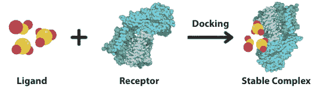

图6.1 分子对接示意图。

计算化学-生物学方法是当代药物发现的主流。自20世纪70年代中期首次引入以来，对接已成为药物开发和理解化合物及其分子靶点之间相互作用的关键工具。事实上，自初次发表以来，各种研究已描述了在开发更准确的对接技术以及识别高效配体–受体结合所需结构决定因素方面使用分子对接[5]。

### 6.2.1 分子对接的基本过程

分子对接的机制涉及图6.2所示的几个步骤[6]。

- A. 配体和受体的制备
  在配体和受体分子准备好之前，从晶体结构或三维模型中消除任何不需要的分子，如溶剂分子或共晶配体。在大多数情况下，受体是蛋白质、核酸或其他类型的生物分子靶点，而配体通常是小分子有机化合物。

- B. 搜索空间生成
  配体预计与受体结合的区域由其结合位点表示，并在其周围建立搜索空间。可以使用实验数据来确定此区域，也可以使用不同的算法来预测它。

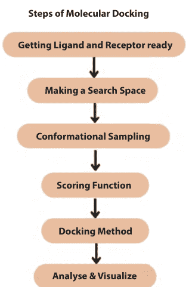

图6.2 对接涉及的关键步骤。

- C. 构象采样
  生成配体的多种构象以探索可能的结合取向。可以通过分子动力学模拟和系统构象搜索方法等技术实现，也可以通过使用预生成的构象库来实现。

- D. 评分函数
  使用评分函数对结合位点内配体的不同构象进行排名和评估。配体–受体复合物的结合亲和力或能量由评分函数确定。排名函数会考虑多种变量，如氢键、溶剂化作用、范德华作用和静电相互作用。

- E. 对接算法
  使用对接算法在结合位点内找到配体的最佳位置，该算法探索配体和受体的构象空间。有许多可用的算法，包括基于快速傅里叶变换的方法、蒙特卡洛技术和拉马克遗传算法。这些算法结合随机采样、局部优化和评分，以找到理想的对接解。

- F. 分析和可视化
  在完成对接模拟步骤后，会在受体结合位点内找到配体的最有利结合姿态。为了更好地理解结合机制并指导未来的优化，使用可视化工具来检查配体和受体之间的相互作用。

### 6.2.2 分子对接的基本组成部分

分子对接过程的成功和准确性取决于两个基本组件：搜索算法和评分函数。

- A) 搜索算法
  理论上，搜索空间由蛋白质–配体组合的所有可能取向和构象组成。要完全探索搜索空间，需要在特定的粒度级别下列出每种潜在的分子畸变以及配体相对于蛋白质的每种潜在旋转和平移取向。然而，利用现有的计算资源，这基本上是不可能的[7]。一些常用的搜索算法如下：[8]

  - a. 穷举搜索：该算法生成并评估每种潜在的结合姿态，彻底探索整个构象空间。虽然它确保能找到全局最小能量构型，但可能构型的数量庞大，使其计算成本高昂且经常不切实际[9]。
  - b. 遗传算法（GA）：受生物进化启发的遗传算法，使用一组潜在的解（个体），这些个体经历繁殖、交叉和变异以产生新一代。
    选择过程受每个个体适应度的影响，适应度代表其结合能。遗传算法不仅能高效地搜索构象空间，还能在探索与开发之间取得平衡。
  - c. 蒙特卡洛（MC）方法：蒙特卡洛方法使用随机采样来探索构象空间。在对接中，经常采用梅特罗波利斯蒙特卡洛或模拟退火等算法。它们从初始姿态开始，通过对配体施加扰动（旋转和平移），并从每个新姿态中随机采样一个姿态。使用梅特罗波利斯准则或温度表来决定是否接受或拒绝一个移动。
  - d. 粒子群优化（PSO）：它维护一组粒子，每个粒子代表一个潜在解。粒子在构象空间中移动，根据自身知识和当前最佳解更新其位置。PSO能高效地在搜索空间中导航并收敛到最佳解。
  - e. 拉马克遗传算法：该算法将局部搜索技术与遗传算法相结合。像遗传算法一样，它从一组个体开始。然后，它使用局部搜索算子（如基于梯度的优化）来优化每个个体的结合姿态。这种方法将优化方法的局部优化能力与遗传算法的全局探索能力相结合。

  配体和受体都已接受过多种构象搜索技术，例如：

  - 1. 涉及可旋转键的系统性或随机扭转搜索
  - 2. 原子动力学的计算机模拟
  - 3. 使用遗传算法“进化”新的低能量构象

  算法应尽可能生成多种构型，以便通过实验发现结合模式[6]。

- B) 评分函数
  评分函数使配体定位之间的排名成为可能。在理想情况下，评分与配体对蛋白质的结合亲和力应直接相关，使得分最高的配体也是最佳的结合体。分子力学中使用的最常见评分函数类型为基于力场的、基于知识的、经验性的和基于机器学习的（图6.3）。

  对接后，使用评分函数来预测两个分子之间非共价相互作用的强度和潜力，评分函数是快速的近似数学技术。通常涉及两个分子：药物的生物靶点，如蛋白质受体，以及一种小分子有机化合物，如药物[10]。

  与对接和药物设计相关的三种不同表达式用于确定评分，即：


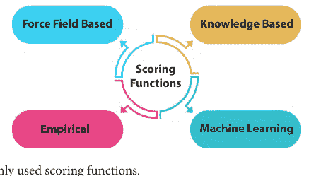

- a. 基于对接搜索的生成构象排序。
- b. 虚拟筛选蛋白质时对各种配体进行排序。
- c. 根据配体–受体（选择性和特异性）对不同蛋白质的结合亲和力，对配体进行排序 [11]。

使用力场、一组方程以及相关常数，基于力场的评分函数评估对接分子之间及分子内部的静电和范德华相互作用。计算配体与受体之间去溶剂化能的其他技术包括将分子力学能量与泊松–玻尔兹曼广义玻尔兹曼和表面积连续溶剂化方法相结合 [12]。

基于对接分子的相互作用和力（包括氢键数量、可旋转键数、疏水相互作用和亲水相互作用），计算经验评分函数。使用多元线性回归来拟合评分函数系数。液体统计力学分析（也称为平均势能评分函数）是基于知识的评分函数的最初来源。

为了评估适配性，求解蛋白质–配体对的统计势能函数。蛋白质数据银行（Protein Data Bank）的蛋白质–配体复合物结构集合被用作训练集或“知识库”，其中蛋白质和配体的原子根据分子环境被分为不同类型，并根据原子对的频率计算每个潜在对的距离依赖势。

机器学习用于使用多种描述符（包括氢键、静电相互作用或芳堆积、形状或表面特征、配体分子量和可旋转键）为对接结构创建非线性能量函数 [13]。“机器学习”是人工智能的一个分支，旨在使用数据和算法复制人类学习过程。

## 6.2.3 分子对接的类型

存在多种分子对接技术，它们使用灵活或刚性配体/靶标组合，具体取决于对接模拟的目标 [14]。这些具体包括以下内容（图 6.4）：

- a. 刚性对接
- b. 半灵活对接
- c. 灵活（软）对接

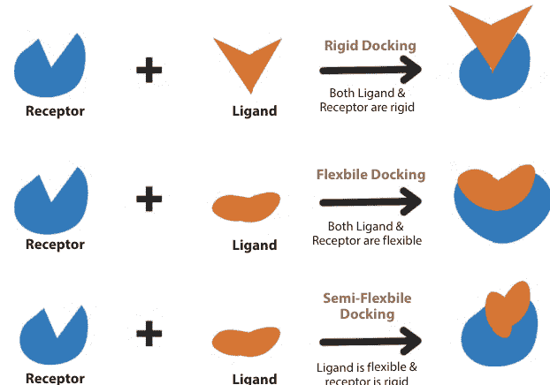

图 6.4 对接类型。

### 6.2.3.1 刚性对接

刚性对接（又称刚体对接）是一种分子对接技术，假设配体和受体分子在结合过程中均保持刚性结构。在此方法中，配体被视为刚性实体，不考虑其构象灵活性。对接算法通过详尽采样配体相对于受体的平移和旋转空间来探索可能的结合构象。配体与受体之间的结合亲和力通常使用评估互补性和相互作用能的评分函数进行评估。与灵活对接方法相比，刚性对接计算速度更快，但可能忽略结合时配体和受体的重要构象变化 [15]。

### 6.2.3.2 灵活对接

顾名思义，灵活对接将配体或受体（或两者）的灵活性纳入对接过程。它考虑结合伙伴在结合时可能发生的构象变化。可以通过生成多个构象或使用分子动力学模拟或蒙特卡洛技术等构象采样算法来考虑配体的灵活性。受体的灵活性通常通过采用灵活的侧链建模或通过诱导契合方案来解决。灵活对接算法同时搜索配体和受体的构象空间，探索各种结合构象并优化结合亲和力。然而，增加的灵活性带来了额外的计算复杂性，与刚性对接相比可能需要更多资源 [16]。

### 6.2.3.3 半灵活对接

半灵活对接（又称诱导契合对接）结合了刚性对接和灵活对接方法的要素。它旨在捕捉诱导契合现象，即配体的结合会诱导受体（或反之）发生构象变化。在混合对接中，首先假设配体和受体均为刚性，进行类似于刚性对接的初始对接步骤。然后对生成的复合物进行能量最小化或分子动力学模拟，以弛豫结构并允许构象调整。此步骤之后，进行改良阶段，考虑配体和受体的灵活性，并进一步优化结合构象。半灵活对接在计算效率和准确性之间取得了平衡，捕获了准确结合预测所需的基本灵活性，同时避免对整个构象空间进行详尽采样 [17]。

## 6.2.4 分子对接的常用工具和软件

分子对接的实际应用需要使用结构数据库和配体评估方法来搜索潜在靶标。可使用众多分子对接工具和方法来实现此目的。计算工具用于根据潜在配体与特定靶标候选物相互作用的能力对其进行排序 [1]。

广泛使用的对接工具采用各种搜索算法，包括遗传算法、分子对接算法、蒙特卡洛算法和基于片段的算法。其他工具包括 GOLD、FlexX、DOCK 和 ICM，主要用于高通量对接模拟（表 6.1）[18]。

使用分层对接策略，Glide（基于网格的带能量的配体对接）在完成其四个主要步骤后生成顶级潜在组合或命中物。这些步骤如下：[19]

- 1. 在受体活性位点中搜索位点点。
- 2. 使用贪婪评分、子集测试和直径测试分配粗略分数。
- 3. 使用静电网格和 OPLS-AA 进行能量最小化。
- 4. 使用 Glide 评分函数。

来自学术界和工业界的新算法会被快速集成到高端软件包中。随着公共领域软件的进步，它现在在功能上可以与某些商业产品竞争。计算机速度每一年半翻一番，而图形显示器在精巧性和易用性方面也同时进步。这些因素共同使得分子对接成为药物设计的重要组成部分。它在计算酶学、基因组学和蛋白质组学搜索引擎等创新新方法中不断扩展其功能 [6]。

### 表 6.1 一些常见对接工具及其算法列表。

| 序号 | 软件工具 | 算法 | 评分项 | 优势 | 参考文献 |
|---|---|---|---|---|---|
| 1. | Glide | 蒙特卡洛 | Glide 评分 | 先导优化和先导发现 | [6] |
| 2. | AutoDock | 拉马克遗传算法 | 经验自由能函数 | 能够适应用户定义的输入 | [6] |
| 3. | GOLD (用于配体对接的遗传优化) | 遗传算法 | GoldScore, ChemScore, ASP (Astex 统计势) | 配体与蛋白质之间的原子重叠 | [20] |
| 4. | Surflex | Surflex 对接搜索算法 | Bohm 评分函数 | 通过扩展力场提高准确性 | [21] |
| 5. | FlexX | 增量重构 | 修改后的 Bohm 评分函数 | 提供多种构象 | [6] |
| 6. | ICM (内坐标建模) | 蒙特卡洛最小化 | 虚拟库筛选评分函数 | 允许利用侧链灵活性将两个刚性螺旋平行排列 | [22] |
| 7. | MVD (Molegro 虚拟 Docker) | 进化算法 | MolDock 评分 | 结合模式预测的高准确性 | [23] |
| 8. | Fred (快速刚性详尽对接) | 详尽搜索算法 | 高斯评分函数 | 一种非随机方法，用于查看蛋白质活性位点内的每个位置 | [6] |


| 序号 | 软件工具 | 算法 | 评分术语 | 优势 | 参考文献 |
| :--- | :--- | :--- | :--- | :--- | :--- |
| 9. | LigandFit | 蒙特卡罗方法 | LigScore, 分段线性势 (PLP) | 使用 LigScore 产生高命中率 | [6] |
| 10. | FITTED（通过靶向进化描述诱导的灵活性） | 遗传算法 | 平均力势 (PMF), 药物评分 | 考察水分子如何影响蛋白质–配体复合物 | [24] |

## 6.3 人工智能在分子对接中的作用

美国国家卫生研究院（NIH）强调，精准医学是一种新的方法，用于“药物预防或治疗，同时还要考虑遗传、生活方式和环境等其他变异”。与目前使用的另一种方法相比，这使医生和医师能够更准确地治疗和康复疾病 [25]。这需要使用极其复杂的技术来增强，这些技术后来可以以不寻常的方式应用于训练数据集。

为了取得成功的结果，机器学习领域利用医疗专业人员的认知能力，结合生物医学和生物信息学数据。人工智能大致可分为三类：通用人工智能、狭义人工智能和超级智能 [26]。狭义人工智能（ANI）目前正在开发中，目标发布时间为未来10年。它有能力创建全新的数据集，对其进行检查，发现它们之间的关系，并得出既有意义又实用的结论。

最著名的制药公司在其开发过程中正在利用深度学习、人工智能和 ANI，目标是在大型数据集中识别不同的基因突变，因此医生可以在各种医学科学领域使用它 [27]。

通过利用海量数据集、学习复杂模式并指导理想结合构象的搜索，人工智能技术可以提高分子对接的精度和有效性。

以下子章节列举了 AI 在对接过程中集成的一些关键领域。

### 6.3.1 基于机器学习的评分函数

机器学习回归模型的最新进展促成了用于虚拟筛选的新型评分函数的开发。这些前沿评分函数已被证明优于传统评分方法，Ain 等人 [28] 在 2015 年的研究中也证实了这一点。Khamis 和 Gomma [29]（2015 年）进行的一项全面评估中，对经典评分函数（共 20 个）和基于机器学习的评分函数（共 12 个）进行了彻底检查。研究结果表明，基于机器学习的评分函数在评分能力（即预测结合亲和力的准确性）和排序能力（即预测相对排名的能力）方面均优于经典评分函数。

Khamis 和 Gomma [29] 于 2015 年进行的研究清楚地展示了基于机器学习的评分函数相对于经典方法的显著优势。这些机器学习方法在准确预测蛋白质的结合亲和力及其相对排名方面表现出更优的性能。Ashtawy 和 Mahatrapa [30] 进一步支持了这些发现，指出利用随机森林算法或增强回归树的评分函数通常表现出最佳性能。基于先进机器学习回归模型的新型评分函数的引入彻底改变了虚拟筛选。各项研究表明，这些方法在准确性和预测能力方面已超越了传统评分函数。利用随机森林或增强回归树等机器学习算法尤其有效。

促成这些基于机器学习的评分函数成功的一个关键因素是公共数据库中蛋白质–配体复合物的结构信息可用。随着这些数据的积累，创建更精确的评分函数成为可能，这些函数可以准确预测特定蛋白质或蛋白质家族的结合亲和力 [31]。

### 6.3.2 姿态预测或蛋白质–配体相互作用

机器学习（ML）是一种用于预测未知配体或蛋白质行为的强大方法。它通过基于已知蛋白质–配体复合物结构，分析理化性质与蛋白质–配体相互作用之间的关系来实现这一点。Dhakal 等人 [32]（2021 年）强调了 ML 在推断用于预测其他未知配体或蛋白质状态的统计模型方面的重要性。通过利用已知蛋白质–配体复合物的结构，ML 算法学习理化参数与蛋白质和配体之间相互作用之间的模式和相关性。这使 ML 模型能够对新的、未表征的蛋白质–配体对的相互作用进行预测。

Yamanishi 等人 [33]（2018 年）提出了一种结合核回归方法来推断蛋白质–配体相互作用的方法。该方法涉及整合多种信息源，包括配体的化学结构、蛋白质序列信息以及药物-靶点复合物网络。通过结合这些数据，模型识别药物与靶标蛋白之间的关联，揭示它们之间的相互作用。

Bleakley 和 Yamanishi [34]（2009 年）进行了 BLM 实验，采用监督学习方法来预测蛋白质–配体相互作用。同样，Wang 和 Zeng [35]（2013 年）开发了一种使用受限玻尔兹曼机（一种机器学习模型）的方法，用于预测不同类型的相互作用，例如蛋白质与配体之间的相互作用。

Macari 等人 [36]（2019 年）对用于预测蛋白质和小分子结合位点的计算范式提供了全面综述。作者比较了各种技术，从传统的几何方法到较新的机器学习策略，分析了它们的特点和结果。这篇综述揭示了在预测蛋白质–配体相互作用和结合位点方面，不同方法的优势和局限性。

### 6.3.3 高通量虚拟筛选

在药物发现领域，虚拟筛选起着至关重要的作用。它分为两大类：受体基础方法和配体基础方法。受体基础方法侧重于靶向特定受体并改进先导化合物。它涉及分析已知的活性配体，以建立其三维结构与活性（3D-QSAR）之间的定量关系。要应用这种方法，了解受体和配体分子的三维结构至关重要。随后进行分子对接计算，以确定不同构象的结合位点和能量。受体基础虚拟筛选通常在先导化合物发现阶段使用 [37]。

高通量虚拟筛选（HTVS）是一种分析潜在化合物与目标受体的结合特性和亲和力的方法。通过筛选大型分子库，HTVS 可以识别有前景的化合物。这种方法有助于从数百万个化合物中寻找潜在的先导分子 [38]。

随着药物开发相关挑战和成本的不断增加，利用先进技术至关重要。药物化学家现在利用基于机器学习（ML）的虚拟筛选（VS）来增强高通量筛选（HTS）并加速早期药物开发。基于 ML 的 VS 提高了从庞大的化学基因组文库中识别潜在先导分子的效率和生产力 [39]。

## 6.4 新时代的药物发现

药物发现是一个复杂且有条理的过程，旨在识别具有成功药物潜力的适当化合物。该过程包括对微小合成化合物和大型生物分子（如蛋白质或抗体）的调查和评估，以确定其作为药物的潜力 [40]。2021年，全球药物发现行业的价值预计超过550亿美元。预计到2030年，该行业将超过1200亿美元，在2020年代末以约10%的年复合增长率（CAGR）扩张 [41]。

将药物推向市场是一个漫长且昂贵的过程，可能耗资数十亿美元。药物审批领域的损失可能性相当大，超过91%的临床试验药物未能获得FDA批准并进入消费者市场 [42]。药物发现在三个不同的时期中不断演变。在十九世纪，它依赖于药物化学家的偶然发现。二十世纪初，新药物结构的鉴定推动了抗生素的发展。到世纪末，分子建模和高通量筛选（HTS）等技术创新彻底改变了该领域 [43]。在二十一世纪，


advancements in biotechnology and genomics have paved the way for the development of biopharmaceutical drugs using AI and ML algorithms.

Modern drug discovery has witnessed the rise of faster high-throughput screening (HTS) methods, which eliminate the need for human labor. However, HTS remains costly and demands abundant resources. Academic institutions often lack these resources, while pharmaceutical companies seek ways to avoid screening unpromising ligands. Consequently, computer-aided drug discovery (CADD) tools have gained significant attention in both academia and the pharmaceutical industry [44].

## 6.5 使用机器学习（ML）算法进行药物发现

ML algorithms have made significant contributions to the field of drug discovery, offering valuable tools for pharmaceutical companies. These algorithms have been harnessed to create predictive models that aid in determining the chemical, biological, and physical properties of compounds during the drug discovery process.

Broadly classifying, there are two types of ML algorithms, namely:

- A. 受监督学习

  Supervised learning entails training a model with labeled data which includes the desired outcome or target variable. Biological sequences (e.g., DNA, RNA, protein) can be classified into distinct functional categories using supervised learning algorithms, such as predicting protein function or finding disease-associated genetic variants. These models learn from labeled data in which sequences are linked to certain classes or labels, allowing the model to categorize fresh, unlabeled sequences [45].

  In drug research, supervised learning algorithms may forecast quantitative attributes such as a compound's activity or potency against a certain target. These algorithms can develop prediction models to estimate the potential effectiveness of novel compounds by training on labeled datasets with known chemical actions [46].

- B. 无监督学习

  This method entails training an algorithm on unknown information with no stated goal variables. The objective is to find undetected trends, structures, or correlations in the data. Unsupervised learning methods are used in computational biology and drug discovery for tasks such as grouping, reducing dimensionality, and data exploration.

  Clustering algorithms help identify groups or clusters of similar biological entities, such as genes or proteins based on shared characteristics. In drug discovery, clustering algorithms aid in grouping compounds with similar chemical structures or biological activities, facilitating the identification of chemical classes or target families [47]. Dimensionality reduction methods, such as PCA (principal component analysis) or t-SNE, are employed in bioinformatics to manage enormous amounts of data. These algorithms reduce the dimension of complex datasets while preserving essential information, enabling visualization and interpretation of the data [48].

The ML algorithms which are widely used are shown in Figure 6.5.

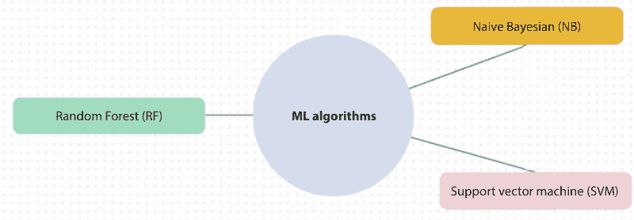

Figure 6.5 广泛使用的ML算法。

### 6.5.1 随机森林（RF）

Random forest (RF) is a well-known method for massive data sets that contain numerous attributes. It simplifies the data by removing outliers and performs classification and designation based on relevant features specific to the algorithm. RF is commonly trained on large inputs and variables, making it accessible for data collected from multiple databases [49].

Ryu et al. [50] developed PredMS, a computer model that predicts whether tiny molecules are biologically either stable or unstable within individual liver microsomes. Using a random forest model and a database of metabolic stability data for 1,900+ compounds, PredMS achieved good prediction accuracy. PredMS was also tested on an external dataset of 60+ compounds and obtained promising results, with high accuracy, sensitivity, specificity, and positive predictive value.

This shows that PredMS may provide a reliable and beneficial method to evaluate the metabolite stability of small molecules, particularly in the early phases of the development and discovery of drugs. Researchers can utilize PredMS to make informed decisions about the potential viability and safety of compounds, helping streamline the drug discovery process.

### 6.5.2 朴素贝叶斯（NB）

It is based on the principles of Bayesian probability theory and is particularly useful when dealing with large datasets and complex relationships between variables. Given the class label, the naïve Bayesian approach assumes that all characteristics or parameters in the information set are distinct from one another. This simplifying assumption allows for efficient and straightforward calculations of probabilities.

As techniques for the classification for biological data, which typically includes noise and irrelevant information, NB algorithms have shown considerable potential. They provide a potential approach for predicting ligand–target communication, which might be a significant step ahead in finding leads. NB methods can play crucial roles in discovering possible leads and expediting the drug development process by efficiently handling noise and unrelated data [51].

Chen *等人* [52] reported a database of molecules categorized as P-glycoprotein (P-gp) inhibitors and non-inhibitors. The effect of different physicochemical parameters on P-gp suppression was studied. Decision trees were constructed using a training set of compounds. A naive Bayesian classifier was applied, resulting in an average correct prediction of 80% for both the training and test data sets. To summarize, the study indicates that the developed models, including decision trees and a naive Bayesian classifier, can effectively predict whether a molecule with good accuracy.

### 6.5.3 支持向量机（SVM）

SVMs are sophisticated algorithms for machine learning that have been utilized extensively in drug development for a variety of applications. SVM is important in drug research because of its ability to distinguish among inactive and active drugs, grade drugs within a database, and build models using regression [53].

Warmuth *等人* [54] employed a machine learning approach termed “active learning” to pick batches of chemicals for testing. The “maximum margin hyperplane” of support vector machines (SVM) was utilized. A hyperplane is a border that divides active (target-binding) molecules from inactive ones. The aim was to find a hyperplane that was as far away from any labeled compound as feasible, maximizing the gap between the two classes. In terms of discovering molecules with binding activity, they discovered that tactics determined by the maximum margin hyperplane surpassed simpler methods.

In another case, the SVM approach outperformed three artificially generated neural networks, a function with a radial basis system, and a C5.0 decision tree model for predicting the inhibitory effects of dihydrofolate reductase with pyrimidines [55].

## 6.6 使用深度学习（DL）算法进行药物发现

Deep learning has emerged as an effective technique in bioinformatics, transforming how we analyze and interpret biological data. Deep learning algorithms may automatically learn detailed patterns and representations from complex biological information by exploiting artificial neural networks with numerous layers, resulting in better accuracy and predictive capabilities [56].

Deep learning has made important breakthroughs in bioinformatics, particularly in the processing of genetic data. Deep learning algorithms have been important in extracting relevant information from this plethora of genetic information generated by genomic sequencing technology [57].

Deep learning (DL) has emerged as a potent method within the field of machine learning, particularly in the era of big data. DL models have demonstrated their effectiveness and efficiency in handling large volumes of data, surpassing the predictive accuracy achieved by traditional machine learning methods. One key advantage of DL over conventional machine learning is its ability to efficiently process and extract valuable information from raw, unprocessed natural data.

DL models excel in discovering patterns within high-dimensional datasets, making them applicable across various domains. However, it is important to note that DL models heavily


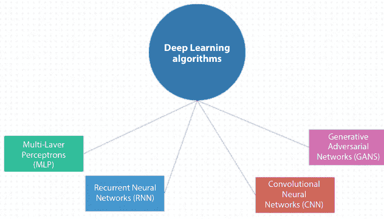

图 6.6 深度学习算法。

依赖于训练数据，此数据的数量和质量显著影响已训练模型的预测能力（图 6.6）[57]。

## 6.6.1 多层感知机（MLPs）

MLPs 是一种人工神经网络（ANN），由众多层相连的人工神经元或节点组成。MLPs 经常在机器学习应用中发挥作用，如回归、分类和模式识别。

MLP 的架构由输入层、若干个隐藏层和一个提供输出的层组成。每一层由工程化神经元（受生物神经元启发）组成，也称为感知机或节点。当 MLP 中某一层的神经元与后续层中的神经元相连时，会形成一个具有有向无环模式的图。权重表示神经元之间的连接，影响连接的强度及网络中信息的流动 [58]。

MLPs 用于预测生物分子（蛋白质）的分子组成，通常用于二级结构预测、折叠识别和三级结构预测。MLPs 在现有蛋白质结构及其相关序列上训练后，可以利用氨基酸序列预测未知蛋白质的分子组成。MLPs 在提高蛋白质结构预测技术的准确性、帮助理解蛋白质功能以及识别治疗靶点方面取得了有希望的结果 [59]。

MLPs 已被用于预测药物-药物相互作用和靶点蛋白相互作用。MLPs 可以通过在已知药物-靶点相互作用数据上训练，来估计潜在药物与特定靶点结合的概率。MLPs 正在用于对可能的药物-靶点组合进行优先排序，通过减少耗时且昂贵的临床试验数量，帮助药物开发的早期阶段 [60]。

## 6.6.2 循环神经网络（RNN）

也称为 RNN，这是一种人工神经网络，通过捕捉时序关系以及序列内部的数据流动方式来对数据进行顺序建模。RNN 正在生物信息学中确立自身作为强大工具的地位，用于分析多种生化数据，如 DNA 测序、RNA 序列、蛋白质序列以及时间序列基因表达数据。

与前馈神经网络不同，RNN 使用循环连接，使信息可以通过序列的每个阶段传递到下一个阶段。RNN 的主要组件是一个隐藏状态，用于存储关于过去步骤的信息。在每个步骤中，当前输入和先前的隐藏状态合并以生成输出并更新隐藏状态。由于这种循环连接，RNN 可以处理任意长度的序列，因此适合分析长度不一的生物序列 [58]。

蛋白质结合位点预测：RNN 可以预测蛋白质结合区域及其与配体的相互作用方式。RNN 可以通过学习现有的蛋白质-配体组合来识别与结合位点相关的氨基酸序列和结构模式，从而协助药物开发和蛋白质修饰 [61]。

基因表达的时间序列分析：RNN 可以模拟通过时间序列调查收集的基因表达数据的时序变化。RNN 可以通过捕捉不同时期基因表达谱之间的连接，来发现模式、发现基因调控网络并预测未来的表达水平 [62]。

## 6.6.3 卷积神经网络（CNN）

CNN 为分析多种生物数据（如 DNA 序列、蛋白质序列、基因组信息和医学影像分析）提供了强大工具，从而改变了生物信息学。CNN 在检测这些数据集中的空间和区域连接方面非常有效，因此非常适合序列分类、蛋白质结构预测、变异检测以及计算机断层扫描等临床影像分析等应用 [18]。

以下是 CNN 架构的主要组件：

- A. 卷积层：每个层由多个自适应滤波器或内核组成，用于检查输入数据中的特定趋势或特征。每个滤波器执行卷积操作，包括滤波器权重与对应输入区域的逐元素乘法和求和。卷积层负责收集局部空间特征并将其映射。

- B. 池化层：池化层在保留关键特征的同时，减少卷积层生成的特征图的空间维度。最大池化和平均池化等池化方法通常用于从局部区域提取最重要的信息。

- C. 全连接层：这些层能够将前一层的所有神经元与下一层连接起来，从而对提取的特征进行分类或回归。基于学习到的表示，全连接层捕获全局连接并生成最终预测。

一个示例是 DeepSF 深度 1D 卷积神经网络，旨在将蛋白质序列分类到已知折叠中，为折叠识别和序列-结构关系提供关键洞察。该方法自动提取与折叠相关的属性，从而允许对任意长度的蛋白质序列进行分类。在 SCOP1.75 的精选数据集上进行训练和测试，平均准确率超过 70%，但在使用 SCOP2.06 的单独数据集上进行实验，准确率达到 73%。在 CASP9-12 目标上，DeepSF 在折叠检测准确性方面超过了 HHSearch（一种顶级的谱系-谱系比对技术）。DeepSF 的隐藏特征提取对序列修改、删除、插入和截断免疫，这使其对于各种蛋白质基序识别任务（如分组、比较和排序）非常有用 [63]。

## 6.6.4 生成对抗网络（GAN）

GAN 由两个独立的神经网络组成：生成器和鉴别器，这些深度学习算法构成了 GAN。GAN 于 2014 年由伊恩·古德费洛及其同事提出，因其能够生成逼真且高质量的人工数据而备受关注。

GAN 在生物信息学和药物发现中已显示出实用性，可协助蛋白质结构形成、生化性质估计和化学合成等任务。GAN 提供了一种生成与原始数据集特征匹配的新数据的新方法，使研究人员能够调查和分析复杂的生物系统 [64]。

蛋白质结构生成是 GAN 在生物信息学中的一个应用。蛋白质结构对于理解蛋白质如何工作及其与药物靶点的相互作用至关重要。然而，通过实验确定蛋白质结构既耗时又昂贵。通过编程生成器网络生成与经验发现的结构高度匹配的拓扑，GAN 可用于构建逼真的蛋白质结构。鉴别器网络对生成结构的质量提供反馈，确保它们符合蛋白质的已知结构特性 [65]。

GAN 也已用于药物开发，以创建具有所需特征的独特化学结构。GAN 的生成器网络可以训练生成与现有药物结构可比或具有与药用效果或安全性相关的特定特性的化合物。通过研究化学环境并利用生成器产生多样且独特化合物的能力，GAN 是生成具有更好特性的创新药物候选物的有用工具 [66]。

此外，GAN 还用于从头创建药物，其中生成器网络构建具有理想特征的化学结构，而鉴别器网络评估其药物相似性。这种生成和评估分子的重复过程使化学探索以及具有所需特征的新化合物的检测成为可能 [67]。


## 6.7 用于药物发现的基于AI的工具包

表6.2介绍了目前用于药物设计和开发的一些机器学习工具。

深度学习（DL）已成为包括药物发现在内的各个领域中一种强大的方法。

DeepChem使用深度学习方法开发模型，预测化学品的基本特征，例如对某个靶点的活性或毒性。

像这样的模型从海量信息中学习，可以揭示旧方法可能遗漏的复杂模式和相关性。

图6.7解释了DeepChem的工作流程。

深度学习从未处理的分子数据中自动识别有用特征的能力是其在药物开发中的主要优势之一。

深度学习模型可以直接从数据中获取并调整到最有用的解释，而不是依赖预定义的描述符或特征。

由于其灵活性，深度学习模型可以捕捉对其生物功能至关重要的精细和详细的分子属性。

它可以处理各种分子数据格式，例如1D模式（如蛋白质或DNA模式）、2D模型（如生化图）以及3D结构。

这种适应性使得多种形式的数据结合成为可能，从而产生更准确的预测[68]。

表6.2 用于药物设计和开发的广泛使用的机器学习工具包。

| 序号 | 机器学习工具 | 功能 | 网络链接 |
|---|---|---|---|
| 1 | AlphaFold | 蛋白质折叠预测 | https://alphafold.ebi.ac.uk/ |
| 2 | DeepChem | 药物发现 | https://deepchem.io/ |
| 3 | AMPL—atom modeling pipeline | 药物发现的数据准备 | https://github.com/ATOMconsortium/AMPL |
| 4 | Open Drug Discovery Toolkit (ODDT) | 分子对接与预测 | https://pypi.org/project/oddt/0.1.9 |

- Deepchem工作流程阶段
- 1. 数据集信息
- 2. 访问数据
- 3. 创建numpy数据集
- 4. 分子指纹
- 5. 图卷积
- 6. 数据集拆分

图6.7 DeepChem工作流程图。

## 6.8 分子对接中的人工智能应用

传统的药物和疫苗开发是艰巨的工作，旨在生产具有多种所需特性的新分子[69]。

因此，开发药物和疫苗非常昂贵、耗时，且成功率低。

在庞大的分子空间中，高效发现众多可信、独特且新的候选分子已因人工智能（AI）和基于机器学习（ML）的模型的进步而发生革命性变化，这有助于解决这一难题[70]。

得益于对接算法、神经网络模型的进步以及配体和靶点开放数据的可用性，AI驱动的分子对接在药物开发中的应用正变得越来越普遍。

最初，分子对接主要用于研究配体与靶点之间的相互作用。

然而，在现代，分子对接的应用和范围已经扩展和演变[71]。

### 6.8.1 药物-靶点相互作用预测

正在开发计算工具以预测用于药物重新定位的新分子靶点的活性。

这些工具与实验性药物-靶点发现工作协同，提供化合物-靶点相互作用的数据。

例如，机器学习（ML）模型使用药物和靶点的结构来指导其在药物-靶点空间中的预测。

这种方法有助于理解化合物与靶点之间的相互作用。

此外，AI和ML方法已被用于预测激酶抑制剂和其他化合物类别的靶点活性。

研究人员使用多核学习和化学指纹来预测化合物激酶靶点的亲和力。

深度学习技术，如卷积网络模型，也已应用于预测药物-靶点相互作用（DTI）。

这些技术提高了我们对影响DTI预测的因素的理解，并实现了计算机辅助的药物重新定位。

Atom-wise是一家生物制药公司，利用3D结构识别和预测小结构。

他们使用这种方法识别埃博拉病毒的活性分子，并成功利用人工智能开发了两种新药。

这些药物已显示出比之前可用选项更高的有效性。

然而，为了确保安全和其他考虑，在这些药物广泛应用之前，需要同行评审和监管监督[74]。

### 6.8.2 药物重新定位

为现有药物发现新的治疗用途、开发药物候选物以及探索天然产物是药物发现中令人兴奋的方向。

一种有前途的方法是药物重新定位，即将批准的药物、开发中的候选药物或合成化合物用于新的治疗目的。

为了加快这一进程，对接作为一种虚拟筛选技术，允许快速筛选批准的药物、植物化学物质或预合成化合物，以针对特定感兴趣的靶点。

创新的深度学习（DL）方法论已彻底改变了从头开始的药物设计。

像生成自编码器（GAE）和生成对抗网络（GAN）这样的最先进的DL模型已经改变了设计新分子的方式。

最近，变分自编码器（VAE）等生成模型已被用于生成原子序列，从而产生多样且独特的药物分子[76]。

这些强大的自编码器将分子编码为向量，捕捉键级、元素性质和官能团等关键特征[77]。

这种尖端方法为创新和独特的药物设计开辟了新可能性。

COVID-19大流行使世界意识到在这个历史时期需要新药开发。

过去一年中，该过程已得到AI/ML的极大帮助[78]。

计算机辅助药物发现系统通常包含三个组件：靶点发现、小分子药物发现和临床试验结果预测器。

计算机辅助药物设计中人工智能与核心化学的融合为彻底改变该领域带来了巨大希望。

研究人员热切寻求关于药物和临床数据的高质量研究，以充分利用这种创新方法的全部潜力。

通过将人工智能的力量与严谨科学研究的深刻洞察相结合，计算机辅助药物设计有望解锁突破性发现并改变药物开发的格局。

对AI与化学之间这种尖端协同效应的追求推动了药物研究和临床调查中卓越的追求，不断拓展医学世界可能性的边界。

人工智能（AI）促进了生物、化学和结构活性数据库中不断增长的开放访问信息源的使用。

因此，分子结合亲和力的预测更加精确[80]。

在本文中，姿态生成和评分已由深度学习神经网络处理。

为了研究卷积神经网络，将蛋白质-配体复合物设计为三维笼状结构。

类似于机器学习模型和其他非神经网络算法，深度学习评分函数已产生更优结果[81]。

基于AI的ML通过学习可用数据的属性，基于盲数据进行预测。

这些策略可能不适用于最近确定的治疗靶点，因为它们尚未经过深入分析，且缺乏化学、结构和生物活性数据[82]。

为了在经典评分中预测结合亲和力，可以使用机器学习算法改进或替换预定义的函数形式。

在虚拟筛选中，这些也已被用于区分结合物和非结合物[83]。

非参数学习，即机器学习，不使用预定义函数。

相反，结果从用作输入的数据中提取。

输出可以是连续的，类似于非线性回归。

这使得精确和多样的评分成为可能。

随机森林（RF）-Score是最早超越传统评分方法的机器学习评分方法之一。

此外，支持向量机（SVM）和逻辑回归被应用于增强基于对接的结合亲和力预测[84]。

## 6.9 基于AI的分子对接的挑战与局限

使用对接工具和研究结果面临许多挑战。

据称每个程序都有其自身的限制和缺陷。

因此，程序无法可靠地产生相同的输出[85]。

此外，如果处理的化学结构数量超过了所开发软件的能力，程序可能无法


正常运行。因此，根据信息持续验证和更新开发的软件至关重要。

在对接过程中遇到的许多问题中，最重要的包括：

- 1. 配体的属性
  通过对接，无法确定配体将作为激动剂还是拮抗剂。对接研究仅揭示分子与受体的结合方式和亲和力。对接过程后，应在实验室进行实验，以确定分子是否具有激动剂或拮抗剂特性 [86]。这意味着，除非进行额外验证（例如实验室实验），否则不建议过度解读有关配体性质的对接结果。配体的制备方式及其构象在对接过程中起作用。在对接前，分子在配体制备过程中会被电离 [84]。

- 2. 对接的准确性
  在药物发现和开发的初期阶段，对接方法常用于寻找潜在配体。为了了解分子如何与靶点相互作用，会使用多种程序。尽管如此，对某些分子的体内测试并未产生令人鼓舞的结果 [87]。由于各种问题，可能需要质疑对接结果。第一个问题与蛋白质结构的使用方式有关。在 PDB 中，蛋白质结构通常以与配体的复合物形式存在 [88]。为了对接待研究分子，研究人员会从蛋白质结构中移除结合的配体。然而，这一过程可能会影响对接输出。结合位点周围的环境是第二个关键问题。为了发挥功能，药物候选分子必须与特定的细胞靶点结合。即使在体内模拟环境中对接结果显示强结合，但在体内使用时，有时也会产生意外结果 [89]。

- 3. 搜索和评分函数
  对接很难，因为两个分子在三维空间中的排列方式有很多种（平移有三个自由度，旋转有三个自由度）。正在使用的搜索算法会旋转并系统地将一个分子相对于另一个分子进行移位，以找出两个分子之间的每一种可能取向 [87]。搜索算法能够生成众多解。根据评分，对解进行排序。没有单一的评分函数，因为不同的程序有不同的对接功能和评分系统。总体而言，实验结合亲和力与对接得分之间仍缺乏关系。每种对接算法都使用搜索工具和评分函数 [90]。

总而言之，深度学习正在生物信息学和药物开发领域确立其作为一种强大且具有变革性的工具的地位。基于深度学习的算法的应用彻底改变了复杂生物数据的处理和解释，在理解生物系统功能、预测蛋白质构象、发现序列模式和辅助药物发现方面取得了重大进展。

ML 算法在药物开发中的重要性日益凸显。它们使我们能够更快地工作，并探索其他方式无法实现的众多不同想法。这些算法利用数据，但在我们正在研究的单个蛋白质或靶点缺乏足够了解的情况下，可能难以获得可靠结果。尽管存在这些局限性，ML 仍然是药物开发中的有用工具，并帮助我们理解新的生物通路和靶点。

算法预测中过拟合或欠拟合的潜在风险是一个常见的担忧。过拟合发生在模型在训练数据上表现良好但无法推广到新的、未见的数据时。这种情况发生在模型在训练过程中学习到无关或不常见的模式，导致在实际应用中表现不佳 [91]。可以使用各种解决方案，例如扩大样本量和应用交叉验证，来克服这些问题。交叉验证等技术是一种常用方法，包括使用不同的数据集评估机器学习模型的正确性。

随着更多数据的获取，深度学习模型将继续进一步发展，在生物信息学和药物发现方面取得重大发现。随着深度学习框架、算法和计算能力的不断进步，我们可以期待更准确的预测、对复杂生物结构的深入理解，以及推动精准医学进步并彻底改变药物发现和开发过程的新洞察的发现 [92]。

## 6.10 结论与未来展望

分子对接，一种基于结构的药物设计技术，在预测小分子配体如何与其靶点相互作用方面发挥着至关重要的作用。正在使用各种强大的对接程序，选择取决于可用性、需求和计算资源等因素。人工智能（AI）和机器学习（ML）在药物发现中的集成彻底改变了该领域，特别是在中枢神经系统（CNS）疾病等具有挑战性的领域。AI/ML 使能靶点识别、化合物筛选、先导化合物优化、疗法反应预测和药物重新定位，利用大量生物数据来增强决策并加速药物开发过程。

本章深入探讨了 AI 对分子对接的深远影响。它涵盖了对接的基础知识，介绍了药物发现中的 AI，并探讨了其在对接算法中的集成。本章还重点介绍了 AI 在分子对接中的多种应用，以及所面临的挑战和未来方向。

然而，认识到 AI/ML 在计算生物学和药物开发中的局限性至关重要。对优质且经过良好整理的数据集的依赖是一种限制，因为 AI/ML 模型的成功在很大程度上取决于训练数据的准确性和多样性。尽管存在这些局限性，但持续的研究、算法进步以及研究人员和公司之间的合作，有望克服这些障碍，充分发挥 AI/ML 在生物信息学以及药物搜索中的全部潜力，最终实现发现改善疾病治疗的新疗法。

## 未来方向

AI 和 ML 在药物发现方面的未来在多个关键领域具有巨大的进步潜力，具体包括：

- 1. 增强靶点识别：AI 和机器学习（ML）可以通过结合基因组学、蛋白质组学和转录组学等多种数据源来进一步增强靶点识别，从而发现新的治疗靶点。深度学习算法可以分析大量组学数据，以揭示复杂的疾病成因和可能的治疗靶点 [93]。

- 2. 基于 GAN 的生成算法：AI 和机器学习（ML）可用于创建生成算法，帮助研究 CT 图像、PET/MRI 扫描、超声等结果 [94]。

- 3. 传统药物开发主要关注单一靶点；然而，许多疾病涉及多个靶点的复杂分子通路。AI 和机器学习可以帮助开发多靶点药物，通过同时优化其与多种蛋白质或通路的相互作用来产生协同效应 [95]。

- 4. 个体化医疗：AI 和机器学习算法可以分析患者数据，例如遗传信息和病历，以预测患者对某些药物的反应。这种个体化医疗策略可以帮助识别可能从某种药物中获益的患者，同时减少不良反应 [95]。

- 5. 真实世界数据整合：患者报告的结果可以与 AI 和 ML 模型相结合，以了解药物在真实世界环境中的疗效和安全性。这些信息有助于改善上市后监测，并允许早期发现不良事件 [96, 97]。

AI 和 ML 在药物发现中的未来前景广阔，拥有多个值得探索的有希望方向。

全面 AI 模型的持续发展将确保符合法规并提高对 AI 驱动的药物开发流程的信心。AI 和 ML 方法在高通量检测和虚拟药物筛选中的整合将加速化学物质识别并提高药物候选物选择的精度。开发用于从头设计药物的 AI 系统，可能会为创建针对癌症、获得性免疫缺陷综合征（AIDS）等高风险疾病的独特且优化的药物创造新机会 [99]。

学术界、产业界和监管机构之间的合作对于实现 AI 在药物研究中的潜力至关重要。标准化的开发原则和方法将确保透明度、可重复性和法规合规性 [100]。这一协作努力将促进人工智能在药物发现过程中的负责任和合乎伦理的应用。伦理考虑，例如保护患者数据隐私、确保算法决策透明度以及减轻偏见


在计算机模型中，将始终是一项优先事项。通过恪守伦理规范，该领域可以保持公众信任并充分发挥其全部效益 [101]。

总体而言，本章关于通过人工智能理解分子对接的未来范围在于人工智能算法的持续进步、大数据整合、个性化医疗、药物组合优化、高通量虚拟筛选、药物毒性预测以及伦理考量。由人工智能驱动的分子对接领域有望改变药物发现流程并改善患者预后 [102]。总之，利用真实世界数据、更好的靶点识别、实现个性化医疗以及改进药物设计，只是人工智能与机器学习在药物发现中的结合为彻底变革该行业所带来的巨大前景的几个方面。研究人员和企业应将伦理规范作为最优先考虑事项。这将改变药物发现的格局。

## 参考文献

- 1. Agarwal, S. 和 Mehrotra, R.J.J.C., 分子对接概述。JSM Chem., 4, 2, 1024–1028, 2016.
- 2. Quazi, S. 和 Fatima, Z., 生物信息学中人工智能与机器学习的作用：药物发现与药物重新用途。收录于：Interdisciplinary Reviews: Computational Molecular Science，第 182–197 页，IGI Global，2021.
- 3. Gentile, F., Yaacoub, J.C., Gleave, J., Fernandez, M., Ton, A.T., Ban, F., Cherkasov, A., 基于深度对接的超大型化学库人工智能赋能虚拟筛选。Nat. Protoc., 17, 3, 672–697, 2022.
- 4. Nayarisseri, A., 精准医疗与药物发现中的人工智能、大数据和机器学习方法。Curr. Drug Targets, 22, 631–655, 2021.
- 5. Pinzi, L. 和 Rastelli, G., 分子对接：药物发现中的范式转变。Int. J. Mol. Sci., 20, 18, 4331, 2019.
- 6. Chaudhary, K.K. 和 Mishra, N., 分子对接综述：药物发现的新型工具。Databases, 3, 4, 1029, 2016.
- 7. Guedes, I.A., de Magalhães, C.S., Dardenne, L.E., 受体-配体分子对接。Biophys. Rev., 6, 75–87, 2014.
- 8. García-Godoy, M.J., López-Camacho, E., García-Nieto, J., Del Ser, J., Nebro, A.J., Aldana-Montes, J.F., 分子对接问题的生物启发优化：现状、最新结果与展望。Appl. Soft Comput., 79, 30–45, 2019.
- 9. Tripathi, A. 和 Misra, K., 分子对接：一种基于结构的药物设计方法。JSM Chem., 5, 2, 1042–1047, 2017.
- 10. Li, J., Fu, A., Zhang, L., 分子对接中用于蛋白质-配体相互作用的评分函数概述。Interdiscip. Sci.: Comput. Life Sci., 11, 320–328, 2019.
- 11. Farid, R., Day, T., Friesner, R.A., Pearlstein, R.A., 通过蛋白质建模、势能映射和对接研究获得的关于 HERG 阻滞的新见解。Bioorganic Med. Chem., 14, 9, 3160–3173, 2006.
- 12. Wójcikowski, M., Ballester, P. J., Siedlecki, P., 基于结构虚拟筛选中机器学习评分函数的性能。Sci. Rep., 7, 1, 46710, 2017.
- 13. Zhong, F., Xing, J., Li, X., Liu, X., Fu, Z., Xiong, Z., Jiang, H., 药物设计中的人工智能。Sci. China Life Sci., 61, 1191–1204, 2018.
- 14. Fan, J., Fu, A., Zhang, L., 分子对接的进展。Quantitative Biol., 7, 83–89, 2019.
- 15. Raval, K. 和 Ganatra, T., 分子对接的基础、类型与应用：综述。IP Int. J. Compr. Adv. Pharmacol., 7, 1, 12–16, 2022.
- 16. Wang, Y. 和 Zeng, J., 使用受限玻尔兹曼机预测药物-靶点相互作用。Bioinformatics, 29, 13, 126–134, 2013.
- 17. Morris, C.J. 和 Corte, D.D., 使用分子对接和分子动力学研究蛋白质-配体相互作用。Modern Phys. Lett. B, 35, 08, 2130002, 2021.
- 18. Kothari, D., Patel, M., Sharma, A.K., 使用卷积神经网络在生物信息学的机器学习与人工智能中实现灰度归一化，收录于：2021 第 6 届创造性计算技术国际会议 (ICICT)，第 1071–1074 页，IEEE，2021.
- 19. Panwar, U. 和 Singh, S.K., 作为 IN-LEDGF/p75 抑制剂的酰基腙、肼和重氮衍生物的原子基 3D-QSAR、分子对接、DFT 及模拟研究。Struct. Chem., 32, 337–352, 2020.
- 20. Verdonk, M.L., Chessari, G., Cole, J.C., Hartshorn, M.J., Murray, C.W., Nissink, J.W.M., Taylor, R., 使用 GOLD 在蛋白质-配体对接中建模水分子。J. Med. Chem., 48, 20, 6504–6515, 2005.
- 21. Jain, A.N., Surflex：使用基于分子相似性的搜索引擎进行完全自动灵活分子对接。J. Med. Chem., 46, 4, 499–511, 2003.
- 22. Abagyan, R., Totrov, M., Kuznetsov, D., ICM——一种用于蛋白质建模与设计的新方法：从扭曲的天然构象进行对接和结构预测的应用。J. Comput. Chem., 15, 5, 488–506, 1994.
- 23. Puspaningtyas, A.R., 使用 Molegro Virtual Docker (Mvd) 对番石榴果实水提物 (Psidium Guajava, Linn) 和甜橙 (Citrus Sinensis, 果皮) 作为酪氨酸酶抑制剂的分子对接，作为美白剂阳性对照。Indonesian J. Appl. Chem., 15, 1, 106895, 2013.
- 24. Corbeil, C.R., Englebienne, P., Moitessier, N., 将配体对接至柔性和溶剂化大分子。1. FITTED 1.0 的开发与验证。J. Chem. Inf. Modeling, 47, 2, 435–449, 2007.
- 25. Lamb, M.L. 和 Jorgensen, W.L., 分子识别的计算方法。Curr. Opin. Chem. Biol., 1, 449–457, 1997.
- 26. Álvarez-Machancoses, Ó. 和 Fernández-Martínez, J.L., 使用人工智能方法加速药物发现。Expert Opin. Drug Discovery, 14, 769–777, 2019.
- 27. Jiménez-Luna, J., Grisoni, F., Schneider, G., 基于可解释人工智能的药物发现。Nat. Mach. Intell., 2, 573–584, 2020.
- 28. Ain, Q.U., Aleksandrova, A., Roessler, F.D., Ballester, P.J., 用于改进基于结构的结合亲和力预测和虚拟筛选的机器学习评分函数。Wiley Interdiscip. Reviews: Comput. Mol. Sci., 5, 405–424, 2015.
- 29. Khamis, A. 和 Gomaa, W., PDBbind 2013 上机器学习评分函数的比较评估。Eng. Appl. Artif. Intell., 45, 136–151, 2015.
- 30. Ashtawy, Hossam, M., Mahapatra, N.R., 针对蛋白质-配体结合亲和力预测中常规评分函数与机器学习评分函数预测准确性的比较评估。IEEE/ACM Trans. Comput. Biol. Bioinf., 12, 335–347, 2015.
- 31. Zhang, B., Li, H., Yu, K., Jin, Z., 基于分子对接的高通量虚拟筛选计算平台。CCF Trans. High Perform. Computing, 4, 63–74, 2022.
- 32. Dhakal, A., McKay, C., Tanner, J.J., Cheng, J., 蛋白质-配体相互作用预测中的人工智能：最新进展与未来方向。Briefings Bioinf., 23, 1, 476, 2022.
- 33. Yamanishi, Y., Araki, M., Gutteridge, A., Honda, W., Kanehisa, M., 从化学和基因组空间整合中预测药物-靶点相互作用网络。Bioinformatics, 24, 232–240, 2008.
- 34. Bleakley, K. 和 Yamanishi, Y., 使用双部分局部模型进行药物-靶点相互作用的监督预测。Bioinformatics, 25, 2397–2403, 2009.
- 35. Wang, Y. 和 Zeng, J., 使用受限玻尔兹曼机预测药物-靶点相互作用。Bioinformatics, 29, 126–134, 2013.
- 36. Macari, G., Toti, D., Polticelli, F., 蛋白质与小分子之间结合位点识别的计算方法与工具：从经典几何方法到现代机器学习策略。J. Comput-Aided Mol. Des., 33, 887–903, 2019.
- 37. Srinivasarao, M. 和 Low, PS., 配体靶向药物递送。Chem. Rev., 117, 12133–12164, 2017.
- 38. Dhasmana, A., Kashyap, V.K., Dhasmana, S., Kotnala, S., Haque, S., Ashraf, G.M., Jaggi, M., Yallapu, M.M., Chauhan, S.C., 通过天然化合物中和 SARS-CoV-2 刺突蛋白：一种多层高通量虚拟筛选方法。Curr. Pharm. Design, 26, 5300–5309, 2020.
- 39. Carpenter, K.A. 和 Huang, X., 基于机器学习的虚拟筛选及其在阿尔茨海默病药物发现中的应用：综述。Curr. Pharm. Design, 24, 3347–3358, 2018.
- 40. Mohs, R.C. 和 Greig, N.H., 药物发现与开发：基础生物学研究的作用。Alzheimer’s & Dementia: Translational Research & Clinical Interventions, 3, 4, 651–657, 2017, https://doi.org/10.1016/j.trci.2017.10.005.
- 41. Research, S., (无日期). 2030 年前全球药物发现市场规模及供应商，Straitsresearch.com。2023 年 6 月检索，源自 https://straitsresearch.com/report/drug-discovery-market#:~:text=Market%20Overview
- 42. Tollman, P., 研发革命：基因组学和遗传学如何改变生物制药行业，ResearchGate，波士顿咨询集团 - 出版物。2001 年，未知。https://www.researchgate.net/publication/245043093_A_Revolution_in_RD_How_Genomics_and_Genetics_are_Transforming_the_Biopharmaceutical_Industry.
- 43. Pina, A.S., Hussain, A., Ana, 药物发现历史概述。Methods Mol. Biol., 5, 3–12, 2010, https://doi.org/10.1007/978-1-60761-244-5_1.
- 44. Leelananda, Sumudu, P., Lindert, S., 药物发现中的计算方法。12, 2694–2718, 2016, https://doi.org/10.3762/bjoc.12.267.
- 45. Larrañaga, P, Calvo, B, Santana, R, Bielza, C, Galdiano, J, Inza, I, Lozano, J.A, Armañanzas, R, Santafé, G, Pérez, A, Robles, V, 生物信息学中的机器学习。Brief. Bioinform., 7, 1, 86–112, 2006, https://doi.org/10.1093/bib/bkk007.
- 46. Dara, S, Dhamercherla, S, Jadav, S.S, Babu, C.S, Ahsan, M.J., 药物发现中的机器学习：综述。Artificial Intelligence Review, 55, 1947–1999, 2021. https://doi.org/10.1007/s10462-021-10058-4.
- 47. Jafari, M., Wang, Y., Amiryousefi, A., Tang, J., 无监督学习和多部网络模型：理解传统医学的一种有前景的方法。Front. Pharmacol., 11, 2020, https://doi.org/10.3389/fphar.2020.01319.
- 48. Tsetso, F., Drineas, P., Paschou, P., 遗传学与人口分析。Elsevier EBooks, 3, 363–378, 2019, https://doi.org/10.1016/b978-0-12-809633-8.20114-3.
- 49. Zakariah, M., 各种应用中使用随机森林算法对大型数据集进行分类：调查。International Journal of Engineering and Innovative Technology (IJEIT), 4, 3, 2014.
- 50. Ryu, J.K., Lee, J.M., Lee, B.S, Song, J.D., Ahn, S., Oh, K.-S., PredMS：用于预测人肝微粒体中药物候选物代谢稳定性的随机森林模型。Bioinformatics, 38, 2, 364–368, 2021, https://doi.org/10.1093/bioinformatics/btab547.
- 51. Anagaw, A. 和 Chang. Y.-L., 生物医学数据分类的新互补朴素贝叶斯方法。J. Ambient Intell. Humaniz. Comput., 10, 3889–3897, 2019, https://doi.org/10.1007/s12652-018-1160-1.


- 52. Chen, L., Li, Y., Zhao, Q., Peng, H., Hou, T., 药物发现中的 ADME 评估。10. 使用递归分区和朴素贝叶斯分类技术预测 P-糖蛋白抑制剂。*分子药剂学*, 8, 889–900, 2011, https://doi.org/10.1021/mp100465q.

- 53. Heikamp, K. and Bajorath, J., 用于药物发现的支持向量机。*专家评论：药物发现*, 9, 1, 93–104, 2014, https://www.tandfonline.com/doi/abs/10.1517/17460441.2014.866943.

- 54. Warmuth, M.K., Liao, J., Rätsch, G., Mathieson, M., Putta, S., Lemmen, C., 药物发现过程中带支持向量机的主动学习。*化学信息与计算机科学杂志*, 43, 667–673, 2003, https://doi.org/10.1021/ci025620t.

- 55. Burbidge, R., Trotter, M., Buxton, B.F., Holden, S.B., 基于机器学习的药物设计：用于制药数据分析的支持向量机。*计算化学*, 26, 5–14, 2001, https://doi.org/10.1016/s0097-8485(01)00094-8.

- 56. Zou, J., Huss, M., Abid, A., Mohammadi, P., Torkamani, A., Telenti, A., 基因组学深度学习入门。in: https://doi.org/10.1038/s41588-018-0295-5, vol. 51, pp. 12–18, 2019.

- 57. Koumakis, L., 基因组学中的深度学习模型；我们到了吗？*计算结构生物技术杂志*, 18, 1466–1473, 2020, https://doi.org/10.1016/j.csbj.2020.06.017.

- 58. Min, S., Lee, B., Yoon, S., 生物信息学中的深度学习。*生物信息学简报*, 18, 5, 851–869, 2016.

- 59. Wang, Z., Wang, Y., Xuan, J., Dong, Y., Bakay, M., Feng, Y., Clarke, R., Hoffman, E.A., 使用基因组数据进行分子分类和诊断的优化多层感知机。*生物信息学*, 22, 755–761, 2006.

- 60. Hapudeniya, M., 生物信息学中的人工神经网络。*斯里兰卡生物医学信息学杂志*, 1, 104, 2010, https://doi.org/10.4038/sljbmi.v1i2.1719.

- 61. Pollastri, G., Przybylski, D., Rost, B., Baldi, P., 使用循环神经网络和特征提高三类和八类蛋白质二级结构的预测。*蛋白质*, 47, 228–235, 2002.

- 62. Monti, M., Fiorentino, J., Milanetti, E., Gosti, G., Tartaglia, G.G., 使用循环神经网络预测时间序列基因表达并进行基因调节网络结构分析。*熵*, 24, 141–141, 2022, https://doi.org/10.3390/e24020141.

- 63. Hou, J., Adhikari, B., Cheng, J., DeepSF：用于将蛋白质序列映射到折叠的深度卷积神经网络。*生物信息学*, 34, 1295–1303, 2018.

- 64. Blanchard, A.J., Stanley, C.B., Bhowmik, D., 使用自适应训练数据的 GANs 搜索新分子。*化学信息学杂志*, 13, 1–8, 2021, https://doi.org/10.1186/s13321-021-00494-3.

- 65. Gao, W., Mahajan, S. P., Sulam, J., Gray, J.J., 蛋白质结构建模和设计中的深度学习。*模式*, 1, 100142–100142, 2020, https://doi.org/10.1016/j.patter.2020.100142.

- 66. Lan, L., You, L., Zhang, Z., Fan, Z., Zhao, W., Zeng, N., Chen, Y., Zhou, X., 生成对抗网络及其在生物医学信息学中的应用。*公共健康前沿*, 8, 5253500, 2020, https://doi.org/10.3389/fpubh.2020.00164.

- 67. Tripathi, S., Augustin, A., II, Dunlop, A., Sukumaran, R., Dheer, S., Zavalny, A., Haslam, O., Austin, T., Donchez, J., Tripathi, P.K., Kim, E.S., 药物发现、开发和靶向中生成对抗网络的最新进展和应用。*生命科学人工智能*, 2, 100045–100045, 2022, https://doi.org/10.1016/j.ailisci.2022.100045.

- 68. Ramsundar, B., 基于 DeepChem 的分子机器学习 - ProQuest。（斯坦福大学博士论文，2018 年，Proquest.com, https://www.proquest.com/openview/9c0e06a343233b48d962991d19873ed8/1?pq-origsite=gscholar&c=bl=18750&diss=y).

- 69. Zhao, T., Hu, Y., Peng, J., Cheng, L., DeepLGP：lncRNA 靶基因优先级排序的新型深度学习方法。*生物信息学*, 36, 16, 4466–4472, 2020, https://doi.org/10.1093/bioinformatics/btaa428.

- 70. Wang, H., Liang, P., Zheng, L., Long, C., Li, H., Zuo, Y., eHSCPr：鉴定内皮造血转变中涉及的细胞身份。生物信息学, 37, 2157–2164, 2021, https://doi.org/10.1093/bioinformatics/btab071.

- 71. Hecht, D. and Fogel, G., 对接评分的计算智能方法。计算机辅助药物设计电流, 5, 56–68, 2009, https://doi.org/10.2174/15734090787580863.

- 72. Daina, A., Michielin, O., Zoete, V., SwissTargetPrediction：用于高效预测小分子蛋白质靶点的更新数据和新功能。核酸研究, 47, 357–364, 2019, https://doi.org/10.1093/nar/gkz382.

- 73. Cichonska, A., Rousu, J., Aittokallio, T., 通过化合物-靶点相互作用网络识别药物候选物和再利用机会。专家评论：药物发现, 10, 1333–1345, 2015, https://doi.org/10.1517/17460441.2015.1096926.

- 74. Aljofan, M. and Gaipov, A. 药物发现与开发：人工智能在药物再利用中的作用。未来医学化学, 0, 2024.

- 75. drugGAN：一种用于体外生成具有所需分子特性的新分子的先进生成对抗自编码器模型。ACS Publications, 2017, https://pubs.acs.org/doi/abs/10.1021/acs.molpharmaceut.7b00346.

- 76. Griffiths, R.-R. and Hernández-Lobato, J.M., 使用变分自编码器进行自动化学设计的受约束贝叶斯优化。化学科学, 11, 2, 577–586, 2020, https://doi.org/10.1039/c9sc04026a.

- 77. Prasad, K. and Kumar, V., 针对 SARS-CoV-2 的人工智能驱动的药物再利用和结构生物学。药理学与药物发现当前研究, 2, 100042, 2021, https://doi.org/10.1016/j.crphar.2021.100042.

- 78. Chareonkwan, P., Nantasenamat, C., Hasan, M.M., Manavalan, B., Shoombuatong, W., BERT4Bitter：一种基于 BERT 的双向编码器表示模型，用于改进苦肽预测。生物信息学, 37, 17, 2556–2562, 2021, https://doi.org/10.1093/bioinformatics/btab133.

- 79. Chan, H.C.S., Shan, H., Dahoun, T., Vogel, H., Yuan, S., 通过人工智能推进药物发现。药理学趋势, 40, 592–604, 2019, https://doi.org/10.1016/j.tips.2019.06.004.

- 80. Yang, X., Wang, Y., Byrne, R., Schneider, G., Yang, S., 计算机辅助药物发现的人工智能概念。化学评论, 119, 10520–10594, 2019, https://doi.org/10.1021/acs.chemrev.8b00728.

- 81. Jiménez, J., Škalič, M., Martínez-Rosell, G., De Fabritiis, G., KDEEP：通过 3D 卷积神经网络预测蛋白质-配体绝对结合亲和力。化学信息与建模杂志, 58, 287–296, 2018, https://doi.org/10.1021/acs.jcim.7b00650.

- 82. Jamal, S., Khubaib, M., Gangwar, R., Grover, S., Grover, A., Hasnain, S.E., 基于人工智能和机器学习的结核分枝杆菌耐药和易感突变预测。科学报告, 10, 1, 5487, 2020, https://doi.org/10.1038/s41598-020-62368-2.

- 83. Li, H., Peng, J., Leung, Y., Leung, K. S., Wong, M. H., Lu, G., Ballester, P.J., 蛋白质结构和序列相似性对结合亲和力预测机器学习评分函数准确性的影响。生物分子, 8, 1, 12, 2018.

- 84. Muhammed, M.T. and Aki-Yalcin, E., 分子对接：原则、进展及其在药物发现中的应用。药物设计与发现快报, 21, 3, 480–495, 2024, https://doi.org/10.2174/1570180819666220922103109.

- 85. Huang, S.-Y., 灵活配体对接算法的全面评估：当前有效性与挑战。生物信息学简报, 19, 982–994, 2017, https://doi.org/10.1093/bib/bbx030.

- 86. Prinz, F., Schlange, T., Asadullah, K., 信不信由你：我们能多大程度上依赖潜在药物靶点的公开数据？*药物发现自然评论*, 10, 712–712, 2011, https://doi.org/10.1038/nrd3439-c1.

- 87. Gupta, M., Sharma, R., Kumar, A., 药理学中的对接技术：多么有前景？*计算生物学与化学*, 76, 210–217, 2018, https://doi.org/10.1016/j.compbiolchem.2018.06.005.

- 88. Rose, P.W., Prlić, A., Altunkaya, A., Bi, C., Bradley, A.R., Christie, C.H., Costanzo, L.D., Duarte, J.M., Dutta, S., Feng, Z., Green, R.K., Goodsell, D.S., Hudson, B., Kalro, T., Lowe, R., Peisach, E., Randle, C., Rose, A.S., Shao, C., Tao, Y.-P., RCSB 蛋白质数据库：蛋白质、基因和 3D 结构信息的集成视图。*核酸研究*, 45, 271–281, 2017, https://doi.org/10.1093/nar/gkw1000.

- 89. Pyrkov, T.V., Priestle, J.P., Jacoby, E., Freremov, R.G., 配体特异性评分函数：改进对接解决方案的排名。*SAR 和 QSAR 环境研究*, 19, 91–99, 2008, https://doi.org/10.1080/10629360701844092.

- 90. Yadava, U., 蛋白质-配体对接中的搜索算法和评分方法。*内分泌与代谢国际杂志*, 6, 6, 359–367, 2018, https://doi.org/10.15406/emij.2018.06.00212.

- 91. Vamathevan, J., Clark, D., Czodrowski, P., Dunham, I., Ferran, E.A., Lee, G.C., Li, B., Madabhushi, A., Shah, P.K., Spitzer, M., Zhao, S., 药物发现与开发中机器学习的应用。*药物发现自然评论*, 18, 463–477, 2019, https://doi.org/10.1038/s41573-019-0024-5.

- 92. Tripathi, M.K., Nath, A., Singh, T., Ethayathulla, A.S., Kaur, P., 药物发现中大数据和人工智能（AI）的演变场景。*分子多样性*, 25, 1439–1460, 2021, https://doi.org/10.1007/s11030-021-10256-w.

- 93. Vatansever, S., Schessinger, A., Wacker, D., Kaniskan, H. Ü., Jin, J., Zhou, M.-M., Zhang, B., 中枢神经系统疾病中人工智能和机器学习辅助药物发现：最新进展和未来方向。*分子多样性*, 41, 1427–1473, 2021, https://doi.org/10.1002/med.21764.

- 94. Sorin, V., Barash, Y., Konen, E., Klang, E., 使用生成对抗网络（GAN）为放射学应用创建人工图像——一项系统综述。*学术放射学*, 27, 1175–1185, 2020a, https://doi.org/10.1016/j.acra.2019.12.024.

- 95. Peng, J., Jury, E.C., Dönnes, P., Ciurtin, C., 免疫介导的慢性炎性疾病个体化医疗方法的机器学习技术：应用与挑战。*药理学前沿*, 12, 720694, 2021, https://doi.org/10.3389/fphar.2021.720694.

- 96. Choudhury, A. and Asan, O., 人工智能在患者安全结果中的作用：系统文献综述。*JMIR 医学信息学*, 8, 18599–18599, 2020, https://doi.org/10.2196/18599.

- 97. Ilmudeen, A. and Nayyar, A., 智能医疗系统的新设计：技术、架构和应用。*关键医疗物联网机器学习*, 1, 125–151, 2022, https://doi.org/10.1007/978-3-030-80928-7_6.

- 98. Nayyar, A., Gadhavi, L., Zaman, N., 医疗保健中的机器学习：综述、机遇与挑战。*医疗物联网医疗保健机器学习*, 1, 23–45, 2021, https://doi.org/10.1016/b978-0-12-821229-5.00011-2.

- 99. Pramanik, P.K.D., Pareek, G., Nayyar, A., 远程医疗中的安全与隐私。*远程医疗技术*, 1, 201–225, 2019, https://doi.org/10.1016/b978-0-12-816948-3.00014-3.

- 100. Pramanik, P.K.D., Solanki, A., Debnath, A., Nayyar, A., El-Sappagh, S., Kwok, K.-S., 利用纳米技术、纳米生物传感器和纳米物联网推进现代医疗保健：分类学、应用、架构和挑战。*IEEE 访问*, 8, 65230–65266, 2020, https://doi.org/10.1109/access.2020.2984269.


101. Pushkar, P., Ananth, C., Nagrath, P., F. Al-Amri, J., Nayyar, A., 基于基因组序列和循环神经网络的冠状病毒突变预测. Comput. Mater. & Contin., 73, 1, 1601–1619, 2022, https://doi.org/10.32604/cmc.2022.026205.

102. Venaik, A., Kumari, R., Venaik, U., Nayyar, A., 机器学习和人工智能在临床决策及针对 COVID-19 的草本制剂中的作用. Int. J. Reliable Qual. E-Healthcare, 11, 1, 1–17, 2022, https://doi.org/10.4018/ijrqeh.2022010107.

## 革新药物发现：人工智能和机器学习在加速医药进步中的作用

Anu Sayal¹*, Janhvi Jha², Chaitra N.², Atharv Rajesh Gangodkar² and Shaziya Banu S.²

¹泰勒大学泰勒商学院会计与金融学院，马来西亚雪兰莪 ²JAIN（被认定为大学）计算机科学与工程（AI & ML）系，印度卡纳塔克邦班加罗尔

## 摘要

历史上，药物发现一直由不知疲倦的科学实验和重复的实验室程序主导。然而，随着计算技术和多维数据的引入，这一过程经历了重大变革。本章强调了人工智能（AI）、机器学习（ML）、深度学习（DL）、自然语言处理（NLP）和机器人技术在当代药物开发中的关键作用。在全面数据支持下，AI 凭借其不断发展的智能，增强了决策过程。重点仍放在 ML、DL 和 NLP 在制药行业中的能力——从准确的药物相互作用预测到专门治疗方法的制定。机器人技术已成为一种重要工具，简化了药物的管理和分发。通过利用随机森林、SVM 等 AI 方法，可以预测药物结果、识别新的药物益处，并预见任何不良副作用。值得注意的是，AI 是包括个性化药物、数字药物分析、原创药物配方和数据驱动预测在内的创新基石。尽管这些技术突破标志着药物发现的重大演进，但仍存在数据缺口、模型不清晰和伦理考量等挑战。本章全面概述了当前的药物发现技术，概述了普遍存在的挑战，并提出了潜在解决方案。

关键词：人工智能，卷积神经网络，深度学习，药物发现，机器学习，从头设计

## 7.1 引言

在不断变化的世界中，人类持续致力于掌控进化，尤其是在进化能提升我们整体福祉时。实现这一目标的核心在于制药和医学研究领域，它们正在辛勤努力生产缓解人类痛苦的化合物。历史上，制药行业曾穿行于严苛的监管迷宫，以确保治疗产品质量达到顶峰，然而我们的现代时代已在该领域注入了压倒性的数据数字化。虽然这种数据涌入蕴藏着巨大潜力，但与此同时也带来了巨大挑战，尤其是在利用其解决复杂的临床难题时 [69]。

人工智能（AI）登场——在浩瀚数据中闪耀的解决方案。AI 立足于复制人类思维过程的雄心，配备了一整套复杂的工具，正处于重新定义数据分析的边缘，同时确保人类参与始终不可或缺。涵盖在 AI 广泛目标之内的是机器学习（ML），这是一种利用算法从海量数据中筛选和解读模式的策略。ML 的一个显著分支是深度学习（DL），它高度强调人工神经网络（ANN）以模拟人类认知功能。制药领域充满期待，热切期盼一个未来，届时 AI 和 ML 不仅能增强，而且能显著提升其创新能力。想象一个领域，其中庞大的数据存储库被迅速解读，从而催化尖端药物的出现并优化治疗蓝图 [70]。

本章开启一场探险，旨在深入这场即将到来的变革的核心。探索始于对制药领域内机器学习多方面应用的考察，涉及深度学习在药物警戒中的细微差别以及自然语言处理在加速药物生产方面的优势。随着章节的推进，主要目标是凸显遗传算法和特征选择等方法论，这些源自进化的技术可以微调潜在的治疗途径。此外，本章探讨了随机森林和贝叶斯网络等创新建模范例，它们有望重塑个性化治疗方法。尽管前景光明，但 AI 融入制药领域并非没有障碍。本章承认固有的挑战，从数据质量问题到模型透明度和伦理困境。除了仅仅识别这些挑战之外，目标是提出可行的补救措施，并提供具有前瞻性的视角。

### 本章目标

本章的目标如下：

- 强调人工智能（AI）、机器学习（ML）、深度学习（DL）、自然语言处理（NLP）和机器人技术在现代化药物开发进程并推动制药行业转型方面所具有的改变游戏规则的潜力；
- 展示众多机器学习方法论的详细图景，包括深度学习、NLP、特征选择、遗传算法和聚类技术及其在药物发现中的关键作用，从预测结果到引入创新应用再到优化医疗解决方案；
- 探讨 AI 在制药领域应用的多样化方面，强调个性化医疗、药物再分配、安全性评估、预测分析和开创性药物配方等领域；
- 并且，全面探讨随机森林、SVM、贝叶斯网络、ANN 和 CNN 等先进技术，以阐明药物预测的内部运作及其成功分析。同时，本章面对了将 AI 融入药物开发所涉及的复杂性和障碍，讨论了数据不一致、模型可解释性之谜和伦理困境等挑战，并为这些问题提出了可能的补救措施。

### 本章组织

本章其余部分组织如下：第 7.2 节阐述药物发现中的机器学习技术。第 7.3 节介绍用于药物预测和分析的 AI 技术。第 7.4 节详述用于革新药物开发的 AI，随后是第 7.5 节中的挑战与解决方案。最后，第 7.6 节总结本章并展望未来。

### 7.2 药物发现中的机器学习技术

#### 7.2.1 制药行业中的深度学习

在开发新药物时，人工智能（AI）网络和仪器采用基本范式。深度学习（DL）技术利用被称为人工神经网络（ANN）的神经网络，因此是机器学习（ML）方法论的一个子集，对于准确评估和预测药物对特定靶点的亲和力至关重要。它可以通过审慎深思地加速药物配方过程来节省时间和资金。由于其性能优于行业中使用的其他方法，DL 现在被广泛接受为预测生物活性最重要的方法。在药物分子在实验室中合成或制造之前，DL 可用于在基于靶点的药物开发和创建过程中评估其治疗效果。位点特异性药物递送（SSDD）是一种智能局部靶向递送方法，用于增强药物疗效、降低药物相关毒性并延长作用持续时间。SSDD 保证了药物与患病组织接触的安全性。结合计算方法，SSDD 系统用于改善药物发现、设计和制造的治疗效果 [62]。

利用尖端深度学习算法，已经发现了新的药用分子。该领域的深度学习研究非常广泛。特别是，Gawehn 等人 [31] 讨论了用于 QSAR 模型确定的机器学习方法。“浅层”模型使用一层特征变换且简单。该研究论文在介绍深度神经网络之前简要介绍了深度学习。该研究包括 RBM、CNN 和药用应用。深度学习在化学信息学 [57] 中证明是成功的。机器学习模型使用递归神经网络预测化学分子特性。递归神经网络组合解决了无向循环图（分子）与有向无环图（递归方法）之间的差异。这一概念解释了水溶解性。尽管训练数据集很小，但结果优于


竞争性方法 [47, 97] 并研究了用于药物化合物分类的深度学习。

深度学习被用于利用四个公开数据集预测水溶性，这是制药研究的一项重大成就。该技术在 10 倍交叉验证后优于其他机器学习算法。DL 的交叉验证 AUC 超过 94.0，用于预测化合物的氧化位点。尚不确定该方法与其他机器学习方法相比如何，以及是否可用于前瞻性预测。应对该方法进行适当研究。研究人员在使用基因表达数据来了解药物和治疗类别的深度学习系统中，使用了路线和地标级别的数据缩减方法。10 倍交叉验证表明，深度神经网络优于基于 SVM 的内部测试。这些发现表明，利用深度神经网络进行药物重新定位可能很有前景。最近的研究利用 10 倍交叉验证分析来评估机器学习方法，以预测药物制剂中聚乳酸-共-乙醇酸（PLGA）微球的药物释放。深度学习的表现与随机森林、单一决策树和遗传算法相似。药物诱导的肝损伤是一个独特的深度学习数据集 [25, 67]。

学术研究为机器学习应用中的深度学习或分层神经网络奠定了框架。第一个公开的深度学习应用框架是 Theano。著名蒙特利尔大学的 MILA 实验室于 2008 年发布了 Theano，即第一个深度学习框架 [102]。该系统具有文档完善的接口和稳定的代码库。学术界对其的使用一直持续且正在进行中。该框架像 TensorFlow 一样多功能，又像其他框架一样高效。其先进的设计和用于复杂数据集计算的图方法可以解释这一点。Google、Facebook、Microsoft 和 NVIDIA 都为该领域的近期进步作出了贡献。硬件和软件由一家公司集成并提供。备受赞誉的 Google Brain 团队创建了 TensorFlow。自 2015 年 11 月以来，该架构一直影响着深度学习研究。该领域的开发活动无与伦比，过去 6 个月在 GitHub 上有 5,614 次贡献。持久网络领域非常年轻。TensorFlow 与 Theano 一样，使用基于图的计算架构，并在 GPU 之间分发计算。这可能简化业务软件的部署。像 Stack Overflow 这样的邮件列表和询问论坛显示了广泛的兴趣，尽管缺乏企业资助。早期 TensorFlow 版本表现不佳，尤其是在卷积神经网络架构创建方面 [117]。该框架现在与其他替代方案不相上下。TensorFlow 与 Google TPU（专用张量处理硬件）的互操作性值得注意。基于 TensorFlow 的消费级解决方案及其在新硬件上的原生运行可以将运行时间缩短 15 倍至 30 倍。TPU 帮助 AlphaGo 击败了范廷钰和李世石 [94]。图 7.1 展示了基于深度学习的药物发现词云。

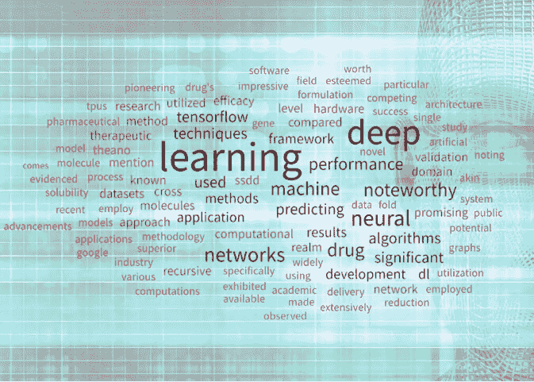

图 7.1 使用深度学习进行药物发现：词云。

### 7.2.2 用于药物开发的自然语言处理 (NLP) 方法论

自然语言处理 (NLP) 是一种复杂的人工智能技术，能够对人类生成的书面或口语信息进行解释和分析。通过采用句法和语义分析，自然语言处理使我们能够深入文本数据。在过去十年中，NLP 取得了显著进步，并无缝融入我们的日常生活。NLP 已成为现代生活中不可或缺的一部分，从筛选电子邮件和辅助语音控制的虚拟助手以促进语言翻译，实现数字电话对话，到支持文本分析 [7]。

蓬勃发展的自然语言处理 (NLP) 领域激发了对生物分子文本表示分析的浓厚兴趣。得益于 NLP 技术的前沿进步，这一令人兴奋的研究领域正在迅速发展。自然语言处理 (NLP) 领域是一个令人兴奋的研究领域，它利用多种多样的技术来筛选海量文本数据，旨在挖掘潜在的非结构化知识。这一进步有可能提升那些语言（特别是文本数据）对于实现理解至关重要的领域的就业机会。生物信息学和化学信息学中的语言研究可以分为三个不同的类别。首先，是自然语言，通常是英语，用于科学出版物、专利和网站。其次，是领域特定语言，它由一套源于实证数据并描述人类对主题事物（如蛋白质和物质）理解的结构化法规所建立。最后，是结构化形式，包括表格、本体学、知识图谱和数据库。自然语言处理 (NLP) 技术在生物医学领域（通常称为 BioNLP）的一个关键应用是分析和检索以自然语言发布的文本数据。在 BioNLP 领域，通常的做法是利用知识图谱或关系数据库，以有效存储和分发通过各种技术获得的数据 [108, 121]。

由于医疗数据的增长，像 NLP 这样的人工智能方法在医疗保健中变得越来越有用。80% 的医疗数据无序且未经分析，这阻碍了医疗保健。NLP 在医疗保健和基于模型的药物开发 (MIDD) 中具有巨大潜力，因为它使处理和综合自然语言数据变得更加容易。NLP 使用大规模自动化文本和语音分析取代了对自然语言数据的手动整理 [46]。MIDD 利用定量模型辅助药物开发决策。MIDD 通过使用自然语言处理 (NLP) 从结构化（例如，电子健康记录）和非结构化（例如，研究材料）数据中提取信息，最大限度地提高并加速药物开发 [112]。图 7.2 展示了 NLP 特征。其中包括基于模型的荟萃分析、疾病进展建模、患者-试验匹配、药物重新定位、生物标志物发现和鉴定。NLP 算法分析学术文献，以发现化学/药物实体、靶蛋白和新疾病相关途径之间的联系 [55, 77]。NLP 通过将药物重新用于新用途，节省了时间和金钱。自然语言处理从非结构化数据中自动化文本挖掘，提高了药品安全性。NLP 加速了临床试验受试者的选择 [7]。

深度学习在广泛的通用领域自然语言处理 (NLP) 任务上已超越机器学习 (ML)，包括语言建模、词性标注、命名实体识别、改写检测和情感分析。临床文档难以处理，因为医疗服务提供者使用缩写和非标准临床词汇，且文档结构和组织各不相同，患者数据保护要求严格的去标识化和匿名化。如果能够克服这些挑战，进一步的研究和创新将改善临床决策支持、患者队列身份验证、患者参与支持、人群健康管理、药物警戒、个体化医疗和临床文本摘要。就测试性能不佳而言，内存网络版本为有效查询响应以及其他需要复杂推理和推断的 NLP 任务提供了许多知识来源。视觉线索对于自然语言理解至关重要。计算机视觉和自然语言处理研究人员最近专注于视觉识别和图像字幕

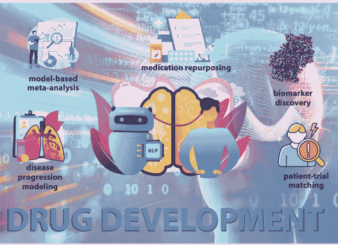

图 7.2 基于 NLP 的语言处理特征。


由于自主理解图像并用自然语言表达面临挑战，因此产生了这一代 [3, 35]。医疗程序用药损伤称为不良药物事件（ADEs）。它们会导致不良后果和长期住院，引发医疗问题。ADEs导致数百万人住院以及出院后不必要的后果。由于上市前随机对照试验（RCTs）中样本数量有限且纳入/排除标准严格，在药物上市前识别ADEs具有挑战性。自然语言处理（NLP）识别ADEs的速度比人工病历检查和自愿报告更快、更准确、更具成本效益。NLP算法搜索UMLS数据集中的疾病和药物，以基于共现指标进行ADE预测。NLP算法识别ADEs的速度比传统方法更快、更准确 [41]。

## 7.2.3 使用机器人进行处方的自动化管理与配发

药房自动化已带来可观的成本节约和产量提升。药房自动化系统的主要目标是在最大限度提高处方吞吐量的同时，尽量降低运营费用。通过药房自动化，药剂师和技术人员可以避免重复性手工任务，从而节省时间。这使他们能有更多时间提供直接的患者护理。此外，药剂师有更多时间进行患者咨询和交流，从而更深入地了解患者的情况，并更有效地满足其医疗需求。近年来，对自动化药房的需求激增，尤其是那些向各种零售药房分发药物的集中配药药房。鉴于这一不断增长的需求，对机器人处方配发系统（RPDS）的改进至关重要，以便使自动化药房每小时能处理更多处方 [39, 40]。

RPDS由一个主传输系统、一个气动瓶和盖输送系统以及包含在六边形机器人单元内的药物分配器组成。在药物配发设备中，计算机用于存储、计数和分发各种胶囊和片剂。基于订单类型和路由参数，总共65个容器通过输送系统被送往各个填充站。空瓶和盖子被转移到气动瓶和盖输送系统上，然后再输送到机器人处。由于处方量大，集中配药药房的RPDS通常由多个机器人单元组成，这使得将药物分配器分配到这些机器人单元的过程变得具有挑战性 [44]。

先进的光学字符识别（OCR）技术广泛应用于机器人应用中，例如处方自动验证。利用这一创新，机器可以准确读取和理解处方信息，确保个人的用药安全且有效。如果从验证流程中去除人为因素，用药错误可以显著减少。在用于验证处方时，OCR可以轻松连接到现有的电子健康记录（EHR）和药房数据库。这使机器能够将处方与患者的病历、过敏史和当前处方进行比较，以确保药物安全且适当。通过及时处理禁忌症和药物相互作用，可以降低不良反应或后果的可能性。自动处方验证通过减少药物错误来提高患者安全性和预后。用药错误可能导致严重并发症，包括治疗不足和不良副作用。通过让机器执行验证过程，患者有了额外的防护措施，可防止剂量错误、药物混淆和潦草字迹等错误 [95]。

## 7.2.4 药物发现中的特征选择与遗传算法

在信息学领域，选择分子描述符的过程称为“特征选择”，已有多种机器学习技术应用于此问题。所采用的方法主要有三类：过滤法、包装法和嵌入法 [54]。过滤法的缺点在于分别分析每个特征，而不考虑它与组内其他特征相比的表现如何。这一问题可能会影响随后的机器学习应用。一个重要问题是，机器学习算法在包装法和嵌入式技术中实现的时间复杂度较高。遗传算法（GA的一种）可用于选择特征。许多基于GA的特征选择方法需要结合一种分类技术，例如支持向量机（SVM）、人工神经网络（ANN）、k近邻（KNN）或决策树（DT），以便正确评估种群中的每个个体 [96]。无法描述特征对处理类的影响性质，且这些方法识别的所有特征均相同。此外，这些方法对每个单独的数据集都需要大量的训练时间 [50]。

荷兰在遗传算法方面的工作受到生物进化灵活性的启发。这些随机优化方法在化学计量学和药物开发中很有用，因为问题空间通常很大。遗传算法将个体表示为染色体。初始化第一代后，对每个个体的适应度进行客观功能评估。在下一阶段，通过亲代选择、交叉和变异生成后代。步骤2和3重复，直到目标函数收敛 [104]。

结构排列比较与目标受体结合的配体，以分析其在未知三维结构受体中作为药效团识别的空间和电学需求。GAMMA是一种GA-Newton优化器程序，提供可调的分子排列。遗传算法自动化小分子有机化合物合成。SMILES字符串计算一个评分函数，包括亲脂性、电学性质和形状相关因素 [24]。遗传算法通过复制相似性度量适应度函数模板来构建组合文库。虚拟组合文库通常超过实验合成 [84]。选定的构建元素优化生产。遗传算法减少三肽文库中的胺。它们的评分方式使其与三肽目标相似 [91, 104]。

数学家们已开发出多种策略来寻找最优排列。遗传算法（GAs）可以改变种群大小、幸存基因组数量、交叉、变异、亲子连接和排名函数参数。由于其通用性，遗传算法非常适合需要仔细选择参数的优化问题。GA性能取决于搜索空间结构。构建块理论认为，遗传算法可以通过合并“适合”的构建块或连续基因方案来探索基因组中的高阶适应度方案。遗传算法统计分析这些构建元素——原子、试剂、起始材料和反应。这使用有条理的构建元素阵列生成组合化合物文库。因此，预期会出现系统的SAR。优化可用更少的样本预测更多活性化合物 [114]。基于GA的特征选择策略使用SVM、ANN、KNN和DT算法，如图7.3所示。

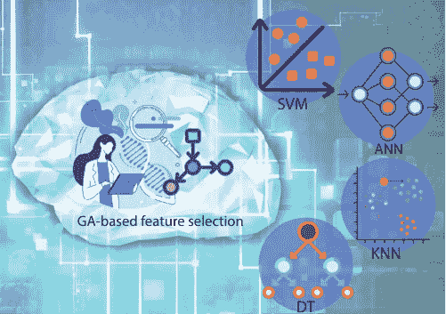

图 7.3 基于GA的特征选择方法中的算法：SVM、ANN、KNN和DT。

## 7.2.5 药物发现中的聚类算法

药物发现过程的核心在于努力创造专门针对致病蛋白的创新药物。然而，这是一个漫长而艰难的过程，涉及从靶点识别到FDA批准的多个阶段。不幸的是，制药行业面临着相当大的不确定性，临床试验失败率超过90% [1]。新药候选物与非预期蛋白相互作用，导致不良副作用的可能性，是一个重大障碍 [38, 2]。分子动力学（MD）常用于评估配体-蛋白相互作用的效力。然而，在与没有任何先前知识的新型蛋白靶点相互作用时，特定蛋白构象的选择变得模糊不清。尽管MD模拟对于概念验证和证明很有用，但它们无法揭示有助于优先选择目标蛋白构象的数据模式或特征。因此，需要先进的机器学习（ML）技术来识别精确结合、尽早减少临床前实验室试验并降低药物发现管道中的失败率。对于蛋白构象选择，基于聚类的ML技术，如RMSD聚类、PCCA+和MCL，被广泛应用。RMSD聚类通过使用最小二乘法计算RMSD值，基于用户定义的阈值创建蛋白构象簇。PCCA+采用模糊聚类方法，专注于聚合蛋白构象变化的特征值。MCL是一种基于图的聚类技术，考虑随机行走者在图中遵循特定路径的概率。这些ML技术提供了有价值的见解和工具，以改进蛋白构象的选择，从而使药物发现过程更加高效和有效 [26, 27]。


化学信息学是一门新兴学科，涵盖化学数据管理和分析的所有方面。将信息学技术应用于化学问题对于药物开发过程中先导化合物的鉴定和优化至关重要。化学信息学加速决策制定，提高药物发现过程的有效性，并降低相关成本。使用适当的描述符来表示化学数据集，随后应用数据挖掘技术筛选出最有前途的化学品。先导分子的鉴定涉及多个阶段，包括化合物选择、构建构效关系、生成化合物库以及预测药理特性。所述特性包括有效性、选择性、生物利用度、安全性和可扩展性。使用包括 K-means、二分 K-means 和 Ward 聚类在内的聚类技术，将相似化合物组织在一起并计算其活性。这些算法在药物开发应用中鉴定先导化合物的成功高度取决于应用的准确性要求和数据集的性质 [60]。图 7.4 突出了制药行业的各种聚类方法。

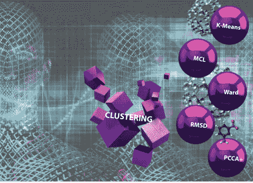

图 7.4 各种药物发现聚类方法。

## 7.3 用于药物预测与分析的 AI 技术

### 7.3.1 随机森林 (RF)

随机森林 (RF) 算法是一种在药物开发中经常采用的机器学习方法。它是一种监督学习技术，可用于分析和预测药物开发的多个方面，包括毒性、化学活性及与靶点的相互作用。

RF 可在药物开发过程中用于虚拟筛选等活动，虚拟筛选涉及扫描大型化学数据集以寻找潜在药物候选物。为揭示各种物质及其作用之间的模式和关联，RF 模型可训练使用广泛的化学描述符、分子特征和生物因素。随后可使用这些模型对应在更多实验中测试的化学品进行排名。

RF 技术构建一组决策树，每棵树都使用数据的不同随机子集进行训练。在预测阶段，RF 方法结合每棵树的预测以得出最终预测。通过使用集成技术，预测更加准确且鲁棒（参见图 7.5）。

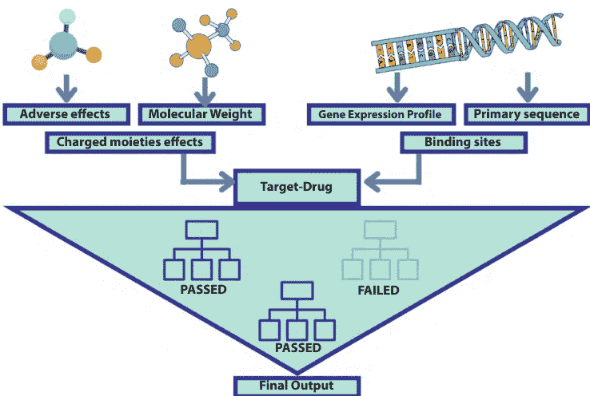

图 7.5 RF 运行机制。

RF 为药物发现提供诸多优势。与单棵决策树相比，它更能抵抗过拟合，并能处理具有众多特征的高维数据。RF 还能揭示特征的重要性，使研究人员能够指出影响化合物活性及其他性质的主要因素。

### 7.3.2 支持向量机 (SVM)

一种成熟的机器学习策略。药物预测及其他涉及新药识别的应用采用支持向量机 (SVM)。SVM 是一种监督学习技术，可用于预测化学活性、确定毒性和虚拟筛选等任务。

用于训练药物预测 SVM 模型的标记数据集中包含的药物信息示例包括分子描述符、化学特性和生物性状。SVM 的目标是在特征空间中找到理想的超平面以划分多个类别的化合物。该超平面增加类别之间的距离，从而实现回归或分类。

SVM 的主要优势在于其能够有效处理高维数据。由于化学和生物特性多种多样，它可以管理具有广泛属性的数据集，这在药物发现中很常见。SVM 特别以其抵抗过拟合的能力而闻名，因为它最大化类别之间的边距并专注于最重要的支持向量。

SVM 已用于预测药物-靶点相互作用、化合物针对特定靶点或生物测试的活性以及化学毒性。SVM 算法可以通过从标记数据中学习，对新的未标记化学品进行预测，并为未来的实验评估确定优先级。图 7.6 展示了 SVM 工作的图形表示。

核技巧是一种用于处理两类对象在给定特征空间 X 中无法线性可分的情况的技术。在这种情况下，会应用非线性映射 \(\Phi\) 将数据点投影到更高维空间 H。这个更高维空间可能允许存在一个线性超平面，能够有效地区分正例和负例。核技巧通过利用核函数来克服对显式映射的需求。这些核函数使得能够直接在原始特征空间中计算更高维空间的内积，从而避免与显式转换数据相关的计算成本。通过利用核技巧，即使在处理特征与类标签之间复杂的非线性关系时，也可以高效地执行分类或回归任务。

### 7.3.3 贝叶斯网络

贝叶斯网络用于药物预测，以表示变量之间的连接并基于概率推理生成预测。

贝叶斯规则方程中的变量 A 和 B 表示我们正在计算其概率的事件或命题。让我们在药物预测的上下文中解码 A 和 B：

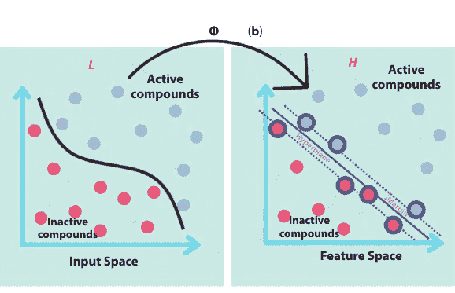

图 7.6 SVM 工作机制。

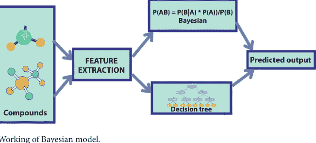

在药物预测中，通常可以使用给定某些证据或观察 B（例如实验数据、分子性状或先验知识）时事件 A（例如分子针对靶点具有活性或具有一定特性）的概率估计（参见图 7.7）。

因此，在贝叶斯规则方程中，“A”表示药物预测中感兴趣的事件或命题，“B”表示与该事件相关的证据或观察。基于观察到的证据 B，该方程允许我们基于 B 更新对事件 A 的概率估计。

可使用以下贝叶斯规则进行药物预测：

P(A|B) = (P(B|A) * P(A)) / P(B)

其中，贝叶斯规则允许我们基于 A 的先验概率、在 A 条件下 B 的似然以及 B 的证据概率，计算在事件 B 条件下事件 A 的后验概率。

联合概率可按以下方式估计：

P(A, B) = P(A) * P(B|A)

其中，事件 A 和 B 的联合概率是 A 的概率与在 A 条件下 B 的条件概率的乘积。

条件概率可按以下方式计算：

P(A|B) = P(A, B) / P(B)

其中，在事件 B 条件下事件 A 的条件概率是通过将 A 和 B 的联合概率除以 B 的概率来计算的。

### 7.3.4 ANN 和 CNN

药物剂型通常含有性质相似（但不一定相同）的杂质。选择 ANN 是因为其能够准确识别和评估不同特性，例如区分和测量密切相关的成分。由于色氨酸、酪氨酸和组氨酸在结构和光谱方面存在相似性，研究人员经常使用人工神经网络 (ANN) 来检测和校准它们。通过使用人工神经网络 (ANN)，只需进行一次分光光度测量即可检测非线性相关性并确定样品的对映体和手性组成 [5, 76, 78]。

使用人工神经网络 (ANN) 进行计算机辅助优化以确定色谱中的最佳梯度设计具有巨大的技术前景。ANN 可以估计保留时间以优化高效液相色谱。这是通过将分析物容量参数与流动相组成和 pH 相关联来实现的。ANN 可以在不考虑溶剂浓度或 pH 的情况下分离组分 [61, 65]。

因此，人工神经网络 (ANN) 可能会缩短技术优化时间和成本。ANN 可以帮助在复杂的混合数据集中发现关系 [64]。分离药物成分或其副产品使得评估生理液体中药物浓度比在制剂状态或溶剂中更困难。为了检测药物的结合位点并确定未来分析的理想储存条件，建议使用深度学习人工神经网络 (ANN)。ANN 最大化提取和估计方法以选择内标 [118]。

药理学和临床实践使药物-药物相互作用 (DDI) 检测变得棘手。患者和社会都能从早期临床试验 DDI 检测中受益。药物-药物相互作用 (DDI) 最好通过计算方法来识别。像 DDI、副作用、结构或这些指标的混合等相似性度量可以识别药物-药物相互作用 (DDI)。GNN 和 KGNN 可以预测药物-药物相互作用 (DDI)。网络有助于在未研究的疾病中识别、增强和测试药物。药物相互作用很重要，因为服用多种药物可能会加重副作用。ANN、图节点上的因子传播、邻接矩阵分解 (AMF) 和 AMFP 可以预测药物-药物相互作用 (DDI)。Drug Bank 数据可用于回溯训练节点。深度学习，尤其是 Bi-LSTM 和 CNN，已被用于 DDI 提取 [17, 86, 88]。

制药研究中有多种 ANN 应用。药物设计人员采用上述概念。涵盖分析、有效性和相互作用。监管机构对产品开发要求科学证据和方法论。这是吸引客户的关键。人工神经网络 (ANN) 在产品开发期间为制药行业节省了时间和资金。ANN 技术还提高了药物的疗效、质量和安全性，惠及患者。人工神经网络 (ANN) 满足监管、工业和患者的需求 [14, 53]。

CNN 的评估标准：使用多标签分类方法是精确预测药物-药物相互作用 (DDI) 发生情况的有效方式。为涵盖所有可能结果，预测被分为四组：真阳性 (TP)、假阳性 (FP)、真阴性 (TN) 和假阴性 (FN)。此外，结果评估通常包括使用精确率和召回率标准作为可靠的评估指标。在样本集中，准确率的定义是真阳性 (TP) 病例占已分类阳性样本总数的比例。召回率的定义是准确识别的阳性样本占数据集中阳性样本总数的比例。


精确率 = TP / (TP + FP)

召回率 = TP / (TP + FN)

像准确率、F1-分数、AUPR和AUC这样的指标被用于评估算法的性能。

该研究采用了包括准确率、F1-分数、微平均AUPR和微平均AUC在内的各种性能指标。在收集所有参与者的数据后，这些指标进行微平均处理 [49]。

CNN-DDI的功效通过余弦、Jaccard和高斯特征相似度来衡量。为评估CNN-DDI性能，采用了不同的相似度方法。相似度度量揭示了行为倾向。研究人员使用了Jaccard相似度，因为CNN-DDI不受其他两种度量的影响。该研究测试了采用不同特征类型的CNN-DDI模型，以显示特定药物类别和组合的优越性能。在CNN-DDI模型中，药物类别表现最佳，AUPR得分为0.9139。药物靶点将得分降低到0.8470。药物类别在所有五个指标中排名第一。因此，将药物类别添加到CNN-DDI模型中可以取得良好结果。CNN-DDI不应只使用一个特征，而可能从众多特征中受益。四个标准得到了最高的AUPR得分0.9251。随着每个特征的加入，CNN-DDI的效率都会提高 [28, 71]。

根据研究，CNN-DDI可以预测DDI事件。选择组合信息并创建卷积神经网络预测的模块是最常用的方法。四个药理特征降低了CNN输入维度。药物-药物相互作用（DDI）使用深度卷积神经网络（CNN）模型进行预测。预测模块使用选择模块的输入向量。由于特征噪声及其优势，CNN被添加到预测模块中。卷积神经网络（CNN）在图像分类、目标识别和图像分割方面表现出色，因此很受欢迎。生物信息学研究正在引入深度学习。与深度神经网络相比，CNN具有优势。

卷积层可以通过稀疏连接和共享参数来减少参数数量。卷积层能够从全局和局部特征中提取信息。关于药物-药物相互作用（DDI）预测任务。药物分类与药物特性（包括其整体特性及其组合方式）之间存在强相关性。为提高特征学习能力。当前研究将CNN作为监督模型，旨在从集成特征中提取信息以预测DDI。本研究采用使用卷积神经网络（CNN）的预测模型。该模型包含五个卷积层、两个全连接层和一个softmax层。卷积层主要负责从输入向量中提取子空间特征。所分析模型的卷积层在核大小上表现出一致性。每层使用的核大小为(3, 1)。此外，需要注意的是，随着从一层进展到下一层，每层使用的滤波器数量会逐渐增加。

作为一种新的半监督方法，CNN-DDI算法采用CNN结构来预测药物-药物相互作用。特征向量提取过程涉及从药物类别、靶点、通路和酶中识别特征交互。引入了一种新的卷积神经网络模型，该模型通过利用特征表示来预测药物-药物相互作用（DDI）事件。预测器由基于CNN的SoftMax层、两个全连接层和五个卷积层组成 [87, 101, 115]。

## 7.3.5 个体化治疗方案的发展

组织、影像和基因分析已改善风险评估、预后和治疗。计算技术可以评估和分析可能影响治疗策略的患者变化。计算机辅助方案提供高质量的诊断影像。这些改进中的几个似乎使用中等效用因子来改进多变量预测模型。大数据集推动了医学机器学习的发展。个体化治疗方案可以提高预期寿命，因为患者对治疗和药物的反应各不相同。以患者为中心的护理需要在选择治疗策略时识别最重要的考虑因素。在这种情况下，人工智能——特别是机器学习——可能会很有用。机器学习有助于了解影响医学疗法的患者特征。该方法可以帮助预测治疗干预的成功率。医生现在可以使用大量的患者健康信息、基因数据、临床病史和敏感性数据集，进行更全面的患者观察。技术加速了医学进步。AI正在帮助医生发现患者数据中的趋势、异常和其他反常情况。人工智能可以检查数百万条临床记录，以确定一种治疗方法如何影响基因 [22, 92]。

在临床决策支持系统的背景下，人工智能（AI）已被证明在减少诊断错误、验证临床判断以及为临床医生和研究人员便捷提取数据方面是有效的 [22]。计算领域（包括自然语言处理（NLP）、模式识别与辨识以及无偏预测）的进步预计将增强人工智能（AI）的能力。AI系统能够摄入和分析大量标记或未标记的数据，进而辨别当前问题及其相应的解决方案。全面理解对象之间的相互关联对于准确的模式识别和辨识至关重要 [89]。

在开发乳腺癌预测模型的背景下，可以利用大量乳腺X线摄影片来促进算法的学习过程。算法方法用于确定活检结果的潜在恶性或良性，并区分正常和异常的筛查结果。因此，该方法可以用于以与放射科医生相当的准确性评估乳腺癌。该算法利用机器学习和深度学习技术，在从乳腺癌患者及其相应临床健康记录中获得的乳腺X线摄影数据集上进行训练 [30, 59]，有望提高结果的精确度。

AI影响临床试验治疗方案。新型癌症药物的临床试验通常从“0期”开始，到“IV期”结束。在[19]中，马萨诸塞州东部的医疗服务提供者Atrius Health利用其250万名患者20年的数据构建了该应用程序。AI对数据进行了评估。研究了高血压、2型糖尿病和高脂血症（高胆固醇）。接下来，我们将根据每种疾病的临床治疗指南，制定一份药物清单以及在为患者选择最佳处方时需要考虑的因素。Atrius EHR患者信息存储库为下一步操作提供决策点。对未得到控制的疾病患者进行了就诊。在后续会诊中，收集药物方案、检查结果、合并症和疾病管理状态的数据。接下来，疾病特异性机器学习算法学习区分有价值的数据片段。相似的人口统计学特征和疾病状况构成了精准队列。队列允许同一机构的临床医生比较具有可比临床特征个体的护理结果。系统可以通过将患者与具有相似临床特征和情况的患者队列进行比较，确定该组织的最佳疾病管理策略。电子数据和临床治疗建议表明，某些治疗计划技术被遗漏了 [45, 68, 99]。

## 7.4 AI用于革新药物开发

### 7.4.1 个体化医疗、药物新用途研究和药物安全性评价

药物新用途研究（也称为药物重定位）是一种寻找罕见疾病解决方案的有效策略，尤其是在资金限制可能阻碍新药研发时。许多疾病已使用个体化治疗得到治疗。赫赛汀，也称为曲妥珠单抗，是一种用于治疗乳腺癌的药物。其作用方式是针对特定类型的乳腺肿瘤，这类肿瘤过度表达HER-2蛋白，约占病例的30%。使用格列卫（甲磺酸伊马替尼）已使慢性髓系白血病患者的5年生存率显著提高，从低至5%提升到高达95%。泽乐卫，也称为维莫非尼，是一种用于治疗黑色素瘤的药物。这种疾病的晚期预后不佳，约有60%的个体携带V600E突变。多种个体化治疗方案通过治疗-生物标志物组合显示出前景，包括用于结肠癌的Erbitux-EGFR和用于肺癌的Xalkori-ALK [36, 119]。

从众多选项中选择一种已获批的物质可能很困难，因为这可能涉及大量研究来缩小选择范围。现代技术进步的特征是人工智能（AI）的突出应用。快速提供新的潜在药物候选物备受关注，因为这能识别出它们并使其可用于临床试验。一旦获批，这些药物就可以纳入医疗系统。使用人工智能（AI）可以加速寻找现有药物新用途以治疗人类疾病（包括新出现的疾病，如COVID-19）的过程。生物医学领域现在可以获取大量“大数据”，包括生物学、临床以及开放数据（如科学文章和数据存储库）。这就催生了对能够高效利用这些广泛数据集的新AI算法的需求。目前，药物科学家、计算机科学家、统计学家和临床医生正在共同努力，利用基于AI的技术加速新疗法的发现和开发。大数据与人工智能（AI）的结合可以提高药物新用途研究及基于现实世界证据对COVID-19和阿尔茨海默病等复杂人类疾病进行医学决策的有效性和效率。AI工具的进展受到各种障碍的阻碍，包括需要保证模型安全性和互操作性，以及


解决制药公司保存的数据多样性及其质量低下的问题。未来用于药物重新定位的人工智能模型产生的结果预计将具有高精度。这些模型将能够整合不同类型和来源的信息，并可在各种部署环境下互操作。此外，这些模型将能够根据其内部机制被理解，并能够抵御干扰和恶意攻击 [100]。

计算方法的最新进展显著改善了药物重新定位的系统性过程。基于计算机模拟的药物重新定位过程通常涉及利用多种数据来源，包括电子健康记录、全基因组关联研究、基因表达反应特征、通路映射、化学结构、靶点结合测定以及其他表型分析数据。其目的是将现有药物用于新的治疗用途。关于计算技术的主题已进行了大量广泛的研究。研究涵盖了多种机器学习和人工智能技术，例如网络传播、矩阵分解和完成以及现代深度学习模型 [116]。

## 7.4.1.1 预测分析与精准医疗

精准医疗是指一种医疗方法，即根据患者的独特情况、行为和基因构成量身定制治疗方案。这种特定流程的有效性已被证明可加速药物审批流程并提高临床试验的成功率。利用人工智能（AI）从海量医疗数据中提取重要信息以用于诊断和治疗，是一项备受期待的进步。上述论述在精准医疗领域至关重要，精准医疗是一种利用广泛医疗信息（例如基因组数据）为每位患者定制治疗的医疗策略。传统的药物研发方法以其高昂的费用、漫长的周期和显著的不确定性而闻名。人工智能的进步有助于开发基于技术的解决方案。计算机模拟用于评估药物设计、重新定位和药理组合 [10, 109]。药物开发管线中的药物设计和临床试验阶段失败率很高，因为大多数药物未达到所需的疗效标准或具有意外的副作用。生物标志物能够提供关于生物学基本原理和疾病进展的新见解。提供的细节可作为开发更安全、更高效的新型药物疗法的基础。例如，药物可以针对导致疾病的特定基因变异、异常蛋白质或相关通路 [103]。

实时数字分身可以与实体对象进行交互。各行业使用数字副本。数字孪生可以改变医疗保健和公共卫生。数据分析和建模改善了医学研究中的诊断、药理效果和治疗。工业和工程公司越来越多地采用数字孪生。这种独特的方法推动了医学、患者护理和公共卫生的发展。美国食品药品监督管理局（FDA）在2013年披露，许多抑郁症和癌症患者使用了质量不合格的药物，报告病例占38%–75%。随机对照试验表明，类似药物对不同人群的影响不同。个性化医疗根据每位患者的遗传、生活方式和环境调整治疗和预防方案。数字孪生模拟具有独特生理和生物力学特性的个体，以提供个性化治疗。采用有机方法。由于人体的复杂性和相互关联性，完全功能的个人数字克隆可能不可能实现。细胞受体和亚细胞器可能改变治疗效果。数字人类对照体是利用健康和患病人群的分子、基因及其他数据创建的 [43, 56, 110]。

多发性硬化症是一种复杂疾病，会导致年轻人中大多数神经系统残疾。数字孪生带来了希望。该疾病的复杂性和发展使得数据分析充满希望。数字兄弟可以帮助开发基因组患者原型以测试治疗方案。遗传、环境因素、疾病管理成本和药物副作用可能有助于患者预测疾病进展和治疗效果。这种技术考虑了所有重要的患者健康因素 [79, 98]。生物制药公司正在研究用于药物开发的数字孪生。Subramanian 使用常微分方程对肝脏进行建模，涉及功能、疾病和药物。健康肝脏的操作被正确模拟。它模拟疾病发展和治疗。肝脏孪生模型和实验可以解释药物引起的肝功能障碍 [33]。

人工智能技术正在被研究作为癌症治疗的核心技术。临床放射学在医疗设备中使用人工智能。精准医疗需要准确预测抗癌治疗效果。为了评估海量组学数据，研究人员使用了机器学习和深度学习 [93]。共检查了23,427个肿瘤的CAA特征 [18]。目标是发现肿瘤进展特征，例如CAA顺序以及可能指示组织特异性转移的CAA。在他们的研究中，采用了深度神经网络模型和机器学习技术，发现了31个CAA，这些CAA显著影响了17种癌症类型的细胞系对56种化疗方案的敏感性。研究人员发现了1,024种潜在的致命药物相互作用。该研究发现，CAA在药物反应预测中优于突变和局部缺失/扩增。癌症相关成纤维细胞（CAAs）可以预测癌症预后、肿瘤发展、转移和治疗反应，从而彻底改变精准肿瘤学。在[42]中，胰腺导管癌患者接受了MK-0752和吉西他滨的联合治疗。该研究是多中心、非随机贝叶斯自适应研究。联合治疗是安全的，并确定了II期临床试验剂量。研究人员在[85]中提出了一种用于I期临床试验剂量的贝叶斯技术。该方法可以使用毒性概率的后验分布来识别MTD。在癌症药物开发的I期或II期临床试验后，通常会进行概念验证（PoC）研究。一小组患者将被研究以评估临床疗效。

预测算法帮助癌症疫苗开发者找到数百到数千个新抗原表位。因此，必须为患者或目标人群的MHC等位基因选择一组免疫原性最高的新抗原表位的受限集合。多样化的选项应涵盖肿瘤或病原体的多样性。离散优化问题最初是使用定制评分技术解决的，这些技术考虑了包括新抗原表位抗原覆盖在内的重要因素 [106, 120]。

小分子设计受益于人工智能。该技术能够获取调节这些物质操作特征的隐藏表征，并利用嵌入空间的几何特性，已被证明非常有益。计算机模拟识别和拒绝劣质药物候选物可实现高通量药物测试的高效文库构建。这可能改善未来的临床试验。需要分子动力学来改进创建的分子，因为大多数生成模型是端到端训练的，未考虑物理合理性。类似于蛋白质生成模型，物理信息网络可能增强用于*从头*设计的深度学习。这些网络将隐空间限制为理化结果 [103]。

生物信息学和化学信息学广泛使用人工智能。它们有助于发现治疗化学品。这些领域研究传染性因子的行为以及药代动力学、药效学和毒性，以构建多尺度模型。以靶点为中心的策略因制药研发中的过度周转和低生产力而受到指责。如所述，全局模型是必不可少的。网络系统生物学广泛使用人工智能。了解遗传和表观遗传变量如何影响药物反应至关重要 [6, 74]。

## 7.4.1.2 虚拟筛选

制药和生物医学领域高度重视新药发现过程。药物发现的典型方法始于识别疾病靶点，然后进行高通量筛选（HTS）实验以评估化合物的生物活性。这是一种广泛使用的方法。根据来源[111, 23]，高通量筛选（HTS）实验具有成本效益且高效，因为它们利用了广泛的蛋白质资源、大量合成化合物和先进的实验室生物活性检测技术。虚拟筛选（VS）技术用于加速药物开发过程。虚拟筛选（VS）的主要目的是根据化合物与靶点结合的能力对其进行排名 [12]。

研究人员通常使用基于RMSD的聚类作为一种技术，在进行筛选实验之前将数据简化为更易管理且信息更丰富的子集。预计配体将与多个能量稳定且功能完好的受体簇相互作用 [16]。

程正教授的研究将受体为基础的药效团建模扩展到虚拟筛选。这通过整合基于RMSD的聚类信息实现。Amaro等人[4]描述了这项调查。程正教授对两个40-纳秒禽流感N1神经氨酸酶轨迹的快照进行了10-皮秒间隔的基于RMSD的聚类。研究了去配体型和奥司他韦复合型 [51]。这种方法确定了最佳的分子动力学模拟布局。模拟使用了N1四聚体。单体蛋白质链进行了聚类 [13]，并用40-纳秒间隔模拟了四聚体。这使单体采样量增加了四倍至160 ns。模拟产生了16,000个结构用于研究。这种计算机辅助药物设计（CADD）研究使用的分子动力学（MD）轨迹比其他研究更长。去配体型和全配体型单体MD模拟均持续了160 ns。四体单体四聚体可以采用多副本分子动力学（MD）技术。与单个长轨迹相比，该策略提高了采样效率 [37]。因此，受体构象空间得到了彻底研究。一位研究人员使用根均方差（RMSD）对结合位点残基进行聚类。这些簇包含10个去配体型和5个全配体型结构。该研究使用AutoDock 4.0将去配体型和全配体型集合中前三个簇的核心成员结构与NCIDS1进行比较 [20]。经过八次主要筛选，全配体型分子动力学轨迹的整个代表性集合中的对接评分加权平均值确定了配体的排名。总共，25种测试物质中有10种的Ki值低于500 M。仅分子动力学结构就揭示了七种化合物。模拟改变了这些结构的组成。模拟预测八种化学品将部分结合到新的结合


位点。重新排列有助于发现可能被遗漏的结果 [107]。根据文献，人工神经网络 (ANNs) 可以对虚拟筛选进行分类。在基于定量构效关系 (QSAR) 的人工神经网络 (ANN) 被发现为更好的分类器之前，曾使用过随机森林。配体基础虚拟筛选广泛采用了人工神经网络。QSAR 提供每个化合物的输入数据。本研究采用了活性和非活性药物训练数据 [8]。人工神经网络被用于寻找诱导衰老的化合物。筛选采用了激动剂和分子描述数据。对两百万化合物库的筛选得出了 247 个与模型匹配的化合物。该化学物质在体外进行了开发测试 [52]。靶点基础虚拟筛选 (TBVS) 和结构基础虚拟筛选 (SBVS) 是用于估计各种配体与分子靶点之间结合亲和力及可能相互作用的计算方法。配体被排列以最大化靶点亲和力。结构基础虚拟筛选 (SBVS) 需要三维蛋白质结构来理解化学相互作用 [63]。

分子对接是结构基础虚拟筛选 (SBVS) 的首选方法，因为其具有高精度、高效率和计算成本效益。数据库中化合物的识别是通过基于各自对受体位点亲和力的分类过程进行的 [90]。本研究采用评分函数 (SF) 根据分子和化合物对受体位点的亲和力进行排名，从而展示出一种有前景的方法。上述程序被用于确认受体位点与预期药物剂之间的相关性。如前所述 [29, 32]，评分函数在对接程序中起着不可或缺的作用。本研究采用搜索算法来识别结合位点构象和配体取向。在成功实施对接技术后，获得配体的最优构象，并随后以现实的方式沉积在结合位点。搜索算法采用各种技术，包括验证相关分子和原子的化学和几何特性 [81]。

### 7.4.1.3 从头设计

从头药物设计使用计算机从原子构建块中创建新的化学结构。药物开发使用结构基础和配体基础设计。这些方法利用生物靶点的活性位点和已知结合物。机器学习及其他 AI 方法增强了药物发现。深度强化学习将基于神经网络的方法与强化学习范式相结合。循环神经网络、卷积神经网络、生成对抗网络和自动编码器使从头药物创建成为可能。人工智能 (AI) 使用机器来复制人类认知技能，如学习和解决问题。机器学习 (ML) 中的算法和统计模型使机器能够从数据中学习，并在不被编程的情况下进行预测或判断。机器学习使用监督学习、无监督学习和强化学习来帮助机器从数据中学习并改进。机器学习旨在创造能够执行困难任务并解决现实世界挑战的智能机器。使用 ML 预测药物发现结果。深度学习在机器学习 (ML) 中开发和实现多层神经网络。深度学习旨在使这些网络在计算上可行，以便能够更准确、更高效地处理和分析大型和复杂的数据集。由于数据和计算能力的提升，循环神经网络 (RNNs)、卷积神经网络 (CNNs)、生成对抗网络 (GANs) 和自动编码器 (AEs) 已经涌现 [34, 66]。

强化学习 (RL) 是机器学习的一个子领域，用于奖励良好行为并惩罚不良行为。DRL 最近被用于药物开发。DRL 将强化学习架构与人工神经网络相结合。这些方法在语音识别、形式语言理解、视觉表示和音乐创作方面已取得成功，因此可能会改变药物发现。深度学习 (DL) 是人工智能 (AI) 的一个关键子领域，因为它可以在图像识别和自然语言处理方面模仿人类表现。深度学习 (DL) 已在生物学和医疗保健领域用于开发新的分析方法。药物开发使用深度学习 (DL) 来构建定量构效关系 (QSAR) 模型，以可靠地预测分子属性，如亲和力和毒性。基于化学结构导出的分子描述符训练的全连接神经网络正在被用于药物发现中的深度学习。深度强化学习 (DRL) 将强化学习和人工神经网络相结合，有望发现新药物。从头药物设计的 DRL 方法使用生成器和基于强化学习的代理。大多数此类方法采用这种策略 [105]。

深度神经网络使用模型的多层。合成网络可能在其输入层中使用 SMILES 或分子图。SMILES 使用字符对分子进行编码以描述原子连接。为了训练网络，输入代表现有数据的标记，例如生物靶点的生物活性化学库。知识和决策循环构建输出结构。模型在每个级别选择最佳的词汇标记。从头药物设计代理（一种强化框架虚拟机器人）操纵分子以改善其属性。生成器，即人工神经网络，控制代理行为。使用 AI 进行从头设计的示例包括各种深度强化学习算法：

循环神经网络 (RNNs) 具有循环连接。循环神经网络 (RNNs) 使用神经元间连接来建模当前状态并检索序列先前阶段的输入。循环神经网络 (RNNs) 可以使用简化分子输入行条目系统 (SMILES) 记法分析文学作品或化学结构。循环神经网络 (RNNs) 以线性方式处理动作。化学原理生成从头化合物。RNNs 可以识别简化分子输入行条目系统 (SMILES) 字符串模式。

使用循环神经网络和强化学习进行从头药物设计已取得了有前景的结果。该方法使用训练有素的循环神经网络 (RNN) 从类似 ChEMBL 的数据库中寻找生物活性物质。在循环神经网络 (RNN) 训练中，使用最大似然估计基于先前观察到的标记来预测目标序列中的下一个标记。循环神经网络 (RNN) 可以从类似 SMILES 的目标序列中生成与其条件概率分布匹配的独特序列。接下来，将状态的即将采取的动作与其概率相关联的策略创建一个从头药物设计代理。代理的策略现在通过评估状态中一系列动作及其获得的激励来优化预期奖励。强化学习有两种策略设置方法。基于策略的强化学习在内存中生成和存储决策策略表示。基于值的强化学习在没有策略的情况下维护值函数。从头药物开发涉及分步开发新分子实体的 SMILES 字符串 [11]。

改进的 episodic likelihood 已训练算法来合成不含硫的分子。其他研究采用深度强化学习和循环神经网络来识别新药物。用于结构演化的深度强化学习 (ReLeaSE) 已被用于创建具有合适理化和生物学特性的化学库。使用高效的堆栈增强循环神经网络来推导算法模式。在此实现中，SMILES 字符串是句子。堆栈-RNN 模型揭示了从字母序列生成有效 SMILES 字符串的模式。SMILES 字符串整合了该方法的生成和预测方面。使用以行为者为中心的模型，开发了一种使用 RNN 和 RL 的基于片段的深度强化学习 (DRL) 策略。目标是自主创建具有改进特性的分子。这项工作旨在创建一个模型，通过模仿与特定靶点相互作用的生物活性化学品的结构方面来优化新制造的分子。与对化学空间进行彻底调查相比，使用铅分子的基于片段的优化来快速发现潜在化合物。

RNNs 创建了一种多目标进化从头药物设计技术。迁移学习 (TL) 用最有效的化学品重新训练了网络。作为迁移学习的一部分，模型首先在源任务上训练，然后在相应的目标任务上重新训练。迁移学习似乎提高了特定于任务的模型准确性。深度学习被用于训练 LSTM 循环神经网络 (RNN) 以创建新的药物分子。使用基于 LSTM 的 RNN 技术训练了一个模型，以创建大量且准确的 SMILES 字符串库。使用迁移学习 (TL) 构建了与某些生物靶点具有生物活性的类似药物的化合物，以优化模型。当数据稀缺时，这种方法在早期药物研究中有效。与基于片段的药物开发典型情况一样，生成模型被用于改进从活性片段导出的一组铅化合物 [21]。

该研究将分子描述符集成到条件循环神经网络 (RNN) 构建中。不使用编码器，该技术使用来自分子结构或 QSAR 的属性来对生成过程进行条件化。使用条件种子，训练 RNN 在化学领域专注于生物靶点的生物活性化合物。使用新颖的负对数似然图来评估概率序列生成器的集中度。使用在大型化学化合物数据库上训练的卷积神经网络 (CNN) 来构建一种新药物。这种数据驱动策略通过从头药物设计生成了新分子。该研究发现，SMILES 化学序列教会了循环神经网络 (RNN)。RNN 学习了语法规则，以创建合法的 SMILES 以及与训练所用分子具有相似属性的分子。我们使用了前馈循环神经网络 (RNN) 模型和三种双向技术——新颖性、化学生物相关性和骨架多样性——来评估使用 SMILES 字符串合成方法由计算机合成的化合物。

CNNs 使用许多层的变换、卷积和池化过程，自动从输入数据中提取重要特征。卷积神经网络 (CNNs) 在图像处理方面已被证明是成功的，因为它们在训练和测试期间都使用紧凑窗口的特征检测器来处理输入特征向量。这种方法使卷积神经网络 (CNN) 能够学习输入属性，而不考虑其特征向量的位置。卷积神经网络和二维化学


结构图使DeepScaffold平台成为一种基于支架的*de novo*药物开发的强大工具。当前技术可使用Bemis–Murcko支架、环状骨架和具有特定侧链属性标准的支架来创建多样化的分子结构。该技术允许通用化学原理将新原子和键纳入现有支架中。分子对接分析了DeepScaffold输出化合物对生物靶点的亲和力。该方法在药物发现和开发方面显得很有前景。DeepGraphMolGen使用图卷积和循环神经网络生成理想分子。该方法使用2D图而非SMILES字符串来预测属性并生成分子。基于图理论的药物研发已被发明。一种简单的解码方法和资源高效的图卷积设计增强了用于化学合成的图生成器[113]。

生成对抗网络（GANs）训练两个神经网络。一个网络生成图像，而另一个网络检测伪造品。这些网络同时进行训练以提高GAN性能。生成器记录真实事件的频率分布以生成新的数据实例。作为二进制分类器的鉴别器区分制造数据和合法数据。GANs已被用于文本到图像合成、超分辨率和图像翻译。一种基于GANs和强化学习的深度神经网络（DNN）架构——增强对抗神经计算机（RANC）——生成了新的小分子有机分子。其显式存储库赋予RANC生成器卓越的生成能力。此功能解决了神经网络对抗性问题。研究发现，与训练数据集相比，RANC可以构建具有主要化学描述符和SMILES字符串长度一致分布的结构。基于生成对抗网络（GAN）的对抗阈值神经计算机（ATNC）使用强化学习（RL）来开发药物。对抗阈值从包含鉴别器和客观奖励因素的环境中过滤代理，并由可微分神经计算机生成。分子构建最近采用了内部多样性、聚类（IDC）作为客观奖励函数。此方法增加分子多样性。最近创建的深度学习系统LatentGAN使用自动编码器和GAN生成新的药用分子。此技术在随机和靶向偏向的类药化合物创建场景中均表现良好。此技术生成独特的分子，不同于基于RNN的模型。两种策略可能互补[75]。

## 7.5 挑战与解决方案

目前，药物化学领域主要采用经验方法和严谨的实验。鉴定具有所需药用特性的化合物需要使用各种方法测试大量物质。然而，所采用的技术通常具有费力、昂贵和不精确的特点。测试化合物质量的局限性或缺乏对药物*体内*功能的准确预测可能会带来重大挑战。实施基于AI的算法，包括监督和无监督学习技术、强化、进化和基于规则的算法，为解决这些问题提供了一条有希望的途径。通常，这些策略的重点围绕着对大量可能在多种环境中相关的数据进行检查。与常规方法相比，利用这些技术进行预测（尤其是关于潜在新型治疗分子的有效性和安全性）更为有利。基于AI的算法有潜力识别新的药物开发靶点，例如与疾病相关的蛋白质或遗传通路。本研究表明，利用此方法有可能超越常规技术拓宽药物发现的视野，从而为创造新型和改进型治疗药物铺平道路。历史上，尽管制药研究领域采用的常规方法依赖于试错实验，并且在准确预测潜在新型生物活性化合物的作用方面能力有限，但已显示出一定的疗效。在药物发现程序中利用基于AI的方法有望提高效率和准确性，最终导致创造出更有效的药物[15, 73]。

尽管AI在药物发现过程中的应用具有潜在优势，但仍面临各种限制和挑战。缺乏足够的信息是一个重大挑战。基于AI的技术通常需要大量数据才能进行准确训练。数据不足或数据质量低下，或两者兼而有之，可能会影响结果的质量和一致性。基于AI的方法的伦理影响，尤其是在公正性和偏见方面，已被确认为一个重大障碍。本主题的进一步阐述将在下文提供。如果机器学习系统在有偏见或不具代表性的数据上进行训练，可能会导致不准确或不公平的预测。在创新药物化合物开发中利用人工智能（AI）引发了重大的伦理和法律问题。存在多种方法和途径可以帮助克服人工智能在化学基础医学领域所面临的挑战。数据增强已被提出为解决这一问题的潜在方案。该技术涉及使用合成数据增强真实数据。利用更大且更多样化的训练数据集可以增强机器学习算法产生的结果的质量和一致性。可解释人工智能（XAI）技术正在被探索，作为增强机器学习（ML）预测透明度和可理解性的潜在替代方案。XAI的目标是为ML预测背后的推理提供解释。理解预测背后的基本方法和假设，对于解决与基于AI的技术相关的偏见和公平性问题至关重要。传统实验技术的利用仍然相关，因为当前的AI驱动技术无法替代人类研究人员的专业知识和判断力。需要注意的是，人工智能（AI）的预测能力有限，因为它只能基于其训练过的数据进行预测。因此，有必要由人类专家验证和解释这些预测。在药物开发领域，AI有潜力通过与传统实验方法相结合来改进该过程。人工智能（AI）与人类专业知识的结合有潜力提高药物发现和开发的效率和速度。这种方法将AI的预测能力与人类研究人员的知识和经验相结合[9]。

## 7.6 结论与未来展望

AI和ML有潜力彻底改变药物开发流程并加速医学进步的步伐。本书讨论了几种展示AI在该领域潜力的方法和程序。深度学习、自然语言处理、特征选择、遗传算法和聚类算法已帮助药物开发过程[31]。这些策略可能通过发现新化合物、预测药理特性和增强治疗方案来帮助开发有效的药物。个性化医疗、药物新用途和安全性测试是人工智能正在改变制药行业的几个示例。预测分析和精准医学使医生能够为每位患者量身定制治疗方案，从而改善结果并减少不良反应。*De novo*设计使科学家能够合成具有所需特性的独特分子，从而为开发革命性新药物铺平道路。在随机森林、支持向量机、贝叶斯网络、人工神经网络和卷积神经网络的协助下，可以预测和分析药物相关特性。这些策略有助于制定治疗方案和发现新药物。制药行业使用AI和ML有很大的扩展空间。这些问题包括数据隐私和偏见缺失、高质量数据以及易于解释的复杂模型。AI在药物开发中的潜在应用引人入胜。数据、技术以及企业与学术机构之间的合作将推动创新。AI有望加速新药物的发现、改善结果质量并降低医疗成本，前景令人兴奋。总之，本章提供了关于AI和机器学习如何为药物开发的革命做出贡献的重要见解。通过最大限度地发挥这些技术的潜力并克服现有障碍，可以开发出更有效且个性化的疗法，从而对全球患者产生积极影响。

### 未来展望

人工智能和机器学习在药物发现领域取得的惊人进步为彻底改变医学进步提供了巨大的机遇。随着科学家继续研究和应用这些技术，许多有希望的方向和进展可能会出现。多个数据集合并：在不久的将来，包括基因组学、蛋白质组学、代谢组学和电子健康记录（EHRs）在内的多个数据源必将汇聚。通过整合和分析这些多维数据以全面了解疾病原因，研究人员将能够设计出更具针对性和更有效的药物。联合多组学策略：采用多组学数据整合将能深入了解疾病通路和患者特征。多组学数据包括基因组学、转录组学、表观基因组学和代谢组学。基于人工智能的算法对于阐明复杂关系和制定针对特定患者的治疗方案至关重要[48]。尖端的CNN和RNN是深度学习架构的两个示例，它们正在复杂化学结构和大量数据的研究中开启一个新时代。


生物数据。这些复杂结构将能够改进药物-靶点相互作用预测、新药物候选物识别以及药物设计优化。未来，理解AI模型背后的推理将成为首要任务。我们将尝试开发将复杂决策过程分解为可管理片段的AI算法。监管审批流程将得到简化，对AI驱动药物开发的信心将增强。自动化和机器人程序将在制药行业的未来发挥重要作用。高通量筛选方法、用于化学合成与分析的机器人系统以及自动化实验室平台将加快实验并加速开发 [83]。

AI驱动的药物发现的进步将在很大程度上依赖于数据的公开共享，以及学术机构、私人公司和政府组织的合作。获取高质量信息、制定标准化方法以及推广协作平台，都是增强创造力、加快研究结果转化为实际治疗应用的方式。现有的法律框架和道德约束：随着AI的发展，同样重要的是要同等关注制定强有力的法律框架和伦理准则。保护患者隐私、确保数据安全，以及支持在药物研究中正确使用AI，对于赢得公众信任并实现这些开创性发现的益处至关重要 [72, 80, 82]。

## 参考文献

- 1. (无日期). 从 https://www.uclahealth.org/clinical-trials 检索。
- 2. Akondi, V.S., Menon, V., Baudry, J., Whittle, J., 用于药物发现应用的基于K-means聚类的新欠采样与特征选择方法, in: 2019 IEEE International Conference on Bioinformatics and Biomedicine (BIBM), IEEE, pp. 2771–2778, 2019, November.
- 3. Alsaffar, M., Yellowlees, P., Odor, A., Hogarth, M., 开源电子健康记录项目现状：一项软件人类学研究. JMIR Med. Inf., 5, 1, 5783, 2017.
- 4. Amaro, R.E., Minh, D.D., Cheng, L.S., Lindstrom, W.M., Olson, A.J., Lin, J.H., McCammon, J.A., 禽流感N1中显著的环状链灵活性及其对抗病毒药物设计的启示. J. Am. Chem. Soc., 129, 25, 7764–7765, 2007.
- 5. Azuaje, F., 精准肿瘤学的人工智能：超越患者分层. NPJ Precision Oncol. 3, 1–5, 2019.
- 6. Bergdaliyev, N. and Aljofan, M., 药物发现与开发概述. Future Med. Chem., 12, 10, 939–947, 2020.
- 7. Bhatnagar, R., Sardar, S., Beheshti, M., Podichetty, J.T., 自然语言处理如何帮助模型知情药物开发？: 一篇综述. JAMIA Open, 5, 2, 43, 2022.
- 8. Bilsland, A.E., Liu, Y., Turnbull, A., Sumpton, D., Stevenson, K., Cairney, C.J., Keith, W.N., 人类PGK1和应力传感器DJ1的新型吡唑并嘧啶配体调节避风港复合体和端粒长度调控. Neoplasia, 21, 9, 893–907, 2019.
- 9. Bittner, M., II and Farajnia, S., 药物发现中的人工智能：应用、机遇与挑战. Patterns, 3, 6, 1–2, 2022.
- 10. Boniolo, F., Dorigatti, E., Ohmacht, A.J., Saur, D., Schubert, B., Menden, M.P., 早期药物发现中的人工智能赋能精准医学. Expert Opin. Drug Discov., 16, 9, 991–1007, 2021.
- 11. Burley, S.K., Berman, H.M., Bhikadiya, C., Bi, C., Chen, L., Di Costanzo, L., Zardecki, C., RCSB蛋白质数据库：支持基础生物学、生物医学、生物技术和能源研究与教育的生物大分子结构. Nucleic Acids Res., 47, 1, 464–474, 2019.
- 12. Butkiewicz, M., Wang, Y., Bryant, S.H., Lowe Jr., E.W., Weaver, D.C., Meiler, J., PubChem数据库中的高通量筛选检测数据集. Chem. Inf., 3, 1, 1–12, 2017.
- 13. Caves, L.S., Evansack, J.D., Karplus, M., 蛋白质局部可及构象：康布蛋白的多个分子动力学模拟. Protein Sci., 7, 3, 649–666, 1998.
- 14. Chaitra, N., Jha, J., Sayal, A., Gupta, V., Gupta, A., 向计算机视觉的范式转移, in: 2023 International Conference on Device Intelligence, Computing and Communication Technologies (DICCT), IEEE, pp. 54–58, 2023, March.
- 15. Chen, R., Liu, X., Jin, S., Lin, J., Liu, J., 药物-靶点相互作用预测的机器学习. Molecules, 23, 9, 2208, 2018.
- 16. Cheng, L.S., Amaro, R.E., Xu, D., Li, W.W., Arzberger, P.W., McCammon, J.A., 基于集成的虚拟筛选揭示了禽流感神经氨酸酶的潜在新型抗病毒化合物. J. Med. Chem., 51, 13, 3878–3894, 2008.
- 17. Coley, C.W., Green, W.H., Jensen, K.F., 计算机辅助合成规划中的机器学习. Accounts Chem. Res., 51, 5, 1281–1289, 2018.
- 18. Cook, N., Basu, B., Smith, D.M., Gopinathan, A., Evans, J., Steward, W.P., Jodrell, D., 胰腺导管腺癌患者中γ-分泌酶抑制剂MK-0752联合吉西他滨的I期临床试验. Br. J. Cancer, 118, 6, 793–801, 2018.
- 19. Cutter, G.R. and Liu, Y., 个体化医疗：家庭医生的回归？. Neurology: Clin. Pract., 2, 4, 343–351, 2012.
- 20. Dahl, G.E., Jaitly, N., Salakhutdinov, R., arXiv预印本，用于QSAR预测的多任务神经网络，预印本，2014，arXiv:1406.1231。
- 21. Danziger, D.J. and Dean, P.M., 自动定点药物设计：一种关于蛋白质表面氢键区域知识获取的通用算法. Proc. R. Soc. Lond. B. Biol. Sci., 236, 101–113, 1989.
- 22. Davenport, T.H., Hongsermeier, T., McCord, K.A., 利用AI改善电子健康记录. Harvard Business Rev., 12, 1–6, 2018.
- 23. Deng, J., Lee, K.W., Sanchez, T., Cui, M., Neamati, N., Briggs, J.M., 基于受体的动态药效团模型开发及其在设计新型HIV-1整合酶抑制剂中的应用. J. Med. Chem., 48, 5, 1496–1505, 2005.
- 24. Douguet, D., Thoreau, E., Grassy, G., 用于自动生成小分子有机分子的遗传算法：使用进化算法进行药物设计. J. Comput.-Aided Mol. Des., 14, 449–466, 2000.
- 25. Ekins, S., 下一个时代：制药研究中的深度学习. Pharm. Res., 33, 11, 2594–2603, 2016.
- 26. Ellingson, S.R., Miao, Y., Baudry, J., Smith, J.C., 针对困难蛋白靶点的多构象集群对接. J. Phys. Chem. B, 119, 3, 1026–1034, 2015.
- 27. Evangelista Falcon, W., Ellingson, S.R., Smith, J.C., Baudry, J., 药物发现中的集群对接：从分子动力学模拟中需要多少蛋白质构象才能复现已知配体结合？. J. Phys. Chem. B, 123, 25, 5189–5195, 2019.
- 28. Fang, H.B., Chen, X., Pei, X.Y., Grant, S., Tan, M., 三药联合研究的实验设计与统计分析. Stat. Methods Med. Res., 26, 3, 1261–1280, 2017.
- 29. Fischer, T., Gazzola, S., Riedl, R., 通过从头药物设计实现靶点选择性. Expert Opin. Drug Discov., 14, 8, 791–803, 2019.
- 30. Fleming, N., 计算计算化合物. Nature, 557, 7707, 55–7, 2018.
- 31. Gawehn, E., Hiss, J.A., Schneider, G., 药物发现中的深度学习. Mol. Inf., 35, 1, 3–14, 2016.
- 32. Guedes, I.A., Pereira, F.S.S., Darden, L.E., 基于结构的虚拟筛选的经验评分函数：应用、关键方面与挑战. Front. Pharmacol., 9, 1089, 2018.
- 33. Hamamoto, R., Suvarna, K., Yamada, M., Kobayashi, K., Shinkai, N., Miyake, M., Kaneko, S., 肿瘤学中人工智能技术的应用：迈向精准医学的建立. Cancers, 12, 12, 3532, 2020.
- 34. Kelly, J. E. and Hamm, S., 智能机器：IBM的Watson与认知计算时代，哥伦比亚大学出版社，2013。
- 35. Hasan, S.A. and Farri, O., 基于深度学习的临床自然语言处理：方法与应用, in: Data Science for Healthcare, pp. 147–171, 2019.
- 36. Hassan, M., Raza, H., Abbasi, M.A., Moustafa, A.A., Seo, S.Y., 利用药物重定位、酶抑制和动力学机制方法，从FDA批准药物库中探索新的阿尔茨海默病治疗药物. Biomed. Pharmacother., 109, 2513–2526, 2019.
- 37. Huey, R., Morris, G.M., Olson, A.J., Goodsell, D.S., 一种基于电荷去溶剂化的半经验自由能力场. J. Comput. Chem., 28, 6, 1145–1152, 2007.
- 38. Hughes, J.P., Rees, S., Kalindjian, S.B., Philpott, K.L., 早期药物发现原理. Br. J. Pharmacol., 162, 6, 1239–1249, 2011.
- 39. Ilmudeen, A. and Nayyar, A., 智能医疗系统的新设计：技术、架构与应用, in: Machine Learning for Critical Internet of Medical Things: Applications and Use Cases, pp. 125–151, Cham: Springer International Publishing, Germany, Switzerland, 2022.
- 40. Inje, B., Kumar, S., Nayyar, A., 疾病诊断中的群体智能与进化算法——介绍性方面, in: Swarm Intelligence and Evolutionary Algorithms in Healthcare and Drug Development, vol. pp. 1–18, Chapman and Hall/CRC, Florida, United States, 2019.
- 41. Jagannatha, A., Liu, F., Liu, W., Yu, H., 从电子健康记录笔记中提取药物、适应症和不良药物事件的首个自然语言处理挑战概述 (MADE 1.0). Drug Saf., 42, 99–111, 2019.
- 42. Jin, J., Liu, Q., Zheng, W., Shun, Z., Lin, T.T., Gao, L., Dong, Y., 一种用于早期肿瘤学研究中篮筐设计概念验证检测的贝叶斯方法. Stat Biosci., 12, 167–179, 2020.
- 43. Kamel Boulos, M.N. and Zhang, P., 数字孪生：从个性化医疗到精准公共卫生. J. Pers. Med., 11, 8, 745, 2021.
- 44. Khader, N., Lashier, A., Yoon, S.W., 利用处方数据的关联规则挖掘进行药房机器人配药和平面图分析. Expert Syst. Appl., 57, 296–310, 2016.
- 45. Kola, I. and Landis, J., 制药行业能降低药物候选物淘汰率吗？. Nat. Rev. Drug Discovery, 3, 8, 711–716, 2004.
- 46. Kong, H.J., 医疗保健系统中非结构化大数据的管理. Healthcare Inf. Res., 25, 1, 1–2, 2019.
- 47. Korkmaz, S., Zararsiz, G., Goksuluk, D., MLViS：一种用于早期药物发现与开发中基于机器学习的虚拟筛选的Web工具. PloS One, 10, 4, 0124600, 2015.
- 48. Kumar, A., Krishnamurthi, R., Nayyar, A., Sharma, K., Grover, V., Hossain, E., 一种基于医疗4.0流程的新型智能医疗设计、仿真与实现. IEEE Access, 8, 118433–118471, 2020.
- 49. Kusuhara, H., 我们应走多远？药物开发中药物相互作用研究的视角. Drug Metab. Pharmacokinetics, 29, 3, 227–228, 2014.
- 50. Labjar, H., Al-Sarem, M., Kissi, M., 用于抗人类免疫缺陷病毒预测中药物发现特征预测的遗传算法与模糊逻辑. J. Inf. Technol. Manage.,


14, 23–36, 2022. （特刊：第五届可靠信息与通信技术国际会议（IRICT 2020））。

- 51. Landon, M.R., Amaro, R.E., Baron, R., Ngan, C.H., Ozonoff, D., Andrew McCammon, J., Vajda, S., 基于缩减且具有代表性的受体集合的计算溶剂映射揭示禽流感神经氨酸酶 H5N1 的新可成药热点. Chem. Biol. Drug Des., 71, 2, 106–116, 2008.

- 52. Liu, S., Alnami, M., Ericksen, S.S., Voter, A.F., Ananiev, G.E., Keck, J.L., Gitter, A., 面向潜在虚拟筛选的实用模型选择. J. Chem. Inf. Model., 59, 1, 282–293, 2018.

- 53. Liu, S., Tang, B., Chen, Q., Wang, X., 基于卷积神经网络的药物-药物相互作用提取. Comput. Math Methods Med., 14, 6918381, 2016, 网络版 2016/01/31. https://doi.org/10.1155/2016/6918381 PMID: 26941831.

- 54. Liu, X.Y., Liang, Y., Wang, S., Yang, Z.Y., Ye, H.S., 具有嵌入式包装器方法的特征选择混合遗传算法. IEEE Access, 6, 22863–22874, 2018.

- 55. Liu, Z., Roberts, R.A., Lal-Nag, M., Chen, X., Huang, R., Tong, W., 基于人工智能的语言模型助力药物发现与开发. Drug Discov. Today, 26, 11, 2593–2607, 2021.

- 56. Lloyd-Price, J., Abu-Ali, G., Huttenhower, C., 健康的人类微生物组. Genome Med., 8, 51, 2016.

- 57. Lusci, A., Pollastri, G., Baldi, P., 化学信息学中的深度架构与深度学习：类药物分子水溶性预测. J. Chem. Inf. Model., 53, 7, 1563–1575, 2013.

- 58. Mahapatra, B., Krishnamurthi, R., Nayyar, A., 医疗记录隐私与安全的医疗保健模型与算法，收录于：电子医疗记录的安全与隐私：概念、范式与解决方案，第 183 页，2019.

- 59. Mahmud, M., Kaiser, M.S., Hussain, A., Vassanelli, S., 深度学习与强化学习在生物数据中的应用. IEEE Trans. Neural Netw. Learn. Syst., 29, 6, 2063–2079, 2018.

- 60. Malhat, M.G., Mousa, H.M., El-Sisi, A.B., 药物发现中化学数据集的聚类，收录于：2014 年第 9 届信息学与系统国际会议（第 DEKM-11 页），IEEE，2014 年 12 月.

- 61. Mandlik, V., Bejugam, P.R., Singh, S., 现代药物发现中人工神经网络的应用，收录于：人工神经网络药物设计、递送与处置，第 123–139 页，Academic Press，11, 3, 2016.

- 62. Meenakshi, D.U., Nandakumar, S., Francis, A.P., Sweety, P., Fuloria, S., Fuloria, N.K., Khan, S.A., 深度学习与靶向药物递送：制药制造科学的未来与智能决策支持，收录于：面向靶向治疗的深度学习：医疗保健的转型，第 1–38 页，2022.

- 63. Meng, X.Y., Zhang, H.X., Mezei, M., Cui, M., 分子对接：基于结构的药物发现的强大方法. Curr. Comp. Aided Drug Design, 7, 2, 146–157, 2011.

- 64. Merk, D., Friedrich, L., Grisoni, F., Schneider, G., 基于人工智能的生物活性小分子 de novo 设计. Mol. Inf, 37, 1–2, 1700153, 2018.

- 65. Moingeon, P., Kuonenann, M., Guedj, M., 人工智能增强的药物设计与开发：迈向计算精准医学. Drug Discov. Today, 27, 1, 215–222, 2022.

- 66. Mouchlis, V.D., Melagraki, G., Zacharia, L.C., Afantitis, A., β-秘密酶、γ-秘密酶和抗 Tau 抑制剂的计算机辅助药物设计，用于发现新型阿尔茨海默病治疗药物. Int. J. Mol. Sci., 21, 3, 703, 2020.

- 67. Nayar, A., Gadhavi, L., Zaman, N., 医疗保健中的机器学习：综述、机遇与挑战，收录于：医疗保健中的机器学习与医疗物联网，第 1 卷，第 23–45 页，2021.

- 68. Ng, K., Kartoun, U., Stavropoulos, H., Zambrano, J.A., Tang, P.C., 使用精准队列分析的慢性病个性化治疗方案. Sci. Rep., 11, 1, 1139, 2021.

- 69. Patel, V. 和 Shah, M., 药物发现与开发中的人工智能与机器学习. Intell. Med., 2, 3, 134–140, 2022.

- 70. Paul, D., Sanap, G., Shenoy, S., Kalyane, D., Kalia, K., Tekade, R.K., 药物发现与开发中的人工智能. Drug Discov. Today, 26, 1, 80, 2021.

- 71. Percha, B. 和 Altman, R.B., 信息学应对药物-药物相互作用. Trends Pharmacol. Sci., 34, 3, 178–184, 2013.

- 72. Pramanik, P.K.D., Nayyar, A., Pareek, G., WBAN：将电子医疗保健从远程医疗推向远程健康监测：架构与协议，收录于：远程医疗技术，第 89–119 页，Academic Press，剑桥，美国，2019.

- 73. Pramanik, P.K.D., Pareek, G., Nayyar, A., 远程医疗保健中的安全与隐私：问题、解决方案与标准，收录于：远程医疗技术，第 201–225 页，Academic Press，剑桥，美国，2019.

- 74. Pramanik, P.K.D., Solanki, A., Debnath, A., Nayyar, A., El-Sappagh, S., Kwak, K.S., 利用纳米技术、纳米生物传感器和纳米物联网推进现代医疗保健：分类、应用、架构与挑战. IEEE Access, 8, 65230–65266, 2020.

- 75. Pu, L., Naderi, M., Liu, T., Wu, H.C., Mukhopadhyay, S., Brylinski, M., eToxPred：一种基于机器学习的药物候选物毒性评估方法. BMC Pharmacol. Toxicol., 20, 1, 1–15, 2019.

- 76. Puri, M., Pathak, Y., Sutariya, V.K., Tipparaju, S., Moreno, W., 药物设计、递送与处置的人工神经网络，Academic Press，剑桥，美国，2015.

- 77. Sadrieh, N., Brower, J., Yu, L., Doub, W., Straughn, A., Machado, S., Buhse, L., 三种控释药物的稳定性、剂量均匀性和可口性——人体受试者和电子舌研究. Pharm. Res., 22, 1747–1756, 2005.

- 78. Santoshi, S. 和 Sengupta, D., 精准医学中的人工智能：生物标志物与药物发现的视角，收录于：医疗保健中的人工智能与机器学习，第 71–88 页，2021.

- 79. Sayal, A., 数据分析：概述，收录于：通过数字孪生的数据分析与物联网新方法，第 1–27 页，2023.

- 80. Sayal, A. 和 Pant, M., 绿色产品知识对绿色产品广告和绿色产品购买意向调节效应的研究：基于 SmartPLS SEM 方法. Int. J. Asian Business Inf. Manage. (IJABIM), 13, 1, 1–16, 2022.

- 81. Sayal, A., Singh, A.P., Aggarwal, D., 短缺情况下阶梯型需求易腐物品的精确与模糊 EOQ 模型. Int. J. Agricult. Stat. Sci., 14, 1, 441–452, 2018.

- 82. Sayal, A., Singh, A.P., Aggarwal, D., 精确与模糊环境下韦伯劣化 EOQ 模型的优化. Int. J. Math. Model. Numer. Optim., 9, 4, 400–428, 2019.

- 83. Sayal, A., Singh, A.P., Chauhan, A., 具有时间相关需求和允许付款延迟的精确与模糊经济订货量模型. Mater. Today: Proc., 46, 10933–10941, 2021.

- 84. Schneider, G., Lee, M.L., Stahl, M., Schneider, P., 通过药物衍生构建块的进化组装进行分子架构 de novo 设计. J. Comput. Aided Mol. Des., 14, 487–494, 2000.

- 85. Schumacher, T.N. 和 Schreiber, R.D., 癌症免疫治疗中的新抗原. Science, 348, 6230, 69–74, 2015.

- 86. Schwaller, P., Gaudin, T., Lanyi, D., Bekas, C., Laino, T., “译中发现”：使用神经序列到序列模型预测复杂有机化学反应的结果. Chem. Sci., 9, 28, 6091–6098, 2018.

- 87. Segura-Bedmar, I., Crespo, M., de Pablo-Sánchez, C., Martínez, P., 药理学文档中药物-药物相互作用提取的同指消解. BMC Bioinf., 11, 2, 1–9, 2010.

- 88. Senior, A.W., Evans, R., Jumper, J., Kirkpatrick, J., Sifre, L., Green, T., Hassabis, D., 使用深度学习势函数改进蛋白质结构预测. Nature, 577, 7792, 706–710, 2020.

- 89. Sharma, K., Singh, H., Sharma, D.K., Kumar, A., Nayyar, A., Krishnamurthi, R., COVID-19 热点地区无人机药物及其他医疗物品递送的动态模型与控制技术，收录于：应对 Covid-19 的新兴技术：应用与创新，第 1–34 页，2021.

- 90. Sharma, S. 和 Bhatia, V., 2 型糖尿病（T2DM）的治疗：GLP-1 受体激动剂能否填补空白？Array. Chem. Biol. Lett., 7, 4, 215–224, 2020.

- 91. Sheridan, R.P. 和 Kearsley, S.K., 使用遗传算法建议组合文库. J. Chem. Inf. Comput. Sci., 35, 2, 310–320, 1995.

- 92. Shim, J., Hong, Z.Y., Sohn, I., Hwang, C., 基于相似性的卷积神经网络药物-靶点结合亲和力预测. Sci. Rep., 11, 1, 4416, 2021.

- 93. Shukla, A., Nguyen, T.H., Moka, S.B., Ellis, J.J., Grady, J.P., Oey, H., Duijf, P.H., 染色体臂非整倍体塑造肿瘤演化与药物反应. Nat. Commun., 11, 1, 449, 2020.

- 94. Siegismund, D., Tolkachov, V., Heyse, S., Sick, B., Duerr, O., Steigele, S., 生命科学与制药行业深度学习应用的开发. Drug Res., 68, 06, 305–310, 2018.

- 95. Soeny, K., Pandey, G., Gupta, U., Trivedi, A., Gupta, M., Agarwal, G., 处方数字化的有监督机器人流程自动化. Smart Health, 20, 100189, 2021.

- 96. Srivastava, A.K., Singh, D., Pandey, A.S., Maini, T., 基于决策树（J48）模型的新特征选择与短期价格预测. Energies, 12, 19, 3665, 2019.

- 97. Stephenson, N., Shame, E., Chase, J., Rowland, J., Ries, D., Justice, N., Cao, R., 药物发现中机器学习技术综述. Curr. Drug Metab., 20, 3, 185–193, 2019.

- 98. Subramanian, K., 药物发现与开发的数字孪生——虚拟肝脏. J. Indian Institute Sci., 100, 4, 653–662, 2020.

- 99. Tang, P.C., Miller, S., Stavropoulos, H., Kartoun, U., Zambrano, J., Ng, K., 精准人群分析：点位护理的人群管理. J. Am. Med. Inf. Assoc., 28, 3, 588–595, 2021.

- 100. Tanoli, Z., Vähä-Koskela, M., Aittokallio, T., 癌症中的人工智能、机器学习与药物重新定位. Expert Opin. Drug Discov., 16, 9, 977–989, 2021.

- 101. Tari, L., Anwar, S., Liang, S., Cai, J., Baral, C., 发现药物-药物相互作用：基于药物代谢特性的文本挖掘与推理方法. Bioinformatics, 26, 18, 547–553, 2010.

- 102. Team, T.T.D., Al-Rfou, R., Alain, G., Almahairi, A., Angermueller, C., Bahdanau, D., Zhang, Y., arXiv 预印本，Theano：一种用于快速数学表达式计算的 Python 框架，2016. arXiv:1605.02688.

- 103. Telenti, A., Pierce, L.C., Biggs, W.H., Di Iulio, J., Wong, E.H., Fabani, M.M., Venter, J.C., 10,000 个人类基因组的深度测序. Proc. Natl. Acad. Sci., 113, 42, 11901–11906, 2016.

- 104. Terfloth, L. 和 Gasteiger, J., 药物设计中的神经网络与遗传算法. DDT, 6, 102–108, 2001.

- 105. Torjesen, I., 药物开发：药物从实验室到货架的旅程. Pharm. J., 12, 1–7, 2015.

- 106. Toussaint, N.C., Maman, Y., Kohlbacher, O., Louzoun, Y., 通用肽疫苗：基于病毒序列保守性的最佳肽疫苗设计. Vaccine, 29, 47, 8745–8753, 2011.

- 107. Tropsha, A., QSAR 模型开发、验证与应用的最佳实践. Mol. Inform., 29, 6–7, 476–488, 2010.


- 108. Venaik, A., Kumari, R., Venaik, U., Nayyar, A., 机器学习和人工智能在临床决策及针对COVID-19的草药制剂中的作用. Int. J. Reliable Qual. E-Healthcare (IJRQEH), 11, 1, 1–17, 2022.
- 109. Vignaux, P.A., Minerali, E., Lane, T.R., Foil, D.H., Madrid, P.B., Puhl, A.C., Ekins, S., 抗病毒药物Tilorone是乙酰胆碱酯酶的强效选择性抑制剂. Chem. Res. Toxicol., 34, 5, 1296–1307, 2021.
- 110. Voigt, I., Inojosa, H., Dillenseger, A., Haase, R., Akgün, K., Ziemsen, T., 多发性硬化症的数字孪生. Front. Immunol., 12, 669811, 2021.
- 111. Walters, W.P., Stahl, M.T., Murcko, M.A., 虚拟筛选——概述. Drug Discov. Today, 3, 4, 160–178, 1998.
- 112. Wang, Y., Zhu, H., Madabushi, R., Liu, Q., Huang, S.M., Zineh, I., 模型告知的药物开发：当前美国监管实践及未来考量. Clin. Pharmacol. Ther., 105, 4, 899–911, 2019.
- 113. Waszkowycz, B., Clark, D.E., Frenkel, D., Li, J., Murray, C.W., Robson, B., Westhead, D.R., PRO_LIGAND：一种从头分子设计方法。2. 基于分子场分析（MFA）模型和药效团的新型分子设计. J. Med. Chem., 37, 23, 3994–4002, 1994.
- 114. Weber, L., 进化组合化学：遗传算法的应用. Drug Discov. Today, 3, 8, 379–388, 1998.
- 115. Yan, S., Jiang, X., Chen, Y., 基于文本挖掘的药物-药物相互作用检测，载于：2013年IEEE生物信息学与生物医学国际会议，IEEE，第349–354页，2013年12月。
- 116. Zeng, X., Zhu, S., Liu, X., Zhou, Y., Nussinov, R., Cheng, F., deepDR：一种基于网络的计算机辅助药物重新定位深度学习方法. Bioinformatics, 35, 24, 5191–5198, 2019.
- 117. zer0n. (n.d.). 从 https://github.com/zer0n/deepframeworks 检索
- 118. Zhavoronkov, A., Ivanenkov, Y.A., Aliper, A., Veselov, M.S., Aladinskiy, V.A., Aladinskaya, A.V., Aspuru-Guzik, A., 深度学习能够快速识别强效DDR1激酶抑制剂. Nat. Biotechnol., 37, 9, 1038–1040, 2019.
- 119. Zhou, Y., Wang, F., Tang, J., Nussinov, R., Cheng, F., COVID-19药物重新定位中的人工智能. Lancet Digital Health, 2, 12, 667–676, 2020.
- 120. Álvarez-Machancoses, Ó., DeAndres Galiana, E.J., Cernea, A., Fernandez-de la Vina, J., Fernández-Martínez, J.L., 人工智能在基因组学中的作用及其对精准医学的提升. Pharmacogenomics Pers. Med., 13, 105–119, 2020.
- 121. Öztürk, H., Özgür, A., Schwaller, P., Laino, T., Ozkirimli, E., 利用自然语言处理方法探索药物发现的化学空间. Drug Discov. Today, 25, 4, 689–705, 2020.

## AI驱动的CNS药物发现预测模型数据处理方法

Ajantha Devi Vairamani*, Sudipta Adhikary2 and Kaushik Banerjee2

1AP3 Solutions，印度泰米尔纳德邦钦奈
2布雷恩维尔大学法学院，印度西孟加拉邦巴拉萨特

### 摘要

在中枢神经系统（CNS）药物发现这一充满挑战的领域，机器学习（ML）和人工智能（AI）最近已成为强大的工具。该行业因其漫长的前置时间和高失败率而臭名昭著。然而，AI/ML与当代实验技术的结合，释放了从根本上改变CNS疾病治疗方法创造方式的潜力。生物医学数据的快速扩张使AI/ML驱动的解决方案得以蓬勃发展。本章探讨了AI/ML对CNS药物创造的革命性影响，展示了AI/ML如何加速神经系统疾病有效治疗方法的开发，特别是在预测血脑屏障渗透性方面——这是药物开发的关键因素——并对AI/ML驱动的CNS药物发现现状及其解决当前方法论问题的潜力提供了见解。利用AI/ML，CNS药物的开发可以变得更加成功和高效，为受严重神经疾病困扰的患者带来希望。本章最后强调了AI和ML驱动的CNS药物发现取得的令人印象深刻的进展，并展望光明的未来。利用AI/ML能力，制药公司和研究人员正在合作，实现将为患者带来新希望的突破性改进。

关键词：人工智能，机器学习，CNS障碍，药物设计，药物发现

## 8.1 引言

许多对经济和社会有重大影响的疾病都可追溯至中枢神经系统（CNS）障碍。尽管我们对CNS结构和功能的理解取得了重大进展，但针对CNS疾病开发新药仍面临独特障碍。这些挑战累计导致CNS疗法从初始发现到最终监管批准平均需要15–19年[1]。在制造新药的过程中会产生大量信息。得益于“组学”技术、高通量筛选（HTS）和化学合成在过去几十年的发展，关于化学反应[2]和功能基因组学的信息量大幅增加[3, 4]。因此，如何有效聚合、关联和分析当前大规模数据，已成为CNS药物发现的关键问题。

ML是一种人工智能（AI），有望通过从寻找治疗方法产生的海量复杂数据中挖掘出此前未知的洞察，加速制药研究。近年来，AI/ML方法已广泛应用于多个治疗领域，在解决广泛的药物开发挑战方面取得了最先进的性能。作为药物发现中最具挑战性的领域，中枢神经系统治疗也从这些AI/ML算法应用中展现出前景。这些技术在发现新疗法和为CNS疾病重新定位现有疗法方面的潜力才刚刚开始被探索。因此，本章探讨了AI和ML如何应用于这一令人兴奋的新药物研究领域，阐明了这些技术如何被用于解决CNS疾病研究特有的挑战。开发用于治疗中枢神经系统（CNS）疾病的药物过程困难且复杂，耗时漫长且流失率高。传统药物发现技术难以跟上当代实验技术产生的生物医学数据的数量和复杂性。机器学习（ML）与人工智能（AI）的融合已作为回应这些困难而成为制药研究中一股变革性力量。在本文中，我们将重点介绍其应用、潜力和未来可能性，深入分析AI/ML驱动方法在CNS药物发现中的作用。

### 8.1.1 背景信息

在过去几十年中，生物医学研究来自各种来源（包括基因组学、蛋白质组学、代谢组学和影像学研究）的数据呈指数级增长。由于使用常规方法处理如此庞大的数据集并从中获得有用洞察的难度，药物发现的数据量既带来机遇，也带来挑战。

AI/ML在药物开发中的应用：AI/ML技术已显示出有效分析和理解海量生物医学数据的能力。它们能够发现复杂模式，进行精确预测，并促进支持新药开发的决策过程。

问题定义：预测物质穿越血脑屏障（BBB）的渗透性——这是影响拟议CNS治疗成败的重要因素——是CNS药物开发中的主要难题。传统的BBB渗透性预测技术耗时耗资，增加了CNS药物漫长的开发周期。

## 本章目标

本章目标如下：

- 1. 阐释AI算法背后的基本思想及其在新药研发中的应用：


- 2. 讨论药物研发各阶段的 AI/ML：从靶点鉴定与表征，经虚拟筛选与先导化合物开发，深入探讨 AI/ML 在中枢神经系统药物研究中的实际应用，并重点介绍 AI/ML 在药物重新定位、药物协同预测、从头药物设计和药物敏感性预测中的高级应用；

- 3. 分析 AI/ML 辅助药物发现的优缺点，并讨论在将 AI/ML 应用于药物研究时应考虑的潜在困难和限制；

- 4. 并且，重点介绍 AI/ML 在未来中枢神经系统药物发现中的前景，涉及如何整合多组学数据、如何改进 AI 模型，以及研究人员和制药行业如何合作，寻找治疗中枢神经系统疾病的更快方法。

## 章节组织

本章余下部分的组织安排如下：第 8.2 节阐释了人工智能和机器学习在药物发现中的作用。第 8.3 节重点介绍了 AI/ML 在中枢神经系统药物发现中的作用。第 8.4 节说明了 AI/ML 在中枢神经系统药物研究中的效果。第 8.5 节聚焦于 AI/ML 在未来中枢神经系统药物研究中的前景。第 8.6 节深入探讨了中枢神经系统药物类似度预测数据处理的拟议方法论。最后，第 8.7 节以未来展望总结本章。

## 8.2 AI 和 ML 在药物发现中的作用

靶点鉴定、先导化合物生成与优化以及临床前开发是早期药物发现的三个阶段，均已从 AI/ML 应用中受益（图 8.1）。为了更好地了解疾病和治疗作用中发挥作用的分子机制，研究人员在靶点发现领域转向基于 AI 的方法。在临床前研究中，使用 AI/ML 方法生成理化特征的预测模型，以改善吸收、分布、代谢、排泄和毒性（ADME-T）特征。

早期药物发现的三个阶段均可从 AI/ML 技术的应用中受益，这些技术提供了多种工具，以增强决策并加快过程。

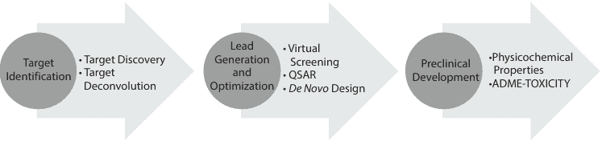

图 8.1 AI 和 ML 在制药研发过程中的应用。

## 8.2.1 机器学习和人工智能算法阐释

AI 构建智能系统所使用的模型可归入若干类别，这些类别可根据各自的学习方法进行定义。ML 算法常被称为“AI”，尽管两者并不相同。因此，最好从一开始就定义这两个术语。本评估全文均采用了 FDA 对 AI 的定义。图 8.2 重点介绍了药物开发背景下基本学习算法的简要说明。AI 领域的学习方法可分为几大类，包括监督学习、无监督学习、半监督学习、

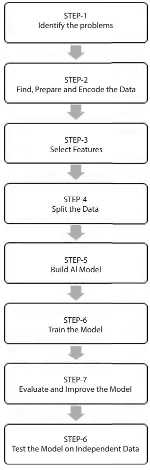

图 8.2 开发 AI 模型所涉及的阶段。

主动学习、强化学习、迁移学习和多任务学习。这些学习架构采用多种算法来执行分类和聚类等任务。训练 AI 模型对于 AI 成功是必要的，但不充分。有效的 AI 工作流程（i）定义问题，（ii）清洗和组织数据，（iii）从数据中提取特征，（iv）选择训练和测试数据集，（v）创建模型，（vi）训练模型并评估其效果（通过交叉验证），以及（vii）将模型应用于测试数据集以提高其性能。创建 AI 架构的基本原理在图 8.2 中描绘。

第一阶段是精确表征手头的问题（靶点、预期结果等）；第二阶段是收集、调查、分析、格式化并提高数据质量；第三阶段是将原始数据转换为特征并选择重要特征。

## 8.2.2 用于数据预处理的分子指纹和标识符

研究人员寻找具有所需初始特征的药物候选物，并由此生成针对目标分子具有所需疗效的化学结构。可使用分子描述符和指纹对化学单元及其生物学靶点分子的此类物理特征进行定量。与分子式或分子结构等简单描述符不同，分子指纹是更复杂的描述符，表示为二进制位字符串，可用于标识特定分子 [5, 6]。

化学描述符和分子指纹：化学描述符和分子指纹的使用是 AI/ML 驱动药物开发的基本基础之一。众多基于 ML 的应用 [7, 8]，包括靶点分子排序、基于结构相似性的化合物搜索、虚拟筛选、QSAR 分析和先导分子 ADME-T 预测，都在很大程度上依赖于分子结构的这些定量表示。

化合物搜索和虚拟筛选：在新药发现方面，基于结构相似性搜索和评估化合物的能力至关重要 [9–14]。AI/ML 算法对大型化学数据库进行快速扫描，使识别具有指定结构特性的潜在药物候选物成为可能 [15–18]。

QSAR 评估和 ADME-T 预测：为了建立物质结构特征与其生物活性之间的关系，定量结构-活性关系（QSAR）研究使用 ML 模型。此外，AI/ML 可以预测候选化合物的 ADME-T（吸收、分布、代谢、排泄和毒性）特征，有助于早期药物优化 [19–22]。

多个知名程序可简化药物发现背景下化学描述符和分子指纹的计算。这些程序各自具有不同的功能，影响其在药物开发过程中的应用。在本章中，我们重点介绍并讨论最流行的程序及其各自对 AI/ML 驱动药物开发的贡献。此外，Chuang 等人 [23] 对基于 AI 的技术及其增强化学生物活性预测建模潜力的分析性综述做得很好。基于 AI 的技术提供了有趣的前景，通过克服常规分子描述符和指纹的局限性，提高药物开发工作的精度和效果。

## 8.2.3 使用机器学习和 AI 进行靶点识别

调节靶点活性是药物发现中的常见策略，其目标是逆转疾病进展 [24]。药物开发的第一步通常是发现一个新靶点，其调节预示着治疗益处和可接受的风险特征。一旦确定目标，必须在疾病的体内模型中进行验证，最终在临床试验中验证。因此，早期发现有效的治疗靶点对于药物开发工作的成功至关重要。

理想的药理学靶点既应易于治疗修饰（“可成药性”），又与疾病表型相关。生物学和医学的突破不断产生高通量生物医学数据，为早期发现潜在治疗靶点打开了新的机遇窗口。然而，需要高效方法来分析此类庞大的多维生物学数据，以便为靶点鉴定提供可靠的预测。AI 和 ML 已成为评估快速扩展的多组学数据以定位潜在治疗靶点的有效手段。

文献中“靶点鉴定”一词有两种常见用法：靶点发现和靶点去卷积 [25]。前者从为疾病识别新的治疗靶点开始。后者称为“靶点捕获”，即利用已知活性化学物质来定位靶点。为保持清晰，本文将使用“靶点发现”和“靶点去卷积”，而不仅仅使用“靶点鉴定”。

药物发现：AI 平台的理论框架：第一阶段是精确表征手头的问题（靶点、预期结果等）；第二阶段是收集、调查、分析、格式化并提高数据质量；第三阶段是将原始数据转换为特征并选择重要特征。

### 学习类别

- 监督学习：在具有已知结果的数据点上训练的预测模型。
- 回归：模型找到的是实变量的输出。
- 分类：模型将输入划分为类别或组。

### 算法

- 朴素贝叶斯：一种“概率分类器”，通过将每个特征视为独立来确定特征在每个类中出现的概率，并根据贝叶斯规则返回最可能的类。
- 支持向量机：一种判别式分类器，输出最优超平面以对新示例进行分类。定义超平面的向量即为支持向量。
- 随机森林：（1）作为简单树预测器的集合，对分类问题投票选出最受欢迎的类别：在回归问题中，对树响应取平均以获取因变量的估计；（2）由于大多数决策树被加入森林，过拟合不太可能发生。
- K 近邻：一种基于特征相似性的非参数算法，假设相似事物存在于邻近位置。当对分布数据几乎或完全没有先验知识时，它对分类研究很有用。


人工神经网络：一种基于连接神经元层（包括输入层、隐藏层和输出层）从输入数据中学习的方法。
深度神经网络：
- 1. 由按序列排列的多层神经元组成的集合。
- 2. 一种具有多种优势（即空间关系和局部感受野）的人工神经网络类型。
- 3. 学习可以是受监督、无监督和半监督的。
- 4. 端到端学习和迁移学习是深度神经网络执行的主要方法。

自动编码器和生成对抗网络是深度神经网络的两种具体形式。

## 8.2.4 药物靶点发现早期阶段的人工智能应用

### 8.2.4.1 靶点发现

寻找新的靶点候选物是药物开发过程中的第一步。接下来，靶点与小分子药物结合的能力（其“可成药性”）会在实验和理论层面进行评估 [26, 27]。确定与疾病病理生理学相关的特定分子或生物过程，是靶点识别的目标，而靶点识别是药物开发过程中的关键阶段。这些靶点代表了治疗开发干预的潜在领域。构成人体的生物过程极其复杂且多样；因此，这一阶段充满了困难。研究人员使用多种技术来寻找与疾病发病机制相关的靶点。为了寻找可能的候选物，他们首先会查阅生物医学文献和实验数据。然后，通过可成药性过程评估这些潜在靶点成功靶向特定分子的能力。评估会考虑诸如靶点的可及性、特异性以及在不产生有害副作用的情况下诱导治疗反应的可能性等因素。

然而，人类疾病的复杂性需要包含多源异构数据和知识的日益精密的方法。要确定导致疾病表型的确切生物通路非常困难，因为

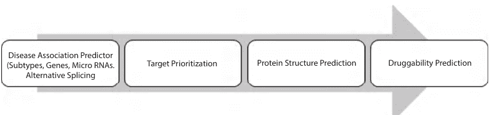

图 8.3 使用人工智能进行靶点识别。为了加速疾病相关治疗靶点的开发，AI/ML 算法可以快速评估所有相关数据。

人类疾病经常源于遗传、环境和生活方式变量的组合。近年来，引入 AI/ML 方法已成为解决这些困难的有力工具。AI/ML 模型可以有效地分析和解释大规模且多样化的数据集，使研究人员能够发现常规方法可能忽略的模式和关系。通过利用 AI/ML，研究人员可以预测潜在的“可靠”治疗靶点，从而提高靶点发现过程的有效性和效率。多步骤靶点识别过程如图 8.3 所示。

### 8.2.4.2 靶点解卷积

在识别出引起所需表型变化的物质后，下一阶段是靶点解卷积，也称为靶点捕获。为了更好地开展类比、识别潜在脱靶并解释观察到的不良反应，深入了解通过表型筛选获得的化合物的结合靶点非常重要。然而，目前靶点解卷积的实验方法需要耗费大量时间、精力和资源才能完成。为了减少测试所需的资源数量，研究人员已将计算方法应用于解卷积挑战中。他们发现，“模糊”分子表示（如药效团特征描述符）在相似性搜索中比原子技术更有效，因此成为首选表示。他们无监督的 SOM 系统根据药效团特征的相似性，将未知靶点的查询化合物与已知靶点的类药分子进行分组。此外，还开发了一个名为 RF-QSAR 的靶点捕获服务器，它采用 SAR 模型对潜在靶点进行排序，排序使用 RF 算法 [28]。BANDIT [29] 是一种新型靶点发现工具，采用贝叶斯技术整合六组不同的数据集，包括药物疗效。鉴于其对副作用预测和治疗重定位尝试的重要性，药物-靶点相互作用（DTI）预测在新药靶点发现中引起了越来越多的关注 [30]。由人工智能和机器学习支持的数据集成方法在对正负相互作用进行分类方面优于常规方法 [31]，提高了预期相互作用的质量，并加速了新 DTI 的发现 [32]。

## 8.2.5 药物筛选中的人工智能和机器学习

由于高通量筛选（HTS）成本高且命中率低，虚拟筛选（VS）替代方案应运而生，使得能够以快速、低成本的方式筛选远大得多的化合物库 [33, 34]。利用多种方法，VS 可以确定哪些化合物最有可能与特定蛋白质结合。基于结构的虚拟筛选（SBVS）和基于配体的虚拟筛选（LBVS）是两种主要的 VS 类型；前者以目标蛋白质结构作为输入 [35, 36]，而后者则利用已知抑制剂的信息。由于结构相似的分子往往具有可比拟的特性，因此 LBVS 可被视为一种“类推”形式 [37]，并有助于开发更准确的药效团模型 [38]。基于人工智能和机器学习的技术已被用于 SBVS 和 LBVS，以提高工作流程性能。首先，我们将探讨 AI/ML 技术如何应用于 SBVS，然后再转到它们如何应用于 LBVS。

### 8.2.5.1 基于配体的数字筛选

当目标的三维结构可用时，可以使用 SBVS 方法（例如分子对接）。然而，如果感兴趣蛋白质的三维结构未知，则只能采用 LBVS 方法。LBVS 的基础是结构相同的配体往往具有相似活性的观点，而分子对接则利用蛋白质结构来预测配体与目标蛋白质的结合构象 [39]。因此，LBVS 依赖于活性化合物的数据，而不是目标蛋白质的结构。在药物开发中，在确定目标蛋白质结构之前，通常会通过对分子进行生化或功能检测来建立一组活性化合物。在这些情况下，通过将潜在配体的结构与已知活性化合物的结构进行比较，LBVS 方法可用于识别新配体。因此，寻找将化合物特性与测试结果相关联的合适相似性模型是一项重要任务。

## 8.2.6 QSAR 预测

定量构效关系（QSAR）模型使用分子描述符来反映化合物的理化特性。这些模型对药物优化过程至关重要，因为它们允许首先通过计算机模拟对活性、选择性和毒性等关键特性进行初步了解 [40–42]。这大大减少了需要在动物研究中调查的潜在化合物数量。根据所选的计算方法，QSAR 模型可以采用回归或分类方法——即 AI/ML 技术（例如 RF [43] 和 SVM [44–46]）。QSAR 建模大量使用了朴素贝叶斯 [47–56] 和 ANN [57–67]（有关其各自用法的更深入描述，请参阅补充材料）。QSAR 调查通常使用 RF 方法进行分类和回归，该方法被广泛认为是金标准 [68]。可溶性环氧化物水解酶 [70] 的 Qsar [69] 技术和 Janus 激酶 2 [71] 模型只是已创建的众多基于 RF 的 QSAR 模型中的两个示例。与基于 SVM 和偏最小二乘法（两种常用的线性建模方法）的 QSAR 模型相比，基于 RF 的 QSAR 模型不仅提供了更优的预测性能，还促进了易于理解的化学和生物学解释 [72]。

### 8.2.6.1 用于理化特性和 ADME/T 预测的人工智能和机器学习 理化特性预测

药物在临床中成功的可能性在很大程度上受其理化特性的影响，这些特性揭示了治疗活动的各个方面。为了有效地到达并与其靶点相互作用，潜在的小分子药物必须既可溶又可渗透。为了对包括水溶性、膜渗透性和亲脂性在内的重要理化特性进行预测，科学家们已转向基于机器学习的技术。在补充材料中，我们深入描述了每个特征，并讨论了可以预测水溶性、膜渗透性和亲脂性等性质的基于机器学习的算法。尽管机器学习模型的进步使分子特性的预测更加准确，但这些进展受到缺乏通用评估标准的阻碍


## 8.2.7 ADME-T预测

评估ADMET特性有助于研究人员在药物发现的早期阶段选择有前景的药物候选物。据认为，一半的临床失败都可以归因于ADMET特性[75]。在这种情况下，过去40年中几种具有文档化药代动力学特性的药物的可用性，使得in silico ADMET预测模型得到了显著发展[76]。大多数预测模型的目标是建立特定ADME-T特征与指定的一组分子描述符之间的因果关系[77]。结构警告是导致特定毒性的主要子结构；在给定的小分子化合物中发现它们可以用来预测毒性[78]。包括DT、KNN、SVM、RF和NN在内的分类模型已被广泛用于预测药物ADME/T特性的调节因子。除此之外，引入深度学习模型后取得了进展。Alchemite [79]是一种深度学习模型，通过填补异质药物发现数据来预测ADME/T特征。

## 8.2.8 在药物发现中使用ANN和ML

为了以成本和时间高效的方式实现特定的疗效和安全性，从头药物设计涉及从零开始生成具有所需化学和生物学特性的独特化学实体。现在可以使用最先进的AI/ML技术自动生成具有所需特性的新化学实体。由于这些突破，近年来对AI和ML在从头发现中应用的研究激增。特别是，AI/ML驱动的生成分子设计备受关注。在这里，我们简要概述了从头药物发现中使用的人工智能和机器学习方法，重点介绍生成模型。对此主题感兴趣的读者可以参考文献中关于该主题的其他详细作品[80, 81]。

由于生产新化学结构的常规方法依赖于预定义的反应或转换原理，化学空间倾向于已知领域。使用AI/ML构建的生成模型是数据驱动且无规则的，使它们能够创建不包含在训练集中的新化合物。简而言之，这些生成模型接收数据，利用这些数据训练抽象表示，然后使用该表示生成新的数据实例[82]。这些生成模型随后表现出与AI系统相关的全部能力，包括解决问题、通过经验获取知识以及适应新情况的能力[83]。

## 8.2.9 使用人工智能和机器学习预测药物相互作用

联合用药的目的是降低毒性、提高疗效，并预测治疗过程中的耐药性发展。协同、拮抗和加和型药物组合是三种主要类型。当多种药物的联合效应大于各自效应之和时，药物之间发生协同作用[84]。如果药物具有加和效应，则可能在使用较小剂量的每种治疗的同时仍能达到预期结果。当两种药物拮抗性结合时，其联合活性低于单独使用任一药物的反应[85]。最后，如果每种单独药物的反应既不会抵消也不会增强其他药物的有效性，则该药物组合被认为是加和型[86]。尽管联合疗法相较于单药疗法具有优势，但要开发出可转化为临床应用的新药物联合方案仍然很困难。基于细胞系上不同浓度下药物对的临床证据或高通量筛选（HTS），迄今为止已制定出最有效治疗组合的建议。前者可能会让人们面临风险，而后者无法评估每一种可能的组合[87]。为了加速传统联合疗法，AI/ML算法正被用于优先排序药物组合并探索更大的组合空间[88]。

## 8.2.10 AI和ML在现有药物重新用途中的作用

创建一种获得FDA批准的新治疗方法的整个过程可能需要10到17年，成本高达26亿美元[89]。然而，尽管药物研发成本高昂，新治疗方法的批准率并未提高[90]。传统药物开发中持续使用标准的“一基因、一药、一疾病”范式可能是批准率低的一个促成因素[91]。由于药物靶点并非独立于生物化学系统发挥作用，因此有必要在整体背景下审视每个DTI[92]。为进一步指导药物重新用途工作，这种方法揭示了关于“脱靶”后果（即副作用）、对精准医疗的耐药性以及药理学作用机制的先前未知信息。

## 8.3 AI和ML在中枢神经系统（CNS）中的作用

影响中枢神经系统（CNS）的神经系统疾病带来重大的经济和社会后果。复杂的大脑解剖和功能、对CNS疾病生物学知识的缺乏以及血脑屏障（BBB）的存在，都使得CNS疾病新药开发比其他疾病更加困难。在这里，我们概述了基于AI/ML的方法，用于解决中枢神经系统药物开发中诸如BBB渗透性等问题（图8.4）。

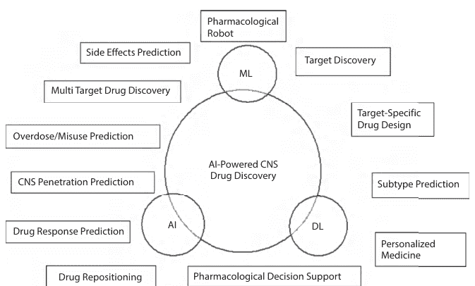

图8.4 中枢神经系统疾病治疗已从AI和ML带来的进步中受益。

### 8.3.1 BBB渗透性假说

在我们对CNS疾病的理解方面取得了巨大进展，但在开发CNS疾病创新治疗药物方面仍有重大障碍需要克服。在中枢神经系统中识别靶点具有挑战性，创造能够穿越血脑屏障的新化合物同样具有挑战性。血脑屏障（BBB）的功能是将有害物质和血液化学波动（如激素、氨基酸和钾）阻挡在脑外。对于具有不想要的中枢神经系统（CNS）影响的药物，偏好低脑部渗透性，而对CNS活性药物则需要高脑部渗透性。若要提高CNS药物发现的成功率，就需要在药物发现过程中早期解决药物候选物的BBB渗透性问题。

### 8.3.2 在神经疾病药物发现中使用AI和ML的好处

### 8.3.2.1 使用AI/ML进行神经疾病药物发现

精神分裂症是一种神经发育性疾病，终身患病率为0.30%至0.66%[93]，通常在25岁之前发病并贯穿终生，是全球疾病负担的主要贡献因素[94]。尽管其复杂的病理生理学已被研究近一个世纪，但目前仍没有有效的精神分裂症治疗方法。因此，精神分裂症的新药物治疗需要摆脱传统的研究方法[95]。最近，人工智能和机器学习被认为是指导精神分裂症诊断[96, 97]、识别异质性[98, 99]和分型[100, 101]的一种潜在有用工具。


## 8.3.2.2 抗抑郁药研发中ML和AI的应用

在精神科药物研发中，基于AI/ML的方法已被用于药理学决策辅助 [102, 103]。利用弹性网揭示的指标，抑郁症研究中的研究人员创建了梯度提升机，以预测服用抗抑郁药西酞普兰的患者是否会出现症状缓解 [104]。另一项临床试验中艾司西酞普兰治疗组也受益于该模型的应用 [105]。Chekroud _等人_ [99] 使用相同的模型根据患者的症状将其分为聚类，然后预测每个聚类对多种抗抑郁药治疗的反应。开发了一种基于Web的程序，帮助医生决定哪种药物对特定症状组最有效。然而，Chekroud _等人_ [100] 的模型存在自身的缺陷。该模型并未量化个体对抗抑郁药的反应程度，而是仅预测某位患者是否会对给定抗抑郁药产生反应。由于该模型是为单一抗抑郁药开发的，它无法有效地从患者可用的众多药物选项中选择最有效的药物 [108]。为克服这些限制，Chang _等人_ [101] 创建了基于NN的抗抑郁药反应预测网络（ARP Net）模型。ARP Net 可以利用既基于文献又基于数据的特征选择过程，预测患者对抗抑郁药的反应程度、是否能从抑郁症中获得临床缓解，以及对抗抑郁药联合用药的反应程度。

## 8.3.2.3 巴金森病药物研发中AI和ML的应用

超过60岁人群中有1%以上，85岁以上人群中高达5%被诊断患有巴金森病（PD），使其成为第二常见的与年龄相关的神经退行性疾病 [106]。巴金森病（PD）是复杂疾病的典型示例，因为它可引起广泛的运动性和非运动性症状 [105]。运动控制和认知下降（以震颤和记忆力减退为特征）源于黑质中多巴胺能神经元的丧失，但目前在没有治疗的情况下这种减少是不可逆的 [104, 105]。

## 8.3.2.4 阿尔茨海默病药物研发中AI和ML的应用

随着预期寿命的提高，与年龄相关疾病的发病率和严重程度已大幅增加。阿尔茨海默病（AD）是老年人中最常见的神经退行性疾病，会导致包括记忆在内的各种精神能力逐渐下降 [105]。尽管阿尔茨海默病的确切病因尚不明确，但其特征性神经病理特征——包括神经元和突触丢失及/或功能障碍，以及细胞外Abeta斑块和细胞内神经纤维缠结——已被广泛认识 [106]。大多数AD患者对该疾病的现有药物仅获得有限获益，这些药物通过针对胆碱能和谷氨酸能神经递质传递来缓解症状 [107]。因此，急需能够阻止或延缓疾病发病、减缓其进展或缓解患者症状的创新药物 [108]。对AD发病机制的认识不足、病因复杂以及病理生理学复杂，是药物研发工作的重大障碍，很可能是 [108] 次AD药物研发失败的原因。

近年来，基于AI/ML的模型在阿尔茨海默病研究中的应用有所增加，其主要应用是通过处理电子健康记录和图像来诊断和预后该疾病 [108]。然而，在寻找AD有效治疗方法方面，AI/ML方法的应用有限。不过，少数研究人员已暗示AI/ML作为寻找AD治疗方法工具的潜力。已使用ML方法结合淀粉样纤维表征来识别潜在治疗靶点。为了预测与AD相关的基因，HENA [109]（一种基于异构网络的数据集）使用GCN来整合多种类型的数据。

## 8.3.2.5 止痛药和麻醉剂中AI和ML的医学应用

全身麻醉药和止痛药均被归类为中枢神经系统药物。近年来，麻醉和疼痛管理中的治疗决策越来越依赖于自主式和基于AI的推荐系统。特别是，药理机器人已在麻醉行业确立为不可或缺的工具，因为它们提供个体化的麻醉药物剂量，帮助患者在深度镇静或全身麻醉下维持稳态 [103]。

## 8.4 AI/ML对中枢神经系统药物研发的影响

人工智能（AI）和机器学习（ML）对中枢神经系统（CNS）药物研究产生了巨大影响，彻底改变了整个药物研发过程，并为CNS疾病的更有效治疗敞开了大门。AI和ML技术的融合已解决了重大问题，并为CNS药物研发开辟了新的可能性。

以下是AI/ML对CNS药物研发的一些显著影响：

- 加速药物发现：得益于AI/ML系统对大量生物医学数据的快速分析，研究人员现在能够更好地识别潜在药物靶点、预测药理作用并有效筛选化合物库。这种加速的药物发现过程大大缩短了寻找CNS疾病潜在治疗候选物所需的时间和资源。

- 靶点鉴定与验证：通过评估多种组学数据并发现与CNS疾病相关的重要生物靶点，基于AI/ML的靶点鉴定已改变了CNS药物研发。这些算法能更准确地对潜在治疗靶点进行排序，从而实现更具针对性和高效性的新药研发工作。

- 精准医疗与定制化治疗：AI/ML通过分析患者特定数据来预测特定治疗反应，从而实现精准医疗和定制化治疗。基于患者的基因特征、病史和治疗反应，这种方法使临床医生能够定制CNS药物治疗方案，提高治疗成功率并降低副作用。

- 血脑屏障通透性预测：药物穿过血脑屏障（BBB）极为困难。研究人员可以利用AI/ML模型估计治疗候选物跨越BBB的通透性，从而指向更有可能成功到达CNS的物质。

- 药物重新利用与多重药理学：通过检查现有药物数据库并发现具有新颖治疗适应症的潜在候选物，AI/ML算法促进了CNS疾病的药物重新利用。AI/ML还阐明了多重药理学概念（即药物可有多个靶点），从而能够为CNS疾病开发多靶点治疗药物。

- 药物-药物相互作用预测：AI/ML模型可以预测可能的药物-药物相互作用，帮助医疗专业人员避免危险混合并改善CNS疾病患者的治疗方案。

通过AI/ML对多组学数据的分析，已能够识别CNS疾病中的新型生物标志物和疾病亚型。这些生物标志物支持疾病识别、患者分类和专门化治疗的设计。由于AI/ML算法擅长处理来自基因组学、蛋白质组学和影像学检查等各种来源的大量异构信息，因此可以克服数据挑战。借助这一能力，研究人员能够整合和评估复杂数据，从而获得关于CNS疾病的新认识。

通过使用基于AI/ML的算法，可以改善临床试验设计，这些算法还可用于选择合适的患者人群并预测试验结果。这种改进使CNS药物的临床试验更加高效和富有成果。简而言之，AI和ML已显著改变了CNS药物研发中发现药物靶点、筛选化合物和定制治疗的方式。随着这些技术的发展和壮大，它们有可能推动CNS治疗领域的革命性进步，为CNS疾病患者带来新的希望和更高的生活质量。

## 8.5 中枢神经系统药物研发中AI/ML的未来前景

随着这些技术持续快速发展和扩展，它们对中枢神经系统（CNS）药物研发未来具有巨大潜力。预计AI/ML方法的融合将导致CNS药物发现和开发的各个方面发生根本性变化。

以下是AI和ML在CNS药物研究中的潜在应用：

- 精准医疗与个性化治疗：随着AI/ML模型变得更加先进并能够处理海量且多样化的信息，CNS药物研发中精准医疗的潜力将不断增加。为了准确预测每位患者对治疗的反应，AI/ML


算法将整合基因组学、蛋白质组学、代谢组学以及其他患者特异性数据 [110]。这将使医疗专业人员能够根据每位患者的特定基因型和疾病特征定制中枢神经系统（CNS）药物治疗方案，从而实现更高效、更个性化的治疗。

- 多组学数据整合：多组学数据整合结合了基因组学、转录组学、蛋白质组学及其他“组学”信息，这对于 AI/ML 在中枢神经系统药物研究中的未来至关重要。基于系统生物学的 AI/ML 方法将使人们能够全面理解中枢神经系统疾病背后复杂的相互关系。研究人员将通过检查这些相互关联的网络，发现新的靶点、通路和生物标志物，从而创造出新型且针对性的药物。

- 药物组合优化：AI/ML 方法将在确定中枢神经系统疾病的最佳药物组合方面发挥重要作用。AI/ML 模型将评估联合使用多种药物的协同效应，以提高疗效并减少不良反应，而不仅仅专注于单靶点治疗。这种方法通常被称为多药理学，将导致创造出大量针对中枢神经系统疾病复杂性质的靶向药物。

- AI 设计的药物：AI/ML 的预测建模能力将被用于创造全新药物，这些药物专门针对特定中枢神经系统靶点。AI/ML 算法将通过生成模型和强化学习提出具有所需药理特性的新型化学结构，从而简化药物设计过程并扩大中枢神经系统药物研究的化学空间。

- 实时决策支持：未来，AI/ML 系统将在医疗专业人员治疗中枢神经系统疾病患者时，协助其实时决策。这些系统将评估患者数据，持续跟踪治疗反应，并根据动态患者档案建议调整药物剂量或疗法，以改善治疗效果和患者安全。

- 优化的临床试验设计：通过增强型临床试验，临床试验设计将得到优化，使中枢神经系统药物研究更加高效和富有成果。通过预测患者反应、确定合格患者群体并优化给药方案，AI/ML 算法将有助于缩短药物研发和审批所需的时间和成本。

- 药物安全性和毒性预测：对于中枢神经系统药物，使用 AI/ML 模型预测药物安全性和毒性特征的做法预计将增加。AI/ML 算法可以通过检查临床前研究和人体临床试验的数据来预测可能的副作用，使研究人员在开发早期就能对药物候选物做出明智决策。

- 转化研究与数据共享：AI/ML 将使更容易整合和分析药物发现过程中不同阶段收集的数据，从临床前研究到临床试验。研究人员、制药公司和监管机构将更频繁地合作并共享数据，加速基于 AI/ML 驱动发现的可行中枢神经系统药物的开发。

综上所述，AI/ML 在中枢神经系统药物研究中的未来光明而充满希望。这些尖端技术有能力彻底改变中枢神经系统药物的发现和开发过程，开启精准医疗、个性化护理和创新治疗策略的新时代。随着 AI/ML 的发展，中枢神经系统疾病安全有效的治疗方法必将得到开发，为全球数百万患者带来希望。

## 8.6 中枢神经系统药物样性预测的数据处理拟议方法

“中枢神经系统药物样性预测的数据处理”方法是一组组织良好的阶段，旨在提供数据集，以对化合物有效靶向中枢神经系统（CNS）的潜力进行精确和全面的预测。此过程包括多个步骤，首先是收集可口服药物及其理化特性的数据。“中枢神经系统药物”一词指的是能够穿越血脑屏障（BBB）的一类药物。在此基础上，中枢神经系统药物样性概念被扩展，以包括 QSAR 预测，该预测将分子结构与生物活性相关联。为确保数据完整性并提高预测准确性，数据预处理阶段至关重要。这包括处理缺失值、标准化理化属性、为 QSAR 预测整理数据，以及考虑 ADME-T（吸收、分布、代谢和排泄）问题。

之后，将准备好的数据集划分为特征、目标变量（中枢神经系统药物状态）以及对 QSAR 和 ADME-T 预测重要的其他变量。多种预测技术（包括基于神经网络的预测、QSAR 建模和 ADME-T 评估）均基于这些组织化的信息。这些推断揭示了药物成功穿越血脑屏障、表现出所需生物行为以及满足关键 ADME-T 要求的可能性。

最后，通过综合这些多种方法的预测结果，对每种化合物靶向中枢神经系统药物的适用性提供全面了解。这种全面的观点结合了生物功能、药代动力学因素和分子洞察，改善了中枢神经系统药物开发中的决策过程。

### 算法

如图 8.5 所示，“中枢神经系统药物样性预测的数据处理”方法超越了初始数据准备阶段，将 ADME-T 和 QSAR 建模考虑在内，提高了预测准确性，并全面了解了药物候选物靶向中枢神经系统的潜力。

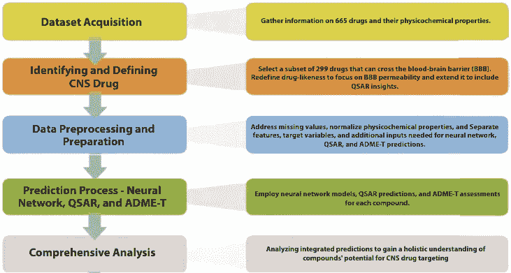

图 8.5 中枢神经系统药物样性预测的数据处理拟议方法。

### 步骤 1：获取数据集

与之前一样，该过程始于收集可口服药物及其理化特性的广泛数据集。但是，这种扩展的方法包含更多关于生物活性和 ADME-T 特征的信息，从而允许更彻底的分析。

### 步骤 2：识别中枢神经系统药物

与之前类似，具有穿越血脑屏障潜力的一部分药物被称为“中枢神经系统药物”。在这种扩展的方法中，这些中枢神经系统药物进一步由其 QSAR 和 ADME-T 特征描述，从而允许对其靶向中枢神经系统的潜力进行多维评估。

### 步骤 3：定义中枢神经系统药物样性

中枢神经系统药物样性概念仍然强调穿越血脑屏障的能力。它现在更进一步，包括 QSAR 预测，提供关于分子结构与生物活性之间联系的信息。

### 步骤 4：预处理数据

预处理现在包括管理空值和标准化，以及整理和组织与 QSAR 相关的数据，如生物活性测量、分子描述符和与 ADME-T 相关的特征。

### 步骤 5：为 QSAR、ADME-T 和神经网络模型准备数据

从数据中分离出特征、目标变量（中枢神经系统药物状态）以及 QSAR 和 ADME-T 预测所需的其他变量。通过扩展训练和测试子群，考虑这些多种预测特征。

### 步骤 6：预测过程—神经网络、QSAR 和 ADME-T

这种方法现在除了最初的基于神经网络的预测方法外，还包含两个额外的预测程序：

QSAR 建模：使用扩展数据集创建 QSAR 模型，以基于分子结构预测生物活性。这些模型揭示了分子特征与中枢神经系统功能之间的联系。

ADME-T 预测：预测中枢神经系统药物的 ADME-T 特性是另一个方面。这包括评估药物的吸收、分布、代谢和排泄，以及考虑毒性。

### 步骤 7：整合预测

使用神经网络、QSAR 模型和 ADME-T 评估的预测，详细描绘每种中枢神经系统药物靶向中枢神经系统的潜力。这种整体方法结合结构知识、生物功能和药代动力学特征，以进行彻底分析 [111]。

### 步骤 8：综合分析的结论

在方法之后进行综合预测的广泛分析。由此获得的见解对中枢神经系统化合物的药物样性进行了彻底评估，考虑了化学结构、生物活性和 ADME-T 因素。通过提供更全面的观点，这种综合理解改善了中枢神经系统药物开发中的决策过程。

综上所述，“中枢神经系统药物样性预测的数据处理”方法将数据预处理、基于神经网络的预测、QSAR 建模和 ADME-T 评估结合为一种全面的方法。这种全面的框架使研究人员能够全面了解物质成功靶向中枢神经系统的潜力，加速药物开发过程，并在寻找创新中枢神经系统治疗方法的过程中鼓励明智的决策。

## 8.7 结论与未来展望

全身麻醉药和止痛药都被归类为中枢神经系统药物。近年来，麻醉和疼痛管理中的治疗决策越来越依赖于自主和基于 AI 的推荐系统。药理机器人已经在麻醉行业确立了不可或缺的工具地位，因为它们提供个性化的麻醉药剂量，帮助患者在深度镇静或全身麻醉下维持稳态。这些机器人通过分析患者数据（来自脑电图监测仪、血压监测仪、心率监测仪等设备）和药物本身的药代动力学特性，计算出最佳药物剂量。

在治疗进步方面，将 AI 技术应用于推进中枢神经系统（CNS）药物发现仍处于起步阶段。下面，我们讨论了这个新兴领域的当前限制和潜在未来可能性。实施 AI/ML 用于中枢神经


系统面临的问题是高质量数据的匮乏。公共数据库中存储的信息通常无法直接比较，因为它们是使用不同的生物学检测、方法学或实验环境收集的。此外，同一主题的不同数据集之间可能存在差异。因此，在执行特定AI/ML操作之前，通过过滤原始输入来获取高质量数据是一个必要步骤。CNS药物研究的另一大难点是大多数下一代AI平台的“黑盒”特性。

人工智能和机器学习很有用，但其结果难以理解。因此，研究人员无法了解或检查模型背后的生物学机制，也无法解释模型的结果。这进一步使得在模型无故失效时诊断和修复此类模型的过程变得复杂。因此，找到揭开深度学习（DL）奥秘的方法至关重要。

许多神经系统疾病没有已知的可逆转疾病状态的治疗方法，这使得为其提名新靶点或药物变得困难。当药物发现任务缺乏足够的训练样本时，迁移学习技术可以通过将一个环境中学到的知识应用到另一个环境中来提供帮助。然而，从长远来看，科学家之间的数据共享为解决数据短缺问题提供了最大的希望。随着量子计算机等更快机器的出现，广泛的数据共享系统可能会极大地有利于新CNS药物的发现过程。

这里，被称为胶囊网络的下一代AI架构可以提供帮助，因为它将CNNs封装在一个互连的模块中。在胶囊网络首次应用于药物开发领域中，它们在预测药物心脏毒性方面证明特别有效。胶囊网络能够从多样化的数据集中学习，同时由于其对CNN的模块化表示，能够保持数据固有的层次结构。

尽管药物MRI在神经精神药理学研究中仍然有用，但其临床前应用受到许多问题的阻碍。药物fUS的最新进展使得无需麻醉即可以卓越的空间和时间分辨率成像脑活动成为可能。对多奈匹齐和甲氟喹的AD464药物组合以及ADHD药物托莫西汀的研究表明，fUS成像可用于评估这些CNS药物的动态特性。莨菪碱是一种常用于模仿AD的临床前药物，他们的ML模型能够识别清醒小鼠药物诱导的脑连接改变的“指纹”。

从这些例子可以看出，AI/ML技术有望通过让我们使用独特的神经影像数据集来描述治疗效果，从而改善我们对大脑药物作用机制的理解。为治疗CNS疾病创造有效药物，首先要搞清楚如何让药物穿过血脑屏障（BBB）至关重要。尽管BBB在防止有害物质进入中枢神经系统方面很重要，但它经常被误解为仅仅是一个静态屏障。BBB的破坏或BBB转运体的问题都已与中枢神经系统疾病相关联。到目前为止，基于AI/ML的预测算法一直将BBB视为不受CNS疾病影响，假设它是一个静态实体。因此，在非CNS疾病数据上训练的BBB渗透预测模型可能不适用于CNS疾病。在预测模型中包含由疾病引起的BBB改变，应该能得出更准确的BBB渗透性估计。这也为人工智能和机器学习在中枢神经系统药物发现中的应用开辟了新的可能性。此外，生理事件通常受其周围环境的影响：肝脏可能是受体接触的位点，但大脑不是。这类依赖于上下文的非线性相互作用及其他未知促成因素通常会被AI/ML系统忽略。AI/ML算法预测的药物靶点，但神经科学家知道其在大脑中可能具有严重副作用，或者生成无法合成的化合物，就是两个例子。许多这些困难只能通过应用人类判断和基于假设的方法来克服。将人类专家的知识转移到AI系统，可以确保最佳的科学结果。

因此，这种人机结合的方法将有助于CNS药物开发的决策过程 [110]。尽管AI/ML算法在其他领域产生了革命性的影响，但其在药物发现中的应用仍处于起步阶段。

因此，我们以对治疗CNS疾病的最新AI/ML辅助药物开发应用的全面分析作为结论。AI/ML方法在多个科学和技术学科中的卓越成功，推动了这些应用在过去几年中的爆炸式增长。随着我们迈向个性化医疗，我们预见AI/ML在CNS药物发现中有着光明的前景，特别是在以下领域：(1) 患者分型，(2) 关键疾病驱动因素的识别，(3) 特定细胞类型药物反应的预测，(4) 新型药物的自主设计，以及(5) 特定疾病的BBB渗透性测试。AI和ML现有的不足可以追溯到数据和算法限制。然而，如果我们将人工智能和机器学习技术应用于该领域，神经精神药理学的改进将成为可能。

## References

- 1. Mohs, R.C. 和 Greig, N.H., 药物发现与开发：基础生物学研究的作用。*阿尔茨海默病与痴呆（纽约，纽约）*，3, 4, 651–657, 2017.

- 2. Papadatos, G., Gaulton, A., Hersey, A., Overington, J.P., ChEMBL数据库中的活性、检测和靶点数据策划与质量。*计算机辅助分子设计杂志*，29, 9, 885–896, 2015.

- 3. Wilson, B.J. 和 Nicholls, S.G., 人类基因组计划与个体基因组学的最新进展。*医疗政策风险管理*，8, 9–20, 2015.

- 4. David, L., Arús-Pous, J., Karlsson, J. 等，深度学习在工业药物研究中利用大规模异质化合物数据的应用。*药学前沿*，10, 1303, 2019.

- 5. Todeschini, R., Wiese, M., Consonni, V., 分子描述符手册。*应用化学（英文国际版）*，40, 10, 1977, 2001.

- 6. Dong, J., Cao, D.-S., Miao, H.-Y. 等，ChemDes：一个用于分子描述符和指纹计算的集成基于Web的平台。*计算机化学信息学杂志*，7, 1, 60, 2015.

- 7. Cao, D.S., Zhou, G.H., Liu, S. 等，利用蛋白质序列和分子拓扑结构进行人激酶-抑制剂相互作用的大规模预测。*分析化学学报*，792, 10–18, 2013.

- 8. Yee, S.W., Lin, L., Merski, M. 等，二甲双胍的酶和转运体非靶点的预测与验证。*药代动力学与药物动力学杂志*，42, 5, 463–475, 2015.

- 9. Muegge, I. 和 Mukherjee, P., 虚拟筛选中分子指纹相似性搜索概述。*药物发现专家意见*，11, 2, 137–148, 2016.

- 10. Cereto-Massague, A., Ojedo, M.J., Valls, C., Mulero, M., Garcia-Vallve, S., Pujadas, G., 虚拟筛选中分子指纹相似性搜索。*方法（圣地亚哥，加利福尼亚）》，71, 58–63, 2015.

- 11. Willett, P., 基于2D指纹的相似性虚拟筛选。*今日药物发现*，11, 23–24, 1046–1053, 2006.

- 12. Heikamp, K. 和 Bajorath, J., 指纹设计与工程策略：合理化并提高相似性搜索性能。*未来医药化学*，4, 15, 1945–1959, 2012.

- 13. Irwin, J.J., Gaskins, G., Sterling, T., Mysinger, M.M., Keiser, M.J., 可购买化学空间的预测生物活性。*化学信息与建模杂志*，58, 1, 148–164, 2018.

- 14. Axen, S.D., Huang, X.P., Caceres, E.L., Gendelev, L., Roth, B.L., Keiser, M.J., 三维分子结构的简单表示。*医药化学杂志*，60, 17, 7393–7409, 2017.

- 15. Geppert, H., Vogt, M., Bajorath, J., 配体基础虚拟筛选的当前趋势：分子表示、数据挖掘方法、新应用领域和性能评估。*化学信息与建模杂志*，50, 2, 205–216, 2010.

- 16. Berenger, F., Voet, A., Lee, X.Y., Zhang, K.Y., 部分电荷的旋转-平移不变分子描述符及其在配体基础虚拟筛选中的应用。*计算机化学信息学杂志*，6, 23, 2014.

- 17. Roy, K. 和 Mitra, I., 药物设计、QSAR、属性预测和毒性评估中电拓扑态原子（E-state）指数。*当前计算机辅助药物设计*，8, 2, 135–158, 2012.

- 18. Cao, D.-S., Xu, Q.-S., Liang, Y.-Z., Chen, X., Li, H.-D., 使用偏最小二乘、反向传播网络和支持向量机预测药物类似有机化合物的水溶性。*化学计量学杂志*，24, 9, 584–595, 2010.

- 19. Viswanadhan, V.N., Rajesh, H., Balaji, V.N., 已知药物、先导化合物和非药物的原子类型偏好、结构多样性和性质特征：一种比较评估。*ACS组合科学*，13, 3, 327–336, 2011.

- 20. Khan, M.T., 利用不同QSAR/QSP建模方法预测候选药物分子的ADMET性质。*当前药物代谢*，11, 4, 285–295, 2010.

- 22. Maltarollo, V.G., Gertudes, J.C., Oliveira, P.R., Honorio, K.M., 应用机器学习技术进行ADME-Tox预测：一篇综述。*药物代谢与毒理学专家意见*，11, 2, 259–271, 2015.

- 23. Chuang, K.V., Gunsalus, L.M., Keiser, M.J., 学习药物化学的分子表示。*医药化学杂志*，63, 8705–8722, 2020.

- 24. Moffat, J.G., Vincent, F., Lee, J.A., Eder, J., Prunotto, M., 表型药物发现中的机遇与挑战：行业视角。*自然药物发现评论*，16, 8, 531–543, 2017.

- 25. Van den Broeck, W.M.M., 第3章 药物靶点、靶点鉴定、验证和筛选。收录于：《药物化学实践》，第4版，C.G. Wermuth, D. Aldous, P. Raboisson, D. Rognan（编），第45–70页，Academic Press，圣地亚哥，CA，2015.

- 26. Gashaw, I., Ellinghaus, P., Sommer, A., Asadullah, K., 什么是好的药物靶点？*今日药物发现*，16, 23–24, 1037–1043, 2011.

- 27. Lindsay, M.A., 靶点发现。*自然药物发现评论*，2, 10, 831–838, 2003.

- 28. Lee, K., Lee, M., Kim, D., 利用优化参数的随机森林QSAR模型进行靶点鉴定及其在靶点捕鱼服务器中的应用。*BMC生物信息学*，18, 16, 567, 2017.

- 29. Madhukar, N.S., Khade, P.K., Huang, L. 等，使用多种数据类型进行药物靶点鉴定的贝叶斯机器学习方法。*自然通讯*，10, 1, 5221, 2019.

- 30. D'Souza, S., Prema, K.V., Balaji, S., 药物-靶点相互作用的机器学习模型：当前知识与未来方向。*今日药物发现*，25, 4, 748–756, 2020. [DOI链接].


- 31. Monteiro, N. R., Ribeiro, B., Arrais, J. P., 药物-靶点相互作用预测：端到端深度学习方法。IEEE/ACM Trans. Comput. Biol. Bioinf., 18, 6, 2364–2374, 2020.

- 32. Nascimento, A.C., Prudêncio, R.B., Costa, I.G., 用于药物-靶点相互作用预测的多核学习算法。BMC Bioinf., 17, 1–16, 2016.

- 33. Lionta, E., Spyrou, G., Vassilatis, D.K., Cournia, Z., 基于结构的虚拟筛选在药物发现中的应用：原则、应用与最新进展。Curr. Topics Med. Chem., 14, 16, 1923–1938, 2014.

- 34. Ghosh, S., Nie, A., An, J., Huang, Z., 用于药物发现的化学文库基于结构的虚拟筛选。Curr. Opin. Chem. Biol., 10, 3, 194–202, 2006.

- 35. Acharya, C., Coop, A., Polli, J.E., Mackerell, A.D., Jr, 基于配体的药物设计最新进展：构象采样药效团方法的相关性与实用性。Curr. Comput.-Aided Drug Des., 7, 1, 10–22, 2011.

- 36. Maldonado, A.G., Doucet, J.P., Petitjean, M., Fan, B.-T., 化学信息学中的分子相似性与多样性：从理论到应用。Mol. Diversity, 10, 1, 39–79, 2006.

- 37. Johnson, M.A. and Maggiora, G.M., 分子相似性的概念与应用。Wiley, United States, 1990.

- 38. Wang, T., Wu, M.B., Lin, J.P., Yang, L.R., 定量构效关系：药物发现平台的有希望的进展。Expert Opin. Drug Discov., 10, 12, 1283–1300, 2015.

- 39. Kumar, R., Chaudhary, K., Singh Chauhan, J. 等, 用于抗高血压肽预测、筛选和设计的体外平台。Sci. Rep., 5, 12512, 2015.

- 40. Briard, J.G., Fernandez, M., de Luna, P., Woo, T.K., Ben, R.N., QSAR加速发现强效冰再结晶抑制剂。Sci. Rep., 6, 26403, 2016.

- 41. Zakharov, A.V., Varlamova, E.V., Lagunin, A.A. 等, 药物-药物相互作用的QSAR建模与预测。Mol. Pharmaceuticals, 13, 2, 545–556, 2016.

- 42. Fang, X., Bagui, S., Bagui, S., 利用机器学习模型提高人胰酶5抑制剂虚拟筛选的预测准确性。Comput. Biol. Chem., 69, 110–119, 2017.

- 43. Chen, J.J.F. and Visco, D.P., Jr, 开发用于加速药物候选物发现的体外流水线：基于支持向量机模型的签名分子描述符虚拟高通量筛选。Chem. Eng. Sci., 159, 31–42, 2017.

- 44. Chen, J.J.F. and Visco, D.P., Jr, 基于PCA-GA-SVM开发的vHTS模型识别新的XIIa因子抑制剂。Eur. J. Med. Chem., 140, 31–41, 2017.

- 45. Xia, X., Maliski, E.G., Gallant, P., Rogers, D., 使用贝叶斯模型分类激酶抑制剂。J. Med. Chem., 47, 18, 4463–4470, 2004.

- 46. Bender, A., Mussa, H.Y., Glen, R.C., 使用MOLPRINT 2D（一种基于片段的快速朴素贝叶斯分类器方法）筛选二氢叶酸还原酶抑制剂：描述符的局限性以及训练集和测试集中平衡化学的重要性。J. Biomol. Screen., 10, 7, 658–666, 2005.

- 47. Prathipati, P., Ma, N.L., Keller, T.H., 用于抗结核药物优先排序的全局贝叶斯模型。J. Chem. Inf. Model., 48, 12, 2362–2370, 2008.

- 48. Ekins, S., Reynolds, R.C., Kim, H. 等, 利用生物活性和细胞毒性信息进行药物发现的贝叶斯模型。Chem. Biol., 20, 3, 370–378, 2013.

- 49. Vijayan, R.S., Bera, I., Prabhu, M., Saha, S., Ghoshal, N., 利用比较相互作用指纹分析和经典2D QSAR方法进行组合文库枚举和先导物跳跃，以寻找新型GABA(A) α(3)调节剂。J. Chem. Inf. Model., 49, 11, 2498–2511, 2009.

- 50. Liu, L., Lu, J., Lu, Y. 等, 用于预测阻断hERG钾通道化合物的新型贝叶斯分类模型。Acta Pharmacol. Sin., 35, 8, 1093–1102, 2014.

- 51. Singh, N., Chaudhury, S., Liu, R., Abdul Hameed, M.D.M., Tawa, G., Wallqvist, A., 抗菌化合物QSAR分类模型及其在虚拟筛选中的应用。J. Chem. Inf. Model., 52, 10, 2559–2569, 2012.

- 52. Renault, N., Laurent, X., Farce, A. 等, 基于贝叶斯网络和高通量对接的CB(2)受体激动剂虚拟筛选：激动剂调节GPCR特征的结构洞察。Chem. Biol. Drug Design, 81, 4, 442–454, 2013.

- 53. Abdul Hameed, M.D., Ippolito, D.L., Wallqvist, A., 使用贝叶斯分类模型预测大鼠和人类孕烷X受体激活剂。Chem. Res. Toxicol., 29, 10, 1729–1740, 2016.

- 54. Shi, H., Tian, S., Li, Y. 等, 药物发现中的吸收、分布、代谢、排泄和毒性评估。使用朴素贝叶斯分类技术预测人类孕烷X受体激活剂。Chem. Res. Toxicol., 28, 1, 116–125, 2015.

- 55. Murcia-Soler, M., Pérez-Giménez, F., García-March, F.J. 等, 人工神经网络与线性判别分析：选择新型抗菌化合物的有价值组合。J. Chem. Inf. Comput. Sci., 44, 3, 1031–1041, 2004.

- 56. Douali, L., Villemin, D., Cherqaoui, D., 神经网络：HEPT衍生物的准确非线性QSAR模型。J. Chem. Inf. Comput. Sci., 43, 4, 1200–1207, 2003.

- 57. Sabet, R., Fassihi, A., Hemmateenejad, B., Saghaei, L., Miri, R., Gholami, M., 基于MOLMAP方法的QSAR方法在新型抗菌3-羟基吡啶-4-酮计算机辅助设计中的应用。J. Comput.-Aided Mol. Design, 26, 3, 349–361, 2012.

- 58. Fjell, C.D., Jenssen, H., Hilpert, K. 等, 利用化学信息学和机器学习识别新型抗菌肽。J. Med. Chem., 52, 7, 2006–2015, 2009.

- 59. Torrent, M., Andreu, D., Nogues, V.M., Boix, E., 通过理性预测模型联系肽理化和抗菌性质。PloS One, 6, 2, 16968, 2011.

- 60. Sardari, S., Kohanzad, H., Ghavami, G., 用于引入药物设计中高效描述符的抗分枝杆菌化学空间人工神经网络建模。Chemom. Intell. Lab. Syst., 130, 151–158, 2014.

- 61. Khatri, N., Lather, V., Madan, A., 硫脲衍生物抗丙型肝炎病毒活性的多种分类模型。Chemom. Intell. Lab. Syst., 140, 13–21, 2015.

- 62. Hu, L., Chen, G., Chau, R.M., 基于神经网络的药物发现方法及其在醛糖还原酶抑制剂设计中的应用。J. Mol. Graph. Model., 24, 4, 244–253, 2006.

- 63. Patra, J.C. and Chua, B.H., 使用类黄酮的人工神经网络糖尿病药物设计。J. Comput. Chem., 32, 4, 555–567, 2011.

- 64. Mytelka, K.Z., Wang, L., Tong, Q., Xie, X.Q., 基于分子指纹的人工神经网络QSAR用于配体生物活性预测。Mol. Pharm., 9, 10, 2912–2923, 2012.

- 65. Geanes, A.R., Cho, H.P., Nance, K.D. 等, 用于发现新型M5抑制剂化学类型的基于配体的虚拟筛选。Bioorganic & Med. Chem. Lett., 26, 18, 4487–4491, 2016.

- 66. Ma, J., Sheridan, R.P., Liaw, A., Dahl, G.E., Svetnik, V., 作为定量构效关系方法的深度神经网络。J. Chem. Inf. Model., 55, 2, 263–274, 2015.

- 67. Martin, E.J., Polyakov, V.R., Tian, L., Perez, R.C., Profile-QSAR 2.0：对现实新化合物的激酶虚拟筛选准确性可与四浓度IC50相媲美。J. Chem. Inf. Model., 57, 8, 2077–2088, 2017.

- 68. Shamsara, J., 一种随机森林模型，仅基于一组简单片段描述符来预测大量可溶性环氧化物水解酶抑制剂的活性。Comb. Chem. & High Throughput Screen., 22, 555–569, 2019.

- 69. Simeon, S. and Jongkon, N., 构建定量构效关系（QSAR）模型以预测结构多样的Janus激酶2抑制剂的效力。Molecules, 24, 23, 4393, 2019.

- 70. Wu, Z., Ramsundar, B., Feinberg, E.N. 等, MoleculeNet：分子机器学习的基准。Chem. Sci., 9, 2, 513–530, 2018.

- 71. Feinberg, E.N., Joshi, E., Pande, V.S., Cheng, A.C., 多任务深度特征化在ADMET预测中的改进。J. Med. Chem., 63, 16, 8835–8848, 2020.

- 72. Kola, I. and Landis, J., 制药行业能否降低药物失败率？Nat. Rev. Drug Discovery, 3, 8, 711–716, 2004.

- 73. Bhhatarai, B., Walters, W.P., Hop, C., Lanza, G., Ekins, S., 在ADME/Tox中使用人工智能的机遇与挑战。Nat. Mater., 18, 5, 418–422, 2019.

- 74. Shen, J., Cheng, F., Xu, Y., Li, W., Tang, Y., 基于子结构模式识别的ADME性质估计。J. Chem. Inf. Model., 50, 6, 1034–1041, 2010.

- 75. Yang, H., Sun, L., Li, W., Liu, G., Tang, Y., 使用机器学习方法和结构警报进行药物设计中的体外化学毒性预测。Front. Chem., 6, 30, 2018.

- 76. Irwin, B.W.J., Levell, J.R., Whitehead, T.M., Segall, M.D., Conduit, G.J., 使用深度学习填补异质药物发现数据的实际应用。J. Chem. Inf. Model., 60, 6, 2848–2857, 2020.

- 77. Schneider, G., 未来的从头药物设计。Mol. Inf., 33, 6–7, 397–402, 2014.

- 78. Struble, T.J., Alvarez, J.C., Brown, S.P. 等, 人工智能在药物化学合成中的当前和未来作用。J. Med. Chem., 63, 8667–8682, 2020.

- 79. Schneider, G., 用于人工智能分子设计的生成模型。Mol. Inf., 37, 1–2, 1880131, 2018.

- 80. Greco, W.R., Faessel, H., Levasseur, L., 抗癌药物之间细胞毒性协同作用的搜索：一个关于多萝西和红宝石拖鞋的案例？J. Natl. Cancer Inst., 88, 11, 699–700, 1996.

- 81. Roell, K.R., Reif, D.M., Motsinger-Reif, A.A., 化学协同作用术语和方法学简介——跨学科视角。Front. Pharmacol., 8, 158, 2017.

- 82. Gibbs, B.K. and Sourbier, C., 通过体外活力检测检测药物组合的潜在药理学协同作用。Methods Mol. Biol. (Clifton, N.J.), 1709, 129–137, 2018.

- 83. Mayr, A., Klambauer, G., Unterthiner, T., Hochreiter, S., DeepTox：使用深度学习进行毒性预测。Front. Environ. Sci., 3, 80, 2016. https://doi.org/10.3389/fenvs.2015.00080.

- 84. Madani Tonekaboni, S.A., Soltan Ghoraei, L., Manem, V.S.K., Haibe-Kains, B., 癌症中药物组合发现的预测方法。Briefings Bioinf., 19, 2, 263–276, 2018.

- 85. Avorn, J., 26亿美元药丸——方法学和政策考量。N. Engl. J. Med., 372, 20, 1877–1879, 2015.

- 86. Mullard, A., FDA药物批准。Nat. Rev. Drug Discov., 16, 2, 73–76, 2017.

- 87. Tan, S.Y. and Grimes, S., 保罗·埃利希（1854–1915）：手持魔弹之人。Singapore Med. J., 51, 11, 842–843, 2010.

- 88. Greene, J.A. and Loscalzo, J., 重新拼合病人——社会医学、网络医学和还原论的局限。N. Engl. J. Med., 377, 25, 2493–2499, 2017.

- 89. Mathers, C., 全球疾病负担：2004年更新。世界卫生组织，2008年。（可在以下网址查看：https://www.who.int/publications/i/item/9789241563710）


90. Hyman, S.E., 革命受阻. Sci. Trans. Med., 4, 155, 155cm111, 2012.

91. Kambeitz, J., Kambeitz-Ilankovic, L., Leucht, S. 等, 检测精神分裂症神经影像生物标志物：多变量模式识别研究的元分析. Neuropsychopharmacology, 40, 7, 1742–1751, 2015.

92. Rajula, H. S. R., Verlato, G., Manchia, M., Antonucci, N., Fanos, V., 医学中传统统计方法与机器学习的比较：诊断、药物开发和治疗. Medicina, 56, 9, 455, 2020.

93. Schnack, H.G., 改善个体预测：用于检测和应对精神分裂症（及其他精神疾病）异质性的机器学习方法. Schizophr. Res., 214, 34–42, 2019.

94. Tandon, N. 和 Tandon, R., 利用机器学习解释精神分裂症的异质性。实现承诺并避免炒作. Schizophr. Res., 214, 70–75, 2019.

95. Talparalu, A., Bhagwat, N., Devenyi, G.A., Lepage, M., Chakravarty, M.M., 使用聚类和监督学习识别精神分裂症亚组. Schizophr. Res., 214, 51–59, 2019.

96. Mothi, S.S., Sudarshan, M., Tandon, N., 机器学习改善了利用临床和生物学分层的精神病分类：来自双相-精神分裂症中间表型网络（B-SNIP）的更新. Schizophr. Res., 214, 60–69, 2019.

97. Tian, S., Sun, Y., Shao, J. 等, 抑郁症中艾司西酞普兰单药疗法反应的预测：前扣带回皮层的作用. Hum. Brain Mapp., 41, 5, 1249–1260, 2019.

98. Koutsouleris, N., Kahn, R.S., Chekroud, A.M. 等, 首发精神病患者4周和52周治疗结果的多站点预测：一种机器学习方法. Lancet Psychiatry, 3, 10, 935–946, 2016.

99. Chekroud, A.M., Zotti, R.J., Shehzad, Z. 等, 抑郁症治疗结果的跨试验预测：一种机器学习方法. Lancet Psychiatry, 3, 3, 243–250, 2016.

100. Chekroud, A.M., Gueorguieva, R., Krumholz, H.M., Trivedi, M.H., Krystal, J.H., McCarthy, G., 重新评估抗抑郁药治疗的疗效和可预测性：一种症状聚类方法. JAMA Psychiatry, 74, 4, 370–378, 2017.

101. Chang, B., Choi, Y., Jeon, M. 等, ARP Net：重度抑郁障碍抗抑郁药反应预测网络. Genes (Basel), 10, 11, 2019.

102. Reeve, A., Simcox, E., Turnbull, D., 衰老与帕金森病：为什么递增的年龄是最大的风险因素？Ageing Res. Rev., 14, 19–30, 2014.

103. Glaab, E., 帕金森病的计算系统生物学方法. Cell Tissue Res., 373, 1, 91–109, 2018.

104. Pinto, M., Fernandes, C., Martins, E. 等, 提升帕金森病药物发现：基于脑靶向PEGylated聚己内酯纳米粒增强单胺氧化酶-B抑制剂的递送. Pharmaceuticals, 11, 7, 331, 2019.

105. Goedert, M. 和 Spillantini, M.G., 阿尔茨海默病一个世纪. Science, 314, 5800, 777–781, 2006.

106. Taylor, J.P., Hardy, J., Fischbeck, K.H., 神经退行性疾病中的有毒蛋白. Science, 296, 5575, 1991–1995, 2002.

107. Misra, S. 和 Medhi, B., 阿尔茨海默病药物开发现状：当前情景. Neurol. Sci., 34, 6, 831–839, 2013.

108. Cummings, J.L., Morstorf, T., Zhong, K., 阿尔茨海默病药物研发管道：候选药物少，失败频繁. Alzheimer’s Res. & Ther., 6, 4, 37, 2014.

109. Sügs, E., Dauvillier, J., Leontjeva, A. 等, HENA，一种用于阿尔茨海默病的异构网络数据集. Sci. Data, 6, 1, 151, 2019.

110. Schneider, G., 药物设计中的心智与机器. Nat. Mach. Intell., 1, 3, 128–130, 2019.

111. Nadar, S., Devi, A., Jain, R., Al-Turjman, E., 社交媒体网络中药物警戒的人工智能应用，载于：利用人工智能应对全球流行病，第239–259页，Academic Press，美国，2021年。

## 药物重新定位的机器学习应用

Bancha Yingngam

乌汶叻差他尼大学药学院药物化学与技术系，乌汶叻差他尼，泰国

### 摘要

机器学习（ML）正在彻底改变药物重新定位，通过为现有药物识别新的治疗用途，为药物发现提供一种更高效、更具成本效益的方法。ML 算法处理大型、复杂的生物医学数据集，发现揭示药物与疾病之间意外关联的隐藏模式，并预测潜在的副作用。这一进展对精准医疗和个性化医疗保健具有巨大潜力。本章旨在探讨 ML 在药物重新定位中日益增长的作用，这是一个新兴领域，旨在为现有药物识别新的治疗用途，从而在加快医学创新步伐的同时降低成本和风险。本章讨论了各种案例研究，展示了 ML 在识别药物–疾病关联和预测不良药物反应方面的应用，对精准医学做出了重大贡献。此外，本章还调查了该新兴领域中遇到的成功与挑战，强调了 ML 现代化药物发现的潜力。重点放在了 ML 模型中使用患者数据周围的伦理和隐私问题上，强调需要强有力的法规。这份全面的综述为制药研究、临床实践和计算机科学交叉点上的人士提供了一份实用指南，主张这些领域在推进医疗保健方面产生协同作用。

**关键词：** 人工智能，生物医学数据整合，药物发现，药物重新定位，机器学习，精准医疗

### 缩略语列表

- AI 人工智能
- GISTs 胃肠道间质瘤
- FDA 美国食品药品监督管理局
- ML 机器学习
- PDE5 5型磷酸二酯酶
- RdRp RNA依赖性RNA聚合酶

Email: bancha.y@ubu.ac.th

### 9.1 引言

新型治疗药物发现的漫长且昂贵的过程通常超过十年并耗费数十亿，给制药行业带来了巨大挑战 [1]。因此，需要更高效的策略，其中之一是药物重新定位或再定位。该策略专注于为现有药物寻找新用途，并相较于传统药物开发路径提供了多项优势 [2]。重新定位的药物已经在人体中接受过安全性和生物利用度测试，因此可以更快、更便宜且成功率更高地用于新适应症的临床应用 [3]。其已知的安全性特征以及药代动力学和药效学特性大幅降低了失败风险 [4]。此外，药物重新定位在个性化医疗中发挥着关键作用，通过基于对个体疾病机制的全面理解来促进定制化治疗，从而提高治疗成功率和患者预后 [5]。

新疾病发现率的增加以及无法治疗的孤儿疾病的普遍性凸显了药物重新定位的重要性 [6]。从零开始创造新疗法往往因巨大的时间和成本影响而不可行 [7]。然而，药物重新定位提供了一种更快速、更具成本效益的替代方案。对疾病遗传起源日益深入的理解揭示，许多疾病共享分子机制 [8]。因此，一种为某一疾病配制的药物可能对具有相似遗传或分子特征的另一种疾病也有用。这一概念与向精准医疗的转变非常吻合，精准医疗专注于基于个体患者的遗传和分子构成的个性化治疗 [9]。尽管前景广阔，药物重新定位仍面临挑战，尤其是在众多可能性中识别可行的药物–疾病组合 [10]。在此，机器学习（ML）和人工智能（AI）的进步发挥着变革性作用 [11]。可用生物医学数据的激增与现代计算技术相结合，催生了识别有前景药物–疾病对的创新方法 [12]。ML 算法在识别复杂数据模式、预测结果和揭示隐藏关系方面表现出色，使它们非常适合解决药物重新定位挑战 [13]。

### 本章目标

本章目标如下：

- (i) 探讨药物重新定位中使用的各种机器学习（ML）技术，从监督学习和无监督学习等传统方法到深度学习和强化学习等先进方法；
- (ii) 讨论将 ML 应用于药物重新定位时遇到的挑战，包括与数据可用性、数据质量、模型可解释性以及模型预测实验验证必要性相关的问题；
- (iii) 使读者全面了解 ML 如何彻底改变药物重新定位，从而为更高效、更个性化的医疗保健领域做出贡献。


## 本章组织

本章其余部分组织如下：第 9.2 节“机器学习在药物重定位中的应用趋势”通过定义问题陈述并强调机器学习在药物重定位中的关键作用来奠定基础。

在此之后，第 9.3 节“理解药物重定位”对药物重定位的必要性进行了详细考察，提供了关于其潜在好处和现有挑战的见解。

随后的第 9.4 节“药物重定位中的传统技术”探讨了药物重定位中应用的常规方法论，为理解机器学习的确保作用奠定了坚实基础。

第 9.5 节“药物重定位中的现代技术”对该领域中机器学习技术的应用进行了广泛介绍。

这包括对数据挖掘、生物信息学、网络药理学以及机器学习和人工智能在药物重定位中的创新应用的深入讨论。

第 9.6 节重点介绍了多样的“药物重定位数据来源”，而第 9.7 节专门介绍了“案例研究：机器学习在药物重定位中的应用”。

第 9.8 节“挑战与未来方向”识别了该领域当前的局限性和障碍，并提出了潜在的未来发展方向。

最后，第 9.9 节以未来展望作为本章的总结。

## 9.2 机器学习在药物重定位中的应用趋势

探索药物重定位中机器学习的趋势有望加速治疗突破并改善患者护理，具有巨大的潜力。

与传统药物开发相比，这种方法在时间和成本效率方面更具优势，并提高了有效药物-疾病配对的可预测性。

分析这些趋势有助于深入了解人工智能如何革新药物发现、推动创新并实现医疗保健个性化。

该研究还揭示了该领域中的挑战与机遇，为未来研究、技术投资和医疗保健政策提供了指引。

其意义在于促进精准医疗并推动疾病治疗策略的发展。

### 9.2.1 药物重定位中机器学习应用的全球研究

为充分了解药物重定位中机器学习应用的当前趋势，使用 Scopus 数据库进行了文献综述。

Scopus 被选用是因为其跨学科覆盖广泛，涵盖技术和医疗保健相关学术文献，从而对该领域提供了全面的概述。

初始阶段涉及审慎的关键词选择，包括“人工智能”、“机器学习”、“药物重定位”和“药物重新定位”。

这些关键词具有研究中心题的代表性，确保了搜索查询中研究领域的精确性。

布尔运算符——即 AND、OR 和 NOT——被策略性地用于构建强大且全面的搜索查询。

使用了查询（“机器学习” OR “人工智能”）AND（“药物重定位” OR “药物重新定位”），以确保检索到的文献涵盖机器学习和药物重定位领域的交叉内容。

通过应用相关筛选条件进一步优化了搜索结果，包括优先选取较新的研究以反映当前趋势、将结果限定为英文出版物以便审阅，以及专注于研究文章和综述文章同时排除非同行评审内容。

在获取搜索结果后，进行了系统评审。

随后对剩余论文进行了全面的全文审阅，考察了其方法论、结果和结论。

最后阶段包括对相关论文进行向前和向后的引文追踪，以捕捉更广泛的研究范围，并确保不遗漏有重大影响的开创性著作。

从每篇论文中提取的数据被综合分析以识别可辨别的模式，从而为药物重定位中机器学习应用的当代趋势提供了有价值的见解。

图 9.1 描绘了与药物重定位中机器学习应用相关的出版趋势。

数据从 Scopus 数据库中提取，时间跨度为 2000 年 1 月 1 日至 2023 年 7 月 23 日。

结果识别出 1,007 份与该领域相关的各种格式的文档。

其中包括 524 篇研究文章、274 篇综述文章、68 个图书章节、60 篇会议论文、40 篇社论、15 条注释、9 篇会议综述、8 篇简短综述、6 封信、2 本书和 1 份勘误。

在此期间的出版趋势揭示了两个不同的阶段。

初始阶段始于 2009 年，持续至 2017 年，之后出现了指数增长阶段。

2022 年标志着一个高峰，出版了创纪录的 265 份文档。

尽管 2023 年的数据尚未完整，但已经显示出大量的文档（截至 2023 年 7 月 23 日为 109 份）。

这些趋势为机器学习在药物重定位中的应用所涉及的不断演变的兴趣和研究活动提供了有价值的见解。

初始阶段（2009 年至 2017 年）代表了一个探索时期，当时机器学习在该领域的潜力逐渐得到认识和考察。

2018 年之前出版物数量较少，表明该领域在 2010 年代初期尚处于相对早期阶段。

自 2018 年以来出版物的激增表明人们对使用机器学习进行药物重定位的兴趣显著增长，标志着指数阶段的开始。

这一趋势可能归因于机器学习技术日益普及和进步、人们对其在药物发现中潜力的认可不断提高，以及对更高效药物重定位策略的迫切需求等因素。

2022 年出版物数量的显著增加进一步强调了该研究领域日益增长的重要性和普遍性。

2023 年的初步数据表明兴趣持续或可能在增加，尽管对当年的明确结论需要等到年底才能得出。

值得注意的是，研究文章占总文档的一半以上（约 52%），表明该领域正在进行积极且持续的科学探索。

综述文章约占总数的 27%，表明存在大量的总结和评价活动，这通常与成熟且不断扩展的领域相关联。

当前趋势表明，该研究领域在未来几年将继续增长和发展。

进一步的研究可以探讨这些出版物的影响，并了解其对该领域的影响以及迄今取得的实际成果。

对 Scopus 数据库中关于机器学习在药物重定位中的出版趋势进行的全面分析揭示了研究贡献数量上的地理差异。

如图 9.2 所示，该研究确定了前 10 大贡献国家，它们共同占全球产量的相当大份额。

美国领衔研究，产出 322 份文档，其次是中国和印度，分别产出 187 份和 146 份文档。

随后的是英国和意大利，分别贡献了 97 份和 53 份文档。

加拿大产出 51 份文档，德国 47 份，韩国和西班牙各贡献 37 份文档。

法国以 28 份文档完成了该名单。

其余贡献来自其他多个国家。

这些发现突显了研究活动在某些国家的集中程度，反映了机器学习在药物重定位研究中的全球趋势。

美国的领导地位凸显了其在机器学习和药物发现领域强大的研究基础设施和重大投资。

中国和印度高居第二和第三位的高产出，反映了它们在技术和医疗保健研究方面的快速进步。

英国以及意大利、德国、西班牙和法国等其他欧洲国家的重大贡献，表明存在活跃的研究格局，这可能得益于机构间合作以及广泛的政府和机构支持。

加拿大和韩国位列主要贡献者，强调了该研究领域的全球影响力以及机器学习在药物重定位中的潜力得到全球认可。

值得指出的是，贡献者在地理上多样化，涵盖西方和东方国家，表明兴趣广泛

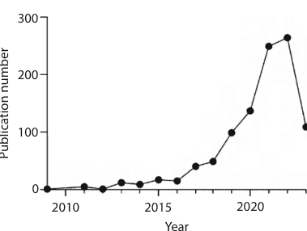

图 9.1 2000 年 1 月 1 日至 2023 年 7 月 23 日机器学习在药物重定位中的出版趋势：基于 Scopus 数据库的分析。

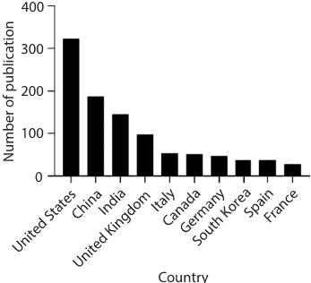

图 9.2 2000 年 1 月 1 日至 2023 年 7 月 23 日前 10 国机器学习在药物重定位出版物分布。数据来源于对 Scopus 数据库的全面分析。


在机器学习药物重定位领域。这种多样性可能为该领域带来不同的视角和方法，从而潜在地推动创新和进步。然而，各国贡献中的明显差异可能凸显资源获取不均、国家研究优先级的差异，或基础设施和政策相关的限制。鼓励更公平的国际合作对于传播知识、共享资源以及确保在利用机器学习进行药物重定位方面取得全球进步至关重要。未来的研究可以探讨不同国家的出版物影响以及这些国家之间的合作网络，以进一步了解机器学习药物重定位研究的全球格局。

## 9.2.2 药物重定位中机器学习应用的聚类分析

本节利用VOS viewer工具对重要的文献计量网络进行可视化和分析。该工具以其用户友好的界面而闻名，使研究人员更容易识别和探索学术出版趋势。它有助于关键词、作者和机构的映射，从而能够识别特定领域的热门主题、多产作者和有影响力的机构 [14, 15]。在此背景下，使用VOS viewer 1.6.16工具进行了关键词共现网络分析，为机器学习在药物重定位领域中的研究重点提供了关键洞察（图9.3）。在10,453个关键词中，1,999个满足至少出现五次的阈值。这些关键词形成了五个不同的簇，每个簇代表特定的研究重点。簇1（绿色，429个条目）主要集中在计算生物学、数据挖掘、药物-靶点相互作用和药物发现过程上。这表明在药物相互作用、发现和重定位方面高度重视计算和机器学习算法方法。簇2（红色，247个条目）突出了利用机器学习在分子水平探索药物作用机制（*通过*基因表达）。这表明致力于利用机器学习技术加深对药物作用的理解，从而可能提高药物重定位的精度和疗效。簇3（蓝色，205个条目）强调了利用机器学习研究抗病毒药物，反映出利用计算方法加速和改进抗病毒药物发现与重定位的持续兴趣，这可能受到最近大流行危机（COVID-19）的推动。簇4（黄色，184个条目）专注于分子对接和生物检测。这暗示了利用机器学习方法补充基于实验室的评估和临床前评估的兴趣日益浓厚，这些是药物开发和重定位的关键阶段。最后，簇5（紫色，134个条目）以强调应用人工智能和机器学习进行临床决策、临床研究和不良结局调查为特征。这凸显了机器学习技术在转变临床实践、辅助临床研究以及增强对不良药物反应的预测和理解方面的潜力。

## 9.2.3 药物重定位中机器学习应用的研究趋势

如图9.4所示，利用机器学习进行药物重定位，特别是在治疗学和精准医疗的背景下，代表着一个重要且快速发展的研究趋势。这一趋势与精准医疗的目标有效融合，精准医疗旨在在正确的时间将正确的治疗方案提供给正确的患者。

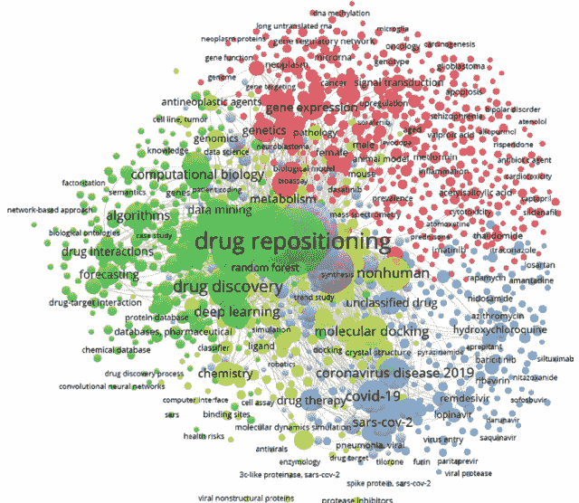

图9.3 通过关键词共现网络分析识别的研究主题聚类。该网络使用基于Scopus数据库中2000年至2023年文献的VOS viewer v. 1.6.16生成。每个簇代表药物重定位机器学习领域中的一个独特研究主题。

这一趋势的一个典型例子是抗病毒药物用于COVID-19治疗的重定位，这由大流行带来的紧迫性所催化。研究人员已采用机器学习算法扫描大量现有抗病毒药物，以确定COVID-19的潜在治疗方法——例如，机器学习算法可以根据导致COVID-19的病毒SARS-CoV-2的基因组序列预测潜在的药物-靶点相互作用，从而识别能够抑制病毒并加速这种新型疾病有效治疗方法开发的抗病毒药物。在癌症研究领域，机器学习被用于分析遗传、转录组、蛋白组和药理学数据，以识别可用于特定类型癌症的重定位药物。这些药物可能针对癌症特有的遗传或分子异常，从而提供更精确、更有效的治疗。在糖尿病和神经退行性疾病方面，机器学习用于根据患者独特的遗传、表观遗传和生理特征预测患者对不同治疗的反应，从而帮助识别针对个体患者的潜在可重定位药物。此外，在罕见病或孤儿病领域，机器学习在识别潜在治疗方法方面显示出相当大的前景。由于缺乏财务激励和患者群体较小，这些疾病的药物开发常常受到限制。在这里，药物重定位通过识别现有药物的新用途，提供了一种节省时间和成本的解决方案。总之，在精准医疗中利用机器学习进行药物重定位的趋势具有显著潜力，可以彻底改变

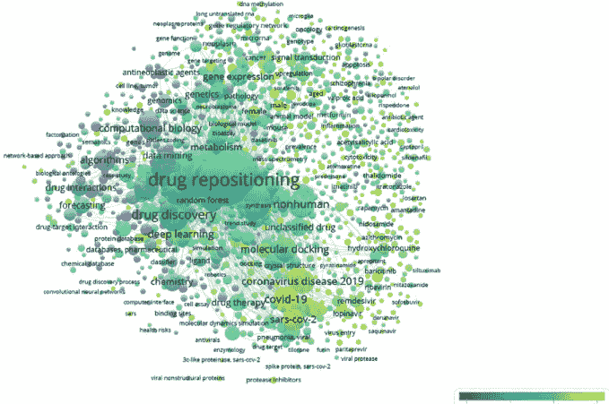

图9.4 基于关键词共现网络分析的药物重定位机器学习应用研究趋势。该插图使用VOS viewer v. 1.6.16创建，利用了Scopus数据库中2000年至2023年的文献。

患者护理，从而带来更个性化、更有效的治疗，特别是对于目前缺乏有效疗法的疾病。然而，有必要强调，尽管前景广阔，但该领域复杂且充满挑战。通过机器学习识别的药物重定位候选者仍必须经过严格的临床前和临床测试，以确定其安全性和疗效。

## 9.3 理解药物重定位

制药行业不断寻求多种疾病的新治疗方法。传统方法称为*从头开始*药物发现，涉及开发全新药物。然而，这种方法耗时、昂贵且风险高。相比之下，药物重定位是寻找现有药物新用途的做法。这些药物可能已经上市，或是那些未能达到初始靶点但在I期临床试验中已被证明安全的药物 [1]。目标是发现超出原始医疗适应症的治疗用途 [2]。药物重定位已成为一种有前景且高效的替代传统方法。有趣的是，美国食品药品监督管理局（FDA）批准的所有药物中约有30%是重定位药物，对全球制药行业总收入（25%）做出了重大贡献 [16–18]。为了进一步简化这一过程，已开发基于生物信息学的工具，用于快速分析成千上万种药物。*从头开始*药物发现和药物重定位的比较时间表如图9.5所示。*从头开始*药物发现涉及初始发现，

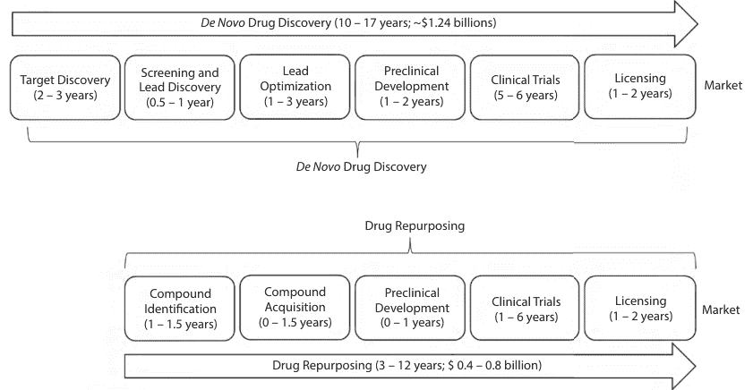

图9.5 比较时间表，说明de novo药物发现与药物重定位的速度和效率。

临床前测试、临床试验，最后是FDA批准 [1]。这个漫长的过程可能持续数年甚至数十年，使一种新药上市的平均成本为12亿至28亿美元 [19, 20]。相比之下，药物重定位大大缩短了新用途批准所需的总时间（3–12年），因为这些药物已经通过了几个初始测试阶段 [21]。

## 9.4 药物重定位中的传统技术

本节讨论药物重定位的概念及其在现代医学中日益增长的相关性。最初，探讨了药物重定位的传统方法，如偶然发现、体外和表型筛选、副作用分析以及非标签用途。考察了每种技术的优缺点，以提供全面的理解。讨论随后转向日益增长的趋势：从这些传统方法转向数据驱动的方法。得益于大数据和机器学习的兴起，药物重定位正在经历重大转变，为更快、更高效、可能更出色的药物发现开辟了新途径。

### 9.4.1 偶然发现

药物重定位中的偶然发现是指在药物被用于或测试其主要预期目的时，对新应用的非计划性发现。这种不够系统的方法通常取决于机会或观察力敏锐的研究人员或临床医生所做的意外观察 [22]。尽管这种方法具有不可预测性，但偶然发现在药物重定位中促成了许多重大突破。表9.1举例说明了


表 9.1. 基于偶然性方法重新用于其他适应症的已批准药物示例。

| 药物名称 | 原始适应症 | 新适应症 | 描述 | 参考文献 |
|---|---|---|---|---|
| 西地那非（Viagra） | 心绞痛（由于心脏血流减少引起的胸痛） | 勃起功能障碍 | 在心绞痛临床试验期间，男性患者报告勃起功能改善，这促使西地那非被重新用于治疗勃起功能障碍。 | [4] |
| 沙利度胺 | 镇静剂/孕吐 | 结节性痒疹和多发性骨髓瘤 | 最初由于严重的先天性缺陷而撤市，后来发现其对治疗结节性痒疹（一种与麻风病相关的皮肤疾病）和多发性骨髓瘤（一种癌症）有效。 | [4] |
| 米诺地尔 | 高血压（高血压） | 脱发（秃发） | 米诺地尔最初用于治疗高血压，在患者观察到毛发生长增加作为副作用后，被重新用于脱发治疗。 | [27, 28] |
| 普萘洛尔 | 心绞痛和高血压 | 舞台恐惧（表演焦虑） | 普萘洛尔是一种用于心血管疾病的β受体阻滞剂，发现其对神经系统的作用可缓解舞台恐惧症状。 | [4] |
| 阿司匹林 | 止痛 | 预防心脏病发作和中风 | 阿司匹林最初是一种止痛药，后来发现其具有抗凝血特性，可预防心脏病发作和中风，从而被重新用于这些适应症。 | [4, 28] |
| 肉毒杆菌毒素（Botox） | 肌肉痉挛 | 减少皱纹 | 肉毒杆菌毒素最初用于治疗肌肉痉挛，当患者注意到治疗后皱纹减少时，Botox被重新用于美容用途。 | [4, 29] |

基于偶然性方法重新用途的药物。该表列出了这些药物的原始用途和新用途，并简要解释了每个重新用途的过程。在此案例中，讨论了一个用于治疗勃起功能障碍的药物重新用途示例。勃起功能障碍，即无法获得或维持足以进行满意性行为的勃起，是一种影响全球数百万男性的普遍病症。麻萨诸塞州男性老龄化研究表明，大约52%的40至70岁男性经历某种形式的勃起功能障碍 [23]。预测表明，到2025年，勃起功能障碍的全球患病率将大幅增加，这主要归因于人口老龄化以及糖尿病和心血管疾病等病症发病率的上升，这些病症与勃起功能障碍密切相关。当前治疗包括生活方式改变、口服药物（如西地那非、伐地那非或他达拉非）、真空勃起装置、阴茎注射和阴茎植入物。然而，这些治疗可能并非对所有人都有效，并且可能有副作用。因此，药物重新用途在发现这种病症的新治疗方法方面可以发挥重要作用。成功药物重新用途的一个重要例子是西地那非（图 9.6），通常称为伟哥 [24]。辉瑞公司在20世纪80年代末最初开发西地那非以治疗心绞痛（由于心脏疾病引起的胸痛）和高血压。它作为一种磷酸二酯酶5型（PDE5）抑制剂发挥作用，可阻断PDE5酶。在心绞痛和高血压的背景下，其适应症是扩张血管以改善心脏血流 [25]。然而，在20世纪90年代初的临床试验中，西地那非被证明对心绞痛效果不佳。许多男性参与者报告了意外的副作用：勃起改善。该药物不仅增强了流向心脏的血流，还增强了流向阴茎的血流，帮助男性获得并维持勃起。意识到这一潜力后，辉瑞公司决定将该药物重新用于治疗勃起功能障碍。在经过一系列额外的临床试验以确认其针对该用途的疗效和安全性后，FDA于1998年批准了西地那非。作为第一种获批用于治疗勃起功能障碍的口服药物，西地那非此后已帮助数百万患有此病症的男性 [26]。西地那非现在是治疗勃起功能障碍最著名的治疗方法之一，其发现从根本上改变了对这种病症的认识和治疗。

沙利度胺是药物重新用途的另一个显著例子。最初，该药物作为镇静剂和治疗妊娠期恶心呕吐的药物上市，但由于严重的先天性缺陷而被撤市。然而，随后发现其对治疗结节性痒疹（一种与麻风病相关的皮肤病）和多发性骨髓瘤（一种癌症）有效。其他偶然性药物重新用途的实例可以在以下药物的故事中找到：

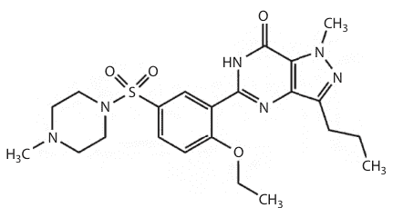

图 9.6 西地那非的化学结构（ChemDraw 20.1.1）。

米诺地尔、普萘洛尔、阿司匹林和肉毒杆菌毒素（Botox），每种都有其独特的历程。这些案例，从米诺地尔刺激毛发生长和普萘洛尔镇静作用的偶然发现，到阿司匹林和Botox的扩展作用，突显了药物重新用途不可预测但又重大的潜力 [4]。然而，需要注意的是，尽管有这些成功案例，但由于偶然性方法依赖于机遇，因此它既不可靠也不可扩展。因此，在现代，已转向更系统、可扩展和数据驱动的方法。这些当代方法可以加速药物重新用途过程，提高效率，并提供一条更可预测的发现路径。

### 9.4.2 体外筛选

体外筛选是药物重新用途中传统采用的一种基本技术。术语 *体外*（拉丁语意为“在玻璃中”）是指在活体外部进行的实验，通常在受控的实验室环境中进行，例如试管或培养皿。此方法涉及将现有药物与细胞系（源自单个细胞并具有相同遗传构成的细胞群）或与感兴趣疾病相关的生物靶点进行筛选。目的是确定这些药物是否对该疾病表现出任何潜在活性。许多成功的药物重新用途实例源于 *体外* 筛选。例如，齐多夫定（AZT）最初在20世纪60年代开发为一种抗癌药物（表 9.2）。通过 *体外* 测试，发现其能抑制人类免疫缺陷病毒（HIV）复制，为其重新用于HIV治疗铺平了道路。AZT（也称为齐多夫定）在进一步测试后成为治疗HIV/AIDS的第一种获批抗逆转录病毒药物 [30]。

同样，伊马替尼（Gleevec）最初开发并获批用于治疗慢性髓系白血病，这是一种血癌。这是因为它能抑制一种特定蛋白质BCR-ABL酪氨酸激酶，这种蛋白质推动这些癌细胞的生长。体外筛选

表 9.2 基于 *体外* 筛选方法重新用于其他适应症的药物示例。

| 原始药物 | 初始适应症 | 体外观察 | 重新用途适应症 | 参考文献 |
|---|---|---|---|---|
| 齐多夫定（AZT） | 癌症 | 在细胞系中抑制HIV（人类免疫缺陷病毒）复制 | HIV治疗 | [30] |
| 伊马替尼（Gleevec） | 白血病 | 在癌细胞系中抑制特定蛋白酪氨酸激酶 | 胃肠道间质瘤，其他癌症 | [32] |
| 双硫仑（Antabuse） | 酒精依赖 | 在细胞系中抑制癌细胞生长和活力 | 癌症（实验阶段） | [34] |

体外筛选还发现，伊马替尼还能抑制其他酪氨酸激酶，包括c-KIT，后者在胃肠道间质瘤（GIST，一种罕见癌症类型）中通常过度活跃。这促使伊马替尼成功重新用于GIST治疗 [31, 32]。此外，双硫仑（Antabuse）最初获批用于治疗酒精依赖，通过 *体外* 筛选实验显示其能抑制癌细胞生长和活力。这一结果表明其可能重新用于癌症治疗。这种重新用途仍处于实验阶段，还需要更多研究来确定其在人类中用于这一新用途的疗效和安全性 [33]。

尽管有这些成功，但 *体外* 筛选方法存在一定局限性。这可能是一个昂贵且耗时的过程。此外，药物在试管或培养皿中的疗效不一定能转化为其在复杂活体生物中的疗效。药物必须安全有效地到达体内的靶点。*体外* 过程常常产生高比例的假阳性，即药物在 *体外* 中看起来有效，但未能在 *体内* 中表现出相同效果。出于这些原因，虽然 *体外* 筛选可以产生有价值的初步洞察和假设，但它通常只是更大的药物发现和重新用途过程的一个方面。积极的 *体外* 结果需要通过进一步测试进行验证，这通常涉及动物模型中的 *体内* 研究，随后进行人体试验。

### 9.4.3 表型筛选

表型筛选是一种传统的药物发现和重新用途技术，在识别众多治疗剂方面发挥了关键作用。与靶点筛选不同，后者从已知的生物靶点（如蛋白质或基因）出发并寻找与其相互作用的药物，表型筛选则在没有预定义靶点的情况下开始。此方法涉及观察药物在生物系统中引起的表型变化——由基因型与环境相互作用导致的生物体可观察的物理或生化特征的变化。该系统可能是细胞系、一组细胞、组织样本，甚至整个生物体 [35]。

例如，研究人员可能将药物给予癌细胞并观察其是否抑制生长，或者将药物给予斑马鱼或小鼠并监测动物是否有任何变化。在药物重新用途的背景下，表型筛选方法涉及在疾病模型中测试已获批药物或一组已获批药物，以观察任何有益效果。如果药物引起有利的表型变化，则可能考虑将其重新用于治疗建模的疾病。表型筛选可以识别在复杂生物系统中有效的药物，不论其作用机制如何。在潜在分子机制尚未完全理解的疾病中，这尤其有价值。然而，这种方法的一个重大挑战是，一旦确定潜在药物，通常需要付出大量努力来解读其作用机制，即它如何产生所观察到的效果。此外，表型筛选资源消耗大，因为它需要疾病模型和专门的检测方法。它可能并不总是能准确反映人类的疾病环境，尤其是在使用 *体外* 模型时。金刚烷胺是通过表型筛选重新用途的药物的一个显著例子。它最初开发为抗病毒药，后来通过观察患者症状（一种表型）发现其能缓解帕金森病症状，如今被用作该病症的治疗方法 [36]。


## 9.4.4 副作用分析

副作用分析是药物重定位中使用的另一种方法，涉及监测药物对患者的非预期影响。虽然副作用通常被视为负面或不想要的，但它们偶尔可以提供关于药物额外治疗用途的见解。其基本思想是，如果某种药物在患者体内引起特定效应，这可能暗示该药物与与该效应相关的生物机制发生相互作用。研究这些相互作用可能揭示药物的新应用——例如，米诺地尔最初被批准用于治疗高血压，但观察到它能刺激头发生长，这是一种意外的副作用。这一观察促成了米诺地尔作为局部脱发治疗药物的成功重定位。如今，它以多种品牌名称广泛销售，包括 Rogaine [37]。但是，必须认识到副作用分析的局限性。副作用可能是不可预测的，并且可能对所有患者都不有利甚至不可取。事实上，管理或尽量减少副作用往往是必要的，因为它们可能引起不适或带来健康风险。此外，并非所有副作用都会导致有益的新应用。尽管存在这些挑战，但通过适当管理，副作用分析可以显著促进药物重定位的成功。药物效应大数据日益增加的可用性，加上计算方法的进步，表明对副作用进行系统的大规模分析可能会揭示更多药物重定位的机会。

## 9.4.5 生化分析

生化分析是执行以测量生物样本（通常在分子水平）中某种物质（例如药物）的存在或活性的测试。在药物重定位的背景下，这些分析用于探索现有药物是否可以与与药物最初设计治疗的疾病不同的疾病相关的特定靶蛋白或通路相互作用——例如，如果一种蛋白质被确定为疾病的关键促成因素，则可以利用生化分析来检查现有药物是否可以与该蛋白质结合或抑制其活性。这种方法基于这样的理解：药物通过与体内特定分子相互作用而产生效果，从而修改其行为或功能。如果发现一种药物与与不同疾病相关的靶点相互作用，那么它可能被重新定位用于治疗该疾病。使用生化分析进行成功药物重定位的主要例子是伊马替尼的案例。最初开发用于靶向慢性髓系白血病中特定的酪氨酸激酶酶，生化分析揭示伊马替尼还抑制与胃肠道间质瘤相关的另一种酪氨酸激酶的活性。这促成了伊马替尼用于治疗 GIST 的成功重定位 [38]。但是，与其他方法类似，生化分析方法存在局限性。它需要全面了解疾病的生物学和特定靶点，而对于所有疾病并非总是可用。此外，虽然药物可能在分析中与疾病靶点相互作用，但这并不能保证该药物将在活体生物体中有效对抗疾病。鉴于分析条件可能与人体内的条件有显著差异，必须始终通过进一步的临床前和临床测试验证从生化分析得出的结果。

## 9.4.6 非标签用药

非标签用药是指将药品用于尚未正式获批的适应症、年龄组、剂量或给药途径 [39]。美国 FDA 和欧洲药品管理局（EMA）等监管机构负责批准特定适应症的药物。但是，一旦药物获批，如果医生认为对患者有益，他们可以自由地非标签开药 [40]。在药物重定位的背景下，非标签用药可以为现有药物的潜在新应用提供宝贵的见解。医生可能会观察到，当药物非标签使用时，会对与其原始批准适应症不同的病症或疾病产生有益效果。这一观察可能促使进一步研究，并可能导致新用途的正式批准。

通过非标签用药进行药物重定位的一个著名案例是阿司匹林。最初开发用于止痛，医生注意到其抗凝血特性，并开始非标签开具处方以预防心脏病发作和中风。后来，临床研究支持了这种非标签用药，从而使其广泛使用并正式获批用于此目的。尽管如此，非标签用药并非没有风险，因为该药物未针对非标签适应症进行严格的测试和监管审查。这可能导致意想不到的风险或副作用。因此，非标签用药应基于大量科学证据或知情的临床判断。虽然像 FDA 这样的监管机构不监管医疗实践，因此不管辖医生酌情非标签开药的权力，但他们确实会监控制药公司关于非标签用药的沟通，除非医疗专业人员明确请求，否则这种沟通通常是不允许的。尽管非标签用药可能导致成功的药物重定位，但它更多是在医疗实践中出现的一种机会，而非药物重定位的系统方法。

## 9.5 药物重定位中的现代技术

随着药物重定位领域的发展，正在开发和应用新技术来简化该过程。基因组学、生物信息学、ML 和 AI 的进步正在推动一种系统且高效的方法来识别有前景的药物重定位候选药物 [9, 41]——例如，基因组学和生物信息学彻底改变了我们对疾病病理学的理解。人类基因组的测序，加上蛋白质组学和代谢组学等其他“组学”技术的进步，使我们能够比较健康个体和患病个体之间的基因组图谱。这些比较可能识别出新的药物靶点。然后，生物信息学工具使用这些“组学”数据来分析和解释生物信息，可能揭示可用于药物重定位的药物–疾病关系 [42]。重要的是，ML 作为 AI 的一个子集，在此发挥作用。ML 算法可以被训练以在大数据集（例如基因表达数据）中识别模式，并根据这些模式预测药物可能对疾病产生的影响。此外，AI 可以处理大量数据以探索药物和疾病之间先前未知的联系。它还可以预测潜在的副作用、药物–药物相互作用和患者反应，从而帮助评估重定位候选药物 [43]。

网络药理学也发挥着关键作用。这种整体方法考虑药物与生物系统之间的相互作用网络。该方法使用数学和计算工具来可视化和分析这些相互作用，可能揭示现有药物的新靶点，从而为药物重定位提供机会 [44]。技术进步也使高通量筛选成为一种可行的选择。该过程能够快速且具成本效益地筛选大量现有药物库，针对各种生物靶点或疾病模型。与传统方法相比，它能更系统地、更大规模地识别潜在的重定位候选药物 [45]。最后，*体外计算机建模*允许模拟药物与其潜在靶点之间的相互作用。这使研究人员能够在不进行昂贵且耗时的实验室实验的情况下预测药物的效果，作为识别潜在药物重定位候选药物的初步步骤 [46]。尽管有多种技术发展，本章将具体关注 ML 在药物重定位中的应用，而其他技术将不作详细讨论。

### 9.5.1 机器学习

ML 是一种计算技术，它采用算法从数据中学习，并在无需显式编程的情况下做出决策或预测。本质上，ML 使用大型数据集训练模型，使其能够自主识别数据中的模式和关系。这种学习过程涉及向算法提供训练数据，算法利用这些数据构建数学模型。一旦训练完成，该模型可以通过在新的、未见过的数据中识别类似模式来在无需人工干预的情况下做出预测或决策 [47]。ML 在多个领域有广泛应用，包括但不限于金融、医疗保健、营销以及日益增长的药物重定位。其处理和从大量复杂数据中学习并应用这些知识来预测新数据结果的能力 [48, 49]。这一特性使其成为识别潜在药物候选物、预测副作用以及发现现有药物新治疗用途等任务的绝佳工具。ML 的本质是迭代学习；随着每次接触更多数据，模型会逐步提高其预测准确性。这与人类学习类似，重复和经验能增强理解和技能 [50]。在药物重定位的背景下，ML 引入了新的效率和准确性水平，显著增强了我们为现有药物寻找创新且有效用途的能力 [5]。不过，为了在药物重定位中最佳利用 ML，理解其工作原理、如何解释其结果以及如何管理其局限性至关重要。这些方面将在后续章节中进一步讨论。

### 9.5.2 药物重定位中的机器学习方法

本节深入介绍了药物重定位研究中采用的各种 ML 方法（表 9.3）。其目的是强调这些方法的多种优势和独特能力，突出它们在揭示现有药物潜在新治疗应用方面的关键作用。此外，它强调了 ML 算法复杂性如何提升药物重定位工作中的效率和预测准确性。


## 表 9.3 药物重新定位的机器学习技术比较。

| Technique | Description | Example applications in drug repurposing | Advantages | Limitations | Reference |
| --- | --- | --- | --- | --- | --- |
| 受监督学习 | 这种学习涉及在标记数据集上训练的算法。该算法学习一个将输入数据映射到输出数据的函数。 | 可根据药物特征预测药物是否可以重新定位。这通过在标签指示药物是否成功重新定位的数据集上训练算法来实现。 | 当有大量高质量标记数据集可用时，它可以提供准确可靠的预测。 | 它需要标记的训练数据。此外，如果发生过拟合，它可能无法很好地推广到未见数据。 | [52] |
| 无监督学习 | 这种学习涉及在未标记数据集上训练的算法。目标是识别数据中的模式或关系。 | 可根据药物特征对药物进行聚类，这可能指示潜在的新用途。 | 它可以识别监督学习可能无法察觉的数据中的新颖模式或聚类。 | 解释结果或了解识别出的模式是否有意义可能具有挑战性。 | [53] |
| 半监督学习 | 使用标记和未标记数据进行训练，通常是少量标记数据和大量未标记数据。 | 当只有有限数量的标记数据可用时，可用于预测药物-靶点相互作用或药物-疾病关联。 | 即使标记稀缺，也能充分利用数据，通常比纯监督或无监督方法实现更高的准确率。 | 需要精心设计，以确保来自未标记数据的学习能够补充来自标记数据的学习。 | [54] |
| 强化学习 | 这涉及一个代理，它通过在环境中采取行动来最大化某种累积奖励概念来学习决策。 | 可用于药物发现和重新定位，以在庞大的可能药物分子和生物靶点空间中导航。 | 它可以随时间优化决策，非常适合最佳决策策略复杂且不易被传统方法捕获的问题。 | 它可能需要大量计算资源，并且在难以定义合适奖励函数的情况下应用可能具有挑战性。 | [55] |
| 深度学习 | 这是一种涉及多层人工神经网络的机器学习类型。 | 可用于各种药物重新定位任务，例如预测药物-靶点相互作用、生成新药候选物或整合多模态数据以进行药物重新定位。 | 它可以建模复杂的非线性关系，并能处理大型复杂数据集，包括图像、文本和序列数据。 | 它需要大型数据集和大量计算资源。这些模型也可能难以解释。 | [56] |

注意：这些技术的具体实现细节可能会因所使用的具体问题、数据集和方法而异。

### 9.5.2.1 监督学习

监督学习是机器学习的一个子集，涉及算法从标记训练数据中学习，然后将这种学习到的关系应用于新的、未见的数据。训练数据集中的每个实例都包含一个输入向量（自变量）和一个预期输出值（标签或因变量）[51]。目标是学习一个从输入到输出的映射函数，该函数可以预测新数据的结果。常见的监督学习算法包括用于回归问题的线性回归，以及用于分类问题的逻辑回归、k-最近邻、支持向量机和决策树 [52]。在药物重新定位的背景下，监督学习发挥着多种作用，例如预测药物-靶点相互作用和药物-疾病关联，以及根据治疗效果对药物进行分类。监督学习可以预测新的药物-靶点相互作用，这通常是药物重新定位的第一步。训练数据可以由已知药物-靶点对（正例）和不相互作用的药物-靶点对（负例）组成，输入特征分别来自药物（例如，化学结构、分子性质）和靶点（例如，蛋白质序列、结构特征）。标签指示每个药物-靶点对是否相互作用。另一个应用是预测新的药物-疾病关联。在这里，已知药物-疾病对可以作为训练数据中的正例，特征包括药物属性和疾病属性（如相关基因和症状）。标签指示每种药物是否已知用于治疗每种疾病。监督学习算法还可以使用已知分类作为标签，根据治疗效果对药物进行分类。这使得可以将药物重新定位到需要类似治疗效果的新疾病领域。虽然这些应用凸显了监督学习的潜力，但该方法的成功高度依赖于高质量标记训练数据的可用性。尽管如此，鉴于此类数据的可用性，监督学习可以作为预测现有药物新用途的强大工具，从而加速药物重新定位过程。

### 9.5.2.2 无监督学习

无监督学习是机器学习的一个分支，旨在不依赖标记输出值或奖励的情况下识别数据中的模式。当对要预测的结果了解甚少，或重点在于揭示底层数据结构或分布时，它特别有用。典型的无监督学习技术包括聚类，旨在将相似实例分组到聚类中，以及降维，其目的是在不造成显著信息损失的情况下简化数据 [53]。在药物重新定位领域，无监督学习可以以多种方式做出贡献，例如药物聚类、药物-疾病关联的发现、药物副作用的识别以及新药类的确定。在药物聚类中，无监督学习根据分子结构、已知靶点和副作用等属性识别具有相似特征的药物组。同一聚类中的药物可能具有可比的治疗效果，暗示基于其在特征空间中的相关性的新用途。为了发现药物-疾病关联，无监督学习可以揭示先前未知的相关性。降维技术可以将高维药物和疾病数据投影到低维空间。随后在这个降维空间中进行聚类，可以识别潜在的药物-疾病关联。关于药物副作用识别，无监督学习通过根据报告的副作用对药物进行聚类，可以预测新的、先前未识别的副作用。这些预测基于同一聚类中其他药物的已知副作用。无监督学习还可以根据各种药物特征识别新药类，为药物的潜在新用途提供见解。然而，将无监督学习应用于药物重新定位并非没有挑战。结果有时可能含糊不清，验证预测通常需要额外的实验数据。此外，无法保证无监督学习识别的模式在药物重新定位的背景下具有意义。尽管存在这些挑战，无监督学习为导航和理解复杂药物数据提供了一个强大的工具。

### 9.5.2.3 半监督学习

半监督学习利用标记和未标记数据的组合进行训练，通常涉及少量标记数据和大量未标记数据。该方法通常始于生成一个初始模型


使用标记数据，随后应用该模型对未标记数据进行标记。然后将数据集合并以生成修订模型，该过程可进行迭代重复。当获取训练标签成本高昂或耗时时，这种学习方法尤其有益，而这在药物重新用途中很常见 [54]。药物重新用途中半监督学习的若干应用包括药物–靶点相互作用预测、药物–疾病关联预测、药物聚类和新类发现。在药物–靶点相互作用预测中，标记数据可能由被确认为相互作用者（正例）或非相互作用者（负例）的药物–靶点对组成。大量的未标记数据可能包含相互作用状态未知的药物–靶点对。半监督学习模型可以通过从标记数据中学习并将其应用于未标记数据，来预测更多药物–靶点相互作用。类似方法也应用于药物–疾病关联预测，其中标记数据可能包括已知的药物–疾病关联，而未标记数据可能涉及关联状态未知的潜在药物–疾病对。半监督学习有助于预测新关联，从而促进对现有药物新用途的识别。对于药物聚类和新类发现，半监督学习可以根据各种特征帮助对药物进行聚类。标记数据可能包括具有已知分类的药物，而未标记数据可能涉及具有未知分类的药物。半监督学习模型可以通过将药物分配给适当的簇来促进新药物类的发现。与纯监督或无监督学习方法相比，半监督学习通常能提供更出色的预测性能，尤其是在标记数据有限时。然而，其有效性取决于未标记数据的分布与标记数据分布镜像一致的假设，而该假设在实践中并不总是成立。此外，确保引入未标记数据不会向学习过程注入偏差或噪声至关重要。

### 9.5.2.4 强化学习

强化学习通过训练算法做出一系列决策来工作，目标是最大化某种累积奖励概念。在此过程中，智能体在某个状态下采取行动，这使其转移到新状态并产生奖励（或惩罚）。智能体的目标是学习一个策略，即规定在每个状态下采取最佳动作的策略，以随时间最大化累积奖励 [55]。在药物重新用途中，强化学习可用于多靶点药物设计中优化治疗方案。强化学习的一些潜在作用包括导航化学空间、优化药物组合、个性化治疗方案和药物合成路径。关于导航化学空间，强化学习可用于导航庞大且复杂的类药分子化学空间。可以设置智能体来探索该空间并识别有前景的药物候选物以供进一步研究。智能体的操作可能涉及对分子结构进行修改，奖励可能基于分子的各种预测属性，例如药物相似性、合成可及性以及对靶点的预测疗效。关于优化药物组合，强化学习也可用于优化重新用途的药物组合。在这种情况下，操作可能涉及选择要包含在组合中的药物，奖励可能基于预测的协同效应或副作用最小化。在个性化治疗方案的情况下，强化学习可用于根据患者的个体特征和对治疗的反应来个性化治疗方案。操作可能涉及在治疗的每个阶段选择药物和剂量，奖励可能基于患者健康和福祉的衡量指标。此外，在药物开发和重新用途中，强化学习可用于识别类药分子的最佳合成路径，从而减少药物生产的时间和成本。尽管强化学习在药物重新用途中前景广阔，但仍存在挑战。强化学习通常需要大量计算资源，且合适奖励函数的设计可能很困难。此外，确保强化学习智能体充分探索环境而不犯太多错误（探索与利用的权衡）可能是一个难以平衡的问题。

### 9.5.3 深度学习

深度学习是机器学习的一个子集，使用具有多个层的神经网络——因此称为“深”——以进行更复杂的分析。深度学习技术可以自动从原始数据中提取特征，因此在分析图像或文本数据等复杂生物数据时特别有用 [56]。用于图像数据的卷积神经网络、用于序列数据的循环神经网络以及用于生物网络数据的深度信念网络等深度学习方法，已在药物重新用途中找到应用。表 9.4 总结了用于药物重新用途的深度学习技术，并阐述了四种不同的深度学习方法及其在药物重新用途中的作用。卷积神经网络以其在分析类网格数据方面的精通而闻名，可用于检查分子结构的网格表示，帮助预测药物–靶点相互作用和药物属性。循环神经网络专门用于处理序列数据，可应用于药物化合物和靶点蛋白的序列表示，从而实现准确的药物–靶点相互作用预测。自动编码器是一种无监督神经网络，能够学习类药分子的紧凑表示，并随后生成潜在新药物化合物；而生成对抗网络则作为一种对抗系统，其中生成器产生新的分子结构，判别器确保这些结构类似现有药物化合物，从而有效地生成新的类药分子。鉴于有充足的数据和计算资源，以及仔细的任务设计和结果验证，这些技术在药物重新用途中都具有巨大的潜力。

在药物重新用途的背景下，由于能够自动从原始数据中学习有意义的表示，深度学习尤其有价值。深度学习在药物重新用途中可以发挥的一些具体作用包括预测药物–靶点相互作用、预测药物–疾病关联、生成新药物候选物、预测药物副作用以及多模式学习。关于预测药物–靶点相互作用，深度学习可以自动从药物和蛋白质的原始分子结构中提取有用特征，这些特征可用于预测药物–靶点相互作用——例如，卷积神经网络可应用于分子结构的网格表示，而循环神经网络可应用于序列表示。与预测药物–靶点相互作用类似，深度学习可用于预测药物–疾病关联。深度网络学习的特征可以捕捉药物和疾病之间的复杂关系，这些关系可能被更简单的方法遗漏。关于生成新

### 表 9.4 用于药物重新用途的深度学习技术。

| 技术 | 描述 | 药物重新用途中的应用 | 参考文献 |
|---|---|---|---|
| 卷积神经网络（CNNs） | CNNs 是一种神经网络，尤其适用于处理类网格数据，例如图像。 | CNNs 可用于分析分子结构的网格表示，以预测药物–靶点相互作用或药物属性。 | [57] |
| 循环神经网络（RNNs） | RNNs 旨在识别序列数据中的模式，因此对处理时间序列或文本非常有效。 | RNNs 可应用于药物化合物和靶点蛋白的序列表示，以预测药物–靶点相互作用。 | [58] |
| 自动编码器 | 自动编码器是一种无监督神经网络，学习将输入数据压缩为低维表示，然后从此压缩表示中重建原始数据。 | 自动编码器（尤其是变分自动编码器 VAEs）可用于学习类药分子的紧凑表示，然后生成新的潜在药物化合物。 | [59] |
| 生成对抗网络（GANs） | GANs 由两个神经网络组成：生成器和判别器，两者相互竞争。生成器试图生成看起来像真实数据的数据，而判别器试图区分真实数据和假数据。 | GANs 可用于生成新的类药分子，其中生成器生成新的分子结构，判别器确保这些新结构类似已知药物化合物。 | [60] |

药物候选物，生成模型（如变分自动编码器和生成对抗网络）可以基于已知药物的分子结构进行训练，然后用于生成潜在新药物的结构。然后可以对这些新药物进行体外或体内测试，以评估其治疗效果，从而可能带来新的药物重新用途机会。关于预测药物副作用，通过在已知药物副作用的大型数据库上进行训练，深度学习模型可以学习预测新药或重新用途药物的潜在副作用。此外，深度学习模型可以同时处理多种类型的输入数据（例如，药物化学结构、靶点蛋白序列和患者遗传特征）。这可以更全面地理解药物


药物重定向领域。深度学习模型需要大量标注数据和可观的计算资源。通常还存在“黑箱”，使得其预测难以解释。此外，确保深度学习模型在新数据上的泛化能力可能是一项挑战，尤其是考虑到生物系统的多样性和复杂性。然而，通过谨慎的应用和解释，深度学习在药物重定向方面具有巨大的前景。

## 9.5.4 药物重定向中的机器学习软件工具

药物重定向并非没有挑战，因为它需要同化和分析大量复杂的生物、化学和临床数据，以探索潜在的新药物-疾病关联。机器学习（特别是专为机器学习设计的软件工具）就在这里发挥关键作用。这些工具可以高效处理并学习大规模、高维数据，因此特别擅长识别人类可能难以或无法辨别的模式和关系。此类见解随后可以指导有前景的药物重定向候选物的识别。机器学习软件工具提供完成这些任务所需的一系列功能。它们包括不同学习类型的算法（受监督学习、无监督学习、半监督学习、强化学习和深度学习）、数据预处理工具、模型评估技术、可视化工具等。凭借这些功能，它们使研究人员能够将复杂的机器学习工作流程应用于药物重定向，从数据探索和预处理的初始阶段到模型训练、验证和部署。此外，其中一些工具是开源的，拥有庞大且活跃的用户社区。这意味着它们会被全球研究人员持续测试、更新和扩展，确保它们始终处于机器学习方法论进步的前沿。它们的广泛使用还意味着附带详尽的文档和教程，即使对机器学习新手来说也易于上手。

表 9.5 列出了药物重定向中的机器学习软件工具，并提供了一份在药物重定向工作中特别有用的工具综合列表。以 scikit-learn 为例，它是一种面向 Python 的高度通用工具，提供了用于分类、回归和聚类的各种算法，从而支持包括受监督学习、无监督学习和半监督学习在内的多种学习技术。DeepChem 是一个专为计算机辅助药物设计而构建的 Python 库，原生集成了 TensorFlow 和 PyTorch 等其他机器学习框架，便于实施深度学习、受监督学习和强化学习技术。RDKit 是一种开源化学信息学工具，用于分子结构的化学信息学分析，并通过与 scikit-learn 集成提供机器学习功能，主要支持受监督学习和无监督学习。TensorFlow 和 PyTorch 是开源平台，可为广泛的机器学习任务提供全面支持。这两种工具都以其深度学习能力而闻名，但也为其他学习范式（例如受监督学习、半监督学习和强化学习）提供了强大的支持。Keras 是一个高级神经网络 API，可实现快速简便的模型设计和实验。它构建在 TensorFlow、CNTK 或 Theano 之上，主要用于深度学习和受监督

## 表 9.5 药物重定向中的机器学习软件工具。

| 软件工具 | 描述 | 支持的机器学习技术 |
|---|---|---|
| scikit-learn | 面向 Python 的免费机器学习库。它提供了用于分类、回归和聚类的各种算法。 | 受监督学习、无监督学习、半监督学习 |
| DeepChem | 一款专门为计算机辅助药物设计而设计的开源 Python 库。它与 TensorFlow 和 PyTorch 等其他机器学习框架集成。 | 深度学习、受监督学习、强化学习 |
| RDKit | 一种开源化学信息学软件，提供用于分子结构化学信息学分析的工具。它通过与 scikit-learn 集成提供机器学习功能。 | 受监督学习、无监督学习 |
| TensorFlow | 一个支持多种任务的开源机器学习平台。TensorFlow 包含用于定义和训练机器学习模型的高级 API，以及用于在生产环境中部署模型的工具。 | 深度学习、受监督学习、半监督学习、强化学习 |
| PyTorch | 一个基于 Python 的科学计算包，旨在替代 NumPy 以利用 GPU 的强大性能。它也是一个提供最大灵活性和速度的深度学习平台。 | 深度学习、受监督学习、强化学习 |
| Keras | 一个用 Python 编写的高级神经网络 API，可在 TensorFlow、CNTK 或 Theano 之上运行。它的开发重点是实现快速实验。 | 深度学习、受监督学习 |
| Weka | 一个用 Java 编写的数据挖掘任务机器学习算法集合，包含用于数据预处理、分类、回归、聚类、关联规则和可视化的工具。 | 受监督学习、无监督学习、半监督学习 |

学习应用。最后，Weka 是一个基于 Java 的数据挖掘任务机器学习算法集合。它提供了大量用于数据预处理、分类、回归、聚类、关联规则和可视化的工具。它适用于多种学习技术，例如受监督学习、无监督学习和半监督学习。每种工具都提供其自身独特的功能，并且它们的用途经常重叠，提供灵活性，可联合使用以满足任何药物重定向项目的特定要求。

## 9.6 药物重定向的数据来源

机器学习在药物重定向中的成功应用在很大程度上取决于全面、准确和相关数据的可用性。各种数据来源（大致可分为生物医学数据库和临床数据来源）对为机器学习算法提供数据至关重要。本节将讨论目前在药物重定向领域中使用的一些关键数据来源。

### 9.6.1 生物医学数据库

生物医学数据库（包括基因组、蛋白组和化学信息学数据）是可用于药物重定向的丰富资源（表 9.6）。它们提供大量可用于构建和训练机器学习模型的结构化数据。

| 数据集名称 | 来源 | 可用性 | 内容 |
|---|---|---|---|
| ChEMBL (www.ebi.ac.uk/chembl) | 欧洲生物信息学研究所 (EBI) | 开源 | 一种经过人工整理的具有类药特性活性分子数据库。它包含约 220 万个化合物和 1.1 万个以上靶点的信息。 |
| DrugBank (www.drugbank.ca) | 阿尔伯塔大学 | 开源和商业 | 一种独特的生物信息学和化学信息学资源，将详细的药物数据与全面的药物靶点信息相结合。它涵盖 1.3 万种药物。 |
| PubChem (https://pubchem.ncbi.nlm.nih.gov/) | 国家生物技术信息中心 (NCBI) | 开源 | 一种小有机分子化学结构及其生物活性信息的免费数据库。该数据库包含约 300 万个化合物。 |
| BindingDB (https://www.bindingdb.org/rwd/bind/index.jsp) | 加州大学圣迭戈分校 | 开源和商业 | 生物分子、遗传或化学改造的生物分子以及合成化合物的测量结合亲和力的公开、可通过 Web 访问的数据库。 |
| PDB (蛋白质数据银行) (https://www.rcsb.org/) | 全球蛋白质数据银行 | 开源 | 一种关于蛋白质、核酸和复合物组装三维结构信息的存档，旨在帮助学生和研究人员了解生物医学和农业的各个方面。 |


## 9.6.1.1 基因组数据库

基因组数据库在药物重定位工作中作为关键资源，前景广阔。它们存储了全面的基因组数据，包括遗传序列、基因表达和突变，这些数据对于理解疾病通路和药物作用机制至关重要——例如，人类基因组计划、癌症基因组图谱和 GenBank 等数据库通过提供丰富、高质量且开放获取的基因组数据，彻底改变了该领域。在这些大规模数据集上训练的机器学习算法已成功识别新的药物-疾病关联并预测潜在的治疗药物——例如，利用这些资源的基因组数据，机器学习模型已将二甲双胍等抗糖尿病药物指向用于癌症治疗和神经退行性疾病。此外，这些数据库促进了基因组数据与其他组学数据（如蛋白质组学和代谢组学）的整合，从而实现对疾病生物学和药物相互作用的整体理解，这可能使药物重定位更加稳健和精确。因此，基因组数据库是未来数据驱动的药物重定位格局中的关键基石。

## 9.6.1.2 蛋白质组数据库

诸如通用蛋白资源（UniProt）、蛋白质数据银行（PDB）和人类蛋白质图谱（HPA）等蛋白质数据库提供关于蛋白质结构、功能和相互作用的信息。分析这些数据有助于识别潜在药物靶点——例如，UniProt 是蛋白质序列和注释数据的综合资源。它是欧洲生物信息学研究所（EBI）、瑞士生物信息学研究所（SIB）和蛋白质信息资源（PIR）之间的合作项目。UniProt 提供多个数据库，其中 UniProt 知识库（UniProtKB）是包含蛋白质功能信息的中央枢纽，具有准确、一致且丰富的注释。此外，UniProt 还提供各种工具和资源，用于分析蛋白质序列和结构、预测蛋白质功能以及执行复杂查询。它在生物信息学中被广泛用于新药开发中的蛋白质分析。PDB 是一个开放获取的数字数据库，收集大型生物分子（如蛋白质和核酸）的 3D 结构数据。这些数据主要通过 X 射线晶体学和核磁共振波谱法获得，科学家使用这些数据来理解这些分子的功能、设计药物并设计新蛋白质。PDB 存档由全球蛋白质数据银行维护，这是一个国际联盟，确保 PDB 保持统一的数据标准、数据质量和全球可访问性。此外，HPA 是一个起源于瑞典的项目，发起于 2003 年，旨在通过整合各种组学技术（包括抗体成像、基于质谱的蛋白质组学、转录组学和系统生物学）来绘制细胞、组织和器官中所有人类蛋白质的图谱。HPA 中的所有数据均开放获取，以允许学术界和工业界的科学家自由访问数据，以探索人类蛋白质组。HPA 提供广泛的信息，包括蛋白质表达谱、蛋白质相互作用以及蛋白质的特定亚细胞位置。这些资源在潜在药物靶点发现和治疗策略开发中可能非常宝贵。

### 9.6.1.3 化学信息学数据库

化学信息学数据库是药物重定位的重要资源，提供大量化合物的化学结构、性质和生物活性的详细信息。值得注意的数据库，如 PubChem、ChEMBL 和 DrugBank，提供庞大且可访问的化学数据，为药物重定位工作中的机器学习算法提供动力——例如，这些数据库已对开发能够预测药物-靶点相互作用的模型做出贡献，从而指导对现有药物新治疗用途的识别。一个显著的例子包括由机器学习模型分析化学信息学数据指导的抗组胺药用于神经退行性疾病治疗的重定位。此外，这些数据库促进了化学数据与生物学和临床数据的整合，从而实现对药物-疾病相互作用的全面理解。因此，化学信息学数据库构成了药物重定位数据驱动格局中不可或缺的一部分，使机器学习算法能够利用化学信息发现新的治疗途径。

## 9.6.2 临床数据来源

临床数据来源提供药物性能、患者健康结局和疾病进展模式的真实世界证据。它们包括电子健康记录、临床试验数据库和不良事件数据库（表 9.7）。

### 9.6.2.1 电子健康记录（EHR）

电子健康记录（EHR）构成了一个丰富的以患者为中心的数据源，在药物重定位的未来方向中发挥着关键作用。EHR 捕获全面的患者病史，包括诊断、治疗和结局，为机器学习算法 [61] 提供了真实世界临床数据的宝库。通过在这些数据上进行训练，机器学习模型可以识别暗示现有药物新治疗用途的模式 [27] ——例如，通过挖掘 EHR 数据，机器学习模型识别出服用二甲双胍药物的糖尿病患者癌症发病率较低，暗示二甲双胍具有潜在的抗癌特性。此外，EHR 促进了在多样化且庞大的患者人群中研究药物-疾病关联，增强了重定位预测的推广性和稳健性。然而，使用 EHR 进行药物重定位的成功还需要严格的数据隐私保护以及处理数据异质性和质量。因此，在足够的数据治理下，EHR 将成为数据驱动的药物重定位未来的关键组成部分。

表 9.7 用于药物重定位机器学习的临床数据集摘要。

| 数据集 | 描述 | 用于药物重定位的机器学习用途 |
| :--- | :--- | :--- |
| 电子健康记录 | 包含诊断、治疗和结局的详细患者记录 | 识别药物使用和效果的真实世界模式，以提出新的治疗用途 |
| 临床试验数据库（例如，ClinicalTrials.gov） | 关于过去和正在进行的临床试验的全面信息 | 分析多样化患者人群和各种条件下药物性能的模式，以提出新的适应症 |
| 不良事件数据库（例如，FAERS） | 对上市后药物副作用的全面洞察 | 了解药物-靶点相互作用和安全性特征，以提出新用途并评估重定位风险 |

### 9.6.2.2 临床试验数据库

临床试验数据库是数据驱动的药物重定位工作的重要资源。这些数据库包括 ClinicalTrials.gov 和世界卫生组织国际临床试验注册平台等平台，提供有关过去和正在进行的临床试验的广泛信息，包括试验设计、患者人群、干预措施和结局。在这些数据上训练的机器学习模型可以识别暗示现有药物新适应症的模式——例如，通过分析临床试验数据库的数据，机器学习算法已建议抗抑郁药可重定位用于慢性疼痛治疗。此外，这些数据库提供有关药物安全性和不良事件的宝贵信息，这对于评估药物重定位候选物的可行性至关重要。然而，值得注意的是，这些数据库的成功应用还需要仔细处理数据质量和标准化。总之，临床试验数据库作为药物重定位链条中的重要环节，提供了关于多样化患者人群和各种条件下药物性能的广阔视图。

### 9.6.2.3 不良事件数据库

不良事件数据库是药物重定位不可或缺的工具，因为它们提供有关药物安全性特征的关键数据，有时可以暗示潜在的新用途。这些数据库，例如美国食品药品监督管理局的不良事件报告系统（FAERS）和世界卫生组织的 VigiBase，提供了关于上市后药物副作用的全面洞察。机器学习模型可以利用这些信息来了解药物-靶点相互作用及其潜在的意外后果——例如，分析不良事件数据库的机器学习算法已建议将用于治疗糖尿病的药物重定位以靶向心血管疾病，因为副作用表明对心血管风险因素的调节。重要的是，这些数据库还提供了关键的安全检查点，帮助识别那些虽然可能对新适应症有效，但由于严重不良事件可能承担过多风险的药物。因此，尽管其最初目的是跟踪药物安全性，但不良事件数据库对于指导药物重定位的未来方向具有巨大的潜力，使其成为数据驱动药物发现生态系统的关键部分。


## 9.7 案例研究：机器学习在药物重定位中的应用

本节讨论了几个利用机器学习（ML）进行药物重定位的显著实例。这些示例可以深入了解该技术在实际情境中的重要意义和可能性。

### 9.7.1 癌症治疗

由于癌症的普遍性高且死亡率高，癌症治疗至关重要。这是一种复杂疾病，其特征是多个身体部位出现不受控制的细胞增殖和扩散。因此，出于多种原因，癌症药物重定位至关重要。

机器学习在药物重定位领域的一个应用涉及利用已获批药物治疗癌症——例如，阿司匹林和塞来昔布已被广泛研究其在预防和治疗结直肠癌（以及其他类型癌症）中的潜在作用。最初作为止痛药和抗炎药研发（阿司匹林是非甾体抗炎药，塞来昔布是选择性环氧化酶-2 抑制剂），研究已表明它们还具有抗癌作用。

认为阿司匹林的抗癌效果源于多种机制。阿司匹林抑制环氧化酶（COX），而环氧化酶参与前列腺素的生成。这些前列腺素促进炎症，而炎症过程可能有助于癌症的发生和发展。因此，通过抑制 COX，阿司匹林可能有助于降低癌症风险和进展。

另一种作用机制涉及阿司匹林众所周知的抗血小板作用，这也可能有助于其抗癌特性。认为血小板能保护循环肿瘤细胞免受免疫系统攻击，并促进转移。通过抑制血小板激活，阿司匹林可能减缓癌症扩散。

各种观察性研究表明，长期使用阿司匹林与降低结直肠癌风险相关。一些研究表明，阿司匹林还可能降低其他类型癌症（如乳腺癌和前列腺癌）的风险，尽管与结直肠癌相比，证据不够充分。

塞来昔布目前获批用于治疗关节炎和急性疼痛，也已被研究其潜在的抗癌效果。这是因为 COX-2 在多种癌症中（包括结直肠癌）常常过度表达。它可能通过多种方式发挥作用。类似于阿司匹林，通过抑制 COX-2，塞来昔布可能有助于减少炎症并降低癌细胞增殖。一些研究表明，塞来昔布可能诱导癌细胞凋亡（程序性细胞死亡）。此外，塞来昔布可能抑制血管生成（新血管的形成），这是肿瘤生长和转移的关键过程。

需要注意的是，虽然阿司匹林和塞来昔布在预防和治疗结直肠癌及其他癌症方面显示出希望，但它们也有潜在副作用，例如胃肠道出血。因此，目前不建议所有人常规使用这些药物进行癌症预防。关于使用这些药物进行癌症预防的决定应个体化做出，需考虑个人的癌症风险、潜在副作用和整体健康状况。

此外，Madugula 等人 [62] 报告了结合机器学习技术和结构-活性关系（SAR）预测，分析包含 1,671 种已获批药物的数据集以进行潜在重定位。研究人员将主成分分析和 k-means 聚类应用于药物的二维分子描述符，得到九个不同的聚类。该团队使用物质活性谱预测工具预测这些药物的生物学活性，以识别潜在的新用途。结果表明，每个聚类包含结构相似但治疗适应症不同的药物，这表明可以根据预测的高生物学活性对这些药物进行重定位。

总体而言，研究人员识别出 66 种药物，尽管结构相似，但具有不同的治疗用途，因此可以重定位用于同一聚类中其他药物的一项或多项适应症。此外，还识别出 1,423 种药物可用于 366 种新适应症的潜在重定位。在癌症类别中，已识别出大量可用于多个治疗领域的重定位药物。具体而言，有 136 种药物用于抗癌目的，125 种药物用于肿瘤前疾病，84 种药物用于抗转移作用，37 种药物用于抗白血病特性，27 种药物用于抗诱变目的，以及 24 种药物用于与抗肿瘤代谢拮抗剂相关的疾病。因此，这项研究展示了整合机器学习和 SAR 分析方法在药物重定位中的实用性，为已获批药物的结构与活性关系提供了宝贵见解。

### 9.7.2 抗病毒治疗

病毒是能感染几乎所有生命形式的微小病原体，可引起人类多种疾病，从普通感冒等轻微疾病到 HIV/AIDS、埃博拉和 COVID-19 等严重疾病 [63–65]。病毒在人类人群中高度流行，根据世界卫生组织（WHO）的数据，每年全球有数百万人遭受病毒感染。最普遍的病毒性疾病包括呼吸道感染、肝炎、HIV/AIDS、流感，以及近期的冠状病毒感染。

抗病毒治疗中药物重定位的需求源于多种因素。近年来，SARS、MERS、寨卡和 COVID-19 等新发病毒性疾病迅速出现，超过了传统药物发现速度 [66]。此外，病毒突变和耐药性是需要考虑的关键因素，因为频繁突变可能导致对抗病毒药物产生耐药性 [67]。在这种情况下，药物重定位可以更快地获得治疗选择。

几个引人注目的案例研究凸显了机器学习在识别抗病毒药物新治疗用途方面的潜力——例如，Shahabadi 等人 [68] 开展了一项研究，以探讨治疗 COVID-19 的潜在药物重定位选项，既承认疫苗的有效性，也认识到相关风险以及对多种新药分子的必要性。该研究聚焦于 RNA 依赖性 RNA 聚合酶（RdRp）的作用，已知该酶在病毒复制中起关键作用。利用分子建模、对接和动态模拟，该研究将五种 FDA 获批药物——贝沙罗替布、二碘羟基喹啉、阿比特龙、塞他司他和瑞德西韦——重定位用于针对 RdRp。这些药物的有效性通过与已知抑制 RdRp 的抗病毒药物瑞德西韦进行比较来衡量。研究结果表明，这些选定的药物作为 RdRp 抑制剂开发具有显著潜力。经过进一步验证，这些药物可能被用于 COVID-19 治疗。

此外，最近的 COVID-19 大流行也见证了机器学习在药物重定位中的应用 [65]。科学家们使用机器学习模型分析大型数据集，包括病毒基因组、患者临床数据和现有抗病毒药物。他们发现，几种现有药物（包括一些抗疟药和抗病毒药物）可能对治疗 COVID-19 患者有效 [63]。这些研究强调了机器学习在药物重定位中的速度和效率，尤其是在紧急的全球卫生危机中 [58] ——例如，Wang 等人 [69] 使用基于网络的药物重定位方法来识别有效的 COVID-19 治疗方法，特别是针对疾病各个阶段的患者。该研究利用整合公共临床转录组和实验数据的计算预测方法，识别出 51 种潜在可调节与 SARS-CoV-2 相互作用蛋白的药物。

讨论了几个值得注意的药物候选物。洛伐他汀被发现会引起轻度 COVID-19 患者临床转录组中的差异基因表达。雌二醇环戊丙酸酯（一种激素相关药物）被指出对治疗重症 COVID-19 患者有效。另一种药物厄罗替尼被发现针对与细胞因子及细胞因子受体相互作用的病毒蛋白，可能影响病毒的附着和入侵过程。此外，洛伐他汀和睾酮被识别为有可能阻断血管紧张素系统，从而可能抑制 SARS-CoV-2 感染。该研究总结时强调了其在识别可用于治疗各阶段 COVID-19 患者的可行药物候选物以及提供潜在药物机制全面理解方面的成功。

此外，Kamboj 等人 [70] 开展了一项研究，以预测用于丙型肝炎病毒感染的重定位药物，该感染可导致病毒性肝炎和肝细胞癌。尽管直接作用性抗病毒药物已在临床使用，但在 5–10% 的病例中会失败，这凸显了对新抗病毒药物的需求。作者使用机器学习和定量结构-活性关系方法开发了一个抗丙型肝炎病毒平台，使用递归特征消除算法选择相关的分子描述符和指纹。他们使用多种机器学习技术开发了预测模型，并通过 10 折交叉验证获得 0.80 至 0.92 之间的皮尔逊相关系数来验证其准确性，在独立数据集上也观察到了类似性能。随后，这些模型被用来识别潜在的重定位药物，分子对接进一步验证了所选候选物。

识别出几种药物，包括萘替芬、布他比妥、维诺瑞宾、厄曲哌铵、哌库溴铵、甲氨那芬、奥洛他代和维莫非尼，作为针对丙型肝炎病毒重定位的有前景候选物。该研究强调了这些药物在开发针对丙型肝炎病毒的新抗病毒治疗方面的潜力。因此，这些案例研究展示了机器学习对药物重定位的深远影响，证明了其加速发现过程的能力，并通过识别现有抗病毒药物的新治疗用途，有可能挽救无数生命。

### 9.7.3 抗糖尿病治疗

糖尿病是一项重大的全球健康问题。这是一种影响身体处理血糖方式的慢性疾病，主要分为两种形式：1 型糖尿病（身体不产生胰岛素的自身免疫性疾病）和 2 型糖尿病（身体对胰岛素产生抵抗或胰岛素分泌不足）。还有妊娠糖尿病，影响一些孕期女性。根据国际糖尿病联合会的数据，约 5.37 亿成年人（20–79 岁）患有糖尿病


在2021年，预计这一数字将上升至2045年的7.832亿人[71]。糖尿病是心脏病、中风、失明、肾衰竭和下肢截肢的主要原因之一[72]。虽然有多种糖尿病治疗方法可用，但它们并非对每个人都有效，许多患者难以实现最佳血糖控制。新药可以为这些患者提供更多治疗选择并改善治疗效果。鉴于糖尿病流行病的规模和严重性，药物发现和药物新用途研究对于提供新的治疗选择、改善患者预后和降低医疗成本至关重要。机器学习（ML）是一种强大的工具，可用于识别抗糖尿病药物的新治疗应用，如多个重要案例研究所示。值得注意的是，例如，一个基于基因组、表型和临床数据训练的机器学习模型，将抗糖尿病药物二甲双胍确定为癌症的潜在治疗药物，从而推动了大量正在进行的临床试验，以研究二甲双胍的抗癌特性。Rashid等人[72]的研究旨在通过药物新用途研究来识别2型糖尿病的潜在新疗法。该研究集中于寻找可以抑制参与碳水化合物代谢的酶α-葡萄糖苷酶的药物。通过减缓碳水化合物代谢，2型糖尿病患者的血糖水平可以得到更好的控制。因此，研究人员查看了美国食品药品监督管理局（FDA）批准的药物，以寻找α-葡萄糖苷酶的潜在抑制剂。他们使用了经过改进和优化的靶标蛋白，引入缺失的残基并最小化冲突，以识别潜在的抑制剂。使用AutoDock Vina，研究人员分析了结合亲和力和均方根偏差（RMSD）值，后者测量模型预测值与实际观测值之间的差异。基于这些分析，选择了两种化合物，特拉贝腾和地克环素，作为潜在的α-葡萄糖苷酶抑制剂。这些化合物进一步通过分子动力学（MD）模拟进行了分析，以研究受体（α-葡萄糖苷酶）和配体（药物）之间的稳定性和特定相互作用。对接得分、RMSD值、药效团研究和MD模拟表明，特拉贝腾和地克环素可能是潜在的α-葡萄糖苷酶抑制剂，可能优于现有的标准抑制剂。特别是，特拉贝腾在体外显示出显著的有效性，IC50（衡量物质抑制特定生物学或生物化学功能效果的指标）为1.263 ± 0.7 μM。然而，研究人员得出结论，还需要进一步调查以确定这些药物用于体内治疗2型糖尿病的安全性。本研究的结果表明，药物新用途研究可能为管理2型糖尿病提供新的方法，这种疾病的全球患病率正在迅速上升。

## 9.7.4 神经退行性疾病治疗

神经退行性疾病是一大类以神经系统结构和功能进行性退变为特征的疾病。它们包括阿尔茨海默病、帕金森病、亨廷顿病和肌萎缩侧索硬化症等疾病。随着全球人口老龄化，其中许多疾病的患病率正在上升，并给患者带来沉重负担。神经退行性疾病的现状日益普遍——例如，阿尔茨海默病协会估计，到2021年，约620万名65岁及以上的美国人将患有阿尔茨海默病。如果没有重大的医学突破，到2060年，这一数字可能上升至近1400万。神经退行性疾病患病率和影响的增加，加上缺乏有效治疗，使得药物新用途研究成为加速发现这些疾病新疗法的一种有前途的策略。

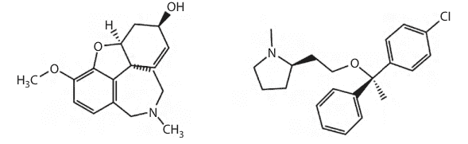

图9.7 加兰他敏（左）和克莱mas汀（右）的化学结构（ChemDraw 20.1.1）。

加兰他敏（图9.7），最初源自雪滴花植物（Galanthus nivalis L., 石蒜科），最初在20世纪50年代和60年代被用作麻醉辅助药和治疗小儿麻痹症及各种肌肉疾病的药物，因其能增强神经肌肉接头传递。后来发现了加兰他敏作为乙酰胆碱酯酶抑制剂的作用。乙酰胆碱酯酶是一种分解乙酰胆碱的酶，乙酰胆碱是大脑中对记忆和学习至关重要的神经递质。通过抑制这种酶，大脑中可用的乙酰胆碱会更多，这可能改善认知功能。因此，加兰他敏被重新用于阿尔茨海默病的治疗，后者是一种以进行性记忆丧失和认知功能下降为特征的神经退行性疾病。在阿尔茨海默病中，产生乙酰胆碱的神经元会退变，导致大脑中乙酰胆碱水平降低。通过阻断乙酰胆碱酯酶的作用，加兰他敏有助于增加乙酰胆碱水平，从而改善神经细胞之间的通信，并可能改善或维持认知功能。在美国，FDA于2001年批准加兰他敏用于治疗轻至中度阿尔茨海默病。此后，它一直被广泛用作这种疾病症状性治疗的一部分。然而，虽然加兰他敏可以帮助管理阿尔茨海默病的症状，但它不能治愈该疾病或阻止其进展。随着阿尔茨海默病的进展，神经元损失继续，最终乙酰胆碱的含量降低到加兰他敏和类似药物已无法有效弥补的程度。

机器学习在药物新用途研究中的应用在应对神经退行性疾病方面展现出巨大潜力，如多个有影响力的案例研究所示。一个突出的例子是使用机器学习识别抗组胺药克莱mas汀（图9.7）在多发性硬化症中的潜在治疗用途。基于基因组和临床数据训练的机器学习模型将克莱mas汀标记为药物新用途的候选药物，这一洞察随后通过临床试验得到证实。在另一个例子中，机器学习模型被部署用于探索抗癌药物尼洛替尼用于治疗帕金森病和其他神经退行性疾病的新用途。这些模型利用复杂的生物化学和患者来源数据，发现了尼洛替尼的潜在神经保护作用，这一发现目前正在接受临床验证。最后，机器学习指导了抗糖尿病药物二甲双胍用于治疗阿尔茨海默病的新用途，依托全面的遗传、表观遗传和表型数据，揭示了二甲双胍作为神经保护剂的潜力。这些实例凸显了机器学习如何在神经退行性疾病中发现新的治疗途径，展示了其在加速药物新用途研究方面的前景，并可能为受这些致残性疾病困扰的患者带来新的希望。

## 9.7.5 脱发治疗

雄激素性脱发，也称为男性型秃发或女性型脱发，是男性和女性中最常见的脱发类型。在男性中，雄激素性脱发可早在青春期晚期开始，且风险随年龄增长而增加。到50岁时，约30–50%的男性会经历一定程度的脱发[73]。该病的特征是发际线后移以及太阳穴和头顶部位头发变薄。在女性中，这种脱发通常表现为更弥散的脱发，即整个头皮普遍变薄，但前额发际线通常会被保留。它通常比男性更晚才变得明显，通常发生在男性更年期之后[74]。美国皮肤病学会估计，约40%的女性在达到40岁时会出现可见脱发。多种因素会影响患雄激素性脱发的可能性，包括遗传和雄激素水平，雄激素是参与男性特征和生殖活动的性激素。总的来说，雄激素性脱发影响着相当比例的人口，尤其是老年人。它常常导致心理困扰和生活质量下降，凸显了为这种状况提供有效治疗的重要性[75]。

米诺地尔和非那雄胺是治疗脱发或雄激素性脱发的两个著名的药物新用途成功案例（图9.8）。最初，米诺地尔被开发为高血压治疗药物。作为一种抗高血压血管扩张剂，它有助于放松和扩张血管以降低血压。然而，在高血压的临床试验中，观察到一个显著的副作用：该药似乎会引起毛发生长[37]。鉴于这一意外效果，科学家开始调查米诺地尔作为

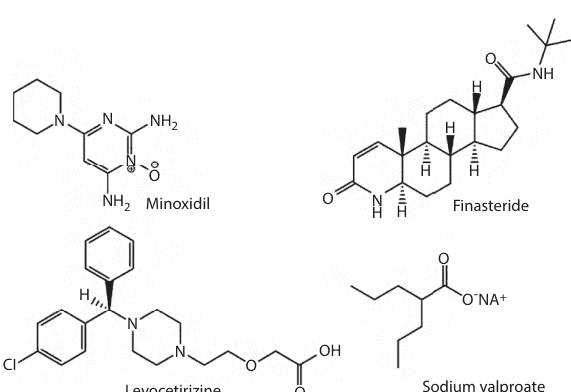

图9.8 米诺地尔、非那雄胺、左西替利唑和丙戊酸钠的化学结构（ChemDraw 20.1.1）。


treatment for hair loss. While minoxidil’s precise mechanism for promoting hair growth is still not fully understood, it is believed to prolong the growth phase of hair follicles and increase blood flow to the scalp. As a result of these studies, topical minoxidil, applied directly to the scalp, was approved by the FDA as a treatment for hair loss in the 1980s. It is now widely recognized and used as a hair growth product.

Furthermore, finasteride was developed to treat benign prostatic hyperplasia, a condition involving an enlarged prostate. Finasteride works by inhibiting 5α-reductase, an enzyme that converts testosterone to dihydrotestosterone. Dihydrotestosterone is a hormone known to contribute to both benign prostatic hyperplasia and hair loss; it can shrink hair follicles, leading to thinner, shorter hair and eventually hair loss [76]. During clinical trials for benign prostatic hyperplasia, patients reported an unexpected side effect of hair growth. Scientists then recognized finasteride’s potential to treat hair loss. Following further research, the FDA approved a lower-dose finasteride tablet for the treatment of male-pattern hair loss in 1997.

Levocetirizine provides another instance of ML application in drug repurposing [77]. Typically, this medication is a third-generation nonsedating antihistamine primarily utilized to ease allergy symptoms such as runny nose, sneezing, and itchy eyes or throat. Its mode of action involves attaching to G protein-coupled receptors in the cell membrane, which leads to a decrease in the secretion of allergy-associated inflammatory substances. As the R-enantiomer of cetirizine, levocetirizine exhibits enhanced bioavailability and up to 95% plasma binding. It has a low propensity for tissue accumulation, limited cardiotoxicity, and minor sedative effects [78]. Recent research by Rossi et al. [79] discovered that applying 1% cetirizine to the area of hair loss increased hair density. Additionally, a separate study performed on human dermal papilla cells indicated that levocetirizine blocked the PGD2-GPR44 (active prostaglandin) pathway and stimulated the AKT signaling pathway, leading to in vitro hair growth and proliferation [80]. Furthermore, a study conducted by Wen et al. [81] examined the effects of levocetirizine on hair growth and verified its ability to support hair preservation.

In addition, sodium valproate, chemically known as 2-propylpentanoate, is the sodium salt of valproic acid. It is a histone deacetylase inhibitor that is widely used for the treatment of conditions such as epilepsy, migraines, bipolar disorders, and various seizure disorders [82]. Frequently observed side effects of ingesting valproate include weight gain, tremors, hepatic dysfunction, gastrointestinal issues, thrombocytopenia, and metabolic acidosis. While topical application of this drug has demonstrated efficacy in promoting hair growth, this hair regrowth property of sodium valproate is attributed to the initiation of the anagen phase and the stimulation of the Wnt/β-catenin pathway, which plays a crucial role in the differentiation of stem cells in follicular keratinocytes and the formation of hair follicles. Therefore, sodium valproate presents a potential candidate for repurposing its use for androgenetic alopecia treatment [83].

## 9.8 Future of Machine Learning in Drug Repurposing

In recent years, ML has increasingly been utilized to streamline and expedite drug repurposing processes owing to its ability to analyze intricate datasets and predict outcomes. While the initial progress is encouraging, the full potential of this technological revolution is just starting to unfold. The sub-sections of this text will explore the projected evolution of ML in the domain of drug repurposing. The discussion will cover a variety of influential factors, including advancements in computational power, developments in ML models, and strategies for improved data integration. It will also explore the movement toward greater transparency and modifications to regulatory frameworks. In addition to highlighting these progressive elements, this discourse will tackle the inherent challenges in this field, underscoring the critical role of strategic collaborations and the practice of open science in surmounting these hurdles. In this context, the aim is to create a comprehensive perspective on a future where ML has a substantial impact on drug repurposing. Such a transformative shift could lead to significant improvements in patient outcomes globally, emphasizing the transformative potential of ML in this pivotal healthcare domain.

### 9.8.1 Advanced Machine Learning Techniques

The continued evolution of ML techniques and their application in drug repurposing seems certain. As computational power improves and the understanding of ML methodologies expands, there will be increasingly sophisticated models. Such models are projected to skillfully navigate the multidimensional, heterogeneous and intricate landscape of biological and clinical data, potentially revealing patterns and relationships that currently elude existing algorithms. Among the advanced techniques, deep learning models stand out for their remarkable capacity to learn from complex datasets—for example, convolutional neural networks are particularly adept at analyzing molecular structures, while recurrent neural networks effectively process sequential data such as genetic sequences. Furthermore, the introduction of transformer-based models marks a significant advancement in biomedical text data analysis, enhancing our understanding and prediction of drug–disease relationships.

In the near future, it is anticipated that there will be a shift in drug repurposing toward more unsupervised learning techniques. While supervised learning models, which are reliant on labeled data, have been broadly applied, their usage can be limited. In contrast, unsupervised learning can identify hidden patterns within unlabeled data, which may lead to its greater adoption in future drug repurposing initiatives. Techniques such as clustering and dimensionality reduction can assist in uncovering novel drug–disease associations. Graph neural networks also show promise. Given the inherent network nature of biological systems, graph neural networks can accurately model these systems. They represent drugs and diseases as nodes and interactions as edges, thereby potentially illuminating new uses for existing drugs. The incorporation of reinforcement learning introduces an exciting direction for drug repurposing. This ML technique enables models to learn optimal strategies through trial and error. By simulating the drug discovery process, reinforcement learning models can identify promising candidates for drug repurposing more efficiently and cost-effectively. Finally, transfer learning represents another promising approach. This technique repurposes a model trained on one task for a related task, allowing it to leverage knowledge from extensive datasets, such as genomic data. It can then apply this knowledge to tasks where data are scarce or expensive to acquire, thereby enhancing the accuracy and feasibility of drug repurposing initiatives.

### 9.8.2 Interdisciplinary Approaches

The future of ML in drug repurposing is expected to thrive on interdisciplinary approaches, where ML interfaces with multiple domains to harness their collective strengths. Integrating bioinformatics with ML can enhance the analysis of complex biological data, promoting the discovery of novel drug–disease relationships. Combining chemoinformatics with ML can lead to the development of predictive models capable of efficiently screening large libraries of drugs for new therapeutic uses. Furthermore, the intersection of pharmacology and ML can foster a deeper understanding of drug–target interactions, mechanisms of action, and side effects, thereby informing effective drug repurposing strategies. Combining clinical medicine with ML can empower clinicians with data-driven insights, facilitating informed decisions about potential drug repurposing based on individual patient profiles. Finally, as ML is increasingly applied to sensitive health data, it is crucial to consider ethical and legal aspects. An interdisciplinary collaboration between ML scientists, ethicists, and legal scholars can help construct robust frameworks for patient privacy, data security, and the ethical use of ML in drug repurposing [84]. Therefore, the future of ML in drug repurposing is envisaged as a collaborative journey across various disciplines, aiming to unlock the full potential of ML and usher in a new era of efficient and effective drug repurposing.

### 9.8.3 Improved Data Quality and Availability

The future of ML in drug repurposing is inextricably linked to the quality and availability of data. As ML algorithms rely on vast datasets for training and validation, advancements in data collection, standardization, and sharing protocols are of paramount importance. Harnessing real-world data from electronic health records, genomic databases and patient registries can provide a robust foundation for ML models, enabling the extraction of nuanced insights for drug repurposing. Moreover, improvements in data quality, such as standardized data entry, better handling of missing data, and robust privacy protection protocols, can augment the reliability and generalizability of ML models [85]. Additionally, fostering an environment of data sharing and open science can accelerate discoveries, enabling researchers worldwide to build upon each other’s work and expedite the drug repurposing process. Therefore, in the future landscape of ML for drug repurposing, ensuring improved data quality and broadening data availability stand as critical facets that could significantly enhance the efficiency and effectiveness of drug repurposing strategies.

### 9.8.4 Integration with Clinical Trials and Healthcare Systems

The integration of ML with clinical trials and healthcare systems emerges as a key direction that can revolutionize the discovery and repurposing of drugs—for instance, ML has the potential to enrich the design and execution of clinical trials, a critical step in the drug repurposing process. ML can help identify suitable patient populations for trials, predict patient responses based on their genetic and clinical profiles, and optimize trial design for efficiency and effectiveness. Predictive models can help determine the probability of trial success, enabling more strategic decision-making in trial planning. Next, the integration of


机器学习与医疗系统相结合，可实现对真实世界数据的访问，包括电子健康记录、保险索赔数据、患者登记表，甚至可穿戴设备的数据。机器学习算法可以挖掘这一丰富的数据集，以识别提示现有药物潜在新用途的模式。此外，机器学习可以帮助在上市后真实世界环境中监测药物安全性和有效性，为未来的药物重新定位提供宝贵的反馈。

## 9.9 结论与未来展望

药物重新定位（或称药物重定位）涉及为已有药物发现新的治疗用途。与从头开始（*从头开始*）的药物发现过程相比，该策略有望节省时间和资源，因为重新定位的药物已经接受过大量毒性和安全性测试。机器学习与药物重新定位的结合代表了制药研究的重大进步，以提高效率、速度和精度重塑了药物发现的格局。本章探讨了机器学习在药物重新定位中的多方面作用，强调了其在揭示此前未知的药物–疾病关系、预测不良反应以及整合异构数据类型方面的巨大潜力。一系列学习方法——监督学习、无监督学习、半监督学习和强化学习——以及深度学习的先进功能，使机器学习能够在药物重新定位领域开拓创新方法。通过将这些计算策略与传统的药物重新定位技术相结合，研究人员可以增强自身能力并加速发现过程。这种跨学科协同效应可以照亮新的治疗可能性，从而应对棘手疾病并改善患者预后。尽管前景广阔，但这一旅程仍面临挑战，包括数据质量和可用性、模型可解释性以及验证等问题。必须解决这些问题，以确保在药物重新定位中负责任且有效地使用机器学习。此外，与数据隐私和预测公平性相关的伦理问题需要仔细审查。然而，潜在益处远超这些挑战，使机器学习成为药物重新定位领域的有前景工具。持续的技术进步、不断扩大的数据量和不断提升的计算能力的融合，为该领域的重大进展奠定了基础。机器学习在药物重新定位领域的发展仍处于早期阶段，未来看起来很有前景。参与这个领域令人兴奋。本章见证了机器学习在药物重新定位领域的变革潜力。

## 参考文献

- 1. Yingngam, B., 新药发现, in: *自然科学在药物发现与整合医学中的多学科应用*, M. Aslam and M. Ahmad (Eds.), pp. 134–184, IGI Global, 美国宾夕法尼亚州, 2023, https://doi.org/10.4018/978-1-6684-9463-9.ch005.
- 2. Pillai U. J., Ray, A., Maan, M., Dutta, M., 针对代谢性疾病药物重新定位用于癌症治疗. *今日药物发现*, 28, 9, 103684, 2023, https://doi.org/10.1016/j.drudis.2023.103684.
- 3. Donlin, M.J. 和 Meyers, M.J., 为发现新型抗真菌药物而重新定位和优化药物. Drug Discov. Today, 27, 7, 2008–2014, 2022, https://doi.org/10.1016/j.drudis.2022.04.021.
- 4. Ahmed, F., Samantasinghar, A., Soomro, A.M., Kim, S., Choi, K.H., 了解癌症生物学以指导药物重新定位的计算方法的系统综述. J. Biomed. Inf., 142, 104373, 2023, https://doi.org/10.1016/j.jbi.2023.104373.
- 5. Cavalla, D. 和 Crichton, G., 药物重新定位：从已知已知到未知未知—重排体网络分析. Drug Discov. Today, 28, 7, 103639, 2023, https://doi.org/10.1016/j.drudis.2023.103639.
- 6. Zhu, C., Xia, X., Li, N., Zhong, F., Yang, Z., Liu, L., RDKG-115: 通过三模态知识图嵌入辅助罕见疾病药物重新定位和发现. Comput. Biol. Med., 164, 107262, 2023, https://doi.org/10.1016/j.compbiomed.2023.107262.
- 7. Murthannagari, V.R., Gonna Nandhi Krishnan, G., Manu, K.V., Jayachandraiah, C.T., Mandadhi Rajendra, P.K., Ahmed, S.S., 探索为罕见疾病开发通用孤儿药的潜在挑战：美国和欧洲市场调查. Value Health Regional Issues, 35, 87–94, 2023, https://doi.org/10.1016/j.vhri.2023.01.003.
- 8. Zanon, D., Musazzi, U.M., Cirino, M., Bennati, G., Casiraghi, A., Maximova, N., Minghetti, P., 儿童孤儿药药物重新定位病例：获准药物与未获准药房配制制剂. J. Drug Deliv. Sci. Technol., 82, 104349, 2023, https://doi.org/10.1016/j.jddst.2023.104349.
- 9. Pan, X., Yun, J., Coban Akdemir, Z.H., Jiang, X., Wu, E., Huang, J.H., Yi, S.S., AI-DrugNet：一种基于网络的深度学习模型，用于神经系统疾病的药物重新定位和联合疗法. Comput. Struct. Biotechnol. J., 21, 1533–1542, 2023, https://doi.org/10.1016/j.csbj.2023.02.004.
- 10. Jara, M.O. 和 Williams III, R.O., 重新定位尼克洛萨胺的挑战：考虑药代动力学参数、给药途径和药物代谢. J. Drug Deliv. Sci. Technol., 81, 104187, 2023, https://doi.org/10.1016/j.jddst.2023.104187.
- 11. Gupta, R., Kumari, S., Senapati, A., Ambas ta, R.K., Kumar, P., 帕金森病人工智能与机器学习检测、诊断和治疗的新时代. Ageing Res. Rev., 90, 102013, 2023, https://doi.org/10.1016/j.arr.2023.102013.
- 12. Mittal, P., Goyal, R., Kapoor, R., Gautam, R.K., 第4章 - 各种疾病治疗中的人工智能（AI）和机器学习, in: 药物发现、开发和系统药理学的计算方法, R.K. Gautam, M.A. Kamal, P. Mittal (Eds.), pp. 139–158, Academic Press, 英国伦敦, 2023, https://doi.org/10.1016/B978-0-323-99137-7.00010-1.
- 13. Rajput, A., Bhamare, K.T., Thakur, A., Kumar, M., 抗生物膜：基于机器学习预测耐药微生物生物膜中化学品的IC50活性及其在药物重新定位中的意义. J. Mol. Biol., 435, 14, 168115, 2023, https://doi.org/10.1016/j.jmb.2023.168115.
- 14. van Eck, N.J. 和 Waltman, L., 软件调查：VOSviewer，一种用于书目计量绘图的计算机程序. Scientometrics, 84, 2, 523–538, 2010, https://doi.org/10.1007/s11192-009-0146-3.
- 15. Yingngam, B. 和 Atta ur, R., 第11章 - 现代无溶剂微波提取，含精油优化和结构-活性关系. Stud. Nat. Prod. Chem., 77, 365–420, 2023, https://doi.org/10.1016/B978-0-323-91294-5.00011-7.
- 16. Pillaiyar, T., Meenakshisundaram, S., Manickam, M., Sankaranarayanan, M., 药物重新定位的药物化学视角：药物发现的最新进展与挑战. Eur. J. Med. Chem., 195, 112275, 2020, https://doi.org/10.1016/j.ejmech.2020.112275.
- 17. Krishnamurthy, N., Grimshaw, A.A., Axson, S.A., Choe, S.H., Miller, J.E., 药物重新定位：关于根本原因、障碍和推动因素的系统综述. BMC Health Serv. Res., 22, 1, 970, 2022, https://doi.org/10.1186/s12913-022-08272-z.
- 18. Botella, L.M., 医学发现中当前的药物重新定位策略. Medicina Familia. SEMERGEN, 48, 8, 101790, 2022, https://doi.org/10.1016/j.semerg.2022.03.003.
- 19. Hua, Y., Dai, X., Xu, Y., Xing, G., Liu, H., Lu, T., Zhang, Y., 药物重新定位：各种疾病药物发现的进展与挑战. Eur. J. Med. Chem., 234, 114239, 2022, https://doi.org/10.1016/j.ejmech.2022.114239.
- 20. Issa, N.T., Stathias, V., Schürer, S., Dakshanamurthy, S., 癌症药物重新定位的机器和深度学习方法. Semin. Cancer Biol., 68, 132–142, 2021, https://doi.org/10.1016/j.semcancer.2019.12.011.
- 21. Madrid, P.B. 和 Chang, P.Y., 通过药物重新定位加速空间辐射对策开发. Life Sci. Space Res., 35, 30–35, 2022, https://doi.org/10.1016/j.lssr.2022.07.002.
- 22. Oh, H., Prevot, T.D., Newton, D., Sibille, E., 从偶然到理性药物设计治疗脑疾病：计算、体外和体内方法. Curr. Opin. Pharmacol., 60, 177–182, 2021, https://doi.org/10.1016/j.coph.2021.07.012.
- 23. Ostfeld, R.J., Allen, K.E., Aspry, K., Brandt, E.J., Spitz, A., Liberman, J., Freeman, A.M., 血管性勃起功能障碍：饮食和生活方式的影响. Am. J. Med., 134, 3, 310–316, 2021, https://doi.org/10.1016/j.amjmed.2020.09.033.
- 24. Talevi, A., 2.34 - 药物重新定位, in: 药理学大全, T. Kenakin (Ed.), pp. 813–824, Elsevier, 荷兰阿姆斯特丹, 2022, https://doi.org/10.1016/B978-0-12-820472-6.00108-0.
- 25. Giugliano, F., Joussain, C., Denys, P., Laurin, M., Behr-Roussel, D., Assaly, R., 在自发性高血压大鼠中，静腔注射肉毒杆菌毒素A与西地那非联合使用可产生协同促勃起作用. J. Sexual Med., 19, 6, 899–906, 2022, https://doi.org/10.1016/j.jsxm.2022.03.213.
- 26. Sangkum, P., Sirisopana, K., Matang, W., Phengsalae, Y., Lertsithichai, P., Ketsuwan, C., Kongchareonsombat, W., 口服崩解贴片西地那非治疗勃起功能障碍的疗效：一项前瞻性随机试验. Sexual Med., 9, 6, 100453, 2021, https://doi.org/10.1016/j.esxm.2021.100453.
- 27. Shuey, M.M., Lee, K.M., Keaton, J., Khankari, N.K., Breeyear, J.H., Walker, V.M., Edwards, T.L., 基于电子健康记录的糖尿病治疗遗传学支持的药物重新定位管道. eBioMedicine, 94, 104674, 2023, https://doi.org/10.1016/j.ebiom.2023.104674.
- 28. Ajmeera, D. 和 Ajumeera, R., 药物重新定位：靶向癌症干细胞和治疗耐药性的一种新策略. Genes Dis., 11, 1, 148–175, 2024, https://doi.org/10.1016/j.gendis.2022.12.013.
- 29. Kandasamy, M., 治疗性肉毒毒素作为多功能候选药物以减轻COVID-19的应用前景. Med. Drug Discov., 6, 100042, 2020, https://doi.org/10.1016/j.medidd.2020.100042.
- 30. Kumbhar, N.M., Aparna, M.A., Nimai, S.K., Shewale, P., Barale, S., Gacche, R., 第17章 - 旧药新靶点：以最少资金投入加速药物发现引擎的药物重新定位方法, in: 天然化合物研究新视野, S.N. Meena, V. Nandre, K. Kodam, R.S. Meena (Eds.), pp. 315–349, Academic Press, 英国伦敦, 2023, https://doi.org/10.1016/B978-0-443-15232-0.00021-7.
- 31. Syamprasad, N.P., Madje, N., Bachannagari, J., Jannu, A.K., Jain, S., Tene, K., Chella, N., 通过调节EGFR/STAT-3/DR-4轴，纳米晶型尼克洛萨胺对胃肠道间质瘤的体内疗效增强. J. Drug Deliv. Sci. Technol., 81, 104221, 2023, https://doi.org/10.1016/j.jddst.2023.104221.


- 32. Baalbaki, N., Duijvelaar, E., Said, M.M., Schippers, J., Bet, P.M., Twisk, J., Bartelink, I.H., 从癌症到COVID-19伊马替尼最佳药物重定位的药代动力学与药效学. Eur. J. Pharm. Sci., 184, 106418, 2023, https://doi.org/10.1016/j.ejps.2023.106418.

- 33. Scrima, S., Tiberi, M., Ryde, U., Lambrughi, M., Papaleo, E., 用于研究含锌指蛋白NPL4（癌症治疗硫仑二甲基二硫化物靶点）的力场比较. Biochim. Biophys. Acta (BBA) - Proteins Proteomics, 1871, 4, 140921, 2023, https://doi.org/10.1016/j.bbapap.2023.140921.

- 34. Banerjee, P., Geng, T., Mahanty, A., Li, T., Zong, L., Wang, B., 将药物硫仑二甲基二硫化物整合至维生素E-TPGS修饰的PEGylated纳米结构脂质载体中，以协同其重定位用于实体瘤抗癌治疗. Int. J. Pharm., 557, 374–389, 2019, https://doi.org/10.1016/j.ijpharm.2018.12.051.

- 35. Lipinski, C.A. and Reaume, A.G., 用于药物重定位的高通量体内表型筛选：发现MLR-1023，一种新型胰岛素敏化剂和Lyn激酶激活剂，具有临床概念验证. Bioorg. Med. Chem., 28, 9, 115425, 2020, https://doi.org/10.1016/j.bmc.2020.115425.

- 36. Vaz, R.L., Sousa, S., Chapela, D., van der Linde, H.C., Willemsen, R., Correia, A.D., Afonso, N.D., 在6-羟基多巴胺斑马鱼模型中识别抗帕金森病药物. Pharmacol. Biochem. Behav., 189, 172828, 2020, https://doi.org/10.1016/j.pbb.2019.172828.

- 37. He, H., Duo, H., Hao, Y., Zhang, X., Zhou, X., Zeng, Y., Li, B. (2023). 利用大规模基因表达数据进行计算机辅助药物重定位：策略、方法与应用. Comput. Biol. Med., 155, 106671, 2023, https://doi.org/10.1016/j.compbiomed.2023.106671.

- 38. Lu, T., Chen, C., Wang, A., Jiang, Z., Qi, Z., Hu, Z., Liu, J., 将卡博替尼重定位用于GISTs：在GISTs临床前模型中克服多种伊马替尼耐药cKIT突变，包括守门突变和激活环突变. Cancer Lett., 447, 105–114, 2019, https://doi.org/10.1016/j.canlet.2019.01.024.

- 39. Van Norman, G.A., 药物非标签用途与非标签营销的比较：第1部分：非标签用途——患者危害与处方者责任. JACC: Basic to Trans. Sci., 8, 2, 224–233, 2023, https://doi.org/10.1016/j.jacbts.2022.12.011.

- 40. Skånland, S.S. and Cieślar-Pobuda, A., 抑郁症药物非标签用途. Eur. J. Pharmacol., 865, 172732, 2019, https://doi.org/10.1016/j.ejphar.2019.172732.

- 41. Afief, A.R., Irham, L.M., Adikusuma, W., Perwitasari, D.A., Brahmadhi, A., Cheung, R., 整合基因组变异与生物信息学方法以推动多发性硬化症药物重定位. Biochem. Biophysics Rep., 32, 101337, 2022, https://doi.org/10.1016/j.bbrep.2022.101337.

- 42. Irham, L.M., Adikusuma, W., Perwitasari, D.A., Dania, H., Maliza, R., Faridah, I.N., Cheung, R., 利用基因组变异推动慢性肝炎药物重定位. Biochem. Biophysics Rep., 31, 101307, 2022, https://doi.org/10.1016/j.bbrep.2022.101307.

- 43. Urbina, F., Puhl, A.C., Ekins, S., 利用机器学习进行药物重定位的最新进展. Curr. Opin. Chem. Biol., 65, 74–84, 2021, https://doi.org/10.1016/j.cbpa.2021.06.001.

- 44. McGovern, A.J. and Barreto, G.E., 网络药理学鉴定IL6为创伤性脑损伤中替比洛尼药物重定位的重要枢纽和靶点. Biomed. Pharmacother., 140, 111769, 2021, https://doi.org/10.1016/j.biopha.2021.111769.

- 45. Bhatti, M.S., Asiri, Y., II, Uddin, J., El-Seedi, H.R., Musharraf, S.G., 利用HPLC-ESI-MS/MS方法通过高通量方法重定位药物作为血管紧张素转化酶（ACE）抑制剂的抗高血压活性. Arab. J. Chem., 14, 8, 103279, 2021, https://doi.org/10.1016/j.arabjc.2021.103279.

- 46. Gurung, A.B., SARS-CoV-2 Nsp13解旋酶和Nsp14的计算机结构建模以及将FDA批准的抗病毒药物重定位作为双重抑制剂. Gene Rep., 21, 100860, 2020, https://doi.org/10.1016/j.genrep.2020.100860.

- 47. Durgam, R., Devarakonda, N., Nayyar, A., Eluri, R., 用于微阵列基因数据特征建模的基于机器学习方法的改进遗传算法，收录于《面向安全应用的软计算：ICCS 2021论文集》，Springer，新加坡，第859–872页，2022年，https://doi.org/10.1007/978-981-16-5301-8_60.

- 48. Nayyar, A., Gadhavi, L., Zaman, N., 医疗保健中的机器学习：综述、机遇与挑战，收录于《医疗保健中的机器学习与医疗物联网》，K.K. Singh、M. Elhoseny、A. Singh和A.A. Elngar（编），第23–45页，Academic Press，英国伦敦，2021年，https://doi.org/10.1016/B978-0-12-821229-5.00011-2.

- 49. Solanki, A., Kumar, S., Nayyar, A. (Eds.), 机器学习新兴趋势与应用研究手册，A. Solanki、S. Kumar、A. Nayyar（编），IGI Global，美国宾夕法尼亚州，2020年，https://doi.org/10.4018/978-1-5225-9643-1.

- 50. Kumar, S., Nayyar, A., Paul, A., 医疗保健与药物开发中的群体智能与进化算法，S. Kumar、A. Nayyar、A. Paul 著，CRC Press，美国纽约，2019年，http://dx.doi.org/10.1201/97804292289675.

- 51. Alzubi, J., Nayyar, A., Kumar, A., 从理论到算法的机器学习：概述. J. Phys.: Conf. Ser., 1142, 012012 2018, https://doi.org/10.1088/1742-6596/1142/1/012012.

- 52. Lim, P.K., Julca, I., Mutwil, M., 利用公开可获reactome数据的监督机器学习重新设计植物特化代谢. Comput. Struct. Biotechnol. J., 21, 1639–1650, 2023, https://doi.org/10.1016/j.csbj.2023.01.013.

- 53. Cui, C., Li, Y., Liu, S., Wang, P., Huang, Z., 利用无监督机器学习分析转氨酶升高缺血性卒中患他汀类药物的使用策略. Clin. Neurol. Neurosurg., 232, 107900, 2023, https://doi.org/10.1016/j.clineuro.2023.107900.

- 54. Mahayni, A., Rostami, B., Ponce, A.C., Alkhoul i, M.A., 二尖瓣导管瓣膜缘对缘修复术后1年和2年基于术中血流动力学记录的半监督机器学习预测多种临床结局. J. Am. Coll. Cardiol., 81, 8, 4024, 2023, https://doi.org/10.1016/S0735-1097(23)04468-6.

- 55. Lazebnik, T., 基于代理模拟和深度强化学习的医院人员与资源数据驱动分配. Eng. Appl. Artif. Intell., 126, 106783, 2023, https://doi.org/10.1016/j.engappai.2023.106783.

- 56. Zhou, Y., Huang, Z., Jiang, Q., Wei, J., Li, W., Yang, W., Huang, J., 临床前抗体药物发现与开发中的深度学习. Methods, 218, 57–71, 2023, https://doi.org/10.1016/j.ymeth.2023.07.003.

- 57. Deepthi, K., Jereesh, A.S., Yuansheng, L., 一种用于COVID-19药物重定位的深度学习集成方法，用于对抗新型冠状病毒SARS-CoV-2的抗病毒药物优先排序. Appl. Soft Computing, 103, 107945, 2021, https://doi.org/10.1016/j.asoc.2021.107945.

- 58. Ahmed, F., Soomro, A.M., Chethikkattuveil i Salah, A.R., Samantasinghar, A., Asif, A., Kang, I.S., Choi, K.H., COVID-19中药物重定位的人工智能和基于网络方法的综合综述. Biomed. Pharmacother., 153, 113350, 2022, https://doi.org/10.1016/j.biopha.2022.113350.

- 59. Liu, Z., Chen, X., Carter, W., Moruf, A., Komatsu, T.E., Pahwa, S., Tong, W., 开发COVID-19治疗方法的人工智能驱动药物重定位，收录于《生物医学科学参考模块》，Elsevier，荷兰阿姆斯特丹，2022年，https://doi.org/10.1016/B978-0-12-824010-6.00005-8.

- 60. Tripathi, S., Augustin, A., Il, Dunlop, A., Sukumaran, R., Dheer, S., Zav alny, A., Kim, E., 生成对抗网络在药物发现、开发和靶向中的最新进展与应用. Artif. Intell. Life Sci., 2, 100045, 2022, https://doi.org/10.1016/j.ailsci.2022.100045.

- 61. Kumar, A., Krishnamurthi, R., Nayyar, A., Sharma, K., Grover, V., Hossain, E., 基于医疗4.0流程的一种新型智慧医疗设计、模拟与实现. IEEE Access, 8, 118433–118471, 2020, https://doi.org/10.1109/ACCESS.2020.3004790.

- 62. Madugula, S.S., John, L., Nagamani, S., Gaur, A.S., Poroikov, V.V., Sastrry, G.N., 利用无监督学习对批准药物进行分子描述符分析以用于药物重定位. Comput. Biol. Med., 138, 104856, 2021, https://doi.org/10.1016/j.compbiomed.2021.104856.

- 63. Gunturu, L.N., Dornadula, G., Nimbagal, R.N., 第3章 - 通过人工智能程序重新审视新型冠状病毒治疗中的药物重定位，收录于《医疗保健与COVID-19中的人工智能》，P. Chatterjee和M. Esposito（编），第45–68页，Academic Press，英国伦敦，2023年，https://doi.org/10.1016/B978-0-323-90531-2.00009-6.

- 64. Kumar, N. and Acharya, V., 基于机器智能从天然产物中选择优化的人类免疫缺陷病毒（HIV）抑制剂. Comput. Biol. Med., 153, 106525, 2023, https://doi.org/10.1016/j.compbiomed.2022.106525.

- 65. Sharma, K., Singh, H., Sharma, D.K., Kumar, A., Nayyar, A., Krishnamurthi, R., COVID-19热点地区无人机药物及其他医疗物资递送的动态模型与控制技术，收录于《抗击COVID-19的新兴技术：应用与创新》，F. Al-Turjman、A. Devi、A. Nayyar（编），第1–34页，瑞士沙姆，Springer International Publishing，德国，2021年，https://doi.org/10.1007/978-3-030-60039-6_1.

- 66. Zivkovic, M., Bacanin, N., Venkatachalam, K., Nayyar, A., Djordjevic, A., Strumberger, I., Al-Turjman, F., 利用混合机器学习和甲虫触角搜索方法预测COVID-19病例. Sustain. Cities Soc., 66, 102669, 2021, https://doi.org/10.1016/j.scs.2020.102669.

- 67. Ekpenyong, M.E., Edoho, M.E., Udo, I.J., Etebong, P., II, Uto, N.P., Jackson, T.C., Obiakor, N.M., 混合HIV数据集中药物耐药性分类的迁移学习方法. Inf. Med. Unlocked, 24, 100568, 2021, https://doi.org/10.1016/j.imu.2021.100568.

- 68. Shahabadi, N., Zendehcheshm, S., Mahdavi, M., Khademi, F., 将FDA批准的药物cetilistat、abiraterone、diiodohydroxyquinoline、bexarotene和remdesivir重定位作为SARS-CoV-2 RNA依赖性RNA聚合酶的潜在抑制剂：一种比较性体内视角. Inf. Med. Unlocked, 36, 101147, 2023, https://doi.org/10.1016/j.imu.2022.101147.

- 69. Wang, X., Wang, H., Yin, G., Zhang, Y.D., 基于网络的不同临床阶段COVID-19患者治疗药物重定位. Heliyon, 9, 3, 14059, 2023, https://doi.org/10.1016/j.heliyon.2023.e14059.

- 70. Kamboj, S., Rajput, A., Rastogi, A., Thakur, A., Kumar, M., 利用QSAR和机器学习方法靶向丙型肝炎病毒非结构蛋白以预测重定位药物. Comput. Struct. Biotechnol. J., 20, 3422–3438, 2022, https://doi.org/10.1016/j.csbj.2022.06.060.

- 71. Sun, H., Saeedi, P., Karuranga, S., Pinkepank, M., Ogurtsova, K., Duncan, B.B., Magliano, D.J., IDF糖尿病图谱：2021年及2045年全球、区域和国家层面糖尿病患病率估计与预测. Diabetes Res. Clin. Pract., 183, 109119, 2022, https://doi.org/10.1016/j.diabres.2021.109119.

- 72. Rashid, R.S.M., Temurlu, S., Abouraja, A., Karsili, P., Dinleyici, M., Al-Khateeb, B., Icil, H., 用于2型糖尿病治疗的针对α-葡萄糖苷酶的FDA化合物药物重定位：来自分子对接与分子动力学模拟的见解. Pharmaceuticals, 16, 4, 555, 2023, https://doi.org/10.3390/ph16040555.

- 73. Asfour, L.C.W. and Sinclair, R., 男性雄激素性脱发，[更新 2023年1月25日]（2023年7月15日）。https://www.ncbi.nlm.nih.gov/books/NBK278957/.

- 74. Elshall, A.A., Ghoneim, A.M., Abd-elmonsif, N.M., Osman, R., Shaker, D.S., 通过卵磷脂增强Pickering乳液的毛囊递送褪黑素促进头发生长。


- 由壳聚糖-右旋糖酐纳米颗粒稳定，用于睾酮诱导的雄激素性脱发大鼠模型。Int. J. Pharmaceutics, 639, 122972, 2023; https://doi.org/10.1016/j.ijpharm.2023.122972.

- 75. Chen, S., Xie, X., Zhang, G., Zhang, Y., 雄激素性脱发的合并症：一份全面综述。Dermatol. Ther., 12, 10, 2233–2247, 2022; https://doi.org/10.1007/s13555-022-00799-7.

- 76. Prieto Santamaría, L., Ugarte Carro, E., Díaz Uzquiano, M., Menasalvas Ruiz, E., Pérez Gallardo, Y., Rodríguez-González, A., 一种面向评估药物重新利用假设潜力的数据驱动方法。Comput. Struct. Biotechnol. J., 19, 4559–4573, 2021; https://doi.org/10.1016/j.csbj.2021.08.003.

- 77. Albash, R., El-Dahmy, R.M., Hamed, M., II, Darwish, K.M., Alahdal, A.M., Kassem, A.B., Fahmy, A.M., 阳离子神经酰胺/磷脂复合物（CCPCs）载左西替利嗪盐酸盐用于脱发管理的重新利用：中心复合设计优化、体外和体内研究。Drug Deliv., 29, 1, 2784–2795, 2022, https://doi.org/10.1080/10717544.2022.2108939.

- 78. Kanei, A., Asano, K., Kanai, K., Furuta, A., Sasaki, K., Suzaki, H., 左西替利嗪抑制体外和体内嗜酸性粒细胞趋化因子RANTES和eotaxin产生的作用。In Vivo, 28, 4, 657–666, 2014.

- 79. Rossi, A., Campo, D., Fortuna, M.C., Garelli, V., Prantedda, G., De Vita, G., Carlesimo, M., 外用西替利嗪治疗雄激素性脱发的初步研究。J. Dermatolog. Treat., 29, 2, 149–151, 2018, https://doi.org/10.1080/09546634.2017.1341610.

- 80. Abo Dena, A.S. and Abdel Gaber, S.A., 左西替利嗪与双氯芬酸的体外药物相互作用：理论与光谱研究。Spectrochim. Acta A Mol. Biomol. Spectrosc., 181, 239–248, 2017, https://doi.org/10.1016/j.saa.2017.03.043.

- 81. Wen, S., Wei, J., Bao, J., Guo, T., Zheng, W., Zhuang, X., Lin, Y., 左西替利嗪盐酸盐对人真皮乳头细胞生长的影响：一项初步研究。Ann. Palliat. Med., 9, 2, 308–317, 2020, https://doi.org/10.21037/apm.2020.01.15.

- 82. Marques, V.D., Hackbart, B.A., Guilhoto, L.M., Duarte, J.T.C., Peixoto-Santos, J.E., Yacubian, E.M.T., Bittar Guaranha, M.S., 遗传性广泛性癫痫中丙戊酸钠的最低有效剂量。Seizure, 108, 53–59, 2023, https://doi.org/10.1016/j.seizure.2023.04.009.

- 83. Badria, F.A., Fayed, H.A., Ibraheem, A.K., State, A.F., Mazyed, E.A., 作为雄激素性脱发治疗中药物重新利用的一种有前景方法的丙戊酸钠纳米spanlastics制剂。Pharmaceuticals, 12, 9, 866, 2020, https://doi.org/10.3390/pharmaceutics12090866.

- 84. Pramanik, P.K.D., Pareek, G., Nayyar, A., 第14章 - 远程医疗中的安全与隐私：问题、解决方案与标准，收录于：Telemedicine Technologies，H.D. Jude 和 V.E. Balas (编)，pp. 201–225，Academic Press，英国伦敦，2019，https://doi.org/10.1016/B978-0-12-816948-3.00014-3.

- 85. Mahapatra, B., Krishnamurthi, R., Nayyar, A., 医疗记录中隐私与安全的医疗模型与算法，在：电子医疗记录的安全与隐私：概念、范式与解决方案，vol. 183，2019，http://dx.doi.org/10.1049/PBHE020E_ch8.

## 个性化药物治疗：利用人工智能变革医疗保健

Abhirup Khanna¹ 和 Sapna Jain²*

¹计算机科学学院，University of Petroleum and Energy Studies，印度北阿坎德邦德拉敦 ²应用科学集群（化学），University of Petroleum and Energy Studies，Energy Acres，印度北阿坎德邦德拉敦

### 摘要

基于人工智能的个性化药物治疗有潜力通过为个体患者定制药物疗法，考虑其独特特征、遗传和病史，从而彻底变革医疗保健。本章介绍了医疗保健中人工智能的基础，包括机器学习算法概述、个性化治疗的数据来源以及现代医疗保健中个性化治疗的重要性。它深入探讨了数据收集和分析过程，讨论了数据预处理、特征选择和模型训练的方法，以及个性化药物治疗中数据分析相关的挑战和注意事项。此外，本章重点介绍了基于人工智能的个性化药物治疗中的各种病例研究，展示了人工智能如何成功应用于癌症、心血管疾病和精神健康障碍等不同疾病的治疗案例。这些病例研究提供了关于个性化药物治疗的优点和局限性的见解。本章还讨论了与个性化药物治疗使用相关的监管考虑以及伦理和法律约束。总体而言，本章为对个性化医学领域和人工智能在药物治疗中的应用感兴趣的研究人员、临床医生和政策制定者提供了宝贵资源。

关键词：人工智能，精准医疗，生物标志物，药物遗传学，深度学习，机器学习

### 10.1 引言

近年来，医学领域在人工智能（AI）的应用方面取得了显著增长和进步。人工智能已成为一种强大工具，有可能彻底改变医疗保健的各个方面，从诊断和治疗到药物发现和患者护理。深度学习算法作为人工智能的一个子集，在解释 X 射线、CT 扫描和 MRI 等医学图像方面表现出了非凡的准确性 [1, 2]。这些算法可以帮助放射科医生以更高的精度检测和诊断疾病，从而实现更快速、更准确的诊断。

*通讯作者：sapnaj22@gmail.com

人工智能有潜力加速药物发现过程 [3]。传统上，开发新药物涉及一个漫长且昂贵的过程。人工智能算法可以分析大量生物医学数据，包括基因组和蛋白质组数据，以识别潜在药物候选物并预测其疗效。人工智能在医学中的另一重要应用是个性化治疗和精准医疗。通过分析大量患者信息数据集，包括遗传数据和医疗记录，人工智能算法可以识别可指导治疗决策的模式和相关性。这种方法使医疗保健提供者能够根据患者的独特特征和基因型定制治疗方案，最终实现更有效和更针对性的治疗。药物基因组学是研究个体的遗传构成（特别是其基因及其变异）如何影响其对药物反应的学科 [4]。它将药理学（药物研究）与基因组学（基因及其功能的研究）相结合，以了解个体间的遗传差异如何影响其对药物的反应。药物基因组学领域旨在识别可能导致药物反应差异的遗传因素，包括药物疗效、安全性和不良反应。通过研究这些遗传因素，研究人员可以了解为什么个体可能对同一种药物产生不同反应，并根据个人的基因型制定个性化治疗方案。从药物基因组学研究中获得的信息可用于优化个体患者的药物选择和剂量，在提高疗效的同时尽量降低不良反应的风险。它还可以帮助预测个体发生某些药物相关并发症的可能性。药物基因组学有潜力通过实现精准医疗实践来彻底改变医疗保健。

药物基因组学与精准医疗是密切相关且相互关联的概念 [5]。药物基因组学是精准医疗的关键组成部分，精准医疗是一种医疗保健方法，旨在根据个体患者的独特特征（包括其遗传构成）量身定制医疗干预和治疗。精准医疗认识到，由于遗传变异、环境因素、生活方式选择和其他因素，个体对药物的反应存在差异。药物基因组学在精准医疗中发挥着重要作用，它可以提供关于个体基因型如何影响其对特定药物反应的见解。通过将药物基因组学信息整合到临床实践中，医疗保健提供者可以就药物选择、剂量和治疗策略做出更明智的决策。药物基因组学检测可以识别与药物疗效、毒性和代谢相关的遗传标记。这些信息使医疗专业人员能够个性化治疗方案，根据每位患者的基因型选择最有效的药物和剂量——例如，如果患者有一种影响其身体代谢特定药物方式的遗传变异，药物基因组学检测可以揭示这一信息。掌握这些知识后，医疗保健提供者可以调整剂量或选择替代药物，以在尽量降低不良反应风险的同时达到预期的治疗效果。精准医疗超越了药物基因组学，还包括分子分析、生物标志物和高级诊断等其他方面。它旨在基于包括遗传信息在内的全面患者数据，在正确的时间将正确的治疗提供给正确的患者。


## 本章目标

本章的目标如下：

- 了解医疗保健中人工智能的基础知识；
- 探索个性化治疗的数据来源和收集方法；
- 调查个性化药物治疗中的数据分析技术；
- 考察展示人工智能对个性化药物治疗影响的案例研究；
- 以及，讨论人工智能赋能的个性化医疗中的监管和伦理问题。

## 本章组织

本章其余部分组织如下：第 10.2 节阐述化学信息学。第 10.3 节重点介绍数据来源，接着是第 10.4 节中的精准医学与个性化药物治疗。第 10.5 节重点介绍人工智能赋能的个性化药物治疗。第 10.6 节强调人工智能赋能的个性化药物治疗中的伦理问题，随后是第 10.7 节中人工智能赋能的个性化药物治疗的优势和局限性。第 10.8 节阐述案例研究。最后，第 10.9 节以挑战与机遇总结全章。

## 10.2 化学信息学

化学信息学起源于计算化学的早期，当时研究人员开始使用计算机来建模分子的结构和性能。随着时间的推移，化学信息学已发展涵盖广泛的计算方法，从简单的数据库搜索到复杂的机器学习算法。化学信息学的目标是帮助研究人员理解大量化学数据，并利用这些数据预测新分子的性能和行为。这包括从预测新药物候选物的毒性到设计具有特定性能的新材料等方方面面 [6]。化学结构表示有不同的方法（图 10.1）。选择方法的偏好取决于应用、需求以及定义分子结构所需的特征级别。

### 10.2.1 化学数据与数据库

化学信息学的关键组成部分之一是化学数据与数据库。化学数据可以采用多种形式，包括化学结构、性质和反应。化学数据库是经过组织和索引的化学数据集合，便于搜索和分析。有许多不同的化学数据库可供使用，各有其优势和劣势。一些数据库专注于化学的特定领域，例如药物发现或材料科学，而其他数据库的范围则更为广泛。


图 10.1 化学结构表示的类型。

### 10.2.2 化学结构表示

化学信息学最重要的方面之一是化学结构的表示。化学结构可以用多种不同的方式表示，包括线条图、2D 图形和 3D 模型。每种表示都有其自身的优点和缺点，具体取决于应用。除了可视化表示外，化学结构还可以使用各种符号表示法来表示，例如 SMILES 和 InChI。这些表示法提供了一种标准化的方式来表示化学结构，计算机程序可以轻松地存储和分析它们。

### 10.2.3 化学性质预测

化学信息学最重要的应用之一是化学性质预测。这包括从预测新分子的溶解度和毒性到预测其生物活性等方方面面。预测化学性质有多种不同的方法，从简单的基于规则的方法到复杂的机器学习算法不等。这些方法可以在大量的化学数据集上进行训练，以学习化学结构与性质之间的模式和关系。

### 10.2.4 化学反应预测

化学信息学的另一个重要应用是化学反应预测。这涉及基于起始材料和反应条件来预测化学反应的产物。预测化学反应有不同的方法，从简单的基于规则的方法到复杂的量子力学模拟不等。

这些方法可用于为复杂分子的生产设计新的合成路线，也可用于理解化学反应的机制。

### 10.2.5 药物发现与设计

化学信息学最著名的应用或许就在于药物发现与设计领域。化学信息学用于识别新药候选物、预测其性质和生物活性，并优化其结构以提高疗效和安全性。这涵盖了从筛选大型化合物数据库以识别潜在药物候选物，到使用计算方法设计具有特定性质的新分子等方方面面。化学信息学在药物发现和开发过程的每个阶段都发挥着关键作用，从靶点识别到临床试验。

### 10.2.6 材料科学

除了药物发现与设计外，化学信息学在材料科学领域也被广泛使用。化学信息学用于设计具有特定性质的新材料，例如电子导电性、机械强度和热稳定性。这涵盖了从筛选大型化合物数据库以识别潜在材料候选物，到使用计算方法进行设计。

## 10.3 数据来源

要实现基于人工智能的精准药物治疗，通常需要多种数据来源。许多组织都有自己的数据库，其中少数可供免费访问，而其他数据库则需获得许可或受版权保护。这些数据库拥有数百万种化合物，然而我们可以在几秒钟内检索到一种结构，也可能在其中找不到虚拟分子。当前的需求和发展方向是提供迄今尚未合成但易于合成的虚拟分子。加入这些虚拟分子使分子结构的数量达到数十亿。有不同的软件可用于绘制结构，以便纳入各种科学报告的撰写中（表 10.1）。该软件可对分子进行适当的表示，在化学信息学和计算化学中具有实际价值。绘制的结构可以存储在数据库中，以便根据其化学结构进行后续的检索和搜索。这些来源提供了关于患者、疾病、治疗和结局的关键信息。以下是基于人工智能的精准药物治疗中常用数据来源的列表：

- 电子健康记录 (EHRs)：EHRs 包含全面的患者健康信息，包括病史、诊断、化验结果、用药和治疗方案。这些记录为 AI 算法分析患者特征和治疗结局提供了宝贵的数据来源。
- 基因组数据：基因组数据（包括 DNA 序列、基因表达谱和遗传变异）在精准医学中发挥着重要作用。

表 10.1 软件详情。

| 软件 | 开发者 | 操作系统 | 功能 |
| :--- | :--- | :--- | :--- |
| Chimera | PerkinElmer | Windows 和 macOS | • 创建化学结构最流行的软件程序之一<br>• 提供直观的用户界面，并配备一整套用于构建和修改化学结构的工具 |
| MarvinSketch | ChemAxon | Windows 7 及更高版本 | • 它提供多种工具和直观的用户界面<br>• MarvinSketch 是一个独立程序，也可集成到多个化学信息学平台中 |
| RDKit | GitHub 和 SourceForge | Windows 和 macOS | • 分子绘制功能是名为 RDKit 的开源化学信息学软件包的一部分<br>• 使用 Python 脚本允许用户以编程方式绘制化学结构<br>• 用于操作分子、查找子结构和描述分子 |
| ChemDoodle | iChemLabs | Windows、macOS 和 Linux | • 化学草图和可视化程序<br>• 提供各种工具用于创建和修改结构 |
| ACD/ChemSketch | ACD/Labs | Windows | • 免费程序，可让您以 2D 和 3D 绘制化学结构<br>• 它具有用于生成 IUPAC 名称、预测化学性质以及基于结构计算性质的工具 |
| BKChem | BedaKosata | Windows、macOS 和 Linux | • 开源化学草图程序<br>• 它提供一个简单轻量的界面来构建化学结构，并支持导入和导出多种文件格式 |
| JChemPaint | ChemAxon | Windows、Linux | • 它支持多种文件格式并提供各种绘图工具<br>• 可用作独立程序，也可集成到其他化学信息学平台中 |


了解患者的基因构成有助于识别影响治疗反应的特定生物标志物和基因靶点。

- 3. 临床试验数据：临床试验提供关于药物和治疗的安全性、有效性及副作用的数据。这些数据对于训练AI算法以预测不同药物对特定患者人群的有效性至关重要。

- 4. 生物库和生物样本库：生物库存储从患者处收集的组织、血液和细胞等生物样本。这些样本可用于分析分子特征、基因突变和其他有助于定制药物治疗的生物标志物。

- 5. 药理基因组学数据：药理基因组学关注遗传变异如何影响个体对药物的反应。药理基因组学数据有助于确定最佳药物剂量，并根据基因谱识别潜在的药物相互作用或不良反应。

- 6. 实时监测数据：通过可穿戴设备、传感器或移动应用收集的实时监测数据，可以持续提供关于患者健康参数、生命体征、活动水平和治疗依从性的信息。这些数据可以协助个性化治疗决策。

- 7. 医学影像数据：医学影像数据，例如X光、CT扫描、MRI图像和病理切片，可以提供关于疾病进展和治疗反应的宝贵洞察。AI算法可以分析这些图像以识别模式、检测异常并指导治疗决策。

- 8. 文献和研究数据库：科学文献和研究数据库包含大量关于疾病、药物相互作用、治疗指南和临床研究的信息。访问这些资源有助于AI算法保持最新并融入最新的医学知识。

- 9. 健康结局数据：健康结局数据，例如患者报告结局、生活质量指标和疾病进展数据，可以提供关于不同治疗有效性的洞察。这些信息帮助AI模型了解治疗对患者健康状况的影响。

- 10. 人口统计和社会经济数据：人口统计和社会经济数据，包括年龄、性别、种族、收入和教育，可以帮助识别健康差异并了解不同人群对特定治疗的反应可能存在差异。

需要注意的是，这些数据源的可用性和集成可能因医疗环境、数据隐私法规和研究合作而异。在利用这些数据源进行基于AI的精准药物治疗时，确保数据隐私、安全性以及遵守伦理准则至关重要。

## 10.4 精准医疗与个性化药物治疗

精准医疗和个性化药物治疗常被互换使用，但这两个概念之间存在细微差别 [7–9]。精准医疗是一种医疗保健方法，它考虑基因、环境和生活方式的个体差异，以定制医疗干预和治疗。其目标是为特定患者亚群甚至个体患者识别最有效的治疗方案。精准医疗涵盖了遗传学之外的广泛因素，包括分子分析、生物标志物和临床数据。它力求基于对患者特征的全面理解，在正确的时间将正确的治疗提供给正确的患者。另一方面，个性化药物治疗专门根据患者的独特特征（包括遗传信息）定制药物疗法。它强调利用基因检测和药理基因组学来确定个体最合适的药物选择、剂量和治疗策略。个性化药物治疗认识到由于基因差异，人们对药物的反应各不相同，并寻求通过利用这些遗传信息来优化药物治疗。本质上，个性化药物治疗是精准医疗的一个子集或特定应用，专门基于个体遗传因素优化药物治疗。它利用药理基因组学信息为每位患者定制药物治疗，以最大限度地提高疗效并最大限度地减少不良反应。虽然精准医疗范围更广，涵盖了药物治疗之外的各种医疗保健方面，但个性化药物治疗则专注于基于遗传信息的个体化药物选择和剂量方法。图 10.2 - 10.4 展示了围绕使用机器学习和AI进行药物设计和开发的各种主题所进行的文献调查结果。

### 10.4.1 调查结果


图 10.2 文档类型分布的Scopus分析。


图 10.3 出版格局：国家/地区比较分析。


图 10.4 出版物的时间演变：Scopus分析。

### 10.4.2 个性化药物治疗的重要性

以下要点突出了个性化药物治疗的重要性：

- 增强治疗疗效：每个个体对药物的反应因基因变异、生理差异和其他因素而异。个性化药物治疗考虑到这些个体差异，使医疗保健提供者能够为每位患者选择最有可能有效的药物和治疗策略。通过根据个体的独特特征定制治疗，个性化药物治疗可以改善治疗效果并提高治疗成功反应的可能性。

- 最大限度减少不良反应：不良药物反应可以从轻微到严重不等，并可能由多种因素引起，包括遗传易感性。个性化药物治疗有助于根据患者的基因谱或其他临床因素识别可能面临更高不良反应风险的个体。通过考虑这些信息，医疗保健提供者可以选择能够最大限度降低不良事件风险的药物和剂量，确保患者的安全和健康。

- 优化资源利用：个性化药物治疗可以通过减少试错性处方和不必要的用药来帮助优化医疗资源。通过根据个体定制治疗，医疗保健提供者可以避免开具不太可能有效或可能引起不良反应的药物。这种方法可以最大限度地降低与无效治疗相关的医疗成本，减轻医疗系统的负担，并使资源分配更加高效。

- 预防治疗耐药性：一些患者可能会随时间对某些药物产生耐药性，导致治疗效果丧失。个性化药物治疗可以帮助识别可能易于产生耐药性或具有与治疗耐药性相关的特定遗传标记的患者。通过利用这些信息，医疗保健提供者可以选择替代治疗方案或调整药物方案以克服耐药性并保持治疗疗效。

- 以患者为中心的护理：个性化药物治疗将患者置于医疗决策的中心。它认识到每个个体的独特性，并根据其特定需求、偏好和基因构成定制治疗计划。这种以患者为中心的方法可以提高患者满意度、参与度和治疗依从性，从而带来更好的健康结果和整体健康状况。

- 推进精准医疗：个性化药物治疗是精准医疗的基本组成部分，精准医疗旨在根据个体特征提供针对性疗法。通过将个性化药物治疗纳入医疗实践，可以推进精准医疗，从而在广泛的疾病和病症中实现更有效和更精准的治疗。

基于AI的个性化药物治疗是指利用人工智能（AI）技术和方法，在个体化基础上优化药物疗法。它涉及利用AI算法和计算模型分析大量患者数据，包括遗传信息、临床记录、生物标志物和其他相关因素，以指导和个性化药物治疗决策。

基于AI的个性化药物治疗的一些关键优势如下：

- 数据分析与模式识别：AI算法可以处理和分析大型数据集，识别人类可能难以发现的模式、相关性和关联。这包括分析基因组数据、分子图谱、患者病史和治疗结局，以识别基因变异与药物反应之间的关系。

- 预测建模与风险评估：AI模型可以根据个体的基因谱和

其他相关因素。这些模型可以估计治疗疗效、不良反应或其他治疗结果的可能性，使医疗专业人员能够做出明智的决定。

- 治疗优化与决策支持：AI 算法可以根据每位患者的独特特征，帮助医疗服务提供者选择最合适的药物、剂量和治疗方案。通过考虑遗传信息、药物相互作用、合并症及其他因素，AI 支持的系统可以推荐个性化治疗方案，并为医疗专业人员提供决策支持工具。

- 实时监测与调整：AI 可在治疗过程中实现对患者的持续监测，整合生理参数、生物标志物水平和患者报告结局等实时数据。这些数据可用于评估治疗反应、识别不良反应的早期迹象，并根据需要触发治疗调整或干预措施。

- 临床试验优化：AI 算法可以通过识别可能对特定治疗反应良好的患者亚组，帮助设计和优化临床试验。这可以提高试验效率、增加成功结局的可能性，并加速新型个性化疗法的开发。

AI 支持的个性化药物治疗在改善患者结局、减少不良反应和优化药物疗法方面大有可为。通过利用 AI 的计算能力和数据分析能力，医疗服务提供者可以根据个体患者特征做出更精准的治疗决策，从而制定更有效、更安全的用药方案。

## 10.5 医疗保健 AI 模型

以下是医疗保健 AI 模型：

- 1. 卷积神经网络 (CNNs)：CNNs 在分析医学影像数据（如 X 光、CT 扫描和 MRI）方面取得了巨大成功。它们可以自动学习分层表示，并检测医学图像中的模式或异常，帮助疾病诊断和治疗规划。

- 2. 循环神经网络 (RNNs)：RNNs 在处理序列数据（如患者病历或时间序列数据）方面非常有效。它们可以捕获时间依赖性和纵向信息，从而实现个性化治疗预测、疾病进展建模和不良事件检测。

- 3. 生成对抗网络 (GANs)：GANs 用于生成与真实患者数据分布相似的合成数据。这种合成数据可以帮助扩充有限数据集并提高模型泛化能力。GANs 已被应用于生成合成医学图像或填补缺失患者信息等领域。

- 4. 变分自编码器 (VAEs)：VAEs 是一种生成模型，可以学习数据的潜在表示，捕捉潜在模式和变化。它们已在精准医学中应用于患者分层、识别疾病亚型和生成个性化治疗建议等任务。

- 5. Transformer 模型：Transformer 模型（例如广泛使用的基于 Transformer 的双向编码器表示 (BERT)）在自然语言处理任务中取得了成功。它们已被应用于从临床文本数据（包括电子健康记录、医学文献和患者报告）中提取有价值的信息，从而实现个性化治疗建议和决策支持。

### 10.5.1 使用 AI 进行癌症个性化药物治疗

使用 AI 进行癌症个性化药物治疗涉及利用人工智能的力量，根据患者的具体特征（包括遗传信息、肿瘤特征、治疗史和临床数据 [10–12]）为个体患者定制癌症治疗方案。该方法旨在优化治疗效果、最大限度地减少不良反应，并改善癌症治疗中的患者结局。使用 AI 进行癌症个性化药物治疗的关键方面如下：

- 基因组分析：AI 算法可以分析患者肿瘤的基因组特征，以识别可能驱动癌症生长的特定突变或生物标志物。通过了解肿瘤中存在的基因改变，AI 可以帮助确定针对那些特定分子靶点可能有效的靶向疗法。

- 治疗预测与选择：AI 模型可以利用先前患者病例、临床试验和科学文献的数据，预测个体患者对不同癌症治疗反应的可能性。这些模型可以根据患者的独特特征，推荐最有效的疗法或组合，从而帮助指导治疗决策。

- 药物发现与重新利用：机器学习和深度学习等 AI 技术可用于分析大量生物和化学数据，以识别新的潜在药物候选物，或将现有药物重新用于特定癌症类型。AI 可以促进新型分子靶点的识别，优化药物设计，并加速药物发现过程。

- 治疗监测与调整：AI 支持的系统可以通过分析各种数据来源（包括影像扫描、生物标志物测量和临床数据）来持续监测患者对治疗的反应。AI 算法可以检测治疗有效性或耐药性的早期迹象，使医疗专业人员能够实时修改治疗方案以最大限度地提高疗效。

- 临床决策支持：AI 可以为肿瘤科医生和其他医疗专业人员提供决策支持工具，根据患者的具体特征和最新研究成果提供循证治疗建议。这可以帮助临床医生应对复杂的治疗决策，并考虑可能带来更好结局的个性化方案。

- 预测性预后和生存分析：AI 模型可以分析患者数据以预测疾病进展、复发风险和总体生存率。这些预测可以协助治疗规划，并使临床医生能够制定个性化的随访和监测策略。

### 10.5.2 使用 AI 进行心血管疾病个性化药物治疗

使用 AI 进行心血管疾病个性化药物治疗涉及利用人工智能技术优化个体心血管疾病患者的药物选择和剂量 [13, 14]。通过考虑患者的独特特征（包括遗传因素、病史、生物标志物和临床数据），AI 可以协助定制药物治疗，以最大限度地提高疗效、最大限度地减少副作用，并改善心血管疾病管理中的患者结局。使用 AI 进行心血管疾病个性化药物治疗的关键方面如下：

- 风险评估与预测：AI 算法可以分析患者数据（包括病历、生活方式因素、遗传信息和生物标志物），以评估个体的心血管风险。通过考虑多个变量，AI 模型可以提供个性化风险预测，帮助医疗专业人员识别可能从药物干预和预防措施中受益的患者。

- 治疗优化与药物选择：AI 可以分析大型数据集（包括临床试验数据、电子健康记录和科学文献），以识别患者特征与治疗反应之间的模式和关联。AI 模型可以帮助医疗服务提供者根据患者的独特档案选择最合适的药物、剂量和治疗策略，从而增加积极结局的可能性。

- 不良事件预测与缓解：AI 算法可以分析患者数据，以识别潜在的不良药物事件风险，例如药物相互作用或药物引起的副作用。通过标记这些风险，AI 可以帮助医疗专业人员就药物选择、剂量和监测策略做出明智决策，以最大限度地减少不良事件的发生。

- 治疗监测与调整：AI 支持的系统可以持续监测患者数据（包括生理参数、生物标志物和患者报告结局），以评估治疗反应并实时调整药物方案。这种动态监测允许个性化治疗调整，确保患者在整个心血管疾病管理过程中获得最有效、最合适的药物治疗。

- 临床决策支持：AI 可以为医疗专业人员提供决策支持工具，根据患者的特定心血管疾病、合并症和个体特征提供循证治疗建议。这些工具可以协助应对复杂的

治疗决策、考虑个性化方案，并将最新研究结果整合到临床实践中。

## 10.5.3 使用 AI 进行心理健康个性化药物治疗

使用 AI 进行心理健康个性化药物治疗涉及利用人工智能技术，为患有心理健康问题的个体优化药物的选择与管理。通过考虑患者的具体特征，包括其症状、病史、遗传因素、生物标志物以及治疗响应数据，AI 可以协助制定个性化的药物治疗方案，以提高疗效、减少副作用并改善整体心理健康结局 [15, 16]。

- 症状评估与预测：AI 算法可以分析患者自述症状、电子健康记录及其他相关数据，以评估心理健康状况的严重程度和进展。通过识别模式和相关性，AI 模型可以帮助预测症状轨迹，并协助确定最合适的药物干预措施。

- 治疗反应预测：AI 技术可以分析以往治疗结果、临床试验及患者特定因素的数据，以预测个体对不同药物的反应。这些模型可考虑遗传信息、生物标志物及其他相关变量，提供关于治疗疗效可能性的洞察，使医疗专业人员能够就药物选择做出明智决策。

- 副作用预测与管理：AI 算法可以分析患者数据，以识别药物副作用和不良反应的潜在风险。通过考虑遗传、药物相互作用及患者特征等因素，AI 模型可以帮助医疗保健提供者主动管理和减轻副作用，最终提高药物耐受性和患者依从性。

- 治疗优化与药物选择：启用 AI 的系统可以分析大型数据集，包括电子健康记录和科学文献，以识别患者特征与治疗反应之间的模式和关联。这些信息可以协助医疗专业人员为个体患者选择最合适的药物、剂量和治疗策略，提高积极结果的可能性并最大限度地减少试错性处方。

- 个性化药物管理：AI 可以协助长期监测和调整药物方案。通过分析实时患者数据，包括自述症状、生物标志物和治疗依从性，AI 算法可以提供关于优化药物剂量、用药时间表和组合的建议，这些建议会根据个体不断变化的心理健康需求量身定制。

- 临床决策支持：AI 可以提供决策支持工具，协助医疗专业人员做出心理健康状况的治疗决策。这些工具可以将患者特定数据与循证指南和研究结果相结合，帮助临床医生选择合适的药物和个性化治疗方案。

## 10.6 启用 AI 的个性化药物治疗中的伦理考量

AI 系统常常作为“黑箱”运行，意味着其决策过程对人类而言不易理解或解释 [17]。这种缺乏透明度引发了关于问责制的担忧，即 AI 系统可能在缺乏正当理由的情况下，对个人生活产生重大影响的决策。开发透明且能够为其决策提供解释的 AI 系统，对于建立信任和确保问责制至关重要 [18]。隐私和数据保护是 AI 中核心的伦理关切。AI 系统需要大量数据来学习和进行准确预测。然而，个人数据的收集、存储和使用引发了隐私担忧。建立强大的数据保护政策和框架以保护个人隐私权，并确保其数据以负责任和安全的方式使用，是至关重要的。启用 AI 的个性化药物治疗带来了各种需要仔细解决的伦理考量。一些关键的伦理考量包括以下几点：

- 隐私与数据安全：AI 依赖于访问和分析大量患者数据，包括敏感的遗传和医疗信息。确保采取强大的数据隐私和安全措施以保护患者机密性，防止未经授权访问或滥用个人健康信息是至关重要的。

- 知情同意：患者应充分了解 AI 在其治疗中的使用及其潜在影响。知情同意应包括关于数据使用、AI 启用的个性化药物治疗的潜在风险和益处的透明解释。患者有权做出知情决策，并控制其数据的使用。

- 算法偏见与公平性：AI 算法可能受到训练数据中偏见的影响，从而导致治疗建议中出现潜在偏见。识别和解决任何偏见至关重要，以确保公平和公正的治疗建议，这些建议不会过度影响某些患者群体或延续医疗差异。

- 透明度与可解释性：AI 算法可能复杂且难以解释。在启用 AI 的个性化药物治疗中，需要透明度和可解释性，以确保医疗提供者和患者能够理解治疗建议的依据。能够解释 AI 系统如何做出决策对于建立信任、问责制以及实现知情决策至关重要。

- 问责制与责任：在启用 AI 的个性化药物治疗中确定责任和责任可能具有挑战性。在 AI 系统参与治疗决策的情况下，有必要澄清医疗专业人员、开发者和监管机构的角色与职责。应建立明确的框架来解决问责制问题以及潜在的错误或不良结果的责任问题。

- 公平性与可及性：启用 AI 的个性化药物治疗应以确保所有患者都能公平获得的方式进行设计和实施。考虑到医疗资源（包括 AI 技术）获取方面的差异非常重要，并应解决潜在挑战，以确保个性化治疗能够被多元化人群获得。

- 持续监测与验证：个性化药物治疗中使用的 AI 算法应持续监测和验证，以确保其准确性、可靠性和有效性。应定期更新并进行严格评估，以维持启用 AI 系统的质量和安全性。

- 人工监督与临床判断：尽管 AI 可以在个性化药物治疗中提供宝贵的洞察和支持，但应始终由人类专业知识和临床判断来补充。最终治疗决策应掌握在医疗专业人员手中，他们应将 AI 建议作为辅助决策的工具，而非仅仅依赖自动化系统。

解决这些伦理考量需要医疗专业人员、AI 开发者、监管者和政策制定者之间的合作。应建立伦理准则和框架，以确保在个性化药物治疗中负责任且可问责地使用 AI，同时保护患者的权利、隐私和福祉。

## 10.7 启用 AI 的个性化药物治疗的优势与局限性

启用 AI 的个性化药物治疗在医疗保健中带来若干优势，但也存在某些局限性。主要的优势和局限性列如下：

### 10.7.1 优势

- 改善治疗效果：通过利用 AI 算法分析大型数据集和患者特定信息，个性化药物治疗可以提高治疗效果。AI 可以识别模式、遗传标记和治疗反应，以指导医疗保健提供者为个体患者选择最合适的药物和剂量，从而改善治疗结局。

- 增强安全性并减少不良事件：使用 AI 的个性化药物治疗可以帮助识别可能面临更高不良药物反应或副作用风险的患者。通过考虑遗传因素、药物相互作用以及个体患者特征，AI 可以帮助最大限度地减少

不良事件的发生、改善患者安全性和优化用药方案。

- 资源利用优化：AI 赋能的个性化药物治疗可以通过减少试错性处方和不必要的用药来帮助优化医疗资源。通过针对个体患者定制治疗方案，医疗服务提供者可以避免处方那些不太可能有效或可能引起不良反应的药物。这种方法可以最大限度地降低与无效治疗相关的医疗成本，并更有效地分配资源。

- 加速治疗开发：AI 算法可以分析海量生物医学数据（包括遗传和分子信息），以识别新的潜在药物候选物或重新利用现有药物。AI 可以辅助药物发现、优化和重新利用工作，有可能加速新疗法的开发，并扩大患者的治疗选择。

### 10.7.2 局限性

- 数据可用性和质量：AI 依赖大规模且高质量的数据集进行训练和验证。数据（包括基因图谱、电子健康记录和治疗结局）的可用性和质量在不同医疗环境中可能有所不同。数据有限或存在偏差可能会影响 AI 模型的准确性和泛化性，从而可能导致次优的治疗建议。

- 算法偏差和可解释性：AI 算法可能易受训练数据中存在的偏差影响，从而可能导致有偏见的治疗建议。此外，某些 AI 模型（例如深度学习模型）可能难以解释和说明。缺乏透明度和可解释性可能引发关于 AI 赋能的个性化药物治疗系统可信度和问责制的担忧。

- 伦理和隐私问题：在个性化药物治疗中使用 AI 涉及与数据隐私、知情同意、算法公平性和访问公平性相关的伦理考量。保护患者隐私、确保知情同意以及解决偏差和差异对于在 AI 赋能的医疗保健中保持伦理标准至关重要。

- 验证和泛化性：用于个性化药物治疗的 AI 模型需要进行严格的验证和测试，以确保其在不同人群和医疗环境中的准确性、可靠性和泛化性。由于不同人群和地理区域中患者特征、医疗实践和数据可用性的差异，AI 模型的泛化性可能面临挑战。

- 人类专业知识和临床判断：AI 应被视为医疗专业人员的辅助工具，而不是人类专业知识和临床判断的替代品。最终治疗决策应始终由医疗服务提供者做出，他们应将 AI 生成的建议置于更广泛的临床背景下进行解读和情境化。

为了充分利用 AI 赋能的个性化药物治疗的优势并克服其局限性，医疗专业人员、AI 专家、政策制定者和监管机构之间的持续研究、开发和协作是必要的。

## 10.8 案例研究

### 10.8.1 CancerLinQ 项目

CancerLinQ 项目是美国临床肿瘤学会（ASCO）发起的一项旨在利用大数据和分析的力量来改善癌症护理和结局的倡议[19]。CancerLinQ 旨在构建一个强大且全面的学习型健康系统，从各种来源收集、汇总和分析现实世界中的癌症数据，以产生有意义的洞察并支持基于证据的决策。CancerLinQ 的主要目标是从电子健康记录（EHR）及其他结构化和非结构化来源收集数据，以创建肿瘤学患者信息的庞大数据库。这包括患者人口统计信息、疾病特征、治疗方案和结局等信息。通过汇总和协调这些多样化的数据来源，CancerLinQ 创建了患者在癌症护理过程中整体的纵向视图。通过 CancerLinQ 收集的数据经过去标识化并安全存储，以保护患者隐私。数据会经过严格的数据清洗、标准化和质量控制流程，以确保准确性和可靠性。数据处理并转换为可用格式后，将采用高级分析和机器学习技术来提取洞察和知识。这些洞察随后可用于以下方面：

- 1. 识别和推广基于证据的最佳实践：通过分析现实世界数据，CancerLinQ 旨在识别癌症护理中的模式和趋势，使医疗服务提供者能够获取基于证据的最佳实践并做出明智的治疗决策。
- 2. 质量改进和基准对照：CancerLinQ 通过为医疗服务提供者提供基准数据和绩效指标来支持质量改进计划。它使他们能够将自己的实践模式和结果与同行进行比较，从而促进癌症护理提供的持续改进。
- 3. 研究和临床试验：CancerLinQ 中的海量数据集为研究提供了宝贵的资源。它可以支持研究问题、患者队列和临床试验潜在参与者的识别，推动肿瘤学领域的科学进步。
- 4. 实时决策支持：CancerLinQ 旨在为医疗服务提供者提供与电子健康记录集成的实时决策支持工具。这些工具可以基于 CancerLinQ 数据库得出的最新证据和洞察，提供个性化的治疗建议、指南和临床路径。

通过利用大数据和分析的力量，CancerLinQ 旨在通过推广一个基于现实世界证据不断演变和改进的学习型健康系统来转变癌症护理。它致力于提升癌症护理提供的质量、效率和效果，最终改善患者结局和整体癌症护理质量。

### 10.8.2 Atomwise 项目

Atomwise 项目是一个利用人工智能（AI）和机器学习来加速各种疾病潜在药物候选物识别过程的药物发现平台[20]。它将先进算法和高性能计算与庞大的分子结构和药物数据相结合，以预测小分子与目标蛋白之间的结合亲和力。Atomwise 的核心技术围绕分子对接模拟展开，AI 算法分析目标蛋白和小分子的三维结构以预测它们的结合相互作用。通过利用大规模计算能力和深度学习技术，Atomwise 能够在传统药物发现方法所需时间和成本的一小部分内评估数百万个潜在药物候选物。

Atomwise 项目的关键方面包括以下内容：

- 1. 虚拟筛选：Atomwise 使用其 AI 平台对庞大的化学库（包括已知药物和新化合物）进行虚拟筛选，以识别潜在的结合特定与疾病相关的目标蛋白的候选物。
- 2. 基于结构的设计：Atomwise 的算法分析目标蛋白和小分子的结构，以预测它们的结合亲和力和相互作用。这些信息帮助研究人员设计和优化具有改进效力和选择性的药物候选物。
- 3. 治疗领域：Atomwise 的技术可以应用于各种治疗领域，包括传染病、肿瘤学、神经病学和罕见病。该技术已被用于发现埃博拉、多发性硬化症、帕金森病等疾病的潜在药物候选物。
- 4. 合作：Atomwise 与学术机构、制药公司和生物技术公司合作，以发现和开发新药。通过合作伙伴关系，Atomwise 将其 AI 平台应用于特定的药物发现项目，提供宝贵的洞察和支持，以加速新疗法的开发。

Atomwise 项目的潜在益处如下：

- 1. 速度和效率：通过利用 AI 和计算方法，Atomwise 可以快速筛选和评估大量潜在药物候选物，显著加速药物发现过程。这种速度和效率有可能降低开发新疗法所需的时间和成本。
- 2. 扩大化学空间探索：Atomwise 的方法能够探索广阔的化学空间，包括已知和新化合物。这扩大了发现传统方法可能忽略的独特和创新药物候选物的可能性。


- 3. 针对特定靶点的药物设计：Atomwise 的技术专注于与疾病相关的特定靶蛋白，从而实现靶向药物设计并提高治疗开发的精确性。这种方法增加了识别具有更佳治疗效果的有效疗法的可能性。

不过，需要注意的是，Atomwise 的预测和发现仍需要在临床前和临床环境中进行实验验证和测试。AI 模型基于可用数据构建，可能会受到训练所用数据所导致的局限性和偏见的影响。与领域专家合作以及严格的验证流程对于确保所发现药物候选物的可靠性和安全性至关重要。

## 10.8.3 BenevolentAI 项目

BenevolentAI 项目是一项利用人工智能（AI）和机器学习来加速药物发现与开发，并推动生物医学研究进展的研究与技术计划[21]。该项目旨在利用 AI 驱动的方法，从海量科学数据中挖掘有价值的洞察，并将其应用于各个疾病领域。BenevolentAI 项目的关键方面包括：

- 1. 知识图谱：BenevolentAI 开发了专有的知识图谱，用于整合并关联来自科学文献、临床试验、专利及其他来源的海量结构化和非结构化数据。这一全面的知识图谱为 AI 驱动的分析与洞察生成奠定了基础。

- 2. 药物发现与重新定位：BenevolentAI 运用 AI 算法和机器学习技术分析知识图谱，以识别各种疾病的潜在药物候选物。通过探索数据中的模式和关系，该项目旨在发现新的治疗靶点，并将现有药物重新用于其他适应症。

- 3. 疾病理解：BenevolentAI 旨在通过利用 AI 驱动的方法分析分子和临床数据来改善对疾病的理解。通过揭示隐藏的连接和模式，该项目力求深入了解疾病机制、识别生物标志物并了解患者亚群体，从而为精准医疗方法提供便利。

- 4. 数据驱动的假设生成：BenevolentAI 项目利用 AI 算法为科学研究和药物开发生成假设。通过分析和整合不同来源的数据，该项目旨在识别新的连接并提出潜在的研究方向，从而加速新疗法的发现。

- 5. 协作：BenevolentAI 与学术机构、制药公司和研究组织合作，将其 AI 驱动平台应用于特定的药物发现项目和研究计划。通过合作伙伴关系，该项目旨在结合专业知识和资源，加速科学进步并改善患者预后。

BenevolentAI 项目的潜在益处如下：

- 1. 加速药物发现：通过利用 AI 和机器学习，BenevolentAI 旨在加速药物发现过程，缩短识别和开发新疗法所需的时间和成本。该项目的 AI 驱动分析和洞察生成有助于识别有前景的药物候选物并优化其设计。

- 2. 现有药物重新定位：BenevolentAI 专注于将现有药物用于新适应症。通过分析海量可用数据，该项目旨在识别已获批药物的潜在用途，与从零开始相比，能够实现更快的开发和更低的成本。

- 3. 精准医疗与患者分层：通过分析分子和临床数据，BenevolentAI 旨在为精准医疗方法做出贡献。该项目力求识别生物标志物和患者亚群体，以指导个性化治疗策略，提升治疗效果。

- 4. 知识整合与洞察生成：将多样化的科学数据整合到知识图谱中，使 BenevolentAI 能够生成有价值的洞察并识别可能之前被忽略的连接。这可能带来新的科学发现以及疾病理解和治疗的新方法。

与任何 AI 驱动的项目一样，必须通过严格的实验和临床研究来验证 BenevolentAI 生成的发现和洞察。与领域专家合作并遵守伦理和监管标准，对于确保所发现药物候选物和研究结果的可靠性和安全性至关重要。

## 10.8.4 Deep Genomics 项目

Deep Genomics 项目是一项结合人工智能（AI）和基因组学以推进遗传性疾病理解与治疗的计划。该项目旨在利用 AI 驱动的方法分析基因组数据，识别致病的遗传变异，并预测这些变异对生物学过程的影响[22]。其最终目标是加速针对性疗法和精准医疗干预的开发。Deep Genomics 项目的关键方面包括以下内容：

- 1. 基因组数据分析：Deep Genomics 专注于分析大规模基因组数据集，包括遗传性疾病患者的测序数据和人群水平的基因组数据。应用 AI 算法来识别遗传变异并分析其潜在的功能后果，从而使研究人员能够了解疾病的潜在遗传机制。

- 2. AI 驱动的变异解读：该项目利用深度学习技术来解读遗传变异的功能影响。AI 模型经过训练，可预测变异对基因表达、蛋白质结构和分子相互作用的影响。这使研究人员能够优先排序并了解与疾病相关的遗传变异的意义。

- 3. 疾病建模与机制理解：Deep Genomics 旨在对生物系统中遗传变异的影响进行建模和模拟。通过将基因组数据与分子和细胞模型相结合，该项目力求阐明遗传变异如何促进疾病发展的机制。这可以为疾病通路、潜在治疗靶点以及针对性干预的设计提供洞察。

- 4. 药物发现与开发：Deep Genomics 项目利用 AI 算法来筛选和识别潜在的药物候选物。通过考虑基因组背景和遗传变异的预测影响，该项目旨在识别新的治疗靶点，并将现有药物重新用于特定遗传性疾病。这种方法可以加速药物发现过程，并改善遗传性疾病患者的治疗选择。

- 5. 精准医疗与患者分层：Deep Genomics 通过将基因组数据与临床和表型信息相结合，为精准医疗领域做出贡献。通过了解疾病的遗传基础，该项目旨在根据患者的基因组特征进行患者分层，从而实现个性化治疗方法并优化治疗效果。

Deep Genomics 项目的益处如下：

- 1. 加深对遗传性疾病的理解：通过利用 AI 和基因组学，Deep Genomics 可以提供关于疾病潜在遗传机制的洞察。这种理解可以带来疾病分类的改进、新致病基因的识别以及对疾病异质性的更深入了解。

- 2. 加速药物发现：AI 驱动的方法可以通过整合基因组数据和疾病模型来加速潜在药物候选物的识别。Deep Genomics 旨在加快针对性疗法的发现和开发，使研究结果能够更快地转化为临床应用。

- 3. 精准医疗方法：Deep Genomics 通过将基因组数据整合到临床决策中，为精准医疗的发展做出贡献。这允许基于患者基因组特征制定个性化治疗策略，提高治疗成功的可能性并最大限度地减少不良反应。

- 4. 疾病机制洞察：AI 与基因组学的结合可以提供关于遗传性疾病分子机制的洞察。这些知识可以为新生物标志物、诊断工具和治疗干预的开发做出贡献。

## 10.9 结论、挑战与机遇

与任何 AI 驱动的项目一样，通过实验和临床研究验证 Deep Genomics 生成的发现和预测非常重要。与领域专家合作、遵守伦理准则以及数据隐私考量至关重要


为负责任且高效地实施AI驱动的基因组研究。AI赋能的个性化药物治疗在改善患者护理方面已取得重大进展，但该领域仍存在若干待开发的挑战和机遇。

以下是一些关键挑战和机遇。

挑战如下：

- 1. 数据质量与可用性：获取高质量、多样化且全面的患者数据（包括基因组信息、电子健康记录和真实世界数据）仍面临挑战。确保不同医疗系统间的数据准确性、标准化和互操作性，对于构建强大的AI赋能个性化药物治疗至关重要。
- 2. 伦理与法律考量：保护患者隐私、确保知情同意，以及解决与数据使用和算法公平性相关的伦理问题，是持续面临的挑战。制定强有力的伦理准则和监管框架，对于维护患者信任并确保在个性化药物治疗中负责任地使用AI至关重要。
- 3. 算法偏见与可解释性：解决AI算法中的偏见并确保公平性，对于防止治疗建议中的意外后果和差异至关重要。增强AI模型的可解释性和可说明性，可以提升信任度，促进临床采用，并使医疗保健提供者能够基于AI生成的洞察做出明智决策。
- 4. 验证与临床采用：通过严谨的临床研究和真实世界证据，验证AI赋能个性化药物治疗方法的性能和效果，对于更广泛的采用是必要的。证明这些方法的临床实用性、安全性和成本效益，对于获得医疗保健提供者、监管机构和付费方的认可至关重要。
- 5. 与临床工作流的整合：将AI赋能的工具和建议无缝整合到现有临床工作流中，对于广泛采用至关重要。确保与电子健康记录系统的兼容性，并提供与临床医生需求和偏好相一致的用户友好界面，是关键挑战。

机遇如下：

- 1. 精准医疗进展：AI赋能的个性化药物治疗有潜力显著推进精准医疗方法。通过整合基因组信息、生物标志物和临床数据，AI可以支持患者亚群的识别，优化治疗选择，并预测治疗反应，从而实现更具针对性和更有效的治疗。
- 2. 实时监测与自适应治疗：AI可以实现对患者健康数据的实时监测，包括生物标志物、影像学和患者报告的结局。这允许采用自适应治疗策略，即可根据个体患者反应和不断变化的疾病状况实时调整治疗方案。
- 3. 联合疗法与药物重定位：AI算法可以识别药物的潜在协同效应和最佳组合，以及将现有药物重定位用于新适应症。这可以扩大治疗选择，加速药物开发，并可能降低与新药发现相关的成本。
- 4. 患者赋能与共同决策：AI赋能的个性化药物治疗可以通过让患者获取自身健康数据、治疗选择和个性化建议，来赋能患者。这促进了患者与医疗保健提供者之间的共同决策，提高了患者参与度和满意度。
- 5. 多模态数据整合：整合多样化的数据来源（包括基因组学、蛋白质组学、影像学和临床数据），有望全面理解疾病机制和治疗反应。AI可以分析和整合这些多模态数据集，以生成更准确、更全面的个性化治疗建议。
- 6. 协作研究与数据共享：在医疗机构、研究人员和制药公司之间开展协作研究和数据共享存在机遇。建立数据共享平台并促进协作，可以促进大规模分析，改进AI模型，并提高个性化药物治疗方法的推广性。

应对这些挑战并把握机遇，需要跨学科协作、监管支持、持续的研发，以及包括医疗保健提供者、患者、研究人员和政策制定者在内的利益相关方的积极参与。通过克服这些挑战并利用机遇，AI赋能的个性化药物治疗可以在不久的将来继续进步并彻底改变患者护理。

## 参考文献

- 1. Suzuki, K., 医学影像中的深度学习概述. Radiological Phys. Technol., 10, 3, 257–273, 2017.
- 2. Kim, M., Yun, J., Cho, Y., Shin, K., Jang, R., Bae, H.J., Kim, N., 医学影像中的深度学习. Neurospine, 16, 4, 657, 2019.
- 3. Paul, D., Sanap, G., Shenoy, S., Kalyane, D., Kalia, K., Tekade, R.K., 药物发现与开发中的人工智能. Drug Discov. Today, 26, 1, 80, 2021.
- 4. Pirmohamed, M., 药理基因组学：现状与未来展望. Nat. Rev. Gen., 24, 6, 350–362, 2023, January 27. https://doi.org/10.1038/s41576-022-00572-8
- 5. Chenoweth, M.J., Giacomini, K.M., Pirmohamed, M., Hill, S.L., van Schaik, R.H., Schwab, M., Tyndale, R.F., 精准医疗中的全球药理基因组学：挑战与机遇. Clin. Pharmacol. Ther., 107, 1, 57–61, 2020.
- 6. Wishart, D.S., 化学信息学导论. Curr. Protoc. Bioinf., 18, 1, 2007, June. https://doi.org/10.1002/0471250953.bi1401s18
- 7. Denny, J.C. 和 Collins, F.S., 2030年的精准医疗——改变医疗保健的七种方式. Cell, 184, 6, 1415–1419, 2021.
- 8. Manzari, M.T., Shamay, Y., Kiguchi, H., Rosen, N., Scaltriti, M., Heller, D.A., 精准药物的靶向药物输送策略. Nat. Rev. Mater., 6, 4, 351–370, 2021.
- 9. Ho, D., Quake, S.R., McCabe, E.R., Chng, W.J., Chow, E.K., Ding, X., Zarrinpar, A., 个性化和精准医疗的推动技术. Trends Biotechnol., 38, 5, 497–518, 2020.
- 10. Han, H.J., Ekweremadu, C., Patel, N., 用于治疗乳腺癌个性化医疗的纳米材料先进药物输送系统. J. Drug Deliv. Sci. Technol., 52, 1051–1060, 2019.
- 11. Catanese, S. 和 Lordick, F., 个性化胃癌治疗时代的靶向治疗与免疫治疗. Best Pract. Res. Clin. Gastroenterol., 50, 101738, 2021.
- 12. Mazurakura, A., Samec, M., Koklesova, L., Biringer, K., Kudela, E., Al-Ishaq, R.K., Golubnitschaja, O., 预测、预防和个性化医疗框架下的抗前列腺癌保护与治疗——初级、次级和三级保健中植物化学物的综合效应. EPMA J., 13, 3, 461–486, 2022.
- 13. Shen, L., Shen, K., Bai, J., Wang, J., Singla, R.K., Shen, B., 心血管疾病个性化药物治疗的数据驱动型微生物组生物标志物发现. Pharmacol. Res., 161, 105225, 2020.
- 14. Bertsimas, D., Orfanoudaki, A., Weiner, R.B., 冠状动脉疾病患者的个性化治疗：一种机器学习方法. Health Care Manage. Sci., 23, 482–506, 2020.
- 15. Drake, R.E., Cimpean, D., Torrey, W.C., 精神健康中的共同决策：个性化医疗的前景. Dialogues Clin. Neurosci., 11, 4, 455–463, 2009.
- 16. Hickie, I.B., Scott, E.M., Cross, S.P., Iorfino, F., Davenport, T.A., Guastella, A.J., Scott, J., 正确护理，第一次：一种高度个性化和基于测量的护理模型，用于管理青少年精神健康. Med. J. Aust., 211, 3–, 46, 2019.
- 17. Safdar, N.M., Banja, J.D., Meltzer, C.C., 人工智能中的伦理考量. Eur. J. Radiol., 122, 108768, 2020.
- 18. Keskinbora, K.H., 关于人工智能的医学伦理考量. J. Clin. Neurosci., 64, 277–282, 2019.
- 19. Rubinstein, S.M. 和 Warner, J.L., CancerLinQ：起源、实施与未来方向. JCO Clin. Cancer Inf., 2, 1–7, 2018.
- 20. 主页. (n.d.). Atomwise. https://www.atomwise.com/
- 21. BenevolentAI | AI 药物发现 | AI 制药. (n.d.). BenevolentAI (AMS: BAI). https://www.benevolent.com/
- 22. 主页 | Deep Genomics. (n.d.). Deep Genomics. https://www.deepgenomics.com/


## 基于结构的药物设计的过程与应用

Shanmuga Sundari M.*, Sree Aiswarya Thotakura, Mounika Dharmana, Priyanka Gadela 和 Mayukha Mandya Ammangatambu

BVRIT 海得拉巴女子工程学院，海得拉巴，印度

## 摘要

基于结构的药物设计（SBDD）是一种用于药物发现的方法，旨在根据生物靶标（通常是蛋白质）的三维结构设计和开发新药。该过程包括鉴定靶标蛋白，通过X射线晶体学或核磁共振（NMR）光谱等实验方法确定其结构，然后设计能够与蛋白质结合并调节其活性的分子。SBDD过程可以分解为多个步骤以达到最终设计。最初，进行数据收集和结构确定以定义设计。然后，进行虚拟筛选和先导化合物优化以确定结构的内部分子。最后，通过临床试验进行选择过程。通过SBDD，可以开发出与特定蛋白质靶标相互作用的药物，降低意外副作用的潜在风险并提高治疗效率。与传统药物发现方法相比，SBDD具有多项优势，包括更高的先导化合物鉴定成功率和较低的毒性风险。SBDD已促成临床获批药物的发现，并有可能彻底改变我们开发新药的方式。

**关键词**：人工智能，药物设计，药物工艺，精度，基于结构的药物设计（SBDD）

## 11.1 引言

基于结构的药物设计（SBDD）[1]是一种强大且适应性强的寻找新药方法，有望加速各种疾病新疗法的鉴定。SBDD的基础是：了解靶标蛋白或酶的三维结构对于创造能以高度特异性和亲和力与其结合的药物至关重要。可通过SBDD创造与特定蛋白质靶标相互作用的药物，降低非预期副作用的可能性并提高治疗效果。

如图11.1所示，SBDD过程通常包括靶标鉴定、蛋白质结构确定和虚拟筛选等多个步骤。靶标鉴定是识别参与疾病过程的蛋白质或酶的过程，通常基于生物学和计算方法的结合。一旦鉴定出靶标，即可使用蛋白质结构确定来确定蛋白质的三维结构[2]，通常通过X射线晶体学或核磁共振（NMR）光谱法实现。一旦建立蛋白质结构，就可通过分子对接和虚拟筛选找到可能与蛋白质高亲和力和高特异性结合的化学物质。为了改善药物候选物与靶标蛋白之间的结合相互作用，可以进行分子动力学模拟。

与传统药物发现方法相比，SBDD具有多项优势，包括更高的效力和选择性、更少的脱靶效应以及更短的开发时间和成本。许多成功药物已使用SBDD开发出来，包括HIV蛋白酶抑制剂和抗癌药物Gleevec。

SBDD在药物发现中有广泛应用，包括开发癌症、传染病和代谢疾病药物——例如，SBDD已用于开发癌症相关蛋白（如p53、Bcl-2和PI3K）的新抑制剂，并用于识别针对参与细胞壁合成的细菌酶的新抗生素。此外，SBDD还用于通过靶向参与葡萄糖和脂质代谢的关键酶来设计糖尿病和肥胖等代谢疾病药物。

最后，SBDD是一种有前途的药物发现策略，有望加速各种疾病新疗法的创造。随着计算能力和数据分析的不断提升，SBDD很可能在抗击疾病中发挥更大作用。


图11.1 基于结构的药物发现过程。

### 11.1.1 药物发现过程概述

药物开发是一个复杂且迭代的过程，包含多个阶段，每个阶段对创造安全高效的药物都至关重要。药物发现过程涉及的步骤详述如下：

- 1. 靶标鉴定：发现参与疾病过程的靶标蛋白或酶是药物发现过程的第一步。这通常通过生物学和计算方法的结合来完成，包括基因组学、蛋白质组学和生物信息学。一旦鉴定出靶标，下一步是验证其作为药物靶标的潜力。

- 2. 命中化合物鉴定：一旦靶标被鉴定和验证，下一步是识别与靶标结合的潜在药物候选物。高通量筛选（HTS）常被用于此目的，涉及测试大量化合物库对靶标的活性。或者，也可使用虚拟筛选在计算机上筛选大量化合物库以寻找潜在药物候选物。

- 3. 从命中化合物到先导化合物的优化：命中鉴定阶段识别的化合物称为命中化合物，它们通常效力和选择性较低。从命中化合物到先导化合物优化阶段的目标是通过药物化学方法（如构效关系（SAR）分析）识别具有更高效力和选择性的化合物，并优化其药理特性，如溶解度、生物利用度和毒性。

- 4. 先导化合物优化：一旦鉴定出具有良好效力、选择性和药理特性的先导化合物，下一步是通过进一步的药物化学方法优化其类药特性。为了增强化合物的药代动力学特性，如吸收、分布、代谢和排泄（ADME），这包括设计、生产和测试的迭代循环。

- 5. 临床前开发：药物候选物进入临床试验前，必须经过临床前开发。这包括在动物模型中检查药物候选物的药代动力学、有效性和安全性。本阶段还会进行毒理学研究，以发现药物候选物的任何潜在副作用。

- 6. 临床开发：如果药物候选物通过临床前测试，可进入临床试验。临床开发涉及在三个阶段的临床试验中对人体受试者测试药物候选物。I期试验在少数健康志愿者中检查药物候选物的药代动力学和安全性，而II期和III期试验在较大的患者人群中检查药物候选物的疗效和安全性。

总而言之，药物发现过程涉及一系列旨在鉴定和优化具有高效力、选择性和安全性的药物候选物的迭代阶段。每个阶段都涉及一系列技术和方法，整个过程可能需要数年时间并耗资数十亿美元。

### 11.1.2 基于结构的药物设计的重要性

“基于结构的药物设计”（SBDD）这种理性药物发现过程利用靶标蛋白或酶的3D结构来创建和改进治疗候选物。近年来，这种方法变得越来越重要，因为它使研究人员能够设计效力和选择性更高的药物，从而改善患者的疗效和安全性。

理解药物候选物与靶标蛋白或酶之间相互作用的分子基础是SBDD的主要优势之一。通过研究靶标的3D结构，研究人员可以识别关键结合位点，并设计紧密贴合这些位点的化合物，从而提高效力和选择性。此外，SBDD可用于设计专门针对致病突变或靶标蛋白或酶变异体的药物，它在遗传病治疗中具有特殊应用。

SBDD的另一个优势是它可以降低脱靶效应的风险，脱靶效应在传统药物发现方法中可能是一个重大问题。通过设计专门针对致病蛋白或酶的药物，SBDD可以最大限度地减少与体内其他蛋白或酶产生非预期相互作用的潜在风险，从而降低后遗症的几率。

由于有可能缩短命中化合物鉴定和优化所需的时间和资源，SBDD也是一种在财务上有利的药物开发方法。研究人员可以利用计算方法筛选庞大的化合物库并创造新的治疗候选物，从而加速药物发现过程并减少需要合成和测试的化合物数量。

总而言之，基于结构的药物设计在药物发现中的重要性无法被过分强调。这种策略继续是制药行业的重要研究领域，并已产生多种重要药物，例如HIV蛋白酶抑制剂。预计随着机器学习和人工智能等计算技术的不断发展，SBDD在未来将变得更加强大，使得为各种疾病创造更安全、更有效的药物成为可能。

### 11.1.3 历史背景与里程碑

基于结构的药物设计（SBDD）的起源可以追溯到1950年代末和1960年代初使用X射线晶体学[3]发现肌红蛋白和血红蛋白的三维结构，如图11.2所示。结构生物学领域的这一突破为研究人员了解分子如何相互作用开辟了新途径，并为SBDD的发展铺平了道路。

SBDD是一种计算方法，涉及使用如图11.3所示的靶标蛋白的三维结构来设计能与其相互作用并调节其活性的小分子。目标是识别与靶标蛋白高亲和力和高特异性结合的化合物，从而开发出可用于治疗各种疾病的新药。

在SBDD的早期，研究人员依赖手动方法设计能与靶标蛋白结合的分子。然而，随着强大计算


- 1953 詹姆斯·沃森和弗朗西斯·克里克提出 DNA 的双螺旋结构，该结构利用罗莎琳德·富兰克林和莫里斯·威尔金斯收集的 X 射线晶体学数据确定。

- 1960 马克斯·佩鲁茨及其同事利用 X 射线晶体学确定了血红蛋白的结构，血红蛋白是另一种在体内氧气运输中起关键作用的蛋白质。

- 1981 第一种膜蛋白（膜菌视蛋白）的 X 射线晶体结构被确定。

- 2000 计算方法和高通量筛选技术的进步使得结构基础药物设计（SBDD）更加高效和有效。

- 1933 多萝西·克劳斯福特·霍奇金开发出第一种用于确定分子三维结构的 X 射线晶体学技术，她利用该技术确定了胰岛素的结构。

- 1958 约翰·肯德鲁及其同事利用 X 射线晶体学确定了第一种高分辨率蛋白质（肌红蛋白）的结构。

- 1971 第一个蛋白-配体晶体结构被报道，显示底物与酶羧肽酶 A 的结合。

- 1990 随着研究人员开始利用蛋白质晶体结构来设计小分子抑制剂和药物，结构基础药物设计（SBDD）领域开始成形。

图 11.2 药物设计历史里程碑时间表。


图 11.3 肌红蛋白的三维结构。

借助工具和算法，现在有可能对大型化合物库进行高通量虚拟筛选，以识别潜在的药物候选物。

20 世纪 70 年代和 80 年代虚拟筛选和对接方法的发展得益于计算机技术和分子建模策略的改进。这些技术使研究人员能够筛选巨大的化学数据库，以寻找有前景的治疗性候选物。在早期，这些方法受限于可用的计算能力，预测准确性往往较差。然而，随着计算机变得更快更强大，并且新算法和评分函数被开发出来，虚拟筛选和对接方法变得越来越可靠和准确。

随着碎片基础药物设计（FBDD）的出现，结构基础药物设计（SBDD）在 20 世纪 90 年代和 21 世纪初取得了进一步进展。寻找能够与靶标蛋白或酶结合的低亲和物质或片段 [4] 是该策略的关键步骤。这些片段随后通过设计与测试的迭代循环进行优化，从而开发出高亲和力药物候选物。FBDD 已被证明是一种高效的药物发现方法，促成了诸如维莫非尼等药物的开发，该药物针对黑色素瘤中的 BRAF V600E 突变。

随着机器学习和人工智能等新计算技术的出现，这些技术能够加速药物发现过程并提高预测准确性，结构基础药物设计（SBDD）领域近年来有所进步。利用 SBDD 还开发出了针对各种疾病（包括癌症、传染病和神经系统问题）的新疗法。

总体而言，结构基础药物设计（SBDD）的历史背景和里程碑，以及对蛋白质结构在药物发现中重要性日益深入的认识，反映了如图 11.4 所示的能够设计出更强效、更特异性药物的新方法和新程序的发展。得益于计算技术和技术的进步，SBDD 预计将继续成为药物发现中的关键研究领域，从而为各种疾病创造更安全、更高效的药物。

## 章节组织

本章余部分组织如下：第 11.2 节介绍结构基础药物设计涉及的步骤。第 11.3 节说明结构基础药物设计中使用的工具和技术。第 11.4 节讨论应用，随后是第 11.5 节中的其他示例。第 11.6 节阐明结构基础药物设计的优势和局限性。第 11.7 节详细介绍案例研究和示例，随后是第 11.8 节的未来展望和影响。第 11.9 节讨论对医疗保健和药物开发的潜在影响。最后，第 11.10 节以未来前景总结本章。


图 11.4 血红蛋白的结构。

## 11.2 结构基础药物设计：步骤

结构基础药物设计是一种创造具有高亲和力和特异性以与靶标蛋白结合的小分子化合物的技术，为开发强效药物铺平了道路。在此过程中，利用计算和实验技术 [5] 确定靶标蛋白的三维结构以及蛋白与潜在治疗分子之间的相互作用。

结构基础药物设计旨在通过优化治疗分子的特性，在最大限度提高效力和选择性的同时，尽量降低毒性和其他不良副作用。结构基础药物设计通常包含多个阶段，每个阶段对于开发强效治疗候选物都至关重要。

### 11.2.1 靶标识别与验证

结构基础药物设计的初始步骤是靶标的识别与验证。这涉及识别参与疾病过程并可被药物分子作用的特定蛋白质或酶。这种蛋白质或酶被称为靶标，必须对其进行验证，以确保其是药物开发的合适靶标。

靶标识别通常涉及实验方法和计算方法的结合。实验方法可能包括遗传筛选、高通量筛选和生化检测等技术。分子对接、同源建模和分子动力学模拟等技术是计算方法的示例。

一旦靶标被识别，就必须对其进行验证，以确保其是药物开发的合适靶标。这通常包括证明靶标参与疾病过程、抑制靶标会产生治疗效果，并且可以选择性抑制靶标而不会引起毒性副作用。

验证可能涉及 *体外* 和 *体内* 实验的结合。*体外* 实验可能包括细胞检测和生化检测，而 *体内* 实验可能包括动物研究和临床试验。

在确定和验证靶标后，获取靶标的结构信息 [6] 是结构基础药物设计的下一步。通常，这涉及使用 X 射线晶体学或 NMR 光谱法等方法分析靶标的三维结构。所得结构提供了靶标的全面视图，包括其活性位点和其他关键特征的信息。

利用这些结构知识，可以创建与靶标高度特异性和亲和力结合的药理化合物。为了预测各种药物化合物将如何与靶标相互作用，研究人员经常使用分子对接等计算技术。

如图 11.5 所示，开发的治疗化合物在合成后随后可以在 *体外* 评估其靶标活性。如果它们显示出潜在活性，可利用结构基础药物设计策略进一步改善化合物的效力、选择性和药代动力学特性。为了评估优化治疗化合物的安全性和有效性，可使用动物模型和临床研究。如果药物分子被确定为安全有效，可进一步开发为用于人类的治疗剂。

### 11.2.2 靶标蛋白结构确定

结构基础药物设计的下一阶段是在靶标蛋白被发现和验证后，确定其三维结构 [7]。这是一个关键步骤，因为靶标蛋白的结构揭示了关于其功能的关键细节，并使得能够锁定潜在的药物结合位点。

可用于确定蛋白质结构的方法包括 X 射线晶体学、核磁共振（NMR）光谱法和低温电镜（cryo-EM）。在结构基础药物创制中，确定蛋白质结构最常用的技术是 X 射线晶体学。在该技术中，蛋白质被结晶，然后暴露于 X 射线下，导致晶体中的原子衍射光线并产生衍射图案。可以从此图案中计算出蛋白质中原子的位置。

一旦靶标蛋白的结构得到确定，就可以利用它来锁定潜在的药物结合位点。这通常通过使用计算技术来实现，包括分子对接，分子对接涉及对大型药物分子库进行虚拟筛选，以找到能够与靶标蛋白结合的分子。为了改进对潜在结合位点的预测并理解蛋白质及其与药物分子相互作用的动态行为，还可以进行分子动力学模拟。


图 11.5 治疗化合物的安全措施。


治疗化合物的设计与优化也可能受目标蛋白结构的影响。研究人员可以利用计算技术，通过分析目标蛋白的结构及其与药物分子的相互作用，创建和优化能与目标蛋白高亲和力和高选择性结合的治疗化合物。这涉及基于治疗分子与目标蛋白的相互作用，使用计算机辅助药物设计（CADD）技术[8]（如分子动力学模拟和基于结构的优化）来迭代设计和优化治疗分子。

确定目标蛋白的结构后，可以设计选择性地附着于蛋白质并改变其功能的小分子药物。可以利用蛋白质的三维结构寻找潜在的药物结合位点，从而优化药物的特性，提高其疗效、特异性和安全性。

一般来说，确定目标蛋白的结构是基于结构的药物开发中的关键步骤之一。它能够发现潜在的药物分子结合位点，并提供关于蛋白质功能的关键信息。利用这些知识设计和改进具有高亲和力和高选择性的治疗化合物，将提高临床试验成功的可能性。

## 11.2.3 化合物虚拟筛选

虚拟筛选是药物发现过程中使用的一种计算技术，用于从大型化合物库中识别潜在的药物候选物。它涉及使用计算工具预测化合物与目标蛋白或酶的结合亲和力，从而使研究人员能够优先选择化合物进行进一步的实验测试。

虚拟筛选主要有两种类型：基于配体的虚拟筛选和基于结构的虚拟筛选。在基于配体的虚拟筛选中，重点是识别与已知活性化合物具有相似结构和化学特征的化合物。这是通过使用分子描述符或指纹比较化合物的二维或三维结构来完成的。这种方法的优点是可以识别与已知活性化合物结构不同的化合物，从而有助于发现新的化学骨架。然而，它需要可用于比较的具有已知结构的活性化合物。

在基于结构的虚拟筛选中，重点是识别与目标蛋白或酶特定位点结合的化合物。这是通过生成目标蛋白或酶的三维模型，并使用对接算法预测化合物与目标的结合方式来完成的。这种方法的优点是可以识别与已知活性化合物结构不同的化合物，还可以识别与变构或表征不够充分的结合位点结合的化合物。然而，它需要目标蛋白或酶的高质量三维结构。

虚拟筛选可以在包含数百万到数十亿个化合物的大型化合物库上进行。化合物可以从商业供应商处获取，也可以在体内合成。虚拟筛选完成后，化合物根据其预测的结合亲和力进行排名，排名靠前的化合物将被选中进行实验测试。

实验测试通常涉及生物化学和生物物理分析，以确认化合物与目标蛋白或酶的结合亲和力，以及基于细胞的分析，以评估化合物在细胞环境中的活性和选择性。随后，最有前景的化合物将使用药物化学技术（如图11.6所示的骨架跳跃和结构-活性关系分析）进行进一步优化，以改善其效力、选择性和药代动力学特性。

总之，虚拟筛选是药物发现过程中使用的一种强大的计算工具，用于从大型化合物库中识别潜在的药物候选物。它需要结合计算和实验技术，以及药物化学、生物化学和药理学方面的专业知识。

## 11.2.4 活性物筛选与优化

在药物发现过程中，活性物筛选与优化[9]是关键阶段，尤其是在先导化合物鉴定和开发的初期阶段。使用高通量筛选（HTS）或虚拟筛选技术，活性物筛选的目标是找到少数几种对感兴趣靶标具有活性的化合物。

为了快速找到活性化合物，HTS涉及使用微孔板或微阵列等自动化技术对大型化合物库进行筛选。另一方面，虚拟筛选涉及使用计算机技术来寻找预计能与目标蛋白或酶结合的物质。可以使用分子对接和打分方法来实现这一点，这些方法模拟小分子与目标蛋白的结合，并评估每个配体的结合能和构象。

一旦确定活性物，下一步就是优化其效力、选择性和药物样特性。活性物优化可以采用多种方法，例如药物化学、结构-活性关系（SAR）分析和骨架跳跃。

药物化学涉及修饰活性化合物的化学结构，以改善其效力、选择性和药代动力学特性。这可以通过引入新的官能团、修饰分子的核心结构或改变化合物的立体化学来实现。为了确定对活性至关重要的结构元素，SAR分析包括研究活性化合物的


图 11.6 骨架跳跃。

结构及其生物活性之间的联系。这些信息可以指导创造具有增强活性的新类似物。骨架跳跃涉及识别与活性化合物结构不同但仍能与目标蛋白高亲和力结合的新化学骨架或框架。这种方法可以导致鉴定具有改进活性和选择性的新化学实体。

总的来说，活性物筛选与优化是药物发现过程中的关键步骤，因为它们有助于识别具有进一步开发为药物候选物高潜力的化合物。这些步骤需要结合实验和计算方法，以及药物化学、生物化学和药理学方面的专业知识，以成功鉴定和优化用于进一步开发的先导化合物。

## 11.2.5 先导化合物优化与开发

临床试验前药物发现过程的最后阶段是先导化合物优化与开发。先导化合物优化的目标是进一步提升在活性物优化阶段发现的先导化合物的特性。先导化合物必须针对溶解度、生物利用度、代谢稳定性和毒性等药代动力学特性进行优化。先导化合物还应针对效力和选择性进行优化，这可以通过进一步的药物化学修饰、SAR分析和骨架跳跃来实现。

先导化合物优化还涉及对先导化合物药理特性[10]的评估，例如其作用机制、与靶标的结合方式以及对其他靶标的选择性。这可以使用一系列实验技术来完成，例如酶分析、基于细胞的分析和动物模型。

一旦先导化合物得到优化，即可进一步开发用于临床试验。这包括合成更多数量的先导化合物、制剂开发以创建适合临床使用的药物产品，以及临床前研究以评估化合物的安全性和有效性。临床前研究通常包括药代动力学研究、毒理学研究以及疾病动物模型中的疗效研究。

一旦临床前研究完成，并且先导化合物已显示出足够的安全性和有效性，即可进入临床试验。人体临床试验旨在评估药物候选物的疗效、药代动力学、安全性和耐受性。临床试验通常分为三个阶段，每个阶段包括更多的患者以及对药物候选物安全性和有效性的更全面评估。

总之，先导化合物优化与开发是药物发现过程中的关键步骤，因为它们不仅包括提升先导化合物的效力、选择性和药代动力学特性，还包括评估其药理特性。这些阶段不仅需要结合实验和计算技术，还需要掌握药物化学、生物化学、药理学和临床开发方面的知识。

## 11.3 基于结构的药物设计中使用的工具和技术

一种称为基于结构的药物设计（SBDD）的新药物开发策略，使用计算技术来创建可以直接与目标


protein or enzyme. This strategy can aid in the discovery of lead compounds that are more likely to bind to the target protein, improving the likelihood of creating medications that work better and have fewer adverse effects.

蛋白质或酶。这种策略有助于发现更有可能与靶标蛋白结合的先导化合物，提高创造疗效更好且不良反应更少的药物的可能性。

X-ray crystallography, a major method in SBDD, is employed to ascertain the target protein's three-dimensional structure. In this method, protein crystals are grown, and then X-rays are used to create a diffraction pattern that can be used to solve the structure. Researchers can utilize computational techniques to build and improve tiny compounds that can interact with the protein in a certain way once the structure is determined.

X射线晶体学是SBDD的主要方法之一，用于确定靶标蛋白的三维结构。在这种方法中，先培养蛋白质晶体，然后利用X射线产生可用于求解结构的衍射图样。一旦结构确定，研究人员就可以利用计算技术构建并改进能以特定方式与蛋白质相互作用的微小化合物。

Molecular docking, which makes use of computer algorithms to forecast the binding mechanism and affinities of small compounds to the target protein, is another crucial SBDD approach. In order to find the optimum match and calculate the binding energy, docking algorithms produce many conformations of the small molecule and dock them into the protein binding site. Large libraries of compounds can be screened using these methods to find those with the highest binding affinity to the target protein.

分子对接是利用计算机算法预测小化合物与靶标蛋白结合机制和亲和力的另一种关键SBDD方法。为了找到最佳匹配并计算结合能，对接算法会生成小分子的多种构象并将其对接到蛋白质结合位点。可以使用这些方法筛选大型化合物库，以找到与靶标蛋白具有最高结合亲和力的化合物。

Another method employed in SBDD is homology modelling, which creates a three-dimensional model of the target protein in the absence of the experimental structure. This method aligns the target protein sequence to a template protein structure made from a known protein structure, then creates a model of the target protein based on the alignment. The creation and improvement of tiny compounds that can interact with the protein can then be done using this paradigm.

SBDD中采用的另一种方法是同源建模，它在没有实验结构的情况下创建靶标蛋白的三维模型。该方法将靶标蛋白序列与由已知蛋白质结构构建的模板蛋白结构进行比对，然后根据比对结果创建靶标蛋白的模型。之后可以使用该范式来创建和改进能与蛋白质相互作用的微小化合物。

Molecular dynamics simulations are also an important technique in SBDD, which can provide insights into protein-ligand binding kinetics and thermodynamics. This technique involves simulating the motion and behavior of the target protein and ligand over time using a force field to simulate the interactions between atoms. This can help researchers understand the dynamics of protein-ligand interactions and identify key features that contribute to binding affinity.

分子动力学模拟也是SBDD中的一种重要技术，可以提供关于蛋白质-配体结合动力学和热力学的见解。该技术涉及使用力场模拟原子间的相互作用，从而随时间模拟靶标蛋白和配体的运动和行为。这可以帮助研究人员了解蛋白质-配体相互作用的动态，并找出有助于结合亲和力的关键特征。

Overall, SBDD as shown in Figure 11.7 is an interdisciplinary field that integrates computational and experimental methods to design and optimize small molecules that can interact with specific target proteins or enzymes. These methods and tools can be used to find and improve drug candidates that have greater binding affinity and lower toxicity, which could ultimately result in the creation of more potent treatments for a number of disorders.

总体而言，如图11.7所示，SBDD是一个跨学科领域，整合计算和实验方法来设计和优化能够与特定靶标蛋白或酶相互作用的小分子。这些方法和工具可用于寻找和改进具有更高结合亲和力和更低毒性的药物候选物，最终可能为多种疾病创造出更有效的治疗方法。

## 11.3.1 X-Ray Crystallography

## 11.3.1 X射线晶体学

A powerful technique for determining the three-dimensional structure of macromolecules like proteins and nucleic acids is X-ray crystallography. This method entails generating crystals of the target macromolecule, subjecting the crystals to X-rays, and studying the diffraction pattern to ascertain the macromolecule's structure.

X射线晶体学是一种用于确定蛋白质和核酸等大分子三维结构的强大技术。该方法包括生成靶标大分子的晶体、将晶体置于X射线照射下，并研究衍射图样以确定大分子的结构。

The first step in X-ray crystallography [11] is to obtain a pure sample of the macromolecule of interest. The sample is then crystallized using methods such as vapor diffusion or liquid-liquid diffusion. The crystals are typically grown in small glass plates or plastic trays and can take several days to several weeks to grow, depending on the molecule and the conditions used.

X射线晶体学的第一步[11]是获得感兴趣的大分子的纯样品。然后使用蒸气扩散或液-液扩散等方法对样品进行结晶。晶体通常在小玻璃板或塑料托盘中生长，生长时间可能需要几天到几周，具体取决于分子和所使用的条件。

Once the crystals are grown, they are mounted on a thin fibre or loop and placed in a beam of X-rays. The X-rays diffract off the atoms in the crystal lattice, creating a diffraction pattern that is captured by a detector. The location of the atoms in the crystal lattice is then determined by examining the diffraction pattern.

晶体生长后，将其安装在细纤维或环上，并置于X射线束中。X射线会从晶格中的原子处衍射，形成由探测器捕获的衍射图样。随后通过检查衍射图样来确定晶格中原子的位置。


Figure 11.7 Workflow of SBDD.

图11.7 SBDD工作流程。

It takes several steps to extract the macromolecule's structure from the diffraction pattern, which is a complicated operation. The intensities of the diffraction spots are first extracted from the diffraction pattern, and these intensities are then utilised to determine the phases of the diffracted waves. The electron density map, which is created by computing the phases and intensities, is then utilised to create a model of the macromolecule.

从衍射图样中提取大分子结构需要几个步骤，这是一个复杂的操作。首先从衍射图样中提取衍射斑点的强度，然后利用这些强度来确定衍射波的相位。接着利用计算得到的相位和强度生成电子密度图，并据此构建大分子模型。

The process can be divided into three main stages:

- Data collection
- Structure determination
- Model refinement

该过程可分为三个主要阶段：

- 数据采集
- 结构确定
- 模型优化

Data collection involves exposing the crystal to a beam of X-rays and collecting the diffraction pattern generated by the X-rays. The diffraction pattern is a complex pattern of spots, each of which corresponds to the scattering of X-rays off the atoms in the crystal. The intensity and position of the spots in the diffraction pattern are recorded using a detector.

数据采集涉及将晶体暴露于X射线束中并收集X射线产生的衍射图样。衍射图样是一组复杂的斑点图案，每个斑点都对应于X射线与晶体中原子的散射。使用探测器记录衍射图样中斑点的强度和位置。

In the next stage, structure determination, the intensities and positions of the spots in the diffraction pattern are used to calculate the electron density of the molecule. The electron density is a three-dimensional map of the distribution of electrons within the crystal lattice, which reflects the positions of the atoms in the molecule.

在下一阶段——结构确定中，利用衍射图样中斑点的强度和位置来计算分子的电子密度。电子密度是晶格内电子分布的三维图谱，反映了分子中原子的位置。

The phases of the diffracted waves must be ascertained in order to calculate the electron density map. However, the phase information cannot be directly measured from the diffraction pattern. Instead, it is inferred by using a mathematical technique called phase determination. There are several methods for phase determination, including molecular replacement, multiple isomorphic replacement, and single-wavelength anomalous dispersion.

为了计算电子密度图，必须确定衍射波的相位。然而，相位信息无法直接从衍射图样中测量。相反，它是通过一种称为相位确定的数学技术推断出来的。相位确定有几种方法，包括分子置换、多同象置换和单波长异常衍射。

The electron density map can be computed using the Fourier transformation once the phases have been identified. The positions of the atoms in the molecule are revealed by the electron density map, but the lengths and angles of the bonds between them are not. The electron density map is analysed using molecular modelling methods to obtain the bond angles and lengths.

一旦确定了相位，就可以使用傅里叶变换计算电子密度图。电子密度图揭示了分子中原子的位置，但并未揭示它们之间化学键的长度和角度。利用分子建模方法分析电子密度图以获取键角和键长。

In the final stage of model refinement [12], the initial model is refined and validated using a variety of methods, including refinement against experimental data, molecular dynamics simulations, and validation against other experimental data. The refined model is then used to study the molecular structure and function of the macromolecule, as well as in the design of small molecules that can interact with the molecule.

在模型优化的最后阶段[12]，初始模型会通过多种方法进行优化和验证，包括针对实验数据的优化、分子动力学模拟以及针对其他实验数据的验证。优化后的模型随后用于研究大分子的分子结构和功能，以及设计能够与该分子相互作用的小分子。

The process requires sophisticated computational methods and can take several months or even years to complete for a complex molecule. However, the results of X-ray crystallography can be utilised to build medications that specifically target particular protein targets and can offer insights into the molecular basis of function.

该过程需要复杂的计算方法，对于复杂分子来说可能需要数月甚至数年才能完成。然而，X射线晶体学的结果可以用于构建专门针对特定蛋白靶点的药物，并能提供关于功能分子基础的见解。

Structural biology and drug development both rely heavily on X-ray crystallography as a technique. Numerous proteins and nucleic acids have had their structures determined, revealing information on their functions and modes of action. X-ray crystallography is frequently employed in structure-based drug design (SBDD) in the drug discovery process to create and improve small molecule inhibitors that can interact with a particular protein target.

结构生物学和药物开发都高度依赖X射线晶体学这一技术。众多蛋白质和核酸的结构已被确定，揭示了它们的功能和作用方式。X射线晶体学在药物发现过程中常用于基于结构的药物设计（SBDD），以创建和改进能够与特定蛋白靶点相互作用的小分子抑制剂。

Despite its power and utility, X-ray crystallography has some limitations. It needs the presence of a pure sample of the targeted macromolecule, and for some compounds, growing crystals might be challenging. Additionally, the technique is limited to static structures and cannot provide information on dynamic processes or conformational changes in the molecule. However, with advances in technology and methodology, X-ray crystallography continues to be a valuable tool in structural biology and drug discovery.

尽管功能强大且实用，X射线晶体学也存在一些局限性。它需要靶标大分子的纯样品，且对于某些化合物，培养晶体可能具有挑战性。此外，该技术仅限于静态结构，无法提供分子中动态过程或构象变化的信息。然而，随着技术和方法的进步，X射线晶体学仍然是结构生物学和药物发现中的宝贵工具。

## 11.3.2 NMR Spectroscopy

## 11.3.2 核磁共振光谱法

The three-dimensional structure of macromolecules in solution can be ascertained using the potent technique of nuclear magnetic resonance (NMR) spectroscopy, which is employed in structural biology and drug development. NMR spectroscopy, which is different from X-ray crystallography in that it doesn’t require the sample to be crystallized, can reveal details on the dynamics and flexibility of the molecule in solution.

核磁共振（NMR）光谱法是一种强大的技术，用于结构生物学和药物开发，可以确定溶液中大分子的三维结构。NMR光谱法不同于X射线晶体学，因为它不需要对样品进行结晶，可以揭示分子在溶液中的动态和灵活性细节。

The magnet, radiofrequency transmitter and receiver, as well as the computer system required to handle and analyze the data, are all shown as parts of an NMR spectrometer.

NMR光谱仪的组成部分包括磁体、射频发射机和接收机，以及用于处理和分析数据所需的计算机系统。


将样品插入磁体中，磁体产生强大的磁场，使原子的原子核取向。之后，利用射频波照射样品，导致原子核吸收能量并转移到更高的能级。NMR 谱仪可以捕捉原子核在恢复到初始状态时产生的射频波。

利用 NMR 光谱学确定大分子结构的过程 [13]（如图 11.8 所示）包括以下几个步骤：

- 蛋白质表达与纯化：该过程的第一步是表达和纯化感兴趣的蛋白质。蛋白质通常使用重组 DNA 技术产生，然后使用各种色谱技术进行纯化，以获得高纯度样品。

- 同位素标记：随后，用稳定同位素（通常为 15N、13C 或 2H）标记蛋白质。这样做是为了产生强有力的 NMR 信号，可用于研究蛋白质的结构和动力学。

- 样品制备：将标记的蛋白质溶解在溶液中，该溶液通常含有重氧水，以减少溶剂的信号。这样可确保从样品获得的 NMR 谱图主要由蛋白质信号主导，而非来自溶剂的信号。

- NMR 数据采集：接下来，样品将接受多维 NMR 测试以生成多个谱图。最常用的研究提供了关于标记原子的化学位移和自旋-自旋耦合的详细信息


图 11.8 NMR 光谱学。

蛋白质中通过 2D 同核和异核相关光谱的标记原子。

- 谱图分析：测试的 NMR 谱图揭示了关于蛋白质化学和物理特性的大量信息。谱图中峰的位置和强度提供了分子中原子对之间的距离、键之间的夹角以及官能团的取向信息。谱图中的峰对应于蛋白质中标记原子的共振频率。

- 数据处理：实验获得的谱图数据使用专用软件程序进行处理，这些程序可以从数据中提取距离和角度约束。

- 分子建模：然后利用从谱图数据获得的约束生成一组符合数据的结构集合。这通常使用分子建模技术完成，例如模拟退火或分子动力学模拟，这些技术计算满足约束的最低能量构象。

- 结构验证：生成一组结构后，使用各种技术对其进行验证，例如拉马克昌丹图（Ramachandran plots），它显示蛋白质中主链二面角的分布，以及 R 因子（R-factors），它测量计算数据与观测数据之间的一致性。

- 结构精修：通过调整模型参数来进一步精修结构，以改善计算数据与观测数据之间的拟合度。

总体而言，NMR 光谱学是一种多步骤、迭代的程序，可用于确定大分子的结构。它要求掌握实验和计算方法。

然而，与 X 射线晶体学不同，使用 NMR 光谱学进行结构确定更为困难，因为它缺乏直接的相位信息。研究人员不使用单一静态结构来拟合 NMR 数据，而是经常采用计算技术来构建符合要求的结构集合。

提供溶液中分子动力学和柔性信息的能力是 NMR 光谱学的主要优势之一。通过分析 NMR 谱的线宽和弛豫时间，研究人员可以确定蛋白质不同区域的流动性，并深入了解分子功能机制。这些信息在药物发现中特别有用，因为它有助于识别潜在的结合位点，并帮助设计能够与蛋白质相互作用的小分子。

尽管具有诸多优势，NMR 光谱学也存在一些局限性。主要局限之一是与 X 射线晶体学相比分辨率相对较低，这可能使确定分子内单个原子的精确位置变得困难。此外，该技术对样品质量敏感，可能需要大量标记蛋白质。

总之，NMR 光谱学是一种确定溶液中大分子三维结构的有效方法，广泛应用于结构生物学和药物开发。该技术有助于创建能够与特定蛋白靶点相互作用的小分子化合物，并提供关于分子动力学和柔性的有用信息。尽管该方法存在显著缺点，科学家们经常结合多种方法来更全面地理解分子结构和功能。

## 11.3.3 同源建模

同源建模（又称比较建模）是一种计算方法，它根据蛋白质的氨基酸序列和已知同源蛋白质 [14] 的结构来预测蛋白质的三维结构。这种方法在分子生物学研究和基于结构的药物设计中经常被用来预测尚未通过实验确定结构的蛋白质的结构。


图 11.9 同源建模。

如图 11.9 所示，同源建模包含若干阶段。首先，目标蛋白质的氨基酸序列通过测序获得或从数据库中获取。其次，根据其序列与目标蛋白质序列的相似程度，选择一种具有已知结构的模板蛋白。通常，选择目标蛋白质中具有已知结构的最近亲作为模板蛋白。

随后，利用序列比对方法将目标蛋白质序列与模板蛋白质结构进行比对。其结果生成序列比对，展示了目标蛋白质序列中的氨基酸残基与模板蛋白质结构之间的对应关系。随后，利用序列比对将空间信息从模板蛋白质转移到目标蛋白质。

序列比对之后是实际的同源建模过程。对于同源建模，有多种软件程序可供使用，其中大多数利用分子力学和分子动力学模拟的概念来创建目标蛋白质的三维模型。模型是通过逐渐用目标蛋白质的相应氨基酸替换模板蛋白质中的氨基酸来创建的，随后对模型进行精修，并利用能量最小化方法优化其构象。

生成同源模型后，它将经历多种验证和精修程序，以确保其准确性和可靠性。这些程序旨在纠正模型中的任何错误并提高其质量。

最早的验证程序之一是能量最小化，它涉及优化蛋白质的构象以最小化模型的势能。这样做是为了确保模型具有稳定且能量有利的结构。该程序通常涉及利用分子力学模拟来放松结构，并纠正任何不利的空间位阻或键角。

为了优化蛋白质结构的堆积，侧链优化作为另一种精修方法，涉及改变模型中氨基酸侧链的取向。此程序对于确保侧链处于最有利的位置且不会与邻近残基产生空间位阻至关重要。

结构精修也是验证过程中的重要步骤。此程序涉及调整模型中主链和侧链的扭转角，以改善蛋白质结构与实验数据的拟合度。这可以通过分子动力学模拟或其他优化技术来完成。

精修后，利用多种质量指标（如均方根偏差 (RMSD)、MolProbity 评分和拉马克昌丹图分析）来评估同源模型。RMSD [15] 测量同源模型与实验结构之间的总体差异，值越低表示拟合度越好。MolProbity 评分评估模型的整体质量并识别潜在错误或位阻。拉马克昌丹图分析评估模型中的主链扭转角，并识别处于不利构象的区域。

同源性研究已改变了药物发现和结构生物学。使用这种方法，已预测出大量蛋白质结构，包括与癌症、帕金森氏症和阿尔茨海默氏症等疾病相关的蛋白质。得益于计算算法的改进、高分辨率结构数据的可用性以及更好验证和精修程序的开发，同源建模的准确性和可靠性已随时间显著提高。


## 11.3.4 分子对接

一种称为分子对接的计算机方法用于基于结构的药物设计过程，以预测配体与受体的结合机制和亲和力。该技术用于寻找可能与受体高亲和力结合的潜在治疗候选物，方法是预测配体与受体形成的复合物的结构。

分子对接可以分解为多个阶段，每个阶段都能提高结果的精确度和可靠性。分子对接过程的步骤如下：

- 配体与受体结构的创建：配体与受体结构的创建是分子对接的初始步骤，如图 11.10 所示。受体结构通常使用 X 射线晶体学或核磁共振光谱等实验方法确定，而配体结构通常从数据库中检索或根据目标分子合成。然后，利用软件工具对结构进行准备，以优化其几何构型并降低能量。

- 识别结合位点：下一步是寻找配体最可能结合的受体结合位点或口袋。可以通过分析实验数据来找到这一点，也可以使用基于受体结构和静电特性预测结合位点的计算方法。

- 配体构象采样：配体通常具有柔性，可以采用不同的构象，因此有必要对多个构象进行采样以确定最佳结合模式。这通过使用分子动力学模拟或构象搜索算法等软件工具生成一组构象来实现。

- 生成对接姿态：对于结合位点中的配体，对接程序会生成多个姿态，每个姿态代表配体的不同取向和构象


图 11.10 分子对接。
每个姿态的结合能由对接算法使用评分公式进行评估，并根据其能量值对姿态进行优先级排序。

- 后处理与分析：最后一步是分析结果并选择最佳对接姿态以供进一步分析。这需要利用分子图形软件可视化对接位置，以确定配体与受体相互作用中涉及的关键残基。使用对接后优化策略，可以进一步改进对接姿态，并可使用 X 射线晶体学或核磁共振光谱等实验方法验证结果。

配体和受体结构的质量、对接程序和评分函数的选择以及配体和受体的柔性都会影响分子对接预测的准确性。已经开发出了许多方法，包括集成对接、蛋白质柔性以及使用不同的对接程序，以提高对接预测的准确性。

分子对接 [16] 在药物发现领域具有多种优势和局限性。使用分子对接预测大量配体与受体结合亲和力的能力是其关键优势之一。它还具有通用性，可用于研究不同类型的分子，包括蛋白质、核酸和小分子。此外，分子对接能快速生成结果，这对于筛选化合物以进行进一步的实验测试以及对化合物进行优先级排序以进行进一步优化和先导化合物鉴定非常有用。此外，分子对接可以提供配体与受体之间分子相互作用的见解，这对于设计更具效力和选择性的化合物非常有用。

然而，在解释研究结果时，需要考虑分子对接的若干局限性。准确性有限是主要缺点之一，因为它取决于多个变量，包括输入结构的质量、对接程序的选择和评分机制。此外，对接程序很难正确预测配体的结合亲和力，尤其是对于大型和柔性配体。而且，分子对接往往会高估配体的结合亲和力，导致假阳性。对接程序还通常无法准确考虑溶剂对配体结合的影响，在许多情况下这可能非常重要。最后，分子对接依赖于对配体和受体有限一组构象进行采样，这可能会限制结果的准确性，尤其是对于柔性配体。

综上所述，分子对接是药物发现的宝贵工具，但在解释结果时应考虑其局限性。重要的是要结合使用计算方法和实验方法来验证分子对接的结果，并优化所选化合物以供进一步开发。

## 11.3.5 分子动力学模拟

可以使用分子动力学（MD）模拟 [17] 来预测和研究生物大分子在原子水平上的运动和相互作用，这是一种已在药物开发领域广泛应用的计算技术。这些基于经典力学原理的模拟揭示了所研究系统随时间演变的细节。

分子动力学模拟的基础是大分子的初始结构，该结构通常从 X 射线晶体学、核磁共振光谱或同源建模中获得。然后使用反离子对结构进行中和以保持总电中性，再将其置于合适的溶剂环境中（通常是水）。系统会被赋予一个力场，力场描述了与原子相互作用的键合力、范德华力、静电力和溶剂化力。

然后通过对每个原子的运动方程随时间进行积分来进行模拟。根据系统的复杂程度和可用于计算的资源，模拟时间尺度可以从纳秒到微秒或更长。模拟输出包括系统随时间变化的轨迹，包括原子的位置、速度和能量。

已使用分子动力学模拟研究了众多生物系统，如蛋白质、核酸、脂质和糖类。这些模拟可以提供有关这些分子的构象动力学、稳定性和功能，以及它们与配体（例如药物或其他小分子）相互作用的宝贵见解。

分子动力学模拟的优势之一在于它们可以提供有关大分子结构柔性的信息，这对于理解其生物功能和药物发现非常重要。分子动力学模拟还可用于研究配体与其靶标之间结合的热力学和动力学，这对于设计高效且特异的药物至关重要。

然而，分子动力学模拟也存在一些局限性。一个主要缺点是，模拟的准确性取决于力场的质量及其选用的参数。基础实验数据的精度以及建模中使用的近似决定了力场的精度。模拟参数的选择（如模拟时长和时间步长的大小）也会影响模拟结果的准确性和可靠性。

分子动力学模拟的另一局限性是它们可能计算成本高且耗时，尤其是对于大型和复杂的系统。因此，可以通过分子动力学模拟研究的系统的规模和复杂性可能受到限制。此外，分子动力学模拟受可用计算能力的限制，这可能会限制可以执行的模拟长度和数量。

综上所述，如图 11.11 所示，分子动力学模拟是药物发现 [18] 的宝贵工具，它能详细了解生物大分子在原子水平上的动力学和相互作用。模拟可能计算成本高且耗时，其准确性和可靠性取决于力场的质量及所选参数。因此，应结合使用计算方法和实验方法来验证结果，并优化药物候选物的设计以供进一步开发。

## 11.4 应用

### 11.4.1 激酶抑制剂

激酶抑制剂是一类旨在阻断激酶活性的药物。激酶参与细胞信号传导，而细胞信号传导对于调节包括细胞生长、增殖、分化和存活在内的多种生物活动至关重要。众多疾病，如癌症、炎症性疾病和代谢问题，都有


图 11.11 分子动力学模拟。

been linked to abnormal kinase activity. As a result, a key focus of drug discovery efforts has been the creation of kinase inhibitors.

Kinase inhibitors function [19] by attaching to the kinase enzyme's active site and preventing it from performing its function. This stops the kinase from phosphorylating its target proteins, which is required for the activation of downstream signaling cascades. Kinase inhibitors can stop the aberrant signaling pathways that support the emergence of illness by blocking the activity of particular kinases.

Kinase inhibitors come in a variety of forms, including covalent, allosteric, and ATP-competitive inhibitors. Inhibitors that compete with ATP for binding to the kinase active site are called ATP-competitive inhibitors. These inhibitors block ATP from binding by attaching to a pocket in the kinase enzyme that is close to the site. On the other hand, allosteric inhibitors attach to a location on the kinase enzyme other than the active site yet nonetheless have an impact on the enzyme's activity. Covalent inhibitors are made to attach to the kinase enzyme and create an irreversible covalent link, which inhibits the enzyme's function.

Several cancers, including chronic myelogenous leukemia (CML), non-small cell lung cancer, and breast cancer, have showed promise when treated with kinase inhibitors. For instance, the BCR-ABL kinase, which is in charge of the emergence of CML, is the target of the kinase inhibitor imatinib. Imatinib has been demonstrated to cause remission in CML patients by blocking BCR-ABL.

However, kinase inhibitors are not without their limitations. Because kinases play a role in numerous physiological processes, inhibiting a particular kinase can have unintended consequences. Additionally, some malignancies may become resistant to kinase inhibitors, necessitating the creation of alternative medications that focus on alternate pathways or modes of action. However, kinase inhibitors continue to play a significant role in the treatment of many diseases, and research into the creation of more potent and selective kinase inhibitors is ongoing.

## 11.4.2 酶抑制剂

Enzyme inhibitors are molecules that are designed to block the activity of enzymes, which are proteins that catalyze biochemical reactions in the body. Enzymes are critical for many biological processes, including metabolism, signaling, and DNA replication. Therefore, enzyme inhibitors can be used to treat a wide range of diseases by selectively blocking specific enzymes that are involved in the development or progression of a particular disease.

There are several different types of enzyme inhibitors, including uncompetitive, non-competitive, and competitive inhibitors. Competitive inhibitors occupy the enzyme’s active site, blocking the substrate from adhering. By attaching to a region other than the active site, non-competitive inhibitors alter the structure of the enzyme and stop it from catalyzing the activity. Uncompetitive inhibitors attach to the enzyme-substrate complex and prevent the product from being released.

Infectious infections [20], cancer, and metabolic problems are just a few of the conditions that can be treated using enzyme inhibitors—for example, protease inhibitors are a class of enzyme inhibitors that are used to treat viral infections, such as HIV and hepatitis C, by blocking the activity of viral proteases. Dihydrofolate reductase is an enzyme involved in DNA synthesis, and chemotherapy medicines like methotrexate serve as enzyme inhibitors to decrease its activity. Methotrexate can destroy quickly dividing cancer cells by blocking dihydrofolate reductase.

However, enzyme inhibitors can also have side effects, particularly if they are non-selective and block the activity of multiple enzymes. Unwanted consequences like toxicity or a disruption of regular biological processes may result from this. Therefore, the design of enzyme inhibitors requires a balance between efficacy and safety.

Structure-based drug design (SBDD) methods are frequently used to create enzyme inhibitors, which entail studying the three-dimensional structure of the enzyme and creating compounds that are expected to bind to the enzyme and suppress its activity. SBDD can be used to forecast potential toxicities or off-target effects, as well as to improve the binding affinity and selectivity of enzyme inhibitors.

## 11.4.3 G 蛋白偶联受体（GPCR）配体

A vast family of membrane proteins known as G protein-coupled receptors (GPCRs) play key roles in a variety of physiological functions including neurotransmission, taste, smell, and vision. Approximately 30% of all medications that the FDA has approved are FDA-approved target GPCRs. Molecules that attach to GPCRs and influence their activity are known as GPCR ligands.

Agonists, antagonists, and allosteric modulators are some of the several categories of GPCR ligands based on how they work. While antagonists bind to the GPCR and stop it from being activated by endogenous ligands or agonists, agonists are substances that bind to the GPCR and activate its signaling pathway. The activity of the receptor is modified by chemicals known as allosteric modulators, which bind to a region on the GPCR that is different from the agonist binding site.

GPCR ligands have diverse structures, and they can interact with the receptor in multiple ways. Some GPCR ligands, such as catecholamines, bind to a site on the receptor that is located in the transmembrane domain. Other GPCR ligands, the extracellular domain of the receptor has a place where ligands, including peptides, can bind.

GPCR ligands are used to treat a variety of illnesses, such as pain, schizophrenia, asthma, and hypertension. One class of GPCR antagonists, beta-blockers, for instance, works by inhibiting the action of beta-adrenergic receptors to treat hypertension. By engaging the opioid receptors in the central nervous system, opioid receptor agonists like morphine are used to relieve pain.

Due to the complexity of their structures and numerous binding sites, GPCRs present a difficult problem for the production of ligands. The creation and improvement of GPCR ligands have been made significantly easier through the use of structure-based drug design (SBDD) approaches. Based on the three-dimensional structure of GPCRs, SBDD uses computational techniques to forecast the binding mechanism of ligands to these receptors. This method can be used to find ligands that have better potency, selectivity, and pharmacokinetic characteristics.

## 11.4.4 抗体和疫苗

Antibodies and vaccines are both important tools for preventing and treating infectious diseases. The immune system makes antibodies, which are proteins, in reaction to an infection or a vaccination. Vaccines are biological preparations that contain either weakened or killed pathogens, or parts of the pathogen, which stimulate the immune system to produce antibodies without causing disease.

Antigens, which are chemicals on the surface of pathogens, are recognized and bound to by antibodies, which are highly specialized proteins. By neutralizing or eliminating pathogens from the body, antibodies either prevent them from infecting cells or flag them for eradication by other immune cells. By activating the complement system, a collection of proteins that aid in the eradication of diseases, antibodies can also improve the clearance of pathogens.

The immune system is stimulated by vaccines to create antibodies in response to a particular infection. Pathogens that are live, wounded, or dead, as well as pathogen components like proteins or carbohydrates, are all included in vaccines. After receiving an injection of a vaccine, the immune system recognizes the pathogen or any of its components as foreign and develops an immunological response, creating antibodies that can neutralize the pathogen if it is subsequently encountered. To sustain protection over time, some vaccines necessitate booster injections.

Both antibodies and vaccines can be used to prevent and treat infectious diseases. Antibodies can be produced in the laboratory and administered to individuals who have been exposed to a pathogen, to help clear the infection or prevent the disease from becoming severe. This approach is known as passive immunization. Vaccines, on the other hand, are a preventive measure that can be used to protect individuals from future infections. Vaccines are administered to healthy individuals to stimulate their immune system to produce antibodies before they are exposed to a pathogen.

The development of antibodies and vaccines requires a deep understanding of the pathogen and the immune response. Modern approaches to vaccine development use a


遗传工程、蛋白质化学和计算建模的结合，用于设计和优化安全、有效且可大规模生产的疫苗。

## 11.5 其他示例

基于结构的药物设计（SBDD）已应用于多种治疗领域，已成为药物开发过程中的关键工具。以下是一些 SBDD 的进一步应用示例：

### 11.5.1 抗癌药物

抗癌药物通过防止癌细胞增殖和繁殖来治疗癌症。根据这些药物的作用方式，可以分为多种类别。化疗药物 [21] 是一种细胞毒性治疗，可摧毁快速分裂的细胞（包括癌细胞），是抗癌药物的主要类别之一。烷化剂、抗代谢物和拓扑异构酶抑制剂等子类别，只是化疗药物可细分为的其他分类中的一些示例。

设计仅杀死癌细胞而不伤害健康细胞的药物，是开发强效抗癌药物的难题之一。基于结构的药物设计（SBDD）已被用于寻找和创建针对癌细胞中过度表达或改变的特定蛋白质的药物，作为解决这一问题的方案。例如，许多癌细胞的生长和存活依赖于特定激酶（如 EGFR、HER2 和 ALK）的活性。SBDD 已用于开发能够阻断这些蛋白质作用并导致癌细胞死亡的激酶抑制剂。

除了激酶抑制剂外，SBDD 还被用于设计针对其他参与癌细胞存活和发展的蛋白质的药物，包括蛋白酶、组蛋白去乙酰化酶和 DNA 修复酶等。通过设计能够选择性靶向这些蛋白质的药物，SBDD 可以帮助开发比传统化疗药物更有效且毒性更低的抗癌药物。

伊马替尼（一种针对慢性髓系白血病（CML）细胞中过度表达的 BCR-ABL 蛋白的激酶抑制剂）的研发，是 SBDD 在抗癌药物开发中最成功的案例之一。伊马替尼提高了 CML 患者的反应率和生存率，彻底改变了这种疾病的治疗方式。

综上所述，SBDD 已成为抗癌药物开发中的关键工具，有潜力加速药物发现并提高癌症疗法的疗效。

### 11.5.2 抗病毒药物

抗病毒药物是通过靶向病毒复制来治疗病毒感染的药物。根据这些药物的作用方式，可以分为多种类别。核苷/核苷酸类似物（类似于 DNA 或 RNA 的结构成分 [22]，可通过降低病毒聚合酶活性来抑制病毒复制）是抗病毒药物的主要类别之一。

蛋白酶抑制剂是另一类抗病毒药物，可防止病毒蛋白酶在病毒复制过程中消化病毒蛋白。融合抑制剂（可阻止病毒和细胞膜的融合）和神经氨酸酶抑制剂（可阻断病毒神经氨酸酶的作用并阻止新病毒颗粒从感染细胞释放）也是抗病毒药物的进一步类别。

要开发有效的抗病毒药物，识别并靶向对病毒复制至关重要的特定病毒蛋白或酶非常重要。此时，基于结构的药物设计（SBDD）尤其有用。SBDD 可以利用关于病毒蛋白和酶结构细节的知识，帮助识别潜在的治疗靶点，并开发能够与这些靶点结合并限制其活性的药物。

为 HIV/AIDS 治疗开发蛋白酶抑制剂，是 SBDD 在抗病毒药物开发中的最佳案例之一。SBDD 被用于开发利托那韦、洛匹那韦和达鲁那韦等蛋白酶抑制剂，这些药物彻底改变了 HIV/AIDS 的治疗，提高了生存率，同时减少了耐药性的产生。

SBDD 还被用于开发针对其他病毒感染（如丙型肝炎、流感和单纯疱疹病毒等）的抗病毒药物。通过使用 SBDD 设计能够选择性靶向病毒蛋白和酶的药物，研究人员可以开发出比传统抗病毒药物更有效且毒性更低的药物。

总体而言，SBDD 已成为抗病毒药物研发中的关键工具，有潜力加速新型药物的发现并提高抗病毒疗法的疗效。

### 11.5.3 神经系统疾病

神经系统疾病是一组影响神经系统（包括大脑、脊髓和神经）的疾病。遗传、感染、环境因素和生活方式选择等多种变量可能促成这些疾病的发展。神经系统疾病可能影响多种身体过程，包括运动、感觉、认知和行为。

神经系统疾病有多种类型 [23]，例如：

- 1. 神经退行性疾病：这些疾病的特征是脑神经元逐渐丢失，从而损害认知和运动功能。例如包括阿尔茨海默病、帕金森病和亨廷顿病。
- 2. 癫痫和发作障碍：这些疾病的特征是大脑异常电活动，可引起抽搐或发作。
- 3. 中风：当大脑血流中断时，脑细胞受损或死亡，导致中风。
- 4. 多发性硬化症：这种疾病会损害包围神经纤维的髓鞘，导致肌肉无力、视力问题和协调困难等多种症状。
- 5. 神经肌肉疾病：这些疾病会影响肌肉及其控制神经，导致肌肉无力、痉挛和运动困难等症状。

由于神经系统非常复杂且难以通过药物靶向，因此开发神经系统疾病的有效治疗可能很困难。然而，利用基于结构的药物设计（SBDD）已创建出能够靶向神经系统疾病中特定蛋白质和酶的药物，从而开发出新的治疗药物。

例如，参与分解神经递质乙酰胆碱的阿尔茨海默病酶乙酰胆碱酯酶，一直是利用 SBDD 开发的药物的靶点。多奈哌齐和利斯的明等药物可以通过阻断这种酶来帮助阿尔茨海默病患者改善认知功能。

同样，SBDD 已被用于开发针对癫痫和发作障碍中涉及的特定离子通道和受体的药物，从而开发出加巴喷丁和普瑞巴林等药物。

总体而言，SBDD 有潜力加速神经系统疾病新疗法的发现，改善全球数百万受这些疾病困扰的人们的生活质量。

### 11.5.4 心血管疾病

心血管疾病（CVDs）[24] 是影响心脏和血管的疾病的统称，如图 11.12 所示。这些疾病包括冠状动脉疾病、心力衰竭、心律失常和中风等。高血压、高胆固醇、吸烟、肥胖、糖尿病和久坐的生活方式是 CVD 的风险因素，而 CVD 是全球死亡和致残的主要原因。

使用专门靶向心血管功能中特定蛋白质和酶的药物，是治疗 CVD 的关键策略之一。利用基于结构的药物设计（SBDD）方法，已开发出能够专门靶向这些蛋白质和酶的药物，使其在治疗 CVD 时更高效、更安全。

利用 SBDD 开发用于治疗 CVD 的药物示例包括：

- 1. 他汀类药物：他汀类药物专门靶向肝脏胆固醇生成中重要的 HMG-CoA 还原酶。通过阻断这种酶，他汀类药物可降低血液胆固醇水平并降低冠心病风险。
- 2. ACEI 和 ARB：针对控制血压和体液平衡的肾素-血管紧张素-醛固酮系统（RAAS）的药物，包括血管紧张素转化酶抑制剂（ACEI）和血管紧张素II受体拮抗剂（ARB）。这些药物可帮助降低血压并降低心力衰竭风险。
- 3. β受体阻滞剂：β受体阻滞剂是针对参与调节心率和血压的β肾上腺素能受体的药物。通过抑制这些受体，β受体阻滞剂可降低血压和心率，从而降低心力衰竭及其他 CVD 的风险。


4. 钙通道阻滞剂：钙通道阻滞剂是专门作用于心脏和血管中钙通道的药物，可降低进入这些细胞的钙含量，从而使血压下降。

SBDD 还被用于开发靶向参与心血管疾病（CVDs）的其他蛋白质和酶的药物，例如用于治疗高胆固醇血症的 PCSK9 抑制剂和用于预防血栓的抗血栓药物。

总体而言，SBDD 有潜力加速治疗心血管疾病（CVDs）的新型药物研发，从而改善全球数百万受这些疾病困扰的人们的预后和生活质量。

## 11.6 基于结构的药物设计的优势与局限性

### 11.6.1 合理药物设计的优势

合理药物设计是指开发能够与特定靶分子（如酶或受体）相互作用以产生所需治疗效果的药物的过程。与其他方法相比，这种药物发现方法具有显著优势，因为它基于对靶分子结构和功能的理解。


图 11.12 心血管疾病（CVDs）的类型。

合理药物设计的优势如下：

- 1. 更高的准确性和特异性：由于合理药物设计基于对靶分子结构和功能的实际了解，它是一种更精确、更有针对性的方法。这种方法使研究人员能够设计特异性靶向靶分子的药物，并降低脱靶效应的风险。药物的特异性还意味着可以设计副作用最小的药物，使其更适合临床使用。

- 2. 加速药物研发：合理药物设计可以让研究人员专注于特定靶点并更高效地设计药物，从而加速药物研发过程。使用这种方法可以缩短药物研发时间并降低成本。例如，可以利用合理药物设计生产与现有药物结构相似，但在特异性、生物利用度或药代动力学方面有所改善的药物。

- 3. 更高的成功率：由于基于对靶分子结构和功能的深入了解，合理药物设计在生产高效药物方面具有更高的成功率。研究人员认为，如果药物被设计为能与特定靶分子相互作用，则其成功的可能性更大。基于这一策略，已经开发出许多有效的药物，包括他汀类药物和 HIV 蛋白酶抑制剂。

- 4. 能够靶向新的疾病靶点：合理药物设计可用于靶向以前难以治疗的疾病靶点——例如，某些疾病是由蛋白质-蛋白质相互作用引起的，传统药物发现方法难以靶向这些相互作用。合理药物设计可用于设计能够破坏这些相互作用的药物，从而为这些疾病开发新的治疗方法。

- 5. 更低的毒性：合理药物设计可用于设计毒性较低的药物。通过设计特异性靶向靶分子的药物，研究人员可以降低可能导致毒性的脱靶效应风险。这种方法还可用于创建代谢较慢的药物，使其具有更长的半衰期和更低的毒性。

- 6. 加深对疾病的理解：通过揭示靶分子结构和运作机制的信息，合理药物设计可以加深我们对疾病的理解。通过了解靶分子如何参与疾病，研究人员可以设计专门靶向该分子的药物，提供更有效的治疗。

- 7. 合理且具有针对性的药物设计：基于结构的药物设计可以实现一种逻辑清晰且集中精力的药物创建方法。通过分析靶分子的结构，研究人员可以识别结合位点，并设计专门与靶点相互作用的药物。这种有针对性的方法可以降低脱靶效应的风险，从而产生更具特异性和疗效的药物。

- 8. 速度和效率：基于结构的药物设计可以通过降低药物开发所需的时间和资金，加速新药的识别。通过使用计算方法预测靶分子的结构，研究人员可以快速识别潜在的药物候选物，并优化其特性，如效力和选择性。

- 9. 克服耐药性：可以通过基于结构的药物设计创造能够克服耐药性的药物。通过分析靶分子的结构，研究人员可以识别可能导致对现有药物产生耐药性的突变，并设计能够克服这些突变的药物。

- 10. 新的药物靶点：利用基于结构的药物设计，可以确定以前未知或难以通过传统药物发现方法靶向的新药物靶点。通过分析靶分子的结构，研究人员可以识别结合位点，并设计能够与靶点相互作用的药物。

- 11. 改善药代动力学：利用基于结构的药物设计，药物被设计为具有改善的药代动力学特性，例如生物利用度、半衰期和溶解度。通过分析靶分子和药物的结构，研究人员可以优化药物特性以提高疗效并降低毒性。

- 12. 降低实验成本：基于结构的药物设计可以让研究人员优先考虑最有可能有效的药物候选物，从而降低实验成本。通过使用计算方法预测靶分子和药物的结构，研究人员可以优先选择候选物进行实验验证，从而减少药物开发所需的成本和时间。

### 11.6.2 局限性与挑战

尽管具有优势，但基于结构的药物设计（SBDD）存在一些研究人员必须克服的局限性和挑战，以开发出有效的药物。

以下是 SBDD 最重要的局限性和挑战：

- 1. 蛋白质结构可用性有限：SBDD 的性能依赖于靶蛋白高质量结构的可用性。然而，获得高质量的蛋白质结构可能具有挑战性，尤其是对于在许多疾病中发挥关键作用的膜蛋白而言。此外，即使可用蛋白质结构，也可能不处于药物设计所需的相关构象或状态中。

- 2. 蛋白质结构的动态性：蛋白质结构并非静态，而是动态的，可以采用多种构象。这种动态性使得设计能够特异性结合到靶蛋白的药物变得困难，尤其是当配体相互作用导致蛋白质构象发生变化时。因此，在开发高效药物时，理解靶蛋白的构象动态至关重要。

- 3. 配体优化挑战：虽然 SBDD 允许合理设计药物，但设计具有最佳结合亲和力、选择性和药代动力学特性的药物可能具有挑战性。例如，设计对靶蛋白具有高选择性且脱靶效应最小的药物是困难的，因为许多蛋白质具有相似的结构和结合位点。

- 4. 成本高且耗时：SBDD 是一个漫长且昂贵的过程，尤其是当靶蛋白结构不可用或难以结晶时。此外，SBDD 需要一个在结构生物学、化学和计算方法方面具有专业知识的多学科团队，组建此类团队可能具有挑战性。

- 5. 应用范围有限：SBDD 主要对设计靶向特定蛋白靶点的药物有效。然而，许多疾病是由复杂的蛋白质-蛋白质相互作用网络引起的，这使得设计能够有效破坏这些相互作用的药物变得具有挑战性。

- 6. 膜蛋白方面的挑战：膜蛋白在许多疾病中发挥关键作用，且通常难以研究和结晶。膜蛋白的疏水性使其难以溶解和结晶，限制了可用于 SBDD 的高质量结构的可用性。

- 7. 靶蛋白结构灵活性有限：SBDD 的基础是靶蛋白结构保持恒定且在配体相互作用时不会发生显著变化的观念。但实际上，许多蛋白质具有适应性，能够响应配体相互作用而发生相当大的构象变化。这一局限性可能影响 SBDD 预测的准确性，尤其是对于灵活的蛋白质靶点。

- 8. 对结合机制的理解有限：SBDD 依赖于对药物与靶蛋白之间结合机制的准确理解。然而，在许多情况下，结合机制尚未完全理解，这可能限制 SBDD 的成功。此外，某些药物可能结合到靶蛋白的多个位点，这会使选择性化合物的设计变得复杂。

- 9. 假阴性和假阳性：SBDD 依赖计算算法来预测药物与靶蛋白之间的相互作用。然而，这些预测并不总是准确，导致假阴性或假阳性。当一种可能有效的药物因未能识别潜在结合位点而被丢弃时，就会出现假阴性。当一种被预测有效的药物在实验验证中失败时，就会出现假阳性。

- 10. 设计变构调节剂的局限性：称为变构调节剂的药物结合到靶蛋白的不同位置，引起构象转移，从而改变蛋白质的作用。创建能够特异性结合到变构位点的药物可能很困难，因为变构位点可能在结构上定义不明确。这使得构建变构调节剂变得困难。

- 11. 药物毒性可预测性有限：SBDD 主要侧重于识别与靶蛋白相互作用的药物。然而，与其他蛋白质或生物分子相互作用的药物可能会引起脱靶效应，从而导致毒性。预测药物毒性可能具有挑战性，因为它


depends on the drug's pharmacokinetic properties and other factors that may be difficult to predict computationally.

- 12. 无法考虑翻译后修饰：翻译后修饰（PTMs）是指蛋白质产生后发生的化学改变，例如磷酸化或糖基化。PTMs 可影响蛋白质结构和功能，使其成为药物发现的重要靶点。然而，预测 PTMs 对蛋白质结构的影响可能具有挑战性，这限制了 SBDD 设计针对修饰蛋白的药物的能力。

- 13. 缺乏对疾病机制的理解：理解靶蛋白的结构和功能对 SBDD 至关重要。然而，许多疾病复杂且涉及多种通路和相互作用。对疾病机制的理解有限，可能会使识别相关靶蛋白和设计有效药物变得具有挑战性。

- 14. 监管挑战：监管机构对药物安全性和有效性有严格要求，这可能使新药获批变得具有挑战性。SBDD 需要投入大量资源和时间，且失败风险高。这可能使使用 SBDD 开发药物所需的投资难以证明其合理性。

### 11.6.3 与其他药物发现方法的比较

以下要点突出了 SBDD 与其他药物发现方法的比较：

- 1. 高通量筛选 (HTS)：为了寻找与生物靶点结合的分子，HTS 需要在靶点上测试大量化合物库。这种方法不依赖对靶点结构的事先了解，因此对于识别针对新型或理解不充分靶点的药物很有用。然而，HTS 可能既昂贵又耗时，并且可能产生假阳性和假阴性结果。

- 2. 表型筛选：表型筛选涉及在细胞或动物模型中测试化合物，以识别影响特定表型（如细胞死亡或生长）的分子。这种方法有助于寻找改变复杂通路的药物，因为它不需要了解靶蛋白。然而，表型筛选可能难以解释，并且可能不清楚药物的作用机制。

- 3. 片段基药物设计 (FBDD)：FBDD 涉及在目标蛋白上筛选小片段化合物，然后生长或连接片段以开发更强效的化合物。这种方法可用于识别新型化学骨架，并可减少需要合成和筛选的物质数量。然而，FBDD 需要合成化学方面的专业知识，并且对于具有大型平坦结合位点的靶点可能无效。

- 4. 天然产物基药物发现：这种方法涉及筛选天然产物（如植物或真菌）的生物活性。天然产物通常具有复杂的化学结构，可用于识别针对复杂通路的药物。然而，天然产物可能难以分离、合成和优化用于药物开发。

- 5. 组合化学：组合化学是一种用于生成具有多样化化学结构的大型化合物库的方法。该方法涉及使用自动化系统并行合成多种化合物。组合化学常用于在药物发现早期阶段为 HTS 生成大量化学物质库。然而，该方法存在局限性，因为它可能会产生大量无活性或有毒化合物。

- 6. 理性药物设计 (SBDD)：药物采用 SBDD 方法创建，该方法基于靶蛋白的三维结构。该方法涉及使用结构和生物物理数据来指导专门针对该蛋白的化合物设计。SBDD 的优势在于能够设计效力、选择性和安全性更高的化合物，但它需要高质量的结构信息以及结构生物学和计算化学方面的专业知识。

- 7. 虚拟筛选：虚拟筛选包括使用计算技术在靶蛋白上测试大量化学物质库。使用这种方法，需要合成和筛选的化合物数量会更少，以找到预计会与靶蛋白结合的化合物。然而，虚拟筛选的准确性不如 SBDD，因为它依赖于在缺乏对靶蛋白结构深入了解的情况下预测的化合物结合亲和力。

- 8. 抗体基药物发现：抗体基药物发现涉及识别与靶蛋白结合并调节其活性的单克隆抗体。这种方法可用于针对难以用小分子调节的蛋白，例如膜结合蛋白。然而，抗体类药物的制造可能成本高昂，并且可能具有有限的组织渗透性。

- 9. 片段基先导发现 (FBLD)：在 FBLD 中，会筛选小分子片段库，以找到与靶蛋白结合的物质，然后将这些片段用作构建模块来设计更大、更强效的化合物。FBLD 与 FBDD 类似，但通常涉及使用更小、更多样化的片段库。FBLD 可用于识别新型化学骨架，并可与 SBDD 结合来设计更强效、更具选择性的化合物。然而，FBLD 需要合成化学方面的专业知识，并且对于具有大型结合位点的靶点或难以表达或纯化的蛋白可能无效。

- 10. AI 辅助药物发现：AI 辅助药物发现涉及使用机器学习算法和其他计算工具来分析大型数据集并预测药物候选物的性质。SBDD 和其他药物发现技术可以与 AI 辅助药物发现相结合，以加快过程并找到新的药物候选物。然而，AI 辅助药物发现的有效性仍处于初级阶段，且依赖于用于训练算法的数据质量和多样性。

- 11. 现有药物重定位：现有药物重定位涉及识别已为其他适应症批准的药物的新用途。这种方法可能比传统的药物发现方法更快且成本更低，因为药物的安全性和药代动力学特性已得到确立。然而，重定位药物的疗效可能有限，或可能引起意外副作用，并且识别最初未设计用于靶向特定疾病通路的药物的新用途可能具有挑战性。

## 11.7 案例研究与示例

### 11.7.1 HIV 蛋白酶抑制剂的发现

基于结构的药物设计 (SBDD) 有可能带来挽救生命的药物，HIV 蛋白酶抑制剂的发现便证明了这一点 [25]。HIV 蛋白酶是一种对病毒复制至关重要的病毒酶，因此是治疗开发的首选靶点。然而，早期使用传统方法设计 HIV 蛋白酶抑制剂的尝试大多不成功。

20 世纪 80 年代末，默克沙普与多梅 (MSD) 的研究人员认识到 SBDD 在药物发现中的潜力，并启动了一个使用该方法开发 HIV 蛋白酶抑制剂的项目。第一步是获取 HIV 蛋白酶的晶体结构，这是一项具有挑战性的任务，考虑到该蛋白的大尺寸和高灵活性。然而，研究人员使用 X 射线晶体学与计算方法相结合，发现了 HIV 蛋白酶的三维结构，并利用这些知识来创建潜在的抑制剂。

使用 SBDD 识别的初始抑制剂相对较弱，效力较低且药代动力学特性不佳。然而，MSD 的研究人员继续改进他们的方法，通过结构发现、抑制剂创建和生物学测试的迭代循环，增强了抑制剂的效力和选择性 [26]。结果是一系列对 HIV 蛋白酶抑制作用强且药代动力学特性良好的化合物。

美国 FDA 批准的第一个 HIV 蛋白酶抑制剂是由罗奇公司于 1995 年开发的奎那瑞韦。然而，奎那瑞韦的生物利用度有限，且需要频繁给药，因此不太适合长期治疗。相比之下，如图 11.13 所示，由 MSD 开发的 HIV 蛋白酶抑制剂（包括英地那韦、利托那韦和涅非那韦）具有更优越的药代动力学特性，并在临床试验中有效抑制了病毒复制。

SBDD 在 HIV 蛋白酶抑制剂发现中的一个关键优势是，其能够识别选择性靶向病毒蛋白酶而不影响人体蛋白酶的化合物。为了最大限度地减少不良反应并降低药物相互作用的可能性，选择性至关重要。研究人员还能够使用 SBDD 修改抑制剂的形状和静电特性，以提高其对靶蛋白的结合亲和力。

SBDD 在发现 HIV 蛋白酶抑制剂中的应用是药物开发领域的一项重大进步，已帮助挽救了无数生命。目前，HIV 蛋白酶抑制剂


图 11.13 HIV 蛋白酶抑制剂。

作为抗逆转录病毒联合疗法治疗 HIV/AIDS 的关键组成部分，针对新型和改良型抑制剂的研究仍在继续。基于结构的药物设计已被证明在现代医学中是有效的，通过在 HIV 蛋白酶抑制剂的开发以及其他疾病药物发现中的应用得到了体现。

## 11.7.2 HER2 激酶抑制剂的开发

基于结构的药物设计（SBDD）如何促成癌症新药发现的另一个例证，即 HER2 激酶抑制剂的开发。跨膜蛋白 HER2（人类表皮生长因子受体 2）在多种癌症形式中过度表达，包括乳腺癌、卵巢癌和胃癌。HER2 过度表达与肿瘤恶性生长和预后不良相关，使其成为药物发现的有吸引力的靶点。

2000 年代初，葛兰素史克（GSK）的研究人员认识到 SBDD 在开发 HER2 激酶抑制剂方面的潜力 [27]，并启动了一个项目以鉴定强效且选择性的抑制剂。第一步是获得 HER2 激酶结构域的晶体结构，鉴于该蛋白的高度灵活性，这是一项具有挑战性的任务。然而，利用 X 射线晶体学与计算方法相结合，研究人员鉴定了 HER2 激酶结构域的三维结构，并利用这些知识开发出了可能的抑制剂。

使用 SBDD 鉴定的最初抑制剂相对较弱，效力低且药代动力学特性差。为了提高抑制剂的疗效和选择性，GSK 的研究人员通过重复结构测定、抑制剂设计和生物学测试的循环，不断完善其策略。如图 11.14(a–c) 所示，结果是一系列在抑制 HER2 激酶方面高度有效且具有良好药代动力学特性的化合物。

图 11.14 (a) 苯氨基喹唑啉衍生物。(b) 嘧啶并吡啶衍生物。(c) 嘧啶并氮杂庚烷衍生物。

由 GSK 于 2007 年开发的 HER2 激酶抑制剂拉帕替尼（lapatinib）是在美国率先获得 FDA 批准的药物。HER2 阳性乳腺癌患者接受拉帕替尼（一种双重 HER2 和 EGFR 激酶抑制剂）联合其他抗癌药物治疗。作为癌症药物发现领域的一项重大进步，利用 SBDD 开发拉帕替尼为进一步开发 HER2 激酶抑制剂铺平了道路。

寻找专门靶向 HER2 激酶而不影响其他激酶的化合物，是 SBDD 在开发 HER2 激酶抑制剂中的主要优势之一。为了最大限度地减少不良反应并降低药物相互作用的可能性，选择性至关重要。研究人员还能够利用 SBDD 修改抑制剂的形状和静电特性，以提高其对目标蛋白的结合亲和力。

拉帕替尼和其他 HER2 激酶抑制剂的开发，在 HER2 阳性乳腺癌及其他癌症的治疗中取得了显著进展。然而，对 HER2 激酶抑制剂产生耐药性仍然是一个重大挑战，正在进行的研究专注于鉴定新的抑制剂和联合疗法，以克服这种耐药性。

使用 SBDD 开发 HER2 激酶抑制剂是这种方法如何促成癌症有效药物发现的一个典型示例。利用 SBDD，科学家们能够增强抑制剂的形状和静电特性，以提高其对目标蛋白的结合亲和力，从而产生极其有效且具有选择性的抑制剂。拉帕替尼和其他 HER2 激酶抑制剂在治疗 HER2 阳性乳腺癌方面的成功，推动了使用 SBDD 发现各种疾病药物的进程。

## 11.7.3 流感病毒神经氨酸酶抑制剂的设计

由于流感病毒能够引发季节性流行病和偶发大流行，因此它是一大重大公共卫生问题。神经氨酸酶（NA）酶是创建用于治疗和预防流感疾病的抗病毒药物的重要靶点。在本案例研究中，我们将利用基于结构的药物设计（SBDD），探讨如图 11.15 所示的 NA 抑制剂的创建和优化。

葛兰素史克（GSK）于 1999 年研发出齐那米韦（zanamivir），这是第一个获准临床使用的 NA 抑制剂。齐那米韦是 NA 的竞争性抑制剂，它结合到酶的活性位点，阻止其切割宿主细胞表面的唾液酸，从而防止


图 11.15 流感病毒神经氨酸酶抑制剂。

病毒颗粒的释放。为了最大限度地提高齐那米韦对 NA 的结合亲和力，其开发中使用了 X 射线晶体学和计算技术。

尽管齐那米韦有效，但由于其生物利用度低且需要吸入治疗，吉利德科学公司（Gilead Sciences）研发了第二代 NA 抑制剂奥司他韦（oseltamivir）。奥司他韦是一种前药，在肝脏中转化为其活性形式（NA 的竞争性抑制剂）。与齐那米韦类似，奥司他韦利用 X 射线晶体学来指导抑制剂对 NA 结合亲和力的优化。

虽然齐那米韦和奥司他韦对大多数流感毒株有效，但耐药变异株的出现清楚地表明需要新的 NA 抑制剂。第三代 NA 抑制剂佩拉米韦（peramivir）于 2014 年获准临床使用，是通过 SBDD 研发的。佩拉米韦是一种过渡态类似物 NA 抑制剂，对该酶具有极佳的亲和力和特异性。在设计过程中，佩拉米韦的几何构型、静电特性及其与 NA 的氢键相互作用，都利用 X 射线晶体学和计算技术 [28] 进行了优化。

除佩拉米韦外，还利用 SBDD 开发了其他 NA 抑制剂，包括在日本和韩国使用的拉尼那米韦（laninamivir），以及 2018 年获准临床使用的布洛沙韦 marboxil（baloxavir marboxil）。布洛沙韦 marboxil 是一种帽依赖性内切核酸酶抑制剂，针对病毒复制的早期阶段，并已显示出对耐药流感毒株的前景。

SBDD 在 NA 抑制剂设计中的成功，归功于其能够鉴定并优化以高特异性和亲和力靶向 NA 活性位点的化合物。X 射线晶体学是了解 NA 三维结构及其与抑制剂相互作用的关键工具，而计算方法则用于预测潜在抑制剂的结合亲和力和选择性。

通过利用 SBDD 设计 NA 抑制剂，已创造出用于治疗和预防流感感染的高效抗病毒药物。SBDD 能够优化抑制剂的结合亲和力、特异性和药代动力学特性，这从根本上改变了抗病毒药物的发现。这也为开发针对其他病毒性疾病的新疗法打开了大门。

## 11.7.4 成功基于结构的药物设计的其他示例

在本案例研究中，我们将探讨一些成功的 SBDD 进一步实例，这些实例促成了具有临床批准药物的创建。

- 1. 伊马替尼：它是由诺华开发的酪氨酸激酶抑制剂，用于治疗慢性髓系白血病（CML）。伊马替尼通过结合 Bcr-Abl 融合蛋白的活性位点发挥作用，该位点负责白血病细胞的不受控制的增殖。

Bcr-Abl 激酶结构域的晶体结构以及一种用于提高抑制剂结合亲和力和选择性的计算策略，构成了伊马替尼开发的基础。如图 11.16 所示，伊马替尼于 2001 年获得 FDA 批准，患者反应率高且长期生存率长，已彻底改变了 CML 的治疗方式。

- 2. 拉尔替拉韦：它是由默克开发的 HIV 整合酶抑制剂。为了阻止病毒 DNA 整合到宿主基因组中，拉尔替拉韦结合到整合酶酶的活性位点。

HIV 整合酶酶的晶体结构以及一种用于最大化抑制剂结合亲和力和选择性的计算策略，构成了拉尔替拉韦开发的基础。如图 11.17 所示，拉尔替拉韦已被证明在治疗 HIV 感染方面极其成功且副作用很少，FDA 于 2007 年批准了它。


图 11.16 伊马替尼的化学结构描绘。


图 11.17 拉泰伏韦的化学结构表示。

- 3. Venetoclax：它是由 AbbVie 和 Roche 开发的一种 Bcl-2 抑制剂，用于治疗慢性淋巴细胞白血病（CLL）。Venetoclax 通过与 Bcl-2 的 BH3 结合槽结合发挥作用，该结合槽负责防止癌细胞凋亡。Bcl-2 蛋白晶体结构以及一种增强抑制剂结合亲和力和选择性的计算方法是创建 venetoclax 的基础。

如图 11.18 所示，Venetoclax 于 2016 年获 FDA 批准，在治疗 CLL 方面表现出显著疗效，具有高反应率和持久缓解。

- 4. Osimertinib：它是阿斯利康开发的一种第三代 EGFR 抑制剂，用于治疗非小细胞肺癌（NSCLC）。Osimertinib 通过不可逆地结合 EGFR 蛋白的突变形式来发挥作用，这些突变形式负责促进 NSCLC 细胞生长和增殖。


图 11.18 Venetoclax 的作用机制。

如图 11.19 所示，Osimertinib 是使用一种增强抑制剂结合亲和力和选择性的计算方法以及 EGFR 蛋白晶体结构创建的。Osimertinib 于 2015 年获 FDA 批准，并已被证明在治疗 NSCLC 方面高度有效，副作用极少。

## 11.8 未来展望与影响

SBDD 对个体化医疗的未来也具有诸多影响 [29]。通过设计针对疾病过程中特定大分子的药物，研究人员可以根据患者独特的遗传和分子特征开发量身定制的疗法。这种个体化的药物开发方法有可能彻底改变对癌症和神经退行性疾病等困难病症的管理，从而实现针对性和有效性的治疗，最大限度地减少副作用并最大限度地改善患者预后。

SBDD 的未来前景光明，随着技术和计算能力的不断进步，研究人员能够以越来越详细的程度探索大分子的结构和功能。凭借彻底改变药物发现和个体化医疗的潜力，SBDD 将对医疗保健的发展方向产生重大影响。

### 11.8.1 新兴趋势与技术

基于结构的药物设计（SBDD）是一门不断发展的学科，受技术和计算能力进步的推动。以下是一些可能对 SBDD 未来产生重大影响的新兴趋势和技术：

- Cryo-EM（冷冻电镜）：Cryo-EM 是一种涉及对生物样品进行快速冷冻以保留其天然结构，然后使用电子显微镜对其成像的技术。由此生成的图像可用于以接近原子分辨率创建样品的 3D 模型，提供


图 11.19 Osimertinib 的化学结构。

对生物大分子的结构和功能提供宝贵见解。Cryo-EM 已彻底改变了复杂生物系统的研究，并在药物发现中日益流行，尤其是针对难以靶向的蛋白质（如膜蛋白）。

- 机器学习（ML）和人工智能（AI）：这些是迅速发展的领域，涉及开发可以从大型数据集中学习并进行预测的算法。在药物发现中，AI 和 ML 算法正在用于分析关于药物靶点、化合物和临床结局的大量数据，以识别具有高疗效和特异性的潜在药物候选物。这些算法还可以用于优化药物候选物并预测其药代动力学特性，从而缩短药物开发所需的时间和成本。

- 基于片段的药物设计（FBDD）：为了提高亲和力和选择性，FBDD 涉及开发与靶蛋白特定区域结合的微小低亲和力分子。这种方法近年来越来越流行，特别是针对蛋白质-蛋白质相互作用和变构位点等挑战性靶点。通过关注小片段而非大化合物，FBDD 还可以降低毒性风险并改善药物候选物的药代动力学特性。

- 高通量筛选（HTS）：HTS 是一种针对靶蛋白测试大量化合物以识别潜在药物候选物的技术。自动化和机器人技术的进步使 HTS 更加高效和经济，使研究人员能够筛选更多数量的化合物和靶点。HTS 特别有助于针对新药靶点识别命中化合物，并通过迭代筛选和优化来优化药物候选物。

- 基于计算机模拟的药物设计：基于计算机模拟的药物设计涉及使用计算方法，根据药物候选物与靶蛋白的预测相互作用来设计和优化药物候选物。这种策略可以大幅缩短药物开发所需的时间和成本，因为它使研究人员能够在无需繁琐且昂贵的实验室实验的情况下筛选大量化合物并预测其药代动力学特性。基于计算机的药物设计也可以用于识别潜在药物靶点并预测现有药物对新靶点的疗效。

- 靶向 RNA：RNA 已成为一种重要的药物靶点，特别是针对癌症和遗传病等疾病。SBDD 方法和技术的进步使研究人员能够设计高特异性和高疗效的靶向 RNA 药物，为药物发现开辟了新途径。靶向 RNA 药物可以设计用于调节基因表达、剪接或翻译，并可用于治疗多种疾病，例如目前使用传统小分子药物被认为“不可成药”的疾病。

这些新兴趋势和技术可能会塑造 SBDD 的未来，使研究人员能够设计疗效和特异性更高的药物，并靶向此前难以治疗的疾病和药物靶点。然而，这些技术也伴随着一些困难和限制，例如需要精确的药物毒性预测，以及药物开发相关的费用和时间。不过，SBDD 的持续增长很可能会在未来对医疗保健产生重大影响，从而能够为各种疾病创造更高效、更个性化的治疗方案。

### 11.8.2 与其他药物发现方法的整合

基于结构的药物设计是一种用于理性设计具有改善效力和特异性的新药的有效方法。然而，它并非独立方法，可以与其他药物发现方法整合，以加速药物发现过程。与其他药物发现方法的整合使研究人员能够发挥每种方法的优势，为各种疾病开发更有效、更具体的药物。

基于结构的药物设计可以与多种药物发现技术一起使用，包括高通量筛选、理性设计、基于片段的药物发现和基于微流体的筛选。研究人员可以通过结合多种策略来找到与目标高亲和力和高特异性结合的物质，然后使用基于结构的药物设计优化其结构以改善其药理特性。这种方法的整合使研究人员能够加速药物发现过程，并开发在临床试验中成功率更高的药物。

此外，与其他药物发现方法的整合使研究人员能够克服基于结构设计药物的一些缺点，例如对高分辨率结构的需求以及预测突变影响的困难。通过结合多种方法，研究人员可以提高识别成功药物候选物的机会，并最大限度地降低药物开发后期阶段失败的风险。

基于结构的药物设计已与各种其他药物发现方法整合，以提高药物开发的效率和成功率。基于结构的药物设计已整合的一些方法如下：

- 表型筛选：在表型筛选中，根据化合物影响特定表型或疾病状态的能力对化合物进行筛选。这种方法涉及使用基于细胞的检测或动物模型来识别表现出所需功能效应的化合物。然后可以使用以结构为重点的药物设计对识别出的化合物进行优化，以提高效力和选择性。通过将基于结构的药物设计与表型筛选相结合，研究人员可以设计不仅与感兴趣的靶点结合而且表现出所需功能效应的化合物。

- 片段连接：通过连接两个或多个微小分子片段，创建与所需靶点结合的更大化合物。该过程称为片段连接。使用此方法，可以创建附着在目标分子各个位置上的物质，从而产生高度有效且靶向的药物候选物。最佳连接片段可以通过基于结构的药物设计找到。然后可以创建链接子，并

最终产品的结构可针对更好的药理效果进行优化。

- 定向进化：定向进化是指利用基因工程技术生成功能特性发生改变的突变蛋白或酶文库。通过将定向进化与基于结构的药物设计相结合，研究人员可以生成与特定配体具有高亲和力和特异性的蛋白质或酶。然后，这些酶或蛋白质可以用作潜在的治疗靶点，或作为药物发现的手段。也可以利用基于结构的药物设计来增强新产生的蛋白质或酶的结合特异性和亲和力。

- 理性设计：理性设计涉及使用计算方法设计具有所需特性的化合物。理性药物设计可以与基于结构的药物设计联合使用，以创建与感兴趣靶点具有高亲和力和特异性的结合物质。可以使用分子对接、分子动力学模拟和量子力学计算等计算技术，创建适合靶点结合位点并以特定方式与其相互作用的化合物。然后，可以利用基于结构的药物设计来增强所开发分子的药理特性。

- 基于微流控的筛选：基于微流控的筛选涉及使用微流控设备筛选化合物文库，以确定它们是否能与感兴趣的靶点结合。由于微流控设备对反应条件提供精确控制，高通量筛选可以在试剂用量很少的情况下完成。研究人员可以通过将基于结构的药物设计与基于微流控的筛选相结合，找到对感兴趣靶点具有高亲和力和特异性的化合物。所选化合物随后可以通过基于结构的药物设计来改善其药理特性。

总体而言，将基于结构的药物设计与其他药物发现技术相结合，显著提高了药物研发的有效性和成功率。研究人员可以通过将表型筛选、片段连接、定向进化、理性设计和基于微流控的筛选等多种方法与基于结构的药物设计相结合，创建并优化具有所需药理特性的药物候选物。这些集成方法还帮助开发出新的治疗靶点，并为疾病的分子病因提供了新的见解。随着技术的不断进步，预计基于结构的药物设计与其他药物发现方法的结合将在开发安全有效的药物方面变得越来越重要。

## 11.9 对医疗保健和药物研发的潜在影响

基于结构的药物设计的方法和应用有能力完全改变制药和医疗保健行业。凭借设计专门针对致病蛋白的药物的能力，研究人员有望开发出更有效、更安全、副作用更少的药物。这有望显著改善患者的生活，并减轻疾病对医疗系统的负担。

开发更强效的癌症治疗方案是基于结构的药物设计的潜在影响之一。凭借设计专门针对癌细胞并保护健康细胞的药物的能力，患者可能会经历更少的副作用并获得更高的生活质量。此外，凭借设计针对癌细胞中特定突变的药物的能力，研究人员有可能为每位患者开发个性化治疗方案。

开发新型抗生素是基于结构的药物设计的潜在影响之一。由于对现有抗生素产生耐药性的细菌激增，急需新药来治疗感染。通过设计专门针对细菌蛋白的药物，研究人员有望开发出更有效、副作用更少的抗生素。这有望通过减少耐药性感染的流行率，显著改善公共卫生。

除癌症治疗和抗生素外，基于结构的药物设计有可能影响医疗保健的许多其他领域——例如，它可能通过针对与这些疾病相关的蛋白质，为阿尔茨海默病和帕金森病等神经系统疾病创造新疗法。它还可能通过针对病毒蛋白，为艾滋病病毒（HIV）和流感等病毒感染开发新的治疗方法。

基于结构的药物设计可能会显著影响药物研发。研究人员有可能通过创建专门针对致病蛋白的药物来缩短药物研发所需的时间和成本。这是因为药物可以设计为在临床试验中具有更高的成功率，从而减少对多种药物候选物进行大量测试和开发的需求。

基于结构的药物设计对药物研发的另一种潜在影响是能够将现有药物重新用于新适应症。通过了解致病蛋白的结构，研究人员有可能发现可用于治疗其他疾病的现有药物。结果，开发新药所需的时间和费用可能大大降低，从而增加患者获得药物的机会。

使用基于结构的药物设计，可以创建对靶点具有高度特异性的药物，这是其主要优势之一。研究人员可以通过了解蛋白质的分子结构，创建完全适合靶点蛋白活性位点的药物。这会产生效力和选择性高的药物，即它们在低剂量下即有效且脱靶作用更少。

基于结构的药物设计能够为先前被认为“不可成药”的靶点创建药物，这是另一项优势。使用常规小分子药物，针对某些蛋白质（如转录因子）已被证明具有挑战性。基于结构的药物设计使得创建创新治疗类别成为可能，包括夹闭肽，这些肽可以针对这些此前难以成药的蛋白质。

此外，基于结构的药物设计可能大大缩短药物研发时间和成本。通过设计具有高特异性和效力的药物，临床前研究中需要筛选的化合物更少。这可以降低生产新药物的成本，并加速药物研发过程。

基于结构的药物设计也对个性化医疗具有重要意义。通过设计针对特定蛋白质或突变的药物，有可能开发出符合个人遗传构成的药物。这可能会导致开发出更高效且副作用更少的药物。

尽管基于结构的药物设计具有潜在益处，但也存在需要解决的挑战。一个挑战是高质量蛋白质结构用于药物设计的可用性有限。这限制了研究人员为许多靶点设计药物的能力，尤其是那些特征不明确的靶点。

另一个挑战是脱靶效应的潜在风险。基于结构的药物设计的方法和应用可能对药物研发和医疗保健产生重大影响。这凸显了仔细筛选和测试药物候选物以确保其安全性和有效性的重要性。

总体而言，基于结构的药物设计有可能通过其方法和应用对药物研发和医疗保健产生重大影响。凭借设计专门针对致病蛋白的药物的能力，研究人员有望为患者开发出更有效、更安全的治疗方案。然而，为了充分实现这种方法的潜力，也需要解决一些挑战。

### 11.9.1 研究方向

基于结构的药物设计（SBDD）已取得重大进展，但在作为药物发现工具充分实现其全部潜力之前，还需要做更多工作。因此，有必要为该领域的进一步研究和发展发出行动号召。其中一些方向如下：

- 1. 加大投资：政府、私营公司和资助机构应增加对SBDD及相关技术的研发投资。这有助于加速发现步伐，并更快地将新药推向市场。
- 2. 加强合作：研究人员、制药公司和其他利益相关方应更紧密地合作，共享数据、资源和专业知识。这有助于打破信息孤岛，加速药物发现的进展。
- 3. 先进技术：应进一步开发和完善X射线晶体学、核磁共振光谱和冷冻电镜等技术，以便能够更精确、更有效地确定药物靶点的结构。
- 4. 创新：研究人员应继续探索药物发现的新方法和创新方法，例如人工智能、机器学习和量子计算，以加速进展并提高药物开发的有效性。
- 5. 伦理考量：随着个性化医疗潜力的提高，有必要考虑SBDD及相关技术的伦理影响。研究人员和政策制定者应共同努力，确保这些技术以负责任和合乎伦理的方式开发和使用。


总体而言，在SBDD领域持续的投资、合作与创新有望改变药物发现，并改善全球数百万人的生活。

## 11.10 结论与未来展望

总之，结构基础药物设计（SBDD）是一种强大的方法，可用于创建能够选择性靶向致病蛋白的新药物。与传统的药物发现方法相比，它具有许多优势，包括更高的先导化合物识别成功率和更低的毒性风险。通过识别和靶向参与疾病通路的特定蛋白质，SBDD有能力完全改变我们创造新药物的方式，并已帮助开发出许多获得临床批准的疗法。

然而，SBDD的成功取决于对靶标蛋白的准确结构测定以及化合物库的高效筛选。SBDD的持续发展将依赖于对包括cryo-EM、NMR光谱和X射线晶体学在内的前沿技术的持续投资。研究人员、制药公司和资助机构之间的合作也将至关重要，以加快进展并更快地将新药推向市场。

总体而言，SBDD是一种有前景的药物发现方法，能够显著改善患有各种疾病的患者的生活。随着我们继续完善和改进这种方法论，我们有潜力开发出更有效、更具靶向性的药物，从而改善全球数百万人的健康和福祉。

展望未来，SBDD领域有多项令人兴奋的进展，有望进一步推动药物发现。一个关键的研究领域是利用人工智能（AI）和机器学习算法来分析和解释来自实验和计算来源的大量数据。这种方法有望通过识别新的药物靶点、预测药物疗效和毒性以及优化先导化合物，大大提高药物发现的效率和准确性。

另一个重要的研究领域是开发表征蛋白质动态行为的新技术，包括其构象变化及与其他分子的相互作用。这将需要使用时间分辨晶体学和冷冻电镜等先进实验方法，以及开发用于分析这些复杂数据集的新计算工具。

## 参考文献

- 1. Kumar, A., Krishnamurthi, R., Nayyar, A., Sharma, K., Grover, V., Hossain, E., 使用医疗4.0流程的新型智能医疗设计、仿真与实现. IEEE Access, 8, 118433–118471, 2020.
- 2. Kaur, T., Bhandari, D.D., Sharma, R., 云计算：使用不同软件进行药物设计的相关解决方案. 在：2021年第六届图像信息处理国际会议（ICIIP），第6卷，第375–378页，IEEE，2021年11月。
- 3. Huang, H.J., Tsai, F.J., Chung, J.G., Tsai, C.H., Hsu, Y.M., Ho, T.Y., Chen, C.Y.C., 基于计算机的XRCC4药物设计. 在：2009年第二届生物医学工程与信息学国际会议，第1–4页，IEEE，2009年10月。
- 4. Nayar, A., Gadhavi, L., Zaman, N., 医疗保健中的机器学习：综述、机遇与挑战. 在：医疗保健中的机器学习与医疗物联网，第23–45页，2021。
- 5. Pal, R., Misra, G., Mathur, P., 寨卡病毒蛋白小分子调节剂的体外筛选. 在：2017年第七届云计算、数据科学与工程-汇合国际会议，第381–386页，IEEE，2017年1月。
- 6. Srinivasu, N., Satyanarayana, K.V.V., Murthy, N.G.K., 使用AutoDock工具对CDK2胺基吡唑抑制剂进行基于结构的药物设计研究. 2014年商业、工业和政府信息技术会议（CSIBIG），印度因多尔，第1–5页，2014年，doi: 10.1109/CSIBIG.2014.7056965.
- 7. Sadjad, B. 和 Zsoldos, Z., 蛋白质-药物对接问题的稳健搜索方法. IEEE/ACM Trans. Comput. Biol. Bioinf., 8, 4, 1120–1133, 2010.
- 8. Pramanik, P.K.D., Solanki, A., Debnath, A., Nayar, A., El-Sappagh, S., Kwak, K.S., 利用纳米技术、纳米生物传感器和纳米物联网推动现代医疗发展：分类学、应用、架构与挑战. IEEE Access, 8, 65230–65266, 2020.
- 9. Law, R., Barker, O., Barker, J.J., Hesterkamp, T., Godemann, R., Andersen, O., Whittaker, M., 计算化学在片段基础药物设计中的多种作用. J. Comput.-Aided Mol. Des., 23, 459–473, 2009.
- 10. Pramanik, P.K.D., Pareek, G., Nayar, A., 远程医疗中的安全与隐私：问题、解决方案与标准. 在：远程医疗技术，第201–225页，Academic Press，美国，2019年。
- 11. Choudhury, C., Murugan, N.A., Priyakumar, U.D., 基于结构的药物重新定位：传统和先进的AI/ML辅助方法. Drug Discov. Today, 27, 7, 1847–1861, 2022.
- 12. Odoemelam, C.S., Percival, B., Wallis, H., Chang, M.W., Ahmad, Z., Scholey, D., Wilson, P.B., G蛋白偶联受体：药物发现中的结构与功能. RSC Adv., 10, 60, 36337–36348, 2020.
- 13. Lin, X., Li, X., Lin, X, 药物筛选与设计中计算方法应用综述. Molecules, 25, 6, 1375, 2020.
- 14. Mahapatra, B., Krishnamurthi, R., Nayar, A., 医疗记录隐私与安全的医疗模型与算法. 在：电子医疗记录安全与隐私：概念、范式与解决方案，183，2019年。
- 15. Yu, W., Weber, D.J., MacKerell Jr., A.D., 计算机辅助药物设计：更新. 在：抗生素：方法与方案，第123–152页，Springer US，纽约，美国，2022年。
- 16. Crampou, K., Giorkallos, A., Deldossi, M., Baud, S., Steffenel, L.A., 配体-蛋白质分子对接的机器学习方法. Drug Discov. Today, 27, 1, 151–164, 2022.
- 17. Aminpour, M., Montemagno, C., Tuszynski, J.A., 药物发现中分子建模概述及具体应用示例. Molecules, 24, 9, 1693, 2019.
- 18. Traboulsi, H., Khedr, M.A., Al-Faiyz, Y.S., Elgorashe, R., Negm, A., 基于结构的表位设计：走向更高抗体–SARS-CoV-2 RBD亲和力. ACS Omega, 6, 47, 31469–31476, 2021.
- 19. D'Souza, S., Prema, K.V., Balaji, S., 药物-靶点相互作用的机器学习模型：现有知识与未来方向. Drug Discov. Today, 25, 4, 748–756, 2020.
- 20. Ghosh, A.K. 和 Gemma, S., 药物及其他生物活性分子的基于结构设计：工具与策略. John Wiley & Sons，美国，2014年。
- 21. Doma, M. K., Padmanandan, K., Tambvekar, S., Kumar, K., Abdulgalil, B., Thakur, R. N., 基于WPSO的人工智能乳腺癌检测. Int. J. Oper. Res. Inf. Syst. (IJORIS), 13, 2, 1–16, 2022.
- 22. Batool, M., Ahmad, B., Choi, S., 基于结构的药物发现范式. Int. J. Mol. Sci., 20, 11, 2783, 2019.
- 23. Ramesh, S., Vallinayagam, S., Rajendran, K., Rajendran, S., Rathinam, V., Ramesh, S., 计算机辅助药物设计——诊断系统模式. 在：医疗应用生物医学信号处理，第195–218页，CRC Press，美国，2021年。
- 24. Mahapatra, M.K. 和 Karuppasamy, M., 药物设计中的基本考量因素. 在：计算机辅助药物设计（CADD）：从配体基础方法到基于结构的方法，第17–55页，Elsevier，荷兰，2022年。
- 25. Imudeen, A. 和 Nayyar, A., 智能医疗系统的新型设计：技术、架构与应用. 在：关键医疗物联网的机器学习：应用与用例，第125–151页，Springer International Publishing，德国 Cham，2022年。
- 26. Jadala, V.C., Pasupuleti, S.K., Yellamma, P., 使用ResNet进行小脑共济失调症早期检测的深度学习分析. 在：2022年智能、安全和智能计算进步国际会议（ASSIC），第1–6页，IEEE，2022年11月。
- 27. Yazhini, A., Chakraborti, S., Srinivasan, N., 蛋白质结构、动力学与组装：对药物发现的启示. 在：合理药物设计中计算机辅助药物发现策略的创新与实现，第91–122页，2021年。
- 28. Fischer, A., Smiesko, M., Sellner, M., Lill, M.A., 基于结构的药物发现中的决策：对接结果的视觉检查. J. Med. Chem., 64, 5, 2489–2500, 2021.
- 29. Padmanandan, K., Rajesh, M. V., Upadhyaya, A. N., Chandrashekar, B., Sah, S., 面向听力障碍者的手势识别人工智能生物传感系统. Int. J. Oper. Res. Inf. Syst. (IJORIS), 13, 2, 1–13, 2022.


## 基于 AI 的个性化药物治疗

Shanmuga Sundari M.*, Harshini Reddy Penthala, Akshita Mogullapalli 和 Mayukha Mandya Ammangatambu

BVRIT HYDERABAD 女子理工学院，海德拉巴，印度

## 摘要

精准医学，也称为基于 AI 的个性化药物治疗，旨在根据个人的遗传信息、病史、生活方式等因素定制治疗方案。

AI 算法分析包含遗传信息、医疗记录和相关数据的海量数据集，以识别模式并预测患者对特定治疗的反应。

这种方法使医疗专业人员能够做出明智的决策，在优化治疗效果的同时避免可能有害或无效的选择。

基于 AI 的个性化药物治疗具有诸多优势。

通过为每位患者定制治疗策略，它使医生能够提供更有效、更个性化的护理，最终改善患者预后和生活质量。

在肿瘤学领域，特别是肺癌治疗中，AI 发挥着关键作用。

研究人员开发了可分析肺癌患者遗传数据的 AI 工具，识别致病突变。

利用这些数据，AI 算法根据每位患者的肿瘤特异性突变预测最合适的治疗方案。

临床试验已显示出令人期待的结果，凸显了这种方法改善个性化癌症治疗的潜力。

总体而言，基于 AI 的个性化药物治疗有潜力通过使医生能够为患者提供有针对性、高效且个性化的护理来彻底改变医学。

**关键词：** 人工智能, 临床试验, 疾病预测, 药物治疗, 遗传学, 医学

## 12.1 引言

个性化医学是一门新兴领域，旨在根据患者的独特特征（如其遗传构成、生活方式和其他因素）提供个性化的医疗服务。

个性化医学的关键领域之一是个性化药物治疗，涉及使用根据患者特定需求定制的药物和其他治疗方法。

*通信作者：* sundari.m@bvrithyderabad.edu.in

近年来，将人工智能（AI）融入个性化药物治疗在改善患者预后、减少副作用和提高医疗系统整体效率方面显示出巨大潜力 [1]。

AI 算法可以分析海量数据，包括基因组数据、病史和生活方式因素，以识别对个体患者最有效的药物治疗方案。

与传统的药物研发和治疗方法相比，在个性化药物治疗中使用 AI 具有多种优势。

首先，AI 算法可以分析大量数据，识别人类研究人员可能无法察觉的模式和相关性。

这可以帮助医疗专业人员制定更准确、更有效的、针对每位患者独特需求的治疗方案。

其次，基于 AI 的药物治疗可以通过识别不太可能在个体患者中引起有害反应的药物来降低不良副作用的风险。

这可以带来更好的患者预后和更低的医疗成本，因为患者需要的随访预约和医院就诊次数会更少。

第三，AI 算法可以协助识别最有可能对个体患者有效的药物，从而减少对试错式药物治疗的需求。

这也有助于降低治疗的总成本，因为它可以协助医疗专业人员为个体患者识别最具成本效益的药物和剂量。

尽管基于 AI 的药物治疗具有潜在益处，但也存在几个必须解决的挑战——例如，AI 算法可能需要大量数据才能进行准确预测，在某些情况下（尤其是罕见疾病）这可能具有挑战性 [2]。

关于患者数据的使用以及算法决策中潜在偏见的问题，还存在伦理考量。

基于 AI 的个性化药物治疗是一个令人兴奋的研究领域，具有显著潜力来改善患者预后、降低医疗成本并提高医疗系统的整体效率。

随着技术的不断进步和更多数据的可用性，AI 算法很可能成为个性化药物治疗研发和交付中越来越重要的工具。

### 12.1.1 个性化医学背景

这是一种医疗策略，涉及根据特定个体的独特需求和特征定制医疗策略。

个性化医学的概念在当今时代日益受到重视，原因在于技术的进步，特别是基因组测序技术。

通过分析患者的遗传构成，医疗服务提供者可以开发针对个体患者的特定、有针对性且有效的治疗方案。

个性化医学的概念已存在数十年，但直到 2003 年人类基因组计划完成后，该领域才真正开始兴起。

一项名为人类基因组计划的全球研究项目旨在绘制完整的人类基因组图谱 [3]。

该项目于 2003 年完成后，一份全面的人类基因组图谱向科学家公开。

自人类基因组计划完成以来，基因组数据的可用性显著增加，使研究人员能够识别可能导致疾病的遗传变异。

有了这些信息，医疗服务提供者可以开发针对个体患者的特定治疗方案——例如，携带  某种特定遗传变异（该变异会增加其患某种疾病风险）的患者可以接受专门针对该遗传变异的治疗。

除了基因组数据，医疗服务提供者还可以使用关于患者生活方式和病史的信息来构建定制化治疗策略。

通过采取整体医疗方法，医疗服务提供者可以制定针对每位患者特定需求和特征的治疗方案。

定制化药物的改进有潜力通过为个体患者提供更有效、更有针对性的治疗来彻底改变医疗领域。

通过根据每位患者的特定需求定制治疗，医疗服务提供者可以降低不良药物反应的风险并改善患者结果。

但是，图 12.1 解释了与个性化医学相关的挑战，包括基因组测序的成本以及分析和解读基因组数据所需的专业知识。

尽管存在这些困难，个性化医学有能力彻底改变医疗行业并改善患者结果。

随着技术的发展，预计个性化医学将成为医疗保健中更重要的组成部分。

### 12.1.2 药物治疗中 AI 概览

近年来，AI 作为药物治疗工具的重要性日益凸显。

AI 系统可以检查海量数据以发现趋势并预测各种疗法的有效性。

人工智能（AI）模型可用于分析医疗数据并为特定患者找到最合适的药物疗法。

药物发现是 AI 在药物治疗中的主要应用之一。

AI 算法可以分析海量数据集，以发现可能对治疗特定病症有用的潜在药物候选物 [4]。

这有助于加速药物研发过程并降低创造新药物的成本。

AI 能够为每个人制定个性化的治疗策略。

AI 模型可以通过检查每位患者的遗传构成、生活方式和病史，确定最适合的疗法。

这既可能降低不良药物反应的风险，又能改善患者结果。


### 12.1.3 个性化药物治疗的重要性

由于人工智能（AI）的影响，药物治疗领域正在经历重大转变，AI 正在提供创新方法来推动药物发现、药物开发和个性化医疗。机器学习、自然语言处理、计算机视觉等技术均包含在人工智能（AI）的广泛概念中。这些工具有可能用于检查海量信息并发现人们难以察觉的趋势。

AI 在药物治疗领域被用于识别新的治疗靶点、开发新型药物并改进现有治疗。AI 在药物治疗中最引人注目的应用之一 [5] 是个性化医疗。通过检查包含基因组和临床数据的大型数据集，AI 可以帮助医疗专业人员制定根据每位患者需求量身定制的治疗方案。

AI 对药物治疗产生重大影响的另一个领域是药物新用途研究。药物新用途研究涉及识别可能对治疗新疾病有效的现有药物。通过分析基因组和临床数据的大型数据集，AI 可以帮助识别现有药物的潜在新用途，从而缩短开发新药物所需的时间和降低成本。AI 还被用于开发更有效的临床试验设计；这可能有助于减少将新药推向市场所需的精力和费用。通过利用 AI 发现更有可能对特定治疗产生良好反应的患者，可以改进研究设计，以取得更好的患者结局，并缩短临床试验的时间和降低支出。


图 12.2 AI 在药物发现中的概览。

总体而言，AI 为改进药物发现和开发以及个性化医疗提供了激动人心的新机遇。尽管在药物治疗中实施 AI 仍面临一些挑战，但 AI 的潜在收益巨大，有能力改变医疗保健行业，尽管这需要海量数据和专业知识。图 12.2 描绘了使用 AI 进行的整体药物分析。

## 本章组织

本章余下部分的组织安排如下：第 12.2 节说明 AI 如何改进药物治疗。第 12.3 节列举了基于 AI 的药物治疗中使用的技术。第 12.4 节突出展示案例研究和示例。第 12.5 节讨论基于 AI 的药物治疗的挑战和局限性，随后在第 12.6 节介绍未来展望和影响，最后第 12.7 节以未来展望总结本章。

## 12.2 AI 如何改进药物治疗？

通过提供增强药物研究和改进以及个性化治疗的替代方案，人工智能（AI）正在彻底改变药物治疗领域。机器学习、自然语言处理和计算机视觉是人工智能（AI）技术的示例，这些技术可以分析海量数据并发现人们难以察觉 [6] 的模式。这使得医疗专业人员能够为每位患者制定更加个性化且更高效的治疗方案，并为各种疾病发现新的药物靶点和解决方案。

图 12.3 探讨了 AI 如何改进药物治疗，通过考察 AI 被应用的关键领域，包括药物开发与研究、个性化医疗、临床研究设计以及药物新用途研究。此外，还讨论了在药物治疗中实施 AI 所面临的一些挑战，以及 AI 对未来医疗保健的可能影响。总体而言，AI 为改善患者结局和降低医疗费用提供了激动人心的新机遇，并有能力改变药物治疗领域。


图 12.3 带有 AI 足迹的制药领域。

### 12.2.1 预测药物疗效

利用 AI 预测药物疗效有潜力改进药物治疗。可以在包含基因组数据、临床数据和药物反应数据的患者信息大型数据集上训练 AI 算法，以发现趋势并预测哪些药物可能对特定患者有效。

这种方法被称为精准医疗，通过为每位患者量身定制治疗方案 [7]，能够改善患者结局。通过使用 AI 预测药物疗效，临床医生可以选择更有可能有效的治疗方案，并减少不良药物反应的影响。

AI 有潜力创造新药物并发现潜在的治疗靶点。AI 系统能够通过处理关于疾病机制的海量数据，发现潜在的药理学靶点并创造专门针对这些靶点的药物。这种方法被称为 AI 驱动的药物发现，有潜力显著缩短药物开发相关的时间和成本，并增加患者可获得的治疗方案。

此外，AI 可以用于优化药物剂量并降低毒性风险。通过分析患者数据（包括遗传数据和药物反应数据），AI 算法可以识别最佳的药物剂量方案，以最大限度地降低不良反应的风险。这可以通过降低副作用风险和提高治疗效果来改善患者结局。

最近的研究表明，利用 AI 预测药物疗效取得了有希望的结果——例如，一个研究团队使用机器学习算法，根据基因组和临床数据预测癌症患者的药物敏感性。他们的模型能够准确预测多种抗癌药物的敏感性，这有可能带来更加个性化的癌症治疗。

在另一项研究中，研究人员使用 AI 算法分析大量化学和生物数据，以识别癌症治疗的潜在新药物靶点 [8]。研究人员能够识别出几个先前未知的有前景靶点，证明了 AI 加速药物发现的潜力。

AI 在预测不良药物反应方面也显示出潜力，这可以提高患者安全性。通过分析海量数据（例如电子健康记录和药物数据库），AI 算法可以识别不良反应的模式和风险因素。这可以帮助医疗保健提供者就药物处方做出明智决策，并减少不良反应对患者的影响。

此外，AI 还可以通过识别最有可能对特定治疗产生反应的患者，从而潜在地提高临床试验的效率。通过分析患者数据和生物标志物，AI 算法可以识别更有可能从特定治疗中获益的患者亚组。这可以带来更高效、更具成本效益的临床试验，并最终加速新疗法的开发。

图 12.4 解释了药物预测的疗效。总体而言，AI 对药物治疗的潜在影响是显著的。它可能提高药物疗效和安全性，加速


图 12.4 药物疗效预测。

药物开发过程，并缩短临床研究的时间和费用。随着 AI 的发展和改进，医学研究和药物治疗很可能会取得更大进展。

### 12.2.2 识别患者亚组

识别患者亚组是个性化医疗的重要方面，AI 通过识别最有可能对特定治疗产生反应的患者群体 [9]，有潜力改进药物治疗。识别患者亚组的传统方法涉及分析患者特征（例如年龄、性别和病史），并使用统计方法识别具有相似特征的亚组。

AI 可以通过分析大型复杂数据集来改进这些方法，以识别传统统计方法可能无法察觉的亚组。AI 算法可以识别人类分析可能遗漏的数据中的模式和关系，并可以基于广泛的因素（包括遗传标记、生物标志物和其他分子数据）来识别亚组。

AI 用于识别患者亚组的一个例子是癌症治疗。癌症是一种复杂的疾病，有多种不同的亚型，不同的亚型对治疗的反应可能不同。AI 可以分析大量遗传和分子因素的数据，以识别具有相似疾病特征和治疗反应的患者亚组 [10]。这可以帮助研究人员根据每位患者的个体特征开发个性化治疗方案。

AI 还可以用于识别更可能出现特定治疗副作用或不良反应的患者亚组。图 12.5 解释了药物使用的分组系统。通过分析患者特征、治疗史和其他因素的数据，AI 算法可以识别可能面临更高不良事件风险的患者。这可以帮助医疗专业人员调整治疗以降低患者风险，并就治疗替代方案做出更明智的决策。


图 12.5 识别患者亚组。

利用 AI 识别患者亚组还可以帮助降低医疗成本。通过识别不太可能对特定治疗产生反应的患者，医疗服务提供者可以避免开具可能对患者无益的昂贵药物。这也有助于防止不必要的不良反应，并降低负面反应的可能性。

AI 可帮助识别更容易患上某些疾病的患者。通过分析患者数据 [11]（包括遗传信息、生活方式因素和病史），AI 算法可以检测出患糖尿病、肿瘤和心血管疾病等疾病风险更高的患者。这使得医疗服务提供者能够更早地采取预防措施和个性化治疗进行干预。

使用 AI 识别患者亚组的另一项潜在益处是能够优化临床试验设计。临床研究可以安排让最有可能对特定疗法产生积极反应的患者群体参与，从而提高成功率。这也有助于缩短临床试验的持续时间并降低相关费用，因为实现统计学显著结果所需的患者可能更少。

最后，人工智能可以通过发现新的、先前未被发现的治疗靶点，帮助改善患者的治疗效果。AI 方法能够通过分析海量数据并识别趋势，找到传统方法可能忽略的潜在治疗靶点。这可能会为曾被认为无法治愈的疾病创造出新疗法，从而提升患者的福祉和治疗效果。

利用 AI 识别患者亚组，可以显著改善药物治疗和患者的治疗效果。找出可能对特定治疗产生反应的患者后，医疗服务提供者可以个性化治疗方案、降低医疗成本并优化临床试验设计。此外，AI 还可以协助发现新的治疗靶点，从而为过去无法治愈的疾病创造出新药。

### 12.2.3 定制剂量

AI 有潜力通过根据以下列出的多种因素为个体患者定制剂量来改善药物治疗：

- 1. 个性化医疗：AI 可以检查海量患者数据（包括遗传和临床数据），找出哪些患者可能从特定药物中获益，以及对他们而言的最佳剂量可能是多少。这有助于最大限度地减少副作用的影响并最大化药物的疗效。

- 2. 实时监测：AI 可以监测患者的生命体征，以检测其病情变化并相应调整剂量。这有助于确保患者在精确的时间获得适当剂量，并最大限度地降低不良反应的风险。

- 3. 自适应给药：AI 可以利用患者对药物反应的反馈，随时间调整剂量，根据每位患者的个体反应优化剂量。这有助于在最大限度降低不良反应风险的同时最大化药物的疗效。

- 4. 人群健康管理：AI 可以分析大量患者人群的数据，以识别趋势和模式，帮助预测哪些患者更容易出现副作用，哪些患者可能从特定药物中获益。这可能有助于医疗专业人员做出更好的剂量和治疗决策。

AI 有能力通过为个体患者定制剂量、实时监测患者、随时间调整给药以及分析大型数据集以指导人群健康管理，来改善药物治疗。这有助于在最大限度降低副作用风险的同时最大化药物的疗效，从而取得更好的患者治疗效果。

### 12.2.4 最小化不良反应

AI 有能力通过帮助研究人员和临床医生为患者识别最有效、最安全的治疗方案，来改变药物治疗并最大限度地减少不良反应。

AI 改善药物治疗的一些方式如下：

- 1. 预测建模：AI 模型可以评估海量信息，以发现可预测药物对患者影响的模式。通过使用机器学习算法分析大型数据集，AI 可以识别哪些患者最可能从特定药物中获益，哪些患者可能面临出现不良反应的风险。

- 2. 个性化医疗：AI 可以根据患者的生物学特征、健康史和其他因素，帮助为个体患者量身定制药物治疗方案。这将有助于为每位患者识别最有效、最安全的治疗方案，最大限度地降低不良反应的风险。

- 3. 药物发现：AI 可以通过识别潜在药物候选物并预测它们与人体的相互作用，协助加快药物发现过程。这可以减少对动物实验和人体试验的需求，而这些实验既耗时又昂贵。

- 4. 药物新用途发现：AI 可以帮助识别可用于新用途的现有药物。这可以节省时间和金钱，避免从头开发新药的需求，并且由于这些药物已在人体上进行过测试，还可以最大限度地降低不良反应的风险。

总体而言，AI 有潜力通过帮助为患者找到最有用、最安全的治疗方案，最大限度地降低不良反应的风险并加快药物发现过程，从而彻底改变药物治疗。

### 12.2.5 简化药物开发

AI 可以通过以下方式简化药物开发流程来改善药物治疗：

- 1. 靶点识别：AI 可以分析大型数据集，识别出对特定疾病可能有效的新药物靶点。这可以通过减少试错实验的需求来加快药物发现过程。

- 2. 先导化合物优化：一旦确定了药物靶点，AI 就可以帮助优化潜在药物候选物的化学结构，以最大限度地提高其疗效和安全性。AI 可以评估海量信息，预测不同药物候选物的活性和毒性，使研究人员能够优先选择最有前景的候选物进行进一步测试。

- 3. 临床试验设计：AI 可以通过识别最合适的患者人群并优化试验设计（以尽量减少所需的患者数量），帮助设计更高效的临床试验。这可以降低临床试验成本并加速药物开发进程。

- 4. 监管审批：AI 可以通过分析临床试验数据并识别潜在的安全问题或可能需要额外数据的领域 [12]，来帮助简化监管审批流程。这可以帮助药物开发商尽早解决潜在问题，并降低审批流程延迟的可能性。

总体而言，AI 有潜力通过简化药物开发流程、降低成本并加速新疗法对患者的可用性，来改善药物治疗。

## 12.3 AI 为基础的药物治疗中使用的技术

AI 正在加速改变药物发现与开发的研究。基于 AI 的药物治疗涉及利用 ML、NLP、深度学习和计算机视觉等多种技术来分析海量数据，并生成可促成新药物候选物发现以及为患者提供个性化治疗方案的洞察。

这些技术被用于分析多种数据，包括遗传数据、生物医学文献、临床研究数据和患者记录等。由此产生的


图 12.6 使用 AI 进行个性化医疗的过程。

洞察可帮助识别药物靶点、设计临床试验、预测药物疗效和毒性，并制定个性化治疗方案。基于 AI 的药物开发在提升患者治疗效果、缩短传统制药发现和开发过程所耗费的时间及开支方面具有巨大潜力，如图 12.6 所示。

### 12.3.1 AI 为基础的药物治疗中的机器学习

ML 模型被用于在无需显式编程的情况下检测信息中的模式并提升性能。这项技术对药物治疗方法的制定产生了重大影响。机器学习技术经常应用于药物开发的多个步骤，如药物发现、药物新用途发现和临床试验。

药物发现：为了预测潜在药物候选物的疗效和安全性，机器学习算法可以分析来自多种来源的海量数据，例如化学结构、基因表达数据和临床数据 [13]。这可能加快新药发现过程并降低新药开发成本。

药物新用途发现：机器学习可用于为已获批药物寻找新的应用。机器学习模型可以通过分析来自各种来源（例如 EHRs 和公共数据库）的信息，找到具有治疗新疾病或新病症潜力的药物。

临床试验：机器学习可以改进临床试验的设计和分析。可以使用机器学习模型找出临床试验的理想患者人群，也可以用于预测患者结局并识别可能影响试验的变量。

真实世界证据：使用机器学习，可以分析真实世界数据（例如电子健康记录），以找出可帮助药物开发的趋势和洞察。


### 图 12.7 医疗保健中机器学习的应用。

和患者护理。现实世界数据可以在实际环境中为药物的疗效和安全性提供重要洞察。
挑战：数据隐私、偏见和可解释性只是机器学习在药物治疗中必须面对的一些问题。研究人员正在创建新的方法和框架，以构建医疗保健中的道德和负责任的人工智能来解决这些问题。

药物开发是一个复杂且耗时的过程，涉及多个阶段，每个阶段都需要大量资源和专业知识。以下是图 12.7 中展示的典型药物开发步骤：

- 1. 发现和靶点识别：这是药物开发的第一步，科学家试图识别人体中可用于治疗特定疾病或状况的潜在靶点。这可能涉及研究疾病的生物学、进行遗传或分子分析，或筛选大量潜在药物靶点数据库。
- 2. 先导发现：一旦确定了靶点，研究人员就开始寻找能以特定方式与靶点相互作用的化合物。这可能涉及测试大量现有药物库或从头开始创建新分子。
- 3. 先导优化：在确定有前途的化合物后，研究人员开始优化其特性以最大化其有效性并尽量减少任何潜在副作用。这可能涉及修改分子结构或测试不同剂量和给药方法。
- 4. 前临床测试：在药物可用于人体测试之前，必须经过一系列严格的前临床测试以确保其安全性和有效性。这可能涉及在动物身上测试药物以评估其毒性、药代动力学和疗效。
- 5. 临床试验：如果药物通过前临床测试，可以进入临床研究，通常分三个步骤进行，即：
  - 步骤 I：试用是测试药物的第一步，旨在确定少数健康志愿者中的安全性和药代动力学。
  - 步骤 II：试用在更多患者身上测试药物，以确定其有效性和最佳剂量。
  - 步骤 III：为在实际使用中验证药物的有效性和安全性，试用在更多患者身上进行测试。
- 6. FDA 批准：如果药物通过临床研究的三个阶段，可提交给美国食品药品监督管理局（FDA）审批。FDA 评估药物的安全性和有效性，并决定是否批准其用于一般人群。
- 7. 上市后监测：即使药物获批后，可能仍需进行进一步研究以监测其在实际条件下的安全性和有效性。这可能涉及收集不良事件数据或监测药物的长期影响。

药物开发是一个漫长而复杂的过程，涉及多个阶段，从发现和先导优化到前临床测试、临床试验和 FDA 批准。每个阶段都需要大量资源和专业知识，只有极少数进入研发管道的药物最终能进入市场。

机器学习是一种用于 AI 驱动药物治疗的强大方法，有可能彻底改变患者护理和药物开发。机器学习算法可以通过分析海量数据集来发现模式和洞察，帮助指导药物发现、药物开发和个性化治疗。为了在最大限度地降低风险的同时实现机器学习在药物治疗中的优势，它也面临着必须解决的挑战。

虚拟筛选是药物开发中使用的一种机器学习技术。为了找出最可能与特定治疗靶点结合的分子，会使用一种称为虚拟筛选的程序。为了预测药物与靶点之间的新型相互作用，可以在已知药物–靶点相互作用的大型数据集上训练机器学习算法。这可以缩短药物发现过程并节省时间和金钱，因为它减少了需要在实验室中检查的化合物数量。

药物再利用也利用机器学习。为此，必须为现有药物赋予新的治疗应用。为了预测潜在的药物–疾病相互作用，可以在药理特征和疾病适应症的大型数据集上训练机器学习算法。通过定位目前已获准用于人类的药物，这可以在药物生产过程中节省时间和资源。

机器学习用于临床试验，以改善患者筛选并确定最可能对特定治疗产生反应的患者亚群。可以使用大量患者数据集来训练机器学习算法并预测哪些患者对特定治疗反应最好。通过减少获得统计学显著结果所需的参与者数量，这可以提高临床试验的效率。

因此，机器学习是一项正在彻底改变药物创建和管理的强大技术 [14]。由于其能够从数据中学习模式并随时间提升性能，它在药物发现、药物再利用和临床试验中是一款有用的工具。

## 12.3.2 AI 驱动药物治疗中的自然语言处理 (NLP)

得益于一种称为 NLP 的人工智能类型，机器可以理解和评估人类语言。凭借这种能力，它帮助计算机分析大量基于文本的数据，包括电子健康记录和学术文献，药物治疗变得越来越相关。

不良事件监测是 NLP 在药物治疗中最重要的应用之一。不良事件是在药物治疗过程中出现的不良副作用。为了发现不良事件中的模式和趋势，可以在大量不良事件报告数据集上训练 NLP 算法。这可以帮助药物监管机构识别潜在的药物安全风险并采取适当措施保护公众健康。

电子健康记录也使用 NLP 进行分析，以查找任何药物相互作用。当两种或多种药物以可能对患者造成危害的方式相互作用时，这被称为药物–药物相互作用。为了查找可能的药物–药物相互作用并告知医疗专业人员，可以在大量电子健康记录数据集上训练 NLP 算法。

为了增强药物发现和新药物靶点的识别，NLP 也被用来分析科学文献。

可以使用大量科学论文数据库来训练 NLP 算法，以查找新药物靶点并提取关于潜在药物靶点的相关数据。

NLP 是药物治疗领域的一项有用技术，正在彻底改变医疗专业人员和药物监管机构解释基于文本数据的方式。由于其能够理解和解释人类语言，机器现在能够通过发现药物–药物相互作用、药物潜在安全问题及其他问题来增强药物发现。

## 12.3.3 AI 驱动药物治疗中的深度学习

被称为“深度学习”的人工智能建立在神经网络之上。人类大脑的结构和运作是称为神经网络的数学模型的基础。可以使用大量结构化和非结构化数据集来训练深度学习算法，以便它们能够发现模式并进行预测。

图像分析是深度学习在药物治疗中最重要的应用之一。医学成像技术会产生大量复杂的图像数据


如 MRI、CT 和 PET 检查。数据集可用于训练深度学习算法以发现模式并进行预测。例如，深度学习算法可用于在医学图像中发现肿瘤，或根据这些图像随时间的变化来预测疾病的发展。

深度学习还被应用于电子健康记录的分析中，以发现患者数据中可用于改善患者预后的模式 [15]。大量电子健康记录数据可用于训练深度学习算法，以发现与特定疾病或治疗相关的模式。这可以帮助医疗专业人员在患者护理方面做出更好的判断。

深度学习是药物治疗中的一种有效工具，正在彻底改变医疗专业人员和药物开发人员解读复杂数据的方式。得益于从大量结构化和非结构化数据中学习模式的能力，机器现在能够识别新的药物靶点、分析医学图像、预测患者预后并改善患者护理。

以下是基于人工智能的药物治疗中深度学习在医疗保健行业应用的一些示例。

一个例子是医学影像领域。深度学习模型可以评估 MRI、CT 和 PET 扫描生成的大量医学图像，以检测可用于诊断疾病和监测疾病进展的模式——例如，深度学习算法可以识别脑部 MRI 扫描中的细微变化，以检测阿尔茨海默病的早期迹象，或根据 CT 扫描图像预测患者患某种类型癌症的概率。

另一个例子是分析电子健康记录（EHRs），以识别患者数据中可用于改善患者结果的模式。深度学习原型在大量电子健康记录数据集上进行训练，以识别风险因素并预测特定疾病或治疗的结果——例如，基于电子健康记录数据训练的深度学习算法可以帮助发现心脏病风险更高的患者，并推荐个性化的治疗方案以降低其风险。

药物开发是深度学习被应用的另一个领域。深度学习模型可以检查大量关于化学结构和生物过程的信息，以寻找新的药物靶点并预测潜在药物的有效性——例如，一个基于特定蛋白质分子结构数据训练的深度学习算法可以识别可能与该蛋白质结合并抑制其活性的潜在药物，从而促成癌症或阿尔茨海默病等疾病的新疗法的开发。

总体而言，基于人工智能的药物治疗中的深度学习正在改变医疗专业人员诊断和治疗疾病、开发新药以及改善患者预后的方式。随着技术的发展，我们可以期待医疗保健行业出现更多引人入胜的进展。

## 12.3.4 用于基于人工智能的药物开发的其他 AI 技术

在 ML、深度学习和 NLP 之外，还有多种其他 AI 方法被应用于药物研发。图 12.8 展示了药物分析中使用的不同算法。这些方法包括专家系统、遗传算法、贝叶斯网络和强化学习。每种方法都有其特定优势，并可


**Figure 12.8** 基于人工智能的药物开发中使用的 AI 模型。

应用于药物开发中的各种问题。随着人工智能的发展，这些方法论很可能在创造新型、更强效的药物疗法方面发挥更大的作用。

### 12.3.4.1 强化学习

强化学习是人工智能的另一个子领域，有望改善药物治疗。强化学习是一种受人类从经验中学习的方式启发的机器学习类型。它涉及训练模型根据从环境中接收到的反馈做出决策。

在药物治疗的背景下，强化学习可用于确定患者的最佳药物剂量。这涉及患者的病史、当前状况以及可能影响其对药物反应的其他因素。目标是在疗效和副作用之间找到合适的平衡。

强化学习在药物治疗中的一个例子是加州大学旧金山分校研究人员正在进行的工作。他们开发了一种使用强化学习来确定华法林（一种抗凝血药物）最佳剂量的系统。该系统会考虑患者的年龄、体重、病史和其他因素来确定适当剂量。该系统在一组患者身上进行了测试，结果显示其准确性高于传统给药方法。

另一个例子是北卡罗来纳州一所大学研究人员正在进行的工作。他们开发了一种使用强化学习来确定治疗感染所需抗生素最佳剂量的系统。该系统会考虑患者的病史、感染类型及其他因素来确定适当剂量。该系统在一组患者身上进行了测试，结果显示其准确性高于传统给药方法。

虽然强化学习在改善药物治疗方面显示出前景，但仍有需要解决的挑战 [16]。一个挑战是高质量数据的可用性。强化学习模型需要大量信息来学习，在许多情况下，这些数据可能不易获得。

另一个挑战是模型的可解释性。强化学习算法常被视为“黑箱”，因为很难理解它们如何得出决策。因此，医生和患者可能难以信任模型的建议。

尽管存在这些挑战，强化学习有潜力改善药物治疗并帮助患者获得更个性化的护理。随着该领域更多研究的开展，我们可以期待看到更多强化学习在药物治疗中成功应用的示例。

### 12.3.4.2 贝叶斯网络

贝叶斯网络是用于基于人工智能的药物治疗的另一种技术。它们是一种概率图形模型，可以基于其他相关事件发生的概率来表示某些事件发生的概率。贝叶斯网络已被应用于包括医学和医疗保健在内的各个领域，用于根据其他症状或风险因素的存在或不存在来预测某些情况的概率。

在药物治疗中，贝叶斯网络可用于根据年龄、性别、病史、遗传及其他相关因素等多个方面，预测患者对特定治疗产生积极或消极反应的概率。贝叶斯网络还可用于预测某些药物的不良反应。

贝叶斯网络的一大优势是能够处理不确定性和不完整信息。由于医疗数据可能复杂且不完整，贝叶斯网络即使在存在缺失或不完整数据的情况下，也可以利用概率和统计推断进行预测。这可以帮助医生和研究人员就药物治疗做出更明智的决策并改善患者预后。

例如，一项发表在《医学互联网研究杂志》上的研究探讨了使用贝叶斯网络来预测抗抑郁药治疗严重抑郁症患者的成功率。研究人员利用电子健康记录中的信息开发了一个贝叶斯网络模型，该模型包含年龄、性别、病史和药物剂量等方面。该模型能够准确预测 74% 患者的治疗反应，展示了贝叶斯网络在改善药物治疗预后方面的潜力。

然而，在药物治疗中使用贝叶斯网络也存在一些局限性。一个挑战是需要完美、准确的信息来训练和验证


the model. 数据不准确或不完整可能导致预测不准确，并可能对患者造成有害后果。

Additionally, Bayesian networks can be complex and difficult to interpret, which may limit their practical use in a clinical setting [17]. Physicians and healthcare providers may require specialized training to effectively use Bayesian network models and understand their predictions.

此外，贝叶斯网络可能复杂且难以解释，这可能限制其在临床环境中的实际应用 [17]。医生和医疗保健提供者可能需要专门培训才能有效使用贝叶斯网络模型并理解其预测。

In conclusion, Bayesian networks are a promising technique in AI-based drug treatment that can help improve patient outcomes by predicting treatment responses and potential side effects. While there are challenges to their implementation, further research and development in this area could lead to significant improvements in drug treatment and patient care.

总之，贝叶斯网络是一种有前景的基于人工智能的药物治疗技术，可以通过预测治疗反应和潜在副作用来帮助改善患者预后。虽然其实施面临挑战，但该领域的进一步研究和开发可能会在药物治疗和患者护理方面带来显著改进。

### 12.3.4.3 Genetic Algorithms

### 12.3.4.3 遗传算法

Genetic algorithms are a type of AI-based optimization technique that has potential applications in drug development and treatment. These algorithms are inspired by the process of natural selection and evolution and use a set of computational rules to generate new generations of solutions to a problem, which can then be evaluated and improved upon.

遗传算法是一种基于人工智能的优化技术，具有在药物开发和治疗方面的潜在应用。这些算法受自然选择和进化过程的启发，使用一组计算规则来生成问题解决方案的新一代，然后可以对其进行评估和改进。

In the context of drug treatment, genetic models can be utilized to enhance the drug component structure or to identify the best dosage for a patient. By generating a large number of possible solutions and testing them against a set of criteria, genetic algorithms can quickly identify the most promising candidates for further development.

在药物治疗的背景下，遗传模型可以用于增强药物成分结构或确定患者的最佳剂量。通过生成大量可能的解决方案并根据一组标准对其进行测试，遗传算法可以快速确定最有前景的候选方案以供进一步开发。

One of the key benefits of genetic algorithms is their potential to explore a large search space efficiently. This is particularly useful in drug development, where the number of potential compounds that could be synthesized and tested is incredibly large. By using genetic algorithms to narrow down the pool of candidates, researchers can save time and resources and focus on developing the most promising drug candidates.

遗传算法的一个关键优势是其有效探索大型搜索空间的潜力。这在药物开发中特别有用，因为可能合成和测试的潜在化合物数量非常巨大。通过使用遗传算法缩小候选池，研究人员可以节省时间和资源，并专注于开发最有前景的药物候选物。

There have been several successful applications of genetic algorithms in drug development—for example, a study published in the Journal of Medicinal Chemistry used genetic algorithms to optimize the design of drug molecules targeting a specific protein involved in cancer. The researchers were able to identify several compounds with improved binding affinity compared to existing drugs, suggesting that this approach could be useful for developing more effective cancer treatments.

遗传算法在药物开发中已有几个成功的应用——例如，一项发表在《药物化学杂志》上的研究使用遗传算法优化了针对癌症中特定蛋白质的药物分子设计。研究人员能够识别出几种具有比现有药物更强结合亲和力的化合物，表明这种方法可能有助于开发更有效的癌症治疗方案。

Another study published in PLOS One used a genetic algorithm to optimize the dosage of a drug used to treat rheumatoid arthritis. By considering a range of patient-specific factors, such as age, weight, and disease severity, the algorithm was able to identify an optimal dose that was more effective at reducing symptoms than the standard dose.

另一项发表在《PLOS One》上的研究使用遗传算法优化了用于治疗类风湿性关节炎的药物剂量。通过考虑一系列患者特定因素，如年龄、体重和疾病严重程度，该算法能够识别出比标准剂量更有效减轻症状的最佳剂量。

Despite the potential benefits of genetic algorithms in drug development, there are also some challenges and limitations to consider. One of the main limitations is the complexity of the search space. In order for genetic algorithms to be effective, the problem must be well defined and the evaluation criteria must be clear. In addition, genetic algorithms require significant computational resources, which may not be available to all researchers.

尽管遗传算法在药物开发中具有潜在好处，但也有一些需要考虑的挑战和局限性。主要的局限性之一是搜索空间的复杂性。为了使遗传算法有效，问题必须定义明确且评估标准必须清晰。此外，遗传算法需要大量计算资源，这可能并非所有研究人员都能获得。

In conclusion, genetic algorithms are a promising tool for optimizing drug development and treatment. By exploring a large search space efficiently, these algorithms can help researchers identify the most promising candidates for further development. While there are still some challenges to overcome, the potential benefits of this approach make it a study of active research and development in the field of AI-based drug treatment.

总之，遗传算法是优化药物开发和治疗的一种有前途的工具。通过有效探索大型搜索空间，这些算法可以帮助研究人员确定最有前景的候选方案以供进一步开发。虽然仍有一些挑战需要克服，但这种方法的潜在好处使其成为基于人工智能的药物治疗领域活跃研究和开发的一个方向。

### 12.3.4.4 Expert Systems

### 12.3.4.4 专家系统

Expert systems, called knowledge-based systems, are a subset of artificial intelligence that is intended to simulate the judgmental skills of a human specialist in a certain field. In the field of drug treatment, expert systems can be used to assist healthcare providers in making more accurate diagnoses, selecting appropriate treatment options, and predicting patient outcomes.

专家系统，又称基于知识的系统，是人工智能的一个子集，旨在模拟特定领域人类专家的判断能力。在药物治疗领域，专家系统可以用于帮助医疗保健提供者做出更准确的诊断、选择适当的治疗方案以及预测患者预后。

Expert systems in drug treatment typically consist of a knowledge base, which contains information about the domain of interest, and an inference engine, which uses this information to make recommendations or predictions based on patients' data. The knowledge base may include information about drug interactions, side effects, contraindications, and dosages as well as patient-specific data like age, gender, weight, and health history.

药物治疗中的专家系统通常由一个知识库组成，其中包含关于感兴趣领域的信息，以及一个推理引擎，它使用这些信息根据患者数据做出建议或预测。知识库可能包括关于药物相互作用、副作用、禁忌症和剂量的信息，以及年龄、性别、体重和健康史等患者特定数据。

One of the expert systems in drug treatment is the MYCIN system; this was created in the 1970s to help medical professionals identify and treat bacterial illnesses [18]. MYCIN used a rule-based approach to identify the most likely bacterial pathogen based on patient symptoms and laboratory data and then recommend appropriate antibiotic therapies.

药物治疗中的一个专家系统是MYCIN系统；该系统于20世纪70年代创建，旨在帮助医疗专业人员识别和治疗细菌性疾病 [18]。MYCIN使用基于规则的方法，根据患者症状和实验室数据识别最可能的细菌病原体，然后推荐适当的抗生素治疗。

More recent examples of expert systems in drug treatment include the Oncology Expert Advisor, which uses a decision tree approach to recommend treatment options for breast cancer patients based on their individual tumor characteristics, and the Clinical Pharmacogenetics Implementation Consortium (CPIC), which gives the guidelines for recommending medicines based on a patient's genetic profile.

药物治疗中更近期的专家系统示例包括肿瘤学专家顾问（Oncology Expert Advisor），它使用决策树方法根据乳腺癌患者的个别肿瘤特征推荐治疗方案，以及临床药基因组学实施联盟（CPIC），它提供基于患者基因特征推荐药物的指南。

Expert systems have several advantages in the field of drug treatment. They can help healthcare providers make more accurate diagnoses and treatment decisions, reduce the risk of adverse drug events, and improve patient outcomes. They can also assist in standardizing treatment protocols and reducing variability in healthcare delivery.

专家系统在药物治疗领域有多种优势。它们可以帮助医疗保健提供者做出更准确的诊断和治疗决策，降低不良药物事件的风险，并改善患者预后。它们还可以帮助标准化治疗方案并减少医疗服务中的差异性。

However, expert systems also have some limitations. They require a significant amount of domain-specific knowledge to be effective and may be less effective in cases where patients' data is incomplete or inconsistent. Additionally, they may be subject to biases or errors in the knowledge base or inference engine, which can lead to incorrect recommendations.

然而，专家系统也有一些局限性。要有效，它们需要大量的领域特定知识，在患者数据不完整或不一致的情况下可能效果较差。此外，它们可能受到知识库或推理引擎中偏差或错误的影响，这可能导致错误的建议。

Despite these limitations, expert systems have the potential to have a significant impact in the future of drug treatment. As more data becomes available and machine learning algorithms become more advanced, expert systems may be able to make increasingly accurate predictions and recommendations. They may also be able to integrate with other AI-based technologies such as natural language processing and computer vision to provide a more comprehensive approach to drug treatment.

尽管存在这些局限性，专家系统有可能在未来的药物治疗中产生重大影响。随着更多数据的可用性和机器学习算法的日益先进，专家系统可能能够做出越来越准确的预测和建议。它们还可能能够与其他基于人工智能的技术（如自然语言处理和计算机视觉）集成，以提供更全面的药物治疗方法。

AI systems called expert systems are created to emulate the judgments of human experts. Expert systems can be used to help in the decision-making for both drug developers and healthcare professionals during the drug development process—for instance, based on patient characteristics and other considerations, an expert system can be used to prescribe medicine dosages or treatment plans.

称为专家系统的人工智能系统旨在模仿人类专家的判断。专家系统可以用于帮助药物开发人员和医疗专业人员在药物开发过程中的决策——例如，根据患者特征和其他考虑因素，可以使用专家系统来规定药物剂量或治疗方案。

## 12.4 Case Studies and Examples

## 12.4 案例研究与示例

In this section, various case studies and examples of AI-based drug treatment are explored.

本节探讨了基于人工智能的药物治疗的各种案例研究和示例。

In recent years, there has been a lot of interest in the application of AI to the discovery and development of new drugs. AI-based platforms and algorithms have demonstrated great potential in accelerating the drug development process, identifying novel drug candidates, and optimizing treatment strategies for better patient outcomes.

近年来，人工智能在新药发现和开发中的应用引起了广泛关注。基于人工智能的平台和算法在加速药物开发过程、识别新型药物候选物以及优化治疗策略以实现更好的患者预后方面表现出巨大潜力。

Several examples, including Genomic Health’s Oncotype DX, IBM Watson for Drug Discovery, BenevolentAI’s drug discovery platform, PathAI’s AI-powered pathology platform, Atomwise’s AI-based drug discovery platform, and InSilico Medicine’s AI-based drug discovery platform are discussed. Each case study and example will showcase how AI is revolutionizing the drug discovery and development process, ultimately improving patient outcomes.

讨论了几个示例，包括基因组健康公司的Oncotype DX、IBM用于药物发现的Watson、BenevolentAI的药物发现平台、PathAI的人工智能驱动病理学平台、Atomwise的基于人工智能的药物发现平台以及InSilico Medicine的基于人工智能的药物发现平台。每个案例研究和示例都将展示人工智能如何革新药物发现和开发过程，最终改善患者预后。

### 12.4.1 Genomic Health’s Oncotype DX

### 12.4.1 基因组健康公司的Oncotype DX

Oncotype DX from Genomic Health is a ground-breaking genomic test used to forecast the possibility of a return of breast cancer and the potential advantages of chemotherapy. The test calculates a recurrence score based on the activation of 21 genes in breast cancer cells and can be used to direct therapy choices. The Oncotype DX test, which was created using machine learning algorithms, has revolutionized the way that breast cancer is treated by offering more precise and individualized recommendations based on each patient’s particular genetic profile.

基因组健康公司的Oncotype DX是一项突破性的基因组检测，用于预测乳腺癌复发的可能性和化疗的潜在益处。该检测基于乳腺癌细胞中21个基因的激活情况计算复发评分，并可用于指导治疗选择。使用机器学习算法开发的Oncotype DX检测彻底改变了乳腺癌的治疗方式，根据每位患者的特定基因特征提供更精确、更个性化的建议。

Machine learning in drug therapy must address a number of concerns, such as data protection, bias, and interpretability. To address these issues [19], researchers are developing new approaches and frameworks for moral and responsible AI in healthcare. The application of machine learning in AI-based drug therapy is a powerful technique that has the ability to enhance patient care and pharmaceutical research. By evaluating enormous datasets, machine learning algorithms can reveal patterns and insights that assist direct drug discovery, medication development, and individualized treatment. It faces challenges that must be overcome in order to ensure that the benefits of machine learning in drug therapy are realized while minimizing the risks.

药物治疗中的机器学习必须解决许多问题，例如数据保护、偏差和可解释性。为了解决这些问题 [19]，研究人员正在开发新的方法和框架，以实现医疗保健中道德和负责任的人工智能。基于人工智能的药物治疗中机器学习的应用是一种强大的技术，能够增强患者护理和制药研究。通过评估巨大的数据集，机器学习算法可以揭示有助于指导药物发现、药物开发和个性化治疗的模式和洞察。它面临着必须克服的挑战，以确保在最大限度地降低风险的同时实现药物治疗中机器学习的好处。

The effectiveness of the Oncotype DX test has been greatly attributed to the use of machine learning algorithms in its creation. To find the most significant genes and patterns linked to recurrence, the algorithm employed in the test was trained using data from hundreds of breast cancer patients. In order to find patterns and relationships that are not immediately obvious to the human eye, the computer may analyze gene expression data from breast cancer patients.

Oncotype DX检测的有效性很大程度上归功于其开发中使用机器学习算法。为了找到与复发相关的最重要基因和模式，该检测中使用的算法是使用数百名乳腺癌患者的数据进行训练的。为了发现肉眼不易察觉的模式和关系，计算机可以分析乳腺癌患者的基因表达数据。

It has been demonstrated that the Oncotype DX test enhances therapeutic choices and lowers the need for chemotherapy in low-risk patients. The test gives personalized therapy recommendations based on the particular genetic profile of each patient by analyzing gene expression data using machine learning. Additionally, the test can spot people at high risk that might benefit from more forceful therapies.

已证明Oncotype DX检测可以增强治疗选择并降低低风险患者对化疗的需求。该检测通过使用机器学习分析基因表达数据，根据每位患者的特定基因特征提供个性化治疗建议。此外，该检测还可以识别可能从更积极治疗中受益的高风险人群。

Utilizing genetic tests, such as Oncotype DX, is a significant advancement in personalized medicine that has the potential to enhance patient outcomes and lower medical expenses.

利用基因检测，例如Oncotype DX，是个性化医学的一项重大进步，有潜力改善患者预后并降低医疗费用。


这些测试可以通过使用机器学习分析海量基因组数据，提供更精确、个性化的治疗建议，从而改善患者预后。受益于Oncotype DX的成功，还开发了包括前列腺癌和结肠癌在内的其他癌症基因检测。这些测试使用类似的机器学习算法来分析基因表达数据，并根据每个患者特定的基因型提供个性化的治疗建议。全球超过一百万乳腺癌患者使用了Oncotype DX测试来帮助决定采取哪些治疗。国家综合癌症网络（National Comprehensive Cancer Network）和美国临床肿瘤学会（American Society of Clinical Oncology）等重要医学组织也支持它。总之，Genomic Health的Oncotype DX测试的开发利用机器学习算法，根据患者特定的基因型提供更个性化、更准确的治疗建议，彻底改变了乳腺癌的治疗。已证明该测试有助于治疗选择，并降低低风险患者对化疗的需求。受益于Oncotype DX的成功，还为另一种癌症开发了一种基因检测。这代表了个性化医学的重大进步，能够改善患者预后并降低医疗成本。

## 12.4.2 IBM Watson药物发现平台

这是一个基于人工智能的平台，旨在通过分析大量生物医学数据，帮助研究人员加速药物发现与开发。该平台结合机器学习（ML）、自然语言处理（NLP）及其他AI技术，帮助研究人员识别有希望的药物候选物，并加速药物发现过程。如图12.9所示，IBM Watson药物发现平台通过分析来自多种来源（如科学论文、专利、临床试验和其他生物医学数据库）的大量结构化和非结构化数据来工作。


图12.9 IBM Watson药物发现平台。

该平台使用自然语言处理从这些来源中提取相关信息，例如涉及疾病和潜在药物靶点的基因、蛋白质和通路信息。

一旦平台识别出潜在药物靶点，它将使用机器学习算法分析来自各种来源（如化学结构、基因组数据和临床数据）的数据，以预测潜在药物候选物的疗效和安全性。该平台还使用深度学习算法分析大型数据集，发现趋势和洞察，这些可用于改进药物开发和患者护理。

IBM Watson药物发现平台的关键优势之一是其能够缩短药物开发的时间和降低成本。通过自动化药物发现步骤并分析海量信息，该平台可以比传统方法快得多地识别有希望的药物候选物。这有助于加速新疗法的开发，并更快地将其推向市场。

IBM Watson药物发现平台已在多个药物开发项目中使用。在一项研究中，该平台用于识别一种名为多发性骨髓瘤的罕见癌症的有希望的药物候选物。该药物候选物通过分析患者样本的基因组和蛋白质组数据被识别出来，并在前临床研究中被证明有效。

另一项研究使用IBM Watson药物发现平台来识别帕金森病的潜在药物靶点。该平台分析了科学论文、临床试验和其他生物医学数据库的数据，以识别参与该疾病的基因和蛋白质。根据结果，该平台发现了许多目前正在研究的潜在药物靶点。

总的来说，IBM Watson药物发现平台是药物发现中的一款强大工具，可以帮助研究人员识别有希望的药物候选物并加速药物开发过程。通过利用AI和机器学习技术，该平台可以评估大量生物医学信息，并提供有助于为各种疾病开发新疗法的洞察。随着平台不断发展和改进，它有能力彻底改变药物发现研究，并更快速、高效地将新疗法带给患者。

## 12.4.3 BenevolentAI药物发现平台

BenevolentAI是一个基于人工智能（AI）的药物发现平台，旨在利用AI加速新药物的发现与开发。该平台分析海量生物医学信息，并产生可用于利用ML和NLP寻找潜在药物候选物的洞察。

BenevolentAI开发的平台有能力处理和分析大量结构化和非结构化数据。该平台可以从各种数据来源（如临床试验、科学论文和专利）中提取相关数据，并分析数据以寻找潜在治疗靶点并预测新药物候选物的有效性。

BenevolentAI开发的平台已被用于多个药物开发项目，包括寻找ALS和帕金森病的新疗法。在一项研究中，该平台被用于发现一种全新的帕金森病药物候选物，该候选物目前正在进一步研究中。


图12.10 Benevolent AI药物发现平台。

该平台在寻找罕见疾病新疗法中的应用，是其能力的另一例证。由于许多罕见疾病缺乏可行的药物，传统的药物发现策略可能难以使用[20]。通过利用来自患者病史和学术文章等多种来源的信息，BenevolentAI的平台可以推荐潜在治疗候选物并评估其有效性。

BenevolentAI开发的平台有潜力改善患者招募和临床试验设计。该平台可以通过分析患者记录和临床试验数据，识别最有可能从特定药物中获益的患者人群，从而帮助创建更成功、更高效的临床试验。

总的来说，如图12.10所示，BenevolentAI的药物发现平台有能力通过使研究人员能够检查海量生物医学数据并产生可导致识别新药物候选物和更好患者预后的洞察，从而彻底改变药物发现和开发的方式。该平台已在多个成功的药物发现项目中使用，并且随着不断改进和增强，其能力必将增长。

## 12.4.4 AI辅助药物治疗的其他示例

人工智能（AI）正在改变药物治疗的开发和实施方式。基于AI的药物治疗正在使用机器学习算法和深度学习技术来分析大型数据集，以识别可增强制药研究和患者支持的模式和处方。除了Genomic Health的Oncotype DX、IBM Watson药物发现平台和BenevolentAI药物发现平台的示例外，值得探索的其他基于AI的药物治疗示例列如下：

- 1. Atomwise

Atomwise是一家利用AI加速药物开发新小分子发现的药物发现公司。该公司使用深度学习分析大型分子结构数据集，以识别具有治疗各种疾病潜力的药物候选物。Atomwise的基于AI的平台已被用于识别埃博拉、多发性硬化症甚至COVID-19的潜在药物。

Atomwise的AI平台每天可以分析超过1000万个分子结构，显著缩短传统药物发现流程的时间并降低成本。该公司还与研究人员和制药公司合作，以识别潜在药物靶点并开发各种疾病的新疗法。

### 2. InSilico Medicine

InSilico Medicine是一家利用AI为癌症、阿尔茨海默病和其他老年相关疾病开发新疗法的药物发现公司。该公司使用深度学习算法分析大型基因表达数据集并识别潜在药物靶点。

InSilico Medicine开发了一个AI平台，可以预测潜在药物候选物的疗效，并识别最有希望的临床试验候选物。该平台已被用于识别癌症、阿尔茨海默病和其他老年相关疾病的潜在药物候选物。

此外，该公司缩短并降低临床研究的费用，以加速药物开发过程。InSilico Medicine的AI平台可以预测潜在药物候选物的疗效，并减少对昂贵且耗时的临床试验的需求。

### 3. Recursion Pharmaceuticals

Recursion Pharmaceuticals是一家利用AI为各种疾病发现潜在药物候选物的药物发现公司。该公司使用深度学习算法分析大型基因表达信息数据集，以寻找可能的药物靶点。

Recursion Pharmaceuticals的AI平台能够为各种疾病（包括罕见遗传问题[21]）定位潜在治疗候选物。该公司已为包括囊性纤维化（CF）、脊髓性肌萎缩和泰-萨克斯综合征在内的多种疾病找到了有希望的治疗候选物。

Recursion Pharmaceuticals的AI平台有潜力加速药物发现过程，并加快并降低临床试验的成本。该平台可以识别各种疾病的潜在药物候选物；这可能会导致新疗法的创造并改善患者预后。

### 4. Deep Genomics

Deep Genomics是一家利用AI为遗传疾病开发新疗法的药物发现公司。该公司使用深度学习算法分析大型遗传信息数据集，以发现可能的药物靶点。

Deep Genomics的AI平台可以识别各种遗传疾病（包括亨廷顿病和囊性纤维化）的潜在药物候选物。该平台还可以预测潜在药物候选物的疗效，并识别最有希望的临床试验候选物。

Deep Genomics的AI平台有潜力显著改善遗传疾病的药物发现过程。该平台可以识别潜在药物候选物并


预测其疗效，这可以缩短临床试验的时间和成本，并促进针对遗传疾病的新疗法的开发。

## 5. PathAI

PathAI 是一家医疗技术公司，利用 AI 提高病理诊断的准确性。该公司使用深度学习算法分析大量病理图像数据集，以识别潜在诊断。

PathAI 的 AI 平台可以显著提高病理诊断的准确性，从而制定更准确的治疗方案并改善患者预后。该平台已被用于识别多种疾病的潜在评估，例如宫颈癌和前列腺肿瘤。病理诊断有助于病理学家以更高的精度识别癌症亚型。该平台已被用于分析患有前列腺癌、肺癌或乳腺癌的患者的活检样本，取得了有希望的结果。在一项研究中，该平台能够在 99% 的病例中准确识别乳腺癌亚型，而人类病理学家的准确率为 79%。

基于 AI 的药物治疗方法的进一步示例是利用机器学习来个性化癌症治疗。由美国临床肿瘤学会开发的 CancerLinQ 平台使用 ML 模型来评估来自 EHRs 的数据，并为每位患者识别最佳的癌症治疗方案。该软件可以通过检查数百万患者的数据来寻找模式和线索，从而帮助肿瘤学家做出更好的治疗决策。

除了改善治疗决策外，基于 AI 的药物治疗还可以帮助缩短药物开发的时间和费用——例如，In Silico Medicine 平台使用机器学习算法根据目标分子的所需特性设计新药候选物。通过模拟分子之间的相互作用并预测新药候选物的疗效和安全性，该平台可以帮助研究人员比传统药物开发方法更快速、更高效地识别有希望的药物候选物。

基于 AI 的药物治疗也被用于增强药物安全性并降低副作用的风险。Vigilance AI 平台使用机器学习模型来评估来自 EHRs 的信息，并识别潜在的药物–药物相互作用和不良事件。通过尽早发现这些问题，医生可以采取措施来加强对患者的保护并避免不良事件的发生。

总体而言，基于 AI 的药物治疗有能力改变药物的发现、开发和处方方式。通过检查海量信息并识别人类难以或无法检测到的趋势和洞察，AI 平台可以加速药物开发、改善治疗决策并提升患者预后。随着 AI 技术的不断改进和发展，基于 AI 的药物治疗的可能性几乎是无限的。

## 12.5 基于 AI 的药物治疗的挑战与局限性

基于 AI 的药物治疗有潜力通过提高效率和准确性来彻底改变药物开发流程 [22]。然而，在基于 AI 的药物治疗在制药行业广泛采用之前，还需要解决几项挑战和局限性。

### 12.5.1 数据质量与可用性

基于 AI 的药物治疗中使用的数据的质量和可用性对模型和预测的准确性至关重要。算法的精度取决于用于训练它们的信息的标准和数量。不准确或不完整的数据可能导致不可靠的信息和模型，这在药物开发中可能会产生严重后果。

图 12.11 解释了 AI 治疗中的各种挑战。基于 AI 的药物治疗的主要挑战之一是高质量数据的可用性。药物开发中使用的数据通常复杂、异构，并且分散在不同的来源中。这使得查找和提取相关数据变得困难，即使找到了相关数据，其质量或数量可能也不足以用于基于 AI 的药物治疗。

数据质量也是基于 AI 的药物治疗中的一个主要问题。不准确或不完整的数据可能导致不准确的预测和模型——例如，如果用于学习模型的信息有偏见或不完整，模型可能会做出不正确的预测，或无法识别重要的模式和关系。

另一个挑战是数据缺乏标准化和互操作性。来自不同来源的数据可能格式不同、使用不同的术语或具有不同的粒度。这会使得合并和分析来自不同来源的数据变得困难，导致模型和预测中的不一致和不准确。

为了解决这些挑战，正在努力改善基于 AI 的药物治疗中使用的数据的质量和可用性。这些努力包括标准化和协调数据格式和术语的举措、改善数据共享和互操作性，以及通过数据整理和验证来提高数据质量。

数据质量和可用性是基于 AI 的药物治疗中的重大挑战。正在努力改善基于 AI 的药物治疗中使用的数据的质量和可用性，但还需要做更多工作，以确保用于药物开发的数据具有足够的质量和数量，可用于基于 AI 的药物治疗。


图 12.11 基于 AI 的药物治疗的挑战。

### 12.5.2 伦理考量

与基于 AI 的药物治疗相关的伦理考量包括数据隐私、偏见和责任等问题。

数据隐私：数据隐私是围绕基于 AI 的药物治疗的主要道德问题之一。为了创建算法和进行预测，AI 需要大量数据。在药物治疗的背景下，这些数据可能包含私人信息，例如遗传数据和病史。为了保持患者对医疗系统的信任，必须保护患者的保密性。

在药物治疗中使用 AI 引发了人们对数据泄露、未经授权访问患者数据以及潜在滥用这些数据的担忧。欧洲联盟的 GDPR 和美国的 HIPAA 等法规为患者数据提供了一定的保护。然而，这些法规在基于 AI 的药物治疗时代可能不足以保护患者的隐私。

偏见：偏见是关于基于 AI 的药物治疗的另一个伦理问题。AI 算法训练所使用的数据决定了它们的客观程度。如果用于生成 AI 算法的数据带有偏见，这些算法就会具有歧视性。这种偏见可能导致不正确和错误的预测。

在药物治疗中，偏见可能导致对特定人群中某些药物疗效做出不正确的预测。这可能导致治疗效果不佳并对患者造成伤害。至关重要的是，要确保用于创建 AI 算法的数据包含所有患者，并避免强化既有偏见。图 12.12 解释了基于 AI 药物的不同伦理考量。


图 12.12 伦理考量。

责任：在药物治疗中使用 AI 也增加了关于责任的方面。传统药物开发涉及清晰的责任链，研究人员、监管机构和制药公司都对新药的安全性和有效性负责。然而，在药物治疗中使用 AI 模糊了这些责任界限。

AI 算法通常是黑箱，使得难以理解决策是如何做出的。这种缺乏透明度使得难以为次优治疗结果或不良事件分配责任。必须明确界定确保基于 AI 的药物治疗安全性和有效性的责任，所有利益相关者都应对其在流程中的角色负责。

基于 AI 的药物治疗有潜力彻底改变医疗保健，但必须考虑这项技术的伦理影响。保护患者隐私、避免偏见和确保责任，都是在药物治疗中使用 AI 时的重要考量。必须解决这些挑战，以确保基于 AI 的药物治疗对所有患者都是安全、有效和公平的。

### 12.5.3 监管障碍

基于 AI 的药物治疗的监管环境复杂且在不断演变。全球各地的监管机构正在努力解决如何监管基于 AI 的药物开发，因为 AI 对传统监管框架提出了独特的挑战。基于 AI 的药物治疗中的一些关键监管障碍如下所述：

- 1. 缺乏明确的监管指导：基于 AI 的药物治疗的监管环境仍处于萌芽阶段。许多监管机构尚未就 AI 在药物开发中的使用发布明确指导，导致公司不得不在不确定的监管环境中摸索前行。这种缺乏明确指导的情况会减缓药物制造流程，并增加公司将新药推向市场的难度。

- 2. AI 算法的验证：基于 AI 的药物治疗高度依赖算法来确定潜在治疗靶点并评估新药的有效性。然而，目前还没有标准化的方法来验证这些算法，这使得难以确定其准确性和可靠性。这种缺乏标准化的情况可能导致药物制造流程中的不一致，并增加比较不同基于 AI 的药物开发方案有效性的难度。

- 3. 数据隐私与安全：基于 AI 的药物治疗需要使用大量个人信息，这引发了对数据安全性和保密性的担忧。全球各地的监管机构已实施严格的数据保护法规，以确保患者数据得到安全和保密的处理。开发基于 AI 药物治疗的公司必须遵守这些法规，以确保患者数据得到适当处理。


- 4. 伦理考量：在药物开发中利用人工智能改善了多个伦理考量，例如算法决策中可能存在偏见的潜在风险，以及药物开发过程中需要透明度。监管机构在为基于人工智能的药物治疗制定监管框架时必须考虑这些伦理问题，以证明在药物开发中利用人工智能在伦理上是站得住脚的。

- 5. 人工智能算法的可解释性：人工智能模型可能难以解释，这使得难以理解它们如何做出预测。基于人工智能的药物治疗的监管批准程序可能需要更长时间，因为评估其安全性和有效性可能具有挑战性。

在药物开发中采用人工智能有能力彻底改变药物开发过程，从而开发出更有效的药物。然而，与确保在药物开发中安全有效地使用人工智能以及基于人工智能的药物治疗相关的监管障碍 [23]。全世界的监管机构必须共同努力，为基于人工智能的药物治疗制定清晰且标准化的监管框架，充分考虑人工智能对传统监管框架所带来的独特挑战。这将有助于确保在药物开发中实现人工智能的益处，同时最大限度地降低对患者安全和数据隐私的风险。

### 12.5.4 与现有医疗保健系统的集成

将基于人工智能的药物治疗与现有医疗保健系统相结合有潜力彻底改变患者护理。然而，这种集成也带来了若干需要解决的挑战和局限性，以确保有效实施。

- 1. 数据互操作性：将基于人工智能的药物治疗与现有医疗保健系统集成，要求不同系统之间具备互操作性，以确保无缝的数据交换。然而，医疗保健系统通常使用专有格式，使得数据互操作性变得困难。缺乏互操作性可能导致数据孤岛，使得从数据中提取洞察变得具有挑战性。此外，数据质量问题（例如数据不完整或不准确）可能会影响基于人工智能的药物治疗的准确性。

- 2. 工作流程管理：将基于人工智能的药物治疗与现有医疗保健系统集成，需要仔细的工作流程管理，以确保基于人工智能的工具被有效使用。工作流程必须设计为能够将基于人工智能的工具无缝集成到现有的临床工作流程中。医疗专业人员需要接受培训，了解如何有效使用基于人工智能的工具，并且工作流程必须设计为确保将正确数据输入到基于人工智能的工具中，以生成准确的洞察。

- 3. 法规合规性：将基于人工智能的药物治疗与现有医疗保健系统集成，需要遵守HIPAA等法律要求。HIPAA规定必须保护患者数据并保持其机密性。任何处理患者数据的基于人工智能的工具都必须遵守HIPAA法规，以确保患者隐私和数据安全。

- 4. 与电子健康记录（EHRs）的集成：电子健康记录是医疗保健系统的核心，将基于人工智能的药物治疗与电子健康记录集成对于有效集成至关重要。电子健康记录包含大量可用于训练基于人工智能工具的患者数据，将基于人工智能的药物治疗与电子健康记录集成可以帮助生成更准确的洞察。然而，将基于人工智能的药物治疗与电子健康记录集成需要克服与数据互操作性和工作流程管理相关的挑战。

- 5. 成本：将基于人工智能的药物治疗与现有医疗保健系统集成，需要在硬件、软件和培训方面进行重大投资。基于人工智能的药物治疗需要高性能计算基础设施，搭建和维护成本可能很高。此外，医疗专业人员需要接受培训，了解如何有效使用基于人工智能的工具，这可能既耗时又昂贵。

- 6. 信任与接受度：将基于人工智能的药物治疗与现有医疗保健系统集成，需要在医疗专业人员和患者中建立信任和接受度。医疗专业人员必须相信基于人工智能的工具可以生成准确的洞察并改善患者结局。患者必须确信其数据正在以安全且符合伦理的方式使用。建立信任和接受度需要关于基于人工智能的药物治疗的优势和局限性的透明度和清晰沟通。

将基于人工智能的药物治疗与现有医疗保健系统集成，在数据互操作性、工作流程管理、法规合规性、与电子健康记录集成、成本以及信任和接受度方面带来重大挑战。克服这些挑战需要医疗专业人员、人工智能专家和监管机构之间的协作，以确保基于人工智能的药物治疗能够无缝集成到现有医疗保健系统中。尽管存在这些挑战，但基于人工智能的药物治疗的潜在益处是显著的，将基于人工智能的药物治疗与现有医疗保健系统集成对于改善患者结局和推动药物发现至关重要。

## 12.6 未来展望与影响

基于人工智能的药物治疗是一个快速发展的领域，有能力转变医疗护理。如前几节所示，人工智能可以帮助加速药物发现、改善患者结局并降低医疗费用 [24]。人工智能对医疗保健的潜在影响是巨大的，了解未来面临的机遇和挑战非常重要。

本节将介绍基于人工智能的药物治疗对医疗保健的潜在影响。我们将探讨人工智能如何节省成本、扩大医疗服务可及性并改善患者结局。我们还将审视在医疗保健中的人工智能能够充分发挥其潜力之前必须解决的一些困难。

### 12.6.1 对医疗保健的潜在影响

技术对医疗保健的潜在影响是深远且广泛的。随着技术的持续进步，医疗保健行业已经发生了转变，并且在未来几年预计将经历更加根本性的变革。技术有望改变医疗保健的主要方式之一是使用电子健康记录（EHRs）。电子健康记录使医疗专业人员能够从任何位置轻松且安全地访问患者数据，从而更容易诊断和治疗疾病。电子健康记录还使医疗专业人员能够跟踪患者进展、监测药物使用并识别潜在的不良反应。

技术对医疗保健的另一个重大潜在影响是远程医疗。远程医疗允许医疗服务提供者远程诊断和治疗患者，消除了患者亲自前往医疗机构的必要性。远程医疗在农村地区已经显示出有希望的结果；预计在未来几年将继续获得重要性，尤其是在医疗专业人员短缺的地区。

使用可穿戴设备是技术对医疗保健的另一个潜在影响。可穿戴设备（如健身追踪器和智能手表）可以监测生命体征并跟踪身体活动水平，使医疗服务提供者能够远程监测患者 [25]。可穿戴设备还可以在健康问题变得严重之前检测到可能的健康问题，使医疗服务提供者能够及早干预。

人工智能也有望彻底改变医疗保健。人工智能可以快速评估大量信息，从而更容易识别模式并预测潜在的健康问题。人工智能还可以协助医疗服务提供者进行诊断和制定治疗方案，改善患者结局。

除上述内容外，技术还将以其他多种方式彻底改变医疗保健——例如，3D打印技术可用于快速且廉价地制造假体和其他医疗设备，改善患者对关键医疗物资的获取。机器人技术可用于以更高的精度执行外科手术，降低并发症的风险并改善患者的结果。

然而，尽管技术对医疗保健有巨大的潜在影响，但也有潜在的缺点需要考虑——例如，医疗保健中技术使用增加可能会导致患者与医疗服务提供者之间失去个人联系。此外，关于数据保密性和安全性也存在担忧，因为电子健康记录和其他技术的使用增加可能会导致数据泄露。

总而言之，技术对医疗保健的潜在影响是深远且广泛的。从电子健康记录和远程医疗到可穿戴设备和人工智能，技术有望彻底改变医疗保健行业。然而，必须考虑医疗保健中技术使用增加的潜在缺点，并努力降低这些风险。通过周密的规划和实施，医疗保健行业可以利用技术改善患者结果并提供最有效的护理。

人工智能有能力以各种方式转变医疗护理 [26]。以下是基于人工智能的药物治疗的一些潜在优势：

- 1. 药物发现更快：基于人工智能的药物治疗最大的好处之一是发现新药物的速度。大量数据


可以由 AI 进行检查，AI 还能发现对人们来说具有挑战性，甚至无法察觉的趋势。因此，可以加速创造新药物来治愈目前未得到治疗的疾病。

- 2. 更加个性化的医疗：AI 可评估患者记录以发现趋势并预测结果。这意味着可以为每位患者定制治疗方案，从而取得更好的疗效并减少不良反应。通过避免不必要的治疗，个性化医疗还可以降低医疗支出。

- 3. 改进诊断：AI 可以通过分析患者信息并识别医生可能无法察觉的趋势，帮助提高诊断的准确性。这意味着患者可以更早、更准确地被诊断，从而取得良好的治疗效果。

- 4. 远程患者监测：AI 被用于远程监测患者，使医生能够跟踪患者的病情进展，并在必要时进行干预。这有助于减少医院再入院率并改善患者的预后。

- 5. 增加医疗可及性：基于 AI 的药物治疗可以帮助提高医疗可及性，使医疗保健提供者能够覆盖农村或落后地区的更多患者。远程医疗和远程监测有助于降低医疗成本并改善患者的预后。

## 12.6.2 研发机会

人工智能（AI）被誉为一种变革性技术，适用于药物发现和研究，以及整个医疗保健行业。AI 在药物发现中的应用已经取得了一些显著的成功，并且进一步进步的潜力巨大。在本节中，将探讨基于 AI 的药物治疗所提供的研发机会。

基于 AI 的药物治疗的另一个好处是能够识别先前未知或不可行的新治疗靶点。AI 可以分析来自各种来源的大量信息，包括科学文献、临床试验和电子健康记录，以识别药物开发的潜在靶点。通过检查数据中的趋势和关联，AI 算法可以建议治疗复杂疾病的新方法。

基于 AI 的药物治疗的另一个重要机遇是能够为个别患者个性化医疗。AI 模型可以检查患者信息，以检测与特定疾病或状况相关的基因或其他生物标志物。然后，这些信息可用于为每位患者定制治疗方案，改善疗效并减少不良反应。

基于 AI 的药物治疗也有望改善临床试验设计并加速药物开发过程。通过分析以往临床试验 [27] 的数据，AI 算法可以识别可能导致试验失败或药物疗效有限的因素。这些信息可用于设计更有效的试验并开发更具针对性的药物。

除了这些机遇之外，基于 AI 的药物治疗还能够实现更高效、更具成本效益的药物开发。通过简化药物发现和开发过程，AI 可以降低将新药推向市场所需的时间和资源。这可能对全球医疗保健系统产生重大影响，特别是在那些难以获得昂贵药物的国家。

尽管存在这些机遇，基于 AI 的药物治疗也面临挑战和局限性。一个重大挑战是需要标准数据。AI 模型的质量取决于其学习所用的信息，质量差或存在偏差的数据可能导致不准确或不可靠的结果。因此，确保数据准确、全面且具有代表性对于基于 AI 的药物治疗的成功至关重要。

另一个挑战是在使用基于 AI 的药物治疗时需要考虑伦理问题。与任何新技术一样，人们对其滥用或意外后果的潜在风险存在担忧——例如，可能存在关于隐私和数据安全的担忧，以及 AI 算法可能强化医疗保健中现有偏见或不平等的潜在风险。

监管障碍也是基于 AI 的药物治疗面临的重大挑战。与任何新药一样，基于 AI 的药物在推向市场之前需要经过严格的测试和审批流程。然而，这些流程可能未设计用于容纳基于 AI 的药物治疗的独特特征，例如使用复杂算法以及持续数据分析的需求。

与现有医疗保健系统的集成也是基于 AI 的药物治疗面临的挑战。医疗保健系统通常复杂且分散，涉及多个利益相关方参与患者护理。将基于 AI 的药物治疗集成到这些系统中需要大量协调和投资，以及对现有政策和程序进行更改。

尽管存在这些挑战，基于 AI 的药物治疗的未来前景是积极的。随着 AI 技术的持续进步，以及医疗保健行业内投资和协作的增加，基于 AI 的药物治疗有巨大的潜力来改变我们发现和开发新药、个性化医疗以及改善患者预后的方式。通过解决这种方法面临的挑战和局限性，我们可以发挥其全部潜力，为所有人创建一个更有效、更公平的医疗保健系统。

## 12.6.3 对患者和提供者的影响

人工智能（AI）有能力以多种方式彻底改变医疗保健，涉及药物发现、诊断和治疗。特别是，基于 AI 的药物治疗有潜力以多种方式使患者和提供者受益。但是，随着基于 AI 的药物治疗在医疗保健中变得更加普遍，也必须考虑许多伦理、法律和实际影响。

基于 AI 的药物治疗对患者和提供者的主要影响之一是个性化医疗的潜力。凭借评估大量患者信息的潜力，AI 模型可以识别可能对个别患者独特的生物标志物和其他因素。反过来，这可能导致针对多种病症（包括癌症、心血管疾病和神经系统疾病）开发更有效、更具针对性的疗法。

基于 AI 的药物治疗的另一个潜在好处是能够在降低医疗成本的同时改善患者预后。通过开发更具针对性的治疗方法，并减少药物开发过程中试错的需求，基于 AI 的药物治疗有潜力降低药物开发费用并提高临床试验的速度和效率 [28]。此外，通过为个别患者发现有效的疗法，基于 AI 的药物治疗可能有助于减少住院、急诊室就诊和其他昂贵的医疗干预。

但是，基于 AI 的药物治疗也有许多必须考虑的伦理和法律影响——例如，涉及保密性和数据安全的问题，因为必须收集、存储和分析患者数据才能开发出有效的 AI 算法。还有关于偏见和公平性的担忧，因为 AI 算法可能基于有偏见的数据开发，或可能对某些患者群体产生意外后果。

另一个潜在的伦理问题是，基于 AI 的药物治疗可能以不符合患者或公众利益的方式被使用——例如，AI 模型可能被用于开发有利可图但不一定有效或安全的药物，或可能被用于基于个性化医疗的感知价值来证明更高药价的合理性。

除了这些伦理和法律影响之外，随着基于 AI 的药物治疗在医疗保健中变得更加普遍，还必须考虑一些实际问题——例如，将 AI 算法集成到现有医疗保健系统和工作流中可能面临挑战，并且可能需要新的法规和指南来确保基于 AI 的药物治疗的安全性和有效性。

尽管存在这些挑战和局限性，基于 AI 的药物治疗的未来前景是乐观的。随着技术的不断进步和更多数据的可用性，AI 算法将变得越来越复杂和准确。此外，随着个性化医疗的好处得到更广泛的认可，可能会对基于 AI 的药物治疗产生越来越大的需求。

总体而言，基于 AI 的药物治疗对患者和提供者的影响是复杂且多方面的。虽然有许多必须解决的挑战和局限性，但个性化医疗和更高效药物开发的潜在好处是显著的。因此，政策制定者、医疗保健提供者和其他利益相关方共同努力，确保基于 AI 的药物治疗以安全、有效且符合患者和公众利益的方式被开发和使用至关重要。

## 12.7 结论与未来工作

近年来，个性化医疗在医疗保健行业获得了广泛关注。它是一种革命性方法，考虑环境情况、个人生活方式和基因组成，以提供量身定制的治疗方案。人工智能（AI）已成为该领域的关键工具，使医疗保健提供者能够预测药物疗效、识别患者亚群、定制剂量、最大限度地减少不良反应，并简化药物开发。

机器学习、自然语言处理和深度学习等 AI 技术在改善药物治疗结果方面已显示出良好的效果——例如，基因分析公司 Genomic Health 的 Oncotype DX 使用 AI 来预测患者对癌症治疗的反应。IBM Watson for Drug Discovery 和 BenevolentAI 的药物发现平台是基于 AI 的药物治疗的其他示例 [29]。这些技术


利用大数据分析和计算能力识别新型药物靶点，并预测药物的安全性和疗效。

然而，基于人工智能的药物治疗实施面临数据质量和可用性、伦理考量、监管障碍以及与现有医疗系统集成等挑战和局限。为了充分释放人工智能的潜力，监管机构必须在数据隐私、安全性和伦理考量方面制定明确指南。此外，医疗服务提供者必须将人工智能技术与现有医疗系统集成，以确保患者护理顺利提供。

总之，基于人工智能的药物治疗有望通过提供个性化、安全、有效的治疗来改变医疗行业。然而，其成功取决于解决当前存在的挑战和局限。该领域的进一步研究和开发将有助于释放其全部潜力，从而改善患者预后并降低医疗费用。

## 12.7.1 关键要点总结

总结而言，基于人工智能的药物治疗有能力彻底改变制药行业并改善患者预后。需要考虑的关键点包括利用ML和NLP等人工智能技术分析大量生物医学数据[30]，从而识别新型药物候选物并设计更高效的临床试验。

此外，还需要考虑伦理和监管挑战，例如确保数据质量和可用性、保护患者隐私和机密性、遵守现有监管框架。另外，与现有医疗系统集成是成功采用和实施基于人工智能的药物治疗的关键考量因素。

药物治疗的未来充满希望，研究与开发机遇将带来更有效、更个性化的治疗方案。对患者和提供者而言，其影响深远，能够改善健康结果、降低费用并提升整体护理质量。

## 12.7.2 药物治疗未来的影响

基于人工智能的药物治疗对未来医学的影响深远且广泛。在药物发现与开发中使用人工智能，有能力通过提供更个性化、更精准的治疗选择来改变我们对待医疗护理的方式。与传统方法相比，人工智能可以更高效、更快速地识别新药候选物，有可能加速药物开发进程并降低成本。

此外，人工智能可以协助医疗专业人员对患者治疗做出更好的判断。医务人员可以使用机器学习算法检查大量患者数据，发现之前可能未被注意到的趋势或风险因素。这可能导致疾病的更早检测和更有效的治疗方案。

人工智能在药物治疗中的另一项重要影响是改善患者预后的能力。凭借预测患者对特定药物或治疗方案反应的能力，医疗服务提供者可以针对每个个体量身定制治疗方案，从而提供更有效、更高效的护理。

然而，在实施基于人工智能的药物治疗时，也存在需要考虑的挑战。数据质量和可用性、伦理考量、监管障碍以及与现有医疗系统的集成，都是必须解决的潜在障碍。与任何新技术一样，也存在学习曲线以及数据错误或误解的潜在可能性。

尽管存在这些挑战，基于人工智能的药物治疗的潜在益处不容忽视。随着持续的研究和开发，人工智能有能力改变药物发现、患者护理以及整体医疗系统的方法。

## 12.7.3 进一步的研究与开发

本研究呼吁进一步开展研究与开发，需要持续探索基于人工智能的药物治疗的潜力，克服现有挑战，以确保其成功融入医疗系统。随着持续进步，基于人工智能的药物治疗有潜力改变我们对待药物发现和治疗的方式，最终造福患者和服务提供者。

正如我们所见，基于人工智能的药物治疗有能力通过提高药物发现与开发的速度和准确性来改变医学领域。然而，要完全实现这项技术的潜在益处，仍需处理许多挑战和局限。

鉴于此，该领域有必要开展进一步的研究与开发。这包括开发更先进的人工智能算法，以更好地分析和解释复杂生物数据，以及改善药物发现中使用数据的质量和可用性。

同样需要研究人员、制药公司和监管机构之间加强合作，以确保基于人工智能的药物治疗以合乎伦理和负责任的方式得到改进和实施。这包括解决数据隐私、患者同意方面的担忧，并确保基于人工智能的药物治疗不会加剧现有的健康差距。

此外，继续投资于医疗专业人员的培训和教育也很重要，以确保他们具备将基于人工智能的药物治疗成功应用于其流程所需的能力和信息。

总体而言，基于人工智能的药物治疗的潜在益处巨大，但我们必须谨慎对待这项技术，并致力于负责任的开发和实施。通过这样做，我们可以帮助确保基于人工智能的药物治疗被用于改善患者预后并推动整个医疗领域的发展。

## 参考文献

- 1. Kumar, A., Krishnamurthi, R., Nayyar, A., Sharma, K., Grover, V., Hossain, E., 采用医疗4.0流程进行新型智能医疗设计、仿真与实施。IEEE Access, 8, 118433–118471, 2020.

- 2. Kaur, T., Bhandari, D.D., Sharma, R., 云计算：使用不同软件进行药物设计的相关解决方案。收录于：2021年第六届图像信息处理国际会议（ICIIP），第6卷，第375–378页，IEEE，2021年11月。

- 3. Huang, H.J., Tsai, F.J., Chung, J.G., Tsai, C.H., Hsu, Y.M., Ho, T.Y., Chen, C.Y.C., 基于计算机的XRCC4药物设计。收录于：2009年生物医学工程与信息学第2届国际会议，第1–4页，IEEE，2009年10月。

- 4. Nayyar, A., Gadhavi, L., Zaman, N., 医疗保健中的机器学习：综述、机遇与挑战。收录于：医疗保健中的机器学习与医疗物联网，第23–45页，2021。

- 5. Pal, R., Misra, G., Mathur, P., 寨卡病毒蛋白小分子调节剂的计算机筛选。收录于：2017年第七届云计算、数据科学与工程-汇流国际会议，第381–386页，IEEE，2017年1月。

- 6. Srinivasu, N., Satyanarayana, K.V.V., Murthy, N.G.K., 基于AutoDock工具的CDK2氨基吡唑抑制剂结构基础药物设计研究。2014年商业、工业和政府信息技术会议（CSIBIG），第1–5页，印度印多尔，2014年，doi: 10.1109/CSIBIG.2014.7056965。

- 7. Sadjad, B. 和 Zsoldos, Z., 走向蛋白-药物对接问题的稳健搜索方法。IEEE/ACM 计算生物学与生物信息学汇刊，8, 4, 1120–1133, 2010。

- 8. Pramanik, P.K.D., Solanki, A., Debnath, A., Nayyar, A., El-Sappagh, S., Kwak, K.S., 利用纳米技术、纳米生物传感器和纳米物联网推动现代医疗发展：分类、应用、架构与挑战。IEEE Access, 8, 65230–65266, 2020。

- 9. Law, R., Barker, O., Barker, J.J., Hesterkamp, T., Godemann, R., Andersen, O., Whittaker, M., 计算化学在基于片段的药物设计中的多重作用。计算机辅助分子设计杂志，23, 459–473, 2009。

- 10. Hariyono, P., Dwiastuti, R., Yusuf, M., Salin, N.H., Hariono, M., 作为SARS-CoV-2主蛋白酶抑制剂的2-苯氧乙酰胺衍生物：计算机研究。Results Chem., 4, 100263, 2022。

- 11. Pramanik, P.K.D., Pareek, G., Nayyar, A., 远程医疗中的安全与隐私：问题、解决方案与标准。收录于：远程医疗技术，第201–225页，Academic Press，美国，2019。

- 12. Choudhury, C., Murugan, N.A., Priyakumar, U.D., 基于结构的药物重新利用：传统及先进的AI/ML辅助方法。今日药物发现，27, 7, 1847–1861, 2022。

- 13. Odoemelam, C.S., Percival, B., Wallis, H., Chang, M.W., Ahmad, Z., Scholey, D., Wilson, P.B., G蛋白偶联受体：药物发现中的结构与功能。RSC Advances，10, 60, 36337–36348, 2020。

- 14. Lin, X., Li, X., Lin, X., 药物筛选与设计中计算方法应用综述。分子，25, 6, 1375, 2020。

- 15. Mahapatra, B., Krishnamurthi, R., Nayyar, A., 医疗记录隐私与安全的医疗模型与算法。收录于：电子医疗记录安全与隐私：概念、范式与解决方案，183，2019。

- 16. Yu, W., Weber, D.J., MacKerell Jr., A.D., 计算机辅助药物设计：最新进展。收录于：抗生素：方法与方案，第123–152页，Springer US，纽约，美国，2022。

- 17. Crampon, K., Giorkallos, A., Deldossi, M., Baud, S., Steffenel, L.A., 配体-蛋白分子对接的机器学习方法。今日药物发现，27, 1, 151–164, 2022。

- 18. Aminpour, M., Montemagno, C., Tuszynski, J.A., 药物发现分子建模概述及具体应用示例。分子，24, 9, 1693, 2019。

- 19. Traboulsi, H., Khedr, M.A., Al-Faiyz, Y.S., Elgorashe, R., Negm, A., 基于结构的表位设计：走向更强的抗体–SARS-CoV-2 RBD亲和力。ACS Omega，6, 47, 31469–31476, 2021。

- 20. D’Souza, S., Prema, K.V., Balajji, S., 药物-靶点相互作用的机器学习模型：现有知识与未来方向。今日药物发现，25, 4, 748–756, 2020。

- 21. Ghosh, A.K. 和 Gemma, S., 药物及其他生物活性分子的基于结构设计：工具与策略。John Wiley & Sons，新泽西，美国，2014。


22. Doma, M. K., Padmanandam, K., Tambvekar, S., Kumar, K., Abdulgalil, B., Thakur, R. N., 基于 WPSO 的人工智能辅助乳腺癌检测. Int. J. Oper. Res. Inf. Syst. (IJORIS), 13, 2, 1–16, 2022.

23. Batool, M., Ahmad, B., Choi, S., 基于结构的药物发现范式. Int. J. Mol. Sci., 20, 11, 2783, 2019.

24. Ramesh, S., Vallinayagam, S., Rajendran, K., Rajendran, S., Rathinam, V., Ramesh, S., 计算机辅助药物设计——诊断系统模式，在：生物医学信号处理在医疗保健应用中的应用，第 195–218 页，CRC Press，美国，2021.

25. Mahapatra, M.K. and Karuppasamy, M., 药物设计中的基本考虑因素，在：计算机辅助药物设计（CADD）：从配体基方法到结构基方法，vol. pp. 17–55，Elsevier，荷兰，2022.

26. Imudeen, A. and Nayyar, A., 智能医疗系统的新型设计：技术、架构和应用，在：关键医疗物联网的机器学习：应用与用例，第 125–151 页，Springer International Publishing，德国 Cham，纽约市，2022.

27. Jadala, V.C., Pasupuleti, S.K., Yellamma, P., 使用 ResNet 进行小脑共济失调症早期检测的深度学习分析，在：2022 年智能、安全和智能计算国际会议（ASSIC），第 1–6 页，IEEE，2022 年 11 月.

28. Yazhini, A., Chakraborti, S., Srinivasan, N., 蛋白质结构、动力学和组装：对药物发现的影响，在：合理药物设计中计算机辅助药物发现策略的创新与实施，第 91–122 页，2021.

29. Fischer, A., Smiesko, M., Sellner, M., Lill, M.A., 基于结构的药物发现中的决策制定：对对接结果的目视检查. J. Med. Chem., 64, 5, 2489–2500, 2021.

30. Padmanandam, K., Rajes, M. V., Upadhyaya, A. N., Chandrashek, B., Sah, S., 用于听力障碍者手势识别的人工智能生物传感系统. Int. J. Oper. Res. Inf. Syst. (IJORIS), 13, 2, 1–13, 2022.

## 生物制药属性预测的 AI 模型

Bancha Yingngam

Department of Pharmaceutical Chemistry and Technology, Faculty of Pharmaceutical Sciences, Ubon Ratchathani University, Ubon Ratchathani, Thailand

### 摘要

药物属性的准确可靠预测在生物制药行业中至关重要，因为它们直接影响药物的疗效和安全性。然而，用于确定这些性质的传统实验方法通常昂贵、耗时且不切实际，阻碍了高效的药物发现与开发。近年来，机器学习（ML）和人工智能（AI）技术在预测生物制药性质方面越来越受欢迎。本章旨在全面概述生物制药属性预测中的 AI 模型。它涵盖了准确预测的关键重要性、传统挑战、AI 模型简介、其基本原理、优势、挑战、最近进展和未来方向等关键领域。本章整合了专门用于预测生物制药性质的 AI 模型的最新进展，探索了替代方法，集成了 AI 技术，并提供了聚焦且全面的概述。它讨论了 ML 和 AI 模型（包括深度学习和集成模型）的最新进展，以及它们在药物发现和开发中的潜在应用。此外，它还阐述了开发和实施用于生物制药属性预测的 AI 模型的未来方向和挑战。总之，本章通过整合专门用于预测生物制药属性的 AI 模型的最新进展，提出了一项新颖的贡献。

**关键词：** 人工智能，机器学习，生物制药，属性预测，验证，大数据

### 缩略词列表

- ADME: 吸收、分布、代谢和排泄
- AI: 人工智能
- CNNs: 卷积神经网络
- DDIs: 药物-药物相互作用
- GPCRs: G 蛋白偶联受体

Email: bancha.y@ubu.ac.th

- HTS 高通量筛选
- LSTM 长短期记忆网络
- MD 分子动力学
- ML 机器学习
- MLP 多层感知机
- PBD 蛋白质数据银行
- PCA 主成分分析
- QM/MM 量子力学/分子力学
- ReLU 修正线性单元
- RNNs 循环神经网络
- SVMs 支持向量机器

### 13.1 引言

药物的发现与开发在现代医疗保健中发挥着关键作用，为各种疾病提供了基本治疗手段 [1, 2]。其中一项重要策略是生物制药属性预测。生物制药是一类使用活体生物（如细菌、酵母或哺乳动物细胞）生产的药物 [3]。这些药物有时也被称为生物制品。与经过化学合成的传统小分子药物不同，生物制药是使用重组 DNA 技术生产的，该技术涉及将编码所需治疗蛋白质的遗传物质插入活体生物的细胞中 [4]。生物制药可用于治疗多种疾病，包括癌症、自身免疫性疾病和传染病。它们可以设计为靶向体内的特定蛋白质或细胞，因此具有高度靶向性，且通常比传统小分子药物更有效。生物制药还可以进行修饰，以提高其稳定性并降低其免疫原性或在体内引发免疫反应的可能性 [5]。生物制药的例子包括单克隆抗体（用于治疗癌症和自身免疫性疾病）以及治疗性蛋白质（如胰岛素和生长激素，用于治疗糖尿病和生长障碍）。其他例子包括疫苗（用于预防传染病）和基因疗法（用于治疗遗传病）（图 13.1）。生物制药是制药行业快速增长的细分领域，代表着药物开发的主要创新方向 [3]。它们有望为广泛的疾病提供更有效、更具针对性的治疗，并在未来医学中发挥越来越重要的作用 [4]。

市场上和正在开发中有各种用于治疗各种疾病和病症的生物制药产品。目前正在使用的生物制药产品示例包括：Humira（阿达木单抗），一种用于治疗类风湿性关节炎、银屑病、克罗恩病及其他炎症性疾病的药物，由 AbbVie Inc. 生产；Rituxan（利妥昔单抗），用于治疗非霍奇金淋巴瘤及其他癌症，由 Genentech, Inc. 生产；Avastin（贝伐单抗），它能抑制肿瘤供血血管的生长并用于治疗癌症，由 Genentech, Inc. 生产；Herceptin（曲妥珠单抗）靶向某些类型的

### 生物制药

| **单克隆抗体** | 由单一类型免疫细胞产生的抗体，旨在结合癌细胞、自身免疫性疾病及其他疾病上的特定蛋白质。 |
| **重组蛋白** | 通过基因工程技术生产的蛋白质，用于替代或补充体内有缺陷或不足的蛋白质。 |
| **细胞疗法** | 使用活细胞作为治疗剂来治疗或预防疾病。 |
| **疫苗** | 用于刺激个体免疫系统产生针对特定致病生物（如细菌或病毒）免疫反应的物质。 |
| **基因疗法** | 一种涉及将遗传物质递送至患者细胞以治疗或预防疾病的治疗类型。 |
| **小分子** | 分子量较低的有机化合物，通常用作药物，与体内特定靶标分子相互作用。 |

图 13.1 生物制药类别。

乳腺癌，由 Genentech, Inc. 生产；以及 Keytruda（帕博利珠单抗），它能阻断 PD-1（一种抑制免疫系统攻击癌细胞能力的蛋白质），由 Merck & Co., Inc. 生产。此外，还有即将推出的某些生物制药产品，例如 aducanumab，目前由 Biogen, Inc. 开发中，用于通过靶向 β-淀粉样蛋白来治疗阿尔茨海默病；tanezumab，目前由 Pfizer Inc. 和 Eli Lilly and Company 开发中，用于通过靶向神经生长因子治疗慢性疼痛；以及 erenumab，一种已获准用于偏头痛预防的药物，靶向降钙素相关基因肽，由 Amgen Inc. 和 Novartis AG 开发。

生物制药属性涵盖药物或生物制药产品的物理、化学和生物学特性，这些特性决定了药物的药理学和治疗效果。这些属性包括溶解度、渗透性、稳定性、生物利用度、吸收、分布、代谢、排泄、毒性和疗效等因素 [2]。生物制药属性可以显著影响药物的药代动力学和药效学，并最终决定药物的治疗效果和安全性概况。在药物发现和开发中，对生物制药属性进行精确预测至关重要，因为它有助于识别有前景的药物候选物，优化药物设计，并降低临床试验的时间和成本。

尽管至关重要，但预测药物候选物的生物制药属性仍然是药物开发中的主要障碍。用于确定这些属性的传统实验方法昂贵、耗时且有时不切实际，因此需要准确可靠的预测方法 [6]。然而，机器学习（ML）和人工智能（AI）技术的出现，通过实现生物制药属性的快速准确预测，彻底改变了药物发现与开发领域 [7, 8]。AI 是指机器或计算机系统执行通常需要人类智能的任务的能力，例如学习、推理、问题解决和决策制定 [2]。AI 系统旨在处理海量数据


的数据，识别模式，并基于这些数据进行预测或决策。AI 大致可分为两类：窄 AI（或弱 AI）和通用 AI（或强 AI）。通用 AI 是指能够执行人类可完成的任何智力任务的 AI 系统。AI 中使用了多种技术和算法，例如 ML、深度学习、自然语言处理和计算机视觉。AI 在多个领域都有广泛应用，包括医疗保健、金融、交通、制造和娱乐。例如，在医疗保健领域，AI 可用于疾病诊断、药物发现、医学图像分析和个性化医疗。

AI/ML 技术能够分析大型数据集，识别通过传统实验方法可能难以检测到的模式，从而显著缩短药物开发所需的时间和成本 [9–13]。ML/AI 算法可以从海量数据集中学习，并创建能够准确预测新药候选物性质的预测模型 [7, 14–16]。此外，在个性化医疗时代，药物可以根据患者特定的遗传和生理特征进行定制，生物制药属性预测变得愈发重要。精确预测生物制药属性有助于开发针对个体患者优化的个性化药物疗法，从而取得更好的治疗效果并提高患者满意度。因此，已开发出各种用于生物制药属性预测的 AI 模型，并展示出良好的前景。

## 本章目标

本章目标如下：

- (i) 对生物制药属性预测 AI 模型的基本原理、优势和挑战进行概述；
- (ii) 讨论 ML 和 AI 模型的最新进展，例如深度学习和集成模型，重点介绍其在药物发现与开发中的应用；
- (iii) 考察生物制药属性预测 AI 模型的案例研究及其在改进药物开发方面的成功经验；
- (iv) 阐述生物制药属性预测 AI 模型在开发和实施方面的局限性及未来挑战；
- (v) 此外，提出可提高 AI 模型在药物发现中准确性和适用性的未来研究方向。

## 本章组织结构

本章其余部分组织如下：第 13.2 节介绍用于预测生物制药属性的 AI 模型。第 13.3 节讨论生物制药属性预测 AI 模型的最新进展，包括深度学习和集成模型，并比较不同的 AI 模型，重点介绍成功的应用案例。第 13.4 节介绍 AI 模型在 COVID-19 疫苗开发中成功应用的案例研究。第 13.5 节对 AI 在生物制药属性预测方面的应用现有研究进行评述。第 13.6 节探讨 AI 模型的潜在影响，识别挑战和局限性，并提出未来研究方向，以提升 AI 模型在药物发现中的准确性和适用性。最后，第 13.7 节以未来展望总结本章。

## 13.2 用于生物制药属性预测的 AI 模型

AI 迅速成为科技行业乃至更广泛领域的热门词汇，并且常与机器学习、深度学习和数据科学等术语混用。尽管这些领域相互关联，但并不能互换，理解它们之间的差异和联系非常重要 [10–12]。本节探讨这些术语的定义、异同点，以便清晰了解每个领域对智能系统发展所作出的独特贡献。

如图 13.2 所示，AI 是一个广泛的领域，涵盖了一系列旨在创造能够执行通常需要人类智能的任务的机器的技术和技术，例如视觉感知、语音识别、决策制定和语言翻译。ML 是 AI 的一个子集，涉及使用算法和统计模型，使机器能够根据数据输入在无需明确编程的情况下提高其在任务上的表现。换句话说，ML 算法使机器能够从数据中学习并随时间提高其性能。深度学习是一种使用人工神经网络从数据中学习的 ML 类型。这些神经网络由互连节点的层组成，能够识别数据输入中的模式，并根据这些模式进行预测。深度学习在图像和语音识别、自然语言处理以及其他涉及复杂数据的领域实现了突破。数据科学是一个跨学科领域，涉及使用统计和计算方法从数据中提取洞察和知识。它涵盖了一系列技术，包括数据挖掘、ML 和统计分析，并涉及编程、数学和领域专业知识等技能。因此，AI 是旨在创造智能机器的最广泛领域，而 ML 是专注于开发可从数据中学习的算法的 AI 子领域。数据科学是一个结合统计和计算方法从数据中提取洞察的跨学科领域。尽管这些领域之间存在显著重叠，但每个领域都有其自身独特的目标和技术。


**图 13.2** 人工智能、机器学习、深度学习和数据科学之间的关联与差异。

用于预测生物制药属性的 AI 模型应考虑数据收集与准备、特征选择、AI 算法选择、模型验证与评估、模型解释与可解释性，以及与实验方法的集成 [17, 18]。这些过程对于开发准确可靠的 AI 模型至关重要。图 13.3 表明，该过程涉及使用 ML 和深度学习算法分析生物制药属性数据，并基于数据中的模式进行预测。


图 13.3 使用人工智能 (AI) 进行生物制药属性预测的典型步骤流程图，包括数据收集、预处理、算法选择、模型训练、优化、验证和部署。

数据收集是第一步，涉及收集生物制药的属性数据，例如其化学结构、生物活性、药代动力学、毒性及其他相关属性。数据可来自各种来源，例如文献、数据库和实验研究 [19]。收集到的数据需要进行预处理，以确保其适合 ML 算法分析。这包括数据清洗、归一化、特征选择和数据增强等任务。

数据预处理后，需要为特定的预测任务选择合适的 ML 算法。算法的选择取决于数据类型、数据集大小和预测任务。用于生物制药属性预测的常见 ML 算法包括随机森林、支持向量机和神经网络 [19, 20]。选择算法后，需要使用预处理后的数据对模型进行训练。训练期间，算法学习识别数据中的模式，并基于这些模式进行预测。

模型性能使用验证数据集进行评估，并使用准确率、精确率和召回率等指标进行衡量。模型可能需要优化以提高其性能。这可能涉及调整超参数、更改模型架构或向数据集添加新特征。模型训练和优化后，使用测试数据集对其进行验证，以确保其能够准确预测新生物制药的属性。

最后，模型被部署用于实际应用，例如药物发现或毒性预测。模型可以集成到软件工具、Web 应用程序或其他平台中，为研究人员和开发人员提供预测和洞察 [8]。总体而言，遵循这些步骤对于开发准确、可靠且可解释的 AI 模型至关重要。

### 13.2.1 用于生物制药属性预测的 ML 模型类型

ML 算法已成为生物制药属性预测的强大工具。ML 算法可以在无需明确编程的情况下从数据中的模式和关系中学习，因此成为分析大型复杂数据集的理想方法 [7, 19, 21]。监督学习和无监督学习是用于预测生物制药属性的机器学习模型的两大主要类别（图 13.4）[8, 20, 22]。然而，强化学习通常不用于生物制药属性预测，因为它更适合涉及代理-环境交互和即时反馈的任务，例如机器人技术、博弈论和自动驾驶汽车。相比之下，生物制药属性预测涉及基于数据分析和预测属性，而无需直接与环境交互。因此，监督学习和无监督学习等其他类型的机器学习模型更适合生物制药属性预测。

当有标记的数据集可用时，适用监督学习模型，这表明输入数据已与相应的输出数据匹配（即感兴趣的属性）。监督学习的主要目标是开发一个模型，能够基于未见的新输入数据精确预测输出。在生物制药属性预测中，监督学习模型通常用于预测毒性、溶解度和生物利用度等特征。监督学习模型的示例包括决策树、随机森林、支持向量机和贝叶斯网络。


另一方面，当输入数据未标记或没有已知输出时，会使用非监督学习模型。非监督学习的目标是在无需任何先前输出知识的情况下，检测输入数据中的模式或结构。在生物制药属性预测中，非监督学习模型被用于识别具有可比性质的化合物群组，或降低输入数据的维度。非监督学习模型的示例包括 K-means 聚类、主成分分析（PCA）和自编码器。监督学习和非监督学习模型均有其优势和局限性，偏好取决于问题类型以及数据的可用性和质量——例如，监督可能受标签质量或数据中偏差的限制。当没有可用的标记数据，或输入与输出之间的关系未明确定义时，可以使用非监督学习模型，但它们可能面临可解释性不足以及难以推广到新数据的问题。

## 13.2.1.1 监督学习模型

- 1) 线性回归

最常用的监督学习模型之一是线性回归。线性回归模型基于相关输入特征预测连续数值，例如生物制药属性。在机器学习中，回归模型建立因变量（也称为目标变量或结果变量）与一个或多个自变量（也称为特征或预测变量）之间的关系。

该模型假设输入特征与输出属性之间存在线性关系，并通过最小化训练数据集中预测输出值与实际输出值之间的差异，来估计最能代表这种关系的线性方程的系数。

回归模型中数据点与回归线之间的关系对于理解模型预测的准确性至关重要。如图 13.5 所示，回归线是散点图中最贴合数据点的直线，表示自变量与因变量之间的关系。回归线是使用一种数学算法生成的，该算法最小化直线与实际数据点之间的距离。此过程称为对数据进行“拟合”。该直线代表了基于观测数据对变量之间关系的最佳估计。

训练完成后，模型可以将新数据的值代入线性方程来预测其输出属性。如果新数据点接近回归线，则模型的预测可能是准确的。但是，如果数据点远离回归线，预测可能不够准确。回归模型的准确性取决于用于创建模型的数据质量。用于创建模型的数据点越多，模型的准确性可能越高。此外，数据质量也很重要。如果数据包含噪声或离群值，回归线可能无法准确表示变量之间的真实关系，且模型的预测可能不够准确。虽然线性回归简单有效，但必须注意选择适当的输入特征，以避免过拟合或欠拟合。它可以扩展到更复杂的模型，例如多项式回归或多元线性回归。


图 13.5 机器学习中用于预测生物制药属性的线性回归。

### 2) 决策树

决策树是一种可用于生物制药属性预测的机器学习算法。它们使用树状结构（由一系列二元决策组成），根据输入特征值来预测目标变量。决策树以其易于解释和可视化而闻名。它们可以以图形形式表示，其中每个节点表示基于特定分子特征的决策，每个分支代表该决策的可能结果。这种图形表示使研究人员能够理解模型如何进行预测，以及哪些分子特征对预测特定属性影响最大。此外，决策树可以处理类别型和连续型输入特征，因此是生物制药属性预测的合适选择，因为其中可能需要考虑多种类型的分子特征——例如，Leski 等人 [22] 应用了 RuleFit 算法（一种决策树机器学习算法）来确定定义退化 crRNA 特异性的顶级属性，以引发旁路核酸酶活性。该算法会考虑错配总数（0–4）以及错配间隔及其与间隔序列 5’ 端的接近程度。通过分析这些属性，RuleFit 可以识别哪些 crRNA 最有可能在检测多样化 RNA 靶标时有效。尽管有这些优势，决策树在用于生物制药属性预测时也存在一些局限性——例如，它们容易发生过拟合，即模型过于紧密地拟合训练数据，在新的、未见过的数据上表现不佳。此外，决策树在处理输入特征与输出预测之间的非线性关系时可能会遇到困难。

### 3) 随机森林

随机森林是决策树的一种扩展，它使用一组决策树而非单个决策树来进行预测。随机森林可以在分子结构及其相关属性的数据集上进行训练。随机森林算法基于数据的不同子集生成多个决策树，并结合它们的预测结果，对新化合物做出最终预测。与单个决策树相比，随机森林不太容易过拟合，因为它们基于数据的不同子集创建多个决策树。这种方法使随机森林能够捕捉数据中更广泛的模式，并对新的、未见过的数据做出更准确的预测 [20]。但是，随机森林的计算开销可能较大，所需资源比单个决策树更多。此外，随机森林在外推方面可能存在困难，即模型在超出训练数据范围的数据上表现不佳。

### 4) 支持向量机

支持向量机（SVM）基于寻找一个超平面来将数据分为不同类别（例如溶解度高或低的化合物）的思想。SVM 可以在分子结构及其相关属性的数据集上进行训练。SVM 算法找到最佳分隔高溶解度化合物和低溶解度化合物的超平面，并使用该超平面来预测新化合物的溶解度。SVM 的优势在于它们能有效处理高维输入数据，并能处理输入特征与输出预测之间的线性和非线性关系。SVM 也可用于分类和回归任务，因此对于生物制药属性预测来说非常通用 [23]。然而，SVM 的一个局限性是它们对超参数的选择可能比较敏感，例如用于将数据转换到更高维空间的核函数，以及用于控制模型复杂度与过拟合之间平衡的正则化参数。此外，对于大型数据集，SVM 的计算开销可能较大。

### 5) 贝叶斯网络

贝叶斯网络是一种概率图模型，可以捕捉不同变量之间的复杂关系。贝叶斯网络算法使用贝叶斯统计原理来建模输入变量和输出预测的联合概率分布。这使得算法能够基于输入变量的值，对所研究的生物制药属性具有某个特定属性的概率进行预测。贝叶斯网络的优势在于它们可以处理离散和连续输入变量，因此非常适合生物制药属性预测，因为其中可能需要考虑多种类型的分子特征 [24]。贝叶斯网络还可以捕捉变量之间的复杂关系，例如非线性或非单调关系，这些关系使用其他机器学习算法建模可能比较困难 [25]。但是，贝叶斯网络的训练计算开销可能较大，并且需要大量数据才能实现高精度。此外，贝叶斯网络的性能高度依赖于为变量选择的先验概率，在实际应用中很难准确指定。

### 6) 神经网络

神经网络是一种人工智能模型，越来越多地用于生物制药属性预测。神经网络由相互连接的节点层组成，这些节点协同工作以处理输入数据并生成输出预测。这些模型旨在模仿人脑的结构和功能，目标是从输入数据中学习，并对新的、未见过的数据做出准确预测 [8, 19]。在生物制药属性预测的背景下，神经网络可以在大型化学结构及其相应属性的数据集上进行训练。然后可以使用这些模型基于分子结构来预测新化合物的属性。神经网络可用于预测广泛的生物制药属性 [14]。

神经网络的一大显著优势在于其能够捕捉输入数据与输出预测之间复杂的非线性关系 [26]。具体来说，它们可以识别特定分子特征与生物制药属性之间难以或甚至无法由人类检测到的微妙相关性。此外，神经网络即使在输入数据存在噪声和变异性的情况下，也能够做出准确预测。在生物制药属性预测的背景下，分子的化学结构与其生物制药属性之间可能存在复杂的非线性关系。传统统计方法可能无法捕捉这些关系，因为它们通常假设输入和输出参数之间存在线性关系。然而，神经网络可以识别微妙且复杂的非线性相关性，从而能够对新化合物的生物制药属性进行准确预测 [26]。

然而，与任何 AI 模型一样，神经网络也有必须仔细考虑的局限性和挑战——例如，神经网络容易发生过拟合，即模型过于复杂，过度贴合训练数据，导致对新数据的泛化能力较差。此外，神经网络难以解释，使得难以理解模型如何做出预测。值得指出的是，训练神经网络计算开销可能很大，尤其是对于具有许多输入特征的大型数据集。尽管存在这些挑战，神经网络已经展现出巨大


promise in predicting biopharmaceutical properties, and ongoing research is focused on improving the performance and interpretability of these models. Like any AI model, careful attention to model design, data quality, and validation procedures is crucial for achieving reliable and accurate predictions.

Deep learning is a subfield of ML that uses multilayered neural networks to model complex relationships in data. Its ability to capture complex patterns and correlations in large and diverse datasets has led to its increasing application in biopharmaceutical property prediction. In this context, deep learning models can be trained on large databases of chemical structures and their associated properties and then used to predict the properties of new chemical compounds based on their molecular structure [18].

One of the main advantages of deep learning is its ability to automatically extract features from raw data, which can be particularly useful in biopharmaceutical property prediction where there may be many complex molecular features to consider. Moreover, deep learning models are highly scalable and can handle large datasets, making them well suited for applications in drug discovery and development. Nonetheless, there are also challenges and limitations associated with deep learning in biopharmaceutical property prediction—for instance, deep learning models can be computationally expensive to train, requiring substantial computing power and time. Additionally, deep learning models can be prone to overfitting, where the model learns to fit the training data too closely and performs poorly on new, unseen data. Some popular neural network algorithms used in pharmaceutical sciences can be summarized in the following details.

### 6.1) 多层感知器

A multilayer perceptron (MLP) is a type of feedforward neural network that consists of multiple layers of interconnected nodes or neurons. As depicted in Figure 13.6, an MLP architecture typically consists of an input layer, one or more hidden layers, and an output layer. Each layer contains a set of neurons, which are interconnected by weighted connections. The input layer receives input features, which are typically normalized or standardized to ensure that they have a similar scale. The hidden layers perform nonlinear transformations of the input features, while the output layer generates predicted output values. Each neuron in the MLP receives inputs from the previous layer and applies a nonlinear activation function to the weighted sum of those inputs. The activation function introduces nonlinearity to the model, which enables it to learn complex relationships between the input features


Figure 13.6 The architecture of a multilayer perceptron-based artificial neural network for machine learning.

and the output values. The most commonly used activation functions in MLPs are the sigmoid function, which maps inputs to a range between 0 and 1, and the rectified linear unit (ReLU) function, which returns the input if it is positive and 0 otherwise. Other activation functions, such as the hyperbolic tangent (tanh) function, can also be used. During training, the MLP learns the optimal weights for each connection between the predicted and actual output values. This is typically done using an optimization algorithm such as stochastic gradient descent. The architecture of an MLP can be customized based on the specific problem and data at hand. The number of hidden layers, the number of neurons in each layer, and the choice of activation functions can all be adjusted to optimize the model's performance. However, care must be taken to avoid overfitting the model to the training data by using regularization techniques such as dropout or L1/L2 regularization. MLPs have been used for a wide range of applications in pharmaceutical sciences, such as drug design, toxicity prediction, and protein structure prediction [27]. Navabhatra et al. [19] used this technology to predict the behavior of nanostructured lipid carriers containing 5-O-caffeoylquinic acid-rich Cratoxylum formosum leaf extract for skin application. The significance of using an MLP in this study was that it was a versatile technology that can handle complex and nonlinear relationships related to formulation processes without a prior model option. In other words, the MLP can learn and adapt to the data and problem at hand, making it a powerful tool for modeling complex systems. This flexibility makes MLPs a popular choice in various fields, including pharmaceutical sciences, where complex relationships between variables are common. Therefore, MLPs can provide valuable insights into biopharmaceutical property predictions and other related areas.

### 6.2) 卷积神经网络

Convolutional neural networks (CNNs) are highly effective in processing data with a grid-like topology, such as images, audio signals, or even 2D molecular structures. CNNs are designed to automatically learn and extract features from input data without the need for manual feature engineering. The basic building block of a CNN is the convolutional layer, which applies a set of filters (also known as kernels) to the input data to extract features at different locations in the data. The filters are typically small matrices of weights that are learned during training to detect specific patterns in the input data. In biopharmaceutical property prediction, CNNs have been used to analyze various types of images, including protein structures, cell images, and histopathological images. In protein structure prediction, CNNs can be used to identify specific structural motifs and predict the stability and binding affinity of protein-ligand complexes. In cell image analysis, CNNs can be used to identify different cell types and structures, as well as detect abnormal cells or structures that may be indicative of disease. In histopathological image analysis, CNNs can be used to classify tissue samples and detect cancerous cells or tumors.

As shown in Figure 13.7, the architecture of a CNN typically consists of multiple convolutional layers, followed by one or more connected layers. The convolutional layers extract features from the input data by convolving the input data with a set of learned filters. The resulting feature maps are then passed through a nonlinear activation function, such as the ReLU, to introduce nonlinearity into the model. The fully connected layers then take the extracted features and use them to make predictions about the input data.

CNNs can also be augmented with additional layers, such as pooling layers and dropout layers, to improve their performance and reduce overfitting. Pooling layers downsample the


Figure 13.7 The architecture of the convolutional neural network for machine learning.

feature maps by taking the maximum or average value within a certain region of the map, reducing the dimensionality of the data and increasing computational efficiency. Dropout layers randomly drop out a certain percentage of the neurons in the network during training, preventing the network from relying too heavily on any one feature and reducing overfitting [28]. Finally, the output is passed through fully connected layers that perform classification or regression tasks [29]. CNNs have found widespread use in various applications in the pharmaceutical sciences, such as virtual screening, drug design, and protein structure prediction. They have been used to predict drug compound activity based on molecular structure and to identify potential drug targets based on protein structure information. CNNs have also been employed to screen large chemical databases for drug candidates with high affinity and selectivity for specific protein targets [28–30].

### 6.3) 循环神经网络

Recurrent neural networks (RNNs) are specialized for processing sequential data and can handle input sequences of variable lengths, such as molecular sequences or time series data. RNNs have the unique capability to maintain a memory of previous inputs through recurrent connections, which enables them to capture dependencies between input data at different time steps. This makes them suitable for modeling sequential data where the current output depends on previous inputs [31]. The basic architecture of an RNN consists of a single recurrent neuron that is connected to itself as well as to the input and output layers (Figure 13.8). This neuron receives an input vector at each time step, which is combined with its previous state using a set of weights. The resulting weighted sum is then passed through an activation function to produce the current output and update the state of the neuron. In practice, RNNs are often implemented using a variant called the long short-term memory (LSTM) network, which addresses some of the issues with the basic RNN architecture, such as the vanishing gradient problem. LSTMs have a more complex architecture that includes multiple recurrent neurons with gating mechanisms that regulate the flow of information through the network. These gates allow LSTMs to selectively remember or forget previous inputs based on their relevance to the current output, enabling them to capture


图 13.8 机器学习中循环神经网络的架构。

序列数据中的长期依赖关系。在药物发现中，RNN已被用于建模药物分子与靶蛋白之间的相互作用，并预测候选化合物的结合亲和力和效力。RNN还被用于基因表达分析，可用于建模控制基因表达模式的复杂调控网络。通过分析大规模基因表达数据集，RNN可以帮助识别新的药物靶点和生物标志物，并揭示导致疾病的潜在生物学机制 [31]。

因此，上述算法通过在大规模分子结构及其对应属性的数据集中识别模式，并利用这些模式对新的、未见的数据进行预测来工作。ML算法的一个优势是，它们通常比神经网络和深度学习等更复杂的模型更容易解释——例如，决策树可以被可视化，以展示模型如何根据特定的分子特征进行预测。然而，用于生物制药属性预测的ML算法也存在局限性和挑战——例如，这些模型可能对输入数据的质量和完整性敏感，如果模型过于复杂或训练数据集太小，则可能容易过拟合。此外，ML模型可能在输入特征与输出预测之间的非线性关系方面遇到困难 [19]。尽管存在这些挑战，ML算法仍然是生物制药属性预测的宝贵工具，正在进行的研究专注于开发新算法并提高其性能和准确性。最终，ML在药物发现和开发中的成功应用将需要仔细关注模型设计、数据质量和验证程序。

### 13.2.1.2 无监督学习模型

- 1) K-means 聚类

K-means 聚类用于根据相似性对相似数据点进行聚类和分组。该算法迭代地将数据点分配到 K 个聚类中的一个，其中 K 是预定义的聚类数量。分配基于数据点与聚类质心（中心点）之间的相似性。质心在每次迭代中根据分配给聚类的数据点的均值进行更新。当质心不再变化或在预定义的迭代次数后，算法停止。一旦聚类形成，可以分析每个聚类内化合物的属性以识别相似性和差异性 [19]。K-means 聚类是一种广泛使用的生物制药属性预测无监督学习算法，但它需要选择适当数量的聚类（K），并仔细考虑输入特征，以避免无关或噪声数据。

- 2) 主成分分析

PCA通常用于降低大型数据集的维度。在生物制药属性预测中，PCA可以应用于识别数据中的模式或结构，这有助于理解输入特征与属性之间的潜在关系。PCA通过将原始数据集转换为一个新的坐标系统来工作，该坐标系统沿每个轴最大化数据的方差。这个新的坐标系统由一组主成分定义，主成分是原始特征的线性组合。第一主成分表示数据变化最大的方向，而第二主成分与第一主成分正交，并表示第二高的变化。转换后保留的主成分数量通常根据需要解释的数据方差量来选择。通过降低数据集的维度，PCA可以帮助识别对数据变化贡献最大的最重要特征，并在较低维空间中可视化数据。PCA是探索大型数据集、识别可能有助于预测生物制药属性的趋势和模式的强大工具。但是，重要的是要记住，主成分的解释可能并不总是直截了当，并且输入特征与属性之间的关系可能无法被降维后的数据集完全捕捉。

- 3) 自动编码器

自动编码器是一种常用于压缩和解压缩数据的神经网络。在这个网络中，编码器组件降低输入数据的维度并创建压缩表示，而解码器组件则从压缩表示中重建原始输入数据 [32]。编码器网络包含一个或多个隐藏层，将输入数据映射到更小的表示，而解码器网络包含一个或多个隐藏层，将压缩表示映射回原始输入空间。网络的权重在训练期间被调整，以最小化输入数据与其重建之间的重建错误 [33, 34]。自动编码器已被用于制药科学的各种应用，例如药物设计和分子属性预测 [33]——例如，自动编码器已被用于创建具有所需属性的新药物分子。通过对已知分子的大型数据集进行编码，网络可以学习生成具有类似属性的新分子。此外，自动编码器已被用于根据分子的结构特征（例如分子量、极性和生物活性）来预测分子属性 [34]。

## 13.2.2 AI 模型的数据源

开发准确的生物制药属性预测AI模型的一个关键因素是高质量数据源的可用性 [35]。以下是用于生物制药属性预测AI模型的一些常见数据源：

- 1) 实验数据
  来自实验室实验（例如分子属性和药物-靶点相互作用）的实验数据通常用作AI模型的训练数据。这些数据可以来自多种来源，包括高通量筛选、*体外*检测和临床试验 [19, 26]。

- 2) 公共数据库
  多个公共数据库提供可用于AI模型的大型数据集。这些包括分子结构数据库、基因表达数据和药物-靶点相互作用等。公共数据库的示例包括 PubChem (https://pubchem.ncbi.nlm.nih.gov/)、ChEMBL (https://www.ebi.ac.uk/chembl/) 和基因表达汇编 (GEO) (https://www.ncbi.nlm.nih.gov/geo/)。

- 3) 文献数据
  科学文献提供了关于分子属性、药物靶点及其他与AI模型相关数据的丰富信息。研究人员可以使用文本挖掘技术从文献中提取这些信息，并用其来训练AI模型。

- 4) 计算模拟
  计算模拟，例如分子动力学模拟和量子力学计算，可以为AI模型提供有价值的数据。这些模拟可以提供关于分子结构和属性的详细信息，这些信息在实验上可能难以获得或成本高昂。

- 5) 电子健康记录
  电子健康记录 (EHRs) 包含有关患者健康结局和药物治疗的信息。这些数据可用于训练AI模型以预测药物疗效和毒性。

值得注意的是，使用多个数据源可以帮助提高生物制药属性预测中AI模型的准确性和鲁棒性。但是，必须仔细评估和预处理数据，以确保其质量及其与当前研究问题的相关性。

## 13.2.3 开发AI模型的常用软件

这些只是用于开发制药科学应用AI的商业软件的一些示例。下面详细介绍了用于开发制药科学应用AI的一些常用商业软件。其他常用软件包括 R、Python、TensorFlow 和 Caffe。软件的选择取决于特定的应用和用户的专业知识。


KNIME 是一个软件平台，提供图形用户界面（GUI），用于在数据分析、机器学习和人工智能领域开发工作流。它旨在通过提供直观的可视化界面，简化构建预测模型和进行数据分析的过程。该平台提供大量预构建节点，这些节点是功能模块，可以组合起来执行各种任务，例如数据清洗、特征提取和模型构建。这些节点可以轻松与各种数据源集成，包括公共数据库、实验数据和文献数据，以创建用于生物制药属性预测的综合工作流。KNIME 的灵活性和多功能性是其显著优势，使其成为数据分析、机器学习和人工智能领域的领先平台。KNIME 支持多种编程语言，包括 R 和 Python，允许用户将自定义脚本和算法纳入其工作流。此外，KNIME 提供广泛的文档和活跃的用户社区，用户在其中共享知识并提供支持。该平台在多种制药应用中已被证明很有用，包括药物发现和开发，其中它可以用于构建预测模型，以识别潜在药物靶点、优化药物候选物属性并预测药物毒性。KNIME 处理大型多样化数据集的能力，加上其灵活性和易用性，使其成为制药行业研究人员的宝贵工具。

### 13.2.3.1 SAS

SAS 是一款功能强大且广泛使用的商业软件套件，为数据分析、机器学习和人工智能提供全面的工具范围。SAS 特别适合处理大型复杂数据集，并在制药行业的各种应用中被广泛使用。SAS 的一个关键优势是其处理多种数据源和类型的能力，包括结构化、非结构化和半结构化数据。这使其成为数据准备、清洗和操作的理想平台，也适用于执行探索性数据分析和统计建模。SAS 提供广泛的统计分析工具和技术，包括回归分析、假设检验和贝叶斯分析。这些工具对于分析临床试验数据特别有价值，因为分析结果通常需要复杂的统计模型。SAS 还提供一系列机器学习算法，包括决策树、神经网络和支持向量机，可用于药物发现和开发中的预测建模。除了分析能力外，SAS 还提供强大的数据可视化和报告工具，可用于向利益相关者传达洞察和结果。SAS 还广泛用于制药行业的法规合规，其中它用于分析安全性和有效性数据并生成法规报告。

### 13.2.3.2 MATLAB

MATLAB 是一种编程语言和开发环境，为数值计算、数据分析、可视化和机器学习提供广泛的工具箱和函数。该平台的机器学习功能尤为引人注目，提供了广泛的算法和技术供使用，包括深度学习、强化学习和计算机视觉。MATLAB 是制药行业的热门工具，应用于药物发现、毒性预测和个性化医疗。在药物发现中，MATLAB 可用于开发预测模型，以识别潜在药物靶点并优化药物候选物属性。在毒性预测中，MATLAB 可用于分析大型数据集并构建模型，以预测化合物的潜在毒性。在个性化医疗中，MATLAB 可用于分析基因组数据并开发模型，以预测患者对特定治疗的反应。

### 13.2.3.3 IBM Watson

IBM Watson 是一款功能强大且多功能的基于云的人工智能平台，提供一系列工具和服务，以支持制药行业的各个方面。其自然语言处理功能允许高效分析大量非结构化数据，例如科学文献和电子健康记录。Watson 的机器学习算法可用于药物发现、识别潜在药物靶点以及预测药物疗效和毒性等任务。此外，IBM Watson 拥有预构建模型，可实现对药物相互作用和不良事件的快速准确预测，这有助于提高临床试验和上市后监测中的患者安全性。该平台还提供一系列 API 和开发者工具，允许在其现有基础设施之上构建定制解决方案。

### 13.2.3.4 Accelrys

Accelrys 是一款综合性的商业软件套件，为包括药物发现、生物技术和材料科学在内的各个领域提供科学信息学解决方案。该平台以其广泛的分子建模、模拟和分析工具而闻名，这些工具可用于支持制药研究和开发。Accelrys 在制药行业被广泛用于优化药物配方、促进法规合规并加速药物发现和开发。此外，该平台配备了一系列预构建模型和工作流，可以根据特定研究需求进行定制，使其成为制药科学家和研究人员的宝贵工具。

## 13.2.4 用于预测特定生物制药属性的 AI 模型的应用

近年来，AI 已成为预测生物制药属性的有前途工具。借助机器学习算法，AI 模型可以被训练来分析大量数据并识别可用于预测生物制药特定属性的模式 [8]。以下是用于预测特定生物制药属性的 AI 模型的一些应用。

### 13.2.4.1 药物溶解度预测

药物溶解度是影响药物递送和生物利用度的关键因素。溶解度差的药物可能吸收和生物利用度有限，导致治疗效果不佳。另一方面，高溶解度药物可能吸收和分布迅速，导致潜在毒性或不良反应。AI 模型使用机器学习算法分析药物的化学结构并预测其在不同溶剂中的溶解度。与传统的溶解度测定实验方法相比，这种方法可以节省时间和资源。此外，AI 模型可以考虑影响溶解度的广泛化学性质，例如氢键、分子量和极性。通过预测药物溶解度，AI 模型可以指导药物制剂策略，例如选择适当的溶剂、共溶剂或表面活性剂以改善溶解度和生物利用度 [36]。

### 13.2.4.2 蛋白-配体结合亲和力预测

AI 模型可以通过分析蛋白质和配体的结构及理化性质来预测它们之间的结合亲和力。机器学习算法可以从大量蛋白-配体复合物数据集中学习，并识别有助于结合亲和力的特征，例如氢键、疏水相互作用和静电相互作用。AI 模型可以利用结构、理化性质和静电相互作用等相关特征，准确高效地预测蛋白-配体复合物的结合亲和力。将 AI 模型应用于预测蛋白-配体结合亲和力对药物发现和开发具有多方面影响——例如，AI 模型可用于筛选大型化合物库，并识别与靶蛋白具有高结合亲和力和特异性的潜在药物候选物。此外，它们可以通过预测新类似物和衍生物的结合亲和力来优化现有药物的性能。而且，AI 模型可以通过识别药物与靶蛋白之间的关键相互作用，为药物的作用机制提供机制洞察 [37]。

### 13.2.4.3 稳定性预测

生物制药的稳定性是影响其疗效和安全性的关键参数。生物制药是复杂分子，可能受到各种环境因素的影响，例如温度、pH 值和搅拌。因此，在不同条件下预测生物制药的稳定性对于设计稳定的制剂至关重要，这些制剂在储存和给药过程中能够保持其完整性和活性。AI 模型可以通过分析生物制药的结构、理化性质和环境因素来预测其稳定性。通过学习在各种条件下经过稳定性测试的大量生物制药数据集，机器学习算法可以识别有助于其稳定性的特征，例如静电相互作用、疏水性和二硫键。利用这些特征，AI 模型可以在不同环境条件下准确且快速地预测新开发生物制药的稳定性。AI 模型在该领域的应用对药物开发和制造具有重要意义 [38]——例如，AI 模型可以通过预测不同辅料和添加剂的稳定性来优化生物制药的制剂。它们还可以用于筛选潜在的降解途径并识别防止或减轻降解的策略。此外，AI 模型能够实现制造和储存过程中生物制药稳定性的实时监测，从而及早发现稳定性问题并确保产品质量和安全。


例如，Narayanan et al. [38] 采用 ML 算法加速生物制药制剂的设计，并强调了优化生物药稳定性和可开发性特征的必要性，这些特征可受蛋白质序列和缓冲液组成等变量的影响。作者引入贝叶斯优化算法作为基于先前实验数据预测各种制剂性能的稳健工具，从而减少识别最佳制剂所需的实验次数。该研究的主要结论是，ML 算法可显著加速设计过程并提高药物开发效率。

### 13.2.4.4 聚集预测

聚集是生物制药（如治疗性蛋白和单克隆抗体）在制造、存储和给药过程中可能出现的常见问题。聚集可能导致生物制药的疗效、免疫原性和安全性降低，并引起患者不良反应。因此，预测和缓解生物制药的聚集对于其开发和临床应用至关重要。AI 模型能够通过分析生物制药的序列、结构和理化特性来预测其聚集的可能性。通过使用 ML 算法，可以识别可能影响生物制药聚集的模式和特征，包括疏水性、电荷和构象稳定性。使用 AI 模型预测生物制药的聚集倾向对于选择和优化具有高稳定性和低聚集倾向的生物制药候选物至关重要 [39]。

此外，AI 模型可帮助设计预防生物制药聚集的策略，例如优化制剂条件、使用稳定性赋形剂，或修改生物制药的序列或结构以增强稳定性。Lai et al. [39] 报告了使用 ML 预测高浓度（150 mg/mL）治疗性抗体聚集速率和粘度的研究。使用 ML 开发的模型可以预测抗体稳定性，这对于药物开发至关重要。该研究还强调了使用 ML 识别与聚集和粘度最相关特征的应用。该研究的主要发现表明，ML 可以准确预测抗体稳定性，且更大的数据集可以改进预测模型。然而，由于高浓度治疗性抗体聚集和粘度数据的可用性有限，该领域仍需进一步研究。

### 13.2.4.5 免疫原性预测

免疫原性是影响生物制药安全性和有效性的关键因素。生物制药（如治疗性抗体、重组蛋白和基因疗法）通常源自生物来源，可能被患者的免疫系统识别为异物。这种识别可能引发免疫反应，从而中和或清除生物制药，降低其治疗效果或引起不良反应 [40]。AI 模型能够通过分析生物制药的序列、结构及其与免疫系统的相互作用来预测其免疫原性。通过利用 ML 算法，这些模型可以识别可能影响生物制药免疫原性的关键模式和特征，包括 T 细胞和 B 细胞表位、抗原呈递以及翻译后修饰 [41]。这种预测能力可为选择和优化具有低免疫原性和高疗效的生物制药候选物提供有价值的指导 [42]。此外，AI 模型还可协助设计降低生物制药免疫原性的策略。此类策略可能涉及修改生物制药的序列或结构、使用免疫抑制药物，或选择免疫原性风险特征较低的患者 [43]。

## 13.3 生物制药属性预测 AI 模型的最新进展

基于最近的文献综述和调查，显而易见，生物制药属性预测 AI 模型领域的研究正在迅速增长和发展。许多近期研究致力于开发和改进用于预测特定生物制药属性的 AI 模型，而其他研究则探索了用于药物发现和新适应症开发的 ML 技术。同时，对多任务学习方法的兴趣也在增长，这些方法可以同时预测多个生物制药属性，此外还利用迁移学习来提高模型泛化能力。此外，研究人员越来越专注于将生物数据（如基因表达数据和蛋白质结构数据）纳入 AI 模型，以更好地捕捉药物与生物系统之间的复杂相互作用。

### 13.3.1 深度学习与集成模型

深度学习和集成模型已成为生物制药属性预测的有前景方法。深度学习是 ML 的一个子领域，使用多层神经网络从大型数据集中提取复杂特征。另一方面，集成模型结合多个模型的预测以提高准确性并降低过拟合风险 [35]。

生物制药属性预测中一种流行的深度学习方法是使用卷积神经网络（CNNs）。CNNs 特别适合处理分子结构等复杂输入，因为它们可以学习识别数据中的重要特征和模式。多项研究表明，CNNs 可以准确预测一系列生物制药属性，包括溶解度、渗透性和毒性 [36]。另一种有前景的方法是使用循环神经网络（RNNs），旨在处理时间序列或文本数据等顺序数据。在生物制药属性预测的背景下，RNNs 已被用于预测化合物的生物活性和药物相互作用的可能性 [44]。集成模型（如随机森林和梯度提升机）也已成功用于生物制药属性预测。这些模型结合多个较简单模型的预测以提高准确性并降低过拟合风险。在处理包含许多特征的复杂数据集时，集成模型尤其有用，因为它们可以帮助识别预测特定属性的最重要特征。

深度学习和集成模型是预测生物制药属性的强大方法。这些模型需要仔细调谐和验证，以确保其准确性和可靠性。尽管如此，它们有潜力显著改善药物发现和开发工作。它们不仅可以预测单克隆抗体和治疗性蛋白的属性，还可以预测小分子、肽及其他生物制品的属性。通过准确预测这些属性，AI 模型可以帮助选择和优化潜在药物候选物，降低药物开发的时间和成本，并提高临床试验成功的机会。此外，这些模型可用于药物新适应症开发，从而根据预测属性识别现有药物的新用途。

### 13.3.2 不同 AI 模型的比较

为确定生物制药属性预测任务最合适的 AI 模型，必须比较不同模型并了解其优势和局限性。为此目的常用的商业 AI 模型包括 Schrödinger’s Maestro Suite、BIOVIA’s Discovery Studio 和 Genedata’s Screener，它们使用支持向量机、随机森林和深度神经网络等 ML 算法的组合。然而，必须根据模型的准确性、易用性、速度与可扩展性、成本、透明度和可解释性来评估这些模型。表 13.1 总结了每个模型的优缺点，研究人员应选择最能满足其项目特定需求的模型。

### 13.3.2.1 Schrödinger’s Maestro Suite

Schrödinger’s Maestro Suite 是一个全面的软件平台，为药物发现和生物制药研究提供广泛的计算工具。它包含用于分子可视化、模拟和分析的一套工具，以及用于药物设计和生物制药属性预测的先进计算算法。其关键功能之一是 Schrödinger 分子动力学（MD）模拟工具套件，可使研究人员模拟分子在不同环境（如溶液中或与靶标蛋白形成复合物时）中的行为和运动。这些模拟可以预测结合亲和力、结合动力学和蛋白–配体相互作用等属性，这些属性在药物发现中至关重要。此外，Maestro 套件还提供多种基于结构的药物设计工具，利用蛋白靶标的三维结构设计能够与其结合的小分子。这些工具有助于优化潜在药物候选物的结合亲和力、选择性和药代动力学特性，并预测化合物的吸收、分布、代谢、排泄和毒性（ADMET）属性。此外，Maestro 套件还提供许多其他用于生物制药属性预测的先进计算算法，包括同源建模、虚拟筛选和量子力学/分子力学（QM/MM）模拟。其先进算法和用户友好的界面使其成为学术界和工业界研究人员的热门选择。


## 表 13.1 用于生物制药属性预测的三种商业 AI 模型的比较。

| 优势与劣势 | Schrödinger's Maestro Suite | BIOVIA's Discovery Studio | Genedata's Screener |
| :--- | :--- | :--- | :--- |
| 准确性和可靠性 | 由于其使用基于物理的建模结合机器学习，提供高准确性和可靠性。 | 得益于其使用广泛的机器学习技术和经过验证的模型，提供高准确性和可靠性。 | 使用在大型数据集上经过验证的机器学习算法和预测模型，确保高准确性和可靠性。 |
| 用户友好性 | 拥有用户友好的界面，可轻松导航和可视化结果。 | 与 BIOVIA 套件中其他软件的界面类似，使熟悉该平台的研究人员易于使用。 | 拥有简单界面，可轻松导入和导出数据，便于集成到现有工作流中。 |
| 速度和可扩展性 | 得益于其优化的算法和并行处理能力，提供快速且可扩展的预测。 | 提供快速预测，并可扩展以处理大型数据集。 | 专为高通量筛选设计，能够快速高效地处理大型数据集。 |
| 成本 | 一款高端产品，可能价格昂贵，包含许可费和支持成本。 | 定价类似，可能需要额外模块或插件才能访问某些功能。 | 定价因用户的具体需求而异，但通常被认为比其他两个模型更实惠。 |
| 透明度和可解释性 | 允许用户探索底层的基于物理的模型和机器学习算法，提供透明度和可解释性。 | 在透明度和可解释性方面采用类似方法，允许用户了解模型的构建方式以及预测的作出方式。 | 对底层模型的透明度有限，但提供工具供用户探索结果并识别潜在的异常值或错误。 |

### 13.3.2.2 BIOVIA's Discovery Studio

BIOVIA's Discovery Studio 是一个专为药物发现和生物制药研究中的计算建模与模拟而设计的软件平台。它提供了一套工具和工作流程，使研究人员能够研究和预测分子、蛋白质及生物系统的属性。Discovery Studio 包含用于生物制药属性预测的广泛计算工具，例如分子对接、虚拟筛选、分子动力学模拟和药效团建模。这些工具可用于预测潜在药物候选物的 ADMET 等属性。

此外，Discovery Studio 的直观用户界面是一大突出特点，因为它使研究人员能够轻松执行复杂的计算工作流程。该平台的图形界面使用户能够构建和可视化分子结构，而拖放式工作流构建器则使他们能够在无需编程专业知识的情况下创建复杂的计算流水线。此外，Discovery Studio 可访问广泛的科学数据库和文献库，研究人员可以利用这些资源来增强其预测和分析。另外，该平台内置了与关键科学数据库（包括蛋白质数据银行 PDB）的集成，PDB 存储蛋白质和其他大分子的结构信息。

### 13.3.2.3 Genedata's Screener

Genedata's Screener 是一个专为药物发现和生物制药研究中的高通量筛选（HTS）及数据分析而设计的软件平台。其工具和工作流程套件使研究人员能够快速准确地分析大量筛选数据。该平台使用先进算法（如机器学习、统计分析和数据可视化）来预测潜在药物候选物的效力、选择性和疗效等属性。

Screener 以其与各种实验室自动化和筛选技术（包括成像系统、液体处理仪和板式读数仪）的无缝集成而闻名。这种集成使研究人员能够自动化其筛选流程，提高准确性和效率。该平台提供先进的可视化和数据分析工具，使研究人员能够快速识别并确定有前景的药物候选物的优先级。此外，Screener 包含集成的统计分析和可自定义的可视化工具，使研究人员能够从多个角度探索其数据。

## 13.3.3 AI 模型的成功应用

利用 AI 模型预测生物制药属性已带来多项成功应用。以下是此类成功应用的一些示例。

### 13.3.3.1 G 蛋白偶联受体建模

G 蛋白偶联受体（GPCR）在细胞信号传导中起着关键作用，并因其参与各种生理过程而成为药物开发的重要靶点 [45]。为说明这些关键细胞膜蛋白的结构组成和功能特征，GPCR 图通常包含以下关键元素（图 13.9）：

- 1) 细胞膜：图示描绘了包围细胞的磷脂双层，即细胞膜。
- 2) GPCR 结构：GPCR 被可视化为横跨细胞膜的跨膜蛋白。它由一条穿过膜的单多肽链组成，形成七个被称为跨膜结构域（TM1–TM7）的 α 螺旋片段。
- 3) 细胞外环：图示显示了细胞外环区域，这些环连接细胞膜外侧的跨膜片段。这些环在配体结合和受体激活中发挥作用。
- 4) 细胞内环：图示还描绘了位于细胞膜内侧的细胞内环。这些环参与 GPCR 信号传导并与细胞内信号分子相互作用。
- 5) N 端和 C 端：N 端是指位于细胞膜细胞外侧的 GPCR 区域，而 C 端则位于细胞内侧。
- 6) 配体结合位点：图示标识了配体结合位点，通常描绘为由跨膜结构域形成的口袋。特定配体（如生物制药分子或神经递质）在此结合以激活 GPCR。
- 7) G 蛋白偶联：GPCR 以其与 G 蛋白的相互作用而闻名，G 蛋白充当分子开关。图示可能包含与 GPCR 细胞内侧相关的 G 蛋白表现形式，说明受体与 G 蛋白之间的相互作用。
- 8) 信号通路：GPCR 信号通路涉及下游信号级联的激活。


图 13.9 G 蛋白偶联受体（GPCR）的结构组成和功能方面。此图说明了 GPCR 的关键元素，包括细胞膜、GPCR 结构、细胞外和细胞内环、N 端和 C 端、配体结合位点、G 蛋白偶联及信号通路。GPCR 在细胞信号传导中起着关键作用，是药物开发的重要靶点。该图还包含 GDP（鸟苷二磷酸）和 GTP（鸟苷三磷酸）的缩写，以指示 GPCR 相关信号级联中涉及的核苷酸。

图中的这些元素概述了 GPCR 的结构组成和功能方面，强调了其在细胞信号传导中的作用及其与配体和 G 蛋白的相互作用 [46, 47]。

GPCR 建模涉及使用计算方法来预测潜在药物候选物与 GPCR 之间的相互作用。通过准确预测化合物与 GPCR 的结合特性，研究人员可以识别具有高结合亲和力、选择性和疗效的潜在药物候选物，并降低与传统药物发现方法相关的成本和时间。GPCR 建模还可以帮助研究人员更好地理解 GPCR 激活和信号转导的机制，从而为新治疗策略的开发提供参考——例如，加州大学旧金山分校的研究人员开发了一个深度学习模型，能够准确预测化合物与 GPCR 的结合亲和力（https://mccammon.ucsd.edu/）。

### 13.3.3.2 蛋白质-配体结合

蛋白质-配体结合建模在生物制药预测中起着至关重要的作用，因为它使研究人员能够在分子水平上理解潜在药物化合物如何与其靶标蛋白相互作用。这种建模有助于研究人员模拟和预测潜在药物化合物与靶标蛋白的结合特性，从而深入了解化合物的构效关系（SAR），并允许优化其特性以获得更好的药物疗效和安全性。此外，该建模技术还可以帮助预测药物候选物的药代动力学和药效学特性，例如其吸收、分布、代谢和消除（ADME）特性。这些信息对药物开发必不可少，因为它有助于选择最有前景的化合物进行进一步测试，并能优化其特性以获得更好的治疗效果——例如，辉瑞公司的研究人员开发了一个机器学习模型，能够高精度地预测化合物与蛋白质靶点的结合亲和力。

### 13.3.3.3 药代动力学建模

药代动力学（PK）建模是生物制药预测的必要组成部分，因为它帮助研究人员理解药物在体内的吸收、分布、代谢和消除过程。药代动力学模型可以预测不同因素（如给药途径、给药频率和药物剂型）如何随时间影响血液及其他组织中的药物浓度。这些信息对于确定最佳给药方案、确保药物到达体内预定靶标并尽量降低毒性风险至关重要——例如，曼彻斯特大学的研究人员开发了一个机器学习模型，能够准确预测不同物种中化合物的 PK 特性。


## 13.3.3.4 毒性预测

毒性预测模型可用于识别可能引起器官毒性（如肝脏或肾脏损伤）或其他副作用（如心血管或神经毒性）的化合物。这些模型还可以帮助预测当两种或多种药物联合使用时可能导致毒性的药物-药物相互作用的潜在风险。在药物开发早期，由于可用于评估药物安全性的信息有限，预测毒性的能力尤为关键。通过早期识别潜在的毒性问题，研究人员可以优化药物特性，以降低不良反应的风险并提高临床试验成功的可能性。

## 13.3.3.5 药物-药物相互作用预测

当体内另一种药物的存在改变了一种药物的效果时，就会发生药物-药物相互作用（DDIs）。DDIs 可能导致不良反应、药物疗效降低，甚至引起毒性，并且在多种药物联合使用时是患者安全的重要关注点。在生物制药预测中，预测潜在的 DDIs 以确保药物候选物的安全性和疗效至关重要。AI 模型可以根据药物的分子结构及其与体内酶、转运体和受体的相互作用来预测潜在的 DDIs。通过在药物开发早期预测潜在的 DDIs，研究人员可以优化药物特性，以最大限度地降低不良相互作用的风险并提高药物候选物的安全性和疗效。此外，预测潜在的 DDIs 可以帮助识别可能需要剂量调整或监测的药物-药物配对，并在医疗专业人员为患者处方多种药物时告知他们 DDIs 的风险——例如，加州大学圣地亚哥分校的研究人员开发了一个深度学习模型，能够准确预测大型药物数据集中的药物-药物相互作用。

这些只是 AI 模型在生物制药属性预测中成功应用的几个示例。随着大型数据集的日益丰富以及机器学习算法的进步，AI 模型预计将在药物发现和开发中发挥越来越重要的作用。

## 13.4 案例研究：COVID-19 疫苗

COVID-19 大流行推动了针对 SARS-CoV-2 病毒开发有效疫苗的前所未有的全球努力 [48]。AI 在加速疫苗发现和开发过程方面发挥了关键作用，从而在设计 COVID-19 疫苗中扮演了关键角色 [49]。AI 的应用使科学家能够更快地识别疫苗靶点、更高效地设计疫苗候选物，并更准确地预测疫苗效力。世界各地的多家公司已应用 AI 算法开发 COVID-19 疫苗 [50]——例如，Moderna 是一家美国生物技术公司，开发了美国 FDA 首批授权紧急使用的 COVID-19 疫苗之一。Moderna 利用 AI 算法通过分析病毒的基因组序列并预测最有效的疫苗成分，帮助设计其疫苗。Pfizer/BioNTech 是美国制药公司 Pfizer 与德国生物技术公司 BioNTech 之间的合作。各公司已利用 AI 算法通过预测最有效的疫苗成分并优化疫苗配方来帮助设计其疫苗。Insilico Medicine 是一家总部位于香港的生物技术公司，利用 AI 算法识别 COVID-19 治疗的潜在药物候选物。该公司使用 ML 算法预测各种药物治疗 COVID-19 的疗效。BenevolentAI 是一家总部位于英国的制药公司，利用 AI 算法识别 COVID-19 治疗的潜在药物候选物。该公司使用 ML 算法分析大量科学文献并识别潜在药物靶点。Exscientia 是一家总部位于英国的药物发现公司，利用 AI 算法识别 COVID-19 治疗的潜在药物候选物。该公司使用 ML 算法分析大量科学数据并预测最有效的药物候选物。Atomwise 是一家总部位于美国的药物发现公司，利用 AI 算法识别 COVID-19 治疗的潜在药物候选物。该公司使用 ML 算法预测各种药物治疗 COVID-19 的疗效。基于上述因素，AI 在设计 COVID-19 疫苗中的一些应用方式已在 13.4.1 至 13.4.5 小节中汇总。

### 13.4.1 识别疫苗靶点

AI 已被用于分析 SARS-CoV-2 病毒的遗传序列并识别潜在的疫苗靶点。识别疫苗靶点的第一步是分析病毒的基因组。AI 算法可以分析病毒的遗传序列，并根据病毒蛋白的结构和功能识别潜在的疫苗靶点。ML 算法还可以预测病毒随时间的演变趋势，并识别不易发生突变的潜在靶点。一旦确定了潜在的疫苗靶点，AI 算法可以用于预测病毒蛋白的 3D 结构。预测蛋白结构非常重要，因为这使研究人员能够识别蛋白中最有可能诱发免疫反应的特定区域。AI 算法可以用于模拟病毒蛋白与人类免疫系统蛋白之间的相互作用。这使研究人员能够预测病毒蛋白的哪些部分最有效地诱发免疫反应。AI 算法可以识别病毒蛋白中随时间推移不易发生突变的保守区域。针对这些保守区域可提高疫苗在病毒演变过程中依然保持有效性的可能性。最后，AI 算法可以根据靶点成功的可能性对疫苗靶点进行优先级排序。ML 算法可以分析大量免疫学数据集，预测哪些靶点最有可能引发强烈的免疫反应并对病毒提供保护。

### 13.4.2 设计疫苗候选物

AI 算法可以预测抗原决定簇或病毒中会引发免疫反应的部分，并据此帮助设计疫苗候选物。合理的疫苗设计利用 AI 来确定最佳的疫苗配方，以产生强大的免疫反应。该过程涉及基于预测疫苗候选物行为的计算模型，选择最有效的抗原、佐剂和递送系统。AI 可用于合成生物学中，用于设计和工程化抗原或其他疫苗成分。该过程涉及生成大量潜在抗原，使用计算模型选择最有希望的候选物，并对其进行工程化以优化其疗效和安全性。AI 可用于预测病毒蛋白的哪些部分最有效地产生免疫反应。这可以用于设计基于肽的疫苗，这些疫苗包含病毒蛋白的短片段而非整个蛋白。AI 可用于设计基于 RNA 的疫苗，这些疫苗包含指导细胞产生病毒蛋白的遗传代码。该过程涉及选择最有效的病毒蛋白，预测产生这些蛋白的最佳 RNA 序列，并优化 RNA 疫苗的递送系统。

### 13.4.3 预测疫苗效力

AI 可以通过预测不同免疫细胞和蛋白质如何与疫苗成分相互作用，来模拟对疫苗候选物的免疫反应。这有助于预测疫苗候选物在诱发免疫反应和防止感染方面的有效性。AI 算法可以预测抗体与疫苗候选物所针对的病毒蛋白结合的程度。这有助于预测疫苗诱发免疫反应的强度及其可能提供的保护水平。AI 可用于分析大量免疫学和遗传学数据集，预测疫苗候选物在不同人群中的表现。这有助于识别可能对疫苗产生较弱免疫反应且可能需要不同疫苗配方的人群。AI 可通过分析大量临床试验数据和不良事件报告来预测疫苗候选物的安全性。这有助于在疫苗获批使用前识别潜在的安全问题。

### 13.4.4 优化疫苗配方

AI 已被用于通过预测不同配方如何影响疫苗稳定性和效力来优化疫苗候选物的配方。AI 算法可以预测不同疫苗成分（如抗原和佐剂）将如何与免疫系统中的抗体相互作用。通过理解这些相互作用，科学家可以优化疫苗配方以产生最有效的免疫反应。合理的疫苗设计利用计算模型来预测疫苗成分的行为，可以帮助科学家优化疫苗配方。该过程涉及基于预测疫苗候选物行为的计算模型，选择最有效的抗原、佐剂和递送系统。AI 可用于筛选大量潜在疫苗成分以识别最有希望的候选物。通过使用 ML 算法分析大量筛选数据集，科学家可以识别最有可能产生有效免疫反应的疫苗成分。AI 可用于优化疫苗的剂量和递送方式，以最大限度地提高其效果。通过分析不同疫苗成分在体内表现的数据，AI 算法可以预测每个疫苗候选物最有效的剂量和递送策略 [51]。

### 13.4.5 加速临床试验

AI 已被用于通过预测哪些患者最有可能对疫苗候选物产生反应来加速临床试验过程。学习算法可以分析电子健康


记录并识别符合临床试验特定标准的患者，例如年龄、病史和当前用药。AI可用于优化临床试验设计，包括终点选择、患者纳入和排除标准以及统计分析计划。通过使用AI算法分析大型数据集，研究人员可以确定最有效的试验设计，从而加速开发过程。AI可用于基于以前的临床试验数据和其他因素预测试验结果。这可以帮助研究人员确定最有前景的药物候选物，并优化试验设计以最大化成功率。AI可用于通过实时分析患者数据来监测临床试验期间的患者安全 [52]。这可以帮助更快速、更准确地识别潜在不良事件，并使研究人员能够采取适当措施以确保患者安全。AI可用于更高效、更准确地分析大量临床试验数据。ML算法可以识别传统统计方法可能遗漏的数据中的模式和趋势，从而使研究人员能够更快速地识别潜在药物疗效。

## 13.5 生物制药中AI应用的当前研究

为提供关于AI在生物制药属性预测应用中当前研究的信息，使用了Scopus数据库（https://www.scopus.com）及以下关键词和布尔运算符：“生物制药” AND “预测” AND “机器学习”。搜索仅限于2010年1月1日至2023年5月5日期间仅以英文发表的文章。搜索返回了36篇研究文章、5篇综述文章、3个图书章节和3篇会议论文。文献计量分析中仅包含36篇研究文章，其余被排除。

文献计量分析揭示了该领域的几个关键趋势。AI在生物制药属性预测中的应用是一个不断增长的研究领域，近年来出版物数量显著增加。如图13.10所示，该主题的研究文章数量在2010年至2023年间有所增加，但存在一些波动。


图13.10 基于2010年1月1日至2023年5月5日期间关于使用人工智能（AI）进行生物制药属性预测的研究文章的出版趋势。

2010年至2023年间该主题的研究文章数量明显增加，但存在一些波动。2010年，该主题没有发表的研究文章，但此后数量稳步增加。2011年和2012年发表的研究文章数量相对较低，分别为两篇和一篇。2013年，数量保持不变，仅发表一篇文章。然而，2014年出现显著增加，发表了五篇文章，标志着上升趋势的开始。2015年，发表的文章数量下降到一篇，但2016年没有发表文章。然而，上升趋势在2017年恢复，发表了一篇文章，2018年和2019年略有增加，分别发表一篇和五篇文章。2020年，该主题发表的研究文章数量显著增加至四篇，这一趋势在2021年延续，发表了五篇文章。2022年，发表的文章数量保持相对稳定，为四篇。然而，2023年，发表的文章数量将出现显著增加，为六篇，表明该主题出版物数量增长的趋势在继续。总体而言，2010年至2023年间基于研究文章的出版趋势显示出稳步增长，但有一些波动。这表明对该主题的兴趣日益浓厚，并暗示未来几年该领域将继续有研究进行。

根据文献的所属机构，文献数量从高到低排序如下：阿斯利康（三篇）、伦敦大学学院（三篇）、安进公司（两篇）、忠清北大学（两篇）、堪萨斯大学（两篇）、伦敦大学学院药学院（两篇）、维也纳自然资源与生命科学大学（两篇）、奥地利工业生物技术中心（两篇）、萨塔拉药学院（一篇）和Laboratorios Fox（一篇）。按国家划分，美国的文献数量最多，其次是中国、印度、英国、奥地利、捷克、韩国、瑞典和阿根廷。

分析中识别出的最显著趋势之一是越来越多地使用ML算法来预测生物制药属性。这些算法被用于预测关键药物属性，从而带来更好的药物开发和性能。分析表明，专注于使用ML进行生物制药属性预测的出版物数量显著激增。

分析中强调的另一个趋势是越来越多地使用深度学习算法来预测生物制药属性。这些算法用于分析大量的化学和生物信息数据集，并以高精度预测药物属性。分析显示，专注于使用深度学习进行生物制药属性预测的出版物数量稳步上升。

此外，分析揭示了利用AI预测药物-靶点相互作用的趋势。研究人员正在使用ML算法来预测哪些药物可能与特定靶点相互作用，从而实现更高效的药物开发。该领域的出版物数量稳步增长，反映了AI在药物-靶点相互作用预测中日益增长的重要性。

最后，分析指出了使用AI预测药物毒性的趋势。研究人员正在利用ML算法来预测潜在药物毒性，并在药物获准使用之前识别潜在的安全问题。该主题的出版物数量也在稳步增加，表明AI正在成为药物安全评估中越来越重要的工具。

## 13.6 未来方向与挑战

### 13.6.1 AI模型的潜在影响

AI模型有可能通过实现更快速、更准确、更具成本效益的药物发现和开发，对生物制药属性预测产生重大影响。生物制药属性是决定药物疗效和安全性特征的关键因素。然而，预测这些属性是一个复杂且耗时的过程，通常依赖于昂贵的实验方法。算法模型可以通过利用大量数据以高精度预测生物制药属性来帮助克服这些挑战——例如，可以在大量化学结构及其相应的生物制药属性数据集上训练ML算法，以学习结构与功能之间的底层关系。训练完成后，这些模型可用于预测新化合物的属性，使研究人员能够快速识别有前景的药物候选物并确定其开发优先级。

AI模型已经展示成功的一个领域是药物溶解度预测。溶解度是药物开发中的关键因素，因为溶解度差的药物通常与低生物利用度和疗效降低相关。然而，预测溶解度可能具有挑战性，因为它取决于多种因素，包括分子结构、温度和pH值。通过使用ML算法分析大量化学结构及其溶解度特征的数据集，可以为新化合物构建准确预测溶解度的模型。

AI模型还可以用于预测其他生物制药属性，例如渗透性、代谢和毒性——例如，ML算法用于预测药物的吸收、分布、代谢和排泄（ADME）特征，这对于理解药物的药代动力学和潜在毒性至关重要。通过在药物开发过程早期使用AI模型预测这些属性，可以减少开发新药所需的时间和成本，从而提高成功率。

### 13.6.2 AI模型的潜在挑战与局限性

AI模型可以彻底改变许多行业，包括生物制药，但考虑它们面临的挑战和局限性很重要。应考虑AI模型的几个潜在挑战和局限性。

#### 13.6.2.1 数据质量与偏差

数据质量和偏差是可能影响AI模型准确性和可靠性的两个重要问题。质量差的数据可能导致误导性和不准确的预测，从而导致错误的决策和不良后果。一个常见问题是用于训练AI模型的数据中存在偏差——例如，如果用于训练AI模型的数据集仅包含特定人群或地区的数据，它可能无法很好地推广到其他人群或地区，从而导致有偏见的预测。数据集中不完整或不准确的数据也可能导致有偏见的预测，因为AI模型会从不完整或不正确的数据中学习模式。因此，执行数据清洗和预处理以确保


数据质量并降低 AI 模型中的偏差。此外，使用来自多个来源的多样化数据集可以帮助克服数据偏差的局限性，并提高 AI 模型对不同人群和地区的泛化能力。

## 13.6.2.2 可解释性

AI 模型缺乏可解释性是许多研究者关注的重大问题，特别是在模型决策可能产生重大后果的领域，例如生物制药。如果没有可解释性，识别驱动模型预测的因素可能具有挑战性，并且难以识别和纠正错误。此外，缺乏可解释性会使人们难以信任模型做出的预测，这在模型被用于做出可能对人类健康产生重大影响的决策时尤其成问题。已提出多种方法来改进可解释性，例如可视化技术、更简单的模型以及与模型无关的方法（如 LIME 或 SHAP）。然而，这些方法存在局限性，还需要进行更多研究以开发更有效的方法来提高 AI 模型的可解释性。

## 13.6.2.3 过拟合和欠拟合

随着 AI 模型和机器学习（ML）越来越普及，解决过拟合和欠拟合的挑战至关重要。这些挑战会显著影响模型的性能。当模型过于复杂并记住训练数据时，就会发生过拟合，导致在新数据上的性能较差。可以通过使用正则化、早停和数据增强等技术来防止这种情况。另一方面，当模型过于简单且无法捕捉数据的复杂性时，就会发生欠拟合，导致在训练数据和测试数据上性能都较差。可以通过使用更复杂的模型或更大的数据集来解决欠拟合问题。然而，找到最佳模型性能需要在模型复杂度和训练数据量之间取得平衡。这被称为偏差-方差权衡。目标是找到一个偏差低、方差低且能很好地泛化到新的、未见数据的模型。

## 13.6.2.4 泛化能力

泛化能力是任何 AI 模型的关键方面。它是指模型在未包含在训练或测试数据集中的新的、未见数据上表现良好的能力。即使模型在训练和测试数据上达到高准确率，也可能无法很好地泛化到新数据。如果模型对训练数据进行过拟合，记住数据而不是学习可应用于新数据的一般模式，就可能发生这种情况。泛化能力差通常是因为模型在训练和测试阶段接触的数据集受到限制。这种局限性可能源于有偏差或不具代表性的训练数据，这些数据无法反映模型预期运行的真实世界数据。为克服这一问题，使用多样化且具有代表性的数据集来训练模型至关重要。此外，在与训练和测试数据集不同的独立验证数据集上评估模型性能也是必不可少的。泛化能力差也可能源于与用于训练模型的数据显著不同的新数据。

当模型应用于与训练时不同的环境，或数据分布随时间发生变化时，可能会出现这种情况。为解决这个问题，至关重要的是随时间监控模型的性能，并根据需要使用新数据重新训练模型。

## 13.6.2.5 伦理考量

随着 AI 模型在各个领域越来越普及，关于其使用的伦理考量已获得广泛关注。主要担忧之一是隐私，因为 AI 模型可以收集和处理大量个人数据，引发关于谁有权访问这些数据以及如何使用这些数据的问题 [53, 54]。此外，另一个伦理考量围绕透明度 [55]，因为 AI 模型可能不透明且难以解释，使得难以理解决策是如何做出的，尤其是在医疗或刑事司法等高风险情况下。为解决这个问题，研究人员正在开发可解释 AI 模型，以提供对决策如何做出的洞察。

## 13.6.3 该领域未来研究与开发方向

开发用于生物制药属性预测的 AI 模型面临多项挑战和未来方向。这些挑战包括对多样化和大规模数据集、可解释模型以及可靠模型验证协议的需求。一个可探索的研究领域是将实验方法与 AI 模型相结合以预测生物制药属性——例如，AI 模型可以帮助优化实验设计、减少所需实验次数，或通过预测指导实验验证。另一个有前景的方向是开发混合模型，将不同的 AI 技术 [8]（例如 ML 和深度学习）与计算方法（如分子动力学模拟或量子力学计算）相结合，以捕捉复杂的分子相互作用并提供更可靠、更准确的预测。在致力于预测生物制药属性的 AI 模型领域，未来研究与开发有大量机会。

以下是一些可以进一步探索的潜在领域。

## 13.6.3.1 多任务学习

多任务学习是提高生物制药属性预测准确性的一种有前景的方法。目前，该领域的大多数 AI 模型都是设计用于预测单一属性。然而，这可能具有局限性，因为药物的多个属性通常相互关联——例如，溶解度和生物利用度密切相关，因为药物分子的溶解度可能会影响其生物利用度。通过同时考虑多个属性，可以更好地捕捉不同属性之间的相互关系，从而得出更准确的预测。多任务学习涉及训练单个 AI 模型以同时预测多个属性，而不是为每个属性训练单独的模型。这种方法有几个优势。首先，它可以减少所需的训练数据量，因为模型可以学习识别多个属性之间的共同模式。其次，它可以帮助避免过拟合，即模型过度针对特定属性进行专业化，

通过鼓励模型学习与多个属性相关的通用特征。多任务学习的另一个好处是，它可以带来更高效的模型训练和部署。通过在不同任务之间共享公共层，模型可以更快地训练并使用更少的参数，从而减少计算负担。此外，一旦训练完成，模型就可以在一次传递中预测多个属性，而无需为每个属性运行单独的预测。

## 13.6.3.2 纳入生物数据

将生物数据纳入生物制药属性预测的 AI 模型有可能显著提高其准确性和实用性。虽然当前模型主要关注药物的化学性质，但生物数据在预测药物疗效和安全性方面的重要性日益得到认可。纳入生物数据的一项显著优势是其能够捕捉药物与生物系统之间复杂的相互作用——例如，基因表达数据可以提供药物如何与特定生物通路相互作用的洞察，而蛋白质结构数据可以识别潜在的药物靶点并为药物设计提供信息。此外，将生物数据与 AI 模型集成可以帮助克服当前模型的局限性。虽然化学性质对于理解药物行为至关重要，但它们不一定能捕捉所有影响药物疗效和安全性的因素。通过整合生物数据，AI 模型可以更好地捕捉药物、生物系统和疾病状态之间的复杂相互作用。然而，将生物数据纳入 AI 模型也面临几个挑战。生物数据通常比化学数据更复杂、更难以解释，其分析和集成可能需要专业知识。尽管存在这些挑战，但随着技术和数据分析方法的进步，纳入生物数据正变得越来越可行。此外，将生物数据集成到 AI 模型有可能在药物开发和患者预后方面带来显著改善，使其成为未来研究的一个有前景的方向。

## 13.6.3.3 改进可解释性

改进生物制药属性预测的 AI 模型的可解释性是一个重要目标。目前，许多模型（例如深度神经网络）是黑盒，这意味着很难理解它们是如何进行预测的。这种缺乏透明度会使识别和纠正潜在错误变得具有挑战性，在精度至关重要的药物开发背景下尤其令人担忧。为了提高生物制药属性预测的 AI 模型的可解释性，研究人员可以采用各种可视化技术。例如，注意力图可用于识别显著影响预测的图像关键区域，而显著性图可以帮助识别输入数据点中最相关的特征。这些技术使研究人员能够更好地理解模型是如何进行预测的，这对于识别潜在错误或偏差可能至关重要。通过改进可解释性，AI 模型可以成为药物开发和临床决策中更可靠、更值得信赖的工具。增强可解释性的另一种方法是采用更易于理解的更简单模型。例如，决策树可以提供清晰的


and comprehensible framework for making predictions, enabling researchers to track the decision-making process step by step. In addition, linear models and rule-based models can also provide insights into how a model is making predictions and help identify potential errors. Moreover, incorporating domain knowledge into the model can help improve its interpretability. By incorporating expert knowledge into the model, researchers can better understand the relationships between different features and the underlying biological mechanisms. This can lead to more accurate predictions and improved interpretability.

### 13.6.3.4 迁移学习

迁移学习是在数据有限或不可用时提高生物制药属性预测模型准确性的一种有前景的方法。通过迁移学习，预训练模型可以在较小且更有针对性的数据集上进行微调，从而学习新数据的特定特征。这种方法在药物发现中尤其有用，因为可用化合物的数量有限且实验测试成本高昂——例如，在大型类药分子数据集上训练的模型可以在具有特定感兴趣属性（如高生物利用度或低毒性）的较小化合物数据集上进行微调。这种微调过程可以帮助模型更好地捕捉目标化合物的独特特征，从而得出更准确的预测。当数据有限时，迁移学习也可用于提高模型性能——例如，在来自相关化学族的大型分子数据集上训练的模型可以在结构相似化合物的较小数据集上进行微调，即使新数据集相对较小。这种方法可以帮助利用从较大数据集中学到的信息来改进对较小数据集的预测，同时降低过拟合的风险。此外，迁移学习可以帮助加速模型开发，因为预训练模型可以轻松应用于新问题，从而减少从头开始训练新模型的时间和成本。

### 13.6.3.5 应对伦理问题

在生物制药属性预测中使用AI模型引发了伦理担忧，特别是关于隐私、透明度和问责制 [49]。需要进一步研究来开发确保这些模型公平性和无偏见性的方法，并解决关于在药物发现和开发中使用个人数据的担忧。

在AI模型开发和实施中，标准化和透明度也是必要的。为了确保可重复性和透明度，建立标准验证协议、共享数据集以及发布模型详情和参数非常重要。尽管AI模型有望彻底改变生物制药属性预测，但更多研究应集中于开发准确且可解释的模型，将AI与实验方法相结合，并确保模型开发和实施中的透明度和可重复性。

根据作者的说法，几个案例研究可以探讨该领域使用AI相关的伦理问题。这些案例研究揭示了在利用AI模型进行生物制药属性预测时出现的潜在伦理影响和挑战。

- 1) 隐私和数据安全

  一个引人注目的案例研究可以深入探讨解决训练AI模型所用患者数据隐私和安全方面的伦理考量的各个方面 [56]。它将审查组织如何在利用大型数据集进行预测建模的同时保护敏感信息并保持机密性。该案例研究探讨了实施严格访问控制、采用加密技术以及遵循行业标准安全协议等措施，以确保强有力的数据保护。它还将审视组织遵循的伦理框架和指南，以降低数据泄露和未经授权访问的风险。这个案例研究为在AI驱动的医疗保健应用中有效解决隐私和数据安全问题，同时平衡数据利用和患者隐私提供了宝贵的见解。

- 2) 偏见和公平性

  可以开展一个发人深省的案例研究，以深入探讨AI模型中偏见相关的复杂伦理问题。它将关注AI算法在药物发现和开发中无意中延续偏见的实例，可能导致不公平的医疗保健结果。通过突出这些实例，该案例研究强调积极开发强有力的方法和技术以有效识别和减轻AI模型中偏见的重要性。它将审查偏见如何从偏斜的训练数据、算法设计选择或医疗保健系统内的系统性差异中产生。这些偏见的伦理影响，特别是对边缘化或代表性不足的患者群体造成的伤害，应受到强调。该案例研究强调需要采用全面的方法来减轻偏见，包括数据预处理技术、算法审计和严格的评估框架，以确保AI驱动的药物发现和开发中的公平性。还应探讨研究人员、医疗保健专业人员、政策制定者和监管机构之间的合作努力，以制定指南和最佳实践。这个案例研究为AI模型中偏见的伦理维度提供了宝贵的见解，并促进旨在推动医疗保健应用中公平和公正的讨论和行动。

- 3) 法规合规性

  一个全面的案例研究可以深入探讨在生物制药行业实施AI模型时法规合规性的多方面挑战。它彻底审查了围绕监管框架的伦理考量，并强调需要强有力的指南来确保AI模型的负责任和合乎伦理的使用。该案例研究阐明了生物制药领域内的复杂性和法规合规性，同时考虑到AI技术不断发展的特性及其对传统监管范式的影响。它探讨了AI模型在药物发现、开发和上市后监测中的集成所引发的伦理困境。该案例研究揭示了AI实施相关的潜在利益和风险，强调在创新与患者安全之间取得平衡的重要性。监管机构在监督和评估AI模型时面临的挑战，包括透明度、可解释性和算法偏见，将予以审查。此外，该案例研究强调了行业利益相关者、监管机构和政策制定者之间合作努力的重要性，以制定全面的指南和框架，确保AI模型的合乎伦理和负责任的使用。它将深入探讨专门针对AI驱动技术量身定制的专门监管通道的开发，考虑它们所带来的独特考量和潜在风险。通过提供生物制药行业中AI模型法规合规性的现实案例和复杂性的见解，这个案例研究促进了对所涉伦理维度的更深入理解。它将成为推动讨论和倡议的催化剂，旨在开发可适应且具有未来保障的监管框架，有效应对挑战，同时促进AI技术在医疗保健中的合乎伦理的集成。

- 4) 人类监督和决策

  一个富有洞察力的案例研究可以全面探讨在AI系统背景下人类监督和决策的重要作用，突出赋予医疗保健专业人员的伦理责任。这项研究深入探讨了医疗保健领域AI技术集成的复杂性，并强调需要由人类专家对AI输出进行关键评估和验证。该案例研究审查了与人类监督相关的伦理考量，强调医疗保健专业人员作为AI驱动决策过程中的关键利益相关者的重要性。它将探讨AI系统提供建议或预测的场景，以及医疗保健专业人员随后有责任运用其专业知识和判断来审查和验证这些输出。此外，该案例研究强调了过度依赖AI系统所带来的潜在风险和局限性，例如算法偏见、缺乏可解释性或不可预见的错误。它将强调医疗保健专业人员在决策过程中保持警惕和谨慎的伦理必要性，将AI输出视为有价值的工具，而非患者护理的绝对决定因素。该案例研究还强调了医疗保健专业人员有责任不断更新其知识和技能，以有效应对不断发展的AI技术格局。它讨论了持续教育和培训计划的重要性，这些计划为医疗保健专业人员提供必要的专业知识，以便在他们各自的领域内批判性地评估和解释AI输出。

## 13.7 结论与未来展望

AI模型在预测生物制药特性方面展现出巨大的潜力，能够提供准确可靠的预测，从而加速药物发现和开发。然而，仍有需要解决的挑战，包括对更多样化、高质量数据的需求、对模型的更好理解和解释，以及确保其透明度和可解释性。尽管存在这些挑战，但AI模型和技术的快速进步为进一步提高生物制药属性预测的准确性和效率提供了令人兴奋的机会。

展望未来，预计AI模型将在生物制药属性预测中发挥越来越重要的作用，特别是随着可用数据的数量和复杂性不断增长。此外，学术界、工业界和监管机构之间需要更多合作，以开发用于评估和验证药物开发中AI模型的标准化和透明框架。开发更专业化和特定于上下文的AI模型，能够更好地处理生物制药的复杂性


诸如细胞和基因疗法、个性化医疗及复杂疾病等产生的数据也预计将被应用。此外，将更加关注AI模型的可解释性和可说明性，以确保其预测能够被利益相关者理解和信任。这将需要开发用于可视化和解释AI模型行为的新技术和工具，以及将伦理和社会考量纳入其设计与部署之中。通过促进各领域的合作努力，可进一步推进用于预测生物制药特性的AI模型的发展与集成。最终，这将有助于发现和开发更安全、更高效的药物，从而最终惠及需要这些药物的患者。

## 参考文献

- 1. Arden, N.S., Fisher, A.C., Tyner, K., Yu, L.X., Lee, S.L., Kopcha, M., 药品制造中的工业4.0：为未来的智能工厂做准备。*Int. J. Pharm.*, 602, 120554, 2021, https://doi.org/10.1016/j.ijpharm.2021.120554.
- 2. Mökander, J., Sheth, M., Gersbro-Sundler, M., Blomgren, P., Floridi, L., 企业AI治理的挑战与最佳实践：制药行业的经验。*Front. Comput. Sci.*, 4, 1068361, 2022, https://doi.org/10.3389/fcomp.2022.1068361.
- 3. Marschall, L., Taylor, C., Zahel, T., Kunzelmann, M., Wiedenmann, A., Presser, B., Herwig, C., 生物制药工艺验证的规范驱动验收标准。*Front. Bioeng. Biotechnol.*, 10, 1010583, 2022, https://doi.org/10.3389/fbioe.2022.1010583.
- 4. Sankar, S., O'Neill, K., Bagot D'Arc, M., Rebeca, F., Buffier, M., Aleksi, E., Spirio, L., 自组装肽rada16的临床应用：生物医学当前及未来趋势综述。*Front. Bioeng. Biotechnol.*, 9, 679525, 2021. https://doi.org/10.3389/fbioe.2021.679525.
- 5. Muthukumaran, J. 和 Jha, N.K., 生物制药行业的可持续性。*J. Crit. Rev.*, 7, 1, 718–722, 2020, https://doi.org/10.31838/jcr.07.01.138.
- 6. Walsh, I., Myint, M., Nguyen-Khuong, T., Ho, Y.S., Ng, S.K., Lakshmanan, M., 利用机器学习潜力推进生物制造中的“质量源于设计”。*MAbs*, 14, 1, 2013593, 2022, https://doi.org/10.1080/19420862.2021.2013593.
- 7. Kolluri, S., Lin, J., Liu, R., Zhang, Y., Zhang, W., 药物研发中的机器学习与人工智能：综述。*AAPS J.*, 24, 1, 19, 2022, https://doi.org/10.1208/s12248-021-00644-3.
- 8. Yang, C.T., Kristiani, E., Leong, Y.K., Chang, J.S., 基于大数据和机器学习的生物加工——近期趋势与关键分析。*Bioresour. Technol.*, 372, 128625, 2023, https://doi.org/10.1016/j.biortech.2023.128625.
- 9. Puranik, A., Dandekar, P., Jain, R., 探索机器学习潜力以实现生物制药更高效的开发与生产。*Biotechnol. Progr.*, 38, 6, e3291, 2022, https://doi.org/10.1002/btpr.3291.
- 10. Kumar, S., Nayyar, A., Paul, A. (编), *医疗保健与药物开发中的群体智能与进化算法*, CRC Press, New York, United States, 2019, http://dx.doi.org/10.1201/9780429289675.
- 11. Alzubi, J., Nayyar, A., Kumar, A., 从理论到算法的机器学习：概述。*J. Phys. Conf. Ser.*, 1142, 012012, 2018, https://doi.org/10.1088/1742-6596/1142/1/012012.
- 12. Zivkovic, M., Bacanin, N., Venkatachalam, K., Nayyar, A., Djordjevic, A., Strumberger, I., Al-Turjman, F., 基于混合机器学习和瓢虫天线搜索方法的COVID-19病例预测. Sustain. Cities Soc., 6, 102669, 2021, https://doi.org/10.1016/j.scs.2020.102669
- 13. Nayyar, A., Gadhavi, L., Zaman, N., 医疗保健中的机器学习：综述、机遇与挑战，收录于：医疗保健中的机器学习与医疗物联网，第23–45页，2021, https://doi.org/10.1016/B978-0-12-812229-5.00011-2.
- 14. Durgram, R., Devarakonda, N., Nayyar, A., Eluri, R., 基于机器学习方法的用于微阵列基因数据特征建模的改进遗传算法，收录于：安全应用软计算：ICSCS 2021论文集，第859–872页，Springer, Singapore, 2022, https://doi.org/10.1007/978-981-16-5301-8_60.
- 15. Solanki, A., Kumar, S., Nayyar, A. (编), 机器学习新兴趋势与应用研究手册. IGI Global, Pennsylvania, United States, 2020, https://doi.org/10.4018/978-1-5225-9643-1.
- 16. Sahu, A., Mishra, J., Kushwaha, N., 药物与药品中的人工智能（AI）. Comb. Chem. High Throughput Screen., 25, 11, 1818–1837, 2022, https://doi.org/10.2174/1386207325666211207153943.
- 17. Zhao, J., Yan, W., Yang, Y., DeepTP：一种用于嗜热蛋白预测的深度学习模型. Int. J. Mol. Sci., 24, 3, 2217, 2023, https://doi.org/10.3390/ijms24032217.
- 18. Cerchia, C. 和 Lavecchia, A., 人工智能辅助药物发现的新途径. Drug Discov. Today, 28, 4, 103516, 2023, https://doi.org/10.1016/j.drudis.2023.103516.
- 19. Navabhatra, A., Brantner, A., Yingngam, B., 含富5-O-咖啡酰奎宁酸的壳斗叶茶提取物的纳米结构脂质载体用于皮肤应用的人工神经网络建模. Adv. Pharm. Bull., 12, 4, 801–817, 2022, https://doi.org/10.34172/apb.2022.082.
- 20. Huang, F., Xiong, H., Chen, S., Lv, Z., Huang, J., Chang, Z., Catani, F., 基于长短期记忆神经网络的边坡稳定性预测：与卷积神经网络、支持向量机和随机森林模型的比较. Int. J. Coal Sci. Technol., 10, 1, 18, 2023, https://doi.org/10.1007/s40789-023-00579-4.
- 21. Rathore, A.S., Nikita, S., Thakur, G., Mishra, S., 生物制药制造中的人工智能和机器学习应用. Trends Biotechnol., 41, 4, 497–510, 2023, https://doi.org/10.1016/j.tibtech.2022.08.007.
- 22. Leski, T.A., Spangler, J.R., Wang, Z., Schultzhaus, Z., Tait, C.R., Dean, S.N., Stenger, D.A., 使用拉萨病毒作为高度可变RNA靶标模型设计退化Cas13a crRNA的机器学习. Sci. Rep., 13, 1, 6506, 2023, https://doi.org/10.1038/s41598-023-33494-4.
- 23. Azari, H., Nazari, E., Mohti, R., Asadnia, A., Mafoofh, M., Nassiri, M., Avan, A., 机器学习算法揭示胃癌中潜在的miRNA生物标志物. Sci. Rep., 13, 1, 6147, 2023, https://doi.org/10.1038/s41598-023-32332-x.
- 24. Feng, D., Svetnik, V., Liaw, A., Pratola, M., Sheridan, R.P., 使用贝叶斯加法回归树构建定量结构-活性关系模型. J. Chem. Inf. Model., 59, 6, 2642–2655, 2019, https://doi.org/10.1021/acs.jcim.9b00094.
- 25. Mazhar, K., Mohamed, S., Patel, A.J., Veith, S.B., Roberts, G., Warwick, R., Raseta, M., 贝叶斯网络确定英国人群心脏手术后预后的决定因素. BMC Cardiovasc. Disord., 23, 1, 70, 2023, https://doi.org/10.1186/s12872-023-03100-6.
- 26. Yingngam, B., Navabhatra, A., Rungseevijitrapra, W., Prasitpuriprecha, C., Brantner, A., 响应面法与人工神经网络在Curcuma comosa根茎中二苯基庚酮类植物雌激素超声辅助提取优化中的比较研究. Chem. Eng. Process. - Process Intensification, 165, 108461, 2021, https://doi.org/10.1016/j.cep.2021.108461.
- 27. Chiappini, F.A., Allegrini, F., Goicoechea, H.C., Olivieri, A.C., 基于多层感知人工神经网络的多元校准灵敏度. Anal. Chem., 92, 18, 12265–12272, 2020, https://doi.org/10.1021/acs.analchem.0c01863.
- 28. Wang, S., Liaw, A., Chen, Y.M., Su, Y., Skomski, D., 卷积神经网络实现生物制药中亚可见颗粒的高精度自动分类。*Pharm. Res.*, 40, 1447–1457, 2023, https://doi.org/10.1007/s11095-022-03438-0.
- 29. Riba, J., Schoendube, J., Zimmermann, S., Koltay, P., Zengerle, R., 使用卷积神经网络进行单细胞分注和“实时”细胞分类以提高单细胞克隆效率。*Sci. Rep.*, 10, 1, 1193, 2020, https://doi.org/10.1038/s41598-020-57900-3.
- 30. Zhao, H., Che, C., Jin, B., Wei, X., 基于时序卷积网络的病毒蛋白识别框架。*Math. Biosci. Eng.*, 16, 3, 1709–1717, 2019, https://doi.org/10.3934/mbe.2019081.
- 31. Goulet, D.R., Yan, Y., Agrawal, P., Waight, A.B., Mak, A.N.S., Zhu, Y., 使用循环神经网络进行密码子优化。*J. Comput. Biol.*, 30, 1, 70–81, 2023, https://doi.org/10.1089/cmb.2021.0458.
- 32. Rafique, F., Fu, L., Mai, R., 基于LSTM自编码器的无监督机器学习用于输电线路保护。*Electr. Power Syst. Res.*, 221, 109432, 2023, https://doi.org/10.1016/j.epsr.2023.109432.
- 33. Mahdavi, M., Choubdar, H., Rostami, Z., Niroomand, B., Levine, A.T., Fatemi, A., Merrikhi, Y., 基于三重损失变分自编码器的医学数据混合特征工程：一项COVID-19预后研究。*Sci. Rep.*, 13, 1, 2827, 2023, https://doi.org/10.1038/s41598-023-29334-0.
- 34. Hauptmann, T. 和 Kramer, S., 用于多组学潜在表示的药物反应预测神经网络架构的公平实验比较。*BMC Bioinf.*, 24, 1, 45, 2023, https://doi.org/10.1186/s12859-023-05166-7.
- 35. Mandair, D., Reis-Filho, J. S., Ashworth, A., 通过乳腺癌病理学中的深度学习方法获得生物学洞见并发现新型生物标志物。*NPJ Breast Cancer*, 9, 1, 21, 2023.
- 36. Sarkar, C., Das, B., Rawat, V.S., Wahlang, J.B., Nongpiur, A., Tiewsoh, I., Sony, H.T., 人工智能和机器学习技术驱动的现代药物发现与开发。*Int. J. Mol. Sci.*, 24, 3, 2026, 2023, https://doi.org/10.3390/ijms24032026.
- 37. Dhakal, A., McKay, C., Tanner, J.J., Cheng, J., 蛋白-配体相互作用预测中的人工智能：最新进展与未来方向。*Brief. Bioinf.*, 23, 1, bbab476, 2022, https://doi.org/10.1093/bib/bbab476.
- 38. Narayanan, H., Dingfelder, F., Condado Morales, I., Patel, B., Heding, K.E., Bjelke, J.R., Arosio, P., 机器学习加速的生物制药制剂设计。*Mol. Pharmaceutics*, 18, 10, 3843–3853, 2021, https://doi.org/10.1021/acs.molpharmaceut.1c00469.
- 39. Lai, P.-K., Gallegos, A., Mody, N., Sathish, H.A., Trout, B.L., 蛋白治疗药物高浓度制剂开发中抗体聚集和黏度的机器学习预测。*mAbs*, 14, 1, 2026208, 2022, https://doi.org/10.1080/19420862.2022.2026208.
- 40. Duhazé, J., Hässler, S., Bachelet, D., Gleizes, A., Hacin-Bey-Abina, S., Allez, M., ... Bröet, P., 一种用于高维时间至事件预测的机器学习方法及其在ABIRISK队列中生物疗法免疫原性中的应用。*Front. Immunol.*, 11, 608, 520845, 2020.
- 41. Doneva, N., Doytchinova, I., Dimitrov, I., 生物制药中免疫原性风险预测。*Symmetry*, 13, 3, 388, 2021, https://doi.org/10.3390/sym13030388.
- 42. Yang, X., Zhao, L., Wei, F., Li, J., DeepNetBim：一种基于网络分析并利用结合和免疫原性信息预测HLA-表位相互作用的深度学习模型。*BMC Bioinf.*, 22, 1, 231, 2021, https://doi.org/10.1186/s12859-021-04155-y.
- 43. Mattei, A.E., Gutierrez, A.H., Martin, W.D., Terry, F.E., Roberts, B.J., Rosenberg, A.S., De Groot, A.S., 含非天然氨基酸序列的体外计算机模拟免疫原性评估：一种使用现有 *体外计算机模拟* 算法基础设施并面向未来改进的方法。*Front. Drug Discov.*, 2, 952326, 2022, https://doi.org/10.3389/fddsv.2022.952326.


- 44. Nagy, B., Galata, D.L., Farkas, A., Nagy, Z.K., 药品制造过程分析技术中人工神经网络的应用——综述. AAPS J, 24, 4, 74, 2022, https://doi.org/10.1208/s12248-022-00706-0.

- 45. Paki, R., Nourani, E., Farajzadeh, D., 基于注意力机制的G蛋白偶联受体分类. Gene Rep, 21, 100882, 2020, https://doi.org/10.1016/j.genrep.2020.100882.

- 46. Duc, N.M., Kim, H.R., Chung, K.Y., G蛋白偶联受体的结构机制. Eur. J. Pharmacol., 763, 214-222, 2015, https://doi.org/10.1016/j.ejphar.2015.05.016.

- 47. Kunkelman, J. M., Lott, J., Puthenveedu, M. A., 选择性G蛋白偶联受体定位和转运机制. Curr. Opin. Cell Biol., 71, 158–165, 2021.

- 48. Sharma, A., Virmani, T., Pathak, V., Sharma, A., Pathak, K., Kumar, G., Pathak, D., 基于人工智能的数据驱动策略，以加速COVID疫苗的研究、开发与临床试验. BioMed. Res. Int., 2022, 7205241, 2022, https://doi.org/10.1155/2022/7205241.

- 49. Goodarzian, F., Navaei, A., Ehsani, B., Ghasemi, P., Muñuzuri, J., 利用物联网设计集成响应式-绿色-冷链疫苗供应链网络：基于人工智能的解决方案. Ann. Oper. Res., 328, 531–575, 2023, https://doi.org/10.1007/s10479-022-04713-4.

- 50. Sharma, K., Singh, H., Sharma, D.K., Kumar, A., Nayyar, A., Krishnamurthi, R., COVID-19热点地区药物及其他医疗物品无人机配送的动态模型与控制技术，收录于：《抗击COVID-19的新兴技术：应用与创新》，F. Al-Turjman, A. Devi, A. Nayyar (编)，德国，Springer International Publishing，瑞士查姆，2021年，https://doi.org/10.1007/978-3-030-60039-6_1.

- 51. Liu, G., Carter, B., Bricken, T., Jain, S., Viard, M., Carrington, M., Gifford, D.K., 针对人类单倍型分布的计算优化SARS-CoV-2 MHC I类和II类疫苗制剂预测. Cell Syst., 11, 2, 131–144.e136, 2020, https://doi.org/10.1016/j.cels.2020.06.009.

- 52. Zame, W.R., Bica, I., Shen, C., Curth, A., Lee, H.-S., Bailey, S., van der Schaar, M., COVID-19时代的临床试验机器学习. Stat. Biopharm. Res., 12, 4, 506–517, 2020, doi: 10.1080/19466315.2020.1797867.

- 53. Van Campen, L.E., Poplazarova, T., Therasse, D.G., Turik, M., Kelman, A., Rossetti, A., Fortson, W., 将生物伦理规范应用于生物制药行业环境的考量. BMC Med. Ethics, 22, 1, 31, 2021, https://doi.org/10.1186/s12910-021-00600-y.

- 54. Mahapatra, B., Krishnamurthi, R., Nayyar, A., 医疗记录隐私与安全的医疗模型与算法，收录于：《电子医疗记录的安全与隐私：概念、范式与解决方案》，第183页，2019年，http://dx.doi.org/10.1049/PBHE020E_ch8.

- 55. Kumar, A., Krishnamurthi, R., Nayyar, A., Sharma, K., Grover, V., Hossain, E., 基于医疗4.0流程的新型智慧医疗设计、仿真与实现. IEEE Access, 8, 118433–118471, 2020, https://doi.org/10.1109/ACCESS.2020.3004790.

- 56. Pramanik, P.K.D., Pareek, G., Nayyar, A., 第14章 - 远程医疗中的安全与隐私：问题、解决方案与标准，收录于：《远程医疗技术》，H.D. Jude 和 V.E. Balas (编)，第201–225页，Academic Press，英国伦敦，2019年，https://doi.org/10.1016/B978-0-12-816948-3.00014-3.

## 阿尔茨海默病神经影像基因组学研究的深度学习策略

Mithun Singh Rajput*, Jigna Shah1, Viral Patel2, Nitin Singh Rajput3 and Dileep Kumar4,5

1尼尔玛大学药学院药理学系，印度古吉拉特邦艾哈迈达巴德
2查罗塔尔科学技术大学(CHARUSAT)拉曼拜·帕特尔药学院药剂学系，印度古吉拉特邦昌加
3潘迪特·德恩达雅尔能源大学技术学院信息与通信技术系，印度古吉拉特邦甘地纳加尔
4波纳药学院药物化学系，巴尔蒂·德米德大学（被认定为大学），印度马哈拉施特拉邦浦那
5加州大学戴维斯分校综合癌症中心昆虫学与线虫学系，美国加州大学戴维斯分校，CA，美国

### 摘要

阿尔茨海默病（AD）是一种以老年痴呆为特征、随时间推移而恶化且目前无经过验证的治疗方法的神经退行性疾病。它会导致认知能力下降。

由于阻止疾病进展至关重要，因此需要有效的自动化程序来进行早期预测和诊断。

神经数据的多个方面（主要通过计算机辅助算法从神经影像中获取）的特性，使得精确计算机诊断系统的开发成为可能。

在计算机视觉领域，深度学习作为一种高科技机器学习策略，已展现出在复杂高维数据中识别详细结构的卓越能力。

目前，越来越多的研究表明，深度学习技术可作为AD诊断、分类和预测的关键支柱。

为开发靶向疗法，理解AD的遗传病因至关重要。

多位研究人员尝试使用机器学习技术分析AD患者的表达基因，以寻找未来治疗的潜在生物标志物。

基因组研究的技术进步，如全基因组关联研究（GWAS，可用于识别多态性并已广泛应用于AD研究），已将某些基因确定为AD的重要临床风险因素。

此外，目前许多深度学习模型正被用于研究调查中，基于神经影像和遗传学的最新进展，将AD与正常对照和/或轻度认知障碍区分开来。

本章阐述了许多利用基因组或神经影像数据以及辅助策略应用深度学习算法预测AD的研究。

在结合神经影像和基因组数据的基础上，讨论了利用深度学习技术预测AD的相关整合神经影像基因组学研究。

还描述了最新深度学习与神经影像和基因组学AD研究的局限性。

最后，讨论了将深度学习方法整合到治疗环境中的研究发现、挑战和未来方向的总结。

*通讯作者：mithun.sgsits@gmail.com

**关键词：** 阿尔茨海默病，深度学习，诊断，基因组学，机器学习，神经影像

### 14.1 引言

阿尔茨海默病（AD）是一种通过引起脑萎缩并最终导致脑细胞死亡从而引起记忆丧失的神经系统疾病[1]。

根据Herrera-Espejo等人（2019年）[2]的说法，该疾病可分为两个亚型：早发型AD和晚发型AD。

早发型疾病主要是遗传性疾病，遗传率为92%至100%，且35%至60%的早发型患者有一级亲属受累[3]。

大多数早发型AD患者在45至60岁之间被诊断[4]，而早发型AD患者通常在30至65岁之间出现首个症状[4]。

与早发型AD相对，晚发型AD主要影响老年人（通常指65岁以上人群），且占90%–95%的病例[5]。

晚发型AD是一种由遗传和环境因素共同引起的更复杂的疾病，似乎更难治疗。

记忆丧失、妄想、混乱和定向障碍是伴随AD进展的一些认知缺陷。

引起AD的几个因素包括炎症、线粒体功能障碍、血管和肌肉萎缩以及自由基的产生[6]。

AD明显的重要遗传成分凸显了开发治疗AD的新型靶向药物的可能性。

根据国家老龄化研究所的研究结果[7]，载脂蛋白E（APOE）基因破坏了血脑屏障（BBB）的完整性，从而导致AD进展。

然而，并非所有AD病例都是由该基因引起的。

未明确的基因-基因/环境相互作用使得理解AD的具体根本原因变得复杂。

最近的研究发现，AD的发展与APP、CD33和BIN1基因的突变以及神经退行性共病之间存在强烈相关性[8]。

人工智能计算科学应用（AI-ASCAI）为增强智能技术、医疗和环境可持续性的设计提供了技术解决方案[9]。

生物学、医学和制药领域广泛采用了医疗保健中不断扩展的智能支持数据生成技术。

人工智能现在在医疗保健范式中发挥着多种功能，因为它与众多应用程序、工具、结构、服务和技术进行交互。

在对抗不同疾病的斗争中，已经开展了机器学习、人工智能和基于计算机的分子对接分析（CBMDA's）研究[10]。

鉴于目前大多数研究将物联网和大数据分析应用于智慧医疗[11]，因此必须增加对该领域医疗系统创新设计的研究关注。

最近提出了许多计算技术，用于增强诊断或发现与AD相关的新基因候选物。

对于许多常见的难治性疾病和症状，GWAS研究是识别感兴趣遗传片段的公认策略[12]。

这些调查的独特之处在于，它们分析来自大量人群的数据，涉及分布在整个人类基因组中的大量位点（即SNP，超过10万个）。

由生物学功能的变化引起


由特定位点的变异可能导致疾病。通过检查具有和不具有所需特征的个体所创建的基因型，可以发现这种变异 [13]。

临床诊断从计算机辅助系统中获益匪浅，因为对医学图像进行分类是一项具有挑战性的任务。诊断神经退行性疾病最流行的方法包括计算机断层扫描（CT）、结构磁共振成像（MRI）和正电子发射断层扫描（PET）[14]。CT扫描的速度和清晰度都令人印象深刻。随着人工智能的快速发展，计算机视觉在AD诊断中受到了越来越多的关注。机器学习中一个突出的子集称为“深度学习”，有望克服更传统方法的局限性。深度学习技术在医学影像领域最近取得了进展，并已被有效用于自动从医学图像中提取特征以完成AD识别 [15]。全基因组关联研究（GWAS）采用一种统计方法，通过一次考虑整个基因组中的一个单核苷酸多态性（SNP），来识别人类疾病和性状的基于人群的遗传风险变异 [16]。尽管如此，深度学习尚未被用于执行GWAS，因为由于所谓的高维低样本量（HDLSS）问题，这具有挑战性，该问题已知会影响利用遗传变异进行表型预测 [17]。

利用特征缩减方法来解决此问题很常见 [18]，然而借助高维基因组信息包含特征缩减同样困难，因为这是一个NP-hard问题 [19]。因此，有必要开发深度学习框架，利用全基因组数据识别遗传变异。随着基因组研究技术的进步，例如GWAS，使得能够在AD研究中识别多态性，因此将某些基因确定为AD的重要临床风险因素是至关重要的。

## 本章目标

本章的目标是：

- 讨论在AD预测、分类和诊断中的深度学习策略；
- 描绘使用深度学习的表型分类，
- 解释基于深度学习的AD中改变基因和mRNA水平的预测；
- 以及，理解应用深度学习算法利用基因组或神经影像数据以及辅助策略预测AD的研究。

## 本章组织安排

本章剩余部分的组织安排如下：第14.2节阐述阿尔茨海默病的病理生理学。第14.3节阐明AD预测、分类和诊断中的深度学习策略，接着是第14.4节讨论基于深度学习的遗传变异识别。第14.5节阐述基于深度学习的AD中改变基因和mRNA水平的预测。第14.6节强调阿尔茨海默病中神经影像和基因组学的深度学习。第14.7节讨论基于深度学习的阿尔茨海默病神经影像基因组学研究中的局限性和挑战，接着是第14.8节强调在阿尔茨海默病治疗环境中应用深度学习技术的前景。最后，第14.9节总结本章并展望未来。

## 14.2 阿尔茨海默病的病理生理学

阿尔茨海默病（AD）是老年人中最常见的痴呆形式，是一种进行性且不可逆的神经系统疾病。根据Rajput *et al.* (2020b) [20]，AD的特征是大脑结构成分显著退化、细胞内外神经原纤维缠结（NFT）出现，以及特定皮层和皮层下区域神经元细胞丢失。AD的各种标志如图14.1所示。

淀粉样β-肽：淀粉样β-肽（Aβ）（由40–42个氨基酸组成）被认为对于AD的发展至关重要，并构成了淀粉样斑块的大部分。一种大的淀粉样前体蛋白（APP），由β-和γ-分泌酶催化，作为产生这些肽的蛋白酶解过程的起点。AD患者脑中的Aβ水平（特别是Aβ$_{1-42}$）升高，多条证据表明这些Aβ肽可能导致神经元死亡，进而导致神经退化和认知功能衰竭 [21]。在培养中，自由基增加、脂质过氧化、细胞内Ca$^{2+}$浓度、细胞损伤和凋亡只是可能与Aβ相互作用导致神经退化的几种神经退行性过程 [22]。

淀粉样β肽（Aβ）（包含40–42个氨基酸）是淀粉样斑块的主要成分，被认为对于AD的发病至关重要。产生这些Aβ肽的蛋白酶解过程始于一种大的淀粉样前体蛋白（APP），由β-和γ-分泌酶催化。根据许多证据线索以及AD患者脑中Aβ水平（特别是Aβ$_{1-42}$）升高，这些Aβ肽导致神经元凋亡，进而导致神经退化和认知功能衰竭 [21]。根据Eckert *et al.* (2003) [22]，Aβ可以通过引起包括细胞损伤和凋亡诱导、脂质过氧化、自由基产生和神经炎症在内的复杂神经退行性过程组合来促进培养中的神经退化。


图14.1 阿尔茨海默病的标志。

促炎细胞因子：炎症细胞因子白介素-1（IL-1）和肿瘤坏死因子（TNF-α）、诱导型一氧化氮合酶（iNOS）和环氧化酶-2（COX-2）均因Aβ通过核因子B（NF-B）信号通路诱导促炎细胞因子产生而上调 [23]。Aβ通过核因子B（NF-B）信号通路增加促炎细胞因子的产生，从而上调相关的炎症细胞因子，如白介素-1（IL-1）和肿瘤坏死因子（TNF-α）、诱导型一氧化氮合酶（iNOS）和环氧化酶-2（COX-2）。

这些促炎化学物质加速神经退行性疾病的发展并导致脑损伤。另一方面，神经元细胞中存在神经保护机制以抵御氧化应激。转录因子核因子红细胞2相关因子2（Nrf2）在氧化应激期间调节细胞的氧化还原状态。在正常条件下，Nrf2由泛素-蛋白酶体通路和肌动蛋白结合蛋白Kelch样ECH相关蛋白1（Keap1）定位于细胞质中。为了转录激活抗氧化基因（如血氧合酶（HO-1）、谷氨酸-半胱氨酸连接酶催化（c-GCLC）、醌氧化还原酶1（NQO-1）和超氧化物歧化酶（SOD））启动子中的抗氧化反应元件（ARE），Nrf2会在各种刺激（如氧化应激）反应下进入细胞核 [24]。在许多疾病情况下，特别是氧化应激中，Nrf2-ARE信号通路被视为一种防御性分子机制 [25]。因此，预防AD的有希望的方法之一可能是减少Aβ介导的氧化细胞死亡。

神经原纤维缠结：许多神经退行性疾病（包括AD和与17号染色体相关的帕金森症额颞叶痴呆（FTDP-17））通常包含NFT，NFT由tau基因突变引起 [26]。成对丝状纤维（PHF）和小的扭曲带构成了NFT的丝状聚集体。这些聚集体由与微管相关的tau蛋白组成 [27]。这些纤维中既包含健康的也包含致病的tau磷酸化位点。tau磷酸化伴随着tau从微管解离以及tau从轴突向胞体和树突的定位。可溶性tau库的病理性增加以及正常展开tau的结构变化是产生更不溶性病理性tau纤维的首要重要步骤。突变型淀粉样前体蛋白的共表达以及将Aβ微注射到P301L突变型tau转基因小鼠脑内，均会显著加速小鼠中NFT形成的速度 [28]。这些发现揭示了Aβ毒性与NFT产生之间的机制联系。因此，靶向NFT形成过程可能是预防AD最有效的方法之一。根据Wischik et al. (2008) [29]，两种tau聚集抑制剂显著减缓了人类的疾病进展和认知功能退化。很明显，开发新的AD治疗方法可能取决于开发能够抑制tau聚集的药物。

遗传学：在过去20年里，晚发性AD的发展已与近2,000个基因相关联，但晚发性AD与APOE以外的基因之间的关联，仅在2009年的两项大规模全基因组关联研究中得到证实。在一项研究中，除了APOE之外，还描述了三个其他遗传标记之间的关系


与晚发性 AD 相关的基因。Clusterin (CLU)、补体受体 1 (CR1) 和磷脂酰肌醇结合伴孔蛋白 (PICALM) 是其他基因 [30]。

其他：除了Aβ毒性、NFT形成和遗传原因外，许多因素还会导致AD的发病机制，例如，突触和神经网络缺陷、异常蛋白稳态，以及与线粒体功能障碍和DNA及RNA缺陷相关的能量稳态改变 [31]。

## 14.3 用于阿尔茨海默病预测、分类和诊断的深度学习策略

人工智能（AI）包含机器学习（ML），用于分析不同数据变量之间的复杂关系。强化学习、监督学习和无监督学习是这些算法的三大类 [32]。为了采用ML算法，必须保证预处理阶段和合适的架构设计 [33]。使用ML对研究进行分类时，通常需要特征挖掘、特征选择、数据维度降低以及基于特征的算法选择。这些需求可能通过专门知识和优化来满足，但可能耗时且缺乏可重复性 [33]。为了超越这些限制，AD研究采用了深度学习（DL），这是一种特定的ML方法。根据LeCun et al. (2018) [34]，DL是ML的一个子类，它使用分层学习方法来推导特征，在此过程中，表征会从原始数据中不可避免地被揭示出来。为了理解低级和高级数据描述，DL算法使用众多由感知机算法组成的深层网络，从而能够对输入形成更丰富的认知。除了简化各种类型的数据外，这还消除了对手动构建结构的需求，并使DL结构能够自动发现先前未识别的模型。这些系统的修改型变体已成功应用于工程和医学领域 [35]。

在医学影像的全面多维分析背景下，DL利用神经影像获得的第一手数据，通过即时学习在神经退行性疾病研究中构建特征。例如，卷积神经网络（CNN）在DL技术中被使用，其发展速度快于常用的ML技术 [36]。DL方法在神经学研究中发挥着越来越重要的作用，解决了众多子领域中的问题。DL发展的最初重点是图像的分割和分类。由于手动分析产生了大量神经影像数据，因此这些功能仅适用于DL。逐渐地，DL方法被用于利用神经影像数据执行包括早期检测和分类在内的各种任务，以有效绘制大脑及相关区域的图谱。如今，基于DL的诊断研究通过考虑特定数据类型、实验室结果和图像来确定AD风险。基于这些事实，许多替代模型已被提出，用于利用DL方法分析神经影像数据，以实现AD的早期预测、分类和诊断 [15]。DL有能力显著改变医学的实践方式。研究人员已从包括医院、研究实验室和EMIF-AD、NIFD、ROAD等互联网数据库在内的多个地方获取了数据。据认为，MRI和PET数据以及CNN可用于预测和诊断AD。


图 14.2 基于MRI、PET和SNP数据的阿尔茨海默病预测、分类和诊断的三层AI网络融合框架。对于每种模态分别，Level-I代表隐表征（高级特征）。使用Level-I的高级特征，Level-II为每对模态组合（例如，MRI和PET、MRI和SNP、PET和SNP）创建联合隐特征表征。此外，通过结合Level-II学习到的联合隐特征表征，Level-III显示诊断标签（Zhou et al., 2019）[37]。

融合方法[37]（图 14.2）在部分可用的神经影像数据集中，分别表现出最高96%、99%和99.5%的AD预测、分类和诊断准确率 [15]。

## 14.4 基于深度学习的遗传变异识别

疾病诊断和预后的改进以及治疗靶点的发现是人类遗传学的主要目标之一 [38]。为此，必须深入了解疾病的遗传结构，更准确地说，要知道每个导致特定疾病结局的遗传因素以及这些因素的独特之处 [39]。单核苷酸变异（SNVs）和重大结构改变（包括拷贝数变异、易位和倒位）都可能发生在人类基因组中 [40]。AD最著名且重要的遗传风险调节因子是APOE（载脂蛋白E）中的常见SNVs [41]。

### 14.4.1 基于深度学习的基因组数据分段

为了分析和理解遗传数据，深度学习在基因组学和生物信息学中已被广泛使用。许多基因组技术（包括变异检测、从头组装和调控元件发现）都依赖于基因组数据的分段 [42]。深度学习方法可用于加快分段过程，并提高下游分析的精度和有效性 [42]。

卷积神经网络（CNNs）是分段基因组数据的一种流行方法。CNNs在检测局部序列依赖性和模式方面已证明其有效性 [43]。它们不需要依赖手动创建的特征，因为可以直接从原始DNA序列数据中学习特征 [43]。以独热编码或其他适当编码记录的DNA序列可用作CNN模型的输入 [44]。可以使用标记数据训练CNN模型，其中标签表示遗传片段的边界或断点。该模型可以可靠地预测未见基因组数据中的断点，因为在训练期间它学会了识别与断点相关的序列模式 [45]。通过沿序列移动固定大小的窗口并估计每个位点的断点可能性，训练好的CNN可用于分段基因组数据 [45]。

CNNs最初由Collobert et al. (2011) [46]应用于一般文本的序列分析。然而，很少有研究将基于CNN的方法应用于生物序列 [44]。这些研究[47]使用直接从未处理DNA序列训练的CNN，例如，DeepBind使用CNN来识别新的序列动机，这些动机可预测DNA和RNA结合位点的特异性 [48]。Di Gangi et al. (2017) [49]使用循环神经网络（RNNs）和CNNs确定了序列中的核小体位置。根据Zhou和Troyanskaya (2015) [50]，DeepSEA使用CNNs以单核苷酸灵敏度预测序列变化的染色质后果。Danq直接使用CNN和RNN框架从序列中预测非编码功能 [51]。根据Kelly et al. (2016)，Basset使用CNNs来确定DNA序列的功能特性，例如可及性和蛋白质结合。同时，CNNProm使用CNNs来预测原核和真核启动子 [52]。根据Umarov和Solovyev (2017) [53]，CNNProm在准确性方面优于其他启动子预测程序。

另一种方法是使用循环神经网络（RNNs）或其变体，例如长短期记忆网络（LSTM）或门控循环单元（GRUs）[54–56]。RNNs可以捕捉基因组数据中的长距离连接和序列模式。在预测断点时，它们可以按顺序分析DNA序列数据，同时考虑上下文 [57]。RNNs可以像CNNs一样使用标记数据进行训练，然后用于分割基因组序列 [55]。基因组数据分析还利用了基于Transformer的模型，例如自然语言处理应用中使用的模型 [58]。Transformers在DNA序列分类和变异检测等任务中展示了有希望的结果，能够高效捕捉基因组序列中的局部和全局依赖关系 [59]。在使用标记数据训练后，它们可以通过预测基因组数据中的断点来用于分段 [58]（图 14.3）。

需要注意的是，基因组数据的特性和当前的分段任务决定了应使用哪种独特的深度学习架构 [43]。为了适应分段基因组数据的深度学习模型，研究人员已调查了不同的拓扑结构和调整 [42]。基于深度学习的方法有可能提高基因组数据分段的精度和有效性，从而改善基因组学和生物信息学研究中的下游分析 [42]。

### 14.4.2 使用深度学习进行表型分类

根据Orgozogo et al. (2015) [60]，表型是生物体可观察到的性质或特征，是其遗传构成之间相互作用的结果


图 14.3 生物信息学中 transformer 模型的示例，结合 TransEPI 框架（Shuang et al., 2023）[58]。

（基因型）和环境。深度学习算法用于表型分类，以根据特定特征或属性对表型进行分类或归类 [61]。数据收集、数据处理、模型设计、模型训练、模型评估和模型部署都是使用深度学习的表型分类过程中的步骤 [61, 62]（图 14.4）。

意识到表型分类中深度学习的有效性取决于标记训练数据的可用性和质量、合适特征或表示的选择、模型架构的设计以及对


图 14.4 使用深度学习的表型分类过程。

超参数 [63] 优化非常重要。用于表型分类的深度学习模型难以解释和说明，因为它们经常作为“黑箱”运行，使得难以理解其预测背后的逻辑 [61]。

## 14.5 基于深度学习的 AD 改变基因和 mRNA 水平预测

当利用多种生物标志物或基因表达数据来预测 AD 风险时，机器学习技术被广泛推荐为一种解决方案 [64]。在基因表达数据集中，基因数量通常以万计，且由几百个样本生成，“维度灾难”会影响机器学习方法。用于 AD 研究的数据集通常包含这种采样范围 [65]。由于机器学习需要更多样本，研究人员通常合并多个数据集以创建包含更多样本的较大数据集 [64]。针对基因表达数据的机器学习研究通常首先通过去除冗余基因或选择差异表达基因来反映样本。

深度学习（机器学习的一个分支）减少了，在许多情况下甚至消除了对特征工程的需求 [66]。CNN 是深度学习技术之一，其在图像分类中的有效性即使在数据量较少的情况下也已得到证明 [67]。深度学习框架已应用于遗传研究，以检测可预测非编码突变后果 [42]、差异基因表达 [68] 和可能转录因子结合位点 [69] 的分子表型。这些程序利用 CHIP-Seq 或 DNase-Seq 数据作为训练数据，以从 DNA 序列中预测转录因子结合或 DNase 超敏感性等染色质特性。最近，深度学习已被用于分析基因调控和捕捉突变，表明其有望进一步加深我们对表观遗传控制的理解 [70]。此外，在基因治疗中，还利用基于深度学习的基因特征设计 CRISPR 导向 RNA [71]。为了确定人类疾病和表型的基于人群的遗传风险变异，全基因组关联研究（GWAS）采用一种统计方法，每次对整个基因组中的一个单核苷酸多态性（SNP）进行考虑 [16]。所谓高维低样本量（HDLSS）问题 [17] 已知会影响使用遗传变异进行的表型预测，这使得在 GWAS 中使用深度学习变得困难；因此，目前尚未这样做。为解决这个问题，特征缩减技术已被广泛采用 [18]。然而，由于 NP-hard 问题，高维基因组数据的特征缩减很困难 [19]。因此，目前正在开展研究以解决这些缺点，并构建基于全基因组数据的深度学习框架来发现遗传变异。

CNN 常被用于利用 MRI [72] 或扩散张量成像（DTI）[73] 等基于图像的数据进行 AD 检测。这与其他图像分类挑战类似。为了将 CNN 与非图像数据（如基因表达）一起使用，必须对 CNN 或非图像数据进行修改和定制。Sharma et al. (2019) [75] 使用 t-SNE [74] 提出了一种（称为“DeepInsight”）技术，将非图像数据转换为 2D 图像，然后核主成分分析（kPCA）将修改后的数据输入 CNN。作者使用 t-SNE 或 kPCA 将相关基因在 2D 图像平面上靠近彼此，因为他们认为这样做会生成适合 CNN 模型的图像。t-SNE 和 kPCA 都是用于在低维环境中可视化高维数据的非监督机器学习方法，两者都不考虑基因的区分特性。得益于一种革命性的图像形成方法，该方法将一维基因表达转换为具有区分性的 2D 图像，基因表达适合于像 CNN 这样的基于图像的分类器。拟议模型中使用了 Fisher 距离准则 [76]（该准则最大化类间距离并最小化类内变异）来对 DEGs 进行分类（图 14.5）。表 14.1 描述了常用于使用多种生物标志物或基因表达数据预测 AD 风险的深度学习策略。

基于图像的表示技术分两步进行：首先，根据区分能力（即对照组 vs. 疾病组）对基因进行分类，然后利用其区分能力将其映射到 2D 图像中。使用凸包算法创建最小矩形，以减少稀疏区域并生成紧凑的图像。为了使最小矩形适应 2D 坐标系，对其进行旋转。使用位置系统将每个基因定位在 2D 图像中的正确位置（Kalkan et al. [76]，(2022)）。


图 14.5 使用线性判别分析将基因定位在 2D 图像中。

Table 14.1 基于基因表达预测阿尔茨海默病风险的深度学习策略。

| 机器学习模型 | 数据集 | AD 患者样本量 | 选定基因数量 | 结果 (AUC) | 参考文献 |
| :--- | :--- | :--- | :--- | :--- | :--- |
| CNN | GSE63060 + GSE63061 + GSE140829 | 1,262 | 482 | 0.875 | [76] |
| DNN | GSE63060 | 145 | 353 | 0.874 | [64] |
| | ADNI | 63 | 922 | 0.657 | [64] |
| SVM | GSE33000 + GSE44770 | 439 | 35 | 0.511 | [77] |
| | GSE63061 | 139 | 188 | 0.804 | [64] |
| | GSE5281 | 87 | 1,001 | 0.894 | [78] |
| | GSE63060 + GSE63061 | 245 | 3,601 | 0.859 | [79] |
| RF | GSE33000 + GSE44770 | 439 | 35 | 0.531 | [77] |
| | GSE63061 + DCR | 118 | 12 | 0.724 | [80] |

## 14.6 阿尔茨海默病中的神经影像学与基因组学深度学习

结合神经影像学和基因组学的概念至少存在了二十年，最初旨在通过结合两种研究类型的优势来利用中间内表型的概念 [81, 82]。这种组合技术以前称为图像遗传学或成像基因组学，这两个术语可以互换。如今，它通常被称为“神经影像基因组学”，这是“神经影像学”和“基因组学”两个学科重叠的一个例子 [83]。通过元分析增强神经影像遗传学联盟（ENIGMA）[84] 是神经影像基因组学的一个显著例子 [84, 85]，旨在通过结合神经影像学（如 MRI、扩散张量成像和功能 MRI）与基因组学（如 GWAS）数据，来理解精神疾病如何影响大脑。

神经影像学中中间内表型的构想被认为可以为行为表型提供定量测量，从而可能促成基因与行为表型之间的关系 [86, 87]。神经影像模式记录的大脑活动定量生物标志物被称为中间内表型，可用于评估受 AD 等疾病影响的大脑过程中的神经生物学变化 [88]。根据某些理论 [89, 90]，与 AD 相关的遗传变异可能出现在可通过神经影像模式评估并可能与 AD 直接相关的中间内表型中。此外，有人建议可以使用神经影像学的中间内表型来解决基因组学研究中效应大小较小的问题 [89, 90]。相反，有人认为神经影像基因组学的结果仅部分可复制，这可能是由于样本量小、研究设计不稳定以及缺乏多重检验校正所致 [91, 92]。

目前文献中关于神经影像学与基因组学组合探索或神经影像基因组学的研究仍然不多，特别是在 AD 预测方面 [93]。图 14.6 描绘了整合神经影像学和基因组学以预测 AD 风险的设计。

## 14.7 基于深度学习的阿尔茨海默病神经影像基因组学研究中的局限性与挑战

缺乏交叉验证方法、常规基准模型以及大规模标准化基准数据集、硬件限制、难以理解深度学习模型、缺乏开源软件平台/包，以及 GAN 模型中的不稳定性和模式崩溃困难，仅仅是几个主要问题。


图 14.6 利用神经影像学和基因组学预测 AD 风险。CNNs，卷积神经网络；DBNs，深度置信网络；FNNs，全连接神经网络；GANs，生成对抗网络；RNNs，循环神经网络。

在与 AD 研究相关的神经影像基因组学研究中 [93]。关于具有卓越分析能力的生物医学检测处理的推断 [94, 95] 以及基因组分类 [96] 和食品行业 [97] 等其他领域，都表明技术进步将改善医疗服务 [98]。尽管在 AD 分类、预测和诊断评分方面有效，但当前的 ML 和 DL 模型存在主要缺点，如：(i) 在大量医学图像上训练 DL 架构需要巨大的计算资源，(ii) 难以获得足够数量的标准训练数据集，因为它们可能昂贵且受隐私问题限制，以及 (iii) 在整个训练过程中需要对各种参数进行更精确、专注和单调的调节。

除了上述限制之外，现有方法在基于 DL 的 AD 诊断方面可能还有两个缺点。它们主要专注于使用受控学习系统进行 AD 预测或分类。为了训练这些框架，它们还需要分类数据。然而，这些框架昂贵且在实际执行中难以使用，以获取足够的 AD 数据。因此，多视图学习（多视角学习）很少被纳入 MRI 数据的考虑范围，而从多个视角学习可能会充分检查功能特征并提高数据计算的准确性。多视图数据分组的启发性因素包括：不同视角具有不同的相关性和早期理解水平。为了开发无监督学习算法并创建多视图 MRI 数据，以实现自调节的 AD 诊断（Zhang 等人 [99]（2021））。尽管取得了诸多进展，但将 DL 方法集成到治疗环境中仍面临重大障碍。尽管与框架的泛化性和可解释性相关的技术问题是潜在的研究领域，但数据隐私、可访问性和所有权等其他问题将需要在医疗系统和社会中进行讨论，以得出对所有相关合作者都有益的结论。通过使用先前在图像处理和分析中证明了其有效性的 DL 方法，可能有可能专门提高数据质量 [97]。需要由医生、工程师、计算机科学家、伦理学家和法律专业人士组成的跨学科团队来消除这些缺陷。这是人们真正理解 DL 在医学中的潜在应用、提高一线工作人员能力并提升患者护理标准的途径之一 [15]。

## 14.8 在阿尔茨海默病治疗环境中应用深度学习技术的未来前景

尽管深度学习技术已取得重大成果，但在 AD 识别方面仍存在一些紧迫问题。在一些综述和信息汇编中，尽管数据增强和迁移学习策略已避免过拟合，但缺乏足够数据仍可能导致泛化问题。为解决此问题，可以采用数据生成策略 [100] 从现有图像生成新图像。数据集已扩展，但其有效性仍未知；该领域的研究将继续，图像解释也是另一项重大任务 [101]。医学图像标注需要放射科医生对给定图像信息进行特定任务的注释，这是一项繁琐的工作。监督学习已缓解这一问题并减少了对专家洞察力的需求；然而，仍需进一步研究。尽管深度学习策略已取得惊人的成果，但在 AD 检测领域仍存在许多限制和障碍。找出各种生物标志物的最佳组合 [102] 需要对深度模型、基准测试阶段等进行详细阐述。它是否能降低临床费用并提高临床效率，仍未得到完全证实。某些融合技术在 AD 研究中可能有帮助，这是几位研究人员当前感兴趣的领域 [14]。

此处已讨论两方面启示；第一，它为利用神经影像学和深度学习对遗传数据进行 AD 预测提供了洞见；第二，它展示了在利用这两种形式数据时，深度学习模型如何有助于 AD 的诊断和预测。大量研究表明，融合基因组和神经影像的深度学习模型为 AD 的检测和预测提供了开创性方法 [93]。未来的研究应专注于在神经影像基因组学背景下利用深度学习模型检测 AD，因为这可能在全球健康、公共卫生和人群健康领域带来实用的个性化医疗解决方案，并考虑创新方法的关键要求 [85]。因此，鑑于疾病诊断技术和数据密集型医疗科学的最新进展，我们预计在未来几年，全球健康、公共卫生和人群健康领域无疑将从结合神经影像和基因组学的新型深度学习模型中获益 [103, 104]。因此，在未来几年，政府和公众都需要重点处理公开问题和新出现的担忧 [105–107]。在未来十年，利用结合神经影像和基因组学的深度学习模型进行 AD 的诊断和预测将为个性化医疗中的靶向治疗实现 [108, 109]。这将取决于前瞻性大规模调查彻底评估相关新型神经影像和基因组特征的能力。

## 14.9 结论与未来展望

未经治疗的脑功能丧失是 AD 的特征，AD 是一种日益普遍的神经退行性疾病。预测和诊断疾病需要有效的自学习技术，因为阻止病情进展至关重要。由于脑数据的多方面性质（主要通过计算机辅助算法利用神经影像提取），精确计算机辅助诊断系统的概念得以实现。现代机器学习技术在识别多维数据中纠缠模式的能力上不如深度学习（一种前沿的机器方法），而这类数据本身性质困难。通过识别脑部解剖学改变，深度学习算法可用于识别携带 AD 信息的特征。使用自动分类，疾病的前驱期可能被早期诊断。

本章基于对相关文献的详细阅读，对识别 AD 的当代自动化方法（神经影像基因组学）进行了彻底分析。主要关注点是神经影像基因组学及辅助技术，包括基于深度学习的遗传变异检测（表型分类和基因组数据碎片化），以及预测 AD 中改变的基因和 mRNA 水平（基因组学）。此外，还重点介绍了研究推论、挑战和未来研究相关指导。还提到了将神经影像遗传学的深度学习能力集成到治疗环境中的重要研究障碍，以及着手解决当前困难的困难。深度学习可能会深刻改变医学实践。研究人员已从包括医院、实验室和在线数据库在内的多种来源收集了信息。为了准确预测 AD，人们认为可以使用 MRI、PET、DNA 甲基化和基因表达（神经影像）数据、单核苷酸多态性和感兴趣的遗传区域（遗传学）。融合方法已在可访问但较小的神经影像数据集中表现出预测 AD 的显著准确性。

深度学习技术是一种更复杂的神经网络，正变得越来越有效，并似乎为利用神经影像基因组学数据诊断 AD 带来了希望。这是因为深度学习可以纳入任何类型的机器学习算法，试图更好地掌握数据表示。基于深度学习的 AD 研究仍处于起步阶段；通过整合更多数据和增强透明度来提高性能，这有助于了解某些疾病相关特征。在不久的将来，将在自然启发系统的混合中考虑深度学习技术研究，以便通过预测、分类和诊断更准确地呈现神经疾病。

## 参考文献

- 1. Rajput, M.S., Nirmal, N.P., Rathore, D., Dahima, R., 二甲基富马酸通过调节钙调神经磷酸酶/NFAT1 和 NFκB 依赖性 BACE1 活性，在处理了 Aβ₁₋₄₂ 的神经母细胞瘤 SH-SY5Y 细胞中发挥神经保护作用。*脑研究通报*, 165, 97–107, 2020.


- 2. Herrera-Espejo, S., Santos-Zorrozuia, B.A., Álvarez-González, P., López-López, E., García-Orad, A., 微RNA表达作为晚发性阿尔茨海默病生物标志物的系统综述. 分子神经生物学, 56, 12, 8376–8391, 2019.

- 3. Wingo, T.S., Lah, J.J., Levey, A.I., Cutler, D.J., 常染色体隐性病因可能导致早发性阿尔茨海默病. 神经病学档案, 69, 1, 59–64, 2012.

- 4. Cacace, R., Sleegers, K., Van Broeckhoven, C., 早发性阿尔茨海默病分子遗传学再探. 阿尔茨海默症与痴呆, 12, 6, 733–748, 2016.

- 5. Harman, D., 阿尔茨海默病发病机制：衰老的作用. 纽约科学院年鉴, 1067, 1, 454–460, 2006.

- 6. Chetthana, H.P., Hemachandra, G., Sidhu, A., 生物标志物：神经退行性疾病检测、诊断和预后的潜在视角，载于：神经退行性疾病的功能食品和治疗策略，P. Elumalai 和 S. Lakshmi (编)，第 203–222 页，Springer，新加坡，2022.

- 7. Koutsodendris, N., Nelson, M.R., Rao, A., Huang, Y., 载脂蛋白E与阿尔茨海默病：研究发现、假设及潜在机制. 病理学年度评论, 17, 73–99, 2022.

- 8. Bhattacharyya, R., Teves, C.A.F., Long, A., Hofert, M., Tanzi, R.E., 神经元特异性BIN1同源物以RIN依赖方式调节APP的β-分泌酶切割和Aβ生成. 科学报告, 12, 1, 1–12, 2022.

- 9. Nayyar, A., Kumari, S., Agrawal, A., 计算科学在人工智能中的应用，第 1–284 页，IGI Global，美国，2022.

- 10. Venaik, A., Kumari, R., Venaik, U., Nayyar, A., 机器学习和人工智能在临床决策以及针对COVID-19的草本制剂中的作用，载于：可靠与质量电子保健国际期刊 (IJRQEH)，第 11 卷，第 1–17 页，2022.

- 11. Ilmudeen, A. 和 Nayyar, A., 智能医疗系统的新型设计：技术、架构与应用，载于：关键医疗物联网的机器学习：应用与用例，第 125–151 页，Cham：Springer International Publishing，Springer Nature，德国，2022.

- 12. Wellcome Trust Case Control Consortium, 七种常见疾病14,000例病例和3,000例共享对照的全基因组关联研究. 自然, 447, 7145, 661–678, 2007.

- 13. Goldstein, B.A., Hubbard, A.E., Cutler, A., Barcellos, L.F., 随机森林在全基因组关联数据集中的应用：方法学考虑与新发现. BMC遗传学, 11, 1, 49, 2010.

- 14. Gao, S. 和 Lima, D., 深度学习在阿尔茨海默病检测中的应用综述. 国际认知计算工程, 3, 1–8, 2022.

- 15. Rajput, N.S., Rajput, M.S., Sarkar, P.D., 阿尔茨海默病预测、分类和诊断的深度学习框架，载于：医疗数据分析与医疗应用中的机器学习和深度学习，第1版，第 183–202 页，CRC Press，Taylor and Francis，美国佛罗里达州，2022年1月.

- 16. Buniello, A., MacArthur, J.A.L., Cerezo, M. 等, 已发表全基因组关联研究、靶向阵列及汇总统计的NHGRI-EBI GWAS目录 2019. 核酸研究, 47, D1005–12, 2019.

- 17. Auton, A., Brooks, L.D., Durbin, R.M., Garrison, E.P., Kang, H.M., Korbel, J.O., Marchini, J.L., McCarthy, S., McVean, G.A., Abecasis, G.R., 人类遗传变异的全球参考. 自然, 526, 7571, 68–74, 2015.

- 18. Yamada, M., Jitkrittum, W., Sigal, L. 等, 基于特征的核化Lasso高维特征选择. 神经计算, 26, 185–207, 2014.

- 19. Guyon, I. 和 Elisseeff, A., 变量与特征选择导论. 机器学习研究期刊, 3, 1157–82, 2003.

- 20. Rajput, M.S., Nirmal, N.P., Rathore, D., Dahima, R., 二甲基富马酸盐减轻Aβ诱导的神经母细胞瘤SH-SY5Y细胞中的Tau病. 神经化学研究, 45, 2641–2652, 2020.

- 21. Govaerts, L.J. 和 Bouhy, S.D., 阿尔茨海默病发病机制：分子和细胞机制. 列日医学评论, 62, 209–216, 2007.

- 22. Eckert, A., Keil, U., Marques, C.A. 等, 线粒体功能障碍、凋亡性细胞死亡与阿尔茨海默病. 生物化学与药理学, 66, 1627–1634, 2003.

- 23. Rani, V., Verma, R., Kumar, K., Chawla, R., 阿尔茨海默病中促炎细胞因子的作用及PEGylated自组装纳米支架的神经保护作用. 当前药理学与药物发现研究, 4, 100149, 2022年12月20日.

- 24. Zhang, M., An, C., Gao, Y., Leak, R.K., Chen, J., Zhang, F., Nrf2和第II相抗氧化酶在神经保护中的新兴作用. 神经生物学进展, 100, 30–47, 2013年1月.

- 25. Habas, A., Hahn, J., Wang, X., Margreta, M., 神经元活动调节星形胶质细胞Nrf2信号. 美国国家科学院院刊, 110, 18291–18296, 2013.

- 26. Lee, V.M., Goedert, M., Trojanowski, J.Q., 神经退行性Tau病. 神经科学年度评论, 24, 1121–1159, 2001.

- 27. Spillantini, M.G., Murrell, J.R., Goedert, M., Farlow, M.R., Klug, A., Ghetti, B., 家族性多系统Tau病伴早期老年痴呆中tau基因突变. 美国国家科学院院刊, 95, 7737–7741, 1998.

- 28. Gotz, J., Chen, F., van Dorpe, J., Nitsch, R.M., Aβ42纤维诱导P301L Tau转基因小鼠中神经原纤维缠结的形成. 科学, 293, 1491–1495, 2001.

- 29. Wischik, C.M., Bentham, P., Wischik, D.J., Seng, K.M., 使用Rember™的Tau聚集抑制剂(TAI)疗法在50周内阻止轻中度阿尔茨海默病的进展. 阿尔茨海默症与痴呆, 4, T167, 2008.

- 30. Barber, R.C., 阿尔茨海默病的遗传学. Scientifica, 2012, 文章ID 246210, 14, 2012. https://doi.org/10.6064/2012/246210

- 31. Wilson, D.M. 3rd, Cookson, M.R., Van Den Bosch, L. 等, 神经退行性疾病的标志. 细胞, 186, 4, 693–714, 2023.

- 32. Jindal, M., Gupta, J., Bharat, B., 物联网的机器学习方法及其未来应用，载于：2019年计算、通信与智能系统国际会议 (ICCCIS)，IEEE，第 430–434 页，2019.

- 33. Samper-González, J., Ninon, B., Simona, B. 等, 阿尔茨海默病分类方法的可重复性评价：框架及MRI和PET数据的应用. 神经影像, 183, 504–521, 2018.

- 34. LeCun, Y., Bengio, Y., Hinton, G., 深度学习. 自然, 521, 7553, 436–44, 2015.

- 35. Sharma, N., Kaushik, I., Bhushan, B., Gautam, S., 医疗保健领域WSN与生物识别模型的适用性，载于：2020年无线传感器网络安全增强深度学习策略，第 304–329 页，IGI Global，美国，2020.

- 36. Jo, T., Kwangsik, N., Saykin, A.J., 阿尔茨海默病中的深度学习：利用神经影像数据进行诊断分类和预后预测. 衰老神经科学前沿, 11, 220, 2019.

- 37. Zhou, T., Thung, K.H., Zhu, X., Shen, D., 基于分阶段深度神经网络的多模态数据有效特征学习与融合用于痴呆症诊断. 人脑图谱, 40, 3, 1001–1016, 2019.

- 38. Khani, M., Gibbons, E., Bras, J. 等, 挑战已接受：揭示罕见遗传变异在阿尔茨海默病中的作用. 分子神经退行性变, 17, 3, 2022.

- 39. Timpson, N.J., Greenwood, C.M.T., Soranzo, N., Lawson, D.J., Richards, J.B., 遗传架构：人类性状和疾病遗传贡献的形态. 自然遗传学评论, 19, 110–124, 2018.

- 40. Frazer, K.A., Murray, S.S., Schork, N.J., Topol, E.J., 人类遗传变异及其对复杂性状的贡献. 自然遗传学评论, 10, 241–251, 2009.

- 41. Liu, C.-C., Liu, C.-C., Kanekiyo, T., Xu, H., Bu, G., 载脂蛋白E与阿尔茨海默病：风险、机制和治疗. *自然神经病学评论*, 9, 106–118, 2013.

- 42. Jo, T., Nho, K., Bice, P., Saykin, A.J., 阿尔茨海默病神经影像计划. 基于深度学习的遗传变异识别：应用于阿尔茨海默病分类. *生物信息学简报*, 23, 2 bbac022, 2022.

- 43. Gunasekaran, J., Ramalakshmi, K., Arokiaaraj, R.M., Kannmani, D., Venkatesan, C., Dhas, S.G., 使用CNN和混合模型的DNA序列分类分析. *计算数学方法与医学*, 2021, 1835056, 2021.

- 44. Min, S., Lee, B., Yoon, S., 生物信息学中的深度学习. *生物信息学简报*, 18, 5, 851–869, 2017.

- 45. Al-Ailan, A. 和 El Allali, A., CNN-MGP：用于宏基因组学基因预测的卷积神经网络. *跨学科科学*, 11, 4, 628–635, 2019.

- 46. Collobert, R., Weston, J., Bottou, L., Karlen, M., Kavukcuoglu, K., Kuksa, P., 从头开始进行自然语言处理(几乎). *机器学习研究期刊*, 12, 2493–2537, 2011.

- 47. Angermueller, C., Pärnamaa, T., Parts, L., Stegle, O., 计算生物学中的深度学习. *分子系统生物学*, 12, 7, 8788, 2016.

- 48. Alipanahi, B., Delong, A., Weirauch, M.T., Frey, B.J., 通过深度学习预测DNA和RNA结合蛋白的序列特异性. *自然生物技术*, 33, 8, 831–838, 2015.

- 49. Di Gangi, M.A., Gaglio, S., La Buá, C., Bosco, G.L., Rizzo, R., 用于利用核小体相关序列位置信息的深度学习网络：载于：*生物信息学与生物医学工程国际会议*，Springer，第 524–533 页，2017.

- 50. Zhou, J. 和 Troyanskaya, O.G., 使用基于深度学习的序列模型预测非编码变异的影响. *自然方法*, 12, 10, 931–934, 2015.

- 51. Quang, D. 和 Xie, X., DanQ：用于量化DNA序列功能的混合卷积循环深度神经网络. *核酸研究*, 44, 11, e107–e107, 2016.

- 52. Kelley, D.R., Snoek, J., Rinn, J.L., Basset：使用深度卷积神经网络学习可访问基因组的调节密码. *基因组研究*, 26, 7, 990–999, 2016.

- 53. Umarov, R.K. 和 Solovyev, V.V., 使用卷积深度学习神经网络识别原核和真核启动子. *PLOS ONE*, 12, 2, e0171410, 2017.

- 54. Hochreiter, S. 和 Schmidhuber, J., 长短期记忆. *神经计算*, 9, 8, 1735–1780, 1997.

- 55. Koumakis, L., 基因组学中的深度学习模型；我们到了吗？ *计算结构生物技术杂志*, 18, 1466–1473, 2020.

- 56. Montana, D.J. 和 Davis, L., 使用遗传算法训练前馈神经网络. *第11届国际人工智能联合会议论文集*, 第 762–767 页，1989.

- 57. Williams, R.J. 和 Zipser, D., 持续运行完全循环神经网络的学习算法. *神经计算*, 1, 2, 270–280, 1989.

- 58. Shuang, Z., Fan, R., Liu, Y., Chen, S., Liu, Q., Zeng, W., 生物信息学中基于Transformer的语言模型的应用：一项综述. *生物信息学进展*, 3, 1, vbad001, 2023.

- 59. Jim, C., 功能基因组学中Transformer模型的可解释性. *生物信息学简报*, 22, 5, bbab060, 2021.

- 60. Orgozgo, V., Morizot, B., Martin, A., 基因型–表型关系的差异视角. *遗传学前沿*, 6, 179, 2015.

- 61. Fan, Y., Li, J., Song, S., Zhang, H., Wang, S., Zhai, G., 基于深度学习的掌纹表型特征提取与分类. *表型组学*, 2, 4, 219–229, 2022.

- 62. Taghavi, N.S., Esmaeilzadeh, M., Najafi, M., Brown, T.B., Borevitz, J.O., 深度表型分析：用于时序表型/基因型分类的深度学习. *植物方法*, 14, 66, 2018.

- 63. Muneeb, M., Feng, S., Henschel, A., 使用深度学习模型进行基因型-表型预测的迁移学习. *BMC生物信息学*, 23, 1, 511, 2022年11月29日.


- 64. Lee, T. 和 Lee, H., 基于血液基因表达数据预测阿尔茨海默病. *科学报告*, 10, 3485, 2020.

- 65. Mahendran, N., Vincent, P.M.D.R., Srinivasan, K., Chang, C.Y., 利用混合基因选择管道和深度学习改进阿尔茨海默病分类. *前沿遗传学*, 12, 784814, 2021.

- 66. Yamashita, R., Nishio, M., Do, R.K.G., Togashi, K., 卷积神经网络：概述及在放射学中的应用. *影像洞察*, 9, 611–629, 2018.

- 67. Brigato, L. 和 Iocchi, L., 对小数据深度学习的审视，收录于：第25届国际模式识别会议论文集，米兰，意大利，2020.

- 68. Tasaki, S., Gaiteri, C., Mostafavi, S. 等, 深度学习解码差异基因表达的原理. *自然机器智能*, 2, 376–86, 2020.

- 69. Zheng, A., Lamkin, M., Zhao, H. 等, 深度神经网络识别预测转录因子结合的序列上下文特征. *自然机器智能*, 3, 172–80, 2021.

- 70. Scherer, M., Schmidt, F., Lazareva, O. 等, 机器学习用于解读细胞异质性和基因调控. *自然计算科学*, 1, 183–91, 2021.

- 71. Listgarten, J., Weinstein, M., Kleinstiver, B.P. 等, CRISPR引导RNA端到端设计的脱靶活性预测. *自然生物医学工程*, 2, 38–47, 2018.

- 72. Sarrarf, S. 和 Tofighi, G., 使用fMRI数据和深度学习卷积神经网络分类阿尔茨海默病, 2016, arXiv 2016;arXiv:1603.08631.

- 73. Marzban, E.N., Eldeib, A.M., Yassine, I.A., Kadah, Y.M., 阿尔茨海默病神经退行性变倡议. 使用卷积神经网络从扩散张量图像诊断阿尔茨海默病. *PLOS ONE*, 15, 3, e0230409, 2020.

- 74. van der Maaten, L. 和 Hinton, G., 使用t-SNE可视化高维数据. *机器学习研究杂志*, 9, 86, 2579–2605, 2008.

- 75. Sharma, A., Vans, E., Shigemizu, D., Boroevich, K.A., Tsunoda, T., DeepInsight：一种将非图像数据转换为图像以用于卷积神经网络架构的方法论. *科学报告*, 9, 11399, 2019.

- 76. Kalkkan, H., Akkaya, U.M., Inal-Gültekin, G., Sanchez-Perez, A.M., 基于基因表达新型图像表示预测阿尔茨海默病. *基因*, 13, 1406, 2022.

- 77. Park, C., Ha, J., Park, S., 基于深度神经网络整合基因表达和DNA甲基化数据集预测阿尔茨海默病. *专家系统与应用*, 140, 112873, 2020.

- 78. Wang, L. 和 Liu, Z.P., 通过整合六个大脑区域的基因表达数据检测阿尔茨海默病诊断生物标志物. *前沿遗传学*, 10, 157, 2019.

- 79. Li, X., Wang, H., Long, J. 等, 阿尔茨海默病的系统分析与生物标志物研究. *科学报告*, 8, 17394, 2018.

- 80. Voyle, N., Keohane, A., Newhouse, S. 等, 用于阿尔茨海默病诊断的基因表达分析通路分类方法. *阿尔茨海默病杂志*, 49, 659–669, 2016.

- 81. Hariri, A.R., Drabant, E.M., Weinberger, D.R., 成像遗传学：来自基因驱动的血清素功能和皮质边缘情感加工研究的视角. *生物精神病学*, 59, 88–97, 2006.

- 82. Rabl, U., Scharinger, C., Müller, M., Pezawas, L., 成像遗传学：对可变抗抑郁药反应研究的影响. *临床药理学专家评论*, 3, 471–489, 2010.

- 83. Mufford, M.S., Stein, D.J., Dalvie, S. 等, 精神病学中的神经影像组学：一种转化方法. *基因组医学*, 9, 1–12, 2017.

- 84. Thompson, P.M., Stein, J.L., Medland, S.E. 等, ENIGMA联盟：神经影像和遗传数据的大规模协作分析. *脑成像与行为*, 8, 153–182, 2014.

- 85. Lin, E. 和 Lane, H.Y., 多组学数据的机器学习和系统基因组学方法. *生物标志物研究*, 5, 2, 2017.

- 86. Gottesman, I.I. 和 Gould, T.D., 精神病学中的内表型概念：词源学与战略意图. *美国精神病杂志*, 160, 636–645, 2003.

- 87. Meyer-Lindenberg, A. 和 Weinberger, D.R., 精神障碍的中间表型和遗传机制. *自然神经科学评论*, 7, 818–827, 2006.

- 88. Viviani, R., Lehmann, M.L., Stingle, J.C., 药物基因组学中磁共振成像的应用. *英国临床药理学杂志*, 77, 684–694, 2014.

- 89. Braskie, M.N., Ringman, J.M., Thompson, P.M., 阿尔茨海默病中的神经影像测量作为内表型. *阿尔茨海默病国际杂志*, 2011, 490140, 2011.

- 90. Chung, J., Wang, X., Maruyama, T. 等, 症前阶段阿尔茨海默病内表型的全基因组关联研究. *阿尔茨海默病与痴呆*, 14, 623–633, 2018.

- 91. Carter, C.S., Bearden, C.E., Bullmore, E.T. 等, 提高成像基因组学研究的信息性和可重复性. *生物精神病学*, 82, 157–164, 2017.

- 92. Pereira, L.P., Köhler, C.A., Stubbs, B., 抑郁症研究中的成像遗传学范式：系统综述和荟萃分析. *进展：神经精神药理学与生物精神病学*, 86, 102–113, 2018.

- 93. Lin, E., Lin, C.H., Lane, H.Y., 阿尔茨海默病中神经影像和基因组学的深度学习. *国际分子科学杂志*, 22, 15, 7911, 2021.

- 94. Goyal, S., Sharma, N., Bhushan, B., Shankar, A., Sagayam, M., 医疗保健中物联网赋能技术：应用、挑战和未来方向，收录于：*用于智慧医疗的认知医疗物联网*. 系统、决策与控制研究，vol. 311, pp. 25–48, 2021.

- 95. Panigrahi, N., Ishan, A., Jena, O.P., 基于专家系统的肝炎B预测与诊断临床决策支持系统，收录于：*医疗保健机器学习应用*，vol. 4, pp. 57–75, 2021.

- 96. Patra, S.S., Jena, O.P., Kumar, G., Pramanik, S., Misra, C., Kamakhya, N.S., 不平衡基因组分类中的随机森林算法，收录于：*生物信息学数据分析*，vol. 7, pp. 173–90, 2021.

- 97. Paramesa, K., Gururaj, H.L., Jena, O.P., 生物医学文本处理和食品工业中的机器学习应用，收录于：*医疗保健机器学习应用*，vol. 10, pp. 151–67, 2021.

- 98. Pattnayak, P. 和 Jena, O.P., 医疗保健服务中机器学习的创新——简介，收录于：*医疗保健机器学习应用*，vol. 1, pp. 1–15, 2021.

- 99. Zhang, X., Yan, Y., Li, T. 等, CMC：用于预测阿尔茨海默病进展的共识多视图聚类模型. *生物医学计算方法与程序*, 199, 105895, 2021.

- 100. Arbabyzad, L., Shen, K., Wang, Z. 等, 基于全脑网络动态建模的阿尔茨海默病和老年虚拟连接组数据集. *eNeuro*, 8, 4, 1–33, 2021.

- 101. Choi, B.K., Madusanka, N., Choi, H.K. 等, 基于卷积神经网络的MR图像分析用于阿尔茨海默病分类. *当前医学成像*, 16, 1, 27–35, 2020.

- 102. Jack Jr, C.R., Bennett, D.A., Blennow, K. 等, NIA-AA研究框架：走向阿尔茨海默病的生物学定义. *阿尔茨海默病与痴呆*, 14, 4, 535–562, 2018.

- 103. Lin, E., Lin, C.H., Lane, H.Y., 精准精神医学的药物基因组学应用：人工智能和机器学习方法. *国际分子科学杂志*, 21, 969, 2020.

- 104. Lin, E., Lin, C.H., Lai, Y.L. 等, 结合G72遗传变异和G72蛋白水平检测精神分裂症：机器学习方法. *精神病学前沿*, 9, 566, 2018.

- 105. Guney, G., Yigin, B.O., Guven, N. 等, 深度学习算法及其在精神病学中的应用概述. *临床精神药理学与神经科学*, 19, 206, 2021.

- 106. Lin, E., Kuo, P.H., Lin, W.Y. 等, 台湾生物库中可能重度抑郁症的预测：一种整合机器学习和全基因组分析的方法. *个性化医学杂志*, 11, 597, 2021.


- 107. Lane, H.Y., Tu, C.H., Lin, W.C., Lin, C.H., 轻度认知障碍患者中苯甲酸盐（一种D-氨基酸氧化酶抑制剂）的脑活动：一项随机、双盲、安慰剂对照临床试验。*Int. J. Neuropsychopharmacol.*, 24, 392–399, 2021.

- 108. Lin, E., Lin, C.H., Lane, H.Y., 抗抑郁剂治疗的药物基因组学中的机器学习和深度学习。*Clin. Psychopharmacol. Neurosci.*, 19, 4, 557–558, 2021.

- 109. Raza, M., Awais, M., Ellahi, W. et al., 利用经典和深度学习技术诊断和监测阿尔茨海默病患者。*Expert Syst. Appl.*, 136, 353–364, 2019.

## 计算机辅助药物设计（CADD）过程中化合物分类与筛选的人工智能技术

拉古纳特·萨特帕西

甘加达尔·梅赫尔大学生物技术学院，阿姆里塔维哈，桑巴尔普尔，奥里萨邦，印度

## 摘要

由致病性感染以及遗传和代谢性疾病引起的健康问题构成了公共卫生挑战。尽管在开发药物以解决人类健康问题方面取得了成功，但其中一些疾病仍然导致高死亡率。传统的药物设计方法复杂、昂贵，因此不足以解决该问题。因此，计算机辅助药物设计（CADD）技术在新药分子发现过程中发挥着至关重要的作用。先进的计算工具经常用于药物发现途径的主要步骤中，从靶点识别到先导分子及代谢研究。然而，目前正在采用人工智能（AI）技术来加快这一进程。药物设计中至关重要的方法之一是从更广泛的化合物数据库中筛选潜在化合物。然而，与传统方法相比，AI算法可以以更快速、更准确的方式从更大的数据集中筛选出潜在的新药化合物。由于自动化，该过程减少了该程序所需的时间和金钱。本章介绍了AI在CADD过程中的潜在应用，并重点阐述了方法和主要算法，随后探讨了这一新兴领域面临的挑战。

关键词：人工智能，CADD，机器学习算法，化合物筛选，分子建模，药物发现过程

## 15.1 引言

开发新药分子对于解决全球健康问题至关重要。药物发现过程是一门多学科学科，其中筛选、疗效、药代动力学特性以及配体分子与特定靶分子的安全性方面都会得到评估。计算机辅助药物设计（CADD）方法目前在全世界范围内被用于促进药物开发。药物开发过程始于靶分子的鉴定和验证。治疗过程的靶标被鉴定为病原体中致病性起主要作用的基本蛋白质/酶。下一个关键步骤是命中分子的鉴定和验证，涉及识别与靶标产生所需效应的小分子。可以使用多种方法鉴定命中分子，例如高通量筛选（HTS）、基于知识的方法和虚拟筛选。下一步是从命中分子到先导（可能的药物分子）的验证和优化。优化对于改进缺陷并保持所需结构特性是必要的。此外，还可以考虑确定药代动力学毒性和其他所需代谢特征。因此，药物发现将计算化学、药物化学、药物代谢等不同科学分支统一在一个伞下，使我们能够对这一过程提供独特的见解[1–3]。基于性质的新型小分子设计在药物发现领域的研究人员中引起了广泛关注。最近，数十亿个小分子已被合成，并在公共和商业可用数据库中提供。然而，CADD中一项重大挑战是从包含数百万化合物的化合物数据库中找出化合物的独特性。研究人员已开发并采用多种用于药物发现流水线的计算方法。这些方法的主要目的是帮助研究人员协助基于结构的生物活性化合物发现和阐明，并识别目标选择性的分子模式[4–7]。在此背景下，包括人工智能和机器学习算法在内的计算策略经常被用于现代小分子药物发现中。人工智能（AI）方法通常通过模拟人类决策系统来解决复杂问题。此外，通过用户从输入数据中持续学习执行特定任务，可以提高AI算法的性能。最近，科学家们还实施了人工神经网络（ANN）来解决药物发现问题，以快速准确地自动化药物设计过程，从而最终加快这一进程[8, 9]。

## 本章组织

本章其余部分组织如下：第15.2节概述了药物设计过程。第15.3节重点介绍了CADD中的计算工具和技术，随后第15.4节详细阐述了人工智能（AI）和机器学习（ML）方法的概念，第15.5节对分子筛选过程中的主要机器学习技术和应用进行了说明。第15.6节重点介绍了挑战和机遇。最后，第15.7节以未来展望总结了本章。

## 15.2 药物设计过程概述

传统的药物发现方法是一个昂贵且耗时的过程。需要筛选数百万个分子才能获得所需的药物分子。在成功筛选分子后，通过使用动物模型进行体外（*in vitro*）和体内（*in vivo*）实验来测量安全性方面。然而，由于成分和生化通路的差异，动物研究通常无法预测临床结果。


图15.1 计算机辅助药物设计过程概述。

近30%进入临床试验的筛选分子因安全性问题而失败[10–13]。在此背景下，计算机辅助药物设计（CADD）在药物开发程序的主要步骤中发挥着关键作用，例如靶分子选择、先导化合物、筛选优化的先导分子以及评估药物的代谢表现。计算机应用还减少了药物开发过程所耗费的时间和成本[14–16]。计算机辅助药物设计方法以迭代方式运行，通常在通过多条途径取得进展后，才能建立先导分子到功能药物分子（图15.1）[17–19]。药物设计的主要步骤将在以下小节（15.2.1至15.2.5）中描述[20–22]。

### 15.2.1 靶点鉴定

药物发现过程中的靶点鉴定，关键在于寻找具有特定重要生物活性的作用因子。靶点可以是任何药物分子可作用的分子。在传染病中，病原体的靶点鉴定是CADD过程中的一个基本过程。靶点可以是任何药物分子可作用的分子。通常，应根据生物分子对病原体必需而对宿主非必需的原则，谨慎选择靶点。各种技术，如基因组学、代谢组学和疾病–蛋白质网络，被应用于靶点鉴定过程，以整合不同层面的分子信息。药物分子将与之结合并抑制其功能的靶蛋白的选择基于代谢通路分析。有多种代谢通路数据库可用；但是，MetaCyc（http://metacyc.org）和KEGG（http://www.genome.ad.jp）是常用的数据库。这些数据库包含用户友好的平台，可使用关键词搜索来检索和分析特定生物体的通路。一旦鉴定出靶分子，3D结构预测就至关重要，用于检测其药物结合位点、几何构型、稳定性等。X射线晶体学和2D核磁共振可用于预测实验3D结构。然而，当实验结构数据不可用时，计算建模（如同源建模方法）也可作为替代方案使用[23, 24]。


## 15.2.2 目标表征

在确定合适的靶点后，对其进行验证和表征是必不可少的步骤，需要采用多种方法——例如，一种常用的方法是检测致病/临床样本中的蛋白质表达。大多数情况下，*体内*研究被认为是讨论靶点预测的关键因素，并涉及蛋白质抑制研究。会分析多个靶点特征以验证/核实靶点分子。其中一种方法是识别诱导配位体结合机制（配体与靶点结合后会发生结构变化）。此外，测量化学动力学是确定配体结合反应所表现反应级数的关键实验方法之一。在没有实验数据的情况下，可以使用计算工具来定位蛋白质活性位点。由于大多数药物基于竞争性抑制机制发挥作用，因此需要分析配体与靶点的结合。同样，化合物的别构特性及其与靶点结合后的调节机制也需要观察。靶点表征的另一个重要特征是分析药物靶点的组织基础位置及其表达情况。这对于解决生物利用度问题至关重要——例如，如果靶点仅在中枢神经系统（CNS）等组织系统中表达，则必须充分解决药物分子的血脑屏障（BBB）渗透性问题。另一种表征方法是识别*药效团*。药效团是负责药物分子结合的靶点分子的三维部分。会分析相互作用的几何构型，例如由芳香和疏水基团形成的氢键供体（HBD）、氢键受体（HBA）和疏水相互作用（HI）。靶点表征是一个繁琐的过程，用于证明某一分子与特定生物通路、分子过程或疾病的相关性 [25, 26]。

## 15.2.3 活性化合物识别

“活性化合物”一词是在针对靶点进行筛选检测后获得的。存在多种筛选方法来识别活性分子，例如高通量、聚焦和基于片段的筛选（HTS）。在基于HTS的方法中，会考虑配体（分子）信息的总数，并评估其对靶点分子的结合活性以用于筛选。使用两种筛选方法，其中一种称为*基于知识的筛选*，即根据关于靶点的先前信息（可能从已发表文献中获得）从文库中选择化合物。同样，另一种即*片段筛选*方法使用小分子量化合物文库，并根据结合到受体模块的小片段进行筛选 [27, 28]。

## 15.2.4 从活性化合物到先导化合物阶段和先导优化

从活性化合物到先导化合物阶段（先导化合物生成）是早期药物开发的一个阶段。在此过程中，筛选过程中的配体分子活性化合物会被仔细分析，以识别有前景的先导化合物。此外，可以通过分析其在不同浓度范围（EC50/IC50）下的活性、合成可行性、不同浓度下的稳定性检测等（通常更接近靶点生理条件）来评价活性化合物的确认结果，等等。此外，药物发现的这一阶段旨在开发具有增强特性的化合物，这些特性将适当与药代动力学相关联。为此，会研究化合物的化学合成以及不同*体内*模型。在此步骤中，对所选活性化合物进行结构–活性关系的持续评价。最后，发现具有最佳结构、代谢和药代动力学特性的最终先导分子（可能的药物分子）[29–31]。

## 15.2.5 临床前和临床开发

优化后的先导分子随后在不同动物中进行测试以检查其疗效。在临床前（基于动物的）检测成功完成后，它将进入下一阶段，即临床试验阶段。临床试验阶段包括三个主要阶段（I期、II期和III期），随后是上市后调查阶段。I期临床试验通过少数健康志愿者进行。II期试验涉及一组患病个体，以探索药物分子的治疗潜力（安全性和有效性）。同样，III期试验在更大量的人类受试者中进行，以大规模评估药物的疗效和安全性特征。此外，上市后调查是观察影响更大人群的药物安全性的研究 [32, 33]。

## 15.3 计算机辅助药物设计中的计算工具与技术

CADD 是用于加速新药分子设计与开发的关键工具之一。基于靶点的可用性，CADD 方法以两种不同方式进行，例如，当靶点结构已知时为基于结构的药物设计（SBDD），以及基于配体的药物设计（LBDD）。两种方法都分析配体–受体相互作用；然而，LBDD 过程始于一组被认为已知与参考结构相互作用的配体分子 [34, 35]。下面描述了CADD过程中经常使用的一些基本计算方法。

### 15.3.1 同源建模

同源建模是一种结构预测方法，用于蛋白质靶点分子的实验结构不可用时。该方法之所以有效，是因为*蛋白质结构比序列更保守*。因此，它使用蛋白质序列和实验 3D 结构（作为模板结构）来构建查询蛋白质的 3D 结构。因此，这也称为比较建模方法 [36, 37]。该建模方法通过多个步骤工作，例如：

- 1. 模板结构识别与比对

在此过程中，会获得与查询蛋白质序列具有足够同源性的合适实验结构。这是通过使用用户提供的蛋白质序列搜索结构数据库（如蛋白质数据银行（PDB））来完成的，使用 BLAST（基本局部比对搜索工具），可在 https://blast.ncbi.nlm.nih.gov/Blast.cgi 处获得。建议比对百分比 >80%，并应分析比对的特定区域（查询蛋白质序列模板）以了解匹配和不匹配区域。

- 2. 比对区域校正

当查询蛋白质序列与模板之间存在弱比对时，通常会执行此步骤。此外，如果比对包含任何违规情况，则应遵循氨基酸替换规则，例如在蛋白质核心区域将亲水性氨基酸残基替换为疏水性残基，在蛋白质表面区域则反之亦然。校正/编辑可以通过仔细观察后使用 Bioedit（https://bioedit.software.informer.com/）等不同软件手动完成。

- 3. 骨架生成

在优化靶点-模板比对后，会生成查询蛋白质的骨架。这是通过根据比对将模板结构的骨架原子坐标复制到查询蛋白质来完成的。

- 4. 环区建模

环是蛋白质的二级结构。在多种建模情况下，由于许多蛋白质区域缺乏比对，无法对查询结构的每个部分进行建模。在环区中执行这些缺失部分结构的预测，以完成最终蛋白质结构的预测。与其他区域相比，蛋白质结构中的环区通常起着重要作用，并且在序列和结构上高度多样化。这通过两种方法在计算上完成，例如基于知识的方法和基于能量的方法。基于知识的方法基于搜索具有相似序列的环构象。后一种方法采用具有环结构最低能量构象的模型。

- 5. 侧链建模

侧链建模涉及预测连接到蛋白质骨架的每个氨基酸 R 基团的扭转角（构象）。具有较低能量构象的侧链称为转构异构体。在此过程中，无需考虑所有几何上可能的构象空间，可使用少量转构异构体来描述侧链的构象。侧链建模通常基于知识。转构异构体库已根据 PDB 数据制作，用于建模目的。

- 6. 模型优化

模型生成后，有必要对结构进行总能量最小化以降低总能量。这是通过使用不同的能量函数迭代完成的，这些函数计算由于骨架和转构异构体构象变化而产生的能量，直至达到稳定状态。


### 15.3.2 分子对接

一旦目标/受体和配体结构已知，即执行对接过程（图 15.2）。分子对接是一种涉及两个或多个相互作用分子（配体和受体）的三维（3D）结构的计算方法。分子对接旨在通过计算结合能来预测配体与受体的结合亲和力、构象和取向。分子对接程序使用特定的搜索和评分函数集来计算配体–受体相互作用的结合能。对接的先决步骤是获取配体和靶标蛋白质（受体）的三维结构。目标蛋白质的三维结构从蛋白质数据库（PDB）中检索，并进行处理以去除配体、结晶水、缺失原子等。然后，使用计算工具预测受体分子的活性位点。此后，配体分子可从众多化学数据库中检索，并可通过应用不同的化学绘图软件进行绘制。然后，执行分子对接过程，并分析对接配体的相互作用（图 15.2）。对接程序的准确性和稳健性取决于搜索算法和评分算法的选择。对接过程分析能力的进一步评估可能随后进行溶剂化能计算和分子动力学模拟 [38, 39]。


Figure 15.2 分子对接过程。

### 15.3.3 分子动力学模拟

CADD中另一种常用的重要计算方法是分子动力学（MD）模拟。由于难以通过实验手段获取相互作用/原子涨落与运动的动态分子基础，因此应用MD模拟来理解这些现象。该过程包含三个基本步骤——步骤1：初始化，步骤2：加热、平衡化和能量最小化；以及步骤3：生产运行和轨迹分析（图 15.3）。初始时，过程从考虑给定的分子结构开始，并分配初始位置和速度。接下来，通过求解部分定义步骤的牛顿运动方程来进行平衡化步骤。然后，对系统进行加热以计算速度重缩及其稳定性，直到分子系统随时间不再变化并达到特定温度。系统的能量可以使用力场（用于性质计算的分子参数）来计算。当系统达到较低能量构象时，该构象被称为能量最小化。能量最小化通过选择多种最小化算法来完成，如最速下降法、共轭梯度法等。在第三步中，模型随后在不同条件下进行模拟，例如NVT（粒子数、体积、温度）和NPT（粒子数、压力、温度）。在最后一步中，模拟运行特定时间段以获得轨迹作为输出。轨迹文件记录模拟过程中选择的时间步长，并进一步分析以理解感兴趣的所需性质。


Figure 15.3 执行分子动力学模拟的方法。

### 15.3.4 QSAR建模

定量构效关系（QSAR）建模方法旨在开发预测模型，以化合物的结构和分子信息为函数来预测生物活性及其他理化性质。通过使用先进的计算工具，确定典型的定量分子参数（描述符），如电子性质、疏水性、几何性质和拓扑性质。

这些特征利用多种统计或机器学习技术与配体分子的实验结合亲和力相关联。QSAR建模方法遵循基本步骤（图 15.4）。第一步是使用先进工具计算化合物的描述符。分子描述符是给定分子的定量信息（描述）。基于信息类型，已描述了几类描述符。一些重要的类型包括构成型（原子构成）、几何型（代表分子形状和大小的数值）、理化型（疏水性、脂溶性、溶解性的数值）、量子化学型（分子的电子结构）和拓扑型（键合排列）描述符。接着进行数据处理和清洗，以避免数据中的错误和不一致（缺失和不完整），因为这些特征会降低模型输出的准确性。此外，通过应用统计和归一化技术来解决数据集中每个变量在分布和范围上的可变性。最终选定的分子描述符被视为构建QSAR模型中的自变量。因变量是需从实验结果或文献中获取的化合物生物活性。然后，实施统计和机器学习方法，以获取因变量和自变量之间作为QSAR模型的关系。然后，应使用测试和验证数据计算多个统计参数来验证模型的准确性 [43–45]。

此外，研究吸收、分布、代谢、排泄和毒性（ADMET）等性质对于理解和预测药理特性至关重要。这是通过使用计算方法对药物分子的不同类型性质进行基于规则的计算来完成的。此外，药物相似性规则也用于筛选可作为潜在药物分子的化合物。这些规则包含一套针对化合物结构的指导原则。在此背景下，采用Lipinski五条规则来确定化学化合物的药物相似性。该规则最初由Christopher A. Lipinski于1997年提出。Lipinski规则规定，化合物不应超过5个氢键给体和10个氢键受体，化合物的分子质量应小于500 Da，且辛醇–水分配系数（log P）不应超过5。筛选成功后，如果发现化合物适合作为药物候选物，则需进一步进行临床前试验（动物实验）


Figure 15.4 QSAR建模过程遵循的步骤。

### Table 15.1 用于药物设计（CADD）的主要计算工具及其应用。

| 序号 | 工具/数据库/服务器名称 | 应用领域 | 可用性 |
|---|---|---|---|
| 1 | SWISS-MODEL | 同源建模 | https://swissmodel.expasy.org/ |
| 2 | PyRx | 分子对接 | http://sourceforge.net/projects/pyrx/files |
| 3 | Gromacs 5.1.1 | 分子动力学模拟 | https://www.gromacs.org |
| 4 | PRODRG | 能量最小化 | http://prodrg1.dyndns.org/submit.html |
| 5 | PROTOX 2 | 毒性预测 | https://tox-new.charite.de/protox_II |
| 6 | OSIRIS | 毒性风险评估 | https://www.organic-chemistry.org/prog/peo/ |
| 7 | PubChem | 化学分子数据库 | http://pubchem.ncbi.nlm.nih.gov |
| 8 | Molegro data modeler version 1.0 | QSAR建模 | https://molegro-data-modeller.software.informer.com/1.0 |
| 9 | Ligand Scout | 药效团建模 | https://mybiosoftware.com/ |
| 10 | Biovia Discovery Studio Visualizer | 配体–受体结合位点和分子可视化 | https://discover.3ds.com/discovery-studio-visualizer-download |
| 11 | AutoDock Vina | 分子对接 | https://vina.scripps.edu |
| 12 | PyMol | 分子可视化 | https://pymol.org |
| 13 | MOPAC 16 | 量子力学描述符计算 | http://openmopac.net/MOPAC2016.html |
| 14 | Open Babel | 化学文件格式转换 | https://sourceforge.net/p/openbabel/news/2016/09/open-babel-240-released |
| 15 | Marvin Sketch | 化学绘图与可视化 | https://chemaxon.com/marvin |
| 16 | VMD | 分子动力学可视化 | https://www.ks.uiuc.edu/Research/vmd |
| 17 | WEKA | 数据挖掘和QSAR模型验证 | https://www.cs.waikato.ac.nz/ml/weka |
| 18 | CASTp | 结合位点预测 | http://sts.bioe.uic.edu/castp/index.html?2011 |
| 19 | MODELLER | 同源建模 | https://salilab.org/modeller/ |


并且建议在人体受试者上进行临床试验。基于临床试验的成功表现，需获得药物审批委员会的必要批准，以便其进入市场用于治疗。表 15.1 显示了广泛用于药物设计应用的计算资源 [46–50]。

## 15.4 人工智能（AI）和机器学习（ML）方法的概念

人工智能（AI）被定义为利用人类智能制造机器或智能计算机程序的科学。该方法于 1940 年开发，至今仍在科学和工程的不同应用领域中使用（图 15.5）。

AI 技术从用户获取输入数据，并使用计算机算法（机器学习算法）生成所需的输出。机器学习（ML）算法使该过程能够基于输入数据（训练数据）推导出稳健的数学模型，从而对新数据集进行预测或分类。最近，AI 方法已在制药领域成功实施，用于发现新型抗生素 [51–53]。

AI 技术在药物发现过程的多个步骤中得到应用，有助于理解该过程的机制并开发新方法。如今，AI 技术因其在机器人、语音翻译、图像分析、药物发现等多个领域的科学和技术参与而变得流行。具体而言，研究人员已取得多项进展，将计算机智能应用于药物化学、生物学、药学、药物发现、药物再利用、药物代谢预测、药物毒性分析等核心领域，以解决该过程中的复杂问题 [54–59]。旨在识别并建立新型治疗分子的药物发现途径是劳动密集型、耗时且充满试错的实验。在此背景下，基于 AI 的方法提供了一个潜在平台，以更高效、更准确地加快该过程 [60, 61]。在药物设计策略中，虚拟筛选是一种用于体外药物发现的重要计算机辅助技术。


图 15.5 人工智能发展的主要里程碑。

药物发现。虚拟筛选方法包含一种技术，即通过搜索与特定靶点结合的已知化学结构的广泛库，来评估一组化学物质（化合物）可能的靶点结合特性。由于虚拟筛选成本较低且速度较快，其使用比传统和高通量筛选方法更方便 [62–64]。

### 15.4.1 在化合物筛选过程中实施 AI 技术的基本步骤

AI 方法使用机器学习算法，通过从大型数据集中学习特定模式来生成统计模型。然后，将学习到的模式应用于预测未知数据 [65–67]。

在药物设计过程中进行分子筛选时，应从可用数据库收集分子数据，并以特定化学格式呈现。此外，可实施机器学习算法用于有效的分类和预测目的。此方面遵循的基本步骤如图 15.6 所示。

### 15.4.1.1 从公共数据资源搜索分子信息

有几种专门提供小分子/配体的公共数据资源可用。除了分子结构外，这些数据库中还可获取分子和理化性质、靶点信息、化合物来源、化学格式和合成详情等精确信息 [68, 69]。网上免费提供的一些常用小分子数据库列于表 15.2。


图 15.6 在化合物筛选中实施 AI 的步骤。

表 15.2 小分子数据库。

| 序号 | 数据库名称 | 网页可用性 | 备注 |
|---|---|---|---|
| 1 | ChEMBL | https://www.ebi.ac.uk/chembl/ | 欧洲分子生物学实验室（EMBL）的化合物 |
| 2 | ChemDB | http://cdb.ics.uci.edu | 小分子化学数据库 |
| 3 | ChemIDplus | https://pubchem.ncbi.nlm.nih.gov/source/ChemIDplus | 国家医学图书馆（NLM）数据库中引用的化学物质鉴别 |
| 4 | ChemSpider | http://www.chemspider.com/ | 一个免费的化学结构数据库，可从数百个数据源提供对超过 1 亿个结构的快速文本和结构搜索 |
| 5 | DrugBank | https://go.drugbank.com/ | 包含药物和药物靶点信息的在线数据库 |
| 6 | DrugCentral | https://drugcentral.org/ | 提供化学实体、药品、药物作用方式、适应症和药理作用的信息 |
| 7 | DTP/NCI | https://dtp.cancer.gov/ | 专门促进新型抗癌治疗药物的发现与开发 |
| 8 | eMolecules | https://www.emolecules.com/ | 包含领先化学化合物的信息 |
| 9 | PubChem | https://pubchem.ncbi.nlm.nih.gov/ | 最大的免费可访问化学信息集合 |
| 10 | ZINC | https://zinc.docking.org/ | 免费访问超过 2.3 亿个可购买化合物 |
| 11 | SureChEMBL | https://www.surechembl.org/search/ | 提供免费访问从专利文献中提取的化学数据 |
| 12 | SuperDRUG2 | https://ngdc.cncb.ac.cn/databasecommons/database/id/5927/ | 包含已批准/上市药物的信息 |
| 13 | COCONUT | https://coconut.naturalproducts.net/ | 用于天然产物存储、搜索和分析的开源项目 |
| 14 | DGIdb | http://www.dgidb.org | 提供药物-基因相互作用和可成药基因组的信息 |
| 15 | DTC | http://drugtargetcommons.fimm.fi/ | 包含药物-靶点相互作用信息 |
| 16 | INPUT | http://cbcb.cdutcm.edu.cn/INPUT/ | 自动执行网络药理学分析 |
| 17 | STITCH | http://stitch.embl.de/ | 化学蛋白质-相互作用网络 |

### 15.4.1.2 小分子表示格式

在使用机器学习算法之前，对化学分子进行恰当表示至关重要。表示分子的传统方法是包含原子键的二维（2D）结构图。计算机使用分子的若干数字化定量信息来进行 AI 应用的数据处理。这也影响了机器学习算法在模型生成中的成功率。因此，为了开发高效的 AI 模型，准确表示化学结构至关重要 [70–72]。然而，有多种格式可用于分子信息的计算处理。用于生成分子属性的主要计算工具如表 15.3 所示。三种主要表示类型如下：

- a) SMILE 格式
- 简化分子输入行进入系统（SMILES）是一种使用（ASCII）字符表示分子结构的分子表示方法。SMILES 字符串可作为大多数分子编辑器的输入，并可转换为分子相应的二维（2D）或三维（3D）结构。SMILE 字符串的长度随分子大小而变化——例如，阿司匹林（2-乙酰氧基苯甲酸（分子式 CH₃COOC₆H₄COOH）等药物分子可表示为 CC(=O) OC1=CC=CC=C1C(=O) O。

- b) 分子指纹
- 分子指纹由与分子结构信息相对应的_位字符串_表示。两类分子指纹通常用于 the


| 序号 | 工具名称 | Web 可用性 | 备注 |
| :--- | :--- | :--- | :--- |
| 1 | Chemistry42 | https://insilico.com/chemistry42 | 一种利用人工智能(AI)技术进行从头设计和小分子优化的软件平台 |
| 2 | Molecule Net | https://moleculenet.org/ | 用于基于分子属性的机器学习方法测试的平台 |
| 3 | ChemDoodle | https://www.chemdoodle.com/ | 包含化合物数千种化学特性 |
| 4 | Hyperchem | http://www.hypercubeusa.com/ | 计算属性预测采用分子力学、分子动力学、半经验和从头算分子轨道方法以及密度泛函理论(DFT) |
| 5 | Avogadro | https://avogadro.cc/ | 它是一个分子编辑器；可视化工具还可帮助进行分子建模和其他生物信息学分析 |
| 6 | ChemAxon | https://chemaxon.com/ | 化学化合物的可视化与绘制 |
| 7 | BIOVIA Draw | https://www.3ds.com/products-services/biovia/products/scientific-informatics/biovia-draw/ | 复杂分子、化学反应和生物序列的绘制与编辑 |
| 8 | ACD/ChemSketch | https://www.acdlabs.com/resources/free-chemistry-software-apps/chemsketch-freeware/ | 化学结构的绘制，包括有机物、有机金属化合物、聚合物，以及分子属性的计算 |
| 9 | DeepChem | https://deepchem.io/ | 在药物发现过程中使用深度学习的开源工具 |
| 10 | DeepCPI | https://github.com/FangpingWan/DeepCPI | 主要用于生成特征并进行预测 |
| 11 | DeepDTA | https://github.com/hkmztrk/DeepDTA | 药物-靶点复合物结合亲和力的预测 |
| 12 | Deep docking | https://github.com/vibudh2209/D2 | 深度对接(DD)是一种基于深度学习的工具，旨在加速基于对接的虚拟筛选 |
| 13 | GNINA 1.0 | https://github.com/gnina/gnina | 基于深度学习的分子对接 |
| 14 | eToxPred | https://github.com/pulimeng/eToxPred | 小分子有机化合物毒性和合成可及性的估算 |

分子的表示。一种是基于键的指纹，包含预定义的片段库；另一种是哈希指纹，其中精确片段被转换为指纹。基于键的指纹的示例之一可由 Open Babel (https://openbabel.org/) 软件工具生成。阿司匹林分子的 FP2 基础指纹输出如下：

```
04000000 00000808 20000108 00010200 00011000 00024000 02000000 00000800
00000100 00000840 00000000 40080020 02808002 00000000 01010001 0008200c 00020000
02000800 00000000 00420000 00000000 08020a20 10000000 00400004 00000000 80000000
00000800 00000001 00000300 00002000 c0004000 10000000
```

在这种情况下，化合物结构被划分，并通过忽略碳(C)、氮(N)和氧(O)原子片段生成长度为 1–7 的线性片段。当原子参与环形成时，该片段被认为已终止。此外，片段包含原子、键合详细信息和完整的环结构，并被视为分子的一种片段类型。

### c) 基于图的方法

图通常由边连接的节点组成。分子由原子(节点)组成，并通过化学键(边)连接，也呈现出类似的图形排列模式。因此，分子可以以图形模式表示，以生成在分类和筛选过程中广泛使用的有效 AI 模型。

## 15.5 分子筛选过程中的主要机器学习(ML)技术与应用

在计算机辅助药物发现方法中，决策树、支持向量机、朴素贝叶斯和随机森林(RF)等几种主要机器学习算法经常被使用。

### 15.5.1 朴素贝叶斯

一般来说，贝叶斯分类方法基于以向量形式呈现的变量，为给定样本分配最可能的类别。该算法基于贝叶斯原理工作，假设变量之间相互独立。该算法简单、快速，主要用于分类问题。它的优势在于算法可以从小数据集中学习。然而，在数据维度较大的情况下，它可能不是理想的算法[73, 74]。

### 15.5.2 支持向量机(SVM)

支持向量机(SVM)方法是最广泛使用的技术之一，因其性能因素以及在处理具有巨大维度的生物数据方面表现出的能力。该方法呈现一种监督学习模型，其中数据分析用于数据分类和回归分析目的。


图 15.7 化合物分类中的支持向量机算法（显示为蓝色和绿色点）。

支持向量机(SVM)是一种利用机器学习理论来最大化预测准确性，同时自动避免对数据过度拟合的工具。它们将泛化控制作为一种控制维度的技术。一般来说，支持向量机从变量中获取所有(线性)数据点，并预测超平面(决策边界)以实现它们之间的最佳分离(图 15.7)。在具有 n 个维度的给定数据集中，超平面将空间划分为两部分，分别对应两个类别的条目。SVM 的主要目标是预测将一个类别的对象与另一个类别分开的超平面。然而，在包含非线性的复杂数据集的分类情况下，会使用特定的核函数[75, 76]。

### 15.5.3 随机森林(RF)

随机森林(RF)算法是一种常用于分类和回归目的的监督机器学习方法。它遵循从多个意见中选择多数意见的原则。RF 算法是多个决策树分类器，其中每个决策树单独训练，并从结果的平均值中进行预测。该算法可以处理大型数据集和变量，以考虑多个分类器的组合来解决更复杂的问题[77, 78]。

### 15.5.4 人工神经网络(ANN)

人工神经网络(ANN)类似于生物神经工作模型，被认为是大规模并行计算系统。这些方法由大量相互连接的处理元素组成，这些元素被称为节点或神经元，并配置在规则架构中。

每个神经元通常通过与另一个神经元相连的链接进行连接，该链接与包含输入信号信息的特定权重相关联。(图 15.8(a))。神经网络(节点)使用这种信息来解决特定问题。这些权重与每个连接链接相关联，并通过数学函数进一步计算，导致神经元的激活。应用于神经元的激活函数


图 15.8 (a) 生物神经元的工作原理。(b) ANN 的基本架构。

网络中的激活函数通过对输入求和来工作。就像生物系统中的学习过程一样，在这种情况下，调整连接作为链接存在于网络之间。神经网络由三个主要层组成：输入层、隐藏层和输出层(图 15.8(b))。输入层包含模型将要学习的用户输入/信息。输入节点将数据发送到下一个隐藏层。隐藏层是一组神经元，其中输入数据的所有类型计算都发生。神经网络中可以有任意数量的隐藏层。此外，输出层表示由所有计算得出的模型输出/预测[79, 80]。ANN 的一种特殊情况称为深度学习，其中包含许多相互连接的神经元层，信息在其中以层次结构进行处理。在这种情况下，每个神经元层试图获取更有意义的信息——例如，随着数据深入网络，数据的特征会增加，并且在数据之间建立复杂的关系[81, 82]。

## 15.6 挑战与机遇

由于其应用领域广泛，人工智能(AI)也被视为工业革命的潜在引擎。在药物开发过程中，时间和成本


通过直接实施 AI 方法可减少的两个关键因素 [83, 84]。尽管在药物发现过程中应用 AI 具有巨大的潜在益处，但仍需解决若干挑战和局限性 [85–89]。

### A. 挑战

这些挑战包括：

- a. 缺乏用于分析的最新、特定且高质量的分子数据

基本上，基于 AI 的算法成功预测需要大型数据集。因此，考虑少量数据可能会阻碍预测过程。此外，数据集不应包含不完整或有偏见（不一致）的类型，这经常由于数据可用性和可访问性问题而发生。使用此类数据可能导致结果预测不准确。

- b. 不同机器学习算法缺乏协同工作的能力

几种 ML 算法存在算法偏差的局限性，即算法创建者可能以某种方式进行了偏差，以其自己的方式处理信息来生成预测。ML 算法有时无法建立不同实验变量之间的联系，最终阻碍了模型在预测未来事件时的准确性。

- c. 分子数据的高维性

主要用于基于 AI 处理的分子数据本质上是高维的。因此，机器学习算法可能需要巨大的计算资源（高性能计算资源）来进行处理（训练和预测）。因此，相关成本可能是一道显著的障碍。

### B. 机器学习算法在可解释性方面的局限性

ML 算法的主要缺点之一是机器学习过程可解释性较差。它们需要揭示如何做出决策，这使得模型的最终预测和解释变得具有挑战性。此外，过拟合（模型在新/未知数据上的性能差）和欠拟合（无法识别数据中的模式）可能是导致算法性能较弱的其他缺点。

### 伦理考量

机器学习模型，尤其是在药物设计方面，可能会产生重大的意外后果，因为预测与人们的生命相关。因此，必须充分解决开发新治疗化合物时 AI 的伦理和公平使用问题，以及数据安全和所有权标准。

## 15.7 结论与未来展望

新药分子的发现及其治疗重要性的评估是多步骤、耗时且成本高昂的过程。与该过程相关的主要风险因素是药物分子的失败，甚至在末期阶段也是如此。在药物开发过程的多个阶段应用潜在的计算方法已大大缩短了时间范围。人工智能（AI）技术最近已与药物发现过程相结合，在该新兴领域产生了有希望的机会。贝叶斯分类器（朴素贝叶斯）、支持向量机、随机森林和 ANN 等多种方法，是用于药物发现多个阶段的 AI 技术中较为突出的几种。由于该过程是数据驱动的，数据质量的可用性和选择是 AI 在药物发现中成功应用的必要条件。AI 中学习方法算法的最新进展使得发现具有治疗特性的新药分子成为可能。然而，在当前情况下，基于 AI 的方法不能完全替代（传统）实验方法，也不能取代人类的专业知识和经验。由于 AI 预测基于可用的数据集及其准备（用户定义的数据），人类研究人员必须验证预测结果。因此，可以将 AI 与传统实验方法相结合，以优化药物发现过程并加速新型治疗化合物的开发。

## 参考文献

- 1. Paul, D., Sanap, G., Shenoy, S., Kalyane, D., Kalia, K., Tekade, R.K., 药物发现与开发中的人工智能。Drug Discov. Today, 26, 1, 80–93, 2021, https://doi.org/10.1016/j.drudis.2020.10.010.
- 2. Yang, X., Wang, Y., Byrne, R., Schneider, G., Yang, S., 计算机辅助药物发现中人工智能的概念。Chem. Rev., 119, 18, 10520–10594, 2019, https://doi.org/10.1021/acs.chemrev.8b00728.
- 3. Nelson, S.D., Walsh, C.G., Olsen, C.A., McLaughlin, A.J., LeGrand, J.R., Schutz, N., Lasko, T.A., 揭开药学中人工智能的神秘面纱。Am. J. Health-Syst. Pharm., 77, 19, 1556–1570, 2020, https://doi.org/10.1093/ajhp/zxaa218.
- 4. Johnston, C.W., Skinnider, M.A., Wyatt, M.A., Li, X., Ranieri, M.R., Yang, L., Zechel, D.L., Ma, B., Magarvey, N.A., 用于发现模块化天然产物的自动化基因组到天然产物平台（GNP）。Nat. Commun., 6, 1, 8421, 2015, https://doi.org/10.1038/ncomms9421.
- 5. Nugroho, A.E. 和 Morita, H., 天然产物的计算辅助发现与结构阐明。J. Nat. Med., 73, 4, 687–695, 2019, https://doi.org/10.1007/s11418-019-01321-8.
- 6. Giordanetto, F. 和 Kihlberg, J., 大环药物和临床候选药物：药物化学家可以从它们的特性中学到什么？J. Med. Chem., 57, 2, 278–295, 2014, https://doi.org/10.1021/jm400887j.
- 7. Saldivar-González, F., II, Aldas-Bulos, V.D., Medina-Franco, J.L., Plisson, F., 人工智能时代的天然产物药物发现。Chem. Sci., 13, 6, 1526–1546, 2022, https://doi.org/10.1039/d1sc04471k.
- 8. Jiménez-Luna, J., Grisoni, F., Weskamp, N., Schneider, G., 药物发现中的人工智能：最近进展与未来展望。Expert Opin. Drug Discov., 16, 9, 949–959, 2021, https://doi.org/10.1080/17460441.2021.1909567.
- 9. Vamathevan, J., Clark, D., Czodrowski, P., Dunham, I., Ferran, E., Lee, G., Li, B., Madabhushi, A., Shah, P., Spitzer, M., Zhao, S., 药物发现与开发中机器学习的应用。Nat. Rev. Drug Discov., 18, 6, 463–477, 2019, https://doi.org/10.1038/s41573-019-0024-5.
- 10. Zhou, S.F. 和 Zhong, W.Z., 药物设计与发现：原理与应用。*Molecules*，22, 2, 279, 2017, https://doi.org/10.3390/molecules22020279.
- 11. Campbell, I.B., Macdonald, S.J.F., Procopiou, P.A., 大制药公司的药物发现中的药物化学：过去、现在和未来。*Drug Discov. Today*，23, 2, 219–234, 2018, https://doi.org/10.1016/j.drudis.2017.10.007.
- 12. Wouters, O.J., McKee, M., Luyten, J., 使新药上市所需的预计研发投资，2009–2018 年。*J. Am. Med. Assoc.*，323, 9, 844–853, 2020, https://doi.org/10.1001/jama.2020.1166.
- 13. Wouters, O.J., Berenbrok, L.A., He, M., Li, Y., Hernandez, I., 2009 至 2018 年批准的新药研发投资与治疗成本的关联。*JAMA Netw. Open*，5, 9, e2218623, 2022, https://doi.org/10.1001/jamanetworkopen.2022.18623.
- 14. Prieto-Martínez, F.D., López-López, E., Juárez-Mercado, K.E., Medina-Franco, J.L., 计算机辅助药物设计方法——当前与未来展望，载于：*In Silico Drug Design*，第 19–44 页，2019 年。
- 15. Bassani, D. 和 Moro, S., 计算机辅助药物设计方法论的过去、现在和未来展望。*Molecules*，28, 9, 3906, 2023, https://doi.org/10.3390/molecules28093906.
- 16. Gurung, A.B., Ali, M.A., Lee, J., Farah, M.A., Al-Anazi, K.M., 计算机辅助药物设计及其在 COVID-19 中应用的最新综述。*BioMed. Res. Int.*，2021, 8853056, 2021, https://doi.org/10.1155/2021/8853056.
- 17. Anderson, A.C., 基于结构的药物设计过程。*Chem. Biol.*，10, 9, 787–797, 2003, https://doi.org/10.1016/j.chembiol.2003.09.002.
- 18. Batool, M., Ahmad, B., Choi, S., 基于结构的药物发现范式。*Int. J. Mol. Sci.*，20, 11, 2783, 2019, https://doi.org/10.3390/ijms20112783.
- 19. Wang, X., Song, K., Li, L., Chen, L., 基于结构的药物设计策略与挑战。*Curr. Top. Med. Chem.*，18, 12, 998–1006, 2018, https://doi.org/10.2174/1568026618666180813152921.
- 20. Kalyaanamoorthy, S. 和 Chen, Y.P.P., 基于结构的药物设计以增强先导化合物发现。*Drug Discov. Today*，16, 17–18, 831–839, 2011, https://doi.org/10.1016/j.drudis.2011.07.006.
- 21. Tripathi, A. 和 Misra, K., 分子对接：一种基于结构的药物设计方法。*JSM Chem.*，5, 2, 1042–1047, 2017.
- 22. Singh, S., Malik, B.K., Sharma, D.K., 分子药物靶点与基于结构的药物设计：一种整体方法。*Bioinformation*，1, 8, 314–320, 2006, https://doi.org/10.6026/97320630001314.
- 23. Katsila, T., Spyroulias, G.A., Patrinos, G.P., Matsoukas, M.T., 靶点识别和药物发现中的计算方法。*Comput. Struct. Biotechnol. J.*，14, 177–184, 2016, https://doi.org/10.1016/j.csbj.2016.04.004.
- 24. Finan, C., Gaulton, A., Kruger, F.A., Lumbers, R.T., Shah, T., Engmann, J., Galver, L., Kelley, R., Karlsson, A., Santos, R., Overington, J.P., Hingorani, A.D., Casas, J.P., 可成药基因组及其在药物开发中靶点识别和验证的支持。*Sci. Transl. Med.*，9, 383, eaag1166, 2017, https://doi.org/10.1126/scitranslmed.aag1166.
- 25. Wyatt, P.G., Gilbert, I.H., Read, K.D., Fairlamb, A.H., 靶点验证：将靶点和化学特性与所需产品概况相关联。*Curr. Top. Med. Chem.*，11, 10, 1275–1283, 2011, https://doi.org/10.2174/156802611795429185.
- 26. Siddharthan, N., Raja Prabhu, M.R., Sivasankari, B., 药物发现中的生物信息学综述。*Int. J. Res. Arts Sci.*，2, 2, 11–13, 2016, https://doi.org/10.9756/IJRAS.8099.
- 27. Wang, T., Wu, M.B., Zhang, R.H., Chen, Z.J., Hua, C., Lin, J.P., Yang, L.R., 计算结构基础药物设计及其在药物发现中的应用的进展。*Curr. Top. Med. Chem.*，16, 9, 901–916, 2016, https://doi.org/10.2174/1568026615666150825142002.


- 28. Yu, W. 和 MacKerell, A.D. 计算机辅助药物设计方法. 见: 抗生素. 方法与方案. 第 85–106 页. 2017.

- 29. Guido, R.V., Oliva, G., Andricopulo, A.D. 现代药物发现技术: 先导发现的机遇与挑战. 组合化学与高通量筛选, 14, 10, 830–839, 2011, https://doi.org/10.2174/138620711797537067.

- 30. Maruca, A., Ambrosio, F.A., Lupia, A., Romeo, I., Rocca, R., Moraca, F., Talarico, C., Bagetta, D., Catalano, R., Costa, G., Artese, A., Alcaro, S. 基于计算机的先导识别与优化技术 I: 基础. 物理科学评论, 4, 6, 20180113, 2019, https://doi.org/10.1515/psr-2018-0113.

- 31. Xiang, M., Cao, Y., Fan, W., Chen, L., Mo, Y. 计算机辅助药物设计: 先导发现与优化. 组合化学与高通量筛选, 15, 4, 328–337, 2012, https://doi.org/10.2174/138620712799361825.

- 32. Deore, A.B., Dhumane, J.R., Wagh, R., Sonawane, R. 药物发现与开发过程的阶段. 亚洲药物研究与开发杂志, 7, 6, 62–67, 2019, https://doi.org/10.22270/ajprd.v7i6.616.

- 33. Zhou, S.F. 和 Zhong, W.Z. 药物设计与发现: 原理与应用. 分子, 22, 2, 279, 2017, https://doi.org/10.3390/molecules22020279.

- 34. Wilson, G.L. 和 Lill, M.A. 面向计算机辅助药物设计的基于结构和基于配体方法的整合. 未来药物化学, 3, 6, 735–750, 2011, https://doi.org/10.4155/fmc.11.18.

- 35. Sharma, V., Wakode, S., Kumar, H. 基于结构和基于配体的药物设计: 概念、方法与挑战. 见: 药aceutical科学中的化学信息学与生物信息学. 第 27–53 页. 2021.

- 36. Cavasotto, C.N. 和 Phatak, S.S. 药物发现中的同源建模: 当前趋势与应用. 今日药物发现, 14, 13–14, 676–683, 2009, https://doi.org/10.1016/j.drudis.2009.04.006.

- 37. Nishant, T., Sathish Kumar, D., V. L., V., P. K., A. 蛋白质结构预测的计算方法及其在药物设计中的应用. 蛋白组学与生物信息学杂志, 1, 2, 2011.

- 38. Satpathy, R. 分子对接方法在内分泌干扰化学品中的应用: 一篇综述. 应用生物技术报告, 7, 2, 74–80, 2020.

- 39. Agarwal, S. 和 Mehrotra, R.J.J.C. 分子对接概述. JSM 化学, 4, 2, 1024–1028, 2016.

- 40. Badar, M.S., Shamsi, S., Ahmed, J., Alam, M.A. 分子动力学模拟: 概念、方法与应用. 见: 学科交叉. 第 131–151 页. Springer International Publishing, 美国, 德国, 2022, https://doi.org/10.1007/978-3-030-94651-7_7.

- 41. Salo-Ahen, O.M.H., Alanko, I., Bhadane, R., Bonvin, A.M.J.J., Honorato, R.V., Hossain, S., Juffer, A.H., Kabedev, A., Lahtela-Kakkonen, M., Larsen, A.S., Lescrinier, E., Marimuthu, P., Mirza, M.U., Mustafa, G., Nunes-Alves, A., Pantsar, T., Saadabadi, A., Singaravelu, K., Vanneert, M. 药物发现与药物开发中的分子动力学模拟. 过程, 9, 1, 71, 2020, https://doi.org/10.3390/pr9010071.

- 42. Shukla, R. 和 Tripathi, T. 药物发现中的分子动力学模拟: 机遇与挑战. 见: 合理药物设计中计算机辅助药物发现策略的创新与实施. 第 295–316 页. 2021.

- 43. Grover, A., Grover, M., Sharma, K. 定量构效关系的实用概述. 世界药学与药科学杂志, 5, 427–437, 2016.

- 44. Satpathy, R. 污染物毒性预测的定量构效关系方法. 环境化学快报, 17, 1, 123–128, 2019, https://doi.org/10.1007/s10311-018-0780-1.

- 45. Abdel-Ilah, L., Veljović, E., Gurbeta, L., Badnjević, A. 药物设计中 QSAR 研究的应用. 国际研究工程与技术杂志 (IJERT), 6, 06, 582–587, 2017.

- 46. Kesharwani, R.K., Vishwakarma, V.K., Keservani, R.K., Singh, P., Katiyar, N., Tripathi, S. 当前情景中 ADMET 工具的作用: 应用与局限性. 计算机辅助药物设计, 71–87, 2020.

- 47. Davis, A.M. 和 Riley, R.J. 预测性 ADMET 研究, 挑战与机遇. 当前化学生物学观点, 8, 4, 378–386, 2004, https://doi.org/10.1016/j.cbpa.2004.06.005.

- 48. Jia, C.Y., Li, J.Y., Hao, G.F., Yang, G.F. 药物样性工具箱促进药物发现中的 ADMET 研究. 今日药物发现, 25, 1, 248–258, 2020, https://doi.org/10.1016/j.drudis.2019.10.014.

- 49. Lipinski, C.A. 先导型和药物样化合物: 五定律革命. 今日药物发现技术, 1, 4, 337–341, 2004, https://doi.org/10.1016/j.ddtec.2004.11.007.

- 50. Chen, J., Luo, X., Qiu, H., Mackey, V., Sun, L., Ouyang, X. 现代行政在药物发现和药物营销中的关键作用. 美国转化研究杂志, 10, 12, 4302–4312, 2018.

- 51. Solanki, A., Kumar, S., Nayyar, A. (编). 机器学习新兴趋势与应用研究手册. IGI-Global, 美国, 2019.

- 52. Nayyar, A., Gadhavi, L., Zaman, N. 医疗保健中的机器学习 [综述], 机遇与挑战. 见: 医疗保健中的机器学习与医疗物联网. 第 23–45 页. 2021.

- 53. Zhong, F., Xing, J., Li, X., Liu, X., Fu, Z., Xiong, Z., Lu, D., Wu, X., Zhao, J., Tan, X., Li, F., Luo, X., Li, Z., Chen, K., Zheng, M., Jiang, H. 药物设计中的人工智能. 中国科学: 生命科学, 61, 10, 1191–1204, 2018, https://doi.org/10.1007/s11427-018-9342-2.

- 54. Aliper, A., Plis, S., Artemov, A., Ulloa, A., Mamoshina, P., Zhavoronkov, A. 基于转录组数据预测药物药理特性及药物重新定位的深度学习应用. 分子药剂学, 13, 7, 2524–2530, 2016, https://doi.org/10.1021/acs.molpharmaceut.6b00248.

- 55. Li, Q. 和 Lai, L. 基于简单序列特性的潜在药物靶点预测. BMC 生物信息学, 8, 353, 2007, https://doi.org/10.1186/1471-2105-8-353.

- 56. Bharatam, P.V. 计算机辅助药物设计. 见: 药物发现与开发. 第 137–210 页. Springer, 新加坡, 德国, 2021.

- 57. Veraik, A., Kumari, R., Veraik, U., Nayyar, A. 临床决策和针对 Covid-19 的草本配方中机器学习与人工智能的作用. 见: 可靠与优质电子医疗国际杂志, 第 11 卷. 第 1–17 页. 2022, https://doi.org/10.4018/IJRQEH.2022010107.

- 58. Ilmudeen, A. 和 Nayyar, A. 智能医疗系统的新型设计: 技术、架构与应用. 见: 关键医疗物联网的机器学习: 应用与用例. 第 125–151 页. Springer International Publishing, Cham., 德国, 2022.

- 59. Lo, Y.C., Rensi, S.E., Torng, W., Altman, R.B. 化学信息学和药物发现中的机器学习. 今日药物发现, 23, 8, 1538–1546, 2018, https://doi.org/10.1016/j.drudis.2018.05.010.

- 60. Paul, D., Sanap, G., Shenoy, S., Kalyane, D., Kalia, K., Tekade, R.K. 药物发现与开发中的人工智能. 今日药物发现, 26, 1, 80–93, 2021, https://doi.org/10.1016/j.drudis.2020.10.010.

- 61. Griffen, E., Dossetter, A., Leach, A., Montague, S. 医药化学中的人工智能. 见: Burger’s 医药化学与药物发现. 第 1–19 页. 2003.

- 62. Lyne, P.D. 基于结构的虚拟筛选: 一篇概述. 今日药物发现, 7, 20, 1047–1055, 2002, https://doi.org/10.1016/s1359-6446(02)02483-2.

- 63. Köppen, H. 虚拟筛选-它能给我们带来什么? 当前药物发现与开发观点, 12, 3, 397–407, 2009.

- 64. Cerqueira, N.M., Sousa, S.F., Fernandes, P.A., Ramos, M.J. 化合物库的虚拟筛选. 见: 药物发现中配体-大分子相互作用. 方法与方案. 第 57–70 页. 2010.

- 65. Vamathevan, J., Clark, D., Czodrowski, P., Dunham, I., Ferran, E., Lee, G., Li, B., Madabhushi, A., Shah, P., Spitzer, M., Zhao, S. 药物发现与开发中机器学习的应用. 自然药物发现评论, 18, 6, 463–477, 2019, https://doi.org/10.1038/s41573-019-0024-5.

- 66. Tiwari, A.K. 机器学习导论. 见: 无处不在的机器学习及其应用. 第 1–14 页. 2017, https://doi.org/10.4018/978-1-5225-2545-5.ch001.

- 67. Dubourg-Felonneau, G., Cannings, T., Cotter, F., Thompson, H., Patel, N., Cassidy, J.W. et al. 组学数据上实施机器学习的框架. 机器学习与健康, 1, 1, 3–10, 2018 年 11 月 26 日.

- 68. Williams, A.J. 公共化学化合物数据库. 当前药物发现与开发观点, 11, 3, 393–404, 2008.

- 69. Vazquez, M., Krallinger, M., Leitner, F., Valencia, A. 药物和化学化合物的文本挖掘: 方法、工具与应用. 分子信息学, 30, 6–7, 506–519, 2011, https://doi.org/10.1002/minf.201100005.

- 70. Warr, W.A. 化学结构的表示. Wiley 计算分子科学学科交叉评论, 1, 4, 557–579, 2011, https://doi.org/10.1002/wcms.36.

- 71. Hu, W., Liu, Y., Chen, X., Chai, W., Chen, H., Wang, G. 小分子药物发现的深度学习方法: 一项综述. IEEE 人工智能汇刊, 5, 2, 459–479, 2024, https://doi.org/10.1109/TAI.2023.3251977.

- 72. David, L., Thakkar, A., Mercado, R., Engkvist, O. AI 驱动药物发现中的分子表示: 一篇综述与实用指南. 化学信息学杂志, 12, 1, 56, 2020, https://doi.org/10.1186/s13321-020-00460-5.

- 73. Zhang, H. 和 Li, D. 朴素贝叶斯文本分类器. 见: IEEE 粒计算国际会议 (GRC 2007). IEEE 出版社. 第 708–708 页. 2007 年 11 月.

- 74. Ren, J., Lee, S.D., Chen, X., Kao, B., Cheng, R., Cheung, D. 不确定数据的朴素贝叶斯分类. 见: 第九届 IEEE 数据挖掘国际会议. IEEE 出版社. 第 944–949 页. 2009 年 12 月, https://doi.org/10.1109/ICDM.2009.90.

- 75. Noble, W.S. 什么是支持向量机? 自然生物技术, 24, 12, 1565–1567, 2006, https://doi.org/10.1038/nbt1206-1565.

- 76. Pisner, D.A. 和 Schnyer, D.M. 支持向量机. 见: 机器学习. 第 101–121 页. Academic Press, 伦敦, 美国, 2020.

- 77. Liu, Y., Wang, Y., Zhang, J. 新的机器学习算法: 随机森林. 见: 信息计算与应用. 第三届国际会议, ICICA 2012 论文集. 第 246–252 页. 承德, 中国, Springer, 2012 年 9 月 14–16 日.

- 78. Schonlau, M. 和 Zou, R.Y. 统计学习中的随机森林算法. STATA 杂志: 促进 Stata 统计交流, 20, 1, 3–29, 2020, https://doi.org/10.1177/1536867X20909688.

- 79. Agatonovic-Kustrin, S. 和 Beresford, R. 人工神经网络 (ANN) 建模的基本概念及其在药物研究中的应用. 药物生物医药分析杂志, 22, 5, 717–727, 2000, https://doi.org/10.1016/s0731-7085(99)00272-1.

- 80. Satpathy, R. 解决蛋白质折叠问题的人工神经网络 (ANN) 技术. 见: 生物信息学中的高级 AI 技术与应用. 第 189–200 页. CRC Press, 博卡拉顿, 美国, 2021.

- 81. Cao, C., Liu, F., Tan, H., Song, D., Shu, W., Li, W., Zhou, Y., Bo, X., Xie, Z. 深度学习及其在生物医学中的应用. 基因组学、蛋白质组学与生物信息学, 16, 1, 17–32, 2018, https://doi.org/10.1016/j.gpb.2017.07.003.


- 82. Schmidhuber, J., 神经网络中的深度学习：概述. 神经网络, 61, 85–117, 2015, https://doi.org/10.1016/j.neunet.2014.09.003.

- 83. Schneider, P., Walters, W.P., Plowright, A.T., Sieroka, N., Listgarten, J., Goodwin, Jr., R.A., Fisher, J., Jansen, J.M., Duca, J.S., Rush, T.S., Zentgraf, M., Hill, J.E., Krutoholow, E., Kohler, M., Blaney, J., Funatsu, K., Luebkemann, C., Schneider, G., 人工智能时代重新思考药物设计. 药物发现与自然评论, 19, 5, 353–364, 2020, https://doi.org/10.1038/s41573-019-0050-3.

- 84. Thomas, M., Boardman, A., Garcia-Ortegon, M., Yang, H., de Graaf, C., Bender, A., 药物设计中人工智能的应用：机遇与挑战. 分子生物学方法（克利夫顿，新泽西）, 1–59, 2022, https://doi.org/10.1007/978-1-0716-1787-8_1.

- 85. Linton-Reid, K., 引言：肿瘤药物发现与开发中人工智能概述. 载于：肿瘤药物发现与开发中的人工智能, IntechOpen, 2020. http://dx.doi.org/10.5772/intechopen.92799

- 86. Ribeiro, M.T., Singh, S., Guestrin, C., “我为什么要信任你？” 解释任何分类器的预测. 载于：ACM SIGKDD 知识发现与数据挖掘国际会议论文集, vol. 13–17, 2016年8月, 计算机协会, 第 1135–1144 页, 2016年8月, https://doi.org/10.1145/2939672.2939778.

- 87. Vamathevan, J., Clark, D., Czodrowski, P., Dunham, I., Ferran, E., Lee, G., Li, B., Madabhushi, A., Shah, P., Spitzer, M., Zhao, S., 药物发现与开发中机器学习的应用. 药物发现与自然评论, 18, 6, 463–477, 2019, https://doi.org/10.1038/s41573-019-0024-5.

- 88. Minh, D., Wang, H.X., Li, Y.F., Nguyen, T.N., 可解释人工智能：全面综述. 人工智能评论, 55, 5, 3503–3568, 2022, https://doi.org/10.1007/s10462-021-10088-y.

- 89. Karimian, G., Petelos, E., Evers, S.M.A.A., 医疗保健中人工智能应用的伦理问题：系统范围综述. AI 伦理, 2, 4, 539–551, 2022, https://doi.org/10.1007/s43681-021-00131-7.

## Empowering Clinical Decision Making: An In-Depth Systematic Review of AI-Driven Scoring Approaches for Liver Transplantation Prediction

Devi Rajeev^1, Remya S.^1 和 Anand Nayyar^2*
^1 阿玛里塔世界大学计算机学院，阿姆利塔普里，喀拉拉邦，印度
^2 杜丹大学计算机科学学院，峴港，越南

**摘要**
有效的临床决策在肝移植中至关重要，因为及时和精确的评估会显著影响患者预后。本章探讨了人工智能（AI）工具在改善肝移植临床决策方面的潜在益处。作为这项研究的一部分，分析了44篇符合纳入标准的相关研究论文。本文考察了肝移植中的各种AI方法，如机器学习、深度学习和预测建模。本研究旨在评估基于AI的评分算法是否能提高临床判断的准确性和效率，并预测移植片失功、患者生存和排斥反应等结局。研究结果表明，基于AI的模型可以通过提供关键结局的准确预测并加快评估速度，从而改善临床决策，进而实现及时干预。然而，将AI成功整合到临床实践中还需要进一步的研究和验证。这些见解对有兴趣利用AI来提升肝移植领域决策效率的医生、研究人员和政策制定者有益。

**关键词：** 肝移植，临床决策，患者生存率，医疗决策支持，预测建模，AI驱动评分

### 16.1 引言

肝移植是一种复杂的外科手术，从已故或活体供体处获取健康的肝脏进行替换，称为肝移植。肝移植系统的重要性在于其能够延长严重肝功能受损者的生命并提高其生活质量。终末期肝疾病可由包括肝硬化、肝炎或遗传异常在内的疾病发展而来，并可能导致器官衰竭和潜在致命的后果 [1]。肝移植中的AI方法能够通过确保快速准确的判断来转变临床决策，这些判断对显著的生存率和项目效率有很大影响。本全面研究得出的结论揭示了AI在肝移植中的潜力，并为有兴趣利用AI改善该重要医学领域患者护理和结局的医务专业人员、研究人员和政策制定者提供了宝贵建议。移植等待名单上的患者必须等待较长时间，因为肝移植的需求远大于供应。此外，在检查、登记和移植手术过程中，决策延迟或无效可能导致急需移植的患者出现疾病进展、并发症甚至死亡。鉴于这些困难，研究人员已探索了使用AI算法来优化这一关键医学领域的决策。

为探讨AI在肝移植中的潜在优势，开展了一项包括对44份相关研究论文进行彻底分析的系统性调查。本研究采用了包括机器学习、深度学习和预测建模在内的各种AI技术。这些技术是基于严格的纳入标准选定的。所选研究涵盖了广泛的主题，包括如何实现更快、更有效的评估，并预测包括移植片失功、患者生存和排斥在内的临床结局。

该系统性研究旨在确定基于AI的评分算法在多大程度上能提高肝移植临床决策的精确性。基于AI的模型有潜力通过利用机器学习算法和预测建模，对关键临床结局提供精确预测。潜在优势不仅限于简单的准确性，因为新的AI技术还使评估更快、更高效，减少了冗长决策程序的需求，并在需要时能够及时干预。尽管该系统性研究的结果令人鼓舞，但在AI能够有效整合到临床实践之前，仍需解决若干问题。适当的验证和进一步研究对于确保基于AI的模型在实际医疗环境中可靠且稳定至关重要。此外，为了保护患者隐私并保持最高医学伦理标准，必须仔细考虑医疗保健中AI使用所涉及的伦理问题。

识别和分析肝移植研究中使用的多种AI算法是本工作的技术要素之一。本文考察了机器学习算法、深度学习网络和预测建模技术预测临床结局的精确性。这些技术要求对于确定AI是否能提高临床决策的有效性，并最终改善肝移植患者的结局至关重要。尽管肝移植取得了显著成功，但仍存在一些困难。供体器官的巨大需求和供应不匹配，导致等待移植者出现长长的等待名单和高死亡率。此外，与移植后问题相关的持续风险包括器官排斥、感染和免疫抑制药物副作用 [2]。

为了克服这些困难，持续的研究尝试改进多种肝移植程序，包括器官保存、手术方法、供体选择和移植后管理 [3]。AI驱动的评分技术等医疗技术的其他发展，有潜力显著提高肝移植中临床决策的有效性和效率。这些发展旨在提高长期移植片和患者生存的效率，预测移植后结果，减少排斥发作，并优化器官分配 [4]。


## 16.1.1 肝移植的概述与意义

由于肝移植的复杂性和时间限制，有效的临床决策至关重要。正在接受肝移植的患者通常患有晚期肝病，急需医疗关注。有效的临床决策保证了及时的器官评估、列名和分配，以提高移植成功的可能性。决策延迟可能会对患者预后产生负面影响并提高死亡率[5]。可用供体器官的数量无法跟上肝移植的需求。高效临床决策需要对供体器官进行准确评估并分配给最合格的受者[6]。这需要考虑包括疾病严重程度、血型兼容性、体型兼容性和器官可用性在内的变量。优化器官分配的好处包括缩短等待期和等待名单死亡率以及提高资源利用率。有效临床决策需要对潜在移植受者进行彻底评估和风险分类[7]。确定患者是否适合移植包括检查患者肝病的严重程度、共病、心理社会特征以及预期的移植后结果等因素。适当的患者选择可改善移植物和患者的生存率，并确保最佳的资源利用率[8]。

肝移植需要密集医疗护理、专业医疗团队、手术室、重症监护室和免疫抑制药物。有效的临床决策确保将资源分配给最可能从移植中获益的个人，从而帮助最大限度地利用这些资源[9]。这提高了医疗系统的整体有效性，并有助于应对不断增长的移植需求。肝移植中的临床决策不仅限于实际手术。为了实现最佳患者预后，必须有效管理移植后护理，包括免疫抑制、并发症监测和早期干预[10]。明智的移植后护理决策有助于降低问题的频率和严重程度，改善移植物和患者的生存率，并提高长期生活质量[11]。

## 16.1.2 肝移植中高效临床决策的意义

患有慢性肝病的患者急需肝移植，因为这是他们生存的最后机会。为了最大限度地提高患者的生存机会，及时有效的临床决策对于确保患者快速接受评估、列名和移植至关重要[12]。如果未能提供适当的护理，需要移植的患者将面临疾病进展、并发症甚至死亡的风险。供体器官的需求与供应之间存在巨大差距，加剧了移植等待名单上患者面临的困难[13]。然而，有效的决策通过将患者与最兼容的器官相匹配，最大限度地利用可用器官，从而提高肝移植的成功率并降低等待名单上的死亡率[14]。此外，来自手术团队、重症监护室、手术室和移植后护理设施的多样医疗专业人员的参与改善了资源管理，确保肝移植项目中医疗资源的有效使用[15]。缩短等待时间通过提高患者和移植的生存率并降低移植后问题的可能性，提高了这些项目的护理标准[16]。有效的决策在肝移植项目中被优先考虑，这对患者和医疗系统都有重大优势。

图16.1详细阐述了肝移植临床决策中的程序。由于这些举措取得了积极成果，它们吸引了更多器官捐赠者，有助于弥合器官供需之间持续存在的差距。此外，良好的临床决策提供了公平的器官分配，使来自不同社会经济背景的患者都能获得挽救生命的移植[17]。这些项目通过最大限度地优化器官分配和患者匹配，提高了肝移植的成功率，并为患者在移植后提供了更高的生活质量[18]。此类项目的成功和声誉还能吸引更多关注和支持，从而为肝移植举措提供额外的资金和资源。


图16.1 肝移植中高效的临床决策。

为了使肝移植项目取得成功（这些项目依赖于高效的临床决策），来自不同学科的医学专家之间的协作与协调至关重要。因此，延误减少，患者护理得到优化[19]。定期的跨学科会议和讨论也能改善沟通并加快决策过程。得益于手术团队、重症监护室、手术室和移植后护理设施的参与，患者在移植过程中能得到全面且持续的护理。有效的决策还能实现主动的患者护理，从而早期发现高风险患者并提供所需的干预和支持[20]。肝移植项目可以通过借鉴许多医学专家的经验来高效管理医疗资源，最终改善患者预后并降低医疗成本[21]。因此，这些项目的成功不仅取决于器官捐赠者的可用性，还取决于医疗从业者致力于将循证决策放在首位并优化资源利用的承诺。

有效的临床决策保证了及时获得移植机会，同时将肝病进展及相关症状降至最低。及时的决策还能减轻患者及其家属的心理压力，使他们能够为未来制定更稳固的计划。有效的决策也影响着肝移植的成本效益。通过精准选择合适的候选者并优化资源分配，可以降低与评估、等待期和移植后护理相关的医疗支出。此外，通过减少并发症和改善患者预后，为医疗系统产生了更长期的成本节约[22]。

## 16.1.3 基于AI的评分方法在提升肝移植决策效率中的作用

基于AI的评分技术有助于最大限度地优化供体器官在潜在受者之间的分配。AI算法通过考虑包括疾病严重程度、患者特征、器官兼容性和地理位置在内的各种变量，可以生成分配评分或排名[23]。基于AI的评分有助于找到捐赠者与受者之间的最佳匹配，提高移植成功的可能性并降低等待名单死亡率。这种优化通过确保器官分配给成功机会最大的患者来提高效率[24]。

基于AI的评分技术可以为从事肝移植工作的医务人员提供有用的临床决策支持工具。这些技术可以分析特定于患者的数据，并提供即时建议或风险评估[25]。基于AI的评分技术通过支持医生做出基于证据的判断，可以提高决策有效性、降低临床实践中的差异性并改善整体患者预后。肝移植过程中会产生大量数据，包括患者信息、检测结果、影像学检查和临床记录[26]。基于AI的评分技术可以自动化数据分析，从而快速且全面地评估医疗数据。这些技术简化了数据分析流程，通过提取相关信息、识别模式和强调关键见解来节省时间，并使医生能够专注于关键决策[27]。

这种优化通过使医生能够将更多时间用于直接患者护理、多学科讨论和战略决策，从而提高了移植过程的整体效率[28]。AI系统可以从新数据和结果中不断学习并调整其行为[29]。基于AI的评分技术可以随着时间的推移，随着更多数据的收集和分析，改进预测、推荐准确性和效率。通过这种持续学习实现的临床决策持续优化，改善了患者预后并提高了效率[30]。


## 本章目标

本章目标如下：

- 探索肝移植中采用的各种基于 AI 的评分方法，以提高临床决策效率；
- 评估这些基于 AI 的评分方法在预测移植后预后（包括移植物失败、排斥反应和患者生存率）方面的准确性和预测性能；
- 考察基于 AI 的评分方法对肝移植临床决策效率的影响，重点关注资源分配、等待时间、工作流程优化及整体移植项目结局；
- 此外，分析影响基于 AI 的评分技术在肝移植常规临床决策中实施和集成程度的特征。

## 本章组织

本章其余部分组织如下：第 16.2 节介绍综述方法学，明确了用于肝移植决策中 AI 驱动评分方法全面系统综述的纳入标准和文献检索。与此同时，第 16.3 节包含用于预测肝移植的 AI 驱动评分方法的文献综述，深入探讨了用于增强肝移植临床决策的各种评分方法的相关信息。第 16.4 节阐述了基于 AI 的评分方法的优势与局限性的讨论和见解，以及研究结果对改善肝移植临床决策的启示。最后，第 16.5 节以未来展望作为本章的总结。

## 16.2 综述方法学

在相关数据库中使用预设的检索标准进行了详尽的文献检索。还纳入了评估肝移植中常规和基于 AI 的评分技术性能及预测准确性的研究。数据提取和质量评估后，对特征和结论进行了描述性综合。如果可行且适当，则完成了元分析。生存率、并发症及对临床决策的影响是主要关注的结局指标。纳入标准和研究文献的筛选将在接下来的子章节中详细阐述。同时还包含了本系统综述的 PRISMA 流程图。

### 16.2.1 纳入标准

随机对照试验（RCTs）、观察性研究、队列研究、病例对照研究、病例系列、系统综述和元分析均属于研究类型。仅依赖社论、评论、会议论文或专家意见的研究应予以排除。无论成人或儿童，因任何原因接受肝移植的人群均在研究范围内。本研究排除涉及肝脏以外器官移植的研究，以及评估为肝移植临床决策专门开发的基于人工智能（AI）的评分技术或预测模型的研究。纳入的研究包括使用支持向量机、人工神经网络、机器学习或其他 AI 方法的研究。不使用基于 AI 的评分技术或专注于非临床肝移植特征的研究应予以排除。

它利用基于 AI 的评分技术的准确性和性能，预测移植后结局，包括移植物失败、排斥反应、患者生存或疾病复发。等待时间、资源分配、工作流程优化、移植结果或医疗资源使用均为效率指标的示例。临床结果与基于 AI 的评分技术的应用相关，例如患者和移植物生存率、移植后并发症或长期结局。

### 16.2.2 肝移植决策中 AI 驱动评分方法的全面系统综述研究文献筛选

文献检索中发现的标题和摘要的筛选是研究选择程序的第一步。在该初步筛选步骤中，不符合纳入标准或与感兴趣领域无关的研究将被排除。初步筛选后，后续步骤是检索被识别为可能相关的研究的全文论文。在此步骤中，对文章内容进行审查，以确定其在多大程度上符合预先设定的纳入和排除标准。随后，为确保选择过程的透明度和问责制，需记录排除不符合标准的任何研究的理由。

纳入的研究将被仔细记录，并检索相关信息以供后续分析，包括研究特征、研究设计、人口学特征、评分系统、结局指标和重要发现。研究通过遵循严格的研究选择流程，寻求查找并纳入符合所述纳入标准的高质量研究，以确保综述中综合证据的可靠性和有效性。第 16.3 节包含对为探索用于预测肝移植的 AI 驱动评分方法的重要性而进行的文献综述的仔细分析。

## 16.3 预测肝移植预后的 AI 驱动评分方法的全面文献综述

本节全面回顾了用于预测肝移植的 AI 驱动评分方法。所获得的研究被分为两大类。首先，重点介绍用于预测肝移植的 AI 驱动方法，包括决策树、随机森林、支持向量机、神经网络和深度学习。第二个分类标准侧重于临床评分方法与 AI 算法的集成，其中包括 MELD 评分、CHILD 评分、供体风险指数（DRI）评分、供受者匹配评分、MILAN 评分、UCSF 评分和 UP TO SEVEN 评分与 AI 算法的结合。该分析通过评估其准确性，试图识别这些策略提升临床决策能力的潜力。它还考察了临床决策的有效性


图 16.2 系统性识别、筛选、符合资格和纳入标准的系统分析 PRISMA 流程图。

关于肝移植中基于 AI 的评分方法的有效性。这包括评估其优化资源分配、缩短等待时间、简化工作流程和改善移植项目结局的能力。该分析通过评估其疗效，力求确定各种策略的实际优缺点 [31]。常规分析的系统性识别、筛选、符合资格和纳入标准的 PRISMA 流程图如图 16.2 所示。

随后，将调查基于 AI 的评分技术在肝移植中的临床效应。该过程包括检查患者和移植物生存率、移植后问题及长期结果 [32]。这包括评估所纳入论文的质量，指出任何偏倚或混杂变量，并推荐需要进一步研究和考察的领域。目标是基于全面综述的结果，为未来研究和临床实践提供建议。这包括提出变革建议，强调更多验证研究的需求，并讨论基于 AI 的评分技术在肝移植常规临床决策中的潜在应用和集成 [33]。

### 16.3.1 用于肝移植预测的 AI 驱动方法

基于 AI 的评分技术可以显著提高多种医疗决策过程的生产效率。为了创建预测模型，AI 系统可以分析


大量患者数据，包括临床、遗传和影像数据。移植后预后（如移植物失功、排斥反应或生存率）的几率可以使用这些模型进行精确预测 [34]。基于AI的评分算法通过快速且精确的预测，帮助医生在患者选择、器官分配和移植后治疗方面做出更明智的决策。这有助于决策过程并优化资源利用 [35]。

人工智能在肝移植中具有巨大潜力，可以改变患者护理、优化器官分配并改善临床决策。基于AI的技术（如决策树、随机森林、神经网络、深度学习和支持向量机）在预测肝移植预后方面至关重要。

Wingfield 等人 [15] 对利用AI方法预测脑死亡供体肝移植后移植物预后的研究论文进行了系统分析。他们将这些方法与既定的预测建模和线性回归进行了比较，例如供体风险指数（DRI）、终末期肝疾病模型（MELD）和肝移植后生存预后（SOFT）。研究结果表明，在预测移植物预后方面，AI方法优于传统模型。

Zhuang 等人 [36] 讨论了AI在移植中的基本应用，包括器官分配算法、确定是否为特定受者接受器官、开发临床预测和决策支持系统以指导医师、估算等待名单上的死亡率和发病率以及移植后生存分析。作者强调了人工智能在改善移植临床决策方面的潜力。

## 16.3.1.1 肝移植预测中AI驱动方法的工作流程：增强临床决策

用于预测肝移植的AI驱动方法的工作流程如图16.3所示。初始数据收集阶段包括从电子健康记录和相应数据库收集患者信息、实验室值、病史记录和影像数据。为确保数据质量和一致性，数据预处理步骤包括数据清洗、处理缺失值和归一化。


图16.3 肝移植预测的AI驱动工作流程。

此后，使用特征选择技术发现开发AI模型最重要的变量。特征选择后，预处理数据用于训练AI模型，如决策树、SVM、随机森林、神经网络和深度学习。

模型从先前的患者数据中学习，以预测肝移植的结果和风险评估。交叉验证或独立验证数据集评估模型的性能和泛化能力。一旦选定表现最佳的AI模型，它们将集成到临床工作流程中，以帮助进行肝移植决策。

AI算法检查复杂的患者数据，如临床、遗传和影像数据，以提供准确的风险评估、个性化治疗方案和高效的器官分配。以下小节解释了各种AI算法发现数据中隐藏模式和关联的能力，从而实现实时决策支持、持续监测患者预后以及对潜在并发症的主动管理。最终，这将带来肝移植中改善的患者护理和总体结果。

## 16.3.1.2 决策树

决策树是一种检查患者数据并使用一系列if-then表达式生成预测的算法 [37]。决策树可用于肝移植中，根据患者的病史、检查结果和影像检查来估计其需要移植的可能性 [38]。

数据集的质量和数量、决策树的复杂性以及患者群体的独特特征，只是可能影响决策树预测肝移植准确性的一些变量 [39]。取决于应用和数据集，决策树的准确性范围大约从60%到超过80%。通过适当选择特征和剪枝方法，构建良好的决策树通常可以达到可观的准确性水平 [40]。请记住，准确性不能是衡量预测模型有效性的唯一标准，这一点至关重要。受试者工作特征曲线下面积（AUC-ROC）、精确率、召回率、F1分数等指标能对模型性能提供更全面的评估 [41]。

## 16.3.1.3 随机森林

随机森林是一种机器学习技术，通过结合多个决策树来进行更好的预测。随机森林可用于肝移植中，分析各种患者数据并对移植需求做出更精确的预测 [42]。众所周知，随机森林模型可以管理复杂的交互作用并识别数据中的非线性模式。通过结合许多决策树的预测，它提供可靠且准确的肝移植预测。不过，请记住，随机森林模型的有效性仍可能受到数据集大小和质量以及特征和超参数选择的影响 [43]。

Xu 等人 [44] 研究了临床实践中使用的各种类型的AI模型，并专注于AI研究在肝细胞癌（HCC）诊断、预后和治疗方面的边界。作者得出结论，AI有助于提高移植受者选择的公平性、治疗反应和预后的预测，以及模糊肝病变的分类。

## 16.3.1.4 支持向量机（SVM）

支持向量机（SVM）在肝移植中发挥着至关重要的作用，通过预测患者预后和优化器官分配。SVM是一种受监督的机器学习技术，使用特定特征和变量将患者分类到不同的风险类别中。在肝移植背景下，SVM可以分析多样化的患者数据，如实验室值、临床指标和影像结果，以评估疾病严重程度、预测短期死亡率，并识别可能从移植中获益最大的患者。由于SVM可以处理数据中的线性和非线性相关性，它有助于捕捉患者档案中的复杂模式。

SVM可以通过在过去的数据上训练来识别高风险患者，从而使临床医生能够优先处理最需要移植的患者。这有助于就患者资格、移植时机和移植后护理做出更明智的判断。SVM的分类能力对肝移植的临床决策有显著贡献。其预测患者预后、分层风险和优化器官分配的能力改善了患者护理、资源管理和整体移植成功率。

## 16.3.1.5 神经网络

神经网络对肝移植有重大影响，因为它们改善了风险评估、患者管理、器官分配和治疗选择。通过分析供体-受体匹配和移植后结果，神经网络可以预测移植后的移植物存活率。这些数据可以帮助临床医生就供体-受体匹配和移植后治疗做出明智的决策，从而长期改善移植物存活率。在器官可用性和移植后问题等关键场景中，神经网络可以为医生提供实时决策支持。神经网络可以通过实时分析数据来帮助快速、精确的决策，可能改善患者预后并降低不良事件发生率。随着AI和神经网络技术的进步，它们对肝移植的影响预计将上升，从而带来更精确、更成功的移植。

## 16.3.1.6 深度学习

“深度学习”是神经网络的一个子类型，可以自动分析并从大规模数据集中学习。深度学习可用于肝移植中，分析患者数据并对移植需求生成更精确的预测。在处理特定数据类型（如时间序列数据或医学图像）时，可以使用深度学习模型、卷积神经网络（CNN）或循环神经网络（RNN）。这些专用系统可以识别数据中的相关依赖关系和模式，以进行更精确的预测。

请记住，深度学习模型可能比传统机器学习方法需要更多的计算资源，并且通常需要大量数据才能进行有效训练。由于复杂的网络拓扑结构，深度学习也可能使模型难以解释，从而更难以理解决策是如何作出的。然而，特征重要性分析和可视化技术等工具可能有助于理解模型的行为。


**图 16.4** 肝移植预测基于人工智能的评分方法的准确性评估。

随着 AI 技术的不断发展并融入临床实践，预计其对肝移植的影响将是革命性的，将开启精准医疗和改善患者护理的新时代。各种 AI 算法在肝移植中显示出的准确性如图 16.4 所示。关于肝移植预测基于人工智能的评分方法的文献研究详见表 16.1。

**表 16.1** 肝移植预测基于人工智能的前沿评分方法综述。

| 标题 | 研究发现 | 样本数量 | AI 算法 | 测量结局 |
|---|---|---|---|---|
| 肝移植后患者生存预测中的人工神经网络 | 肝移植生存率的人工神经网络模型 | 未指定 | 人工神经网络（多层感知器） | - 肝移植后患者 3 个月死亡率 |
| 基于深度学习技术的肝移植长期生存预测 | FT-transformer 模型优于所有其他模型 | 65535 供者-受体配对 | 随机森林、人工神经网络、Transformer 和 K 近邻 | - 肝移植后生存 |
| 人工智能与肝移植：预测个体移植物的生存 | 基于供体和受体变量，人工智能技术可在预测移植物生存方面提供高准确性 | 18,771 | 监督机器学习方法 | - 移植物结局<br>- 个体器官生存 |
| 机器学习算法预测肝移植后的移植物失败 | 供体风险指数可预测结局，受试者工作特征曲线下面积为 0.680（95% 置信区间 0.669–0.690） | 未指定 | 随机森林、人工神经网络、逻辑回归 | - 30 天内移植物失败 |
| 利用机器学习预测肝移植后短期生存 | 拟议模型获得曲线下面积 0.771 和特异度 0.815 | 13,629 | 机器学习 | - 术后 30 天内生存 |
| 机器学习预测肝移植手术期间或术后患者红细胞输注 | 基于九个术前变量的机器学习算法成功开发出一种预测肝移植手术期间或术后红细胞输注的模型 | 1,193 | 机器学习算法 | - 肝移植手术期间或术后红细胞（RBC）输注 |
| 应用人工智能技术预测肝移植生存：综述 | 人工智能技术通过检测大数据集中的隐藏模式来预测肝移植的持久性 | 未指定 | ANN 模型 | - 移植物结局<br>- 个体器官生存 |

### 16.3.1.7 人工智能在增强肝移植决策方面的潜力

据我看，基于这些研究的一些观察表明，AI 驱动的方法论已被用于预后肝移植手术。这些方法论利用人工智能技术，即人工神经网络、决策树分类器、随机森林和朴素贝叶斯分类模型，以辨别输入变量之间的相关性并预测输出变量的潜在结局。一项创新性研究开发了一种人工智能方法，该方法采用持续的生理数据流来预后肝移植受体术后脓毒症的发生率。另一项研究构建了一个机器学习模型，以基于供体管理期间收集的数据预测肝移植物移植，超越了现有模型。此外，人工神经网络已被用于预测肝移植后的急性肾损伤。AI、机器学习和深度学习技术也已在肝病学的各种数据格式中实现，包括放射学影像、电子健康记录、肝病理学、可穿戴设备和多组学测量，以促进诊断、监测和结局预测。

## 16.3.2 将临床工具与 AI 算法集成以增强肝移植预测：评论与观察

临床工具在肝移植中起着至关重要的作用，帮助临床医生进行评估、决策和患者管理。将临床评分方法与 AI 算法集成提高了预测的准确性和效率。通过将临床评分与基于人工智能的评分方法相结合，临床医生可以受益于改进的风险评估、增强的结局预测、优化的治疗建议、细化的移植优先级，以及对正在接受肝移植的成人和儿科患者的实时评估能力。

肝移植中常用的临床评分技术包括终末期肝病模型（MELD）、Child-Pugh 评分、供体风险指数（DRI）、米兰标准、加州大学旧金山分校（UCSF）、供体-受体匹配和 UP TO SEVEN 评分。基于患者和供体特征，这些方法提供标准化指标来评估疾病严重程度、预测结局、优化器官分配并确保公平获得移植机会。

### 16.3.2.1 与 AI 算法结合的 MELD 评分

终末期肝病模型（MELD）评分是肝移植中一种流行的分级系统，根据实验室结果确定肝病的严重程度。用于计算 MELD 评分的三个因素是血清胆红素、血清肌酐和凝血酶原时间的国际标准化比率（INR）。选择这些因素是因为它们与肝病的严重程度和死亡率高度相关。MELD 评分通过整合这些实验室结果，客观地评估肝功能障碍并预测短期死亡率的概率。

计算 MELD 评分的数学公式如下：

MELD score = 3.78 ln(bilirubin[mg/dL]) + 11.2 × ln(INR) + 9.57 × ln(creatinine[mg/dL]) + 6.43 (16.1)

使用自然对数（ln）来对变量的分布进行归一化，并确保与死亡风险的线性关系。得到的 MELD 评分范围为 6 到 40，分数越高表示疾病严重程度越高，死亡风险越大。图 16.5 展示了不同 MELD 评分范围的 3 个月死亡率。

MELD 评分低于 9 表示肝功能损伤最轻，短期死亡风险低。MELD 评分为 10–19 表示中度肝功能损伤，短期死亡风险中等。MELD 评分为 20–29 表示显著肝功能障碍，短期死亡概率高。MELD 评分为 30–39 表示显著肝功能障碍，近期死亡概率极高。MELD 评分为 40 或更高，此阶段表示肝功能严重损伤，短期死亡概率高。此阶段的患者可能患有伴有多器官衰竭、失代偿性肝硬化或急性肝衰竭的晚期肝病。

MELD 评分可作为决策树中的特征，以产生分层决策过程。决策树可以创建规则，帮助临床医生根据患者的 MELD 评分和其他相关参数，通过分析人口统计学、合并症和实验室结果等额外患者数据来选择最佳治疗方案或器官捐赠方案 [45]。MELD 评分可以作为 SVM 算法的输入特征之一，将患者分类到不同的风险组。通过学习先前的患者数据，SVM 模型可以创建一个边界，将具有多种结局的患者划分开来，基于


**图 16.5** 不同 MELD 评分范围的 3 个月死亡率。


根据其MELD评分和其他特征。随机森林模型可以通过考虑MELD评分以及其他特定于患者的特征，对肝脏疾病相关的风险提供更彻底的评估 [46]。

## 16.3.2.2 与AI算法结合的CHILD评分

Child–Turcotte–Pugh（CTP）评分是一种用于评估肝硬化患者肝脏疾病严重程度并预后的评分系统 [47]。

血清胆红素、血清白蛋白、凝血酶原时间、肝性脑病和腹水等各项参数的值列于表16.2中。

CTP评分在某些临床情境中仍具有价值 [48]。

尽管在器官分配中主要被终末期肝疾病（MELD）评分所取代，但它在肝移植中仍是一个有价值的工具。

CTP评分将肝性脑病的严重程度分为无（1级）、轻度（2级）或重度（3级和4级）。

通过识别死亡风险高且可能从肝移植中获益的患者、预测肝移植成功的可能性，以及匹配供者和受者以最大化移植物存活率，CHILD评分可以与AI算法结合使用，以提高肝移植中临床决策的有效性 [49]。

卷积神经网络（CNN）和循环神经网络（RNN）是两种深度学习技术，可以将CHILD评分作为能够处理复杂医学数据的巨型架构的一部分 [50]。

每个标准给予1到3的评分，1表示疾病较轻，3表示疾病较重。然后将结果相加，得到最终CTP评分，范围为5到15。带有CTP评分的2年生存率如图16.6所示。计算CHILD评分的数学公式如下：

```
CHILD–PUGH Score = (1.7 × total bilirubin) + (5.6 × INR) + (3.8 × ascites) + (3.1 × hepatic encephalopathy) + (4.0 × serum albumin)
(16.2)
```

深度学习模型可以结合影像数据、基因组特征或其他高维数据来分析CHILD评分，从而提供预测或风险评估。神经网络可以将CHILD评分用作输入特征 [51]。

### 表16.2 CTP评分及其参数值。

| 评分 | 血清胆红素 | 血清白蛋白 | 凝血酶原时间 | 肝性脑病 | 腹水 |
|---|---|---|---|---|---|
| 1 | 2.0 | >3.5 | 1–4 | 无 | 无 |
| 2 | 2 to 3 | 2.8–3.5 | 5 to 6 | 极少 | 轻微 |
| 3 | >3.0 | <2.8 | >6 | 进阶 | 中度 |


### 图16.6 带有CTP评分的两年生存率。

## 16.3.2.3 与AI算法结合的供者风险指数（DRI）评分

供者风险指数（DRI）是一种评分系统，用于评估肝移植中使用的脑死亡供者肝移植物的质量 [52]。

它的制定旨在对供体器官的质量提供无偏见的评估，并协助移植机构决定接受哪些器官 [53]。

DRI考虑了许多可能影响移植物存活率和移植后结果的供者方面。

供者风险指数（DRI）评分与决策树、SVM、随机森林、神经网络和深度学习等AI算法相结合，有潜力改善肝移植中的个性化临床决策。

图16.7(a)说明了供者风险指数中包含的供者因素，如供者血清钠、供者年龄、冷缺血时间和供者死亡原因。

这些算法可以改进移植候选者的选择决策过程，增强供者–受者匹配，预测患者和移植物存活率，并确定问题的风险因素，包括疾病复发 [54]。

然而，数据集不平衡、数据隐私问题以及缺乏在实际世界中测试模型性能的研究实践，限制了AI在肝移植中的临床应用 [55]。

## 16.3.2.4 与AI算法结合的供者–受者匹配（DRM）评分

供者–受者匹配对于最大化肝移植的成功至关重要。

一种称为供者–受者匹配（DRM）评分的评分方法用于确定器官供者和潜在受者之间的匹配程度 [56]。

为移植选择最佳肝移植物需要考虑供者和受者的多个特征 [57]。

DRM评分为每个变量赋予一个数值DRM评分，从而确定一个总分或排名。

图16.7(b)展示了供者–受者匹配的特征，如血型兼容性、体型匹配、疾病严重程度、供者–受者免疫兼容性和供者年龄。

随后，该评分为为特定受者选择最佳肝移植物的决策过程提供指导。

DRM评分只是肝移植中复杂决策过程的一个组成部分。移植紧迫性、器官可用性和中心特定因素等其他元素在器官分配决策中也发挥着重要作用。

将供者–受者匹配（DRM）评分与决策树、SVM、随机森林、神经网络和深度学习等AI算法相结合，可以增强肝移植中的临床决策。

这些算法建立分层决策程序，根据DRM评分对供体器官进行分类，评估风险，预测结果，并为器官接受或分配提供定制建议 [58]。

## 16.3.2.5 与AI算法结合的MILAN评分

肝细胞癌（HCC）患者接受肝移植的资格是使用肝移植中采用的米兰标准这一分级系统来确定的 [59]。

它的制定旨在区分那些处于早期阶段、最可能从移植中获益并取得成功移植后结果的HCC患者 [60]。

米兰标准识别出那些最可能从肝移植中获益的早期、局部晚期HCC患者。

满足这些要求的患者具有优异的长期生存率和极低的移植后肿瘤复发率 [61]。

当与决策树、支持向量机（SVM）、随机森林、神经网络和深度学习等AI算法配对时，米兰标准评分可以显著提高肝移植中临床决策的有效性 [62]。

以下是这些AI系统利用米兰标准评分来改进决策的一些方式 [63]。

米兰标准评分可以作为决策树中的一个特征，用于创建分层决策过程。

SVM和随机森林可以将米兰标准评分与其他相关变量相结合，以评估移植风险。

为了预测结果，神经网络可以学习米兰标准评分与结果之间的复杂关系 [64]。

深度学习技术可以将米兰标准评分与大量患者数据相结合，为患者资格和移植决策生成个性化建议。

通过将米兰标准评分与AI算法相结合，可以优化肝移植中的临床决策，从而提高效率并改善患者预后 [65]。

## 16.3.2.6 与AI算法结合的UCSF评分

肝细胞癌（HCC）患者接受肝移植的适用性是使用肝移植中采用的加州大学旧金山分校（UCSF）标准这一评分系统来确定的。

尽管患者疾病稍微更为进展，但它通过提供米兰标准之外的额外指标，帮助识别可能从移植中获益的患者。

与严格的米兰标准相比，UCSF标准允许对更广泛的患者群体进行移植评估，并对HCC患者提供更全面的审查。

值得注意的是，UCSF标准应结合患者的全面健康状况（包括肝功能、总体健康和对其他治疗方法的反应）来使用 [66]。

UCSF评分可以利用决策树、支持向量机（SVM）、随机森林、神经网络和深度学习等AI算法，增强肝移植中的临床决策。

通过将UCSF评分作为决策树中的特征，使用SVM根据评分将患者分类为风险组，在随机森林中将评分与其他变量相结合，并利用神经网络和深度学习学习复杂关系，使用UCSF评分的AI算法可以改进决策过程。

临床医生可以使用带有UCSF评分的AI算法做出更好的判断并改善患者预后。

然而，数据不一致、隐私问题以及缺乏基准程序限制了AI在肝移植中的应用。

表16.3解释了MILAN和UCSF标准的各种参数和范围。

### 表16.3 MILAN和UCSF标准的各种参数值。

| | 评分方法 | |
|---|---|---|
| | MILAN标准 | UCSF标准 |
| | 一个肿瘤≤5厘米 | 一个肿瘤≤6.5厘米 |
| | 两个或三个肿瘤≤3厘米 | 两个或三个肿瘤≤4.5厘米 |
| 参数值 | - | 每个肿瘤最长直径之和≤8厘米 |
| | 无血管侵犯的影像证据 | 无血管侵犯的影像证据 |
| | 无肝外转移疾病的影像证据 | 无肝外转移疾病的影像证据 |


### 图16.7 (a) 肝移植中供者风险指数（DRI）所包含供者因素的全面概述。(b) 肝移植中供者–受者匹配的关键特征。


## 16.3.2.7 AI 算法下的“Up to Seven”评分

The “Up to Seven” criteria is a scoring system used in liver transplantation for hepatocellular carcinoma (HCC). It considers several tumor characteristics to assess patients’ eligibility for liver transplantation. The criteria evaluate seven variables, and the sum of the scores determines the “Up to Seven” score. The “Up to Seven” score helps assess the risk of tumor recurrence after transplantation and guides the selection of patients for liver transplantation [67]. The parametric values of score 0, score 1, and score 2 in the Up to Seven score are elaborated in Table 16.4.

“Up to Seven”标准是用于肝细胞癌（HCC）肝移植的一种评分系统。它考虑多种肿瘤特征来评估患者接受肝移植的资格。该标准评估七个变量，分数之和决定了“Up to Seven”得分。“Up to Seven”得分有助于评估移植后肿瘤复发的风险，并指导肝移植患者的选择 [67]。Up to Seven 评分中得分 0、得分 1 和得分 2 的参数值在表 16.4 中详细说明。

Steps to calculate the “Up to Seven” score:

计算“Up to Seven”得分的步骤：

- Assign a score to each of the seven variables based on the abovementioned criteria.
- Sum up the scores for all seven variables.
- The total score ranges from 0 to 14, with higher scores indicating more advanced tumor characteristics and potentially decreased eligibility for liver transplantation.

- 根据上述标准，为七个变量中的每个变量分配一个分数。
- 将所有七个变量的分数相加。
- 总分范围为 0 到 14，分数越高表示肿瘤特征越严重，接受肝移植的资格可能越低。

### Table 16.4 Various parametric values of Up to Seven score.

### 表 16.4 Up to Seven 评分的各种参数值。

| Parameters | Score 0 | Score 1 | Score 2 |
| :--- | :--- | :--- | :--- |
| Tumor size | ≤2 cm | >2 cm and ≤5 cm | >5 cm |
| Tumor number | Single tumor | 2 to 3 tumors | >3 tumors |
| Vascular invasion | No vascular invasion | Vascular invasion present | - |
| Extrahepatic spread | No extrahepatic spread | - | Extrahepatic spread present |
| Serum alpha-fetoprotein (AFP) level: | ≤400 ng/mL | - | >400 ng/mL |
| Serum bilirubin level: | ≤1 mg/dL | >1 mg/dL and ≤3 mg/dL | >3 mg/dL |
| Serum albumin level | ≥3.5 g/dL | <3.5 g/dL | - |

| 参数 | 得分 0 | 得分 1 | 得分 2 |
| :--- | :--- | :--- | :--- |
| 肿瘤大小 | ≤2 cm | >2 cm 且 ≤5 cm | >5 cm |
| 肿瘤数量 | 单个肿瘤 | 2 到 3 个肿瘤 | >3 个肿瘤 |
| 血管侵犯 | 无血管侵犯 | 存在血管侵犯 | - |
| 肝外扩散 | 无肝外扩散 | - | 存在肝外扩散 |
| 血清甲胎蛋白 (AFP) 水平： | ≤400 ng/mL | - | >400 ng/mL |
| 血清胆红素水平： | ≤1 mg/dL | >1 mg/dL 且 ≤3 mg/dL | >3 mg/dL |
| 血清白蛋白水平 | ≥3.5 g/dL | <3.5 g/dL | - |

## 16.3.3 Assessing the Efficacy of AI-Based Scoring Techniques in Enhancing Clinical Decision-Making for Liver Transplantation

## 16.3.3 评估基于 AI 的评分技术在增强肝移植临床决策中的功效

This systematic analysis aims to assess the efficiency of AI-based scoring techniques in enhancing the clinical decision-making process in liver transplantation. This study provided an in-depth overview of state-of-the-art liver transplantation research. The state of the art of incorporating AI and clinical scoring methods to enhance the efficiency of clinical decision-making in liver transplantation is shown in Table 16.5. The systematic analysis

本系统分析旨在评估基于 AI 的评分技术在增强肝移植临床决策过程方面的效率。本研究对最先进的肝移植研究进行了深入概述。将 AI 与临床评分方法相结合以提高肝移植临床决策效率的最新进展如表 16.5 所示。本系统分析

### Table 16.5 A comprehensive review of AI and clinical scoring method integration to enhance clinical decision-making in liver transplantation.

### 表 16.5 将 AI 与临床评分方法集成以增强肝移植临床决策的全面综述。

| Title of the study | Study findings | Number of samples | AI algorithm | Clinical scoring method used | Outcomes measured |
|---|---|---|---|---|---|
| Validation of artificial neural networks as a methodology for donor–recipient matching for liver transplantation | The application of artificial neural networks for donor–recipient matching in liver transplantation in various healthcare systems demonstrated good prediction skills, supporting the validation of these techniques | 822 | Artificial neural networks (ANNs) | MELD, CHILD, DRM | • Probability of graft survival (correct classification rate [Crr]) • Nonsurvivable (minimum sensitivity [Ms]) |
| Using artificial intelligence for predicting survival of individual grafts in liver transplantation: a systematic review | AI approaches can accurately predict graft survival based on donor and recipient factors | 18,771 | Artificial neural networks (ANNs) | DRI, MELD, SOFT | • Graft outcomes • Individual organ survival |
| Statistical methods versus machine learning techniques for donor–recipient matching in liver transplantation | Complex machine learning algorithms were unable to improve liver allocation performance | 39,189 | ANN, SVM | MELD, SOFT, and BAR | • 3-month end point • 1-year end point • 2-year end point • 5-year end point |
| Application of machine learning in liver transplantation: a review | Machine learning is being extensively researched in liver transplantation, with promising applications in both pre- and post-transplant settings | 1379 | Random forest, SVM, decision tree | UCSF, MILAN | • Patient survival<br>• Graft rejection<br>• Graft failure<br>• Post-operative morbidity risk |
| Machine learning algorithms for predicting results in liver transplantation: the problem of donor–recipient matching | Artificial intelligence models can provide a considerable benefit by handling various factors, being objective, and assisting in circumstances of similar probabilities | Not specified | Artificial neural networks (ANNs), random forest classifiers, and SVM | MELD, MILAN, DRI | • Graft survival at 3 months<br>• Outcome after transplantation |
| Clinical validation of a novel scoring system based on donor and recipient risk factors for predicting outcomes in liver transplantation | A unique prognostic-based grading system was designed and clinically verified utilizing donor and recipient characteristics | 932 | Decision tree, SVM | CHILD, DRM | • Patient survival<br>• Risk of death<br>• Retransplant<br>• Fulminant hepatitis<br>• Previous large abdominal/biliary tree surgery<br>• MELD score<br>• Serum creatinine before liver transplantation >1.5 mg/dL |
| Development and validation of an optimized prediction of mortality for candidates awaiting liver transplantation | Improved mortality prediction reliably and objectively prioritizes liver transplant candidates based on disease severity | Not specified | A state-of-the-art machine learning method, SVM | MELD, CHILD, Up to Seven | • 3-month waitlist mortality • Removal from waitlist |

| 研究标题 | 研究发现 | 样本数量 | AI 算法 | 使用的临床评分方法 | 测量的结局 |
|---|---|---|---|---|---|
| 作为肝移植供受体匹配方法的人工神经网络验证 | 各种医疗保健系统中人工神经网络在肝移植供受体匹配中的应用展示了良好的预测能力，支持了这些技术的验证 | 822 | 人工神经网络 (ANNs) | MELD, CHILD, DRM | • 移植物存活概率（正确分类率 [Crr]） • 不可存活（最低灵敏度 [Ms]） |
| 使用人工智能预测肝移植中单个移植物存活率：系统综述 | AI 方法可以基于供体和受体因素准确预测移植物存活率 | 18,771 | 人工神经网络 (ANNs) | DRI, MELD, SOFT | • 移植物结局 • 单个器官存活 |
| 肝移植中供受体匹配的统计方法与机器学习技术 | 复杂的机器学习算法无法改善肝脏分配性能 | 39,189 | ANN, SVM | MELD, SOFT, and BAR | • 3 个月终点 • 1 年终点 • 2 年终点 • 5 年终点 |
| 肝移植中机器学习的应用：综述 | 机器学习在肝移植中得到广泛研究，在移植前和移植后环境中均具有前景应用 | 1379 | 随机森林, SVM, 决策树 | UCSF, MILAN | • 患者存活<br>• 移植物排斥<br>• 移植物失败<br>• 术后发病率风险 |
| 肝移植结果预测的机器学习算法：供受体匹配问题 | 人工智能模型可以通过处理各种因素、保持客观以及在概率相似的情况下提供帮助，带来相当大的益处 | 未指定 | 人工神经网络 (ANNs)、随机森林分类器和 SVM | MELD, MILAN, DRI | • 3 个月移植物存活率<br>• 移植后结局 |
| 基于供体和受体风险因素预测肝移植结局的新型评分系统的临床验证 | 利用供体和受体特征设计并临床验证了一种独特的基于预后的分级系统 | 932 | 决策树, SVM | CHILD, DRM | • 患者存活<br>• 死亡风险<br>• 再移植<br>• 急性重型肝炎<br>• 既往大腹部/胆道手术<br>• MELD 评分<br>• 肝移植前血清肌酐 >1.5 mg/dL |
| 等待肝移植候选者死亡率优化预测的开发与验证 | 改进的死亡率预测可根据疾病严重程度可靠且客观地优先排序肝移植候选者 | 未指定 | 一种最先进的机器学习方法，SVM | MELD, CHILD, Up to Seven | • 3 个月等待名单死亡率 • 从等待名单移除 |

evaluates AI-based scoring techniques, precision, and prognostication capabilities in liver transplantation. This involves assessing how well they can foresee outcomes following transplantation, such as graft failure, rejection, and patient survival [68].

评估肝移植中基于 AI 的评分技术、精度和预后能力。这包括评估它们在多大程度上可以预见移植后的结局，例如移植物失败、排斥和患者存活 [68]。

## 16.3.4 The Promise of AI Integration with Clinical Scoring Methods in Liver Transplantation Decision-Making

## 16.3.4 AI 与临床评分方法在肝移植决策中集成的前景

The potential for increasing efficiency and improving patient outcomes by combining artificial intelligence (AI) with clinical scoring methods in liver transplant decision-making is enormous. This remarkable development marks the beginning of a new era in liver transplant precision medicine, driven by ongoing research, collaboration, and inventiveness in the area.

在肝移植决策中将人工智能（AI）与临床评分方法相结合，提高效率和改善患者结局的潜力巨大。这一显著进展标志着肝移植精准医学新时代的开始，由该领域的持续研究、合作和创新所推动。

However, careful attention must be paid to ethical issues and technical challenges to maximize AI's potential benefits fully. The investigation attempts to evaluate the accuracy and impact of AI-based scoring systems to improve clinical decision-making. In particular, it looks at how AI may improve how resources are distributed, shorten wait times, streamline workflows, and ultimately improve the results of transplant programs. The study also aims to pinpoint the advantages and disadvantages of these strategies in practical circumstances, helping to incorporate AI in liver transplantation responsibly. AI integration promises to transform liver transplantation decision-making and raise patient care and outcomes to new heights by embracing collaboration and upholding ethical standards.

但是，必须仔细关注伦理问题和技术挑战，以充分发挥 AI 的潜在益处。该研究试图评估基于 AI 的评分系统的准确性和影响，以改善临床决策。具体来说，它探讨了 AI 如何改善资源分配、缩短等待时间、简化工作流程，并最终改善移植项目的结果。该研究还旨在确定这些策略在实际情况中的优势和劣势，帮助负责任地将 AI 融入肝移植。通过拥抱合作并坚持道德标准，AI 集成有望转变肝移植决策，并将患者护理和结局提升到新的高度。

## 16.4 Discussion and Insights

## 16.4 讨论与见解

The systematic review aimed to determine how well AI-based grading techniques predicted liver transplantation results and how they affected clinician judgment. The number of studies found was: 539 potential studies after an extensive literature search across pertinent databases. The titles and abstracts of the remaining 495 studies were checked for relevance after duplicates were eliminated. After the initial screening procedure, 407 studies were eliminated based on the predetermined inclusion and exclusion criteria.

该系统综述旨在确定基于 AI 的分级技术预测肝移植结果的效果以及它们如何影响临床医生的判断。在相关数据库中进行广泛文献检索后，找到的研究数量为：539 项潜在研究。在删除重复项后，检查了其余 495 项研究的标题和摘要以评估其相关性。在初步筛选程序后，根据预先确定的纳入和排除标准，排除了 407 项研究。

The assessed studies included survival rates, post-transplant complications, graft failure, and length of hospital stay, among other end measures. The research shed light on traditional and AI-based scoring methodologies’ predicted accuracy, sensitivity, specificity, and overall performance in the context of liver transplantation.

被评估的研究包括生存率、移植后并发症、移植物失败和住院时间等其他终点指标。该研究揭示了传统评分方法和基于 AI 的评分方法在肝移植背景下的预测准确性、灵敏度、特异性和整体性能。

A strategy that holds promise for improving patient care and resource allocation is the incorporation of AI-based scoring algorithms in clinical decision-making for liver transplantation. The objective of this study was to conduct a thorough assessment of the literature on the use of AI algorithms in liver transplantation, including decision trees, SVM, random forests, neural networks, and deep learning, in conjunction with well-established scoring systems. The results showed that risk prediction, patient stratification, and treatment planning could all be enhanced by AI-based scoring approaches. MELD, CHILD, UCSF, DRI, DRM, MILAN, and Up to Seven scores were combined with AI algorithms to show improved accuracy and individualized decision-making. These techniques provide the chance to enhance organ allocation, lower waitlist mortality, and enhance long-term results. However, issues including interpretability, biases, external validation, and ethical implications must be addressed. Future studies should concentrate on approving these procedures in various patient populations and addressing the moral and legal issues related to their proper application. Overall, AI-based scoring techniques can potentially transform clinical decision-making in liver transplantation, with implications for better patient outcomes and resource use.

改善患者护理和资源分配的有前景策略是将基于 AI 的评分算法纳入肝移植临床决策。本研究的目的是对肝移植中 AI 算法（包括决策树、SVM、随机森林、神经网络和深度学习）与成熟评分系统相结合的文献进行全面评估。结果表明，基于 AI 的评分方法可以改善风险预测、患者分层和治疗规划。MELD、CHILD、UCSF、DRI、DRM、MILAN 和 Up to Seven 评分与 AI 算法相结合，显示出准确性和个体化决策的提高。这些技术提供了改善器官分配、降低等待名单死亡率和改善长期结果的机会。然而，必须解决可解释性、偏见、外部验证和伦理影响等问题。未来的研究应集中于在不同患者人群中验证这些程序，并解决与其适当应用相关的道德和法律问题。总体而言，基于 AI 的评分技术有可能改变肝移植临床决策，对更好的患者结局和资源利用具有影响。

### 16.4.1 Parameters in Clinical Scoring Methods

### 16.4.1 临床评分方法中的参数

MELD, Child–Pugh, DRI, DRM, Milan Criteria, Up to Seven, and UCSF score are clinical scoring techniques for liver transplantation that integrate numerous parameters that play an important role in assessing disease severity, forecasting patient outcomes, and prioritizing patients on the transplant waiting list. These parameters are significant because they help clinicians assess the urgency of transplantation, predict the likelihood of successful outcomes, and allocate organs to patients who need them the most. Clinical scoring methods for liver transplantation are essential tools used to assess the severity of liver disease, prioritize patients on the transplant waiting list, and predict post-transplant outcomes. These scoring methods often involve a combination of clinical and laboratory parameters to determine a patient’s eligibility for transplantation and their prognosis. The key parameters and their influence on scoring methods are shown in Table 16.6.

MELD、Child–Pugh、DRI、DRM、Milan 标准、Up to Seven 和 UCSF 评分是肝移植的临床评分技术，它们整合了众多参数，这些参数在评估疾病严重程度、预测患者结局以及对移植等待名单上的患者进行优先排序方面发挥着重要作用。这些参数之所以重要，是因为它们帮助临床医生评估移植的紧迫性、预测成功结局的可能性，并将器官分配给最需要的患者。肝移植的临床评分方法是用于评估肝病严重程度、对移植等待名单上的患者进行优先排序以及预测移植后结局的重要工具。这些评分方法通常涉及临床和实验室参数的组合，以确定患者的移植资格及其预后。关键参数及其对评分方法的影响如表 16.6 所示。

### 16.4.2 Assessment of Clinical Scoring Accuracy Using Diverse AI Algorithms

### 16.4.2 使用多种 AI 算法评估临床评分准确性

When clinical scoring methods in liver transplantation are integrated with various AI algorithms, their accuracy can be greatly improved. Decision trees, random forests, neural networks, deep learning, and support vector machines are examples of AI algorithms that can handle huge and complicated datasets, find subtle patterns, and uncover hidden correlations between clinical characteristics. Clinical scoring methods in the context of liver transplantation are indispensable tools for evaluating the severity of liver disease, making critical decisions regarding organ allocation, and predicting post-transplant patient outcomes.

当肝移植的临床评分方法与各种 AI 算法集成时，其准确性可以大幅提高。决策树、随机森林、神经网络、深度学习和支持向量机是 AI 算法的示例，它们可以处理庞大且复杂的数据集，发现微妙的模式，并揭示临床特征之间的隐藏相关性。在肝移植背景下，临床评分方法是评估肝病严重程度、就器官分配做出关键决策以及预测移植后患者结局的必不可少的工具。


## 表 16.6 临床评分方法中包含的各项参数。

| 参数 | MELD | CHILD | DRI | DRM | MILAN | UCSF | UP TO SEVEN |
| :--- | :--- | :--- | :--- | :--- | :--- | :--- | :--- |
| 血清胆红素 | ✓ | ✓ | | | | | ✓ |
| 血清白蛋白 | | | | | | | ✓ |
| 血清肌酐 | ✓ | ✓ | | | | | |
| 凝血酶原时间的 INR | ✓ | ✓ | | | | | |
| 肝性脑病 | | ✓ | | | | | |
| 腹水 | | ✓ | | | | | |
| 腹水 | | | | | | | |
| 供者年龄 | | | ✓ | ✓ | | | |
| 死亡原因 | | | ✓ | | | | |
| 供者血清钠 | | | ✓ | | | | |
| 冷缺血时间 | | | ✓ | | | | |
| 血型相容性 | | | | ✓ | | | |
| 体型匹配 | | | | ✓ | | | |
| DR 免疫相容性 | | | | ✓ | | | |
| 疾病严重程度 | | | | ✓ | | | |
| 肿瘤数量 | | | | | ✓ | ✓ | ✓ |
| 肿瘤大小 | | | | | ✓ | ✓ | ✓ |
| 肿瘤分级 | | | | | | ✓ | |
| 血管侵犯 | | | | | ✓ | ✓ | ✓ |
| 肝外扩散 | | | | | | ✓ | ✓ |
| AFP 水平 | | | | | | | ✓ |

| 临床评分方法 | MELD | CHILD | DRI | DRM | MILAN | UCSF | UP TO SEVEN |
| :--- | :--- | :--- | :--- | :--- | :--- | :--- | :--- |
| 决策树 | 70 | 78 | 71 | 73 | 65 | 71 | 69 |
| 随机森林 | 74 | 69 | 74 | 70 | 62 | 70 | 70 |
| SVM | 79 | 82 | 79 | 75 | 74 | 75 | 76 |
| 神经网络 | 72 | 70 | 73 | 72 | 69 | 72 | 72 |
| 深度学习 | 73 | 69 | 75 | 70 | 68 | 73 | 74 |

图 16.8 不同 AI 算法中各临床评分方法显示的准确率。

不同 AI 算法中各临床评分方法显示的准确率见图 16.8。将临床评分方法与 AI 算法相结合，有望显著提高肝移植中风险预测和临床决策的准确性。

## 16.4.3 基于 AI 的评分方法的优势与局限性

基于 AI 的评分技术在临床决策中具有诸多优势。首先，这些技术利用尖端算法分析海量数据，从而提高准确性。与传统评分系统相比，AI 模型能够识别数据中的复杂模式和相关性，从而提供更精确的预测和风险评估。患者可能因此获得更好的诊断、预后和治疗规划 [69]。基于人工智能，评分技术能显著提升医疗场景的生产力。AI 算法可通过自动化工作和优化运营，帮助医护人员节省时间和金钱。它们能让临床医生迅速行动，通过快速分析患者数据、生成洞察并提供建议。这种效率可带来更迅速、更高效的患者治疗，尤其在器官移植等分秒必争的生死关头 [70]。

然而，了解基于 AI 的评分技术的缺点至关重要。偏见和歧视的可能性是一个重大缺点。AI 算法用于训练自身的历史数据可能包含种族或性别不平等等偏见。如果这些偏见没有得到彻底观察和解决，可能会强化医疗决策中的不平等。在开发和验证阶段识别偏好并将其降至最低，对于确保 AI 系统的公平性和正义性至关重要。另一个缺点是某些 AI 模型难以解释。例如，深度学习算法因其复杂的设计和难以理解的决策过程，常被称为“黑箱”。这种缺乏可解释性的情况会引发关于信任、透明度以及理解和验证结果能力的担忧。为了赢得医疗专业人员和患者的信任，正在努力创建可解释的 AI 模型，以提供对决策过程的洞察。

此外，基于 AI 的评分技术的成功取决于其对高质量数据的依赖。模型训练和模型验证需要广泛且多样的数据集。然而，获取此类数据库可能很困难，尤其是在处理罕见病或特定患者人群时。不完整或带有偏见的数据可能会显著影响 AI 模型的有效性和泛化能力。处理敏感患者数据还会带来严重的隐私和安全风险，因此需要严格遵守伦理和监管指南。

## 16.4.4 调查结果对改善肝移植临床决策的意义

关于基于 AI 的评分算法的调查结果对于提升肝移植中的临床判断至关重要。首先，与 MELD、CHILD、DRI、UCSF、DRM、MILAN 及 UP TO SEVEN 等评分系统相结合的 AI 算法可以提高临床决策的精确性和有效性。这些 AI 系统可以分析海量患者数据，发现趋势并进行预测，为临床医生提供有助于决策的有用信息。其次，应用基于 AI 的评分技术可以带来更专业、更个性化的肝移植流程。AI 算法可以考虑患者的独特特征和风险因素，为移植资格筛选、器官分配和移植后治疗提供针对患者的建议。这种个性化方法可以改善有限资源的分配并优化结果。

第三，采用基于 AI 的评分技术有助于资源管理和患者预后。得益于准确的风险评估和预测模型，临床医生可以就移植时间安排、患者优先级和移植后护理做出明智的决策，从而降低并发症风险并提高长期生存率。此外，通过改善资源分配和利用，AI 算法的效率可以最大限度地发挥肝移植服务的益处。总体而言，结果凸显了基于 AI 的评分技术改变肝移植临床判断的机遇。通过运用这些技术，医生可以做出更精确、更快速、更个性化的判断，从而改善患者预后并最大限度地优化肝移植中的资源分配。为了在临床实践中实现 AI 的适当和成功融合，必须解决与数据质量、可解释性、偏见和伦理考量相关的问题。

## 16.5 结论与未来展望

对肝移植中基于 AI 的评分方法的系统研究表明，它们可以提高临床决策的有效性和效率。通过将决策树、SVM、随机森林、神经网络和深度学习等 AI 算法与成熟的评分系统相结合，临床选择的精确性和准确性得到了极大提升。这些方法有望通过风险预测、患者分层和个性化治疗规划，改善肝移植受者的长期预后，降低候诊死亡率，并最大限度地优化器官分配。为了确保在临床实践中负责任且实用的部署，还需要在外部验证、AI 模型可解释性、偏差纠正和伦理考量等方面开展更多研究。

未来的优先事项之一是开展前瞻性研究，以评估基于 AI 的评分技术在肝移植中的疗效和影响。开发可解释的 AI 模型也应被列为优先事项，以提高医生的接受度和理解度。为了在肝移植决策中合乎伦理地使用 AI 算法，解决隐私、数据安全和公平性问题将是必不可少的。为了全面评估 AI 算法在临床实践中的疗效和可持续性，应调查基于 AI 的评分方法的长期影响，以评估生活质量指标、移植后并发症、移植物存活率和长期患者生存率。

## 参考文献

- 1. Schwartz, M., Dvorchik, I., Roayaie, S., Fiel, M.I., Finkelstein, S., Marsh, J.W., ... Llovet, J.M., 肝细胞癌肝移植：基于分子标志物的适应症扩展。J. Hepatol., 49, 4, 581–588, 2008.
- 2. Mózes, F.E., Lee, J.A., Vali, Y., Alzoubi, O., Staufer, K., Trauner, M., ... Trautwein, C., 非酒精性脂肪肝病患者临床结局预测中无创检测和组织学的性能：个体参与者数据荟萃分析。Lancet Gastroenterol. Hepatol., 8, 8, 704–713, 2023.
- 3. Vagefi, P.A., Bertsimas, D., Hirose, R., Trikachis, N., 终末期肝病模型评分的兴衰及肝脏分配优化机器学习方法的必要性。Curr. Opin. Organ Transpl., 25, 2, 122–125, 2020.
- 4. Spann, A., Yasodhara, A., Kang, J., Watt, K., Wang, B., Goldenberg, A., Bhat, M., 肝病和移植中机器学习的应用：全面综述。Hepatology, 71, 3, 1093–1105, 2020, https://doi.org/10.1002/hep.31103
- 5. Lin, J., Cui, C., Gao, Y., Zhou, L., W.X., 术后加速康复围术期临床应用对接受肝移植的老年受者的影响。Organ Transplant., 6, 2023, Pesquisa.Bvsalud.Org. 于 2023 年 6 月 10 日检索，来源 https://pesquisa.bvsalud.org/portal/resource/pt/wpr-965054.
- 6. Briceño, J., Ayllón, M.D., Ciria, R., 肝移植结果预测机器学习算法：供受者匹配问题。Curr. Opin. Organ Transpl., 25, 4, 406–411, 2020a, https://doi.org/10.1097/mot.0000000000000781.
- 7. Mitropoulou, P., Carroll, A., Fitzsimmons, S., Smith, L., 16 三级中心 Fontan 相关肝病的筛查与监测，2023，https://heart.bmj.com/content/109/Suppl_3/A19.abstract.


- 8. Shah, M., Mendoza, M., Bilhartz, J., Gupta, N., 针对青少年肝移植受者的定制教育干预后知识前瞻性评估. Int. J. Hepatol., 2023, 2023.

- 9. Kantidakis, G., Putter, H., Lancia, C., Boer, J., Braat, A.E., Fiocco, M., 肝移植后生存预测模型 - Cox模型与机器学习技术的比较. BMC Med. Res. Methodol., 20, 1, 1–14, 2020, https://doi.org/10.1186/s12874-020-01153-1.

- 10. Jarmulski, W., Wieczorkowska, A., Trzaska, M., Ciszek, M., Paczek, L., 用于预测肝移植后患者生存率的机器学习模型. Comput. Sci., 19, 2, 223, 2018, https://doi.org/10.7494/csci.2018.19.2.2746.

- 11. Silberhumer, G.R., Györgyi, G., Brugger, J., Baumann, L., Zehetmayer, S., Soliman, T., Berlakovich, G., 肝移植等待名单上的MELD-Na变化及其对列名结果的影响. J. Clin. Med., 12, 11, 3763, 2023.

- 12. Silva, C.A.C., Fidelle, M., Birebent, R., Dalban, C., Zoppi, S., Reni, A., Rauber, C., Lahmar, I., de La Varende, M., A.–L., Rioux-Leclercq, N., Sautès-Fridman, C., Meylan, M., Vano, Y.–A., Beuselinck, B., Mouaib, S., Tantot, F., Escudier, B., Zitvogel, L., Derosa, L., Albiges, L., 血清可溶性MAdCAM-1：癌症免疫治疗的新生物标志物. J. Clin. Oncol., 41, 16_suppl, 4548–4548, 2023, https://doi.org/10.1200/JCO.2023.41.16_suppl.4548.

- 13. Mózès, F.E., Lee, J.–A., Vali, Y., Alzoubi, O., Staufer, K., Trauner, M., ... Trautwein, C., 非酒精性脂肪肝病患者临床结局预测中无创检测和组织学的表现：一项个体参与者数据荟萃分析. Lancet Gastroenterol. Hepatol., 8, 8, 704–713, 2023.

- 14. Kalisvaart, M., Schlegel, A., Umbro, I., de Haan, J.E., Polak, W.G., IJzermans, J.N., Mirza, D.F., Perera, M.T.P.R., Isaac, J.R., Ferguson, J., Mitterhofer, A.P., de Jonge, J., Muiesan, P., AKI预测评分：肝移植后急性肾损伤的新预测模型. HPB, 21, 12, 1707–1717, 2019, https://doi.org/10.1016/j.hpb.2019.04.008.

- 15. Wingfield, L.R., Ceresa, C., Thorogood, S., Fleuriot, J., Knight, S., 利用人工智能预测肝移植中个体移植物生存率：一项系统综述. Liver Transpl., 26, 7, 922–934, 2020c, https://doi.org/10.1002/LT.25772.

- 16. Apostolov, R., Wong, D., Low, E., Vaz, K., Spurio, J., Worland, T., ... Sinclair, M., 非酒精性脂肪肝病和酒精相关肝硬化男性中的睾酮水平较低，并与不良临床结局相关. Scand. J. Gastroenterol., 58, 11, 1328–1334, 2023.

- 17. Pramanik, P.K.D., Solanki, A., Debnath, A., Nayyar, A., El-Sappagh, S., Kwak, K.S., 利用纳米技术、纳米传感器和纳米物联网推动现代医疗保健发展：分类学、应用、架构与挑战. IEEE Access, 8, 65230–65266, 2020.

- 18. Ganie, S.M., Pramanik, P.K.D., Malik, M.B., Nayyar, A., Kwak, K.S., 一种用于心脏病预测的改进集成学习方法，采用Boosting算法. Comput. Syst. Sci. Eng., 46, 3, 3993–4006, 2023.

- 19. Abouhawwash, M., Tanwar, S., Nayyar, A., Naved, M. (编), 医疗保健信息学创新：从互操作性到数据分析. IET, 伦敦, 英国, 2023.

- 20. Ilmuideen, A. and Nayyar, A., 智能医疗保健系统的新型设计：技术、架构与应用. 收录于：关键医疗物联网的机器学习：应用与用例, 第125–151页, Springer International Publishing, Cham, 2022.

- 21. Vienaik, A., Kumari, R., Vienaik, U., Nayyar, A., 机器学习和人工智能在临床决策及针对COVID-19的草本制剂中的作用. Int. J. Reliab. Qual. E-Healthcar. (IJRQEH), 11, 1–17, 2022.

- 22. CG, R. and Chandra, S.S., V., 肝移植后患者生存预测中的人工神经网络. J. Health Med. Inform., 07, 01, 1–7, 2016, https://doi.org/10.4172/2157-7420.1000215.

- 23. Tranchita, E., Cafiero, G., Giordano, U., Palermi, S., Gentili, F., Guzzo, I., ... Turchetta, A., 健康儿童与移植儿童体力活动水平的差异：谁需要更多建议？. Healthcare, 11, 11, 1610, 2023年5月.

- 24. O'riordan, A., Johnston, O., Mcmorrow, T., Wynne, K., Maguire, P., Hegarty, J.E., Mccormick, A., Watson, A.J., Cagney, G., Gallagher, W.M., Ryan, M.P., 利用蛋白组学技术鉴定肝移植受者中载脂蛋白AI作为慢性肾脏病的血清生物标志物. Proteomics Clin. Appl., 2, 9, 1338–1348, 2008.

- 25. Cruz-Ramirez, M., Hervas-Martinez, C., Fernandez, J.C., Briceno, J., De La Mata, M., 利用进化多目标人工神经网络预测肝移植后患者生存率. Artif. Intell. Med., 58, 1, 37–49, 2013.

- 26. Yang, L.S., Shan, L.L., Saxena, A., Morris, D.L., 肝移植：长期生活质量的系统综述. Liver Int., 34, 9, 1298–1313, 2014.

- 27. Ma, E., Ai, J., Zhang, Y., Zheng, J., Gao, X., Xu, J., ... Wang, Z., 1881名肝移植受者中奥密克戎感染特征及疫苗接种状态：一项多中心回顾性队列研究. Emerging Microbes Infect., 11, 1, 2636–2644, 2022.

- 28. Meng, J., Liu, Z., Xu, X., 神经网络在肝移植中的应用. iLIVER, 1, 2, 101–110, 2022.

- 29. Wang, M., Ge, J., Ha, N., Shui, A.M., Huang, C.Y., Cullaro, G., Lai, J.C., 接受肝移植的70岁及以上成人移植后生存相关的临床特征. J. Clin. Gastroenterol., 10–1097, 2023.

- 30. Pomohaci, M.D., Grasu, M.C., Dumitru, R.L., Toma, M., Lupescu, I.G., 肝细胞癌患者肝移植：影像学指南及利用人工智能的未来展望. Diagnostics, 13, 9, 1663, 2023.

- 31. Bertsimas, D., Kung, J., Trichakis, N., Wang, Y., Hirose, R., Vagefi, P.A., 等待肝移植候选者优化死亡率预测的开发与验证. Am. J. Transplant., 19, 4, 1109–1118, 2019, https://doi.org/10.1111/ajt.15172.

- 32. Davari, H.R., Malek-Hosseini, S.A., Salah, H., Bahador, A., Nikghbalian, S., Nemati, M.H., ... Kazemi, K., 肝移植与主动脉瓣置换. Int. J. Organ Transplant. Med. (IJOTM), 2, 1, 32, 2011.

- 33. Gillmore, J.D., Stangou, A.J., Tennant, G.A., Booth, D.R., O'Grady, J., Rela, M., ... Hawkins, P.N., 与载脂蛋白AI Gly26Arg1相关的遗传性系统性淀粉样变性肝移植的临床和生化结局. Transplantation, 71, 7, 986–992, 2001.

- 34. Mohamed, Z.U., Keshavan, R., Muhammed, F., Santosh, D., Surendran, S., 印度肝移植术后即时实践的聚焦调查. Indian J. Transplant., 11, 4, 181–183, 2017.

- 35. Remya, S. and Anjali, T., 基于传感器网络微生物检测的智能最优深度学习方法. IEEE Sensors J., 2023, 2023.

- 36. Zhuang, Q., Tu, B., Zhang, Y., Yao, J., Qiao, M., Chen, Y., 427.11：肾移植受者早期术后音乐治疗对心理压力和免疫功能的评价：一项前瞻性随机对照试验. Transplantation, 106, 9S, S499–S499, 2022, https://doi.org/10.1097/01.tp.0000888124.66458.2c.

- 37. Kamaleswaran, R., Satapathy, S.K., Mas, V.R., Maluf, D.G., 人工智能可能预测肝移植后早期脓毒症. Front. Physiol., 12, 692667, 2021.

- 38. He, T., Fong, J.N., Moore, L.W., Ezeana, C.F., Victor, D., Divatia, M., ... Wong, S.T., 基于成像组学和多网络的深度学习模型，用于肝癌肝移植风险评估. Comput. Med. Imaging Graphics, 89, 101894, 2021.

- 39. Raju, J. and Sathyalakshmi, S., 肝移植生存预测中AI技术的应用：一篇综述. 2021年IEEE浦那分会国际会议(PuneCon), 2021年12月, https://doi.org/10.1109/punecon52575.2021.9686494.


- 40. Chen, S., Liu, L., Wang, Y., Zhou, X., Dong, H., Chen, Z., Wu, J., Gui, R., Zhao, Q., 基于机器学习模型提升肝移植术中大量输血风险预测：一项多中心回顾性研究. Front. Neuroinf., 16, 2022, https://doi.org/10.3389/fninf.2022.893452.

- 41. Lee, H.-C., Yoon, S., Yang, S.-M., Kim, W., Ryu, H.-G., Jung, C.-W., Suh, K.-S., Lee, K., 肝移植后急性肾损伤的预测：机器学习方法与逻辑回归模型. J. Clin. Med., 7, 11, 428, 2018, https://doi.org/10.3390/jcm7110428.

- 42. Nair, B. and Nath, L.R., TGF-β1在非酒精性脂肪肝病进展中的不可避免作用. J. Recept. Signal Transduct., 40, 3, 195–200, 2020.

- 43. Liu, C.-L., Soong, R.-S., Lee, W.-C., Jiang, G.-W., Lin, Y.-C., 基于机器学习的肝移植后短期生存率预测. Sci. Rep., 10, 1, 5654, 2020, https://doi.org/10.1038/s41598-020-62387-z.

- 44. Xu, X., Lu, D., Ling, Q., Wei, X., Wu, J., Zhou, L., Yan, S., Wu, L., Geng, L., Ke, Q., Gao, F., Tu, Z., Wang, W., Zhang, M., Shen, Y., Xie, H., Jiang, W., Wang, H., Zheng, S., 超出米兰标准的肝细胞癌肝移植. Gut, 65, 6, 1035–1041, 2015, https://doi.org/10.1136/gutjnl-2014-308513.

- 45. Guerrini, G.P., Pinelli, D., Marini, E., Corno, V., Guizzetti, M., Zambelli, M., Aluffi, A., Lincini, L., Fagiuoli, S., Lucianetti, A., Colledan, M., HCC-MELD评分在接受肝移植的肝细胞癌患者中的价值. Prog. Transplant., 28, 1, 63–69, 2017, https://doi.org/10.1177/1526924817746686.

- 46. Farr, M., Mitchell, J., Lippel, M., Kato, T.S., Jin, Z., Ippolito, P., Dove, L., Jordi, U.P., Takayama, H., Emond, J., Naka, Y., Mancini, D., Lefkowitch, J.H., Christian Schulze, P., 肝活检与MELD-XI评分联合用于预测终末期心力衰竭及疑似肝功能障碍患者移植后预后. J. Heart Lung Transplant., 34, 7, 873–882, 2015, https://doi.org/10.1016/j.healun.2014.12.009.

- 47. Ramos-Gonzalez, G., Elisofon, S., Dee, E.C., Staffa, S.J., Medford, S., Lillehei, C., Kim, H.B., 胆道闭锁患儿接受肝门肠吻合术后肝移植需求的预测因素. J. Pediatr. Surg., 54, 6, 1127–1131, 2019, https://doi.org/10.1016/j.jpedsurg.2019.02.051.

- 48. Martinez, J.A., Pacheco, S., Bachler, J.P., Jarufe, N., Briceño, E., Guerra, J.F., Benítez, C., Wolff, R., Barrera, F., Arrese, M., BAR评分在肝移植后生存预测中的准确性. Ann. Hepatol., 18, 2, 386–392, 2019, https://doi.org/10.1016/j.aohep.2019.01.002.

- 49. Chang, C.-C.H., Bryce, C.L., Shneider, B.L., Yabes, J.G., Ren, Y., Zenarosa, G.L., Tomko, H., Donnell, D.M., Squires, R.H., Roberts, M.S., 儿童终末期肝病评分在估计儿童肝移植候选者移植前死亡率中的准确性. JAMA Pediatr., 172, 11, 1070, 2018, https://doi.org/10.1001/jamapediatrics.2018.2541.

- 50. Hsu, E., Schladt, D.P., Wey, A., Perito, E.R., Israni, A.K., 改善等待肝移植的幼儿中儿童终末期肝病评分的预测能力. Am. J. Transplant., 21, 1, 222–228, 2021, https://doi.org/10.1111/ajt.15925.

- 51. Alobaidi, R., Anton, N., Cave, D., Moez, E.K., Joffe, A.R., 预测年幼儿童肝移植早期预后：EARLY研究. World J. Hepatol., 10, 1, 62–72, 2018, https://doi.org/10.4254/wjh.v10.i1.62.

- 52. Silveira, F., Silveira, F.P., de Freitas, A.C.T., Coelho, J.C.U., Ramos, E.J.B., Macri, M.M., Tefilli, N., Bredt, L.C., 肝移植：生存率与供受体匹配指数. Rev. Assoc. Med. Bras., 67, 5, 690–695, 2021, https://doi.org/10.1590/1806-9282.20201088.

- 53. Lozanovski, V.J., Probst, P., Arefidoust, A., Ramouz, A., Aminizadeh, E., Nikdad, M., Khajeh, E., Gharnejad, O., Shafiei, S., AliHasanAlSaegh, S., Seide, S.E., Kalkum, E., Nickkhohlg, A., Czigany, Z., Lurje, G., Mieth, M., Mehrabi, A., 供体风险指数、欧洲移植供体风险指数及风险平衡评分在肝移植后移植物丢失中的预后作用. Transplant. Int., 34, 5, 778–800, 2021, https://doi.org/10.1111/tri.13861.

- 54. Jesudian, A., Desale, S., Julia, J., Landry, E., Maxwell, C., Kallakury, B., Laurin, J., Shetty, K., 包括供体风险指数在内的供体因素可预测丙型肝炎病毒肝移植后纤维化进展、移植物丢失及患者生存率. J. Clin. Exp. Hepatol., 6, 2, 109–114, 2016, https://doi.org/10.1016/j.jchep.2015.10.005.

- 55. Khalileh, A., Khoury, T., Harkrosh, S., Nowotny, Y., Massarwa, M., Safadi, R., Mor, E., Nakache, R., Abu Gazala, S., Merhav, H., 终末期肝病模型与供体风险指数乘积作为肝移植后生存预测模型. Eur. J. Gastroenterol. Hepatol., 31, 9, 1116–1120, 2019, https://doi.org/10.1097/meg.00000000000001396.

- 56. Börner, N., Schoenberg, M.B., Pöschke, P., Heiliger, C., Jacob, S., Koch, D., Pöllmann, B., Drefs, M., Koliogiannis, D., Böhm, C., Karcz, K.W., Werner, J., Guba, M., 一种用于预测肝移植后生存率的新型深度学习供受体匹配工具. J. Clin. Med., 11, 21, 6422, 2022, https://doi.org/10.3390/jcm11216422.

- 57. Blok, J.J., Putter, H., Rogiers, X., van Hoek, B., Samuel, U., Ringers, J., Braat, A.E., 供体与受体风险对肝移植预后的综合影响：欧洲移植数据库研究. Liver Transplant., 21, 12, 1486–1493, 2015, https://doi.org/10.1002/lt.24308.

- 58. Nacif, L.S., Waisberg, D.R., Zanini, L.Y., Pinheiro, R.S., Rocha-Santos, V., Macedo, R.A., Ducatti, L., Haddad, L., Martino, R.B., Galvão, F., Andraus, W., Carneiro-D'Albuquerque, L., 基于供体和受体风险因素的新型肝移植预后预测评分系统的临床验证. Ann. Transplant., 27, 2022a, https://doi.org/10.12659/aot.936271.

- 59. Xu, X., Lu, D., Ling, Q., Wei, X., Wu, J., Zhou, L., Yan, S., Wu, L., Geng, L., Ke, Q., Gao, F., Tu, Z., Wang, W., Zhang, M., Shen, Y., Xie, H., Jiang, W., Wang, H., Zheng, S., 超出米兰标准的肝细胞癌肝移植. Gut, 65, 6, 1035–1041, 2015, https://doi.org/10.1136/gutjnl-2014-308513.

- 60. Jang, H.Y., Choi, J.-I., Lee, Y.J., Park, M.Y., Yeo, D.M., Rha, S.E., Jung, E.S., You, Y.K., Kim, D.G., Byun, J.Y., 基于米兰标准的吉酸氯钠增强肝磁共振成像在预测肝移植患者符合性中的性能. J. Comput. Assist. Tomogr., 41, 1, 25–31, 2017, https://doi.org/10.1097/rct.0000000000000476.

- 61. Jiang, N., Zeng, K.-N., Dou, K.-F., Lv, Y., Zhou, J., Li, H.-B., Tang, J.-X., Li, J.-J., Wang, G.-Y., Yi, S.-H., Yi, H.-M., Li, H., Chen, G.-H., Yang, Y., 术前甲胎蛋白与纤维蛋白原可预测肝移植后肝细胞癌复发，与米兰标准无关：含外部验证的模型构建. Cell. Physiol. Biochem., 48, 1, 317–327, 2018, https://doi.org/10.1159/000491731.

- 62. Zhang, H.-M., Jiang, W.-T., Pan, C., Deng, Y., Zheng, H., Shen, Z.-Y., 米兰标准、加州大学旧金山分校标准及终末期肝病评分作为挽救性肝移植的预测因素. Transplant. Proc., 47, 2, 438–444, 2015, https://doi.org/10.1016/j.transproceed.2014.10.046.

- 63. Qu, Z., Ling, Q., Gwiasda, J., Xu, X., Schrem, H., Beneke, J., Kaltenborn, A., Krauth, C., Mix, H., Klemnauer, J., Emmanouilidis, N., 杭州标准在德国肝细胞癌肝移植后长期生存预测中优于米兰标准. Langenbeck's Arch. Surg., 403, 5, 643–654, 2018, https://doi.org/10.1007/s00423-018-1696-8.

- 64. Andreu, A., Gül, S., Pascher, A., Schöning, W., AlAbadi, H., Bahra, M., Klein, F., Denecke, T., Strücker, B., Puhl, G., Pratschke, J., Seehofer, D., 超出米兰标准的肝细胞癌肝移植中患者及肿瘤生物学可预测生存率. HPB, 17, 2, 168–175, 2015, https://doi.org/10.1111/hpb.12345.


- 65. Chaiteerakij, R., Zhang, X., Addissie, B.D., Mohamed, E.A., Harmsen, W.S., Theobald, P.J., Peters, B.E., Balsanek, J.G., Ward, M.M., Giama, N.H., Moser, C.D., Oseini, A.M., Umeda, N., Venkatesh, S., Harnois, D.M., Charlton, M.R., Yamada, H., Satomura, S., Algeciras Schimnich, A., Roberts, L.R., 用于预测肝移植后肝细胞癌复发的生物标志物和米兰标准组合. 肝移植, 21, 5, 599–606, 2015, https://doi.org/10.1002/lt.24117.
- 66. RM, J., Sethi, D.R., Hassan, I., Kundu, S., Bhattacharjee, B., Jayadeepa, R.M., Middha, S.K., 阿姆里塔生物技术学院, 阿姆里塔世界学园, 印度喀拉拉邦.
- 67. León Díaz, F.J., Pérez Daga, J.A., Sánchez Pérez, B., Fernández Aguilar, J.L., Montiel Casado, C., Aranda Narváez, J.M., Suárez Muñoz, M.A., Romacho López, L., Santoño Villalba, J., Santoyo, J., 肝细胞癌肝移植“最多七个”标准：经验回顾性分析. 移植手术, 48, 9, 2969–2972, 2016, https://doi.org/10.1016/j.transproceed.2016.08.035.
- 68. Ivanics, T., Patel, M.S., Erdman, L., Sapisochin, G., 移植中的人工智能（机器学习分类器和移植肿瘤学）. 器官移植当前观点, 25, 4, 426–434, 2020.
- 69. Lee, B.P., Roth, N., Rao, P., Im, G.Y., Vogel, A.S., Hasbun, J., ... Terrault, N.A., 利用人工智能识别酒精相关性肝炎早期肝移植后有害饮酒行为. 美国移植杂志（AJT）, 22, 7, 1834–1841, 2022.
- 70. Khorsandi, S.E., Hardgrave, H.J., Osborn, T., Klutts, G., Nigh, J., Spencer-Cole, R.T., ... Giorgakis, E., 肝移植中的人工智能. 移植手术, 53, 10, 2939–2944, 2021年12月.

## 突破边界：AI驱动的药物发现与开发格局及监管方面的洞察

Dipak D. Gadade¹*, Deepak A. Kulkarni²†, Ravi Raj¹, Swapnil G. Patil³ and Anuj Modi¹

¹药学系，DSEU Dwarka校区，新德里技能与创业大学，印度新德里NCT政府
²药剂学系，斯里纳斯药学院，巴贾杰纳加尔，奥拉巴（马哈拉施特拉邦），印度
³药品管制部，印度新德里NCT政府，卡卡杜玛，新德里

*通讯作者：deepscpn@gmail.com
†共同第一作者

### 摘要

人工智能（AI）正在彻底改变制药和医疗保健领域。借助AI，可以对当前对药物开发（DVPT）和发现的认识进行扩展，以造福社会健康。AI可以提供帮助的当前机会包括支持临床前和临床研究、靶点识别、命中化合物识别、先导化合物优化以及临床决策。AI需要克服的挑战包括药物DVPT及其临床应用中的伦理方面、知识产权问题和监管方面。AI在药物发现（DDS）和DVPT中具有多种应用。总体目标是强调药物发现和DVPT的重要性，以及AI简化程序、改善健康结局的潜力。此外，本章还强调了监管事务中AI相关问题的DVPT最新进展，以及制药行业在采纳基于AI的应用所带来的益处时应遵循的关键举措。

**关键词：** 人工智能，药物发现，临床前，临床，制药，医疗保健

### 17.1 引言

近年来，人工智能（AI）在医学和医疗保健领域取得了巨大进展。它已完全改变了医生识别、管理和治疗疾病的方式。医疗专业人员可以使用AI快速可靠地检查海量患者数据，从而实现更好的患者结局和更明智的决策。AI在医疗保健领域有广泛的潜在应用（图17.1）。

医疗保健中的人工智能  
药物和靶点识别  
临床研究中安全性和有效性的评估  
疾病检测  
更好的临床决策  
扩大生命支持的可及性  
协助患者治疗  
基于AI的可穿戴医疗设备  

**图17.1** AI在医疗保健中的潜在应用。

临床试验作为药物开发（DVPT）过程的一部分，旨在评估人体受试者中的有效性和安全性。这一受高度监管的过程可能需要数年才能完成，包括临床前测试和上市后监测。在此期间，最多可能需要13至15年。有些药物从实验室到床边可能需要高达18年的时间[1]。最终目标是为患者获得药物的监管批准。新药物的发现和DVPT对于开发疾病和医疗状况的创新有效治疗方法至关重要。识别潜在新药和治疗靶点的第一个也是最关键的阶段是药物研究和DVPT。一旦某种物质被确定为治疗疾病和障碍具有治疗潜力，生产活性药物成分（API）的过程即被启动。这包括进行临床前和临床研究，以确定药物在人体中的疗效和安全性。它还包括向监管机构申请批准，以获得营销授权[2]。

由于AI能够非常快速且准确地分析大量数据，因此在医疗保健行业具有潜在作用。医疗和保健从业者可以利用AI筛选患者数据（包括病历和遗传数据），以发现常规检测无法检测的趋势和风险因素。它有助于临床医生做出更明智的诊断和临床决策，提供合适的治疗，甚至预测未来的健康挑战。医生可以利用AI制定个性化、定制的治疗方案，考虑患者的需求。通过降低不良药物反应（ADR）或后果的风险，可以优化治疗效果。它可以帮助生物医学研究人员评估大量信息，并发现医学研究中否则将保持 undiscovered 的新概念和模式。此外，AI可以帮助加速新疗法和治疗方法的发现，并增加我们对复杂疾病的认识。AI技术能够实现对患者健康状况的远程监测。AI可以通过可穿戴智能设备和其他传感器收集有关一个人体征及其他健康变量的信息，使医疗保健从业者能够远程监测患者并根据需要进行治疗。医院再入院率降低，患者结局更好，医疗费用更低。AI算法可以分析医学图像，如X射线、计算机断层扫描（CT）和磁共振成像（MRI），以检测异常和诊断疾病。借助AI，疾病可以在更早期阶段被检测出来。尽管有上述所有好处，但仍有待解决的挑战，例如数据保护和监管合规，但AI在医疗保健方面的潜在益处不容忽视。

加速药物研究和DVPT的需求在开发COVID疫苗和疗法以应对全球性紧急情况的过程中尤为明显[3]。它在糖尿病、肿瘤和心血管疾病等慢性疾病的治疗中发挥着至关重要的作用。制药行业的DDS和DVPT提供了显著创新并推动经济增长[4]。推进新医疗方法和药物研究、重塑科学以及推动经济增长的能力，正引起人们对AI的关注。

### 本章目标

本章目标如下：

- 介绍AI技术、与AI相关的伦理考量、知识产权问题以及与AI相关的当前监管进展；
- 以及，说明利用AI改进DDS和DVPT流程的策略。

### 17.1.1 用于DDS和DVPT的AI

“AI已被广泛定义为制造智能机器（尤其是智能计算机程序）的科学与工程。它可以使用不同的技术，包括基于数据统计分析的模型、主要依赖if-then语句的专家系统以及机器学习”[5]。AI有可能彻底改变医疗保健、银行和交通等商业领域。然而，需要考虑特定的伦理和文化因素，例如工作岗位流失、歧视和隐私。DDS是指发现和改进用于预防或治疗疾病的新药物的过程。这包括一系列步骤，如靶点验证和识别、临床前测试和临床试验。这种需要多年的方法需要大量资源以及学术界和其他领域之间的合作，以借助AI加速这一过程。

### 本章组织

本章其余部分组织如下：第17.2节阐述了AI的各种分类，即窄人工智能、通用人工智能和超级人工智能。第17.3节概述了DDS中使用的AI技术。第17.4节重点介绍了AI在DDS和药物DVPT中的应用。第17.5节强调了在DDS和DVPT中使用AI的伦理考量。第17.6节阐述了知识产权问题，随后在第17.7节中讨论监管批准和市场准入。第17.8节详细阐述了医学中AI的当前DVPT以及制药公司的策略。最后，第17.9节以未来展望结束本章。


## 17.2 AI的分类

AI大致分为窄人工智能、超级人工智能和通用人工智能（图17.2）。在以下小节中进行讨论。

### 17.2.1 窄人工智能

窄人工智能也称为弱人工智能。它在执行单一任务方面远优于人类。因此，它可用于涉及重复性工作的流程自动化，例如用于癌症诊断的X射线或超声成像。它旨在执行某项活动或一组活动，例如图像处理或语言翻译。自然语言处理（NLP）和人工神经网络（ANN）可用于信息处理。这些系统经过训练，在有限范围内解决特定问题，不具备类人认知能力[6]。但是，在需要从更广泛角度进行问题解决的情况下，它并无用处。此类系统在数据训练期间需要控制其偏差[7]。

Berg是一家基于人工智能的药物输送系统和诊断公司，已被私募股权投资者集团BPGbio以未披露金额收购。收购包括Berg的专有窄人工智能软件和Interrogative Biology平台，该平台分析组学数据集以为临床试验生成洞察。BPGbio计划为Berg的一些资产探索合作伙伴关系。由BPGbio开发的含辅酶Q10的注射剂BPM31510正在用于癌症治疗研发[8]。

### 17.2.2 通用人工智能

它也称为通用人工智能（AGI）。它有能力执行人类可以完成的脑力任务。它将能够以类似于人类的方式思考、推理和学习。AGI可以执行人类处理的不熟悉任务。它被视为大脑的表征，并具有以相似能力执行任务的能力。AGI可以创造性地执行给定任务并具有感官知觉。它可以体现一组运动技能，例如从货架上取特定药物[9]。这种类型的AI仍然是研发课题，尚未完全实现。一些专家认为，神经网络可以是开发通用人工智能基础模块的可靠方法[10]。一旦实现，它可能彻底改变医疗保健、交通等众多领域。

### 17.2.3 超级人工智能

超级人工智能是一种创新的AI版本，具有相当于或优于人类的认知能力，也称为人工超级智能。这种类型的AI可以以类似于人类的方式进行推理、学习和解决问题。超级人工智能有潜力自主运行并在没有人类干预的情况下做出决策[11]。如果开发出来，它有望通过分析大量数据、设计新药和优化临床试验方案，彻底改变该领域。


图17.2 人工智能分类。

## 17.3 DDS中使用的人工智能技术概述

AI有能力评估海量复杂数据集并发现人类可能忽略的方面；AI已成为药物输送系统过程中越来越重要的工具。AI有潜力加速药物输送系统、降低成本并提高药物开发成功率。下面将讨论药物开发过程中使用的不同人工智能技术。

### 17.3.1 机器学习（ML）

“机器学习是一种人工智能技术，可用于设计和训练软件算法，以便从数据中学习并基于数据采取行动。软件开发人员可以使用机器学习创建‘锁定’算法，使其功能不发生变化，或创建‘自适应’算法，使其行为可根据新数据随时间而改变”[5]。机器学习涉及教会计算机算法识别数据中的模式，然后利用该算法预测全新数据的结果。机器学习可用于药物输送系统中，以检查大量分子和生物数据集，识别有前景的药物靶点，并预测潜在药物候选物的有效性。通过定量构效关系（QSAR）分析、活性分子发现和*从头*药物设计等多种应用，机器学习方法改善了制药行业的决策，以获取正确结果。临床试验中应产生完整的工作数据，以解决各种问题，包括验证机器学习方法、增强监管权力、提高对机器学习方法的认识以及识别药物输送系统中的风险失败[13]。机器学习方法分为四类，如表17.1[12]所述。机器学习方法分为四类，如下文所述。

基于机器学习的设备近来在COVID-19病例的用药、筛查、追踪和估计方面很有帮助。此类设备可以跟踪与患者家庭相关的属性[14]。已有报道称，基于机器学习的系统（如Gradient Boost、XGBoost和AdaBoost）可用于预测心脏病。这些技术可以帮助医疗从业人员诊断心血管疾病。报告称使用这些技术的诊断准确率约为92%[15]。通过基于机器学习的应用程序检查血液特征，可以实现转移性乳腺癌的早期诊断。它可能通过改善癌症患者早期阶段的诊断来降低医疗支出。

### 表17.1 机器学习类型 [12]。

| 机器学习类型 | 描述 |
|---|---|
| 监督学习 | 模型/算法在带有正确答案的标记数据上进行训练，并学习基于这些数据进行预测。通常用于疾病、治疗方法和患者护理的预测分析。 |
| 无监督学习 | 模型在没有任何历史标记的数据上进行训练。模型必须自行实时学习，用户可以执行更复杂的任务。通常用于聚类、异常检测和神经网络。它可用于药物输送系统、患者健康监测和医疗诊断。 |
| 半监督学习 | 一种介于监督学习和无监督学习之间的机器学习类型，使用标记和非标记数据集。输入来自标记数据集并应用于非标记数据集。它可以通过揭示药物输送系统中的隐藏模式并通过早期疾病干预改善个性化治疗来创造奇迹。 |
| 强化学习 | 它使用奖励和惩罚系统来训练其算法。模型因正确操作而获得奖励，因错误输出而受到惩罚，并学习最大化奖励并最小化惩罚。通常用于个性化医疗、患者监测和护理。 |

### 17.3.2 深度学习（DL）

人工神经网络作为深度学习的一部分进行训练，以识别数据中的模式。深度学习是机器学习的一种。它涉及具有多层的人工神经网络，从而能够分析大型和复杂的数据集。在预测药物-靶点相互作用和确定化合物毒性可能性等任务中，深度学习在药物输送系统领域已显示出前景。深度学习有能力执行生物活性预测，解决药物输送系统和开发中的问题。已开发出依赖深度学习的工具、预测模型和算法，以帮助药物输送系统和开发过程，包括用于预测药物受体结合及其亲和性的工具、使用虚拟筛选进行活性分子鉴定、药代动力学属性预测和药物活性预测[17]。深度学习有助于使用卷积方法和核值改善生物成像质量[18]。

BriefCase是以色列公司Aidoc Medical Ltd.开发的一种基于人工智能的医疗应用程序。它旨在帮助放射科医生进行生物医学成像诊断。使用深度学习算法，BriefCase分析医学图像并标记需要放射科医生进一步关注的潜在异常或关注区域。它可以给紧急病例排优先级，并向放射科医生提供实时通知，使他们能够快速识别危急病例并做出明智决策。BriefCase已在大量医学图像数据集上进行训练，使其能够随时间学习并适应新病例。这意味着它可以随着持续使用而不断提高其准确性和有效性[19]。


### 17.3.3 自然语言处理（NLP）

另一门称为 NLP 的人工智能分支涉及训练计算机探索和理解人类语言。研究人员可以利用 NLP 从临床试验数据、专利和科学文献中提取和分析数据，在新药发现过程中找到新的药物靶点和潜在药物候选物。NLP 在模型指导的药物 DVPT 中有广泛应用，并探索在临床试验、药物警戒和监管申报中的应用。借助 NLP，可以实现药物设计、靶点识别、药物重定向、液体活检标志物识别和精准医疗 [20]。

### 17.3.4 机器人技术

机器人技术可以通过自动化大规模筛选和药物合成等实验室程序来加快并提高 DDS 的效果。机器人技术用于食物运输和医院物资支持、医院卫生和清洁、手术支持、减少医护人员完成行政工作的工作量，以及电话协助 [21]。PHARA-ON 是一种基于 AI 的技术，旨在通过集成且可定制的 ICT 解决方案改善欧洲老龄化人口的生活质量、独立性和健康状况 [22]。

### 17.3.5 模糊逻辑

为提高预测准确性并降低出错可能性，模糊逻辑（一种用于分析信息令人困惑或不完整的复杂系统的数学技术）可应用于 DDS 过程。可微分模糊逻辑能够通过使用逻辑数学公式表达背景知识来整合推理与学习 [23]。医学中的模糊逻辑在规则和隶属函数开发方面面临挑战，需要医学专业知识和数据，并且缺乏泛化能力。然而，它在神经解剖学研究、神经系统疾病的诊断与管理以及神经外科 ICU 中参数控制方面提供了机遇。基于模糊逻辑的控制器通过改变丙泊酚输注速率，在维持稳定颅内压方面已被证明是有效的 [24]。它还可用于 COVID-19 的药物重定向，推荐利巴韦林、司美帕韦、达诺帕韦等药物，这些药物可能用于其治疗 [25]。

### 17.3.6 群体智能

这是一种基于去中心化、自组织系统集体行为的人工智能类型。其灵感来自蚂蚁、蜜蜂和鸟类等社会动物的行为，这些动物能够通过合作与协调解决复杂问题。在群体智能中，一组简单的智能体协作以完成任务或解决问题。这些智能体相互通信，并根据环境反馈调整其行为。群体智能可用于解决各种问题，如优化、路由和调度 [26]。它被视为计算机科学、生物学和人工智能的结合。利用群体智能研究生物系统如何解决复杂问题 [27]。

群体智能有能力在复杂、动态环境中找到最优解。由于智能体协作寻找解决方案，系统能够适应变化的条件，并找到单个智能体难以或无法发现的解决方案。群体智能在机器人技术、运输和物流等领域有应用。

### 17.3.7 反应式机器

反应式机器是一种 AI 系统，旨在根据从环境接收到的即时感官输入在当下运行，而无需对过去或未来有任何显式知识。它通常使用一组预编程的规则或算法来确定其对环境当前状态的响应行为。这些规则或算法可能基于多个变量，如特定对象的存在或某些事件的发生 [28]。基于无人机的动态模型可用于非接触式 COVID-19 监测、卫生、清洁以及向患者递送药物 [29]。

AI 有能力通过为研究人员提供强大工具来深入挖掘复杂数据并做出更精确的预测，从而转变 DDS 过程。不过，对高质量数据的需求以及 AI 算法中潜在的偏差是必须克服的两个障碍。

## 17.4 AI 在 DDS 和药物 DVPT 中的应用

设计微小化合物、寻找新的药理靶点以及预测药物疗效和毒性均可借助 AI 技术实现。DL 可用于预测药物候选物的生物活性，而 ML 算法可用于识别治疗靶点。NLP 可用于从科学出版物中检索数据，而强化学习 (RL) 可用于优化药物剂量 [30]。

通过提高药物研发和 DVPT 的有效性和精确度，AI 彻底改变了 DDS 过程。AI 系统可以检查海量数据并发现趋势，从而更容易预测药物候选物的疗效，并降低生成新药物所涉及的时间和成本 [31]。

为了发现和改进新药物候选物，AI 已成为 DDS 过程中的关键工具。大规模数据分析、模式识别和预测都由 AI 实现，而人类无法单独完成这些工作。

### 17.4.1 临床前研究与安全性测试

在对人体测试新药物候选物之前，会开展临床前研究以确定其安全性和有效性。通过检查动物研究、药理学测定和化学结构的数据，AI 可以帮助研究人员识别潜在的不良反应和毒理学问题。通过使研究人员能够识别并淘汰最可能在试验和 DVPT 阶段失败的药物候选物，这有助于缩短药物 DVPT 的时间和成本 [32]。

奥利安制药（Orion Pharma，一家芬兰制药公司）正在使用 AI 来增强临床前毒理学研究，以评估药物候选物的安全性特征。在其一项研究中，研究人员在验证涉及星形胶质细胞排泄的生物标志物递增剂量的神经毒性研究结果时遇到了困难。科学家们了解到 Aiforia 平台，该平台使用 DLAI 评估组织学变化。该工具允许快速部署 AI 模型，以开发算法来识别和可视化星形胶质细胞并生成定量数据。研究人员指出该工具易于使用、通用性强、能够更准确地察觉细微差别，并能从组织病理学分析中去除主观性 [33]。

### 17.4.2 靶点识别与验证

DDS 的第一步是靶点的识别和验证。目标是找出与疾病 DVPT 相关并可能通过药物干预的特定化学物质或通路 [34]。为了寻找可能的靶点，AI 可以评估包括遗传信息、蛋白质相互作用和疾病原因在内的大型数据库。还可以使用 AI 算法验证靶点，这些算法可识别潜在的负面效应并预测靶点有效的可能性 [35]。

Insilico Medicine 宣布，在 AI 驱动的 DDS 中取得了重大突破，找到了特发性肺纤维化的药物分子和靶点。这是首次以这种方式将生成化学与生物学相结合，基于临床前和临床研究验证创建临床前候选物。它使得在不到 2 年内、花费约 180 万美元的情况下，能够完成目标受体识别及新药分子建议与验证 [36]。肌萎缩侧索硬化症（ALS）是一种神经系统疾病，迫切需要新的治疗方法。为解决此问题，研究人员使用 PandaOmics AI 驱动的靶点发现平台分析与中枢神经系统（CNS）相关的细节。共识别出 28 个靶点，并使用 C9ALS 果蝇模型进行了验证 [37]。

### 17.4.3 命中化合物鉴定与先导优化

在靶点被发现和验证后，下一步是寻找能够控制靶点活性的化学物质。为此，通过命中化合物发现和先导优化，对化合物进行筛选，以评估其与靶点结合并改变其活性的能力。AI 可以筛选庞大的化学物质库并预测其未来活性，从而缩短传统筛选技术的时间和成本 [38, 39]。

Atomwise 和 BenevolentAI 是两家利用 AI 进行药物设计的公司。Atomwise 使用名为 AtomNet 的卷积神经网络来预测分子结合亲和力，并考虑受体的结构信息。通过类似途径识别出了与帕金森病相关的线粒体膜酶靶点 Miro1。它被用于与学术界和工业界合作，发明了 27 个疾病靶点 [39]。


## 17.4.4 药物疗效与毒性预测

新型治疗候选物的有效性与毒性也可使用人工智能进行预测。这可以通过检查先前临床试验的数据以及临床前研究的数据来实现，其中包括涉及动物模型和*体外*实验的数据。为了预测药物在人体试验中的表现（包括其潜在疗效和不良反应），AI系统可以在数据中发现模式和关联 [40]。

BenevolentAI利用AI寻找ALS可行疗法的工作，是AI被用于预测药物疗效和毒性的一个例子。为了寻找ALS的治疗靶点，研究人员使用AI扫描了包括基因表达数据、蛋白质相互作用和临床试验数据在内的海量数据集。在使用AI预测潜在药物候选物的疗效和安全性后，发现了一种目前正在接受ALS治疗临床试验的分子。BenevolentAI使用文本挖掘分析专利数据库和生物基因组信息，以建立分子实体之间的关系并识别分子间关联 [38]。

## 17.4.5 临床试验设计

使用AI可以使临床试验设计更加有效和高效。AI算法可以检查过去的试验数据并发现趋势，这些趋势可用于改进试验设计要素，包括患者选择标准、给药方案和终点评估。AI还可用于预测试验成功的可能性，从而降低失败研究的风险和费用 [40]。

辉瑞使用AI加速COVID-19疫苗的DVPT和分发。该公司在其研发活动中使用AI已有段时间，这项技术在COVID疫情期间非常有用。AI算法被用于从疫苗试验的数百万数据点中识别信号，帮助辉瑞快速分析和解释数据。此外，名为Smart Data Query的机器学习工具被用于分析和验证数据质量，这大大减少了对人工干预的需求。结果，辉瑞能够加速疫苗DVPT流程，并快速高效地分发疫苗。辉瑞使用AI的一种方式是在疫苗试验数据分析中。该公司使用机器学习算法来帮助从试验中产生的大量数据中识别模式和洞察。这使辉瑞能够更快地分析数据，并就疫苗的疗效和安全性做出明智决策。辉瑞使用AI的另一种方式是在疫苗生产流程优化中。该公司使用AI分析生产流程数据，识别改进领域，并优化流程以提高效率和减少浪费。因此，疫苗能够分发给尽可能多的人 [41]。

## 17.5 关于在DDS和DVPT中使用AI的伦理考量

AI彻底改变了DDS和DVPT领域。它有潜力通过识别新型药物靶点并预测新化合物的安全性和疗效来加速DDS。然而，AI在DDS中的应用始终存在伦理问题的担忧，包括与数据隐私、偏见和透明度相关的方面。本节包括关于在DDS和DVPT中使用AI的伦理考量的讨论，并探讨这些挑战的潜在解决方案 [42–44]。

### 17.5.1 数据隐私

数据隐私是DVPT和AI在DDS中的应用中一个基本的伦理考量。制药行业和研究机构收集大量个人健康数据来训练用于DDS的AI算法。个人健康数据引发了与数据隐私和安全相关的问题。本节包括关于AI驱动的DDS和DVPT中数据隐私的讨论，并探讨解决这些伦理考量的潜在方案。数据隐私是AI驱动的DDS和DVPT中的基本伦理考量，必须采取措施保护患者的隐私。知情同意、去标识化、数据安全、透明度和数据治理都是DDS和DVPT中伦理数据管理的关键组成部分 [45, 46]。

### 17.5.1.1 知情同意

个人健康数据可在DDS和DVPT中基于知情同意收集。患者必须了解数据收集的目的、其数据将如何被使用、谁将有权访问其数据，以及其隐私将如何受到保护。在AI驱动的DDS中，知情同意尤其关键，因为AI算法可能会识别最初未预料到的模式和相关性。因此，获得允许将患者数据用于特定研究问题以外的目的的同意至关重要 [47]。

### 17.5.1.2 去标识化

去标识化是从个人健康数据中删除识别信息以保护患者隐私的过程。去标识化可能具有挑战性，尤其是在处理纵向健康数据时，因为可能根据病史重新识别个人。然而，去标识化是保护患者隐私的关键步骤，并且应在可能的情况下予以考虑 [48]。

### 17.5.1.3 数据安全

个人健康数据的安全性在AI驱动的DDS和DVPT中至关重要。健康数据特别有价值且易受网络攻击，数据泄露可能给患者带来各种问题。拥有强大的数据安全协议对于保护个人健康数据免受未经授权的访问、修改或销毁非常重要 [49]。

### 17.5.1.4 数据治理

数据治理是指在整个生命周期中管理和保护数据的过程。数据治理包括用于收集、存储、使用和共享数据的政策、程序和控制。有效的数据治理可以帮助确保个人健康数据以合乎伦理的方式收集和使用，并且在DDS和DVPT过程中始终保护患者的隐私 [50]。

### 17.5.2 偏见

AI系统可以分析大型数据集、生成洞察并预测结果，使科学家能够以更高的速度和准确性识别潜在药物候选物。然而，在DDS和DVPT中使用AI也引发了伦理问题，特别是关于偏见。偏见是一个需要解决的伦理考量，以确保AI系统不会强化或放大制药行业中现有的偏见。偏见是指受先入之见或信念影响的对准确估计或判断的系统性偏差。偏见可能由于多种因素产生，例如个人信仰、文化背景和社会规范。偏见可以是有意识或无意识的，并可能影响包括医学和医疗保健在内的各个领域的决策。在DDS和DVPT的背景下，偏见可能以多种方式发生。偏见可能影响药物靶点的选择或某些疾病领域相对于其他领域的优先级排序。偏见还可能影响临床试验中患者人群的代表性，导致用于训练AI系统的数据中缺乏多样性。这可能导致AI系统偏向特定患者群体，从而导致对某些人群无效或不安全的药物。因此，它被用于训练AI系统，这可能会影响这些系统所做预测的准确性和可靠性。在DDS和DVPT的背景下，偏见可能影响整个药物DVPT过程，从靶点识别到临床试验 [51, 52]。

### 17.5.2.1 靶点识别

偏见可能影响药物靶点的选择，导致对某些疾病优于其他疾病的优先级排序。这可能导致影响边缘化人群或罕见疾病的疾病缺乏治疗方法。偏见还可能影响分子靶点的选择，导致排除可能对特定患者人群有效的有希望的药物候选物 [53, 54]。

### 17.5.2.2 化合物筛选

偏见还可能影响用于筛选的化合物的选择。用于训练AI系统的数据中的偏见可能导致排除不存在于训练数据中的潜在有效化合物。这可能导致选择偏向特定患者人群的化合物，从而导致对某些人群无效或不安全的药物 [55]。

### 17.5.2.3 临床试验

偏见可能影响临床试验中患者人群的代表性。如果用于训练AI系统的数据偏向某些患者群体，那么AI系统也会偏向这些群体。这可能导致排除在训练数据中代表性不足的患者人群，从而导致对这些人群无效或不安全的药物 [51, 56]。


## 17.5.3 透明度

透明度是指决策过程的开放性和清晰度，以及追踪决策背后推理过程的能力。

在基于 AI 的 DDS 和 DVPT 中，透明度对于确保安全性、准确性和问责制至关重要。

在基于 AI 的 DDS 和 DVPT 中，透明度是指解释和阐释决策过程背后推理的能力。

在 DDS 和 DVPT 中，透明度对于确保安全性和准确性至关重要。

在药物 DVPT 的早期阶段尤其重要，因为那时药物的风险和获益尚不确定。

透明度确保 AI 系统做出的决策符合伦理和监管标准，并能得到监管机构、临床医生和患者的信任。

AI 系统的透明度可以通过多种机制实现，包括可解释 AI（XAI）和开放数据共享。

XAI 技术包括决策树、基于规则的系统和模型解释。

开放数据共享是指将数据和算法公开的做法，使研究人员能够复制和验证基于 AI 的 DDS 和 DVPT 过程 [57]。

### 17.5.3.1 不透明 AI 系统的伦理影响

AI 在 DDS 和 DVPT 中的日益广泛应用引发了人们对不透明 AI 系统伦理影响的担忧。

不透明 AI 系统是指无法为其决策提供解释的系统，这使得难以理解和阐释其决策背后的推理。

不透明 AI 系统在 DDS 和 DVPT 中尤其令人担忧，因为它们可能导致偏见、不准确和安全风险。

不透明 AI 系统可能因其训练数据而容易产生偏见。

需要对这类系统进行验证和复制，以确保准确性和安全性。

在 DDS 和 DVPT 中，准确性和安全性至关重要，因为不准确或不安全的药物可能会产生严重后果。

如果没有透明度，就很难在决策过程中识别错误或偏见，也很难保证基于 AI 的 DDS 和 DVPT 过程的安全性和准确性 [58, 59]。

### 17.5.3.2 基于 AI 的 DDS 和 DVPT 中透明度的重要性

透明度在基于 AI 的 DDS 和 DVPT 中至关重要，原因有几点。

首先，透明度使临床医生和监管机构能够理解并信任 AI 系统的决策过程。

这在药物 DVPT 中尤其重要，因为那时药物的风险和获益尚不确定。

透明的 AI 系统使监管机构能够确认只有安全有效的药物才能获准使用。

其次，透明度使决策过程中的偏见和不准确之处能够被识别。

通过为其决策提供解释，AI 系统可以接受审计和验证，确保其准确且无偏见。

这在药物 DVPT 中尤其重要，因为决策过程中的错误或偏见可能对患者造成严重后果。

第三，透明度能够促进协作和创新。

开放数据共享使研究人员能够复制和验证基于 AI 的 DDS [60]。

## 17.5.4 问责制

AI 正在为 DDS 和 DVPT 过程带来前所未有的效率和准确性。

然而，这项新技术也带来了一系列伦理考量，包括问责制。

随着 AI 在药物 DVPT 中的日益广泛应用，必须考虑如何维护问责制，并确保 AI 的使用在伦理上负责任。

问责制是与 DDS 和 DVPT 中 AI 使用相关的伦理考量，包括其定义、重要性、挑战和潜在解决方案。

问责制是指个人或组织对其行为及其后果负责。

在 DDS 和 DVPT 中 AI 的语境下，问责制意味着确保 AI 的使用透明、负责任且在伦理上站得住脚。

该过程涉及在过程中确定问责和责任 [61, 62]。

### 17.5.4.1 问责制的重要性

问责制对于在 DDS 和 DVPT 中负责任地使用 AI 至关重要。

没有问责制，AI 的使用可能导致难以追踪或补救的负面后果。

如果 AI 系统在潜在药物候选物识别中出错，可能会给药物 DVPT 公司造成重大财务损失。

就通过 AI 系统做出的患者护理决策而言，错误决策的后果可能非常严重。

问责制对于建立对 DDS 和 DVPT 中 AI 使用的信任也很重要。

如果人们不相信 AI 正在被负责任地使用，他们可能不愿参与临床试验或使用通过 AI 开发的药物。

确保问责制有助于建立对药物 DVPT 中 AI 使用的信任和信心 [63, 64]。

### 17.5.4.2 维护问责制的挑战

在 DDS 和 DVPT 中维护 AI 使用的问责制并非没有挑战。

维护问责制最大的挑战之一是 AI 使用缺乏透明度。

AI 系统通常复杂且难以理解，这使得难以确定谁对其行为负责。

AI 系统可能存在偏见，这可能导致不公平或歧视性的结果。

这种偏见很难被检测出来，这使得难以确保 AI 的使用在伦理上站得住脚并且负责。

AI 在 DDS 和 DVPT 中的应用仍然相对新，该领域缺乏监管。

这种缺乏监管的状况可能使确保 AI 在伦理上和负责任地使用变得困难。

AI 技术发展迅速，使得难以跟上新的 DVPT 并确保 AI 的伦理和负责任使用 [65, 66]。

## 17.5.5 安全性–有效性

AI 在识别新药物靶点、优化药物化合物和预测药物毒性方面很有用。

然而，与任何新技术一样，在 DDS 和 DVPT 中使用 AI 时必须考虑一些伦理问题。

其中一项考量是 AI 生成药物的安全性与有效性之间的平衡 [67]。

### 17.5.5.1 基于 AI 的 DDS 和 DVPT 中的安全性–有效性平衡

DDS 和 DVPT 过程复杂且昂贵，涉及新药物靶点识别、药物化合物优化以及药物有效性和安全性的评估。

AI 算法可以识别之前被忽视的药物靶点，从而促成更有效药物的 DVPT。

然而，这些药物可能效力更强，副作用风险更高。

AI 还可以用于优化药物化合物，从而产生副作用更少的更有效药物。

然而，这种优化也可能导致效力更强、副作用风险更高的药物的 DVPT。

DDS 和 DVPT 中安全性–有效性平衡的伦理影响是复杂的。

更有效的药物可以显著改善患者预后。

安全性未经充分测试的药物可能会对患者造成严重伤害。

必须仔细考虑这种平衡，以确保在 AI 协助下开发的药物既安全又有效 [68, 69]。

### 17.5.5.2 与 AI 生成药物安全性–有效性平衡相关的伦理考量

在考虑 AI 生成药物的安全性–有效性平衡时，必须考虑几项伦理问题。

患者在同意参与临床试验或使用这些药物之前，应了解 AI 生成药物的获益和风险因素。

这包括告知患者药物的潜在副作用以及用于生成这些药物的 AI 算法的局限性。

AI 生成药物的 DVPT 必须透明，用于生成这些药物的算法必须公开。

这将使独立研究人员能够研究这些药物的安全性和有效性，并识别潜在风险和局限性。

这包括在动物模型和人体临床试验中的测试。

这些测试必须旨在识别潜在副作用，并确定药物的最佳剂量和给药方案。

AI 生成药物的 DVPT 和使用必须受政府机构监管，以确保其安全性和有效性。

这包括制定这些药物 DVPT 和测试的指南以及监测其安全性和有效性 [70, 71]。

## 17.6 知识产权问题

知识产权（IPR）是 DDS 和 DVPT 领域中至关重要的伦理考量，尤其是与 AI 的使用相关时。

AI 加速了 DDS，降低了成本并提高了药物质量。

然而，在 DDS 和 DVPT 中使用 AI 引发了与 IPR 相关的复杂伦理问题，例如专利性、所有权和许可 [72]。

### 17.6.1 AI 生成发明的专利性

专利保护是激励药物 DVPT 创新和投资的关键机制。

“一般而言，专利是一份法律文件，赋予持有人在一定时期内（通常为 20 年）制造、使用和销售发明的排他性权利。”

然而，AI 生成发明的专利性是一个复杂的问题，引发了伦理疑问。


在现行专利法下，一项发明必须具有新颖性、非显而易见性和实用性，才有资格获得专利保护。然而，AI生成的发明可能会引发关于发明人身份以及发明的新颖性和非显而易见性的问题。在传统的DDS中，发明人通常是识别出新药靶点或分子的人类研究人员。然而，在AI驱动的DDS中，发明人可能是一个算法或一组分析大量数据以识别潜在药物候选物的算法。AI生成发明的发明人资格问题是一个复杂的问题，尚未得到完全解决。然而，它引发了关于AI生成发明专利保护公平性以及专利系统中潜在偏见的伦理问题。如果法律不承认AI是发明人，可能会削弱对AI驱动的DDS和DVPT的投资积极性，从而减缓该领域的创新步伐 [73, 74]。

### 17.6.2 AI生成发明的所有权和许可

AI生成发明的所有权和许可也引发了与知识产权相关的伦理问题。谁应该拥有AI生成药物的专利，谁应该获得使用许可？在传统的药物DVPT中，确定药物专利的发明人资格和所有权通常很简单。专利由开发药物的公司或研究人员拥有，他们可以收取费用将药物许可给其他公司。然而，在AI生成药物的情况下，专利的所有权和许可可能更复杂。如果生成药物的算法由第三方（例如技术公司）拥有，他们可能会声称拥有该专利。这可能导致开发药物的公司可能不拥有该药物的专利，并且可能需要支付许可费来使用自己的发明。AI生成药物的所有权和许可问题还因AI算法可能在由第三方拥有的大量数据上进行训练而更加复杂。分析患者数据以识别潜在药物靶点的算法可能会使用医院或制药公司拥有的数据。在这种情况下，数据的所有权和许可可能会影响AI生成药物的所有权和许可 [75–77].

## 17.7 监管审批和市场准入

在新药上市销售给患者之前，必须获得监管审批。通过分析临床试验数据并预测获批可能性，AI可以协助研究人员准备监管申报。这可以提高成功的可能性，并减少监管审批过程的时间和费用。

DDS和DVPT的监管环境复杂，涉及全球多个监管机构。良好机器学习实践（GMLP）的10项指导原则由美国（USFDA）、加拿大卫生部和英国的卫生当局共同确定。这些指南旨在使DVPT了解使用AI和ML的安全、有效、高质量的医疗器械。

这些指导原则（图17.3）旨在为使用AI/ML的安全、有效、高质量医疗器械的DVPT提供一个框架。此类设备的开发者和用户应在其设计、DVPT和使用中考虑这些原则，以促进患者安全和结局。

- **以患者为中心**：使用AI/ML的医疗器械应以患者的需求和视角为中心进行设计和开发，重点关注患者安全和结局。
- **透明度**：医疗器械中使用的AI/ML算法应具有透明度和可解释性，以方便用户、患者和监管机构的理解和决策。
- **偏差缓解**：应采取措施识别和缓解AI/ML算法中的任何偏差，这些偏差可能导致特定患者群体受到不公平对待或产生不公平的结局。
- **鲁棒性与安全性**：使用AI/ML的医疗器械应设计和开发得鲁棒、可靠且安全，并采取适当措施保护患者数据和隐私。
- **性能**：使用AI/ML的医疗器械应配备适当的性能指标和验证研究进行开发，以确保其满足预期用途和性能期望。
- **临床责任**：使用AI/ML的医疗器械的开发者和用户应对其使用承担临床责任，并建立适当的培训、监督和治理结构。
- **监管合规**：使用AI/ML的医疗器械的开发者和用户应遵守相关监管要求，包括安全性和有效性标准。
- **证据生成**：使用AI/ML的医疗器械应建立稳健的证据基础进行开发，以支持其安全性、有效性和临床实用性。
- **数据质量**：用于训练和验证AI/ML算法的数据应具有高质量、适当的代表性，并与医疗器械的预期用途相关。
- **可解释性**：使用AI/ML的医疗器械的开发者和用户应能够解释和阐释设备中使用的算法的输出，以方便理解和决策。

2019年4月，USFDA发布了一份名为《基于AI/ML的软件作为医疗器械（SaMD）修改的拟议监管框架——讨论文件和反馈请求》的文件。该框架旨在帮助监管使用AI/ML的医疗器械软件及其他数字健康技术，并包含以下关键点：

- a. 基于风险的方法：该框架在监管下提出了一种基于风险的方法，其中监管监督的水平将与设备所构成的风险水平成比例。
- b. 预定的变更控制计划：该框架还提出使用预定的变更预先控制计划，以确保对医疗器械中使用的AI/ML算法的任何偏差均以受控方式并在适当监督下进行。
- c. 性能测试：该框架提供了使用性能测试，以确保基于AI/ML的医疗器械安全有效，并满足其预期用途和性能期望。
- d. 透明度：该框架建议，医疗器械中使用的AI/ML算法应具有透明度和可解释性，以方便用户、患者和监管机构的理解和决策。
- e. 现实世界性能监测：该框架提出使用现实世界性能监测，以确保基于AI/ML的医疗器械在实际环境中继续按计划运行。
- f. 网络安全：该框架计划，基于AI/ML的医疗器械应配备适当的网络安全措施进行设计和开发，以保护患者的数据和隐私。
- g. 证据生成：该框架提出，基于AI/ML的医疗器械应建立稳健的证据基础进行开发，以支持其安全性、有效性和临床实用性。

针对基于AI/ML的医疗器械的拟议监管环境旨在促进创新，同时确保患者安全和有效性。USFDA就该框架征求了利益相关方的反馈，这些反馈将为未来与基于AI/ML的医疗器械相关的法规和指南的DVPT提供参考。

USFDA已发布一份题为《临床决策支持软件》的指导文件，以界定USFDA的监管方法。以下是该指导的详细说明：

- a. 临床决策支持（CDS）的定义：该指导将CDS定义为向医疗保健提供者提供信息和/或建议以协助临床决策的软件。CDS软件可以是独立的，也可以集成到电子健康记录（EHR）或其他临床软件中。
- b. USFDA的监管方法：该指导说明，USFDA将采取基于风险的方法来监管CDS软件功能。监管监督的水平将取决于CDS功能所构成的风险水平。


- c. 低风险CDS功能示例：该指南提供了被视为低风险且通常不会受到美国FDA监管的CDS功能示例。这些包括提供患者病情信息的软件、计算患者身体质量指数（BMI）的软件，以及提供药物–药物相互作用警报的软件。

- d. 高风险CDS功能示例：该指南还提供了被视为高风险并将受到美国FDA监管的CDS功能示例。这些包括用于诊断或治疗疾病的软件、提供治疗建议的软件，以及为诊断目的分析放射学图像的软件。

- e. 美国FDA的执法方式：该指南说明，美国FDA将对CDS软件功能的执法采取基于风险的方法。美国FDA将把资源集中在高风险功能上，并对低风险功能行使执法裁量权。

- f. 质量体系要求：该指南还讨论了适用于CDS软件功能的质量体系要求。这些包括与设计控制、风险管理和软件验证相关的要求。

美国FDA关于临床决策支持软件的指南，明确了该机构对CDS软件功能的监管方法。通过采取基于风险的监管方法并将资源集中在高风险功能上，美国FDA旨在鼓励与CDS软件DVPT相关的创新理念，同时确保患者安全和有效性 [78]。

除了这些机构之外，还有各种在药品监管方面发挥作用的国际组织，包括世卫组织（WHO）和国际协调会议（ICH）。制药公司必须遵守这些机构制定的指南和法规，才能将其产品推向市场。已有多种使用AI/ML的医疗器械获得了各监管机构的批准；表17.2列举了由美国FDA批准的几个示例及其特点。

## 17.8 医疗领域的人工智能：当前DVPT及制药公司战略

随着人工智能的到来，美国FDA开始评估基于人工智能的医疗器械的批准。美国FDA已批准总共521个用于医疗用途的基于人工智能的应用（表17.3），其中大多数设备应用于放射学（75%），其次是心脏病学（11%）[79]。医疗和医疗保健领域基于人工智能的应用市场的主要参与者包括（a）GE Medical Systems SCS及其关联企业部门，（b）Canon Medical Systems Corporation，（c）Siemens Medical Solutions USA, Inc.，（d）Philips Medical Systems及其部门，（e）Quantib BV，（f）RaySearch Laboratories AB (Publ)，（g）Aidoc Medical, Ltd.，（h）Zebra Medical Vision Ltd.，（i）HeartFlow, Inc.，（j）Shanghai United Imaging Healthcare Co., Ltd.，（k）Viz.ai, Inc.，（l）Circle Cardiovascular Imaging Inc.，（m）Clarius Mobile Health Corp.，（n）CellaVision AB，（o）Arterys Inc.，（p）DiA Imaging Analysis Ltd.，（q）Hologic, Inc.，（r）Hyperfine, Inc.，（t）ImpediMed Limited，和（u）Caption Health, Inc.

制药公司可以采取几个重要步骤来利用人工智能进行DDS和临床DVPT。下面将讨论一些关键步骤 [80]：

- a. 确定可应用人工智能的领域：制药公司应跟踪DDS、临床试验以及人工智能上市后监测等领域。相关领域可能包括靶点鉴定与验证、药物设计与优化、临床试验优化、患者分层和现实世界数据分析。

### Table 17.3 按专业领域划分的美国FDA批准的用作医疗器械的基于人工智能的应用 [78]。

| 专业领域 | 美国FDA批准的用作医疗器械的基于人工智能的应用数量 |
|---|---|
| 放射学 | 392 |
| 心血管 | 57 |
| 血液学 | 15 |
| 神经学 | 14 |
| 眼科 | 7 |
| 胃肠学–泌尿学 | 6 |
| 临床化学 | 6 |
| 微生物学 | 5 |
| 普通外科和整形外科 | 5 |
| 病理学 | 4 |
| 麻醉学 | 4 |
| 综合医院 | 3 |
| 产科和妇科、骨科、牙科 | 各1 |

- b. 投资人工智能人才和技术：制药公司应投资于人工智能人才和技术，以在此领域建立自身能力。这可能涉及雇佣数据科学家、人工智能专家和软件开发人员，以构建和实施人工智能解决方案。制药公司需要组建一支能够开发和部署人工智能解决方案的人工智能专家团队。这可能需要雇佣数据科学家、机器学习工程师和其他具有人工智能技能的专家。此外，公司还需要投资于支持人工智能计划所需的基础设施和计算资源。

- c. 构建强大的人工智能基础设施：人工智能需要大量数据才能发挥作用，因此制药公司应构建强大的数据基础设施来收集、存储和管理数据。该基础设施应设计为支持人工智能算法和机器学习模型。制药公司应制定与其业务目标和宗旨相一致的人工智能战略。战略应确定将使用的人工智能技术和工具、所需的数据来源以及执行战略所需的技能和资源。

- d. 与人工智能初创公司合作：制药公司可以与人工智能初创公司合作，以获取尖端技术和专业知识。这些初创公司可能提供能够加速DDS、简化临床试验并改善患者结局的人工智能解决方案。这些合作伙伴关系可以帮助制药公司获取尖端的人工智能技术和专业知识。


- e. 与学术机构建立合作伙伴关系：制药公司还可以与学术机构建立合作伙伴关系，以获取人工智能领域的研究和专业知识。这些合作伙伴关系可以帮助制药公司了解人工智能的最新进展，并将其应用于 DDS 和临床 DVPT。

- f. 利用现有数据：制药公司应利用多年来积累的海量数据，例如临床试验数据、电子健康记录和真实世界数据。这些数据可能对训练 AI 模型和开发预测算法有用。

- g. 培训员工：在药物 DVPT 和医学中实施 AI 需要具备必要技能和知识的员工队伍。因此，制药公司应投资于培训计划，帮助员工了解 AI 及其在行业中的潜在应用。

- h. 解决伦理问题：AI 带来了一系列伦理问题，包括与数据隐私、偏见和透明度相关的问题。制药公司应确保已建立相应的政策和流程来解决这些问题。

- i. 确保监管合规：制药公司需要确保其 AI 计划符合监管要求。这可能需要与监管机构密切合作，以确保 AI 解决方案安全有效，建立遵循监管机构制定的指南的质量管理体系，以确保 AI 系统可靠、准确并符合安全标准，并通过建立符合监管指南的数据管理系统来确保数据完整性。这包括制定数据安全措施、数据质量控制和可追溯性。

- j. 营造创新文化：最后，制药公司应营造鼓励实验和冒险的创新文化。通过创建支持创新的环境，制药公司在药物 DVPT 和医学中实施 AI 及其他新兴技术时可以取得更大成功。

## 17.9 结论与未来展望

综上所述，将 AI 融入 DDS 和 DVPT 有可能彻底改变从临床前研究到临床试验的整个过程。AI 为 DDS 和 DVPT 提供了新颖和创新的方法，可大大提高药物 DVPT 流程的效率和成功率。AI 在 DDS 和 DVPT 中的不同应用（包括临床前研究、靶点鉴定与验证、先导化合物鉴定与优化、药物疗效与毒性预测以及临床试验设计）可能为新药 DVPT 铺平道路。尽管 AI 在 DDS 和 DVPT 中具有巨大潜力，但仍有伦理和监管挑战需要解决。在 DDS 和 DVPT 中使用 AI 时涉及的伦理考量包括数据隐私与安全、数据和算法中的偏见，以及透明度和问责制。此外，还需要解决与 AI 生成发现相关的知识产权（IPR）问题，以及监管批准和市场准入问题。

展望未来，AI 在 DDS 和 DVPT 中的融合有望实现快速增长，制药公司基于其可能带来更多利润的预期，正在对 AI 技术进行大量投资。预计制药公司与 AI 技术提供商之间建立战略伙伴关系的 DVPT 将加速新药 DVPT，改善临床试验设计，并优化临床试验患者筛选。此外，AI 可以帮助识别新的治疗靶点，并将现有药物重新用于新的适应症，从而节省时间，使药物 DVPT 更具经济性。

在 DDS 和 DVPT 中战略性地使用 AI 可显著提高药物 DVPT 流程的效率和成功率。AI 算法可以分析分子结构并预测药物与特定靶点的相互作用。在不久的将来，药物设计、药物重新利用、药物筛选以及利用 AI 针对疾病中涉及的多种蛋白质等应用都是可能的。尽管当前 AI 模型尚未充分定位以展示现实世界中的应用，但它仍具有改变医疗益处的潜力。AI 将在不久的将来继续发展和改进；它将在制药行业的变革中发挥关键作用。因此，制药公司和监管机构制定适当策略和政策，以充分发挥 AI 在 DDS 和 DVPT 中的全部潜力至关重要。持续探索无疑将有助于为广泛疾病提供更安全、更有效的治疗，惠及患者和整个社会。

## 参考文献

- 1. Mohs, R.C. 和 Greig, N.H.，药物发现与开发：基础生物学研究的作用。*阿尔茨海默病痴呆：转化研究与临床干预*，3，4，651–657，2017，https://doi.org/10.1016/j.trci.2017.10.005.

- 2. Norris, S. M. P., Pankevich, D. E., Davis, M., Altevogt, B. M.（编），《改善和加速神经系统疾病治疗开发》，国家科学院出版社，1–24，2014，https://doi.org/10.17226/18494.

- 3. Arora, G., Joshi, J., Mandal, R.S., Shrivastava, N., Virmani, R., Sethi, T.，针对 COVID-19 的监测、诊断、药物发现和疫苗开发中的人工智能。*病原体*，10，8，1048，2021，https://doi.org/10.3390/pathogens10081048.

- 4. Paul, D., Sanap, G., Shenoy, S., Kalyane, D., Kalia, K., Tekade, R.K.，药物发现与开发中的人工智能。*今日药物发现*，26，1，80–93，2021，https://doi.org/10.1016/j.drudis.2020.10.010.

- 5. USFDA，作为医疗器械软件中的人工智能和机器学习，1–8，2021，https://www.fda.gov/medical-devices/software-medical-device-samd/artificial-intelligence-and-machine-learning-software-medical-device.

- 6. Fleming, N.，人工智能如何改变药物发现。*自然*，557，7707，S55–S57，2018，https://doi.org/10.1038/d41586-018-05267-x.

- 7. Labbe, M. 和 Wigmore, I.，窄人工智能（弱人工智能），2023，TechTarget，https://www.techtarget.com/searchenterpriseai/definition/narrow-AI-weak-AI.

- 8. Philippidis, A.，情报任务：Berg 找到买家。*遗传工程与生物技术新闻*，2023 年 2 月，https://www.genengnews.com/artificial-intelligence/intelligencemission-berg-finds-a-buyer/.

- 9. Hashemi-Pour, C.，人工通用智能（AGI），2023，TechTarget，https://www.techtarget.com/searchenterpriseai/definition/artificial-general-intelligence-AGI?vgnextfmt=print。访问日期 09/03/2024。

- 10. Anirudh, V.K.，人工智能的类型有哪些：窄人工智能、通用人工智能和超级人工智能解释，2022，Spiceworks Inc，https://www.spiceworks.com/tech/artificial-intelligence/articles/types-of-ai。访问日期 09/03/2024。

- 11. Kanade, V.，窄人工智能 vs. 通用人工智能 vs. 超级人工智能：关键比较，2022，https://www.spiceworks.com/tech/artificial-intelligence/articles/narrow-general-super-ai-difference/。访问日期 09/03/2024。

- 12. Manne, R. 和 Kantheti, S.C.，医疗保健中人工智能的应用：机遇与挑战。Curr. J. Appl. Sci. Technol.，40，6，78–89，2021，https://doi.org/10.9734/cjast/2021/v40i631320.

- 13. Dara, S., Dhamercherla, S., Jadav, S.S., Babu, C.M., Ahsan, M.J.，药物发现中的机器学习：一篇综述。Artif. Intell. Rev.，55，3，1947–1999，2022，https://doi.org/10.1007/s10462-021-10058-4.

- 14. Venaik, A., Kumari, R., Venaik, U., Nayyar, A.，临床决策和针对 COVID-19 的草本配方中机器学习和人工智能的作用。Int. J. Relab. Qual. E-Healthc.，11，1，1–17，2022，https://doi.org/10.4018/IJRQEH.2022010107.

- 15. Mohammad Ganie, S., Kanti Dutta Pramanik, P., Bashir Malik, M., Nayyar, A., Sup Kwak, K.，基于增强算法的心脏病预测改进集成学习方法。Comput. Syst. Sci. Eng.，46，3，3993–4006，2023，https://doi.org/10.32604/csse.2023.035244.

- 16. Botlagunta, M., Botlagunta, M.D., Myneni, M.B., Lakshmi, D., Nayyar, A., Gullapalli, J.S., Shah, M.A.，利用机器学习算法对临床数据中的乳腺癌转移进行分类和诊断预测。Sci. Rep.，13，1，485，2023，https://doi.org/10.1038/s41598-023-27548-w.

- 17. Nag, S., Baidya, A.T.K., Mandal, A., Mathew, A.T., Das, B., Devi, B., Kumar, R.，推动药物发现和开发的深度学习工具。3 Biotech.，12，5，110，2022，https://doi.org/10.1007/s13205-023-03165-8.

- 18. Musa Jaber, M., Yussof, S., S. Elameer, A., Yeng Weng, L., Khalil Abd, S., Nayyar, A.，利用深度学习和分布模式匹配算法进行医学图像分析。Comput. Mater. Contin.，72，2，2175–2190，2022，https://doi.org/10.32604/cmc.2022.023387.

- 19. Mills, T.T.，510(k) 摘要 Aidoc Medical, Ltd’s BriefCas，2022，USFDA，https://www.accessdata.fda.gov/cdrh_docs/pdf21/K213721.pdf.

- 20. Bhatnagar, R., Sardar, S., Beheshti, M., Podichetty, J.T.，自然语言处理如何帮助基于模型的知情药物开发？：一篇综述。JAMIA Open，5，2，1–14，2022，https://doi.org/10.1093/jamiaopen/ooac043.

- 21. Robotnik，医学中的机器人应用，2022，https://robotnik.eu/applications-of-robotics-in-medicine/#pll_switcher。访问日期 09/03/2024。

- 22. PHArA-ON，项目背景，2021，https://www.pharaon.eu/about/。访问日期 09/03/2024。

- 23. van Krieken, E., Acar, E., van Harmelen, F.，分析可微分模糊逻辑算子。Artif. Intell.，302，103602，2022，https://doi.org/10.1016/j.artint.2021.103602.

- 24. Uzun Ozshin, D., Uzun, B., Ozshin, I., Mustapha, M.T., Musa, M.S.，医学中的模糊逻辑，载于：生物医学信号处理与医疗保健中的人工智能，第 153–182 页，Elsevier，2020，https://doi.org/10.1016/B978-0-12-818946-7.00006-8.

- 25. Masoudi-Sobhanzadeh, Y., Esmaeili, H., Masoudi-Nejad, A.，一种基于模糊逻辑的用于 COVID-19 药物重新利用的计算方法。BioImpacts，12，4，315–324，2022，https://doi.org/10.34172/bi.2021.40.


- 26. McClean, T., 人工智能与机器人技术中群体智能的集体力量, 2021年5月13日, 福布斯媒体有限公司, https://www.forbes.com/sites/forbestechcouncil/2021/05/13/the-collective-power-of-swarm-intelligence-in-ai-and-robotics/?sh=73392aab252f. 访问日期 09/03/2024.

- 27. Nayyar, A.与Nguyen, N.G., 群体智能导论, 载于: 计算机科学优化问题中的群体智能进展, Chapman and Hall/CRC, 53–75, 2019, https://doi.org/10.1201/9780429445927-3.

- 28. Mughal, F., Wahid, A., Khattak, M.A.K., 人工智能: 演进、优势与挑战. 物联网, 59–69, 2022, https://doi.org/10.1007/978-3-030-92054-8_4.

- 29. Sharma, K., Singh, H., Sharma, D.K., Kumar, A., Nayyar, A., Krishnamurthi, R., COVID-19热点地区药物及其他医疗物资无人机配送的动态模型与控制技术, 载于: 抗击Covid-19的新兴技术. 系统、决策与控制研究, Al-Turjman, F., Devi, A., Nayyar, A. (编), 第324卷, 第1–34页, 2021, https://doi.org/10.1007/978-3-030-60039-6_1.

- 30. Carracedo-Reboredo, P., Liñares-Blanco, J., Rodríguez-Fernández, N., Cedrón, F., Novoa, F.J., Carballal, A., Maojo, V., Pazos, A., Fernandez-Lozano, C., 药物发现中机器学习方法与趋势综述. 计算机结构生物技术杂志, 19, 4538–4558, 2021, https://doi.org/10.1016/j.csbj.2021.08.011.

- 31. Vijayan, R.S.K., Kihlberg, J., Cross, J.B., Poongavanam, V., 利用人工智能增强临床前药物发现. 今日药物发现, 27, 4, 967–984, 2022, https://doi.org/10.1016/j.drudis.2021.11.023.

- 32. Sun, D., Gao, W., Hu, H., Zhou, S., 为何90%的临床药物开发失败以及如何改进? 药理学报B, 12, 7, 3049–3062, 2022, https://doi.org/10.1016/j.apsb.2022.02.002.

- 33. Aiforia, 猎户座制药案例研究: 利用AI加速临床前神经毒性分析, 2020, https://www.aiforia.com/blog/preclinical-neurotox-case-study. 访问日期 09/03/2024.

- 34. Deore, A.B., Dhumane, J.R., Wagh, R., Sonawane, R., 药物发现与开发过程的阶段. 亚洲药物研究与开发杂志, 7, 6, 62–67, 2019, https://doi.org/10.22270/ajprd.v7i6.616.

- 35. Bagherian, M., Sabeti, E., Wang, K., Sartor, M.A., Nikolovska-Coleska, Z., Najarian, K., 药物靶点相互作用预测的机器学习方法与数据库: 一篇调查论文. 简报生物信息学, 22, 1, 247–269, 2021, https://doi.org/10.1093/bib/bbz157.

- 36. Medicine, I., Insilco Medicine实现业界首例提名由AI发现的临床前候选物, 2021年2月24日, CISION PR Newswire, https://www.prnewswire.com/in/news-releases/insilico-medicine-achieves-industry-first-nominating-preclinical-candidate-discovered-by-ai-877449436.html.

- 37. Pun, F.W., Liu, B.H.M., Long, X., Leung, H.W., Leung, G.H.D., Mewborne, Q.T., Gao, J., Shneyderman, A., Ozerov, I.V., Wang, J., Ren, F., Aliper, A., Bischof, E., Izumchenko, E., Guan, X., Zhang, K., Lu, B., Rothstein, J.D., Cudkowicz, M.E., Zhavaronkov, A., 利用PandaOmics识别肌萎缩侧索硬化症的治疗靶点——一个AI赋能的生物学靶点发现平台. 衰老神经科学前沿, 14, 914017, 1–16, 2022, https://doi.org/10.3389/fnagi.2022.914017.

- 38. Rashid, M.B.M.A., 人工智能推动药物开发的范式转移. SLAS技术, 26, 1, 3–15, 2021, https://doi.org/10.1177/2472630320956931.

- 39. Mak, K.-K.与Pichika, M.R., 药物开发中的人工智能: 现状与未来展望. 今日药物发现, 24, 3, 773–780, 2019, https://doi.org/10.1016/j.drudis.2018.11.014.

- 40. Seyhan, A.A., 翻译中的迷失: 临床前与临床分隔之间的死亡谷——问题识别与克服障碍. 转化医学传播, 4, 1, 18, 2019, https://doi.org/10.1186/s41231-019-0050-7.

- 41. Sharma, A., Virmani, T., Pathak, V., Sharma, A., Pathak, K., Kumar, G., Pathak, D., 基于人工智能的数据驱动策略以加速COVID疫苗的研究、开发与临床试验. 生物医学研究国际期刊, 2022, 1–16, 2022, https://doi.org/10.1155/2022/7205241.

- 42. Naik, N., Hameed, B.M.Z., Swain, D., Shah, M., Paul, R., Aggarwal, K., Brahim, S., Patil, V., Smriti, K., Shetty, S., Rai, B.P., Chlosta, P., Somani, B.K., 医疗保健中人工智能的法律与伦理考量: 谁来承担责任? 外科前沿, 9, 862322, 1–6, 2022, https://doi.org/10.3389/fsurg.2022.862322.

- 43. Davenport, T.与Kalakota, R., 医疗保健中人工智能的潜力. 未来医学杂志, 6, 2, 94–98, 2019, https://doi.org/10.7861/futurehosp.6-2-94.

- 44. Karimian, G., Petelos, E., Evers, S.M.A.A., 医疗保健中人工智能应用的伦理问题: 一项系统范围综述. AI伦理, 2, 4, 539–551, 2022, https://doi.org/10.1007/s43681-021-00131-7.

- 45. Bollier, D., 大数据的希望与风险, 阿斯彭研究所, 1–61, 2010, https://www.aspeninstitute.org/publications/promise-peril-big-data/.

- 46. Patel, V.与Shah, M., 药物发现与开发中的人工智能与机器学习. 智能医学, 2, 3, 134–140, 2022, https://doi.org/10.1016/j.imed.2021.10.001.

- 47. Alharbi, E., Gadiya, Y., Henderson, D., Zuliani, A., Delfin-Rossaro, A., Cambon-Thomsen, A., Kohler, M., Witt, G., Welter, D., Juty, N., Jay, C., Engkvist, O., Goble, C., Reilly, D.S., Satagopam, V., Ioannidis, V., Gu, W., Gribbon, P., 药物发现与开发中FAIR化数据集的选择: 哪些、为什么以及如何? 今日药物发现, 27, 8, 2080–2085, 2022, https://doi.org/10.1016/j.drudis.2022.05.010.

- 48. Yoon, J., Drumright, L.N., van der Schaar, M., 利用生成对抗网络进行数据合成的匿名化(ADS-GAN). IEEE生物医学健康信息学杂志, 24, 8, 2378–2388, 2020, https://doi.org/10.1109/JBHI.2020.2980262.

- 49. Blanco-Gonzalez, A., Cabezon, A., Seco-Gonzalez, A., Conde-Torres, D., Antelo-Riveiro, P., Pineiro, A., Garcia-Fandino, R., 药物发现中AI的作用: 挑战、机遇与策略, 药物, 16, 6, 891, 2023, https://arxiv.org/abs/2212.08104.

- 50. Winter, J.S., 医疗保健中的人工智能: 数据治理挑战. 医院管理与健康政策杂志, 5, 8–8, 2020, https://doi.org/10.21037/jhmhp-2020-ai-05.

- 51. Challen, R., Denny, J., Pitt, M., Gompels, L., Edwards, T., Tsaneva-Atanasova, K., 人工智能、偏见与临床安全. BMJ质量与安全, 28, 3, 231–237, 2019, https://doi.org/10.1136/bmjqs-2018-008370.

- 52. Ntoutsi, E., Fafalios, P., Gadiraju, U., Iosifidis, V., Nejdl, W., Vidal, M., Ruggieri, S., Turini, F., Papadopoulos, S., Krasanakis, E., Kompatsiaris, I., Kinder-Kurlanda, K., Wagner, C., Karimi, F., Fernandez, M., Alani, H., Berendt, B., Kruegel, T., Heinze, C., Staab, S., ... 数据驱动人工智能系统中的偏见——一项入门调查. WIREs数据挖掘与知识发现, 10, 3, 1–14, 2020, https://doi.org/10.1002/widm.1356.

- 53. Shreve, J.T., Khanani, S.A., Haddad, T.C., 肿瘤学中的人工智能: 当前能力、未来机遇与伦理考量. 美国临床肿瘤学会教育图书, 42, 842–851, 2022, https://doi.org/10.1200/EDBK_350652.

- 54. Vamathevan, J., Clark, D., Czodrowski, P., Dunham, I., Ferran, E., Lee, G., Li, B., Madabhushi, A., Shah, P., Spitzer, M., Zhao, S., 药物发现与开发中机器学习的应用. 药物发现自然评论, 18, 6, 463–477, 2019, https://doi.org/10.1038/s41573-019-0024-5.

- 55. Yang, X., Wang, Y., Byrne, R., Schneider, G., Yang, S., 计算机辅助药物发现中人工智能的概念. 化学评论, 119, 18, 10520–10594, 2019, https://doi.org/10.1021/acs.chemrev.8b00728.

- 56. Delso, G., Cirillo, D., Kaggie, J.D., Valencia, A., Metser, U., Veit-Haibach, P., 如何在核医学中设计AI驱动的临床试验. 核医学研讨会, 51, 2, 112–119, 2021, https://doi.org/10.1053/j.semnuclmed.2020.09.003.

- 57. Vollmer, S., Mateen, B.A., Bohner, G., Király, F.J., Ghani, R., Jonsson, P., Cumbers, S., Jonas, A., McAllister, K.S.L., Myles, P., Grainger, D., Birse, M., Branson, R., Moons, K.G.M., Collins, G.S., Joannidis, J.P.A., Holmes, C., Hemingway, H., 以患者受益为目标的机器学习与人工智能研究: 关于透明度、可重复性、伦理和有效性的20个关键问题. BMJ, 368, l6927, 2020, https://doi.org/10.1136/bmj.l6927.

- 58. Collins, J.W., Marcus, H.J., Ghazi, A., Sridhar, A., Hashimoto, D., Hager, G., Arezzo, A., Jannin, P., Maier-Hein, L., Marz, K., Valdastri, P., Mori, K., Elson, D., Giannarou, S., Slack, M., Hares, L., Beaulieu, Y., Levy, J., Laplante, G., Stoyanov, D., ... 机器人外科培训中人工智能的伦理影响: 一份德尔菲共识声明. 欧洲泌尿外科聚焦, 8, 2, 613–622, 2022, https://doi.org/10.1016/j.euf.2021.04.006.

- 59. Héder, M., 自主系统的认识论不透明及其伦理后果. AI与社会, 38, 1819–1827, 2023, https://doi.org/10.1007/s00146-020-01024-9.

- 60. Luo, Y., Peng, J., Ma, J., 下一个十年基于AI的药物开发将数据与计算紧密集成. 健康数据科学, 2022, 1–3, 2022, https://doi.org/10.34133/2022/9816939.

- 61. Kerr, A., Barry, M., Kelley, J.D., 对人工智能的期待与伦理的表演性. 传播治理的启示. 大数据社会, 7, 1, 205395172091593, 2020, https://doi.org/10.1177/2053951720915939.

- 62. D'Antonoli, T.A., 人工智能的伦理考量: 当前放射学领域概览. 诊断与介入放射学, 26, 5, 504–511, 2020, https://doi.org/10.5152/dir.2020.19279.

- 63. Doshi-Velez, F., Kortz, M., Budish, R., Bavitz, C., Gershman, S., O'Brien, D., Scott, K., Schieber, S., Waldo, J., Weinberger, D., Weller, A., Wood, A., 法律下的人工智能问责制: 解释的作用. 伯克曼克莱因中心法律与解释工作组, 伯克曼克莱因中心互联网与社会工作论文, 2017, http://arxiv.org/abs/1711.01134.

- 64. Sharma, K.与Manchikanti, P., 药物发现与医疗保健中人工智能的监管. 生物技术法律报告, 39, 5, 371–380, 2020, https://doi.org/10.1089/blr.2020.29183.ks.

- 65. Saboury, B., Bradshaw, T., Boellaard, R., Buvat, I., Dutta, J., Hatt, M., Jha, A.K., Li, Q., Liu, C., McMeekin, H., Morris, M.A., Scott, P.J.H., Siegel, E., Sunderland, J.J., Pandit-Taskar, N., Wahl, R.L., Zuehlsdorff, S., Rahmim, A., 核医学中的人工智能: 迈向可信生态系统的机遇、挑战与责任. 核医学杂志, 64, 2, 188–196, 2023, https://doi.org/10.2967/jnumed.121.263703.

- 66. Arrieta, A.B., Díaz-Rodríguez, N., Del Ser, J., Bennetot, A., Tabik, S., Barbado, A., Garcia, S., Gil-Lopez, S., Molina, D., Benjamins, R., Chatila, R., Herrera, F., 可解释人工智能(XAI): 概念、分类学、机遇与面向负责任AI的挑战. 信息融合, 58, 82–115, 2020, https://doi.org/10.1016/j.inffus.2019.12.012.

- 67. Smith, G.F., 药物安全与代谢中的人工智能, 载于: 药物设计中的人工智能, A. Heifetz (编), 第483–501页, Springer, 美国, 2022, https://doi.org/10.1007/978-1-0716-1787-8_22.

- 68. Rani, I., Munjal, K., Singla, R.K., Gautam, R.K., 基于人工智能与机器学习的分子建模新药发现过程, 载于: 药物制剂开发的生物信息学工具, 第19–35页, Wiley, 2023, https://doi.org/10.1002/9781119865728.ch2.

- 69. Cova, T., Vitorino, C., Ferreira, M., Nunes, S., Rondon-Villarreal, P., Pais, A., 人工智能与量子计算(QC)作为下一代制药颠覆者, 载于: 人工智能


药物设计中的人工智能，A. Heifetz (编)，第 321–347 页，Springer，美国，2022 年，https://doi.org/10.1007/978-1-0716-1787-8_14.

- 70. Bélisle-Pipon, J.-C., Couture, V., Roy, M.-C., Ganache, I., Goetghebeur, M., Cohen, I.G., 什么使人工智能在卫生技术评估中与众不同？ Front. Artif. Intell., 4, 1–16, 2021, https://doi.org/10.3389/frai.2021.736697.

- 71. Jian, G., 医疗保健与医学中的人工智能：前景、伦理挑战与治理。Chin. Med. J., 34, 2, 999, 2019, https://doi.org/10.24920/003611.

- 72. Gerke, S., Minnsen, T., Cohen, G., 人工智能驱动医疗保健的伦理与法律挑战。Artif. Intell. Healthc., 295–336, 2020, Elsevier, https://doi.org/10.1016/B978-0-12-818438-7.00012-5.

- 73. Ramalho, A., AI生成发明的专利性：专利制度是否需要改革？ SSRN Electron. J., 1–32, 2018, https://doi.org/10.2139/ssrn.3168703.

- 74. Engel, A., 可否为AI生成的发明授予专利？ GRUR Int., 69, 11, 1123–1129, 2020, https://doi.org/10.1093/grurint/ikaa117.

- 75. Schwein, R.L., AI生成发明的专利性与发明人资格。Washburn Law J., 60, Spring, 561–604, 2021.

- 76. Adde, L. 和 Smith, J., 专利申请中：关于AI发明人资格的法律。J. Intellect. Prop. Law Pract., 16, 2, 97–98, 2021, https://doi.org/10.1093/jiplp/jpab002.

- 77. George, A. 和 Walsh, T., 人工智能正在打破专利法。Nature, 605, 7911, 616–618, 2022, https://doi.org/10.1038/d41586-022-01391-x.

- 78. USFDA, 人工智能和机器学习（AI/ML）赋能的医疗器械，2023 年，https://www.fda.gov/medical-devices/software-medical-device-samd/artificial-intelligence-and-machine-learning-aiml-enabled-medical-devices.

- 79. Joshi, G., Jain, A., Adhikari, S., Garg, H., Bhandari, M., FDA 批准的人工智能和机器学习（AI/ML）赋能医疗器械：更新的格局。Electronics, 13, 3, 498, 2023, https://doi.org/10.1101/2022.12.07.22283216.

- 80. Ayers, M., Jayatunga, M., Goldader, J., Meier, C., 在药物发现中采用人工智能，2022 年，波士顿咨询集团，https://www.bcg.com/publications/2022/adopting-ai-in-pharmaceutical-discovery.

## 印度医疗保健中人工智能与机器人技术的可行性：一项叙事分析

Rahul Joshi*¹ 和 Rhythmna Badola²

¹新闻与大众传播学院，媒体研究与人文学院，马纳夫拉赫纳国际研究与研究学院，法里达巴德，哈里亚纳邦，印度 ²Patanjali India Limited，哈里德瓦尔，北阿坎德邦，印度

### 摘要

在当代，机器人、人工智能（AI）和物联网（IoT）技术的关键重要性已从根本上改变了医疗保健领域。医疗保健企业正逐步采用人工智能（AI）及其关联技术，以回应这些技术在企业领域日益增长的普及率。使用这些技术有望改善医疗服务提供者、受益者和制药实体内患者护理和行政程序的多个方面。近年来，得益于若干当前技术的显著发展，先进机器人技术为医疗保健领域带来显著益处的潜力日益增长。机器人可定义为一种经过编程和驱动、具有一定自主程度的机械化系统。自20世纪60–70年代基于工业机器人开发出最初原型以来，医疗机器人技术已取得重大进展。这些技术的初始版本已发生重大发展，并转变为支持现代医疗环境中医生、患者和陪护人员的先进复杂平台。随着时间的推移，机器人已展示其效用并不断进步，使其能够在人体解剖结构的受限环境中工作，帮助个人恢复受损肢体的功能，并协助有身体和认知障碍的人。然而，由于对财务影响、熟练劳动力的可及性以及对采用技术进步的抵触等顾虑，机器人在医疗保健领域的使用可能存在争议。将这些技术传播到大多数人居住的国家边缘定居点和农村地区，构成了最重大的挑战。本章对医疗保健行业机器人技术的现状进行了全面回顾，并强调了相关问题和障碍。

关键词：人工智能，机器人技术，外科机器人，辅助机器人，临床，印度，挑战，医疗保健

### 18.1 引言

### 18.1.1 人工智能基础

人工智能是一种计算系统，能够执行通常与人类智力相关的活动，例如对输入变量的变化。

- 5) 情感计算：它也称为社交智能，涉及研究和开发能够感知、理解、操纵和模仿人类行为的系统。该领域涵盖多个学科，包括计算机科学、心理学和认知科学。该领域的开端可归因于对情感的早期哲学探究，而其在计算机科学中的当代表现源于 Rosalind Picard 于 1995 年发表的关于“情感计算”的开创性文章。

- 6) 认知能力：众多研究人员认为，他们的努力最终将归结于开发一台具备通用人工智能的机器。这样的计算机将整合前述才能，并在大多数（如果不是全部）这些领域中超越人类能力。一些人认为，此类项目的成功实施可能需要融入人类属性，例如人工意识或人工大脑。

### 18.1.3 医疗保健与人工智能

基于现有科学研究，AI 在医疗保健行业展现出广阔的应用前景，主要通过四条主要途径实现。这些途径包括其作为


tool for supporting diagnoses, identifying personalized therapy plans, facilitating patient engagement, and modeling and enhancing the organizational infrastructures of medical institutions. A minimum of three modalities has the potential for AI to engage in interactions with not just healthcare professionals but also patients. However, there needs to be more knowledge about the potential effects of integrating artificial intelligence into medical practice on the patient–doctor relationship, a crucial element that significantly influences the efficacy of treatments. In the realm of medical practice, symptoms are often gathered, subjected to analysis, and afterward compared to existing scientific literature in order to identify disorders and choose appropriate treatment options. Following the principles of evidence-based medicine, doctors need to comprehensively understand the most up-to-date scientific literature to provide the most optimal solution [2].

Nevertheless, it is essential to acknowledge that theoretical and methodological investigations reveal notable deficiencies in current research:

- a) It is worth noting that study samples often must accurately reflect the broader population.
- b) Experimental settings often exhibit more artificiality than natural environments.
- c) The cost associated with conducting experimental studies is sometimes prohibitively high.

While randomized studies are crucial for advancing scientific knowledge, medicine is now exploring using artificial intelligence as a novel approach to studying diseases and their corresponding treatments [3]. As previously mentioned, the field of artificial intelligence finds significant use in medicine and healthcare, particularly in diagnostics. Patients’ clinical data from real-world evidence is analyzed using artificial intelligence equipment [4]. Consequently, the acquired data are juxtaposed with a substantial corpus of literature, including genetic testing, diagnostic imaging, electrodiagnostic results, records of physical examinations, clinical outcomes, and other relevant clinical information derived from various patient cohorts. Artificial intelligence (AI) serves as a diagnostic assistance tool in the medical field, aiding in identifying diseases and assisting clinicians in their daily tasks, including data manipulation and knowledge utilization [5].

Artificial neural networks can precisely identify and categorize patterns by effectively analyzing many biological, clinical, and pathological data. Furthermore, artificial intelligence can discern suitable treatment options that are customized to address the needs of individual patients, aligning with the principles of precision medicine. One instance illustrating this phenomenon is the use of artificial intelligence within the cancer domain, shown by the deployment of Watson for cancer [6]. There are two notable reasons why this topic has significant interest. Firstly, it offers the opportunity to determine the most effective remedy available. Secondly, it enables doctors to administer early therapies to delay the start of chronic pathological problems, which can potentially exacerbate over time [7].

Furthermore, artificial intelligence can potentially enhance patient participation throughout their healthcare journey. Digital gadgets, including eHealth, Digital Therapeutics, and Ambient Intelligence, are technological interventions designed to gather data, monitor individuals’ health condition, and assist in managing patients’ health by offering valuable advice to address daily health-related challenges [8]. This enables medical practitioners to provide healthcare services to patients outside the confines of traditional medical consultations, hence facilitating the provision of treatment inside the patients’ homes. Individuals can get assistance to enhance their level of activity and assume more responsibility for their care [9]. Furthermore, artificial intelligence can potentially enhance the organizational architecture of medical facilities by offering valuable insights and recommendations. Healthcare systems are dynamic, undergoing constant growth and learning from experience. In the present environment, AI can provide recommendations for effectively managing challenges and augmenting organizational advancements in care coordination proficiency. This phenomenon illustrates the decrease in hospital visits resulting from the ability to self-administer various measures.

This reduction can yield several benefits, namely:

- a) A reduction in expenses associated with resource consumption, such as the use of emergency department services and the number of patients necessitating hospital stays.
- b) The promotion of disease prevention by minimizing the need of in-person hospital visits for healthcare needs. To enhance preventative efforts, laboratories and clinics need to expedite the integration of artificial intelligence technologies to collect real-time data efficiently.

Additionally, institutions must ensure the continuity of their transition towards comprehensible procedures [10]. This measure will be beneficial in mitigating the incidence of infections and addressing other medical concerns about the healing process inside hospital settings. Undoubtedly, integrating artificial intelligence has great potential for enhancing healthcare systems, enabling them to become dynamic entities that continually evolve and improve. This is achieved by using AI's ability to learn from past experiences and actively pursue the implementation of ongoing process enhancements. When examining databases that exhibit a continuous data flow, consideration is given to the broader organizational structures and cycles involved in treating illnesses. This technique is consistent with the notion of illness management grounded in a multi-agent system (MAS), where many agents are situated within an interconnected environment and engage in interactions with each other [11].

The multi-agent system (MAS) method is designed to comprehensively model the intricate dynamics of individual patients, including their reactions to drugs and behavioral interactions, within the broader context of a society ecosystem. Implementing a global care coordination technology approach aims to efficiently establish, govern, and increase assistance for system enhancements, leading to enhanced medication responses and more efficacious treatments. Moreover, the expansion of scholarly inquiry into the field of “explainable artificial intelligence” (XAI) enhances the transparency and explanatory capabilities of AI systems, hence facilitating their integration into many professional domains [12]. In this manner, the dissemination of recent scientific discoveries might be facilitated by open-source platforms, enabling the aggregation and presentation of data for unrestricted access by medical professionals as readily available point-of-care information. This is made possible by the dataset’s simplicity, readability, and clinical applicability [13].

In any case, the significance of doctors persists as a critical aspect, and now, it continues to be an area that lacks comprehensive research. The anticipated incorporation of AI inside healthcare environments is projected to influence the dynamics of doctor–patient interactions substantially. Artificial intelligence can fundamentally transform the provision of diagnosis, interventions, and therapies. However, it is imperative to acknowledge that AI should not replace the invaluable role played by human physicians in medical practice. Artificial intelligence in medicine presents a significant obstacle that aligns with the objectives of enhancing clinical decision-making processes and facilitating individualized treatment approaches. This contrasts the conventional notion of a “therapy for a disease” [14]. In contrast, medical treatments need to consider people’s unique characteristics and requirements by actively including patients as decision-makers throughout their care journey. This is consistent with the adoption of a patient-centered approach, in which healthcare professionals and patients engage in a systematic collaboration to make informed decisions on treatments and interventions. This collaborative process is often referred to as shared decision-making [15]. From this perspective, online adaptive platforms can include people as active participants in their healthcare management by assisting patients in accepting their conditions within their everyday routines. Patients Like Me is one instance of a platform that facilitates patient communication and opinion exchange on their respective diseases. Additionally, this platform facilitates prompt access for doctors to get information on symptoms and physical issues patients report [16]. Maintaining communication with patients’ perspectives and fostering the connection between people and the healthcare system would be advantageous. The significance of doctor–patient contacts in the treatment process necessitates healthcare providers to establish a customized setting that facilitates the exchange of information and empowers patients to take ownership of their illness management [17].

In summary, a diverse range of clinical data obtained from patients’ medical records and wearable health sensors can offer suggestions regarding lifestyle adjustments and maintenance and augment understanding of developing healthcare strategies consistent with patients’ habits and needs. There are ongoing challenges regarding accepting technologies and artificial intelligence among healthcare professionals. Based on the findings of several sources [18], critical determinants for assessing the inclination to use these technologies include perceived utility (the perception that technologies may effectively facilitate the attainment of goals), perceived simplicity of utilization, and the general acceptance of technological advances.

Longoni et al. [19] found that medical practitioners tend to place more trust in their medical perceptions as opposed to using models based on statistics. This phenomenon might be attributed to the assumption that individuals may be seen as having lower levels of competence and professionalism when they heavily depend on computerized decision aids. In a broad sense, there are two potential outcomes to consider. Firstly, physicians may be discouraged from using AI if they see themselves incapable of effectively managing it. Conversely, if professionals become too reliant on AI, there is a risk of diminishing the role of human competencies in the treatment process [20]. Physicians must navigate the interactions between AI and patients, enhancing their proficiency in handling data and effectively communicating with patients. In summary, most recent implementations of AI in medicine need more investigation, notably in the realm of human–machine interaction.


## 18.1.4 技术的最新趋势

医疗保健行业正因人工智能（AI）应用的普遍趋势而经历快速变革。它在某些医疗机构中被用于分析复杂的医疗情况，包括癌症，并以更高的精度增强疾病的早期检测。以美国公司Enlitic为例，该公司已成功开发出利用深度学习人工智能来识别和定位癌症的医学影像软件。采用其设计方法，能够通过检查计算机断层扫描（CT）数据来检测人类肺癌。

### 18.1.4.1 健康行业的最新趋势

以下要点突显了健康行业的最新趋势：

- 1) 远程医疗日益普及：远程医疗能够提供远程医疗咨询服务，并具有多种优势，尤其适用于生活在医疗资源不足和偏远地区的人群。使用元宇宙可以让患者与医生和专家进行远程咨询，无需实地出行，从而降低医疗成本。它为患者提供诸多益处，包括便捷性、有效性和成本效益。这种传统面对面诊疗的替代方案缩短了预约等待时间，简化了康复过程，并提供了一种具成本效益的解决方案。此外，它通过让患者获得医疗专家的持续支持和指导，促进了护理的持续性，从而带来更好的治疗效果。

- 2) 远程监测工具的普及：远程监测技术在印度越来越流行，推动力来自越来越多主动寻求改善整体健康和福祉的个人。利用这些技术，患者可以积极参与治疗，并根据需要获得及时干预。目前，有多种广泛使用的远程监测设备，包括健身追踪器、血压监测仪、心率监测仪和血糖仪。这些设备可以由患者佩戴或放置在其家中，便于向医疗专业人员频繁传输数据。

- 3) 变革性诊断：变革性诊断通过帮助识别易患某些疾病和失调的人群，在人群健康管理中发挥着关键作用。在流行病期间，几种变革性诊断方法已成为重要工具，包括基因组测序、下一代测序、全基因组测序和RNA检测。这些检测在提供有价值的诊断信息方面显示出巨大前景。此外，它们有望通过提高疾病和医疗状况诊断与监测的精确性和及时性，彻底改变医疗保健行业。

- 4) 医疗保健软件即服务（SaaS）的兴起：医疗保健软件即服务（SaaS）在医疗机构中日益受到欢迎，这些机构希望提升运营效率和治疗质量。医疗服务提供者需要用于存储电子健康记录和人群健康管理数据的实用解决方案。软件即服务（SaaS）解决方案对于帮助医疗专业人员管理患者医疗数据、预约和账单信息至关重要。

- 5) 通过数字孪生推动医疗保健发展：由于通信技术、传感器技术、大数据分析、物联网和仿真技术的迅速发展，数字孪生研究呈指数级增长[21]。DT的定义已更改，以包含生物和非生物物理元素的数字表示，从而可以在健康和福利等领域中对人员使用DT。DT是一个动态概念，可以虚拟复制人体器官、组织、细胞或微环境。它会不断适应在线数据的变化，并可能预测其对应对象的未来。DT不仅仅是一个可通过各种尖端技术与物理孪生体关联的虚拟副本。通过DT与周围环境之间的闭环优化，它是一个活的、智能的、不断发展的模型，可以优化流程并持续预测未来状态（例如缺陷、损坏和故障）。数字化转型所需的技术可分为两个不同的类别：整合多尺度知识和数据的机械模型，以及由数据驱动的统计模型。分析模型用于结构分析，而数值模型用于确定结构性能。人工智能模型在使用样本和数值数据进行训练后，可从实时传感器数据中得出实时结构性能[22]。数字孪生正在彻底改变医疗保健行业，许多重要企业已使用它来提升生产力并识别问题。

- 6) 机器人手术在外科医生中日益被接受：与大多数新兴技术一样，早期曾有反对机器人手术的声音。此外，由于适应变化所固有的挑战，几位外科医生表示希望在手术环境中拥有超出机器人手术程序所能提供的更大自主权。起初，复杂外科手术中的机器人技术似乎更多具有新奇事物的特征，而非医疗保健标准的范式转变。机器人手术在医疗操作中获得了显著的普及，这些操作的特点是空间限制、挑战性环境以及有时难以到达的区域。这种普及率的提升可能归因于机器人手术系统中集成了先进的技术功能，例如三维摄像头系统和腕式工具。机器人手术在多个外科领域中变得更加普遍，包括普通外科，特别是腹壁疝气治疗。这种先进技术促进了微创技术的采用，使外科医生能够以更高的精度和效率进行这些手术。

## 18.1.5 医疗保健中AI的局限性

以下要点突显了医疗保健中AI的局限性：

- 1) 训练复杂：为了实现最佳性能，AI技术需要使用精心选择的数据集进行彻底训练。然而，出于隐私问题，访问全面AI学习所需的某些数据可能面临挑战[23]。

- 2) 变革几乎不可能：在某些领域，实施变革的过程可能会面临重大困难。考虑到医疗保健行业在提供最佳患者护理方面的重要性，医学界必须确定人工智能的有效性，同时制定全面策略向潜在投资者展示其价值，以证明相关支出的合理性。所有与AI技术合作的个人都需要全面理解这项技术及其在促进日常活动方面的潜力。

- 3) 仍需人类反馈：人工智能在医疗保健领域取得了重大进展。然而，重要的是要注意，人类的参与和监督在这个领域继续发挥着关键作用。人类拥有独特的能力来观察和解释行为模式，并以超越机器能力的方式表现出对他人的共情反应。偶尔，这些见解可能在医疗诊断中发挥关键作用，并有助于减轻潜在问题。

- 4) 安全风险增加：人工智能系统容易受到安全漏洞的影响，给高度重视维护患者数据保密性的医疗保健行业带来了重大挑战。网络攻击的复杂性和精确性正在增加，使其变得更难以预测和缓解。医疗保健组织必须投入大量财务资源，以有效防范网络犯罪活动[24]。

- 5) 失业风险增加：历史上，一直存在一种普遍观念，即机器人的兴起将导致人类劳动力被取代，进而导致就业机会的丧失。然而，必须认识到，人工智能和自动化的出现对多个行业构成了切实且重大的风险。医疗保健行业也未能免受人工智能的潜在影响，因为其实施可能导致多个行政职位过时。

## 本章目标

人们普遍认为，开发有效的人机认知处理引擎的限制超出了当前技术所强加的局限性。情感和认知技能的参与对于通过智能技术理解各种特征至关重要。本章全面审视了医疗保健领域机器人技术的现状，包括对各种形式机器人的分析。


在医院中使用。此外，它揭示了机器人手术中遇到的挑战和障碍，特别是在印度医疗保健系统中。

## 章节组织

本章其余部分的组织安排如下：第18.2节介绍机器人及其在医疗保健中的多种类型。第18.3节强调机器人在医疗保健中的优势。第18.4节指出机器人在印度的应用日益普及。第18.5节阐述了机器人在医疗保健中的局限性。第18.6节讨论了机器人和AI的未来应用。最后，第18.7节总结本章并展望未来。

## 18.2 医疗保健中的机器人及其类型

将机器人整合到医疗领域，显著改变了外科手术程序、供应管理、消毒流程以及医疗保健提供者与患者之间的互动。Intel提供一系列全面的技术解决方案，以支持医疗机器人的发展，包括外科手术辅助机器人、模块化机器人和自主移动机器人等多种类型。

医疗保健领域机器人技术的起源可以追溯到20世纪60年代，当时医疗机器人系统的发展开始。这些系统主要受工业机器人影响，促成了概念设计和原型的创建[25]。外科机器人领域在20世纪90年代取得了重大进展，当时开发和实施了多种机器人系统以解决特定的外科领域问题[26]。当代机器人系统能以极高的精度和灵巧性有效抓取和操作多种手术工具。这种先进功能使外科医生能够进入以前被认为无法进行手术干预的解剖区域。研究表明，机器人手术通过缩短住院时间、降低并发症和院内死亡率，提高了干预效果。这种改善可能归因于外科手术安全性和精确度的提高[27]。这种方法的两个主要局限性是手术时间延长以及相关的高额财务支出。机器人手术领域正在迅速扩张，复合年增长率在12%至25%之间[28, 29]。

近年来，人工智能技术与计算机视觉和数据分析的融合，为医疗机器人领域带来了重大进展，将其功能扩展到医疗保健领域的多个领域。机器人技术的应用已超出手术室的范围，在临床环境中得到应用，以加强医疗人员力量并提升患者护理质量。在COVID-19大流行期间，医院和诊所越来越多地使用机器人承担更广泛的功能，以减轻疾病传播的风险。

### 18.2.1 机器人类型

#### 18.2.1.1 外科机器人

这些机器人用于需要高精度和最小侵入性的手术，例如化学消融和射频消融。达芬奇手术系统（da Vinci Surgical System）是设计用于辅助外科手术的机器人系统的显著示例，如图18.1所示。知名企业正在加强在机器人手术设备方面的研发力度。直觉外科公司（Intuitive Surgical）在整个行业中占据重要份额；然而，市场动态正在快速变化。强生公司（Johnson & Johnson）和美敦力（Medtronic）等知名制造商在医疗技术外科机器人行业中的存在，巩固了其地位。每家公司都有专注于特定治疗领域的独特产品组合，用于微创机器人手术。达芬奇系统是一种多功能机器人，专为泌尿外科、减肥手术和妇科等多种外科手术而设计。史赛克（Stryker）开发的MAKO系统专为骨科外科手术而设计，专注于部分和全膝关节置换。外科医生偏好远离危险放射性环境的人体工程学工作场所，因为已证明这些工作空间能有效减轻身体和心理压力[30]。此外，外科医生重视使用精度高且灵巧性强的精密仪器，使其能够自主执行特定任务。外科模拟也可能使用医疗机器人[31]。


图18.1 在印度新德里马克斯超级专科医院使用的手术机器人。

##### 18.2.1.1.1 计算机辅助手术

机器人手术与计算机辅助手术密切相关。医学中计算机辅助系统（CAS）的功能类似于制造业中使用的计算机辅助设计/制造/工程（CAD/CAM/CAE）系统。计算机辅助手术（CAS）的应用包括外科手术规划、患者-模型匹配、精确患者建模、预编程外科手术的执行，以及在术前、术中和术后阶段收集和分析患者特定数据[32]。在计算机辅助手术（CAS）中，机器人被视为增强外科医生技能的工具，使他们能够有效执行预定的外科治疗。图18.2显示了在印度新德里阿波罗医院使用的计算机辅助手术。


图18.2 在印度新德里阿波罗医院使用的计算机辅助手术。

在术前阶段，计算机辅助手术为患者生成完整的计算模型。为了实现这一目标，从医学影像和实验室检测等来源收集的多个数据集，将与人体解剖学、生理学及所研究特定疾病的现有统计数据相结合。使用该模型有助于预测某些操作或整个干预的后果，从而优化针对个体患者的干预策略。在手术室范围内，计算机模型与患者的具体表象被有效对齐。常规程序涉及识别术前模型和患者上的相关地标或结构，这可以通过使用指向设备或机器人本身进行进一步成像来实现。手术过程中，使用术中成像技术和传感器来监测患者解剖结构的变化并修订模型。这使外科医生能够评估手术的潜在结果并在必要时进行修改。手术完成后，会收集更多数据用于患者随访。患者特定数据可能在后续阶段保存。上述数据在外科模拟器的背景下具有潜在用途，因为它可作为培训和评估外科医生的宝贵资源。已评估的数据也可用于增强统计信息，以进行更有效的术前规划。

##### 18.2.1.1.2 机器人辅助手术的机械配置

外科机器人的机械配置受多种因素影响，包括软硬件冗余、灭菌能力和生物相容性等安全性考虑。此外，安装位置（无论是地面、天花板、手术台还是患者本身）的选择也是需要考虑的重要参数。此外，工作区内与其他设备（如医学影像设备）的兼容性也是需要考虑的关键方面。本节重点考察机器人的末端执行器、控制方法及其对机器人设计的影响。控制策略在确定外科机器人的机械架构方面起着关键作用。外科医生可以通过三种不同的方法来控制外科机器人。

第一类机器人被归类为预编程或主动机器人。这种方法类似于计算机数值控制（CNC）加工。在术前阶段，外科医生利用医疗数据为机器人系统制定控制程序。在其运行过程中，机器人有效地建立了对应关系


患者模型与实际患者 *通过* 医学影像技术或已手术植入的定位针实现连接。随后，机器人独立执行预设指令。为保障安全与精度，机器人在外科医生的持续监督下以及一系列传感器和医学影像技术的辅助下运行。预编程控制仅用于环境可预测的任务，例如骨科手术中涉及固定骨骼的任务。Think Surgical 的 *TSolution One* 是主动机器人的一个说明性实例 [33]。

随后的控制方法称为远程操作。根据 Ghoussousi *et al.* [34]，该策略允许医生与机器人之间相隔数米甚至跨大西洋的物理分离。外科医生使用安装在机器人末端执行器上的摄像头观察手术区域，并从远程工作站控制机器人仪器。同时，机器人在患者一侧无延迟地复制这些动作。为提升手术的整体有效性，机器人采用一种机制来有效减轻外科医生的手颤并提供触觉反馈 [35]。主动屏障也可作为预防措施，限制机器人进入禁区 [36]。与传统手术方法相比，该方法为外科医生提供了符合人体工程学的工作台。与远程操作相关的一个显著限制是存在时间延迟。由 Intuitive surgical Inc. 开发的 Da Vinci 系统是此类系统的一个示例，并在多个学科中得到应用 [37]。远程操作控制为交互式手术应用提供了广泛的灵活性，包括灵活的微创手术或远程手术 [38]。

所采用的第三种方法是协作控制。协作机器人（或称 cobots）旨在促进人类与机器人在共享环境中的直接接触。外科医生灵巧地抓住机器人的末端执行器，并像操作传统仪器一样灵活地操纵它，尽管具有机器人设备特有的卓越精度。力和力矩传感器集成到每个末端执行器中。这些传感器检测外科医生预期的运动方向，然后由计算机指令机器人执行所需运动 [39]。该方法利用外科医生固有的眼手协调技能。此外，使用位于末端执行器上的力传感器可以检测人类感知中不可见的力。机器人可以放大这些力，使外科医生能够感受到阻力，这在微创手术中证明是有益的。像远程机器人一样，协作手术机器人可以减轻手颤并实施主动限制。此类机器人的一个实例是由 Stryker 专门为骨科手术开发的 Mako [40]。手术机器人机械设计中末端执行器的选择取决于可用工作空间的范围。

通常，工作空间可区分为两大类：宽敞和受限。宽敞的工作区域为末端执行器及其相关运动提供了足够空间。骨塑形或脊柱手术通常在临床环境中进行。在广阔的操作环境中，通常使用配备高精度执行器和传感器的刚性末端执行器。系统的高刚度通过有效减少接触时可能发生的排斥力，有助于实现精确操作。在某些场景下，通过为刚性末端执行器配备灵巧的手腕，可以实现复杂操作 [41]。第二种工作空间与第一种形成对比，因为它是一个空间有限、末端执行器及其相应运动空间受限的区域。受限工作空间在许多手术中经常遇到，例如自然腔道经腔内镜手术、单孔腔镜手术和腔内手术。这些手术包括将末端执行器部署在人体内，周围环绕着精细的软组织。末端执行器必须具有足够小巧的尺寸以便插入人体，同时仍能够在体内灵活移动而不造成伤害。同时满足这两个标准的一种有效方法是使用像蛇一样具有柔性主体的连续体机器人 [42]。这些机器人具有各种架构和执行器，尺寸可达 2 mm [43, 44]。连续体机器人可以在其结构中的任何位置弯曲，从而便于在人体解剖结构内安全通行。

非传统机器人系统，如机器人胶囊和微型机器人，被用于特定位置以实现诊断和干预的目的。机器人胶囊是专门用于检查胃肠道的专用自动化设备。几种运动方法包括蠕虫型、腿式、轮式、爬行方式以及磁力等机械系统。所涉及的解剖结构通常称为胃。机器人在下胃肠道中与称为蠕动的生理现象协调运动。微型机器人的使用被提议作为在循环系统中进行微创干预的一种潜在策略。可考虑的系统包括尿路、眼系统和神经系统。此类情况下可为个人提供一系列治疗干预。机器人系统具有多样化应用，包括但不限于靶向近距离放射治疗、药物输送、材料清除和遥测。已实施受控结构的引入。各种机制可以实现运动。鞭毛表现出螺旋运动并通过磁力推进，而压电机制驱动行波鞭毛。电机（也称为外部磁体）在多个领域有应用。微型机器人通过被动或主动机制收集电能。外部源促进机械或热能的传输。

## 18.2.1.1.3 机器人辅助手术的应用

以下要点突出了机器人辅助手术的多样化应用：

- 1) 心脏手术：已开展内镜冠状动脉旁路（TECAB）手术和二尖瓣置换术。目前正在使用机器人进行闭合胸腔、内镜下二尖瓣手术。

- 2) 胃肠外科手术：已使用 Zeus 或 da Vinci 机器人系统进行多种治疗，包括减肥手术。

- 3) 妇产科：妇产科机器人手术领域正在迅速增长和发展。本语境下包含在良性妇科和妇科肿瘤学中使用 da Vinci 手术系统。机器人手术已显示出治疗多种妇科疾病的疗效，包括子宫肌瘤、月经不调、子宫内膜异位症、卵巢肿瘤、盆腔器官脱垂和女性恶性肿瘤。自动化技术使妇科医生能够实施子宫切除术、肌瘤剔除术和淋巴结活检等手术。大范围腹部切口的需求被有效消除。此外，它还可潜在用于输卵管吻合术、子宫切除术和卵巢切除术。

- 4) 神经外科：目前市场上有许多立体定向介入系统可用。由 MD Robotics 开发的 Neuro-Arm 被公认为首台与磁共振成像（MRI）技术兼容的外科机器人。外科机器人已用于包括补充图像引导和放射外科在内的多种手术技术。

- 5) 骨科：ROBODOC 系统于 1992 年由 Integrated Surgical Systems, Inc. 推向市场。外科机器人已用于多种骨科手术，包括全髋关节置换术（如股骨准备和髋臼杯置换）、膝关节手术和脊柱手术。

- 6) 儿科：外科机器人已用于多种手术，例如气管食管瘘修复术、胆囊切除术、Nissen 胃底折叠术、Morgagni 疝修复术、Kasai 肝门肠吻合术、先天性膈疝修复术等。美国首例复杂计算机辅助机器人增强手术于 2002 年 1 月 17 日由密歇根州底特律儿童医院的医生实施。

- 7) 放射外科：Cyber-Knife 机器人放射外科系统采用图像引导和计算机控制的机器人技术，治疗身体各部位的肿瘤，无论其朝向如何。

- 8) 泌尿外科：泌尿外科包括多种手术，例如前列腺癌切除术、肾梗阻修复术、膀胱异常矫正术和患病肾脏切除术，这些手术通常由 da Vinci 机器人执行。

## 18.2.1.2 康复机器人学

康复是指解决中风后问题的系统性方法。肢体功能障碍被广泛认为是中风的普遍后果，需要合格治疗师的干预以促进康复过程，并实现肢体功能的完全或部分恢复。由于治疗师短缺及其他需考虑的因素，学者们一直致力于研发能够执行康复程序的机器人。在过去二十年中，已开发出许多机器人以辅助康复操作。康复机器人领域通常分为两个不同的领域：治疗机器人和辅助机器人。此外，康复机器人领域涵盖多个组成部分，例如义肢的研发、功能性神经电刺激（FNS）的实施，以及利用技术在日常生活活动（ADL）期间诊断和监测个体。通常，治疗性机器人由两个主要利益相关方同时使用：正在接受治疗的残障人士以及负责配置和监督机器人交互的治疗师。通过集成机器人辅助，各种治疗干预已取得显著进展。这些包括上肢和下肢运动疗法、促进自闭症儿童沟通，以及促进脑瘫（CP）或其他发育障碍儿童的教育探究。机器人有可能成为提供动手干预方面物理治疗师或职业治疗师的可行替代方案。


图 18.3 印度孟买科克利拉本医院的康复机器人流程

图 18.3 演示了康复机器人流程的应用。支持这一点的几个因素如下：

- a) 一旦配置得当，自动化运动机器能够在不疲劳的情况下，持续较长时间地提供治疗。
- b) 机器人传感器可以评估患者的用力情况，并客观量化可能出现的任何功能改善，这可能超出当前临床测量量表的局限性。这种测量方面可以成为个人坚持治疗的重要动力。
- c) 机器人可能能够让患者参与超出人类治疗师范围的治疗性运动，例如放大运动错误以引发适应性反应。

## 18.2.1.2.1 康复机器人的结构方法

康复机器人可分为末端执行器机器人和外骨骼机器人 [45]。末端执行器是指远端带有可移动手柄的简单机器人设备。患者可以将手固定在这个手柄上，并跟随预定轨迹移动 [46]。这类机器人的特点是能够根据康复过程的需要适应各种尺寸和运动 [47]。末端执行器机器人的一个局限性是无法进行旋转运动，因此不适用于前旋和后旋运动。近年来，已开发出提供双侧康复训练的末端执行器。这种训练方法涉及受影响肢体同步镜像未受影响肢体的运动。多项研究表明，双侧康复通过同步身体左右两侧的运动来刺激受影响的半球。

外骨骼机器人通过使用夹板或仿生框架来包裹肢体 [48]。外骨骼机器人利用各个关节的力矩计算来调节和控制肢体运动 [49]。与末端执行器机器人相比，外骨骼机器人需要的操作空间更小。它包含肢体关节轴，以实现精确和针对性的运动。此外，使用外骨骼机器人进行双侧康复面临挑战，因为为右腿设计的外骨骼无法有效用于左肢。此外，为右肢和左肢分别开发外骨骼机器人以促进双侧康复训练的成本也是需要考虑的重要因素。

## 18.2.1.2.2 康复机器人示例

以下是一些著名的康复机器人示例：

- 1) MIT-MANUS：麻省理工学院开发了一种名为 MIT-MANUS 的机器人工作站，旨在帮助中风患者康复上肢 [50]。这是一个交互式工作站，要求患者通过与个人电脑游戏进行视觉交互来执行指定动作 [51]。它提供五个自由度，即肘部和平臂平移的两个自由度。这些自由度由肘部的屈曲/伸展以及前臂的前旋/后旋表示。此外，手腕具有三个活动度：屈曲/伸展、前旋/后旋和外展/内收。利用磁性安全锁，可以方便地将患者的手固定在设备上，并提供一种从设备上释放患者的简单方法。此外，应注意 MANUS 工作站的力矩较低。为确保患者安全，治疗过程必须由合格治疗师监督。

- 2) MIME：镜像运动使能器（MIME）是一种基于 CPM（持续被动运动）技术的机器人系统。它包括一辆轮椅和一张可调高度的桌子。患者坐在轮椅上，将受损肢体放在桌子上 [52]。受影响的肢体固定在前臂夹板中，该夹板限制手腕和手的活动范围。MIME 包含三种不同的治疗模式，即被动模式、主动辅助/主动抗阻模式和双侧模式。此外，MIME 在被动模式和主动抗阻模式中应用广泛。在被动模式下，机器人沿精确轨迹将肢体移动至目标位置。主动抗阻模式的特点是通过施加黏性阻力来限制肢体沿指定轨迹的运动。MIME 用于增强肌肉力量和肢体活动范围。

- 3) L-EXOS：L-EXOS 系统主要设计用于提供重复运动并同时评估治疗进展 [53]。L-EXOS 系统集成了增强现实技术，以引导患者实现预定轨迹 [54]。关于安全考量，L-EXOS 系统提供每分钟 10 转（rpm）的旋转速度，最大力矩限制为 120 牛顿米（Nm）。此外，它提供五个自由度，每个运动均配备相应的传感器。

- 4) T-Wrex：T-Wrex 或治疗性 Wilmington 外骨骼是一种主动式上肢康复机器人设备。它拥有五个自由度 [55]。该计划旨在为出现明显手臂无力的人群提供全面的强化锻炼方案。T-Wrex 采用重力补偿（有时称为抗重力）技术，使整个手臂在空间环境中产生失重感。此外，T-Wrex 提供较大的三维活动范围，从而模拟上肢的自然运动。它由固定在前臂和上臂上的两个连杆组成。机器人配备了位置传感器和独特的握力传感器以提高安全性。这些传感器有助于监测上肢运动。

- 5) ARMin：ARMin 机器人专为上肢康复而设计，提供七个自由度（DOF）。这些包括三维肩关节旋转、肘部屈曲/伸展、前臂后旋/前旋、腕部屈曲/伸展，以及协助手部开合的能力 [56]。ARMin 系统由一把椅子和一个机械臂组成。在此设置中，患者坐姿时将手连接到机械臂，并改变其长度以达到最佳位置。ARMin 设备集成了三级安全系统，由多个传感器组成，共同识别并处理潜在故障。此外，应注意 ARMin 设备在设计上没有任何锐利边缘，确保用户安全。此外，设备的关节专门设计为在人类肢体的自然活动范围内运行。

## 18.2.1.3 社会辅助机器人学

社会辅助机器人学领域涉及开发展示与人类观察到的社会属性高度相似的机器人系统。此外，该学科非常注重利用机器人的物理形态以社会沉浸式的方式与人们建立沟通和接触，其核心功能包括自主运动和动作。该领域的一个重要方面是研究社会辅助机器人学，其优先通过社交互动而非物理方式来协助人类用户 [57]。在社会辅助机器人应用框架下，人机交互领域涵盖了包括机器人学、医疗保健、社会科学与心理学以及神经科学在内的多个学科。

与主要用于娱乐目的并促进与人类用户基本交互的交互式机器人学相比，辅助机器人旨在帮助有特定需求的人士开展日常活动。辅助机器人（包括社会辅助机器人学）有能力提升各类用户群体的整体福祉。正在研究的人口群体包括老年人、身体残障人士、正在接受康复治疗的人士，以及患有智力障碍和行为与社会挑战的人士。然而，这些系统面临着一个新的挑战：如何在有效满足整体人口需求的同时，兼顾指定接收群体中每个人的独特需求。图 18.4 展示了 NAO 机器人设计的社会辅助机器人。

## 18.2.1.3.1 社会辅助机器人学的关键决定因素

以下要点突出了社会辅助机器人学的关键决定因素：

- 1) 社会行为：社会行为对于协助个人（包括有特殊需求的人士）至关重要。机器人的物理表现形式，包括


图 18.4 由 NAO 机器人制成的社交辅助机器人。

其存在、外观以及与用户的共享上下文，在建立与用户持续且引人入胜的交互中起着关键作用。有人假设，实施一种自适应、可靠且用户友好的非干预式机器人，可以建立起复杂而全面的人机关系。这种机器人将能够提供个性化的治疗方案，在学校、诊所，最终在家庭等多种环境中吸引并激励参与者。为了实现这一目标，这类机器人必须具备面向人类的交互技能和能力。此外，它们应当表现出与用户情境相关的恰当社交行为。此外，这些机器人应当通过将注意力和沟通导向完成特定目标，优先考虑用户的需求和目标。

- 2) 身体化：机器人的物理表现形式是决定其辅助效果的关键因素。身体化概念不仅涵盖物理存在的具体方面，还包括个体的主动参与和投入。身体化概念在莫里斯·梅洛-庞蒂的知觉现象学中具有重要意义 [58]。

该工作辨认出三种不同的身体化诠释，如下：

  - a) 术语“身体化”指代个体人类实体的有形表现。
  - b) 人体运动概念涉及身体能力的获得及情境性反应。
  - c) 文化胜任力指个体通过在特定族裔环境中浸润而获得的综合性文化技能、才能和知识。

- 3) 人格：它是塑造人类社会联系的重要因素。大量研究表明人格特质与行为模式之间存在明确的相关性 [59]。根据人格心理学家的观点，最为重要的行为具有以下特征：

  - a) 它们在个体的生活方式中非常普遍，在各种环境中表现出一定程度的一致性。
  - b) 它们在个体的生活方式中随时间保持相对恒定。
  - c) 它们是个人独特性或个别性的指标。

因此，人格在人机交互（HRI）中至关重要 [60]。构建机器人人格的动机源于创造伴侣和助手的愿望，这种伴侣和助手依据我们对自身的理解来塑造。一直有观点认为，机器人的人格应当与其人类使用者的人格保持一致。虽然不存在普遍接受的人格定义，但源自学术界的一个定义将人格描述为个体的性格、行为、气质、情绪和心理属性的综合安排，这些特征在多种情境中表现出稳定性并随时间延续。

- 4) 共情：共情这一概念具有发人深省的意味，引发了关于其在不同情境下的测量以及在机器人领域可能产生的影响的讨论。社交辅助机器人领域在以患者为中心的治疗中具有极高的重要性，因为其能够促进对个体内部体验的理解，并促进情感的相互理解。共情在治疗增强中的意义显而易见，因为它作为亲社会行为的中介。根据罗杰斯 [61] 的观点，已有研究表明，当他们的治疗师向患者提供共情、真实性和无条件的积极关注时，患者恢复得更快。因此，有人假设，共情的存在可能对患者的满意度和康复动力产生积极影响，并改善患者-治疗师关系中的治疗依从性。共情并非机器所具备的能力。然而，开发出表现出显性共情表现的机器人是可行的。为了有效模拟共情，机器人系统必须具备识别用户情绪状态、与个人进行沟通、表现出情感反应以及展示采用不同视角的能力。理想的表现涉及理解并复制个体情绪状态的能力，并展示出表明易受这些情绪影响的响应性行为。个体经历情感体验，随后通过人际沟通传达这些情绪。

- 5) 参与度：参与度在社交辅助机器人中至关重要，因为它在个人与机器人实体之间建立并维持共享连接。为了进行社交互动，机器人必须理解人类的存在，并识别个体何时表达出进行互动的意愿。这一假设基于人类间互动作为基本框架。为了促进无缝的参与，机器人必须具备主动吸引注意力的能力。这些目标可以通过持续的眼神交流或将目光投向个体，同时保持促进有效社交参与的适当物理距离来实现。非语言和语言交互的使用对于建立有意义且引人入胜的互动至关重要。机器人应当能够通过口头和非口头方式与用户进行沟通——例如，在用户讲话时，机器人应当表现出对对话的积极参与或不感兴趣的迹象，并通过点头或表现出不悦来恰当地传达同意或不同意。已有研究探讨利用基本代理和机器人来增强参与度 [62, 63]。

- 6) 自适应：获得沟通能力并根据接收到的信息调整自身行为的能力，一直是人类进化中的关键因素。设计出拥有与人类所展现的能力相当的高级能力的机器已被证明极其困难。在社交辅助机器人领域，学习过程必须有效应对由个体差异产生的即时差异，以及能够促进长达数月甚至数年的持久互动的持续性适应。自动化设备应当能够从用户处获取信息，并根据用户的特质、情感和偏好调整其操作，从而实现定制化互动。需要进一步的学术调查来明确考察延长社交互动的教育维度。学术文献中已提出大量关于人机互动的学习技术。然而，这些方法必须考虑用户的档案、偏好和人格。考虑到社交辅助机器人与脆弱人群的互动，机器人必须具备对用户独特需求和限制进行审慎思考的能力。

- 7) 迁移：在社交辅助机器人领域的关键目标之一，是在用户与机器人互动期间提供显著且引人入胜的互动，并促进行为的持久改变——例如，对被诊断患有自闭症的儿童来说，与机器人参与社交活动有助于发展和改善其社交技能，并看到这些技能转移到与同事和家人的关系中。同样，在中风康复患者的物理治疗环境中使用的机器人，其目标不仅是增强和监督治疗过程，还要对患者参与物理治疗的倾向和动机产生持久影响，而不依赖于机器人的提醒。此外，目标是让参与与机器人进行社会叙事会议的老年人，更有意愿与他们的朋友和家人互动。虽然目前已有关于通过人类间互动优化技能迁移和改变行为的研究，但组织机器人与人类之间互动以增强技能迁移的最佳方法尚未确立。衡量各种形式社交辅助技术的成功往往取决于


在众多方面转移技能和行为。为了有效地说明这种转移，有必要进行纵向研究，包括经常与机器人系统接触的人员。涉及研究原型设备的长期用户调查将面临重大而复杂的技术挑战。

## 18.2.1.4 非医疗机器人

与前面章节中讨论的机器人相反，非医疗机器人在医疗行业也有应用。但是，它们不直接参与患者治疗。医疗机构使用机器人系统执行常规功能，例如物流管理、清洁作业、患者咨询和生命体征测量 [64]。某些职业，如清洁工作，有能力由家用机器人、服务机器人或移动辅助机器人的改进版本执行 [65]。各种其他任务需要专门设计的机器人，例如除污 [66]、院内患者运输 [67]、在床和轮椅之间转移患者 [68]、药物分发以及协助医疗干预。本项目是医院运营数字化持续过程的组成部分。

在冠状病毒大流行期间，由于迫切需要尽量减少面对面接触，特别是在感染风险较高的医院环境中，医疗机器人的重要性日益凸显。大流行的快速传播和医务人员有限加速了医院环境中自动化的采用。这是因为机器人能够执行历史上由人类医务人员完成的任务，同时不受感染和疲劳风险的影响。实施机器人系统始于大流行的早期阶段，以减轻冠状病毒的传播。需求的增加导致出现新型空中和地面机器人，用于清洁建筑物和街道。此外，非接触式体温感应设备和机器人系统也出现了显著进步，这些设备和系统为人们提供有关 COVID-19 和预防程序的关键信息，以及其他一些创新解决方案。

## 18.3 医疗领域机器人技术的优势

以下是医疗领域机器人技术的各项优势：

- 1) 专属患者护理：社交辅助机器人（SARs）是人工智能进步和身体支持技术集成的产物。社交辅助机器人（SARs）具备情感智能，能够提供个性化和卓越的患者护理。这些机器可以与患者进行情感交流，培养更深层的联系和理解。可以识别各种反应类别，即互动、沟通、友谊和情感依恋 [69]。在医疗系统中审慎利用机器人技术，能确保最佳的患者护理、医疗环境中无缝流程，以及患者和医疗从业者的安全环境。在医疗领域利用自主机器人可显著降低人为失误和疏忽的可能性。由于社交辅助机器人（SARs）的出现和不断进步，健康和社会护理领域发生了重大变革。

- 2) 保护工作条件：机器人有潜力有效履行传统上由护士、病房男护员、接待员及其他医疗人员承担的职责。各类机器人，如接待机器人、医疗服务机器人和护士机器人，已展现出在执行上述职责方面的卓越效率 [70]。自动化移动机器人（AMRs）在医疗环境中得到广泛应用，执行各种任务，包括分发医疗用品和床单、收集患者数据，以及为住院人员提供食物和水。这些机器人在保障医务人员健康方面起着关键作用，通过尽量减少其接触病原体，从而有效降低感染传播风险。因此，这些机器人系统在当前 COVID-19 流行期间被广泛使用。在 COVID-19 大流行期间，在大流行防范、筛查、接触者追踪、消毒以及实施隔离和社交距离措施方面做出了值得称赞的努力。由国家信息中心和信息技术部设计的 Aarogya Setu 应用程序已成为有效应对 COVID-19 危机的宝贵工具。社交机器人执行体力要求高的任务，例如搬运重型病床或转运患者，减轻了医务人员的体力负担。

- 3) 有条理的运营任务：自动化移动机器人（AMRs）促进常规任务标准化，减轻医务人员的体力负担，并确保实施更准确的规程。这些机器人系统有潜力缓解人力短缺问题，保存活动的全面记录，并确保及时下订单。它们保证药品和其他


图 18.5 印度使用机器人技术的政府医院名单。

设备的及时供应。自动化机器人促进房间的快速清洁和消毒，确保其随时为到达的患者准备就绪。这使医务人员能够将时间用于其他关键的患者相关任务。人工智能可以有效地用于利用机器人诊断各种疾病。放射科机器人具备计算成像技能，通过深度学习技术利用人工智能诊断医疗状况。机器人在医学领域用于执行 MRI 和 X 射线等诊断程序，为医务人员提供显著益处，保护他们免受这些过程中使用的危险辐射的影响。

## 18.4 印度机器人手术的洞察

印度医疗体系中自动化手术的出现带来了许多值得注意的突破。印度机器人手术的日益普及引起了国际患者的高度关注。截至 2023 年 1 月，印度在各种政府和私营机构中建立了 70 多个机器人装置，并拥有超过 500 名在此领域接受专业培训的外科医生。目前，共有九家大型政府运营的医院用于各种医疗目的，如图 18.5 所示。

除了政府资助的大学和医学院外，印度还有许多私营培训机构提供机器人手术的培训课程、奖学金和观摩机会。除了结构化培训课程外，初级教授和住院医生还可能接受机器人辅助手术的非正式培训。在当前环境中，可以看到顾问医师通过机器人手术奖学金接受专业培训，使他们能够从开放手术程序转向由机器人技术支持的手术。随着从开放手术向机器人手术的过渡，初级教授、研究员和住院医生同时获得技能、技术和宝贵经验。这一现象体现了来自普通大众以及政府和私营机构对机器人辅助手术的广泛认可。

### 18.4.1 印度机器人技术应用：日益流行

在 COVID-19 大流行期间及之后，坚持身体距离措施的必要性促使印度外科医生和医疗机构采用机器人辅助手术程序。在印度专门从事机器人手术的熟练外科医生因其众多成功的治疗案例，在国际边界之外获得了越来越多的认可。尽管机器人辅助手术相关的费用仍然相当高昂，但由于拥有尖端医疗机构和值得称赞的成功率，此类手术在印度的成本效益通常值得注意。许多在印度提供机器人手术的机构通常拥有高素质的团队，专门从事临床协调和患者护理。这些变量的汇聚促使全球患者倾向于前往印度寻求机器人手术。

根据美国国家生物技术信息中心（NCBI）的统计数据，印度机器人手术的成功率约为 94% 到 100%。与传统


图 18.6 印度机器人手术时间线。来源：APAC 新闻网络。

外科手术方法。此外，手术时长也有所缩短。机器人手术还能显著减少失血量，从而提高手术成功率。根据印度保险监管与发展局（IRDAI）制定的标准，印度的健康保险政策必须为机器人手术提供保障。健康保险公司通常涵盖机器人手术的各个方面，包括住院费用、手术费用、医生诊疗费、护理费用、重症监护室费用、术前住院费用和术后住院费用，有时甚至包括救护车服务。

机器人手术在精准执行复杂医疗程序方面取得了显著优势。许多疾病具有复杂的病理生理机制，因此需要采用机器人手术来提升外科医生的手术精度、灵活性和操作性。因此，在当代，印度许多外科医生越来越多地使用机器人辅助手术以获得最佳效果。手术干预的疗效取决于多种因素，如病例数量、操作标准化以及反复接触相同疾病。这些因素有助于加强严格的管理规程，并以具成本效益的方式优化资源利用。印度人口的指数级增长已成为一个重要的社会问题，导致一名外科医生需要治疗极大量的患者。这一现象可能被视为一种幸运的巧合，因为它促进了大多数机器人外科医生获取知识和技能，从而为他们提供了许多学习机会。印度机器人手术的时间线列于图 18.6 中。

印度多家机构在政府资助机构和私立医疗中心专家的支持与专业知识下，提供机器人手术培训项目。“Vattikuti 1-year fellowship”机器人手术项目旨在采用更精简、更有效的培训方式，从而为希望在这一领域专精的年轻外科医生提供更好的机会。此外，印度 da Vinci 基础外科技能培训中心已启动，以提供补充培训机会。机器人技术的进步延长了外科医生有效运用外科技能的年龄。这主要归功于人体工程学、运动缩放和震颤过滤的改进。在像印度这样的国家，对外科医生的需求持续增长，因此这尤其有利。拥有卓越腹腔镜技能的外科医生在转向机器人手术时，通常具有比较优势，且学习期缩短。腹腔镜手术在印度医学界已获得显著地位并得到广泛应用。因此，从腹腔镜外科医生到机器人外科医生的过渡表现为平稳且不间断的进展，缩短了获得熟练程度所需的时间，并加速了技能发展。

### 18.4.1.1 印度机器人手术治疗的疾病

在手术中融入机器学习已被证明有助于熟练且精确地执行复杂的医疗程序。许多疾病表现出复杂的过程。在这种情况下，机器人手术对外科医生非常有利，因为它使他们能够保持高度的灵活性和控制力。因此，在当代，印度众多医疗从业者越来越多地采用机器人辅助手术以获得最佳效果。印度机器人手术治疗的疾病列于图 18.7。


图 18.7 机器人手术涉及的手术操作。

## 18.4.2 印度机器人手术的优势

以下要点突出了印度机器人手术的多种优势：

- 1) 病例量：外科项目的疗效取决于多个关键因素，包括大量病例、手术技术的统一性以及反复接触相同病症。这些因素有助于建立严格的管理规程，并确保在财务负责的方式下高效利用资源。印度人口的不断增加是一个值得注意的社会问题，因为需要就医的患者数量较多，给个体外科手术带来了相当大的负担。这种幸运的情况促进了大多数机器人外科医生的加速技能发展，并提供了多个学习机会。

- 2) GDP扩张：目前，印度在名义GDP方面位居全球第五大经济体，在购买力平价（PPP）方面位居第三。印度医疗保健领域已取得显著增长，成为该国领先的产业之一。预计到2023年，医疗市场将实现三倍增长。这种扩张可能归因于与生活方式相关的疾病发病率上升以及对具成本效益的医疗治疗机制的需求不断增长。当前的经济增长轨迹和医疗行业的快速扩张导致机构去中心化。这种去中心化预计将促进提供机器人手术的医院数量增加，从而降低治疗成本。

- 3) 经验丰富的腹腔镜外科医生：在进行机器人手术之前是否需要具备腹腔镜经验，仍是持续讨论的主题。然而，不可否认的是，拥有卓越腹腔镜技能的外科医生将具有明显优势和更短的学习期。腹腔镜手术在印度医学界已获得显著地位并得到广泛应用。因此，从腹腔镜外科医生转变为机器人外科医生的过程表现为平稳且不间断的转变，导致学习曲线下降并加速技能获取。

- 4) 培训与监督：在印度，目前有多个机构提供机器人手术培训项目。这些项目由来自政府机构和私立医院的知识渊博的顾问执行。机器人手术“Vattikuti 1-year fellowship”的实施引入了一种更高效的培训策略，从而为希望在这一领域专精的年轻外科医生提供更好的机会。此外，印度 da Vinci 基础外科技能培训中心的发展旨在提供额外的培训机会。

- 5) 保险覆盖增加：国家健康保护计划，即“阿育巴尔特”（Ayushman Bharat），在2018-2019年普通预算中推出。其主要目标是为超过1亿经济弱势和脆弱家庭提供健康保障。该保险政策的推出将提高更广泛患者群体（特别是低收入人群）接受机器人手术的便利性，从而使他们能够获得相关益处。

## 18.4.3 印度机器人手术的机遇

以下要点阐明了印度机器人手术的各种机遇：

- 1) 扩展范围：随着其他医学专科逐渐认可其价值，印度机器人手术仍有进一步发展的潜力。这项技术的多学科应用有可能降低相关维护费用，提高其成本效益。

- 2) 医疗旅游：由于拥有提供与西方国家相当的医疗服务的熟练医师和外科医生，印度已成为全球患者非常理想的目的地。这与著名的印度好客精神、成本效益和极短的等待期相结合，增强了该国的吸引力。如今，印度的医疗旅游行业估值已达20亿美元。机器人手术能力的存在有可能吸引更多国际患者，他们可能不仅需要机器人手术，还需要其他不涉及机器人技术的外科手术。

- 3) 新型机器人系统：针对治疗目的专门设计的机器人系统领域正在持续发展。这些系统有助于直觉手术竞争性市场的出现，也许能降低初始投资和维护成本。因此，这可能提升这些系统在印度民众中的可负担性和广泛采用率。

## 18.4.4 印度医院机器人技术实时应用成功案例

以下是印度医院机器人技术实时应用的各种成功案例：

- 1) 阿尔忒弥斯医院使用CUVIS关节机器人系统进行全膝关节置换：该系统使外科医生能够为手术规划定制3D CT成像，阿尔忒弥斯医院最近在古尔冈引进了该系统。该技术易于使用，并为外科医生提供了多种切割可能性。所采用的技术展示了高精度、低侵入性，并高度重视患者安全。它使外科医生能够精确植入假体，使术后感觉更自然。患者受益于相邻组织受损风险降低以及机器人手术后并发症可能性降低。由于使用了更小的切口，患者失血量减少，疼痛显著减轻。由于假体更耐用，患者膝盖长期功能更好，生活质量更高：

- 2) 艾姆斯医院引入Versius机器人手术系统：位于法里达巴德的亚洲医学科学研究所（AIMS）刚刚引入了Versius机器人手术系统，从而在该地区引进了第一台3D先进微创外科手术机器人。该先进的外科手术机器人有能力显著改变癌症和泌尿外科领域，特别是肾脏切除术。此外，这项技术


在胸外科及多种一般外科手术（包括但不限于胆囊结石取出术和复杂疝气的精心修复，以及众多其他复杂手术干预）中展现出显著的前景。集成3D可视化、人工智能和机器学习，催生了一种高度先进且高效的机器人解决方案。该解决方案旨在通过提供更高程度的准确性、精度和安全性来提升外科医生的熟练程度。此外，它还提供了增强的外科治疗，尤其适用于通常难以进入的解剖区域。根据亚洲医院（Asian Hospital）董事长兼总经理N. K. Pandey博士的说法，在下一代中采用先进的机器人手术带来了诸多益处。这些优势包括：更高的精度可导致组织创伤减少、出血量极少、感染和并发症风险降低、活动能力改善、早期功能恢复增强，以及患者术后住院时间缩短。

- 3) 在BLK Max超级专科医院安装脊柱手术机器人系统：BLK-Max超级专科医院最近引入了一套专为脊柱手术定制的先进集成机器人系统。人工智能被用于在复杂手术操作框架内以图形方式描绘脊柱的解剖结构。机器人手术受益于数据整合，使其对脊柱手术有利。这使得医疗从业者能够定制手术方案，以满足每位患者的独特需求。集成脊柱机器人已接受训练，能够熟练地在脊柱区域内导航并执行手术操作。此外，将手术导航与指导纳入该机器人系统，为脊柱外科医生带来显著优势。该技术专门开发以优化手术流程效率。机器人手术通过增加对预定计划的依赖，提升了手术方法的客观性。BLK Max超级专科医院骨科脊柱外科高级主管兼负责人Puneet Girdhar博士断言，机器人脊柱手术已成为现代医疗实践中需要高水平精确性和准确性的治疗的首选方法。除了提供积极结果的保证外，这些机构还致力于尽量减少手术过程中的并发症。

- 4) Intuitive在UN Mehta心脏病学研究所部署了第100套手术系统：位于加利福尼亚州Sunnyvale的Intuitive公司刚刚在印度境内完成了其第100台机器人辅助手术系统的部署。如前所述，该成就位于艾哈迈达巴德的UN Mehta心脏病学研究所取得。Intuitive的机器人项目主要部署在全国知名的私立和政府医院、医学教育机构以及州立政府医学院内。在实现这一近期里程碑之前，Intuitive已通过先进的机器人技术，在提升印度微创医疗方面取得了显著进展。包括众多教育机会、服务和解决方案在内的动态且不断演进的生态系统，推动了这一进步。Intuitive da Vinci技术的进步可能归功于超过800名受过培训的外科医生积极参与使用。Intuitive印度公司副总裁兼总经理Mandeep Kumar感谢团队改善患者护理结果、优化患者及护理团队体验，并降低总体治疗成本。

- 5) Apollo Delhi在印度北部进行的动脉搭桥手术：针对三支血管冠状动脉疾病的首例全自动化动脉搭桥手术发生在新德里的Indraprastha Apollo医院。这一突破性成就代表着一项重要的进步，因为它是印度北部实施的首个此类手术技术。该手术在一支由高素质医疗专业人员组成的团队指导下进行，其中包括机器学专科顾问MM Yusuf博士。据负责监督机器人辅助手术的MM Yusuf博士介绍，机器人辅助冠状动脉搭桥术（CABG）被认为是侵入性最小的心脏手术。先进技术与外科技能的协作构成了一种共生关系。在医疗程序中使用微创技术可带来显著的短期和长期益处。这些益处包括：切口减少、出血减少、不适感降低、康复加速，以及更快恢复日常活动。相比之下，开胸手术在实现这些结果方面面临挑战。全动脉搭桥术以其更优的长期结果和未来再次干预概率较低而闻名。

- 6) CARE医院（海得拉巴）首例妇科手术：Hugo机器人辅助手术（RAS）系统首次用于妇科手术（包括子宫切除术）的实施发生在亚太地区。这一重要里程碑是通过位于海得拉巴的CARE Hospitals集团与印度Medtronic私人有限公司（MPL）之间的合作实现的。该里程碑疗法由CARE医院的熟练临床团队实施，在Banjara Hills主分院由Manjula Anagani博士监督。患者是一名46岁女性，患有长期的子宫腺肌症，这是一种以子宫增厚和增大为特征的疾病。患者接受了名为机器人辅助全子宫切除术的外科手术，期间受该病影响的子宫通过Hugo机器人辅助手术（RAS）系统被取出。CARE医院成为特伦甘纳邦和安得拉邦首家使用由MPL开发的新型机器人辅助手术系统的医院，实现了这一殊荣。关于该手术，Manjula Anagani博士表示：“使用Medtronic的新RAS系统进行子宫切除术，这是亚太地区首例妇科手术，证明了我们致力于提供高端临床护理。这是所有团队引以为豪的时刻，我们期待利用这一创新机器人系统，将微创手术的强大益处推广给更多患者。”

- 7) Rajiv Gandhi癌症研究所（海得拉巴）推出SSI MANTRA：由SS Innovations开发的SSI Mantra（多臂新型远程机器人辅助）手术机器人系统，已被推出为印度首个医疗机器人手术系统。Rajiv Gandhi癌症研究所完成了首次人体患者试点研究，期间外科团队在不到1个月的时间内成功完成了18例泌尿外科、妇科和普外科手术。印度机器人驱动手术的兴起可以追溯到2001年的首次出现，随后在2006年于AIIMS以及2011年在RGCI进一步实施。然而值得注意的是，当前进展是印度首次创建完全本土化的机器人手术系统。据Sudhir P. Srivastava博士介绍，MANTRA项目已提交85份意向书，包括来自政府医院的提交。目前总共存在72套系统，预计近期还将有两套系统可用。此外，约有500名外科医生接受了必要的培训，能够熟练使用上述系统进行手术操作。

## 18.5 医疗保健中机器人技术的局限性

虽然机器人手术被认为是现代技术的一项重大进步，但它也有缺点。让我们来看看与这一精巧手术技术相关的缺点：

- 1) 机器人故障：机器人手术程序的各个方面都经过精心审查和仔细检查。正确检查所有手术组件（包括用于机器人手术的仪器和机器人系统）至关重要。然而，应当注意的是，机器是人工实体，因此容易发生故障。因此，机械故障是与该手术程序相关的一个显著缺点[71]。此外，故障设备的存在可能导致神经麻痹、组织损伤及其他各种并发症。这些困难成为有效执行手术程序的阻碍[72]。

- 2) 数据输入错误：引入机器人系统并不意味着在手术过程中完全替代外科医生。该系统在手术执行过程中充当外科医生的辅助工具。为了执行手术程序，医疗从业者必须将相关数据准确输入机器人设备。如果提供的信息不准确，可能会导致意外问题。机器人系统可能会在访问预期手术位置时遇到困难，也许会导致对周围解剖区域的意外损害。此外，已有少数案例显示这可能导致死亡。因此，医生在类似情况下需要展现出确定性。

- 3) 可用中心较少：虽然附近有几家医院，但应当注意的是，只有少数医院可能提供全面的设施。因此，有需求的人可能会遇到诸如无法使用机器人手术等挑战。医院可能缺乏有效执行技术先进的机器人手术所需的设备。

- 4) 费用：手术程序中的机器人技术（使增强的机动性和精细解剖区域可视化成为可能）会带来


额外的成本和支出。因此，机器人手术的财务可行性仅限于特定患者的财务能力。此外，使用精密机械和复杂方法（包括尖端技术）会增加成本。因此，许多个人由于上述流程带来的财务影响增加，被迫重新考虑自己的行为。

- 5) 手术过程中的延迟：计算机处理和执行计划任务需要一定的时间。因此，有必要为计算机提供一定的时间，以将获取的信息传输到参与手术过程的机械臂。所涉及的事项或因素在常规手术程序的语境下可能不具有实质性的重要性或相关性。然而，对加速医疗干预（例如心脏手术）的需求可能会引起相当大的担忧。因此，医疗从业人员在此类情况下必须谨慎行事，并充分预见机器延迟的后果。

## 18.6 机器人与人工智能的未来应用

医疗保健领域被广泛公认为全球规模最大、最具活力的领域之一。该计划旨在通过实施现代化策略和创新方式来提高增长速度。过去，该行业严重依赖手动程序，这些程序耗时较多且容易出现人为错误。机器学习的最新进展在医疗保健行业引发了重大变革，其主要目标是开发能够模拟类似人类行为和反应的智能计算机。尽管仍处于早期阶段，但人工智能和机器人在医疗保健行业的应用在接受度和可行性方面具有广阔的潜力。

在医疗保健领域，以下领域表现出对人工智能和机器人快速融合的高度易感性：

- 1) 为老年人群提供护理：据预期，到2050年，全球成年人口将翻一番。日益增长的社会援助需求可能通过社会辅助机器人技术的出现来满足。多种关键变量会导致独居老年人士的孤独感加剧，包括住房所有权、婚姻状况、健康状况不佳以及缺乏社会支持网络。根据Wada et al. [73]的研究，社交机器人在为老年人提供医疗保健服务方面发挥着重要作用。尽管许多调查参与者表示不愿承认机器人承担照护责任的重要性，但很明显，他们对人类护理人员也抱有类似的保留意见。参与者达成共识，认为类人机器人具备有益的人类属性，因此比人类同行更可靠。在医疗保健服务改善导致印度老年人口不断增长的当前背景下，利用机器人照顾老年人可以被视为一项重要发展。由于医院中对受过培训的医疗专业人员的需求与现有供应之间存在明显差距，这项发展尤其值得注意，需要替代方案。心理承诺机器人的开发正在进行中，用于在医院环境中治疗老年人。这些机器人可以通过直接的物理互动对个人产生心理、生理和社会影响。研究结果表明，干预后老年人的情绪状态出现了积极变化 [74]。目前正在进行大量研究，以探讨增强社交机器人沟通能力、从而提供更好人机交互的潜力 [75]。老年人对机器人的接受度在很大程度上受其物理外观的影响。伴侣动物机器人在患有痴呆症的老年人中显示出良好的效果。先前的研究表明，比例、重量和形状合适的伴侣动物机器人有可能为受痴呆症影响的老年人群提供认知刺激。使用类似动物的机器人（例如由日本国家先进工业科学技术研究所(AIST)开发的PARO）已显示出在增强老年人认知能力和睡眠模式方面的显著益处 [76]。

- 2) 药物研发：人工智能在药物研发领域具有显著潜力，是其应用可能带来益处的关键领域。平均而言，采用传统方法，将一种新药推向市场需要14年，并耗资约26亿美元。人工智能能够加快相同任务的执行。2015年，通过使用人工智能，西非和某些欧洲国家的埃博拉病毒疫情得到遏制。这一技术进步在加快适当医药干预措施的识别方面发挥了关键作用，有效防止了疾病在全球范围内的传播。此外，研究表明，使用人工智能可能加快新发现药物的临床试验进程。人工智能可以区分具有心脏毒性和不具有心脏毒性的抗癌药物。此外，它还可以从庞大的分子库中识别潜在的抗生素，从而促进新抗生素的发现。而且，这些算法目前正被用于识别能够缓解由微生物耐药性引起的抗生素耐药性发展的化合物 [77]。目前，正在进行研究，以探讨人工智能在应对日益严重的抗生素耐药性问题方面的潜在贡献 [78]。

- 3) 诊断中的AI：根据现有资料，估计每年约有80,000人的死亡率可归因于错误的医疗诊断。历史上，多次因信息不足而导致的事件造成了重大失误。由于不受这些限制的影响，人工智能可以加快疾病预测和诊断过程。人工智能在癌症诊断领域广泛应用，特别是在及时识别和预测疾病至关重要的情况下。许多组织正在使用人工智能技术来诊断和检测不同形式的癌症 [79]。

- 4) 临床试验的增加：历史上，临床研究的特点是进展缓慢且成功率有限。2000年以前，只有13.8%的申请者成功通过了包括三个阶段在内的临床试验流程。人工智能显著缩短了生产周期，从而在制造费用和结果方面取得了显著改善。人工智能系统有助于管理、存储和维护临床试验期间产生的持续数据流。对计算机化患者数据的分析提供了提取可用于未来研究工作的有价值见解的机会，从而节省大量时间和成本。对患者进行持续监测并在多个计算机系统之间交换数据是可行的。此外，它在定期监测患者和促进多个计算机系统之间的数据共享方面具有高效性。人工智能自主学习的潜力增强了数字问诊模式 [80]。数字问诊的主要目标是减少对医院就诊的需求，适用于那些可以在医疗专业人员监督下在家中妥善管理的简单疾病。在下一个时代，应对普遍疾病最务实且最有效的方法将包括由人工智能支持的数字问诊。将人工智能与在线医疗机构相结合，可能会提高患者居住地附近可靠医疗从业者的可及性。

- 5) 远程患者监测：远程患者监测的概念已通过AI传感器和先进的预测分析技术取得迅速进展。正在开发先进技术，包括智能植入物和智能假体，用于术后康复，以减轻手术后可能出现的潜在挑战。除了血糖仪和血压监测仪等个人健康监测设备外，还使用这些系统。新型可植入设备可监测患者的身体活动、肌肉耐力以及其他对其康复速度至关重要的基本生理参数。植入肌肉或神经中的传感器有可能为患者正在进行的愈合过程提供可靠数据。最近，出现了患者监测的新形式，例如数字药丸、纳米机器人和智能织物 [81]。监测技术旨在通过监测患者的情绪、生理和精神状态，确保药物一致输送、伤口护理以及心脏疾病治疗 [82]。根据预测，到2025年，发达国家几乎一半的人口将使用可穿戴设备和其他人工智能驱动的监测系统。具有Wi-Fi或蓝牙功能的移动设备在出院时收集初步数据和精确细节。此外，数据安全地存储在基于云的系统中，并接受持续监测，以减轻挑战并降低医院再入院率。患者会获得在线评估和建议。

- 6) 纳米技术中的AI：最近，医学领域已从纳米技术研究中受益。将AI技术与纳米技术相结合


已被证明在理解纳米系统内部发生的许多现象方面是有效的。开发纳米系统有助于药物的设计与开发。纳米医学主题已取得显著增长和持续进步 [83]。研究人员已探索出各种有效方法，以精确且预定的剂量递送治疗剂。上述发展对在联合治疗中实现有效结果做出了显著贡献。

- 7) 疫情爆发预测：人工智能在医疗保健领域的一项显著能力是其预测疫情爆发发生的能力。虽然它无法控制或限制疫情，但可以提供预警，从而采取及时措施。该系统使用机器学习算法或社交网络平台来收集、评估和分析传入数据，以识别流行病的中心点 [84, 85]。计算过程涉及开发一种算法，从多个来源收集数据，包括多语言新闻公告、航空公司预订信息以及关于动植物疾病的报告。2019年12月30日，Blue Dot AI引擎在中国武汉的湿市场和干货市场中识别出典型肺炎病例的聚集。它及时通知了相关政府机构和其他相关方。该预警信号标志着独特COVID-19大流行的最初迹象。

## 18.7 结论与未来展望

机器人技术在医疗保健领域的初步应用为医疗从业者带来了多项前景，尤其是在大都市环境中。人工智能不可否认的重要性在多个领域显而易见，包括药物开发、疾病诊断、数字医疗咨询、机器人手术、远程患者监护以及疫情爆发预测。机器人在为老年人提供护理方面日益广泛的应用已获得认可，并正在印度文化中逐渐获得接受。在当前环境下，如果不使用人工智能和机器人，部署和监控健康服务将是不切实际的。目前正在为医疗保健行业中机器人的应用开发多种新兴策略，这些策略在未来几年有可能变得更具经济优势。然而，通过实施严格且持续的监控系统来确保机器人流程的质量至关重要 [86]。

在印度医疗保健行业中使用人工智能和机器人有可能显著改善当前的医疗服务状况。这种方法已有效解决了医疗工作者培训不足以及医生、护士和参助医务人员严重短缺的问题。主要障碍是进入该国地理上孤立的地区，这些地区基础设施不足且缺乏新技术。在医疗保健行业使用人工智能和机器人所涉及的重大财务影响，也为向边缘化社区提供这些进步的公平获取构成了实质性障碍。此外，由于维护计划不足，可能会出现错误和机械故障，这可能导致严重后果。印度政府必须协助组织投资于人工智能，并促进人工智能和健康领域内的公私合作伙伴关系（PPP）。政策制定者必须解决医疗保健行业内使用人工智能和机器人所引发的伦理问题，以推动其有效实施。在仔细审查现有信息并考虑可行性后，可以认为有必要在印度逐步增加机器人的使用，从建立完善、设备齐全的医院开始。这种方法的可行性取决于其实施合理使用，并建立标准化的报告和监控系统。

## 未来展望

印度的医疗保健系统是该国内部一个非常动态且复杂的行业。医疗保健领域存在众多障碍，包括与定价和可及性相关的问题。然而，一个特别紧迫的担忧是需要更多的医疗专业人员，如医生，以及熟练护士、技术人员和充足基础设施的短缺。在印度，优质医疗服务的可用性主要集中在一线和二线城市附近，导致该国在物理可及性方面医疗保健可及性分布不均。此外，人工智能的进步将由于效率提高而导致医疗保健的总成本降低。研究表明，集成AI支持系统对减少医疗错误和提高生产力有积极影响。人工智能有潜力解决可及性方面的障碍，并通过利用早期检测技术随后做出适当的诊断判断来有效应对挑战。此外，可以讨论印度在机器人手术方面的案例研究，并将印度医生和医疗从业者的经验与外国医生的经验进行比较。在关注社交机器人、其对有意义活动的需求以及整体方法的同时，可以调查患者数据的安全性。机器人与情感之间的关系也可能是一个讨论话题。可以探讨印度的人工智能技术法规，以及利用人工智能开发的作为医疗器械的软件的技术和临床试验。

## 参考文献

- 1. Raheem, F. 和 Iqbal, N., 面向工业互联网（IIoT）的人工智能与机器学习，载于：工业互联网，第 1–20 页，CRC Press，美国，牛津，伦敦，2022年。
- 2. Knotternus, J.A. 和 Tugwell, P., 循证医学：成就与前景。J. Clin. Epidemiol., 84, 1–2, 2017年。
- 3. Castaneda, C., Nalley, K., Mannion, C., Bhattacharyya, P., Blake, P., Pecora, A., Goy, A., Suh, K.S., 用于提高诊断准确性并实现精准医疗的临床决策支持系统。J. Clin. Bioinf., 5, 4, 2015年, https://doi.org/10.1186/s13336-015-0019-3。
- 4. Pravettoni, G. 和 Triberti, S., 医生4.0：新技术时代医患关系的变化，Edra，美国佛罗里达州，2019年9月。
- 5. Sarwar, S., Dent, A., Faust, K., Richer, M., Djuric, U., Van Ommeren, R., Diamandis, P., 关于将人工智能整合到诊断病理学中的医生观点。NPJ Digital Med., 2, 1, 28, 2019年。
- 6. Liu, C., Liu, X., Wu, F., Xie, M., Feng, Y., Hu, C., 使用人工智能（Watson for Oncology）为中国肺癌患者提供治疗建议：可行性研究。*J. Med. Internet Res.*, 20, 9, e11087, 2018年。
- 7. Triberti, S., Durosoni, I., Pravettoni, G., 涉及人工实体的健康决策中的“第三者”效应：心理学视角。*Front. Public Health*, 8, 117, 2020年。
- 8. Cirillo, D., Catuara-Solarz, S., Morey, C., Guney, E., Subirats, L., Mellino, S., Mavridis, N., 生物医学和医疗保健中人工智能的性别差异与偏见。*NPJ Digital Med.*, 3, 1, 81, 2020年。
- 9. Zhuo, R. 和 Sun, X., 基于数据融合的居家养老个性化服务系统设计，载于：*智慧城市中的网络物理系统大数据分析：BDcPS 2019，2019年12月28-29日，中国沈阳*，第 412–419 页，Springer，新加坡，2020年。
- 10. Danse, S.O., Muniz-Terrera, G., Luz, S., Ritchie, C., 将大数据和人工智能技术应用于痴呆症预防研究：低收入和中等收入国家的机遇。*J. Glob. Health*, 9, 2, 1–4, 2019年。
- 11. Grzonka, D., Jakóbik, A., Kołodziej, J., Pllana, S., 使用多代理系统和人工智能来监控和改善云性能与安全。*Future Gener. Comput. Syst.*, 86, 1106–1117, 2018年。
- 12. Gunning, D. 和 Aha, D., DARPA的可解释人工智能（XAI）计划。*AI Magazine*, 40, 2, 44–58, 2019年。
- 13. Tjoa, E. 和 Guan, C., 可解释人工智能（XAI）综述：迈向医疗XAI。*IEEE Trans. Neural Networks Learn. Syst.*, 32, 11, 4793–4813, 2020年。
- 14. Pravettoni, G. 和 Triberti, S., *P5 eHealth：未来健康技术议程*，第 189 页，瑞士沙姆，Springer Nature，美国，2020年。
- 15. Renzi, C., Riva, S., Masiero, M., Pravettoni, G., 慢性血液学疾病中的选择困境：为什么选择不仅仅是医学问题？一种心理认知视角。*Crit. Rev. Oncol./Hematol.*, 99, 134–140, 2016年。
- 16. Hendler, J., Mulvehill, A.M., 谁将是你的下一位医生？，载于：*社交机器：人工智能、社交网络与人类的即将到来的碰撞*，第 14–28 页，2016年。
- 17. Gorini, A., Mazzocco, K., Triberti, S., Sebri, V., Savioni, L., Pravettoni, G., m-Health的P5方法：先进移动健康技术的设计建议。*Front. Psychol.*, 9, 2066, 2018年。
- 18. Davis, F.D., 信息技术的感知有用性、感知易用性和用户接受度。*MIS Q.*, 13, 3, 319–340, 1989年。
- 19. Longoni, C., Bonezzi, A., Morewedge, C.K., 对医疗人工智能的抵触。*J. Consum. Res.*, 46, 4, 629–650, 2019年。
- 20. Lewis, D.R., 过度自信的危险：为什么许多消费者在真正需要时却不寻求建议。*J. Financ. Serv. Mark.*, 23, 3, 104–111, 2018年。
- 21. Li, L., Lei, B., Mao, C., 智能制造中的数字孪生。*J. Ind. Inf. Integr.*, 26, 100289, 2022年。
- 22. Tao, F., Xiao, B., Qi, Q., Cheng, J., Ji, P., 数字孪生建模。*J. Manuf. Syst.*, 64, 372–389, 2022年。
- 23. Mahapatra, B., Krishnamurthi, R., Nayyar, A., 医疗记录隐私与安全的医疗模型与算法，载于：*电子医疗记录的安全与隐私：概念、范式与解决方案*，第 183 页，2019年。
- 24. Abouhawwash, M., Tanwar, S., Nayyar, A., Naved, M.（编），《医疗信息学创新：从互操作性到数据分析》，工程与技术学会（IET），美国，2023年。
- 25. Messier, C.F.E., 康复机器人的历史与未来。*Worcester Polytechnic Institute, An Interactive Qualifying Project Report*，第 1–58 页，项目编号 AHH-0901，2010年。


- 26. Takács, A., Nagy, D. Á., Rudas, I., Haidegger, T., 外科机器人起源：从太空到手术室. Acta Polytech. Hung., 13, 1, 13–30, 2016.

- 27. Sheng, S., Zhao, T., Wang, X., 机器人辅助手术、腹腔镜辅助手术和开放手术治疗结直肠癌的比较：一项网状 meta 分析. Medicine, 97, 34, 1–9, 2018.

- 28. 按产品、S. R. M.、服务（仪器与附件、系统、服务）、应用（泌尿外科手术、妇科手术、骨科手术）、最终用户（医院、门诊手术中心）——全球预测至2025年，2020. https://www.marketsandmarkets.com/Market-Reports/ambulatory-surgical-center-market-182183086.html

- 29. Kolpashchikov, D., Gerget, O., Meshcheryakov, R., 医疗保健中的机器人技术. in: 人工智能在医疗保健手册，第2卷：实用性与前景，pp. 281–306, 2022.

- 30. Wee, I.J.Y., Kuo, L.J., Ngu, J.C.Y., 机器人手术真实益处的系统综述：人体工程学. Int. J. Med. Robot. Comput. Assist. Surg., 16, 4, e2113, 2020.

- 31. Liss, M.A. 和 McDougall, E.M., 机器人手术模拟. Cancer J., 19, 2, 124–129, 2013.

- 32. Taylor, R.H., Menciassi, A., Fichtinger, G., Fiorini, P., Dario, P., 医学机器人与计算机集成手术. in: 斯普林格机器人手册，pp. 1657–1684, 2016.

- 33. Emara, A.K., Zhou, G., Klika, A.K., Korourian, S.M., Schiltz, N.K., Krebs, V.E., Piuzzi, N.S., 机械臂辅助膝关节置换术与住院指标良好且采用率呈指数级上升相关，与手动膝关节置换术相比. JAAOS-J. Am. Acad. Orthop. Surg., 29, 24, e1328–e1342, 2021.

- 34. Ghodoussi, M., Butner, S.E., Wang, Y., 机器人手术——跨大西洋案例. in: 2002年IEEE机器人与自动化国际会议论文集（Cat. No. 02CH37292），第2卷，pp. 1882–1888, IEEE, 2002年5月.

- 35. Freschi, C., Ferrari, V., Melfi, F., Ferrari, M., Mosca, F., Cuschieri, A., da Vinci手术遥操作器技术综述. Int. J. Med. Robot. Comput. Assist. Surg., 9, 4, 396–406, 2013.

- 36. Marayong, P., Li, M., Okamura, A.M., Hager, G.D., 空间运动约束：使用虚拟夹具进行机器人引导的理论与演示. in: 2003年IEEE机器人与自动化国际会议论文集（Cat. No. 03CH37422），第2卷，pp. 1954–1959, IEEE, 2003年9月.

- 37. Koukourikis, P. 和 Rha, K.H., 泌尿外科手术机器人系统：目前有哪些可用？Invest. Clin. Urol., 62, 1, 14, 2021.

- 38. Morelli, L., Guadagni, S., Di Franco, G., Palmeri, M., Di Candio, G., Mosca, F., 临床实践中Da Vinci单孔®手术平台：一项系统综述. Int. J. Med. Robot. Comput. Assist. Surg., 12, 4, 724–734, 2016.

- 39. Haidegger, T., Benyó, B., Kovács, L., Benyó, Z., 外科机器人的力觉感知与力控制. IFAC Proc. Vol., 42, 12, 401–406, 2009.

- 40. Kalavrytnos, D., Koutsermips, C., Kalavrytinos, I., Dretakis, K., 扩展机械臂辅助膝关节手术：首次尝试将该系统用于膝关节修复关节置换术. Case Rep. Orthop., 2020, 1–5, 2020.

- 41. Palep, J.H., 机器人辅助微创手术. J. Minimal Access Surg., 5, 1, 1, 2009.

- 42. Burgner-Kahrs, J., Rucker, D.C., Choset, H., 医疗应用连续体机器人：一项综述. IEEE Trans. Rob., 31, 6, 1261–1280, 2015.

- 43. Le, H.M., Do, T.N., Phee, S.J., 执行器驱动外科机器人综述. Sens. Actuators, A, 247, 323–354, 2016.

- 44. Runciman, M., Darzi, A., Mylonas, G.P., 微创手术中的软体机器人技术. Soft Rob., 6, 4, 423–443, 2019.

- 45. Nef, T., Quinter, G., Müller, R., Riener, R., 慢性中风患者使用机器人设备ARMin I进行手臂训练的效果：三个单例研究. Neuroregener. Dis., 6, 5–6, 240–251, 2010.

- 46. Islam, M.R., Spiewak, C., Rahman, M.H., Fareh, R., 关于上肢康复机械外骨骼的简要综述：寻找研究原型与商业类型之间的差距. Adv. Robot. Autom, 6, 2, 10–4172, 2017.

- 47. Bertani, R., Melegari, C., De Cola, M.C., Bramanti, A., Bramanti, P., Calabrò, R.S., 中风患者机器人辅助上肢康复的效果：一项带有meta分析的系统综述. Neurol. Sci., 38, 1561–1569, 2017.

- 48. Cesqui, B., Tropea, P., Micera, S., Krebs, H., II, 卒中后机器人辅助康复中基于EMG的模式识别方法：一项可行性研究. J. NeuroEng. Rehabil., 10, 1–15, 2013.

- 49. Głowinski, S. 和 Błażejewski, A., 使用逆运动学和遗传算法确定外骨骼手臂的最优配置. Acta Bioeng. Biomech., 21, 1, 45–53, 2019.

- 50. Hogan, N., Krebs, H., II, Charnnarong, J., Srikrishna, P., Sharon, A., MIT-MANUS：用于手法治疗和训练的工作站. in: [1992] IEEE机器人与人机通信国际研讨会论文集, IEEE, pp. 161–165, 1992.

- 51. Hesse, S., Schmidt, H., Werner, C., Bardeleben, A., 用于康复和运动控制研究的上下肢机器人设备. Curr. Opin. Neurol., 16, 6, 705–710, 2003.

- 52. Lum, P.S., Burgar, C.G., Shor, P.C., Majmundar, M., Van der Loos, M., 卒中后上肢运动功能康复中机器人辅助运动训练与常规疗法技术的比较. Arch. Phys. Med. Rehabil., 83, 7, 952–959, 2002.

- 53. Dehem, S., Montedoro, V., Edwards, M.G., Detrembleur, C., Stoquart, G., Renders, A., Lejeune, T., 开发机器人上肢评估以配置严肃游戏. NeuroRehabilitation, 44, 2, 263–274, 2019.

- 54. Frisoli, A., Bergamasco, M., Carboncini, M.C., Rossi, B., 使用L-EXOS进行虚拟现实中的机器人辅助康复. in: 康复先进技术，pp. 40–54, IOS Press, 荷兰阿姆斯特丹, 2009.

- 55. Rehmat, N., Zuo, J., Meng, W., Liu, Q., Xie, S.Q., Liang, H., 使用机器人外骨骼系统进行上肢康复：一项系统综述. Int. J. Intell. Robot. Appl., 2, 5–6, 283–295, 2018.

- 56. Mihelj, M., Nef, T., Riener, R., ARMin II-7自由度康复机器人：力学与运动学. in: 2007年IEEE机器人与自动化国际会议论文集，pp. 4120–4125, IEEE, 2007年4月.

- 57. Feil-Seifer, D. 和 Matarić, M.J., 社会辅助机器人技术. IEEE Rob. Autom. Mag., 18, 1, 24–31, 2011.

- 58. Merleau-Ponty, M., 知觉现象学（C. Smith译）, Routledge, CRC Press, 英国伦敦, 1962.

- 59. Christensen, H., II 和 Pacchierotti, E., 机器人的具身社会交互. AISB-05, pp. 40–45, 2005.

- 60. Nakajima, H., Yamada, R., Brave, S., Morishima, Y., Nass, C., Kawaji, S., 人机协作系统的功能 - 心智模型与社会行为. in: SMC’03会议论文集. 2003年IEEE系统、人与控制论国际会议. 会议主题—系统安全与保障（Cat. No. 03CH37483），第3卷，pp. 2381–2387, IEEE, 2003年10月.

- 61. Rogers, C.R., 共情：一种不被重视的存在方式. J. Couns. Psychol., 5, 2, 2–10, 1975.

- 62. Sidner, C.L. 和 Dzikovska, M., 托管活动中人机交互参与的首次实验. in: 自然多模态对话系统进展，pp. 55–76, 2005.

- 63. Michalowski, M.P., Sabanovic, S., Simmons, R., 社交机器人的参与空间模型. in: 第9届IEEE先进运动控制国际研讨会，2006，pp. 762–767, IEEE, 2006年3月.

- 64. Khan, Z.H., Siddique, A., Lee, C.W., 全球COVID-19管理中医疗保健数字化的机器人技术利用. Int. J. Environ. Res. Public Health, 17, 11, 3819, 2020.

- 65. Gupta, A., Singh, A., Bharadwaj, D., Mondal, A.K., 人类与机器人：传染世界中的相互包容关系. Int. J. Autom. Comput., 18, 185–203, 2021.

- 66. Begić, A., 医疗机构中服务机器人用于消毒的应用. in: 先进技术、系统与应用II：先进技术创新与跨学科应用国际研讨会（IAT）论文集，pp. 1056–1065, Springer International Publishing, 德国, 瑞士苏黎世, 2018.

- 67. Wang, C., Savkin, A.V., Clout, R., Nguyen, H.T., 一种用于沿拥挤医院走廊安全运输危重神经外科患者的智能机器人病床. IEEE Trans. Neural Syst. Rehabil. Eng., 23, 5, 744–754, 2014.

- 68. Mukai, T., Hirano, S., Nakashima, H., Kato, Y., Sakaida, Y., Guo, S., Hosoe, S., 开发可用双臂抱起人类的护理助理机器人RIBA. in: 2010年IEEE/RSJ智能机器人与系统国际会议, IEEE, pp. 5996–6001, 2010年10月.

- 69. Bora, G.S., Narain, T.A., Sharma, A.P., Mavuduru, R.S., Devana, S.K., Singh, S.K., Mandal, A.K., 印度的机器人辅助手术：一项SWOT分析. Indian J. Urol.: IJU: J. Urological Soc. India, 36, 1, 1–10, 2020.

- 70. Raje, S., Reddy, N., Jerbi, H., Randhawa, P., Tsaramirsis, G., Shrivas, N.V., Piromalis, D., 抗击COVID-19大流行中的医疗机器人应用. Appl. Bionics Biomech., 2021, 1–9, 2021.

- 71. Abdi, J., Al-Hindawi, A., Ng, T., Vizcaychipi, M.P., 老年护理中社会辅助机器人技术应用的范围综述. BMJ Open, 8, 2, e018815, 2018.

- 72. Ilmudeen, A. 和 Nayyar, A., 智慧医疗系统的新型设计：技术、架构与应用. in: 关键医疗物联网机器学习：应用与用例，pp. 125–151, Cham: Springer International Publishing, 德国, 瑞士苏黎世, 2022.

- 73. Wada, K., Shibata, T., Saito, T., Tanie, K., 机器人辅助活动对老年保健服务设施中老年人的影响. in: 2003年IEEE/RSJ智能机器人与系统国际会议论文集（IROS 2003）（Cat. No. 03CH37453），第3卷，pp. 2847–2852, IEEE, 2003年10月.

- 74. Moyle, W., Jones, C., Sung, B., Bramble, M., O’Dwyer, S., Blumenstein, M., Estivill-Castro, V., 一种名为CuDDler的动物机器人对痴呆症老年人参与度和情感反应有何影响？一项试点可行性研究. Int. J. Soc. Rob., 8, 145–156, 2016.

- 75. Al-Turjman, F. 和 Nayyar, A., 关键医疗物联网机器学习. Springer International Publishing, 德国, 瑞士苏黎世, 2022.

- 76. Thodberg, K., Sorensen, L.U., Christensen, J.W., Poulsen, P.H., Houbak, B., Damgaard, V., Videbech, P.B., 养老院中老年犬探访的治疗效果. Psychogeriatrics, 16, 5, 289–297, 2016.

- 77. Bohr, A. 和 Memarzadeh, K. 医疗保健应用中人工智能的兴起. 医疗保健人工智能，pp. 25–60, Academic Press, 2020. https://doi.org/10.1016/B978-0-12-818438-7.00002-2. https://doi.org/10.1016/B978-0-12-818438-7.00002-2.

- 78. Kumar, A., Krishnamurthi, R., Nayyar, A., Sharma, K., Grover, V., Hossain, E., 使用医疗4.0流程进行新型智慧医疗设计、仿真与实现. IEEE Access, 8, 118433–118471, 2020.

- 79. Martin, L., Hutchens, M., Hawkins, C., 临床试验观察：尽管行业努力，临床试验周期时间仍在增加. Nat. Rev. Drug Discovery, 16, 3, 157–158, 2017.

- 80. Nayyar, A., 医学与医疗保健计算机方法：CMMHC 2022研讨会论文集，第26卷, IOS Press, 荷兰阿姆斯特丹, 2022.


- 81. Batth, R.S., Nayyar, A., Nagpal, A., 机器人物联网：驱动未来机器人技术的概念、架构、应用与技术，收录于：2018年第4届计算机科学国际会议（ICCS），第151–160页，IEEE，2018年8月。
- 82. Becker, K., Thull, B., Käsmacher-Leidinger, H., Stemmer, J., Rau, G., Kalff, G., Zimmermann, H.J., 基于模糊逻辑过程模型的智能患者监测与报警系统的设计与验证. Artif. Intell. Med., 11, 1, 33–53, 1997.
- 83. Nayyar, A., Gadhavi, L., Zaman, N., 医疗保健中的机器学习：综述、机遇与挑战，收录于：《医疗保健中的机器学习与医疗物联网》，第23–45页，2021。
- 84. Venaik, A., Kumari, R., Venaik, U., Nayyar, A., 机器学习与人工智能在临床决策及抗COVID-19草药配方中的作用. Int. J. Reliab. Qual. E-Healthc. (IJRQEH), 11, 1, 1–17, 2022.
- 85. Pramanik, P.K.D., Solanki, A., Debnath, A., Nayyar, A., El-Sappagh, S., Kwak, K.S., 利用纳米技术、纳米生物传感器和纳米物联网推动现代医疗发展：分类、应用、架构与挑战. IEEE Access, 8, 65230–65266, 2020.
- 86. Lim, C.P., Chen, Y.W., Vaidya, A., Mahorkor, C., Jain, L.C. (编), 《人工智能在医疗保健中的应用手册：第2卷：实用性与前景》, vol. 212, Springer Nature, 查姆，瑞士，2021.

## 医疗保健的未来：AIoMT——利用先进人工智能与机器学习技术重新定义医疗保健

Wasswa Shafik$^{1,2}$

$^1$文莱达鲁萨兰大学数字科学学院，加东，文莱达鲁萨兰
$^2$数字连接研究实验室（DCRLab），坎帕拉，乌干达

Email: wasswashafik@ieee.org

### 摘要

医疗物联网（IoMT）通过使医疗设备能够连接并通过互联网交换信息，改变了医疗保健。人工智能（AI）、机器学习（ML）与IoMT的融合，形成了医疗物联网人工智能（AIoMT）范式，在医疗服务交付方面具有巨大潜力。本章概述了AIoMT如何改变医疗保健行业并释放IoMT的全部潜力。它还回顾了这一快速技术进步的网络安全方面，包括不同的网络攻击和威胁、建议的应对措施以及未来方向。AIoMT通过将AI和ML与IoMT集成，彻底改变了医疗保健，提供更好的诊断、治疗和患者护理。通过先进的数据分析和自动化，AIoMT有潜力增强疾病的诊断、治疗和预防，改善患者预后并降低成本。为了让AIoMT发挥全部潜力，医疗服务提供者、数据科学家和技术专家之间的协作与协调至关重要。AIoMT不仅仅是一个口号，而是医疗保健行业的变革者。最后，为了确保患者数据的安全性，有必要解决与AIoMT相关的网络挑战。

**关键词：** 人工智能，机器学习，医疗物联网，良好健康与福祉，医疗保健网络安全，药物研发

### 19.1 简介

随着21世纪的技术进步，世界见证了众多技术突破，物联网（IoT）可以被视为其中一项突破，它通过提供各种服务来简化我们的生活，从而推动人类命运的发展 [1]。IoT旨在将每个数字对象连接到互联网，实现这些设备之间的机器对机器（M2M）通信，并在监控、农业、军事、制造、能源生成和医疗保健等多个领域为塑造人类带来巨大利益 [2]。

在此方面，医疗保健是IoT服务的一个主要领域。因此，医疗保健中的IoT也被称为医疗物联网或IoMT [3]。医疗保健中的大多数IoMT应用和服务都具有在更短时间内提供高质量、全面的患者护理的能力，并可应用于医院、疗养院、社区和家庭等各种临床环境 [4]。AIoMT将AI和ML的力量与IoMT相结合，以提供更好的诊断、治疗和患者护理 [5]。它促进了对大数据集的分析，以生成改善医疗决策、疾病诊断和治疗的见解。借助AIoMT，还可以实现个性化的医疗保健解决方案 [6]。尽管如此，AIoMT不断发展的特性及其处理大量患者数据的能力，使其容易受到网络攻击，这可能导致数据泄露、人员伤亡以及医疗服务提供者声誉受损 [7]。

在智慧医疗中，作为智慧城市的重要组成部分，人工智能（AI）与IoMT高度配合使用，以推断所收集病理数据的含义，并对潜在的病理状况做出及时和准确的决策 [8]。这一集合被称为医疗物联网人工智能或AIoMT [9]。目前，IoMT和AI在提升全球数十亿人的健康和福祉方面发挥着重大作用。在医疗保健的各个方面，尤其是疾病诊断、患者病情监测、临床环境监测、手术程序以及大流行病情管理与监测中，这些AIoMT技术因其普适性而被高度使用，并产生诸如做出及时准确决策等益处 [10]。这也催生了许多医疗应用，例如老年护理、远程健康监测、慢性病管理和健身计划等 [11]。

近年来，由于AIoMT有潜力减轻由医护人员短缺和全球大流行病兴起引起的医疗巨大负担，因此受到了学术界、工业界和研究人员的高度关注 [12]——例如，严重急性呼吸系统综合征冠状病毒、最近的致命COVID-19大流行、老龄化人口的增加以及慢性病的上升，如图19.1所示 [13]。此外，AIoMT生态系统通常涉及处理敏感的患者数据；由于现代威胁环境中攻击向量不断变化，AIoMT正在成为各种网络攻击者更加关注的关键且频繁的目标 [14]。

### 19.1.1 人工智能与机器学习概述

人工智能是一门研究领域，涉及开发能够执行通常需要人类智能的任务的计算机系统，例如语音识别、决策和自然语言处理 [15]。人工智能被认为是技术进步的重要推动力，在医疗保健、金融和交通等多个行业具有潜在应用 [16] 和 [17]。人工智能的概念可以追溯到20世纪50年代，当时研究人员开始开发模拟人类推理和决策的算法 [18]。然而，直到20世纪80年代和90年代，计算机硬件和软件的进步才使处理和分析大量数据成为可能，该领域的进展才较为缓慢 [19]。

近年来，人工智能在图像和语音识别、自然语言处理和自动系统等各种应用中的使用显著增加 [20]。人工智能的一些关键趋势包括开发使用人工神经网络从数据中学习的深度学习算法，以及增加使用云计算和大数据技术来支持人工智能应用 [21]。然而，人工智能面临的最大挑战是算法中的偏见，这可能导致歧视性结果 [22]。还存在熟练人工智能专业人员的短缺，这导致人才竞争加剧和薪水更高。此外，人工智能算法的复杂性以及对大量数据的需求，使得在实际环境中实施和部署人工智能系统变得具有挑战性 [23]。

正在努力解决一些人工智能挑战，例如开发更透明和可解释的算法，并使用数据增强和迁移学习来减轻偏见 [24]。此外，越来越多地强调人工智能的伦理和社会影响，组织正在努力制定负责任地开发和部署人工智能系统的标准和指南 [25]。此外，还在进行关于新的人工智能算法和架构的研究，以及使用强化学习和其他方法，使机器能够自主学习和决策 [26]。

机器学习是一门涉及算法和统计模型的研究领域，用于使计算机系统通过经验提高其在任务中的表现。由于其能够分析并从大型复杂数据集中进行预测，机器学习近年来变得越来越重要 [27]。此外，机器学习可以追溯到20世纪50和60年代，当时研究人员开始开发算法来教计算机如何识别数据中的模式 [28]。然而，直到20世纪90年代，计算机硬件和软件的进步才使处理和分析大量数据成为可能，该领域的进展才较为缓慢 [29]。

近年来，机器学习在图像和语音识别、自然语言处理、预测分析和自动


systems [30]. ML 的一些关键趋势包括开发使用人工神经网络从数据中学习的深度学习算法，以及增加使用云计算和大数据技术来支持 ML 应用。然而，ML 面临的最大挑战之一是算法中的偏见，这可能导致歧视性结果 [15]。此外，熟练的 ML 专业人员短缺，导致人才竞争加剧和薪资上涨。此外，ML 算法的复杂性以及对大量数据的需求，使得在实际环境中实施和部署 ML 系统变得具有挑战性 [19]。

正在开展工作以解决一些 ML 挑战，例如开发更透明、更具可解释性的算法，并使用数据增强和迁移学习来减轻偏见 [26]。此外，人们越来越重视 ML 的伦理和社会影响，各组织正在努力建立标准和指南，以负责任地开发和部署 ML 系统。此外，正在进行关于新 ML 算法和架构的研究，以及使用强化学习和其他方法，使机器能够自主学习和做出决策 [31]。

## 19.1.2 从医学角度看人工智能与机器学习

AI 和 ML 有望通过实现更准确、更个性化的诊断和治疗方案来彻底改变医学。近年来，医学中 AI 和 ML 的使用显著增加，应用包括医学影像分析、药物发现和个性化医疗 [32]。该领域面临多项挑战，包括对高质量和多样化数据的需求、提高 AI 和 ML 模型的透明度和可解释性，以及对这些模型中偏见的担忧 [9] 和 [33]。

正在开展工作来应对这些挑战，包括开发标准化的数据集和算法，使用联邦学习等技术提高数据隐私和安全性，并建立指南和框架，以负责任地在医学中使用 AI 和 ML [34]。此外，正在进行的研究集中在开发新的 AI 和 ML 算法和架构，并探索这些技术在医疗保健中的新应用 [35]。随着持续的进步和创新，AI 和 ML 有望显著改善医疗保健结果和患者体验 [36]，如图 19.2 所示。

AI 和 ML 产生重大影响的一个领域是医学图像分析。AI 算法分析医学图像的准确性和速度高于人类放射科医生，有助于检测异常并提高诊断准确性 [37]。这可以减少侵入性手术的需求并改善患者预后。另一个有前景的领域是药物发现，AI 和 ML 可以比传统方法更快、更准确地识别有前景的药物候选物 [4]。通过分析药物靶点、分子结构和化学特性的大量数据，AI 算法可以识别成功可能性更高的药物候选物，从而可能缩短药物开发的时间和成本 [26]。

如果入侵者能够渗透此类 AIoMT 设备，他们可以访问设备上存储的个人和医疗信息并获得控制权，最终导致严重的健康问题和潜在的生命损失。尽管如此，他们可能也已接触到底层的易受攻击的患者信息，并可能以更高的价格在黑市（尤其是暗网）出售这些信息，最终损害医疗机构的声誉 [38]。就此而言，必须更加关注整个 AIoMT 生态系统的安全性；否则，这将危及患者生命并损害医疗机构的声誉 [39]。


图 19.2 医疗保健中的人工智能和机器学习应用。

## 本章目标

本章的目标如下：

- 全面概述医疗保健行业中的人工智能和机器学习技术；
- 探讨这些技术如何用于药物设计和开发，加速药物发现，降低风险和成本，并实现个性化治疗；
- 为智能医疗保健提出一个安全的 AIoMT 框架，包括初级保健服务、付款人（PHCS）、二级保健服务（SCS）和生命科学护理（LSC）、身体传感器（BS）上的 MeDP（用于心率、温度、近距离压力等）、基于传感器的健康设备；这些设备处理基本和紧急医疗操作，健康付款人系统（HPS）、基于传感器的护理设备（SBCD）、基于传感器的生命科学设备（SLCD）、生物雾系统（BFS）、医疗雾系统（HFS）、付款人雾系统（PFS）和生命科学雾系统（LFS）、患者云集群（PCC）、初级保健云集群（PHCC）、二级保健云集群（SHCC）和生命科学云集群（LSCC）；
- 从威胁、攻击和应对措施的角度研究 AIoMT 的不同网络安全方面；
- 以及，阐述顶级医疗保健案例研究，例如：早期发现糖尿病视网膜病变、心理健康聊天机器人以及患者预后的预测分析。

## 本章结构

本章其余部分分为七个部分：第 19.2 节描述了智能医疗保健中 AI 的不同应用。第 19.3 节提出了基于边缘技术的智慧城市中智能医疗保健的安全 AIoMT 框架；第 19.4 节强调了智慧城市中 AIoMT 的网络安全方面；针对 IoMT 的威胁和网络攻击以及拟议的应对措施在第 19.5 节中进行了讨论。第 19.6 节介绍了使用 AI 的一些医疗保健案例研究。最后，第 19.7 节对本章进行了总结并展望了未来。

## 19.2 药物设计与开发中的人工智能和机器学习应用

药物发现和开发过程漫长而复杂，涉及识别潜在药物候选物、临床前测试、临床试验和监管批准。AI 和 ML 有望通过实现对有前景药物候选物的更快、更准确的识别，缩短药物开发的时间和成本，并改善患者预后，从而彻底改变这一过程。以下是 AI（第一小节）和 ML（第二小节）在药物设计与开发中的一些关键应用：

### 19.2.1 药物设计与开发中的 AI

本节展示了 AI 如何通过实现更快、更高效的药物候选物识别、预测其疗效和毒性，并优化其临床使用特性，来彻底改变药物设计与开发。

### 19.2.1.1 预测建模

药物设计与开发中的预测建模涉及使用机器学习算法来预测药物候选物的疗效和安全性 [40]。通过分析大型数据集，这些算法可以识别模式和关系，以预测药物与生物靶点的潜在相互作用、副作用和药代动力学 [30]。在传统的药物开发中，药物候选物的识别往往依赖于耗时且昂贵的试错实验。由于安全问题或缺乏疗效，众多药物候选物在临床试验中失败，进一步延长并增加了药物开发的成本。

尽管如此，随着 AI 在药物设计与开发中的出现，预测建模可以被用来更准确地评估潜在药物候选物的安全性和疗效。因此，研究人员可以将资源分配给最有前景的候选物，从而减少与药物开发相关的时间和成本 [28]。AI 还允许分析来自基因组学、蛋白质组学和临床试验等不同来源的大量数据。这种数据驱动的方法为研究人员提供了更好的理解


疾病的底层机制，有助于识别新的治疗靶点和潜在药物候选物 [41]。

### 19.2.1.2 药物重新定位

药物重新定位是一种创新的药物开发方法，利用机器学习算法分析海量生物学和临床信息数据集，以识别现有药物的新治疗用途 [28]。这些算法可识别疾病或生物通路之间的相似性，使研究人员能够将现有药物重新用于新的适应症或患者人群。该方法能够缩短药物开发的时间和降低成本，因为现有药物的安全性和药代动力学特性已得到确立。

药物重新定位有可能改善患者预后，延长现有药物的生命周期，并为制药公司创造新的收入来源。因此，通过重新利用现有药物，最大限度地减少了对大量临床前和临床试验的需求，并可加速药物上市过程 [38]。药物重新定位可以发现已获其他适应症批准药物的新治疗用途，为未满足医疗需求的患者提供新的治疗选择。因此，药物重新定位已成为药物开发中一种有前景的策略，机器学习算法的整合进一步促进了现有药物潜在新治疗用途的识别。

### 19.2.1.3 临床试验优化

临床试验优化是机器学习在药物设计与开发中的一种应用，涉及使用算法优化临床试验的设计和执行 [42]。ML 算法可以分析临床试验中的大量数据，包括患者特征、治疗方案和结局，以识别最可能导致临床试验成功的因素 [43]。利用 ML 优化临床试验，研究人员可以提高药物开发过程的效率和准确性。这些算法可帮助识别最有前景的患者人群、剂量水平和治疗方案，同时尽量降低不良事件的风险 [44]。临床试验优化还可以帮助降低药物开发所需的成本和时间。利用 ML 优化临床试验，研究人员可以提高成功的可能性，从而减少对昂贵且耗时的试验的需求。

### 19.2.1.4 个体化医疗

个体化医疗是 AI 在药物设计与开发中的一种应用，涉及根据个体患者特征（如遗传、生活方式和环境）定制医疗方案 [43]。AI 算法可以分析大量患者信息数据集，以识别患者特征与治疗结局之间的模式和关系，从而使医疗保健提供者能够制定个体化治疗方案 [44]。算法还可以分析大量基因组数据，以识别与疾病风险或药物反应相关的遗传变异 [45]。这些信息可以识别更有可能对特定治疗产生反应的患者，从而减少对治疗选择中试错方法的需求 [46]。个体化医疗可以通过为个体患者识别最有效的治疗方法、降低不良反应风险以及提高总体治疗效果来改善患者预后 [44]。它还可以通过避免不必要的治疗和降低医院再入院率来帮助降低医疗成本。

### 19.2.1.5 药物安全性与毒性预测

药物安全性与 AI 毒性预测在药物设计与开发中至关重要。这涉及使用机器学习算法预测药物候选物对人体健康的潜在不良影响。这些算法分析大量化学和生物信息数据集，以识别药物与毒性之间的模式和关系，从而使研究人员能够在药物在体内测试之前预测潜在毒性。通过在药物开发早期预判潜在毒性，研究人员可以在投入时间和资源开展昂贵的临床试验之前淘汰不安全的药物候选物 [47]。AI 算法还可以帮助识别更安全的剂量和给药途径，降低患者出现不良反应的风险。利用 AI 进行药物安全性与毒性预测有可能在改善患者安全的同时显著降低药物开发的时间和成本 [34]。通过在开发早期识别潜在毒性，研究人员可以将资源集中在最有前景的药物候选物上，从而提高成功药物开发的可能性。

### 19.2.1.6 虚拟筛选

虚拟筛选是 AI 在药物设计与开发中的一种应用，涉及使用机器学习算法分析大型化合物数据库，并识别最有可能成为有效药物候选物的化合物 [43]。这些算法可以根据化学性质预测化合物的活性、选择性和毒性，使研究人员能够快速且高效地识别潜在药物候选物。利用 AI 进行虚拟筛选可以通过在开发早期淘汰无效药物候选物来降低药物开发的时间和成本。它还可以帮助研究人员识别成功概率高的化合物，从而增加成功药物开发的机会 [42]。AI 算法还可以优化用于筛选的化合物选择，从而减少对昂贵且耗时的实验性筛选的需求。这可以显著加速药物发现并缩短新药上市时间。

### 19.2.1.7 从头药物设计

由 AI 支持的从头药物设计是药物开发中一种新兴策略，利用机器学习算法创建具有所需特性的新型分子以用于药物开发。这些算法可以从头设计分子或修改现有分子，以改善其特性，例如对特定靶点的亲和力和选择性 [38]。从头药物设计中的 AI 可以通过减少对分子设计中试错方法的依赖，从而加速药物发现，进而尽量降低传统药物开发相关的时间和成本。

AI 可以促进设计具有自然界中不存在的特定特性的分子，例如提高疗效、降低毒性或增加生物利用度。随着 AI 在药物设计与开发中的出现，研究人员现在可以访问和分析大量化学数据，并生成具有优化特性的分子，这以前是不可行的 [19]。从头药物设计是 AI 在药物开发中一项令人兴奋的应用，为创造用于治疗各种疾病的新型有效药物带来了巨大希望。它还可以帮助研究人员设计具有自然界中不存在的特定特性的分子，例如提高疗效、降低毒性或增加生物利用度 [16]。

### 19.2.1.8 生物标志物发现

生物标志物发现是 AI 在药物设计与开发中一项有前景的应用，旨在使用机器学习算法识别生物标志物（或称生物标记物）。生物标志物是生物学状态或条件的指标，例如疾病的存在或不存在，可用于预测疾病进展、药物疗效和毒性。AI 可以分析来自各种来源（如基因组学、蛋白质组学和临床试验）的海量数据，以识别潜在生物标志物，从而为药物设计和开发提供参考 [48]。利用 AI 进行生物标志物发现还可以通过识别更有可能对特定治疗产生反应或出现不良反应的患者来提高临床试验的效率和准确性，在改善患者预后的同时降低药物开发的时间和成本。此外，生物标志物发现可以促成伴随诊断的开发，即用于识别最有可能从特定治疗中受益的患者的诊断测试 [19]。最后，利用 AI 进行生物标志物发现还可以通过识别更有可能对特定治疗产生反应或出现不良反应的患者来提高临床试验的效率和准确性 [26]。这有助于在改善患者预后的同时降低药物开发的时间和成本。

### 19.2.1.9 蛋白质结构预测

蛋白质结构预测是 AI 在药物设计与开发中的一种应用，涉及使用机器学习算法预测蛋白质的三维结构 [24]。这对于理解疾病的分子基础以及设计与特定蛋白质区域相互作用的新药至关重要。AI 可以分析来自各种来源（如基因组学、蛋白质组学和结构生物学）的海量数据，以高精度预测蛋白质结构 [49]。利用 AI 进行蛋白质结构预测可以通过提供对疾病分子机制和药物靶点的洞察来加速药物开发。

它还可以帮助识别新的药物靶点，并设计与特定蛋白质区域相互作用的更有效药物，从而提高药物疗效并降低毒性 [50]。AI 可以通过预测药物与蛋白质靶点的结合亲和力和特异性来优化现有药物的特性，从而降低药物开发的时间和成本 [51]。由 AI 支持的蛋白质结构预测在药物设计与开发中前景广阔，为研究人员提供了设计针对各种疾病的更有效、更具靶向性药物的工具 [52]。利用 AI 进行蛋白质结构预测可以通过提供对疾病分子机制和药物靶点的洞察来加速药物开发 [26]。它还可以帮助识别新的药物靶点，并设计与特定蛋白质区域相互作用的更有效药物。


### 19.2.1.10 药代动力学建模

药代动力学建模是 AI 在药物设计和开发中的一种应用，涉及使用机器学习算法来预测药物在体内的吸收、分布、代谢和消除过程，即吸收、分布、代谢和排泄（ADME）特性。这些算法可以分析大量化学和生物学数据集，以学习分子结构、药物制剂和药代动力学特性之间的关系 [32]。这些信息可用于设计具有改进药代动力学特性的药物，例如提高生物利用度和降低毒性，并优化给药方案以提高药物疗效和安全性 [11]。

### 19.2.1.11 不良事件预测

不良事件预测是 AI 在药物设计和开发中的一种应用，涉及使用机器学习算法在临床试验前预测药物的潜在不良反应 [37]。这些算法可以分析大量生物学和临床数据集，以识别药物与不良事件之间的模式和关联。这些信息可以预测不良事件的发生可能性，并识别出更容易出现不良事件的患者 [53]。因此，利用 AI 进行不良事件预测可以改善患者安全，并降低药物开发的成本和时间，因为它让研究人员能够更早地在药物开发过程中识别潜在的安全问题。

### 19.2.1.12 天然产物发现

天然产物发现是 AI 在药物设计和开发中的一种应用，涉及使用机器学习算法来识别和分析具有潜在治疗特性的天然化合物 [43]。这些算法可以分析大量化学和生物学数据集，以学习天然化合物的化学结构与其生物活性之间的关系。这些信息可用于识别具有开发为新药潜力的天然化合物，或根据天然产物结构优化现有药物 [15]。利用 AI 进行天然产物发现可以加速药物开发，因为它提供了一个可供探索的大量潜在药物候选物池，有望提高疗效并降低毒性。

### 19.2.1.13 药物制剂优化

药物制剂优化是 AI 在药物设计和开发中的一种应用，涉及使用机器学习算法来优化药物制剂，以提高疗效、安全性和稳定性 [42]。这些算法可以分析大量理化和生物学数据集，以识别药物制剂、药物特性和药理活性之间的关系。这些信息可用于优化药物制剂，包括选择最合适的辅料、优化给药剂型以及设计靶向药物输送系统 [15]。因此，利用 AI 进行药物制剂优化可以改善药物性能，降低毒性，提高患者依从性，同时缩短药物开发时间并降低成本 [54]。

### 19.2.1.14 质量控制

质量控制是 AI 在药物设计和开发中的一种应用，涉及使用机器学习算法在制造过程中监控和维持药物质量 [28]。这些算法可以分析大量制造和质量控制数据集，以识别可能表明偏离既定质量控制标准的模式和异常 [44]。这些信息可用于优化制造工艺、检测潜在质量问题，并确保符合监管要求。因此，利用 AI 进行质量控制可以提高质量控制流程的效率和准确性，降低缺陷和召回的风险，并最终改善患者安全 [34]。

### 19.2.1.15 监管合规

监管合规是 AI 在药物设计和开发中的一种应用，涉及使用机器学习算法来协助监管合规活动，例如识别安全问题和不良事件以及确保符合监管要求 [55]。这些算法可以分析大量临床试验数据、不良事件报告和监管指导的数据集，以识别潜在的安全问题并确保药物开发过程符合监管要求。这些信息可用于优化药物开发策略、识别风险领域，并确保在整个药物开发过程中满足监管要求 [40]。因此，利用 AI 进行监管合规可以提高监管合规活动的效率和准确性，降低合规问题和处罚的风险，并最终改善患者安全 [56]。

## 19.2.2 药物设计和开发中机器学习的应用

此小节介绍了与药物设计和开发相关的不同机器学习应用。

### 19.2.2.1 虚拟药物筛选

虚拟药物筛选是药物设计和开发中机器学习的一种应用，涉及使用计算方法来预测大量药物候选物的潜在有效性 [26]。机器学习算法可以分析大量化学和生物学数据集，以识别化学结构与药理活性之间的关系 [40]。随后可以使用这些算法对庞大的药物候选物库进行虚拟筛选，并识别出最具成功潜力的候选物。因此，利用机器学习进行虚拟药物筛选可以显著缩短药物开发的时间和成本，因为它能够在药物发现过程中早期识别有前景的药物候选物 [44]。它还使药物研究人员能够探索比传统实验室筛选方法更多的药物候选物。

### 19.2.2.2 从头药物设计和开发

从头药物设计是药物设计和开发中机器学习的一种应用，涉及使用计算方法从零开始设计全新的药物分子 [38]。随后可以使用这些算法根据新药物分子的化学结构来预测其特性，例如其对特定靶标的亲和力或引起不良副作用的可能性 [42]。利用机器学习进行从头药物设计可以显著加速药物开发，因为它使研究人员能够快速探索庞大的化学空间，并识别出成功可能性很高的有前景药物候选物 [2]。它还有可能产生使用传统药物发现方法可能无法发现的全新类别的药物。

### 19.2.2.3 生物标志物检测

生物标志物检测是药物设计和开发中机器学习的一种应用，涉及使用计算方法来识别提示疾病或药物反应的分子或细胞标志物 [26]。机器学习算法可以分析大量基因组、蛋白质组和临床数据集，以识别这些标志物与疾病存在或进展之间的模式和关系。通过识别与药物反应相关的特定生物标志物，研究人员可以开发针对个别患者的基因组成和疾病特征量身定制的个性化药物治疗 [19]。利用机器学习进行生物标志物检测可以加速药物开发，因为它使研究人员能够更快速、更准确地识别有前景的药物候选物。

### 19.2.2.4 临床试验优化

临床试验优化是药物设计和开发中机器学习的一种应用，涉及使用计算方法来优化临床试验的设计和执行——例如，机器学习算法可以分析大量患者数据集，以识别最有可能对特定药物产生反应的患者亚群体，并预测不良事件或其他负面结局的可能性 [43]。这些信息可用于设计更高效、更有效的临床试验，最大限度地提高成功机会并将对患者的风险降到最低 [37]。通过利用 ML 优化临床试验，研究人员可以加速药物开发过程，并更快地将新疗法推向市场，同时对其安全性和疗效更有信心。

### 19.2.2.5 患者移动医疗

患者移动医疗是药物设计和开发中机器学习的一种应用，涉及使用移动设备实时收集和分析患者健康数据。机器学习算法可以分析大量患者生成的健康数据集，例如可穿戴设备的传感器数据或与健康相关的活动日志，以识别患者行为与健康结局之间的模式和关系 [41]。通过实时收集这些数据，研究人员可以了解患者对药物治疗和其他干预措施的反应，并利用这些信息优化治疗方案，开发针对个别患者需求量身定制的个性化治疗 [73]。利用 ML 的患者移动医疗有可能显著改善患者结局，因为它为临床医生提供关于患者健康的实时洞察，并使他们能够提供更个性化、更有效的治疗 [44]。


## 19.2.2.6 毒性预测

ML 算法可以分析大型化学和生物信息数据集，以识别化学结构与毒性之间的模式和关系 [38]。通过分析这些模式，机器学习算法可以预测新药候选物的毒性可能性，使研究人员能够在药物开发过程中早期识别和消除潜在的有毒化合物。这有助于降低不良药物反应的风险并提高患者安全性 [28]。通过使用 ML 预测药物毒性，医学研究人员可以通过在过程中早期消除潜在有毒化合物并将资源集中在最有前途的药物候选物上来加速药物开发。

## 19.2.2.7 蛋白质结构预测

蛋白质结构预测是 ML 在药物设计与开发中的一种应用，涉及使用计算方法预测蛋白质的三维结构。通过预测蛋白质结构，研究人员可以深入了解其功能和潜在药物靶点，这有助于开发新药 [39]。利用 ML 预测蛋白质结构，研究人员可以通过识别潜在药物靶点并设计能更有效地与这些靶点相互作用的药物来加速药物发现与开发。

## 19.2.2.8 药物再利用

药物再利用，也称为药物重定位，是 ML 在药物设计与开发中的一种应用，涉及识别现有药物的新治疗用途。此类算法可以分析大型分子和临床数据集，以识别已获批准或正在研发药物的潜在新用途 [19]。研究人员可以通过重新利用现有药物来加速药物开发，减少临床前和临床研究所需的时间和成本。机器学习算法还可以帮助识别潜在药物靶点，并预测药物候选物在新适应症中的疗效，这有助于设计临床试验和开发个性化治疗方案 [50]。

## 19.2.2.9 质量控制器

质量控制对药物设计和开发至关重要，可确保最终产品安全有效。ML 算法可以通过分析大量制造数据并及早识别开发过程中的潜在质量问题，来辅助质量控制过程 [39]。因此，科学家可以通过及早发现和解决潜在质量问题，最大限度地降低昂贵延误或召回的风险。ML 算法还可以通过识别可提高效率的领域并减少浪费，来帮助优化制造 [44]。

AI 和 ML 在药物设计与开发中的应用可以显著提高药物开发过程的效率和成功率。随着这些技术的进步，我们预期各种疾病和病症能有更多个性化和有效的治疗方案。医疗保健中应用的 AI 算法（包括逻辑回归、随机森林、决策树、朴素贝叶斯、支持向量机、神经网络和 k 近邻）的摘要如 Table 19.1 所示。

## 表 19.1 AI 赋能医疗保健中 AI 算法及其应用的摘要。

| AI 算法 | 医疗保健中的应用 | 参考文献 |
| :--- | :--- | :--- |
| 支持向量机 | 精神障碍 | [62] |
| | 癌症诊断 | [75] |
| | 预测手术部位感染 | [76] |
| | 外科手术 | [77] |
| 神经网络 | Covid-19 预测 | [36] |
| | 癌症诊断 | [78] |
| | 基于图像的心脏监测 | [79] |
| | 糖尿病预测 | [80] |
| 朴素贝叶斯 | 疾病预测 | [65] |
| | 医疗诊断 | [81, 88] |
| K 近邻 | 疾病预测 | [82] |
| | 计算机辅助诊断 | [83] |
| | 医疗监测 | [9] |
| | 心脏病预测 | [84] |
| 决策树 | 糖尿病血糖监测 | [85] |
| | 医疗诊断 | [54] |
| | 外科手术 | [84] |

## 19.3 智慧医疗的安全 AIoMT 框架

本节所述框架可部署于基于边缘技术的个人区域和家庭区域导向远程医疗监测。该框架可捕获、传输、分析和存储来自多个来源的健康数据（图 19.3）——例如，数据源可以是传感器、智能手表、腕带、智能手机或其他医疗数据采集系统 [89]。尽管该框架设想了巨大的潜力，但亟待解决的直接挑战是在不影响隐私的前提下访问信息。

隐私问题涉及谁访问哪些信息，以及医生、患者、监护人、护士和医院管理人员等不同角色的身份验证与授权。

| 层 | 列 1 | 列 2 | 列 3 | 列 4 | 列 5 | 系统 |
|---|---|---|---|---|---|---|
| 层 4 | PCC | PHCC | HPCC | SHCC | LSCC | AIoMT Cloud |
| 层 3 | BFS (MiDP) | HFS (MiDP) | PFS (MiDP) | HFS (MiDP) | LFS (MiDP) | AIoMT Fog |
| 层 2 | BS (MeDP) | SBHD (MeDP) | HPS (MeDP) | SBHCD (MeDP) | SLSD (MeDP) | MeDP 系统 |
| 层 1 | 患者 | PHCS | Payers | SCS | LSC | 最终用户 |

图 19.3 医疗物联网安全人工智能生态系统。

管理 [90]。从患者处捕获的所有数据均从医疗终端设备（MePD）发送至医疗中间设备（MiPD）（雾、雾化、边缘）以使用 AI 系统进行处理。在某些情况下，数据可能很复杂，需要更高级的 AI 方法，这些方法可能不适合 MiPD 的处理能力。在这种情况下，数据将被传输到云系统中进行医疗应用处理。在每个层级，AI 赋能的处理会得出从 MePD 实时收集的数据所蕴含的意义和关系 [90]。

该框架在每个层级都配备了安全组件，通过检测可能导致系统被攻破的可疑活动，来保障数据安全及相关洞察 [91]。该框架提供的服务使医生、护士及其他医院工作人员能够受控地访问信息，用于临床场景中的诊断、治疗以及预测患者未来的疾病趋势。图 19.3 所示的框架旨在应对 MePD 面临的挑战，包括系统资源有限（内存、能源、处理能力和互操作性）。此外，MePD 多样且异构的特性限制了整个 AIoMT 系统的可扩展性和性能 [91]。

在此框架中，大数据处理由 MiPD 转发，而大型流程通过 AIoMT 推送到云端。MiPD 运行 AI 算法，因为它们拥有更好的资源，并能对不断增长、高速产生且极其多样的非结构化、结构化和复杂数据提供实时处理 [61]。早期研究指出，在 IoMT 中云和雾应用引入了医疗环境中的不合规及其他风险因素的安全和隐私背景下，确保医疗和健康信息安全保存的重要性 [59]。

MePD 设备通过传感器、执行器、智能腕带和其他医疗数据采集系统，捕获有关患者和环境的数据，这些系统提供连续监测，生成大量医疗数据（大医疗数据），健康工作者可据此就医疗事件做出理性决策 [89]。信息处理可用于每日、每周、每月和每季度发生的医疗交易。进一步的流程支持健康系统各层级（从事务层级到行政层级）的决策，这需要医生和顾问的知识与经验 [87]。这种知识提取和分析遵循一个复杂过程，必须予以保障，以确保没有第三方可访问数据，且授权访问仅限于所需数据。

由于 MePD 存在资源限制，生成的数据通过安全网关发送至 MiPD（边缘/雾设备），该网关确保数据安全，并对收集的信息进行分析、探索和过滤 [81]。在雾端，AI 模型被应用于数据，以对私有和非私有数据进行分类，从而安全地传输到云端，健康专业人员可据此安全地访问信息，基于清洗后的数据提供高质量的诊断、决策和治疗 [91]。AI 模型大幅降低了健康人员的工作量和成本，并消除了其他健康危害（例如传统成像系统中的辐射暴露），同时识别出人眼可能遗漏的模式 [83]。

安全的 AIoMT 生态系统正在迅速扩展，越来越多的连接医疗设备和传感器产生海量数据。因此，迫切需要安全的 AI 算法，这些算法能够在保护患者隐私并维护数据安全的同时，分析数据并提取有意义的洞察。所提议的 AIoMT 生态系统安全 AI 旨在通过开发安全高效的 AI 算法来分析医疗数据，从而应对这些挑战 [62]。该系统采用加密、多方计算和差分隐私技术的组合，确保患者数据保持安全和私密。该系统的一个技术亮点是采用联邦学习，使 AI 模型能够在不共享数据的前提下，在去中心化数据上进行训练 [92]。

这确保患者数据保留在其原始位置，最大限度地降低数据泄露或隐私侵犯的风险。另一个技术亮点是同态加密，它使数据能够在加密状态下仍进行计算，从而维护数据安全和隐私 [26]。IoMT 生态系统的安全 AI 还采用强大的数据治理框架，确保数据以透明且合乎伦理的方式收集、存储和使用。这包括获得患者同意、确保数据匿名性和保密性，以及遵守监管要求。此外，所提议的安全 AIoMT 生态系统旨在纳入各种安全措施，如加密、身份验证和访问控制，以防止未经授权的访问，并确保患者数据的机密性和完整性 [36]。该系统还将使用异常检测技术来识别和防止潜在的网络攻击。

关于技术亮点，安全 AIoMT 生态系统将利用深度学习、强化学习和迁移


图 19.4 医疗物联网生态系统实现的实时人工智能。

学习分析大量患者数据集，包括医疗记录、生理信号和医学图像。该系统还将利用边缘计算和云计算，实现实时数据处理，并提供可扩展和灵活的计算资源 [28]。此外，IoMT 生态系统的安全 AI 将遵循行业标准，以确保与现有医疗系统的互操作性和兼容性。该系统还将以模块化和灵活性进行设计，以便与其他医疗系统和设备轻松集成。

如图 19.4 所示的可实施的安全 AIoMT 生态系统，有望通过提供个性化和高效的医疗服务，同时确保患者数据的安全性和隐私性，从而改变医疗保健。然而，必须解决伦理和监管问题，确保 AI 在医疗保健中的益处与适当的保障措施和伦理考量相平衡。IoMT 生态系统中所提议的安全 AI 旨在提供一个安全且高效的医疗数据分析平台，支持新见解的开发并改善患者结局，同时保持数据隐私和安全性。

## 19.4 AIoMT 网络安全方面

保护从连接设备生成大量数据的 MePD，对大多数 IoMT 系统来说具有挑战性。这是因为此类网络中的设备会捕获关于患者、兼容性以及通常属于私密性质的复杂问题的敏感数据。由于 IoMT 系统中 MePD 的异质性，其安全和隐私问题难以解决。大多数安全漏洞和入侵事件发生在医疗紧急情况期间，此时医务人员匆忙使用 IoMT 解决方案而未考虑安全性 [93]。在此期间，安全性、保密性、完整性和可用性（CIA）问题被忽略。提出的安全关切包括控制、监控和操作 MePD。

保密性组件负责保护数据免受未经授权用户的访问；因此，对网络中 MePD 和个人进行授权会引发如何在 MePD 和用户级别保持保密性，同时确保妥善的数据管理等问题 [85]。完整性确保在系统中传输和存储的数据的真实性，从而防止未经适当授权而创建或修改数据。可用性保证授权人员在需要时随时可以访问系统上的数据。身份验证确保所有 MePD 相互确认身份，确保只有授权人员和设备可以访问信息，并且仅限于其拥有访问权限的信息 [67]。

此外，IoMT 系统在 IoMT 环境中强制执行隐私法规，并提供对各种用户私人信息的访问。这些规则旨在防止患者数据未经授权的披露，并应遵守隐私的法律和道德法规，例如《通用数据保护条例》（GDPR）和《健康保险可携性和责任法案》（HIPAA）[94]。不可否认性方面确保 IoMT 环境中的通信双方不能否认参与信息交换 [95]。

## 19.5 AIoMT 威胁、攻击与对策

在智慧医疗中连接了大量 IoT 设备，它们面临无数可能导致患者数据泄露的威胁和攻击，这可能导致患者在公开场合受到骚扰和创伤，损害医疗组织的声誉。遗憾的是，在学术资料库中的搜索显示，没有适用于所有 IoMT 系统的通用安全解决方案来防范安全和隐私泄露 [96]。在本节中，我们将讨论针对 IoMT 的攻击和威胁，以及拟议的对策。

针对智慧城市中 IoMT 设备的多向量攻击，例如分布式拒绝服务（DDoS）攻击，有可能通过拒绝合法用户（患者和医务人员）访问 MePD 或系统，从而干扰 IoMT 环境中的最终用户体验 [62]。此类攻击会影响系统和医疗设备的可用性，并最终阻止医务人员访问医疗记录，患者将被拒绝获得其处方药物和护理 [38]。

恶意软件攻击是 IoT 环境易受攻击的另一种形式。这种恶意软件包括间谍软件、蠕虫、木马、病毒、勒索软件等多种，它们可以利用安全漏洞并在网络中快速传播，从而威胁 IoMT 网络和设备的完整性和保密性 [97]。其未经授权访问医疗记录的能力可能导致患者记录被修改、丢失和泄露。因此，防范医疗系统上的恶意软件攻击至关重要，以减轻 IoMT 环境中患者及医疗相关数据丢失和未经授权访问的后果。

已报告了窃听等攻击，这些攻击有能力监听并收集来自医疗传感器的信息 [98]。将中间人（MITM）攻击识别为针对 IoMT 系统的典型攻击，并提出了相应的对策 [46]。此类攻击可以识别被监测患者中的医疗紧急情况，并重放未变更的生理数据，以防止医疗系统发出警报 [84]。因此，提出了一种禁止中间人攻击破坏性能并阻止远程医疗监控系统发出警报的系统。

IoMT 设备易受僵尸网络或僵尸攻击，这可能对人类患者造成身体伤害 [62]。根据其作案方式，这些僵尸网络可以在逻辑上利用给患者处方时会导致死亡或危及生命并发症的药物剂量。此外，IoMT 设备可能被远程劫持并被恐怖分子用于定点暗杀 [29]。IoMT 环境中报告的其他攻击包括暴力破解、干扰攻击、数据包分析攻击、泛洪攻击、资源耗尽攻击（例如缓冲区溢出、睡眠剥夺和电池耗尽）、虚假数据注入、硬件木马和社会工程学 [69]。

提出了一种混合深度学习驱动的智能软件定义网络（SDN）支持的恶意软件检测框架，用于及时高效地检测 IoMT 环境中的复杂恶意软件攻击 [92]。该框架可以利用底层资源受限的 IoMT 设备而不会耗尽它们。此外，还提出了一种智能且动态的系统，用于减轻集成健康环境中勒索软件的传播 [69]。该系统利用机器学习技术来检测和分类集成健康环境中勒索软件的传播阶段。

威胁不仅可以归因于黑客针对 IoMT 系统时的技术能力，也可以归因于缺乏经验的最终用户。作者指出，利益相关者对安全和隐私解决方案不熟悉以及忽视医疗设备的内置功能等问题可能会创造攻击机会 [43]。此类威胁可能导致毫无戒心的个人在 IoMT 环境中造成严重的泄露，从而导致患者数据丢失。作为对策，作者提出了一种基于本体的安全建议框架，该框架由上下文感知的 IoMT 协议组成，使利益相关者能够做出明智的决策 [6]。该框架的整体机制确保对 IoMT 环境中的安全威胁进行分类，并为每种威胁应采取的所需安全控制措施提供自动建议。

还确定了 MePD 低电量限制会对 IoMT 环境的整体网络安全（包括完整性、保密性和可用性）构成风险 [6]。为消除此类风险，他提出将软件详情转移到服务提供商的云平台，并部署轻量级加密密钥来保护患者数据。针对 IoMT 环境中的网络安全解决方案，还提出了低功耗率的轻量级 MePD、监管和确保 IoMT 网络上数据从收集、传输到存储各个层级均受保护的策略，以及轻量级基本管理机制（因为 MePD 之间必须安全通信）等属性 [67]。其他研究提出了一种安全数据共享系统，该系统保证信息保护，允许访问相互信息，并通过完整性验证测试防止客户端传输错误的计算 [86]。


IoMT 设备的异质性和无处不在的特性进一步导致了确保它们之间安全全面通信的问题，这是由于制造商固有于这些设备中的安全措施的独特性所致。此类差异使黑客能够利用薄弱和隐蔽的安全措施，从而可能危及整个网络的安全。因此，部署了多方信任协商系统，利用 Soter 框架来保护 MePDs 与医护人员之间的通信 [59]。这是通过基于个性化访问控制策略逐步交换既建立的数字凭据来实现的。

数据加密已被用于保护资源受限的 IoMT 设备的数据机密性，并确保 IoMT 边缘网络环境中传输数据的完整性。此外，作者们为 IoMT 设计了一种基于云的安全和隐私解决方案，该方案使用非对称加密标准（AES），其中密钥是使用基于属性的加密（ABE）协议生成的 [59]。此类加密方法维护了 IoMT 生成的患者数据的安全性和隐私性。

用于智能医疗的 IoMT（BioIoMT）安全和隐私保护的四组件基于区块链的框架。这些组件包括云服务器、网络集群、医疗机构和智能医疗设备，其提供了非显著开销，能够满足 IoMT 环境中大多数安全和隐私要求 [66]。此外，其他人提出了 MedRec 原型，这是另一种基于区块链的安全电子健康记录存储管理系统 [54]。该原型解决了患者隐私问题，改善了医学研究数据的安全存在，并使用基于加密的哈希值防止患者记录被修改。[73] 展示了如何部署深度循环神经网络（DRNN）和随机森林、k-近邻、决策树和岭回归分类器等机器学习模型，以分类和预测复杂的网络威胁。他们提出的模型通过借助生物启发式粒子群算法优化特征，优于现有模型。

该系统有可能挽救生命，因为医护人员越来越依赖 MePDs 来做出与健康相关的决策 [72]。该架构的安全和隐私保护机制在于其能够允许 IoMT 环境中经过身份验证和受信任的 MePDs 通过基于加密的通信协议为患者服务 [69]。该架构的安全服务可以通过应用程序按需访问。

## 19.6 精选案例研究

随着 AI 和 ML 的增强，可以探索和研究不同的特定案例研究，以恰当地理解应用、支持和局限性，包括糖尿病视网膜病变的早期检测、患者预后预测分析、个性化治疗建议、心理健康聊天机器人以及阿尔茨海默病的早期检测是其中的一些精选案例。

### 19.6.1 糖尿病视网膜病变早期检测

糖尿病视网膜病变是糖尿病的常见并发症，可能会损害视网膜中的血管，如果不治疗，会导致视力丧失和失明。

早期检测和治疗糖尿病视网膜病变对于防止视力丧失和改善患者预后至关重要 [70]。尽管传统的糖尿病视网膜病变筛查方法耗时且昂贵，导致诊断和治疗的延误。为了解决这个问题，Google 的 DeepMind 与英国的国家医疗服务体系合作，开发了一种基于 AI 的系统，可以在早期阶段检测糖尿病视网膜病变 [68]。

用于糖尿病视网膜病变早期检测的混合自适应深度学习分类器，采用最佳特征提取和分类。该系统使用深度学习算法分析眼睛的高分辨率图像，检测异常并确定需要进一步检查的区域 [71]。该系统使用 128,000 张视网膜图像的数据集进行训练，使其能够达到 94% 的准确率，与人类眼科医生相当。这项技术有望显著提高早期检测率，并降低糖尿病患者失明的风险。

基于 AI 的系统可以快速准确地分析大量视网膜图像，从而允许早期干预和治疗。它还有潜力减轻眼科医生的负担并提高筛查流程的效率。此外，Google 的 DeepMind 与英国国家医疗服务体系之间的合作凸显了公私合作伙伴关系利用 AI 和机器学习技术改善医疗成果的潜力 [68]。这一伙伴关系表明，基于 AI 的系统可以在现实世界的医疗环境中成功开发和实施，从而带来更好的患者预后和更高效的医疗服务 [74]。

### 19.6.2 患者预后预测分析

患者预后预测分析涉及使用 AI 和机器学习算法分析患者数据并预测不良健康结局的可能性。这些算法可以通过分析生命体征、实验室数值和医嘱等患者数据，识别出有发生并发症或不良事件风险的患者。这种早期识别使医疗保健提供者能够更早地进行干预，预防或减轻不良结局的风险并改善患者预后 [67]。医疗保健中的预测分析可以通过提供个性化和主动的患者护理来彻底改变医疗服务的提供方式。通过识别出不良结局高风险的患者，医疗保健提供者可以更有效地分配资源，并为那些最需要的人提供针对性的干预措施 [66]。

此外，预测分析可以通过预防并发症和降低医院再入院率来帮助降低医疗成本。预测分析在医疗保健中变得越来越普遍，应用于多个领域，例如脓毒症检测、再入院预防和慢性病管理。然而，实施这些技术需要仔细考虑伦理和隐私问题，并确保算法可靠且准确 [65]。尽管如此，通过适当的实施和监督，预测分析可以改变医疗服务的提供方式，改善患者预后并降低医疗成本。

### 19.6.3 个性化治疗建议

个性化治疗建议涉及使用 AI 和机器学习算法分析患者数据，并根据个别患者的特征提供定制化的治疗方案。个性化治疗建议成功应用的一个示例是 IBM 的 Watson for Oncology [62]。该 AI 系统分析患者数据，如病史、实验室数值和影像结果，以提供针对个别患者量身定制的治疗建议。此外，该系统考虑了多种因素，例如患者的年龄、性别、共病以及最新的医学研究和指南 [38]。

通过提供个性化治疗建议，Watson for Oncology 有可能改善患者预后并降低医疗成本，确保患者获得最有效和最适当的治疗。该系统已在各种医疗环境中成功使用，包括医院和癌症中心，并在改善患者预后方面展示了有希望的结果 [37]。然而，实施个性化治疗建议需要仔细考虑伦理和隐私问题，并确保算法可靠且准确。此外，还需要进一步的研究和验证，以确保个性化治疗建议在各种医疗环境和患者人群中都是可行的 [28]。尽管存在这些挑战，个性化治疗建议可以彻底改变医疗服务的提供方式，提供更有效、更高效的患者护理。

### 19.6.4 心理健康聊天机器人

心理健康聊天机器人是 AI 驱动的对话代理，可以为经历心理健康问题的个人提供支持、指导和咨询。这些聊天机器人使用自然语言处理和机器学习算法来模拟类似人类的对话，为寻求心理健康支持的个人提供个性化且易于获取的资源 [11]。心理健康聊天机器人成功实施的一个示例是 Woebot，这是一款由斯坦福大学研究人员开发的聊天机器人。Woebot 使用认知行为疗法技术，为经历抑郁和焦虑症状的个人提供支持和指导。聊天机器人与用户进行对话，并提供个性化的资源和练习，帮助他们管理症状 [14]。

Woebot 是改善心理健康结局的有效工具，用户报告在使用聊天机器人后抑郁和焦虑症状有所减轻。使用聊天机器人进行心理健康可以彻底改变心理健康服务的提供方式，为有需要的个人提供可及的个性化支持 [44]。然而，实施这些技术需要仔细考虑伦理和隐私问题，并确保算法可靠且准确。此外，心理健康聊天机器人的有效性可能因不同人群和文化而异，凸显了进一步研究和验证的必要性 [64]。

尽管存在这些挑战，使用聊天机器人进行心理健康可以解决心理健康危机，并支持那些可能无法获得传统心理健康服务的个人——例如，2018 年，美国国家心理健康研究所启动了一项试点研究，以测试名为“Woebot”的聊天机器人在治疗抑郁症和焦虑症方面的有效性 [63]。该聊天机器人使用自然语言处理和认知行为疗法技术，为用户提供个性化的心理健康支持 [62]。该研究发现，用户在仅使用聊天机器人 2 周后报告症状显著减轻。


## 19.6.5 阿尔茨海默病早期检测

意大利巴里大学的研究人员开发了一种基于AI的系统，通过分析脑部扫描中的模式来检测阿尔茨海默病的早期迹象。该系统的准确率达到86%，显著高于传统诊断方法的准确率 [14]。这项技术有望提高早期检出率并实现更早的干预，从而改善患者预后。阿尔茨海默病早期检测是研发的关键领域，AI和ML算法在这一领域发挥着越来越重要的作用。

该算法利用机器学习分析脑部扫描，识别表明阿尔茨海默病发病的细微变化 [62]。该系统在超过800人的数据集上进行训练，在识别日后患阿尔茨海默病的个体方面达到了84%的准确率。这项技术有望彻底改变阿尔茨海默病的诊断和治疗方式，允许早期干预，从而延迟或防止症状的出现 [58]。早期检测还可以通过识别高风险患者并将其纳入临床试验，帮助开发阿尔茨海默病的新疗法。然而，实施这些技术需要仔细考虑伦理和隐私问题，并确保算法可靠且准确 [59]。尽管如此，通过适当的实施和监督，AI和ML算法可以改变阿尔茨海默病的诊断和治疗方式，改善患者预后并减轻这种毁灭性疾病的负担 [38]。

## 19.7 结论与未来展望

全球范围内，医疗卫生系统面临巨大压力，原因是人口增长以及全球气候变化导致的灾害事件增加，更不用说出现无治疗手段的新型疾病毒株。此外，多年来的生活方式使得传染性疾病泛滥。预计到2050年，世界总人口将接近90亿，而每千人的医务人员数量可能只有5.73人；这使得医疗昂贵且专属，因此需要采用医疗技术。采用医疗技术有助于医疗服务提供者增加服务更多患者的能力并取得更好的结果，使他们领先于同行。

预计AIoMT将提高可穿戴设备在收集患者状况数据方面的精度。这将使医生能够利用远程医疗与患者互动，以获得更好的医疗服务。获得医疗服务的新方式将大幅降低所有患者群体的医疗成本。其次，作为虚拟现实和增强现实[61]下的基础技术，AIoMT将为医生提供一种工具，用于实时获取患者数据和经验，从而实现药物和其他相关医疗程序的精确处方。

此外，AIoMT构成了聊天机器人技术（语音助手）的基础，这些技术提供关于临床流程、患者活动测量以及医疗支持的透明信息，尤其在卫生紧急情况或大流行期间。Apple Siri、Google Assistant和Amazon Alexa等语音助手，加上WhatsApp文本聊天机器人（可回答与COVID-19相关的一般问题[60]），都发挥了重要作用。随着这些趋势得到充分采纳，人们认为它们将在未来改变医疗系统。

采用AIoMT技术中的智能设备和医疗大数据分析，将推动医疗向数字化医疗发展，涵盖可能有助于远程诊断、医疗沟通以及身体和生物黑客的数字健康记录 [35]。这可能涉及基因编辑和假体技术的诸多趋势，同时提高人体健康长寿的能力 [59]。另一个可见趋势是机器人和纳米机器人进入医疗环境，作为可执行手术的有效设备，以及AI驱动的外骨骼可帮助残障人士行走 [58]。总的来说，这里引述的趋势为AIoMT构成了一个非常有前景的领域，预计其价值很快将超过1580亿美元 [57]。

最后，本章在智慧城市IoT设备兴起及AI与IoMT在智能医疗中的融合背景下，讨论了AI如何影响医疗领域。本文提供了基于边缘技术的AIoMT生态系统，讨论了智能医疗的网络安全方面、威胁、应对措施及未来方向。本综述的主要优势在于能够指导读者了解AI正在以不同方式改变医疗领域，以及IoMT环境中许多面向互联网的医疗设备所面临的威胁及其解决方案。所讨论的未来趋势和方面尚未得到充分利用，因为智能医疗的采用仍然缓慢。总之，随着不同城市采纳AI在智能医疗中增加应用带来的众多机遇，它们不应忘记那些能够泄露患者数据、损害医疗服务提供者声誉并可能导致生命损失的众多网络威胁和攻击。因此，MePD制造商、软件开发人员和安全架构师应采取安全措施，以减轻针对IoMT环境的任何网络攻击的影响。

## 参考文献

- 1. Kaur, P., Kumar, R., Kumar, M., 基于随机森林和物联网（IoT）的医疗监测系统. Multimed. Tools Appl., 78, 14, 19905–19916, 2019, https://doi.org/10.1007/s11042-019-7327-8.
- 2. Jun, Y., Craig, A., Shafik, W., Sharif, L., 网络安全与网络防御中的人工智能应用. Wirel. Commun. Mob. Comput., 2021, 1–10, 2021, https://doi.org/10.1155/2021/3329581.
- 3. Ahmed, S.M. and Rajput, A., 智能医疗环境中患者隐私面临的威胁，载于：健康信息学创新，第1卷，第375–393页，Elsevier，荷兰阿姆斯特丹，2020年，https://doi.org/10.1016/B978-0-12-819043-2.00016-2.
- 4. Meng, H., Shafik, W., Matinkhah, S.M., Ahmad, Z., 无人机应用的5G波束选择机器学习算法. Wirel. Commun. Mob. Comput., 2020, 1–16, 2020, https://doi.org/10.1155/2020/1428968.
- 5. Joyia, G.J., Liaqat, R.M., Farooq, A., Rehman, S., 医疗物联网（IoMT）：医疗领域的应用、优势与未来挑战. J. Commun., 12, 4, 240–247, 2017, https://doi.org/10.12720/jcm.12.4.240-247.
- 6. Mohan, N. and Kangasharju, J., 边缘-雾云：面向物联网计算的分布式云，载于：2016年物联网云化（CIoT），法国巴黎，第1–6页，IEEE，2016年，https://doi.org/10.1109/CIOT.2016.7872914.
- 7. Shafik, W., 医疗物联网人工智能中的可穿戴医疗电子产品，载于：人工智能医疗系统与医疗物联网安全与隐私手册，第21–40页，IGI Global，宾夕法尼亚州赫希，2024年，https://doi.org/10.1201/9781003370321-2.
- 8. Shafik, W., 基于物联网的能量采集与无线传感器网络未来研究趋势，载于：面向智慧城市服务的网络支持物联网应用研究手册，第282–306页，IGI Global，美国宾夕法尼亚州赫希，2023年，https://doi.org/10.4018/979-8-3693-0744-1.ch016.
- 9. Kaur, H., Atif, M., Chauhan, R., 基于医疗物联网（IoHT）的医疗监测系统，载于：智能计算与通信进展：ICAC 2019论文集（第475–482页）。新加坡Springer，2020年。
- 10. Verma, H., Chauhan, N., Awasthi, L.K., “医疗物联网”综合综述：网络方面、技术、服务、应用、挑战与安全问题. Comput. Sci. Rev. 50, 100591, 2023, https://doi.org/10.1016/j.cosrev.2023.100591.
- 11. Alshehri, F. and Muhammad, G., 物联网（IoT）与基于AI的智能医疗综合调查. IEEE Access, 9, 3660–3678, 2021, https://doi.org/10.1109/ACCESS.2020.3047960.
- 12. Kalinaki, K., Fahadi, M., Alli, A.A., Shafik, W., Yasin, M., Mutwalibi, N., 智慧城市中医疗物联网人工智能（AIoMT）：面向智能医疗的网络安全综述，载于：人工智能医疗系统与医疗物联网安全与隐私手册，第271–92页，IGI Global，美国宾夕法尼亚州赫希，2024年，https://doi.org/10.1201/9781003370321-11.
- 13. Pandya, S., Thakur, A., Saxena, S., Jassal, N., Patel, C., Modi, K., ... Kadam, P., 免疫学最新趋势研究：关键挑战、领域、应用、数据集与未来方向. Sensors, 21, 23, 7786, 2021.
- 14. Bragazzi, N.L., Dai, H., Damiani, G., Behzadir, M., Martini, M., Wu, J., 大数据和人工智能如何帮助更好地管理COVID-19大流行. Int. J. Environ. Res. Public Health, 17, 9, 3176, 2020, https://doi.org/10.3390/ijerph17093176.
- 15. Habibzadeh, H., Nussbaum, B.H., Anjomshoa, F., Kantarci, B., Soyata, T., 智慧城市中网络物理系统部署中的网络安全、数据隐私与政策问题调查. Sustain. Cities Soc., 50, 101660, 2019, https://doi.org/10.1016/j.scs.2019.101660.
- 16. Shafik, W., 面向当前及未来全球信息技术组织的综合网络安全框架，载于：企业级系统的有效网络安全运营，第56–79页，IGI Global，美国宾夕法尼亚州赫希，2023年，https://doi.org/10.4018/978-1-6684-9018-1.ch002.
- 17. Shafik, W., Matinkhah, S.M., Asadi, M., Ahmadi, Z., Hadiyan, Z., 物联网性能评价研究. J. Commun. Technol. Electron. Comput. Sci., 28, 1–19, 2020, http://dx.doi.org/10.22385/jtecs.v30i0.312.
- 18. Shafik, W., Matinkhah, S.M., Sanda, M.N., Afolabi, S.S., 移动无人机基站的三维快速机器学习算法. Int. J. Adv. Appl. Sci., 10, 1, 28–38, 2020, https://doi.org/10.11591/ijjaas.v10.i1.pp28-38.
- 19. Syed, L., Jabeen, M.S., Alsaeedi, A., 基于IoMT和大数据分析技术的环境辅助生活智能医疗框架. Future Gener. Comput. Syst., 101, 136–151, 2019. https://doi.org/10.1016/j.future.2019.06.004.
- 20. Shafik, W., Matinkhah, M., Etemadinejad, P., Sanda, M.N., 强化学习的重生、技术、挑战与解决方案. JOIV: Int. J. Inform. Visualization, 4, 3, 127–135, 2020, http://dx.doi.org/10.30630/joiv.4.3.376.
- 21. Panesar, A., 机器学习算法，载于：面向医疗的机器学习与人工智能，第85–144页，Apress，加州伯克利，2021年，https://doi.org/10.1007/978-1-4842-6537-6_4.


- 22. Shafik, W., 公共空间中的网络安全视角：无人机案例研究, in: 当代商业系统中网络安全风险研究手册, pp. 79–97, IGI Global, 宾夕法尼亚州赫希, 美国, 2023, https://doi.org/10.4018/978-1-6684-7207-1.ch004.

- 23. Andreu-Perez, J., Poon, C.C.Y., Merrifield, R.D., Wong, S.T.C., Yang, G.Z., 健康大数据. IEEE J. Biomed. Health Inf., 19, 4, 1193–1208, 2015, https://doi.org/10.1109/JBHI.2015.2450362.

- 24. Kappassov, Z., Corrales, J.A., Perdereau, V., 灵巧机器人手触觉感应综述. Rob. Auton. Syst., 74, 195–220, 2015, https://doi.org/10.1016/j.robot.2015.07.015.

- 25. Fleck, E., Staley, S., Ryszka, K., Potkay, J.A., BIO16：面向血液兼容、用于微流体人工器官的3D打印树脂. ASAIO J., 68, 2, 18–18, 2022, https://doi.org/10.1097/01.mat.0000840800.55807.ab.

- 26. Kruse, T., Pandey, A.K., Alami, R., Kirsch, A., 面向人类的机器人导航：综述. Rob. Auton. Syst., 61, 12, 1726–1743, 2013, https://doi.org/10.1016/j.robot.2013.05.007.

- 27. Alaziz, S.N., Albayati, B., El-Bagoury, A.A., Shafik, W., 基于多时间序列K-means和PCA并带预测的COVID-19聚类. Int. J. Data Warehous. Min., 19, 3, 1–25, 2023, https://doi.org/10.4018/IJDWM.317374.

- 28. MacDonald, S., Steven, K., Trzaskowski, M., 医疗保健中可解释的人工智能：提升公平性、安全性和可信度, in: 人工智能医学, 新加坡, pp. 241–258, Springer Nature, 新加坡, 2022, https://doi.org/10.1007/978-981-19-1223-8_11.

- 29. Shafik, W., Matinkhah, M., Sanda, M.N., 网络资源管理驱动机器学习：综述及未来研究方向. J. Commun. Technol. Electron. Comput. Sci., 2020, 1–15, 2020, http://dx.doi.org/10.22385/jctecs.v30i0.312.

- 30. Patel, T.A., Puppala, M., Ogunti, R.O., Ensor, J.E., He, T., Shewale, J.B., Chang, J.C., 利用自然语言处理和数据挖掘方法在临床决策支持中关联乳腺X线摄影和病理发现. Cancer, 123, 1, 114–121, 2017, https://doi.org/10.1002/cncr.30245.

- 31. McKinney, S.M., Sieniek, M., Godbole, V., Godwin, J., Antropova, N., Ashrafian, H., Shetty, S., 乳腺癌筛查AI系统的国际评价. Nature, 577, 7788, 89–94, 2020, https://doi.org/10.1038/s41586-019-1799-6.

- 32. De Fauw, J., Ledsam, J.R., Romera-Paredes, B., Nikolov, S., Tomasev, N., Blackwell, S., Ronneberger, O., 视网膜疾病诊断和转诊的临床适用深度学习. Nat. Med., 24, 9, 1342–1350, 2018, https://doi.org/10.1038/s41591-018-0107-6.

- 33. Shafik, W., 使城市更智能：物联网和SDN应用、挑战与未来趋势, in: 5G和6G网络中工业物联网的机遇与挑战, pp. 73–94, IGI Global, 宾夕法尼亚州赫希, 美国, 2023, https://doi.org/10.4018/978-1-7998-9266-3.ch004.

- 34. Liu, X., Faes, L., Kale, A.U., Wagner, S.K., Fu, D.J., Bruynseels, A., Denniston, A.K., 深度学习性能与医疗专业人员在医学影像疾病检测中的对比：系统评价和荟萃分析. Lancet Digit. Health, 1, 6, 71–297, 2019, https://doi.org/10.1016/S2589-7500(19)30123-2.

- 35. Shafik, W. and Tufail, A., 物联网能源优化分析, in: 智能环境与能源先进技术. 环境科学与工程, J. Mabrouki, A. Mourade, A. Irshad, S. Chaudhry (Eds.), vol. 1, pp. 1–16, Springer, 查姆, 多德雷赫特, 荷兰, https://doi.org/10.1007/978-3-031-25662-2_1.

- 36. Iskandrani, A., II., Mehedi, I.M., Aljohani, A.J., Shorfuzzaman, M., Akther, F., Palaniswamy, T., Alam, A., 用于冠状病毒疑似病例诊断的人工智能和医疗物联网框架. J. Healthcare Eng., 2021, 1–7, 2021, https://doi.org/10.1155/2021/3277988.

- 37. Liu, A., Seal, S., Yang, H., Bender, A., 利用化学和生物数据预测药物毒性. SLAS Discovery, 28, 53–64, 2023, https://doi.org/10.1016/j.slasd.2022.12.003.

- 38. Erikainen, S. and Chan, S., 有争议的未来：展望“个性化”、“分层”和“精准”医学. *新遗传与社会*, 38, 3, 308–330, 2019, https://doi.org/10.1080/14636778.2019.1637720.

- 39. Shokoor, F., Shafik, W., Matinkhah, S.M., 5G及以后安全概览. *EAI物联网事务*, 8, 30, e2, 2022, http://dx.doi.org/10.4108/eetiot.v8i30.1624.

- 40. Cai, C., Lin, H., Wang, H., Xu, Y., Ouyang, Q., Lai, L., Pei, J., miDruglikeness：基于主动集成学习策略的细分药物类似性预测模型. *生物分子*, 13, 1, 29, 2023, https://doi.org/10.3390/biom13010029.

- 41. Schiff, G.D., Volk, L.A., Volodarskaya, M., Williams, D.H., Walsh, L., Myers, S.G., Rozenblum, R., 使用门诊检测系统筛查用药错误. *美国医学信息学杂志*, 24, 2, 281–287, 2017, https://doi.org/10.1093/jamia/ocw171.

- 42. Talat, A. and Khan, A.U., 人工智能作为开发抗菌药物分子的智能方法：对抗耐药感染的范式. *今日药物发现*, 28, 103491, 2023, https://doi.org/10.1016/j.drudis.2023.103491.

- 43. Sarkar, C., Das, B., Rawat, V.S., Wahlang, J.B., Nongpiur, A., Tiewsoh, I., Sony, H.T., 人工智能和机器学习技术驱动的现代药物发现与开发. *国际分子科学杂志*, 24, 3, 2026, 2023, https://doi.org/10.3390/ijms24032026.

- 44. Kavidopoulou, A., Syrigos, K.N., Makrogikias, S., Dlamini, Z., Hull, R., Marima, R., Lolas, G., 药物发现的人工智能和大数据, in: *电子健康中人工智能和大数据趋势*, pp. 121–138, 查姆：Springer International Publishing, 德国, 2023, https://doi.org/10.1007/978-3-031-11199-0_7.

- 45. Shafik, W., Matinkhah, S.M., Ghasemazade, M., 物联网中雾-移动边缘性能评估与分析. *先进移动计算研究杂志*, 1, 3, 1–17, 2019, http://doi.org/10.5281/zenodo.3591228.

- 46. Yang, Z., Jianjun, L., Faqiri, H., Shafik, W., Talal Abdulrahman, A., Yusuf, M., Sharawy, A.M., 智慧城市发展中绿色物联网和大数据应用. *复杂性*, 1–15, 2021, https://doi.org/10.1155/2021/4922697.

- 47. Yamada, H., 药物安全研究中的计算毒理学. *日本药理学杂志. Folia Pharmacologica Japonica*, 158, 1, 82–88, 2023, https://doi.org/10.1254/fpj.22098.

- 48. Santana, M.M., Gaspar, L.S., Pinto, M.M., Silva, P., Adão, D., Pereira, D., de Almeida, L.P., 共济失调生物标志物研究中血液和脑脊液采集与处理的标准化方案. *神经病学与应用神经生物学*, 49, 2, e12892, 2023, https://doi.org/10.1111/nan.12892.

- 49. Ali, S., Hafeez, Y., Jhanjhi, N.Z., Humayun, M., Imran, M., Nayyar, A., Ra, I.H., 面向云启用医疗组件的模式变更验证框架. *IEEE Access*, 8, 148007–148020, 2020, https://doi.org/10.1109/ACCESS.2020.3014671.

- 50. Pramanik, P.K.D., Preeek, G., Nayyar, A., 远程医疗中的安全与隐私：问题、解决方案和标准, in: *远程医疗技术*, pp. 201–225, Academic Press, 剑桥, 马萨诸塞州, 美国, 2019, https://doi.org/10.1016/B978-0-12-816948-3.00014-3.

- 51. Mahapatra, B., Krishnamurthi, R., Nayyar, A., 医疗记录隐私与安全的医疗模型和算法, in: *电子医疗记录的安全与隐私：概念、范式和解决方案*, p. 183, 2019, https://doi.org/10.1049/PBHE020E_ch8.

- 52. Nayyar, A., Gadhavi, L., Zaman, N., 医疗保健中的机器学习：综述、机遇与挑战, in: *医疗保健中的机器学习和医疗物联网*, pp. 23–45, 2021, https://doi.org/10.1016/B978-0-12-821229-5.00011-2.

- 53. Shafik, W., Matinkhah, S.M., Shokoor, F., Sanda, M.N., 雾智慧城市中基于物联网的能源效率优化模型. *信息可视化国际期刊*, 5, 2, 105–112, 2021, http://dx.doi.org/10.30630/joiv.5.2.373.


- 54. Ilmudeen, A. 与 Nayyar, A., 智能医疗保健系统的新型设计：技术、架构与应用, 载于: 关键医疗物联网的机器学习：应用与用例, 第 125–151 页, Cham: Springer International Publishing, New York City, 美国, 2022, https://doi.org/10.1007/978-3-030-80928-7_6.

- 55. Shafik, W., Matinkhah, S.M., Ghasemzadeh, M., 基于无人机生物医学工程技术分析的深度学习理论理解. SN 计算机科学, 1, 6, 1–13, 2020, https://doi.org/10.1007/s42979-020-00323-8.

- 56. Azaria, A., Ekblaw, A., Vieira, T., Lippman, A., MedRec: 基于区块链的医疗数据访问与权限管理, 载于: 第 2 届开放与大数据国际会议 (OBD), 维也纳, 奥地利, 第 25–30 页, 2016, https://doi.org/10.1109/OBD.2016.11.

- 57. Shah, V. 与 Khan, A., 医疗物联网 (IoMT): 推动医疗保健领域的数字化转型, 载于: 医疗保健生态系统中的数据中心 AI 解决方案与新兴技术, 第 15–26 页, CRC Press, 博卡拉顿, 佛罗里达, 美国, 2023, https://doi.org/10.1201/9781003356189-2.

- 58. Simoens, P., Dragone, M., Saffiotti, A., 机器人物联网. 先进机器人系统国际期刊, 15, 1, 1729881418759424, 2018, https://doi.org/10.1177/1729881418759424.

- 59. Manickam, P., Mariappan, S.A., Murugesan, S.M., Hansda, S., Kaushik, A., Shinde, R., Thipperudraswamy, S.P., 基于人工智能 (AI) 和医疗物联网 (IoMT) 的智能医疗生物医学系统. 生物传感器, 12, 8, 562, 2022, https://doi.org/10.3390/bios12080562.

- 60. Sezgin, E., Huang, Y., Ramtekkar, U., Lin, S., 在健康危机和大流行期间语音助手支持医疗保健服务的准备情况. NPJ 数字医学, 3, 1, 122, 2020, https://doi.org/10.1038/s41746-020-00332-0.

- 61. Dwivedi, R., Mehrotra, D., Chandra, S., 构建智能医疗保健系统中医疗物联网 (IoMT) 应用的潜力：一项系统综述. 口腔生物学与颅面研究杂志, 12, 2, 302–318, 2022, https://doi.org/10.1016/j.jobcr.2021.11.010.

- 62. Zhao, L., Zhu, D., Shafik, W., Matinkhah, S.M., Ahmad, Z., Sharif, L., Craig, A., 网络领域的人工智能分析：一项综述. 国际分布式传感器网络杂志, 18, 4, 15501329221084882, 2022, https://doi.org/10.1177/15501329221084882.

- 63. Yaacoub, J.P.A., Noura, M., Noura, H.N., Salman, O., Yaacoub, E., Couturier, R., Chehab, A., 医疗物联网系统安全：局限性、问题与建议. 未来计算机系统, 105, 581–606, 2020, https://doi.org/10.1016/j.future.2019.12.028.

- 64. Orrù, G., Pettersson-Yeo, W., Marquand, A.F., Sartori, G., Mechelli, A., 利用支持向量机识别神经和精神疾病的影像生物标志物：一项关键性综述. 神经科学与生物行为评论, 36, 4, 1140–1152, 2012, https://doi.org/10.1016/j.neubiorev.2012.01.004.

- 65. Lanrizadeh, M. 与 Moghelbi, F., 将朴素贝叶斯网络应用于疾病预测：一项系统综述. 医学信息学通报, 24, 5, 364–369, 2016, https://doi.org/10.5455/aim.2016.24.364-369.

- 66. Seliem, M. 与 Elgazzar, K., BIoMT: 医疗物联网的区块链, 载于: IEEE 国际黑海通信与网络会议, 索菲亚, 保加利亚, 第 1–4 页, 2019, https://doi.org/10.1109/BlackSeaCom.2019.8812784.

- 67. Varshney, T., Sharma, N., Kaushik, I., Bhushan, B., 物联网中安全威胁及其对策的架构模型. 计算、通信与智能系统国际会议, 大诺伊达, 印度, 第 424–429 页, 2019, https://doi.org/10.1109/ICCCIS48478.2019.8974544.

- 68. Hemamth, S.V. 与 Alagarsamy, S., 基于最优特征提取与分类的糖尿病视网膜病变早期检测混合自适应深度学习分类器. 糖尿病与代谢紊乱杂志, 22, 1–15, 2023, https://doi.org/10.1007/s40200-023-01220-6.

- 69. Shafik, S.M., Matinkhah, S.M., Ghasemzadeh, M., 基于物联网的智能城市能源管理、挑战与解决方案. 通信技术、电子与计算机科学杂志, 27, 1–11, 2020, http://dx.doi.org/10.22385/jctecs.v27i0.302.

- 70. Jiang, H., Hou, Y., Miao, H., Ye, H., Gao, M., Li, X., Liu, J., 基于眼动的糖尿病视网膜病变早期检测深度学习分析：一项前瞻性研究. 生物医学信号处理与控制, 84, 104830, 2023, https://doi.org/10.1016/j.bspc.2023.104830.

- 71. Silva-Viguera, M.C., Garcia-Romera, M.C., López-Izquierdo, I., De-Hita-Cantalejo, C., Sánchez-González, M.C., Bautista-Llamas, M.J., 糖尿病视网膜病变早期诊断中的对比敏感度评估：一项系统综述. 眼科专题, 38, 4, 319–332, 2023, https://doi.org/10.1080/08820538.2022.2116289.

- 72. Ben Amor, L., Lahyani, I., Jmaiel, M., AUDIT: 移动医疗保健系统中异常超声数据检测与隔离方法. 专家系统, 37, 1, e12390, 2020, https://doi.org/10.1111/exsy.12390.

- 73. Saheed, Y.K. 与 Arowolo, M.O., 医疗物联网中高效的网络攻击检测：基于深度循环神经网络和机器学习算法的智能环境. IEEE Access, 9, 161546–161554, 2021, https://doi.org/10.1109/ACCESS.2021.3128837.

- 74. Shafik, W., Matinkhah, S.M., Ghasemzadeh, M., 无人机应用 5G 波束选择的快速机器学习. 信息系统与电信, 7, 28, 262–278, 2019, https://doi.org/10.7508/jist.2019.04.003.

- 75. Sweilam, N.H., Tharwat, A.A., Abdel Moniem, N.K., 癌症诊断支持向量机：一项比较研究. 埃及信息学杂志, 11, 2, 81–92, 2010, https://doi.org/10.1016/j.eij.2010.10.005.

- 76. Chang, M., Canseco, J.A., Nicholson, K.J., Patel, N., Vaccaro, A.R., 机器学习在脊柱手术中的作用：未来已至. 外科前沿, 7, 54, 2020, https://doi.org/10.3389/fsurg.2020.00054.

- 77. Soguero-Ruiz, C., Fei, W.M., Jenssen, R., Augustead, K.M., Álvarez, J.L.R., Jiménez, I.M., Skrovseth, S.O., 外科手术部位感染的数据驱动时间预测, 载于: AMIA 年度研讨会论文集. 第 2015 卷, 第 1164 页, 美国医学信息学协会, 2015, https://pubmed.ncbi.nlm.nih.gov/26958256.

- 78. Svoboda, E., 人工智能正在改善肺癌检测. 自然, 587, 7834, S20, 2020, https://doi.org/10.1038/d41586-020-03157-9.

- 79. Shafik, W., Matinkhah, S.M., Shokoor, F., Sharif, L., 无人机中机器学习应用的复苏：未来研究动机. EAI 认证物联网交易, 8, 29, e3, 2022, http://dx.doi.org/10.4108/eetiot.v8i29.987.

- 80. Kwon, Y.T., Kim, H., Mahmood, M., Kim, Y.S., Demolder, C., Yeo, W.H., 智能人机界面的印刷、无线、柔性生物电子学及深度学习算法. ACS 应用材料与界面, 12, 44, 49398–49406, 2020, https://doi.org/10.1021/acsami.0c14193.

- 81. Shen, Y., Li, Y., Zheng, H.-T., Tang, B., Yang, M., 基于症状依赖感知的朴素贝叶斯分类器增强本体驱动诊断推理. BMC 生物信息学, 20, 1, 1–14, 2019, https://doi.org/10.1186/s12859-019-2924-0.

- 82. Uddin, S., Haque, I., Lu, H., Moni, M.A., Gide, E., 疾病预测中 K 最近邻 (KNN) 算法及其不同变体的比较性能分析. 科学报告, 12, 1, 6256, 2022, https://doi.org/10.1038/s41598-022-10358-x.

- 83. Li, C., Zhang, S., Zhang, H., Pang, L., Lam, K., Hui, C., Zhang, S., 使用 K 最近邻算法对胃癌淋巴结转移进行分类. 计算数学方法医学, 876545, 2012, https://doi.org/10.1155/2012/876545.

- 84. Galbusera, F., Casaroli, G., Bassani, T., 脊柱研究中的人工智能与机器学习. JOR 脊柱, 2, 1, e1044, 2019, https://doi.org/10.1002/jsp2.1044.


- 85. Shokrekhodaei, M., Cistola, D.P., Roberts, R.C., Quinones, S., 基于光学传感器和机器学习技术的无创血糖监测用于糖尿病应用. IEEE Access, 9, 73029–73045, 2021, https://doi.org/10.1109/ACCESS.2021.3079182.

- 86. Yaqoob, I., Ahmed, E., Hashem, I.A.T., Ahmed, A., Im, Gani, A., Imran, M., Guizani, M., 物联网架构：最近进展、分类学、需求与开放挑战. Wireless Commun., 24, 3, 10–16, 2017, https://doi.org/10.1109/MWC.2017.1600421.

- 87. Martin-Isla, C., Campello, V.M., Izquierdo, C., Raisi-Estabragh, Z., Baßler, B., Petersen, S.E., Lekadir, K., 基于影像的心脏机器学习诊断：一篇综述. Front. Cardiovasc. Med., 7, 1, 2020, https://doi.org/10.3389/fcvm.2020.00001.

- 88. Goswami, M. and Sebastian, N.J., COVID-19期间医疗应用中逻辑回归、KNN、SVM、朴素贝叶斯分类器的性能分析. 载于: 创新数据通信技术与应用, pp. 645–658, 2022, https://doi.org/10.1007/978-981-16-7167-8_47.

- 89. Oniani, S., Marques, G., Barnovi, S., Pires, I.M., Bhoi, A.K., 面向物联网和增强医疗系统的人工智能. 载于: 生物启发神经计算, pp. 43–59, 2021, https://doi.org/10.1007/978-981-15-5495-7_3.

- 90. Podder, P., Mondal, M.R.H., Bharati, S., Paul, P.K., 物联网安全威胁综述. Int. J. Comput. Appl., 176, 41, 37–45, 2020, https://doi.org/10.5120/ijca2020920548.

- 91. Shafik, W., 迈向人工智能与数据科学更具伦理的未来. 载于: 人工智能与数据分析的伦理前沿, vol. 1, pp. 362–388. IGI Global, 宾夕法尼亚州赫希, 美国, 2024. https://doi.org/10.4018/979-8-3693-2964-1.ch022

- 92. Singh, P. and Singh, R., 面向物联网传感器应用的雾-云计算系统中能效感知延迟任务卸载. J. Netw. Syst. Manage., 30, 1–25, 2022, https://doi.org/10.1007/s10922-021-09622-8.

- 93. Si-Ahmed, A., Al-Garadi, M.A., Boustia, N., 基于机器学习的医疗物联网入侵检测方法综述. Appl. Soft Comput., 22, 110227, 2023, https://doi.org/10.1016/j.asoc.2023.110227.

- 94. Shafik, W., 非洲机器人与人工智能新兴挑战导航. 载于: 审视非洲数字技术的快速发展, pp. 124–144. IGI Global, 宾夕法尼亚州赫希, 美国, 2024. https://doi.org/10.4018/978-1-6684-9962-7.ch007.

- 95. Newaz, A., Ii, Sikder, A.K., Rahman, M.A., Uluagac, A.S., 现代医疗系统中安全与隐私问题调查：攻击与防御. ACM Trans. Comput. Healthc., 2, 3, 1–44, 2021, https://doi.org/10.1145/3453176.

- 96. Mosenia, A. and Jha, N.K., 物联网安全综合研究. IEEE Trans. Emerging Top. Comput., 5, 4, 586–602, 2017, https://doi.org/10.1109/TETC.2016.2606384.

- 97. Hasan, M.K., Ghazal, T.M., Saeed, R.A., Pandey, B., Gohel, H., Eshmawi, A.A., Alkhassawneh, H.M., 5G支持的医疗物联网安全威胁、漏洞与对策综述. IET Commun., 16, 5, 421–432, 2022. https://doi.org/10.1049/cmu.2.12301.

- 98. Aslan, Ö., Aktuğ, S.S., Ozkan-Okay, M., Yilmaz, A.A., Akin, E., 网络安全漏洞、威胁、攻击与解决方案综合综述. Electronics, 12, 6, 1333, 2023, https://doi.org/10.3390/electronics12061333.

## Index

- 3D-QSAR, 169
- 可访问性, 96, 108, 110
- 问责, 109-110, 545, 546, 555
- ADME-T, 225, 227, 232, 239-241
- 优势, 535, 553
- 聚集预测, 427
- AI算法, 118-120, 125, 128, 131, 137, 143, 144
- AI模型, 407, 410-413, 423, 425-431, 434, 439-446
- 基于AI的工具包, 159, 176
- AlphaFold, 176
- AMPL-原子建模流水线, 176
- DeepChem, 176
- 开放药物发现工具包(ODDT), 176
- 肝移植中基于AI驱动的评分技术,
  - 临床决策,
  - 基于AI的评分技术在增强中的疗效,
  - 研究结果对改进的启示,
  - 高效的意义,
  - 临床评分方法,
  - 与AI的集成,
  - 使用多样AI算法的临床评分准确性, 522, 524
  - CTP评分, 514-515
  - DRI评分, 515-516
  - DRM评分, 516
  - MELD评分, 512-514
  - Milan标准评分, 516-517
  - 其中的参数, 522-523
  - 优势与局限, 524-525
  - UCSF评分, 517
  - UP TO SEVEN评分, 518
  - 全面文献综述, 505-521
  - 评估疗效, 518-521
  - CTP评分, 514-515
- 阿尔茨海默病, 454
- AMR监测, 135-137
- 肌萎缩侧索硬化症, 541
- 方差分析(ANOVA), 78
- 抗生素管理, 119, 121, 129, 130, 144
- 抗生素, 344, 353
- 抗菌素耐药性, 117-119, 124, 125, 128, 131, 145
- 载脂蛋白E, 452
- 应用, 542, 543, 551-555
- 人工智能应用, 8
- 批准, 548
- ARMin, 580
- 芳香堆积, 163
- 人工智能(AI), 1, 23, 25, 59, 60, 117-120, 131, 189-191, 193, 195-196, 198, 202-204, 206-208, 210-214, 223-226, 230-234, 236, 242, 243, 295, 369, 371-373, 376, 382, 387, 389, 391, 400-402, 452, 533-556, 605
- 人工智能及其相关领域, 2
- 人工自然智能, 167
- 肝移植中的人工神经网络, 510-512, 519, 520
- 人工神经网络(ANN), 104-105, 172-174, 191, 193, 195-196, 201-202, 204
- 腹水, 514, 523
- 评估, 477, 482
- 增强目标识别, 181
- AutoDock, 482
- 自动移动机器人, 585
- 自动化, 473
- Ayushman Bharat, 589
- 骨干, 478
- 基本局部比对搜索工具(BLAST), 72, 76, 82
- 贝叶斯定理, 101
- 贝叶斯网络, 200-201, 383, 385
- 贝叶斯概率, 171
- 血脑屏障通透性, 224, 233, 234, 240, 242, 243
- Benevolent AI的药物, 388, 390
- 偏见, 540, 543-546, 548-549, 557
- 偏见, 109-110
- 偏见，基于AI的评分技术, 525
- 结合亲和力, 168, 178, 179
- 结合构象, 158
- 生物利用度, 476
- 生物化学的, 474
- BioEdit (DPSCs), 478
- 生物膜, 137-140
- 生物信息学, 23-29, 31, 33-35, 37-53, 55-61, 487, 492-493
- 生物活性, 239-241
- 生物数据, 96-97
- 生物磁共振库(BMRB), 70
- 生物标志物, 127, 135, 136
- 生物医学数据, 223, 224, 228, 230
- 生物医学数据库, 275
- 生物制药特性, 407, 409-410, 412-415, 417-418, 422, 425, 428-429, 431, 438, 439, 441, 445-446
- 生物制药特性预测, 407-408, 410-419, 421-424, 428-431, 434, 437-439, 441-443, 445
- 生物传感器, 144
- 血脑屏障, 223, 224, 233, 234, 237, 239
- 提升法, 104
- 癌症基因组图谱计划(TCGA), 84
- 心血管疾病, 347
- CatBoost, 104
- 中枢神经系统, 223, 224, 233, 234, 236, 237, 239, 241, 242
- 挑战模型, 394
- ChemDoodle, 487
- 化学描述符, 227
- 化学品, 96
- 化学信息学, 297
- 化学信息学, 273, 275, 277-278, 492-493
- 化疗药物, 345
- ChemSpider, 483
- Child-Turcotte-Pugh (CTP)评分, 512, 514-515, 519-523
- 分类, 98-99, 535-537
- 临床数据, 100
- 临床数据来源, 275, 277
- 肝移植中的临床决策, 514, 515. 另请参见 肝移植中基于AI驱动的评分技术，基于AI的评分技术在增强中的疗效, 518-521 研究结果对改进的启示，高效的意义, 501-503
- 用于增强肝移植预测的带AI算法的临床工具,
  - 与AI的集成, 521
  - 使用多样AI算法的临床评分准确性, 522, 524
  - CTP评分, 514-515
  - DRI评分, 515-516
  - DRM评分, 516
  - MELD评分, 512-514
  - Milan标准评分, 516-517
  - 其中的参数, 522, 523
  - 优势与局限, 524-525
  - UCSF评分, 517
  - UP TO SEVEN评分, 518
- 决策树, 505, 507, 508
- 深度学习, 500, 505, 507-510
- DRI评分, 515-516
- DRM评分, 516
- 临床工具与AI算法的集成, 512-518
- MELD评分, 512-514
- Milan标准评分, 516-517
- 神经网络, 505, 507-509
- AI的潜力, 512
- PRISMA流程图, 506
- 随机森林, 505, 507, 508
- 最新技术综述, 510-511
- SVM, 505, 507-509
- UCSF评分, 517
- UP TO SEVEN评分, 518
- 工作流, 507-508
- 讨论与见解, 521-525
- 未来展望, 526
- 概览, 499-504
- 综述方法学,
  - 纳入标准, 504-505
  - 选择研究文献, 505
  - 作用, 503-504


- 临床试验设计, 237, 238
- 临床试验, 158, 169, 173, 533-535, 537, 539, 542-547, 553-555, 596
- 云计算, 47, 49, 110
- 聚类算法, 170, 197-198
- 协作, 111
- 联合治疗, 128
- 兼容性, 107-108
- 计算方法, 96
- 计算生物学, 24, 37, 42, 49
- 计算化学, 299
- 计算酶学, 165
- 计算建模, 158, 159
- 计算资源, 110
- 人工智能中的计算科学, 452
- 计算机断层扫描, 453
- 计算机视觉, 7
- 计算机辅助药物设计, 329
- 计算机辅助药物发现 (CADD), 170
- 计算机辅助, 482
- 构象采样, 161, 164
- 传统药物设计, 158
- 凸包算法, 461
- 卷积神经网络 (CNN), 201-204, 457, 509, 514
- CT扫描图像, 383
- CTP (Child-Turcotte-Pugh)评分, 512, 514-515, 519-521, 522, 523
- 网络安全, 141, 143
- 数据分析, 23, 38-39, 42-43, 45-46, 49, 57
- 数据增强, 110-111, 213
- 数据挖掘能力, 112
- 数据隐私, 395, 403, 404, 543-544, 555
- 数据处理, 239-241
- 数据保护, 111
- 数据质量, 106-107, 394
- 数据安全, 109-110
- 数据共享, 111
- AI模型的数据源, 423
- 数据库, 23, 25-29, 35-38, 40-42, 45, 48, 50-51, 54-55
- 数据集, 106-107
- 从头设计, 209-212
- 从头药物设计, 177, 181
- 决策树, 102-103

- 决策树，在肝移植中, 505, 507, 508, 510-512, 520, 522
  - DRI评分, 515
  - DRM评分, 516
  - MELD评分, 513
  - 米兰标准评分, 516
  - UCSF评分, 517
- 决策制定, 474
- 决策制定，肝移植。另见肝脏中的人工智能驱动评分技术，人工智能在增强方面的潜力, 512
  - 基于人工智能的评分方法的作用, 503-504
- 深度学习 (DL), 5, 112, 118, 120, 121, 126, 129, 142, 143, 145, 191-193, 195, 197, 210-212, 383, 407, 410-412, 418, 421, 424, 428-429, 433-434, 438, 441, 453, 456, 538, 552
- 深度学习 (DL)算法, 172
  - 卷积神经网络 (CNN), 172
  - 生成对抗网络 (GANs), 172
  - 多层感知机 (MLPs), 172
  - 循环神经网络 (RNN), 172
- 深度学习，在肝移植中, 500, 505, 507-512, 522, 525
  - CTP评分, 514
  - DRI评分, 515
  - DRM评分, 516
  - 米兰标准评分, 516-517
  - UCSF评分, 517
- 深度强化学习 (DRL), 210-211
- Deepchem工作流, 176
- 深度学习, 487
- 去氧核糖核酸 (DNA), 69, 70, 72, 74, 82, 84, 85, 87, 91
- 描述符, 481-482
- 判别模型, 100
- 疾病-蛋白质, 475
- 疾病, 96
- 对接, 475, 479, 482, 485, 487, 492-493
- 供体器官, 500, 501, 503, 515, 516
- 供体风险指数 (DRI)评分, 507, 512, 515-516, 519-523
- 供体-受体匹配 (DRM)评分, 509, 512, 515, 516, 519-523
- 药物生物活性, 97
- 药物设计, 232, 234, 238
- 药物开发, 227-229, 231, 233, 236-238, 241-243, 323, 345, 349, 350, 353, 354, 360-362, 595, 605

- 药物发现, 25-27, 37, 44-45, 50, 52-55, 57, 59-61, 93-94, 96, 98-99, 101-111, 190-192, 194-198, 200-201, 203-204, 206-208, 210, 212-215, 223, 224, 228, 232, 235
- 药物发现管道, 158
- 药物疗效, 158, 181, 374
- 药物监测, 158
- 药物重新定位, 177, 180, 205-206, 251-259, 261-288
- 药物安全性评价, 205-206
- 药物溶解度预测, 425
- 药物靶点, 537, 539, 541, 544, 546-548
- 药物毒性, 158, 182
- 药物治疗, 372
- 药物-疾病关联, 267-271, 273, 276, 278, 286
- 药物相似性, 239-241, 481
- 耐药性, 118-120, 122, 123, 127, 131, 132, 144
- 药物-靶点, 486
- 药物-靶点相互作用, 96-97, 177
- 疗效, 540, 542, 546-548
- 电子密度图, 334
- 电子健康记录 (EHRs), 299, 399
- 集成学习, 104
- 集成方法, 102-103
- 集成模型, 407, 410, 428-429
- 酶抑制剂, 343
- 流行病, 597
- 伦理人工智能开发, 19
- 人工智能的伦理和社会影响, 18
- 欧洲分子生物学实验室 (EMBL), 72, 93
- 实验方法, 96-97
- 专家系统, 6, 387
- 可解释人工智能 (XAI), 213
- 可解释人工智能, 567
- 公平性, 109-110
- 特征选择, 196-197, 213
- 特征选择技术, 508
- 灵活对接, 163, 164
- 人工智能基础, 564
- 基于片段的, 476
- 框架, 548, 550, 551
- 人工智能的未来, 19
- 模糊逻辑, 539

- G蛋白, 343
- 胃肠道的, 576
- 性别不平等, 525
- 基因预测, 23, 28
- 通用数据保护条例 (GDPR), 89, 90
- 泛化能力, 110-111
- 生成式人工智能, 14
- 生成算法, 181
- 生成自编码器 (GAE), 177
- 基因, 475
- 遗传算法 (GA), 196-197, 386
- 遗传筛选, 327
- 基因组, 119-123, 129, 132, 133, 141, 475, 486, 493
- 基因组分析工具包, 23, 42, 47
- 全基因组关联研究, 460
- Genomic Health的Oncotype DX, 388
- 基因组学, 24-25, 27, 32, 33, 35-38, 43-44, 46-50, 53-54, 59-60, 165, 170
- 良好健康与福祉, 605
- GPCR建模, 433
- 梯度树提升, 104
- 基于梯度的优化, 162
- 基于图的, 488
- Gromacs, 482
- 指南, 550-551
- 健康保险可携性和责任法案 (HIPAA), 89, 90
- 医疗保健, 93-94, 533-537, 539, 544, 550-553, 556, 565, 571-572, 584-586
- 医疗保健网络安全, 605
- 医疗决策支持, 501-503, 505-507, 525
- 赫布, 483
- 肝性脑病, 514, 523
- 肝细胞癌 (HCC), 508, 516-518
- 隐藏层, 104-105
- 高性能计算 (HPC), 67, 84
- 高维空间, 98-99
- 高通量, 474, 476, 484
- 高通量筛选 (HTS), 169, 170
- 高通量测序, 33, 42, 48, 51
- 高通量虚拟筛选, 169
- 命中化合物筛选与优化, 330, 331
- HIV蛋白酶, 354
- 同源建模, 332, 337, 338

- 人类代谢组数据库 (HMDB), 76
- 氢键, 163
- 亲水性的, 478
- 疏水性的, 476, 478
- Hyperchem, 487
- 超平面, 489
- IBM Watson, 389
- 免疫原性预测, 427
- 体内计算机, 138, 143, 179
- 体外, 97
- 体内, 96, 179
- 感染性感染, 343
- 炎症细胞因子, 455
- 输入层, 104-105
- 基于实例的学习, 101-102
- 知识产权, 547, 555
- 学科间协作, 111
- 国际标准化比值 (INR), 512, 523
- 医疗物联网, 605
- 互操作性, 107-108
- 可解释性, 108-109
- 核函数, 98-99
- 激酶抑制剂, 341
- k近邻, 101-102
- 基于知识的, 474, 476, 478
- 京都基因与基因组百科全书 (KEGG), 70, 71, 76, 78
- 最新趋势, 569
- 先导化合物优化, 158
- 先导优化, 378

- 许可, 547-548
- 配体-受体, 477
- 线性回归，预测肝移植预后, 507
- 利平斯基, 481
- 脂溶性, 481
- 肝移植，人工智能驱动的评分方法。另见肝移植中的人工智能驱动评分技术，其中的临床决策制定，基于人工智能的评分技术在提升方面的疗效, 518-521 研究结果对改进的影响, 525 高效肝移植的重要性, 501-503
  - 临床评分方法与人工智能的结合, 521
  - 使用多样化人工智能算法评估临床评分准确性, 522, 524
  - CTP评分, 514-515
  - DRI评分, 515-516
  - DRM评分, 516
  - MELD评分, 512-514
  - 米兰标准评分, 516-517
  - 其中的参数, 522
  - 优势与局限性, 524-525
  - UCSF评分, 517
  - UP TO SEVEN评分, 518
  - 决策制定，基于人工智能的评分方法的作用, 503-504
  - 讨论与见解, 521-525
  - 未来展望, 526
  - 概述, 499-504
  - 预测，全面文献综述, 505-521
  - 综述方法学，纳入标准, 504-505
  - 选择研究文献, 505
  - 重要性, 501
- 逻辑回归, 100
- 机器学习 (ML), 3, 23, 25, 35, 47, 59-60, 93-94, 98-99, 101-111, 117, 118, 120, 121, 123, 137, 138, 140, 143, 190-191, 193, 195-198, 200, 202, 204, 206, 213, 223-226, 228, 230-234, 238, 242, 243, 251-255, 257-258, 266-268, 273-275, 277, 279, 280, 285, 286, 491, 535, 537, 605
- 机器学习 (ML)算法, 170
  - 朴素贝叶斯, 171, 172
  - 随机森林, 168, 171, 178
  - 监督学习, 158, 168, 170
  - 支持向量机 (SVM), 172
  - 无监督学习, 158, 170
- 机器学习，在肝移植中, 500, 507, 510-512
- 磁共振成像 (MRI), 83
- 故障, 593
- 主服务协议 (MSA), 72
- 最大边界超平面, 172
- 医疗旅游, 590
- 医学, 475, 493
- 元分析联盟, 462


- 代谢, 473-475, 481, 483
- 代谢组学, 96, 475
- 米兰标准评分, 512, 516-517, 519-523
- 基于机器学习的评分函数, 167
- 终末期肝疾病模型(MELD)评分, 507, 512-514, 519-523
- 分子描述符, 227, 231, 232, 234
- 分子对接, 120, 125, 138, 322, 327, 328, 330, 332, 339, 340, 363
- 分子动力学模拟, 45, 52, 57, 164, 165
- 分子指纹, 227
- 分子建模, 36, 45, 50, 52-53, 58
- 分子靶点, 96
- Molegro-data-modeller, 482
- 死亡风险，MELD评分和, 513
- 多层感知机, 104-105
- 朴素贝叶斯, 101
- 肝移植中的朴素贝叶斯分类模型, 512
- NAO, 580
- 国家生物技术信息中心(NCBI), 69
- 自然语言处理(NLP), 6, 192-195, 382, 536, 539, 540
- 天然产物, 486
- 天然来源, 97
- 肝移植中的神经网络, 505, 507, 508, 510-512, 522
  - CNNs, 509, 514
  - CTP评分, 514
  - DRI评分, 515
  - DRM评分, 516
  - 米兰标准评分, 516
  - RNNs, 509, 514
  - UCSF评分, 517
- 神经影像学, 463
- 神经元, 104-105, 483, 489-490
- 神经刺激, 577
- 神经外科, 577
- 神经递质, 490
- 下一代测序(NGS), 75
- NMR光谱仪, 334
- 归一化, 481
- 辛醇-水, 481
- Openbabel, 482, 488
- 优化, 474-476, 478-489, 494
- 输出层, 104-105
- 所有权, 547, 548
- 泛基因组, 137
- PathAI, 393
- 患者人群, 106-107
- 患者生存率, 500, 501
- PCA(主成分分析), 170
- 个体化药物治疗, 302
- 个体化医疗, 205-207, 370
- 药物, 483, 533-535, 541, 543, 548, 551, 553-556
- 药物基因组学, 26, 55, 296
- 药代动力学建模, 433
- 表型, 121, 123, 136, 141
- 表型分类, 459
- 表型筛选, 352
- 理化, 225, 231, 239, 240
- 构象预测, 168
- 后验概率, 100
- 精准医疗, 167, 180, 206-207, 251-253, 256-257, 301, 374
- 临床前, 277, 281
- 临床前测试, 534-535
- 预测, 96
- 预测分析, 206-207
- 肝移植中的预测建模, 500, 505, 507
- 预测模型, 225
- PredMS, 171
- 原则, 548-549
- 打印技术, 399
- 隐私, 109-110
- 蛋白质结构, 328, 329, 352
- 蛋白质-配体, 161, 163, 167-169, 174, 178
- 蛋白质组学, 25, 27-28, 38, 49, 53-55, 59-60, 96
- 凝血酶原时间, 512, 514
- Qsar, 475, 480-482, 494
- Qsar模型, 231, 239, 241
- 种族不公平, 525
- 放射科机器人, 586
- 随机森林(RF), 102-103, 198-199
- 肝移植中的随机森林, 505, 507, 508, 510-512, 520, 522
  - DRI评分, 515
  - DRM评分, 516
  - MELD评分, 514
  - 米兰标准评分, 516
  - UCSF评分, 517
- 罕见病, 106-107

- 反应式机器, 540
- 受体-配体, 480
- 循环神经网络(RNN), 82, 83, 210-211, 509, 514
- Recursion制药, 392
- 回归树, 168
- 监管, 533-535, 539, 545, 548-551, 555-556
- 监管批准, 109
- 监管机构, 108-109
- 监管框架, 111
- 康复, 579
- 强化学习, 5, 97, 210-211, 384
- 可靠性, 104, 109
- 刚性对接, 163-165
- RNA测序(RNA-seq), 28, 49, 51
- 机器人技术, 195-196, 539, 572
- 鲁棒性, 481
- 基于角色的访问控制(RBAC), 89
- 安全, 109, 533-534, 540-541, 545-547
- 搜索算法, 161, 165, 166, 179
  - 穷尽搜索, 161
  - 遗传算法, 161, 162
  - 拉马克遗传算法, 161, 162
  - 蒙特卡洛方法, 162
  - 粒子群优化, 162
- 半经验, 487
- 半灵活对接, 163, 165
- 序列比对, 23, 25, 27-30, 39-42, 45, 48-49
- 血清白蛋白, 514, 523
- 血清胆红素, 512, 514, 523
- 血清肌酐, 512, 523
- 单核苷酸变异, 457
- 社会辅助型, 584
- 分子对接软件, 165
  - FITTED, 167
  - FlexX, 165, 166
  - Glide, 165, 166
  - GOLD, 166
  - ICM(内部坐标建模), 166
  - MVD(Molegro虚拟对接), 166
  - Surflex, 166
- 稳定性预测, 426
- 标准化, 107-108
- 强人工智能, 3
- 基于结构的药物设计, 324
- 监督学习, 4, 97
- 监督机器学习技术, 509-511
- 支持向量机(SVM), 83, 98-99, 172, 178, 199-200
- 肝移植中的支持向量机(SVM), 505, 507-511, 522
  - AI与临床评分方法集成, 519-521
  - DRI评分, 515
  - DRM评分, 516
  - MELD评分, 513-514
  - 米兰标准评分, 516
  - UCSF评分, 517
  - 肝移植后生存预后(SOFT), 507, 519-521
- 靶点发现, 225, 228-230, 234
- 靶点验证, 535
- 靶点结合, 484
- 治疗靶点, 228-230, 236
- 治疗药物, 157, 158
- 治疗, 371
- 毒性预测, 413, 419, 424-425, 434
- 训练样本, 101-102
- 转录组学, 96
- 迁移学习, 110-111
- 透明度, 109-110, 545, 546, 549
- 肿瘤坏死因子, 455
- 旧金山加州大学(UCSF)评分, 512, 517, 519-523
- 无监督学习, 5, 97
- UP TO SEVEN评分, 512, 518, 521-523
- 变分自编码器(VAE), 178
- 虚拟筛选, 208-209, 225, 227, 230
- XGBoost, 104
- X射线晶体学, 332

## WILEY最终用户许可协议

访问www.wiley.com/go/eula以访问Wiley的电子书EULA。
