# 图像处理与计算机视觉中的人工智能和机器学习技术


## 关于编辑者

### 卡姆·维尔·阿里亚博士

信息与通信技术学院教师；印度古瓦利尔 ABV-IIITM 多媒体与信息安全研究小组协调员

卡姆·维尔·阿里亚博士与信息与通信技术学院相关，并担任印度古瓦利尔 ABV-IIITM 多媒体与信息安全研究小组协调员。他拥有 29 多年的教学和科研经验。他的研究兴趣包括图像处理、生物识别和人工智能。阿里亚教授在各种国际知名期刊和会议上发表了 150 多篇研究论文。他指导了 11 名博士研究生和 92 名硕士生。阿里亚教授获得了 2020–2021 年的鼓舞人心科学家奖。他于 2020 年获得了 Bharat Rattan 出版社颁发的终生金色成就奖。

### 西罗·罗德里格斯·罗德里格斯博士

西罗·罗德里格斯·罗德里格斯博士与圣马科斯国家大学软件工程系和费德里科·比利亚雷尔国家大学信息学工程系相关。他完成了工程学博士学位，并在意大利 ICTP 理论物理研究所、美国粒子加速器学校 USPAS 以及韩国韩国电信 KT 信息技术发展政策研究项目进行了深造。他的研究兴趣包括人工智能、健康-社会福利和环境。他在 Scopus、WoS、IEEE 索引的知名期刊上发表了 80 多篇研究论文，并在工程领域申请了两项专利。

### 萨尔布·辛格博士

*教授；印度大诺伊达 Galgotias 大学计算机科学与工程学院。*

萨尔布·辛格博士担任印度大诺伊达 Galgotias 大学计算机科学与工程学院教授。辛格博士在教学和研究方面拥有 21 多年的经验。他获得了印度兰契 Birla 理工学院的博士学位。他在各种国际知名期刊和会议上发表了 40 多篇研究论文，撰写了书籍章节，并在各种工程领域申请了九项专利。

### 阿比舍克·辛格尔博士

*副教授；印度诺伊达 Amity 大学计算机科学与工程系*

阿比舍克·辛格尔博士担任印度诺伊达 Amity 大学计算机科学与工程系副教授。他于 2018 年获得印度诺伊达 Amity 大学博士学位。他拥有 22 多年的经验。他在各种国际知名期刊和会议上发表了 50 多篇被 Scopus 索引的研究论文。


## 撰稿人

**亚历杭德罗·阿尔瓦罗·拉米雷斯·阿科斯塔**
MIRAL R&D&I, 美国加利福尼亚州圣地亚哥

**安库什·阿加瓦尔**
印度玛杜拉 GLA 大学计算机工程与应用系

**丽娅·阿格拉瓦**
印度玛杜拉 GLA 大学计算机工程与应用系

**加里玛·阿加瓦尔**
印度诺伊达 Amity 大学计算机科学与工程系

**萨克希·比什特**
印度 Amity 大学工程与技术学院

**萨特普尔·考尔·巴塔尔**
印度旁遮普隆戈瓦尔 桑特·隆戈瓦尔工程技术学院计算机科学与工程系

**伊希卡·达尔**
印度诺伊达 Amity 大学计算机科学与工程系

**德温德拉·纳特·迪维迪**
波兰克拉科夫 克拉科夫经济大学

**尼图·福杰达尔**
印度玛杜拉 GLA 大学计算机工程与应用系

**乌莎 G.**
印度昆巴科纳姆 SASTRA 视立大学 斯里尼瓦萨·拉玛努扬中心 电子与通信工程系

**阿迪蒂亚·克. 古普塔**
印度新德里 Bharati Vidyapeeth 工程学院电子与通信工程系

**吉奥蒂·古普塔**
印度新德里 Bharati Vidyapeeth 工程学院电子与通信工程系

**曼诺杰·古普塔**
泰国曼谷 朱拉隆功大学 工程学院 电气工程系

**塔帕斯·卡尼佐**
印度新德里 Bharati Vidyapeeth 工程学院电子与通信工程系

**瓦齐尔·穆罕默德**
巴基斯坦胡兹达尔 BUET 电气工程系

**卡拉珍娜·穆鲁甘**
印度泰米尔纳德邦维鲁德纳加尔 Kalasalingam 研究与教育学院电子与通信工程系

**纳拉西曼**
印度坦贾武尔 SASTRA 视立大学 EEE 学院 ECE 系

**普里蒂什·尼凯特**
印度新德里 Bharati Vidyapeeth 工程学院电子与通信工程系

**萨蒂亚穆尔蒂 P.**
印度泰米尔纳德邦波拉奇 Dr. Mahalingam 工程与技术学院信息技术系

**J. 帕拉尼米拉**
印度泰米尔纳德邦克里尚南科伊尔 Kalasalingam 研究与教育学院计算机应用系

**加内什·帕蒂尔**
印度勒克瑙 印度管理学院

**瓦拉拉克希米·佩鲁马尔**
印度钦奈 安娜大学 马德拉斯理工学院

**K. 庞莫兹希**
印度泰米尔纳德邦克里尚南科伊尔 Kalasalingam 研究与教育学院计算机应用系

**阿拉古塞尔维 R.**
印度泰米尔纳德邦维鲁德纳加尔 Kalasalingam 研究与教育学院电子与通信工程系

**卡蒂加 R.**
印度坦贾武尔 SASTRA 视立大学 EEE 学院 ECE 系

**萨克西·贾亚·桑达尔·拉贾塞卡尔**
印度梅尔马鲁瓦图 梅尔马鲁瓦图 阿迪帕拉萨克蒂医学科学与研究所

**庞尼萨特亚 S.**
印度泰米尔纳德邦波拉奇 Dr. Mahalingam 工程与技术学院信息技术系

**拉马克里希南 S.**
印度泰米尔纳德邦波拉奇 Dr. Mahalingam 工程与技术学院信息技术系

**曼诺杰·库马尔·萨钱**
印度旁遮普隆戈瓦尔 桑特·隆戈瓦尔工程技术学院计算机科学与工程系

**雷亚 S. 斯里瓦斯塔娃**
印度 Amity 大学工程与技术学院


**萨乌拉布·辛格**
加尔戈蒂亚大学计算机科学与工程学院教授，
印度大诺伊达

**阿比谢克·辛格尔**
阿米蒂大学阿米蒂工程与技术学院，
印度

**亚兰·拉杰·蒂瓦里**
巴尔蒂· विद्याप思学院工程学院电子与通信工程系，
印度新德里

**苏邦·瓦希斯**
阿米蒂大学诺伊达分校计算机科学与工程系，
印度

**米雷娅·萨拉伊·加西亚·巴斯克斯**
墨西哥蒂华纳，下加利福尼亚州，国家理工学院-CITEDI

**阿米特·维尔马**
印度乌塔拉坎德邦德哈敦，石油与能源大学计算机科学学院


## 泰勒与弗朗西斯

## 泰勒与弗朗西斯集团

http://taylorandfrancis.com

## 缩写词

| 缩写 | 定义 |
| :--- | :--- |
| A | 腺症 |
| ABC | 人工蜂群 |
| ADFV | 帧方差绝对差 |
| AI | 人工智能 |
| AMD | 年龄相关性黄斑变性 |
| ART | 辅助生殖技术 |
| ASPP | 空洞空间金字塔池化 |
| AUC | 曲线下面积 |
| BGR | 蓝绿红 |
| CAD | 计算机辅助诊断 |
| CASA | 计算机辅助精子分析 |
| CNF | 上下文感知网络融合 |
| CNN | 卷积神经网络 |
| CRFs | 条件随机场 |
| CRP | C反应蛋白 |
| CXR | 胸部X光 |
| DC | 导管癌 |
| DC-GAN | 深度卷积生成对抗网络 |
| DCNN | 深度卷积神经网络 |
| DR | 糖尿病视网膜病变 |
| EX | 渗出物 |
| FA | 纤维腺瘤 |
| FCL | 全连接层 |
| FCNs | 全卷积网络 |
| FN | 假阴性 |
| FODPSO | 分序达尔文粒子群优化 |
| FoV | 视野 |
| FP | 假阳性 |
| GA | 遗传算法 |
| GANs | 生成对抗网络 |
| GLCM | 灰度共生矩阵 |
| GPU | 图形处理单元 |
| HAR | 人类活动识别 |
| H&E | 苏木素-伊红 |
| HBMO | 蜜蜂交配优化 |
| HEMs | 出血 |
| HOG | 方向梯度直方图 |
| HR | 高分辨率 |
| HSN | 沙漏形网络 |
| HuSHeM | 人类精子头部形态数据集 |
| iDT | 改进密度轨迹 |
| ILSVRC | ImageNet大规模视觉识别挑战赛 |
| IR | 红外 |
| IS | 图像分割 |
| IVF | 体外受精 |
| JPU | 联合金字塔上采样 |
| LBD | 肺边界检测 |
| LBP | 局部二值模式 |
| LC | 小叶癌 |
| LCF | 局部收敛滤波器 |
| LR | 低分辨率 |
| LSTM | 长短期记忆网络 |
| LTD | 肺肿瘤检测 |
| MA | 微动脉瘤 |
| MAP | 最大后验概率 |
| MC | 黏液癌 |
| MCIS | 多分辨率彩色图像分割 |
| MCNN | 多尺度CNN |
| MIR | 中红外 |
| MLP | 多层感知机 |
| MRF | 马尔可夫随机场 |
| MRIs | 磁共振成像 |
| MSE | 均方误差 |
| NIR | 近红外 |
| NPA | 天然保护区 |
| OSA | 阻塞性睡眠呼吸暂停 |
| PC | 乳头状癌 |
| PCOS | 多囊卵巢综合征 |
| PDE | 偏微分方程 |
| PNN | 概率神经网络 |
| PSNR | 峰值信噪比 |
| PSO | 粒子群优化 |
| PT | 叶状肿瘤 |
| ReLU | 修正线性单元 |
| RMSE | 均方根误差 |
| ROC | 接收者操作特征 |
| SA | 模拟退火 |
| SIFT | 尺度不变特征变换 |
| SLAM | 同步定位与地图构建 |
| SP | 空间金字塔 |
| SR | 超分辨率 |
| SSF | 尺度空间滤波器 |
| SSGAN | 半监督GAN |
| SSIM | 结构相似性指数 |
| SURF | 加速稳健特征 |
| SVM | 支持向量机 |
| TA | 管状腺瘤 |
| TN | 真阴性 |
| TP | 真阳性 |
| VDSR | 极深度超分辨率 |
| VHR | 极高分辨率 |
| VLAD | 线性聚合描述子向量 |
| WHO | 世界卫生组织 |


## 泰勒与弗朗西斯

泰勒与弗朗西斯集团

http://taylorandfrancis.com

## 前言

机器学习（ML）算法通过构建自适应数学模型从数据中学习，这些模型可以检测训练数据中的模式。机器学习的应用之一是图像处理和计算机视觉。图像处理（IP）是对图像进行处理、分析并获取供人类解读的信息的过程。机器学习算法对图像的解释与人脑所做的相同。

机器学习算法通常包括从数据中学习的步骤，包括数据准备、数据提取、模型训练以及通过测试模型进行预测。高质量数据是机器学习算法进行公平预测的基本要求。

本书是计算机视觉和图像处理领域改进的路线图。本书将为希望进入该领域工作的新研究人员和从业者提供关于图像处理和计算机视觉中使用的机器学习算法和模型的信息，发挥重要作用。他们将能够区分各种可用算法，并找出哪种算法能在涉及特定约束的特定任务中获得最精确的结果。本书将非常有用，因为它将提供该领域多个专业人士研究的主题的大量信息和澄清。研究人员将了解这些技术的未来前景，并了解它们在解决现实问题中的潜在应用。

第1章介绍了精液分析，这是临床病理学的关键组成部分之一。精子形态由胚胎学家手动分析，以检测精子可能存在的结构异常。由于工作量增加和人际偏见，在诊断精子形态异常时会产生疲劳。这些因素可能导致容易出错的结果。研究目标是开发一种自动化临床工具，以产生快速且准确的结果。精子图像数据集来自Mendeley数据。各种机器学习模型在此数据集上进行训练和测试，训练集与测试集的比例为80:20。该模型将被建议用于患者护理的临床部署。

该自动化工具可以通过提供人类精子头部形态的准确、快速评估来帮助医生。

第2章介绍了用于诊断多囊卵巢综合征（PCOS）的数据战略处理以及预测其迫在眉睫发生的模型。PCOS非常普遍，是育龄妇女中最常见的内分泌疾病。由于其临床异质性，用于确认个体中其存在的特征不够准确。因此，采用机器学习概念可以在检测该情况存在方面发挥有益作用。因此，本章提出了一种基于年龄、体重等多种特征的机器学习分类系统。实验结果表明，所提出的PCOS诊断方法准确率相当高，误差率低，是一种适合使用的工具。

第3章介绍了标注数据和传统深度学习方法的缺点。基于生成对抗网络（GANs）的半监督学习方法可以解决在训练深度学习分类器时缺乏标记输入数据的问题。我们证明，使用标记和未标记数据集的半监督GAN可以达到与传统卷积神经网络相当的显著性能水平。该方法降低了为深度学习分类器开发标注细胞图像所需的成本和时间。

第4章介绍了使用帧局部特征解决视频版权问题，并讨论了关键帧。通过使用熵和视频帧的绝对均值差，可以有效地识别关键帧。Haar小波被调整用于将帧分解为两个层次；LH带被选用于水印处理。为了提高鲁棒性和不可感知性的效率，应用人工蜂群优化算法来选择最佳缩放因子。

第5章介绍了纹理分析，它在分类图像类型或感兴趣区域方面起着至关重要的作用。基于提取特征的纹理分析广泛用于图像分类；这些图像可能是医学图像、显微照片、卫星图像或航空图像。本章对一种最先进的方法——“灰度共生矩阵”进行了清晰解释，包括该特征提取方法的优点、缺点、示例和应用。

第6章介绍了计算机视觉，可以使用不同时间点的卫星图像，利用结构相似性指数来识别巴西亚马逊雨林的变化。


(SSIM). 本研究展示了如何使用计算机视觉原理的简单实现和高效的开源库，以最有效的方式检测两幅图像之间的差异。本章展示的监测森林砍伐的应用具有多种用途，包括但不限于：避免/控制野火、识别新种植区域、避免一些严重的气候风险，以及拯救一些野生动物免于灭绝。

第7章介绍了一种新的生物特征识别模型，该模型基于所提出的使用海龟图像生物特征信息的卷积神经网络。使用所提出的生物特征模型进行海龟识别所生成的结果在本章的最后部分进行了介绍。所提出的模型优于使用RGB神经网络架构——AlexNet——实现的人工智能技术，AlexNet在验证集上的准确率为73%，在测试集上的准确率为74%。

第8章介绍了计算机视觉和遥感及其应用。卫星图像是关于地球及其环境的海量信息来源，但由于复杂的光谱和空间细节，从中得出有用结论本身固然具有挑战性。本章介绍了基于深度学习的语义分割的最新技术及其在卫星图像中的应用。研究人员在将这些技术应用于卫星图像的卫星应用中面临的各种挑战也进行了讨论。

第9章介绍了用于图像中物体视觉识别的CNN，以及使用在ImageNet上预训练的Resnet34将这些物体分离为单个实体，并训练我们的模型来猜测物体的颜色。这也在一定程度上最终恢复了图像。与使用还需要一定技术技能的Photoshop软件相比，所提出的方法将更易于使用。

基于深度学习的卷积神经网络在第10章中在图像和计算机视觉任务领域取得了显著性能。在本章中，我们探讨了这些模型如何与图像超分辨率（SR）算法相关联。此外，我们讨论了图像SR重建中使用的基本术语。最后，我们以PSNR/SSIM为指标呈现了定量结果。

第11章介绍了这样一项研究，其主张是利用视觉描述中现有物体的常见尺寸来查找图像比例（每像素的现实世界单位大小）。这些常规物体可以是人、汽车、自行车、路牌等，具体取决于拍摄图像时的位置、交通和时间。用于调查的数据集来自KITTI，并考虑了该数据集的RGB-D图像。然后将其用于推导数学函数，以将相关实体的深度与以现实世界单位每像素计的物体相关联。这样，就实现了预期的结果。

第12章介绍了元启发式方法，这些方法是全局优化，旨在寻找全局解以避免停滞。这些算法大多受自然启发，在解决全局优化问题方面表现出非凡的出色效果。本章回顾了各种元启发式算法。此外，还回顾了可自由访问的分割基准数据集。

第13章介绍了糖尿病视网膜病变，这是一种发生在糖尿病患者眼部、会损害视网膜的疾病。从眼底图像中准确检测糖尿病视网膜病变病变是一项困难的任务，需要开发自动化计算机辅助诊断技术。本综述确定了未来必须做出的改变，以创建最佳的自动诊断工具，使其性能更好并避免当前文献中发现的所有陷阱。

第14章介绍了一项正在进行的研究，旨在如何在人体动作识别过程中构建准确的数据表示。该研究探讨了基本人体动作的方法以及异常活动水平的方法。观察并利用每个系统的优势和局限性对这些方法进行分类。

第15章介绍了一项研究，其目标是通过减少人工干预，在更短的时间内提供更具成本效益和更准确的结果。这里的主要挑战是图像预处理，因为图像格式不同，可能具有不同的分辨率。本章讨论了使用监督机器学习算法从标准图像数据集中确定疾病，并比较不同算法获得的准确率。

## 第一部分

## 医疗保健系统


### Taylor & Francis
Taylor & Francis Group
http://taylorandfrancis.com

## 基于机器学习模型的染色显微图像中精子头部异常检测

SAKTHI JAYA SUNDAR RAJASEKAR<sup>1</sup> and VARALAKSHMI PERUMAL<sup>2</sup>

<sup>1</sup>Melmaruvathur Adhiparasakthi Institute of Medical Sciences and Research, Melmaruvathur, India
<sup>2</sup>Madras Institute of Technology, Anna University, Chennai, India

### 摘要

精液分析是临床病理学的关键组成部分之一。染色样本在显微镜下分析，以揭示精子的形态。分析精子形态以检测可能的精子结构异常。该程序是不孕症治疗程序中的主要支柱之一。该检查由胚胎学家手动完成。在诊断精子形态异常时，由于工作量增加和人际偏见，疲劳会悄然出现。这些因素可能导致容易出错的结果。迫切需要开发一个用于准确和快速自动诊断的系统。本工作的目标是开发一个自动化临床工具，以产生快速和准确的结果。该领域的各种现有文献已被详细研究。精子图像数据集从Mendeley Data汇总而来。使用该数据集对各种机器学习模型进行训练和测试，训练:测试比例为80:20。实验发现，支持向量机（多项式）模型表现最佳，准确率为75.76%，灵敏度为75.84%，特异度为91.83%，精确率为80%，召回率为76%，F1-Score为76%。该模型将被建议用于患者护理中的临床部署。该自动化工具可以通过提供准确、快速的人类精子头部形态评估来帮助医生。

### 1.1 引言

精液分析是临床病理学的关键组成部分之一。该程序涉及分析在实验室中从患者处收集的精液样本。精液样本在容器的帮助下收集。同样重要的是，这些样本应立即送往实验室，或者最迟在一小时内送达。精液分析主要用于以下适应症：不孕症治疗、评估输精管切除术的成功率，以及医学法律案件。

精液分析在不孕症治疗中的应用至关重要。它是体外受精（IVF）治疗中执行的常规程序之一。精液分析主要用于研究精子的各种特性，精子是男性配子。精液样本接受宏观、显微、微生物学、免疫学和化学检验。显微镜检查用于研究运动性、活力、形态和计数等各种特性。精子的运动性通过显微镜检查来检查。如果运动性低于阈值，则研究精子的活力。这是通过使用甲基蓝等染料进行的染色程序完成的。精子计数用于诊断少精子症或无精子症等状况。分析精子形态以检查与精子头部或尾部相关的任何结构缺陷。

该分析在研究输精管切除术的成功率方面也很有用。输精管切除术是一种手术，其中男性生殖道的输精管被切断并封闭，从而阻断精子从睾丸的通道。输精管切除术几周后收集精液样本并分析精子的存在。精液样本中没有任何精子表明输精管切除术成功。该程序在若干年后重复，以确保手术的通畅性。这种精液分析技术在其医学法律意义方面也很有价值。该技术可用于证明男性的不育症，可用于解决亲子鉴定争议。


### 1.2 相关工作

使用 Krueger 评分标准评估精子形态的标准技术已接受关键评估。该方法被发现耗时，有时会产生容易出错的结果。因此，出现了自动化该过程的需求。已经构建了一个人工神经网络模型，该模型使用包含 3500 张精子图像的数据集进行训练和测试。该模型能够提供出色的结果。该自动化模型可以轻松与现有光学仪器对接。这种新模型为精液分析提供了一种准确且高效的工具。¹ 现代技术（如人工智能和机器学习）的应用正在迅速发展，并越来越多地应用于所有领域。医学领域也不例外。人工智能和机器学习的各种基本原理、其工作原理以及各种优缺点已详细介绍。此外，还简要介绍了这些技术在生殖医学领域实施的范围和挑战。² 理想精子形态的评估一直是一个有争议的话题。计算机视觉技术在获取精子生物测定参数方面的应用是一个非常有趣的问题。已讨论了这种应用的各种观点及其优缺点。³ 精子活动力是正常受精中至关重要的参数。这是通过计算机辅助精子分析（CASA）完成的。构建了一个基于支持向量机（SVM）的决策树模型。该模型分析了 2817 条 CASA 精子轨迹，并用于分类精子活动力。该模型能够将精子活动力分为多个不同的类别。⁴ 已阐述了男性配子在女性生殖道中具有旺盛精子活动力对于受精的必要性。已提出一种将精子活动力分为五个不同类别的自动化模型。一种监督学习模型 SVM 用于此自动化过程。该模型在使用 CASA 捕获的 2000 条精子轨迹上进行训练和测试。使用该模型计算了精子活动力特征图谱。⁵

鱼类的精子质量可以用精子活动力作为生物标志物来评估。这些方法被用于各种应用，例如评估各种污染物对精子活动力的影响、冷冻保存，以及研究受精的最佳条件。计算机辅助精子分析可以作为一种有效工具，用于确定鱼类精子的质量，进而评估受精成功的概率。⁶

不孕症率的全球性增加及其随后对生育护理的需求正在与日俱增。自动化机器学习技术已被用于生育护理。这些技术已被用于胚胎选择、胚胎分级和精子选择等多个领域。这些技术结合强大的数据处理算法，可能成为生殖医学领域的变革者。⁷ 深度卷积神经网络（DCNN）模型 VGG-16 已在 ImageNet 上进行训练。该模型将精子形态分为世界卫生组织（WHO）定义的各种类别。该模型在各种性能指标中表现更好。该模型显示了人工智能技术在精子头部形态分类方面的潜力，甚至优于人类专家。⁸

已提出一种用于精子形态分类的字典学习模型。其主要目的是构建一个包含多种精子形态的字典。精子形态分析一直是男性不孕诊断和治疗的主要手段之一。分析精子形态的过程主要是手动的，因此容易受到主观偏见的影响。已提出一种基于深度学习（DL）的模型，以作为自动化过程。已使用准确率、精确率、召回率和 F1 分数等各种性能指标来评估该模型。该模型已被证明在人类精子形态分类方面远优于分类器。⁹ 已提出从视频中识别精子活动力的方法。机器学习模型在 85 个精液样本视频上进行了测试。使用机器学习技术进行自动分析，可从人类精液样本分析中快速且一致地预测精子活动力。这将为男性不育症的临床诊断及后续治疗提供自动化工具。¹⁰

自然精子选择是最高质量的精子被注定到达卵母细胞并与其受精形成合子的过程。已描述了各种辅助生殖技术（ART）。已详细介绍了用于选择最佳质量精子池的现有和即将出现的较新技术。¹¹ 传统上，最佳质量精子是根据活动力和形态选择的。选择精子时未考虑精子的 DNA 含量。已提出一种深度学习模型，以将 DNA 完整性作为选择人类精子的参数。已使用包含 1000 个已知 DNA 含量的精子数据集来训练和验证此模型。这为选择 DNA 质量最佳的精子提供了快速工具。¹² 已提出一种两阶段分类方案来识别人类精子头部形态。因此，根据 WHO 给出的分类，这些已分为五个类别。在五个类别中，一个类别表示正常的人类精子头部形态，而其他四个类别表示异常形态的类别。该模型的性能与人类专家相当。这为标记新的未知精子头部图像铺平了道路。¹³ 各种辅助生殖技术可以基于精子形态以外的一系列其他生殖参数进行。¹⁴ 已提出一种基于智能手机的精子形态分析工具。所提出的模型由两个顺序步骤组成。首先是分割步骤，其中进行精子的分割。其次，将分割后的精子图像进行分类，随后识别正常和异常精子。已开发出基于 MobileNet 的自动化工具。¹⁵

已提出一种基于 R-CNN 的模型，其既用于精子识别，也用于计算精子运动速度。在使用 VISEM 数据集分析时，该模型达到了 91.77% 的准确率。结果相当有希望，因此可以部署于人工授精程序中。¹⁶ 已提出一种带有椭圆扫描算法的快速 R-CNN 模型，以自动化分析精子形态和活动力。所提出的模型凭借优越的性能指标超越了所有现有模型，准确率为 97.37%。¹⁷ 已提出一种可能超越胚胎学家的潜在模型。已提出一种专用 CNN 架构来分析精子头部形态。该模型在 SCIAN 和 HuSHeM 数据集上分别输出 88% 和 95% 的召回率。¹⁸ 利用 SVM 分类器对精子的灰度图像进行分类，可以用于开发可部署于患者护理中的自动化临床工具。¹⁹ 已讨论了计算机辅助精子分析在选择最佳质量精子方面的应用，这些精子表现出一系列理想特征，如卓越的活动力和良好的黏液穿透性能。²⁰

已讨论了手动评估精子头部形态的困难。已详细介绍了精子头部的各种复杂结构（顶体和细胞核）及其从显微图像中自动检测的框架。²¹ 已讨论了评估精子头部形态在生育治疗中的紧迫性。评估此精子头部的实际困难


形态已被简要描述。已提出一种新框架。精子头的自动分割取得了极其令人印象深刻的结果。²² 数字病理学的现状及其各个方面已被描述。现有文献中关于可用于评估从各种显微镜拍摄的显微图像的模型已被说明。此外，数字病理学领域的范围和挑战已被简要介绍。²³ 一种“最小模型”方法，有助于细胞核的检测，已被描述。它在区分正常细胞和病变细胞方面取得了良好效果。²⁴

### 1.3 材料与方法

本工作旨在开发一种适用于临床部署的优秀诊断工具，能够准确分类精子头形态。所提模型的架构如图 1.1 所示。本工作中使用的数据集是人类精子头形态数据集（Human Sperm Head Morphology Dataset (HuSHeM)），从 https://data.mendeley.com/datasets/tt3yj2pf38/3 获取。该数据集由伊斯法罕生育与不育中心从 15 名患者收集的精液样本中染色的精子图像组成。用于固定和染色精子的方法是 Diff-Quick 法。用于汇总该数据集的显微镜是 Olympus CX21，它提供 1000× 的放大倍率，物镜为 100×，目镜为 100×。图像使用 Sony SSC-DC58AP 捕获。这些图像随后由胚胎学家分析，并根据精子头形态标记为四类。这些类别分别是：正常、渐尖形、梨形和非定形。²⁵

各种机器学习模型，如决策树（基尼）、决策树（熵）、逻辑回归、SGD 分类器、高斯朴素贝叶斯、K-近邻分类器、随机森林分类器、支持向量机（Sigmoid）、支持向量机（线性）、支持向量机（RBF）、支持向量机（多项式）和 XGB 分类器（XGBoost）用于此目的。图像总数为 216 张。它包含所有四类的图像。各类的组成在表 1.1 中描绘。数据集中各类的样本图像如图 1.2 所示。该数据集以 80:20 的训练：测试比例使用。计算了各种性能指标，如准确率、灵敏度、特异度、精确率、召回率和 F1 分数。

### 用于分类的机器学习模型

- 决策树（基尼）
- 决策树（熵）
- 逻辑回归
- SGD 分类器
- 高斯朴素贝叶斯（Naive Bayes）
- K-近邻分类器
- 随机森林分类器
- 支持向量机（Sigmoid）
- 支持向量机（线性）
- 支持向量机（RBF）
- 支持向量机（多项式）
- XGB 分类器（XGBoost）

图 1.1 所提模型架构。

### 表 1.1 人类精子头形态数据集各类的组成。

| 类别 | 图像绝对数量 | 图像百分比 |
|---|---|---|
| 正常 | 54 | 25 |
| 渐尖形 | 53 | 24.53 |
| 梨形 | 57 | 26.38 |
| 非定形 | 52 | 24.07 |

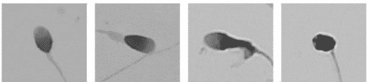

图 1.2 数据集四个不同类别的样本图像：(a) 正常，(b) 渐尖形，(c) 梨形，(d) 非定形。

来源：转载自 Fariba Shaker 贡献的数据集，Mendeley Data，2018 年。https://creativecommons.org/licenses/by/4.0/（参考文献 [25]）。

### 1.4 实验与结果

准确率、灵敏度、特异度、精确率、召回率和 F1 分数等性能指标按等式 (1.1)、等式 (1.2)、等式 (1.3)、等式 (1.4)、等式 (1.5) 和等式 (1.6) 给出的方式计算。

```
Accuracy = \frac{TP + TN}{TP + TN + FP + FN} (1.1)
Sensitivity = \frac{TP}{TP + FN} (1.2)
Specificity = \frac{TN}{TN + FP} (1.3)
Precision = \frac{TP}{TP + FP} (1.4)
Recall = \frac{TP}{TP + FN} (1.5)
F1-Score = 2.\frac{(Precision * Recall)}{(Precision + Recall)} (1.6)
```

- TP 表示真阳性，
- TN 表示真阴性，
- FP 表示假阳性，
- FN 表示假阴性。

各模型的性能指标列于表 1.2。各模型之间的准确率比较如图 1.3 所示。各模型之间的特异度比较如图 1.4 所示。各模型之间的灵敏度比较如图 1.5 所示。各模型之间的精确率比较如图 1.6 所示。各模型之间的召回率比较如图 1.7 所示。各模型之间的 F1 分数比较如图 1.8 所示。

| 机器学习模型 | 准确率 | 特异度 | 灵敏度 | 精确率 | 召回率 | F1 分数 |
| --- | --- | --- | --- | --- | --- | --- |
| 决策树（基尼） | 42.42 | 82.06 | 45.53 | 48 | 45.53 | 45 |
| 决策树（熵） | 27.28 | 81.05 | 42.75 | 43 | 42.75 | 41 |
| 逻辑回归 | 57.58 | 85.94 | 57.68 | 56 | 57.68 | 56 |
| SGD 分类器 | 48.48 | 75.88 | 26.77 | 18 | 26.77 | 14 |
| 高斯朴素贝叶斯 | 57.58 | 85.49 | 57.68 | 66 | 57.68 | 59 |
| K-近邻分类器 | 57.58 | 85.70 | 55.31 | 59 | 55.31 | 52 |
| 随机森林分类器 | 66.66 | 88.98 | 66.12 | 69 | 66.12 | 65 |
| 支持向量机（Sigmoid） | 21.21 | 75 | 25 | 5 | 25 | 9 |
| 支持向量机（线性） | 69.69 | 89.83 | 69.49 | 73 | 69.49 | 68 |
| 支持向量机（RBF） | 66.67 | 88.54 | 67.16 | 77 | 67.16 | 68 |
| 支持向量机（多项式） | 75.76 | 91.83 | 75.84 | 80 | 75.84 | 76 |
| XGB 分类器（XGBoost） | 63.64 | 87.86 | 63.69 | 64 | 63.69 | 63 |

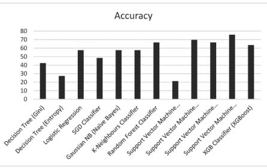

图 1.3 各模型之间的准确率比较。

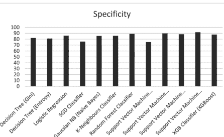

图 1.4 各模型之间的特异度比较。

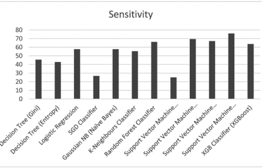

图 1.5 各模型之间的灵敏度比较。

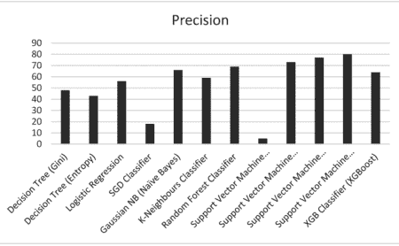

图 1.6 各模型之间的精确率比较。

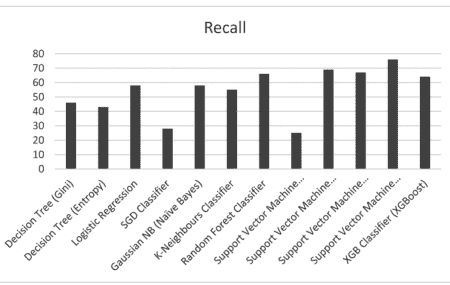

图 1.7 各模型之间的召回率比较。

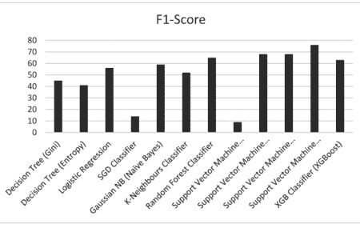

图 1.8 各模型之间的 F1 分数比较。

### 1.5 结论

根据上述结果，可以得出结论：支持向量机（多项式）模型证明是更好的模型。它表现出卓越的性能指标，准确率为 75.76%，灵敏度为 75.84%，特异度为 91.83%，精确率为 80%，召回率为 76%，F1 分数为 76%。人工检查与基于 ML 工具的自动检查的比较已在表 1.3 中描绘。该模型将被建议用于临床部署和患者护理。在生育治疗中使用这种改进技术将导致精子头异常的有效诊断。该程序将更加准确，因此将消除人际偏见。该工具将能够帮助医生诊断精子头异常。

### 表 1.3 人工检查与基于 ML 工具的自动检查比较。

| 参数 | 人工检查 | 基于 ML 工具的自动检查 |
| :--- | :--- | :--- |
| **准确率** | 较低 | 显著更高 |
| **遗漏** | 存在 | 无 |
| **时间消耗** | 增加 | 减少；快速 |
| **疲劳影响** | 存在 | 无；消除 |
| **人际偏见** | 存在 | 无；消除 |
| **高级计算设施需求** | 无 | 存在 |
| **受过训练的实验室人员需求** | 存在 | 无 |
| **优点** | 低成本 | 高准确率，快速，在实验室人员极少的低资源环境中有用 |
| **缺点** | 准确率低，耗时，强制要求实验室人员 | 初始成本高 |


### KEYWORDS

- 男性生殖学
- 自动诊断工具
- 人类精子头部形态
- 机器学习
- 精液分析

### REFERENCES

- 1. Thirumalaraju, P.; Bormann, C. L.; Kanakasabapathy, M.; Doshi, F.; Souter, I.; Dimitriadis, I.; Shafiee, H. 基于人工智能的自动精子形态学检测. *Fertil. Steril.* **2018**, *110* (4), e432.
- 2. Wang, R.; Pan, W.; Jin, L.; Li, Y.; Geng, Y.; Gao, C.; Chen, G.; Wang, H.; Ma, D.; Liao, S. 生殖医学中的人工智能. *Reproduction* **2019**, *158* (4), R139–R154. https://doi.org/10.1530/REP-18-0523
- 3. Auger J. 评估人类精子形态：顶级模型、劣势还是生物医学？. *Asian J. Androl.* **2010**, *12* (1), 36–46. https://doi.org/10.1038/aja.2009.8
- 4. Goodson, S. G.; White, S.; Stevens, A. M.; Bhat, S.; Kao, C. Y.; Jaworski, S.; Marlowe, T. R.; Kohlmeier, M.; McMillan, L.; Zeisel, S. H.; O'Brien, D. A. CASAnova：用于人类精子运动模式分类的多类支持向量机模型. *Biol. Reprod.* **2017**, *97* (5), 698–708. https://doi.org/10.1093/biolre/iox120
- 5. Goodson, S. G.; Zhang, Z.; Tsuruta, J. K.; Wang, W.; O'Brien, D. A. 基于自动多类支持向量机模型的小鼠精子运动模式分类. *Biol. Reprod.* **2011**, *84* (6), 1207–1215. https://doi.org/10.1095/biolreprod.110.088989
- 6. Kime, D. E.; Van Look, K. J.; McAllister, B. G.; Huyskens, G.; Rurangwa, E.; Ollevier, F. 计算机辅助精子分析（CASA）作为监测鱼类精子质量的工具. *Comp. Biochem. Physiol. Toxicol. Pharmacol.* **2001**, *130* (4), 425–433. https://doi.org/10.1016/s1532-0456(01)00270-8
- 7. You, J. B.; McCallum, C.; Wang, Y.; Riordon, J.; Nosrati, R.; Sinton, D. 精子选择的机器学习. *Nat. Rev. Urol.* **2021**, *18* (7), 387–403. DOI: 10.1038/s41585-021-00465-1. https://doi.org/10.1038/s41585-021-00465-1
- 8. Riordon, J.; McCallum, C.; Sinton, D. 人类精子分类的深度学习. *Comput. Biol. Med.* **2019**, *111*, 103342. https://doi.org/10.1016/j.compbiomed.2019.103342
- 9. Shaker, F.; Monadjemi, S. A.; Alirizeae, J.; Naghsh-Nilchi, A. R. 人类精子头部分类的词典学习方法. Comput. Biol. Med. **2017**, _91_, 181–190. https://doi.org/10.1016/j.compbiomed.2017.10.009
- 10. Hicks, S. A.; Andersen, J. M.; Witzczak, O.; Thambawita, V.; Halvorsen, P.; Hammer, H. L.; Haugen, T. B.; Riegler, M. A. 基于机器学习的精子视频和参与者数据分析用于男性生育能力预测. Sci. Rep. **2019**, _9_ (1), 16770. https://doi.org/10.1038/s41598-019-53217-y
- 11. Vaughan, D. A.; Sakkas, D. 21世纪的精子选择方法. Biol. Reprod. **2019**, _101_ (6), 1076–1082. https://doi.org/10.1093/biolre/ioz032
- 12. McCallum, C.; Riordon, J.; Wang, Y.; Kong, T.; You, J. B.; Sanner, S.; Lagunov, A.; Hannam, T. G.; Jarvi, K.; Sinton, D. 基于深度学习的高DNA完整性人类精子选择. Commun. Biol. **2019**, _2_, 250. https://doi.org/10.1038/s42003-019-0491-6
- 13. Chang, V.; Houte, L.; Petitjean, C.; Härtel, S.; Hitchfeld, N. 人类精子头部形态的自动分类. Comput. Biol. Med. **2017**, _84_, 205–216. https://doi.org/10.1016/j.compbiomed.2017.03.029
- 14. Kohn, T. P.; Kohn, J. R.; Lamb, D. J. 在决定各种辅助生殖技术中精子形态的作用. Eur. Urol. Focus **2018**, _4_ (3), 311–313. https://doi.org/10.1016/j.euf.2018.07.029
- 15. Ilhan, H. O.; Sigirci, I. O.; Serbes, G.; Aydin, N.; 基于Mobile-net的完全自动混合人类精子检测和分类系统及其与常规方法的性能比较. Med. Biol. Eng. Comput. **2020**, _58_ (5), 1047–1068. https://doi.org/10.1007/s11517-019-02101-y
- 16. Valiaškaitė, V.; Raudonis, V.; Maskeliūnas, R.; Damaševičius, R.; Krilavičius, T. 用于人工授精的精子活动力深度学习评估. Sensors **2020**, _21_ (1), 72. https://doi.org/10.3390/s21010072
- 17. Somasundaram, D.; Nirmala, M. 用于精子分析的更快区域卷积神经网络和精液跟踪算法. Comput. Meth. Prog. Biomed. **2021**, _200_, 105918. https://doi.org/10.1016/j.cmpb.2020.105918
- 18. Iqbal, I.; Mustafa, G.; Ma, J. 人类精子头部形态的深度学习分类. Diagnostics **2020**, _10_ (5), 325. https://doi.org/10.3390/diagnostics10050325
- 19. Tseng, K. K.; Li, Y.; Hsu, C. Y.; Huang, H. N.; Zhao, M.; Ding, M. 具有多特征融合支持向量机的精子形态诊断计算机辅助系统. BioMed. Res. Int. **2013**, 687607. https://doi.org/10.1155/2013/687607
- 20. Mortimer, D.; Mortimer, S. T. 精子运动力和高激活的计算机辅助精子分析（CASA）. Meth. Mol. Biol. **2013**, _927_, 77–87. https://doi.org/10.1007/978-1-62703-038-0_8
- 21. Shaker, F.; Monadjemi, S. A.; Naghsh-Nilchi, A. R. 人类精液涂片显微图像中精子头部、顶体和细胞核的自动检测和分割. Comput. Meth. Programs Biomed. **2016**, _132_, 11–20. https://doi.org/10.1016/j.cmpb.2016.04.026
- 22. Chang, V.; Saavedra, J. M.; Castañeda, V.; Sarabia, L.; Hitschfeld, N.; Härtel, S. 精子头部分割的金标准与改进框架. Comput. Meth. Programs Biomed. **2014**, _117_ (2), 225–237. https://doi.org/10.1016/j.cmpb.2014.06.018
- 23. Xing, F.; Yang, L. 数字病理学和显微图像中强健的细胞核/细胞检测和分割：全面综述. IEEE Rev. Biomed. Eng. 2016, 9, 234–263. https://doi.org/10.1109/RBME.2016.2515127
- 24. Wiener, S.; Heim, D.; Saeger, K.; Stenzinger, A.; Beil, M.; Hufnagl, P.; Dietel, M.; Denkert, C.; Klauschen, F. 虚拟显微图像中细胞核检测和分割：最小模型方法. Sci. Rep. 2012, 2, 503. https://doi.org/10.1038/srep00503
- 25. Shaker, F. 人类精子头部形态数据集（HuSHeM）. Mendeley Data 2018, V3. DOI: 10.17632/tt3yj2pf38.3


## Taylor & Francis

泰勒与弗朗西斯集团

http://taylorandfrancis.com

## 用于多囊卵巢综合征可靠诊断的智能医疗系统

ISHIKA DHALL, SHUBHAM VASHISTH, and GARIMA AGGARWAL

诺伊达阿米蒂大学计算机科学与工程系，印度

### 摘要

女性身体的健康关乎预防、保护、诊断和治疗。多囊卵巢综合征（PCOS）极其普遍，是育龄妇女中最常遇到的内分泌疾病。由于其临床异质性，确认其在个体中存在的特征并不十分理想；因此，采用机器学习概念可以在检测这种情况方面发挥有益的作用。因此，本文提出了一种基于年龄、体重等多种特征的机器学习分类系统。所提出的方法论包括用于PCOS诊断的数据战略处理以及一个预测其迫在眉睫发生的模型，该模型获得了96.36%的高测试准确率和3.64%的错误率。实验结果表明，所提PCOS诊断方法在准确率方面相当高，错误率低，使其成为可用于实时应用的合适工具。

### 2.1 引言

多囊卵巢综合征（PCOS）是一种在年轻女性中非常普遍的迅速增长的疾病。要识别PCOS，可以观察月经周期不规律或停止、体毛过度生长、痤疮等指标，但这些特征不一定总是存在于患者身上。这种疾病需要被识别和治疗，因为它极有可能引起无排卵、绝经前子宫内膜癌、心脏相关疾病和2型糖尿病等更大的并发症。其他一些症状包括肥胖、多毛症、卵巢囊性生长以及体内睾酮水平升高，这些都可能令人警觉。

临床上，育龄健康女性每月会在卵巢中产生囊肿状囊袋，用于产生必需的激素，这些称为卵泡。卵泡负责在排卵期释放卵子，但激素水平的紊乱可能影响其生长。在这种情况下，未成熟卵泡的积累开始，后来转变为较大的囊肿。根据世界卫生组织（WHO）的说法，患PCOS的人是促性腺激素正常的，因此他们经历月经周期延长或不频繁，以及激素水平失衡，例如女性体内男性激素（雄激素）过多。医生仍然不知道PCOS的确切原因，但大多数专业人士倾向于依赖这样的解释：体内男性激素过多会引起这种情况，阻止卵巢执行正常功能，如激素产生或卵子形成。根据医生的建议，被诊断患PCOS的患者可以选择避孕药物和生活方式改变等治疗方法。² 根据卵泡的大小和数量，可以决定其存在是否有害。同样，有多种这样的特征可用于诊断PCOS。

本文的主要贡献是提出了一种自动化机器学习智能医疗系统，该系统可被医生和医疗专业人员广泛用于诊断PCOS。这项工作将展示一种深度人工神经网络模型，可高精度诊断PCOS。它还为读者提供了关于该疾病的相关信息，如流行症状、常见预防和治疗。


本文的另一项贡献涉及对印度喀拉拉邦约10家不同医院收集的数据集上各种机器学习模型（如深度神经网络模型、非线性支持向量机模型、多项式朴素贝叶斯模型、决策树、随机森林和逻辑回归）进行的比较分析。该文还根据作者所知，对该领域现有工作进行了比较分析。

为了更好地评估和理解所提模型，本文简要介绍了所使用模型的各种评估指标及其相应的意义。所提工作的另一项值得注意的贡献是其在所使用的机器学习模型中具有低时间复杂度和低错误率。

在接下来的章节中，遵循给定的结构：第2节讨论了一些相关现有工作，随后第3节将向读者介绍有关数据集的信息以及清理和处理数据的必要步骤。在第4节中，展示了构建模型时所遵循的拟议方法和步骤。第5节将讨论所遵循过程获得的结果，第6节将总结该领域的研究结果和未来工作。

### 2.2 相关工作

在针对PCOS检测的背景下，本节讨论了一些相关的现有工作。参考文献[3]中的一项工作展示了贝叶斯分类器在应用于从加尔各答GDIFR收集的250名女性数据集的PCOS识别问题上的性能。它解释了使用贝叶斯分类器相对于逻辑回归的优势。它展示了用于确定模型的参数分析以及正确诊断PCOS患者的后验概率，准确率为93.93%。后续研究中，使用了对约541名女性的患者调查来分析各种模型的特性，并最终利用模型预测患者中PCOS的存在。

使用PCA变换特征的分类是通过在从在线仓库Kaggle收集的数据集上使用CART、朴素贝叶斯算法、逻辑回归算法、K近邻、支持向量机算法和随机森林等多种技术完成的。所得结果表明，随机森林是应用效果最好的模型，准确率为89.02%，而本研究提出的工作显示了更高的准确率，并对强大的机器学习模型进行了性能比较。在应用CNN模型之前，实现了一种基于超声图像的图像分割技术⁵，并尝试通过移除冗余数据来获得良好的准确率。根据所提工作，在CNN和特征提取之间加入了图像分割，以消除不需要的数据并提高准确率。然而，该文未提及最终达到的准确率，且内容编写不佳。提出了一种基于人工神经网络与模糊神经逻辑相结合的新算法，以简化特征选择和患者分类的工作。⁶ 本文所使用的分类技术包括朴素贝叶斯分类算法、人工神经网络等，但所获得的准确率本可以通过对所用重要参数进行自动或手动调整来提高。

参考文献⁷中讨论的一项工作实现了一种基于人工神经网络与模糊神经逻辑相结合的新算法，该算法是其之前工作的扩展。所提研究中的算法使用MATLAB实现，并已用于与疾病PCOS的现有医疗细节进行比较。另一项工作对参考文献[8]的拟议工作中的卵泡分割聚类问题执行了粒子群优化。

在提到的作品⁹中，对使用卵巢超声图像检测卵泡并最终诊断患者PCOS的多种计算机辅助技术进行了综述，该作品识别并比较了使用经阴道超声图像和机器学习概念的PCOS现有工作。提供了一种用于检测女性人体卵巢中囊肿生长物并利用超声图像、借助支持向量机算法和图像处理进行分类的软件。¹⁰ 它成功达到了90%的准确率、95%的特异性和88.33%的灵敏度。该研究中卵巢囊肿的分类和检测仅限于基于其几何形状的子宫内膜异位囊肿。

该研究中使用了传统的VGG-16模型，该模型包含16个连接层，并使用作者收集的超声图像数据集进行了精细调整。¹¹ 它检测了包括子宫内膜样囊肿、皮样囊肿和出血性卵巢囊肿在内的不同类型的囊肿，准确率为92.11%。该工作未向读者展示任何未来工作。

所提工作中展示的研究可以使用三种分类场景来诊断PCOS，涉及神经网络-LVQ方法、使用K-NN的欧几里得距离以及RBF内核SVM算法。根据结果，在保持正则化参数C = 40的情况下，使用SVM-RBF内核达到了最佳准确率。结果表明，“A”数据集达到了82.55%的准确率，同时使用K = 5的欧几里得距离-KNN分类获得的“B”数据集能够达到78.81%的准确率。对于实时应用，所展示的软件还不够高效，因为准确率可以进一步提高。

参考文献[13]中构建的系统展示了一种相对不同的方法，说明如何将不同患者分类到不同的表型组中。BorutaShap方法和随机森林算法用于进行预测和对PCOS患者进行聚类。该研究显示，在考虑相关特征的情况下分类了两个不同的聚类；然而，由于预测仅基于一个非常小的样本量进行内部验证，他们无法提供一个在人群中推广效果良好的系统。

在参考文献[14]中，发布了一项关于PCOS诊断各种机器学习算法分析的工作。该工作展示了所有机器学习模型，但没有考虑由于该疾病的性质而导致此任务所面临的特征提取和转换问题。他们没有考虑为此任务使用神经网络的功能。

本工作提出了一种基于深度神经网络模型的自动化智能医疗系统，该系统可被急救人员很好地用于以96.36%的高准确率诊断PCOS。本文讨论了各种解决问题的受监督方法，以及一项展示它们如何产生不同结果的研究。将PCOS症状与其他多种潜在原因区分开来可能非常具有挑战性。PCOS的存在的病因可能存疑，因为症状可能令人困惑，且个人的健康状况可能因人而异。因此，本文提到的问题需要在特征提取和转换等多个子任务上进行工作。使用深度神经网络模型的主要动机在于，它不仅通过各种连接传输输入数据并输出结果，还能很好地与数据转换和特征提取相结合。与浅层网络相比，深度神经网络的应用在参数数量和计算能力方面提供了一个更高效的系统。本文为读者提供了关于该疾病的重要事实。此外，它还对该领域与本文所提工作密切相关的现有启发性工作进行了比较分析。

### 2.3 数据集

在所提方法中，实验是在包含41个特征的数据集上进行的，这些特征包括年龄、体重、身高、婚姻状况等各种临床和生理参数。数据集收集是最关键的步骤之一，因为它决定了模型的行为。本研究中用于训练所提模型的数据集收集自印度喀拉拉邦的10家不同医院（Kaggle）。它包含约540名女性的信息。通过检查所有特征之间的相关性来消除冗余数据，对该数据集进行了分析。本研究中使用的数据集包含多个属性，并通过计算它们的线性相关性对所有这些属性进行了分析。如果一个特征线性依赖于另一个特征，则表示它与该特征相关，因此它们被称为共线性特征。如果两列具有高度相关性，则表明它们具有高协方差，因此应移除其中一列，因为它不带来新信息。

Correlation Coefficient(\(\rho\)) = \frac{\sum_{i=1}^n (y_i - \bar{y})(z_i - \bar{z})}{\sqrt{\sum_{i=1}^n (y_i - \bar{y})^2} \sqrt{\sum_{i=1}^n (z_i - \bar{z})^2}} (2.1)

相关性可以是正的或负的。正相关表示，如果一个特征增加，目标值也会增加；而在负相关的情况下，随着特征值的增加，目标值会减少。公式2.1用于查找数据集中各种特征之间的相关性。在图2.1中，绘制了数据相关矩阵的一个子集，该子集显示了数据集的行为。

数据准备是改进模型学习的关键步骤。此步骤通常涉及清理、整理和移除不必要特征的过程。数据准备和清理是在之前完成的


使用收集到的数据；最耗时且重要的步骤之一是清洗原始和未处理的数据。它通常涉及缺失数据流、识别异常值等挑战。

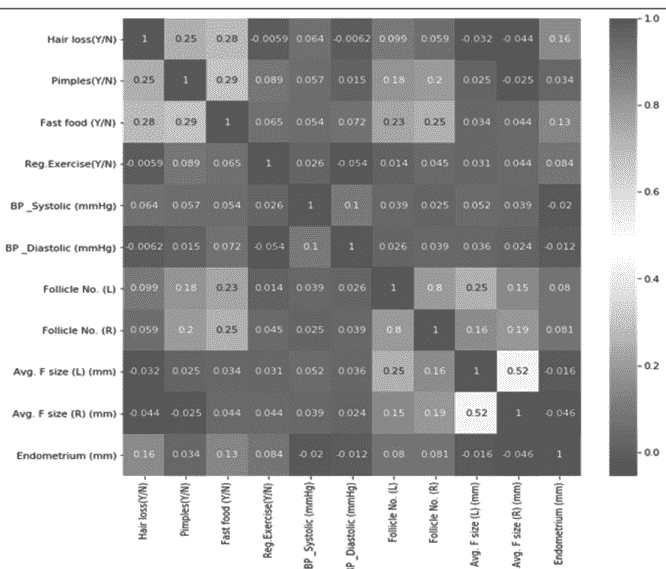

图 2.1 数据集热图。

在本研究中，缺失数据通过使用 pandas 提供的 "is null" 函数检查数据中的空值并删除这些值来处理。此外，该研究采用了一种方法，即设置异常值限制以识别行为异常的数据集。在将数据输入拟议模型之前，数据被分为两组，即训练数据和测试数据。为训练和评估选择了非重叠的数据集。这一步骤对于确保模型的正确测试很重要。此外，本工作采用手动特征选择方法来降低模型的复杂度。这有助于删除不需要的数据并提高模型性能。因此，采用了基于 Pearson 相关性的多变量技术，结合一种经手动调整的方法，阈值为 0.85，以找出相关系数在 85% 及以上的相关特征并将其移除。最后，该函数计算并得出结论，最终移除的高相关性特征如下：{"Patient File No.," "Waist(inch)," "BMI," "FSH/LH"}

### 2.4 实验方法

本研究的主要目标是开发一个基于监督机器学习的系统，借助患者的某些体征和临床记录特征，自动诊断女性多囊卵巢综合征（PCOS）。

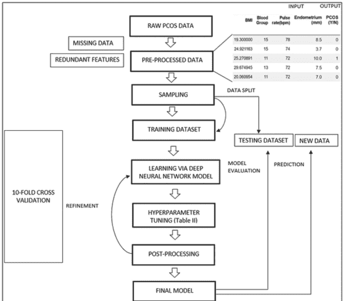

图 2.2 拟议机器学习流程图。

本研究的主要目标是开发一个基于监督机器学习的系统，借助患者的某些体征和临床记录特征，自动诊断女性多囊卵巢综合征（PCOS）。

#### 2.4.1 数据集收集与预处理

构建高效模型需要一个适当且严谨的数据清洗、整理和分割过程，因为通常输入的原始数据和输出目标并未处于可训练高度分析模型的状态。一组原始和未处理的数据流被输入系统，其中包含多名患者的信息，其主导症状称为特征。该数据集包含许多缺失值和冗余特征。预处理后的数据被分为两组，例如训练数据和测试数据。

#### 2.4.2 应用机器学习模型

没有适当标记的目标变量，监督机器学习算法将无法从数据中学习任何内容，并最终无法将给定数据映射到其对应的结果。因此，目标变量被转换为易于理解的形式。训练集用于赋予机器学习模型学习能力。因此，尝试从原始变量中构建更具预测性的输入表示或元素。得到的特征被输入学习算法以构建泛化模型。然后，在未用于训练的数据上评估了模型的质量。

#### 2.4.3 超参数调优与测试

从理论上讲，超参数可以被视为与学习模型正交的单位，尽管它们存在于模型之外。两者之间存在直接关系，倾向于显著影响模型。模型训练完成后，对超参数进行了调优，随后进行了数据后处理步骤。这进一步用于优化，并再次进行调优以获得更好的性能。本研究采用了 K-折交叉验证技术，这是一种用于近似机器学习模型能力的统计工具。在交叉验证技术中，一组数据被分成“k”个子集，在本研究中 k 的值为“10”。在超参数的选择和优化方面，主要有两种方法：手动选择和自动选择。在拟议工作中，执行了手动参数测试和调优，并最终选择了产生最佳准确率的参数集。16

各参数的值被更改，并观察了模型对每个值的行为。例如，模型中隐藏层的数量最初为 1，但在进行更深入的分析并连续观察结果后，5 层在训练模型时产生了最佳可能准确率。可以看出，随着层数进一步增加，模型性能开始下降。同样，其他参数也进行了评估，并基于分析，在深度神经网络模型中采用了一组最终对应值，如表 2.1 所示。

表 2.1 重要参数及其值分析表。

| 序号 | 超参数 | 值 |
| :--- | :--- | :--- |
| 1 | 隐藏层数量 | 5 |
| 2 | 每层神经元数 | 200 |
| 3 | 迭代次数 | 100 |
| 4 | 优化器 | ADAGRAD |
| 5 | 激活函数 | RELU |
| 6 | 核初始化器 | He-uniform |

为避免过拟合问题，17 还实现了批量归一化过程。使用调优后的参数的最终模型在测试数据部分18上进行了测试，该部分包含未见值，并提供了模型的最终准确率。

### 2.5 结果与讨论

在拟议方法中，实验在健康患者和被诊断患有 PCOS 的患者的数据上进行。在本研究中，应用了多种机器学习模型¹⁹，并计算和展示了它们的准确率得分。在图 2.3 中，展示了所有模型准确率得分的比较。

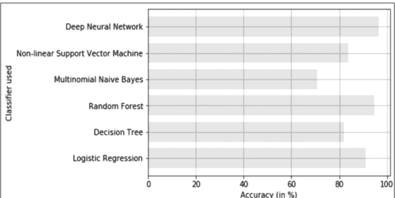

图 2.3 各分类器准确率比较。

如图 2.3 所示，本研究表明深度神经网络取得了 96.36% 的最佳准确率得分，其次是随机森林分类器，其准确率为 94.54%。此外，逻辑回归在此问题上也表现出色，准确率为 90.09%，而非线性支持向量机模型达到的准确率为 83.63%。决策树算法也在此研究中进行了评估，显示准确率为 81.81%，而多项式朴素贝叶斯在最大损失下得出的准确率得分为 70.90%。为进一步分析明星模型的性能，使用了更多指标来测试模型的全方位性能。最终构建的模型测试准确率为 96.36%。图 2.4 展示了拟议深度神经网络模型的学习曲线，显示训练和测试两个阶段的学习曲线。

由于深度神经网络模型展示了最有前景的性能，评估了训练准确率和测试准确率以深入理解模型。模型的训练准确率为 97.3%，经精细调优的模型测试准确率为 96.36%。在达到最终精度的过程中显示出微小波动，但由于给定模型的偏差和方差已得到良好平衡，不存在过拟合或欠拟合的情况。

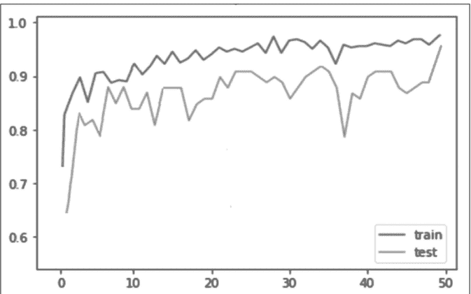

图 2.4 拟议深度神经网络的学习曲线。

为更好地理解和恰当展示所得结果，还展示了混淆矩阵，具体显示了预测结果，即真阳性（TP）、真阴性（TN）、假阳性（FP）和假阴性（FN）。表 2.2 对分类中指标的预测进行了澄清。模型的灵敏度（Recall）和精确率（Precision）等进一步指标是使用真阳性、真阴性、假阳性和假阴性的值计算得出的。

使用这些公式，计算并评估了所有参数的值，以理解每个模型的性能。像灵敏度（Recall）、F1 分数和精确率（Precision）这样的模型评估指标对于评估给定模型非常重要。20

表 2.3 讨论了所使用所有模型的输出详细报告。可以清楚地从表 2.3 中看出，深度神经网络模型取得了最高 96.36% 的准确率和 96% 的高灵敏度。因此，模型的 F1 值为 96%。与其他监督机器学习模型相比，测试准确率和训练准确率也相对较高。


### 表 2.2 不同机器学习算法的真/假预测。

| 模型 | 真阳性 | 真阴性 | 假阳性 | 假阴性 |
|---|---|---|---|---|
| 深度神经网络 | 38 | 15 | 1 | 1 |
| 非线性支持向量机 | 35 | 11 | 4 | 5 |
| 多项式朴素贝叶斯 | 39 | 0 | 0 | 16 |
| 决策树 | 35 | 10 | 4 | 6 |
| 随机森林 | 38 | 13 | 1 | 3 |
| 逻辑回归 | 37 | 13 | 2 | 3 |

### 表 2.3 比较分类器的表格。

| 模型 | 精确率 | 召回率 | F1 分数 | 测试准确率 (%) |
|---|---|---|---|---|
| 深度神经网络 | 0.96 | 0.96 | 0.96 | 96.36 |
| 非线性支持向量机 | 0.83 | 0.84 | 0.83 | 83.63 |
| 多项式朴素贝叶斯 | 0.50 | 0.71 | 0.59 | 70.90 |
| 决策树 | 0.81 | 0.82 | 0.81 | 81.81 |
| 随机森林 | 0.95 | 0.95 | 0.94 | 94.54 |
| 逻辑回归 | 0.91 | 0.91 | 0.91 | 90.09 |

混淆矩阵在涉及统计分类的问题中起着重要作用。它有时也被称为误差矩阵。对于当前问题，深度神经网络在不同指标上的比较中显示出有希望的性能。所提深度学习模型的混淆矩阵如图 2.5 所示。

图 2.5 混淆矩阵中，每一列表示深度神经网络结果中实际类的实例，每一行表示预测类中的出现次数。实验表明，所设计的基于机器学习的系统每个样本的平均墙钟时间约为 25 毫秒，实验结果可获得良好的准确性，这意味着其适用于实时应用，是一项重要贡献。

表 2.4 列出了机器学习领域诊断多囊卵巢综合征（PCOS）的一些现有工作的比较研究。这些研究中使用的数据集通常源自本地；因此，不同工作所使用的数据集也各不相同。为了与不同方法论竞争，应当采用类似的数据集以达到更好的科学和研究标准。考虑到获取这些本地数据集的难度，这项任务也变得具有挑战性。

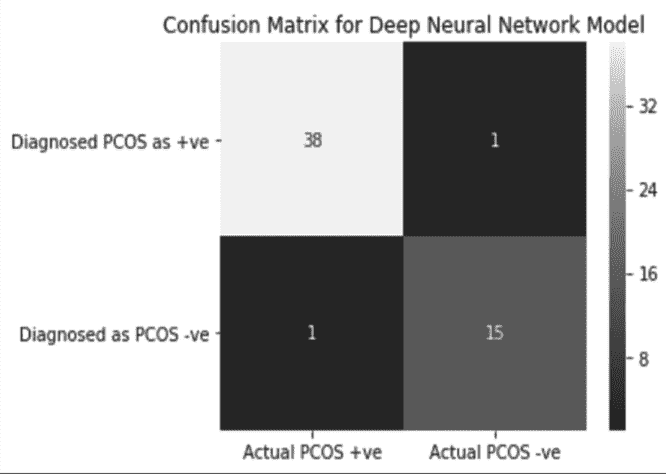

### 图 2.5 深度神经网络模型的混淆矩阵。

### 2.6 结论

在本工作中，一种基于监督机器学习的分类技术被应用于识别女性中多囊卵巢综合征（PCOS）的存在，结果为阳性或阴性。本文成功提供了一种自动化的基于机器学习的智能医疗系统，可供医生和医疗专业人员用于诊断 PCOS。PCOS 诊断中涉及的各个阶段已成功分析，并在适当的参数调整后提出了一种高效模型，以预测 PCOS 的即将发生。最终模型产生了可观的测试准确率，并在训练网络时通过批归一化技术进行正则化以防止过拟合。它对所提模型提供了更好的评估和理解。

### 表 2.4 与所提方法的现有工作比较表。

| 参考文献标题 | 目的 | 数据库来源 | 使用的模型 | 准确率 |
|---|---|---|---|---|
| Mehrotra et al. [3] | 针对 PCOS 识别问题的贝叶斯分类器与逻辑回归对比 | 印度加尔各答 GDIFR | 贝叶斯分类器 | 93.93% |
| Denny et al. [4] | 分析各种模型以诊断 PCOS 的性质 | Kaggle | CART、朴素贝叶斯、逻辑回归、KNN、SVM 和随机森林 | 89.02% 随机森林分类器（所有模型中最佳） |
| Soni 和 Vashisht [5] | 在应用 CNN 模型之前对超声图像进行图像分割技术 | 匿名来源的超声图像 | CNN、支持向量机和（无监督学习）K-最近邻 | 82.55% 支持向量机（所有模型中最佳） |
| Meena et al. [6] | 人工神经网络与模糊神经逻辑的组合 | ftp://ftp.ncbi.nlm.nih.gov/geo/datasets/GDS4nnn/GDS4987/ | 支持向量机、人工神经网络、分类树、朴素贝叶斯 | 83.70% 人工神经网络（所有模型中最佳） |
| Meena et al. [7] | 人工神经网络与模糊神经逻辑的组合 | ftp://ftp.ncbi.nlm.nih.gov/geo/datasets/GDS4nnn/GDS4987/ | 模糊粗糙神经集合和神经网络 | 89% |
| Rabiu et al. [9] | 计算机辅助卵泡检测 PCOS 诊断技术的调查 | 两个不同的数据集。来源未提及 | 未提及 | 97.61% 和 98.18% |
| Chauhan et al. [14] | PCOS 的早期预测 | 对 267 名女性进行了调查 | KNN、朴素贝叶斯、SVM、决策树、逻辑回归 | 81% 决策树（所有模型中最佳） |

### 表 2.4（续）

| 参考文献标题 | 目的 | 数据库来源 | 使用的模型 | 准确率 |
|---|---|---|---|---|
| Deepika [21] | 提及 AI PCOS 诊断的目标 | 未提及 | 贝叶斯和逻辑回归 | 贝叶斯为 91.04%，逻辑回归为 93.93% |
| 本文所提工作 | 分析 PCOS 问题，获得可靠的机器学习模型用于预测患者中的 PCOS | 印度喀拉拉邦 10 家不同医院 | 深度神经网络、非线性支持向量机、多项式朴素贝叶斯、决策树、随机森林和逻辑回归 | 深度神经网络 96.36%，非线性支持向量机 83.63%，多项式朴素贝叶斯 70.90%，决策树 94.54%，随机森林分类器 81.81%，逻辑回归分类器 90.9% |

通过计算各种评估指标并阐明其相应的显著性，对所提模型提供了更好的评估和理解。

未来工作计划在复杂神经网络架构中使用迁移学习等方法，以进一步提升模型性能并开发出一款应用程序，以获得更好的用户体验。人们认为，开发一款以深度神经网络为核心的软件应用程序，可由急救人员及其他潜在用户成功用于实时诊断 PCOS。

### 关键词

- 人工智能
- 多囊卵巢综合征
- 电子健康系统
- 卵泡
- 正促性腺激素型
- 智能医疗系统

### 参考文献

- 1. Kousta, E.; 等. 多囊卵巢但无 PCOS 诊断特征女性的 PCOS 内分泌指标：不孕症诊所人群研究. 开放妇产科杂志. 2020, 10 (2).
- 2. Lim, S. S.; 等. 多囊卵巢综合征女性的生活方式改变. Cochrane 系统评价数据库. 2019, 2019 (3), CD007506.
- 3. Mehrotra, P.; 等. 基于机器学习技术的多囊卵巢综合征自动筛查. 2011 年 IEEE 印度年会; IEEE, 2011.
- 4. Denny, A.; 等. I-HOPE: 基于机器学习技术的多囊卵巢综合征 (PCOS) 检测与预测系统. TENCON 2019-2019 IEEE 第 10 区域会议 (TENCON); IEEE, 2019.
- 5. Soni, P.; Sheveta, V. 基于深度神经网络的多囊卵巢疾病检测图像分割. 国际计算机科学与工程开放获取杂志. 2019, 7 (3).
- 6. Meena, K.; Manimekalai, M.; Rethinavalli, S. 使用模糊粗糙神经集合和人工神经网络预测 PCOS. 国际计算机与通信最新创新趋势杂志. 2015, 3 (12), 6722–672.
- 7. Meena, K.; Manimekalai, M.; Rethinavalli, S. PCOS 数据的人工神经网络分类与 NFRS 属性滤波算法的相关性. 国际工程技术杂志. 2015, 4 (3), 519–524.
- 8. Omran, M. G. H. 用于模式识别和图像处理的粒子群优化方法. 普利托利亚大学工程、建筑环境与信息技术学院博士论文, 2004 年 11 月.
- 9. Rabiu, I. O.; 等. 计算机辅助卵泡检测技术和多囊卵巢综合征 (PCOS) 诊断系统综述. 国际计算机趋势与技术杂志. 2012, 1 (6).
- 10. Rihana, S.; 等. 超声图像中卵巢囊肿自动检测算法. 2013 年第 2 届生物医学工程进展国际会议; IEEE, 2013.
- 11. Srivastava, S.; 等. 使用微调 VGG-16 深度学习网络检测超声图像中的卵巢囊肿. SN 计算机科学. 2020, 1 (2), 1–8.
- 12. Purnama, B.; 等. 基于超声图像卵泡检测的多囊卵巢综合征分类. 2015 年第 3 届信息与通信技术国际会议 (ICoICT); IEEE, 2015.
- 13. Silva, I. S.; Ferreira, C. N.; Costa, L. B. X.; Sóter, M. O.; Carvalho, L. M. L.; de C Albuquerque, J.; ... & Gomes, K. B. 多囊卵巢综合征：使用机器学习模型与新表型相关的临床和实验室变量. 内分泌学研究杂志. 2021, 1–9.
- 14. Chauhan, P.; Patil, P.; Rane, N.; Raundale, P.; Kanakia, H. PCOS 预测机器学习算法比较分析. 2021 年通信信息与计算技术国际会议 (ICCICT); IEEE, 2021 年 6 月; 第 1–7 页.
- 15. Mohammad, M.; 等. 迈向自动化数据清洗工作流. 机器学习. 2019, 15.
- 16. Gunes, F.; 等. 机器学习模型自动同时特征选择和超参数调优系统. 美国专利申请 16/411,590, 提交于 2019 年 12 月 5 日.
- 17. Lee, D.; Lee, S. J.; Seo, Y. J. 将深度学习的最新进展应用于基于 ANN 的自动靠泊系统. 国际工程技术创新杂志. 2019, 10 (1).
- 18. Feurer, M.; 等. Auto-sklearn：高效且稳健的自动化机器学习. 自动化机器学习; Springer: Cham, 2019; 第 113–134 页.
- 19. Singh, V. P.; Agarwal, J.; Kumar, M. 与语音障碍相关问题的机器学习算法分析. 2021 年第 8 届信号处理与集成网络国际会议 (SPIN), 2021; 第 1182–1187 页. DOI: 10.1109/SPIN52536.2021.9566072.
- 20. Fabriz, L. A.; Oliveira, V. C. D.; Zacharias, F. C. M.; Valente, S. H.; Ferro, D.; Pinto, I. C. 边界综合健康系统规范性评估矩阵的构建与验证. 拉丁美洲护理杂志. 2021, 29, e3433.
- 21. Deepika, V. 多囊卵巢综合征诊断中人工智能技术的应用. 先进研究技术与管理科学杂志. 2019, 01 (03).


## 第 3 章

## 基于半监督生成对抗网络的乳腺组织病理学图像分类

KARTHIGA R,¹ USHA G,² 和 NARASIMHAN¹

¹SASTRA 视同大学，电气与电子工程学院，电子与通信工程系，泰贾武尔，印度

²SASTRA 视同大学，斯里尼瓦萨·拉玛努扬中心，电子与通信工程系，库姆巴科南，印度

### 摘要

妇女罹患乳腺癌的风险最高，这使其成为医学研究的一个重要领域。活检涉及切除组织并在显微镜下研究，以确定是否存在癌症。训练不足的组织病理学家常会漏诊恶性肿瘤。由于组织病理学图像的自动分析可以帮助病理学家识别癌症亚型和恶性肿瘤，因此这可以有助于病理学家并促进更好的诊断。最近深度学习研究有所增加，但其应用需要大量数据，这是从中提取性能的关键任务。由于标注数据数量有限且标注成本高昂，病理学家很难开发标注数据。当存在大量未标注数据时，传统深度学习算法效果不佳，这限制了可用标注数据的数量。采用生成对抗网络(GAN)的半监督学习方法可以解决训练深度分类器时缺乏标记输入数据的问题。我们证明了同时使用标记和未标记数据集的半监督 GAN 可以达到与传统卷积神经网络相当的显著性能水平。该方法降低了用于深度学习分类器开发的细胞图像标注的相关成本和时间。

### 3.1 简介

每年有数百万妇女受乳腺癌影响，并导致许多女性死亡。根据乳腺癌调查，在北美，乳腺癌影响率超过 80%，在日本和瑞典，近 60% 的人群受影响。在低收入国家，乳腺癌的影响率低于 40%。根据美国癌症协会收集的数据，2019 年诊断出约 268,600 例新的侵袭性病例，预计死亡病例约为 41,760 例。早期诊断对于提高生存人数至关重要。近年来，许多研究人员在医学影像领域探索精确模型并澄清解决方案。

癌症的两大主要类型是良性（癌）和恶性（非癌）。细胞特征和属性决定癌症的类别。原位癌中，肿瘤细胞位于乳腺导管（小叶）内。在其他情况（浸润性）中，肿瘤细胞扩散至导管。Spanhol 等人引入了良性和恶性下不同放大倍率的多种亚型。最初，乳腺癌诊断基于利用钼靶 X 线摄影、热成像和超声成像技术进行的定期监督下的自我评估。针吸活检是明确恶性生长最可靠的技术。显微图像提供了病理学家可获取的组织结构和元素。分析前，组织细胞会接受使用苏木精-伊红(H&E)的染色过程。染色过程有助于研究细胞和细胞核的形状等组织结构元素。

通过计算机辅助诊断(CAD)系统的自动化流程，减轻了病理学家的工作量并提高了效率。在机器学习技术中，通过使用各种分类器利用手工特征来识别类别。分类器经过训练并预测特定标签。[9-11] 然而，手工特征需要广泛的领域知识，且计算负担需要机器学习的新进展。被称为深度学习的先进机器学习技术在研究领域受到越来越多关注。深度学习与深度卷积神经网络一起使用，该网络可以自动从原始输入图像中学习特征。[12] 超参数会手动调整以改善结果。最近，研究人员专注于基于卷积神经网络(CNN)的CAD技术，以提高医学图像分析结果的质量。深度学习需要更多训练时间，并且通过使用大量数据集从经验中学习特征。[13]

训练期间，数据不平衡可能导致快速发生过拟合，可以通过使用生成对抗网络(GAN)来克服。GAN 网络包含生成器和判别器，两者共同进行于 2014 年引入的最小-最大博弈。生成器试图创建与真实数据密切相关的合成数据。[14] 在我们的案例中，非常少的病理学家专门从事实验室中的组织病理学图像分析。由于分析人员稀缺且数据量大，图像标注速度变慢。标注需要更多时间，且无法在特定时间完成任务。在我们的研究工作中，我们同时考虑标记和未标记数据进行训练，以提高分类准确率。

### 3.2 相关工作

Spanhol 等人 [4] 从组织病理学图像中提取像素块并用于训练 CNN。使用滑动窗口方法裁剪出 32 × 32 和 64 × 64 像素块。准确率在 80.8% 至 89.6% 之间。Bayramoglu 等人 [15] 建立了单任务和多任务 CNN。单任务 CNN 执行整体癌症分类准确率，而多任务 CNN 同时预测癌症类别和放大倍率。作者报告单任务结果为 82.10% 和 84.63%，多任务结果在 80.69% 至 83.39% 之间。

Feng 等人 [16] 使用标注和未标注样本来提高训练准确率。未标注数据在提高准确率方面起着至关重要的作用。

在参考文献 [17] 中，作者利用带自动编码器的级联方法对乳腺组织病理学图像进行分类。作者取得的结果在 96.8% 至 98.2% 之间。在参考文献 [18] 中，作者使用了带长短期记忆网络(LSTM)的 CNN。该模型通过利用 softmax 和支持向量机(SVM)分类器，实现了 90% 至 91% 的准确率。在参考文献 [19] 中，作者使用了带 70 个标记皮肤镜图像的 GAN 网络。作者报告分类器性能优于使用自动编码器和手工特征。

Johnson 引入了一种新型半监督条件 GAN 来检测浸润性导管癌(IDC)。GAN 框架达到了 86.68%、87.45% 和 88.33% 的准确率。在参考文献 [21] 中，作者在乳腺 X 线摄影乳腺癌图像中引入了上下文 GAN。然而，由于使用了不平衡数据，CNN 准确率因过拟合而得到不准确结果。作者使用基于 U-Net 的架构，实现了 0.846 的 AUC 值。在参考文献 [22] 中，作者针对乳腺 X 线摄影图像采用了三阶段半监督学习方法。报告的准确率随标记和未标记类别的增加而提高。在参考文献 [23] 中，作者为肺癌和胰腺肿瘤引入了一种新型监督和非监督网络，并取得了良好结果。上述文献表明，深度 CNN 在医学影像诊断中发挥着重要作用，并提供更出色的性能。

### 3.3 材料与方法

#### 3.3.1 数据集

Fabio 等人引入了用于组织病理学图像的乳腺癌数据集(BreakHis)，该数据集从 82 名患者处获取。BreakHis 是一个大规模数据集，包含 7909 张良性和恶性图像，每种包含四个亚类。图像按四个放大因素(40×、100×、200× 和 400×)分类。图像为八位深度 RGB 图像，尺寸为 700 × 460。良性四个亚类为纤维腺瘤(FA)、腺症(A)、管状腺瘤(TA)和叶状肿瘤(PT)；恶性亚类为导管癌(DC)、黏液癌(MC)、小叶癌(LC)和乳头状癌(PC)。下表 3.1 列出了 BreakHis 数据集图像列表。


| 放大倍数 | A | FA | TA | PT | DC | LC | MC | PC |
|---|---|---|---|---|---|---|---|---|
| 40× | 114 | 253 | 109 | 149 | 864 | 156 | 205 | 145 |
| 100× | 113 | 260 | 121 | 150 | 903 | 170 | 222 | 142 |
| 200× | 111 | 264 | 108 | 140 | 896 | 163 | 196 | 135 |
| 400× | 106 | 237 | 115 | 130 | 788 | 137 | 169 | 138 |

良性（400×）和恶性（400×）的组织病理学示例图像由以下图 3.1 和 3.2 显示。

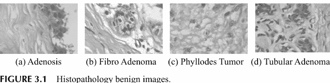

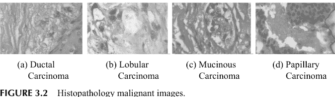

#### 3.3.2 GAN

生成对抗网络（GAN）是一种由两个神经网络（即生成器和判别器）组成的生成模型。基于博弈论的 GAN 网络<sup>1</sup> 包含两个在解决最小-最大博弈中发挥关键作用的网络。假样本通过生成器中的随机噪声向量生成。判别器经过训练，用于判断真实样本和假样本。两个网络同时进行训练。最小-最大值函数由 _V_(_D,G_) 给出，

```
min_G max_D V(D, G) = E_{r ~ P_{data}}[log D(r)] + E_{f ~ P_f}[log(1 - (G(f)))] \quad (3.1)
```

其中 G 为生成器；D 代表判别器；r 表示真实样本；f 指示假样本；P_{Data} 和 P_{F} 分别表示真实数据和假数据样本的分布。

#### 3.3.3 半监督 GAN（SSGAN）

半监督生成对抗网络（SSGAN）是在图 3.3 所示的基本 GAN 网络模型基础上开发的。在 SSGAN 模型中，损失函数的结构基于深度卷积神经网络，同时整合了标记和未标记的真实数据。<sup>24-26</sup> 标记的真实图像执行受监督分类任务。未标记的真实图像用于训练判别器。Radford 等人采用以下步骤训练 GAN 网络，

- 对于所有生成器和判别器层，它们均使用了 Relu 激活函数。
- 在生成器中，消除了 tanh 激活函数和 Relu 激活函数。
- 生成器使用了分数步幅卷积层，而在判别器中，池化层被步幅卷积层取代。
- 训练中使用了批量归一化。

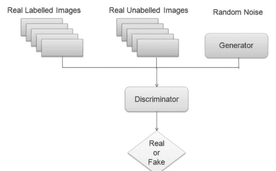

图 3.3 半监督生成对抗网络网络示意图。

标记损失（$L_L$）、未标记损失（$L_U$）和生成损失（$L_G$）的组合用于优化过程。<sup>4</sup> 方程如下，

```
\( L = L_L + L_U + L_G \quad \text{(3.2)}\)

\( L_L = E_{r,s \sim P_{data}} \, log p_{model} \left( s | r, s < K + 1 \right) \quad \text{(3.3)}\)

\( L_U = E_{r \sim P_{data}} \, log(1 - p_{model} \left( s = K + 1 | r \right)) \quad \text{(3.4)}\)

\( L_G = E_{r \sim G} \, log p_{model} \left( s = K + 1 | r \right) \quad \text{(3.5)}\)
```

根据上述方程，\( r \) 定义真实图像，\( s \) 指示标签，\( P_{data} \) 对应真实数据分布。SSGAN 对生成图像使用 K 类，而 K + 1 类表示假图像类。以下图 3.4 和 3.5 显示了生成器和判别器层的示意图表示。

SSGAN 设计用于处理 32 × 32 像素的图像。在初始阶段测试中，BreakHis 组织病理学图像被转换为 32 × 32 像素，并使用常规算法进行分析。由于调整大小，图像遭受了信息丢失，导致性能不佳。因此，SSGAN 被修改为使用原始数据集大小 700 × 460。判别器输入层大小调整为 224 × 224 × 3。在后续层中，生成器的 reshape 层调整为 28 × 28 × 256，随后跟有三个卷积转置层，每个层生成 224 × 224 像素的彩色图像。训练通过将整个训练过程划分为小批量（mini-batches）来执行。在划分训练样本的每个阶段都更新了权重。输入数据通过将每个范围除以 1 进行归一化。最后一个生成器层使用了 Relu 激活函数。

在等式 (3.3) 中，在用标记数据训练判别器并保持生成器权重后，计算受监督损失函数。在等式 (3.4) 中，使用在未标记数据和假数据上训练的判别器计算无监督损失函数。因此，在等式 (3.5) 中，通过将两个损失相加来计算判别器损失函数。使用反向传播过程来更新判别器权重。更新判别器后，评估权重被固定冻结，然后执行生成器训练。小批量样本包含一半真实数据和一半虚构数据。使用判别器，将小批量数据输入网络进行分析。特征从判别器的中间层中的真实数据和虚构数据中提取。在最终阶段，使用反向传播更新生成器权重。重复评估周期，直到 epoch 完成以生成显著结果。在本工作中，我们修改的模型在表 3.2 和 3.3 中列出。添加了 600 个噪声样本以生成新图像。

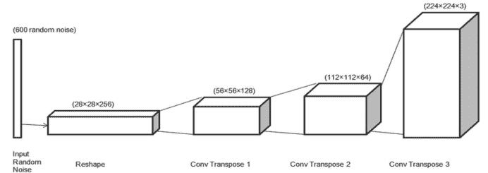

图 3.4 生成器层。

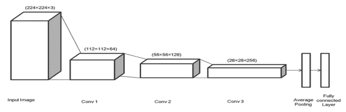

图 3.5 判别器层。

表 3.2 生成器分析。

| 模块 | 核大小 | 步幅 | 特征图 | 退出率 | 非线性 |
|---|---|---|---|---|---|
| Reshape | – | – | 28 × 28 × 256 | – | – |
| ConvTrans1 | 3 × 3 | 2 | 128 | 无 | Relu |
| ConvTrans1 | 3 × 3 | 2 | 64 | 无 | Relu |
| ConvTrans1 | 3 × 3 | 2 | 8 | 无 | Relu |
| Conv2D | 3 × 3 | 2 | 32 | 无 | Relu |
| Conv2D | 3 × 3 | 2 | 64 | 无 | Relu |
| Conv2D | 3 × 3 | 2 | 128 | 0.4 | Relu |
| Conv2D | 3 × 3 | 1 | 256 | 0.25 | Relu |

### 3.4 卷积神经网络

如图 3.6 所示，所提议的 CNN 架构包含与判别器类似的若干层。图像具有三个卷积层，每个层有两个滤波器大小，用于提取各种属性，包括角点、边缘和颜色。卷积层减小输入图像的大小并增加其深度。在该网络中，采用了三个最大池化层和一个平均池化层，内核大小为 2 × 2。全连接层用于展平特征，最终输出层用于预测结果。

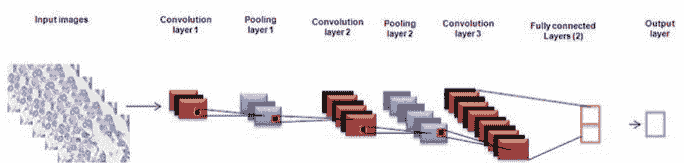

图 3.6 所提议的 CNN 层。

### 3.5 结果与讨论

在本工作中，我们修改的 SSGAN 在乳腺组织病理学分类任务上进行评估。随机选择的数据用于训练（80%）和测试（20%）。图 3.7 说明了数据划分过程。训练数据包含 SSGAN 中的标记和未标记数据。超参数设置如下：Epoch = 20；
Batch size = 100；Adam 优化器，学习率为 0.0001。

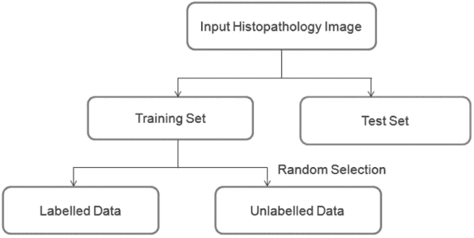

图 3.7 实验数据划分过程。

我们方法的性能评估按 AUC 和准确率计算。图像级准确率可按以下方式计算，

```
Accuracy = \frac{Number of correctly classified cancer images}{Total number of images} (3.6)
```

在医学影像领域，在癌症诊断中，阳性病例被识别为恶性，而阴性病例被识别为良性。以下图 3.8、3.9、3.10 和 3.11 显示了使用 BreakHis 数据集中不同放大倍数获得的准确率和损失。灵敏度（或召回率）是诊断中的重要因素。此外，我们还计算了其他指标，如精确率和 F1 分数。以下方程表示指标的计算，

```
Sensitivity(recall) = \frac{True positive rate}{True positive rate + False negative rate} (3.7)
```

```
Precision = \frac{True positive rate}{True positive rate + False positive rate} (3.8)
```

```
F1score = \frac{2 \times Recall \times Precision}{Recall + Precision} (3.9)
```

为了进行半监督训练，使用了不同比例的标记图像，例如 30%、40%、50% 和 60%，其余图像为未标记。标记数据的结果在表 3.4 中说明。The


### 图 3.8 40×倍率下的SSGAN结果：(a) 准确率图和 (b) 损失图。

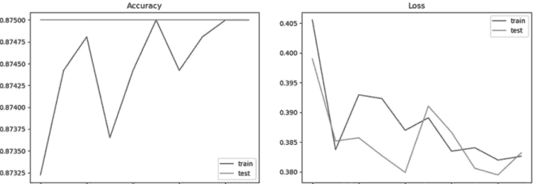

### 图 3.9 100×倍率下的SSGAN：(a) 准确率图和 (b) 损失图。

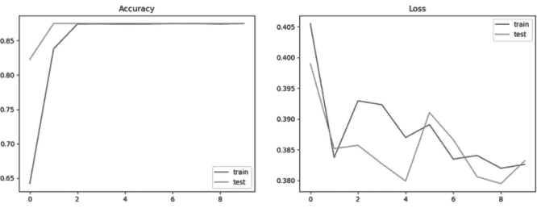

### 图 3.10 200×倍率下的SSGAN结果：(a) 准确率图和 (b) 损失图。

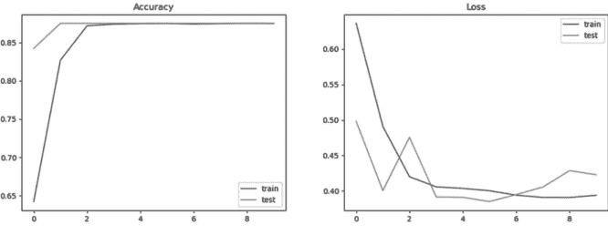

### 图 3.11 400×倍率下的SSGAN结果：(a) 准确率图和 (b) 损失图。

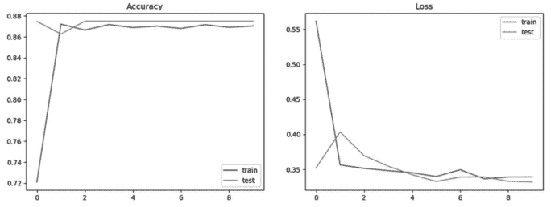

由于未出现改进，实验在已标记图像的50%时停止。在所有实验中，本研究随机使用了20%的数据进行测试。本评估使用表3.5中列出的各种放大倍率和指标进行。本研究提出了一种使用紧凑型卷积神经网络进行乳腺癌图像分类的方法。我们的研究将SSGAN与CNN进行了比较，以证明与CNN中标记数量最多的图像相比，标记数量最少的图像也能取得良好性能。本研究中使用的CNN架构与SSGAN判别器的架构相似。

### 表 3.4 使用SSGAN方法对标记数据的准确率比较。

| 放大倍率 | 30% | 40% | 50% | 60% |
|---|---|---|---|---|
| 40× | 0.79 | 0.83 | 0.87 | 0.87 |
| 100× | 0.78 | 0.83 | 0.88 | 0.88 |
| 200× | 0.82 | 0.86 | 0.87 | 0.87 |
| 400× | 0.81 | 0.88 | 0.88 | 0.89 |

### 表 3.5 多类分类的SSGAN性能指标。

| 放大倍率因子 | 准确率 | AUC | 特异性 | F1-得分 |
|---|---|---|---|---|
| 40× | 0.87 | 0.92 | 0.86 | 0.87 |
| 100× | 0.88 | 0.94 | 0.88 | 0.86 |
| 200× | 0.87 | 0.92 | 0.87 | 0.86 |
| 400× | 0.88 | 0.95 | 0.87 | 0.87 |

此外，试验方法分别使用了50%、60%和80%的训练数据，并随机选取20%的数据集来测试分类器的性能。SSGAN中的相同超参数也用于基于CNN的分类。如表3.6所示，80%的CNN数据用于训练，而20%用于测试，以达到与SSGAN相当的结果。SSGAN需要更少的标记图像，并且性能优于CNN。这些结果在图3.12、3.13、3.14和3.15中呈现。相比之下，CNN无法使用未标记图像，并且需要更多的标记图像才能达到相同的结果。因此，当缺乏标记数据时，SSGAN被认为是有价值的，并且与传统CNN相比，它仍能取得显著结果。

所提出的模型可以实现与传统模型相当或更好的性能。近年来，将机器学习技术（尤其是深度学习）应用于医学研究的兴趣日益浓厚。该软件可以减轻病理学家的工作量，提高诊断质量，并支持改善患者护理。通过采用我们提出的方案，我们可以应对乳腺癌诊断场景，在减轻工作量的同时提高诊断质量。

### 表 3.6 使用CNN方法对标记数据的准确率比较。

| 放大倍率 | 50% | 60% | 80% |
|---|---|---|---|
| 40× | 0.65 | 0.74 | 0.88 |
| 100× | 0.69 | 0.77 | 0.87 |
| 200× | 0.66 | 0.76 | 0.86 |
| 400× | 0.68 | 0.78 | 0.87 |

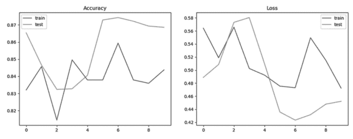

### 图 3.12 40×倍率下的CNN结果：(a) 准确率图和 (b) 损失图。

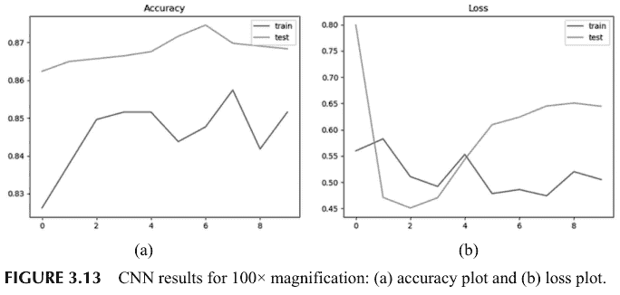

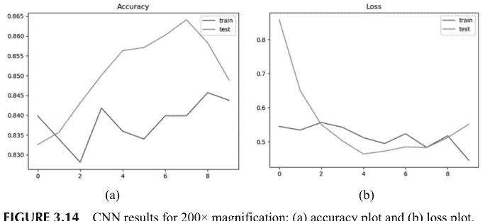

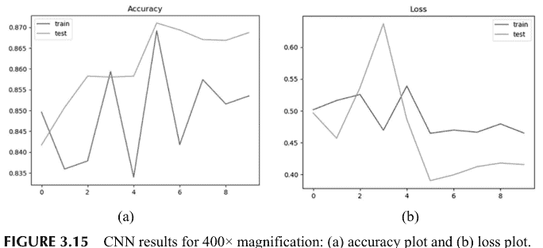

我们未来的假设是，在构建模型时融入病理学家的经验。通过分析深度神经网络的决策，我们将尝试识别输入乳腺癌图像中指示特定类型癌症的区域。通过将诊断经验作为先验进行评估，我们可以确定在病理学家与算法之间做出选择时，支持区域的差异。此外，我们可以构建一个基于注意力的网络模型，这将有助于未来提高模型的准确性。

### 3.6 结论

基于对抗网络的方法在医学图像处理中提供了独特优势。在本研究中，我们开发了一种半监督生成对抗网络，能够同时学习标记图像和未标记图像。我们的研究利用BreaKHis数据集上的半监督GAN，对四个放大倍率（40×、100×、200×和400×）下该拟议模型的多类分类进行了实验评估。对于100×和400×的放大倍率，获得了最佳准确率88%。此外，在400×放大倍率下实现了0.95的AUC。此外，本研究表明，SSGAN在标记图像数量较少时的性能优于CNN。未来，我们将探索使用各种架构和数据平衡技术进行多类分类。所提方案在乳腺癌图像分类任务中取得了有希望的结果。当该方法用于乳腺癌诊断场景时，可以减轻病理学家的工作量并提高诊断质量。

### 关键词

- 组织病理学
- 生成对抗网络
- 半监督生成对抗网络（SSGAN）
- 卷积神经网络
- 乳腺癌

### 参考文献

- 1. 乳腺癌：预防与控制，WHO [在线]。https://www.who.int/cancer/detection/breastcancer/en/index1.html（2021年6月访问）。

- 2. 美国乳腺癌统计 [在线]。https://www.breastcancer.org/symptoms/understandfbc/statistics（2021年6月访问）。

- 3. Fondón, I.; Sarimento, A.; Garcia, A. I.; Silvestre, M.; Eloy, C.; Polónia, A.; Aguiar, P. 用于乳腺癌诊断的组织恶性程度自动分类。Comput. Biol. Med. 2018, 96, 41–51.

- 4. Spanhol, F. A.; Oliveira, L. S.; Petitjean, C.; Heutte, L. 基于卷积神经网络的乳腺癌组织病理学图像分类。载于2016年国际神经网络联合会议（IJCNN）；温哥华，不列颠哥伦比亚省，加拿大，2016年；第2560–2567页。

- 5. 乳腺癌病理学；全国乳腺癌基金会：达拉斯，得克萨斯州，美国，2015年。

- 6. Gurcan, M. N.; Boucheron, L.; Can, A.; Madabhushi, A.; Rajpoot, N.; Yener, B. 组织病理学图像分析：综述。IEEE Rev. Biomed. Eng. 2009, 2, 147.

- 7. Rosen, P. P. 编；《Rosen’s Breast Pathology》，第3版；Lippincott Williams & Wilkins：费城，宾夕法尼亚州，美国，2008年。

- 8. Elston, C. W.; Ellis, I. O. 乳腺癌的病理预后因素。I. 乳腺癌组织学分级的价值：来自一项长期随访大型研究的经验。Histopathology 1991, 19 (5), 403–410.

- 9. George, Y. M.; Zayed, H. H.; Routhy, M. I.; Elbagoury, B. M. 基于细胞学图像的远程计算机辅助乳腺癌检测和诊断系统。IEEE Syst. J. 2014, 949–964.

- 10. Belsare, A. D.; Mushrif, M. M.; Pangarkar, M. A.; Meshram, N. 基于纹理特征分析的乳腺癌组织病理学图像分类。载于TENCON 2015 - 2015年IEEE第10区会议，2015年；第1–5页。

- 11. Wan, S.; Huang, X.; Lee, H. C.; Fujimoto, J. G.; Zhou, C. Spoke-LBP和Ring-LBP：用于组织分类的新纹理特征。载于2015年IEEE第12届国际生物医学成像研讨会（ISBI），2015年；第195–199页。https://doi.org/10.1109/ISBI.2015.7163848. 4月.

- 12. LeCun, Y.; Bengio, Y.; Hinton, G. 深度学习。Nature 2015, 521, 436–444. https://doi.org/10.1038/nature14539.

- 13. Tajbakhsh, N.; 等。用于医学图像分析的卷积神经网络：全训练还是微调？IEEE Trans. Med. Imaging 2016, 35, 1299–1312.

- 14. Goodfellow, I.; Pouget-Abadie, J.; Mirza, M.; Xu, B.; Warde-Farley, D.; Ozair, S.; Courville, S.; Bengio, Y. 生成对抗网络。Adv. Neural Inf. Process. Syst. 2014, 27, 2672–2680.

- 15. Bayramoglu, N.; Kannala, J.; Heikkila, J. 与放大倍率无关的乳腺癌组织病理学图像分类的深度学习。载于第23届国际模式识别会议（ICPR），2016年；第2440–2445页。

- 16. Feng, Z.; Nie, D.; Wang, L.; Shen, D. 基于多任务残差全卷积网络的盆腔MR图像分割半监督学习。载于


- 第15届IEEE生物医学成像国际研讨会 (ISBI 2018), 2018; 第 885–888 页.

- 17. Prathier, S.; Chattoraj, S. 用于组织病理学图像中乳腺癌稳健分类的流形学习与堆栈稀疏自编码器. arXiv预印本 arXiv:1806.06876, 2018.

- 18. Nahid, A. A.; Mehrabi, M. A.; Kong, Y. 基于局部聚类引导的深度神经网络技术的组织病理学乳腺癌图像分类. Biomed. Res. Int. 2018, 1–20.

- 19. Yi, X.; Walia, E.; Babyn, P. 借助Wasserstein距离的分类生成对抗网络用于皮肤镜图像分类的无监督和半监督学习. arXiv预印本 arXiv:1804.03700, 2018.

- 20. Johnson, J. 利用半监督条件GAN检测浸润性导管癌. arXiv预印本 arXiv:abs/1911.06216, 2019.

- 21. Johnson, J. 利用半监督条件GAN检测浸润性导管癌. arXiv预印本 arXiv:abs/1911.06216, 2019.

- 22. Eric Wu; Kevin Wu 和 William Lotter. 使用上下文GAN合成病变可改善乳腺X线摄影中的乳腺癌分类. arXiv预印本 arXiv:2006.00086v1, 2020.

- 23. Sun, W.; Tseng, T. L.; Zhang, J.; Qian, W. 采用三阶段半监督学习方法的计算机化乳腺癌分析系统. Comput. Meth. Programs Biomed. 2016, 135, 77–88.

- 24. Madani, A.; Moradi, M.; Karargyris, A.; Syeda-Mahmood, T. F. 具有数据域自适应能力的胸部X射线分类生成对抗网络半监督学习, 第15届IEEE生物医学成像国际研讨会 (ISBI 2018), 2018; 第 1038–1042 页.

- 25. Hussein, S.; Kandel, P.; Bolan, C. W.; Wallace, M. B.; Bagci, U. 深度学习时代的肺和胰腺肿瘤特征化: 新型监督和无监督学习方法. IEEE Trans. Med. Imaging 2019, 38 (8), 1777–1787.

- 26. Cong, C.; Liu, S.; Ieva, A. D.; Pagnucco, M.; Berkovsky, S.; Song, Y. 组织病理学图像中染色标准化的半监督对抗学习, 医学图像计算和计算机辅助干预国际会议, 2021; 第 581–591 页.


## Taylor & Francis

Taylor & Francis Group

http://taylorandfrancis.com

## 眼底糖尿病视网膜病变分类与分割的系统综述

ALAGUSELVI R 和 KALPANA MURUGAN
电子与通信工程系,
Kalasalingam 研究与教育学院,
维鲁德纳加尔 (县), 泰米尔纳德邦, 印度

### 摘要

糖尿病视网膜病变 (DR) 是糖尿病患者引起的、损害视网膜的眼部疾病。疾病的严重程度通过出血、微动脉瘤、渗出物等症状来判定。这些是 DR 的早期症状。病变检测算法用于帮助眼科医生轻松诊断疾病。从眼底图像中准确检测糖尿病视网膜病变是一项困难的任务，需要开发自动化计算机辅助诊断技术。本文回顾了目前可用于实现上述目标的最先进的方法，以及它们的优点和局限性。本综述确定了未来必须进行的改变，以创造出表现更好并避免当前文献中所有陷阱的最佳自动诊断工具。

### 4.1 引言

糖尿病视网膜病变 (DR) 当今影响着 80% 的糖尿病患者。眼部疾病的真实领域和治疗可在超过一半的患者中阻止视觉逆境。视网膜图像已被证明是疾病确认的极其成功的工具。例如，临床专业人员使用从视网膜获得的眼科照片来评估眼睛和重要感染。例如，DR 和年龄相关性黄斑变性 (AMD) 在视网膜上表现出来。它们通过评估视网膜图像可见，并且在早期检测时任何阶段都可能可治愈。DR 是影响眼睛视网膜的一种情况。

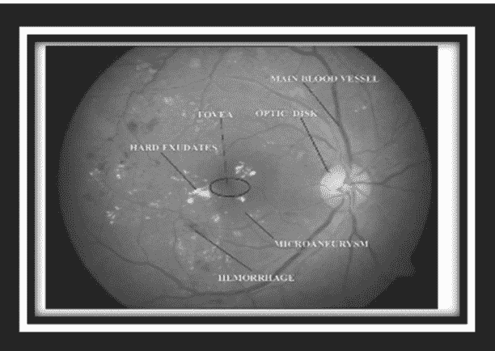

图 4.1 糖尿病视网膜病变影响的图像。

当疾病在早期被发现时，可能是可修复的。糖尿病可能是一种疾病，其中身体不产生或不能恰当组织胰岛素，这是一种预期将糖、淀粉和其他食物转换为维持生活所需能量的物质。高血压，也称为高血压症，会增加您患冠心病、中风、眼部问题和肾脏疾病的机会。各种被称为淡/红色瘀伤的损伤，类似于微动脉瘤 (MAs) 和出血 (HEMs)，以及类似渗出物的严重创伤，表征了 DR (EXs)。MAs 是 DR 最常见的症状，表现为古铜色、不起眼的间接斑块。

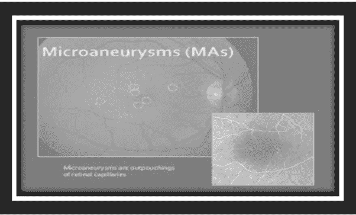

图 4.2 微动脉瘤病变。

HEMs 由视网膜缺血和异常脆弱的视网膜静脉破裂引起。它们通常表现为形状和外观各异的亮红色斑点/斑块。

另一方面，EXs 是储存蛋白质、脂质、细胞碎片和其他材料的黄色视网膜内液体库。它们通常表现为各种形状和大小中带有清晰线条的黄色耀眼斑块。

#### 糖尿病视网膜病变的阶段

- **轻度非增殖性视网膜病变:** 其特征是视网膜静脉内出现类似扩张的生长。这些称为微动脉瘤，这些血管可能渗入眼睛。

- **中度非增殖性视网膜病变:** 在这一阶段，供应视网膜的血管肿胀，并可能被阻塞。

- **重度非增殖性视网膜病变:** 在这个阶段，供应眼睛的越来越多血管可能被阻塞。随后，视网膜被诱导形成新的血管。

- **增殖性视网膜病变:** 通常，这是 DR 的最终阶段，视网膜脱离可能导致视野斑片状缺失、闪光或严重视力丧失。

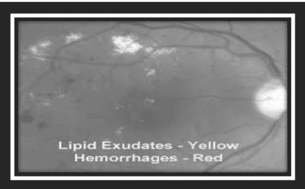

图 4.3 出血病变。

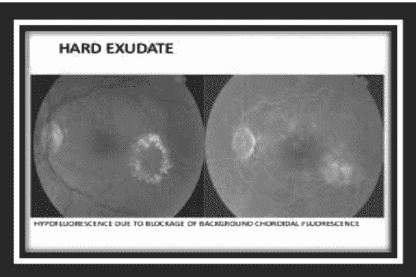

图 4.4 渗出物病变。

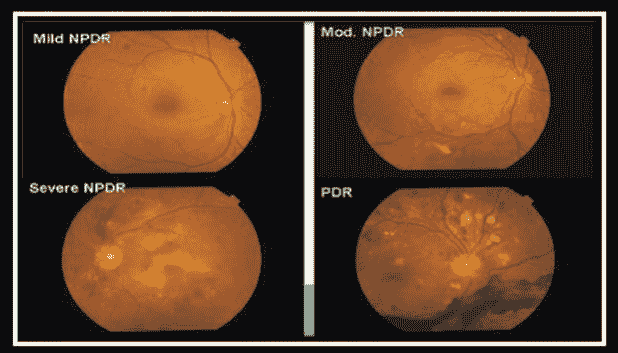

图 4.5 糖尿病视网膜病变分期。

无论如何，随着疾病进展，它会导致扭曲和模糊的视力，需要尽早干预以防止视力损害。DR 在参考文献 [2] 中表现为明显损伤的存在，称为暗/红色损伤，如微动脉瘤 (MAs) 和出血 (HEMs)，以及明亮损伤，如渗出物 (EXs)。MAs 是 DR 最常见的副作用，表现为古铜色、较小的圆点。微动脉瘤是发生在血管内部的小红点或肿胀。糖尿病患者的眼睛视网膜中偶尔会发现 MAs。这些较小的动脉瘤可能破裂并溢出血液。根据参考文献 [3,4]，一些研究表明这些微小动脉瘤可以预测糖尿病视网膜病变的进展，这是一种糖尿病损害视网膜血管的病症，可能导致失明。如今，图像处理正在成为快速发展的领域之一，它也是设计和计算机编程学科中的核心研究领域。参考文献 [6] 使用斜率加权方法，以及基于局部收敛滤波器 (LCF) 和不规则欠阻尼增强分类器的另一组特征，来识别视网膜图像中的 MAs。在参考文献 [7] 中，使用模糊 C 均值计算来区分真正的 DR。在参考文献 [8] 中，超像素多特征策略分类被用于创建渗出物的自动定位，并概述了一种视盘发现方法以推进执行。


分类精度。根据参考文献[9]，SVM可能是一种独特的非侵入性区域系统，用于早期和精确治疗DR。为便于设置，在参考文献[10]中首先对视盘和血管进行分割。利用基于小波包的边缘增强来隔离光照不佳的视网膜背景中的模糊病变，而理想设计的宽带通带通道改善了亮病变与背景之间的区分。

在参考文献[11]中，无论如何，通过计算机辅助诊断（CAD）仪器进行早期筛查并接受适当治疗有能力控制DR的患病率。展示了用于DR诊断的最新CAD框架的后续审计。

在参考文献[12]中，描述并支持了一种用于彩色眼底图像中微血管瘤和出血修正检测的拟议技术。该过程在每个病变和每个图像水平上均优于各种最先进的方法。DSF已被证明是强健的特征，能够显著区分病变与血管结构。

在参考文献[13]中，通过从MIL和显著学习中提取整体核心焦点，提出了一种用于DR揭示的重要MIL程序，换言之，需要图像层面的阐明来承认DR图像的区域和DR病变，同时，特征和分类器是从数据中共同获得的。

在参考文献[14]中，作者提出了一种新颖且全面的停止DR进展的方法，该方法包括两种基于MA周转和疑病症风险片段的不同方法。特别是，一种方法基于标准图像调查手册来模拟确定MA周转。另一种方法考察七种与MA周转相关的精神病特征，以使用定量评估和方案表征程序对未修改、未使用和稳定的MA进行分类，并利用疑病症危险组件来分解DR的增长。

特别是，一种方法是根据用于计算MA周转的标准图像调查手册建模而成。另一种方法考察七种与MA周转相关的精神病学特征，以使用可量化的评估和方案排序方法对未改变、未使用和稳定的MA进行分类。

在参考文献[15–17]中，还提出了一种定向多变量分类计算，用于从虚假候选物中识别真实渗出物。这提出了一种利用创新图像处理程序结合多层人工神经网络模型对视网膜图像进行分类的DR自动严重程度评估方法。

### 4.2 精选文献综述

已采取多种步骤在彩色眼底图像中检测DR。图4.6描绘了检测DR的各种步骤。

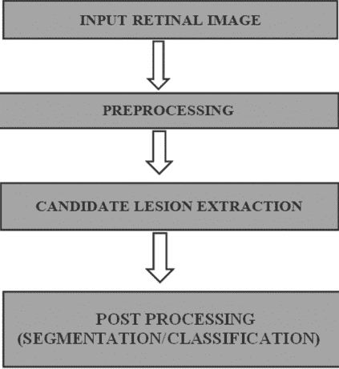

**图 4.6** 检测糖尿病视网膜病变的各种步骤。

#### 4.2.1 预处理

彩色眼底图像被用作揭示DR阶段的信息来源。这些照片只是描绘与眼睛视网膜相关感觉的隐藏图像。对这些照片进行预处理以改善图像的概念，然后将预处理后的图像用于后续步骤。

##### 4.2.1.1 中值滤波器

利用中值通道进行的分离处理，已去除图像中存在的不需要的噪声以供进一步处理。滤波是将每个像素强度值替换为在固定大小邻域内计算的新值的过程。中值滤波器在消除椒盐噪声和/或冲动噪声方面非常有效。

##### 4.2.1.2 随机游走算子

Luca Giancardo 等人[20]使用Radon悬崖算子提出了小动脉瘤的发现。这项工作的预处理中包含对作用于图像绿色平面的离散固定小波的研究。通过重组图像并用零覆盖第一个尺度平面来获得标记图像。这消除了对图像建立的需求。之后，移除负像素并对图像进行归一化。视神经和显著瘀伤被消除，小动脉瘤和血管被更新。Radon悬崖算子应用于灰度图像，值大于215的像素被视为候选物。

##### 4.2.1.3 CLAHE

CLAHE（对比度受限自适应直方图均衡化）[28] 是生物医学图像处理中一种众所周知的策略，因为它特别擅长使显著区域更加明显。图像被划分为离散区域，并对每个区域应用局部直方图均衡化。然后，使用双线性插值来消除区域之间的边界。

##### 4.2.1.4 形态变换

预处理已完成，以提取在绿色平面中含量惊人地低的暗色病变的证据。[18, 19, 37] 此外，绿色平面中的图像具有较低的背景强度变化。因此，从一开始就获得图像的绿色通道，并为图像中的每个像素 p 定义一个区域。如果像素的强度级别小于平均值的一小部分，则该像素被认为比相邻像素暗。感知比标准视网膜更暗的区域。最后，获得一个具有选定暗像素非零值的二维图像。

### 4.2.2 微血管瘤检测

它表现为视网膜静脉内类似扩张的生长。这些称为MAs，这些血管可能会渗入眼睛。

#### 4.2.2.1 圆形霍夫变换

我们提出了一种基于识别图像中小圆点的方法。[20] 通过应用逆Hough变换来检测图像中的圆，从而识别候选物。使用此方法可以从图像中去除许多间接特征。

#### 4.2.2.2 局部最大区域提取

灰度（强度）图像的局部最大区域（LMR）是一组相关像素，具有恒定的强度值，使得区域中每个连接像素的强度严格更低。[29] 因此，只有预处理图像的LMR才应被视为可能的MA候选区域。图像的像素持续受到监控并与其八个邻域进行比较。如果所有邻域的功率都较低，则真实像素是LMR。如果存在功率更高的邻域像素，则当前像素可能不那么极端。如果所有链接像素的功率较低或等效，则将像素视为潜在的局部极值，在这种情况下，具有相似强度的像素会被排队并进行测试。如果队列最终耗尽到所包含的所有像素都是局部最大值的程度，则相关连接组件是LMR。

#### 4.2.2.3 AM-FM方法

在较小尺度下，IF的潜在度增量可忽略不计，而孤立的AM-FM特征描绘了连续变化的图像表面。例如，对于血管，最合适的尺度是获得与其宽度成比例的周期的频率。另一方面，较高的重复尺度会捕捉某些病变中的微小细节，例如新生血管形成中的小血管。我们采用参考文献[27]中概述的多尺度重定向分解来在多个尺度上检查图像。另一方面，较高的重复尺度会捕捉某些病变中的微小细节，例如新生血管形成中的小血管。我们采用参考文献[27]中概述的多尺度重定向分解来在多个尺度上检查图像。MA和渗出物的跨度约为8个像素，这对应于为本检查缩小的图像中0.04毫米的尺寸。出血和棉絮斑的宽度为25个像素，直径为0.12毫米。为了获得这些不同尺寸的特征，使用了各种尺度。各种滤波器还会考虑正在编码的组件的方向（在某些不规则尺度内）。

#### 4.2.2.4 双环滤波器

图像预处理后，使用双环滤波器检测MA的候选区域。[25] 对于检测图像中视网膜区域的小动脉瘤，分别利用内环和外环的5和13像素估计值。通过图像的定制血管提取，移除了与血管相关区域中任何潜在的假阳性。使用头部部分评估，确定了总共126个图像特征，并选择了28个组件。使用基于标准的技术和人工神经网络，将候选病变分组为MA或假阳性。

#### 4.2.2.5 小波变换

小波变换极其灵活，我们可以完全控制用于分解图像的基函数。因此，我们提供了一种小波基参观，可能使小波空间中的辅助分离更容易且更有用。无论如何，使用小波基构建的结构很笨拙，因为必须同时满足多个目标（例如双正交性、常见性、消失时刻等等）。[21, 37]


### 4.2.3 渗出物检测

另一方面，EXs 是含有蛋白质、脂质、细胞碎片和其他材料的黄色视网膜内液体储集。它们通常表现为各种形态和大小的黄色、耀眼的斑块，边缘清晰。

#### 4.2.3.1 FCM 聚类

在模糊聚类中，这是一种策略，将大量数据收集到簇中，其中每个点对簇都有一定的隶属程度，通过其隶属度来表示，而不是绝对地仅属于一个簇。24,26,35 靠近簇中心的数据点比簇边缘的点具有更高的隶属度，而边缘点的隶属度较低。

#### 4.2.3.2 K-Means 聚类

使用 K-means 算法，其优势在于计算时间更少。最终，划分聚类比层次聚类更快。然而，不同的初始质心会产生不同的结果，这意味着 K-means 算法存在潜在问题。为解决该潜在问题，可选择一个起始点或使用粒子群优化（PSO）。K-means 算法如下：

- 确定组数 N，并随机从整幅图像中选取 N 个信息点（N 个像素或图像）作为 N 个簇中的 N 个质心。
- 找出每个信息点（像素或图像）最近的质心，并将信息点分配到找到的质心所在的簇。执行步骤 2 后，所有信息点都被分入某个簇。
- 计算每个簇的质心。重复步骤 2 和步骤 3，直到不再发生变化。

使用 K-means 算法，其优势在于计算时间更少。最终，划分分组比层次分组更快。35 然而，不同的初始质心会产生不同的结果，这意味着 K-means 计算存在潜在问题。为解决该潜在问题，可选择一个初始点或使用粒子群优化（PSO）。K-Means 聚类计算用于分割受影响的输入图像。在此过程中，使用了三个分割级别来查找给定输入图像中的 DR 疾病及其引起的阶段。获得了具有三个分割程度的重构分割图像。

#### 4.2.3.3 BOVW 模型

BoVW 模型用于评估单个 DR 损伤。38-40 这些模型通过在照片中提取大量特征向量（通常围绕关注点（POIs）），并基于视觉外观词典将这些向量分配给“视觉词”来工作。硬渗出物、红色病变、小出血、大出血、棉絮样斑块和玻璃膜疣都被视为损伤查找者。

### 4.2.4 使用的分类器

#### 4.2.4.1 高斯朴素贝叶斯（GNB）分类器

请求任务由朴素贝叶斯分类器执行，该分类器使用每对特征之间“朴素”的独立性假设。32 在高斯朴素贝叶斯描述挑战中，特征的可能性被假设为高斯分布。

```
P(Xi / y) = 1 / (sqrt(2πσ²y)) exp - ((xi - μy)² / σy²)
```

这里，xi 是特征向量，y 是元素向量的因变量类别。

σy² = 概率函数的方差，μy = 均值

GNB 分类器只需少量数据准备，无边界限制，且可快速就绪。

#### 4.2.4.2 K-近邻（KNN）分类器

有监督的 KNN 分类器⁴³,³⁷ 通过将 KNN 的更多特征移动到相关测试来收集数据。来自认可像素的 KNN 使用欧氏距离进行处理。该估计本质上保存了预期信息。所选 K 值在描述评估中起重要作用。K 值越高，波动越少；K 值越低，类别界限越清晰。

#### 4.2.4.3 广义线性模型（GLM）

在 GLM 中，通过针对不同应用定义的限制来处理组织受限病变的机会。

```
F(t) = e^t/(e^t + 1)
```

数据特征 x 的 t 线性限制为 t = 0 + 1 x 1 + ... + n x n。

计算的优点包括简单、设计和测试阶段速度快，以及评估信息限制对突破限制概率的各种影响的准确性。⁴²,⁴³ 然而，对于基本类型的非直接问题，这种基于核回归的分类器在很大程度上不适用。

#### 4.2.4.4 支持向量机

数据中心被设计为具有分离超平面的高维分量空间。选择估计以基于最近方案改进分区，该总和称为边缘。SVM 是一种学习系统，通过限制理论误差，通常用以用不可预测性交换精度。³⁰,³¹ SVM 在各种应用场景中已被证明可以减少规划和测试错误，从而提高确认精度。SVM 可用于高维数据，无需更改其参数。

##### 超平面表达式

```
w * x + b = 0
```

其中，
- x = 训练向量集
- w = 垂直于分离超平面的向量
- b = 允许增加边缘的偏置边界

SVM 将输入向量转换为更高维的向量空间，从中构建理想超平面。在多个可用超平面中，只有一个能增加自身与每个类最近信息向量之间的距离。

#### 4.2.4.5 卷积神经网络

使用包含两个隐藏层（分别含有 20 和 15 个神经元）的 ANN 分类器获得了最佳精度。41,44,45 该分类器分别实现了 98% 和 98.76% 的特异性和灵敏度。为了从未注意的眼底图像中区分暗淡病变，首先按照第 3 节中引用的策略从图像中分离出感兴趣区域，然后由训练好的 ANN 分类器将提取的区域分组为病变或良性区域。

#### 4.2.4.6 神经网络

此时，CNN 应用于“隐藏”的眼底图像，以创建区分血管与视网膜背景的二维图像：像素的数值表示由 NN 分别处理。在我们的情况中，NN 输入单元获得来自参考文献 [23,33] 提供的特征的标准化版本。由于为输出层的单个神经元选择了战略性 Sigmoid 激活函数，NN 决定确定 0 到 1 之间的分组值。22 因此，构建了一个血管可能性图，显示像素成为血管的可能性。该图像中明亮的像素更有可能成为血管像素。对可能性图进行阈值处理，以确定给定像素是否需要用于血管，从而获得血管配对分割。

| 参考文献编号 | 提取的特征 | 预处理所利用的方法系统 | 特征提取所利用的方法 | 所利用的分类器 | 性能指标 |
| :--- | :--- | :--- | :--- | :--- | :--- |
| 1 | 微动脉瘤，渗出物 | 阈值处理 | 双环滤波器 | 未使用 | 灵敏度-68% |
| 2 | 渗出物 | 交替序列滤波器（ASF） | SMFC | 未使用 | AUC 为 0.9655 |
| 6 | 微动脉瘤 | 核线性滤波器 | 病理风险因素 | GDBICP | 灵敏度 94% 和特异性 93% |
| 14 | 病变 | 阈值处理 | 中值滤波 | 人工神经网络 | 灵敏度-0.987，特异性-0.725 |
| 23 | 微动脉瘤 | Radon Cliff 算子 | Radon Cliff 算子 | 支持向量机 | 灵敏度-41% |
| 34 | 渗出物 | 形态学重建 | 模糊 C-均值聚类 | 未使用 | 灵敏度-87.28%，准确率-99.11%，特异性-99.24%，阳性预测值-42.77%，正似然比-224.26 |
| 38 | 渗出物 | 区域生长 | 神经网络系统 | 支持向量机 | 准确率-98.77% |


### 4.3 当前方法的局限性

当前研究基于视网膜分级，使用机器学习技术（如 ANN（单阶段和多阶段）和 SVM）进行疾病识别。为改善低对比度和暗图像，采用了同态滤波和自适应直方图均衡化等预处理技术。视网膜图像使用基于灰度级和矩不变量特征、2D Gabor 匹配通道分割以及傅里叶级数功率谱分割技术进行分割。为提高分类器性能，采用了基于 DWT 的 PCA 特征提取方法。为提高分类性能，从视网膜图像中提取了均值、均方、标准差、方差、偏度和峰度等统计参数，以及灰度共生矩阵参数（如熵、对比度、同质性、能量、相关性）和使用局部四元模式提取的纹理特征，以及使用小波提取的频谱特征。

### 4.4 结论

根据文献综述，所有现有算法均旨在通过使用各种技术进行生物医学图像处理，来改善视网膜图像中异常的识别。根据现有研究，分割算法的缺点在于计算复杂度高，且由于阈值选择不当、前景和背景强度变化大、视网膜血管手动分割困难且耗时，如果血管网络复杂度过高，结果无法产生标准分割，细节分割也可能具有挑战性。虽然存在多种视网膜图像分割方法，但仍有改进空间，因为它们对所有类型的视网膜图像效果不佳。由于相邻视网膜组织之间缺乏明确定义的边缘，用户选择带噪声的种子会导致有缺陷的分割，该分割对噪声、强度变化和过分割非常敏感，仅识别初始曲线才能提供优越的结果。这些是现有算法的重大缺点，如拟议研究工作中所述。因此，现在需要健壮、简单且适合实时应用的自动分割技术。

在本研究中，开发并实现了五种不同的分割算法，以使用各种技术检测 DR。这些算法的复杂性和分割性能各不相同。使用不同的评估指标来评估所开发算法的性能。

### 4.5 未来展望

实现基于 IoT 的框架，用于追踪疾病并在云端存储患者信息，这对远程医疗实践将非常有用。对 DR 患者也非常有用。

### KEYWORDS

- 糖尿病视网膜病变
- 眼底图像
- 出血
- 渗出物
- 微血管瘤
- 准确率

### REFERENCES

- 1. Niemeijer, M.; Van Ginneken, B.; Russell, S. R.; Suttorp-Schulten, M. S.; Abramoff, M. D. 用于糖尿病视网膜病变诊断的数字彩色眼底照片中玻障膜疣、渗出物和棉絮斑的自动检测与分化。Invest. Ophthalmol. Vis. Sci. 2007, 48 (5), 2260–2267.

- 2. Zhou, W.; Wu, C.; Yi, Y.; Du, W. 基于超像素多特征分类的数字彩色眼底图像中渗出物的自动检测。IEEE Access 2017, 5, 17077–17088.

- 3. Xu, X.; Niemeijer, M.; Song, Q.; Sonka, M.; Garvin, M. K.; Reinhardt, J. M.; Abramoff, M. D. 基于图方法的眼底图像血管边界勾画。IEEE Trans. Med. Imaging, 2011, 30 (6), 1184–1191.

- 4. Narasimha-Iyer, H.; Can, A.; Roysam, B.; Tanenbaum, H. L.; Majerovics, A. 彩色视网膜眼底图像序列中血管和非血管变化的综合分析。IEEE Trans. Biomed. Eng. 2007, 54 (8), 1436–1445.

- 5. Biyani, R. S.; Patre, B. M. 糖尿病视网膜病变红色病变检测算法综述。Biomed. Pharmacother. 2018, 107, 681–688.

- 6. Xu, J.; Zhang, X.; Chen, H.; Li, J.; Zhang, J.; Shao, L.; Wang, G. 微血管瘤周转的自动分析以诊断糖尿病视网膜病变的进展。IEEE Access 2018, 6, 9632–9642.

- 7. Mansour, R. F. 基于深度学习的糖尿病视网膜病变自动计算机辅助诊断系统。Biomed. Eng. Lett. 2018, 8 (1), 41–57.

- 8. Dashtbozorg, B.; Zhang, J.; Huang, F.; ter Haar Romeny, B. M. 基于局部汇聚指数特征的视网膜微血管瘤检测。IEEE Trans. Image Process. 2018, 27 (7), 3300–3315.

- 9. Sreng, S.; Manceerat, N.; Hamamoto, K.; Panjaphostne, R. 基于混合模拟退火和集成袋装分类器的自动糖尿病视网膜病变筛查系统。Appl. Sci. 2018, 8 (7), 1198.

- 10. Chalakkal, R. J.; Abdulla, W. H.; Thulaseedharan, S. S. 视网膜图像中视盘和凹中心的自动检测与分割。IET Image Process. 2018, 12 (11) 2100–2110.

- 11. Zhou, L.; Zhao, Y.; Yang, J.; Yu, Q.; Xu, X. 视网膜图像中糖尿病视网膜病变自动检测的深度多实例学习。IET Image Process. 2018, 12 (4), 563–571.

- 12. Chakraborty, S.; Jana, G. C.; Kumari, D.; Swetapadma, A. 一种改进的基于监督学习技术的糖尿病视网膜病变检测方法。Int. J. Inf. Technol. 2019, 1–5.

- 13. Zago, G. T.; Andréão, R. V.; Dorizzi, B.; Salles, E. O. T. 基于红色病变定位和卷积神经网络的糖尿病视网膜病变检测。Comput. Biol. Med. 2020, 116, 103537. https://doi.org/10.1016/j.compbiomed.2019.103537

- 14. Ahmad, I. 基于图像处理和人工神经网络的眼底图像糖尿病视网膜病变自动检测。2019.

- 15. Romero-Oráa, R.; Jiménez-García, J.; García, M.; López-Gálvez, M. I.; Oraá-Pérez, J.; Hornero, R. 眼底图像中自动红色病变检测的熵率超像素分类。Entropy 2019, 21 (4), 417.

- 16. Athira, T. R.; Sivadas, A.; George, A.; Paul, A.; Gopan, N. R. 基于 R-CNN 的糖尿病视网膜病变自动检测。Int. Res. J. Eng. Technol. 2019, 6, 5595–5600.

- 17. Pan, X.; Jin, K.; Cao, J.; Liu, Z.; Wu, J.; You, K.; ... & Ye, J. 基于深度学习的糖尿病视网膜病变眼底荧光血管造影自动分析中视网膜病变的多标签分类。Graefes Arch. Clin. Exp. Ophthalmol. 2020, 258 (4), 779–785.

- 18. Shaharum, S. M.; Hashim, N. H.; Talip, N. A.; Karim, M. S. A.; Faudzi, A. A. M. 基于人工神经网络的糖尿病视网膜病变视网膜图像自动检测。载于《第 10 届水下系统技术全国技术研讨会论文集》2018；Springer, Singapore, 2019；页 495–503.

- 19. Wan, S.; Liang, Y.; Zhang, Y. 基于图像分类的糖尿病视网膜病变深度卷积神经网络检测。Comput. Electr. Eng. 2018, 72, 274–282.

- 20. Osareh, A.; Shadgar, B.; Markham, R. 糖尿病视网膜病变图像中渗出物检测的计算智能方法。IEEE Trans. Inf. Technol. Biomed. 2009, 13 (4), 535–545.

- 21. Walter, T.; Klein, J. C.; Massin, P.; Erginay, A. 图像处理在糖尿病视网膜病变诊断中的应用——人类视网膜彩色眼底图像中渗出物的检测。IEEE Trans. Med. Imaging 2002, 21 (10), 1236–1243.

- 22. Fleming, A. D.; Philip, S.; Goatman, K. A.; Olson, J. A.; Sharp, P. F. 基于局部对比度归一化和局部血管检测的微血管瘤自动检测。IEEE Trans. Med. Imaging 2006, 25 (9), 1223–1232.

- 23. Quellec, G.; Lamard, M.; Josselin, P. M.; Cazuguel, G.; Cochener, B.; Roux, C. 视网膜照片中微血管瘤检测的最优小波变换。IEEE Trans. Med. Imaging 2008, 27 (9), 1230–1241.

- 24. Sopharak, A.; Uyyanonvara, B.; Barman, S.; Williams, T. H. 基于非散瞳视网膜图像数学形态学方法的糖尿病视网膜病变渗出物自动检测。Comput. Med. Imaging Graph. 2008, 32 (8), 720–727.

- 25. Schaefer, G.; Leung, E. 神经网络在视网膜图像渗出物检测中的应用研究。载于《软计算应用》；Springer: Berlin, Heidelberg, 2009；页 169–177.

- 26. Mizutani, A.; Muramatsu, C.; Hatanaka, Y.; Suemori, S.; Hara, T.; Fujita, H. 基于视网膜眼底图像双环滤波器的自动微血管瘤检测方法。载于《医学影像 2009：计算机辅助诊断》；International Society for Optics and Photonics, Mar 2009；卷 7260, p 72601N.

- 27. Sopharak, A.; Uyyanonvara, B.; Barman, S. 基于非散瞳糖尿病视网膜病变视网膜图像模糊 c-Means 聚类的渗出物自动检测。Sensors 2009, 9 (3), 2148–2161.

- 28. Agurto, C.; Murray, V.; Barriga, E.; Murillo, S.; Pattichis, M.; Davis, H.; Soliz, P. 糖尿病视网膜病变病变检测的多尺度 AM-FM 方法。IEEE Trans. Med. Imaging 2010, 29 (2), 502–512.

- 29. Antal, B.; Hajdu, A. 基于集成系统的微血管瘤检测和糖尿病视网膜病变分级。IEEE Trans. Biomed. Eng. 2012, 59 (6), 1720–1726.

- 30. Lazar, I.; Hajdu, A. 通过局部旋转横截面剖面分析进行视网膜微血管瘤检测。IEEE Trans. Med. Imaging 2012, 32 (2), 400–407.

- 31. Pires, R.; Jelinek, H. F.; Wainer, J.; Goldenstein, S.; Valle, E.; Rocha, A. 评估自动糖尿病视网膜病变检测中的转诊需求。IEEE Trans. Biomed. Eng. 2013, 60 (12), 3391–3398.

- 32. Kleawsirikul, N.; Gulati, S.; Uyyanonvara, B. 基于形态学顶帽和基于规则分类的自动视网膜出血检测，载于《第 3 届智能计算系统国际会议（ICICS 2013）》，Apr 2013；页 39–43.

- 33. Harangi, B.; Antal, B.; Hajdu, A. 基于改进朴素贝叶斯分类器的渗出物自动检测，2012 年第 25 届 IEEE 计算机医学系统国际研讨会 (CBMS)，IEEE，June 2012；页 1–4.

- 34. Marin, D.; Aquino, A.; Gegundez-Arias, M. E.; Bravo, J. M. 一种新的基于监督的方法，利用基于灰度级和矩不变量特征进行视网膜图像血管分割。IEEE Trans. Med. Imaging 2010, 30 (1), 146–158.

- 35. Kavitha, S.; Duraiswamy, K. 基于颜色直方图阈值的眼底图像中硬性和软性渗出物的自动检测。Eur. J. Sci. Res. 2011, 48 (3), 493–504.


36. Thiyagarajan, S. K.; Murugan, K. 基于脑部MR图像的缺血性卒中病变分割与分类技术的系统综述. Wirel. Pers. Commun. 2021, 1–20.

37. Alaguselvi, R.; Murugan, K. 基于形态学操作的糖尿病视网膜病变自动病变检测性能分析. Signal Image Video Process. 2021, 15 (4), 797–805.

38. Giancardo, L.; Mériadeau, F.; Karnowski, T. P.; Tobin, K. W.; Li, Y.; Chaum, E. 视网膜底片图像中基于Radon Cliff算符的微血肿检测. 收录于：医学影像2010：图像处理；光学与光子学国际学会，2010年3月；第7623卷，页76230U.

39. Sarwinda, D.; Bustamam, A.; Wibisono, A. 用于糖尿病视网膜病变检测的局部二值模式完整建模. 收录于：2017年第1届信息学与计算科学国际会议（ICICoS） IEEE，2017年11月；页7–10.

40. Wang, J.; Luo, J.; Liu, B.; Feng, R.; Lu, L.; Zou, H. 基于修正R-FCN目标检测算法的自动糖尿病视网膜病变分级及病变检测. IET Comput. Vis. 2020, 14 (1), 1–8.

41. Zhou, L.; Zhao, Y.; Yang, J.; Yu, Q.; Xu, X. 视网膜图像中糖尿病视网膜病变自动检测的深度多实例学习. IET Image Process. 2018, 12 (4), 563–571.

42. Zhao, Y.; Zheng, Y.; Zhao, Y.; Liu, Y.; Chen, Z.; Liu, P.; Liu, J. 视网膜疾病自动病变检测的独特性驱动显著性分析及应用. 收录于：医学图像计算与计算机辅助干预国际会议；Springer：Cham，2018年9月；页109–118.

43. Kar, S. S.; Maity, S. P. 糖尿病视网膜病变筛查的视网膜病变自动检测. IEEE Trans. Biomed. Eng. 2017, 65 (3), 608–618.

44. Alaguselvi, R.; Murugan, K. 基于深度卷积神经网络的糖尿病视网膜病变检测中眼底图像增强的定量分析. IET J. Res. 2021, 1–11.

45. Alaguselvi, R.; Murugan, K. 基于卷积神经网络的图像增强. 收录于：2019年IEEE可持续发展清洁能源与节能电子电路国际会议（INCCES） IEEE，2019年12月；页1–5.

## 图像中糖尿病视网膜病变检测的各种监督机器学习算法的关键分析

尼图·福贾达尔，丽娅·阿格拉瓦尔，和安库什·阿加瓦尔

GLA大学计算机工程与应用系，印度马图拉

### 摘要

当今时代，保护自己免受多种疾病侵害变得非常困难。随着我们在技术上的不断进步，人口增长也呈指数级上升。随着技术的进步，识别任何类型的疾病变得相当容易，但并非每个人都能负担得起治疗甚至检查的费用。因此，借助这一技术进步，我们可能会找到一些简便且具成本效益的解决方案，这不仅有助于疾病的识别，还能通过在感染识别上节省大量时间来提供具成本效益的治疗。本研究的目标是在减少人工干预的情况下，在更短时间内提供更具成本效益且更准确的结果。这里的主要挑战是图像的预处理，因为图像格式不同，分辨率也可能不同。预处理可能包括去噪和图像增强，这有助于提高结果的准确性。因此，动机是开发一种方法，帮助医生和其他医务人员更准确、更及时地识别疾病。本章讨论了使用监督机器学习算法从标准图像数据集中确定疾病，并比较不同算法获得的准确性。经过对准确性的分析，发现随机森林分类器优于其他算法。

### 5.1 引言

本章讨论了检测可能患有糖尿病视网膜病变的人群。在深入研究工作的技术方面之前，让我们先了解什么是糖尿病视网膜病变、其病因、如何治疗等。选择糖尿病视网膜病变的原因是，全球记录的病例数正在以惊人的速度增加。许多研究表明，健康人患此病非常罕见。糖尿病视网膜病变，通常称为糖尿病眼病，是一种因糖尿病引起的视网膜损害疾病。它是失明的主要原因之一。糖尿病视网膜病变影响高达80%患有糖尿病相当长时间或更久的人群。如果能及时治疗，那么90%的新病例可以减少。

患有长期糖尿病病史的人更可能发展为糖尿病视网膜病变。在美国，每年糖尿病视网膜病变占每例原始视觉障碍病例的12%。青光眼，即眼内液体的正常流动可能会因新生血管结构而受阻。阻塞会导致眼内压力或眼压增加，从而增加视神经损伤和视力丧失的风险。图5.1a和5.1b分别展示了正常视网膜图像和糖尿病视网膜病变受影响图像。

现在，我们简要探讨糖尿病视网膜病变的病因。

- 1. 家族史：这是一个人可能患糖尿病视网膜病变的最突出原因之一。可能存在一种情况：某人患有糖尿病但不易患糖尿病视网膜病变。在这里，患者糖尿病的持续时间很重要。长期患有糖尿病的人更容易遇到糖尿病视网膜病变。这意味着，如果一个人患有糖尿病，他某个时候更有可能患上视网膜病变。

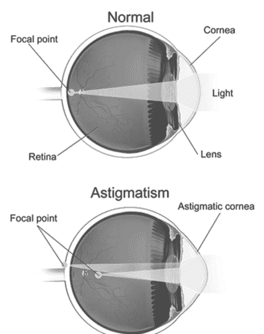

图5.1 正常视网膜图像。
照片来源：Interactive by BruceBlaus。https://storymd.com/journal/6j45zzkinw-astigmatism/page/xlrz07hlzzg-how-does-astigmatism-occur

- **高血压：** 这是第二个最突出的原因。有人认为，扩大血流量的后果可能会损害糖尿病患者眼部的视网膜毛细血管内皮细胞。因此，如果一个人既患有糖尿病又患有高血压，那么他患糖尿病视网膜病变的几率很高。许多医学读物的解释显示，高血压与糖尿病患者发生严重视网膜病变之间存在相关性，以支持这一假设。2型糖尿病是非胰岛素依赖型糖尿病；诊断时保留六年的视网膜照片显示，收缩压与视网膜病变发生有显著相关性。在威斯康星糖尿病视网膜病变流行病学研究（WESDR）中，舒张压是14年随访期间年轻发病（1型）糖尿病患者糖尿病视网膜病变进展为增殖性糖尿病视网膜病变的重要预测因素，与糖基化血红蛋白无关。1型糖尿病是胰岛素非依赖型，与糖基化血红蛋白的发生、未经过滤蛋白尿和依赖型糖尿病无关。

- 2. **胆固醇水平升高：** 脂质水平和高血清胆固醇水平是代谢综合征的非常知名的因素。心血管疾病仍然是糖尿病患者死亡的主要原因。一项大型荟萃分析显示，患有黄斑水肿的糖尿病患者总胆固醇水平较高。高胆固醇水平还与视网膜渗出物硬化的高发率相关。

- 3. **炎症标志物：** 这些标志物与癌症和心血管疾病的高风险相关，并且也通过糖尿病视网膜病变相关联。与没有糖尿病视网膜病变的人相比，患有轻度或重度糖尿病视网膜病变的人体内发现了相当高水平的C反应蛋白（CRP）。⁴

- 4. **睡眠呼吸障碍：** 这也称为阻塞性睡眠呼吸暂停（OSA）。它被认为是反复上呼吸道阻塞的结果，导致血氧饱和度下降和睡眠干扰。OSA与肥胖密切相关，并且也被认为是逐渐被认可的发病来源。一项读物建议，大约86%的肥胖且患有糖尿病的患者在过夜血氧饱和度监测中符合OSA诊断要求。⁵

- 5. **妊娠：** 这被认为是视网膜病变发展的主要风险因素，与非孕期糖尿病女性相比，其患病率和严重程度更高。患有糖尿病的孕妇的微血管变化非常糟糕，以至于医生建议终止或避免妊娠。许多读物揭示，糖尿病发病年龄越小，糖尿病间隔越长，疾病演变的风险就越高。糖尿病病程越长，微血管并发症扩展的几率就越高，因此这些患者在妊娠前容易患上严重形式的起源性视网膜病变变化。在患有糖尿病的女性中，发展情况更为显著。


形成时与伴有轻度或无视网膜病变迹象的患者相关的重度至中度视网膜病变形式。⁶

在本综述论文中，病变定位模型已通过基于深度网络补丁的方法设计完成。作者致力于降低模型的复杂度，同时提升模型性能。他们打算采用一种高效技术来选择训练增强样本。作者使用标准糖尿病视网膜病变数据库校准等级 1（DIARETDB1）数据库训练模型，并结合 Messidor 在多个数据库上对其进行了验证。结果显示，在糖尿病视网膜病变（DR）检测中，接收者操作特征曲线下面积（AUC）范围为 0.911–95% CI（0.896–0.927），灵敏度为 0.941–95%（0.920–0.958）。⁷

采用方向多尺度直线检测方法对视网膜血管进行分割，主要聚焦于小血管。直线检测器已应用于图像处理，从而提升了算法的正确性。二值化操作包含在收尾步骤中，这也提升了性能。在所提方法中，不同数据集的灵敏度分别为 0.8042、0.8010 和 0.7973。⁸

监督学习技术已用于数字视网膜图像的血管检测。一种神经网络方案已用于像素排列，为像素表示计算了 7 维向量。DRIVE 和 STARE 数据库已用于评估该方法。所提方法的性能优于传统方法。⁹

所采用的新方法是带有多尺度全卷积神经网络的静止小波变换。该方法在三个不同数据库上进行了测试，在 CHASE DB1、DRIVE 和 STARE 数据库上分别取得了 0.9575、0.9693 和 0.9652 的正确率，以及 0.9820、0.9904 和 0.9854 的 ROC 曲线下面积。¹⁰

已使用所提方法高效完成白内障筛查。作者强调基于一致性结构（如均匀性、标准差和强度）的探索。相应地，视网膜母细胞瘤可通过视网膜未发育细胞的自动化识别方法予以识别。作者提出的设想是压缩一个图像处理算法，以帮助识别视网膜的白色半径，借助 Canny 边缘检测、图像滤波和阈值处理实现。¹¹

开发了一种系统化操作人员手动工作的系统，以消除人为错误并提高疟疾诊断的准确性。所提方法使用了一组包含 80 张薄血涂片图像的数据集。患病细胞通过 HSV 分割被去除。所提方法对于专家短缺的农村地区很有用。12

图像的应用不仅限于医疗和健康领域，还广泛用于监控、追踪、视觉、监视等众多应用。已使用 MODIS 数据分析甘蔗作物的生化参数。13 通过卫星图像融合估算了农业干旱。14 使用彩色和热成像图像识别了草莓植株的湿度，15 以借助机器学习方法提取土地参数。16-18 无人机的使用日益增加；随着技术的进步，研究人员在灾害管理、救援等领域使用无人机数据。通过视觉概念检查铁路轨道健康状况；19 在铁路轨道上使用基于特征的模板匹配识别了鱼尾板检测；20 在灾害期间使用无人机进行监视（自然灾害中的无人机监视以进行搜救），等等。研究人员还将无人机与卫星数据融合，用于农业监测、国防及其他类似应用。21-24

### 5.2 数据集和测试工具

#### 5.2.1 数据集

所使用的数据集可免费获取。Messidor 数据库包含 1200 张无损图像，涉及 450 个 FOV 和不同的判定。每张图像提供的分级计数从 R0 到 R3 不等。25 数据集由从 Messidor 图像集中提取的特征组成，用于预测图像是否包含任何糖尿病视网膜病变迹象。所有特征要么代表明显的病变，要么代表功能部分的描述性特征，要么代表图像级描述符。

#### 5.2.2 测试工具

我们使用 Jupyter Notebook 测试了代码。Jupyter 项目是一个非营利性组织，旨在通过多种编程语言开发开源软件、开放标准和服务，用于交互式计算。Jupyter 项目由 Fernando Pérez 于 2014 年从 IPython 衍生出来，支持数十种语言的实现环境。Jupyter 项目的名称致敬于 Jupyter 支持的三种核心编程语言（Python、Julia 和 R），并向伽利略记录木星卫星发现的日记本致敬。Jupyter 项目开发并支持了 Jupyter Notebook、Jupyter Hub 和 Jupyter Lab（Jupyter Notebook 的尖端版本）等交互式计算工具。

### 5.3 所用技术

本节讨论了本章中所用的技术。

#### 5.3.1 数据清洗

数据清洗是指识别错误、缺失、错误、无关或缺失的数据片段，随后对其进行更改、替换或删除的过程。数据清洗被视为数据科学的固有组成部分。数据是分析和人工智能（AI）中最重要的东西。对于真实数据，数据出现缺失、冲突或缺失特征的情况很常见。如果数据退化，可能会破坏系统或产生错误结果。我们已经看到过几个数据清洗重要性的例子。机器学习是一种数据驱动的人工智能。在 AI 中，如果数据不相关，就会导致错误模型的产生。你的数据越干净，模型就越好。如果没有数据质量，就很难预期达到更好的结果。

#### 5.3.2 数据可视化

数据可视化是对信息和数据的图形化描述。使用图表、图形和地图等可视化元素，数据可视化工具提供了一种直观的方法，以查看和理解数据中的模式、特征和趋势。在大数据领域，数据可视化工具和进步对于分析大规模数据和做出数据驱动的决策至关重要。26 我们可以快速区分红色和蓝色、正方形和圆形。我们的生活方式显而易见，涵盖从工艺到广告、电视和电影的一切。数据可视化是一种额外的平面艺术形式，能吸引我们的眼球并传达信息。如果我们在查看大型电子表格却看不到模式，我们就知道可视化有多有说服力。图 5.2 展示了数据可视化。

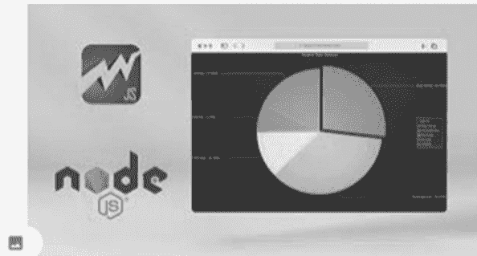

图 5.2 数据可视化。

#### 5.3.3 机器学习

要用极其简单的术语来定义 AI，科学必须允许人们与机器一起学习和工作。选择 AI 尤其重要，科学必须允许机器像人类一样学习和工作。基于计算机的智能无疑不仅仅是另一项发展。运行当前结构确认和 AI 应用的算法已经存在很长时间。不过，AI 模型已开始与日益复杂的教育记录进行交互，并从过去的检查和措施中学习，以提供可靠的决策和结果。组装合适的模型无疑可以避免新风险并识别业务中的有益机会。26 运行当前模式识别和 AI 应用的算法已经存在很长时间。组装正确的模型，你就注定要远离


识别新的风险和富有成效的机遇，以利于您的业务。图 5.3 展示了机器学习可视化。

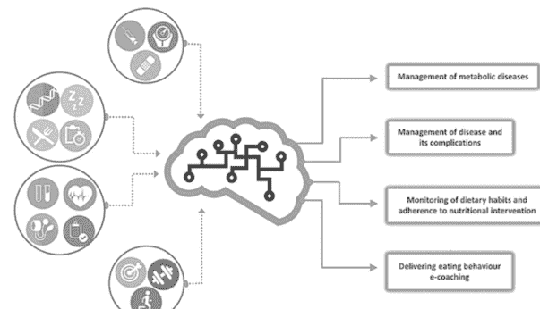

图 5.3 机器学习可视化。
来源：版权所有 © 2018 Francesco Pettini。https://creativecommons.org/licenses/by/4.0/

### 5.4 使用的算法

在本片段中，我们列出了所有用于在图像中识别糖尿病视网膜病变的监督机器学习算法。

#### 5.4.1 KNN（K-近邻）算法

KNN 算法用于解决分类和回归任务。它是一种监督机器学习算法。如果将 KNN 视为分类器，则其采用多数投票原则，即如果 K = 5，则测试五个最近邻的类别。同样，KNN 回归选择五个最近邻的平均值。

图 5.4 显示有两个数据簇——类 A（显示为红色星形）和类 B（显示为绿色三角形）。这里我们检查了类 A 和类 B 两个簇中新 K 值的距离。但这里产生了一个问题，我们是否需要计算类 A 和类 B 所有点的距离？答案是否定的，因为我们必须指定 K 值。K 值将指定用于预测而应考虑的任何簇中的变量或点的数量。距离最小的点将被视为新变量的预测类。在图 5.4 中，K 值为 3，因此它取用簇中三个最近的值。27

##### KNN 伪代码

- 1. 加载数据。
- 2. 初始化 K 值（用于所有预测）。
- 3. 要获取预测类，从 1 开始迭代并覆盖训练数据集的总数量。
- 4. 计算测试数据中每个训练数据行的距离。要计算距离，可以使用任何公式，但这里我们使用欧氏距离公式。
- 5. 根据距离值，将数据排序为升序或降序形式。
- 6. 从排序后的数组中获取前 K 个值。
- 7. 获取这些行中出现频率最高的类。
- 8. 返回预测的类。

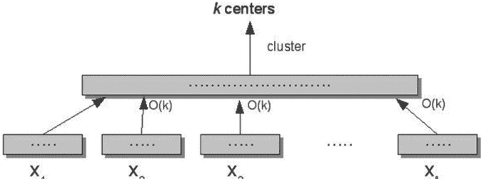

图 5.4 数据类簇。

#### 5.4.2 逻辑回归

这是一种监督机器学习算法，用于预测目标变量的可能性。因变量或目标变量的环境被分为两部分，这意味着只有两个可能的类。简单来说，目标变量的信息编码为 1 或 0，或者说是二进制。从统计角度看，逻辑回归模型将 P(Y = 1) 作为 X 的函数进行预测。它是最简单的机器学习算法之一，可用于多种分类问题，如糖尿病预测、癌症检测、垃圾邮件检测等。28

#### 5.4.3 支持向量机 (SVM)

SVM 是一种学习控制方法，可用于分类、回归和异常值检测。在 SVM 的上下文中，我们将每个数据点绘制为 n 维空间中的一个点，每个部分的估计就是特定坐标的估计。支持特征只是一维旁观者。SVM 图是最佳隔离两个类的边界（超平面/线）。29

#### 5.4.4 随机森林分类器

决策树是敏锐的模型，利用结合规则的策略来确定目标。每棵树都被视为带有分支、簇和叶子的关键模型。可选森林是树的集合，因此每棵树依赖于带有森林区域相对分散的随机模型向量。“随机林”的另一种定义是分类器，其中包含自信地传递可选向量的有序树的集合。在构建随机森林时，最突出的类会选择并强化两三棵决策树，以实现持续谨慎和稳定性。如果大多数关键分类器混乱，善变的森林会做出混乱的决策。每个属性的一般重要性非常容易评估。因此，它比大多数不同的计算更准确。30

#### 5.4.5 朴素贝叶斯

贝叶斯请求依赖于朴素理论，对预言者进行自由假设。贝叶斯模型不难设置。它拥有大量数据库，没有关键的直线混合，并且非常有用。但关键的是，在朴素贝叶斯分类器中，经常会额外创建和广泛使用的关联，因为它与日益精细的请求程序相差甚远。这种假设 P(c | x) 统称为类机会。P(x | c) 是强调的概率，针对特定类的假设概率 P(x) 是猜测度量。对无效模型没有实际的替代方案，我们努力寻找贝叶斯组织中预言者的最佳独立估计指标。31

#### 5.4.6 梯度提升

梯度提升是一种 AI 技术，用于评估和分类问题，为最脆弱的对象构建有洞察力的模型。梯度提升机是一系列有影响力的机器学习方法，在广泛的实际应用中取得了显著成就。它们可以针对应用程序的特定需求进行高度定制，例如学习不同的损失函数。假设性信息配有生动的示例和插图，涵盖梯度提升模型设计的所有阶段。32

### 5.5 结果与讨论

本节通过比较在相同数据集上应用的上述机器学习技术的准确率，描述了它们的性能。准确率表明正确识别的糖尿病视网膜病变患者的百分比。我们将数据集分为训练和测试两部分。训练数据集用于训练算法，使其熟悉数据，然后我们使用测试数据集来查看我们的预测。预测后，我们计算了每种算法的准确率，并发现其中准确率最高的算法表现更好。表 5.1 描述了用于糖尿病视网膜病变的组成部分。数据集中提取了某些糖尿病视网膜病变的原因。

图 5.5 描述了数据集中存在的元素数量、平均值、标准差、最小值和值出现次数等细节。我们还检查了数据集中的空值，并识别出数据集中是否存在任何空值。这一点很重要，因为空值的存在会导致数据集中出现噪声，

| | 怀孕次数 | 葡萄糖 | 血压 | 皮肤厚度 | 胰岛素 | BMI | 糖尿病谱系功能 | 年龄 | 结果 |
|---|---|---|---|---|---|---|---|---|---|
| 计数 | 2000.00 | 2000.00 | 2000.00 | 2000.00 | 2000.00 | 2000.00 | 2000.00 | 2000.00 | 2000.00 |
| 均值 | 3.70 | 121.18 | 69.15 | 20.94 | 80.25 | 32.19 | 0.47 | 33.09 | 0.34 |
| 标准差 | 3.31 | 32.07 | 19.19 | 16.10 | 111.18 | 8.15 | 0.32 | 11.79 | 0.47 |
| 最小值 | 0.00 | 0.00 | 0.00 | 0.00 | 0.00 | 0.00 | 0.08 | 21.00 | 0.00 |
| 25% | 1.00 | 99.00 | 63.50 | 0.00 | 0.00 | 27.38 | 0.24 | 24.00 | 0.00 |
| 50% | 3.00 | 117.00 | 72.00 | 23.00 | 40.00 | 32.30 | 0.38 | 29.00 | 0.00 |
| 75% | 6.00 | 141.00 | 80.00 | 32.00 | 130.00 | 36.80 | 0.62 | 40.00 | 1.00 |
| 最大值 | 17.00 | 199.00 | 122.00 | 110.00 | 744.00 | 80.60 | 2.42 | 81.00 | 1.00 |

这会影响数据集的准确性，我们无法从中以及算法本身中发挥最大潜力。

所有这些参数都被证明是糖尿病视网膜病变的原因。可能还有其他可用于识别糖尿病视网膜病变存在的参数，但目前，这些参数被视为得出结论所需的参数。我们将数据集按 8:2 的比例任意划分为训练集和测试集，这意味着 80% 的数据用于训练，20% 的数据用于测试。我们采用这个特定比例是因为它被认为是实现最佳准确率的最优划分比例。我们从数据集中删除了某些异常值。异常值是指位于某个其他区域并以特定模式显著偏离其余数据集的值，这会导致错误。删除这些异常值至关重要，以便模型能够准确地训练来预测未来事件。我们从此数据集中删除了大约 80+ 个异常值。我们分析了不同算法的准确率，并在表 5.2 中列出了它们。

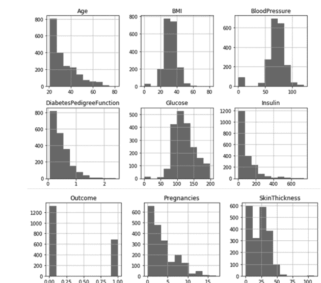

图 5.5 糖尿病视网膜病变组成部分的图形表示。


### 表 5.2 不同算法获得的准确率。

| 算法 | 准确率 |
|---|---|
| SVM | 0.7643 |
| 逻辑回归 | 0.7734 |
| KNN | 0.87 |
| 随机森林分类器 | 0.9908 |
| 朴素贝叶斯定理 | 0.7311 |
| 梯度提升分类器 | 0.8942 |

已使用 Sklearn 软件包，其中包含 SVM、逻辑回归、KNN、随机森林分类器、朴素贝叶斯定理和梯度提升分类器函数，用于在数据集上执行所有列出的算法。我们使用 sklearn 和 model_selection 软件包中的 train_test_split 函数拟合了两个训练数据集，并将其分为 x 和 y。同样，测试数据集也被分为 x 和 y。对于预测，使用了 test_x 数据集。为了获得准确率，我们使用了 accuracy_score() 函数，将 test_y 和 y_pred 作为参数传递。我们分析了由 roc_auc_score() 函数形成的 ROC_AUC（受试者工作特征曲线下面积），该函数将 test_y 和 y_pred 作为参数并给出分数值。之后，通过使用 cross_validation() 函数采用了交叉验证，将 train_x、train_y、scoring 和 cross_validation() 值作为参数传递。最后，显示了从不同算法获得的结果。不同算法的准确率的图形表示已在图 5.6 中显示。

### 5.6 结论与未来工作

我们已成功实现目标，并提供了在其他算法中可用于从图像数据集中检测糖尿病视网膜病变的最准确算法。通过使用随机森林分类器算法，数据集被最准确地解析，准确率为 99.09%。本章的主要发现如下：

- 1. 怀孕、年龄、血压、胰岛素和既往病史是识别一个人糖尿病视网膜病变的关键特征。
- 2. 与所有其他算法相比，随机森林分类器给出了最完美的结果。
- 3. 在未来几年，根据人们的生活方式，糖尿病视网膜病变可能会以惊人的速度增长。

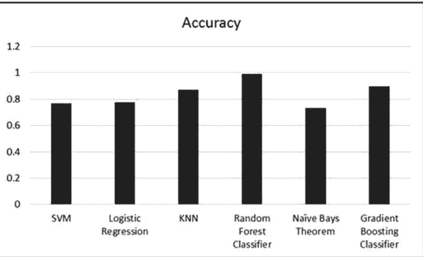

图 5.6 不同算法获得的准确率。

建议面向未来开展工作：应在糖尿病检测的同时进行视网膜病变检测。神经网络的应用可能有助于更容易地识别此问题。识别一些可能与糖尿病视网膜病变相关的其他症状。使用其他数据集和其他参数进行检测可能会有所帮助。

### 关键词

- * 糖尿病视网膜病变
- * 图像处理
- * 机器学习
- * 监督方法
- * 青光眼

### 参考文献

- 1. Eftekhari, N.; Pourreza, H. R.; Masoudi, M.; Ghiasi-Shirazi, K.; Saeedi, E. 使用两步卷积神经网络的眼底图像中微动脉瘤检测. Biomed. Eng. Online, 2019, 18 (1), 1–16.
- 2. Joseph, S. I. T.; Sravanthi, T.; Karunakaran, V.; Priyadharsini, C. 微动脉瘤辨别中机器学习方法研究, International Conference on Computational Vision and Bio Inspired Computing; Springer, 2019; pp 1327–1334.
- 3. Lyona, C.; Menezes, J.; Shinde, T.; Gavhane, M.; Rohatgi, R. M.; Chavan, S. 基于深度学习的糖尿病视网膜病变分期视网膜图像分类, 2020 计算、通信控制与网络第二届国际会议 (ICACCCN); IEEE, 2020; pp 228–231.
- 4. Kalia, A.; Uttawar, V. 使用机器学习从眼底图像中识别糖尿病视网膜病变. Natl. J. Comput. Appl. Sci. 2019, 2 (2), 1–4.
- 5. Priya, R.; Aruna, P. 使用机器学习技术诊断糖尿病视网膜病变. ICTACT J. Soft Comput. 2013, 3 (4), 563–575.
- 6. Satyananda, V.; Anithalakshmi, K.; Poornimamayaka, K.; Sowmya, H. 使用机器学习技术和嵌入式系统诊断糖尿病视网膜病变. Perspect. Commun. Embed. Syst. Signal Process.-PiCES 2019, 2 (11), 346–348.
- 7. Zago, G. T.; Andréao, R. V.; Dorizzi, B.; Salles, E. O. T. 使用红色病变定位和卷积神经网络进行糖尿病视网膜病变检测. Comput. Biol. Med. 2020, 116, 103537.
- 8. Khawaja, A.; Khan, T. M.; Khan, M. A.; Nawaz, S. J. 视网膜血管分割的多尺度方向线检测器. Sensors 2019, 19 (22), 4949.
- 9. Marin, D.; Aquino, A.; Gegúndez-Arias, M. E.; Bravo, J. M. 使用灰度级和矩不变量基础特征的视网膜图像血管分割新监督方法. IEEE Trans. Med. Imaging 2010, 30 (1), 146–158.
- 10. Oliveira, A.; Pereira, S.; Silva, C. A. 基于全卷积神经网络的视网膜血管分割. Expert Syst. Appl. 2018, 112, 229–242.
- 11. Fajdar, N.; Sinha, A. 基于 OpenCV 的图像处理疾病检测平台. Comput. Anal. Deep Learn. Med. Care Princ. Methods Appl. 2021, 181–215.
- 12. Saraswat, S.; Awasthi, U.; Faujdar, N. 红细胞疟原虫检测中的图像处理, 2017 第六届可靠性、信息通信技术与优化国际会议 (趋势与未来方向) (ICRITO); IEEE, 2017; pp 599–603.
- 13. Panwar, E.; Agarwal, A.; Singh, D.; Pruthi, V. 甘蔗作物生化参数研究中卫星图像的高效应用, 2018 信息与通信技术会议 (CICT); IEEE, 2018; pp 1–5.
- 14. Anjana, N. J. K.; Murugan, D.; Agarwal, A.; Singh, D. 使用 MODIS 数据的印度乌塔拉坟德农业干旱估算融合方法高效应用, 2018 第九届信号、图像、视频与通信国际研讨会 (ISIVC); IEEE, 2018; pp 39–42.
- 15. Swarup, A.; Lee, W. S.; Peres, N.; Fraisse, C. 草莓植株湿度检测使用颜色和热成像. J. Biosystems. Eng. 2020, 45 (4), 409–421.
- 16. Agarwal, A.; Gupta, S.; Kumar, S.; Singh, D. 土地覆盖监测卫星数据中物联网高效用以估算 LST 和 ET, 2016 第十一届工业与信息系统国际会议 (ICIIS); IEEE, 2016; pp 905–909.
- 17. Agarwal, A.; Gupta, S.; Kumar, S.; Singh, D. 基于卫星的物联网概念用于降 MODIS 数据分辨率以提取地表温度, 2018 第九届信号、图像、视频与通信国际研讨会 (ISIVC); IEEE, 2018; pp 67–70.
- 18. Maurya, A. K.; Singh, D.; Singh, K. P. 使用无人机和 Sentinel-2 数据的植被覆盖分数估算融合方法开发, IGARSS 2018-2018 IEEE 国际地球科学与遥感研讨会; IEEE, 2018; pp 7448–7451.
- 19. Singh, A. K.; Swarup, A.; Agarwal, A.; Singh, D. 基于视觉的铁路轨迹提取与无人机影像监测. ICT Express 2019, 5 (4), 250–255.
- 20. Saini, A.; Agarwal, A.; Singh, D. 无人机图像中铁路轨迹卡板检测的特征匹配模板, IGARSS 2020-2020 IEEE 国际地球科学与遥感研讨会; IEEE, 2020; pp 2237–2240.
- 21. Agarwal, A.; Singh, A. K.; Kumar, S.; Singh, D. 使用卫星和无人机的精准农业监测分类技术关键分析, 2018 IEEE 第十三届工业与信息系统国际会议 (ICIIS); IEEE, 2018; pp 83–88.
- 22. Agarwal, A.; Kumar, S.; Singh, D. 使用卫星和无人机图像的土地地形监测自适应变化检测神经网络方法开发. Def. Sci. J. 2019, 69 (5), 474.
- 23. Agarwal, A.; Kumar, S.; Singh, D. 使用 Sentinel-2 和无人机数据计算最优植被指数机器学习方法开发, IGARSS 2019-2019 IEEE 国际地球科学与遥感研讨会; IEEE, 2019; pp 5832–5835.
- 24. Agarwal, A.; Kumar, S.; Singh, D. 无人机数据阴影检测与去除自适应技术. J. Indian Soc. Remote Sens. 2021, 49 (3), 491–498.
- 25. Patil, D.; Patil, B. 视网膜微动脉瘤和糖尿病视网膜病变检测集成系统. Int. J. Electron. Commun. Comput. Eng. 2014, 5, 214–218.
- 26. Andrienko, G.; Andrienko, N.; Drucker, S.; Fekete, J. D.; Fisher, D.; Idreos, S.; Kraska, T.; Li, G.; Ma, K. L.; Mackinlay, J.; et al. 大数据可视化与分析：未来研究挑战与新兴应用, BigVis 2020-第三届大数据可视探索与分析研讨会, 2020.
- 27. Taunk, K.; De, S.; Verma, S.; Swetapadma, A. 学习与分类最近邻算法简要回顾, 2019 智能计算与控制系统国际会议 (ICCS); IEEE, 2019; pp 1255–1260.
- 28. Boateng, E. Y.; Abaye, D. A. 侧重医学研究的逻辑回归模型综述. J. Data Anal. Inf. Process. 2019, 7 (4), 190–207.
- 29. Elaidi, H.; Elhaddar, Y.; Benabbou, Z.; Abbar, H. 基于二进制决策树的支持向量机聚类算法构想, 2018 智能系统与计算机视觉国际会议 (ISCV); IEEE, 2018; pp 1–5.


- 30. Liu, Y.; Liu, L.; Gao, Y.; Yang, L. 载于《基于属性兼容性的改进随机森林算法》，2019 IEEE 第 3 届信息技术、网络、电子与自动化控制会议 (ITNEC)；IEEE，2019；页 2558–2561。
- 31. Salmi, N.; Rustam, Z. 载于《用于预测结肠癌的朴素贝叶斯分类器模型》，IOP 会议系列：材料科学与工程；IOP 出版社，2019；卷 546，页 052068。
- 32. Gupta, A.; Gusain, K.; Popli, B. 载于《在各种数据集上验证极端梯度提升决策树的价值与真实性》，2016 年第 11 届工业与信息系统国际会议 (ICIIS)；IEEE，2016；页 457–462。

Taylor & Francis

Taylor & Francis Group

http://taylorandfrancis.com

## 第二部分

## 图像与视频处理

Taylor & Francis

Taylor & Francis Group

http://taylorandfrancis.com

## 基于人工蜂群优化技术的 DWT-PCA 域视频版权保护

PONNISATHYA S., RAMAKRISHNAN S., and SATHIYAMURTHI P.

信息技术系，Dr. Mahalingam 工程与技术学院，波拉奇，泰米尔纳德邦，印度

### 摘要

本文通过利用帧的局部特征解决视频版权问题。常规算法评估各种攻击，但未考虑视频中帧的冗余性。拟议方法侧重于去除冗余帧以缩短处理时间，并采用特征提取算法以抵御几何攻击。通过视频帧的熵和绝对均值差有效识别关键帧。PCA 技术用于降低源数据的维度并选择水印的关键特征。加速稳健特征 (SURF) 特征选择技术用于提取关键帧的重要显著特征。哈尔小波用于将帧分解为两个层次，LH 带被选用于水印过程。为了提高鲁棒性和不可见性的效率，应用人工蜂群优化算法来选择最优缩放因子。根据实验结果，所提出的新颖技术对面向图像的攻击、基于帧的攻击具有抵抗力，并且还解决了误正问题。

### 6.1 引言

自网络迅速扩展以来，图像、视频和音频等多媒体信息可以轻松通过网络传输。数字多媒体数据在未经所有者同意的情况下通过互联网传播，因此非法用户会制作无限副本。为避免上述问题，采用了数字视频水印技术。这是一种通过嵌入数字图像、音频或任何数字数据来维护源数据安全的有效技术。研究人员已提出了各种水印技术，1,2 与 DWT-PCA-based 方法的性能相比，该方法在不可见性和鲁棒性指标方面取得了更多结果。3,5,9

近年来，已经创造出许多保护视频版权的解决方案。每种策略都有基于鲁棒性和不可见性的优缺点，如表 6.1 所示。

### 6.2 拟议方法

拟议方法旨在通过将加速稳健特征 (SURF) 特征选择方法与 DWT 相结合，构建一种独一无二的视频安全系统。PCA 技术用于对秘密图像进行降维。视频基于场景分割技术被分割成场景组。在单个场景中，根据帧的熵水平识别最大能量级帧。最后，选择具有最大熵的帧作为水印嵌入过程的关键帧。缩放因子是控制水印和视频的鲁棒性及不可见性的关键因素，因此应用人工蜂群算法来选择最优缩放因子。选择扰乱水印块的 PC 以提高水印数据的安全级别。然后提取 SURF 特征，并将扰乱的秘密图像块插入关键帧的特征点中。

| 作者 | 技术 | 局限性 |
|---|---|---|
| Masoumi 等人 [3] | 基于频率域导向时空数据隐藏的技术 | 该方法能够抵御基于帧的攻击和噪声叠加 |
| Karmakar 等人 [4] | 基于 DCT 的视频水印技术 | 能够抵御旋转、串谋和面向帧的攻击 |
| Dutta 和 Gupta [5] | 面向视频编码的水印方案 | 能够抵御滤波、噪声叠加、压缩等各种攻击 |
| Sake 和 Tirumala [6] | 基于双正交小波变换和优化方法 | 能够抵御图像处理攻击 |
| Loganathan 和 Kaliyaperumal [7] | 基于 BAM 神经网络和模糊系统的视频水印系统 | 对帧丢弃攻击不鲁棒 |
| Ejima 和 Miyazaki [8] | 基于小波的水印系统 | 对面向帧、中值滤波攻击不鲁棒 |
| Da-Wen [9] | 基于 3D 小波变换的水印 | 不能抵御滤波和特定面向图像的攻击 |
| Thind 和 Jindal [10] | 基于 DWT 和 SVD 的视频水印 | 对视频处理攻击不鲁棒 |
| Raja 等人 [11] | 基于 DWT-SCHUR 的视频水印 | 对帧丢弃攻击不鲁棒 |

#### 拟议工作的创新点

- 通过利用相邻帧之间的绝对均值差来减少冗余帧。因此，降低了关键帧选择和嵌入区域识别的处理时间。

- 关键帧根据单个场景的熵进行识别。

- 采用 SURF 特征选择技术从关键帧中提取合适的特征。

- 通过 ABC 算法选择最优缩放因子以提高鲁棒性和不可见性。

- 秘密图像基于场景中偏好的各种特征区域被分割成若干块。因此，避免了视频中帧丢失攻击的发生。

#### 6.2.1 场景分割

场景分割方法通过指标 (ADFV) 帧方差绝对差值15,16 检测源视频中发生的场景快速变化，该指标由公式 6.1 计算。Suzie 视频的改变场景如图 6.1 所示。

\(ADFV'_n = |FV_n - FV_{n-1}|\) (6.1)

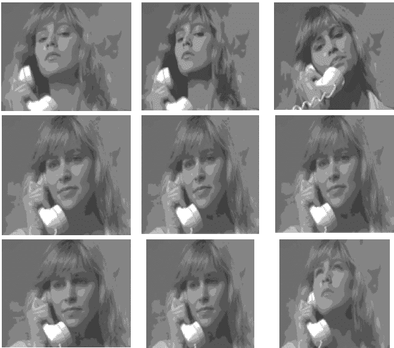

**图 6.1** Suzie 视频中的场景变化。

#### 6.2.2 离散小波变换 (DWT)

采用哈尔小波将帧分解为 LL、HL、LH 和 HH 四个子带。LH 带被选中用于嵌入水印，因此与其他带相比更稳定，如图 6.2 所示。21,23–25

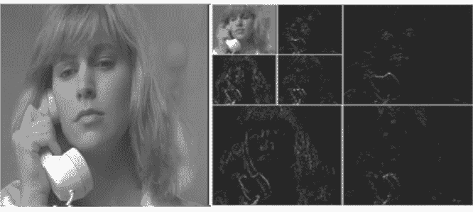

**图 6.2** 哈尔小波的二级分解。

#### 6.2.3 熵

熵用于测量图像的随机性以用于分类，17 由公式 6.2 测量。

```
Entropy (f₁) = Sum (P (f₁). *log2 (P (f₁))). (6.2)
```

#### 6.2.4 帧间绝对均值差 (AMD)

绝对均值差指标用于消除视频中的重复帧，通过计算相邻帧之间的 AMD 来实现。17,19,20

如果差值等于零，则这些帧称为冗余帧。对于后续处理，消除其中一帧。AMD 的公式如公式 6.3 所示。

```
AMD (fᵢ,fᵢ₊₁) = Meanabs (f{i} – f{i+1}) (6.3)
```

#### 6.2.5 特征选择算法

应用加速稳健特征 (SURF) 特征选择技术来选择关键帧的特征描述子。此 SURF 变换提供帧的重要关键特征，这些特征并未被夸大


由于旋转和缩放、光照以及视角等诸多复杂因素的影响。图 6.3 显示了 Suzie 视频关键帧中的特征选择。

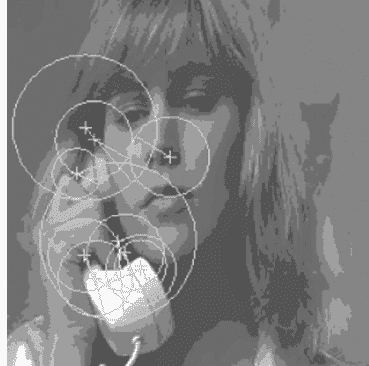

#### 图 6.3 Suzie 视频帧的 SURF 特征选择。

#### 6.2.6 水印预处理

灰度图像被用作秘密图像。图像被分解为各种块，这些块与关键帧中提取的各种特征差异相似。图像块大小取决于特征集大小。关键帧通过以下算法选择。

- 步骤 1. 查找场景中的总帧数。
- 步骤 2. 使用相邻帧之间的 AMD 识别场景中重复帧的程度。
- 步骤 3. 通过 剩余帧 (RF) = 总帧数 - 重复帧数 计算场景中剩余可用帧 (RF)。
- 步骤 4. 为每个场景选择熵最大且运动最小的 25% 帧作为关键帧。

#### 6.2.7 ABC（人工蜂群）优化技术

ABC 算法由三种组件组成，例如雇佣蜂、旁观蜂和侦察蜂。在此算法中，人工蜂在多维空间中搜索食物来源。它们根据对自己及其巢穴成员的知识微调其姿态 [22,23]

- 步骤 1. 设置 N 为蜜蜂食物来源的种群数量。
- 步骤 2. N = 缩放因子，取值介于 0 和 1 之间，间隔为 0.01
- 步骤 3. 选择种群范围 P = {i = 1,2,3.....N}
- 步骤 4. 适应度 = PSNR {F1, F2 ............... Fn}
- n = 视频中的帧数
- 步骤 5. 在每次迭代中
- 雇佣蜂计算每个帧的适应度值位置
- 旁观蜂更新适应度值 {F1, F2, ......... Fn}
- 步骤 6. 最优位置 = 旁观蜂获得最优 PSNR 值的位置。

雇佣蜂根据适应度函数 PSNR 搜索缩放因子的位置。当食物来源耗尽时，旁观蜂记录食物来源，雇佣蜂转变为侦察蜂并开始搜索新的食物来源。最后，ABC 算法预测 0.45 作为最优缩放因子。

#### 6.2.8 水印嵌入算法

水印嵌入和提取算法的流程分别如图 6.4 和 6.5 所示。

- 步骤 1. 选择输入视频和水印图像进行处理。
- 步骤 2. 输入视频被分割为帧，并使用帧方差的绝对差分分割为独立场景。
- 步骤 3. 在每个场景 (s1,s2...sn) 中，计算各帧的熵 (EF_i) 和场景的平均熵 (ES_i)。
- 步骤 4. 通过帧间绝对均值差移除冗余帧。
- 步骤 5. 根据以下约束选择每个场景的关键帧。

```
IF
EFi > ESi
Select the frame (F i) as Keyframe
Else
Reject the frame
```

- 步骤 6. 对关键帧应用 DWT，然后选择 LH 子频带进行进一步处理。
- 步骤 7. 对场景中各个关键帧应用 SURF 特征检测算法以检测帧的基础特征。
- 步骤 8. 基于 SURF 特征提取算法，选择平滑特征用于水印嵌入。
- 步骤 9. 秘密图像 (W) 经过预处理并重新排序为各种块，这些块相当于关键帧中选定的关键特征。
- 步骤 10. 对秘密图像的每个块应用 PCA 以获取图像块的主成分。
- 步骤 11. 重新排序的图像块被嵌入到场景中选定关键帧的关键特征中。W<sub>f</sub> = V<sub>f</sub> + k * W<sub>h</sub>，k 是由 ABC 算法选择的缩放因子。
- 步骤 12. 对视频中所有帧执行逆 DWT。
- 步骤 13. 将所有带水印的帧与场景中的其他帧组合以生成输出视频 (V<sub>w</sub>)。

#### 6.2.9 水印提取算法

- 步骤 1. 输出视频被处理并分割为不同场景。
- 步骤 2. 基于熵约束识别每个场景的关键帧。
- 步骤 3. 对关键帧应用 DWT，然后选择 LH 子频带用于提取过程。
- 步骤 4. 从场景中每个关键特征中提取水印块的主成分 (b<sub>h1</sub>, b<sub>h2</sub>, ..., b<sub>hn</sub>)。
- 步骤 5. 水印块转换为图像块。W<sub>b</sub> = (b<sub>1</sub>, b<sub>2</sub>, ..., b<sub>n</sub>)。
- 步骤 6. 合并所有提取的块以获取水印图像。

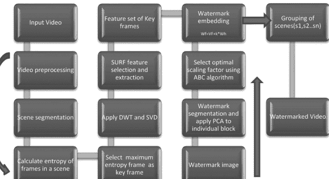

#### 图 6.4 水印嵌入流程。

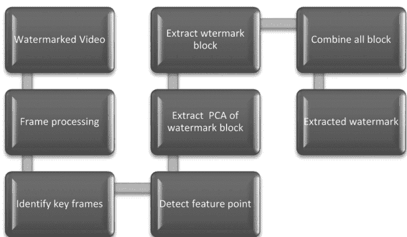

#### 图 6.5 水印提取流程。

### 6.3 结果与讨论

为测试基于 DWT-PCA 域的人工蜂群优化技术视频版权保护方法，进行了各种实验。用于实验的选定输入视频序列为 Suzie、Vipmen、News 和 Foreman，帧率为 30 帧/秒，在标准数据库中提供。实验中尝试的示例水印为 cameraman、Nature 和 logo。

通过 MATLAB 2013 进行了多项测试以估计所提技术的鲁棒性。对带水印视频应用了结果中提到的几种面向图像和帧的攻击。PSNR 和 NCC 用于评估输出视频和提取水印的质量，公式如等式 6.4 和 6.5 所示。

\( PSNR(M,\hat{M})=10 \text{Log}_{10} \frac{255^2}{\frac{1}{LxK} \sum_{i=1}^L \sum_{j=1}^k (M_{ij}-\hat{M}_{ij})^2} \quad (6.4) \)
\( NC=\frac{\sum_i \sum_j M(i,j).M(i,j)}{\sum_i \sum_j [M(i,j)]^2} \quad (6.5) \)

#### 表 6.2 应用各种攻击后的 PSNR 和 NCC 值。

| 攻击类型 | 带水印视频的 PSNR (dB) | 提取水印的 PSNR | 提取水印的 NCC |
|---|---|---|---|
| 无攻击 | 58.33 | 59.51 | 0.98 |
| 高斯噪声 | 49.91 | 50.51 | 0.93 |
| 泊森噪声 | 48.38 | 52.32 | 0.90 |
| 椒盐噪声 | 47.42 | 49.78 | 0.88 |
| 模糊 | 57.31 | 53.65 | 0.96 |
| 亮化 | 55.64 | 54.47 | 0.95 |
| 帧平均 | 57.23 | 45.83 | 0.96 |
| 帧交换 | 58.23 | 53.31 | 0.93 |

#### 6.3.1 与现有算法的结果比较

所提技术产生的带水印视频的鲁棒性与现有方法相关。不同攻击下所提技术的 PSNR 和 NCC 值的性能变化如表 6.2 所示。现有方法与所提方法之间输出视频的 PSNR 波动如图 6.6 所示。从表 6.2 和图 6.6 可以看出，所提方法能够抵御各种面向图像和帧处理攻击，并与现有方法相比产生更好的结果。

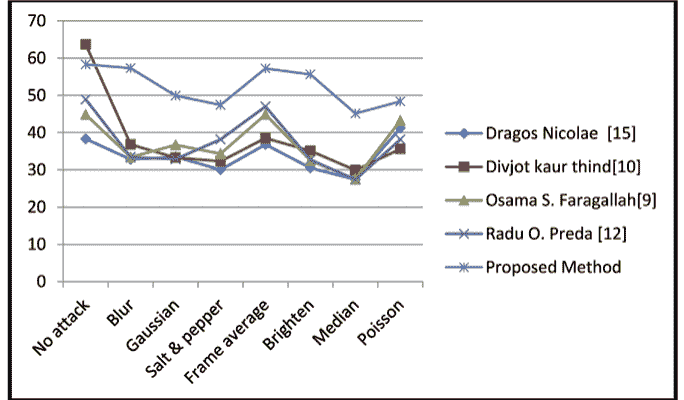

#### 图 6.6 现有方法与所提方法的带水印视频 PSNR 对比。

#### 表 6.3 所提方法与现有方法的 NCC 对比。

| 攻击 | Ejima [8] | Dawan [9] | Chetan [14] | Cruz-Ramos [13] | Raja [11] | 所提方法 |
| :--- | :--- | :--- | :--- | :--- | :--- | :--- |
| 帧丢失 | 0.94 | 0.89 | 0.96 | 0.95 | 0.27 | 0.98 |
| 帧平均 | 0.64 | 0.81 | 0.77 | 0.93 | 0.99 | 0.96 |
| 帧交换 | 0.81 | 0.85 | 0.81 | 0.92 | 0.99 | 0.98 |
| 添加噪声 | 0.7 | 0.91 | 0.9 | 0.98 | 0.97 | 0.96 |
| 中值滤波 | 0.53 | 0.8 | 0.74 | 0.9 | 0.9 | 0.93 |

### 6.4 结论

本文提出了一种基于 DWT-PCA 域的人工蜂群优化技术视频版权保护方法。重新排序的水印块的主成分被插入到视频关键帧的 LH 子频带中。该方法相较于现有技术具有多种优势。所提方法的目的是移除重复帧以降低处理时间。通过引入基于熵的关键帧选择概念，提高了该方法的安全性。采用 PCA 算法以避免误报问题。通过 ABC 算法选择最优缩放因子，提高了所提水印过程的不可见性和鲁棒性。所提方法通过在关键帧中融合 SURF 特征提取来抵御几何攻击。该方法还能抵抗特定类型的面向图像和帧处理攻击。未来的改进将是向源视频和水印引入多级身份验证。

### 关键词

- * 离散小波变换
- * 特征提取
- * 视频水印
- * 误报
- * SURF
- * 冗余帧
- * 人工蜂群优化算法

### 参考文献

- 1. Chang, X.; Wang, W.; Zhao, J.; Zhang, L. 《数字视频水印综述》，载于 2011 年第七届国际自然计算会议（ICNC）；IEEE，2011 年 7 月；第 1 卷，第 61–65 页。
- 2. Sethuraman, P. S.; Srinivasan, R. 《数字视频水印技术及其应用综述》，工程科学，2016，1（1），22–27。
- 3. Masoumi, M.; Rezaei, M.; Hamza, A. B. 《面向视频所有权验证的盲时频数据隐藏方法（频域）》，AEU-国际电子与通信杂志，2015，69（12），1868–1879。
- 4. Karmakar, A.; Phadikar, A.; Phadikar, B. S.; Maity, G. K. 《一种抗旋转和串通攻击的盲视频水印方案》，国王沙特大学计算机与信息科学杂志，2016，28（2），199–210。


5. Dutta, T.; Gupta, H.P. 高效视频编码（HEVC）编码视频的盲提取过程鲁棒水印框架. J. Vis. Commun. Image Represent. 2016, 38, 29–44.

6. Sake, A.; Tirumala, R. 基于优化技术的双正交小波变换视频水印. Mater. Today: Proc. 2018, 5 (1), 1470–1477.

7. Loganathan, A.; Kaliyaperumal, G. 基于BAM神经网络和模糊推理系统的多水印自适应人类视觉系统视频水印方案. Expert Syst. Appl. 2016, 63, 412–434.

8. Ejima, M.; Miyazaki, A. 小波基础数字图像和视频水印. 在：图像处理国际会议，2020；卷3（3），第678–681页.

9. Da-Wen, X. 基于3D小波变换的盲视频水印算法. 在：计算智能与安全国际会议，2007；第945–949页.

10. Thind, D. K.; Jindal, S. 半盲DWT-SVD视频水印. Procedia Comput. Sci. 2015, 46, 1661–1667.

11. Rajab, L.; Al-Khatib, T.; Al-Haj, A. 基于DWT-SCHUR的盲数字视频水印技术. J. Softw. Eng. Appl. 2015, 8, 224–233.

12. Preda, R. O.; Vizireanu, D. N. 小波域中视频版权保护的鲁棒数字水印方案. Measurement 2010, 43 (10), 1720–1726.

13. Cruz-Ramos, C.; Reyes-Reyes, R.; Nakano-Miyatake, M.; Pérez-Meana, H. 抗帧攻击并结合MPEG2压缩的盲视频水印方案. J. Appl. Res. Technol. 2010, 8 (3), 323–337.

14. Chetan, K.R.; Raghvendra, K. 用于视频认证的基于DWT的盲数字视频水印方案. Int. J. Comput. Appl. 2010, 4 (10), 19–26.

15. Huang, C. L.; Liao, B. Y. 用于视频分割的鲁棒场景变化检测方法. IEEE Trans. Circuits Syst. Video Technol. 2001, 11 (12), 1281–1288.

16. Ngo, C. W.; Pong, T. C.; Zhang, H. J. 用于场景变化检测的基于运动的视频表示. Int. J. Comput. Vis. 2002, 50 (2), 127–142.

17. Chen, Y. L.; Yau, H. T.; Yang, G. J. 用于图像篡改检测的基于最大熵的混沌时变脆弱水印方案. Entropy 2013, 15 (8), 3170–3185.

18. Preda, R. O.; Vizireanu, D. N. 基于人类视觉系统的版权保护鲁棒小波视频水印方案. J. Electron. Imaging 2011, 20 (1), 013022.

19. Sathya, S. P. A.; Ramakrishnan, S. DWT-PCA域中用于视频认证的非冗余帧识别和关键帧选择. IET Image Process. 2020, 14 (2), 366–375. ISSN 1751-9659.

20. Cedillo-Hernandez, M.; Garcia-Ugalde, F.; Nakano-Miyatake, M.; Perez-Meana, H. 基于SURF特征匹配和DFT域的鲁棒基于对象的水印. Radioengineering 2013, 22 (4), 1057–1071.

21. Sathya, P.; Srinivasan, R. DWT-SVD域中视频水印的基于斐波那契的关键帧选择和混淆. Wirel. Pers. Commun. 2018, 102, 2011.

22. Wang, Y.; You, J.; Hang, J.; Li, C.; Cheng, L. 具有先进搜索能力的改进人工蜂群（ABC）算法，978-1-5386-5774-4/18/$31.00 ©2018 IEEE

23. Sake, A.; Tirumala, R. 基于优化技术的双正交小波变换视频水印, Mater. Today: Proc. 2018, 5 (1), 1470–1477.

24. Ramakrishnan, S.; Sathya, S. P. 小波域中基于混沌映射和奇异值分解的视频版权保护. IETE J. Res. 2020, 66 (3). DOI: 10.1080/03772063.2018.1496801, ISSN: 0377-2063.

25. Ramakrishnan, S.; Gopalakrishnan, T.; Balasamy, K. 基于小波的数字图像水印混合SVD算法. Signal Image Process. Int. J. 2011, 2 (3), 157–174.

26. Balasamy, K.; Shamia, D. 基于模糊中值滤波器的特征提取医学图像水印. IETE J. Res. 2021, 69 (1), 1–9. https://doi.org/10.1080/03772063.2021.1893231.

## 灰色调空间依赖矩阵：图像分类纹理特征

AMIT VERMA
石油与能源大学计算机科学学院，印度乌塔拉卡德邦德拉敦

### 摘要

在任何图像处理活动中，都需要从原始图像中提取定义图像纹理属性的有意义特征。纹理模式在图像类型或感兴趣区域的分类中起着至关重要的作用。基于提取特征的纹理分析广泛用于图像分类，这些图像可以是医学图像、显微照片、卫星图像或航空图像。许多研究人员已提出使用原始图像的各种特征提取方法，以实现高效的图像分类并与原始图像相比减少列数。原始图像是图像的强度矩阵。本章对一种先进的方法——灰度共生矩阵（GLCM）或灰色调空间依赖矩阵，进行了清晰的解释。本章还讨论了这种特征提取方法的优点、缺点、示例和应用。

### 7.1 引言

当今，图像处理[1,30]几乎是所有研究领域中新兴的一个领域。借助快速处理计算机，处理大型图像数据集以用于各种目的已成为可能。数字图像以矩阵的大形式存储，矩阵的每个值表示图像中分辨率像素的灰色调。[4–26] 图像可以表示为 I : Lx × Ly ∀ ∈ G，其中 G 是某个范围内的灰色调值集合，Lx 和 Ly 是矩阵中的行数和列数。[10] 基于这种二维数据（图像），已经进行了包括分类[19]和图像恢复[5]在内的各种分析。在过去十年中，在脑肿瘤、肺癌和骨折等医学图像分析方面已完成了大量工作。[6,7,11,21,28,31,32]

在本章中，本章详细讨论了带有示例的灰色调依赖矩阵（GTDM）特征提取技术[10]。讨论了该技术的优点、缺点和应用。该技术用于图像分类，例如医学图像，以分类像素是否属于癌细胞。此外，从灰度共生矩阵（GLCM）提取的特征可用于减少数据集中的列数。基于各种数学公式从GLCM矩阵提取的特征用于不同的应用，例如预测图像中的粗糙纹理、细纹理和均匀性。在该技术中，对具有特定灰色调值的像素对进行计数，并将其放置在结果矩阵的相应位置。因此，结果矩阵显示图像中像素之间的某种关系。现在根据结果矩阵计算各种特征。根据特征值，可以对图像类型进行分类，如果某个特征的值较高，我们可以得出结论图像更均匀（例如，水的图像）。GTDM基于图像的纹理属性。图像的纹理是指图像上灰度值（像素值）的分布。基于这种灰色调分布，可以将纹理分析为细纹理、均匀纹理、宽纹理、光滑或粗糙（粗）以及许多其他形式。通过这种色调分布，我们可以获得像素与相邻像素之间的关系以及纹理模式的信息。利用这些信息，可以与其他图像进行对比来完成图像分类。因此，纹理信息被广泛用于提取图像分类的各种纹理特征。我们解释了基于图像灰色调分布信息来开发各种纹理特征的先进工作。在这里，GTDM在各个方向（0、45、90、135）°上创建，相邻像素之间的距离 d = 1。基于这些矩阵，提取了用于图像鉴别的各种纹理特征。

已使用统计图像数据开发了许多用于纹理特征提取的先进方法。一些先进的方法包括灰度级运行长度矩阵、梯度幅值直方图和局部二值模式。这些方法用于许多应用，例如医学成像。运行长度矩阵考虑图像中同一方向上相同灰色调的像素的最大数量。在局部二值模式中，基于中间像素与相邻像素的灰度级进行阈值处理。并计算一个二进制值，使得如果相邻像素 p1 的灰度值大于中间像素 m1，则将 1 分配给 p1，否则将 0 分配给 p1。生成的二进制数的十进制等效值被分配给 m1。该过程对每个像素继续进行。

在本章中，我们讨论了计算GTDM的过程，方向为（0、45、90、135），邻域像素之间的距离 d = 1。此外，还提及了所讨论特征提取方法的优点/缺点和应用。本章其余部分组织如下：第2节相关工作，第3节计算GLCM的方法，第4节优点/缺点，第5节应用，最后在末尾提及结论和参考文献。

### 7.2 相关工作

本节讨论了各位作者关于图像特征提取技术的工作。调查了20世纪70年代至2021年的先进工作。在参考文献[5]中，所提工作旨在从失真或噪声图像中恢复原始图像。像素强度与相邻像素进行比较。该工作主要分为三个部分；第一部分是研究马尔可夫随机场（MRF），以从给定失真图像中找到原始图像的概率。在第二和第三部分，开发了最大化概率和空间一致性模型的技术。Tang et al. 提出了一种基于特征向量算法的新特征提取技术，称为运行长度算法，该算法创建一个运行长度度量。在这种方法中，基于特定灰度级像素的运行长度来计算运行长度度量。这种方法提供了对图像的重要信息，这些信息在分类中证明是有益的。在参考文献[26]中，作者认为可以考虑计算共生度量的方差、平均值和熵可考虑


作为家禽图像分类的突出纹理特征。图像的不同指示可以基于共生度量的方向来提取。Patil et al. [27] 提出了一种基于胸部 X 射线的肺癌分类算法。所提工作包括数据集的预处理、结节检测和特征提取。在数据集的预处理中进行调整大小和滤波，之后对滤波数据应用带有基于区域的分割的阈值处理以检测结节。GLCM 用于特征提取，以构建肺癌分类模型。Sulochana et al. [35] 提出了一种基于 GLCM 的图像检索系统方法。该方法使用对小波变换的每个子带应用均值和标准差计算的各种特征。在 Ref. [23] 中，Gabor 和 GLCM 技术用于特征提取以分类卫星图像。GLCM 的主要缺点是耗时较多且边界区域的准确性较低。在所提工作中，为克服 GLCM 的缺点，提出了一种快速 GLCM 方法。Gabor 滤波器用于边界区域，以提高组合模型的准确性。Saleck et al. [29] 提出了一种使用 FCM 进行乳腺 X 线乳腺癌检测的方法。GLCM 用于特征提取，以设置阈值并划分两个簇之间的边界。Zotin et al. [38] 提出了一种使用胸部 X 射线检测肺部边界不规则性的方法，用于检测一些严重疾病。GLCM 用于提取 14 个特征，概率神经网络 (PNN) 方法用于将肺部边界分类为正常或异常。Shivhare et al. [32] 提出了一种具有两个阶段的脑肿瘤分段模型。在第一阶段，使用凸包方法估计脑肿瘤的粗略范围。增强肿瘤、坏死和水肿从肿瘤中分割出来，所有结果结合起来，在第二阶段无需人工干预即可高精度检测脑肿瘤。Kanaguraj et al. [16] 提出了一种使用活检图像检测肺肿瘤的模型。GLCM 用于提取特征，神经网络的反向传播方法用于训练模型。最后，活检图像被分类为癌性或非癌性。Yumanadevi et al. [37] 提出了一种使用模糊 GLCM 分割肺癌的方法。F-GLCM 用于提取特征，GoogLeNet CNN 模型用于肺癌分类。在 Ref. [31] 中，不同的分割方法结合起来，提出了一种用于以更高准确性分割脑肿瘤的模型。

### TABLE 7.1 Summary of Related Work.

| 作者姓名和年份 | 方法 | 提出的工作 |
|:---|:---|:---|
| Gemann et al. [5], 1984 | 空间相干性 | 提出了一种技术和模型，用于从损坏（带噪声）的图像中恢复原始图像 |
| Tang et al. [36], 1998 | 多级特征向量计算 | 用于图像特征提取的运行长度算法 |
| Park et al. [26], 1998 | 共生度量 | 方差、和方差、平均方差和共生度量的熵用作家禽图像分类的图像特征 |
| Patil et al. [27], 2010 | GLCM | 基于 GLCM 的肺癌分类模型 |
| Sulochana et al. [35], 2013 | 带 GLCM 的小波变换 | 基于小波变换和 GLCM 的图像检索系统 |
| Mirzapour et al. [23], 2015 | Gabor 和 GLCM | 用于分类卫星图像的模型。使用 GLCM 和 Gabor 提取边界特征 |
| Saleck et al. [29], 2017 | FCM (C = 2) 和 GLCM | 使用 X 射线分类乳腺癌的模型。使用 GLCM 提取特征 |
| Zotin et al. [38], 2019 | GLCM 和 PNN | 使用胸部 X 射线分类肺部边界的模型 |
| Shivhare et al. [32], 2019 | 凸包 | 使用 MRI 的脑肿瘤分割模型 |
| Kanaguraj et al. [16], 2020 | 反向传播神经网络 | 使用活检图像的肺肿瘤检测模型 |
| Yumanadevi et al. [37], 2021 | F-GLCM 和 GoogLeNet CNN | 用于肺癌检测和分类的模型 |
| Shivhare et al. [31], 2021 | 灰狼、人工电场和蜘蛛猴优化算法 | 通过结合其他分割算法的脑肿瘤分割模型 |

灰狼、人工电场和蜘蛛猴优化算法用于学习多层感知器 (MLP)。此外，多数投票用于从这三种算法中选择结果。

### 7.3 计算灰度空间依赖矩阵的方法

图像 I 是一组具有某些强度值或灰度 G 的分辨率单元（像素）。图像表示为 (X, Y)，其中 X 和 Y 是空间域。由于每个图像存储在计算机内存中均为矩阵形式；因此，图像 I 可以表示为 Lx * Ly。其中 Lx = {0, 1, ..., Nx} 和 Ly = {0, 1, ..., Ny}，Nx 和 Ny 分别是行数和列数。矩阵中的每个值表示一个灰色调，其范围在 0–255 之间，但可以缩放到任何范围。这里，G ∈ {0, 1, 2, 3, 4}；灰度在 0 到 4 之间缩放。具有某个值 v ∈ G 的像素表示图像 I 中某些特定模式下的灰色调分布。该模式可以宽或窄，代表图像的宽纹理和细纹理。为了计算 I 中相邻像素之间的关系，我们计算 I 在四个方向上的共生矩阵 M1 到 M4。即，M1 表示一个像素与 0° 方向邻域像素的关系。同样，M2 到 M4 表示一个像素与 {45, 90, 135}° 方向邻域像素的关系。基于 M1 到 M4，提取各种纹理特征以执行图像分类。考虑一个 3 × 3 矩阵（图像的一部分），其中心像素 # 周围有一些值。Figure 7.1 shows the direction of neighborhood pixel from the # of distance 1. Kindly note that the pixel values in the figure are not representing gray tone values.

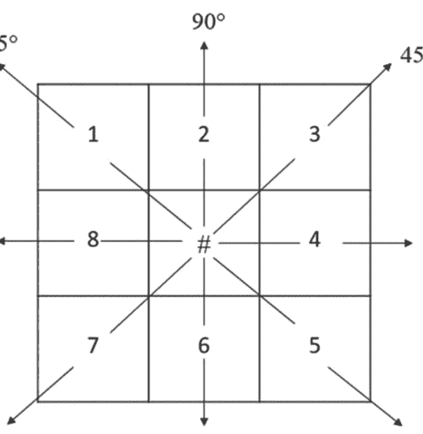

**图 7.1** 像素 8 和 4 是中心像素 # 在 0° 方向上的最近邻；同样，7 和 3 在 45° 方向，6 和 2 在 90° 方向，5 和 1 在 135° 方向上，分别为最近邻。

P (i, j, d, 0°) = *((k, l), (m, n)) ∈ I where k – m = 0 & |l – n| = 1 (7.1)

P (i, j, d, 45°) = *((k, l), (m, n)) ∈ I where k – m = 0 & |l – n| = 1 (7.2)

P (i, j, d, 90°) = *((k, l), (m, n)) ∈ I where k – m = 0 & |l – n| = 1 (7.3)

P (i, j, d, 135°) = *((k, l), (m, n)) ∈ I where k – m = 0 & |l – n| = 1 (7.4)

where * 表示图像 I 中特定像素的频率。

#### 7.3.1 方向 = 0° 且距离 D = 1 的灰度空间依赖矩阵

考虑图 7.2 中表示图像一部分的 4 × 4 矩阵 A，其灰色调值 v ∈ G。为计算 0° 和距离 d = 1 下的 P_ij，将计算 R_H。计算 R_H 的过程如图 7.3 所示。我们考虑一个 4 × 4 矩阵 B，矩阵中的每个值表示该像素在矩阵中的行–列坐标。

在图 7.4 中，\( R_H \) 是为矩阵计算的，该矩阵是水平方向（\( 0^\circ \)）中相邻（距离 \( d = 1 \)）像素的成对表示。图 7.4 中从 \( r_1 \) 到 \( r_4 \) 的行显示了矩阵第一行中相邻像素的所有成对组合。现在，按照相同的程序，我们将计算图 7.2 中所示 \( 4 \times 4 \) 矩阵的 \( R_H \)。图 7.2 的 \( R_{HO} \) 如图 7.5 所示，其中行 \( r1 \) 是图 7.2 中所示矩阵的水平相邻像素的成对组合。同样，\( r2 \) 到 \( r4 \) 是矩阵中水平方向（即 \( 0^\circ \)）相邻像素的成对组合。

现在，为计算方向 \( 0^\circ \) 和距离 \( d = 1 \)（\( P_{HO} \））的 GTDM，我们将考虑图 7.5 中所示的 \( R_{HO} \)。\( P_{HO} \) 的第一个坐标 \( (0, 0) \) 将是 \( R_{HO} \) 中 \( (0, 0) \) 的总计数，因为它出现了 6 次。因此，\( P_{HO} \) 的第一个坐标 \( (0, 0) \) 的值将是 6。同样，\( (0, 1) \) 的值将以这种方式计算，并在 \( R_{HO} \) 中统计 \( (0, 1) \) 的总数，在此例中为 1。现在，如果我们想要计算 \( P_{HO} \) 中坐标 \( (2, 1) \) 的值，则再次统计 \( R_{HO} \) 中 \( (2, 1) \) 的出现次数。

A = 

| | | | |
|---|---|---|---|
| 0 | 0 | 2 | 2 |
| 0 | 0 | 2 | 3 |
| 0 | 0 | 1 | 1 |
| 3 | 2 | 2 | 2 |

**图 7.2** 灰色调值在 0–3 范围内缩放的 4 × 4 矩阵。


| | 0 | 1 | 2 | 3 |
|---|---|---|---|---|
| 0 | (0,0) | (0,1) | (0,2) | (0,3) |
| 1 | (1,0) | (1,1) | (1,2) | (1,3) |
| 2 | (2,0) | (2,1) | (2,2) | (2,3) |
| 3 | (3,0) | (3,1) | (3,2) | (3,3) |

图 7.3 4 × 4 矩阵的坐标表示。

这就是为什么矩阵 \( P_{H0} \) 也被称为 \( 0^\circ \) 方向且距离 \( d = 1 \) 的灰度共生矩阵。\( P_{H0} \) 矩阵如图 7.6 所示。

```
{
  r1 = {(0,0),(0,1)}, {(0,1),(0,0)}, {(0,1),(0,2)}, {(0,2),(0,1)},
       {(0,2),(0,3)}, {(0,3), (0,2)}
  r2 = {(1,0),(1,1)}, {(1,1),(1,0)}, {(1,1),(1,2)}, {(1,2),(1,1)},
       {(1,2),(1,3)}, {(1,3), (1,2)}
  r3 = {(2,0),(2,1)}, {(2,1),(2,0)}, {(2,1),(2,2)}, {(2,2),(2,1)},
       {(2,2),(2,3)}, {(2,3), (2,2)}
  r4 = {(3,0),(3,1)}, {(3,1),(3,0)}, {(3,1),(3,2)}, {(3,2),(3,1)},
       {(3,2),(3,3)}, {(3,3), (3,2)}
}
```

图 7.4 距离 \( d = 1 \) 且方向为 \( 0^\circ \) 的矩阵中所有邻近像素的组合。

```
R_H = {
r1 = {(0,0),(0,0)}, {(0,2),(2,0)}, {(2,2),(2,2)},
r2 = {(0,0),(0,0)}, {(0,2),(2,0)}, {(2,3),(3,2)},
r3 = {(0,0),(0,0)}, {(0,1),(1,0)}, {(1,1),(1,1)},
r4 = {(3,2),(2,3)}, {(2,2),(2,2)}, {(2,2),(2,2)}
}
```

图 7.5 图 7.2 中 d = 1 且方向为 0° 的 R_H。

#### 7.3.2 方向 = 45° 且距离 D = 1 的灰度空间依赖矩阵

在本节中，我们将计算 45° 方向且像素间距离 d = 1 的邻近像素共生矩阵。将遵循前一节讨论的相同程序。在图 7.7 中，我们可以看到使用矩阵 2 选择 45° 方向像素的过程。现在，为计算 45° 方向且距离 d = 1 的灰度依赖矩阵（P_45），我们将统计灰度为 (0, 0) 的像素对数量。

| | 0 | 1 | 2 | 3 |
|---|---|---|---|---|
| 0 | *(0,0) | *(0,1) | *(0,2) | *(0,3) |
| 1 | *(1,0) | *(1,1) | *(1,2) | *(1,3) |
| 2 | *(2,0) | *(2,1) | *(2,2) | *(2,3) |
| 3 | *(3,0) | *(3,1) | *(3,2) | *(3,3) |

-> P_H0 =

| | | | | |
|---|---|---|---|---|
| | 6 | 1 | 2 | 0 |
| | 1 | 2 | 0 | 0 |
| | 2 | 0 | 6 | 2 |
| | 0 | 0 | 2 | 0 |

图 7.6 距离为 1 的水平方向邻近像素出现次数。

| | | | |
|---|---|---|---|
| 0 | 0 | 2 | 2 |
| 0 | 0 | 2 | 3 |
| 0 | 0 | 1 | 1 |
| 3 | 2 | 2 | 2 |

图 7.7 距离 d = 1 的邻近像素配对方向。

并为矩阵 P<sub>45</sub> 中灰度值为 (0, 0) 的像素对分配总数。同样，为计算坐标 (0, 1) 的值，将统计灰度为 (0, 1) 的像素对，并分配到 P<sub>45</sub> 的相应位置。按照此程序构建完整的 P<sub>45</sub> 矩阵，如图 7.8 所示。如图 7.8 所示，坐标 (2, 2) 的值为 2，因为图 7 中灰度值为 (2, 2) 的像素对出现了 2 次。许多人可能会困惑，(2, 2) 的出现次数只有 1 次，那为什么读作 2？这是因为配对是双向进行的，如 0° 方向在 R_H 中所示。同样，此处坐标 (2, 2) 也会被视为 (2, 2) (2, 2)。考虑 P<sub>45</sub> 的坐标 (1, 3)，其值为 0，因为图 7.7 中不存在灰度为 (1, 3) 的像素对。

#### 7.3.3 方向 = 90° 且距离 D = 1 的灰度空间依赖矩阵

将计算距离 d = 1 且方向为 90° 的空间依赖矩阵。以图 7.2 所示的参考图像为例，我们沿垂直 90° 方向配对灰度值。并统计图像中特定灰度值对出现的次数，以创建依赖矩阵（\(P_{90}\)）。例如，为计算 (\(P_{90}\)) 中坐标 (0, 0) 位置的值，我们统计灰度值为 (0, 0) 的垂直像素对。在此情况下为 8，因此我们将相同的值分配给 (\(P_{90}\)) 中的 (0, 0) 位置。图 7.10 展示了图像中灰度值 (0, 0) 的配对过程。箭头的数量表示灰度值为 (0, 0) 的像素对数量。再举一个例子，为计算矩阵 \(P_{90}\) 中坐标 (1, 2) 的值，我们再次按照图 7.11 所示进行配对。由于配对 (1, 2) ≠ (2, 1)，因此只会有一个方向箭头。灰度为 (1, 2) 的像素对总数将为 3，因此我们在 \(P_{90}\) 的相同坐标位置分配值 3。这样一来，\(P_{90}\) 中的所有坐标位置都将分配与坐标位置相同灰度值的垂直像素对出现次数。完整的 \(P_{90}\) 矩阵如图 7.12 所示。在本章中，我们将跳过计算方向为 \(135^\circ\) 且距离 \(d = 1\) 的空间依赖矩阵的详细过程，因为该过程与方向 \(45^\circ\) 几乎相同。

| 4 | 0 | 2 | 1 |
|---|---|---|---|
| 0 | 0 | 2 | 0 |
| 2 | 0 | 2 | 0 |
| 1 | 1 | 0 | 0 |

图 7.8 方向 \(45^\circ\) 且 \(d = 1\) 的灰度共生矩阵。

A =
| 0 | 0 | 2 | 2 |
|---|---|---|---|
| 0 | 0 | 2 | 3 |
| 0 | 0 | 1 | 1 |
| 3 | 2 | 2 | 2 |

图 7.9 距离 d = 1 的邻近像素配对方向。

A =
| 0 | 0 | 2 | 2 |
|---|---|---|---|
| 0 | 0 | 2 | 3 |
| 0 | 0 | 1 | 1 |
| 3 | 2 | 2 | 2 |

图 7.10 d = 1 时灰度值为 (0, 0) 的像素垂直配对。

| | | | |
|---|---|---|---|
| 0 | 0 | 2 | 2 |
| 0 | 0 | 2 | 3 |
| 0 | 0 | 1 | 1 |
| 3 | 2 | 2 | 2 |

图 7.11 d = 1 时灰度值为 (1, 2) 的像素垂直配对。

| | 0 | 1 | 2 | 3 |
|---|---|---|---|---|
| 0 | *(0,0) | *(0,1) | *(0,2) | *(0,3) |
| 1 | *(1,0) | *(1,1) | *(1,2) | *(1,3) |
| 2 | *(2,0) | *(2,1) | *(2,2) | *(2,3) |
| 3 | *(3,0) | *(3,1) | *(3,2) | *(3,3) |

| | | | |
|---|---|---|---|
| 8 | 0 | 1 | 1 |
| 0 | 0 | 3 | 1 |
| 1 | 3 | 2 | 1 |
| 1 | 1 | 1 | 0 |

图 7.12 方向 90° 且 d = 1 的灰度共生矩阵。

### 7.4 优点与缺点

GLCM 是噪声较小图像（如简单文本图像 35）的良好选择，该方法可用于大量图像数据 25。这种方法提供了中心像素与其邻域像素在几乎所有方向上的关系。中心像素的灰度与相邻邻域像素的灰度进行比较。这种配对在 0、45、90 和 135° 等所有方向上进行，像素之间的距离为 1（d = 1）。这样一来，我们得到四个灰度依赖矩阵。基于这些矩阵，可以构建各种纹理特征。灰度依赖矩阵这种方法在简单图像 24 的分类中表现良好。对于噪声较多的图像，该算法无法显示出高精度的结果 20。由于维度较高，GLCM 是一种耗时 22,23 的方法，并且还取决于用于纹理特征提取的图像大小。在 GLCM 中，选择 d 的值（即邻近像素之间的距离）对其性能和计算速度至关重要。应选择 d 的值，以使在提高计算速度的同时不牺牲图像分类的准确性，反之亦然 9,18。

### 7.5 应用

GLCM 或 GTDM 是图像模式分析中使用的纹理特征提取的最先进方法之一。如今，GLCM 广泛用于医学图像分类。基于 GLCM 的纹理特征用于脑肿瘤 MR 图像。脑肿瘤分割是医学研究的重要领域之一。脑肿瘤分割是指基于磁共振成像（MRI）识别脑部肿瘤大小。GLCM 用于对图像中的每个像素进行分类，判断该像素属于恶性还是良性组织。恶性组织是繁殖或扩散速度非常快的癌组织，而良性组织则是非癌组织。2 高精度自动查找肿瘤大小是一项挑战性任务。GLCM 可用于 MRI 的特征提取以分割肿瘤大小。8,13,34,39

GLCM 用于自动化肺肿瘤检测（LTD）12,15,29,16 和肺边界检测（LBD）27,37,38 的过程。对于 LTD 和 LBD，CXR（胸部 X 光）均用于分割。GLCM 应用于 CXR 图像以提取图像的纹理特征。在 LBD 中，使用 CXR 进行肺部边界检测取决于


放射科医生的经验。医生利用这份初步报告进行进一步用药。由于报告取决于CXR的质量和放射科医生的经验，因此这些报告缺乏统一性。所以，自动化LBD过程以保持报告的一致性，从而让医生更好地诊断，非常重要。GLCM纹理特征可用于训练模型，以自动化检测肺部边界的过程，利用CXR数据确定肺部形状（正常/异常）。¹⁴ 与肿瘤分割大小存在相同的一致性问题。要自动化LTD过程，可使用基于GLCM提取的特征来基于CT扫描（计算机断层扫描）训练模型。由于对肺部肿瘤进行分割是放射科医生根据经验和知识手动识别肿瘤的繁琐任务。在骨折的情况下，医生根据经验和知识诊断X光片，以分析骨折和非骨折骨骼。已有各项工作致力于自动化区分骨折和非骨折骨骼以及分类骨折类型的过程。在各种自动化后者过程的方法中，GLCM纹理特征已被用于Ref. [3]。

### 7.6 结论与未来展望

在本章中，我们讨论了一种流行的图像特征纹理提取技术。特征纹理提取在减少数据集中的列数方面起着至关重要的作用，能提高效率和准确性。这里讨论了生成GTDM或GLCM的方法及其优缺点和主要应用领域。生成GLCM矩阵的过程通过示例进行了详细说明，考虑相邻像素之间的距离为1（d = 1），方向为（0, 45, 90, 135）°。该方法由Haralick等人提出，¹⁰ 作者在其中解释了生成矩阵的程序，d = 1，方向为0°。在本章中，为了更好地理解概念，解释了生成GTDM的过程，d = 1，方向为（0, 45, 90）°。此外，本章读者还能了解这种技术的应用和重要性。

### 关键词

- 图像处理
- 特征提取
- 纹理模式
- 灰度级特征分析
- 图像分类
- 信号处理

### 参考文献

- 1. Awcock, G. J.; Thomas, R. 在 *应用图像处理*, Macmillan International Higher Education, 1995.
- 2. Bordes, M.; Michiels, R.; Martin, F. 通过免疫荧光法检测结肠癌、其他恶性或良性肿瘤及非癌组织中的癌胚抗原。 *消化* **1973**, *9* (2), 106–115.
- 3. Chai, H. Y.; Wee, L. K.; Swee, T. T.; Hussain, S. 基于灰度共生矩阵的骨折检测。 *WSEAS Trans. Syst.* **2011**, *10* (1), 7–16.
- 4. Duff, M. J. B. 在CLIP图像处理系统综述, *管理需求知识, 国际研讨会*; IEEE Computer Society, 1978; pp 1055–1055.
- 5. Geman, S.; Geman, D. 随机松弛、吉布斯分布与图像的贝叶斯恢复。 *IEEE Trans. Pattern Anal. Mach. Intell.* **1984**, *PAMI-6* (6), 721–741.
- 6. Gordienko, Y.; Gang, P.; Hui, J.; Zeng, W.; Kochura, Y.; Alienin, O.; Rokovyi, O.; Stirenko, S. 在 *基于肺部分割和骨阴影排除技术的胸部X光肺癌分析深度学习*, 计算机科学、工程与教育应用国际会议; Springer, 2018; pp 638–647.
- 7. Gordillo, N.; Montseny, E.; Sobrevilla, P. MRI脑肿瘤分割技术综述。 *磁共振成像* **2013**, *31* (8), 1426–1438.
- 8. Goswami, S.; Bhaiya, L. K. P. 在 *基于GLCM特征提取的脑异常检测混合神经模糊方法*, 2013年通信、控制、信号处理与计算应用新兴趋势国际会议(C2SPCA); IEEE, 2013; pp 1–7.
- 9. Hall-Beyer, M. GLCM纹理：一个教程。在 *国家地理信息与分析委员会遥感核心课程*, 2000; vol 3, p 75.
- 10. Haralick, R. M.; Shanmugam, K. and Dinstein, I. 图像分类的纹理特征。IEEE Trans. Syst. Man Cybern. 1973, (6), 610–621.
- 11. Havaei, M.; Davy, A.; Warde-Farley, D.; Biard, A.; Courville, A.; Bengio, Y.; Pal, C.; Jodoin, P. M.; Larochelle, H. 基于深度神经网络的脑肿瘤分割。Med. Image Anal. 2017, 35, 18–31.
- 12. Hussain, M. R. I. H.; Ahmed, I.; Kabir, Md H. 在基于GLCM特征的自动肺肿瘤检测, 亚洲计算机视觉会议; Springer, 2014; pp 109–121.
- 13. Jain, S. 基于GLCM特征提取的人工神经网络脑癌分类。Int. J. Comput. Sci. Eng. Technol. 2013, 4 (7), 966–970.
- 14. Kadam, D. B.; Gade, S. S.; Uplane, M. D.; Prasad, R. K. 基于GLCM纹理特征特性的脑肿瘤检测人工神经网络方法。Int. J. Innov. Eng. Technol. 2013, 2 (1), 193–199.
- 15. Kadam, M.; Dhole, A. 借助Ksvm使用GLCM进行脑肿瘤检测。Int. J. Eng. Tech. Res. 2017, 7 (2).
- 16. Kanagaraj, G.; Kumar, P. S. 凭借GLCM进行肺肿瘤检测, 2020.
- 17. Song, K. C.; Yan, Y. H.; Chen, W. H.; Zhang, X. 局部二值模式研究与展望。Acta Automatica Sinica 2013, 39 (6), 730–744.
- 18. Lane, C.; Burgute, R. L.; Shterenlikht, A. 在选择最佳DIC模式和子集大小的客观标准, 第十一届国际大会及展览论文集, 2008; pp 1–9.
- 19. Lu, D.; Weng, Q. 提高分类性能的图像分类方法与技术综述。Int. J. Remote Sens. 2007, 28 (5), 823–870.
- 20. Mehri, M.; H'eroeu, P.; Gomez-Kr¨amer, P.; Mullot, R. 历史文档图像分析的纹理特征基准测试与评估。Int. J. Doc. Anal. Recognit. 2017, 20 (1), 1–35.
- 21. Memon, N. A.; Mirza, A. M.; Gilani, S. A. M. 在基于CT扫描图像的肺部分割以早期诊断肺癌, 世界科学、工程与技术学院论文集, 2006; vol 14, pp 228–233.
- 22. Mirzapour, F.; Ghassemian, H. 在使用GLCM和Gabor滤波器对PAN图像进行分类, 2013年第21届伊朗电气工程会议(ICEE); IEEE, 2013; pp 1–6.
- 23. Mirzapour, F.; Ghassemian, H. 用于超高分辨率遥感图像纹理分类的快速GLCM和Gabor滤波器, 2015.
- 24. Mohanaiah, P.; Sathyanarayana, P.; GuruKumar, L. 基于GLCM方法的图像纹理特征提取。Int. J. Sci. Res. Publ. 2013, 3 (5), 1–5.
- 25. Pantic, I.; Dadic, S.; Brkic, P.; Lavrnja, I.; Jovanovic, T.; Pantic, S.; Pekovic, S. 分形法和灰度共生矩阵法在海马层结构分析中的鉴别能力。J. Theor. Biol. 2015, 370, 151–156.
- 26. Park, B.; Chen, Y. R. Ae—自动化和新兴技术：家禽尸体多光谱图像的共生矩阵纹理特征。J. Agric. Eng. Res. 2001, 78 (2), 127–139
- 27. Patil, S. A.; Udupi, V. R. 用于肺癌分类的胸部X光特征提取, 2010.
- 28. Pereira, S.; Pinto, A.; Alves, V.; Silva, C. A. 使用卷积神经网络对MRI图像进行脑肿瘤分割。IEEE Trans. Med. Imaging **2016**, *35* (5), 1240–1251.
- 29. Saleck, M. M.; ElMoutaouakk, A.; Mou, couf, M. 在 *使用模糊c-means和GLCM纹理特征进行乳腺X线摄影图像肿瘤检测*, 2017年第14届计算机图形、图像与可视化国际会议; IEEE, 2017; pages 122–125.
- 30. Shih, F. Y. 在 *图像处理与模式识别：基础与技术*; John Wiley & Sons, 2010.
- 31. Shivhare, S. N.; Kumar, N. 肿瘤袋装：一种使用元启发式优化算法进行脑肿瘤分割的新框架。 *Multimed. Tools Appl.* **2021**, 1–27.
- 32. Shivhare, S. N.; Kumar, N.; Singh, N. 主动轮廓模型与凸壳的混合方法，用于多模态MRI中自动脑肿瘤分割。 *Multimed. Tools Appl.* **2019**, *78* (24), 34207–34229.
- 33. Shu, C.; Ding, X.; Fang, C. 用于人脸识别的方向梯度直方图。 *Tsinghua Sci. Technol.* **2011**, *16* (2), 216–224.
- 34. Singh, D.; Kaur, K. 使用GLCM、PCA和SVM对脑MRI图像异常进行分类。 *Int. J. Eng. Adv. Technol.* **2012**, *1* (6), 243–248.
- 35. Sulochana, S.; Vidhya, R. 基于帧变换-灰度共生矩阵(GLCM)的纹理图像检索。 *Int. J. Adv. Res. Artif. Intell.* **2013**, *2* (2).
- 36. Tang, X. 运行长度矩阵中的纹理信息。 *IEEE Trans. Image Process.* **1998**, *7* (11), 1602–1609.
- 37. Yumanadevi, M. M.; Siva Ranjani, S. 基于深度学习分类的自适应模糊-GLCM(af-glcm)肺癌高效分割。 *J. Ambient Intell. Humaniz. Comput.* **2021**, *12* (5), 4715–4725.
- 38. Zotin, A.; Hamad, Y.; Simonov, K.; Kurako, M. 基于GLCM和概率神经网络的胸部X光图像分类肺部边界检测。 *Procedia Comput. Sci.* **2019**, *159*, 1439–1448.
- 39. Zulpe, N.; Pawar, V. 用于脑肿瘤分类的GLCM纹理特征。 *Int. J. Comput. Sci. Issues* **2012**, *9* (3), 354.


Taylor & Francis

Taylor & Francis Group

http://taylorandfrancis.com

## 第 8 章

## 使用深度学习进行图像着色与修复

ARYAN RAJ TIWARY, ADITYA KR. GUPTA, PREETISH NIKET, TAPAS KHANIJO, and JYOTI GUPTA

Department of Electronics and Communication Engineering, Bharati Vidyapeeth College of Engineering, New Delhi, India

### 摘要

机器学习和深度学习的日益普及，鼓励许多人尝试自动化那些手动完成时往往枯燥且能效低下的困难任务。我们提出一种技术，将这项工作卸载到计算机资源上。我们使用 CNN 进行图像中物体的视觉识别，并使用在 ImageNet 上预训练的 ResNet34 将这些对象分离为独立实体，并训练我们的模型来推测物体的颜色。这也在一定程度上修复了图片。与使用 Photoshop 软件相比，这种方法要少得多枯燥，而 Photoshop 也需要一定的技术技能。

### 8.1 引言

深度学习是机器学习的一个子领域，其中模型受真实人脑工作原理的启发。监督学习、半监督学习和无监督学习是学习的三种方式。深度神经网络、深度强化学习、深度信念网络、深度训练、卷积神经网络和循环神经网络已被部署在包括自然语言处理、计算机视觉、语音识别、机器翻译机制、生物信息学、气候科学、材料和棋类游戏检验等领域，其成果超越了人类表现。

图像处理是指从图像中提取一些有用信息，或对图像应用某些技术以改变其属性的过程。图像处理属于信号处理家族的一部分，其中输入到模型的是图像，输出可以是图像的某个属性，也可以是一张图像。近年来，图像处理得到了出色发展，是快速增长的技术之一。由于其效率和应用不断提高，它一直是研究开发领域的主要焦点，并在许多不同的研究领域中普遍存在。图像处理可以采用数字图像处理和模拟图像处理两种方法。当图像处理任务在二维模拟信号上执行时，称为模拟图像处理。当使用算法借助数字计算机处理数字图像时，称为数字图像处理。

预处理、增强与显示、以及信息提取，是数据使用数字技术处理时必须经历的三个主要步骤。

灰度图像着色影响多个领域，例如，历史图像得以重现，监控画面得到改善。灰度图像信息有限，因此为了更好地洞察图像的语义，灰度图像需要转换为 RGB 图像。

正如 Albawi 等人¹所讨论的，在模式识别等领域，从图像处理到语音识别，在过去几十年中，卷积神经网络（CNN）取得了革新性的结果。

在大规模上使用 CNN 处理高分辨率图像成本非常高，尽管其具有无可比拟的特性，但其局部架构的效率有限。²

在发展领域，CNN 取得了可观的结果，但并未因此被广泛使用。² 根据我们的研究，卷积神经网络不受欢迎是因为其复杂性。卷积网络的可行应用主要在于分割任务，在这些任务中，生成的图像是单相位标签。所需的结果包括生物医学图像处理中的定位，即每个像素的类别标签应被指定。³

这意味着模型必须为输入灰度图像的每个像素提供 RGB 分量，而不仅仅是输出与输入图像相同尺寸的结果。我们使用回归损失作为准则来构建完整的卷积模型架构，然后将这一想法扩展到对抗网络。

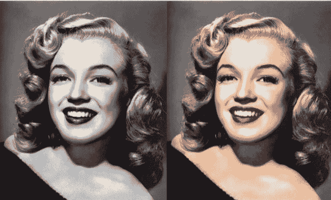

图 8.1 图像着色。
来源：经此处转载：https://hotpot.ai/colorize-picture。© 2023 Panabee, LLC。

将多尺度输入描绘为多尺度输出的过程称为图像着色。这可以被视为一个像素到像素的回归问题，其中输入结构与输出结构强烈匹配。

生成对抗网络（GAN）与 CNN 类似，都使用深度学习方法作为生成建模的方法。生成建模是机器学习中的一种无监督学习操作，涉及自学发现输入数据中的同质性或模式，以便模型可用于从原始数据集中生成或推断新样本。得益于深度卷积神经网络，图像分类出现了许多创新。⁴⁻⁷ 深度网络天然地融合属性⁶和分类器，采用全方位多层方法，并具有可通过堆叠层数增加的“层”。根据最近的数据，⁸⁻⁹ 网络深度很重要，针对复杂的 ImageNet 数据集¹²，主要结果 ⁸⁻¹¹ 使用深度为十六⁸ 到三十¹¹ 的“非常深”模型。各种不重要的视觉感知应用¹³⁻¹⁷ 也从非常深的模型中获益显著。GAN 是一种聪明的方法，通过将问题定式化为监督学习问题，并将问题构建为两个子模型：真实或假（生成），来训练生成模型。这两个模型在零和对抗游戏中一起训练，直到判别模型有一半时间被骗过。这意味着生成模型产生可信的样本。

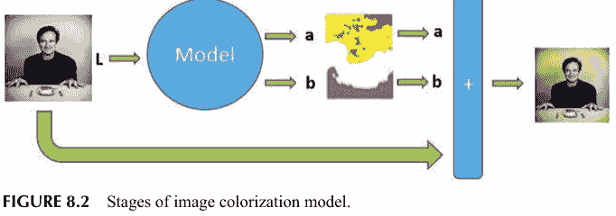

GAN 是前沿且快速变化的领域，它确定了生成模型在生成各个学科中逼真示例的可能性。主要，这涉及图像到图像的转换操作，例如将夏季图片转换为冬季，或昼夜转换，生成即使人类也无法区分真伪的场景、物体和人物的逼真图像。

U-Net 最初于 2015 年开发并应用于生物医学图像处理，构建在传统 CNN 之上。¹⁸

因为典型的 CNN 专注于图像分类，其中图像是输入，单个标签是输出；而在生物医学领域，既需要定位异常区域，也需要判断是否存在疾病。U-Net 能够通过逐像素预测图像来进行图像定位。使用 U-Net 进行图像分割有许多应用。

### 8.2 文献综述

U-Net 是一种用于正确分割的结构。¹⁹ 它包含收缩路径和扩展路径。收缩路径遵循卷积网络的正常构建。此外，数千张训练图像在生物医学活动中往往不可用。

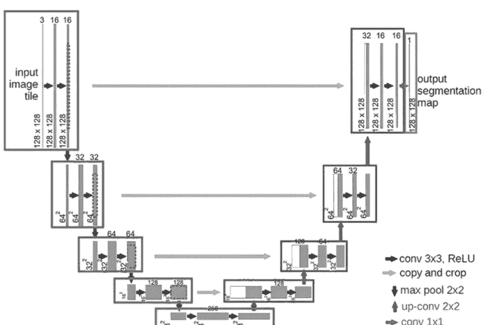

图 8.3 UNet 的工作原理。
来源：转载自参考文献 [32]。© 2022 由作者所有。被许可方 MDPI，巴塞尔，瑞士。（https://creativecommons.org/licenses/by/4.0/）。

U-Net 通过添加一种全面兼容的方法（也称为解码器）来增强 CNN 的标准配置，目的是生成完全校正的语义预测。换句话说，生成突出图片中观察到的某些特征和元素的分割图像。

发生器与评论家的架构如下图 8.4 所示。


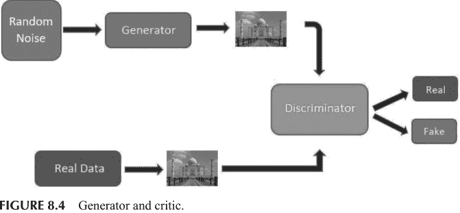

收缩路径位于左侧，另一侧可找到扩展路径。收缩路径遵循 CNN 架构。两个 3 × 3 卷积被重新应用，每个都伴随一个修正的线性单元（ReLU）和两个 2 × 2 最大池化操作步骤以进行下采样。19 结构的一个重要变化是，在上采样方面，有许多功能通道允许网络将上下文信息传播到高清晰度层。

因此，缩放方法几乎与收缩方法对称，并具有具有成效的 U 形结构。网络不涉及全连接层，而是利用每个卷积的有效部分。也就是说，像素仅由分区映射包含，整个文本嵌入输入图像中。20

GAN 训练已取得成功，但有时被认为棘手，并且专注于超参数选择。过去的几篇论文尝试稳定 GAN 学习动态，甚至通过开发新型网络架构（Che et al., 2017; Zhao et al., 2017; Jolicoeur Martineau, 2019; Karras et al., 2017; Arjovsky et al., 2017; Salimans et al., 2018; Metz et al., 2017; Radford et al., 2016; Zhang et al., 2017; Zhao et al., 2017）、添加正则化方法（Gulrajani et al., 2017; Miyato et al., 2018）以及（Salimans et al., 2016; Azadi et al., 2018; Odena et al., 2017）来改善样本多样性。最近，Miyato et al. (2018) 提出限制判别器中权重矩阵的谱范数，以约束判别器函数的 Lipschitz 常数。基于投影的判别器与谱归一化模型（Miyato & Koyama, 2018）结合，显著改善了使用 ImageNet 中条件类进行的图像生成。

在图像识别中，VLAD（线性聚合描述符向量）20 是术语表的残差向量编码表示，Fisher 向量 21 可以作为 VLAD 20 的预期版本生成。

两者都被发现是图像搜索和分类的强大表面描述。22,23 已发现，在向量量化中，残差向量编码 24 比原始向量编码更高效。多网格方法 25 广泛用于求解低级视觉和计算机图形中的偏微分方程（PDE），将系统重新设计为两个尺度（即更粗尺度和更细尺度）之间的子问题。

展示残差向量在两个尺度之间形成桥梁的变量是分级基预处理 26,27，它是多网格方法的替代方案。不了解解残差属性的标准求解器，收敛速度比这些求解器慢得多。25–27 为了使优化更容易，我们建议的过程是良好的重建或预处理。

如 Nazeri et al.30 所讨论，将多维输入映射到多维输出的图像到图像变换操作称为图像着色。

这可以被视为一种像素到像素的回归问题，其中输入模型与输出模型高度匹配。这表明，网络还应为输入灰度图像的每个像素提供颜色细节，同时输出与输入具有相似空间维度的结果。

网络必须生成与输入具有相同空间维度的输出，并且我们需要为输入灰度图像中的每个像素提供颜色细节。

我们提供的卷积模型架构使用回归损失作为基础，进而将我们的研究扩展到对抗网络。L*a*b* 颜色空间正在用于着色任务。我们使用 L*a*b* 颜色空间的原因在于，它包含一个专用通道来表示图像的亮度，而颜色细节完全编码在另外两个通道中。它防止了由于 RGB（红绿蓝）基线中强度值的小扰动而导致的亮度和颜色的剧烈变化，并将这一想法扩展到对抗网络。

### 8.3 方法论

我们使用了两个 CNN 模型来实现结果，即生成器和评论家。生成器基于能够识别图像中不同对象的单元。生成器还充当确定使用哪些颜色的基础，因此将所有这些输出到一张彩色图像。生成器基本上将黑白输入镜像以获得彩色输出。评论家是基于深度卷积生成对抗网络（DC-GAN）的简单卷积网络。该模型在 U-Net 上使用 Resnet34 骨干，并专注于解码器侧的多个层。借助 No GAN，一种新型的 GAN 训练方式，我们训练了预训练/GAN 循环的五个重要迭代。

它通过在 GAN 训练本身上投入最少的时间来促进 GAN 训练的优势。相反，我们将大部分时间分别用于训练生成器和评论家，采用更简单、更快速、更可靠的传统方法。评论家基本上决定输出图像看起来有多真实。


**FIGURE 8.5** 失色输出。

生成器和评论家不断交换它们的输出，以确保生成器产生的输出尽可能真实。这种模型之间的训练是 GAN 的一个示例。GANs28 在生成艺术方面很有效。正如 Vincent James 所提到的，GAN 生成的图像正在成为基于 AI 的现代艺术的典范。29 我们使用了“fastai”库，因为它提供了纯 Python 中可扩展的 GPU 优化计算机视觉。深度学习领域名为 fastai 的库促进了从业者使用高级单元，以即时且轻松的方式生成最新的输出。研究人员使用低级单元来混合搭配并生成新的结果。

当高级和低级单元都被使用时，实用性、适应性和效率都不会受到影响。过去使用 CNN 扩展 GAN 进行图像建模的努力并未成功。我们在尝试使用监督学习中常用的 CNN 架构扩展 GAN 时也遇到了困难。然而，经过彻底的模型探索后，我们开发了一种架构，可在不同数据集上提供可靠的训练，并可以训练更高分辨率和更深层的生成模型。

### 8.4 模拟结果

我们使用一张彩色图像作为基础，并对其进行处理以将其转换为灰度图像。然后，我们将此灰度图像作为模型的输入。模型确实像宣传的那样为输入添加了颜色，但生成的图像与原始彩色输入不符。这是由于使用了用于对象分割的 UNet18。由于 UNet 最初是为执行不需要任何颜色的生物医学图像分割而构建的。

### 8.5 与其他研究方法的比较

我们使用了在 ImageNet 上预训练的 Resnet34 模型的 fastai 库。Nazeri et al.30 提出在 CIFAR-10 和 Places 365 数据集上进行训练以获得他们的结果。他们还使用 DCGAN 来对他们的输入进行着色。CIFAR-10 产生的图像比我们模型中使用的 U-Net 看起来更好。由于损失函数，U-Net 具有棕褐色色调。Federico Baldassarre et al.,31 提出使用 inception ResNet-V2 模型，这也是一个预训练模型。在此方法中，对象得到了良好识别，但某些对象没有被良好着色。

在此图像（实景）中，颜色鲜艳，无失色且分辨率高。图像质量高，因为未对其执行任何图像处理操作。


FIGURE 8.6 (a) 实景。


在灰度图像中，每个像素的值仅表示光的强度信息。因此，没有颜色：

FIGURE 8.6 (b) 灰度。


这是输出图像。颜色不如实景鲜艳；图像相当沉闷。

FIGURE 8.6 (c) 结果。


在这张图像中（基准真值），色彩鲜艳，无失真，分辨率高。由于未对其进行任何图像处理操作，因此图像质量较高。

### 图 8.7 (a) 基准真值。


在灰度图像中，质量有所下降。

### 图 8.7 (b) 灰度。


输出图像中的颜色再次显得暗淡，且不如基准真值清晰。

### 图 8.7 (c) 结果。

### 表 8.1 与其他研究论文的对比。

| 作者/参数 | 论文标题 | 使用的方法 | 网络 | 局限性 |
|---|---|---|---|---|
| Kamyar Nazeri, Eric Ng, 和 Mehran Ebrahimi | 使用生成对抗网络的图像着色（2018年5月16日） | CIFAR-10 数据集 | GAN | 某些图像出现误色。 |
| Federico Baldassarre, Diego González Morín, 和 Lucas Rodés-Guirao | 深度考拉化：使用 CNN 和 Inception-Resnet-v2 的图像着色（2017年12月9日） | Inception Resnet-V2 | 视觉几何组 (VGG) | 物体出现失真。 |
| 本文 | 使用深度学习的图像着色与恢复 | Resnet34 | UNet 和 DCGAN | 输出图像暗淡。 |

### 8.6 结论

在本研究论文中，图像着色和恢复技术已成功执行。基于输出，本论文的发现是：作为输入提供的灰度图像已得到有条理的着色。此外，我们的模型的着色水平与在线软件相当。然而，图像的清晰度有所下降，可以通过进一步优化代码来解决，从而提高模型的效率。我们发现，此后仍有改进的空间。

### 关键词

- 深度学习
- 着色
- 卷积神经网络 (CNN)
- Resnet34
- ImageNet

### 参考文献

- 1. Albawi, S.; Mohammed, T. A.; Al-Zawi, S. 在《理解卷积神经网络》中，2017 年工程与技术国际会议 (ICET)，2017；第 1–6 页。DOI: 10.1109/ICEngTechnol.2017.8308186.
- 2. Simard, P. Y.; Steinkraus, D.; Platt, J. C. 在《应用于视觉文档分析的卷积神经网络最佳实践》中，第七届国际文档分析与识别会议论文集，2003；卷 2，第 958–962 页。
- 3. Glorot, X.; Bengio, Y. 在《理解训练深度前馈神经网络的困难》中，人工智能与统计国际会议，2010；第 249–256 页。
- 4. LeCun, Y.; Boser, B.; Denker, J. S.; Henderson, D.; Howard, R. E.; Hubbard, W.; Jackel, L. D. 手写邮政编码识别的反向传播。Neural Comput. 1989, 1 (4), 541–551.
- 5. Krizhevsky, A.; Sutskever, I.; Hinton, G. 在《使用深度卷积神经网络的 ImageNet 分类》中，NIPS，2012。
- 6. Zeiler, M. D.; Fergus, R. 在《可视化和理解卷积神经网络》中，ECCV，2014，第 818–833 页。
- 7. Sermanet, P.; Eigen, D.; Zhang, X.; Mathieu, M.; Fergus, R.; LeCun, Y. 在《Overfeat：使用卷积网络的集成识别、定位和检测》中，ICLR，2014。
- 8. Simonyan, K.; Zisserman, A. 在《用于大规模图像识别的非常深度的卷积网络》中，ICLR，2015。
- 9. Szegedy, C.; Liu, W.; Jia, Y.; Sermanet, P.; Reed, S.; Anguelov, D.; Erhan, D.; Vanhoucke, V.; Rabinovich, A. 在《带卷积的更深入探索》中，CVPR，2015。
- 10. He, K.; Zhang, X.; Ren, S.; Sun, J. 在《深入探究整流单元：在 ImageNet 分类中超越人类水平性能》中，ICCV，2015。
- 11. Ioffe, S.; Szegedy, C. 在《批量归一化：通过减少内部协变量偏移加速深度网络训练》中，ICML，2015。
- 12. Russakovsky, O.; Deng, J.; Su, H.; Krause, J.; Satheesh, S.; Ma, S.; Huang, Z.; Karpathy, A.; Khosla, A.; Bernstein, M.; 等人。ImageNet 大规模视觉识别挑战。arXiv:1409.0575, 2014。
- 13. Girshick, R.; Donahue, J.; Darrell, T.; Malik, J. 在《用于准确目标检测和语义分割的丰富特征层次结构》中，CVPR，2014。
- 14. He, K.; Zhang, X.; Ren, S.; Sun, J. 在《用于视觉识别的深度卷积网络中的空间金字塔汇聚》中，ECCV，2014。
- 15. Girshick, R. 在《快速 R-CNN》中，ICCV，2015。
- 16. Ren, S.; He, K.; Girshick, R.; Sun, J. 在《更快的 R-CNN：基于区域建议网络的实时目标检测》中，NIPS，2015。
- 17. Long, J.; Shelhamer, E.; Darrell, T. 在《用于语义分割的完全卷积网络》中，CVPR，2015。
- 18. Yamashita, R.; Nishio, M.; Do, R. K. G.; 等人。卷积神经网络：概述及在放射学中的应用。Insights Imaging 2018, 9, 611–629。
- 19. Ronneberger, O.; Fischer, P.; Brox, T. U-Net：用于生物医学图像分割的卷积网络。载于 MICCAI 2015: LNCS; Navab, N., Hornegger, J., Wells, W. M., Frangi, A.F., 编；Springer: Cham, 2015; 卷 9351, 第 234–241 页。
- 20. Jegou, H.; Perronnin, F.; Douze, M.; Sanchez, J.; Perez, P.; Schmid, C. 将局部图像描述符聚合为紧凑代码。Trans. Pattern Anal. Mach. Intell. 2012, 34 (9), 1704–1716。
- 21. Perronnin, F.; Dance, C. 在《用于图像分类的视觉词汇渔夫核》中，计算机视觉与模式识别会议，2007。
- 22. Chatfield, K.; Lempitsky, V.; Vedaldi, A.; Zisserman, A. 在《魔鬼藏在细节中：近期特征编码方法评估》中，BMVC，2011。
- 23. Vedaldi, A.; Fulkerson, B. VLFeat：一个开放且可移植的计算机视觉算法库，2008。
- 24. Jegou, H.; Douze, M.; Schmid, C. 用于最近邻搜索的产品量化。Trans. Pattern Anal. Mach. Intell. 2011, 33 (1), 117–128。
- 25. Briggs, W. L.; McCormick, S. F.; 等人。在《多重网格教程》中。SIAM, 2000。
- 26. Szeliski, R. 使用分层基函数的快速表面插值。Trans. Pattern Anal. Mach. Intell. 1990, 12 (6), 513–528。
- 27. Szeliski, R. 在《局部适应分层基预处理》中，SIGGRAPH，2006。
- 28. Goodfellow, I.; Pouget-Abadie, J.; Mirza, M.; Xu, B.; Warde-Farley, D.; Ozair, S.; Courville, A.; Bengio, Y. 在《生成对抗网络》中，神经信息处理系统进展，2014；第 2672–2680 页。
- 29. Vincent, J. 一场永无止境的人工智能艺术流正在拍卖。The Verge, 2019（2020 年 6 月 13 日检索）。
- 30. Nazeri, K.; Ng, E.; Ebrahimi, M. 使用生成对抗网络的图像着色，载于《铰接运动与可变形对象》，2018；第 85–94 页。
- 31. Baldassarre, F.; Morin, D. G.; Rodés-Guirao, L. 深度考拉化：使用 CNN 和 Inception-Resnet-v2 的图像着色，2017 年 12 月 9 日。
- 32. Konovalenko, I.; Maruschak, P.; Brezinová, J.; Prentkovskis, O.; Brezina, J. 用于金属表面缺陷检测的基于 U-Net 的 CNN 架构研究。Machines 2022, 10, 327。https://doi.org/10.3390/machines10050327

## 第 9 章

## 使用图像中存在的自然物体确定图像在实际单位中的比例

SAURABH SINGH^1 和 RHEA S. SHRIVASTAVA^2

^1加尔戈蒂亚大学计算机科学与工程学院，大诺伊达，印度
^2阿米蒂大学阿米蒂工程与技术学院，印度

### 摘要

照片是存储在数字计算机中的列和行的强度值的二维表示。在实际世界单位（例如，毫米、厘米）中定义物品的物理尺寸是一项挑战性任务。一些图像具有实际单位比例，有助于个人评估图像中物体的大小。该比例在图像获取时由摄影硬件基础设施引入。不幸的是，许多视觉描述（图像）中不存在该比例，这给确定图像中捕获对象的真实尺寸带来了问题。因此，确定图像中物体的尺寸成为本研究提案的主要目标。

该研究领域尚未得到充分探索，这正是开展这项工作的动力。在这项研究工作中，我们的主张是利用视觉描述中现有对象的常见尺寸来查找图像比例（每像素的实际世界单位大小）。这些常见对象可以是人、汽车、自行车、路牌等，具体取决于


取决于拍摄图像时的位置、交通和时间。用于调查的数据集来自KITTI，并且已将数据集中的RGB-D图像考虑在内。然后将其用于推导数学函数，以将相关实体的深度与以每像素实际世界单位计量的物体相关联。这样，就实现了所需的结果。

### 9.1 引言

图像由行和列组成，并以数字化排列存储在数字计算机中。图像元素是照片的一个重要方面，因为它为许多研究维度打开了道路。像素有助于理解图像，并提供一种解释图像的方式。通过现有工具和图像优化技术，图像可以增强、滤波、裁剪、拉伸、锐化等，并以多种形式进行研究。

图像由摄像机在阳光或任何不同光源附近拍摄获得，随后是根据个人或问题情况而变化的预处理技术。插图种类繁多。本文所着重处理的图像类型是单目图像和立体图像。


图 9.1 图像。


图 9.2 图像表示。

单目图像包含一幅图像，而立体图像处理两幅图像。两者之间的矛盾在于，单目视觉识别的是像汽车和行人这样的已分类物体，而立体视觉甚至能检测尚未分类的物体。与单眼视觉不同，它会考虑视野中出现的每一个物体。在考虑单眼视觉时，它在很大程度上依赖于其接受过训练或积累的经验。这些实体被归类为其训练所基于的预定义类别。每当新物体出现在其视野中时，它会直接忽略。这种方法会导致许多错误，其中一些是致命的。此类错误的常见例子是制造有单眼视觉系统的汽车。另一方面，立体视觉非常容易地克服了这一缺陷。它利用固有的3D能力，查看视野中的所有实体。它也有广阔的视野，并采取适当措施避免伤亡。因此，立体图像通常被使用，且在商业上更受青睐。表9.1更清楚地阐述了这些要点。

下一个重要方面是物体的大小。它决定了实体的现实世界特征，从而帮助个人很好地理解图像。物体的高度、距摄像机的距离以及以物理世界单位计量的大小都有助于理解图像。

尺寸评估方面主要在3、16、17、29、31、35中被使用，这对本工作至关重要。它有助于理解水果和蔬菜收获的适当时间、3、16用于精确卡路里摄入量、17、29用于膳食估算、31以及食物份量大小评估。35它在各个类别中被广泛使用，并一直被证明是有帮助的。

| 比较参数 | 单目相机系统 | 立体相机系统 |
| :--- | :--- | :--- |
| 图像传感器、镜头和组件的数量 | 1 | 2 |
| 系统的物理尺寸 | 小 (6" × 4" × 1") | 两个由约25–30厘米距离分开的小型组件 |
| 帧率 | 30–60 帧/秒 | 30 帧/秒 |
| 图像处理要求 | 中 | 高 |
| 检测障碍物和紧急制动决策的可靠性 | 中 | 高 |
| 系统可靠用于 | 物体检测（车道、行人、交通标志） | 物体检测“并”计算到物体的距离 |
| 系统成本 | 1× | 1.5× |
| 软件和算法复杂度 | 高 | 中 |

本工作的新颖之处在于确定图像的比例。尺寸估算尚未被广泛探索，并将通过本工作予以突出并进行实验审查，以实现工作的目标。因此，确定图像中物体的尺寸估算无疑将有助于产生与现实世界相关的比例，从而帮助人们更有信心地理解含糊描述。

### 9.2 文献综述

根据Zhao等人，1深度信息对自主系统至关重要，以便感知环境并逼近阶段。传统的深度评估方法基于多个视角的特征对应。同时，研究预测的深度图很少，因此从图像中推断深度信息（即估计单目深度）是一个严重的问题。深度学习辅助的单目深度估算已得到广泛研究。在精度方面，它已经表现得非常有希望。同时，来自单个图像的稠密深度图由深度神经网络估算，然后提出各种形式的网络架构、损失函数和策略，以提高深度估算的准确性。因此，在此次综述中，研究人员研究了这些深度学习辅助的单目深度估算方法。

根据Fernandes等人，2该研究论文提供了一种从常规相机获取的透视投影图像中直接计算盒子比例的准确过程。该方法依赖于投影几何，并利用数据计算盒子的尺寸。事实、数字和数据从盒子的轮廓中提取，并预测盒子一个面上有两束平行激光束。为了识别物体的轮廓，开发了一个统计模型用于均匀背景颜色去除，该模型适用于移动相机。霍夫变换的投票方案被纳入原型中，用于确定共线像素组。当使用实现论文中所述算法和方法的扫描仪原型计算实际盒子尺寸时，所提方法的效率得以体现。

根据Wang等人，3田间芒果果实尺寸估算对于估计果实成熟度和尺寸分布有益，因为它建议收获、农产品资源（例如托盘插入尺寸）和营销。在田间，机器视觉成像用于果实计数，现在它也被用于从图像分析果实大小。评估了三种低成本技术示例，用于估算相机到果实的距离。由于成本和性能获得批准，使用了RGB-D相机，但在直射阳光下运行较差。对于果实检测，使用了带有方向梯度直方图（HOG）特征的级联检测，然后是Otsu方法，接着是颜色阈值应用以去除背景物体。最后，果实线性尺寸使用RGB-D深度统计、果实图像范围和薄透镜公式来中介。作者认为，这项工作标志着田间机器视觉果实尺寸估算的领先实践执行，其现实性在资本和易操作性方面得到评估。

根据Standley等人，4成功的机器人对现实世界实体的影响需要对这些物体的物理特性进行深思熟虑的适应性。作者提出了一种从物体图像估计质量的模型。他们比较了图像到质量问题的各种基线模型，然后在此数据集上进行了训练。作者还描述了人类在此问题上的表现。最后，提出了一种解释物体3D形状的模型。

根据Zhu等人，6在其工作中，研究了两种常见的计算机视觉任务：语义分割和图像自监督深度估算的优势。作者提出了一种技术，用于明确测量深度与分割之间边界的规律性，并通过迭代地将网络推向局部最优解来贪婪地减少它。通过大量的考察，这种建议的方法在无监督单目深度估算的KITTI数据集上达到了最先进水平。

根据Liu等人，7解决了从单幅单目图像进行深度近似的问题。与使用多幅图像估计深度相比，在单目图像中估计深度具有挑战性。早期工作侧重于充分利用额外的数据源。作者提出了一种深度架构学习策略，在融合的深度CNN框架中获取连续条件随机场的成对势和一元势。接着提出了一种基于全卷积网络和一种新的超像素池化方法的同样有效的模型。该方法用于在没有几何先验或任何额外信息注入的情况下估计基本场景。

根据Ma等人，9作者考虑了从一组稀疏深度尺寸和一张RGB图像中预测稠密深度。由于从单目视觉描述中估计深度在本质上是含糊且不可靠的，为了达到更好的鲁棒性和准确性水平，引入了额外的稀疏深度样本，这些样本由视觉同步定位与映射（SLAM）算法获得。该团队进行的实验表明，与使用RGB图像相比，添加100个空间随机深度样本可将NYU-Depth-v2室内数据集上的根均方误差（RMSE）预测降低50%。它在KITTI数据集上将可靠预测的比例从59%提高到92%。

根据Li等人，13自监督深度估算在使用完全未标注的图像假设3D结构方面显示出显著的可能性。然而，当在亮度变化/移动物体的图像上训练时，性能会显著下降。在本论文中，学者们通过使用一组基于图像/基于几何的约束来增强自监督准则的强度，从而认证了这一问题。首先，提出了一种基于梯度的稳健光度损失框架。其次，通过利用损失间的一致性和损失梯度的一致性来清除不规则区域。


第三，提出了运动估计，通过提出基于三元组的循环一致性约束来生成跨帧一致运动。在KITTI、Cityscape和Make3D数据集上进行的大量检验表明该方法的优越性。

根据Eigen等人（文献15），计算深度是实现特定场景中3D几何结构不可或缺的组成部分。此外，这项任务本身深奥难解，其不确定性很大程度上源于未知的尺度。在本文中，作者提出了一种新技术，通过保留两个深度网络堆栈来探讨这一任务：基于整图进行粗略的通用估计，以及进一步在局部增强该预测。

根据Ponce等人（文献16），果品分级是橄榄行业收获后的必要任务。在加工高质量食用橄榄的过程中，分级依据尺寸、形状和质量。该研究提出了一种基于计算机视觉技术和特征建模来辅助橄榄分级的技术。共拍摄了九个品种的3600个橄榄果实，在场景中随机分布果实，使用一座即兴搭建的成像舱。随后，研发了一套图像分析算法，用于分割橄榄并提取描述性特征以评估其短轴和长轴以及质量。为验证该算法在橄榄果实个体分割中的准确性，通过117张包含11,606个果实的图像进行了测试，仅产生了六次果实分割错误。

根据Ege等人（文献17），食品热量精确估计的图像分析包含三种主流技术及两种新方法：(1) CalorieCam——基于参考对象评估真实食品尺寸，(2) Region Segmentation——采用食品热量估计，(3) AR DeepCalorieCamV2——关于内置于iOS ARKit库中的视觉惯性里程计，(4) DepthCalorieCam——基于相机（立体）如iPhone X/XS，(5) RiceCalorieCam——利用米粒作为参考对象。最后两种方法的估计误差在10%或以下，适用于食品热量估计。

### 9.3 方法论

本文所采用的拟议方法如图9.1所示：


图9.3 拟议的方法。

#### 9.3.1 数据集

该数据集来源于卡尔斯鲁厄理工学院。他们使用名为Annieway的自动驾驶平台开发独特且富有启发性的现实世界计算机视觉基准。Annieway引擎盖上配备了两台高分辨率彩色和灰度视频摄像机。精确的实地真值由Velodyne激光扫描仪和GPS定位系统提供。所有数据集均通过在德国中等城市卡尔斯鲁厄周边行驶拍摄而得。


图9.4 KITTI自动驾驶平台。

来源：经许可转载自参考文献[19]。

本工作所用的数据集为Data Scene Flow 2015/Stereo 2015，从KITTI数据集下载而得，包含200个训练场景和200个测试场景（每个场景四张彩色图像，以无损PNG格式保存）。估计服务器计算所有200张测试图像中所有实地真值像素上坏像素比例的中间值。在该数据集中，图像包含最多15辆汽车和30名行人。该数据集中的示例图像如下：


#### 9.3.2 算法

- 1. 创建图像中自然对象表。
- 2. 检测图像中的自然对象。
- 3. 检测到对象后，准备表格。
- 4. 下一阶段是计算HPP（每像素高度）。其单位为cm/pix。可通过公式计算：\(\frac{Real Height}{No. of Pixels}\)
- 5. \(k\)通过公式 \(k = \frac{HPP}{depth}\) 计算得出。
- 6. 然后计算 \(Real Height = k * Depth * Pixel Height\)，即预测高度。

#### 9.3.3 步骤

- 1. **准备自然对象列表：** 浏览图像并记录自然对象。之后，从可靠的网络来源（如建筑公司网站、维基百科、汽车制造网站）获取这些对象的标准高度。<sup>20,23-25</sup> 对于树木，平均高度取自研究论文。<sup>21</sup> 然后将列表与对象的平均高度一起处理。

| 序号 | 自然对象 | 平均高度（cm） |
|---|---|---|
| 01 | 火车 | 402 |
| 02 | 汽车 | 170 |
| 03 | 行人 | 172 |
| 04 | 交通信号灯 | 210 |
| 05 | 卡车 | 280 |
| 06 | 轮子 | 83 |

*平均高度以厘米为单位。*

- 2. **检测图像中的自然对象：** 引入Amazon Rekognition工具来检测KITTI图像中的对象。该工具由AWS提供。


图9.6 在数据集图像上运行的对象检测。

从图9.6可以明显看出，它正在检测KITTI数据集图像中占主导地位的对象。边界框出现在某些物品上，用于确定图像比例。

- 3. **查找图像中对象的高度（以像素为单位）：** 此步骤借助边界框完成。使用AWS识别时，响应包括有关宽度、高度、左侧和顶部的数值数据。22,32


图9.7 AWS开发者指南快照，解释边界框计算。22

来源：改编自参考文献[22]

此举旨在获取所需信息。边界框返回用于表示对象的图像元素数量。后续计算将仅考虑高度，因为它表示整体图像高度的比例，这是本阶段的要求。

```
{
 "Labels": [
 {
 "Name": "Car",
 "Confidence": 99.9004135131836,
 "Instances": [
 {
 "BoundingBox": {
 "Width":
 0.1577451378107071,
 "Height":
 0.2390778809785843,
 "Left":
 0.05361174792051315,
 "Top":
 0.5120320916175842
 },
 "Confidence":
 99.9004135131836
 },
 }
 ]
 },
 ]
}
```

图9.8 图像（图9.5(i)中的图像）上传至Amazon Rekognition对象检测后的响应。

对象的真实高度无论其在插图中的位置如何都保持不变，这很容易理解。本步骤适用的公式如下：

- **HPP** = \(\frac{\text{Real Height}}{\text{No. of Pixels}}\) (9.1)

真实高度取自步骤1中创建的表格。

- **HPP** \( \propto \frac{1}{\text{No. of Pixels}} \)。这表明，如果HPP（每像素高度）增加，则像素数量会减少，反之亦然。


图9.9 理解对象的真实高度。

无论对象在照片中的位置如何，其实际高度或自然高度保持不变。唯一的变化是感兴趣对象的像素表示。在上述图9.7中，显而易见的是，对象离相机越近，用于表示它的像素数量越多，因此每像素高度会降低，反之亦然。

**k、HPP与深度之间的关系：** 通过步骤4和公式9.1，可以说：

- *HPP* ∝ *depth* (9.2)
- *HPP* = *k* * *depth*；*k*是待计算的常数。
- $k = \frac{HPP}{depth}$ (9.3)

根据公式9.2，每像素高度随深度增加而增加，随深度减少而降低。这样做是为了评估k，它是整个研究的重要组成部分。37 k在整个图像中保持不变，且不同图像的k值不同。此外，有了k，图像中未知物体尺度的计算变得容易了。


图 9.10 图像中表示对象所需像素数量与深度之间关系的图示表示。

未知物体真实高度的计算：最后一步使用上面步骤中获取的所有细节，并将其代入公式 9.4 以获得结果。

Real Height = k * Depth * Pixel Height (公式 9.4)

在此公式中，针对整个图像获得的 k 将与实体的深度（步骤 5）和像素高度（步骤 3）一起代入。这为我们提供了所需的结果。

### 9.4 实现

#### 步骤 1

实施该方法论（图 9.3）的第一步是为自然物体及其平均高度创建一个表格（表 9.2）。已对此进行了深入探讨，所使用的数据集来自德国卡尔斯鲁厄。因此，估算和计算均以此为研究重点进行。

#### 步骤 2

列表准备好后，下一项任务是识别图像中的物体。此任务在 Amazon Rekognition 的协助下完成。


**图 9.11** Amazon Rekognition 正在识别 KITTI 数据集图像中的物体。

#### 步骤 3

检测到物体后，使用 Microsoft Excel 按以下方式准备表格：

“自然物体”列和“高度比例”列是由 Amazon 软件的结果生成的。“图像尺寸”对我们来说是已知的。标题为“高度比例 x 375 (pix) 像素值”的列指示步骤 3。这里，值的单位是像素（pix），并定义了由边界框限定的对象所占的像素范围。

#### 步骤 4

接下来的阶段是计算 HPP，即每像素高度。其单位是 cm/pix。可以通过应用公式 9.1 来计算。完成后，得到的列如下：

| ImageID | 自然物体 | 高度比例 | 图像尺寸 | 高度比例 x 375 (pix) 像素值 |
|---|---|---|---|---|
| 000000_10 | 汽车 1 | 0.1181 | 1242x375 | 44.2875 |
| 000000_10 | 汽车 2 | 0.1261 | 1242x375 | 47.2875 |
| 000000_10 | 汽车 3 | 0.0857 | 1242x375 | 32.1375 |
| 000000_11 | 汽车 1 | 0.1416 | 1242x375 | 53.1 |
| 000000_11 | 汽车 2 | 0.0937 | 1242x375 | 35.1375 |
| 000000_11 | 汽车 3 | 0.1164 | 1242x375 | 43.65 |
| 000000_11 | 汽车 4 | 0.1883 | 1242x375 | 70.6125 |
| 000000_11 | 汽车 5 | 0.0586 | 1242x375 | 21.975 |
| 000003_10 | 汽车 1 | 0.239 | 1242x375 | 89.625 |
| 000003_10 | 汽车 2 | 0.0656 | 1242x375 | 24.6 |
| 000003_10 | 汽车 3 | 0.0281 | 1242x375 | 10.5375 |
| 000003_10 | 行人 1 | 0.1136 | 1242x375 | 42.6 |
| 000003_10 | 行人 2 | 0.0994 | 1242x375 | 37.275 |
| 000003_10 | 行人 3 | 0.0851 | 1242x375 | 31.9125 |
| 000003_10 | 行人 4 | 0.077 | 1242x375 | 28.875 |
| 000003_10 | 火车 | 0.214 | 1242x375 | 80.25 |
| 000003_11 | 汽车 1 | 0.2851 | 1242x375 | 106.9125 |
| 000003_11 | 汽车 2 | 0.0742 | 1242x375 | 27.825 |
| 000003_11 | 汽车 3 | 0.0273 | 1242x375 | 10.2375 |
| 000003_11 | 汽车 4 | 0.0355 | 1242x375 | 13.3125 |
| 000003_11 | 行人 1 | 0.1025 | 1242x375 | 38.4375 |
| 000003_11 | 行人 2 | 0.1027 | 1242x375 | 38.5125 |
| 000003_11 | 车轮 | 0.0827 | 1242x375 | 31.0125 |

图 9.12 描述了从 Amazon Rekognition 软件获得的值的表格。

| HPP (cm/pix) |
|---|
| 3.8385 |
| 3.595 |
| 5.2897 |
| 3.201 |
| 4.8381 |
| 3.8946 |
| 2.4075 |
| 7.736 |
| 1.8967 |
| 6.9105 |
| 16.1328 |
| 4.0375 |
| 4.6143 |
| 5.3897 |
| 5.9567 |
| 5.0093 |
| 1.59 |
| 6.1096 |
| 16.6056 |
| 12.7699 |
| 4.4747 |
| 4.466 |
| 2.6763 |

图 9.13 HPP 列。

#### 步骤 5

在估算 HPP 后，我们计算 k。这是在公式 9.3 的帮助下完成的。深度已经给出，所需细节已代入公式。这导致生成了列 k，如下图 9.14 所示：

| 深度 (厘米) | k=HPP/Depth | k_Mean |
|---|---|---|
| 150 | 0.0226666667 | |
| 300 | 0.0233333333 | |
| 1500 | 0.024 | |
| 750 | 0.0229333333 | 0.026966 |
| 80 | 0.0215 | |
| 50 | 0.0229333333 | |
| 38 | 0.022631579 | |
| 40 | 0.052894737 | |
| 39 | 0.063173541 | |
| 375 | 0.0045333333 | |
| 975 | 0.005128205 | |
| 1025 | 0.004738676 | 0.005826 |
| 375 | 0.008493827 | |
| 385 | 0.013139801 | |
| 160 | 0.014409722 | |

图 9.14 深度和常数 k。

#### 步骤 6

然后使用公式 9.4，生成列“预测真实高度”。这些值随后与现实世界物体的自然高度进行比较，从而了解预测高度与真实高度之间的差异。

### 9.5 结果与结论

下面附带的截图描述了计算的要求。

| Pred H=k*depth*pixh | 实际高度 (厘米) |
|---|---|
| 170 | 170 |
| 175 | 175 |
| 180 | 180 |
| 172 | 172 |
| 172 | 172 |
| 172 | 172 |
| 172 | 172 |
| 172 | 172 |
| 402 | 402 |
| 170 | 170 |
| 170 | 170 |
| 170 | 170 |
| 170 | 170 |
| 170 | 170 |
| 172 | 172 |
| 172 | 172 |
| 83 | 83 |

图 9.15 自然高度与预测真实高度。

| 图像 | 物体 | 实际高度 (厘米) | k=HPP/Depth | k_Mean | 深度 (厘米) | 像素高度 | 预测 H=k*depth*pixh |
|---|---|---|---|---|---|---|---|
| 000003_10 | 汽车 1 | 170 | 0.022666667 | | 150 | 50 | 170 |
| 000003_10 | 汽车 2 | 175 | 0.023333333 | | 300 | 25 | 175 |
| 000003_10 | 汽车 3 | 180 | 0.024 | | 1500 | 5 | 180 |
| 000003_10 | 行人 1 | 172 | 0.022933333 | 0.026966 | 750 | 10 | 172 |
| 000003_10 | 行人 2 | 172 | 0.0215 | | 80 | 100 | 172 |
| 000003_10 | 行人 3 | 172 | 0.022933333 | | 50 | 150 | 172 |
| 000003_10 | 行人 4 | 172 | 0.022631579 | | 38 | 200 | 172 |
| 000003_10 | 火车 | 402 | 0.052894737 | | 40 | 190 | 402 |
| 000003_11 | 汽车 1 | 170 | 0.063173541 | | 39 | 69 | 170 |
| 000003_11 | 汽车 2 | 170 | 0.004533333 | | 375 | 100 | 170 |
| 000003_11 | 汽车 3 | 170 | 0.005128205 | | 975 | 34 | 170 |
| 000003_11 | 汽车 4 | 170 | 0.004738676 | 0.005826 | 1025 | 35 | 170 |
| 000003_11 | 行人 1 | 172 | 0.008493827 | | 375 | 54 | 172 |
| 000003_11 | 行人 2 | 172 | 0.013139801 | | 385 | 34 | 172 |
| 000003_11 | 车轮 | 83 | 0.014409722 | | 160 | 36 | 83 |

图 9.16 计算所需的列。

根据前面的步骤，已计算 k 并取其平均值。现在，每张图像都有一个常数 k。将此 k 代入公式可得出所需结果，即预测大小。照片中的所有物体都距离相机焦点有一定的深度，因此需要计算平均深度，如下图所示。平均深度将有助于估算图像中未知物体的高度。

| 图像 | 平均深度 |
|---|---|
| 000003_10 | 363.5 |
| 000003_11 | 476.28571 |

图 9.17 图像的平均距离。

最后，计算图像的平均平方误差。MSE 的公式如下：

\( MSE = \frac{1}{n} \sum_{i=1}^{n} (y - y')^2 \)

其中，MSE 是平均平方误差，n = 数据点数量，y = 观测值，y' = 预测值。这得出了如图 9.18 所示的值：

| 图像 | K | 平均深度 | 平均平方误差 |
|---|---|---|---|
| 000003_10 | 0.026966 | 363.5 | 0 |
| 000003_11 | 0.005826 | 476.2857143 | 0 |

图 9.18 图像的平均平方误差。

迄今计算的数据有助于估算图像中未知物体的大小。此外，还进行了 MSE 计算并如下所示。从实际高度中减去预测高度。

可以理解的是，MSE 决定了模型/系统的正确性和准确性。它是计算误差量的一种损失。据说 MSE 与准确性呈反比关系，因为 MSE 的理想值 0 对应最高准确度。根据 Wikipedia，27 “MSE 是衡量估计器质量的指标。由于它源自欧氏距离的平方，因此始终是正值，且随着误差趋近于零，误差会减少。” 这一点可以从以下内容中看出


图像。由于 MSE 为 0，该算法与数据集配合工作非常完美。因此，可以说该方法和算法正以全效率工作，并已实现预期结果。本研究非常有益，因为无尺度的视觉描述现在可以轻松解释，这有助于理解它们，无论其目的如何。这将有助于未来的研究人员及其分析，以理解用于实验的各种照片的真实本质。它还将打开未被发现或较少探索的研究领域的新视野。

| Image | Object | Actual Height (cm) | Pred Hek*深度*pitch | Error = Actual - Predicted | Sq[误差] |
| :--- | :--- | :--- | :--- | :--- | :--- |
| 000003_10 | 汽车 1 | 170 | 170 | 0 | 0 |
| 000003_10 | 汽车 2 | 175 | 175 | 0 | 0 |
| 000003_10 | 汽车 3 | 180 | 180 | 0 | 0 |
| 000003_10 | 人 1 | 172 | 172 | 0 | 0 |
| 000003_10 | 人 2 | 172 | 172 | 0 | 0 |
| 000003_10 | 人 3 | 172 | 172 | 0 | 0 |
| 000003_10 | 人 4 | 172 | 172 | 0 | 0 |
| 000003_10 | 火车 1 | 402 | 402 | 0 | 0 |
| 000003_11 | 汽车 1 | 170 | 170 | 0 | 0 |
| 000003_11 | 汽车 2 | 170 | 170 | 0 | 0 |
| 000003_11 | 汽车 3 | 170 | 170 | 0 | 0 |
| 000003_11 | 汽车 4 | 170 | 170 | 0 | 0 |
| 000003_11 | 人 1 | 172 | 172 | 0 | 0 |
| 000003_11 | 人 2 | 172 | 172 | 0 | 0 |
| 000003_11 | 轮子 | 83 | 83 | 0 | 0 |
| | | | 平均平方误差 | | 0 |

#### 图 9.19 图像中所有对象的 MSE 计算。

### 9.6 未来前景

通过图像对物质世界物体进行尺寸估计是一个不断发展的研究社区，预计在未来几年内将经历广泛的审查。它表明在计算机视觉、图像处理、人工智能、军事科学、医学研究、犯罪学、食品技术、空间研究、海洋学、火山学及更多领域都将取得突破。它为新颖和生成性的想法引入了一种方式，从而推动进步研究。涉及未来研究的设想方案包括在更大的数据集和各种不同于已执行研究的图像上开展研究。考虑到该领域的努力才刚刚开始，其中存在着巨大的前景和潜力。未来几年，它将真正广泛并迅速增长。

### 关键词

- 图像处理
- 机器学习
- 尺寸估计
- 尺寸确定
- KITTI
- 立体图像
- 自然对象

### 参考文献

- 1. Zhao, C.; Sun, Q.; Zhang, C.; Tang, Y.; Qian, F. 基于深度学习的单目深度估计概述. *Sci. China Technol. Sci.* **2020**, *63*, 1612–1627. https://link.springer.com/article/10.1007/s11431-020-1582-8
- 2. Fernandes, L. A. F.; Oliveira, M. M.; Da Silva, R.; Crespo, G. J. 从单透视图像计算盒子尺寸的快速准确方法. *J. Brazilian Comput. Soc.* **2006**, *12*, 19–30. https://link.springer.com/article/10.1007/BF03192392
- 3. Wang, Z.; Walsh, K. B.; Verma, B. 使用 RGB-D 图像进行树上芒果果实尺寸估计. *Sensors* **2017**, *17* (12), 2738. doi:10.3390/s17122738
- 4. Standley, T.; Sener, O.; Chen, D.; Savarese, S. 在 *图像2质量：从图像估计物体的质量*, 第1届机器学习年度会议论文集, PMLR, 2017; vol 78, pp 324–333. http://proceedings.mlr.press/v78/standley17a.html
- 5. Ingvander, S.; Brown, I. A.; Jansson, P.; Holmlund, P.; Johansson, C.; Rosqvist, G. 雪粒子尺寸、形状和分布野外调查的粒子尺寸采样和面向对象图像分析. *Arct. Antarct. Alp. Res. Interdiscip. J.* **2018**, *45* (3), 330–341. https://doi.org/10.1657/1938-4246-45.3.330
- 6. Zhu, S.; Brazil, G.; Liu, X. 深度边缘：分割与深度之间的显式约束. IEEE: Seattle, WA, USA, 2020.
- 7. Liu, F.; Shen, C.; Lin, G.; Reid, I. 使用深度卷积神经场从单目图像学习深度. *IEEE Trans. Pattern Anal. Mach. Intell.* **2016**, *38* (10), 2024–2039. doi: 10.1109/TPAMI.2015.2505283
- 8. He, L.; Wang, G.; Hu, Z. 使用嵌入焦距的深度神经网络从单幅图像学习深度. *IEEE Trans. Image Process.* **2018**, *27* (9), 99. doi: 10.1109/TIP.2018.2832296
- 9. Ma, F.; Karaman, S. 在 *从稀疏到密集：从稀疏深度样本和单幅图像进行深度预测*, IEEE 国际机器人与自动化会议 (ICRA); IEEE: Brisbane, QLD, Australia, 2018.
- 10. Mahjourian, R.; Wicke, M.; Angelova, A. 使用3D几何约束从单目视频进行深度和自运动的无监督学习. IEEE/CVF 计算机视觉与模式识别会议, 2018. https://arxiv.org/abs/1802.05522
- 11. Wang, C.; Buenaposada, J. M.; Zhu, R.; Lucey, S. 使用直接方法从单目视频学习深度. IEEE/CVF 计算机视觉与模式识别会议; IEEE: Salt Lake City, UT, USA, 2018.
- 12. Cao, Y.; Wu, Z.; Shen, C. 使用深度全卷积残差网络将单目图像深度估计作为分类. IEEE Trans. Circuits Syst. Video Technol. **2018**, 28 (11), 3174–3182. doi: 10.1109/TCSVT.2017.2740321
- 13. Li, R.; He, X.; Zhu, Y.; Li, X.; Sun, J.; Zhan, Y. 通过纳入稳健约束增强自监督单目深度估计. 海报会议 F2: 媒体解读与移动多媒体, 2020; pp 3108–2117. https://doi.org/10.1145/3394171.3413706
- 14. Godard, C.; Aodha, O. M.; Firman, M.; Brostow, G. 自监督单目深度估计深入研究. IEEE/CVF 国际计算机视觉会议 (ICCV); IEEE: Seoul, Korea (South), 2019.
- 15. Eigen, D.; Puhrsch, C.; Fergus, R. 使用多尺度深度网络从单幅图像预测深度图. Comput. Vis. Pattern Recognit. **2014**, 2, 2366–2374. https://dl.acm.org/doi/10.5555/2969033.2969091
- 16. Ponce, J.; Aquino, A.; Millan, B. 通过计算机视觉技术自动计数和橄榄果个体大小及质量估计. IEEE Access **2019**, 7, 59451–59465. doi: 10.1109/ACCESS.2019.2915169
- 17. Ege, T.; Ando, Y.; Tanno, R.; Shimoda, W.; Keiji, Y. 用于准确食物卡路里估计的基于实际大小的图像基础食物大小估计. IEEE 多媒体信息处理与检索会议 (MIPR); IEEE: San Jose, CA, USA, 2019.
- 18. Dubey, A. ADAS 立体视觉应用的挑战与机遇，第一部分. EDN, 2015年10月14日. https://www.edn.com/the-challenges-and-opportunities-for-adas-stereo-vision-applications-part-i/
- 19. KITTI [在线]. http://www.cvlibs.net/datasets/KITTI/
- 20. Laura. 了解汽车尺寸和尺寸. Nationwide Vehicles Contract, 2020年10月30日. https://www.nationwidevehiclecontracts.co.uk/guides/ask-nvc/understanding-car-size-and-dimensions
- 21. Balenović, I.; Selteković, A.; Pernar, R.; Jazbec, A. 使用高空间分辨率数字航空影像的摄影测量法估计林分平均树高. Ann. Forest Res. **2015**, 58 (1), 125–143.
- 22. AWS, 2021. https://docs.aws.amazon.com/Rekognition/latest/dg/images-displaying-bounding-boxes.html
- 23. Adams, S. 平均汽车长度是多少，深度指南. Curate View 2021年5月24日. https://curateview.com/average-car-length/
- 24. The Economic Times, 2013年4月25日. https://economictimes.indiatimes.com/infrastructure/chennai-bangalore-ac-double-decker-express-train-starts-operations/height-width-of-train-slideshow/19720500.cms
- 25. Dahl, T. 如何读取轮胎尺寸. Popular Mechanics, 2017年2月9日. https://www.popularmechanics.com/cars/a25156/how-to-read-a-tire-size/
- 26. Lane. [在线] 2021年6月12日. https://en.wikipedia.org/wiki/Lane
- 27. 平均平方误差. [在线] 2021年6月14日. https://en.wikipedia.org/wiki/Mean_squared_error
- 28. De Vries, G.; Verbeek, P. W. 3D 对象-背景图像中的尺度自适应地标检测、分类和大小估计. 第15届国际模式识别会议论文集; ICPR-2000; IEEE; Barcelona, Spain, 2000.
- 29. Naritomi, S.; Yanai, K. 基于 HoloLens 和深度学习的实际大小食物卡路里估计 CalorieCaptorGlass. 2020 IEEE 虚拟现实和3D用户界面会议摘要和研讨会 (VRW); IEEE: Atlanta, GA, USA, 2020.
- 30. Qiao, Y.; Lew, B. V.; Lelieveldt, B. P. F.; Staring M. 图像配准梯度下降优化的快速自动步长估计. IEEE Trans. Med. Imaging 2016, 35 (2), 391–403. DOI: 10.1109/TMI.2015.2476354
- 31. Lo, F. P. W.; Sun, Y.; Qiu, J.; Lo, B. 饮食评估的基于图像的食物分类和体积估计综述. IEEE J. Biomed. Health Inform. 2020, 24 (7), 1926–1939. DOI: 10.1109/JBHI.2020.2987943
- 32. Xiong, Z.; Yuan, Y.; Wang, Q. 基于空间相关多模态特征学习的 RGB-D 场景识别. IEEE Access 2019, 7, 106739–106747. DOI: 10.1109/ACCESS.2019.2932080
- 33. Sababat, N.; Malik A. A.; Azam, F. 基于板式桌面游戏的尺寸估计模型. IEEE Access 2017, 5, 4980–4990. DOI: 10.1109/ACCESS.2017.2678459
- 34. Shui, P. L.; Zhang, K. 高分辨率海事监视雷达中通过线性规划稀疏恢复进行船舶半径大小估计. IEEE Access 2019, 5, 70673–70688. DOI: 10.1109/ACCESS.2019.2919242
- 35. Raju, V. B.; Sazonov, E. 食物份量大小估计传感器方法系统综述. IEEE Sens. J. 2020, 21 (11), 12882–12899. DOI: 10.1109/JSEN.2020.3041023
- 36. Daud, M. & Malik, A. A 使用分析到设计调整因子 (ADAFs) 提高早期软件大小估计的准确性. IEEE Access 2021, 9, 81986–81999. DOI: 10.1109/ACCESS.2021.3085752
- 37. Feng, C.; Zhang, C.; Chen, Z.; Li, M.; Chen, H.; Fan, B. LW-Net: 单目深度估计的轻量级网络. IEEE Access 2020, 8, 196287–196298. DOI: 10.1109/ACCESS.2020.3034751


泰勒与弗朗西斯

泰勒与弗朗西斯集团

http://taylorandfrancis.com

## 第 10 章
## 使用元启发式的图像分割

ABHISHEK SINGHAL and SAKSHI BISHT

印度艾米蒂大学艾米蒂工程与技术学院

### 摘要

图像分割是图像处理中的一项重要任务。其分割目的是将图像的描述重新组织成更易于理解的形式。元启发式方法是全局优化方法，能找到全局最优解并避免停滞。这些算法大多受自然启发，在解决全局优化问题方面表现出非凡的出色效果。本文将回顾各种基于元启发式的图像分割现有方法。粒子群优化（PSO）算法、人工蜂群优化（ABC）、遗传算法（GA）和模拟退火（SA）是此处回顾的一些元启发式算法。此外，还回顾了可用于分割的公开基准数据集。

### 10.1 引言

图像分割（IS）¹ 是将图像划分为若干段的过程。它是图像处理中的一个重要阶段。在机器学习中，它是许多基于图像的应用（如医学成像、目标检测、生物特征认证和模式检测）² 的预处理阶段。我们使用图像分割以便根据特定标准对特定像素进行分组。

- **医学成像：** 医学成像通过使用图像辅助诊断，并利用患者的这些图像进行治疗。分割从分析到操作多方面帮助医学领域。医学图像在医疗保健中的影响在不断增长，对更好图像分割算法的需求也随之增加。示例包括肿瘤分割，³ 组织图像分割，⁴ 等。

- **目标检测：** 目标检测是定位感兴趣区域，并显示图像中该区域位置的过程，随后使用目标识别。此处，检测可能涉及人脸、树木、细胞等。

- **视频监控：** 这是使用摄像头检测移动物体的过程。⁵ 对物体的这种捕捉帮助我们查看视频中正在发生的活动，或者用于交通，了解那里存在的不同对象等。

- **生物特征识别：** 这简单地指的是测量人体的身体或行为属性。它分析每个人独有的属性以验证其个体性。示例包括指纹识别，⁶ 虹膜分割，⁷ 面部识别、指静脉识别等。

这些算法受欢迎的原因在于它们模拟自然现象，元启发式算法的效率之所以高，是因为它们模拟最佳元素，特别是以一种有机方式选择最佳方案，这种方式经过长时间的自然选择不断发展。⁸

多种挑战可能影响图像分割方法的效率。其中一些挑战如下：

- **类内差异：** 其问题在于感兴趣区域有多种不同形式，意味着同一类型的不同图像显示出差异。这常常使分割技术变得棘手。因此，分割策略应对此类差异具有不变性。示例包括以不同形状显示的表格、人脸检测等。

- **类间相似性：** 分割领域的另一个主要问题是不同类别的不同图像之间出现图像相似性，这被称为类间相似性。这常常使过程难以处理。因此，它应对此类变化具有不变性。示例包括基于模态的医学图像分类等。

- **模糊背景：** 对于具有模糊背景的图像进行图像分割被视为一项重大挑战。对所需感兴趣区域进行图像分割可能会与复杂环境和限制混合。示例包括水中具有令人困惑背景的鱼（被视为一项重大挑战）、与 H&E 染色乳腺癌相符的图片等。

- **不均匀光照条件：** 这是可能影响分割结果的主要因素之一。它通常在图像捕获过程中产生并影响像素。导致光照不均加剧的主要原因是：感兴趣区域（ROI）无法与不同物体的阴影分离，光线可能不稳定，且待检测物体非常大，从而造成光照分布不均。因此，有时可能会产生错误的分割结果。


图 10.1 不同的元启发式算法。

### 10.2 文献综述

图像分割¹ 是将图片划分为多个部分的过程，它是图像处理的一个基本阶段，在此阶段中，所需的感兴趣区域从图像中分离出来，可用于从移动时发现对象到识别图像中的异常等任务。分割旨在创建更易于分析的基本图像类型。它是涉及将图像划分为其组成部分的研究领域。此外，图像分割可以为高级图像中的每个像素分配一个类别，其中具有相同类别的像素具有相似属性。图像分割可以定位图像中的线条或曲线，这将有助于在数字图像中查找对象和边界。图像分割似乎前景光明，因为它使复杂问题变得简单，例如感兴趣区域识别、运动中的限度评估、图像压缩、图像编辑或图像数据集查找等。³¹

Laporte 和 Osman¹⁰ 将元启发式描述为：“一种迭代生成措施，通过巧妙结合元启发式算法的两个重要组成部分——探索与开发——来引导次级启发式。探索意味着为全局搜索创建多样化的解决方案，而开发意味着关注局部区域。对这两个重要部分进行良好组合，将保证优秀的学习方法，这些方法用于组织数据以找到有效的全局最优解。”

#### 10.2.1 遗传算法（GA）

根据 Man 等人，¹¹：“遗传算法可用于为工业工程师制作各种设计工具。” 这里他们解释了遗传算法为何以及在何处可作为工业工程师的最佳工具使用。

根据 Abdel-Khalek 等人，¹³：“采用了一种基于 Tsallis 和 Renyi 熵以及遗传算法的巧妙二维图像分割方法。此处使用熵是为了处理 2D 直方图中包含的数据。遗传算法用于提升熵，以有效地将图像划分为所需的对象和背景。他们通过实验表明，与其他经典阈值技术相比，他们的方法能有效地增大熵，并为给定图像产生更好的图像分割效果。”

根据 Maulik，14：“遗传算法在医学分割和疾病预测方面取得了非常理想的输出。该问题可以构建为一个搜索空间。大多数临床图像分割所面临的困难是由于图像分辨率低和伪影，导致缺失或模糊的边界，可能会对未来图像产生不准确的预测。因此，随后的空间通常充满噪声，存在众多局部最优解。观察到遗传算法能够有效跳出局部最优解，并显著提高了分割方法的灵活性。在本文中，他回顾了遗传算法的各种应用，特别是医学图像分割。”

根据 Ahmed 等人，39：“他们主要的工作领域是目标识别与确认，这是一种在复杂场景中准确识别对象的强大且关键的方法。在过去十年中，目标检验引起了分析人员的广泛关注，以探讨和利用目标定位及确认相关问题在农业、机器人技术、临床、监控和营销等领域的应用。首先，他们应用 K-均值聚类算法实现了相似颜色和区域的聚类。其次，通过融合最近实现的相似且相关的聚类进行了分割。第三，使用了广义 Hough 变换。最后，将遗传算法作为识别器，用于在各种自然条件下识别著名对象。为了验证其所提工作的准确性，使用了一个基准数据集。”

根据 Ahmed 等人，40：“本文的领域是农业。根据他们的说法，水果病害检测耗时，我们可以使用元启发式方法来控制这一问题。他们遵循三种技术。在初始步骤中，利用 3D 盒滤波、去相关、3D 高斯和 3D 中值滤波的组合改进了叶片斑点。然后，使用基于强连接的策略对斑点进行分割。最后，通过基于检验的等效组合将颜色、颜色直方图和（LBP）特征相结合。随后使用遗传算法对所需区域进行优化，然后使用 One-vs-All M-SVM 进行分类。分析结果在 Plant Village 数据集上进行验证。他们


then, 在这一点上，他们将其命题应用于各种疾病。此外，他们最后指出，恰当的预处理始终能够产生在给定信息上实现高分类精度的特征。”


##### FIGURE 10.2 遗传算法流程图。

#### 10.2.2 模拟退火（SA）

模拟退火（SA）由 Kirkpatrick 等人于 1983 年通过退火过程开发而成。SA 是一种基于方向的计算方法，最初在高温下给出一个初始解，然后逐渐降温。无论该算法产生的新解是否有用，都会予以接受；否则，它将作为一种基于概率的方法使用，从而有可能跳出任何局部解。公认的是，当系统冷却得足够缓慢时，可通过此方法产生全局最优解 [8, 15]。

##### TABLE 10.1 图像分割领域遗传算法综述。

| Author | Application | Advantages | Reference |
| :--- | :--- | :--- | :--- |
| John Holland (the 1960s and 1970s) | Data mining, classification problem | Normally equivalent, reliably a reply; reliably gives indications of progress depends on the period, odds of getting an ideal course of action are more | |
| Man et al. | Boundary and System Identification, Robotics, Pattern and Speech Recognition, Engineering Designs, Planning and Scheduling, Classifier System | Easily handle problem constraints. The multi-objective problem can be addressed. Solve multimodal, nondifferentiable, non-continuous, or even NP-complete problems. Gives an instrument to advance the geography or the design in corresponding with the boundaries of the arrangement. It is an extremely straightforward strategy with very little math. Can without much of a stretch interface to existing reproductions and models | [11] |
| Hammouche et al. | Image segmentation | Enables to decide the proper number of edges, just as the sufficient edge esteems. Handles problem-dependent characteristics | [12] |
| Abdel-Khalek et al. | Segmentation | The approach effectively boosts the entropy and produces better picture division quality contrasted with the old technique | [13] |
| Maulik | Medical images segmentation | Equipped for dealing with colossal, convoluted, and multimodal search spaces. The joining of area information of images brings considerable adaptability in the segmentation | [14] |
| Ahmed et al. | Sports scenes understanding, monitoring, and traffic recognition | The proposed method produced prevalent article acknowledgment consequences of 86.1% when contrasted with other methods | [39] |
| Khan et al. | Segmentation and classification | Better execution as far as exactness and execution time | [40] |

根据 Liu and Yang 16 “图像分割可以将一幅独特的图像划分为若干同质区域。在本文中，他们提出了一种多分辨率彩色图像分割（MCIS）算法。该方法是一个松弛循环，结合了分割的最大后验概率（MAP）估计。对于多分辨率框架，他们采用了四叉树结构，对于拆分和合并，他们采用了 SA 程序来最小化能量函数，从而进一步增大 MAP 估计。多分辨率方案有助于在各种分辨率级别上启用不同的差异度量。他们提出的算法具有抗噪性。此外，对于图像的全局聚类数据，尺度空间滤波器（SSF）作为初始步骤被采用。混合图像和真实图像的实验结果证明其非常有效和有价值。最终，本文提出了另一种由作者提出和开发的评估准则。”

根据 Bhandarkar and Zhang 17 “图像分割描述的是一个过程，通过该过程，原始信息图像被划分为各个同质区域，任何两个相邻区域都因连接而异质。”

分割后的图像是给定图像的最高层级独立表征，同时也是我们感兴趣的区域。他们将图像分割问题视为一种组合优化问题。这里将遗传算法与 SA 相结合。一种混合进化组合与标准遗传算法相比，已显示出更好的结果。”

#### 10.2.3 粒子群优化

根据 Kennedy and Eberhart 20 “本文提出了一种改进策略。该策略通过社会模型发现；因此，本文中的计算方法没有隐喻支持。这里他们从其前身进行了描述，然后简要评估了阶段。然后，在最终执行时，一个范式被更详细地讨论，并有效地进行了测试。然后，他们阐述了与其人工生命总体以及鸟群、鱼群和群聚理论之间更清晰的联系。所提算法也与进化计算相关。然后，这里无限制地评估了它们的联系。”


##### FIGURE 10.3 模拟退火流程图。

根据 Eberhart and Kennedy, 19 “一种新的增强器，该算法检查世界观的变化对满足误差准则所需迭代次数的影响，并分析模型持续陷入非全局解的频率。”

##### TABLE 10.2 图像分割领域模拟退火综述。

| Author | Application | Advantages | Reference |
| :--- | :--- | :--- | :--- |
| Kirkpatrick et al. | Problem Optimization, Statistical Mechanics, Design of Computers, Placement problem, wiring problem, Traveling Salesmen problem | Straightforward, easily extended to new problems, gives a structure to the enhancement of the huge and complex system. Association with statistical perspectives new data and gives a new point of view on old optimization questions and strategies | [15] |
| Liu and Yang | Segmentation | Need not bother with deduced data of the picture and is very commutation safe. Performs well on both synthesized and genuine pictures | [16] |
| Bhandarkar and Zhang | Image segmentation | A hybrid algorithm works much better than the GA (genetic algorithm) in visual quality and execution time | [17] |
| Cordeiro et al. | Biomedical image | Ready to manage with complex non-characterized boundaries, it does not need extra human intercession once dubious sore regions areas of now clinically, better qualitative segmentation | [18] |

根据 Ghamisi et al. 21 “提出了一种用于多光谱图像分割的多级阈值方法。该技术依赖于分阶达尔文粒子群优化（FODPSO），该方法遍历可能存在的许多测试方案组。同样，他们还利用 SVM 和 FODPSO 开发了一种新的分类方法。此外，结果表明该方法可以提高 SVM 在精度方面的效果。”

根据 Ghamisi et al. 22 “他们提出了一种基于粒子群优化的自适应间隔型-2 直觉模糊 C-Means 聚类算法（A-PSO-IT2IFCM），随后将该策略应用于彩色图像分割。为处理不确定性，利用直觉模糊信息构建目标函数。随后，他们还设计了一种新的 PSO 方案，以交替改进模糊化和聚类中心。”

根据 Anderson 23 “本文作者专注于利用改进超参数和聚类中心的 PSO 改进深度和聚类集群模型进行分割。该作者提出的 PSO 模型采用 SA、Lévy 分布，以及螺旋、粒子群优化（PSO）和 DE 活动，并带有扭转搜索边界，以构建拓展，从而在此方法下帮助各种条件，进而提高其适应性。在此活动中，每个分子遵循作者描述的两个远程领导者，同时以螺旋方式进行，以避免停滞。”

根据 Ahilan et al. 24 “本文作者使用了（PSO）及其变体，如达尔文 PSO 和分阶达尔文 PSO，用于医学图像的多级阈值处理。他们为临床领域中的图像排列提出了一种顺序与混合期望无损算法。他们提出的方法克服了传统 Otsu 算法的问题。FODPSO 在适应度、PSNR 和 MSE 值方面相较于其他方法给出了富有成效的结果。”

#### 10.2.4 人工蜂群（ABC）

该算法由 Dervis Karaboga 于 2005 年开发。它是蜜蜂群的觅食行为。基于此，描述了一种模拟真实蜜蜂觅食行为的新算法，该算法在解决多维和


多模态改进问题。ABC 算法由雇佣蜂、旁观蜂和侦察蜂群组成。其优点是简单性、通用性、强大性、考察邻域解的能力、处理目标成本的能力。主要部分是人工蜂群，第二 50% 是旁观者。[25]


图 10.4 粒子群优化流程图。

根据 Horng，[26] “本文中，作者提出了一种基于 ABC 算法的新型多级最大熵阈值法：基于最大熵的人工蜂群阈值法（MEABCT）。随后，他将四种不同的方法与其提出的方法进行了对比。用于比较的算法包括 PSO 算法（HCOOCLPSO）、快速 Otsu 方法和蜜蜂交配优化（HBMO）。”

| Author | Application | Advantages | Reference |
| :--- | :--- | :--- | :--- |
| Kennedy and Eberhart | 通信、信息提取、组合问题、信号处理和能源结构 | PSO 依赖于应在科学研究和工程部分中调度的知识，以及 PSO 中被视为其基础的估算 | [19] |
| Kennedy and Eberhart | 社会心理学和电气工程应用 | 简单且稳健，只需基本数值运算符，且在内存需求和速度方面计算经济 | [20] |
| Ghamisi et al. | 用于传感器节点实时部署和分布式限制、灾害监测和战场观测的图像分割 | 该方法更加稳健，具有更高的潜力以显著更快的速度找到具有额外类间差异的理想限界排列，尤其是对于更高的分割级别和具有广泛强度范围的图像。提出了一种基于 SVM 的新方法，以降低计算复杂度来提高 SVM 的排列正确性 | [21] |
| Tan et al. | 图像分割应用 | 在超边界调整和基础部分基团质心改进方面表现出色，能产生具有显著多样性的多样基础评估器 | [23] |
| Ahilan et al. | 远程医疗应用、遥感分割、超声图像分割、腹部 CT 医学图像多级阈值应用 | 在适应度、峰值信噪比和均方误差值方面高效，分数系数有利于更深入的探究，从而保证全局排列 | [24] |
| Zhao et al. | 彩色图像分割 | 可以自适应地确定基团栖息地并获得出色的分割输出 | [22] |

此外，结果验证表明该模型被用于搜索多个阈值，并作为比较所用的计算。此外，结果验证表明 MEABCT 计算比其他四种技术更有限。”

根据 Ma 等人，[27] “寻找最优阈值是一个搜索过程，他们利用 ABC 算法来改进排列。人工蜂群（ABC）被用于快速分割速度，并被发现具有卓越的聚合执行。其方法的分割特性可以通过二维灰度熵更好地利用，从而消除噪声，且边缘和表面所需的最关键数据保持不变。实验发现，在精度、时间和聚合速度方面，其策略优于基于 GA 或人工鱼群的技术。”

根据 Bose 和 Mali，[28] “一种分割算法，其中将 ABC 过程与广泛使用的（FCM）相结合，并将其命名为 FABC。在 FABC 中，使用模糊 C-均值隶属函数来利用优化算法 ABC 搜索理想的聚类中心。FABC 被观察为一种更有效的优化过程。FABC 作为 ABC 和 FCM 的组合，克服了广泛使用的模糊 C-均值（FCM）的缺点，即它不依赖初始聚类中心，并且在收敛性、时间复杂度、稳健性和准确性方面表现非常出色。此外，FABC 更具生产力且成功率显著更高，因为它利用了 ABC 的随机特性来选择聚类中心。”

根据 Menon 和 Ramakrishnan，[29] “基于 ABC 算法和模糊 C-均值（FCM）算法的 MRI 脑图像分割方法被观察为异常有效。为了改进其方法的分割质量，他们利用了二维灰度熵，从而完全消除噪声，且关于边缘和表面的最有价值数据保持不变。该值使用阈值策略进行搜索。然后，对于理想边缘，他们使用 ABC 算法。为了获得有效的适应度函数，首个图像通过离散小波变换进行分解。然后，他们对估计图像进行了降噪处理，生成一个由低频分量重建的滤波图像。此处提出的 FCM 算法用于对分割图像进行聚类以识别肿瘤。”

一种用于分割的混合元启发式方法，结合了 ABC 算法和正弦-余弦算法（SCA），称为 ABCSCA。ABCSCA 技术使用 ABC 进行优化并限制搜索区域。随后，SCA 算法使用 ABC 的输出以获得接近最优值的全局解。它在 PSNR 和 SSIM 等性能指标方面优于各种算法。[30]


图 10.5 人工蜂群（ABC）流程图。

### 10.3 数据集

选择数据集是验证任何算法或方法的重要组成部分。一个好的数据集能提高方法的有效性及其输出。其中一些

| Author | Application | Advantages | Reference |
| :--- | :--- | :--- | :--- |
| KaraBoga (2005) | 优化、调度、生物信息学、图像聚类、图像处理与分割以及工程应用 | 简单性、灵活性、强大性、能够考察邻域、能够处理目标成本 | [25] |
| Horng | 图像分割 | 可以搜索多个阈值，计算时间更短 | [26] |
| Ma et al. | 合成孔径雷达分割 | SAR 图像的快速分割技术，在分割精度、时间和收敛速度方面，该策略优于旧的基于算法的策略 | [27] |
| Bose and Mali | 灰度图像分割 | 它不依赖初始聚类中心的选择，并且在收敛性、时间、稳健性和正确性方面表现更好。FABC（基于模糊的 ABC）的有效性通过定量和定性措施得到了证明 | [28] |
| Menon and Ramakrishnan | 来自 MRI 图像的肿瘤检测 | MRI 快速分割、用于改进分割的有效适应度函数、低噪声含量。该方法可检测肿瘤并给出其强度 | [29] |
| Ewees et al. | 图像分割 | 该算法在基于 PSNR 和 SSIM 值的低阈值下取得最佳效果，在 PSNR 和 SSIM 方面分别比不同技术高出 41% 和 39% | [30] |

分割面临的常见挑战包括类内变异、类间相似性、模糊背景和不均匀照明条件。基准数据集包含多种图像，始终是分析的良好选择。

此处提及的一些挑战如下：

- **类内变异：** 问题是感兴趣区域存在多种不同形式，这意味着同一类型的不同图像显示出变化，这常常使分割技术变得棘手。这就是分割策略应对此类变化保持不变的原因。示例包括以不同形状显示的表格、人脸检测等。

- **类间相似性：** 分割领域的另一个主要问题是不同类图像之间的图像相似性，称为类间相似性，这常常使过程难以处理。因此，它应对此类变化保持不变。示例包括基于模态的医学图像分类等。

- **模糊背景：** 对具有模糊背景的图像进行分割被视为一大挑战。为所需感兴趣区域分割图像可能会与复杂环境和限制混合。示例包括被视为重大挑战的水中复杂背景下的鱼、对应于 H&E 染色乳腺癌的图像等。

- **不均匀照明条件：** 这是可能影响分割结果的主要来源之一。它在图像捕获过程中经常产生并影响像素。导致不均匀照明加剧的主要原因是感兴趣区域（ROI）无法与不同物体的阴影分离，光线可能不稳定，且待检测物体非常大，从而导致不均匀的光线分布。因此，有时可能会产生错误的分割结果。

一些开源数据集：

- **MRI 数据集：** 该数据集提供分割后的 MRI 图像，并带有手动 FLAIR 异常数据掩码。[36]

- **胸部 X 射线-肺炎：** 该数据集包含 5863 张图像，分为 test、training 和 Val 文件夹。[32]


- **用于检测疟疾的细胞图像：** 该数据集包含 27,558 张图像，分为 parasitized 和 uninfected 两个文件夹。³³
- **图像中的人脸检测：** 该数据集包含 500 张图像，通过边界框对 1100 张人脸进行物理标记以识别它们。人脸用框标记。³⁴
- **花朵颜色图像：** 这是一组花朵照片的片段集合。这里的图像反映了植物物种的开花特征。³⁵
- **天空开源数据集：** 它包含从飞机侧面拍摄的照片。总共有 60 张照片以及地面真值。³⁷

### 10.4 结论

总之，回顾了四种受自然启发的元启发式算法：遗传算法 (GA)、SA、PSO 和 ABC 优化 (ABC)。元启发式旨在改进旧分割算法的限制。元启发式是一种全局优化器，试图通过利用探索和开发特性来获取全局值并避免停滞。这提高了分割性能并改善了质量。GA 受进化启发式启发，PSO 和 ABC 受群体智能启发式启发，SA 受基于物理的启发式启发。然而，现有模型未能在开发和探索之间保持平衡。

### 关键词

- 图像分割
- 元启发式
- 遗传算法
- 模拟退火
- 粒子群算法
- 人工蜂群优化
- 基准数据集

### 参考文献

- 1. Unit, M. I. 图像分割技术综述。模式识别。1993, 26, 1277–1294
- 2. Zaitoun, N. M.; Aqel, M. J. 图像分割技术调查。程序计算机科学。2015, 65, 797–806.
- 3. Kavitha, A. R.; Chellamuthu, C.; Kavitha, A. R. 使用带模糊初始化和种子修正区域生长 (GFSMRG) 方法的遗传算法的 MRI 图像脑肿瘤分割，2016；第 2199 页。https://doi.org/10.1080/13682199.2016.1178412
- 4. Vu, Q. D.; Graham, S.; Kurc, T.; To, M. N. N.; Muhammad, S.; Qaiser, T.; Koohbanani, N. A.; Khurram, S. A.; Kalpathy-Cramer, J.; Zhao, T.; Gupta, R.; Kwak, J. T.; Rajpoot, N.; Saltz, J.; Farahani, K. 数字显微镜组织图像分割与分类方法；2019 [在线]。https://www.frontiersin.org/article/10.3389/fbioe.2019.00053
- 5. Ojha, S.; Sakhare, S. 视频监控中物体跟踪的图像处理技术——综述。2015 年无处不在计算国际会议 (ICP) 论文集，2015；第 1–6 页。DOI: 10.1109/PERVASIVE.2015.7087180
- 6. Mehrt, B. M. 用于自动识别的指纹图像分析。机器视觉与应用。1993, 6, 124–139. https://doi.org/10.1007/BF01211936
- 7. Labati R. D.; Genovese A.; Piuri V.; Scotti F. 虹膜分割：现状与创新方法。载于《跨学科生物特征系统，智能系统参考图书馆》；Springer: Berlin, Heidelberg, 2012；第 37 卷。https://doi.org/10.1007/978-3-642-28457-1_8
- 8. Yang, X. S. 元启发式和广义进化随机算法综述。生物启发式计算国际期刊。2011, 3 (2), 77–84.
- 9. Glover, F.; Sörensen, S. Scholarpedia 2015, 10 (4), 6532.
- 10. Laporte, G., Osman, I. H. 路由问题：参考书目。运筹学年鉴。1995, 61, 227–262.
- 11. Man, K. F.; Tang, K. S.; Kwong, S. 遗传算法：概念与应用 [工程设计中]。IEEE 工业电子学会论文集。1996, 43 (5), 519–534. DOI: 10.1109/41.538609.
- 12. Hammouche, K.; Diaf, M.; Siarry, P. 一种基于遗传算法的快速图像分割多级自动阈值法。计算机视觉与图像理解。2008, 109 (2), 163–175, ISSN 1077-3142. https://doi.org/10.1016/j.cviu.2007.09.001.
- 13. Abdel-Khalek, S.; Ishak, A. B.; Omer, O. A.; Obada, A. S. F. 一种基于遗传算法和熵的二维图像分割方法。Optik。2017, 7 (131), 414–422, ISSN 0030-4026. https://doi.org/10.1016/j.ijleo.2016.11.039.
- 14. Maulik, U. 使用遗传算法的医学图像分割。IEEE 生物医学信息技术论文集。2009, 13 (2), 166–173. DOI: 10.1109/TITB.2008.2007301.
- 15. Kirkpatrick, S.; Gelatt, C. D.; Vecchi, M. P. 通过模拟退火进行优化。科学。1983, 220, 671–680.
- 16. Liu, J.; Yang, Y. H. 多分辨率彩色图像分割。IEEE 模式分析与机器智能论文集。1994, 16 (7), 689–700. DOI: 10.1109/34.297949.
- 17. Bhandarkar, S. M.; Zhang, H. 使用进化计算的图像分割。IEEE 进化计算论文集。1999, 3 (1), 1–13. DOI: 10.1109/4235.752917.
- 18. Cordeiro, F. R.; Santos, W. P.; Silva-Filho, A. G. 一种用于分割和分类乳腺 X 线摄影图像中感兴趣区域的半监督模糊 GrowCut 算法。专家系统与应用。2016, 65, 116–126. 10.1016/j.eswa.2016.08.016.
- 19. Eberhart, R.; Kennedy, J. 一种基于粒子群理论的新优化器。载于 MHS'95，第六届微机与人类科学国际研讨会论文集，1995；第 39–43 页。DOI: 10.1109/MHS.1995.494215.
- 20. Kennedy, J.; Eberhart, R. 粒子群优化。载于 ICNN'95-15 国际神经网络会议论文集，1995；第 4 卷，第 1942–1948 页。DOI: 10.1109/ICNN.1995.488968.
- 21. Ghamisi, P.; Couceiro, M. S.; Martins, F. M. L.; Benediktsson, J. A. 基于分数阶达尔文粒子群优化的多级图像分割。IEEE 地球科学与遥感论文集。2014, 52 (5), 2382–2394. DOI: 10.1109/TGRS.2013.2260552.
- 22. Zhao, F.; Chen, Y.; Liu, J.; Fan, J. 用于彩色图像分割的交替 PSO 自适应间隔 2 型直觉模糊 C-Means 聚类算法。IEEE Access。2019, 7, 64028–64039. DOI: 10.1109/ACCESS.2019.2916894.
- 23. Anderson. 使用增强粒子群优化演进图像分割集成模型。IEEE Access。2019, 7, 34004–34019. DOI: 10.1109/ACCESS.2019.2903015.
- 24. Ahilan, A.; et al. 基于分数阶达尔文粒子群优化的多级阈值和改进无损预测压缩算法的医学图像分割。IEEE Access。2019, 7, 89570–89580. DOI: 10.1109/ACCESS.2019.2891632.
- 25. Karaboga, D. 一种基于蜜蜂群的数值优化构想，技术报告 - TR06，厄尔西斯大学，2005 年。
- 26. Horng, M. H. 基于人工蜂群算法的图像分割多级阈值选择。专家系统与应用。2011, 38 (11), 13785–13791, ISSN 0957-4174. https://doi.org/10.1016/j.eswa.2011.04.180.
- 27. Ma, M.; Liang, J.; Guo, M.; Fan, Y.; Yin, Y. 基于人工蜂群算法的 SAR 图像分割。应用软计算。2011, 11 (8), 5205–5214, ISSN 1568-4946. https://doi.org/10.1016/j.asoc.2011.05.039.
- 28. Bose, A.; Mali, K. 基于模糊的人工蜂群优化用于灰度图像分割。SiIVP。2016, 10, 1089–1096. https://doi.org/10.1007/s11760-016-0863-0
- 29. Menon, N.; Ramakrishnan, R. 使用无监督人工蜂群算法和 FCM 聚类的 MRI 图像脑肿瘤分割。载于 2015 年通信与信号处理国际会议 (ICCSP)，2015；第 40 卷，第 0006–0009 页。DOI: 10.1109/ICCSP.2015.7322635.
- 30. Ewees, A. A.; Abd Elaziz, M.; Al-Qaness, M. A. A.; Khalil, H. A.; Kim, S. 用于多级阈值图像分割的使用正弦-余弦算法的改进人工蜂群。IEEE Access。2020, 8, 26304–26315. DOI: 10.1109/ACCESS.2020.2971249.
- 31. Ilea, D. E.; Whelan, P. F. 基于颜色-纹理描述符集成的图像分割——综述。2011, 44, 2479–2501. https://doi.org/10.1016/j.patcog.2011.03.005.
- 32. 胸部 X 光–Kaggle 2018 数据集 胸部 X 光图像（肺炎）| Kaggle。
- 33. 细胞图像–Kaggle 2018 数据集 疟疾细胞图像数据集 | Kaggle。
- 34. 图像中的人脸检测–Kaggle 2018 数据集 图像中的人脸检测 | Kaggle。
- 35. 花朵颜色图像–Kaggle 2020 数据集 花朵颜色图像 | Kaggle。
- 36. 脑 MRI 分割–Kaggle (2020)。https://www.kaggle.com/mateuszbuda/lggmri-segmentation，(访问日期：2020 年 6 月 8 日)。
- 37. 天空数据集。2020 [在线]。https://www.ime.usp.br/eduardob/datasets/sky/ (访问于 2020 年 6 月 8 日)。
- 38. COVID 胸部 X 光–Kaggle (2020) COVID-19 胸部 X 光 | Kaggle
- 39. Ahmed, A.; Jalal, A.; Rafique, A. 基于显著性分割的混合遗传变换物体检测与识别，2019；第 5 页。10.1109/ICAEM.2019.8853834.
- 40. Khan, M. A.; et al. 基于强相关性和遗传算法特征选择的苹果病害分割与分类优化方法。IEEE Access。2019, 7, 46261–46277. DOI: 10.1109/ACCESS.2019.2908040


泰勒·弗朗西斯

泰勒·弗朗西斯集团

http://taylorandfrancis.com

## 第三部分

## 高级机器学习


泰勒·弗朗西斯

泰勒·弗朗西斯集团

http://taylorandfrancis.com

## 第 11 章

## 计算机视觉用例：随时间检测亚马逊雨林的变化

DWIJENDRA NATH DWIVEDI¹ 和 GANESH PATIL²

¹克拉科夫经济大学，克拉科夫，波兰

²印度管理学院，勒克瑙，印度

### 摘要

高分辨率卫星图像的广泛可用性以及计算机视觉领域的近期进步，在监测和管理气候风险方面打开了许多可能性。在本章中，我们展示了如何使用计算机视觉，通过两个不同时间点的卫星图像，利用结构相似性指数测量（SSIM）指标来识别巴西亚马逊雨林的变化。因此，从0.7368的SSIM指数并分析生成的差异图像可以得出结论：从2000年到2021年，亚马逊雨林发生了显著变化，需要密切关注以避免未来的损害。本研究展示了如何使用计算机视觉原理的简单实现和高效的开源库，以最高效的方式检测两幅图像之间的差异。经过一些修改和改进后，该实现可应用于许多领域，例如欺诈检测、医疗诊断、评估自然灾害影响、边境活动增加、土地分类变化等更多领域。仅本章中演示的监测森林砍伐的应用就具有多种实用性，包括但不限于避免/控制野火、识别新种植园区域、避免一些严重的气候风险、长期防洪防旱，以及拯救一些野生动物免于灭绝。

### 11.1 引言

尽管计算机视觉的概念已经存在很长时间，但由于在数据可用性以及用于分析图像数据的工具方面存在诸多限制，它从未获得太多关注。然而，随着技术的进步，大量数据的可用性以及最先进的数据分析工具的发展，近年来计算机视觉领域在各行业的兴趣日益增长。个人和组织都意识到了计算机视觉在用最少资源解决现代世界问题方面的潜力。计算机视觉预计将发挥关键作用的一个领域是气候风险管理。土地利用的快速变化及其导致的森林砍伐被认为是我们正在经历或未来将经历的剧烈气候变化的关键原因。由于国际层面缺乏适当的监测和问责制，森林砍伐活动往往在达到高级阶段并造成严重损害之前都未被发现。

如果我们想要控制此类活动，积极追踪我们的大片森林，并尽可能快地识别世界各地个人、组织和政府的任何重大森林砍伐活动并采取纠正措施制止它们，这一点非常重要。近年来向公众开放的大量卫星图像与计算机视觉的进步相结合，为积极监测森林并使用各种变化检测技术跟踪其中的变化提供了有希望的前景。

亚马逊雨林是世界上最大的森林之一，常被称为“地球之肺”，因为据估计，它产生了近20%的世界氧气。本用例展示了如何使用计算机视觉，通过两个不同时间点的卫星图像来识别巴西亚马逊雨林的变化。

### 11.2 文献综述

使用卫星高光谱图像分析地球表面在近年来引起了广泛关注。Sentinel 和 Landsat 等卫星每隔几天就会持续监测并拍摄地球上几乎每个角落的照片。更令人兴奋的是，在大多数情况下，这些数据几乎免费向公众开放。这使得大量的人，更重要的是研究人员，能够以前从未想过的创造性方式使用这些图像。在遥感和计算机视觉领域，已有大量研究利用航空/卫星图像进行有效的土地利用和土地覆盖分类。2,3,9,10 一篇近期的研究论文14恰当地总结了用于变化检测的各种技术及其实施中的挑战。卷积神经网络及其多种形式等先进算法，在识别正确的土地利用类别或图像表面纹理分析1以及许多其他遥感应用中，提供了极高的准确性11,22。

计算机视觉及相关模型在图像变化检测方面也已成功应用。Goyette 等人7展示了如何在视频数据集中有效地应用计算机视觉进行变化检测。Radke 等人15对不同的图像变化检测算法及其效果进行了综述。Bosc 等人4开发了一种用于MRI扫描自动变化检测的系统，以研究疾病随时间的演变。Fang 等人5采用先进的神经网络来检测驾驶环境中的各种变化，以协助驾驶员。Gu 等人8开发了一种专门用于遥感图像的基于马尔可夫随机场的变化检测方法。研究人员采用了多种方法来识别不同时间拍摄的同一对象图像中显著不同的像素。这些方法包括但不限于简单差分模型17、阴影和遮蔽模型20、模糊聚类6以及无监督学习模型13。

### 11.3 实验方法与材料

#### 11.3.1 数据收集

为本用例的目的，我们下载了在2000年和2021年拍摄的亚马逊雨林相同位置的两张图像。

这些图像从Google Earth Pro下载，该软件可免费供公众使用。为确保高图像质量，研究中选用了4K UHD分辨率（3840 × 2160）的图像。图像的位置坐标如表11.1所示。

##### 表11.1 图像位置坐标。

| 图像位置坐标（度分秒（DMS）刻度） | |
|---|---|
| 南 | S 3°45' 至 S 3°57' |
| 西 | W 62°33' 至 W 61°33' |

请注意，所选区域故意来自亚马逊雨林的边界地区，因为森林边界地区的森林砍伐可能性较高。

最终获得的图像如图11.1和11.2所示：


##### 图11.1 亚马逊雨林–2000年。


##### 图11.2 亚马逊雨林–2021年。

#### 11.3.2 使用的工具

整个变化检测过程均在Python中执行。OpenCV的cv2包被广泛用于所有分析。OpenCV（开源计算机视觉）是一套主要为计算机视觉相关任务开发的方法集合。OpenCV在计算机视觉社区中非常流行，并被用于许多开创性的研究活动。使用OpenCV方法的最大优势之一是其对NumPy操作的支持。这使得与OpenCV的通信极其顺畅和高效。

#### 11.3.3 数据处理

下载用于分析的图像使用OpenCV的cv2包的图像读取（imread）方法读入Python环境。imread()函数以结构为（高度 × 宽度 × 颜色）的NumPy数组形式返回图像，格式为蓝–绿–红（BGR）。读取的图像尺寸为2160 × 3840 × 3。


图像随后使用cv2包中cvtColor方法的COLOR_BGR2GRAY选项转换为灰度图像。这样做会将图像中的所有颜色转换为不同的灰色阶，从而在降噪、处理时间以及比较所需资源方面简化图像比较过程，且不会丢失为我们的目的所需的任何信息。生成的灰度图像如图11.3和图11.4所示。


图11.3 亚马逊雨林：灰度图像 – 2000年


图11.4 亚马逊雨林：灰度图像 – 2021年

#### 11.3.4 用于变化检测的方法

为识别两幅图像之间的差异，使用结构相似性度量（SSIM）。SSIM在名为“图像质量评估：从误差可见性到结构相似性”的研究论文中被提出。19自那时起，它已成为图像处理和计算机视觉社区中的一个流行指标，许多研究论文都使用它进行图像比较。它已被超过15,000篇论文和250项专利引用。

历史上，研究人员已探索了许多变化检测技术，例如差分、比率、主成分分析、慢特征分析以及更多。本章的范围是仅使用SSIM演示变化检测。

如果我们分解变化检测的概念，用最细致、最简单的术语来说，我们要查明图像中的像素是否与被比较图像中相同位置的像素不同。在更复杂的实现中，我们进一步运用这一思路，整体检查像素及其周围像素组是否基于底层图像的上下文遵循相同的模式/行为。两幅图像中的像素可能以多种方式不同，具体取决于亮度、光度、角度、对比度、强度、反射、阴影等特征。像素值之间的差异程度可能在“极小”差异到“极大”差异的范围内变化。大多数变化检测方法都承认这种主观性，并允许手动设置阈值来决定变化是否显著。根据执行变化检测的上下文，可以突出显示或忽略变化。在此情况下，我们将显示图像之间的所有结构差异，而不考虑其严重程度。

SSIM遵循检查像素组以评估两幅图像之间结构相似性的原则。通过这样做，它在很大程度上本质上解决了由于图像中的微小差异引起的噪声问题。SSIM基于三个关键参数来测量两幅图像之间的相似性：

- 1. 亮度
- 2. 对比度
- 3. 结构

假设我们有两幅图像A和B，Wang等人研究中提出的SSIM公式如下所示：

$SSIM(A,B) = \frac{(2*\mu_A * \mu_B + C_1)(2*\sigma_{AB} + C_2)}{(\mu_A^2 + \mu_B^2 + C_1)(\sigma_A^2 + \sigma_B^2 + C_2)}$

- 其中，
- \(\mu_A\) 是A的平均值
- \(\mu_B\) 是B的平均值
- \(\sigma_A^2\) 是A的方差
- \(\sigma_B^2\) 是B的方差
- \(\sigma_{AB}\) 是A和B的协方差
- \(C_1 = (K_1 * L)^2\) 和 \(C_2 = (K_2 * L)^2\) 是比率稳定器
- \(L\) 是像素值范围（每像素2位 – 1）
- \(K_1 = 0.01\) 和 \(K_2 = 0.03\)

本公式的推导超出了本章的范围。然而，读者可以在Wang等人的原始研究论文中找到更多详细信息。^19

SSIM值介于0和1之间，其中0表示图像之间完全没有结构相似性，而1表示图像完全相同。Python中的Scikit-image库已经有一个名为“structural_similarity”的方法，可在给定两幅图像作为输入时计算SSIM值。在数据收集步骤中选定的亚马逊雨林图像的变化检测中也使用了相同的方法。structural_similarity函数返回SSIM分数以及突出显示输入图像中差异的图像。

#### 11.3.5 代码

```
import numpy as np
from skimage.metrics import structural_similarity
import cv2
import matplotlib.pyplot as plt
def plot_image(image, factor=1):
    figure = plt.subplots(nrows=1, ncols=1, figsize=(15, 15))
    if np.issubdtype(image.dtype, np.floating):
        plt.imshow(image * factor)
    else:
        plt.imshow(image)
##### load input images
image2000 = cv2.imread('C:/Users/patil/Desktop/GANESH/Book Chapter/Change detector/Images/Amazon Rainforest/Amazon rainforest 2000.jpg')
plot_image(image2000)
print(image2000.shape)
image2021 = cv2.imread('C:/Users/patil/Desktop/GANESH/Book Chapter/Change detector/Images/Amazon Rainforest/Amazon rainforest 2021.jpg')
plot_image(image2021)
print(image2021.shape)
##### converting images to grayscale
grayA = cv2.cvtColor(image2000, cv2.COLOR_BGR2GRAY)
grayB = cv2.cvtColor(image2021, cv2.COLOR_BGR2GRAY)
##### Find structural similarity using structural_similarity method
(score, diff) = structural_similarity(grayA, grayB, full=True)
diff = (diff * 255).astype("uint8")
print("SSIM:", score)
##### Find threshold difference image
thresh = cv2.threshold(diff, 0, 255, cv2.THRESH_BINARY_INV | cv2.THRESH_OTSU)[1]
thresh1 = cv2.cvtColor(thresh, cv2.COLOR_BGR2RGB)
plot_image(thresh1)
```

### 11.4 结果与讨论

使用上述方法获得的SSIM和差异图像如图11.5和表11.2所示。

| 结构相似性指数（SSIM） | 0.7368 |
|---|---|


图11.5 两个输入亚马逊雨林图像之间的差异。

0.7368的SSIM表明两幅图像之间存在显著差异。差异图像以黑色画布上的白色区域形式提供差异区域。通过肉眼检查两个输入图像可以证实，差异图像非常有效地捕捉了关键差异区域，如图11.5所示。

### 11.5 结论

本章介绍了计算机视觉在图像变化检测中的应用案例研究，以识别巴西亚马逊雨林的森林砍伐。首先，我们讨论了关于森林适当监测及其影响的问题。将此视为一个严重问题，并结合计算机视觉领域最近的进展所带来的机遇，探索了一种使用计算机视觉识别森林砍伐的方法。详细的文献综述向读者介绍了在使用卫星图像和计算机视觉解决一些现实问题（包括图像变化检测领域的开创性研究）方面正在进行的过去和现在研究的深度和广度。

随后，我们介绍了SSIM的概念，该概念在工业界广泛用于通过分析两幅图像之间的结构相似性来测量它们之间的相似性。通过实现一个使用OpenCV的cv2库和Scikit-image库中的结构相似性方法的Python代码，我们找出了2000年和2021年两幅亚马逊雨林卫星图像之间的差异。

因此，根据0.7368的SSIM指数并分析差异图像，可以得出结论：从2000年到2021年，亚马逊雨林发生了显著变化，需要密切关注以避免未来的任何损害。这表明，使用计算机视觉原则的简单实现和高效的开源库，可以帮助我们以前所未有的速度和准确性识别和解决某些关键问题。

本章讨论的用例演示了如何以最有效的方式使用计算机视觉来检测两幅图像之间的差异。经过一些修改和改进，此实现可应用于许多领域，例如欺诈检测、医疗诊断、评估自然灾害的影响、边境活动增加、土地分类变化等。仅本章中展示的森林砍伐监测应用就具有多种用途，包括但不限于避免/控制野火、识别新种植园区域、避免一些严重的气候风险、从长远防止洪水和干旱，以及拯救一些野生动物免于灭绝。

### 关键词

- 计算机视觉
- 亚马逊雨林
- 变化检测
- 结构相似性指数


### REFERENCES

- 1. Aggarwal, A.; Kumar, M. 基于深度学习的图像表面纹理分析与分类. Multimedia Tools Appl. 2020, 80 (1), 1289–1309. DOI: 10.1007/s11042-020-09520-2.

- 2. Alhassan, V.; Henry, C.; Ramanna, S.; Storie, C. 基于多光谱卫星影像的土地利用/土地覆盖制图与分析深度学习框架. Neural Comput. Appl. 2019, 32 (12), 8529–8544. DOI: 10.1007/s00521-019-04349-9.

- 3. Baamonde, S.; Cabana, M.; Sillero, N.; Penedo, M. G.; Naveira, H.; Novo, J. 使用Sentinel-2影像数据的全自动多时相土地覆盖分类. Procedia Comput. Sci. 2019, 159, 650–657. DOI: 10.1016/j.procs.2019.09.220.

- 4. Bosc, M.; Heitz, F.; Armspach, J.; Namer, I.; Gounot, D.; Rumbach, L. 多模态序列MRI中的自动变化检测：应用于多发性硬化病灶演化. NeuroImage 2003, 20(2), 643–656. DOI: 10.1016/s1053-8119(03)00406-3.

- 5. Fang, C.; Chen, S.; Fuh, C. 基于视觉的驾驶辅助系统中驾驶环境的自动变化检测. IEEE Trans. Neural Netw. 2003, 14 (3), 646–657. DOI: 10.1109/tnn.2003.811353.

- 6. Ghosh, S.; Mishra, N. S.; Ghosh, A. 使用模糊聚类的遥感影像无监督变化检测. 2009 Seventh International Conference on Advances in Pattern Recognition. 2009. DOI: 10.1109/icapr.2009.82.

- 7. Goyette, N.; Jodoin, P.; Porikli, F.; Konrad, J.; Ishwar, P. Changedetection.net：一个新的变化检测基准数据集. In 2012 IEEE Computer Society Conference on Computer Vision and Pattern Recognition Workshops. 2012. DOI: 10.1109/cvprw.2012.6238919.

- 8. Gu, W.; Lv, Z.; Hao, M. 基于改进马尔可夫随机场的遥感影像变化检测方法. Multimedia Tools Appl. 2015, 76 (17), 17719–17734. DOI: 10.1007/s11042-015-2960-3.

- 9. Helber, P.; Bischke, B.; Dengel, A.; Borth, D. 介绍Eurosat：一种用于土地利用和土地覆盖分类的新数据集和深度学习基准. In IGARSS 2018—2018 IEEE International Geoscience and Remote Sensing Symposium. 2018. DOI: 10.1109/igarss.2018.8519248.

- 10. Kroupi, E.; Kesa, M.; Navarro-Sánchez, V. D.; Saeed, S.; Pellocoquin, C.; Alhaddad, B. et al. 基于Sentinel-2影像的土地覆盖分类深度卷积神经网络. J. Appl. Remote Sensing 2019, 13 (02), 1. DOI: 10.1117/1.jrs.13.024525.

- 11. Liu, B.; Du, S.; Zhang, X. 使用卷积神经网络、遥感数据和数字表面模型进行土地覆盖分类. In ISPRS Annals of the Photogrammetry, Remote Sensing and Spatial Information Sciences, V-3-2020; 2020; pp 39–43. DOI: 10.5194/isprs-annals-v-3-2020-39-2020.

- 12. Nielsen, A. A.; Conradsen, K.; Simpson, J. J. 多光谱、双时相影像数据中的多变量改变检测（MAD）和MAF后处理：变化检测研究的新方法. Remote Sensing Environ. 1998, 64 (1), 1–19. DOI: 10.1016/s0034-4257(97)00162-4.

- 13. Niemeijer, I.; Canty, M.; Klaus, D. 使用多光谱卫星影像的无监督变化检测技术. In IEEE 1999 International Geoscience and Remote Sensing Symposium. IGARSS99 (Cat. No. 99CH36293). 1999. DOI: 10.1109/igarss.1999.773487.

- 14. Panuju, D. R.; Paull, D. J.; Griffin, A. L. 基于多光谱影像的土地覆盖动态研究变化检测技术. Remote Sensing 2020, 12 (11), 1781. DOI: 10.3390/rs12111781.

- 15. Radke, R.; Andra, S.; Al-Kofahi, O.; Roysam, B. 图像变化检测算法：系统综述. IEEE Trans. Image Process. 2005, 14 (3), 294–307. DOI: 10.1109/tip.2004.838698.

- 16. Rignot, E.; Zyl, J. V. ERS-1 SAR数据的变化检测技术. IEEE Trans. Geosci. Remote Sens. 1993, 31 (4), 896–906. DOI: 10.1109/36.239913.

- 17. Singh, A. 综述文章：使用遥感数据的数字变化检测技术. Int. J. Remote Sensing 1989, 10 (6), 989–1003. DOI: 10.1080/01431168908903939.

- 18. Stauffer, M. L.; McKinney, R.L. Landsat影像差分作为自动化土地覆盖变化检测技术; NASA: Greenbelt, 1978.

- 19. Wang, Z.; Bovik, A.; Sheikh, H.; Simoncelli, E. 图像质量评估：从误差可见性到结构相似性. IEEE Trans. Image Process. 2004, 13 (4), 600–612. DOI: 10.1109/tip.2003.819861.

- 20. Watanabe, S.; Miyajima, K.; Mukawa, N. 使用阴影和遮光模型从航空影像中检测建筑物变化. Proceed. Fourteenth Int. Conf. Pattern Recogn. (Cat. No. 98EX170). DOI: 10.1109/icpr.1998.711966.

- 21. Wu, C.; Du, B.; Zhang, L. 多光谱影像中用于变化检测的慢特征分析. IEEE Trans. Geosci. Remote Sens. 2014, 52 (5), 2858–2874. DOI: 10.1109/tgrs.2013.2266673.

- 22. Zhu, Y.; Newsam, S. 应用于地面影像的卷积神经网络土地利用分类. In Proceedings of the 23rd SIGSPATIAL International Conference on Advances in Geographic Information Systems. 2015. DOI: 10.1145/2820783.2820851.


Taylor & Francis Group

http://taylorandfrancis.com

## 在海龟保护中使用CNN和图像处理方法

MIREYA SARAÍ GARCÍA VÁZQUEZ¹ 和 ALEJANDRO ÁLVARO RAMÍREZ ACOSTA²

¹墨西哥国立理工学院-CITEDI，蒂华纳，下加利福尼亚州，墨西哥
²MIRAL研发与创新，圣地亚哥，加利福尼亚州，美国

### 摘要

过去十年来，恢复并维持地球与其自然生态系统平衡的关切日益增强。这些关切中的一些集中于对动物物种进行特定监测，以保持并维持其良好的生物状况，同时建立支持方案以保护动物物种的栖息地和环境。因此，监测自然生态系统中的任何变化（无论多么微小）至关重要，以防止其对人类和不同形式的生命产生影响。

为了维持影响自然生态系统及其物种控制的监测，有必要管理大规模的数据信息，并开发基于人工智能的数字工具，这些工具允许通过汇集不同生态系统的时空信息来进行动物物种分类工作并单独识别个体动物。

本章描述了一种新的生物特征识别模型，该模型基于所提出的卷积神经网络（CNN），使用海龟图像的生物特征信息，使其成为一种非侵入性模型，并允许分类已到达墨西哥的六种海龟。同样，还描述了通过优化数学算法获得的每种六种海龟的生物特征信息。此外，还介绍了创建带有图像的数据库，其内容代表了到达墨西哥的不同物种海龟的系统发生信息。

利用所提生物特征模型进行海龟识别的结果（具体针对到达墨西哥沿海的六种海龟）在本章最后部分介绍，其验证集准确率为87.90%，测试集准确率为86.95%。这意味着所提模型优于采用红-绿-蓝（RGB）神经网络架构——AlexNet——的人工智能技术，后者在验证集上的准确率为73%，测试集上的准确率为74%。

### 12.1 引言

海龟被认为是生物指示物种。事实上，它们的研究显示了海洋污染状况的信息，因为不同的鳖龟类对各种污染物敏感。¹,² 墨西哥沿海集中了七种海龟中的六种，不幸的是，由于偶然捕捞、偷猎、污染和气候等各种原因，³,⁴其中三种被列为极危物种，其余则列为濒危物种（墨西哥官方标准NOM-059-SEMARNAT-2010）。因此，需要采取措施来保护、重新安置和保存海龟物种。

海龟还对墨西哥经济产生间接影响，因为它们促进了商业价值高的海洋物种（如金枪鱼）以及海洋甲壳类动物（如虾和龙虾）的可持续发展。在墨西哥，自然保护区国家委员会（CONANP）已将几处这些动物筑巢和产卵的海滩列为自然保护区（NPA）。⁵ 最近支持保护和自然保存的技术领域之一是人工智能。

积极地说，人工智能已以相对简便的方式解决了诸如种群内物种分类等复杂问题。例如，已有报道基于表型特征进行动物分类的工作，⁶以及狐猴、⁷猕猴、⁸大猩猩和黑猩猩的面部识别。⁹ 这些工作展示了一个名为动物生物特征的新领域的进展，¹⁰其主要的信息来源是


使用数码相机获取的图像和视频。以生物特征模式形式存在的信息从这些多媒体内容中提取，被定义为一种非侵入性的鉴定和分类研究技术。出于继续在海龟保护活动中提供支持的动力，特别是针对到达墨西哥的六种海龟，并提出基于人工智能的新颖解决方案，这项研究工作展示了一种海龟物种非侵入性分类的技术开发，该实现和开发基于使用这些动物形态身体特征图像的卷积神经网络（CNN）模型。这一开发有助于提高海龟物种分类的准确性。

### 12.2 海龟物种描述

海龟在其物理配置随时间发生的变化非常微小。其主要特征是其身体受到坚硬龟壳¹¹的保护，龟壳背部称为甲壳（carapace）。这些目前栖息在海中的物种在脸部和甲壳上覆盖着不同厚度的角质鳞片，并在甲壳上呈现出盾片的排列。棱皮龟（Dermochelys coriacea）仅在下颚处有极少量角质覆盖，甲壳上有小白斑和沿整个甲壳延伸的背部嵴。基于 Carr、Pritchard 和 Marquez¹²⁻¹⁴的海龟当前分类将它们编目在一个名为 chelonioidea 的超科中，该超科包括 cheloniidae 科（有盾片的龟）和 dermochelyidae 科（无盾片的龟）。本章描述了包含墨西哥存在的六种海龟的研究工作，同时忽略了特产于澳大利亚的扁海龟（Natator depressus）和被归类为亚种的黑海龟。

#### 12.2.1 六种物种的形态特征

头部形状、盾片数量和甲壳配置等不同特征的组合提供了解知任何海龟物种所需的信息，其优势在于这是通过视觉完成的。甲壳由形成通常对称图案的板块组成。背侧部分称为椎板盾片，每个椎板盾片连接两个称为侧盾片的板块。甲壳周缘分为边缘盾片。甲壳上形成的图案配置是每个物种的特征，盾片数量、形状和对称性各有不同。图 12.1 展示了如何给盾片编号及其各自位置。


图 12.1 甲壳和腹甲（腹侧部分）的形态特征。来源：改编自参考文献 [28]。

图 12.2 展示了甲壳配置的顶视图，同时展示了不同 chelonid 物种的头部插图。


图 12.2 海龟：六种物种的视觉描述。来源：改编自参考文献 [28]。

Cheloniidae 科物种之间的系统发育关系非常接近，即海龟的身体结构，无论是橄榄 ridley 还是肯普氏 ridley 都呈现出非常高的相似性。同样，像玳瑁和绿海龟这样的海龟，这种高度相似性的特征增加了分类问题的复杂性，并可能导致区分这些物种时产生混淆，因为它们在视觉上非常相似。相反的情况是棱皮龟，它具有独特的特征，使其可以毫无问题地进行分类。

#### 12.2.2 墨西哥海龟分布

像其他国家一样，墨西哥沿其沿海地区接收几种海龟，但它是唯一大量接收肯普氏 ridley 物种的国家，因此保护和保存工作是必需的。图 12.3 显示了筑巢海滩和常见集中区域。其中一些区域受政府保护，并已获准 NPA 状态。


图 12.3 墨西哥海龟分布图。

### 12.3 提议的生物特征识别模型

生物特征一词意味着一种涉及生物特征统计分析的科学。15 应用于人类的各种研究导致了动物生物特征的诞生，动物生物特征被定义为一组旨在基于表型特征表示和检测物种、个体、行为或形态特征的定量信息。¹⁰ 也就是说，通过来自动物的生物特征信息（包含在毛皮、形态、行为等中），可以知道它们所属的物种，或识别构成种群的个体。生物特征数字图像可以存储所有这些信息，这些信息包含甲壳、面部和头部的图案。

考虑到这些特性，动物生物特征系统开始主要使用来自动物的生物特征图像来分类和识别物种或个体。2013 年，Kuhl 和 Burghardt¹⁰ 展示了动物生物特征系统的主要组成部分以及信息流的综合。

本章展示了提出以下生物特征识别模型的工作，该模型由深度学习架构组成，用于执行海龟的索引和分类过程。


图 12.4 提议的生物特征识别模型。

#### 12.3.1 生物特征图像中的特征提取

根据所提议的生物特征识别系统（图 12.4），在第一阶段，第一个块是从数字图像中提取特征，无论是用于数据库存储还是用于对完全新图像进行分类。一个函数定义一个特征，该函数基于一个或多个度量，同时这些度量代表与对象相关的特定且可量化的属性。¹⁶ 这些通常是视觉特征，例如生物特征图案的形状、颜色和纹理。这些特征集成到一个称为特征向量或描述符的向量中，那只不过是有组织的数据。

为了获取海龟的生物特征，本工作已应用了计算机视觉任务的数学方法。其中一种称为尺度不变特征变换（scale invariant feature transform，SIFT）。这种 SIFT 方法提取图像的特征点及其坐标周围的信息，然后用这些信息构建一个向量。商业软件“NaturePatternMatch”基于此变换，并已用于海龟识别。17 另一种数学方法，局部二值模式（local binary pattern，LBP），可以创建图像内容的非常高效的局部描述符，其中从图像中获得纹理单元。18 它提供对亮度不变的纹理单元。关于从生物特征图案图像中提取轮廓，描述符由称为定向梯度直方图（histogram of oriented gradients，HOG）的方法生成。19 关于颜色，使用了一种基于所谓的 CIE 1976 L*a*b*（该颜色空间由国际照明委员会创建）的颜色模型，该模型在文献中经常被引用，因为它能够实现对人类感知颜色方式的近似。20 将这些生物特征提取信息应用于海龟图像，并添加到拟议生物特征识别系统的 CNN 数学运算所固有的抽象特征提取阶段中。使用所有这些技术为图像提供了强健的表征，因为它为同一特征提供了多个描述符。

##### 12.3.1.1 尺度不变特征变换

使用 SIFT 方法21 计算了不变特征，该方法由图像中的缩放和旋转不变细节构建，并包括该细节周围邻域的信息。SIFT 变换在其第一阶段通过应用不同的高斯模糊使用卷积操作（公式 12.1）创建尺度空间：

```
L(x, y, σ) = G(x, y, σ) * I(x, y)

G(x, y, σ) = 1/(2πσ²) e^(-(x'^2 + y^2)/(2σ²)) (12.1)
```

其中 I(x, y) 是原始图像，G(x, y, σ) 是二维高斯函数。


尺度不变性的另一个关键方面是应用于连续八度的下采样，从而创建高斯图像的金字塔尺度空间（等式 12.2）：

```
D(x, y, \sigma) = L(x, y, k\sigma) - L(x, y, \sigma)
= (G(x, y, k\sigma) - G(x, y, \sigma)) * I(x, y) (12.2)
```

图 12.5 显示了包含玳瑁海龟的图像中获得的关键点，这些点构成了头部和龟甲边缘及轮廓的模式。尽管图像可能暴露于诸如噪声或几何变换等变化，但这些点的坐标指向图像的同一区域。


图 12.5 使用 SIFT 变换获得的点分布。

关键点的描述子需要计算其幅度和方向。等式 12.3 和 12.4 使用尺度空间的平滑图像计算这些值。每个直方图有八个单元，因此每个点的最终描述子获得 128 个值的长度。

```
m(x, y) = \sqrt{(L(x + 1, y) - L(x - 1, y))^2 + (L(x, y + 1) - L(x, y - 1))^2} (12.3)
```

```
\theta(x, y) = arc tan \left( \frac{L(x, y + 1) - L(x, y - 1)}{L(x + 1, y) - L(x - 1, y)} \right) (12.4)
```

##### 12.3.1.2 局部二值模式

LBP 方法^22 使用二进制系统对数字图像中存在的纹理特征进行编码。纹理与对象表面组成的感知方式有关。此纹理信息用特定的数值或纹理单元表示，并以特征向量的形式集中，以便日后用于对象分类或语义分割。强度的编码通过以下等式进行：

```
y = \sum_{p=0}^{7} s \left( gp - gc \right) 2^{p} \qquad (12.5)
```

其中

```
s(x) = \begin{cases} 1 & if \ x \geq 0 \\ 0 & otherwise \end{cases} \qquad (12.6)
```

图 12.6 显示了纹理特征图，它给人一种浮雕感，并且可以根据图像的语义区域欣赏不同部分：水、头部、龟甲、鳍、沙子等。


##### 12.3.1.3 方向梯度直方图

在 Dalal 和 Triggs 等作者开发的工作中，²³ 他们建立了称为 HOG 的数学方法。该方法提取图像中的梯度分布，梯度涉及函数的偏导数，如等式 12.7 所示：

```
\nabla I \left( x, y \right) = \begin{bmatrix} gx \\ gy \end{bmatrix} = \begin{bmatrix} \frac{\partial I \left( x, y \right)}{\partial x} \\ \frac{\partial I \left( x, y \right)}{\partial y} \end{bmatrix} \qquad (12.7)
```

由此，得到具有幅度和方向的向量，如下所示：

```
m(x,y) = \sqrt{gx^2 + gy^2}
\theta(x,y) = arctan \frac{gy}{gx} (12.8)
```

包含原始图像幅度及其各自角度的图如图 12.7 所示。请注意，它如何创建身体轮廓和动物轮廓的完美定义轮廓线。


##### 12.3.1.4 颜色空间：CIE 1976 L*A*B*

人类视觉感知的表示是通过颜色空间完成的。经常使用的颜色空间之一是 CIE 1976 L*a*b*，其主要特征基于这样一个事实：分配给颜色的数值与通过人类视觉感知所感知到的颜色之间存在一致的相关性。

#### 12.3.2 卷积神经网络

Hubel 和 Wiesel 等作者对视觉皮层进行的研究已被用于支持对构建 CNN 的生物启发模型的理解。24 CNN 网络的潜力在 2012 年的 ImageNet 大规模视觉识别挑战数据集（即 ILSVRC）挑战中初现，该挑战中 Alex Krizhevsky 提出的名为 AlexNet 的网络使用 ILSVRC-2012 数据库进行了测试。AlexNet 在 top-5 错误率方面获得了 16.4% 的最低分类测试误差。引人注目的是，与竞赛中第二名相比存在显著差异，第二名使用了从不同类型的密集采样特征计算的某些 Fisher 向量分类方法的平均预测，并获得了 26.2%。在 CNN 网络中，卷积操作出现在第一层，并负责通过可训练滤波器自动提取视觉抽象特征。卷积掩码及其参数随机初始化，随着网络的学习调整其值。卷积层由称为池化的下采样层分隔，池化层取一个邻域区域并用统计值替换它。这有助于确保对特征图的平移、缩放和畸变的不变性。网络的最后层是一个多层感知机分类器，称为全连接层（FCL）。²⁵

在 CNN 网络的架构中，多输入神经元执行称为点积的数学运算，该运算包括对每个输入值及其对应的值 w（称为权重）进行乘法。也就是说，神经元的权重是滤波器参数，输入来自图像的一个区域。到达神经元输入的图像子区域称为视野，因此在训练阶段修改参数。重要的是要提到，输入由不止一个平面组成，为运算增加了深度维度。图 12.8 显示了此过程。

生成新特征图的神经元的输出由以下等式定义：

```
\(a_s^m = f\left(\sum_{r=1}^R a_r^{m-1} * w_{r,s}^m + b_s^m\right) \quad (12.9)\)
```

其中 a 表示索引为 s 的神经元输出的特征值，索引 m 表示层数，R 是输入数，同时也代表对应于前一层的所谓特征图的输出，w 表示层 m − 1 和 m 之间神经元的突触权重。最后一项 b 对应于神经元的偏置。关于激活函数，它取决于问题；但是，广泛使用的是 ReLU 函数。图 12.8 以示意图表示了 CNN 的基本部分。


### 12.4 海龟物种数据库

数据库如表 12.1 所示，每个类包含 1000 张图像，并且只考虑了墨西哥存在的六个物种。另一个独特特征是添加了一个额外类，其中包含来自 CALTECH256 数据库且与海龟无关的图像。图像格式为可移植网络图形 (PNG)，分辨率为 227 × 227 像素。

| 类 | 图像 |
|---|---|
| 0 红头海龟 | 1000 |
| 1 玳瑁 | 1000 |
| 2 橄榄绿蠵龟 | 1000 |
| 3 棱皮龟 | 1000 |
| 4 肯普氏丽龟 | 1000 |
| 5 绿海龟 | 1000 |
| 7 CALTECH256 | 1000 |
| 总计 | 7000 |

数据库按表 12.2 所示划分。

| 训练 | 验证 | 测试 |
|---|---|---|
| 4090 | 1050 | 1050 |
| 每类 700 | 每类 150 | 每类 150 |

数据库中的一些图像如图 12.9 所示。

| 类 | 0 | 1 | 2 | 3 | 4 | 5 | 6 |
|---|---|---|---|---|---|---|---|
| | | | | | | | |
| | | | | | | | |
| | | | | | | | |

图 12.9 海龟物种数据库中保存的图像样本。

### 12.5 拟议的海龟物种分类器模型

关于海龟物种分类模型，该模型是根据 CNN 架构所需的规范构建的，根据其性质，输入的信息被认为由二维组成。

通过拟议分类模型的第一个块获得的特征信息由不同深度的层组成；在这些层中进行特征提取（见图 12.4），相应图像取自海龟物种数据库（表 12.1）。每个对象的不同特征使用第 3.3.1 节描述的数学方法提取。

从 SIFT 变换获得的信息基于兴趣点的坐标。关于 LBP 特征，RGB 图像转换为灰度空间图像。根据等式 12.5 和 12.6 获得纹理单元。关于使用 CIE 颜色空间 L*a*b* 1976，将 RGB 图像分解为其 R、G 和 B 通道，以获得新的 L*、a* 和 b* 值。关于 HOG 方法，使用等式 12.7 和 12.8 生成图像每个通道中的幅度特征及其各自的角度，获得六个特征图，每个原始图像通道两个（幅度和角度）。获得的排列如图 12.10 所示。


**图 12.10 基于计划的特征排列。**

图 12.11 展示了所提 CNN 的架构。该架构包含五个卷积层来执行卷积操作，三个层负责执行池化操作，还有两个归一化层，最后有两个层准备检测和分类操作，其神经元完全连接。第一个卷积层应用步长为四像素的 11 × 11 卷积滤波器。此操作后，获得 96 个特征图，通过从 3 × 3 像素池化大小中提取最大值的操作进行下采样。第一个归一化层应用于稳定神经架构中隐藏状态的动态。卷积 2 使用 5 × 5 滤波器作为权重值，这些滤波器以步长为一个像素应用于卷积操作。该层总共生成 256 个输出，并再次对其应用最大值下采样。池化层二的输出上应用了第二个归一化层。接下来，卷积层 3 和 4 各生成 384 个特征图，步长设置为一个像素。最后，卷积层 5 生成 256 个特征图，步长设置为 1 像素。最后这三个层使用 3 × 3 滤波器，之前层中使用的下采样也应用于卷积层 5 的输出。

卷积层代表了与 CNN 数学运算相适应的抽象特征提取。这些特征传递到第一个具有 4096 个神经元的 FCL，如图 12.11 所示，第二个 FCL 有七个神经元，分别代表六种海龟物种和 CALTECH256 类别。使用的激活函数是 ReLU。对于所提 CNN 网络的训练，使用了以下参数：

- 学习率 = 10 x 10^-6
- 权重衰减 = 10 x 10^-6

训练期间，使用 32 张图像的批次，这与用于验证的图像数量相同。使用了 Adam 优化器（梯度下降的一种扩展）来调整权重。

### 12.6 结果

本文评估了表 12.3 中汇总的案例。在案例 1 中，使用 RGB 图像训练了原始 AlexNet 网络架构，网络中所有卷积滤波器权重均随机初始化。在案例 2 中，即本章提出的架构，卷积滤波器权重通过预训练模型获得。

图 12.12 展示了两种实现架构在验证操作中获得的准确性：一方面是 AlexNet 架构（随机初始化），它在文献中在深度学习方面表现良好并已成为基准；另一方面是所提模型的架构。使用的指标是准确性，它定义了在训练期间生成网络模型并使用验证数据集执行验证操作时，分类正确的图像与所用总图像之间的关系。图 12.12 在水平轴上显示生成模型的迭代次数。最大值为 1 的模型准确性在垂直轴上表示。

**表 12.3 物种分类中评估的案例。**

| 案例 | 架构 | 输入信息 | |
|---|---|---|---|
| 1 | AlexNet | RGB 通道 (227 x 227 x 3) | 随机 |
| 2 | 所提方案 | RGB 通道 + 数学特征 (227 x 227 x 16) | 预训练 |


**图 12.12 模型架构的验证准确性。**

表 12.4 显示了两种评估架构的平均验证准确性值，所提神经网络架构获得了最高的验证准确性值。

**表 12.4 验证准确性值。**

| 案例 | 架构 | 验证 % |
|---|---|---|
| 1 | AlexNet—RGB（随机初始化） | 73.00 |
| 2 | 所提方案 | 87.90 |

图 12.13 展示了两种评估架构验证集的累积误差。训练期间此误差的增加表明参数过拟合，如在 AlexNet 神经网络模型中所观察到的。垂直轴表示误差值，水平轴表示迭代次数。


**图 12.13 模型架构的验证误差。**

将测试图像集应用于两种情况，并获得了如表 12.5 所示的准确性。在表 12.5 中，最佳结果再次是所提神经网络架构的结果。

**表 12.5 测试集准确性。**

| 案例 | 架构 | 测试 % |
|---|---|---|
| 1 | AlexNet—RGB（随机初始化） | 74.00 |
| 2 | 所提方案 | 86.95 |

从案例 2（即所提神经网络架构及提供最佳结果的架构）生成了图 12.14 所示的混淆矩阵；主对角线是分类正确的图像数量。

| | 大头海龟 | 玳瑁 | 绿蠵龟 | 棱皮龟 | 肯普氏蠵龟 | 绿海龟 | 其他对象 |
|---|---|---|---|---|---|---|---|
| 大头海龟 | 125 | 4 | 6 | 1 | 8 | 6 | 0 |
| 玳瑁 | 4 | 130 | 4 | 4 | 1 | 6 | 1 |
| 绿蠵龟 | 5 | 1 | 124 | 4 | 14 | 2 | 0 |
| 棱皮龟 | 0 | 4 | 3 | 143 | 0 | 0 | 0 |
| 肯普氏蠵龟 | 8 | 2 | 10 | 2 | 126 | 2 | 0 |
| 绿海龟 | 9 | 12 | 6 | 4 | 4 | 115 | 0 |
| 其他对象 | 0 | 0 | 0 | 0 | 0 | 0 | 150 |

**图 12.14 基于所提神经网络架构的模型混淆矩阵：案例 2。**

#### 12.6.1 结果分析

与随机初始化的 AlexNet 模型相比，所提模型的准确性存在显著差异（见表 12.4）。所提系统在验证中的准确性为 87.90%，在测试中的准确性为 86.95%，这些数值高于 AlexNet 模型的数值。所提模型及其结果是在数学获得的生物特征信息基础上添加而成的；因此，网络提取涉及先前数学提取的特征的抽象特征。这样，在轮廓区域和兴趣点中获得了生物特征的强调，这些特征允许区分不同的海龟物种。从混淆矩阵（图 12.14）可以观察到，所提模型可以区分包含非海龟对象的图像：对应于棱皮龟的类别获得 143 次命中，是不同物种中最高的分类值。这一事实得到证实，即该海龟物种具有与其他物种截然不同的形态特征。同样，混淆矩阵显示了不同海龟物种之间基于其形态的系发生物学图 12-14（图 12.2）中的密切关系。玳瑁海龟主要被误认为绿海龟，反之亦然，这与第 3.2 节中提出的描述一致。同样，绿蠵龟和肯普氏蠵龟物种之间存在相当密切的关系。这再次体现在混淆矩阵的数值中：14 张图像被错误分类为肯普氏蠵龟，10 张被错误分类为绿蠵龟。关于验证的累积误差（图 12.13），可以看到原始 AlexNet 架构和 RGB 图像中的参数过拟合。在所提模型的情况下，随着迭代的推进，误差保持平稳，从而使所提神经网络模型获得了最低的累积误差值。

##### 12.6.1.1 所提神经网络模型及其与最新技术的关系

目前，在机器学习和深度学习这两个主要领域中，尚未有针对海龟物种分类采用人工智能方法的专门研究。近期，一些研究报告了利用深度学习架构进行动物物种分类的工作。例如，2019 年，Miao 及其同事 [26] 提出了一种模型，能够对野生 20 种动物进行分类，准确率为 87.50%，测试使用了不同架构和非受控环境中的图像。在另一篇 2020 年发表的论文中，Ahmed 及其同事 [27] 报告了分别包含 10 种和 20 种物种的不同数据库的分类准确率为 73.00% 和 48.90%。此外，由于环境不受控，图像存在高度退化，并且面临数据库中存在标签错误图像的问题。尽管无法将这些研究与本文所呈现的研究工作直接比较，但两者存在共同点，例如物种分类和野生动物图像。在 Miao 的第一项工作与本研究工作中针对海龟分类所提出的模型之间观察到了相似的结果。出于对 Ahmed 及其合作者工作的尊重，本文提出的模型具有更优的结果。本研究工作的一个特殊之处在于，它处理的是属于同一科的物种的分类，而与前述工作不同，前述工作分类的是生物特征彼此差异很大的动物，因为它们属于不同的科。

### 12.7 结论

将从颜色、轮廓和纹理中数学导出的生物特征添加到图像中，可提高自动提取和分类任务的准确性。


利用深度学习理念可以对物种进行分类；因此，有必要构建一个数据库，其中包含针对所分析的六种海龟各自的数字图像所需的信息，从而允许专门针对提取海龟形态中存在特征的任务调整参数。系统在模拟视觉系统及其决策过程时，已经学习到了人在使用视觉特征对非常相似的海龟物种进行分类时所面临的相同困难。为了最大限度地减少本章所提出模型中的混淆错误，有必要针对每个物种提供具体且及时的信息。

### ACKNOWLEDGMENTS

本项工作得到CONACYT和墨西哥国立理工学院IPN-SIP 2020–2022项目的资助。我们谨向Jorge Compean和Arturo Ríos在本研究中的支持表示感谢。

### KEYWORDS

- CNN
- 图像处理
- 图像分类
- 海龟保护
- 海洋生物保护
- 绿色技术

### REFERENCES

1. Lutcavage, M. E.; Lutz, P. L.; Bossart, G. D.; Hudson, D. M. 原油对红海龟的生理和病理临床影响. Arch. Environ. Contamin. Toxicol. 1995, 28 (4), 417–422.
2. Bouchard, S. S.; Bjorndal, K. A. 海龟作为从海洋生态系统向陆地生态系统输送营养和能量的生物载体. Ecology 2000, 81 (8), 2305–2313.
3. Eckert, S.; Sarti, L. 远洋渔业影响世界最大的棱皮龟筑巢种群. Marine Turtle Newsl. 1997, 76, 7–9.
4. Peña-De-Niz, A. 关于在哈利斯科州韦塔市Playa Teopa海龟保护与保育中心开展非捕捞性利用海龟的管理计划. SEMARNAT登记号: SGPA/DGVS/02030/06, 2004.
5. Comisión Nacional de Áreas Naturales Protegidas. 关于修订海龟滩海龟保护区宣言的事前合理性研究. 2018.
6. Gómez-Villa, A.; Salazar, A.; Vargas, F. 迈向野生动物自动监测：使用非常深层卷积神经网络在相机陷阱图像中识别动物物种. Ecol. Inf. 2017, 41, 24–32.
7. Crouse, D. et al. LemurFaceID：一种便利狐猴个体识别的人脸识别系统. BMC Zool. 2017, 2 (1), 2. DOI: 10.1186/s40850-016-0011-9.
8. Witham, C. L. 猕猴自动人脸识别. J. Neurosci. Methods 2018, 300, 157–165.
9. Schofield, D. et al. 使用深度学习从野外视频中识别黑猩猩人脸. Sci. Adv. 2019, 5 (9).
10. Kühl, H. S.; Burghardt, T. 动物生物特征识别：表型外貌的定量与检测. Trends Ecol. Evol. 2013, 28 (7), 432–441.
11. Márquez, R. 海龟与我们的时代，第1版；Fondo de cultura economica：墨西哥，1996.
12. Carr, A. 龟类手册；Cornell University Press：美国、加拿大和下加利福尼亚州的龟类，1995.
23. Dalal, N.; Triggs, B. 用于人体检测的方向梯度直方图. 于2005年IEEE计算机学会计算机视觉与模式识别会议论文集，第1卷；美国，2005；第886–893页.
24. Hubel, D. H.; Wiesel, T. N. 猫视皮层中的野视野、双眼相互作用与功能架构. J. Physiol. 1962, 160 (1), 106–154.
25. Goodfellow, I.; Bengio, Y.; Courville, A. 深度学习；The MIT Press，2016.
26. Miao, Z. et al. 使用深度学习对野生动物进行分类的洞察与方法. Sci. Rep. 2019, 9 (1), 8137.
27. Ahmed, A.; Yousif, H.; Kays, R.; He, Z. 使用带噪声标签的深度神经网络对动物物种进行分类. Ecol. Inf. 2020, 57. https://www.tortugasmarinasespana.org/avistamientos/

## CHAPTER 13

## 基于深度学习的语义分割技术及其在遥感中的应用

PREETPAL KAUR BUTTAR 和 MANOJ KUMAR SACHAN

旁遮普朗戈瓦尔工程技术学院计算机科学与工程系，朗戈瓦尔，旁遮普邦，印度

### ABSTRACT

近年来，得益于更精确的深度学习算法的发展、海量数据的可用性以及更强的计算能力，计算机视觉领域取得了进步。这推动了计算机视觉相关各个领域的新发展，遥感便是其中之一。卫星图像是关于地球及其环境的海量信息来源，但由于其中存在复杂的光谱和空间细节，从中得出有用结论也固然具有挑战性。卫星图像分析要求像素级精度，因为图像中的每个像素都关联着语义含义。但语义分割的大部分工作是针对自然图像进行的。本章介绍了基于深度学习的语义分割最新技术及其在卫星图像中的应用。同时也讨论了研究人员在将这些技术应用于卫星图像时所面临的各种挑战。

### 13.1 INTRODUCTION

近年来，由于深度学习领域呈爆炸式增长，计算机视觉¹和自然语言处理²等领域加速发展。深度学习的进步³，以及海量数据和强大计算能力的获取，使计算机视觉领域取得了最先进的结果。基于深度学习的卷积神经网络（CNNs）⁴在ImageNet数据集⁵上的图像分类任务中已能达到近似人类的性能。在图像定位、目标检测、目标分割、图像风格迁移、图像重建、超分辨率等其他基于图像的任务中，也取得了显著改进。

深度学习的应用正在渗透到包括遥感在内的新领域。卫星图像是海量数据的来源，可以通过这些数据对城市发展、⁶⁻⁸ 精准农业、⁹⁻¹² 环境监测探测、¹³⁻¹⁶ 生物多样性研究、¹⁷ 土地覆盖制图、¹⁸⁻²⁰ 自然灾害管理²¹⁻²³ 等多个领域获得非常有用的洞察。从太空监测地球的物理、化学和生物系统的这一领域通常被称为地球观测。²⁴ 由于高分辨率卫星图像丰富且可免费获取，因此有可能探索机器学习算法的适用性，以便对地球表面及其环境得出有用的结论。易于获取的卫星图像提供大范围空间覆盖以及高时间重访频率。这使得它们在近实时的区域数据采集中特别有用。²⁵

由于图像中存在精细的空间和光谱细节，处理卫星图像本质上是一项复杂任务。卫星图像不仅包含红、绿、蓝波段，还包含其他多个波段。此外，卫星数据中巨大的通道数量使得应用现有深度学习框架进行语义分割变得极具挑战性，甚至不可能。由于图像中的每个像素都具有语义重要性，卫星图像处理需要像素级精度。与RGB图像数据相比，这使得卫星图像分析变得具有挑战性。缺乏实地真值数据和标记的训练图像是卫星图像中的另一个障碍。深度学习架构的性能取决于大量训练


样本。此外，这些模型非常深层和复杂，需要大量计算能力来训练。

本章旨在深入理解语义分割及其在卫星图像中的应用。本章将介绍和评述最先进的语义分割架构。

本章余部分安排如下：第 13.2 节讨论卫星图像、其独特属性以及处理过程中面临的挑战。第 13.3 节概述了 CNN，它是使用深度学习的计算机视觉任务的骨干。第 13.4 节讨论了各种最先进的语义分割架构。第 13.5 节讨论了卫星图像语义分割领域的发展。本章在第 13.6 节以未来研究的指引作为结尾。

### 13.2 卫星图像

卫星数据作为一种全球可用的可靠信息来源。Landsat-1 是于 1972 年发射的第一颗民用地球监测卫星。自那时起，研究人员一直在研究卫星图像的应用。目前，超过 4500 颗卫星环绕地球运行，其中超过 700 颗是用于地球观测的影像卫星。

#### 13.2.1 卫星图像的属性

- *空间分辨率*：它指的是像素空间中的可见细节。例如，15 m 的空间分辨率意味着图像上的每个像素对应地面上的 15 × 15 m2 区域。
- *时分辨率*：它取决于卫星的重访周期。
- *光谱分辨率*：它是指图像中存在的电磁（EM）波段的数量。卫星摄影不仅包括红色、蓝色和绿色，还包括微波（雷达）、红外线（IR）、近红外线（NIR）、中红外线（MIR）、紫外线及其他 EM 波段，如图 13.1 所示。根据光谱分辨率，卫星图像可分为多光谱和高光谱。高光谱图像由大量非常小的 EM 波段组成，波长范围为 10 至 20 nm。一个例子是 NASA 的 Hyperion 成像光谱仪，它在 220 个光谱波段中生成 30 m 分辨率图像。从 Landsat-8 传感器获得的多光谱图像类似，尽管它们的波段更少且更大。


图 13.1 电磁频谱。

来源：转载自 Philip Ronan，http://creativecommons.org/licenses/by-sa/3.0/

- 辐射分辨率：它被定义为传感器区分能量差异的能力。

当前最先进的卫星每个像素的分辨率为 25 厘米，这意味着一个人在图像上占据 3 个像素。美国 Landsat 卫星每 14 天拍摄一次图像，其分辨率为每个像素 30 米。Sentinel 卫星（Sentinel-1、Sentinel-2、Sentinel-3、Sentinel-4、Sentinel-5 和 Sentinel-5P）属于欧洲空间局的哥白尼计划。Sentinel-1 和 Sentinel-2 用于监测陆地和水体，而其他卫星则用于空气质量监测、臭氧监测、UV 辐射监测等目的。Sentinel-2 卫星任务涉及两颗相位为 180°、分辨率为每个像素 10 米的卫星，每 5 天拍摄一次图像。MODIS 每年拍摄 46 次图像，分辨率为每个像素 500 米。表 13.1 列出了提供免费图像的卫星任务。

| 卫星 | 仪器 | 空间分辨率 | 时分辨率 | 辐射分辨率 |
|---|---|---|---|---|
| Sentinel-1 | Radar | 5–40 m (取决于获取模式) | 6 天（两颗卫星每周 12 天） | 1 dB |
| Sentinel-2 | 可见光、NIR、SWIR 和沿海 | 10 m（可见光、NIR），20 m（SWIR），60 m（沿海） | 5 天（两颗卫星每周 10 天） | 12 位 |
| Landsat-8 | 全色、可见光、NIR、SWIR、沿海和热红外 | 15 m（全色），20 m（可见光、NIR、SWIR 和沿海），以及 100 m（热红外） | 16 天 | 12 位 |

#### 13.2.2 处理卫星图像涉及的挑战

与波段数量从几十到几千不等的卫星图像相比，仅用于常规计算机视觉任务的三个通道的 RGB 图像相对较小。此外，收集基准真值数据既耗时又昂贵。相似的光谱和特征值在不同地点常与不同对象相关联，这使得分类成为一项困难的任务。

### 13.3 CNN

CNN 是专门处理图像相关任务的网络。一个简单的线性分类器的形式为：

```
yi = Wi xi + bi
```

其中 xi 是输入（对于图像，xi 可视为展平的图像向量），Wi 是权重矩阵，bi 是偏置，yi 是输出。在语义分割中，yi 表示图像中特定像素 xi 的预测类别标签。可以将 sigmoid、tanh 或 ReLU（整流线性单元）等非线性激活函数应用于等式 13.1 的输出。神经网络中的每一层都由多个这样的节点（或神经元）组成。多个相似的层相互堆叠形成多层神经网络。为了学习图像中的模式，CNN（图 13.2）使用从左到右、从上到下遍历图像的卷积滤波器。学习以端到端的方式通过权重共享逐层进行。初始层从图像中学习细粒特征，例如线条、曲线和边缘，而后续层则学习更抽象的元素。池化层与卷积滤波器配合使用，以扩展每个更深层的感受野。


图 13.2 典型的 CNN 架构。

来源：转载自 Aphex34，https://creativecommons.org/licenses/by-sa/4.0

典型 CNN 中执行的各个步骤如下：

- 卷积：每个卷积层由 h*w*d 个核（或滤波器）组成，其中 h 和 w 分别是核的高度和宽度，d 是深度，表示通道数。在滑过图像的宽度和高度时，核与图像的相应体积进行卷积。核中神经元与输入中相应值的逐元素点积之和是卷积过程的输出。
- 非线性函数：sigmoid、tanh 或 ReLU 等非线性激活函数决定神经元是否激活。大多数情况下，ReLU 被确定为最有效的1。如下方等式 13.2 所示，ReLU 将负输入值压缩为零，同时允许正值保持不变。

```
f(z) = max(0, z) (13.2)
```

其中 z 是 ReLU 单元的输入。
- 池化层：池化层的目标是对输入信息进行空间下采样。最大池化、平均池化、矩形邻域的 L2 范数或基于到中心像素距离的加权平均值都是池化的示例26。
- 全连接层：这些是 CNN 中的最终一组层。
- 分类器：在最终输出层，使用 softmax 函数从许多互斥类中估计输入数据的类别。它为不同类别分配概率，这些概率之和等于一。这里使用交叉熵损失函数，即 softmax 函数的负对数似然（等式 13.3）：

```
$p(y = k|x_i) = e^{(s_k)} / \sum_j e^{(s_j)}$ \quad (13.3)
```

其中 “s” 是某个类别的总分。
- 正则化：正则化用于神经网络中以防止模型对训练数据过拟合。过拟合会降低模型对新的和未见的问题实例进行良好泛化的能力。Dropout27 是一种常用的正则化策略，其中某些神经元会根据概率随机丢弃。L² 正则化是另一种广泛使用的正则化方法。
- 训练：在神经网络训练期间，前向计算在最后一层产生输出，然后将错误或损失通过网络反向传播，以更改网络参数并减少生成的输出与实际输出之间的差异。这种前向传递和反向传播操作会重复进行，直到收敛或达到设定的 epoch 数量。
- 超参数：学习方法、学习率、小批量大小、权重初始化、正则化和 epoch 数量只是神经网络中可以调整的少数超参数。

用于图像分类的最知名 CNN 模型是 AlexNet1、VGGNet28 和 GoogleNet29。它们为许多语义分割架构奠定了基础。

### 13.4 语义分割

计算机视觉已被用于解决各种图像分类、目标识别和语义分割挑战。工作由

图像分类涉及为照片中显示的对象创建标签。对象检测不仅能识别，还能通过在对象周围生成边界框来定位图像中的每个对象。对象检测适用于场景中的对象可以清晰区分，以便在它们周围放置边界框的场景。但在卫星图像的情况下，图像分割更合适。图像分割处理的是按像素对对象进行分割，而不仅仅是创建边界框。语义分割和实例分割是两种图像分割类型。使用语义分割为图像中的每个像素分配类别标签。³⁰,³¹ 它在此过程中识别对象及其位置。实例分割与语义分割类似，只是它区分同一对象的不同实例。

大部分关于语义分割的研究是在自然图像上进行的。卫星图像中的语义分割涉及提取道路、建筑物、车辆、树木等。语义分割是一项复杂的工作，因为它必须同时考虑图像的整体上下文和每个像素周围的上下文。模糊的类别边界使这项任务更加困难。

在深度学习时代之前，语义分割是使用传统方法进行的。³² 补丁分类³³ 是一种早期的基于深度学习的语义分割方法，通过检查像素周围的图像补丁来确定要分配给像素的类别标签。

过去十年中，由于 CNN 的突破，图像处理任务取得了巨大成功。¹ CNN 现在已成为图像分类的突出方法。³⁴

为了为图像中的每个像素分配标签，语义分割必须检查图像中的小细节。与图像分类类似，基于 CNN 的语义分割技术已成为行业标准。在图像分类的抽象过程中，精细结构特征会丢失，如果纯 CNN 用于图像分割，这不理想。³⁰ 除了全连接层之外，池化层是使用 CNN 进行分割时最大的问题之一。池化层扩大了视野，可以聚合上下文，同时消除“位置”数据。但是，语义分割要求类别图的精确对齐，这需要保留“位置”信息。为解决这个问题，文献中出现了两类独立的架构。第一类采用了编码器–解码器架构。U-Net³⁵ 是此类别中著名的架构。编码器的工作是使用池化层逐渐降低空间分辨率，而解码器收集分割信息并使用学习到的特征逐渐上采样空间分辨率。编码器和解码器层之间通常存在快捷链接，以便更好地分割。第二类采用了空洞卷积（膨胀卷积），如参考文献 [36, 37] 所述。

#### 13.4.1 全卷积网络

Long 等人³⁸ 提出了全卷积网络（FCN），其中他们将为图像分类创建的 CNN 模型（VGGNet 模型²⁸、AlexNet¹ 和 GoogLeNet²⁹）调整为用于图像分割。作者将 CNN 的全连接层替换为使用 1×1 卷积的卷积层。然后使用转置卷积对图像进行上采样。使用此方法，分割可以应用于可变大小的图像。它的速度也比补丁分类快得多。虽然 FCN 在 PASCAL VOC 2012 数据集³⁹ 上达到了最先进的结果，但生成的分割图比较粗糙。为解决这个问题，FCN 在后续层中还使用了跳跃连接⁴⁰，以从在更细分辨率下运行的早期层馈送信息。在 FCN 的三个变体（即 FCN8、FCN16 和 FCN32）中，FCN8 和 FCN16 使用跳跃连接。跳跃连接在 U-Net³⁵ 中得到了进一步改进。

#### 13.4.2 SEGNET

尽管使用了上采样和快捷连接，FCN 仍然生成了粗糙的分割图。为解决这个问题，SegNet 架构⁴¹（图 13.3）没有复制编码器特征，而是添加了额外的快捷连接，并使用相关编码器层的最大池化索引进行上采样；因此，与 FCN 不同，它不使用任何可学习参数。虽然 SegNet 的模型大小比 FCN 小，内存需求也低得多，但由于其复杂的解码器架构，速度相对较慢。


**图 13.3** SegNet 架构。

*来源：转载自参考文献 [41]。© 2022 IEEE https://creativecommons.org/licenses/by-sa/4.0*

#### 13.4.3 DECONVNET

Noh 等人引入了反卷积层，它对输入进行转置卷积。反卷积网络堆叠在 CNN 之上。作者还提出了一种网络集成方法，通过结合反卷积网络和 FCN 来进一步提高性能。该模型在 PASCAL VOC 2012 分割基准数据集上达到了最先进的结果。DeconvNet 的主要缺点是存在全连接层，这使其速度变慢。

#### 13.4.4 U-NET

U-Net 是一个著名的基于编码器–解码器的图像分割框架。它最初为医疗领域开发，能够在训练数据远少的情况下生成更准确的分割掩模。它有两条对称的路径，一条收敛，一条扩展，每条路径的层数相同。收敛路径采用两个 3×3 卷积核序列，接着是一个 2×2 最大池化层，以逐层逐渐下采样空间分辨率。扩展路径结构类似，但上采样卷积替换了最大池化层。跳跃连接用于连接收敛和扩展路径中对应的层。

原始 U-Net 架构存在定位精度丢失的问题。文献中提出了多种对基础 U-Net 架构的改进来解决这个问题。Zhou 等人⁴³ 提出了 U-Net++，它通过一组嵌套的密集跳跃路径连接编码器和解码器子网络。Iglovikov 和 Shvets⁴⁴ 尝试通过使用预训练的 VGG11 编码器来提高 U-Net 的准确性。Li 等人⁴⁵ 表明，更深的 U-Net 架构能够产生更好的结果，因为它允许网络创建更详细的分割图。Jegou 等人⁴⁶ 尝试通过引入残差块来训练更深的网络，以改进基本的 U-Net。残差块在每个块内部添加了残差连接。他们在收敛路径和扩展路径中都插入了两个密集块，这些块由多个堆叠在一起的卷积层组成。残差连接将块内层中的所有信息传输到块的输出。结果是产生一个同时具有低级和高级特征的输出。Avenash 和 Viswanath⁴⁷ 提出了 U-HarDNet，它建议了一种新的激活函数，即 Hard-Swish 激活函数。

#### 13.4.5 空洞卷积

Yu 和 Koltun³⁶ 尝试使用空洞卷积（膨胀卷积）来增强感受野而不牺牲空间分辨率。在卷积滤波器中，作者使用了空洞因子 l，它反映了条目之间的间距。这增加了感受野，并允许在多个尺度上提取上下文信息而不牺牲空间分辨率。由于所创建滤波器的系统结构，该策略同样取得了最先进的性能，但缺点是会产生网格伪影。

#### 13.4.6 DEEPLAB

DeepLab（v1 和 v2）⁴⁸,⁴⁹ 通过结合使用空洞空间金字塔池化（ASPP）模块和空洞卷积进一步改进了结果。ASPP 允许同时应用具有不同采样率的多个空洞卷积。然后将输出特征图融合在一起。ASPP 有助于处理属于同一类别但具有不同尺度的对象。条件随机场（CRF）⁵⁰ 被用作后处理步骤，声称能产生更好的对象轮廓。CRF 的平滑分割结果基于底层图像强度，假设具有可比


强度属于同一类。CRFs 可使精度提高 1–2%。Chen 等人[37]修改了 ResNet 模型，融入空洞卷积和膨胀卷积，并改进 ASPP 提出了 DeepLabv3。他们采用了编码器–解码器架构来捕捉更清晰的物体边界，并使用深度可分离卷积来提高计算效率。DeepLabv3+[51]通过引入解码器模块进一步改进了 DeepLabv3，以增强分割效果。

#### 13.4.7 RefineNet

由于它们被应用到大量高分辨率特征图上，空洞卷积在计算上非常昂贵。Lin 等人[52]提出了 RefineNet，这是一个由 ResNet-101 块组成的编码器，以解决这个问题。解码器由 RefineNet 块组成，这些块将相关编码器块中的高分辨率信息与前一个 RefineNet 块中的低分辨率特征相结合，以形成解码器。通过对较低分辨率特征进行上采样，RefineNet 块会连结多分辨率特征。

#### 13.4.8 PSPNet

PSPNet（金字塔场景解析网络）[53]通过使用高分辨率池化特征来捕获较小的物体，并使用低分辨率池化特征来检测较大的物体，从而学习场景更好的全局上下文表示。特别是，PSPNet 使用带有空洞卷积的预训练 CNN 来提取输入图像 1/8 大小的特征图。然后，为了覆盖图像的整体、一半和小区域，使用了一个金字塔池化模块，该模块使用具有不同大小池化核的四层金字塔。然后将每个池化核的特征图连结起来形成全局先验，再将其与原始特征图和一个卷积层连结以创建最终的分割图。

#### 13.4.9 FastFCN

Wu 等人[54]开发了 FastFCN（图 13.4），其中他们在初始层中使用了具有最新改进的 FCN，但在编码路径中，用联合金字塔上采样（JPU）替换了空洞卷积。JPU 通过传输引导图像的结构和细节，从低分辨率输出图像生成高分辨率分割图。他们的方法在内存和时间消耗方面表现出更高的效率，同时也能产生良好的结果。


##### 图 13.4 FastFCN架构。

来源：转载自参考文献[54] https://creativecommons.org/licenses/by-sa/4.0

#### 13.4.10 核共享空洞卷积

尽管 DeepLab 家族[37, 48, 49, 51]中使用的 ASPP 在很大程度上改善了分割结果，但并行层之间不存在信息共享，这降低了每层中卷积核的泛化能力。此外，还使用了许多具有不同感受野的并行卷积核分支来捕获不同大小物体的语义，从而改变了总的泛化能力。而且，网络中的参数数量与并行分支的数量呈线性增长，导致过拟合。为解决这些问题，Huang 等人[55]提出了 KSAC（核共享空洞卷积）。与 ASPP 中为每个并行分支设置不同卷积核不同，KSAC 在各层之间使用一个共享的单一卷积核。这提高了网络的泛化能力。在 KSAC 中使用膨胀率 6、12 和 18，与 ASPP 相比可节省 62% 的参数。此外，参数数量与所使用的膨胀率数量无关，从而允许在不扩展模型的情况下添加尽可能多的膨胀率。使用膨胀率 6、12 和 18 时，ASPP 能产生最佳效果，但使用膨胀率 6、12、18 和 24 时，精度会下降，表明可能存在过拟合。然而，KSAC 的精度显著提高，显示出更好的泛化潜力。由于在多个膨胀率之间使用相同的卷积核，这种核共享技术也可以被视为特征空间增强。

本节介绍的最先进的图像分割模型在 PASCAL VOC 2012 基准数据集[39]上的性能汇总如表 13.2 所示。

##### 表 13.2 PASCAL VOC 2012 基准数据集上的最先进语义分割算法性能比较[39]

| 参考文献 | 语义分割架构 | 基准得分（平均 IoU） (%) |
| :--- | :--- | :--- |
| [38] | FCN | 62.2 |
| [41] | SegNet | 59.9 |
| [42] | DeconvNet | 69.6 |
| [36] | 空洞卷积 | 75.3 |
| [49] | DeepLab | 71.6 |
| [48] | DeepLabv2 | 79.7 |
| [37] | DeepLabv3 | 85.7 |
| [51] | DeepLabv3+ | 89.0 |
| [52] | RefineNet | 84.2 |
| [53] | PSPNet | 85.4 |
| [55] | KSAC | 88.1 |

### 13.5 卫星图像中的语义分割

在深度学习时代之前，随机森林[56]、支持向量机[57–60]、决策树[61, 62]、最大似然[63]、人工神经网络[64, 65]等机器学习方法被用于语义分割。在这些方法中，手工制作特征的质量至关重要。这里的问题是，在多波段卫星图像中手工制作最佳特征表示几乎是不可能的。

基于深度学习的方法最近已成为遥感研究（如作物类型检测[66]、作物计数、自然灾害监测、土地覆盖分类等）的首选方法。

在强下采样（允许更丰富的特征提取）和精确边界检测（依赖于细节）之间取得平衡，一直是遥感图像语义分割的挑战。在卫星图像领域，已应用四种主要策略进行语义分割：(i) 使用空洞卷积[67]开发无下采样编码器网络，或融合多分辨率特征[68–70]；(ii) 构建对称非卷积层和跳跃连接以改进解码器网络[40, 71, 72]；(iii) 结合具有不同初始化或架构的各种网络[70, 73]；以及 (iv) 使用概率图模型对语义分割结果进行后处理[67, 71, 74]，通过融合由无监督分割[74]生成的分段，采用重叠策略[69, 71]或使用滤波方法[75]。

Mnih 和 Hinton [76] 在从现有地图对航空图像进行标记时取得了前沿结果。作者还创建了带有卫星图像的深度学习基准数据集，包括马萨诸塞州道路数据集。Zhao 和 Du [77] 提出使用多尺度 CNN（MCNN）来学习深层空间相关特征。Längkvist 等人 [78] 协同使用了四个 CNN，每个关注不同大小的上下文。Liu 等人 [79] 提出了一种自级联网络，采用空洞卷积[36]来同时处理大型人造物体和精细结构物体，以实现编码器最后一层的多尺度表示。Wu 等人 [80] 提出了一种基于 FCN 的多约束 FCN，用于航空图像中的自动建筑物分割任务。

针对高分辨率卫星图像中的道路提取，Zhou 等人 [81] 提出了带有预训练编码器和空洞卷积的 D-LinkNet。注意力膨胀-LinkNet（AD-LinkNet）[82] 是一种用于语义分割的神经网络，它使用编码器–解码器结构、串-并联组合空洞卷积、通道注意力机制和预训练编码器。在 CVPR 2018 DeepGlobe 道路提取竞赛中，AD-LinkNet 击败了 D-LinkNet 算法并获得第一名。[83] Audubert 等人 [84] 通过创建三个并行卷积层来改进 SegNet，这些层应用内核大小为 3 × 3、5 × 5 和 7 × 7 的滤波器。对不同尺度的感受野单元进行平均可汇总这些层的预测。对于卫星图像中的贫民窟语义分割，Wurm 等人 [85] 使用了带有迁移学习的 FCN。

最初为生物医学图像分割开发，U-Net 已成为卫星图像分割的常见替代方案。归因于其合并低级特征图与高级


，实现精确定位，2017 年 Kaggle 上的“DSTL 卫星影像特征检测”挑战赛中所有顶尖提交都采用了某种 U-Net 变体。86 Zhang 等人 87 使用深度残差 U-Net 进行道路提取。利用基于 U-Net 的语义分割方法实现了建筑物提取的自动化。7, 8 Rui 等人 88 提出了 MACU-Net，借助非对称卷积块聚合由多个 U-Net 层生成的多尺度特征，用于高分辨率遥感影像的语义分割。Su 等人 89 建议采用端到端深度 CNN（DCNN）对卫星图像进行语义分割，结合了 DenseNet、U-Net、空洞卷积和 DeconvNet 的优势。Mohanty 等人 30 对 U-Net 架构进行了不同修改，并结合 Mask R-CNN 对高分辨率卫星图像进行语义分割以检测建筑物。他们使用了 Spacenet 数据集，并将 IoU 作为评估指标。他们表明，Mask R-CNN 优于基于 U-Net 的架构，平均精度达到 0.937，平均召回率达到 0.959，IoU ≥ 0.5 被视为真实检测。

U-Net 及其变体已应用于与卫星影像相关的众多任务，例如识别滑坡疤痕 21、建筑物提取 7, 8、森林覆盖制图 17、土地覆盖制图 18–20、云检测 13、自然灾害损害制图 22 等等。

### 13.6 结论与未来研究方向

本章介绍了基于深度学习的语义分割最先进技术及其在卫星影像中的应用。虽然 Keras、PyTorch 和 Fast.ai 等深度学习框架中提供了 FCN ResNet101 和 DeepLabV3 ResNet101 等预训练语义分割模型，但问题在于，这些模型的预训练权重是在 RGB 图像上学习的，而卫星图像包含几个其他波段，而不仅仅是红、绿、蓝。

此外，卫星数据中存在的大量通道使得应用现有深度学习框架进行语义分割变得困难，甚至不可能。因为图像中的每个像素都具有语义重要性，卫星图像处理需要像素级精度。与 RGB 图像数据相比，这使得卫星影像分析具有挑战性。

### 表 13.3 用于卫星影像的基于深度学习的语义分割方法汇总

| 参考文献 | 应用类型 | 使用的数据集 | 深度学习模型 | 结果 |
| :--- | :--- | :--- | :--- | :--- |
| [66] | 土地覆盖和作物类型分类 | 多时相 Landsat-8 和 Sentinel-1A 卫星影像 | 全连接多层感知机 (MLP)、随机森林和 CNN | 对所有主要作物，精度均大于 85%（小麦、玉米、向日葵、大豆和甜菜）。 |
| [67] | 高分辨率航空影像标注 | ISPRS Vaihingen 和 Potsdam 数据集 90 | 不采用下采样的深度 FCN | 90.3% 精度 |
| [68] | 连续域中的语义分割 | 近距离图像（PASCAL VOC 数据集 39 和 CamVid 数据集 91）以及遥感图像（ISPRS Vaihingen 数据集 90 和 EvLab-SS 数据集） | 在深度学习架构中，双多尺度流形排序 (DMSMR) 网络将膨胀、多尺度技术与单流 MR 优化方法相结合。 | 88.7% 总体精度 |
| [69] | 高分辨率航空影像标注 | ISPRS Vaihingen 和 Potsdam 数据集 90 | 带视场 (FoV) 增强的 Shuffling CNNs | 85.78% 总体精确率 |
| [70] | 高分辨率航空影像标注 | UC Merced 土地利用基准数据集 92 | 带迁移学习的 CNN | 92.4% 总体精度 |
| [40] | 高分辨率航空影像标注 | ISPRS Vaihingen 和 Potsdam 数据集 90 | 带快捷块的深度 FCNs | 91.2% 总体精确率 |
| [71] | 高分辨率航空影像标注 | ISPRS Vaihingen 和 Potsdam 数据集 90 | 分为编码和解码阶段的沙漏形网络 (HSN) 设计 | 89.42% 总体精度 |
| [72] | 高分辨率航空影像标注 | RIT-18 数据集 72 | 预训练 FCN | 59.8% 平均类别精度 |
| [73] | 高分辨率航空影像标注 | CamVid 数据集 91 和 ISPRS Potsdam 数据集 90 | 条件最小平方生成对抗网络 | 69.8% 总体精度 |
| [8] | 建筑物轮廓自动提取 | DeepGlobe 卫星挑战赛中的 SpaceNet 建筑物数据集 83 | 基于 U-Net 的语义分割方法 | 70.4% 总 F1 分数 |
| [74] | 极高分辨率 (VHR) 卫星影像的语义分割 | ISPRS Vaihingen 数据集 90 和中国北京卫星图像 | CNN 和 CRF 模型 | 82-96% 总体精度 |
| [75] | 建筑物自动提取 | ISPRS Vaihingen 和 Potsdam 数据集 90 | 带引导滤波器的深度神经网络 | 97.71% F1 分数 |
| [77] | 高分辨率航空影像标注 | 意大利帕维亚中心高光谱数字影像、帕维亚大学校区影像及中国北京部分城市影像 | 多尺度 CNN (MCNN) | 91.12% 总体精度 |
| [78] | 高分辨率航空影像标注 | 瑞典北部完整城市地图 | 四个并行 CNN | 94.49% 总体精度 |
| [79] | 城市地区 VHR 图像的语义标注 | 麻省建筑物数据集 93、ISPRS Vaihingen 和 Potsdam 数据集 90 | 使用空洞卷积的自级联网络 | 85.58-93.31% 平均 F1 分数 |
| [80] | 航空影像中的建筑物自动分割 | 新西兰土地信息网站下载的航空影像数据集及相应建筑物轮廓 | 多约束 FCN | 83.3% IoU 分数 |
| [81] | 高分辨率卫星影像中的道路提取 | CVPR DeepGlobe 2018 道路提取挑战赛数据集 83 | 带预训练编码器和空洞卷积的 D-LinkNet | 63.42% IoU 分数 |
| [82] | 高分辨率卫星影像中的道路提取 | CVPR DeepGlobe 2018 道路提取挑战赛数据集 83 | 注意力空洞-LinkNet (AD-LinkNet) | 64.79% IoU 分数 |
| [84] | 高分辨率航空影像标注 | 包括 ISPRS Vaihingen 和 Potsdam 数据集 90 在内的各种数据集 | 在多任务设置下训练的 FCN，通过联合学习分类和距离回归 | ISPRS 数据集上的 92.22% 总体精度 |
| [85] | 卫星图像中贫民窟的语义分割 | 从 QuickBird 转移到 Sentinel-2 和 TerraSAR-X 数据的 VHR 卫星影像 | 使用迁移学习的 FCNs | 86–88% 精度 |
| [87] | 道路提取 | 麻省道路数据集 93 | 深度残差 U-Net | 91.87% F1 分数 |
| [7] | VHR 卫星影像中的建筑物自动提取 | 从公共来源收集的航空图像及相应建筑物轮廓 (https://data.linz.govt.nz) | 深度 ResU-Net | 97.09% 总体精度 |
| [88] | 高分辨率遥感影像的语义分割 | 武汉密集标注数据集 [49, 95] 和高分影像数据集 [96] | 基于 U-Net 和非对称卷积块的 MACU-Net | 84.062% 总体精度 |
| [89] | 卫星图像的语义分割 | ISPRS Potsdam 数据集 90 | 结合 DenseNet、U-Net、空洞卷积和 DeconvNet 的 DL 模型 | 62.6% 平均 IoU 分数 |
| [30] | 建筑物自动检测 | DeepGlobe 卫星挑战赛中的 SpaceNet 建筑物数据集 83 | U-Net 架构和 Mask R-CNN | 93.7% 平均精度，95.9% 平均召回率 |
| [21] | 识别滑坡疤痕 | 尼泊尔某地区的 Landsat-8 卫星影像场景 | U-Net 架构 | 74% F1 分数 |
| [17] | 森林覆盖制图 | Sentinel-2 卫星覆盖合法亚马逊地区部分区域的 10 米分辨率影像 | U-Net 架构 | 94.7% 精度 |
| [18] | 土地覆盖制图 | BigEarthNet 卫星图像存档 | 修改的 U-Net 架构 | 74.9% 总体 F1 分数 |
| [19] | 土地覆盖制图 | DeepGlobe 挑战赛 83 的土地覆盖分类任务 | 带 Lovasz-Softmax 损失的 U-Net 架构 | 64.1% 平均 IoU 分数 |
| [20] | 土地覆盖制图 | 巴西保护区的 Worldview-2 影像 | U-Net 架构 | 87% 总体精度 |


| 参考文献 | 应用类型 | 使用的数据集 | 深度学习模型 | 结果 |
| :--- | :--- | :--- | :--- | :--- |
| [13] | 云检测 | 源自 Landsat-8 卫星数据的数据集 | 基于注意力的 U-Net 架构 | 88.72% IoU 分数 |
| [22] | 自然灾害损毁制图 | 收集于 2011 年东北地方太平洋近海地震-海啸之前和之后的四波段多光谱高分辨率 Worldview-2 影像 | U-Net 架构 | 70.9% 整体准确率 |

卫星图像的另一障碍是缺乏地面真实数据和带注释的训练图像。深度学习架构的性能取决于大量训练样本的可用性。此外，这些模型非常深层且复杂，训练需要大量计算能力。

上述所有问题都为卫星图像处理及其现实世界应用领域的未来研究开辟了许多可能性。例如，卫星图像可以在各种分辨率和规模下获取。这些图像的融合以及泛化分类器模型的创建是开放的研究问题。此外，为卫星图像创建地面真实掩码是一项费时费力的任务。许多现有的遥感数据集中存在图像变化、多样性不足、类别数量有限以及精度饱和问题。这是一个关于深度学习算法在日常物体上学习到的特征是否能很好地泛化到卫星图像领域的开放性研究问题。

使卫星图像与由日常物体组成的风景图像不同之处在于，卫星图像中的每个像素都被赋予了语义含义。卫星图像包含各种语义上有意义的感兴趣对象，例如道路、建筑物、水体、农田、土地利用模式、云等。由于卫星图像中的物体分辨率远低于普通 RGB 图像，因此对物体（尤其是边界）进行精确勾画对于语义分割至关重要。

变化检测是卫星图像中另一个研究不足的领域。它是一段时期内监测场景变化的自动方法。卫星图像通过提供同一地理区域的多时相影像，自然适用于变化检测。

### 关键词

- 语义分割
- 卫星图像
- 卷积神经网络
- U-Net
- 扩张卷积

### 参考文献

1. Krizhevsky, A.; Sutskever, I.; Hinton, G. E. 基于深度卷积神经网络的 ImageNet 分类. ACM 通讯 2017, 60 (6), 84–90. https://doi.org/10.1145/3065386.

2. Sutskever, I.; Vinyals, O.; Le, Q. V. 基于神经网络的序列到序列学习. 神经信息处理系统进展; 2014; pp 3104–3112.

3. LeCun, Y.; Yoshua Bengio, G. H. 深度学习. 自然 2015, 521 (7553), 436–444. https://doi.org/10.1038/nature14539.

4. Krizhevsky, A.; Sutskever, I.; Hinton, G. E. 基于深度卷积神经网络的 ImageNet 分类. 神经信息处理系统进展; 2012; pp 1097–1105.

5. Russakovsky, O.; Deng, J.; Su, H.; Krause, J.; Satheesh, S.; Ma, S.; Huang, Z.; Karpathy, A.; Khosla, A.; Bernstein, M.; Berg, A. C. ImageNet 大规模视觉识别挑战. 国际计算机视觉杂志 2015, 211–252. https://doi.org/10.1007/s11263-015-0816-y.

6. Caccetta, P.; Collings, S.; Devereux, A.; Hingee, K.; McFarlane, D.; Traylen, A.; Wu, X.; Zhou, Z.-S. 利用数码航空摄影监测城市及城郊环境中的土地表面和覆盖物. 国际数字地球杂志 2016, 9 (5), 457–475. https://doi.org/10.1080/17538947.2015.1046510.

7. Yi, Y.; Zhang, Z.; Zhang, W.; Zhang, C.; Li, W.; Zhao, T. 基于深度卷积神经网络的超高分辨率遥感影像中城市建筑物语义分割. 遥感 2019, 11 (15). https://doi.org/10.3390/rs11151774.

8. Li, W.; He, C.; Fang, J.; Zheng, J.; Fu, H.; Yu, L. 基于语义分割的建筑物轮廓提取，利用超高分辨率卫星图像和多源 GIS 数据. 遥感 2019, 11 (4). https://doi.org/10.3390/rs11040403.

9. Ozdarici-Ok, A.; Ok, A. O.; Schindler, K. 来自单一高分辨率多光谱影像的农作物制图——数据驱动平滑与基于地块平滑. 遥感 2015, 7 (5), 5611–5638. https://doi.org/10.3390/rs70505611.

10. Jadhav, J. K.; Singh, R. P. 农业遥感数据的自动语义分割与分类. 数学建模与工程 2018, 4 (2), 112–137. https://doi.org/10.21595/mme.2018.19840.

11. Du, Z.; Yang, J.; Ou, C.; Zhang, T. 基于语义分割深度学习方法的小农户作物面积制图. 遥感 2019, 11 (7). https://doi.org/10.3390/rs11070888.

12. Rustowicz, R.; Cheong, R.; Wang, L.; Ermon, S.; Burke, M.; Lobell, D. 非洲作物类型语义分割：一个新数据集和深度学习方法分析. CVPR 研讨会; 2019.

13. Guo, Y.; Cao, X.; Liu, B.; Gao, M. 基于注意力 U-Net 卷积神经网络的卫星图像云检测. 对称（巴塞尔） 2020, 12 (6). https://doi.org/10.3390/sym12061056.

14. Yuan, X.; Sarma, V. 基于空间约束模型驱动聚类的稀疏 ALSMM 数据中城市水体自动检测与分割. IEEE 地球科学与遥感快报 2011, 8 (1), 73–77. https://doi.org/10.1109/LGRS.2010.2051533.

15. Ahmad, S.; Hunt, B. J. 肝病凝血功能障碍. 创伤诱导性凝血功能障碍 2016, 471–482. https://doi.org/10.1007/978-3-319-28308-1_29.

16. Blaschke, T.; Lang, S.; Lorup, E. J.; Strobl, J.; Zeil, P. 集成 GIS/遥感环境中的面向对象图像处理及其环境应用前景. 规划、政治与公众环境信息; Metropolis Verlag: Marburg, 2000; pp 555–570.

17. Bragagnolo, L.; da Silva, R. V; Grzybowski, J. M. V. 基于 U-Net 语义分割的亚马逊森林覆盖变化制图. 生态信息学 2021, 62, 101279. https://doi.org/10.1016/j.ecoinf.2021.101279.

18. Ulmas, P.; Liiv, I. 基于 U-Net 模型的卫星图像分割用于土地覆盖分类. arXiv:2003.02899 2020.

19. Rakhlin, A.; Davydov, A.; Nikolenko, S. 基于 U-Net 和 Lovász-Softmax 损失的卫星图像土地覆盖分类. 2018 年 IEEE/CVF 计算机视觉与模式识别会议研讨会 (CVPRW); 2018; pp 257–2574. https://doi.org/10.1109/CVPRW.2018.00048.

20. Neves, A.; Körting, T.; Fonseca, L.; Girolamo Neto, C.; Wittich, D.; Costa, G.; Heipke, C. 利用高空间分辨率卫星数据和 U-Net 进行巴西稀树草原植被语义分割. ISPRS 年刊：摄影测量、遥感与空间信息科学 2020, V-3–2020, 505–511. https://doi.org/10.5194/isprs-annals-V-3-2020-505-2020.

21. Bragagnolo, L.; Rezende, L. R.; da Silva, R. V; Grzybowski, J. M. V. 卷积神经网络在滑坡伤痕语义分割中的应用. CATENA 2021, 201, 105189. https://doi.org/10.1016/j.catena.2021.105189.

22. Bai, Y.; Mas, E.; Koshimura, S. 迈向基于 U-Net 卷积网络的卫星损毁制图操作化：2011 年东北地方太平洋近海地震-海啸案例研究. 遥感 2018, 10 (10): https://doi.org/10.3390/rs10101626.

23. Chowdhury, T.; Rahennmoonfar, M.; Murphy, R.; Fernandes, O. 面向自然灾害损毁评估的高分辨率 UAV 影像全面语义分割. 2020 年 IEEE 国际大数据会议 (Big Data); 2020; pp 3904–3913. https://doi.org/10.1109/BigData50022.2020.9377916.

24. Ma, Y.; Wu, H.; Wang, L.; Huang, B.; Ranjan, R.; Zomaya, A.; Jie, W. 遥感大数据计算：挑战与机遇. 未来世代计算机系统 2015, 51, 47–60. https://doi.org/10.1016/j.future.2014.10.029.

25. Rembold, F.; Atzberger, C.; Savin, I.; Rojas, O. 利用低分辨率卫星图像进行产量预测和产量异常检测. 遥感与环境 2013, 5, 1704–1733. https://doi.org/10.3390/rs5041704.

26. Ian Goodfellow, Yoshua Bengio, A. C. 深度学习; MIT 出版社, 2016.

27. Srivastava, N.; Hinton, G.; Krizhevsky, A.; Sutskever, I.; Salakhutdinov, R. Dropout：防止神经网络过拟合的简单方法. 机器学习研究杂志 2014.

28. Simonyan, K.; Zisserman, A. 用于大规模图像识别的非常深层卷积网络. 第 3 届国际学习表述会议，ICLR 2015—会议论文集; 2015.

29. Szegedy, C.; Liu, W.; Jia, Y.; Sermanet, P.; Reed, S.; Anguelov, D.; Erhan, D.; Vanhoucke, V.; Rabinovich, A. 更深入的卷积. 2015 年 IEEE 计算机视觉与模式识别会议 (CVPR); 2015; pp 1–9. https://doi.org/10.1109/CVPR.2015.7298594.

30. Mohanty, S. P.; Czakon, J.; Kaczmarck, K. A.; Pyskir, A.; Tarasiewicz, P.; Kunwar, S.; Rohrbach, J.; Luo, D.; Prasad, M.; Fleer, S.; Göpfert, J. P.; Tandon, A.; Mollard, G.;


Rayaprolu, N.; Salathe, M.; Schilling, M. 用于理解卫星影像的深度学习：一项实验性调查. 人工智能前沿. 2020. https://doi.org/10.3389/frai.2020.534696.

31. Wang, P.; Chen, P.; Yuan, Y.; Liu, D.; Huang, Z.; Hou, X.; Cottrell, G. 语义分割中卷积的理解. 在2018年IEEE计算机视觉应用冬季会议(WACV)论文集中; 2018; 第1451–1460页. https://doi.org/10.1109/WACV.2018.00163.

32. Thoma, M. 语义分割综述, 2015. arXiv:1602.06541.

33. Cireşan, D. C.; Giusti, A.; Gambardella, L. M.; Schmidhuber, J. 深度神经网络在电子显微镜图像中分割神经元膜. 在《神经信息处理系统进展》中; 2012.

34. He, K.; Zhang, X.; Ren, S.; Sun, J. 图像识别的深度残差学习. 在《IEEE计算机学会计算机视觉与模式识别会议论文集》中; 2016. https://doi.org/10.1109/CVPR.2016.90.

35. Ronneberger, O.; Fischer, P.; Brox, T. U-Net: 用于生物医学图像分割的卷积网络. 在《医学图像计算与计算机辅助干预—MICCAI 2015》中; Navab, N., Hornegger, J., Wells, W. M., Frangi, A. F. (编); Springer International Publishing: Cham, 2015; 第234–241页.

36. Yu, F.; Koltun, V. 基于空洞卷积的多尺度上下文聚合. 在第4届国际学习表征会议(ICLR 2016—会议专题论文集)中; 2016.

37. Chen, L.-C.; Papandreou, G.; Schroff, F.; Adam, H. 重新思考语义图像分割中的空洞卷积. 2017. arXiv:1706.05587.

38. Long, J.; Shelhamer, E.; Darrell, T. 用于语义分割的全卷积网络. 在《IEEE计算机学会计算机视觉与模式识别会议论文集》中; 2015. https://doi.org/10.1109/CVPR.2015.7298965.

39. Everingham, M.; Eslami, S. M. A.; Gool, L. Van; Williams, C. K. I.; Winn, J. M.; Zisserman, A. Pascal视觉目标类别挑战：回顾. 《国际计算机视觉杂志》. 2014, 111, 98–136.

40. Chen, G.; Zhang, X.; Wang, Q.; Dai, F.; Gong, Y.; Zhu, K. 用于超高分辨率遥感图像语义分割的对称密集快捷深度全卷积网络. 《IEEE地球观测与遥感应用选刊》. 2018. https://doi.org/10.1109/JSTARS.2018.2810320.

41. Badrinarayanan, V.; Kendall, A.; Cipolla, R. SegNet: 用于图像分割的深度卷积编码器-解码器架构. 《IEEE模式分析与机器情报汇刊》. 2017, 39 (12), 2481–2495. https://doi.org/10.1109/TPAMI.2016.2644615.

42. Noh, H.; Hong, S.; Han, B. 语义分割的去卷积网络学习. 在《IEEE国际计算机视觉会议论文集》中; 2015. https://doi.org/10.1109/ICCV.2015.178.

43. Zhou, Z.; Rahman Siddiquee, M. M.; Tajbakhsh, N.; Liang, J. UNet++: 用于医学图像分割的嵌套U-Net架构. 在《医学图像分析中的深度学习及临床决策支持的多模态学习》中; Stoyanov, D., Taylor, Z., Carneiro, G., Syeda-Mahmood, T., Martel, A., Maier-Hein, L., Tavares, J. M. R. S., Bradley, A., Papa, J. P., Belagiannis, V., Nascimento, J. C., Lu, Z., Conjeti, S., Moradi, M., Greenspan, H., Madabhushi, A. (编); Springer International Publishing: Cham, 2018; 第3–11页.

44. Iglovikov, V.; Shvets, A. A. TernausNet: 带有在ImageNet上预训练的VGG11编码器的U-Net用于图像分割. 2018. arXiv:1801.05746.

45. Li, R.; Liu, W.; Yang, L.; Sun, S.; Hu, W.; Zhang, F.; Li, W. DeepUNet: 用于像素级海陆分割的深度全卷积网络. 《IEEE地球观测与遥感应用选刊》. 2018. https://doi.org/10.1109/JSTARS.2018.2833382.

46. Jegou, S.; Drozdzal, M.; Vazquez, D.; Romero, A.; Bengio, Y. 一百层提拉米苏：用于语义分割的全卷积密集网络. 《IEEE计算机学会计算机视觉与模式识别会议工作坊论文集》. 2017, 2017 (7月), 1175–1183. https://doi.org/10.1109/CVPRW.2017.156.

47. Avenash, R.; Viswanath, P. 使用带有Hard-Swish激活函数的修改CNN进行卫星图像语义分割. 在《第14届国际计算机视觉、成像和计算机图形理论与应用联合会议(VISIGRAPP 2019)论文集》中, 第4卷; 2019; 第413–420页. https://doi.org/10.5220/0007469604130420.

48. Chen, L. C.; Papandreou, G.; Kokkinos, I.; Murphy, K.; Yuille, A. L. DeepLab: 带有深度卷积网络、空洞卷积和全连接CRF的语义图像分割. 《IEEE模式分析与机器情报汇刊》. 2018. https://doi.org/10.1109/TPAMI.2017.2699184.

49. Chen, L.-C.; Papandreou, G.; Kokkinos, I.; Murphy, K.; Yuille, A. 带有深度卷积网络和全连接CRF的语义图像分割. 2015. arXiv:1412.7062.

50. Krähenbühl, P.; Koltun, V. 带有高斯边缘势的全连接CRF中的高效推断. 在《第24届国际神经信息处理系统会议论文集》中; NIPS'11; Curran Associates Inc.: Red Hook, 2011; 第109–117页.

51. Chen, L. C.; Zhu, Y.; Papandreou, G.; Schroff, F.; Adam, H. 带有空洞可分离卷积的编码器-解码器用于语义图像分割. 在《计算机科学讲义（包括人工智能讲义和生物信息学讲义子系列）》中; 2018. https://doi.org/10.1007/978-3-030-01234-2_49.

52. Lin, G.; Milan, A.; Shen, C.; Reid, I. RefineNet: 用于高分辨率语义分割的多路径改进网络. 在《2017年IEEE计算机视觉与模式识别会议(CVPR)》中; 2017; 第5168–5177页. https://doi.org/10.1109/CVPR.2017.549.

53. Zhao, H.; Shi, J.; Qi, X.; Wang, X.; Jia, J. 金字塔场景解析网络. 《2017年IEEE计算机视觉与模式识别会议》. 2017, 6230–6239.

54. Wu, H.; Zhang, J.; Huang, K.; Liang, K.; Yu, Y. FastFCN: 重新思考语义分割主干网络中的空洞卷积. 2019. arXiv:1903.11816.

55. Huang, Y.; Wang, Q.; Jia, W.; Lu, Y.; Li, Y.; He, X. 看不止一次：用于语义分割的内核共享空洞卷积. 《神经计算》. 2021, 443, 26–34. https://doi.org/10.1016/j.neucom.2021.02.091.

56. Pal, M. 遥感分类的随机森林分类器. 《国际遥感杂志》. 2005, 26 (1), 217–222. https://doi.org/10.1080/01431160412331269698.

57. Otukei, J. R.; Blaschke, T. 使用决策树、支持向量机和最大似然分类算法的土地覆盖变化评估. 《应用地球观测与地理信息国际杂志》. 2010, 12, S27–S31. https://doi.org/10.1016/j.jag.2009.11.002.

58. Gualtieri, J. A.; Cromp, R. F. 高光谱遥感分类的支持向量机. 在《第27届AIPR研讨会：计算机辅助识别进展》中; Mericsko, R. J. (编), 第3584卷; SPIE, 1999; 第221–232页.

59. Wang, M.; Wan, Y.; Ye, Z.; Lai, X. 基于最优支持向量机和修改后的二进制蚁群优化算法的遥感图像分类. 《信息科学》. 2017, 402 (C), 50–68. https://doi.org/10.1016/j.ins.2017.03.027.

60. Oommen, T.; Misra, D.; Twarakavi, N. K. C.; Prakash, A.; Sahoo, B.; Bandopadhyay, S. 基于支持向量机的遥感分类客观性分析. 《数学地球科学》. 2008, 40 (4), 409–424. https://doi.org/10.1007/s11004-008-9156-6.

61. Moustakidis, S.; Mallinis, G.; Koutsiias, N.; Theocharis, J. B.; Petridis, V. 基于SVM的模糊决策树用于高分辨率遥感图像分类. 《IEEE地球科学与遥感汇刊》. 2012, 50 (1), 149–169. https://doi.org/10.1109/TGRS.2011.2159726.

62. Heumann, B. W. 使用混合决策树—支持向量机方法的红树林基于对象的分类. 《遥感》. 2011, 3 (11), 2440–2460. https://doi.org/10.3390/rs3112440.

63. Sun, J.; Yang, J.; Zhang, C.; Yun, W.; Qu, J. 基于最大似然方法的网格环境中遥感图像自动分类. 《数学与计算机建模》. 2013, 58 (3), 573–581. https://doi.org/10.1016/j.mcm.2011.10.063.

64. Mas, J. F.; Flores, J. J. 人工神经网络在遥感数据分析中的应用. 《国际遥感杂志》. 2008, 29 (3), 617–663. https://doi.org/10.1080/01431160701352154.

65. Qiu, F.; Jensen, J. R. 遥感图像分类中神经网络黑箱的开启. 《国际遥感杂志》. 2004, 25 (9), 1749–1768. https://doi.org/10.1080/01431160310001618798.

66. Kussul, N.; Lavreniuk, M.; Skakun, S.; Shelestov, A. 使用遥感数据的土地覆盖和作物类型深度学习分类. 《IEEE地球科学与遥感快报》. 2017, 14 (5), 778–782. https://doi.org/10.1109/LGRS.2017.2681128.

67. Sherrah, J. 高分辨率航空影像密集语义标注的全卷积网络. 2016. arXiv:1606.02585.

68. Zhang, M.; Hu, X.; Zhao, L.; Lv, Y.; Luo, M.; Pang, S. 用于高分辨率图像语义分割的双重多尺度流形排序学习. 《遥感》. 2017, 9 (5). https://doi.org/10.3390/rs9050500.

69. Chen, K.; Fu, K.; Yan, M.; Gao, X.; Sun, X.; Wei, X. 带有交错卷积神经网络的航空图像语义分割. 《IEEE地球科学与遥感快报》. 2018, 15, 173–177. https://doi.org/10.1109/LGRS.2017.2778181.

70. Marmanis, D.; Datcu, M.; Esch, T.; Stilla, U. 使用ImageNet预训练网络的地球观测分类深度学习. 《IEEE地球科学与遥感快报》. 2016, 13 (1), 105–109. https://doi.org/10.1109/LGRS.2015.2499239.

71. Liu, Y.; Minh Nguyen, D.; Deligiannis, N.; Ding, W.; Munteanu, A. 基于沙漏形网络的高分辨率航空影像语义分割. 《遥感》. 2017, 9 (6). https://doi.org/10.3390/rs9060522.


- 72. Kemker, R.; Salvaggio, C.; Kanan, C. 基于深度学习的多光谱遥感影像语义分割算法. ISPRS J. Photogramm. Remote Sens. **2018**, _145_, 60–77. https://doi.org/10.1016/j.isprsjprs.2018.04.014.

- 73. Zhang, M.; Hu, X.; Zhao, L.; Pang, S.; Gong, J.; Luo, M. 基于条件最小平方生成对抗网络的翻译感知语义分割. _J. Appl. Remote Sens._ **2017**, _11_ (4), 1–15. https://doi.org/10.1117/1.JRS.11.042622.

- 74. Zhao, W.; Du, S.; Wang, Q.; Emery, W. J. 带语义分段的极高分辨率影像上下文引导分类. _ISPRS J. Photogramm. Remote Sens._ **2017**, _132_, 48–60. https://doi.org/10.1016/j.isprsjprs.2017.08.011.

- 75. Xu, Y.; Wu, L.; Xie, Z.; Chen, Z. 基于深度学习和引导滤波的极高分辨率遥感影像建筑物提取. _Remote Sens._ **2018**, _10_ (1). https://doi.org/10.3390/rs10010144.

- 76. Mnih, V.; Hinton, G. 从噪声数据中学习标注航空影像. 载于 _Proceedings of the 29th International Conference on Machine Learning_; ICML’12; Omnipress: Madison, 2012; pp 203–210.

- 77. Zhao, W.; Du, S. 用于遥感影像分类的多尺度和深度表征学习. _ISPRS J. Photogramm. Remote Sens._ **2016**, _113_, 155–165. https://doi.org/10.1016/j.isprsjprs.2016.01.004.

- 78. Längkvist, M.; Kiselev, A.; Alirezaie, M.; Loutfi, A. 基于卷积神经网络的卫星正射影像分类与分割. _Remote Sens._ **2016**, _8_ (4). https://doi.org/10.3390/rs8040329.

- 79. Liu, Y.; Fan, B.; Wang, L.; Bai, J.; Xiang, S.; Pan, C. 通过自级联卷积神经网络在极高分辨率图像中进行语义标注 (ISPRS JPRS, IF=6.942). _ISPRS J. Photogramm. Remote Sens._ **2018**. https://doi.org/10.1016/j.isprsjprs.2017.12.007.

- 80. Wu, G.; Shao, X.; Guo, Z.; Chen, Q.; Yuan, W.; Shi, X.; Xu, Y.; Shibasaki, R. 基于多约束全卷积网络的航空影像自动建筑物分割. _Remote Sens._ **2018**, _10_ (3). https://doi.org/10.3390/rs10030407.

- 81. Zhou, L.; Zhang, C.; Wu, M. D-LinkNet: 用于高分辨率卫星影像道路提取的带预训练编码器和膨胀卷积的 LinkNet. 载于 _2018 IEEE/CVF Conference on Computer Vision and Pattern Recognition Workshops (CVPRW)_; 2018; pp 192–1924. https://doi.org/10.1109/CVPRW.2018.00034.

- 82. Wu, M.; Zhang, C.; Liu, J.; Zhou, L.; Li, X. 迈向高分辨率卫星图像准确语义分割. _IEEE Access_ **2019**, _7_, 55609–55619. https://doi.org/10.1109/ACCESS.2019.2913442.

- 83. Demir, I.; Koperski, K.; Lindenbaum, D.; Pang, G.; Huang, J.; Basu, S.; Hughes, F.; Tuia, D.; Raskar, R. DeepGlobe 2018: 通过卫星影像解析地球的挑战. 载于 _2018 IEEE/CVF Conference on Computer Vision and Pattern Recognition Workshops (CVPRW)_; 2018; pp 172–17209. https://doi.org/10.1109/CVPRW.2018.00031.

- 84. Audebert, N.; Boulch, A.; Saux, B. Le; Lefèvre, S. 面向空间感知深度语义分割的距离变换回归. 2019. _arXiv:1909.01671_.

- 85. Wurm, M.; Stark, T.; Zhu, X.X.; Weigand, M.; Taubenböck, H. 基于全卷积神经网络迁移学习的卫星影像贫民窟语义分割. ISPRS J. Photogramm. Remote Sens. 2019, 150, 59–69. https://doi.org/10.1016/j.isprsjprs.2019.02.006.

- 86. Iglovikov, V.; Mushinskiy, S.; Osin, V. 使用深度卷积神经网络进行卫星影像特征检测: 一个 Kaggle 竞赛. 2017. arXiv:1706.06169.

- 87. Zhang, Z.; Liu, Q.; Wang, Y. 基于深度残差 U-Net 的道路提取. IEEE Geosci. Remote Sens. Lett. 2018, 15 (5), 749–753. https://doi.org/10.1109/LGRS.2018.2802944.

- 88. Rui, L.; Duan, C.; Zheng, S. MACU-Net 语义分割来自高分辨率遥感影像. 2020. arXiv:2007.13083.

- 89. Su, Z.; Li, W.; Ma, Z.; Gao, R. 用于遥感影像语义分割的改进 U-Net 方法. Appl. Intell. 2021. https://doi.org/10.1007/s10489-021-02542-9.

- 90. ISPRS 城市分类、3D 建筑重建和语义标注测试投影 https://www.isprs.org/education/benchmarks/UrbanSemLab/default.aspx (访问日期 Apr 16, 2022).

- 91. Brostow, G. J.; Fauqueur, J.; Cipolla, R. 视频中的语义对象类: 一个高清晰度实地真值数据库. Pattern Recognit. Lett. 2009, 30, 88–97.

- 92. Yang, Y.; Newsam, S. 用于土地利用分类的视觉词袋及其空间扩展. 载于 Proceedings of the 18th SIGSPATIAL International Conference on Advances in Geographic Information Systems; GIS ’10; Association for Computing Machinery: New York, NY, 2010; pp 270–279. https://doi.org/10.1145/1869790.1869829.

- 93. Mnih, V. 航空影像标注的机器学习. 博士学位论文 2013, 109.

- 94. Shao, Z.; Zhou, W.; Deng, X.; Zhang, M.; Cheng, Q. 基于全卷积网络的多标签遥感影像检索. IEEE J. Sel. Top. Appl. Earth Obs. Remote Sens. 2020, 13, 318–328. https://doi.org/10.1109/JSTARS.2019.2961634.

- 95. Shao, Z.; Yang, K.; Zhou, W. 使用密集标注数据集评估单标签和多标签遥感影像检索性能. Remote Sens. 2018, 10 (6). https://doi.org/10.3390/rs10060964.

- 96. Tong, X.-Y.; Xia, G.-S.; Lu, Q.; Shen, H.; Li, S.; You, S.; Zhang, L. 使用可迁移深度模型的高分辨率遥感影像土地覆盖分类. Remote Sens. Environ. 2020, 237, 111322. https://doi.org/10.1016/j.rse.2019.111322.


泰勒与弗朗西斯

泰勒与弗朗西斯集团

http://taylorandfrancis.com

## 第 14 章

## 基于深度卷积神经网络的单幅图像超分辨率

WAZIR MUHAMMAD¹ 和 MANOJ GUPTA²

¹巴基斯坦库兹达尔 BUET 电气工程系
²泰国曼谷朱拉隆功大学工程学院电气工程系

### 摘要

最近，基于深度学习的卷积神经网络在图像和计算机视觉任务领域取得了显著性能。在本章中，我们探讨了与图像超分辨率（SR）算法相关的近期深度卷积神经网络（CNN）。此外，我们讨论了图像 SR 重建中使用的基本术语。此外，图像数据集在深度学习领域发挥着至关重要的作用，因此，我们提供了深度 CNN 模型中使用的训练和测试数据集的信息。最后，我们以 PSNR/SSIM 和参数数量为指标，与其他最先进的方法进行了定量结果对比。本章讨论的广泛评估表明，基于深度学习的图像 SR 方法的竞争仍未达到目标，研究人员还有更大的发展空间。

### 14.1 引言

单幅图像超分辨率（SR）在图像和计算机视觉任务领域取得了显著性能。图像 SR 的主要目标是将低分辨率（LR）输入图像转换为高分辨率（HR）输出图像，如图 14.1 所示。图像 SR 也称为图像上采样、图像增强、图像放大、图像上缩放或图像缩放。


图 14.1 图像超分辨率的一般概述。

图像 SR 是从劣化版本或低质量输入中重建出视觉悦目的高质量或 HR 输出图像的过程，这是许多硬件应用（如医学成像设备、¹ 司法鉴定、² 视频安全监控、³ 和目标检测）中的一项挑战性任务。图像 SR 的主要方法包括传统方法、基于频率的方法（包括傅里叶变换、小波变换和二代小波变换）、基于空间域的方法（如凸集投影、卡尔曼滤波和最小均方算法）、直接方法（包括中值滤波、加权中值滤波或基于 SVD 的滤波器）、基于概率的方法（包括最大似然法、最大后验估计和马尔可夫随机场）以及基于深度学习的方法。在本章中，我们专注于使用卷积神经网络（CNN）进行基于深度学习的图像 SR。

总之，本章的主要贡献如下：

- 我们探讨了图像 SR 方法中使用的近期深度 CNN 方法的基本知识。
- 我们讨论了在训练和测试图像 SR 方法期间深度 CNN 中使用的数据集。


- 最后，我们讨论了若干峰值信噪比（PSNR）和SSIM的定量结果。

本章剩余部分组织如下：第14.2节讨论了一些常规和基于深度学习的图像超分辨率方法。第14.3节和第14.4节解释了基于深度CNN的图像超分辨率所涉及的不同训练和测试数据集及其质量矩阵。在第14.5节中，我们讨论了以PSNR、SSIM和参数数量为指标的定量结果。最后，我们提出了结论及未来建议。

### 14.2 常规和基于深度学习的图像超分辨率方法

许多研究都回顾了单图像超分辨率，包括常规方法和基于深度学习的方法。首先，我们讨论了常规方法的基本概念，该方法涉及使用深度CNN将低分辨率（LR）图像上采样为高分辨率（HR）图像。

#### 14.2.1 基于插值的图像超分辨率上采样方法

图像插值是一种将低分辨率（LR）图像转换为高分辨率（HR）图像的方法。基于插值的方法设计非常简单，实现也非常容易。插值在各个领域的应用包括空间影像、军事应用、医学图像增强和图像解压缩。基于插值的技术的主要类别包括最近邻、双线性和双三曲线插值方法。

##### 14.2.1.1 基于最近邻插值的图像超分辨率方法

插值的简单基本方法是基于最近邻插值的方法。在此方法中，该方法不是使用加权准则计算平均值，也不是使用复杂方法生成中间值，而是简单地找到“最近”的邻近像素并采用其强度值。最近邻插值的基本操作如图14.2所示。

图14.2 基于最近邻插值的图像超分辨率方法的一般架构。

##### 14.2.1.2 基于双线性插值的图像超分辨率方法

双线性操作也具有将低分辨率（LR）图像上采样为高分辨率（HR）图像的相同功能。该方法在两个方向上均可工作。该方法的详细操作是对四个最近邻点取加权平均值以生成输出。双线性插值的数值输出结果如图14.3所示。

图14.3 基于双线性插值的图像超分辨率方法的一般架构。

##### 14.2.1.3 基于双三曲线插值的图像超分辨率方法

双三曲线插值与前两种方法不同。双三曲线插值使用4×4邻域，与前几种方法相比，它生成的图像更清晰。它还平衡了处理时间和输出质量。该方法的主要数学操作如图14.4所示。

图14.4 基于双三曲线插值的图像超分辨率方法的一般架构。

#### 14.2.2 基于CNN的图像超分辨率方法中上采样位置

有多种方法可以移动上采样操作的位置，以从低级特征重建高级特征。基于CNN的图像超分辨率中上采样的主要位置如下：

##### 14.2.2.1 早期上采样位置

这种策略依赖于预处理步骤，将低分辨率（LR）图像上采样为高分辨率（HR）图像。CNN使用的输出结果如图14.5所示。该方法最初由Dong等人⁵在图像超分辨率方法中提出，称为SRCNN。在此方法中，作者最初使用双三曲线插值上采样低分辨率图像，然后将结果图像输入CNN层。为了进一步推进早期上采样位置，Kim等人⁶使用双三曲线插值作为预处理步骤，将低分辨率图像上采样为高分辨率图像。此外，DnCNN⁷和IRCNN⁸也采用了这种策略。

图14.5 图像超分辨率方法中的早期上采样。

##### 14.2.2.2 晚期上采样位置

早期上采样方法计算成本更高，且无法达到令人满意的性能。研究人员将上采样位置移至后端层，这意味着在最终上采样层之前，图像的所有特征都在卷积层中提取，如图14.6所示。与以前的方法相比，由于该方法计算成本较低且性能更好，因此变得更加流行。该方法包括最近的深度CNN方法，例如FSRCNN¹⁰和ESPCN。¹¹

图14.6 图像超分辨率方法中的晚期上采样。

##### 14.2.2.3 渐进式上采样位置

天然地，2x放大因子是大家重建高分辨率图像最常用的上采样因子。例如，图像大小32×32按2x比例放大，等于64×64像素。如果我们想将此图像上采样至4x或8x，那么网络就面临直接一步到位达到8x放大因子的艰巨任务，但我们可以通过多次上采样步骤来解决此问题，以重建更高比例因子的高分辨率图像，如图14.7所示。在此方法中，上采样操作分多步执行，以重建高分辨率图像。

图14.7 图像超分辨率方法中的渐进式上采样。

##### 14.2.2.4 迭代上下采样位置

迭代上下采样是最重要的技术之一。目前，大多数框架都采用这种技术在网络的各个阶段迭代添加上采样和下采样，如图14.8所示。最近发表的文章包括RBPN、¹² SRFBN、¹³ DBPN、¹⁴等。

图14.8 图像超分辨率方法中的迭代上下采样。

#### 14.2.3 基于深度学习的图像超分辨率上采样方法

基于深度学习的方法取得了显著性能，并在网络参数方面降低了计算成本。在本小节中，我们讨论了深度CNN中用于将低分辨率（LR）图像转换为高分辨率（HR）图像的上采样技术。

##### 14.2.3.1 基于反卷积层的图像超分辨率方法

反卷积操作由卷积操作得来，它作为一种逆运算，将低分辨率特征扩大为高分辨率特征。反卷积的基本操作如图14.9和14.10所示。卷积与反卷积操作的主要区别见表14.1。

图14.9 图像超分辨率方法中反卷积的基本原理操作。

图14.10 反卷积与最近邻插值中的上采样操作。

###### 表14.1 卷积与反卷积操作的区别。

| 卷积操作 | 反卷积操作 |
| :--- | :--- |
| • 其主要功能是从原始低质量输入图像中提取主要特征信息。<br> • 卷积操作在每个阶段降低输入图像的维度。<br> • 卷积操作将许多像素的信息扩散到一个像素。 | • 反卷积是卷积的逆运算。<br> • 它也称为转置卷积。<br> • 反卷积操作的主要功能是将特征图转换回原始图像。<br> • 反卷积操作将一个像素中的信息扩散到许多像素。 |

##### 14.2.3.2 基于子像素卷积层的图像超分辨率方法

子像素卷积（通常称为像素重排）是本章介绍的最重要概念之一。¹ 其主要功能是将低分辨率输入图像转换为高分辨率图像，如图14.11所示。子像素卷积的重要好处是它减少了棋盘格伪影。

图14.11 子像素卷积层中的上采样操作。

##### 14.2.3.3 基于上采样卷积层的图像超分辨率方法

上采样层也用于将低分辨率特征上采样为高分辨率特征。它通常用于上采样模块中。上采样


在宽度和高度两个方向上都会增加。图 14.12 显示输入数组中有多少个元素会在两个方向上被复制。上采样后，分辨率始终是原始输入 LR 图像的 2 倍。


图 14.12 上采样层操作。

##### 14.2.3.4 超分辨率卷积神经网络

SRCNN[5] 是利用仅卷积层进行超分辨率（SR）的首次成功尝试。这项工作被恰当地视为基于深度学习的图像超分辨率领域的开创性著作。之后还有几次对此方法的尝试。SRCNN 结构简单。它仅由一个卷积层，其后跟一个整流线性单元（ReLU）激活函数组成。三个卷积层和两个 ReLU 层按线性方式堆叠，如图 14.13 所示。与之前的方法相比，SRCNN 的性能有所提高，但仍存在一些问题，例如作者使用双三角插值作为预处理步骤，将 LR 输入图像上采样为 HR 输出图像。双三角插值并不是为此目的而设计的，因此，它在模型中引入了额外的新噪声。

##### 14.2.3.5 快速超分辨率卷积神经网络

SRCNN 的改进版本由同一作者提出，略有变化，被称为快速超分辨率卷积神经网络（FSRCNN）。与其前身相比，它提高了分辨率以及处理时间。在此方法中，作者使用反卷积层替换双三角插值，并将早期上采样修订为晚期上采样，以重建 HR 输出图像，如图 14.14 所示。FSRCNN 包含五个阶段，例如特征提取、收缩、非线性映射、扩展，最后是反卷积。


图 14.13 用于基于 CNN 的图像超分辨率的 SRCNN 基本架构。


图 14.14 用于基于 CNN 的图像超分辨率的 FSRCNN 基本架构。

##### 14.2.3.6 极深超分辨率

为图像超分辨率提出的第一个深度模型是极深超分辨率（VDSR），拥有 20 个权重层，如图 14.15 所示。VDSR 从低质量或 LR 输入图像的劣化版本重建高质量或 HR 输出图像。VDSR 从 HR 图像的插值上采样版本中提取特征，并将其输入卷积层，随后是 ReLU 激活函数。VDSR 通过残差跳跃连接添加原始信息，以获得高质量的 HR 输出图像。此外，VDSR 遵循 VGGNet 架构，并在所有层中使用 64 个滤波器，内核大小为 3 × 3。


图 14.15 用于基于 CNN 的图像超分辨率的 VDSR 基本架构。

##### 14.2.3.7 高效亚像素卷积神经网络

早期的 SRCNN、FSRCNN 和 VDSR 等基于 CNN 的方法取得了改进的结果，但仍存在一些局限性。这些方法使用插值和反卷积层将 LR 图像上采样为 HR 图像。插值并非为此目的而设计，也会在重建图像中引入振铃、锯齿状伪影。反卷积层也会在 HR 图像上引入棋盘格效应。为解决这些问题，提出了新颖的 ESPCNN[11] 策略，它涉及向 CNN 网络添加高效亚像素卷积层。ESPCNN 在网络末端提高分辨率。上采样过程由 ESPCNN 的最后一层完成，这意味着使用更小的 LR 图像，如图 14.16 所示。ESPCNN 使用三个 CNN 层和一个亚像素混洗。第一层使用 64 个滤波器，内核大小为 5 × 5，随后是 tanh 激活函数。第二层使用 32 个滤波器，内核大小约为 3 × 3，随后是相同的 tanh 激活函数。第三层使用固定数量的输入通道，内核大小相同（3 × 3）。最后，ESPCNN 应用亚像素混洗函数来上采样重建的 HR 输出图像，随后是 sigmoid 激活函数。

##### 14.2.3.8 深度递归卷积网络

DRCN 也遵循 SRCNN 和 VDSR 的原则，使用双三角插值作为早期上采样技术来重建 HR 输出图像。DRCN[18] 的架构由三个基本子网络组成，例如嵌入、推理和重建类型网络，如图 14.17 所示。这个上采样图像经过嵌入阶段，转换为一组特征图。嵌入网络的输出由一个递归层使用，随后是 ReLU 激活函数（推理阶段）。最后，重建网络将推理网络的输出特征图转换为原始 HR 输出图像空间。


图 14.16 用于基于 CNN 的图像超分辨率的 ESPCNN 基本架构。


图 14.17 用于基于 CNN 的图像超分辨率的 DRCN 基本架构。

##### 14.2.3.9 深度拉普拉斯金字塔超分辨率网络

与一步上采样相反，作者[9] 采用逐进式金字塔方法，在多个层级上重建 HR 图像子带的残差，放大比例因子最高可达 8 倍。第一、第二和最后一个子网络分别是 2 倍、4 倍和 8 倍的残差。这些残差图像的累加和给出了最终重建的 HR 输出图像。在此框架中，作者使用了三种类型的层：卷积层、leaky ReLU 层和反卷积层，如图 14.18 所示。leaky ReLU 使用的负斜率最高为 0.2。LapSRN 首先使用了新的损失函数，例如 Charbonnier 损失函数，可以解决异常值问题。卷积层中的滤波器数量和内核大小分别为 64 和 3 × 3，反卷积层中为 4 × 4。Yang 等人使用 LapSRN 和 BSDS200 数据集进行训练。


图 14.18 用于基于 CNN 的图像超分辨率的 LapSRN 基本架构。

##### 14.2.3.10 用于图像恢复的持久记忆网络

一种非常深的持久记忆网络，也称为 MemNet[20]，在 2017 年 ICCV 会议上提出，用于图像去噪和超分辨率。MemNet 架构由 FENet（特征提取网络）、记忆块和 reconnect（重建网络）组成，如图 14.19 所示。FENet 使用 CNN 层从劣化或模糊的输入图像中提取特征信息。记忆块使用递归和门控单元。递归单元在多个层级上学习特征信息。递归提取的特征信息发送到门控单元。门控单元的主要功能是控制应保留的先前状态的数量以及当前状态应存储多少。MemNet 使用均方误差（MSE）作为损失函数。

##### 14.2.3.11 用于图像超分辨率的平衡两阶段残差网络

Fan 等人提出了平衡两阶段残差网络（BTSRN）[21] 的概念，用于图像超分辨率。在此架构中，作者使用了两阶段分辨率，一个称为 LR 阶段，另一个称为 HR 阶段，如图 14.20 所示。在 LR 阶段中，输入补丁大小和特征图相同。为上采样目的，他们使用带有最近邻插值技术的反卷积层，将 LR 特征转换为 HR 特征。重建的上采样特征图输入到 HR 阶段。LR 和 HR 阶段都使用残差块，称为投影卷积。LR 阶段使用了六个块（残差）。


##### 14.2.3.12 基于融合多个卷积神经网络的图像超分辨率

Ren 等人[22] 提出了一种新的架构，称为用于图像超分辨率的融合多个 CNN。作者将其命名为基于上下文的 CNN 网络融合（CNF），其中每种 SRCNN 架构都堆叠了不同数量的 CNN 权重层，如图 14.21 所示。每个 SRCNN 的结果输出输入到单个 CNN 层，最后使用求和池化操作进行融合。

### 14.3 实验计算

在本节中，我们解释最常用的数据集、定量评估以及以 PSNR 和 SSIM 为准的计算成本。有许多可用于图像超分辨率训练的数据集，使用 a


深度 CNN 模型。这些训练数据集包括 DIV2K、²³ ImageNet、²⁴ General 200、Yang91、²⁵ 和 Flickr²⁶ 图像数据集。出于测试目的，图像 SR 研究社区在 Set5、²⁷ Set14、²⁸ BSDS100、²⁹ Urban100、³⁰ 和 Manga109³¹ 测试数据集上评估性能。


图 14.21 用于基于 CNN 的图像超分辨率的 CNF 基本架构。

#### 14.3.1 评估质量指标

评估图像 SR 性能的主要基准质量指标是峰值信噪比 (PSNR) 和结构相似性指数测量值 (SSIM)。³² 最先进的方法的 PSNR 结果分别列于表 14.2–14.5 中，对应 2x、3x、4x 和 8x 放大因子。此外，表 14.6–14.9 列出了所有放大比例因子（即 2x、3x、4x 和 8x）的 SSIM。最后，表 14.10 展示了关于数量、参数、输入和输出类型、网络深度以及损失函数类型的信息。所使用的所有定量结果均来自参考文献 [33, 34] 中的最新研究工作。

### 14.4 结论与未来工作

最近，基于深度卷积神经网络的图像 SR 解决方案相较于以前的方法取得了显著改进。此外，图像 SR 在医学影像、安防监控影像、卫星影像和天文成像等实时应用中发挥着至关重要的作用。早期的图像 SR 方法取决于

| 算法 | 放大因子 | SET5 PSNR | SET14 PSNR | BSDS100 PSNR | URBAN100 PSNR | MANGA109 PSNR | DIV2K PSNR |
|---|---|---|---|---|---|---|---|
| 双立方 | 2x | 33.68 | 30.24 | 29.56 | 26.88 | 31.05 | 32.45 |
| SRCNN [5] | 2x | 36.66 | 32.45 | 31.36 | 29.51 | 34.59 | 35.72 |
| FSRCNN [10] | 2x | 36.98 | 32.62 | 31.50 | 29.85 | 36.62 | 34.74 |
| VDSR [6] | 2x | 37.53 | 33.05 | 31.90 | 30.77 | 37.16 | 35.43 |
| DRCN [18] | 2x | 37.63 | 33.06 | 31.85 | 30.76 | 37.57 | 35.45 |
| LapSRN [19] | 2x | 37.52 | 32.99 | 31.80 | 30.41 | 37.53 | 35.31 |
| DRRN [35] | 2x | 37.74 | 33.23 | 32.05 | 31.23 | 37.92 | 35.63 |
| DnCNN [7] | 2x | 37.58 | 33.03 | 31.90 | 30.74 | N.A | N.A |
| IDN [36] | 2x | 37.83 | 33.30 | 32.08 | 31.27 | 38.02 | N.A |
| CNF [22] | 2x | 37.66 | 33.38 | 31.91 | N.A | N.A | N.A |
| BTSRN [21] | 2x | 37.75 | 33.20 | 32.05 | 31.63 | N.A | N.A |
| MemNet [20] | 2x | 37.78 | 33.28 | 32.08 | 31.31 | 37.72 | N.A |

表 14.3 最近基准图像超分辨率方法中 3x 放大因子的平均 PSNR

| 算法 | 放大因子 | SET5 PSNR | SET14 PSNR | BSDS100 PSNR | URBAN100 PSNR | MANGA109 PSNR | DIV2K PSNR |
|---|---|---|---|---|---|---|---|
| 双立方 | 3x | 30.40 | 27.54 | 27.21 | 24.46 | 26.95 | 29.66 |
| SRCNN [5] | 3x | 32.75 | 29.29 | 28.41 | 26.24 | 30.48 | 31.11 |
| FSRCNN [10] | 3x | 33.16 | 29.42 | 28.52 | 26.41 | 31.10 | 31.25 |
| VDSR [6] | 3x | 33.66 | 29.78 | 28.83 | 27.14 | 32.01 | 31.76 |
| DRCN [18] | 3x | 33.82 | 29.77 | 28.80 | 27.15 | 32.31 | 31.79 |
| LapSRN [19] | 3x | 33.82 | 29.79 | 33.82 | 27.07 | 31.22 | 32.21 |
| DRRN [35] | 3x | 34.03 | 29.96 | 28.95 | 27.53 | 32.74 | 31.96 |
| DnCNN [7] | 3x | 33.75 | 29.81 | 28.85 | 27.15 | N.A | N.A |
| IDN [36] | 3x | 34.11 | 29.99 | 28.95 | 27.42 | 32.69 | N.A |
| CNF [22] | 3x | 33.74 | 29.90 | 28.82 | N.A | N.A | N.A |
| BTSRN [21] | 3x | 34.03 | 29.90 | 28.97 | 27.75 | N.A | N.A |
| MemNet [20] | 3x | 34.09 | 30.00 | 28.96 | 27.56 | 32.51 | N.A |

表 14.4 最近基准图像超分辨率方法中 4x 放大因子的平均 PSNR

| 算法 | 放大因子 | SET5 PSNR | SET14 PSNR | BSDS100 PSNR | URBAN100 PSNR | MANGA109 PSNR | DIV2K PSNR |
|---|---|---|---|---|---|---|---|
| 双立方 | 4x | 28.43 | 26.00 | 25.96 | 23.14 | 25.15 | 28.11 |
| SRCNN [5] | 4x | 30.48 | 27.50 | 26.90 | 24.52 | 27.66 | 29.33 |
| FSRCNN [10] | 4x | 30.70 | 27.59 | 26.96 | 24.60 | 27.89 | 29.36 |
| VDSR [6] | 4x | 31.35 | 28.02 | 27.29 | 25.18 | 28.82 | 29.82 |
| DRCN [18] | 4x | 31.53 | 28.03 | 27.24 | 25.14 | 28.97 | 29.83 |
| LapSRN [19] | 4x | 31.54 | 28.09 | 27.32 | 25.21 | 29.09 | 29.88 |
| DRRN [35] | 4x | 31.68 | 28.21 | 27.38 | 25.44 | 29.46 | 29.98 |
| DnCNN [7] | 4x | 31.40 | 28.04 | 27.29 | 25.20 | N.A | N.A |
| IDN [36] | 4x | 31.82 | 28.25 | 27.41 | 25.41 | 29.40 | N.A |
| CNF [22] | 4x | 31.55 | 28.15 | 27.32 | N.A | N.A | N.A |
| BTSRN [21] | 4x | 31.82 | 28.25 | 27.41 | 25.41 | N.A | N.A |
| MemNet [20] | 4x | 31.74 | 28.26 | 27.40 | 25.50 | 29.42 | |

表 14.5 最近基准图像超分辨率方法中 8x 放大因子的平均 PSNR

| 算法 | 放大因子 | SET5 PSNR | SET14 PSNR | BSDS100 PSNR | URBAN100 PSNR | MANGA109 PSNR |
|---|---|---|---|---|---|---|
| 双立方 | 8x | 24.39 | 23.19 | 23.67 | 20.74 | 21.47 |
| SRCNN [5] | 8x | 25.33 | 23.85 | 24.13 | 21.29 | 22.37 |
| FSRCNN [10] | 8x | 25.41 | 23.93 | 24.21 | 21.32 | 22.39 |
| VDSR [6] | 8x | 25.72 | 24.21 | 24.37 | 21.54 | 22.83 |
| DRCN [18] | 8x | 25.93 | 24.25 | 24.49 | 21.71 | 23.20 |
| LapSRN [19] | 8x | 26.15 | 24.35 | 24.54 | 21.81 | 23.39 |
| DRRN [35] | 8x | 26.18 | 24.42 | 24.59 | 21.88 | 23.60 |

表 14.6 最近基准图像超分辨率方法中 2x 放大因子的平均 SSIM

| 算法 | 放大因子 | SET5 SSIM | SET14 SSIM | BSDS100 SSIM | URBAN100 SSIM | MANGA109 SSIM |
|---|---|---|---|---|---|---|
| 双立方 | 2x | 0.931 | 0.870 | 0.844 | 0.841 | 0.936 |
| SRCNN [5] | 2x | 0.955 | 0.908 | 0.889 | 0.896 | 0.968 |
| FSRCNN [10] | 2x | 0.956 | 0.909 | 0.892 | 0.902 | 0.971 |
| VDSR [6] | 2x | 0.959 | 0.913 | 0.896 | 0.914 | 0.975 |
| DRCN [18] | 2x | 0.959 | 0.912 | 0.895 | 0.914 | 0.974 |
| LapSRN [19] | 2x | 0.959 | 0.913 | 0.895 | 0.910 | 0.974 |
| DRRN [35] | 2x | 0.959 | 0.914 | 0.897 | 0.919 | 0.976 |
| DnCNN [7] | 2x | 0.959 | 0.913 | 0.896 | 0.914 | N.A |
| IDN [36] | 2x | 0.960 | 0.915 | 0.898 | 0.919 | 0.975 |
| CNF [22] | 2x | 0.959 | 0.914 | 0.896 | N.A | N.A |
| SRMDNF [37] | 2x | 0.960 | 0.916 | 0.898 | 0.920 | 0.976 |
| MemNet [20] | 2x | 0.959 | 0.914 | 0.898 | 0.919 | 0.974 |
| CARN [38] | 2x | 0.959 | 0.916 | 0.898 | 0.925 | 0.976 |

表 14.7 最近基准图像超分辨率方法中 3x 放大因子的平均 SSIM

| 算法 | 放大因子 | SET5 SSIM | SET14 SSIM | BSDS100 SSIM | URBAN100 SSIM | MANGA109 SSIM |
|---|---|---|---|---|---|---|
| 双立方 | 3x | 0.869 | 0.775 | 0.741 | 0.737 | 0.859 |
| SRCNN [5] | 3x | 0.909 | 0.823 | 0.788 | 0.801 | 0.914 |
| FSRCNN [10] | 3x | 0.914 | 0.824 | 0.791 | 0.808 | 0.921 |
| VDSR [6] | 3x | 0.921 | 0.832 | 0.799 | 0.829 | 0.934 |
| DRCN [18] | 3x | 0.922 | 0.832 | 0.797 | 0.828 | 0.936 |
| LapSRN [19] | 3x | 0.922 | 0.832 | 0.798 | 0.828 | 0.935 |
| DRRN [35] | 3x | **0.924** | 0.835 | 0.800 | 0.764 | **0.939** |
| DnCNN [7] | 3x | 0.922 | 0.832 | 0.798 | 0.827 | N.A |
| IDN [36] | 3x | 0.925 | 0.835 | 0.801 | 0.836 | 0.938 |
| CNF [22] | 3x | 0.923 | 0.832 | 0.798 | N.A | N.A |
| SRMDNF [37] | 3x | 0.925 | 0.838 | 0.802 | 0.839 | 0.940 |
| MemNet [20] | 3x | 0.925 | 0.835 | 0.800 | 0.838 | 0.937 |
| CARN [38] | 3x | 0.925 | 0.841 | 0.803 | 0.849 | 0.944 |

表 14.8 最近基准图像超分辨率方法中 4x 放大因子的平均 SSIM

| 算法 | 放大因子 | SET5 SSIM | SET14 SSIM | BSDS100 SSIM | URBAN100 SSIM | MANGA109 SSIM |
|---|---|---|---|---|---|---|
| 双立方 | 4x | 0.811 | 0.704 | 0.670 | 0.660 | 0.790 |
| SRCNN [5] | 4x | 0.863 | 0.753 | 0.712 | 0.725 | 0.859 |
| FSRCNN [10] | 4x | 0.866 | 0.755 | 0.715 | 0.728 | 0.861 |
| VDSR [6] | 4x | 0.883 | 0.768 | 0.726 | 0.754 | 0.887 |
| DRCN [18] | 4x | 0.884 | 0.768 | 0.725 | 0.752 | 0.887 |
| LapSRN [19] | 4x | 0.885 | 0.772 | 0.727 | 0.756 | 0.890 |
| DRRN [35] | 4x | 0.888 | 0.772 | 0.728 | 0.764 | 0.896 |
| DnCNN [7] | 4x | 0.885 | 0.767 | 0.725 | 0.752 | N.A |
| IDN [36] | 4x | 0.890 | 0.773 | 0.730 | 0.763 | 0.894 |
| CNF [22] | 4x | 0.886 | 0.768 | 0.725 | N.A | N.A |
| SRMDNF [37] | 4x | 0.892 | 0.778 | 0.734 | 0.773 | 0.902 |
| MemNet [20] | 4x | 0.889 | 0.772 | 0.728 | 0.763 | 0.894 |
| CARN [38] | 4x | 0.894 | 0.781 | 0.735 | 0.784 | 0.908 |


### TABLE 14.9 最近基准图像超分辨率方法中 8x 放大因子的平均 SSIM

| Algorithm | Enlargement factor | SET5 SSIM | SET14 SSIM | BSDS100 SSIM | URBAN100 SSIM | MANGA109 SSIM |
|---|---|---|---|---|---|---|
| Bicubic | 8x | 0.658 | 0.566 | 0.548 | 0.516 | 0.650 |
| SRCNN [5] | 8x | 0.690 | 0.591 | 0.566 | 0.544 | 0.695 |
| FSRCNN [10] | 8x | 0.697 | 0.599 | 0.572 | 0.550 | 0.692 |
| VDSR [6] | 8x | 0.724 | 0.614 | 0.583 | 0.571 | 0.725 |
| DRCN [18] | 8x | 0.723 | 0.614 | 0.582 | 0.571 | 0.724 |
| LapSRN [19] | 8x | 0.738 | 0.620 | 0.586 | 0.581 | 0.735 |
| DRRN [35] | 8x | 0.738 | 0.622 | 0.587 | 0.583 | 0.742 |

### TABLE 14.10 关于参数数量、输入类型、输出类型、网络深度和损失函数类型的信息

| Algorithm | Enlargement factor | Parameters | Input | Output | Network depth | Type of loss function |
|---|---|---|---|---|---|---|
| SRCNN [5] | 2x | 57k | 双立方 | 直接 | 3 | l2 |
| FSRCNN [10] | 2x | 12k | LR | 直接 | 8 | l2 |
| VDSR [6] | 2x | 665k | 双立方 | 直接 | 20 | l2 |
| DRCN [18] | 2x | 1775k | 双立方 | 直接 | 20 | l2 |
| LapSRN [19] | 2x | 812k | LR | 渐进 | 24 | l1 |
| DRRN [35] | 2x | 297k | 双立方 | 直接 | 52 | l2 |
| DnCNN [7] | 2x | 566k | 双立方 | 直接 | 17 | l2 |
| IDN [36] | 2x | 796k | LR | 直接 | 31 | l1,l2 |
| CNF [22] | 2x | 337K | 双立方 | 直接 | 15 | l2 |
| BTSRN [21] | 2x | 410K | LR | 直接 | 22 | l2 |
| MemNet [20] | 2x | 677k | 双立方 | 直接 | 80 | l2 |

手工设计的预处理技术，在重建图像中引入了新的噪声，并增加了测试过程中的内存消耗。本章提供了深度 CNN 图像超分辨率（SR）方法的全面知识。我们注意到图像 SR 的性能日益提高，但我们尚未达到目标结果。就此而言，最近的深度 CNN 模型仍面临计算复杂度、质量度量不足以及处理时间更长等问题。我们希望本章能激励研究人员做出新的努力来解决这些关键问题。在未来，我们将把这些问题作为单独的图书章节，供读者（尤其是图像 SR 研究领域的读者）参考。此外，我们还将详细讨论所有定量度量，并给出一些实际结果。

### KEYWORDS

- 深度学习
- CNN
- 超分辨率
- 图像处理
- 信号处理
- 图像增强

### REFERENCES

- 1. Chen, Y.; Zheng Q.; Chen J. 用于改善肺 CT 图像超分辨率的带残差信息蒸馏的双路径网络. Biomed. Signal Process. Control 2022, 73, 103412.
- 2. Bulat, A.; Yang J.; Tzimiropoulos G. 要学习图像超分辨率，请先使用 GAN 学习如何进行图像降质. In Proceedings of the European Conference on Computer Vision (ECCV); 2018.
- 3. He, Z. et al. 基于注意残差学习的多帧视频卫星图像超分辨率. In IEEE Transactions on Geoscience and Remote Sensing; 2021.
- 4. He, Z. et al. 用于实时单图像超分辨率的轻量级多尺度特征集成网络. J. Real-Time Image Process. 2021, 18 (4), 1221–1234.
- 5. Dong, C.; et al. 用于图像超分辨率的深度卷积网络学习. In European Conference on Computer Vision; Springer, 2014.
- 6. Kim, J.; Lee J. K.; Lee K. M. 使用非常深度卷积网络的准确图像超分辨率. In Proceedings of the IEEE Conference On Computer Vision and Pattern Recognition, 2016.
- 7. Zhang, K. et al. 超越高斯去噪器：用于图像去噪的深度 CNN 残差学习. IEEE Trans. Image Process. 2017, 26 (7), 3142–3155.
- 8. Zhang, K. et al. 用于图像恢复的深度 CNN 去噪器先验学习. In Proceedings of the IEEE Conference on Computer Vision and Pattern Recognition; 2017.
- 9. Ha, V. K. et al. 基于深度学习的单图像超分辨率：一项综述. In International Conference on Brain Inspired Cognitive Systems; Springer, 2018.
- 10. Dong, C.; Loy, C. C.; Tang, X. 加速超分辨率卷积神经网络. In European Conference on COMPUTER VISION; Springer, 2016.
- 11. Shi, W. et al. 使用高效子像素卷积神经网络的实时单图像和视频超分辨率. In Proceedings of the IEEE Conference on Computer Vision and Pattern Recognition; 2016.
- 12. Haris, M.; Shakhnarovich, G.; Ukita, N. 用于视频超分辨率的循环反投影网络. In Proceedings of the IEEE/CVF Conference on Computer Vision and Pattern Recognition; 2019.
- 13. Li, Z. et al. 用于图像超分辨率的反馈网络. In Proceedings of the IEEE/CVF Conference on Computer Vision and Pattern Recognition; 2019.
- 14. Haris, M.; Shakhnarovich, G.; Ukita, N. 用于超分辨率的深度反投影网络. In Proceedings of the IEEE Conference on Computer Vision and Pattern Recognition; 2018.
- 15. Chao, F.; Yu-Pei, S.; Ya-Jie, J. 基于深度卷积神经网络的多车道检测. IEEE Access 2019, 7, 150833–150841.
- 16. Zhang, X.; Karaman, S.; Chang, S.-F. 在 GAN 假图像中检测和模拟伪影. In 2019 IEEE International Workshop on Information Forensics and Security (WIFS); IEEE, 2019.
- 17. Shi, J. et al. 基于 VGG-Unet 和像素级数据平衡的损伤分割改进. Appl. Sci. 2021, 11 (2), 518.
- 18. Kim, J.; Lee J. K.; Lee K. M. 用于图像超分辨率的深度递归卷积网络. In Proceedings of the IEEE Conference on Computer Vision and Pattern Recognition; 2016.
- 19. Lai, W.-S. et al. 用于快速和准确超分辨率的深度拉普拉斯金字塔网络. In Proceedings of the IEEE Conference on Computer Vision and Pattern Recognition; 2017.
- 20. Tai, Y. et al. Memnet: 用于图像恢复的持久内存网络. In Proceedings of the IEEE International Conference on Computer Vision; 2017.
- 21. Fan, Y. et al. 用于图像超分辨率的平衡两阶段残差网络. In Proceedings of the IEEE Conference on Computer Vision and Pattern Recognition Workshops; 2017.
- 22. Ren, H.; El-Khamy, M.; Lee, J. 基于融合多个卷积神经网络的图像超分辨率. In Proceedings of the IEEE Conference on Computer Vision and Pattern Recognition Workshops; 2017.
- 23. Agustsson, E.; Timofte, R. NTIRE 2017 单图像超分辨率挑战：数据集与研究. in Proceedings of the IEEE Conference on Computer Vision and Pattern Recognition Workshops; 2017.
- 24. Deng, J. et al. Imagenet: 一个大规模分层图像数据库. In 2009 IEEE Conference on Computer Vision and Pattern Recognition; IEEE, 2009.
- 25. Yang, J. et al. 通过稀疏表示的图像超分辨率. IEEE Trans. on Image Process. 2010, 19 (11), 2861–2873.
- 26. Chua, T.-S. et al. Nus-Wide: 来自新加坡国立大学的现实世界 Web 图像数据库. In Proceedings of the ACM International Conference on Image and Video Retrieval, 2009.
- 27. Bevilacqua, M. et al. 基于非负邻域嵌入的低复杂度单图像超分辨率; 2012.
- 28. Zeyde, R.; Elad, M.; Protter, M. 关于使用稀疏表示进行单图像放大. In International Conference on Curves and Surfaces; Springer, 2010.
- 29. Martin, D. et al. 人类分割自然图像数据库及其在评估分割算法和测量生态统计中的应用. In Proceedings Eighth IEEE International Conference on Computer Vision. ICCV 2001; IEEE, 2001.
- 30. Huang, J.-B.; Singh, A.; Ahuja, N. 来自转换自我范例的单图像超分辨率. In Proceedings of the IEEE Conference on COMPUTER VISION and Pattern Recognition; 2015.
- 31. Fujimoto, A. et al. Manga109 数据集及元数据的创建. In Proceedings of the 1st International Workshop on Comics Analysis, Processing and Understanding; 2016.
- 32. Wang, Z. et al. 图像质量评估：从误差可见性到结构相似性. IEEE Trans. Image Process. 2004, 13 (4), 600–612.
- 33. Anwar, S.; Khan, S.; Barnes, N. 深度超分辨率之旅：一项综述. ACM Comput. Surveys (CSUR) 2020, 53 (3), 1–34.
- 34. Bashir, S. M. A. et al. 基于深度学习的单图像超分辨率全面综述. PeerJ Comput. Sci. 2021, 7, e621.
- 35. Tai, Y.; Yang, J.; Liu, X. 通过深度递归残差网络的图像超分辨率. In Proceedings of the IEEE Conference on Computer Vision and Pattern Recognition; 2017.
- 36. Hui, Z.; Wang, X.; Gao, X. 通过信息蒸馏网络实现快速准确的单图像超分辨率. In Proceedings of the IEEE Conference on Computer Vision and Pattern Recognition; 2018.
- 37. Zhang, K.; Zuo, W.; Zhang, L. 针对多种退化的单卷积超分辨率网络学习. In Proceedings of the IEEE Conference on Computer Vision and Pattern Recognition; 2018.
- 38. Ahn, N.; Kang, B.; Sohn, K.-A. 具有级联残差网络的快速、准确和轻量级超分辨率. In Proceedings of the European Conference on Computer Vision (ECCV); 2018.


泰勒与弗朗西斯

泰勒与弗朗西斯集团

http://taylorandfrancis.com


## 第 15 章

## 基于视觉的人类动作识别机器学习技术综述

J. PALANIMEERA¹ and K. PONMOZHI²

¹计算机应用系，卡拉萨林伽姆研究与教育学院，克里希南科伊尔，泰米尔纳德邦，印度
²计算机应用系，卡拉萨林伽姆研究与教育学院，克里希南科伊尔，泰米尔纳德邦，印度

### 摘要

观察人类行为是计算机视觉的一个重要领域。涉及人与电子设备之间交互的监控系统，例如人机界面，是其应用之一。这些应用要求自动识别由个人直接行为引起的不规则或冲突的动作状态。正在进行一项研究，旨在从大规模无噪声视频数据中构建具有高级抽象的准确数据表示，这是人类动作识别过程中最相关的问题之一。该领域最近的大部分活跃研究都集中在机器学习上。在图像检测领域，机器学习方法已优于其他方法。作者首先在本章中探讨机器学习在图像和视频处理及识别中的作用。由于存在各种机器学习方法，作者对它们进行了比较和对比。本章还讨论了用于测试认证程序的开放数据集，以比较这些数据库中各种方法的结果。本研究既探讨基本人类动作的方法，也探讨异常活动水平的方法。观察并利用每个系统的兴趣和约束来对这些方法进行分类。本章还讨论了几种表示时空模块方法和动作的方法，以及直接从图像中感知此类动作数据集的方法。

### 15.1 引言

在计算机视觉领域，人类活动识别（HAR）是一个主要的讨论话题。这归因于视频录制的指数级增长以及大量使用预定视频测试的应用，例如视觉监控、人机界面、视频审讯和视频恢复。HAR，尤其是异常状态动作识别，是这些应用中最具吸引力的应用之一。活动是人体生长的延续，可能同时包括多个身体部位。动作识别是计算机将一个想法（例如视频）纳入预先分类的类型。之后，它被发送到动作样式标签。就多样性而言，人体动作通常分为四个阶段：手势、行为、交互和团队活动，1 如图 15.1 所示。物理身体部位的基本运动描述为手势。一些示例包括握手和面部表情。在定义的形式中，手势通常持续时间非常短且复杂度很低。动作是个人参与的一种动作类型。实际上，它是各种手势（核心动作）的混合。跑步、骑自行车、慢跑和拳击是动作的一些示例。通信是两个角色相互作用的一种交互类型。它可能是人与人或人与物体的相遇。人类交互包括两个人之间的打架、握手和拥抱，而物体通信包括ATM用户、计算机用户和袋窃贼。最复杂的功能形式是团队功能。它当然可以是运动、动作和交互的混合。它包括两个以上的人以及一个或多个事物。团队动作可能采取抗议、两支球队之间的比赛或团队会议的形式，并且在基本人体运动识别发展之后已经进行了大量研究。特征提取、过程学习、分类、过程识别和分割都是此类结构的重要方面。²


图 15.1 不同活动水平的分类。

来源：转载自参考文献 [93]。https://creativecommons.org/licenses/by/4.0/

Wayneland 等人³ 研究了动作表示、分割和识别系统。Durga 及其同伴⁴ 发现认证问题被确定为具有不可预测结果和受控程序的过程，该过程展示了管理多个标准波动水平的能力。其他分类标准可以找到。¹,⁵,⁶

在过去十年中，几种机器学习方法已在计算机视觉领域使用；然而，目前机器学习方法没有定义的框架。机器学习方法⁸,⁹ 探讨了其中几种。此外，它们在时间序列数据⁷ 和 HAR⁹ 领域也进行了研究。这些数据库使用机器学习技术分析了重要工作，并实现了最新的人类活动身份验证数据库。就此而言，本章试图基于常用学习模型提供结构分析。因此，这些是从理论和实践两个角度对计算机的最终看法。本章探讨了多年来提出的各种机器学习方法，然后根据一些关键功能活动对它们进行评级。然后对 HAR 表现最好的机器学习方法进行分类，并讨论该领域最有趣的近期方法。

其余部分的组织如下：第 15.2 节讨论背景问题。还讨论了在机器学习研究中使用计算机视觉的重要性。第 15.3 节讨论计算机视觉中的主要机器学习技术。我们在第 15.4 节中研究用于人员识别的分类机器学习算法。最后，在第 15.5 节中回顾结论和未来工作。

### 15.2 人类活动识别的机器学习：机遇与挑战

近年来，计算机视觉中最棘手的问题之一是自动或功能识别。它对各种人工智能应用至关重要，包括视频监控、计算机游戏、机器人技术和人机交互。人体运动、人与物体交互、演奏乐器、人与人交互和游戏是图 15.2 中显示的五种活动的一些示例。图 15.3 显示了动作认证系统的三个关键步骤：特征提取、动作表示和分类。


图 15.2 UCF101 数据集中的动作。11 来源：改编自参考文献 [10] 和 [11]

因此，每个步骤对于实现正确的识别率都至关重要。示例输入包括特征向量的源数据、特征提取和过程表示。适当的特征提取和分类可以极大地影响结果。最近，已实现了直接从源视频数据中学习高级表示的机器学习方法。

### 15.3 基于视觉的动作识别方法

基于视觉的动作识别方法通常分为两个部分。


图 15.3 典型活动识别系统的示意图。

- i) 尺度不变特征：Hessian-3-D、提升的快速上升函数、变换和定向梯度直方图等传统手工制作表示完全方法中的内容，以及 LBP 和精心制作的独特描述符均得到涵盖。图 15.4 显示了面向运动识别的知名方法的细分。


图 15.4 基于手工制作的表示方法的踢踏动作示例。

基于学习的表示方法是一种当代方法，允许从源数据中自动学习特征。对于动作表示，这减少了对手工制作特征检测器和描述符的需求。如图 15.5 所示，它采用可训练特征提取原理，随后进行可训练分类。

#### 15.3.1 基于手工制作的表示的方法

HAR 的下游技术主要集中在手工制作的表示上。带有手工制作的特征表示是标准


图 15.5 基于学习表示方法的踢踏动作示例。

用于功能识别的方法。关键特征从一系列帧中使用特设特征检测器和描述符提取，从而开发出特征描述符。随后，一种常见的分类器（类似于支持向量机（SVM））[12] 用于完成分类。该方法分为三个阶段。图 15.6 显示正面识别、手工特征提取、可视化和分类。它包括时空、基于外观的局部二值模式以及基于模糊逻辑的技术。它分为三个阶段：正面识别、手工特征提取以及表示与分类。大量专注于手工表示的调查文档已在 HAR 过程的各个阶段出版，并使用了不同的分类法来讨论 HAR 方法。根据他们的调查，Agarwal 和 Ryu [3] 将功能识别方法分为两类：单层技术和分层方法。简单功能通过单层方法从视频序列中识别，而更复杂的功能则通过使用分层方法（子事件）将其分解为简单功能来识别。基于用于身份验证的特征说明和分类方法，这些方法被划分为专用模块和方向。Wang 和 Schmid [13] 提出了关于分割策略的详细调查，概述了用于分割的问题、工具、存储库和公共数据库。另一项研究 [14] 考察了 HAR 的三个不同层次，包括主干基础设施、HAR 结构和应用。如参考文献 [13] 所述，遮挡、人类学、实现速度、背景杂乱和摄像机运动等问题对功能认证系统有重大影响。分析根据当前方法解决这些问题的能力对其进行分类，并定义了新的研究领域。参考文献 [14] 讨论了基于特征表示和分类的人类动作识别方法。Wayneland 等人 [15] 研究了 HAR 机制，并将其分为三类：分离、特征表示和分类。R. Bergevin 和 Ziaeefard 提出了一篇关于基于语义的人类活动分类方法的研究论文 [16] 以及基于语义特征的强大最先进的功能识别算法。为了识别动作，已提出了各种手工特征提取和表示方法。[17]-[22]

##### 15.3.1.1 时空建模的方法

时空建立技术的四个基本因素是时空兴趣点识别、语言发展、功能特征和识别。[23] 时空关注点识别发明者可能是密集的或分布的。为了检测“兴趣点，V-Fast、Hessian 检测器和密集模型”密集地覆盖所有视频素材，而 Cupid 检测器 Harris 3-D [24] 和间接时空结构模型采用了该内容的分布（局部）子集。STIP 发明者来自各种来源。[25][26] 光照变化、相位移和视频速度变化均有可能。局部和全局特征描述是两种特征描述类型。局部描述符，如立方体、增强的加速稳健特征和 N-jet，提供诸如纹理、颜色和姿态等局部信息，而全局描述符则使用诸如光照变化、相位变化和视频速度变化等全局信息。


图 15.6 动作表示与识别的传统方法。

###### 15.3.1.1.1 时空体积

三维时空立方体（也称为时空模块）是时空体积的特征。两个模块之间的统一过程对于动作认证的 STV 建立方法至关重要。Bobby 和 Davis [27] 引入了一种基于模板匹配的过程认证方案，而不是使用实时模块。他们在二维二进制运动历史图像中使用具有功率和运动的模板，而不是实时模块。对于动作认证，使用了一种基本原型匹配技术。Hu 等人 [28] 引入了 MHI 和两种基于外观的特征，即前景图像和“定向梯度直方图（HOG）”，用于在本研究中描述动作，并使用学习“支持向量机（SMILE-SVM）”来模拟多个事件用于动作分类。Row 等人 [29] 提出了一种使用模块运动模板的方法，将 Bobby 和 Davis [28] 的工作从 2-D 扩展到 3-D 空间，以实现自主的人类动作识别。表 15.1 对比了各种策略。

###### 15.3.1.1.2 时空轨迹

在基于轨迹的方法中，一个过程被定义为一组时空轨迹。在这些方法中，个体由与其肢体位置对应的二维 XY 或三维 XYZ 点表示。当个体执行动作时，动作的本质会导致其集体状态发生某些变化。这些变化被捕获为时空轨迹，然后用于创建动作的三维 XYZ 或四维 XYZT 表示。为了区分各种类型的动作，时空轨迹监测身体的关节位置。基于轨迹方法的动作检测的多种方法已基于此概念提出。[30]-[32] 从视频到动作识别的密集轨迹原理已被引入，[33] 这受到图像分类中密集范式的启发。作者使用密集光流场中的位移信息从每一帧中采样密集点并对其进行跟踪。这些轨迹提供运动信息，并且在检测异常运动变化方面很有效。[34] 在参考文献 [33] 中，已建议改进与摄像机运动相关的性能。研究人员使用了稳健函数描述符和密集光流来评估摄像机运动。作为结果，基于运动的翻译器（如光流直方图和运动边界直方图）表现显著更好。然而，当高密度与视频中的轨迹结合时，计算成本会上升。已做出多种尝试来降低基于密集轨迹方法的计算成本。Wick 等人 [35] 出于此原因使用图来隔离图像帧内的关键区域。通过丢弃基于发射图的大量密集轨迹，可以提高基于轨迹方法的效率。最近，已提出了使用 Kinect 传感器捕获的深度图像进行人类动作认证的方法。[36] 人体复杂的骨骼被表示为轨迹。非控制视频中的人类动作识别是一个难题，并且在此结论中提出了一些方法。出于此原因，已提出了基于显式操作模型的人类动作识别框架 [37]。对于动作表示，该方法使用从密集轨迹中创建的视觉代码字，而不使用预背景分离。

###### 15.3.1.1.3 时空特征

对于人类动作识别，基于时空特征的方法从空间模块或时空轨迹中提取特征。通常，它们具有不同的动作类别。这些特征可以根据时空模式和轨迹的存在（分散或密集）来区分。基于兴趣点的两个特征创新者 Harris 三维 [25] 和 Dollar [54] 很少被考虑，基于光流的特征创新者也是如此。这些兴趣点作为发明者最近提出方法的基础。兴趣点使用 Harris 三维 [25] 进行描述，该描述形成了基于这些点的特征定义，并在 Thi 等人 [55] 的工作中使用基于 PCA（主成分分析）SVM 的分类。视觉词袋（Bag of Visual Words）模型 [56]、[57] 或其变体 [58]、[59] 是该组中最常见的表示方法。特征提取、代码本构建、加密/聚合和归一化是 BoVW 模型的四个步骤。他们从视频中提取了局部特征，


使用高斯混合模型学习了视觉词典，或使用包含 K-平均聚类、加密和池化特征的教程，然后将视频标记为默认池化向量，随后采用通用分类器进行动作认证。低层级特征（如更稠密的轨迹特征、34 种编码方法如 Fisher 向量、59 和时空并行事件描述符、41）均有助于提升 BoVW 模型的高效性。在时空特征方面，改进的稠密轨迹（iDT）34 在许多公共数据库中表现更好。

##### 15.3.1.2 基于外观的方法

本章讨论了二维 XY 和三维 XYZ 深度图像建立的方法，这些方法利用有效的形状、运动或形式以及运动特征的组合。对于动作表示，二维形状建立的方法60 使用形状和边缘建立的特征，而用于动作表示和识别的运动建立的方法则结合了形式和动力学特征。61 在三维建立的方法中，设计了人体模型用于动作表示；该模型建立在由圆锥体、椭圆体、剪影或表面网格组成的视觉外壳上。三维光流、62 形状直方图、63 动力学历史尺度、64 和 3D 人体骨架65 是这些方法的一些示例。

###### 15.3.1.2.1 基于形状的方法

使用基于形状的方法捕捉人体形状或阴影。66 采用前分割技术，这些方法首先从图像帧中提取了前景阴影。然后，它们从阴影（正空间）或阴影周围区域（负空间）中分离画布和人体之间的特征。67 边缘、区域特征和几何特征是区分阴影与背景的一些基本特征。区域人体动作识别系统68 是一个提议。该方法将人体图像分为少量阶段和单元，并使用一种名为支持向量机和最近邻（SVM-NN）的混合分类器来识别动作。以带有多视图键点集合的边缘点为中心进行动作表示，讨论了一种基于姿态的非侵入式人体动作识别方法。69 Chaaraoui 和 Flrez-Revueltan70 提出了该方法的扩展。作为人体阴影边缘点和半径方案的分类器，该方法采用功能表示和支持向量机。通过从人体剪影周围区域提取特征（负空间），创建了一个人体动作表示的区域建立描述符。71 另一种方法是提供动作认证信息。首先从阴影中提取阴影尺度特征，然后将这些特征组合起来形成该模式的主要特征。最后，使用加权投票方案对对象进行分类。

###### 15.3.1.2.2 基于运动的方法

运动能力用于运动表示，通过一种流行的分类器在以运动为主的全面运动认证方法中观察运动声誉。对于多视图运动表示，提出了一种新的运动叙述者。72 使用支持向量机对该运动描述符进行分类，该描述符主要基于运动过程和运动强度直方图。Murtaza 等人提出了另一种主要基于 2D 运动模型的方法。

###### 15.3.1.2.3 混合方法

对于运动表示，这些策略集成了以形式为主的功能和以运动为主的功能。73 对于视觉不变运动识别，已使用光流和基于阴影的完全形式功能，并借助主成分分析（PCA）来降低数据维度。其他完全基于布局和运行信息的运动认证策略也已被提出。74,75 Pelican 等人使用了稳健阴影特征、径向网格特征和运动特征进行多视图运动识别。75 Jiang 等人61 使用形式-运动原型树对人体动作进行分类。在形式-运动空间中，作者将操作标记为原型序列，并使用距离测量进行集合匹配。

###### 表 15.1 基于时空方法的人体动作识别比较。

| 作者姓名和年份 | 特征类型 | 准确率 (%) |
|---|---|---|
| | KTH15 | |
| 萨达南德和科尔索 (2012) [38] | 时空体积 | 98.2 |
| 吴等人 (2011) [39] | 时空体积 | 94.5 |
| 伊基兹勒和杜伊古卢 (2009) [40] | 时空体积 | 89.4 |
| 彭等人 (2013) [41] | 特征 | 95.6 |
| 刘等人 (2011) (42) | 特征（属性） | 91.59 |
| 陈等人 (2015) [43] | 特征（中级） | 97.41 |
| | UCF Sports16,17 | |
| 萨达南德和科尔索 (2012) [44] | 时空体积 | 95 |
| 吴等人 (2011) [39] | 时空体积 | 91.3 |
| 马等人 (2015) [45] | 时空体积 | 89.4 |
| 陈等人 (2015) [46] | 特征（中级） | 92.67 |
| 王等人 (2013) [30] | 特征（基于姿态） | 90 |
| | HDM51 | |
| 王和施密特 (2013) [34] | 稠密轨迹 | 57.2 |
| 江等人 (2012) [47] | 轨迹 | 40.7 |
| 王等人 (2011) [33] | 稠密轨迹 | 46.6 |
| 克利珀等人 (2012) [48] | 时空体积，视觉词袋 | 29.2 |
| 萨达南德和科尔索 (2012) [44] | 时空体积 | 26.9 |
| 克纳等人 (2011) [49] | 特征 | 23 |
| 王等人 (2013) [30] | 特征（中级） | 33.7 |
| 简等人 (2013) [51] | 特征 | 52.1 |
| 费尔南多等人 (2015) [52] | 特征（Video Darwin） | 63.7 |
| 王等人 (2013) [30] | 微软研究院 Action3-D | 90.22 |
| 阿莫尔等人 (2016) [36] | 特征（基于姿态） | 89 |
| 赞菲尔等人 (2013) [53] | 轨迹 3D 姿势 | 91.7 |
| 王等人 (2011) [33] | YouTube 动作数据集 稠密轨迹 | 84.1 |
| 彭等人 (2014) [41] | 特征（FV+ SFV） | 93.38 |

该方法已在五个不同的公共数据集上进行了测试，并取得了预期结果。Eweiwi 等人76 提出了一种动作认证系统，该系统使用动作键盘作为运动能量图像和步态能量图像的版本用于动作表示，并结合一个简单的近邻提取器。

##### 15.3.1.3 其他方法

探讨了两种不属于上述类别边界的关键技术。局部二值模式和基于模糊逻辑的方法是其中两种方法。

###### 15.3.1.3.1 局部二值模式

系统分类的视觉描述是局部二值系统。77 自其诞生以来，已提出该描述符的几种改进版本。78–80 结合外观修正与补片匹配，开发了一种基于 LPP 的人体动作认证系统。81 该方法已在多个公共数据库中用于动作认证。使用 LBP-TOP 概念，82 提出了另一种功能认证方法。在这种模式下，动作模块被分解为子模块，并通过合并子模块直方图形成特征直方图。在此表示下，他们在三个不同级别对运动进行了编码：像素级、区域级和全局级。使用基于 LPP 的方法也已进行了多视图人体活动认证。基于边缘建立的姿态特征和均匀旋转不变 LPP，提出了一种多视觉 HAR 系统。对于多视图动作认证，最近引入了一种名为运动二值模式的新方法。83

###### 15.3.1.3.2 模糊逻辑

传统视觉方法主要针对空间或时序数据建立动作识别算法，并借助频繁分类对运动进行描述和分类。然而，量化这些策略以应对现实世界应用中的歧义和难度是困难的。基于模糊的方法被认为是


应对这些挑战的最简单选项。针对动作表示，提出了一种由模糊记录极直方图和时态自同一性支持的模糊建立框架，随后使用 SVM 进行动作分类。83 该在两个公共数据库中提出的策略经过评估，被发现非常准确且适用于实际世界应用。开发了一种支持符号逻辑的另一种方法84，它使用阴影粒子和运动速度数据作为模糊系统的输入，并利用模糊 C-对象聚类算法为所提系统获得隶属度功能。结果表明，所提模糊系统在等效通用数据库上的准确性高于其他模糊系统。大多数动作识别系统是视觉的，可能只能从一个视角识别动作。另一方面，实时动作认证系统可以从任何角度识别动作。许多最先进的技术通过结合许多摄像头的数据来实现这一点。然而，这通常不是一个实际选项，因为在现实场景中校准许多摄像头极具挑战性。视觉不变动作识别的最终解决方案应该是使用单个摄像头。以这种方式开发了一种基于模糊逻辑的单摄像头视觉不变动作识别解决方案。85

### 15.4 数据集

本节讨论并展示 2009 年后使用的数据集。Aggarwal 和 Ryoo 的工作86 更详细地介绍了 2009 年前使用的数据集。我们专注于获得的新数据集，并动机将其分解并从多个角度考虑它们。

#### 15.4.1 魏兹曼动作数据集

数据库中的 10 项自然活动包括跑步、走路、跳绳、跳跃开合跳、双腿前向跳跃、双腿原地跳跃、侧向慢跑、双手挥手、单手挥手和扭身。87 该系列总共有 93 个片段。所有画面均使用帧率为 25 fps、空间分辨率为 180 × 144 像素的普通相机拍摄。数据库还由 10 个额外组拍摄，每组均从特殊视角拍摄，相对于图像平面在 66 到 67 之间切换。

#### 15.4.2 KTH 人类动作数据集

当前数据库包含 25 人在四种不同场景下进行五项活动（步行、跑步、拳击、挥手和拍手）：室外、带有各种缩放类型的室外、带有各种装备的室外和室内。总共有 2391 组。所有数据包中均包含帧率为 25 fps、空间分辨率为 160 × 120 像素的标准相机。在原始出版物88 中，安排被分类为训练包（8 人）、验证包（8 人）和测试包（8 人）。已删除的阴影样本和外景未包含在数据库中。Sadanand 和 Corso 的 44 技术在此数据库中达到了 98.2% 的准确率，是迄今报告的最高准确率。

#### 15.4.3 IXMAS 数据集

IXMAS 41 是 INRIA 圣诞运动采集序列。2006 年，创建了一个多视角数据集以检查视觉不变人类兴趣识别的方法。数据库中有 13 项日常活动表现，每项均由 11 名特定演员以三个实例执行。这些动作包括交叉双手、伸头、坐着、看时间、起身、走路、过来、打击、击打、拍手、捡起、喊叫和扔掷。使用四台侧面摄像机和五台缩放摄像机（包括一台顶部摄像机）拍摄了这些动作。为了测试，还提供了提取的视频素材的照片。总的来说，提出了各种多视角运动认证技术，包括以 2-D 和 3-D 为基础的技术。在此数据库中，以 3-D 为基础的总体技术比以 2-D 为基础的总体方法具有更好的准确性，但计算成本更高。Holte 等人89 通过使用 3-D 运动描述符（HOF3-D 描述符和 3-D 空间金字塔 (SP)）在此数据库上获得了最佳准确率。

#### 表 15.2 人类动作数据集。

| 数据集 | 挑战 | 年份 | 动作数量 | 准确率 | 类别 |
| :--- | :--- | :--- | :--- | :--- | :--- |
| KTH | 静态相机的均匀背景 | 2004 | 6 | 97.6 | 通用动作识别 |
| Weizmann | 部分遮挡、非刚性变形、尺度和视角的显著变化、动作表现的高度不规则性和低质量视频 | 2005 | 9 | 100 | 通用动作识别 |
| IXMAS | 用于视角不变人类动作的多视角数据集 | 2006 | 13 | 89 | 运动采集 |
| CMU MoBo | 人类步态 | 2001 | 10 | 78 | 运动捕捉 |
| HOHA | 无约束视频 | 2008 | 12 | 56 | 电影 |
| HOHA-2 | 人类动作识别综合基准 | 2009 | 11 | 58 | 电影 |
| Human Eva | 同步视频和 3-D 地面真实运动 | 2009 | 51 | 84.3 | 姿态估计和运动跟踪 |
| CMU MoCap | 3-D 标记位置和骨骼运动 | 2006 | 101 | 100 | 运动捕捉 |
| UCF sports | 广泛的场景和视角 | 2008 | 200 | 93 | 体育动作 |
| UCF YouTube | 无约束视频 | 2008 | 200 | 84.2 | 体育动作 |
| i3D Post multiview | 同步未压缩 HD 8 视角图像序列 | 2009 | | 0 | 运动采集。 |

#### 15.4.4 YouTube 动作数据集

2009 年，建立了 YouTube 动作数据库 92。由于相机运动、视觉波动、照明情况和嘈杂的背景，此数据库难以处理。11 项娱乐类别中的一些包括骑自行车、跳水、篮球投篮、骑马、秋千、足球杂耍、蹦床跳跃、排球扣球、高尔夫挥杆、网球挥杆和遛狗。Peng 等人50 使用 FV 和 SFV 在此数据库中达到了有史以来的最佳准确率，即 93.38%。

### 15.5 结论

在计算机视觉中，从源视频数据学习直接表示是一个主要主题。本研究发现，机器学习是构建带有复杂数据适当摘要的高级概念表示的一个极佳选择。本研究包括对人类功能表示和识别技术文献的全面回顾，例如手工制作和学习建立的表示。这些方法在各种公开可用的数据库中产生了显著结果。局部密集样本解释是最成功的手工制作表示方法，但计算成本高昂。使用个人特征检测器和描述符，从一系列帧中检索相关特征以生成特征向量。之后，通用预测器被指示执行同源识别。这些策略包括时空、基于外观、基于结构特征、已知分类模式和基于模糊逻辑的技术。由于计算困难以及功能识别机器学习过程数据集的必要性，手工制作表示方法仍被广泛使用。为了更全面地理解问题，提供了一些用于兴趣识别的知名公开数据集，以测试和评估 HAR 程序。所用数据集包括 KTH 数据集、Weizmann 数据集、IXMAS 数据集、UCF Sports 数据集、Hollywood 2、YouTube 数据集、HMDB-51 数据集、UCF-101 数据集和 Activity Net 数据集。

### 关键词

- 计算机视觉
- 人机接口
- 无噪声视频数据
- 人类动作识别
- 机器学习方法
- 分类

### 参考文献

- 1. Aggarwal, J.; Ryoo, M. 人类活动分析：一项综述. ACM Comput. Surv. 2011, 43, 1–43.
- 2. Poppe, R. 基于视觉的人类动作识别综述. Image Vis. Comput. 2010, 28, 976–990.
- 3. Weinland, D.; Ronfard, R.; Boyer, E. 动作表示、分割和识别基于视觉方法综述. Comput. Vis. Image. Underst. 2011, 115, 224–241.
- 4. Turaga, P.; Chellappa, R.; Subrahmanian, V. S.; Udrea, O. 人类活动机器识别：一项综述. IEEE Trans. Circ. Syst. Video Technol. 2008, 18, 1473–1488.
- 5. Candamo, J.; Shreve, M.; Goldgof, D. B.; Sapper, D. B.; Kasturi, R. 理解交通场景：人类行为识别算法综述. IEEE Trans. Intell. Transp. Syst. 2010, 11, 206–224.
- 6. Chaudhary, A.; Raheja, J. L.; Das, K., Raheja, S. 软计算语境下的手势识别综述. In Advanced Computing; Springer: Berlin, 2011; pp 46–55.
- 7. Längkvist, M.; Karlsson, L.; Loutfi, A. 时间序列建模中无监督特征学习和深度学习综述. Pattern Recognit. Lett. 2014, 42, 11–24.
- 8. Deng, L. 三类深度学习架构及其应用：教程综述. APSIPA Trans. Signal Inf. Process. 2012, 9.
- 9. Wu, D.; Sharma, N.; Blumenstein, M. 基于深度学习的基于视频的人类动作识别最近进展：一篇综述. Int. Joint Conf. Neural Networks (IJCNN). 2017.
- 10. Soomro, K.; Zamir, A. R.; Shah, M. UCF101：来自野外视频的 101 类人类动作数据集，2012 年. arXiv 预印本 arXiv. 1212.0402.
- 11. Cho, H.; Lee, H.; Jiang, Z. UCF101 动作数据集上 LC-KSVD 的评估. THUMOS: ICCV Workshop on Action Recognition with a Large Number of Classes, 2013.


- 12. Wang, H.; Kläser, A.; Schmid, C. 用于动作识别的稠密轨迹和运动边界描述符. Int. J. Comput. Vis. 2013, 103, 60–79.

- 13. Wang, H.; Schmid, C. 基于改进轨迹的动作识别. Proc. IEEE Int. Conf. Comput. Vis. 2013.

- 14. Bouwmans, T. 用于前景检测的背景建模传统与近期方法概览. Comput. Sci. Rev. 2014, 11, 31–66.

- 15. Ke, S.-R.; Thuc, H. L. U.; Lee, Y.-J.; Hwang, J.-N.; Yoo, J.-H.; Choi, K.-H. 基于视频的人类活动识别综述. Computers 2013, 2, 88–131.

- 16. Ramanathan, M.; Yau, W.-Y.; Teoh, E. K. 基于视频数据的人类动作识别：研究与评估挑战. IEEE Trans. Hum.-Mach. Syst. 2014, 44, 650–663.

- 17. Poppe, R. 基于视觉的人类动作识别综述. Image Vis. Comput. 2010, 28, 976–990.

- 18. Weinland, D.; Ronfard, R.; Boyer, E. 基于视觉的动作表示、分割与识别方法综述. Comput. Vis. Image Understand. 2011, 115, 224–241.

- 19. Ziaefard, M.; Bergevin, R. 语义人类活动识别：文献综述. Pattern Recogn. 2015, 48, 2329–2345.

- 20. Maravelakis, E.; Konstantaras, A.; Kilty, J.; Karapidakis, E.; Katsifarakis, E. 从航空图像中自动建筑识别与特征提取：应用于希腊塞夫尼历史悠久的1866广场. 在 IEEE 国际电气工程基础研讨会 (ISFEE) 上；2014；第 1–6 页.

- 21. Jalal, A.; Kamal, S.; Kim, D. 用于智能室内环境中老年护理的基于深度视频传感器的生命记录式人类活动识别系统. Sensors 2014, 14, 11735–11759.

- 22. Jalal, A.; Sarif, N.; Kim, J. T.; Kim, T.-S. 基于人体深度剪影识别体部件用于智能家居居民监控服务的人类活动识别. Indoor Built Environ. 2013, 22, 271–279.

- 23. Dawn, D. D.; Shaikh, S. H. 基于时空兴趣点(Stip)探测器的人类动作识别全面综述. Vis. Comput. 2016, 32, 289–306.

- 24. Sipiran, I.; Bustos, B. Harris 3D：用于3D网格兴趣点检测的Harris算子的稳健扩展. Vis. Comput. 2011, 27, 963–976.

- 25. Hsu, Y. L.; Lin, S. L.; Chou, P. H.; Lai, H. C.; Chang, H. C.; Yang, S. C. 基于惯性信号的人类活动识别系统中非参数加权特征提取的应用. IEEE Int. Conf. Appl. Syst. Innov. Mod. Technol. ICAISI. 2017, 328, 1718–1720.

- 26. Gilbert, A.; Illingworth, J.; Bowden, R. “从稠密时空角点中挖掘的复合特征进行尺度不变动作识别。” 在《欧洲计算机视觉会议论文集》中；2008；第 222–233 页。

- 27. Zhang, H.-B; Zhang, Y.-X; Zhong, B.; Lei, Q.; Yang, L.; Du, J.-X.; Chen, D.-S. 基于视觉的人类动作识别方法全面综述. Sensors 2019, 5, 1005.

- 28. Hu, Y.; Cao, L.; Lv, F.; Yan, S.; Gong, Y.; Huang, T. S. 具有空间时序歧义的复杂场景中的动作检测. 在 IEEE 第12届国际计算机视觉会议上；2009；第 128–135 页。

- 29. Roh, M.-C.; Shin, H.-K.; Lee, S.-W. 基于单目立体相机体积运动模板的视角独立人类动作识别. Pattern Recogn. Lett. 2010, 31, 639–647.

- 30. Wang, C.; Wang, Y.; Yuille, A. L. 一种基于姿态的动作识别方法. 在 IEEE 计算机视觉与模式识别会议论文集中；2013；第 915–922 页。

- 31. Zhou, Z.; Shi, F.; Wu, W. 用于动作检测的人类动作空间时序范围学习. IEEE Trans. Multimed. 2015, 17, 512–525.

- 32. Oneata, D.; Verbeek, J.; Schmid, C. 基于近似归一化 Fisher 向量的高效动作定位. IEEE 计算机视觉与模式识别会议，哥伦布；2014；第 2545–2552 页。

- 33. Wang, H.; Kläser, A.; Schmid, C.; Liu, C.-L. 基于稠密轨迹的动作识别. 在 IEEE 计算机视觉与模式识别会议 (CVPR) 上；2011；第 3169–3176 页。

- 34. Wang, H.; Schmid, C. 基于改进轨迹的动作识别. 在 IEEE 国际计算机视觉会议论文集中；2013；第 3551–3558 页。

- 35. Vig, E.; Dorr, M.; Cox, D. 基于显著性和眼动的动作识别空间变异描述符采样. 在《欧洲计算机视觉会议论文集》中；2013；第 84–97 页。

- 36. Amor, B. B.; Su, J.; Srivastava, A. 使用骨骼形状轨迹速率不变分析进行动作识别. IEEE Trans. Pattern Anal. Mach. Intell. 2016, 38, 1–13.

- 37. Jiang, Y.-G.; Dai, Q.; Liu, W.; Xue, X.; Ngo, C.-W. 通过显式运动建模在非受控视频中进行人类动作识别. IEEE Trans. Image Process. 2015, 24, 3781–3795.

- 38. Qian, H.; Mao, Y.; Xiang, W.; Wang, Z. 使用 SVM 多类分类器进行人类活动识别. Pattern Recogn. Lett. 2010, 31, 100–111.

- 39. Wu, X.; Xu, D.; Duan, L.; Luo, J. 使用上下文和外观分布特征进行动作识别. 在 IEEE 计算机视觉与模式识别会议 (CVPR) 上；2011；第 489–496 页。

- 40. Ikilize, N.; Duygulu, P. 定向矩形直方图：一种用于人类动作识别的新姿态描述符. Image Vis. Comput. 2009, 27, 1515–1526.

- 41. Peng, X.; Qiao, Y.; Peng, Q.; Qi, X. 探索用于动作识别的运动边界建立采样和空间时序上下文描述符. 在 BMVC 上；2013。

- 42. Liu, J.; Kuipers, B.; Savarese, S. 通过属性识别人类动作. 在 IEEE 计算机视觉与模式识别会议 (CVPR) 上；2011；第 3337–3344 页。

- 43. Chen, M.; Gong, L.; Wang, T.; Feng, Q. 使用稠密局部时空特征上的李代数化高斯进行动作识别. Multimedia Tools App. 2015, 74, 2127–2142.

- 44. Sadanand, S.; Corso, J. J. 动作库：视频中活动的高级表示. 在 IEEE 计算机视觉与模式识别会议上；2015；第 1234–1241 页。

- 45. Ma, S.; Sigal, L.; Sclaroff, S. 用于动作识别的时空树集成. 在 IEEE 计算机视觉与模式识别会议论文集中；2015；第 5024–5032 页。

- 46. Jiang, Y.-G.; Dai, Q.; Xue, X.; Liu, W.; Ngo, C.-W. 基于运动参考点的人类动作轨迹建模. 在《欧洲计算机视觉会议论文集》中；2012；第 425–438 页。

- 47. Klipper-Gross, O.; Gurovich, Y.; Hassner, T.; Wolf, L. 非受控视频中用于动作识别的运动交替模式. 在《欧洲计算机视觉会议论文集》中；2012；第 256–269 页。

- 48. Kuehne, H.; Jhuang, H.; Garrote, E.; Poggio, T.; Serre, T. HMDB：用于人类运动识别的大型视频数据库. 在《国际计算机视觉会议论文集》中；2011；第 2556–2563 页。

- 49. Wang, L.; Qiao, Y.; Tang, X. Motionlets：用于人类运动识别的中级3D部件. 在 IEEE 计算机视觉与模式识别会议论文集中；2013；第 2674–2681 页。

- 50. Peng, X.; Zou, C.; Qiao, Y.; Peng, Q. 使用堆叠 Fisher 向量进行动作识别. 在《欧洲计算机视觉会议论文集》中；2014；第 581–595 页。

- 51. Jain, M.; Jegou, H.; Bouthemy, P. 更好地利用运动以实现更好的动作识别. 在 IEEE 计算机视觉与模式识别会议论文集中；2013；第 2555–2562 页。

- 52. Fernando, B.; Gavves, E.; Oramas, J. M.; Ghodrati, A.; Tuytelaars, T. 建模视频演进以用于。在 IEEE 计算机视觉与模式识别会议论文集中；2015；第 5378–5387 页。

- 53. Zanfir, M.; Leordeanu, M.; Sminchisescu, C. 移动姿态：一种用于低延迟动作识别和检测的高效3D运动学描述符. 在 IEEE 国际计算机视觉会议论文集中；2013；第 2752–2759 页。

- 54. Paul, S. N.; Singh, Y. J. 人类步态运动视频分析综述. Int. J. Signal Process. Image Process. Pattern Recognit. 2014, 7, 99–122.

- 55. Thi, T. H.; Zhang, J.; Cheng, L.; Wang, L.; Satoh, S. 使用局部时空特征结构化学习进行视频中的人类动作识别和定位. 在第七届 IEEE 国际先进视频与基于信号的监控会议 (AVSS) 上；2010；第 204–211 页。

- 56. Sivic, J.; Zisserman, A. 视频 Google：用于视频中对象匹配的文本检索方法. 在第九届 IEEE 国际会议论文集中；2003；第 1470–1477 页。

- 57. Peng, X.; Wang, L.; Wang, X.; Qiao, Y. 用于动作识别的视觉词袋和融合方法：全面研究与良好实践. 在《计算机视觉与图像理解》中；2016。

- 58. Liu, L.; Wang, L.; Liu, X. 为软分配编码辩护. 在《国际计算机视觉会议论文集》中；2011；第 2486–2493 页。

- 59. Perronnin, F.; Sanchez, J.; Mensink, T. 改进用于大规模图像分类的 Fisher 核. 在《欧洲计算机视觉会议论文集》中；2012；第 143–156 页。

- 60. Li, H.; Greenspan, M. 从时变轮廓进行多尺度手势识别. 第十届 IEEE 国际计算机视觉会议 (ICCV’05) 2008, 1, 236–243.

- 61. Jiang, Z.; Lin, Z.; Davis, L. 通过学习和匹配形状-运动原型树识别人类动作. IEEE Trans. Pattern Anal. Mach. Intell. 2012, 34, 533–547.


- 62. Huang, P.; Hilton, A.; Starck, J. 人类 3D 视频序列的形状相似性. Int. J. Comput. Vis. 2010, 89, 362–381.
- 63. Weinland, D.; Ronfard, R.; Boyer, E. 使用运动历史体积的自由视点动作识别. Comput. Vis. Image Understand. 2006, 104, 249–257.
- 64. Slama, R.; Wannous, H.; Daoudi, M.; Srivastava, A. 基于格拉斯曼流形学习的精确 3D 动作识别. Pattern Recogn. 2015, 48, 556–567.
- 65. Wang, L.; Suter, S. 从剪影中识别人类活动：运动子空间和因子判别图形模型. 在 IEEE 计算机视觉与模式识别会议上; 2007; 第 1–8 页.
- 66. Rahman, S. A.; Cho, S-Y.; Leung, M. K. 通过分析负空间识别人类动作. Comput. Vis., IET. 2012, 6, 197–213.
- 67. Vishwakarma, D.; Kapoor, R. 使用剪影和单元建立的混合分类器的人类活动识别. Expert Syst. App. 2015, 42, 6957–6965.
- 68. Chaaraoui, A. A.; Clement-Prez, P.; Florez-Revuelta, F. 使用关键姿态序列的剪影建立的人类动作识别. Pattern Recogn. Lett. 2013, 34, 1799–1807.
- 69. Chaaraoui, A. A.; Florez-Revuelta, F. 用于快速人类动作识别的融合多视图的低维径向剪影建立特征. Int. Scholarly Res. Notices 2014.
- 70. Rahman, S. A.; Song, I.; Leung, M. K.; Lee, I.; Lee, K. 使用负空间特征的快速动作识别. Expert Syst. App. 2014, 41, 574–587.
- 71. Cheema, S.; Eweiwi, A.; Thurau, C.; Bauckhage, C. 通过学习判别性关键姿态进行动作识别. 在计算机视觉工作坊 (ICCV Workshops), IEEE 国际会议上; 2011; 第 1302–1309 页.
- 72. Chun, S.; Lee, C.-S. 使用来自多视图的运动强度和方向直方图进行人类动作识别. IET Comput. Vis. 2016.
- 73. Cheok, M. J.; Omar, Z.; Jaward, M. H. 手势和手语识别技术综述. Int. J. Mach. Learn. Cybern. 2011, 10, 131.
- 74. Vishwakarma, D. K.; Kapoor, R.; Dhiman, A. 通过利用动态特性提出的人类活动识别统一框架. Robot. Autonomous Syst. 2016, 77, 25–38.
- 75. Pehlivan, S.; Forsyth, D. A. 带有帧判断融合的多视图活动识别. Image Vis. Comput. 2014, 32, 237–249.
- 76. Eweiwi, A.; Cheema, S.; Thurau, C.; Bauckhage, C. 用于人类动作识别的时序关键姿态. 在计算机视觉工作坊 (ICCV Workshops). IEEE 国际会议上; 2011; 第 1310–1317 页.
- 77. Gowayyed, M. A.; Torki, M.; Hussein, M. E.; Elsaban, M. 定向位移直方图 (HOD)：用于动作识别的人类关节轨迹描述. 在人工智能国际联合会议论文集, 第 3 卷; 北京, 中国, 2013; 第 1351–1357 页.
- 78. Chu, W.; Xue, H.; Yao, C.; Cai, D. 大型视频中异常事件检测的稀疏编码引导的时空特征学习. IEEE Trans. Multimed. 2019, 21, 246.
- 79. Pietikinen, M.; Hadid, A.; Zhao, G.; Ahonen, T. 使用局部二值模式的计算机视觉; Springer Science Business Media, 2011; 第 40 页.
- 80. Dixon, S. 人类活动工作流解析, 2018.
- 81. Yeffet, L.; Wolf, L. 用于人类动作识别的局部三值模式. IEEE 第 12 届国际计算机视觉会议, 2009; 第 492–497 页.
- 82. Escalera, S.; Athitsos, V.; Guyon, I. 多模态手势识别中的挑战. 在: 手势识别; Springer, 2017; 第 1–60 页.
- 83. Baumann, F.; Ehlers, A.; Rosenhahn, B.; Liao, J. 使用新型时空体积二值模式识别人类动作. Neurocomputing 2016, 173, 54–63.
- 84. Sadek, S.; Al-Hamadi, A.; Michaelis, B.; Sayed, U. 使用模糊对极直方图和时序自相似性的动作识别方案. EURASIP J. Adv. Signal Process. 2011, 7, 1–9.
- 85. Yao, B.; Hagas, H.; Alhaddad, M. J.; Alghazzawi, D. 基于模糊逻辑的用于机器视觉在智能环境中人类行为识别自动化的系统. Soft Comput. 2015, 19, 499–506.
- 86. Lim, C. H.; Chan, C. S. 用于视点识别的模糊定性人类模型. Neural Comput. App. 2016, 27, 845–856.
- 87. Karpathy, A.; Li, F.; Johnson, J. Cs231n 卷积神经网络视觉识别. 在线课程, 2016.
- 88. Khaire, P.; Kumar, P.; Imran, J. 用于人类活动识别的 RGB-D 和骨骼数据 CNN 流组合. Pattern Recogn. Lett. 2018.
- 89. Schuldt, C.; Laptev, I.; Caputo, B. 识别人类动作：一种局部 SVM 方法. Proc. 17th Int. Conf. 2004, 3, 32–36.
- 90. Dai, C.; Liu, X.; Lai, J. 使用两流注意力建立的 LSTM 网络进行人类动作识别. Appl. Soft Comput. 2020, 86, 105820.
- 91. Holte, M. B.; Chakraborty, B.; Gonzalez, J.; Moeslund, T. B. 来自 4D 时空兴趣点的多视图人类动作识别的局部 3D 运动描述子. IEEE J. Selected Top. Signal Process. 2012, 6, 553–565.
- 92. Yu, S.; Cheng, Y.; Su, S.; Cai, G.; Li, S. 用于人类动作识别的分层池化建立的深度卷积神经网络. Multimedia Tools App. 2016, 1–16.
- 93. Sargano AB, Angelov P, Habib Z. 针对人类活动识别的手工制作和基于学习的动作表征方法的全面综述. Applied Sciences. 2017 Jan 23;7(1): 110.


## 泰勒和弗朗西斯

泰勒和弗朗西斯集团

http://taylorandfrancis.com

## 索引

### A

- 帧间绝对均值差 (AMD), 101
- 年龄相关性黄斑变性 (AMD), 56
- 亚马逊雨林, 193
  - 讨论, 202
  - 方法
    - 途径, 198–200
    - 代码, 201
    - 数据采集, 195–197
    - 数据处理, 197–198
    - 使用的工具, 197
  - 调查, 195
- Amazon Rekognition 软件, 160
- 人工蜂群 (ABC), 179–183
- 人工神经网络模型
  - 计算机辅助精子分析 (CASA), 5
  - 现代技术, 5
  - 支持向量机 (SVM), 5
- 人工生殖技术 (ART), 6
  - 自动分析, 6

### B

- 平衡两阶段残差网络 (BTSRN), 272
- 生物特征识别模型, 211–212
  - 卷积神经网络, 216–218
  - 提取, 212–213
- BorutaShap 方法, 23
- BreakHis 数据集, 46
- 乳腺癌
  - 计算机辅助诊断 (CAD), 38
  - 卷积神经网络 (CNN), 39, 45
  - 准确率比较, 49
  - 结果, 49, 50
- 生成对抗网络 (GAN), 39
- 苏木精和伊红 (H&E), 38
  - 材料与方法
    - 数据集, 40–41
    - 基于 GAN 网络, 41–42
    - 半监督 GAN (SSGAN), 42–44
  - 相关工作
    - GAN, 框架, 40
    - 长短期记忆 (LSTM) 网络, 40
    - 单任务和多任务 CNN, 39
    - 支持向量机 (SVM), 40
  - 结果与讨论
    - BreakHis 数据集, 46
    - 超参数设置, 45, 49
    - 图像级准确率, 46
    - 半监督训练, 46
    - 半监督 GAN (SSGAN)
      - 准确率比较, 48
      - 性能指标, 48
    - 结果, 47, 48

### C

- CLAIHE (分化受限通用直方图均衡化), 62
- 分类器
  - 使用的
    - 卷积神经网络 (CNN), 68
    - 高斯朴素贝叶斯 (GNB) 分类器, 66
    - 广义线性模型 (GLM), 67
    - K 近邻 (KNN) 分类器, 67
    - 神经网络, 68
    - 支持向量机 (SVM), 67–68
- 计算机辅助诊断 (CAD), 38, 60
- 计算机辅助精子分析 (CASA), 5
- 计算机辅助精子分析, 5
- 条件随机场 (CRFs), 239

### D

- 上下文网络融合 (CNF), 273
- 卷积神经网络 (CNNs), 39, 45, 132
  - 使用的上采样位置
    - 早期上采样位置, 263
    - 迭代上下采样
      - 位置, 265
    - 晚期, 263-264
    - 渐进式, 264-265
- 数据集, 298
  - 相关系数, 24
  - 数据准备, 24
  - IXMAS, 299-300
  - KTH 人体, 299
  - 多变量技术, 26
  - 不重叠集, 25
  - Weizmann 动作, 298-299
  - YouTube, 301
- 深度卷积生成对抗网络 (DC-GAN), 138
- 深度卷积神经网络, 259
  - 平衡两阶段残差网络 (BTSRN), 272
  - CNN, 使用的上采样位置
    - 早期上采样位置, 263
    - 迭代上下采样
      - 位置, 265
    - 晚期, 263-264
    - 渐进式, 264-265
  - 上下文网络融合 (CNF), 273
  - 卷积神经网络 (CNNs), 259
  - 差异, 267
  - 放大因子 3x, 276
  - 实验计算, 273-274
    - 评估质量指标, 274
    - 未来工作, 274-281
  - 快速超分辨率卷积神经网络 (FSRCNN), 268-269
  - 高分辨率 (HR), 260
  - 图像超分辨率方法, 261
    - 基准, 275
  - CNN, 使用的上采样位置, 263
  - 基于插值的上采样方法, 261
  - 上采样方法, 265
  - 基于插值的上采样方法
    - 双立方, 262-263
    - 双线性, 262
    - 最近邻, 261-262
  - 低分辨率 (LR), 260
  - 均方误差 (MSE), 272
  - 峰值信噪比 (PSNR), 261
  - 整流线性单元 (ReLU), 268
  - 结构相似性指数 (SSIM), 274
  - 超分辨率 (SR), 259
  - 上采样方法
    - 平衡两阶段残差, 272-273
    - 反卷积层, 266
    - 深拉普拉斯金字塔, 271-272
    - 深递归, 270-271
    - 高效, 270
    - 快速, 268-269
    - 融合多个, 273
    - LR 特征, 267-268
    - 神经网络, 268
    - 持久内存网络, 272
    - 亚像素卷积, 266-267
    - 非常超分辨率, 269-270
    - 非常深度超分辨率 (VDSR), 269
- 深度卷积神经网络 (DCNN) 模型, 6
- 深度学习
  - CIFAR-10, 139
  - 图像着色和修复
    - 前沿, 134
    - 深度网络, 134
    - 快速发展的领域, 134
  - 生成对抗网络 (GANs), 133
    - 生成器模型, 134
    - U-Nets, 134
  - 文献综述
    - 卷积模型架构, 137
    - 生成对抗网络 (GANs), 136
    - 生成器和评判者, 135, 136
    - 偏微分方程 (PDE), 137
    - 投影判别器, 137
    - 整流线性单元 (ReLU), 136
    - U-Nets, 135


- 方法论
- 深度卷积生成对抗网络（DC-GAN），138
- 失色输出，138
- 图形处理单元（GPU），139
- Resnet34模型，139
- ResNet-V2，139
- 仿真结果，139
- U-Net，139
- 糖尿病视网膜病变（DR）
  - 年龄相关性黄斑变性（AMD），56
  - 病因
    - 白内障筛查，79
    - 胆固醇水平，78
    - 高血压，77–78
    - 炎症标志物，78
    - MODIS数据，80
    - 患者病史，76
    - 妊娠，78–79
    - 睡眠呼吸障碍，78
  - 标准糖尿病视网膜病变数据库校准级别1（DIARETDB1），79
  - 威斯康星糖尿病视网膜病变流行病学研究（WESDR），77
- 使用的分类器
  - 卷积神经网络（CNN），68
  - 高斯朴素贝叶斯（GNB）分类器，66
  - 广义线性模型（GLM），67
  - K最近邻（KNN）分类器，67
  - 神经网络，68
  - 支持向量机（SVM），67–68
- 计算机辅助结论（CAD），60
- 渗出物检测（EXs）
  - 视觉词袋模型（BoVW），66
  - 模糊C均值聚类（FCM），65
  - K-均值聚类，65–66
- 出血（HEMs），57, 59
- 出血病灶，58
- 局限性
  - ANN（单阶段和多阶段），70
  - 局部收敛滤波器（LCF），59
- 微动脉瘤（MAs），57, 59
  - AM–FM特征，63–64
  - 圆形霍夫变换，63
  - 双环滤波器，64
  - 局部最大区域提取，63
  - 小波变换，64
- 预处理
  - CLAHE（微分受限通用直方图均衡化），62
  - 中值滤波器，61–62
  - 形态学变换，62–63
  - 随机悬崖算子，62
  - 阶段，57–58
- Diff-Quick方法，8
- 离散小波变换（DWT），100–101
- 基于DWT-PCA的方法论，98

## E
- 电磁（EM），231
- 椭圆扫描算法，7
- 欧氏距离-KNN分类，23
- 提取
  - 颜色空间，216
  - 局部二值模式，214–215
  - 方向梯度，215–216
  - 尺度不变性，213–214
- 渗出物检测（EXs）
  - 视觉词袋模型（BoVW），66
  - 模糊C均值聚类（FCM），65
  - K-均值聚类，65–66

## F
- 著名的模糊C均值（FCM）
  - 相关，182
- 快速超分辨率卷积神经网络（FSRCNN），268–269
- 快速变化的领域，134
- 分数阶达尔文粒子群优化（FODPSO），179
- 全卷积网络（FCNs），237
- 模糊背景，171, 185

## G
- 生成对抗网络（GANs），39, 133
- 生成器模型，134
- 遗传算法（GA），172–174
- 图形处理单元（GPU），139
- 灰度共生矩阵（GLCM）
  - 优缺点，124
  - 邻域像素，125
  - 应用
    - CXR图像，125–126
    - 肺边界检测（LBD），125
    - 肺瘤检测（LTD），125
    - 磁共振成像（MRI），125
- F-GLCM，114
- GoogLeNet CNN模型，114
- 灰度依赖矩阵（GTDM），112, 113
  - 计算方法，116–117
  - 方向和距离，117–119, 120–121, 122–124
- 马尔可夫随机场（MRF），113
- 多层感知机（MLP），116
- 概率神经网络（PNN），114
- 运行长度度量，113
- 先进方法，112, 113
- 灰度依赖矩阵（GTDM），112, 113
  - 计算方法，116–117
  - 方向和距离，117–119, 120–121, 122–124

## H
- 手工特征表示
  - 外观，294
  - 时空，291
  - 两种关键技术，297
- 苏木精-伊红（H&E），38
- 出血（HEMs），57, 59
- 高分辨率（HR），260
- 方向梯度直方图（HOG），149
- 蜜蜂交配优化（HBMO），180
- 霍夫变换
  - 投票方案，149
- 人类活动识别（HAR），286
- 人类精子头部形态数据集（HuSHeM），8

## I
- 图像
  - 定义，146
  - 未来展望，164
  - 实现
    - Amazon Rekognition软件，160
    - HPP列，160
    - 步骤，158–159, 161
  - 文献综述
    - 算法，154–155
    - 自动驾驶平台，111
    - 边界框，156
    - 计算，158
    - 深度估计，148
    - 食物卡路里估计，151
    - 每像素高度，157
    - 方向梯度直方图（HOG），149
    - 霍夫变换，投票方案，149
    - KITTI数据集，150, 151
    - 定位与映射（SLAM）算法，150
    - 实际高度，156
    - RGB-D相机，149
    - 均方根误差（RMSE），150
    - 示例影像，153
  - 单目相机系统vs.立体相机系统，148
  - 单目图像，147
  - 单眼视觉系统，147
  - 拟议的方法论，151
  - 结果和结论，161–164
  - 尺寸评估，147
  - 类型，146
- 图像着色与修复
  - 前沿，134
  - 深度网络，134
  - 快速变化的领域，134
  - 生成对抗网络（GANs），133
  - 生成器模型，134
  - U-Net，134
- 图像分割（IS），169
  - 生物特征识别，170
  - 挑战
    - 模糊背景，171
    - 类间相似性，170–171
    - 类内变异，170
    - 不均匀照明条件，171
  - 数据集，183
  - 模糊背景，185
  - 类间相似性，185
  - 类内变异，185
  - 不均匀照明条件，185
  - 文献综述
    - 人工蜂群（ABC），179–183
    - 遗传算法（GA），172–174
    - 粒子群优化（PSO），176–179
    - 模拟退火（SA），174–176
    - 医学影像，170
    - 目标检测，170
    - 开源数据集
      - 用于检测疟疾的细胞图像，186
      - 胸部X光肺炎，185
      - 图像中的人脸检测，186
      - 花朵颜色图像，186
      - MRI，185
      - 天空开源数据集，186
    - 综述，172
    - 人工蜂群（ABC），179–183
    - 数据集，183–186
    - 遗传算法（GA），172–174
    - 粒子群，176–179
    - 模拟退火（SA），174–176
    - 视频监控，170
- 图像超分辨率方法，261
  - 基准，275
  - CNN，使用的上采样位置，263
  - 基于插值的上采样方法，261
  - u上采样方法，265
- 改进的密度轨迹（iDT），294
- 红外（IR），231
- 类间相似性，170–171, 185
- 基于插值的上采样方法
  - 双立方，262–263
  - 双线性，262
  - 最近邻，261–262
- 类内变异，170, 185

## J
- 金字塔联合上采样（JPU），241

## K
- KNN（K最近邻）算法，83–84

## L
- 局部收敛滤波器（LCF），59
- 定位与映射（SLAM）算法，150
- 长短期记忆（LSTM）网络，40
- 低分辨率（LR），260
- 肺边界检测（LBD），125
- 肺瘤检测（LTD），125

## M
- 机器学习模型，8
- 磁共振成像（MRI），125
- 马尔可夫随机场（MRF），113
- 均方误差（MSE），272
- 微动脉瘤（MAs），57, 59
  - AM–FM特征，63–64
  - 圆形霍夫变换，63
  - 双环滤波器，64
  - 局部最大区域提取，63
  - 小波变换，64
- 中红外（MIR），231
- 轻度非增殖性视网膜病变，57
- 最小模型方法，8
- 中度非增殖性视网膜病变，57
- 形态学变换，62–63
- 基于最极端熵的人工蜂群阈值分割（MEABC）方法，180, 182
- 多层感知机（MLP），116

## N
- 朴素贝叶斯
  - 分类器，性能，21
- 天然精子选择，6
- 近红外（NIR），231
- 非重叠集，25

## O
- 目标检测，235–237
  - 反卷积网络，238
  - DeepLab，239–240
  - 膨胀卷积，239
  - FastFCN，240–241
  - 全卷积网络，237
  - 核共享空洞卷积，241–242
  - PSPNet，240
  - RefineNet，240
  - SegNet，237–238
  - U-Net，238–239
- 开源数据集
  - 用于检测疟疾的细胞图像，186
  - 胸部X光肺炎，185
  - 图像中的人脸检测，186
  - 花朵颜色图像，186
  - MRI，185
  - 天空开源数据集，186

## P
- 偏微分方程（PDE），137
- 粒子群优化（PSO），176–179
- 峰值信噪比（PSNR），261
- 多囊卵巢综合征（PCOS），19, 20
  - BorutaShap方法，23
  - 分类场景，23
  - CNN模型，22
  - 数据集
    - 相关系数，24
    - 数据准备，24
    - 多元技术，26
    - 非重叠集，25
    - 欧氏距离-KNN分类，23
  - 实验方法
    - 数据集收集，27
    - 诊断，26
    - 超参数，27–28
    - 机器学习（ML）模型，27
    - 和预处理，27
    - 和测试，27–28
  - 朴素贝叶斯
    - 分类器，性能，21
  - 随机森林，22
  - 结果和讨论，28
    - 混淆矩阵，31
    - 深度神经网络模型，29
    - 模型评估指标，30
    - 随机森林分类器，29
  - VGG-16模型，22
- 概率神经网络（PNN），114
- 增殖性视网膜病变，58

## R
- 随机悬崖算子，62
- 基于R-CNN的模型，7
- 修正线性单元（ReLU），136, 268
- Resnet34模型，139
- ResNet-V2，139
- 均方根误差（RMSE），150

## S
- 卫星影像，231
  - 处理，涉及的挑战，233
  - 特性，231–233
- 海龟，207
  - 分析
    - 艺术，225
    - 生物特征识别模型，211–212
    - 卷积神经网络，216–218
    - 提取，212–213
    - 分类器模型，219–221
    - 描述，209
    - 分布，211
    - 形态特征，209–211
  - 提取
    - 颜色空间，216
    - 局部二值模式，214–215
    - 方向梯度，215–216
    - 尺度不变性，213–214
  - 结果，221–224
    - 分析，224–225
    - 物种数据库，218–219
- 语义分割技术，229
  - 人工神经网络（ANN），242–244
  - CNN，233–235
  - 条件随机场（CRFs），239
  - 深度学习，245–249
  - 电磁（EM），231
  - 全卷积网络（FCNs），237
  - 未来研究方向，244–250
  - 红外（IR），231


- 联合金字塔上采样 (JPU)，241
- 中红外 (MIR)，231
- 任务提供，233
- 近红外 (NIR)，231
- 目标检测，235–237
- 反卷积网络，238
- Deeplab，239–240
- 膨胀卷积，239
- FastFCN，240–241
- 全卷积网络，237
- 共享内核空洞卷积，241–242
- PSPNet，240
- RefineNet，240
- SegNet，237–238
- U-Net，238–239
- 性能比较，242
- ReLU（修正线性单元），233
- 卫星影像，231
- 处理，涉及的挑战，233
- 特性，231–233
- 精液分析，4
- 半监督 GAN (SSGAN)，42–44
- 准确率比较，48
- 性能指标，48
- 结果，47, 48
- 严重非增殖性视网膜病变，57
- 模拟退火 (SA)，174–176
- 正弦余弦计算 (SCA)，183
### 时空
- 特征，293–294
- 轨迹，292–293
- 体，292
- 空间金字塔 (SP)，299
- 加速稳健特征 (SURF)，97
### 拟方法论
- ABC（人工蜂群）
- 优化技术，103
- 帧间绝对平均差 (AMD)，101
- 离散小波变换 (DWT)，100–101
- 熵，101
- 现有方法论，107
- 特征选择算法，101–102
- 关键帧特征点，98
- 文献综述，99
- PSNR 波动，106
- 结果与讨论，105–106
- 场景分割方法，100
- 水印嵌入与提取算法，103–104
- 水印提取算法，104
- 水印预处理，102
### 精子头
- 实验和结果
- F1-得分，比较，13
- 性能指标，10
- 精确率，比较，13
- 灵敏度，比较，12
- 材料与方法
- 人类精子头形态
- 数据集 (HuSHeM)，8
- 精子形态，6
- 标准糖尿病视网膜病变数据库校准级别 1 (DIARETDB1)，79
- 结构相似性指数测量 (SSIM)，274
- 超分辨率 (SR)，259
### 使用的监督机器学习算法
- 梯度提升，86
- KNN（K-近邻）算法，83–84
- 逻辑回归，84–85
- 朴素贝叶斯，85–86
- 随机森林分类器，85
- 支持向量机 (SVM)，85
- 数据集，80
- 结果与讨论，86, 87
- Sklearn 包，89
- 使用的技术
- 数据清洗，81
- 数据可视化，81–82
- 和测试工具，80–81
- 支持向量机 (SVM)，5, 40
- 支持向量机和最近邻 (SVM-NN)，294
### U
- U-Net，134, 135
- 不均匀光照条件，171, 185
### 上采样方法
- 平衡两阶段残差，272–273
- 反卷积层，266
- 深拉普拉斯金字塔，271–272
- 深递归，270–271
- 高效，270
- 快速，268–269
- 多重融合，273
- LR 特征，267–268
- 神经网络，268
- 持久内存网络，272
- 亚像素卷积，266–267
- 非常深度超分辨率，269–270
- 使用 CNN 和图像处理方法，207

## V
- 输精管切除术，4
- 非常深度超分辨率 (VDSR)，269
- 视频监控，170
- 基于视觉的人类动作识别，285
### 外观
- 混合，296
- 运动，295
- 形状，294–295
- 方法，288–289
- 手工特征表示，289–291
- 挑战，300
- 比较，296
- 数据集，298
- IXMAS，299–300
- KTH 人类，299
- 魏茨曼动作，298–299
- YouTube，301
### 手工特征表示
- 外观，294
- 时空，291
- 两种关键技术，297
- 人类活动识别 (HAR)，286
- 改进密度轨迹 (iDT)，294
- 机器学习，288
### 时空
- 特征，293–294
- 轨迹，292–293
- 体，292
- 空间金字塔 (SP)，299
- 支持向量机 (SVM)，290
- 支持向量机和最近邻 (SVM-NN)，294
### 两种关键技术
- 模糊逻辑，297–298
- 局部二值模式，297

## W
- 威斯康星糖尿病视网膜病变流行病学研究 (WESDR)，77

