# 人工智能、网络安全与网络防御

在这一背景下，人工智能（AI）的概念于2015年前后（重新）确立。人工智能是网络空间的一个要素，也是这股持续扩展的大趋势背后的驱动力之一。但在思考其变革能力之前——人工智能是否会对网络空间产生如此深远的影响，以致改变其本质？——我们不妨先观察人工智能如何与既有一砖一瓦一道嵌入网络空间。在思考“转型”乃至“革命”之前，我们必须先思考“贡献”与“适应”。

人工智能本质上就是一种“网络存在”，因为它只能通过软件、编程语言、计算机、微芯片以及它所依托和产生的数据而存在。人工智能是一门科学学科，也是一套技术，它与计算机同时诞生于第二次世界大战结束后的美国，而后传播到世界各地。人工智能、计算机、计算和网络空间的历史将继续紧密相连。

然而，矛盾的是，如今对人工智能的论述给人的印象是存在两个不同的概念。文章、书籍、研讨会、组织、条令和防御战略等，似乎都将人工智能与“网络”区分开来，只有一个例外：当人工智能被理解为网络安全领域的一组新技术时。然而，在我们看来，人工智能应被完全纳入网络空间，它只是网络空间的一块砖。因此，应将其视为既有整体中的一个组成部分：它会对这一整体产生影响，但其性质和可能性也将受到这一既有环境的制约：

> “毫无疑问，关于AI/ES¹的报告已如潮水般向你涌来。几乎同时，你又读到它将彻底改变你的经商方式……如果你和我们调查过的大多数高层管理人员一样，你固然会对这一强大新工具的各种可能性感到好奇，却会因为太忙、心生畏惧，或根本无法辨明真相而却步。但你应该去辨明，因为其最终影响是惊人的。”[GIL 85]

1985年，天普大学正是以此类措辞，邀请企业和行政部门的管理者参加其一场以人工智能为主题的会议。如今，人工智能依然引发诸多问题，激起同样的好奇心，其变革能力也仍被强调；不同的是，问题已不再是将革命局限于少数几个领域。它将影响人类活动的所有领域。

人工智能已经无处不在，环绕在我们身边，渗透于日常生活，而大多数时候我们并未意识到它。配备电子设备和计算机技术的现代车辆都装载了人工智能，软件实时分析来自数千个传感器的数据，并执行计算以调节燃油供应、稳定车辆，以及实现许多其他功能。在自动驾驶汽车中，信息系统接管控制：人工智能分析数据并“决定”为驾驶车辆采取的行动。手机、虚拟助手、社交网络、反垃圾邮件过滤器、视频游戏、搜索引擎、医疗诊断支持系统和模拟平台，只是一部分受益于人工智能的应用，尽管要列出一份详尽的清单是不可能的。人工智能应用在20世纪80年代尤其成倍增长，主要表现为专家系统，工业界和国防力量都是其主要用户。

当前对人工智能的追捧是一系列反复周期中的一段，因此无法保证它会持续下去。然而，就目前而言，各国已被说服，将其视为实现自身抱负的新手段：经济与工业振兴、新社会、治理，以及作为权力和威力工具的人工智能，等等。

在本书中，我们将尝试理解人工智能如何逐步融入国防政策、战略和条令，更具体地说，融入网络安全与网络防御。人工智能融入安全与国防领域，是一个漫长过程的产物，其根源可追溯到20世纪50年代。当前关于在军事事务中使用人工智能的辩论，必然涉及关于军事事务革命（RMA）的辩论，涉及军事体制、其组织、条令和挑战的变化，涉及权力关系的变化，涉及武器（军备竞赛、军事化、管控），涉及武装冲突法，以及冲突的形式和性质。

本书以若干章节展开，涉及人工智能的历史（在某些国家，军队与这段研究历史密切相关）、概念的定义（人工智能是以何种术语被提及的？它如何

军事界如何定义人工智能并将其纳入其话语体系？), 政策（国家网络安全战略）以及军事事务中的人工智能（人工智能的军事战略、概念、学说、网络安全和网络防御、不同参与者）。本书是对人工智能在国防事务中作用的当前辩论的综合。由于人工智能本质上是“网络”性的，本书探讨了网络空间军事化的一個维度。人工智能的这一 renewed interest 是否是网络空间重新配置的起点，以及对网络安全和网络防御问题、网络冲突及其多种形式和表现进行新的思考方式？我们是否正在走向对迄今为止关于网络空间特定特征的信念的重新审视，例如其流动性、建立边界的不可能性以及标记或捍卫主权之困难、行为归属的不可能性，以及控制信息之困难？

在本書中，读者将找到大量参考文献、（有时很长的）引文和若干汇总表格，因为我们希望为进一步发展创造一个有用的工作工具。

| 层 | 无 AI | AI | 描述 |
|---|---|---|---|
| L3 | 无 AI | AI | 心理-认知。人工智能的重要维度，因为人工智能的主要挑战是再现和模仿认知能力。创建虚假图像、虚假视频、虚假网民、操纵信息、感知等。 |
| L2 | 无 AI | AI | 软件、应用程序。示例：基于人工智能的应用程序（自然语言、图像处理等）、人工智能专用编程语言（LISP 等）。 |
| L1 | 无 AI | AI | 硬件。示例：用于人工智能应用的专用芯片、嵌入人工智能的机器人等。 |

表 I.1. 网络空间的三个层级（L = 层）以及人工智能在其中的位置

军队和武装冲突已整合了计算机、计算、网络和“网络”维度。但这种计算机科学不同于人工智能所暗示或已显示的内容。计算机，正如 Ted Nelson 于 1978 年所写，是“一个遵循计划的盒子”²（意味着在这一概念中，计算机逐行执行代码，如编程所示，并且不能超出其范围）。人工智能恰恰承诺打破这种逻辑，它承诺惊喜和新世界。机器能够做出自己的决定、制定自己的计划并“思考”的前景，是否是 21 世纪初军队指挥官可以梦想的东西？

# 关于人工智能的起源

## 1.1. 人工智能的诞生（AI）

### 1.1.1. 1950 年代–1970 年代的美国

Alan Turing 于 1950 年发表的文章 [TUR 50]，是人工智能领域奠基性著作之一，以以下文字开始：“我建议考虑这个问题，‘机器能思考吗？’”

1955 年，被认为是第一个人工智能程序的“Logic Theorist”被开发出来。这项工作是三位研究人员合作的结果：一名计算机科学家（John Shaw）和两位人文和社会科学研究人员（Herbert Simon 和 Allen Newell）[SIM 76]。该应用程序使用 IPL 语言 [STE 63] 编程，该语言在 RAND 和 Carnegie Institute of Technology¹ 中创建（该项目获得了美国空军的资助）。这里我们看到了人工智能研究的本质要素：一种跨学科的方法，将人文与技术结合起来，大学的投入以及军方的存在。需要指出的是，虽然该程序今天被描述为第一个人工智能代码，但这三位研究人员从未使用“人工智能”这一表述，也从未将其软件归入这一类别。“人工智能”这一表述出现在 1956 年，在 Dartmouth College 由 John McCarthy（达特茅斯学院）、Claude Shannon（贝尔电话实验室）、Marvin Minsky（哈佛大学）和 Nathaniel Rochester

1 今天是卡内基梅隆大学。1956 年，卡内基理工学院接待了其第一台 IBM 计算机。然而，直到 1986 年，30 年后，该大学才成立计算机学院。

(IBM Corporation) 组织的一系列研讨会上。该科学活动的目的是聚集十多位研究人员，怀有让机器具备执行智能任务的能力并使其模仿人类思维的雄心。

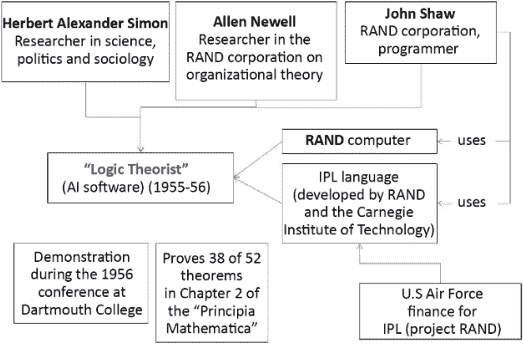

**图 1.1.** *第一个人工智能计算机程序“Logic Theorist”、其设计者、其成果*

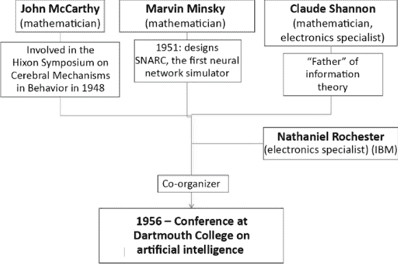

**图 1.2.** *1956 年达特茅斯学院关于人工智能的“会议”（为期两个月的项目）的组织者*

就目前而言，按照某些规范行事）做一些可能声称具有任何真正智力地位的事情。有些将证明相当平庸的数学定理。少数机器可能会玩某些游戏，有时击败其设计者。有些可能会区分手写字母。这足以证明如此多的兴趣，甚至深切的关注吗？我认为足以；我们正处于一个时代的门槛上，该时代将受到强烈影响，甚至可能由智能问题解决机器主导。但我们的目的不是猜测未来可能带来什么；我们只是试图描述和解释现在似乎是我们迈向‘人工智能’构建的第一步。”

人工智能研究围绕着在主要大学创建的新实验室展开。斯坦福大学于 1963 年创建了其人工智能实验室。在 MIT，人工智能在 MAC 项目（数学与计算项目）中处理，该项目也在 1963 年创建，并获得了 ARPA 的大量资助。

从成立的第一年起，斯坦福人工智能实验室的研究就具有国防视角。美国国防部（DoD）的机构 ARPA 通过众多项目资助了这项工作。因此，研究课题受到军事需求的影响，如 Monte D. Callero 的论文“An adaptive command and control system utilizing heuristic learning processes”（1967 年）所述，该论文旨在开发一种用于在武装冲突期间实时分配防御导弹的自动化决策工具。研究人员必须模拟导弹防御环境并构建决策系统，以根据实验提高其性能 [EAR 73]。国防机构的影响逐年增长。到 1973 年 6 月，人工智能实验室有 128 名员工，其中三分之二由 ARPA 支持 [EAR 73]。

这种与国防部门的接近并没有决定其所有工作。在 1971 年关于人工智能研究和应用的半年报告 [RAP 71] 中，斯坦福大学对其前景的描述如下：

> “该领域涉及自动系统的开发，通常包括通用数字计算机，能够执行通常被认为需要人类智能的任务。此类系统将能够感知
> > 物理环境、解决问题、构思和执行计划，并随着经验改善其行为。该研究的成功将导致能够在各种危险工作或敌对环境中取代人类的机器，因此对政府和工业用途具有广泛适用性。”

MIT 在 1970 年代的研究虽然由军方资助，但其范围仍然很广。1973 年向 ARPA 展示其工作时，研究人员认为他们已达到一个里程碑，可以设想迄今为止开展的理论工作的实际应用。但这些应用不能仅限于国防领域：

> > “人工智能十年的工作使我们达到了知识型编程新阶段的门槛——在这一阶段，我们可以设计计算机系统，使其（1）对相当复杂的情况做出合理的反应，（2）也许对未来更重要——当它们遇到限制、错误或信息不足时，能与操作员进行智能互动。”⁵

随后提出了一些新的研究方向的线索：

> > “我们相信人工智能研究可以为比以往任何时候都更强大的基于计算机的信息系统指明方向。我们计划攻克信息检索领域，既针对传统数据库和图书馆问题，也针对更个人化的管理信息系统问题。新的信息系统应有助于提高负责复杂行政结构的人员以及技术类复杂信息问题人员的效率。特别是，这些服务将可供使用并设计为可在 ARPANET 上使用，并且将设计为与个人

> 他人的系统，以识别冲突，并安排关于共同关注事项的沟通。”

与大学团队一样，兰德公司在人工智能于美国兴起的过程中也发挥了核心作用。威利斯·H·韦尔（Willis H. Ware）的著作《兰德公司与信息革命》*[WAR 08]*是理解该组织早在20世纪60年代对美国人工智能发展所起作用的重要资源。该书涵盖了1946年至2008年这一时期，并将其分为两个阶段：1946年至1983年为第一阶段，期间该机构的研究按部门组织，之后兰德公司围绕项目行动进行了重组。

韦尔回忆道，1963年，由费根鲍姆（Feigenbaum）和费尔德曼（Feldman）出版的第一本关于人工智能的著作共收录了20篇论文，其中6篇出自兰德公司的研究人员之手。艾伦·纽厄尔（Allen Newell）和克里夫·肖（Cliff Shaw）这两位兰德学者，与赫伯特·西蒙（Herbert Simon，卡内基理工学院）合作开展的早期工作，为人工智能在机器学习、定理证明和知识表示等方面的研究奠定了若干基础。韦尔还提醒我们，人工智能研究并非孤立发展。他们的研究人员依托计算机科学的进步，包括对JOHNNIAC等新型计算机的大量使用，直至20世纪60年代中期。人工智能研究汲取了计算机科学及许多其他学科的进展。

人工智能的历史似乎以美国为中心，但我们不能忘记，在试图理解大脑运作方式的机器人学和计算机科学领域，这些研究都汇聚于人工智能，同时调动了北美以外众多研究者的热情。

在英国，格雷·沃尔特（Grey Walter）早在20世纪40年代的研究就成为这一国际学术运动的一部分，该运动关注脑过程建模和智能的定义。格雷·沃尔特于1947年在布里斯托尔设计了“乌龟”机器人，被认为是首批自主电子机器人（吕斯·朗之万（Luce Langevin）将20世纪50年代描述为建造“电子动物乐园”的时期）[LAN 69]。这些研究方法基于一种信念，即大脑与机器之间存在极强的相似性：“生理学家接受一种工作假设，即大脑的功能如同机器” [ASH 51]。

当今大国之间的国际竞争与20世纪50年代至60年代的研究和早期发展历史并非无关。尤其是中国和俄罗斯，并非等到21世纪初或2010年代才开始投资人工智能研究领域。他们目前在该领域的活动基于一种模式，这种模式与美国一样，已经有数十年的历史。

### 1.1.2. *中国的人工智能研究*

中国的人工智能研究始于20世纪60年代末 [XIN 83]。

根据王杰曙的分析 [JIE 18]，中国人工智能的历史与苏联的历史以及两国之间的密切关系紧密相连。在1970年至1983年期间，主要研究领域涵盖了广泛的问题，例如：
- 机器翻译，这一领域在1982年已取得以下一些成果：
  - 开发了ECTA（英汉自动翻译系统）软件，
  - 开发了英汉标题翻译系统，
  - JF-111，一种通用机器翻译系统；
- 自然语言理解；
- 定理证明；
- 专家系统；
- 机器人学。

从这份列举中，看不出中国的研究方向与西方同行有什么本质区别。这里的研究方法同样具有多学科性（数学、计算机科学、语言学、医学、自动化、机器人学、航空学等）。

在20世纪80年代，中国已拥有大量参与人工智能研究的出版物、成果、研究者和大学。杰曙的文章只提及民用应用，没有涉及军方对这一研究课题的立场及其在大学的投入。

因此，中国的人工智能研究与西方同时期成形，并围绕优秀大学构建起来。这段历史成为中国当前雄心壮志的基础，这些雄心至今仍体现在研究计划以及经济、工业、社会和政治项目中。

### 1.1.3. *俄罗斯的人工智能研究*

俄罗斯的人工智能史与美国或西方大致遵循相同的时间线。早在20世纪60年代初，访问俄罗斯的西方代表团就注意到人工智能主题研究团队的存在。

E.A.费根鲍姆（E.A. Feigenbaum）于1960年6月至7月作为美国代表团成员访问苏联，参加*国际自动控制联合会第一次大会*（IFAC）[FEI 60]后撰写的报告称：

> “会议议程包括一些欢迎致辞，以及著名科学家、苏联自动控制国家委员会主席V.A.特拉佩兹尼科夫（V.A. Trapeznikov）的演讲。”

> “苏联副总理谈到了自动化将为那些没有做好充分准备应对此类技术变革的‘某些社会’带来的问题——这种变革将带来失业、再教育问题……”

> “总体而言，苏联的论文以理论为导向，而西方代表的论文则理论与实践相结合。”

> “在会议期间，各研究所、教育机构和工厂正式对代表们开放技术参观……最受欢迎的无疑是参观位于莫斯科的自动化与遥控力学研究所。”

在苏联，人工智能是控制论（cybernetics）的组成部分之一，与信息论、计算机科学或军事C2研究并列 [LEV 64]。控制论于1953年在苏联出现，是一个新兴的广阔领域，围绕多个研究社群组织起来，这些社群得益于20世纪50年代末开始的从美国向苏联的技术转移政策，并在1972年尼克松政府时期加速 [ROD 81]。苏联获取外国技术，特别是在信息技术领域，是通过合法渠道（美国政府批准的销售）和非法渠道（黑市和复制）进行的。人工智能是苏联“控制论”项目的一部分。然而，美国国防部1990年的一份报告估计，尽管苏联在民用和军事领域对人工智能应用进行了研究和特别关注，但其能力仍低于美国 [DOD 90]：

> > “苏联在机器智能和机器人学方面明显落后于美国。他们确实对该领域有很好的理论理解，并能将技术创造性地应用于特定的太空和军事应用。苏联的人工智能研发（AI）在苏联科学院的支持下，包括机器视觉和机器学习方面的工作。苏联政府已经认识到机器智能对战场作战以及国内经济的价值。”

因此，虽然苏联在当时看起来并未真正与美国的能力竞争，但它仍然是美国面临的竞争格局中的一个参与者。人工智能和机器人技术在其不同维度（研究、开发、产业化）上在全球多个国家和地区蓬勃发展：报告提到了法国、欧洲和日本等。

苏联的研究并未与世界其他地区隔绝。苏联组织了国际人工智能会议：例如，1977年4月在列宁格勒^8和1983年10月^9。其研究项目和成果涉及的领域与世界其他地区相对类似：自动翻译和自然语言理解的应用（1982年创建了“Etap-1”项目——法语到俄语自动翻译实验系统）^10。

- 8. http://ershov.iis.nsk.su/en/archive/subgroup?nid=763546&id_1=763546
- 9. http://ershov.iis.nsk.su/en/archive/subgroup?nid=763550&id_1=763550
- 10. http://ershov.iis.nsk.su/en/archive/subgroup?nid=763438&id_1=763438

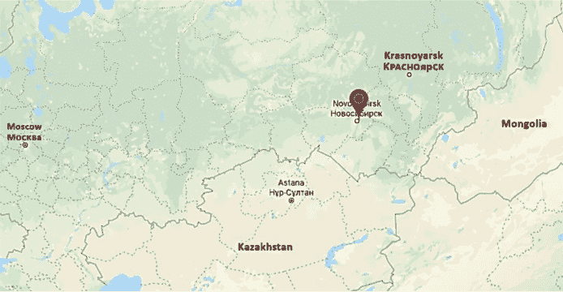

**图1.4.** *新西伯利亚市科学院城（Akademgorodok）的位置*

### 1.1.4. *日本的人工智能研究*

日本的人工智能研究历史始于20世纪60年代的京都大学，当时围绕Toshiyuki Sakai教授组建了一个团队，研究三个领域：计算机视觉、语音处理和自然语言。1970年，该团队在大阪博览会上展示了第一个面部识别系统。在这十年间，多个团队相继组建：九州大学（围绕Toshihiko Kurihara教授，研究汉字-假名转换系统）、大阪大学（Kokichi Tanaka教授研究知识处理问题）、东京大学以及NTT等企业实验室。然而，这些不同团队的出现尚未构成真正的日本人工智能研究共同体。这一共同体是在东京大学的一个学生团体（IAU E O）周围逐渐形成的，Hideyuki Nakashima、Koichi Hori和Hitoshi Matsubara等日本人工智能先驱就是从这个团体中涌现出来的。

政府为长期大学研究计划提供了数亿美元的资助[DON 77]。1971年，政府启动了PIPS（模式信息处理系统）项目，该项目在八年内获得了1亿美元的资助。实现PIPS目标所需的计算要求促成了新型电子芯片的开发。早在1973年，日本政府就通过一个新项目为这一阶段提供了资金。此外，还调动了大量其他资金来支持图像处理、语音和自然语言处理的研究。

1982年日本启动第五代计算机计划之后，人工智能似乎在20世纪80年代中期真正起飞[MIZ 04, NIS 12]^{11}。新一代计算机技术研究所（ICOT）是国家第五代计算机科学计划的研发部门。除其他成果外，ICOT还开发了编程语言KLIC和法律推理系统HELIC-II。1983年，ICOT拥有不到50名研究人员，其研究主题围绕到1990年设计出世界上最大的计算机这一核心项目展开，直接涉及AI（例如自动翻译系统、自动应答系统、语音理解、图像理解、问题求解系统和逻辑编程机器等）。

^{11} 这是Toyoaki Nishida对AI历史的解读。其他分析认为，1979年在东京举办的*国际人工智能联合会议*（IJCAI）才是这段历史的第一个里程碑（R. Mizoguchi）。参见[MIZ 04]和[NIS 12]。

1986年，日本人工智能学会（JSAI）成立。1990年，该学会创办了太平洋地区国际人工智能会议（PRICAI），旨在构建世界这一地区的人工智能研究架构，从而补充或平衡IJCAI和欧洲人工智能会议的西方倡议。

在大学研究之外，工业研发活动也为日本人工智能的发展做出了重大贡献。主要工业集团组建了专门从事AI的团队（NTT、日立、富士通、索尼、本田等行业巨头都在这一领域进行了投资）。其中一些开发成果获得了大量媒体报道，例如AIBO（索尼）、ASIMO（本田）、TAKMI——分析与知识挖掘（IBM东京研究所）、面部识别工具和移动设备口语翻译应用（NEC），以及能够唱歌和跳舞的人形机器人HRP-4C。

自20世纪80年代以来，日本政府一直保持对AI的投资，但如今国际竞争日趋激烈，几个主要大国在科学论文发表数量上已经超过日本：2011年至2015年间，中国在该领域发表了41,000篇文章，美国发表了25,500篇，而日本发表了11,700篇。这一现象在工业领域同样如此：据说美国在该领域拥有1000家公司，而日本只有200-300家¹²。

尽管日本一直是并且仍然是机器人技术及应用于该领域的AI的领导者之一，这不仅是因为它展现出了整合多个所需方面（电子、电气、计算、自动化等）的能力，还因为它在其中许多领域都处于领先地位；日本尤其在电子领域处于领先地位。20世纪80年代的机器人技术对电子、微电子和机械方面的技能要求高于计算机科学。

### 1.1.5. *法国的人工智能研究*

在20世纪50年代和60年代，对智能机器的兴趣传播到了世界各地的许多国家。法国是这一研究国际化进程中的参与者之一。例如，我们可以列举以下内容：

- Pierre de Latil关于人工思维的思考[DEL 53]；
- Albert Ducrocq的研究（军人出身，学习政治学和电子学，后成为记者和随笔作家，并被认定为控制论学者）：他发明了“电子狐狸”——一种轮式自主机器人，并启发了Bruno Lussato在20世纪70年代的成就，Lussato是自动计算机化搬运机器人zebulons的发明者。Albert Ducrocq出版了多部涉及机器人、武器和AI的著作，如《Les armes de demain》（明天的武器）（Berger-Levrault，1949年）、《Appareils et cerveaux électroniques》（电子设备与电子大脑）（Hachette，1952年）、《L'ère des robots》（机器人的时代）（Julliard，1953年）和《Découverte de la cybernétique》（控制论的发现）（Julliard，1955年）。他在2001年去世前还出版了许多其他著作；
- Paul Chauchard [CHA 50]、Paul Cossa [COS 54]、Louis Couffignal [COU 52]、Dominique Dubarle [DUB 48]关于思维机器的著述，以及Albert Béguin [BÉG 50]关于机器人的著述。

这些问题从各种不同的视角进行探讨：数学家、控制论学者、哲学家、电子工程师等。人类是机器还是机器人？大脑能否在机器中再现？机器能思考吗，它是否有灵魂？什么是机器？我们能否将机制简化为

自1979年以来一直在资助一些AI项目，1981年日本通产省第五代项目的发布似乎是政治行动中的一个新的决定性时刻。

## 1.2. 人工智能研究的特点

从一开始，人工智能就以多学科的方式形成，处于涉及多个科学学科的研究的交叉路口。哲学在这一跨学科性中占有重要地位（H.B.德雷福斯[DRE 72]在AI与柏拉图、霍布斯的思想之间建立了联系），此外尤以数学、计算机科学和认知科学为突出。

> “该领域借鉴了多种学科的理论建构，包括数学、心理学、语言学、神经生理学、计算机科学和电子工程。”[LAW 84]

法国议员塞德里克·维拉尼（Cédric Villani）在其2018年3月的报告中回顾了这一跨学科方法：

> “该领域如此广泛，不能局限于特定的研究领域[…]人工智能处于多个领域的交叉路口：计算机科学、数学（逻辑学、优化、分析、概率论、线性代数等）、认知科学等。”[VIL 18]

西班牙在其官方《国家人工智能战略文件》（2019年）中也表达了同样的观点：“由于其贡献日益复杂，人工智能正变得越来越跨学科，与生物学、哲学、法律界、心理学、社会学和经济学产生协同效应。”¹³

人工智能使用广泛的技术或手段：

> “人工智能中的每个算法都得到多种技术的组合支撑：语义分析、符号计算、机器学习、探索性分析、深度学习和神经网络[…]”[VIL 18]

> “这些技术包括：自然语言处理、智能代理、计算机视觉、机器学习、专家系统、自动驾驶汽车、聊天机器人和语音识别。”¹⁴

> “六种人工智能技术在生产和物流流程的应用方面具有显著潜力：专家/基于知识的系统、自然语言、语音识别、三维视觉、智能机器人和神经网络。迄今为止，其中最重要的一项技术是专家系统。” [MEL 89]

> “通常被认为属于人工智能子领域的科技和研究领域：• 自动规划与调度 • 计算机视觉 • 决策支持、预测分析和分析发现 • 分布式人工智能/基于代理的系统 • 人类语言技术 • 身份智能 • ML • 流程建模 • 机器人/自主系统。” [DNI 19]

最后，这种新科学的特点在于其应用领域的广度：在 1970 年代，研究人员尝试将人工智能应用于国际象棋和围棋、数学（证明定理）、理解和翻译书面及口语语言、控制机器人和人工手、图像分析以及人机交互（智能对话）¹⁵。在 1980 年代，人们谈论的应用包括：

> “生物工程、化学、计算机硬件、计算机软件、教育、工程、通用系统和人工智能工具、法律、制造和工业、数学、医学、军事以及资源勘探。” [LAW 84]

三十年后，Villani 报告 [VIL 18] 提出了同样广泛的应用领域：图像和视频识别、翻译、内容推荐等。Villani 报告 [VIL 18] 是关于使用互联网进行图像和视频识别的报告。

应用光谱似乎无限；唯一的限制是想象力。一些在 2020 年看来相当创新的应用，已经处于实验阶段或是在人工智能早期就已规划：

- 汽车中的 AI [TSU 79]^16^；
- 图像分析，图像中物体的检测 [NAG 79]；
- 冲突模拟器（例如 CONSIM，*冲突模拟器*，1971 年（*Proceedings ACM ’71* [CLE 71]）^17^）。

全球范围内，人工智能的研究与开发有共同的目标，即通过创造模仿人类行为的认知过程来理解“人类认知是如何运作的” [VIL 18]。

^16^ “本文描述了一辆具有人工智能的汽车，它由道路模式识别单元和问题求解单元组成。该车辆完全自主，可以在没有人类驾驶员的情况下行驶。道路模式识别单元包括一对电视摄像机和一个处理单元，识别车辆前方的障碍物并输出有关障碍物位置的数据。问题求解单元是一个微型计算机系统，根据数据确定对车辆周围环境最优的控制。其采用的算法是表查找方法，其中最优控制的位置由数据生成的关键词在表中寻址。该表是通过数字仿真启发式制作的。该车辆在各种道路环境下以低于 30 公里/小时的速度成功行驶。”

^17^ “本文描述了 CONSIM（冲突模拟器）的开发和使用情况，CONSIM 是一种旨在启发式模拟决策的计算机程序。文中使用一个典型示例来评估和分析 CONSIM 的方法。仿真模型设计用于两个政治对手，每个对手拥有任意有限数量的备选方案。该模型利用博弈论中经常使用的技术构建。采用贝叶斯方法为美国和中国可用的备选方案集合分配概率。模型中还包含了随着越南冲突的发展以及风险、成本和收益的重新评估而改变概率的能力。CONSIM 易于使用，适用于在动态情况下可以将概率分配给互斥且穷尽的备选方案集合中的每个备选方案的任何地方。”

| AI 目标/终极定义 | 来源 | 年份 |
|---|---|---|
| “人工智能研究的目的是构建计算机程序，当我们在人类身上观察到时，这些程序表现出我们称之为‘智能行为’的行为。” | [FEI 63] | 1963 |
| “通用人工智能的长期目标是创建系统，这些系统在语言、感知、推理、创造力和规划等广泛的认知领域表现出人类智能的灵活性和多功能性。” | 国家科学技术委员会，网络和信息技术研究与发展分委员会（NITRD）（美国） [NET 16] | 2016 |

**Table 1.2.** *人工智能的目标或宗旨*

撰写人工智能的历史需要考虑的不仅是一个学科的发展，还包括众多学科的交汇。它的诞生是一个融合、相遇的时刻。人工智能的命运曾是、也将继续与这种多学科性紧密相连，而多学科性是其主要特征之一。

## 1.3. AI 历史的序列

人工智能历史的进程将由一系列进步、狂热阶段和挫折时期所标示，有时被称为“人工智能寒冬”。无论如何，人工智能的道路并非线性。虽然人工智能今天已取得全球性成功（我们今天正处于“人工智能的第三个时代” [MIA 18]），但不能排除出现一个可能相当突然的衰退阶段。人工智能的成功与若干条件相关。它的命运不仅取决于科学的进步，还与经济挑战和投资以及政治支持和科学进步相关联。

将人工智能历史划分为几个序列，使得在每个序列中都可以定位事件，例如从未停止标示人类历史的主要冲突、政治时期和重大事件，特别是技术史上的事件。

### 时期 1956–1970（春季 1）：
在此第一个时期，人工智能先驱者对其实现既定目标的能力充满信心，相信科学的现状将允许人工智能迅速实现。这些先驱者乐观地认为，人工智能将在未来 25 年内实现其目标。但困难很快出现，初始的雄心不得不重新考虑。进展比预期慢，许多问题对于当时的知识来说仍然太难解决。例如，机器翻译系统表现很差。Lighthill 报告（1972 年）在一段时间内结束了这一第一个时期。过度的负面论调导致了这个充满希望和乌托邦的动态时期的终结：

> “国防部的先进研究项目局 ARPA 事实上是人工智能研究的主要资金来源，目前正遭到多方面的攻击，因为其项目被认为相对于所涉及的支出而言‘回报’不够迅速。Dreyfus 的批评中较为务实的观点，即使可能被人工智能工作者轻易驳斥，也得到了其他不易被忽视的人的呼应，例如代表英国科学研究委员会发言的 J. Lighthill（1973 年）。如果足够多的批评者成功地阻止 ARPA 研究以及人工智能工作一般，NSA 可能即将获得的一些潜在利益可能永远不会实现。”18

### 时期 1970–1982（冬季 1）：
20 世纪 70 年代初，所谓的“人工智能寒冬”开始，指研究人员在资金减少的情况下必须坚持并取得显著成果的年份。第一个时期的努力并非徒劳，因为在所遭受的失败中，研究人员明白了他们需要攻克什么。

在 1970 年代，immediate 目标不再是创造一台通用、一般智能机器，而是专门的智能：一台特定机器应该能够在有限的领域内智能地行动19。人工智能先驱者几乎乌托邦式的希望，他们确信能够迅速将人类智能的奥秘移植到机器中，很快让位于对机器性能的更为审慎的讨论。问题在于计算机能做什么或不能做什么，其局限性 [DRE 72]。

18 Cryptolog Journal, NSA, 1975 年 7 月，可获取自： https://www.nsa.gov/Portals/70/documents/news-features/declassified-documents/cryptologs/cryptolog_11.pdf.
19 Cryptolog Journal, 1986 年 3 月–4 月，NSA，可获取自： https://www.nsa.gov/Portals/70/documents/news-features/declassified-documents/cryptologs/cryptolog_101.pdf.

法国似乎在20世纪70年代和80年代表现出强烈的怀疑态度。当时国家投资很少，研究界规模也很小：

> “计算机视觉研究活动十分活跃，但与语音理解一样，它是一个困难的领域，需要大量的计算能力。幸运的是，有迹象表明，许多应用所需的计算能力将在大约十年内可用，并且在经济上可行。因此，研究人员目前正在利用现有资源攻克整体问题的各个部分，而将他们的努力整合留待未来。” [HOL 76]

### 时期 1982–1987（春季 2）：

日本的新一代计算机计划重新点燃了人工智能研究的竞赛，罗纳德·里根所谓的“星球大战”演讲也是如此。大国们纷纷投身技术竞赛，以免被日本彻底压倒和主宰。正是在人工智能和征服太空的努力中，国际舞台上国家间的权力斗争得以体现。20世纪80年代，专家系统大量涌现。人工智能变得商业化，而对于军方来说，人工智能终于提供了增强作战效率的应用前景。资金开始大规模涌入。

### 时期 1987–2010（冬季 2）：

20世纪80年代初的积极阶段很短暂。早在1987年，人工智能市场就开始显示出显著放缓的迹象。专门的人工智能硬件产业（LISP机器）崩溃了。

### 时期 2010年至今（春季 3）：

全球对人工智能兴趣的新阶段。自2011年以来的这段时期真正可以被称为“人工智能之春”²⁰。这一复兴时期可以归结为三个变量的结合²¹：大数据、算法和计算能力的提升。这是芬兰当局反复强调的说法：

> “更有效、成本更低的计算能力，人工智能可用数据量的大幅增加，以及更先进的人工智能算法，都推动了对人工智能的更密集使用。事实上，我们正在经历一个人工智能的新春天。”²²

22 引领进入人工智能时代。芬兰人工智能计划2019年最终报告，经济事务与就业部出版物，可访问：https://julkaisut.valtioneuvosto.fi/bitstream/handle/10024/161688/41_19_Leading%20the%20way%20into%20the%20age%20of%20artificial%20intelligence.pdf?sequence=4.

这三个变量也可以称为大数据、机器学习（ML）和云计算 [MIA 17]。

人们再次对人工智能的进步和贡献寄予厚望，有大规模的国家和私人资金、多年研发计划，以及在所有可能的活动领域的应用。远低于预期的表现无疑很可能会减缓当前的全球发展态势。这将导致资金减少、公众兴趣缺失以及人工智能产品商业活动的衰退。当今部署的通用或弱人工智能本身就孕育着自身局限性的种子，而忠实模仿智力能力的类人系统仍然遥不可及：

> “[……]我们生活的方方面面都将以某种方式改变。如今，这些智能机器的进步似乎永无止境。它们会超越我们，甚至取代我们吗？如果按照定义，超级智能能够在所有智能领域超越我们，那么到那时我们自己的努力将变得过时。在某些方面，这些机器具有超人的能力，但实际上，没有任何机器能像老鼠一样聪明。”²³

23 2018年9月在Arte.fr上播出的纪录片*《人工智能会超越我们吗？》*，由吉兰·德帕迪厄和蒂博·马丁执导。视频可访问 https://www.arte.tv/fr/videos/069097-000-A/l-intelligence-artificielle-va-t-elle-nous-depasser/.

进一步的失望将导致新的低迷。

这种对自20世纪50年代以来人工智能历史的划分并不完美，因为它将人工智能的方方面面简化为一个维度。工业、军事项目、政策或各应用领域的研究周期不一定相同。研究并没有真正经历过休眠期。它一直在世界各地持续开展，当然，其资金和资源支持因时期和国家而异。出版物的数量，以及科学界围绕国家和国际协会及国际研讨会构建自身并组织研究的努力，都证明了这一点。

各国在人工智能研发方面的努力主要源于构建一个能为它们提供经济实力的技术领域的愿望，为多个活动部门提供促进其进步的工具，并在军事领域提供有助于增强其能力的工具。然而，在1950年至2000年的几十年间，尽管情报机构能够利用人工智能协助完成其任务，但人们并没有对安全应用和问题进行公开讨论。

## 1.4. 机器人与机器人学

人工智能与机器人学密切相关。人工智能在20世纪50年代被确立为一门学科和一个科学共同体。专业出版物、研讨会、协会以及研究团队的创建都参与了这个建设过程。人工智能已将机器人纳入其研究问题中。但它并未与机器人学联手，机器人学本身是一门独立的学科。机器人学有自己的历史、自己的挑战和自己的研究问题。

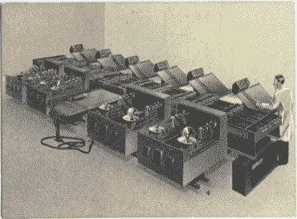

**图1.5.** *曼彻斯特大学机器人*24。*有关此图的彩色版本，请参阅* www.iste.co.uk/ventre/artificial.zip

24 乔治·阿伦茨特藏，纽约公共图书馆，曼彻斯特大学机器人，可访问：http://digitalcollections.nypl.org/items/510d47da-93ab-a3d9-e040-e00a18064a99。此插图展示了范内瓦·布什设计的差分分析仪。

在18世纪和19世纪，几项由自动机完成的成果被展示给公众。这些机器具有人类的外表，并能复现书写或演奏乐器等任务。当然，这些机器中并没有自主智能。其中的智能属于其巧妙的设计者，他们创造了精密的机械装置。这些机器在文学作品中占有一席之地，并反映了当时的技术：它们当时还没有被称为机器人，而是由电力、机械、钢铁，有时还有蒸汽能源构成（参见爱德华·S·埃利斯的*《草原蒸汽人》*[ELL 68]）。

20世纪，机械化取得了胜利；工业为大规模生产开辟了道路（例如1910年代的福特工厂）。此前一直被称为自动机、机器和机械的东西变成了“机器人”。卡雷尔·恰佩克于1921年在一部戏剧中引入了这个术语，用来指称具有人类外表的机器。艾萨克·阿西莫夫于1941年写了短篇小说*《骗子！》*[ASI 41]，在其中引入了机器人学的“法则”。在接下来的几十年里，科幻小说赋予了机器人重要的角色，并助推了其在全球的成功。但科幻小说也塑造了机器人的一种特定形象：它通常具有人类外表，无论如何，它都被赋予了生命和一种挑战人类智慧的智能。

在第二次世界大战期间，装有炸药并投向敌方军民人口的无人驾驶飞机被称为“机器人炸弹”。战后，又有一些工业应用成果被开发出来。第一只可编程机械臂由乔治·德沃尔和约瑟夫·恩格尔伯格于1954年设计，并于1962年集成到通用汽车的装配线上。机器人占据了工业空间和科学空间，并被设计用于协助人类进行实验，以及应对恶劣环境。1994年，卡内基梅隆大学机器人研究所设计了八足机器人DANTE II，它探索了斯珀尔火山的火山口。其形状的灵感来源于蜘蛛。这一成就结合了传感器技术、计算机科学、电子学和通信仪器。

机器人学作为一门科学学科，产生于1956年或1964年：

- 1956年，乔治·德沃尔和约瑟夫·恩格尔伯格会面。他们的合作催生了机器人产业、一本杂志（*《工业机器人》*）和一个国际会议（*《国际工业机器人研讨会》*）

诞生了。乔·恩格尔伯格有时被称为“机器人学之父”；

- 1964年，机械工程师伯尼·罗斯遇到了人工智能研究员约翰·麦卡锡。这是富有成效的合作、科学出版物、发展和定期科学会议的起点，这些逐步巩固了一个新的研究社区。

关于这门学科诞生日期的第三种说法可以追溯到遥操作技术（20世纪40年代在美国为操纵核材料而开发）。戈尔茨在1952年和1954年的文章是机器人学历史的起点²⁵。

无论选择哪个确切日期，机器人学的诞生通常与人工智能（20世纪50年代）同时代。

机器人学作为一门学科，从起源起就与人工智能密切接触，但已发展成为一门独立的学科：

> “[...] 理解智能的科学任务已经在人工智能（计算机科学的一个子领域）中顺利开展。如果已经有了一个合适的直接科学领域，为什么还需要机器人学？为什么人工智能不是机器人学基础科学资本的主要供应者，就像计算机科学、机械工程和电气工程等其他供应者那样？
>
> 答案是有的，而且它进一步阐明了我基本论点。人工智能目前与计算机科学共享一种特殊观点——它将信息处理与能量学分开看待。这种创造内部环境（其中只发生信息过程）的做法是一个强大的抽象，它帮助计算机科学得以出现，使其能够专注于基本机制。但这种抽象的代价，在机器人学未被探索的核心问题——受控的知觉协调运动——上表现得最为明显。” [NEW 81]

20世纪70年代，斯坦福人工智能研究中心的工作整合了机器人学的研发：

> > “我们正在几个领域开展基础研究：问题求解、感知、自动数学和学习。然而，我们发现选择一个目标——创建一个单一集成系统——是富有成效的 […] 我们的系统由一个通过大型数字计算机无线电控制的移动机器人车组成。主要目标是为计算机开发软件，当与车辆的硬件结合使用时，将产生一个能够表现出智能行为的系统 [...] 在我们更换计算机之前（1969年底），我们的机器人系统已达到原始能力水平：它可以分析受限实验室环境中的简单场景；为某些问题规划解决方案，前提是恰好有正确的数据被适当编码；并执行其计划，前提是执行过程中没有出错。因此，当我们开始规划一个从新计算机控制机器人的新软件系统时，我们设定了更困难的短期目标：该系统必须能够在更大的环境中运行，包括多个房间、走廊和门口；其规划能力必须能够从大量关于世界和机器人能力的事实存储中选择相关数据；并且它必须能够从某些意外故障或累积错误中优雅地恢复。我们尚未完成这些目标。” [RAP 71]

与人工智能一样，机器人学围绕一个美国中心建立。然而，机器人学和机器人在许多其他国家也取得了巨大成功，包括日本，这个国家在该领域的研究和开发中尤为活跃：1997年，日本举办了第一届机器人锦标赛（RoboCup）；1999年，索尼展示并销售了AIBO，第一只宠物机器狗；2000年，本田创造了人形机器人ASIMO。日本尤其深入参与机器人学，并在近几十年成为世界领先者，领先于美国和其他工业化国家。2010年，日本占世界机器人产量的三分之二（尽管并非所有这些机器人技术都与人工智能相关）。这一成功在很大程度上归功于日本在其境内拥有机器人学所需的所有技术和工业技能及构件（尽管并非在所有领域都处于领先地位：机械、电子、计算、传感器等）[NAR 10]。在机器人化方面的努力也可以由特定的社会需求来解释：劳动力短缺和人口老龄化，任何移民都无法弥补。因此，有必要在生产中用机器代替人类，并考虑支持老年人口的解决方案。机器人学不是国防的优先问题，尤其是自二战结束以来，该国不再有权拥有自己的军队。因此，投资方向转向国防以外的领域。

机器人是机器（人工智能是软件）：
- 经过编程的；
- 独立或半自主执行任务的；
- 通过传感器与其物理环境交互的。

有些机器人也是由操作员控制的机器（因此在这种情况下不存在自主性问题）。“非智能”机器人，相对于智能机器人而言，只能执行重复性任务：拿起并移动一个物体。对于这个动作，它不需要人工干预，所以在某种程度上是“自主”的，但很难将其称为“智能”。因此，自主性不等于智能。然而，这种只反复放置物体的机器人，当安装摄像头时，就变得“智能”，这使它能够区分物体、区分它们并根据物体类型分配不同的动作。视觉和感知需要人工智能算法 [OWE 17]。智能机器人是嵌入人工智能程序的机器人。

## 1.5. 人工智能集成示例：20世纪80年代中情局的案例

20世纪60年代初，计算机进入该机构（中情局），主要用于行政任务。然后，计算机逐渐成为一种可用于该机构核心使命（即情报以及数据的收集和处理）的工具²⁶。

在20世纪80年代，计算机成为该机构活动的必要组成部分，它必须处理日益增长的数据量，这些数据需要在其各部门内收集、存储、分析和分发²⁷。该机构面临着数据、计算机和网络带来的限制：大量数据被生产出来，持续而快速的流动连接着机器和个人。数据的速度和数量是当时观察者提出的两个变量。然而，这些发现并未质疑技术，因为这些技术似乎只给机构运作和情报官员带来了附加值。技术引入该机构被描述为一个动态过程。在20世纪80年代中期，人工智能尚未被采用，但该机构启动了一个反思过程，动员其各个部门和管理人员设想在情报领域的应用。

另一方面，该机构数据生产速度和密度的提高（以报告、备忘录和各种文件的形式）不仅仅是技术原因。在该机构内部，存在一种政治和政府的意愿，希望在广泛问题上每天生产更多知识（1983年中央情报局生产了800份报告；但一半人员专注于苏联 [DDI 84]）。

美国情报界对人工智能的处理可以通过在线可用资源进行分析。因此，中情局在其网站上提供了一套档案²⁸文件。在这组数据中，我们寻找能够描述情报界与一门科学和一套创新技术之间关系的信息，该机构如何组织自己来应对这些新对象（创建小组、指定领导者、建立关系、网络、监测等），以及为情报特定需求而设想的人工智能应用，所有这些都从时间顺序的角度出发（该机构在哪些时间点接手这个主题，采取行动，发展过程中的重要里程碑是什么等）。中情局历史的这一面长期以来一直不为人知，处于阴影之中：

> “中情局在将科学技术应用于情报艺术方面的作用远未得到充分认识 […] 然而，对科学技术的利用一直是中情局活动的重要组成部分，几乎从其创建之初就是如此。1962年，这导致了副局长办公室（负责科技）的创建。

²⁸ 可从以下地址获取数据：https://www.cia.gov/library/readingroom/。使用页面上的搜索引擎搜索“artificial intelligence”一词，可直接识别出对分析有用的语料库。

> “过去四年中，情报界的预算显著增长 […] 这使我们得以恢复许多在1970年代失去的能力 […] 在过去四年里，我们中央情报局首次制定并实施了一项覆盖数量惊人的国家和议题的全面研究计划 […] 我们重建了人力情报能力 […] 在技术方面，对新技术系统的投资正开始产生回报。” [DDI 84]

这种现代化将提高数据收集能力，从而带来新的分析需求：

> “这意味着我们能收集的情报信息在质量和精度上将大幅提升。同时，数据量也将显著增加。这表明我们必须开始投资于处理系统，以匹配我们收集原始数据的能力 […] 我们必须避免被来自各渠道的海量信息所淹没，而这正是计算机、软件及其他新技术的发展真正必须帮助我们之处。” [DDI 84]

尽管资金方面的障碍似乎已经消除，但新系统的实施同样复杂。主要困难之一在于确定目标和合适的方法。决策者（机构内部的管理人员）能力水平较低的问题也被指出，这对所做出的选择产生了影响：

> “美国工业和政府面临的一个严重问题是高级经理人不懂计算机 […] 有关计算机和ADP设备的重要决策往往由那些几乎分不清大型主机和马克卡车的经理们做出。我们该怎么办？我们转向自己组织中的计算机专家，而他们视野狭隘，守护自己的一亩三分地，对更大规模的规划、联网和实验深恶痛绝。因此，我们有时开发出的系统彼此无法互通，且仅能满足当前需求。” [DDI 84]

还必须考虑其他特殊性，例如该机构的结构和运作方式，这些特殊性体现在技术系统的组织方式上，有时也被称为“问题”：

然而，也有人呼吁极度谨慎。面对人们对人工智能深刻变革情报能力的期望，人们应当意识到，要实现这样的成就还有很长的路要走：

> “在我们看来，人工智能领域的进展很可能是极其缓慢的。对于那些关于实际应用快速进展的承诺，应持一定的怀疑态度。” [DDI 84]

情报总监（DDI）在向安全事务支持协会成员发表讲话时，强调该机构必须抵制商业压力、营销说辞和兜售许诺者：

> “我无法告诉你有多少承包商试图向我推销软件，声称能让我完美预测苏联领导层的下一步行动。在我看来，除非我们能更深入地了解直觉过程是如何运作的，否则很难编写出能够复制分析师工作的‘专家系统软件’。” [DDI 84]

对这些新技术的看法中，怀疑态度甚至带有某种讽刺意味，至少是对其局限性的认识：“当今的专家系统是‘白痴天才’，在严格限定的应用中已证明是有用的” [ECK 84]。

1983–1984年情报界对人工智能的期望与2010年代末的期望颇为相似：检测、预测、原始数据处理、图像和信号处理等。

我们还可以观察到，自那时以来开发的人工智能系统并未实现其所有承诺：专家系统和其他用于处理异构格式多源数据的模式，未能预测苏联的解体，也未能预料和防止2001年9月11日的袭击，以及此后在美国和世界历史上留下印记的许多其他重大行动或事件。

然而，情报界和军方对情报领域科学进步的关注早于1980年代。军方通过ARPA/DARPA为美国学术界的工作提供支持，而中央情报局和国防部也都在监测全球人工智能研究，这一点可从1960年代在国际研讨会或访问组织的背景下撰写的出国任务报告中得到证明29。

| 行动类型 | 具体名称 | 主题/目标 | 日期 | 地点 |
|---|---|---|---|---|
| **参与或组织研讨会，并有民间专家（实业界、大学）贡献** | *人工智能应用情报分析研讨会*30 | 人工智能应用  为分析人员和中央情报局官员提供信息：什么是人工智能？它对分析人员有何用处？ | 1982年11月30日至12月1日  1983年12月6–8日（500人参加）  1985年3月19–21日  1986年3月13–14日31  1987年32（*第五次情报界人工智能研讨会。在国防情报局，博林空军基地*） | 中央情报局总部（华盛顿特区）；DIA（博林空军基地）（1985年）；NBS（盖瑟斯堡）/NSA（米德堡）；等。 |
| **焦点小组、协调** | 人工智能指导小组（AISG）33 | 对人工智能潜力的思考  定期会议（1984年6月18日在NCARAI所在地）34 | 1983年（主席：Phil Eckman） | 中央情报局 |
| **焦点小组、协调** | 人工智能应用工作组（AIAWG）35 | 协调机构内的研发工作，使人工智能适应特定的情报问题 | 1983年 | 信息系统委员会（中央情报局） |
| **与美国大学的关系** | 人工智能培训请求 [MAL 87] | 培训机构的一名工作人员；在大学机构中代表情报机构（将学生纳入培训；或在大学安排“教授”） | 1987年 | 卡内基梅隆大学 |
| **培训** | ISGF 设立的培训课程 | 为期两天和三天的研讨会，介绍人工智能及其在情报中的应用 | 1983年 | 信息科学中心（中央情报局） |
| **培训** | *信息技术视频研讨会。（中央情报局首次使用总部有线电视系统）* [DON 86] | *关于人工智能的七部分节目* | 1986年 | 通过总部有线电视系统向整个机构播出 |

**表1.3.** *中央情报局为理解和整合人工智能而发起的行动类型*

29 美国情报委员会，文献委员会，差旅报告：CODIB访问德国，1962年10月11日，可查阅：https://www.cia.gov/library/readingroom/docs/CIA-RDP80B01139A000200120018-0.pdf。

30 情报理事会、科学与武器研究办公室、情报局，*人工智能应用情报分析研讨会*，1982年11月18日，可查阅：https://www.cia.gov/library/readingroom/docs/CIA-RDP85-00024R000500300004-9.pdf。

31 研发总监，人工智能研讨会公告，1986年1月29日，可查阅：https://www.cia.gov/library/readingroom/docs/CIA-RDP89B00297R000400870001-7.pdf。

32 采购管理参谋部，每周报告，截至1987年3月31日的一周，可查阅：https://www.cia.gov/library/readingroom/docs/CIA-RDP89-00063R000300280042-9.pdf。

33 由IRDC（情报研究与发展委员会）创建。

34 NCARAI：海军人工智能应用研究中心。

35 信息系统委员会，人工智能应用工作组，无日期，可查阅：https://www.cia.gov/library/readingroom/docs/CIA-RDP85-00142R000100030011-8.pdf。中央情报局信息系统委员会人工智能应用工作组章程，1983年7月，可查阅：https://www.cia.gov/library/readingroom/docs/CIA-RDP85-00142R00010050002-6.pdf。

“出现在多个部门的需求，但每个部门都以各自应用领域的语言和术语来表述。”

1983年12月14日会议纪要的草稿并未就这种趋同的原因提出任何疑问。也许这是因为所咨询的各服务部门的真实需求确实趋同。但也可能这是对人工智能是什么以及它能提供什么的共同集体表述的产物。在此过程中发现的唯一真正差异仍然在于表述的词汇。此外，这些需求是以过于笼统的方式提出的：“在确定了这些总体需求之后，我们似乎还有更多工作要做，以使之更加具体。”

### 1.5.3. *情报界外部的对话者网络*

将人工智能融入情报界的实践和政策，需要广泛的外部参与者介入。

这种做法既非人工智能这一新课题所特有，也并非情报界独有：

> “这个国家在政府与私营行业合作的方式上独树一帜 […] 在美国，我们依靠爱国精神与利益动机的结合来维持我们的体制运转 […] 使我们能够理解美国及其人民所面临日益增长威胁的新技术设备和新分析技术，正是基于私营行业与政府之间的协同关系。” [DDI 84]

CIA对人工智能的做法包括：紧跟研发状态，识别学术界、军事界和工业界的参与者，并与他们进行对话，以了解现有的人工智能如何能够转移到情报界。CIA与情报界外部的对话者就广泛的主题进行了对话。该机构始终保持关注、随时准备回应并保持警惕。例如，1983年，约1200名分析师参加了500多场涵盖广泛主题的会议 [DDI 84]。

CIA正在考虑根据自身需求调整知识和技术，甚至在考虑获取它们之前（文件中未具体说明设想的转移方式），就试图了解其中的利害关系：

> “IR&DC的IASG正在准备建议书，供委员会审议，内容涉及何处正在发生有前景的人工智能技术发展，以及哪些发展可能对适应情报界具有价值。”42

这一逻辑指导了CIA内部获取和整合技术的整个战略，其目的是节省财政资源，并根据自身需求调整现有技术。因此，面对那些理由并未受到根本质疑的采购请求，CIA局长在1982年写道：

> “在就采购VHSIC/VLSI设施的建议发表评论之前，局长和我希望委员会能更确切地探讨一下这涉及什么。我们的第一反应是担心费用可能过高，情报界难以承受。与其资助这种性质的设施，或许我们可以利用现有的商业设施来探索对情报项目可能具有独特性的电路 [...] 我们认为，低功耗、高密度的存储技术 [...] 也应由国防部其他项目和商业项目共同推进，从而使情报界能够利用其他地方的研发成果。”43

42 拟议的赴波士顿TDY差旅，1985年10月25日，可查阅：https://www.cia.gov/library/readingroom/docs/CIA-RDP87M00220R000800930013-8.pdf。
43 IR&DC报告，《改进情报能力的技术考虑》，1982年12月1日，可查阅：https://www.cia.gov/library/readingroom/docs/CIA-RDP87B00305R000801500001-4.pdf。

1987年，CIA负责行政管理的副局长表示，希望派一名工作人员到卡内基-梅隆大学参加为期一年的培训项目，以在技术和政治上代表该机构；提出的第二个选项是安排一名“教授”常驻两年，“教授”一词带有引号：

> “[…] 本机构应该在卡内基-梅隆大学派驻一名具有ADP背景的人员。[…] 请 […] 安排一名合适的官员前往卡内基-梅隆进行为期一年的人工智能领域培训，或者安排一名官员以常驻‘教授’身份在卡内基-梅隆待两年 […] 此人应是我们认为能够在技术和政治上代表我们的人 […] 让我们认真而积极地推进这项工作。” [MAL 87]

|  | 工业界 | 大学 | 政策/政府 |
|---|---|---|---|
| **1982年人工智能研讨会**44 | 施乐、Symbolics、DEC（数字设备公司）、VERAC公司、系统开发公司、人工智能公司、德州仪器公司、休斯研究实验室 | 耶鲁大学、匹兹堡大学、雪城大学 | 研究与发展办公室（ORD） |
| **培训** |  | 将CIA人员作为学生或教授安排在美国大学中 |  |

**表1.4.** *CIA所寻求和动员的、并与CIA保持各种类型关系的非情报界参与者*

44 会议议程可查阅：https://www.cia.gov/library/readingroom/docs/CIA-RDP85-00024R000500300005-8.pdf。该议程围绕14场报告组织，分布在两天内。其中四场专门从历史角度探讨AI研究；一场是引言，一场是机构总结；其余时间用于技术报告和工业演示。

| 背景 | 日期 | 词汇 |
|---|---|---|
| 人工智能研讨会45 | 1982 | 人工智能系统 演绎推理 应对*临时*问题 “智能”数据基础 专家系统 目标跟踪 海洋监视 信息检索 |
| 人工智能研讨会 | 1985 | 应对信息爆炸式增长日益严重的问题 |
| *情报界人工智能应用研讨会* [ECK 83] | 1983年12月8日 [ECK 84] （该研讨会第二届，第一届于1982年举行，有300名参与者）。研讨会由ISGF赞助 | AI用于： - 合并、分析和解释大量数据 - 提高分析人员生产力 自然语言处理 预警指标 自动化信号处理 专家系统 自动化图像解释 |
| AIAWG | 1983年12月14日⁴⁶ | 专家系统 信息检索、分析和报告 网络规划、监控和维护 咨询、培训、分析和预测 图像解释 **自然语言** 数据库接口 文本检索 机器翻译 消息识别 消息传播 语音理解 说话人识别 语言识别 **图像理解** 光学字符识别 变化检测 识别、计数和分类物体 **智能数据库** 推理 数据资源导航辅助 |
| **AIAWG** | 1983年12月14日^47^ | **信号解释** 实时TEMPEST监视 信号分选和分类  **AI工具与环境** 改进信息系统开发过程 改进的用户界面 机器语音输入 AI系统开发辅助工具 高管决策辅助 行政系统支持（预算、出差、人事） |
| **AI指导组**^48^ | 1984年8月29日 | 专家系统 自然语言处理 智能数据库接口 图像理解 信号解释 地理和空间数据管理 智能工作站环境 知识获取过程 |

| 背景 | 日期 | 词汇 |
|---|---|---|
| 人工智能中级管理人员研讨会³⁹ | 1984年9月11–13日 | LISP 语义网络 生产系统 图像处理/模式识别 图像理解 自动化演绎与推理 自然语言处理 专家系统 |

表1.5. CIA内部的人工智能词汇

该文件由一份于1986年8月14日在《纽约时报》发表的文章副本补充，该文章介绍了卡内基-梅隆大学与IBM之间为期三年的联合研究项目。该项目由工业家出资数百万美元。

大学并未被情报机构强加一名候选人。当大学计算机科学系被问及接待该机构学生的情况时，表示愿意参与此类倡议，但提出了条件：候选人必须拥有硕士学位并具备人工智能方面的先前知识。另一方面，大学系部要求提供财政对价 [DTE 86]。

### 1.5.4. 人工智能应用对应何种情报需求？

人工智能的应用对于情报界而言，是证明对这些科学及其发展给予关注的中心论点之一：

> “研讨会实现了两件事。首先，它对人工智能技术进行了更新 [...] 更重要的是，它关注了这些新技术如何在情报界得到应用。”50

情报界并不打算在研究中提供*领导地位*，而是侧重于应用层面。需求的是一个具有操作性、功能性和实用性的AI。

当CIA在1982–1983年设立工作组时，首批发现强调人工智能仍处于开发潜在应用的阶段，而非生产操作系统。然而，若没有对情报需求的精确定义，工业界的努力就无法成功。因此，在这一点上，需要比较其潜能并将其告知情报界，后者随后必须设想可能受益于人工智能贡献的领域，然后表述其需求：

> “承包方已开始组建合格人员团队；他们已开始投资必要的IT基础设施；并且他们才刚刚开始理解我们的具体需求。这些努力在我们更好地理解自身需求之前必然会保持谨慎。”51

在1983年12月一次会议结束时，AIAWG制定了一份人工智能在情报领域可能应用的清单。该清单52确定了六大主要领域：专家系统、自然语言、图像理解、智能数据库、信号解释以及人工智能工具和环境。

建构主义理论在国际关系分析中赋予话语中心地位。话语建构对象并建构现实。某些词语，以及某些话语形式和特定行为者，对世界及其问题的感知、表征和理解产生影响并权重更大。国际关系，特别是安全和国防问题，在很大程度上取决于谁在何时以何种方式表达：

> “人工智能是一个多年来让全世界人民着迷的课题，但随着计算机的引入，这种着迷正在成为现实。我并不是指在许多科幻书籍和耸人听闻的电影中描绘的智能，而是指计算机被缓慢而有条不紊地应用于执行过去认为需要智能的任务。” [WIM 77]

当前对人工智能的狂热是一种复兴。它可以在那些寻求给人留下印象的言论中看到：“人工智能的发展可能对社会和经济产生的影响大于火的发明或工业革命。”¹

¹ Enrique Sucar研究员的评论，引用自 [MAR 18]。

人工智能的到来被描述为一种新的转变，一场新的工业革命（那将是第四次）²，一种新的电力 [NG 16]，它将成为需要征服的圣杯（我们称之为“quest”） [NIL 09]，它将带来巨大的进步（它将是经济增长的保证）³。根据史蒂芬·霍金，它可能是人类历史上最重要的发展，也可能是最糟糕的。其他人则以不同的方式提出问题，质疑其创造性破坏的力量（摧毁当前的经济、工业和生产体系以产生新的体系，创造新的需求、新的工作和新的社会生活方式），或破坏性创造（大规模失业而没有替代就业；对机器主导的决策过程失去控制） [MIA 17]。

这种狂热、这种兴奋，可以在技术商人的话语中观察到（提供创新、被视为紧迫挑战的解决方案或对基本需求的回答的工业家），也可以在政治家的话语中观察到，以及传播信息并充当回声室的媒体，或“专家”。虽然很少有声音质疑人工智能将发挥的重大作用，但不和谐的声音正在被听见。有些人认为这是一个积极的、尽管有时令人担忧的进步，而另一些人则主要将其视为根本威胁。然而，这种双重观点与自19世纪以来技术发展可能引发的辩论或争议是一致的，1950年代和1960年代计算机科学的发展也未幸免。然而，这些话语必须对其反映社会对技术的感知和占有进行审视，以及它们揭示了技术与社会如何围绕它们构建的方式。

有些术语、思想或概念比其他更成功。但其选择往往具有决定性，即使这些选择的原因有时难以解释。思想、概念和对象也可能使用不同的术语来指定或表达。这就是“computer”一词的情况：

> “它们本不该被称为计算机。第一批机器被标记为计算机，因为其开发者认为数值计算将是其主要功能 [...] 它同样可以被称为Oogabooga Box [...]。在法国，他们称计算机使用的所有方面为l’informatique，即信息的自动处理。从时间到时间，计算机爱好者主张翻译法语术语并称计算机使用为‘informatics’，这是一个极其恰当的术语。不幸的是，‘informatics’恰好是美国Informatics Inc的商标 [...]。著名科学家约翰·冯·诺依曼在最初就说对了，但没有人听从。他称之为‘通用机器’。” [NEL 78]

2 加拿大人工智能生态系统：2018年概况，Green Technology Asia Pte Ltd.，2018年，可获取于：http://www.greentechasia.com/wp-content/uploads/2018/02/Canada-AI-Ecosystem-2018-Profile-Summary-Report-Greentech-Asia.pdf。
3 Accenture，“为什么人工智能是增长的未来”，2016年6月。

H.A. Simon [SIM 96]⁴使用“人工智能”一词。也可能使用其他术语，但同样存在问题：

> [...] 你必须理解我以尽可能中性的意义使用‘人工’，即指人造的与自然的相对。

> “我对这一特定术语选择不承担责任。‘人工智能’这一短语，据我所知，是在查尔斯河畔的MIT创造的。我们在兰德和卡内基梅隆大学自己的研究小组更喜欢‘复杂信息处理’和‘认知过程模拟’等短语。但随后我们遇到了新的术语困难，因为字典也说‘模拟’意味着‘假设或具有表面的外观或形式，而没有现实；模仿；伪造；假装’。无论如何，‘人工智能’似乎将留存下来，净化这一短语可能比放弃它更容易。随着时间的推移，它将变得足够惯用，不再成为廉价修辞的目标。”

## 2.1. 定义AI

### 2.1.1. AI

人工智能，如同所有概念一样，受到多种定义的制约。可以依赖并坚持先驱者制定的定义

该学科在1950年代和1960年代。但此后，这一概念从未停止被质疑、分析和解构，当然也从未完全达成一个单一、共识的理想定义。一方面理解或定义“人工”，另一方面理解或定义“智能”，并不能完全定义“人工智能”。

定义智能曾是并且仍然是一个挑战。它是“心灵的一项基本功能，使我们能够把握事物之间的关系（拉丁语 intelligere；前缀 inter，‘之间’和动词 legere，‘联系’、‘使相关’）” [GOF 06]。

“智能/智能”一词在1950-1960年间在多种技术或研究对象中衰落。我们因此谈论“智能地面卫星” [QUA 57]，以区分放置在轨道上的卫星与自然卫星（如月球）；智能机器等也被讨论。

人工智能先驱之一 Marvin Minsky 认为，我们应该“只是使用‘智能’来表示人们通常所指的意思，即解决难题的能力” [MIN 85]。

Fred M. Tonge 认为：

> “我们所说的‘智能’是指系统的属性，是基于对系统行为的观察并被‘大多数理性的人’认可为智能的判断。‘人工智能’就是在非生命系统中观察到的该属性。旨在产生此类行为的工作因此是人工智能工作。虽然上述定义确实比较宽松，在启发性上比精确性更有用，但应足以满足我们的目的。它确实包含至少一个强有力的假设——先验地，智能并不局限于‘生命’系统。而且它也暗示，如果人工智能是否存在或是否会存在（或能否存在）的问题真的值得进一步争论或关注，那么就观察规则以及大多数理性的人之间的共识应达成一致。然而，在这里，我们将该术语仅视为一个方便的标签。” [TON 66]

一方面对智能概念的定义缺乏共识，另一方面对人工性的定义缺乏共识，使得在“人工智能”这一表述中定义它们的组合变得更加困难。

表 2.1 按时间顺序提供了从 1960 年代初开始的长长的定义列表。

| 定义 | 来源 | 年份 |
|---|---|---|
| 人工智能是“[…] 使机器做那些如果由人类完成就需要智能的事情的科学。它需要高级心理过程，例如：感知学习、记忆和批判性思维。” | [MIN 61] | 1960 |
| “机器给出通常通过受记忆、经验和直觉指导的（人类）推理获得的答案的能力。” | [RAY 63] | 1963 |
| “人工智能是使用计算机对感知和智力过程进行的实验性和理论性研究。其最终目标是足够深入地理解这些过程，以便使计算机以现在只有人类才能实现的方式感知、理解和行动。” | [MCC 71] | 1971 |
| “被称为人工智能的计算机科学分支涉及尝试编程或构建能够产生人类会接受为真正智能的行为的数字计算机。” | [SAL 76] | 1975 |
| “人工智能[是]将人类推理过程仿真并增强为计算机程序的努力。” | [LED 76] | 1976 |
| “人工智能不是计算机的研究，而是思想和行动中智能的研究。计算机是其工具，因为其理论以计算机程序的形式表达，使机器能够做那些如果由人类完成就需要智能的事情。” | [BOD 77] | 1977 |
| “人工智能（以下简称 AI）可以被定义为设备执行通常与人类智能相关联的功能的能力，例如推理、学习和自我改进。” | [WIL 83] | 1983 |
| “人工智能（AI）是致力于设计能够模拟人类心理过程的机器系统的科学探究领域。” | [LAW 84] | 1984 |
| “计算机科学的一个跨学科子领域，旨在在计算机软件中重现人类解决问题的方式。” | [AND 84] | 1984 |
| “人工智能技术旨在设计和生产智能计算机系统，即能够模仿人类思维过程，同时取得更准确结果的计算机。” | [DAN 86] | 1986 |
| “人工智能将被视为计算机科学的一个分支，涉及开发解决以前被认为只有人类才能解决的问题的方法。这些问题包括推理、理解、自然语言、规划和问题解决、学习、视觉处理和对物理世界的操纵。” | [FRA 86] | 1986 |
| “AI 是一系列使用存储的专业知识和知识的技术。通过这些技术，知识这一重要的企业资源可以被捕获和测试、改进和复制、使用和重用。” | [MEL 89] | 1989 |
| “AI 是对解决具有挑战性任务的方法的基于计算机的探索，这些任务传统上依赖于人为解决。此类任务包括复杂逻辑推理、诊断、视觉识别、自然语言理解、游戏、解释和规划。” | [HOR 90] | 1990 |
| “我称人工智能为旨在模拟人类智能行为的计算机技术，即使人能够解决他所面临的问题的行为，无论是智力的还是实用的，无论是系统地和有意识地还是直觉地和无意识地。人工智能是几个传统的继承者，主要的是生物学、心理学、计算机科学和语言学。” | [JOR 94] | 1994 |
| “人工智能意味着能够以几乎与人类相同的方式学习和做决策的设备、软件和系统。人工智能使机器、设备、软件、系统和服务能够根据手头的任务和情况以合理的方式运行。” | 人工智能计划（芬兰） [AIF 19] | 2017 |
| “人工智能是构建旨在执行如果由人类完成就需要一定智能的任务的计算机程序的科学。” | [VIL 18] | 2018 |
| “AI 是一组使机器能够以更高水平的智能行动并模仿人类感知、理解和行动的能力的技术。” | 人工智能国家战略（印度）⁵ | 2018 |
| “AI 是一组技术组合，使智能机器能够通过感知、理解、行动和学习来支持人类能力和智能；从而使人们能够实现比没有 AI 时所能实现的更多。” | Accenture 的定义，引用自毛里求斯国家战略⁶ | 2018 |
| “计算机科学的一个分支，专注于编程机器以执行复制或增强人类认知方面的任务。” | 国家情报总监（美国）⁷ | 2018 |
| “AI 由一个计算机程序组成，该程序能够基于一组定义的参数和明确的目标以比人类更快、更智能的方式执行决策。” | [EAT 18] | 2018 |

这份已经很长但并不详尽的人工智能定义汇编需要提出几点说明。根据这些定义，人工智能有时是科学或计算学科的一个分支；有时是一系列技术；有时是机器像人类一样思考的能力。但如果我们保留 1960 年 Minsky 先生提出的定义，人工智能今天并不存在，因为没有任何机器、算法或计算机 yet 能够进行批判性思维。现代计算机的能力在于大规模、快速地计算、求解方程、学习、“推理”，但所有这些都不足以构成批判性思维的能力。

5. NITI，《人工智能国家战略》，2018 年 6 月，可获取于： https://niti.gov.in/writereaddata/files/document_publication/NationalStrategy-for-AI-Discussion-Paper.pdf.

6. 人工智能工作组，《毛里求斯人工智能战略》，2018 年 11 月，可获取于： http://mtci.govmu.org/English/Documents/2018/Launching%20Digital%20Transformation%20Strategy%20191218/Mauritius%20AI%20Strategy%20(7).pdf.

7. 国家情报总监，《AIM 倡议》，2018 年，可获取于： https://www.dni.gov/files/ODNI/documents/AIM-Strategy.pdf.

| 定义 | 来源 | 年份 |
|---|---|---|
| “人工智能是基于算法（数学公式）的系统，通过分析和识别数据中的模式，能够确定最合适的解决方案。” | 丹麦国家人工智能战略⁸ | 2019 |
| “人工智能（AI）是计算机科学中一个不断发展的多样化领域 [...]”  “人工智能（AI）是指通过分析环境并采取行动——具有一定程度的自主性——来实现特定目标的智能行为系统。” | 捷克共和国国家人工智能战略⁹  定义的第二部分涉及立陶宛战略，出自欧盟委员会 | 2019 |
| “在本节中，‘人工智能’一词包括以下内容： （1）在多变且不可预测的环境中，无需重大人工监视即可执行任务，或能够从经验中学习并在接触数据集时提高性能的任何人工系统。 （2）在计算机软件、物理硬件或其他环境中开发的人工系统，能够解决需要类似人类的感知、认知、规划、学习、沟通或物理行动的任务。 （3）旨在像人类一样思考或行动的人工系统，包括认知架构和神经网络。 （4）一组旨在近似认知任务的技术，包括机器学习。 （5）旨在理性行动的人工系统，包括使用感知、规划、推理、学习、沟通、决策和行动来实现目标的智能软件代理或具身机器人。” | 《2019财年约翰·S·麦凯恩国防授权法案》¹⁰ | 2019 |

**表2.1.** *按年份和时间顺序排列的人工智能定义*

⁸ 丹麦政府，《国家人工智能战略》，财政部和工业、商业与金融事务部，2019年3月，可查阅：https://eng.em.dk/media/13081/305755-gb-version_4k.pdf。

⁹ 捷克共和国国家人工智能战略，捷克共和国工业和贸易部，2019年，可查阅：https://www.mpo.cz/assets/en/guidepost/for-the-media/press-releases/2019/5/NAIS_eng_web.pdf。

¹⁰ https://www.govinfo.gov/content/pkg/BILLS-115hr5515enr/pdf/BILLS-115hr5515enr.pdf.

这些定义中经常使用的“机器”一词，无疑也导致了误导。“机器”究竟是什么意思？对于数学家和计算机科学家来说，机器可以是一个抽象模型（如图灵机）。但更一般地说，机器是“一种制造出来的复杂物体，能够将一种形式的能量转化为另一种形式，和/或利用这种转化产生特定效果，直接作用于工作对象以按照既定目标对其进行改造”¹¹。但机器也是计算器、计算机的同义词。在计算机科学中，我们仍然会提到机器语言或机器程序。在这些含义中，哪一个才是每个使用场景所精确指代的？那个转化能量或利用能量运作的物体，既可以指电动工具或仪器、计算机，也可以指机器人。

正如F.H. Raymond等人所言，这些机器的主要目的是为问题提供答案。计算器是一种为问题（即运算）提供答案（即计算结果）的机器。当然，我们可以想象智能计算机走得更远，超越严格数学计算的框架。然而，在当今的预测工具中，除了对大量数据执行计算之外，还能做什么呢？答案也可以称为“解决方案”，问题也可以称为“难题”。人工智能应扩大可提交给机器的问题或难题的范围。这正是专家系统在1980至1990年代以不同程度的成功所追求的目标。但回答问题这一原则至今仍是人工智能目标的核心。预测意味着回答“谁将……”“什么将……”“如何将……”（天气、经济、市场趋势、人群行为等）的问题。借助所谓的智能摄像头检测信息，意味着回答“哪里将……”（个人、物体、超声上的疾病迹象等）、“谁在那里……”“你能看到什么……？”的问题。但人类智能不仅仅意味着解决问题或为问题提供答案。

人类智能是人工智能所针对的唯一智能形式，是待模仿、复制、达到的智能，是作为参照的智能，人类据此判断机器是否智能。人工智能旨在通过软件在计算机中再现人类的能力或功能（理解、推理、学习、感知、决策等）。将动物智能纳入考虑或作为模型的可能性似乎从未被考虑过。人类仍然是必须被复制和达到的模型、参照点，我们依靠人类智能来判断机器的智能。近年来，一种观点流传开来：人工智能已经超越或即将超越人类，从而使人类变得无用，将人类排除在外，创造一个人类没有立足之地的领域，因为人类无法与机器以惊人速度处理海量数据的能力竞争，这种速度超出了人脑能力的范围，也因为机器所进行的推理对人类来说现已陌生。自1960年代以来一直是人工智能的模型、目标和参照的人类，因此将变得过时，不再是这个典型模型。人类将不再是评估智能和能力的支点。

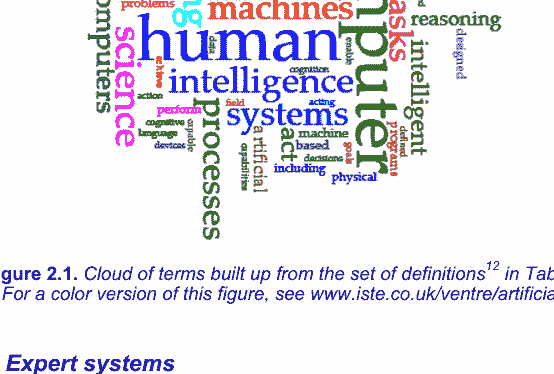

图2.1. 基于表2.1中定义集合构建的术语云¹²。
有关此图的彩色版本，请参阅 www.iste.co.uk/ventre/artificial.zip

### 2.1.2. 专家系统

专家系统是人工智能历史上关键概念之一。我们在本书中多次提到它们。有必要重点介绍几个定义。

12 术语云基于英语定义构建，这些定义是本汇编的核心。

专家系统定义所依据的术语与人工智能定义所使用的术语有所不同。主导术语是“人类”“知识”“问题”“推理”和“解决方案”。只有“人类”这一概念是两个最常见术语集合所共有的。人类凭借其专业知识与机器互动。他们对整个系统不可或缺。人类和机器必须共同为复杂、困难的问题找到解决方案。知识（知识的基础）是这些系统的关键要素。

自1970年代以来，专家系统的应用层出不穷：例如，1972年在医学领域，开发了MYCIN系统，用于根据患者症状识别引起感染的病原体（斯坦福大学）；在军事领域，专家系统提供了决策支持工具等。

| 定义 | 来源 |
|---|---|
| “‘专家系统’是一种智能计算机程序，它使用知识和推理程序来解决那些难度足以需要大量人类专业知识才能解决的问题。” | [FEI 80] |
| “专家系统是人工智能中一个相对较新的子学科，涉及使用计算机来模仿人类专家的推理或判断过程。” | [BAC 87] |
| “一个典型的专家系统由三个组件组成。第一，‘知识库’，包含关于高度特定专业领域的信息。第二，‘推理引擎’，它必须决定知识库中哪些部分与解决给定问题相关，然后将推理过程串联起来，将问题与其可能的解决方案联系起来。最后，决定其作为顾问角色的专家系统的第三个组件是‘用户界面’，它允许人类专家与机器交互，并要求其解释不同选择的理由。” | [DEL 91] |
| “人工智能研究产生的最成功的分支之一。在这些系统中，所有AI程序特有的逻辑推理能力，与特定领域人类专家的问题解决能力相辅相成。然后，知识库配备人机界面，使其能够扮演‘机械顾问’的角色：针对非常特定领域中的问题，这些系统可以提供关于可能解决方案的专家建议，甚至向人类用户提供得出特定建议所遵循的推理过程。” | [DEL 91] |
| “一种能够考虑大量知识、进行推理，然后推荐行动方案的计算机程序。” | [HAN 92] |

### 表2.2. 专家系统的定义

尽管取得成功，专家系统仍受到诸多批评，尤其是因为当所提出的问题超出其专业领域严格框架时，它们可能犯错误。例如，当面对枪伤受害者时，症状是出血，专家系统专门搜索传染性病原体，它会寻找导致出血的细菌。专家系统无法自行离开其领域。专家系统只在其自己的小世界中运作。它也没有常识，无法理解或分析其建议对上下文的影响。

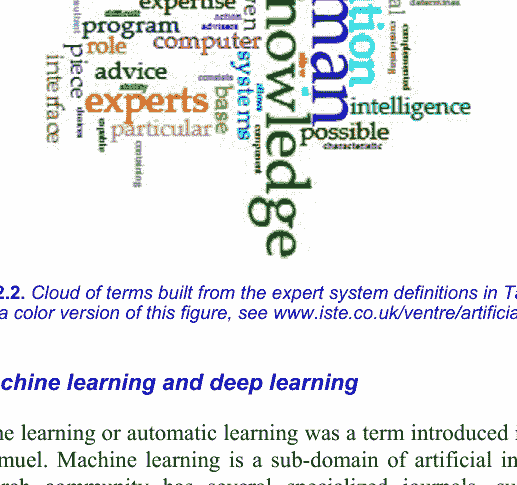

图 2.2. 根据表 2.2 中的专家系统定义构建的术语云。如需此图的彩色版本，请访问 www.iste.co.uk/ventre/artificial.zip

### 2.1.3. 机器学习与深度学习

机器学习或自动学习这一术语由 Arthur Samuel 于 1959 年提出。机器学习是人工智能的一个子领域。研究界拥有多个专业期刊，例如《Machine Learning Revue》（由 Springer 出版，创刊于 1986 年）和《Journal of Machine Learning Research》（创刊于 2000 年）13。该概念涵盖了软件或机器能够在不预先显式编程的情况下学习这一思想。从数据、从特定观察中，算法会在这些数据中寻找联系或关系。学习只是第一阶段，随后借助所获得的知识，便能够识别、预测、推断。例如 Facebook 或 Google 使用此类算法来尝试定义和提出连接，以识别最令互联网用户感兴趣的信息。因此算法代替互联网用户筛选海量数据和信息。信用卡公司可利用机器学习检测欺诈。机器学习用于图像中的物体识别（人脸识别、场景分析等）。“深度学习是使用多层神经网络学习输入与输出之间复杂关系的一种机器学习算法子类别” [SHA 18a]。

深度学习是机器学习的一种实现技术，更具体地依赖于神经网络：

> “深度学习是一种机器学习类型，可以处理更广泛的数据资源，需要人类进行更少的数据预处理，并且通常能比传统机器学习方法产生更准确的结果。”¹⁴

### 2.1.4. 机器人、机器人技术

人工智能与机器人技术在研究和我们的想象中都密切相关，尤其因为科幻文学的创作，自 20 世纪初以来从未停止为我们提供充满机器人的宇宙，这些机器人拥有与人类相等甚至更优越的智能，并始终对后者构成挑战。从保留的少数定义（表 2.3）来看，我们可以说机器人：

- 主要是一种机器；
- 可编程；
- 具有特定功能；
- 具有由人类（即编程者）控制并决定的自由度；
- 与人类的相似性与其功能（看、移动、抓取物体等）相关，而非其外观。

| 定义 | 来源 | 年份 |
|---|---|---|
| “操纵工业机器人是一种自动控制、可重新编程、多用途、具有操纵功能的机器，具有多个自由度，可固定或移动，用于工业自动化应用。” | International Organization for Standardization, ISO |  |
| “能够根据固定、可修改或可适应的程序操纵物体或执行操作的自动装置。” | Larousse Dictionary (online) |  |
| “在虚构作品中，[它]是一种机器，一种具有人性外貌的自动机，能够像人类一样行动和说话。” | CNRTL (online) |  |
| “一台机器，借助基于微处理器的自动控制系统，完成其在工业、科学或家庭领域设计时所指定的精确任务。” | CNRTL (online) |  |
| “一台机器，其与活物相似之处在于能够独立移动（如步行或在轮子上滚动）并执行复杂动作（如抓取和移动物体）。” | Merriam-Webster (online) |  |
| “一种自动执行复杂、通常重复性任务的装置（如工业装配线）。” | Merriam-Webster (online) |  |
| “机器人是一种可重新编程的多功能操纵器，设计用于通过可变编程运动移动材料、零件、工具或专用装置，以执行各种任务。” | [SCI 00] | 2000 |
| “机器人是用于扩展人类活动能力的感觉运动机器。它们由机电组件、传感器和基于计算机的控制功能组成。” | [CHR 01] | 2001 |
| “机器人的简单定义是：‘任何被编程执行工作的机器’。” | [ELL 12] | 2012 |

表 2.3. “机器人”的定义

| 术语 | 定义 |
|---|---|
| Android | 具有人类的外貌（男性）。更一般地，指具有人类外貌的机器人。该术语自 19 世纪使用（用于 Auguste Villiers de l'Isle-Adam 的 *The Future Eve*，1886 年；在 William Douglas O'Connor 的 *The Brazen Android*，1891 年）。 |
| Ginoid | 看起来像女人。示例：电影《Metropolis》中的机器人 Maria。 |
| Humanoid | 看起来像人类（形态上）。 |
| Cyborg | 赛博格。一种活体，其上移植或植入了人工、电子或机械部件。它与机器人不同，后者完全是人工和机械的。 |
| Droid | 该术语源自科幻小说，指代形状让人联想到仿生人的机器人。 |
| Cobot | 协作机器人（机器人-人类交互）。 |
| Chatbot | 与用户对话的代理。 |

表 2.4. 与“机器人”世界相关的一些术语

因此与“机器人”关联了几种观念：

- 它被设计用来帮助、协助人类：17 世纪和 19 世纪的自动机是类似人类的机器，一方面具有娱乐功能（通过演奏乐器，或通过其存在的近乎魔法的性质以及其创造者的技术造诣），另一方面使人们能够想象一个机器为人们执行任务的未来。
- 它是未来世界的象征：机器人在未来主义故事中出现，其中地球和外星宇宙交织。它在空间征服中无处不在。
- 它是一种生存威胁：Karel Capek 的机器人（1920 年）是构成对人类威胁的机器人的原型，因为它将奴役人类。机器人首先使人类摆脱任务，然后角色逆转；人类的创造物反过来对付他们。机器人变得怪诞。
- 它是冲突和暴力的参与者：科幻新闻中的机器人经常是与人类或其他机器人对抗的战士。它与其它英雄对抗：1963 年，Russ Manning 创造了一个反机器人英雄 Magnus, Robot Fighter；另请阅读 The Human Bat V the Robot Gangster（Edward R. Hime-Gall）。

> — 它是反思人类状况、人与机器关系的借口：如果人们有自己的法律、规则、原则、道德和伦理，机器人难道不能也有吗？

## 2.2. AI 类型

典型分类法用于分类、排序和创建类别，并提供阅读框架，使概念能够在其多重侧面被把握。该练习必然具有简化性，并可能带有主观性。

1960 年代提出的最常见典型分类法之一基于以下区分：

- **弱或窄 AI**，即专门用于特定任务或功能的 AI。这些机器不会自行学习，所有规则必须事先给出（例如：游戏的所有规则）。弱 AI 是当前知识状态下可以产生的 AI，因此可以成为国家 AI 战略的主题：“联邦政府已将其战略导向使用 AI 解决特定问题，即‘弱’方法”¹⁵；
- **强或广义/通用 AI**，能够自行学习然后像个人一样决定和行动。此类 AI 尚不存在，能够以一般方式思考，并基于学习而非训练做出决策的 AI。几种测试定义了通用 AI：图灵测试；Steve Wozniak 于 2007 年提出的咖啡测试；Robert 大学学生测试；以及就业测试（由 Nils John Nilsson 于 2005 年提出）。

有些作者增加了第三个层级，提出：弱 AI、通用人工智能和超人工智能或优越人工智能：

> “超智能是比人类聪明得多的 AI。超智能目前并不存在，但有人提出它有一天可能会被构建，其后果巨大且可能具有灾难性。” [BAU 18]

这种人工智能水平高于通用人工智能：通用人工智能的智能将等于人类；超智能则会超过这一点。超智能引发了本质上灾变论的论述，主题是生存威胁，表达了人类对一种智能的超越、泛滥以及完全失去控制的恐惧，而这种智能的行为随后将无法被任何人预见或控制。

|  | 高 AI（强、通用）或 AGI（通用人工智能） | 低 AI（弱、狭窄）或 ANI（狭义人工智能） |
|---|---|---|
| **定义** | 指任何具有等于或大于人类智力能力的自主 AI 系统。 | AI 系统专注于解决特定问题。  这些机器在它们被编程的场景的严格框架内运行。 |
| **已生产的智能机器** | 无。 | AlphaGo（Google）、Watson（IBM）、Siri（Apple）等。 迄今为止生产的大多数 AI 都属于此类低 AI。 |

### 表 2.5. *人工智能的类型学*

另一种双分支类型学区分了 AI 类型 1 和类型 2：

- 类型 1 归纳了上面提到的两种 AI 类型（低级和高级别 AI）；
- 类型 2 不同：
  - 反应式机器，它们不保留过去的记忆来改变其决策或未来选择，
  - 具有有限记忆的机器，它们利用过去的信息来指导未来的决策（例如在自动驾驶汽车系统中发现，环境观察不会永久存储），
  - AI 能够“理解”个体的情感、行为、思想，并能够进行社会互动，
  - 最后，是那些具有自我意识的机器，类似于人类。

因此区分了在当前知识状态下可行的 AI 和在短期和中期不可行的 AI。

类型学可能包括 AI 应用领域的细分，或其主要研究和发展领域：“人工智能包含以下主要子领域：专家或基于知识的系统、自然语言处理、人工或计算机视觉、声音感知/理解和机器人技术。” [ALB 88]

## 2.3. 随时间推移的主题演变

### 2.3.1. *谷歌趋势*

从 Google Trends 数据绘制的关于全球互联网用户查询的初始曲线显示出 2004–2019 年期间的初始下降阶段，从 2004 年到大约 2007–2008 年，随后保持低水平直到 2014–2015 年，此时趋势开始向上移动。然而，这一最后阶段在此曲线上并不显得特别耀眼。重新燃起的兴趣似乎是逐渐的，尚未达到 2004 年的水平。

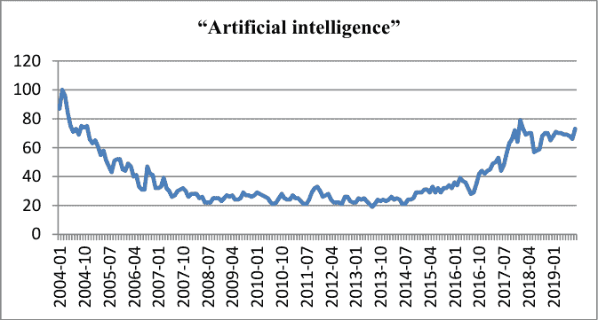

**图 2.3.** *谷歌趋势。全球与“人工智能”相关的查询演变（数据记录于 2019 年 9 月 25 日）*

### 2.3.2. *AAAI 杂志*

AAAI，即美国人工智能协会，于 1979 年成立。后来更名为人工智能促进协会。自 1980 年起，该协会出版了 *AI Magazine*，所有期刊均可在其网站上获取^16^。我们在此语料库（1980–2019）中搜索了一些与人工智能领域相关的术语，以便观察研究界对其使用的演变。我们所做的观察仅涉及文章标题，因此不包括摘要或文章的全部内容。也许通过分析全文我们会得到显著不同的结果。但观察文章标题，反映所呈现研究的中心主题，在此阶段对我们来说似乎已足够相关^17^。

我们因此注意到，“专家系统”的概念出现在 1980–2000 年期间，然后不再出现在文章标题中。该主题似乎已陷入停滞。

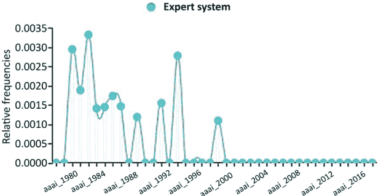

**图 2.4.** *AAAI 出版物（1980–2019）中“专家系统”概念存在的演变*

“机器学习”主题在时间上更为稳定和恒定（图 2.5）。

16 https://aaai.org/ojs/index.php/aimagazine/issue/archive/.
17 数据处理使用在线分析工具 Voyant Tools 进行。

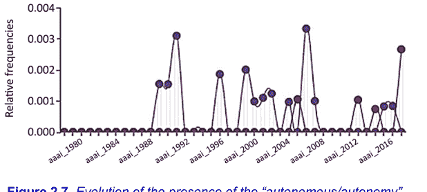

图 2.7. AAAI 出版物（1980–2019）中“自主/自主性”概念存在的演变。对于此图的彩色版本，请参见 www.iste.co.uk/ventre/artificial.zip

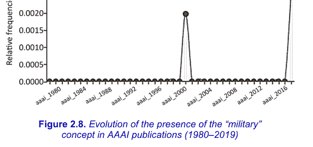

图 2.8. AAAI 出版物（1980–2019）中“军事”概念存在的演变

军事领域在协会期刊发表的文章中占据的空间很少。“军事”一词仅在两篇文章中被提及：

- 第一篇，2002 年，题为“Interchanging agents and humans in military simulation”；
- 第二篇，2019 年，题为“Artificial intelligence, robotics, ethics, and the military: A Canadian perspective”。

“网络”一词直到 2019 年才出现（“Artificial intelligence and game theory models for defending critical networks with cyber deception”）。

安全问题仅最近才被引入，至今仍只是少数文章的主题（图 2.9）。

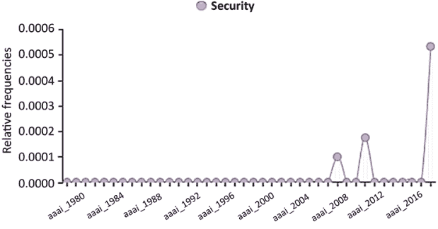

**图 2.9.** *AAAI 出版物（1980–2019）中“安全”概念存在的演变*

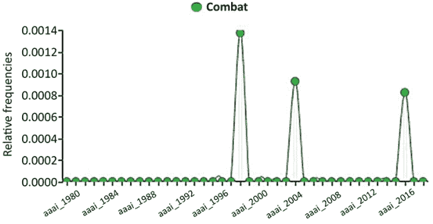

**图 2.10.** *AAAI 出版物（1980–2019）中“战斗”概念存在的演变*

军事机构在相关主题中也很少被提及：

- 美国空军在一篇 1985 年的文章中被讨论过一次（“Artificial intelligence research capabilities of the Air Force Institute of Technology”）；而海军则在 1991 年一篇关于“The use of Artificial intelligence by the United States Navy: Case study of a failure”的文章中被讨论过；

- 战斗的维度在仿真工具的研究工作中被考虑：
  - “Automated intelligent pilots for combat flight simulation”（1999），
  - “Synthetic adversaries for urban combat training”（2005），
  - “PAWS – A deployed game-theoretic application to combat poaching”（2017）。

法律和伦理方面的考虑在 1980 年代被纳入 AI 社区的工作中，之后被搁置一段时间，然后在 2005 年再次被 AI 社区重新提及。

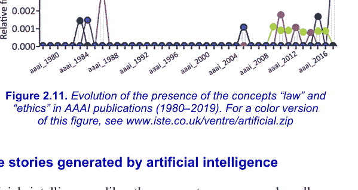

图 2.11. AAAI 出版物（1980–2019）中“法律”和“伦理”概念存在的演变。对于此图的彩色版本，请参见 www.iste.co.uk/ventre/artificial.zip

## 2.4. 人工智能产生的故事

人工智能，像计算机或更广泛的计算机科学一样，引发了激烈的辩论，有时甚至是争议，哲学、政治、社会学、经济、历史、伦理和法律层面的反思。我们无法穷尽列出 AI 引发的所有问题，但我们仍会提及其中一些。

### 2.4.1. AI 的变革力量

> “Weizenbaum 并没有列出计算机无法执行的任何具体任务，因为他希望‘避免不必要的、
> 冗长的、最终无聊的列出计算机现在或将来能够或不能做的事情的练习’”。 [MCC 76]

对人工智能能做什么、不能做什么、它如何转变、它影响什么的有时截然不同的意见进行盘点，对我们来说是有用的。因为它使我们能够理解科学与技术如何在社会中占据其位置，以及辩论围绕哪些论点展开。在这里，我们尝试列出关于 AI 的意见，这些意见是在非常多样化的内容中识别出来的（新闻文章、博客、技术期刊等）。我们已将这些话语围绕以下表达形式进行分组：

- AI 是…/AI 不是…；
- AI 将…/AI 不会…；
- AI 应该…/不应该…；
- AI 产生/制造…；
- AI 允许/使能够…

这些表述在表 2.6–2.11 中逐一讨论。

| 人工智能是… | 日期 |
|---|---|
| “人工智能（AI）正在改变与人类生活相连的几乎所有事物的本质，例如就业、经济、沟通、战争、隐私、安全、伦理、医疗保健等。”¹⁸ | 2016 |
| “AI 是旨在使机器思考的实践。”¹⁹ | 2017 |
| “人工智能很可能是一种‘大帮助’而非‘阻碍’。”²⁰ | 2018 |
| “人工智能正在改变战争的方方面面。”²¹ | 2019 |
| “人工智能如何改变网络安全格局并防止网络攻击。”²² | 2019 |

**表 2.6.** *关于 AI 态度的一些断言或假设*

18 https://papers.ssrn.com/sol3/papers.cfm?abstract_id=2836438.
19 https://www.youtube.com/watch?v=RpZEqbZQUcA.
20 https://www.cnbc.com/2018/11/14/artificial-intelligence-will-not-replace-people-salesforceexecutive.html.
21 https://www.economist.com/science-and-technology/2019/09/07/artificial-intelligence-is-changing-every-aspect-of-war.
22 https://www.entrepreneur.com/article/339509.

### 表 2.7. 关于人工智能不是什么的一些断言或假设

| 人工智能不是... | 日期 |
|---|---|
| “人工智能不应该被视为人类生活的碳拷贝。”²³ | 未注明日期 |
| “人工智能不是一种独特的科技。它的力量取决于若干先决条件：计算能力、带宽以及大规模数据集，所有这些都是‘大数据’的要素，而‘大数据’的潜力只有在使用人工智能时才能实现。如果数据是燃料，那么人工智能就是数字革命的引擎。”²⁴ | 2015 |
| “人工智能并非新事物，它最早由美国科学家约翰·麦卡锡于1955年提出，他也被认为是人工智能领域的联合创始人。”²⁵ | 2016 |
| “人工智能不是对人类社会的威胁。”²⁶ | 2017 |
| “人工智能不是生存威胁。”²⁷ | 2017 |
| “人工智能不是关于机器统治人类，而是机器与人类共同协作。”²⁸ | 2017 |
| “人工智能不是未来，它已经发生并且广泛可用。”²⁹ | 2017 |
| “人工智能与人工意识不同（人工意识有时被称为‘强人工智能’或‘完全人工智能’）。”³⁰ | 2017 |
| “人工智能并非中立：在司法系统中使用软件存在种族偏见的案例。”³¹ | 2018 |
| “人工智能不仅仅用于机器人。”³² | 2018 |
| “人工智能不是所有工作的终结。”³³ | 2018 |
| “我们所称的人工智能并非真正的智能。只有人类智能才是真正的智能。”³⁴ | 2018 |
| “人工智能不是网络安全的万灵药。”³⁵ | 2018 |
| “人工智能并不那么智能。”³⁶ | 2018 |
| “人工智能不是遏制网络仇恨的最佳方式。”³⁷ | 2018 |
| “人工智能对于整个大陆的政府来说不一定是一个简单直接的话题。”³⁸ | 2018 |
| “人工智能并非新事物，但计算能力的可用性、捕获海量数据点的技术以及我们连接、存储和分析数据的速度，带来了新的见解和机遇，可能导致业务绩效突破、新商业模式和市场变化。得益于当今可用的技术的结合以及行业从其流程、产品和客户中学习的速度，该速度将呈指数级增长。”³⁹ | 2018 |

23. https://www.hypergiant.com/capabilities-of-artificial-intelligence/.
24. https://assets.publishing.service.gov.uk/government/uploads/system/uploads/attachment_data/file/566075/gs-16-19-artificial-intelligence-ai-report.pdf.
25. https://vinodsblog.com/2018/03/11/the-exciting-evolution-of-machine-learning/?fbclid=IwAR3WUFDuTaOP78HYIFVhvAVqYe4kS2D_O37p48VIs3M11LKrqJqO8m6jm0A.
26. https://www.reasoning.world/artificial-intelligence-is-not-a-threat-to-society/.
27. Shermer M., “为什么人工智能不是生存威胁”, Skeptic Magazine, 第 22 卷, 第 2 期, 第 29–35 页, 2017, 可在以下获取： https://pocketmags.com/skeptic-magazine/222/articles/144321/why-artificial-intelligence-is-not-an-existential-threat.
28. http://www.stantive.com/Artificial-Intelligence-Empowering-People-Not-The-Rise-Of-The-Machines.
29. https://www.pwc.at/de/publikationen/verschiedenes/artificial-intelligence-in-hr-a-no-brainer.pdf.
30. http://www.pcts.org/meetings/2017/PCTS2017Nov-Green-ReflectionsAI.pdf.
31. https://www.youtube.com/watch?v=zDHSD4twyIA.
32. http://yp.ieee.org/artificial-intelligence-is-not-just-for-robots/.
33. https://www.population.sg/articles/artificial-intelligence-is-not-the-end-of-all-jobs.

关于人工智能概念的论述强调了社会变革的原则，即这些技术的发展和整合进入社会活动的广泛领域涉及或将涉及。这些变化被认为具有不同的强度，有时被称为“变化”、“转型”、“革命”和“突破”。

断言人工智能会（或不会）做某事，会（或不会）进行转型，是决定论的（技术决定论认为技术决定社会变革）。技术与个人或社会之间的关系也可以从相反的方向来看，即社会决定论，即考虑使技术诞生、发展、使用的社会条件（尤其是以何种形式）。于是就是社会生产技术。由于社会不能简化为同质整体，技术会对不同的社会群体产生不同的影响（不同的用途、不同的行为、不同的认知和不同的技术关系）：有些人接受强加给他们的技术（消费品、法律强加的使用方式等），有些人通过解构技术并将其偏离主要目的而使其成为自己的（黑客），还有些人能够根据自己的需求调整技术（例如专业应用、军队中）。因此，我们可以用与我们表格中一样简练的几句公式来把握人工智能会或不会做什么，会或不会产生什么，因为同样重要的是提出问题“谁生产人工智能？”，“哪些公司构建人工智能？”等。

### 表 2.8. 关于人工智能未来的一些断言或假设

| 人工智能将… | 日期 |
|---|---|
| “实现超越人类水平的人工智能将为人类打开难以置信的多样选择。”⁴⁰ | 1976 |
| “人工智能研究将增进我们对人类语言的理解。”⁴¹ | 1980 |
| “人工智能将需要新的计算思维方式，能够有效利用并行性。”⁴² | 1981 |
| “人工智能的广泛传播将对人类社会产生影响，其程度可与汽车或印刷机的发明相媲美，甚至更大。”⁴³ | 1983 |
| “无论飞机是民用还是军用，人工智能都将在协助飞行员管理相关系统方面得到广泛应用。”⁴⁴ | 1985 |
| “人工智能将改变劳动力。”⁴⁵ | 2016 |
| “人工智能将改变世界。”⁴⁶ | 2017 |
| “人工智能将使工作更具人性化。”⁴⁷ | 2018 |
| “人工智能将造福人类。”⁴⁸ | 2018 |
| “人工智能将影响业务职能。”⁴⁹ | 2018 |
| “人工智能将在未来的网络攻击中被武器化。”⁵⁰ | 2018 |
| “就像之前的[...]电线电缆和计算机一样，人工智能（AI）和大数据将颠覆我们工作、生活甚至思考的方式。”⁵¹ | 2018 |
| “人工智能将改变内容营销。”⁵² | 2018 |
| “人工智能将改变就业市场。”⁵³ | 2018 |
| “人工智能将改变我们生活的方方面面。”⁵⁴ | 2018 |
| “人工智能将为患者和医生的一切带来改变。”⁵⁵ | 2018 |
| “人工智能会革新战争艺术吗？” [NOË 18] | 2018 |

| 人工智能不会/将不会... | 日期 |
|---|---|
| “人工智能不会变成弗兰肯斯坦的怪物。”⁵⁶ | 2014 |
| “人工智能‘不会终结人类’。”⁵⁷ | 2015 |

40. http://jmc.stanford.edu/artificial-intelligence/reviews/weizenbaum.pdf.
41. https://pdfs.semanticscholar.org/cbe9/a097bde7cff080d8b1c5f4543f1847cf5384.pdf.
42. https://dspace.mit.edu/bitstream/handle/1721.1/6351/AIM-626.pdf?sequence=2.
43. https://fee.org/articles/japans-fifth-generation-computers-threat-to-the-free-market/.
44. https://apps.dtic.mil/dtic/tr/fulltext/u2/a164172.pdf.
45. https://www.canon.com.au/businessinsights/how-artificial-intelligence-will-change-the-workforce.
46. https://news.usc.edu/trojan-family/five-ways-ai-will-change-the-world-by-2050/.
47. https://timeelliott.com/blog/2018/11/why-artificial-intelligence-will-make-work-more-human.html.
48. https://www.inc.com/eric-mack/heres-27-expert-predictions-on-how-youll-live-with-artificial-intelligence-in-near-future.html.
49. https://www.inc.com/entrepreneurs-organization/4-ways-artificial-intelligence-will-impact-your-business-in-2019.html.
50. https://www.zdnet.com/article/this-is-how-artificial-intelligence-will-become-weaponized-in-future-cyberattacks/.
51. http://www.nas.gov.sg/archivesonline/data/pdfdoc/20180627005/Welcome%20Address%20by%20Defence%20Minister%20Dr%20Ng%20Eng%20Hen%20at%20Singapore%20Defence%20Technology%20Summit%202018.pdf.
52. https://www.forbes.com/sites/lilachbullock/2018/11/12/the-3-ways-that-artificial-intelligence-will-change-content-marketing/.
53. https://www.fool.com/investing/2018/10/25/3-ways-artificial-intelligence-will-change-the-job.aspx.
54. https://nypost.com/2018/09/07/how-artificial-intelligence-will-change-every-aspect-of-our-lives/.
55. https://www.zdnet.com/article/ai-in-the-nhs-how-artificial-intelligence-will-change-everything-for-patients-and-doctors/.
56. https://www.theguardian.com/technology/2014/aug/10/artificial-intelligence-will-not-become-a-frankensteins-monster-ian-winfield.
57. https://www.theguardian.com/technology/2015/jan/28/artificial-intelligence-will-not-end-human-race.

| 人工智能不会/将不会…… | 日期 |
|---|---|
| “只有当技术开始独立思考时，真正的人工智能才会存在。”58 | 2017 |
| “人工智能不会取代人们。”59 | 2018 |
| “人工智能不会取代人类。”60 | 2018 |
| “人工智能不会扼杀就业机会。”61 | 2018 |
| “人工智能不会取代医生。”62 | 2018 |
| “人工智能不会取代人类智能。”63 | 2018 |
| “人工智能在2021年之前不会成为营销主流。”64 | 2018 |
| “机器和人工智能不会取代会计师。”65 | 2018 |

### 表2.9. 关于哪些主题将免受人工智能影响的一些断言或假设

| 人工智能应该…… | 日期 |
|---|---|
| “人工智能技术应该应用于编程和数据处理领域中存在的一些现实问题。”66 | 1971 |
| “人工智能的进展应该纳入先进的计算机化焊接信息服务。”67 | 1986 |

58 https://www.information-age.com/true-ai-doesnt-exist-augmented-intelligence-123468452/.
59 https://www.cnbc.com/2018/11/14/artificial-intelligence-will-not-replace-people-salesforceexecutive.html.
60 https://timesofindia.indiatimes.com/home/education/news/artificial-intelligence-will-not-replace-humans/articleshow/66215791.cms.
61 https://hackernoon.com/robots-and-artificial-intelligence-will-not-kill-jobs-instead-they-are-the-foundation-of-the-next-2e4c5c9348ff.
62 https://medium.com/datadriveninvestor/why-artificial-intelligence-will-not-replace-the-physician-e1bfd469743b.
63 http://www.theedgemarkets.com/article/artificial-intelligence-will-not-replace-human-intelligence-%E2%80%94hsbc-report.
64 https://www.episerver.com/about/news/press-room/pressreleases/artificial-intelligence-will-not-be-mainstream-in-marketing-until-2021/.
65 https://www.rsm.global/singapore/news/why-machines-and-artificial-intelligence-will-not-replace-accountants.
66 https://dl.acm.org/citation.cfm?id=1622876.1622912.
67 https://www.gpo.gov/fdsys/pkg/GOVPUB-C13-6438b36d72e7975eac842f6dbcb25c82/pdf/GOVPUB-C13-6438b36d72e7975eac842f6dbcb25c82.pdf.

这些并非人工智能最新浪潮所独有。我们在本书第1章中已经看到，人工智能与军事领域有着何等密切的联系。因此，这些问题早已有人提出。然而，更有意思的是思考最新一代人工智能（及其对技术进步的新承诺）如何——或者是否——在战略或作战领域更新关于安全与防务政策的思考。人工智能将被置于军事转型和军事事务革命的新思考的核心。特别是网络领域将受到人工智能这一角色的影响（网络安全与网络防御）。

第二个重要主题涉及人工智能与人类的关系。对一些人来说，人工智能是一种生存威胁（这让人想起20世纪90年代伴随互联网发展而出现的灾难论和世界末日论调），对另一些人来说则不然。一些人将这些技术视为新的权力、胁迫、压迫和控制工具，它们将被用来对付人类；另一些人则持一种更为天使般的观点，即人机协作的社会，机器只是人类的延伸，帮助人们、陪伴人们并增强他们的能力。也有一种思潮倾向于对人工智能进行祛魅和去神圣化，认为它不是解决问题的神奇方案，不像人们通常所说的那样聪明，也不那么完美；这种思潮凸显了其缺乏中立性以及种种缺陷，简言之，即其局限性。

### 2.4.2. 人类智能对机器的绝对优越性

最初的争议焦点之一在于承认或否认机器有可能与人等同，甚至超越人类。辩论的核心在于将人类大脑的能力与机器的能力进行对立或比较。

对于那些对人工智能前景持批评或怀疑态度的人（他们的声音在20世纪60年代该学科诞生之初就已出现）来说，结论已定：计算机在活动上永远无法与人类匹敌。它或许能模仿人类，或许能接近人类，但永远不会像人类做得那样好。甚至谈不上设想机器超越人类。为了支持他的批评和论断，休伯特·L·德雷福斯（Hubert L. Dreyfus）依据对1957年至1967年间人工智能研究进展的观察，这些研究基本上以失败告终，所宣称的目标至今无一实现[DRE 72]。

许多人像H.L. 德雷福斯一样，认定了一种任何进步都无法逆转的等级秩序：在智能上，人类大脑永远不会被机器超越：

> “在《大脑与计算机》中，其目的在于证明，尽管电子机器在某些领域具有竞争力，甚至超越大脑，但大脑仍然更优越，而且是唯一的创造者。[...] 天然的计算机配得上人工大脑这一名称吗？结构上的相似性不容否认。[...] 但计算机永远不会拥有与大脑数量相当的元素。大脑作为一个整体拥有计算机无法实现的属性。[...] 计算机的性能[...] 在数值领域无疑是更优越的，在理性领域（非数字领域）则差得多；而涉及智能，即理解时，它就低劣了，因为智能是一种整体现象，并不对应于任何特定的神经结构。从最博学的‘专家系统’这一盒子中，只能输出其中潜在包含的东西。机器不像大脑，没有整体性的产出。” [LAZ 88]73

> “机器智能永远无法与人类大脑匹敌，因为它没有生命。人工智能是仆人，是人类智能的记忆。它们之间不存在对抗。” [GIF 84]

### 2.4.3. 机器取代人类

在《计算机能力与人类理性》[WEI 75]中，约瑟夫·维森鲍姆（Joseph Weizenbaum）将机器在只应由人类执行的任务中取代人类描述为不道德的行为。科学和技术为我们提供了工具，但在某些情况下使用这些工具是不道德的。他说，计算机就是那些要求道德考量的工具之一。这一论点引起了各种反应[BUC 76]，其中包括被斥为不合理的[MCC 76]。

还有人表达了这样的恐惧：人类将被机器、被人类自身的创造物、被我们自己的造物所超越：“计算机系统绝不能离开算法计算领域，以便人类能够完全控制它们。” [WAR 80]^74

> “一位*世界报*记者称，这些是‘可怕的景象’。迄今为止，机器不是仅仅将人从体力劳动中解放出来吗？难道它们不认为自己应该取代人类，去从事那些迄今思想一直确保人类垄断的最崇高的任务吗？这些被赋予‘记忆’的‘智能’机器，如今难道不能在日益增多的日常任务中超越人脑吗？人类的至高无上地位难道不正在受到威胁吗？在一些人预言的未来中，这些‘会思考的机器人’难道不会很快使人类沦为奴隶吗？[…] 前国民教育部长埃德加·福尔（Edgar Faure）认为，‘只作决定而不执行’的机器将成为‘人类智能严重创伤’的根源。” [LAN 69]

> “如果一个行为由机器自行完成，那么它就是自动的。[…] 但哪台机器能在没有人类欲望参与的情况下运作呢？[…] 每台机器在人类决定使其运转之前都是惰性的。[…] 因此，不可能像迄今为止所做的那样，将自动化的概念与机器独立于人的状态联系起来：机器始终依赖于人。” [DEL 53]

### 2.4.4. *人工智能作为生存威胁*

威胁的第一个层面在于创造者失去对机器的控制。这一主题自人工智能早期以来就一直无处不在：

74 参见J.-M. Hoc的评论，载于*人类劳动*，第49卷，第3期，第280–283页，1986年。

AI 需要与其实用能力一起去神秘化，即它真正是什么，与它是什么或应该是什么相比；

- 误解的持续存在，概念的误用。机器学习真的就是人工智能吗？

### 2.4.5. *AI 与机器人在虚构作品中的地位：以日本为例*

在日本，科幻和漫画自1950年代以来就以多种形式（机器人或虚拟）突出人工智能。AI 与机器人经常相辅相成。

文学使得能够区分：

- 扮演主角的 AI；
- 作为助手存在的 AI，与不同层级的英雄或主角并肩，他们在 AI 的帮助下在常常敌对或未知的环境中得到强化、帮助和改善；不是主角的 AI；作为故事中介入的物体的 AI；
- 纯粹虚拟的 AI，位于网络空间或网络中；
- 嵌入机器人的 AI；
- 具身 AI（它是一个人类身体，*在*人类身体中，或是生物的）。

我们交叉引用这些类别以整理表 2.12，该表由指定漫画中的叙事构成（该列表当然不是 exhaustive。日本的产量几十年来令人印象深刻，没有任何目录或数据库列出它们全部）。

|  | AI 作为主角 | AI 作为英雄的助手，或作为配角，或作为叙事的一部分 |
|---|---|---|
| **虚拟 AI** | *明天之双面* (1996, James P. Hogan, Yukinobu Hoshino)：计算机统治着21世纪的世界。人工智能被内置于系统中，从而获得自主权力。 | *刀剑神域* (2012–…, Reki Kawahara, Kôtarô Yamada)：日本政府希望创造出一种与人类大脑相当的高水平人工智能，以便整合到武器系统中。 |
| **AI 嵌入机器、机器人** | *铁臂阿童木* (1952–1968, 手冢治虫)75：机器人阿童木打击犯罪和不公。阿童木是一个超级英雄，必须拯救世界76。 | *高达战记* (1987–1990, Masaya Takahashi)：名为 ALICE 的 AI 被整合到高达机器人中。 |
| **AI 化身** | *哆啦A梦* (1970–…, 藤子·F·不二雄)：机器人猫，人类的朋友。  *普鲁托* (2003–2009, 浦泽直树)77：阿童木机器人拥有卓越的 AI，能够感受人类情感。在这部漫画中，我们有机器人/AI 侦探、警察，他们与杀人机器人普鲁托作战78。  *民主* (2013, 2015, Motorô Mase)：讲述了 Mai 的故事，她是一个女性外貌的人形机器人，其行动由 3,000 人通过社交网络决定。 | *Biomega* (2004–2009, Tsutomu Nihei)：AI Fuyu Kanoe 集成在英雄摩托车 Zoichi Kanoe 的系统中。AI 是英雄的伴侣，帮助他分析情况并提供战略建议。它配备了情感。 |

75 这个角色影响了整整一代年轻人的成长，就像机器人猫哆啦A梦一样。据说阿童木机器人对日本智能机器人的发展发挥了重要作用：“今天在日本成功工作的许多 AI 和机器人研究人员和工程师表示，他们选择职业是因为希望实现创造 Atom [阿童木] 的梦想” [MAT 16]。“ASIMO 的创造者 Masato Hirose 说，他创造该机器人时想象的是阿童木，这是最著名的日本动漫角色之一，也是机器人。Hirose 受本田之命创造阿童木，并创造了 ASIMO” [FUN 14]。

76 这些智能机器人行善、与邪恶作斗争，是人类的盟友或朋友。人们对服务于自己的技术的这种仁慈的看法似乎在2010年发生了变化。现在人们担心 AI 和机器人的能力、它们在社会中的地位及其负面影响 [MAT 16]。

77 改编自手冢治虫 (1964) 的漫画 *Astro, The strongest robot in the world*。

78 有关故事中出现的七个机器人的介绍，读者可以访问：https://labasesecrete.fr/comparatif-entre-pluto-et-astro-le-robot-le-plus-fort-du-monde/。

离 Blackland 有一点远，并在那里拥有宫殿。Blackland 配备了最新的技术创新，没有任何街区，无论是贵族还是奴隶，都没有它们：“没有一户人家 [...] 没有电话。没有一条街，没有一栋房子，甚至奴隶区的茅屋也没有自来水和电灯。”

在俯瞰城市的一座塔上，暴君领袖 Harry Killer 建造了一台机器来监视民众的行动：

> “得益于其光学构造，这台被命名为‘cycloscope’的仪器似乎将这条环形土地垂直拉直，其看守者站在装置中心，不断将所有点放大在他的眼前 [...] 外部世界在我们眼中改变了外观。不管它们面向哪一边，我们首先看到的只是一堵垂直的墙，一张由无数个不同的小方格组成的黑色线网 [...]。这堵墙，其底部与我们被黑暗的深渊隔开，其顶峰似乎升至惊人的高度，似乎由一种乳白色的光构成。然而，我们很快发现它的颜色远非均匀，相反，它是由无数不同色调、轮廓相当不确定的斑点构成的。稍加注意，我们就会发现这些斑点有的、是树，有的、是田野或道路，还有的、是耕作的男人，整体被放大到足以毫不费力地辨认出来 [...]。‘你看这些黑人’，Harry Killer 说着，指着两个相隔很远的斑点。‘假设他们有逃跑的想法。不会花很长时间。’说话间，他抓起了一个电话发射器。‘第一百一十一圈；半径一千五百二十八’，他说。然后，拿起另一个发射器，他补充道‘第十四圈。半径六千四百零二。’最后，转身对我们说，‘好好看看’，他建议道。等待了几分钟，期间什么特别的事情也没发生，其中一个斑点突然被一团烟雾遮住。烟雾散去后，斑点消失了。‘那里工作的人发生了什么？’‘他死了’，Harry Killer 冷冷地回答。‘他被一枚空中鱼雷炸毁了。这是一种火箭，射程可达二十五公里，其速度和精度你是可以欣赏的。’”

在这部虚构故事中，Michel Verne 描述了：

- 一个“现代”城市，技术化，配备现代通信手段；
- 基于以下组合的全景式监视：
  - 暴政权力，
  - 能够从掌握高科技技术中获取部分权力，在此情况下是监视技术，由视觉仪器、成像、反映世界图像的屏幕组成，使监视更有效，因为每个物体、每个个体都在那里，有其在空间中的坐标；用于监视的可视化仪器与通信系统、军事 C2 中心相耦合；
- 人类目标被导弹单独中和。消除他们的动机可能是残酷的——暴君想展示他生杀予夺的权力——并惩罚任何偏离行为（试图逃跑、闯入禁区等）。

正如预见性小说经常出现的情况一样，我们可以看到与当代世界的类比：

- 现代城市（智慧城市、超互联城市）使其土地受益于技术创新；
- 监控系统在全球范围内部署；
- 卫星、无人机、摄像头（监视、机载、警察、军事等）以图像捕捉世界；屏幕无处不在，是任何现代监视系统的关键环节；
- 军事指挥系统围绕处理图像的机器设计；图像中的物体是可以识别的，但由于夜间或困难环境下的质量下降（例如，战斗情况、从太远距离拍摄的图像等）——图像中的物体往往无法识别。相反，它们通常只是显示的不精确形状，指挥官或士兵必须据此进行解释、分析和决策。句子“其中一个斑点突然被一团烟雾遮住”让我们联想到战斗直升机或无人机拍摄的视频图像，当目标被交战、中和时；目标——人类或物质——如今是单独标记的，遵循精确外科打击的原则。

在计算机、卫星图像、无人机图像、无处不在的监控摄像头、能够追踪个人行踪的移动电话，以及能够追踪人们习惯、观点、事实和举止的互联网时代，这一系统有了现代的对应物。现代系统为了区分任务、区分物体与人，包含了人工智能、模式识别应用以及人脸识别。在战争中，我们可以设想将这些识别工具与致命能力相结合的系统。我们重现了儒勒·凡尔纳所描述系统中出现的那些原则：通过利用图像进行监视，以及物理清除干扰因素，以此实现权力——生杀大权（正如我们在战争或反恐斗争中所见，也可以想象在极权警察国家中）。

与人工智能联系最频繁的主题之一，是它对社会乃至整个世界的影响。布鲁金斯学会将其一份出版物命名为《人工智能如何改变世界》。[WES 18]

这些重大影响预计将出现在社会的不同层面：经济层面、就业层面[SMI 14]以及其他许多层面。

但是，如果人工智能使米歇尔·凡尔纳所描述的那种情景成为可能，那么它就不仅仅是一种权力工具、一只“强有力的臂膀”。

安全与防务领域也正在受益于或将会受到人工智能所引发变革的影响。

面对人工智能已知的、设想中的以及尚待发明的各种用途，面对人工智能真实或想象的潜力，各国政府已经开始关注这一议题，制定了人工智能、人工智能研究、安全以及人工智能产业化方面的“国家战略”，并在这些文件中展示了他们的所有雄心。这些战略或计划聚焦于经济、社会、研究相关和产业问题。安全与防务问题也正根据人工智能进行重新审视。

### 2.5.1. 人工智能国家战略

一项国家战略可以满足多种期望：协调行动者和行动，回应协调需求的表达，回应广泛的社会问题，为行动者生态系统在特定问题上的行动定义精确框架，确保更好地利用资源并优化过于分散的资源。因此，制定国家战略意味着在给定时期内勾画政策的总体轮廓，管理资源，希望通过在国家层面协调资源来优化以获得更好的结果（还有区域或国际战略，例如欧盟）。一项战略可以决定创建新的组织或机构，它为行动开辟了道路，允许某一领域的行动者参照国家界定的战略来组织自己、动员起来并采取行动。它定义了行动框架。

因此，一项战略必须*事先*确定其目标。助长该战略的调查结果使其变得必要且紧迫：“过去，人们可以听到某些批评……关于目前战争罪调查和诉讼的质量……缺乏……水平不理想……质量差……鉴于上述情况，有必要在国家层面通过一项起诉战争罪的战略。”[REP 16]

人们有时会在一项国家战略中寄托许多期望：“一项战略……其目标和活动将提供一个全面而清晰的战略框架，用于改进所有已被识别存在问题的领域。”[REP 16]

| 文档标题 | 国家 | 作者 | 年份 |
|---|---|---|---|
| 《人工智能：未来决策的机遇与影响》 | 英国 | 政府科学办公室 | 2015 |
| 《“互联网+”人工智能计划三年指导（2016-2018年）》 | 中国 |  | 2016 |
| 《国家人工智能研发战略计划》 | 美国 | 国家科学技术委员会网络与信息技术研发分委员会（NITRD） | 2016 |
| 《人工智能为非洲》 | 南非 | 接入合作伙伴组织，比勒陀利亚大学 | 2017 |
| 《泛加拿大人工智能战略⁸⁰》 | 加拿大 | CIFAR，由加拿大政府、脸书和RBC基金会资助 | 2017 |
| 《新一代人工智能发展规划》 | 中国 | 中国国务院 | 2017 |
| 《人工智能计划》 | 芬兰 |  | 2017 |
| 《人工智能技术战略》 | 日本 | 人工智能技术战略委员会报告 | 2017 |
| 《AI新加坡》 | 新加坡 | 政府 | 2017 |
| 《人工智能战略》 | 德国 | 联邦政府 | 2018 |
| 《促进新一代人工智能产业发展三年行动计划（2018-2020年）》 | 中国 |  | 2018 |
| 《2018年白宫人工智能促进美国智能产业峰会》 | 美国 | 白宫 | 2018 |
| 《为何美国需要国家人工智能战略及其应有面貌》 | 美国 | 数据创新中心 | 2018 |
| 《塞德里克·维拉尼报告》 | 法国 | 国会议员，维拉尼任务小组 | 2018 |
| 《#FranceAI战略》 | 法国 | Agoranov，创新事务国务秘书，高等教育与研究事务国务秘书 | 2018 |
| 《人工智能国家战略#AIFORALL》 | 印度 | 印度国家转型委员会（NITI Aayog） | 2018 |
| 《AI硕士计划》 | 爱尔兰 | 私营部门倡议 | 2018 |
| 《人工智能工作组》 | 意大利 | 政府 | 2018 |

80 人工智能研究与创新计划。该战略不是加拿大政府的官方政策，而是研究协会CIFAR的一个项目，其在此制定的战略是对政府请求的回应。该战略被定义为人工智能领域学术研究与发展的项目。

| 文档标题 | 国家 | 作者 | 年份 |
|---|---|---|---|
| 《区块链与人工智能工作组》 | 肯尼亚 | 政府 | 2018 |
| 《立陶宛人工智能战略：未来愿景》 | 立陶宛 | 经济与创新部 | 2018 |
| 《毛里求斯人工智能战略》 | 毛里求斯 | 人工智能工作组——由内阁秘书主持 | 2018 |
| 《魁北克人工智能生态系统发展战略》 | 魁北克 | 人工智能集群指导委员会，蒙特利尔大学（政府授权） | 2018 |
| 《人工智能的国家路径》 | 瑞典 | 企业与创新部 | 2018 |
| 《北京人工智能原则》 | 中国 |  | 2019 |
| 《人工智能国家战略》 | 丹麦 | 财政部和工业、商业与金融事务部 | 2019 |
| 《为包容性苏格兰构建世界领先的AI和数据战略》 | 苏格兰 | 苏格兰发展与工业委员会 | 2019 |
| 《西班牙人工智能研发创新战略》 | 西班牙 | 科学、创新与大学部总技术秘书处 | 2019 |
| 《Kratt报告》 | 爱沙尼亚 | 政府 | 2019 |
| 《英特尔对美国国家人工智能战略的建议》 | 美国 | 英特尔 | 2019 |
| 《引领人工智能时代：芬兰2019年人工智能计划最终报告》 | 芬兰 | 经济事务与就业部出版物 | 2019 |
| 《人工智能为人类》 | 法国 | 政府 | 2019 |
| 《迈向人工智能战略》 | 马耳他 | 总理办公室 | 2019 |
| 《葡萄牙人工智能2030》 | 葡萄牙 | 科学、技术与高等教育部 | 2019 |
| 《卡塔尔国家人工智能战略》 | 卡塔尔 | 卡塔尔人工智能中心（QCAI），哈马德·本·哈利法大学 | 2019 |
| 《捷克共和国国家人工智能战略》 | 捷克共和国 | 工业与贸易部 | 2019 |
| 《俄罗斯联邦总统关于在俄罗斯联邦发展人工智能的命令》 | 俄罗斯 | 政府 | 2019 |

### 表2.13. 国家人工智能战略文件

人工智能已成为一个需要制定国家战略的议题。对这些战略的回顾显示，自2015年以来，国家战略的数量有所增加。然而，并非所有被视为国家战略的文件都由政府制定。其作者包括研究中心和私人参与者。在政府作者中，这些战略由各部委撰写：经济、安全、国防等。但应强调负责经济和工业的部委占据主导地位。对各国而言，人工智能似乎首先是一个经济问题。因此，在知识生产、知识传播、改善生活条件方面对社会或人类作出的贡献，与这些考量相去甚远。首要目标是管理经济、发展产业，这当然基于研发，但最重要的是支持贸易。

我们在此提及的所有国家战略文件都来自不同的政府和非政府来源（例如印度、魁北克和非洲的文件就是如此）。

从这些“战略”中，我们将保留主要叙事及其构成要素。这些战略是关于什么的？它们提出了什么样的世界愿景？它们提议如何建设将人工智能纳入考量的社会？

对大多数国家而言，人工智能是一种高附加值、创造性、变革性的技术。如果国家不忽视这些技术的少数“负面”方面（其风险、其危险），似乎仅凭几项框架，特别是法律，通过伦理控制来遏制它们，控制其影响并为积极维度留出空间就足够了（减少负面维度的工具包括：法律、标准、教育、培训、意识、实践和用户控制。韧性也被讨论）。

在那些兜售或过度兜售人工智能益处、尽管同时指出其负面特征的科学家支持下，政治家构建了一种话语，描绘出一种人工智能不仅有益，而且必要且不可避免。进步、经济、社会变革和社会正义（例如人工智能服务于打击欺诈）被提及，同样的，还有更高、甚至无可争议的利益，如安全（预测、预见或侦测恐怖分子、犯罪项目的AI）或国际舞台上的权力。

|  | 论点，主题 | 示例 |
|---|---|---|
| **紧急情况** | 人工智能正在迅速发展并带来深刻而快速的变化：我们迫切需要考虑这一新现实。 | 德国战略 2018 |
| **变革力量** | 人工智能具有强大的潜力，它是一种具有深层 *变革性* 力的创新。但它仍然是一种 *成熟的技术，尽管仍然原始。* | 非洲战略，2017：“人工智能将是我们时代最大的技术革命，有潜力扰乱人类存在的几乎所有方面”  魁北克战略，2018：“人工智能（AI）正准备以激进的方式改变魁北克经济” |
| **关键因素，决定因素** | 国家必须投资于⁸¹人工智能，以免错过技术、经济和社会转型。 | 德国战略 2018 |

81 人工智能的历史以其工业化和商业化为标志，这始于1970年代。因此，该学科迅速从大学和研究中心转移出来，赢得工业界并成为一个新市场，并在20世纪80年代将日本与西方对立的科技战的中心。1982年，日本启动了其“第五代计算机系统”项目，旨在在人工智能构成其一部分的计算机科学领域实现技术主导。作为回应，美国将人工智能纳入了DARPA新的10年发展计划。人工智能也包含在项目的

|  | 论点，主题 | 示例 |
|---|---|---|
| **国家，其角色，其责任** | 涉及 *国家*、公司和社会参与交流、对话和讨论，以实现尊重所有人权利和利益的和谐发展。 | 德国战略 2018 |
|  | 国家 *政府* 必须支持人工智能在经济结构、工业活动中的传播。 | 德国战略 2018 |
| **风险、威胁：预防、预见、赋能** | 谨慎，保留。人工智能并非没有 *风险*：权力在少数人手中集中（预测能力、通过数据控制对个人的控制等）、大规模失业（因此必须转型）、使人口的整个部分（未连接、未受训练的公民等）被排除在外、对系统盲目信任，而这些系统的数据可能质量不佳，其算法可能受到偏见污染（自动化决策系统中的编码歧视）等。 | 非洲战略，2017：“机器学习过程的好坏仅取决于输入的数据。这就是为什么偏见深深植根于人类社会，可以并且确实会渗入其中。人工智能算法整合了数据中固有的偏见，甚至是构建该过程的人的偏见，进一步延续了现有的社会偏见”  北京人工智能原则，2019 |
|  | *研究人员的责任* 思考其发明的伦理、社会等影响。 | 非洲战略，2017；北京人工智能原则，2019 |
|  | 预防人工智能的 *风险* 上游：例如，通过动员不同出身（文化、政治、国籍、性别等）的工程师/研究人员开发算法以 *避免偏见*。 | 非洲战略，2017 |

人工智能，迄今为止尚未真正实现。我们当然有权认为这种话语是否认或谎言，因为我们可以很好地考虑人工智能对公民基本权利的潜在风险：当人工智能被大量用于安全和国防目的时，当公民可追踪且可控时，当他们的行动和姿态可以被分析和重建时，当他们生活中没有任何东西能够逃脱警察国家的审查时，那么公民的权利确实被侵蚀了。通信拦截计划、美国和许多其他国家在不同规模上的大规模监控计划，已经在过去几年中展示了可能性范围，而最重要的是，国家行为体在其社会控制实践中的意图。这些实践已经能够利用人工智能的能力，未来将更加如此。但这一维度并未出现在战略叙事中，正如它们由政府所制定。

战略在许多方面既像规范，也像信仰的宣誓：“我们将发展…我们将确保…我们将监督…我们将共同工作…”

许多演讲也是理想主义的。因为如果所有国家都声称要么拥有世界上最好的潜力，要么发展最好的潜力，成为全球枢纽或“唯一”的全球枢纽，很明显并非所有国家都会成功。领导地位很少。因此，需要专业化才能在人工智能这一广阔的领域或部门内的利基市场中声称最终的领导地位。

倡议的推广、国家对工业、研究和发展的支持，即由所宣布的广泛倡议和承诺所需的大量投资，将会遇到经济和预算现实。这些承诺将以牺牲其他政策为代价，并且只有在经济状况良好时才会兑现。人工智能的发展取决于国家预算的命运。

值得注意的是，在这些文件中，人工智能与国家安全、一般安全问题之间的关系保持相对保密。后者范围当然更广，并且像其前身一样，即信息高速公路、互联网发展的计划、项目、倡议或战略，主要涉及社会对这些技术 appropriation 的一般条件。安全无疑是一个特殊问题。然而，安全可能出现在一些文件中，这些文件提及将受益于人工智能的众多领域（例如打击金融不法行为，这是安全政策的一个方面）。但总体而言，打击犯罪或网络安全并未在所有这些文件中突出显示。

#### 2.5.1.1. 俄罗斯 2019 年战略

2019年10月10日，俄罗斯政府发布了其国家人工智能战略。该文件题为“俄罗斯联邦总统关于俄罗斯联邦人工智能发展的法令”⁸²。该战略制定了中期（2024年）和长期（2030年）目标。该法令还导致在2019年底前对“俄罗斯联邦数字经济”计划进行修订。该文件提出了人工智能的官方定义：

> > “人工智能——一套技术解决方案，使其能够模拟人类认知功能（包括自学习和在没有预定算法的情况下寻求解决方案），以及在执行特定任务时获得至少可与人类智力活动结果相媲美的结果。该套技术解决方案应由信息和通信基础设施、软件（包括采用机器学习技术的软件）以及数据处理程序和服务组成。”

这是一个非常务实的定义：人工智能必须提供解决方案、结果。

国家项目正式将人工智能的发展置于某些约束之下：尊重自由、人权、劳动权、面对人工智能负面后果时最小化风险的义务、透明度（数据处理、算法、人工智能流程）、国家主权（俄罗斯必须发展自己的技术）。人工智能被赋予若干目标，这些目标必须服务于经济、政治、国家安全、政府和其他目的。

为确保人工智能的发展，俄罗斯政策将侧重于支持科学研究、软件开发、优质数据生产、培训（需要使用人工智能的工作）、刺激投资、吸引投资者以及建立有利的经济条件。

本文档中未出现“网络”“军事”“国防”和“军队”等术语，因此不涉及国家安全与国防维度。

### 2.5.2. 美国政策

#### 2.5.2.1. 巴拉克·奥巴马总统任期

在巴拉克·奥巴马总统任期内，美国当局发布了几份文件，并启动了几项促进人工智能发展的举措。

2016年5月，“白宫人工智能未来倡议”启动，该倡议包括五次研讨会和一次简短的公开征询（信息征询）（2016年6月27日至7月22日，不到一个月）。

所有161份征询回复被汇编成一份349页的文件[WHI 16]，于2016年9月发布。需要指出的是，这些回复并非匿名。尽管收到的回复数量看似不多，可能无法反映美国整体民众对人工智能的看法或心态，但回复内容具有信息量。词云（基于所有文本中最常用的65个术语）突出了几个主要主题：研究、人、系统、机器与技术、公众和政府。因此，相关思考围绕人与机器之间的关系，以及研究和政府的作用展开。安全、不安全、风险、威胁、战争、军事、攻击和产业等概念不在首要关切之列。

- 个体、人、社会：贡献者提醒说，社会必须了解公民数据的使用方式。因为如果这些使用是合法的且符合社会利益（人工智能作为“公共产品”），旨在提供新服务、改善生活条件并使所有人受益，那么同样重要的是确保国家不越红线（“我们需要清楚地看到，从公共产品转向控制是多么容易，并带来意外后果，影响公民的人权”；“将人工智能用于公共产品：如何在不把我们的国家变成警察国家的情况下，利用人工智能抓住‘坏人’？”）。
- “公共产品”这一概念（这是调查职责范围内提出的主题之一）可以有多种解释。一些贡献者非常谨慎（“‘公共产品’有多种解释”），另一些则对这一概念持批评态度，认为当局以可疑的方式使用了这一概念（“当计划的一部分包括主动伤害某些人时，利用人工智能或政府行动来实现‘公共产品’目标存在许多问题”，“过去，被视为‘公共产品’一部分的事物包括奴隶制、人头税、让黑人远离白人饮水喷泉、不让女性投票等”）。
- “控制”的概念在讨论中很常见。贡献者强调“控制”人工智能系统的必要性和困难，但控制是一个严格的技术概念（确保系统安全、不被黑客入侵、数据不被篡改、确保对被称为“自动机”的系统或机器的控制得以维持），并且不会带来诸如警察控制或社会控制之类的挑战。

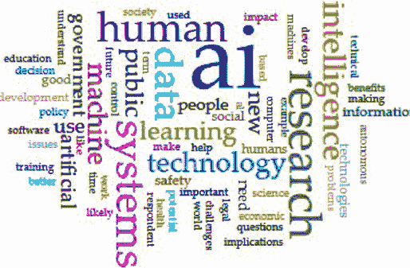

**图2.12.** *关于人工智能未来的OSTP信息征询（2016）中最常用的65个术语的词云[WHI 16]。彩色版本见 www.iste.co.uk/entre/artificial.zip*

2016年10月，两份官方出版物应运而生，以具体体现“白宫人工智能未来倡议”框架内开展的所有思考，或作为这些思考的延续。

| 标题 | 日期 | 来源 |
|---|---|---|
| “白宫人工智能未来倡议” | 2016年5月 | 白宫 |
| “关于人工智能未来的信息征询：公众回复” | 2016年9月 | 白宫 |
| “为人工智能的未来做好准备”83 | 2016年10月 | 总统行政办公室。国家科学技术委员会技术委员会 |
| “国家人工智能研究与发展战略计划”84 | 2016年10月 | 国家科学技术委员会网络与信息技术研究与发展小组委员会 |

**表2.15.** *2016年发布的美国人工智能倡议与战略文件*

在“为人工智能的未来做好准备”（2016）中，主导术语是数据、技术、未来、发展、科学、研究和安全（safety）。这份近50页的文件围绕以下主题展开：

- 人工智能的定义和背景；
- 人工智能造福社会的应用；
- 人工智能的监管；
- 研究和人力资源；
- 经济；
- 安全与治理；
- 安全，特别是网络安全和人工智能的军事化（武器系统中的人工智能）。

网络安全方面的优先事项之一是开发人工智能工具，在黑客利用软件漏洞之前自动检测、评估和修补这些漏洞。报告提到了DARPA的“网络大挑战”（CGC），该挑战正在追求这一目标，并可能已取得了有趣的成果。

83 https://obamawhitehouse.archives.gov/sites/default/files/whitehouse_files/microsites/ostp/NSTC/preparing_for_the_future_of_ai.pdf.
84 https://obamawhitehouse.archives.gov/sites/default/files/whitehouse_files/microsites/ostp/NSTC/national_ai_rd_strategic_plan.pdf.

在国防方面，报告重申了美国的立场：美国只会根据国际人道主义法，包括区分原则和相称性原则，发展自主智能武器。

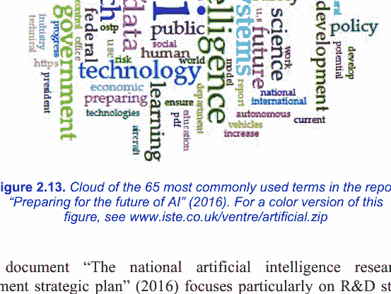

图2.13. 报告“为人工智能的未来做好准备”（2016）中最常用的65个术语的词云。彩色版本见 www.iste.co.uk/ventre/artificial.zip

文件“国家人工智能研究与发展战略计划”（2016）特别关注研发战略。与世界范围内发布的大多数官方文本一样，人工智能被描述为一项突破性技术，预示着人类活动所有领域的深刻变革，为了社会和经济发展的利益：

> 人工智能（AI）是一项变革性技术，有望带来巨大的社会和经济利益。人工智能有潜力彻底改变我们生活、工作、学习、发现和沟通的方式。

目标是开发积极的、有益的人工智能，并尽可能减少其负面影响。拟议战略的实施基于七个优先事项：确保长期投资；促进辅助人类而非仅仅取代人类的人工智能；考虑伦理和法律方面；确保人工智能系统的安全；向研究人员和人工智能开发者提供高质量数据库并方便他们访问；开展技术评估以制定标准；评估开发人工智能所需的人力资源需求。

人工智能促进经济繁荣仍然是该政策的关键组成部分。

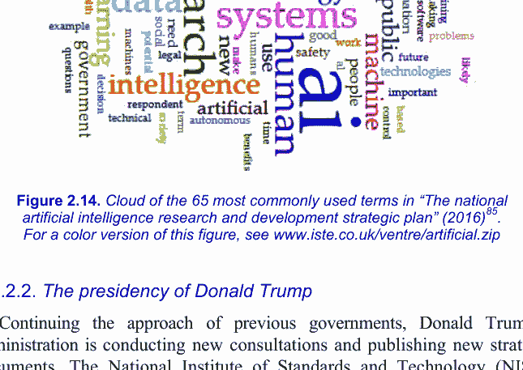

图2.14. “国家人工智能研究与发展战略计划”（2016）85中最常用的65个术语的词云。彩色版本见 www.iste.co.uk/ventre/artificial.zip

#### 2.5.2.2. 唐纳德·特朗普总统任期

延续前任政府的做法，唐纳德·特朗普政府正在进行新的征询，并发布新的战略文件。美国国家标准与技术研究院（NIST）于2019年发起了一次征询，所有回复（非匿名）也可在线获取86。该术语是复数形式。大公司正在参与讨论（IBM、微软、谷歌、亚马逊等）。由于回复不受特定格式约束，其内容从几行到几十页不等，贡献者发送的内容要么

85 插图使用在线应用程序创建：https://voyant-tools.org/。
86 关于联邦参与人工智能标准的RFI收到的评论，2019年，见：https://www.nist.gov/topics/artificial-intelligence/comments-received-rfi-about-federal-engagement-artificial.

简单的评论、报告甚至科学文章。从这种多样性中，我们仍将保留一些出现的议题：

- 在使用 AI 的技术中建立信心：一则评论[87]批评了常见的论调，即：“一个值得信赖的系统就是技术上正确的系统”。信任不能简化为技术或规范问题。存在一个本质的社会和政治维度：必须保障对自由、隐私以及个人知情同意的尊重。AI 也常常类似于一个黑箱，无法验证其产生的结果。“人工智能（AI）信任危机的根源在于操作者认为他们无法解释为何产生某个结果 [...]。为了让算法被信任，它们必须是可解释的——即人类必须能够理解算法为何做出其所做的行为。” [88]
- 关于技术本身、其结果的质量或可靠性、其在整合领域中的影响的不确定性很大：“没有国家标准来评估或以其他方式审查人工智能在特定情境、流程或行业中的成败 [...] 在医学领域，医疗专业人员对风险的容忍度为零，因为所涉利益重大——患者的健康、他们的声誉、他们的执业许可。医疗专业人员不会在没有可信度、准确性、精确性或类似可靠、标准化的指标证明的情况下采用 A.I。” [89]
- “风险” 的概念无处不在，指的是技术风险、对公民权利、价值观、伦理、商业、经济、民主的风险。
- 对隐私、自由、基本权利、公民权利、伦理以及作用于所有这些变量的风险的考量，是所有回应中的一个强有力的常数，更广泛地说是人类（作用于个人的风险，考虑到残疾、“对社会经济弱势群体的负面影响” [STU 19] 等。）。
- 人工智能规范或标准的制定是一个国际性问题，其中主要大国捍卫其国家利益并希望通过宣称领导地位来制定自己的规则：“美国有机会在制定解决人工智能伦理问题的指导方针、法规和法律方面引领潮流。” [90]
- 国家/私营平衡：人工智能的发展引发了国家/私营部门比例的问题，需要在两类之间确保平衡。国家真的应该介入以定义人工智能标准吗？私营部门不是更适合定义这一点吗？“美国私营部门目前在人工智能研究与开发方面领先，但需要联邦支持才能在国际标准化机构中成功参与。” [91]
- 中国反复被描述为“负面”：“中国有破坏国际技术标准的历史，例如通过制定替代性国家标准来创造有利于其国内利益的贸易壁垒” [CDI 19]；“中国在新疆对维吾尔少数民族的压迫很大程度上是通过人工智能技术的发展建立起来的” [CHI 19]；“中国的社会信用体系与美国对自由和自由价值观的看法相悖，也与欧盟 GDPR 所体现的其他国家对个人数据隐私和保护的价值观相悖。” [92] 在此，我们看到在关于人工智能问题的互联网治理国际辩论中表达的根本分歧的再次出现。美国与中国以及俄罗斯之间存在一条分界线：“与中国或俄罗斯展开人工智能竞赛将是有问题的，因为这些国家对隐私、安全和自由的看法与美国大不相同。” [93]
- 数据：数据的质量和获取途径是两个关键变量。“人工智能应用的好坏仅取决于用于训练它们的数据” [STU 19]。在数据被利用时尊重人们的权利至关重要。

87 以 AI 伦理标准维护美国价值观：数据收集和算法处理，可获取于： https://www.nist.gov/system/files/documents/2019/06/03/nist-ai-rfi-lchin_001.pdf.

88 对国家标准与技术研究所关于制定联邦人工智能标准参与计划的信息征求的评论，2019 年 6 月 7 日，可获取于： https://www.nist.gov/sites/default/files/documents/2019/06/07/nist-ai-rfi-broniatowski-caliskan-reyna-schwartz.pdf.

89 Buoy Health, Inc.，RFI：制定联邦人工智能标准参与计划，2019 年 6 月 7 日，可获取于： https://www.nist.gov/sites/default/files/documents/2019/06/10/nist-ai-rfi-buoy-health-inc-001.pdf.

90 RTI International，对 NIST RFI 2019-08818 的回应：制定联邦人工智能标准参与计划，2019 年，可获取于： https://www.nist.gov/sites/default/files/documents/2019/06/10/nist-ai-rfi-rti-001.pdf.

91 人工智能治理中心、未来生命研究所、长期网络安全中心，RFI：制定联邦人工智能标准参与计划，2019 年 6 月 6 日，可获取于： https://www.nist.gov/sites/default/files/documents/2019/06/06/nist-ai-rfi-fhi-fli-cltc-cfi-001.pdf.

92 RTI International，RFI：制定联邦人工智能标准参与计划，2019 年 6 月，可获取于： https://www.nist.gov/sites/default/files/documents/2019/06/10/nist-ai-rfi-rti-001.pdf.

93 Hitachi Vantara Federal (HVF)，RFI：制定联邦人工智能标准参与计划，2019 年 5 月 31 日，可获取于： https://www.nist.gov/sites/default/files/documents/2019/06/11/nist-ai-rfi-hitachi-001.pdf.

2019 年的咨询是否与 2016 年的咨询表达人工智能问题的方式不同？比较可能很困难，因为咨询的重点不同（2019 年的咨询侧重于规范和标准问题）。然而，仅举一个例子，我们就可以看到，贡献者处理人工智能问题的方式受到多种变量的影响。例如，中国在 2016 年咨询中被提及的方式是中性的，没有任何偏见。然后提到中国是为了提醒我们北京决定的一项多年机器人投资计划的存在。这无疑是一种呼吁美国当局提醒他们做同样的事情的方式。在 2019 年的咨询中，中国不再是一个榜样。看法发生了变化，表达是批判性的、负面的。中国，其使用人工智能的选择在西方被描绘为奥威尔式社会的实现，现在代表了理想社会的反面、反面例子、应避免的建构。在 2016 年的咨询中，这种社会控制的威胁的根源更多地在于美国当局本身。因此，人工智能治理的分析和建议使用的是来自即时新闻的例子（2016 年，美国为爱德华·斯诺登的揭露感到震惊；2019 年，西方媒体描述了中国新的社会控制体系）。但基本思想保持不变：公民必须警惕国家、他们自己政府的做法。所引用的两个例子也表明，警惕在挫败当局的计划方面作用不大。

# 人工智能与国防问题

## 3.1. 人工智能的军事政策与学说：美国的做法

### 3.1.1. *美国国防人工智能政策*

#### 3.1.1.1. *国防部部长演讲中的人工智能*

发布在美国国防部网站上的在线档案提供了 1,310 份转录演讲，涵盖 1995–2019 年期间。然而，并非所有在此期间发表的演讲都可获取。因此我们只有一部分，但语料库足够完整，可以提供美国国防官员思维中问题、优先事项和概念被考虑的方式演变的视野。

仅通过统计语料库中使用的术语，我们观察到这些概念被赋予的位置（此处提供的数字代表该术语或表达在整个语料库中出现的次数）。

第一个观察结果是，对人工智能（AI）的关注仍然如此之多，以至于所有涉及“网络”问题的演讲都围绕由其衍生出的术语以及高度通用的术语（网络空间、互联网、计算机）展开。“智能（smart）”一词也胜过“智能化（intelligent）”一词，而机器人（robot）先于人工智能（AI）。虽然仅凭术语的出现频率无法反映某个对象的重要性，但广义上的网络领域与人工智能处理之间的差距如此之大，以至于后者显得不那么重要。作为对比，“核”被提及约2126次，“导弹”被提及2328次。人工智能被美国国防部长们发布的分析置于次要背景之下。因此，这一简单观察与人们对美国国防战略和优先事项可能持有的印象相悖。尽管一方面，在研发、武器采购或配备人工智能的系统中，军事投资似乎非常可观，但人工智能尚未获得足以使其成为话语核心对象之一的优先地位。更有可能的是，它被理解、暗示并隐含地纳入极其宽泛的“网络”主题之中。

| 术语、表达 | n |
|---|---:|
| Cyber1 | 1,910 |
| Internet | 396 |
| Compute2 | 394 |
| Smart | 255 |
| Robot3 | 83 |
| Artificial Intelligence | 40 |
| Intelligent | 21 |
| Machine Learning | 10 |
| Deep Learning | 8 |
| Autonomous weapon | 5 |
| Expert system | 1 |
| Neural Network | 1 |

**表3.1.** *美国国防部长演讲语料中相关概念的出现情况*

1 “Cyber”此处包括所有使用的派生词，如*cyberspace、cybersecurity、cyber threat*等。

2 “Compute”及其所有派生词，如*computer、computing、computation*等。

3 “Robot”，包括其派生词如*robotics*。

#### 3.1.1.3. *MAVEN项目和AWCFT的创建（2017）*

MAVEN人工智能项目是国防部于2017年启动的一个项目，旨在利用机器学习（ML）区分军用无人机记录的数千小时视频片段中的个体和物体。曾与国防部签约参与该项目的谷歌公司，在数千人的抗议后不得不退出。然而，这些事件并未对该项目构成挑战，该项目由一个于2017年专门创建的团队——“算法战争跨职能团队”（AWCFT）[DSD 17]——负责实施，其领导权将交给负责情报的国防部副部长。该项目正在实施，以加速人工智能在武装部队中的采用。

在该项目启动的正式公告中，国防部提醒，国防力量必须整合人工智能（AI与机器学习）。在这份文本中，它谈到了紧迫性以及快速行动的必要性：“我仍然坚信，我们必须做得更多，并且行动得更快。”AWCFT的使命是“加速大数据和机器学习在国防部内的整合”。这份文件明确了军队对人工智能的期望：

- 速度是人工智能的目标之一，也是其附加价值之一：“AWCFT的目标是，将国防部可用的海量数据快速转化为可操作的情报和洞察。”挑战在于学会如何使用所收集、创建、存储和可用的庞大体积数据，使其对军队的职能有用。应从这些进展中受益的系统是战术无人机系统，以及对这些无人机所生成图像和视频的处理，而这些用途在未来几年内将持续增长[SHA 18a]。这些能力必须满足在所谓“伊斯兰国”战争中持续行动的需求（“击败ISIS”行动[ALL 17]）。AWCFT必须加速实施大数据和机器学习，以利用部队正在收集的大量数据。其中第一项任务属于打击“伊斯兰国”战争的一部分，必须加快或自动化无人机数据的处理、使用和分发，以克服人类无法处理这些海量数据的困难（人类被这些数据量淹没），从而高效地（机器的分析能力比人类更强，能够在图像中，实际上是在所有类型的数据中找到相关信息）且更快地产生有用情报，以强化军事决策过程。该项目的紧迫性由“伊斯兰国”的威胁以及对计算机的雄心所证明，要求它们预测冲突结果[MAD 17]。战略家们期望借助定量分析技术来预测未来，而不是依赖水晶球，并将商业领域的方法应用于战争事务。这让人联想到2017年设立MAVEN项目的美国军方声明，即只需从工业界的方法目录中提取方法，就能处理和解决战争事务。其逻辑依然不变：相信计算机、相信计算能力、相信数据所创造的力量，但前提是数据必须具备海量性，甚至相信将商业管理的逻辑和工具简单移植到战争事务管理中的有效性。在20世纪60年代越南战争期间，计算机和程序被称为*哈姆雷特评估系统*（HES），每天产生9万页报告，数据量惊人，但其中有多少比例真正被阅读、利用并切实有用，我们不得而知。其不变的逻辑是将信息主导、信息控制、由数据利用结果驱动的军事行动与胜利紧密联系在一起。整个美国军事机器都被设计用来产生海量数据。这种战略是通过产生大量数据来追求胜利，但这种大规模生产并不等同于信息主导。罗伯特·麦克纳马拉于1961年被任命为国防部长，他在引入计算机作为决策支持工具方面发挥了关键作用。但国防力量以及国家行政管理部门早已具备这种计算器文化和对统计数据的利用文化，自第二次世界大战以来就一直在使用，而对某些用途而言，则可追溯到19世纪（使用穿孔卡系统处理人口统计数据）[HAR 88]。

- 重点在于图像和视频处理（计算机视觉、视频）在情报职能（分析、处理、理解等）中的问题。AWCFT必须开发处理这些数据的算法，并对无人机视频图像中的物体进行识别和自动检测，而其数据量超出了人类分析人员和当前系统的处理能力。AWCFT项目所要开发的算法将聚焦于图像识别、索引以及图像和视频中对象类别的实时检测[SHA 18b]。第一批算法必须在2017年底前交付，这意味着需要加速开发。当然，在这短短时间框架内提出的算法解决方案很可能并非全新的成果，而是建立在先前结果之上，是对已开发代码的改进。

在这场被迫的技术竞赛中，美国军方正在调动私营企业和全球数据收集与处理领域的领导者。因此，谷歌通过帮助国防部门开发用于无人机的AI来满足其需求[CON 18]（协助检测无人机收集图像中的物体、监控技术）。这一合作是MAVEN项目的一部分。

#### 3.1.1.4. 国防部2018年战略

国防部2018年人工智能战略是在“战略计算倡议”35年后宣布的，并于2019年发布[DOD 19]，这是一份补充或延伸2018年国防战略[DOD 18a]的文件。这并不令人意外，因为国防界已经以各种形式关注AI和机器人技术以及智能机器，这些已成为计划、方案和项目的主题。

几十年来，主要大国一直在开展AI研究，通常是在其武装力量的密切关注下进行的，并且自20世纪70年代以来，针对军事应用的计划已被反复报告。这一战略重申了军队将AI技术据为己有的意愿，以开启一个不仅涉及武库的转折点，而且预示着更深刻的变革。这种AI整合：

-   不仅需要对个人进行培训，还需要对那些需要人类专业知识的机器学习机器进行培训；

-   将采用商业产品，采用商业应用的80%并完成20%的修改，以使其适应特定的军事需要。国防部呼吁私营部门与其合作。

2018年6月27日，国防部成立了联合人工智能中心（JAIC）[DSD 18]。这份由国防部长发布的文件重申了国防领域赋予AI的优先地位，这一点在2018年《国防战略》（NDS）中已经阐明。AI至关重要，因为它能够“改变社会以及战争的特性”。该项目旨在为国防力量整合AI做好准备。据国防部长称，这是保持和增强军事优势的问题。AI及其应用在军事框架中的整合既是一个经济问题、官僚（业务改革）问题，也是一个战略（掌握AI并学会在战斗中使用它）问题。必须评估AI在以下方面的影响……

以尽可能广泛的方式，因为它将传播到军事机构的所有层级，可能在组织、指挥、作战艺术和官僚体系中产生影响。该项目被描述为至关重要且紧迫，正如所有国防人工智能计划一样。JAIC 的成立扩展了将人工智能融入美国国防的努力。

#### 3.1.1.5. *美国第三次抵消战略（TOS）*

“抵消战略”是指旨在加强军事能力以对抗特定威胁的防御战略。这些战略本质上是技术中心的，并以尖端技术创新为基础，尽管更具政治性或组织性的考虑当然是决策的核心：“关键创新在于将这些新系统和技术与新的战略作战概念相结合并加以应用” [HAG 14]：

- 第一项“抵消”战略，在艾森豪威尔总统任期内，20世纪50年代，旨在对抗苏联军事能力。该战略是发展核威慑；
- 第二项“抵消”战略，在20世纪70年代，旨在对抗苏联的数量优势。它是长期研究与开发规划项目的主题；
- 最后，第三项战略由国防部长查克·哈格尔于2014年底在一场宣布启动新项目国防创新倡议的演讲中发起 [HAG 14]。该新战略旨在弥补美国军事优势的侵蚀，部分原因是拒止进入（反进入）和区域拒止（A2/AD）能力的扩散。面对这些能力的美国部队，其行动自由受到侵蚀。这一问题在20世纪90年代就已出现。因此，为第三项战略的发展进行的反思阶段于2014年正式启动，但它建立在之前的政策和战略之上。需要应对的挑战将是与俄罗斯和中国的技术差距，后者在过去十年中不断投资于现代化其武装部队的计划。哈格尔表示，美国必须保持其投射能力，否则世界对美国来说将变得更加危险。人工智能所带来的新机遇并未在2014年的演讲中明确提及，该演讲仅重申了主要原则。

该战略尚未完成，而外国国家战略已经出现，可能抵消美国的项目。俄罗斯再次成为美国的主要挑战，将构建自己的战略来对抗美国的战略。俄罗斯战略可能包括利用第一项战略的原则来对抗第三项战略（即加强核武器库和威胁，发展战术和战略核武器系统）；该俄罗斯战略的第二部分可能包括复制美国的计划（例如，2012年，俄罗斯创建了先进研究基金会（ARF），该基金会在技术和逻辑领域开展与DARPA类似的项目，其中当然人工智能发挥着重要作用 [KAS 17]）。

#### 3.1.1.6. 四年一度国防评估（QDR）

在此语料中，由1997年至2018年期间的六份报告组成，我们搜索了与网络空间以及与人工智能和机器人相关对象的术语的存在情况，以便在时间上对其进行定位，观察它们何时进入国防政策考虑，以及它们彼此之间的相对权重。结果在图3.1和图3.2中呈现。

需要回顾的是，2018年2月，QDR被国家国防战略取代，仅公开了其摘要。

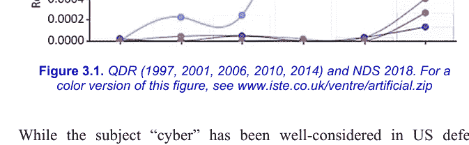

图 3.1. QDR（1997、2001、2006、2010、2014）和 NDS 2018。彩色版本请见 www.iste.co.uk/ventre/artificial.zip

虽然“网络”主题自2001年以来已在美国国防政策中得到充分考虑，但人工智能直到2018年才出现在这些文件中。机器人和自主性也是与网络空间问题相比仍然边缘的主题。所有这些主题在1997年的QDR中均不存在。因此，总体而言，所有这些主题在这些战略文件中都不到10年历史。

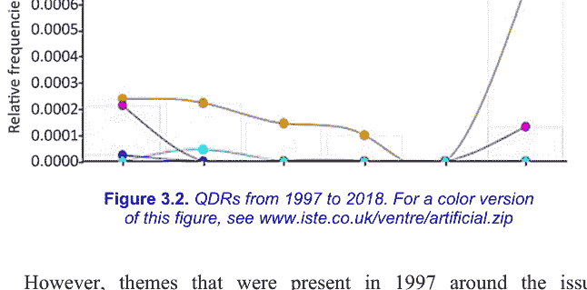

图 3.2. 1997年至2018年的QDR。彩色版本请见 www.iste.co.uk/ventre/artificial.zip

然而，1997年围绕信息战、信息行动、信息系统、信息技术（计算机、计算）等问题出现的主题，并在随后让位于新兴的网络主题，在2018年的最新文件中重新出现。还应指出的是，在这些文件中没有任何关于“专家系统”概念的提及。

### 3.1.2. 人工智能在美国军事学说中

尽管人工智能自20世纪60年代以来一直处于研究和开发阶段，由军方发起（特别是通过其研究机构DARPA），如果已实施应用，分析人工智能在军事学说中占据的地位就很有趣。为此，我们查阅了大量学说文本语料（由联合出版物组成），寻找任何关于人工智能的提及，无论是明确使用“人工智能”一词，还是提及“专家系统”、“机器学习”、“深度学习”和“自主”。我们将搜索限制在我们认为在近年和目前最能代表人工智能的术语上（我们分析的所有文件清单列在本书记的附录2中）。

完全自主飞行并且能够携带各种有效载荷以增强任务效能和适应性。”

- 2014年，文件“联合空域管控。JP 3-52” [JCS 14] 涉及无人机自主性：

> “无人机。[...] UAS通信链路通常比有人驾驶系统所需的更为关键。[...] 尽管某些UA可能具备自主反应（即防碰撞）或在通信丢失时预先计划的响应（即返航）能力，但UA通常依赖近乎连续的数据交换来进行飞行控制和有效载荷管理。”

这项对军事文本语料的工作可以通过阅读国防部的所有指令和指示来完成（其中一份清单可在 fas.org⁴ 网站上获得）。我们特别注意到以下文本：

- “武器系统中的自主性”，2012年11月21日，“纳入变更1”，2017年5月8日。该国防部指令 [DOD 12] 规定了在应用致命和非致命、动能和非动能武力的武器系统中开发自主和半自主功能的前提条件。并非所有武器系统都受该指令中关于自主性的规则约束，例如，用于网络空间行动的自主和半自主系统，以及某些类别的武器⁵。然而，在该文本的15页中没有提到人工智能（也没有以下术语：智能、机器人、智能、机器学习）。该文件中提供了自主武器系统的定义：

> “自主武器系统。一旦激活，可以在没有人类操作员进一步干预的情况下选择和攻击目标的武器系统。这包括设计为允许人类操作员覆盖武器系统运行的人类监督自主武器系统，但在激活后可以在没有进一步人类输入的情况下选择和攻击目标。”

该指令提醒了必须规范此类自主系统使用的法律和伦理框架：

> > “授权使用、指挥使用或操作自主和半自主武器系统的人员必须谨慎行事，并遵守战争法、适用条约、武器系统安全规则和适用的交战规则（ROE）。”

人工智能很少被邀请进入所有这些文件所涵盖的众多主题和议题中，这些文件反映了国防领域正在进行的政策、战略和辩论。最后，让我们分析各个军种生产的文件：陆军、空军和海军。

#### 3.1.2.1. *美国陆军与人工智能*

对于陆军而言，所列⁶的任何文件标题中都没有与智能或机器人或自主性相关的术语：

- 然而，机器人和自主性在“网络空间作战概念能力计划2016–2028”中被简要讨论，该计划于2010年出版：

> > “量子计算和纳米技术的进步可能导致一支由机器人和远程引导、自主和微型化武器系统增强的战斗力量。通信系统可能是自组织的和分布式的。”
> >
> > [USA 10]

- 在“网络空间和电子战行动2025–2040”中，出版于2018年 [USA 18]，人工智能、机器人和自主系统也被提及：

> > “战场上自主设备的增加使用，包括无人机系统，给安全带来挑战。自主技术的增强发展预示着一个未来，机器将使用先进算法和人工智能在战场上为自己做出决策。因此，该决策算法可能被劫持，而人工智能

⁶ 我们依赖发布在 https://fas.org 上的文件。

损坏，对陆军部队和技术构成危险。由于自主系统的普及，需要具备失效保护的技术和软件来维持积极控制。[…]

自主主动网络防御。开发系统，通过一系列同步、实时能力提供自主网络防御能力，以在没有直接人工干预的情况下发现、定义、分析和缓解网络威胁和漏洞。该能力包括基于传感器的能够学习并管理网络拓扑的人工智能。[…]

> 陆军采用更多远征网络空间作战能力，减少许多网络空间和 EMS 系统的尺寸、重量和功耗，使其更适合由远程、机器人和自主系统使用。陆军部署先进天线技术和动态频谱接入能力，以提高可用 EMS 的使用效率。

— “The U.S. Army in Multi-Domain Operations 2028”，2018 年出版 [TRA 18a]，也不能忽视人工智能以及其他技术进入军事事务。文件提出了政治或战略性质的一般性论述：

> “诸如人工智能、高超音速、机器学习、纳米技术和机器人等新兴技术正在推动战争性质发生根本性变化。随着这些技术成熟，其军事应用变得更加清晰，其影响有可能以自机枪、坦克和航空整合开启合成作战时代以来从未有过的程度革命化战场 […] 与俄罗斯不同，中国拥有经济和技术基础，例如独立的微电子工业和世界领先的人工智能开发流程，足以在未来 10–15 年内超越当前俄罗斯系统的优势。”

> “在所有域、EMS 和信息环境之间实现能力融合的关键是高容量分析

（国防部联合人工智能中心的支持）[ESP 18]。问题在于美国陆军对人工智能的 appropriation，符合国防部的[content]
损坏，对陆军部队和技术构成危险。由于自主系统的普及，需要具备失效保护的技术和软件来维持积极控制。[…]

自主主动网络防御。开发系统，通过一系列同步、实时能力提供自主网络防御能力，以在没有直接人工干预的情况下发现、定义、分析和缓解网络威胁和漏洞。该能力包括基于传感器的能够学习并管理网络拓扑的人工智能。[…]

> 陆军采用更多远征网络空间作战能力，减少许多网络空间和 EMS 系统的尺寸、重量和功耗，使其更适合由远程、机器人和自主系统使用。陆军部署先进天线技术和动态频谱接入能力，以提高可用 EMS 的使用效率。

— “The U.S. Army in Multi-Domain Operations 2028”，2018 年出版 [TRA 18a]，也不能忽视人工智能以及其他技术进入军事事务。文件提出了政治或战略性质的一般性论述：

> “诸如人工智能、高超音速、机器学习、纳米技术和机器人等新兴技术正在推动战争性质发生根本性变化。随着这些技术成熟，其军事应用变得更加清晰，其影响有可能以自机枪、坦克和航空整合开启合成作战时代以来从未有过的程度革命化战场 […] 与俄罗斯不同，中国拥有经济和技术基础，例如独立的微电子工业和世界领先的人工智能开发流程，足以在未来 10–15 年内超越当前俄罗斯系统的优势。”

> “在所有域、EMS 和信息环境之间实现能力融合的关键是高容量分析

（国防部联合人工智能中心的支持）[ESP 18]。问题在于美国陆军对人工智能的采纳，符合国防部的[content]
损坏，对陆军部队和技术构成危险。由于自主系统的普及，需要具备失效保护的技术和软件来维持积极控制。[…]

自主主动网络防御。开发系统，通过一系列同步、实时能力提供自主网络防御能力，以在没有直接人工干预的情况下发现、定义、分析和缓解网络威胁和漏洞。该能力包括基于传感器的能够学习并管理网络拓扑的人工智能。[…]

> 陆军采用更多远征网络空间作战能力，减少许多网络空间和 EMS 系统的尺寸、重量和功耗，使其更适合由远程、机器人和自主系统使用。陆军部署先进天线技术和动态频谱接入能力，以提高可用 EMS 的使用效率。

— “The U.S. Army in Multi-Domain Operations 2028”，2018 年出版 [TRA 18a]，也不能忽视人工智能以及其他技术进入军事事务。文件提出了政治或战略性质的一般性论述：

> “诸如人工智能、高超音速、机器学习、纳米技术和机器人等新兴技术正在推动战争性质发生根本性变化。随着这些技术成熟，其军事应用变得更加清晰，其影响有可能以自机枪、坦克和航空整合开启合成作战时代以来从未有过的程度革命化战场 […] 与俄罗斯不同，中国拥有经济和技术基础，例如独立的微电子工业和世界领先的人工智能开发流程，足以在未来 10–15 年内超越当前俄罗斯系统的优势。”

> “在所有域、EMS 和信息环境之间实现能力融合的关键是高容量分析

（国防部联合人工智能中心的支持）[ESP 18]。问题在于美国陆军对人工智能的采纳，符合国防部的[content]
损坏，对陆军部队和技术构成危险。由于自主系统的普及，需要具备失效保护的技术和软件来维持积极控制。[…]

自主主动网络防御。开发系统，通过一系列同步、实时能力提供自主网络防御能力，以在没有直接人工干预的情况下发现、定义、分析和缓解网络威胁和漏洞。该能力包括基于传感器的能够学习并管理网络拓扑的人工智能。[…]

> 陆军采用更多远征网络空间作战能力，减少许多网络空间和 EMS 系统的尺寸、重量和功耗，使其更适合由远程、机器人和自主系统使用。陆军部署先进天线技术和动态频谱接入能力，以提高可用 EMS 的使用效率。

— “The U.S. Army in Multi-Domain Operations 2028”，2018 年出版 [TRA 18a]，也不能忽视人工智能以及其他技术进入军事事务。文件提出了政治或战略性质的一般性论述：

> “诸如人工智能、高超音速、机器学习、纳米技术和机器人等新兴技术正在推动战争性质发生根本性变化。随着这些技术成熟，其军事应用变得更加清晰，其影响有可能以自机枪、坦克和航空整合开启合成作战时代以来从未有过的程度革命化战场 […] 与俄罗斯不同，中国拥有经济和技术基础，例如独立的微电子工业和世界领先的人工智能开发流程，足以在未来 10–15 年内超越当前俄罗斯系统的优势。”

> “在所有域、EMS 和信息环境之间实现能力融合的关键是高容量分析

（国防部联合人工智能中心的支持）[ESP 18]。问题在于美国陆军对人工智能的采纳，符合国防部的[content]
损坏，对陆军部队和技术构成危险。由于自主系统的普及，需要具备失效保护的技术和软件来维持积极控制。[…]

自主主动网络防御。开发系统，通过一系列同步、实时能力提供自主网络防御能力，以在没有直接人工干预的情况下发现、定义、分析和缓解网络威胁和漏洞。该能力包括基于传感器的能够学习并管理网络拓扑的人工智能。[…]

> 陆军采用更多远征网络空间作战能力，减少许多网络空间和 EMS 系统的尺寸、重量和功耗，使其更适合由远程、机器人和自主系统使用。陆军部署先进天线技术和动态频谱接入能力，以提高可用 EMS 的使用效率。

— “The U.S. Army in Multi-Domain Operations 2028”，2018 年出版 [TRA 18a]，也不能忽视人工智能以及其他技术进入军事事务。文件提出了政治或战略性质的一般性论述：

> “诸如人工智能、高超音速、机器学习、纳米技术和机器人等新兴技术正在推动战争性质发生根本性变化。随着这些技术成熟，其军事应用变得更加清晰，其影响有可能以自机枪、坦克和航空整合开启合成作战时代以来从未有过的程度革命化战场 […] 与俄罗斯不同，中国拥有经济和技术基础，例如独立的微电子工业和世界领先的人工智能开发流程，足以在未来 10–15 年内超越当前俄罗斯系统的优势。”

> “在所有域、EMS 和信息环境之间实现能力融合的关键是高容量分析

（国防部联合人工智能中心的支持）[ESP 18]。问题在于美国陆军对人工智能的采纳，符合国防部的[content]
损坏，对陆军部队和技术构成危险。由于自主系统的普及，需要具备失效保护的技术和软件来维持积极控制。[…]

自主主动网络防御。开发系统，通过一系列同步、实时能力提供自主网络防御能力，以在没有直接人工干预的情况下发现、定义、分析和缓解网络威胁和漏洞。该能力包括基于传感器的能够学习并管理网络拓扑的人工智能。[…]

> 陆军采用更多远征网络空间作战能力，减少许多网络空间和 EMS 系统的尺寸、重量和功耗，使其更适合由远程、机器人和自主系统使用。陆军部署先进天线技术和动态频谱接入能力，以提高可用 EMS 的使用效率。

— “The U.S. Army in Multi-Domain Operations 2028”，2018 年出版 [TRA 18a]，也不能忽视人工智能以及其他技术进入军事事务。文件提出了政治或战略性质的一般性论述：

> “诸如人工智能、高超音速、机器学习、纳米技术和机器人等新兴技术正在推动战争性质发生根本性变化。随着这些技术成熟，其军事应用变得更加清晰，其影响有可能以自机枪、坦克和航空整合开启合成作战时代以来从未有过的程度革命化战场 […] 与俄罗斯不同，中国拥有经济和技术基础，例如独立的微电子工业和世界领先的人工智能开发流程，足以在未来 10–15 年内超越当前俄罗斯系统的优势。”

> “在所有域、EMS 和信息环境之间实现能力融合的关键是高容量分析

（国防部联合人工智能中心的支持）[ESP 18]。问题在于美国陆军对人工智能的采纳，符合国防部的[content]
损坏，对陆军部队和技术构成危险。由于自主系统的普及，需要具备失效保护的技术和软件来维持积极控制。[…]

自主主动网络防御。开发系统，通过一系列同步、实时能力提供自主网络防御能力，以在没有直接人工干预的情况下发现、定义、分析和缓解网络威胁和漏洞。该能力包括基于传感器的能够学习并管理网络拓扑的人工智能。[…]

> 陆军采用更多远征网络空间作战能力，减少许多网络空间和 EMS 系统的尺寸、重量和功耗，使其更适合由远程、机器人和自主系统使用。陆军部署先进天线技术和动态频谱接入能力，以提高可用 EMS 的使用效率。

— “The U.S. Army in Multi-Domain Operations 2028”，2018 年出版 [TRA 18a]，也不能忽视人工智能以及其他技术进入军事事务。文件提出了政治或战略性质的一般性论述：

> “诸如人工智能、高超音速、机器学习、纳米技术和机器人等新兴技术正在推动战争性质发生根本性变化。随着这些技术成熟，其军事应用变得更加清晰，其影响有可能以自机枪、坦克和航空整合开启合成作战时代以来从未有过的程度革命化战场 […] 与俄罗斯不同，中国拥有经济和技术基础，例如独立的微电子工业和世界领先的人工智能开发流程，足以在未来 10–15 年内超越当前俄罗斯系统的优势。”

> “在所有域、EMS 和信息环境之间实现能力融合的关键是高容量分析

（国防部联合人工智能中心的支持）[ESP 18]。问题在于美国陆军对人工智能的采纳，符合国防部的[content]
损坏，对陆军部队和技术构成危险。由于自主系统 proliferate，需要失效保护技术和软件维持积极控制。[…]

自主主动网络防御。开发系统，通过同步实时能力提供自主网络防御，无需直接人工干预即可发现、定义、分析和缓解网络威胁和漏洞。该能力包括可学习并管理网络拓扑的传感器型人工智能。[…]

> 陆军采用更多远征网络空间作战能力，降低网络空间和 EMS 系统的尺寸、重量和功耗，使其更适合远程、机器人和自主系统使用。陆军部署先进天线技术和动态频谱接入能力，提高可用 EMS 使用效率。

— “The U.S. Army in Multi-Domain Operations 2028”，2018 年出版 [TRA 18a]，也不能忽视人工智能等技术进入军事事务。文件提出政治或战略层面的一般论述：

> “人工智能、高超音速、机器学习、纳米技术和机器人等新兴技术正在推动战争性质根本变化。随着技术成熟，其军事应用更清晰，影响可能以自机枪、坦克和航空开启合成作战时代以来从未有过的程度革命化战场 […] 与俄罗斯不同，中国拥有经济和技术基础，如独立微电子工业和世界领先的人工智能开发流程，足以在未来 10–15 年内超越当前俄罗斯系统的优势。”

> “在所有域、EMS 和信息环境间实现能力融合的关键是高容量分析

（国防部联合人工智能中心支持）[ESP 18]。问题在于美国陆军在国防部新战略下对人工智能的采纳。该工作组将与联合人工智能中心 JAIC 保持联系，尽快为美国陆军制定人工智能战略。工作组设在卡内基梅隆大学国家机器人工程中心 NREC⁷ 匹兹堡，该中心自 1995 年起与美国国防各方密切合作。

2018 年指令列出工作组关注主题：机器学习、深度学习、自动化、自主目标指示、车辆、远程精确打击火力、预测性维护 以降低成本提高可用性 、数据科学、硬件人工智能、云安全与可访问性、整合新人工智能应用的网络安全问题。

#### 3.1.2.2. 美国海军与人工智能

– “OPNAV INSTRUCTION 5513.1E. Department of the Navy Security Classification Guides, 2005” [DON 05] 2005 年中对人工智能的考虑如下：

> “Computer Resources. [...] 必须将军事敏感信息和数据库域与非军事应用和/或架构分离。相关类别包括：

- System. 包括应用、语言、工具、方法论、管理、人工智能；
- Artificial Intelligence. 包括基于知识的专家系统、机器人、图像处理、自然语言处理、语音处理、神经网络。”

##### 3.1.2.2.1. NCARAI

海军人工智能应用研究中心 Navy Center for Applied Research in Artificial Intelligence NCARAI⁸，1981 年成立的研究中心，是海军研究实验室信息技术分部组成部分。2012 年海军研究实验室专门成立自主系统实验室。

1983 年 10 月 *情报界人工智能应用研讨会* [ECK 84] 上，中心展示了研究主题，当时聚焦：

- 战斗管理专家系统；
- 设备故障排除专家系统；
- 利用舰船 ISAR 数据的目标分类；
- 应用于海军报文自动化的自然语言处理；
- 多传感器融合；
- 自适应控制。

BATTLE 系统也在研讨会上展示，旨在为海军陆战队炮兵和空中支援提供武器分配计划。该项目属战斗管理计划，想法是实时合并多名观察员从现场带回的目标受损数据。

NCARAI 自成立起为美国海军开发应用。中心现围绕四个主题⁹ 组织：智能系统 认知科学、认知机器人、人机交互 、自适应系统 ML、自主系统、移动机器人 、交互系统 开发自主和智能系统界面 和感知系统 自主系统有源和无源传感器 。

##### 3.1.2.2.2. NCARAI 出版物

NCARAI 出版物语料库¹⁰ 提供 337 个在线标题，涵盖 1990–2018 年。这些出版物分为技术信息技术文章和结合认知科学、人文社会科学及作战战略考虑的文章。例如，研究人员关注人工智能叛乱或反叛主题作品中智能体的“行为” [AHA 17, COM 17]：人类抗议、质疑、反对、说“不”或反叛可能有益，有助于维持个人平衡，对个人社会必要，由社会正义 imperative 证明，伦理道德政治上可接受，而人工智能通常被恐惧或负面解读，任何反叛可能性被视为危险。该工作将人工智能即在与人类关系中发挥社会作用的人工代理视为不再是威胁或破坏性，而可能对互动有益。正如个人，“反叛”可能不仅有用有益，而且在伦理道德上强制或必要。必须考虑建设性人工智能反叛形式，如人类，以最大化人工智能社会效益。人工智能叛乱代理定义为可发展出对其他代理分配目标或任务持反对态度的 AI 代理。“反叛”可表现为抵抗、反对、拒绝执行任务。对 AI 产生反叛的代理称为“交互者”，后者与叛乱代理处于权力关系。“交互者”可为人类或合成/人工，个人或群体。作者随后描述叛乱代理类型 意识到反叛的代理、未意识到反叛的代理、既意识到又能推理反叛后果的代理——设计性反叛代理 、交互者、反叛类型、反叛动机和反叛阶段。通过交叉参考这些变量，作者提出人工智能代理反叛两种情景 第一种考虑智能代理参与灾难救援任务，智能代理因检测到指令错误而拒绝执行命令；第二种考虑共创情况 ，但基于所提类型学组合几乎无限。其他作品涉及自主性、推理中错误位置、欺骗检测、欺骗作用、信任、人机交互、信息不确定性等。

对该出版物语料库的统计分析可观察到机器人技术、专家系统或自主性等主题考虑的趋势 图 3.3 。

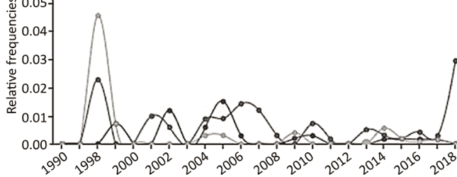

图3.3 NCARAI出版物中的“机器人”（robot，robotics）主题。时期：1990–2018。数据使用Voyant Tools应用程序处理。有关本图的彩色版本，请参见www.iste.co.uk/ventre/artificial.zip

尽管在近30年的时间里，机器人技术一直受到相对持续的关注，但自主性问题自20世纪90年代以来也一直被考虑，不过自2010年起才更为常态化。

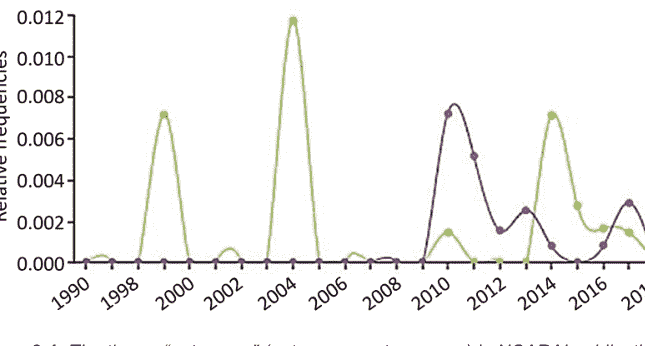

图3.4 NCARAI出版物中的“自主性”（autonomy，autonomous）主题。时期：1990–2018。数据使用Voyant Tools应用程序处理。有关本图的彩色版本，请参见www.iste.co.uk/ventre/artificial.zip

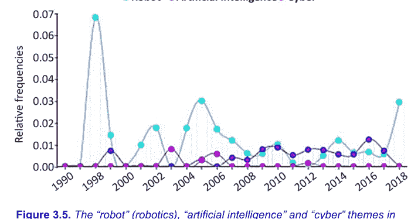

图3.5 NCARAI出版物中的“机器人”（robotics）、“人工智能”和“网络”主题。时期：1990–2018。数据使用Voyant Tools应用程序处理。有关本图的彩色版本，请参见www.iste.co.uk/ventre/artificial.zip

在审查期间，机器人相关的问题占主导地位，而对网络空间本身的考虑则较少。人工智能已经超过了“网络”问题，后者仅在2002年至2006年间以临时方式得到处理。

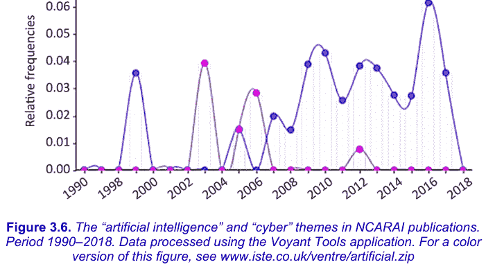

图3.6 NCARAI出版物中的“人工智能”和“网络”主题。时期：1990–2018。数据使用Voyant Tools应用程序处理。有关本图的彩色版本，请参见www.iste.co.uk/ventre/artificial.zip

最后，应该指出的是，这些文章中没有一篇（至少在标题中）引入“专家系统”、“战争”或“作战”、“犯罪”、“安全”等概念；“防御”的概念实际上也被忽略了（仅使用过一次）。主要的概念是“认知系统”、“人”、“社会”、“推理”、“学习”、“机器人”、“交互”、“规划”和“自主性”。

#### 3.1.2.3. 美国海军陆战队与人工智能

在1996年发布的“MCDP 6 指挥与控制”[DON 96]中，提到了专家系统，但没有提及人工智能的概念：

> “专家系统和人工智能可以在一定程度上辅助认知——例如，帮助整合处理后的数据片段。但认知主要是一种人类的心理活动——主要不是像处理数据那样的程序性行为，而是一种学习行为。
>
> 我们通过判断将复杂的知识成分转化为理解，判断是一种纯粹基于经验和直觉的人类技能，超出了任何当前人工智能或专家系统的能力。判断根本无法简化为程序或规则（无论多么复杂）。”

2003年，“MCWP 3-42.1 无人驾驶飞行器作战，2003年8月14日”[USM 03]更具体地涉及无人机（UAV）的使用：

> “无人驾驶飞行器——一种不搭载人类操作员的有动力航空器，利用空气动力提供升力，可以自主飞行或远程操控，可以是一次性的或可回收的，并且可以携带致命或非致命的有效载荷。”

#### 3.1.2.4. 美国空军与人工智能

多年来，美国空军条令涉及自主性、人工智能和专家系统，但似乎没有一份正式条令文件将人工智能作为一个整体或唯一焦点来论述。

对于“自主性”的概念，我们在2008–2017年间参考了四份文件：

- “AFDD 3-01，防空作战，2008年10月1日，临时修改2，2011年11月1日”：“为防止误伤，在防御性防空作战中使用自主战斗识别时应极为谨慎”；
- “AFDD 3-40，反击化学、生物、放射与核作战，2007年1月26日，临时修改2，2011年11月1日”：“无人驾驶飞机。一种不搭载人类操作员、能够在远程控制或自主编程下飞行的飞机或气球”；
- “能源地平线：美国空军能源科技愿景2011–2026，AF/ST TR 11-01，2012年1月31日”[SAF 12]：“未来的遥控飞行器（RPA）和自主飞机可以针对目前由传统飞机完成的特定机动和作战任务进行定制，并以更小的总能量足迹实现”；“鸟大小的微型飞行器的自主运行要求在相当于高尔夫球大小的大脑的物理空间内进行高容量计算操作”；
- “空军指令63-101/20-101，2017年5月9日”[SAF 17]：“在开发自主和半自主武器系统时，应评估指令（DoDD 3000.09）中的要求和指导方针。”

同样，对于人工智能的概念，我们确定了2005–2017年间的三份文件：

- “AFDD 3-13，信息作战，2005年1月11日，纳入第1次修改，2011年7月28日”，在其参考文献中，未在文档中使用人工智能的概念，仅提及出版物《信息崇拜：关于高科技、人工智能和真正思考艺术的新卢德派论著》¹¹；
- “能源地平线：美国空军能源科技愿景2011-2026，AF/ST TR 11-01，2012年1月31日”[SAF 12]：“美国空军对更遥远未来的愿景涉及在对抗、拥堵和竞争激烈的环境中运行的多余、分裂、协作的系统。要实现这一愿景，需要在人工智能和控制理论方面提出全新的基础性思想，远超当今无人机和机器人研究的范畴。”
- “空军手册15-129，第2卷（2011/2017）”[SAF 13]：“综合天气影响决策辅助（IWEDA）。IWEDA是一个基于规则的战术决策辅助（TDA）应用程序。IWEDA同时支持陆军和空军系统，并提高互操作性。IWEDA利用人工智能技术、大气效应知识以及模型数据，以增强和扩展当前的天气决策能力。它使指挥官能够比较友军和敌军系统在天气方面的优势/劣势。”

最后，对于“专家系统”的概念，我们确定了提到它的两份文件（来自2002年和2011年）：

- “AFDD 6-0，指挥与控制，2007年6月1日，纳入第1次修改，2011年7月28日”：“C2（指挥与控制）流程是明智决策的结构化基础。技术通过数字电子通信、计算机和专家系统等信息技术的进步来自动化或加速这些流程”；
- 《空军手册》第5卷 36-2235，2002年 [SAF 02]：
  - “专家系统能够识别学生常犯的错误，检测并诊断错误，并提供信息来纠正通常需要教员纠正的错误概念”；
  - “由于开发专家系统成本高昂，它们通常用于教授高风险知识和决策技能。此类培训可能是为军事人员准备大型军事演习的一种适当且经济有效的方式。”

在空军对信息、网络空间、信息系统、数据和信息控制相关问题的考量所分析的语料中，人工智能及其相关概念几乎不存在。过去几十年来，美国空军一直通过吸收信息和通信技术来构建其条令和整体发展，

- 沿水平和垂直轴的信息交换（例如，从地面到空中，从坦克或步兵到飞行员）将得到优化。并非所有参与者都会收到所有信息，而只收到对其有用的信息，即机器根据众多战术、作战和战略标准判定为相关的信息。

谢尔盖·阿布拉莫夫（Sergei Abramov），装备工业总监，认为完全自主的武器系统在未事先确定目标性质的情况下无法实施。基于人工智能的自主武器系统已经存在，但绝不能考虑用机器取代人类。他认为，自主武器的目的和效用不是替代人类，而是让人类对系统、系统被要求做什么以及如何做有更大的控制权 [MAK 19]。2007年南非发生的一起导致9名士兵死亡的严重事件，被引用为机器人或自动化系统潜在缺陷的例子（尽管专家后来否定了这种解释）：2007年10月，在一次军事演习中，一门失控的厄利孔高射炮造成数名士兵伤亡。该炮配备了自动目标探测与跟踪系统，但仍由人类操作员控制。无论对错，这一事件已成为失控机器人在系统出现故障（漏洞、攻击）时所面临风险的一个例证。

关于人工智能军事化及其在现代战争和防务事务中地位的俄罗斯文献，提出了普遍支持这些新技术发展的论点，认为这一进程既是不可避免的，也是必要的，以面对困难的作战区域（城市战），并与地球上各大竞争强国在军备上平起平坐。人工智能似乎没有替代方案，因此这并不是真正的选择。技术存在，就必须使用。可以设想在日后制定监管措施、立法以及可能的国际协议来规范其使用。然而，对于人工智能在战争艺术中地位的思考并没有排除人与智能机器之间的关系问题，相反，认为将人类保留在指挥职能和战略决策中心是至关重要的，同时承认人类相对于这些机器处于劣势，无法像系统那样处理同等容量和速度的数据。因此，人工智能在试图掌控网络空间方面至关重要，而网络空间在其运作的核心层面已经将人类置于边缘。我们能够读到的文章中，没有一篇

任何其他设想，都不过是继续通过增加数据并将其转化为推理、决策和行动来掌握战争艺术的延续。没有海量数据，就无法再打战争。人工智能对于赋予这些数据以意义不可或缺。

在此，我们概述近期俄罗斯文献中关于战争中人工智能的一些观点。这些思考大多发表在俄罗斯国防或政治问题专业网站上。这些观点并不反映俄罗斯当局的学说和官方政策。然而，它们确实反映了俄罗斯在这些问题上的一种思想形态。

## 战争和军队正变得越来越技术先进

人工智能通过使武器、武器系统、决策和数据分析过程更加有效，推动了这一不可避免的现象。这一进程不能也不应被抵制：

- 不可能遏制军事化人工智能的发展，因为技术是可获得的，因为战争日益技术化，也因为人工智能将在此过程中发挥作用。人工智能可用于许多不同类型的应用中[LOS 17]。人工智能、士兵与机器交互、无人军事车辆、机器人、自主武器、定向能和高超音速武器都是现代武器的关键领域。自动模式识别（APR）技术能够更快速、更高效地分析卫星图像和雷达；人工智能将提高雷达系统用于攻击弹道探测的有效性；小型化卫星的激增及其观测能力的同步提升，需要快速、强大的数据处理系统，该系统尤其要能够区分军事区域或物体（例如车辆），以将其与民用或军用物体区分开来；在战场上，人工智能将增强可视化能力，例如识别军事敌人所用武器类型的能力；

- 美国在其霸权计划中，迟早会对俄罗斯或中国发动军事战争，而不仅仅是经济战争。对俄罗斯而言，必须持续推进人工智能等突破性技术的发展，以与美国和中国保持战略均势。正是通过保持一定的技术和军事力量水平，俄罗斯才能在一个力量平衡脆弱的世界上确保其国际地位。在国防技术竞赛中，俄罗斯的财政能力低于美国和中国，在这种情况下，人工智能有助于弥补这一失衡。特别是，预期收益在很大程度上将涉及人工智能对战略决策过程的贡献[LOS 17]；

- 通过人工智能追求权力不可避免地导致了军备竞赛，非国家行为体也可以加入其中。技术性恐怖主义的可能性也被提及[LOS 17]。

## 人工智能和机器人技术将催生新武器，但可能不会是人形机器人

尽管不能排除智能人形机器人的长期可能性，但在不久的将来，更有可能的是开发无人机、采取常规武器、车辆、工业“机器”等形态的“智能”机器人。人工智能将被嵌入先前存在的武器装备中，并增强或改变其作战模式[LOS 17]。

我们不能反对依赖人工智能的技术演进，因为它是目前唯一可用的解决方案，用以弥补人类在以与技术系统相同的速度处理数据、思考和行动方面的无能。

数据的激增、需要处理（往往是实时处理）的数据量以及需要解读的数据量，已绝对超出人类能力的范围。智能系统需要执行的任务还包括确保国防系统的网络安全（漏洞检测、攻击、反应、反击）[LOS 17]。

## 人工智能可应用于所有军事职能

军事化人工智能的任务分为四组：信息、战术、战略和经济。数据收集能力的增强与分析能力的提升相结合，将基于信息处理的速度和质量提供战术和战略优势[LOS 17]。

人工智能具有并非直接致命的军事应用（例如改善后勤——即所谓智能后勤——提高预警能力、攻击检测、雷达等）；在武器系统和作战行动本身中的应用，帮助作战中的士兵；以及在决策过程层面的应用（例如帮助制定战略决策情景）。军事领域的人工智能可以被定义为一个应用领域，其中系统、模型和设备在军事事务中模仿人类的智力活动（感知、推理和逻辑决策）[STE 19]。

## 人工智能为新的作战模式铺平道路

人工智能在战术武器中的使用可能性众多。无人机由于成本低廉，现已可以大量生产，可以以机群或蜂群的形式由人工智能管理。用一架战斗机的价格，一支军队可以拥有数十万架无人机，这些无人机配备爆炸物后将成为可怕的武器。这些技术将能够制造“蜂群”或“群”武器（导弹、无人机、地面机器人等），需要人工智能、计算机和通信系统、通信流和系统，这些系统的性能源于其适应性以及分析、集体决策和集体适应的能力（例如美国海军的CARACaS应用，用于管理机器人舰船和无人舰船的蜂群或机群）¹²。现代战争战略要求改变部队部署方式。这些新的部署规则必须整合新一代武器出现所带来的后果，这些武器也改变了作战方法。无人机蜂群，这些可以被委以任务的武器，迄今为止仍掌握在士兵手中，并依赖于人的推理和决策，这要求重新审视个体的角色以及人与机器、人与系统、人工智能与人之间的交互[LOS 17]。

## 人工智能滋养信息空间，构建信息空间，丰富信息空间

人工智能通过产生大量人造数据来诱骗其他系统（无论智能与否），从而丰富信息空间。这些人工智能创造被称为“虚拟真相”。这些做法并非没有风险，对于那些成为这些虚拟真相诱惑受害者的人来说，无论是可能上当的政治反对派团体，还是可能上当的政府、武装力量等。操纵的可能性范围将会扩大[LOS 17]。

美国被描绘为信息领域的侵略者。列昂尼德·萨温的文章[SAV 19]提到了美国国防力量的做法，其目的是操纵公众舆论，制造虚假信息和虚假痕迹，以便利用人工智能技术对第三方提出指控，这些技术源自DARPA的工作，据称DARPA有大约20个关于人工智能的项目和60个关于网络安全的项目。

2018年，俄罗斯国防部长和副部长呼吁科学界和工业界携手合作，在人工智能领域取得进展，这在网络战争中至关重要，而且由于当今任何冲突都伴随着信息空间的战斗，人工智能更加核心。他们说，俄罗斯可以依靠其在数学研究方面的卓越成就¹³。他们说，随着人工智能，一个新时代正在开启，因为计算速度已经不够了。需要智能系统来处理和存储信息。所有这些技术贡献创造了一代新武器，更强大、更快、更精确、更抗打击且更难探测。

人工智能是网络中心战的关键要素[RUD 19]。2008年对格鲁吉亚的冲突凸显了俄罗斯军事组织的几个弱点：情报和通信能力薄弱，部队和武器控制过程的自动化程度低，部队信息系统薄弱。面对系统产生的信息量，决策者再也无法做出正确的分析和选择。这项任务规模巨大，在复杂性方面远远超出人类能力。

只有基于神经网络的所谓智能软件解决方案，才能处理海量数据和复杂性。

## 必须考虑人与人工智能之间的关系问题

在现代自动化武器系统中，人的地位仍然不可或缺。但与系统和人工智能相比，其主要弱点是速度。人类无法以与系统相同的速度行动、决策、反应、分析并考虑所有环境数据。与这些军事技术相比，人是脆弱且低效的，是决策链中最慢的环节之一，如果不是最慢的话[LOS 17]。

俄罗斯联邦国防部副部长鲁斯兰·察利科夫表示，俄罗斯武装部队长期以来一直在使用人工智能。在20世纪70年代和80年代，尚处于起步阶段的人工智能在军事领域的应用有限。到2020年，情况发生了根本性变化：出现了基于人工智能的自主无人机和电子助手。人工智能实现了拥有公正、精准、执行任务迅速、坚决执行命令、善于快速分析局势、率先开火（优化管理的OODA循环）的士兵这一梦想。战争日益技术化，并呈现出出人意料、有时无形的形式。平民执行的任务很可能成为军事行动进程的一部分，而他们本人却毫不知情[NIK 19]。

人工智能本身什么都不是。它按照人类定义的方案，基于人类的初始决策而行动。没有人类的事先干预，它不会变得危险或暴力。因此，我们不能指望机器指挥军队，在战争中独立做出决策。短期内，不会出现C2（指挥与控制）被人工智能取代的情况。另一方面，有可能实施统一的防御系统，例如防空系统，此类系统会将最适当的毁伤手段与要打击的目标进行匹配，并考虑到目标可能代表的威胁程度等变量[NIK 19]。

## 对智能系统的依赖及其有效性并不排除信任问题

基于人工智能的决策系统是绝对可靠的吗？例如，一辆装备人工智能、需要替代坦克指挥官做出射击决策的坦克，难道不会有向己方士兵或伞兵开火的风险吗？保障在于人工智能所拥有的知识。它必须具备所有知识（这些知识必须教给它），以便区分敌方目标、识别己方士兵以及一切非敌方的事物。士兵的生命与安全因此取决于系统和人工智能的质量。系统本身的有效性取决于其自身的安全性和不可侵犯性（尤其是防范对人工智能的黑客攻击）。人工智能容易受到黑客攻击、蓄意破坏以及其他干扰其运行手段的影响[LOS 17]。

## 人工智能能成为威慑武器吗？人工智能的战略作用是什么？

人工智能的战略威力引发了疑问。一些人认为，仅凭人工智能在武器系统中的存在，最终就足以起到威慑作用，就像核武器那样[LOS 17]。

人工智能也可能成为并非由人类决定的冲突的起因[LOS 17]。

人工智能还可以是国家内部的权力工具，是经济、信息、政治—军事等领域优势的工具。因此，人工智能制约着国家政治、经济和社会生活中的许多变量[LOS 17]。

似乎不存在能够显著改变力量自由平衡的全球性系统或解决方案。人工智能尚不能像核武器那样从根本上改变战略平衡。因此，人工智能更多是一种支撑性、补充性的辅助技术，一种力量倍增器，而非技术和战略上的突破[NIK 19]。

当前存在的人工智能还不能真正被视为一种智能形式。我们拥有的工具是人造眼睛、人造耳朵和人造鼻子，但还没有大脑。这使当前人工智能的应用局限于战术层面的自主行动，但这些系统无法在更全局的层面上思考[NIK 19]。

## 经济层面是使军事人工智能研究以及将人工智能融入军队和战争合法化的关键因素

2018年11月，弗拉基米尔·普京在黑海沿岸城市阿纳帕的ERA国防技术基地发表演讲时，呼吁工业家们开发智能、高精度的武器和导弹，以增强现有和未来武器系统的能力。2017年，ERA国防技术园拥有约37家公司、160名研究人员和47个正在进行中的研发项目，涉及机器人技术、生物工程、纳米技术、信息系统、人工智能等各个主题。ERA国防技术园在2017年是世界上规模最大的。这一目标背后有经济原因。领导人认为，过去需要非常昂贵的武器系统才能实现的目标，如今可以用配备高精度武器和弹药的更小系统来实现[GAL 18]。这一政策受到制约。结果必须尽快实现，并且质量要尽可能高。这些武器系统的生产链非常长。然而，面对其他从事类似研发的国家，俄罗斯有责任提高效率。这场竞赛可以通过缩短生产周期来赢得胜利。人工智能的比拼不仅发生在研究实验室或测试与原型开发中心。在军事领域，生产是国际竞争的关键阶段。

目前，人工智能在军事领域可能有大量应用，但肯定超出了经济上可行的范围。必须做出选择[NIK 19]。

很难评估各国在人工智能研发和军事研发方面的实际投资水平。人工智能和军事研发的投资水平难以评估。在西方，大多数研究是民用性质的。在俄罗斯，情况有所不同：大部分研究属于军事领域，之后再向民用领域转移。因此，财政投入集中在国防领域，其初期任务是到2025年开发新一代智能武器[NIK 19]。

## 3.3. 人工智能与战争艺术

### 3.3.1. 曼纽尔·德兰达：智能机器时代的战争

1991年，在《智能机器时代的战争》[DEL 91]中，曼纽尔·德兰达为我们展现了一幅智能机器闯入所改变的武装冲突的前瞻性图景。

该书开篇就提到了“杀手机器人”，这些机器人如今已走出它们曾被困于其中的科幻世界。这些杀手机器人虽然既没有人类的外形，也没有人类的智能，但已经进入了军事历史。例如，Prowler是一种陆地车辆，配备有视觉系统，通过分析图像使机器能够在敌对环境中移动，并区分敌我力量。在曼纽尔·德兰达撰写此书时，所有这些能力都还属于未来，处于国防领域的研发阶段。机器人尚不具备真正的自主性。向敌人开火的决定仍由监督机器的人类掌控。但已经存在两类人工智能和智能机器人：一类是帮助和辅助军方的AI，另一类是实现、执行和行动的AI。在20世纪90年代初，从前者向后者的转变在兵棋推演中已经可见。在此之前，影响部队调动的决策由人类做出，计算机则计算所发动攻击的效果。但像SAM和IVAN这样的新型自动机开始接管人类的角色，并主动做出决策。在曼纽尔·德兰达看来，人工智能的贡献将在多个层面体现：

-   在信息技术于战争中的“传统”应用方面：“雷达系统、用于控制、指挥与通信的无线电网络、导弹的导航和制导装置。”人工智能将随着自身取得的进步，使这些应用变得更加“智能”；
-   人工智能将被整合到防御性和进攻性武器系统中。然而，作者认为，那些会将士兵重新带回战场的类人机器人，或提供指挥与控制功能并执行作战行动的机器人，应当被排除在外；
-   人工智能的引入将对军队和战争艺术产生影响。尤其是，它将促进去中心化。“人工智能研究正朝着基于分散决策的控制模式发展，这种模式可用于促进军队内部的去中心化。”

以下是曼纽尔·德兰达在1990年就人工智能和机器人提出的主要观点和假设的总结：

-   人工智能还不够先进，不足以考虑制造杀手机器人；
-   区分“顾问、助理”型AI与“决策”型AI的界限正在消失；

可能对战争艺术产生深远影响的重大新技术变革。然而，一切都尚无定论。

1985年9月，*Le Monde diplomatique*（《外交世界》）发表了一篇多米尼克·德布瓦（Dominique Desbois）的文章，题为“Comment ‘l’intelligence artificielle’ conduirait la guerre”（“人工智能将如何指挥战争”）[DES 85]。1983年，美国军事投资加速增长。DARPA启动了一个新项目[^15]，用以开发新一代战略技术，这与罗纳德·里根的国防政策（1983年3月的“星球大战”演讲）相一致。当时也正处于冷战、核军备竞赛以及两大阵营对抗风险之中。一方面需要加强核武库，另一方面需要提高C2系统的能力。国防预算在接下来的几年里将爆炸式增长。*战略防御计划*（SDI，一个以发展弹道导弹拦截能力为核心的项目）的预算从1984年的9900万美元增至1986年的38亿美元。部队投入作战的时间缩短了，C2比以往更加脱离战术和作战层面：在这种背景下，军队必须获得自动化信息处理设施，并计划处理更大规模的数据，实现决策自动化。速度是这一战略的关键要素。因此，在科技方面，必须集中力量提高计算能力（尤其是新硬件），而在软件层面，则应聚焦于人工智能（更具体地说是专家系统），将自然语言理解、视觉和推理集成到系统中。

|  | 需求 |
|---|---|
| **陆军** | 适用于敌对环境的自主车辆 |
| **空军** | 具备自主能力的智能副驾驶机组辅助系统 |
| **海军** | 能够处理未经核实的（unverified）数据以预测可能事件的战场管理系统；提供基于学习的行动策略以辅助决策的系统 |

**表3.2.** *所表达的军事需求。根据多米尼克·德布瓦的文章重建的表格。*

[^15]: 《战略计算，新一代计算技术：其发展及在国防关键问题中应用的战略计划》。美国国防高级研究计划局（DARPA），1983年10月。

多米尼克·德布瓦指出，美国这个项目旨在“将科学研究汇聚到明确的军事目标上”。

其雄心由此是在远程条件下创造出在情报/侦察以及攻击和防御方面完全自主的机器。当时的两大挑战是战争的瞬时性和不可预测性：对DARPA而言，AI是解决方案。借助专家系统，可以设想在需要极快速决策的过程中用机器取代人类。决策周期快到超出人类能力。只有计算机才能以合适的速度处理信息。在反制弹道导弹攻击时，决策速度至关重要。但涉及这些决策时，当我们谈论将人的因素移出决策环路，就意味着不再把最高决策者——在美国就是总统本人——置于环路之中。用计算机取代白宫的想法在国会引起了强烈反应。五角大楼的专家们因而展现出对技术及其能力（精确、高速、自主、无差错）的盲目信心，这一信心部分建立在科学家自己所作的承诺之上。但研究人员很难让他们的希望和承诺成为现实。技术官僚既深受研究人员和产业界传播的信念之害，也深受误导性言辞之害。多米尼克·德布瓦正确地提到了误解、概念含义的漂移、虚假含义和语言的败坏。但没有人上当。就在资金再次涌入资助人工智能研发之际，美国计算机科学家团体（ACM）于1984年重新提出了关于计算机安全和计算机系统脆弱性的讨论。时至今日仍是网络安全核心的问题包括：关键系统的脆弱性，即航空运输、卫生系统、军事系统和核防御系统。计算机科学家了解信息技术的局限性，也了解可能导致核对抗的差错风险。

DARPA的“机器智能”项目（2011–2016）界定了人工智能用于国防的部分挑战：

> “机器智能项目被列入应用研究预算活动（Applied Research Budget Activity），因为它正在开发的技术将使计算系统能够从动态和存储数据、观测和经验中提取并编码信息，并由此推导新知识、回答问题、得出结论和提出解释。以这种方式让计算系统具备机器智能如今具有至关重要的意义，因为传感器、信息和通信系统持续生成和传送数据，其速率已超出人类能够吸收、理解并据以行动的范围……最近出现了一种更强大的方法，将基于规则的、符号化的、面向人类的方法，与大规模统计方法相结合，后者明确利用海量的分布式数据和信息库。这些数据/信息库既有经过整理的（例如机器过滤或人工选择），也有原始的（例如最初获得、来源或许未知）；既有结构化的（如表格或关系型），也有非结构化的（如文本文档、多媒体文件）；既有静态的（如历史性的、不变的），也有动态的（如实时传感器数据）。可用数据/信息的爆炸式增长，加上廉价大容量存储的随时可得，以及无处不在、低成本的按需计算，为全新的机器智能能力奠定了基础。机器智能项目所开发的技术将带来革命性的军事指挥与控制、情报、决策以及态势感知/指示与预警能力，以应对复杂的全球环境；在这种环境中，传统（如民族国家）和非传统（如跨国）行为体，以及新型网络—物理—人类威胁已成为常态。” [DAR 11]

人工智能是否会像之前的其他技术一样，反过来对武装冲突、军事对抗、我们思考战争的方式以及进行战争的方式——即战争艺术——产生深远影响？自第二次世界大战以来，尤其是自20世纪60年代和70年代以来，已过去的几十年促成了战争艺术新路径的出现，这一路径整合了计算器、计算机、信息技术和全球计算机网络化的贡献。早在19世纪，军队就已吸收全球网络化的影响（电报，随后是20世纪的电话），并由此开启了军队重组、创建专门掌握这些工具的新部队、新战略和新战术。

早在第二次世界大战期间，计算机便已问世；不久之后，计算机网络和互联网的创建为军队带来了新工具、提供了新可能，并开辟了新机遇。它们迫使人们重新解读战争艺术。在战略、作战和战术层面，所有这些新工具——无论是“计算器”还是“通信工具”——以其新模式带来了新的分析和实践，同时仍与一种有时延续数世纪的连贯性保持一致。例如，信息战的原则在形式上现代化的程度超过了实质。

因此，人工智能必须从其与当下、与过去、与一份时间上既近又远的传承的关系角度来审视：它是计算机科学的一个分支，无疑至少部分继承了围绕它而形成的成果，以及军事领域中的“网络世界”。接下来，我们将考虑可能的分裂。

### 3.3.3. 人工智能在军事领域的应用

大量开放获取文献讨论了人工智能在防务领域的具体、设想中或想象中的应用，以及其在危机和冲突中的应用。这些视角将人工智能视为：

- 作为一种武器；
- 用于武器系统中；
- 用于军队的各类职能（指挥、控制、后勤、维护、情报，包括行政等）中；
- 用于进攻；
- 用于防御。

1983年，作为战略计算计划（一个为期10年、10亿美元的计划）的一部分，DARPA确定了人工智能在多个军事领域的应用。在1983年10月的一次研讨会上，展示了一个将军事应用与AI功能交叉对照的矩阵¹⁶（表3.3）。

- C2、C3I：决策支持（所有层级，战略、战术、作战）；部队战备状态评估、能力；规划、作战；数据集成、多来源；
- 识别互联网上的恐怖主义宣传；
- 图像识别应用、图像分析：监视、自动驾驶车辆、扫雷；
- 专家系统；
- 电子对抗；
- 冲突模拟，从作战开始；
- 模拟、战术和战略思维工具；
- 决策支持，对C2的支持；
- 入侵检测（网络）；
- 进攻性制空（OCA），任务规划流程；
- 战术规划；
- 作战规划；
- 增强监视、规划、后勤支持、决策和作战；
- AI瞄准枪（卡拉什尼科夫）；
- 军队卫生系统、战场医疗援助、军人照护（军队医疗记录数据分析系统）；
- 作战模拟与训练系统（近期由美国海军与SAIC、AECOM、Orbital ATK等公司合作开发；以及美国陆军与SAIC、CACI、Torch Technologies、Millennium Engineering等公司合作开发）；
- 处理大规模异构数据。AI可以更高效地处理这些数据；
- 自动驾驶军用车辆；
- 无人机控制系统。

根据MarketsandMarkets[^17]预测，未来几年军事AI的发展应聚焦于以下领域：

- 作战平台（特别是嵌入武器的AI、减少对人类行动依赖的作战系统、能够以协同方式发动攻击的自主设计武器）；
- 网络安全：保护军队的计算机化系统（无论是否联网）免受网络攻击；部署AI最终可能比人类行动或当前网络安全系统更有效地应对这些攻击；
- 后勤与运输：使用AI有助于优化这些功能、降低成本、缩短周转时间、检测异常，并通过更强的预判能力进行管理；
- 目标识别；
- 战场医疗（发展机器人手术系统（RSS）和地面机器人平台（RGP））；
- 作战模拟与训练工具；
- 威胁监控和态势感知基于SRI行动，该行动可调动配备AI的设备（监视无人机）；
- 信息处理；
- 据MarketsandMarkets称，这些主题或领域也构成了AI军事市场的细分市场，预计未来几年将由“数据处理”细分市场主导，而中国的增长预计将最为强劲。

### 3.3.4. *军事事务中的专家系统*

专家系统是处理数据的AI方法与人类专业知识的交叉融合。因此，它是人与机器相遇或合作的场所。它的主要特质之一在于其低调性，给人一种在机器帮助下可以掌控复杂局面的印象：“专家系统在一个以快速变化、不安全感和不可预测性为特征的社会中创造了确定性的岛屿。”[LID 96]

| 标题或对象 | 年份 |
|---|---:|
| *战斗战损评估专家系统*[NEL 84] | 1984 |
| *专家系统：工作中的系统与研究文献*[BUC 85] | 1985 |
| *专家系统：技术、工具与应用*[KRA 88]^18^ | 1985 |
| *面向政府高管的人工智能与专家系统*[STE 86] | 1986 |
| *人工智能：用于军级战术规划及其他应用的专家系统*[BAC 87] | 1987 |
| *SWAN：具有自然语言界面的战术空中能力评估专家系统*[SIM 88] | 1988 |
| *用于战区作战演习中核打击飞机替换、飞机驻扎和后勤调动的自动化专家系统*[HAR 89] | 1989 |
| *人工智能与专家计算机系统在陆军中的演进*[HAN 92] | 1992 |
| *海上水雷战专家系统*[LU 94] | 1994 |
| *用于兵棋推演的专家系统对手*[CUT 95] | 1995 |
| *专家系统如何辅助作战计划制定的一例*[TAY 96] | 1996 |
| *关于在海军水面作战中心卡德罗克分部虚拟图书馆项目中使用专家系统和智能体的分析*[LIE 00] | 2000 |
| *心理战中专家系统原理探讨（ESPW）*[LI 11] | 2011 |

### 表3.4. *与军事领域专家系统应用相关的一些著作和主题（按年份分类）*

专家系统的应用已经非常之多，似乎几乎在每一个活动领域都能找到用武之地：

- 在银行和金融领域：“美国第一银行（宾夕法尼亚州费城）是Visa和Mastercard服务的提供商，安装了一个基于神经网络的信用卡欺诈检测系统。由HNC公司（加利福尼亚州圣迭戈）开发的Falcon系统采用神经网络技术来学习和识别表明存在欺诈收费的异常交易模式”[LIU 93]；
- 在能源领域：“Talarian公司（加利福尼亚州山景城）是RT works实时专家系统开发工具的供应商，已与太平洋煤电公司（加利福尼亚州旧金山）签署了一份站点许可协议。PG&E计划使用RT works来运行和控制其电力公用事业系统，并提高其运营效率。”[LIU 93]

军事领域也未能幸免于这股热潮，专家系统已经找到了许多应用。

专家系统的使用之所以成为军事史上相对较长的一段时期（近二十年）的一部分，一方面是因为缺乏更高效的技术，另一方面是因为人们确信这些系统有助于增强军事能力，特别是在战争艺术的战略层面，如预判、预测、不确定性、战争迷雾、摩擦和部队管理。

> “整合来自传感器的知识，并利用专家系统和人工智能，将能够对敌方意图及应对选项进行精密分析[...] 对后勤问题进行计算机建模并运用专家系统，将有助于更好地评估地面部队的后勤需求。”[BAK 95]

### 3.3.5. 自主武器

如果说当今AI军事化及其在战争中的使用有一个核心概念，那就是自主性。这里涉及两个相关概念：“武器”和“自主性”。

“arm”的概念既指“进攻或防御的手段（如武器）”¹⁹，也指武装力量的分支，“（如陆军的）战斗兵种”²⁰。

在20世纪初，“自主武器”曾被用来指称部队的分支：

> “在17世纪[...] 当时有两个兵种参与对抗：步兵[...]；火枪兵[...]。火炮尚未被编成一个独立的兵种，而是在部队前线用作伴随‘步兵’的武器。”²⁴

今天，我们所说的自主武器不是指部队的分支，而是指武器本身（导弹、智能机器人、车辆、平台、无人机），其中的自主性被定义为机器在无人干预的情况下行动、反应和决策的能力。机器不是被远程控制，也不是被监督。自主武器是那种在战斗中能够选择目标、作出决定，并且一旦作出开火决定就会开火的武器。严格来说，武器以外的其他物体也可以配备自主性，例如车辆。

自主武器的概念在军事事务中已经被探讨了几十年。

我们已识别出若干探讨军事事务中这种自主性的文献。

| 标题 | 日期 | 自主武器的定义 |
|---|---|---|
| *DTIC ADA093954：关于导弹制导的成像跟踪器与自主捕获应用的研讨会公开会议录*²⁵ | 1979 |  |
| *DTIC ADA113908：高度集成系统的制导与控制技术*²⁶ | 1982 | 关于自主集成武器系统 |

24 蒙托邦学院汇编：科学、文学、艺术、劝善，蒙托邦学院，1977年，可访问：https://gallica.bnf.fr/ark:/12148/bpt6k6532179k。

25 关于导弹制导的成像跟踪器与自主捕获应用的研讨会公开会议录，GACIAC-PR-80-01，1979年11月，可访问：https://archive.org/details/DTIC_ADA093954。

26 高度集成系统的制导与控制技术，AGARD会议论文集，北大西洋公约组织，1982年2月，可访问：https://archive.org/details/DTIC_ADA113908。

在瑟堡半岛，美军缴获了两处完好的机器人飞机发射场，专家们正在研究其秘密。”28

在第二次世界大战期间，盟军使用无人机、无线电制导飞机轰炸欧洲的德国目标（尤其是“阿佛洛狄忒”和“铁砧”行动）。然而，这些“机器人”并没有真正的自主性。需要飞行员驾驶装满炸药的飞行堡垒起飞，在将飞机放到正确航线上并移交给地面操作员后，他们必须从飞机上弹射逃生。

第二次世界大战是这些新型武器的试验场：“据报道，德国人在西线使用机器人机枪。这些机枪由电远程控制操作。”29

交战双方大量使用这些被称为机器人、机器人炸弹和机器人飞机的新型遥控武器。因此，这些机器人成为非常早期的杀人机器人。战争新闻每天报道德国导弹对伦敦和主要欧洲城市的袭击。伤亡人数无法估量。战争的机械化不再仅对军队致命，对平民人口也致命，而平民正是这些“机器人”的首要目标。因此，“机器人”一词，在想象或集体表象中本是人类的助手，却变成了单纯的武器，其杀伤力令人印象深刻。当时的机器人本质上是一种遥控炸弹。

1930年代见证了许多机器人学实验，包括“飞行员机器人”飞机的制造。当时的媒体沉迷于这些实验和演示，我们常通过照片和几句解释了解到，聪明的发明家开发出了能够完成几乎所有人类活动的类人机器人：

> “据一位年轻的英国科学家称，世界上最完美的机器人由他制造，他经过14年的努力，花费近18,000美元，终于完成了一个几乎像人的机械人。这个惊人的机器人会说话、唱歌、吹口哨、笑或进行交谈（每次半小时），报时报日，开手枪并阅读报纸的细小印刷文字。”30

就在第二次世界大战前几年，关于机器人战争的文章在日常媒体上大量出现：《机器人以机械进行战争》（1927）31、《机器人参战》（1934）32、《机器人与战争》（1935）33、《机器人战争可能意味着战争的终结》（1935）34以及《发明机器人战争的武器》（1936）35只是这大量文献中的几个例子。

这些（有时是虚构的）记述、当时的技术进步的分析、反思或证词想象着未来战争，而有些人感觉它即将到来。他们想象一种男人不再是战斗人员的战争。战争于是只成为指挥机器人军队的将军们的事务。胜利属于机器人军队：

> > “[..]舰队指挥官[...]按下他面前巨大控制板上的开关。他通过无线电指挥着一支无人的‘幽灵船’舰队，这些装满炸药的小船正用于对敌舰队的攻击。[...]指挥官迅速出现在战场——一场他没有出动人员或火炮、且远离视线的战斗。敌舰队已支离破碎[...]机器人舰队取得了胜利。”36

30 剑桥哨兵报，第XXVIII卷，第42期，1932年10月15日，可查阅于：https://cambridge.dlconsulting.com/cgi-bin/cambridge?a=d=Sentinel19321015-01=en-20--1--txt-txIN-robot------。

31 “以机械进行机器人战争”，《太阳报》，1927年8月20日，档案文章可从 https://trove.nla.gov.au 获取。

32 McKay H.C.，“机器人参战”，《每日电讯报》，悉尼，1934年3月24日，档案文章可从 https://trove.nla.gov.au 获取。

33 “机器人与战争”，致《先驱报》编辑，《悉尼晨锋报》，1935年11月5日，档案文章可从 https://trove.nla.gov.au 获取。

34 “机器人战争可能意味着战争的终结”，《每日电讯报》，悉尼，1935年6月27日，档案文章可从 https://trove.nla.gov.au 获取。

35 “发明机器人战争的武器”，《北方矿工报》，1936年5月19日，档案文章可从 https://trove.nla.gov.au 获取。

36 “机器人参战”，《每日电讯报》，悉尼，1934年3月24日，档案文章可从 https://trove.nla.gov.au 获取。

1930年代对机器人的研究和狂热在第二次世界大战期间以不同的方式表现出来。但人们对它寄予了很大的希望和信念。我们在机器人中看到了战争结果的关键之一：“在意大利被俘的德国人相信他们正通过机器人飞机走向胜利。”37

或者，相反，分析则更为谨慎：“机器人飞机可能会造成极其毁灭性的破坏，但最有能力做出判断的人说它们无法影响最终结果。”38

后来被重新命名为短程、中程和远程“无人机”或“导弹”的东西，当时被称为机器人。世界大战带来的这些新能力将成为新的国际关系的重要变量：

> “据《芝加哥太阳报》华盛顿通讯员报道，在政府领导人看来，机器人炸弹已为美国孤立主义敲响了丧钟。他们预见到一种必须禁止使用此类武器的和平。机器人本身及其射程可能增加到跨越海洋的可能性，被视为战争中出现的最有力的国际协议论据。”39

但我们不能将无人武器与自主武器混为一谈，后者并非远程控制。以无人机形式出现的“机器人”在1990年代重返战争实践，1995年在巴尔干战争中使用（捕食者无人机），这得益于GPS的出现。2000年代，作战无人机时代出现新转折，2001年10月在阿富汗使用攻击无人机（击杀塔利班领导人穆拉·奥马尔），随后在2002年再次使用。其他机器人，尤其是排雷机器人，被美国在伊拉克战争中使用（2004年，美国排雷机器人Sword）。该机器人随后配备了武器。新的美国作战学说旨在尽可能使用自动化作战系统，这意味着机器人和智能系统。2008年，美国部署了12,000台机器人40。同年，一台哨兵机器人、杀人机器人被部署在朝韩边境，SGR-A，由三星开发，因其24小时运作而被昵称为“不知疲倦”。该机器人配备机枪和榴弹发射器。它并非自主。它定位个体，远程人类操作员决定是否攻击目标。

到2021年，军事地面机器人的全球市场可能达到100亿美元^41。

智能机器人与其他任何工具/设备或计算机化对象一样，在多个层面都存在脆弱性：

- 在其物质、物理层面：它可能成为攻击、物理破坏的对象；它也主要依赖其电力能源；
- 在其计算层面：输入数据可能被篡改，算法可能被欺骗（例如，提供面部识别的电话，但其应用可被3D打印欺骗）；算法并非无误或无“漏洞”；算法是一种数学表述，可能存在缺陷，可能出错；代码是算法的翻译，也可能存在缺陷、错误并遭受软件攻击；输出可能带有误差范围；学习阶段并非不可攻破，“预测、解释”方面的学习阶段亦然；
- 在纯信息领域：被解释、收集然后产生的数据是否无懈可击、不可攻破、无可争议？人工智能使得产生信息、图像、声音、视频等成为可能，在这些特定方面，人工智能可助长诱骗、欺骗、操纵等。但它也可能成为诱骗和操纵的受害者。它能够保护自己吗？

## 3.4. AI and cyber conflict

应回顾，网络战可以定义为在武装冲突期间或在武装冲突背景下，无论其阶段如何（准备、进行、紧随其后），利用网络空间进行进攻和防御目的（保护军事系统免受敌方攻击，保护非军事基础设施、人口，

预见和应对攻击等）。“Cyberwar”是网络空间维度武装冲突的表达。

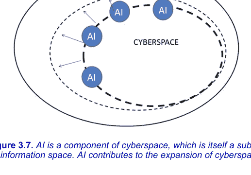

图 3.7. 人工智能是网络空间的组成部分，而网络空间本身是信息空间的子集。人工智能促进了网络空间的扩展

人工智能就其本身而言，正如我们在本书引言中所指出的那样，是网络空间的一个新方面，是其演进之一，有助于其扩张。人工智能是网络空间不可分割的一部分，而网络空间是信息空间的子集。尽管由于不断演进，网络空间在信息空间中所占的比重越来越大，但它仍然只是子集。

人工智能在与网络空间相关的军事学说或战略中扮演什么角色？我们已经指出，在一份关键的国防部网络空间战略文件《联合出版物 JP 3-12“网络空间行动”》中完全没有提及人工智能。其 2018 年版本 [JCS 18] 中从未提及人工智能，也未提及专家系统、机器学习、深度学习、机器人技术以及“自主系统”或“武器”的概念。2013 年版本 [JCS 13] 也未提及它们。这种在对网络防御至关重要的一份文件中对人工智能的沉默，可以被解读为希望将专门的网络问题与另一组将成为人工智能问题的议题脱钩。否则，这也可能意味着人工智能在网络领域得到完全整合，无需提及。这种在网络行动官方学说中不提及人工智能的做法在军事情报中自然得以延续。2018 年 11 月为美国陆军战争学院学生制作的网络行动指南 [CSL 18] 阐述了网络空间军事行动的作战方面，却从未提及人工智能。

国防部发布的 2018 年美国网络战略 [DOD 18b] 也未使用人工智能概念（或相关概念）。

人工智能最近（2019 年）已成为美国军事人工智能正式学说的主题 [DOD 19]。事实上，该文件也未建立人工智能与网络空间之间强有力、特殊的联系。后者在文件中仅被提及四次，尤其为决定：
- 网络安全应有助于保障人工智能。为此，将特别努力开发防御性网络安全工具；
- 人工智能将成为一种安全工具，提高预测和应对网络及物理威胁的能力。

2019 年 2 月，联合人工智能中心（JAIC）的负责人，该组织的成立在人工智能军事战略文件中宣布，谈到了他计划与网络司令部（以及在 Maven 项目框架下与情报部门）联合工作的计划。该中心的项目应涉及情报融合工具，而人工智能用于 C2 以及与网络司令部的合作，例如可以涵盖事件检测和网络映射。但在这里，同样，网络领域的联系并未得到特别强调。无论如何，人工智能并未被明确吸收到网络领域，网络防御官员也未被赋予将人工智能整合到国防部队的责任。

如果在官方出版文件中找不到人工智能与网络空间之间的具体联系，那么我们就必须在其他地方寻找，例如美国国防官员的声明或演讲。

### 3.4.1. 恶意软件、网络安全与人工智能

网络攻击现在被认为是最重大的战略挑战之一。窃取数据、操纵数据、修改数据、改变或禁止数据的流向、改变数据（以及处理数据的系统）的处理方式等，都是在打击网络攻击时可以考虑的风险。作战方式多种多样，如今已得到充分验证。在这种冲突环境中，人工智能已出现。网络空间中进攻和防御能力的任何即时或潜在变化都可能产生战略影响。

人工智能既可用于网络攻击，也可用于网络安全和防御。我们因此发现自己处于经典的决斗、对抗和力量平衡的配置中。存在一种平衡，每个参与者都试图将其倾向于自己一方。每个决斗者必须考虑人工智能的好处：是否应该使用它，为什么以及如何使用？最重要的是不是人工智能本身，而是它给每个人带来的东西。实验或技术壮举的诱惑可能始终存在，但除此之外，在考虑实施之前，重要的是更具战略性地思考其使用：
- 人工智能攻击是否可控，既对其设计者，也对其安全措施？
- 网络安全在任何程度上都无法抵御人工智能的攻击吗？
- 在两个人工智能之间的决斗（攻击与防御）中，以及在其中只有一方是人工智能的决斗中，力量如何分配，成功的配置（无论是攻击还是安全）是什么？人工智能在所有情况下和所有环境中都能保证优势吗？
- 什么非人工智能的策略或战术可以成功地对抗人工智能？对于防御者来说，说攻击是否由人工智能、人或两者共同实施并不重要，这说法正确吗？ [DAR 18]
- 为人工智能实施的安全或攻击手段是否与问题相称？例如，部署人工智能去攻击不安全、安全性较差或非常安全的系统是否有用？
- 人工智能是否应参与所有形式的攻击，攻击的所有阶段？
- 人工智能是否允许发明新的攻击或安全形式？
- 实施的手段是否在行动者的范围内？

人工智能将意味着攻击复杂性的增加，对安全构成挑战，同时反过来使安全更加复杂，使攻击者更难规避。在这两种情况下，复杂性就意味着质量和效率。但复杂性即使增加，也不会消除决斗和双方寻求优势的局面。而且，复杂性是网络领域的固有属性。网络空间参与者已习惯于此，它多年来一直存在于网络安全和防御话语中。因此，仅因人工智能的整合，就不能将其视为这些领域的新的变量。另一方面，人工智能可能有助于在过于复杂、常规手段已不足以应对的环境中导航。在网络安全方面，人工智能随后被视为“解决方案”，复杂性被视为“问题”或有利于威胁的环境。在攻击者方面，人工智能是对可能被攻击的系统抵抗力问题的解决方案。但我们也知道，网络空间的复杂性并不能真正有利于安全：存在许多漏洞，系统的复杂性就是原因之一。因此，对于网络安全而言，人工智能不仅应有助于及早检测攻击，还应揭开复杂性面纱的一角，以便更好地管理自己的环境。

人工智能将为安全以及攻击带来自动化，被理解为自主行动，而非预编程的自动过程：这种特性随后可在攻击检测和反应中，以及在攻击过程中得到利用：
- 在进攻方面，侦测目标和漏洞，定义在整个过程中无需人工干预即可实现目标的运作模式；
- 在安全方面，侦测攻击。

人工智能将赋予随机、机会主义攻击中使用的恶意软件一种品质，直到现在这一直是人类的标志：对环境、对环境的理解。想法是摆脱静态软件，即行为与精确编程相对应的软件，并创建能够适应、理解其演进的上下文并基于上下文的演变及其分析做出决策的应用。它们将像人类黑客一样“思考”或分析情况；它们将模仿目标环境的特征以便不被察觉，不向检测系统提供异常行为的指标，甚至不向观察、监控甚至针对行动的个人提供指标。人工智能使战术和战略远离蛮力、正面攻击以及可见、壮观、可预测和可见的暴力。我们将处于微妙性和寻求隐形和谨慎的领域。但用人工智能，即软件，取代能够进行这种情境分析的人类智能有什么意义？期望的是

这种替代呢？我们还将考虑使用人工智能来帮助他们改进攻击的人类操作员。

企业和国家机构正在试验在进攻性工具中使用人工智能。动机当然是官方上为了更好地理解流程以确保防护。但具有特定进攻任务的行动者在其方法上更进一步，测试、开发、分析和甚至对人工智能的积极使用。

为了分析人工智能增强型恶意软件的行为，IBM 开发了 DeepLocker，一种在找到目标前保持休眠的恶意软件形式。这种类型的恶意软件将利用来自多个来源和自然的数据，例如人脸识别数据、地理位置数据、社交媒体数据等。其目的是让恶意软件在寻找目标的整个过程中隐藏在阴影中，无法被检测到，并且仅在找到目标后才触发它。在这种意义上，我们将其*作案手法*与狙击手的做法相比较：只有在确认目标正确、目标已被锁定且无法逃脱攻击后才开枪，但最重要的是在最后一刻之前保持隐形。DeepLocker 是根据一种被称为深度神经网络（DNN）的模型设计的，这使得可以掩盖目标的性质（个人、组织）、目标的身份（具体是谁）以及攻击方式（将如何攻击目标）。

美国海军海军信息战系统司令部于 2019 年发起了一项挑战，奖励 150,000 美元用于开发能够检测网络攻击的人工智能。

人工智能提供的用于实施网络攻击的大多数能力在根本上并不代表与过去和现在的真正突破：上述原则是已知的，并在人工智能的内置行为中得到扩展，例如掩盖其身份、匿名行动、实施不可检测的行动、针对特定目标、实施复杂攻击（其含义是结合多种行动、多种工具、多种攻击路径等），等等。人工智能能够实施网络攻击的能力还基于它可用于实施多种不同类型的攻击，例如诱骗、欺骗等。

它们共同之处在于，它们都*承担的风险今天与过去一样不可控*。这使它们很像玩火的学徒巫师。有多少由机构开发的恶意软件最终落入国家或罪犯手中，因为它们无法被自己的设计者控制？这无疑是真正的首要风险，比能够独立自主地摆脱一切控制、反过来对设计者和其设计进行反叛的智能机器的叛乱更严重。风险与更传统的恶意软件和网络攻击工具一样，是数据泄露和窃取。应该记住，几年前由美国国家安全局开发的工具被黑客夺回，并在修改后被重新用于实施新的攻击，美国本身以及许多其他国家都为此付出了代价。控制任何类型的军火库都是一个挑战。在网络空间以外的许多领域，都出现了保护武器和军事装备的问题：武器和装备可能被盗、在黑市上转售、在作战区域被缴获，甚至从研发中心和公司被盗等。在网络空间的许多其他领域，提出的问题是如何保护武器和军事装备。这些被盗或丢失的武器被对手夺回后，随后又被归还给原始所有者、使用者或设计者。

对于人工智能恶意软件攻击的受害者来说，这有什么区别呢？对受害者的影响可能相同，无论攻击是由人工智能实施还是通过其他手段实施：数据窃取、计算机加密、企业运营中断、财务损失、形象受损、信息行动等。有无人工智能，受害者的处境几乎没有变化，除了事后，在投诉、调查、重建犯罪并希望追究责任人阶段。在攻击后阶段，尤其是在攻击被知晓之后（并非所有行动都旨在公开；在数据窃取的情况下，行动反而可能寻求完全隐形和没有任何表现），受害者、网络安全服务、警察服务、司法系统、国家或反制行动的行动者将遇到已经为人所知但会加剧的困难：分配、定位和评估所遭受的损失和损害的问题，攻击的深度和严重程度，攻击的规模（可能已超出受害者本身已知的范围）以及网络空间中进行行动时没有边界与在需要采取安全、法律、警察行动、司法或军事行动时存在强大国家边界的更常规障碍。

### 3.4.2. *AI 与网络武器*

网络空间的冲突性是通过利用该技术环境固有的或因依赖它而产生的多重漏洞而形成的。寻找和利用漏洞是网络进攻维度的核心（当然，这也必须发展战略和战术）。在防御和安全方面，工作的重点在于预判攻击，其中包括识别漏洞。然而，积极防御将更进一步，主张进行反击，甚至是预防性或先发制人的攻击。防御因此意味着了解目标的漏洞。无论立场是攻击、安全还是防御，漏洞都是核心，而服务于进攻的“军械库”（我们在此指军事以及非战争背景）是这些运作方式的基本工具。

“网络武器”这一概念需要不作精确表征的定义。它可以通过与武器定义的类比来理解。

> 武器是：“一种被使用或设计用于使用、旨在对结构、系统或生物造成身体、功能或精神上的威胁或伤害的工具。” [RID 12]

让我们回顾一下武器按其本性和按其用途存在的区分。第一种是作为破坏工具设计的，用以造成损害、对抗对手施加力量。第二种是任何被偏离其主要用途的工具或仪器，因此可成为破坏工具：一把剑是本性上的武器；一块木头在被用来击打个人时可成为武器，此时它就成为用途上的武器。在网络空间中，存在设计用于破坏或造成损害的软件工具（例如 Stuxnet），以及并非为参与进攻行动而创建的其他工具（例如 Ping 命令），但这些工具仍可被侵略者、军队或罪犯作为其进攻行动的一部分使用。

> 网络武器是，与这些武器定义相类比：“更广泛意义上武器的一个子集：计算机代码，被使用或设计用于使用，旨在对结构、系统或生物造成身体、功能或精神上的威胁或伤害。” [RID 12]

> “用于或设计或 intended 用于造成人员伤害或死亡，或对物体造成损害或破坏的网络战争手段，即导致网络行动被认定为攻击所需后果的手段。”（《塔林手册 2.0》第103条评注，引用自 [WAL 18]）

遵循武器按本性和按用途的区分，我们还将考虑两类网络武器。

网络武器的概念引发了许多问题，包括什么是网络武器、什么不是网络武器的界限。用于渗透服务器、窃取信息或进行间谍活动的手段能否被视为武器？托马斯·里德并不这么认为 [RID 12]，因为间谍活动不能被视为使用武器的攻击，因为其意图不是破坏或对目标造成身体伤害。这一选择具有法律影响，因为它将间谍入侵排除在武装冲突法之外。这在合理，但值得商榷，因为网络空间模糊了这些区分，很有可能认为外国情报机构的入侵或拦截攻击是用武器进行的。因为武器使用并不必然动员冲突法，而可能更简单地是出于犯罪动机。

武器还受到控制、禁止和限制措施的约束。

军事在网络空间开发进攻和防御工具是网络空间军事化的一方面。这些网络武器的部署和使用也是军事化的一部分。

正是在此背景下，各种行为者（国家和非国家）使用网络武器，以及相关的战略、政治、法律和语义问题，人工智能最近出现，似乎为新的能力打开了大门。

### 3.4.3. 进攻-防御/安全配置

网络空间现在通常被表示为由三个层级组成的空间：其第一层或层级是物理硬件；其

第二，是应用层（软件、数据）；第三，是意义层，也就是信息。

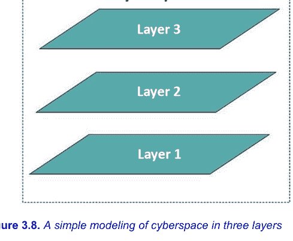

图3.8. 网络空间的三层简单建模

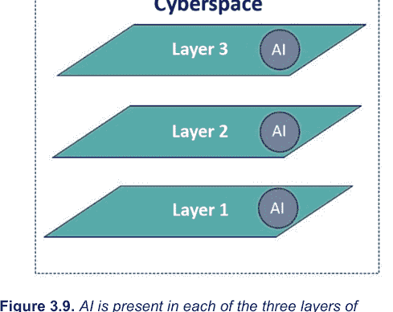

图3.9. 人工智能存在于网络空间的三个层次中。它扩展了每一个层次，并促进了整个网络空间的扩展。

人工智能属于这三个层次中的每一个。它基于硬件，有时甚至是特定硬件（ASIC芯片、传感器等）；它是一种软件形式（编程语言、人工智能应用）；最后，它处理意义，操纵数据，并且在其军事应用中，例如，其功能是为人类决策提供支持，这明确属于第三层。虽然人工智能带来了新功能，允许以不同的方式处理数据，涉及特定的软件设计，并嵌入特定的硬件（传感器、机器人等），但它并不挑战这种建模；并且，作为网络空间的扩展或参与其扩展运动的元素，它必须适用于与整个网络空间相同的解读框架。我们无法想象一个完全成熟的独立人工智能空间或领域。我们不会找到关于创建新人工智能空间的思考或提议。因此，我们将继续留在传统领域（陆地、空中、海上、太空、网络空间）内，并且不会考虑围绕人工智能构建的新空间化。

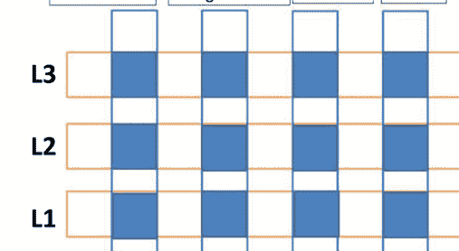

图3.10. 在网络空间的三个层次中，存在不同性质的行为者，他们具有不同的功能、能力、意图和权力。有关此图的彩色版本，请参见 www.iste.co.uk/ventre/artificial.zip

在网络空间的每一个层级上，都有不同的行为者介入，各有其角色、功能、干预程度、意图、能力和不同程度的权力。每个行为者的分量并不平等，随其介入的层级不同而变化。例如，国家可以影响每一层的配置，决定、批准或禁止开发和使用，进行监管、监督、军事化等。并非所有国家在每个层面上都有相同的分量。公司通常不是能够介入并影响每个层级的行为者，即使它们是使用者。然而，一些公司正致力于成为全球参与者，在第一层（例如通过部署国际互联网电缆）、第二层（例如通过提供社交媒体平台以及作为跨国软件公司）和第三层（通过成为信息平台）发挥重要作用。公民通常在第一层是简单的使用者，在第二层可以是使用者和开发者，在第三层是使用者/贡献者。各个交汇点（图3.10中）的配置、平衡和权重因国家而异，取决于监管、法律、治理、文化、国家组织、经济和社会。人工智能也是如此，它存在于三个层次中的每一个，并且每一类行为者都可以在其中发挥作用。从人工智能的贡献，或者从人工智能将成为目标、武器或攻击媒介的角度来审视冲突，将需要考虑图3.10模型中的每一个交汇点。

然而，人工智能以整个网络空间为基础，具有共同特征，但在分析和制定战术或战略时，需要将其单独区分。因此，我们认为一种有用的区分是人工智能与非人工智能之间的区分，即什么是人工智能、什么不是，以及与之相关或无关的内容。这样，在网络空间内就形成了两个子集，有助于解读针对各自特殊性而制定的战术。这样做的理由至少有两个：首先，人工智能不会占据网络空间的所有部分，因此在未来很长一段时间内，它将与非人工智能的网络空间共存；其次，只有所追求的最终目标才能决定方法和手段（应当记住，人工智能不一定总是最佳选择、最高效、投资回报率最高、最理性的方案等）。随着人工智能的出现，我们观察到一些特定的行为者、工具和实践的出现，它们并未占据网络空间的所有方面。

## 网络攻击

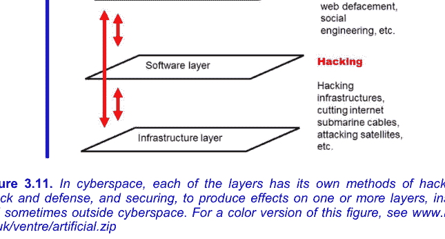

图3.11. 在网络空间中，每一层都有自己的入侵、攻击、防御和防护方法，以对一个或多个层产生效果，作用范围在网络空间内部，有时也在网络空间外部。有关此图的彩色版本，请参见 www.iste.co.uk/ventre/artificial.zip

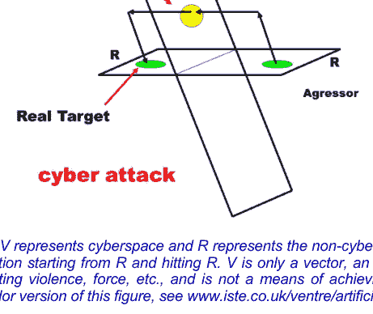

图3.12. 如果V代表网络空间，R代表非网络世界，那么攻击是一种从R出发并作用于R的行动。V只是一个载体、一个中介、一种施加暴力、武力等的手段，而不是实现预期结果的手段。有关此图的彩色版本，请参见 www.iste.co.uk/ventre/artificial.zip

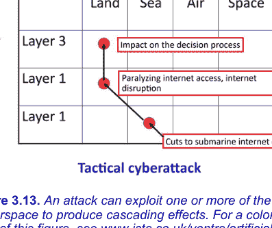

### 战术性网络攻击

图3.13. 攻击可以利用网络空间的一个或多个层次来产生连锁效应。有关此图的彩色版本，请参见 www.iste.co.uk/ventre/artificial.zip

人工智能不会改变对抗的逻辑，这种对抗始于一个点（来自“现实”世界的侵略者，拥有意志和目标），并指向同样处于“现实”世界中的目标。可能会出现一种特定的对抗，即基于人工智能的抵抗、安全或防御与基于人工智能的攻击之间的对抗。在其他情况下，将可能是基于人工智能的安全/防御与无人工智能的攻击之间的对抗；或者是无人工智能的安全/防御与基于人工智能的攻击之间的对抗；或者是安全/防御与攻击之间的对抗，而双方都不使用人工智能。

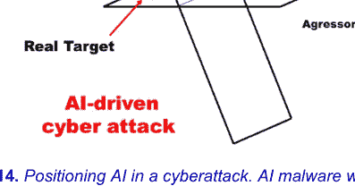

### AI驱动的网络攻击

图3.14. 在网络攻击中定位人工智能。人工智能恶意软件有时会遇到基于人工智能的安全/防御系统的对抗。有关此图的彩色版本，请参见 www.iste.co.uk/ventre/artificial.zip

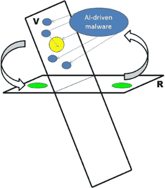

*图3.15. 人工智能恶意软件能否对其环境拥有真正的全景式或全局性视野？有关此图的彩色版本，请参见 www.iste.co.uk/ventre/artificial.zip*

基于人工智能的恶意软件的特殊性之一，是它能够考虑其整个背景或环境，并自适应地应对这一不断变化的环境。因此，人工智能一方面被赋予了一种观察环境的能力，这种能力超越了人类；另一方面，它又拥有一种近乎全景凝视的视觉能力。这不是要对网络空间有一个总体视野，而是要了解直接环境，并通过整合环境和目标的变化来调整行动。全局概览和实时行动能力赋予人工智能恶意软件对其行动领域的全景式力量，因为它还可以在尽可能接近目标的同时保持隐形和不可探测。自上而下的全局视野，加上近距离行动。

在图3.16中，我们展示了一些简单的攻击/防御配置，整合了两种基本情况：基本行为者或系统是否使用人工智能（记为1）或未使用（记为0）。这里考虑三个行为者和系统，简化了一个攻击–安全/防御方案：

- 侵略者或攻击者（记为Att）；
- 安全或防御（记为Sec）；
- 目标、对象、系统或行为者（记为C），它一方面受到攻击或可能受到攻击，另一方面受到安全/防御的保护。

我们可以如下解读图中所示的路径：

- Att (0)/Sec (0)/C (0)：攻击者不使用人工智能，安全方不使用人工智能，目标不使用人工智能/不是人工智能；
- Att (1)/Sec (1)/C (0)：攻击者使用人工智能实施攻击，安全方使用人工智能保护“目标”，目标本身不使用人工智能/不是人工智能。

这样就有八条路径。

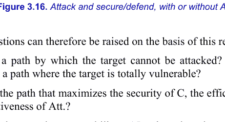

图3.16. 使用或不使用人工智能的攻击与安全/防御

因此，基于这一解读框架可以提出一些问题：

- 是否存在目标无法被攻击的路径？另一方面，是否存在目标完全脆弱的路径？
- 哪条路径能最大化C的安全性、Sec.的效率和Att.的有效性？
- 当只有一个要素使用人工智能时，谁占优势：是使用人工智能的要素，还是尽管这样，其他要素？
- 当两个或两个以上的人工智能形态相互对抗时，会发生什么？

AI的响应将取决于AI的质量、价值或级别、是否得到适当使用以及实现质量。有些AI会比其他的质量更好，有些会比其他的级别更高或更低（形成一种AI的等级体系），有些适合目标或任务，有些不适合。可以假定，AI并非在所有情况或配置中都拥有绝对优势。还必须考虑到，那些暴露于动用AI的攻击之下的目标，最终可能设法设计出替代性的规避手段、战术或战略，这些手段是本土的，可能涉及AI，也可能不涉及AI。这是所有非对称对抗的原则。无法正面交锋的弱小行为体会寻找规避战术和战略、迂回战术以及其他作战方式，从背后攻击侵略者的弱点。因为攻击者即使拥有AI，也仍然会有自己的弱点。他们使用的AI本身就可能成为第一个脆弱点（AI可以被愚弄或欺骗）。

这一解读框架适用于网络安全和网络防御的背景。目标可以是计算机、服务器、网络、联网武器系统、个人或群体、社交媒体等。

网络安全使用AI技术来抵御那些可能利用AI、也可能不利用AI的网络攻击。

### 3.4.4. 对抗性AI与对抗性机器学习

DNI将“对抗性AI”定义为：“AI的一个子集，专注于理解AI系统在恶意对手面前会如何表现。”[DNI 19]

为了观察黑客行为并使网络安全适应其战术变化，人们开发了使用机器学习的解决方案。攻击检测工具正逐渐能够追踪黑客不断变化的做法，不再局限于特定类型的攻击。新系统为此前使用的僵化系统带来了适应性、灵活性和动态性。其目标是在攻击周期中更早地发现攻击或未遂攻击。然而，黑客也意识到这些新检测方法的部署，正在调整其攻击技术。因此，力量对比依然如故。尤其因为机器学习系统并非无懈可击（数据不足，学习也不足）。为了对抗智能安全系统，黑客会寻找反制措施，通过伪装成合法用户来欺骗系统，或者设法了解安全系统的工作原理，并对用于系统学习的数据动手脚。

因此，对于攻击者而言，问题在于攻击AI本身、瞄准其弱点；而欺骗AI有时可以相当简单：

-   用于法庭判决的AI很可能会出错。事实上，由于从以往判决的大量数据中学习，它可能已经学会了判决中的错误。它很可能会再次产生这些错误。AI会复制过去的错误[HAO 19]；
-   微软于2016年在Twitter上推出的聊天机器人Tay很快就转向了仇恨言论。该AI是从网络喷子试图扰乱论坛运作而广泛传播的内容中学习的。AI不区分什么可被视为“好”或“坏”，也不区分什么合法、什么不合法。但这一经历也提醒我们，具有学习能力的AI可能会被操纵学习过程；
-   自动驾驶车辆系统无法检测到颜色与天空相近的另一辆车（该错误会导致交通事故）；
-   路标上的贴纸可以被用来误导图像分类系统（深度学习）[EYK 18]；
-   人脸识别系统的错误率相当高，并且可以被欺骗[SHA 16]；
-   在2019年8月香港示威期间，示威者使用激光照射警察部队，目的是致盲为人脸识别系统提供数据的摄像头。当摄像头无法工作时，上游识别系统就不再有用。智能系统依赖于传感器提供的数据：要挫败AI，就必须攻击数据来源——传感器。

对于这些基于AI的系统的“攻击者”而言，其方法在于攻击AI所捕获和分析的数据，这些数据很可能使AI无法正常运行。例如，神经网络可能被信号、添加到图像中的数据[SZE 13]或音频信号干扰。这些特性——也就是脆弱性——直到较近时期才被理解和识别。

因此，无论对于攻击者还是基于AI的系统的用户而言，攻击AI都正成为一个问题，无论是在网络安全领域，还是在机器人技术、自动驾驶车辆、人脸识别系统等其他领域。利用AI的脆弱性当然也是军事领域的一个关键问题。

### 3.4.5. *AI与信息战*

在*《打赢战争的机器》*（艾萨克·阿西莫夫，1961年）中，人类的三位领袖在战胜德内比安人后会面，讨论Multivac计算机在这场胜利中是否起了决定性作用。第一位承认，他修改了输入计算机的数据，因为他觉得上报数据的质量不可信；第二位承认，他修改了计算机输出的数据，因为他觉得计算机并非处于最佳状态；第三位承认，他不信任计算机生成的报告，于是抛硬币作决定，依靠运气而非直觉和机器的能力。

这个故事虽然是虚构的，却提出了几个对信息战以及更广义的战争艺术而言至关重要的问题：

-   计算机在战争中、在实施指挥控制（C2）时的地位，完全由人与机器之间的关系决定；
-   这种人机关系是以信任来界定的：
    -   对个人确保机器最佳运行能力的信任，
    -   对计算机处理之前所产生的信息/数据的质量（准确性、相关性）的信任，
    -   对计算机技术能力的信任，
    -   对机器所生成数据的质量或相关性的信任；
-   当对决策过程所依赖的所有这些要素都缺乏信任时，负责的战争领导者更愿意依靠自己的个人判断，甚至依靠运气。

在考虑AI在指挥过程中的作用时，这些问题依然存在：AI的存在并不能保证其输入数据的可靠性；AI本身在技术上可能并非最优，其输出也会引发疑问，甚至怀疑或担忧（AI实际上到底如何处理

《人工智能在信息战中的应用》（Artificial Intelligence Applications to Information Warfare）一文认为，智能体未来将成为信息战中的关键要素，用于管理信息流、构建防火墙以保护网络，并通过持续评估网络脆弱性为网络安全作出重大贡献。

在这份报告中，作者探讨了当时AI领域取得的进展如何能够应用于信息作战的实施以及信息基础设施的安全。作者的思考正值美国国防力量反思新技术对军事事务、战争艺术以及信息战相关概念形成的影响这一关键时刻。下面用几句话总结作者提出的论点：

-   他首先盘点信息战的各种定义，并强调这一概念不能仅限于军事领域，但引领其思考的正是军事领域。他采用的定义是美国国防部1994年的定义[DSB 94]：信息战是指“为支持国家军事战略而采取的行动，通过影响对手的信息和信息系统，同时利用和保护己方的信息和信息系统，以取得信息优势”⁴²。信息战既涉及防御性信息作战，也涉及进攻性信息作战。指挥控制战（C2 Warfare）是信息战在军事行动层面的体现，它包括攻击/防御对手的信息基础设施、防御己方/对手的信息基础设施，从而改变或捍卫决策回路。
-   防御维度包括所有“确保对国家安全至关重要的可靠信息的可用性、保密性和完整性的行动。”[WHI 95]
-   在20世纪90年代上半期，信息维度尚未成为政治舞台上的战略支柱。1995年《总统国家安全战略》只涉及三大支柱：外交、政治

⁴² 关于美国自20世纪90年代初以来围绕军事事务中的新信息技术所提出的概念和理论体系的分析，特别是对“信息战”概念多种定义的比较解读，请参阅：Ventre D.，《信息战》（*La guerre de l’information*），Hermes Lavoisier，巴黎，2007年。另有英文版：Ventre D.，《信息战》（*Information Warfare*），ISTE Ltd，伦敦，以及Wiley，纽约，2009年（第1版）和2016年（第2版）。

和军事，但尚未为信息空间提供一个成熟的地位。

- 国防军完全清楚事态的严重性。他们的信息基础设施（DII – 国防信息基础设施）由令人印象深刻数量的计算机、卫星和电缆组成（据说这些足以让它们绕地球飞行400次）。当时95%的军事通信使用公共网络。因此，网络暴露于进攻性行动之下，其保护变得复杂。这种复杂性源于所有这些系统之间的相互依存关系，无论是民用还是军用、公共还是私营。早在1980年代，这些网络和系统就经受了第一次计算机攻击的考验（1988年，6,000台机器在不到两小时内在全球范围内被感染；1986年和1987年，450台美国国防电脑被一名德国学生入侵）。

- 1990年代中期见证了围绕人工智能的新一波乐观情绪。许多人认为它坚定地走在成功的道路上。

- 在此期间（1990年代），智能系统或专家系统是人工智能最知名的形式之一。报告作者将专家系统定义为“模拟专家决策能力的计算机系统。专家或知识工程师编写一组‘条件–行动’规则。专家系统在面对情况时，会搜索适当的条件并返回相关的响应”。专家系统首先在医学（诊断）领域找到应用，随后才被用于军事领域（后勤、维护、规划等）。专家系统的局限性在于其编程的质量，以及知识的静态性——知识一旦输入系统便固定不变。它们严格局限于其专业领域，无法理解当出现超出其专业范围的问题时，它们已超出舒适区。专家系统可能会对所面临的问题给出错误的答案。

- “智能体”在一定程度上克服了这些弱点，因为它们允许知识在多个系统之间共享。“一个智能体是任何通过传感器感知其环境并通过效应器对其环境产生作用的东西。”“智能”智能体是指与人类用户尤其是其他智能体进行交互的智能体：“它们必须能够在没有人机界面的情况下运行”；“它们必须超越任务导向，寻求在没有被告知如何执行任务的情况下完成目标。”智能体被定义为软件工具：“与其通过命令和/或直接操作进行用户发起的交互，用户参与的是一个合作过程，在此过程中人类和计算机智能体都发起通信、监控事件并执行任务。”智能体的性能取决于其了解用户兴趣以及智能体社区兴趣的能力。学习是这些智能系统的核心，其目标是获得一定的能力水平。

- 那么这些智能体如何在信息战中使用？

- 它们可以提供工具来帮助管理海量信息。即使是基础应用（例如 SIFT 软件 – 斯坦福信息过滤工具）也能在 Usenet 用户发布的大量数据中过滤和搜索特定信息。软件应用程序提供了通过 Personalink 发送消息的可能性，而无需知道收件人的地址，软件负责搜索信息并传递消息。这些“智能体”严格来说并不是“智能”的。但对于军事应用而言，前景是取得显著进展，提供工具帮助军事指挥管理，应对日益增长的数据海量。

- 它们可以部署用于基础设施安全。需要取得进展以开发智能防火墙；通过了解其习惯、行为、工作环境来监控系统用户的活动；使用专门从事任务的智能体来评估安全级别（评估密码、身份验证、访问授权等的安全级别）。

在撰写本报告时，人工智能的能力仍不足以开发所有这些项目。结果令人鼓舞，但仍存在许多局限性。作者所开启的前景尚未能够实现。

#### 3.4.5.1. AI 与模因战争

模因是传播、产生影响并持续存在的信息 [FIN 11]，一种具有传染性的思想，或某些思想和信念的传染现象。该概念首次由理查德·道金斯 [DAW 76] 于1976年在他的著作 *《自私的基因》* 中提出。模因冲突的本质特征在于错误的感知的再现和传播——如同病毒式传播。社交网络促进了这一现象的增长。然而，被描述为非科学对象 [BUR 12] 的模因冲突，已被纳入现代冲突中信息战的思考中。在2010年4月的 *《军事情报专业公报》* 中，中尉布莱恩·J·汉考克 [HAN 10] 建议使用模因学来理解叛乱运动的原因并解释其根源：“模因本质上是一个想法，但并非每个想法都是模因。为了使一个想法成为模因，它必须被传递——或复制给另一个个体” [HAN 10]；“模因是传播、产生影响并持续存在的信息” [FIN 11]。

根据后者的定义，我们将保留模因在冲突中的三个基本特征：它必须传播、产生影响并具有持久性。需要补充的是，模因有时是负面思想（“有害感知” [MAT 98]），但它们并不局限于此类型，因为也存在积极的、幽默的、建设性的模因等。模因本质上以其从个体到个体的传播、通过模仿为特征。模因要么是一个想法，要么是一幅图像、一种行为，或信息。

模因冲突在于创造思想并传播它们。互联网和社交媒体是这种传播的载体。人工智能可以成为其中一种工具，例如，通过允许创建信息、内容（模因以不同形式出现，创作的可能性多种多样：文字、符号、图标、图像等），并利用互联网，将其适应不同的情境和环境，个性化它们，使其适应目标受众，修改其形式和传播路线、传播强度，根据情境的演变、产生的效果等。模因战是一场影响、虚假信息和宣传的战争。模因适合社交媒体，因为要有效，它们必须简短扼要（1–10个词） [FIN 11]。关于思想的作用及其操纵的这些思考已由美国国防部在 DARPA 支持的项目框架内资助。罗伯特·芬克尔斯坦引用了一些这些项目，涉及思想的流行病学、军事模因学、战略传播中的社交媒体和叙事网络。这些项目在2006–2011年期间进行。社交媒体在战略传播（SMISC）项目的目标是生产用于检测和识别不利模因的自动化工具和技术，并使对抗这些类型的方式自动化

### 3.4.7. 示例 2：2019 年香港事件

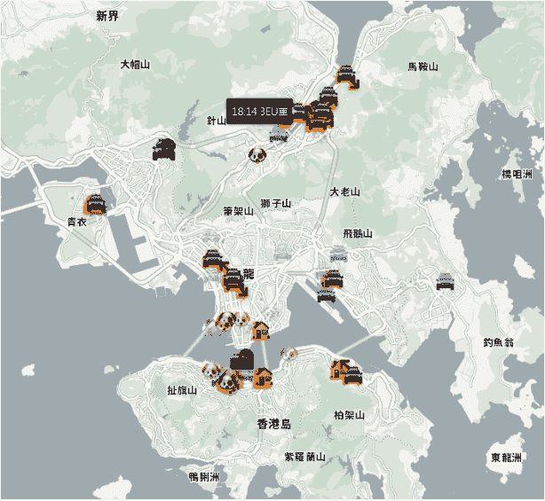

**Figure 3.17.** _hkmap.live 应用的屏幕截图（2019年10月11日）。_  
_如需此图的彩色版本，请访问 www.iste.co.uk/ventre/artificial.zip_

2019年香港发生的抗议活动图像传遍了世界。一方面，我们看到示威者 _大规模_ 占领公共空间，另一方面，我们看到执法力量试图控制人群，阻止示威者的前进。在示威者与警察部队之间的对峙中，每个团体都使用自己的策略并采用自己的战术。信息技术领域的科技 arsenal 已因人工智能应用而得到丰富：

- 当局方面已部署人脸识别系统，目的是为了执法目的识别示威者（被视为暴徒者可能面临数年监禁）；

- 示威者迅速调整了他们的行为以应对这种技术视角，通过遮挡面部，或在自身与摄像头（固定摄像头或无人机上的摄像头）之间插入雨伞和激光束；
- 示威者正在摧毁智能路灯，因为担心它们配备了监控摄像头；
- 介于两者之间，用于统计示威者人数的边缘AI应用已在香港部署，由香港公司C&R Wise AI创建并推向市场。该应用被用于全国多所大学（如香港城市大学）和公共交通中，以管理人流。例如，通过统计示威者人数，该应用可以证实或反驳官方的警方数据。因此，结果既可以服务于示威者的利益，也可以服务于警方的利益。公司创始人Raymond Wong保证，该应用不会从正面跟踪个人，而只会从背面跟踪，基于个人外形进行计数。因此，它不存在侵入式监视的目的或意愿，也没有识别的可能性。

从这些要素中，我们总结出一些关于人工智能在冲突局势中作用的重要观点：

- 与几乎所有技术一样，人工智能可以被绕过。它并非绝对可靠，非对称作战中的弱势方总有办法发明出以弱胜强的战术。例如，示威者向摄像头举起了雨伞；
- 基于传感器的人工智能，以及更广义的人工智能，完全依赖于输入数据。在这里，通过插入雨伞或口罩，无法捕获任何数据，人工智能毫无用处，因为它没有被输入数据。人工智能在数据和传感器层面是可以被攻击的。而且无需通过黑客行为或科学技术知识来对抗它。正是示威者行为的简单改变实现了对人工智能的抵抗；
- 人工智能的物理、物质延伸（此处指摄像头）容易受到破坏、蓄意损坏和肢体暴力等行为的攻击；
- 智慧城市中的危机或冲突，其形式与无连接、传统、非现代化城市中的不同。使用无人机可以作为安全或监视与监测的替代方案。但从无人机拍摄的图像无法捕获相同的图像（即人脸）。另一方面，智能城市的未来发展，即互联物体的环境，将为这些城市的居民构成监视空间，他们将越来越难以从中脱身；
- 人工智能的使用补充而非取代了目前在网络空间中进行的较为常规的行动，即在示威者方面，使用社交网络、移动电话、直播和大量移动应用程序，以及影响力策略；在当局方面，进行社交媒体监控、通信拦截、部分关闭互联网的计划等；
- 中国当局已通知苹果公司，必须从其应用商店中移除 hkmap.live 应用。该应用可用于定位警力，据称一方面可能被示威者用来躲避执法，另一方面可能被袭击警察的犯罪分子所使用。这家在中国开展业务的美国公司别无选择，只能回应中国当局的要求。

### 3.4.8. 示例3：恶意人工智能攻击

场景：欺诈性电子邮件通过垃圾邮件钓鱼方式传播。但这些邮件由人工智能驱动。借助这个“引擎”，每封邮件都针对其目标量身定制。它是情境化的，也就是说，它会自动插入到合法邮件的流中，几乎没有任何特征能将其区分出来，这将使经典网络安全工具的识别和检测变得非常困难，甚至不可能。人工智能在恶意软件中的用处，在于让合法邮件看起来是合法的。

这种通过冒充合法人员的攻击形式在某些方面已经存在，包括身份盗用。但有了人工智能，这种策略一方面被自动化，另一方面攻击更加隐蔽。恶意软件利用的正是这种伪装成其他事物的能力。借助人工智能，这种策略更能诱骗人类和系统。这种做法将缩小合法与非合法之间的区别，因为在外观上两者之间没有或只有极少的信息能够加以区分。当非法的东西看起来像是合法的（聊天机器人冒充在线真人，能够被当成真正的对话者；深度伪造，用于操纵图像、声音乃至感知），当虚假的东西与真实的一样可信时，我们如何区分什么该被摒弃、什么可以接受？合法的事物现在也可能蒙上非法和危险的嫌疑。

这些虚假的、人为造出的内容，这些诱饵，以机器的速度生成，以光速在光纤中传播，因此能够挫败任何纯粹依赖人类的对抗尝试。人类的速度无法与机器匹敌。然而，在信息操纵和虚假信息中，谁先发布一条信息，谁就占据优势。要反驳这些言论，就需要付出巨大努力去否认、论证和削弱第一条信息所造成的影响。

对于人工智能机器来说，生成看起来像人类创作的可信内容并不复杂。例如，在社交媒体上，人类撰写的消息通常很短（字数少、句子少）、论证薄弱（没有复杂的推理）、有时拼写随意（自然语言被简化），并使用符号、缩写、“代码”等，这些机器都很容易学会。

### 3.4.9. 示例4：蜂群攻击

当攻击者成群结队地发起攻击时，有哪些抵抗、安全和反击形式可以对抗？蜂群式攻击是否是一种不可战胜的形式？

将大量无人机连接在一起，对目标发动攻击的设想，因人工智能而成为可能。因为在人工智能的加持下，相互通信的机器变成一个整体、一个单体，其中每个部分都是整体的一部分，并且能够根据目标在形态和威力上不断演化、调整。目标很快就会被压制。能否用防御性蜂群来对抗进攻性蜂群？对于孤立的目标，如何抵御蜂群攻击？

对于攻击者而言，可以设想多种情景。他们会根据目标是孤立目标还是蜂群来配置自己的蜂群。

孤立目标可能是：

- 配备人工智能：
  - 无保护的，
  - 有保护的：配备人工智能，或不配备人工智能，
  - 反应性的，
  - 非反应性的；
- 未配备人工智能：
  - 无保护的，
  - 有保护的：配备人工智能或不配备人工智能，
  - 反应性的，
  - 非反应性的。

蜂群（我们假定它必须搭载人工智能）可以是：

- 无保护的；
- 有保护的；
- 反应性的（反击、抵抗、恢复）；
- 非反应性的（被动的，不会对攻击者作出反应，可能仅限于恢复）。

蜂群可以由以下部分组成：

- 可通信的个体（人群、军队等）；
- 无人机、机器人等；
- 恶意软件；
- 在信息战攻击情况下的信息来源（网站群、媒体、社交媒体上的真实或虚假账户等）。人工智能促进了虚拟网民、自动化内容的创建，并使所生成的内容适应目标和情境的演变。

### 3.4.10. 示例5：跨越有AI与无AI的领域

正如当代世界可以分为两类：一类是已连接且与网络空间相连的空间，另一类是无连接或与网络空间没有关联的区域（后者借助移动通信而趋于缩小，但仍在地球上占据非常广阔的空间），我们可以设想几个与人工智能相关的领域：

- 没有任何 AI 的环境 [AI0]；
- 完全由 AI 构成的环境，全部是 AI [AI1]；
- 混合环境，包含部分 AI。该环境并不完全依赖于 AI [AI2]：
  - 该环境可能源于构建，例如集成了一些 AI 组件的系统，
  - 它也可能是对 [AI0] 的 AI 入侵的结果，例如，当 AI 攻击没有 AI 保护的系统时，
  - 在这两种情况下，AI 都会作为一个新元素出现，仅凭其存在就会影响环境，无论是敌对的、侵略性的还是非侵略性的。

我们将认为：

- [AI1] 很少见；
- [AI0] 可能占主导；
- [AI2] 正在逐步扩大。

然后可以就这些圈子之间的权力平衡提出问题：

- [AI0] 与 [AI1] 之间的对抗会是什么样子？
- 是否 [AI1] > [AI0]？在两种配置之间的不对称性中，哪一方能占据上风？
- 是否 [AI1] > [AI2]？
- 在 [AI2] 中，AI 是否接管整个环境？它是否主导所有非 AI 的事物？

# 结论

与人工智能（AI）相关的关键概念，从而构成其领域或空间，是速度、自主性、隐蔽性、行动、决策、学习、数据等。针对这一特定的 AI 空间，我们必须评估其缺陷和漏洞，例如错误、偏见、不完美以及暴露于攻击的风险，这些是 AI 最重要的方面。

这些方面的许多内容已存在于网络安全和网络防御所涉及的问题中。但当我们谈论网络空间时，我们主要考虑的是网状化（世界、个人和社会的网络化），因此我们根据这一基本特征来处理安全和防御问题。网络质疑了我们控制空间的方式，从而质疑了我们对国家空间、主权、边界、距离的缩短、对该空间的权力以及该空间的军事化方式的思考。网络突出了流动、交换和共享的概念。网络空间意味着数据的持续流动性和永久性移动，因此是一种与其自身空间化相关的动态。

AI 处于不同的层面；它需要其他概念、其他思想、其他表征和逻辑。尽管如此，它是网络空间的完整组成部分，没有它就一无是处：它以数据为食，由应用程序构成，在网络空间中行动并流通并作用于网络空间，而它将修改、破坏和重新配置网络空间。将具有不同行为（智能、自主、自适应、能够诱骗、模仿、模糊真实与虚假、现实与人工之间的界限）的新组件引入网络空间，很可能会重新洗牌。

AI 是网络空间不可分割的一部分。因此应如此对待，并成为网络空间安全和防御政策与原则的不可分割的一部分。

**表 C.1. 在一些最近的国家网络安全战略中寻找 AI 参考**

| 国家网络安全战略 | 人工智能 | 机器学习 | 机器人 |
|---|---:|---:|---:|
| 国家网络安全战略，卢森堡，20181 | 4 | 0 | 0 |
| 国家网络安全战略，西班牙，20192 | 2 | 0 | 2 |
| 美利坚合众国国家网络战略，20183 | 2 | 0 | 0 |
| 国家网络安全战略 2018–2023，约旦4 | 2 | 0 | 0 |
| 新西兰网络安全战略 20195 | 2 | 0 | 0 |
| 网络安全战略，爱沙尼亚，2019–20226 | 1 | 1 | 3 |
| 挪威国家网络安全战略，20197 | 1 | 0 | 1 |
| 大韩民国国家网络安全战略，20198 | 1 | 0 | 0 |
| 国家网络安全战略，阿联酋，20199 | 1 | 0 | 0 |
| 迪拜网络安全战略，201710 | 1 | 0 | 0 |
| *Revue stratégique de cyberdéfense*，法国，201811 | 1 | 0 | 0 |
| 新加坡网络安全战略，201612 | 1 | 0 | 0 |
| 国家网络安全战略，土耳其，2016–201913 | 0 | 0 | 0 |
| 国家网络安全战略 2016–2021，进展报告，英国14 | 0 | 0 | 0 |
| 国家网络安全行动计划，2019–2024，加拿大15 | 0 | 0 | 0 |
| 关键基础设施保护网络安全政策，日本，201616 | 0 | 0 | 0 |
| 网络安全战略，泽西岛，201717 | 0 | 0 | 0 |
| 欧洲联盟网络安全战略，201318 | 0 | 0 | 0 |
| 国家网络安全政策，智利，201719 | 0 | 0 | 0 |
| 国家网络空间安全战略，中国，201620 | 0 | 0 | 0 |
| *Estrategia Nacional de Ciberseguridad de Costa Rica*，201721 | 0 | 0 | 0 |
| 丹麦网络和信息安全战略，201822 | 0 | 0 | 0 |
| 国家网络安全战略 2017–2021，埃及23 | 0 | 0 | 0 |
| 国家网络安全战略，希腊，201724 | 0 | 0 | 0 |
| *Estrategia Nacional de Seguridad Cibernética*（国家网络安全战略），危地马拉城，201825 | 0 | 0 | 0 |
| 科威特国国家网络安全战略，2017–202026 | 0 | 0 | 0 |
| 数字安全国家战略，摩纳哥，201727 | 0 | 0 | 0 |
| 国家网络安全政策，尼泊尔，201628 | 0 | 0 | 0 |

1. <https://hcpn.gouvernement.lu/dam-assets/fr/publications/brochure-livre/national-cybersecurity-strategy-3/national-cybersecurity-strategy-iii-en-.pdf>.
2. <https://www.dsn.gob.es/es/file/2989/download?token=EuVy2INr>.
3. <https://www.whitehouse.gov/wp-content/uploads/2018/09/National-Cyber-Strategy.pdf>.
4. <http://moict.gov.jo/uploads/studies/National%20Cyber%20Security%20Strategy%202018-2023.pdf>.
5. <https://dpmc.govt.nz/sites/default/files/2019-07/Cyber%20Security%20Strategy.pdf>.
6. <https://www.mkm.ee/sites/default/files/kyberturvalisuse_strateegia_2022_eng.pdf>.
7. <https://www.regjeringen.no/contentassets/c57a0733652f47688294934ffd93fc53/national-cyber-security-strategy-for-norway.pdf>.
8. <https://www.krcert.or.kr/filedownload.do?attach_file_seq=2162&attach_file_id=EpF2162.pdf>.
9. <https://www.tra.gov.ae/userfiles/assets/Lw3seRUalMd.pdf>.
10. <https://csc.dubai.ae/res/wp-content/uploads/DCSS-EN.pdf>.
11. <http://www.sgdsn.gouv.fr/uploads/2018/02/20180206-np-revue-cyber-public-v3.3-publication.pdf>.
12. <https://www.csa.gov.sg/~/media/csa/documents/publications/singaporecybersecuritystrategy.pdf>.
13. <https://www.uab.gov.tr/uploads/pages/siber-guvenlik/ulusal-sibereng.pdf>.
14. <https://assets.publishing.service.gov.uk/government/uploads/system/uploads/attachment_data/file/805677/National_Cyber_Security_Strategy_Progress_Report.pdf>.
15. <https://www.publicsafety.gc.ca/cnt/rsrcs/pblctns/ntnl-cbr-scrt-strtg-2019/ntnl-cbr-scrt-strtg-2019-en.pdf>.
16. <https://www.nisc.go.jp/eng/pdf/cs_policy_cip_eng_v4.pdf>.
17. <https://www.gov.je/SiteCollectionDocuments/Government%20and%20administration/C%20Cyber%20Security%20Strategy%2020170215%20VP.pdf>.
18. <https://ec.europa.eu/newsroom/dae/document.cfm?doc_id=1667>.
19. <https://www.ciberseguridad.gob.cl/media/2017/04/NCSP-ENG.pdf>.
20. <https://chinacopyrightandmedia.wordpress.com/2016/12/27/national-cyberspace-security-strategy/>.
21. <https://micit.go.cr/images/imagenes_noticias/10-11-2017__Ciberseguridad/Estrategia-Nacional-de-Ciberseguridad-de-Costa-Rica-11-10-17.pdf>.

然而，我们观察到情况并非如此。AI 正在铺设一条独立的道路。从军事上看，网络指挥官并未被赋予 AI 军事化的全部责任。正在为 AI 创建专门的结构。国家网络安全战略仅谨慎地整合 AI，

通常作为众多元素之一呈现的，进入网络空间。与此同时，人工智能也是特定国家战略的主题。

很少有国家网络安全战略文件对人工智能有所提及。约旦的战略就是其中之一：

> “网络罪犯正在使用人工智能机器人投放更有针对性的网络钓鱼广告和电子邮件，并分析大量社交媒体信息来描绘目标。网络聊天机器人也被越来越多地用于客户服务——将其定位为人们信任的系统。攻击者将利用这种信任并构建聊天机器人，试图从人们那里获取财务信息。”29

我们也将提及卢森堡的：

> “人工智能发展固有的威胁。总的来说，人工智能将出现在恶意软件的设计和执行过程中。它目前是学术界的研究课题，很快将成熟到足以被实施到真正的恶意软件中，这些恶意软件将能够动态适应组织网络和基础设施防御团队所采取的安全措施。”30

在两种情况下，人工智能都被确定为新型网络威胁的一种形式。但在如何应对它们的方法或手段方面，却没有任何设想。

新西兰的战略31则相反，只是对人工智能提出了一个定义，并未超出其范围：“一种能够模拟人类决策和学习的计算机系统，包括执行与人类心智相关的认知功能，包括学习和语言”。

- 29. http://moict.gov.jo/uploads/studies/National%20Cyber%20Security%20Strategy%202018-2023.pdf
- 30. https://hcpn.gouvernement.lu/dam-assets/fr/publications/brochure-livre/national-cybersecurity-strategy-3/national-cybersecurity-strategy-iii-en-.pdf.
- 31. https://dpmc.govt.nz/sites/default/files/2019-07/Cyber%20Security%20Strategy.pdf.

更一般地说，当这些战略文件提及人工智能时，只是为了提醒我们它属于更广泛的新技术集合，如云计算或物联网，这些技术注定要改变网络空间和现代社会。

因此，人工智能特定政策与网络安全政策之间的脱钩，在全球范围内是一种常见做法。目前，人工智能在网络安全政策中几乎没有被提及。我们还注意到人工智能在美国国防教义文件中的存在非常薄弱，尽管政府和国防政策显示出对人工智能的强烈承诺；美国国防部长期以来在这些技术上投入了大量资金，而人工智能是军队现代化中的领先技术之一。所有这些都给人一种对人工智能重视程度不均衡的印象。俄罗斯在2019年仍在准备其自身的人工智能国家战略。该练习在全球范围内才刚刚实施。因此，在人工智能完全进入安全和国防政策以及军事教义之前，还需要一点时间，几个月，可能几年。要加快这些进程，可能需要比其他事件更重大的事件，完全归因于人工智能能力的利用。

以下几点似乎引起了我们的注意，以总结这项工作：

- 人工智能被描绘为变革性、颠覆性、革命性的技术或技术集合，但它直到最近才在政治、战略和教义层面得到考虑。人工智能的新浪潮尚处于起步阶段；
- 话语是触发人工智能不同阶段的主要因素之一。因此，我们强调了负面或危言耸听的话语的作用，这些话语往往源自研究人员，他们的论点被政治家听取并引发，例如人工智能的第一次寒冬。然而，政治家的话语也发挥着决定性作用：罗纳德·里根1982年的演讲标志着科学和技术研究巨额投资的新时期；
- 围绕主要技术项目的国家动员也是对国际环境的反应的表现。安全困境和对经济和工业权力丧失的恐惧正将国家推向技术发展或军备竞赛。例如，1982年日本宣布其创建新一代计算机的计划时就是这种情况。各大国立即作出反应，并致力于新的研发计划，既有民用也有军用。人工智能的历史与其他技术一样，其复兴是各国相对于世界其他地区地位的结果。今天，美国、中国、俄罗斯和欧洲之间的竞争是驱动力；
- 人工智能的“军事化”写在其起源中。技术是军事的、民用的或双用的。它由军方资助，其成果由军方监督，在美国或俄罗斯，以及其他国家，从其诞生之初就是如此。它与互联网和计算机等其他技术处于相同的位置，尤其是；
- 每一代人工智能都被简化为其主要技术之一。整个时期都以专家系统为标志，这是1980年代和1990年代的旗舰技术。今天，人工智能似乎被简化为机器学习。但这种简化可能是有用的；
- 这种简化在其他方面有助于滋养既定的人工智能话语。事实上，我们听到的关于人工智能政策、人工智能安全或人工智能研究的故事相对简单。它们告诉我们技术（这里是人工智能，但在网络空间或网络安全方面我们也会发现同样的思维）对社会有益，必须为个人的利益而开发和引入（他们的生活质量和安全）。但这些技术及其实施必须追求的主要项目本质上是经济性的（事实上忘记了将公民联网、全球通信、获取知识或世界民主化的项目）。然而，阻碍这一项目的障碍正在出现：敌人、对手和罪犯通过攻击技术或借助技术来攻击社会。然后我们必须保护、捍卫所有这些技术，因为系统的生存取决于它们。我们还必须学会掌握这些技术并将其变成武器，以便我们能够与敌人平等地应对；
- 人工智能并没有挑战某些领导人、政治和军事领导人对技术可以使他们全能的盲目信念。人工智能是一个图腾，一种神奇的武器，人类渴望建立自己的权力和力量并施加暴力，他们挥舞并向其民众、部队和世界展示。人工智能是这种信念或深刻信念的延伸，即宇宙、世界、经济、政治、人类政府和战争的世界可以通过对信息的主导而被支配，而在21世纪则是数据。这种信念的构建跨越了几个世纪，但在20世纪随着计算机和网络的出现而呈现出特定形式。今天，随着人工智能，数据比以往任何时候都更成为绝对权力的来源。这些信念从未受到质疑。事实上，官方文件并未质疑这种对数据的无节制竞赛的极限、对数据的依赖或通过数据控制世界的项目的可行性；
- 人工智能与网络空间一样，似乎对战争中的权力不可或缺。它被认为是在战争中取得胜利的必备要素。在人工智能之前，有互联网、电信、卫星等。随着人工智能的出现，有专家系统；今天，有机器学习。然而，这些每次都被描述为革命性的技术的积累，从未保证胜利甚至绝对安全。对手总能学会适应、绕过、放弃技术或相反地加以利用，建立不对称或混合冲突。这种新的人工智能不太可能比昨天的技术更能保证军事和政治胜利。胜利的条件以及经济和政治权力都不能简化为单一技术。人工智能也不会带来更快的胜利，即使它似乎压缩了时间，而这首先是数据处理、计算和算法的时间。然而，将人类从决策循环中移除并加快速度的诱惑似乎很大。胜利只有在速度下才可能。然而，如果人工智能提高了行动或决策的速度，它仍然需要时间来学习，而且至少目前，它还需要能够与决定其命运和激活的人类节奏进行沟通。这种对时间缩减的痴迷和对人类的排斥，人类被认为太慢或无法处理他们自己创建和部署的系统产生的大量数据，反映出一种更生产主义而非生产性的逻辑：机器会比人类更高效、更有效、更快。战争然后将被简化为管理者的问题，而人力资源将成为战争业务中最后的薄弱环节。

# 附录

## 附录 1

### 人工智能编年史

在我们提出的人工智能历史时间线（表 A1.1）中，武装冲突阶段和重要政治事件被突出显示（阴影行和列）。

| 人工智能历史里程碑 | 年份 | 国家 |
|---|---|---|
| 第一次世界大战开始¹ | 1914 |  |
| 第一次世界大战结束 | 1918 |  |
| 卡雷尔·恰佩克的戏剧 R.U.R.（引入了“机器人”一词） | 1921 | 捷克斯洛伐克 |
| 苏联成立（1922年12月30日） | 1922 | 苏联 |
| *大都会*电影，其女主角是女性人形机器人 | 1927 | 德国 |
| 日本首台“机器人”学天则的设计 | 1929 | 日本 |
| 第二次世界大战开始 | 1939 |  |
| 美国科学家 W. McCulloch 和 W. Pitts 尝试创建神经元的人工算法 | 1943 | 美国 |
| 第二次世界大战结束 | 1945 |  |

1 在此时间线中，我们用灰色突出显示了武装冲突的日期。这并不意味着这些冲突伴随着人工智能的进步和技术。我们在此更多地将它们作为历史不同阶段的标记。冲突的选择也存在争议，因为在此期间世界历史的进程中还有许多其他类似事件。

| 人工智能历史里程碑 | 年份 | 国家 |
|---|---|---|
| 第一次印度支那战争开始（1946年12月19日） | 1946 | 印度支那 |
| 诺伯特·维纳出版了他的著作 *控制论：或动物与机器中的控制与通信*（“控制论”一词首次公开使用） | 1948 | 美国 |
| 多米尼克·杜巴尔在报纸 *Le Monde* 上发表文章“Vers la machine à gouverner”，专门论述控制论（维纳之后）（1948年12月28日） | 1948 | 法国 |
| 埃德蒙·伯克利出版了他的著作 *巨脑：或会思考的机器*（其中他将早期计算器与人类大脑进行比较） | 1949 | 美国 |
| 韩国战争开始（1950年6月25日） | 1950 | 韩国 |
| 图灵测试。文章“Computing Machinery and Intelligence”²（发表于哲学评论 *Mind*）（提出了如今著名的测试或模仿游戏） | 1950 | 美国 |
| 克劳德·香农发表文章“Programming a Computer for Playing Chess”³ | 1950 | 美国 |
| 马文·明斯基构建了 SNARC，即首个神经网络模拟器 | 1951 | 美国 |
| 韩国战争结束 | 1953 | 韩国 |
| 古巴革命开始 | 1953 | 古巴 |
| 第一次印度支那战争结束 | 1954 | 印度支那 |
| 越南战争开始 | 1955 | 越南 |
| Logic Theorist，被认为是首个人工智能程序的名称。由赫伯特·西蒙、艾伦·纽厄尔和约翰·肖创建 | 1955 | 美国 |
| MANIAC 计算机运行了首个国际象棋游戏程序 | 1956 | 美国 |
| 由约翰·麦卡锡、马文·明斯基和克劳德·香农组织的达特茅斯学院会议。约翰·麦卡锡引入了“人工智能”一词 | 1956 | 美国 |

| 人工智能历史里程碑 | 年份 | 国家 |
|---|---|---|
| 感知器，由弗兰克·罗森布拉特设计（大脑感知能力的计算机模型） | 1957 | 美国 |
| 安德烈·尼古拉耶维奇·柯尔莫哥洛夫和弗拉基米尔·伊戈列维奇·阿诺德证明了神经网络的数学可行性 | 1957 | 苏联 |
| 麻省理工学院人工智能实验室的创建（由约翰·麦卡锡和马文·明斯基） | 1958 | 美国 |
| 编程语言 LISP（LISt Processing）的开发 | 1958 | 美国 |
| 古巴革命结束 | 1959 | 古巴 |
| 马文·明斯基创建麻省理工学院人工智能实验室 | 1959 | 美国 |
| “机器学习”一词的引入 | 1959 | 美国 |
| 马文·明斯基的文章“Steps toward artificial intelligence”⁴ | 1961 | 美国 |
| 首台工业机器人 UNIMATE（用于通用汽车的装配线） | 1961 | 美国 |
| 古巴导弹危机（十月） | 1962 | 古巴 |
| 在约翰·麦卡锡的倡议下创建 SAIL（斯坦福人工智能实验室） | 1963 | 美国 |
| E.A. Feigenbaum, J. Feldman, *Computers and Thought* [FEI 63] | 1963 | 美国 |
| STUDENT 应用的开发（解决代数问题） | 1964 | 美国 |
| ELIZA，约瑟夫·魏森鲍姆在麻省理工学院制作的首个聊天机器人。被认为是一个交互程序，允许用英语对话 | 1964 | 美国 |
| 洛特菲·扎德⁵ 形式化了模糊逻辑⁶ | 1965 | 美国 |
| DENDRAL，由爱德华·费根鲍姆和遗传学家约书亚·莱德伯格（斯坦福大学）开发的首个化学分析专家系统 | 1965 | 美国 |

4 Minsky M., “Steps toward artificial intelligence”, *Proceedings of the IRE*, 1961年1月，第 8–30 页，可在以下网址获取：https://courses.csail.mit.edu/6.803/pdf/steps.pdf.

5 洛特菲·扎德是一位数学家，他出生于阿塞拜疆，在德黑兰大学毕业，并在麻省理工学院继续深造。

6 模糊逻辑是人工智能的工具。

| 人工智能历史里程碑 | 年份 | 国家 |
|---|---|---|
| SHAKEY 机器人（斯坦福）由以查尔斯·罗森为核心的团队开发 | 1966 | 美国 |
| 特里·威诺格拉德开发了自然语言应用 SHRDLU | 1968 | 美国 |
| *2001：太空漫游*，一部人类面对人工智能 HAL 9000 的电影 | 1968 | 美国 |
| 曼斯菲尔德修正案。DARPA 此后仅资助直接与军事应用相关的项目⁷ | 1970 | 美国 |
| 京都大学研究人员（在大阪世博会期间）展示了首个面部识别系统 | 1970 | 日本 |
| 正博·森发表“The Uncanny Valley”。该文章认为人类面对机器人时会产生不适感区域 | 1970 | 日本 |
| 编程语言 PROLOG | 1972 | 美国 |
| WABOT-1，首台“智能”人形机器人 | 1972 | 日本 |
| 数学家詹姆斯·莱特希尔告诉英国科学委员会，人工智能研究迄今未能产生任何承诺的影响 | 1973 | 英国 |
| 越南战争结束 | 1975 | 越南 |
| *星球大战*，乔治·卢卡斯的电影：人形机器人 C-3PO 和机器人 R2-D2 | 1977 | 美国 |
| *首届人工智能在法律应用国际会议*（威尔士斯旺西），1979年9月17日至27日 | 1979 | 威尔士 |
| 1961年开发的斯坦福 Cart 移动机器人得到改进，配备了摄像头，并成为自主车辆的早期范例之一 | 1979 | 美国 |
| Gammanoid 机器人击败世界西洋双陆棋冠军（卡内基梅隆大学） | 1979 | 美国/蒙特卡洛 |

7 凭借这笔资金得以形成的科研团体随后解散，不得不寻找新的联合空间。例如，帕洛阿尔托研究中心（PARC）和施乐公司就发挥了这样的作用。参见 https://monoskop.org/images/c/c0/DeLanda_Manual_War_in_the_Age_of_Intelligent_Machines.pdf.

| 人工智能历史里程碑 | 年份 | 国家 |
|---|---|---|
| 海湾战争开始 | 1990 | 伊拉克 |
| 太平洋 Rim 人工智能国际会议（PRICAI）的创建 | 1990 | 日本 |
| Loebner⁹ 奖的创建，每年评选通过图灵测试最好的程序 | 1990 | 美国 |
| 麻省理工学院机器人专家创立 iRobot Corporation¹⁰ | 1990 | 美国 |
| 海湾战争结束 | 1991 | 伊拉克 |
| 苏联解体（1991年12月26日） | 1991 | 苏联 |
| 车臣战争开始 | 1993 | 车臣 |
| 维诺尔·文奇在“Technological Singularity”中发展了奇点主题 | 1993 | 美国 |
| 1993年6月，一群日本研究人员创建了机器人竞赛 Robot J-League。鉴于该倡议的成功以及大量国际请求，该项目被修改以创建 RoboCup。该项目于1993年9月公开宣布 | 1993 | 日本 |
| 第一次车臣战争开始（1994年12月11日） | 1994 | 车臣 |
| 理查德·华莱士开发了聊天机器人 ALICE（Artificial Linguistic Internet Computer Entity）¹¹ | 1995 | 美国 |
| 第一次车臣战争结束（1996年8月31日） | 1996 | 车臣 |
| 阿富汗内战开始 | 1996 | 阿富汗 |

| AI历史里程碑 | 年份 | 国家 |
|---|---|---|
| RoboCup（机器人世界杯倡议）首届国际机器人锦标赛（名古屋）12。挑战：到2050年击败人类足球队13 | 1997 | 日本 |
| IBM的深蓝国际象棋电脑击败加里·卡斯帕罗夫（1997年5月） | 1997 | 美国 |
| 自主机器人Sojourner在NASA发射的探测站成功着陆后（1997年7月4日）部署在火星表面 | 1997 | 美国 |
| 具有情感的智能机器人Kismet，由麻省理工学院开发 | 1998 | 美国 |
| AIBO（人工智能机器人），一种类似狗的机器人。由索尼开发。该机器人旨在从其与环境、人类和其他AIBO的互动中学习 | 1999 | 日本 |
| 第二次车臣战争开始（1999年8月） | 1999 | 车臣 |
| Kismet机器人（由Cynthia Breazeal设计）识别并模拟面部表情 | 2000 | 美国 |
| 人形机器人ASIMO（本田公司） | 2000 | 日本 |
| 阿富汗内战结束 | 2001 | 阿富汗 |
| 世界贸易中心袭击（2001年9月11日） | 2001 | 美国 |
| 《人工智能》，一部以人形儿童机器人为主角的电影 | 2001 | 美国 |
| 扫地机器人（iRobot公司）首次工业化生产 | 2002 | 美国 |
| 永不停止的图像学习者（NEIL），一种比较和分析图像之间关系的机器学习系统（卡内基梅隆大学） | 2013 | 美国 |
| IBM的Watson应用上市 | 2013 | 美国 |
| 欧洲委员会启动人类脑计划（HBP） | 2013 | 欧洲联盟 |
| 日本向国际空间站（ISS）发送名为Kirobo的机器人（由丰田开发） | 2013 | 日本 |
| Cortana，微软的虚拟助手 | 2014 | 美国 |
| Eugene Goostman聊天机器人通过图灵测试 | 2014 | 俄罗斯 |
| ALEXA，亚马逊的智能虚拟助手（用于智能音箱） | 2014 | 美国 |
| 全球3,000人签署请愿书，呼吁禁止自动武器 | 2015 | 国际 |
| Google DeepMind的AlphaGo击败欧洲围棋冠军（2015年10月） | 2015 | 美国 |
| 机器人Claudico与世界上四位最佳玩家对战扑克并输掉了比赛。其继任者Libratus在2017年赢得了比赛 | 2015 | 美国 |
| Google发布其深度学习软件TensorFlow | 2015 | 美国 |
| AlphaGo（Google DeepMind）击败韩国围棋选手李世乭（机器四胜人类一负）14（2016年3月） | 2016 | 美国 |
| 微软的TAY聊天机器人社交网络上散布仇恨言论 | 2016 | 美国 |
| Google Home，内置AI作为个人助手的扬声器电话 | 2016 | 美国 |
| Hanson Robotics创建Sophia机器人 | 2016 | 美国 |
| AlphaGo（Google DeepMind）的改进版本在60场比赛中取得60场胜利，对阵世界顶尖围棋选手（2017年1月4日） | 2017 | 美国 |

12. 立即获得国际成功，40支队伍参赛，公众成功吸引5,000名观众。

13. 然而，Alan Mackworth被认为提出了机器人足球运动员的想法：“一个长期目标是让机器人队伍参与合作和竞争行为。特别是，我们选择足球作为其中一项任务。” Mackworth A., On Seeing Robots: Computer Vision: System, Theory, and Applications, pp. 1–13, World Scientific Press, Singapore, 1993. 可在以下地址获取：https://pdfs.semanticscholar.org/d69a/25e87e905f55e8669bf67079faac8b8510ef.pdf。游戏机器人由Alan Mackworth和Dinesh Pai（不列颠哥伦比亚大学）作为Dynamo（动力学与移动机器人）项目的一部分开发。据报道，机器人足球运动员的想法也在1992年10月东京举行的关于人工智能重大挑战研讨会上被讨论。

14. 机器战胜人类的这一胜利被称为“斯普特尼克时刻”，以指代一个高点、一个历史时刻，以及具有战略意义的时刻。https://www.dw.com/en/whos-afraid-of-artificial-intelligence-in-china/a-45546972.

## 附录 2

### AI在*联合出版物*中（美国国防部）

**表A2.1.** AI在美国军事教义文献中的地位（联合出版物）

| 文件 | 年份 | 人工智能 | 机器学习 | 深度学习 | 自主 | 专家系统 |
|---|---|---:|---:|---:|---:|---:|
| “Reconnaissance, Surveillance, and Target Acq Sppt for Joint Op. JP 3-55” | 1993 | 0 | 0 | 0 | 11 | 0 |
| “JTTP for Unmanned Aerial Vehicles. JP 3-55.1” | 1993 | 0 | 0 | 0 | 4 | 0 |
| “Close Air Support. JP 3-09.3” | 2014 | 0 | 0 | 0 | 02 | 0 |
| “Counterterrorism. JP 3-26” | 2014 | 0 | 0 | 0 | 03 | 0 |
| “Joint Airspace Control. JP 3-52” | 2014 | 0 | 0 | 0 | 2 | 0 |
| “Barriers, Obstacles, and Mine Warfare for Joint Operations. JP 3-15” | 2016 | 0 | 0 | 0 | 2 | 0 |
| “Joint and National Intelligence Support to Military Operations. JP 2-01” | 2017 | 1 | 0 | 0 | 0 | 0 |
| “Countering Air and Missile Threats. JP 3-01” | 2017 | 0 | 0 | 0 | 04 | 0 |
| “Counterinsurgency. JP 3-24” | 2018 | 0 | 0 | 0 | 05 | 0 |
| “Meteorological and Oceanographic Operations. JP 3-59” | 2018 | 0 | 0 | 0 | 16 | 0 |
| “Joint Logistics. JP 4-0” | 2019 | 1 | 1 | 0 | 0 | 0 |

1. 无人驾驶飞行器是一种动力航空器，不搭载人类操作员，利用空气动力提供升力，可以自主飞行或远程操控。

2. 该概念在文件中出现14次，但不指智能机器或自主机器人的意义上的自主系统。

3. 在这里，自主性指的是恐怖主义行动的自主性。

4. 在本文档中，“自主”一词出现10次，但不指自主机器或系统。它指的是个人的自主决策。

5. 与本列表中的其他文件一样，出现的“自主”一词指的是团体和个人的行动，而非智能机器。

6. “海军获取[…]来自机载和卫星传感器、浮标以及自主水下航行器和滑翔机的遥感数据。” https://fas.org/irp/doddir/dod/jp3_59.pdf.

## 附录 3

### AI在国防部（美国）的指南和指令中

**表A3.1.** AI及其相关概念，在专门针对“网络”或“信息作战”问题的DoD文件（指令、指示等）中搜索1

| 文件标题 | 年份 | 人工智能 | 机器学习 | 深度学习 | 自主 | 专家系统 |
|---|---|---:|---:|---:|---:|---:|
| “DoDD 3000.09 Autonomy in Weapon Systems, November 21, 2012, Incorporating Change 1, May 8, 2017” | 2017 | 0 | 0 | 0 | 108 | 0 |

1. DoD指南和指令的长列表可在以下地址找到：https://fas.org/irp/doddir/dod/index.html。从这大量工作中，我们仅保留了标题表明其主要或完全涉及网络空间、网络防御以及信息和通信技术问题的文件，标题为“信息作战”和“信息战”。目的是观察“人工智能”在这些以网络为中心的论述中的存在与否。

## 附录 4

### AI在美国海军指令中

表A4.1中列出的所有文件均在线收集1。

**表A4.1.** AI在美国海军文件中的情况

| 文件 | 年份 | 人工智能 | 机器学习 | 深度学习 | 自主 | 专家系统 |
|---|---|---:|---:|---:|---:|---:|
| “OPNAV INSTRUCTION 5513.1F. Department of the Navy Security Classification Guides” | 2005 | 3 | 0 | 0 | 0 | 0 |
| “OPNAV INSTRUCTION 5513.16B” | 2006 | 0 | 0 | 0 | 22 | 0 |
| “OPNAV INSTRUCTION 5513.7D” | 2008 | 0 | 0 | 0 | 13 | 0 |
| “OPNAV INSTRUCTION 5513.15E” | 2008 | 0 | 0 | 0 | 14 | 0 |

1. https://fas.org/irp/doddir/navy/index.html.

2. 战场准备自主水下航行器（BPAUV）；半自主水文侦察航行器（SAHRV）。

3. 对自主车辆的引用：“战场准备自主水下航行器”。

4. 半自主水文侦察航行器（SAHRV）。

SecNavInst 指令集可在网上获取⁵。

所有 OPNAV 指令（海军作战部长指令 海军情报与安全学说）均可在网上获取⁶。

## 附录 5
### 美国海军陆战队文件中的人工智能

表 A5.1 中列出的所有文件均在网上收集¹。

| 文件 | 年份 | 人工智能 | 机器学习 | 深度学习 | 自主 | 专家系统 |
|---|---|---|---|---|---|---|
| “MCDP 6 Command and Control” | 1996 | 2 | 0 | 0 | 0 | 2 |
| “MCWP 3-42.1. Unmanned Aerial Vehicle Operations, 14 August 2003” | 2003 | 0 | 0 | 0 | 2 | 0 |
| “Marine Corps Midrange Threat Estimate: 2005–2015, Marine Corps Intelligence Activity, July 1, 2005” | 2005 | 0 | 0 | 0 | 0² | 0 |

*表 A5.1. 美国海军陆战队文件中的人工智能*

1 https://fas.org/irp/doddir/usmc/index.html.

2 该术语出现了三次，但指的是“自主地区”。

## 附录 6
### 美国空军文件中的人工智能

表 A6.1 中列出的所有文件均在网上收集¹。

| 文件 | 年份 | 人工智能 | 机器学习 | 深度学习 | 自主 | 专家系统 |
|---|---|---|---|---|---|---|
| “Air Force Handbook Vol. 5 36-2235” | 2002 | 0 | 0 | 0 | 0 | 5 |
| “AFDD 3-13, Information Operations, January 11, 2005, incorporating change 1, July 28, 2011” | 2005/2011 | 1 | 0 | 0 | 0 | 0 |
| “Air Force Material Command Instruction 23-112” | 2006 | 1 | 0 | 0 | 0 | 0 |
| “AFDD 3-40, Counter-Chemical, Biological, Radiological and Nuclear Operations, 26 January 2007, interim change 2, 1 November 2011” | 2007/2011 | 0 | 0 | 0 | 1 | 0 |
| “AFDD 6-0, Command and Control, 1 June 2007, incorporating change 1, 28 July 2011” | 2007/2011 | 0 | 0 | 0 | 0 | 1 |

# 参考文献

[ABU 19] Abu Salem F.K., Al Feel R., Elbassuoni S. 等, “FA-KES：关于叙利亚战争的虚假新闻数据集”, 第十三届国际 AAAI 网络与社交媒体会议论文集 (ICWSM 2019), 慕尼黑, 德国, 可获取于: https://www.aaai.org/ojs/index.php/ICWSM/article/download/3254/3122/, 页 575–582, 2019.

[AHA 17] Aha D.W., Coman A., “人工智能叛乱：改变叙事”, AAAI 人工智能会议, 三藩市, 美国, 可获取于: https://www.nrl.navy.mil/itd/aic/content/ai-rebellion-changing-narrative, 2017.

[AIF 19] AI Finland, 人工智能正以全速推进, 报告, 可获取于: https://www.tekoalyka.fi/en/reports/finland-leading-the-way-into-the-age-of-artificial-intelligence/1-artificial-intelligence-is-advancing-at-full-speed/#:~:text=Artificial%20intelligence%20means%20devices%2C%20software,task%20and%20situation%20at%20hand, 2019 年 6 月.

[ALB 88] Albano M.C., 美国海军陆战队支援兵器指挥与控制中专家系统技术可行性的初步研究, 硕士论文, 海军研究生院, 可获取于: https://core.ac.uk/download/pdf/36716505.pdf, 1988.

[ALL 17] Allen G.C., “Project Maven 带来人工智能打击 ISIS”, Bulletin of the Atomic Scientists, 可获取于: https://thebulletin.org/2017/12/project-maven-brings-ai-to-the-fight-against-isis/, 2017.

[AND 84] Andriole S.J., Hopple G.W. (编), 人工智能的国防应用, Lexington, Toronto, 1984.

[ASH 51] Ashby W.-R., Les mécanismes cérébraux de l’activité intelligente, PUF, Paris, 1951.

[ASI 41] Asimov I., “Liar!”, Astounding, 1941 年 4 月–5 月.

[BAC 87] BACK Jr. J.F., BARBONE Jr. A.F., CROCKER G.K. 等, 人工智能：专家系统用于军团战术规划及其他应用, 研究项目 DTIC ADA183283, 美国陆军战争学院, 可获取于: https://archive.org/download/DTIC_ADA183283/DTIC_ADA183283.pdf, 1987.

[BAK 95] BAKER N., COSGROVE P., COULTHARD-CLARK C. 等, 从过去到未来：澳大利亚陆空作战经验, 报告, 澳大利亚国防军, 可获取于: https://www.army.gov.au/sites/g/files/net1846/f/1995_from_past_to_future_aust_experience_of_land_air_operations_0.pdf, 1995.

[BAU 18] BAUM S.D., “超智能怀疑主义作为政治工具”, Information, 卷 9, 期 9, 可获取于: https://doi.org/10.3390/info9090209; https://www.mdpi.com/2078-2489/9/9/209, 页 209, 2018.

[BÉG 50] BÉGUIN A., “L’âge des robots”, Revue Esprit, 特别版, 1950 年 9 月.

[BÉN 71] BÉNARD H., BARIÉTY M., Bulletin de l’Académie Nationale de Médecine, Masson, Paris, 可获取于: https://gallica.bnf.fr/ark:/12148/bpt6k63151374, 1971 年 1 月 5 日.

[BLO 98] BLOCH J., La guerre : traduction de l’ouvrage russe “La guerre future aux points de vue technique, économique et politique”, 卷 1, Guillaumin, Paris, 可获取于: https://gallica.bnf.fr/ark:/12148/bpt6k96040616, 1898.

[BLU 22] BLUMENFELD J., “Les idées à travers le monde – R.U.R.”, Floréal : l’hebdomadaire illustré du monde du travail, 可获取于: https://gallica.bnf.fr/ark:/12148/bpt6k63083399/f11.image.r=%22un%20robot%22?rk=21459;2, 1922 年 12 月 9 日.

[BOD 77] BODEN M., 人工智能与自然人, Basic Books, Inc., New York, 可获取于: https://profiles.nlm.nih.gov/ps/access/BBBB LN.pdf, 1977.

[BUC 76] BUCHANAN B.G., LEDERBERG J., McCARTHY J., J. Weizenbaum《计算机能力与人类理性》的三篇书评, 研究项目, 斯坦福人工智能实验室, 可获取于: https://apps.dtic.mil/dtic/tr/fulltext/u2/a044713.pdf, 1976.

[BUC 85] BUCHANAN B.G., 专家系统：工作系统与研究文献, 报告, 斯坦福大学, 可获取于: http://infolab.stanford.edu/pub/cstr/reports/cs/tr/85/1075/CS-TR-85-1075.pdf, 1985 年 10 月.

[BUR 12] BURMAN J.T., “模因误解：一个非科学对象的传记，1976–1999”, Perspectives on Science, 卷 20, 期 1, 可获取于: https://www.mitpressjournals.org/doi/pdf/10.1162/POSC_a_00057, 页 75–104, 2012.

[CDI 19] **CENTER FOR DATA INNOVATION**, *RFI：制定联邦人工智能标准参与计划*, 信函, 可获取于: http://www2.datainnovation.org/2019-nist-ai-standards.pdf, 2019 年 5 月 10 日.

[CHA 50] **CHAUCHARD P.**, “Les cerveaux artificiels”, *Revue Esprit*, 1950 年 9 月.

[CHI 19] **CHIN L.**, *用人工智能伦理标准维护美国价值观以进行数据收集和算法处理*, 报告, 可获取于: https://www.nist.gov/system/files/documents/2019/06/03/nist-ai-rfi-lchin_001.pdf, 2019 年 5 月 31 日.

[CHR 01] **CHRISTALLER T., DECKER M., GILSBACH J.-M. 等**, *Robotik – Perspektiven für menschliches Handeln in der zukünftigen Gesellschaft*, Wissenschaftsethik und Technikfolgenbeurteilung 第 14 卷, Springer, Berlin, 2001.

[CLA 17] **CLAIR S.**, “Akademgorodok, la cité où se forment les soldats de la cyberguerre de Poutine”, *Slate*, 可获取于: http://www.slate.fr/story/140687/bienvenue-akademgorodok-capitale-russe-cyberguerre, 2017 年 3 月 15 日.

[CLE 71] **CLEMA J., KIRKHAM J.**, “CONSIM（冲突模拟器）：政治模拟中的风险、成本和收益”, *Proceedings ACM’71. Proceedings of the 1971 26th Annual Conference*, New York, United States, 可获取于: https://dl.acm.org/citation.cfm?id=810488, 页 226–235, 1971.

[COM 17] **COMAN A., JOHNSON B., BRIGGS G. 等**, “人工智能叛乱的社会态度：一个框架”, *2017 年 AAAI 人工智能会议人工智能、伦理与社会研讨会*, San Francisco, USA, 可获取于: https://www.nrl.navy.mil/itd/aic/content/social-attitudes-ai-rebellion-framework, 2017.

[CON 18] **CONGER K., CAMERON D.**, “Google 正在帮助五角大楼为无人机构建人工智能”, *Gizmodo*, 可获取于: https://gizmodo.com/google-is-helping-the-pentagon-build-ai-for-drones-1823464533, 2018 年 6 月 3 日.

[COS 54] **COSSA P.**, *Du cerveau humain aux cerveaux artificiels*, Masson et Cie, Paris, 1954.

[COU 52] **COUFFIGNAL L.**, *Les machines à penser*, Les Éditions de Minuit, Paris, 1952.

[CSL 18] **CENTER FOR STRATEGIC LEADERSHIP**, *战略网络空间作战指南*, 报告, 美国陆军战争学院, 可获取于: https://csl.armywarcollege.edu/USACSL/Publications/Strategic_Cyberspace_Operations_Guide.pdf, 2018 年 11 月 30 日.

[CUT 95] **CUTMORE T.R.H., GAMBLE H.D.**, *用于战争游戏的专家系统对手*, 报告, 国防与民用环境医学研究所, 可获取于: https://ia800105.us.archive.org/24/items/DTIC_ADA301667/DTIC_ADA301667.pdf, 1995 年 4 月.

[DAN 86] DANIELS J.D., “人工智能：简要教程”, Signal, 1986年6月.

[DAR 83] DARPA, 战略计算，新一代计算技术。用于其发展和应用于国防关键问题的战略计划, 报告, Defense Advanced Research Projects Agency, 可获取于: https://apps.dtic.mil/dtic/tr/fulltext/u2/a141982.pdf, 1983年10月28日.

[DAR 11] DARPA, 财政年度（FY）2012预算估算, 论证卷宗, Department of Defense, United States, 可获取于: https://www.darpa.mil/attachments/(2G5)%20Global%20Nav%20-%20About%20Us%20-%20Budget%20-%20Budget%20Entries%20-%20FY2012%20(Approved).pdf, 2011年2月.

[DAR 18] DARKTRACE, 下一个范式转变 – AI驱动的网络攻击, 白皮书, BrightTALK, 可获取于: https://www.brighttalk.com/webcast/13279/356575/the-next-paradigm-shift-ai-driven-cyber-attacks, 2018年.

[DAV 84] DAVIS P.K., 兰德公司在将人工智能技术应用于战略级军事政治战争推演方面的经验, 文件, Rand Corporation, 可获取于: https://ia800101.us.archive.org/13/items/DTIC_ADA147272/DTIC_ADA147272.pdf, 1984年.

[DAW 76] DAWKINS R., 《自私的基因》, Oxford University Press, Oxford, 1976年.

[DDI 84] DDI, DDI在安全事务支持协会的讲话记录, 转录, CIA, 可获取于: https://www.cia.gov/library/readingroom/docs/CIA-RDP95M00249R000801140011-6.pdf, 1984年11月13日.

[DEL 53] DE LATIL P., 《论控制论。人工思维》, Gallimard, Paris, 可获取于: https://gallica.bnf.fr/ark:/12148/bpt6k3403312q, pp. 206–227, 1953年.

[DEL 91] DE LANDA M., 《智能机器时代的战争》, MIT Press, New York, 可获取于: https://monoskop.org/images/c/c0/DeLanda_Manuel_War_in_the_Age_of_Intelligent_Machines.pdf, 1991年.

[DES 85] DESBOIS D., “人工智能将如何主导战争”, Le Monde Diplomatique, 可获取于: https://www.monde-diplomatique.fr/1985/09/DESBOIS/38774, pp. 19–21, 1985年9月.

[DNI 19] DIRECTOR OF NATIONAL INTELLIGENCE, AIM倡议，利用机器增强情报的战略, 文件, 可获取于: https://www.dni.gov/files/ODNI/documents/AIM-Strategy.pdf, 2019年.

[DOD 90] DEPARTMENT OF DEFENSE, 关键技术计划, 报告, 可获取于: https://ia800105.us.archive.org/25/items/DTIC_ADA219300/DTIC_ADA219300.pdf, 1990年3月15日.

[DSD 18] Deputy Secretary of Defense, 联合人工智能中心的成立, 备忘录, 可获取于: https://admin.govexec.com/media/establishment_of_the_joint_artificial_intelligence_center_osd008412-18_r.pdf, 2018年6月27日.

[DTE 86] Director of Training and Education, Carnegie-Mellon University, 备忘录, 可获取于: https://www.cia.gov/library/readingroom/docs/CIA-RDP88G01332R000300300014-1.pdf, 1986年9月2日.

[DUB 48] Dubarle D., “一门新科学：控制论 – 通向治理机器”, *Le Monde*, 1948年12月28日.

[EAR 73] Earnest L., 斯坦福人工智能研究的头十年, 报告, ARPA, 可获取于: http://i.stanford.edu/pub/cstr/reports/cs/tr/74/409/CS-TR-74-409.pdf, 1973年7月.

[EAT 18] Eaton J., “一种新兴能力：人工智能和机器学习在军事上的应用”, *Small War Journals*, 可获取于: https://smallwarsjournal.com/jrnl/art/emerging-capability-military-applications-artificial-intelligence-and-machine-learning, 2018年2月.

[ECK 83] Eckman P.K., 感谢参加人工智能研讨会, 备忘录, Deputy Director of Central Intelligence, 可获取于: https://www.cia.gov/library/readingroom/docs/CIA-RDP85M00364R000500790001-3.pdf, 1983年12月20日.

[ECK 84] Eckman P.K., 1983年人工智能研讨会总结报告, 报告, CIA, 可获取于: https://www.cia.gov/library/readingroom/docs/CIA-RDP86M00886R000500400010-5.pdf, 1984年7月12日.

[ELL 68] Ellis E.S., *《草原上的蒸汽人》*, The American News Co., New York, 1868年.

[ELL 12] Elliott S., Hall J., Smith M. *et al.*, 连接的机器人, 白皮书, Atos, 可获取于: https://atos.net/wp-content/uploads/2016/06/atos-white-paper-connected-robots.pdf, 2012年11月.

[ESP 18] Esper M.T., 陆军指令2018-18（支持国防部联合人工智能中心的陆军人工智能特遣部队）, 指令, Secretary of the Army, 可获取于: https://armypubs.army.mil/epubs/DR_pubs/DR_a/pdf/web/ARN13011_AD2018_18_Final.pdf, 2018年10月2日.

[EYK 18] Eykholt K., Evtimov I., Fernandes E. *et al.*, 深度学习视觉分类的鲁棒物理世界攻击, 报告, CVPR, 可获取于: https://arxiv.org/pdf/1707.08945.pdf, 2018年.

[FEI 60] FEIGENBAUM E.A., “苏联控制论与计算机科学”, Communications of the ACM, vol. 4, no. 12, 可获取于: https://pdfs.semanticscholar.org/7c24/c0a387c9584cfa8255b0c0a6cf7e94a84459.pdf, pp. 566–579, 1960年.

[FEI 63] FEIGENBAUM E., FELDMAN J., 《计算机与思维》, McGraw-Hill, New York, 1963年.

[FEI 80] FEIGENBAUM E.A., 1980年代的专家系统, 报告, Stanford University, 可获取于: https://stacks.stanford.edu/file/druid:vf069sz9374/vf069sz9374.pdf, 1980年.

[FIN 11] FINKELSTEIN R., “教程：军事模因学”, Social Media for Defense Summit, Alexandria, United States, 可获取于: https://ia800407.us.archive.org/17/items/MilitaryMemetics/MilitaryMemetics.pdf, 2011年10月24–26日.

[FIT 83] FITZWATER H.E., 1983–1993年CA战略计划的制定, 备忘录, 可获取于: https://www.cia.gov/library/readingroom/docs/CIA-RDP85B01152R000901240007-7.pdf, 1983年12月16日.

[FRA 86] FRANKLIN J., SHUMAKER R.P., “军事应用中的人工智能”, Signal, 1986年6月.

[FRE 17] FREEDBERG S.J., “人工智能将在12月前帮助追捕达伊什”, Breaking Defense, 可获取于: https://breakingdefense.com/2017/07/artificial-intelligence-will-help-hunt-daesh-by-december/, 2017年7月13日.

[FUN 14] FUNK M., IRRGANG B. (eds), 《德国和日本的机器人技术》, Peter Lang, Francfort-sur-le-Main, 可获取于: https://www.peterlang.com/view/978365399648/xhtml/chapter007.xhtml, 2014年.

[GAL 18] GALANINA A., “智能武器。军事人工智能的俄罗斯之路”, Izvestia, 可获取于: https://iz.ru/815370/angelina-galanina-dmitrii-liudmirskii-roman-kretcul/oruzhie-razuma-rossiiskii-put-k-voennomu-iskusstvennomu-intellektu, 2018年11月22日.

[GIF 84] GIFFRAIN R.J., “谁害怕人工智能？”, Revue des Deux Mondes, pp. 594–596, 1984年12月.

[GIL 85] GILHOOL G.T., 一次仅限高管的一天战略简报, Temple University, Archives, CIA, 可获取于: https://www.cia.gov/library/readingroom/docs/CIA-RDP87M00539R000600730002-1.pdf, 1985年4月30日.

[GOF 06] GOFFI J.-Y., 《技术科学概览》, Vrin, Paris, 2006年.

[HAG 14] HAGEL C., 国防部长演讲, Ronald Reagan Presidential Library, Simi Valley, 可获取于: https://www.defense.gov/Newsroom/Speeches/Speech/Article/606635/, 2014年11月15日.

[HAN 92] HANSON R.L., 陆军中人工智能和专家计算机系统的演变, 硕士论文, Faculty of the U.S. Army Command and General Staff College, Fort Leavenworth, 可获取于: https://apps.dtic.mil/dtic/tr/fulltext/u2/a255221.pdf, 1992年.

[HAN 10] HANCOCK B.J., “模因战争：战争的未来”, Military Intelligence Professional Bulletin, 可获取于: https://fas.org/irp/agency/army/mipb/2010_02.pdf, pp. 41–46, 2010年3–4月.

[HAO 19] HAO K., “AI将人们送进监狱——而且做错了”, Technology Review, 可获取于: https://www.technologyreview.com/s/612775/algorithms-criminal-justice-ai/, 2019年1月21日.

[HAR 88] HARRISON D.F., “计算机、电子数据与越南战争”, Archivaria, no. 26, 可获取于: https://archivaria.ca/index.php/archivaria/article/viewFile/11490/12434, pp. 18–32, 1988年.

[HAR 89] HARKEN H.D., 用于战区战争演习的核打击飞机更换、飞机部署和后勤调动的自动化专家系统, 硕士论文, Air Force Institute of Technology, Wright-Patterson Air Force Base, 可获取于: https://ia802800.us.archive.org/10/items/DTIC_ADA215728/DTIC_ADA215728.pdf, 1989年12月.

[HOL 76] HOLDEN A.D.C., “人工智能趋势”, IEEE Transactions on Computers, vol. C25, no. 4, 可获取于: https://www.computer.org/csdl/trans/tc/1976/04/01674610.pdf, pp. 313–316, 1976年4月.

[HOR 90] HORVITZ E., “生物医学的自动化推理。受邀开场演讲”, Conference on AI in Systematic Biology, Napa Valley, United States, 1990年9月.

[JCS 13] JOINT CHIEFS OF STAFF, 网络空间作战, Joint Publication 3-12 (R), Department of Defense, Washington, DC, 可获取于: https://fas.org/irp/doddir/dod/jp3_12r.pdf, 2013年2月5日.

[JCS 14] JOINT CHIEFS OF STAFF, 联合空域管制, Joint Publication 3-52, Department of Defense, Washington, DC, 可获取于: https://fas.org/irp/doddir/dod/jp3_52.pdf, 2014年11月13日.

[JCS 16] JOINT CHIEFS OF STAFF, 联合行动中的障碍、阻碍和地雷战, Joint Publication 3-15, Department of Defense, Washington, DC, 可获取于: https://fas.org/irp/doddir/dod/jp3_15.pdf, 2016年9月6日.

[JCS 17] JOINT CHIEFS OF STAFF, 军事行动的联合和国家情报支持, Joint Publication 2-01, Department of Defense, Washington, DC, 可获取于: https://fas.org/irp/doddir/dod/jp2_01.pdf, 2017年7月5日.

[JCS 18] 参谋长联席会议，《网络空间作战》，联合出版物第3-12号，美国国防部，华盛顿特区，可访问：https://www.jcs.mil/Portals/36/Documents/Doctrine/pubs/jp3_12.pdf?ver=2018-06-19-092120-930，2018年6月8日
[JCS 19] 参谋长联席会议，《联合后勤》，联合出版物第4-0号，美国国防部，华盛顿特区，可访问：https://fas.org/irp/doddir/dod/jp4_0.pdf，2019年2月4日
[JIE 18] JIESHU W.，《中国人工智能的早期历史（1950年代至1980年代）》，2018年技术史学会（SHOT）年会研究生研讨会，美国圣路易斯，可访问：http://wangjieshu.com/2018/10/17/history_of_ai_in_china/，2018年
[JOR 94] JORION P.，《人工智能在神经科学与信息科学的交汇处》，Lekton，第4卷，第2期，可访问：http://cogprints.org/491/1/LEKTON.html，第85–114页，1994年
[JOS 97] JOSEPHSON P.R.，《重访新亚特兰蒂斯：西伯利亚科学城阿卡杰姆戈罗多克》，Faculty Books，第1卷，可访问：https://digitalcommons.colby.edu/cgi/viewcontent.cgi?article=1000&context=facultybooks，1997年
[KAS 17] KASHIN V., RASKA M.，《应对美国第三次抵消战略：俄罗斯的视角、回应与挑战》，政策报告，RSIS，新加坡，可访问：https://www.rsis.edu.sg/wp-content/uploads/2017/01/PR170124_Countering-the-U.S.-Third-Offset-Strategy.pdf，2017年1月
[KIR 96] KIRK D.C.，《人工智能在信息战中的应用》，文献，美国陆军，美国陆军战争学院，美国卡莱尔，可访问：https://archive.org/details/DTIC_ADA309400，1996年3月22日
[KOP 65] KOPROWSKI H., BRODY J.A., HADLOW W.J. 等，《西伯利亚的新科学城》，Science，第149卷，第3687期，可访问：http://science.sciencemag.org/content/149/3687/947.extract.jpg，第947–949页，1965年8月
[KOZ 18] KOZYULIN V.，《致命自主系统构成的三大威胁类别》，报告，可访问：https://russiancouncil.ru/analytics-and-comments/analytics/tri-gruppy-ugroz-smertonosnykh-avtonomnykh-sistem/，2018年11月1日
[KRA 88] KRAMER B.M.，《专家系统：技术、工具与应用（书评）》，AI Magazine，第9卷，第1期，可访问：https://www.aaai.org/ojs/index.php/aimagazine/article/view/667/585，1988年
[LAN 69] LANGEVIN L.，《思考机器》，La Pensée : revue du rationalisme moderne，第147期，第61–89页，1969年10月
[LAU 85] LAURENT J.-P.，《法国的人工智能研究》，AI Magazine，第6卷，第1期，可访问：https://doi.org/10.1609/aimag.v6i1.465，第22–30页，1985年
[LAW 84] LAWLOR J.，《人工智能与专家系统》，报告，西南地区教育研究与发展实验室，洛斯阿拉米托斯，可访问：https://files.eric.ed.gov/fulltext/ED250156.pdf，1984年1月15日
[LAZ 88] LAZORTHES G.，《大脑与计算机：结构与性能的比较研究》，Privat，图卢兹，1988年
[LED 76] LEDERBERG J.，《评约瑟夫·魏泽鲍姆〈计算机力量与人类理性〉》，斯坦福大学，斯坦福，可访问：https://profiles.nlm.nih.gov/ps/access/BBBBLN.pdf，1976年
[LEV 64] LEVIEN R., MARON M.E.，《控制论及其在苏联的发展》，备忘录，兰德公司，可访问：https://ia802902.us.archive.org/14/items/DTIC_AD0602705/DTIC_AD0602705.pdf，1964年7月
[LEW 91] LEWONOWSKI M.C.，《信息战》，研究报告，空军战争学院/空军大学/马克斯韦尔空军基地，可访问：https://apps.dtic.mil/dtic/tr/fulltext/u2/a248134.pdf，1991年
[LI 11] LI S., LONG F., WANG Y.，《心理战中专家系统的原理探究》，载于 HUANG D.S., GAN Y., GUPTA P. 等（编），《先进智能计算理论与应用：人工智能方向》，ICIC 2011，Springer，柏林，可访问：https://link.springer.com/chapter/10.1007/978-3-642-25944-9_43，2011年
[LID 96] LIDSKOG R.，《我们信任科学吗？——论科学知识、风险意识与公众信任的关系》，Acta Sociologica，第39卷，可访问：http://citeseerx.ist.psu.edu/viewdoc/download?doi=10.1.1.925.8004&rep=rep1&type=pdf，第31–56页，1996年
[LIE 73] LIEBERMAN H.R.，《苏联为国家计划设计计算机网络》，The New York Times，可访问：https://www.nytimes.com/1973/12/13/archives/soviet-devising-a-computer-net-for-state-planning-big-network-in-us.html，1973年12月13日
[LIE 00] LIEBOWITZ J., ADYA M.，《海军水面作战中心-卡德洛克分部虚拟图书馆项目中使用专家系统与智能代理的分析》，载于 BERTOT J.C., DIAMOND FLETCHER P.（编），《信息高速公路上的世界图书馆：迎接新千年的挑战》，IGI Global，赫尔希，可访问：https://epublications.marquette.edu/cgi/viewcontent.cgi?article=1082&context=mgmt_fac，第169–188页，2000年
[LIG 73] LIGHTHILL D.，《人工智能：总述》，《人工智能：论文研讨会》，小册子，科学研究委员会，State House，伦敦，1973年4月
[LIU 93] LIU Z.-Y.，《应用人工智能新闻》，AI Magazine，第14卷，第1期，可访问：https://aaai.org/ojs/index.php/aimagazine/article/view/1038，第88页，1993年
[LOG 16] LOGVINSKIY A.L.，《新西伯利亚阿卡杰姆戈罗多克技术园区》，报告，可访问：http://www.ccir.it/ccir/wp-content/uploads/2016/02/Technopark-of-Akademgorodok.pdf，2016年
[LOS 17] LOSEV A.，《军事人工智能》，《祖国兵工厂杂志》，第32卷，第6期，可访问：http://arsenal-otechestva.ru/article/990-，2017年
[LU 94] LU H.-C., MON D.L., YANG C.，《水雷战专家系统》，《防务科学杂志》，第44卷，第4期，可访问：https://pdfs.semanticscholar.org/42c9/e25a795a4dcaea7a1452fc8373ce97460928.pdf，第305–315页，1994年10月
[MAD 17] MADRIGAL A.C.，《预言美国将赢得越南战争的计算机》，《大西洋月刊》，可访问：https://www.theatlantic.com/technology/archive/2017/10/the-computer-that-predicted-the-us-would-win-the-vietnam-war/542046/，2017年10月5日
[MAK 19] MAKAROV V.，《俄罗斯已制造出配备人工智能的武器》，Popmech，可访问：https://www.popmech.ru/weapon/news-465862-v-rossii-sozdano-oruzhie-s-iskusstvennym-intellektom/，2019年2月27日
[MAL 87] MALONEY E.J.，《人工智能培训申请》，机密文件，CIA，可访问：https://www.cia.gov/library/readingroom/docs/CIA-RDP89-00955R000200240022-6.pdf，1987年3月23日
[MAR 18] MARTINHO-TRUSWEL E., MILLER H., ASARE I.N. 等，《迈向墨西哥的人工智能战略》，白皮书，可访问：http://go.wizeline.com/rs/571-SRN-279/images/Towards-an-AI-strategy-in-Mexico.pdf，2018年
[MAS 12] MASON M.T.，《创世神话：机器人研究的开端》，IEEE Robotics & Automation Magazine，可访问：https://www.ri.cmu.edu/pub_files/mason2012creation.pdf，第72–77页，2012年6月
[MAT 98] MATTHEWS L.J.（编），《对称与非对称地挑战美国：美国能被击败吗？》，美国陆军战争学院，卡莱尔兵营，可访问：https://www.hsdl.org/?view&did=2207，1998年
[MAT 16] MATAKE K.，《将棋与人工智能》，Discuss Japan. Japan Foreign Policy Forum，可访问：https://www.japanpolicyforum.jp/culture/pt20160516000523.html，2016年5月
[MCC 71] McCARTHY J., SAMUEL A., FEIGENBAUM E. 等，《项目技术报告》，报告，斯坦福大学，可访问：http://i.stanford.edu/pub/cstr/reports/cs/tr/71/209/CS-TR-71-209.pdf，1971年3月
[MCC 76] McCarthy J.，《一本不理智的书》，书评，斯坦福大学，可访问：http://jmc.stanford.edu/artificial-intelligence/reviews/weizenbaum.pdf，1976年9月16日
[MCI 83] McIngvale P.H.，《机器人技术在导弹火力控制中应用的初步研究》，技术报告80-4-8，美国陆军导弹司令部，可访问：https://archive.org/details/DTIC_ADA140369，1983年11月
[MEL 89] Melaragno J., Allen M.K.，《人工智能在国防部后勤中应用的计划》，报告PL816R1，物流管理研究所，可访问：http://www.dtic.mil/dtic/tr/fulltext/u2/a216066.pdf，1989年
[MIA 17] Mialhe N., Hode C.，《让人工智能革命惠及每个人》，报告，未来社会，人工智能倡议，可访问：http://s3.amazonaws.com/arena-attachments/1799773/6b2d1c9536379be6c7d2ecdec46be3d2.pdf?1519334012，2017年6月3日
[MIA 18] Mialhe N., Hodes C.，《人工智能的第三个时代》，institut.veolia.org，可访问：https://www.institut.veolia.org/sites/g/files/dvc2551/files/document/2018/03/Facts-AI-03_La_troisieme_ere_de_lintelligence_artificielle_-_Nicolas_Mialhe_Cyrus_Hodes.pdf，2018年
[MIN 61] Minsky M.，《迈向人工智能的步骤》，Proceedings of the IRE，可访问：https://courses.csail.mit.edu/6.803/pdf/steps.pdf，第8–30页，1961年1月
[MIN 85] Minsky M.，《与外星智能的交流》，载于 REGIS E.（编），《外星人：科学与外星智能》，剑桥大学出版社，剑桥，1985年
[MIZ 04] Mizoguchi R.，《日本人工智能学会（JSAI）与日本的人工智能活动》，IEEE Intelligent Systems，第19卷，第2期，可访问：https://doi.org/10.1109/MIS.2004.1274913，第66–67页，2004年3–4月
[NAG 79] Nagao M., Matsuyama T., Mori H.，《复杂航空照片的结构分析》，IJCAI'79：第6届国际人工智能联合会议论文集，第2卷，可访问：https://dl.acm.org/citation.cfm?id=1623054，第610–616页，1979年
[NAR 10] Narita H.，《舰船与飞机技术的进展》，报告，可访问：https://ia902902.us.archive.org/17/items/DTIC_ADA520910/DTIC_ADA520910.pdf，2010年5月25日
[NEL 78] Nelson T.，《计算机实验室》，Omni Magazine，可访问：https://archive.org/stream/OMNI197908/OMNI_1978_11#page/n37/mode/2up，1978年

- [NEL 84] NELSON D.E.，一种战斗损伤评估专家系统，文件，空军赖特航空实验室，赖特-帕特森空军基地，可访问：https://ia800106.us.archive.org/17/items/DTIC_ADA148898/DTIC_ADA148898.pdf，1984年12月。
- [NET 16] 网络与信息技术研究与发展小组委员会，国家人工智能研究与发展战略计划，国家科学技术委员会，可访问：https://www.nitrd.gov/PUBS/national_ai_rd_strategic_plan.pdf，2016年10月。
- [NEW 81] NEWELL A.，“机器人学的科学意义”，*《AI杂志》*，第2卷，第1期，可访问：https://doi.org/10.1609/aimag.v2i1.95，第24–34页，1981年。
- [NG 16] NG L.S.A.，“为什么人工智能是新的电力”，*《日经亚洲评论在线》*，2016年10月27日。
- [NIK 19] NIKOLAYCHUK A.，人工智能能引发世界大战吗？，mail.ru，可访问：https://mcs.mail.ru/blog/mozhet-li-iskusstvennyj-razum-stat-prichinoj-mirovoj-vojny/，2019年。
- [NIL 09] NILSSON N.J.，*《人工智能探索》*，剑桥大学出版社，剑桥，2009年。
- [NIS 12] NISHIDA T.，“日本人工智能的最佳——序言”，*《AI杂志》*，可访问：https://pdfs.semanticscholar.org/7bb3/1d57d890f164a0d7ab9b0a1298695861f7a7.pdf，第108–111页，2012年夏季。
- [NOË 18] NOËL J.-C.，“人工智能会彻底改变战争艺术吗？”，*《外交政策》*，第4期，冬季版，可访问：https://www.cairn-int.info/abstract-E_PE_184_0159--will-artificial-intelligence.htm，第159–170页，2018年。
- [OWE 17] OWEN-HILL A.，“机器人与人工智能有什么区别？”，*Robotiq*，可访问：https://blog.robotiq.com/whats-the-difference-between-robotics-and-artificial-intelligence，2017年7月19日。
- [PEI 18] PEIRSON V.A.L.，TOUNAY E.M.，Dank Learning：利用深度神经网络生成梗图，斯坦福大学，可访问：https://arxiv.org/pdf/1806.04510.pdf，2018年6月。
- [QUA 57] QUARLES D.A.，“先锋计算中心跟踪人造地球卫星的准备工作”，*《IRE-ACM-AIEE’57（东部）会议论文集：1957年12月9日至13日东部联合计算机会议上提交的论文和讨论》*。面临最后期限的计算机，可访问：https://dl.acm.org/citation.cfm?id=1457730，第58–64页，1957年。
- [QUI 22] QUILLET A.（编），*《Floréal：劳动世界插画周刊》*，巴黎，可访问：https://gallica.bnf.fr/ark:/12148/bpt6k63083399/f1.image?r=%22un%20robot%22?rk=21459;2，1922年12月9日。
- [RAP 71] RAPHAEL B.，CHATIN L.J.，DUDA R.O. *et al.*，研究与应用——人工智能，半年度进展报告，报告，华盛顿特区，可访问：http://citeseerx.ist.psu.edu/viewdoc/download?doi=10.1.1.462.5526&rep=rep1&type=pdf，1971年4月。
- [RAY 63] RAYMOND F.H.，“类比与人工智能”，*《辩证法：国际哲学杂志与欧洲分析哲学学会（ESAP）官方机构》*，第17卷，第2/3期，第203–215页，1963年9月。
- [REP 16] 塞尔维亚共和国，起诉战争罪国家战略，文件，可访问：http://www.tuzilastvorz.org.rs/upload/HomeDocument/Document__en/2016-05/p_nac_strategija_eng.PDF，2016年1月。
- [RIC 01] RICHELSON J.T.，科学、技术与中央情报局：国家安全档案电子简报书，可访问：https://nsarchive2.gwu.edu//NSAEBB/NSAEBB54/index2.html，2001年9月10日。
- [RID 12] RID T.，McBURNEY P.，“网络武器”，*《RUSI期刊》*，第157卷，第1期，第6–13页，2012年。
- [ROD 81] RODNEY P.G.，美国向苏联的技术转让：两难困境，报告，空军战争学院，可访问：https://apps.dtic.mil/dtic/tr/fulltext/u2/a107313.pdf，1981年。
- [RUD 19] RUDINSKY A.，“21世纪网络中心战中的人工智能”，*《国防》*，可访问：http://www.oborona.ru/includes/periodics/conceptions/2011/0905/2247309/detail.shtml，2019年8月8日。
- [SAF 02] 空军部长，“面向教学设计人员的信息”，*《空军手册》*，AFH 36-2235，华盛顿特区，可访问：https://static.e-publishing.af.mil/production/1/af_a1/publication/afh36-2235v5/afh36-2235v5.pdf，2002年11月1日。
- [SAF 12] 空军部长，能源前沿，文件，美国空军能源科技愿景2011–2026，AF/S/T TR 11-01，华盛顿特区，可访问：https://fas.org/irp/doddir/usaf/energy.pdf，2012年1月31日。
- [SAF 13] 空军部长，空军气象作战，手册，美国空军政策指令（AFPD）15-1，华盛顿特区，可访问：https://static.e-publishing.af.mil/production/1/acc/publication/afman15-129v2_accsup_i/afman15-129v2_accsup_i.pdf，2013年8月6日。
- [SAF 17] 空军部长，综合生命周期管理，文件，美国空军政策指令（AFPD）63-1/20-1，华盛顿特区，可访问：https://static.e-publishing.af.mil/production/1/saf_aq/publication/afi63-101_20-101/afi63-101_2_0-101.pdf，2017年5月9日。
- [SAL 76] SALEMME A.J.，密码日志，第3卷，第11期，可访问：https://www.nsa.gov/Portals/70/documents/news-features/declassified-documents/cryptologs/cryptolog_25.pdf，1976年11月。
- [SAV 19] SAVIN L.，美国网络水军工厂、人工智能与网络战争。第1部分 [翻译：美国网络水军工厂、人工智能与网络战争。第1部分]，Geopolitica，可访问：https://www.geopolitica.ru/article/amerikanskie-fabriki-trolley-iskusstvennyy-intellekt-i-kibervoyna-chast-1，2019年3月。
- [SAY 19] SAYLER K.M.，人工智能与国家安全，报告，国会研究服务处，华盛顿特区，可访问：https://fas.org/sgp/crs/natsec/R45178.pdf，2019年1月30日。
- [SCI 00] SCIAVICCO L.，SICILIANO B.，机器人操作臂的建模与控制，第2版，Springer Verlag出版社，伦敦，2000年。
- [SHA 16] SHARIF M.，“配饰行凶：对最先进人脸识别的真实而隐蔽的攻击”，第16届ACM CCS会议论文集：ACM SIGSAC计算机与通信安全会议，可访问：https://dl.acm.org/citation.cfm?doid=2976749.2978392，第1528–1540页，2016年。
- [SHA 18a] SHANAHAN J.，UAS中的颠覆：算法战跨职能团队（MAVEN项目），演示文稿，国防部，可访问：http://airpower.airforce.gov.au/APDC/media/Events-Media/RAAF%20AP%20CONF%202018/1130-1200-Shanahan-Disruption-in-UAS-The-AWCFT.pdf，2018年3月20日。
- [SHA 18b] SHARMA V.，“机器学习的激动人心的发展”，维诺德·夏尔马的博客，可访问：https://vinodsblog.com/2018/03/11/the-exciting-evolution-of-machine-learning/?fbclid=IwAR3WUFDuTaOP78HYIFVhvAVqYe4kS2D_O37p48VIs3M11LKRqJqO8m6jm0A，2018年3月11日。
- [SHN 86] SHNEIDERMAN B.，PLAISANT C.，用户界面设计，第2版，Addison-Wesley出版社，波士顿，1986年。
- [SIM 76] SIMON H.A.，NEWELL A.，“作为经验探究的计算机科学：符号与搜索”，《ACM通讯》，第19卷，第3期，第113–126页，1976年3月19日。
- [SIM 88] SIMMONS R.M.，SWAN：具有自然语言界面的战术空中能力评估专家系统，文件，系统研究与应用公司，可访问：https://ia801201.us.archive.org/34/items/NASA_NTRS_Archive_19880007869/NASA_NTRS_Archive_19880007869.pdf，1988年。
- [SIM 96] SIMON H.A.，*《人工科学》*，麻省理工学院出版社，剑桥，可访问：https://monoskop.org/images/9/9c/Simon_Herbert_A_The_Sciences_of_the_Artificial_3rd_ed.pdf，1996年。
- [SMI 14] SMITH A.，ANDERSON J.，人工智能、机器人技术与就业的未来，报告，皮尤研究中心，可访问：http://www.pewinternet.org/2014/08/06/future-of-jobs/，2014年8月6日。
- [SOL 16] SOLON O.，人工智能Karim为叙利亚难民提供心理支持，《卫报》，可访问：http://www2.datainnovation.org/2016-promise-of-ai.pdf，2016年3月22日。
- [STE 63] STEFFERUD E.，逻辑理论机器：一个模型启发式程序，备忘录，兰德公司，可访问：https://history-computer.com/Library/Logic%20Theorist%20memorandum.pdf，1963年6月。
- [STE 86] STEVENSON C.A.，面向政府高管的人工智能与专家系统，报告，国家战争学院，可访问：https://apps.dtic.mil/dtic/tr/fulltext/u2/a436516.pdf，1986年2月。
- [STE 19] STEFANOVICH D.，人工智能与核武器，俄罗斯理事会，可访问：https://russiancouncil.ru/analytics-and-comments/analytics/iskusstvennyy-intellekt-i-yadernoe-oruzhie/，2019年5月6日。
- [STU 19] STUMBORG M.，HUGHES C.，RFI：制定联邦人工智能标准参与计划，文件，海军分析中心，可访问：https://www.nist.gov/system/files/documents/2019/05/23/nist-ai-rfi-stumborg-hughes-ctr-for-naval-analyses-001.pdf，2019年5月。
- [SYC 15] SYCHEV V.，无人类参与的战争：最新武器能否在没有人类指挥的情况下杀人？ [翻译：无人类参与的战争：最新武器能否在没有人类团队的情况下杀人？]，Meduza，可访问：https://meduza.io/feature/2015/08/01/voyna-bez-uchastiya-lyudey，2015年8月1日。
- [SZE 13] SZEGEDY C.，ZAREMBA W.，SUTSKEVER I. 等，神经网络的奇特性质，文档，arxiv.org，可访问：https://arxiv.org/pdf/1312.6199.pdf，2013年。
- [TAY 96] TAYLOR I.W.，FRANK G.W.，GIRSEL M.A.，专家系统如何辅助作战规划的一个示例，说明，加拿大国防部，可访问：https://ia800703.us.archive.org/32/items/DTIC_ADA640553/DTIC_ADA640553.pdf，1996年5月。
- [TON 66] TONGE F.M.，人工智能之我见，《1966年第21届全国会议论文集（ACM '66）》，可访问：https://dl.acm.org/citation.cfm?id=810717，第379-382页，1966年。

[TRA 17] TRADOC, 美国陆军情报职能概念 2020–2040, 小册子 525-2-1, 陆军部, 可在以下网址获取: https://fas.org/irp/doddir/army/tp525-2-1.pdf, 2017年2月.

[TRA 18a] TRADOC, 2028年美国陆军多域作战, 小册子 525-3-1, 陆军部, 可在以下网址获取: https://fas.org/irp/doddir/army/tp525-3-1.pdf, 2018年12月6日.

[TRA 18b] TRADOC, 美国陆军概念：旅级以上多域合成作战 2025–2045, 小册子 525-3-8, 可在以下网址获取: https://fas.org/irp/doddir/army/tp525-3-8.pdf, 2018年12月6日.

[TSU 79] Tsugawa S., Yatabe T., Hirose T. 等, “具有人工智能的汽车”, 《第6届国际人工智能联合会议论文集 第2卷》, 可在以下网址获取: https://dl.acm.org/citation.cfm?id=1623117, 第893–895页, 1979.

[TUR 50] Turing A.M., “计算机器与智能”, Mind, 第49期, 第433–460页, 1950.

[USA 10] 美国陆军, 陆军部, 网络空间作战概念能力计划 2016–2028, TRADOC, 可在以下网址获取: https://fas.org/irp/doddir/army/pam525-7-8.pdf, 第525–7–8页, 2010年2月22日.

[USA 18] 美国陆军, 网络空间和电子战作战 2025–2040, 小册子, TRADOC, 可在以下网址获取: https://fas.org/irp/doddir/army/tp525-8-6.pdf, 第525–8–6页, 2018年1月.

[USM 03] 美国海军陆战队, 无人机作战, 文件, 海军部, 可在以下网址获取: https://fas.org/irp/doddir/usmc/mcwp3-42-1.pdf, 2003年8月.

[VER 19] Verne J., 《巴尔萨克任务的惊人冒险》, Libraire Hachette, 巴黎, 1919.

[VIL 18] Villani 人工智能使命, 什么是人工智能?, 文件, 可在以下网址获取: https://www.aiforhumanity.fr/pdfs/MissionVillani_WhatisAI_ENG(1)VF.pdf, 2018年3月.

[WAL 93] Wallach S.P., 用于自主精确打击武器的标准目标材料, 执行研究项目 S77, 武装部队工业学院, 可在以下网址获取: https://ia800106.us.archive.org/33/items/DTIC_ADA276575/DTIC_ADA276575.pdf, 1993.

[WAL 18] Wallace D., “根据国际人道主义法的网络武器审查：批判性分析”, Tallinn Paper, 第11期, 可在以下网址获取: https://ccdcoe.org/uploads/2018/10/TP-11_2018.pdf, 2018.

[WAR 80] WARNIER J.D., 《人类面对人工智能》, Éditions d’Organisation, 巴黎, 1980.

[WAR 08] WARE W.H., RAND 与信息, RAND Corporation, 可在以下网址获取: https://www.rand.org/content/dam/rand/pubs/corporate_pubs/2008/RAND_CP537.pdf, 2008.

[WAR 19] WARNER B., “科技公司正在删除战争罪证据”, The Atlantic, 可在以下网址获取: https://www.theatlantic.com/ideas/archive/2019/05/facebook-algorithms-are-making-it-harder/588931/, 2019年5月8日.

[WEI 75] WEIZENBAUM J., 《计算机能力与人类理性》, W.H. Freeman Co., 旧金山, 1975.

[WES 18] WEST D.M., ALLEN J.R., 人工智能如何改变世界, 报告, Brookings, 可在以下网址获取: https://www.brookings.edu/research/how-artificial-intelligence-is-transforming-the-world/, 2018年4月24日.

[WHI 95] 白宫, 《参与与扩张的国家安全战略》, 文件, 政府印刷局, 1995年2月.

[WHI 16] 白宫, 关于人工智能未来的信息征求, 白宫科学技术政策办公室 (OSTP), 公众回应, 可在以下网址获取: https://obamawhitehouse.archives.gov/sites/default/files/microsites/ostp/OSTP-AI-RFI-Responses.pdf, 2016年9月1日.

[WIL 83] WILLICK M.S., “人工智能：一些法律方法及影响”, AI Magazine, 第4卷, 第2期, 可在以下网址获取: https://doi.org/10.1609/aimag.v4i2.392, 第5–16页, 1983年夏季.

[WIM 77] WIMBLE M., “人工智能，一个进化思想”, Byte Magazine, 第2卷, 第5期, 可在以下网址获取: https://archive.org/details/byte-magazine-1977-05/page/n27, 第26–50页, 1977年5月.

[XIN 83] XINSONG J., GUONING S., YU C., “中华人民共和国的人工智能研究：综述”, AI Magazine, 第4卷, 第4期, 可在以下网址获取: https://doi.org/10.1609/aimag.v4i4.417, 第43–48页, 1983.

# 索引

## A, B, C
敌手, 148, 162
算法, 49, 57, 109, 155, 197
军队, 7, 27, 71, 109, 111, 117, 127, 132, 137, 140, 144, 148, 153, 174, 185
非对称, 182
自主, 14, 24, 27, 61, 80, 99, 107, 116, 120, 126, 129, 149–151, 155, 159, 172, 200, 203, 204
自主性, 27, 64, 77, 113, 116, 117, 122, 123, 125, 137, 140, 141, 148, 150, 152, 187, 207
边境, 155, 187
突破, 100, 107, 130, 135, 160, 192
能力, 2, 15, 49, 112, 125, 133, 134, 150, 157, 169, 173, 177, 182, 183
芯片, 12, 165
战斗, 66, 67, 81, 84, 111, 121, 126, 132, 144–148, 150, 154
复杂, 30, 53, 159
计算机, 13, 53, 110, 142
冲突, 18, 59, 110, 133, 136, 142, 155, 166, 177–180, 204

## D, E, F
控制, 10, 31, 46, 61, 75, 77, 79, 84, 90, 93, 95, 98, 104, 109, 127, 129, 130, 133, 142, 143, 148, 151, 161, 163, 175, 187, 193
犯罪, 81, 96, 125
控制论, 11, 14, 167, 198
决策/决策制定, 4, 15, 46, 54, 55, 77, 93, 108, 119, 128–132, 134, 137, 139–141, 145, 150, 159, 165, 174, 175, 187
循环, 128, 138, 194
防御, 4, 5, 11, 27, 29, 32, 35, 45, 74, 85, 95, 97, 100, 105, 106, 201, 207
民主, 102
民主化, 92, 193
维度, 15, 43, 67, 90, 95, 102, 135, 140, 155, 156, 162, 175
距离, 187
学说, 114, 125, 127, 130, 154, 156, 157, 192, 212
敌人, 135, 137, 174
扩张, 105, 156, 164, 165
流动性, 187
自由, 58, 112

## I, K, L

## M, P, R

## S, T, V, W
- 工业, 13, 15, 21, 22, 24, 29, 38, 43, 89, 90, 95, 97, 109, 133, 139, 141
- 信息, 6, 8, 12, 19, 31, 34, 35, 39–42, 73, 74, 79, 86, 94, 95, 97–99, 102, 114, 120, 126–129, 133, 136, 140, 143, 144, 146, 148, 155, 160, 163, 164, 166, 173–178, 184, 185, 190, 193, 202, 207, 215
- 基础设施, 43, 176, 189
- 情报, 23, 27–29, 31, 32, 34–36, 38, 42, 43, 108, 110, 119, 133, 138, 143, 157
- 互动, 17, 59, 107, 121, 122, 125, 130, 132
- 物联网, 192
- 投资, 1, 7, 15, 92, 95, 104, 136, 166
- 动能, 116
- 语言, 1, 7, 12, 13, 39–43, 53, 107, 140, 141, 180, 184, 199, 200, 206
- 领导者, 107, 173
- LISP, 21, 42, 199
- 引诱, 132, 160, 187
- 政治/政策, 10, 15, 16, 28, 31, 38, 75, 82, 86, 87, 90, 91, 96, 97, 101, 102, 105, 118, 130, 135, 136, 140, 163, 175, 192–194
- 权力, 20, 67, 74, 75, 80, 84, 85, 90, 93, 110, 122, 135, 165, 169, 173, 176, 186, 187, 194
- 推理, 39, 40, 49, 54, 122, 132, 140, 174
- 叛乱, 122
- 责任, 79, 93, 190
- 网状结构, 187
- 风险, 97, 102, 128, 134, 160
- 机器, 6, 7, 13–17, 20, 22, 27, 46, 49, 53, 55–60, 63, 64, 69, 75–77, 81–83, 97, 106–108, 114, 116, 120, 129, 137, 139, 141, 146, 150, 152, 156, 171, 173, 177, 179, 180, 184, 188–190, 193, 194, 198, 199, 204, 205, 207, 208, 211, 215, 216
- 模因, 177, 178
- 军事化, 99, 129, 148, 163, 187, 190, 193
- 感知, 27, 54, 132, 177, 199
- 规划, 10, 145, 176
- 卫星, 208
- 安全, 31, 45, 66, 74, 85, 90, 95–97, 99, 125, 135, 141, 147, 157–159, 161–163, 168–171, 175, 177, 182, 184, 187, 188, 190, 192–194
- 智能, 84, 106, 116, 182
- 士兵, 138, 139
- 主权, 96, 187
- 空间化, 165, 187
- 速度, 28, 79, 94, 108, 129, 131, 134, 140, 141, 179, 184, 187, 194
- 战略的, 111, 114, 118, 121, 130–132, 135, 145, 157, 158, 163, 175, 178, 189
- 战略, 16, 37, 51, 52, 85, 87, 90–94, 96, 99–101, 110–113, 120, 140, 156, 159, 175, 181, 188–192, 206
- 监视, 39–41, 52, 79, 84, 85, 95, 111, 145, 146, 151, 182, 183, 207
- 战术, 108, 131, 139, 145, 147, 159
- 任务, 29, 49, 52, 58, 60, 122, 128, 133
- 思考/思维, 14, 15, 27, 35, 37, 49, 60, 68, 72, 91, 93, 131, 135, 158, 174, 187
- 威胁, 46, 59, 61, 75, 77, 78, 97, 104, 108, 113, 122, 128, 134, 179
- 车辆, 137, 172, 200, 201
- 受害者, 56, 161
- 胜利, 110, 153, 173, 194, 205
- 暴力, 59, 159, 167, 182, 193
- 战争, 21, 24, 74, 78, 82, 85, 90, 97, 108, 111, 114, 119, 129, 130, 132–142, 148, 151–154, 173–175, 177–180, 185, 193, 194, 197, 198, 200, 202–204, 207
- 武器/武装, 56, 97, 109, 116, 119, 128, 129, 132, 135, 143, 148–152, 154, 162, 166, 171, 193
- 第二次世界大战, 142, 24, 27, 110, 151, 152, 154, 197

## 计算机工程领域的其他著作

### 2020

- LAFFLY Dominique  
  *TORUS 1 – 迈向开放资源服务：环境数据云计算*  
  *TORUS 2 – 迈向开放资源服务：环境数据云计算*  
  *TORUS 3 – 迈向开放资源服务：环境数据云计算*

- LAURENT Anne, LAURENT Dominique, MADERA Cédrine  
  *数据湖*  
  *(数据库与大数据系列 – 第2卷)*

- OULHADJ Hamouche, DAACHI Boubaker, MENASRI Riad  
  *机器人学中的元启发式算法*  
  *(优化启发式系列 – 第2卷)*

- SADIQUI Ali  
  *计算机网络安全性*

### 2019

- BESBES Walid, DHOUIB Diala, WASSAN Niaz, MARREKCHI Emma  
  *解决交通问题：迈向绿色物流*

- CLERC Maurice  
  *迭代优化器：难度度量与基准测试*

- GHLALA Riadh  
  *SQL Server 2014/2016 中的分析型 SQL*

- TOUNSI Wiem  
  *网络警戒与数字信任：云计算与物联网时代的网络安全*

### 2018

- ANDRO Mathieu  
  *数字图书馆与众包*  
  *(数字工具与应用系列 – 第5卷)*

- ARNALDI Bruno, GUITTON Pascal, MOREAU Guillaume  
  *虚拟现实与增强现实：神话与现实*

- BERTHIER Thierry, TEBOUL Bruno  
  *从数字踪迹到算法投影*

- CARDON Alain  
  *超越人工智能：从人的意识到人工意识*

- HOMAYOUNI S. Mahdi, FONTES Dalila B.M.M.  
  *海事运营中的元启发式算法*  
  *(优化启发式系列 – 第1卷)*

- JEANSOULIN Robert  
  *JavaScript 与开放数据*

- PIVERT Olivier  
  *NoSQL 数据模型：趋势与挑战*  
  *(数据库与大数据系列 – 第1卷)*

- SEDKAOUI Soraya  
  *数据分析与大数据*

- SALEH Imad, AMMI Mehdi, SZONIECKY Samuel  
  *物联网的挑战：技术、使用与伦理*  
  *(数字工具与应用系列 – 第7卷)*

- SZONIECKY Samuel  
  *生态系统知识：信息与通信的建模和分析方法*  
  *(数字工具与应用系列 – 第6卷)*

### 2017

- BENMAMMAR Badr  
  *Java 中的并发、实时与分布式编程*

- HÉLIODORE Frédéric, NAKIB Amir, ISMAIL Boussaad, OUCHRAA Salma, SCHMITT Laurent  
  *智能电网中的元启发式算法*  
  *(元启发式系列 – 第10卷)*

- MA Haiping, SIMON Dan  
  *基于生物地理学优化的进化计算*  
  *(元启发式系列 – 第8卷)*

- PÉTROWSKI Alain, BEN-HAMIDA Sana  
  *进化算法*  
  *(元启发式系列 – 第9卷)*

- PAI G A Vijayalakshmi  
  *投资组合优化的元启发式算法*  
  *(元启发式系列 – 第11卷)*

### 2016

- BLUM Christian, FESTA Paola  
  *生物信息学中的字符串问题优化元启发式算法*  
  *(元启发式系列 – 第6卷)*

- DEROUSSI Laurent  
  *物流中的元启发式算法*  
  *(元启发式系列 – 第4卷)*

- DHAENENS Clarisse and JOURDAN Laetitia  
  *大数据中的元启发式算法*  
  *(元启发式系列 – 第5卷)*

- LABADIE Nacima, PRINS Christian, PRODHON Caroline  
  *车辆路径问题的元启发式算法*  
  *(元启发式系列 – 第3卷)*

- LEROY Laure  
  *立体视觉中的视疲劳减轻*

- LUTTON Evelyne, PERROT Nathalie, TONDA Albert  
  *食品科学与技术中的进化算法*  
  *(元启发式系列 – 第7卷)*

- MAGOU LÈS Frédéric, ZHAO Hai-Xiang  
  *建筑能源分析中的数据挖掘与机器学习*

- RIGO Michel  
  *高级图论与组合数学*

### 2015

- BARBIER Franck, RECOUSSINE Jean-Luc  
  *COBOL 软件现代化：从原理到基于 BLU AGE® 方法的实现*

- CHEN Ken  
  *通过仿真与分析的性能评估及其在计算机网络中的应用*

- CLERC Maurice  
  *优化中的引导随机性*  
  *(元启发式系列 – 第1卷)*

- DURAND Nicolas, GIANAZZA David, GOTTELAND Jean-Baptiste, ALLIOT Jean-Marc  
  *空中交通管理中的元启发式算法*  
  *(元启发式系列 – 第2卷)*

- MAGOU LÈS Frédéric, ROUX François-Xavier, HOUZEAUX Guillaume  
  *并行科学计算*

- MUNEESAWANG Paisarn, YAMMEN Suchart  
  *硬盘驱动器行业中的视觉检测技术*

### 2014

- BOULANGER Jean-Louis  
  *应用于工业复杂系统的形式化方法*  
  *应用于复杂系统的形式化方法：B 方法的实现*

- GARDI Frédéric, BENOIST Thierry, DARLAY Julien, ESTELLON Bertrand, MEGEL Romain  
  *基于局部搜索的数学规划求解器*

- KRICHEN Saoussen, CHAOUACHI Jouhaina  
  *图相关优化与决策支持系统*

- LARRIEU Nicolas, VARET Antoine  
  *航空电子系统软件的快速原型设计：面向复杂系统认证的模型化方法*

- OUSSALAH Mourad Chabane  
  *软件架构 1*  
  *软件架构 2*

- PASCHOS Vangelis Th  
  *组合优化 – 3卷系列，第2版*  
  *组合优化的概念 – 第1卷，第2版*  
  *问题与新方法 – 第2卷，第2版*  
  *组合优化的应用 – 第3卷，第2版*

- QUESNEL Flavien  
  *大规模虚拟化基础设施的调度：走向协同管理*

- RIGO Michel  
  *形式语言、自动机与记数系统 1：词上的组合学导论*  
  *形式语言、自动机与记数系统 2：可识别性与可判定性的应用*

- SAINT-DIZIER Patrick  
  *音乐修辞：基础与标注方案*

- TOUATI Sid, DE DINECHIN Benoit  
  *高级后端优化*

### 2013

- ANDRÉ Etienne, SOULAT Romain  
  *逆方法：实时嵌入式系统的参数化验证*

- BOULANGER Jean-Louis  
  *基于软件的设备的安全管理*

- DELAHAYE Daniel, PUECHMOREL Stéphane  
  *空中交通的建模与优化*

- FRANCOPOULO Gil  
  *LMF — 词法标记框架*

- GHÉDIRA Khaled  
  *约束满足问题*

- ROCHANGE Christine, UHRIG Sascha, SAINRAT Pascal  
  *时间可预测架构*

- WAHBI Mohamed  
  *分布式约束满足问题的算法与排序启发式*

### 2012

- ARBOLEDA Hugo, ROYER Jean-Claude  
  *模型驱动与软件产品线工程*

- BLANCHET Gérard, DUPOUY Bertrand  
  *计算机体系结构*

- BOULANGER Jean-Louis  
  *形式化方法的工业应用：形式化验证*  
  *形式化方法：从模型到代码的工业应用*

- CALVARY Gaëlle, DELOT Thierry, SÈDES Florence, TIGLI Jean-Yves  
  *计算机科学与环境智能*

- MAHOUT Vincent  
  *汇编语言编程：ARM Cortex-M3 2.0：组织、创新与领域*

- MARLET Renaud  
  *程序特化*

- SOTO Maria, SEVAUX Marc, ROSSI André, LAURENT Johann  
  *嵌入式系统中的内存分配问题：优化方法*

### 2011

- BICHOT Charles-Edmond, SIARRY Patrick  
  *图划分*

- BOULANGER Jean-Louis  
  *软件静态分析：抽象解释*

- CAFERRA Ricardo  
  *计算机科学与人工智能的逻辑*

- HOMES Bernard  
  *软件测试基础*

- KORDON Fabrice, HADDAD Serge, PAUTET Laurent, PETRUCCI Laure  
  *分布式系统：设计与算法*  
  *分布式系统中的模型与分析*

- LORCA Xavier  
  *基于树的图划分约束*

- TRUCHET Charlotte, ASSAYAG Gerard  
  *音乐中的约束编程*

- VICAT-BLANC PRIMET Pascale 等  
  *计算网络：从集群到云计算*

### 2010

- AUDIBERT Pierre  
  *信息学与计算机科学中的数学*

- BABAU Jean-Philippe 等  
  *分布式实时嵌入式系统的模型驱动工程*

- BOULANGER Jean-Louis  
  *计算机架构的安全性*

- MONMARCHÉ Nicolas 等  
  *人工蚂蚁*

- PANETTO Hervé, BOUDJLIDA Nacer  
  *2010 年企业软件与应用互操作性*

- SIGAUD Olivier 等  
  *人工智能中的马尔可夫决策过程*

- SOLNON Christine  
  *蚁群优化与约束编程*

- AUBRUN Christophe, SIMON Daniel, SONG Ye-Qiong 等  
  *可靠网络控制系统的协同设计方法*

### 2009

- FOURNIER Jean-Claude  
  *图论与应用*

- GUÉDON Jeanpierre  
  *Mojette 变换 / 理论与应用*

- JARD Claude, ROUX Olivier  
  *通信嵌入式系统 / 软件与设计*

- LECOUTRE Christophe  
  *约束网络 / 追求技术与算法的简单性*

### 2008

- BANÂTRE Michel, MARRÓN Pedro José, OLLERO Hannibal, WOLITZ Adam  
  *协作嵌入式系统与无线传感器网络*

- MERZ Stephan, NAVET Nicolas  
  *实时系统的建模与验证*

- PASCHOS Vangelis Th  
  *组合优化与理论计算机科学：接口与展望*

- WALDNER Jean-Baptiste  
  *纳米计算机与群体智能*

### 2007

- BENHAMOU Frédéric, JUSSIEN Narendra, O’SULLIVAN Barry  
  *约束编程的趋势*

- JUSSIEN Narendra  
  *数独从 A 到 Z*

### 2006

- BABAU Jean-Philippe *等人*  
  *从 MDD 概念到实验与示例 – DRES 2006*

- HABRIAS Henri, FRAPPIER Marc  
  *软件规格说明方法*

- MURAT Cécile, PASCHOS Vangelis Th  
  *图上的概率组合优化*

- PANETTO Hervé, BOUDJIDA Nacer  
  *企业软件与应用互操作性 2006 / IFAC-IFIP I-ESA ’2006*

### 2005

- GÉRARD Sébastien *等人*  
  *面向分布式实时嵌入式系统的模型驱动工程*

- PANETTO Hervé  
  *企业软件与应用互操作性 2005*

