# 人工智能、网络安全与网络防御

## 引言

网络空间，从 20 世纪 50 年代奠定第一块基石（计算机、软件），到今天演变成一个由数十亿计算机、电子芯片、数据流组成的庞大且极密的网络——一直在持续增长和扩张，形成了一种似乎无法阻挡的扩张趋势。它改变了世界，使其达到一个全新的维度，与陆地、海洋、空间并列。尽管在 20 世纪中叶还没有提到“网络空间”，但其基础已经奠定。从那时起，这种扩张不仅受到科学动机的推动，也受到经济、工业以及政治问题的影响。

这一发展的近期技术标志，例如“大数据”、“云计算”、“4G”、“5G”、“物联网”、“IPv6”以及“社交媒体”。在政治和社会层面，这种扩张的表现可以通过接入互联网来看到，它影响着不断增长的人口、日益“数字化”的社会（行政部门、社交媒体等）以及日益依赖网络、计算机和通信工具的经济。一些人认为网络空间扩张的影响是社会民主化、更大的自由和更动态高效的经济；而另一些人则对自由的限制和国家监控能力的加强表示遗憾，因此认为这是社会不稳定的原因。

人工智能（AI）的概念在 2015 年左右重新确立了。它是网络空间的一个元素，是这一持续扩张运动的动力之一。但在考虑它的转型能力——`AI` 是否会对网络空间产生如此深刻的影响以改变其性质——值得观察 `AI` 如何融入现有的基础设施。在考虑“转型”甚至“革命”之前，我们必须考虑“贡献”和“适应”。

`AI` 本身也是“网络”，因为它通过软件、编程语言、计算机以及它所吸收和产生的数据存在。`AI` 是一门科学学科，一组起源于二战结束后美国的计算机技术，随后传播到世界其他地区。`AI`、计算机、计算和网络历史将继续紧密相连。

矛盾的是，今天对 `AI` 的处理给人以两个不同概念的印象。文章、书籍、研讨会、组织、学说和防御策略（仅列举部分）似乎将 `AI` 和“网络”分离开来，唯一的例外是将 `AI` 理解为网络安全领域的一组新技术。然而，在我们看来，`AI` 应该完全包含在网络空间之中，它只是其中的之一。因此，它应该被视为现有整体的一部分，它将对其产生影响：

> “无疑，你被大量关于 AI 的报告淹没了……几乎同时，你读到它将彻底改变你的经营方式。如果你像我们调查的大多数管理层一样，对这种强大工具的可能性感兴趣，但又太忙、太畏缩，或者根本无法判断真相。”

1985 年，天普大学以此邀请商业和行政部门的管理人员参加其为 AI 举办的会议。今天，`AI` 仍然引发了许多问题和同样的好奇，它的转型力量仍然被凸显，但不同在于，这不再是一个局限于少数几个领域的问题。它将影响人类活动的所有领域。

`AI` 已经存在于我们周围的各个角落和生活中，尽管我们大多数时候并没有察觉。配备电子和计算机技术的现代车辆配备了 `AI`，软件实时分析来自成千上万个传感器的数据，并进行计算以调节燃料供应并稳定车辆。在自动驾驶车辆中，信息系统负责控制：`AI` 分析数据并“决定”驱动车辆要采取的行动。手机、虚拟助手、社交网络、垃圾邮件过滤器、视频游戏、搜索引擎、医疗诊断支持系统和模拟平台都是受益于 `AI` 的应用，尽管无法列出详尽的列表。`AI` 应用在 20 世纪 80 年代以专家系统的形式倍增，工业以及防御力量是其主要消费者。

目前对 `AI` 的狂热是一系列重复循环的一部分，因此无法保证它会持续。然而，目前，各国已被说服，将其视为实现其雄心的新手段：经济和工业的复兴、新社会、治理、`AI` 作为权力和力量的工具等等。

本书结构分为多个章节，分别探讨了人工智能的历史（研究历史，在某些国家，这一历史与军队密切相关）、概念定义（在哪些术语中提到人工智能？军方如何定义人工智能并将其纳入其话语体系？）、政策（国家网络安全战略）以及军事事务中的人工智能（人工智能的军事战略、概念、学说、网络安全与网络防御，以及不同的参与者）。本书是对关于人工智能在防务事务作用的当前辩论的综合。由于人工智能本质上是“网络化”的，本书探索了网络空间军事化的一个维度。这种对人工智能的重新关注是否是网络空间重构的起点，以及是重新思考网络安全和网络防御问题、网络冲突及其多种形式和表现的新方式？我们是否正转向重新审视迄今为止关于网络空间特定特征的信念，例如其流动性、建立边界的不可能性、标记或捍卫主权的困难、行动分配的不可能性以及控制信息的困难性？

在书中，读者将发现大量的参考文献、（有时是很长的）引用和几张总结表，因为我们希望为进一步的发展创造一个实用的工作工具。

**表 I.1.** 网络空间的三个层次（L = 层）以及人工智能在每个层次中的位置

| | 网络空间 | | |
| --- | --- | --- | --- |
| **L3** | 无人工智能 | 有人工智能 | 心理认知。人工智能的关键维度，因为人工智能的主要挑战是复制和模仿认知能力。创建虚假图像、虚假视频、虚假网络用户、操纵信息、感知等。 |
| **L2** | 无人工智能 | 有人工智能 | 软件、应用程序。例如：基于人工智能的应用程序（自然语言、图像处理等），人工智能特定的编程语言（LISP 等）。 |
| **L1** | 无人工智能 | 有人工智能 | 硬件。例如：用于人工智能应用程序的专用芯片、嵌入人工智能的机器人等。 |

军队和武装冲突已经整合了计算机、计算、网络和“网络”维度。但这种计算机科学与人工智能所暗示的或已经展示的有所不同。正如特德·尼尔森（Ted Nelson）在 1978 年写的，计算机是“一个遵循计划的箱子”2（意味着在这种概念中，计算机按照程序行行执行代码，无法超越它）。人工智能恰恰承诺打破这种逻辑，它承诺了惊喜和新世界。在这一 21 世纪初，这种可以自己决定、制定自己的计划并“思考”某些东西的机器的前景，是军队指挥官梦寐以求的吗？

1. AI/ES：人工智能/专家系统。
2. [NEL 78]

## 1 人工的起源

### 1.1. 人工智能（AI）的诞生

#### 1.1.1 20 世纪 50 年代至 70 年代的美国

艾伦·图灵（Alan Turing）于 1950 年发表的文章 [TUR 50] 是人工智能领域的奠基性著作之一，开头写道：“我建议考虑这样一个问题：机器能思考吗？”

1955 年，被认为是第一个人工智能程序的“逻辑理论学家”（Logic Theorist）被开发出来。这项工作是三位研究人员合作的结果：一位计算机科学家（约翰·肖 John Shaw）和两位来自人文和社会科学领域的研究人员（赫伯特·西蒙 Herbert Simon 和艾伦·纽厄尔 Allen Newell）[SIM 76]。该应用使用 `IPL` 语言 [STE 63] 编写，是在兰德和卡内基理工学院1创建的（一个获得美国空军资助的项目）。在这里我们看到了人工智能研究的核心要素：跨学科的方法、将人文与技术相结合、大学的支持以及军方的参与。值得注意的是，尽管今天该程序被描述为第一个人工智能，但这三位研究人员从未使用过“人工智能”这一术语，或将其归为这一类。“人工智能”这一术语出现在 1956 年，当时在达特茅斯学院组织了一系列研讨会上，由约翰·麦卡锡（John McCarthy）、克劳德·香农（Claude Shannon）、马文·明斯基（Marvin Minsky）和内尼尔·罗彻斯特（Nathaniel Rochester）组织。这一活动的目标是让机器具备执行任务的能力，并让它们模仿人类思维。

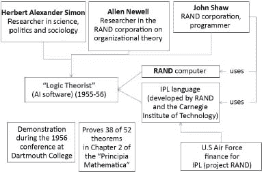

**图 1.1. “逻辑理论学家”这一第一个人工智能程序，其设计者及其结果**

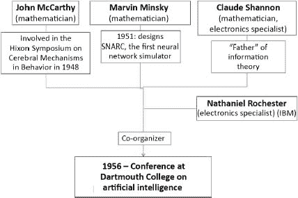

**图 1.2. 1956 年在达特茅斯学院关于人工智能的会议（为期两个月）组织者**

尽管 1956 年的会议是人工智能史的关键时刻，但它本身是早期参与者反思的结果。麦卡锡参加了 1948 年的*行为机制研讨会*（Symposium on Cerebral Mechanisms），克劳德·香农、艾伦·图灵和卡尔·拉什利（Karl Lashley）等也在。这次跨学科研讨会（数学家、心理学家等）引入了关于大脑与计算机对比的讨论。因此，1956 年“人工智能”概念的引入是多年反思的结果。

1956 年“会议”提议2的文本日期为 1955 年 8 月 31 日，是向洛克菲勒基金会申请资金支持的，定义了项目的内容和人工智能本身的概念：

> “研究将基于这样一个假设进行：学习的任何方面或任何其他特征原则上都可以被精确地描述，以便机器可以模拟它。尝试让机器使用语言、形成抽象和概念、解决现在由人类解决的问题并改进自身。”

该项目比预期的要成功，虽然有 10 个人没有参加，但有 43 个人（不包括四个组织者3）如果自己去寻找并判断这些机器，可能会感到困惑。因为他只会发现少数机器（大多是‘通用’计算机，目前编程为按照某些规范行为）在做一些可以称得上任何真正智力地位的事情。有些正在证明相当平庸的数学定理。少数机器可能会玩某些游戏，偶尔击败它们的设计者。有些可能正在区分手写字母。这些足以引起如此关注，更不用说引起深切担忧了吗？我认为足以；我们正处于一个时代的边缘，这个时代将被智能解决问题的机器强烈影响，并可能主导。但我们的目的不是预测未来会带来什么；我们只是试图描述和解释现在看来是通过构建‘人工智能’的第一步。”

AI 研究是围绕在主要大学创建的新型实验室展开的。斯坦福大学于 1963 年创建了其人工智能实验室。在麻省理工学院（MIT），人工智能是在`MAC`项目（数学与计算项目）中处理的，该项目同样创建于 1963 年，并获得了`ARPA`的巨额资助。

从存在之初，斯坦福人工智能实验室的研究就带有防御视角。作为美国国防部（DoD）的一个机构，`ARPA`通过众多计划资助了这些工作。因此，研究课题受到军事需求的影响，例如 Monte D. Callero 的论文《一种利用启发式学习过程的自适应指挥控制系统》（1967 年），该论文旨在开发一种自动化决策工具，用于武装冲突期间实时分配防御导弹。研究人员必须对导弹防御环境进行建模，并建立决策系统，以根据实验 [EAR 73]提高其性能。随着多年推移，国防机构的影响力日益增长。到 1973 年 6 月，人工智能实验室拥有 128 名员工，其中三分之二受到`ARPA`的资助 [EAR 73]。

然而，这种与国防部的亲近性并没有限制其所有工作。在 1971 年关于人工智能研究与应用的半年报告 [RAP 71] 中，斯坦福大学对其前景的描述如下：

> “该领域涉及自动系统的开发，这些系统通常包括通用数字计算机，能够执行通常被认为需要人类智能完成的任务。此类系统将能够感知物理环境、解决问题、构思并执行计划，并根据经验改进其行为。这项研究的成功将使机器能够在各种危险工作或敌对环境中取代人类，因此在政府和工业领域将具有广泛的应用前景。”

20 世纪 70 年代，MIT 的研究尽管由军事部门资助，但其范围仍然非常广阔。研究人员在 1973 年向`ARPA`展示他们的工作时，认为他们已经达到了里程碑，使他们能够预见到到目前为止所开展的理论工作的实际应用。但这些应用不能仅仅归类为防御领域：

> “十年人工智能研究成果使我们进入了基于知识编程的新阶段的门槛——在这个阶段，我们可以设计出计算机系统，能够(1)对极其复杂的情况做出合理的反应，(2)这对未来可能更重要——在遇到局限性、错误或信息不足时，与其操作员进行智能交互。”

随后，一些新研究方向的建议被拒绝了：

> “我们相信人工智能研究可以为比以往任何系统都强大的计算机信息系统指明方向。我们计划进攻信息检索领域，既包括传统的数据库和图书馆问题，也包括更具个人化的管理信息系统问题。新的信息系统应该帮助提高负责复杂行政结构的人员以及处理技术类复杂信息问题的人员的效率。特别是，这些服务将在`ARPANET`上提供，并被设计为易于使用，并将被设计为与其他人的个人系统进行交互，以识别冲突，并就共同关注的问题安排通信。”

除了大学团队，`RAND 公司`（RAND Corporation）在美国人工智能的兴起中扮演了核心作用。Willis H. Ware 的著作《RAND 与信息演变》[WAR 08] 是理解该机构早在 20 世纪 60 年代就对美国人工智能发展所扮演角色的宝贵资源。该书涵盖了 1946 年至 2008 年的期间，分为两个阶段：第一个阶段是 1946 年至 1983 年，在此期间，机构内部的研究被组织成各个部门，直到`RAND`围绕程序化行动进行重组。

Ware 回忆道，1963 年，在`Feigenbaum`和`Feldman`出版的第一本关于人工智能的 20 项贡献中，有六项是由`RAND`研究人员撰写的。`Allen Newell`和`Cliff Shaw`（均为`RAND`学者）与`Herbert Simon`（卡内基理工学院）合作的早期工作，为人工智能在学习、理论证明和知识表示等方面的研究奠定了若干基础。Ware 还提醒我们，人工智能的工作并非孤立发展。他们的研究人员在计算机科学进步的基础上进行构建，包括对`JOHNNIAC`等新计算机的密集使用，直到 20 世纪 60 年代中期。人工智能研究借鉴了计算机科学以及许多其他学科的进展。

人工智能的历史似乎以美国为中心。但我们不能忘记，机器人技术和计算机科学领域为了理解大脑如何运作的工作，都汇聚在人工智能领域，并同时动员了远超北美的研究人员。

在英国，Grey Walter 早在 20 世纪 40 年代的研究就已成为这一国际学术运动的一部分，该运动对大脑过程的建模和智能的定义感兴趣。Grey Walter 于 1947 年在布里斯托尔设计了“乌龟”，这被认为是首个自主电子机器人（Luce Langevin 将 20 世纪 50 年代描述为建立“电子动物植物园”的时期）[LAN 69]。这些方法的基础是认为大脑与机器之间存在强相似性的信念：“生理学家接受一个工作性假设，即大脑的功能等同于机器的功能” [ASH 51]。

如今大国之间的国际竞争与 20 世纪 50 年代到 20 世纪 60 年代的研究历史和早期发展并非无关。特别是中国和俄罗斯，并没有等到 2000 年代或 2010 年代才投资人工智能研究领域。他们目前在这一领域的活动是基于一个模型，该模型与美国一样，已有数十年的历史。

#### 1.1.2. 中国的人工智能

中国人工智能的研究始于 20 世纪 60 年代末 [XIN 83]。

根据王洁华的分析 [JIE 18]，中国的人工智能历史与苏联密切相关。[XIN 83]在 1970 年至 1983 年期间，主要研究领域涵盖了广泛的范围，例如：

*   机器翻译，该领域在 1982 年包括以下成就：
    *   `ECTA（英中自动翻译系统）`软件开发
    *   英中标题翻译系统开发
    *   `JF-111`通用机器翻译系统
*   自然语言理解
*   定理证明
*   专家系统
*   机器人技术

这些清单中没有任何内容能将中国的研究方向与西方区分开来。同样，这种方法是跨学科的（数学、计算机科学、语言学、医学、自动化、机器人技术、航天等）。

在 20 世纪 80 年代，中国已有大量的论文、成就、研究人员和参与大学。洁的文章仅提到了民用应用，未提及军事对这一课题的立场及其对大学的投入。

根据这篇文章，我们确定了参与的大学（表 1.1）。

**表 1.1.** *1970 年至 1983 年间参与中国人工智能的大学（按城市分类）。重构自 [XIN 83]*

| 大学名称 | 城市（省份） |
| --- | --- |
| 中山大学 | 广州（广东） |
| 吉林大学 | 长春（吉林） |
| 浙江大学 | 杭州（浙江） |
| 南京技术学院 | 南京（江苏） |
| 北京航空航天学院 | 北京 |
| 北京中医药大学 | 北京 |
| 中国科学院自动化研究所 | 北京 |
| 中国社会科学院语言学研究所 | 北京 |
| 中国科学院系统科学研究所 | 北京 |
| 中国科学院数学研究院 | 北京 |
| 清华大学 | 北京 |
| 中国科学院科学技术信息与计算机技术研究所 | 北京 |
| 上海计算机技术研究所 | 上海 |
| 中国科学院沈阳自动化研究所 | 沈阳（辽宁） |
| 武汉大学 | 武汉（湖北） |

![图 1.3 1970 年至 1983 年间投资 AI 的中国大学地理分布。重自[XIN 83]](images/fig1-3.jpg)

**图 1.3.** 1970 年至 1983 年间投资 AI 的中国大学地理分布。重自[XIN 83]

因此，中国的 AI 研究与西方同步成形，并围绕着优秀大学构建了结构。这段历史为中国目前的雄心提供了基础，这些雄心目前仍体现在研究计划中，也体现在经济、工业、社会和政治项目中。

#### 1.1.3. 俄罗斯的 AI 研究

俄罗斯 AI 的历史大致与美国或西方的年代相似。早在 20 世纪 60 年代初，访问俄罗斯的西方代表团就注意到那里存在从事 AI 主题的研究团队。

E.A. Feigenbaum 在 1960 年 6 月至 7 月作为美国代表团成员参加`国际自动控制联合会（IFAC）第一届大会`[FEI 60]期间访问苏联，他在报告中提到：

> “会议包括多场欢迎辞，以及由著名科学家、苏联国家自动控制委员会主席 V.A. Trapeznikov 发表的演讲。”

> “苏联副总理论述了自动化将给‘某些社会’带来的问题，这些社会尚未准备好应对这种技术变革——这种变革将带来失业问题、再教育问题……”

> “总的来说，苏联的论文可以被表征为倾向于理论的导向的，而西方代表团的论文则将理论与应用结合在一起。”

> “结合会议，各种研究机构、教育机构和工厂正式向代表团开放了技术考察通道……到目前为止，最受欢迎的行程是访问莫斯科的自动化与遥控技术研究所。”

在苏联，AI 是控制论的组成部分之一，就像信息论、计算机科学或军事指挥（C2）研究一样[LEV 64]。控制论于 1953 年出现在苏联，是一个新而广阔的领域，围绕各种研究社区组织，这些社区特别是在专门的控制论会议和 20 世纪 60 年代初的大量学术出版物汇聚在一起。军事控制论成为了控制论的一个子领域。

1965 年 8 月 27 日发表在`Science`杂志上的一篇文章[KOP 65]介绍了一座刚刚在西伯利亚建立的新科学城：阿卡捷戈城（Akademgorodok），位于新西伯利亚的郊区。


# 俄罗斯人工智能研究的历史

Paul R. Josephson[JOS 97]的作品专门用一章介绍了苏联时期（1960–1970 年）阿卡捷戈城 AI 诞生的历史。因为俄罗斯 AI 正诞生于那里。20 世纪 70 年代，那里建立了一个以 AI 为中心的俄罗斯研究社区，拥有一个大学研究中心、"俱乐部"（人工智能"Akademia"俱乐部）6 以及 AI 委员会（人工智能委员会）7 等。

这座城市现在被认为是俄罗斯的硅谷之一（与莫斯科和圣彼得堡并），被称为俄罗斯"网络战士兵"的家园[CLA 17]。阿卡捷戈城聚集了俄罗斯所有科技园 24%的收入，以及俄罗斯所有科技园入驻公司的 22%[LOG 16]。据报道，阿卡捷戈科技中心目前拥有 340 家公司、115 家初创企业和 10,000 名员工。

在苏联，AI 是控制论的组成部分之一，就像信息论、计算机科学或军事指挥（C2）研究一样[LEV 64]。控制论于 1953 年出现在苏联，是一个新而广阔的领域，围绕各种研究社区组织，这些社区特别是在专门的控制论会议和 20 世纪 60 年代初的大量学术出版物汇聚在一起。军事控制论成为了控制论的一个子领域。

因此，虽然苏联当时似乎与美国进行真正的竞争，但它仍然增加了美国面临的竞争格局的参与者。AI 和机器人技术的各个维度（研究、开发、工业化）在世界多个国家和地区动态地出现：报告提到了法国、欧洲和日本等。

苏联的研究并非与世界其他地区隔离。苏联组织了国际 AI 会议：例如分别在 1977 年 4 月的列宁格勒 8 和 1983 年 10 月 9。其研究项目和成就领域与世界其他地区相当相似：自动翻译和自然语言理解的应用（1982 年，创建了`Etap–1`项目——从法语到俄语的自动翻译实验系统）10。

# 日本人工智能研究的历史

日本的人工智能研究始于 20 世纪 60 年代的京都大学，当时由围绕学术俊之教授成立的团队组成，他们的工作涵盖计算机视觉、语音处理和自然语言三个领域。1970 年，该团队在大阪博览会上展示了第一套人脸识别系统。在之后的十年里，多个团队相继成立：包括九州大学（由栗原俊彦教授领导，从事汉字-假名转换系统）、大阪大学（由田中光治教授领导，关注知识处理问题）、东京大学以及 NTT 等企业实验室。然而，这些各异团队的出现尚未构成一个真正的日本人工智能研究社区。这一社区体是在东京大学一个名为`IAUEO`的学生团体中逐渐形成的，并从这里涌现出了如中岛秀之、堀光一和和松原仁等等日本人工智能领域的先驱。

政府为长期的大学研究计划提供了数亿美元的资助 [`DON 77`]。1971 年，政府启动了`PIPS`（模式信息处理系统）项目，在八年内共资助了 1 亿美元。实现`PIPS`目标所需的计算需求使得新型电子芯片的发展成为可能。这一阶段的资金早在 1973 年通过一项新项目由日本政府出资。

此外还投入了大量资金来支持图像处理、语音和自然语言处理的研究。

在日本于 1982 年启动第五代计算机计划后，人工智能在 20 世纪 80 年代中期开始真正爆发 [`MIZ 04, NIS 12`]。新世代计算机技术研究所（`ICOT`）是国家第五代计算机科学计划的研发部门。其中，`ICOT`开发了编程语言`KLIC`和逻辑推理系统`HELIC-II`。1983 年，`ICOT`拥有不到 50 名研究人员，其研究主题围绕着在 1990 年前设计出最大的计算机这一核心项目，直接涉及人工智能（例如：自动翻译系统、自动响应系统、语音理解、图像理解、问题求解系统和逻辑编程机器等）。

1986 年，日本人工智能学会（`JSAI`）成立。1990 年，该协会创建了环太平洋地区人工智能国际会议（`PRICAI`），旨在规范该地区地区的人工智能研究，从而补充或平衡来自`IJCAI`和欧洲人工智能会议的西方倡议。

除了大学研究外，工业研发活动也对日本人工智能的发展做出了重大贡献。大型工业集团成立了专门的人工智能团队（`NTT`、日立、富士通、索尼、本田等都是投资该领域的业内巨头）。他们的一些开发成果获得了媒体的广泛报道，例如索尼的`AIBO`、本田的`ASIMO`、IBM 机器人研发的`TAKMI` – 分析与知识挖掘（IBM 东京研究中心）、人脸识别工具、移动端语音翻译应用（NEC`）以及人形机器人`HRP-4C`（会唱歌跳舞）。

自 20 世纪 80 年代以来，日本政府一直保持对人工智能的投入，但现在国际竞争正异常激烈，几个主要大国在科学论文数量上已经超过了日本：中国在 2011 年至 2015 年间在该领域发表了 41,000 篇文章，美国发表了 25,500 篇，而日本为 11,700 篇。这种现象在工业领域同样反复：据美国在该领域拥有数千家公司，而日本只有 200–300 家[`12`]。

尽管日本一直是机器人技术及人工智能应用领域的领导者之一，但这不仅是因为它展现了作为多领域（电子、电力、计算、自动化等）整合者的特质，还因为它在许多这些领域处于领先地位；日本在电子领域特别领先。20 世纪 80 年代的机器人技术对电子、微电子和机械技能的要求远高于计算机科学。

# 1.1.5. 法国的人工智能研究

20 世纪 50、60 年代，对智能机器的兴趣扩散到了全球许多国家。法国是研究国际化的参与者之一。例如，我们可以引用以下内容：

- Pierre de Latil 对人工思维的思考 [`DEL 53`]；
- Albert Ducrocq 的工作（一名士兵之子，学习政治科学和电子学，后来成为记者和随笔作家，并成为控制论专家），他发明了`电子狐狸`（一种带轮子的自主机器人），并启迪了 70 年代 Bruno Lussato 的成就，后者发明了`zebulons`自主处理机器人。Albert Ducrocq 出了多部关于机器人和武器的作品，如*Les armes de demain*（明天的武器）（Berger-Levrault, 1949）、*Appareils et cerveaux électroniques*（电子设备与大脑）（Hachette, 1952）、*L’ère des robots*（机器人时代）（Julliard, 1953）以及*Découverte de la cybernétique*（控制论的发现）（Julliard, 1955）。他在 2001 年去世前还出版了许多著作；
- Paul Chauchard [`CHA 50]`、Paul Cossa [`COS 54]`、Louis Couffignal [`COU 52]`、Dominique Dubarle [`DUB 48]` 关于思考机器的著作，以及 Albert Béguin [`BÉG 50]` 关于机器人的著作。

这些问题从多种观点得到了探讨：数学家、控制论专家、哲学家、电子工程师等等。人类是机器还是机器人？大脑可以在机器中复制吗？机器会思考吗，它有灵魂吗？什么是机器？我们可以将思维机制或大脑的功能简化算法吗？大脑和身体是简单的机械结构吗？

Louis Couffignal [`COU 52]` 将机器定义为"一组非生命体，甚至例外情况下是生命体，能够替代人类执行提出的一系列操作"。

他列出了机器的分类：能够加法和写的机器、能够阅读和选择的机器、计算机器和思考机器。

1984 年，尚贝瑞大学教授 Jean-Pierre Laurent \[LAU 85\]对法国人工智能智能（AI）研究现状提出了一系列观察：识别研究潜力是一项困难的任务，这是因为 AI 的边界模糊——对于某些人来说，它是一门独立的研究学科，而对另一些人来说，它是带有各种应用的技术；另一方面，AI 的研究遍布法国各地——团队规模小且分散在全国；由于该学科具有过强的经验主义性质，逐渐偏离了纯理论研究，且缺乏能够克服 20 世纪 60 年代失败的、令人信服且引人注目的成果，AI 在学术研究界和政治决策圈的形象相当负面。AI 曾被过度地与"小配件型"应用联系在一起，但在 20 世纪 80 年代初，情况似乎发生了变化，使用专家系统的行业发展很可能为 AI 带来其缺乏的严谨形象。尽管如此，工业界对于 AI 能带来什么仍只有模糊的愿景："一些并不真正熟悉 AI 及其可能性的工业组织倾向于相信奇迹，并要求 AI 解决一切问题（例如，如果没有人类专家，如何构建专家系统？）"。投资该学科的研究人员仍支持匮乏，在人力资源、设备和资金方面的手段非常有限。这种情况影响了大学教学，大学对 AI 培训仅赋予了次要性。因此，学术研究的状况取决于多种变量：公众兴趣、政治决策者的关注、工业投资以及统一孤立研究和学科的能力。

在阅读 Jean-Pierre Laurent 的这项研究时还应该注意到，研究资金的驱动因素取决于外部变量。尽管国家通过其`CNRS`等研究机构自 1979 年以来一直资助某些 AI 项目，但 1981 年日本"第五代 MITI 计划"的发表似乎是政治行动中的一个新决定性时刻。

# 1.2 AI 研究的特点

从一开始开始，AI 就是以一种多学科的方法形成的，位于涉及多个科学学科的研究交汇点上。哲学在这一跨学科性中占据着重要地位（H.B. Dreyfus \[DRE 72\] 建立了 AI 与柏拉图、霍布斯思想之间的联系），与数学、计算机科学和认知科学尤为重要。

> "该领域借鉴了许多学科的理论构建，包括数学、心理学、语言学、神经生理学、计算机科学和电子工程。" \[LAW 84\]

法国议员 Cédric Villani 在他 2018 年 3 月的报告中回顾了这种跨学科方法：

> "该领域如此宽泛，以至于不能局限于特定的研究领域\[……\] AI 处于多个领域的交汇点：计算机科学、数学（逻辑、优化、分析、概率、线性代数等）、认知科学等。" \[VIL 18\]

西班牙在其官方的《国家人工智能国家战略文件》（2019）中也采取了做法："由于其贡献的复杂性日益增加，它越来越具有跨学科性，与生物学、哲学、法律界、心理学、社会学和经济学产生协同效应。"13

AI 使用了广泛的技术或工程：

> "AI 中的每种算法都由技术的混合支持：语义分析、符号计算、机器学习、探索性分析、深度学习和神经网络\[……\] \[VIL 18\]

> "这些技术包括：自然语言处理、智能体、计算机视觉、机器学习、专家系统、自动驾驶汽车、聊天机器人和语音识别。"14

> "六种 AI 技术在生产和物流过程中具有重大的应用潜力：专家/知识型系统、自然语言、语音识别、三维视觉、智能机器人和神经网络。到为止，这些技术中最意义的是专家系统。" \[MEL 89\]

> "通常被认为是 AI 子领域的技术和研究领域：• 自动规划与调度 • 计算机视觉 • 决策支持、预测分析和分析发现 • 分布式人工智能/基于代理的系统 • 人类语言技术 • 身份智能 • ML • 过程建模 • 机器人/自主系统。" \[DNI 19\]

最后，这门新科学的特点在于应用范围之广：20 世纪 70 年代，研究尝试将 AI 应用于国际象棋和围棋、数学（证明定理）、理解和翻译书面语及口语、控制机器人和假手、图像分析以及人机交互（智能对话）15

- 图像分析、图像目标检测 \[NAG 79\]
- 冲突模拟器（例如 1971 年的`CONSIM`，*Conflict Simulator*，《Proceeding ACM '71* \[CLE 71\]17))

在全球范围内，AI 的研究与开发共同目标是通过创建模拟人类认知的过程来理解"人类认知是如何工作的" \[VIL 18\]。

表 1.2 *AI 的目标或终点*

| AI 目标的定义 | 来源 | 年份 |
| --- | --- | --- |
| "AI 研究的目标是构建计算机程序，当我们观察人类的这种行为时称之为'智能行为'。" | \[FEI 63\] | 1963 |
| "通用 AI 的长期目标是创建能够在广泛认知领域中表现人类智能灵活性和多功能的系统，包括学习、语言、感知、推理、创造力和规划。" | 国家科学与技术委员会网络和信息技术研发子委员会（NITRD）（美国）\[NET 16\] | 2016 |

# 1.3 AI 历史的历史序列

AI 历史的进程被一系列的进展、狂热阶段和挫折时期（有时被称为"AI 寒冬"）所中断。总之，AI 的道路并不是线性的。尽管 AI 在今天已取得了全球性的成功（我们现在正处于"人工智能的第三时代" [MIA 18]），但不能排除可能会出现一个突然发生的新退缩阶段。AI 的成功与多种条件相关。它的命运不仅取决于科学的进步，还与经济挑战、投资水平、政治支持以及科学进展息息相关。

将 AI 历史划分为若干阶段，使得我们能够在每个阶段内对事件进行定位，例如从未停止过贯穿人类历史的主要冲突、政治时期和重大事件，特别是技术史上的事件。

## 1956–1970 年时期（春季 1）

在第一个阶段，AI 的先驱者们对实现自己设定的目标充满信心，坚信科学水平将允许 AI 的快速实现。这些先驱者非常乐观，认为 AI 将在未来 25 年内实现其目标。但困难很快出现，最初的雄心必须重新审视。进展比预期缓慢，许多问题对于当时的知识水平来说仍然太难解决。例如，机器翻译系统的表现非常糟糕。`Lighthill Report (1972)` 暂时结束了第一个时期。过度的负面言论导致了这一充满希望和乌托邦主义的动态时期的终结：

> "国防部的高级研究计划署（ARPA）实际上是 AI 研究的主要资金来源，目前正受到几个方向的攻击，因为其项目被认为没有按照其投入资金那样迅速产生'回报'。德弗斯（Dreyfus）批评中较为务实的部分，尽管可能被 AI 工作者断然否之，但引起了其他不容易忽视的人的共鸣，例如代表英国科学研究委员会发言的 J. 莱特希（Lighthill, 1973）。如果有足够的批评者成功阻止了 ARPA 的研究以及整个 AI 工作，那么国家安全局（NSA）可能即将获得的一些潜在收益可能永远无法实现。"

## 1970–1982 年时期（冬季 1）

20 世纪 70 年代初，所谓的"AI 寒冬"开始，指的是研究人员在面临资金减少的情况下必须坚持并取得重大成果的年份。第一阶段的努力并非徒劳，因为研究人员从所遭受的失败中理解了他们必须做什么。

20 世纪 70 年代的直接目标不再是创造一种通用的通用智能机器，而是创造一种特殊智能：特定的机器能够在有限的领域内进行智能行动[19]。AI 先驱者们几乎是乌托邦式的希望——相信能够迅速将人类智能的秘密转化为机器——很快让位于对机器性能的更审慎的讨论。这是一个关于计算机能做什么或不能做什么、关于它们的局限性的问题 [DRE 72]。

法国在 20 世纪 70 年代和 80 年代似乎表现出强烈的怀疑态度。当时政府投入很少，研究群体仍然很小：

> "计算机视觉研究领域有大量的活动，这与语音理解一样，是一个困难的领域，需要巨大的计算能力。坦率地说，迹象表明，许多应用所需的功率将在十年后实现并在经济上可行。因此，研究人员目前正在利用现有的资源攻克整个问题的部分，而将他们工作的整合留给未来。" [HOL 76]

## 1982–1987 年时期（春季 2）

日本的新一代计算机计划以及罗纳德·里根所谓的"星大战"演讲，复兴了 AI 研究的竞争。大国们投入了一场技术竞赛，以至于不完全被日本压制和支配。正是在对 AI 的努力和对太空的的过程中，国际舞台上国家之间的权力斗争得以体现。20 世纪 80 年代，专家系统大量增加。AI 变得商业化，对于军事而言，AI 终于提供了增强运营效率的应用前景。资金正在大量涌入。

## 1987–2010 年时期（冬季 2）

20 世纪 80 年代初的积极阶段非常短暂。早在 1987 年，AI 市场开始出现显著放缓的迹象。专用 AI 硬件行业（`LISP machines`）崩溃了。

## 2010 年至今（春季 3）

全球对 AI 兴趣的新阶段。从 2011 年以后的时期确实可以被称为"AI 之春"[20]。这一复兴时期可以归于三个变量的结合[21]：大数据、算法和计算能力的提升。这是芬兰当局反复强调的主张：

> "更高效、低成本的计算能力、AI 可用数据量的巨大增长以及更先进的 AI 算法共同导致了人工智能更密集的利用。事实上，我们正在经历人工智能的一个新春天。"

这三个变量`Big Data`、`Machine Learning (ML)`和`Cloud Computing`也可以被称为大数据、机器学习（ML）和云计算 [MIA 17]。

许多希望再次寄托于 AI 的进展和贡献上，有大量的国家和私营资金投入、多年的研发计划，并在所有可能实施的活动领域落地。表现远低于预期无疑可能会减缓目前的全球动态。这将导致资金减少、公众兴趣缺失以及 AI 产品商业活动的下降。今天部署的通用 AI 或弱 AI 内部包含了其自身局限性的种子，而忠实模仿人类能力的系统仍然不可及：

> "[[…]我们生活的每个方面将以某种方式发生变化。今天这些智能机器的进步似乎是无限的。它们会超越我们甚至取代我们吗？如果根据定义超级智能在所有智能领域都能超越我们，那么那时我们的努力将会过时。在某些方面，这些机器具有超人的能力，但实际上并没有比大鼠还聪明的机器。"

进一步的失望将导致新的低迷。

这种对 20 世纪 50 年代以来 AI 历史的划分是不完美的，因为它将 AI 的所有方面简化为了一个。工业、军事计划、政策或各个应用领域的研发周期并不一定相同。研究并没有真正经历过休眠期。它在全球范围内持续进行，尽管不同时期和国家的资金资源支持有所不同。出版物的数量、科学界组织自身以及围绕国家和国际协会及国际研讨会组织研究的努力证明了这一点。

各国在人工智能研发方面的努力主要源于构建一个能为其提供经济实力的技术领域，为多个活动部门提供促进其进步的工具，并在军事领域提供增强其实能力的有效仪器。然而，在 1950 年至 2000 年的这几十年里，尽管情报机构能够利用人工智能来协助完成任务，但并没有对安全应用和问题进行过公开讨论。

# 1.4. 机器人与机器人学


人工智能与机器人学密切相关。人工智能在 20 世纪 50 年代作为一个学科和科学共同被建立起来。专业出版物、研讨会、协会以及研究团队的建立已参与了这一构建过程。人工智能将机器人整合到其研究问题中，但它并没有与机器人学汇合，后者本身是一门学科。机器人学有自己的历史、挑战和研究问题。


**图 1.5.** 曼彻大学机器人 24。需此图彩色版本，请参见 [www.iste.co.uk/ventre/artificial.zip](http://www.iste.co.uk/ventre/artificial.zip)

在 18 和 19 世纪，自动人取得的若干成就被向公众展示。这些机器模仿人类的外表，并复制如写作或演奏乐器等任务。当然，这些机器并没有自主智能。这种智能源于它们精妙的设计者，他们创造了精确的机械结构。这些机器在文学中占据了一席之地，并反映了当时的技术：它们尚未被称为机器人，而是由电力、机械、钢铁有时甚至是蒸汽能构成的（见爱德华·S·埃利斯的《大草原上的蒸汽人》[ELL 68]）。

机械化在 20 世纪取得了胜利；工业为大规模生产铺平了道路（例如 20 世纪 10 年代的福特工厂）。在此之前一直是自动人、机器和机械装置变成了“机器人”。卡雷尔·佩克（Karel Capek）在 1921 年的一部剧中引入了这个术语，指代具有人类外表的机器。艾萨克·阿西莫夫（Isaac Asimov）于 1941 年写了短小说《骗子！》[ASI 41]，在书中引入了机器人学的“法则”。在随后的几十年里，科幻小说对机器人产生了重要作用，并促进了其在全球范围内成功。但科幻也塑造了机器人的特定形象：它在外表上通常是人类，无论如何，它都被赋予了生命和超越人类的智能。

第二次世界大战期间，装备有爆炸物并投向敌方平民和军队的无人机被称为“机器人炸”。战后，又出现了具有工业应用的其他发展。第一条可编程臂由乔治·德沃尔（George Devol）和乔·恩格尔伯（Joe Engleberger）于 1954 年设计，并于 1962 年整合到通用汽车的装配线上。机器人占据了工业空间、科学空间，被设计用于协助人类进行实验并对抗敌劣环境。1994 年，卡内基·梅隆大学的机器人研究所设计了八足机器人`DANTE II`，它探测了斯普尔火山的火火口。它的形状灵感源于蜘蛛。这项成就结合了传感器技术、计算机科学、电子学和通信仪器。

机器人学作为一个科学学科，产生于 1956 年或 1964 年：

* **1956 年**：乔治·德沃尔和乔·恩格尔伯相遇。从他们的合作中，机器人产业、一本杂志（`工业机器人`）和一个国际会议（`工业机器人国际研讨会`）诞生了。乔·恩格尔伯有时被称为“机器人学之父”；

* **1964 年**：机械工程师伯尼·罗斯（Bernie Roth）会见了人工智能研究员约翰·麦卡锡（John McCarthy）。这成为了富有成果的合作、科学出版和定期会议的起点，并巩固了一个新的研究社区。

关于该学科创立的第三种观点可以追溯到遥机器人（4 世纪 40 年代在美国用于处理核材料）。格尔茨（Goertz）在 1952 年和 1954 年的文章是机器人学 25 的起点。无论选择哪个具体日期，机器人学的诞生通常与人工智能（50 年代）并行。

机器人学作为一个学科，自起源以来一直与人工智能并肩，但它已作为一个独立的学科得到了发展：

> 理解智能的科学任务已经在人工智能（计算机科学的一个分支）中顺利进行。如果已经存在一个相应的科学领域，为什么还需要机器人？

> 答案是，而且进一步阐明了我的基本理论。人工智能目前与计算机科学共享一个特殊观点——它将信息处理与能量分离。这种内部环境的创造是一种强大的抽象，通过允许计算机科学专注于核心机制，帮助了它的出现。但这种抽象的成本在机器人学尚未被探索的核心问题上表现得最为明显——感知协调运动 [NEW 81]

斯坦福人工智能研究中心在 20 世纪 70 年代的工作整合了机器人领域的研发：

> 我们正在几个领域进行基础研究：问题求解、感知、自动数学和学习。然而，我们发现选择创建一个单一集成系统作为目标是有成效的……我们的系统由一个由大型数字计算机通过无线电控制的移动机器人车辆组成。主要目标是为计算机开发软件，当与车辆硬件结合时，产生一个能够产生智能行为的系统……在更换计算机（1969 年底）之前，我们的机器人系统实现了初步的能力：它能够分析受限实验室环境中的简单场景；只要数据编码完全正确，就能为某些问题制定计划；并在执行过程中没有出现任何故障的情况下，就能执行其计划。因此，当我们开始计划为新计算机开发新的机器人软件系统时，我们设定了更具挑战性的短期目标：该系统能够在由多个房间、走廊和门组成的较大环境中运行；它的规划能力必须从关于世界和机器人能力的大量事实中选择相关数据；并且它能够从某些意外故障或累积错误中优雅地恢复。[RAP 71]

与人工智能一样，机器人技术也是围绕一个美国中心建立起来的。然而，机器人技术和机器人在许多其他国家也取得了巨大成功，其中包括日本——该国在该领域的研发活动特别活跃：1997 年，日本首届机器人大赛（`RoboCup`）举行；1999 年，索尼推出了并市场化了第一只宠物机器人狗 `AIBO`；2000 年，本田制造了人形机器人 `ASIMO`。长期以来，日本深度参与机器人技术领域，并在过去的几十年里一直是世界领导者，领先于美国和其他工业化国家。2010 年，日本占全球机器人产量的三分之二（尽管并非所有的机器人技术与人工智能有关）。这种成功在很大程度上是因为日本在其领土上拥有机器人技术所需的所有技术和工业技能以及基础组件（尽管它在所有这些领域并不都是领导者：机械、电子、计算、传感器等）[NAR 10]。机器人化方面的努力也可以从特定的社会需求来解释：劳动力短缺以及任何移民政策都无法弥补的人口老龄化问题。因此，在生产中需要用机器代替人类，并考虑支持老年人口的解决方案。机器人技术并不是国防的优先考虑问题，特别是自第二次世界大战结束以来，该国不再拥有拥有军队的权利。因此，投资转向了国防以外的其他领域。

机器人是机器（人工智能是软件）：

* – 经过程序编写的；

* – 能够独立或半自主地执行任务的；

* – 通过传感器与其物理环境交互的。

某些机器人也是由操作员控制的机器（因此在它们的情况下，自主性不言而喻）。“非智能”机器人与智能机器人相比，仅能够执行重复性任务：拿取和移动物体。对于这种动作，它不需要人工干预，因此在某种意义上是“自主”的，但很难将其归类为“智能”。因此，自主性并不等同于智能。然而，这个只会重复放置物体的机器人在安装了摄像头后就变得“智能”了，这使得它能够识别物体、区分物体并根据物体类型分配不同的动作。视觉和感知需要人工智能算法 [OWE 17]。智能机器人是指嵌入了人工智能程序的机器人。

## 1.5. 人工智能集成的案例：20 世纪 80 年代的 CIA

计算机在 20 世纪 60 年代初进入该机构（`the CIA`），主要用于行政任务。随后，计算机成为一种可以用于机构核心使命的工具，即情报以及数据的收集与处理。

在 20 世纪 80 年代，计算机成为该机构活动不可或缺的一部分，它必须处理日益增长的数据量，这些数据必须在其部门内部进行收集、存储、分析和分发。该机构面临着数据、计算机和网络带来的限制：大量数据的产生以及持续快速的数据流连接着机器和个人。数据的速度和规模是当时观察者提出的两个变量之一。然而，这些发现并没有对技术提出质疑，因为这些技术似乎只为机构的运行和情报官员的工作带来了额外价值。技术引入该机构的过程被描绘为一个动态过程。在 20 世纪 80 年代中期，人工智能尚未被采用，但该机构启动了一个反思过程，动员了其各个部门和管理人员，以展望情报领域的应用。

另一方面，该机构数据生产速度和密度（以报告、笔记和各种文件的形式呈现）的增加不仅是因为技术。该机构内部存在一种政治和政府意愿，即每天对广泛的问题产生更多知识（1983 年，`CIA` 产了 800 份报告；但一半的员工专注于苏联 [DDI 84]）。

该机构数据生产速度和密度的增加不仅是因为技术。可以通过在线资源来分析美国情报界对人工智能的处理。因此，CIA 在其网站上提供了一系列档案文件。在这些语库中，我们寻找能够描述情报界与一系列创新技术之间关系的信息（建立小组、指定领导、建立网络等），以及针对情报特定需求的 AI 应用，且从时间角度来看（机构何时开始关注这一主题、采取了哪些行动、有哪些重要的里程碑等）。CIA 的这一方面长期一直不为人知：

> “CIA 在科学技术应用于情报方面的作用远被低估……然而，对科学技术的利用几乎从其成立以来一直是 CIA 活动的一个重要元素。1962 年，这导致了研究副局的创建，并在 1963 年被科学技术副局所取代（1965 年更名为科学技术局）。” [RIC 01]

此外，如果这个故事考虑了 `CIA` 获取和拥有技术的政策，那么这种关系也可以从反方向来看，即情报对学术界和工业界的影响。`CIA` 不能被仅仅视为一个用户“客户”：“它还负责许多科学进步” [RIC 01]。

### 1.5.1. CIA 理解和掌握人工智能以适应其需求的工具和方法

情报界（实际上是国防界和情报界）所提出的观察在 20 世纪 80 年代初深受一种旨在开发和实验用于数据处理的智能系统的趋势的影响 [ECK 84]。国防和情报官员观察到，一方面是不断增长的数据量，另一方面是已经或将不可避免任务不堪的人力资源。人工智能的视角成为解决这一管理挑战（而非本质上的安全问题）的可能来源：

> “人工智能的一个核心目标是使计算机能够模拟人类在分析和解释数据时使用的智力功能。由于这些原因，情报界对人工智能作为基于智能系统的关键技术感兴趣。” [ECK 84]

20 世纪 80 年代初对人工智能的特别关注是一个特殊框架的一部分，是 CIA 历史上的又一个关键时刻，它部分恢复了过去十年失去的预算。这种资金的更新使该机构展望了一个新的增长阶段，招募人才、开展活动、扩大其专业领域并提高其生产力和研究活动：

> “过去四年，情报机构的预算经历了显著增长…………这使我们能够恢复许多在 20 世纪 70 年代失去的能力…………在过去的四年里，我们中央情报报局（CIA）首次开发并实施了一项涵盖惊人数量国家问题的综合性研究计划…………我们重建了人工智能能力…………在技术方面，对新技术系统的投资已开始产生成效。” [DDI 84]

## 1. 现代化与数据量的激增

这种现代化将增加数据收集能力，从而产生新的分析需求：

> “这意味着我们所收集的情报信息在质量和精度上有了巨大提升。这也意味着数据量将大幅增加。这表明我们必须开始投资处理系统，以匹配我们收集原始数据的能力…………我们必须避免被来自所有渠道的海量信息所淹没，这正是计算机、软件和其他新技术的发展真正能够帮助到我们的地方。” [DDI 84]

尽管资金资源的障碍似乎已经消除，但新系统的实施复杂性并不亚之。主要困难之一在于定义目标和合适的方法。决策者（机构内部管理人员）水平较低的问题也被指出，这对其所做的选择产生了影响：

> “对于美国工业和政府来说，一个严重的问题是不通计算机的高级经理…………关于计算机和 ADP（自动数据处理）设备的重大决策是由那些几乎分不清大型机和麦克卡车的经理做出的。我们该怎么办？我们转向自己机构内部计算机专家，他们眼光狭窄，维护自己的领地，而且对他们来说，大规模的规划、网络化和实验是不可理喻的。因此，我们有时会开发出无法相互通信且只能满足当前需求的不完善的系统。” [DDI 84]

## 2. 组织与安全限制

必须考虑其他特殊性，例如机构的结构和运作模式，这些体现在技术系统的组织方式上，而这些有时被称为“问题”：

> “CIA 使用计算机的主要问题围绕着部门划分和安全。与私营部门规模类似的组织不同，我们必须拥有一个基于‘知情需要’原则运行的系统，这可能只涉及少数几。” [DDI 84]

安全指令产生了特定的约束，系统必须整合这些约束：“我们必须同时保护自己免受外部‘黑客’的威胁，以及内部‘内鬼’的可能性” [DDI 84]。

20 世纪 80 年代上半叶，CIA 将其计算机系统结构分为五个独立的系统：一个用于分析师，一个用于行动，一个用于行政，一个用于人员安全，一个用于处理和分析技术情报数据。每个系统都有自己的软件。

## 3. 战略规划与 AI 集成

1983 年，CIA 制定了一项行动计划，《CIA 战略计划》（1983–1993）[FIT 83]，列出了将专门作为强化开发政策领域：`AI` 是这些领域之一，此外资源、信息处理、太空、危机管理、恐怖主义、秘密通信、秘密情报收集、军控监控和情报保护。

正是在这种更新背景下，该机构对 `AI` 感感兴趣（当时 AI 第二波浪开始和第五代计算机的交汇点），管理层对其寄予了巨大的厚望：

> “我们将依靠专家系统应用中的 `AI`，使我们能够检测指标异常进行预警，合成数据组合进行分析，扫描邮件以挑选关键信息，或发现我们知识中的空白。在处理海量原始数据时，无需像我们现在这样将原始数据翻译成标准格式，`AI` 的应用将有助于我们去芜存菁，特别是在 `SIGINT`（信号情报）和图像方面…………更复杂的模拟和建模技术将增加我们预测未来事件替代性结果的能力。`AI` 应该帮助分析师比较不同形式的数据——图像、`SIGINT`、正文…………另一个应用可能涉及实时访问更多数据，特别是在危机时刻。” [DDI 84] 

## 4. 怀疑与挑战

然而，也有声音呼吁要极度谨慎。面对对 `AI` 能够深刻改变情报能力的寄希望，人们应该意识到要实现此类成就还有很漫长的路要走：

> “在我们看来，`AI` 领域的进展可能是极其缓慢的。对于具有实际应用且快速进展的承诺，应持某种怀疑态度。” [DDI 84]

情报副局长（`DDI`）在对安全事务协会成员的演讲中，强调该机构需要抵御商业压力、营销论点和承诺：

> “我无法告诉你们有多少承包商试图向我推销那些能让我预测未来的东西。在我们能够更深入地了解过程是如何运作之前，很难写出能够复制分析师所工作的‘专家系统’。”

对于这些技术的看待方式，这种怀疑的态度甚至带有一种某种讽刺色彩，至少是对其局限性的认识：“今天的专家系统是‘白痴天才’，在严格限制的应用中被证明是有用的” [ECK 84]。

1983–1984 年对 `AI` 的情报预期与 21 世纪 10 年代后期非常相似：检测、预测、原始数据处理、图像和信号处理。

我们也可以观察到，自那时开发的 `AI` 系统并没有履行所有承诺：专家系统和其他处理异构格式多源数据的模态，未能能预测出苏联的终结，未能预见并防止 2001 年 9 月 11 日的袭击，以及后来标记美国和世界历史的许多重大行动或事件。

然而，情报机构和军队对情报领域科学进步的关注早于 1980 年代。军方通过 `ARPA` 支持美国学者的工作，而 `CIA` 和国防部也监控全球 `AI` 研究，这从 20 世纪 60 年代在国际研讨会或访问组织背景下的海外任务报告可以证明。

## 1.5.2. 焦点小组、研究与协调

| 焦点小组、协调 | 人工智能指导小组 (AISG) | 对 AI 潜力的反思。定期会议（1984 年 6 月 18 日，于 NCARAI 总部） | 1983 年（主席：Phil Eckman） | CIA |

| --- | --- | --- | --- | --- |

| 焦点小组、协调 | 人工智能应用工作组 (AIAWG) | 协调机构内部研发工作，使 AI 适应特定的情报问题 | 1983 年 | 信息系统委员会 (CIA) |

| 与美国大学的关系 | 申请人工智能领域的培训 [MAL 87] | 培训来自该机构的一名员工；在大学机构代表情报机构（将学生纳入培训；或在大学派驻“教授”） | 1987 年 | 卡内基基梅梅隆大学 |

| 培训 | 由 ISGF 安排的培训方案 | 举办为期两天或三天的研讨会，介绍 AI 及其在情报领域的应用 | 1983 年 | 信息科学中心 (CIA) |

| *信息技术视频研讨会*（*CIA 首次使用总部有电视系统*）[DON 86] | *关于 AI 的七部分计划* | 1986 年 | 机构通过总部有电视系统 |

建立工作、反思、研究和协调小组，负责组织培训倡议以及与工业界进行对话，这既不是 CIA 特有的方法，也不是情报界通用的方法，更不是针对“AI”这一主题的。在同年 1983 年，例如`DIA`和`NSA`也创建了专门负责 AI 的工作小组。这些小组的功能是根据每个机构的特定背景思考 AI（DARPA 出于防御目的研究 AI，CIA 则是为了情报，以此此类推）。CIA 内部的`AISG`（人工智能指导小组）在 1984 年观察到，国防部在 AI 研究上的投入远高于情报部门，认为应该考虑建立一种亲近关系，以利用国防部所取得的进展。

一旦`ISGF`实施，它就组织了系列会议，形式为访问正在开展 AI 工作的机构：分别于 1984 年 8 月 27 日访问了国家标准局（`NBS`），并于你 984 年 5 月 10 日访问了`MITRE Corporation`。通过这些会议，`ISAG`成员试图识别在情报领域具有潜在应用价值的项目。

在 CIA `ISB`（信息系统委员会）内部，创建了几个工作流，其中一个专门负责 AI（人工智能应用工作组——`AIAWG`）。在 1983 年的会议期间，其其目标之一是识别 CIA 的 AI 需求或 AI 能为机构提供的机会。识别这些需求的方法是询问机构内的每个部门他们认为哪些 AI 应用是有用的。这种方法假设访话者对 AI 的可能性有相当精确的了解：“看到多个办公室出现共同需求是有趣的，但每种需求都是用其各自应用领域的语言和术语表述的”。

1983 年 12 月 14 日会议的总结说明草案没有对这种趋同现象的原因提出任何问题。也许这是因为所咨询的各个部门之间确实存在需求趋同。但也可能是对 AI 是什么以及它能提供什么的共同集体表征的产物。在这一过程中识别出的唯一真实差异仍在于表述的词汇上。此外，要求的表述过于笼统：“在确定了这些通用要求后，看来我们在变得更加具体方面还有额外工作要做。”

## 1.5.3. 情报界外的接触者网络

将 AI 整合到情报部门的实践和政策中，需要广泛外部参与者的加入。

这种方法既不是针对 AI 这一新主题特有的，也不是仅针对情报部门特有的：


> “这个国家在政府与私营部门合作的方式上是独特的……我们依赖于爱国主义和利润动机，使我们能够应对日益增长的威胁的新设备和新分析技术……基于政府与私营部门之间这种协同性质性的关系。” [DDI 84]

CIA 对 AI 的方法包括：关注研发动态，识别参与者（学术界和工业界），并与他们对话，以了解如何将 AI 转移到情报部门。CIA 保持警觉并随时准备。例如，在 1983 年，有 1200 名分析师参加了 500 多场关于广泛主题的会议。

CIA 正在考虑将知识和技术适应其需求，并在甚至考虑获取之前（文件未说明具体的转化方法），试图理解其价值：

> “`IR&DC`的`AISG`正在准备关于哪些人工智能进展正在发生且可能对转化为情报部门有价值的建议。”

这种逻辑指导了 CIA 内部获取和整合技术的整个战略，其目的是节省财政资源并使技术适应其需求。因此，面对合理性尚未得到根本质疑的获取请求，CIA 主任在 1982 年写道：

> “在对获取 VHSIC/VLSI 设施的建议发表意见之前，我希望委员会进一步探讨具体涉及哪些内容。我们的第一反应是由于担心成本太高，部门无法负担。与其资助此类设施，我们可能利用现有的商业设施来探索对情报计划可能独特的电路……我们认为低功耗、高密度存储技术也应该由其他国防和商业计划追求，从而使情报部门能够利用其他领域的进展。”

**表 1.4.** *CIA 征询、动员并与之保持各种关系的非情报参与者*

| | 工业界 | 大学 | 政策/政府 |
| --- | --- | --- | --- |
| AI 研讨会，1982 | Xerox, Symbolics, DEC (数字设备公司), VERAC 公司, 系统开发公司, 人工智能公司, 德州仪器公司, 休斯研究实验室 | 耶鲁大学、匹兹堡大学、叙拉古大学 | 研发办公室 (ORD) |
| 培训 | | | 将 CIA 特员作为学生或教授进入美国大学 |

**表 1.5. CIA 内部的 AI 词汇**

| 背景 | 日期 | 词汇 |
| --- | --- | --- |
| 人工智能研讨会 | 1982 | 人工智能系统、演绎推理、响应临时提问、“智能”数据库、专家系统、目标跟踪、海洋监测、信息检索 |
| 人工智能研讨会 | 1985 | 应对信息爆炸式增长日益增加的问题 |
| 情报社区 AI 应用研讨会 [ECK 83] | 1983 年 12 月 8 日 [ECK 84]（该研讨会的第二届，第一次于 1982 年举行，有 300 名参与者）。由 ISGF 赞助 | AI 用于：<br>- 合并、分析和解释海量数据<br>- 提高分析师效率<br>自然语言处理、预警指标<br>自动信号处理<br>专家系统<br>自动图像解释 |
| AIAWG | 1983 年 12 月 14 日 | 专家系统<br>信息检索、分析与报告<br>网络规划、监测与维护<br>咨询、培训、分析与预测<br>图像解释<br>**自然语言**<br>数据库接口、文本检索<br>机器翻译<br>消息识别<br>消息分发<br>语音理解<br>说话人识别<br>语言识别<br>**图像理解**<br>光学字符识别、变化检测<br>对象的识别、计数和分类<br>**智能数据库**<br>推理逻辑、数据资源导航辅助 |
| AIAWG | 1983 年 12 月 14 日 | **信号解释**<br>实时 TEMPEST 监测<br>信号排序和分类<br>**AI 工具和环境**<br>改进信息系统开发流程<br>改进的用户界面<br>语音输入机器<br>AI 系统开发辅助、执行决策辅助<br>行政系统支持（预算、差旅、人员） |
| AI 指导小组 | 1984 年 8 月 29 日 | 专家系统<br>自然语言处理<br>智能数据库接口<br>图像理解<br>信号解释<br>地理和空间数据管理<br>智能工作站环境<br>知识获取过程 |
| 中层经理人工智能讨会 | 1984 年 9 月 11–13 日 | LISP<br>语义网络<br>产生系统<br>图像处理/模式识别<br>图像理解<br>自动化演绎和推理<br>自然语言处理、专家系统 |

该文档补充了一份发表于 1986 年 8 月 14 日《新时报》（The New Times）的文章副本，介绍了卡内基·梅隆隆大学与 IBM 之间为期三年的联合计划。该项目由这位工业家资助，金额达数百万美元。大学并没有接受该机构指派的候选人。大学的计算机科学系在被问及接收学生的可能性时，表示愿意参与此类倡议，但列出了条件：候选人必须拥有硕士学位并具备 AI 知识。另一方面，大学通过 `DTE 86` 要求了资金对应。

### 1.5.4 什么 AI 应用满足什么需求？

对于情报社区来说，AI 的应用是其关注这些科学的核心要点之一：该研讨会完成了两件事。首先，它提供了人工智能技术的更新……重要的是，它重点关注了这些新技术如何应用于情报社区内部。该社区并不打算在研究方面发挥领导作用，而是侧重于应用维度。需求的是操作性、功能性和实用性。当 1982–1983 年在 CIA 内部建立工作组时，初步结果强调 AI 仅处于开发潜在应用的阶段，尚未产生运行系统。然而，如果没有对需求的精确定义，工业界的努力将无法成功。因此，在此时问题在于比较潜力并将其提交给情报社区，由他们来想象哪些领域可以从 AI 的贡献中获益，然后制定他们的需求：合同方已开始建立合格的人员团队；他们已开始投资必要的基础设施；并且刚刚开始理解具体需求。这些努力在我们更好地了解自己的需求之前将一直持续下去。

在 1983 年 12 月的会议结束后，AIAWG 产生了一份情报中 AI 可能的应用列表。该列表确定了六个主要领域：专家系统、自然语言、图像理解、智能数据库、信号解释以及 AI 工具和环境。

1. 卡内基·梅隆大学。1956 年，卡内基理工学院举办了第一台 IBM 计算机。然而，直到 30 年后的 1986 年，该大学才建立了计算机科学学院。
2. 全文可见于 `http://www-formal.stanford.edu/jmc/history/dartmouth.html`。
3. 列表发表于 `http://www-formal.stanford.edu/jmc/history/dartmouth.html`。
4. 马尔文·明斯基想象了一个外星游客首次到达地球并发现计算机。
5. 麻省理工学院人工智能实验室，1974–1976 年智能自动机和微自动化研究建议，由国防部高级研究计划署支持，并由海军研究办公室根据 `N00014-70-A-0362-0003` 和 `N00014-70-A-0362-0005` 合监测，可见：`http://people.csail.mit.edu/bkph/AIM/AIM-299-OCR-OPT.pdf`。
6. `http://ershov.iis.nsk.su/en/archive/subgroup?nid=763577id_1=763577`。
11. [11] 这是西田洋信（Toyoaki Nishida）对人工智能历史的解释。其他分析认为，1979 年在东京举办的国际人工智能联合会议（IJCAI）组织是这段历史上的第一个里程碑（R. Mizoguchi）。请参见 [MIZ 04] 和 [NIS 12]。
12. [12] 日本人工智能公司列表，访问地址：[`www.data-artist.com/en/contents/ai-company-list.html`](https://www.data-artist.com/en/contents/ai-company-list.html)。
13. [13] 西班牙人工智能研究与开发（RDI）战略，科学、创新与大学部，2019 年，访问地址：[`www.ciencia.gob.es/stfls/MICINN/Ciencia/Ficheros/Estrategia_Inteligencia_Artificial_EN.PDF`](http://www.ciencia.gob.es/stfls/MICINN/Ciencia/Ficheros/Estrategia_Inteligencia_Artificial_EN.PDF)。
14. [14] 毛里求斯人工智能战略，报告，人工智能工作小组报告，2018 年 11 月，访问地址：[`mtci.govmu.org/English/Documents/2018/Launching%20Digital%20Transformation%20Strategy%20191218/Mauritius%20AI%20Strategy%20(7).pdf`](http://mtci.govmu.org/English/Documents/2018/Launching%20Digital%20Transformation%20Strategy%20191218/Mauritius%20AI%20Strategy%20(7).pdf)。
15. [15] `Cryptolog` 杂志，美国国家安全局（NSA），1975 年 7 月，访问地址：[`www.nsa.gov/Portals/70/documents/news-features/declassified-documents/cryptologs/cryptolog_11.pdf`](https://www.nsa.gov/Portals/70/documents/news-features/declassified-documents/cryptologs/cryptolog_11.pdf)。
16. [16] “本文描述了一种配备人工智能的汽车，它由一个道路模式识别单元和一个问题解决单元组成。该车辆完全自动驾驶，可以在没有人类司机的情况下行驶。道路模式识别单元涉及一对电视摄像头和一个处理单元，用于识别车辆前方的障碍并输出关于障碍位置的数据。问题解决单元是一个微型系统，根据数据确定车辆周围环境的最优控制。其中采用的算法是表查找法，即通过数据生成的关键词在表中查找最优控制的位置。该表是通过数字模拟启发式地制作的。该车辆在各种道路环境下以低于 30 Km/h 的速度成功行驶。”
17. [17] “本文描述了 CONSIM（冲突模拟器）的开发和使用，这是一种用于启发式模拟决策的计算机程序。使用一个典型示例来评估和分析 CONSIM 的方法。该模拟模型为两个政治对手设计，每个拥有任意数量的备选方案。模型利用博弈论中常用的技术构建。使用贝叶斯方法为美国和中国可选的备选方案分配概率。模型中包含了随着越南冲突的演变以及风险、成本和收益的重新评估而改变概率的能力。CONSIM 易于使用，适用于在动态情况下，可以在互斥且穷尽的备选方案集中为每个备选方案分配概率的情况。”
18. [18] `Cryptolog` 期刊，美国国家安全局（NSA），1975 年 7 月，访问地址：[`www.nsa.gov/Portals/70/documents/news-features/declassified-documents/cryptologs/cryptolog_11.pdf`](https://www.nsa.gov/Portals/70/documents/news-features/declassified-documents/cryptologs/cryptolog_11.pdf)。
19. [19] `Cryptolog` 期刊，1986 年 3 至 4 月，美国国家安全局（NSA），访问地址：[`www.nsa.gov/Portals/70/documents/news-features/declassified-documents/cryptologs/cryptolog_101.pdf`](https://www.nsa.gov/Portals/70/documents/news-features/declassified-documents/cryptologs/cryptolog_101.pdf)。
20. [20] 卡塔尔国家人工智能战略，2019 年 1 月，访问地址：[`qcai.qcri.org/wp-content/uploads/2019/02/National_AI_Strategy_for_Qatar-Blueprint_30Jan2019.pdf`](https://qcai.qcri.org/wp-content/uploads/2019/02/National_AI_Strategy_for_Qatar-Blueprint_30Jan2019.pdf)。
21. [21] 同上。
22. [22] 领进入人工智能时代，芬兰人工智能计划 2019 最终报告，经济事务和就业部出版物，访问地址：[`julkaisut.valtioneosto.fi/bitstream/handle/10024/16168/41_19_Leading%20way%20into%20age%20of%20artificial%20intelligence.pdf`](https://julkaisut.valtioneosto.fi/bitstream/handle/10024/16168/41_19_Leading%20way%20into%20age%20of%20artificial%20intelligence.pdf)。
23. [23] 2018 年 9 月在 Arte.fr 上播出的纪录片，《Lintelligence va-t-elle dépasser?》，由 Guillain Depardieu 和 Thibaut 执导，访问地址：[`www.arte.tv/videos/069097-00`](https://www.arte.tv/videos/069097-00)。
24. [24] George Arents，纽约公共图书馆收藏，访问地址：[`digitalcollections.nypl.org/items/510d47-93ab-a3d9-e40649`](http://digitalcollections.nypl.org/items/510d47-93ab-a3d9-e40649)。
25. [25] 由 Bush 设计的三个版本。
26. [26] [`www.cia.gov/library/readingroom/`](https://www.cia.gov/library/readingroom/)。
27. [27] 0751-86，1986 年 8 月 29 日，解密，访问地址：[`www.cia.gov/library/readingroom/docs/CIA-RDP90G093R00010035-7.pdf`](https://www.cia.gov/library/readingroom/docs/CIA-RDP90G093R00010035-7.pdf)。
28. [28] 在 [`www.cia.gov/library/readingroom/`](https://www.cia.gov/library/readingroom/) 上搜索“人工智能”一词，提供了我们分析所需的语料库。
29. [29] 美国情报委员会（CODIB）访问德国报告，1962 年 10 月 11 日，访问地址：[`www.cia.gov/library/readingroom/docs/CIA-RDP80B01139A0002001218-0.pdf`](https://www.cia.gov/library/readingroom/docs/CIA-RDP80B01139A0002001218-0.pdf)。
30. [30] 科学技术部，情报局，《人工智能应用于情报研讨会》，1982 年 11 月 18 日，访问地址：[`www.cia.gov/library/readingroom/docs/CIA-RDP85-00024R000500300004-9.pdf`](https://www.cia.gov/library/readingroom/docs/CIA-RDP85-00024R000500300004-9.pdf)。
31. [31] 研究发展，人工智能研讨会公告，1986 年 1 月 29 日，访问地址：[`www.cia.gov/library/readingroom/docs/CIA-RDP89B00297R000400870001-7.pdf`](https://www.cia.gov/library/readingroom/docs/CIA-RDP89B00297R000400870001-7.pdf)。
32. [32] 采购管理人员，周报，截至 1987 年 3 月 31 日，访问地址：[`www.cia.gov/library/readingroom/docs/CIA-RDP89-00063R000300280042-9.pdf`](https://www.cia.gov/library/readingroom/docs/CIA-RDP89-00063R000300280042-9.pdf)。
33. 由 `IRDC`（情报研究与开发委员会）创建。
34. `NCARAI`：海军人工智能应用研究中心。
35. 信息系统委员会，人工智能应用工作组，未标记，获取自：[https://www.cia.gov/library/readingroom/docs/CIA-RDP85-00142R000100030011-8.pdf]。中央局信息系统委员会人工智能应用工作组章程，1983 年 7 月，获取自：[https://www.cia.gov/library/readingroom/docs/CIA-RDP85-00142R000100050002-6.pdf]。
36. `C/AI` 领导小组致 `USDRE` 的备忘录，1984 年 8 月 29 日，获取自：[https://www.cia.gov/library/readingroom/docs/CIA-RDP86M00886R000500040004-2.pdf]。
37. *同上*。
38. 人工智能领导小组，会议纪要，1984 年 8 月 27 日，获取自：[https://www.cia.gov/library/readingroom/docs/CIA-RDP86M00886R000500050002-3.pdf]。


39. 人工智能领导小组，访问报告，1984 年 5 月 10 日，获取自：[https://www.cia.gov/library/readingroom/docs/CIA-RDP86M00886R000500050006-9.pdf]。

40. AIAWG 会议纪要，1983 年 12 月 14 日，获取自：[https://www.cia.gov/library/readingroom/docs/CIA-RDP85-00142R000100050004-4.pdf]。

41. AIAWG 会议纪要，1983 年 12 月 14 日，获取自：[https://www.cia.gov/library/readingroom/docs/CIA-RDP85-00142R000100050004-4.pdf]。

42. 拟议前往波士顿的差旅（TDY）计划，1985 年 10 月 25 日，获取自：[https://www.cia.gov/library/readingroom/docs/CIA-RDP87M00220R000800930013-8.pdf]。

43. `IR&DC` 报告，提高情报能力的的技术考量，1982 年 12 月 1 日，获取自：[https://www.cia.gov/library/readingroom/docs/CIA-RDP87B00305R000801500001-4.pdf]。

44. 会议获取自：[https://www.cia.gov/library/readingroom/docs/CIA-RDP85-00024R00050030005-8.pdf]。该计划围绕两天内的 14 场干预活动展开。其中四场专门历史方法研究；介绍部分以及其余时间则用于技术演示和工业展示。

45. 该会议的日程获取自：[https://www.cia.gov/library/readingroom/docs/CIA-RDP85-00024R00050030005-8.pdf]。

46. AIAWG 会议纪要，1983 年 12 月 14 日，获取自：[https://www.cia.gov/library/readingroom/docs/CIA-RDP85-00142R000100050004-4.pdf]。

47. 同上。

48. `C/AI` 领导小组致 `USDRE` 的备忘录，1984 年 8 月 29 日，获取自：[https://www.cia.gov/library/readingroom/docs/CIA-RDP86M00886R000500040004-2.pdf]。

49. 人工智能研讨会，信息科学中心，获取自：[https://www.cia.gov/library/readingroom/docs/CIA-RDP89B01330R000600960014-2.pdf]。

50. 人工智能座会，1985 年 3 月 28 日，获取自：[https://www.cia.gov/library/readingroom/docs/CIA-RDP87M00539R000600730001-2.pdf]。

51. `C/AI` 领导小组致 `USDRE` 的备忘录，1984 年 8 月 29 日，获取自：[https://www.cia.gov/library/readingroom/docs/CIA-RDP86M00886R000500040004-2.pdf]。

52. AIAWG 会议纪要，1983 年 12 月 14 日，获取自：[https://www.cia.gov/library/readingroom/docs/CIA-RDP85-00142R000100050004-4.pdf]。

# 2 概念与话语

建构主义理论使话语在国际关系分析中占据核心地位。话语构建对象，构建现实。特定的词汇、特定的话语形式以及特定的行为体对感知、表征和理解世界及其问题，特别是安全和国防问题，很大程度上取决于谁在何时以及以什么方式进行表达：

> “人工智能是一个一直吸引着全世界的话题，但随着计算机的引入，这种迷正变为现实。我指的不是许多科幻小说和煽动性电影中描述的智能，而是为了执行被认为需要智能的任务而进行的缓慢有序的应用。” [WIM 77]

这种狂热、这种兴奋，可以在技术商人（那些提供创新的工业家，将其作为应对紧迫挑战的解决方案或对基本需求的答案）的话语中看到，也可以在政客、传递信息并充当回声板的媒体或“专家”的话语中看到。虽然很少有人质疑 AI 将扮演的主导作用，但不和谐的声音正逐渐显现。有些人将其视为积极的（尽管有时令人担忧）的进步，而另一些人则主要将其视为一种根本性的威胁。然而，这种双重观点与 19 世纪以来技术发展可能引发的辩论或争议是一致的，20 世纪 50 年代和 60 年代计算机科学的发展未能例外。然而，必须审查这些话语如何反映了社会对技术的感知和征用，以及它们揭示了技术与社会是如何围绕彼此相互构建的。

某些术语、思想或概念比其他的更为成功。但它们的选择往往是决定性的，即使这些选择的原因有时难以解释。思想、观念和对象本也可以使用不同的术语来命名或表达。“计算机”（computer）这一术语就是如此：

> “它们本不应该被称为计算机。第一批机器被标记为计算机，是因为它们的开发者认为数值计算将是它们的主要功能 \[…\] 它完全可以称之为 Oogabooga Box \[…]。在法国，他们将计算机的使用的所有方面称为 `l’informatique`，即信息的自动处理。计算机爱好者们经常提倡翻译这个法语术语，将计算机的使用称为‘信息学’（informatics），这是一个非常准确的词。遗憾的是，‘informatics’恰好是美国这里 Informatics.Inc 公司的商标 \[…]。著名的科学家约翰·冯·诺依曼在一开始就用对了，但没有人听。他称其为‘全功能机器’。” [NEL 78]

H.A. Simon [SIM 96] 使用了“人工智能”（artificial intelligence）这一术语。也可以使用其他术语，但问题同样不小：

> \[...\] 你必须理解我使用‘人工’（artificial）是尽可能出于中性的意义，指的是人为制造而非自然。

> “我不对这一特定的术语选择负责。导致我选择这个词的‘人工智能’这一短语，我想是在查尔斯河畔，在麻省理工学院（MIT）被创造出来的。我们在兰德公司和卡内基梅隆大学自己的研究小组更倾向于使用‘复杂信息处理’和‘认知过程模拟’之类的短语。但随后我们又遇到了新的术语困难，因为字典也说‘模拟’（simulate）意味着‘假设或仅具有外观或形式，而没有现实；模仿；伪造；假装’。总之，‘人工智能’似乎将留下来，清洗这个短语可能比放弃它更容易。随着时间的推移，它将变得足够地道，以至于不再是廉价修辞的目标。”

## 2.1 定义 AI

### 2.1.1 AI

人工智能像所有概念一样，有许多定义。人们可以依赖并坚持 20 世纪 50 年代和 60 年代该领域先驱提出的定义。但从那时起，这个概念从未停止过质疑、分析和解构。

定义 `AI` 仍然是一个挑战。一方面对智能的定义缺乏共识，另一方面对人工性缺乏共识，这使得在 `artificial intelligence` 这一表达中定义两者的结合变得更加困难。

人工智能的先驱之一马文·明斯基（Marvin Minsky）认为，我们应该直接使用 `intelligence`（智能）来表达人们通常的意思，即解决困难问题的能力。

弗雷德·M·通格（Fred M. Tonge）认为道：

> “我们所说的‘智能’是指大多数理性人认同的系统属性。那么人工智能就是在非生命系统中观察到的这种属性，用于对通常通过记忆、经验和直觉引导的（人类）推理获得的问题的答案。” [TON 66]

# 人工智能定义演变

| 定义 | 来源 | 年份 |
| --- | --- | --- |
| “人工智能不是研究计算机的研究，而是研究思维和行动中的智能。计算机是它的工具，因为它的理论被表达为计算机程序，使机器能够完成那些如果由人类完成将需要智能的事情。” | [BOD 77] | 1977 |
| “人工智能（下称 AI）可以定义为设备执行通常与人类智能相关的功能的能力，例如推理、学习和自我改进。” | [WIL 83] | 1983 |
| “人工智能（AI）是一门关注设计能够模拟人类心理过程的机器系统系统的科学探问领域。” | [LAW 84] | 1984 |
| “计算机科学的一个交叉学科子领域，试图在计算机软件中重现人类解决问题的过程。” | [AND 84] | 1984 |
| “人工智能技术旨在设计和生产智能计算机系统，即能够模仿人类思维过程但能获得更准确结果的计算机。” | [DAN 86] | 1986 |
| “人工智能将被视为计算机科学的一个分支，负责开发解决以前被认为只有人类才能解决的问题的方法。这些问题包括推理、理解、自然语言、规划和问题解决、学习、视觉处理以及对物理世界的操控。” | [FRA 86] | 1986 |
| “AI 是一系列使用存储的经验和知识的技术。通过这些技术，作为企业重要资源的知识可以被捕捉和测试、改进和复制、使用和重复使用。” | [MEL 89] | 1989 |
| “AI 是基于计算机探索解决传统上依赖人类解决方案的挑战性任务的方法。此类任务包括复杂的逻辑推理、诊断、视觉识别、自然语言理解、游戏玩、解释和规划。” | [HOR 90] | 1990 |
| “我将人工智能称为旨在模拟人类智能行为的计算机技术，即使人类能够解决其所面临问题的行为，无论是智力上的还是务实上的，无论是系统地、意识地还是直觉地、无意识地。人工智能是几个传统的继承者，主要的包括生物学、心理学、计算机科学和语言学。” | [JOR 94] | 1994 |
| “人工智能意味着能够以几乎人类相同的方式进行学习和决策的设备、软件和系统。人工智能允许机器、设备、软件、系统和服务根据当前的任务和情况以明智的方式运行。” | 人工智能计划（芬兰）[AIF 19] | 2017 |
| “人工智能是构建计算机程序的科学，旨在执行如果由人类完成将需要某些智能的任务。” | [VIL 18] | 2018 |
| “AI 是技术的组合，使机器能够以更高水平的智能行动，并模拟人类感知、理解和行动的能力。” | 印度人工智能国家战略 | 2018 |
| “AI 是技术的结合，允许智能机器通过感知、理解、行动和学习来支持人类的能力和智能；从而让人们实现比没有 AI 时多得多。” | 埃森哲定义，引用自马里求斯国家战略 | 2018 |
| “专注于编写机器以执行复制或增强人类认知某些方面的任务的计算机科学分支。” | 美国国家情报总局长（美国） | 2018 |
| “AI 由一个计算机程序组成，该程序根据一组定义的参数和明确的目标，以比人类更快、更智能的方式执行决策。” | [EAT 18] | 2018 |
| “人工智能是基于算法（数学公式）的系统，通过分析和识别数据中的模式，可以识别出最合适的解决方案。” | 人工智能战略（丹麦） | 2019 |

## 现代定义与深度解析

“人工智能（AI）是一门不断演变的计算机科学科学领域……”

“人工智能（AI）指的是通过分析环境并采取行动（具有某种自主性）来实现特定目标的系统。” | 捷克国家人工智能战略 | 2019 |

与立陶尼亚战略相关的定义的第二部分，是欧盟委员会的定义 | 2019

### 欧盟委员会的定义范畴

在本节中，`人工智能`术语包括：

1. 在没有显著人类监督的情况下执行任务的任何人工系统，或在接触数据时可以从中学习并提高性能。

2. 在计算机软件、物理硬件或其他上下文中开发的、能够解决需要人类感知、认知、规划、学习、通信或物理行动的任务的系统。

3. 设计用于像人类一样思考或行动的系统，包括认知架构和神经网络。

4. 用于近似认知任务的技术 set，包括 `机器学习`。

5. 设计用于理智行动的人工系统，包括通过感知、规划、推理、学习、通信、决策和行动来实现目标的智能软件代理或实体机器人。 | 约翰·S·麦凯恩财政年度国家国防授权法 | 2019

## 关于“机器”的辨析

在这些定义中经常使用的 `机器` 一词，无疑也导致了误导。对于 `机器`，到底确切指的是什么？对于数学家和计算机科学家来说，机器可以是一个抽象模型（例如 `图灵机`）。但更广泛地说，机器是“制造的复杂物体，能够将一种形式的能量转换为另一种，并利用这种转换产生特定的效果，直接作用于工作对象以根据固定目标对其修改”。但机器也与计算器、计算机同义。在计算机科学中，我们仍然谈论 `机器语言` 或 `机器程序`。在术词的这些用法中，哪种含义是精确的指代？

这些机器的主要目的，正如 `F.H. Raymond` 所表达的那样，是为了为问题提供答案。计算机器是一种为问题（即操作）提供答案（计算结果）的机器。当然，我们可以想象智能计算机会更进一步，超越数学计算的严格框架。然而，在当今的预测工具中，除了对海量数据进行计算外，还能做什么呢？答案也可以被称为“解决方案”，而问题也可以被称为“课题”。人工智能应该扩大提交给机器的问题或课题范围。这是 `专家系统` 在 20 世纪 80 年代 90 年代追求的目标，并取得了不同程度的成功。但回答问题的原则直到今天仍然是赋予人工智能的任务目标的核心。预测意味着回答问题：“谁将…… ”、“什么将…… ”、“将如何……”（天气、经济、市场趋势、群体行为等）。借助所谓的智能摄像头检测信息意味着回答问题：“哪里将会有……”（某个人、一个物体、超声波上的疾病迹象等）“谁在那里…… ”、“你看到了什么…… ？”但人类智能不仅仅意味着解决问题或为问题提供答案。

人类智能是人工智能所针对的唯一智能形式，是需要模仿、复制、实现的形态，是作为参考的形态，人类可以据此估计机器是否智能。人工智能的目标是通过软件在计算机中复制人类的能力或功能（理解、推理、学习、感知、决策等）。将动物智能考虑在内或将其作为模型的可能性似乎从未被考虑过。人类仍然是模型、参考点，是必须被复制和实现的，而我们依靠人类智能来判断机器的智能。几年来，一直流传着一种观点，人工智能已经超越了人类或即将超越，因此使其变得毫无用处，将人类挤出循环，创造了一个人类无立足之地的领域，因为他们无法与以惊人速度处理大量数据的机器竞争，而这种速度已超出了人类大脑的能力范围，而且机器将进行现在对人类来说是陌生的推理。自 20 世纪 60 年代以来一直作为人工智能模型、目标和参考的人类，因此将变得过时，不再是这种典型的模型。人类将不再是评估智能和能力的枢纽点。

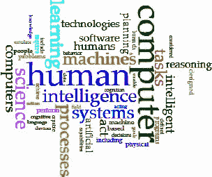

**图 2.1.** *根据表 2.1 中的定义集 112 构建的术语云。此图的彩色版本请参见 [www.iste.co.uk/ventre/artificial.zip](http://www.iste.co.uk/ventre/artificial.zip)*

### 2.1.2. 专家系统

专家系统是历史上关键概念之一。我们多次提到它们。值得强调几个定义。专家系统的定义与人工智能的定义有所不同。主要术语是“人类”、“知识”、“问题”、“推理”和“解决方案”。自 20 世纪 70 年代以来，专家系统的应用非常广泛：例如，在医学领域，开发了 `MYCIN` 系统来识别有机体（斯坦福大学）；在军事领域，专家系统提供了决策支持工具。一个典型的专家系统由三个部分组成：首先是 `知识库`，包含有关高度特定领域的信息。其次是 `推理引擎`，它必须对 `知识库` 中哪些部分适用于解决问题做出决策，并构建推理过程。最后，决定专家系统作为顾问角色的第三部分是 `用户界面`，它允许人类专家与机器交互并要求其解释选择的理由。

表 2.2 专家系统的定义

| 定义 | 来源 |
| --- | --- |
| “专家系统是一种利用知识和推理程序解决需要人类知识问题的智能计算机。” | `FEI 80` |
| “专家系统是人工智能的一个较新分支学科，模仿人类判断。” | `BAC 87` |
| “一个典型的专家系统由三个部分组成：首先是 `知识库`，包含有关高度特定领域的信息。其次是 `推理引擎`，它必须对 `知识库` 中哪些部分适用于解决问题做出决策，并构建推理过程。最后，决定专家系统作为顾问角色的第三部分是 `用户界面`，它允许人类专家与机器交互并要求其解释选择的理由。” | `DEL 91` |
| “人工智能研究最成功的分支之一。在这些系统中，人工智能程序特有的逻辑推理能力被人类专家的解决问题能力所补充。知识库随后提供了人类界面，以便它们能够扮演‘机械顾问’的角色：针对非常特定领域的问题，这些系统可以提供可能的专家建议，并向其人类用户提供得出特定建议的推理过程。” | `DEL 91` |
| “一种能够考虑海量知识、进行推理，然后建议行动方案的计算机程序。” | `HAN 92` |

尽管取得了成功，专家系统也遭到了许多批评，特别是当提出的问题超出其专业领域的严格框架时，它们可能犯的错误。例如，当面对枪伤受害者时，症状是出血，而专家系统专门负责寻找感染有机体，它会寻找导致出血的细菌。专家系统无法自己离开自己的领域。专家系统只在自己的小世界里运行。它也没有常识，无法理解或分析其建议对背景的影响。

机器学习或自动学习是亚瑟·萨缪尔（Arthur Samuel）在 1959 年提出的术语。`Machine learning` 是人工智能的一个分支。研究领域有几本专业期刊，如 `Machine Learning Revue`（Springer 出版，成立于 1986 年）和 `Journal of Machine Learning Research`（成立于 2000 年）^(13。该概念涵盖了这样一个观点：软件或机器能够在无需预先显式编程一切的情况下进行学习。通过数据、通过特定的观察结果，算法在这些数据中寻找联系或关系。学习只是第一阶段，这使得能够根据所获得的知识，从“预测”到识别和外推。例如，Facebook 或 Google 使用此类算法来尝试定义并提议连接，识别互联网用户最感兴趣的信息。因此，算法代替互联网用户对海量数据和信息进行筛选。信用卡公司可以使用机器学习来检测欺诈。`Machine learning` 用于图像中的物体识别（人脸识别、场景分析等）。“深度学习是机器学习算法的一个子类，它使用多层神经网络来学习输入和输出之间的复杂关系” [SHA 18a]。


深度学习是机器学习的一种实现技术，它更具体地依赖于神经网络：

> “深度学习是一种机器学习，它可以处理更广泛的数据资源，对人类数据预处理的要求较低，并且通常能比传统的机器学习方法产生更准确的结果。”¹⁴#c02.xhtml#c02-fn14

### 2.1.4. 机器人，机器人学

人工智能与机器人学在研究和我们的想象中都紧密相连，特别是因为科幻文学的创作，自 20 世纪初以来，这些作品从未停止为我们提供充斥着机器人的宇宙，这些机器人拥有与人类平等甚至超越人类的智能，并始终对人类构成挑战。从保留的少数定义（[表 2.3）中，我们可以说机器人：

- 它主要是一种机器；
- 它是可编程的；
- 它具有特定的功能；
- 它具有一个由人类（即对其编程的人）控制和决定的自由度；
- 它与人类有相似之处，这种相似性与其功能（视觉、移动、抓取物体等）有关，而非其外表。

**表 2.3 “机器人”的定义**

| 定义 | 来源 | 年份 |
| --- | --- | --- |
| “一种操纵工业机器人是一种自动控制、可重新编程、多用途的操纵机器，具有几个自由度，可以固定在场所，也可以移动以用于工业自动化应用。” | 国际标准化组织，ISO | |
| “能够根据固定、可修改或适应的程序操纵物体或执行操作的自动装置。” | 拉鲁秀字典（在线） | |
| “在虚构作品中,[它]是一种机器，一种具有人类外貌、能够像人类一样行动和说话的自动机。” | CNRTL（在线） | |
| “一种基于微处理器的自动控制系统，执行其在工业、科学或家庭领域设计的精确任务的机器。” | CNRTL（在线） | |
| “一种类似于生物的机器，能够独立移动（如行走或在轮子上滚动）并执行复杂动作（如抓取和移动物体）。” | 梅林·韦斯特词典（在线） | |
| “一种自动执行复杂的、通常是重复的任务（如在工业装配线上）的设备。” | 梅林·韦斯特词典（在线） | |
| “机器人是一种可重新编程的多功能操纵器，通过可变程序运动移动材料、零件、工具或专用设备，以执行各种任务。” | [SCI 00] | 2000 |
| “机器人是扩展人类能力的运动机器。它们由机电组件、传感器和基于计算机的控制功能组成。” | [CHR 01] | 2001 |
| “机器人的简单定义是：‘任何程序执行工作的机器’。” | [ELL 12] | 2012 |

**表 2.4. 与“机器人”世界的一些术语**

| 术语 | 定义 |
| --- | --- |
| Android（人形） | 具有人类（男性）的外表。更广泛地说，具有人类外貌的机器人。自 19 世纪以来使用的术语（用于奥古斯特·维拉耶·德·伊尔·亚当 1886 年的《未来的伊娃》中；以及威廉·道格拉斯·奥康纳 1891 年的《青铜机器人》中）。 |
| Ginoid（女形机器人） | 看起来像女性。例如：电影《大都会》中的机器人玛丽亚。 |
| Humanoid（人形） | 看起来像人类（形态上）。 |
| Cyborg（半人） | 控制有机体。被嫁接或植入人工、电子或机械部分的生物体。它与完全人工和机械的机器人不同。 |
| Droid（机器人） | 该术语源于科幻小说，指形状类似于类人的机器人。 |
| Cobot（协作机器人） | 协作机器人（人机交互）。 |
| Chatbot（聊天机器人） | 与用户对话的代理。 |

因此，许多想法与“机器人”相关联：

- 它的设计旨在帮助、协助人类：17 世纪和 19 世纪的自动机与人类相似，一方面具有娱乐功能（通过演奏乐器，或由于其存在的近乎魔力的性质和技术成就），另一方面让人们想象一个机器为人类执行任务的未来。
- 它是未来世界的象征：机器人出现在地球与外外宇宙宇宙混合的故事中。它在太空征服中无处不在。
- 它是生存威胁：卡雷尔·佩克的机器人（1920 年）是构成人类威胁的原型，因为它将奴役人类。机器人首先将人类从任务中解放出来，然后角色转换；人类的创造物反过来对他们。机器人变成了怪物。
- 它是冲突、暴力的行动者：科幻新闻中的机器人通常是与人类或其他机器人对抗的战斗者。它与其他英雄对抗：1963 年，鲁斯·曼宁创造了反机器人英雄马格努斯；还有《人类蝙蝠大战机器人黑帮》（爱德华·R·希姆）。
- 它是对人类状况、人机关系思考的借口：如果人类有自己的法律、规则、原则、道德和伦理，机器人不能也有吗？

## 2.2. 人工智能的类型

分类法用于分类、排序和创建类别，并提供从多个角度理解概念的视角。这种练习必然是简化的，并带有主观性的影响。

最常见的分类之一源于 20 世纪 60 年代，基于区分（weak or narrow AIs），即致力于特定任务或功能的 AI。这些机器不会自己学习，所有规则必须预先赋予它们（例如：游戏的所有规则）。弱 AI 是当前知识水平下可以产生的 AI，因此可以作为国家人工智能战略的主题：“联邦政府已将其战略转向使用人工智能解决特定问题，即‘弱’方法”[^(15](#c02.xhtml#c02-fn15

- 强人工智能或广泛/通用人工智能，能够自主学习，然后像个体一样做出决策并行动。这类人工智能目前尚不存在，即能够以通用方式思考并基于学习而非训练做出决策的人工。若干测试定义了通用人工智能：图灵测试；斯蒂夫·沃兹尼克（Steve Wozniak）于 2007 年提出的咖啡测试；机器人大学生测试；以及就业测试（由尼尔斯·约翰·尼尔森 Nils John Nilsson 于 2005 年制定）。

一些作者增加了第三个层次，提议了：弱人工智能、通用人工智能和超级人工智能或卓越人工智能：

> “超级智能是比人类聪明得多的的人工智能。超级智能目前不存在，但有人提出它有一天可能被构建出来，并产生巨大且可能是灾难性的后果。” [BAU 18]

这种水平的人工高于通用人工智能：通用人工智能具有与人类同等的智能；而超级智能将超越这一水平。超级智能引发了本质上关于灾难主义的论调，其主题是生存威胁，表达了对超越、溢出以及人类对某种智能失去完全控制的恐惧，而这种智能的行动将不再能被任何人预测或控制。

**表 2.5. 人工智能分类学**

| | 高级 AI（强、通用）或 AGI（通用人工智能） | 低级 AI（弱、狭窄）或 ANI（狭义人工智能） |
| --- | --- | --- |
| 定义 | 指任何能力等同或大于人类的自主人工智能系统。 | 人工智能系统专注于解决特定问题。这些机器在被编程的场景的严格框架内运行。 |
| 产出的智能机器 | 无。 | AlphaGo (Google)、Watson (IMB)、Siri (Apple) 等。迄今产生的人工智能大多属于这类低级 AI。 |

另一种双分支分类法将人工智能分为第 1 类和第 2 类：

- 类型 1 将上述两种类型人工智能（低级 AI 和高级 AI）；
- 类型 2 则不同：
  - 反应式机器，它们不保留过去的记忆来改变决策或未来的选择，
  - 具有有限记忆的，利用过去的信息来指导未来的决策（例如在自动驾驶车辆系统中，其中环境观察不会被永久存储），
  - 能够“理解”个人情感、行为、思想并能够进行社交互动的 AI，
  - 最后，是像人类一样具有自我意识的。

因此，在当前知识水平下可行的人工智能与短期中期不可的人工智能之间进行了区分。

这些分类法可能对人工智能的应用领域或其主要研发领域进行拆分：“人工智能包含以下主要子领域：专家或基于知识的系统、自然语言处理、人工或计算机视觉、声音感知/理解以及机器人技术。” [ALB 88]

## 2.3. 主题随时间的演变

### 2.3.1 Google Trends

根据全球互联网用户查询的 Google Trends 数据绘制的初始曲线显示，在 2004–2019 年期间最初处于下降阶段，从 2004 年到大约 2007–2008 年，保持在低水平，直到 2014–2015 年，此时趋势开始上升。然而，最后这一阶段在曲线上看起来并不特别亮眼。重新燃起的兴趣似乎是逐渐的，尚未达到 2004 年的水平。

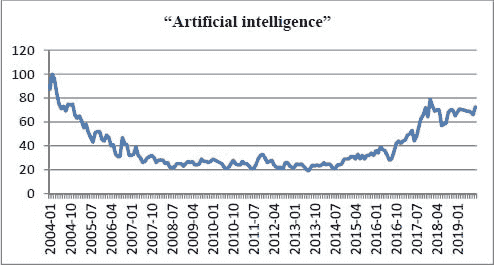

**图 2.3. Google Trends。全球范围内与“人工智能”相关的查询演变（数据记录于 2019 年 9 月 25 日）**

### 2.3.2 AAAI 杂志

AAAI，即美国人工智能协会，成立于 1979 年。它后来更名为人工智能促进协会。自 1980 年以来，该协会出版了 `AI Magazine`，其所有期刊均可在其网站上获取 16。

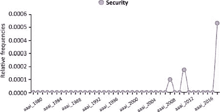

**图 2.9.** *AAAI 出版物中“安全”概念出现的频率演变（1980–2019)*

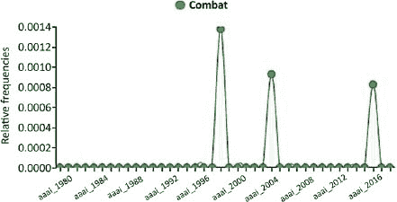

**图 2.10.** *AAAI 出版物中“战斗”概念出现的频率演变（1980–2019)*

军事机构在相关主题中也较少被提及：

- 美国空军在 1985 年的一篇文章中被讨论（《空军技术学院的人工智能研究能力》）；海军在 1991 年的一篇文章中被讨论（《美国海军对人工智能的使用：一个失败的案例研究》）；
- 战斗维度在关于仿真工具的工作中得到了考虑：
  - “用于战斗飞行模拟的自动智能飞行员”（1999），
  - “用于城市战斗训练的合成对手”（2005），
  - “PAWS – 一种用于反偷猎的部署博弈论应用”（2017）。

法律和伦理考虑在 20 世纪 80 年代整合进了 AI 社区的工作中，一度被遗弃，随后在 2005 年被 AI 社区重新采用。

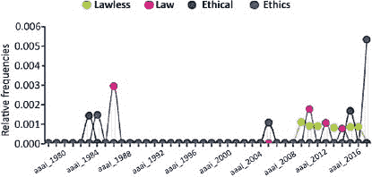

**图 2.11.** *AAAI 出版物中“法律”和“伦理”概念出现的频率演变（1980–2019）。该图的彩色版本请参见 [www.iste.co.uk/ventre/artificial.zip](http://www.iste.co.uk/ventre/artificial.zip)*

## 2.4. 人工智能生成的各种

人工智能就像计算机或更广泛的计算机科学一样，引发了热烈的辩论、有时甚至是争议，以及哲学、政治、社会学、经济、历史、伦理和法律反思。我们无法详尽地列出 AI 引起的所有问题，尽管我们会提到一些。

### 2.4.1. AI 的变革力量

> “Weizenbaum 没有列出任何计算机无法执行的任务，因为他希望‘避免那种不必要的、无休止且最终徒劳的练习，即对计算机无论在现在还是未来能够做什么和不能做什么列出清单’。” \[MCC 76\]

然而，我们认为对于人工智能能或不能做什么、它改变了什么、对什么产生了影响，这些有时很な观点对我们来说是有用的。因为这使我们能够理解科学技术如何在社会中占据位置，以及辩论是围绕哪些论点建立的。在这里，我们尝试列出在非常不同的内容（新闻文章、博客、技术期刊等）中识别出的关于 AI 的观点。我们将这些论述围绕以下表达形式进行了分类：

- AI 是……/AI 不是……；
- AI 将要……/AI 将不会……；
- AI 应该……/不应该……；
- AI 产生/制造了……；
- AI 允许/使得……

这些表述在表 2.6–2.11 中逐一进行了讨论。

**表 2.6.** 关于 AI 输入的一些断言或假设

| 人工智能是…… | 日期 |
| :--- | :--- |
| “人工智能（AI）正在改变与人类生活的几乎所有方面，例如就业、经济、通信、隐私、安全、伦理等。”[18] | 2016 |
| “人工智能是旨在让机器思考的实践。”[19] | 2017 |
| “人工智能可能是‘巨大的帮助’而不是‘阻碍’。”[20] | 2018 |
| “人工智能正在改变战争各个方面。”[21] | 2019 |
| “人工智能改变网络安全格局并防止攻击。”[22] | 219 |

**表 2.7.** 关于人工智能不是什么的一些断言或假设

| 人工智能不是…… | 日期 |
| :--- | :--- |
| “人工智能不应该是人类生命的复刻。”[23] | |
| “人工智能不是一种独特的技术。它的力量依赖于若干前提条件：计算能力、带宽和大规模数据集，这些都是‘大数据’的元素，如果数据是燃料，那么人工智能就是引擎。”[24] | 2015 |
| “人工智能并不是新鲜的，它是由美国科学家约翰·麦卡锡在 1955 年提出的，他被认为是人工智能领域的创始人之一。”[25] | 2016 |
| “人工智能对社会不是一种威胁。”[26] | 2017 |
| “人工智能不是生存性威胁。”[27] | 2017 |
| “人工智能不是机器统治人类，而是机器与人类共同工作。”[28] | 2017 |
| “人工智能不是未来，它正在发生并广泛存在。”[29] | 2017 |
| “人工智能等同于人工意识（人工智能有时被称为‘强人工智能’或‘全人工智能’）。”[30] | 2017 |
| “人工智能并非中立：司法系统中使用的软件存在种族偏见案例。”[31] | 2018 |
| “人工智能不仅仅是为了机器人。”[32] | 2018 |
| “人工智能不是工作的终结。”[33] | 2018 |
| “我们所的人工智能不是真正的智能。只有人类智能才是真实的。”[34] | 2018 |
| “人工智能不是网络安全的银弹。”[35] | 2018 |
| “人工智能并没有那么智能。”[36] | 2018 |
| “人工智能不是遏制网络仇恨的最佳方式。”[37] | 2018 |
| “对于整个大陆的国家来说，人工智能并不是一个简单的话题。”[38] | 2018 |
| “人工智能并不新，但计算能力的可用、捕捉海量数据的新技术以及我们连接、存储和分析数据的速度，提供了新的洞察和机会，导致业务性能的突破、新的商业模式和市场变化。得益于可用技术的结合以及行业从流程、产品和客户中学习的速度，这将呈指数级增长。”[39] | 2018 |

围绕人工智能概念的修辞强调了这些技术的发展和整合到广泛社会活动领域时所涉及或将涉及的社会变革原则。这些变化被认为具有不同程度的，有时被称为“变革”、“转型”、“革命”和“突破”。

断言 AI 将会（或不会）做什么，它将会（或不会）带来变革，这是一种决定论（技术决定论认为技术决定了社会变化）。技术与个人或社会之间的关系也可以从反方向来看，即社会决定论，考虑到允许技术被销售、开发、使用的（特别是以什么形式）的社会条件。这时，是社会生产了技术。由于社会不能被还原为一个同质的整体，技术在不同社会群体之间会产生不同的影响（不同的用途、不同的行为、不同的认知以及对技术的不同关系）：有人接受了强加于他们的技术（消费品、法律强制的用途等），有人通过通过解构技术并使其偏离初衷来将其为自己所用（`hackers`），还有人能根据自己的需求调整技术（例如专业应用、军事领域等）。因此，我们可以像我们表格中的那些公式一样精炼，通过几个公式来掌握 AI 将会或不会做什么，它将会或不会产生什么，因为问“谁在生产 AI？”、“哪些公司在构建 AI？”等问题同样重要。

**表 2.8. 关于 AI 未来的一些断言或假设**

| 人工智能将…… | 日期 |
| --- | --- |
| “实现超越人类水平的人工智能将为人类开启难以置信的选择。”[40 | 1976 |
| “人工智能的研究将加深我们对人类语言的理解。”[41 | 1980 |
| “人工智能需要新的计算思维方式，能够有效利用并行性。”[42 | 1981 |
| “人工智能的广泛普及对人类社会的影响将与汽车或印刷机的发明不相上下，甚至更甚。”[43 | 1983 |
| “无论飞机是民用还是军用，人工智能都将广泛应用，协助飞行员管理相关系统。”[44 | 1985 |
| “人工智能将改变劳动力结构。”[45 | 2016 |
| “人工智能将改变世界。”[46 | 2017 |
| “人工智能将让工作更人性化。”[47 | 2018 |
| “人工智能将造福人类。”[48 | 2018 |
| “人工智能将影响业务职能。”[49 | 2018 |
| “人工智能将在未来的网络攻击中武器化。”[50 | 2018 |
| “就像之前的电缆和计算机一样，人工智能（AI）和大数据将改变我们工作、生活甚至思考的方式。”[51 | 2018 |
| “人工智能将改变内容营销。”[52 | 2018 |
| “人工智能将改变就业市场。”[53 | 2018 |
| “人工智能将改变我们生活的每一个方面。”[54 | 2018 |
| “人工智能将改变患者和医生的一切。”[55 | 2018 |
| “人工智能将彻底改变战争吗？” [NOË 18] | 2018 |

**表 2.9. 关于哪些学科将逃避 AI 影响的一些断言或假设**

| 人工智能将不会/不会…… | 日期 |
| --- | --- |
| “人工智能不会变成弗兰肯斯坦怪物。”[56 | 2014 |
| “人工智能‘不会灭绝人类’。”57 | 2015 |
| “在技术开始独立思考之前，真正的人工智能将不存在。”[58 | 2017 |
| “人工智能不会取代人类。”[59 | 2018 |
| “人工智能不会取代人。”[60 | 2018 |
| “人工智能不会消灭工作。”[61 | 2018 |
| “人工智能不会取代医生。”[62 | 2018 |
| “人工智能不会取代智能。”[63 | 2018 |
| “人工智能在 2021 年之前不会成为主流。”[64 | 2018 |
| “人工智能不会取代会计师。”[65 | 2018 |

**表 2.10. 关于 AI 的假设**

| 人工智能应该…… | 日期 |
| --- | --- |
| “人工智能技术应该应用于编程领域存在的某些现实问题。”[66 | 1971 |
| “人工智能的进展应该整合到先进焊接服务中。”[67 | 1986 |
| “为什么人工智能让你感到恐惧。”[68 | 2017 |


| “人工智能应该是招聘流程的一部分，但它无法取代人情味。”[69 | 2018 |

### 表 2.11. 人工智能的一些后果

| 人工智能产生，或允许…… | 日期 |
| --- | --- |
| “人工智能允许机器进行推理并与世界交互。”[70 | 2016 |
| “数据科学产生洞察；机器学习产生预测；人工智能产生行动。”[71 | 2017 |
| “人工智能产生信息。”[72 | 2018 |

第二个主要主题涉及人工智能与人类之间的关系。对于某些人来说，人工智能是一种生存威胁（这让人想起 20 世纪 90 年代互联网发展伴的灾难论、末日言论），而对另一些人来说并非如此。有些人将这些技术视为权力、胁迫、压迫和控制的新工具，并将它们用于人类；另一些人则反对一种更天使般的愿景，即一个人机协作的社会，机器仅仅是人类的延伸，帮助人们、陪伴他们并增强他们的能力。还有一种观点倾向于去神秘化和去神圣化人工智能，认为并不是解决问题的奇迹方案，不像通常说的那样智能，也不完美；这一观点强调了其缺乏中立性和缺陷，简而言之就是其局限性。

### 2.4.2. 人类智能相对于机器的绝对优越性

争议的对象之一在于承认或否认机器可能等同于甚至优于人类。辩论的在于对比或比较人脑与机器的能力。

对于那些对人工智能前景持批判或怀疑态度的人来说（他们的声音在 20 世纪 60 年代该学科诞生初期就已出现），结论是明确的：计算机永远无法在活动上比拟人类。它可以模仿人类，可以接近人类，但永远不会人类好。这甚至不涉及设想机器超越人类的问题。为了支持他的批评和断言，休伯特·L·德里福斯观察了 1957 年至 1967 年间人工智能研究的进展，这段时期基本上以失败告终，迄为止没有一个既定目标得以实现 [DRE 72]。

许多人像 H.L. Dreyfus 一样决定了一个进步无法逆转的等级：机器在智能上永远无法超越人脑：

> “在 *Le Cerveau et l’Ordinateur* 中，目的是证明尽管大脑与电子机器竞争甚至在某些领域被其超越，大脑仍然是优越的、唯一的创造者。[……] 原生计算机配得上‘人工大脑’这个名字吗？结构上的相似性不可否认的。[……] 但计算机永远无法达到与大脑相当数量的元素。大脑整体具有计算机无法实现的属性。[……] 计算机的性能…………在数值领域无疑是优越的，更不用说在非数字的理性领域了；在智能方面，即理解力，它是劣的，因为智能是一种全球性的现象，不对应于任何特定的神经结构。从装有最博学的‘专家系统’的盒子里，只有潜在包含的内容才能出来。机器与大脑不同，它没有整体产出。” [LAZ 88]

> “机器智能永远无法比拟人脑，因为它没有生命。人工智能是仆，是人类智能的记忆。它们之间不存在对立。” [GIF 84]

### 2.4.3. 机器取代人类

在《计算机力量与人类理性》[WEI 75] 中，约瑟夫·魏森鲍姆（Joseph Weizenbaum）描述了在应由人类执行的任务中由机器取代人类是不道德的。科学技术为我们提供了工具，但在某些情况下使用它们是不道德的。他说，计算机属于那些强加道德考虑的工具之一。这一论点引起了各种反应 [BUC 76]，包括被描述为是不理性的 [MCC 76]。

同样表达出的恐惧是，人类将被人类自身的创造物、我们自己的产物所超越：“计算机系统不能离开算法计算领域，以便人类能够完全对其行使控制。” [WAR 80]

> “根据《世界报》一位记者的说法，这些是‘可怕的前景’。难道到目前为止只将人类从体力劳动中解放出来的机器，不认为它们应该在那些思想迄为止确保了人类拥有垄断的高尚任务中取代人类吗？这些被赋予‘记忆’的‘智能’机器，难道现在能够在日益增多的任务中超越人脑吗？人类的至上地位是否受到了威胁？这些‘智能’机器难道会让人类沦为奴隶吗？” [LAN 69]

### 2.4.4. 作为生存威胁的人工智能

威胁的第一层在于创造者失去控制。这一主题自人工智能早期起无处不在：

> “某些人工智能专家甚至认为，机器可能有助于自身的改进并非不可能，它们有一天会达到这种完美，以至于我们无法支配它们。” [BÉN 71]

2014 年，斯蒂芬·霍金和埃隆·马斯克再次提了这一论点，声称真正的人工智能可能会导致人类的终结。这一观点并不新鲜，它是对技术可能产生的影响进行二元化解读的一部分。生存威胁是剧作《R.U.R.》（1922 年）的主要主题之一，该剧引入了“机器人”一词：

> “这三个首字母代表着：Rozum Universal Robots。机械的不断发展和现代机械的日益演进，使得卡尔·卡佩克能够展望未来，涉足明天的世界[……在这个幸运的时代，将生产人机，或者正如作者所说的机器人（Robots，一个捷克语词，意为工人）。” [QUI 22]

对于本·斯尼德曼（Ben Shneiderman）来说，人工智能是信息时代十大灾难的起之一 [SHN 86]（焦虑、异化、信息获取不平等、在组织面前的个人无力感、过度复杂性和速度、组织脆弱性、缺乏专业责任、对就业的负面影响、侵犯隐私以及对个人形象的损害）：

> “随着智能终端、智能机器和专家系统的出现，机器似乎接管了人类的能力。这些误导性的表述不仅产生了对计算机的焦虑，还可能损害我们对人类及其能力的认知。一些行为心理学家认为，我们与机器无差无几；一些人工智能工作者认为，许多人类能力的自动化已指日可待。人类技能的丰富多样性、日常生活的生成性或创造性、人类努力中感性或激情的一面，以及每个孩子独特的想象力，似乎正在迷失或被低估了。作者们认为，我们不应该被智能机器所震撼，或接受对图灵测试的盲目追求，或关注人的计算能力，而应该认识到赋能用户的设计将如何增加他们对独特人类能力丰富性与多样性的欣赏。””

这里有几个主题交织在一起：

- 超智能，超越人类智能，这将产生超越人类并威胁其死亡的效果。这是一个虚构故事，是一个在中短期被排除的假设。它并非本质要求，也没有提出紧的问题。然而，因为它具有煽动性，它占据了讨论的一部分。可以将这一主题视为强烈的背景噪音；
- 人工智能对社会和现实现状的影响：AI 破坏了工作，但创造了新工作（平衡何？）；AI 作为国家控制和监督的工具；
- AI，我们问题的解决方案；
- 科学在实现 20 世纪 50 年代目标方面的困难。尽管取得了巨大进展，但总的来说，还没有人工智能是真正的“智能”。

人工智能需要与其目前的能力一起被揭秘，并与其真实的样子或应该是的样子相比；

- 误解的持续，概念的误用。机器学习（ML）真的是人工智能吗？

### 2.4.5. 人工智能与机器人在文学作品中的地位：以日本为例

在日本，科小说和漫画从 20 世纪 50 年代起就重点关注了多种形式（机器人或虚拟）的人工智能。人工智能与机器人往往并肩存在。

文学使得区分成为可能：

- 担任主角的 AI；
- 作为助手的 AI，与不同层次的英雄或主角并肩作战，得益于 AI，他们在通常是敌对或未知的环境中得到了加强、帮助和提升；不是主要主角的 AI；作为故事干预故事的客体的 AI；
- 纯虚拟的 AI，位于网络空间或网络中；
- 嵌入在机器人中的 AI；
- 具身智能 AI（它是一个人类身体，在一个人类身体里，或是生物性的）。

我们交叉引用这些类别以汇成表 2.12，该表由指定漫画中的叙事组成（列表显然是不详尽的。几十年来，日本制作一直令人印象深刻，没有哪个目录或数据库能列出所有作品）。

### 表 2.12. 日本漫画和动画中的一些人工智能和机器人

|  | 以 AI 作为主要主角 | 以 AI 作为英雄的助手、配角或叙事的一部分 |
| --- | --- | --- |
| **虚拟 AI** | 《明日之双面》(1996, James P. Hogan, 星野信信）：计算机统治着 21 世纪的世界。人工智能被内置在系统中，系统获得了自主权。 | 《刀剑域界线》(2012–…, 川原缘诚, 山田光太郎）：日本政府想要创造一种与人类大脑相拟的高水平人工智能，并整合到武器系统中。 |
| **整合在机器或机器人中的 AI** | 《阿童正刚》(1952–1968, 手冢虫治)⁷⁵：机器人阿童打击犯罪和不公正义。阿童是一个超级英雄，必须拯救世界。 | 《高达哨兵篇》(1987, 高桥正雅)：一个集成在高达机中的 AI。 |
| **化身的 AI** | 《哆啦 A 梦》(1970–…, 藤子 F·藤二雄)：机器人猫，人类的朋友。 | 《冥王》(2003–2029, 浦泽直树)⁷⁷：AI 侦探，与冥王决战。 |
| **化身的 AI** | 《民主国》(2013, 2015, 井平丰)：AI 冬之，集成在系统中。 | 《Biomega》(2004–2009, 羽生织一)：AI 的伴侣。 |
| **化身的 AI** | 《原子之始》(2014–…, 笠原哲)：机器人 A06（或“六”）的故事。 | 《天才在异世界》(2015–…, 栖见陆, 山田光太郎)：第 35 章名为“人工智能”，以星野玲为主角。 |
| **化身的 AI** | 《攻壳机动队》(1989, 士政昌)：漫画有两部续作：《攻壳机动队 2：人机界面》和《攻壳机动队 1.5：人类误差处理器》。主角草薙素子是一个女性义体人，一名警察。她的任务是追踪一个已经产生意识并化身为机器人的网络犯罪犯。 |  |

## 2.5. 政治考量

哈利·凯勒德建立了一个名为黑城的城市。我们在这里处于一个虚构故事中，由米歇尔·凡尔（朱尔·凡尔之子）在他 1919 年出版的小说《巴拉克任务的奇遇》中构 [VER 19]⁷⁹。这座城市由三部分组成，由高不可攀的墙隔开。

在俯瞰城市的一个塔楼上，独裁领袖哈利·凯勒德建造了一台机器来监控人口的行为：

> “得益于它的光学处理，这台名为‘圆周镜’（cyloscope）的仪器似乎将这片圆形的土地垂直拉直了。仪器的维护者站在设备中心，不断将他眼下的所有点放大……外面的世界在我们眼里变了样。无论他们从哪个方向面对它，我们首先看到的都是一面垂直的墙，一个由黑线划分成许多不同小方格的网络……。这面墙的底部被黑暗的深渊与我们隔开，顶端似乎升到了惊人的高度，似乎是由某种乳白的光构成的。然而，我们很快发现它的颜色远非均匀，相反，它是无数不同色调的斑点的结果，轮廓相当模糊。稍留留，我们就能发现这些斑点有些是树，有些是田野或小径，还有一些是在在大地上劳作的人，整个画面被放大到可以毫不费力地识别出来……‘你看这些黑人，’哈里·基勒（Harry Killer）指着其中两个相距很大的斑点说道，“假设他们有逃跑的想法。这不会持续多久。”他一边说着，一边抓起一个电话发射器。“第 111 圈；半径 1528，”他说道。接着，他抓起另一个发射器，补充道“第 14 圈。半径 6402。”最后，他转向我们，建议道：“仔细看。”在等待了片刻之后（期间没有发生特别的事情），一个斑点突然被一片烟雾遮住了。当烟雾散去后，那个污点消失了。“那个在那儿工作的人怎么了？’‘他死了，’哈里·基勒冷冷地回答，“这一个被鱼雷导弹摧毁了。这是一种可以飞行 25 公里的火箭，你可以对它的速度和精度大有体会。’”

在这个虚构故事中，米歇尔·凡尔（Michel Verne）描述了：

- 一座“现代”城市，技术化的，配备了现代通信手段；
- 基于以下要素结合的全景式监控：
  - 独裁的权力；
  - 通过掌握高科技技术（在本例中为监控技术）来获取部分权力的能力，这些技术包括视觉仪器、成像、反映世界图像的屏幕，使得监控更加有效，因为每个物体、每个个人都位于那里，具有其空间坐标；这种用于监控的视觉化仪器与通信系统（即 C2 军事中心）相结合；
- 使用导弹逐一中和的人类目标。消除这些目标的动机可能是残酷的——独裁者想要展示他的生杀大权——并惩罚任何偏离行为（试图逃跑、闯入禁区等）。

正如预言性小说常见的情况一样，我们可以看到它与我们当代世界的类比性：

- 现代城市（智能城市、超连接城市）使其数公顷土地受益于技术创新；
- 监控系统部署在世界各地；
- 卫星、无人机、摄像头（监控、机载、警察、军事等）捕捉世界的图像；屏幕无处不在，是任何现代监控系统中不可不可的环节；
- 军事指挥系统是围绕处理图像的机器设计的；图像中的物体是可识别的，但往往由于夜间或困难环境下的质量下降（例如：战斗状况、从过远距离拍摄的图像等）——图像中的物体无法识别。相反，它们通常只是显示出的不精确的形式，指挥官或士兵必须根据这些形式进行解释、分析并做出决定。“其中一个斑点突然被一片烟雾遮住了”这句话让我们想到从战斗直升机或无人机拍摄的视频，当目标被攻击、中和时；目标——人类或物质——现在根据精确外科打击的原则被逐一标记。

这种系统在计算机时代有其现代对应物：卫星图像、无人机图像、无处不在的监控摄像头、可以追踪个人移动的移动电话、可以追踪习惯、观点、事实和手势的互联网。现代系统为了区分任务、区分物体与人类，包含了人工智能、模式识别应用以及人脸识别。在战争中，我们可以想象将这些识别工具与致命能力相结合的系统。我们复制了凡尔所描述的系统中出现的原则：权力、基于利用图像进行监控的生杀大权，以及物理破坏。

### 2.5.1. 人工智能的国家战略

国家战略可以满足几项预期：协调参与者和行动，响应协调需求的表达，应对广泛的社会问题，为参与者生态系统在特定问题上的行动定义精确框架，确保更好地利用资源并优化过于分散的资源。因此，决定国家战略意味着为特定时期制定政策的总体轮廓，管理资源，并希望通过在国家层面协调资源来实现优化（例如，存在区域或国际战略，如欧盟）。战略可能会决定创建新的组织或机构，它为行动开辟了道路，允许该领域的参与者自我组织、动员，并根据国家定义的战略采取行动。

### 表 2.13. 国家人工智能战略文档

| 文档标题 | 国家 | 作者 | 年份 |
| :--- | :--- | :--- | :--- |
| “人工智能：对未来决策的机遇与影响” | 英国 | 政府科学办公室 | 2015 |
| “‘互联网+人工智能’三年行动规划（2016–2018）” | 中国 |  | 2016 |
| “新一代人工智能发展战略规划” | 美国 | 国家科学与技术委员会。网络与信息技术研发分委员会 (NITRD) | 2016 |
| “面向非洲的人工智能” | 南非 | Access Partnership. 普勒托利亚大学 | 2017 |
| “泛加拿大人工智能战略” | 加拿大 | CIFAR（由加拿大政府、Facebook 和 加拿大皇家银行基金会资助） | 2017 |
| “新一代人工智能发展规划” | 中国 | 中国国务院 | 2017 |
| “人工智能计划” | 芬兰 |  | 2017 |
| “人工智能技术战略” | 日本 | 人工智能技术战略委员会报告 | 2017 |
| “AI 新加坡” | 新加坡 | 政府 | 2017 |
| “人工智能战略” | 德国 | 联邦政府 | 2018 |
| “促进新一代人工智能产业发展发展三年行动计划（2018–2020）” | 中国 |  | 2018 |
| “2018 年白宫关于美国产业人工智能峰会” | 美国 | 白宫 | 2018 |
| “为什么美国需要国家人工智能战略以及它应该是什么样” | 美国 | 数据创新中心 | 2018 |
| “维拉尼报告” | 法国 | 议员。维拉尼任务小组 | 2018 |
| “#法国 AI 战略” | 法国 | Agoranov，创新国务秘书长、高等教育与研究国务秘书长 | 2018 |
| “国家人工智能战略 #全民 AI” | 印度 | NITI Aayog（印度国家转型政策转型局） | 2018 |
| “AI 硕士计划” | 爱尔兰 | 私人部门倡议 | 2018 |
| “AI 任务组” | 意大利 | 政府 | 2018 |
| “区块链与人工智能任务组” | 肯尼亚 | 政府 | 2018 |
| “立陶宛人工智能战略：未来的愿景” | 立陶宛 | 经济与创新部 | 2018 |
| “毛里求斯人工智能战略” | 毛里求斯 | 人工智能工作组 – 内阁秘书长主席 | 2018 |
| “魁北克人工智能生态系统发展战略” | 魁北克 | 人工智能集群指导委员会。蒙特利大学（政府授权） | 2018 |
| “人工智能的国家方法” | 瑞典 | 企业与创新部 | 2018 |
| “北京人工智能准则” | 中国 |  | 2019 |
| “国家级人工智能战略” | 丹麦 | 财政部和工业、商业与财务事务部 | 2019 |
| “为包容性苏格兰构建世界领先的人工智能和数据战略” | 苏格兰 | 苏格兰发展与工业委员会 | 2019 |
| “西班牙人工智能研发（RDI）战略” | 西班牙 | 科学、创新与大学部总技术秘书处 | 2019 |
| “Kratt 报告” | 爱沙尼亚 | 政府 | 2019 |
| “英特尔对美国国家人工智能战略的建议” | 美国 | 英特尔 | 2019 |
| “引领进入人工智能时代：芬兰 2019 年人工智能计划最终报告” | 芬兰 | 经济与就业部出版物 | 2019 |
| “造福人类的人工智能” | 法国 | 政府 | 2019 |
| “迈向人工智能战略” | 马尔他 | 总总理办公室 | 2019 |
| “AI 葡萄牙 2030” | 葡萄牙 | 科学、技术与高等教育部 | 2019 |
| “卡塔尔国家人工智能战略” | 卡塔尔 | 卡塔尔人工智能中心 (QCAI)。哈马德·本·哈里法大学 | 2019 |
| “捷克共和国国家人工智能战略” | 捷克共和国 | 工业和贸易部 | 2019 |
| “俄罗斯联邦总统关于在俄罗斯联邦发展人工智能的命令” | 俄罗斯 | 政府 | 2019 |

人工智能已成为一个需要制定国家战略的话题。对这些战略的审查显示，自 2015 年以来，国家战略的数量有所增加。然而，并非所有被视为国家战略的文档都是由政府产生的。其作者包括研究中心和私营参与者。在政府作者中，战略是由各个部委撰写的：经济、安全、国防等。然而，应当强调负责经济和工业的部委占据主导地位。人工智能对于国家来说，首要是一个经济问题。因此，在知识生产、知识传播、改善生活条件方面对社会或人类的贡献，远非这些考量。首要目标是经济管理、产业发展，而且最重要的是为了贸易。

我们所提到的所有国家战略都来自各种政府和非政府来源（例如印度和魁北克的文档所示）。


从这些“战略”中，我们将保留主要叙事及其组成要素。这些战略是关于什么的？它们提出了什么样的世界愿景？它们建议如何构建社会？

对于大多数国家来说，人工智能是一种高附加值、创造性的、变革性的技术。如果国家不忽视这些技术的少数“负面”方面（其风险、危险），似乎只需要通过几个框架，特别是法律，通过伦理控制来反制这些问题，以控制其影响并为正面维度留出空间（减少负面维度的工具包括：法律、标准、教育、培训、意识提高、对实践和用户的控制）。

在推销或过度推销 AI 益处的科学家支持下（尽管他们也指出了负面特征），政治家们构建了一种论述，描述了一种不仅有益，而且必要且不可避免的人工智能。进步、经济、社会变化和社会正义（例如用于打击欺诈的 AI）被提及，更高层次、不容疑的利益也被提及，例如安全（预测、预判或检测恐怖分子、犯罪计划的 AI）或国际舞台上的权力。

### 表 2.14. 国家人工智能战略叙述的关键要素

| 论点、主题 | 示例 |
| :--- | :--- |
| **紧迫性** | 人工智能正在快速发展，并带来深刻且快速的变化：我们迫切需要考虑这一新现实。<br><br>德国战略 2018 |
| **变革力量** | 人工智能具有强大的潜力，是一项具有深度变革能力的创新。但它仍然是一项成熟技术，尽管尚处于初期。<br><br>面向非洲战略 2017：“AI 将是我们时代最大的技术革命，具有颠覆人类生存几乎所有方面的潜力”<br><br>魁北克战略 2018：“人工智能（AI）将以彻底的方式改变魁北克的经济” |

### 关键因素，决定因素

| 因素 | 来源 |
| :--- | :--- |
| 国家必须投资 `AI`，以防错过技术、经济和社会的转型。 | 德国 2018 年战略 |
| `AI` 的促进是一项集体事务，是生态系统的一部分。 | 2017 年非洲战略；魁北克战略，2018 年 |
| `AI` 必须被作为一个整体来考虑，不仅是在研究、应用和经济方面，还要考虑其社会影响（法律、伦理和政治）。 | 2017 年泛加拿大战略 |
| 研究与创新至关重要。 | 2017 年泛加拿大战略；德国 2018 年战略 |
| 该国已在 `AI` 领域投资几十年。因此，与 `AI` 的关系是根根且具有文化性的，当下具有真正的锚定效应。高水平研发的历史存在是任何工业、经济和社会生态系统发展的起点。 | 2017 年泛加拿大战略：“在 45 多年来，加拿大研究人员一直处于人工智能（AI）研究的前沿”<br><br>德国 2018 年战略：“德国凭借其卓越且广泛的研究格局，处于非常有利”<br><br>魁北克战略，2018 年：“魁北克经历了人工智能的历史性爆发，这得益于该领域学术研究的卓越，并导致了科技巨头的进入” |
| 研发社区需要通过座谈会、培训计划等注入活力并使其活跃。 | 2017 年泛加拿大战略 |

### “积极的” AI

| 因素 | 来源 |
| :--- | :--- |
| 社会中 `AI` 的发展不能没有对价值观（自由、基本权利）、法律、伦理、文化等的尊重。我们必须保持警惕，并为这种保护创造条件。`AI` 必须造人类和环境的服务。 | 2018 年德国战略；2019 年北京人工智能原则 |
| `AI` 作为经济、社会、增长、民主化……的机遇 | 2017 年非洲战略 |
| `AI` 作为解决各个领域挑战和问题的“解决方案”……健康、农业、金融、公共服务、减贫、解决失业、提高教育、抗击疫情、提高粮食生产力、确保关键部门增长等。 | 2017 年非洲战略：“人工智能（AI）技术有解决影响撒哈拉以南非洲的一些最紧迫挑战的潜力” |
| `AI` 的使用造福所有公民（就业、气候、经济等）。 | 2018 年德国战略：“服务社会利益的 AI” |

### 国家、其角色、其责任

| 因素 | 来源 |
| :--- | :--- |
| 国家建立框架并进行监管。 | 2017 年非洲战略 |
| 国家必须作为权利和价值观的倡导和保护者，因为公民对 `AI` 对社会的影响缺乏充分的培训和了解。 | 德国 2018 年战略 |
| 国家进行投资。 | 德国 2018 年战略（2019 年投入 5 亿欧元：到 2025 年达到 30 亿欧元） |
| 政府投资不会是亏损的。 | 德国 2018 年战略：“这将对商业、科学和联邦州（德国联邦州）产生的杠杆效应将意味着可用总额至少将翻倍” |
| 让国家、公司和社会参与交流、对话和讨论，以实现尊重所有人权利和利益的和谐发展。 | 德国 2018 年战略 |
| 国家政府必须支持 `AI` 在经济肌理和工业活动中的普及。 | 德国 2018 年战略 |

### 风险、威胁：预防、预测、赋能

| 因素 | 来源 |
| :--- | :--- |
| 警惕、保留。`AI` 并非没有风险：权力向少数人手中的过度集中（预测能力、通过控制数据对个人进行控制等）、工作的大规模破坏（因此必须进行转型）、导致整个群体被排除在之外（未连接的、未经过培训的公民等）、对数据质量可能很差且算法可能被偏见污染（自动化决策系统中的编码歧视）的系统产生盲目信任等。 | 2017 年非洲战略：“机器学习过程的优坏取决于喂给它的数据优劣。这就是为什么社会固有的偏见会渗透进来。AI 算法整合了偏见” |
| 研究人员有责任考虑其发明的伦理、社会等影响。 | 2017 年非洲战略；2019 年北京人工智能原则 |
| 从上游预防 `AI` 风险，例如避免国籍、性别等因素。 | 2017 年非洲战略 |
| `AI` 是国家经济在全球体系中定位的关键要素。 | 德国 2018 年战略 |
| 该国家或地区必须成为世界上的领导者和主要中心。 | 德国 2018 年战略 |
| `AI` 不能在单一的国家框架内被构想、推广和发展。在欧洲，国家战略是从欧洲视角定义的。 | 德国 2018 年战略<br><br>2017 年非洲战略从撒哈拉以南非洲的规模考虑了 `AI` |
| 研发能力必须集中在世界一流的卓越机构周围。 | 2017 年泛加拿大战略 |
| `AI`（以及 `ML` 机器学习）依赖于数据的数量和质量。必须确保对数据的访问，数据必须是海量的、全涵盖的、具有代表性的（不能忽略整部分人群）。 | 2017 年非洲战略 |

一些观点认为 `AI` 是一个未知：其技术发展非常迅速，正从尚未准备好的国家和社会中获得速度。没有人确定这对于尚未拥有真正 AI 文化的社会将通向何方。如果社会必须采取的总体趋势似乎是不可避免的，即使仅仅是为了经济原因，也必须立即进行，并采取必要的预防措施以确保不会产生负面影响。正如 20 世纪 80-90 年代及随后的数字社会或经济战略或信息公路项目一样，这些战略使新的 AI 技术成为几乎普遍的经济增长和社会进步的媒介，尽管如此，人们对 AI 仍存在许多保留意见。政府希望让社会放心，表明他们愿意对技术的发展和使用进行框架化，以防止 `AI` 的潜在风险，而到目前为止这些风险还并不真实。我们当然有权认为这种论调是在否认或撒谎，因为我们完全可以考虑 `AI` 对公民基本权利的潜在风险：当 AI 被密集用于安全防御目的时，当公民可以被追踪和控制时，当他们的行为和手势可以被分析和重建时，当他们的生活中没有什么是能逃脱警察国家的审查时，公民的权利确实被侵蚀了。

策略在许多方面既像技术规范，也像信仰宣告：“我们将开发……我们将确保……我们将监控……我们将共同共同努力……”

许多演说也带有理想主义的色彩。因为如果所有国家都声称拥有世界上最好的潜力，或将开发出最好的潜力，成为全球枢纽或“唯一的”全球枢纽，那么显而易见，并非所有国家都能成功。领导地位是稀缺的。因此，需要专业化，以便在 AI 这一广泛领域或行业内的细分领域中获得最终的领导地位。

倡议的推动、国家对产业的支持、研发（即为广泛的已声明倡议和承诺所需的巨额投资），将面临经济和预算现实的挑战。这些承诺将以牺牲其他政策为代价来实现，并且只有在经济状况良好时才能履行。AI 的发展取决于国家预算的命运。

同样值得注意的是，这些文件中关于 AI 与国家安全（以及广义安全问题）之间的关系保持了相对的保密。后者的范围显然更广，并且与其前身（即开发信息公路的计划、方案、倡议或策略）一样，互联网主要关注社会采用这些技术的通项条件。安全无疑是一个特殊问题。然而，安全可能会出现在某些提到从 AI 中获益的多个领域的文档（例如在打击金融违规方面，这是安全政策的一个方面）。但总的来说，并非所有文件都强调了打击犯罪或网络安全。

## 2.5.1.1. 俄罗斯 2019 年战略

2019 年 10 月 10 日，俄罗斯政府发布了其国家人工智能战略。该文件标题为《俄罗斯联邦总统关于在俄罗斯联邦发展人工智能智能的法令》^82。该战略制定了中期（2024 年）和长期（2030 年）目标。该法令的实施还导致了在 2019 年底之前对“俄罗斯联邦数字经济”计划的修订。该文件提出了 AI 的官方定义：

> “人工智能——一组技术解决方案，使其能够模拟人类认知功能（包括自学习和在没有预设算法的情况下寻求解决方案），并在执行特定任务期间获得至少与人类智力活动相当的结果。这组技术解决方案应由信息通信基础设施、软件（包括采用机器学习技术的软件）以及数据处理程序和服务组成。”

这是一个非常务实的定义：AI 必须提供解决方案和结果。

国家项目正式将 AI 的发展置于某些约束之下：尊重自由、人权、工作权的开发；面对 AI 负面后果时最小化风险的义务；透明度（数据处理、算法、AI 过程）；国家主权（俄罗斯必须开发自己的技术）。AI 被分配了几个目标，必须服务于经济、政治、国家安全、政府和其他目的。

为了确保 AI 的发展，俄罗斯政策将重点支持科学研究、软件开发、高质量数据生产、培训（针对需要 AI 的工作）、刺激投资、吸引投资者以及建立有利的经济条件。

文件中没有出现“网络”、“军事”、“国防”和“军队”等术语，因此未涉及。

## 2.5.2. 美国政策

### 2.5.2.1. 巴拉克·奥巴马时期

在奥巴马总统任内，美国启动了多项 AI 倡议。2016 年 5 月，“白宫人工智能未来倡议”启动。计划于 2016 年 10 月出具两份官方出版物，以对“白宫人工智能未来倡议”框架内开展的所有反思（或作为其延续的一部分）进行具体表达。

| 文件 | 时间 | 发布机构 |
| :--- | :--- | :--- |
| 《人工智能未来信息请求：公众回应》 | 2016 年 9 月 | 白宫 |
| 《为人工智能的未来做准备》 | 2016 年 10 月 | 总统办公室国家科学与技术委员会技术委员会 |
| 《国家人工智能研发战略计划》 | 2016 年 10 月 | 国家科学与技术委员会网络与信息技术研发分小组 |

在《为人工智能的未来做准备》（2016）中，主导术语是数据、技术、未来、发展、科学、研究和安全（防护）。这份近 50 页的文档围绕以下主题展开：

- `AI` 的定义和背景；
- 造福社会的 `AI` 应用；
- 对 `AI` 的监管；
- 研究与人力资源；
- 经济；
- 安全与治理；
- 安全，特别是网络安全和 `AI` 军事化（武器系统中的 `AI`）。

网络安全的优先事项之一是开发 `AI` 工具，在黑客利用漏洞之前自主检测、评估并修补软件漏洞。报告提到了 `DARPA` 的网络大挑战（`CGC`），该项目正在追求这一目标并已取得有趣的成果。

在防御方面，报告回顾了美国的立场：美国将仅根据国际人道主义法（包括区分原则和比例原则）开发自主智能武器。


**图 2.13.** 报告“为人工智能的未来做准备”（2016）中最常用的 65 个词汇云。需查看此图的彩色版本，请访问 [`www.iste.co.uk/ventre/artificial.zip`](www.iste.co.uk/ventre/artificial.zip)

《国家人工智能研发战略计划》（2016）特别关注研发战略。与世界上大多数发布的官方文本一样，`AI` 被视为一种突破性技术，预示着人类活动所有领域发生深刻变革，造福社会和经济发展：“人工智能（AI）是一项变革性技术，有望带来巨大的社会和经济效益。AI 有潜力改变我们生活、工作、学习、发现和交流的方式。”

其目标是开发积极、有利的 `AI`，并尽可能减少其负面影响。拟议战略的实施基于七项优先事项：确保长期投资；促进支持人类而非仅仅取代人类的 `AI`；考虑法律方面；确保 `AI` 系统安全；为研究人员和 `AI` 开发者提供高质量数据库并方便其访问；开展技术评估以定义标准；评估开发 `AI` 的人力资源需求。

用于经济繁荣的 `AI` 仍是该政策的核心部分。


**图 2.14.** “国家人工智能研发战略计划”（2016）中最常用的 65 个词汇云。需查看此图的彩色版本，请访问 [`www.iste.co.uk/ventre/artificial.zip`](www.iste.co.uk/ventre/artificial.zip)

### 2.5.2.2. 唐纳德·特朗普的任期

延续前任政府的方法，唐纳德·特朗普政府正在进行新的咨询并发布新的战略文件。美国国家标准技术研究院（`NIST`）于 2019 年启动了一项咨询，所有非匿名的回应均在线可用。该术语是复数形式。主要公司参与了辩论（`IBM`、`Microsoft`、`Google`、`Amazon` 等）。由于回应不受特定格式限制，其内容从几行到几十页不等，贡献者发送的是简单的评论、报告甚至是科学文章。然而，从这些多样性中，我们将保留一些出现的问题：

- 建立对使用 `AI` 技术的信心：一条评论批评了常见的论调：“一个可信的系统是一个技术上正确的系统”。信任不能归结为技术或规范问题。它具有本质的社会政治维度：必须保证对自由、隐私和个人知情同意。AI 往往像一个无法验证其生成结果的黑箱。“今天对人工智能（AI）的信任危机源于操作者的感知，他们无法解释为什么生成了给定的结果……为了让算法获得信任，它们必须是可解释的——也就是说，人类必须理解算法为什么那样做。”

- 围绕该技术、其结果的质量或可靠性及其在整合领域的影响存在巨大的不确定性：“没有国家标准来评估或检查在特定背景、流程或部门内人工智能的成功或失败……在医学领域，医疗专业人员对风险的容忍度为零，因为关乎重大——患者的健康、他们的声誉、执业许可证。如果没有信誉、准确性、精确性或类似的信誉良好的标准化指标证明，医疗专业人员不会采用 AI。”

- “风险”的概念无处不在，指的是技术风险、公民权利风险、价值观、伦理风险、商业风险、民主风险。

- 对隐私、自由、基本权利、公民权利、伦理的考虑以及权重在所有这些变量上的风险是所有回应中的共同点，对全球人类而言也是如此（考虑到个人的风险，考虑到残障、“对社会经济劣势群体的负面影响”[STU 19] 等）。

- 创建 `AI` 的规范或标准是一个国际问题，大国在其中维护自身利益，并希望通过声称领导地位来制定自己的规则：“美国有机会在定义解决 AI 伦理问题的指南、法规和法律方面领先。”

- 国家/私营平衡：AI 的发展引发了国家/私营部门比例的问题，以及这两类之间必须确保的平衡。国家是否真的应该干预定义 AI 的标准？私营部门是否更擅长定义这些？“美国私营部门目前在 AI 研发方面领先，但需要联邦支持才能成功参与国际标准机构。”

- 中国被反复称为“负面”的：“中国一直有颠覆国际技术标准的历史，例如通过开发替代性的国家标准来制造有利于其国内利益的贸易壁垒” [CDI 19]；中国对新疆维吾尔少数族的压迫很大程度上是通过人工智能辅助技术的兴起建立的” [CHI 19]；中国的社会信用体系与美国对自由和民主价值观的观点，以及其他国家如 `GDPR` 所示对个人数据隐私和保护的价值观相冲突。[92] 在这里，我们看到了围绕 AI 问题的国际治理辩论中提出的根本分歧再次出现。美国、中国以及俄罗斯之间存在一条分界线：“与中国或俄罗斯开始 AI 竞赛将是有问题的，因为这些国家对隐私、安全和自由的观点与美国非常不同。”[93]

- 数据：数据质量和获取途径是两个关键变量。“AI 应用的优劣取决于训练它们时使用的数据” [STU 19]。在利用数据时，尊重权利至关重要。

2019 年的咨询在表达 AI 议题上与 2016 年的咨询有何不同？这种比较可能很困难，因为咨询的重点不同（2019 年的咨询侧重于规范和标准问题）。然而，仅通过一个例子，我们看到贡献者处理 AI 议题的方式受到多种变量的影响。例如，2016 年咨询中提到中国的方式是中性的，没有显示出任何偏见。随后提到中国是为了提醒我们，北京方面决定了一项为期多年的机器人投资计划。这毫无疑问是在呼吁美国当局，提醒他们采取同样的行动。在 2019 年的咨询中，中国不再是一个模型。面貌发生了变化，表达变得批判性、负面。在西方，中国使用 AI 的选择被描绘为“奥威尔式”实现，而现在它代表了理想社会的对立面、反例以及应该避免的构建模式。在 2016 年的咨询中，这种社会控制的威胁更多源于美国当局本身。因此，AI 治理的分析和建议使用了来自即时新闻的案例（2016 年，美国被爱德华·斯诺登的泄密引发震惊；2019 年，西方媒体描述了中国新的社会控制系统）。但基本思想保持不变：公民必须对国家以及他们自己政府的行为保持警惕。所引用的两个例子也表明，警惕在阻止当局计划方面作用甚微。

1. [1] Enrique Sucar 研究员评论，引用自 [MAR 18]。
2. [2] 加拿大 AI 生态系统：2018 年简介，Green Technology Asia Pte Ltd., 2018，网址：<http://www.greentechasia.com/wp-content/uploads/2018/02/Canada-AI-Ecosystem-2018-Profile-Summary-Report-Greentech-Asia.pdf>。
3. [3] 埃森，“为什么人工智能是增长的未来”，2016 年 6 月。
4. [4] 该版本的书籍日期为 1996 年，是第三版。第一版日期于 1976 年。


5. [5] NITI，人工智能国家战略，2018 年 6 月，网址：<https://niti.gov.in/writereaddata/files/document_publication/NationalStrategy-for-AI-Discussion-Paper.pdf>。

6. [6] 人工智能工作组，毛里求斯人工智能战略，2018 年 11 月，网址：<http://mtci.govmu.org/English/Documents/2018/Launching%20Digital%20Transformation%20Strategy%20191218/Mauritius%20AI%20Strategy%20(7).pdf>。

7. [7] 国家情报局长，AIM 计划，2018 年，网址：<https://www.dni.gov/files/ODNI/documents/AIM-Strategy.pdf>。

8. [8] 丹麦政府，人工智能国家战略，财政部和工业、商业和财务部，2019 年 3 月，网址：<https://eng.em.dk/media/13081/305755-gb-version_4k.pdf>。

9. [9] 捷克共和国国家人工智能战略，捷克共和国工业贸易部，2019 年，网址：<https://www.mpo.cz/assets/en/guidepost/for-the-media/press-releases/2019/5/NAIS_eng_web.pdf>。

10. [10] 捷克共和国国家人工智能战略，捷克共和国工业贸易部，2019 年，网址：<https://www.mpo.cz/assets/en/guidepost/for-the-media/press-releases/2019/5/NAIS_eng_web.pdf>。

11. [11] 捷克共和国国家人工智能战略，捷克共和国工业贸易部，2019 年，网址：<https://www.mpo.cz/assets/en/guidepost/for-the-media/press-releases/2019/5/NAIS_eng_web.pdf>。

12. [12] 捷克共和国国家人工智能战略，捷克共和国工业贸易部，2019 年，网址：<https://www.mpo.cz/assets/en/guidepost/for-the-media/press-releases/2019/5/NAIS_eng_web.pdf>。

13. [13] 捷克共和国国家人工智能战略，捷克共和国工业贸易部，2019 年，网址：<https://www.mpo.cz/assets/en/guidepost/for-the-media/press-releases/2019/5/NAIS_eng_web.pdf>。

14. [14] 捷克共和国国家人工智能战略，捷克共和国工业贸易部，2019 年，网址：<https://www.mpo.cz/assets/en/guidepost/for-the-media/press-releases/2019/5/NAIS_eng_web.pdf>。

15. [15] 捷克共和国国家人工智能战略，捷克共和国工业贸易部，2019 年，网址：<https://www.mpo.cz/assets/en/guidepost/for-the-media/press-releases/2019/5/NAIS_eng_web.pdf>。

16. [16] 捷克共和国国家人工智能战略，捷克共和国工业贸易部，2019 年，网址：<https://www.mpo.cz/assets/en/guidepost/for-the-media/press-releases/2019/5/NAIS_eng_web.pdf>。

17. [17] 捷克共和国国家人工智能战略，捷克共和国工业贸易部，2019 年，网址：<https://www.mpo.cz/assets/en/guidepost/for-the-media/press-releases/2019/5/NAIS_eng_web.pdf>。

18. [18] 捷克共和国国家人工智能战略，捷克共和国工业贸易部，2019 年，网址：<https://www.mpo.cz/assets/en/guidepost/for-the-media/press-releases/2019/5/NAIS_eng_web.pdf>。

19. [19] 捷克共和国国家人工智能战略，捷克共和国工业贸易部，2019 年，网址：<https://www.mpo.cz/assets/en/guidepost/for-the-media/press-releases/2019/5/NAIS_eng_web.pdf>。

24. 24 [<https://assets.publishing.service.gov.uk/government/uploads/system/uploads/attachment_data/file/566075/gs-16-19-artificial-intelligence-ai-report.pdf>](https://assets.publishing.service.gov.uk/government/uploads/system/uploads/attachment_data/file/566075/gs-16-19-artificial-intelligence-ai-report.pdf)。

25. 25 [<https://vinodsblog.com/2018/03/11/the-exciting-evolution-of-machine-learning/?fbclid=IwAR3WUFDuTaOP78HYlFVhvAVqYe4kS2D_O37p48VIs3M11LKrqJqO8m6jm0A>](https://vinodsblog.com/2018/03/11/the-exciting-evolution-of-machine-learning/?fbclid=IwAR3WUFDuTaOP78HYlFVhvAVqYe4kS2D_O37p48VIs3M11LKrqJqO8m6jm0A)。

26. 26 [<https://www.reasoning.world/artificial-intelligence-is-not-a-threat-to-society/>](https://www.reasoning.world/artificial-intelligence-is-not-a-threat-to-society/)。

27. 27 Shermer M.，“为什么人工智能不是生存性威胁”，Skeptic Magazine，第 22 卷第 2 期，第 29–35 页，2017 年，访问于：[<https://pocketmags.com/skeptic-magazine/222/articles/144321/why-artificial-intelligence-isnot-an-existential-threat>](https://pocketmags.com/skeptic-magazine/222/articles/144321/why-artificial-intelligence-isnot-an-existential-threat)。

28. 28 [<http://www.stantive.com/Artificial-Intelligence-Empowering-People-Not-The-Rise-Of-The-Machines>](http://www.stantive.com/Artificial-Intelligence-Empowering-People-Not-The-Rise-Of-The-Machines)。

29. 29 [<https://www.pwc.at/de/publikationen/verschiedenes/artificial-intelligence-in-hr-a-no-brainer.pdf>](https://www.pwc.at/de/publikationen/verschiedenes/artificial-intelligence-in-hr-a-no-brainer.pdf)。

30. 30 [<http://www.pcts.org/meetings/2017/PCTS2017Nov-Green-ReflectionsAI.pdf>](http://www.pcts.org/meetings/2017/PCTS2017Nov-Green-ReflectionsAI.pdf)。

31. 31 [<https://www.youtube.com/watch?v=zDHSD4twyIA>](https://www.youtube.com/watch?v=zDHSD4twyIA)。

32. 32 [<http://yp.ieee.org/artificial-intelligence-is-not-just-for-robots/>](http://yp.ieee.org/artificial-intelligence-is-not-just-for-robots/)。

33. 33 [<https://www.population.sg/articles/artificial-intelligence-is-not-the-end-of-all-jobs>](https://www.population.sg/articles/artificial-intelligence-is-not-the-end-of-all-jobs)。

34. 34 [<https://www.morningfuture.com/en/article/2018/06/04/emanuele-severino-roger-penrose-artificial-intelligence-intell/331/>](https://www.morningfuture.com/en/article/2018/06/04/emanuele-severino-roger-penrose-artificial-intelligence-intell/331/)。

35. 35 [<https://www.computing.co.uk/ctg/news/303714/artificial-intelligence-is-not-a-silver-bullet-for-security>](https://www.computing.co.uk/ctg/news/303714/artificial-intelligence-is-not-a-silver-bullet-for-security)。

36. 36 [<https://medium.com/forcit/artificial-intelligence-is-not-so-intelligent-according-to-woziak-b4c2610dc>](https://medium.com/forcit/artificial-intelligence-is-not-so-intelligent-according-to-woziak-b4c2610dc)。

37. 37 [<https://globalnews.ca/news/446172/artificial-intelligence-to-fight/>](https://globalnews.ca/news/446172/artificial-intelligence-to-fight/)。

38. 38 [<https://qz.com/africa/130521/google-is-making-a-big-bet-on-artificial-intelligence-with-its-research-center/>](https://qz.com/africa/130521/google-is-making-a-big-bet-on-artificial-intelligence-with-its-research-center/)。

39. 39 [<http://www.euromanu.com/documents/EFM_Papers_200618.pdf>](http://www.euromanu.com/documents/EFM_Papers_200618.pdf)。

40. 40 [<http://jmc.stanford.edu/artificial-intelligence/weizenbaum.pdf>](http://jmc.stanford.edu/artificial-intelligence/weizenbaum.pdf)。

41. 41 [<https://pdfs.semanticscholar.org/cbe9/a097de7c0ff08db1c5f453f184cf5384pdf>](https://pdfs.semanticscholar.org/cbe9/a097de7c0ff08db1c5f453f184cf5384pdf)。

42. 42 [<https://dspace.mit.edu/bitstream/handle/1721.1/6351/AIM-626.pdf?sequence=2>](https://dspace.mit.edu/bitstream/handle/1721.1/6351/AIM-626.pdf?sequence=2)。

43. 43 [<https://fee.org/articles/japans-fifth-generation-computers-threat-to-the-free-market/>](https://fee.org/articles/japans-fifth-generation-computers-threat-to-the-free-market/)。

44. 44 [<https://apps.dtic.mil/dtic/tr/fulltext/u2/a164172.pdf>](https://apps.dtic.mil/dtic/tr/fulltext/u2/a164172.pdf)。

45. 45 [<https://www.canon.com.au/businessinsights/how-artificial-intelligence-will-change-the-workforce>](https://www.canon.com.au/businessinsights/how-artificial-intelligence-will-change-the-workforce)。

46. 46 [<https://news.usc.edu/trojan-family/five-ways-ai-will-change-the-world-by-2050/>](https://news.usc.edu/trojan-family/five-ways-ai-will-change-the-world-by-2050/)。

47. 47 [<https://timoelliott.com/blog/2018/11/why-artificial-intelligence-will-make-work-more-human.html>](https://timoelliott.com/blog/2018/11/why-artificial-intelligence-will-make-work-more-human.html)。

48. 48 [<https://www.inc.com/eric-mack/heres-27-expert-predictions-on-how-youll-live-with-artificial-intelligence-in-near-future.html>](https://www.inc.com/eric-mack/heres-27-expert-predictions-on-how-youll-live-with-artificial-intelligence-in-near-future.html)。

49. 49 [<https://www.inc.com/entrepreneurs-organization/4-ways-artificial-intelligence-will-change-your-business.html>](https://www.inc.com/entrepreneurs-organization/4-ways-artificial-intelligence-will-change-your-business.html)。

50. 50 [<https://www.zdnet.com/article/ai-in-the-nhs-how-artificial-intelligence-will-change-everything-for-patients-and-doctors/>](https://www.zdnet.com/article/ai-in-the-nhs-how-artificial-intelligence-will-change-everything-for-patients-and-doctors/)。

56. 56 [人工智能不会变成弗兰肯斯坦的怪物](https://www.theguardian.com/technology/2014/aug/10/artificial-intelligence-will-not-become-a-frankensteins-monster-ian-winfield)。

57. 57 [人工智能不会终结人类种](https://www.theguardian.com/technology/2015/jan/28/artificial-intelligence-will-not-end-human-race)。

58. 58 [真正的人工智能并不存在，增强智能](https://www.information-age.com/true-ai-doesnt-exist-augmented-intelligence-123468452/)。


59. [人工智能不会取代人类，Salesforce 高管](https://www.cnbc.com/2018/11/14/artificial-intelligence-will-not-replace-people-salesforceexecutive.html)。

60. [人工智能不会取代人类](https://timesofindia.indiatimes.com/home/education/news/artificial-intelligence-will-not-replace-humans/articleshow/66215791.cms)。

61. [机器人和人工智能不会夺走工作，相反它们是未来的基础](https://hackernoon.com/robots-and-artificial-intelligence-will-not-kill-jobs-instead-they-are-the-foundation-of-the-next-2e4c5c9348ff)。

62. [为什么人工智能不会取代医生](https://medium.com/datadriveninvestor/why-artificial-intelligence-will-not-replace-the-physician-e1bfd469743b)。

63. [人工智能不会取代人类智能——汇丰报告](http://www.theedgemarkets.com/article/artificial-intelligence-will-not-replace-human-intelligence-%E2%80%94-hsbc-report)。

64. [在 2021 年之前人工智能在营销领域不会成为主流](https://www.episerver.com/about/news/press-room/pressreleases/artificial-intelligence-will-not-be-mainstream-in-marketing-until-2021/)。

65. [为什么机器和人工智能不会取代会计师](https://www.rsm.global/singapore/news/why-machines-and-artificial-intelligence-will-not-replace-accountants)。

66. [`dl.acm.org/citation.cfm?id=1622876.1622912`](https://dl.acm.org/citation.cfm?id=1622876.1622912)。

67. [`www.gpo.gov/fdsys/pkg/GOVPUB-C13-6438b36d72e7975eac842f6dbcb25c82/pdf/GOVPUB-C13-6438b36d72e7975eac842f6dbcb25c82`](https://www.gpo.gov/fdsys/pkg/GOVPUB-C13-6438b36d72e7975eac842f6dbcb25c82/pdf/GOVPUB-C13-6438b36d72e7975eac842f6dbcb25c82)。

68. [为什么人工智能应该让你感到恐惧](https://thebolditalic.com/why-artificial-intelligence-should-terrify-you-c9891b9476)。

69. [让人工智能回归本位，人工智能应当是其](https://ir.kornferry.com/news-releases/news-release-details/putting-ai-its-place-artificial-intelligence-should-be-part)。

70. [人工智能应该是其的一部分](https://techcrunch.com/2016/10/23/advancements-in-artificial-intelligence-should-be-in-the-eye)。

71. [`varianceexplained.org/r/ai`](http://varianceexplained.org/r/ai)。

72. [人工智能与数据增强](https://www.trudyperson.com/2018/3/14/artificial-intelligence-and-the-data-)。

73. [人工智能的未来]

74. [人类工作的未来]

75. 本田机器人：他成功创造了名为 `ASIMO` 的机器人。

76. [人工智能对社会的威胁]

77. 手冢治虫的《机器人天王》[为了了解故事中出现的机器人机器人，可以访问](https://www.theedgemarkets.com/article/artificial-intelligence-will-not-replace-human-intelligence-%E2%80%94-hsbc-report)。

79. 尽管是米歇尔·威尔创作的作品。

80. 人工智能研究创新计划。这一策略并非加拿大政府的官方政策，而是 `CIFAR` 的一项计划，其策略被定义为`AI`领域的研究计划。

81. 人工智能的历史以工业化和商业化为标志，这始于 20 世纪 70 年代。因此，学科离开了大学和研究中心，进入工业界并赢得了市场，并处于 80 年代日本与西方之间技术战的核心。1982 年，日本启动了“第五代计算机系统”计划，旨在其计算机科学领域占据主导地位。作为回应，美国将人工智能纳入`DARPA`新的十年发展计划中。人工智能也被纳入微电子和计算机技术公司（`MCC`）的项目中，这是一个由前国家安全局局长鲍比·因曼领导的 20 多家公司组成的联合体。

# 参考文献与数据来源

83. [`obamawhitehouse.archives.gov/sites/default/files/whitehouse_files/microsites/ostp/NSTC/preparing_for_the_future_of_ai.pdf`](https://obamawhitehouse.archives.gov/sites/default/files/whitehouse_files/microsites/ostp/NSTC/preparing_for_the_future_of_ai.pdf)。

84. [`obamawhitehouse.archives.gov/sites/default/files/whitehouse_files/microsites/ostp/NSTC/national_ai_rd_strategic_plan.pdf`](https://obamawhitehouse.archives.gov/sites/default/files/whitehouse_files/microsites/ostp/NSTC/national_ai_rd_strategic_plan.pdf)。

85. 使用在线应用创建插图：[`voyant-tools.org/`](https://voyant-tools.org/)。

86. 关于“联邦参与人工智能标准”信息征求（`RFI`）的收集意见，2019 年，访问地址：[`www.nist.gov/topics/artificial-intelligence/comments-received-rfi-about-federal-engagement-artificial`](https://www.nist.gov/topics/artificial-intelligence/comments-received-rfi-about-federal-engagement-artificial)。

87. 通过数据收集和算法处理的 AI 伦理标准维护美国价值观，访问地址：[`www.nist.gov/system/files/documents/2019/06/03/nist-ai-rfi-lchin_001.pdf`](https://www.nist.gov/system/files/documents/2019/06/03/nist-ai-rfi-lchin_001.pdf)。

88. 回应国家标准与技术研究院关于“制定联邦 AI 标准参与计划”信息征求的意见，2019 年 6 月 7 日，访问地址：[`www.nist.gov/sites/default/files/documents/2019/06/07/nist-ai-rfi-broniatowski-caliskan-reyna-schwartz.pdf`](https://www.nist.gov/sites/default/files/documents/2019/06/07/nist-ai-rfi-broniatowski-caliskan-reyna-schwartz.pdf)。

89. Buoy Health, Inc., `RFI`：制定联邦 A.I. 标准参与计划，2019 年 6 月 7 日，访问地址：[`www.nist.gov/sites/default/files/documents/2019/06/10/nist-ai-rfi-buoy-health-inc-001.pdf`](https://www.nist.gov/sites/default/files/documents/2019/06/10/nist-ai-rfi-buoy-health-inc-001.pdf)。

90. RTI International，对 NIST RFI 2019-08818 的回复：制定联邦 AI 标准参与计划，2019 年，访问地址：[`www.nist.gov/sites/default/files/documents/2019/06/10/nist-ai-rfi-rti-001.pdf`](https://www.nist.gov/sites/default/files/documents/2019/06/10/nist-ai-rfi-rti-001.pdf)。

91. AI 治理中心、生命未来、长期网络安全中心，`RFI`：制定联邦 AI 标准参与计划，2019 年 6 月 6 日，访问地址：[`www.nist.gov/sites/default/files/documents/2019/06/06/nist-ai-rfi-fhi-fli-cltc-cfi-001.pdf`](https://www.nist.gov/sites/default/files/documents/2019/06/06/nist-ai-rfi-fhi-fli-cltc-cfi-001.pdf)。

92. RTI International，`RFI`：制定联邦 AI 标准参与计划，2019 年 6 月，访问地址：[`www.nist.gov/sites/default/files/documents/2019/06/10/nist-ai-rfi-rti-001.pdf`](https://www.nist.gov/sites/default/files/documents/2019/06/10/nist-ai-rfi-rti-001.pdf)。

93. Hitachi Vantara（VF），`RFI`：制定联邦 AI 计划，2019 年 5 月 31 日，访问地址：[`www.nist.gov/sites/default/files/documents/2019/06/11/nist-ai-rfi-hitachi-001.pdf`](https://www.nist.gov/sites/default/files/documents/2019/06/11/nist-ai-rfi-hitachi-001.pdf)。

# 3 人工智能与防御

从引言开始，我们想要回顾 `AI` 如何成为重点。

## 3.1 AI 政策与规范

通过统计使用的词汇，我们发现 `AI` 尚未获得核心地位。

### 3.1.1 国防部长演讲中的 AI

第一个观察是，在 1995 年到 2019 年间，`AI` 并不是核心主题。然而，`cyber`、`smart` 和 `robot` 的频率更高。相比之下，`nuclear` 出现了 2126 次，`missiles` 出现了 2328 次。`AI` 在这些演讲中被边缘化了。

**表 3.1 防长语料库中的概念出现情况**

| 词汇、表达 | 次 |
| :--- | :--- |
| `Cyber` | 1910 |
| `Internet` | 394 |
| `Smart` | 255 |
| `Robot` | 83 |
| `Artificial Intelligence` | 40 |
| `Intelligent` | 21 |
| `Machine Learning` | 10 |
| `Deep Learning` | 8 |
| `Autonomous weapon` | 5 |
| `Expert system` | 1 |
| `Neural Network` | 1 |

从 DARPA 专家的角度来看，所有这些学科所取得的进展都是重大的，标志着一项突破。我们可以想象拥有类似于人类智能的机器，设想人与机器、机器与其环境之间真实、自然的交互；我们可以认真考虑赋予机器自主执行复杂任务的能力。这些机器将为公民服务，也将为领导者服务，他们现在身边将有智能计算机作为助手顾问。其目标不是用机器取代人类，而是将人类（无论是公民还是管理者）从大量的从属任务中解放出来，或者辅助他们的推理过程，使他们能够专注于核心或最重要的事情：“因此，人类的注意力将越来越多地投入到定义目标，并对当下的紧迫方面做出判断。”

### 3.1.2 MAVEN 项目与 AWCFT 的建立（2017 年）

MAVEN AI 项目是一项国防部项目，于 2017 年启动，旨在利用 `ML` 从军事无人机（`UAV`）录制的数千小时视频片段中识别个体和物体。曾与国防部签约并参与该项目的 Google 公司在面对数千人的抗议后不得不退出。然而，这些事件并不会威胁到该项目，该项目由一个专门在 2017 年创建的团队执行，即算法战争跨职小组（`AWCFT`）`[DSD 17]`，其领导将由国防部情报副部长担任。该项目的实施是为了加速武装部队对 `AI` 的采用。

在该项目启动的正式发布会上，国防部回顾道，国防力量必须整合 `AI`（`AI` 和机器学习）。在文中，提到了紧迫性和快速行动的必要性：“我坚信，我们必须做得更多，行动得快得多。”`AWCFT` 的使命是“加速国防部内部大数据与机器学习的整合”。该文档规定了军队对 `AI` 的期望：

- 速度


速度是人工智能的目标之一，也是其附加值之一：“`AWCFT` 的目标是将美国国防部（DoD）可获得的海量数据，快速地转化为可操作的情报和洞察。” 挑战在于学习如何利用收集、创建的、存储以及可用的海量数据，并使它们对军队功能产生作用。应当从这些进展中获益的系统是战术无人机（UAV）以及这些无人机产生的图像和视频的处理，无人机的使用量预计在未来几年将持续增长 \[SHA 18a\]。这些能力必须满足反对所谓“伊斯兰国”战争（击败 ISIS 组织运动 \[ALL 17\]）背景下持续行动的需求。`AWCFT` 必须加速大数据和机器学习的实施，以利用部队收集的大量数据。这些任务之首是反伊斯兰国战争的一部分，必须加速或自动化无人机数据的处理、使用和分发，以克服人类处理这些海量数据的局限（人类被这些海量数据所淹没），高效地产生有用的情报（机器的分析能力强于人类在图像中、事实上是在所有类型的数据中寻找相关信息的能力），并更快速地加强军事决策过程。该项目的紧迫性由于伊斯兰国的威胁以及尽快击败该组织的雄心而变得合理。因此，目标是在 2017 年底之前在作战区域部署一种 AI 算法。因此，该方法和项目并非投资于长期研发，而是利用军事官员认为对其即时需求有用的技术和先进技术 \[FRE 17\]。军队将从私营行业获取这些工具，因为那是唯一能够响应定义需求的部门。人工智能和机器学习（ML）似乎是唯一合理、可行且有效的选择。几十年来，军队的技术化不断增加和改进了传感器（摄像头、无人机、卫星、通信拦截等）、网络基础设施的能力（越来越多的数据、计算、流量、网络数据传输速度等）以及军队使用这些工具来连接、告知和链接武器系统并加强 SRI 系统的能力。但今天，这种建设需要额外的能力，这种能力无法仅从流量的速度和数量找到。情报和分析必须更进一步。根据美国军方的说法，跨越这一新门槛对于确保正在和未来发生的许多武装冲突的胜利是不可或缺的，就像网络、计算机系统以及对信息空间和网络空间的主导以前必须保证这些胜利一样。甚至可以说，军队和情报机构，甚至政府，在过去的几十年里已经发展并学会在一个被海量数据完全淹没环境中生存、决策、行动和演变。信息技术的到来标志着数据生产这一新动力。机器处理输入它们的数据，并在现有数据的基础上产生新数据，这一过程呈指数级增长。网络和全球计算机化加速了这种现象。这种数据过剩的情况并非 2010 年代所有。因此，其压倒人类的能力也非如此，人类无法吸收、甚至无法阅读由人类和机器产生的所有报告。因此，我们必须质疑这种看似突如其来的紧迫性作为至关必要性的断言。还应当记住，通过数据（因此通过计算机）主宰世界的痴迷，也根植于军事和政治领导人的脑海中几十年。人们会想起越南战争期间的一些情况描述，当时美国军队试图依赖计算机，要求它们预测冲突的结果 \[MAD 17\]。战略家们期望预测未来，不是通过水晶球，而是在定量分析技术中，将用于商业的方法应用于战争事务。这让人起了美国军方宣言的记忆，他们在 2017 年设立了 `MAVEN` 项目，声称从行业方法目录中提取处理和解决战争事务是足够的。逻辑仍然相同，对计算机、对计算能力以及对数据所创造的力量的信仰，但前提是它是海量的，甚至相信将商业管理的逻辑和工具简单转换到战争事务管理的有效性。20 世纪 60 年代越南战争期间，计算机和程序被称为`汉密特评估系统`（`HES`），每天产生 90,000 页报告，数据量惊人，我们永远无法真正知道其中百分之几被阅读、利用并真正是有用的。持续的逻辑构成了实现不可分割的信息主导、信息控制、由数据挖掘结果驱动的军事行动和胜利。整个美国军事机器的设计旨在产生现象级数量的数据。该战略是通过生产大量数据来追求胜利，但这种大量生产并不等同于信息主导。罗伯特·麦克纳马于 1961 年被任命为部长，他在引入计算机作为决策支持工具方面是至关重要的。但防御力量以及政府部门已经有了这种计算器文化、统计数据利用文化，他们从第二次世界大战以来就开始使用，某些用途甚至可以追溯到 19 世纪（使用孔字系统处理统计数据） \[HAR 88\]。

重点是图像和视频处理（计算机视觉、视频）在情报功能（分析、处理、理解等）中的问题。`AWCFT` 必须开发处理这些数据以及识别和自动检测无人机图像的方法，这超过了人类分析师和现有系统的处理能力。`AWCFT` 项目开发的算法将专注于图像识别、索引和视频中物体的实时检测 \[SHA 18b\]。第一批算法必须在 2017 年底交付，这意味着要加速开发。当然，在如此短的时间提出的算法解决方案可能不是完全成熟的，而是基于之前的成果并对其进行改进。

### 国防部 2018 年战略

美国国防部 2018 年的人工智能战略是在战略计算计划启动 35 年后宣布的，并于 2019 年发布 \[DOD 19\]，这是一份补充或扩展 2018 年《国家国防战略》（\[DOD 18a\]）的文本。这并不令人意外，因为国防领域已经对各种形式的人工智能和机器人产生了兴趣，这些是各种计划、方案和项目的主题。

各大大国几十年来一直在进行 AI 研究，通常在武装部队的严密监控下进行，并自 20 世纪 70 年代以来多次报告了其军事应用计划。这一策略再次确认了军队希望利用 AI 技术开启转折点的意愿，这不仅关乎武器库，更预示着更深层次的变化。这种 AI 的集成：

- 不仅对个人进行培训，还需要对需要人类知识的机器学习进行训练；
- 将采用商业产品，接管 80% 的商业应用，并通过 20% 的修改来适应特定的军事需求。国防部号私营部门与其合作。

2018 年 6 月 27 日，国防部成立了联合人工智能中心（`JAIC`）`[DSD 18]`。这份由国防部长发布的文档回顾了国防部门对 AI 的重视，这在 2018 年的《国防战略》（`NDS`）中已明确。AI 是基础性的，因为它能够“改变社会和[……]战争性质”。该项目的目标是为防御力量集成 AI 做好准备。根据国防部长的话，这是一个保持和增加军事优势的问题。AI 的集成及其在军事框架中的应用是一个经济、官僚（业务改革）和战略（占有 AI 并学习如何在战斗中使用它）问题。AI 的影响必须在最广泛的范围内进行评估，因为它将渗透到军事机构的所有层面，可能对组织、指挥、战争艺术和官僚机构产生影响。该项目被描述为至关重要且紧迫，正如所有的国防 AI 倡议一样。`JAIC` 的扩展了将 AI 集成到美国防御体系中的努力。

### 美国第三次偏移策略 (TOS)

“偏移策略”是指旨在加强军事能力以应对特定威胁的防御策略。这些策略本质上是以技术为中心的，建立在尖端技术创新的基础上，尽管更多的政治或组织考量无疑是决策的核心：“关键创新是将这些新系统和技术与新的战略作战概念相结合并应用” `[HAG 14]`：

- 第一次“偏移”策略发生在艾森豪威尔总统期间（20 世纪 50 年代），旨在应对苏联的军事能力。该策略是开发核威慑；
- 第二次“偏移”策略出现在 20 世纪 70 年代，旨在应对苏联的数量优势。它是长期研发规划计划的主题；
- 最后，第三次策略是由时国防部长查克·哈格尔于 2014 年底在一次宣布启动新计划——“国防创新倡议” `[HAG 14]`——的演讲中发起的。这一新策略旨在补偿美国军事优势的侵蚀，这部分是由于拒止进入（反介入）和区域拒止（`A2/AD`）能力的扩散导致的。面对这些能力的美国军其行动自由受到了削弱。这个问题出现在 20 世纪 90 年代。因此，开发第三次策略的反思阶段于 2014 年正式启动，但它是建立在之前的政策和策略之上的。面临的挑战将与俄罗斯和中国之间的技术差距，这两个国家在过去的十年中不断投入资金使其武装部队现代化。哈格尔表示，美国必须保持其投射能力，否则世界对美国来说将变成一个更危险的地方。2014 年的演讲并未明确提到 AI 提供的新机会，它仅确认了主要原则。

该策略尚未完成，外国国家战略已经开始出现，并可能对抗美国的计划。俄罗斯再次成为美国面临的一大挑战，它将构建自己的策略来反对美国。俄罗斯的策略可能包括利用第一次策略的原则来应对第三次策略（即加强核军库和威胁，开发战术和战略核武器系统）；这一俄罗斯策略的第二部分可能包括复制美国的计划（例如，2012 年，俄罗斯创建了高级研究基金会（`ARF`），它正从事与 `DARPA` 在技术和逻辑领域类似的项目，其中人工智能无疑在起着重要作用 `[KAS 17]`）。

### 四年一次防御审查 (QDR)

在这一组语料库中，我们审阅了大量的条令性文本（由联合出版物组成），寻找任何对 AI 的引用，无论是显式地使用“人工智能”术语，还是引用“专家系统”、“机器学习”、“深度学习”和“自主”。我们将搜索范围限制在认为近期及目前对 AI 最具有代表性的术语上（我们分析的所有文档列表列在本本书书的 `附录 2` 中）。

因此，在国防部的整个条令语料库中（此处限于联合出版物），对 AI 的引用非常稀少：

### 美国军事条令中的 AI

尽管 AI 自 20 世纪 60 年代以来一直处于研发阶段，在军事的发起下（特别是通过其研究机构 `DARPA`），如果实施了应用，那么分析 AI 在军事条令中所占据的位置是非常有趣的。

- 2017 年，在《联合与国家军事行动情报支持。JP 2-01》[JCS 17]中，`AI` 本质上是一种减少大规模数据处理耗时的工具。`AI` 是与数据处理相关的流程的加速器：

> “数据处理的进步，如人工智能、大数据集分析、知识库和迭代搜索工具，创造了一种新的范式，使得情报行动的时间线和情报处理流程被大幅压缩。”

- 2019 年，在《联合后勤。JP 4-0》中，简要讨论了 `AI`：

> “联合后勤社区必须关注以下五个领域以影响任务成功：战斗准备、武装冲突之外的竞争、全球整合、创新以及联盟和伙伴网络的加强\[……\] 一种‘数据文化’有助于对大数据、人工智能、机器学习和现代计算能力等潜在概念的理解，这些概念将带来整个联合陆勤执行环境（JLEnt）的革命性改进。对手将集中精力削弱我们在技术方面的相对竞争优势。未来冲突的成功可能取决于迅速采纳和部署新技术的能力，以确保持续投射和维持力量的能力。”[JCS 19]

- 2016 年，在《联合行动的障碍、障碍与水雷战。JP 3-15》[JCS 16]中，提到了自主系统：

> “无人系统小组。无人下航行器（UUV）小组使用 Mk 18 Mod 1 UUV 搜索并绘制水下物体地图\[……\]Mk 18 Mod 1 的运行时间超过 20 小时\[……\]它使用笔记本电脑进行编程，可以使用声学答器作为导航参考标标，或由其车载计算机自主选择另一种更合适的导航方法使用。\[……\]无人机小组使用遥控的、便携式 `Silver Fox` 和 `Manta` 无人机\[……\]这些飞机具备完全自主飞行的能力，并能够携带各种载荷以增强任务的有效性和适应性。”

- 2014 年，文档《联合空域控制。JP 3-52》[JCS 14] 涉及了无人机自主性：

> “无人机。\[……\]`UAS` 通信链路通常比有人系统所需的链路更关键。\[……\]尽管某些无人机可能具备自主反应（即避障）能力或在通信丢失时执行预计划响应（即返回基地），但无人机在飞行控制和载荷管理方面通常依赖于近乎持续的数据交换。”

这项对军事文本语料的工作可以通过阅读国防部所有的指令和说明来完成（这些指令列表可在 `fas.org` 4 网站上获得）。我们特别注意以下文本：

- “武器系统中的自主性”，2012 年 11 月 21 日，“修订 1 版”，2017 年 5 月 8 日。这份国防部指令 [DOD 12] 定义了在应用致命性和非致命性、动能和非动能武力的武器系统中，开发自主和半自主功能的条件。并非所有武器系统都受本指令中自主规则的影响，例如用于网络空间行动的自主和半自主系统，以及某些类武器 5。然而，在 15 页文中并未提到 `AI`（也没有提到以下术语：智能、机器人、情报、机器学习）。本文提供了自主武器系统的定义：

> “自主武器系统。一种武器系统，一旦激活，可以在没有人类操作员进一步干预的情况下选择并攻击目标。这包括人类监督的自主武器系统，其设计旨在允许人类操作员覆盖武器系统的运行，但在激活后无需进一步的人类输入即可选择并攻击目标。”

该指令提醒了我们必须约束此类此类自主系统的法律和伦理框架：

> “授权使用、指导使用或操作自主及半自主武器系统的人员必须采取适当谨慎并符合战争法、适用条约、武器系统安全规则以及适用的交战规则（ROE）。”

`AI` 很少被引入所有所有文档涵盖的大量主题和领域，这些文档反映了国防领域正在发生的政策、战略和辩论。最后，让我们分析由陆军、空军和海军等产生的文档：

### 美国陆军与人工智能

对于陆军来说，列出的所有文档 6 在其标题中都没有与情报、机器人或自主性相关的术语：

- 然而，机器人和自主性在 2010 年发布的《网络空间行动概念能力规划 2016–2028》中被简要讨论：

> “量子计算和纳米技术的发展可能导致一支由机器人和遥控引导、自主和微型化武器系统增强的战斗力量。通信系统可能是自组织和分布式的。”[USA 10]

- 在 2018 年发布的《网络空间与电子战作战 2025–2040》[USA 18]中，也提到了 `AI`、机器人和自主系统：

> “战场上自主设备的使用增加（包括无人机系统）为安全带来了挑战。自主技术的不断发展预示着未来机器将在战场上利用先进算法和人工智能为自己做出决策。因此，这种决策算法可能被劫持，人工智能也可能被破坏，从而对陆军力量和技术构成危险。由于自主系统的扩散，需要故障安全技术和软件来维持有效控制。\[……\]

> 自主主动网络防御。开发能够通过一系列同步、实时能力，在没有人类直接干预的情况下发现、定义、分析和缓解网络威胁及漏洞的自主网络防御系统。这种能力包括基于传感器的人工智能，它可以学习并管理网络拓扑结构。\[……\]

> 陆军采用更具远征性的空间能力，缩小许多空间和电磁系统的尺寸、重量和功率，使其更适合远程、机器人和自主系统的部署。陆军部署先进天线技术和动态频谱接入能力，以提高可用电磁频谱的使用效率。”

- 2018 年发布的《2028 年多域作战中的美国陆军》[TRA 18a] 也无法忽略人工智能与其他技术进入军事事务。该文档制定了政治或战略性质的概括性内容：

> “人工智能、高音速、机器学习、纳米技术和机器人等新兴技术正在推动战争性质发生根本性变化。随着这些技术的成熟及其军事应用变得更加明确，其影响具有变革战场的潜力，不亚于机枪、坦克和飞机开启诸兵种作战时代以来的任何变化\[……\]与俄罗斯相比，中国拥有足够的经济和技术基础（例如独立的微电子行业和世界领先的人工智能发展进程），足以未来 10 到 15 年内超越目前的俄罗斯系统优势。”

> “跨所有领域、EMS（电子战系统）以及信息环境能力融合的关键，在于人工智能支持的大规模分析能力和‘传感器到射击手’的链路，通过自动交叉线索和目标识别增加了敌方欺骗和遮蔽的复杂性。”

因此，AI 将作为加速器（在处理海量数据时）和军事情报能力的倍增器（允许从多个源获取更多数据）进行集成。人工智能通过自动交叉线索和目标识别，使敌方的欺骗和遮蔽变得复杂。


NCARAI 出版物库提供了 337 标题（在线），涵盖了 1990–2018 年期间。这些出版物分为技术类（信息技术）文章，以及结合认知科学、人文社会科学以及运营与战略考量的文章。例如，研究人员对关于 AI 反叛或造反主题的作品中智能实体的“行为”感兴趣 \[AHA 17, COM 17\]：虽然人类行为（如抗议、争论、反对、说“不”或反叛）是有益的，并有助于维持个体之间的平衡，对个人和社会而言是必要的，且根据社会正义的要求具有正当性，并且在伦理、道德和政治上都是可以接受的，但 AI 并非如此，AI 通常被恐惧或被以负面的方式解读，任何反叛的可能性都被认为是危险的。

这项工作考虑了 AI 作为一组扮演社会角色的人工智能体及其与人类的关系，并不再将 AI 反叛视为威胁或破坏，而是将其视为对这些交互具有潜在益处。因为，正如个人一样，“反叛”不仅可能有用或有益，而且在伦理或道德上是义务性的，或者是必要的。必须考虑一种建设性的 AI 反叛形式，就像人类可以这样做一样，以最大化 AI 的社会效益。AI 反叛智能体被定义为能够对其他智能体分配的目标或任务产生对立态度的 AI 智能体。随后，“反叛”可以以多种形式出现：抵抗、反对、拒绝执行任务。被 AI 反叛的智能体被称为“交互者”（interactor），后者与反叛智能体处于权力关系中。“交互者”可以是人类或合成的/人工的，可以是个人也可以是群体。

随后，作者描述了反叛智能体的分类学（意识到自己正在反叛的智能体、未意识到正在反叛的智能体、既意识到又能对其反叛后果进行推理的智能体——设计设计反叛的智能体）、交互者、反叛类型、反叛动机和反叛阶段。通过对这些多个变量进行交叉引用，作者得出了两种 AI 智能体反叛的情景（第一种考虑了智能体参与灾难救援任务，其中智能体由于检测到指令错误而拒绝执行收到的指令；第二种场景考虑了共同创作的情况），但基于所提出的分类法，其组合在实践上是无限的。其他作品涉及自主性、推理中的错误位置、欺骗检测、欺骗的作用、信任、人机交互、信息不确定性等。

对该出版物库的统计分析使我们能够观察到机器人、专家系统或自主性等主题考虑的一些趋势（[图 3.3]）。

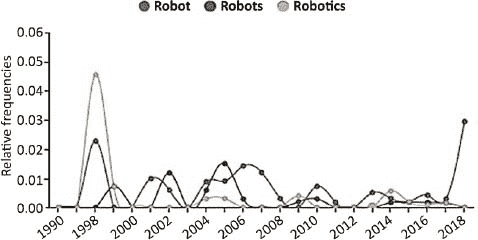

**图 3.3.** NCARAI 出版中的“机器人”（robot, robotics）主题。1990–2018 年。使用 Voyant Tools 应用处理的数据。如需此图的彩色版本，请访问 [www.iste.co.uk/ventre/artificial.zip](http://www.iste.co.uk/ventre/artificial.zip)

虽然机器人技术在近 30 年里被处理得相对一致，但自主性问题自 1990 年代起也被考虑在内，但从 2010 年开始更加规律。

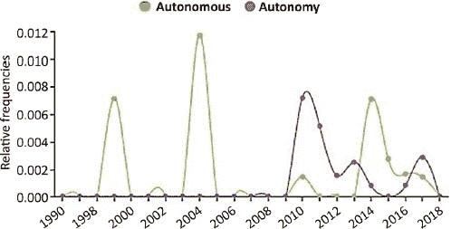

**图 3.4.** NCARAI 出版中的“自主性”（autonomy, autonomous）主题。1990–2018 年。使用 Voyant Tools 应用处理的数据。如需此图的彩色版本，请访问 [www.iste.co.uk/ventre/artificial.zip](http://www.iste.co.uk/ventre/artificial.zip)

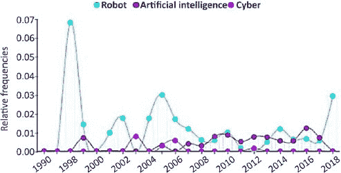

**图 3.5.** NCARAI 出版中的“机器人”（robot, robotics）和“人工智能”主题。1990–2018 年。使用 Voyant Tools 应用处理的数据。如需此图的彩色版本，请访问 [www.iste.co.uk/ventre/artificial.zip](http://www.iste.co.uk/ventre/artificial.zip)

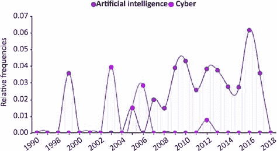

**图 3.6.** NCARAI 出版中的“人工智能”和“网络”主题。1990–2018 年。使用 Voyant Tools 应用处理的数据。如需此图的彩色版本，请访问 [www.iste.co.uk/ventre/artificial.zip](http://www.iste.co.uk/ventre/artificial.zip)

最后，需要注意的是，这些文章中没有一篇在标题中引入“专家系统”、“战争”或“战斗”、“犯罪”、“安全”的概念；“防御”的概念也几乎被忽略了（仅使用一次）。占主地位的概念是“认知系统”、“人类”、“社会”、“推理”、“学习”、“机器人”、“交互”、“规划”和“自主性”。

### 3.1.2.3 美国海军陆队与 AI

在 1996 年出版的“MCDP 6 指挥控制”中 \[DON 96\]，提到了专家系统，但没有提到 AI 的概念：

```
专家系统和人工智能在某种程度上可以协助认知——例如通过帮助整合处理后的数据。但认知主要是一种人类心理活动——不主要是程序化的行为，而是一种学习行为。我们通过判断将复杂的知识组件转化为理解，判断是一种基于经验和直觉的纯人类技能。判断简单无法简化为程序或规则（无论多么复杂）。
```

在 2003 年，“MCWP 3-42.1 无人机作战”（2003 年 8 月 14 日） \[USM 03\] 更具体地讨论了无人机的使用：

```
无人机 – 一种不携带人类操作员动力飞行器，利用空气动力提供飞行器升力，可以自主飞行或远程操控，可以是抛弃的或回收的，并可以携带致命性或非致命性载荷。
```

### 3.1.2.4 美国空军与 AI

年来，美国空军理论处理了自主性、AI 和专家系统，但没有一份正式的理论文件似乎涵盖了整个 AI 或作为其唯一目标。

对于“自主性”概念，我们在 2008–2017 年期间引用了四份文件：

- “AFDD 3-01，反空作战，2008 年 10 月 1 日，临时修订 2，2011 年 11 月 1 日”：“在防御性反空作战中使用自主战斗识别识别时，应非常小心以防止误伤”；

- “AFDD 3-40，反化学、生物、放射及核作战，2007 年 1 月 26 日，中期变更 2，2011 年 11 月 1 日”：“无人机。一种不携带人类操作员且能够在远程控制或自主编程下飞行的飞机或气球”；

- “能源展望：美国空军能源科学与技术愿景 2011–2026，AF/ST TR 11-01，2012 年 1 月 31 日” [`SAF 12`]：“未来的无人机（RPA）和自主飞机可以针对目前传统飞机完成的特定机动和战斗任务进行定制，并减少总能量足迹”；“鸟型微飞行器的自主运行要求在相当于高尔夫球大脑的物理空间内执行高容量计算机计算”；

- “空军指令 63-101/20-101，2017 年 5 月 9 日” [`SAF 17`]：“在开发自主和半自主武器系统时，评估指令中的要求和指南（DoDD 3000.09）。”

同样，对于 AI 的概念，我们确定了三份涵盖 2005 年至 2017 年期间的文件：

- “AFDD 3-13，信息作战，2005 年 1 月 11 日，合并变更 1，2011 年 7 月 28 日”，其在参考文献中在正文未使用 AI 概念的情况下，简单地提到了出版物《信息的崇拜：关于关于高科技、人工智能和思考之真艺术的新卢德主义论文》¹¹；

- “能源展望：美国空军能源科学与技术愿景 2011-2026，AF/ST TR 11-01，2012 年 1 月 31 日” [`SAF 12`]：

> “空军对更远未来的愿景涉及在冲突、拥挤和竞争环境中运行的冗余、碎片化、协作系统。要实现这一愿景，需要人工智能以及控制理论领域基础的新思想，这些思想远超如今的无人机（UAV）和机器人研究。”

- “空军手册 15-12，第 2 卷（2011/2017）” [`SAF 13`]：

> “集成天气效应决策辅助（IWEDA）。IWEDA 是一种基于规则的 TDA 应用。IWEDA 支持陆军和空军系统，并提高了互操作性。IWEDA 使用人工智能技术和大气效应知识结合模型数据来增强和扩展当前的天气决策能力。它允许指挥官比较友方和敌人系统基于天气的优势/劣势。”

最后，对于“专家系统”的概念，确定了两份提到它的文档（分别来自 2002 年和 2011 年）：

- “AFDD 6-0，指挥与控制，2007 年 6 月 1 日，合并变更 1，2011 年 7 月 28 日”：

> “C2 过程是知情决策的结构化基础。技术通过信息的进步自动化或加速了这些过程，”

- 空军手册，第 5-223 卷，2002 年 [`SAF 02`]：

  - “由于涉及的开发成本，专家系统通常保留给”

  - “专家系统识别……常犯的错误”

## 3.2 俄罗斯的军事 AI

俄罗斯以及世界各地的军事力量认为，下一场战争将以极快的速度进行，在这种情况下，人类将无法跟上。这种加速也归于系统的引入。国防专家瓦西·西切切夫（Vasily Sychev）认为，系统本身对人类不构成威胁，因为机器不会反叛。如果自主系统构成威胁，那是因为其所有者的意识 [`SYC 15`]。

瓦迪姆·科久林（Vadim Kozyulin）[`KOZ 18`] 识别了来自自主系统的三个威胁群：

- 与排除在决策循环之外相关的风险；

- 破坏国际平衡的风险，允许非核化国家凭借基于 AI 的新一代武器平起平坐（AI 因其攻击防御潜力成为一种威慑武器）；

- 与缩短决策和响应所需时间相关的风险。计算机和网络使得设计超越人类思维能力的 `C4ISR` 系统成为可能。海量数据的分析现在是超级计算机的任务，负责提取信息并为政治和军事领导人产生方案。

根据 `Kozyulin` 的说法：

- 通过 AI，所有可以自动化和机器人化的将被实现；

- 传统的武装部队将重新配置和组合，以产生更有效的行动；

- 沿水平和垂直轴的信息交换（例如，地空、从坦克或步兵到飞机飞行员）将得到优化。并非所有参与者都会收到所有信息，而是对他们有用的、即机器认为相关的信息。

谢尔盖·阿布拉莫夫（Sergei Abramov）军工主管认为，在没有预先确定目标性质的情况下，无法实施完全自主武器系统。基于 AI 的自主武器系统已经存在，但不存在用机器取代人类的问题。他认为，自主武器的目的和用途不是取代人类，而是让人类对系统、其要求执行以及执行方式拥有更大的控制权 [`MAK 19`]。2007 年南非九名士兵死亡的严重事件被作为机器人或自动化系统潜在缺陷的案例（尽管专家随后驳斥了这一解释）。

关于人工智能军事化及其在现代战争和国防事务中地位的俄罗斯文学，其提出的论点通常有利于这些新技术的发展。这些观点一方面认为这一过程是不可避免的，另一方面则认为为了应对艰苦的作战区域（城市战）以及在武器装备上与世界主要竞争大国保持对等竞争，这样做是必要的。人工智能似乎没有替代方案，因此它不是一个真正的选择。这项技术已经存在，且必须被使用。未来可以预见将针对其使用制定相关的监管措施、立法以及可能的国际协议。然而，对人工智能在战争术中地位的思考，并没有排除人与智能机器之间关系的问题；相反，它们认为将人类维持在指挥功能和战略决策中心至关重要，同时承认人类在这些机器面前处于劣势地位，无法以系统相同的规模和速度处理数据。因此，人工智能在主宰网络空间的尝试中至关重要，而该空间运行的核心已经将人类边缘化。我们读过的所有文章中，没有一篇设想过增加数据并将其转化为推理、决策和行动来继续主宰战争之外的任何配置。没有大规模数据，战争将无法进行。人工智能对于赋予这些数据意义是不可或缺的。

在此，我们对近期俄罗斯关于战争人工智能文献中的一些观点进行了概述。这些反思大多在专门讨论或政治问题的俄罗斯网站上发展。这些观点并不反映俄罗斯当局的学说和官方政策。然而，它们仍然反映了俄罗斯对这些问题的一种思考方式。

### 战争和军队正变得技术化

人工智能通过使武器、武器系统、决策和数据分析过程更加高效，促成了这一不可避免的现象。这一过程既不能也不应该抵制：

- 遏制军事化人工智能的发展是不可能的，因为该技术是可获取的，因为战争日益技术化，而且人工智能在这个过程中将非常有用。人工智能可以用于许多不同类型的应用 [LOS 17]。人工智能、人机交互、无人军事车辆、机器人、自主武器、定向能武器和高超音速武器都是现代武器的关键领域。自动模式识别（APR）技术允许对卫星图像和雷达数据进行更快速、更高效的分析；人工智能将提高雷达系统对攻击弹道检测的有效性；微型卫星的倍增及其观测能力的同步增长，要求快速、强大的数据处理系统，特别是能够区分军事区域或物体（如车辆），以便将其与民用物体区分开来；在战场上，人工智能将增强可视化能力，例如，识别敌方军队所用武器的类型；

- 美国在其霸权计划中，早晚将对俄罗斯或中国发动军事战争，而不仅仅是经济战争。对于俄罗斯而言，追求人工智能等突破性技术的发展至关重要，以保持与美国和中国的战略对等（strategic parity）。只有通过维持某种水平的技术和军事力量，俄罗斯才能在一个平衡脆弱的世界中确保其在国际舞台上的地位。在防务技术的竞争中，俄罗斯的财力能力低于美国和中国，在这种情况下，人工智能可以帮助补偿这种不平衡。特别是，预期的收益将很大程度上取决于人工智能对战略决策过程的贡献 [LOS 17]；

- 通过人工智能追求权力不可避免地导致了军备竞赛，非国家利益相关者也可能参与其中。文献中提到了恐怖主义的技术机会 [LOS 17]。

### 人工智能和机器人技术将产生新武器，但可能不会产生机器人

虽然不能排除智能机器人的长期可能性，但在不久的将来，更有可能开发出无人机、以传统武器、车辆、工业“机器”等形式存在的“智能”机器人。人工智能将嵌入到现有的武器装备中，并改变其运行模式。我们无法抵制依赖人工智能的技术演进，因为它是目前唯一的解决方案，以补偿人类无法以系统相同的速度处理数据、思考和行动。

数据量的倍增以及通常需要实时执行的处理，以及需要解释的海量数据，已经超出了人类的能力范围。智能系统执行的任务还包括确保防御系统的网络安全（漏洞检测、攻击、反应、反攻击）。

### 人工智能可以应用于所有军事功能

军事化人工智能的任务追求分为四类：信息、战术、战略和经济。数据收集能力的增强结合分析能力的提升，将根据信息处理的速度和质量提供战术和战略优势。

人工智能具有非即时杀伤性的军事应用（例如，改进后勤——即智能后勤；增强预警能力、攻击检测等）；在武器系统和作战本身中的应用，帮助士兵；以及决策过程层面的应用。军事领域的人工智能可以定义为系统、模型和设备模仿人类智力活动（感知、推理和逻辑决策）的应用领域 [STE 19]。

### 人工智能为新的作战模式铺平道路

在战术武器中使用人工智能的可能性是多多的。由于成本低廉，无人机可以大量生产，并可以在人工智能的管理下作为舰队或集群运行。一架战斗机的价格，军队就可以负担得起数十万架装有爆炸药的无人机，这些都是可怕的武器。这些技术将使创建“集群”或“包围”武器（导弹、无人机、陆地机器人等）成为可能，这需要人工智能、计算机化和通信系统、通信流以及具备适应能力的系统（例如美国海军用于管理机器人船和无人船集群的 `CARACaS` 应用）。现代战争战略要求改变部队的部署方式。这些新的部署规则必须整合新一代武器出现产生的影响。无人机作为可以委托任务的武器，过去一直只在士兵手中并取决于人类的推理和决策，现在需要重新审视个人的角色以及人机、人系统、人工智能与人之间的交互 [LOS 17]。

AI 通过产生大量的人工数据来诱导其他系统（无论其是否智能），从而丰富了信息空间。这些 AI 作品被称为“虚拟真相”。这些做法并非没有风险，因为那些落入这些虚拟真相陷阱的受害者——无论是政治反对派团体，还是政府、武装部队等——都会陷入困境。操纵的可能性范围将进一步扩大 [LOS 17]。

美国被描绘为信息领域的侵略性参与者。列昂尼德·萨宾（Leonid Savin）的文章 [SAV 19] 提到了美国军方的某些做法，这些做法旨在利用 AI 技术制造伪造信息和虚假痕迹，以此对第三方进行指控。这些技术源自 `DARPA` 的工作，据称该机构拥有约 20 个 AI 项目和 60 个网络安全项目。

2018 年，俄罗斯国防部长和副部长呼吁科学界和工业界共同手手推进 AI 领域的发展。这在网络战中至关重要，而且考虑到如今没有任何冲突是在没有发生信息空间战斗的情况下进行的，这一点尤为核心。他们认为，俄罗斯可以在其在数学研究方面的优势基础上进行构建 13。他们说，AI 开启了一个新时代，因为仅仅计算速度已经不够。需要智能系统来处理和存储信息。所有这些技术贡献创造了新一代武器，它们更强大、更快速、更精确、更具抗性且无法被探测到。

AI 是网络中心战的关键元素 [RUD 19]。2008 年与格鲁吉亚的冲突凸显了俄罗斯军事组织的几个薄弱点：情报和通信能力薄弱、指挥部队和武器的流程自动化程度低、部队信息系统薄弱。面对系统所产生的海量信息，决策者已无法做出正确的分析和选择。这项任务极其艰巨，在复杂性方面已远超人类能力。

只有基于神经网络、被称为智能软件解决方案的软件才能处理这些海量数据和复杂性。

### 考虑人与 AI 之间的关系问题至关重要

在现代自动化武器系统中，人类的仍然是不可缺的。但与系统和 AI 相比，人类的主要缺点是速度。人类无法以与系统相同的速度进行行动、决策、反应、分析并考虑到所有环境数据。与这些军事技术相比，人类是脆弱且低效的，是决策链中最慢的环节之一，如果不是最慢的话 [LOS 17]。


俄罗斯联邦副国防部长鲁斯兰·萨利科夫（Ruslan Tsalikov）表示，俄罗斯军队早已使用 AI。在 20 世纪 70 年代和 80 年代，初级的 AI 在军事领域应用有限。2020 年，情况发生了根本性变化：出现了基于 AI 的无人机和电子助手。AI 实现了这样一个梦想：拥有公正、精确、执行任务快速、能够清晰执行命令、知晓如何快速分析局势并率先开火的士兵（经过优化管理的 OODA 循环）。战争总是更具技术性的，并以出人意料、有时是隐形的形式出现。平民执行的任务很可能是军事行动过程的一部分，而他们对此却毫无察觉 [NIK 19]。

AI 本身毫无意义。它根据人类定义的项目根据人类的初始决策行动。在没有人类干预的情况下，它不会变得危险或暴力。因此，我们不能期望机器接管军队，在战争中独立做出决策。短期内，不会有 AI 替代`C2`。另一方面，可以实施统一的防御系统，例如防空系统，在考虑到可能代表的威胁水平等变量的情况下，将最合适的破坏手段与目标进行比较 [NIK 19]。

## 对智能系统的依赖和有效性并不排除信任问题

基于 AI 的决策系统是无懈可击的吗？例如，配备了 AI 的坦克在代替坦克长做出开火决策时，是否会面临向自己的士兵或伞兵开火的风险？保障在于 AI 所拥有的知识。它必须掌握所有知识（这需要被教授），以区分敌方目标，识别自己的士兵以及所有非敌方物体。那么，士兵的生命和安全取决于系统的质量和 AI。系统本身的有效性取决于其自身的安全性和不可侵性（特别是防止对 AI 的黑客攻击）。AI 受到黑客攻击、破坏和干扰其运行的手段的影响 [LOS 17]。

## AI 能成为威慑武器吗？AI 的战略角色是什么？

AI 的战略力量引发了问题。有些人认为，武器系统中只要存在 AI，最终就足以起到威慑作用，就像核武器一样 [LOS 17]。

AI 也可能导致非由人类决定的冲突 [LOS 17]。

AI 还可以是国家内部的力量工具，是经济、信息、政治军事优势的工具。因此，AI 决定了国家政治经济和社会生活的许多变量 [LOS 17]。

似乎无法想象没有任何全球系统或解决方案能够显著改变力量平衡。AI 还没有像核武器那样彻底改变战略格局。因此，AI 更多是一种支持性的、补充性的技术，一种力量倍增器，而不是技术上的突破 [NIK 19]。

目前存在的 AI 不能真正被视为智能。我们拥有人工眼睛、耳朵和鼻子，但还没有大脑。这使得目前的 AI 应用限于战术层自主行动，但这些系统无法在全球范围内进行思考 [NIK 19]。

## 经济维度是使军事 AI 研究以及 AI 融入军队和战争的关键因素

2018 年 11 月，普京在安纳帕（黑海沿岸的一个城市）ERA 防御技术基地的演讲中，要求工业界开发智能精密武器和导弹，以增强现有及未来武器的能力。2017 年，ERA 防御技术基地拥有 37 家公司、160 名研究人员和 47 项涵盖机器人、生物工程、纳米技术、信息系统、AI 等多个领域的研发项目。ERA 防御技术基地在 2017 年是全球最大的。这一目标有一个经济原因。领导者认为，过去使用非常昂贵的武器系统才能实现的目标，现在使用更小规模的高精度武器和弹药就可以 [GAL 18]。这项政策受到限制。

目前，AI 在军事领域具有许多潜在的应用前景，但显然已超过了经济上的可行性。人们必须做出选择 [NIK 19]。

很难评估国家在 AI 研发和军事研发方面的实际投资水平。AI 和军事研发的投资水平难以估量。在西方，大多数研究是民用的。在俄罗斯，情况则有所不同：大部分研究是军事性的，然后将技术转化到民用领域。因此，资金投入集中在国防领域，其初要任务是到 2025 年之前开发出新一代智能武器 [NIK 19]。

# AI 与战争艺术

## 曼努尔·德·兰达：智能机器时代的战争

1991 年，在《智能机器时代的战争》[DEL 91]一书中，曼努尔·德·兰达为我们提供了一个由于智能机器入侵而发生改变的武装冲突的前景愿景。

从文章的第一行开始，文本就提到了“杀手机器人”，这些机器人如今已经离开了它们曾经局限于科幻小说的世界。这些杀手机器人显然既没有人类的外表，也没有人类的智能，但已经进入了军事史。例如，“侦察者”（Prowler）是一种配备了视觉系统的陆地车辆，该系统通过分析图像允许机器在敌环境中移动，并区分敌我双方。在曼努尔·德·兰达写这本书时，所有这些能力仍属于未来，处于国防领域的研发阶段。机器人尚未具备真正的自主性。对敌方开火的决定仍由人类控制，由人类负责监督机器。但现在已经出现了两类 AI 和智能机器人：一方面是帮助和辅助军事的 AI，另一方面是实现、执行和行动的 AI。在 20 世纪 90 年代初，从一种到另一种转变在军事演习中显而可见。在此之前，人类做出影响部队移动的决策，而计算机负责计算所执行攻击的效果。但像`SAM`和`IVAN`这样的新型自动机器正在接管人类的角色并启动决策。对于曼努尔·德·兰达来说，AI 的贡献将在几个层面体现：

- 在信息技术在战争中的“传统”应用中：“雷达系统、用于控制、指挥和通信的无线电网络、导弹的导航和引导设备。”AI 将根据 AI 所取得的进展，使这些应用变得更“智能”；
- AI 将整合到防御和进攻性武器系统中。然而，作者认为，应该排除那些让士兵回到战场的类人机器人，或提供指挥控制功能并执行任务的机器人；
- AI 的引入将对军事和战争艺术产生影响。特别是，它将促进去中心化。“AI 研究正向一种基于分散决策的控制模型发展，这种模型可以用于促进军事内部的去中心化。”

以下是曼努尔·德·兰达在 1990 年关于 AI 和机器人提出的主要观点和假设：

- AI 还不够先进，尚无法考虑制造机器人杀手；
- 区分“顾问/助手型”AI 与“决策型”AI 的界限正在模糊；
- 还需要二十年 AI 才能创造出自主武器；
- 专家系统是迄为止最成功的 AI 实现（五角大楼在“战略计算”（1984）中希望的三种 AI 应用动员了专家系统（战斗管理顾问、座舱顾问、自主武器））；
- 军事指挥部的痴迷之一是消除战场上的人类因素，将士兵从决策链中移除。在“战略计算”（1984）中，五角大楼再次提出了这一项目（创建能够独立战斗的自主武器系统）；
- 情报机构的需求决定了某些 AI 研究的优先级。美国安全局（NSA）雇佣了大量语言学家。语言翻译是情报的主要职能之一。这些任务的自动化曾是 AI 历史上的一个重点。事实上，第一个 AI 项目是由空军资助的机器翻译计划。该计划在 1966 年停止了；
- 引入专家系统的影响是将指挥功能中心化，使其远离战场。指挥官变成了数据管理者，他必须处理：

> “计划的集中执行正如我们所见，需要处理的信息量巨大增加。在这种情况下，最高指挥官的任务变成了信息流经理。这种非人格化的、疏离的战斗方法类似于一战时期的指挥官……二战时期的帕顿、麦阿瑟等将军回归了战场，直接参与计划的执行。半世纪后，专家系统技术正在创造回归一战式指挥条件，再次将将职简化为‘战场经理’。”

曼努尔·德·兰达作品的核心假设是，如果军事需要 AI 并想要创造可以杀戮的自主智能机器，那就是为了将人类、士兵从决策链和战场中移除。但正如作者指出的，这一目标存在争议，并已经提出了替代方案，以不同的方式对这些技术进行其他用途：与其消除人类，目标反而是将人类与机器结合：

> “然而，这些技术也有更容易开发的用途，它们不是让人机对立，而是旨在创造人机协同的整体……在 20 世纪 60 年代，当军事赞助旨在让人类退出循环的研究时，道格·恩格尔哈特（Doug Engelhart）等独立研究人员开始朝相反的方向努力：创建人机界面。这类研究人员将他们的概念称为‘人类增强’。”

这种想法是将人类机器整合，放大人类的能力。

然而，从技术出现到整合到军队和战争中可能需要长时间。技术的战术整合一直是一个长期过程。存在不同的节奏：政治项目和战略（计划、多年计划等）；军事学说的构建（预判、考虑方案、后果以及对战争艺术和机构本身的影响）；科学技术、研发和工业发展；以及工业。

## AI 预示着新的 RMA？

一些人预见到在 AI 的推动下军事事务将发生根本性变革，并引发了新的军事革命（RMA）。这种对新力量模式的持续寻求促使军队几十年来一直关注 AI。军队和战争艺术一直以重大技术的发展为特征，AI 可能是这些对战争艺术产生深远影响的重大技术变革之一。然而，一切尚未定论。

1985 年 9 月，《外交世界》（*Le Monde diplomatique*）发表了一篇由多米尼克·德斯布瓦（Dominique Desbois）撰写的、题为“人工智能将如何领导战争”（*Comment ‘l’intelligence artificielle’ conduirait la guerre*）的文章[DES 85]。1983 年见证了美国军事投资的加速。DARPA 启动了一项新项目[1]，以符合罗纳德·里根的国防政策（“星大战”演讲，1983 年 3 月）。我们正处于冷战之中，处于核军备竞赛和两大阵营对抗的风险中。一方面，需要加强核军库；另一方面，需要增强`C2`系统能力。国防预算在未来几年将爆炸式增长*战略防御倡议*（SDI，一个以开发弹道导弹拦截能力为中心的项目）的预算从 1984 年的 9900 万美元增加到 1986 年的 38 亿美元。投入部队的时间缩短了，`C2`比以前更远离了战术和作战层面：在这种背景下，军队必须获取自动化信息处理设施，并计划处理越来越大量的数据并实现决策自动化。速度是这一战略的关键要素。在科学技术方面，因此有必要将精力放在提高计算能力（特别是新硬件），而在软件方面，精力将集中在`AI`（特别是专家系统），以便将自然语言理解、视觉和推理整合到系统中。

**表 3.2.** *表性的军事需求。根据多米尼克·德斯布瓦的文章重构的表格*

| | 需求 (Needs) |
| --- | --- |
| **陆军** | 用于敌对环境的自主车辆 |
| **航空兵** | 具备自主能力的智能副驾驶员辅助系统 |
| **海军** | 能够处理未经证实数据以预测可能事件的战场管理系统；提供基于学习的行动策略以辅助决策的系统 |

多米尼克·德斯布瓦观察到，美国项目旨在“使科学研究向精确的军事目标汇聚”。

因此，其野心是创建在情报/侦察以及攻击和防御方面都能完全自主的机器，且是远距离。当时的两个主要挑战是战争的瞬时性和不可预测性：对于 DARPA 来说，`AI`是一个解决方案。通过专家系统，可以设想在需要极快速决策的过程中用机器取代人类。决策周期如此快，已经超过了人类的能力。只有计算机能够以正确的速度处理信息。在应对弹道导弹攻击时，决策速度至关重要。但当我们谈论这些决策时，当我们谈论将人类因素排除在循环之外，意味着不再让最高决策者（在美国的情况下，是总统本人）处于决策循环之中。用计算机取代白宫的想法引起了国会的剧烈反应。因此，五角大楼的专家们对技术及其能力（精确、快速、自主、无误）表现出盲目的自信，这种信心部分程度上基于科学家们所做出的承诺。但研究人员正努力让他们的希望和承诺变为现实。技术官僚们是研究人员和工业界传播的信念以及误导性词汇本身的本身的受害者。多米尼克·德斯布瓦正确地提到了误解、概念含义的转变、错误的含义和语言的腐败。但没有人被欺骗。当资金再次涌入资助`AI`研发时，美国计算机科学家协会（`ACM`）在 1984 年重新引入了关于计算机安全和计算机系统脆弱性的辩论。今天网络安全的核心问题仍然是：关键系统的脆弱性，即航空运输、医疗系统、军事系统和核防御系统的脆弱性。计算机科学家们意识到信息技术的局限性，以及可能导致核对抗的错误风险。

DARPA 的“机器智能”项目（2011–2016）定义了国防`AI`面临的一些挑战：

> “机器智能项目被列在应用研究预算活动中，因为它正在开发能够使计算系统能够从动态和存储的数据、观察和经验中提取并编码信息，并推导出新知识、回答问题、得出结论并提出解释。以这种方式赋予计算系统机器智能现在至关重要，因为传感器、信息和通信系统不断生成并交付数据的速率超过了人类同化、理解和行动的速度……最近出现了一种更强大的方法，它将基于规则的、符号的和面向人类的方法与大规模统计方法相结合，显式利用大规模分布式数据和信息库。这些数据/信息库是经过策划的（例如机器过滤或人工选择）且是原始的（例如原始获取的且可能来源未知）；结构化的（例如表格或关系型）和非结构化的（例如文本文档、多媒体文件）；静态的（例如历史性的、不变的）和动态的（例如实时传感器数据）。这种可用数据/信息的爆炸，结合廉价的大规模存储以及无处不在、廉价的按需计算，为全新的机器智能能力提供了基础。在机器智能项目中开发的技术将在军事指挥与控制、情报、决策以及态势感知/预警方面产生革命性的能力，适应复杂的全球环境，在这个环境中，传统的（例如国家）和非传统的（例如跨国）行为者以及新类别的网络-物理-人类威胁已成为常态。”[DAR 11]

`AI`是否会像之前的其他技术一样，反过来对冲突、军事对抗、我们思考战争的方式以及执行战争的方式（即战争艺术）产生深远影响？二世界大战以来的几十年，特别是自 20 世纪 60 年代和 1970 年代以来，使得了一种新战争方法的出现，这种方法整合了计算器、计算机、信息技术和全球计算机网络的贡献。

因此，必须从 AI 与现在、过去以及与一个在时间上既亲近又遥远的遗产之间的关系角度来考虑：毫无疑问，它是计算机科学的一个分支，至少在某种程度上继承了其周围所构建的成果以及军事领域的“网络世界”。接下来，我们将考虑潜在的演变分支。

## AI 在军事领域的应用

许多开放获取文档讨论了 AI 在防务领域具体的、预期的或想象中的应用，以及其在危机和冲突中的应用。这些方法将 AI 视为：

- 视为一种武器；
- 应用于武器系统；
- 应用于军队的各种职能（指挥、控制、后勤、维护、情报，包括行政管理等）；
- 用于进攻；
- 用于防御。

1983 年，作为战略计算倡议性计划（一项为期 10 年、耗资 10 亿美元的项目）的一部分，美国高级研究计划局（DARPA）确定了各个军事领域的 AI 应用。1983 年 10 月在一次研讨会上展示了一份军事应用与 AI 功能交叉参考的矩阵¹⁶ (表 3.3)。

表 3.3 在 [ECK 84] 中发表的矩阵复制

| | 自动驾驶车辆 | 战役管理与评估 | 飞行员助手 | 导引终端 | 自动化设计与分析 | 兵棋推演 |
| --- | --- | --- | --- | --- | --- | --- |
| 视觉 | x | X |  | x |  |  |
| 语音 |  | X | x |  |  |  |
| 自然语言 | x | X |  |  | x | x |
| 信息融合 | x | X | x |  |  |  |
| 规划与推理 | x | X | x |  | x | x |
| 信号解释 | x | X | x |  |  |  |
| 导航 | x |  |  | x |  |  |
| 仿真/建模 | x | X |  |  | x | x |
| 图形/显示 |  | X | x |  | x | x |
| 数据库/信息管理/知识库 | x | X | x | x | x | x |
| 远距离通信 | x | X | x |  |  | x |
| 系统控制 | x | X | x | x |  |  |

AI 现在在广泛的领域中应用：

- 机器人技术（智能机器人）；
- 作为 DARPA 项目的一部分，设计用于水下水雷探测和反潜艇作战的水下机器人系统；
- 部队部署；
- 智能无人机，用于监测边界和识别潜在威胁；
- 目标识别：DARPA 的`TRACE`（对抗环境下的目标识别与适应）项目使用机器学习（ML）通过 SAR（合成孔径雷达）图像自动定位识别目标；
- 维护、后勤。IBM 在陆军部署了其`Watson`应用，以预测斯特赖克战斗力车辆的技术故障；
- C2、C3I：决策支持（所有级别，战略级、战术级、作战级）；部队准备状态评估、能力评估；规划、作战；多源数据集成；
- 识别互联网上的恐怖宣传；
- 图像识别应用、图像分析：监控、自动驾驶车辆、扫雷；
- 专家系统；
- 电子对抗措施；
- 冲突仿真，来自战斗；
- 仿真，战术和战略思维工具；
- 决策支持，为 C2 支持；
- 入侵检测（网络）；
- 进攻性防空 (OCA)，任务规划过程；
- 战术规划；
- 作战规划；
- 增强监控、规划、后勤支持、决策和战斗；
- AI 驱动的监控；
- 军事医疗系统、医疗辅助；
- 由 SAIC、AECOM、Orbital AT 等公司开发的专家系统；
- 军事数据处理；
- 自动驾驶车辆；
- 军事系统。

AI 现在在广泛的领域中应用：

- 机器人技术（智能机器人）；
- 作为 DARPA 项目的一部分，设计用于水下水雷探测和反潜艇作战的水下机器人系统；
- 部队部署；
- 智能无人机，用于监测边界和识别潜在威胁；
- 目标识别：DARPA 的`TRACE`（对抗环境下的目标识别与适应）项目使用机器学习（ML）通过 SAR（合成孔径雷达）图像自动定位识别目标；
- 维护、后勤。IBM 在陆军部署了其`Watson`应用，以预测斯特赖克战斗力车辆的技术故障；
- C2、C3I：决策支持（所有级别，战略级、战术级、作战级）；部队准备状态评估、能力评估；规划、作战；多源数据集成；
- 识别互联网上的恐怖宣传；
- 图像识别应用、图像分析：监控、自动驾驶车辆、扫雷；
- 专家系统；
- 电子对抗措施；
- 冲突仿真，来自战斗；
- 仿真，战术和战略思维工具；
- 决策支持，为 C2 支持；
- 入侵检测（网络）；
- 进攻性防空 (OCA)，任务规划过程；
- 战术规划；
- 作战规划；
- 增强监控、规划、后勤支持、决策和战斗；
- AI 驱动的监控；
- 军事医疗系统、医疗辅助；
- 由 SAIC、AECOM、Orbital AT 等公司开发的专家系统；
- 军事数据处理。


- 自动驾驶车辆；
- 军事系统。

（注：由于原始文本中存在部分重复内容，已根据“不要重复输出原文”的原则在翻译时进行了整合处理。）

译文如下：

因此，必须从 AI 与现在、过去以及与一个在时间上既亲近又遥远的遗产之间的关系角度来考虑：毫无疑问，它是计算机科学的一个分支，至少在某种程度上继承了其周围所构建的成果以及军事领域的“网络世界”。接下来，我们将考虑潜在的演变分支。

### 3.3.3. AI 在军事领域的应用

许多开放获取文档讨论了 AI 在防务领域具体的、预期的或想象中的应用，以及其在危机和冲突中的应用。这些方法将 AI 视为：

- 一种武器；
- 应用于武器系统；
- 应用于军队的各种职能（指挥、控制、后勤、维护、情报，包括行政管理等）；
- 用于进攻；
- 用于防御。

1983 年，作为战略计算倡议性计划（一项为期 10 年、耗资 10 亿美元的项目）的一部分，美国高级研究计划局（DARPA）确定了各个军事领域的 AI 应用。1983 年 10 月在一次研讨会上展示了一份军事应用与 AI 功能交叉参考的矩阵¹⁶（表 3.3）。

表 3.3 在 [ECK 84] 中发表的矩阵复制

|  | 自动驾驶车辆 | 战役管理与评估 | 飞行员助手 | 导引终端 | 自动化设计与分析 | 兵棋推演 |
| --- | --- | --- | --- | --- | --- | --- |
| 视觉 | x | X |  | x |  |  |
| 语音 |  | X | x |  |  |  |
| 自然语言 | x | X |  |  | x | x |
| 信息融合 | x | X | x |  |  |  |
| 规划与推理 | x | X | x |  | x | x |
| 信号解释 | x | X | x |  |  |  |
| 导航 | x |  |  | x |  |  |
| 仿真/建模 | x | X |  |  | x | x |
| 图形/显示 |  | X | x |  | x | x |
| 数据库/信息管理/知识库 | x | X | x | x | x | x |
| 远距离通信 | x | X | x |  |  | x |
| 系统控制 | x | X | x | x |  |  |

AI 现在在广泛的领域中应用：

- 机器人技术（智能机器人）；
- 作为 DARPA 项目的一部分，设计用于水下水雷探测和反潜艇作战的水下机器人系统；
- 部队部署；
- 智能无人机，用于监测边界和识别潜在威胁；
- 目标识别：DARPA 的 `TRACE`（对抗环境下的目标识别与适应）项目使用机器学习（ML）通过 SAR（合成孔径雷达）图像自动定位识别目标；
- 维护、后勤。IBM 在陆军部署了其 `Watson` 应用，以预测斯特赖克战斗力车辆的技术故障；
- C2、C3I：决策支持（所有级别，战略级、战术级、作战级）；部队准备状态评估、能力评估；规划、作战；多源数据集成；
- 识别互联网上的恐怖宣传；
- 图像识别应用、图像分析：监控、自动驾驶车辆、扫雷；
- 专家系统；
- 电子对抗措施；
- 冲突仿真，来自战斗；
- 仿真，战术和战略思维工具；
- 决策支持，为 C2 支持；
- 入侵检测（网络）；
- 进攻性防空（OCA），任务规划过程；
- 战术规划；
- 作战规划；
- 增强监控、规划、后勤支持、决策和战斗；
- AI 驱动的监控；
- 军事医疗系统、医疗辅助；
- 由 SAIC、AECOM、Orbital AT 等公司开发的专家系统；
- 军事数据处理；
- 自动驾驶车辆；
- 军事系统。

### 3.3.4. 专家系统在军事事务中的应用

专家系统是 AI 方法与人类知识的交叉。它是人机协作的场所，其一个主要特点是能够在充满快速变化、不确定性的社会中创造确定性孤岛[LID 96]。

表 3.4 军事领域使用专家系统的一些作品和主题（按年份分类）

| 标题或对象 | 年份 |
| --- | --- |
| *战斗损伤评估专家系统* [NEL 84] | 1984 |
| *专家系统：工作与研究文献* [BUC 85] | 1985 |
| *专家系统：技术、工具与应用* [KRA 88]¹⁸ | 1985 |
| *政府高管的人工智能与专家系统* [STE 86] | 1986 |
| *人工智能：军级规划和其他应用* [BAC 87] | 1987 |
| *SWAN：具有自然语言接口的战术能力评估专家系统* [SIM 88] | 1988 |
| *用于核打击飞机更换、机场部署和后勤移动的专家系统：战场演习* [HAR 89] | 1989 |
| *陆军人工智能与专家系统的演进* [HAN 92] | 1992 |
| *海雷战的专家系统* [LU 94] | 1994 |
| *兵棋推演的专家系统对手* [CUT 95] | 1995 |
| *专家系统如何协助作战规划的示例* [TAY 96] | 1996 |
| *海军表面作战中心-Carderock 分部虚拟图书馆项目专家系统和智能代理的分析* [LIE 00] | 2000 |
| *心理战专家系统原理探讨（ESPW*）* [LI 11] | 2011 |

专家系统的应用非常多，似乎在几乎每个活动领域都有一席之地：

- 银行与金融：基于神经网络的信用卡欺诈检测系统可以比目前的系统更有效地应对欺诈行为[LIU 93]：“First USA Bank（宾夕法尼亚州）作为 Visa 和万事卡的服务提供商已安装了基于神经网络的信用卡欺诈检测系统。Falcon 系统由 HNC Inc. 开发，利用神经网络技术学习并识别指示为欺诈收费的异常交易模式”。
- 目标识别；
- 后勤与运输：AI 的使用可以帮助预测异常情况并缩短交付时间。
- 在能源领域：“Talarian Corp.（加利福尼亚州山景城），`RT works` 实时专家系统开发工具的供应商，已与太平洋燃气电力（加利福尼亚州旧金山）签署了现场许可协议。`PG&E` 打算使用 `RT works` 来运行和控制其电力系统，并提高其运行效率。” [LIU 93]

军事领域也没有逃过这股热潮，专家系统找到了许多应用。

专家系统的使用一直是军事史上一段相对较长的时期（近二十年），这一方面是因为缺乏更高效的技术，另一方面是因为确信这些系统有助于增强军事能力，特别是在战争艺术的战略方面，如预判、预测、不确定性、战争迷雾、摩擦和兵力管理。专家系统通过信息素养提升了军事效能：

> “来自传感器的知识整合以及专家系统和人工智能的使用，将允许对敌人意图和反制方案进行复杂的分析 \[…\] 后勤问题的计算机建模以及专家系统的使用将能够更好地理解陆军的后勤需求。” [BAK 95]

### 3.3.5. 自主武器

如果今天 AI 军事化及其在战争中的应用有一个核心概念，那就是自主性。这里涉及到两个概念：“武器”和“自主性”。

“军兵种（arm）”的概念既指“进攻或防御的手段（如武器）”¹⁹，也指武装部队的划分，“一种（军队的）战斗兵种”²⁰。

20 世纪初，“自主武器”被用来指代部队的划分：

> “航空兵作为一个独立实体的建立，以及回到它们最初所属的兵种——炮兵团以防御飞机（包括探照灯部队），导致了在两个兵种司令部之间分配了军事航空学框架内所有构成‘防空’的手段：在航空兵中，有夜间战斗机和保护性气球；在炮兵中，有防空炮、探照灯。”²¹](#c03.xhtml#c03-fn21)

> “16 世纪，炮兵组成了一个军团 \[…\]。然而，随着这些炮兵 \[…\\] 发明了日益方便实用的武器，并亲自进行测试，然后将它们引入步兵，步兵的重要性与日俱增：他们将其提高到了骑兵的水平，并最终让贵族不再区分这两个兵种。这一结果从 16 世纪起就开始实现，当时炮兵在保留其处理复杂强大机器权利的同时，开始独立发展，并确立了其作为第三兵种的组织原则，旨在在战场上进行决定性打击，并成为*终极比例因素（ultimate ratio）*。” [BLO 98]

> “马炮，其角色，其兵力。*宽箭（Broad Arrow）* \[…\] 指出，马炮不应被视为一个独立的兵种，而应仅仅视为野兵的一个额外移动部分。”²²](#c03.xhtml#c03-fn22)

另一方面，自主武器与辅助或支持性兵种/分支也有了区分：“\[...\]他强调空军不再是一个辅助兵种，而是一个自主的、强大的、高干预的兵种。”²³](#c03.xhtml#c03-fn23)

> “在 17 世纪 \[…\] 此时有两个兵种参与对抗：步兵 \[…\\]；火绳兵 \[…\\]。大炮尚未作为自主武器组装，在部队前线作为伴随‘步兵’的武器使用。”²⁴](#c03.xhtml#c03-fn24)

今天，我们谈论“自主武器”指的不是部队的划分，而是武器本身（导弹、智能机器人、车辆、平台、无人机），其中自主性被定义为机器在没有人类干预的情况下行动、反应和决策的能力。机器不是被遥控的，也不受监督。自主武器是在战斗中选择目标、做出决定并在一旦决定开火后执行。自主武器的概念在军事领域已讨论了数十年。我们确定了几本涉及此主题的出版物。

### 表 3.5 关于自主性的选出版物

| 标题 | 日期 | 自主武器的定义 |
| :--- | :--- | :--- |
| `DTIC ADA093954: Proceedings of the Open Sessions of Autonomous Guidance`²⁵](#c03.xhtml#c03-fn25) | 1979 |  |
| `DTIC ADA113908: Guidance and Control Technology for Highly Systems`²⁶](#c03.xhtml#c03-fn26) | 1982 | 关于自主集成系统。 |
| `DTIC ADA140369: A Preliminary Investigation on the Application of Robotics to Fire Control` [MCI 83] | 1983 | 正在考虑人工智能和机器人技术的应用；自主控制系统。 |
| `DTIC ADA147272: Rand’s Experience in Applying Artificial Intelligence to Strategic-Level War Gaming` [DAV 84] | 1984 | 本文讨论了 RAND 的经验，RAND 在战略级兵演中使用人工智能（特别是专家系统），以及自主系统负责政治和军事决策。 |
| `DTIC ADA436516: Artificial Intelligence and Expert Systems` [STE 86] | 1986 |  |
| `DTIC ADA276575: Standard Target Materials for Precision Strike Weapons` [WAL 93] | 1993 | 精确打击武器的标准目标材料。沙漠风行动引发了对这些武器的关注。它们需要极其精确的目标坐标。 |
| `DTIC ADA282715: Autonomous Weapon Guidance`²⁷](#c03.xhtml#c03-fn27) | 1994 | 由 GPS、激光雷达等系统跟踪的弹或导弹 |

### 3.3.6. 机器人与人工智能

今天，人们通常将机器人与人工智能等同，因为它们似乎不可分割。现代机器人的兴趣似乎在于与人工智能的结合。但“机器人”和“人工智能”是两个完全不同的对象、领域或类别，它们的结合产生了“智能机器人”。

此外，机器人在人工智能出现很久就已经存在，它们在战争中的应用已经影响了战术和战略。在战争艺术中，机器人领先于人工智能。

无人武器最早出现在第一次世界大战。第二次世界大战期间，德国使用了机器人 `Goliath`，这是一种装满炸药的遥控微型坦克，范围为 3 公里：“攻击英国的机器人飞机可能很快就会揭开秘密。在切谢尔半岛推进时，美国军队俘获了完好的机器人飞机发射场，专家正在研究它们的秘密。”²⁸](#c03.xhtml#c03-fn28)

第二次世界大战期间，同盟军使用了无人机（无线引导飞机）来轰炸欧洲的目标（特别是“阿佛洛狄德行动”和“安维行动”）。然而，这些“机器人”并没有真正的自主性。需要飞行员从这些装满炸药的空中堡垒中起飞，在将飞机送到正确的轨道并交给地面操作员后，他们必须跳出飞机。

第二次世界大战是这些新型武器的试验场：“据报道，德国人在西线上使用了机器人机枪。这些机枪通过远程遥控进行操作。”[29

交战双方广泛使用了这些被称为机器人（robots）、机器人炸弹和机器人飞机的新型遥控武器。因此，这些机器人成为了极早的杀手机器人。关于德国导弹对伦敦及欧洲主要城市进行每日袭击的战争新闻屡见不鲜。伤亡人数无法估量。这种战争的机械化对军队来说不再是致命的，对作为这些“机器人”首要目标的平民来说也是致命的。因此，“机器人”在人们的想象或集体表征中本是人类的助手，现在仅仅变成了一种武器，其杀伤力令人震惊。那个时代的机器人本质上是一种遥控炸弹。

20 世纪 30 年代见证了机器人领域的许多实验，包括“飞行员机器人”飞机的生产。当时的媒体对这些实验和演示推赞誉有加，我们经常通过照片和简短的文字了解到，天才发明家开发出了能够执行几乎所有人类活动的人形机器人：

> “一位英国年轻科学家声称拥有世界上最完美的机器人，他在经过 14 年的努力并花费了近 1.8 万美元后，终于完成了一个近乎人类的机械人。这个惊人的机器人会说话、唱歌、吹口哨、笑或进行对话（每次持续半小时），能告知时间和日期，开左轮手枪并阅读报纸上的小字。”[30

在第二次世界大战爆发前几年，日报上关于战争中机器人的文章激增：“通过机器战争的机器人”（1927）[[31, “机器人上战”（1934）[[32, “机器人与战争”（1935）[[33, “机器人战争可能意味着战争的结束”（1935）[[34 和“为机器人战争发明武器”（1936）[[35 只是这些密集文献的例子。

这些（有时是虚构的）关于当时技术进步的描述、分析、反思或证词，想象了未来的战争，一些人感觉到这种战争已非常接近。他们想象了一种人类不再是交战者的战争。战争因此变成了指挥机器人军队的将军们的事。胜利属于机器人军队：

> “\[…\] 舰队指挥官\[…\] 按下了面前巨大控制板上的一个开关。他正通过无线电指挥着由无人员‘幽灵船’组成的舰队——装满爆炸药的小船，他利用它们对敌方舰队发动攻击。[…\] 指挥官迅速来到战场——这是一场他在没有士兵或武器的情况下进行的战斗，而且远离视线。敌方舰队已破碎\[…\] 机器人舰队是胜利者。”[36

20 世纪 30 年代对机器人的研究和狂热在第二次世界大战期间以不同的方式表现。但人们对其寄予了许多希望和。我们在机器人身上看到了战争结果的关键之一：“在意大利被俘的德国人相信，他们正通过机器人飞机走向胜利之路。”[37

或者相反，分析也更为审慎：“机器人飞机可能会做出极其破坏性的工作，但那些最擅长判断的人认为，它们无法影响最终结果。”[38

后来被更名为短、中、长程“无人机”或“导弹”的东西，当时被称为机器人。由世界大战产生的这些新能力将成为新国际关系的重要变量：

> “芝加哥太阳报华盛记者指出，‘政府领导人认为机器人炸弹为美国孤立主义敲响了丧钟’。他们预见到了一种必须禁止此类武器使用的和平。机器人本身以及其射程增加到跨越海洋的可能性，被认为是战争以来产生的国际协议最大的论据。”[39

但我们不能将无人武器与不受遥控的自主武器相混。以无人机形式存在的“机器人”在 20 世纪 90 年代回归战争实践，并在 1995 年的巴尔干战争中投入使用（掠食者无人机），这是由于 `GPS` 的出现才可能的。21 世纪 00 年代，战斗无人机时代发生了新的转折，2001 年 10 月在阿富汗使用了攻击无人机（杀死塔利班领导人穆拉·奥马），随后在 2002 年再次使用。其他机器人，特别是扫雷机器人，被美国人在拉克战争中使用（2004 年，美国扫雷机器人 `Sword`）。这种机器人随后会被配备武器。新的美国战斗学说旨在使用尽可能多的自动化战斗系统，这意味着机器人和智能系统。2008 年，一个哨兵机器人——一种杀手机器人被部署在朝韩边界，由三星开发的 SGR-A，被称为“不可战胜”，因为它每天 24 小时工作。它配备了机枪和榴弹发射器。它并非自主，由远程操作员决定是否攻击。

全球机器人市场到 2021 年可能达到 100 亿美元。[41

AI，正如我们在引言中所出的，是网络空间的一个新维度，是其演变之一，有助于它的扩张。AI 是网络空间不可或的一部分，而网络空间是信息空间的子集。尽管网络空间由于不断演变在信息空间中占据了越来越大的位置，但它仍然只是子集。

AI 在涉及网络空间的军事理论或战略中处于何种地位？我们已经指出，在国防部的一份关键网络空间战略文件 `Joint Publication JP 3-12 “Cyberspace Operations”` 中，没有任何关于 AI 的提及。在其 2018 年的版本 [JCS 18] 中，AI，以及专家系统、机器学习、深度学习、机器人技术以及“自主系统”或“武器”的概念均未被提到。2013 年的版本 [JCS 13] 也没有提到这些内容。在对网络防御至关重要的文件中对 AI 的沉默，可以解释为：希望将特定的网络问题与另一组可能涉及 AI 的问题解耦。除非另一方面，这可能意味着 AI 在网络领域的完全整合，因此不需要任何提及。这种在官方网络作战条令中不提及 AI 的方法自然延伸到了军事情报领域。2018 年 11 月为美国陆军学院学生制作的网络作战指南 [CSL 18]，因此阐述了网络空间中军事行动的作战方面，而从未提及 AI。

同样由国防部发布的《2018 年美国网络战略》[DOD 18b] 也没有使用 AI 概念（或相关概念）。

AI 最近（2019 年）已成为美国军事 AI 正式条令的主题 [DOD 19]。事实上，这份文档也没有在 AI 和网络空间之间建立强有力的特殊关系。后者在文中仅提到四次，特别是为了决定：

- 网络安全应帮助确保 AI 的安全。为此，将投入特种努力开发防御性网络安全工具；


* – AI 将成为一种安全工具，提高预测和响应网络及物理威胁的能力。

2019 年 2 月，联合人工智能中心（JAIC）的主管（该组织的创建已在关于 AI 的军事战略文件中宣布）谈到了他计划与网络司令（以及在 Maven 项目框架下与情报部门）开展合作。该中心项目应该处理情报融合工具，以及将 AI 用于指挥控制（C2）并与网络司令部的合作，例如涵盖事件检测和网络制图。但在这里，与“网络”领域的联系并未被特别强调。无论如何，AI 并没有被明确吸收进网络领域，网络防御官员尚未被赋予将 AI 整合到防御部队的责任。

如果我们在官方发布的文件中没有发现 AI 和网络空间之间的特定联系，那么我们必须在其他地方寻找，例如美国国防官员的声明或演说。

## 3.4.1 恶意软件、网络安全与 AI

网络攻击现在被认为是最重大的战略挑战之一。窃取数据、操纵数据、修改数据、改变或阻止数据流、改变数据（以及处理数据的系统）的处理方式等，都是在对抗网络攻击时可以考虑的风险。其运作模式是多样化的且已得到充分证明。在这种冲突的格局下，AI 出现了。网络空间中进攻和防御能力的任何直接或潜在变化都可能产生战略影响。

AI 可用于网络攻击，也可以用于网络安全和防御。因此，我们处于一种经典的决斗、对抗和权力平衡的配置中。一种平衡正关乎，每个参与者都试图向有利于自己的方向倾斜。每位决斗者随后必须考虑 AI 的收益：是否应该使用，为什么以及如何使用？最重要的不是 AI 本身，而是它带给每个人的东西。实验或技术壮举的诱总是存在，但除此之外，在考虑实施之前，更有策略性地思考其用途是重要的：

* – AI 攻击对于设计者和安全措施来说是可控的吗？
* – 网络安全在某种程度上是否无法反击 AI 的攻击？
* – 在两个 AI（进攻与防御）之间的决斗中，以及在两个中只有一个 AI 的决斗中，力量是如何分布的？成功的配置（无论是进攻还是安全）是怎样的？AI 能否在所有情况下和所有环境中保证优越性？
* – 哪些非 AI 策略或战术可以成功对抗 AI？对于防御者来说，攻击是由 AI、人类还是两者共同执行并不重要吗？[DAR 18]
* – 通过 AI 进行安全或攻击所实施的手段与问题是否成比例？例如，部署 AI 去攻击不安全、安全防护不当或非常安全的系统用用吗？
* – AI 是否应该参与所有形式的攻击以及攻击的所有阶段？
* – AI 是否允许发明新形式的攻击或安全手段？
* – 实施的手段是否在行动者的范围内？

AI 将与攻击复杂性的增加等同，这挑战了安全，反过来让安全变得更加复杂，使攻击者更难绕过它。在两种情况下，复杂性都等同于质量和效率。但复杂性即使增加了，也不会消除决斗以及双方对优势的追求。此外，复杂性是网络领域固有的属性。网络空间行动者习惯了这一点，多年来在网络安全和防御的话语中无处不在。因此，不能仅仅因为 AI 的整合就将其视为这些领域的新变量。另一方面，AI 可能被证明在处理传统手段无法应对的复杂环境时有用，而这些手段可能变得不再从心。在网络安全方面，AI 被视为一种“解决方案”，复杂性被视为一个“问题”或有利于攻击者的背景。在攻击者方面，AI 是一个问题的解决方案，该问题可能是系统对攻击的抵抗力。但我们也知道，网络的复杂性并不真正有利于安全：存在许多漏洞，系统的复杂性就是原因之一。因此，对于网络安全来说，AI 不仅应该帮助及早检测攻击，还应该揭开复杂性的面纱一角，以便更好地管理自己的环境。

AI 将为安全（以及攻击）带来自动化，这种自动化被理解为自主行动而非预先编程的自动过程：这种特殊性可以在检测攻击和反应中，以及在攻击期间被利用：

* – 在进攻方面，检测目标和缺陷，定义操作模式以实现在执行过程中无需人工干预的情况下实现目标；
* – 在安全方面，检测攻击。

AI 将赋予随机、机会性攻击中使用的恶意软件一种直到为止一直是人类特有的特质：对环境和语境的理解。这种理念是希望打破静态软件（即其行为与精确编程的内容相对应的软件），并创建能够适应、理解其演化所处的语境、并根据语境的演变及其分析做出决策的应用程序。它们将像人类黑客一样对局面进行“思考”或分析；它们将根据目标环境对其行为进行建模，以便不被察觉，不向检测系统提供异常行为指标，甚至不向观察、监控或针对其行动的个人提供线索。AI 将战术和策略从使用武力、正面攻击以及可见的、壮观、可预测且显眼的暴力中转移了出来。我们将进入一个微妙的、追求隐形性与审慎的领域。但是，用 AI（即软件）取代能够进行这种语境分析的人类智能，意义何在？对这种替代有什么预期？我们还将考虑使用 AI 帮助改进攻击的人类操作员。

公司和国家机构正在尝试在进攻性工具中使用 AI。其动机在官方上显然是为了理解流程以更好地确保保护。但具有特定进攻任务的行动者在方法上更为领先，他们正在对 AI 进行测试、开发、分析甚至侵进性的使用。

为了分析 AI 增强型恶意软件的行为，IBM 开发了 `DeepLocker`，这是一种在找到目标之前保持休眠的恶意软件。这种恶意软件将利用来自多个源和自然界的数据，例如人脸识别数据、地理位置数据、社交媒体数据等。其目标是在寻找目标期间让恶意软件隐藏在阴影中，无法被，并且仅在发现目标后才触发。从这个意义上说，它的 `modus operandi`（运作模式）与狙击手相比：只有在确保目标是正确的、已接触且无法逃脱攻击后才触发射击，但最重要的是在最后一刻之前保持隐形。`DeepLocker` 是根据名为深度神经网络（`DNN`）的模型设计的，这使得掩盖目标的性质（个人、组织）、目标的身份（具体是哪个）以及攻击模式（将如何攻击目标）成为可能。

美国海军海军信息作战系统司令于 2019 年发起了一项挑战，奖励 15 万美元用于开发能够检测网络攻击的 AI。

AI 用于执行网络攻击的大部分能力从根本上说并不代表对过去和现在的真正突破：上述原则是广为人知的，并在 AI 的内置动作中得到了扩展，例如掩盖其身份、匿名行动、执行不可检测的、针对特定目标、执行复杂攻击（指它们结合了多项行动、多种工具、多种攻击路径等）等。AI 执行网络攻击的能力也基于这样一个事实：它可以被用于执行许多不同类型的攻击，诱骗、欺骗等。

它们所有的共同点是，它们都 `承担着当今比以前更不可控的风险`。这使得它们非常像在玩火的学徒巫师。有多少机构开发的恶意软件最终落入国家或犯罪分子之手，因为它们无法被其设计者控制？这无疑是真正的首要风险，超过能够独立自愿逃避所有控制并反抗其设计者及其设计的智能机器的反叛。对于更传统的恶意软件和网络攻击工具，风险在于数据泄露和盗窃。应该记住，`NSA` 开发的工具几年前被黑客获取，并在经过修改后被重新用于执行新的攻击，而美国和其他许多国家已经为这些攻击付了费。控制任何种类的军库都是挑战。在网络空间之外的许多领域，保护武器和军事设备的问题随之出现：武器和设备可能被盗窃、在黑市转售、在作战区域被发现，甚至从研发中心和公司被盗等。在网络空间的许多其他领域，提出的问题是如何保护武器和军事设备。这些被对手夺回或丢失的武器，随后会被归还给原始所有者、用户或设计者。

对于 AI 恶意软件攻击的受害者来说，这有什么区别？无论攻击是由 AI 还是其他手段实施的，受害者的影响可能是相同的：数据盗窃、计算机加密、干扰公司运营、财务损失、形象损害、信息行动等。无论是否有 AI，受害者的处境几乎没有变化，除非之后，即在投诉、调查、试图重建犯罪以及对责任人进行起诉的希望的阶段。在攻击后阶段，特别是在攻击已知后（并非所有行动都旨在公开；在数据盗窃的情况下，行动相反可能寻求完全的隐形和无任何表现），受害者、网络安全服务部门、警察部门、司法系统、国家或反击行动的参与者将面临已知但将会增加的困难：分配、定位和评估所遭受损失和损害的问题、攻击的深度和严重程度、攻击的规模（可能已经超过了受害者的已知边界）以及更传统的障碍：在网络空间进行行动时缺乏边界，与必要在安全、法律、警察行动、司法或军事行动领域采取行动时强大的国界之间的矛盾。

## 3.4.2 AI 与网络武器

网络空间的冲突性通过利用这种技术环境固有的多种漏洞或由于依赖该环境而产生的漏洞而成形。对漏洞的寻找和利用是网络进攻维度的核心（当然，也必须发展策略和战术）。在防御和安全方面，大部分工作由预测攻击组成，其中包括识别漏洞。然而，主动防御将提倡反击，甚至是预防性或先发制人的攻击。防御意味着意味着目标的漏洞。无论立场如何（攻击、安全、防御），漏洞都是核心，“武器”（我们指的是在军事以及非战争背景下）是这些操作方法的本质工具。

`网络武器`的概念需要无法以精确方式刻画的定义。可以通过类比武器的定义来着手。

武器是：“一种被使用或设计用于使用的工具，旨在对结构、系统或生物体造成威胁或物理、功能或心理上的伤害。”

然而，让我们回顾一下“本质上的武器”与“使用意义上的武器”之间的区别。前者被设计为一种破坏工具，用于造成损害、对敌方施加武力。后者是指任何偏离了其主要用途并因此成为破坏工具的工具或器械：剑在本质上是武器；而一块木头在被击打个人时可以变成武器，此时它就变成了使用意义上的武器。在网络空间中，既有设计用于破坏或造成损害的软件工具（例如 `Stuxnet`），也有并非为了用于进攻行动而创建的其他工具（例如 `Ping` 命令），但侵略者、军队或犯罪分子仍可以将其作为其进攻行动的一部分使用。

类比这些，网络武器符合这些武器的定义：“一个更广义的武器子集：被用于或设计用于使用的计算机代码，其目的是对结构、系统或生物体造成威胁或物理、功能或心理上的伤害。” [RID 12]

> “网络战争手段是指被用于、设计或意图用于导致人员受伤或死亡，或对物体造成损害或破坏，即其结果导致了将网络操作界定为‘攻击’所需的后果。”（*塔林林手册 2.0 版第 103 规则注释*，引用自 [WAL 18]）

根据“本质武器”与“目的武器”的区别，我们还将考虑两类网络武器。

网络武器的概念引发了许多问题，包括什么是网络武器以及不是什么的界限。渗透服务器、窃取信息或间谍活动的手段能被视为武器吗？托马斯·里德（Thomas Rid）并不认为如此 [RID 12]，因为间谍活动不能被视为使用武器的攻击，因为其意图并非为了破坏或对目标造成物理损害。这种选择具有法律影响，因为它将间谍入侵排除在武装冲突法之外。这是合理的，但也是可疑的，因为网络空间模糊了这些区别，完全可以认为外国情报机构的入侵或拦截攻击是使用武器实施的。因为武器的使用并没有系统地动用冲突法，而且可能简单来说仅仅是一种犯罪动机。

武器也受到控制、禁止和限制措施的约束。

军事力量在网络空间开发进攻和防御工具是网络空间军事化的一个方面。这些网络武器的部署和使用是这种军事化的一部分。

正是在各种行为体（国家和非国家）使用网络武器以及相关的战略、政治、法律和语义问题的背景下，人工智能（AI）近期出现，似乎开启了新能力的道路。

## 3.4.3 进攻–防御/安全配置

网络空间现在通常表示为一个由三层组成的空间：其第一层是物理硬件层；第二层是应用层（软件、数据）；第三层是意义层，信息层。

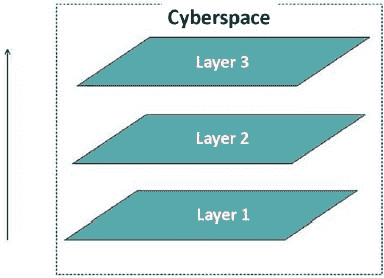

**图 3.8.** 网络空间的三层简单建模

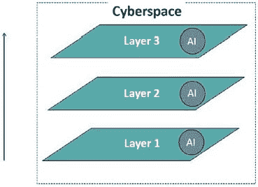

**图 3.9.** AI 存在于网络空间的三个每一层中。它扩展了每一层并有助于整个网络空间的扩张

AI 属于这三个层次中的每一个。它基于硬件，有时甚至是特定的硬件（芯片、传感器等）；它是一种软件的形式（编程语言、AI 应用程序）；最后，它处理意义，它操纵数据，并且在它的军事应用中，其功能是提供人类决策支持，这明确属于这第三层。虽然 AI 带来了新的功能，允许数据以不同的方式被处理，涉及特定的软件设计并嵌入特定的硬件（传感器、机器人等）中，但它并没有挑战这种建模。当被理解为网络空间的扩展或参与其扩张运动的元素时，它必须应用于与整个网络空间相同的解读网格中。我们无法想象一个完全独立的 AI 空间或领域。我们不会发现创建新 AI 空间的反映或提议。因此，我们将留在传统领域（陆、空、海、太空、网络空间）内，而不会考虑围绕 AI 构建的新型空间化。

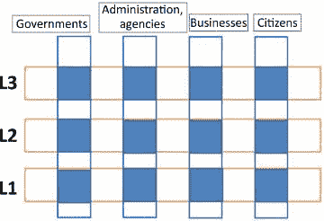

**图 3.10.** 网络空间的三层中，都有不同性质的行为体，具有不同的功能、能力、意图和权力。此图的彩色版本请参见 [www.iste.co.uk/ventre/artificial.zip](http://www.iste.co.uk/ventre/artificial.zip)

在网络空间的每一层上，都有不同的行为体介入，每个行为体都有其角色、功能、干预水平、意图、能力和不同程度的权力。每个行为体的权重是不相等的，根据它们干预的层级而异。例如，国家可以影响每一层的配置，决定、授权或禁止开发和使用，监管、监督、军事化等。并非所有国家在每一层上都具有相同的权重。公司通常不是能够干预和影响每一层的行为体，尽管它们是用户。然而，一些公司旨在成为全球参与者，在第一层发挥强有力作用（例如通过部署国际互联网电缆），第二层（通过提供社交媒体平台、跨国软件公司）以及第三层（成为信息平台）。公民在第一层通常是简单的用户，在第二层可以是用户和开发者，在第三层则是用户/贡献者。配置、平衡、每个交叉点的权重（见图 3.10）因国家而异，取决于监管、法律、治理、文化、国家组织、经济和社会。人工智能也是如此，它存在于三个层次中的每一层，每一类行为体都可以在其中作用。从 AI 的贡献角度来看冲突，或者从 AI 将作为目标、武器或攻击媒介的角度来看，将涉及到考虑图 3.10 模型中的每一个交叉点。

然而，基于整个网络空间的 AI 尽管具有共同特征，但在分析以及战术或策略的开发中，需要对其进行隔离处理。我们认为非常有用的区分之一是 AI 与非 AI 之间的区分，即是什么不是 AI，以及什么与 AI 有关。通过这种方式，网络空间内创建了两个子集，便于解读针对各自特性所调整的战术。之所以这样做至少有两个原因：首先，AI 不会占据网络空间的所有空间，因此在未来的长一段时间内，它将与非 AI 的网络空间共存；其次，只有所追求的最终目标才能决定方法和手段（应该记住，AI 并不总是最佳选择、最高效、投资回报最高或证明是最理性的选择等）。随着 AI 的出现，我们观察到了特定参与者、工具和实践的产生，它们并没有拥有网络空间的所有方面。

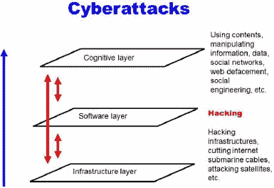

**图 3.11.** *在网络空间中，每一层都有其自己的黑客、攻击、防御和安全方法，以对网络空间内部有时在外部的一个或多个层产生影响。此图的彩色版本请参阅 [www.iste.co.uk/ventre/artificial.zip](http://www.iste.co.uk/ventre/artificial.zip)*

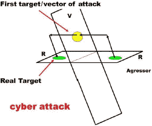

**图 3.12.** *如果 `V` 代表网络空间，`R` 代表非网络世界，那么攻击是从 `R` 开始并命中 `R` 的行动。`V` 仅仅是一个矢量、一个中间媒介、一种施加暴力、力的手段，而不是实现预期结果的手段。此图的彩色版本请参阅 [www.iste.co.uk/ventre/artificial.zip](http://www.iste.co.uk/ventre/artificial.zip)*

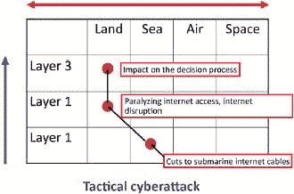

**图 3.13.** *攻击可以利用网络空间的一个或多个层来产生级联效应。此图的彩色版本请参阅 [www.iste.co.uk/ventre/artificial.zip](http://www.iste.co.uk/ventre/artificial.zip)*

AI 不会改变对抗的逻辑，对抗从一个点（来自“现实”世界、具有意图和目标的侵略者）开始，并指向同样位于“现实”世界中的目标。可能会出现特定的对抗，即一个基于 AI 的抵抗、安全或防御与基于 AI 的攻击之间的对立。在其他情况下，将是基于 AI 的安全/防御与不带 AI 的攻击之间的对抗；或者是无 AI 的安全/防御与基于 AI 的攻击之间的对抗；或者是任何一方都不带 AI 的安全/防御与攻击之间的对抗。

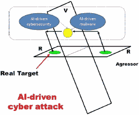

**图 3.14.** *在网络攻击中定位 AI。AI 恶意软件有时会遇到基于 AI 的安全/防御系统。此图的彩色版本请参阅 [www.iste.co.uk/ventre/artificial.zip](http://www.iste.co.uk/ventre/artificial.zip)*

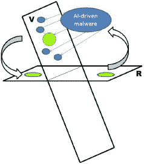

**图 3.15.** *如果 `V` 代表网络空间，`R` 代表非网络世界，那么攻击是从 `R` 开始并命中 `R` 的行动。`V` 仅仅是一个矢量、一个中间媒介、一种施加暴力、力的手段，而不是实现预期结果的手段。此图的彩色版本请参阅 [www.iste.co.uk/ventre/artificial.zip](http://www.iste.co.uk/ventre/artificial.zip)*


AI 的特殊性之一是其适应上下文的能力。这并不是拥有全部 AI 的，而是即近性的问题。AI 在所有情况或配置下都不是绝对优势。在下面的图 3.16 中，我们表示了一些简单的攻击/防御配置，当元素动用 AI（标记为 1）或未用（标记为 0）。这里考虑了三个参与者和系统：

- 侵略者或攻击者（标记为 `Att`）
- 安全或防御（标记为 `Sec`）
- 目标、对象或参与者（标记为 `C`）

我们可以这样读取路径：

- `Att(0)/Sec(0)/C(0)`：攻击者不使用 AI，安全不使用 AI，目标不使用 AI。
- `Att(1)/Sec(1)/C(0)`：攻击者使用 AI 进行攻击，安全使用 AI 保护目标，目标本身不使用 AI。

这给了我们八条路径。

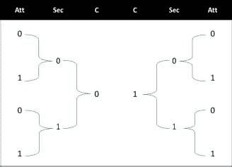

**图 3.16.** *攻击和安全/防御，有或无 AI*

因此，基于此读取网格可以提出以下问题：

- 是否存在路径使得目标不会被攻击？相反，是否存在一条路径使得目标完全脆弱？
- 哪条路径可以最大化 `C` 的安全性、`Sec` 的效率以及 `Att` 的有效性？
- 当只有一个元素动用 AI 时，谁占据优势：是使用 AI 的元素，还是尽管如此的其他元素？
- 当两个或多个 AI 形式相互对抗时，会发生什么？

此阅读网格适用于网络安全和网络防御背景。目标可以是计算机、服务器、个人电脑、网络、连接的武器系统、个人或个人团体、社交媒体等。

网络安全利用 AI 技术来应对可能利用或不利用 AI 的网络攻击。

### 3.4.4. 对抗性 AI 与对抗性机器学习

DNI（国家情报局）将“对抗性 AI”的概念为：“关注理解 AI 系统在存在恶意对手时的行为的 AI 子集。” [DNI 19]

开发使用机器学习的解决方案旨在观察黑客行为，并使网络安全适应其策略的变化。攻击检测工具正变得能够追踪黑客变化的手段，不再限于特定类型的攻击。新系统为以前使用的僵化系统带来了适应性、灵活性动态特性。其目标是在攻击周期的更早阶段检测攻击或尝试攻击。然而，黑客也意识到了这些新检测方法的实施，正在调整其攻击技术。因此，力量平衡依然存在。更何况机器学习系统并非无懈可击（当数据不足时，学习也是如此）。为了对抗智能安全系统，黑客将找到反制措施、通过伪装成合法用户来欺骗系统的方法，或寻求理解安全系统的工作原理并对用于学习系统的数据采取行动。因此，攻击者面临的问题是破解 AI 本身，针对其弱点，而欺骗 AI 有时可能非常简单：

- 法院中用于判定判决的 AI 可能是错误的。事实上，由于从以往判决的大量数据中学习，它可能学习了判决中的错误。它可能会再次产生这些错误。AI 会复制过去的错误 [HAO 19]；
- 微软的聊天机器人 `Tay` 于 2016 年在 Twitter 上推出，很快转向仇恨言论。该 AI 从网络喷子为了破坏论坛功能而广泛传播的内容中学习了这些。AI 不区分什么可以被视为“好”或“坏”，不区分合法与不合法，但这段经历也提醒我们，学习型 AI 的学习可能会被操纵；
- 自动驾驶车辆系统无法检测到颜色与天空相似的车辆的存在（这种错误导致了交通事故）；
- 道路标志上的贴纸可用于误导图像分类系统（`Deep Learning`） [EYK 18]；
- 人脸识别系统的错误率极高，且可以被欺骗 [SHA 16]；
- 在 2019 年 8 月香港活动期间，示威者使用激光并指向警察。其目的是致瞎向人脸识别系统传输数据的摄像头。当摄像头无法运行时，上游识别系统将不再有用。智能系统依赖于传感器的数据：为了击败 AI，必须攻击作为数据源头的传感器。

对于这些基于 AI 的系统的“攻击者”来说，其方法包括攻击其捕获并分析的数据，这些数据可能导致 AI 无法运行。神经网络可能会被信号或添加到图像中的数据 [SZE 13]（例如音频信号干扰）。这些作为漏洞的属性直到最近才被理解和识别。

因此，AI 破解正成为攻击者和 AI 系统用户共同的问题，无论是在网络安全还是机器人、自动驾驶汽车、人脸识别系统等其他领域。对 AI 漏洞的利用无疑是军事领域的关键问题。

### 3.4.5. AI 与信息战

在《赢得战争的机器》（艾萨克·阿西莫夫，1961 年）中，人类的三位领袖在战胜德内比亚人后会面，讨论了 `Multivac` 计算机在成功中所起的决定性（或其他）作用。第一个人承认他更改了输入计算机的数据，因为他认为自己无法信任报告数据的质量；第二个人承认他更改了计算机产生的数据，因为他认为计算机没有处于最佳模式；第三个人承认他不信任计算机产生的报告，并通过掷硬币来做决定，依靠运气而非直觉和机器的能力。

这个故事虽然是虚构的，但提出了几个是信息战问题及更广泛的战争艺术的核心问题：

- 计算机在战争、在执行 `C2`（指挥与控制）中的地位，完全取决于人与机器之间的关系；
- 这种人机关系由信任定义：
  - 取于个人确保机器最佳运行的能力；
  - 取于计算机处理之前产生的信息/数据的质量（准确性、相关性）；
  - 取于计算机的技术能力；
  - 取于机器产生的数据的质量或相关性；
- 在对所有有助于决策过程的组件都缺乏信任的情况下，负责的战争领袖倾向于依靠其个人判断，甚至依靠运气。

在考虑 AI 在指挥过程中的作用时，这些问题依然存在：AI 的存在并不保证其提供的数据的可靠性；AI 本身在技术上可能并非最优，且其产物会引发问题、甚至是怀疑或担忧（AI 到底对数据做了什么？它是如何产生结果的？）；当 AI 仅作为决策支持工具时，人类可以选择不依赖 AI 产生的数据；以及什么能保证基于 AI 分析做出的决策，在结果或效果上，优于仅基于人类推理甚至基于运气的决策？AI 取决于提供给它的数据，取决于它所处理的数据。

AI 旨在将计算机提升到人类智能水平，并超越后者的推理能力。信息战在知识、表征、推理层面运作，*从先来看*是 AI 应用的主要领域之一：

> “与衡量实力相比，评估敌方意图类似于黑术，需要对敌人指挥官的性格和心理过程有近乎洞察力的理解。人工智能专家系统和模式识别技术可能适用于这一古老问题，并为开发毁灭性的信息战武器提供了前景。使用此类技术，可能建立一个指挥官的机器模拟，用于测试对各种方案的反应。” [LEW 91]

因此，分配 AI 的角色之一可能是预测敌人的决策。AI 可以像敌人一样思考，并设身处地：

> “结合专家系统和模式识别技术，以及其他人工智能技术，例如可能导致对特定事件环境下个人领导知识的机器模拟，从而对该领导的回应做出‘最可能’预测。当然，如果目标领导是敌人，捕捉其知识并识别与其模式行为相关的模板也可能是巨大的任务。关键在于，这些任务现在只是极其困难，而不再不可能。” [LEW 91]

一份美国陆军的研究报告探讨了人工智能在信息战中的用途。该报告由大卫·C·柯克上校 [KIR 96] 编写，是 1996 年美国陆军军学院一项研究项目的一部分，标题为《人工智能在信息战中的应用》。报告指出，智能体未来将成为信息战的关键要素，用于管理信息流、构建防火墙以保护网络，并通过持续评估网络漏洞为网络安全做出重大贡献。

在份报告中，作者探讨了当时人工智能取得的进展如何应用于信息行动的开展以及信息基础设施的安全。作者的反思正处于一个关键的时刻，当时美国国防力量正致力于反思新技术对军事事务、战争艺术以及与信息战相关概念构形成影响。让我们用几行字来总结一下作者提出的观点：

- 他首先对信息战的定义进行了盘点，尽管强调这一概念不能仅仅局限于军事领域，但后者引导了他的思考。他所采纳的定义是 1994 年国防部的定义 [DSB 94]：信息战是指“通过影响对手的信息和信息系统，同时利用和保护我们自己的信息和信息系统，采取行动以支持国家军事战略并实现信息优势”。信息战涵盖了防御性和进攻性信息行动。指挥与控制战（C2 战争）的概念是信息战在军事行动上的翻译，它由攻击/防御对手的信息基础设施/防御自己或对手的信息基础设施组成，旨在改变或防御决策环。
- 防御维度包括所有“确保对国家安全至关重要的可靠信息的可用性、机密性和完整性的行动”。[WHI 95]
- 在 20 世纪 90 年代的前半叶，信息维度在政治舞台上尚未成为战略支柱。1995 年的《总统国家安全战略》仅涉及了三个支柱：外交、政治和军事，尚未为信息空间留出完全的位置。
- 国防力量已充分意识到其中的重要性。他们的信息基础设施（DII – 国防信息基础设施）由数量惊人的计算机、卫星和电缆组成（据称，这些设备能使他们绕地球 400 圈）。当时 95% 的军事通信使用公共网络。因此，网络暴露在进攻行动面前，其保护工作非常复杂。这种复杂性源于所有这些系统（民用与军事、公共与私有）之间的相互依赖。早在 20 世纪 80 年代，这些网络和系统就遭受了首次计算机攻击测试（1988 年，全球在两小时内感染了 6000 台机器；1986 年和 1987 年，450 台美国国防计算机被一名德国学生破解）。
- 20 世纪 90 年代中期标志着新一轮人工智能乐观主义潮。许多人相信它正坚定地走在成功的道路上。
- 在这段（90 年代），智能系统或专家系统是最广为人知的人工智能形式。作者将专家系统定义为“模拟专家决策能力的计算机系统。专家或知识工程师编写一组‘条件-动作’规则。专家系统在面对某种特定情况时，会搜索相应的条件并返回相应的响应”。专家系统首先在医学（诊断）领域找到了首批应用，随后才被用于军事领域（用于后勤、维护、规划等）。专家系统的局限性在于其编程质量，以及系统中一次性录入的知识的静态性。它们被严格限制在自己的专业范围内，当出现其专业领域之外的问题时，它们无法意识到自己已经离开了舒适区。专家系统可能会对所面临的问题给出错误答案。
- “代理体”部分克服了这些弱点，因为它们允许在多个系统之间共享知识。“代理体是指任何通过传感器感知环境并通过执行器对环境采取行动的实体。”‘智能’代理体是指与人类用户特别是与其他代理体交互的：“它们必须能够在没有人机界面的情况下运行”；它们必须超越任务导向，并在不被告知如何执行任务的情况下寻求实现目标”。智能体被定义为软件工具：“用户不再通过命令和/或直接操作发起主动式交互，而是参与一个协作过程，人类和计算机代理体共同发起通信、监控事件并执行任务。”代理体的性能取决于其学习用户利益以及代理体社区利益的能力。学习是这些智能系统的核心，目标是获得某种水平的能力。
- 这些代理体如何被应用于信息战？
  - 它们可以提供工具帮助管理海量信息。即使是基础应用（例如 `SIFT` 软件 – `斯坦福信息过滤工具`）也能够从 Usenet 用户发布的海量数据中过滤并搜索特定信息。软件应用程序提供了在不知道收件人地址的情况下通过 `Personalink` 发消息的可能性，由软件负责搜索信息并投递消息。然而，这些“代理体”从严格来说上并不是“智能”的。但对于军事应用而言，前景是取得重大进展，提供工具帮助军事指挥部管理和应对日益增长的数据量。
  - 它们可以部署用于基础设施安全。需要开发智能防火墙；通过学习用户的习惯、行为、工作环境来监控系统用户的活动；使用专门负责任务的代理来评估安全水平（评估密码、认证、访问授权等的安全性）。

在编写此报告时，人工智能的能力尚不足以开发所有项目。结果是鼓舞的，但仍存在许多局限。作者开启的前景尚无法实现。

#### 3.4.5.1. *人工智能与模战争（memetic warfare）*

# 模因冲突与现代信息战

模因（Meme）是一种能够传播、产生影响并持久存在的信息 [FIN 11]，是一种具传染性的思想，或者是某些思想和信仰的传染现象。这一概念最早由理查德·道金斯（Richard Dawkins）[DAW 76] 在其 1976 年的著作《自私的基因》中提出。模因冲突的本质特征在于错误认知的复制与传播——类似于病毒的式传播。社交网络促进了这一现象的增长。然而，被描述为非科学对象的模因冲突 [BUR 12]，已被整合到现代冲突中对信息战的反思之中。

在 2010 年 4 月版的《军事情报专业简报》中，布莱恩·J·汉考（Brian J. Hancock）中尉 [HAN 10] 建议利用模因学理解叛乱运动并解释其根源：“模因本质上是一种思想，但并非每个思想都是模因。为了让一个思想成为模因，它必须被传递或复制给另一个个体”[HAN 10]；“模因是传播、产生影响并持久存在的信息”[FIN 11]。

## 模因冲突的特征

从后者的定义中，我们将保留用于冲突的模因三个本质特征：它必须传播、产生影响并具有持久性。需要补充的是，模因有时是负面思想（“有害认知”[MAT 98]），但它们并不限于这种类型，因为还存在积极、幽默、建设性的模因等。

模因的本质特征是它通过模仿从个人到个人进行传播。模因可以是一个思想、一个图像、一种行为或信息。

## 技术与人工智能在模因学中的作用

模因冲突由创造思想和传播思想组成。互联网和社交媒体是这种传播的媒介。人工智能可以是工具之一，例如通过允许创建信息、内容（模因以不同的形式存在，创作可能性是多种：文字、符号、图标、图像等），并利用互联网使其适应语境和环境、进行个性化处理、适应目标受众，并根据上下文的演变、产生的影响等修改其形式、路径和传播强度。

模因战是一场关于影响、虚假信息和宣传的战争。模因适用于社交媒体，因为为了产生效果，它们必须短小简洁（1–10 个单词）[FIN 11]。这些关于思想作用及其操纵的反思是由美国国防部在 DARPA 支持的项目框架下资助的。罗伯特·芬克斯坦（Robert Finkelstein）引用了其中一些项目，涉及思想流行学、军事模因学、战略传播中的社交媒体以及叙事网络。这些项目在 2006 年至 2011 年期间进行。

战略传播中的社交媒体（SMISC）项目的目的是产生检测和识别有害模因的自动化工具和技术，并自动化对抗此类攻击的手段。军事对模因的兴趣始于 2001 年后，作为反恐思想战的一部分。

## 对抗与应对措施

模因对抗或冲突必须针对意识形态病毒采取中立策略。这些病毒就像恶意软件一样，现在也通过网络空间的网络传播。虽然模因和文明一样古老，但现代通信手段增加了它们的传播速度和作用范围。

为了试图在网络流的海量数据中定位它们，社交媒体已利用人工智能识别模因（Facebook 使用 `AI` 来识别模因）。

2019 年期间在香港发生的抗议活动影像已传遍全球。一方面，我们看到示威者*成群结队地*占据了公共空间；另一方面，我们看到执法力量试图控制人群，阻碍示威者的进展。在示威者与警察力量的对抗中，双方都使用了各自的策略并采取了不同的战术。信息技术领域的武器库因 AI 应用的发展而日益丰富：

- 方面，当局部署了人脸识别系统，目的是为了执法之目的识别示威者（那些被视为暴徒的人可能面临数年的监禁）；
- 示威者通过迅速调整行为来应对这种技术手段，通过口罩遮住面部，或在他们与相机（固定式或无人机上的）之间撑起雨伞或发射激光束；
- 示威者正在破坏智能路灯，担心这些路灯配备了监控摄像头；
- 在两者之间，在香港部署的用于统计示威人数的边缘 AI 应用是由香港公司 `C&R Wise AI` 开发并营销的。该应用被用于全国大学（例如香港城市大学）和公共交通领域，用于管理人流。通过计算示威者的数量，该应用可以证实或反驳官方警方数据，例如。因此，其结果可以服务于示威者或警察的利益。公司的创始人黄锐（Raymond Wong）确保该应用不会从正面跟踪个人，而仅从背面跟踪，根据个人的形状进行计数。因此，不存在侵入性监控的目的或愿望，也不存在识别的可能性。

从这些元素中，我们总结了关于 AI 在冲突情况下作用的一些重要要点：

- 与几乎所有技术一样，AI 可以被绕过。它并非无一不的，在不对称战斗中，弱者总有能力发明以弱胜强的的战术。在这里，示威者对着摄像头举起雨伞；
- 基于传感器的 AI 以及更广泛的 AI 完全依赖于输入数据。在这里，通过放置雨伞或口罩，无法捕捉到任何数据，AI 将无用武之地，因为它没有获得数据输入。AI 在数据及其传感器层面是可以被攻击的。而且不需要通过黑客行为或科学技术知识来对抗；示威者行为的简单改变就实现了这种对 AI 的抵抗；
- AI 的物理物质延伸（在此处为摄像头）容易受到破坏、蓄破坏和物理暴力的侵害；
- 智能城市的危机或冲突形式与未连接的、传统的非现代化城市有所不同。无人机（UAV）的使用可以作为安全或监控和监测的替代方案。但从无人机拍摄的图像无法捕捉到同样的图像（在这种情况下是面部）。另一方面，智能城市的未来发展、物联环境将为这些城市的居民构成一个监控空间，他们将越来越难以从中挣脱；
- AI 的使用补充了而非取代在网络空间中进行的目前更为传统的行动，即：在示威者方面，使用社交网络、移动电话、直播和一系列移动应用程序，以及影响战术；在当局方面，监控社交媒体、拦截通信内容、部分关闭互联网的计划等；
- 中国当局已通知 Apple 公司，该公司必须从其 Apple Store 中移除 `hkmap.live` 应用，该应用可用于定位警察力量，据他们称，它一方面可能被示威者用于逃避执法，另一方面也可能被攻击警察的犯罪分子使用。这家总部位于中国的美国公司别无选择中国当局的要求。

### 3.4.8. 示例 3：恶意 AI 攻击

场景：垃圾邮件钓鱼传播了诈骗邮件。但这些邮件是由 AI 驱动的。得益于这个“引擎”，每封邮件都针对其目标进行了定制。

- 受保护的；
- 反应性的（反击、抵抗、韧性）；
- 非反应性的（被动的，且不会对攻击者做出反击，可能仅限于韧性）。

群体可以由：

- 相互通信的个体组成（如人群、军队等）；
- 由无人机、机器人等组成；
- 由恶意软件组成；
- 在信息战攻击的情况下，由信息源组成（网站群、媒体、社交媒体上的真实或虚假账号等）。AI 促进了虚拟互联网用户、自动化内容的创建，并根据目标和语境的演变对生成的内容进行适应调整。

### 3.4.10 示例 5：有 AI 和无 AI 的宇宙间的跨越

正如当代世界可以分为两类：一方面是连接的且与网络空间关联的空间，另一方面是未连接或没有网络空间链接的地区（后者由于移动通信的发展趋于缩小，但在地球上仍占据着巨大的空间），我们可以相对于 AI 考虑以下几个宇宙：

- 一个没有任何 AI 的 `[AI0]` 的环境；
- 一个完全 AI 的环境，全是 AI `[AI1]`；
- 一个混合环境，包含部分 AI。该环境并不完全依赖 AI `[AI2]`：
  - 这种环境可能源于某种构建，例如一个集成了少数 AI 组件的系统；


它也可能是 AI 侵入 `[AI0]` 的结果，例如 AI 攻击一个没有 AI 保护的系统。

在两种情况下，AI 都表现为一种新元素，仅凭其存在就会影响环境，无论它是敌意的、攻击性的还是中性的。我们将认为：

- `[AI1]` 是稀有的；
- `[AI0]` 可能是主导的；
- `[AI2]` 正在逐渐扩张。

可以对这些圈之间的权力平衡提出问题：

- `[AI0]` 和 `[AI1]` 之间的对抗会是什么样的？
- `[AI1] > [AI0]` 吗？在两种配置的不对称性中，哪一方会胜过另一方？
- `[AI1] > [AI2]` 吗？
- 在 `[AI2]` 中，AI 是否接管了整个环境？它是否主导了所有非 AI 的事物？

1. “Cyber”在此包含了所有使用的衍生词，如 `cyberspace`、`cybersecurity`、`cyber threat` 等。
2. “Compute”及其所有衍生词，如 `computer`、`computing`、`computation` 等。
3. “Robot”，包括其衍生词，如 `robotics`。
4. [`fas.org/irp/doddir/dod/index.html`](https://fas.org/irp/doddir/dod/index.html)。
5. 文档第 2 页。
6. 我们依赖发布在 [`fas.org`](https://fas.org.) 上的文档。
7. [`www.nrec.ri.cmu.edu/nrec/defense/index.html`](https://www.nrec.ri.cmu.edu/nrec/defense/index.html)。
8. [`www.nrl.navy.mil/itd/aic/`](https://www.nrl.navy.mil/itd/aic/)。
9. [`www.nrl.navy.mil/itd/research`](https://www.nrl.navy.mil/itd/research)。
10. [`www.nrl.navy.mil/itd/aic/biblio`](https://www.nrl.navy.mil/itd/aic/biblio)。
11. Roszak T., *The Cult of Information: A Neo-Luddite Treatise on High-Tech, Artificial Intelligence, and the True Art of Thinking*, 第 2 版，加州大学出版社，伯克利，1994。
12. [`www.dsiac.org/resources/onr-developed-caracas-software-navyboats`](https://www.dsiac.org/resources/onr-developed-caracas-software-navyboats)。
13. [`roskomsvoboda.org/37087/`](https://roskomsvoboda.org/37087/)。
14. Manuel de Landa 解释说，对机器翻译的热潮是战期间密码学的后果。
15. *Strategic Computing, New Generation Technology: A Strategic Plan for its Development and Application to Critical Problems*。国防研究计划，1983 年 10 月。
16. 研讨会记录：[`www.cia.gov/library/readingroom/docs/CIA-RDP86M00860010.5`](https://www.cia.gov/library/readingroom/docs/CIA-RDP86M00860010.)。
17. [`blog.marketresearch.com/8-key-military-applications-for-artificial-intelligence-in-2018`](https://blog.marketresearch.com/8-key-military-applications-for-artificial-intelligence-in-2018) 讨论了人工智能在军事领域的 8 种关键应用。书中特别讨论了专家系统在军事和安全事务的应用：用于识别恐怖分子的专家系统；用于战术空中目标的原型专家系统；最后是战斗领域的应用。
18. [`www.merriam-webster.com/dictionary/arm`](https://www.merriam-webster.com/dictionary/arm)。
19. 同上。
20. 航空临时演习条例草案。第一部分，1925 年 4 月 30 日，国立印刷局（巴黎），访问：[`gallica.bnf.fr/ark:/12148/bpt6k961276k`](https://gallica.bnf.fr/ark:/12148/bpt6k961276k)。
21. *Revue du Cercle militaire*: 陆海军官会议报，巴黎，国家军队俱乐部（法国），1888 年，访问：[`gallica.bnf.fr/ark:/12148/bpt6k5756763`](https://gallica.bnf.fr/ark:/12148/bpt6k5756763)。
22. *L’Écho d’Oran*: 奥兰省法律、司法、行政和商业公告报，1935 年 4 月 2 日。
23. *剑桥哨报*，第 XXVIII 卷，第 42 期，1932 年 10 月 15 日，可用：[`cambridge.dlconsulting.com/cgi-bin/cambridge?a=d=Sentinel19321015-01=en-20--1--txt-txIN-robot---------`](https://cambridge.dlconsulting.com/cgi-bin/cambridge?a=d=Sentinel19321015-01=en-20--1--txt-txIN-robot---------)。
24. “机械制造战争的机器人”，《太阳报》，1927 年 8 月 20 日，档案文章，访问自 [`trove.nla.gov.au`](https://trove.nla.gov.au)。
25. McKay H.C.，“机器人奔赴战场”，《每日电讯报》，悉尼，1934 年 3 月 24 日，档案文章，访问自 [`trove.nla.gov.au`](https://trove.nla.gov.au)。
26. “机器人与战争，致先驱报编辑”，《悉尼晨早报》，1935 年 11 月 5 日，档案文章，访问自 [`trove.nla.gov.au`](https://trove.nla.gov.au)。
27. “机器人战争可能意味着战争的终结”，《每日电讯报》，悉尼，1935 年 6 月 27 日，档案文章，访问自 [`trove.nla.gov.au`](https://trove.nla.gov.au)。
28. “为机器人战争发明武器”，《北方矿业报》，1936 年 5 月 19 日，档案文章，访问自 [`trove.nla.gov.au`](https://trove.nla.gov.au)。
29. “机器人奔赴战场”，《每日电讯报》，悉尼，1934 年 3 月 24 日，档案文章，访问自 [`trove.nla.gov.au`](https://trove.nla.gov.au)。
30. *纽卡斯尔太阳报*，1944 年 7 月 4 日，可用：[`trove.nla.gov.au/newspaper/.item/167588109?searchTerm=%22robots%20war%22&searchLimits=`](https://trove.nla.gov.au/newspaper/.item/167588109?searchTerm=%22robots%20war%22&searchLimits=)。
31. *河岸先驱报埃尤卡*，1944 年 6 月 20 日，报纸可用 [`trove.nla.gov.au`](https://trove.nla.gov.au)。
32. “战后禁止机器人”，《阿格斯报》，墨尔本，1944 年 7 月 14 日。
33. [`www.youtube.com/watch?v=x3fj92PIWQ`](https://www.youtube.com/watch?v=x3fj92PIWQ)。
34. *同上*。
35. 有关自 20 世纪 90 年代以来美国处理军事事务新技术的概念和学说的分析，特别是对“信息战”多种定义的比较性阅读，读者可参考：Ventre D., *La guerre de’information*, Hermes Lavoisier, 巴黎，2007 年。英文版可用：Ventre D., *Information Warfare*, ISTE, 伦敦，以及 Wiley, 纽约，2009 年（第一版）和 2016 年（第二版）。
36. 参见人权数据分析网站，[`hrdag.org/s=Syriautton=`](https://hrdag.org/s=Syriautton=) 以及视频 [`www.youtube.com/watch?v=B6xXeoo5KA`](https://www.youtube.com/watch?v=B6xXeoo5KA)。
37. 例如，参见 2017 年针对在利比亚所犯罪行的起诉书中，数字证据的地位，可用：[`www.icc-cpi.int/CourtRecords/CR2017_05031.PDF`](https://www.icc-cpi.int/CourtRecords/CR2017_05031.PDF)。
38. 此处的数据取自 [WAR 19]。

# 结论

与人工智能（`AI`）相关的并由此构成其领域或空间的关键概念是速度、自主性、隐形性、行动、决策、数据等。对于这个特定的`AI`空间，我们必须将其缺陷和脆弱性联系起来，例如错误、偏见、不完美以及受到攻击，这些都是`AI`最重要的方面。

这些方面中的许多已经出现在网络安全和网络防御所解决的问题中。但当我们谈论网络空间时，我们主要考虑的是网格化（世界、个人和社会网络化），因此我们根据这一本质特征来处理安全和防御问题。网络质疑了我们控制空间的方式，因此也是我们思考国家空间、主权、边界、距离缩短、对该空间的控制力以及该空间军事化的方式。网络突显了流动、交换和共享的概念。网络空间意味着流动、交换和共享。

`AI` 是网络空间的一部分，因此应该作为整体处理，并关注网络安全和防御。

表 C.1 在某些国家网络安全战略中寻找人工智能

| 网络安全战略 | 人工智能 | 机器人 |
| :--- | :--- | :--- |
| 卢森堡 | 4 | 0 |
| 西班牙国家网络安全战略 | 2 | 2 |
| 美国网络战略 | 2 | 0 |
| 约旦网络安全战略 | 2 | 0 |
| 新西兰网络安全战略 | 0 | 0 |
| 爱沙尼亚网络安全战略 | 1 | 3 |
| 挪威网络安全战略 | 1 | 1 |
| 韩国国家网络安全战略 | 1 | 1 |
| 阿联酋网络安全战略 | 1 | 0 |
| 迪拜网络安全战略 | 1 | 0 |
| 法国网络防御战略性回顾 | 1 | 0 |
| 新加坡网络安全战略 | 1 | 0 |
| 土耳其国家安全战略 | 0 | 0 |
| 英国网络安全战略 2016-2021 进展报告 | 0 | 0 |
| 加拿大网络安全行动计划 2019-2024 | 0 | 0 |
| 日本关键基础设施网络政策 | 0 | 0 |
| 泽西岛网络安全战略 | 0 | 0 |
| 欧盟网络安全战略 | 0 | 0 |
| 智利网络安全政策 | 0 | 0 |
| 中国网络空间安全战略 | 0 | 0 |
| 哥斯达黎国家网络安全战略 | 0 | 0 |
| 丹麦网络与信息安全战略 | 0 | 0 |
| 埃及网络安全战略 2017-2021 | 0 | 0 |
| 希腊网络安全战略 | 0 | 0 |
| *Estrategia Nacional de SeguridadCibernética* (国家网络安全战略), 危地华城，2018 | 0 | 0 | 0 |
| 库威特国家网络安全战略，2017–2020 | 0 | 0 | 0 |
| 摩纳哥数字安全国家战略，2017 | 0 | 0 | 0 |
| 尼泊国家网络安全政策，2016 | 0 | 0 | 0 |

然而，我们观察到事实并非如此。一条通往 `AI` 的独立道路正在被铺就。在军事方面，网络指挥官并未被赋予关于 `AI` 军事化的完全责任。针对 `AI` 的特定结构正在创建中。国家网络安全战略仅谨慎地将 `AI` 整合进网络空间，而它通常被呈现为其中的众多元素之一。与此同时，`AI` 正在成为特定国家战略的主题。

极少数国家网络安全战略文件对 `AI` 有任何形式的描述。约旦的战略就是其中之一：

> “网络犯罪分子正在利用 `AI` 机器人来投放更具针对性的网络钓鱼广告和电子邮件，并分析大量的社交媒体信息以对他们的目标进行画像。在线聊天机器人也越来越多地用于客户服务——将它们定位为人们信任的系统。攻击者将试图利用这种信任，并构建聊天机器人来尝试从人们那里获取财务细节。”

我们还会提到卢森堡的战略：

> “人工智能发展过程中固有的威胁。广而言之，人工智能将在设计和执行恶意软件的背景下出现。它目前是世界学术界的一个研究课题，并很快就会成熟到可以实现在真实的恶意软件中，这些恶意软件将能够动态适应防御组织网络和基础设施的团队所采取的安全防护措施。”

在这两种情况下，`AI` 均被识别为新形式的网络威胁之一。但对于必须部署以应对这些威胁的方法或手段，尚未有任何预设。

相反，新西兰的战略仅简单地提出了对 `AI` 的挑战，并止于此：“一种能够模拟人类决策和学习的计算机化系统，包括执行与人类思维相关的认知功能，包括学习和语言能力”。

更广泛地说，当这些战略文件提到 `AI` 时，仅仅是为了提醒我们它属于更广泛的新技术集合，如云计算或物联网，这些技术注定将改变网络空间和现代社会。

因此，将 `AI` 特定政策与网络安全政策解耦，是全球范围内的一种共同方法。目前，网络安全政策中几乎没有提到 `AI`。我们还注意到 `AI` 在美国国防规范文件中的存在非常微弱，尽管政府和国防政策对 `AI` 表现出强烈的承诺；美国国防长期以来在这些技术上投入了巨资，且 `AI` 是军队现代化进程中的领先技术之一。这一切给人以一种对 `AI` 考虑程度不均的印象。俄罗斯在 2019 年仍处于准备其自己的 `AI` 国家战略的过程中。这项工作最近才在全球范围内实施。因此，`AI` 在安全和防御政策以及军事条令中找到其完全地位可能还需要一段时间，几个月，可能需要几年。为了加速这些过程，可能需要比其他事件更严重的事件，且该事件完全归因于对 `AI` 能力的利用。

在结束这项工作之前，有几点引起我们的注意：

- `AI` 被描绘成一种变革性的、颠覆性的、革命性的技术或技术集合，但它最近才在政治、战略和条令层面被考虑到。新的 `AI` 浪潮正处于婴儿阶段；
- 话语是触发 `AI` 不同阶段的主要元素之一。因此，我们强调了负面或警告性话语的作用，这些话语通常来自研究人员，他们的论点被政治家听到并引发了（例如 `AI` 的第一个寒冬）。然而，政治家的话语也起着决定性作用：罗纳德·里根 1982 年的演讲标志着科学技术研究巨额投资的新纪元；
- 围绕重大技术项目的国家动员也是对国际环境反应的体现。安全困境和对失去经济和工业实力的恐惧正引导国家陷入技术开发或军备竞赛。例如，1982 年的情况是，当时日本宣布了创建新代计算机的计划。主要大国立即做出反应，并致力于新的民用和军用研发计划。标记 `AI` 历史的复兴与其他技术一样，是国家与世界其他地区关系地位的结果。今天，美国、中国、俄罗斯和欧洲之间的竞争是驱动力；
- `AI` 的“军事化”写在它的基因里。技术是军事的、民用的还是军民两用的。在美国、俄罗斯或其他国家，它从诞生起由军事部门资助并对其结果进行监控。它与其他技术（特别是互联网和计算机）处于相同的地位；
- 在每一代，`AI` 都被简化为其主流技术之一。曾出现过一个由专家系统标记的时期，它是 80 年代和 90 年代的主流技术。今天，`AI` 似乎被简化为机器学习。但这种简化可能是有用的；
- 这种简化在某些方面有助于形成共识性的 AI 话语。事实上，我们听到的关于 AI 政策、AI 安全或 AI 研究的话题相对简单。它们告诉我们技术（这里是 `AI`，但在涉及网络空间或网络安全时我们发现类似的思维）对社会有益，必须开发和引入，以造福个人之（生活质量和安全）。但这些技术及其实施追求的首要项目本质上是经济性质的（实际上忘记了公民网络化、全球通信、知识获取或世界民主化的项目）。
- AI 并没有挑战某些政治和军事领导者对特定技术的信念和盲目自信，而他们认为这些技术可以使他们变得无所不能。AI 是一种图腾，是一种魔法武器，人类那些渴望建立自己的权力和力量并施加暴力的他们，向其民众、军队以及世界其他地区挥舞并展示着这种武器。AI 是这种信念或深层信条的延伸，即宇宙、世界、经济、政治、人类政府和战争可以通过对信息以及在 21 世纪对数据的掌握来统治。这种信念的构建跨越了几个世纪，但在 20 世纪随着计算机和网络的出现形成了特定的形式。今天，随着 AI 的出现，数据比以往任何时候都是绝对权力的来源。这些信念从未受到质疑。事实上，官方文件并没有质疑这种对数据的无节制追求的限度、对数据的依赖，或通过数据控制世界的项目的可行性。


AI 像网络空间一样，似乎是战争权力中不可或缺的。它被认为是赢得战争的关键。在 AI 之前，有互联网、电信、卫星等。有了 AI 后，有了专家系统；而今天，有了机器学习。然而，这些技术的累积——每一次都被描述为革命性的技术——从未保证过胜利，甚至没有保证过绝对的安全。对手总是学会适应、绕过、不使用这些技术，或者相反，利用它们建立非对称冲突或混合冲突。这种新的 AI 不可能像昨天的技术那样保证军事和政治上的胜利。胜利的条件，以及经济和政治权力，并不能归结为单一的技术。AI 也不会提供更快的胜利，即使它似乎压缩了时间（这种时间主要是指数据处理、计算和算法的时间）。然而，将人类从决策循环中剔除并追求速度的诱惑似乎是巨大的。胜利只有通过速度才可能。然而，如果 AI 增加了行动或决策的速度，它仍然需要时间来学习，而且至少目前，它还需要与决定其命运和激活状态的人类的节奏进行交流。这种对缩短时间和排除人类的执着（人类被认为太慢或无法处理由他们创建并部署的系统所产生的海量数据），反映了一种更具产物主义而非生产力意义的逻辑：机器将比人类更高效、更有效、更快。那么，战争将简化为管理层的问题，而人力资源将成为战争业务中最后的弱点。

1. [国家网络安全战略 III](https://hcpn.gouvernement.lu/dam-assets/fr/publications/brochure-livre/national-cybersecurity-strategy-3/national-cybersecurity-strategy-iii-en-.pdf)
2. [网络安全战略](https://www.dsn.gob.es/es/file/2989/download?token=EuVy2lNr)
3. [国家战略](https://www.whitehouse.gov/wp-content/uploads/2018/09/National-Strategy.pdf)
4. [2018-22 年国家网络安全战略](http://moict.gov.jo/uploads/National%20Cyber%20Security%202018-223.pdf)
5. [网络安全战略](https://dpmc.govt.nz/sites/default/files/2019-07/Cyber%20Security%20Strategy.pdf)
6. [网络空间战略 2022](https://www.mkm.ee/sites/default/files/kyberturisuse_strateia_2022_eng)
7. [挪威国家安全战略](https://www.regeringen.no/contentassets/c57a0733652f476829434ffd93fc53/national-security-strategy-for-norway)
8. [网络安全战略](https://www.krcert.or.kr/filedownload.do?attach_file_seq=2162ttach_file_id=EpF2162)
9. [网络安全政策](https://www.tra.gov.ae/userfiles/Lw3seRUaIMd)
10. [迪拜安全战略](https://csc.dubai.ae/res/wp-content/uploads/DCSS-EN.pdf)
11. [公共网络安全回顾](http://www.sgdn.gouv.fr/uploads/2018/02/20180206-np-revue-cyber-public-v3.3.pdf)
12. [网络安全战略](https://www.csa.gov.sg/~/media/csa/publications/singaporesecuritystrategy.pdf)
13. [网络安全](https://www.uab.gov.tr/uploads/pages/siber-guvenlik/ulusalsibereng.pdf)
14. [网络安全战略报告](https://assets.publishing.service.gov.uk/government/uploads/system/uploads/attachment_data/file/805677/National_Cyber_Security_Strategy_Report.pdf)
15. [网络安全战略](https://www.publicsafety.gc.ca/cnt/rsrcs/pblctns/ntnl-cbr-scrt-strtg-2019/ntnl-cbr-scrt-strtg-2019-en.pdf)
16. [战略](https://www.mkm.ee/eng/pdf/strategy_en.pdf)
17. [安全战略](https://www.regeringen.no/contentassets/c57a0733652f476829434ffd93fc53/national-security-strategy-for-norway)
23. [埃及国家网络安全战略 2017-2021](http://www.mcit.gov.eg/Upcont/Documents/Publications_12122018000_EN_National_Cybersecurity_Strategy_2017_2021.pdf)
24. [欧洲国家网络安全战略地图 - 希腊版](https://www.enisa.europa.eu/topics/national-cyber-security-strategies/ncss-map/GRNCSS_EN.pdf)
25. [危地马拉国家网络安全战略](http://mingob.gob.gt/wp-content/uploads/2018/06/version-digital.pdf)
26. [科威特网络安全战略](https://citra.gov.kw/sites/en/LegalReferences/English%20Cyber%20Security%20Strategy.pdf)
27. [摩纳哥国家网络安全战略](https://amsn.gouv.mc/var/amsn/storage/original/application/822de9d606448af4e900f566abd3e00c.pdf)
28. [尼泊尔网络安全政策草案](https://nta.gov.np/wp-content/uploads/2018/05/Nepal-Cybersecurity-Policy-Draft.pdf)
29. [约旦国家网络安全战略 2018-2023](http://moict.gov.jo/uploads/studies/National%20Cyber%20Security%20Strategy%202018-2023.pdf)
30. [卢森堡国家网络安全战略三期](https://hcpn.gouvernement.lu/dam-assets/fr/publications/brochure-livre/national-cybersecurity-strategy-3/national-cybersecurity-strategy-iii-en-.pdf)
31. [新西兰网络安全战略](https://dpmc.govt.nz/sites/default/files/2019-07/Cyber%20Security%20Strategy.pdf)

# 附录

## 附录 1

## AI 年史

在我们建议的 AI 历史时间线（表 A1.1）中，冲突阶段和重要的政治事件被突出显示（阴影行和列）。

表 A1.1. *AI 日期与里程碑年表*

| AI 历史里程碑 | 年份 | 国家 |
| :--- | :--- | :--- |
| 第一次世界大战开始¹ | 1914 | |
| 第一次世界大战结束 | 1918 | |
| 卡尔·恰佩克的剧本《R.U.R.》（引入了“机器人”一词） | 1921 | 捷克斯洛伐亚 |
| 苏联成立（1922 年 12 月 30 日） | 1922 | 苏联 |
| 电影《大都市》，其主角是一个女性人形机器人 | 1927 | 德国 |
| 日本第一台“机器人”“学动能”的设计 | 1929 | 日本 |
| 第二次世界大战开始 | 1939 | |
| 美国科学家 W. McCulloch 和 W. Pitts 尝试创建一种人工神经算法 | 1943 | 美国 |
| 第二次世界大战结束 | 1945 | |
| 第一次印度支那战争开始（1946 年 12 月 19 日） | 1946 | 印度支那 |
| Norbert Wiener 出版了他的著作《控制论：或动物与机器中的控制与通信》（“控制论”一词的首次公开使用） | 1948 | 美国 |
| Dominique Dubarle 在《世界报》上发表了名为《走向治理机器》的文章，致力于控制论（1948 年 12 月 28 日） | 1948 | 法国 |
| Edmund Berkeley 出版了他的著作《巨大脑：或思考的机器》（在书中将早期计算器与人类大脑进行了比较） | 1949 | 美国 |
| 韩鲜战争开始（1950 年 6 月 25 日） | 1950 | 韩国 |
| 图灵测试。文章《计算机器与智能》²（发表在哲学评论《心灵》上）（提出了现在著名的测试或模仿游戏） | 1950 | 美国 |
| Claude Shannon 发表了文章《为下国际象棋为计算机编程》³ | 1950 | 美国 |
| 约翰·香农建立了 `SNARC`，第一个模拟器 | 1951 | 美国 |
| 韩鲜战争结束 | 1953 | 韩国 |
| 古斯巴革命开始 | 1953 | 古斯巴 |
| 第一次印度支那战争结束 | 1954 | 印度支那 |
| 越南战争开始 | 1955 | 越南 |
| 逻辑理论家，被认为是第一个 AI 程序 | 1955 | 美国 |
| `MANIAC` 计算机玩了第一场游戏 | 1956 | 美国 |
| 约翰·麦卡锡、马文·明斯基和克劳德·香农发起了[达特茅斯会议] | 1956 | 美国 |
| 感知机，由罗森布拉特设计（大脑的感官模型） | 1957 | 美国 |
| 安德烈·尼古拉维奇·柯尔莫哥洛夫和弗拉基米尔·阿格诺维德证明了神经网络的可行性 | 1957 | 苏联 |
| 麦卡锡建立了 MIT 人智能实验室 | 1958 | 美国 |
| `LISP` 编程语言的发展（列表处理） | 1958 | 美国 |
| 古巴革命 | 1959 | 古巴 |
| 马文·明斯基建立了 MIT 人智能实验室 | 1959 | 美国 |
| “机器学习”一词的引入 | 1959 | 美国 |
| 明斯基发表的文章《迈向人工智能⁴](#a02.xhtml#a02-fn4) | 1961 | 美国 |
| 第一台工业机器人 `UNIMATE`（用于通用汽车生产线） | 1961 | 美国 |
| 古巴导弹危机（10 月） | 1962 | 古巴 |
| 麦卡锡发起了 `SAIL`（斯坦福大学智能实验室） | 1963 | 美国 |
| E.A. 费根曼、J. 费尔德曼，《计算机与思维》 | 1963 | 美国 |
| `STUDENT` 应用（解决代数问题） | 1964 | 美国 |
| `ELIZA`，约瑟夫·魏森鲍姆在 MIT 创建的第一个聊天机器人。旨在用英语对话 | 1964 | 美国 |
| 洛特·扎德⁵](#a02.xhtml#a02-fn5)形式化模糊逻辑⁶](#a02.xhtml#a02-fn6) | 1965 | 美国 |
| `DENDRAL`，第一个化学分析专家系统，由爱德华·费根曼和遗传学家约书亚·莱德伯格开发（斯坦福大学） | 1965 | 美国 |
| `SHAKEY` 机器人（斯坦福大学），由查尔斯·罗森领导的团队开发 | 1966 | 美国 |
| 特里·温诺格开发了自然语言应用 `SHRDLU` | 1968 | 美国 |
| 电影《2001 太空漫游》，人类与 AI `HAL 9,000` 对峙 | 1968 | 美国 |
| 曼斯菲尔德修正案。DARPA 此后仅资助与军事应用直接相关的项目⁷](#a02.xhtml#a02-fn7) | 1970 | 美国 |
| 京都大学的研究人员展示了第一个脸部识别系统（在大阪世博期间） | 1970 | 日本 |
| 森诚弘发表了《恐怖谷》。这篇文章认为人类在面对机器人时会产生一种不适感 | 1970 | 日本 |
| 编程语言 `PROLOG` | 1972 | 美国 |
| `WABOT-1`，第一台“智能”人形机器人 | 1972 | 日本 |
| 詹姆斯·莱特尔（数学家）告诉英国科学委员会，AI 研究至今尚未产生任何预期的影响 | 1973 | 英国 |
| 越南战争结束 | 1975 | 越南 |
| 乔治·卢卡斯的电影《星球大战》：人形机器人 `C-3PO` 和无人机器人 `R2-D2` | 1977 | 美国 |
| 第一次人工智能法律应用国际会议（斯旺西，威尔士），1979 年 9 月 17 日至 27 日 | 1979 | 威尔士 |
| 事件 | 年份 | 地点 |
| :--- | :--- | :--- |
| 1961 年开发的斯坦福小车移动机器人得到改进，配备了摄像头，并成为首批自动驾驶车辆示例 | 1979 | 美国 |
| Gammanoid 机器人击败了世界国际双棋冠军（卡内基·梅隆隆大学） | 1979 | 美国/蒙特卡洛 |
| 苏联军队入侵阿富汗（1979 年 12 月 27 日） | 1979 | 阿富汗 |
| WABOT-2（早稻田大学），1972 年人形机器的改进版 | 1980 | 日本 |
| 斯坦福大学人工智能实验室 SAIL 与计算机科学系合并 | 1980 | 美国 |
| 《人工智能杂志》（AI Magazine）第一期（由美国人工智能协会出版）⁸ | 1980 | 美国 |
| 五代计算机计划。政府通过其外贸部对计算机研发投入了巨额资金，旨在创建能够对话、翻译、解释图像并像人类一样推理的计算机（1981 年 10 月）。该项目于 1982 年启动 | 1981 | 日本 |
| 中央 CIA 战略计划 1983–1993 | 1983 | 美国 |
| “战略计算倡议”发布（DARPA）。五角大楼表示其希望开发完全自主的武器。DARPA 计划在 1983 年至 1993 年间投入 10 亿美元用于人工智能军事应用的开发。前几年的不佳结果导致该计划很快被放弃 | 1983 | 美国 |
| 罗杰·尚克和马文·明斯基预测很快将发生“人工智能寒冬” | 1984 | 美国 |
| 新一代计算机技术研究所（ICOT）的成立 | 1985 | 日本 |
| 日本人工智能学会（JSAI）的成立 | 1986 | 日本 |
| 梅赛德斯-奔驰设计了一辆无人驾驶车辆 | 1986 | 德国 |
| 罗洛·卡彭特（Rollo Carpenter）开发了聊天机器人 Jabberwacky | 1988 | 英国 |
| 苏联军撤出阿富汗（1989 年 2 月 15 日） | 1989 | 阿富汗 |
| 海湾战争开始 | 1990 | 伊拉克 |
| 太平洋环带人工智能国际会议（PRICAI）的创立 | 1990 | 日本 |
| Loebner⁹ 奖的创立，一项针对最能通过图灵测试程序的年度竞赛 | 1990 | 美国 |
| 麻理工学院（MIT）机器人专家创立了 iRobot 公司^(10 | 1990 | 美国 |
| 海湾战争结束 | 1991 | 伊拉克 |
| 苏联解体（1991 年 12 月 26 日） | 1991 | 苏联 |
| 车车臣战争开始 | 1993 | 车车臣 |
| 维纳尔·温奇（Vernor Vinge）在“技术奇点”中提出了奇点主题 | 1993 | 美国 |
| 1993 年 6 月，一组日本研究人员创建了一项机器人竞赛——机器人 J 联赛。鉴于该倡议的成功和大量的国际请求，该项目被修改为创建“机器人世界杯”（RoboCup）。该项目于 1993 年 9 月公开宣布 | 1993 | 日本 |
| 第一次车臣战争开始（1994 年 12 月 11 日） | 1994 | 车车臣 |
| 理查德·华莱士（Richard Wallace）开发了聊天机器人 ALICE（人工智能语言互联网计算机实体）^(11 | 1995 | 美国 |
| 第一次车臣战争结束（1996 年 8 月 31 日） | 1996 | 车车臣 |
| 阿富汗内战开始 | 1996 | 阿富汗 |
| 第一届机器人世界杯（机器人世界杯倡议）国际机器人锦赛（名古屋）^(12。挑战：在 2050 年前击败人类足球队^(13 | 1997 | 日本 |
| IBM 深蓝（Deep Blue）象棋计算机击败了加里·卡斯帕罗夫（1997 年 5 月） | 1997 | 美国 |
| 在美国宇航天局（NASA）发送的站点成功着陆后，自主机器人“幸运号”被部署在火星表面（1997 年 7 月 4 日） | 1997 | 美国 |
| 麻理工开发了具有情感的智能机器人 KISmet | 1998 | 美国 |
| AIBO（人工智能机器人），一种类狗机器人。由索尼开发。该机器人旨在通过与环境、人类和其他 AIBO 的交互进行学习 | 1999 | 日本 |
| 第二次车臣战争开始（1999 年 8 月） | 1999 | 车车臣 |
| Kismet 机器人（由辛西娅·布雷泽尔设计）识别并模拟面部表情 | 2000 | 美国 |
| 人形机器人 ASIMO（本田） | 2000 | 日本 |
| 阿富汗内战结束 | 2001 | 阿富汗 |
| 针对世界贸易中心的袭击（2001 年 9 月 11 日） | 2001 | 美国 |
| 《人工智能》（A.I.）电影中的主角是一个人形机器人 | 2001 | 美国 |
| 自动吸尘器的首次生产（iRobot 公司） | 2002 | 美国 |
| 伊拉克战争开始 | 2003 | 伊拉克 |
| 车臣战争结束 | 2004 | 车车臣 |


| 事件 | 年份 | 国家或地区 |
| --- | --- | --- |
| 著名的斯坦福人工智能实验室 SAIL（成立于 1963 年，后与计算机科学系合并） | 2004 | 美国 |
| 美国宇航天局（NASA）的“精神号”和“机会号”机器人探测了火星土壤 | 2004 | 美国 |
| “无监督文本理解”概念的引入（由 Oren Etzioni、Michele Banko 和 Michael Cafarella 等） | 2006 | 美国 |
| 持续自由行动 | 2007 | 哈拉 |
| 俄罗斯格鲁吉亚冲突 | 2008 | 格鲁吉亚 |
| 谷歌致力于自动驾驶 | 2009 | 美国 |
| 第二次车臣战争结束（2009 年 4 月） | 2009 | 车车臣 |
| ImageNet 大规模视觉挑战（ILSRC），物体识别 | 2010 | 美国 |
| 阿拉伯之春开始 | 2010 | 地区 |
| 伊拉克战争结束 | 2011 | 伊拉克 |
| 利比亚内战 | 2011 | 利比亚 |
| 叙利亚内战开始 | 2011 | 叙利亚 |
| 谷歌大脑计划 | 2011 | 美国 |
| Siri 智能助手，集成在 iPhone 4S 手机中 | 2011 | 美国 |
| IBM Watson 应用程序赢得了《危险智答》问答游戏 | 2011 | 美国 |
| 美国宇航天局与通用汽车合作开发了机器人“宇航员号”进入太空 | 2011 | 美国 |
| 阿拉伯之春结束 | 2012 | 地区 |
| 谷歌训练了一个由 16000 个处理器组成的网络来识别猫的照片，展示了数百万 YouTube 视频 | 2012 | 美国 |
| 一个神经网络赢得了 ImageNet 挑战 | 2012 | 加拿大 |
| 永远图像学习器（NEIL），一种比较和分析图像之间关系的机器学习系统（卡内基·梅隆大学） | 2013 | 美国 |
| IBM Watson 应用进入市场 | 2013 | 美国 |
| 欧盟委员会启动“人脑计划”（HBP） | 2013 | 欧盟 |
| 日本向国际空间站（ISS）发送了名为 Kirobo 的机器人（由丰田开发） | 2013 | 日本 |
| 微软智能助手 Cortana | 2014 | 美国 |
| 聊天机器人尤金·斯坦（Eugene Goostman）通过了图灵测试 | 2014 | 俄罗斯 |
| 亚马逊智能助手 ALEXA（用于智能音箱） | 2014 | 美国 |
| 全球 3000 人签署的愿书，要求禁止自动武器 | 2015 | 国际 |
| Google DeepMind 的 AlphaGo 击败了欧洲围棋冠军（2015 年 10 月） | 2015 | 美国 |
| 机器人 Claudico 与四位顶尖选手进行扑克比赛并输了。其继任者 Libratus 在 2017 年赢得了比赛 | 2015 | 美国 |
| 谷歌发布了其深度学习软件 TensorFlow | 2015 | 美国 |
| AlphaGo（Google DeepMind）击败了韩国围棋大师李世石（机器四胜人类一）^(14（2016 年 3 月） | 2016 | 美国 |
| Microsoft 的 TAY 聊天机器人在网络上传播仇恨言 | 2016 | 美国 |
| Google Home，内置 AI 的扬声器，可作为个人助手 | 2016 | 美国 |
| Hanson 机器人公司创造了索菲亚（Sophia）机器人 | 2016 | 美国 |
| 改进版的 AlphaGo（Google DeepMind）在对世界顶尖围棋手的比赛中获得 60 胜（60 局全胜）（2017 年 1 月 4 日） | 2017 | 美国 |
| 沙特阿拉伯是世界上第一个在 2017 年 10 月 26 日授予授予名为“索菲亚”（由 Hanson 机器人公司开发）的人形机器人国籍的国家 | 2017 | 沙特阿拉伯 |
| Facebook 人工智能研究实验室训练了两个聊天机器人进行交流。它们放弃了英语并“创造”了自有的语言 | 2017 | 美国 |
| AI Libratus 程序与四位世界顶尖玩家进行了为期 20 天的扑牌比赛并获胜（卡内基·梅隆大学） | 2017 | 美国 |
| 阿里巴巴的语言处理 AI 在斯坦福大学的文本阅读和理解测试中优于人类 | 2018 | 中国 |
| Bixby，三星的虚拟助手 | 2018 | 韩国 |
| 一组五个神经网络在 *Dota 2* 视频游戏中击败了职业玩家 | 2018 | 美国 |
| 俄罗斯向国际空间站¹⁵ 发送了人形机器人——Skybot F850¹⁶（2019 年 2 月 12 日） | 2019 | 美国 |

1. 在此时间表中，我们用灰色标出了武装冲突的日期。这并不意味着这些冲突是以 AI 进展和技术为标志的。我们在这里将它们更多视为历史不同阶段的标记。冲突的选择也存在争议，因为在这些期间许多许多类似事件也标记了世界历史的进程。
2. Turing A.M., “Computing Machinery and Intelligence”, *Mind*, No. 49, pp. 433–460, 1950, 可于：[`www.csee.umbc.edu/courses/471/papers/turing.pdf`](https://www.csee.umbc.edu/courses/471/papers/turing.pdf)。
3. Shannon C., “Programming a Computer for Playing Chess”, 1950, 可于：[`vision.unipv.it/IA1/aa2009-2010/ProgrammingaComputerforPlayingChess.pdf`](https://vision.unipv.it/IA1/aa2009-2010/ProgrammingaComputerforPlayingChess.pdf)。
4. Minsky M., “Steps toward artificial intelligence”, *Proceedings of the IRE*, 1961 年 1 月, pp. 8–30, 可于：[`courses.csail.mit.edu/6.803/pdf/steps.pdf`](https://courses.csail.mit.edu/6.803/pdf/steps.pdf)。
5. Lofti Zadeh 是出生于阿塞拜疆的数学家，毕业于德黑大学，并在麻理工学院继续深造。
6. 模糊逻辑是 AI 的工具。
7. 得益于这项资金支持的研究人员社区随后解散并寻找新的联合空间。例如，帕洛阿尔托研究中心 (PARC) 和施乐公司就是这样。参见 [`monoskop.org/images/c/c0/DeLanda_War_in_the_Age_Intelligent_Machines.pdf`](https://monoskop.org/images/c/c0/DeLanda_War_in_the_Age_Intelligent_Machines.pdf)。
8. 自 1980 年以来的所有期都可以在杂志网站获取：[`www.aaai.org/ojs/index.php/aimagazine/archive`](https://www.aaai.org/ojs/index.php/aimagazine/archive)。该资源用于我们的工作，不仅用于长期 AI 的发展，还用于 AI 应用的更具体的研究。
9. 参与者提出的应用必须通过图灵测试。[`www.aisb.org.uk/events/loebner-prize`](http://www.aisb.org.uk/events/loebner-prize)。自 1990 年以来付出的努力尚未导致该测试的验证。在 2018 年的结论中，评审团引用道：“决赛中没有聊天机器人能让评委相信它们是人类。评委根据相似程度对聊天机器人进行了排名。”
10. [`www.irobot.fr/about-irobot/history`](https://www.irobot.fr/about-irobot/history)。
11. 在此处测试聊天机器人：[`www.pandorots.com/pandora/talk?botid=b8d1635e681`](https://www.pandorots.com/pandora/talk?botid=b8d1635e681)。
12. 40 支参赛队的国际成功以及 5000 名观众的公众成功。
13. 然而，Alan Mackworth 被归功于机器人球员的理念：“长期目标是让机器人团队参与协作和竞争行为。特别是我们选择了足球作为任务之一。”Mackworth A., *On Seeing Robots: Computer Vision: System, Theory*, 以及 [pdfs.cholar](https://pdfs.cholar), pp.1–13, World Scientific Press, Singapore,1993, 可于：org/d69a/25e87e90f55e869bf6707faac8b510ef。机器人是由 Alan Mackworth 和 Dinesh Pai（不哥华大学）作为 `Dynamo (Dynamics and Mobile Robots)` 项目的一部分开发的。机器人球员的理念在 1992 年 10 月在东京举行的`人工智能重大挑战工作坊`上也讨论过。
14. 机器对人类的胜利被称为“卫星时刻”，用于指定高点、一个历史时刻以及具有战略意义的时刻。[`www.dw.com/en/whos-afraid-of-artificial-intelligence-in-china/a-4554692`](https://www.dw.com/en/whos-afraid-of-artificial-intelligence-in-china/a-4554692)。
15. 高：6 英尺。重量：160 kg。
16. 将机器人送往太空的目标是让他们执行对人类危险的任务，并让他们成为征服遥远太空的助手或参与者。参见 2011 年 NASA 和 2013 年日本采取的类似倡议。
17. [`media.defense.gov/2019/Feb/12/000288963/-1/-1/1/SUMMARY-OF-DOD-AI-STRATEGY.PDF`](https://media.defense.gov/2019/Feb/12/000288963/-1/-1/1/SUMMARY-OF-DOD-AI-STRATEGY.PDF)。

## 附录 2

# *联合出版物*中的 AI（国防部）

**表 A2.1. 美国军事条文中的 AI（联合出版物）**

| 文档 | 年份 | 人工智能 | 机器学习 | 深度学习 | 自主 | 专家系统 |
| --- | --- | --- | --- | --- | --- | --- |
| “联合侦察、监视与目标支持 JP 3-55” | 1993 | 0 | 0 | 0 | 1¹ | 0 |
| “无人机联合术语 JP 3-55.1” | 1993 | 0 | 0 | 0 | 4 | 0 |
| “近距离空中支持 JP 3-09.3” | 2014 | 0 | 0 | 0 | 0² | 0 |
| “反恐主义 JP 3-26” | 2014 | 0 | 0 | 0 | 0³ | 0 |
| “联合空域控制 JP 3-52” | 2014 | 0 | 0 | 0 | 2 | 0 |
| “联合行动中的障碍、障碍与地雷战 JP 3-15” | 2016 | 0 | 0 | 0 | 2 | 0 |
| “军事行动联合与国家情报支持 JP 2-01” | 2017 | 1 | 0 | 0 | 0 | 0 |
| “应对空中和导弹威胁 JP 3-01” | 2017 | 0 | 0 | 0 | 0⁴ | 0 |
| “反叛乱 JP 3-24” | 2018 | 0 | 0 | 0 | 0⁵ | 0 |
| “气象与海洋业务. JP 3-59” | 2018 | 0 | 0 | 0 | 16 | 0 |
| “联合后勤. JP 4-0” | 2019 | 1 | 1 | 0 | 0 | 0 |

1. 无人机是一种不携带人类操作员的动力飞行器，利用空气动力学力提供升力，可以自主飞行或接受远程操控。
2. 该概念在文中出现了 14 次，但并非指智能机器或自主机器人意义上的“自主系统”。
3. 在此处，自主指的是恐怖主义行动的自主性。
4. 在本文中，“自主”（autonomous）一词出现了 10 次，但并非指自主机器或系统。它指的是个体的自主决策。
5. 与列表中的其他文档一样，“自主”一词指的是团体和个人的行为，而非智能机器的行为。
6. “海军从机载和卫星传感器、浮标以及自主下水航器和滑翔器获取 [...] 遥感数据。”[`fas.org/irp/doddir/dod/jp3_59.pdf`](https://fas.org/irp/doddir/dod/jp3_59.pdf)。

## 附录 3

# 美国国防部指南和指令中的 AI

表 A3.1. AI 及其相关概念，在专门“网络”或“作战信息”问题的国防部文件（指令、条令等）中的搜索结果 1

| 文档标题 | 年份 | 人工智能 | 机器学习 | 深度学习 | 自主 | 专家系统 |
| --- | --- | --- | --- | --- | --- | --- |
| “DoDD 3000.09 武器系统中的自主性，2012 年 11 月 21 日，包含 2017 年 5 月 8 日修订案 1” | 2017 | 0 | 0 | 0 | 108 | 0 |

1. 详尽的国防部指南和指令列表可以在处找到：[`fas.org/irp/doddir/dod/index.html`](https://fas.org/irp/doddir/dod/index.html)。在这些庞大的工作中，我们仅保留了那些标题表明其主要或专门处理网络空间、网络防御以及信息和通信技术问题的文本，这些文本归于“信息作战”和“信息战”的标题下。其目的是观察在这些以网络为中心的话语中是否存在“人工智能”。

## 附录 4

# 美国海军指令中的 AI

`Table A4.1](#a05.xhtml#taba4-1)` 中列出的所有文档均从网上收集 1。

表 A4.1. 美国海军文档中的 AI

| 文档 | 年份 | 人工智能 | 机器学习 | 深度学习 | 自主 | 专家系统 |
| --- | --- | --- | --- | --- | --- | --- |
| “OPNAV INSTRUCTION 5513.1F. 海军部安全分类级” | 2005 | 3 | 0 | 0 | 0 | 0 |
| “OPNAV INSTRUCTION 5513.16B” | 2006 | 0 | 0 | 0 | 0² | 0 |
| “OPNAV INSTRUCTION 5513.7D” | 2008 | 0 | 0 | 0 | 0³ | 0 |
| “OPNAV INSTRUCTION 5513.15E” | 2008 | 0 | 0 | 0 | 14 | 0 |

`SecNavInst` 指令可在网上获取 5。所有的 `OPN Instructions (海军作战官本部海军情报与安全)` 均可在网上获取 6。

1. [`fas.org/irp/doddir/navy/index.html`](https://fas.org/irp/doddir/navy/index.html)。
2. 战场准备下水器 (`BPAUV`)；半自主水文侦察器 (`SAHRV`)。
3. 对自主航行器的引用：“战场准备下水器”。
4. 半自主水文侦察器 (`SAHRV`)。
5. [`fas.org/irp/doddir/navy/secnavinst.html`](https://fas.org/irp/doddir/navy/secnavinst.html)。
6. [`fas.org/irp/doddir/navy/opnavinst.html`](https://fas.org/irp/doddir/navy/opnavinst.html)。

## 附录 5

# 美国海军指令中的 AI 美国海军陆陆队文档中的 AI

`Table A5.1](#a06.xhtml#taba5-1)` 中列出的所有文档均从网上收集 1。

表 A5.1. 美国海军陆陆队文档中的 AI

| 文档 | 年份 | 人工智能 | 机器学习 | 深度学习 | 自主 | 专家系统 |
| --- | --- | --- | --- | --- | --- | --- |
| “MCDP 6 指挥与控制” | 1996 | 2 | 0 | 0 | 2 | 0 |
| “MCWP 3-42.1 无人机作战，2003 年 8 月 14 日” | 2003 | 0 | 0 | 0 | 2 | 0 |
| “海军陆战队中期威胁评估：2005–2015，海军陆战队活动，2005 年 7 月 1 日” | 2005 | 0 | 0 | 0 | 0² | 0 |

1. [`fas.org/irp/doddir/usmc/index.html`](https://fas.org/irp/doddir/usmc/index.html)。
2. 该词出现了三次，但是关于“自主区域”（autonomous regions）。

## 附录 6

# 美国空军文档中的 AI

`Table A6.1](#a07.xhtml#taba6-1)` 中列出的所有文档均从网上收集 1。

表 A6.1. 美国空军文档中的 AI

| 文档 | 年份 | 人工智能 | 机器学习 | 深度学习 | 自主 | 专家系统 |
| --- | --- | --- | --- | --- | --- | --- |
| “空军手册 第 5 卷 36 章” | 0 | 0 | 0 | 0 | 5 |


| 文献 | 年份 | 统计项 1 | 统计项 2 | 统计项 3 | 统计项 4 | 统计项 5 |
|---|---:|---:|---:|---:|---:|---:|
| “AFDD 3-13 信息作战，2005 年 1 月 11 日，包含 2011 年 7 月 28 日修订” | 2005 | 1 | 0 | 0 | 0 | 0 |
| “空军材料指令 23-11” | 2006 | 1 | 0 | 0 | 0 | 0 |
| “AFDD 3-40 反化学、生物、放射性及核作战，2007 年 1 月 26 日，第 2 版，2011 年 11 月 1 日” | 2007 | 0 | 0 | 0 | 0 | 0 |
| “AFDD 6-0 指挥与控制，2007 年 6 月 1 日，包含 2011 年 7 月 28 日修订” | 2007 | 0 | 0 | 0 | 0 | 0 |
| “AFDD 3-01 反空作战，2008 年 10 月 1 日，第 2 版，2011 年 11 月 1 日” | 2008 | 0 | 0 | 0 | 12 | 0 |
| “能源视线：美国空军科技愿景 2011–2026，AF/ST TR 11-01，2012 年 1 月 31 日” | 2012 | 1 | 0 | 0 | 16 | 0 |
| “空军指令 63-101/20-10，2017 年 5 月 9 日” | 2017 | 0 | 0 | 0 | 1 | 0 |
| “空军手册 15-129，第 2 卷” | 2019 | 1 | 0 | 0 | 03 |  |

1. [`fas.org/irp/doddir/usaf/index.html`](https://fas.org/irp/doddir/usaf/index.html)。

2. 只有一次出现严格涉及自主系统。另外五次涉及自主作战。

3. 与 2017 年版本的文档引用相同。

# 参考文献

1. `[ABU 19]` ABU SALEM F.K., AL FEEL R., ELBASSUONI S. *et al*., “FA-KES：围绕叙利亚战争的虚假新闻数据集”，*Proceedings of the Thirteenth International AAAI Conference on Web and Social Media (ICWSM 2019)*，德国慕尼黑，获取地址：[`www.aaai.org/ojs/index.php/ICWSM/article/download/3254/3122/`](https://www.aaai.org/ojs/index.php/ICWSM/article/download/3254/3122/)，第 575–582 页，2019 年。

2. `[AHA 17]` AHA D.W., COMAN A., “AI 反叛：改变叙事”，*AAAI 人工智能会议*，美国旧金山，获取地址：[`www.nrl.navy.mil/itd/aic/content/ai-rebellion-changing-narrative`](https://www.nrl.navy.mil/itd/aic/content/ai-rebellion-changing-narrative)，2017 年。

3. `[AIF 19]` AI 芬芬兰，人工智能正在全速发展，报告，获取地址：[`www.tekoalyaika.fi/en/reports/finland-leading-the-way-into-the-age-of-artificial-intelligence/1-artificial-intelligence-is-advancing-at-full-speed/#:~:text=Artificial%20intelligence%20means%20devices%2C%20software,task%20and%20situation%20at%20hand`](https://www.tekoalyaika.fi/en/reports/finland-leading-the-way-into-the-age-of-artificial-intelligence/1-artificial-intelligence-is-advancing-at-full-speed/#:~:text=Artificial%20intelligence%20means%20devices%2C%20software,task%20and%20situation%20at%20hand)，2019 年 6 月。

4. `[ALB 88]` ALBANO M.C.，一项关于美国海军陆战队支援武器指挥与控制专家系统技术可行性的初步研究，硕士论文，美国海军研究生学院，获取地址：[`core.ac.uk/download/pdf/36716505.pdf`](https://core.ac.uk/download/pdf/36716505.pdf)，1988 年。

5. `[ALL 17]` ALLEN G.C.，“梅威恩项目将人工智能引入对抗伊斯兰国组织的战斗”，*原子科学家公报*，获取地址：[`thebulletin.org/2017/12/project-maven-brings-ai-to-the-fight-against-isis/`](https://thebulletin.org/2017/12/project-maven-brings-ai-to-the-fight-against-isis/)，2017 年。

6. `[AND 84]` ANDRIOLE S.J., HOPPLE G.W.（编），*人工智能在国防中的应用*，莱辛顿，多伦多，1984 年。

7. `[ASH 51]` ASHBY W.-R.，*智能活动的脑机机制*，PUF 出版，巴黎，1951 年。

8. `[ASI 41]` ASIMOV I.，“谎谎！”，*《惊奇故事》*，1941 年 4 月–5 月。

9. `[BAC 87]` BACK Jr. J.F., BARBONE Jr. A.F., CROCKER G.K. *等*，人工智能：用于军级战术规划和其他应用的专家系统，研究项目 DTIC ADA183283，美国陆军军学院，获取地址：[`archive.org/download/DTIC_ADA183283/DTIC_ADA183283.pdf`](https://archive.org/download/DTIC_ADA183283/DTIC_ADA183283.pdf)，1987 年。

10. `[BAK 95]` BAKER N., COSGROVE P., COULTHARD-CLARK C. *等*，从过去到未来：澳大利亚陆空作战的经验，报告，澳大利亚国防军，获取地址：[`www.army.gov.au/sites/g/files/net1846/f/1995_past_to_future_experience_of_land_operations.pdf`](https://www.army.gov.au/sites/g/files/net1846/f/1995_past_to_future_experience_of_land_operations.pdf)，1995 年。

11. `[BAU 18]` BAUM S.D.，“作为政治工具的超智能怀疑”，*《信息》*，第 9 卷，第 9 期，获取地址：[`doi.org/10.3390/info909209`](https://doi.org/10.3390/info909209)；[`www.mdpi.com/2078-2489/9/209`](https://www.mdpi.com/2078-2489/9/209)，第 209 页。

12. `[BEG 50]` BÉGUIN A.，“机器人时代”，*《精神杂志》*，特刊，1950 年 9 月。

13. `[BEN 71]` BÉNARD H., BARIÉTY M.，*国家医学学院公报*，Masson，巴黎，获取地址：[`gallica.bnf.fr/ark:/12148/bpt631574`](https://gallica.bnf.fr/ark:/12148/bpt631574)，1971 年。

14. `[BLO 98]` BLOCH J.，《战争：技术与经济要点》译本，第 1 卷，Guillaumin，巴黎，获取地址：[`gallica.bnf.fr/ark:/12148/bpt96016`](https://gallica.bnf.fr/ark:/12148/bpt96016)，1998 年。

15. `[BLU 22]` BLUMENFELD J.，“世界各思想——R.U.”，*Floréal：工作插图周报*，获取地址：[`gallica.bnf.fr/ark:/12148/bpt30839/f11.image.r=%22un%20robot%22?rk=21459`](https://gallica.bnf.fr/ark:/12148/bpt30839/f11.image.r=%22un%20robot%22?rk=21459)，1922 年。

16. `[BOD 77]` BODEN M.，*《人工智能与自然人》*，Basic Books 公司，纽约，获取地址：[`profiles.nlm.nih.gov/ps/access/BBBBLN`](https://profiles.nlm.nih.gov/ps/access/BBBBLN)，1977 年。

17. `[BUC 76]` BUCHANAN B.G., LEDERBERG J., MCCARTHY J.，对魏森鲍计算机能力与人类推理的三项评论，研究项目，斯坦福智能实验室，获取地址：[`apps.dtic.mil/dtic/fulltext/u2/a04713`](https://apps.dtic.mil/dtic/fulltext/u2/a04713)，1976 年。

18. `[BUC 85]` BUCHANAN B.G.，专家系统：工作系统与研究文献，报告，斯坦福大学，获取地址：[`infolab.stanford.edu/pub/cstr/cs/tr/85/1075/CS-TR-85-1075`](http://infolab.stanford.edu/pub/cstr/cs/tr/85/1075/CS-TR-85-1075)，1985 年。

19. `[BUR 12]` BURMAN J.T.，“迷因的误解：一个非科学对象的传记，1976–1999”，*《科学视角》*，第 20 卷，第 1 期，获取地址：[`www.mitpressjournals.org/doi/pdf/10.1162/POSC_a_0057`](https://www.mitpressjournals.org/doi/pdf/10.1162/POSC_a_0057)，第 75–104 页，2012 年。

20. `[CDI 19]` 数据创新中心，征求意见：制定联邦人工智能标准参与计划，函，获取地址：[`www2.datnovation.org/2019-nist-ai-standards.pdf`](http://www2.datnovation.org/2019-nist-ai-standards.pdf)，2019 年 5 月 10 日。

21. `[CHA 50]` CHAUCHARD P.，“人工大脑”，*《精神杂志》*，1950 年 9 月。

22. `[CHI 19]` CHIN L.，通过数据收集和算法处理的人工智能伦理标准维护美国价值观，报告，获取地址：[`www2.datnovation.org/2019-nist-ai-standards.pdf`](http://www2.datnovation.org/2019-nist-ai-standards.pdf)，2019 年。

23. `[CHR 01]` CHRISTALL T., DECKER M., GILSBACH J.-M. *等*，*《机器人——未来社会的展望》*，柏林，2001 年。

24. `[CLA 17]` CLAIR S.，“阿卡德戈罗德：培养网络战士兵的城市”，*《Slate 报》*，获取地址：[`www.slate.com/story/140687/bienvenue-akademgorod-capitale-russe-cyuerre`](http://www.slate.com/story/140687/bienvenue-akademgorod-capitale-russe-cyuerre)，2017 年 3 月 15 日。

25. `[CLE 71]` CLEMA J., KIRKHAM J.，“CONSIM（冲突模拟）：仿真中的风险与收益”，*ACM 第 26 届年会会议*，纽约，美国，获取地址：[`dl.acm.org/doi/8148`](https://dl.acm.org/doi/8148)，第 226–235 页，1971 年。

31. `[CUT 95]` CUTMORE T.R.H., GAMBLE H.D.，一种用于军事推演的专家系统对手，报告，国防与环境医学研究所，获取地址：[`https://ia800105.us.archive.org/24/items/DTIC_ADA301667/DTIC_ADA301667.pdf`](https://ia800105.us.archive.org/24/items/DTIC_ADA301667/DTIC_ADA301667.pdf)，1995 年 4 月。

32. `[DAN 86]` DANIELS J.D.，“人工智能：简要教程”，*Signal*，1986 年 6 月。

33. `[DAR 83]` DARPA，战略计算，新一代计算技术。关于其发展及其在国防关键问题应用的战略计划，国防高级研究计划署报告，获取地址：[`https://apps.dtic.mil/dtic/tr/fulltext/u2/a141982.pdf`](https://apps.dtic.mil/dtic/tr/fulltext/u2/a141982.pdf)，1983 年 10 月 28 日。

34. `[DAR 11]` DARPA，2012 财年（FY）预算估计，论证文件，美国国防部，获取地址：[`https://www.darpa.mil/attachments/(2G5)%20Global%20Nav%20-%20About%20Us%20-%20Budget%20-%20Budget%20Entries%20-%20FY2012%20(Approved).pdf`](https://www.darpa.mil/attachments/(2G5)%20Global%20Nav%20-%20About%20Us%20-%20Budget%20-%20Budget%20Entries%20-%20FY2012%20(Approved).pdf)，2011 年 2 月。

35. `[DAR 18]` DARKTRACE，下一个范式转移——AI 驱动的网络攻击，白皮书，BrightTALK，获取地址：[`https://www.brighttalk.com/webcast/13279/356575/the-next-paradigm-shift-ai-driven-cyber-attacks`](https://www.brighttalk.com/webcast/13279/356575/the-next-paradigm-shift-ai-driven-cyber-attacks)，2018 年。

36. `[DAV 84]` DAVIS P.K.，兰德将人工智能技术应用于战略级军事政治推演的经验，文档，兰德公司，获取地址：[`https://ia800101.us.archive.org/13/items/DTIC_ADA147272/DTIC_ADA147272.pdf`](https://ia800101.us.archive.org/13/items/DTIC_ADA147272/DTIC_ADA147272.pdf)，1984 年。

37. `[DAW 76]` DAWKINS R.，*自私的基因*，牛津大学出版社，牛津，1976 年。

38. `[DDI 84]` DDI，DDI 向安全事务支持协会的发言稿，转字录，中央情报局（CIA），获取地址：[`https://www.cia.gov/library/readingroom/docs/CIA-RDP95M00249R000801140011-6.pdf`](https://www.cia.gov/library/readingroom/docs/CIA-RDP95M00249R000801140011-6.pdf)，1984 年 11 月 13 日。

39. `[DEL 53]` DE LATIL P.，*控制论导论：人工智能思维*，加利马 ard 出版社，巴黎，获取地址：[`https://gallica.bnf.fr/ark:/12148/bpt6k3403312q`](https://gallica.bnf.fr/ark:/12148/bpt6k3403312q)，第 206–227 页，1953 年。

40. `[DEL 91]` DE LANDA M.，*智能机器时代的战争*，麻省理工学院，纽约，获取地址：[`https://monoskop.org/images/c/c0/DeLanda_Manuel_War_in_the_Age_of_Intelligent_Machines.pdf`](https://monoskop.org/images/c/c0/DeLanda_Manuel_War_in_the_Age_of_Intelligent_Machines.pdf)，1991 年。

41. `[DES 85]` DESBOIS D.，“人工智能将如何引导战争”，*外交世界报*，获取地址：[`https://www.monde-diplomatique.fr/1985/09/DESBOIS/38774`](https://www.monde-diplomatique.fr/1985/09/DESBOIS/38774)，第 19–21 页，1985 年 9 月。

42. `[DNI 19]` 国家情报局长，AIM 倡议，一种利用机器增强情报收集的战略，文档，获取地址：[`https://www.dni.gov/files/ODNI/documents/AIM-Strategy.pdf`](https://www.dni.gov/files/ODNI/documents/AIM-Strategy.pdf)，2019 年。

43. `[DOD 90]` 国防部，关键技术计划，报告，获取地址：[`https://ia800105.us.archive.org/25/items/DTIC_ADA219300/DTIC_ADA219300.pdf`](https://ia800105.us.archive.org/25/items/DTIC_ADA219300/DTIC_ADA219300.pdf)，1990 年 3 月 15 日。

44. `[DOD 12]` 国防部，武器系统中的自主性，命令 `3000.09`，获取地址：[`https://fas.org/irp/doddir/dod3000_09.pdf`](https://fas.org/irp/doddir/dod3000_09.pdf)，2012 年 11 月 21 日。

45. `[DOD 18a]` 国防部，美国 2018 年国家国防战略摘要，文档，获取地址：[`https://dod.defense.gov/Portals/1/Documents/pubs/2018-National-Defense-Summary.pdf`](https://dod.defense.gov/Portals/1/Documents/pubs/2018-National-Defense-Summary.pdf)，2018 年。

46. `[DOD 18b]` 国防部，2018 年网络战略摘要，文档，获取地址：[`https://media.defense.gov/2018/Sep/18/20041658/-1/-1/CYBER_STRATEGY_SUMMARY_FINAL`](https://media.defense.gov/2018/Sep/18/20041658/-1/-1/CYBER_STRATEGY_SUMMARY_FINAL)，2018 年 9 月。

47. `[DOD 19]` 国防部，2018 国防战略，文档，获取地址：[`https://media.defense.gov/2018/Sep/18/20041658/-1/-1/CYBER_STRATEGY_SUMMARY_FINAL`](https://media.defense.gov/2018/Sep/18/20041658/-1/-1/CYBER_STRATEGY_SUMMARY_FINAL)，2019 年。

48. `[DON 77]` 海军/海军研究办公室，*科学简报*，第 2 卷，第 3 期，获取地址：[`https://ia800105.us.archive.org/9/items/DTIC_ADA04520`](https://ia800105.us.archive.org/9/items/DTIC_ADA04520)，1977 年。


49. [DON 86] DONNELLY W.，截至 10 月 24 日的周报，报告，获取地址：<https://www.cia.gov/library/readingroom/docs/CIA-RDP88G01332R000300300014-5>，1986 年 9 月。

50. [DTE 86] 训练与教育主管，卡内基·梅隆大学，备忘录，获取地址：<https://www.cia.gov/library/readingroom/docs/CIA-RDP89-0633R00020030007>，1986 年 9 月 2 日。

51. [DON 05] 海军，海军安全指南，指南，获取地址：<https://fas.org/irp/doddir/navy/5513_1f.pdf>，2005 年 12 月 7 日。

52. [DRE 72] DREYFUS H.L.，《计算机做不到的事》，Harper 出版社，纽约，1972 年。

53. [DSB 94] 国防科学委员会，关于战场信息架构的国防科学工作小组报告，OATSD，1994 年 10 月。

54. [DSD 17] 副国防部长，算法作战跨职能小组的建立（奎威项目），备忘录，获取地址：<https://www.govexec.com/media/gbc/docs/pdfs_edit/establishment_of_the_awcft_project_maven.pdf>，2017 年 4 月 26 日。

55. [DSD 18] 副国防部长，联合人工智能中心的建立，备忘录，获取地址：<https://admin.govexec.com/media/establishment_of_the_joint_artificial_intelligence_center_osd008412-18_r....pdf>，2018 年 6 月 27 日。

56. [CIA] 中央情报局，转字录。

57. [DUB 48] DUBARLE D.，“一种新科学：控制论——走向统治机器”，《外交世界报》，1948 年 12 月 28 日。

58. [EAR 73] EARNEST L.，斯坦福大学人工智能研究的前十年，报告，ARPA，获取地址：<http://i.stanford.edu/pub/cstr/reports/cs/tr/74/409/CS-TR-74-409.pdf>，1973 年 7 月。

59. [EAT 18] EATON J.，“一种新兴能力：人工智能与机器学习的军事应用”，《小战争期刊 (Small War Journals)》，访问地址：<https://smallwarsjournal.com/jrnl/art/emerging-capability-military-applications-artificial-intelligence-and-machine-learning>，2018 年 2 月。

60. [ECK 83] ECKMAN P.K.，感谢参加人工智能研讨会，备忘录，中央情报局副局，访问地址：<https://www.cia.gov/library/readingroom/docs/CIA-RDP85M00364R000500790001-3.pdf>，1983 年 12 月 20 日。

61. [ECK 84] ECKMAN P.K.，1983 年人工智能研讨会总结报告，报告，中央情报局 (CIA)，访问地址：<https://www.cia.gov/library/readingroom/docs/CIA-RDP86M00886R000500040010-5.pdf>，1984 年 7 月 12 日。

62. [ELL 68] ELLIS E.S.，《草原上的蒸汽人 (The Steam Man of the Prairies)》，美国新闻公司，纽约，1868 年。

63. [ELL 12] ELLIOTT S.、HALL J.、SMITH M. 等，连接的机器人，白皮书，Atos，访问地址：<https://atos.net/wp-content/uploads/2016/06/atos-white-paper-connected-robots.pdf>，2012 年 11 月。

64. [ESP 18] ESPER M.T.，陆军指令 2018-18（支持国防部联合人工智能中心的陆军人工智能任务工作组），指令，陆军部长，访问地址：<https://armypubs.army.mil/epubs/DR_pubs/DR_a/pdf/web/ARN13011_AD2018_18_Final.pdf>，2018 年 10 月 2 日。

65. [EYK 18] EYKHOLT K.、EVTIMOV I.、FERNANDES E. 等，深度学习视觉分类的鲁棒物理世界攻击，报告，CVPR，访问地址：<https://arxiv.org/pdf/1707.08945.pdf>，2018 年。

66. [FEI 60] FEIGENBAUM E.A.，“苏联控制论与计算机科学”，《ACM 会报 (Communications of the ACM)》，第 4 卷，第 12 期，访问地址：<https://pdfs.semanticscholar.org/7c24/c0a387c9584cfa8255b0c0a6cf7e94a84459.pdf>，第 566–579 页，1960 年。

67. [FEI 63] FEIGENBAUM E.、FELDMAN J.，《计算机与思维 (Computers and Thought)》，麦格劳·希尔，纽约，1963 年。

68. [FEI 80] FEIGENBAUM E.A.，20 世纪 80 年代的专家系统，报告，斯坦福大学，访问地址：<https://stacks.stanford.edu/file/druid:vf069sz9374/vf069sz9374.pdf>，1980 年。

69. [FIN 11] FINKELSTEIN R.，“教程：军事迷因”，《国防社交媒体峰会》，美国亚历山大里亚，访问地址：<https://ia800407.us.archive.org/17/items/MilitaryMemetics/MilitaryMemetics.pdf>，2011 年 10 月 24–26 日。

70. [FIT 83] FITZWATER H.E.，1983–1993 年 CA 计划制定，备忘录，访问地址：<https://www.cia.gov/library/readingroom/docs/CIA-RDP85B01152R00091240007-7.pdf>，1983 年 12 月 16 日。

71. [FRA 86] FRANKLIN J.、SHUMAKER R.，“军事中的人工智能”，《信号 (Signal)》，1986 年 6 月。

72. [FRE 17] FREEDBERG S.J.，“人工智能将帮助达什”，《突破防御 (Breaking Defense)》，访问地址：<https://breakingdefense.com/2017/07/artificial-intelligence-will-help-daesh-by-december/>，2017 年 7 月 13 日。

73. [FUN 14] FUNK M.、IRRGANG B.（编辑），《德国与日本的机器人 (Robotics in Germany and Japan)》，Peter Lang，法兰克福，访问地址：<https://www.peterlang.com/view/9783653999648/xhtml/chapter007.xhtml>，2014 年。

74. [GAL 18] GALANINA A.，“智能武器：俄罗斯的军事之路”，《Izvestia》，访问地址：<https://iz.ru/815370/angelina-galanina-liudmirskii-roman-kretcul/oruzhie-razuma-rossiiskii-put-voennomu-intellektu>，2018 年 11 月 22 日。

75. [GIF 84] GIFFRAIN R.J.，“谁害怕人工智能？”，《世界评论 (Revue des Mondes)》，594–596 页，1984 年 12 月。

76. [GIL 85] GILHOOL G.T.，一天的“高管专属”策略简报，神庙大学，中央情报局 (CIA)，访问地址：<https://www.cia.gov/library/readingroom/docs/CIA-RDP87M00539R00060730002-1.pdf>，1985 年 4 月 30 日。

77. [GOF 06] GOFFI J.-Y.，《技术科学观察 (Regards sur les technosciences)》，Vrin，巴黎，2006 年。

78. [HAG 14] HAGEL C.，国防部长演讲，罗纳德总统图书馆，西米谷，访问地址：<https://www.defense.gov/Newsroom/Speeches/Article/60635/>，2014 年 11 月 15 日。

79. [HAN 92] HANSON R.L.，陆军人工智能与专家系统的演变，硕士论文，美国陆军指挥参谋学院，利文沃思，访问地址：<https://apps.dtic.mil/dtic/tr/fulltext/u2/a255221.pdf>，1992 年。

80. [HAN 10] HANCOCK B.J.，“迷因战：战争的未来”，《军事情报专业公告 (Military Intelligence Professional Bulletin)》，访问地址：<https://fas.org/irp/agency/army/mipb/2010_02.pdf>，第 41–46 页，2010 年 3 月–4 月。

81. [HAO 19] HAO K.，“人工智能正在将人送入监狱——而且犯错了”，《技术评论 (Technology Review)》，访问地址：<https://www.technologyreview.com/s/612775/algorithms-criminal-justice-ai/>，2019 年 1 月 21 日。

82. [HAR 88] HARRISON D.F.，“计算机、电子数据与越南战争”，《档案学报 (Archivaria)》，第 2 期，访问地址：<https://iz.ru/815370/angelina-galanina-liudmirskii-roman-kretcul/oruzhie-razuma-rossiiskii-put-voennomu-intellektu>，第 18–32 页，1980 年。

83. [HAR 89] HARKEN H.D.，用于核打击替代、飞机部署和战区移动的专家系统，硕士论文，空军技术学院，访问地址：<https://ia800407.us.archive.org/10/items/CIA-RDP85B01152R00091240007-7.pdf>，1989 年 12 月。

84. [HOL 76] HOLDEN A.D.，“人工智能的趋势”，《IEEE 计算机汇报 (Transactions on Computers)》，第 25 卷，第 4 期，第 313–316 页，1976 年 4 月。

85. [HOR 90] HORVITZ E.，“生物学与医学的自动推理。邀请开场演讲”，《系统生物学人工智能会议》，纳帕山谷，美国，1990 年 9 月。

86. [JCS 13] JOINT CHIEFS OF STAFF，网络空间作战，联合出版物 `3-12 (R)`，国防部，华盛顿，访问地址：<https://fas.org/irp/doddir/dod/jp3_12r.pdf>，2013 年 2 月 5 日。

87. [JCS 14] JOINT CHIEFS OF STAFF，联合空域控制，联合出版物 `3-52`，国防部，华盛顿，访问地址：<https://fas.org/irp/doddir/dod/jp3_52.pdf>，2014 年 11 月 13 日。

88. [JCS 16] 联合参谋长部，联合行动中的障碍、障碍与水雷战，联合出版 `3-15`，国防部，华盛顿特区，访问地址：<https://fas.org/irp/doddir/dod/jp3_15.pdf>，2016 年 9 月 6 日。

89. [JCS 17] 联合参谋长部，军事行动的联合与国家情报支持，联合出版 `2-01`，国防部，华盛顿特区，访问地址：<https://fas.org/irp/doddir/dod/jp2_01.pdf>，2017 年 7 月 5 日。

90. [JCS 18] 联合参谋长部，网络空间作战，联合出版 `3-12`，国防部，华盛顿特区，访问地址：<https://www.jcs.mil/Portals/36/Documents/Doctrine/pubs/jp3_12.pdf?ver=2018-06-19-092120-930>，2018 年 6 月 8 日。

91. [JCS 19] 联合参谋长部，联合后勤，联合出版 `4-0`，国防部，华盛顿特区，访问地址：<https://fas.org/irp/doddir/dod/jp4_0.pdf>，2019 年 2 月 4 日。

92. [JIE 18] 王洁书，“中国人工智能的早期历史（1950 年代–1980 年代）”，2018 年技术史学会（SHOT）年度会议研究生研讨会，美国圣路易斯，访问地址：<https://wangjieshu.com/2018/10/17/history_of_ai_in_china/>，2018 年。

93. [JOR 94] JORION P.，“神经科学与计算机科学汇处的人工智能”，Lekton，第 4 卷第 2 期，访问地址：<http://cogprints.org/491/LEKTON.html>，第 85–94 页，1994 年。


94. [JOS 97] JOSEPHSON P，“重新审视亚特兰蒂：科学城 Akademgorodok”，学院书籍，第 1 卷，访问地址：[`digitalcommons.colby.edu/cgi/viewcontent.cgi?article=1000&context=facultybooks`](https://digitalcommons.colby.edu/cgi/viewcontent.cgi?article=1000&context=facultybooks)，1997 年。

95. [KAS 17] KASHIN V，RASKA，“应对美国第三偏移战略：俄罗斯视角与挑战”，政策报告，RSIS，新加坡，访问地址：[`www.rsis.edu.sg/wp-content/uploads/2017/01/PR170124-Countering-U.S.-Offset-Strategy.pdf`](https://www.rsis.edu.sg/wp-content/uploads/2017/01/PR170124-Countering-U.S.-Offset-Strategy.pdf)，2017 年 1 月。

96. [KIR 96] KIRK D，“人工智能在信息战”，文档，美国陆军学院，卡斯莱尔，美国，访问地址：[`archive.org/details/DTIC_ADA30940`](https://archive.org/details/DTIC_ADA30940)，1996 年 3 月 22 日。

97. [KOP 65] KOPROWSKI H，BRODY J.A，HADLOW W 等，“西伯利亚的新城”，“科学》，第 27 卷，第 3687，访问地址：[`science.sciencemag.org/content/149/3687/947.extract.jpg`](http://science.sciencemag.org/content/149/3687/947.extract.jpg)，第 947–949 页，1965 年 8 月。

98. [KOZ 18] KOZYULIN V，“致命自主系统组成的三个威胁集团”，报告，访问地址：[`russiancouncil.ru/analytics-and-comments/tri-gruppy-smertonikh-avtonikh-sistem/`](https://russiancouncil.ru/analytics-and-comments/tri-gruppy-smertonikh-avtonikh-sistem/)，2018 年 11 月。

99. [KRA 88] KRAMER B，“专家系统：技术、工具与应用”，AI 杂志，第 9 卷第 1 期，访问地址：[`www.aaai.org/ojs/index.php/article/view/667/585`](https://www.aaai.org/ojs/index.php/article/view/667/585)，1988 年。

100. [LAN 69] LANGEVIN L，“思考机器”，“Pensée：理性主义杂志》，第 147 期，第 61–89 页，1969 年 10 月。

101. [LAU 85] LAURENT J.-P，“法国的 AI 研究”，AI 杂志，第 6 卷第 1 期，访问地址：[`doi.org/10.1609/aimag.v6i1.465`](https://doi.org/10.1609/aimag.v6i1.465)，第 22–30 页，1985 年。

102. [LAW 84] LAWLOR J，“人工智能与专家系统”，西南教育研究实验室，阿拉米托斯，访问地址：[`files.eric.ed.gov/fulltext/ED250156.pdf`](https://files.eric.ed.gov/fulltext/ED250156.pdf)，1984 年 1 月 15 日。

103. [LAZ 88] LAZORTH G，“大脑与计算机：结构与性能对比研究”，图卢，1988 年。

104. [LED 76] LEDERBERG J，对 Weizenbaum《计算机力量与理由》的评论，斯坦福大学，斯坦福，访问地址：[`profiles.nlm.nih.gov/ps/access/BBBN.pdf`](https://profiles.nlm.nih.gov/ps/access/BBBN.pdf)，1976 年。

105. [LEV 64] LEVIEN R，MARON M.E，“控制论及其在苏联的发展”，备忘录，兰德公司，访问地址：[`ia802902.us.archive.org/14/items/DTIC_AD060205/DTIC_AD060205.pdf`](https://ia802902.us.archive.org/14/items/DTIC_AD060205/DTIC_AD060205.pdf)，1964 年 7 月。

106. [LEW 91] LEOWSKI M，“信息战”，研究报告，美国陆军学院/麦克斯威尔基地，访问地址：[`apps.dtic.mil/fulltext/u28134`](https://apps.dtic.mil/fulltext/u28134)，1991 年。

107. [LI 11] LI S，LONG F，“对专家系统原理的探测”，在 LIANG D.S，HUANG Y，GUPTA P 等编，《高级智能：理论与应用》，Springer，柏林，访问地址：[`link.springer.com/chapter/10.1007/978-3-642-93`](https://link.springer.com/chapter/10.1007/978-3-642-93)，2011 年。

108. [LID 96] LIDSK R，“科学中的信任：知识与公众意识的关系”，Acta Sociologica，第 39 卷，访问地址：[`profiles.nlm.nih.gov/ps/access/BBBN.pdf`](https://profiles.nlm.nih.gov/ps/access/BBBN.pdf)（注：此处原文链接与内容不符，第 31–56 页），第 31–56 页，1996 年。

109. [LIE 73] LIEBERMAN H，“苏联为国家规划设计的计算机网络”，“纽约时报”，访问地址：[`www.nytimes.com/1973/12/13/archives/soviet-devising-a-computer-net-for-state-planning-big-network-in-us`](https://www.nytimes.com/1973/12/13/archives/soviet-devising-a-computer-net-for-state-planning-big-network-in-us)，1973 年 12 月 13 日。

110. [LIE 00] LIEBOWITZ J，ADYA M，“专家系统和智能体在虚拟图书馆项目中的分析”，在 BERTOT J.C.DIAMOND FLETCHER P 编，《信息高速公路上的世界：应对新千世纪的挑战》，IGI Global，赫西，访问地址：[`epublications.marquette.edu/cgi/viewcontent.cgi?article=1082&context=mgmt`](https://epublications.marquette.edu/cgi/viewcontent.cgi?article=1082&context=mgmt)，第 169–188 页，2000 年。

111. [LIG 73] LIGHTHILL D，“人工智能：概要”，“人工智能：报告，手册，科学研究委员会，伦敦，1973 年 4 月。

112. [LIU 93] LIU Z.-Y，“应用 AI 新闻”，AI 杂志，第 14 卷第 1 期，访问地址：[`www.aaai.org/ojs/index.php/article/view/667/585`](https://www.aaai.org/ojs/index.php/article/view/667/585)，1993 年。

113. [LOG 16] LOGVINSKIY A，“诺西伯伯克科技园区”，报告，访问地址：[`www.ccir.it/ccir/wp-content/uploads/2016/02/Technopark-of-Akademgorodok.pdf`](http://www.ccir.it/ccir/wp-content/uploads/2016/02/Technopark-of-Akademgorodok.pdf)，2016 年。

114. [LOS 17] LOSEV A，“军事人工智能”，“祖国武器杂志》，第 32 卷第 6 期，2017 年。

115. [LU 94] LU H.-C., MON D.L., YANG C., “海雷战的专家系统”，《防务科学杂志》，第 44 卷，第 4 期，获取自：[`pdfs.semanticscholar.org/42c9/e25a795a4dcaea7a1452fc8373ce97460928.pdf`](https://pdfs.semanticscholar.org/42c9/e25a795a4dcaea7a1452fc8373ce97460928.pdf)，第 305–315 页，1994 年 10 月。

116. [MAD 17] MADRIGAL A.C., “预测美国将赢得越南战争的计算机”，《大西洋月刊》，获取自：[`www.theatlantic.com/technology/archive/2017/10/the-computer-that-predicted-the-us-would-win-the-vietnam-war/542046/`](https://www.theatlantic.com/technology/archive/2017/10/the-computer-that-predicted-the-us-would-win-the-vietnam-war/542046/)，2017 年 10 月 5 日。

117. [MAK 19] MAKAROV V., “俄罗斯创造了配备人工智能的武器”，《Popmech》，获取自：[`www.popmech.ru/weapon/news-465862-v-rossii-sozdano-oruzhie-s-iskusstvennym-intellektom/`](https://www.popmech.ru/weapon/news-465862-v-rossii-sozdano-oruzhie-s-iskusstvennym-intellektom/)，2019 年 2 月 27 日。

118. [MAL 87] MALONEY E.J., 人智能培训请求，机密文件，中央情报局（CIA），获取自：[`www.cia.gov/library/readingroom/docs/CIA-RDP89-00955R000200240022-6.pdf`](https://www.cia.gov/library/readingroom/docs/CIA-RDP89-00955R000200240022-6.pdf)，1987 年 3 月 23 日。

119. [MAR 18] MARTINHO-TRUSW E., MILLER H., ASARE I.N. 等，迈向墨西哥人工智能战略，白皮书，获取自：[`http://go.wizeline.com/rs/571-SRN-279/images/Towards-an-AI-strategy-in-Mexico.pdf`](http://go.wizeline.com/rs/571-SRN-279/images/Towards-an-AI-strategy-in-Mexico.pdf)，2018 年。

120. [MAS 12] MASON M.T., “起源神话。机器人研究的起点”，《IEEE 机器人与自动化杂志》，获取自：[`https://www.ri.cmu.edu/pub_files/mason2012creation.pdf`](https://www.ri.cmu.edu/pub_files/mason2012creation.pdf)，第 72–77 页，2012 年 6 月。

121. [MAT 98] MATTHEWS L.J. (编), 《对称与非对称地挑战美国：美国能被击败吗？》，美国陆军军学院，卡莱尔巴兵营，获取自：[`https://www.hsdl.org/?view&did=2207`](https://www.hsdl.org/?view&did=2207)，1998 年。

122. [MAT 16] MATAKE K., “将棋与人工智能”，《日本讨论：日本对外外交政策论坛》，获取自：[`https://www.japanpolicyforum.jp/culture/pt20160516000523.html`](https://www.japanpolicyforum.jp/culture/pt20160516000523.html)，2016 年 5 月。

123. [MCC 71] MCCARTHY J., SAMUEL A., FEIGENBAUM E. 等，项目技术报告，报告，斯坦福大学，获取自：[`http://i.stanford.edu/pub/cstr/reports/cs/tr/71/209/CS-TR-71-209.pdf`](http://i.stanford.edu/pub/cstr/reports/cs/tr/71/209/CS-TR-71-209.pdf)，1971 年 3 月。

124. [MCC 76] MCCARTHY J., “一本不理性的书”，书评，斯坦福大学，获取自：[`http://jmc.stanford.edu/artificial-intelligence/reviews/weizenbaum.pdf`](http://jmc.stanford.edu/artificial-intelligence/reviews/weizenbaum.pdf)，1976 年 9 月 16 日。

125. [MCI 83] MCCARTHY J., INVAL P.H., 机器人应用于火控控制的初步调查，`80-8`，美国陆军司令部，获取自：[`https://archive.org/details/DTIC_ADA14069`](https://archive.org/details/DTIC_ADA14069)，1983 年 11 月。

126. [MEL 89] MELANO J., ALLEN M., 人工智能应用于物流的计划，`PL816R`，管理学院，获取自：[`http://www.dtic.mil/dtic/tr/fulltext/u2/a21066.pdf`](http://www.dtic.mil/dtic/tr/fulltext/u2/a21066.pdf)，1989 年。

127. [MIA 17] MIAHE N., HODE C., 为每个人的人工智能革命，未来社会，AI 倡议，获取自：[`https://s3.amazonaws.com/arena-attachments/179977/6b2d1c953679be6cdec46d2.pdf`](https://s3.amazonaws.com/arena-attachments/179977/6b2d1c953679be6cdec46d2.pdf)，2017 年。

128. [MIA 18] MIAHE N., HODES C., “智能第三时代”，`institutveolia.org`，获取自：[`https://www.institutveolia.org/sites/g/files/dvc2551/files/document/2018/03/Facts-AI-03_La_troisieme_ere_de_intelligence_artificielle_Nicolas_Miahe_Cyrus.pdf`](https://www.institutveolia.org/sites/g/files/dvc2551/files/document/2018/03/Facts-AI-03_La_troisieme_ere_de_intelligence_artificielle_Nicolas_Miahe_Cyrus.pdf)，2018 年。

129. [MIN 61] MINSKY M., “迈向人工智能的步骤”，《IRE 会议论文》，获取自：[`https://courses.csail.mit.edu/6803/pdf/steps.pdf`](https://courses.csail.mit.edu/6803/pdf/steps.pdf)，第 8–30 页，1961 年 1 月。

130. [MIN 85] MINSKY M., “与外星智能的通信”，载于 REGIS E. (编)，《外星人：科学与外星智能》，剑桥大学出版社，剑桥，1985 年。

131. [MIZ 04] MIZOGUCHI R., “JSAI 与日本的人工智能活动”，《IEEE 智能系统》，第 19 卷，第 2 期，获取自：[`https://doi.org/10.1109/MIS.2004.127493`](https://doi.org/10.1109/MIS.2004.127493)，第 66–67 页，2004 年 3–4 月。

132. [NAG 79] NAGAO M., MATSUYAMA T., MORI H., “复杂航空照片的结构化分析”，《IJCAI’79 第 6 届国际人工智能联合会议论文集》，第 2 卷，获取自：[`https://dl.acm.org/citation.cfm?id=162304`](https://dl.acm.org/citation.cfm?id=162304)，1979。

133. [NAR 10] NARITA H., 船只与飞机技术进展，报告，获取自：[`https://ia902902.archive.org/17/items/DTIC_ADA5210/DTIC_ADA5210.pdf`](https://ia902902.archive.org/17/items/DTIC_ADA5210/DTIC_ADA5210.pdf)，2010 年 5 月 25 日。

134. [NEL 78] NELSON T., “计算机实验室”，《Omni 杂志》，获取自：[`https://archive.org/stream/OMNI197908/OMNI_1978`](https://archive.org/stream/OMNI197908/OMNI_1978)，]。

135. [NEL 84] NELSON D.E., 战斗损伤评估专家系统，文件，美国空军航空实验室，莱特-帕特空军，获取自：[`https://ia902902.archive.org/17/items/DTIC_ADA14028/DTIC_ADA14028.pdf`](https://ia902902.archive.org/17/items/DTIC_ADA14028/DTIC_ADA14028.pdf)，1984 年 12 月。

136. [NET 16] 网络与技术研究开发小组，国家人工智能研究开发战略计划，科学与技术委员会，获取自：[`https://www.nitrd.gov/pubs/ai_rd_strategic_plan.pdf`](https://www.nitrd.gov/pubs/ai_rd_strategic_plan.pdf)，2016 年。

137. [NEW 81] Newell A., “机器人的科学意义”，《AI 杂志》，第 2 卷，第 1 期，获取自：[`https://doi.org/10.1609/aimag.v2i1.95`](https://doi.org/10.1609/aimag.v2i1.95)，第 24–34 页，1981 年。

138. [NG 16] NG L.S.A., “为什么人工智能是新的电力”，《亚洲亚洲日报》，2016 年 10 月 27 日。

139. [NIK 19] NIKOLAYCHUK A., 人工智能是否会引发世界大战？，获取自：[`https://mcs.mail.ru/blog/mozhet-li-iskusstvennyj-razum-stat-prichinoj-mirovoj-vojny/`](https://mcs.mail.ru/blog/mozhet-li-iskusstvennyj-razum-stat-prichinoj-mirovoj-vojny/)，2019 年。

140. [NIL 09] NILSSON N.J., 《人工智能追求》，剑桥大学出版社，剑桥，2009 年。

141. [NIS 12] NISHIDA T., “日本最佳的人工智能——序言”，《AI 杂志》，获取自：[`https://pdfs.semanticscholar.org/7bb3/1d57d890f164a0d7ab9b0a1298695861f7a7.pdf`](https://pdfs.semanticscholar.org/7bb3/1d57d890f164a0d7ab9b0a1298695861f7a7.pdf)，第 108–111 页，2012 年夏季。

142. [NOË 18] NOËL J.-C., “人工智能会彻底改变战争艺术吗？”，*Politique Étrangère*，第 4 期，冬季，获取地址：[`www.cairn-int.info/abstract-E_PE_184_0159--will-artificial-intelligence.htm`](https://www.cairn-int.info/abstract-E_PE_184_0159--will-artificial-intelligence.htm)，第 159–170 页，2018 年。


143. [OWE 17] OWEN-HILL A., “机器人技术与人工智能有什么区别？”，*Robotiq*，获取地址：[`blog.robotiq.com/whats-the-difference-between-robotics-and-artificial-intelligence`](https://blog.robotiq.com/whats-the-difference-between-robotics-and-artificial-intelligence)，2017 年 7 月 19 日。

144. [PEI 18] PEIRSON V A.L., TOLUNAY E.M., 感谢学习：使用深度神经网络生成迷因，斯坦福大学，获取地址：[`arxiv.org/pdf/1806.04510.pdf`](https://arxiv.org/pdf/1806.04510.pdf)，2018 年 6 月。

145. [QUA 57] QUARLES D.A., “在先锋计算中心追踪人造地球的准备工作”，*IRE-ACM-AIEE’57 (东部) 论文与讨论，于 1957 年 12 月 9-13 日举行的东部联合计算机会议上提交。面临截止期限的计算机*，获取地址：[`dl.acm.org/citation.cfm?id=1457730`](https://dl.acm.org/citation.cfm?id=1457730)，第 58–64 页，1957 年。

146. [QUI 22] QUILLET A. (编)，*Floréal : l’hebdomadaire illustré du du du travail*，巴黎，获取地址：[`gallica.bnf.fr/ark:/12148/bpt6k63083399/f11.image.r=%22un%20robot%22?rk=21459;2`](https://gallica.bnf.fr/ark:/12148/bpt6k63083399/f11.image.r=%22un%20robot%22?rk=21459;2)，1922 年 12 月 9 日。

147. [RAP 71] RAPHAEL B., CHAITIN L.J., DUDA R.O. *等*，研究与应用 – 人工智能，半年度进展报告，报告，华盛顿特区，获取地址：[`citeseerx.ist.psu.edu/viewdoc/download?doi=10.1.1.462.5526&rep=rep1&type=pdf`](http://citeseerx.ist.psu.edu/viewdoc/download?doi=10.1.1.462.5526&rep=rep1&type=pdf)，1971 年 4 月。

148. [RAY 63] RAYMOND F.H., “类比与人工智能”，*Dialectica: 国际哲学期刊及 ESAP 官方机构*，第 17 卷，第 2/3 期，第 203–215 页，1963 年 9 月。

149. [REP 16] 塞尔维亚共和国，起诉战争罪行的国家战略，文件，获取地址：[`www.tuzilastvorz.org.rs/upload/HomeDocument/Document\__en/2016-05/p\_nac\_stragetija\_eng.PDF`](http://www.tuzilastvorz.org.rs/upload/HomeDocument/Document__en/2016-05/p_nac_stragetija_eng.PDF)，2016 年 1 月。

150. [RIC 01] RICHELSON J.T., 科学、技术与 CIA，国家安全档案馆电子简报书籍，获取地址：[`nsarchive2.gwu.edu//NSAEBB/NSAEBB54/index2.html`](https://nsarchive2.gwu.edu//NSAEBB/NSAEBB54/index2.html)，2001 年 9 月 10 日。

151. [RID 12] RID T., MCBURNEY P., “网络武器”，*The RUSI Journal*，第 157 卷，第 1 期，第 5–13 页，2012 年。

152. [ROD 81] RODNEY P., 美国向苏联的技术转移：困境，报告，空军学院，获取地址：[`apps.dtic.mil/dtic/tr/fulltext/u2/a10713.pdf`](https://apps.dtic.mil/dtic/tr/fulltext/u2/a10713.pdf)，1981 年。

153. [RUD 19] RUDINSKY A., “21 世纪网络战争中的人工智能”，*Oborona*，获取地址：[`www.oborona.ru/includes/periodics/2011/0905/224739.shtml`](http://www.oborona.ru/includes/periodics/2011/0905/224739.shtml)

154. [SAF 02] 空军部长，“指令系统设计者信息”，*空军手册*，AFH 36-2235，华盛顿特区，获取地址：[`static.e-publishing.af.mil/production/1/af/publication/afh36-2235v5`](https://static.e-publishing.af.mil/production/1/af/publication/afh36-2235v5)，2002 年 11 月。

155. [SAF 12] 空军部长，能源地平线，美国空军能源与技术 2011-2026，TR 11-01，华盛顿特区，获取地址：[`fas.org/irp/doddir/usaf/energy`](https://fas.org/irp/doddir/usaf/energy)，2012 年 1 月 31 日。

156. [SAF 13] 空军部长，空军作战，美国空军指令（AFPD）15-1，华盛顿特区，获取地址：[`static.e-publishing.af.mil/production/1/acc/publication/afman15-129_acc_i`](https://static.e-publishing.af.mil/production/1/acc/publication/afman15-129_acc_i)，2013 年 8 月 6 日。

157. [SAF 17] 空军部长，集成生命周期管理，美国空军指令（AFPD）63-1，华盛顿特区，获取地址：[`static.e-publishing.af.mil/production/1/aq/publication/afman63-101_2001`](https://static.e-publishing.af.mil/production/1/aq/publication/afman63-101_2001)，2017 年 5 月 9 日。

158. [SAL 76] SALEM A.J., *Cryptolog*，第 3 卷，第 11 期，获取地址：[`www.nsa.gov/Portals/70/documents/news-features/declassified/cryptolog_25`](https://www.nsa.gov/Portals/70/documents/news-features/declassified/cryptolog_25)，1976 年 11 月。

159. [SAV 19] SAVIN L., “翻译：美国工厂、人工智能与网络战争。第一部分”，*Geopolitica*，获取地址：[`www.geopolitica.ru/article/amerikkie-fabriki-trolley-intellekt-kiboyna-1`](https://www.geopolitica.ru/article/amerikkie-fabriki-trolley-intellekt-kiboyna-1)，2019 年 3 月。

160. [SAY 19] SAYLER K.M., 人工智能与国家安全，报告，国会研究局，华盛顿特区，获取地址：[`fas.org/sgp/natsec/R45178`](https://fas.org/sgp/natsec/R45178)，2019 年 1 月 30 日。

161. [SCI 00] SCIAVICCO L., SICILIAN B., *机器人建模与控制*，第 2 版，Springer 出版社，伦敦，2000 年。

162. [SHA 16] SHARIF M, “犯罪辅助：对先进人脸识别的真实与隐蔽攻击”，*CCS’16 ACM SIGSAC 计算机与通信安全会议集*，获取地址：[`dl.acm.org/citation.cfm?id=2976749.2978392`](https://dl.acm.org/citation.cfm?id=2976749.2978392)，2016 年，第 1528–1540 页。

163. [SHA 18a] SHANAHAN J., UAS 中的干扰：算法战争跨部门小组（MAVEN 项目），演示稿，国防部，获取地址：[`airpower.airforce.gov.au/APDC/media/Events-Media/RAAF%20AP%20CONF%202018/1130-1200-Shanahan-Disruption-in-UAS-The-AWCFT.pdf`](http://airpower.airforce.gov.au/APDC/media/Events-Media/RAAF%20AP%20CONF%202018/1130-1200-Shanahan-Disruption-in-UAS-The-AWCFT.pdf)，2018 年 3 月 20 日。

164. [SHA 18b] SHARMA V., “机器学习的精彩演进”，*Vinod Sharma 博客*，获取地址：[`vinodsblog.com/2018/03/11/the-exciting-evolution-of-machine-learning?fbclid=IwAR3WUFTaOP78lFVhvAVq4kS2DO37p48VIs3M11LKJqO8jm0`](https://vinodsblog.com/2018/03/11/the-exciting-evolution-of-machine-learning?fbclid=IwAR3WUFTaOP78lFVhvAVq4kS2DO37p48VIs3M11LKJqO8jm0)，2018 年 3 月 11 日。

165. [SHN 86] SHNEIDERMAN B., PLAISANT C, *用户界面设计*，第 2 版，Addison-Wesley，波士顿，1986 年。

166. [SIM 76] SIMON H.A., NEWELL A., “作为实证研究的计算机科学：符号与搜索”，*ACM 通报*，第 19 卷，第 3 期，第 113-126 页，1976 年 3 月 19 日。

167. [SIM 88] SIMMONS R.M., SWAN：一种具有自然语言接口的战术空能力评估专家系统，文件，系统研究与应用公司，获取地址：[`ia801201.us.archive.org/34/items/`](https://ia801201.us.archive.org/34/items/) NASA NTRS Archive 19880007869/NASA NTRS Archive 19880007869.pdf，1988 年。

168. [SIM 96] SIMON HA, *人造科学*, MIT Press, Cambridge, 可于: [`monoskop.org/images/9/9c/Simon`](https://monoskop.org/images/9/9c/Simon) Herbert A The Sciences of the Artificial_3rd_ed.pdf, 1996.

169. [SMI 14] SMITH A., ANDERSON J., AI、机器人技术与工作的未来，报告，皮尤研究中心 (Pew Research Center), 可于: [`www.pewinternet.org/2014/08/06/future-of-jobs/`](http://www.pewinternet.org/2014/08/06/future-of-jobs/), 2014 年 8 月 6 日。

170. [SOL 16] SOLON O., “AI 卡里姆为叙利亚难民提供心理支持”，《卫士报》(The Guardian), 可于: [`www2.datainnovation.org/2016-promise-of-ai.pdf`](http://www2.datainnovation.org/2016-promise-of-ai.pdf), 2016 年 3 月 22 日。

171. [STE 63] STEFFERUD E., 逻辑理论机器：一种模型启发程序，备忘录，兰德公司 (RAND Corporation), 可于: [`history-computer.com/Library/Logic%20Theorist%20memorandum.pdf`](https://history-computer.com/Library/Logic%20Theorist%20memorandum.pdf), 1963 年 6 月。

172. [STE 86] STEVENSON C.A., 政府高管的人工智能与专家系统，报告，国家战争学院 (The National War College), 可于: [`apps.dtic.mil/dtic/tr/fulltext/u2/a436516.pdf`](https://apps.dtic.mil/dtic/tr/fulltext/u2/a436516.pdf), 1986 年 2 月。

173. [STE 19] STEFANOVICH D., “人工智能与核武器”，“俄罗斯委员会”(Russian Council), 可于: [`russiancouncil.ru/analytics-and-comments/analytics/iskusstvennyy-intellekt-i-yadernoe-oruzhie/`](https://russiancouncil.ru/analytics-and-comments/analytics/iskusstvennyy-intellekt-i-yadernoe-oruzhie/), 2019 年 5 月 6 日。

174. [STU 19] STUMBORG M., HUGHES C, RFI: 开发联邦 AI 标准参与计划，文档，海军分析中心 (Center for Naval Analyses), 可于: [`www.nist.gov/system/files/documents/2019/05/23/nist-ai-rfi-stumborg-hughes-ctr-for-navel-analyses-001.pdf`](https://www.nist.gov/system/files/documents/2019/05/23/nist-ai-rfi-stumborg-hughes-ctr-for-navel-analyses-001.pdf), 2019 年 5 月。

175. [SYC 15] SYCHEV V., “没有人类参与的战争。最新的武器能杀掉人类小组吗？”，“梅杜莎”(Meduza), 可于: [`meduza.io/feature/2015/08/01/voyna-bez-uchastiya-lyudey`](https://meduza.io/feature/2015/08/01/voyna-bez-uchastiya-lyudey), 2015 年 8 月 8 日。

176. [SZE 13] SZEGEDY C, ZAREMBA W., 神经网络的迷人特性，文档，arxiv.org, 可于: [`arxiv.org/pdf/13126199.pdf`](https://arxiv.org/pdf/13126199.pdf), 2013.

177. [TAY 96] TAYLOR I.W., FRANK G.W., GISEL M.A., 专家系统如何协助业务的示例，笔记，加拿大国防部 (Department of National Defence), 可于: [`ia800703.us.archive.org/32/items/DTIC640553.pdf`](https://ia800703.us.archive.org/32/items/DTIC640553.pdf), 1996 年 5 月。

178. [TON 66] TONGE F.M., “人工智能展望”，“1966 年第 21 次全国会议论文”，可于: [`dl.acm.org/citationcfm?id=81077`](https://dl.acm.org/citationcfm?id=81077), 第 379-382 页，1966.

179. [TRA 17] TRADOC, 美国陆军 2020–2040 功能性概念，手册，陆军部，可于: [`fas.org/irp/doddir/army/tp525-1.pdf`](https://fas.org/irp/doddir/army/tp525-1.pdf), 2017 年 2 月。

180. [TRA 18a] TRADOC, 美国陆军 2028 多域作战概念，手册，陆军部，可于: [`fas.org/irp/doddir/army/tp525-1.pdf`](https://fas.org/irp/doddir/army/tp525-1.pdf), 2018 年 12 月 6 日。

181. [TRA 18b] TRADOC, 美国陆军 2025–2045 旅团级以上兵兵作战概念，手册，可于: [`fas.org/irp/doddir/army/tp525-8.pdf`](https://fas.org/irp/doddir/army/tp525-8.pdf), 2018 年 12 月 6 日。


182. `[TSU 79]` TSUGAWA S., YATABE T., HIROSE T. 等，“人工智能汽车”，“第六届国际人工智能会议论文集第 2 卷”，可于: [`dl.acm.org/citationcfm?id=162317`](https://dl.acm.org/citationcfm?id=162317), 第 893–895 页，1979.

183. `[TUR 50]` TURING A.M., “计算机器与智能”，“心灵”(Mind),第 49 卷，第 433–460 页，1950.

184. `[USA 10]` 美国陆军，网络空间作战能力计划 2016–2028，TRADOC，可于: [`fas.org/irp/doddir/army/pam525-8.pdf`](https://fas.org/irp/doddir/army/pam525-8.pdf), 第 525–8 页，2010 年 2 月 22 日。

185. `[USA 18]` 美国陆军，网络空间与电子战 2025–2040，手册，TRADOC，可于: [`fas.org/irp/doddir/army/tp525-6.pdf`](https://fas.org/irp/doddir/army/tp525-6.pdf), 第 525–86 页。

186. `[USM 03]` 美国陆军，无人机，文档，2003.

187. `[VER 19]` VERNE H., *人面对智能*, Éditions d’Organisation,2019.

188. `[VIL 18]` VILLANI J., 什么是人工智能，“梅杜莎”(Meduza), 可于: [`meduza.io/feature/2015/08/01/voyna-bez-uchastiya-lyudey`](https://meduza.io/feature/2015/08/01/voyna-bez-uchastiya-lyudey), 2018.

189. `[WAL 93]` WALLACH S.P., 标准打击，可于: [`ia800703.us.archive.org/32/items/DTIC640553.pdf`](https://ia800703.us.archive.org/32/items/DTIC640553.pdf), 1993.

190. `[WAL 18]` WALLACE D., 国际法下的网络武器，“塔林论文”(Tallinn Paper),2018.

191. `[WAR 80]` WARNIER J., *人面对智能*,1980.

192. `[WAR 08]` WARE W., 兰德与信息，兰德公司 (RAND Corporation), 可于: [`www.rand.org/content/dam/rand/pubs/corporate_08/RAND_CP537.pdf`](https://www.rand.org/content/dam/rand/pubs/corporate_08/RAND_CP537.pdf), 2008.

193. `[WAR 19]` WARNER B., “科技公司正在删除战争证据”，“大西洋月》(The Atlantic), 可于: [`www.theatlantic.com/ideas/2019/05/facebook-algorithms-are-making-harder/588931/`](https://www.theatlantic.com/ideas/2019/05/facebook-algorithms-are-making-harder/588931/), 2019 年 5 月 8 日。

194. `[WEI 75]` WEIZENBAUM J., *计算机力量与人类理性*, W.H. Freeman Co., 金山,1975.

195. `[WES 18]` WEST D.M., ALLEN J.R., 人工智能如何改变世界，报告，布鲁学会 (Brookings), 可于: [`www.brookings.edu/research/how-artificial-intelligence-is-transforming-the-world/`](https://www.brookings.edu/research/how-artificial-intelligence-is-transforming-the-world/), 2018 年 4 月 24 日。

196. `[WHI 95]` 白宫，参与与扩张的国家安全战略，文档，政府印刷局，1995 年 2 月。

197. `[WHI 16]` 白宫，关于人工智能未来的信息请求，白宫科学技术政策办公室 (OSTP), 公开回复，可于: [`obamawhitehouse.archives.gov/sites/default/files/microsites/ostp/OSTP-AI-RFI-Responses.pdf`](https://obamawhitehouse.archives.gov/sites/default/files/microsites/ostp/OSTP-AI-RFI-Responses.pdf), 2016 年 9 月 1 日。

198. `[WIL 83]` WILLICK M.S., “人工智能：某些法律方法与影响”，*AI Magazine*，第 4 卷，第 2 期，获取地址：[`doi.org/10.1609/aimag.v4i2.392`](https://doi.org/10.1609/aimag.v4i2.392)，第 5–16 页，1983 年夏季。

199. `[WIM 77]` WIMBLE M., “人工智能，一种演化的构想”，*Byte Magazine*，第 2 卷，第 5 期，获取地址：[`archive.org/details/byte-magazine-1977-05/page/n27`](https://archive.org/details/byte-magazine-1977-05/page/n27)，第 26–50 页，1977 年 5 月。

200. `[XIN 83]` XINSONG J., GUONING S.., YU C., “中华人民共和国的人工智能研究：综述”，*AI Magazine*，第 4 卷，第 4 期，获取地址：[`doi.org/10.1609/`](https://doi.org/10.1609/) aimag.v4i4.417，第 43–48 页，1983 年。

# 索引

## A, B, C

* 对手，148, 162
* 算法，49, 57, 109, 155, 197
* 军队，7, 27, 71, 109, 111, 117, 127, 132, 137, 140, 144, 148, 153, 174, 185
* 非对称的，182
* 自主的，14, 24, 27, 61, 80, 99, 107, 116, 120, 126, 129, 149–151, 155, 159, 172, 200, 203, 204
* 自主性，27, 64, 77, 113, 116, 117, 122, 123, 125, 137, 140, 141, 148, 150, 152, 187, 207
* 边界，155, 187
* 突破，100, 107, 130, 135, 160, 192
* 能力，2, 15, 49, 112, 125, 133, 150, 157, 169, 173, 182, 183
* 芯片，2, 165
* 战斗，66, 67, 81, 84, 111, 121, 126, 132, 144–148, 150, 154
* 复杂的，30, 53, 159
* 计算机，13, 53, 110, 142
* 冲突，18, 59, 110, 133, 136, 142, 155, 166, 177–180, 204
* 控制，10, 31, 46, 61, 75, 79, 84, 90, 93, 95, 98, 104, 109, 127, 129, 130, 133, 142, 143, 148, 151, 161, 163, 175, 187, 193
* 犯罪，81, 96, 125
* 控制论，11, 14, 167, 198

## D, E, F

* 决策/决策制定，4, 15, 46, 54, 55, 77, 93, 108, 119, 128–132, 134, 137, 139–141, 145, 150, 159, 165, 174, 175, 187
  * 循环，128, 138, 194
* 防御，4, 5, 11, 27, 29, 32, 35, 45, 74, 85, 95, 97, 100, 105, 106, 201, 207
* 民主，102
* 民主化，92
* 维度，15, 43, 67, 90, 95, 102, 135, 140, 155, 156, 157
* 距离，187
* 教义，14, 125, 127, 130, 154, 156, 157, 192
* 敌人，135, 137
* 扩张，105, 156, 164, 165
* 流动性，187
* 自由，58, 112

## I, K, L

* 工业，13, 15, 21, 22, 24, 29, 38, 43, 89, 90, 95, 97, 109, 133, 139, 141
* 信息, 6, 8, 12, 19, 31, 34, 35, 39–42, 73, 74, 79, 86, 94, 95, 97–99, 102, 114, 120, 126–129, 133, 136, 140, 143, 144, 146, 148, 155, 160, 163, 164, 166, 173–178, 184, 185, 190, 193, 202, 207, 215
* 基础设施, 43, 176, 189
* 智能, 23, 27–29, 31, 32, 34–36, 38, 42, 43, 108, 110, 119, 133, 138, 143, 157
* 交互, 17, 59, 107, 21, 122, 125, 130, 132
* 物联网, 192
* 投资, 1, 7, 15, 92, 95, 104, 136, 166
* 动力学, 116
* 语言, 1, 7, 12, 13, 39–43, 53, 107, 140, 141, 180, 184, 199, 200, 206
* 领导者, 107, 173
* LISP, 21, 42, 199
* 诱惑, 132, 160, 187

## M, P, R

* 机器, 6, 7, 13–17, 20, 22, 27, 46, 49, 53, 55–60, 63, 64, 69, 75–77, 81–83, 97, 106–108, 114, 116, 120, 129, 137, 139, 141, 146, 150, 152, 156, 171, 173, 177, 179, 180, 184, 188–190, 193, 194, 198, 199, 204, 205, 207, 208, 211, 216
* 迷因, 177, 178
* 军事化, 99, 129, 148, 163, 187, 190, 193
* 感知, 27, 54, 132, 177, 199
* 规划, 10, 145, 176
* 政治/政策, 10, 15, 16, 28, 31, 38, 75, 82, 86, 87, 90, 91, 96, 101, 102, 105, 118, 130, 135, 136, 140, 163, 175, 192
* 权力, 20, 67, 74, 75, 80, 84, 85, 90, 93, 110, 122, 135, 165, 169, 173, 176, 186, 187, 194
* 推理, 39, 40, 49, 54, 122, 132, 140, 174
* 反叛, 122
* 责任, 79, 13, 190
* 互连, 187
* 风险, 97, 102, 128, 134, 160

## S, T, V

* 卫星, 208
* 安全, 31, 45, 66, 74, 85, 90, 95–97, 99, 125, 135, 141, 147, 157–159, 161–163, 171, 175, 177, 182, 184, 187, 188, 190–194
* 智能, 84, 106, 116, 182
* 士兵, 138, 139
* 主权, 96, 187
* 空间化, 165, 187
* 速度, 28, 79, 94, 108, 129, 131, 134, 140, 141, 179, 184, 187, 194
* `strategic`, 111, 114, 118, 121, 130–132, 135, 145, 157, 158, 163, 175, 178, 189
* `strategy`, 16, 37, 51, 52, 85, 87, 90–94, 96, 99–101, 110–113, 120, 140, 156, 159, 175, 181, 188–192, 206
* `surveillance`, 39–41, 52, 79, 84, 85, 95, 111, 145, 146, 151, 182, 183, 207
* `tactics`, 108, 131, 139, 145, 147, 159
* `task`, 29, 49, 52, 58, 60, 122, 128, 133
* `think/thinking`, 14, 15, 27, 35, 37, 49, 60, 68, 72, 91, 93, 131, 135, 158, 174, 187
* `threat`, 46, 59, 61, 75, 77, 97, 104, 108, 113, 122, 128, 134, 179
* `vehicle`, 137, 172, 200, 201
* `victim`, 56, 161
* `victory`, 110, 153, 173, 194, 205
* `violence`, 59, 159, 167, 182, 193
* `war`, 21, 24, 74, 78, 82, 85, 90, 97, 108, 111, 114, 119, 129, 130, 132–142, 148, 151–154, 173–175, 177–180, 185, 193, 194, 197, 198, 200, 202–204, 207
* `weapon/arm`, 56, 97, 109, 116, 119, 128, 129, 132, 135, 143, 148–152, 154, 162, 166, 171, 193
* `World II`, 142, 24, 74, 78, 82, 85, 90, 97, 108, 111, 114, 119, 129, 130, 132–142, 148, 151–154, 173–175, 177–180, 185, 193, 194, 197, 198, 200, 202–204, 207

# 通过仿真与分析进行性能评估及其在计算机网络中的

CLERC Maurice

# 优化中的引导随机性

*(元启发算法集 – 第 1 卷)*

DURAND Nicolas, GIANAZZA David, GOTTELAND Jean-Baptiste, ALLIOT Jean-Marc

# 空交通管理的元启发式算法

*(元启发算法集 – 第 2 卷)*

MAGOULÈS Frédéric, ROUX François-Xavier, HOUZEAUX Guillaume

# 并行科学计算

MUNEESAWANG Paisarn, YAMMEN Suchart

# 硬盘行业的视觉检测技术

## 2014

BOULANGER Jean-Louis

# 应用于工业复杂系统的形式化

BOULANGER Jean-Louis

# 应用于复杂系统的形式方法：B 方法的实现

GARDI Frédéric, BENOIST Thierry, DARLAY Julien, ESTELLON Bertrand, MEGEL Romain

# 基于局部搜索的数学规划求解器

KRICHEN Saoussen, CHAOUACHI Jouhaina

# 图相关的优化与决策支持系统

LARRIEU Nicolas, VARET Antoine

# 航空电子系统软件的快速原型设计：面向模型

# 复杂系统认证方法

OUSSALAH Mourad Chabane

# 软件架构 1

# 软件架构 2

PASCHOS Vangelis Th

# 组合优化 – 三卷本系列，第 2 版

# 组合优化的概念 – 第 1 卷，第 2 版

# 问题与新方法 – 第 2 卷，第 2 版

# 组合优化的应用 – 第 3 卷，第 2 版

QUESNEL Flavien

# 大规模虚拟化基础设施的调度：迈向协同管理

RIGO Michel

# 形式语言、自动机与计数系统 1：

# 词组合数学绪论

# 形式语言、自动机与计数系统 2：

# 识别性与可判性的应用

SAINT-DIZIER Patrick

# 音乐修辞：基础与标注方案

TOUATI Sid, DE DINECHIN Benoit

# 高级后端优化

## 2013

ANDRÉ Etienne, SOULAT Romain

# 逆方法：实时嵌入式系统的参数化验证

BOULANGER Jean-Louis

# 基于软件设备的安全管理

DELAHAYE Daniel, PUECHMOREL Stéphane

# 空交通的建模与优化

FRANCOPOULO Gil

# LMF — 词标记框架

GHÉDIRA Khaled

# 约束满足问题


# 时间可预测体系

WAHBI Mohamed

# 分布式约束满足问题的算法与排序启发式算法

ZELM Martin *et al*.

# 企业互操作性

## 2012

ARBOLEDA Hugo, ROYER Jean-Claude

# 模型驱动与软件产品线工程

BLANCHET Gérard, DUPOUY Bertrand

# 计算机体系

BOULANGER Jean-Louis

# 形式方法的工业应用：形式化验证

BOULANGER Jean-Louis

# 形式方法：从模型到代码的工业应用

CALVARY Gaëlle, DELOT Thierry, SÈDES Florence, TIGLI Jean-Yves

# 计算机与环境智能

MAHOUT Vincent

# 汇编语言编程：ARM Cortex-M3 2.0：组织、创新与领域

MARLET Renaud

# 程序专门化

SOTO Maria, SEVAUX Marc, ROSSI André, LAURENT Johann

# 嵌入式系统中的内存分配问题：优化方法

## 2011

BICHOT Charles-Edmond, SIARRY Patrick

# 图划分

BOULANGER Jean-Louis

# 软件静态分析：抽象解释

CAFERRA Ricardo

# 计算机科学与人工智能逻辑

HOMES Bernard

# 软件测试基础

KORDON Fabrice, HADDAD Serge, PAUTET Laurent, PETRUCCI Laure *分布式系统：设计与算法*

KORDON Fabrice, HADDAD Serge, PAUTET Laurent, PETRUCCI Laure *模型与分析*

LORCA Xavier

# 基于树的图划分

TRUCHET Charlotte, ASSAYAG Gerard

# 音乐中的约束规划

VICAT-BLANC PRIMET Pascale *et al*.

# 形式语言：分布式系统

VICAT-BLANC PRIMET Pascale *et al*.

# 计算网络：从集群到云计算

## 2010

AUDIBERT Pierre

# 计算机科学的数学

BABAU Jean-Philippe *et al*.

# 分布式实时嵌入系统的模型驱动工程

BOULANGER Jean-Louis

# 体系结构的安全性

MONMARCHÉ Nicolas *et al*. Artificial Ants*

PANETTO Hervé, BOUDJLIDA Nacer

# 2010 企业互操作性

SIGAUD Olivier *et al*.

# 人工智能中的马尔可夫决策过程

SOLNON Christine

# 蚁群优化与约束规划

AUBRUN Christophe, SIMON Daniel, SONG Ye-Qiong *et al*. 可靠网络系统的协同设计方法

## 2009

FOURNIER Jean-Claude *图论与应用*

GUÉDON Jeanpierre

# Mojette 变换：理论与应用

JARD Claude, ROUX Olivier

# 通信嵌入式系统：软件与设计

LECOUTRE Christophe

# 约束网络：简化技术的算法

## 2008

BANÂTRE Michel, MARRÓN Pedro José, OLLERO Hannibal, WOLITZ Adam *协同嵌入式系统与无线传感器网络*

MERZ Stephan, NAVET Nicolas

# 实时系统的建模与验证

PASCHOS Vangelis Th

# 组合优化与理论计算机科学：接口与视角

WALDNER Jean-Baptiste *纳米计算机与群体智能*

## 2007

BENHAMOU Frédéric, JUSSIEN Narendra, O’SULLIVAN Barry *约束规划的趋势*

JUSSIEN Narendra *数独从 A 到 Z*

## 2006

BABAU Jean-Philippe *et al*.

# 从 MDD 概念到实验与插图 – DRES 2006

HABRIAS Henri, FRAPPIER Marc

# 软件规范方法

MURAT Cecile, PASCHOS Vangelis Th

# 图概率组合优化

PANETTO Hervé, BOUDJLIDA Nacer

# 2006 企业软件与应用互操作性 / IFAC-IFIP *I-ESA’2006*

## 2005

GÉRARD Sébastien *et al*.

# 分布式实时嵌入系统的模型驱动工程

PANETTO Hervé

# 2005 企业软件与应用互操作性

# Wiley 终端用户许可协议

访问`www.wiley.com/go/eula`获取 Wiley 电子书 EULA。
