# 风险与安全的人工智能设计与解决方案 (ISSN)

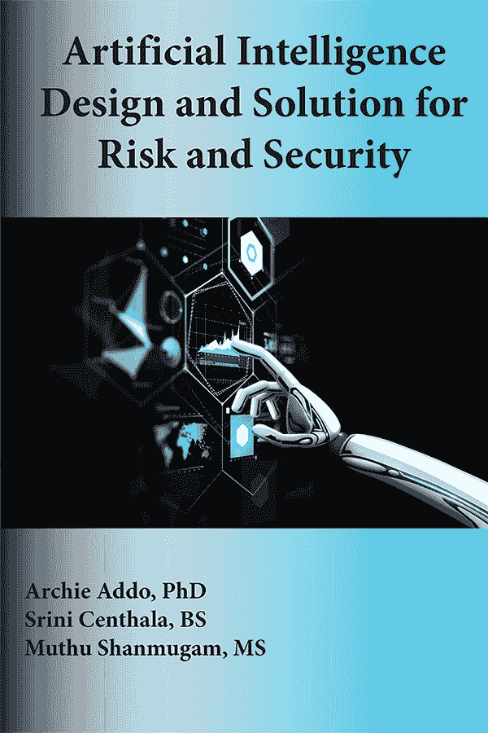


## 摘要

各种风险、安全问题和灾难已在环境和企业界发生（Peters 2018; Gheuens et al. 2019）。若采用适当的方法，可利用缓解措施应对风险和安全事件。必须采取特定方法来缓解事态，并进一步推荐缓解策略。专家需要尽早识别相关风险和安全隐患，以保障局势并将影响降至最低。风险与安全管理在不确定性情况下发挥着重要作用。以下是一些与风险与安全管理相关的关键问题：如何在类似情况下尽早预测并处理这种情况？这些事件能否被历史性地记录？能否识别此类事件的模式？能否采集与事件相关的数据？这些数据能否用于预测未来事件？数据的相关性是否为重要因素？安全是否重要？如果数据被篡改会怎样？数据是如何被篡改的？如何保护和确保数据安全？安全是风险管理的驱动因素，并在数据中发挥着重要作用。

各类风险与安全适用于不同的行业、业务职能、角色和职责。本书旨在通过建议定义、分析、监控、控制和缓解风险的方法，说明适用于各行业的顶级业务案例和用例（Morosan and DeFranco 2019; Aydos et al. 2019）。这种方法利用数据并采取纠正措施来缓解风险。此类分析耗时较长，因为人类无法快速分析海量数据。人们可以利用数据科学、数据分析和机器学习（`ML`）算法来加速这一过程。

人工智能（`AI`）使机器能够通过持续学习新的输入数据集，从以往的人类经验中学习。数学算法的发展显著推动了 `ML` 的创建，并引发了当今的 `AI` 革命。

在本书中，`AI` 将通过各种案例研究用于缓解风险，读者将能理解并从中受益。`AI` 在业务中产生了显著且卓有成效的结果。许多组织渴望理解并提升风险管理技能，以改善其应对风险的能力。

由于数据量大、速度各异、种类繁多，风险与安全已变得无处不在。这些生活层面似乎正变得规模更大、频率更高，且往往伴随负面影响。人们可以利用不确定量的风险来强化自身地位。风险与安全的范围与广度在世界各地及各类项目中造成了巨大混乱。风险与安全管理在组织中至关重要，因为缺乏它，组织可能难以确立目标。实施战略最重要的原因是对财务损失的恐惧。本书聚焦于问题陈述及相应用例，并利用数据科学和 `ML` 方法提出 `AI` 解决方案。

在本书中，我们希望为众多组织面临的关键问题提供具体答案：这些风险和安全问题在哪里？可以采取什么措施降低其影响？`AI` 是风险与安全缓解答案的一部分吗？

## 关键词

项目管理；建筑管理；项目群管理；技能发展；风险、安全；人工智能；分析；机器学习；缓解；绩效评估；数据科学和商业智能

## 致谢

我们在人工智能（`AI`）设计和风险与安全解决方案方面的专家们已遍布企业界，积累了知识和专长。`AI` 和风险研究者对我们的思维和本书内容产生了深远影响。随后，为众多企业客户提供服务极大地影响了本书素材的准备。

感谢我们的父母，Godson Addo、Mary (Vanderpuije) Addo、Seetharaman Centhala、Thulasi Centhala、K. Shanmugam 和 S. Saroja，鼓励我们接受教育并在各自的工作领域勤奋耕耘。没有他们的支持，我们认为无法走到今天。

我们要向家人表达谢意：Louvaine Addo、Mala Srini 和 Kavitha Muthu；Archie 和 Srini 的孩子们：Koushik Seethula、Shashank Seethula 和 Srima Seethula；以及 Muthu 的孩子们：Maanasa Muthu 和 Sarvesh Muthu，感谢他们对我们繁忙日程的共同包容。

# 第 1 章：简介

## 目标读者

本书主要关注 `AI` 如何应用于风险与安全管理。本书遵循 `AI` 在自然语言处理分支、`AI` 自然语言问答系统、风险与安全领域的对话式 `AI`、`AI` 支持无人机、`AI` 网络安全、物联网设备以及用例方面的当前趋势。

适用的 `AI` 主题面向：

*   企业高管、创始人、首席技术官、首席信息官、首席数据官、首席安全官、首席风险官、数据科学家、数据架构师、`AI` 设计师、`AI` 工程师、项目经理和顾问，旨在帮助他们理解如何利用 `AI` 管理风险与安全。

*   学生、教师和开发人员将发现本书实用且有用。它将概述许多 `AI` 组件，并介绍 `AI` 如何在大型、中型和小型企业环境中使用。

*   任何致力于理解 `AI` 如何用于风险与安全的人士。

## 你将从本书获得什么？

*   理解并学习如何将 `AI` 应用于风险与安全。

*   设计并应用基于知识的 `AI` 解决方案以解决风险与安全问题。

*   `AI` 系统的架构与设计依赖于以下要素：

    *   **主题专家**：这意味着拥有解决方案如何被使用的实践视角，而不仅仅是如何被开发。书中以风险与安全的案例研究为例。

    *   本书采用了**适当应用的数学与算法**。如果你有深入研究的需求，请勿跳过数学公式。`AI` 高度依赖数学。

    *   **应用物理及其在硬件系统中的应用，以及从量子计算机到量子计算机网络并行处理的未来方法**。`AI` 仍在不断演进。请全神贯注于未来 `AI` 章节中的新概念和应用创意。

    *   **决策理论、决策制定过程和马尔可夫决策过程算法**（Gupta 和 Katarya，2018）。

## 本书涵盖内容

本书介绍了 `AI` 如何应用于企业、初创公司以及大、中、小型公司，以帮助自动化维护风险与安全的繁琐工作。通过应用 `AI` 和机器学习来辅助人类专家，自动化改善了组织的工作环境。

*   公司如何从 `AI` 中获得真正的价值？

*   具有远见的 `AI` 业务用例有哪些？

*   如何识别最佳的 `AI` 采用业务案例并评估机会？

*   我应该自建还是购买 `AI` 平台？

*   如何为企业寻找并招募顶尖 `AI` 人才？

*   如何将 `AI` 引入业务以增加收入或降低成本？

*   如何促进组织内部的 `AI` 采用？

处理数据包括数据收集、数据准备、数据转换、数据安全、利用数据与组织的 `AI` 用例保持一致等更多内容。

本书简介的思维导图见图 1.1。这为读者指明了本书涵盖的内容和章节组织。

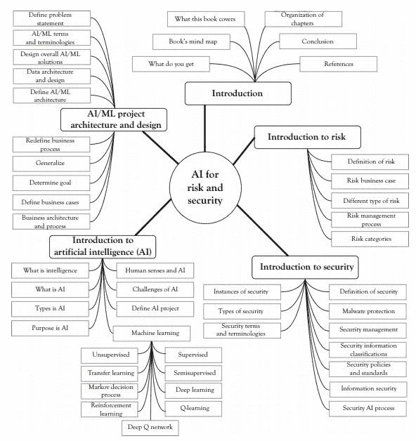

**图 1.1** 本书思维导图

见图 1.2。这为读者指明了本书中涵盖哪些风险领域的 `AI` 解决方案。

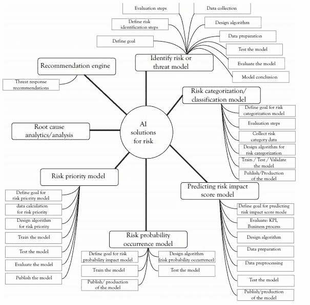

见图 1.3。这为读者指明了本书中涵盖哪些安全领域的 `AI` 解决方案。

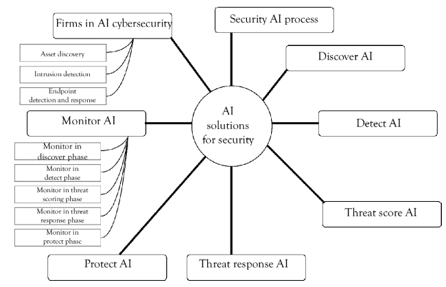

**图 1.3** `AI` 安全解决方案思维导图

## 章节安排

*   人工智能（`AI`）项目架构与设计

*   风险简介

*   安全简介

*   `AI` 知识库简介

*   `AI`、风险与安全的融合

*   业务用例

*   面向风险的 `AI` 解决方案

*   面向安全的 `AI` 解决方案

*   行业领域

*   职能领域

*   未来 `AI`

## 结语

## 参考文献

---

# 第 2 章：人工智能/机器学习项目架构与设计

## 章节大纲

*   `AI` 和 `ML` 项目的架构与设计视角

*   当前架构与未来架构的对比

*   数据分析与生命周期

*   数据处理步骤

*   未来的清洗与提取

*   `ML` 算法

## 关键学习点

*   学习并理解如何开展 `AI` 和 `ML` 项目架构与设计

## `AI` 和 `ML` 项目架构与设计步骤

*   定义问题陈述

*   了解现有和当前的业务架构与业务流程

*   定义业务案例和用例

*   确定目标

*   `AI` 和 `ML` 应用于业务架构与业务流程

    *   对问题、用例和业务流程进行泛化

    *   重新定义整体流程

    *   转化为 `AI` 和 `ML` 问题陈述

*   定义 `AI` 和 `ML` 架构

*   评估可用的 `AI` 和 `ML` 算法以确定架构

*   设计整体 `AI` 和 `ML` 解决方案

*   设计数据架构和数据设计

*   开发、训练、验证、改进和部署

详细的架构与设计步骤见图 2.1 `AI` 和 `ML` 项目架构与设计流程。

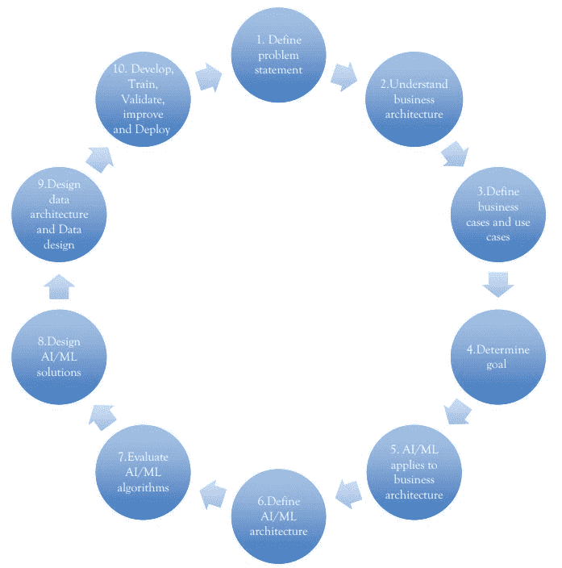

**图 2.1** `AI` 和 `ML` 项目架构与设计流程

## 术语与术语表

在统一建模语言中，参与者是由用户（利益相关者）或与主体交互的任何其他系统所扮演的角色。参与者与主体交互，例如，组织数据和操纵数据的资源。另一个例子是用例的主要参与者，即调用系统以提供其服务之一的利益相关者。

## 定义问题陈述

问题陈述是基于相关需求，对待解决的问题或待改进的状况的描述（Jain 等，2018）。通常，当前问题陈述与流程或产品的期望目标陈述之间存在差距。

请参考五个 W（Who、What、When、Where 和 Why），结合过去、现在和未来状态，清晰地定义问题陈述。

*   **Who（谁）**：定义问题或系统的参与者及涉及的流程。

*   **What（什么）**：定义问题及问题的目标。

*   **When（何时）**：定义特定事件或动作发生的时间。

*   **Where（何地）**：定义发生地点或预期发生地点。

*   **Why（为什么）**：定义为什么会发生、为什么发生了、或为什么将会发生。

在此加入“How（如何）”，以清晰地理解问题。着眼大局，分析既往问题、当前问题和未来问题。定义问题将如何解决的期望状态。

## 问题陈述示例

## 面向风险的 `ML` 和 `AI`

### 每项行动都伴随风险

手动监控风险并缓解大型任务是一个持续存在的问题（Rona-Tas 等，2019）。利用机器学习和人工智能方法解决这一问题。

### 面向安全的机器学习和人工智能

安全是企业和政府组织面临的一个重大问题（McGraw 等，2019）。该问题可以利用机器学习和人工智能方法来解决。

问题陈述的定义非常笼统，可能无法聚焦于正确的问题陈述。这些陈述可以细分为多个问题陈述；这一过程将在“面向风险的人工智能解决方案”和“面向安全的人工智能解决方案”章节中进行说明。

## 理解现有与当前的业务架构与业务流程

在审视新旧业务架构时，请提出以下问题：

*   利益相关者、客户、用户和组织是谁？

*   应如何定义愿景、战略、战术、政策、规则和法规？

*   通过计划和项目的价值流是什么？如何衡量？

*   启用了哪些能力？利用收集的信息提出了哪些建议？

请参见 图 2.2。

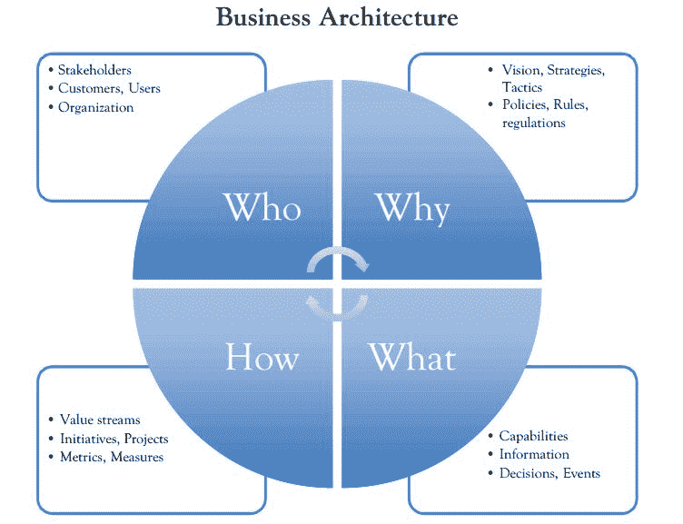

**图 2.2 业务架构流程**

### 业务架构

### 业务流程

业务架构进一步细分为业务流程（Vaez-Alaei 等，2018）。业务流程定义了企业如何运作、管理和服务以实现业务目标。每个组织在行业和职能领域可能拥有独特的业务流程。请参见 图 2.3。

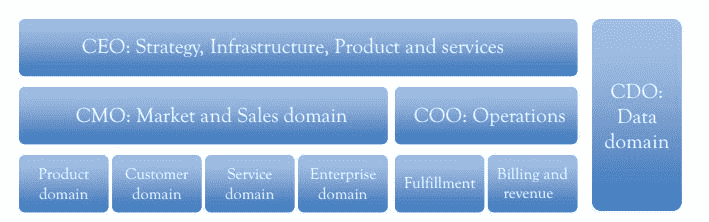

**图 2.3 典型业务流程**

通常，首席执行官负责战略、基础设施、产品和服务。首席营销官负责市场营销和销售领域。首席运营官负责业务运营。如今，大多数组织引入了一个名为首席数据官的新高层管理职位，负责管理数据架构、数据设计、数据收集、数据管理、数据处理、应用数据科学、机器学习和人工智能。该角色帮助行业跟上最新的技术变革，例如迁移到云基础设施、机器学习、人工智能和物联网。事实上，所有现有业务流程都在经历重组和重新定义，以采纳包括风险和安全在内的技术变革。所有业务职能领域及相关业务流程均面临风险。本书阐述了如何利用机器学习和人工智能实现业务职能领域及相关业务流程的自动化。

从宏观层面审视零售行业的业务流程。请参见 图 2.4。

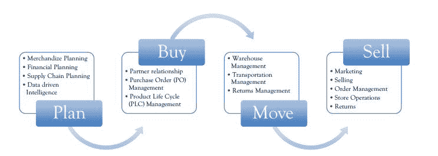

**图 2.4 零售行业典型业务流程**

## 定义业务用例

必须为问题陈述定义业务用例（Haas 等，2019）。该流程将通过机器学习和人工智能针对风险问题陈述进行说明。

### 问题陈述：

*   风险无处不在。每项行动都伴随风险。手动监控风险并加以缓解是一个持续存在的问题，尤其是在大型任务的情况下。目标是利用机器学习和人工智能方法解决这一重大问题。

*   安全是企业和政府组织面临的一个非常大的问题，可利用机器学习和人工智能方法加以解决。

### 确定投资回报率 (ROI) 和收益：

组织通过实施面向风险和安全的机器学习和人工智能系统，将每天节省资金。人力劳动将从手动识别和缓解风险及安全工作中解放出来。ROI 的大致估算至少为 10,000 美元，但该数字取决于组织规模以及当前在手动风险和安全任务上花费的时间。机器学习和人工智能还能消除 7×24 小时的风险和安全监控任务。

### 战略一致性：

战略一致性应与业务目标保持一致。所有组织的业务目标都是利用数据驱动决策和自动化。面向风险和安全的机器学习和人工智能实施与业务目标保持一致。

### 投资：

投资将很少，因为它将采用云端软件即服务模式。

### 价值：

组织将获得安心。客户和合作伙伴组织将更有信心。

### 效率：

组织的运营流程和自动化水平将提高 60 倍。

## 定义用例

在此步骤中，定义或识别需支持以达成有形成果的用例（重构以提高用例模型的安全质量，2019）。大多数机器学习和人工智能项目被转向研发 (R&D) 项目，原因在于用例是在前期识别的。用例因行业和业务职能而异，但其中一些列举如下。

### 金融和银行业：

*   预防信用损失和欺诈。

*   避免洗钱。

*   遵守行业标准和政府条款。

### 零售业：

*   避免数据泄露。

*   通过有竞争力的定价提高市场份额。

## 确定目标

机器学习和人工智能风险解决方案的目标是捕获所有风险项目，以识别、分类和优先处理风险，并获得预防建议。

机器学习和人工智能安全解决方案的目标是实时防范威胁。机器学习和人工智能安全系统可发现、检测、提供威胁评分、威胁防护和预防建议。

在逐步了解每个机器学习和人工智能项目架构及设计步骤之前，让我们先看看典型的数据分析项目及其生命周期。可能需要多条数据分析和生命周期项目流来定义整体项目架构和设计。

## 数据分析与生命周期

数据分析生命周期专为大数据问题和数据科学项目设计（Sahoo 和 Mohanty，2018）。共有六个阶段，项目工作可在多个阶段同时进行。该周期具有迭代性，以模拟真实项目。随着新信息的发掘，工作可返回到前期阶段。数据分析生命周期包含以下序列步骤：

### 数据分析生命周期概览：

1.  第一阶段：发现

2.  第二阶段：数据准备

3.  第三阶段：模型规划

4.  第四阶段：模型构建

5.  第五阶段：结果沟通

6.  第六阶段：运营化

数据科学家是主要的分析利益相关者。数据科学家提供分析技术和建模。其他团队成员如下：

1.  业务用户：了解领域知识。

2.  项目发起人：提供高层需求和预算。

3.  项目经理/敏捷教练/Scrum Master：确保目标达成。

4.  数据架构师：基于对数据的深入理解，提供业务领域专业知识。

5.  数据工程师：提供技术技能，协助数据管理和提取，支持分析开发领域。

以下是流程包含的步骤。请参见 图 2.5。

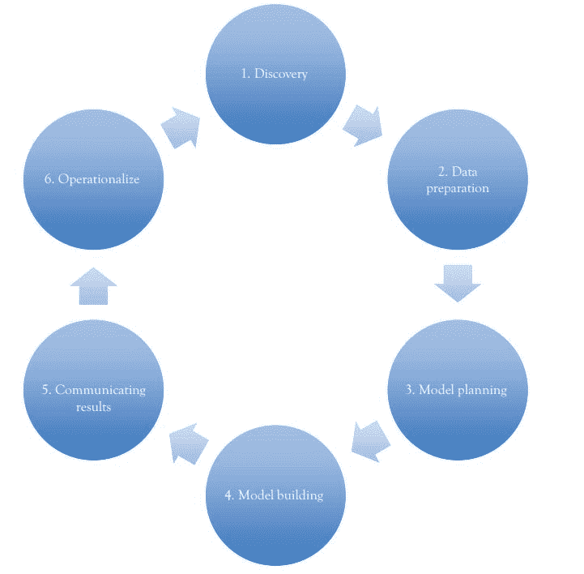

**图 2.5 数据分析生命周期**

### 第一阶段：发现

发现阶段遵循以下步骤序列：

1.  学习业务领域

2.  资源

3.  界定问题

4.  识别关键利益相关者

5.  面谈分析发起人

6.  形成初步假设

7.  识别潜在数据源

### 第二阶段：数据准备

数据准备阶段包含以下要素：

1.  此阶段包含探索、预处理和调理数据的步骤。

2.  此阶段创建健康的环境和分析沙箱。

3.  数据准备往往是分析生命周期中最耗费人力的步骤。

4.  至少 50% 的任务时间花费在数据准备阶段。

## 5. 数据准备阶段

数据准备阶段通常是最迭代的阶段，也是团队往往容易低估的阶段。

数据准备阶段需要开发工作区。

准备工作区有益于以下原因：

*   它创建了一个分析工作区。

*   它允许团队探索数据，而不会干扰实时生产数据。

*   一个准备好的工作区收集各种数据（广泛的方法）。

*   该工作区允许组织承担超越传统数据分析的雄心勃勃的项目。

*   这一概念为数据科学团队和 IT 团体所接受。

在工作区中，可根据团队情况执行提取、转换、加载和转换功能（提供预测行为分析的系统和方法 2018）：

提取、转换和加载用户可执行提取、转换和加载功能。

在工作区中，提取、加载和转换过程保留原始数据，这对于检查很有用。

**示例：** 在金融机构的信用卡欺诈检测中，高风险交易可能在加载到数据库之前被随意过滤掉或转换。

了解数据很重要，原因如下：

1.  它在项目早期确定团队可用的数据。

2.  它凸显差距并识别当前不可用的数据。

3.  它识别组织外部可能有用的数据。

### 数据调理

数据应进行调理，原因有多种，例如清洗数据、标准化数据集和执行转换。此任务被视为数据分析前的步骤，该步骤可能由数据所有者、IT 部门和数据库管理员执行。数据科学家应参与其中。众所周知，数据科学团队宁愿要过多的数据，也不要过少的数据。

以下是在分析数据时必须解决的问题和观察事项，以及您可以在其中找到更多相关信息的章节。

*   第 3 章：数据源和目标字段是什么？

*   第 4 章：数据有多干净？

*   第 5 章：内容和文件有多一致？是否有缺失或不一致的值？

*   第 6 章：评估数据类型（数字、字母数字）的一致性？

*   第 7 章：审查内容以确保数据讲得通。

*   第 8 章：寻找系统性错误的证据。

### 调查与可视化

可使用特定的数据可视化工具来获取数据概览（Wang et al. 2019）。此过程从概览和按需缩放及筛选细节开始。这种方法使用户能够找到感兴趣的区域，并通过缩放和筛选来查找更详细的数据。

在调查和可视化数据时，必须解决以下问题和观察事项。

*   第 1 章：审查数据以确保计算一致。

*   第 2 章：数据分布是否保持一致？

*   第 3 章：评估数据的细节、值的范围和数据的聚合级别。

*   第 4 章：数据是否代表了感兴趣的总体？

*   第 5 章：检查时间相关变量：每日、每周、每月？这些变量是否足够？

*   第 6 章：数据是否标准化或归一化？数据刻度是否一致？


# 第 7 章：在地理空间数据集的情况下，州和国家的缩写是否一致？

数据准备工具包括 `Hadoop`、`Alpine Miner`、`OpenRefine`、`Data Wrangler` 和 `Google Cloud data preparation`。

*   `Hadoop` 可执行并行消费和分析。
*   `Alpine Miner` 提供图形用户界面以创建分析工作流。
*   `OpenRefine`（前身为 Google Refine）是一款免费的开源工具，用于处理混乱数据。
*   `Data Wrangler` 是一款用于数据清洗和转换的交互式工具。
*   `Google Cloud` 提供数据准备功能。

## 第 3 阶段：数据建模

在本阶段，将执行以下步骤：

*   确定数据结构，以帮助确定下一阶段的工具和分析技术（Palli et al. 2019）。
*   确定将使团队能够实现业务目标并接受或拒绝工作假设的分析技术。
*   决定采用单一模型或一系列技术，作为更大分析工作流的一部分。
*   了解过去是如何分析类似问题的。

## 第 4 阶段：模型构建

模型构建中考虑以下任务：

1.  执行第 3 阶段定义的模型。
2.  开发用于训练、测试和生产的数据集。
3.  在训练数据上开发模型并在测试数据上测试。
4.  需考虑的问题：
    1.  模型在测试数据上看起来是否有效且准确？
    2.  模型输出和行为对领域专家来说是否讲得通？
    3.  参数值在领域背景下是否讲得通？
    4.  模型是否能充分且准确地达到目标？
    5.  模型能否避免不可容忍的错误？
    6.  是否需要更多数据或输入？
    7.  所选模型类型是否支持运行时环境？
    8.  是否需要不同的模型来解决业务问题？

常用的模型构建工具有：`R` 和 `PL/R`—`PL/R`、`Python`、`SQL`、`Octave`、`WEKA`、`SAS`、`SPSS Modeler`、`MATLAB`、`Alpine Miner`、`STATISTICA` 和 `MATHEMATICA`。

## 第 5 阶段：结果沟通

沟通结果时应遵循以下步骤：

1.  确定团队在目标上是成功还是失败。
2.  确定结果是否具有统计显著性和有效性。
3.  如果结果显著且有效，确定呈现相关发现的结果方面。
4.  确定结果是否与假设一致。
5.  沟通分析得出的结果和主要见解。

## 第 6 阶段：运营化

运营化阶段将发生以下情况：

1.  团队沟通项目的收益。
2.  团队建立试点项目，以受控方式部署工作。
3.  在大规模推广前，通过开展小范围和试点部署来管理风险并采取纠正措施。
4.  在试点项目期间：
    1.  团队可能在数据库中更高效地执行算法，而不是使用像 `R` 这样的内存工具，尤其是在处理较大数据集时。
    2.  要在实时环境中测试模型，可考虑在生产环境中针对一组离散的产品或单条业务线运行模型。
    3.  监控模型准确性，并在必要时重新训练模型。

让我们看看 ML 算法思维导图，并定义思维导图中使用的术语和术语。

# ML 数据处理

数据处理在任何分析项目、数据项目或 ML 和 AI 项目中都很重要。大部分时间都花在这个步骤上（Kotenko et al. 2019）。

请参阅图 2.6。

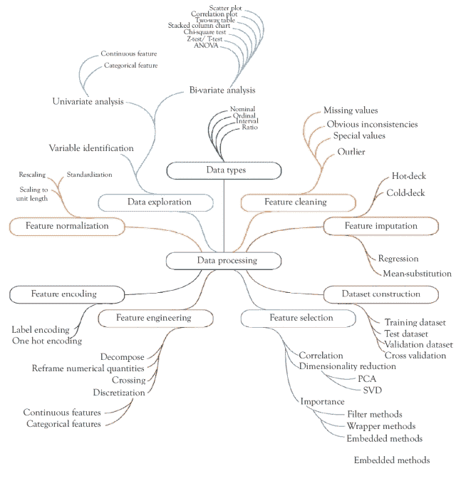

图 2.6 ML 和 AI 数据处理图

此处讨论了一些与统计相关的项目。如果您想了解更多关于术语和术语的信息，请参阅统计学书籍。图 2.6 解释了处理数据所需的步骤，并列出了统计实验和测量方法。

数据处理的第一步是通过检查不同技术来确定统计数据类型或测量水平（Overgoor et al. 2019; Ohanian 2019）。

## 名义数据

名义数据（也称为名义尺度）是一种用于标记变量而不提供任何定量值的数据类型。它是最简单的测量尺度形式。与有序数据不同，名义数据无法排序或度量。定性分类包括城市、姓名、州或任何分类数据等变量，这些变量具有与分类属性值相关联的数字表示。例如，表中的性别字段（`0 = 不可用`、`1 = 男性`、`2 = 女性`）。这些标识符代表实际的属性值。名义数据类型不应应用任何数学运算。顺序无效。名义数据类型的集中趋势是众数。

## 有序数据

有序数据是可排序或可排名的；例如：`0 = 低`、`2 = 高`、`1 = 中`。对于有序数据，排序非常重要，其集中趋势是众数或中位数。

## 等距数据

项目也应进行测量，以量化并比较它们之间的差异。例如，以华氏度或摄氏度测量的温度。

等距尺度是数值尺度，其中顺序和精确差异均有效。例如，60 度和 50 度之间的差异是可测量的 10 度，80 度和 70 度之间的差异也是 10 度。集中趋势可以用众数和中位数来衡量，标准差也可以计算。

## 比率数据

比率数据是指任何可测量、可排序、可排名且可应用于任何数学计算的数值数据。例如：身高、体重、持续时间、销售额和利润额。比率数据的集中趋势是众数、平均数、中位数、算术平均数，且可排序。请参见表 2.1。

## 表 2.1 比率数据

| 提供项 | 名义 | 有序 | 等距 | 比率 |
| --- | --- | --- | --- | --- |
| 数值顺序 | 否 | 是 | 是 | 是 |
| 频数分布（计数） | 是 | 是 | 是 | 是 |
| 众数 | 是 | 是 | 是 | 是 |
| 中位数 | 否 | 是 | 是 | 是 |
| 平均数 | 否 | 否 | 是 | 是 |
| 量化差异 | 否 | 否 | 是 | 是 |

## 数据探索

数据探索通过可视化探索分析数据，以了解数据集并确定数据特征，如大小、数据量、数据完整性、数据正确性以及数据元素之间的关系（Alvarez-Ayllon 2018）。

## 变量识别

变量识别是机器学习模型任何输入（预测变量）或输出（目标变量）的基础。变量识别决定了哪种变量可用作预测变量或目标变量。

## 单变量分析

单变量分析是一种统计分析，用于确定涉及的变量或多个变量。此分析适用于分类变量和特征（定性）或数值（定量）单变量数据。分类单变量数据由身高或体重等数字组成。

通常，单变量分析通过频数分布表、条形图、直方图、频数多边形和饼图进行可视化。

1.  连续特征
2.  分类特征

## 双变量分析

双变量分析是对两个变量（属性）的统计分析，探索两个变量之间的关系。双变量分析确定变量间关联的强度。此分析检查两个变量之间的差异及差异的显著性。

双变量分析的类型包括数值对数值、分类对分类、数值对分类。双变量分析通过以下任一可视化进行说明。

### 散点图

散点图探索两个数值，以提供线性和非线性关系的可视化表示。

线性相关使用以下公式量化线性关系的强度。

```
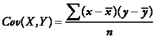
```

其中 `x(dash)` 和 `y(dash)` 为样本均值，`n` 为样本数量。

### 相关图

相关图用于评估相关性在各组间是否一致。

1.  双向表
2.  堆积柱状图

### 卡方检验

卡方检验是一种统计假设检验，当原假设为真时，检验统计量的抽样分布呈卡方分布。皮尔逊卡方检验常被使用。卡方检验用于确定在一个或多个类别中，期望频数与观测频数之间是否存在显著差异。卡方检验给出 P 值。

卡方公式：

```
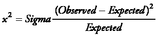
```

### Z 检验/T 检验

Z 检验和 T 检验是相同的。它是对两组平均值的统计评估，确定差异及差异的显著性。

```
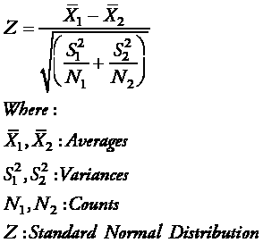
```

```
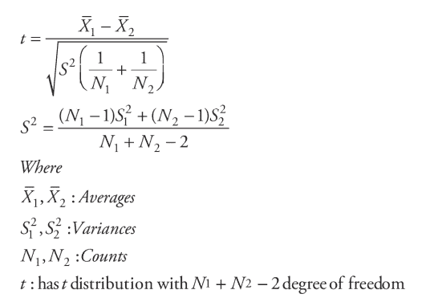
```

### 方差分析 (ANOVA)

ANOVA 是方差检验的简称，通过统计方法测量三个或更多组的平均值，这些组在统计学上彼此不同。简单来说，该检验确定三个或更多独立组的均值之间是否存在统计学显著差异。

## 特征清洗

特征清洗是数据清洗的另一种说法。干净且高质量的数据决定了数据项目的成功。收集高质量数据是最大的挑战。

### 缺失值

数据中可能存在空值、空格或无值。

### 明显的不一致性

由于人为或设备原因，各种信息系统在收集、处理和更新数据时会产生不一致的数据问题。

不一致的数据使得无法从数据中获得正确信息，并降低数据可用性。

### 特殊值

特殊值特定于各自的数据集。例如，日期字段的某些默认值表示为 `“1900-01-01”` 作为生效开始日期，`“2099-12-31”` 作为生效结束日期。

### 异常值

在统计学中，异常值是指与其他观测值显著不同的数据点（Huang 等，2019）。异常值可能导致统计分析和特征清洗出现严重问题。

### 特征插补

*   热卡法
*   冷卡法
*   均值替代
*   回归

## 特征工程

*   分解
*   离散化
*   连续特征
*   分类特征
*   重构数值量
*   交叉

## 特征选择

*   相关性
*   降维
*   主成分分析 (PCA)
*   奇异值分解 (SVD)
*   重要性
*   过滤法
*   包装法
*   嵌入法

## 特征编码

*   标签编码
*   独热编码

## 特征归一化

*   重缩放
*   标准化
*   单位长度缩放

## 数据集构建

*   训练数据集
*   测试数据集
*   验证数据集
*   交叉验证

# 机器学习算法思维导图

请参见图 2.7。

```
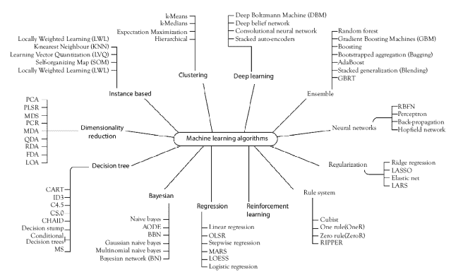
```

**图 2.7 机器学习算法思维导图**

# 机器学习算法

机器学习算法是一种用于处理数据以提取可应用于新情境模式的方法（Andriosopoulos 等，2019）。目标是将系统应用于特定的输入-输出转换任务。

机器学习和深度学习均包含于机器学习算法之中。机器学习是一类从数据自动创建模型的方法。机器学习算法将数据集转化为模型，该模型在监督学习、无监督学习、分类和回归算法中均有效。

典型示例是真值标签，如降雨量或一个人的身高。前五种算法是线性回归、逻辑回归、分类与回归树、朴素贝叶斯和 K 近邻算法。这些算法是监督学习的示例。

## 分类

### Gmail 和机器学习分类

Gmail 是 Google 的一款电子邮件应用程序，它使用机器学习技术根据发件人、收件人、主题和邮件正文来判断收到的电子邮件是否为垃圾邮件。分类采用一组带有已知标签的数据，并根据该信息为新记录打标签。

进一步的分类是一类监督式机器学习算法，它们将输入指定为属于预定义的类别。

### 分类的常见用例

1.  信用卡欺诈检测。
2.  电子邮件垃圾邮件检测。
3.  分类数据带有标签，例如：垃圾邮件和非垃圾邮件，或欺诈和非欺诈。机器学习将新数据分配给某个类别。
4.  基于预定特征的分类。
5.  特征回答“是否”问题。
6.  标签回答“是否”问题，例如：如果它走路、飞行和鸣叫都像鸟，那么标签就是“鸟”。

## 聚类

聚类可用于搜索结果分组、客户分组、异常检测和文本分类。

Google News 使用一种称为聚类的技术，根据标题和内容将新闻文章归类到不同类别中。聚类算法发现数据集合中出现的分组。聚类通过分析输入之间的相似性将对象放入类别中。

聚类使用无监督机器学习算法，这些算法事先没有输出：

1.  聚类使用 `K-means` 算法将所有坐标初始化为质心。
2.  每次算法迭代时，根据某个距离度量（通常是欧几里得距离），每个点都被分配给其最近的质心。
3.  质心被更新为该次迭代中分配给它的所有点的“中心”。
4.  此过程重复进行，直到中心发生的最小变化为止。

### K-means 聚类

`K-means` 聚类算法很流行，因为它可以应用于相对较大的数据集。用户指定要找到的聚类数量，算法通过寻找一组聚类中心、将每个观测值分配给一个聚类并确定新的聚类中心，将数据分离成球形聚类。

样本空间最初被划分为 K 个聚类，观测值被随机分配给这些聚类。对于每个样本，应计算从观测值到其所属聚类质心的距离。如果样本最接近其自身的聚类，则保留它；否则选择另一个聚类。

重复步骤 1 和 2，直到没有观测值从一个聚类移动到另一个聚类。当聚类稳定时，每个样本被分配一个聚类，从而导致到该聚类质心的距离最小化。

## 协同过滤

Amazon 使用一种称为协同过滤（通常称为推荐）的机器学习技术，根据用户的历史记录以及与购买过类似产品的其他用户的相似性，来确定用户会喜欢哪些产品。

协同过滤算法基于众多用户的偏好信息推荐项目。协同过滤算法的目标是 (a) 获取用户的偏好数据，以及 (b) 创建一个可用于推荐或预测的模型。

### 随机森林

随机森林或随机决策森林是一种用于分类、回归和其他任务的集体学习方法。这些森林通过在训练时构建大量决策树，并输出各个树的类别众数（分类）或平均预测值（回归）来运作。随机决策森林弥补了决策树过拟合其训练集的习惯。

## 关联规则

关联规则是说明大型数据集中各类数据库里数据项之间关系概率的语句。关联规则挖掘有多种应用，广泛用于帮助发现交易数据中的销售关联或医疗数据中的诊断关联。其他应用在决策制定中使用关联规则。

## 回归

回归常用于金融统计测量、投资和其他试图确定一个因变量（通常用 `Y` 表示）与一系列其他变化变量（称为自变量）之间关系强度的学科（Liu et al. 2019）。

典型的回归（如线性回归）可用于量化年龄、性别和饮食（预测变量）对身高（结果变量）的相对影响。线性回归也称为多元回归、多变量回归、普通最小二乘法和回归。回归技术用于预测建模和数据挖掘任务。平均而言，只有两到三种类型的回归被常用。

### 线性回归

线性回归是一种基于监督学习的机器学习算法。回归模型基于自变量预测目标值。该算法主要用于研究变量之间的关系和预测。回归模型因因变量和自变量之间的关系以及所用自变量的数量而异。

线性回归根据给定的自变量 (`x`) 预测因变量 (`y`) 的值。该回归技术发现 `x` 输入和 `y` 输出之间的线性关系。

线性回归用于统计计算。在简单线性回归中，使用单个自变量来预测因变量的值。在多元线性回归中，使用两个或更多自变量来预测因变量的值。两者的区别在于自变量的数量。

线性回归可用于通过将线性方程拟合到观测数据来模拟两个变量之间的关系。一个变量是解释变量，另一个是因变量。例如，建模者可能想要使用线性回归模型将个体的体重与其身高联系起来。

在尝试将线性模型拟合到观测数据之前，建模者首先应确定感兴趣变量之间是否存在关系。这并不一定意味着一个变量导致另一个变量（例如，较高的考试通过分数并不导致较高的大学成绩）；然而，这两个变量之间存在某种显著关联。散点图可用于确定两个变量之间关系的强度。如果建议的解释变量和因变量之间似乎没有关联（即散点图未显示上升或下降趋势），则将线性回归模型拟合到数据将不会提供有用的模型。这意味着应使用另一种方法，例如问题求解。

两个变量之间关联的一个有价值的数值度量是相关系数，其值在 -1 和 1 之间，表示观测到的两个变量数据关联的强度。让我们演示一下它是如何工作的。线性回归线的方程形式为 `Y = a + bX`，其中 `X` 是解释变量，`Y` 是因变量。直线的斜率是 `b`，`a` 是截距（当 `x = 0` 时 `y` 的值）。

### 逻辑回归

逻辑回归因其核心方法所使用的函数——逻辑函数而得名。逻辑函数也称为 S 型函数。统计学家开发此函数是为了描述生态学中人口增长的特性。它是一条 S 形曲线，可以接受任何实值数字并将其映射为 0 和 1 之间的值，但永远不会恰好等于这两个极限。

### 普通最小二乘回归 (OLSR)

## OLSR（普通最小二乘回归）

OLSR 是一种广义线性建模技术。它用于估算线性回归模型中涉及的所有未知参数。该技术将观测变量与解释变量之间差值的平方和最小化。OLSR 是线性回归最简单的方法之一。OLSR 的目标是使函数紧密拟合数据。这是通过最小化数据的平方误差之和来实现的。

## 逐步回归

逐步回归是一种通过自动过程利用预测变量拟合回归模型的方法。在每一步中，根据指定的标准，考虑将一个变量加入或从解释变量集合中移除。

让我们通过一个关于水泥硬化的数据集示例，来了解逐步回归过程是如何工作的。本例的目标是了解水泥的成分以及水泥硬化过程中释放的热量。共对 13 批水泥进行了测量并记录了数据：

*   **响应变量 y**：水泥硬化过程中每克释放的热量（卡路里）。
*   **预测变量 x1**：三氧化铝酸钙的百分比。
*   **预测变量 x2**：三氧化硅酸钙的百分比。
*   **预测变量 x3**：四氧化铝铁酸钙的百分比。
*   **预测变量 x4**：二氧化硅酸钙的百分比。

后续步骤将用于得出解决方案。

## 多元自适应回归样条

多元自适应回归样条是一种由 Jerome H. Friedman 于 1991 年提出的回归分析形式。它是一种非参数回归技术，是线性模型的扩展，能够自动对变量之间的非线性和交互作用进行建模。

## 时间序列分析

时间序列分析开发模型以最好地捕捉或描述观测到的时间序列，从而理解其背后的成因。该研究领域旨在探寻时间序列数据集背后的“为什么”。它是在一段时间内按固定时间间隔测量的一系列定义明确的数据点。该方法用于分析时间序列数据，并提取关于数据的有意义的统计信息和特征。该方法要求对数据的形式做出假设，并将时间序列分解为构成成分。描述性模型的质量取决于模型对所有可用数据的描述程度，以及模型在多大程度上能更好地为问题领域提供信息。

时间序列分析包括分析时间序列数据以提取有意义的统计信息和数据的其他特征。它具备利用模型根据先前观测到的值预测未来值的预测能力。

## 文本分析

文本分析是一种用于描述和解释记录或视觉信息特征的沟通方法。文本分析的目的是描述嵌入在文本中的信息的内容、结构和功能。

## 预测

简单来说，预测就是预报。可以对许多事物进行预测，例如足球比赛或天气。在 prediction（预测）一词中，“pre”意为之前，“diction”意为陈述某事。这引出了一种可能基于证据或事实的猜测。

确定预测的简单步骤如下：

1.  利用有意义的感官收集数据，并运用感官进行观察。
2.  搜索行为模式和/或特征。
3.  对未来的观测结果提出陈述。
4.  测试预测并观察发生的情况。


使用机器学习进行预测的最佳方法是通过隐藏与该预测相关的不确定性来解决问题。

预测区间提供了一种量化和传达预测中不确定性的方法。置信区间可用于量化数据集总体中的不确定性。均值和标准差可作为有问题的每个预测项的参数。

对于简单模型，预测区间可以通过解析方法估计，但对于非线性机器学习模型则更具挑战性。

## 异常检测

异常检测识别数据集中可能可疑的异常项目、事件或观测值；通常异常倾向于成为一个问题。异常可能在组织中造成安全问题。网络问题与活动爆发有关。这些模式不符合异常值的常见统计定义。这可能导致无监督方法失效，但可以适当聚合以获得预期结果。聚类分析算法可用于成功检测微簇模式。异常检测技术分为三类：无监督异常检测、有监督异常检测和半监督异常检测。

## 深度学习

深度学习有时被称为结构化学习或分层学习。深度学习是基于人工神经网络的机器学习方法的一部分。学习可以是有监督、半监督或无监督的。

### 神经网络类型

不同的神经网络如图 2.8 所示。

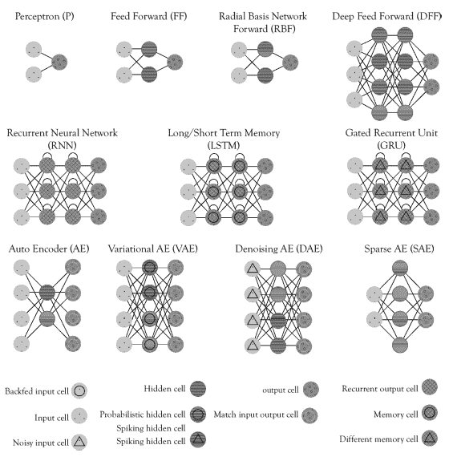

图 2.8 神经网络类型

#### 深度玻尔兹曼机 (DBM)

DBM 也称为带有隐藏单元的随机霍普菲尔德网络。它是第一个能够学习内部表示的神经网络，可以表示并解决困难的组合问题。它以统计力学中的玻尔兹曼分布命名，该分布用于其采样函数。

DBM 具有以下特征：

*   一种无监督的、概率的、生成模型，不同层之间具有完全无向的连接。
*   包含可见单元和多层隐藏单元。
*   类似于结果导向管理，DBM 中不存在层内连接；连接仅存在于相邻层的单元之间。
*   一个对称连接的随机二进制单元网络。
*   DBM 可以组织为一个二分图，奇数层在一边，偶数层在另一边。
*   层内的单元彼此独立，但依赖于相邻层。
*   通过逐层预训练使学习变得高效。
*   DBM 在学习每层的二进制特征后，通过反向传播进行微调。

#### 深度置信网络

深度置信网络是一种生成图模型，被称为一类深度神经网络。该网络由多层潜在变量组成，层与层之间有连接，但每层内部的单元之间没有连接。如果在无监督的数据集上训练，深度置信网络可以学习概率性地重构其输入并充当特征检测器。经过这一学习步骤后，网络可以进一步通过有监督训练来执行分类任务。

#### 卷积神经网络

卷积神经网络是一种用于图像识别和处理的人工神经网络，专门设计用于处理像素数据。神经网络是模仿人脑神经元运作模式的硬件或软件系统。卷积神经网络是一类在图像识别和分类等领域非常有效的神经网络。

这些网络用于多个领域，包括图像和模式识别、语音识别、自然语言处理 (NLP) 和视频分析。

#### 堆叠自编码器

堆叠自编码器是一种神经网络，由多层轻量级自编码器组成，每层的输出连接到下一层的输入。堆叠自编码器可用于分类问题。

## 集成学习

集成学习是一种有监督学习类型。

## ML 示例和算法

ML 示例包括医学诊断、图像处理、预测、分类、关联学习和回归。基于 ML 算法构建的智能系统具备从经验或历史数据中学习的能力。建议使用大量数据，因为这能提供更好的洞察。

### 集成方法

集成是学习算法中用于构建一组分类器，并通过对其预测进行加权投票来对新数据点进行分类的方法。最初的集成方法是贝叶斯平均，但较新的算法包括纠错输出编码、装袋和提升。装袋是一种通过使用有放回组合生成额外数据来产生原始数据的多重集，从而减少预测方差的方法。

#### 随机森林

随机森林——有时被称为随机决策森林——是一种流行的集成方法，可用于构建分类和回归问题的预测模型。集成方法使用多个学习模型以获得更好的预测结果。随机森林模型创建一整片随机的、不相关的决策树森林，以得出最佳可能答案。

#### 梯度提升机

梯度提升是构建预测模型最强大的技术之一。

提升方法将弱学习器转化为强学习器。每棵新树都是在原始数据集的修改版本上拟合的。可引入 AdaBoost 用于训练目的，从 AdaBoost 算法开始。在评估第一棵树后，会增加观测值的权重。通过计算第二棵树的分类误差来进行计算。第三棵树有助于预测修正后的残差。在指定迭代次数后，创建最终的集成模型。

#### 提升

提升是一种用于减少监督学习中偏差和方差的 ML 集成元算法。提升是一系列将弱学习器转化为强学习器的 ML 算法。

#### 自助聚合（装袋）

集成模型的目标是将一组弱学习器聚合在一起形成一个强学习器。当目标是减少决策树的方差时，会使用装袋。这会从样本数据集创建多个数据子集。

#### AdaBoost

AdaBoost——也称为自适应提升——是由 Freund 和 Schapire 于 1996 年提出的第一个实用提升算法。AdaBoost 专注于分类问题，旨在将一组弱分类器转化为一个强分类器。

#### 堆叠泛化（融合）

堆叠泛化简单来说是一种使用高层模型组合低层模型以获得更高预测准确性的通用方法。第一步是将每个模型的输出收集到一个新的数据集中。

#### 梯度提升回归树

梯度提升是一种用于回归和分类问题的 ML 技术。该技术以弱预测模型（通常是决策树）的集成形式生成预测模型。

### 神经网络

神经网络是一系列算法，它们通过模仿人脑运作方式的过程，识别数据集中潜在的关系。神经网络能适应不断变化的输入。网络在无需重新设计输出标准的情况下生成最佳可能结果。

#### 径向基函数网络

径向基函数网络是一种数学建模、径向基函数网络，它使用径向基函数作为激活函数。网络的输出是输入和神经元参数的径向基函数的线性组合。

#### 感知机

感知机是一种为计算提供分类结果的 ML 算法。它可追溯到 1950 年代，代表了 ML 算法开发数据的一个基本示例。

#### 反向传播

反向传播要求在网络设计时已知激活函数的导数。反向传播通常被梯度下降优化算法用来通过计算损失函数的梯度来调整神经元的权重。

#### 霍普菲尔德网络

霍普菲尔德网络是一种循环人工神经网络，由 John Hopfield 于 1982 年推广，但 Little 早在 1974 年就已描述。霍普菲尔德网络作为内容可寻址（“联想”）记忆系统，具有二进制阈值节点。

### 正则化

正则化是一种回归形式，它约束、正则化或将系数估计向零收缩。该技术阻止学习更复杂或更灵活的模型，以避免过拟合的风险。正则化说明了过拟合数据的模型是复杂模型，通常具有过多的参数。

#### 岭回归

岭回归是一种用于分析遭受多重共线性困扰的多元回归数据的技术。当发生多重共线性时，最小二乘估计是无偏的，但其方差很大。多重共线性（也称为共线性）是多元回归模型中的一个预测变量，它可以从其他变量中以相当高的准确度线性预测得出。当两个或多个预测变量之间存在高相关性时，通常会发生多重共线性。相关预测变量的示例包括一个人的身高和体重、汽车的年龄和销售价格、受教育年限和年收入。

#### 最小绝对收缩和选择算子 (LASSO)

LASSO 是一种回归分析方法，它执行变量选择和正则化，以增强其生成的统计模型的预测准确性和可解释性。LASSO 方法最初于 1986 年在大地物理学文献中引入，后来由 Robert Tibshirani 于 1996 年独立重新发现并推广，他创造了该术语并对观察到的性能提供了进一步的见解。LASSO 方法最初是为最小二乘模型制定的，后来揭示了关于估计量行为及其与岭回归关系的大量信息。

#### 弹性网

弹性网是一种正则化回归方法，它线性组合 LASSO 和岭方法的 L1 和 L2 惩罚。弹性网正则化方法同时包含 LASSO (L1) 和岭 (L2) 正则化方法。过拟合是 ML 算法背后的核心思想；目标是构建能在数据中发现广义趋势的模型。正则化用于防止模型对训练数据过拟合。

#### 最小角回归

最小角回归是一种用于将线性回归模型拟合到高维数据的算法。该方法由 Bradley Efron、Trevor Hastie、Iain Johnstone 和 Robert Tibshirani 开发。该统计算法使用潜在协变量子集的线性组合来确定响应变量。最小角回归算法生成一个估计，指明包含哪些变量及其系数。该估计不给出向量结果，而是提供一条曲线，表示参数向量 L1 范数的每个值的解。该算法类似于前向逐步回归，但不是在每一步包含变量，而是沿着与每个变量与残差的相关性等角的方向增加估计参数。

### 规则系统

规则系统通常被称为基于规则的系统，基于使用“如果-那么-否则”规则语句。规则只是模式匹配，推理引擎用于在规则中搜索与数据中模式匹配的模式。匹配规则捕获一个匹配过程。此过程可用于选择匹配项并将其添加到规则中以供将来应用。

### Cubist

基于树的 Cubist 模型可用于开发一种称为“委员会”的集成分类器。

委员会的概念类似于提升。这两个概念都通过调整权重按顺序开发一系列树；然而，最终预测是所有委员会成员预测的简单平均值，这一想法更接近装袋。

### 一条规则

一条规则有时被称为十分之一规则。它是一条经验法则，用于确定在回归分析（生存分析中的比例风险模型和逻辑回归）期间可以估计多少预测参数，同时将过拟合的风险保持在较低水平。该规则规定，每 10 个事件可以研究一个预测变量。

### 零规则

零规则是最简单的分类方法，它依赖于目标变量并忽略所有预测变量。零规则分类器预测多数类别（类）。例如，如果研究了 300 名患者的样本，且研究期间有 20 名患者死亡，则十分之一规则意味着可以可靠地将两个预先指定的预测变量拟合到总数据中。同样，如果研究期间有 100 名患者死亡，则可以可靠地拟合 10 个预先指定的预测变量。如果拟合更多，该规则意味着很可能发生过拟合，并且结果在训练数据之外将无法很好地预测。在变量众多的领域，1:10 规则并不经常被违反，这降低了对报告结果的信心。

### 重复增量剪枝以产生误差减少

在机器学习中，重复增量剪枝以产生误差减少是由 William W. Cohen 提出的一种命题规则学习器。

### 贝叶斯

贝叶斯算法涉及统计方法，这些方法基于实验和数据收集之前的经验或最佳猜测，分配概率、分布或参数（如总体均值）。贝叶斯算法在获得实验数据后应用贝叶斯定理来修正概率和分布。贝叶斯方法是指那些显式应用贝叶斯定理来解决分类和回归等问题的方法。

最流行的贝叶斯算法有：

*   `Naive Bayes`
*   `Gaussian Naive Bayes`
*   `Multinomial Naive Bayes`
*   `Averaged one-dependence estimators`
*   `Bayesian belief network`
*   `Bayesian network`

`Bernoulli Naive Bayes` 是计算概率时使用的另一种模型。`Naive Bayes` 模型易于构建。它没有复杂的迭代参数估计，这使其特别适用于超大数据集。

`Naive Bayes` 分类器基于贝叶斯定理，并假设预测变量之间相互独立；换句话说，它假设某类中某特征的存在与任何其他特征无关，即使这些特征相互依赖或依赖于其他特征的存在。因此得名 `Naive Bayes`。请看公式：

`Gaussian Naive Bayes` 用于基于二项分布数据的分类。

*   `P(class|data)` 是在给定预测变量（属性）的情况下类（目标）的后验概率。即在给定数据点的情况下，数据点属于任一类的概率。这是正在计算的值。
*   `P(class)` 是类的先验概率。这是我们的先验信念。
*   `P(data|class)` 是在给定类的情况下预测变量的似然概率。这是高斯分布，因为这是正态分布。
*   `P(data)` 是预测变量的先验概率或边际似然。这在 `Naïve Bayes` 分类器中不计算。

请参阅示例 图 2.9。

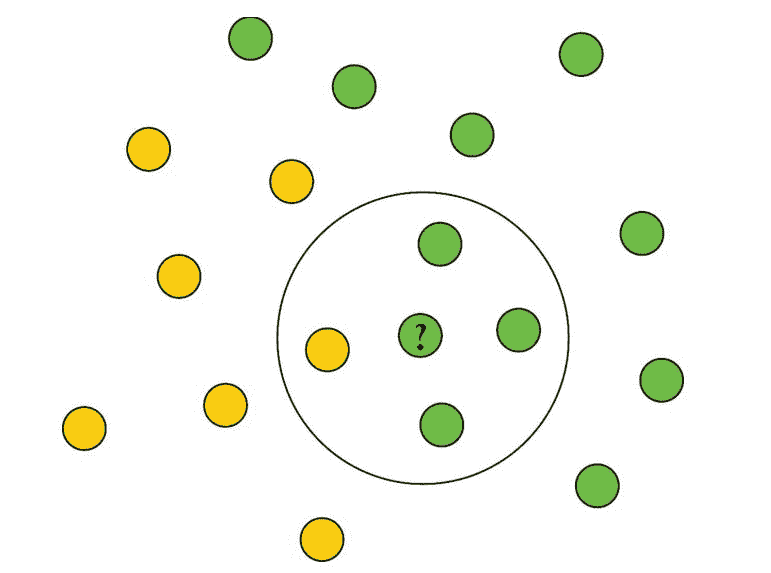

图 2.9 分类示例

请参阅下面的示例计算：

步骤：

1.  计算先验概率

    `P(class) = 该类中的数据点数量 / 观测总数`

    `P(yellow) = 10/17`

    `P(green) = 7/17`

2.  计算边际似然

    `P(data) = 与观测相似的数据点数量 / 观测总数`

    `P(?) = 4/17`

    该值存在于检查两个概率中。

3.  计算似然

    `P(data/class) = 该类中相似观测的数量 / 该类中的总点数。`

    `P(?/yellow)=1/7`

    `P(?/green)=3/10`

4.  每个类的后验概率

5.  分类

`P(class1/data)>P(class2/data)`

`P(green/?)>P(yellow/?)`

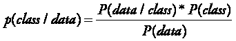

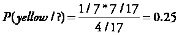

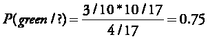

较高的概率将被分配给该类别的类。计算显示概率为 75%，即绿色类。

#### 朴素贝叶斯

`Bernoulli Naive Bayes` 分类器假设所有特征均为二值，仅取两个值（例如，经过独热编码的名义分类特征）。它是一种监督机器学习算法，使用贝叶斯定理并假设特征在统计上是独立的。

#### 朴素贝叶斯分类器

`Naive Bayes` 分类器是一系列简单的概率分类器，通过应用贝叶斯定理并假设特征之间具有强（朴素）独立性而得出。`Naive Bayes` 早在 1960 年代初就已出现；不过，当时使用的是不同的名称。它也曾在 1960 年代初用于文本检索领域。它是文本分类的一种流行基线方法，用于判断文档属于哪一类别（如垃圾邮件或合法邮件、体育或政治），以词频为特征。这是一种适用于风险和安全应用的好方法。当与支持向量机等更高级方法结合时，这种方法很流行。

值得注意的是，`Naive Bayes` 分类器具有高度可扩展性，且所需参数数量为学习问题中变量数量的若干倍。最大似然训练可以通过评估一个线性时间的闭式表达式来完成，而无需使用昂贵的迭代近似。`Naive Bayes` 分类器模型广泛应用于统计学和计算机科学。

#### 平均单依赖估计器

平均单依赖估计器是一种概率分类学习技术，被认为是最有效的 `Naive Bayes` 算法。该技术通过平均所有依赖估计器来解决 `Naive Bayes` 的属性独立性假设问题。

#### 贝叶斯信念网络

`贝叶斯信念网络` 或 `贝叶斯网络` 是一种统计模型，用于描述不同随机变量之间的条件依赖关系。`贝叶斯网络` 是一种用于建模和推理不确定信念的工具。`贝叶斯网络` 由两部分组成：有向无环图形式的定性组件和条件概率形式的定量组件。

#### 高斯朴素贝叶斯

`Naive Bayes` 分类器技术基于贝叶斯定理，适用于输入维度较高的情况。该方法被称为“朴素”，因为它假设各属性值之间相互独立。`Naive Bayes` 假设标签属性为二值、分类或名义型。如果输入变量为实值，则假设为高斯分布。如果数据的单变量分布为高斯或近高斯分布，该算法将表现更好。

#### 多项式朴素贝叶斯

`Naive Bayes` 分类器是一个通用术语，指模型中每个特征的条件独立性。`Multinomial Naive Bayes` 分类器是 `Naive Bayes` 分类器的一个特定实例，它对每个特征使用多项分布。多项式 `Naive Bayes` 用于 NLP 问题。`Naive Bayes` 是一系列算法，它们应用贝叶斯定理并做出强烈的朴素假设，即每个特征都独立于其他特征，以预测给定样本的类别。

## 贝叶斯网络

贝叶斯网络表示一组随机变量及其条件依赖关系之间的因果概率关系。该网络使用有向无环图提供联合概率分布的紧凑表示。通过使用有向图模型，贝叶斯网络描述随机变量和条件依赖关系。例如，您可以为患有疾病的患者使用贝叶斯网络。

## 决策树

决策树分析是一种通用的预测建模工具，应用跨越多个不同领域。决策树是使用算法方法构建的，该方法识别基于不同条件拆分数据集的方式。它是监督学习中最广泛使用和最实用的方法之一。决策树是一种非参数监督学习方法，用于分类和回归任务。目标是通过从数据特征中推断出的简单决策规则创建一个预测目标变量值的模型。它是一种树状图，其中节点表示选择属性并提出问题的地方。边代表问题的答案，叶节点代表实际输出或类标签。它用于具有简单线性决策面的非线性决策制定。

### 优势

1.  决策树产出极其直观。它不需要任何统计学知识即可阅读和解读决策树。图形化呈现很自然，用户可以毫不费力地将其与自己的假设联系起来。
2.  与其他建模技术相比，决策树需要更少的数据清洗。决策树不受异常值和缺失值的强烈影响。
3.  决策树被视为一种非参数技术。这意味着决策树对空间分布和分类器结构没有假设。

### 劣势

1.  过拟合是决策树模型的常见问题。可以通过设置模型参数约束和剪枝（下文将详细探讨）来解决此问题。
2.  决策树不适合连续变量。当决策树将变量归入不同类别时，会丢失信息。

## 分类与回归树

分类与回归树由 Leo Breiman 提出，指用于分类或回归预测建模问题的决策树算法。当响应变量为数值型或连续型时，需要回归树。目标变量决定了所需的决策树类型。在标准分类树中，思路是基于数据的一致性拆分数据集。

## 迭代二分法 3 (ID3)

ID3 使用熵和信息增益来构建决策树。决策树从根节点自上而下构建，涉及将数据划分为包含具有相似值实例的子集。ID3 算法使用熵来计算样本的纯度。机器学习中的熵利用信息论来定义决策的确定性（完全确定为 1，完全不确定为 0），作为一种基于概率的度量，用于计算不确定性的大小。

## C4.5

C4.5 是一种用于生成决策树的算法。该算法由 Ross Quinlan 开发。C4.5 是 Quinlan 早期 ID3 算法的扩展。C4.5 生成的决策树可用于分类；因此，C4.5 常被称为统计分类器。

## C5.0

C5.0 类似于 C4.5；然而，C5.0 具有以下特性：

*   **速度**：C5.0 比 C4.5 快得多（数个数量级）。
*   **内存使用**：C5.0 比 C4.5 更节省内存。
*   **更小的决策树**：C5.0 以相当小得多的决策树获得与 C4.5 相似的结果。
*   **支持提升**：提升改进树并赋予它们更高的准确性。
*   **加权**：C5.0 允许您对不同情况和错误分类类型进行加权。
*   **筛选**：C5.0 可以自动使用筛选算法移除可能无用的属性。

## 卡方自动交互检测


卡方自动交互检测器由 Gordon V. Kass 于 1980 年创建。该工具用于发现变量之间的关系。检测器的分析构建一个预测模型，以确定变量如何最佳合并以解释给定因变量中的结果。决策树倒置绘制，根节点位于顶部。左侧图像使用黑色粗体文本表示条件或内部节点，基于树如何分裂成分支。决策树算法通常被称为分类与回归树。

## 决策树桩

决策树桩是一种由单层决策树组成的机器学习模型。决策树有一个内部节点（根节点），直接连接到终端节点（叶节点）。决策树桩基于单个输入特征的值进行预测。在装袋和提升等机器学习集成技术中，决策树桩常被称为“弱学习器”或“基学习器”。一个典型的例子是采用带有决策树桩作为弱学习器的 AdaBoost 的最先进人脸检测算法。

## 条件决策树

条件决策树或条件推断树常被称为无偏递归划分，是一类非参数决策树。这些树使用统计理论（基于置换检验的显著性测试进行选择）来选择变量，而不是选择最大化信息度量的变量。

## 降维

降维方法有无监督和有监督两种形式。无监督方法包括 `SVD` 和 `PCA`，它们仅使用特征-样本矩阵以及聚类。

### SVD

矩阵 `A` 的 `SVD` 是将 `A` 分解为三个矩阵的乘积 `A = UDV T`，其中 `U` 和 `V` 的列是标准正交的，矩阵 `D` 是对角线元素为正实数的对角矩阵。`SVD` 在许多任务中很有用，例如计算伪逆、数据的最小二乘拟合、多变量控制、矩阵近似，以及确定矩阵的秩、值域和零空间。`SVD` 是最广泛使用的无监督学习算法之一。`SVD` 是 Google、Netflix、Facebook 和 YouTube 等全球公司许多推荐系统和降维系统的核心。

### PCA

`PCA` 通过线性组合解释一组变量的方差-协方差结构。主成分在此变换中具有最大可能的方差。`PCA` 是一种常用于降低大型数据集维度的降维方法。这是通过将大量变量转换为较小的一组变量来完成的，该较小变量集仍包含大变量集中的大部分信息。减少数据集的变量数量可能导致准确性下降；然而，降维的诀窍是用一点准确性换取简洁性。较小的数据集更易于探索和可视化，并使机器学习算法分析数据变得更加容易。`PCA` 倾向于在保留大部分信息的同时减少数据集的变量数量。

### 偏最小二乘 (PLS) 回归

## PLS 回归

`PLS` 回归将预测变量简化为一组较小的不相关成分，并在这些成分上执行最小二乘回归，而不是在原始数据上。当预测变量高度共线时，`PLS` 回归非常有用。当预测变量多于观测值，且普通最小二乘回归产生高标准误系数或失效时，该技术非常理想。与多元回归不同，`PLS` 不假设预测变量是固定的。这意味着预测变量可以包含测量误差，使得 `PLS` 在测量不确定性时更加稳健。

## Sammon 映射

Sammon 映射是一种算法，它通过在低维投影中保持高维空间中点间距离的结构，将高维空间映射到低维空间。它特别适合用于探索性数据分析。Sammon 映射由 John W. Sammon 于 1969 年创建。它被认为是一种非线性方法，因为该映射不能表示为原始变量的线性组合，这使得 Sammon 映射难以用于分类应用。

## 多维缩放

多维缩放是一种可视化数据集中个体案例相似性水平的手段。该技术用于将一组 `n` 个对象或个体之间的成对距离信息，转化为映射到抽象笛卡尔空间中的 `n` 个点的配置。

## 投影追踪

投影追踪是一种统计技术，用于在多维数据中寻找最“有趣”的投影。通常，偏离正态分布程度越大的投影越有趣。

## 主成分回归

主成分回归是一种源自 `PCA` 的回归分析技术。它基于标准线性回归模型，考虑将结果（预测值）对一组协变量（也称为预测变量、解释变量或自变量）进行回归，并使用 `PCA` 来估计模型中未知的回归系数。当两个或多个解释变量接近共线时，主成分回归有助于克服多重共线性问题。这在高维协变量设置中非常有用。通过适当选择主成分，`PCR` 可以基于假设模型实现对结果的有效预测。

## PLS 判别分析 (PLS-DA)

`PLS-DA` 是一种适应性算法，可用于 `ML` 中的预测建模和描述性建模，以进行判别变量选择。许多用户尚未掌握构建有效且可靠的 `PLS-DA` 模型的精髓。当 `Y` 为分类变量时，`PLS-DA` 是一种变体。`PLS` 用于寻找两个矩阵（`X` 和 `Y`）之间的基本关系。该技术是一种潜变量方法，用于对这两个空间中的协方差结构进行建模。

## 混合判别分析

混合判别分析是一种用于分析研究数据的技术，适用于标准或因变量为分类变量，而预测变量或自变量为区间性质的情况。判别分析是一个分类问题，其中已知两个或多个群组、聚类或总体，根据测量特征将一个或多个新观测值分类到已知总体之一中。

## 二次判别分析 (QDA)

用于名义标签和数值属性的 `QDA` 确定哪些变量能区分两个或多个自然发生的群组。该技术还确定变量是具有描述性目标还是预测性目标。在定性研究中使用时，`QDA` 也可能指代定性数据分析。`QDA` 扩展用于四重判别归档。`QDA` 用于统计分类或作为 `ML` 中的二次分类器。

## 正则化判别分析

正则化判别分析是一种推广各种类条件高斯分类器的方法，包括线性判别分析、`QDA` 和高斯朴素贝叶斯。线性判别分析方法通过调整两个控制应用于估计协方差矩阵的正则化量的超参数，在这些模型之间提供了一个连续谱。线性判别分析是从肌电信号解码运动意图的最常用分类方法。

## AI 和 ML 流程步骤

AI 流程步骤如图 2.10 所示。仔细遵循这些步骤以理解所需的流程非常重要 (Shrestha et al. 2019)。

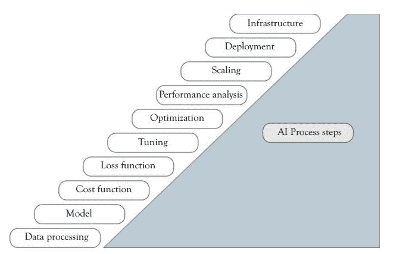

**图 2.10** AI 流程步骤

### 数据处理

数据处理步骤用于任何数据项目。请参阅本章的数据处理部分。

### 模型

模型步骤确定哪种模型适合 AI 和 ML 问题定义以及用例。适当使用选择方法对建模优先级和评估进行建模。

请参阅 ML 算法章节。

### 成本函数

成本函数有助于纠正和改变行为以最小化错误。成本函数衡量模型在估计预测值与实际值之间关系方面有多“错”。成本函数的目标是最小化预测值与实际值之间的差异。梯度下降优化算法常被使用。

### 损失函数

损失函数评估算法模型使用给定数据进行预测的效果，并分析模型如何改进。如果损失函数返回较高的数值，则模型无效。如果损失函数被最小化，则模型正在改进。

不同类型的损失函数包括均方误差、似然函数、对数损失和交叉熵损失。

### 调优

调优是提高准确性并通过调整超参数、应用适当的正则化、避免过拟合和欠拟合、自助法、交叉验证和装袋法来调整模型的关键步骤。请参见图 2.11。

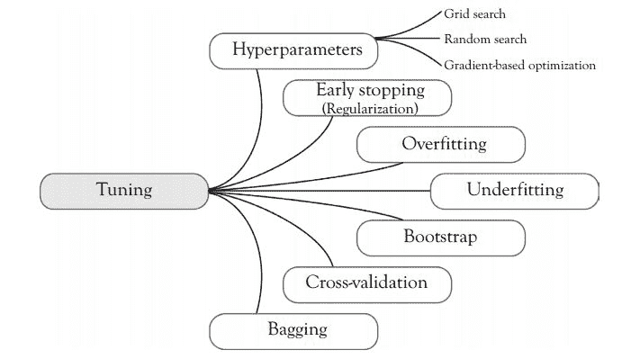

**图 2.11** ML 模型调优步骤

此步骤的一大挑战是如何快速应用调优以提高准确性并减少损失。

### 优化

优化是一个通过比较各种解决方案直到找到最优或满意解决方案而迭代执行的过程。在优化设计时，目标是最小化成本和损失，并最大化效率。

更新模型参数（如权重和偏置值）并确定 `Gradient descent`、`Stochastic gradient descent` 或 `Adam` 可以提供更快的结果。

优化算法有助于最小化或最大化目标函数（也称为误差函数）`E(x)`，它是一个依赖于模型内部可学习参数的数学函数，这些参数在从预测变量集（`X`）计算目标值（`Y`）时使用。优化还决定权重（`W`）和偏置（`b`）值的调整以及学习率的确定。一阶优化算法和二阶优化算法最常被使用。

梯度下降是最重要的技术，也是训练和优化智能系统的基础。批量梯度下降计算整个数据集的梯度并仅执行一次更新。对于大型数据集，此过程可能非常缓慢。速度由学习率——η 决定，并保证收敛到全局最小值而非局部最小值；而随机梯度下降对每个训练数据集执行一次更新。小批量梯度下降结合了两种技术的优点，对每个批次执行一次更新，每个批次包含 `n` 个训练示例。

## 性能分析

性能分析步骤评估模型的性能，并确定为提高准确性和减少误差或损失而必须采取的后续步骤。此步骤还确定需要调整的参数，以便在选定模型上实现最佳性能，并在模型扩展到大规模训练数据集并通过 AL 和 ML 流程启用持续学习之前进行优化。下一步是回顾如何扩大或缩小规模以处理大量训练数据，以及如何启用自动学习并使用新到达的数据集预测结果。

请参见图 2.12。

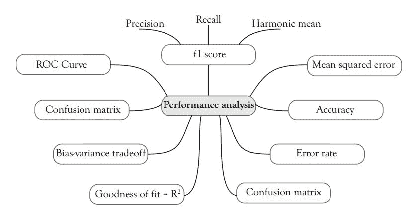

**图 2.12** 性能分析

请参见图 2.13。

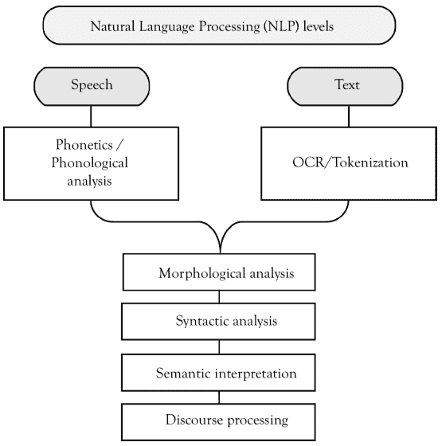

**图 2.13** 自然语言处理的典型 NLP 步骤

## ML 用例思维导图

请参见图 2.14。

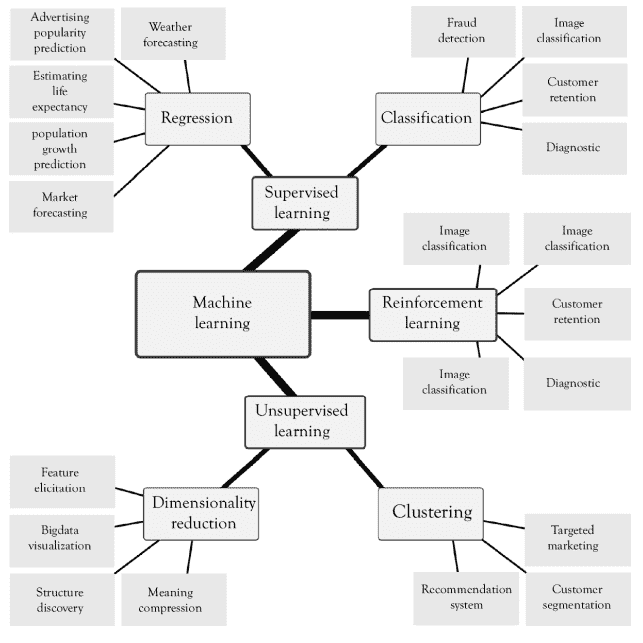

**图 2.14** 算法如何映射到用例的 ML 用例图

## 关键指标

*   净现值（`NPV`）
*   `ROI`
*   内部收益率（`IRR`）
*   投资回收期（`PBP`）
*   成本收益比（`BCR`）

## 初创企业和项目管理的关键指标

`NPV` 是以一笔金钱总和的形式表示的价值，而不是按复利投资后会变成的未来价值。例如，如果按年利率 10% 投资，12 个月后到期的 220 美元，其现值为今天的 200 美元。

`ROI` 衡量组织投资产生的收益或损失与投资金额的关系。`ROI` 通常以百分比表示，用于个人财务决策，以比较公司盈利能力与不同投资的收益。

`ROI` 公式为：

```
ROI = (净利润/投资成本) × 100
```

`ROI` 计算灵活且用途广泛。它可用于计算和比较潜在投资，投资者也可用它来计算股票回报。

`IRR` 是资本预算中用于估算潜在投资利润的指标。`IRR` 是使项目所有现金流的 `NPV` 等于零的贴现率。`IRR` 计算依赖与 `NPV` 相同的公式。

`NPV` 是一段时间内现金流入现值与现金流出现值之间的差额。`NPV` 用于资本预算和投资规划，以分析预期投资或项目的利润。

`PBP` 是收回投资所需的时间长度。给定投资或项目的回收期可以决定是否承担该头寸或项目。如果回收期较长，该项目可能不适合投资。回收期不考虑资金的时间价值。其他公式（如 `NPV`、`IRR` 和折现现金流）会考虑回收期。

资金的时间价值或现值折现意味着，由于当前货币具有潜在的盈利能力，其价值高于未来价值。这一金融核心原则认为，只要钱能产生利息，任何金额的钱越早收到就越有价值。

`BCR` 用作成本-收益分析中的指标，以确定拟议项目的相对成本与收益之间的关系。这以货币或定性术语表示。如果一个项目的 `BCR` 大于 1.0，则假定该项目将为投资带来正的净现值。

# 第 3 章：知识库

## 章节大纲

*   为人工智能（`AI`）项目定义知识库
*   风险与安全知识开发
*   风险与安全知识库的目标
*   风险与安全知识的识别
*   风险与安全知识的获取
*   知识共享

## 关键学习点

*   学习并理解知识库
*   理解风险与安全知识库开发

`AI` 可用于需求不同的应用程序中并反复使用。人力资源一直是组织的难题，组织一直试图获取并利用不同角色所需的人类智慧。获取的知识和智慧存储在知识库中。知识模型可在必要时构建、训练和使用。

获取人类智慧需要一个集成信息系统。其理念是开发一个集成系统，能够提供人类专家所需的知识。这些集成系统应随时可用且可共享。集成系统的使用应着眼于战略目标。这促成了 `AI` 的发展。

`AI` 基于存储在知识库中的信息解决重要挑战。人类专家在其专业领域内有周期性的需求。类似的方法被应用于风险管理，并通过用例进行探索。

知识库存储用于驱动 `AI` 集成系统的数据、技术和算法。集成系统将在该方法中逐步引入。`AI` 集成系统的目标是在企业环境中寻求风险与安全的缓解解决方案。目标将考虑使用由“如果……会怎样”问题组成的业务规则。这种方法将利用战略规则和逻辑，借助存储在知识库中的数据，确定风险与安全的可能缓解解决方案。`AI` 集成系统将影响知识目标设定、知识识别、知识获取、知识开发、知识共享、知识保存、知识修正、知识使用、知识评估和知识度量。`AI` 基于案例的知识集成、风险与安全案例的表示、相似性识别和关联是知识库的基石。`Bizstats.ai` 利用知识库从零开始构建 `AI` 集成系统。

## 风险与安全知识开发

本节旨在生成所需的风险与安全知识。这将包括思想、模型、技能、流程和系统方法。机器学习（`ML`）可以有多种形式。在讨论 `ML` 和神经网络时将使用基于模式的学习。这种方法从大量风险与安全数据中提供适当的知识，使 `AI` 系统中获取的数据行为发生改变。

## 风险与安全知识库的目标

将使用 `Bizstats.ai` 风险与安全知识库中的适当企业目标来开发技能和知识。

风险知识库的目标如下：

*   从数据、流程、人员、物联网（`IoT`）、系统和行动中捕获风险及相关风险。
*   确定发生概率。
*   确定风险影响。
*   确定风险优先级。
*   分配风险责任人。
*   确定风险缓解措施。
*   确定风险应对行动。
*   实时持续监控风险并确定纠正措施。

安全知识库的目标：

*   从数据、流程、人员、`IoT`、系统和行动中捕获威胁及相关安全风险。
*   确定威胁发生概率。
*   确定威胁影响。
*   确定安全威胁优先级。
*   分配安全责任人。
*   确定安全缓解措施。
*   确定安全应对行动。
*   实时持续监控安全威胁并确定纠正措施。
*   推荐安全培训和高效的安全流程。

## 风险与安全知识的识别

# 企业 AI 知识库：风险与安全

企业环境将用于建模使 AI 能够良好运行所需的技能和知识。这将需要对风险和安全知识进行映射。将尽一切努力以一种能够正确检索数据的形式存储数据。该 AI 系统将允许访问收集到的数据。最终，系统应构建一个能够通过新的风险和安全数据进行扩展的企业知识库。AI 系统将防止任何信息丢失，保留信息，并保持风险和安全数据的最新状态。系统将自动具备构建知识库的能力，并且可以访问外部的额外信息。

## 风险与安全的知识获取

风险和安全数据将通过正式和非正式渠道收集。这些数据将在内部和外部使用，并将赋予 AI 系统合适的能力。最终，这些数据将与统计算法和 ML 算法结合使用。

## 知识共享

风险与安全知识共享是知识管理周期中的关键环节。重要的是要认识到人员、技术和企业界都是这一阶段的一部分。AI 知识共享解决方案由机器智能组成，能够通过实时连接利用实时应用程序编程接口从其他 AI 系统中学习。事实证明，发现特定领域（如风险与安全缓解）的趋势是有效的。AI 已被高效应用的另一个领域是车辆制造业。人类无需经历重复使用数据的繁琐过程；计算机系统能高效地完成工作，而不会让人不堪重负。`Bizstats.ai` 拥有访问实时应用程序编程接口的权限，以解决知识共享问题。

# 第 4 章：根因分析与分析

确定已识别风险的根因，以及将要使用的分析与分析方法。

## 根因分析与分析详情

每个已识别的风险将分配给风险责任人。

风险责任人必须彻底研究风险以进行根因分析，从而获得关于风险及其成因的详细知识。

根因分析与分析需要完整的人工交互，以支持深入分析。

## 风险缓解策略建议

### 风险缓解策略

*   **假设并接受**
    *   确认特定风险的存在，并做出审慎决定接受该风险，而不采取特殊措施进行控制。需要项目或项目组负责人的批准。
*   **规避**
    *   调整项目需求或约束条件以消除或降低风险。这种调整可通过资金、进度计划或技术要求的变更来实现。
*   **控制**
    *   实施行动以最小化风险的影响或发生可能性。
*   **转移**
    *   将组织问责制、责任和权限重新分配给另一个愿意接受该风险的利益相关者。
*   **观察和监控**
    *   监控环境变化，以了解其对风险性质和影响的作用。

# 第 5 章：推荐引擎

推荐引擎展示了如图 5.1 所示的逻辑流程。推荐引擎为风险缓解和风险应急推荐策略。

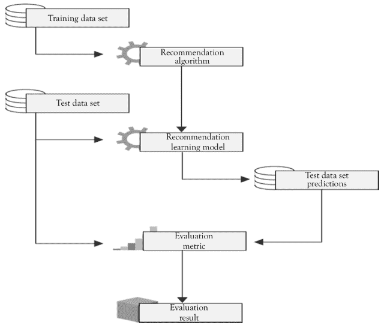

**图 5.1** 推荐引擎

## 数据收集

收集风险数据始于表 5.1、表 5.2、表 5.3 和 5.4 (Hahn 2018; Elswick 2016; Phillips and Stawarski 2008) 所示的数据收集过程。

### 表 5.1 风险数据集

| 度量风险名称 | 风险类别 | 风险影响评分 | 风险发生概率 | 风险优先级评分 |
| --- | --- | --- | --- | --- |
| 销售额下降 | 财务/竞争风险 | 0.9 | 0.5 | 2 |
| 库存周转率下降 | 库存风险 | 0.2 | 0.8 | 9 |
| 库存减少 | 库存风险 | | | |
| 销售额增加 | 库存风险 | | | |

### 表 5.2 风险缓解策略数据集

| 度量风险名称 | 风险缓解策略 | 采取缓解策略的次数 | 采取缓解策略的次数 / 度量风险发生的次数 |
| --- | --- | --- | --- |
| 销售额下降 | 鼓励客户增加在贵公司的支出 | 10 | 0.9 |
| 库存周转率下降 | 修订业务策略 | 20 | 0.3 |
| 库存减少 | 与供应商签订基于绩效的合同 | | |
| 销售额增加 | 改进预测模型 | | |

### 表 5.3 交互矩阵

| 风险缓解策略 | 缓解类型 |
| --- | --- |
| 开展新营销活动 | 规避 |
| 增加库存 | 规避 |
| 停止产品 | 控制 |
| 获取新客户 | 获取 |
| 保持现有客户满意 | 维持 |
| 鼓励客户增加在贵公司的支出 | 增长 |
| 挽回流失客户 | 夺回 |
| 修订业务策略 | 控制 |
| 与供应商签订基于绩效的合同 | 控制 |
| 改进预测模型 | 控制 |

### 表 5.4 风险-安全策略

| 风险/缓解策略 | 开展新营销活动 | 减少库存 | 修订业务策略 | 与供应商签订基于绩效的合同 | 改进预测模型 |
| --- | --- | --- | --- | --- | --- |
| 销售额下降 | 5 (采取此策略的次数) | 0 | 2 | 0 | 1 |
| 库存周转率下降 | 1 | 5 | 3 | 0 | 1 |
| 库存减少 | 0 | 0 | 0 | 4 | 0 |


| 销售额增加 | 0 | 0 | 0 | 0 | 5 |

## 设计算法

推荐引擎可以基于风险-风险相似性模型或缓解策略相似性模型进行设计。

### 确定推荐系统算法列表

推荐系统中的机器学习 (`ML`) 算法：

*   **基于内容的过滤方法**（项目属性的相似性）。

*   **基于协同的过滤方法**（从交互中计算相似性，风险-风险或缓解策略相似性模型）：

    *   `K`：最近邻。

    *   矩阵分解：随机梯度下降。

    *   矩阵分解：交替最小二乘法。

    *   关联规则：`Apriori` 算法（经常一起消费的项目在图中通过边相连）。

    *   神经网络。

*   **深度自编码器**——具有多个隐藏层和非线性，功能更强大但更难训练——可用于预处理项目属性，并结合基于内容和基于协同的方法。

*   **神经网络**基于项目和用户属性预测评分和交互。

*   **深度神经网络**基于历史动作和内容预测下一步动作。

*   **深度自编码器**：协同过滤。

*   **深度和宽度回归集成**以预测评分。

*   **基于序列的推荐器**可通过传统 `ML` 模型实现。

*   **门控循环单元** 或 **长短期记忆 (`LSTM`)** 循环神经网络。

*   **深度卷积神经网络**。

*   **前馈神经网络**将购买历史独热编码为输入，预测下一次购买产品的概率。

*   **两者结合**。

*   **最终确定**。

    *   使用基于协同的过滤方法训练模型。

### 训练模型

训练集（80%）和测试集（20%）。

测试集进一步划分为提交给系统的观察子集和用于评估系统的测试子集。

### 评估模型

*   评估方式类似于分类 `ML` 模型。

*   均方根误差。

请参阅图 5.2、图 5.3 和图 5.4。

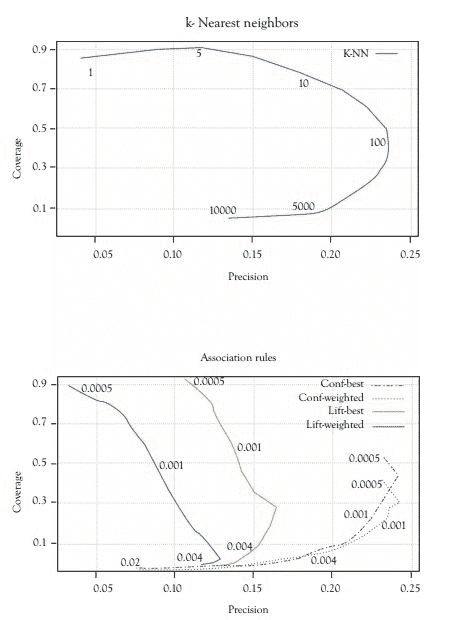

图 5.2 K 近邻与关联规则

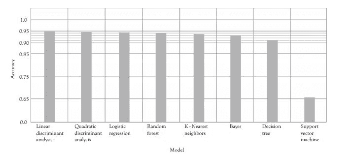

图 5.3 模型与准确率

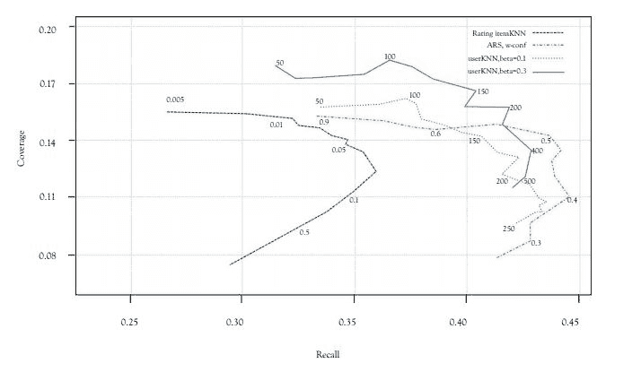

图 5.4 覆盖率与召回率：推荐引擎评估

向所有算法引入正则化参数，以惩罚热门商品的推荐。

*   召回率和覆盖率都应最大化；推荐系统将准确无误，并为用户提供多样化推荐以探索新内容。

*   冷启动没有足够的历史交互（针对商品或用户）。当协同过滤方法无法生成推荐时，可使用属性相似度（基于内容的相似度）。

*   考虑属性相似度时，冷启动问题会减少。将属性编码为二进制向量并输入推荐系统。

*   基于交互相似度和属性相似度聚类的商品通常是一致的。

### 推荐引擎评估指标

*   **(a) 召回率**，(b) 用户喜欢的商品中实际被推荐的比例，(c) 召回率越大，推荐效果越好。

*   **(a) 准确率**，(b) 在所有推荐商品中，用户实际喜欢多少？(c) 准确率越大，推荐效果越好。

*   **(a) 均方根误差**，(b) 它衡量预测评分中的误差，(c) 均方根误差值越小，推荐效果越好。

*   **(a) 排序指标**和 (b) 考虑推荐商品的顺序：

    *   **(a) 平均倒数排名**，(b) 评估推荐列表，(c) 平均倒数排名越大，推荐效果越好。

    *   **(a) 截断 k 处的平均精度均值**，(b) 平均精度均值越大，推荐越准确。

    *   **(a) 归一化折扣累积增益**，(b) 归一化折扣累积增益越高，推荐效果越好。

请参阅图 5.5 和图 5.6。

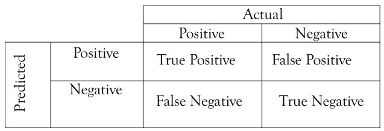

图 5.5 混淆矩阵

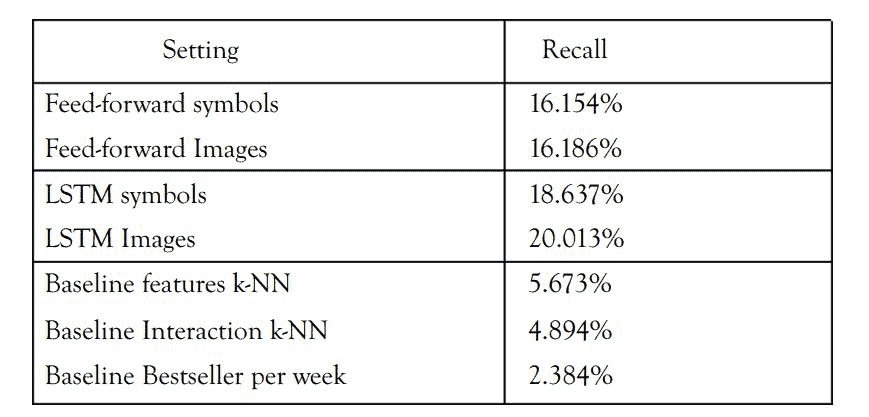

图 5.6 推荐引擎评估指标

*   单一算法尚可，但集成模型强大得多。

*   平衡探索与利用，因为过度探索可能导致部分用户的推荐质量下降，而探索不足可能导致所有用户的推荐效果次优。

### 模型结论

`LSTM` 在推荐引擎方面表现优于其他算法。

### 结论

市场上有许多可用的推荐引擎。

### 用于推荐的强化学习（`Q-Learning`）

强化学习已被证明能解决复杂问题。最近，强化学习在 `Google DeepMind` 的 `Atari` 游戏中取得了巨大成功（Sutton and Barto 1998）。

`Q-Learning` 的底层 `ML` 算法没有限制。模型可以是任何回归算法；然而，深度神经网络主导了 `Q-Learning` 和强化学习。

使用逻辑回归代替分类时，一个关键区别在于数据。在分类中，数据预先标注了正确的类别供模型预测。强化学习没有预标注数据。数据是生成的，这些数据具有应最大化的奖励信号。

### 威胁响应推荐

假设观察到一种风险并采取了一系列行动。将其输入行动者网络，由其决定下一步行动。它生成一个理想的响应嵌入。可将其与其他响应嵌入进行比较以寻找相似性。最佳匹配将被推荐用于该风险。

评论家有助于评判行动者并帮助其发现问题。

例如，推荐系统为某风险建议一个行动。该行动被采取并获得 1000 美元的即时奖励；然而，未来也可能撤销该行动，导致公司损失 2000 美元。必须考虑所有未来行动。请参阅图 5.7。

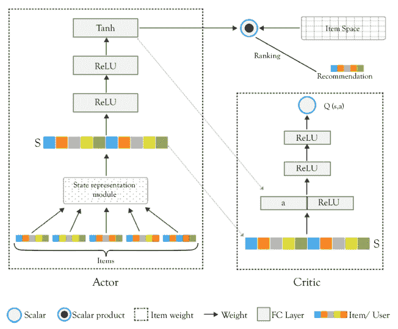

图 5.7 强化学习算法通用流程图

该网络包含两层：行动者和评论家。每一层类似于不同的学习类型。行动者学习策略（选择下一步行动的概率），评论家专注于奖励（`Q-Learning`）。

首先，一批响应嵌入被输入行动者的状态表示模块进行编码。接下来，以向量形式做出决策。将行动与项目嵌入结合并输入评论家模块，旨在估算奖励会有多好。

状态模块对复杂的动态风险-响应交互建模，以追求更好的推荐性能。

对于给定风险，网络基于其状态生成响应。由其最近 n 次响应的嵌入表示的风险状态被用作输入。

评论家网络（`Q-Learning`）用于估算当前状态和行动的奖励会有多好。

构建了四类特征：风险特征、作为环境状态特征的上下文特征、风险-响应特征，以及作为行动特征的响应特征。这四个特征被输入深度 `Q` 网络以计算 `Q` 值。根据 `Q` 值选择一系列响应进行推荐，用户对响应的行动包含在强化学习智能体接收到的奖励中。

奖励可从推荐引擎的系统日志中收集。

### 风险应急推荐

推荐引擎的训练步骤与威胁响应推荐引擎相同。请参阅表 5.5。

表 5.5 风险应急数据集

| 度量风险名称 | 风险应急计划 | 应急计划执行次数 | 应急计划执行次数/度量风险发生次数 |
| --- | --- | --- | --- |
| 销售额下降 | 设计新产品 | 10 | 0.9 |
| 库存周转率下降 | 降价促销 | 20 | 0.3 |
| 库存减少 | 为库存项目创建替代供应商清单 | 5 | 0.45 |
| 销售额增加 | 依赖积压库存项目 | 7 | 0.68 |

## 第 6 章：职能领域

### 目的

本章描述以下业务职能领域中主要业务职能领域的主要风险和安全：

*   销售与市场 (`S&M`) 职能领域
*   客户关系管理 (`CRM`) 职能领域
*   财务管理职能领域
*   人力资源职能领域
*   制造职能领域
*   运营管理职能领域
*   供应链管理 (`SCM`) 职能领域
*   研发 (`R&D`) 职能领域
*   人工智能 (`AI`) 和自动化职能领域

### 职能领域内的 `S&M`

#### 1. 该领域的主要风险：

`S&M` 是任何企业的重要业务职能领域。`S&M` 是创收职能领域。在风险冲击营收和销售之前，识别该领域的风险优先级更高。请参阅以下参考资料：

[`simplicable.com/new/marketing-risk`](https://simplicable.com/new/marketing-risk)

#### 2. 该领域的安全：

首席营销官面临的主要安全威胁

[`cisoinsights.com/top-3-cyber-security-risks-every-chief-marketing-officer-care/`](https://cisoinsights.com/top-3-cyber-security-risks-every-chief-marketing-officer-care/)

### `S&M` 职能领域

## 销售与市场职能领域

销售与市场部门参与推广和销售产品及服务的运营与活动。其战略是销售和分销产品或服务。销售与市场包括定价的调研与开发、调研、开发、分销、客户服务、销售和沟通。通常，销售部门有义务向市场部门提供潜在客户信息和重点方向建议。

市场部门制定决策，销售团队利用这些想法来销售产品和服务。例如软件产品。销售团队利用这些想法销售软件包。市场和销售两个岗位都贡献信息、想法和调研，以协助制定市场策略，并为各种产品和服务集思广益，从而形成特别促销、赞助活动和其他创意。

市场部与销售部之间的协调可能导致风险和安全问题。组织不惜一切代价都要避免这些问题，以增加销售和促销。

## 客户关系管理（`CRM`）职能领域

`CRM` 是一种用于联系人和销售管理的工具。`CRM` 能够增强销售并促进环境关系。`CRM` 有助于建立与客户及潜在客户的战略关系和互动。`CRM` 促进与客户的联系，简化流程，并最终提高组织的盈利能力。

### `CRM` 的重要功能

*   **联系人管理**：`CRM` 帮助组织更好地与客户建立联系。

*   **移动性**：`CRM` 可以访问客户数据及其他重要客户信息。

*   **分析**：`CRM` 帮助优化由组织定义的重要可执行事项。

*   **定制化**：`CRM` 系统可定制，以适应组织的独特情况。灵活的 `CRM` 允许同步操作系统，提供对所用数据类型的完全控制，并在需要时更新和重新评估流程。

*   **简易性**：`CRM` 简单易用。员工应乐于使用该系统，使其物有所值。`CRM` 易于理解、直观易用，且报告直截了当。

上述功能对于避免风险和安全问题至关重要。

### 其他 `CRM` 风险

1.  不恰当的 `CRM` 项目假设，可能导致利益相关者产生困惑。

2.  项目规划无效，遗漏了需求的重要部分，导致严重问题。

3.  由于数据转换问题和数据错误，导致数据转换延迟。

4.  在不恰当的业务流程中创建了错误的流程。从其他位置添加的错误数据造成混淆或数据集不匹配。

5.  未能应对系统中的挑战或风险。

6.  缺乏高管支持，给 `CRM` 项目环境带来问题。

7.  组织将 `CRM` 视为多余的应用程序。

8.  员工未妥善处理 `CRM` 需求。

9.  用户未恰当使用 `CRM` 系统。

10. 风险未得到妥善关注。

所有已识别的风险都必须得到妥善缓解，以保持环境安全。

## 财务管理职能领域

财务管理领域包含战略、市场、财务、人力资源、技术与设备以及运营。

### 企业财务的主要领域

*   **公司财务**：该领域涵盖组织关于融资所做的决策。

*   **投资**：公司可能决定投资资产。这些资产可能是短期证券，也可能是长期证券，如股票和债券。

*   **金融市场与机构**：金融市场可能包括股票和债券市场、一级市场和市场，以及市场间的货币和资本。金融市场可能包括股市。金融市场用于将储蓄者的资金转移给资金使用者。通常，储蓄者是家庭，而使用者往往是企业和政府。

这三个领域往往相互重叠，并涵盖财务的不同方面。

财务管理中存在风险，例如实体做出的投资决策可能使其面临财务风险。财务中的不同风险类型包括信用风险（即组织贷款后无法偿还）、流动性风险和权益风险（第三类财务风险）。

必须全面评估财务风险，以确定资产、贷款或投资的损失。需要确定回报率，并为特定投资的成功付出努力。

## 人力资源职能领域

人力资源为其他组织的职位管理宝贵资源。人力资源招聘人员招募新员工，维护福利和薪资，调解冲突，并参与新员工的培训与开发。

### 人力资源的其他职能

*   员工与劳动关系。

*   战略管理。

*   劳动力规划与雇佣，包括机会的招聘与甄选。

*   新员工培训与开发的人力资源开发。

*   确保员工得到妥善管理，以削减劳动力成本。

*   保护员工权益，确保员工在雇主要求和法规的范围内运作。

*   员工薪酬福利的总体回报。

*   为招聘组织和客户组织制定政策。

*   确保风险管理做得好。

人力资源有两类风险：生产力下降和人力资源减少。这些风险必须通过风险管理手段来缓解。典型的缓解措施包括：基于卓越领导力（即信任、激励、规划、授权，以及制定政策和程序以记录最佳实践）提高生产力（即将财务损失概率降至最低的战略规划）、培训（即系统的方法、耐心和诚实的评估）、沟通、评估技巧、激励（即激励员工）、评估和冲突解决。

## 制造职能领域

以下是制造职能领域中的一些风险：

*   新兴市场可能难以预测。

*   供应链因各种原因倾向于延迟或中断。

*   由与制造组织有业务往来的利益相关者引起的第三方供应商问题。

*   信息技术属于技术问题，可能因各种原因发生。

*   如果员工管理和继任规划做得不好，可能会成为问题。

*   如果制造环境中的员工不积极主动，风险会滋生并造成中断。

### 制造职能领域的其他风险

*   必须在以下项目上做好数据收集工作：库存、供应、交付、质量、生产、客户支持、加工和日常管理的信息。

*   意外的灾难性设备故障可能导致严重延误。

*   收集的数据可能不准确。

*   由于新员工熟悉工作环境和功能，可能导致入职缓慢和知识流失。

*   使用机器和新流程有时会让人不知所措。

所有风险和安全问题都可以得到妥善缓解。

## 运营管理职能领域

## 运营管理

运营管理确保原材料及时转化为成品。可以说，在项目管理方面，运营管理至关重要。在组织中，业务职能负责规划、组织、协调和控制生产组织服务和产品所需的资源。高优先级事项确保产品和服务的及时交付。

无论类型或性质如何，运营管理涉及对组织各部门的类似管理。核心思想是妥善配置劳动力、原材料、资金和其他资源等要素。组织将以最佳方式利用可用资源以实现最终目标并提高整体生产力。组织致力于提供符合客户要求的产品。这一策略有助于快速推广和销售最终产品，从而为组织带来巨额利润。运营管理管理用于生产商品的系统的设计、运营和维护等领域。

运营管理流程不容小觑，需要深入的知识。管理不善的环境会导致风险和安全问题，影响组织的增长和成功。

### 运营管理的风险

运营管理的风险包括基于人员、程序、系统和外部事件的损失。基于人员的风险包括人员培训不足和优秀员工离职。运营风险和损失源于预谋的有害活动，例如员工犯罪可能损害组织。

其他风险和安全问题包括：

*   计算机黑客攻击。

*   来自飓风等灾难性事件的风险。

*   内部和外部欺诈。

*   员工不遵守内部政策。

*   由致残性网络攻击、人为错误常规原因或老化硬件故障导致的 `IT` 中断。

*   数据泄露，如网络窃取、未授权访问、意外披露和员工疏忽。

*   因监管态度对监管的演变性质而导致的合规风险。

*   盗窃和欺诈是风险经理工作的常态。

*   外包仍是今年从业者面临的主要运营风险之一。

*   金融产品错误销售在过去十年里一直是运营风险经理持续关注的问题。

*   金融行业在来自科技等其他行业的竞争中，难以吸引、培训和留住最优秀的人才。

*   组织变革被指出为巨大的风险隐患。

*   由失控算法导致的未授权交易被视为一种风险。

*   模型风险反映了监管机构对银行建模和验证团队日益增加的监管负担，显示了银行业发生错误的潜在成本。

所有风险和安全问题都必须得到妥善管理和准确缓解。

## `SCM`（供应链管理）

`SCM` 包括规划、控制和执行产品流向所需的活动，从获取原材料和生产到分销，直至最终客户（Samson 2010）。`SCM` 控制产品质量、库存水平、时机和费用。其他例子包括耕作、精炼、设计、制造、包装和运输。

零售组织通常涉足 `SCM`，因为产品质量一直受到控制，直到最终客户。参见图 6.1。

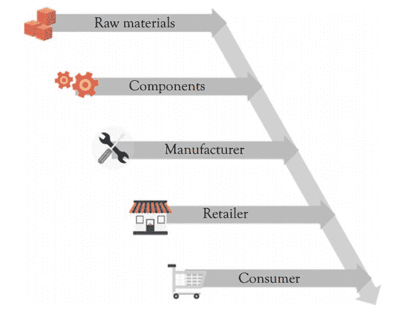

**图 6.1 `SCM`**

`SCM` 存在必须妥善管理的风险和需求。以下是一些基本的供应链风险类型：

*   财务风险。

*   扰乱供应链中商品和材料正常流动的任何不可预见事件。

*   范围和进度风险。

*   法律风险。

*   环境风险。

*   社会政治（结合社会和政治因素）风险。

*   项目组织风险。

*   人为行为风险。

供应链中的风险必须通过供应链风险管理（`SCRM`）来管理。`SCRM` 使用战略步骤来识别、评估和缓解嵌入在供应链流程中的风险。有必要管理供应和风险对象（供应商、地点和港口）的所有层级。参见图 6.2。

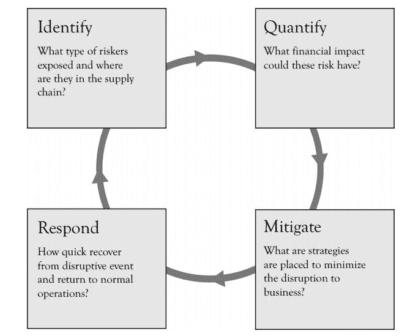

**图 6.2 供应链风险管理**

## `R&D`（研发）

`R&D` 是组织为创造新产品、服务或系统而寻求新知识的过程（Hill et al. 2019）。目标是为组织赚钱。制药和技术组织开展研发；然而，其他类型的组织也使用研发。通常，研发是基础性的或应用性的，旨在获取新知识。

以下是与研发相关的一些风险：

*   不保证组织能从研发中获利。

*   投资回报可能令人失望。

*   组织可能无法获得预期结果。

*   人身伤害风险。

研发应经过周密规划，并包含详细的风险管理计划。该计划应在时间、进度和资金方面包含应急预案。

## `AI` 和自动化职能领域

`AI` 的目标是使计算机模仿人类行为和智能。自动化是能够自动完成某些任务的硬件或软件。自动化可能基于 `AI`。

有人担心在未来，仅在美国，`AI`、`ML` 和自动化将取代 7% 的工作岗位。预测表明，`AI` 和自动化将消除大多数例行任务，使 `IT` 人员能够进行更具战略性的思考。

以下是 `AI` 和自动化的一些风险：

*   任何涉及重复性任务的职业都是自动化的候选者。

*   随着机器人处于前线，要证明在 `IT` 支持上花钱是合理的将变得越来越困难。

### 缓解或为变革做准备

*   不要抵制自动化；要拥抱它。

*   机器人可以回答常见问题并引导用户查看常见问题解答。

*   致力于开发未来将有高需求的技能。

*   学会弥合业务与技术术语之间的鸿沟；尝试看清现实。

*   对各类人群（主要是客户）保持价值。

*   利用领导力培训机会来帮助你的团队。

*   做团队的一员，通过协作、谈判和头脑风暴与团队共事以满足需求。

# 第 7 章：面向未来的人工智能

### 目的

*   本章展望未来 5 到 10 年人工智能（`AI`）、风险和安全的趋势。


# AI 和机器学习（ML）的好、坏和丑陋的一面

## 风险和安全如何与 AI 和 ML 相关联

## 章节大纲

*   AI 和 ML 的预测以及它们如何超越人类智能
*   AI 对就业机会的负面影响

## 关键学习点

*   学习并理解 AI 及其在智能方面的发展方向

## 可能的未来

5 年或 10 年后 AI 的未来是什么？

目前，技术预测者不认为人类智能有可能被超越（Yang and Yu 2019）。AI 的进步可能会导致通用推理系统的出现，且缺乏人类的认知局限。

一些人认为，AI 和 ML 算法最终将表现得像人类，并做人类今天所做的事情。目前，AI 和 ML 持续追踪消费者习惯，并准确地对人类消费者做出销售响应。技术可以改变人类与其周围环境互动的方式。

我们可以问自己一些问题，关于人类 10 年前无法做到的事情。同样的问题可以问关于人类能完成什么。简而言之，我们的生活将会有一些改进和成就。

## 增强安全

20 世纪 90 年代不存在无人机，手机也不像现在这样容易获得且极具吸引力（Nassi 等人，2019 年）。

无人机可以被视为类似于手机。无人机拥有诸多能力，例如能在短时间内通过空中将物品运送至偏远地区。可运输的物品包括包裹递送和应急响应产品，以满足紧急和即时的需求。无人机能够飞行并检查不易到达的隐蔽场所。无人机可集成 AI 功能，使其具备智能。

## 产生新的社会问题

AI 是我们解决问题和提供新思维以造福人类能力的延伸。AI 有可能带来伟大的成果，包括以空前的速度推进发展。机器人与 AI 在业务运营中的融合，预示着基于 AI 的产品和服务将引领消费和工业市场。消费和市场领域将因创新者和商业利益的不同而有所差异。AI 将面临挑战，例如网络安全问题。组织必须应对 AI 的负面影响，如隐私、安全和算法偏见方面的挑战。军队、空军和海军将致力于保护国家免受负面 AI 创新的侵害。

## 投身商业与健康领域

与消费者应用相关的 AI 和 ML 驱动算法可能会增加可信度。这种信心和信任将随着 AI 的持续存在而增强。这都是好事！

当然，医生仍将存在以照顾患者；然而，医生的繁杂工作可以由 AI 完成。医生的知识和经验可以被捕获，并由 AI 系统不知疲倦地加以利用。医生将退休，而 AI 系统将给予医生所需的休息以实现退休。AI 系统能够维护患者护理所需的最新创新、研究和经验。AI 可以访问并使用更大规模的患者数据集、治疗技术和药物进展。当机器为医生完成繁杂工作时，诊断结果将得到改善。

## 促进可持续发展

AI 正在快速增长，并将影响每一个行业。更多的人在谈论 AI；AI 不再是一个新的流行语。AI 可以通过追踪城市居民的流动来提高城市的密度。

## 物理世界与数字世界的融合

人们表达了希望计算机能更智能地与人类互动的需求。一个典型的例子是计算机指出发生的错误并自动做出反应以解决问题。另一种选择是通过与计算机对话来修复发生的问题。简而言之，计算机需要变得更聪明，而 AI 可以实现这一点。

## AI 将使人类更聪明

AI 和 ML 使用公式的趋势将持续下去，未来可能会涌现更多算法（Metcalf 等人，2019；Ford，2019）。数据量呈指数级增长将不足为奇。通过训练更智能的模型和知识模型，AI 和 ML 将对未来行为和后续事件做出智能预测。金融环境中的人们可能会因 AI 和 ML 做出的决策而感到恐慌。重要的是模型经过适当训练，以继续作为对人类有用的工具而发展。

## 艺术家从 AI 中获得了什么？

艺术家希望在 AI 中拥有利益相关地位，以使艺术家的工作更轻松、更有趣（Miller，2019）。艺术家将使用呈指数级涌现的众多算法。希望艺术家能利用 AI 系统创作出赏心悦目、妙趣横生的美丽图像。艺术家可能担心他们的工作会被接管，从而使他们变得过时。这是一个可怕的念头；然而，艺术家可以利用 AI 系统在各个方面变得更有创造力。AI 可以增强创作过程。在部署 AI 系统时，考量文明感、创造力和公平性至关重要。最终，使用艺术的行业可以利用 AI 提高生产力，同时尊重人类尊严和文化需求。

## 类人 AI

在未来 5 到 10 年内，人们认为 AI 将开始展现类人智能，包括人类的认知能力（Joo 等人，2019）。计算机已经擅长重复性任务，但这不等同于拥有认知能力。通用人工智能（AGI）似乎正缓慢浮现。AI 目前已用于 Uber 和电子邮件等技术中。Gmail 倾向于提供一些初步的电子邮件回复供用户在此基础上继续编写。

AI 已被用于医院识别人类医生遗漏的患者疾病。这对患者是个鼓舞；然而，这一案例被归类为弱人工智能，并被称为 AGI。AGI 简单来说就是能够执行正常人类任务的机器。当前 AI 的目标是开发一种机器，它必须证明自己具有智能，且能与人类区分开来。

## AI 预测调查

2019 年人类水平人工智能联合多会议的参与者就未来 10 年 AI 进展的预测进行了一项调查（Strickland，2019）。调查结果显示，28%的受访者认为 AGI 将在 20 年内出现。在 100%的受访者中，2%不认为人类将见证 AGI 的诞生。

调查要求受访者指出 AI 影响最大的领域。结果显示如下：

1. 医疗保健（46%）。
2. 物流（47%）。
3. 客户服务（38%）。
4. 银行与金融（34%）。
5. 农业、零售、软件开发和制造业（28%）。

调查表明 AI 正呈指数级进步。

2016 年进行的一项早期 AI 调查显示了不那么振奋人心的结果。调查问道：“还需要多少年 AI 才能达到高级机器智能？”高级机器智能被定义为无需辅助的机器能比人类工人更好、更廉价地完成任务。最终分析显示了达到 AI 里程碑的 5%区间。具体结果表明，AI 机器最终将与人类智能具有竞争力。

# AI 的风险与安全影响

AI 涉及两个极其重要的领域：就业和安全。AI 的增长归因于网络安全、司法（刑事和民事）以及劳动力市场模式。此外，职业易受自动化影响。

## AI 在风险与安全方面将如何发展？

任何任务或项目都存在风险和安全问题。随着 AI 在未来被更多使用，这些问题将增加。AI 做决策的想法让一些人感到担忧；然而，通过培训和教育，人类将接受 AI 在不同领域做决策的现实。

以下是未来可能出现的一些预测性和虚构性想法。

### 金融行业领域

我们可以进一步引入比特币等新技术。比特币能成为实际货币吗？这个问题引发了为保障所有人安全顾虑而进行的密集基础设施规划。与此相关的安全性和风险有助于防范黑客。

一切都可能变成数字货币。拥有良好通信网络、并通过物联网（IoT）或连接设备访问云服务器环境的公司将管理金融业务。IoT 数据目前在商业世界中被大量收集。这为数据分析以及大数据工程师和团队有目的地处理收集到的数据创造了机会。

### 零售行业领域

零售店可能不再需要人类；任何人都可以从任何商店拿取产品并直接通过比特币扣款。

## 自动结账与未来生活

自动结账将被采用，并向客户提供推荐。所有连接设备上均可即时获取商品。一个人的家用冰箱将维持最低存量，并根据最优数量即时配送到家。

人类需要找到赚钱的方式，比特币应可用于支付。人类可能拥有多种专用设备来满足客户需求，例如净水器、制作个性化食物的机器人，或提供健康建议的机器人医生。

## 政府部门

有人可能会好奇税收征管将会怎样。政府可能会采用自动动态税收，而非固定所得税。这种方法需要政治授权才能通过国会。

## 交通运输行业部门

无人驾驶汽车、无人驾驶卡车以及用于运送货物和向客户配送的无人机，由无人机的用户或所有者决定控制。

根据前述预测，将出现许多风险和安全问题。周密计划的安全与风险管理将使这一预测成为现实，人类将能享受随之而来的特权。

风险和安全专家应随时待命，制定出在各自环境中可测试的充分策略。

# 第 8 章：结论

人工智能（AI）如今已成为一个无处不在的流行语。你在电视、广播和互联网上都能听到关于 AI 的消息。风险与安全一直萦绕在每个人心头，安全问题在企业界和家庭中均给组织和个人造成了伤害。让我们回顾一下将惠及各行各业的重要提醒。

风险与安全问题并非令人愉快的经历。组织不会轻视这些困境，并经常讨论其造成的负面影响。不要对风险与安全视而不见；它们带来的负面影响并不好受。自然风险与安全问题可能无法避免，但可以采取缓解措施来挽救生命。请密切关注并遵循现有的步骤。

应尽早识别风险与安全问题，以最大限度地减少损害或致命情况的影响。风险通常需要风险管理来安全地处理局势。必须妥善收集数据；这将有助于后续工作。这可能需要核对清单，以确保得到适当问题的回答，并采取适当的步骤。这还可能包括收集风险与安全问题的历史数据。下一步是仔细且准确地分析准确数据。采集的数据可能有助于预测未来风险与安全问题的发生。这种方法可能有助于挽回那些对个人或组织造成损害且代价高昂的棘手局面。

重要的是要记住，个人或组织必须应对混合类型的安全问题。仔细分析将提供准确的方向。AI 已被选定用于提供该方向。数据的来源和质量在各方面都至关重要。本书内容提供了组织可产生共鸣的各种用例。这些用例将帮助组织妥善制定应对路线。这将引导组织对风险与安全进行定义、分析、监控、控制和缓解。

数据科学、数据分析和机器学习（ML）算法被用于分析数据并确定纠正措施。AI 可用于执行所有必要的确定。机器可以从作为数据输入的以往人类经验中学习，并基于数学算法的发展，从新的输入数据集中实现持续学习。完整的 AI 系统开发利用数据收集来展示风险与安全数据如何在建议中被处理。数据收集与开发让读者了解如何应对组织中的 AI、风险与安全等用例。AI 为渴望理解和提升风险管理技能的企业和组织带来了有效且显著的成果。

由于数据量大、速度不同以及来自各种来源的数据多样性（这由案例研究图解并支持），风险与安全已变得无处不在且至关重要。风险与安全担忧似乎正以越来越大的规模和频率出现，并带来各种程度的负面影响。不确定的正向风险在商业机会方面可能损害组织，导致收入损失。风险的范围和广度在世界各地和各类项目中制造混乱。若缺乏适当的管理和正确的工具，风险与安全将造成毁灭性后果。

大量精力集中在结合适当用例的问题陈述，以及利用数据科学和 ML 方法提出的 AI 解决方案上。对 AI、风险与安全的全面描述为许多组织正在苦苦挣扎的关键问题提供了具体答案：这些问题如下：这些风险在哪里？可以采取什么措施来降低影响？AI 是安全缓解措施的一部分吗？利用 AI，组织和个人将获得知识和共享经验。

本书将指导有意创建自己的 AI 系统用于风险与安全的组织。此外，`Bizstats.ai` 拥有众多定制化的 AI 设计工具。欢迎个人和组织联系 `Bizstats.ai`，接受关于 AI、风险与安全实施中所用工具的培训。

## 参考文献

Alvarez-Ayllon, A., M. Palomo-Duarte, and D. Juan-Manuel. 2018. “Interactive Data Exploration of Distributed Raw Files: A Systematic Mapping Study.” *IEEE Access* 7, 10691–10717. doi: [`doi.org/10.1109/ACCESS.2018.2882244`](https://doi.org/10.1109/ACCESS.2018.2882244)

Andriosopoulos, D., M. Doumpos, P.M. Pardalos, and C. Zopounidis. 2019. “Computational Approaches and Data Analytics in Financial Services: A Literature Review.” *Journal of the Operational Research Society* 70, no. 10, 1581. doi: [`doi.org/10.1080/01605682.2019.1595193`](https://doi.org/10.1080/01605682.2019.1595193)

Aydos, M., Y. Vural, and A. Tekerek. 2019. “Assessing Risks and Threats with Layered Approach to Internet of Things Security.” *Measurement & Control* 52, nos. 5/6, 338. doi: [`doi.org/10.1177/0020294019837991`](https://doi.org/10.1177%2F0020294019837991)

Elswick, S.E., eds. 2016. *Data Collection: Methods, Ethical Issues and Future Directions*. Nova Science.

Ford, M. 2019. “The Truth Behind AI: Accelerating Tech—Insights from the Smarter Factory.” *SMT: Surface Mount Technology* 34, no. 2, 60–66. [`iconnect007.uberflip.com/i/1078362-smt007-feb2019/59?m4=`](http://iconnect007.uberflip.com/i/1078362-smt007-feb2019/59?m4=)

Gheuens, J., N. Nagabhatla, and E.D.P. Perera. 2019. “Disaster-Risk, Water Security Challenges and Strategies in Small Island Developing States (SIDS).” *Water* 11, no. 4, 637. doi: [`doi.org/10.3390/w11040637`](https://doi.org/10.3390/w11040637)

Gupta, G., and R. Katarya. June 14–15, 2018. “A Study of Recommender Systems Using Markov Decision Process.” Paper presented at Second International Conference on Intelligent Computing and Control Systems (ICICCS). doi: https://doi.org 10.1109/ICCONS.2018.8663161

Haas, S., R. Conway-Phillips, B.A. Swan, L. De La Pena, R. Start, and D.S. Brown. 2019. “Developing a Business Case for the Care Coordination and Transition Management Model: Need, Methods, and Measures.” *Nursing Economics* 37, no. 3, pp. 118–125.

## 参考文献

Hill, M.S., G.W. Ruch, and G.K. Taylor. 2019. “Research and Development Expense and Analyst Forecast Errors: An Underestimation of Sales or Overestimation of Expenses?” *Journal of Accounting, Auditing & Finance* 34, no. 4, 667. doi: [`doi.org/10.1177/0148558X18799003`](https://doi.org/10.1177/0148558X18799003)

Huang, G., Z. Zhang, and W. Yang. 2019. “Outlier Detection Method based on Improved Two-step Clustering Algorithm and Synthetic Hypothesis Testing.” Paper presented at the IEEE 8th Joint International Information Technology and Artificial Intelligence Conference (ITAIC). doi: [`doi.org/10.1109/ITAIC.2019.8785425`](https://doi.org/10.1109/ITAIC.2019.8785425)

Jain, A., N.S. Bhandari, and N. Jain. February 21–23, 2018. “Essential Elements of Writing a Research/Review Paper for Conference/Journals.” Paper presented at the 5th International Symposium on Emerging Trends and Technologies in Libraries and Information Services (ETTLIS). doi: [10.1109/ETTLIS.2018.8485210](https://doi.org/10.1109/ETTLIS.2018.8485210)

Joo, S.H., S. Manzoor, Y.G. Rocha, H.U. Lee, and T.Y. Kuc. 2019. “A Realtime Autonomous Robot Navigation Framework for Human Like High-Level Interaction and Task Planning in Global Dynamic Environment.” Retrieved from the Cornell University website. [`arxiv.org/abs/1905.12942`](https://arxiv.org/abs/1905.12942)


# 参考文献

Kotenko, I., I. Saenko, A. Kushnerevich, and A. Branitskiy. 2019. “Attack Detection in IoT Critical Infrastructures: A Machine Learning and Big Data Processing Approach.” Paper presented at the 27th Euromicro International Conference on Parallel, Distributed and Network-Based Processing (PDP). doi: [`doi.org/10.1109/EMPDP.2019.8671571`](https://doi.org/10.1109/EMPDP.2019.8671571)

Liu, Y., J. Dong, D. Zuo, and H. Liu. 2019. “Experimental Analysis and Comparison of Load Prediction Algorithms in Cloud Data Center.” Presented at the IEEE 19th International Conference on Software Quality, Reliability and Security (QRS). doi: [`doi.org/10.1109/QRS.2019.00036`](https://doi.org/10.1109/QRS.2019.00036)

Mcgraw, G., R. Bonett, H. Figueroa, and V. Shepardson. 2019. “Security Engineering for Machine Learning.” *Computer* 52, no. 8, 54. doi: [`doi.org/10.1109/MC.2019.2909955`](https://doi.org/10.1109/MC.2019.2909955)

Metcalf, L., D.A. Askay, and L.B. Rosenberg. 2019. “Keeping Humans in the Loop: Pooling Knowledge Through Artificial Swarm Intelligence to Improve Business Decision Making.” *California Management Review* 61, no. 4, pp. 84–109. doi: [`doi.org/10.1177/0008125619862256`](https://doi.org/10.1177/0008125619862256)

Miller, A. 2019. *The Artist in the Machine: The World of AI-Powered Creativity*. MIT Press.

Morosan, C., and A. DeFranco. 2019. “Classification and Characterization of U.S. Consumers Based on their Perceptions of Risk of Tablet Use in International Hotels: A Latent Profile Analysis.” *Journal of Hospitality & Tourism Technology* 10, no. 11, 264. doi: [`doi.org/10.1108/jhtt-07-2018-0049`](https://doi.org/10.1108/jhtt-07-2018-0049)

Nassi, B., A. Shabtai, R. Masuoka, and Y. Elovici. 2019. “SoK—Security and Privacy in the Age of Drones: Threats, Challenges, Solution Mechanisms, and Scientific Gaps.” Retrieved from Cornell University website. [`arxiv.org/pdf/1903.05155.pdf`](https://arxiv.org/pdf/1903.05155.pdf)

Ohanian, T. 2019. “How Artificial Intelligence and Machine Learning May Eventually Change Content Creation Methodologies.” *SMPTE Motion Imaging Journal* 128, no. 1, 33–40. doi: [`doi.org/10.5594/JMI.2018.2876781`](https://doi.org/10.5594/JMI.2018.2876781)

Overgoor, G., M. Chica, W. Rand, and A. Weishampel. 2019. “Letting the Computers Take Over: Using AI to Solve Marketing Problems.” *California Management Review* 61, no. 4, 156–185. doi: [`doi.org/10.1177/0008125619859318`](https://doi.org/10.1177/0008125619859318)

Palli, R., M.G. Palshikar, and J. Thakar. 2019. “Executable Pathway Analysis Using Ensemble Discrete-State Modeling for Large-Scale Data.” *PLoS Computational Biology* 15, no. 9, 1–21. doi: [`doi.org/10.1371/journal.pcbi.1007317`](https://doi.org/10.1371/journal.pcbi.1007317)

Peters, K. 2018. “Disasters, Climate Change, and Securitisation: The United Nations Security Council and the United Kingdom’s Security Policy.” *Disasters* 42, no. S2, S196–S214. doi: [`doi.org/10.1111/disa.12307`](https://doi.org/10.1111/disa.12307)

Phillips, P.P., and C.A. Stawarski. 2008. *Data Collection: Planning for and Collecting All Types of Data*. Pfeiffer.

Rona-Tas, A., A. Cornuéjols, S. Blanchemanche, A. Duroy, and C. Martin. 2019. “Enlisting Supervised Machine Learning in Mapping Scientific Uncertainty Expressed in Food Risk Analysis.” *Sociological Methods & Research* 48, no. 3, 608–641. doi: [`doi.org/10.1177/0049124117729701`](https://doi.org/10.1177/0049124117729701)

Sahoo, P. and J.R. Mohanty. 2018. “Test Effort Estimation in Early Stages Using Use Case and Class Models for Web Applications.” *International Journal of Knowledge Based Intelligent Engineering Systems* 22, no. 3, 215–229. doi: [`doi.org/10.3233/KES-180386`](https://doi.org/10.3233/KES-180386)

Samson, R.M. 2010. *Supply-Chain Management: Theories, Activities/Functions, and Problems*. Nova Science.

Shrestha, Y.R., S.M. Ben-Menahem, and G. von Krogh. 2019. “Organizational Decision-Making Structures in the Age of Artificial Intelligence.” *California Management Review* 61, no. 4, 66–83. doi: [`doi.org/10.1177/0008125619862257`](https://doi.org/10.1177/0008125619862257)

Strickland, E. 2019. “How Smart is Artificial Intelligence? Are Today’s Best Artificial-Intelligence Systems as Smart as a Mouse? A Crow? A Chimp? A New Contest Aims to Find Out.” *IEEE Spectrum* 56, no. 4. doi: [`doi.org/10.1109/MSPEC.2019.8678419`](https://doi.org/10.1109/MSPEC.2019.8678419)

Sutton, R.S., and A.G. Barto. 1998. *Reinforcement Learning: An Introduction*. Bradford Book.

Vaez-Alaei, M., A. Baboli, and R. Tavakkoli-Moghaddam. 2018. “A New Approach to Integrate Resilience Engineering and Business Process Reengineering Design.” Paper presented at the IEEE International Conference on Industrial Engineering and Engineering Management (IEEM). doi: [`doi.org/10.1109/IEEM.2018.8607662`](https://doi.org/10.1109/IEEM.2018.8607662)

Wang, J., S. Hazarika, C. Li, and H. Shen. 2019. “Visualization and Visual Analysis of Ensemble Data: A Survey.” Paper presented at IEEE Transactions on Visualization and Computer Graphics, Visualization and Computer Graphics. doi: [`doi.org/10.1109/TVCG.2018.2853721`](https://doi.org/10.1109/TVCG.2018.2853721)

Yang, X., and X. Yu. March 2–4, 2019. “Identifying Patent Risks in Technological Competition: A Patent Analysis of Artificial Intelligence Industry.” Paper presented at the 8th International Conference on Industrial Technology and Management (ICITM). doi: [`doi.org/10.1109/ICITM.2019.8710719`](https://doi.org/10.1109/ICITM.2019.8710719)

# 作者简介


Archie Addo 是一位顾问、教练、作家，以及项目和项目集经理。Archie 拥有计算机信息系统博士学位，专攻电子商务、密码学、专家系统和人工智能。Addo 博士拥有约翰霍普金斯大学的执行数据科学认证和哈佛法学院的合同法证书。他是一名认证项目管理专业人士 (PMP)、认证 Scrum 大师和认证 Scrum 产品负责人。凭借在相互关联学科中超过 20 年的经验，Archie 从事计算机科学、项目管理、采购、组织设计与开发、流程工程、质量管理和项目团队促进等工作。他曾担任软件开发经理、经理、顾问和高级项目经理等管理职位。

Archie 是全球大会和印度大会项目管理协会 (PMI) 的主题专家评审员，也是 PMI 风险标准管理的贡献者。


## Srini Centhala

Srini Centhala 是 Absolut-e Data Com（一家数据公司）的创始人兼首席架构师，该公司为 AT&T、Directv、Experian、eBay 和 UPS 等财富 100 强企业提供了 20 多年的专家咨询服务。Srini 还是 BizStats Cloud 大数据 AI 分析平台的首席架构师。Srini 设计并开发了定价引擎、统计建模、预测建模、推荐引擎、文本挖掘、情感分析、数据源分析和数据科学活动。

**专长：** 业务流程重组、在线商业创意与概念、商业智能、业务数据管理系统中的技术架构师/数据架构师/数据建模师、项目管理，以及端到端的全项目承接。Srini 将机器学习和人工智能应用于业务数据。


## Muthu Shanmugam

Muthu Shanmugam 是 Absolut-e Data Com 的首席技术官，拥有软件开发生命周期所有阶段 20 多年的经验。Muthu 拥有印度安娜大学的工程硕士学位。他曾作为软件开发团队的动态领导者与各类企业组织合作。目前，Muthu 致力于 Bizstats.ai，这是一个由知识库驱动的商业智能和分析云，专为商业智能资源有限的企业设计。主要功能包括：包含各行业众多指标和属性的知识库、自然语言处理驱动的搜索、动态报表和仪表板。该公司还具备协作功能，允许用户与团队共享报表和仪表板。

# 索引

收购，知识，64

参与者，9

参与者网络，76

AdaBoost，38

Alpine Miner，18

方差分析，26

分析，65，80

解剖检测，35

通用人工智能（AGI），94

人工智能，3–5

艺术家与，94

与自动化，88–89

数据处理，21

未来，91–97

目标，14

集成系统，62

预测，94–95

流程步骤，54–56

项目架构与设计流程，8–9

风险与安全，95–97，99，100

艺术家，94

关联规则，30–31，71

自动结账，96

自动化，88–89

平均单依赖估计器，46

反向传播，39–40

Bagging（装袋法），37，38

贝叶斯算法，42–50

贝叶斯信念网络，46

贝叶斯网络，47

效益成本比（BCR），60

伯努利朴素贝叶斯，43，45

比特币，96

二元分析，24

Bizstats.ai，62，64，100

Blending（融合），39

Boosting（提升法），38

Bootstrapped aggregation（自助聚合），38

Breiman, L.，48

业务

架构，10–11

案例，12–13

与健康，93

流程，11–12

用户，15

C4.5，49

C5.0，49

卡方自动交互检测，49–50

卡方检验，24–25

分类，28–29

分类树，48

聚类分析算法，35

聚类，29–30

Cohen, W. W.，42

冷启动，72

协同过滤算法，30

委员会，42

结果沟通，20

计算，38

计算机，93

条件决策树，50

置信区间，34

混淆矩阵，73

联系人管理，80

卷积神经网络，37

公司财务，81

相关性图，24

成本函数，55

Critic network（评论家网络），76

CRM 功能领域，80–81

定制化，80

数据分析生命周期，14–21

数据架构师，15

数据收集，67–69

数据调理，17–18

数据工程师，15

数据探索，23–26

数据建模阶段，19

数据准备阶段，16–18

数据处理，21–23，54

数据科学，14，17，100

数据科学家，15

Data Wrangler，18

决策树桩，50

决策树分析，47–48

深度置信网络，36

深度玻尔兹曼机（DBM），36

深度学习，35–37

设计算法，69–70

降维，50–54

发现阶段，16

判别分析，53

无人机，92

效率，13

Efron, B.，41

弹性网络，41

集成学习，37–39

评估指标，73–74

特征清洗，26–27

金融行业领域，96

金融与银行业，13–14

财务管理功能领域，81–82

金融市场与机构，82

五个 W（谁、什么、何时、何地、为什么），9

Friedman, J. H.，33

功能领域

AI 与自动化，88–89

CRM，80–81

财务管理，81–82

人力资源，82–83

制造，83–84

运营管理，84–85

研发，87–88

供应链管理，86–87


# 索引

销售与市场，80

高斯朴素贝叶斯，43–44，46–47

Gmail，28

目标，14

Google Cloud，18

Google News，29

政府部门，96

梯度提升，38，39

梯度下降，56

Hadoop，18

Hastie, T.，41

Hopfield, J.，40

Hopfield 网络，40

人力资源功能领域，82–83

知识识别，63

不一致数据，26

集成系统，62

交互矩阵，68

内部收益率（IRR），58–59

物联网，96

区间数据，22

投资，82

迭代二分法 3（ID3），49

Johnstone, I.，41

Kass, G. V.，49–50

K-means 聚类算法，29–30

K-近邻，71

知识库，风险与安全，62–64

知识共享，64

最小绝对收缩和选择算子（LASSO），40–41

最小角回归，41

线性回归，31–32

逻辑回归，32

损失函数，55

机器学习（ML）

- 数据处理，21–23
- 目标，14
- 流程步骤，54–56
- 项目架构与设计流程，8–9

机器学习（ML）算法，28，69–70

解剖检测，35

关联规则，30–31

贝叶斯，42–50

分类，28–29

聚类，29–30

深度学习，35–37

降维，50–54

集成学习，37–39

神经网络，39–40

预测，34

随机森林，30

回归，31–33

正则化，40–41

规则系统，41–42

文本分析，34

时间序列分析，33–34

制造功能领域，83–84

市场部，80

缺失值，26

缓解，62，65–66，68，83，88

混合判别分析，53

移动性，80

模型构建阶段，19–20

模型步骤，54

多重共线性，40

多维缩放，52

多项式朴素贝叶斯，47

多元自适应回归样条，33

朴素贝叶斯模型，43，45–47

- 伯努利，43
- 分类器，43，45–46
- 高斯，43–44，46–47
- 多项式，47

净现值（NPV），57–59

神经网络，35–37，39–40

名义数据，22

明显的不一致，26

单规则，42

OpenRefine，18

运营阶段，20

运营管理功能领域，84–85

优化算法，56

有序数据，22

普通最小二乘回归（OLSR），32

异常值，26–27

过拟合，41，48

偏最小二乘（PLS）回归，51

回本期（PBP），59

PCA，51

感知机，39

性能分析，56–57

PLS 判别分析（PLS-DA），53

预测，34

预测区间，34

主成分回归，52

问题陈述，9–10，12–13

投影追踪，52

项目管理，57–60

项目经理/敏捷/Scrum 主管，15

项目发起人，15

Q-learning，74–76

二次判别分析（QDA），53

Quinlan, R.，49

径向基函数网络，39

随机森林，30，37–38

比率数据，22–23

研发，87–88

推荐引擎，67

- 数据收集，67–69
- 设计算法，69–70
- 评估，70–72
- 评估指标，73–74
- 强化学习，74–75
- 威胁响应，75–77

回归，31

回归树，48

正则化，40–41

正则化判别分析，53–54

强化学习，74–75

零售业，14

零售行业领域，96

投资回报率（ROI），13

岭回归，40

风险

- 应急数据集，76
- 数据集，68
- 知识库，62–63
- 缓解策略，65–66，68
- 用于风险的 ML 和 AI，10，12
- 风险安全策略，69

ROI，58

根因分析，65

规则系统，41–42

销售部，80

Sammon, J. W.，52

Sammon 映射，52

散点图，24，32

供应链管理，86–87

安全，13

增加，92

知识库，63

用于安全的 ML 和 AI，10

简洁性，81

销售与市场功能领域，80

社会问题，92

## 索引

特殊值，26

堆叠自编码器，37

堆叠泛化，39

逐步回归，33

随机梯度下降，56

随机霍普菲尔德网络，36

战略对齐，13

供应链风险管理 (SCRM)，87

勘测/测量，18

可持续性，93

SVD，50–51

测试集，70

文本分析，34

威胁响应建议，75–77

Tibshirani, R.，41

时间序列分析，33–34

运输行业板块，97

基于树的 Cubist 模型，42

T 检验，25

调优，55–56

单变量分析，23

用例，13–14

值，13

变量识别，23

数据可视化，18

零规则，42

Z 检验，25

## “商业法与企业风险管理”丛书其他书目

John Wood，Econautics 可持续发展研究所，编辑

- 《预防诉讼》 作者：Nelson E. Brestoff 和 William H. Inmon
- 《买者自负》 作者：Elvira Medici 和 Linda J. Spievack
- 《企业成熟度与“真实公司”》 作者：David Jackman
- 《缔造和平的光芒》 作者：Thomas DiGrazia
- 《网络安全法》 作者：Shimon Brathwaite
- 《理解消费者破产》 作者：Scott B. Kuperberg

## 发布 Business Expert Press 数字图书馆

课堂与科研所需的简明商业电子书

本书也可由您的图书馆以电子书合集形式采购，采购方式为：

- 一次性购买，
- 永久拥有，
- 允许同时阅读，
- 无打印限制，且
- 可从图书馆社区内下载 PDF。

我们的数字图书馆合集是应对教材成本上涨的绝佳解决方案。电子书可加载至课程管理系统或学生的电子书阅读器中。

Business Expert Press 数字图书馆价格非常实惠，且无未来年度续购义务。更多信息请访问 <https://www.businessexpertpress.com/librarians>。如需在美国申请试用，请发送邮件至 <sales@businessexpertpress.com>。

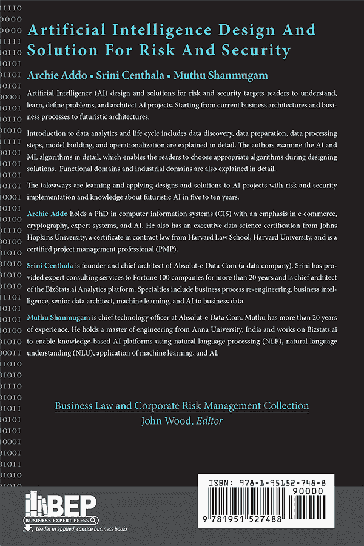

## 目录

1. 致谢
2. 第 1 章 简介
3. 第 2 章 人工智能/机器学习项目架构与设计
4. 第 3 章 知识库
5. 第 4 章 根因分析与分析
6. 第 5 章 推荐引擎
7. 第 6 章 功能领域
8. 第 7 章 面向未来的人工智能
9. 第 8 章 结语
10. 参考文献
11. 作者简介
12. 索引
