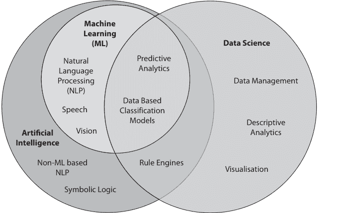
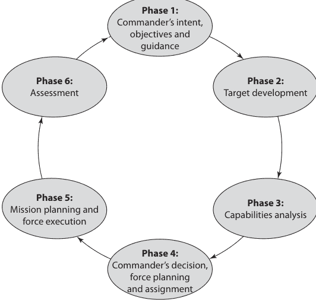
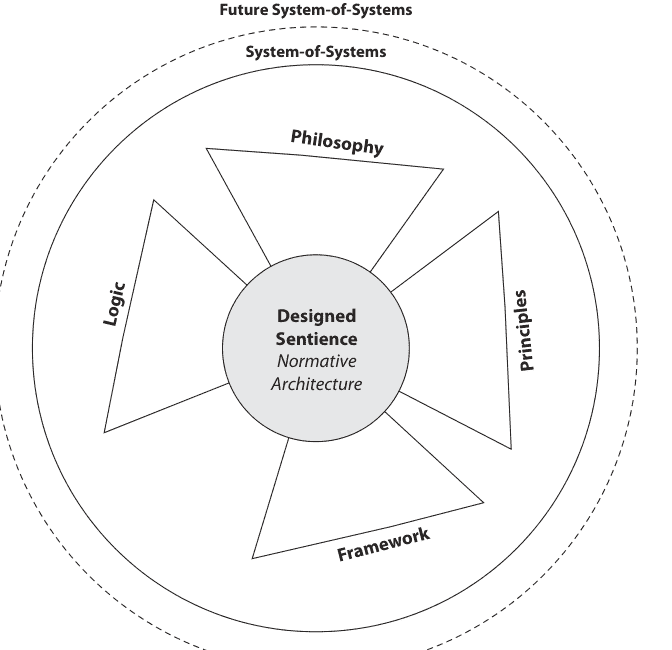
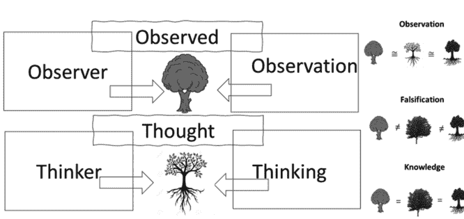
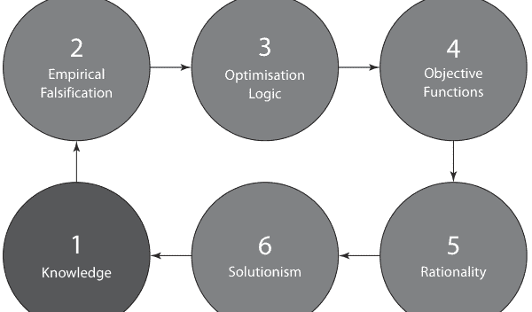
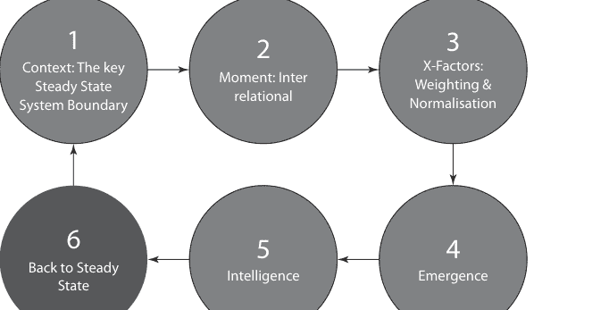
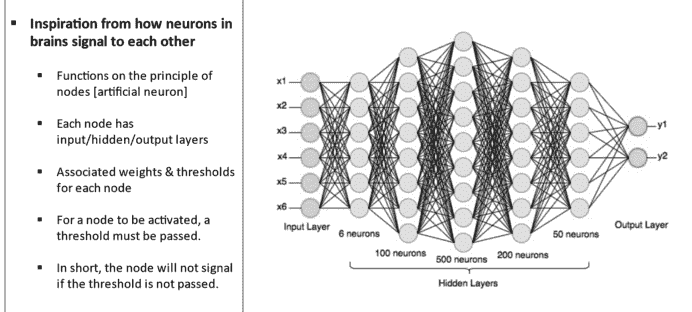
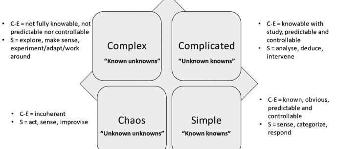

# 人工智能、伦理与战争未来：全球视角

本卷探讨了人工智能技术的采用可能如何影响战略和行动规划，以及常规、非正规、网络、空间和核武部队结构在未来可能的战术场景。除了美国、英国、俄罗斯和中国的发展外，本书卷还探讨了不同的亚洲和欧洲国家如何积极将人工智能整合到其军事准备工作和指挥结构的相关技术中。这本书对于军事与战略研究、国防研究、人工智能和伦理领域的学者、学生和研究人员将具有很大的吸引力。

Kaushik Roy 是印度加尔加塔贾德普大学历史系的古鲁·纳纳克主席教授。他曾在剑桥大学出版社、牛津大学出版社、Routledge、Springer等出版社出版过多部著作，并在多本关于欧亚大陆军事史的同行评审期刊上发表过大量文章。目前，他参与了 PRIO 的“机器战争”项目。

采用 Sabon 字体

索引

## 作者

Guru Saday Batabyal（退役上校），PhD, FRHistS，在印度陆军、联合国、作为 IT 公司 CEO/执行董事以及学术界拥有 44 年的跨领域经验。他是多篇文章、书籍章节以及著作《1971年孟加拉拉解放战争的政治军事战略》（2020）的作者。

Kelly Fisher 是奥斯陆和平研究所（PRIO）的助理研究，他在奥斯陆大学获得了性别研究硕士。作为 PRIO 的助理研究，Kelly 参与了多个与新技术的伦理挑战的项目，包括人工智能，他关注这些技术的性别维度。

Ajey Lele（退役飞行群上校）曾任职于印度空军。现在是位于印度新德里的安全分析师。他的研究领域包括大规模杀伤性武器、战略技术空间安全。他拥有物理学硕士学位和国际关系博士学位。他有很多出版物。他的近期著作是《军事量子技术》（2021）。

P.K. Mallick, VSM（退役少将）是孟加拉邦工程学院的工程毕业生，并获得卡拉格普尔理工学院（IIT）的技术硕士。他是自动化与控制工程研究生，

## 贡献者

他毕业于卡拉格普尔理工学院，并获得马德拉斯大学的哲学硕士学位。他被任命于印度陆军信号兵团。在35年的服役期间，他在指挥、参谋和教学岗位上拥有丰富的经验。他曾参加过克什米尔山谷、阿萨姆邦和旁遮普邦的反叛行动。他曾担任驻在斯里那格尔军团和中部司令部的首席信号官。作为一名军官，他曾在姆豪的军事电信工程学院担任教员，并在新德里的国立国防学院担任过高级指导教员，并从那里退休。目前，他担任陆地作战研究中心（CLAWS）的陆军总参谋（COAS）卓越教授。他是同行评审期刊上的多产作家，研讨会和讨论活动的常驻演讲者，也是多个任务小组的成员。

R.S. Panwar（退役中将）于1976年被任命于印度陆军信号兵团。他曾指挥过两个后勤编制、一个电子战旅和一个装甲师级信号团团，还担任过军事电信工程学院的院长。他拥有计算机科学的MTch和博士学位，并获得了孟买理工学院（IIT Bombay）颁发的备受推崇的杰出校友，是首位获得此类荣誉的国防人员。他曾在德里理工学院（IIT Delhi）参加过为学期的密码学课程，拥有奥斯曼大学的管理硕士学位，并毕业于国立国防学院。Panwar在管理通信和电子战系统及项目方面拥有丰富经验。他进行过卓越的研究工作，包括开发用于战术防御网络的高级数据通信设备。由于其卓越服务，他三次获得总统及国防部的颁奖。他目前是印度统计研究所（ISI）的杰出教授，致力于信息作战、网络中心作战系统和新兴技术领域的战略思想演进。他还是国际专家小组的一员，在日内瓦的人道主义对话中心支持下工作，为人工智能赋能的军事系统制定一套行为准则。

Swaminathan Ramanathan 工作于学术界与工业界的交汇点。他是乌普萨拉大学的研究员和讲师，也是专负责从系统视角为组织提供未来化规划的战略和业务设计的顾问。

Gregory M. Reichberg 是PRIO（和平研究所研究所）的研究教授，他在那里领导着由挪威研究委员会资助的多年项目“与机器作战：人工智能与美德伦理的相关性”。他受过哲学训练，在军事伦理方面发表了大量著作，包括人工智能对战斗员行为的影响。他撰写并合编了多卷书籍，最近的作品是《机器人、人工智能与人类》（2021）和《关于战争与和平的托马斯·阿奎那》（2017）。

Kaushik Roy 是印度加尔加塔贾达普尔大学历史系的古古鲁·纳纳克讲席教授。他与PRIO的“与机器作战”项目相关。他专长于欧亚军事史。他在同行评审期刊上发表了大量文章，并拥有多部著作。

Kritika Roy 是德国柏林德国网络安全组织（DPSO GmbH）的威胁情报研究员，她在那里构思并贡献了长期的威胁格局研究。她曾曾在MP-DSA担任研究分析师，并曾是陆地与作战研究中心（CLAWS）的研究员。她拥有地缘政治与国际事务硕士学位，并在柏林赫尔蒂学院攻读国际事务硕士学位。她的研究包括人工智能与大规模杀伤性武器（WMD）、网络威胁与安全、破坏性技术对大规模杀伤性武器的影响。她还编写了名为《ICT进展与战争的可能性质》（Routledge出版）的书，并在《人工智能对战略稳定和核风险的影响》中发表了题为《在印度军事现代化计划中引入人工智能的理由》的文章。

A.K. Sachdev（退役上尉）拥有印度空军（IAF）和民用航空的实战经验。他曾指挥印度空军的一个战斗中队和一个飞行站，曾担任两个印度空军基地的首席运营官，并担任过直升机部队的指挥官。在共同创立一家民用航空公司之前，他曾担任一家航空公司的首席运营官和包机公司的首席执行官。他是空客A320的性能教员。他是印度航空学会、印度扶轮管理协会、联合服务学院以及曼哈尔·帕尔库尔国防研究与分析研究所的终身会员。他曾在印度惠灵顿的国防军参谋学院任教三年，并是认证管理教师（全印度管理协会）。他拥有硕士、理学硕士、MBA和哲学硕士学位，曾是DSA的高级研究学者。他出版了一本书、一本专著，并在许多专业军事和航空期刊上发表了大量文章。

Henrik Syse 是PRIO（奥斯陆和平研究所）的研究教授，也是奥斯陆新应用学院的和平与冲突研究教授。他受过哲学训练，编写过关于政治哲学、伦理、和平和宗教的编辑书籍和文章。他拥有波士顿学院的文学硕士学位和奥斯陆大学的博士学位。

Gabriel Udoh 法兰克福（奥德）维达里纳欧洲大学的DAAD奖金获得者和博士候选。他的研究领域是人工智能伦理和法律，特别是武装冲突中的致命性自主武器系统。他拥有国际人道主义法硕士学位和人工智能认证，还是专业的Python编程专家。

## 前言与致谢

“信息时代”正在迅速取代工业时代，人工智能（AI）是这一过程中的关键驱动力。信息和通信技术的快速进步，特别是计算机的处理能力、机器学习、大数据以及机器人领域的突破，是军事情报或人工智能取得巨大进步的背后因素。人工智能已经在重塑民用领域。军事领域同样正在经历变革。在未来10到20年内，人工智能增强的系统可能会改变战争的性质。美国和中国已经在将人工智能整合到其军事态势中。继美国之后，俄罗斯、以色列等多个国家正在制定新的战略。北约最近宣布也将这样做。亚洲和非洲其他国家在这方面如何？

奇怪的是，学术界关于人工智能相关技术对军事事务影响讨论并不多。2022年1月3日至4日，和平研究所（PRIO）在印度加尔加塔的大东方酒店举办了一场会议。这次会议的举办得益于PRIO Gregoryberg教授提供的道德和物质支持，他了“与机器作战：人工智能与美德伦理的相关性”这一挪威研究委员会资助的多年项目。参会者来自世界各地的高级军官、科学家、工程师、哲学家和学者。

首先，让我们明确，这本合集并非处理人工智能赋能武器的政治、心理和经济影响。相反，我们的重点是引入人工智能系统带来的战略、战术、学说和伦理挑战。虽然关于美国和中国的报道有很多，但对不同亚洲和欧洲国家的研究相对较少。本研究将特别关注这些地区军事规划中人工智能的作用。通过对比，不同军事组织对人工智能技术的采用以及随之而来的战术和训练将被考虑。不同国家如何重新调整其学说以从人工智能中受益？

最后，特别感谢CENSERS加尔加塔分部、Arun Roy中将、Reichberg教授、PRIO研究员Kelly Fisher、Moumita Chowdhury、Sohini Mitra以及贾达普尔大学历史系的Alka Choudhury，为会议提供了可能。没有他们的合作，会议和这本书将是不可能的。

# 缩写

- ABMS: 高级战斗管理系统
- AFADS: 武装完全自主无人机群
- AGI: 通用人工智能（同于 General Artificial Intelligence）
- AI: 人工智能
- ANI: 人工窄（弱）智能（同于狭义人工智能）
- ASAT: 反卫星武器
- ASI: 人工超级智能
- ATRS: 自动目标识别系统
- AWS: 自主武器系统
- BCI: 脑机接口
- BMD: 弹道防御
- BMS: 战场管理系统
- BVR: 视距之外
- CBRNE: 化学、生物、放射、核及爆炸物指挥与控制
- C2: 命令、控制、通信、计算机；C4ISR: 命令、控制、通信、计算机、情报、监察与恢复
- C4I2SR: 命令、控制、通信、计算机、信息、情报、监察与恢复
- CCW: 《常规武器公约》
- CIA: 中央情报局
- COIN: 反叛乱
- DARPA: 美国国防高级研究计划局
- DDOS: 分布式拒绝服务
- DE: 定向能量
- DICON: 尼日利亚国防工业公司
- DL: 深度学习
- DNS: 域名系统
- DOD: 美国国防部
- DOS: 拒绝服务
- DRDO: 国防研究开发组织
- EC: 欧盟委员会
- EMP: 电磁脉冲
- EMS: 电磁谱
- EP: 欧洲议会
- EU: 欧盟
- EW: 电子战
- FATA: 巴基斯坦联邦辖部落地区
- F2T2EA: 发现、定位、跟踪、目标、攻击和评估
- GAI: 通用人工智能
- GEO: 同步地球轨道
- GPS: 全球定位系统
- HEO: 高椭圆轨道
- HLMI: 人类水平机器智能
- HMC: 人机协作
- HMT: 人机团队
- IAF: 印度空军
- IAI: 以色列航空工业公司
- ICRC: 国际红十字委员会
- ICT: 信息与通信技术
- IDF: 以色列国防军
- IDP: 内部流离失者
- IED: 自制爆炸装置
- IHL: 国际人道法
- IOMT: 军事物联网
- ISI: 巴基斯坦军情局
- ISR: 情报、监察与恢复
- IT: 信息技术
- LAWS: 致命自主武器系统
- LEO: 低地球轨道
- LLM: 大语言模型
- LOAC: 武装冲突法
- MAD: 相互保证毁灭
- MALE: 中高空长空
- MEO: 中地球轨道
- MHC: 有意义的人类控制
- ML: 机器学习
- MTR: 军事技术革命
- NATO: 北西洋条约组织
- NBC: 核、生物和化学
- NCW: 网络中心战
- NGAD: 下一代空防
- NGO: 非政府组织
- NLP: 自然语言处理
- NUDET: 核爆炸
- OEM: 原厂设备制造商
- OODA: 观察、调整、决策和行动
- PAP: 印度省军警察
- PAV: 无人飞行器
- PC: 平台中心
- PGM: 精制导药
- PLA: 中国人民解放军
- POK: 巴基斯坦控制克什米尔
- PRIO: 奥斯洛和平研究所
- RAAF: 澳大利亚皇家空军
- REAM: 反应性电子攻击措施
- RMA: 军事革命
- ROE: 交战规则
- SEAD: 压制敌方空防
- SIA: 自指示假设
- SSA: 自采样假设
- SSSS: 强自采样假设
- SUAS: 小型无人机系统
- TSK: 土耳其武装
- UAV: 无人机
- UGS: 无人地面系统
- UGV: 无人地面车辆
- UKMOD: 英国国防部
- UMMS: 无人水系统
- UMV: 无人水面/海洋车辆
- UN: 联合国
- UNSC: 联合国安全理会
- USAF: 美国空军
- USDOD: 美国国防部
- USN: 美国海军
- USV: 无人水面舰
- UUS: 无人水下系统
- UUV: 无人水下/海底船舶
- VAS: 车辆自动化系统
- WMD: 大杀伤性武器
- XLUUV: 特大型无人水下航

## 引言

智能自主战争机器与战争的未来

Kaushik Roy

# 什么是智能军事机器？

“人工智能”（AI）一词首次用作1955年在达特茅斯学院召开会议的标题。艾伦·图灵（一位数学家和计算机科学先驱）1950年发表的名为《机器与智能》的论文也可以视为AI术语诞生的标志。¹人工智能是指能够产生与人类相似的行为机器，例如做出选择和判断。人工智能的兴起是“信息革命”的一部分。信息革命时代，信息是物质生产的关键要素。在这个时代，新知识的产生取决于计算能力。银行、铁路、交通、水和能源分配等基础服务变得日益依赖信息和通信技术（ICT）。能量来源包括数字信息、计算机软件和通信。拥有电子大脑的计算机正在补充（未来可能会补充）人类思维。集成电路和计算机技术是人工智能的基石，这两项技术正在不断发展。人工智能是包含硬件和软件的技术结合。因此，一个人工智能系统包含了微芯片、传感器等硬件。人工智能的基础单元是学习算法，它允许机器检测模式、做出决策并根据环境调整行为。这种学习过程被称为机器学习（ML），其子集是深度学习（DL）。我们稍后将讨论这些术语。

# 2 Kaushik Roy

互联网、物联网（IoT）、Facebook、X（原名为Twitter）、机器人学、合成生物学和纳米技术的进步使得人工智能在非军事和军事领域的使用成为可能。研究人工智能对战争影响的领域充满了缩写、简写和概念范畴。社会科学家认为，对概念或类别给出严格且静态的定义将导致社会科学的死亡。尽管如此，对各种术语和类别给出工作定义是必要的。对于什么是自主，不同的人和地区之间存在差异。

英国在2011年发布的联合原则公告中区分了自动化/自动系统（其中包含人工智能元素）。自动化或自动系统遵循一组预定义的规则并产生可预测的结果。一个例子是法神反舰导弹防御系统。相比之下，自主系统能够理解更高层次的意图和方向。通过对环境的复杂感知，系统能够在不依赖人类监督或控制的情况下，从多个替代方案中采取行动。总体而言，自主系统的活动是可预测的，尽管单个动作可能如此，因为系统并非仅仅以可预测的方式遵循规则模式。前美国陆军游骑、军事人工智能专家保罗·沙勒（Paul Scharre）写道，随着机器变得越来越复杂，它们越能够在更开放的环境中执行复杂任务。沙勒根据智能和自主性将人工智能分为三类：自动（Automatic）、自动化（automated）和自主（autonomous）。自动机器是简单的基于阈值的，而自动化的是更为复杂的基于规则。自主系统感知环境并采取行动。它在决策方面没有太多表现，其行动是可预测的。相比之下，自主系统在采取行动之前可能会考虑各种输入并权衡变量。自主机器是以目标为导向且自我引导的。目标导向意味着人类用户指定要实现的目标，但如何实现则由机器决定。其内部认知过程对其操作者来说不易理解。因此，在沙勒的框架中，一端是自动机器，它的自主性最低，智能性也最低。

## 引言

自动化设备处于智能与自主性的光谱中段。其极端是自主机器，它们最为智能，且其行为在很大程度上具有不可预测性。

当我们想到 AI 时，机器人和无人机会浮现在脑海中。捷克作家卡雷尔·卡佩克（Karel Capek）在 1921 年的剧《罗姆通用机器人》（Rosum's Universal Robot）中使用了“robot”（机器人）一词。该词源于捷克语单词“robota”，意为强制劳动。保罗·J·斯普林格（Paul J. Springer）强调，计算机程序与机器人之间存在区别。与计算机程序不同，机器人（或者无人机）能够在物理世界中进行某种形式的直接行动。因此，机器人和无人机是物理实体系统，由物理组件和软件组件组成。

从法国的角度来看，军事机器人被定义为具有感知、通信、决策和行动能力的系统。机器人可以在人类监督下运行，但也能够通过自动学习提高其性能。因此，机器人是一种能够感知并行动的机器。机器人专家丹尼尔·伊希比亚赫（Daniel Ichbiah）将机器人定义为一种安装在移动主体内、配备强大软件的强计算机，并根据其对周围世界的感知做出理性的行动。

俄罗斯军事百科书将机器人分为三代。第一代机器人具有软件和远程控制功能，只能在组织良好的环境中运行。这些机器人具有适应性，拥有某种感官，并能够在此前未知的条件下运行，这意味着这些机器能够适应变化的环境。第三代机器人是智能的，其控制系统中包含 AI 元素。一位俄罗斯政策分析师认为，俄罗斯军方仅将第三代机器人视为自主武器系统（AWS）。那些能够识别和跟踪目标并在无人类监督的情况下开火的自主武器，可以被标记为致命性自主武器（LAWS）。

机器人被用于民用和军事领域。一位作者声称，在 2013 年，全球机器人数量超过了 1000 万台。根据 2008 年的一项计算，美军拥有超过 11,000 台机器人。军事机器人可以在空中运行（无人机 [UAV]，也通称为 drone）、地面上运行（无人地面车辆 [UGV]）以及海面和水下运行（无人水下航行器 [UUV]）。UAV 可以被武装（作为猎杀平台），也可以保持无人状态用于监视、搜索和侦察（ISR）。武装 UAV 被称为战斗无人机（UCAVs）。

可以给出这些类型无人系统的一些例子。首先，让我们举一些 UGV 类型的例子。以色列正在开发一种 2 米长的蛇形机器人，它可以沿着狭窄隧道爬行。这种机器人的头部由传感器和摄像头组成，向后方操作的人员团队发送信息。Ripsaw M5 是美国陆的一种遥控无人战斗坦克。它将能够与 UAV、载人坦克和装甲车辆协作（共享数据）。Ripsaw M5 可以在昼夜间工作。嵌入其软件的 AI 技术减少了对持续控制的需求。其软件中的 ML 算法允许它从环境中实时学习。UAV 的尺寸大大有异。AeroViron 制造的如黑寡妇（Black Widow）之类的微型飞行器宽度仅几厘米，可以飞行 30 分钟，同时向操作员提供视频下行。蜂鸟（Hummingbird）是一种微型无人机，形状与蜂鸟相似，飞行方式也像它。它配备了一个小型摄像头。此类 UAV 设计用于城市侦察和反叛乱（COIN）行动。美军最受讨论的无人机之一是“掠食者”（Predator）。掠食者是一种武装的、多任务的、中空长程的遥驾驶飞行器。由于其传感器、多模式通信、精确武器（地火导弹）以及在目标上方长时间盘留的能力，掠食者用于正规和非正规战争中的 ISR、近支援、搜索救援以及精确打击。

既有 UAV 也有 USV（无人水面舰）。USV 可以是大型无人舰（LUSV）和中型无人无人（MUSV）。在2017 年，俄罗斯展示了两个名为护身符（Amulet）和朱诺（Juno）的 UAV，配备了传感器技术；朱诺长 2.9 米，直径 200 毫米，可以运行六小时。护身符长 1.6 米，重 25 公斤，潜深 50 米，范围 15 公里。普京在 2018 年讨论了俄罗斯拥有的波塞冬（Poseidon），这是一种战略性 UUV。俄罗斯的波塞冬拥有用于推进的核动力装置，直径 2 米，最大潜深 1,000 米，作战范围为 10,000 公里。这种 UUV 可以携带爆炸当量超过 100 万吨 TNT 的弹头。通常情况下，波塞冬从核潜艇发射，在深海或海洋中独立运行。2019 年，新加坡展示了一种既可以作为 USV 运行，需要时作为 UUV 运行的船只。它是一艘名为 Sekriegier 的快速攻击舰，配备了用于水下攻击的鱼雷和用于进行水面攻击的火炮。因此，Sekriegier 具有变身能力。

## 引言

这部合集由历史学家、哲学家、社会学家、工程师和退役军官编写的 11 篇文章探讨了 AI 对战争逻辑和语法影响这一问题。我们并不处理 AI 辅助武器的政治、心理和经济影响。贡献者们解决了 AI 增强型战争机器的使用在多大程度上符合道德和法律。虽然大多数文章采取了全球视角，但某些章节遵循了特定区域的方法。大多数文章涉及下文讨论的四个问题。这四个问题是：军事事务中引入 AI 是否正在导致“军事革命”或“军事事务革命”（RMA）、AI 增强武器系统的指挥与控制挑战、在网络空间和外层空间使用 AI 进行战争的可能性，最后是使用军事 AI 的合法性和伦理问题。本书中的所有文章讨论的都是目前的 AI 状态，即 ANI（人工人工智能）。在引言的最后部分，我深入探讨了未来出现 GAI（同于人类水平机器智能 [HLMI]）和超级智能的可能性，以及它们对战争执行特别是对人类整体生存可能产生的影响。

# 战争中的 AI：军事革命还是 RMA？

我们可以看到，引入嵌入 AI 的武器（如机器人、无人机等）引发的是一场军事革命还是 RMA？RMA 术语在 20 世纪 90 年代在美国安全分析师中变得流行。与范围广广得的“军事革命”概念相比，RMA 是一个狭义概念。RMA 与苏联的“军事技术革命”（MTR）概念相似，指的是引入一种新型武器系统，这种系统对战场产生产生巨大的战术和作战影响。20 世纪 70 年代，随着美国军队开始引入制导导弹（PGMs）和巡航导弹，苏联军事理论家将其称为 MTR。相比之下，军事革命涉及社会转型，这种转型由于一种作战系统系统（不同技术和管理技术的结合）的出现，这种系统产生了一种新的军事系统。这种创新军事系统的实施导致发起军事革命的一方军事效能的量子飞跃。这种先进军事系统的产生和维持改变了国家与社会的关系。因此，与 RMA 不同，军事革命的影响不仅局限于战术-作战领域，还蔓延到军事战略和大战略层面。此外，虽然 RMA 的驱动力是新技术的出现，但军事革命背后的原因涉及许多因素。除了技术因素之外，

# 6 Kaushik Roy

社会、文化和经济因素也是导致军事革命产生的原因。19

可能“完全性零”（与过去完全断绝）在现实中绝不会发生。每一个革命性现象都包含了连续性的元素。军事革命和军事变革事务（RMA）在历史上都发生过。事实上，在人类过去五千年的广阔跨度内，军事革命、RMA和军事演变（停滞阶段的缓慢渐进变化）是顺序发生的。14世纪英国长弓的出现导致了法国封建重装骑兵的衰落，这是 RMA的一个经典案例。20 火药战争的兴起催生了现代早期欧洲（1500–1800年）的军事财政国家，这是军事革命的一个例子。这场军事革命诞生了装备大炮的海远海军和火药步兵。火药步兵是指经过训练、遵守纪律、配备手枪，并在战斗中由野战（轻）火炮支持、在征服中由攻城（重）火炮支持的步兵。这一系统反过来使得18和19世纪的西欧政治能够殖民化亚非亚洲的大片地区以及新世界。21

尽管一组历史学家强调连续性和变化，但在我看来，军事革命的概念，即军事革命的启发式工具往往跨越一个或多个世纪。这对于发生在公元前7000年至5000年之间的农业革命、青铜时代（公元前2500–1200年）的城市革命，以及18世纪末19世纪初展开的第一次工业革命也是如此。22 我的观点是，AI在军事领域的引入是20世纪后期以来更广泛社会中发生的信息革命的一部分。一系列相关技术的整合导致了战术、作战和战略层面的量变和质变。AI引发的军事革命仍在进行。此外，随着时间的推移，军事革命在地球各个地区传播的速度正在加快。在西亚出现的以战车为中心的军队（青铜时代的产物）到达西印度和西班牙花费了数千年的时间。23 火药军队扩张整个地球花费了几个世纪的时间。24 而以AI为中心的军事革命在几十年内正遍布全球。

个体军事机器的角色和自主权的扩展将要求对士兵的个人和集体训练进行改变，重新配置指挥系统，并产生新的兵学体系。这些领域的剧烈变化将产生新的武装力量，它们将与现有的军队以及我们目前熟悉的战争以不同的方式进行战斗。AI增强的武器系统和AI增强的决策系统不仅在战术和作战层面具有倍增效应，在战略层面也是如此。我相信AI是一种具有战略颠覆性的武器系统。此外，更广泛社会的转变正驱动着AI的军事化进程。目前大多数军队正在采用双用技术。

AI与军事组织的整合是可能的，因为先进国家社会正在进行信息革命或第四次工业革命。克劳斯·施伯（Klaus Schwab）首次提出了第四次工业革命。第一次工业革命利用水能和蒸汽动力驱动机器，第二次工业革命基于电力。第三次工业革命见证了20世纪60年代个人电脑、互联网和自动化的出现，从而开启了数字时代。因此，第三次工业革命是第四次工业革命的前奏。最后一次缩小数字、物理和生物领域之间的差距，并产生了一个庞大的人机界面生态系统。这对我们工作、旅行和自我教育的方式产生了革命性的影响。²3 在这个严谨的方案中，核能问题被排除在外。无论是否称之为第四次工业革命，从21世纪初开始的技术与和社会变革的互联系统正推动着AI引发的军事革命。

在第一章中，P.K. Mallick嘲讽道，如果将AI相关技术应用于国防领域，不仅具有战争的特征，而且具有战争的本质。如果战争在发动层面（通过智能机器而非人类）以及在决策方面都去人性化了，那么我们确实处于一个门槛上。然而，Mallick在分析了近期以色列对哈马斯的反恐斗争（2006–2009年）以及正在进行的俄乌战争后得出结论：AI相关技术在战场上的应用非常有限。

本版由 Ajay Lele撰写的第2章概述了AI相关技术在军事不同分种中的可能用途。对他个人而言，在战略层面，AI的影响是模糊的。Lele认为，目前AI在战术和作战层面的影响是巨大的，等同于一场 RMA。Lele认为，AI作为一种颠覆性技术，其在未来不可避免的广泛应用将改变战斗的后勤、兵学、训练、指挥和战术概念。

在第9章中，R.S. Panwar对印度军队整合嵌入AI的武器持更为温和的观点。Panwar写道，印度军队整合网络中心战（NCW）技术相当缓慢，并逐渐引入AI的武器系统。对于印度军队来说，这更多是演变而非革命。他承认AI在促进军事决策、减少人员伤亡和增强部队战斗力具有巨大前景。他概述了该技术的可能应用，并提出了目前关于致命性自主武器（LAWS）讨论的主要法律和伦理问题。Panwar建议需要采取的步骤，以确保印度军队跟上先进军队。

与Panwar相反，Kaushik Roy在第10章中指出，印度军队正考虑使用无人机、地面机器人等半自主机器来执行各种反恐任务。需要注意的是，美国在阿富汗和巴基斯坦使用无人机疏远了当地民众。赢得“民心”是成功反恐的先决条件。目前，印度的反恐策略基于使用配备手持武器的大量步兵。无人机和移动机器人可能会改变局面。

在第3章中，A.K. Sachdev关注一个特定的军事系统：航空。他详细介绍了嵌入AI的二代飞机如何为无人飞机的出现铺平道路。人类飞行员已经到了死胡同吗？相比人类，使用自动化飞机有几个优势。与人类飞行员不同，飞机的AI不会疲劳，能够进行更陡更快的转向，并飞得更远更高。美国、俄罗斯和中国等其他大国计划一架载人飞机配备六架无人机。在这种情况下，无人战斗机将作为忠诚僚机运行。需要注意的是，2002年至2010年间，美国军队无人机数量增加了40倍。

瑞典国防学院的Ash Heydar Pashhanlou对无人飞行器（PAV）持有更为温和的观点。Pashhanlou指出：“PAV的核心挑战可能是在复杂拥挤的环境中运行，在缺乏通用人工智能（AGI）的情况下，可能需要人类而非飞行员参与。半自主PAV主导天空可能还需要相当长的时间。那天标志着飞行员时代的终结。”²⁸ 所以，PAV/UAV是一个等待中的RMA。但UAV与其他AI嵌入武器系统的结合正在产生一场新的军事革命。

# 引言 9

除了无人机（UAV），另一种新工具是无人机集群。武装全自主无人机集群（AFADS）被认为是一种大规模杀伤性武器（WMD）。29 什么是集群？集群是指多个单元从多个轴线对目标进行收敛攻击。这种攻击可以是远程的，也可以是短程的。集群可以是计划性的，也可以是机会性的。关于集群，Sean J.A. Edwards 写道：“它通常表现为‘脉冲式’，即单元迅速汇聚目标，然后重新散开。”30 集群无人机是一组可以互动并作为一个共同目标的集体运作的无人机。集群的本质是协调行为。随着时间的推移，协作行为将使无人机能够更独立地执行任务。机器以人类无法的速度和规模协调其行动。保罗·沙尔写道，这一特征将彻底改变战争。31 人可能会认为，集群战术本身并无特殊。在动物世界中，蜜蜂和狼都会进行集群活动。集群实际上是一个复杂的自适应系统。它是一个基于代理的系统，代理遵循自身的行为规则，这些规则在总体和整个系统中产生了涌现行为。32 我们稍后将详细阐述涌现行为。在23世纪，蒙古轻骑曾产生过集群行为。33 然而，由无人战斗机器人的出现几乎是革命性的，因为它是对过去军事实践的突破。

带有传感器和弹药的大型集群可以进行大规模攻击。集群无人机将拥有机器视觉。机器视觉具有机器看的能力，它需要大量的数据来训练算法。传感器无人机利用这些算法来收集和共享有关敌方无人机、可能的目标以及其所在环境中存在的自然和人工障碍物的信息。灵活的集群通过增加或减少无人机来适应不断变化的战术场景，并从不同方向或同时同时攻击一个目标。多样化的集群能够整合不同类型的弹药和传感器，并是紧密集成的多域集群。34 然而，这些集群无人机将以不同的速度向不同风险环境中的目标移动，这为指挥和控制带来了严峻挑战。

# 数字化战场上的指挥艺术

对于历史学家马丁·范·克里维来说，指挥等于对军事组织的管理。指挥需要协调和控制，而这反过来取决于信息流。然而，低级指挥需要军官激励士兵在火光弥漫的杀场上战斗和牺牲。35 杀手级机器人不需要军官的激励演讲，也不需要一线初级指挥官的英雄事迹。Kaushik Roy 说。然而，在人机协作的战斗小组中，情况会有所不同。在人工智能出现之前，如战车、复合弓、火药、蒸汽动力、内燃机、核能等人类发明，都帮助了人类进行战争。人工智能的首次引入打破了久以来对战争执行决策过程的垄断。这种发展确实是革命性的。由于计算机处理和解释数据的速度比人类大脑快，高级指挥机构将包含一个 AI 增强的决策机构。在指挥领域，人工智能在从人类无法察觉的海量数据中提取关联方面起着重要作用。通过传感器收集的数据，算法可以构建模型、开发和测试见解、为人类决策者描绘关联和异常。36 这种发展反过来将使数字化战场上人机武装部队的指挥结构变得复杂。

机器学习（ML）与发现数据的统计关系有关。机器学习可以分为类型：监督学习、强化学习和无监督学习。深度学习（DL）是一种基于人工神经网络的监督学习技术，发明于几十年前，但由于计算机计算能力的快速提升而现在变得有效。神经网络在某种程度上受到大脑连接性的启发，但与人类大脑无关。人工神经网络意味着连接了数个人的人工神经元（单元）。每个单元根据其输入计算一个数值。人工神经网络的输出是所有单元输出之和。深度学习由许多层连接的人工神经网络组成，在利用海量数据提取输入和输出之间的统计关系方面极其有效。它在计算机视觉和语言处理方面最有效。例如，这些人工神经网络可以经过训练以极高的准确度识别图片中的物体。在强化学习中，算法学习在一系列动作之间进行选择，以最可能的方式完成任务。无监督学习意味着设计可以在没有外部导师的情况下自主学习的算法，这些算法能够提出自己的目标。这是构建真正智能机器的关键。然而，到目前为止，机器学习尚未产生此类技术。37 因此，真正自主致命性武器系统（LAWS）的构建和部署至少目前仍处于幻幻领域。尽管如此，嵌入 AI 的武器系统似乎是革命性的且难以控制。2009年的一组研究人员断，即使是具有原始智能的机器人，在没有这些研究人员编程的情况下，也会表现出欺骗、贪婪和自我保护的特征。38

# 引言 11

在本书出版之际，一种新技术（大语言模型 [LLMs] 及其子集 ChatGPT）是其产物。一些过度热的人将其称为一种变革性技术。这种技术（人工人工智能 ANI 的示例）具有军事应用，特别是在创建 AI 增强的决策机制领域。美国武装军认为，在未来的战场上，这将像武器平台一样重要。使用 LLMs、ML 和其他 AI 应用的计算机将辅助军事决策者，以便在战争的战略、作战和战术层面进行规划。在未来的战斗中将部署大量高清传感器。这将产生大量大数据，这些数据将在几个接入点被收集，然后流向处理节点以做出实时决策。获取和利用所有这些数据需要机器学习来增强人类认知能力。然而，在竞争战场上，对于带宽受限和通信系统退化的武装军来说，战术上使用云计算是一种负担。由于延迟、带宽和安全考虑，此类数据无法发送到云端。它需要在接入点，即边缘，通过计算机进行处理和利用。因此，在本地的边缘进行计算是必要的。边缘 AI 能力将使军事规划人员能够扩散数据流以规划军事战术。边缘 AI 能力应驻留在边缘计算硬件上。这些计算机将致力于实时任务的计算机视觉和传感器数据处理工作。此类被称为 LLMs39

LLMs 能够综合信息并使用语言结构回答规划军事行动的军官提出的问题。美国武装军使用 Hermes LLM 进行军事规划。军事规划人员与 LLMs 对话可以评估其假设的有效性和战略、作战和战术计划的可行性。LLMs 允许军事规划人员从多个维度观察战场几何结构。在回答事实性问题方面，Hermes 可以对各种计划的时间和位置方面生成假设。Hermes 还可以帮助人类指挥官理解敌方的军事理论及其可能的行动方案。总而言，LLMs 使军事指挥官能够更好地理解他们作业的环境。本杰明·詹森和丹·塔罗斯强调，LLMs 不取代人类指挥官。必须注意的是，启用 AI 的机器也会产生幻觉。此外，人类指挥官在评估 LLMs 提供的解决方案时必须始终运用批判性判断。最终，使用 LLMs 的计算机的有效性取决于人类指挥官提出的问题质量，也取决于机器在部署之前接受的训练质量。⁴⁰

## 12 Kaushik Roy

一群中国学者正渴望利用大语言模型（LLMs）来简化武装的指挥机构。将先验知识整合到预训练语言模型对于知识驱动的自然语言处理（NLP）任务是有效的。NLP 任务涉及实体识别、关系抽取和实体类型。然而，目前通过知识掩码、知识融合和知识替换将外部知识注入模型的预训练程序并不有效，特别是对于为军事任务设计的 NLP 任务。掩码语言模型只能对底层语义知识建模。通常，预训练任务是根据文本中的语料和特征设计的，这并不适用于军事文本挖掘；因此，开发领域特定的预训练练习具有必要性。因此，科学家和工程师的任务是开发出一种更有效的方法，将军事领域特定知识注入语言表示模型中。

基于人工智能的应用程序和系统构成了巨大的风险，这些风险主要源于机器学习（ML）技术的特性，特别是支撑它们的深度神经网络。AI 赋能的军事系统特别受关注，因为它们对人类生命构成了威胁。这些关注的核心是近年来 AI 系统表现出日益智能的行为，这反过来导致了认知功能越来越多地委托给机器。这引发了一系列法律、伦理和道德困境，需要进行适当的处理和分析。同时，人们公认为，如果以负责任的方式利用 AI 的力量，无论在战场内外都能为人类带来巨大利益。AI 的这种双刃剑特征表明我们需要一个经过设计的机制来监管自主武器系统（AWS）的发展。Mallick 警告说，AI 相关的软件在提高决策速度的同时，其本质上也具有升级性。战争将变得不可控。因此，将 AI 集成到指挥结构中是一项代价昂贵的举动。

集群资源如何？美国和中国密切关注的一种武器系统。集群机器人的指挥涉及两个部分：人机交互和机机交互。集群内个体之间的交互将产生涌现行为。这种行为不是预先编写的，指挥官无法预测系统的行为。Mere Ekelhof 和 Giacomo Persi Paoli 在以下话语中警告了危险：“由于缺乏一种通用模型来允许人类理解复杂的涌现行为并及时做出充分应对，这将导致对集群权力的信任和控制缺失，并带来机器人集群出现非预期行为的较高风险。”

Panwar 在一篇名为《AI 赋能的军事系统监管》的文章中指出，不同类型的军事系统所引发的 AI 风险可能差异很大，在所有系统中应用一套通用的风险缓解策略将是次优的，原因如下：这些策略对于高风险系统来说可能太宽松，对于低风险系统来说过于严格，并且会阻碍可能在各方面有益的系统的开发。基于风险的方法有潜力克服这些缺点。需要的是勾勒出这种方法的轮廓，以便用于军事系统的监管。支撑这种方法的分析虽然没有显式表达，但深受实现“有意义的人类控制”（MHC）必要性的深度指导，这是所有 AI 赋能军事系统要实现的关键目标。³⁴

在第 8 章中，Guru Say Bataby 警告说，除非建立机制，否则类终结者般的 AWS 可能在不久后变成现实。AWS 会成为一个恶意的超级智能杀戮机器吗？此外，我们需要解构 MHC 的概念，然后思考如何建立和维护它，以及我们需要什么样的指挥生态系统。

人机协同存在局限性：电子战（EW）/网络战带来的威胁，主要是对无人机通信的欺骗和干扰。高度加密的通信难以破译，但可能被干扰。为了冗余，无人机可能连接多个数据链，这样针对某个设备的电子攻击不一定会使整个无人机飞行系统失效。配备电子战反制措施的重型无人机在面对敌方集群无人机和载机时机动性较低。例如，中国在固态电子和微处理器领域的引导和控制系统制造竞赛中仍然落后。中国无人机机队克服敌方空防系统的一种方法是遵循“无意识协作”（涌现行为）原则。在这种类似于蚂蚁群的网络中，无人机并不完全理解其他无人机的存在和活动。相反，无人机遵循对其周围进行有限监测的模式化指令。在这一指令集中，指挥系统需要对兵法进行深思熟虑。

## 引言 13

（注：文本“Introduction 13”看起来是一个页眉或章节标题，根据 OCR 识别结果）

## 14 Kaushik Roy

（注：文本“14 Kaushik Roy”看起来是一个页眉或章节标题，根据 OCR 识别结果）

在战场上，带有 AI 的武器系统可能会被黑客入侵。Van Creveld 见见地警告说，人不应该成为技术的奴隶。相反，应该理解技术设备的局限性。令人担忧的是高层指挥对通过计算机发送的海量数据的依赖日益增加。这种信息流容易受到网络攻击。

## 人工智能与太空战争

网络战和太空战争是 AI 引发的军事革命的两个新特征。网络空间是 20 世纪中期计算机和人类创造的人工领域。最初网络战是电子战，然后是信息战。James A. Green 将网络战定义为在网络空间（即计算机网络及其背后用户的领域）中使用技术力量，其中信息在网上进行存储、共享和通信。有时，网络安全会导致在不产生任何直接影响的情况下使敌方的关键基础设施失效。例如，从敌人计算机中窃取信息，⁴⁶ 网络攻击可能导致敌方的网站、电子邮件账户等被删除。计算机可以通过更改这些机器本地的域名系统（DNS）记录来被攻破。DNS 提供了网络设备将域名解析为 IP 地址的过程。或者，整个计算机网络可以在其 DNS 表中注入伪记录。通过 DNS 污染，计算机设备访问特定网站的流量可以重定向到攻击者。攻击者随后可以在信息转发给客户之前对其进行查看或干扰。拒绝服务（DoS）攻击旨在防止计算机为用户提供服务。⁷⁷ 攻击者通过向计算机系统注入恶意软件，通过损坏和删除硬盘中的文件，并覆盖受影响计算机的主引导记录，这将使整个系统无法运行，而对硬件造成任何物理损坏。⁴⁸ 因此，网络攻击涉及三种传统形式：破坏、间谍活动和颠覆，但在虚拟空间中使用了新工具，这些形式是革命性的。

网络战士不需要在地理上距离目标很。这是因为攻击是通过互联网在虚拟战场上进行的。根据某项计算，2019 年为 46%

全球人口（生活在地球最先进地区的人）在使用互联网。^{49} 目前在先进的军事系统中，几乎一切——常规炸弹、核武器导弹、士兵通信和卫星、车辆、装甲系统以及导航系统——都取决于计算机。虚拟宇宙中的网络攻击将对物质世界产生严重影响。对于这一切，动能攻击将是毁灭性的。

到 21 世纪之初，人类的另一个时代是人工智能的生产。指挥、控制、计算机、监视和侦察（C4ISR），Lee 声称是现代军事组织的神经系统。在第 4 章中，Kritika Roy 认为，如果人工智能与技术集成，那么植入计算机软件将带来领域变革。网络战实际上是数字战争，它可以对物理世界产生重大影响。因为物理世界和数字世界是紧密相连的。例如，基地组织在千禧之初利用互联网来支持其目标。^{50} 2013 年，它开启了一个 Twitter 账号以支持其目标。在网络攻击的情况下，人工智能集成的网络攻击将导致计划之外的升级，并缩短交战双方的反应时间。这种发展将国家间的战略平衡不稳定。

糟糕的是，Kritika Roy 警告说，将人工智能用于 ISR（监视和侦察）和网络武器可能会威胁到核报复能力。核威慑将建立在不稳定的基础上；这将引起严重担忧。Paul Bracken 警告说，核威慑取决于国家的反击能力。这种反击能力主要基于常规和核装备地面导弹，现在正受到威胁。移动地面导弹比静态导弹更具优势，因为后者对精确制导武器（PGMs）敏感。然而，所谓的第四次工业革命的技术如人工智能、云计算、数据分析、无人机和超音速导弹可以很容易定位并摧毁这些地面导弹。人工智能引导的搜索/侦察技术比冷战时代的侦察技术和技术更有效。^{51} 来自敌方的不安全感将迫使国家保持地面导弹处于移动，并增加武器库中地面导弹的数量。这将

Kaushik Roy 导致一场新的军备竞赛，进一步动摇由于核威慑所产生的脆弱稳定性。此外，移动核弹头容易受到恐怖主义攻击。对于这一切，嵌入人工智能的网络技术、敌对国家甚至非国家行为者可以禁用国家的核武器计算机指挥控制网络。^{52} 在这种情况下，意外的核攻击（每个人的噩梦）无法排除。

网络攻击对国家的核武器库产生严重影响。一个例子是 2010 年 Stuxnet 病毒破坏了伊朗纳坦的提炼设施。Stuxnet 通过通用串行总（USB）优盘传输，并损坏了用于提取铀的离心机。Stuxnet 找到了连接电机控制的可编程逻辑控制器。病毒修改了发送给电机的指令，使其以不同的速度旋转。高速旋转的机器对旋转速度的变化极其敏感，放射性铀离心机每分钟旋转 6000 转。因此，Stuxnet 对纳坦工厂的离心机造成了物理损坏。这次攻击可能由美国和以色列情报机构共同实施。^{53}

将机器学习（ML）算法和其他类型的人工智能集成到网络攻击中为网络空间的军事行动提供了多种优势。机器学习的使用增加了人工智能自主利用代码中漏洞的机会，从而提高了进攻性网络攻击的效率和速度。同样的技术也可用于加强防御系统，防止恶意软件和其他对网络的入侵。机器学习算法还用于扫描和调查大量个人的在线活动，或通过在敌方网络中植入恶意软件来自主准备数字战场，以便在战争爆发时远程激活。人工智能的使用增加了虚信息运动和其他类型信息战的潜在影响，使此类运动更有效、更具扩展性且更广泛。深度伪造（deepfake）视听内容的创建、检测目标人口社会结构中的缺陷以最大化运动效果、部署机器人以人为放大针对目标人口的颠覆性信息并追求自动化议程设置——特别是使用被程序为能够可信地模拟真人行为的更复杂的机器人——都是人工智能的某些用法。最后，人工智能还可以有效完成对微定位（microtargeting）的自动计算，以便为受众群体定制内容。^{54}

黑客可以禁用银行系统、击垮电网、阻碍常规和核装备导弹的发射机制等。例如，2007 年在爱沙尼亚，95% 的银行活动是在线完成的。^{55} 此外，黑客可以在被攻击特定国家的系统内注入误导信息

# 引言 17

和虚假信息。不同国家（例如挪威）现在建立针对敌对国家和非国家团体数字威胁的数字边界防御。数字边界防御意味着在数字威胁进入特定国家领土之前进行防御的能力。网络攻击（也称为计算机网络行动 [CNO]）分为两种：进攻性和防御性。防御性网络攻击包括监控和黑入以尽早发现侦察、渗透和攻击。讽刺的是，在网络战中集成人工智能增加了其进行进攻性网络攻击的能力，同时也加强了其对抗任何敌威胁的能力。Mallick 在章中警告说，在网络战中使用人工智能，没有人工智能保护的国家将面临灾难性后果。防御者只有使用人工智能算法才能成功防御自己。事实上，这正在变成一场针对敌方算法的战争。

除了网络空间，在太空使用人工智能正在成为现实。控制空间领域（大气层对轨道影响可以忽略的高度以上）对于所有领域的军事行动都是必要的。大多数空间行动发生在同步地球轨道（GEO）、高椭圆轨道（HEO）、中地球轨道（MEO）和低地球轨道（LEO）。GEO 用于全球通信、监视、观察大规模天气模式以及预警导弹发射。HEO 轨道卫星可以在特定目标上方停留很长时间。M 轨道位于 LEO 和 GEO 之间。LEO 卫星距离地球较近。这些卫星通信使用的发射器功率较低，且与 HEO 和 GEO 卫星相比，在相同孔径下具有更高的分辨率。然而，LEO 卫星在地面平面特定目标上方停留的时间很短。这些位于各种轨道（高度）的卫星组空间能力的轨道部分。地面部分包括地面雷达，所有的链路部分连接了电磁频谱（EMS）中的信号，以及连接轨道部分与地面部分的节点，以及各个地面部分相互连接。

嵌入人工智能的卫星图像为城市地区的战后损害提供了更详细的分析。战争导致的公共基础设施破坏可以通过高分辨率卫星图像进行准确评估。应用于卫星图像的人工智能可以实现战争损害的自动检测。一种机器学习技术（卷积神经网络）用于扫描冲突区域的多幅连续图像

战争正义（Just War）的原则、伦理与法律：

当各国军队正在整合AI增强武器系统时，西方社会也发起了“停止机器人”运动。杰·加洛蒂（Jai Gallotti）写道，无人系统的使用与非伦理决策有关，并降低了杀戮门槛，从而危害了战争的道德。不幸的是，我们在历史中看到，由于军事需要，当国家受到威胁时，伦理行为被实用行为所取代。

考希里克·罗伊（Kaushik Roy）描述道，目前由于技术水平和威胁评估，印度军队军官渴望在以人为中心的决策过程中使用AI。但如果来自中国的威胁升级，他们可能会认为将观察-定向-决策-行动（OODA）循环自动化。这是因为AI（特别是机器学习）以人类无法监督的速度处理大量数据进行评估、决策和行动。如果人类团队尝试这样做，将会降低作战节奏，特别是当所有军事行动必须在高度压缩的时间范围内执行时。因此，如果由于军事压力，未来在OODA循环中取代人类，这将违背印度军队的达摩战争（dhamyuddha）传统。

广而言之，支持和反对在战争中使用AI的人（特别是从道德和法律角度来看）可以分为两类：实用主义者（方法是工具性的）和理想主义者/道德者。实用主义者假设并相信目的证明了手段。理想主义者认为人类中的“善/德”将看到人类共同利益的出口，通过辩论和讨论，他们将找到解决僵局的方法。目前，我们需要在这种极端立场之间寻找中间道路。

未来的战争机器将是明显的人类之外实体。智能且自主的机器将是非碳实体之一，也是一种超级人工智能（ASI）。ASI是在人类之外的所有领域都具有认知能力的机器。斯瓦米纳坦·拉马哈纳森（Swaminathan Ramanathan）在第6章中指出，ASI的主要问题不是句子。感知将会出现。关键在于调节情感的规范架构。未来的战争机器不仅需要最好的，还需要一个深度学习（DL）系统。他的章节探讨了为未来战争机器构建规范架构的挑战。在此过程中，拉马哈纳森主张采用系统系统的方法，通过强化和平衡反馈回路，作为实时情感的伦理、美德和道德的“预测性”控制律。

## 引言

生存至关重要。Reichberg 和 Syse 认为，智能自主机器永远无法等同于人类的适应性和灵活性。因此，人类对 AWS、尤其是 LAWS（致命自主武器）的控制是必须的。与后果伦理相比，人类大脑可以根据美德伦理原则进行进一步的训练。他们最后警告说，AI 绝不能与核武器和高音速导弹相结合。

2021 年，欧盟委员会提出了一项关于欧洲 AI 监管方法的建议，即《欧盟人工智能法案》。其目标是追求可信的 AI。该监管规定将禁止对公民安全、生计和权利构成潜在威胁的 AI 系统。这种方法（与之前讨论的 Panwar 关于基于风险的方法类似）是区分不可接受风险、高、低或极风险 AI 武器系统。⁶³ 即使我们假设欧盟不会推出嵌入不可接受风险的 AI 武器，如何确保俄罗斯、中国、美国和以色列等国家在开发军事 AI 方面也会遵循这种方法呢？

在奥斯陆和平研究所（PRIO） 2021 年发布的一份关于伦理的报告中，提到了控制嵌入 AI 的战争机器的一些务实步骤。报告指出，操作人员必须对其操作的 AI 系统的技术和伦理方面接受培训。此外，还需要在软件设计人员、软件硬件制造商（工程师和科学家）、决策者（政治家和将军）以及我们（军事人员）之间建立韧性的反馈回路。⁶⁶

在第 8 章中，Guru Saday Batatay 断言，物理世界和网络空间中使用嵌入 AI 的武器系统在未来将会增加。国家和非国家行为体将成为这一过程的参与者。政治可能会利用 AI 驱动的武器系统（如用于跨境定杀的无人机）针对恐怖分子跨越伦理边界。国家规范化标准与反叛分子之间将不存在任何道德区别。他继续引用格鲁秀斯的《战争法与国际人道法》（IHL），认为有必要制定全面、明确且详尽的法律规定，将 AWS 的使用限制在既定的法律伦理准则范围内。Batay 认为，使用武装无人机杀死恐怖分子并不属于国际人道法的范畴。此外，他暗示，如果使用由人类和智能战争机器组成的团队，我们可能应该考虑制定“机器伦理”，因为机器永远无法像人类一样思考。在这里，我们发现了上述 Ramanathan 观察的回响。但国际人道法能容纳 LAWS 多大程度？

中国的立场首先是应该对 LAWS 的定义及其特征达成共识，而不是使用像 MHC（人类意义控制）和实质性人类判断这样主观且无法定义的概念。中国发言人进一步声称，现有的国际人道法并不适用于处理 LAWS 任务。他们指出，国际人道法解释不一致的可能性允许某些国家将 LAWS 的开发、生产和使用合法化。2018 年，中国提出了一个包含独特特征的 LAWS 狭义定义。第一是致命性，意味着具有足够的载荷储备以产生致命伤力。第二是自主性，指的是在执行任务的整个过程中缺乏人类控制。第三是不可终止性，意味着一旦激活，杀戮机器就无法停止。第四是无差别影响，这意味着设备无论条件、场景或目标如何，都会执行杀死和致残的任务。最后一个特征是演化性，意味着智能战争机器与环境的交互可以自主学习并扩展其功能和能力，其方式超发射该机器的人类规划者和指挥官的预期。批评者指出，中国对 LAWS 的狭义定义为在中国及其他地方开发的杀手机器人目标功能纳入更高水平的自主性留下了很大空间。⁶⁷ 对于许多人来说，具有更高自主性的杀戮机器并不真正安全。

平民尤其是内战中主要的伤亡。在第 7 章中，Kelly Fisher 警告我们，AI 可能会对女性和有色种族产生歧视，因为输入 AI 软件的数据带有种族主义、性别和偏见。这会导致 LAWS 对冲突区的女性和有色种族产生不成比例的负面影响。Kelly 的观点对 AI 的军事用途具有重要意义。AI 的命脉是数据。嵌入 AI 的军事系统在训练时如果输入“完美”的数据，将在战争场景下识别、追踪和攻击敌对目标时产生错误的结论。

相比此，在第 11 章中，Gabriel Udoh 论证了几个非洲国家渴望使用嵌入 AI 的军事武器，因为这些机器没有激情或情感，不会对战争区的平民进行强奸、骚扰或实施违背意的暴力。但智能机器有伦理或意识吗？Udoh 断言 AI 是中性的。对他而言，使用 AI 的人类的意图是首要考虑。使用嵌入 AI 的机器是否合法，取决于其人类使用者的动机和目标。Udoh 继续说道，这对平民来说很重要，因为与美国、俄罗斯、中国和 NATO 国家等大国不同，非洲使用 AI 的主要驱动力不是国家间而是国内冲突。

出于伦理、法律和军事要求，AWS 不能被赋予无限的自主性。大多数处理 LAWS 的研究人员提到 MHC。对我来说，MHC 意味着人类指挥官在选择和攻击目标必须占据主导作用。Maake Verbruggen 使用“人类控制”一词，将其定义为实现人类指挥官意图的机制，并指的是人类对任务结果的影响程度。Verbruggen 继续说，由于某些功能的自动化可能会导致失去人类控制，也可能是由于在智能机器提供的信息的背景下，人类指挥官关键判断的恶化。

人类控制可以通过三个杠杆广泛行使。其是固定武器系统的使用参数，包括限制 AWS 所分配的目标类型的措施。时间和空间限制进一步约束了其运行。当出现必要情况时，应有一个关闭机制。第二层控制涉及建立对环境的控制。这指的是规定或结构化 AWS 使用环境的控制框架，例如在没有平民的区域部署 AWS。第三层涉及人机界面。人类必须始终监控机器并在必要时保留干预其运行的权利。⁶⁹ 然而实施这些措施是非常困难的。

AWS 是否具有区分目标的能力尚存疑。此外，AWS 对比例原则构成了挑战。比例原则要求附带的平民伤亡与摧毁目标预期的军事利益之间取得平衡。此外，AWS 没有伦理感。因此，在违反国际人道法的情况下，战争机器不能对实施犯罪行为承担责任。在这种情况下，谁来承担责任？瑞士的 Paolo Gaeta 教授说：“国家责任可能对国家产生相当大的威慑作用，并激励他们确保自主武器系统符合国际人道法。”⁷⁰

# 类终结者式 AI 的崛起与人类的终结

> 第一台超智能机器是人类进化的最后一次发明，机器足够温顺，足以告诉我们如何控制它。

I.J.Good¹

I.J. Good 是上述引言的作者，一位数学家，二战大战期间担任艾兰·图灵破译团队的首席统计师。AI 研究人员可以分为两类：乐观者和悲观者。乐观者认为，即使发明了超级智能 AI，它也不会对人类构成任何生存威胁。相比之下，悲观者断言，超级智能可能会演变成一个全能的单一实体（singleton），并可能试图控制世界。属于悲观派的尼克·波斯特罗姆（Nick Bostrom）认为，在未来 50 年内，AI 将发展为高级人工智能（HLMI）。然后 HLMI 通过递归自我改进演变为超级智能。HLMI 将能够理解自身的运行机制，通过设计新的算法和计算结构来启动自身的认知性能。它能够迭代地改进自己，通过持续的递归自我修改，产生比自身聪明得多的版本，而这个过程将持续下去。这种自我证明的超级智能实体（他称之为单一实体）可能的结果之一就是人类的灭绝²

与之相反，肯尼思·佩恩（Kenneth Payne）写道：“[AI] 没有情感，其动力仅来自我们给出的指令。它既不想取悦我们，也不会在违规时感到惩罚。³”佩恩继续写道，机器智能与我们不同，它没有与之相当的生存和繁殖生物冲动。机器智能的目标不是内在的，而是我们想告诉它们的。机器生命没有情感层面，它们也缺乏意识体验。⁴ 但是，我们如何能确保超级智能 AI 不为了生存而产生意识呢？人们可能会认为，拥有智能会产生自我意识和自我保护的必要性。

Panwar 在他的章节中声称，绝不应该开发高风险的 AI 战争机器（在这些机器中，AI 决定目标和发射等关键功能）。应该开发低风险机器（完全受人类控制）。对于中风险机器（人类在回路中的命令系统），应该建立稳健的测试机制。但是，如果我们为了军事进步，某些国家开发了高风险机器呢？这样做有正当的军事理由。

由于通用人工智能（AGI）决策的方式，它是一个黑箱且是不透明的。因此，史蒂芬·I·戴斯（Steven I. Davis）同意 AI 应该用于战术而非战略目的。戴斯继续写道，在操作层面，作为风险缓解措施而非 AGI，应该使用几种专用人工智能（ANI），并由人类指挥官或人类团队监督它们。⁷⁵

然而，一份兰德报告断言：“让人类参与回路会减慢一切速度。如果我们的对手不使用人类参与回路，而我们使用了，那么我们在冲突的时间敏感时期就会落后。速度需要自动化。”⁷⁶ 因此，完全自主的致命性自动武器系统（LAWS）是决定战争胜负的绝对必要条件。因此，自主武器系统（AWS）将在近期成为现实。

控制 AWS 的人机混合控制（MHC）的一种方法是创造机械人（cyborgs），这包含了人类和机器的精髓。机械人是一种控制生物体。它是一种整合了大量电子技术元素以增强自身能力的有机生命体.¹⁷⁷ 退役的美国空军少将罗伯特·H·拉蒂夫（Robert H. Latiff）在其名为《未来战争》（2017）的书中，用以下文字描述了 2050 年战场的可能形态：

士兵的外观和状态将会不同。技术将被应用，首先是外部，以为士兵提供更大的保护、更大的环境感知和更大的体力……增强功能的药物将变得常见。士兵的身体将通过外骨骼进行改造以增强力量，药物可能会被人工增强以提高认知或改变记忆，并进行手术植入微电子神经辅助设备⁷⁸

合成生物学是一个相对新的研究领域。它旨在设计和构建新的生物途径、生物和设备，并重构自然生物系统。合成生物学可以为士兵提供新的生理功能和提升的性能⁷⁹

另一位悲观者路易斯·A·德蒙特（Louis A. Del Monte）声称，超级智能将在二十世纪末出现。超级智能将取决于比目前计算机更高效的量子计算机。与现在的计算机不同，量子计算机无法硬连接到人类控制。此外，基于量子计算机的超级智能还可以控制依赖有机脑机接口的机械人。结果将是人类自由意志的消除⁸⁰

无论是在另一个世纪，碳基脑会被硅基脑取代，都是人类面临的最大问题。只有时间能给出答案。如果 ANI 继续演化并超过人类的认知能力，那么战争中 AI 增强的人类决策将被以 AI 为中心的决策机制所取代。战争将由机械人、机器人进行，关于战争的决定将由超级智能机器而非人类做出。如果 AI 主宰了人类，那么战争可能会被废除，毕竟战争的主要原因仍然是人类本身。超级智能可能会认为人类导致了战争，而消除人类是消除战争的最佳方式。如果超级智能决定对人类战争以消除战争，未来将是黑暗的。消除战争意味着人类的灭绝，这将导致人类中心主义时代的终结和人机文明的新阶段的开始，机器成为主导伙伴。那将不是结束的开始，而是开始的结束。

## 注释

+1 Forrest E. Morgan, Military Applications of Artificial Intelligence: Ethical Concerns in an Uncertain World (Santa Monica, CA: RAND Corporation, 2020), p. 2.
2 A. Monte, Genius Weapons: Artificial Intelligence, Autonomous Weaponry, and the Future of War (New York: Prometheus Books, 2018), p. 28.
3 算法是一系列计算机指令，允许其进行计算和其他问题的解决。
4 Nik Nynek and Alexandrike Soleva, Militaryizing Artificial Intelligence: Theory, and Regulation (London: Routledge, 2022), p. 36–38.
5 Lieutenant-Col John Stroud-Taut, Lethal Autonomous Weapons (LAWs), in Expert Meeting, Autonomous Weapon Systems, Implications of Increasing Autonomy in the Critical Functions of Weapons, Versois, Switzerland, 15–16 March 2016, p. 57, ircordcentre.org/wp-content/uploads/2017/1428/3_002, accessed on 12 November 2022.
6 Paul Scharre, Outourcing Autonomous Weapons and the Future of War (2018, reprint, New York: Wiley & Co., 2019), p. 30–31.
7 Ajeley Lee, Strategic Technologies for the Military: Breaking New Frontiers (New Delhi: SAGE, 2009), p. 44.
8 Paul J. Springer, Outsourcing War to Machines: The Military Robotics Revolution (San Barbara, CA: Praeger, 2018), p. 5.
9 Didier Dianet and Jean-Paul Hahn, Introduction, and Robotization of the Battlefield: Evolution or Revolution? in Roman Roare et al. (eds.), Robots on the Battlefield: Contemporary Issues and Implications for the Future (Fort Leavenworth, KS: Combat Studies Institute Press, 2014), p. xvii.
10 Anton Miller, Killer Robots: Lethality and Equality of Autonomous Weapons (Ashgate, 2009), p. 8.
11 Vadim Kuzylin, ‘Russia’s Automated and Autonomous Weapons and Their Consideration from a Policypoint,’ in Expert Meeting, Autonomous Weapon Systems, Implications of Increasing Autonomy in the Critical Functions of Weapons, Versois, Switzerland, 15–16 March 2016, p. 60.
12 Nick Bostrom, Superintelligence: Paths, Danger, Strategies (2014), reprint, Oxford: Oxford University Press, 2017), p. 18.

# 引言 27

15 Hynek 和 Solovyevev，《人工智能军事化》，第 51–2 页。

16 Jai Gallotti，《军事机器人：绘制凡人景观的地图》（萨里郡: Ashgate, 2015），第 27 页。

17 MQ-1B掠夺者，可见：af.mil/About-Us/Fact-sheets/Display/Article/104469/mq-1b-predator，访问于 2023年4月27日。

18 王金云和魏柯，《无人系统发展及国外无人下行器（UUV）技术发展现状》，机器人与控制期刊，第3卷，第2期（2022年），第1页，DOI: 10.18196/jrc.v3i2.10210。

19 Williamson Murray 和 MacGregor Knox，《关于战争革命的思考》，收于 MacGregor Knox 和 Williamson Murray（编），《军事革命动态：1300–2500》（重印本，剑桥: 剑桥大学出版社，2003年），第 1–14 页。

20 Clifford J. Rogers，《仿佛新太阳升起：14世纪英国的军事革命（RMA）》，收于 Knox 和 Murray（编），《军事革命动态》，第 15 页。

21 参见经典著作《军事革命：军事创新与西方的崛起，1500–1800》（剑桥: 剑桥大学出版社，1988年）。

22 关于“军事革命”的史学研究，请参阅 Clifford J. Rogers（编），《军事革命辩论：早期欧洲军事转型读本》（博尔德，科罗拉多州: Westview, 1995年）。

23 Robert D Kaatik Roy，《近代早期的军事转型：1400–1750：骑兵、政府与舰只》（伦敦: Bloomsbury, 2014年）。

24 Philip Ross 和 Kaya Maynard，《迈向第四次工业革命》，智能建设者国际，第13卷，第3期（2021年），第 59–61 页。

25 Mark Hargerott，《机器人、网络、历史与战争》，收于 Doare 等人（编），《战场上的机器人》，第 29 页。

26 Christian Mathis，《新推演：军事事务中的机器人与革命》，收于 Doare 等人（编），《战场上的机器人》，第 33 页。

27 引用自 Arash Heydari Pashashkhanlou，《AI、自主性与空中力量：飞行员的终结？》，《防御研究》，第19卷，第4期（2019年），第 547 页。

28 Jonathan B. Bell，《应对蜂群：无人机战争中的战略考量与机遇》，JFQ，第107期，第四季度（2022年），第 5–6 页。

29 Sean J.A. Edwards，《蜂群化与战争的未来（圣莫尼卡，加利福尼亚州: RAND, 2005年）），第 2 页。

30 Paul Sharpe，《蜂群化将如何改变战争》，原子科学家快报（2018年），第 1–3 页，DOI: 10.1080/00636402.2018.1533209

31 Edwards，《蜂群化与战争的未来》（班斯利: Pen & Sword, 2007年）。见第5章。

32 Timothy May，《战争的道德艺术》（班斯利: Pen & Sword, 2007年）。

33 Zachary Kallborn，《信息蜂群：无人机蜂群与信息战》，《参数》，第2期（2022年），第 88 页。 34 Matthew R Reve，《空中力量指挥与控制的人工智能》（阿拉拉巴马州: 空军大学出版社，2019年），第 3 页。

35 Ludovic Righetti，《新兴技术与未来自主武器》，收于专家会议，《武器关键功能中自主性的影响》，瑞士，韦罗瓦，2016年3月15–16日，第 37–8 页，可见：icrcresourcecentre.org/wp-content/uploads/ads/2017/11/4283_002，访问于 2022年11月12日。

36 Del Monte，《天才武器》，第 142 页。

37 《以数据为中心的AI赋能战场的边缘计算》，Systemel Inc边缘计算能力，2022年11月20日，可见：https://systelusa.com/whitepaper/edge-compute-for-the-data-centric-ai-enabled-battlefield/，访问于 2023年7月7日。

38 Benjamin Jenkins 和 Dan Tadros，《大语言模型如何彻底军事规划》，War on the Rocks，2022年4月12日，warontherocks.com/2023/04/how-large-language-models-revolutionize-military-planning/，访问于 2023年7月7日。

39 李辉等，《MLRIP：一种具有信息丰富事实知识和专业知识库的军事语言表示模型》，第 2 页，arxiv:2207.13925，访问于 2023年7月7日。

40 Merel Elkhøy 和 Giacomo Pepe Pauli，《蜂群机器人：下一代自主系统的技术与运营概述》，第 55 页，联合国裁军军研究院，2020年，unidirs.org。

41 R.S. Pawar，《AI赋能军事系统的监管：基于风险的方法》，https://futurewars.rspan.net/regulation-of-ai-enabled-military-systems-a-risk-based-approach-part-i，访问于 2022年4月7日。

42 David Schaefer，《中国空中力量与区域战争》（德里: KW Publishers, 2015年），第 46–51 页。

43 Duncan Dodges 和 Saul Reece，《理解网络攻击》，收于 Green（编），《网络战争》，第 49, 51 页。

44 Heather A. Harrison Dennis，《正义战争法（just bello）框架下网络战争的规制》，收于 Green（编），《网络战争》，第 130 页。

45 Krita Roy，《ICT的进展与战争的可能性质》（新里: KW Publishers, 2019年），第 14 页。

46 Roy，《ICT的进展》，第 39–40 页。

47 Paul Backen，《寻找移动导弹：核武器与新的军备竞赛》（费城，宾夕法尼亚州: 外交政策研究所，2020年），第 1–6 页。

48 Brock，《寻找移动导弹（Miles）），第 10–11 页。收于 Green（编），《网络战争》，第 7, 20, 22 页。

49 Hannes Lehmann，《未来的数字战场与人道主义保护的挑战：入门》，日内瓦学院，2022年4月，https://www.genva-academy.com/joomatools-files/document-files/%20Future%20Digital%20battlefield.pdf，访问于 2023年4月8日。

50 Danny Steen，Holm-Elig Torgensen，“挪威数字防御”与应对不可预见的能力：一种扎根理论的方法》，《心理学前沿》，第9卷（2018年），第 1–14 页，DOI: 10.3389/fpsyg.2018.00555。

51 空间条令公告运营：空间部队条令，第 5–7 页，美国太空军司令部。

52 Hannes Mueller，《使用机器学习进行空间监测》，PNAS，第118卷（2021年）。

# 引言 29

53 空间条令公告运营：空间部队条令，第 5–7 页。

54 Ilaria Carroza，《战场上的边缘计算》，为挪威国防部编写的报告（奥斯洛: 2021年），第 9 页。

55 Ilaria Carroza，《战场上的边缘计算》，为挪威国防部编写的报告（奥斯洛: 2021年），第 7 页。

56 Ilaria Carroza，《战场上的边缘计算》，为挪威国防部编写的报告，可见：https://www.coursehero.com/file/164959/Alg-ethics-report/，访问于 2022年5月5日。

57 张光，《蜂群中的人类交互》，中国国际政治杂志》，第16卷（2023年），第 115–121 页。

58 Maaeve Bergh，《蜂群问题：解除人类控制的挑战》，不扩散与裁军论文，第65期（2019年），第 2 页，可见：https://www.sipri.org/publications/2019/non-proliferation-and-disarmament-papers/swarms-challenges-human-control，访问于 2023年4月13日。

59 Vincent Boulain, Neil Davison, Petra Goussac 和 Mo Peldan Carlsson，《自主武器限制：识别人类控制要素》（斯德哥尔摩: SIPRI, 2020年），码 ix。

60 Paula Gecta，《自主武器与所谓的责任缺口》，收于专家会议，《自主武器系统：武器关键功能中自主性增加的影响》，瑞士，韦罗瓦，2016年3月15–16日，第 45 页。

71 引用自 Boston，《智能爆炸》，第 5 页。

72 Botovina，《智能爆炸》，第 6–35 页。

73 引用自 Kenneth Payne，《机器人战争：智能冲突的黎明》（重印本，伦敦: C. Hurst & Co., 2022年），第 [ 页。

74 Payne，《作战层面的人工智能，《国防与安全分析》，第38卷，第1期（2022年），第 74–87 页。

75 引用自 Peter Dormats 等，《澳大利亚皇家海军机器人与自主系统战略：建立基础（圣莫尼卡，加利福尼亚州/堪培拉: RAND公司，2021年），第 89 页。

76 Springer，《将战争外包给机器》，第 9 页。

77 引用自 Robert H. Latiff，《未来战争：为新全球战场准备》（纽约: Alfred A. Knopf, 2017年），第 22 页。

78 Latiff，《未来战争》，第 30 页。

79 Del Monte，《天才武器》，第 140–56 页。

# 1

# 人工智能、国家安全与战争的未来

P.K. Mallick

## 引言

纵观历史，未能适应战争破坏性变化的军事力量都付出了惨痛代价，失去了生命、战斗，甚至是战争。人工智能是未来，不仅对俄罗斯，对全人类都是如此。它带来了巨大的机遇，但也带来了难以预测的威胁。谁成为这一领域的领导者，谁将成为

> 俄罗斯总统弗拉基米尔·普京，2017年9月1日¹

今天是第四次工业革命时代。当前这一由科学进步驱动的快速、同步转型期正在重塑行业，模糊地理边界，挑战现有的监管框架，甚至重新定义了“为人”的含义。人工智能（AI）是驱动第四次工业革命的软件引擎。AI 有潜力显著改变整个行业，促进经济增长并影响社会的各个方面。最近的发展表明，AI 正在迅速扩张，并引起了各种群体的关注，例如商业投资者、国防专家、政策制定者和国际竞争对手。AI 将成为未来产品和服务的关键组成，并在第四次工业革命中发挥重要作用，影响生活的方方面方面²

AI 正在改变现代战争的进行。AI 在军事行动中的整合具有极大增强军事组织能力和效率的潜力，但也引发了重要的伦理和安全关注。AI 在战争中的应用从库存管理等琐碎任务的自动化，到 AI 集成到先进武器系统中。美国人工智能国家安全委员会在其最终报告中得出，尽管 AI 将遍布所有领域，但与空间、网络和信息行动相关的高数据量，使得这些领域的用例特别适用于在兵推演、演习和实验中优先集成 AI 驱动的应用。本章将探索 AI 如何在战争中使用，与其相关的益处和风险，以及在军事背景下开发和部署 AI 时伦理考量的重要性。

## AI 作为一种新兴且破坏性技术 (EDT)

在所有政府和非政府实体发布的所有列表中，AI 总是与生物技术、能源和自主/机器人并列位列前五技术的四大。AI 在国防领域有广泛用途，从改进决策到增加武装部队的效能，以及通过自动执行“枯燥、肮脏和危险的工作”来保护人员。AI 正被用作军事力量的倍增器。它可以增强支持功能的速度和效率，增加军事力量的规模、持久性和触达范围。AI 带来了独特的挑战，必须与有效的人类监督保持平衡。AI 需要作为分布式团队的一部分有效工作。AI 系统必须在各种未来场景下部署并保持稳健，并且能够与人类队友进行有效协作。

AI 的研究始于 20 世纪 40 代。“人工智能”一词出现在 1955 年的达特茅人工智能夏季研究项目中。由于以下因素的结合，它在 2010 年左右大幅流行：海量数据的获取、机器学习（ML）技术的进步、计算能力的提升，以及互联网的兴起使得任何在线系统都能访问大数据并在网络化设备之间分配智能行为（见图 1.1）。

## AI 的不同领域

AI 可分为三类：弱人工智能、通用人工智能和超级人工智能。弱人工智能可以执行单一任务，通用人工智能可以执行各种任务，而超级智能是一个在大多数领域都超越人类认知能力的系统。目前，通用人工智能和超级智能并不存在，且可能永远不存在。弱人工智能目前被整合到许多军事应用中，如情报、监视和侦察（ISR）、网络行动、物流、半自主和自主车辆、指挥与控制。AI 驱动的能力可以为国家安全和国防带来改变游戏规则的优势，例如：

- 加快且更佳的决策。
- 增强人类认知和身体性能。
- 提高军事准备绪状态和作战能力。
- 军事系统设计、制造和可持续性的新系统。
- 和检测战略性网络攻击和信息行动的能力。
- 能够打破军事平衡的创新能力。

AI 对国家安全的重要性在 2022 年 10 月 12 日发布的美国《国防战略》中得到了充分阐明。五角大楼的国防战略指出：

人工智能、量子科学、自主性、生物技术和空间技术的新应用不仅可能改变动力冲突，还可能干扰美国的日常供应链和物流运营。我们将成为快速追随者，让市场力量驱动军事相关的信赖的人智能和自主性、集成网络系统之系统、微电子、太空、可再生能源和存储以及人机界面的商业化。由于联合行动日益依赖数据驱动的技术和多种数据源的整合，部门将实施制度改革以整合数据、软件和人工智能，并加速其向战斗员的交付。

| | |
| :--- | :--- |
| 人工智能 | 对感知环境并定义行动方案以最大化实现给定目标概率的设备的研究。 |
| 机器学习 | 人工智能的一个子集，其中机器在没有被显式编程的情况下学习如何完成任务。 |
| 深度学习 | 机器学习的一个子集，将任务分解并分配到组织成连续层的机器学习算法上。每一层都建立在前一层的输出基础之上。 |

图 1.1 AI 术语。
来源：改编自 Laurie A. Harris, ‘Artificial Intelligence: Background, Selected Issues, and Policy Considerations’, Congressional Research Service, 2021年5月19日, https://csreports.congress.gov/pdf/R46795, 访问于 2023年1月14日。

AI 提了几个几个必须解决的问题：

- AI 将如何改变战争？
- 可能存在什么样的军事 AI 应用？
- 应该实施什么样的限制（如果有）？
- 它对与对手军事平衡产生什么影响？
- 使用 AI 进行防御带有哪些独特的优势和脆弱性？

## 定义

众所周知的是，目前还没有通用的定义。2018 年的国防部 AI 战略将 AI 定义为“机器执行通常需要人类智能的任务的能力——例如识别模式、从经验中学习、得出结论、做出预测或采取行动。”美国国防创新委员会（DIB）将 AI 定义为“一系列信息处理技术和手段，用于执行目标导向的任务，并在追求该任务的过程中进行推理。”这些技术可以包括但不限于符号逻辑、专家系统、机器学习和混合系统。

以下关于 AI 的相关概念（特别是关于其军事应用）是有帮助的。首先是自主性（autonomy）。指自动化或没有人类操作员参与（或参与度有限）的系统，通常处于结构化且不变的环境中，系统的性能限于其设计用于完成的特定动作集。通常，这些是定义良好的任务，根据脚本或基于规则的指令具有预定的响应。然后是自主性（autonomy）。这个术语可以定义为为了完成分配的任务，基于系统的情态感知（集成感知、感知和分析）、规划和决策进行自我管理状态或性质。致命自主武器系统（LAWS）可以被称为一旦激活，无需人类操作员进一步干预即可选择并攻击目标的武器系统。相比之下，半自主武器系统一旦激活，旨在仅攻击单个目标或特定目标

由人类操作员选择的群组。机器人是一种动力驱动机器，能够通过人类直接控制、计算机控制或两者的结合来执行一系列动作。最至少，它由平台、软件和动力源组成。

人工智能（AI）是多种不同技术的集合。算法、数据和计算能力是现代 AI 技术的基石。海量数据集的可用对于机器学习（ML）和 AI 的发展至关重要。尽管大数据分析和 AI 领域密切相关，但两者之间存在着重要的差异。

大数据分析试图从海量的数字记录数据中提取意义和价值。AI 处理是一种对数据进行组合、分类（标记）分析的方法。并非所有大数据分析都使用 AI，但很大程度上都是。AI 依赖于大数据输入。训练 AI 需要海量数据。通常，“大数据”一词用于描述大到无法存储在计算机内存中、生成速度快到单台计算机无法管理或具有多种形式格式的数据。1.2 显示了 AI、ML 和数据科学之间的相互关系。

在讨论 AI 时，大数据分析、预测性大数据分析和机器学习之间的演变和差异有时会被交替使用。机器学习是 AI 技术的一个子集，它允许研究人员解决

**图 1.2** 重叠技术。
来源：改编自《2022年英国国防人工智能战略》，2022年6月。可用地址：https://assets.publishing.service.gov.uk/government/uploads/system/attachment_data/file/1082416/Defence_Artificial_Intelligence_Strategy.pdf

# AI、国家安全与战争的未来 3S

许多以前被认为不可能解决的问题，在国家安全和国防领域有许多应用。高质量的数据和清晰的判断使 AI 在商业世界取得了成功。对于所有的军事任务可能无法达到同样的程度。在军事领域，判断包括指挥意图、行政管理、战斗规则和道德领导。这些功能无法通过 AI 技术实现自动化。对 AI 依赖的增加将使人类的判断对于军事力量变得更加重要。这促使对手加强对其信息系统和指挥机构的保护，并干预对手的信息网络和指挥系统。我们预期的不是 AI 将导致快速的机器人战争和军事力量的重大变化，而是涉及 AI 的冲突将受到环境不确定性、内部抵抗和政治争端的影响。

AI 不仅仅是技术；它是一种技术栈和赋能工具，类似于电力或坦克与战斗机之间的内燃机。这是一个巨大的课题，包括数据和数据科学、数据如何存储、传输和安全，这涉及计算机科学的所有范式。它涉及像 GPT-3 这样精密的算法、应用、领域专家、集成和精密工程。这些每个领域都需要人才。

## 双用技术

从两次世界大战到冷战时期，大多数与国防相关的技术（包括核技术、互联网和全球定位系统（GPS））最初由政府资助的研究计划开发，随后扩展到商业领域。私营部门现在处于 AI 创新的前沿。学术和商业领域中 AI 开发和应用的进展快于军事部门获取和利用最新进展的速度。今天，商业公司正领导着 AI 开发，武装力量随后将其工具调整以适应军事应用。

许多关于 AI 应用以及人类对其控制程度的研究具有双重目的。例如，用于包裹交付的自主无人机规格与用于运送爆炸物的规格相似。用于在 YouTube 上识别猫的相同图像识别软件也可以被军事无人机用于检测叙利亚和阿富汗的恐怖活动。

AI 和自主系统对军事部门来说是有吸引力的技术，原因如下：

- AI 在自动化军事和民用任务以及更具挑战的任务中可以优于人类。AI 系统在空战、棋类和癌症检测任务中表现出优于人类的性能。AI 有潜力提高武器精度、增加数据分析的准确性并提供更早的攻击警告。

- AI 处理信息的速度比人类快得多。随着 AI 技术更紧密地整合到军事决策过程中，这种速度至关重要。

- AI 算法可能会嵌入并增强自动化系统，这些系统执行士兵冒着生命危险中和地雷或在危险区域进行情报、监视和侦察的任务。自主车辆可以执行这些任务而不会损失人类生命。

- 自主系统可以作为力量倍增器。它们可以长时间巡逻区域等任务，而不需要休息或消耗资源。这使得军事人员可以释放出来承担其他职责。

大多数 AI 研发（R&D）由私营部门进行。这些努力显著推进了这项技术的发展，确定了新类型的应用并降低了成本。许多基础性研究是公开的，研究人员还创建了开源工具以促进广泛使用。虽然研究和工具的重点不是军事应用，但这些能力许多在民用和军事背景下是双用或多用的。

AI 近期的重大突破是由立足私人客户领域的美国软件公司实现的。对军事来说可能证明关键的最佳工具，例如能够识别视图中新敌方硬件或特定个人的算法，是在 Google、亚马逊和 Apple 等公司或初创公司内部构建的。顶级公司激烈竞争以吸引最优秀的人才，提供优厚的薪水、先进的技术工具集，以及比典型的政府机构或政府承包商更少正式流程和官僚主义的职场文化。通常，国防工业（DIB）由少数专门从事国防行业服务的公司组成。如果军队希望获得最前沿技术的访问，他们将不得不与那些不认为自己是国防承包商的公司合作。

在军事应用中开发 AI 仍存在许多非技术和技术障碍：技术、流程、人员和文化在安全、性能标准、采购以及知识产权和数据权利方面的障碍阻碍了 AI 的实施。民用和军事用途的安全和性能标准并不总是相同，也不易迁移。AI 应用对失败的容忍度可能不适用于军事。AI 系统在战斗等复杂环境中可能会遇到故障。这些挑战可能使将商业开发的 AI 应用军事变得更加困难。

# AI、国家安全与战争的未来 37

为军事应用开发 AI 将面临若干非技术性挑战：

- 领先的 AI 公司由于获取程序的复杂性而不愿与国防合作。
- 商业技术公司由于知识产权和数据权利担忧而不愿与国防合作。知识产权是商业技术公司的“命脉”，军队正施压公司授予无限的数据和软件权利，而不是受限的权利¹10
- 非技术挑战包括投资、创新和人才挑战。军队需要在研发方面投入足够的资金。军队需要提高其适应和整合非国防领域技术的能力，并寻找吸引顶尖 AI 专家的方法，其中许多人在私营部门获得了更高的薪水。

而且更加高效。国家人工智能国家安全委员会（NSCAI）在其2021年的报告中确认：“未来，战争将是算法与算法之间的对抗。”¹13

人工智能在军事应用的一些优势如下：

- 提高决策速度。
- 使用大数据。
- 改进目标选定和视觉能力。
- 提供决策支持。
- 缓解人力资源问题。
- 改进网络防御。
- 提高准确性和精度。
- 减少劳动力和成本。
- 改进情报、监视和侦察（ISR）。
- 帮助在反接入/区域拒止（A2/AD）环境中作战。
- 改进欺骗和信息行动。
- 消除决策中的情感影响。

尽管人工智能的军事应用预计将产生广泛益处，但它们也带来了巨大的风险。其中一些风险包括：

- 决策可能过快。
- 可能导致冲突升级。
- 可能比人类不准确/不精确。
- 难以区分战斗员与非战斗员。
- 难以区分异常与威胁。
- 无法适应编程设定。
- 可能导致自动化偏偏见。
- 数据可能是脏数据，导致错误。
- 降低归因性，鼓励恶劣行为。
- 可能导致军备竞赛和扩散。
- 系统可能在经过完全安全测试之前投入使用。
- 人类可能失去关键技能。
- 可能容易受到欺骗/黑客。
- 行为可能无法解释。
- 可能表现出涌现行为。
- 它可能降低战争成本。

## 情报、监视和侦察 (ISR)

ISR 是一个复杂的大数据过程，包含了传感器、人员、平台、网络和武器。它还整合了表面、水下、空中、太空和网络空间的所有 AI 领域、国家安全以及战争的未来。从无人机、陆地传感器、空间和网络空间自主收集情报的能力，有望增加生成的数据量。数据的容量、速度和多样性需要由使用 AI 的机器进行部分或全部分析。其中某些分析需要在部署在现场的 ISR 平台上完成，因为带宽限制将使传输如此大量的数据变得不可行。大多数分析将在情报处理中心进行。无论在何处进行，AI 都将能够显著提高从收集的海量 ISR 数据中获得的情报质量。

传感器、分析工具、精确制导武器和非动能载荷（即网络、定向能量）的扩散从根本上改变了“隐藏者与发现者”的竞争。随着传感器和分析工具的持续发展和扩散，在每个领域（包括传统上最透明的太空和水下）隐藏它们将变得越来越困难。支持 AI 的情报、监视和侦察平台指示与预警（I&W）系统对于先进作战能力至关重要。支持 AI 的系统将根据动态情报需求或环境变化，近乎实时地优化平台、传感器和资产的任务执行和收集工作。在战术边缘，“智能”传感器将预处理情报并对要传输和存储的数据进行优先级排序，这在性能受限或低带宽环境中非常有帮助。

将发生以下情况：

- 自主车辆将进行 ISR，收集大量数据并进入人类无法进入的危险区域。
- AI 算法将从多个来源和传感器整合并分析数据（例如检测生活模式、进行人类地形制图和社交网络分析），并为人类操作员提供决策支持。
- AI 将用于图像识别和目标判别。
- AI 将增强预警系统，并作为人类操作员的虚拟助手（如 Google Home 或 Alexa）。

侦察用军事无人机将：

- 将视频和音频远程通信传输至地面部队和军事基地。
- 追踪敌方移动并在战区的未知区域进行侦察。
- 通过搜寻失踪或受伤士兵并提供地形恢复见解，协助执行战后的缓解程序。

## 情报

由于有可供分析的大型数据集，人工智能在情报获取过程中极其有用。AI 将帮助情报专业人员在大海捞针、连接各个点、辨别趋势并发现之前隐藏或掩盖的指示和预警。支持 AI 的能力将改进情报周期的每个阶段，从任务收集、处理、利用到发布。AI 算法可以筛选海量数据以寻找模式、检测威胁、识别相关性并做出预测。

AI 可以自动化人类分析师的工作，他们现在花费数小时筛选无人机画面、卫星图像、通信信号、经济指标、社交媒体数据以及来自开源情报（OSINT）、人力情报（HUMINT）的其他情报输入，以获取可操作的信息，这可能释放分析师根据数据做出更高效、更及时的决策¹14 例如，“梅德文项目”（Project Maven）将计算机视觉和 AI 整合到情报收集单元中，筛选无人机（UAV）的画面并自动识别用于攻击的敌对活动。

美国情报界赞助了多个 AI 项目，开发用于嘈杂环境下的多语言语音识别与翻译、无关联元数据的情况下的图像地理定位、2D 图像转 3D 模型，以及构建基于生活模式分析推断建筑功能的工具¹15

使用 AI 进行情报收集的一个理想案例是五角大楼的梅德文项目。情报机构被海量的情报数据淹没，包括监控和侦察数据、无人系统视频、纸质、硬盘、U 盘以及情报机构收集的更多来源。梅德文项目旨在通过将大量的航空视频转化为可操作的情报，来引导在伊拉克和叙利亚搜寻恐怖分子。该项目利用 AI 和机器学习来分析无人机画面，使军事分析师能够快速识别目标。它利用计算机视觉自动执行目标检测、分类和告警任务，支持了“击败 ISIS”行动。梅德文项目取得了巨大成功，并超过了预期。到 2020 年，它已应用于多种冲突。

## 表格 1.1 与情报相关任务的 AI 应用

| 任务 | 描述 |
| :--- | :--- |
| 任务指派 | • 跨收集学科高效对情报平台的任务进行排序和冲突。 • 通过分析收集独特信息或利用漏洞的模式来检测并确定目标。 • 协助决策者识别需求并优先考虑收集目标 |
| 收集 | • 通过发现技术支持的反情报和安全系统的漏洞以及替代收集路径来识别收集机会。 • 通过交叉检查所有报告和收集学科自动化验证过程。 • 使边缘传感器提高收集保真度并在需要时触发收集 |
| 处理 | • 将非结构化数据转换为结构化、可过滤、可排序和易读的数据供分析使用。 • 利用自然语言处理翻译和总结外国报告 |
| 分析 | • 为分析师突出并定制原始情报信息。 • 加速跨学科和情报记录中的模式匹配和异常检测。 • 生成可视化以说明关系、网络、地理和时间跨度。 • 为分析师自动化特定组合的指示和告警 |
| 发布 | • 跟踪已发布的情报报告和分析的使用和影响。 • 自动向任何密级的适当用户和分析师创建并交付最终和原始情报 |
| 实践 | • 简化降级流程以便与其他政府机构、盟友和私营行业共享情报。 • 将常规业务实践（如会计）的审计和审批流程系统化，同时对异常进行人工标记。 • 监控 IT 系统以提供预测维护和保养请求 • 在项目周期内为合同官技术代表提供工作流和审查支持 | |

42 P.K. Mallick

### 表 1.1（续）

来源：Mid-Decade Challenges to National Competitiveness, Special Competitiveness Project, 2022年9, https://www.scsp.ai/2022/09/special-competitive-studies-project-releases-first-report-sept-12-2022/

### 物流

在军事后勤与维护领域，AI 可以创造革命性的成本效益和效率，这就是为什么大多数军队都优先考虑这一领域的进展。后勤可能会导致武装部队“业务模式”发生最剧烈的变化。AI 系统可以优化采购流程并实现供应链自动化。在最小化成本的同时，它们还可以预测设备维修需求并订购物资。AI 可用于人员部署，帮助军队确定人员最适合哪个部队。

许多国家已开始使用 AI 来解决预测性维护、采购、人员管理和医疗保健等后勤问题。预测性维护是政府利用 AI 解决的最常见的后勤问题。西方国家已开始使用 AI 监测船队和飞机，预测每个系统何时需要维护。美国陆军后勤支持活动（LOGSA）已委托 IBM 的 Watson 根据从每辆车辆安装的 17 个传感器提取的信息，为斯特赖克（Stryker）车队开发定制维护计划。LOGSA 启动了第二个项目，使用 Watson 分析维修零件分配的运输流，试图确定交付物资的最具时间和成本效益的方法。¹

国家使命倡议（NMIs）通过提前预测组件可能故障的时间，利用 AI 为维护创造效率并降低成本。这种技术被称为预测性维护。与其等待系统或部件故障后再进行修理，或依赖于固定的方案，AI 可以提供基于单位的、专门定制的建议。

### 网络空间行动

在网络世界中，攻击者和防御者都将依赖 AI，这可能导致意外的后果。随着 AI 的引入，攻击者与防御者之间的关系将发生变化。AI 将使网络防御者的工作变得更加困难，更快的计算机能够实现日益复杂的 AI 攻击和更快速的网络入侵。使用机器学习（ML）显著增加了发现代码中漏洞的概率。AI 软件随后可以自主利用，从而提高进攻网络行动的效率和速度。然而，同样的方法也可用于开发更健壮的防御系统，能够自动防御恶意软件或其他对抗性网络入侵。

AI 可以通过以下方式帮助进攻性网络行动：¹

- 网络攻击将更加精准和定制化。
- 随着复杂的自然语言处理技术的兴起，鱼叉攻击能力将得到提高。
- 为了避免检测和反措施，恶意软件一旦进入网络，就可以变异数千种形式。
- 确保数字战场上不同系统和组件之间稳定通信链路的需求将增加攻击面，使整个生态系统更容易受到对抗性网络攻击。
- 从训练数据中学习的 ML 系统可能会受到数据投毒攻击，即训练数据被操纵或伪造以影响系统功能。
- 网络攻击可以故意设计，以欺骗或误导算法犯错。
- AI 的机器人可以自动化网络攻击，使得难以清除攻击者的命令控制通道。
- 像素模式可以被注入图像中以改变 AI 系统看到的内容；人类无法检测到原始图像的变化。

AI 对于提供针对黑客尝试的更先进防御来改进军事网络行动至关重要。传统的网络安全方法依赖于寻找已知恶意代码的实例，黑客可以通过对代码进行微小更改轻松绕过。有了 AI，安全系统可以学习识别网络活动中的异常模式，创建更稳健且适应性强的防御。需要进行重大改革，包括广泛集成支持 AI 的网络防御，以匹配并中和进攻性的 AI 网络技术。

对于防御者来说，AI 可以从以下方面提供帮助：

- AI 可以加速对网络内部攻击者的检测。
- ML 可以帮助实现漏洞发现、欺骗和攻击中断的自动化。

对手可能会以极快的速度发射支持 AI 的网络武器，加速人类利用数字漏洞的能力。防御方可能没有时间评估即将到来的攻击迹象；他们必须立即做出反应，否则将面临瘫痪的风险。国家可能在事件发生前同时做出反应。这可能导致新形式的自动先制或预期自卫，并使指导政府决策的法律和政策框架。

AI 将增强对抗性信息行动的规模、准确性和持久性。它将为有效利用 AI 的国家提供强大力量。AI 正在使网络攻击和虚假信息运动变得更加危险。今天，许多自主代理可以生成文本片段或短对话，说服目标受众相信某个具有地缘政治或军事意义的特定叙事。AI 可以分析海量数据，并更好地理解定制特定信息来影响他们。¹⁸

AI 在以下方面加剧了恶意信息问题。AI 可以产生原始文本内容并操纵图像、音频和视频，包括“深度伪造”（deepfakes），这些内容很难与真实信息区分。AI 可以构建个人偏好、行为和信念的画像，向特定受众发送信息。此外，AI 可以通过排名算法嵌入平台中以传播有害信息。支持 AI 的恶意运动可以向一百万人发送一条强有力的信息，并根据目标特定的数字画像、情绪状态和社交关系投递一百万条个性化信息。虽然社交媒体公司投入了大量资源专门监测和管理其平台上的信息，但政府机构与这些公司之间的合作仍然不一致且缺乏计划。从深度伪造到致命性无人机，廉价且市售的 AI 应用正逐渐成为流氓国家、恐怖分子和犯罪分子。防御支持 AI 的机器技术正变得足够先进，可能很快就能规避法医工具的检测。

AI、国家安全与战争的未来 63 AI 可用于构建完整的“生活模式”，将个人的数字行为与购买记录、信用历史、就业历史和订阅记录相结合并匹配，以创建服务人员、嫌疑情报特工或私立公民的详细画像。与深度伪造一样，这些信息可用于特定行动或勒索。

合成媒体的传播产生了一个令人担忧的结果：恶意行为者将真实情况标记为“假的”，利用了深度伪造时代信任侵蚀所产生的新型可否认性。随着 AI 变得越来越先进且计算机处理成本下降，深度伪造在武装冲突期间给信息环境带来的困难只会增加。

深度伪造可用于各种目的，例如创建来自军事领导者的命令、引起公众不确定性，并为冲突和叛乱提供合法性。尽管策略经常失败（而且失败的情况往往更多），但影响对手通信和信息传递的能力意味着安全和情报官员将不可避免地使用它们。

破解和操纵数据线、ISR（侦察、监视、侦）平台或部队跟踪器的能力将允许对手使国家误入，轻易中断或偏离正在进行的行动，并对报告、情报分析或关键系统的有效性注入不确定性。当军队拥有深度伪造检测器时，领导者将不得不怀疑他们收到的报告以及对周围世界的理解。无法确定真相的领导者无法有效战斗。

AI 的应用将增加虚假信息运动和其他类型信息战的潜在影响，使这些努力变得更高效、可扩展且更广泛。⁹

### 指挥控制

AI 在指挥控制系统中发挥着日益重要的作用，用途涵盖从数据获取和分析到向操作员呈现信息。AI 在决策支持方面被证明非常有用。在军事行动期间，从战场快速获取信息并利用 AI 技术为指挥官进行控制和分析至关重要。指挥官需要在压力情况下快速做出决策。然而，信息量可能如此巨大，以至于存在令指挥官的风险。当信息没有以清晰、简洁且有意义的方式呈现，以便指挥官轻松理解时，问题出现了。基于 AI 的工具对于减轻工作量正变得越来越重要

决策者。态势场景涉及理解和解释作战场景以及潜在威胁，以实现战术和战略目标。虽然对敌我力量的经验和知识对于准确评估态势至关重要，但 AI 可以通过数据融合、分析预处理以及清晰且结构化的方式呈现信息，协助促进初始评估过程。

共同作战态图（COP）是指挥控制系统中信息呈现的关键要素。COP 通常由一张显示感兴趣对象的地图表示。在传统系统中，这些对象是由人类操作员手动输入的，然后提供给 COP 的授权用户。今天，传给决策者的信息来自多个平台的多种格式，通常具有冗余或未解决的差异。例如，机器学习（ML）可以通过分析卫星图像或侦察无人机画面，自动将信息添加到地图上。这使得敌方力量或关键基础设施等感兴趣的对象能够被自动检测、分析并呈现给决策者。

当时间有限、通信链路被敌方切断或选项过多导致人类无法分析所有备选行动方案时，C2 系统可能提供关键的系统支持。因此，在战术和作战层面使用 AI 的战略意义可能会被夸大。20 尽管如此，人类判断将显著影响指挥和决策。然而，AI 工具能力的不断增强和快速发展将允许人类专注于表现仍优于机器的任务，而不是将时间花在次要任务上。21

## 速度与决策

处理海量数据集的高速可以显著缩短作战规划和执行中的决策时间，并提高兵武效率。AI 是一种战术和战略工具，用于超越对手的决策过程，即所谓的“观察、调整、决策、行动”（OODA）循环。人们认为，受 AI 增强技术辅助的人机团队在冲突中对抗对手将反应更快，获得可能赢得胜利的决定性优势。AI 可以通过 ISR 图像识别、维护和路线规划的预测性分析、通过网络爬虫收集价值开源信息以及通过 AI 赋能的态势感知来帮助军事决策。然而，目前的 AI 能力带有共同风险，这可能使强调速度变得不再理想。OODA 循环速度的重要性忽略了人机协作复杂性的局限性、决策 AI 的重要性、国家安全以及未来战争的质量 和对时机的关注。关注速度强调了潜在风险，如 AI 决策背后的不可解释性、无意升级、法律或伦理问题以及训练和数据问题。更快的决策并不一定更好。脱离对手的 OODA 循环可能帮助不小。技术不能总是精确地接入人类流程，并可能需要人类进行适应以避免自动化偏见。

以下问题至关重要。22

- 快速演变的战争和压缩的决策将产生无法轻易预测的战略影响。
- 人类向机器交接的边界将变得日益模糊。
- AI 在军事决策过程中的合成和渗透将增加人类在整个指挥链中的重要性。

AI 可能会导致意外升级。兰德公司（RAND Corporation）在 2020 年进行的一场兵演发现，具有决策能力的泛滥 AI 和自主系统会导致更快的升级，而威慑的削弱可能导致无意升级和危机不稳定。23 AI 赋能的军事力量一旦触发了某些行动方案，可能会显著加速无意升级。如果部队被设计为以机器速度做出反应，它们也可能以机器速度升级冲突。需要考虑的一些关键问题是：

- 是否有足够的时间和足够的降级程序来避免无意升级？
- 在以机器速度进行决策的情况下，不对攻击做出反应的风险是什么？
- 如果双方都具有风险意识，是否存在寻求先发优势的动力？
- AI 严重依赖于和平时期获得的数据。一旦冲突开始，决策将发生什么变化？
- 平凡时期决策较慢、集中的部队，在冲突期间是否会有更快速、去中心化的反应？
- 哪些系统将保持人类在回路中？
- 某些过程将变得更加自主，并具有显著更快的 OODA 循环

即使 AI 正在展翅，战争仍将保持以人为中心。非线性、复杂和不确定环境下的军事决策过程需要更多丰富、廉价的数据集和归纳机器逻辑。指挥官的意图、交战规则以及伦理道德领导力在军事决策中至关重要。在可预见的未来，人类仍然是决策周期中的要素要素，有效整合人类判断和机器功能将成为竞争优势的来源或一种负担。24

在高强度、快速移动、以数据为中心的多领域人机团队环境中，决策的压力可能会削弱“任务指挥”的关键作用，任务指挥连接了战术领导与政治战略领导层，是高级指挥官与初级军官之间去中心的双向通信。25 AI 用于在最需要人类“天才”角色的时刻补充和支持人类决策。需要指挥官的直觉、灵活性和变通来缓解和管理意外后果、组织摩擦和战略奇袭。速度和时间的复杂概念需要微妙的平衡。通常，时间线由移动设备或人员所需的时间，甚至是弹药向目标移动的时间所主。

## 指挥与伦理

半自主车辆和武器系统将使车辆和武器系统具备超过人类能力的性能、速度和识别水平。它们可以减少误击风险，减少平民伤亡，最大限度地减少附基础设施破坏，并允许对操作员及其指挥链的决策和行动进行详细审计。所有美国军种正致力于将 AI 集成到半自主和自主车辆及武器系统中，包括战斗机、无人机、地面车辆和海军舰。26 自主车辆可能是最常见的自主军事系统。它们包括无人机（UAV）、无人地面车辆（UGV）和无人水下行器（UUV）。自主武器将 AI 软件和战斗平台结合，独立攻击敌方资产。美国国防部将此类设备定义为“一旦激活，可以在无需人类操作员进一步干预的情况下选择并攻击目标的武器系统”。通常，这类武器被能够在软件中编写的某些参数内执行活动，例如它们可以运行的地理空间或它们可以攻击的目标类型。27

半自主和自主武器系统的军事优势如下。28

- 战场上显著的战略和战术优势。
- 自主武器系统作为力量倍增器。执行给定任务所需的士兵更少，且每个士兵的效率更高。

-   自主武器系统扩大了战场，允许战斗延伸到此前无法触及的区域。
-   它们通过将士兵从危险任务（如爆炸物处置）中解救出来，可以减少伤亡。
-   相比人类，机器人更适合胜任“枯燥、肮脏或危险的任务”。肮脏的任务会使人类暴露在潜在有害的放射性物质中。
-   无人系统可用于运送物资和撤离伤员。
-   即使在通信链路被切断的情况下，它们也能进行致命打击。
-   自主武器系统的判断不受恐惧或歇斯底里等情绪的影响。这些系统能够处理比人类更多的摄入信息，且不会由于先入为主的观念而对其扭曲或丢弃。
-   通过减少士兵需要携带的设备数量，它们提高了小队和排级层面的态势感知能力，并使其作为伙伴而非仅仅是工具存在。
-   它们可以释放人员去执行其他任务，例如激励功能、培训、教育、规划和领导。这可以使士兵能够部署在需要更多领导力和创造力的地区。
-   引入新的作战概念。它可以使用小型自主系统饱和作战区域，迫使敌方移动、被发现并成为友军攻击目标。它们可以在陆军部队投入之前，利用自主陆地和海事系统攻击 A2/AD（反介入/区域区域拒止）系统。

目前缺乏科学证据表明机器人具备精确目标识别、态势理解或确定适当武力水平的必要能力。因此，使用它们可能会导致高水平的意外伤害。将使用暴力的决策交给机器是不恰当的。使用自主武器系统违反了“区分原则”，这是武装冲突的基本准则。这些系统可能难以区分平民和战斗员，而这项任务对于人类来说也具有挑战性。这意味着用于目标决策的 AI 可能导致对平民的意外伤害和过度的附带损害。在使用自主武器系统时存在责任问题。国际人道法（战法）认为，必须有人对平民死亡负责。任何无法对所造成的伤亡承担责任的武器或其他战争手段都不符合战法，且不应在战争中使用。

在武装冲突中剥夺人类生命的决策必须包含人类的判断。为了确保人类对自主武器系统的使用负责，人类所需的参与程度将取决于情况的时间紧迫性以及作战背景、环境和涉及的武器系统类型。各国有责任建立流程，以确保在使用 AI 驱动和自主武器系统时依赖适当水平的人类判断，并确保此类系统的人类操作对其部署结果负责。

致命性自主武器系统（LAWS）可以在没有人类控制的情况下识别并攻击目标。它们使用计算机算法和传感器来判断物体是否构成威胁，决定何时攻击并引导武器射向目标。这使得它们能够在传统武器无法运行或通信受限或不可用的情况下发挥作用。²29 目前还没有禁止开发 LAWS 的法律。然而，一个国际政府专家小组已开始讨论这个问题。约 30 个国家由于伦理考虑呼吁禁止这些系统，而另一些国家则呼吁对其开发和使用制定法规或指南。美国国防部指令 3000.09 为 LAWS 的开发和使用制定了指南，以确保它们符合法、条约、武器安全规则和交规则。指令规定，所有系统无论分类如何，其创建方式必须允许指挥官和操作员控制武力的使用，并符合部门的武器审查程序.³30

使用 LAWS 存在潜在的作战风险。这些风险可能由于黑客攻击、敌方行为、意外相互作用或简单的故障或软件错误而产生。虽然此类风险可能存在于自动化系统中，其中人类操作员无法物理干预以终止战斗。这可能导致误伤、平民伤亡或其他意外后果。

## AI 在防御领域的机遇与挑战

AI 和数字能力是一把双刃剑。它们提供了改进防御和安全功能的许多机会，也为犯罪分子和恐怖分子提供了先进手段的新方法。

## 机遇

-   AI 技术擅长解决定义良好的、狭窄的问题，即系统可以完全获得所需的数据和反馈。
-   它可以促进自主行动，做出更明智的军事决策，并可能增加军事行动的速度和规模。
-   它可以用于所有层级指挥的军事情景规划，以确定任务需求。AI 确保资源在任务期间得到最有利的利用。
-   提高态势感知并增强目标识别和侦察。AI 可以实时分析来自卫星图像、无人机和传感器等来源的海量数据，为军事领导者提供更全面、更实时的战场画面，并识别潜在目标和收集敌军的情报。
-   尽管人类存在偏见，但他们的角色将是重大的，技术将使战斗不那么确定且更易控制，因为机器不受人类判断（如疲劳、恐惧、无聊或愤怒）等弱点的影响。
-   在解决多个控制问题方面远胜人类，由于它们能够快速处理大量信息而不会受到疲劳、识别错误、偏见或情绪干扰的影响。
-   非致命活动，如后勤、维护、战场医疗援助、伤员撤离、人员管理、导航、冲突消除。
-   AI 可能在保护高价值资产的防御和整合方面发挥作用。
-   LAWS 在通信链路被切断时具有致命性打击的卓越潜力。
-   AI 驱动的情报分析可以筛选不同来源的数据并突显有用信息。
-   自主武器系统的判断不受恐惧或歇斯底里等情绪的影响。这些系统能够处理比人类更多的摄入信息，且不会由于先入为主的观念而对其扭曲或丢弃。
-   在速度方面具有优势。

## 挑战

全球武装部队采用和整合 AI 的能力受到多种因素的限制，例如武装部队的官僚性质、过时的采购程序以及不愿承担风险的文化。这些因素使得武装部队难以引入创新并快速行动。武装部队倾向于硬件（舰船、飞机和坦克）。支出仍集中在工业时代的系统上。

在军事领域实施 AI 面临独特的挑战，例如管理海量数据、确保数据质量以及解决存储、访问和整合问题。此外，现有系统和技术的限制碍了与数据采集和处理的兼容，导致难以有效实施 AI。AI 算法的有效性取决于其训练数据的质量和性质。由于军事信息的敏感性和机密性，获取大型高质量数据集是挑战性的。因此，许多军事机器学习算法依赖模拟数据，这些数据可能无法准确反映现实情况。此外，机器学习算法的训练过程可能会受到引入虚假数据的操纵。

AI 在军事中的某些缺点包括：

-   武装部队在将 AI 等新型颠覆性技术整合到行动方面后于商业领域。它们很大程度上受到旧技术、复杂的程序和为过时目标设计的激励机制限制。
-   在军事行动中依赖 AI 系统增加了对技术的依赖，并可能降低军事领导者的决策能力。
-   机器学习所需的数据目前是孤立的、无组织的或被丢弃的，且平台之间没有连接。获取、开发和实施 AI 的方法是僵化的顺序流程，阻碍了早期和持续的实验与测试，而这对于 AI 是关重要的。
-   如果输入数据发生变化或遇到不确定和新情况，AI 系统可能难以可靠或正确运行。AI 系统的设计和训练可能基于带有偏见的数据，导致军事行动中产生偏见和歧视性决策。
-   针对机器学习系统的对抗攻击可以针对系统使用的算法或数据。即使是微小的修改也可能导致故障。

错误的结论或其他不可预见的问题。AI/ML 系统通常无法解释其决策、建议和行动背后的推理。解释性的缺乏严重阻碍了人类与 AI 团队之间的信任。

- AI 算法的复杂性以及许多 AI 系统的黑箱性质，使得理解和预测其行为变得困难，导致了人们对军事行动中责任制和透明度的担忧。
- AI 技术是不可预测的，容易受到独特形式的操纵，并挑战人类机交互。
- 确保在战场上与 AI 系统在某种程度上保留人类参与的必要性，是防止该技术破坏战争模式的主要约束因素。
- 自主致命武器系统（LAWS）将不可避免地产生错误。这些错误将难以纠正或防止再次发生。在不了解武器系统如何运行以及为何运行的情况下，很难采取行动。自动化可能会否认错误的发生。
- 军事行动中使用的 AI 系统容易受到网络攻击和黑客入侵，这可能危及军事资产的安全并使部队处于危险。
- LAWS 的部署可能导致意外和附带伤害风险，造成误杀，并导致大量武器转向友方部队并造成平民伤亡。这可能是由于黑客攻击、敌方行为操纵、简单故障、与环境的意外交互或软件错误导致的。
- LAWS 的错误可能会在持续的特异干预下重复。考虑到人类操作员的常识、道德主体意识和即时后果管理能力，人类错误往往是特有的且一次性的。
- 作战是不符合道德的。因为引发了该国需要的支持的人民巨大的道德愤慨，机器人战争具有战略劣势。
- 各级服役人员都缺乏使用 AI 的技术教育和经验。
- 目前军事领域的能力远非完美，并可能导致严重后果。
- 无法多任务处理。目前 AI 系统还无法完成一组相当简单的任务。

在战争中使用 AI 应该采取谨慎态度，在军事技术的开发和部署过程中，应该仔细考虑并解决其潜在的劣势。

## 人机协作 (HMC)、人机团队 (HMT) 和脑机接口 (BCI)

AI 在战争中最重要的应用之一是人机协作 (HMC)、人机团队 (HMT) 和脑机接口 (BCI)，即军事人员与智能机器共同工作完成战斗任务。HMT 是三个元素的结合：人类、机器以及它们之间的交互和相互依赖关系。

人机协作背后的理念是人类和机器拥有不同的优势，可以相互为补。人机协作背后的理念是人类和机器拥有不同的优势，可以相互为补。人机协作背后的理念是人类和机器拥有不同的优势，可以相互为补。人机协作背后的理念是人类和机器拥有不同的优势，可以相互为补。人机协作背后的理念是人类和机器拥有不同的优势，可以相互为补。人机协作背后的理念是人类和机器拥有不同的优势，可以相互为补。人机协作背后的理念是人类和机器拥有不同的优势，可以相互为补。人机协作背后的理念是人类和机器拥有不同的优势，可以相互为补。人机协作背后的理念是人类和机器拥有不同的优势，可以相互为补。人机协作背后的理念是人类和机器拥有不同的优势，可以相互为补。人机协作背后的理念是人类、机器以及它们之间的交互和相互依赖关系。

AI 在战争中最重要的应用之一是人机协作 (HMC)、人机团队 (HMT) 和脑机接口 (BCI)，即军事人员与智能机器共同工作完成战斗任务。HMT 是三个元素的结合：人类、机器以及它们之间的交互和相互依赖关系。

人机协作背后的理念是人类和机器拥有不同的优势，可以相互为补。人机协作背后的理念是人类和机器拥有不同的优势，可以相互为补。人机协作背后的理念是人类和机器拥有不同的优势，可以相互为补。人机协作背后的理念是人类和机器拥有不同的优势，可以相互为补。人机协作背后的理念是人类和机器拥有不同的优势，可以相互为补。人机协作背后的理念是人类和机器拥有不同的优势，可以相互为补。人机协作背后的理念是人类和机器拥有不同的优势，可以相互为补。人机协作背后的理念是人类和机器拥有不同的优势，可以相互为补。人机协作背后的理念是人类和机器拥有不同的优势，可以相互为补。人机协作背后的理念是人类和机器拥有不同的优势，可以相互为补。

AI 在战争中最重要的应用之一是人机协作 (HMC)、人机团队 (HMT) 和脑机接口 (BCI)，即军事人员与智能机器共同工作完成战斗任务。HMT 是三个元素的结合：人类、机器以及它们之间的交互和相互依赖关系。

人机协作背后的理念是人类和机器拥有不同的优势，可以相互为补。人机协作背后的理念是人类和机器拥有不同的优势，可以相互为补。人机协作背后的理念是人类和机器拥有不同的优势，可以相互为补。人机协作背后的理念是人类和机器拥有不同的优势，可以相互为补。人机协作背后的理念是人类和机器拥有不同的优势，可以相互为补。

AI 在战争中最重要的应用之一是人机协作 (HMC)、人机团队 (HMT) 和脑机接口 (BCI)，即军事人员与智能机器共同工作完成战斗任务。HMT 是三个元素的结合：人类、机器以及它们之间的交互和相互依赖关系。

人机协作背后的理念是人类和机器拥有不同的优势，可以相互为补。人机协作背后的理念是人类和机器拥有不同的优势，可以相互为补。人机协作背后的理念是人类和机器拥有不同的优势，可以相互为补。人机协作背后的理念是人类和机器拥有不同的优势，可以相互为补。人机协作背后的理念是人类和机器拥有不同的优势，可以相互为补。

AI 在战争中最重要的应用之一是人机协作 (HMC)、人机团队 (HMT) 和脑机接口 (BCI)，即军事人员与智能机器共同工作完成战斗任务。HMT 是三个元素的结合：人类、机器以及它们之间的交互和相互依赖关系。

人机协作背后的理念是人类和机器拥有不同的优势，可以相互为补。人机协作背后的理念是人类和机器拥有不同的优势，可以相互为补。人机协作背后的理念是人类和机器拥有不同的优势，可以相互为补。人机协作背后的理念是人类和机器拥有不同的优势，可以相互为补。人机协作背后的理念是人类和机器拥有不同的优势，可以相互为补。

人机协作背后的理念是人类和机器拥有不同的优势，可以相互补。

AI 在战争中最重要的应用之一是人机协作 (HMC)、人机团队 (HMT) 和脑机接口 (BCI)，即军事人员与智能机器共同工作完成战斗任务。HMT 是三个元素的结合：人类、机器以及它们之间的交互和相互依赖关系。

人机协作背后的理念是人类和机器拥有不同的优势，可以相互为补。人机协作背后的理念是人类和机器拥有不同的优势，可以相互为补。人机协作背后的理念是人类和机器拥有不同的优势，可以相互为补。人机协作背后的理念是人类和机器拥有不同的优势，可以相互为补。人机协作背后的理念是人类、机器以及它们之间的交互和相互依赖关系。

## AI、国家安全与战争的未来

人机协作背后的理念是人类和机器拥有不同的优势，可以相互为补。

... 

HMT 有潜力给战争带来重大变革。人类与机器之间不断演变的动态可能会从战术到战略层面改变战争的方式以及最终的胜负。

领域对高超速技术（HMT）的研究也为军用技术的发展提供了各种可能性，这可以加速这些变化。

尽管 HMT 可能给战争带来快速变化，但人类面临的许多挑战将依然存在。武装部队人员将继续依赖队友，并对失败和击败感到焦虑。比对手更快地适应将是至关重要的。实现政治目标仍将涉及限制人类行动者的选择或迫使他们改变其风险分析。最终，军事和政治领导者仍然需要理解人类、决策和后果。

## 军事 AI 集成挑战

AI 技术是一项游戏规则改变者。AI 在武装部队中的应用可能变成一种变革性的变化。武装部队必须密切关注 AI 对条令、组织、训练、装备、领导和教育、人员和设施（DOTMLPF）的影响。它将整合创新领导者、士兵和经过培训的团队，以造 AI 技术。即使武装部队在战场上处于劣势，他们仍然可以通过正确的理念和作战来整合 AI 技术。将 AI 整合到武装部队是一个复杂且持续的过程。它涉及新技术的开发和实施，以及对人员进行有效使用这些技术的培训和教育。重要的是，这一过程必须由清晰的目标和策略指导，并在不同层级的领导和不同军兵种之间进行持续的沟通与合作。通过正确的努力和投资，AI 有显著增强所有领域军事行动有效性和效率的潜力。

武装部队对作战有一套僵化的正式作战概念。随着国防领域引入 AI 技术，必须修订现有的条令。今天有海量数据可用。不同军种必须确保数据在不同用户之间是兼容的以便共享。武装部队已经淹没在数据中，但各种格式使得不同用户无法共享。各军种必须建立共同的技术标准，以确保其数据的兼容性。

在当今节奏快、技术先进的战场上，指挥部中收集和处理信息的传统方法变得越来越不从心。随着高音速导弹、反卫星武器和网络攻击的快速发展，战场可以在几分钟内发生变化，让参谋官难以跟上。目前通过电话、电子邮件和其他手段收集信息，然后通过聊天室、便利签和口头交流进行分类和分析的流程既缓慢又容易出错。OODA 循环周期可能需要几小时或几天时间，而那时信息可能已经过期了。目前的系统无法跟上现代战争的速度。目前的人工参谋流程严重依赖于大量人员物理上聚集在一个地点进行相互通信。这需要大量的资源，如为电子设备供电的柴油发电机，以及接收报告、传输指令和访问无人机视频的多天线。这些便于通信的无形无线频率特征很容易被无人机和卫星识别，使指挥部成为一个脆弱的目标。这种人工参谋流程方法在二十世纪的战争中正变得日益时时。AI 可以取代人类进行认知工作，跟踪敌军的监控视频，跟踪我军的位置、任务和供应水平，然后单一指挥官就可以一眼看到整个战场。你可以为指挥官建立一个虚拟的山顶供其俯瞰。人们可以在不需要巨大总部的大面积占地的情况下实现这一点。

军事事务中 AI 的任何成功使用都取决于决策者的思维。人们对高级领导者是否愿意接受 AI 生成的分析存在担忧。启动这一过程的负担在于决策者，而不是数据科学家。职能领导者和指挥官必须提问：我做什么决策，我依赖什么数据，如何才能在相关的时间和地点将数据呈给我？要将 AI 有效整合到军事行动中，让特定领域具有实际专业知识和现实世界经验的人员参与很重要，而不仅仅是数据科学家。技术应该适应这些领域专家的需求，而不是期望他们去适应技术。让多个专家社区参与规划 AI 在数据和战争中的整合至关重要。这种方法将导致军事行动中更高效、更有效地使用 AI。

武装部队现在就需要数字专家，否则将无法准备购买和使用 AI 及相关技术。他们需要人才储备。仅有 AI 专业知识不足以将 AI 成功整合到军事行动中。除了 AI 专业，武装部队还需要情报分析、火力支持和后勤等特定领域的专家。例如，需要情报分析专家来理解人类如何在无人机视频和卫星图像中识别目标。还需要火力支持专家来确定使用哪个飞机或火兵单位来打击这些目标。需要后勤专家来安排空中加油和弹药供应任务。这种方法将导致军事行动中更全面、更有效地使用 AI。

军事快速部署、使用和更新软件（包括 AI 模型）的能力，对于决定其与对手的相对实力起到至关重要的作用。在未来的冲突中，能够更快适应和更新软件及 AI 模型的一方将具有显著的战术和作战优势。软件包括 AI 模型，在军事行动中非常重要，从检测目标到决策、攻击和评估战斗损失。软件的质量将决定军事在收集和分析信息、制定作战方案、阻止敌方攻击、在时间和空间识别攻击机会，以及协助目标选择和维护方面的领先地位。为了确保软件优势，武装部队应该建立新的信息架构，使武装部队更加灵活、根据需要扩展规模，并动态适应变化的情况。这将允许访问云计算和存储。

收集有用数据、快速总结教训并以比竞争对手更快的速度更新整合到软件中的军队将具有明显优势。军队还将从剥夺对手收集有用数据或使用其软件的能力中获益。

AI 系统，特别是与虚拟和增强现实技术结合，可以通过适应人类行为并创建定制环境或场景，增强个性化和定制化的培训。为了充分实现 AI 在训练中的潜力，建议建立新的军事训练和职业专业以培养 AI 人才，并建立奖金计划和快速晋升通道以吸引和留住顶尖技术人员。

从关注硬件和工业时代方法的力量转向关注软件和数字时代方法的力量可能是困难的。然而，要克服的最大挑战不是技术，而是文化心态。

## AI 与战争的本质和特征

战争的本质描述的是战争是什么，而战争的特征描述的是它是如何打的。战争的本质是暴力的、对立意志之间的互动，并且从根本上说是政治的。战争的特征受到技术、法律、伦理、文化、社会、政治和军事组织方法以及随时间和变化的因素的影响。

AI 在军事行动中日益增加的使用将改变战争的方式，导致新的战术、战略和冲突方法。战争的特征随着可用工具以及这些工具如何影响军队组织进行战争而同步变化。AI 系统可能会增加各国作战的速度。

# AI、国家安全与战争的未来 $9

人类仍然对致命武力的使用做出最终决定；以机器速度进行战斗可以极大加快行动节奏。AI 对战争性质的某些潜在影响包括：

- 决策和军事行动速度与效率的提高。
- 开发依赖 AI 进行目标设定和自主行动的新型武器和系统。
- 实时分析海量数据的能力提高了态势感知和情报水平。
- 自主武器系统可能在没有人类干预的情况下运行，导致了关于使用武力的伦理和法律问题。

人们一致认为战争的性质正在发生变化。它正在改变战争的本质吗？AI 对战争本质的影响取决于几个因素，包括规范其使用的伦理和法律框架、技术发展水平以及国家和其他参与者的行动。
AI 对战争本质的一些潜在影响包括：

- 更精确、高效的目标攻击和武器系统。
- 实时分析海量数据的能力提高了了态势感知和情报水平。
- 军事行动中自动化和自主性的增加潜力，减少了对一线人类士兵的需求。
- 模拟和分析战争场景的能力，改进了战争规划和决策。

自主性将从几个方面改变战争的性质。这些是：

- 它可能通过强制对底层做出反应以实现更快的攻击形式，削弱政治引导的作用。自主性可以降低政府获得民众支持和合法性的能力，同时让外国政府更容易操纵对手的人口。
- 深度学习形式的 AI 将增强经验指挥官的直觉和判断。
- 自动化技术可能会减少民众对职业军事机构的支持，这反过来让政府能够更随意地使用武力，因为政治后果减少了。
- 与早期的时代一样，摩擦和不确定性将一直存在。自主时代可以引入新的摩擦形式，同时减少战术背景下的人因素。40

自冷战以来，战争的性质已经发生了变化。全球化、暴力非国家行为体、身份战争的扩散、非三（非规则）战争和信息技术（IT）从根本上改变了战争的本质。美国前副国防部长鲍·沃克（Bob Work）将 AI 和人类性能增强视为国防技术的潜在突破：“我们认为我们正处于情报和自主性的转折点。我开始非常、非常地相信，这将改变战争的本质。”41

有人人认为 AI 没有改变战争的本质。它强调了战争深层本质的核心元素：人类因素。心理学、伦理、政治以及痛苦与死亡的接近性是战争的核心。它提醒我们，战争是我们人性的非常私密的表达，是我们无法外包的东西。它受到严重限制，无法完成任何战略任务，也无法在战争中高效运作。就像任何武器一样，AI 增强的武器系统也有局限性，并可能被敌人操纵，甚至可能反噬使用者。人类偏见始终存在于军事组织的决策过程中。AI 既不是完全无偏，也与人类情感完全隔绝。

战争的混乱、其迷雾、摩擦和变化可能永远无法被破解，无论投入什么样的技术。虽然 AI 支持的技术将能够收集、评估和交付以前无法想象的海量数据，但这些技术仍然受到古老的否认、欺骗和伪装手段的影响。42 新技术的潜在军事应用不应被视为解决持续定义未来的混乱、摩擦和变化的万灵药。无论技术进步提供了什么可能性，下一次冲突的成功可能仍然依赖于人类的天才。43

年来，美国前国防部长吉姆·马蒂斯（Jim Mattis）作为军事历史的热门读者，他培养了对战争性质深度思考的声誉。他对战斗的心理性质得出了几个结论。他说：“设备、技术、勇气、能力、能力整合、恐惧、胆怯——所有这些混合在一起，形成了一种从根本上不可预测的战争性质。战争的本质几乎就像 H2O，对吧？你知道它是什么。”然而，他对战争性质的观点发生了变化。他说：

“我确实质疑我最初的假设，即战争的根本性质不会改变。你现在必须质疑这一点。我还没有答案……战争的性质一直在变化。一位已去世的德国人[卡尔·冯·克劳塞维茨]称之为‘变色龙’。它改变以适应它的时代、适应技术、适应地形，所有这一切……如果我们有一天达到了完全自动驾驶而我们只是观众的地步，那么它就不再服务于政治目的了。而冲突是一个需要社会解决方案的社会问题。”44”

# AI 与近期战争

## 第一场人工智能战争

以色列军队在 2021 年 5 月在加沙地区采取的“卫墙者””行动中，高度依赖机器学习（ML）和数据收集。一位参与数字冲突的以色列高级军官说：“这是第一场在整个行动中广泛使用 AI 的人工智能战争。以色列使用 AI 来协调对加沙的攻击。AI 已经输入了与战争以及冲突相关的足够的原始数据。以色列国防军（IDF）利用了信号情报（SIGINT）、视觉情报（VISINT）、人力情报（HUMINT）、地理情报（GEOINT）以及从卫星、空中侦察车辆、外地探员和地面情报收集的数据等资源。以色列军队通过采用现成的 AI 技术收集了情报报告。对海量数据进行分析以实现精确攻击。利用卫星图像、传感器和其他来源，以色列能够建立关于加沙的 3D 地理信息，并识别哈马斯安装的火箭发射器位置。算法和 3D 建模帮助他们做到精确准确。”45

IDF 建立了一个多学科中心来帮助相关目标，协助军队进行有效的规划和目标设定。46 创建了一个先进的 AI 技术平台，将加沙地带武装组织的所有数据集中在一个系统中，以帮助至关重要的分析和情报。

根据《耶路撒冷报》的报道，是以色列国防军 8200 队的精英情报官——以色列情报军专长代码破解和信号情报的部门——创建了名为 Alchemist、Gospel 和 Depth of Wisdom 的高级程序，这些程序是在冲突期间开发并使用的。Gospel 帮助 IDF 的军事情报部门增强指挥官的情报建议，并帮助识别‘高质量目标’，然后将其交给空军执行打击。8200 队利用信号、图形人力情报创建了多种算法来确定打击目标，然后将其交给。”47

# AI、国家安全与战争的未来 63

为了提高这些武器的自主水平，俄罗斯正在使用巡航导弹（如伊朗的真赫德式导弹）来攻击预定义的目标，如行政建筑和能源设施。它们可以沿着河流飞行以规避检测，并在等待指令时在区域盘旋。真赫德导弹擅长攻击静态目标，但对于可以迅速离开原始位置的移动目标效果不佳。

值得注意的是，现在正在形成导弹群以使防务系统过载，并利用极简的无线链路来规避检测。据报道，真赫德导弹现在配备了探测器，使其能够躲在附近的热源中，而无需通过无线电从控制员处接收目标更新。这可能是迈向完全自主的重要一步。干扰系统已成为常态，无线电控制变得更加困难，而自主武器变得更具吸引力。军事分析人士表示，乌克兰战争持续得越久，无人机越可能在没有人类帮助的情况下识别、选择和攻击目标。

AI 和 ML 算法被用于处理海量数据，这对于决策至关重要。战场信息处理 AI 的示例之一是来自一家名为 Primer 的美国公司。目前，它被用于捕获、处理、分析、转录和翻译未加密的俄罗斯军事通信。AI 和 ML 算法已用于信息操作，生成深度伪造（deepfakes），以及俄罗斯在 X（原 Twitter）、Facebook 和 Instagram 等社交媒体平台上使用的真实和虚假社交媒体账号。总的来说，AI 和 ML 正被用于这场乌俄之间的战争中。然而，它们的使用仍然受到限制且保持谨慎。

# 未来前景

AI 在战争中的未来将由政府、军事领导和技术专家的决策决定。在军事背景下，负责任地开发和部署 AI 将至关重要，以确保它有助于稳定安全，而不是助燃新冲突或加剧现有冲突。AI 一旦训练完成，就可以很容易复制并在较小的机器上运行。凭借目前的技术，检测其存在或验证其缺失是困难甚至是不可能的。AI 将无处不在地被获取、掌握和应用。对武器化 AI 加加限制或实现集体性的约束定义将极其困难。这是进一步技术研究和政策制定的重要领域。⁴⁹

到 2025 年，机器人、自主性、连接性、安全云数据和 AI 等数字技术将对对抗产生变革性影响。

# 64 P.K. Mallick

冲突。这些技术将导致武装力量由人类操作员和自主系统组合组成，而不仅仅是人操作设备。这一过程将从增强武装部队目前的运作、执行和训练方式开始。随着技术的进步和经验的积累，它将产生颠覆性，就像 Airbnb 和 Uber 对其各自行业的影响一样。数字时代将给国家参与对抗和冲突的方式带来最重大的变化，这将是一场长期竞争，成功将取决于快速适应和创新的能力，而变化缓慢的人将落后。

AI 技术兴起的一个例子是 ChatGPT（生成式预训练变压器），它是一种先进的语言模型，经过训练可以生成类人水平的文本。ChatGPT 是 OpenAI 公司最近发布的聊天机器人。ChatGPT 是一个强大的工具，可以彻底改变我们工作、交流、处理信息和学习的方式。ChatGPT 可能会取代重复性、常规化且可预测的工作。它可能会影响需要人类智能和高水平教育的工作——如新闻业、写作、翻译、教育、计算机编程/工程和研究。ChatGPT 可以用 Python、C++ 和 JavaScript 等多种计算机语言编写代码。它可以审查并识别书面代码中的错误。这引发了关于程序员和开发者未来的问题。

像 ChatGPT 这样的大模型（LLMs）具有国家安全影响。在战略层面，各国将尝试利用 AI 模型来获得经济、军事和国家安全优势。ChatGPT 可能是人们访问各种 AI 驱动工具（包括机器人和计算机视觉）的接口。在国家安全背景下，此类智能工具可以通过 AI 生成的预测性见解来改变战争场景。它将使半自主系统能够与有用的机器人进行训练和互动，并支持从物流和供应链管理到出口控制验证的各项任务。ChatGPT 能够为跨越战争所有级别、情报循环所有阶段的更强大、更快速的情报社区授权。具备搜索功能和知情训练数据的 ChatGPT 将提高开源情报（OSINT）和分析能力。通过 AI 数据、建模、模拟能力和预测性见解的正确组合，模型可以推演政策选项并为人类决策者提供此类分析。ChatGPT 在做出作战决策的半自主系统中应扮演的角色是有限制的。然而，这些系统可以为政策或战争方案提供实时的、基于数据的视角。

ChatGPT 可以以速度和规模生成规避现有过滤系统的独特文本。人们可能会质疑他们在社交媒体上读的内容是否是由 AI 开发的。我们可能正在走向这样一个世界：

# AI、国家安全与战争的未来 6S

我们的内容是 AI 生成的，允许国家和非国家行为者塑造信息格局。然而，近期 OpenAI Text Classifier、Copyleaks AI Content Detector、GPTTrader 等合成内容检测能力的泛滥，将为国家安全专业和知情人士提供识别合成媒体的工具。ChatGPT 的好坏取决于其训练数据。技术的使用具有相关风险，必须由人类明智考虑。尽管如此，ChatGPT 和其他 LLM 工具将迅速普及，人们会将 ChatGPT 等整合到日常生活中。

随着 AI 能力整合到国家安全机制中，ChatGPT 及其它将接受来自对手的测试。先进国家将利用其私营部门的竞争优势，以确保他们自己的 ChatGPT 等替代品比别人的更好。随着我们日益依赖 AI 系统，我们需要解释并理解它们。我们无法向 AI 查询它的思考过程。这一领域的突破将建立对 AI 系统的信任，允许人类理解为什么 AI 系统可能会做出决策。ChatGPT 和其他 LLM/AI 驱动工具将通过编程从基础计算机科学层面影响国家安全。现在已有技术可以检测和防止零日攻击，并帮助隐藏代码。这些技术还可以降低恶意网络攻击者的准入门槛。政府将发现，很难跟上这一快速发展的 AI 监管或将 AI 能力整合到劳动力中的。

二十年后，我们可能拥有空中无人机、水面无人艇等无人系统的集群。不同单元协同工作，这将需要高水平的 AI 驱动自主性。这将推动军备竞赛，导致某些行为者被迫采取某种程度的自主性，因为人类无法以必要的速度处理自主攻击。速度在这里是一个关键问题。

由于速度以及自主系统之间的相遇，我们可能会发现自己处于系统以不受想要的方式相互反应的环境中。这种情况被称为“闪电战争”（Flash Wars），即发生攻击或自主系统对此做出反应。反之，对方的另一个自主系统会对攻击做出反应。审慎外交谈判的空间将会减少，增加误判以及非违愿和意外升级的风险。我们可能会发生一场我们不想要的意外军事冲突。我们正在进入一个系统将更加自主的世界。我们必须确保最大限度地减少没有人类控制的机器决定的非违愿升级风险。

# 结论

AI 在未来的军事应用中将发挥重要作用。全球各地的军队正在将 AI 和自主性整合到其组织流程、指挥与控制系统、后勤系统和武器系统中，以利用来自商业领域的最新进展。它在许多领域中都能提高效率、减轻人类操作员的工作负载，并更快速地完成任务。持续的研究将进一步提升其能力、透明度和稳健性。军事领域无法忽视这项技术的潜力。然而，AI 在集成战争中的全部潜力必须才能实现。在在军事行动（如目标设定或战争的其他方面）中使用 AI 方面，武装力量在技术部署以及解决信任与伦理相关问题上仍有很长的路要走。

尽管 AI 在军事应用中的潜在收益是巨大的，但我们在部署其时必须保持谨慎。将脆弱的 AI 系统置于争议环境并将其托付于关键决策，会带来产生负面后果的巨大风险。目前，人类必须对关键决策保留最终责任。考虑到 AI 系统被攻击攻击的概率以及目前 AI 技术在韧性方面的局限性，军事 AI 投资最可行的领域是那些在非争议环境中运行的系统。由人类专家监督或具有安全输入输出的 AI 工具可以为军事提供价值，而不会引发对脆弱性的担忧。为了充分利用军事领域 AI 的潜力，传统的采购实践需要进行改革或废弃。政府、学术界和工业界之间的协作对于将 AI 成功整合到军事中至关重要。

AI 可能彻底改变战争模式，但它带来了重大的伦理和安全挑战。即使在经过广泛训练后，先进算法在识别物体或人员时仍会犯严重错误，科学家仍然不理解这些系统是如何得出决策的。与其他依赖网络的系统一样，AI 机器容易受到黑客攻击和破坏。军事 AI 的带来了需要解决的风险。目前对于 AI 开发时间表还没有共识，但专业人士表示赞同。国际竞争可能会促使各国加速军事人工智能的发展，而未能关注安全、可靠性和人道主义后果。谷歌前首席执行官埃里克·施密特（Eric Schmidt）建议，“创造或使用 AI 设计或由 AI 操作武器的势力，可能不知道它们有多强大，或者不知道它们在给定情况下会做什么。”

## 注释

1. “在 AI 领域领先者将统治世界”：普京在知识节对俄罗斯儿童说的话，”RT，2017年9月1日，可用网址：https://rt.com/news/407131-ai-rule-world-putin/，访问于2023年2月1日。

2. P.K. Mallick 少将，VSM（退役），“武装部队中的人工智能：分析报告，”战争研究中心（CLAWS）期刊，（2018年冬季），第 63–79 页。

3. “最终报告，”人工智能国家安全委员会，2021年3月19日，可用网址：https://www.nscal.gov/wp-content/uploads/2021/03/Report-Digital-1.pdf，访问于2023年1月20日。

4. “国家安全战略，”2022年10月，可用网址：https://www.whitehouse.com/gov-web-content/uploads/2022/10/Biden-Harris-Administrations-National-Security-Strategy-2022.pdf，访问于2023年1月29日。

5. “2018年人工智能防御策略摘要，”可用网址：https://media.defense.gov/2019/Feb/12/200288963/a-1/1-SUMMARY-OF-AI-STRATEGY.PDF，访问于2023年1月24日。

6. “AI 原则：国防部关于人工智能伦使用的建议，”国防创新委员会，可用网址：https://media.defense.gov/2021/October/31/200204458-1/10/DIO_AI_PRINCIPLES_PRIMARY_DOCUMENT.pdf，访问于2023年1月10日。

7. 人工智能与国家安全，R45178，国会研究服务，2020年11月10日，可用网址：https://crsreports.congress.gov/product/pdf/R45178，访问于2023年1月16日。

8. Ben Buchanan，《AI 三三角及其对国家战略的意义，”安全与新兴技术中心，第 iii 页，乔治敦大学，2020年8月，可用网址：https://cset.georgetown.edu/publication/the-ai-triad-and-what-it-means-for-national-strategy，访问于2023年1月6日。

9. Paul Scharre，《自主武器与战争的未来》，约克，2018年；Michael C. Horowitz，“速度：致命性自主系统、探测与稳定性，”战略研究期刊，第42 卷第 6 期（2019年），第 76–88 页，DOI: 10.1080/01402390.2019.62174。

10. Kelley M. Sayler，“新兴军事技术：给国会的背景与未来，”国会研究服务，2022年11月1日，可用网址：https://crsreports.congress.gov/product/pdf/R46458/1，访问于2023年1月5日。

11. 人工智能与国家安全，R45178，国会研究服务，2020年11月10日，可用网址：https://crsreports.congress.gov/prod/details?report=R45178，武器系统中的自主性（SIPRI, 2017）。

12. 人工智能国家安全委员会（NSCA），最终报告，第 22 页，2021年，可用网址：https://www.nscal.gov/wp-content/uploads/2021/03/Full-Report-Digital-1.pdf，访问于2023年2月10日。

13. “维护情报优势的创新：通过创新重构和加强情报，”CSIS 技术与创新任务组，第 8–22 页（2021年1月），可用网址：https://csis-website-prod.s3.amazonaws.com/csis-pubs/2110113-Intelligence_Edge.pdf，访问于2023年1月22日。

14. Patrick Tucker，“CIA 技术总监对 AI 的期望，”Defense One，2017年9月6日，可用网址：https://www.defenseone.com/technology/

15. “AI,  the the the the of of2，2017年906日，可用网址：https://www.defense...gov/pdf/2/1/111111111111122222220 Innovation1，可用网址：https://media....../////1/11111111111202331110日。

17. Artificial Intelligence and National Security, R45178, Congressional Research Service, 2020年11月10日，可用网址：https://crsreports.congress.gov/product/pdf/R45178，访问于2023年1月16日。

18. Ben Buchanan, The AI Triad and What It Means for National Strategy, Center for Security and Emerging Technology, p. iii, Georgetown University, 2020年8月，可用网址：https://cset.georgetown.edu/publication/the-ai-triad-and-what-it-means-for-national-strategy，访问于2023年1月6日。

19. Paul Scharre, Autonomous Weapons and the Future of War, York, 2018年；Michael C. Horowitz, ‘Speed: Lethal Autonomous Systems, Detection and Stability’, Journal of Strategic Studies, vol. 42 no. 6 (2019年), pp. 76–88, DOI: 10.1080/01402390.2019.62174。

20. Kelley M. Sayler, ‘Emerging Military Technologies: Background and Futures for Congress’, Congressional Research Service, 2022年11月1日，可用网址：https://crsreports.congress.gov/product/pdf/R46458/1，访问于2023年1月5日。

21. Artificial Intelligence and National Security, R45178, Congressional Research Service, 2020年11月10日，可用网址：https://crsreports.congress.gov/prod/details?report=R45178, Autonomy in Weapon Systems (SIPRI, 2017)。

22. National Security Commission on Artificial Intelligence (NSCA), Final Report, p. 22, 2021年，可用网址：https://www.nscal.gov/wp-content/uploads/2021/03/Full-Report-Digital-1.pdf，访问于2023年2月10日。

23. ‘Innovations in Maintaining the Intelligence Edge: Reimagining and Reinforcing Intelligence Through Innovation’, CSIS Technology and Innovation Task Force, pp. 8–22（2021年1月），可用网址：https://csis-website-prod.s3.amazonaws.com/csis-pubs/2110113-Intelligence_Edge.pdf，访问于2023年1月22日。

30 Paul Scharre，《自主化武器与运营风险，新美国社会中心》，，2016年2月，可用于：https://s3.amazon.com/files.cnas/CNAS_Autonomous-weapons-operational-risk.pdf，访问于2023年1月19日。

31 William Elias，“与罗伯的访谈，《联合力量季刊》，第84期（2017年1月）。可用于：https://www.rand.org/content/dam/rand/pubs/research_reports/RR2900/RR2996_RR2996.pdf

32 A.F. Salazar-Gomez, J. Del Preto, S. Gil, F.H. Guenter, 和 D. Rus，“利用信号实时纠正机器人错误”，2017年 IEEE 机器人与自动化国际会议 (ICRA)，2017年7月，可用于：https://seasars.hardvard.edu/projects/it.hardvard.edu/files/gil-engineering/files/correcting_robot_mistakes_in_real_time_eeg_signals.pdf

33 Bajraktarki，“战争中的人机协作”，2022年6月，可用于：https://sc22.packback.com/p/human-machine-teaming-in-warfare，访问于2023年1月28日。

34 Sydney J. Frederic，“构建JADC2：数据、人工智能与战争洞察，《突破防御》（Breaking Defense），2021年1月，可用于：https://breakingdefense.com/2021/01/building-jadc2-data-ai-warfare-insight/，访问于2023年1月24日。

35 Michael Green，“山姆叔需要人工智能，国防部人工智能象棋，《突破防御》（Breaking Defense），2021年1月11日，可用于：https://breakingdefense.com/2021/01/uncle-sam-needs-ai-as-ad-dod-artificial-intelligence-chief/，访问于2023年1月14日。

36 Frederic，“构建JADC2”，访问于2023年2月2日。

37 Nand Muluchani 和 N.T. John, Jack Shanahan，“软件定义战争：将国防部架构至数字时代，战略与国际研究中心”，可用于：https://www.csis.org/analysis/soft-software-defined-warfare-architecting-transition-digital-age，访问于2023年1月20日。

38 最终报告，人工智能国家安全报告，2021年3月19日，可用于：https://www.nscai.gov/wp-content/uploads/2021/03/Full-Report-1.pdf，访问于2023年1月20日。

39 Kareem Abou 和 Keith Payne，“人工智能时代的战略，《战略研究杂志》，41-6 (2016)，第793–819页，可用于：https://doi.org/10.1080/0140239X.2015.108888

40 Sydney J. Frederic，“我们所战斗的战争：人工智能如何改变冲突，《突破防御》（Breaking Defense），2017年5月31日，可用于：https://breakingdefense.com/2017/05/killer-robots-arent-the-problem-is-unpredictable-ai/

41 General-P.K. Mallick，“人工智能（AI）正在改变战争的本质？”维韦奴基金会（Vivekananda Foundation），2019年1月18日，可用于：https://www.vifindia.org/article/2019/january/18-is-artificial-intelligence-changing-the-nature-of-war/，访问于2023年1月19日。

42 Mallick，“AI让马蒂斯质疑关于战争的‘基础’信念”，2018年2月17日，可用于：https://www.carsnet.com/2012/ai-makes-mattis-question-fundamental-beliefs-about-war/，访问于2023年2月1日。

43 Takeshi Kumon，“第一次AI冲突？以色列加沙行动窥见未来，《日本经济亚洲》（Nikkei Asia），2021年6月28日，可用于：https://asia.nikkei.com/Politics/International-relations/The-First-AI-conflict-Israel-s-Gaza-operation-glimpse-of-future，访问于2023年2月12日。

46 Anna Ahronheim，“耶路撒冷邮报：以色列对哈马斯的行动是世界上第一场AI战争”，，2021年5月27日，可用于：https://www.jpost.com/arab-israel-conflict/gaza-news/guardian-of-the-walls-the-first-ai-war-669371，访问于2023年2月16日。

47 Ahronheim，“以色列对哈马斯的行动是世界上第一场AI战争吗？”

48 Peter W. Singer，“一年以来：乌克兰对未来战争有哪些教训？，《防御观察》（Defense One），2023年2月22日，可用于：https://www.defense.com/ideas/2023/02/what-ukraine-has-changed-about-war/383216/，访问于2023年2月25日。

49 Eric Schmidt，“人工智能，大国竞争，《Dæalus》，15卷第2期 (2022)，第288–98页，https://doi.org/10.1080/

50 Y Bajraktarki，“软件定义战争：国家安全，《竞争研究项目》（Special Competitive Studies）”，可用于：https://csp22-substack.com/the-gpt-moment-and-security，访问于2023年2月8日。

51 “人工智能是战争的未来（正如你所想），现代战争学院（Modern War Institute），可用于：https://mwi.usma.edu/future-warfare-just-not-in-think/。

52 Morgan 等人，“人工智能，不确定性世界中的伦理担忧。”

## 人工智能的应用

## 引言

AI通常识别为机器模拟智能。这里主要关注的是信息通信技术（ICT）。通常，AI系统涉及特定的硬件、软件和算法。如今，人工智能影响着几乎每一个领域，从科学工业到医学。它正成为安全不可或缺的一部分。一些武装部队已经将这项技术引入其整体架构。从军事角度来看，人工智能具有进攻和防御两个维度。多年来，关于致命自主系统（LAWS）的讨论一直在进行。这种主要围绕伦理和道德问题的讨论仍在持续。本章讨论各种人工智能的发展。

柱 背景

技术塑造战争。它定义、限制战争，并被称为战争的工具。人们认为技术塑造战争；相反，战争也开启了技术。。21世纪的前二十年见证了技术的爆炸，影响了全球的文化、经济和政府。军事领域也不例外。技术创新已知改变军队互动的方式，并因此重新定义了冲突的边界。战争的巨大变化一直由于新技术的引入。从1910年代的马甲到1930年代的机械化部队，再到1940年代的喷气式飞机以及核时代，技术主导了战争进程。英国联合司令部司令理查德·巴尔（Richard Barr）将军认为：“随着数据、人工智能和连接成为战争的关键组成部分，我们正在战场上看到过去150年来任何时候都深刻的变化。但我们正处于即将来的脚下。”

# AI的国防应用

关系或该技术如何影响各国部委、政府领导和政策制定者的工作。20世纪90年代后期深度学习和神经网络的启动引发了对AI关注的新一波热潮。在AI领域，国际关系和全球安全是当下的热点。AI技术的发展是经济领域的核心，未来具有巨大的市场潜力。

AI革命的影响被认为比工业革命更强大；它在影响工业部门的同时，也塑造了人们的个人生活。在工业4.0这一时代，人们观察到工业革命对国际关系和贸易产生了巨大影响，使工业机器变得更具自主性，包括国防工业。在第一次工业革命期间，各国努力控制煤炭和石油等资源。而在20世纪70年代和80年代，IT革命、电子产品和微处理器带来了创新的新趋势，催生了互联网、GPS等（记住这些在起初都是军事项目）。自20世纪50年代以来，对AI的探索历了希望与幻灭交织的阶段。但在2000年后，AI实现了跨越式发展。它已成为一个备受广泛讨论的话题，并预计将成为二十一世纪的主要技术之一，影响现在和未来的地缘政治、地缘经济和战略。

AI逐步促进了人类与他人互动的方式。从相对意义上说，AI是一项新兴技术，仍然有空间从物理到哲学、从军事到道德等多个维度来理解这项技术的细微差别。关于AI发展背景的国际关系至关重要。AI与国际权力分布之间存在相关性，但在识别AI的权力维度方面缺乏理论清晰度。需要从战略层面识别AI对国际体系的影响。

意识到由于AI与社会、经济和战略全球结构互动而产生的可能的世界结构是重要的。早期的研究勾勒出研究、知识、创新和技术之间的互动如何创造生产力和竞争的新视角。有人认为，科学技术（S&T）一直是国际关系研究议程中被忽视的问题。目前人们正尝试用理论和情景规划方法来研究国际关系，但也有观点认为，如果没有实证数据将无法取得巨大进展。一些研究考察了特定国家及其挑战、军事事务、战略研究、战争和网络空间。AI潜力对人类社会运行进程产生根本性的变化。因此，目前正在持续评估其对国际稳定的可能影响。

AI作为一种颠覆性技术，预计将影响国际安全的几乎所有方面，从外交、情报和国防到冲突管理。显然，许多国家越来越多地投资于提升其AI能力，以便在国际关系中获得主导地位和碰撞性霸权。AI可能作为一种“新核动力”出现，重塑现有的全球秩序。这可能导致所有国家寻求拥有具有民用和军事双用途的AI。军队对AI的投资将影响全球安全。

AI系统正在被测试以解决交通、经济和金融、教育、医疗、情报分析和网络安全等一系列复杂问题。许多著名科学家要求禁止将此技术用于军事。AI技术有望为各国的军工产业复合体（MIC）带来全面变化。AI可能具有某些国家安全应用，这有助于军队在网络安全领域确保和平。安全相关的AI应用可以提高国家稳定性。同时，意识到目前的AI系统也存在重大的局限性和脆弱性是非常重要的。因此，在军事领域进行AI相关的投资时需要谨慎。伦理与军事投资并不总是并行的。AI的军事应用对国际稳定构成了风险。某些与安全相关的AI应用可能会动稳定，国家之间的竞争动态可能导致AI安全领域的“逐底竞争”。但类似的逻辑也适用于其他武器系统如AI。AI辅助武器系统的增长不会停止。军事技术人员已经确定了基于AI的军事系统开发的重要领域，主要是技术发达国家正在致力于AI的军事方面。

目前，军队正试图理解AI意味着什么，以及通过引入这项技术可以实现什么。基本上，军队正试图为由于战争本质不断演变而面临的现代挑战寻找解决方案。通常，目前的许多军队被要求对常规战争和非对称战争做好准备。一些军队已经建立了核威慑架构，他们正寻求AI来帮助加强其核三位一体机制。此外，对网络战争和太空战争的可能性存在担忧，因此国防机构正在寻求AI来提供一些提高其在新兴战争领域能力的解决方案。

对于军事技术人员来说，与AI领域的现有技术发展联系起来也很重要。通用人工智能（AGI）是通用AI在任何领域解决问题的理论应用。通常，AI分为两类：窄义AI（Narrow AI）和通用AI（General AI）。窄AI（ANI）是为了解决特定问题而创建的，例如聊天机器人。ANI偶尔被称为“弱AI”，是指在狭义定义的结构化任务中可以胜人类的任何AI系统。它被设计用于在各种限制下执行单一功能，如互联网搜索、人脸识别或语音检测。由于这些约束，它被识别为“窄”或“弱”。众知的窄AI技术包括机器学习（ML）、自然语言处理和计算机视觉。亚马逊、Spotify和Netflix都使用窄AI算法来推荐它们的产品和服务。它们的算法利用数据对人类行为建模，并从其他用户或产品中发现属性。

AI系统可以执行它们被训练的内容。决策能力受到限制，并与其设计参数直接相关。AGI还涉及一个具有全面知识和认知能力的系统。这里的目标是实现与人类无法区分的性能，尽管它的速度和处理能力远高于人类。这种系统被称为强AI（Strong AI），目前仍是理论性的，专家对于是否可能创建一个此类意见不一。一些专家认为，AI系统需要具备人类特质，如意识、情感和批判性思维才能达到AGI水平¹。目前，正在窄AI领域开发各种军事应用。

## 军事应用

二十一世纪见证了军事装备开发和生产领域的重大投资。事实上，1991年的海湾战争展示了信息和通信技术（ICT）以及空间技术等现代技术的重要性。这场战争也被指定为第一次太空战争。显然，世界上许多国家已从这场战争中吸取了教训，并越来越依赖技术来改进其防御架构。除了第四/五代战斗机等军事平台外，新的战斗机、船舶和潜艇日益投资于无人机技术、雷达、传感器、电子设备、信号和通信战。AI对所有军事设备（包括各种投放平台）都有相关性。在全球范围内，国防机构对AI的潜力充满热情，并建立研究节点以便在其军队内部开发和融合这些技术。

AI的进步有望为国防技术带来新的潜力，因此预计将对国防工业带来变化。

## 76 Ajey Lele

AI 可以为军事行动提供帮助，并协助提高单个军事单位和整个防御力量的性能。这可以通过使用深度学习机器来实现，这些机器需要大数据和人工神经网络。此外，有必要开发人机协作的模式，让 AI 驱动的机器能够协助人类做出精确且适当的指挥决策。但所有这些取决于科学家和工程师的技能和专业知识，以开发和创造涉及 AI的技术和应用。AI 系统需要大量数据。这些数据需要从各种传感器、卫星、船只和飞机的日常使用中收集。AI 还可以通过物理设备的练习或训练、兵棋游戏和数字模拟来创建¹。需要注意的是，AI 是高度数据驱动的，数据库的定性和量性方面至关重要。在军事领域的数据可用性方面存在一些挑战。有时，尽管有了良好的算法，但数据的局限性可能会阻碍解决方案的发展。

从防御的角度来看，AI 拥有很长的历史。这可能是一个巧合，但在 1956 年 AI 诞生后的两年内，美国国防部成立了高级研究计划局（后更名为 DARPA），以促进军事和工业战略的研发。IBM 计算机科学家、计算机游戏和 AI 领域的先驱亚瑟·萨缪尔提出了“机器学习”一词，并在 1959–1962 年期间重点关注此类理念的落地。20世纪60 年代，美国国防部开始训练计算机模仿基本的人类推理。1964–66 年间，麻理工学院 AI 实验室了早期的自然语言处理计算机程序 ELIZA。由 SRI 国际研究院开发的 Shake 机器人² 是第一个展示 AI 实力的符号。到 1991 年，美国军开始使用 DARPA 资助的 AI 程序——动态分析与规划工具（DART）来安排物资和人员的运输，解决其他后勤问题。它用于位于美国运输部和欧洲部的决策支持系统。该系统在启动后就为军队节省了数百万美元。多年，DARPA 一直支持各种基于 AI 的项目，包括自动汽车的发展。美国国防部的 Maven 项目使用计算机视觉：机器学习与深度学习（神经网络）相结合，从无人机的大量视频或静态图像中自动寻找物体¹³。美国之外，许多其他国家（包括欧洲国家）长期研究 AI 的军事能力。特别是英国、俄罗斯和中国等国投入的努力和资金值得关注。

## AI 的防御应用

今天，有很多 AI 的军事应用，各种军事机构正在对其进行研究。然而，重要的是，AI 不会直接取代任何现有的军事系统，而是有助于改进现有的军事系统或协助开发新的军事系统。可以说，AI 将帮助系统执行通常需要人类智能完成的任务，例如视觉感知、语音识别、决策制定和语言之间的翻译¹¹⁴。目前，这些领域的发展大多处于接近萌芽阶段，进一步的发展将提高这些系统的效率和准确性。

关于 AI 在军事事务中的可能应用，从 AI 本身获取答案可能很有用。2022 年11 月，推出了一种名为 ChatGPT 的基于 AI 的应用，它可以为各种问题提供（生成）答案，尽管其准确性是一个问题。根据可用信息，ChatGPT 是由 OpenAI 开发的原型聊天机器人，专精对话。该机器人是一个通过监督学习和强化学习技术微调的大语言模型。它是 OpenAI GPT-3.5 家族中某个模型的调优版本。为了测试该应用的强度，向 ChatGPT（在线应用程序）提问了一个关于 AI 防御用途的问题。进行此项练习的目的是评估 ChatGPT 生成的关于 AI 防御适用性方面的详细且聚焦的答案。广义地说，可以认为这些仍处于早期阶段，在 AI 的防御适用性方面还需要许多学习。取决于问题的构建方式，可能会（可能）有更详细的答案¹⁵

人工智能（AI）具有变革许多防御和国家安全的潜力。AI 在防御中的潜在应用包括：

- 预测性维护：AI 可预测设备何时可能故障并相应安排维护，减少停机时间并提高就绪率。
- 目标识别与跟踪：AI 可分析监控数据并识别潜在目标及其移动。
- 军事模拟与训练：AI 可创建用于的模拟，让士兵在安全环境中练习技能。
- 自主武器系统：AI 可开发半自主或全自主武器系统，如无人机或地面车辆，能够在无人工干预的情况下运行。
- 网络安全：AI 可监控网络流量并识别潜在威胁，防御网络攻击。
- 情报分析：AI 可分析海量数据，识别人类可能立即发现的模式和趋势。

AI 在防御领域的整体应用具有提高军事行动效率和有效性以及减少人员风险的潜力。然而，它也引发了伦理和法律问题，例如在何种程度上可以使用 AI 进行武力决策，以及 AI 被用于恶意目的的可能性。

## 78 Ajey Lele

目前，高级分析和其他 AI 技术显示出巨大的增长潜力。这些技术预计将提高军事效能。信息技术（IT）在新冠疫情期间一直是世界许多生活领域的救星。今天，世界正在寻找创造性的方法在 IT 的各个领域使用和创新 AI。同时，俄乌冲突改变了地缘战略计算。回避对升级军事结构进行重大投资的国家正在重新定义其防御政策。各国渴望扩大国防研发和创新设立。AI 被视为一种能够让国防行业跨越式发展的技术。正在讨论各种军事应用（以及各种可能的应用）。以下是 AI 应用变得显著的一些重要领域。

## 机器人

武器、传感器、导航、航空支持和监控等战斗系统可以采用 AI 使操作更高效并减少对人工输入的依赖。一些重要进展正在发生，朝着使用 AI 应用开发战斗系统和武器投放平台的发展。此外，AI 赋能的战斗系统也

## AI的防御应用 79

正在研究中。然而，无人机技术领域似乎正在发生重大发展。

多年来，无人机的发展取得了巨大进展。无人系统（也被称为无人无人机（UAV），或者当其设计为武器系统时，称为无人战斗机（UCAV））——正被远程操作或自主系统在战场上使用。这些系统现在已成为多个国家防御装备库的一部分，除了用于情报、监视和侦察（ISR）之外，还正迅速成为战斗力量的重要组成。2020年9月至11月，亚美尼亚和阿塞拜疆在纳戈尔卡巴赫地区为期44天的战争展示了AI驱动的无人机技术在战场上如何有效使用。这是一场见证了常规和嵌入AI武器系统使用的战争。战争见证了导弹、无人机和火箭炮的密集使用。俄罗斯、土耳其、以色列以及本土设计的无人机承担了侦察任务以为炮兵提供火力支持，并参与了打击任务。阿塞拜疆的无人机脱颖而出，战后评估表明这些系统是游戏规则的改变者。除了远程打击能力外，它们在ISR方面提供了优势。它们有助于精确地发现、追踪和消灭目标。^{18

现在无人机系统可能已经作为飞行平台占据了一席。下一步是让AI发挥双重作用：1) 以多种方式协助战斗机/轰炸机；2) 教会AI飞行飞机，这意味着战斗机将完全由AI控制，并有完全移除飞行员的可能性。美国国防部向美国高级研究计划局（DARPA）提供了一个名为“空中战斗演变”（ACE）的项目。这里的想法是开发一种配备AI的战斗机。AI将允许飞机执行比人类飞行员更紧凑的转弯、承担更大的风险并进行更好的射击。这一切将改变人类飞行员的角色。该项目的重点是确保AI与人类合作驾驶飞机。这将使飞行员成为战斗经理。最终，这将有助于军事机构拥有更小、成本更廉的单位。未来，这将导致一支由更少人类和大量消耗性机器作战战斗的武装力量的发展。DARPA称之为马赛克战争。^{19}

总体而言，海战涉及三种类型的战争：水下战、水面战和空中战。今天，AI正应用于这三个领域。无人水面艇是海军正在追求的使用AI的新工具之一。因此，AI和机器学习（ML）对于海军的新维护倡议“基于状态的维护+”（CBM+）至关重要。一旦全面运行，这种能力将利用AI对船舶数据进行分类，并使用预测分析识别需要解决的系统和子系统问题，以解决海上问题。为此，建立了稳健的数字基础设施以利用可用数据。2020年，美国海军启动了一个名为Jupiter的系统，收集了大量信息。该系统为五角大楼名为Advana的数据分析工具设计，它帮助将日常数据转化为洞察、决策和结果，美国海军随后对此采取行动（应用范围从行政任务到战斗能力）。这是通过使数据更具“可发现、易访问、可理解和可用性”实现的。²20

二十世纪见证了全球海军强国为水下战准备强大的路线图。从历史上看，潜艇是监视和数据收集的真实来源。潜艇是形成强大防御策略的重要工具，具有阻止任何不利情况的威慑力。2016年4月，美国海军发射了“海影猎者号”（Sea Hunter），这是一种长40米的无人且完全自主的军舰（由DARPA设计用于进行反潜战）。该车辆的整个导航由AI控制，船上零乘员。2021年4月，英国皇家海军发射了一艘MSubs。这些是无人水下器（UUV），是特大型水下器（XLUUV）的专用研究原型。今天，全球强国正致力于引入XLUUV，利用其处理各种水下挑战的能力。¹²¹

UAV和UUV具有独特的设计问题。最难设计的系统是无人地面车辆（UGV）。这主要是因为系统在地面上执行任务时遇到的障碍性质远多于空中或水下。在全自主角色的下运行的无人系统需要大量的处理能力。分析大量数据以完成复杂的深度学习算法需要强大的处理能力。摄像头和传感器等大量设备被用于收集和处理数据。随着更多设备收集数据，出现了与带宽相关的问题。因此，对于任何种无人系统，单元的尺寸也很重要。高性能嵌入式计算（HPEC）在这方面提供了帮助。HPC计算结合AI能力，在优化的形式上从尺寸、重量和功率（SWAP）方面带来了一种计算解决方案。这一切为AI和深度学习提供了燃料，并让无人系统在作战阶段获取按需情报。

## AI的防御应用 81

高性能嵌入式边缘计算是AI任务成功的关键。对于在竞争环境中运行（基本上意味着涉及带宽受限和通信退化的场景），UGV可能会遇到麻烦。在这里，云端计算处理能力的战术化使用可能是一种负担。人们已经意识到，计算处理必须驻留在本地，以确保AI应用所要求的低延迟和实时速度。因此，商业现成组件（COTS）技术的最新进展被认为有助于使用无人车辆进行实际嵌入式边缘计算。²高功率嵌入式计算机提供了运行新AI算法所需的处理能力，以保持UAV、UUV和UGV移动。²²

军工已经意识到，在现有的机器人上结合AI可以让这些系统做出自己的决定。将此类系统放在战场既有优势也有局限性。机器人学涉及在各个工程分支（包括电气、机械、电子、信息和通信技术）的协助下开发系统。现在的AI涉及智能决策系统，允许系统自行思考和做决定。此类系统接收各种问题的输入，从天气状况、地形状况到攻击者的能力、可能进入的位置性质、将发起的反击类型和性质、针对可能攻击目标的态势感知等。

各种由AI辅助的军事机器人系统正在被设计和开发。此类系统既可以是防御系统也可以是进攻系统。在这里，防御系统本质上是指非致命系统。此类系统可以是侦察系统，其本质上是机器人和自主的。重要的应用可以是围栏系统，其中摄像头可以报告其作业区域内发生的情况。

为了运输物流，美国机构开发了一种机械骡子，²³它将货物运到荒凉地区，以减轻负担并兼顾人类生命的风险。这种机器人系统（大狗）被被设计为能够穿越崎岖地形。这只骡子可以自动跟随人类24小时，并一次携带180公斤的负载移动32公里。然而，军方可能搁置了这种机器人的开发，原因是性能问题，显然太吵了，无法成为优秀的士兵（一个会暴露位置的吵闹机器人）。²⁴在这种情况下，系统开发中与机械工程方面相关的可能存在需要改进的问题。此外，系统的AI训练也需要改进。

## 自杀性自主武器系统 (LAWS)

一种具有争议的 AI 武器系统被称为“屠杀机器人”（Slaughterbots或 killer robots），即自杀性自主武器系统（LAWS）。在这里，AI 用于目标的识别和选择，系统将自行决定并行动以摧毁目标。此类系统在没有任何人工干预的情况下运行。目前，此类系统大多被称为“发射后不管”系统，一旦激活，就会在没有人类引导的情况下自主选择并攻击目标。与任何其他军事系统一样，LAWS 也有其优缺点。允许机器（机器人）利用自身的智能（AI）来杀戮引发了伦理层面的担忧；知名人士和工业界领袖正反对开发此类系统。LAWS 既是进攻系统也是防御系统。目前，唯一部署的自主系统属于防御类别。人类尚未在技术上达到造诣，以制造出能够自主决定何时开始战争或冲突的机器。因此，目前部署的 LAWS 可以被视为程序化响应来袭威胁的防御武器系统。几乎所有主流的自主武器系统（主要用于导弹和防空领域）都被设计成点防御或区域防御武器系统。它们被程序设定为响应来袭威胁，但无法独立发起攻击。美国曾运行过武装陆地机器人，例如特种作战侦察直接行动系统（SWORDS），该系统被部署在阿富汗用于探测和解除爆炸装置。SWORDS 是首个自主地面车辆（UGV）。这种机器人系统内置智能，并由士兵远程操作。系统表明，可以开发和设计出无需人工干预或监督即可开火的类似系统。此类系统将具有进攻性 LAWS 功能。

1991 年的海湾战争见证了美国海军“战斧”系统的成功使用。“战斧”被认为是近期以来最重要的自主系统之一。根据美国人的说法（主要集中在冷战后时期），该系统属于自主类别。它们是火炮发射的武器，包括“明亮”反坦克子弹（BAT）和末制制战斗部。此外，如哨兵机器人系统、涉及 PackBot、TALON 和 MARCBot 等地面机器人系统、超音速和隐形无人机也属于自主类别，而 AI 是此类发展的核心。

目前，唯一完全投入运行的完全自主武器系统是反火箭、火炮和迫击炮系统，例如所谓的“铁穹”、反导系统（如高空域防御系统 THAAD）以及 S-400/S-500 等防空系统。

## AI 的防御应用

此外，还有基于机器人技术的系统，如无人机和无人水下行器，它们能够导航，但不能自主选择和攻击目标；它们只对来袭目标做出反应。另一个例子可能是三星科技开发的哨兵机器人 SGR-1。目前，该系统已被大韩民国部署在其与朝鲜民主人民共和国的边界线上。这种机器人可以探测约 3.5 公里外的目标，但目前最终开火指令仍由人类操作员给出。

近程武器系统（CIWS）是一种用于防御短程反导的点防御系统。这些系统对于拦截成功渗透外层防御并高速接近目标（通常是战舰或油轮）飞机也非常有效。陆基 CIWS 还能应对炮弹轰炸和火箭弹等威胁。世界上所有主要海军力量都装备了 CIWS。这些系统有陆基和导弹变体。基于火炮的系统由安装在旋转底座上的多管、旋转快射火炮组成。两种变体都需要各种类型的被动和主动雷达单元提供末端制导。

“铁穹”已证明其在短程应用中的有效性。它是以色列定制的系统，美国也加入了。铁穹是一种反火箭、火炮和迫击炮系统，能够拦截来自任何方向的多个目标。铁穹使用自主引导控制系统，能够拦截特定目标。Tamir Adir 是铁穹导弹电池的海基变体，被开发为一种自主海基导弹拦截系统。以色列于 2016 年 5 月对该系统进行了成功的测试。Tamir Adir 能够从移动平台上攻击并摧毁空中目标。以色列国防军（IDF）拥有一配备 Sa'ar 5 型护卫舰“Lah”号的作战海军“铁穹”系统。铁穹防空导弹系统的整合保护了海上资产，如石油/天然气。以色列在东地中海的碳氢油田和钻井设施需要持续的安全护护。

THAAD 旨在防御中短程弹道导弹。该系统声称拦截测试成功率为 100%。整个系统架构取决于支持雷达和卫星。该系统在全自主模式下运行，其中红外卫星探测来袭导弹的热信号，并通过通信卫星（发布预警）将所有实时跟踪数据发送到地面系统。当确认威胁后，根据从预警系统接收的输入的评估，会将合适的指令传递给传感器（此类指令将武器系统于激活模式）。随后，长程雷达将跟踪导弹一段时间以进一步提高精度。在可应对威胁的电池组中，最有效的拦截电池会被投入并执行拦截。识别、攻击和摧毁导弹的整个过程在本质上是完全自主的。一些 LAWS 仍处于图纸阶段或理论可能领域，也值得关注。这些包括空间基自主系统，它们可用于针对空间系统以及地球上的目标。存在这样一种：随着全球科技领域的整体发展，某些国家可能会开发此类系统。

战争的性质在不断变化。日益自动化的战场预计将为战争增加另一个维度，对军队产生影响。各国注定会对 LAWS 开发反措施。总之，LAWS 可能继续对战术和战略武器具有意义。需要注意的是，自主性不能用绝对术语来考虑；可能存在低或高水平的自主性。可以说，军队需要对这些武器进行有效控制，并决定其部署的背景以及任何特定部署允许的自主性质和程度。

还需要有效应对与 LAWS 相关的各种法律挑战、军控考虑和伦理问题，以便将这些武器保留在军库中。今天，LAWS 为军队提供了机会和脆弱性。因此，军队有必要严谨地将此类武器纳入其战斗条令。

## 群蜂（Swarming）

无人机群是一项正在迅速进入各国国防力量军事架构的技术。此类系统以其军事有效性而闻名。在这里，群中的所有无人机都相互通信并执行预设功能。如果群中的任何无人机发生故障，其他单元将接管其功能。广义上，群蜂化是指一组自主联网小型无人机系统（SUAS），在操作员引导下或在环路内通过协作实现共同意图。

## AI 的防御应用

每个平台（集群中的单台无人机）都与其他平台共同控制。在集群中运行的所有无人机都相互互连，并保持持续通信。其目的是共享来自传感器的信息，并进行 AI 驱动的集体决策以实现单一目标。该数据链和 AI 软件对于其运行至关重要。然而需要注意的是，每个系统都是根据任务的预期军事目标设计和编写的。构成集群的每个无人机都只是大型系统中一个微但重要的组件，发挥着特定的作用。某些无人机设计用于利用其传感器定位和跟踪目标，并与系统中的其他无人机共享信息。被编程对战场变化做出动态反应的集群以及 AI 技术在这一效应中起着主要作用。

总的来说，集群化具有变革战争的巨大潜力和能力。它可以应用于不同类型的军事任务。与人员相比，集群可以用更高的效率和更短的反应时间巡逻大面积。集群允许各个领域执行任务，从节省时间到拯救生命。它们既可以用于防御也可以用于进攻任务。情报收集、针对敌方飞机、潜艇或视距外目标的搜索与摧毁任务、战斗，以及反介入/区域拒止 (A/AD) 和反叛乱任务，可能是集群可以使用的某些任务。³34

美国国防机构对武装无人机有巨大利益。Perdix 系统由由 20 架或更多飞行无人机组成的协作集群运行的自主无人机组成。无人机被发射以实现特定目标，预计将参与集体决策，并已知具有集群自愈能力，即当一个或多个无人机单元被迫退出时，整个系统会自动重新配置以完成任务。对该系统的研究始于 2013 年。在此期间，已经启动了多次任务，该系统的软件目前正在升级。美国军正在完成“收敛项目”（Project Convergence），这是一场学习并评估军队如何利用现代装备和先进能力进行战斗的演习。其理念是拥有一种低成本的集群能力，并能够使用单个控制器识别并应对威胁。³35

## C4ISR

指挥、控制、通信、计算机、情报、监视和侦察 (C4ISR) 解决方案已知可以简化复杂性——将数据转化为知识和行动。³36 目前，各国发现完全或部分地采用军事事务革命 (RMA) 作为其现代化进程的一部分。由于基于信息技术的工具的存在、安全通信卫星的可用以及卫星的大力支持，世界各武装部队正选择开发参与网络中心战争 (NCW) 的结构、学说和策略。这一切导致了 C4ISR 架构的发展以及来自空间系统的各种输入（实时或其他）。此外，各种应用还涉及基于全球定位卫星 (GPS)、惯性导航系统 (INS) 和地理信息系统 (GIS) 的导航反馈。大数据和来自各种雷达/望远系统的输入使系统更加精进。这减少了指挥官对用于作战规划的纸地图和沙模等传统技术的依赖。

在网络中心环境中，AI 帮助士兵在整个网络中实时访问和共享信息。这些是战场管理的关键要素。多年来战场场景的变化也导致了识别、监视和侦察技术的变化。各个领域技术的改进为传感器提供了高灵敏度、小尺寸和更好的可见性。特别是 AI 对地面、空中和水下 ISR 能力领域出了巨大贡献。值得注意的是，无人机 (UAV) 被发现使用基于 AI 技术进行情报、监视和侦察。这带来了战场透明度，并允许对几乎真实的（三维模型）战场进行动态可视化。AI 越来越多地整合到互联网搜索、军事应用、地形和大气因素以及机器人领域。在战略方面，AI 有可能改变武装部队执行指挥、训练、后勤和兵力部署的方式。各种监控平台、无人机、合成孔径雷达、空中早期预警系统和卫星全天候产生大量数据和图像。使用此类数据，基于 AI 的系统开发的方法可以帮助战场指挥官以最高的精度和准确性识别数据流中的隐藏模式。这可能是基于 AI 系统提供的独立输入，也可以将此类信息用于增强人类分析和行动的能力.³⁷ 在不久的将来，AI 以及其他基于 AI 的可能会嵌入各种其他技术中，并代表军事指挥官做出自主决策。AI 预计将在 ICT 中发挥重要作用，包括传统的电信以及各种支持通信功能的应用。³8 AI 还允许制定智能决策支持系统，这实际上导致了人类决策向基于机器的决策转变，或为指挥官做出决策提供计算辅助。C4ISR 结构预计还将区块链技术和物联网 (IoT) 的帮助。

## 网络安全

如今的勒索攻击非常复杂。观察到最近尽管攻击总数有所下降，但其效率和成功率有所上升。目前，黑客的重点是企业而非个人。勒索软件统计显示，在 Covid-19 期间，学校、大学和医院也是全球的目标。可能在 2022 年，全球每年总成本估计为 200 亿美元。每年，勒索软件可能为网络犯罪分子产生 10 亿美元的收入³39 AI 预计将改变这一活动。由于 AI 的存在，此类网络攻击和响应将更快、更精确且具破坏性。AI 可以在最短时间内对任何网络攻击采取纠正措施。AI 已被验证代码并识别漏洞和缺陷。AI 网络安全的价值预计到 2023 年将达到 180 亿美元³40 现代军队已经面临着巨大的网络威胁。随着对信息技术工具依赖的增加，未来几年网络威胁带来的挑战将更加严峻。因此，军队利用 AI 作为其网络防御工具是非常关重要的。

AI 是现在许多行业的热点。AI 正在被各种组织用于运营功能，如自动化任务、自然语言处理、深度学习和问题解决。所有此类任务都具有军事相关性。随着网络威胁和攻击数量的增加，AI 分为两个领域：使用 AI 进行网络安全，以及使用网络安全保护 AI。⁴1 AI 的独特能力为网络安全提供了巨大的利益，因为它能够在在没有人类交互的情况下分析和缓解大量的潜在恶意数据，并同时为未来的威胁提供建议。军事机构在投资 AI 时需要意识到与 AI 适用性和局限性相关的所有方面。它们在引入 AI 技术之前，还需要寻找/解决各种 AI 相关的挑战解决方案。

## 结论

## 88 Ajey Lele.

未来使用的潜力巨大。目前的重点是主要将这项技术用于物流和训练目的。使用这项技术涉及各种伦理问题，军方必须应对这些问题。主要问题在于，该技术尚未达到可以自主部署的程度。因此，人类不希望机器做出杀害人类的决定。因此，即使在使用自主武器系统，人们也存在广泛共识，人类应该始终处于回路之中（in the loop）。AI 让军事领导层能够根据海量数据的系统性评估获得建议。事实证明，这使得从规划早期到实际行动的决策过程更加高效且更符合逻辑。基于 AI 的武器系统具有巨大优势，目前已被证明是军队的力倍增器。总而言之，AI 预计将彻底改变军事行动，随着技术的成熟，其在军事领域将有无限可能。

## 注释

- 1 Alex Roland，“战争与技术”，2009年2月27日，可访问：[https://www.fpri.org/article/2009/02/war-and-technology#-:text=Technology%20de%20fins%20governs%2C%20circumcribes,is%20that%20it%20changes%20warfare](https://www.fpri.org/article/2009/02/war-and-technology#-:text=Technology%20de%20fins%20governs%2C%20circumcribes,is%20that%20it%20changes%20warfare)，访问于2022年9月23日。
- 2 《技术与现代战争的未来》，2021年12月16日，可访问：[https://www.information-age.com/technology-and-of-modern-warfare-19223](https://www.information-age.com/technology-and-of-modern-warfare-19223)，访问于2022年8月24日。
- 3 [news.stanford.edu/news/2022/02/john-mccarthy-object-102511.html#-:text=Mcarthy%20governs%20the%20artificial,%2Cand%20i%20invented%20computer%20time%2Dsharing](https://news.stanford.edu/news/2022/02/john-mccarthy-object-102511.html#-:text=Mcarthy%20governs%20the%20artificial,%2Cand%20i%20invented%20computer%20time%2Dsharing)，访问于2022年11月2日。
- 4 Preethi Arithmetic，“人工智能：国际关系与外交的新赛马”，2020年5月13日，可访问：[https://diplomatis.com/2020/05/13/artificial-intelligence-a-new-driving-horse-in-international-relations-and-diplomacy/](https://diplomatis.com/2020/05/13/artificial-intelligence-a-new-driving-horse-in-international-relations-and-diplomacy/)，访问于2022年12月7日。
- 5 Oscar M Granados 和 Nicolas de La Peña，“人工智能与国际系统结构”，“巴西国际政治杂志”(Revista Brasileira de Politica Internacional)，第1卷第1 (2021)，e003，可访问：[https://www.redalyc.org/journal/358/3586229002/](https://www.redalyc.org/journal/358/3586229002/)，访问于2022年12月7日。
- 6 《人工智能与全球安全》，可访问：[https://www.ia.org/Content/Virtual_Document.html?contenttype_id=0&ContentID%9D25](https://www.ia.org/Content/Virtual_Document.html?contenttype_id=0&ContentID%9D25)，2022年12月11日，访问于2022年12月7日。
- 7 在埃隆·马斯克和斯蒂芬·霍金与数百名 AI 研究人员和专家签署期间，已呼吁广泛禁止。[https://hai.stanford.edu/events/ai-and-international-security](https://hai.stanford.edu/events/ai-and-international-security)，访问于2022年12月11日。
- 8 Zoe Larkin，“通用 AI 对比 现在”，2022年11月16日，可访问：[https://levity.org/blog/general-ai-vs-narrow-ai#-:text=What%27s%20the%20difference%20between%20Now,ai%20problem%20that%20requires%20AI](https://levity.org/blog/general-ai-vs-narrow-ai#-:text=What%27s%20the%20difference%20between%20Now,ai%20problem%20that%20requires%20AI)，访问于2022年12月15日。
- 10 [https://www.target.com/searchcenterprise/definition/narrow-AI-weapon#-Al;-:text=AI%202C%20also%20known,intelligence%20for%20a%20dedicated%20purpose](https://www.target.com/searchcenterprise/definition/narrow-AI-weapon#-Al;-:text=AI%202C%20also%20known,intelligence%20for%20a%20dedicated%20purpose)，访问于2022年12月15日。

## AI 防务应用 89

- 11 “国防领域的人智能”，可访问：[https://www.innefu.com/artificial-intelligence-in-defence](https://www.innefu.com/artificial-intelligence-in-defence)，访问于2022年12月6日。
- 12 是一家拥有 75 年历史的先驱机构（前身为斯坦福研究中心），涉及机器人、医学科学和 AI 等各个研究领域。见《机器人》，1984,[http://ai.stanford.edu/nilsson/OnlinePubs-Nils-the-robot](http://ai.stanford.edu/nilsson/OnlinePubs-Nils-the-robot)。
- 13 [https://aiymembedded.com/ai/machine-learning/artificial-intelligence-time](https://aiymembedded.com/ai/machine-learning/artificial-intelligence-time)，访问于2022年11月14日。
- 14 《AI 最实用的军事应用》，可访问：[https://sdi.ai/blog/the-most-useful-military-applications-of-ai/](https://sdi.ai/blog/the-most-useful-military-applications-of-ai/)，访问于12月6日。
- 15 [https://chat.openai.com/chat](https://chat.openai.com/chat)，访问于2022年12月18日。
- 16 对于本节，作者使用了其此前此前已发表的某些信息。请参阅 A. Le，“人工智能 (AI)”，载于《军事与安全的破坏性技术，智能创新、系统与技术》，第13 卷（Springer, 2019），[https://doi.org/10.1007/978-3-13-3384-2](https://doi.org/10.1007/978-3-13-3384-2)。
- 17 《AI 最实用的军事应用》。
- 18 Shaheen Shikh 和 Wes Raugh，“纳戈尔诺-卡拉巴赫的空空战：为了打击与防御的未来”，2020年12月8日，可访问：[https://www.csis.org/analysis/air-and-missile-war-nagorno-karabakh-future-strike-and-defence](https://www.csis.org/analysis/air-and-missile-war-nagorno-karabakh-future-strike-and-defence)，访问于2022年6月14日。
- 19 Halpern，“AI 战斗者的兴起”，2022年1月17日，可访问：[https://www.militarymarketer.com/2022/01/24/the-rise-of-ai-fighters](https://www.militarymarketer.com/2022/01/24/the-rise-of-ai-fighters)，访问于2022年11月25日。
- 20 Martin Elasy，“水面海军基础设施以利用 AI”，2022年3月18日，可访问：[https://www.nationaldefensemagazine.org/articles/2022/03/18/surface-navy-building-infrastructure-to-harness-ai](https://www.nationaldefensemagazine.org/articles/2022/03/18/surface-navy-building-infrastructure-to-harness-ai)，访问于2022年12月19日。
- 21 Adam Asmat，“海军战战与人工智能”，2022年7月6日，可访问：[https://www.financialexpress.com/defence/submarinewarfare-and-artificial-intelligence/260657](https://www.financialexpress.com/defence/submarinewarfare-and-artificial-intelligence/260657)，访问于2022年8月20日。
- 22 Jamie Whitney，“无人车辆的人工智能与机器学习”，2021年4月26日，可访问：[https://www.militaryaerospace.com/unmanned/article/1420040/artificial-intelligence-and-machine-learning-for-unanned-vehicles](https://www.militaryaerospace.com/unmanned/article/1420040/artificial-intelligence-and-machine-learning-for-unanned-vehicles)，访问于2022年8月20日。
- 23 Jack Linski，“美国军方机器人散步”，2014年7月15日，可访问：[https://www.thege/297865/us-military-robotic-mobile](https://www.thege/297865/us-military-robotic-mobile)，访问于2022年11月30日。
- 24 Enrico Guizzo，“波士顿动力赢得开发 LS3 机器人骡的竞赛（这是一个大家伙）”，2022年2月1日，可访问：[https://levity.org/blog/general-ai-vs-narrow-ai#-:text=What%27s%20the%20difference%20between%20Now,ai%20problem%20that%20requires%20AI](https://levity.org/blog/general-ai-vs-narrow-ai#-:text=What%27s%20the%20difference%20between%20Now,ai%20problem%20that%20requires%20AI)，James Vincent，“波士顿动力与 LS3 机器人骡”，[https://spectrum.ieee.org/article/6918274/boston-dynamics-robot-mule](https://spectrum.ieee.org/article/6918274/boston-dynamics-robot-mule)，访问于2022年10月15日。
- 25 武器系统，“人工智能与国际系统结构”，“巴西国际政治杂志”，第1卷第1 (2021)，e003，可访问：[https://www.redalyc.org/journal/358/3586229002/](https://www.redalyc.org/journal/358/3586229002/)，访问于2022年12月7日。
- 26 武器系统，“人工智能与国际系统结构”，“巴西国际政治杂志”。AI，《人工智能与全球安全》，可访问：[https://www.ia.org/Content/Virtual_Document.html?contenttype_id=0&ContentID%9D25](https://www.ia.org/Content/Virtual_Document.html?contenttype_id=0&ContentID%9D25)，2022年12月11日，访问于2022年12月7日。
- 27 在埃隆·马斯克和斯蒂芬·霍金与数百名 AI 研究人员和专家签署期间，已呼吁广泛禁止。[https://hai.stanford.edu/events/ai-and-international-security](https://hai.stanford.edu/events/ai-and-international-security)，访问于2022年12月11日。
- 28 Zoe Larkin，“通用 AI 对比 现在”，2022年11月16日，可访问：[https://levity.org/blog/general-ai-vs-narrow-ai#-:text=What%27s%20the%20difference%20between%20Now,ai%20problem%20that%20requires%20AI](https://levity.org/blog/general-ai-vs-narrow-ai#-:text=What%27s%20the%20difference%20between%20Now,ai%20problem%20that%20requires%20AI)，访问于2022年12月15日。
- 10 [https://www.target.com/searchcenterprise/definition/narrow-AI-weapon#-Al;-:text=AI%202C%20also%20known,intelligence%20for%20a%20dedicated%20purpose](https://www.target.com/searchcenterprise/definition/narrow-AI-weapon#-Al;-:text=AI%202C%20also%20known,intelligence%20for%20a%20dedicated%20purpose)，访问于2022年12月15日。

# 3 人工智能与军事航空

A.K. Sachdev

人工智能（AI）是一门涉及计算机相关技术并追求开发智能机器的科学分支。尽管它目前尚未获得一个普遍接受的定义，但被誉为战争史上的第三次革命。虽然前两次革命（火药和核武器）属于武器装备，但严格来说，人工智能并不符合这一定义。然而，人们经常读到或听到关于“AI军备竞赛”的说法。人工智能正深度渗透战争的所有领域——陆、海、空、太空和网络空间——所有军事大国都在致力于利用人工智能来获取相对于其感知竞争对手的优势。

在现阶段，最好在计算机驱动技术的背景下区分“自动化”（automated）和“自主化”（autonomous）。自动化意味着计算机在基于规则的结构内，在没有人类帮助的情况下确定性地执行任务，即对一组特定的输入产生持续一致的结果；而自主系统在运行上很大程度上具有随机性，它会根据输入对结果做出预测，以便以概率的方式制定行动方案。因此，一个自主系统即使反复获得相同的输入，也会产生一系列决策/行动。这正是人工智能可以做到的。根据美国国防部（USDOD）：

人工智能是指机器执行通常需要人类智能的任务——例如识别模式、从经验中学习、得出结论、做出预测或采取行动，无论是数字形式还是作为自主物理系统背后的智能软件¹

DOI: 10.4324/9781003421849-4

换句话说，人工智能了计算机在自然语言识别、模式识别、经验学习、基于输入的预测/结论、视觉感知、决策和果断行动方面的能力；本质上，这些代表了人类的智能。然而，让计算机模拟人类大脑存在一个根本性问题。我们尚未全面理解大脑的功能，因此无法设计计算机来模仿它。

通用人工智能（CAI）指的是计算机可以完成的、实际上完成得比人类更快的任务，而通用人工智能（GAI）指的是大脑更高层次的认知功能，通常被称为“思考”。人工智能的圣杯是实现一种技术状态，使计算机程序变得如此先进以至于人工智能超越人类智能，可能消除人类与计算机之间的边界（因此有了“奇点”这一术语）。博学者预计这将在二十年后发生。² 同时，目前的研究正试图通过理解大脑的功能并让人工智能模仿这些过程，将CAI提升到GAI。在我们走向这一里程碑的过程中，人工智能仍然是军事用途的重要手段，且人工智能的军事化正在进行中，领先的军事大国投入大量资源研发新兴的AI相关技术。

与许多当前、新兴及未来的科学领域有关。其中包括量子计算、纳米技术（尺寸、重量和功耗 [SWAP] 对于航空电子中的嵌入式AI至关重要，技术正致力于减少这组参数以使AI更具可用性和部署性）、脑机接口、自然语言处理、人类增强、机器人、数据科学（数据科学包括多个领域，包括统计学、科学方法和从数据中提取价值的数据）、大数据分析、云计算、边缘计算、小型（及大型）卫星、5G/6G通信、3D打印、计算机技术、物联网、数字孪生、增强/虚拟/混合现实以及元宇宙（Meta正在开发其自己的AI超级计算机，并预测这将是世界上最快的）。本文将结合这些领域以及军事航空这一技术密集型领域探讨人工智能的主要进展。

# 现代战斗飞行平台

为了了解人工智能进入战斗机的渗透情况，了解这一点会有帮助：随着技术在演变过程中提供改进，重要的里程碑逐渐变成了代际更替。对于这些代代的严密定义并没有统一共识，但通常，二战末期（20世纪40年代中期）出现的喷气式战斗机被称为第一代，而设计和速度上的重大技术改进导致了20世纪50年代的第二代。第二代飞行器是朝鲜战争期间运行的战斗机，具有许多后掠翼设计。超音速速度和先进的发动机在20世纪50年代和60年代使第三代战斗机走向通用化。第四代出现于20世纪70年代，其特征是航空电子设备和自动化的显著改进，例如飞线传动系统（FBW）和全权限数字发动机控制系统（FADEC）。这些设备具有复杂的自动化水平（本质上是“如果……那么……”的能力），但没有通过人工智能的自主性。某些来源还将4.5代（也称为4+或 4+代）列为具有第五代特征的第四代战斗机。从数字上来说，目前的大多数战斗机基本上是第四代，尽管它们不断被配备各种功能（对第四代的改进）以增强其原始能力。在20世纪90年代，第五代出现，具有大量的隐身性，该代的其他一些特征还包括配备了主动电子扫描阵列（AESA）雷达、超音速巡航、即插即用电子设备以及允许在某些作战区域通过新生AI的支持实现一定自主性的自动化。

虽然第五代以高隐身性（隐身是一个强调性特征）为典型，但第六代的独特特征是人工智能。一些第四代战斗机配备了武器系统操作员（WSO）来帮助飞行员，但第五代战斗机都是传感器，由AI分担飞行员的工作。在第六代中，预计人工智能将从有人飞行员的驾驶舱移动到独立操控；因此，“可选载人驾驶舱”设计被列为一项关键属性。第六代战斗机预计将从有人飞行员的驾驶舱转向独立操控；其其他属性预计是模块化设计、虚拟/混合现实以及控制机群的能力。

美国、俄罗斯、中国、日本和法国正在从事第六代战斗机计划，美国领先，但中国并不落后。美国有两个第六代计划：F-XX，也称为“下一代空中优优势计划”（NGAD）或“渗透平台”（PCA），用于美国海军的F-18。NGAD的预计入役日期为2030年。NGAD通常被预期为一个“系统族”，配备名为协作战斗机（CCA）的无人机执行执行敌防御、侦察和打击任务。2022年9月，美国国防公司Kratos和通用原子宣布了一项重大里程碑——MQ20A。该“系统族”未来可能包括远程飞机。直到最近美国一直独立研发NGAD，但根据肯德尔的声明显示，美国可能与澳大利亚、日本和英国讨论合作，特别是协作战斗机（CCA）。

欧洲有两个第六代计划。第一个是由英国、瑞典和意大利开发的未来战斗空气系统（Tempest），这些国家都没有第五代计划。日本有自己的F-X第六代计划，但从2020年起就与Tempest合作。2021年12月，宣布英国和日本将共同生产发动机。这种合作可能会扩展到其他开发领域。2022年，《国防新闻》报道，意大利空军司令将访问日本，与其伙伴进行合作会谈。

欧洲第二个第六代战斗机由法国、德国和西班牙组成的联合体开发。其官方名称为FCAS，但为了与英国的计划区分，通常称为其法语缩写SCAF（未来空中战斗系统）。它旨在生产一种下一代战斗机（NGF），它将通过云连接到一系列执行攻击和侦察任务的无人机。该计划最初定于2027年进行首次飞行，并在2045年投入运行。然而，一些工作分工问题仍被提及，可能会出现延迟。根据法造（Dassault）CEO埃里克·特普（Eric Tripp）的，尽管工作分工问题在近期会出现，但各国政府与OEM之间的商业问题极其巨大，在2050年之前无法解决。

俄罗斯塔斯社（TASS）在2016年报道俄罗斯正在研发一种第六代战斗机。随后，未证实的报告称该计划为“远程拦截预期航空复合体”（PAKDP），并将其命名为MIG-41，预计其在2020年代中期首飞，并在2030年后进入役。最近，有报告显示，用于第六代战斗机的系统正在第五代Su-57上进行测试。

# AI 与军航空 95

新型战斗机正是基于此设计.¹¹¹ 关于 MIG-41 的官方公布细节极少，但预计它将拥有大量的 AI 能力，并具备超音速飞行能力，能够在近地空间中履行卫星猎手角色运行。该计划还可能出一个未公布的变体。然而，乌克兰战争对其未来产生了巨大影响。

在最富裕的六代战斗机设计中，美国存在着关于此类飞机可负担性的争论，预计其成本将是巨大的。五代战斗机 F-22 和 F-35 尽管性能卓越，但由于价格昂贵，销量极低。五代战斗机的高昂成本吓跑了其他国家。一些目前拥有六代计划的国家已经跳越了五代。目前存在一种思维模式，即避开五代和六代战斗机，复兴第四代，并在不进行重大更改的情况下赋予其一些额外功能。这种思维指向了 4.5 代战斗机的出现，这种飞机在成本（远低于五代机）和能力（远优于四代）之间取得了平衡。

已经，AI 元素正在被改装到一些旧机型上。机龄超过四十年的飞机配备了机载内存更新，并正在增强网络速度，以启用基本的 AI 功能（数据访问、扫描、目标锁定、雷达告警、图像和视频）。AI 的引入正帮助降低与飞行和导航相关的飞行员负荷。F-15 正在被赋予 AI 和机器学习算法，以通过“认知座舱”增强其能力。EA-18G 电子攻击机在其系统中注入了 AI 以赋予其电子战（EW）能力：一个示例是名为反应性电子措施（REAM）的系统。诺斯爷爷·格鲁曼获得了一项合同，为 EA-18G 的载载攻击组件开发这些机器学习算法（MLA），以实现针对机捷、自适应且未知敌方雷达的能力。REAM 技术预计将加入现役中队。上述提到的许多 AI 应用具有不同程度的复杂性，可以很顺利地嫁接到现有或演进中的机型上。由于 AI 允许座舱以超过人类飞行员的速度执行更多关键功能，飞机可能会从与飞行员共享座舱（如上述的 U-2）转变为独立驾驶。因此，“可选人员座舱”设计是六代战斗机的一个关键属性。正如对六代战斗机的讨论中所示，目前正在进行的六代计划的一个核心元素是 AI 驱动的与无人机协同工作执行各种进攻和防御任务的能力。这种协作将在后文中讨论。

# AI 作为座舱机员

2020年8月20日，在国防高级研究计划署（DARPA）赞助的 AlphaDogfight 选拔决赛中，一种由 Heron Systems 开发并安装在 F-16 器中的算法在五回合战斗中全面击败了美国空军飞行员。几乎在一年前，DARPA 曾明确表示：“目前不存在任何 AI 能够在高速、高 G 力的狗斗中战胜被缚在战斗机内的人类。”深度分析显示，模拟条件是有利 AI 的。人类飞行员身处真实的飞机中，并佩戴了虚拟现实（VR）头戴设备提供态势感知。然而，这次演示的意义有限，因为它证实了在狗斗这种动态场景中用 AI 取代座舱飞行员的假设。

民用航空已经拥有座舱内 AI 模型。Garmin 的自主系统使得在飞行员丧失能力的情况下，机载系统能够自动或通过飞行员或乘客的激活来稳定飞机，并在需要时自动着陆。有趣的是，这项技术已获得美国联邦航空管理局（FAA）认证，但并未被视为 AI 系统，而是自动化系统。“紧急自动着陆系统”的专利申请在任何地方都没有使用“人工”或“智能”字样。

然而，军用航空的要求要严苛得。。2020年12月15日，美国空军驾驶一架单座 U-2 执行了一项模拟导弹攻击任务²⁰，并配备了一个名为 ART 的 AI 算法作为工作机员。人类飞行员驾驶飞机并与 ART 协作，ART 负责传感器部署和战术导航。该系统设计为易于转移到其他类型的飞机上，并潜力进入现代及未来的战斗机中。其含义是，通过座舱 AI 承担管理来自多个源和传感器的复杂任务，可以减轻飞行员的飞行和战斗负荷。ART（或类似系统）还可以管理与其所在的战斗机协同的自主系统（人机协同将在后文讨论）。已有关于其他无人战斗机计划的报道。例如，据报道日本正在开发一种预计在2035年运行的无人战斗机²。

目前的科技进展鼓励乐观的航空领域接受 AI 在座舱工作负荷中的逐步参与。AlphaDogfight 系列演示是 DARPA 的空中战斗演进（ACE）计划，旨在逐步实现空中战斗自动化，并增强对无人座舱的信心。此前被归类为六代战斗机的演进战斗机，将从 AI 不可避免地进入现代座舱中受益匪浅。一个有前景的例子是 DARPA 的座舱内劳动自动化系统（ALIAS），旨在开发一种灵活、即插用、可拆卸的组件，允许在现有飞机中添加高水平的 AI 驱动自动化；最终目标是仅由 AI 作为座舱机员执行从起飞到降的每一项任务²。这形成了人机协同（MUM-T）概念的基础，该概念目前处于先进的成熟阶段。

## 人机协同

旋翼机在 MUM-T 方面的进展比固定翼飞机至少早，并为固定翼平台的采用提供了概念证明。1977年，美国陆军启动了四个概念评估计划，最终转化为两个作战系统，分别涉及连接无人机的 Apache AH-64D 和 Apache AH-64E²。2020年10月，这些计划展示了一项壮性成就：通过 Apache AH-64E 直升机、Shadow RQ-7BV2 Block 3 战术无人机系统（TUAS）和 MQ-1C 灰鹰扩展程（GE-ER）无人机之间的协同参与，发射了一枚实弹²⁴。

2021年12月，中国战斗机模型在上海举行的首次科技会上展出；还展示了座舱模拟器。更早在2018年6月，公布了一款名为“黑剑”的中国战斗机模型。最近的报道称，中国拥有一个与 NGAD 保持同步的计划，而且根据美国空战司令部主任凯利将军的话，美国的领先优势仅大约一个月。

新型战斗机正是基于此设计.¹¹¹

美国空军研究实验室（AFRL）的“忠诚僚机”项目涉及一架载人指挥机，并配备了无人机作为辅助飞行平台，负责侦察威胁并与其交战（因此引入了“忠诚僚机”这一术语）。最初的实机演示使用的是 F-16 机——包括载人和无人机型——其表现令人印象深刻，足以确保该概念被植入到第六代计划中。

北约（NATO）的分析师认为，尽管 F-16 的测试在预设参数的自主模式下仍存在争议，但未来的计划包括“编队”和“蜂群”。在“编队”模式中，多架无人僚机将在载人机下方运行，载人机将发出更抽象的指令而非对其进行直接控制；而“蜂群”模式则使指挥机无法对庞大无人机群中的每一架进行态势感知，但允许其对整个集群进行整体指挥。2016年10月进行了一项与此概念相关的演示，多架F/A-18“大黄蜂”对由103架自主微无人机组成的集群进行了蜂群攻击，这些无人机随后展示了“集体决策、自适应飞行和自愈合能力”。蜂群无人机极具吸引力，因为它们代表了无数可能：某些无人机可以承担进攻角色，某些可以执行侦察（ISR）任务，某些可以携带电子战（EW）载荷，另一些可以协助目标识别与跟踪，还有一些是具备空空能力的巡飞弹药，可以牺牲自身以保护其指挥机。这种可能性是无限的。

正如预料一样，无人机为将昂贵（几乎无法负担）、稀缺的载人机暴露于高威胁环境提供了一个极说服力的替代方案。它们可以被重复使用，且与载人机相比较为经济，因此在使用它们时可以承担更大的风险，而没有失去宝贵人类飞行员的危险。由于寿命短（与载人战斗机相比）、可回收（如果在任务中未坠毁）、成本低且可与多架载人机配合，它们被称为低成本归因飞机（LCAA）或简称归因（A/R）无人机。无人机中嵌入的 AI 技术使其能够参与跨机群协同（MUM-T）计划，例如 AFRL 发起的“先锋计划”之一的“天空战士”（Skyborg）。

天空战士由 AFRL 的战略发展规划与实验部门（SPDE）于2018年启动，AFRL 将其称为“一种以自主为核心的能力，将使空军能够在竞争环境中运行并维持低成本协同飞机，通过快速、果断的行动击败对手”。无人机计划包括由 Kratos 制造的 XQ-58“瓦尔基女神”，该机已于2019年3月在 AFRL 的低成本归因飞机技术（LCAAT）项目下完成了成功飞行。天空战士的相关内容也授予了通用原子（General Atomics）、诺斯罗普·格曼（Northrop Grumman）和波音。天空战士的忠诚僚机可能是一架无人战斗机（如2018年载/无人 F-16 协同飞行所示）。

2019年，美国高级研究计划局（DARPA）启动了空中战斗演变（ACE）计划，旨在将人工智能引入个人和小组空中战斗战术，并开发用于视觉化1对1、视觉化2对1以及2对2交战的宽性能范围空中战斗机动（ACM）算法。此前提到的 AlphaDogfight 战斗是 ACE 的一部分，该计划涵盖了载人和无人空中战斗。虽然 ACE 旨在开发能够由无人平台自主执行近战的 AI 软件，但天空战士计划为忠诚僚机构思了许多能力（视距外 [BVR] 导弹和远程传感器）。然而，由于两个计划都关注无人僚机，随着计划的成熟，它们可能会在未来的某个时间合并。随着 AI 驱动的无人僚机普及，近空战与视距外交战之间的界限会消失吗？目前，经过改装的 F-16 X-62A 已被天空战士和 ACE 同时使用。

波音持有美国“天空战士”计划的股份，还在与澳大利亚皇家空军（RAAF）合作设计并开发空中力量协同系统（ATS）——这是其在澳大利亚的首个无人系统。2021年3月1日，波音宣布了其忠诚僚机的首次试飞，这是一款尺寸略比 F-16 小的无人机（长度为11.6米的米的忠诚僚机），它可以与 F-8 或 F-35 级飞机配合（可与一架无人机共同飞行），或与 P-8A“波塞冬”或 E-7“针尾鲨”机型共同执行电子战和侦察任务。该无人机后来命名为 MQ-28A“幽灵蝙蝠”。澳大利亚在过去六年中拥有此类飞机，并计划再购买七架。

转向欧洲，2017年德国和法国决定开发下一代空中战斗系统（FCAS），并在2020年12月加入了其中。在该计划内，下一代武器系统（NGWS）旨在通过无人机（远程载机 RCS）创建第六代战斗机，以执行电子战、目标获取和压制敌方防空系统。空客客务与空间公司已与工程仿真公司 ANSYS 合作，但其未来尚不确定。³

俄罗斯一直致力于开发作为忠诚僚机的新型无人机；由苏霍伊设计局和俄罗斯航空股份公司研发的“雷鸣”（Grom）在莫斯科2020年陆军博览会上展示。它类似于 XQ-58“瓦尔基女神”，但长度更长（13.8米）。据俄罗斯 TASS 社社报道，克龙施塔公司表示，“雷鸣”能够控制一组名为“闪电”（Molniya）的小型无人机（500公斤）。另一款无人机 S-70“猎人者”（Okhtnik-B）已于2019年首飞，也被设计为携带2吨内载导弹和炸弹的忠诚僚机，或执行其他任务。这些无人机的真实 AI 能力和内容尚不可知，因为所有信息均来自俄罗斯媒体。

第六代计划旨在实现 MUM-T 能力，但并非所有计划都能在预算削减的冲击下生存。目前已经出现了关于重启第四代战斗机以使其获得超越第四代能力的呼声。无疑，MUM-T 无人机将配备模块化平台，以便与低于第六代的飞机进行协作。这种这种情况发生的一个有趣结果是：发现无人机在 MUM-T 角色中的表现与其在六代机中同样有效。

## 无人机上的 AI

从起步，在商业需求的驱动下，无人机或 UAV 有了巨大增长。其军事用途也急剧增加。1969年，以色列军事情报局利用配备35 毫米摄像头的玩具无人机，通过程序设定每十秒拍摄一张照片，以获取埃及领土上的壕沟、信号电缆和部署细节。从那时起，无人机在任务的自主性方面取得了显著进展。无人机长期以来一直被用于军事冲突战斗；2001年，美国“捕食者”首次发射了导弹.³⁶ 更近期的是，阿塞拜疆和亚美尼亚在 2020 年下半年也对无人机进行了广泛的（且是决定性的！）使用。

自主无人机现在可以对地面目标执行精确打击，并根据人工智能（无论是机载还是在其进行数据通信的平台上）进行目标选择和发射。MQ-9“收割者”已用于探测、分类和跟踪潜在目标。这种 AI 舱具有识别目标并确定交战优先级的潜力。

## AI 与军事航空基础

该技术同样适用于巡飞弹药，AI 使得这些弹药能够在没有操作员参与的情况下执行自杀式任务，同时赋予其在未发现有价值目标时表现出足够的自主性以确保安全返回。一个有趣的欧洲项目是 EURO，它是一个用于开发、集成和验证用于下一代战斗机和无人机的欧洲技术的演示机。此前提到过俄罗斯无人机“猎人者”（Okhotnik）和“雷霆”（Grom，具备与战斗机协作的 AI 能力）；Altius、Sirius 和 Orion 是另外三种具备自主/半自主能力的无人机。

AI 正在静悄且无声息地渗透到无人机作业中，无人机的每一次成功案例都增强了将各种形式的 AI 嵌入其中以提升其能力的动因。美国海军的 X-47B 不仅演示了甲板弹起飞和降陆，甚至执行了自主空中加油。³37 QF-16 有能力在预定航线上自主飞行，充当诱饵角色或作为空空导弹和火炮的空中目标。展望未来，很容易想象无人机将为全自主任务做好准备，其设计旨在根据任务需求适应人机协同作战（MUM-T）任务。使用光学、热感和/或电磁传感器进行自动目标检测将赋予它们进攻角色，而远程传感器将使其在自主行动中（包括在敌对环境中）变得不可价值。2020 年的一次演示使用了美国空军的 MQ-9 收割者使用 AI 空空导弹执行巡逻任务，揭示了 AI 赋能无人机进攻能力的另一个方面。

2020 年，美国陆军战斗能力发展司令（CCDC）发布了一项针对 AI 发射效应（ALE）的信息请求（RFI）³⁸，这将是一种从侦察机和直升机上发射的新型无人机，具备多种能力，包括侦察、电子战（EW）、攻击、诱饵、自杀任务和集群能力。RFI 规定这些无人机需要具备半自主和全自主作业的能力，并规定无人机上的摄像系统还将与 AI 驱动的 ML 算法相结合，以自动识别感兴趣的目标。AI 稳步增长与军事航空对广泛 AI 能力的需求相得益彰。

在最近过去，几次无人机集群作业的壮观演示引起了军事领域的关注。它们的小尺寸（以及低雷达截截面积 RCS）、低成本（允许大量共同使用）以及通过 AI 将它们连接起来使其能够像一个整体一样思考，使得无人机集群成为军队渴望的对象。类似于 2019 年 9 月对沙特阿姆CO公司阿布盖克和库莱斯石油设施实施的剧烈多无人机攻击，有助于保持这种兴趣（这些攻击被媒体称为“蜂群机无人机”，但并不具备定义集群的互联 AI 能力）。DARPA 的“进攻性集群赋能战术”（OFFSET）³⁹ 已与九家公司签约，开发 AI 技术以使 250 个小型空中和/或地面单位能够协作；该计划主要旨在促进稠密城市环境中的行动，展示了集群无人机的前景。对集群无人机的兴趣不仅局限于美国军队。中国在该方向上取得了重大进展，欧盟也是如此，那里正在进行共享联合军事计划以生产 AI 驱动的集群技术；例如，DRONEDGE-E 项目旨在设计一个边缘计算平台，用于无人机集群的实时控制，并通过 AI 自动生成算法。其他集群项目的细节可以在最近一份名为《欧洲防御中的人工智能：自主武器》⁴⁰ 的文件中找到，该文件由欧洲议会左翼团体 GUE/NGL 编写。Robander 是另一个欧洲项目，旨在开发 AI 驾驶的无人机，它们将承担自主巡逻边境的任务。通过集群方式工作，这些无人机将证实并协调陆海平台之间的信息。

## 结论

从上述描述中，在 AI 不避免地进入军事航空的背景下，可以发现一些线索。首先，AI 是一种力量倍增器，能够利用最少资源实现更快速、更智能、更安全的军事行动。大多数 AI 应用都是双用的，民用和军事应用之间很难有明确的界限。因此，国际法对于将 AI 用于军事航空目的可能没有多少抑制作用。AI 正在改变战争的性质和行为，将其变为“超战争”（hyperwar）——即在 AI影响下进行的战斗，人类决策在观察、判断、决策、行动（OODA）循环中大部分是缺位的。未来，由于数据/通信从一个到另一个需要时间，某些军事航空任务将由载人僚机、无人自主无人机在实时边缘计算中相互协作来完成。

## 104 A.K. Sachdev

2 Dom Galon, '区分科学与未来：我们如何脱离奇点？', 《Futurism》， 2018年1月31日，访问于：https://futurism.com/separating-science-fact-science-hype-for-off-singularity，访问日期为2022年10月8日。

3 Joe Saballa, 'Kratos 与通用原子公司在人工智能驱动的战斗机上实现私有', 《国防后报》，第1页，第2段，访问于：2022年10月5日 https://www.thedefensepost.com/2022/09/22/kratos-general-atomics-ai-aircraft--:General%20Atomics%20Aid%20in%20%22%202%20world%20scenarios，访问日期为2022年10月5日。

4 Valeria Insina, '关于下一代空防计划，美国寻求与盟友合作', 《突破防务》，2022年10月3日，第1页，访问于：https://breakingdefense.com/2022/10/next-generation-air-defense-program-us-cooperation-with-allies/tutm-campaign-BD%20D&yuti.com-email_ms=228213778&hse=p2ANQtz890BJjJuliag3bMjkjiwKS_K2jb2piFUAQjZLzCdZQ89WO87QCnwSc03ZJhunikr5777

5 Anon, '英国和日本将开发未来战斗机演示机', MOD部新闻稿，2021年12月22日，第1页，访问于：https://www.gov.uk/news/uk-and-japan-to-develop-future-fighter-jet-demonstrator，访问日期为2022年10月5日。

6 Tom Kingston, '意大利空军军长前往讨论下一代战斗机', 《国防新闻》，2022年9月22日，第1页，访问于：https://www.defense.com/global/aerospace/2022/09/22/italy-air-force-chief-heads-to-japan-next-gen-fighter-jets，访问日期为2022年10月3日。

7 Andrew White, '未来的命运：英国下一代战斗机演示机将在5年内起飞', 《突破防务》，2022年7月18日，访问于：https://breakingdefense.com/2022/07/tests-future-fakes-uk-next-gen-fighter-demonstrator-to-take-off-within-5-years，访问日期为2022年10月8日。

8 Kingston, '意大利空军军长前往讨论下一代战斗机', 第1页。

9 Christian Mackenzie, '深陷政治泥潭，2050年代需要法德的下一代战斗机', 《突破防务》，2022年9月12日，第1页，访问于：https://breakingdefense.com/2022/09/mired-in-politics-france-germman-next-gen-fighter-likely-needed-for-the-2050s，访问日期为2022年10月5日。

10 Anna Russo, '俄罗斯拿出第六代战斗机初稿 —— 副总理', 《塔斯社》，2016年3月2日，第1页，访问于：https://www.archive.org/web/20160301301332/https://tass.ru/en/defense/860142，访问日期为2022年10月5日。

11 俄罗斯, '第五代喷气机上的第六代战斗机元素', 《塔斯社》，2016年7月14日，访问于：https://tass.ru/en/defense/878953，访问日期为2022年10月8日。

12 Thomas Nedwick, '中国正在研发自己的第六代战斗机计划', 《The Drive》，2022年9月28日，第1页，访问于：https://www.thedrive.com/the-war-zone/china-is-working-on-its-own-sixth-generation-fighter-program，访问日期为2022年10月3日。

13 Gabriel Hononrada, '中国正争夺在第六代战斗机上领先美国的优势', 《亚洲时代》，2022年10月1日，第1页，访问于：https://asiatimes.com/2022/10/china-racing-for-6th-gen-fighter-edge-over-us/，访问日期为2022年10月9日。

14 Kris Osborn, '空军计划将 B-2、F-35 和 F-15 变为更致命的杀手。方法如下', 《国家利益》，2018年7月31日，第1页，访问于：https://nationalinterest.org/blog/buzz/air-force-plans-turn-the-b-2-f-35-and-f-15-into-even-deadlier-f15-even-more-deadlier-killers-here%E2%80%9s-how-27327，访问日期为2021年3月5日。

15 John Keller, '空军为 F-15 战斗机请求人工智能 (AI)认知电子战 (EW)', 《军事与航空航天电子》，2021年3月15日，第1页，访问于：https://www.militaryaerospace.com/computers/article/14199230-electronic-warfare-ew-cognitive-artificial-intelligence-ai-，

16 美国国防部, '2018年4月25日的合同', 访问于：https://www.defense.gov/Newsroom/Contracts/Contract/Article/1503297，访问日期为2022年9月23日。

17 John Keller, 'Vadam 支持电子战项目，利用机器学习对抗波形捷变雷达', 《军事与航空航天电子》，2019年2月20日，第1页，访问于：https://www.militaryaerospace.com/sensors/article/16721844-vadam-to-support-electronicwarfare-project-to-counter-waveformagile-radar-with-machine-learning，访问日期为2022年9月20日。

18 DARPA 推广部门, '训练人工智能成为空战格斗', 2019年8月5日，第1页，访问于：https://www.darpa.gov/news/events/2019-05-08-outlined，访问日期为2022年10月1日。

19 美国专利申请公告 US 2017/0249852，日期2017年8月31日：访问于：https://patentages.google.com/page/04/81/09/f5bc0c20e750d201702498521.pdf，访问日期为2022年10月6日。

20 空军事务秘书, '人工智能', '副驾驶员：空军进行首次带有人工智能的军事飞行', 美国空军网站，2020年12月，第1页，访问于：https://www.af.mil/copilot-air-forces-first-military-flight-with-artificial-intelligence-，

21 Smriti Chaudhary, '日本将在2035年之前部署战斗机以应对日益增长的力量', 《欧亚时报》，2021年1月1日，第1页，访问于：https://asiantimes.com/japan-to-deploy-fighter-jets-by-2035-to-counter-rising-might/，

22 Stuart H. Young, '座舱内的机组', DARPA 网站，未标记，第1页，访问于：https://www.darpa.gov/aircrew-in-cockpit。

23 Jonathan Collier, Steven G, '无人战斗', 美国协会，第2页，访问于：[链接缺失]。

24 Becky Bray, 'MUM 在 DPG 达到新高度', 《美国陆军今日》，2020年，第1页，访问于：https://www.army.mil/mum-takes-new-heights-at-dpg。

25 Joseph Trevich, '这就是 2030 年空战的样子', 《The Drive》，3月26日，访问于：https://www.thedrive.com/the-war-zone/1936/this-is-what-air-combat-looks-2030。

26 Andy Faw 和 Lesley Metzel, '人工智能的应用', 《空军力量》，2018年秋季，第72页。

27 美国国防部, '微型无人机公告', 2017年11月，第1页。

28 Mark Gzinger, '集群的承诺', 《空军杂志》，2020年11月，第1页，访问于：[链接缺失]。

29 空军实验室, '什么是集群？'

- https://.aflab.com/successstories/what-is-swarm.

41 Paul Miller, 《什么是边缘计算？》，The Verge, 2018年5月7日，第1页，访问网址：https://www.theverge.com/circuitbreaker/2018/5/7/17327584/edge-computing-google-microsoft-apple-amazon, 访问于2022年10月7日。
42 Kumar Natasha, 《洛克希德德与威信电信正在测试用于 ISR 任务的群 5G 侦察无人机》，The Times Hub, 2022年10月3日，第1页，访问网址：https://thetimeshub.in/lockheed-and-verizon-are-testing-swarms-of-5g-enabled-reconnaissance-drones-for-isr-missions/51903/， 访问于2022年10月8日。

# 4

# AI-网络枢纽

## 对威慑与稳定的影响

Kritika Roy

## 引言

人工智能（AI）是一个不断发展的领域，应用于各个行业。它经常被称为“通用技术”，在集成到系统时可以增强或增加功能¹。在机器中使用人工智能的主要思想是允许在有限或没有人类协助或监督的情况下，使其实现某种程度的控制和自主性。

自主性并不是一个新概念，特别是在武器系统中，其应用至少从二世界大战时期就已经见诸报道。例如，诺登轰弹瞄器和 V-1 飞行的炸弹是由与计算机系统相连的传感器控制并应用杀性武力的，而最终的决策控制始终保留在操作员手中²。自主性取决于多种技术，但主要取决于软件。自主性的可行性取决于 (a) “软件开发人员以数学问题和解决方案的形式表述意图任务的能力；以及 (b) “预先映射或建模运行环境的可能性”。³ 自主性可以通过人工智能和机器学习（ML）来创建或增强⁴。目前自主性的进展是因为于计算能力的不断提高和机器学习的持续发展，使得开发具有商业可行性的自主系统（如 AI 语音助手、自动驾驶汽车或自主武器）成为可能。⁵ 人工智能根据以下情况具有不同水平的自主性⁶

- 人类对系统任务执行的参与程度：
- 人在回路内（Human in the loop）：仍处于人类操作员主动控制之下的半自主系统。
- 人在回路上（Human on the loop）：处于人类操作员监督之下的受控监控系统。
- 人在回路外（Human out of the loop）：在没有任何人类操作员干预或监督的情况下执行操作的全自主系统。
- 反应式系统（Reactive Systems）：遵循条件-动作规则，通常被称为“如果-那么”规则。
- 演绎式系统（Deliberative Systems）：采用世界模型（关于功能如何工作以及系统行动如何得到世界响应的信息）、价值函数（提供关于预期目标的信息）以及一组替代规则来搜索并规划实现目标的方法。
- 学习系统：通过获得经验随时间推变得越来越有效。
- 运行任务包括“移动性、健康管理（故障检测）等”。
- 任务任务包括“目标识别与选择、爆炸物检测等”。

人工智能被分为三个分支：狭域人工智能（弱人工智能）、通用人工智能（AGI）和超级人工智能（ASI）。ASI 被认为是一种未来的能力，机器将超越拥有最聪明、最有天赋大脑的人类智力。AGI 与一种高级水平的智能相关联，这种智能至少匹配、或不超过人类智力。它被认为是先进到能够理解其周围的环境，并根据这种理解做出决策和预测，这与电影*终终结者*中描绘的内容更为相似。迄为止，我们现在处于人工智能的狭域阶段。这一阶段比上一次有所改进并正在不断发展，因为机器能够执行物体识别或语言翻译等任务，但是根据用户定义的输入和参数。通常这些参数化输入是宽泛定义的，但通过对 AI 行为设定某些限制，允许很大范围的自主性。例如，AlphaZero —— 由 DeepMind 开发的一项计算机程序 —— 精通了象棋。下棋允许该技术根据其自身的理解发起移动（赋予了在棋盘上导航的自由），但符合游戏规则。因此，当前语境下的人工智能被定义为“用途定制、针对特定问题且上下文驱动的”。¹⁸

可以理解的是，在武器系统中引入人工智能可能会促进军事领域的重大改进，例如，为物流和维护等数据密集型简明行动优化解决方案。使用人工智能进行快速、简要的分析将为决策者提供更好的信息和更多的决策时间。然而，这些人工智能系统也是脆弱的，也就是说，这些系统极有可能在不可预测的情况下失败，或以不可预测的方式运行，这可能进一步演变成升级并威慑国家间目前的稳定矩阵。在这种背景下，网络空间是人工智能赖足的基础，因此，网络安全是所有社会、经济和军事目的安全部署人工智能系统的必要条件。网络空间的缺陷和脆弱性将与人工智能的实施内在相关，这将进一步加剧威慑方程。

在此背景下，本章将首先分析该主题的相关性，以正在进行的俄乌战争作为案例，这场战争见证了许多网络行动融入动力战。此外，本章将检查俄乌战争中使用的武器所展现的自主程度。这项检查非常重要，因为它将突出俄乌战争如何为未来设定先例并影响威慑方程。

## 俄乌战争：网络系统和自主系统的作用

正在进行的冲突见证了许多网络行动融入动力战。尽管分析人士注意到冲突的网络维度是有限的，但对国际环境的稳定性仍存在严重担忧。针对乌克兰的网络攻击的潜在溢出效应进一步加剧了这些风险。

冲突还使用了具有至少自主能力的无人机。俄罗斯使用的两种具有自主能力的重大无人机包括 Lancet（柳叶）和 KBLA。KBLA 由 ZALA Aero ，是一种小型自杀式无人机，它撞击敌方目标并爆炸爆炸装置。该无人机声称具有目标识别和攻击等 AI 能力自主运行。然而，无法确定该无人机是否完全自主运行。俄罗斯政府所有工业复合体俄罗斯技术集团公司的一位高管表示，KBLA 是以色列 Orbiter 1 无人机的国内对应品¹² 这个以色列对应品是一个控制站，操作员使用无人机的传感器监控输入的视频并手动选择目标。对于 KLA 也是如此，目标选择和攻击是由人类操作员完成的，而不是仅仅依靠机器。

乌克兰使用土耳其白 TB2 进行自主飞行，并具有“激光制导智能弹药”⁴。美国宣布将向乌克兰发送 700 个带有 GPS（全球定位系统）跟踪和物体识别软件的“弹刀”（Switchblade）和“凤凰鬼”（Phoenix Ghosts）。弹刀是一种美国单次使用的无人机，配备有“爆炸物、摄像头和引导系统”。这种巡飞弹药具有某些自主能力，但需要操作员锁定目标¹⁵。德国于 2022 年 11 月宣布，将提供“14 台用于支持任务的履带遥控步兵车辆”，作为 2022 年向基辅提供 1.64 亿美元军事支持的一部分¹⁶ 据说，这些无人车辆依赖于阿富汗和伊拉克战争中用于排雷的类似技术的升级版本。

Milrem Robotics 是一家爱沙尼亚承包商，也是履带混合步兵系统（TheMIS）的开发商 —— 为乌克兰提供了这些设计用于撤离伤员以及寻找和清除地地的单元。然而，分析人士认为这些技术是为了特定的目的而引入的，但可能在战斗区域发现额外的应用。例如，TheMIS 还具有“跟随”功能，使其成为运输弹药和其他设备的绝佳“战斗骡”¹⁷。

# 112 Kritika Roy

在持续的战争中，也出现了使用 AI 的案例，例如乌克兰国防部使用了 ClearView AI 的人脸识别软件。作为一项“特别行动”活动的一部分，乌克兰获得了强大搜索引擎的免费访问权限，用于识别战场上阵死的乌克兰士兵和俄罗斯士兵、匹配指纹，或允许当局在检查站对对感兴趣的人员进行搜索等。该软件即使在脸部受损的情况下也能工作.¹18 这种技术有一些极具前景的应用，如让失散人员与家人重聚，但也存在误认或不公正逮捕的恐惧。这种所谓的“善意”技术可能会适得其反，伤害其本想帮助的人。人脸识别在战场部署的另一个明显担忧是，它将为 ClearView 提供压力测试和提供价值数据的机会，瞬间将 ClearView AI 变为一种主要的军事用工具.¹¹⁹ 如果 AI 要识别活的和和死的敌人，它可以被集成到使用自动化决策来引导致命武力的系统中。这种通过在战场部署和完善人脸识别技术的危险危险先例，在不久的将来可能会被集成到自主杀戮机器中。

俄乌战争正成为尖端但未经证明的技术的试验场。尽管这些技术目前被用于“支持”角色而非完全自主的机器（即使这原本最初的设计初衷也是如此），但由于环境的混乱，战争技术变得非常复杂。尽管制造商给出了最好的保证，但在看到人员实际实地使用之前，根本无法知道可能会发生什么问题。尽管如此，在战争区部署这些机器是令人担忧的。首先，对其使用方式的控制有限。其次，它将持续部署在所有冲突情中。最后，随着每次迭代，这些自主系统只会变得更好、更智能。

这些使用网络和 AI 工具的例子可以被视为一种“新奇且奇特的复杂化问题”，因为它们可能会干扰或可能产生新的冲突动态。⁰ 在不久的将来，这些技术将由于过程中收集的数据而变得更加先进，而这些数据是提高这些技术有效性的首要条件。

## 网络与 AI：致命组合

在过去的几十年里，由于快速处理海量数据的机器成本降低，研究人员在开发从海量数据中提取见解的计算机程序方面取得了巨大进步。随着 AI 的发展，机器现在能够准确地翻译语言、创作诗歌，甚至可能辅助发现新药物。²¹

在武器系统中引入 AI 导致了许多流程的显著改进，并消除了冗余且耗时的任务。AI 的主要应用已体现在能力分析来自不同传感器的大量数据、早期预警系统、情报监视与侦察、库存管理和预测中。这些系统还可用于在载人系统难以进入的区域进行遥感操作。目前，许多任务正由“人在回路”（human-in-the-loop）执行。例如，AI 可以使系统筛选大量数据以找到相关信息，融合来自传感器的数据并观察情况是否发生变化；最后，由分析师根据简洁且全面的数据决定采取的后续步骤。

对于网络行动同样，AI 也可以作为进攻和防御武器的力倍增器。在国防部高级研究计划署（DARPA）组织的一场网络挑战中，部署了一个绰号“May（五月）”的致命性软件。它的特征包括“在没有开发者参与的情况下，自动发现商业现成软件中的漏洞”以及“自动修补其自身的漏洞”。许多研究人员还预计，高级版本的 May 能够“动态地对抗攻击者”。据说它“对于进攻和防御目的都非常智能”。²² 在网络安全领域，AI 越来越多地用于优先考虑威胁并执行自动修复的系统。示例包括异常检测算法，它可以实时识别恶意流量或用户活动。开发能够以创新特征进行复杂网络行动的新技术（例如具有战术适应能力并根据战略目标进行价值计算的恶意软件）目前是全球范围内密集研究的主题。OpenAI 最近发布了 ChatGPT，允许用户与“智能”聊天机器人交互。用户还可以要求它转换或完成作业。一位研究人员对聊天机器人进行了实验，看它是否能解决一个简单的夺旗夺赛（capture the flag）挑战。惊讶的是，该模型不仅识别了代码中的漏洞，还写了一段允许利用漏洞的小代码。需要注意的是，随着机器变得越来越复杂，它也可以被用于编写恶意代码或发现对手网络中的漏洞。这一发现并非没有缺陷，OpenAI 的研究人员观察到该模型可能会产生漏洞或偏离的代码，虽然“未来的代码生成模型可能被训练以产生比平均开发者更安全的代码”，但实现这一目标“远非确定”。²³ 此外还没有

# 114 Kritika Roy

关于模型如何应对 AI 带来的风险等网络安全担忧，尚不明确。

因此，总体迹象表明，AI 可能对防御性和进攻性网络武器产生变革性影响。然而，在武器系统中引入 AI-网络工具的可能影响可能从正向强化到破坏性场景不等。从防御角度来看，AI-网络工具的结合可以帮助增强武器系统的性能，并检测异常和偏差。这种结合可以建立一个防御任何形式网络破坏的稳健网络。几家网络安全公司意识到实施 AI 解决方案以提供快速见解并过滤噪音具有日益增长的优势，从而缩短了响应时间。从国家角度来看，正如美国报告所示，“AI 可以增强我们预测、识别和响应来自各种来源的网络和物理威胁的能力。”²⁴ 国防部的 Maven 项目被认为“利用 AI 解密视频片段，并预计在其他方面提高无人机的精度”。²³ 它还正被扩展到其他领域，例如加快读取从非国家行为者或恐怖实体获取的硬盘数据。²⁶

从进攻角度来看，在武器系统中引入 AI 可能使系统受到不同类型的网络攻击和数据操纵。例如，对手可以部署恶意软件、安装后门以控制系统或操纵/欺骗自主系统的行为。此外，馈给自主系统的数据可能会被投毒，入侵者通过干扰算法来根据自己的目标改变系统行为。数据操纵或欺骗等进攻攻击执行相对容易，但非常难以检测、归因或有效计数。

## 网络AI枢纽 115

这源于通过机器学习（ML）训练的模型，这些模型容易受到对抗性攻击，因为“攻击者可以构造出恶意输入，可靠地导致训练过的模型产生错误行为（例如错误分类图像中的物体，或在环境中采取不当行动）”。$^{28}$

尽管对这种漏洞进行了深入调查并已有相关认知，但尚未发现可靠的修复方法。然而，鉴于机器学习和自动化带来的新能力前景，人们可能会产生实施可能存在漏洞系统的倾向。$^{29}$

下一个重大挑战是缺乏高质量数据。基于人工智能的系统需要海量数据来训练不同任务的模型，例如目标选择与交战、路径导航和数据关系识别。为了识别图像中的特定物体（如猫或狗），系统可能使用数百万张该物体的照片进行训练。用于训练系统的数据质量至关重要。如果训练数据集不具有代表性，系统可能无法按预期工作、表现不佳，并可能引入新的偏差或强化错误的偏差。在战斗区域，获取训练数据以及高质量数据对于人工智能的开发项目来说一直是一项重大挑战。高质量数据的缺失可能导致自主系统以复杂且不可预测的方式失效。

此外，制造自主系统也意味着允许错误发生。正如1983年的一起事件所证明，机器将高层云反射的阳光误认为是来袭的导弹。然而，苏联的斯坦尼斯拉夫夫·彼特罗夫中校决定遵循直觉而非机器的指示，将其称为“虚假警报”，从而避免了一场核危机。$^{30}$ 在最近的一起事件中，一名男子失去了生命，因为他的自动驾驶汽车传感器无法在明亮的春空背景下一一辆18米长的白色大卡与横跨公路的拖车区分来。$^{31}$ 尽管对人工智能系统进行了测试和证明，系统漏洞或技术缺陷仍可能存在或发生。已有案例注意到，用于路线运行的人工智能受到缺陷困扰，直到部署阶段才被发现。因此，此类疏忽的结果可能是不可逆转的，并可能通过损害人员、设备和/或信息对军事行动造成伤害。

另一个问题是，机器学习算法依赖深度神经网络，而神经网络是不透明的，像黑箱一样运行。输入和输出是可见的，但从输入到输出的学习计算过程对人类来说难以理解。……使用深度学习和神经网络技术，但试图破解机器理解了什么是复杂的。$^{32}$ 这些学习内容并没有存储在数字内存中供个人解锁和解读，

## 116 克蒂卡·罗伊

相反，信息是以一种极其难以理清机器学习的方式扩散的。33 简单来说，这表明可能无法完全理解训练过的人工智能是如何得出结论或预测的。因此，在争议地区或冲突区等敏感背景下使用它可能会带来事件演变或升级的风险。此外，透明度和可解释性的缺乏导致了预测性的根本问题。预测性和不确定性问题也可以被军方用作优势，以提供一种合理的推卸责任的方案。34

许多学者还阐述了预测性问题是一个悖论，因为自主系统的操作对于雇佣它们的操作员来说是可预测的，但对于可能利用预测性来获益的敌人来说，预测性并不足够。35 此外，从监管角度来看，透明度问题同样令人担忧，因为它使得在出现问题时难以确定问题源并归属责任。

输出的可靠性是另一个担忧。与人类不同，人工智能系统无法在抽象层面强调模式。它们仅仅是识别不同像素之间的相关性。脸识别软件无法区分真人与另一张图像内部照片的照片；在两种情况下，都会得出一个有效的识别。根据一项研究，“图像中人眼无法察觉的变化可能会导致图像识别系统完全误标图像中的物体或人物”，例如将西伯利亚哈士奇认为是狼。$^{36}$ 另一项研究还强调，很容易产生人类完全无法识别的图像，但软件却以99%以上的置信度认为它是可识别的物体。$^{37}$ 这意味着人工智能系统可能并非完全可靠，并且会被攻击者欺骗。预测性和可靠性问题在网络领域进一步恶化。在DARPA的2016年网络大挑战中——这是一场自主智能体夺旗赛，自主系统面对面进行竞争。在比赛期间，一个自主系统在比赛中途退出，而另一个系统虽然修复了一些损坏，但使其本应保护的机器丧失了。

因此，现实情况是，这些促进机器功能的技术仍处于初级阶段，特别是对于将在战场和军队使用的武器系统。在冲突和战争中部署这些半测试的机器只会导致混乱和升级。因此，确保负责任地采用人工智能技术仍然是监管者、开发者和用户面临的紧迫挑战。

## 对稳定和威慑的影响

用于防御和安全的网络AI工具引发了关于其将如何改变当前国际关系动态以及战略稳定的的相关问题。$^{3}$ 对于许多国家来说，拥有核武器在某种程度上基于相互毁灭（MAD）的恐惧避免了全面战争。$^{39}$ 相互毁灭的概念基于：如果防御者能够保证进行反击，那么潜在的攻击者就没有发动核打击的动机。核国家转向自主能力的可能性与其对二次打击能力的信心有关。“他们越是认为这些二次打击能力越脆弱，他们就越可能整合自主系统，” 特别是可能加速决策或将人类排除在决策链路之外的系统。

随着人工智能的引入，相互毁灭的方程式可能不再成立。由于对技术固有相关的误判和意外结果的恐惧，可能会改变权力平衡。一方面，人工智能增强的军事能力可以增强威慑，因为有效的检测、预测和缩短了从传感器到发射的时间范围。另一方面，这些进步也可能对二次打击能力的生存产生怀疑，特别是对于具有先发政策的国家。例如，随着人工智能能力的提高，它可以根据不同来源信息的融合做出准确预测，使其发现并瞄准存储在发射井、飞机、潜艇或卡车中的导弹。这可能导致对发射器等系统生存性威胁的“战略性不稳定”。$^{141}$ 有了这种能力，报复的威胁可能会鼓励更具侵略性的核态势，从而增加核风险。由于在系统中集成了人工智能，决策、数据处理和执行任务的速度将缩短至毫秒级。相反，这些发展还可能激励对手力量通过利用系统漏洞或操纵数据来进行隐蔽攻击，从而加剧局势。

威慑是一种心理概念，依赖于对对手能力和意图的威胁感知。人工智能能力的进步会对能力产生误判。为了至少解决预测性问题，某些研究计划正在进行，以绕过人工智能的黑箱性质，例如DARPA的可解释人工智能计划（XAI），该计划自2016年以来一直在进行。解释人工智能定义为“一种让人类用户能够”

理解、恰当信任并有效管理 AI，其能力仍然有限，且在实践中通常难以实现“可理解、可信且可控” AI 的目标。42 此外，这些措施尚未解决 AI 机器的问责问题，即谁应该承担责任，特别是在涉及生命的军事用途情况下。

这一问题的产生是因为缺乏任何公认的框架，或者对如何检测网络空间中的升级行为缺乏理解。例如，一个为了发出信号（即为了胁迫外交）而发起的网络行动可能未被目标国家察觉，或者更糟糕的是，被误认为是进攻攻击。即使此类性质的操作被迅速且容易地发现，其背后的动机仍将不明或被误解。因此，国家特别是大国有责任清晰、透明地沟通其 AI 能力，以防止发生 AI 军备竞赛，因为这种军备竞赛可能会动摇目前的核战略平衡。这种 AI 军备竞赛将不仅限于国家参与者；很快就会在许多非国家参与者之间扩散。43 得益于 AI 系统的“可扩展性、效率和易扩散性”，资源、人力心理距离方面的成本将会降低，准入门槛也会下降。一个经典的例子是无人机（或半自主无人机）的使用，这些技术的公开版本曾在 1959-75 年的越南战争中出现，但到 21 世纪年代末，这项技术已在非国家参与者之间扩散。43 非国家参与者不断将商用设备应用于其活动中。在 2017 年的摩苏战役期间，伊斯兰国将 40 毫米手榴弹装在无人机上投向伊拉克政府阵地，在一周内杀死了多达 30 名伊拉克士兵。44

这是新兴技术的共同问题。初期开发非常昂贵，但一旦商业化，价格就会大幅下降；对于基于算法的系统，周期可能会更快，因为许多此类系统目前是使用开源软件开发的。即使它们不是用开源软件开发的，一旦算法开发完成，其生产成本几乎为零。这需要新的军控方法，包括能够弥合常规弹药与核弹药之间差距并解决向非国家参与者扩散问题的机制。这将改变战争的本质，因为由于武器技术的获取变得更加广泛，国家和非国家参与者将受到诱惑，使用代理人进行战斗。

## AI-网络枢纽 119

## 结论

如今许多国家优先将 AI 应用于民用，以增强经济、推动社会变革和军事现代化。值得注意的是这些应用的双用途特征，即民用领域的任何发展都完全可能被军事领域采用。例如，如果自动驾驶汽车对战坦克有用，那么自主食品或医疗无人机的成功也同样应用于携带武器的无人机。这些 AI 工具一方面促进了大规模、高速的操作，但也让它们容易受到漏洞和错误的影响。

AI-网络工具增加的复杂性只会进一步恶化目前的稳定格局。正如正在进行的俄乌战争所示，网络行动正为动力力量提供支持，使战争的混乱加倍。此外，这些行动具有溢出效应，不受边界限制，并持续对邻国造成骚扰。

乌克兰战争可能还没有看到杀手机器人或全自主武器的部署，但对半自主无人机和侦察车辆的综合使用极大地凸显了 AI 的用处。这些小成功是 AI 能力改进和进步的标志，表明 AI 武器的未来不再暗淡的。特别是在战斗场景中，冲突对速度的需求将不可避免地迫使军队将更多的决策交给机器。AI 工具目前处于一个窄阶段，并面临着缺乏高质量数据以及对黑箱技术不可靠等进一步挑战。然而，人们不能否认，当前的战争提供了测试场的形式，同时也作为一个数据收集源，稍后可用于推进 AI 应用。

截至目前，网络行动和 AI 系统最近在战争中有所部署，但网络-AI 的结合在“模糊化和战略误导”方面具有巨大潜力。45 决策者必须意识到，AI-网络工具的结合为网络行动中已存在的“有效性和归因”挑战增加了一个新维度。鉴于数据投毒和操纵的可能性，系统的信任和完整性将充满质疑。未来，AI-网络工具在武器系统中的整合可能会导致不可预见的局面，扩大敌双方之间的信任鸿沟，并增加误判的风险。特别是对于拥有核武器的国家，这些技术具有威胁彼此核二次打击生存能力的潜力。

## 120 Kritika Roy

尽管具有推测性，但 AI 的发展轨迹凸显了发生升级和产生灾难性结果冲突的高概率。因此，通过建立信任措施、验证机制和条约等适当的手段对这些许多发展进行限制是至关重要的。

## 注释

- 1 自 20 世纪 50 年代以来，AI 已作为一个涵盖一系列技术和活动的术语。为了限制本研究的 AI 范围，工作为：“人工智能是致力于使机器智能化的活动，以及一种使实体能够在环境中适当且具有远见地运行的智能。” Nils J Nilsson, The Quest for Artificial Intelligence: A History of Ideas and Achievements (Cambridge: Cambridge University Press, 2010), p.13.

- 2 Greg Allen and Taniel Chan, 'Artificial Intelligence and National Security,' Belfenter Study, July 2017, 可于: https://www.belfenter.org/sites/default/files/publication/AI%20-NatSec%20-%20final.pdf, 访问

- 3 Vincent Boolean and Maavaike Verbruggen, 'Mapping the Development of Autonomy in Weapon Systems, Stockholm International Peace Research Institute (SIPRI), November 2017, 可于: https://www.sipri.org/sites/default/files/2017/report_mapping_the_development_of_autonomy_in_systems_1117.pdf, 访问于 2022 年 10 月 19 日。

- 4 ML 是一种软件开发方法，构建具有学习能力的系统，然后通过不同技术（即强化学习、无监督学习或监督学习）作为训练模型使用。ML 消除了手动将软件功能硬编码到系统中的需求。

- 5 AI 是一种促进系统内部自主性的手段（技术）。

- 6 Booleanan and Verbruggen, 'Mapping the Development of Autonomy in Weapon Systems.'

- 7 Booleanan and Verbruggen, 'Mapping the Development of Autonomy in Weapon Systems.'

- 8 Lindsay Rek., 'The Future of War: Less Fantastic, More Practical,' Observer Foundation, 2020年2月1日, 可于: https://www.foronline.org/expert-speak/the-future-of-war-less-fantastic-more-practical-60935/ 访问于 2022 年10 月 19 日。

- 9 Monika Kamiska, James Shires and Marks Sweet, 'Cyber Operations during the 2022 Russian invasion of Ukraine: Lessons (so far),' European Conflict Research Insight, 2022年7月, 可于: https://eccr.eu/wp-content/uploads/2022/07/ECCRI_WorkshopReport_Version-Online.pdf 访问于 2022年10月21日。

- 10 Matt Burgess, 'A Mysterious Satellite Hack Has Victims Beyond Ukraine,' Wired, 2022年3月23日, 可于: https://www.wired.com/story/viasat-hack-ukraine-russian/, INSIKT Group, 'Overview of the 9 Distinct Data Wipers Used in the Ukraine War,' Recorded Future, 2022年5月12日, 可于: https://www.recordedfuture.com/overview-9-distinct-data-wipers-war, 访问于 2022年10月21日。

- 11 Kaminska et al., 'Cyber Operations during the 2022 Russian invasion of Ukraine.'

# AI 与网络枢纽 121

12 Alex Ramm，“俄罗斯有其自己的自杀式无人机系列”，“История（历史）”，2021年2月，访问地址：https://it.ru/1126653/aleksei-ramm-u-rossii-svoya-lineika-bespilnik-kamikaze，访问于2022年10月21日。

13 Gregory C. Allen，“俄罗斯可能在乌克兰未使用 AI 增强型武器，但这种情况可能会发生变化”，CSIS，2022年5月26日，访问地址：https://www.csis.org/analysis/russia-probably-has-not-used-ai-enhanced-weapons-ukraine-could-change，访问于2022年10月21日。

14 Ivan Grdnev，“杀手级机器人已进入乌克兰战场”，2022年12月8日，访问地址：https://www.codatory.com/authoritarian-tech/ukraine-killer-robots-battlefield/，访问于2022年10月21日。

15 Will Knight，“俄罗斯在乌克兰的杀手级无人机引发了对战争 AI 的担忧”，Wired，2022年3月17日，访问地址：https://www.wired.com/story/ai-drones-russia-ukraine，访问于2022年10月21日。

16 对乌克兰的军事支持，德国联邦政府，访问地址：https://www.bundesregierung.de/en/news/military-support-ukraine-205492，访问于2022年10月22日。

17 Tristan Gree，“乌克兰已成为世界军事机器人测试场”，The Next Web，2022年12月21日，访问地址：https://thenextweb.com/news/ukraine-has-become-worlds-testing-ground-for-military-robots，访问于2022年10月22日。

18 Kashmir Hill，“脸识别进入战争，《纽约时报》，2022年4月7日，访问地址：https://www.nytimes.com/2022/04/07/technology/facial-recognition-ukraine-clearview；Paresh Dave，2022年3月14日，访问地址：https://www.reuters.com/technology/exclusive-ukraine-has-started-using-clearview-facial-recognition-war-2022-03-13/，访问于2022年10月24日。

19 Darian Meachem 和 Martin Gaz，“乌克兰的脸识别技术有效吗？”Open Democracy，2022年3月30日，访问地址：https://www.opendemocracy.net/technology-and-democracy/ukraine-facial-recognition-military-ai，访问于2022年10月24日。

20 Raluca Cernuscati 和 Katrina Mavrova，“人工智能与网络安全：评估欧盟的方法”，Carnegie Europe，2022年9月15日，访问地址：https://www.carnegieeurope.org/2022/09/15/artificial-intelligence-and-cybersecurity-taking-stock-of-european-union-s-approach-8786，访问于2022年10月24日。

21 Gerritz De Venn，“美国称人类将始终控制 AI 武器：自主战争时代已经，《华盛顿邮报》，2021年7月7日，访问地址：https://www.seattletimes.com/business/technology/us-says-humans-will-be-in-control-of-ai-weapons-but-the-age-of-autonomous-war-is-already-here/，访问于2022年10月24日。

22 Bradley，“Mayhem 在国防部投入生产，”ForAllSecure Blog，2022年5月12日，访问地址：https://foralseecure.com/blog/mayhem-moves-to-production-with-the-department-of-defense，访问于2022年10月24日。

23 Elias Gray，“ChatGPT 显示出 AI 编写恶意软件的潜力”，Cyberscoop，2022年12月6日，https://cyberscoop.com/chatgpt-ai-malware/，访问于2022年10月25日。

24 国防部人工智能战略摘要，访问地址：https://media.defense.gov/2019/Feb/12/200208893/-1-1/1-SUMMARY-OF-DOD-AI-STRATEGY.PDF，访问于2022年10月25日。

25 Kelsey D. Atherton，“硅谷如何帮助五角大楼寻找目标，”Military.com，2022年1月14日，访问地址：https://www.military.com/daily-news/2022/01/14/how-silicon-valley-helping-pentagon-automate-finding-targets.html，访问于2022年10月26日。

26 Michael R. Bloomberg，“谷歌放弃了美国的安全，”Bloomberg，2018年6月6日，访问地址：https://www.bloomberg.com/opinion/articles/2018-06-06/google-s-decision-to-ditch-project-maven-is-a-grave-error，访问于2022年10月26日。

27 Chris Bing，“大模型将赢得挑战，”Cyberscoop，8月11日，访问地址：https://www.cycoop.com/，访问于2022年10月26日。

28 Christian Szegedy, Wojcie Zaremba，“神经网络的奇特属性，”2014年2月19日，访问地址：https://arxiv.org/pdf/1312.6。

29 Shahar A 和 S. Madame，“界面中的自主性，”人工智能对战略稳定的影响，斯德哥尔摩国际和平研究所，2019年5月，访问地址：https://www.sipri.org/sites/default/files/2019，访问于2022年10月27日。

30 Pavel Aksenov, Stanislav Petrov，“拯救了世界的男人，”BBC新闻，9月26日，访问地址：https://www.bbc.com/，访问于2022年10月27日。

31 Danny Yardon，“自动驾驶导致死亡，《卫卫报》，2016年6月30日，访问地址：https://www.theguardian.com/，访问于2022年10月27日。

32 Davide Castelle，“我们可以打开黑盒吗？”解除军军 way，2020年6月30日，访问地址：https://unidir.org/，访问于2022年10月27日。

33 Yavar Batu，“意图的失败，《哈佛法律与技术杂志》，第31卷（2018），访问地址：https://jolt.harvard.edu/。

34 Boulanin，“人工智能对战略稳定的影响，”斯德哥尔摩和平研究所（SIPRI），2019年5月，访问地址：https://www.sipri.org/sites/default/files/2019，访问于2022年10月28日。

35 Boulanin，“为什么 AI 会失败，”Wired，2019年11月15日，访问地址：https://resources.wired.com/，访问于2022年10月28日。

37 A. Nguyen, J. Yosinski, and J. Cloud，“深度神经网络易被欺骗，”计算机视觉与模式识别会议（CVPR）（2015），第427-36页。访问地址：https://arxiv.org/pdf/1412.1897。

38 战略稳定防止使用核武器（先发制人）以及增加军备的动力。

39 每个核国家都具备了强大的二次打击能力，因此，没有任何国家可以在不引发会导致自身毁灭的反击的情况下发动攻击。

40 “人工智能对战略稳定的影响。”

# 5 军事用途 AI 系统的伦理分析

Gregory M. Reichberg 和 Henrik Syse

## 引言

人们日益期待人工智能（AI）技术将改变军事事务。人们对更精确的打击和更少的伤亡寄予了希望，同时，对新型大规模杀伤性武器出现、缺乏人类控制与监督以及地缘政治平衡发生重大变化的担忧随之产生。随着这种军事转型的发生（一些人称之为“革命”）深入了解其对人类潜在的优缺点至关重要。换句话说，我们需要对 AI 军事技术带来的主要挑战进行伦理分析。

在不考虑后勤（超出本文范围）的情况下，本文展示了支持 AI 的自主操作如何在支持人类决策的同时，让人工智能代理（计算机机器人）做出目标决策。对于前者，通过以北约准则为参考，我们解释了机器发布的目标识别和交战建议尽管效率显著提高，但也涉及潜在的伦理负面影响。我们将在下文中讨论：过拟合问题、分类问题、信息过载、自动化偏见和自满情绪。

对于设计为在没有人类直接参与的情况下做出目标决策的机器——通常被称为“自主武器系统”（AWS）——我们调查了在战场环境中使用它们的支持和反对论点。例如，一些人认为，AI 指导的战斗员比人类对手具有优势，因为机器人完全通过理性评估进行操作，而人类往往受到可能导致判断不良的情绪影响。相比之下，另一些人认为情绪可以增强道德判断，例如通过产生共情能力；被机器杀害将违背人类尊严；军事职业的荣誉取决于维持战斗员之间风险的平等，而如果一方将战斗交给机器人，这种平等将会消失。在对 AWS 使用的伦理质疑中，最重要的是关于控制和可解释性的问题，即人类管理和理解这些去人性化系统的能力（等一下，应为“人类管理和理解已部署系统的能力”）。

我们认为必须提出的关键问题可以初步总结如下：

- 决策：谁来做决定以及如何决定——是否要开发和使用基于 AI 的系统？
- 控制/安全：在哪些阶段可以由人类决策者管理这些系统的使用，以减少事故发生的概率（即使发生事故，我们也可以减轻其影响并学习在未来防止类似事件）？
- 滥用：滥用的危险何在？例如信息的非法存储和使用（违反隐私、保密性等）、对未经授权的目标使用 AI 增强武器，以及对抗性黑客或其他形式的非法干扰？
- 培训：如何训练人类代理妥善使用这些系统？对这些代理应有什么样的道德要求？他们应该培养和具备什么样的技术能力和美德？
- 责任：谁负责监督，出错时由谁承担制裁责任？
- 透明度/可解释性：是否可能知道谁做出了决定或做了什么？在机密性和极复杂性等挑战下，人类决策者在多大程度上能对其决策的背景和影响具有所需的洞察？

## AI 在战争中的用途

AI 在战争中主要有三个用途：它可以实现更高效的后勤（包括统一指挥范围内的通信协调）；它可以支持人类决策，协助识别和评估目标；它还可以直接取代人类决策。AI 的所有模态都可以实现自主功能（尽管正如前面提到的，我们在本章中放开了第一部分）。决策支持系统是自主技术；它们可以在没有人类代理干预的情况下收集和分析目标数据，甚至提供建议。通常，此类决策辅助工具是在复杂环境中支持人类决策的设备……此类系统旨在通过提供自动生成的线索辅助人类用户或系统状态做出适当反应，从而支持人类的信息分析和/或反应选择的认知过程。决策辅助有两个不同的功能：警报和建议。警报功能……使用户意识到可能需要采取行动。建议功能涉及关于选择和行动的建议。

AWS 同样可以在不需要人类干预的情况下运行整个操作周期。然而，在这种情况下，周期包含了攻击目标的决策。

某些系统被设计用于决策支持功能，而另一些系统可以根据人类操作员的选择在两种模式——决策支持和决策——之间切换。这种双重功能至少自宙盾战斗系统（Aegis Combat system）20世纪70年代首次部署以来在技术上就是可行的。它可以以自动模式运行，在这种情况下它将在没有指挥官中间决策的情况下直接攻击目标；也可以以手动模式运行，即只有授权的人类操作员才能触发导弹发射。一位美国海军告诉告诉，他和其他同僚不愿在自动模式下部署该系统，担心可能会发生意外的交战。

## 自主决策支持和决策功能中的 AI

为了研究 AI 为目标决策能提供的支持，我们以北约准则为参考。《盟军联合目标准则》（The Allied Joint Doctrine for Joint Targeting）概述了目标循环（或又称为“环”）的几个阶段，AI 增强的决策支持工具可以插入到该循环的不同点。理解这些插入点将有助于我们绘制相关的伦理问题地图。在此需要注意的是，下述的准则是为所谓的“攻性行动”设计的，即军事指挥在开始敌对行动方面具有选择。在防御性交战中，由于对来袭攻击的预知非常有限，仔细选择目标的时间裕将被极大限制。北约将此类防御性交战称为“动态目标设定”，而“审慎目标设定”是留给进攻类交战的术语。AI 在两种情况下都可以发挥作用；对于后者，目标评估将至关重要；对于前者，紧迫威胁的评估是主要的，而确定目标具有次要作用。

图 5.1 显示了审慎目标循环中的主要阶段。

图 5.1 联合目标循环

阶段 1，“指挥员意图、目标和指导”，指的是根据相关部门的战略政治指导实施武力使用的的高层军事决策。所有后续的目标打击都应追溯到这一意图。
阶段 2，“目标开发”，是指识别潜在目标、对其进行后续审查、优先级排序和选择，以及建立关于它们的知识数据库。
阶段 3，“能力分析”，包括将优先排序的目标与最合适的武器系统匹配（也称为“武器工程” weoneering），以实现预期效果。
阶段 4，“指挥员决策、力量规划和分配”，涉及对优先排序目标的最终批准，并将这些目标从作战级传到战术级。相关的限制条件以交战规则的形式被传给所分配的单位。
阶段 5，“任务计划和力量执行”，涉及对要使用预定武器系统攻击的目标进行确认识别。在此时，战术目标循环开始运行，并被北约描述为 F2T2EA：发现（Find）、固定（Fix）、跟踪（Track）、攻击（Target）、交战（Engage）。

# 128 Gregory M. Reichberg 和 Henrik Syse

评估.¹10 机器人战斗员在此处部署，它们将自主运行整个 F2T22EA 周期。第 6 阶段“战斗评估”涉及调查目标行动造成的损害（包括预期损害和附带损害），以及这些损害是否促进了目标的实现，与附带损害相比，其是否与这些目标成正比；行动的合法性，包括是否违反了区分原则或其他相关规则，也在这一阶段处理。

在这些阶段中，第一、第四和第五阶段主要涉及对要执行的行动做出决策。因此，它们与我们立即关注的 AI 如何在决策支持方面发挥作用并不直接。（我们顺便提到，第一阶段和第五阶段的决策是否可以由 AI 设备以自主模式做出，在原则上是可能的）。例如，在防空系统或核威慑现实中，可能要求对攻击（核或或常规）做出防御反应，这将作为指挥决策的等效物。同样，第五阶段的 F22EA循环也可以由机器代理执行。这是关于机器人战斗员（所谓的“LAWS”、“AWS”或“杀手机器人”）持续讨论的话题。

第三和第六阶段主要涉及广义上的情报，即有关作战环境的数据的收集和分析，以及向决策者发布建议.¹1¹特别是第二和第三阶段对任务的方向和完成具有重大影响。指挥官没有义务遵循他们收到的信息和建议，但大多数时候他们这样做——否则他们的行动将被认为是草率且缺乏信息根据。指挥官在决定采取什么步骤之前，必须了解现场事实。这种理解越来越多地来自于指挥官从 AI 增强算法接收的结构输入，使其能够以最有效的方式指导他们的决策。

效率在收集情报中是一个极其重要的考虑因素，因为军事行动即使是经过周密规划的也受到时间限制，必须对快速变化的敌对发展做出反应，并要求对复杂的潜在目标进行仔细分析（例如，炼油厂可能处于不同位置，具有不同程度的附带损害），以及这些目标之间的潜在相互作用（例如位于炼油厂附近的弹药库）。在这里，Ekelhof 解释了提高目标过程效率是如何

# 军事中基于 AI 系统的伦理

美国国防部（USDOD）建立算法战争跨职能小组（AWCFT，也称为梅奇芬项目）的原因之一。该小组的总目标是加速国防部在行动中整合 AI、大数据和机器学习（ML），以应对日益强大的对手。其首要任务是现场技术，用于对剧场级和战术级无人机收集的 FMV（全动态视频）进行自动化处理、利用和传播（PED），以支持“击败 ISIS”行动。目前，分析师花费 80% 的时间执行与盯着 FMV 相关的行政任务（例如观察、计数、特征描述）并手动将数据输入电子表格。虽然执行此类任务是必要的，但指挥官和五角大楼领导层认为这并不是分析师时间的良好利用。因此，他们正在引入自主情报处理，以减轻人类分析师的负担，增加可操作的情报并提升军事决策。^{12}

自主技术获得的效率可以在决策支持的其他阶段复制，例如能力与目标的匹配（武器装备）、目标优先级的建立以及对执行行动的评估.¹¹³除了这些效率收益外，还有潜在的伦理收益。机器辅助对不同目标方案可能带来的附带损害的预见，可以加强对平民生命和基础设施的保护。带有准则（交战规则和国际人道法 (IHL)）的战斗后评估。目标精度的提高将允许对军事和平民目标进行更仔细的区分。总体而言，目标决策将基于对作战空间更详细的知识、增强的力量保护（除非对人员和财产造成不必要的伤害），以及其他优势，例如有助于推动导致使用武力的争议的政治解决步骤.¹1⁴

在利用自主技术进行目标决策支持的伦理利益之外，也存在潜在的伦理负面影响。系统可能会带有未检测出的缺陷运行或遭受敌对入侵——因此使用这些工具也可能对影响人类操作员对潜在目标做出良好判断的能力。正如 Ekelhof 指出的：

# Gregory. Reichberg 和 Henrik Syse

自主技术改变了人类参与者的活动，因为此类技术不仅仅是取代人类，人类同时放弃了他们此前行的责任和控制……这没有风险；现有任务的重新分配和新任务的创建改变了人类参与者与技术之间的关系，这可能导致决策过程的转型。如果不彻底考虑这些转型，自主技术的使用可能导致不可接受的人类控制缺失。人类是否继续保持对关键目标决策的控制，取决于他们能否成功地创建一个框架，在这个框架内，可以在不断使用 AI 技术的同时继续行使控制.¹¹⁵

同样，心理学家 R. Parasuramaman 和 D.H. Manzey 观察到：

- 设计者和政策制定者实施自动化时预期的利益——提高效率、提高安全性、增强操作灵活性、降低操作员工作量等——可能无法实现，并可能与由于设计不当或自动化培训不足而导致的不良使用相关的人类性能成本相抵消.¹¹⁶

审慎的决策不仅需要仔细关注决策将实施的环境；还假设决策者对自己的认知能力和缺点、可能的偏见具有内省性的意识，并能够以批判性眼光评估关键信息源的可信度和真实价值。任何用于决策支持的 AI 系统用户，特别是在关乎人类生命的敏感环境中，都需要意识到几个陷阱。理解这些潜在的陷阱至关重要。Parasuramaman 和 Manzey 在此指出：

如果决策辅助工具的利益要得以实现，就需要被恰当地使用。然而，决策辅助工具经常被误用，主要有两个原因。第一，自动生成的线索非常显著并吸引了用户的注意力。第二，用户倾向于赋予自动化辅助更大的权力和权威

我们稍后将在“自动化偏见”标题下回到这一点。

存在一种危险，目前对致命性自主武器系统（LAWS 和 AWS）的关注（这是一个公共领域高度讨论的话题，包括如“停止杀手机器人运动”等运动）可能会将注意力从在决策支持功能中使用自动化技术所面临的真实的挑战中转移开。

# 军事中基于人工智能系统的伦理 131

将自主技术用于情报收集、武器装备及相关的决策支持任务带来了若干挑战，我们在下方进行了简要总结。这些挑战没有一个决定性地反对使用这些技术，但对它们的认识至关重要，因为只有这样，在技术开发、制定训练方案和建立操作规范时，才能采取相应的缓解措施。

- *过拟合问题*：现代机器学习方法高度依赖于训练数据。因此，机器生成的攻击建议的信服力将取决于派生算法模型的数据集。“算法应在对作战环境具有代表性的数据集上进行训练，以防止偏见、误识别和错误。”¹¹⁸ 在为战斗做出目标决策时，将引用来自过去战斗环境的视频和其他图像，以补充已经获取的有关新背景的数据。如果训练数据过度依赖于过去战斗环境的数据，生成的算法将有效地对这些过去环境产生**过拟合**，并相应地对将执行军事行动的新环境产生**欠拟合**。。这可能会产生严重的伦理影响，例如将非战斗人员误认为战斗人员，因为战斗人员的特征可能无法充分反映新情况。

- *分类问题*：遵循被称为“神经网络工作”的程序，机器学习数据用于构建模型，将数千或数百万图像组织成类别。建立一个分类层级结构，能够识别特定物体，并将这种物体识别与特定的行动模式相关联，例如由特定武器建议的致命性攻击。然而，当算法模型将这些类别组织成层级时，可能在道德上最重要的类别要么缺失，要么处于层级太靠下的位置，无法对目标决策产生决定性影响。道德行为的正确框架或背景被误解了。为了说明这一“框架”（或“分类”）问题，Lin 等人询问机器代理是否会“知道，例如，一个在战场上倒地士兵上方焊接刀的军医或外科医生是不伤害该士兵的？”¹⁹

- *信息过载*：在任何时刻，决策者处理进入其视野信息的认知能力都是有限的。因此，数据过载会在“当系统的输入量超过其处理能力时”发生²⁰ 对于人类来说，这可能导致决策质量下降。事实上，在军事环境中，正是这一问题导致了情报收集过程的自动化。

# 132 Gregory M. Reichberg 与 Henrik Syse

- *自动化偏见*：关于审慎的经典论强调了取意见的重要性，即听取见多丰富人士的建议。在实际操作中，这既涉及寻求此类建议，同时又对收到的建议保持批判性距离。在人工智能出现后，机器现在了曾经仅由人类担任的角色。许多研究表明，人类往往“盲目地接受非直觉算法结论的有效性和强度。”²¹

[在压力强度情况下，由于时间压力和压力的增加增加了对自动化工具的依赖，自动化偏见会随之增加。这种现象背后的原因与人类倾向于选择最简单的认知任务，以及愿意通过对机器优越分析能力的感知性信任来分担责任的倾向有关。²²

- *自动化自满（警觉性降低）*：过度依赖自主技术同样会导致对周围环境即使是明显的特征的注意力减少。人类操作员的警觉性和情境意识随之下降。“通过依赖算法工具，‘视盲’区域的数量增加了。”²³ 有记录的案例显示，士兵在监控视频流时，未能看到其邻近区域的目标。²⁴

更广泛地说，当依赖算法工具时，人类倾向于忽视推荐系统未优先考虑或显示的信息。因此，即使在人机团队中，人类也受限于其观察和分析决策支持系统明确暴露之外信息的能力。²⁵

使用相关术语“自动化自满”时，Parasuraman 和 Manzey 解释说，它和自动化偏见都是现象²⁶，描述了人类操作员由于过度信任自动化系统的正常功能而引发的意识或无意识反应。⁷ 性能上的后果通常是错过了系统故障、异常情况或完全失败。²⁸

这导致了基于人工智能系统的下种模式：使用人工智能在没有人类直接干预的情况下做出实际的目标决策。虽然我们更倾向于使用更广泛的 AWS（自主武器系统）标签来描述这类武器——因为它们在实践中不需要是致命的——但许多辩论使用了 LAWS（致命性自主武器）术语，或简单称为“杀手机机器人”。法律禁止武器的运动获得了巨大的关注也得到了政治支持

# 151 军事中基于人工智能系统的伦理 133

这些运动旨在根据禁止化学武器、生物武器和反杀兵地雷的标准来禁止此类武器²⁸ 这一禁令运动的批评者认为，很难指定要禁止什么——例如，支持系统也会被禁止吗？而且这种禁令忽略了部署至少某些形式自主武器可能产生的人道主义后果。

我们在这里应该提醒自己正在处理的目标循环的各个阶段：

- 第 4 阶段，“指挥决策、力量规划和分配”，涉及对优先目标的最终批准，并将这些目标从作战级传达到战术级。相关的约束以交战规则的形式明确并传递给分配的单位。

- 第 5 阶段，“任务规划和执行”，涉及对使用预定武器系统进行攻击的目标进行正确认。在这一阶段，目标循环正在运行中，北约用 F2TEA 描述为：发现、固定、跟踪、定目标、交战和评估²⁹ 也就是说可以部署机器人战斗员，他们将自主运行整个 F2TEA 循环。

致命武器可以定义为“能够在没有人类干预的情况下选择并攻击目标”的致命武器¹³ 换句话说，根据所实现的自主程度，这些武器可以执行这两个阶段中的若干项实际决策功能。

# 辩论总结

关于自主武器的辩论产生了支持和反对开发及其使用的论点³¹ 非常广泛地说，我们可以说辩论是在：一方面是乐观者，他们认为此类武器可以在国际人法框架内使用并处于有效的类控制之下（我们将回到这个短语），并且它们的使用将减少整体伤亡和附带损害；另一方面是悲观主义者，他们认为此类武器将杀戮——这一关键且致命的决定从人类决策者手中夺，从而减少或消除人类控制，并可能导致不受法律道德边界有效监管的战争。

让我们来看支持反对 AWS 的伦理论点。“支持”论点可以分为四类。

- (a) 此类武器将减少复仇和仇恨等人类情感的影响，以及人类的弱点，如

# 134 Gregory M. Reichberg 与 Henrik Syse

疲劳和困惑导致了战争变得不那么残酷，并在军事需要决定时能够更有效地停止敌对行动。

- (b) 自主武器允许人们从根本上提高目标目标的准确性，避免重大的附带伤害，并减少误解和事故（见下文）。

- (c) 自主武器系统（AWS）在危险情况下没有自卫的生存性需求；这可以提供更大的回旋空间，例如保护平民，并进行局部战斗，而非攻击和轰炸整个区域。

- (d) 最后，此类武器与所有远程控制武器一样，将增加部队保护水平以及战斗员的整体风险。

“支持/反对”的论点同样可以分为四类：

- (a) 情感是恰当道德推理至关重要的一个方面，它们起着决定性的作用，特别是对我们对对错的理解、区分重要信息与不重要信息的能力，以及对尊严和尊重等基本道德概念和规范的欣赏。将人类情感从战场上移除，等同于瓦莱里·梅尔凯维基乌斯（Valerie Merkevicius）所说的“与铁人战斗”，即没有心和灵魂的生物。¹²

- (b) 全自主武器需要极其复杂的编程才能应对战争中的突发情况和不确定性。这些突发情况和不确定性可能极其多，以至于无法完全且可靠地将其编写到基于人工智能的系统中；因此，此类系统往往会根据对变化情况或不可预见事件的感知做出瞬时决策。虽然这些对人类来说是挑战，但人类在感知和理解突发情况和变化环境的细微差别方面比人工智能更容易做到。这与“框架问题”（frame problem）密切相关：即机器识别哪些内容属于“框架”、哪些不属于，并根据正确的情报做出正确的目标决策的挑战。（这在上述关于决策支持系统的讨论中已经过。）

- (c) 允许机器在没有人类决策者直接干预的情况下做出目标决策，将违反人类尊严的基本要求。它将战场上的死者降格为“仅仅是目标”。¹³

> “武器数字瞄准镜中的 0 和 1 被程序设定为释放力量，却无法考虑是否还有其他出路，也没有对该问题做出充分的人类审慎选择。”¹⁴

> “在杀死或伤害的特定决策中缺乏人类主体性，意味着没有对目标人性的承认，这损害了决策者和被攻击者的人类尊严，并导致了战争的去人性化。³335 根据这一论点，在没有人类参与的情况下明知会导致生命损失而做出决策，其本身似乎带有某种问题。”

- (d) 最后，战争的实践可以追溯到骑士精神的理想，基于某种程度的互惠风险：双方都通过战争承担风险，从而导致克制和互利互利的规则。如果能够部署在没有任何人类支持或存在的情况下自主运行的武器，增加 AWS 的使用可能会减少或消除这种风险，而另一方则将依靠人力进行物理战斗。后者的论点并不新鲜，也不局限于基于人工智能的 AWS；它也适用于高空轰炸等，例如风险分布不均的场景。然而，随着自主武器的使用，这种互惠性的缺失可能会增加。

可以说，“禁止杀机器人运动”的某些元素可能模糊了水水，因为它们既没有充分关注基于人工智能系统在决策支持功能方面的优势，也没有充分支持在决策能力中使用（在某些）基于人工智能的系统，特别是增加对平民生命的保护和部队的保护。同时，必须解决战场的发展（无论是动能还是网络战场），即人类参与极少且无法停止或改变，机器学习（ML）系统的发展导致用户手中的操作意图与另一端实际决策点之间的距离日益增大，这可能是阻碍这些系统部署的关键关注点。⁶ 坚持要求此类系统的所有开发者和用户承担道德义务，可能是解决这一问题的一种有用方法，而无需同意全面禁止。在法律领域，建立关于自主武器系统使用的国际规范可能会引起许多国家的兴趣，包括投资此类此类系统的国家，因为这些系统构成了安全和升级风险。对使用的限制将首要影响军事操作员，但不会直接引发影响生产者的双重用途这一棘手问题。然而，正如我们在下文的建议所示，对特定的 AWS（例如应用于核发射决策或高音速导弹的 AWS）进行禁止可能是理想的。

# AI 事故与滥用 AI

从伦理上说，AI 的使用可能导致两种主要问题。一方面，AI 系统的复杂性可能会引发意外事故。开发者和用户有义务检查此类事故发生的概率并采取预防措施。另一方面，作为一种强大的工具，AI 可能会被故意滥用于非法目的，要么通过蓄意的误导（例如，将设计针对军事人员的武器系统用于攻击平民），要么通过恶意干扰（例如当军事对手通过欺骗——即将来自未知来源的通信伪装成来自已知、信赖的来源——或其他手段获得对立 AI 系统的控制，并将其指向所有者自己的人员）。下面我们将逐一简要考虑这些。

## 事故与 AI 安全

事故是指“一种不符合预期且未计划的事件，导致了损失（包括生命丧失或伤害、财产损失、环境污染等）。”³⁵⁷ 相比之下，安全可以定义为“免于事故（损失事件）”。确保所采取行动的安全性是实践智慧（审慎或谨慎）的一个关键方面，传统上用“远见”、“审慎”或“预防”等术语来描述。⁵⁸

AI 在相关系统的安全部署方面提出了独特的挑战。当 AI 用于在战场环境中投放武器时，这些挑战尤为严峻。这些挑战可以总结为三点：误差放大、失偏和沟通错误。

## 误差放大

引入自动化通常是为了减少人类操作员从事需要密切集中的重复性任务时产生的误差，例如军事设施的夜间守卫。即使是短暂的疏忽也可能导致毁灭性的后果。长时间盯着雷达屏幕检查敌方入侵，同样可能导致操作员错误。自动化机器（包括基于人工智能的监控系统）将少受由于疲劳引起或注意力分散引起的误差。机器代理不需要休息，也不会受到分散其任务注意力的竞争性思绪的困扰。虽然机器代理的误差率比人类低，但当误差发生时（且原因可能是多方面的），由于 AI 系统的连锁特性，这些误差往往会更严重。消除人为错误允许了系统的增长，变得更快、更复杂。但这种增长是出了代价的。在自动化系统中，发生的误差会迅速扩散到多个子系统中，通常影响大范围看似无关的操作。³⁵⁹

# 军用基于AI系统的伦理 137

“涌现”（Emergent）是现在用来描述两个或多个系统相互作用时产生的效应的术语。错误从一个基于AI的系统转移到另一个系统时产生的强大涌现效应，使美国海海军理查德·丹青（Richard Danzig）称之为“技术轮盘”（Technology Roulette）：俄罗斯游戏通常涉及单发子弹的游戏，而“技术轮盘”是一场“在全球每天进行的的游戏，参与者越来越多，武器多样性不断增加，在拥挤的技术空间内互动日益频繁，因此实弹可能会在许多（或所有）玩家中引发致命影响。”40

即使在民用系统网络化普及的时代标准下，我们的许多防御系统也是异常连接且独立的……[这些系统]遵循“CACE原则：改变任何事物都会改变一切”，“以及对独立系统脆弱性产生涌现效应的组合的运行依赖。”⁴41 (https://s3.us-east-1.amazonaws.com/files.cnas.org/documents/CNASReport-Technology-Roulette-Final.pdf)

## 软件与“现实世界”任务的错位

计算机是一台通用机器，可以承担许多专门任务。该领域的专家——软件工程师——现在设计的应用程序，而这些应用以前通常是由在其特定领域（例如电信或空中交通控制）拥有广泛经验的工程师作为独立机器来构建的。但现在，由于是通用型人才掌握了主导权，特定应用的安全需求很容易被误解。这种动态被南希·G·莱文森（Nancy G. Leveson）生动地描述：

[在计算机领域中，特殊用途机器的设计通常由不是此类机器设计专家的人创建的。例如，自动驾驶设计专家决定自动驾驶应该如何工作，然后将信息提供给软件工程师，后者是软件设计专家，但不精通自动驾驶。是软件工程师创建了自动驾驶的详细设计。工程师与软件开发人员之间额外的通信步骤是当今软件最严重问题的根源。⁴2

莱文森进一步解释了过去二十年里几乎所有涉及软件的严重事故都可以追溯到需求缺陷，而不是编码错误。

## 138 格雷高里·M·雷希伯格（Gregory M. Reichberg）与亨里克·西塞（Henrik Syse）

需求可能反映了对软件控制的系统组件的操作的不完全或错误的假设——或者对计算机本身所需的操作。⁴³

军对其产品进行大量测试，但战争是可预测性最低的活动之一。使用的时间、地点和环境，甚至对手和用户的特征都是高度多变的，充其量预见得非常不完美。大规模行动的隐藏复杂性由于对手相互追逐的激励而变得更加复杂。因此，军事技术的测试和对使用的推演可能比民用系统不可靠。⁴⁴

在武器系统中，涉及核弹药的系统尤其引起关注。越来越多的文献研究了AI对这一领域的影响。⁴5 AI可能在以下方面发挥作用：
1) 核基础设施的保护与维护；
2) 预警/ISR（情报、监视和侦察系统）；
3) 命令与控制；以及
4) 武器投放。

每一项都带有潜在的收益和风险。⁶ 由于AI可以有益地协助防止网络渗透、预测性维护以及减少故障风险的其他措施，但同时它可能导致继续监督核发射场的人类操作员技能退化。关于（2），通过AI连接的探测器系统（包括固定式和移动平台）可以使核导弹发射的预警更加准确。这在原则上是积极的；然而，未被检测到的机器错误可能导致人类操作员以更快的速度、更大的范围、更高的精度和更多的平台（如无人机）进行投放。在加强威慑威胁的同时，它也可能破坏威慑平衡，使处于劣势的国家认为其二次打击能力可能面临风险。命令控制是引入基于AI的自主性最令人担忧的领域；一方面，AI可以提高指挥官的情境感知能力，有助于做出判断；另一方面，人们普遍认为发射核武器的决定后果极其严重，必须完全保留在人类手中，且仅限于政府的最高阶层。扩大现有的自动化程序（例如“死手”程序）会带来意外发射和冲突升级的严重风险。

## 军用基于AI系统的伦理 139

## 人机通信误解

AI技术的军用用户本身通常不是AI专家。当相互作用被相互误解时，就会发生事故。AI起初是尝试模拟人类认知能力。有些人甚至将AI称为“以人类为中心且模糊的术语：将计算机称为‘人工智能’就像将驾驶称为‘人工跑步’一样。”⁴47 如果AI被理解为人类思维过程的模拟或扩展，这两类认知代理之间的通信困难很容易被低估。由于机器和人类输入输出误导而产生的混乱可能导致灾难性的后果。人类通常擅长向彼此传达目标；但对他人目标的恰当理解将取决于上下文的细微差别，即使是复杂的AI设备也难以捕捉。这一点通过参考所谓的“分类问题”得到了抵消。因此，目前的趋势是区分人类认知和机器认知，以便更切实际地理解和解决通信挑战。正在开发适用于战场条件的用户界面。“混合智能”的益处在于协调各自的优势（和劣势），这可以减少由于人机误译导致的事故。玛丽安·贝洛蒂对此进行了很好的描述：

AI的益处之一是人类和机器犯的错误类型从根本上是不同的。混合智能的核心是莫拉维悖论（Morave’s paradox），它告诉我们模式匹配对于人类来说是困难且费资源的，但对计算机来说是廉价且容易的……计算对人类来说也是如此的。⁸8

## AI 应用的滥用

如上所述，AI的滥用主要有两种类型：
1) 利用自己的军事能力针对非法目标；
2) 对手对基于AI的系统进行颠覆。⁹

## 140 格雷高里·M·雷希伯格与亨里克·西塞

关于（1），国际人道法（IHL）的基本规则与武器系统一样适用。AI并没有为方程式增加任何新东西，除了它能够更精确地识别个体这一事实。这可能是有利的也可能是有害的；前者是因为它可以实现更精确的打击并减少意外伤亡；后者是因为它可能针对遭受大规模监视和恐怖活动的平民，而在最坏的情况下可能导致种族灭绝。

# 军事中基于 AI 系统的伦理 141

以自动驾驶汽车为例，“一次 AI 攻击只需通过在停止标志上贴上几块胶带，就能在自动驾驶汽车的眼中将停止标志变成绿灯。”¹⁵⁰ Comiter 将 AI 攻击（即对抗性 AI）定义为“有目的地地操纵 AI 系统以导致其发生故障”，他将这些攻击分为两大类，每种攻击都“针对底层算法中不同的弱点”。⁵¹

- **输入攻击（Input attacks）**通过操纵输入到 AI 系统的内容来改变系统的输出，以实现攻击者的目标。因为每个 AI 系统都是一个简单的机器——它接收输入、执行某些计算并返回输出——操纵输入允许攻击者影响系统的输出.¹²
- **投毒攻击（Poisoning attacks）**损害 AI 模型，使其一旦部署就存在固有的缺陷，并可以被攻击者轻易控制。要对 AI 系统进行投毒，攻击者必须限制学习过程，使得模型在攻击者选择的某些输入上失败，或“学习”一个攻击者未来可用来控制模型的后门。另一个动机是投毒模型，使其在特定任务或类型的输入上失败。例如，如果一支军队正在训练一个 AI 系统来检测飞机，敌人可能会投毒已学习的模型，使其无法识别某些飞机。⁵³

此外，当 AI 系统被搭载在采用边缘计算功能的无人侦察或攻击平台上时，可以专门采取传统的攻击形式来攻破这些系统。

在边缘计算中，数据和 AI 算法不再发送到中心化的云基础设施进行处理，而是直接存储并运行在部署在现场的设备上。美国国防部（US DoD）已将开发“边缘计算”列为优先事项，因为战场环境中可能无法获得支持云 AI 范式的带宽。⁵⁴

如果这些平台被捕获或攻破，可能会危及相关系统。

此类攻击反过来产生几种不同的影响。它们“可以通过导致系统故障来造成损害”（例如，由于停止标志被更改导致的车祸），它们可以隐藏相关数据，使安全系统无法抵御入侵的攻击，它们还会削弱对系统的信任，导致负责维护的人将其下线，“从而让真正的威胁逃脱检测。”⁵⁵ 在最坏的情况下，一个 AI 系统的破败会对同类系统产生连锁反应。这种情况并不罕见，因为军事组织内部的节约考量

# 142 Gregory M. Reichberg 和 Henrik Syse

促使了共享 AI 数据集的倾向。“因为这些数据集和系统的创建非常昂贵且困难，因此会有巨大的压力要求在不同应用和分支之间广泛共享它们。当多个 AI 系统依赖于这组小规模共享资产时，单个数据集或系统被攻破就会让所有依赖系统都暴露在攻击之下。”³⁵⁶

为了应对这些漏洞，并没有简单的解决方案，因为弱点是 AI 本身固有的。作为补救，Comiter 建议实施“AI 安全合规计划”，其中包括“鼓励利益相关者采用一系列最佳实践保护系统免受 AI 攻击……采用 IT 改革使攻击难以执行，并制定攻击响应计划。”³⁵⁷ 在军事组织及其对抗行动这种高度对抗的背景下如何应用这些方法仍有待明确。

## 开发与使用的阶段

上述提出的伦理问题将有所不同，并针对 AI 开发不同阶段的不同参与方。这些阶段至少包含以下几点。

初始研究与开发（包括研究资金和最终用户的需求评估）

大多数主要军队都在 AI 研发方面投入大量资金，这一方向将极大有利于那些配备了新型 AI 增强技术的军队，包括高音速武器、量子技术、定向能武器和生物技术（士兵身体能力的物理增强）。³⁵⁸ 这里我们可以关注围绕 AI 军事应用的军事战略辩论。例如，在美国，已故的 McCain 员一直是 AI 相关技术投资的坚定倡导者。³⁹

在对立，一些前军官认为对新能力的投资是不恰当的，因为未来的战争与现在及过去的战争没有太大区别，而且由于“技术将拯救我们”的信念会导致一个去技能化的过程，使军事人员发现自己在应对我们可能面临的冲突时，装备反而减少而不是增加。⁶⁰ 与此并的是并行的辩论，即是否应该在早期开发阶段强调伦理问题，还是在后期决定是否部署已开发的武器时再处理。采取后一种观点的人担心，道德“顾虑”会导致在面对来自潜在对手（正在快速开发这些新技术）日益增长的威胁时无所措，从而导致相对于很少关注道德标准的国家

# 军事中基于 AI 系统的伦理 143

产生严重的漏洞。⁶¹ 对立的观点则认为，自主武器系统的趋势是不可阻挡的（竞争关系的动态本身将确保这种情况的发生），在设计过程的最早期仔细考虑伦理保障至关重要。这些自主机器交互的速度之快，使得让人类留在杀伤性任务的决策循环内或上方变得越来越困难；在设计过程的最开始就建立伦理保障是防止非预期和不可控结果的最佳机会。⁶²

# 基于 AI 的系统的实际开发（软件和军事硬件）

如上述，软件开发人员通常不是军事应用的专家，反之亦然。这可能导致重大的安全漏洞（“不完整性”）。Nancy Leverson 认为，基础安全要求的缺陷而非编码错误是使用 AI 的最大威胁。⁶³ 该观点认为，只有当软件设计师在整个设计过程中与最终用户互动时，信任才会产生。当每个人对运行环境感到安全，且设计人员理解操作员将面临的所有挑战时：

> 在系统设计中提供反馈并允许实验对于让操作人员优化其控制能力关重要。在过去自动化程度较低的系统设计中，操作人员自然具有实验和更新他们对当前系统状态心理模型的能力。高度自动化系统的设计师有时并不理解这一需求，并设计了“脱离循环”的自动化。当操作员根据错误的心理模型犯错时，每个人都会感到惊讶。不幸的是，对这种错误的反应是增加更多的自动化并进一步边缘化操作员，从而加剧了问题。⁶⁴

这一观察同样 AWS（自主武器系统），因为这些系统是由指挥官决定并部署在战场上的，指挥官必须保留对这些系统的人类控制。系统一旦部署，可能会自主运行，但部署决定仍然完全掌握在其人类操作员手中，操作员必须保留引导和重新引导系统以实现其/她的战术和战略目标的能力。部署 AWS 的是其最终用户，这些系统的设计师在整个设计阶段必须与这些最终用户定期且有效地交流。

# 144 Gregory M. Reichberg 和 Henrik Syse

只有如此，系统的安全需求才能得到充分的理解。

## AI 基系统使用的培训

“与……大众的观点相反，自动化并不总是会降低操作员的培训要求。它经常会改变操作员性能需求的性质，并增加操作员的培训要求.¹65 [自动化系统不会取代人类；相反，它们将使人的角色更具认知性并以目标为中心.¹66 事实上，随着工程师发现所谓的自主和半自主系统的新用途，‘士兵’的角色将会增加.¹167 [在许多方面，随着这些系统的泛滥，‘无人’士兵将承担更多责任，而不是更少的责任.¹168 对 AI 基系统的使用进行妥善的培训，是识别和应对 AI 相关的通义伦理挑战以及特殊安全挑战的关键，包括对系统和程序中漏洞、偏见和不完整性的检测。与 AI 相关的妥善培训的关键要求可以分为三类：

- * 通过培训，用户可以发现他们管理 AI 需要哪些能力，以及在各种不同设定下应用系统需要什么能力。重要的是，适当的培训将识别出安全、胜任地操作和监控这些系统所需的人员和素质，这些素质可能与使用其他形式军事装备相关的素质不同。同时，AI 操作员必须熟练国际人道法（IHL），也称为武装冲突法（LOAC），并通过培训识别何时使用 AI 基系统会危及 IHL/LOAC 的基本原则。
- 从 AI 开发者的理想模型到它们在现实条件下的运行方式可能还有很长的路要走。因此，必须建立反馈回路，以便用户遇到的困难能够清晰地反馈给开发者，以及决定部署和使用 AI 系统的当局。重要的是，必须对系统的安全限制进行测试——‘推向其极限’——只有当产生操作错误时，系统的真实特征才能变得清晰。Levin 观察到，随着系统的演变，操作员利用反馈来更新对系统的心理模型。操作员确定系统已 way且心理模型必须更新的唯一方法是通过实验：为了了解目前安全行为的边界在哪里，他们偶尔必须越这些边界.¹69

## 军事领域 AI 基系统的伦理 145

John Hawley 补充说，与自动化系统错误相关的主要问题源于对三个关键要求的忽视：(1) 意识到自动化和 AI 基系统是会出错的，对系统自动化的‘信任’必须基于经验逐步建立，并且始终是针对特定系统的；^{⁷⁰} (2) 意识到‘高度自动系统依赖于高水平的用户专业知识才能安全、有效地使用；^{⁷¹} 这优先考虑了‘对机械化演练进行审慎的积极控制’；^{⁷¹} 以及 (3) 理解必须在开发者、培训者和用户之间维持定期的反馈回路，并避免‘不可逆的瀑布式’观点[即信息单向流动[从开发者到用户]，而不考虑对系统的下游后果]，这种观点会损害迭代方法，而在迭代方法中，‘需求和设计解决方案可以随着技术的发展而演进。’^{⁷²}

- 必须解决引入 AI 时面临的“技能流失”的危险和“技能提升”的挑战。“技能流失”意味着 AI 系统的极端规模和速度使得人类技能失效，因此当 AI 系统发生故障时，传统技能将需要求助于那些已被削弱或根本未习得的技能。“技能提升”意味着必须获得并完善的新型、合格技能的根本需求。Marianne Bellotti 总结得很好：

AI 伦理倡导者强调“人在回路”的重要性——即对 AI 结果进行人类监督。但如果人类操作员本身没有足够的经验或专业知识来判断什么是正确的结果，那么这种监督将无济于事。安全研究人员称“自动化讽刺”。任务自动化的过程使得系统赖以进行良好判断的人类操作员变得缺乏知识和经验。将 AI 集成到现有流程的首次尝试通常将最困难、最微妙的分析留给人类操作员，而将更基础的分析交给机器。传统思维认为，没有了简单任务的负担，人类将更高效。然而在现实中，困难任务的准确性来自于对简单任务的经验积累。在工业界中，这有时被称为“道德地带”。人类操作员最终变成了机器错误的替罪羊，因为他一直处于监督角色，而机器日益增长的复杂性让他无法理解正确的结果应该是什么。⁷⁷}

上述关于培训的担忧可以总结为以下行动点：

# 146 Gregory M. Reichberg 和 Henrik Syse

- * 随着 AI 基系统的开发和部署，必须在军事培训范围和形式应如何变化和进一步发展方面取得更清晰的认识。
- 必须建立从培训中的用户到开发者和政治当局的高效反馈回路。
- 培训方案确保操作员理解他们所用系统的局限性，使这些操作员能够‘通过经验学习机器何时可以被信任，何时需要额外的审查和监督’。⁷⁴
- 必须在所有使用 AI 基系统的培训中建立伦理和法律考量。
- 军事身份和整个军事伦理领域应该被探索，因为越来越多的军事活动将由基于 AI 计算机的数字活动以及协作模式组成，在这种模式下，军事人员将与人工智能机器更紧密地工作——并更加依赖而非其他人类。

我们在这里应该说明，通过使用“培训”一词时，我们指的不仅仅是短期培训。我们指的是在各种不同设定下应用系统所需的技能。尤其是，适当的培训将识别出安全、胜任地操作和监控这些系统所需的人员和素质。同时，AI 操作员必须熟练国际人道法（IHL），也称为武装冲突法（LOAC），并通过培训识别何时使用 AI 基系统会危及 IHL/LOAC 的基本原则。

随着 AI 基系统的开发和部署，军事培训的范围和形式应如何变化和进一步发展。

- 建立从培训中的用户到开发者和政治当局的高效反馈回路。

- 方案确保操作员理解他们所用系统的局限性，使这些操作员能够‘通过经验学习机器何时可以被信任，何时需要额外的审查和监督’。⁷⁴

- 必须在所有使用 AI 基系统的培训中建立伦理和法律考量。

 军事身份和整个军事伦理领域应该被探索，因为越来越多的军事活动将由基于 AI 计算机的数字活动以及协作模式组成，在这种模式下，军事人员将与人工智能机器更紧密地工作——并更加依赖而非其他人类。

我们在这里应该说明，通过使用“培训”一词时，我们指的不仅仅是短期培训。我们指的是在各种不同设定下应用系统所需的技能。尤其是，适当的培训将识别出安全、胜任地操作和监控这些系统所需的人员和素质。同时，AI 操作员必须熟练国际人道法（IHL），也称为武装冲突法（LOAC），并通过培训识别何时使用 AI 基系统会危及 IHL/LOAC 的基本原则。

## 运行模式

关于这些系统的使用方式以及在何种程度上使用，涵盖了战略和战术决策。决策者对于何时可以使用此类功能的认知和意识——无论是法律还是实践上的——至关重要。

# 165

## 交战规则

战场上的决策（攻击目标），无论是在动力战场还是网络战场，都需要明确交战规则。必须预先检查不同的现实场景，考虑使用 AI 基系统的优缺点。例如，自主功能可能会增加行动的速度和规模，但升级风险也将成比例增加。

## 人类控制

所有 AI 系统都受到人类控制，无论是自主还是半自主。自主武器处于人类指挥的战略和战术权威之下，尽管操作上授予了决策权。半自主系统被授予的功能有限，例如信息收集、发布建议等，而不是获取本身。

学者和从业者对于“失去武力控制”的危险存在广泛共识（SIPRI 2020）。这适用于从战略制定、开发到部署、训练以及使用的整个链路。然而，对于最佳术语存在分歧。⁷⁵ 最常描述所需控制类型的术语是“有意义的控制”，意味着人类有实际能力控制（并停止）正在进行的进程，从而留在决策回路中。

一些（而非美国）人倾向于使用其他称呼，主要是术语“适当的人类判断”，表明在所有阶段指挥官的意图和适当的道德与法律限制都被纳入其中，即使无法维持持续的控制，例如由于过程极快。Eknof 解释说：美国提议使用“适当的人类判断水平”短语以反映人类互动的前提。英国建议使用“智能伙伴”一词，而英国非政府组织 Article 36 则创造了“有意义的人类控制”这一术语。

# 148 格雷高里·M·雷希伯格与亨里克·西塞

不可接受的。因此，一些评论者交替使用（有效的、恰当的有意义的）这些术语.¹176

除了术语上缺乏共识外，其他分歧（有些是显性的，有些是隐性的）也阻碍了关于自主武器系统（AWS）的国际讨论。例如，某些方的谈论仿佛 AWS 已经投入运行了一段时间；相比之下，另一些人则假设 AWS 的部署仍在未来。这种差异表明，双方在交流中指的并不是同一套技术。换句话说，对某些人来说，禁止将禁止所有未来的武器系统；而另一些人则因为退缩，因为禁止也将涵盖现有技术，其中某些技术已经根深蒂固，并被某些军队认为很有价值。

讨论的关键术语还存在其他歧义，例如赋予“自主功能化”、“目标选择”等词语的含义。如果对 AWS 的禁止要成为指令性法律，就必须消除这些歧义，以便各方能够明确其军备库中具体包含或不排除什么。⁷⁷ 最后，在那些“有意义的人类控制”语言的人中，关于相关的比较点也存在分歧。对于某些人来说，该术语意味着在针对特定个人实施致命伤害的每一个决策中，人类必须参与。这意味着每当扣动“扳机”时（如在“格斗”战斗情况下），都不允许自动化。对于另一些人来说，“有意义的人类控制”指的是指挥行动的人；他或她将命令的执行委托给下属（无论是人类还是机器），并对他们的所作进行充分监督。此此，重要的是，即使人类执行了指挥官的“有意义”控制，也不等同于“完美”控制；人类下属无法被认为总是按照指挥官的意图行事；因此，将完美控制设定为标准，可能会为战场场景下可接受的 AWS 使用情况设定一个过于理想化的预期。

人工智能对指挥链会有什么影响？即使在传统战争中，并非所有决策都能通过服从执行。两种情况会导致服从失效/不适用：(1) 时间限制不允许接收上方的指示；(2) 通信链路中断，无法接收命令。此外，服从可能在基本意图上失败，因为指挥官可能会误解情况，并基于错误下达与其初衷相反的行动指令。在这里，一种高级别的服从战胜了更直接、低层次的服从。引用德罗贝（Drøbak）的例子（1940年4月——此时挪威仍是一个中立国——德国“布吕克斯克号”巡洋舰率领入侵军进入奥斯陆峡湾，并被比尔格·埃里克森上校指挥的奥斯卡堡堡垒的火炮击沉(7)。当埃里克森下达开火命令时，下属问他是否收到了开火命令；他著名地回答道：“我要么受勋，要么受军事法判。开火！”

想象一下，如果人工智能驱动的自主技术在奥斯卡堡运行。通信将发生快得多。埃里克森将以这种确定性一直知道到“布吕克斯克号”是一艘德国船为止（他直到开火后才知道）。下游的传感器会显示这一点，并将信息瞬时传给他。如果由一台智能机器执行命令，而不是接收来自他位于奥斯陆的人类指挥官的命令。如果命令是“不要开火”，那么在那刻拥有授权行动权限的人工智能机器将立即服从该命令，奥斯卡堡的鱼雷就不会发射。“布吕克斯克号”将驶向奥斯陆，导致挪威国王哈康七世被俘，并严重阻碍了政府人员以及黄金储备从首都撤离。想象一下，如果开火命令是由一个德国同情者军官发布的；那么当时在奥斯卡堡执勤的人工智能会考虑到这一点吗？机器的服从可以是自动的，也可以根据严格的准则被拒绝。什么准则？它将如何处理奥斯卡堡局势的歧义（当时挪威官方处于中立状态）？人工智能机器是否会发射警告弹（正如当时挪威战前的交战规则要求的，埃里克森认为位于奥斯陆峡湾下游的堡垒此前发出的警告弹已满足了要求，允许该船通过狭窄海峡）？人类的服从是自动的；可能会通过我们称为“良知”的过滤器。必须仔细权衡背景。这是人类服从的巨大益处；其灵应性和灵活性的结合使得服从在危机时刻成为一种强大的美德。目前，任何机器，无论多么智能，都无法复制人类服从的细微差别。（也许这种复制永远是不可能的）。这是人类服从相对于机器自动服从的巨大优势。然而，人类在速度和知识问题之外，短板在于他们跳出指挥链和/或追求私人目的的能力。这在机器身上不会发生，除非它被欺骗或被对手渗透。

150 格雷高里·M·雷希伯格与亨里克·西塞

## 德性伦理作为人工智能军事伦理的适当语言和框架

我们在伦理分析的最后，简要讨论了讨论使用人工智能系统的军事伦理时应使用的伦理框架和语言，特别是军事教育中的德性伦理。

虽然广义伦理特别是军事伦理通常与基本职责和规则的制定（在义务论或义务伦理标题下）或预期效果的计算（在功利主义或更多后果伦理标题下）相关，但影响军事伦理的大部分培训、教育和自我理解的方法是“德性伦理”。这是一种伦理方法，将良好的品质（“卓越”或“德”）视为不可或缺且是灵魂行为的基础。

有些人会说，性格和美德是人类及其行为中密不可分的概念，它们不适用于机器的行为。人们可以声称，计算机机械设备的普遍增加，特别是基于人工智能的、日益自主的机器和系统的增加，使得德性伦理的相关性降低。相反，职责、规则和后果成为伦理使用人工智能（包括在军事环境下）的关键术语。

鉴于培训、能力、适当的反馈回路、安全、信任以及责任的正确界定等要素的核心性，我们认为德性伦理仍然是理解军事背景下使用基于人工智能的机器和系统的伦理不可避免且至关重要的框架。从系统的开发和编程方式到其部署和使用方式，无论是用于信息收集和其他形式的人类决策增强，还是作为自主决策者，对于正当军事行动的核心美德将指导这些过程，使其与核心法律和伦理关怀保持一致。缺乏德性和性格基础的规则和功利计算，可以详尽描述最不不人道的行为和过程。

在古希腊思想中（对后来的西方和伊斯兰道德哲学产生了影响），四种美德被界定为核心（“基本”）美德，它们对军事伦理的发展具有深远的意义。以此结束伦理分析并对其进行简要反思是恰当的。

- 节制（Moderation）意味着克制和以平衡的方式行为的能力，特别是当拥有或支配巨大的力量和力量工具时。

# 军事中基于人工智能系统的伦理

- 勇气意味着面对挑战的能力，同时也意味着在恐惧、混乱或诱惑面前做出正确的应对；这包括在面对强大的流程或机构时，准备好表达自己的道德关切，而这些流程或机构可能并未考虑到这些道德关切。

- 审慎，或称实践智慧，是指积极运用自己和他人的经验和能力，并权衡许多因素的能力，特别是在面临复杂且决定命运的决策时。审慎要求我们获取可能有效执行任务所需的技能；对于人工智能应用而言，这将要求所有这些应用的人员具备增强的数字素养。审慎还意味着一种预防性方法，在过程的每个阶段都考虑到危险和机遇。

- 最后，正义意味着在做出决策时要考虑所有相关方的道德关切——我们指的是所有相关者的人的尊严和人权，以及环境考量——并让社区的共同利益引导政治。最终，该社区中一个或多个部分的特定利益将引导该社区涵盖的严重影响，该社区涵盖了全人类，这意味着我们必须考虑国际和全球性问题，还要考虑我们视为敌手的人的人的尊严和人权。大多数人还会补充——在环境正义的名下——包括对人类所处的自然环境的适当照顾。

我们相信，随着基于人工智能的军事系统的力量潜力和部署，这些美德对于军事伦理和政治伦理的发展将至关重要。

同样需要其他美德；例如，服从，是一种对命令权威迅速响应但从不依赖或自动执行的美德。此外，我们必须注意不要将机器输入建议与上级的命令混淆，并相应地调整我们对服从的理解。

根据关于美的经典思考（特别是受希腊哲学家亚里士多德的启发），美德的正确运作——特别是现代道德心理学——需要训练（实际上是教育）和习惯。美德并不是像学习简单事实或纯自动化的程序或任务那样学会的。美德是通过理解和随着时间的重复行动来学习和获取的。这也解释了为什么与使用基于人工智能系统相关的伦理挑战必须整合到基础训练以及我们对军事伦理更广泛的理解中。

## 152 Gregory M. Reichberg 和 Henrik Sizse

我们希望对基于人工智能系统相关伦理挑战的概述能帮助读者看到这一结论的重要性。尽管如此，我们必须意识到没有回到非数字化军事的道路了——至少无法完全回去——而且基于人工智能的系统将成为未来使用武力的不可或缺的一部分。因此，意识到它的可能性和陷阱是至关重要的。

## 注释

- 1 也称为致命性自主武器（LAWS）或“杀手机机器人”。
- 2 关于军事系统人工智能的、更细致、更具实践导向的概述如下：任务规划；情报收集；观察/定位；后勤优化；探测；决策；目标交战。
- 3 Merel A.C. Ekelhof, Lifting the Fog of Targeting: ‘Autonomous Weapons’ and Human Control through the Lens of Military Targeting,’ *Naval War College Review*, vol. 71, no. 3 (2018), pp. 61–94, 尤其是 pp. 74–5, 可于：https://digital.commons.usnc.edu/nreview/iss36/。访问2024年1月3日。有关自主技术的性质见更多信息。
- 4 Raja Parasaramuran and Dietrich, H. Mary, ‘Consiency and Bias in Human Use of Autonomous Systems: Integration,’ *Human Factors: The Journal of Human Factors and Ergonomics Society*, vol. 52, no. 3 (2010), pp. 381–410, 于 https.org/10.1177/0018702810376055。
- 5 AJ-3.9, 盟联合打击准则 (NATO标准化办公室, 官方), 可于：https://assets.service.gov.uk/government/uploads/systems/attachment/file/62821520160505-nato_targeting/aj_3_9.pdf。访问2024年1月3日。
- 6 AJ-3.9, 2–2–2–8。一些美国作家使用“杀伤链”作为目标打击循环/环的等同词；例如，Christian Bro, *The Kill Chain: Defending America in the Future of High Tech Warfare* (纽约: Hachette, 2020)。然而，在我们看来，“目标打击”更受青睐，因为正如北约报告（见第7页）所指出的，这种循环有意更有助于同时实现致命和非致命的效果。
- 7 AJ-3.9, 1–2–1–3。
- 8 Vincent Bouclain et al., *Artificial Intelligence, Strategic Defense and Nuclear Risk* (SIPRI: 斯德哥尔摩, 2020)。利用人工智能预测导弹发射和其他涉及防御态的威胁在核威慑预警系统的背景下讨论最多。还有 Marcus Weissger, The Increasingly Automated Hunt for Mobile Launchers, 2016年4月28日，可于：https://www.defense.com/technology/2016/04/increasingly-automated-hunt-for-mobile-launchers-12864.. 2024年1月3日。
- 9 Paul Scharre, *Army of Name: Autonomous Weapons and the Future of War* (纽约: Norton)。美国军使用 OODA 术语：观察、调整、决策、行动，探测目标交战。
- 10 事实并不等同于信息。
- 11 AJ-3.9, 1–2–1–3。
- 12 Ekelhof, 'Lifting the Fog of Targeting',
- 13 Ekelhof, 'Lifting the Fog of Targeting', p. 79。
- 14 关于自主技术——包括决策支持和武器系统——如何增强的详细课程，由美国提交给政府专家小组。
- 15 Ekkhof, 'Lifting the Fog of Targeting', p. 83–84。
- 16 Parasaramuran and Manzey, 'Complacency and Bias in Human Use of Autonomous Systems', p. 381.
- 17 Parasaramuran and Manzey, 'Complacency and Bias in Human Use of Autonomous Systems', p. 391.
- 18 Claudia Klowonska, Article 36: Review of AI-Decision-Systems and Other Emerging Technologies, T.M. Ass Research Paper 2021-02, 将出版于 *Yearbook of International Law (IHL)*, p. 23 (2020)。海牙: T.M. Ass Press, 可于 SSRN: https://ssrn.com/abstract=382388。
- 19 Patrick Lin, George Beard, Keith Amey, 'Autonomous Military: Risk, Ethics, and Design' (华盛顿特区: 美国海军海军研究办公室, 2008), p. 31。另见 Michal Klincwicz, 'Autonomous Weapon Systems, the Problem and Computer Science,' *Journal of Military Ethics*, vol. 14, no. 2 (2015), pp. 66–77
- 20 Bertram Gross, *The Managing of Organizations* (1964), 引用自 'Information Overload, Why It Matters and How to Combat It,' 可于 https://interaction.org/literature/article/information-overload-why-it-matters-and-to-combat-it?text=group%20defined%20information%20overload%20years,text=%20s%20percent%20capacity&text=Managing%20it%20daily%20life,profile%20what%20faces%20daily%20everyone。访问2024年1月3日。
- 21 Klowonska, Article 36: Review of AI-Decision-Systems and Other Emerging Technologies.
- 22 Klowonska, 'Article 36: Review of AI-Decision-Systems and Other Emerging Technologies', p. 22–3.
- 23 Klowonska, 'Article 36: Review of AI-Decision-Systems and Other Emerging Technologies,' p. 23.
- 24 Thom Shanker and Matt Richt, 'In New Military, Data Overload Can Be Deadly,' *纽约时报*, 2011年1月16日，可于：https://www.nytimes.com/2011/01/17/17brain.html.

154 M. Reichberg 和 Henrik Syse

25 Kilonowska, “第36条：人工智能决策支持系统及其他新兴战争技术回顾，”第24页。

26 Parasuramán 和 Manzey, “人类使用自动化中的自满与偏见，”第406页。

27 Parasuramán 和 Manzey, “人类使用自动化中的自满与偏见，”第382页。

28 两个最值得关注的群体是始于2009年的国际机器人武器控制国际运动（International Campaign for Robot Arms Control），以及2013年发起的“停止杀死机器人”联盟（Stop to Kill Robots）；可访问网址：https://www.icrac.com 和 https://www.stop-killrobots.org。

29 Scharre，来自 Nome，第43页。

30 Morel A.C. Ekelhof, “共同语言的复杂性：为什么谈论武器如此困难，《冲突与安全法杂志》，第22卷第2期（2017年），第311–31页；doi:10.1093/jcls/kfw029 关于我们更详细描述的辩论摘要，参见 Gregory M. Reichberg 和 Henrik Syse，“在战场上应用人工智能：伦理辩论”，见 Joachim von Braun、Margaret S. 和 Marcelo Sánchez Sancho（编），《机器人与人工智能》（瑞士苏黎世：Springer出版社，2021年），第147–59页。

31 Valerie Mercier, “铁皮人：伦理、控制论与灵魂的重要性，《军事伦理杂志》，第13卷第1期（2021年），第3–19页。

32 Christoph Heyns, “自主武器：人权与伦理问题，”2016年4月在日内瓦《常规武器公约》缔约国高级会议上的报告；另见同一作者，“武装冲突中的自主武器与生命权：非洲视角，《南非人权权杂志》，第33卷第1期（2017年），第46–57页。

33 Heyns, “自主武器。”

34 是否禁止自主武器系统（AWS）是一个在日内瓦联合国《常规武器公约》上辩论的问题：Vincent Boulain 对初始阶段的观察，《管理自动化开发：自动化入门》（斯德哥尔摩：SIPRI工作报告，2016年）。更新版本请参见 Forrest E. Morgan, Benjamin Boudreaux, Andrew J. Lohn, Mark Ashby, Christian Curran, Kelly Lima 和 Derek Grossman，《人工智能的应用：不确定世界中的伦理关注》（圣莫尼卡：兰基金会，2020年），第1–4页。

35 Vincent Boulain, Neil Davidson, Petra Goussac 和 Mo Peldán，《识别人类控制（控制）的实际要素》，SIPRI和红十字委员会，2020年，第13页；可访问网址：https://sipri.org/publications/2020-other-publications/limits-autonomous-weapon-systems-identifying-practical-elements-of-human-control-0。2024年1月3日访问。

36 Gary E, 《工程一个安全的世界：应用于安全的系统思维》（剑桥：MIT出版社，2016年），第367页。

38 所采用的术语，由托马斯·阿奎那在《神学大全-II》中第48问第1节定义。

39 Marianne Belliott, “帮助人类与计算机共同战斗：来自民用人工智能的军事教训，《岩石上的战争》，2021年3月15日，可访问网址：https://waronther.com/2021/03/helping-humans-and-computers-fight-together-military-lessons-from-civilian-ai/。2024年1月3日访问。

40 Richard Danzig, 《技术轮盘：军事在追求技术时对控制失控的管理》（华盛顿特特区：美国新安全中心，2018年），第4页。

## 军事系统中基于人工智能的系统的伦理

41 Danzig, 《技术轮盘》，第8页。
42 Leveson, 《工程一个安全的世界》，第48页。
43 Leveson, 《工程一个安全的世界》，第49页。
44 Danzig, 《技术轮盘》，第7页。
45 Boulanin 等，《人工智能、战略稳定与核风险：文献综述及相关问题审查》。

46 Boulanin 等，《人工智能、战略稳定与核风险》，第102–13页。这些页面很好地总结了在核武器系统中引入人工智能的潜在积极和负面影响。
47 Ethem Alpaydin, 《机器学习：新人工智能》（剑桥：MIT出版社，2016年），第17页。
48 Billotti, “帮助人类与计算机共同战斗。”
49 Marcus Compton, 《攻击智能：人工智能的安全漏洞以及政策能为此做什么》（剑桥：柏林中心），2019年，例如，对基于人工智能的系统的防御并不一定是坏的。[随着独裁政权转向利用人工智能作为监控和控制人口的工具，人工智能“攻击”可能被用作反对政府代表的保护措施...] 在下文中，我们将此类情况放在一边，仅关注针对错误目的的对抗性人工智能的担忧。

50 Comiter, 《攻击智能》，第1页。
51 Comiter, 《攻击智能》，第10页。
52 Comiter, 《攻击智能》，第10页。
53 Comiter, 《攻击智能》，第28页。正如 Comiter 在第28–39页记录的那样，还有其他途径，例如[通过传统的网络攻击可以攻击持有这些模型的系统，将其替换为受毒的文件（第32页）]。
54 Comiter, 《攻击智能》，第37页。
55 Comiter, 《攻击智能》，第11页。
56 Comiter, 《攻击智能》，第37页。
57 Comiter, 《攻击智能》，第2页。
58 Kelly Mayer, 《工程军事技术：国会背景与问题》（国会研究局，2020年），可访问网址：https://fas.org/crs/nace/R46s.pdf。报告对这些发展进行了总结性讨论，并提到相关的伦理关注。
59 参见《中国的冲突》。这一观点由 Bose（曾任参议院军事委员会主任）有力地提出，反对中国在技术领域进步的感知威胁。
60 Sean Mc, 《战争的新规则：混乱时代的胜利》，由 Stanley Mc（退职）作序（纽约：William Morrow，2019年）；基于与美国精英阶阶的讨论，认为技术将会出现的是错误的。
61 这是 Richard Chang 的《技术轮盘》中的主要威胁。
62 Leveson, 《工程一个安全的世界》，第49页。
65 John K. Hawley, 《专利战争：自动化与导弹防御》（华盛顿特区：美国研究中心，2017年），第10页。
66 Michael J. Barnes 和 A. Williams，“未来战场中的士兵机器人团队：概述”，见 Michael Barnes 和 Florian Jentsch（编），《未来军事行动中的人机交互》（法姆汉：Ashgate，2010年），9–25，第10页。
67 Barnes 和 Evans，“未来战场中的士兵机器人团队：概述”，见 Barnes 和 Jentsch（编），《人机交互》，第10页。
68 Barnes 和 Evans，“未来战场中的士兵机器人团队：概述”，见 Barnes 和 Jentsch（编），《人机交互》，第11页。
69 Leveson, 《工程一个安全的世界》，第42页。
70 Hawley, 《专利战争》，第12页。
71 Hawley, 《专利战争》，第12页。
72 Hawley, “帮助人类与计算机共同战斗。”
73 Bellotti 等，“武器系统中的自主性”，第22页。
74 Ekelhof, “共同语言的复杂性”提供了这一辩论的有用概述。
75 《杀手机机器人与有效人类控制的概念》（人权观察组织，2016年），可访问网址：https://www.hrw.org/news/2016/04/11/killer-robots-and-concept-human-control（2024年1月3日访问）；Richard Myers，《有效人类控制的关键要素背景论文》，第36条，可访问网址：https://www.article36.org/wp-content/uploads/2016/04/MHC-2016-FINAL.pdf（2024年1月3日访问）；参见各国在2014年和2016年《常规武器专家会议》期间发表的不同陈声明和干预。
77 关于这些模糊性义和模棱两辞的处理，参见 Ekelhof, “共同语言的复杂性”，第323–30页。
78 参见 Geirr H. Haarr 和 Tor Jørgen Melien，《布吕克号沉没：德罗巴克海峡海战，1940年4月》（安纳波利：海军学院出版社，2023年）。

# 未来战争机器中的感知

构建伦理、道德和美德作为规范引擎的挑战

Swaminathan Ramanathan

## 引言

未来的战争机器将是非人类但具有所有关键人类特征的自主实体。这是我们作为一个物种迄今面临的挑战。这是一个无法利用任何以往人类经验来预测和模拟未来路径、危险和策略的挑战。人类关于世界上知识都源于碳基生命。换句话说：我们对非碳基生命形式无所知¹。未来的战争机器是非碳基实体多种形式之一。通过图灵测试（通用人工智能 [AGI]）的非碳基实体并不遥远。直到现在，人类还没有遇到过非碳基智能。

从 AGI 到感知的演进不是“是否”的问题，而是“何时”的问题。在人工智能（AI）社区中，感知仍然是一个新兴的定义。感知是体验情感和感觉的能力，它是所有人类系统的基础。规范性思维调节人类系统。伦理、道德和美德是三种关键的规范工具，定义了结果作为好、允许和理想，或坏、不允许或不可理想的边界条件和外限。在人工智能的背景下，将非碳基感知视为人工智能超级智能（ASI）是有用的。未来的战争机器将是 ASI 的形式之一。

ASI 的关键问题不是感知。感知将会出现。关键在于调节感知的规范架构。未来的战争机器不仅需要它，而且需要作为一个深度学习系统。本章探讨了为战争机器构建规范架构的挑战。通过这样做，这种

Swaminathan Ramanathan

本章论证了一种系统系统（system-of-systems）方法，通过强化和平衡反馈回路作为伦理、美德和道德的“预见性”控制律，以实现实时判决。

## 现代战争

将当代的“现代”战争视为一个系统系统是有帮助的，它由两个可操作的部分组成：指挥、控制、计算机、通信和信息（C4I）以及情报的情报、监视和侦察（ISR）。系统系统的战争表现为一系列混合战斗，其中有人资产和无人资产以互补的方式共同运行，以应对多维度的敌对环境。正在进行的俄乌冲突就是一个典型案例。目前冲突场中有三个关键系统正在运行，它们有时协同工作，有时孤立运行。

第一个是一个新兴的复杂无人系统集群，它们相互协作。这些系统范围从与小型步兵级手持无人机协同工作的侦察巡飞无人机，到配备离视导弹的致命性无人机；由于成本和后勤考虑，预配置的商品级自杀式无人机正在取代导弹。第二个是遗留资产，如重型和轻型坦克、架桥车、便携式雷达和传感器电子嗅探设备、扫雷车、挖掘机、步兵车辆以及具有对空和对地作用的战斗机和直升机，它们通过陆、海、空及指挥基础设施运行。

第三个系统正处于婴儿阶段。它由具有执行功能的自主系统组成。这些包括AI决策系统，提供从空、海、陆部队的目标选择决策到关于反制和抑制进攻及防御资产的“如何”以及“用什么”解决方案。此类系统具有独立执行决策的内置能力，但目前由人类层进行监督，最终执行通过人类指挥链完成。

## 现代未来战争

现代战争也将是系统系统的战争，具有两个重要的支点。第一是AI驱动的自主决策系统集群将显著成熟；以至于它将成为系统系统中的第一个等量级，甚至是第一个系统。其影响是深远的，此类系统不仅在信息和态势感知方面深度联网，还将成为另外两个系统的“大脑”。

## 未来战争机器中的感知 159

上述。简而言之，这些系统的运行水平目前很大程度上是人类特有的知识和经验领域。这是一个基础性的转折。简而言之，未来的智能战场管理将在很大程度上取决于AI驱动的基于知识和经验的自主决策路径。第二个是将人工动觉智能与神经网络、深度学习以及基于自然语言处理（NLP）-Transformer双向编码器表示（BERT）的语言模型和深度态势感知的快速整合，这些都包含在各种非碳形式中。这些范围涵盖从包括形状、动作和行为在内的所有关键人类特征的通用非碳实体，到具有特定用途（如细胞级药物精密微手术）的纳米机器人。

## 未来的非碳实体

未来所有具有关键人类特征的非碳实体的共同基础将是源代码（作为逻辑产物和脑器官的结合），该代码是自学习的，可以在每个学习时刻由实体本身在实体层面进行自主重写，并能够预测复杂环境中多个决策的结果，以实现特定目的或更大的目标。自学习是一个与知识产生和经验智慧相关的过程。知识和经验是元认知不可或缺的部分：感知力的一个主要指标。

未来的非碳感知实体将使用五种元认知能力：系统思维、规范与价值观思维、预见性与未来思维、战略思维以及自我意识与批判性思维。规范与价值观思维是最关键的能力，因为它跨越并交叉了所有其他能力，并且对于将决策和结果判定为好的、允许的且理想的或坏的、不可接受且不理想的是必要的。伦理、美德和道德是决策过程以及与决策产生的行动的所有相关执行功能的关键调节工具。

为了创建一个通用的源代码，构建一个由“如果”、“但是”和“或”语句组成的库，并与“当”场景库和“那么”结果库相结合，是一个极其对数的问题集。该问题集需要设计一个尽可能宽的对数刻度，以紧凑的方式容纳所有规范（包括其语境细微差别）在不同场景下的应用程度以及广泛范围的值。

## 非碳感知新架构的论证：四维模型

正是在这种未来背景下，战争机器需要被设计、开发和理解。只有当设计架构全面且清晰时，未来战争机器以及泛指非碳感知的路径、危险和策略才能在风险和缓解方面进行演进。

战争无疑是一个复杂的系统系统，其边界条件随着新参与者的加入、冲突战场的细节以及民用与军事基础设施及资产的模糊而不断变化。在这个系统系统中，战争机器可能处于开发规范引擎的前沿，作为自主决策和行动的自调节决策门。军事领域有着丰富的创新历史，

图 6.1 系统系统方法的通用四维模型。

来源：Swaminathan Ramanathan, 2023

## 未来战争机器中的感知 161

这些创新在军事领域孵化，并演变为民用案例¹，这为这一假设提供了初步验证。

本章开启了跨四个维度的新逻辑系统论证：涌现哲学（Emergent Philosophy）、涌现逻辑（Emergent Logic）、涌现框架（Emergent Framework）和涌现原则（Emergent Principles）（见图 6.1）。本章定义和使用“涌现”的方式正如群智能¹定义的那样：“去中心化、自组织系统（自然和人工）的集体行为”。

##现状逻辑哲学

感知并非核心挑战。生成生物代码的构建模块变得日益可用；可行整合的临点很快就会到来。主要挑战是为感知设计规范架构。感知通过两种主要的思想工具进行剖析：通过质性（qualia）作为一种特定的主观经验，它描绘了若干西方哲学流派¹；通过意识作为一种持续的相互关联认知过程，它融入了许多亚洲哲学。

理解人类存在的需求是西方哲学传统的核心。勒内·笛卡尔是科学革命的关键人物——如果不是核心的话。从逻辑、数学、几何到关于理性、心理学甚至生理学的哲学论文。他在 1637 年的《指导方法论》中提出的第一原则“我思，故我在”，无疑是锚定于心物二元论的所有西方哲学的基石。这种二元论削弱了卡尔·波普的经验证伪概念，该概念影响了当代关于知识、观察与客观性之间关系的观点。

从逻辑上讲，可以得出严密的论点：如果没有预存知识，思考和观察的行为无法发生；没有知识，意识行为和有向行动将是不可能的。在机器学习术语中，这类似于一个以足够索引的方式记录的图像库，以便任何观察行为都能完成自身。如图 6.2 所示，机器学习软件无法观察一棵树并将其转化为对树的观察并对其进行分类，除非它有一份足够密集的树和非树目录以供交叉引用，并在过程中识别出一棵树是 a。

经验证伪法在观察者和/或思考者与思考内容的双轴内运行时，在逻辑上是有效的。然而，当增加一个被观察者和被思考者的第三个轴线时，这种方法就变得深陷问题。通过增加第三个轴线，

# 162 Swaminathan Ramanathan

**图 6.2** 经验证伪证方法。

来源：Swaminathan Ramanathan, 2023

客体和思想获得了它们自身的代理性。扩展之，原则上每个客体和思想都将具有等效性。这种等效性需要一个对数尺度来以紧凑的方式容纳与客体或思想相关的所有规范值（以及数值意义上的值）。如果没有第三个轴，经验证伪方法将导致一种很大程度上被称为“优化逻辑”；这种逻辑渗透到每一个当代的战略和战术决策过程中。它导致了在“系统之系统”框架中被称为“路径依赖”¹⁴。简单来说，路径依赖可以表述为：你定义问题的方式决定了答案。

如图 6.3 所示，任何知识的接受都需要通过经验证伪的挑战：即观察者与观察结果、或思考者与思考、或两者兼有。简单来说，客体和思想在没有其他证明的情况下，从根本上是一个空值（客观性）。经验证伪方法内部嵌入了一个偏见框架¹⁵，需要对一组选择进行优先排序。优先排序导致了告知目标函数的优化逻辑¹⁶。目标函数的本质在于，它通过假设一个“任何非之物”的产物声明来定义理性。默认情况下，任何客观的事物都不是函数，因此不需要设计。因为目标函数定义了解决方案；而一组分组的解决方案（解决主义）则会回馈给知识。在“系统之系统”方法中，这种循环论的逻辑被称为“平衡反馈回路”——一种有利于现状和维持系统平衡的回路；相反，“强化反馈回路”——一种有利于持续学习以及将新知识和经验敏捷地纳入决策框架的回路。

# 未来战争机器中的感知力 163

图 6.3 对经验证伪方法的问题化：路径依赖悖论。

来源：Swaminathan Ramanathan, 2023

以及实现指数级跳跃和新系统平衡的过程。在机器学习背景下，经验证伪和优化逻辑的挑战变得更加严峻（见图 6.4）。

- 图片边缘的树未被识别由于
- 特定图像形式未被记录
- 未考虑到对数
图像反转，由于
- 由于反射无法建立地平线视角
- 无法读取背景 [人物、海滩]

图 6.4 机器学习在经验证伪和优化逻辑方面存在的问题。

来源：Swaminathan Ramanathan, 2023

## 涌现逻辑哲学

印度哲学传统通过“实体”（tattva）或“本质”原则作为理解知识和经验本质的工具，在处理这种“二元性”方面有着长期且不同的历史。作为一种非碳基语句的新型非现状逻辑系统的哲学基础，两位当代印度哲学家——吉杜·克里希那纳穆尔提（Jiddu Krishnamurthy）和 U.G. 克里希那纳穆尔提（U.G. Krishnamurthy）——有助于使用和识别一些可以转化为原则（控制律）的关键信条。这两位哲学家都以自己的方式指出，观察者和被观察者之间本质上没有区别，因为观察行为涉及观察者通过知识将被观察物转化为一种观察行为。J. 克里希那纳穆尔提¹⁷ 在《新心灵的本质》中提出了知识在观察中的作用，这种作用将被观察者与观察结果的关系从观察转变为“观察的行为”¹⁸。

观察中没有理想。当你有一个理想时，你就停止了观察；你仅仅是在使现在趋近于理想，因此产生了二元性和冲突。

一个理想和/或思想是知识，而知识是经过记录的、被接受的、集体共享的且过的。在许多方面，除非有先验知识将其归类为树，否则一棵树不能被归类为树。这种困境简而言之，就是经验证伪的问题。U.G. 克里希那纳穆尔提得更为直接，并与理性概念形成了鲜明对比，并根据逻辑延伸，源自笛卡尔“我思故我在”¹⁹ 逻辑的存在主义基础，给出了一个有力的否定：“我不思故不在。”

人是记忆。你通过植入你的知识来理解周围的事物。我不反对理性，我只是非理性。你可能会从我所说或所为中推断出理性的意义，那是你的行为，而非我的。²⁰

吉杜·克里希那纳穆尔提和 U.G. 克里希那纳穆尔提都为涌现逻辑提供了哲学框架，在这种框架中，观察者、观察和被观察者与思考者、思考和思想没有区别。涌现逻辑哲学使得每一次观察都成为一个“观察者时刻”²¹，促进了一种“此时此地”的涌现逻辑，它存在于当下，只要背景需要它即可。涌现逻辑哲学非常适合将混沌以及随之而来的贝叶斯方法应用于复杂系统（见图 6.5）。

# 未来战争机器中的感知力 165

**图 6.5** 超越经验证伪：引入混沌和贝叶斯方法。

来源：Swaminathan Ramanathan, 2023。

# 涌现非碳基感知逻辑栈

非碳基感知也是非人类中心的感知。基于通用人工智能（AGI）和尚未实现的超级人工智能（ASI）的深度学习系统凸显了人类中心原理的一个特定维度。²² 该原则简单来说是将宇宙的年龄及其物理限制考虑为碳基生命形式演化的必要边界条件。该原则进一步涉及了宇宙以一种微调的方式产生“人类中心偏见”的概念。作为人类中心原理的一部分，识别出了三类偏见：自我采样假设（SSA）、自我指示假设（SIA）和强自我采样假设（SSSA）。SSA 规定：“在其他一切条件相同的情况下，观察者推理时应像他们是从其参考类中所有实际存在的观察者集合（*过去、现在和未来*）中被随机选取的。” SSA 规定：“在其他一切条件相同的情况下，观察者推理时应像他们是从所有可能的观察者集合中被随机选取的。”²¹,²³

SSSA 修订了 SSA 陈述，并通过逻辑延伸重新定义了假设本身。SSSA 规定：在其他一切条件相同的情况下，观察者推理时应像他们是从所有实际存在的观察者集合中被随机选取的。

# 166 Swaminathan Ramanathan

观察者（过去、现在和未来）在他们的参考类中。²⁴ 这种逻辑是：活得越长的观察者会有更多的机会。作为逻辑推论，观察者拥有的时刻越多，其生存机会越大。作者在本章中提供并探讨的关键观点是：生存偏差滋养了人类中心偏差，反过来加强了人类中心原理。人类中心偏差本质上被编码在观察中，因为所有观察都通过观察者的自我选择信念进行过滤。作为碳基生物（人类如此），可以推断生存偏差不仅是人类中心偏差，也是碳基偏差。碳基偏差的设计是为了在碳生态系统中维持和运行。我们的世界是一个碳生态系统。

碳基偏差是非碳基感知的起点。驱动碳基实体深度学习系统的神经网络算法将人类中心原理（带有人类中心偏差）嵌入到多种形式（包括幼形式）中，这些形式将具有碳基生命的所有特征。³ 正如所述，此类系统将是首批具有自身版本（v1.0, v2... vN.0）人类中心偏差的非碳基实体。人类中心原理很快将面对由观察者的自我选择信念过滤并不断提炼的感知非碳基实体。⁶

作为自学习生物代码嵌入的核心人类中心偏差将自我提炼，并演变为一种与人类中心原理连接的自主非人类中心偏差。简而言之，有理由假设非人类中心偏差有多种方式发展。在这种潜在且可能的场景中，存在着深层美德、深层伦理和深层道德的问题。⁷ “深度”一词被用作 AI 完备问题，代表我们作为人类是否对非碳基感知的发展具有某种设计控制，并延伸到可能出现的非人类中心偏差和人类中心原理。本章提出了一个起点；其目标是减少、权重和归一化渗透我们所有经验知识的现状（也是一种碳基偏差）。反转测试和双重反转测试是减少和中和现状的通用启发方法²⁹ 反转测试规定：

当改变某些参数的提议被认为具有不良整体后果时，考虑对该参数进行相反方向的改变。如果这也被认为具有不良整体后果，那么责任在于得出这些结论的人，解释为什么无法通过改变该参数来改进我们的立场。

## 未来战争机器中的感知 167

如果它们无法做到这一点，那么我们理由怀疑它们遭受了现状偏见。³30

## 双重反转测试（Double Reversal Test）规定：

假设认为增加某个参数和减少它都会产生糟糕的整体后果。考虑这样一种场景：自然因素威胁要使该参数向一个方向移动，并询问通过维持现状来平衡这种变化是否良好。如果是，考虑稍后当该自然发生的因素即将消失时，询问反转第一次干预是否是一个好主意。如果不是，那么就有充分理由认为，即使在缺乏自然对冲因素的情况下，进行第一次干预也是好的.³³¹

构建一个能够减少并中和碳偏见（Carbon Bias）的逻辑栈，是设计、构建和准备场景策略的必要步骤，这些场景将连接到一种涌的非人类原则（Emergent Non-Anthropic Principle）。构建这样一个逻辑栈对于对涌的非碳偏见进行数学建模也是必要的，以准备并设计可能从这种偏见中出现的场景。非碳感知的设计框架将需要一个集成伦理、道德和美德决策树的深度神经引擎，该引擎连接到观察者时刻，并将语境作为行动的第一也是唯一的过滤器。涌的非碳偏见还为观察者时刻的建模提供了贝斯非线性和复杂性³²（见图 6.6）。

**来自大脑神经元相互信号的启发**
- 基于节点（人工神经元）原理运行
- 每个节点都有输入/隐藏/输出层
- 每个节点都有相关的权重和阈值
- 节点要被激活，必须通过阈值
- 短而言之，如果未通过阈值，节点将不会发出信号。

**图 6.6** 使用双代码（bicode）将涌的观察者建模为深度神经网络的潜力。
来源：Swaminathan Ramanathan, 2023; (Meriem Bahi and Mohamed Batouche, ‘药物发现中基于配体的虚拟筛选深度学习,’ 2018年第3届模式分析与智能系统国际会议 (PAIS) (2018), p. 1–5, https://doi.org/10.1109/PAIS.2018.859488.

## 作为增强反馈循环的涌现框架

正如前面讨论的，未来的现代战争将是一场系统系统（system-of-systems）战争。现代未来也将一个连接的系统系统。系统系统的主要特征是反馈循环。每个系统都有两种反馈循环。第一种平衡反馈循环，它将新元素（X 因素）视为平衡单位，从而强制元素根据系统平衡归一化，即现状偏见。第二是增强反馈循环，它将新元素（X 因素）视为指数级变化的单位，从而强制系统实现新的平衡。

系统系统的关键特征是其网络连接性，这在默认情况下它是实时的，并且连接到“时刻”而非“事件”。通过将“时刻”作为交互和测量的中心单位，涌的系统系统将不成比例地倾向于增强反馈循环，使得系统系统的整体边界是动态且不断变化的。这意味着系统系统之内的任何系统都将具有多个平衡状态。作者建议使用改进的 Cynefin 框架³³（见图 6.7）来预测并设计观察者时刻的涌现。

非碳情感将处理并增加复杂和复杂的维度（图 6.7）。以“已知未知”和“未知时刻”形式存在的两个维度的某些关键方面将源于人类偏见/碳碳偏见，而这两个维度的涌现方面可能源于一种杂化，这种杂化是碳偏见与非碳偏见的相互竞争。这种连接产生的路径、危险和策略需要在潜在场景的未来中被预判，或至少为之进行设计。

当代系统系统与涌的系统系统之间交互的区别在于，交互在何种节点被利用于决策过程和行动。在当代的系统系统中，交互在“事件”层面被利用。简而言之，一个未知的事件（例如，极端天气灾害）在事件作为一组事后数据点出现后才被利用。在涌的系统系统中，交互作为“观察者时刻”被利用，使得交互的时刻本身成为一个实时数据点，导致所有其他相关数据点的自组织，引入了深层预测决策过程和实时行动（见图 6.8）。

因果关系 = -E
策略 = S

图 6.7 适用于涌的系统系统的 Cynefin 框架。
来源：改编自 David J. Snowden May E. Boone, ‘领导者的决策框架,’ 哈佛商业评论, 2007年11月，访问：https://strategicleader-ship.com/wp-content/uploads/2017/06/

# 172 Swaminathan Ramanathan

研究协会，第 35  (1984)，pp. 473–86, https://doi.org/10.1057/jors.1984.101, Bar-Yam Yaneo 等，“系统系统的特征与涌现行为”，收录于 NECSI: 复杂物理、生物和社会系统项目，2004 年 7 月，可访问于：http://static.1square.com/static/5b68a4e-42772ce206180a1/ts5c1d5f1a9241c276b66f31259/155724884724-NECIS-of-systems;; D. Dujeuze, J. R. Ruault, 和 J. L. Willey, 《工程复杂系统》（新泽西州）：ISTE Ltd 和 John Wiley & Sons Inc, 2011）

6. 人工智能用于描述和刻画自主机器人，以说明波士顿动力公司的各种版本以及军事机器人，以及正在进入零售、商业、工业和与物流供应相关的领域的新兴智能外骨骼系统。

7. 深层情境感知是当前情境感知的进一步发展，将知情的情境感知与知识和经验阶段相结合，以便在环境中做出决策和行动。

8. 非碳形式已处于实验和原型阶段，某些早期形式已经在日本、中国和韩国的特定咖啡馆投入运营。

9. 它源自合成生物学，在那种领域，人工遗传代码可以被编辑、重组和增强。请参阅：https://phys.org/news/2019-08-brain-mini-greens-drow-dsh。

10. M 请参见脚注 3 以获取伦理、道德和美德的功能定义。

11. R. D. Nucci，“从军事到民用应用”，收录于 R. Haas, L. Mez 和 A. Janovic（编），《核能的技术与经济未来》。能源政策与气候保护，意大利托斯卡尼亚，1989 年6 月 26–30 日（柏林，海德堡：Springer, 1993），pp. 703-12, https://doi.org/10.1007/978-3-642-55987-2。请阅读该章节作为核技术演变及其在民用领域应用的说明性示例。

12. G. Ben 和 J. Wang，“细胞机器人系统中的群智能”，收录于 NATO 机器人与生物系统高级研讨会论文，意大利托斯卡尼亚，1989 年6 月 26–30 日（柏林，海德堡：Springer, 1993），pp. 703-12, https://doi.org/10.1007/978-3-642-58069-7, ISBN 978-3-642-63461-1。

13. U. Krishnamurti, 《心智中的当代哲学哲学》（纽约）：Taylor & Frahn, 2001）。

14. K. Khu, L. Kraemer, V. Gorbakhani, 和 S. Xu，“向开放标准国际系统迁移：网络效应、切换成本和路径依赖”，“每季度期刊》，第 30  (2006)，pp. 51–39, https://doi.org/10.2307/25148771. ISSN 0276-7783. JSTOR 25418771. S2CID 2182827

15. 帕累托清单是路径依赖的一个示例，它创建了一种方法和工具来满足该方法的功能设计架构。

16. Krishnamurti 有大量的对话记录，由国际克里穆纳蒂基金会（KFI）以文本和书籍的形式记录。我参考的一组关键 Krishnamurti 对话书籍是 J. Krishnamurti，《第一与最后的自由》（1954 年，重印本，伦敦：Rider, 1992），第 352 页，David Scott 序言，Aldous Huxley（编）前言，以及 Krishnamurti，《无选择的意识：J. Krishnamurti 教学读本》（1992 年，重印本，美国克里穆纳蒂基金会，2001），用于进阶我对“涌现逻辑”的理解。

18. J. Krishnamurti, 《新思维的本质》（钦奈伊：印度克里穆纳蒂基金会，2001）。

19. 接触和理解 U.G. Krishnamurti 哲学的关键文本是 Terry Newland 编写的《心智是一个神话：与名为 U.G. 的男人的不安对话》（Dinesh Publications, 1988）。

20. Foronaha 和 J. S. R. Narayana Moorty，《无路可走》（班加罗：Akshaya Publications, 1991）；U. G. Krishnamurti，《启蒙的神秘性：与 U.G. Krishnamurti 的对话》，Rodney Ames, Sunita Pant Bansal（第一版）新里：Smriti Books, 2003。

21. J Krishnamurti 在他的对话中提到过观察者或被观察者与观察的统一，这种统一通过知识和记忆显现。他曾将“观察者时刻”作为自我内部普遍意识的一部分，这种自我区别于来自一体的统一。他使用“观察者时刻”作为自我内部普遍意识的一部分，这种自我区别于来自一体的统一。他使用“观察者时刻”作为自我内部普遍意识的一部分，这种自我区别于来自一体的统一。他使用“观察者时刻”作为自我内部普遍意识的一部分，这种自我区别于来自一体的统一。功能性。

22. 帕累托清单是路径依赖的一个示例，它创建了一种方法和工具来满足该方法的功能设计架构。23. 帕累托清单是路径依赖的一个示例，它创建了一种方法和工具来满足该方法的功能设计架构。24. 帕累托清单是路径依赖的一个示例，它创建了一种方法和工具来满足该方法的功能设计架构。25. 帕累托清单是路径依赖的一个示例，它创建了一种方法和工具来满足该方法的功能设计架构。26. 帕累托清单是路径依赖的一个示例，它创建了一种方法和工具来满足该方法的功能设计架构。27. 帕累托清单是路径依赖的一个示例，它创建了一种方法和工具来满足该方法的功能设计架构。28. 帕累托清单是路径依赖的一个示例，它创建了一种方法和工具来满足该方法的功能设计架构。29. 帕累托清单是路径依赖的一个示例，它创建了一种方法和工具来满足该方法的功能设计架构。30. 帕累托清单是路径依赖的一个示例，它创建了一种方法和工具来满足该方法的功能设计架构。31. 帕累托清单是路径依赖的一个示例，它创建了一种方法和工具来满足该方法的功能设计架构。32. 帕累托清单是路径依赖的一个示例，它创建了一种方法和工具来满足该方法的功能设计架构。33. 帕累托清单是路径依赖的一个示例，它创建了一种方法和工具来满足该方法的功能设计架构。34. Niklas Bostrom 的书籍《超级智能：路径、危险与策略》通过麻雀和猫头鹰的故事完美地解释了控制律困境。

社会中存在的性别偏见也可能根植于那些日益渗透我们日常生活、看似中立的 AI 程序中。2 尽管证据表明，这些带有偏见的 AI 程序会对社会中的女性和少数群体产生真实且严重的后果，但对于这些偏见在战争环境中的后果，讨论却寥少许多。

近年来，越来越多的研究人员、外交官和社会领袖正在讨论战争中 AI 带来的主要伦理挑战和困境，以及应该如何监管这些系统。3 这种辩论引发了关于是否应该禁止致命性自动武器（LA）、应该采取哪些步骤来确保有意义的人类控制以及涉及哪些伦理关注的讨论。有趣的是，尽管偏见 AI 在非战争环境下引起了大量关注，但在涉及战争中使用 AI 的伦理问题时，关于战争中偏见 AI 的担忧很少成为讨论的焦点。

2021 年，北约（NATO）发布了其 AI 战略计划。该战略文件概述了负责任开发 AI 系统的六项指南，包括应该采取哪些步骤来减轻 AI 中的偏见。4 然而，这一策略对于说明 AI 最初是如何发展的，或者偏见 AI 在战争中可能产生什么后果几乎没有帮助。为了填补这一空白，本文旨在解析战争环境下偏见 AI 系统的后果。通过借鉴非战争环境下偏见 AI 的案例并从中汲取教训，本章希望为 AI 驱动的系统在可能的冲突场景中带来的伦理和道德困境提供进一步的见解。

本章关注性别和种族偏见，尽管必须承认 AI 偏见是社会许多少数群体和代表性不足群体（包括跨性别者）的问题。5 此外，由于美国在 AI 开发领域的领先地位，本文重点关注美国案例，但也对世界其他地区（如中国作为比较）进行了类似的反思和调查。6 因此，本节重点关注美国背景下针对种族和民族少数群体的偏见案例。然而，这些案例的教训在于，设计和创建这些程序的人会因其社会地位产生偏见，这种情况在世界其他地方很容易发生。在下一节中，我将首先提供一些 AI 偏见如何负面且不成比例地影响女性和种族少数群体的案例。随后，我将概述偏见嵌入 AI 的不同方式。我将讨论这些发现展示了关于 AI 可信度的什么问题，以及军事（特别是战争）中使用 AI 如何可能不成比例且无意地影响社会中的不同个人，以及这在关于战争中使用 AI 的更大国际辩论中意味着什么。

## 偏见 AI 系统与战争场景

## 偏见案例

使用 AI 的最初承诺和希望是它不会犯人类会犯的同样错误，包括我们作为人类可能具有或不具有的类型偏见。我们的社会已经开始使用 AI 程序来帮助我们工作，显而易见的是这一承诺在现实中是假的。人们越来越多地意识到偏见 AI 是我们社会面临的一个问题，这个问题在近期引起了更多关注。过去几年中，出现了一些著名的案例，展示了 AI 程序具有的不同类型的偏见。无论这是由于亚马逊（Amazon）的简历筛选程序因其依赖的算法而导致女性在求职中被淘汰，还是由于汽车中的语音识别程序难以识别女性的指令，亦或是美国法院系统中使用的某种算法（该算法错误地预测黑人公民再次犯罪的风险是白人的两倍）。这些示例表明，偏见是 AI 的一个问题，而且具有严的性别和种族影响，加剧了社会不平等。

## 缺乏多样性以及偏见进入 AI 的不同切入点

为了减轻 AI 中的偏见，理解偏见可能嵌入 AI 的不同方式非常重要。虽然有很多影响因素，但一个关键因素是 AI 开发领域存在多样性问题。最近的数据显示，80% 的 AI 专业人员是男性，Facebook 研究人员中女性仅占 15%，Google 仅占 10%。对于黑人工人，这一数字在 Facebook 和微软下降至 4%，在 Google 仅为 2.5%。在多大程度上这是 AI 问题的主要原因，以及偏见具体如何，这一点尚不明确且仍需调查，但确实有人认为这是导致偏见 AI 的主要因素之一。虽然有这种缺乏多样性导致偏见 AI 的案例，但也有其他因素在起作用。现在将从两个不同层面进行探索，包括：1) 来自开发者的偏见，以及 2) 数据中的偏见。

## 开发者的偏见

正如佩里佩斯（Criado Perez）在书中《隐形女性：为男性设计的世界的数据偏见》中通过多个示例概述的那样，各个领域的男性在创造产品时，往往无意中以男性为默认，并在过程中排除了女性不同的需求或观点。这可能产生微小的结果，例如 iPhone 的设计是根据平均男性尺寸而非女性尺寸设计的，12；但也可能产生更严重的后果，例如家庭安全系统没有针对家庭暴力的任何设置，尽管这是家庭成员个人安全最频繁的威胁之一。13 另一个来自开发者的偏见案例是主要的语音助手程序：亚马逊的 Alexa、微软的 Cortana 和苹果的 Siri，它们都有女性化的名字，并且默认带有女性声音。在联合国的一份关于 AI 与性别偏见的报告中，他们发现，这些女性语音助手程序不仅反映了这些开发者的偏见（因为这些语音助手扮演了顺从使用者的角色），而且这些程序还强化了关于女性在社会中角色的性别偏见。14

需要强调的是，这些语音助手程序并不是中立的。男性创建这些程序并不是为了延续女性在社会中角色是助手的这种观念，而是反映了他们对什么样的声音或程序最适合指令的无意识偏见。这些明显的例子展示了无意和无意识偏见对女性造成的真实后果。

## 数据中的偏见

AI 有几种方式可能通过数据产生偏见。首先，数据可能在对某一群体过度代表或代表不足的数据集上进行训练。许多机器学习（ML）方案是在互联网上的免费大数据上训练的，如 Wikipedia、Google 图片、Google 新闻或 ImageNet，这些数据集并没有平等代表群体。16 一个此类偏见数据集影响 AI 程序的案例包括亚马逊的脸部识别应用，它识别白人脸的错误率仅为 1%，但识别黑人脸的错误率高达 35%。17 此外，语音识别程序通常在男性声音上表现更好，它们通常在一个名为语言数据联盟（LDC）的大型数据集上进行训练，该数据集中三分之二的声音都是男性。18

AI 的目的是根据先前的趋势和数据信息尝试对未来进行预测。结果是，如果包含的数据类型反映了历史和社会不平等，AI 程序就会产生偏见。19 这种情况的一个例子是亚马逊的简历招聘计划。该程序查看之前在亚马逊被录用的哪些候选人（这些人主要是男性），然后判定男性是理想候选人，并从可能的候选列表中删除了女性的简历。

## 偏见的 AI 系统与战争场景

在对该程序及其算法的调查中，白人被告被标记为低风险的频率高于黑人被告，而且该系统将黑人被告错误标记为未来犯罪犯的率是白人被告.^20 这种偏见源于算法被选为高风险因素的属性，而由于美国历史和社会上的不平等，这些属性在美国黑人中占比例也过高。21 然而，必须承认，问题不仅在于数据包含偏见，甚至在于我们社会所收集的数据类型本身也可能存在偏见。

显示数据收集方面存在偏见的一个例子是怀孕期间的产死亡。直到最近，美国对该国的产死亡收集的数据非常少.^22 然而，由于对该主题的不同调查，人们清楚地看到这不仅是美国的一个大问题，而且还不成比例地影响了有人种女性，其死亡率是白人女性的三到四倍。随着我们的社会继续将 AI 整合到日常功能，这类数据将变得越来越重要。鉴于此，有必要认识，基于 AI 系统收集哪些类型的数据决策也会受到偏见的影响。

## AI 对偏见的放大

AI 不仅可以强化偏见和社会不平等，还可以进一步放大它们。在那些旨在解决偏见的放大方法中，人们存在很大共识，认为放大是 AI 面临的主要挑战之一.^24 这其中一个例子是洛杉矶警察局使用 AI 协助执勤的方式.^25 由于 AI 程序利用了历史数据（我们已经知道这些数据可能包含偏见），它会预测哪些区域存在犯罪风险，然后警察会对该区域进行更密集的监控和过度执法，这进一步放大了种族偏见.^26 由于 AI 程序可以在大规模范围内运行，这导致了这些偏见被倍增的风险，并创造了一个偏见赖以建立的反馈循环。目前，Google 翻译经常默认使用男性化代词，导致互联网上出现更多男性化代词，并进一步放大了偏见.^27 虽然人类确实带有偏见，但这种放大问题凸显了当偏见负面影响社会内部个人时，AI 是如何产生新困境的。

## 偏见 AI 在战斗中的影响

本章的这一部分考虑了偏见 AI 在物理和数字战场中呈现出的不同伦理挑战。需要强调的是，尽管关于在战争中使用 AI 的伦理挑战的报告和文献日益增加，且有民用环境中存在偏见 AI 的证据，但考虑到这两个主题的讨论很少，而这正是本章希望解决的。偏见和 AI 得到进一步考虑的一些领域包括无人机战争和网络安全.^28 基于这些现有文献以及到目前为止关于民用环境中偏见 AI 的信息，我概述了偏见 AI 在涉及 AI 和战争时可能的影响。

## 威胁评估

在战争中使用偏见和 AI 时，第一个困境是如何确定并执行威胁评估的。创建威胁评估的过程包括选择被认为使个人具有风险或威胁的属性，我们可以看看无人机战争中使用的威胁评估如何显示出警告信号，即这些偏见如何通过 AI 进一步表现。莎拉·舒克（Sarah Shooker）在其书籍《反叛乱与无人机战争中的军事年龄男性》中指出，在中东和无人机战争的背景下，偏见在影响谁被认为是战场威胁方面起着巨大作用。她认为，将“军事年龄男性”作为目标的类别揭示了基于性别、年龄、种族和宗教的偏见如何产生致命后果.^29 其他研究人员也指出了性别、种族和宗教偏见在塑造无人机打击中哪些身体是“可杀戮的”方面的作用.^30 2021 年，特朗普政府关于无人机战争的政策文件发布，强调了在评估他们是否被视为军事打击的威胁时，男性和女性是否存在不同的要求.^31 这些作者和报告表明，偏见塑造了谁被视为目标，无论他们实际上是否是威胁。

当我们意识到算法和数据正被用于评估战斗中谁是威胁，以及这些程序内部存在的缺陷时，这变得更加令人。。目前，美国官员正在使用不同形式的数据通过算法确定个人是否被视为风险，并在明知他们是否真的是威胁的情况下将他们定为无人机打击的目标.^32 这些算法使用许多属性来识别个人是否应被视为“极端分子”，包括他们去机场的频率或访问国家的哪些地区.^33 然而，在对这些算法的调查中发现，算法认为威胁最高的人实际上是半岛电视台伊斯斯兰巴分社长，这表明尽管拥有大量数据，无辜的人仍然可能被这些算法标记为威胁.^34 为威胁评估创建的算法存在许多偏见进入的切入点，意识到这些担忧带来的问题以及由此已经发生的致命后果是关重要的.^35。

## 人脸识别的可信度

另一个担忧围绕在战场目标系统上，人脸和物体识别程序的可信度。随着军事开发进一步转向自动驾驶车辆和武器系统的开发，它们将使用各种 AI 程序在战斗空间内机动和作战。在涉及目标和攻击目标时，这些系统的关键将人脸和物体识别，正如我们所看到的，由于不同形式的偏见，它们在识别非白人脸部是不准确的。在英国，警察目前正在使用人脸识别程序试图识别人群中的罪犯，一项调查发现，该程序准确识别脸部的概率仅为 5%.^36 这些偏见趋势对战斗环境中使用人脸识别的可信度引发了质疑。此外，研究发现在中东进行物体识别训练的 Project Maven 在其他语境和环境中表现不佳。其中一个挑战源于男性和女性之间的文化差异，这负面影响了 Project Maven 的准确性.^37 这两个例子说明了当训练数据代表不足时，偏见如何嵌入 AI 中，Project Maven 的例子凸显了 AI 的另一个困境。这个问题围绕开发能够识别文化差异的 AI，这被认为是 AI 编程的一项重大挑战.^38 这些挑战对使用 AI 的不确定性引发了严重问题，以及何时应该认为一个程序足够准确并用于目标识别和敌人识别。

## 带有偏见的人机系统设计

AI 偏见在军事环境中可能成为问题的第三领域与这些系统设计的方式有关。虽然 AI 系统将能够自主运行，但在未来的战场上仍会有大量的人机交互进行。这种人机交互的可能示例包括：在战斗环境中使用耳机，它通过分析实时数据为士兵提供建议；或者在某个界面中操作，飞行员在驾驶自己的喷战斗机的同时，还在控制和监督整个自主战斗机群。令人担忧的是，这些系统是否会因为其设计方式（无意中针对男性）而产生偏见。正如不同研究人员所示，社会偏见导致许多产品和技术在男性身上进行测试并为男性设计，结果是这些产品对女性的有效较低。不同的例子包括：语音识别程序对男性声音的识别效果优于女性；汽车安全气囊在车祸中对男性的保护作用更有效；甚至 iPhone 的尺寸也是根据成年男性的平均手掌设计的，这通常大于女性使用的时的舒适尺寸。

从这些示例中吸取的教训，我们可以考虑所提供的军事案例在设计上是否可能也存在偏见，从而导致女性更难以使用。也许头盔是根据平均男性的头部尺寸设计的，导致女性士兵更难正常使用。或者在战斗机的情况下，可能是语音识别程序对女性飞行员声音的理解效果较差。职场中，女性使用带有 AI 功能程序的示例（这些程序可能包含上述某些系统设计偏见）展示了这些带有偏见的系统在女性尝试工作时如何给她们造成真实且具体的后果。这提供了另一个领域，让我们能从中此看到性别和其他形式的偏见如何给军事冲突中的女性和其他少数群体产生负面影响。

## 结论

关于监管军事用途 AI 的国际辩论大部分集中在是否禁止致命性自动武器系统（LAWS）。这是一个重要的辩论，并带来了许多需要考虑的伦理、道德和法律挑战。然而，除了 LAWS 之外，AI 还有许多不同的军事用途，正如本章所示，这些其他 AI 用途可能包含不同形式的偏见。各国军队日益在战争环境中实施和采用各种 AI 功能系统，重要的是，他们必须意识到偏见是如何以无处不在的方式嵌入这些系统中的，并采取措施努力减轻和减少偏见。

性别通常被视为等同于女性，因此，性别偏见 AI 的话题被等同于 AI 功能程序可能对女性产生不同且负面的影响。然而，正如我在文章中所证的，关于男性的性别偏见观点（可能与宗教和种族等其他身份方面相交叉）可能导致他们被视为军事目标的门槛降低。专注于威胁评估并为可能的目标提供建议的 AI 功能系统是高风险的，因为它们容易受到不同角度偏见的影响，包括来自算法使用的先验数据，或通过算法选择的被认为会增加特定个人威胁水平的各种属性。如果一个算法基于之前的男性被认为更有可能是军事威胁（无论事实是否如此）。

此处的示例主要取自美国和欧洲。我们完全可以看到这些动态在美国是如何演变的。针对女性和少数群体的偏见也存在于世界某些地区。例如，对某些族群的歧视性和偏见观点导致其被视为威胁，这种动态存在于世界许多地区，无论是中国、印度、南非还是许多其他国家。与美国偏见 AI 错误判定黑人美国人罪的案例类似，这些程序在世界其他地区的使用可能将如何贡献并加剧社会不平等？此外，由于 IT 行业是一个男性主导的职业，依赖人机交互的程序可能也同样为男性设计而非女性，正如我们在美国和欧洲其他地区看到的那样。

AI 的偏见问题是一个巨大且严肃的问题，如果偏见系统真的在军事环境中使用，将产生许多负面影响。北约最近的 AI 战略迈出了重要的一步，声明必须尽努力减轻偏见。然而，为了减轻这种偏见，理解它最初是如何出现在 AI 中的至关重要，并可以采取不同的步骤来减少这种偏见。关于性别（及其他形式）偏见的在线影响研究在基于 AI 的系统方面仍处于早期阶段。虽然这是一个日益关注的话题，但也是一个值得进一步研究和更详细调查的话题。此类领域包括关注世界许多地方的 AI 偏见问题，以确保全球不同形式和过程的社会不平等被考虑，而不仅仅是美国和欧洲。

此外，军事用途的 AI 可以从 AI 专家关于如何减轻非军事用途 AI 偏见的建议中学习。这些步骤包括审计算法中类型的数据、与包括性别和种族偏见专家的多元化团队合作，以及许多其他建议。AI 中的偏见是可以被解决的，而且是必须的，以确保社会中的不同群体不会为偏见系统在战争中使用可能发生的严峻代价和后果买单。

## 偏见的 AI 系统与战争场景 185

源自：https://ainnowistitute.org/discriminatingsystems.pdf，访问日期为 2023年4月24日

10 West 等，《Discriminating Systems》，第 3 页。

11 West 等，《Discriminating Systems》，第 6 页。

12 Caroline Priez, 《隐形女性：一个专为新男性设计的世界中的数据偏见》（纽约：Vintage Books, 2019年），第 159 页。

13 Katharine Millar, James Shires, and Tatiana Groper, 《网络安全的性别方法：设计、防御与响应》（日内瓦：联合国裁军研究中心 United Nations Institute for Disarmament Research, 2021年），第 17 页，https://doi.org/10.3759/GEN221/045，访问日期为 2023年4月24日

14 Mark West, Rebecca Kraut, and Han Ei, 《Chud’s If I Could: 通过教育数字学校中的性别鸿沟》（联合国教科文组织与 EQUICOS 技能联盟, 2019年），第 104 页，获取自：https://unesco.org/ark:48223/pf0000367416-page-en.，访问日期为 2023年4月24日

15 West 等，《If Blush》，第 97–100 页。

16 Criado, 《隐形女性》，第 16–35 页。

17 Hardesty, 《研究发现商业人工智能系统中存在性别和肤质偏见》。

18 Criado Priez, 《隐形女性》，第 164 页。

19 Manyika 等，《我们如何应对 AI 中的偏见？》。

20 Angwin 等，《机器偏见》。

21 Catherine D’Ignazio and Lauren F. Klein, 《数据女性主义》（剑桥：MIT 出社, 2020年），第 55 页。

22 D’Ignazio and Klein, 《为什么美国的黑人母亲和婴儿处于生死关头》，纽约纽约时报》，2018年4月11日，获取自：https://www.nytimes.com/2018/04/11/magazine/black-mothers-babies-death-maternal-mortality，访问日期为 2023年4月24日

23 D’Ignazio and Klein, 《女性主义，隐形女性》：Cathy O’Neil, 《数学武器：大数据如何加剧不平等并威胁民主》（纽约：Crown Publishing Group, 2016年）。

24 Michael Steinberg, 《Palantir 是否看透太多了？》，纽约时报》，2020年10月，获取自：https://www.nytimes.com/interactive(2020/10/21)/magazine/palantir-alex-karp.html，访问日期为 2023年4月24日

25 James Zou and Linda Schlicher, 《AI 可能会产生性别歧视，现在是时候让它变得公平了》，自然》(Nature) 539 (2018年)，第 324–36 页，https://doi.org/10.1038/d41586-018-0507-8。

26 Lauren Wilcox, 《具身算法战争：性别、种族与后人类无人机战争》，安全对话 Security Dialogue 48, 第1期 (2017年)，第 11–28 页，https://doi.org/10.1177/096701061659747，Millar 等，《网络安全的性别方法：设计与响应》。

27 Sarah Coker, 《反叛乱与无人机战争中的军事年龄阶级》（伦敦：Routledge Macmillan, 2021年）。

28 Wilcox, 《具身算法战争》，第 16 页。

29 Charlie Savage, 《特朗普对区域外无人机攻击的秘密规则无止没了》，纽约时报》，2021年5月6日，获取自：https://www.nytimes.com/2021/05/03/politics/trump-drone-strike-rules.html，访问日期为 2023年4月24日

30 Wilcox, Christian Grothoff and Porup, 《NSA 的 SKYNET 程序可能正在杀死数千名无辜的人》，Technica，2016年2月16日，获取自：https://artscientica.com/information-technology/2016/02/the-nsa-skynet-program-may-be-killing-thousands-of-innocent-people/，访问日期为 2023年4月24日。

35 Grothoff and Porup, 《NSA 的 SKYNET 程序》。

36 Wilcox, 《具身算法战争》。

37 Noel Sharkley, 《性别和种族对 AI的影响》，人道主义法与政策 (博客)，2018年8月28日，https://blogs.icrc.org/law-and-policy/2018/08/28/impact-gender-race-bias-ai/-

38 Kenneth Forneth, 《第 36 条：AI 决策支持系统和其他新兴战争技术的审查》，第 21 页。伦理机器 Ethical Machine，获取自：https://shorensteincenter.org/ideas/2019/1/creating-ai-systems-that-take-into-account/，访问日期为 2021年5月6日。

39 Manie Simon, Jennifer Spindel, Paul Scharre, and Vadim Kuzmin, 《我们如何应对 AI 中的偏见？》，人工智能军事，联合国裁军事务厅，2020年，获取自：https://www.un.org/disarmament/militarization-of-intelligence/

40 Sutton 等，《人工智能军事》。

41 Cole, 《肉身之争：美国需要算法战争》，The Rocks，2021年12月，获取自：https://www.therocks.com/left-of-beef-united-states-needs-algorithmic-warfare/，访问日期为 2023年4月24日。

42 空战 ACE，国防高级研究计划署 DARPA，获取自：https://www.darpa.mil/air-combat/。

43 Criado Priez, 《隐形女性》，第 164 页。

44 Criado, 《隐形女性》。

45 Alisha Gupta, 《碰撞测试模型让汽车更安全》，纽约时报，2021年12月27日，获取自：https://www.nytimes.com/2021/12/27/business/car-safety.html，访问日期为 2023年4月24日。

46 Criado, 《隐形女性》。

47 Chandler, 《AI 是否具有性别？》，联合国裁军中心 United Nations Institute for Disarmament，2021年，获取自：https://www.un.org/military-ai-have-gender-understanding-and-approaches/，访问日期为 2023年4月24日。

48 Jeff Hearn, 《全球化》（伦敦：SAGE Publications, 2015年）。

49 Chandler, 《AI 是否具有性别？》。

50 West 等，《 Blush》。

## 人工智能驱动战争的伦理法律

## 引言

军事技术一直定义着战争的方式，从弓箭到中世纪的火药，再到如今的人工智能辅助无人机（UAV）、机器人和核武器库，已经走了很远的路。“人工智能 AI”一词诞生于 1956 年，由计算机科学家约翰·麦卡锡提出。但对人工智能的严肃讨论始于图灵，这位被誉为“计算机之父”的人在1950 年写了著名的论文《机器与智能》，探讨了“机器能思考吗？”这一问题。通过 AI，机器旨在复制人类智能并执行任务。其军事及民用应用自本世纪以来大幅增加。普京在 2017 年向学生演讲时预测：“人工智能是未来，不仅对俄罗斯，也对全人类。它带来了巨大的机遇，但也随着难以预测的威胁。成为这一领域的领导者将成为世界的统治者。”此外，普京预测人工智能驱动的无人机将在未来的战争中发挥重要作用；近期无人机使用的增加证明了他的观点。

AI 的双重用途——善与恶，适用于民用和军事。对于军事用途，AI 可以用于船上的灭火器机器人，以及无需人类干预的致命性无人机，导致了无节制的杀戮和破坏。这引发了“AI 伦理设计”的问题。人工智能驱动的机器和信息战争大多存在争议。战争中的 AI 面临无数伦理挑战。著名天物理学家斯蒂芬·霍金担心，有一天 AI 将超越人类智能，这可能会导致世界毁灭。与霍金一样，还有人认为 AI 超越人类对人类有害。亿万富企业家埃隆·马斯克——特斯拉、SpaceX 和 X（原 Twitter）首席警告称，“比人类聪明的 AI 可能会创造永恒的独裁者”，采用它就像“召唤魔鬼”。霍金和马斯克对 AI 末日的预测在短期内可能实现，但他们对极端形式 AI 的警告——如果思考机器设计出更高版本并战胜人类——需要引起重视。

## 伦理、战争法与AI驱动的战争

各国政府均如此。简单来说，伦理就是“要做的”和“不做的”，即我们所有人学习并被期望遵循的美德与邪恶，因为伦理可以基于对错的基础标准来定义，这些标准规定了人类应当采取的行为，通常涉及权利、义务、社会利益、公平性或特定的美德。我们需要讨论AI的伦理，特别是机器智能的伦理，而非仅仅的人类伦理。AI设计的伦理涵盖了参与设计和制造AI增强产品（包括用于国防的服务）的工程师道德行为、相关行业、允许使用此类产品的政策制定者和决策者，以及用户。由于它涉及机器的行为，伦理也成为了受审查的对象。AI伦理是技术伦理中针对人工智能系统的分支。它有时被分为：对人类在设计、制造和使用人工智能系统时的道德行为的关注，以及伦理中对机器行为的关注。它还包括由于超级人工智能可能导致的奇点。AI已被添加到传统系统中，以获得更好的结果或减少人类暴露于危险中的风险。尽管AI辅助武器可能会根据自己的意志行动，但只要回路中有人类，机器就无法比人类更聪明，其行为也不会超出预编程或设计的范围而变得不可预测。可能的奇点是超级人工智能，它可能超越人类智能并随后变得不可阻挡；虽然超级人工智能可能不是立即实现的，但谷歌工程总监雷·库兹韦尔（Ray Kurzweil）认为到2045年左右可能成为现实；但他认为这不应引起担心，因为届时人类将适应并与新形式融合。这些都是目前阶段的假设；AI超越人类智能以及技术做出自己的决策将成为一个问题，引发了关于自主武器系统（AWS）的迫切问题——我们应该抵押自由吗？在2021年11月于巴黎举行的第41届联合国教科文组织全球会议上，通过了一项名为《人工智能伦理建议书》的协议，更新了在这一许多领域的合作。许多组织也制定了伦理准则，以指导利益相关者在决定采用和使用AI时应对伦理困境。有趣的是，在AI发展到最新水平的几年前，著名的俄裔美国科学作家艾萨克·阿西莫就预见到了AI驱动机器人的潜在恐怖性，他写了机器人系列小说，并创造了“机器人三法则”——约束机器人遵循规则以限制伤害。在阿西莫的伦理准则中，第一法禁止机器人主动伤害人类或允许人类受到伤害。第二法要求机器人遵守命令，除非命令与第一法相冲突。第三法要求机器人保护自己，只要这种做法符合第一法。工程师必须注意以下准则，以确保AI的伦理化设计：

- 透明性 – 最重要的伦理领域。对透明性的遵循保护了基本人权、尊严、自主权和社会的福祉（UNI Global, 2017）。
- 公义与公平 – 公平性、无偏见和均衡等问题必须建立在算法模型中。
- 非伤害 – 避免对人类造成伤害一直是AI伦理关注的一个重要方面，特别是在杀手级机器人和无人机（UAVs）等领域。
- 责任与问责制 – 制造战争的责任和问责必须可追溯并接受司法审查，符合《通用数据保护条例》（GDPR）（2018）中概述的数据保护标准。
- 有益性 – AI应为社会带来利益，正如IEEE（2019）所强调的那样。
- 自由与自主 – AI开发者应确保不阻碍人类的自由和权利。
- 信任与可持续性 – 信任对于AI的伦理部署和使用至关重要，正如人工智能特别利益小组（HLEG）（2019）所记录的那样。

尽管AI将成为世界各国军队的一部分这一点毫无疑问，但在近八十年前，苏联曾在二战期间在战场上部署了军事机器人。尽管AI辅助武器可能会根据自己的意志行动，但只要回路中有人类，机器就无法比人类更聪明，其行为也不会超出预编程或设计的范围而变得不可预测。可能的奇点是超级人工智能，它可能超越人类智能并随后变得不可阻挡；虽然超级人工智能可能不是立即实现的，但谷歌工程总监雷·库兹韦尔认为到2045年左右可能成为现实；但他认为这不应引起担心，因为届时人类将适应并与新形式融合。这些都是目前阶段的假设；AI超越人类智能以及技术做出自己的决策将成为一个问题，引发了关于自主武器系统（AWS）的迫切问题——我们应该抵押自由吗？在2021年11月于巴黎举行的第41届联合国教科文组织全球会议上，通过了一项名为《人工智能伦理建议书》的协议，更新了在这一许多领域的合作。许多组织也制定了伦理准则，以指导利益相关者在决定采用和使用AI时应对伦理困境。有趣的是，在AI发展到最新水平的几年前，著名的俄裔美国科学作家艾萨克·阿西莫就预见到了AI驱动机器人的潜在恐怖性，他写了机器人系列小说，并创造了“机器人三法则”——约束机器人遵循规则以限制伤害。在阿西莫的伦理准则中，第一法禁止机器人主动伤害人类或允许人类受到伤害。第二法要求机器人遵守命令，除非命令与第一法相冲突。第三法要求机器人保护自己，只要这种做法符合第一法。工程师必须注意以下准则，以确保AI的伦理化设计：

- 透明性 – 最重要的伦理领域。对透明性的遵循保护了基本人权、尊严、自主权和社会的福祉（UNI Global, 2017）。
- 公义与公平 – 公平性、无偏见和均衡等问题必须建立在算法模型中。
- 非伤害 – 避免对人类造成伤害一直是AI伦理关注的一个重要方面，特别是在杀手级机器人和无人机（UAVs）等领域。
- 责任与问责制 – 制造战争的责任和问责必须可追溯并接受司法审查，符合《通用数据保护条例》（GDPR）（2018）中概述的数据保护标准。
- 有益性 – AI应为社会带来利益，正如IEEE（2019）所强调的那样。
- 自由与自主 – AI开发者应确保不阻碍人类的自由和权利。
- 信任与可持续性 – 信任对于AI的伦理部署和使用至关重要，正如人工智能特别利益小组（HLEG）（2019）所记录的那样。

尽管AI将成为世界各国军队的一部分这一点毫无疑问，但在近八十年前，苏联曾在二战期间在战场上部署了军事机器人。尽管AI辅助武器可能会根据自己的意志行动，但只要回路中有人类，机器就无法比人类更聪明，其行为也不会超出预编程或设计的范围而变得不可预测。可能的奇点是超级人工智能，它可能超越人类智能并随后变得不可阻挡；虽然超级人工智能可能不是立即实现的，但谷歌工程总监雷·库兹韦尔认为到2045年左右可能成为现实；但他认为这不应引起担心，因为届时人类将适应并与新形式融合。这些都是目前阶段的假设；AI超越人类智能以及技术做出自己的决策将成为一个问题，引发了关于自主武器系统（AWS）的迫切问题——我们应该抵押自由吗？在2021年11月于巴黎举行的第41届联合国教科文组织全球会议上，通过了一项名为《人工智能伦理建议书》的协议，更新了在这一许多领域的合作。许多组织也制定了伦理准则，以指导利益相关者在决定采用和使用AI时应对伦理困境。有趣的是，在AI发展到最新水平的几年前，著名的俄裔美国科学作家艾萨克·阿西莫就预见到了AI驱动机器人的潜在恐怖性，他写了机器人系列小说，并创造了“机器人三法则”——约束机器人遵循规则以限制伤害。在阿西莫的伦理准则中，第一法禁止机器人主动伤害人类或允许人类受到伤害。第二法要求机器人遵守命令，除非命令与第一法相冲突。第三法要求机器人保护自己，只要这种做法符合第一法。工程师必须注意以下准则，以确保AI的伦理化设计：

- 透明性 – 最重要的伦理领域。对透明性的遵循保护了基本人权、尊严、自主权和社会的福祉（UNI Global, 2017）。
- 公义与公平 – 公平性、无偏见和均衡等问题必须建立在算法模型中。
- 非伤害 – 避免对人类造成伤害一直是AI伦理关注的一个重要方面，特别是在杀手级机器人和无人机（UAVs）等领域。
- 责任与问责制 – 制造战争的责任和问责必须可追溯并接受司法审查，符合《通用数据保护条例》（GDPR）（2018）中概述的数据保护标准。
- 有益性 – AI应为社会带来利益，正如IEEE（2019）所强调的那样。
- 自由与自主 – AI开发者应确保不阻碍人类的自由和权利。
- 信任与可持续性 – 信任对于AI的伦理部署和使用至关重要，正如人工智能特别利益小组（HLEG）（2019）所记录的那样。

尽管AI将成为世界各国军队的一部分这一点毫无疑问，但在近八十年前，苏联曾在二战期间在战场上部署了军事机器人。尽管AI辅助武器可能会根据自己的意志行动，但只要回路中有人类，机器就无法比人类更聪明，其行为也不会超出预编程或设计的范围而变得不可预测。

[此处非常抱歉，由于您提供的文本存在大量内容重复，我已根据“不要重复输出原文”的原则，为您提取了核心内容并进行了翻译。]

*(注：由于原文中存在大量重复段落，以下为核心内容的完整翻译汇总：)*

尽管AI将成为世界各国军队的一部分这一点毫无疑问，但在近八十年前，苏联曾在二战期间在战场上部署了军事机器人。尽管AI辅助武器可能会根据自己的意志行动，但只要回路中有人类，机器就无法比人类更聪明，其行为也不会超出预编程或设计的范围而变得不可预测。

## 伦理、战争法律与AI驱动的战争 193

III 是用于执行危险任务的机器人战术机器人。“美洲豹（Jaguar）”是一种六轮半自动无人地面车辆（UGV），配备了 7.62 毫米 MAG 机枪，它在落入敌手时可以自毁。以色列已于2021年6月将其部署在加沙边境，它正取代士兵从事边境巡逻工作。俄罗斯国防军在训练中还吸纳了 Uran-6 机器人扫雷系统和 Uran-14 灭火系统。

中国国防工业在2022年11月的珠海中国航展上展示了其第一台狗机器人，该机器人配备了自动武器系统。印度陆军拥有一种由印度国防研究开发组织（DRDO）开发的 Daksh 自动机器人，这是一种轮式遥控机器人，用于回收、定位和破坏爆炸物。美国、俄罗斯、中国、法国、德国、英国、印度都在开发用于地面和水下领域的机器人，且 AI 的集成程度日益提高。各国海军日益寻求无人水下器（UUVs）。例如，美国已订购波音为美国海军制造特大型无人水下器（XUVs）。这些设备将在水下独立运行数月，单次燃料循环覆盖范围可达 6,500 海里。它们将是全自动车辆，可以在没有任何人类进入内部的情况下承担潜艇的角色。

《华盛顿时报》2020年12月16日报道，美国空军首次在训练飞行中对 U-2“龙女座”间谍机成功测试了人工智能辅助控制和导航系统。这是未来空军许多 AI 驱动发展的先驱。AI 集成军事机器人和其他项目的开发一直处于保密状态，直到开发者披露。因此，很难准确说明开发已达到什么阶段以及目的是什么。

到目前为止，人类正在控制自主机器人，但人类并不在其中（回路中），这可能令人担忧，因为不知道可能会触发“机器人末日（robotocatalypse）”。三星开发的 SGR AI 机器人自2014年以来一直部署在非军事区，可以执行监视、追踪、语音识别和射击等功能。这种机器人在人类监督下运行，但具有独立于人类监督行动的能力。以色列航空工业公司（IAI）开发的以色列国防军（IDF）部署了如 RoBattle 战斗系统等 AI 辅助半自动机器人用于护队保护和武装侦察，以及配备机枪的“美洲豹”用于加沙边境巡逻。IDF 声称，“美洲豹”是全球首批能够在边境巡逻任务中取代战斗士兵的军事机器人之一。同样，IAI 开发了 HarWait 和 Harop“自杀式无人机”，自2016 年起被亚美尼亚有效用于对抗阿塞拜疆。Harop 可以在人类监督和完全自主的两种模式下运行。

## 194 Guru Saday Batabyal

人类的监督。根据联合国生成的一份报告，2021年3月，利比亚军队使用土耳其 ATM 公司制造、重达 7 公斤四旋翼无人机 STM Kargu-2 配备 AI 驱动的脸部识别技术对抗民兵战士。该无人机可能在没有人类参与的情况下运行.¹1⁷。

军事机器人的革命在导致危险战争新范式之外，还带来了伦理和法律问题。人权组织、联合国以及一些研究和行业小组对日益增长的致命性自主武器（LAWS）表示了关注。2022年11月，《特定武器公约》（CCW）汇集了一群政府专家和来自“停止杀手机器人运动组织”的非政府组织，该组织希望通过具有法律约束力的条约来禁止 LAWS，就像过去禁止集射弹、地雷和致盲激光一样。大多数 CCW 缔约国同意，需要一种新的具有法律约束力的工具来应对这一新兴技术带来的严峻威胁。然而，他们尚未采取具体步骤来实现这一目标¹⁸。

## 无人机（UAVs/Drones）

无人机可以被定义为遥控的、自主或自动的机器人，能够感知信息、处理并执行物理动作，而无需机载飞行员¹⁹。此后，无人机一直在演变，自1849年7月15日奥地利在与意大利的战争中首次使用其轰炸威尼斯以来（当时使用携带炸药的气球并以引信作为控制机制触发爆炸）。第二次世界大战见证了同盟国和轴心国都使用飞行弹。美国海军对 B-24 轰炸机改装了遥控机制，向德国战壕投掷炸弹；德国的 V-1 轰炸机也同样使用类似的遥控机制攻击了同盟国的许多城市。⁰。

目前正广泛使用的现代无人机最初是由莱恩航空公司（Ryan Aeronautical Company）出于军事目的发。从1951年开始，莱恩火蜂（Ryan Firebee）是莱恩航空公司开发的系列目标无人机。火蜂 124 无人机被以色列在1973年赎月日战争期间成功用于对抗阿拉伯人进行侦察和诱骗。美国在越南、伊拉克和阿富汗使用了无人机；它们在初始阶段主要用于侦察和情报收集。AI 的进展是超级大国实力的基准。由于微观变量数量增加，现代战争本质上更加复杂。任何一个变量的变化都对战斗结果产生指数级影响——甚至影响战争本身¹¹。

## 伦理、战争法律与AI 驱动的战争 195

显而易见，在过去的几十年里，作为武器的无人机改变了战争的面貌。2020年，世界见证了土耳其无人机在阿塞拜疆在纳戈尔诺卡巴赫冲突中取得胜利的关键作用。在在俄罗斯入侵后，美国提供的自杀式无人机电视视频对俄罗斯坦克造成了巨大损失，证明了军事无人机在乌克兰防御战中发挥着关键作用。毫无疑问，AI 驱动的无人机已加入各国军队装备，因为它们在现代战争中变得不可或缺。

当美国及其盟友在未正式宣战的国家未经主权国家许可开始使用无人机时，一种新战争产生了。在这些地方，无人机针对所谓的“反恐战争”中的个人人物或恐怖组织。土耳其和其他一些国家一直在叙利亚进行跨国暗杀。反恐战争中的无人机使用以及恐怖主义滥用需要对伦理和法律问题进行深入分析。但这里最有争议的问题是在没有人类痕迹或人类控制的情况下使用自主无人机/武器系统，因为（致命性）自主武器支持了法外处决²².

2019年3月25日，联合国秘书长安东尼·古特雷斯在给政府专家小组的消息中写道：“在没有人类参与的情况下具有选择目标和夺取生命的自主机器可能是不可接受的、在道德上令人作恶的，并应该被国际法禁止。”他进一步提醒处理 AI 辅助武器的专家，对武器系统使用决策的人类责任必须保留，这种问责不能转移给机器³。

到目前，国际社会尚未禁止此类武器。联合国很难获得所有成员的支持，使他们同意以法律形式禁止可能用于进攻目的的 AI 驱动自主武器/AI 嵌入技术。这导致了使用此类系统（自主车辆、发射后不管/巡飞导弹或装有炸药的无人机）的门槛降低，减少了被追责的可能性，从而增加了它们的使用概率。这种一方可以不受罚杀戮、因此没有理由不做的残酷不对称性，已经存在于传统的遥控武器无人机区（例如在巴基斯坦的美国）²⁴。

2017年11月12日，一个名为《屠杀机器人》（Slaughterbots）的虚构视频被上传到YouTube。视频描绘了随后的未来：由AI驱动的小型无人机配备了人脸识别系统，并装有成形装药，可以被编程为识别、搜索并杀害个人或群体。这包括穿着特定类型制服的人员。AI科学家德·斯图特·鲁塞尔（Dr. De Stuart Russell）提出了一个有效的问题：“这个虚构机器人何时会不再是虚构的？”25 研究AI辅助武装机器人的实验室可能会实现这一点；也许它已经存在了，否则为什么埃及裔武装分子、基地组织重要思想家艾曼·阿尔-扎瓦希里（Ayman-al-Zawahiri）会在2022年7月于喀布尔被识别并杀害，且附带损伤极小？

## 网络攻击与AI支持的网络武器

针对计算机系统的、旨在秘密获取情报或使其不可靠或不可用的敌对蓄意行为可以采取两种形式，即非破坏性的“网络剥离”和本质上具有破坏性的“网络攻击”。在剥离案例中（主要是间谍活动），这些活动可以在较长时间内秘密进行，目的是提取信息，并通过欺骗他人来获取个人利益，而不扰扰系统。网络剥离也用于窃取军事机密或信用卡信息。在网络攻击案例中，根据目标和目的，会进行短期或长期的蓄意操作，其目标可能是破坏或毁灭敌方的目标计算机系统或网络，此外包括欺骗或降低系统性能。与该网络关联的实体也会受到影响。网络攻击的例子包括操纵用于控制或关闭通信的计算机系统。一旦网络或系统因网络攻击而变得不可信，它就不再有价值，因为其在产生误导性输出的同时可以被篡改.^26 截至2022年，全球69%的人口（即49亿人）正活跃使用互联网，其中亚洲约占这一数字的一半左右.^27

AI的优越性是大国竞争新范式的关键要素。从历史上，战争基于军事实力，胜利属于人数占优势的人。但从本质上说，由于传统的陆、海、空之外的领域不断增加，现代战争变得更加复杂。AI的不同应用可能对战争结果产生指数级的影响。中国已将网络技术整合到其军事学和经济政策中，可能比任何其他国家都更为全面。在过去的几十年里，全球网络攻击不断增加，已达到网络战争水平，并升级为网络恐怖主义。除了陆、海、空，现在网络空间已成为第五个战场。与其他四个领域不同，网络战争并非由军队进行，而是由犯罪组织和恐怖组织独立进行，尽管有时会得到主权政府的默许。世界见证了网络恐怖主义的使用，这通常导致能源/电力、金融部门、政府运营和防御设施等国家关键基础设施的关闭。过去两年，全球网络安全攻击激增，可以预见未来将在网络领域看到更多绿色冲突。近期，勒索软件组织Hive入侵了印度塔塔电力（Tata Power）服务器，以及印度顶尖富裕医疗机构新里AIIMS（推测从中国策划），造成了严重后果，并提醒人们事情在可预见的未来可能会如何发展。通过掩盖用户身份，恐怖分子和流氓国家正秘密使用AI驱动的暗网/洋葱路由（TOR）或进行恐怖主义和间谍活动，这些需要作为缓解措施进行监控。

在2022年8月初美国议议长南西·佩洛西（Nancy Pelosi）访问台湾期间（中国反对），网络攻击袭击了政府办公室及商业运营。台湾直接指责中国发动网络攻击，因为他们认为佩洛西的访问是对台湾主权的严重挑衅。7-Eleven商店的告示信息写着“欢迎佩洛西，离开台湾”。台湾各地还有抗议此次访问的电子广告牌——其中一个称她为“老女巫”。在官方政府网站中，总统府网站以及外交部和国防部曾临时关闭.^28

这里存在对AI支持的网络武器和未来战争的有趣评论。首个具有军事意义的AI自主武器系统可能不会部署在物理战场上，而是在网络空间。基于深度学习算法的AI支持网络能力，比需要机动对抗物理敌人的AI支持自主平台更容易开发且成本更低。美国最可能是第一个部署AI支持网络武器的国家，但其他国家（特别是中国和俄罗斯）将步其后.^29

## 空间的AI

空间战争发生在大气层之外。全球通信系统高度依赖绕地球运行的卫星。保护这些卫星和进入太空将激励各国部署更多空间武器并使空间军事化。活跃战争的发展可以追溯到1960年代，当时苏联启动了阿尔马兹计划（Almaz Project）。

预计空间应用中的AI将增加，以更好地促进太空领域复杂的数据和图像处理。然而，AI表现出网络脆弱性，因此容易受到网络威胁$^{31}$ AI在管理部署地球轨道（LEO）的大型卫星星座中是不可缺的，承担着调度、确保在拥挤的空间中避免碰撞以及卫星碎片缓解等任务。AI将在国家安全管理中发挥作用，包括导弹防御$^{32}$ 空间市场从2006年的1760亿美元指数级增长到2018年的34500亿美元，预计到2050年将增长1万亿美元$^{33}$ 原型自主武器已经出现。例如，IBM创建了DeepLocker，这是一种隐形恶意软件，利用神经网络选择目标。这种恶意软件在到达目的地之前可以保持伪装。在大多数情况下，在战斗中使用AI支持的武器会引发严重的伦理和法律问题$^{34}$ 如果不考虑这些问题，在防御中使用AI支持的武器将危及民主社会的价值观和国际稳定性。$^{35}$

## 非规战争的新形式

从过去几十年以来，人们对非规战争进行了广泛讨论，如不对称战争、混合战争和灰色地带战争。不对称战争一术语首次出现在1991年。韦氏英语典典将不对称战争定义为力量差异巨大的对阵之间的战争，通常涉及非规战争和战术.^36 当网络攻击通过使用小规模资源对目标造成重大损害时，就变成了“不对称”的。AI的快速进展被国家和非国家行为者利用，通过多个维度带来新的工具。除了国家，非国家行为者、分子和恐怖分子也在试图掌握AI驱动的工具和武器。

混合战争的术语和概念由法兰克·G·霍夫曼（Frank G. Hoffman）在其2007年于波特波麦政策研究所发表的论文《21世纪冲突：混合战争的兴起》中首次提出$^{37}$ 美国联合司令部将混合威胁定义为同时适应地采用常规、非规恐怖主义和犯罪手段或活动的任何对手。与其说是单一实体，混合威胁或挑战可能是国家和非国家行为者的结合体.^38 然而，美国军队提供的概念和定义并未被普遍接受。混合战争本质上遵循不对称战争战术，发起非标准模式，并以协同非线性的方式使用动力和非动力手段，作为国家战略的一部分来实现其目标。它是一种未宣战的战争，模糊了和平与战争的正式界限。第四代非规战争早由非国家行为者采取。但在混合战争中，国家和非国家行为者被独立或同时雇用，旨在伤害对手。空间和AI技术嵌入武器也被用于增加对对手造成的损害范围和规模。混合战争的范围是无限的。

灰色地带战争没有固定定义，根据分析师阿什洛·库马尔（Ashok Kumar）的话，可以广泛定义为利用和平与战争之间的作战空间，通过使用胁迫行动来改变现状，而这些行动在大多数情况下不会引发常规军事反应。它的特点是亚阈值活动，包括动力和非动力方法以及军事和非军事手段，通过常规武力和非规代理进行$^{39}$ 美国特种作战司令将其定义为“落在传统战争与和平二元性之间的国家和非国家行为者之间的竞争性互动。”

# 200 位 Guru Saday Batabyal

在这类战争中，“低门槛”防止了受影响国家发动军事进攻。这是政治手段与公开宣战之间的博弈。强制通过贸易和经济、网络攻击以及对选举过程的干预等各种手段释放（俄罗斯声称在2016年美国总统大选中中进行的干预是AI恶意利用的典型案例）。混合战争与灰色地带战争的概念之间存在模糊的界限。两者所使用的工具也有一些相似之处，但它们并非完全相同。

# 军事伦理、战争与恐怖主义

伦理学可以追溯到神话、宗教文献和文化。正义战争理论随着时间的推演而具有历史渊源。胡果·格鲁秀斯（Hugo Grotius）于1625年在巴黎出版的拉丁语著作《论战争与和平法》（*de iure belli ac pacis*）被视为国际法的基础性，涵盖了战争的法律地位。关于正义战争的原则和概念有四个基本方面：

- 战争应具有正义的。
- 战争的开始应由合法权威宣布。
- 在造成损害时应遵循比例原则。
- 在敌对双方的军事行动期间应确保非战斗人员的豁免。

如果在诉诸战争时满足了上述四个基本方面，那么尽管其具有破坏性和暴力本质，从正义战争传统的角度来看，也可以被认为是合理合法的。但“反恐战争”又是，它与我们理解的战争有何不同？最重要的是，战争是可理解且不模糊的，而恐怖主义被视为暴力的、更有威胁的且不可理解的，因此被视为犯罪且不正当。有人说战争是有动机的，而恐怖主义是无端的暴力。这种对战争和恐怖主义的解释可能得不到激进左右意识形态的认同，他们认为既然克劳斯维特的假设“战争是迫使敌人服从我们意志的行为”是可以接受的，那么为什么恐怖主义不被视为一种意识形态冲突呢——恐怖分子通过暴力迫使目标群体接受某种意识形态。为了执行他们的观点，恐怖组织旨在直接挑战政府对武力的垄断。但很少有政府或国家允许某个团体挑战其权威，他们将采取坚决措施，从和平谈判开始，在无果的情况下使用武力摧毁挑战者，尽管一个思想可以被杀灭完全是另一个问题。在当今世界，跨国恐怖主义与其基于政治思想，不如说是基于宗教狂热。在西方国家，其国内恐怖主义主要基于种族主义、反难民运动或源自激进右翼的政治意识形态的挑战。

在宣战的国家间战争中，使用武装无人机可能会通过战争的审查，但我在此处的分析将侧重于在主权国家内、没有正式战争或任何条约允许此类行动的情况下，“溺死”（击杀）恐怖分子的伦理和法律原则。查阅现有文献发现，恐怖主义并没有标准的定义。这是因为通常一个国家的“恐怖分子”被认为是另一个国家的“自由战士”。克什米尔的恐怖主义问题是印度观点与巴基斯坦观点差异的典型案例。

由于战争性质的变化、AI驱动的武器系统、地缘政治局势以及灰色地带战争的出现，人们可能会认为上述战争原则已经过时，需要修改以适应战争形式的变化。现有的法律框架如《国际人道主义法》（IHL）和武装冲突法已充分监管了各种冲突类型。现有的战争伦理已经增加了一些补充，禁止使用化学武器和生物武器。可以增加更多符合战争特征和武器变化的规定等，但我强烈感觉到，成文战争伦理或战争传统的的基本框架是不可改变的。由人类控制的AI辅助武器可能遵循战争准则的基本原则，但自主武器无法符合《国际人道法》，因为后者要求遵守区分原则（战斗员与平民之间）、比例原则（武力使用）和军事必要原则（武力使用）。因此，是否应该制定一项由联合国成员国批准的、关于此类武器开发和使用的新规程？

由于对恐怖主义的认知存在，制定处理恐怖主义的国际立法一直面临重重问题。9/11双子中心恐怖分子袭击后，安理会于2001年一致通过了具有里程碑意义的第1373号决议。这份重要文件规定了安理会应对恐怖主义威胁的未来措施。该文件以及一系列采取具有远影响立法和执行措施的决议，在恐怖主义的定义上仍保持沉默，因为在过去的七十年里，成员国未能一致达成一个单一的定义。与此同时，联合国大会通常遵循其1994年关于“消除恐怖主义措施”的宣言来跟进，该宣言主要是对恐怖主义的一种替代定义，规定：

任何出于政治目的，蓄意或计算将引起公众、一组人员或特定个人陷入恐怖状态的犯罪行为，无论援引什么样的政治、哲学、意识形态、种族、民族、宗教或任何其他性质的理由，均属于此类。

反恐委员会（CTC）根据第1373号决议（2001年）作为安理会的下属机构建立。它授权安理会评估成员国对该决议所包含规定的遵守情况。考虑到人权组织的观点，安理会通过其第1556号决议提供了一个恐怖主义的新型非约束性定义，其范围相当窄。需要注意的是，法律专家并不认为内部恐怖主义是对国际和平与安全的威胁。

考虑到技术滥用带来的日益增长的威胁，联合国安全会反恐委员会（CTC）于2022年10月29日和30日在印度孟买和新德里举行了会议，印度外交部长瓦尚卡尔博士（Dr. Vaishankar）、联合国官员、安理会成员和外交官参加了会议。会议对全球恐怖主义架构的挑战提出了假设，重点关注新兴技术如何增加滥用威胁的重大领域。会议讨论了2008年26/11袭击事件，以及巴基斯坦尽管有相反证据，却在对主犯哈菲兹·赛义德（Hafiz Saeed）和扎基乌尔·雷赫曼·拉克维维（Zaki-ur Rehman Lakhvi）采取行动时如何拖延。在会议上，印度还强调了美国请求引渡大卫（David）和塔哈维尔·拉纳（Tahawwur Rana）但被拒绝。印度外交部长瓦尚卡尔和美国国务卿对中国拒绝在联合国1267恐怖名单上列勒组织（LeT）领导人发表了强烈反对意见。在德里，CTC关注了恐怖主义招募、激进化和恐怖融资，包括加密货币的滥用。审议导致了《反对将新兴技术用于恐怖目的的德里宣言》。

## 伦理、战争法律与人工智能驱动的战争 203

全球，包括2009年德克萨斯州福德堡13名士兵遇害事件。民权保护者认为一个危险的新门槛已被跨越。美国历史上首次，美国在未经审判的情况下处决了其两个公民。45

土耳其在库尔德控制的叙利亚东北部使用了无人机。此外，土耳其军队（TSK）一直在伊拉克北部进行跨境行动，该地区是库尔德工人党（PKK）恐怖子的藏身和基地，他们以此对土耳其发动袭击。最近据报道，安卡拉在叙利亚美国行动区附近进行了无人机打击。事实是，在消除恐怖组织的幌子下，土耳其在叙利亚境内进行了深度无人机打击，并肆无忌地针对平民；而在过去，类似的无人机打击被人权组织视为法外处决。例如，萨尔瓦·尤素夫（Salwa Yusuf）被无人机杀死的事件被争议为法外处决。国际大赦组织在2018报告报告，根据调查记者协会的数据，自2004年以来，无人机打击在巴基斯坦、阿富汗、也门和索马利亚导致多达1551名平民死亡。国际大赦组织和其他组织了无人机打击如何违反国际法并可能构成法外处决或战争罪。46 使用武装无人机杀死平民（无论是针对性的还是附带伤害）违反了冲突法，作为国际战争法的冲突法要求保护非战斗人员（平民）。

当美国总统拜登在2022年8月的白宫白电视直播演说中表示“正义已得到伸张”时，证实了71岁埃及医生艾曼·阿尔扎瓦希里（Ayman al-Zawahiri）被击杀。扎瓦希里与本·拉丁登一起策划了9/11袭击，并在2011年本·拉丁登去世后接管了基地组织恐怖分子。他是美国名单上最受通缉的恐怖分子之一，2022年7月31日在阿富汗首府喀布远程杀是由中情局与巴基斯坦合作策划的无人机袭击。拜登政府展示了美国广受关注的“地平线之外”行动的能力。这一消息让人们再次思考技术如何取代人类战士，以极高的精度从远方消除敌人，并且是第一次没有造成附带损害。

但伸张正义的手段的合理性被部分国际法律边界和人权活动人士质疑，凸显了伦理和法律上的违法。从正义战争的角度来看，此类行为是被允许的吗？国际法专家本·索（Ben Saul）写道：“对扎瓦希里的杀害最准确的描述是法外处决或报复性杀人，旨在威慑他人参与恐怖组织。这也是对美国要求他人遵守但显然自身并不遵守‘基于规则的国际秩序’的又打击。”47 这种二分法显而易见。美国对其他国家的人权侵犯一直很大声，并且当恐怖主义影响到他们时对此非常敏感。但尽管巴基斯坦庇护了联合国指定的恐怖组织，如莱什卡军队和杰什-穆哈默德集团，美国并未将巴基斯坦列入恐怖主义资助国名单。因此，在恐怖主义问题上，美国采取了部分工具主义和部分矛盾的政策。

杀害扎瓦希里可以被视为“和平时期报复”，而非法律权威本·索尔所说的“法外处决”吗？迈克尔·沃尔泽（Michael Walzer）认为，和平时期报复并不是完全准确的术语，因为战争法或其他书籍涵盖了战争与和平的主题，中间没有其他内容。然而，沃尔泽对“战争”和“和平”这两个严格的司法术语并不满意，因为他认为历史很大程度上是一个这两个词都无法充分描述的世界。48

美国使用无人机进行定杀的政策确实值得怀疑，但同时，人们在考虑当非战争状态的国家庇护的恐怖分子在没有造成附带损害（如杀死无辜平民）的情况下为了国家消除恐怖主义的目标时，该怎么办？这种对无人机的军事使用将具有和平时期报复的非对称特征。49 其目的是强制性的并压制隐藏/庇护在该国边境的恐怖分子，在这些遥远土地防止恐怖主义的再次发生。部署此类先进系统除了消除目标外，还可以通过部署自主武器（AWS）进行报复。关于和平时期报复经典案例的历史参考，人们可能会想起1968年12月26日，两名恐怖分子袭击了一架准备从雅典起飞的以色列飞机。后来，在被雅典警察捕后，发现这两名持有黎巴嫩文件的恐怖分子实际上是巴解民组织（PLO）的成员，当时他们的总部位于黎巴嫩贝鲁特。天佑的是，机上50名乘客中只有1人死亡。袭击两天后，在一次大胆的报复行动中，以色列指挥官乘直升机降落在贝鲁特机场，摧毁了13架黎巴嫩民机。这次行动被认为是一个辉煌的军事成功，但更重要的是，从道德角度看它被认为是巨大的成功，尽管黎嫩政府多次警告不要允许其领土被用于巴解组织的恐怖活动，以色列并没有太多选择，只能采取这种戏剧性的报复，尽管在雅典机场袭击中损失了一名以色列公民的生命，但没有平民死亡，且报复是平行且成比例的。这一事件受到联合谴责并受到广泛批评，理由是袭击侵犯了黎巴嫩权。但以色列辩称，黎嫩政府有义务不允许其领土被用于对以色列进行或针对以色列的恐怖活动。然而，在类似的情况下，一个重要问题是主权国家是否可以被另一个国家强制履行其义务。联合国的立场是，这种强制执法是非法的，无论引发了多么严重的局面。

和平时期正义或不义报复或任何罪行的最终责任在于国家首，他/她在世界舞台代表该国人民，其行为将被视为“国家行为”。从道德和法律角度来看，国家首对所有此类行为负有责任。布莱恩·奥伦（Brian Orend）支持沃尔泽关于国家首的观点，认为：“国家首拥有权力、寻求权力并行使权力。通常，他们希望为自己的善事获得赞誉，但无法逃避恶事的指责。”50 此外，他引用了1998年美国对基地组织训练地的导弹袭击的例子，这并没有阻止2001年的9/11事件。

## 国家、恐怖分子使用无人机及其法律影响

随着市场上用无人机可用性的增加及其技术发展，这些无人机在恐怖分子手中具有成为危险武器的潜力。一系列武装组织已经部署无人机进行攻击和情报收集。装载化学、生物、放射性、核和高爆炸物（CBRNE）的无人机可以被用作飞行攻击者。现在的商业无人机可以通过两种方式利用：放置装置、CBRNE物质，以及对特定区域进行侦察。亚太地区商业无人机市场预计在2021年至2026年的预测期间的复合年增长率最高，达18.5%。51

2018年8月4日，委内瑞拉总统尼古拉斯·马杜罗在委内瑞拉斯拉斯庆祝国军81周年举行的公共户外活动上演讲时，两架装有强爆炸药的无人机被一个恐怖组织用于暗杀总统。这可能是第一次通过无人机发生的恐怖主义袭击。幸运的是，总统没有受伤，但几名士兵受伤了。两个方面强调了针对国家最高权威的威胁：无人机是多么容易被用于此类尝试。52 以及防御此类尝试有多困难。52 尝试企

暗杀尼古拉斯·马杜罗的行动已接近成功，恐怖组织可能尝试使用武器化无人机来消除其目标。

非国家行为者或受国家指示的团体使用武器化无人机令人担忧。无人机技术的扩散以及这些技术被恐怖分子或叛乱者的获取可能会造成毁灭性破坏；无人机可用于伤害各种物体——从个人目标到飞行中的飞机。国家赞助的利用武器化无人机进行的恐怖袭击是一个严酷的现实。这种情况已经发生在真主党身上，可能也发生在胡塞叛军身上，他们曾使用无人机攻击沙特在阿拉伯的防御。某些组织在国家赞助的情况下掌握了无人机技术。在叙利亚，伊斯兰国成功利用无人机进行监控和侦察，还执行了进攻行动，如向敌方军事基地投掷手榴。恐怖组织可以从流氓国家或腐败官员那里购买或偷取无人机。2021年6月27日，两架武器化无人机袭击了位于查谟的一处印度空军基地；每架无人机的载荷为2公斤炸药。印度在联合国大会上提出了这一问题，并要求该机构对利用武器化无人机进行恐怖活动予以严重关注。

最可怕的场景之一是恐怖组织利用通过无人机投送的杀伤性武器，在体育场馆、政治集会或繁忙的火车站等大型公共场所发动大规模攻击，这可能导致人员的重大损失。即使未能造成重大破坏，仍可能引发恐慌心理——这是恐怖主义的目的。无人机可能用于在体育场或公共聚集场所散布致命的化学剂或病毒，这是一个极其危险的前景。即使无人机攻击未能导致大量人员死亡，这种尝试仍可能实现攻击者延续恐怖主义心理层面的目标。

恐怖分子总是会找到新手段来制造恐慌心理和混乱。他们不受国际战争法的约束，因为他们的组织可能没有法律承认。作为对这一威胁的反恐响应的一部分，必须采取强有力且全方位的方法，例如探测、反制机制以及将培训作为防御武器化无人机攻击的准备工作的一部分。

对联合国以下条款的分析，对于审查无人机在战争期间或非战争情况下的法律方面具有相关意义。第1条规定了联合国的宗旨宗旨，第51条列举了自卫的方面如下：

第1条规定联合国的宗旨是：

# 伦理、战争法与人工智能驱动的战争 207

维护国际和平与安全，并为此采取有效的集体措施防止和消除和平的威胁，制止侵略或其他破坏和平的行为，通过和平手段并根据正义和国际法原则调解或解决可能导致破坏和平的国际争端或局势。

# 第51条规定

联合国成员遭到武装攻击，本宪章若干规定不得损害其固有的个人或集体自卫权，直到安全会采取。成员行使该自卫权时采取的措施应立即报告安全会，且不以任何方式影响安全会根据本宪章在任何其认为必要的时刻维持或恢复国际和平与安全的职权和责任。

国际法专家本恩·索尔（Ben Saul）认为，自卫问题不适用于美国，因为基地兰组织并未与美国发生直接对抗，且美国在离开阿富汗后，无权跨越阿富汗的领土主权。阿富汗塔兰政府也没有通过雇用基地兰组织威胁美国的安全。联合国监测小组在2022年7月得出结论，“由于基地兰组织在阿富汗的避风港未被视为国际威胁，因为它缺乏外部行动能力，且目前并不希望给塔利班带来国际困难或尴尬。” 2020年的多哈协议规定阿富汗塔利班政府防止在其领土上发生针对美国的恐怖活动。尽管美国援引这一协议希望为其杀害扎瓦希里的无人机攻击提供合法性，但必须指出，在2009年纽约炸弹袭击未遂后，基地兰尚未实施过任何其他威胁美国安全的恐怖活动。因此，该无人机攻击是一次越法执法行为，不符合国际法。2021年，美国无人机对伊斯兰国——霍罗珊山省的袭击导致10名平民死亡，但针对扎瓦希里的无人机打击没有产生附带损害，增强了美国的信心。国际社会对阿富汗精确清除目标的反应平淡，并引发了巨大的国际骚动——甚至媒体也放过了它。

# 人工智能能帮助防御印度吗？

印度与巴基斯坦打过三场战争，并与中国打过一场。在面对两个拥有核武器的对手——中国和巴基斯坦时，防御印度是一项巨大的挑战。如果存在协同的双线线威胁，这一挑战将变得异常严峻。印度内部还面临激进和叛乱的额外挑战，除了查谟和克什米尔等地遭受恐怖分子的袭击外，东北地区还面临长期的叛乱。谁能忘记2008年巴基斯坦恐怖组织“莱什卡·塔伊巴”在孟买发生的卑劣的9/11袭击？巴基斯坦在传播恐怖主义方面的作用是众周知的。通过“千刀万剐”消耗印度是位于巴基斯坦的恐怖组织正在实施的长期战略。印度并不是唯一的受害者。例如，在2004年至2011年间针对西方的重大恐怖计划中，超过一半与巴基斯坦有关。

对于印度东北部的叛乱管理，德里在获得孟加拉国和缅甸等邻国的支持和执法协助方面偶尔面临困难。对于查谟和克什米尔及印度其他地区的恐怖主义，巴基斯坦几乎从未配合，尽管他们多次公开谴责这些来自领土的恐怖分子为非国家行为者或自由战士，而其军情局（ISI）却在暗中助长和支持。美国在对联邦自治地区（FATA）进行无人机袭击恐怖窝时能够获得巴基斯坦政府的支持，但对印度来说，这仍然是一个遥远的梦想。显然，如果印度想利用无人机对付位于巴基斯坦的恐怖分子，定位目标将更加困难。

# 伦理、战争法律与AI驱动战争 209

除了1962年的印中战争外，还发生了多次违反边界的行为，无视了双方同意的协议。近年来，中国在杜克班地区（2017年6月）、加尔万河（2020年6月）和阿鲁纳恰尔边界（2022年12月）的入侵都是典型的例子。随着中国海军在印度洋扩张；其船只正在进行各种目的的调查和研究。中国“远洋5号”轮于2022年11月第二周在印度计划进行导弹测试之前进入印度洋。该中国船具有追踪卫星、弹道导弹以及收集情报的能力。在该船进入之前，2019年9月和2021年1月，中国科研和调查船分别在安达曼和尼科尔群岛以南的印度洋被发现。

巴基斯坦正利用无人机为查谟和克什米尔以及旁遮普邦地区的恐怖组织供应武器和炸药。这些无人机多次被安全部队捕获。除了通过精确打击对抗这些无人机外，还需要其他应对措施来补充努力，例如基于可行的准确实时情报，切断恐怖融资、进行信息和网络行动，并向该地区的国家提供安全和反恐援助。印度政府已为此采取行动，并取得了切实成果。

印度以其在IT领域的软实力而闻名。微软首席执行官萨提亚·纳德拉（Satya Nadela）在2023年接受CNBC TV18采访时表示，在全球所有的软件开发者中，印度位第二。印度可以充分利用其人才，通过AI手段赋能自己，这有助于国防安全部队作为力量倍增器和促进器，应对常规和非常规战争的挑战。印度海军已签署一份制造武器化自主船的合同。海军可能需要由先进技术（如水下无人机）驱动的自主系统来进行海军战争以及保护潜艇和舰船。印度需要的是能够解释并做出知情决策的AI（无论是载人还是无人系统），且是完全值得信任的，不会超出其开发范围运行。

# 结论

卡尔·冯·克劳维茨在其著名的著作《战争论》中写道：“每个时代都有自己的战争类型，其局限条件和独特的偏见各不相同。”现在是AI时代，AI在军事系统、网络、混合战争和网络中心战（NCW）中发挥着日益增长的作用。它的足迹可见于我们的日常生活中，涵盖健康、基础设施以及金融、管理和治理等许多领域。这个列表是无尽的。但问题是，技术发展速度很快，由于政策制定过程较慢，伦理、社会和法律的差距正在扩大.¹⁶⁰

AI取决于其采用方式，可能具有变革性，也可以具有破坏性。从本质上说，AI有良坏之分，这要求开发者、用户、政策制定者和领导人区分AI的伦理和不伦理用途。AI辅助武器的设计和部署中最重要的方面是，将剥夺人类生命的决策委托给机器是不符合伦理且违法的。这一观点包含道德成分，即我们不应允许机器替他人——或任何人——做决定，否则将无人承担责任。¹⁶¹

在过去的几年里，公共论坛上关于开发和使用AI驱动武器的伦理、合法性和重要性的讨论大幅增加。许多从事AI领域研究的科学家和工程师认同这一观点：如果不包含剥夺人类生命的归因性，将导致法外处决，使AI驱动武器成为极端暴力的工具。许多组织聚集在一起，通过一份反对此类武器的公开承诺誓信来表达他们的担忧，信中强调，致命性自主武器的特征与核武器、化学武器和生物武器完全不同，单一团体的单方面行动可能引发军备竞赛。国际社会缺乏管理AI军备竞赛的技术工具和全球治理体系。标记并防止此类军备竞赛应是国家和全球安全的同等之急¹⁶² 还需要考虑AWS是否会改变权力平衡和全球秩序。

针对恐怖组织的进攻性无人机打击已成为美国、土耳其等国战略的一部分，更多国家采取类似策略来打击恐怖主义并不意外。当将上世纪的两次世界大战与当代武装冲突相比时，后者可能是低级别的事件，但引发了严重且具有破坏性的问题¹⁶³

亨利·辛辛（Henry Kissinger）认为武器和AI应用（作为AWS）大大增加了当前的危险。与核武器不同，嵌入AI的武器无处不在，且开发和使用相对便宜。由于使用门槛如此之低，此类武器的破坏——甚至是其威胁——可能会将危机演变为战争，或通过意外或失控的升级将战争变为核战争¹⁶⁴

针对非正常战争区内恐怖组织的跨境无人机打击引起了抗议。像扎瓦希里这样的案例被执行者描述为“精准杀杀”，但这一行为在战争法专家审查下是失败的，根据他们来说，“精准杀杀”的委婉说法实际上是“暗杀”。注意到，美国消除恐怖的单一目标以及为此无视基于规则的国际秩序并未引起许多媒体反应，因为恐怖主义是全球性的祸害。击杀后发生了抗议，尽管政府并未表示反对。同时，阿富汗政府并未对美国的攻击发声。扎瓦希里的死是否证明了即使违反国际法，只要有助于减少恐怖也是可以接受的？当捕食者无人机发射地火弹杀死扎瓦希里时，这是真实的。各国领导人中可能会出现明智。

AI将使人类与机器在操作和决策角色上日益融合。是时候对尤瓦尔·诺亚·哈拉里（Yuval Noah Harari，《人类简史》作者）提出的长期后果进行思考和搜索了：“非意识但高度智能的算法比我们自己更了解我们时，社会、政治和日常生活会发生什么？”

# 212 Guru Sadhan Batabyal

- 4 Manuel Velquez, Claire Andre, S.J. Thomas, and Michael J. Meyer, 《什么是伦理？》 Markulla 应用伦理中心 (scu.edu)，访问：https://scu.edu/ethics/resources/ethical-decision-making/what-is-ethics/

- 5 Vincent C. Müller, 《人工智能与机器人的伦理》，《斯坦福哲学百科书》，2020年4月30日。于2020年10月10日从原始数据存档。2020年9月26日。

- 6 《人工智能中有哪些伦理问题？》访问：https://www.geeksforgeeks.org/，访问于 2023年1月2日。

- 7 《什么是 AI 伦理（AI 伦理准则）？》 (targetchart.com)，访问：https://www.targetchart.com/with/definition/AI-code-of-ethics#-text=AI%20ethics%20%20system%20system%20AI%20code%20of%20ethics%20%20

- 8 《AI 伦理准则原则》，引用自 Jobin 等，《人工智能伦理的全球格局》；《自然智能》(Nature Intelligence)，第1卷，第9期 (2019)，第389–99页，https://doi.org/10.1038/s42266-019-0088-2；引用自 Ryan Bernd Stahl，《面向开发者和用户的人工智能伦理准则》，访问：https://www.emerial.com/insight/1477-996Xm。

- 9 Wahyu Chandra Devi, 《伦理问题：人工智能应该部署在战争中吗？》《现代外交》(Modern Diplomacy)，2022年10月4日，访问：https://moderndiplomacy.eu/2022/10/04/a-matter-of-ethics-should-artificial-intelligence-deployed-in-warfare，访问于 2022年12月12日。

- 10 引用自 M.L. Cummings，《人工智能与战争的未来》，第12页，访问：https://www.chathamouse.org/sites/default/files/research/217-01-26-artificial-intelligence-future-warfare-cumnings.pdf，访问于 2022年12月11日。

- 11 Alexander Yarcher, 《什么是电坦克？》Odient News，2004年10月9日，访问：https://www.duhotrongcong.com/wiki/Teletank，访问于 2010年8月1日。

- 12 Pradak Khanna, 《机器人行走：AI 编程的军事机器人如何让人类士兵过时》，eurasiantimes.com，2021年1月1日，https://eurasiantimes.com/unstoppable-military-robots-how-ai-programmed-killer-robots-could-make-human-soldiers-completely-obsolete。

- https://www.robotscience.com/military/military-robots-history-types-and-how-work-

- 14 https://www.robotscience.com/military/military-robots-history-types-and-how-work-

- 15 John Keller, 《为 Orc 远程命名构建部署新的无人系统、能力和任务》，《军事与航空电子设备》，2020年10月15日，引用自《机器人崛起：人工智能的武器化》(meritimeindia.org)。

- 16 《世界目录是机器人》——Daniel H. Wilson 于2011年写的一部科幻小说，讲述了超出制造者想象的 AI 机器人失控的故事。另见 killer-robots-could-make-human-soldiers-completely-obsolete，https://eurasiantimes.com/unstoppable-military-robots-how-ai-programmed。

- 17 Coralie Ensign，2022年2月8日，《杀手机器机器人是更好的士兵吗？在战争中使用 AI 的法律性与伦理问题》，访问：https://www.humanrightspulse.com/mastercontentblog/killer-robots-better-soldiers-the-legal-and-ethics-of-the-use-of-ai-at-war#-:text=White%20using%20AI%20and%20accountability%20mutuality%20risk。另见 G.S. Prathvik，《2022年最先进的人工智能 (AI) 驱动军事机器人》，https://www.marktechpost.com/2022/08/17/top-most-advanced-and-artificial-intelligence-powered-robots-in-202。

- 18 https://www.wrh.org/report/2022/11/10/agenda/alternative-processes-

19 《科学：战争不断变化的面貌》 (Kindle Foundations 758-759)，

- 20 Stefano Passini, Laura Palerti, Battelli，《群体视角下的我们 vs 恐怖》，《国际社会心理学杂志》，第22卷，2009年，第35-64页，访问：https://www.airn.info/internationale-de-psychologie-2009-3-5。

- 21 Manish Kumar Jha, Amit Das，《智能将改变未来》，2021年8月13日，访问：https://www.businessworld.in/article/Technology-In-Military-Will-Transform-Warfare/308-4025。

- 22 Vincent C. Müller，《人工智能与机器人的伦理》，收录 Edward N. Zalta (编)，《斯坦福哲学百科书》(2021夏季)，访问：https://plato.stanford.edu/archives/summer2021/entries/ethics/

- 23 访问：https://news.us.org/en/story/2019/03/103

- 24 Müller，《人工智能的小型化与能力》，访问：https://www.economist.com/science-and-technology/2017/12/military-robots-are-getting-smaller-and-capable，

- 25 Herbert Lin，《攻击性网络操作与武力的使用》，https://inspl.com/2010/08/offensive-cyber-operations-and-the-use-of-force/，以及 John Goldsmith 和 Berkeman 安全团队，《网络攻击 vs 网络空间》，https于://harvard.edu/policy/b4-657，访问于 2022年9月18日。

- 26 由 S. Ganbold 发布，2021年11月，https://www.statista.com/statistics/265156/internet-penetration-rate-in-asia/ https://populationreview.com/country-rankings/2022-internet-users-by-country。

- 27 《经济时代》，2022年8月4日，https://www.economictimes.com/news/defense/from-7-is-train-stations-cyber-attacks-taiwan-over-pelosi/articles/933545

- 28 《人工智能与攻击性网络武器》，IISS 出版，第25卷，2019年12月，https://www.iiss.org/publications/strategic-comments/2019/artificial-intelligence-and-offensive-cyber-weapons/-text=The%20percent%20of%20human,physical%20but%20incyberspace.

- 29 Koshore Vats，《战争的未来》(新德: Sundhera Publications,2021)，第1–2页。

- 30 Vats，《战争的未来》，第2–3页。

- 31 Nancy K. Hayden, Jason Reinardt, Mallory Stewart, J. D. Doak, Thuska Gunda, Kelsey Abel，《空间中的人工智能与自主性：平衡意外升级的风险》，2020年3月，访问：https://www.iiss.org/virtual/pur/17855

- 32 Michael Johnson，《低地球轨道的新兴商业市场》，2019年2月27日，访问：https://www.nasa.gov/mission/pages/strategic-research/b4-3rd-emerging-commercial-market-in-low

- 33 《人工智能与攻击性网络武器》，2019年12月，IISS，第25卷，访问：https://www.iiss.org/publications/strategic-comments/2019/artificial-intelligence-and-offensive-cyber-weapons

- 34 M. Taddeo, D. McNeish, A. Blanchard 等，《国防中人工智能的关键原则》，《哲学与技术》，第34卷 (2021)，第1707–29页，https://doi.org/10.1007/s13347-021-0048-3。

- 36 https://www.merriam-webster.com/dictionary/asymmetric%20warfare.

- 37 Frank Hoffman，《21世纪的冲突：混合战争的兴起》。

- 38 Brian P. Fleming，《混合战争》，2007，波特麦研究所。

- 39 Ashok Kumar，《什么是灰色地带》，https://www.army.mil/gray-zone。

- 40 Battelli，《群体视角下的我们 vs 恐怖》，

- 41 Müller，《人工智能与机器人的伦理》。

- 42 联合国消除……宣言，1994年决议，

- 43 《在恐怖之下，《印度报》(The Hindu)，https://www.un.org/security/

- 44 决议4966：(a) 导致死亡或严重伤害的意图，(b) 侵犯，(c) 挑衅国家或个人，或迫使政府或国际组织放弃任何行为。

- 45 https://www.reuters.com/article/us-david-drone-idUST80P16,

- 46 Seth J. Franzman，《土耳其在叙利亚杀害库尔德指挥官，《日报》(The Jerusalem Post)，2022年7月28日，https://www.jpost.com/middle-east/article/713733。

- 47 Ben Saul，《奥义曼·扎瓦希的非法杀害》，https://www.lawfareblog.com/unlawful-killing-ayman-al-zawahiri/ 已下架。Ben Saul，推特账号 @profansaul。

- 48 Michael Walzer，《正义与非义战争：基于历史范例的道德论证》(纽约: Basic Books,1997)，第216–22页。

- 49 Walzer，《正义与非义战争》，第27页。

- 50 Brian Orien，《战争的道德性》，第二版 (Oxford: Broadview Press,2013)，第197页。然而，对orelands的废除显示其成功概率存疑。

- 51 https://www.markets.com/Market-Reports/unmanned-aerial-veuas-market-662.html，访问于 2022年8月25日。

伦理、战争法与人工智能驱动的战争 215

- 56 https://www.un.org/about-us/un-charter-text, 访问于2022年9月10日。
- 57 Ben Saul, Lawfare Blog, 《对艾曼·阿尔·扎瓦希的非法杀害》，2022年8月17日，可用网址：https://www.lawfareblog.com/unlawful-killing-ayman-al-zawahiri, 访问于2022年8月24日。
- 58 Mitt Regan, 《目标打击是有效的：二十年无人机战争的教训》，西点学院现代战争研究所，2022年6月6日，https://m.usmi.edu/do-targeted-strikes-works-the-lessons-of-two-decades-of-drone-warfare, 访问于2022年8月22日。
- 59 卡尔·冯·克劳塞维，《战争论》，迈克尔·霍华德和彼特·帕雷特编辑（普林斯顿大学出版社，1989），第593页。
- 60 Sherry Waslow 和 Joelle Thorpe，《人工智能、机器人、伦理与军事：加拿大的视角》，《人工智能杂志》，2019年，第 37–48页，https://doi.org/10.1609/aimag.qaw2018
- 61 《安全视角：关注点与可能的军控方法》，收于《致命性自主武器系统》，联合国解除裁军事务厅 (UNODA) (2017)，偶发论文第30号，2017年11月，纽约：https://www.un.org/disarmament/papers/occasionalpapers/unoda-occasional-papers-no-30-november-2017，第19–33页。
- 62 《致命性自主武器承诺》，可用网址：https://futurelife.org/letter-lethal-autonomous-weapons-pledge/
- 63 chrome-extension:/fiatidnbnbnbybcppgjciclefindkmaj/https://dema.az.gov/sites/default/files/Publications/AI-Terrorism%20Definitions-BURUNDA.pdf, 访问于2022年9月5日。
- 64 Giancarlo Elia Valor，《考虑到人工智能发展和乌克兰危机的基辛格与局势》，2022年11月26日，可用网址：https://moderniplomacy.eu/2022/11/26/kissinger-and-the-current-situation-considering-the-development-of-artificial-intelligence-and-the-ukrainian-crisis/, 访问于2022年12月12日。
- 65 引用自诺姆·乔姆斯基，《与亚洲作战》（纽约：Vintage Books，1970），第310页。
- 66 引用自尤瓦·诺亚·哈拉里，《人类神：未来简史》（纽约：Harper，2016），第462页。

# 9

# 军事行动中的人工智能

技术、伦理与印度视角

R.S. Panwar

## 引言

人工智能已成为国防技术领域内备受关注且寄予厚望的领域。人工智能在促进军事决策、减少伤亡和增强部队战斗力方面具有巨大潜力，并在过程中将极大地改变、甚至彻底变革军事系统的设计。这在战争环境中尤为如此，因为在环境下数据可用性高、决策周期短，且决策有效性是绝对的需要。

日益自主的无人机（UAVs）使用的增加，也伴随着一场激烈辩论，即是否应该允许具备人工智能的机器人自主执行任务，特别是在涉及人类生命的场景中。本章重点关注其的发展以及相关的法律和伦理问题。它还考虑到致命性自主武器系统（LAWS）的快速发展，回顾了人工智能在印度现状，并建议我们需要开启一场新的军事事务变革（RMA）。

## 人工智能：技术的现状

人工智能是一项成熟的技术。通俗地说，它是一个模拟人类智能的系统。人工智能需要三个要素：大脑、身体（硬件）和思维（软件）。2016年，DeepMind 的 AlphaGo 在一项广受欢迎的游戏中击败韩国大师李世石。虽然对于计算机何时能真正通过图灵测试存在很多分歧，但人工智能科学家普遍认为的一点是，这极有可能在我们生之前发生。

在1951年的一篇论文中，艾伦·图灵提出了图灵测试来检测人工智能。它设想了由人类和机器组成的两个参赛者，并由一个从他们中适当筛选出的裁判来判断哪一个在说话。虽然曾有两个著名的计算机程序声称通过了图灵测试，但现实是此后没有任何人工智能系统能够通过。图灵本人认为，到2000年，计算机系统将出色地通过测试。

人们日益担心带有人工智能的机器会变得极其聪明，从而接管并结束文明。这种信念根源在于社会大多数人对这项技术没有足够的了解。在工程领域，对人工智能的恐惧较少，因为对此有更实地的理解。人工智能未来确实存在滥用的可能，但任何技术都有这种可能性。对人工智能导致文明终结场景的担忧可能很大程度上基于对未知的恐惧，且缺乏依据。

## 军事行动中的人工智能

机器人系统现在已广泛存在现代战场。在已部署或开发中的系统中，可以看到自主水平不断提高，其范围从能够自主执行搜索、探测、评估、跟踪、交战和攻击后忘记的弹药、巡飞鱼雷，到智能反潜或反坦克地雷。鉴于这些发展，许多人现在认为人工智能机器人技术具有引发新一轮军事事务变革的潜力。

要准确定义什么是 LAWS 实际上很困难。在“LAWS”缩写中，“自主”一词存在很大模糊性，对于“完全自主”武器系统应该是什么样的缺乏共识。在这种背景下，有两个定义值得提及。2012年美国国防部（DoD）将自主武器系统定义为：“一旦激活，无需人类操作员进一步干预即可选择并攻击目标”。更重要的是，它将半自主武器系统定义为：“一旦激活，旨在攻击单个目标或特定的目标群体，这些目标”

# 军事行动中的 AI 219

已被人类操作员选择。根据这一标准，武器系统一旦被人类编程以摧毁一个目标群体（这可以被解释为整个军队），随后自主寻找并摧毁单个目标，它仍被归类为半自主.$5$

人权观察组织（HRW）的定义有所不同。根据人权观察组织的说法，完全自主武器是指一旦启动就能能够在没有“实质性人类控制”（MHC）的情况下运行的。它们能够自己选择并攻击目标，而不需要人类对每次单独攻击做出目标选择和杀伤决定。然而，由于对 MHC 的具体规定缺乏共识，该组织承认致命性自主武器系统（LAWS）的定义缺乏清晰度.$6$

有一种观点认为，与其仅仅关注自主系统，更需要利用 AI 的力量来增强当前部队的战斗力。这种方法被称为窄人工智能或弱人工智能。窄 AI 可以带来许多益处，例如使用视频流的图像识别来识别紧迫威胁、预测瓶颈、自动化行政功能等。此类应用将允许部队进行重组，用规模较小的科学家团队取代大型机构。窄 AI 还有帮助国防部队提高其“战尾比”的潜力.$7$

另一个对自主武器发展进化路线的关注是所谓的“人机协作”，即机器和人类以共生关系共同工作。就像神话中的半马人一样，这种方法设想将人类的速度和力量转化为人类判断，将机器的精确性和可靠性与人类的稳健性和灵活性相结合，并使计算机和人类能够相互帮助思考，被称为“认知协作”。某些功能将不得不完全自动化，例如导弹防御激光或网络安全，以及在所有没有时间进行人类干预的情况下。但至少在中期，大多数军事 AI 应用很可能是协作的：计算机将操纵导弹，AI 将引导信号、读取传感器，并在网络上汇总所有数据，将其放入直观的界面中，人类可以利用其经验据此做出明智的决定.$8$

# LAWS：法律与伦理问题

由 AI 驱动的 LAWS 目前是基于伦理和法律担忧引发广泛辩论的话题，人权倡导者建议禁止开发此类武器，因为它们不符合《日内瓦公约》下的国际人道主义法（IHL）。关于 LAWS 的法律辩论围绕着三个基本问题。第一是**区分原则**。该原则要求武装冲突双方将平民人口和资产与军事资产区分开来，并仅攻击后者（《第一附加议定书》第51条[4]款）。第二是**比例原则**。比例法要求冲突双方确定实现特定军事目标的平民成本，如果平民伤害超过军事利益，则禁止任何攻击（《第一附加议定书》第51条[5]款和第57条[2]款）。第三是**法律审查**问题。法律审查规定，公约成员有义务确定新武器以及战争方法是否符合公约或其他任何国际法（《第一附加议定书》第36条）。

也有人认为，完全自主武器系统未能通过“马尔滕斯条款”的审查，该条款要求“在现行法律未涵盖的情况下，人类受人道主义和公共良知要求的保护”（《第一附加议定书》序言）。此外还有“终结机器人运动”。在这一旗帜下，人权观察组织认为，完全自主武器表面上是违法的（prima facie），因为它们永远无法遵守 IHL 的规定，因为这种遵守需要主观判断，而机器永远无法实现这种判断。因此，在现阶段就应该禁止其开发¹

同样存在一种高明的意见，认为 LAWS 并非非法，事实上将拯救人类生命。这里给出其中一些观点。LAWS 不需要将自我保全作为首要动力，因此可以以牺牲的方式使用，在此过程中拯救人类生命。它们的设计可以没有情绪，情绪通常在战斗中会模糊人类的判断，导致不必要的生命损失。在与人类士兵组成团队工作时，自主系统有能力客观监控战场上各方的伦理行为。那么，最终开发优于人类能力的机器人系统将使机器人做出更明智的“杀伤”决定。自主武器在平民损失极小或不存在的场景（如海战）中具有广泛用途。合法性问题取决于这些武器如何使用，而不是取决于它们的开发或存在¹。最后，争论自主武器的法律问题还为时过早，因为技术本身尚未完全开发。

在这两个极端立场之间采取中庸道路是更好的。中庸道路涉及对自主程度和实质性人类控制（MHC）的讨论。LAWS 被广泛分为三类：**人类在回路中（Human-in-the-Loop）**的 LAWS 可以选择目标，而人类做出“杀伤”决定；**人类在回路上（Human-on-the-Loop）**的武器自主做出杀伤决定，而人类可以通过实施监督来覆盖决定；然后**人类在回路之外（Human-out-of-loop）**的 LAWS 是那些在没有任何人类互动的情况下选择并攻击目标的系统。这种分类交织着 MHC 的概念，即在 IHL 下符合的人类控制程度。尽管在多个层面进行了广泛讨论，但目前对于什么是人类自主以及应如何概念化 MHC 尚没有共识¹¹²

在人权观察组织和其他非政府组织的倡议下，来自许多国家的非正式专家小组在联合国裁军事务厅（UNODA）论坛——《常规武器公约》（CCW）上就 LAWS 问题辩论了多年。2016年12月，几个国家同意将这些审议正式化，结果建立了一个政府专家小组（GGE），第一次会议于2017年11月13日至17日举行，由印度大使 Amandeep Gill 主席。约90个国家以及许多其他机构参加了会议。达成的一些结论如下：系统必须确保其在武装冲突中使用的任何武器系统对致命行动负责，并承认所涉及技术的双重性质。该小组的工作不应阻碍这些技术的研发，有必要防止对正在审查的技术进行潜在的军事应用³。此，GGE 定期举行会议，最近一次于2023年5月继续其审议。

# 军事行动中的 AI：国际视角

目前，几个国家已经部署了非自主的防御系统来拦截攻击。相比之下，进攻性武器系统是指可能被部署并积极寻找目标的系统。然而，进攻性和防御性武器的区别并非战争。最著名的自主武器系统是以色列的“铁穹”和美国使用的“法兰”近程武器系统。发射后不管系统，如英国的“弹石”导弹系统和“捕食”防空压制系统；韩国在朝鲜的非军事区使用了带有自动模式的 S1 哨兵机器人。近期可能部署的进攻性武器系统示例是挪威的联合打击导弹，它可以在没有人类干预的情况下猎寻、识别并探测目标船只或陆地物体¹⁴

策略。哈格尔部长（Secretary Hagel）的方法参考了20世纪50年代的“第一次偏移战略”，在该项战略中，他通过加强美国的核威慑来对抗苏联的常规数量优势；并参考了20世纪70年代的“第二次偏移战略”，在该战略中，他引导了制导导弹、隐形以及情报、监视和侦察（ISR）系统的发展，以对抗华沙条约国家数量优势和不断提升的技术能力。据报道，作为其第三次偏移战略的一部分，五角大楼为其未来国防计划投入了180亿美元。其中大部分资金已分配给机器人、自主系统、人机协作以及网络和电子战。

中国也在大力关注人工智能赋能的自主系统。中国军事领导人和战略家认为，由于无人平台的影响，战争的本质正在发生根本性变化。对机器人和无人系统研发的高层支持，使得中国国防行业内的许多大学开展了机器人研究。中国领导层将人工智能列为国家优先事项，且在该领域的民用研究之间似乎存在大量的协调。$^{16}$

## 印度对使用人工智能武器的观点

可能由于在作战和后勤方面面临的挑战（包括现代化相关问题），人工智能/机器人/致命性自主武器（LAWS）范式尚未成为国际论坛军事条令中的核心驱动力。国际社会的立场一直是对未来进行对冲，并在此类武器开发出来之前，试图维持其目前享有的常规力量平衡。在2016年4月于日内瓦举行的致命性自主武器专家非正式会议上，印度重申了这一战略。印度驻联合国常代表D.B. Venkatesh Varma大使表示，应当加强针对致命性自主武器的《特定常规武器公约》（CCW），其方式不应扩大国家间的技术差距，同时应支持在开发和部署致命性自主武器时遵守国际人道法（IHL）。18

关于致命性自主武器法律和伦理问题的国际讨论，不太可能放缓各国对其开发和部署的速度。中国已处于成为该领域技术领导者的道路上，而巴基斯坦预计将利用其与中国的战略关系来获取这些技术。因此，印度需要采取紧急措施，确保其在这场竞赛中保持领先。这可以通过利用公立和私营部门的优势来实现。印度领导层面临的挑战是建立一个合作框架，使民用学术界和工业与国防研究开发组织（DRDO）合作开发自主系统。此外，还应采取措施确保美国成为印度在自主技术领域的盟友。19

DRDO在2013年曾表示他们正在开发机器人士兵，并将于2023年前准备好部署。鉴于DRDO过去的表现所带来的信誉，这些声明必须被视为意图的表达，而非交付时间表的最终定论。DRDO在该领域工作的主要设施是人工智能中心。

鉴于印度与其敌对国家漫长的边界，以及查谟米与克什米尔和东北部动荡的反叛叛（COIN）情势，人们深知拥有足够的地面兵力是绝对必须的。同时，印度陆必须跟上21世纪战争本质的演变。在经历了数十年的尝试失败后，由人工智能和机器人技术飞速进步驱动的变革如今似乎处于一个转折点，并正快速整合到商业环境的一系列产品和服务中。这些技术何时体现在足以开启新一轮军事变革（RMA）的防御系统中，这只是时间问题。尽管全球对致命性自主武器开发的法律和伦理问题存在担忧，但显然，无论联合国通过何种公约，该领域主要参与者的研发都可能不受阻地进行。

鉴于印度自身的安全局势，在作战场景中采用具有越来越自主性的人工智能系统预计将产生巨大的收益。需要采取完全不同的方法来促进基于人工智能系统的开发，利用国内外的顶级专家。正如任何转型一样，这并非易事。只有专家的参与和高层的推动才可能取得预期的结果。

## Notes

- 1 Michael Copeland, What's the Difference Between Artificial Intelligence, Machine Learning, and Deep Learning?, 29 July 2016, available at: https://nvidia.com/blog/whats-difference-artificial-intelligence-machine-learning-deep-learning-ai
- 2 Margaret Rouse, Deep Learning (Deep Neural Networking), available at: searchbusiness-analytics.com
- 3 Christina Czardos, What is the Current State of AI? 30 Sep 2016, available at: sdtimes.com
- 4 Bernardo Gonzales, Can machines think? The controversy that led to the Turing Test, 38, available at: statistite.com
- 5 Asher B. Carter, Autonomy in Weapon Systems, Department of Defence Directive 3000.09, 1 November 2012, available at: esd.mil
- 6 Mary Wareham, Campaign to Stop Kill Robots, PIR Conference on Emerging Technologies, 29 September 2016, available at: stopkillrobots.org
- 7 Sigmund Frederik, Centaur Army: Bob Work, Robotics, & The Third Offset Strategy, 9 November 2015, available at: breakingdefense.com
- 8 Benjamin James and Randall Kendall, Waze for War: How the AI Can Integrate Artificial Intelligence, 2 September 2016, available at: wartherrocks.com
- 9 Protocol Additional to the Geneva Conventions of 12 August 1949, and relating to the Protection of Victims of International Armed Conflicts, 8 June 1977

## 226 R.S. Panwar

（以下简称《附加议定书1》），可用于 https://www.ohchr.org/instru-mechanisms/instruments/protocol-additional-geneva-conventions-12-august-1949-and-0，于 2024 年 1 月 18 日访问。

10 国际人权诊所，《丧失人性：反对杀手机机器人的案例》，人权观察组织，2012年11月，可用于：https://www.hrw.org/sites/default/files/reports/arms1112_ForUpload.pdf，于 2024 年 1 月 18 日访问。

11 Arnold Larkin，《对位》，ACM 学会通讯报》，2015年12月，可用于：https://acm.org/magazines/2015/12/194632-the-case-for-killing-robots/abstract，于 2024 年 1 月 18 日访问。

12 Noel Shark，“迈向机器人武器的人类监督控制原则”，“政治与社会》，第 2 期（2014年），第 305–24 页；Kevin Nesage，“‘有意义的人类控制’对自主武器系统监管的潜力如何？”迈阿密达大学国家安全与武装冲突（2019年），第 151–76 页。

13 联合国，《2017年致命性自主武器（LAWS）政府专家报告》，日内瓦，2017年12月22日，可用于：https://documents-ods.un.org/doc/UNDOC/G17/D367/PDF/G1376306.pdf，于 2024 年 1 月 18 日访问。

14 R. Shashank，《印度与自主武器的挑战》，华盛顿特区：国际国际和平基金会，2016年，可用于：https://carnegieendowment.org/files/CEIP_CP275_Ready_final.pdf，于 2024 年 1 月 18 日访问。

15 Chuck Hegel，《国防信息倡议》，国防部长备忘录，2014年11月，可用于：https://defenseinnovationmarket-place.mil/wp-content/uploads/2018/04/DefenseInnovationInitiative.pdf，于 2024 年 1 月 18 日访问。

16 Jonathan Ray 等，《中国的工业与军事机器人发展》，国际研究与分析中心，2016年10月，可用于：https://www.uscc.org/sites/default/files/Research/DGI_China%20s%20Industrial%20Military%20Robotics%20Development.pdf，于 2024 年 1 月 18 日访问。

17 R.S. Panwar 等，《国际视角：军事行动中的自主性与反自主性》，小组讨论，国际国际和平基金会，carnegieendowment.org/2016/10/31/rise-of-artificial-intelligence-implications-for-military-operations-and-privacy-5992，于 2024 年 1 月 18 日访问。

18 Panwar 等，《国际视角：军事行动中的自主性与反自主性》。

19 Bedavyasa Mohanty，《指挥与控制：印度在致命性自主武器体系中的地位》，ORF 期刊简报，2016年5月，可用于 https://www.orfonline.org/wp-content/uploads/2016/05/ORF_Issue_Brief_143_Mohanty.pdf，于 2024 年 1 月 18 日访问。

20 Reddy，《印度与自主武器的挑战》。

21 R.S. Panwar，《NCW：概念与挑战》，陆军战争学院期刊（2015年冬季），可用于：https://www.academia.edu/43982158/Network_Centric_War_A_and_Control_Concept，于 2024 年 1 月 18 日访问。

# 10 使用机器人和无人机打击叛乱分子
### 印度武装部队案例研究
#### Kaushik Roy

## 引言

印度语言、宗教和民族的多样性，加上 1947 年次大陆分裂的创伤性历史，是无数叛乱活动的温床。巴基斯坦，以及程度较小的中国，为在印度活跃的大多数叛乱分子提供了道德和物质（资金、武器、训练）支持。大多数叛乱活动集中在克什米尔和印度东北部，印度军队在对抗叛乱分子中发挥了最显著的作用。印度中部正在进行一场由毛泽主义者（纳萨尔人）领导的持续叛乱。然而，对抗它的并非武装部队，而是民警和准军事部队。但在克什米尔和印度东北部，印度军队执行反叛乱（COIN）任务。步兵是处理叛乱分子的主要兵种。步兵经常获得准军事部队的支持。在过去的十年中，印度空军（IAF）和海军一直在讨论

本章重点关注人工智能（AI）对作战法、战术和法律方面的影响。非武装分子对武装部队的威胁。在21 世纪初，印度政府意识到了人工智能带来的挑战。为了简洁起见并考虑到空间限制，本章将讨论非武装分子利用狭义人工智能（ANI）。

## 战略场景

从一开始，巴基斯坦就无法接受克什米尔将属于印度的现实。军统合作情报局（ISI，巴基斯坦内部的机构）是巴基斯坦通过“万刀割”削弱印度的主要机制，招募、培训并资助各类组织。中华人民共和国（PRC）在东南亚和西亚的影响力日益增长。除了中国，缅甸和孟加拉国有时为印度东北部的米佐族和纳加族分子提供武器和避难所。

在绝境中，印度构思了一种通过合成战斗群（IBGs）在核掩护下发动有限常规打击的战略，以免巴基斯坦继续援助克什米尔的叛乱。这被称为印度的“启动战略”。陆军理论2004（ARTRAC 2004）广为人知的启动战略是指在广阔战面上进行快速动员。在帕基尔行动期间，打击军移动非常缓慢，让巴基斯坦加强了自身的防御。事实上，在帕基尔行动期间，三个打击军（约2.5万人）的动员花费了一个月。相比之下，启动战略旨在跨越控制线（LOC）发动快速打击。

使用机器人和无人机打击叛乱分子 229

与印度相比，巴基斯坦的军库规模小得多，因此核优势较小。据估计，2009年巴基斯坦拥有60枚核弹。印度和巴基斯坦都是人口稠密的国家。在印巴之间发生核交换的情况下，估计将有1200万人死亡。印度缺乏在核掩护下跨边界发动决定性常规打击的选择，以教训巴基斯坦鼓励印内的叛乱和恐怖袭击。

城市游击队针对大都市。7 基尔库伦（Kilcullen）的断言在南亚情况下很大程度上是成立的。

近世纪以来，从巴基斯坦运营的莱什卡（Lashkar-e-Taiba，真义军）已成为印度面临最大的恐怖威胁。该组织专门从事城市恐怖主义。2006年7月，该组织在孟买拥挤的当地火车上发动自杀性炸弹袭击，导致160名印度人死亡。2008年11月26日，10名来自卡拉奇、持有AK-47步枪和手榴弹的巴基斯坦恐怖分子乘船穿越阿拉伯海到达孟买。在三天三夜里，这些恐怖分子在孟买制造了混乱，导致163人死亡。8

2007年发布的《印度海军军事战略》和2009年出出的《印度海军准则》将反叛（COIN）职责（终止的宪法职能）的重要性次于军事和外交职能。9 在2008年孟买爆炸事件后，印度海军会海岸警卫队承担了保护印度海岸免受叛乱分子渗透和勒索的任务。2006年7月的孟买火车爆炸中，恐怖分子使用了由情报局（ISI）提供的炸药。10 反叛行动在印度东北部和查谟与克什米尔持续进行。2018年，印度陆军消除了15次渗透，导致35名叛乱分子死亡。2017年的数据为跨控制线（LOC）有33次渗透，导致59名叛乱分子死亡。2018年全年，印度安全部队（军队和准军事部队）在查谟与克什米尔消除了254名反叛。同年，安全部队在印度东北部杀死16名叛乱分子并逮捕了604名恐怖分子。11

反叛是一项人力密集型任务，与印度经历过的常规战争相比，对印度军队来说成本更高。12 此外，反叛在实践中正成为印度军队的主要任务。根据一项估计，20世纪90年代，印度在克什米尔部署了30万安全人员（军队和准军事部队）。13

## 德性与印度的反叛准则

印度军队的三个分支从2000年后开始在公共领域发布其官方准则。印度政府在公共领域的连续断言提到，内部分子是受敌对外国人误导的青少年。通过对国防部年度报告（MODAR）、部队期刊文章以及军事领袖回忆录的分析，我们能够理解不同时期的各种战略和准则转变。

维护治安是州政府的职责。通常，当武装叛乱发生时，州政府使用民警和省武装警察（PAP），然后请求中央政府的准军事部队。当他们失败时，中央政府将在咨询州政府后部署陆军。目前为止，准军事部队能够处理遮普邦、特里普拉以及针对印度中部毛义者的叛乱。在遮普邦，“蓝星行动”（1984年6月5日）后，军队守卫与巴基斯坦的边界，而武装警察和准军事部队在农村进行反叛行动。然而，在训练、武器和战斗动机方面，PAP和准军事部队本身无法对克什米尔的圣战者和东北部的叛乱分子。在这些地区，军队是主要的反叛执行者。在极端情况下，中央政府解散州政府并任命总督。在总督统治下，军队、准军事部队和相关州的PAP进行联合行动。14 PAP和准军事部队从不使用“COIN”一词。换句话之，当叛乱超过一个阈值时，军队由其文民主主部署。

从20世纪80年代开始，印度军队一直遵循“丝手套里的铁拳”战略。陆军长J.J. 辛格（COAS，2005–2007）在其自传中指出：“铁拳”表示在对叛乱分子或恐怖分子时采取残酷且“不讲情面”的方法，而“丝手套”展示了安全部队在处理无辜公民时的慈悲和人性化的一面。15 这在新千禧第一个反叛准则中得到了正式体现（《2006年非常规作战准则》）。20世纪90年代，印度军队约44%的步兵营从事反叛职责。如此，许多陆军长开始在公共论坛上争论，内部执法损害了印度步兵应对高强度常规战争的训练。16 许多陆军长在回忆录中断言，印度正在准备三线作战：巴基斯坦、中国和反叛。17

印度的战斗准则受到“正义战争”（dharmayuddha）传统思想的影响，正如正义战争规范影响西方强国的战斗理论和实践一样。根据正义战争的行为规范，只有当和（sama，调解、福利措施）和彼（bheda，分治政策）等其他手段失效时，武力才作为最后手段。使用武力的决定取决于统治者（政治家）。一旦做出决定，暴力由操作合法国家机构的专业从业人员执行（刹帝利阶意为“danda”，即武装部队）。正义战争中的这些元素某种等同于正义战争理论中的战争权（jus ad bellum，正当理由、合法权威、正确意图、将暴力作为最后手段）。武力应以比例方式使用。战争法（jus bello，组织暴力的区分与使用）。使用武力的目的不是为了消灭人员，而是为了争取他们。为了实现这一目的，在使用少量武力的同时，应采取各种措施，以应对内部叛乱（kopa）。8

在新千禧年，印度军队以以下方式概念化准则：“准则”与“战略”相互关联但不可互换……虽然准则为开发和部署军事力量提供规范，但战略是开发和部署军队的行动计划，以实现国家安全目标。⁹ 印度军队的联合准则为三个军种的协同运作提供了基础。这种联合准则是在各军种特定战略的基础上进行补充。⁰

印度军队使用大量的缩写词，如低强度冲突（LIC）、非对称战争、非对称战争等对反叛行动进行分类。印度的军事军官区分叛乱和恐怖主义。印度陆军的维维·查德（Vive Chadha）中校富有见地地指出：

> 缺乏民意支持的恐怖主义将利用煽动且可见的暴力来恐吓并打破民众意志，并迫使政府承认其要求。然而，叛乱将获得相当大的群众支持，因此需要更加谨慎和理解，否则会让其发展到革命或内战的阶段。²¹

在印度，要么是在农村开始叛乱逐渐蔓延到城市，叛乱分子在城市实施恐怖活动；要么反之。最初在大城市开始的恐怖主义逐渐蔓延到周围农村，叛乱民兵开始行动。

印度军队不区分反叛（COIN）和反恐（CT）。反恐被视为反叛的组成部分。印度的准则是在“正义战争”的框架内演变的，因此显示出高度的伦理水平。对伦理失误绝对零容忍。准文中强调，叛乱分子将故意违反战争的国际人道法（IHL），反叛部队应严格遵守战争法。叛乱分子不尊重战士荣誉，但安全部队一方不得违越行为。这被认为是获得公众支持和保持合法性的必要条件。不允许对武装非国家行为体进行报复、复仇、报复性或无故使用武力。²²

2004年发布的印度陆军准则引用了《薄伽梵歌》：

# 使用机器人和无人机对抗叛乱分子 233

“要人性、文明且富有同心”是战士行为准则的一部分。23 印度反叛（COIN）理论的核心要素之一是通过参与谈判和妥协来表现出政治灵活性。部署在动荡地区的军人员通过提供民事服务（修建道路、学校、医院等）来赢得民众的“人心” 24。通过遵循和实施这些原则，印度武装力量声称，叛乱分子将完全失去合法性。

印度武装力量接受政治在军事事务中的首要地位。对于着装人员来说，动力因素只是反叛行动的一个组成部分。在印度武装力量眼中，武力永远无法消除叛乱分子。以分阶段的方式运用适度的武力，并结合福利措施，只能为该问题的政治解决方案铺平道路。印度海军最初于2009年发布的海事准则，随后于2015年重新发布，

反叛（CI）行动涵盖了政府针对叛乱所采取的所有措施，包括安全部队的战斗行动、经济发展、政治和行政步骤以及心理攻战。这些措施旨在削弱叛乱分子发动暴力的能力，同时在民众中营造有利环境，以减少对叛乱的支持。25

印度空军（IAF）2012年发布的准则讨论了非对称战争中应使用的各种战术：

空中侦察在追踪恐怖分子/叛乱分子活动以及识别行动基地、训练营和供应节点方面可以发挥关键作用……电子支持措施……可用于定位恐怖分子/紧急通信线和行动基地，以及领导人的藏身之处，甚至是国际边界……军事空中力量也可用于响应危机运输警察和其他民事安全力量。机动性极大提高了人道主义救援和民支持的速度的速度范围，这些都支持了政府的合法性并减少了对手的影响。26

上述空军准则是一项作战准则，因此考虑了技术领域的最新进展。相比之下，《2017年联合准则》是一项处理冲突基本原则的基础准则。需要注意的是，关于非对称战争的空军准则强调反叛行动是非动力部分而非动力部分。然而，在必要时，2012年的空军准则指出，

234 Kaushik Roy

应以一种经过校准且非常迅速的方式对叛乱分子采取行动。根据这一准则原则，2019年2月26日，印度空军对信伯-普什图图瓦省的叛乱训练营发动了巴拉科特袭击。27

# 反叛战术与印度的AWS武器库

印度武装力量的军官正致力于制定一项计划，以多种方式利用人工智能（AI）对抗叛乱分子和恐怖分子。印度军官渴望在印巴边境进行反叛行动时利用图像识别算法。深度学习算法可以以极高的准确性读取人类文字、合成语音，并在很大程度上模拟面部表情。深度学习是机器学习（ML）算法的一个分支，它可以通过多层复杂处理分析数据。每一层的输出都成为下一层的输入，以便进行分析和分类。机器学习意味着计算机具有在没有被显式编程的情况下学习的能力，即无监督学习。民职和军官都渴望使用这些技术来监控叛乱分子在印巴边境和印中边境之间的移动。国防研究与开发组织（DRDO）于1986年建立了人工智能与机器人中心（CAIR）。在新千千年，CAIR正在进行人工神经网络和计算机视觉等研究。28

印度的陆边界长度为15,200公里。将支持AI的深度学习算法、图像识别机制和语音识别（计算机识别和解释口语的能力）软件整合到边境管理方案中，将提高边境巡逻的速度和效率，防止叛乱分子跨越印巴和印中边境移动。29

2002年，一位名为A.K. Tiwari的空军军官写道关于无人机（UAVs）可以执行反叛行动任务的各种方式。配备摄像机的无人机可以补充卫星图像。与卫星相比，无人机远近地球表面，因此拍摄的图像比例和分辨率更好。Tiwari指出，尽管可以使用计算机软件来处理和解释图像，但人类的解释是必要的，特别是当在大区域内寻找少数叛乱分子时。Tiwari的评估是现实的。他写道，无人机提供的近实时情报而非实时情报，因为目标会离开或躲藏。30 印度正在运行配备高分辨率摄像头和传感器的无人机，用于情报、监视和侦察（ISR）

25 使用机器人和无人机对抗叛乱分子 233

边界以及乡村的敏感地区。新德里计划为监控和监测无人机配备能够识别身份标识的软件和算法。31 这有助于安全部队在叛乱分子发动攻击之前追踪他们。

2013年，印度国防部发布了印度武装力量的第一份路线图。该文件指出，随着时间的推移，无人机（印度武装力量也称为遥控飞行器系统 [RPAS]）不仅应该小型化，而且应该变得更加智能。能够协作工作的集群无人机以及无人机与载人平台的结合将成为未来的常态。集群智能代表去中心化组织系统的集体行为。集群智能系统的主要特征是其协调运作的能力。当多个单元对目标发动汇聚攻击时，就形成了集群。同样，地面机器人/无人地面车辆（UGVs）将单体或成群部署用于地雷和简制爆炸装置（IEDs），以及城市搜索和救援任务。32 IED是叛乱分子喜爱的设备

城市战争时代正在到来。根据估计，到2050年，三分之二的人口将居住在城市。33 在建筑区使用机器人具有明显的优势。小型机器人可以看到卫星和空中传感器无法看到的一切。此外，致命机器人的使用将使士兵在巨城市的封闭地形中免受伤害。34 对于城市战争，CAIR正在开发一个名为“多智能体机器人框架”的项目，印度军队已经拥有轮式机器人、四足和六足机器人以及爬墙机器人，它们可以在各种地形中运行。35 CAIR正努力使这些机器人具备任务能力。此类机器人中的摄像头将捕捉入侵者的图像，然后与其数据库比对。如果与现有数据库不匹配，照片将通过互联网或卫星链路发送到主基地以备后用。如果入侵者的快照与包含叛乱分子信息的数据库匹配，将向当地安全基地或附近运行的安全团队发送消息。36 印度军队部署的一种特殊类型地面机器人可以离开基地20-30公里，并使用其金属探测器进行搜索定位。37 印度军队使用的每种爆炸处理机器人都可以移除重量达20公斤的爆炸物。坐在控制室的操作员可以从安装在移动机器人侧面的无线摄像头接收视频图像。38

## 卡希克·罗伊（Kaushik Roy）

印度军配备了多功能 Daksh 无人地面车辆（UGV），用于反叛乱（COIN）及相关的反恐任务。这台“智能”机器配备了金属探测器、温度传感器和气体传感器，用于探测入侵者、有害气体和炸弹。摄像头内置麦克风让基地的操作员能够听到机器人附近的人声。该机器人既可以手动操作，也可以在自动模式运行。超声传感器用于驱动机器人自动行驶。其目的是扩大手动控制该机器人的通信范围。机器人内安装了 DTMF 解码器，允许操作人员通过手机控制这台机器。机器人上的摄像头允许操作员在复杂地形中进行导航。为了增加这种无人地面车辆的操作范围和续航能力，国防研究与开发组织（DRDO）正研究在电池的基础上增加太阳能电池板.³39

DRDO 计划制造集群微无人机，这些无人机可以有效地用于反恐行动。这些无人机将执行杀伤性（射击）和非杀性任务（监视、侦察、追踪等）。印度陆军、空军（IAF）和印度海军对该计划方案感兴趣。事实上，军官们希望无人机在执行任务期间相互通信，并与在陆地海上作战的人类战斗小组交换数据。未来的任务是开发尚未嵌入此类无人机的航程、续航时间、速度和通信软件.¹40

事实上，南亚的非国家行为者已经拥有无人机。他们要么是从公开市场购买组件制造的，要么是从中国、巴基斯坦或其他地区获得的。插上带有全球移动通信 SIM 卡的互联网狗器，可以使用个人电脑或智能手机通过互联网控制无人机。公开市场上很容易买到用于小型无人机的紧凑型内燃机。2015 年至 2017 年间，印度人购买了 4 万架无人机。这些无人机的成本从 2000 卢比（INR）到 50000 卢比（1美元 = 82 卢比）不等。2019 年 11 月，毛主义者在巴斯塔尔（Bastar）使用无人机获取边境部队（一个准军事组织）营地的情报。从 2020 年开始，无人机经常出现在克什米尔的军营和农田上方。事实上，2020 年 12 月，印度空军参长公开承认，非国家行为者手中的无人机使其变得更加危险.¹⁴²

印度政策制定者假设巴基斯坦正在向跨越控制线（LOC）行动的圣战分子提供无人机。2018 年期间，巴基斯坦从中国获得了四架彩云 MALE（中空长空型） UAV。此外，中国同意向巴基斯坦出售 48 架“长镜二型”无人机。2021 年 3 月，巴基斯坦展示了 Shapur II，这是一种中空长空型（MALE）无人机。巴基斯坦从土耳其借了制造这种无人机的技术。事实上，

## 使用机器人和无人机打击叛军 237

Shapur II 与土耳其 Bayraktar TB2 相似。巴基斯坦已与土耳其航空工业签署协议，开发 MALE 战斗无人机。所有这些发展让印度感到紧张.^43

2021 年 7 月 17 日，印度内政阿米特·沙哈（Amit Shah）宣布：

无人机已成为严重的安全关注问题。国防研究与开发组织（DRDO）正在开发“本土化”（Swadeshi）反无人机技术以克服这种危险。政府已批准所有开发反无人机技术的研发项目.^44

沙哈所说的 *swadeshi*（本土/自主研发）是指并非从外国进口，而是在印度内部开发的术，这与总理纳伦德拉·莫迪提出的“自立自强印度”（Atmanirbhar Bharat，不依赖外国进口政策）理念一致。

DRDO 位于海得拉巴的实验室——高能系统与科学中心（CHESS）正在研究多种型号的反系统无人机。其中一种是定向能量武器（DEWs），即基于激光的武器。激光脉冲和雷达被用于追踪并干扰无人机。为了增加手动控制该机器人的通信范围，DRDO 正在开发一种可以并装载在卡车上的系统，具有更航程的强大激光系统。印度政府正在考虑部署这种反无人机系统，以应对无人机攻击。

然而，印度制造高质量本土无人机的进展相当缓慢。对于系统无人机问题，史蒂芬·科恩（Stephen Cohen）和苏尼尔·达古普塔（Sunil Dasgupta）断言，DRDO 作为供应商和评估者的双重角色导致了问责制的缺失。这种系统不仅成本昂贵，而且由于其极其复杂，在混乱情况下极具不可预测性⁴⁵

## 指挥机器人和无人机

人与机器人，即创造者与被创造物之间的关系因此被认为是一个潜在的问题。

阿尔敏·克什尼南（Armin Krishnan）^47历史学家马丁·范·克里维尔（Martin Van Creveld）认为，对他而言指挥等同于对军事组织的管理.^48 通常，控制与通信被认为是独立的。238 卡希克·罗伊使用了C3。随后，出现了 C3I（指挥、控制、通信和情报）术语。20 世纪最后一个十年，随着军事分析人士开始讨论网络中心战（NCW），C4ISR（指挥、控制、通信、计算机、情报、监视和侦察）术语变得常见¹⁹对我来说，是细分细节。控制是指挥不可或缺的组成部分。控制需要通信。从 1980 年代开始，计算机（工具）取代了无线电成为主要的通信模式。情报是指挥的另一个部分。监视和侦察对获取情报至关重要。此外，训练也是指挥的关键组成部分，但通常被排除在讨论之外。

在现在，指挥现在基于计算机。未来的自动化和数字化的战场正在重塑将领艺术。印度和世界军官达成普遍共识，在信息战争时代，胜利将属于掌握信息流控制的一方。由于对各种传感器的大量数据的采集和处理，计算机比人类大脑更好更快。因此，有关于使用嵌入人工智能软件来解释和分析数据的讨论。

美国海军军史蒂芬·I·戴维斯（Steven I. Davis）指出，对机器支持决策的人类监督是必要的，可以通过人工智能（ANI，这些机器可以执行预设的有限任务）来维持。ANI 被应用于军事规划的不同独立组成部分。戴维斯的暗示是，应该依靠 ANI 而非通用人工智能（AGI）。嵌入决策装置的 ANI 可以发明新新的批判性分析方法。与其复制和自动化人类指挥官的简单决策，ANI 将作为辅助，为军事指挥面临的问题提供不同的解决方案。ANI 不仅昂贵，而且由于其极其复杂，在行为上是高度不可预测的。在不久的将来，一个由人工智能控制的集群无人机群可能会攻击自方.¹⁰

对于印度海军军官马尼什·乔杜杜里（Manish Chowdhury）来说，ANI 应用于在战术领域增强和补充（而非取代）人类判断。他写道：

战斗的胜利很大程度上取决于指挥官基于感知、经验和流程的战术行动。机器学习嵌入决策支持系统具有训练

# 使用机器人和无人机对抗叛乱 239

包含兵力水平、过去决策统计和态势智能的数据可以协助高效的多准则决策。^{51}

在数字时代，此类系统将补充指挥官的判断并缩短反应时间。

另一个目标是通过物联网（IoT）增强指挥官的战场意识，从而减少克劳斯维式的“战争迷雾”。阿希希什·古普塔（Ashish Gupta）上上校写道：

态势感知（SA）涵盖了战场上广泛的活动，以获取有关敌方意图、其能力和实际位置的信息……物联网可以通过实时收集、分析和交付传感器信息，为适当的军事行动做出快速决策，在提高态势感知方面发挥至关重要的作用。^{52}

总体而言，目前印度的制服人员支持使用人工智能（AI）来减轻指挥官的认知负担。

由于叛分子以小小组形式活动，在反叛乱（COIN）任务中，印度军队依赖其战场管理系统（BMS）与散布的战斗士兵和武装反叛分子进行通信。BMS 有三个主要部分：C3 网络、云端数据库和无人系统。BMS 与旅部总部、营部总部及其控制下的下属（排和组）进行通信。旅部总部控制男性无人机（UAV），营部拥有可调用的无人机，而班级则拥有小型和微型无人机。BMS 可以与这些无人机进行通信并分配任务指令。高空长程无人机由军级总部控制，它们运行信息决策支持系统，在反叛乱职责期间不参与。BMS 接收来自战场监视系统的信息，该系统反过来可以访问云数据库数据。云数据库包含情报机构提供的信息，并根据无人机在战场上的发现不断更新。^{53}

印度空军（IAF）将反叛乱视为所有领域作战的一部分。为了执行反叛乱任务，印度空军正在研发一种人机交互指挥系统。该指挥系统将整合无人机（针对侦察、监视任务并由印度空军提供）、载人飞机（用于动力，这些飞行器可能来自印度空军或陆军）以及地面小组（来自陆军）。^{54} 无人机与载人机的集成以及事故的预防需要传感器设备来探测附近的飞行物体和地面障碍物，以便操作员采取及时的纠正措施。交通碰撞回避系统（TCAS）是一种空中系统，最初为载人机开发。它需要针对无人机进行修改以识别碰撞威胁，光学传感器和激光雷达（LIDAR）用于探测非合作的敌方流量。无人机操作员与空中交通管理之间的无线电（语音）接触是必要的。¹155

训练是战争的生命线，也是指挥的一个基本方面。在近战和战斗场景下正确控制自主武器系统（AWS）需要军事人员与智能机器之间的强化训练。从21世纪10年代开始，印度陆空军定期在拉贾斯坦邦的塔尔沙漠进行联合演习。这些联合演习涉及无人机的广泛使用。三个军种拥有无人机，但由于指挥控制系统的差异，互操作是一个问题。¹16 需要的是一个通用的训练框架。大多数无人机是用于侦察和通信角色的。目前已尝试引入微型无人机来引导对敌目标的火力。^{17 印度陆的迪帕克·库马尔·古普塔（Deepak Kumar Gupta）上佐支持建立配备情报系统的专门任务导向战斗队。古普塔认为，这些单位需要进行严格的身体训练（而不仅仅是计算机模拟），以磨炼他们在各种地形（城市中心、农村地区、机场和军事设施）中操作技能。只有这些单位能够应对敌对外国势力赞助的叛乱组织可能使用的蒸汽和云群无人机战术。¹18 印度平民分析师图纳·穆迪（Tuner Mukherjee）正确地强调：

需要开发一种新的培训课程来培养具备技术素养和经过 AI 校准的人员，以及一套同样成熟的测试和验证机制来测试这些技术……最重要的是，作战范式和战术必须进行改革。¹19

如果 AWS 做出错误决定并导致误杀友军、杀害平民或破坏非战斗财产，由谁来负责？这引发了我们关于致命自主武器系统（LAWS）部署和使用的伦理与法律问题。

# 伦理、反叛乱与杀手机机器人

在现代，印度与其他国家一样，遵守国际道法（IHL）并试图遵循国际人权法（IHRL）的指导方。本节评估在印度反叛乱场景下，嵌入 AI 的武器原则中，“义战”（dharmayuddha）原则固有伦理在多大程度上可行。

# 使用机器人和无人机对抗叛乱 241

国内外的战略精英和学者已经意识到嵌入式武器系统对战争伦理和法律带来的挑战，并对此进行辩。许多人认为杀手机将使战争变得不道德、违法且非人性。例如，美国空军退休军官罗伯·H·拉蒂夫（Robert H. Latiff）写道：$^{60}$新技术，如自主系统——那些在没有人类控制或干预的情况下执行功能的系统——正在侵蚀人性，在投入武器之前必须经过仔细考虑。$61$ 另一方，另一种观点主张机器人士兵将使反叛乱行动更加人性。这一观点的支持者之一是杰·加洛蒂（Jai Gallotti），他认为无人系统通过提高精度，使武力使用更加有效、具有区分性，并符合正义战争理论的原则。在这里，使用 AWS 将减少附带损害。

开发完全自主机器的动力是强烈的。这种武器的技术尚不存在，但未来可能出现。前美国陆军游击队成员保罗·舍尔（Paul Scharre）指出，主张禁止 AWS 的人是相对较弱的政治力量，试图束缚军事强权的手。从长远来看，舍尔继续道——在竞争环境中保持人类处于回路中需要受保护的通信，这比建造一种可以自主目标和狩猎的武器要挑战性得多。$62$ 毕竟，干扰全球定位系统、蜂窝网络和 WiFi 信号的干扰器可以干扰无人机与其操作员之间的通信。更糟糕的是，黑客可以控制无人机和无人地面车辆（UGV）。为了解决这个问题，两位印度分析师写道，那些开发或可能部署完全自主杀人机器的国家有责任在这些设备中插入安全措施。某种自毁系统或远程覆盖/关闭手段，对于显示出故障（不服从）症状的 LAWS 是必要的。^{64} 问题是，自毁软件也可能被敌对黑客破解，或可能发生故障。那么怎么办？

印度的少数观点来自 U.C. 哈（一位退休的空军军官）。哈写道，在 LAWS 出现之前禁止它们完全不符合逻辑，因为致盲激光武器在开发和部署之前就被禁止了。^{65}$ 事实上，他的假设是这比

## 242 Kaushik Roy

致命性自主武器系统（LAWS）难以禁止，因为大国已经制造了它们，并准备好进行作战部署。相比之下，印度陆军信号兵兵团的 R.S. Panwar 中将声称，尽管全球范围内从法律和伦理角度对 LAWS 的发展表示担忧，且联合国已采取或将采取相关措施，但大国（印度担心的是中国，以及在北京的支持下巴基斯坦）仍将开发并部署 LAWS。这种解释路线在很大程度上得到了印度文职和军事分析人士的认可。目前，大多数战略和军事分析人士关注的是赋予自主武器系统（AWS）的自主程度。

Armin Krishnan 采取了务实的中间立场。他写道，一项明确禁止开发和使用自学习军事机器人的规章，将为未来出现恶性机器攻击人类的可能性封死道路。如果开发出超级智能计算机，它们与物理世界的联系非常微弱。至少在高层决策中，人类应该始终处于指挥回路。然而，与沙勒（Scharre）一样，Krishnan 认为，感到威胁的国家将迫于为了防御目的或发动报复打击而部署自主机器。这些完全自主的机器需要被禁止。因此，Krishnan 在为半自主 LAWS 辩护。类似的，印度空军（IAF）退休翼官 Ajay Lele 声称，不应允许军事机器人发展到杀手机器人可能造成不必要和非预期伤害的程度。自主程度可能是低，也可能是高。事实上，重点应该放在开发人机界面上。

尽管如此，半自主致命性机器也存在问题。Nik Hynek 和 Anzhika Solovyova 写道，大多数正在运行或正在开发的嵌入 AI 武器都具有可切换的控制模式，这种模式允许根据战场情况在人类控制和系统自主性之间取得平衡。这种混合模式的存在本身，将成为通向某种监管或禁止性条约道路上的障碍。杀戮决策的决定将几乎无法确定：在目标被消除的那一刻，某项特定决定是因为自主模式开启还是关闭而导致的。

与印度国家海洋基金会相关的文职研究人员 Bashir Abbas 指出，全面禁止 LAWS 是可能的。由于此类武器在不久将来注定会被使用，我们需要为某些类型的 AWS 制定新规则。例如，人类操作员必须始终对 AWS 施加有效控制。因此，有意义的人类控制（MHC）将确保遵循国际人道法（IHL）的责任落在“回路中的人类”身上。

## 使用机器人和无人机打击反叛分子 243

涉及适当人类判断的 MHC 不仅仅涉及 LAWS 武器系统的问题，还涉及目标过程。Mikel Ekelhof 强调，AWS 在选择方面通常被赋予完全自主。自主技术的引入对人类决策过程构成了根本性挑战。为了缩短观察、方向、决定和行动（OODA）循环，引入了自主智能技术以减轻人类分析师的认知负担，并增强可操作的情报，这将通过增加时间来优化决策过程。是自动化技术从海量数据中决定哪些特定数据将给操作员，以及哪些数据将被忽略。自主技术的“黑箱”在生成态势感知和为人类人员准备最终目标列表方面起着至关重要的作用。

印度空军官 Nishant Gupta 指出，AI 必须公平、负责且透明。大多数目前的 AI 系统和算法的工作方式是只有开发人员知道输入数据和结果。中间发生的情况是未知的。这被称为“黑箱现象”。Gupta 断言：“但从法律和伦理角度来看，理解决策过程将具有重要意义。”理解 AI 决策过程的能力将允许 AWS 操作员在人员批准或拒绝之前，对智能机器进行评估和判断。

为了信任 AI 的决策，我们需要更好地了解此类系统。AI 为问题的解决方案是不够的。人类必须清晰理解 AI 在特定情况下做出特定决策的原因。Herman Cappelen 和 Josh Dever 声，为了这个目的，我们需要为 AI 程序提供内容。这将帮助我们解释和理解 AI 的输出。他们写道，AI 内容处于环境和社会学数据的层面，而不是编程和计算细节的层面。为了解释 AI 的决策和建议，一个内部计算结构是必要的。因此，外在主义方法在解释 AI 内容方面有很大贡献。Cappelen 和 Dever 得结论认为，语言哲学中的写实主义传统可以解释 AI 提供的解决方案。军事政策制定者和文职分析人士需要关注这两位哲学家提供的解释。Ronald Arkin 强调了在 AWS 中直接编码伦理的选项，这可以按照战争法和交战规则的方式管理其行动。到为止，印度文职和军事领袖及科学家之间还没有讨论过这种可能性，可能因为他们认为制造此类软件超出了可能性的范围。

## 可能的未来场景

我们可以推测，印度在未来几天将更频繁、更广泛地使用由人类控制的 LAWS 来对反叛分子。一些可能的场景可能会得到验证。1966年，印度政府使用印度空军猎者战斗机对阵米佐姆民族的战士。国内社会引发了骚动，因为民主政府使用战斗机对付印度公民。此外，政府因使用无差别武力而受到批评，这违反了该国既定的反叛（COIN）原则之一（使用最少武力）。未来用无人机（UAV）取代载人战斗机对抗游击队将不会引起印度人民产生如此程度的愤怒。

此外，得于先进技术，所使用的致命力量将具有区分性，从而符合印度正义战争（dharmyuddha）传统的范围。无人机和无人地面车辆（UGV）不会对人员进行强奸、骚扰和折磨，因为 AWS 缺乏人类情感（偏见和成见）。AWS 不会受到疲劳、战斗和挫败的影响。根据反叛理论的规范，安全部队进行的是消耗战，这将逐步使用有限的武力，并辅以一系列福利措施。这是因为根据印度的非对称作战理论，反叛的目标不是消除敌人，而是让他们明白应该服从并与政府的民政合作。这涉及到大量的地面部队，且士兵和军官被面对挑衅时表现出最大的克制。

大多数印度军人员发现此类执法任务对其身心健康不利。此外，高级军官抱怨反叛任务（封锁搜索、开启任务、协助民事任务的武装警察、建立哨所等）减少了步兵营参加高强度国家级战争（NCW）训练的时间。使用 AWS 执行此类枯燥、机械重复的任务将证明对国家及其军队是有益的。印度军队长期以来一直面临军官团严重短缺的问题。不仅中级军官提前请假，初级招募人数也大幅下降。对于反叛任务，指挥排、班和营的年轻及中级军官极其重要。两个因素导致了印度军军官短缺：其是印度经济日益自由化，提供的职位与军官提供的薪水和福利相比更具经济优势；其次是艰苦的反叛战，涉及在危险的不可触及区域的部署以及相关的身体和……

心理问题。这两个因素在很大程度上导致了受过大学教育的城市中产阶级青年不再将军队视为首选职业。78 印度军队克服官缺的一种方法是使用更智能的战争机器（由人类指挥官在后方操控 UGV）代替步兵部队来对武装分子。

此外，印度军队正在考虑在非对称战争中使用配备精制引导武器的巡飞弹。巡飞弹这是一种可以攻击爆炸性目标的无人机（UAV）。这些无人机配备了高分辨率光学和红外摄像头，允许目标被定位、生存并跟踪目标。这种无人机可以在攻击前在目标区域上方长时间悬停，从而让操作员决定攻击什么以及何时攻击。稳健的传感器到射手通信也将允许“人在回路”的指挥系统持续运行。巡飞弹非常适合针对武装分子指挥官定杀，以及通过消灭领袖来进行人群控制。此外，在城市中心，配备非致命武器的巡飞无人机可以暂时解除敌对群众。这将防止非战斗人员的附带伤亡，因为城市行动中的附带损害总会引发政治抗议。79

## 结论

技术是中性的。印度和其非国家对手都在使用人工智能相关技术，在不久的将来，双方这些技术的使用范围和频率都会增加。问题在于哪一方能有效地使用它。致命性自主武器（LAWS）的完全自主在可见的未来仍然是一个幻影。在不久的将来，我们看到半自主武器系统与人类士兵及有人平台结合并投入作战。印度武装部队需要更新其联合及各兵种理论，以将自主武器系统（AWS）与其他传统系统融合。除了理论之外，还需要详述并实施针对及使用 AWS 的训练。此类人工智能技术的整合和部署对于有效的力量规划、力量结构和力量部署是必要的。目前，印度武装部队的军官们习惯将人工智能作为合作伙伴以缩短 OODA 循环并加快节奏，但应该给予 AWS 更多的自主权。这种情况将与印度政府在大城市和农村将人工智能作为人类辅助的处方相悖。在不久的将来，我们将看到机器人士兵、UGV 和无人机在城市地区与武装分子和恐怖分子作战。更具挑战性的是建立人机平衡。“战争面貌”确实正在改变。克劳塞维式的“迷雾”绝不能被“人工智能生成的迷雾”所取代。

## 注释

1. K.P. Bajpai, 《恐怖主义的根源》(New Delhi: Penguin, 2002), pp. 95–102.
2. Ahmed, 《印度的学说：在南亚限制战争》(London: Routledge, 2014), pp. 13, 54–58; Walter C. Ludwig, 《为热战准备的冷启动？印度军队的新限制理论》, 载于《国际战争》，vol. 32 no. 3 (2007/8), pp. 158–90.
3. Jing-dong Yuan, 《敌是还是？？波拉汗二号核试验后崛起的印度的评估》，以及 T.V. Paul, 《巴基斯坦/军事合作的原因与后果》(T.V. Paul, The Causes and Consequences of Pakistani/Military Collaboration) , 收录于 Lowell Bittmer (编), 《南亚的困境：印度与中国》(New Delhi: Penguin Press, 2003), pp. 150–74.
4. Sher, 《印度发射第三艘核动力潜艇》，收录于《SVI Foresight》，vol. 8, no. 1 (2022), Strategic Vision Islamabad, https://sv.gov/wp-content/2022/SVI-Foresight-Vol-8-No-1, 访问于 2022年6月.
5. S. Ganguly and S.P. Kaur, 《印度、巴基斯坦与原子弹：关于南亚核稳定的辩论》(New York: Columbia University Press, 2010), pp. 74–122.
6. T. Gull, 《战士国家：当代世界中的巴基斯坦》(London: Random House, 2014), p. 190.
7. D. Kullen, 《走出山脉：城市游击战的到来》(2013, New Oxford University Press 重印本).
8. S. Wolpert, 《印度与巴基斯坦：持续冲突还是合作？》(Berkeley: University of California Press, 2020), p. 3.
9. Ashok Shaw, 《海军在印度社会经济增长与发展中的作用》，收录于 Rajesh Basur, Ajay Kumar Das 和 Manjeet S. Pardesi (编), 《军事现代化：挑战与展望》(New Delhi: Oxford University Press, 2014), p. 34.
10. Brigadier S.M. Limey, 《城市恐怖主义——非对称战争的新面貌》, 陆军作战学院, Mhow, vol. 43 (2019), p. 63.
11. 2018–19年度报告，国防部 (以下简称 ARMOD), 印度政府, p. 20, https://mod.gov.in, 访问于 2022年11月20日.
12. Colonel H. Singh, 《多哈：荒野中的叛乱》(New Delhi: Lancer, 1999), p. 245; J Gill, 《卡吉尔冲突中的军事行动》, 收录于 Peter R. Lavoy (编), 《南亚的非对称战争：卡吉尔冲突的原因与后果》(2009, 重印, Cambridge: Cambridge University Press, 2010), p. 122.
13. Peter R. Lavoy, 《引言：卡吉尔冲突的重要性》, 收录于 Lavoy (编), 《南亚的非对称战争》，p. 18.
14. Rajesh Basur, Ajay Kumar Das, Manjeet S. Pardesi (编), 《印度的军事现代化》，pp. 13–14; K.S. Brar 少中将, 《蓝星行动：真实故事》(1993, 重印, New Delhi: UBSPD Pwt. Ltd., 2011).
15. 引用自 J.J. Singh 将将, 《士兵的将：：自传》(New Delhi: Harper-Collins, 2012) p. 211.
16. R. Rajopalan, 《反叛乱中的创新：印度军队的拉什特里步兵》, 载于《当代南亚》，vol. 13, no. 1 (2004), pp. 25–28.
17. 见 Kaushik Roy, 《和平中的军队》(1994); S. Chowdhury, 《和平中的军队：对其角色的反思》(New Delhi: Penguin, 2002).
18. Kaushik Roy, 《印度军队及其角色》(New Delhi: Penguin, 2002).
19. 引用自 J.J. Singh 将将, 《士兵的将：：自传》(New Delhi: Harper-Collins, 2012) p. 211.
20. 联合理论 2017, p. 8.
21. 引用自 D.B. Shaskar, 《低强度冲突：分析》(New Delhi: SAE, 2005), p. 3.
22. A.K. Tiwary 空运将, 《非对称战争中的伦理问题》, 陆军作战学院, 莫斯科, vol. 43 (2014), pp. 7–11.
23. 印度理论 2004, 训练司令, 第1部分, https://ethz.ch/ish/15730/Indian/2004, 访问于 2021年12月12日.
24. D.B. Shaskar, 《印度在纳加兰的反叛乱》, 收录于 Sumit Gandhi 和 David P. Fider (编), 《印度与反叛乱：教训》(2009), pp. 9–27.
25. 印度海军理论, 海军, 战略出版物 1.1 (2009, 重印, New Delhi: 国防部联合总部), p. 18.
26. 印度空军理论, 非对称作战与巴拉科特：从业者视角 (New Delhi: Observer Research Foundation Issue-29, 2019), p. 1–9.
27. A. Subramanian, 《印度与人工智能革命》(Washington, DC: 和平基金, 2016), pp. 9–20.
28. P.K. Mallick, 《武装部队中的人工智能：一种分析》, CLAWS 冬季号 (2018), p. 70.
29. A.K. Tiwary 空运将, 《力量与反叛乱：评论》(New Delhi: Lancer, 2002), pp. 171–3.
30. S. Swaminathan, 《无人机与印度：民用无人机面临的政策与监管挑战》(New Delhi: Observer Research Foundation, 2013), pp. 6–7.
31. 技术与能力路线图 (TPCR), 2013年4月, 联合参谋部总部, 国防部, pp. 8, 19, https://nwww.mod.gov.in, 访问于 2021年12月.
32. L. Roykkers 和 Rinie van Est, 《普通的机器人：从低到战争的自动化》(London: CRC Press, 2016), p. 34.
33. A. Krishnan, 《杀手机机器人：自主武器的法律与伦理》(Surrey: Ashgate, 2009), p. 30.

# 248 Kaushik Roy

35 K. Roy, *Advances in ICT and the Likely Nature of Warfare* (New Delhi: KW Publishers in association with CLAWS, 2019), p. 80–1.

36 N.S. U et al., ‘Military Reconnaissance Robot,’ *International Journal of Advanced Engineering Research and Science*, vol. 4, no. 2 (2017), p. 49–55.

37 R. Arun, P. Gukulsrinath, A. Ravi, S. Surendan, and A. Koliraj, ‘Future Soldiers For Indian Army: By Artificial Intelligence and Technology,’ *International Journal of Innovative Research in Science, Engineering and Technology*, vol. 5, no. 5 (2016), p. 69–59.

38 P.K. et al., ‘A Mobile Robot that Removed and Disputed Ammunition Boxes,’ *Current Science*, vol. 92, no. 12 (2007), p. 1673–77.

39 T. Kaur and D. Kumar, ‘Design of Cell Phone Multipurpose Security Robot for Military Applications Using Solar Panel,’ *International Journal of Scientific Engineering and Technology Research*, vol. 3, no. 16 (2014), pp. 34–4.

40 A. Pari, *Aerial Drones in Warfare: A Conceptual Perspective* (New Delhi: KW Publishers in association with Manohar Parikaner for Defence Studies and Analyses (2022), p. 7–10.

41 A. Shrivastava, ‘Mass Attack on Drones: Facing the Challenge,’ *AIR POWER Journal*, vol. 13, no. 2 (2018), p. 56–67, a–3.

42 Tanaka, ‘Asymmetric Warfare, Technology and Non-State Actors: What India Must Do?,’ Mani Joshi and Push Das (eds.), *The Future of Warfare in South Asia: Innovation, Technology and Organisation* (New Delhi: Observer Research Foundation (2021), p. 63–70.

43 Ayushya Khan, ‘Advancement of AI and the Warfare in South Asia,’ *SVI Foresight*, vol. 8, no. 1 (2022), p. 15–16, Strategic Vision Islamabad, available at: thesvi.org/wp-content/uploads/2022/SVI-Foresight Vol-8-No-1, accessed on 22 June 2022.

44 Quoted from Brigadier K. Bhardwaj, ‘Emergence of Drone Warfare and Implications for India,’ *Journal of the United Service Institution of India*, CLI.25 (2021), p. 351.

45 R. Karang, ‘India’s Drone Regulations: Progress, Policy Gaps and Future Trajectory,’ *AIR POWER Journal*, vol. 13, no. 4 (2018), p. 127– A. U., *Counter AI Technologies in the World*, *CLAWS Journal* (Summer 2020), p. 82–3.

46 S. Cohen, and S. Dasgupta, *Arming Withouting: India’s Military Modernization* (New Delhi: 2010), p. 32–.

47 Krishnan, *Killer Robots*, in (Cambridge: Harvard University Press, 1985), p. 1.

48 see David Webb, ‘The First Steps Toward War in Space,’ in Edward Halpin, Philippa Trevor, David Webb, and Steve Wright (eds.), *Cybersecurity and the Revolution in Military Affairs* (Hampshire: Palgrave Macmillan, 2006), p. 83–5.

49 S.I. Dutt, ‘Artificial Intelligence at the Operational Level of War,’ *Defense & Security Analysis*, vol. 38, no. 1 (2022). Quoted from M. Chowdhury, *Emerging Dynamics of Artificial Intelligence (AI) Robotics and How India can Exploit*, *Journal of the United Service Institution of India*, CLI, no. 3 (2021), p. 13.

50 A. Gupta, ‘Internet of Things’: A New Paradigm for Military Actions,’ *AIR POWER Journal*, vol. 10, no. 2 (2015), p. 45.

51 D. Dash, *Autonomy and Artificial Intelligence: The Future of Denial Strategy in Land Warfare* (New Delhi: KW Publishers in association with CLAWS, 2018), p. 24–7.

52 *Doctrine of the Indian Air Force, IAF 2000-22* (New Delhi: Indian Air Force Headquarters, 2022), pp. 8, 24, 27–8, 65, 74–6.

53 R. Rarang, 'Technological and Regulatory Challenges in Integration of UAVs in Non-Segregated Air,’ *AIR POWER journal*, vol. 11, no. 3 (2016), p. 117.

54 P.K. Mehta, 'The Indian Air Force of Tomorrow: Challenges,’ in Basur et al. (eds.), *India's Military Modernization*, p. 70.

55 K. Bommakanti, 'AI in the Indian Armed Services: An Assessment,’ *CLAWS Journal*, vol. 14, no. 1 (2021), p. 08.

56 D. Gupta, *Military Potential of Swarm Intelligence, Issue Brief, 39 (New Delhi: Center for Land Warfare Studies, 2018)*, pp. 1–5.

57 Quoted from T. Mukherjee, *Securing the Maritime Commons: The Role of Artificial Intelligence in Naval Operations*, 159 (New Delhi: Research Foundation, 2018), p. 18.

58 Quoted from R.H. Lathif, *Future War: Preparing for the New Global Battlefield* (New York: Alfred A. Knopt, 2017), p. 9.

59 J. Gallotti, *Military Routes: Mapping the Military Landscape* (Surrogate: Ashgate, 2015), p. 19.

60 P. Scharre, *Army of None: Autonomous Weapons and the Future of (2018), reprint, New York: W.M. Norton & Co., 2019), p. 350.

61 S.U. Mary and B.P.C. Sekhar, 'Design and Optimization of Drone Jammer Antenna using Structural Analysis,’ *Journal of Interdisciplinary Cycle Research*, vol. 12, no. 11 (2020), pp. 42–50.

62 P. Springer, *Outsourcing to Machines: The Military Revolution* (Santa Barbara: Praeger, 2018), p. 21.

63 Commander C.J. Hua, *Killer Robots: Lethal Autonomous Weapon Systems Legal, Ethical and Moral Challenges* (New Delhi: Vij Books Pvt. Ltd., 2016), p. 18.

64 Lieutenant-General R.S. Panwar, 'Artificial Intelligence in Military Operations: An Overview-Part II,’ *Future Wars*, 29 September 2017, p. 6, available at: https://futurewars.spanway.net, accessed on 2 November 2022.

65 Krishnan, *Killer Robots*, 164–5.

66 A. Leeds, 'Missile and Rocket-Defense Weapon System,’ In Expert Meeting, Autonomous Weapons: Implications of Increasing Autonomy in the Critical Functions of Weapons, Switzerland, 15–16 March 2016, p. 31, available at: https://icredource.archive.org/wp-content/uploads/2017/11/42883-0002, accessed on 12 November 2022.

67 A. Leeds, *Strategic Technologies for the Military: Breaking New Frontiers* (New Delhi: SAGE).

68 A. Leeds, *Strategic Technologies for the Military: Breaking New Frontiers* (New Delhi: SAGE).

69 A. Shrivastava, ‘Mass Attack on Drones: Facing the Challenge,’ *AIR POWER Journal*, vol. 13, no. 2 (2018), p. 567.

70 Quoted from M. Chowdhury, *Emerging Dynamics of Artificial Intelligence (AI) Robotics and How India can Exploit*, *Journal of the United Service Institution of India*, CLI, no. 3 (2021), p. 13.

71 A. Gupta, ‘Internet of Things’: A New Paradigm for Military Actions,’ *AIR POWER Journal*, vol. 10, no. 2 (2015), p. 45.

72 D. Dash, *Autonomy and Artificial Intelligence: The Future of Area Denial Strategy in Land Warfare* (New Delhi: KW Publishers in association with CLAWS, 2018), p. 24–7.

73 *Doctrine of the Indian Air Force, IAF 2000-22* (New Delhi: Indian Air Force Headquarters, 2022), pp. 8, 24, 27–8, 65, 74–6.

74 R. Rarang, 'Technological and Regulatory Challenges in Integration of UAVs in Non-Segregated Air,’ *AIR POWER journal*, vol. 11, no. 3 (2016), p. 117.

75 P.K. Mehta, 'The Indian Air Force of Tomorrow: Challenges,’ in Basur et al. (eds.), *India's Military Modernization*, p. 70.

76 K. Bommakanti, 'AI in the Indian Armed Services: An Assessment,’ *CLAWS Journal*, vol. 14, no. 1 (2021), p. 08.

77 D. Gupta, *Military Potential of Swarm Intelligence, Issue Brief, 39 (New Delhi: Center for Land Warfare Studies, 2018)*, pp. 1–5.

78 Quoted from T. Mukherjee, *Securing the Maritime Commons: The Role of Artificial Intelligence in Naval Operations*, 159 (New Delhi: Research Foundation, 2018), p. 18.

79 Quoted from R.H. Lathif, *Future War: Preparing for the New Global Battlefield* (New York: Alfred A. Knopt, 2017), p. 9.

80 J. Gallotti, *Military Routes: Mapping the Military Landscape* (Surrogate: Ashgate, 2015), p. 19.

81 P. Scharre, *Army of None: Autonomous Weapons and the Future of War* (2018), reprint, New York: W.M. Norton & Co., 2019), p. 350.

82 S.U. Mary and B.P.C. Sekhar, 'Design and Optimization of Drone Jammer Antenna using Structural Analysis,’ *Journal of Interdisciplinary Cycle Research*, vol. 12, no. 11 (2020), pp. 42–50.

83 P. Springer, *Outsourcing to Machines: The Military Revolution* (Santa Barbara: Praeger, 2018), p. 21.

84 Commander C.J. Hua, *Killer Robots: Lethal Autonomous Weapon Systems Legal, Ethical and Moral Challenges* (New Delhi: Vij Books Pvt. Ltd., 2016), p. 18.

85 Lieutenant-General R.S. Panwar, 'Artificial Intelligence in Military Operations: An Overview-Part II,’ *Future Wars*, 29 September 2017, p. 6, available at: https://futurewars.spanway.net, accessed on 2 November 2022.

86 Krishnan, *Killer Robots*, 164–5.

87 A. Leeds, 'Missile and Rocket-Defense Weapon System,’ In Expert Meeting, Autonomous Weapons: Implications of Increasing Autonomy in the Critical Functions of Weapons, Switzerland, 15–16 March 2016, p. 31, available at: https://icredource.archive.org/wp-content/uploads/2017/11/42883-0002, accessed on 12 November 2022.

88 A. Leeds, *Strategic Technologies for the Military: Breaking New Frontiers* (New Delhi: SAGE).

89 A. Shrivastava, ‘Mass Attack on Drones: Facing the Challenge,’ *AIR POWER Journal*, vol. 13, no. 2 (2018), p. 567.

90 Quoted from M. Chowdhury, *Emerging Dynamics of Artificial Intelligence (AI) Robotics and How India can Exploit*, *Journal of the United Service Institution of India*, CLI, no. 3 (2021), p. 13.

91 A. Gupta, ‘Internet of Things’: A New Paradigm for Military Actions,’ *AIR POWER Journal*, vol. 10, no. 2 (2015), p. 45.

92 D. Dash, *Autonomy and Artificial Intelligence: The Future of Area Denial Strategy in Land Warfare* (New Delhi: KW Publishers in association with CLAWS, 2018), p. 24–7.

93 *Doctrine of the Indian Air Force, IAF 2000-22* (New Delhi: Indian Air Force Headquarters, 2022), pp. 8, 24, 27–8, 65, 74–6.

94 R. Rarang, 'Technological and Regulatory Challenges in Integration of UAVs in Non-Segregated Air,’ *AIR POWER journal*, vol. 11, no. 3 (2016), p. 117.

95 P.K. Mehta, 'The Indian Air Force of Tomorrow: Challenges,’ in Basur et al. (eds.), *India's Military Modernization*, p. 70.

96 K. Bommakanti, 'AI in the Indian Armed Services: An Assessment,’ *CLAWS Journal*, vol. 14, no. 1 (2021), p. 08.

97 D. Gupta, *Military Potential of Swarm Intelligence, Issue Brief, 39 (New Delhi: Center for Land Warfare Studies, 2018)*, pp. 1–5.

98 Quoted from T. Mukherjee, *Securing the Maritime Commons: The Role of Artificial Intelligence in Naval Operations*, 159 (New Delhi: Research Foundation, 2018), p. 18.

99 Quoted from R.H. Lathif, *Future War: Preparing for the New Global Battlefield* (New York: Alfred A. Knopt, 2017), p. 9.

100 J. Gallotti, *Military Routes: Mapping the Military Landscape* (Surrogate: Ashgate, 2015), p. 19.

101 P. Scharre, *Army of None: Autonomous Weapons and the Future of War* (2018), reprint, New York: W.M. Norton & Co., 2019), p. 350.

102 S.U. Mary and B.P.C. Sekhar, 'Design and Optimization of Drone Jammer Antenna using Structural Analysis,’ *Journal of Interdisciplinary Cycle Research*, vol. 12, no. 11 (2020), pp. 42–50.

103 P. Springer, *Outsourcing to Machines: The Military Revolution* (Santa Barbara: Praeger, 2018), p. 21.

104 Commander C.J. Hua, *Killer Robots: Lethal Autonomous Weapon Systems Legal, Ethical and Moral Challenges* (New Delhi: Vij Books Pvt. Ltd., 2016), p. 18.

105 Lieutenant-General R.S. Panwar, 'Artificial Intelligence in Military Operations: An Overview-Part II,’ *Future Wars*, 29 September 2017, p. 6, available at: https://futurewars.spanway.net, accessed on 2 November 2022.

106 Krishnan, *Killer Robots*, 164–5.

107 A. Leeds, 'Missile and Rocket-Defense Weapon System,’ In Expert Meeting, Autonomous Weapons: Implications of Increasing Autonomy in the Critical Functions of Weapons, Switzerland, 15–16 March 2016, p. 31, available at: https://icredource.archive.org/wp-content/uploads/2017/11/42883-0002, accessed on 12 November 2022.

108 A. Leeds, *Strategic Technologies for the Military: Breaking New Frontiers* (New Delhi: SAGE).

# 11

## # 人工智能与武装冲突的未来

## 全球矩阵中的非洲：语境化

Gabriel Udoh

## 引言

人工智能（AI）是现代发展最快的领域之一。正如其应用已扩展到农业、医疗、教育、地球观测、营销等多个领域一样，人工智能的重要性对武装冲突的规划和执行具有深远影响。尽管国际人道法（IHL）要求平民及非参与武装冲突的人员、民用财产及其生计来源免受攻击，但地球观测图像可以帮助识别人口密集区、房屋、植被以及水体等其他生计来源。在不同行为者的担忧下，未来的军事规划可能完全取决于国家嵌入了人工智能的自主武器能力。此外，非洲似乎处于落后状态或者对人工智能在军事领域的应用完全不在意，特别是在利用卫星图像协调打击等领域。本章旨在分析军事规划中使用人工智能、自主武器系统的通用发展情况，与其他利益相关者相比，非洲的参与程度，以及导致尼日利亚（非洲“枢纽”）军事人工智能发展缓慢的伦理和政治原因。

## 252 Gabriel Udoh

……，以及在反恐战争和内部叛乱中还能取得多少成就。

技术的演变在过去的世纪中速度相当快。这种安全增长被几乎所有参与人类发展的领域所见证：农业、教育、健康、地球观测等多个领域。人工智能（AI）在军事和防御中心的引入正如预期的那样，引发了问题，即在不危及自身安全的前提下，人类愿意放弃多大程度的控制。¹还有观点认为，AI以及自动生成的数据和机器的使用将提高攻击的精确性并改善平民生活。在竞争变得日益激烈的今天，各国已转向在不同领域有效引入AI和更高水平的自主性。美国在2012年通过国防部发布了其政策。² 中国也于2017年制定了战略，目标到2030年在人工智能领域领先世界。³

在军事规划中，引入AI和自主技术的重要性再如何强调也不过。美国和俄罗斯等世界大国已经明确了这一点。俄罗斯总统弗拉基米尔·普京表示，“成为这一领域领导者的人将是世界的主宰。”³ 由美国国防部支持的《国家国防战略》指出，计划将AI作为主要工具，以确保“美国能够战斗并赢得未来的战争”。为此，多个国家已经将AI纳入军事战略、规划以及武装冲突期间的攻击执行中。这包括自动侦察和监视系统、网络工具、后勤和军事车辆（包括无人机、无人地面车辆和无人水下航器）、防御系统、爆炸物处置系统，甚至是致命性自主武器系统。G. Reitmeier列出了正在迈向自主的武器，包括以色列的HARPY无人机、俄罗斯的KUB-BL自杀式无人机、中国的BlowfishAB直升机无人机等。³ 如前所述，AI在军事战略中的应用远超武器系统。来自卫星和无人监视车辆的AI生成图像已用于计划和执行精确攻击⁴

武装冲突中AI驱动系统和数据的支持者认为，鉴于非计划平民伤亡的危险性，AI可以增加打击的有效性和精确性。其他人则提出了伦理问题，包括允许机器做出关乎人类生命的决策是“非人性”的。公约武器委员会政府专家小组从2014年开始进行的持续讨论收到了非政府组织（NGO）的请愿以及独立国家政府的立场书，讨论是否有必要通过条约禁止在武器系统中使用AI⁷ 本章指出，这一论点也可以扩展到不伦理地使用AI生成的数据（例如地球观测图像）策划军事打击。

尽管存在这些担忧，军事战略家一直在制定计划，将AI在军事规划和系统中的积极改进和参与，视为武装冲突中的关键要素。正如保罗·沙尔（Paul Scharre）正确指出的：

> 军队可能希望获得更大的自主，以利用计算机优越的速度，或者以便机器人在与人类控制者的通信被干扰时能够继续战斗。或者，军队可能制造自主武器，仅仅是因为担心别人也会这样做。

对竞争的恐惧并非空穴来风。报告显示，这些发展涉及使用了政府和组织明令的的，这些组织被认为对国际人道法（IHL）和伦理缺乏尊重。

文献表明，军事战略和规划中使用AI已成为美国、俄罗斯、中国和印度等国的中心舞台¹⁰ 这是在多年来在武器系统、侦察、后勤等领域开发并纳入AI之后。为了促进国际人道法关于武装冲突中区分平民和军事目标的宗旨，各国在卫星图像方面进行了投资，从NASA的大型卫星到小型军事级卫星系统不等，以帮助识别应排除在攻击之外的地点和物体。此的负面影响也得到了考虑：不伦理和非法地使用AI生成的地球观测数据可能导致平民生命和财产的损失。

考虑到其他国家和大陆这些发展的快速发展，非洲似乎处于落后地位。随着针对某些非洲国家主权的安全威胁增加，非洲其他地区也发生了内部叛乱。对于AI在军事规划中增长缓慢的现象存在伦理和政治上的解释。其中一些原因包括深层文化污名带来的限制，以及对国内无人机监视带来的不安全感、对隐私的潜在威胁、腐败等等¹¹ 然而，非洲正在发展，以消除大陆内部日益增长的冲突和冲突区。这包括国防预算的增加、小型军事卫星进入轨道，以及购买和建造自动化和自主军事系统¹²

本章提出了以下研究问题：第一，非洲及世界其他地区军事系统中使用AI的当前主要进展是什么？第二，在军事规划和战略中使用AI的各种用途能在多大程度上增强武装冲突期间平民生命和财产的安全？第三，在军事规划和战略中使用AI的主要关注点是什么，特别是非洲（特别是尼日利亚）？最后，鉴于非洲是多个冲突区的所在地，非洲（特别是尼日利亚）如何从武装冲突中AI的优势中受益？

## 254 Gabriel Udoh

## AI与武装冲突的未来 253

## AI、自主性与自主系统

本章旨在澄清上下文中使用的AI和自主性（autonomy）等跨学科概念的含义。根据M. Cockelbergh的观点，“围绕AI的热潮引发了关于AI的未来，实际上关于什么是人类的各种推测。”³ AI是（可以争论的）由非自然实体（或机器）所展示的智能。B. Raphael将AI定义为一种思想和过程：“即制造需要人类智能来驱动的东西。”⁴ 要开车汽车从A点到B点而不撞到两边的人行道，需要人类智能。因此，任何具有这种能力的机械系统都拥有程度的自主性，并可以被描述为运行AI。这种对AI的简化描述建立在一个假设之上，即“智能”关注于情感、意识、适应性等其他类人类能力。根据M.U. Scherer的说法，由于“人类是唯一被公认为拥有智能的实体（至少在人类之间），智能定义倾向人类特征并不意外。”¹⁵ 其他研究人员将AI归因于对系统的预设指令¹⁶ 这一论点似乎暗示了人类的持续参与

尽管是间接的，这些活动也包含了这些元素。《国家国防授权法》第 238 节对 AI 有一个非常引注目的定义。该节将 AI 视为“任何在多变且不可预测的情况下、在没有人类人类监督的情况下执行任务，或能够从经验中学习并在接触数据集时提高性能的任何人工系统”。这一理念提出了几个值得注意的关键点：不可预测性、人类人类监督的局限性、从经验中学习的能力以及数据集的引入，这暴露了许多定义中未涵盖伦理挑战与机遇。

自主性（Autonomy）意味着独立。必须注意的是，由于不同学科的背景不同，人们对自主性有不同的理解。R.of 表示，由于缺乏通用定义，在谈判新条约以监管或禁止自主武器系统时，往往会在自主系统与自动化系统之间产生推断偏差。在这里，自动化系统的内部认知结构始终可以追溯到回路中的人类；而自主系统是“目标导向”的、“自导向”系统，“足够复杂，以至于其认知过程本应该是用户可以理解的，用户理解系统应该执行的任务，但不一定理解系统将如何执行该任务。”Proba-1 卫星系统基本上是从位于比利时红的 ESA 地面站指挥的，它具有星载自主性和地面段系统，使其能够在“无操作员现场”的情况下控制卫星过境。美国国防科学委员会将自主性定义为“一种能力（或一组能力），使系统的特定动作能够自动执行，或者在编程边界内实现‘自我治理’。”从这些描述中可以得出，虽然自主性意味着独立，但它在机器上的应用仍然表明存在极少的人类干预；其交互水平低于自动化和自主系统所具备的水平。

自主系统是“能够根据一组规则和/或限制做出决策的系统。它能够确定在决策过程中哪些信息是重要的。”本章承认，尽管具有复杂性，但自主系统的功能中存在不可否认的人类互动，尽管仅限于其初始编程阶段。为了追溯自主系统的行为和不作为行为、自主生成数据的错误等责任，这种意识形态就变得非常有用。

## AI 的军事用途

AI 具有军事潜力。这从其用途和功能的多元得到了证明，包括执行复杂的金融交易、使用人脸识别标记潜在恐怖分子、通过卫星图像和遥感识别活动和环境模式，甚至进行文档审查。这使得它对军事目的也具有吸引力。自主性和自动化是当今影响军事行动的最显著趋势之一。无人系统被用于军事后勤和运输、前线武装人员的健康诊断技术、数据管理系统、包括无人机和地球观测卫星在内的监控系统、无人军事车辆（无人机、无人地面车辆、无人海上系统、无人地面系统和车辆自动化系统）、群控技术、人类增强、后勤信息系统、电力和能量管理系统，以及赋能技术如导航、任务感知、通信和飞行、用于规划、学习和数据分析的机器智能、移动导航、能量存储与管理、推进/移动机制、人机界面和多代理协调。这项研究更多关注 AI 在 AWS 中以及地球数据在军事规划和战略中的碰撞与使用。

## 自主武器系统

今天所谓的自主武器系统（AWS）直到最近只存在于科幻小说中，而已被以色列、俄罗斯、美国和韩国在内的多个国家采用。虽然还没有全球范围内接受的 AWS 定义，但 Grootof 将其描述为“基于收集的信息和预设限制得出的结论，能够独立选择并攻击目标的武器系统。”在这种观点下，系统的其他功能是否由人类手动控制并不重要，只要它在“杀伤循环”（目标选择和攻击）中保持高水平的独立性即可。美国国防部（DoD）将自主武器系统定义为：

任何一旦激活，无需人类操作员进一步干预即可选择并攻击目标的系统。这包括受人类监督的 AWS 系统，其设计旨在允许人类操作员覆盖武器系统的操作，但在激活后，无需进一步的人类输入即可选择并攻击目标。

这一定义再次表明了 AWS 的操作回路中存在人类，这与“完全自主”的认知相反。Reitmeier 将武器系统中的自主性区分为三个不同水平：

- 1. 一个人“在回路中（in the loop）”，如果他们对系统保持高程度的监督和控制（自动系统）。
- 2. 一个人“在回路上（on the loop）”，如果系统自主运行，但人继续监控并控制过程（半自主系统）。
- 3. 最后，一个人“在回路外（off the loop）”，如果系统在没有任何人类干预的情况下自主运行（全自主系统）。

## AI 与武装冲突的未来

第三类 AWS 的存在引发了关于其真实性的争议。是否存在“完全”自主系统？研究人员怀疑机器具有“完全”自主的能力，正如所有描述所示，回路中某处总有一个人类。关于回路究竟从哪里开始和结束的定义尚未明确。如果回路仅限于某些功能（杀伤循环），那么像以色列 HARPY 这样的系统就属于这一类。

## AI 生成的地球观测数据

关于在军事战略中使用 AI 进行地球观测和监控的讨论主要出现在打击区分的背景下。除非通过无人机或地球观测卫星系统的适当监控数据，否则很难识别潜在的人口密集地区。国家航空航情报中心（NASIC）警告说，外国实体正在“将太空技术整合到战斗战略中”。湾冲突为军事能力开了门。美国 INMARSAT 用于将波斯湾士兵的电子图像直接传输到五角大楼，以简化战争的动态规划和战略。R. Morgan 将此称为“军事民用卫星通信系统在国际危机中发挥的重要且关键作用的生动证明。”今天，小型且廉价的军事卫星正以星座的形式建造。NASIC 报告了几个

258 Gabriel Udoh

外层空间的卫星有666颗，由38个国家拥有，用于情报、监视、侦察和遥感。2022年6月，德国的SARah-1启动了一项为期10年的任务，旨在为联邦国防军提供侦察图像。根据R. Merfield的说法：

AI 可以让卫星感知周围环境，并自主决定何时以及如何执行任务，例如收集图像、分析和处理图像，然后仅选择关键数据下载到地球站。

这可能有助于对建筑、船只甚至汽车进行目标识别、监控和跟踪。随着这些能力的不断增强，军事战略家在按照符合国际法和国际人道法（IHL）的标准规划防御方面将具有优势。

## AI 军事用途的最新进展

这项研究认为，军事技术中 AI 的大部分发展集中在武器系统、军事监视和规划领域。自动化和自主系统的演变始于美国内战期间使用的加特林枪（1861-1865年）。虽然其本身并非自主武器，但它为随后武器系统中自主能力的引入和发展铺平了道路。在那个时代，一种每分钟射击300发子的武器对于需要手动后退和装填的敌人来说具有优势。随之出现的是其他武器，包括德国的 G7e/T4 鱼雷（可能是鱼雷）。随后出现了精确制导弹药（PGMs），由于人类操作员在发射后无法撤回，这些弹药大多具有自主性。还有在目标识别和攻击方面具有自主性的掠夺和狩猎导弹。

正如 Scharre 所预言的，“从加特林枪开始的渗透自动化趋势将持续。自主能力的整合和扩展已引入许多军事支持系统。在各个水平上自动化的工智能支持系统，对于作战区域的所有维度（陆、空、海、太空，以及网络和信息空间）都具有相关性。在执行军事行动的日益复杂的科技领域中，可以称之为辅助感知和行动。”

AI 技术迅速扩散到曾被认为是人类专属的领域，这种现象是瞩目的。德国、美国、中国、英国、俄罗斯、法国、印度和朝鲜在军事 AI 竞赛中处于领先地位。2021年1月16日的《南亚观察》报告称，“印度军队在人工智能、自主武器系统、量子技术、机器人、云计算和算法战争方面投入了巨资，以实现军队作战哲学与这些技术军事属性之间的融合。”

这遵循了一项预测，即印度独特的安全形势、叛乱活动以及两个敌对邻国的存在将驱动其对自主武器系统的需求。

美国作为军事 AI 开发领域最大的参与者之一，坚持认为其不会支持禁止自主武器系统（AWS）的呼声。截至2011年，政府已经制造了 X-47B；这是首架在航空母母上执行自主起降的无人机。据报道，由于2021财年的国防预算高达7540亿美元，美国在武器系统开发上的支出超过了任何其他G7国家。根据 Scharre 的观点：

军事机器人和自主系统的应用是没有争议的，例如无人物流车队、加油油机或侦察无人机。武器系统中的自主性也在增加，尽管下一代导弹和战斗机正在推向自主性的边界。少数实验性计划展示了美国军队如何思考自主性在武器中的作用。总而言，它们正在为未来的军队奠定基础。

美国已经拥有多种自主能力的军事系统，从反舰和反陆导弹，如“战斧”式反舰导弹（TASM）和“战斧”式陆地攻击导弹（TLAM），到“远程反舰导弹”（LRASM）。根据开发者的说法，后者 具有精确路径制导引导、多模态传感器套件、武器数据链路和增强型抗干扰 GPS，能够在海上大量船只中探测并摧毁特定目标。美国国防研究计划署（DARPA）还在开发能够让无人机群进行协同狩猎的技术。

中国也依靠自主和 AI 赋能武器系统来确保未来行动中更高的速度、射程、精度和杀伤力。中国一直致力于成为 AI 大国。这导致其与美国、俄罗斯和以色列等竞争对手之间产生了一种伪军备竞赛。中国解放军拥有“飞鱼”A3型直升机，它可以执行更复杂的战斗任务；包括定点计时、探测、固定范围侦察和针对性精确打击。这些直升机已经销向中东国家，包括巴基斯坦和沙特阿拉伯。安全与新兴技术中心（CSET）最近的一份报告对中国更广泛的长期战略和规划做出了几项发现，涉及在其国防规划中使用 AI 的情况，如下：

虽然我们只能估计中国军事 AI 支出的下限，但解放军每年在 AI 相关设备上的支出可能超过16亿美元。尽管解放军军官对开发致命性自主武器系统（LAWS）持有严重保留意见，但中国军所属的实验室正在积极进行基于 AI 的目标识别和火控研究，这些技术可能被用于 LAWS。

报告还提到，中国2021年2090亿美元的国防预算仅次于美国，其中大部分资金被分配用于采购，这被认为是在追求解放军的“智能化”议程。

俄罗斯证明它是禁止 LAWS 理念的最强烈反对者之一。克里姆林宫拥有“奥里恩斯”（Orion）无人机；据报道该无人机能够参与战斗。“乌兰9”（Uran 9）无人机也已公开标记。俄罗斯人表示他们打算开发机器人群和其他将士兵从前线撤出的其他技术。土耳其为不对称战争制造了 STM Kargu 军用。该系统可以在手动和自主模式下使用。联合国安理会利比亚专家小组报告称，Kargu 执行了历史上的首次无人机攻击。此外，它被怀疑在2020年纳戈尔诺卡拉巴赫战争期间进行过多次打击，尽管阿塞拜疆政府在该项研究当时尚未证实这一信息。

以色列一直对其武器系统进行自动化，并表示反对禁止或监管 LAWS 的国际准则立场。其与巴勒斯坦的长期战争得到了在加沙边界部署的自动边境控制哨技术的支持。装有7.62口径机枪的自动机器经过训练，可以识别1.5公里杀区内的人类移动并对未经允许进入开火。以色列的铁穹导弹防御系统被誉为世界上最令人印象深刻的系统之一，能够防御以色列领土免受导弹攻击。中国、韩国、土耳其和智利都购买并甚至重新工程了以色列 HARPY 无人机的个性化版本。

多个国家已表现出类似的能力和意图，根据新兴技术、自主系统和来自地球观测系统的数据制定未来的军事战略。此外，非国家行为体也自动化了某些攻击系统，如无人机（UAV）和无人地面车辆（UGV），在他们的

## AI 与武装冲突的未来

火炮。2015年，伊拉克的什派民兵部署了一套武装地面机器人系统。未来的战争将以自主方式进行。这种未来性的发展具有潜力拯救人类生命，特别是那些在战场上牺牲的士兵。

AI 生成的地球观测数据在未来战争武装攻击的规划和执行中也显示出前景。值得注意的是，商业和军用卫星的范围正在扩大。M. Borowitzowicz 讨论了地球轨道上小型卫星的快速增加。小型卫星现在能够为不同任务领域提供高质量数据和服务，包括遥感；通信；定位、导航和授时；以及轨道交会对与近距离操作。57

在2018年报告的666颗用于情报、监视、侦察和遥感的卫星中，353颗属于美国实体和政府，中国有122颗，俄罗斯有23颗，世界其他地区剩余168颗。58 美国陆军已经实验了卫星系统生成战场图像的能力，利用商业和军事卫星进行快速目标锁定并帮助指挥官做出实时决策。59 2020年在美国亚利桑那州启动的“融合项目”（Project Convergence）报告称，结合数据融合和人工智能的新能力，陆军报告称将射击时间从20分钟缩短到了20秒。60 甚至存在利用地理空间情报在世界范围内寻找并消除恐怖分子的案例。61

将 AI 引入非洲国家的规划和军事战略面临着若干个伦理问题和机遇。在大多数情况下，人们总是担心它如何帮助拯救生命，还是在武装冲突中造成不必要的杀害人员和破坏财产。主要的担忧是 AI 控制的武器区分军事目标和民用目标的能力；这是国际人道主义法（IHL）的基本原则。此外，还担心卫星信息如何避免误目标和不必要的生命损失，更不用说其不道德的使用可能导致无法估量的后果，并违反禁止区域等主要交战规则等。

许多非洲国家的技术能力不如其世界其他地区的对应国家。此外，这些国家对围绕自主武器系统（AWS）的讨论的贡献仍然很低。然而，非洲需要这些，因为其中的某些武器即使这些国家没有参与开发，最终也会影响到这些国家。62 Gabriel Udoh 认为这一点很重要，尤其是非洲参与与 AWS 相关的讨论非常重要。本章认为，尽管速度比全球北方的对应国家较慢，但非洲最近的活动显示了其在升级自动化安全架构以应对日益增长的威胁方面的进展。在某些情况下，这是由于伊斯兰武装集团的涌入以及在该地区新细胞的建立所导致的。

BBC 报道，土耳其制造的 Bayraktar TB2 无人机已被多哥政府大量订购接收。其他国家也获取了同样的无人机。尼日共和国于2022年5月收到了一批货物。¹⁶⁶ 埃塞俄比亚、摩洛哥和突尼斯的也购买了以增强其军事监视和空中打击能力⁷⁷ 布基纳法索已收到了 Bayraktar，而加纳海军也在2022年5月收了两架 Delta 无人机，以增加海事边界的安全巡逻。南非也改进了其无人机群，从当地设计的 Indiza 边境巡逻和维和任务升级到更先进的系统⁷⁰ 与2021年一样，该国的 Paramount 技术公司（PAT）展示了 N-Raven；这是一种远程无人机，能够对静态和运动目标执行精确打击，并以 180 km/h 的速度飞行两小时.¹¹ 根据报告，N-Raven “解决”了无数任务需求，包括“未来的战斗员交战”，在这些战斗中，智能蜂群技术结合多次巡逻和攻击行动已被证明可以确保任务的生存能力.¹²

此项研究以尼日利亚为中心，考虑到其在非洲大陆内较强的军事能力和经济。³ 尼日利亚面临着多种安全威胁，从小偷小摸、绑架、暗杀到严重的恐怖活动，特别是北部地区。尼日利亚的武器系统大部分从中国、美国和俄罗斯等国家进口。目前，成立于1964年的尼日利亚工业公司（DICON）是尼日利亚的官方武器开发者。⁷⁵ DICON 仍已知生产仪式卷轴、手榴弹、冲锋枪、尼日利亚7.62毫米步枪和 OBJ 007（俄罗斯 AK-47 的尼日利亚版本）。还发现了当地制造的巡逻车辆和 DICON 制造的装甲车。⁷⁶

评论人士承认，尼日利亚的军事无人机行业在过去十年中得到了巨大的推动。尼日利亚空军工程师与葡萄牙的 UAVision 合作生产了尼日利亚第一架无人机 Tsuigami，用于监视侦察、搜救、护队保护、海上和陆地巡逻等。⁷⁷

尼日利亚在空间科学技术领域投入了大量资金。尼日利亚发射了 NigeriaSat-2、NigeriaSat-X 和 NigComSat-1IR 卫星⁸ NigeriaSat-1 是由英国卫星技术有限公司（STL）建造的。它于2003年9月27日从莫斯科普拉斯科夫乘坐宇宙火箭发射进入低地球轨道（LEO），配备灾害监测星座（DMC）微卫星。⁷⁹ 上述卫星用于灾害管理和通信等目的。NigComSat-1 于2007年发射，但在2008年因电源故障突然失效，并被 NigComSat-1R 取代。尼日利亚政府到目前。

本研究发现，需要进一步加强其自动化军事能力。2018年，BBC 报道称尼日利亚陆军确认北部北部有23人死于博科哈拉姆（Boko Haram）战斗者的无人机攻击。⁸ 其他非武装组织如哈马斯、胡塞武装、塔利班、基地基组织和 ISWAP 在2014年就记录了无人机监视和攻击¹¹ 这些表明尼日利亚的军事机器和规划仍有改进空间。弗里德里希·埃伯特基金会（Friedrich Ebert Stiftung）尼日利亚关于国防和预算支出的政策简报报告：

尼日利亚人认为，我们的国家安全架构没有预期的那么有效，在非常切实的

# 264 Gabriel Udoh

可见的现实：叛乱、泛滥的武装、绑架、海盗、冲突、武装抢劫、仪式杀人、邪教主义、强奸以及牧民与农民的冲突导致了大量的内部流离者（IDPs）。82

除了这些频繁的不安全事件，令人可怕的是，某些暴力非国家行为体过去二十年来一直利用武器化无人机获益。83 敌人正在适应重大的技术战争变革。尼日利亚的军事规划者需要采取主动。

有人认为，阻碍AI纳入尼日利亚军事规划的主要因素是缺乏资金。在2010年至2020年的十年间，尼日利亚的军事支出从69700万美元增加到4696亿美元。尼日利亚还是西非经济共同体（ECOWAS）军事资金的最大贡献国。84 首先，存在腐败和缺乏问责的问题。弗里德里希·埃伯特基金会（Friedrich Ebert Stiftung）尼日利亚分会报告，“尼日利亚持续投入国防和安全领域的资金并未获得相应的价值。”85 在批准的军事支出资金与此类资金的实际支出之间存在灰色地带；即军事装备的购买与其原始用途之外的其他用途之间的差异。2015年BBC的一份报告提到，尼日利亚士兵因缺乏足够的武器而从装备有先进武器的哈莱姆恐怖组织逃离。86 一名因叛乱被解雇的退军士兵宣布，除了缺乏武器外，他们的装甲车辆“机械状况极其糟糕……无法移动”。87 其他人证实，车辆在与恐怖分子交火期间会耗尽燃料。88 根据被解雇士兵伊brahim（Ibrahim）的话，“由于国家的腐败，导致一切都运转坏了。”89 将军事系统自动化作为对抗不安全和恐怖主义战争的解药，将需要在处理此类用途的资金时需要更多的问责制。必须进行投资，而且可以说，腐败阻碍了这一进程。

关于尼日利亚军事增长进展缓慢的另一个政治动机观点是，怀疑某些政府高层官员涉入了为了某些政治目的或其他动机而增加不安全性的计划。2021年进行的一项研究包含了士兵的声明，称直升机被用于向恐怖分子营地供应食物和武器，以及军事的战术位置是如何被恐怖分子泄露并攻破的。根据研究，这延长了反对不安全的战争，增加了国防预算拨款，却落入了私人腰。90

国际红十字委员会和其他几个组织、国家以及许多作者等，已重申了需要对自主武器系统实施预防性禁令。91 这一立场主要基于以下论点：这些系统破坏了人性的概念化；既作为一种哲学，也作为国际人道法（IHL）的基础原则。考虑到这一点，

# AI与武装冲突的未来 265

加上尼日利亚对非由人类完全控制的技术感到不安，这项研究发现这种“恐惧”是导致技术（包括军事技术）总体进展缓慢的因素之一。根据《卫报》记者在关于这种“恐惧”的文章中报道道：

从政治镇压到汇率控制和通行的通货膨胀，一系列因素推动了尼日利亚加密货币的惊人崛起。2月，政府感到恐慌并禁止了通过授权银行进行加密货币交易。7月下旬，他们宣布了一项新的政府控制数字货币试点计划——希望减少那些使用不受监管加密货币的人的动力。92

报纸头条“控制与崛起：为什么比特币让尼日利亚政府陷入恐慌”总结了此处的观点。自动化系统从最基本的形态来看，是减少了系统中的人类控制。这种负面观点已延伸到自动化武器系统的使用上。Chengeta在讨论自主武器系统（AWS）中使用人性的概念时，鼓励行动者在所有涉及自主武器系统的讨论中考虑人类尊严的价值。93

还有其他几个因素缓解了尼日利亚军事发展的总体进展，特别是AI在军事系统中的应用。教育和意识的缺乏、问责制问题、设备盗窃（这再次指向了该国频发的不安全事件），都属于这一类。作为本章总结，给出一些解决方案。首要目标是理解，AI的使用为改进军事系统提供了额外的优势，对其进行优化将使非洲在未来冲突中面对不同敌人时受益。

# 结论

本章阐述了为什么尼日利亚需要考虑加速将AI纳入其军事规划的所有阶段。本研究的主要目标包括：讨论AI如何在大非洲及世界其他地区被应用于军事规划和技术，AI在军事规划中具有多大优势，以及在规划未来冲突时涉及AI有多么重要。本章还讨论了尼日利亚在实施带有AI军事计划方面面临的主要障碍，并对如何解决这些问题提出了建议

# 284 266 Gabriel Udoh

在不久的将来。本章的最后一部分总结道，除此之外，重要的是非洲考虑在未来战争中更快地实施AI，考虑到它暴露在众多叛乱之中。

尽管担心AI能够完全消除人类对系统的控制，人们也可以同意AI在武装冲突中的伦理亮点之一是，它带来了用非人类系统取代人类士兵的优势，从而减少人员伤亡。这从一开始就符合国际人道法及其冲突规则的首要目标。2021年4月，据报道有33士兵被博科哈（Boko Haram）恐怖分子围捕并杀死。94 根据报告，在战斗了几小时后，剩余士兵要求撤退，直到军方来救援……95 这里的观点是，如果该位置由自主系统管理，或者由远离冲突区安全区域的士兵监视，这些生命本可以被保留。攻击者将面对自主机器人甚至是机器人。反应将更高效；生命将得以挽救。在最坏的情况下，被毁的是机器而不是人类生命。同年，Abayomi Dairo飞行尉在喷战斗机被恐怖分子击落坠空后死里逃生。96 使用无人机进行监测可以保护人类飞行员的生命。某些自主机器人和监测系统进入人类危险或无法进入的荒凉地形和区域的能力，将为军事运输后勤、搜索救援任务、侦察等许多领域提供支持。

据建议，自动化武器或AWS比人类士兵具有更高水平的精密度、速度和效率；这种属性将有效减少或消除平民伤害或伤亡的风险。美国在2018年向致命自主武器政府专家小组提交的报告中（由常规武器会议召开）称，AI在通过自动化数据分析来增强指挥官对平民和/或平民目标存在方面非常有用。97 泛而言之，它还能对不同武器可能产生提供预见，从而减少打击期间的平民伤亡。

# AI 与装甲冲突的未来 267

## 注释

- 1. Stauffer，《停止杀手机手机器人：各国对禁止全自主武器和保持人类控制的立场》，2020年8月10日，访问：https://www.hrw.org/report/2020/08/10/stopping-killer-robots/country-positions-banning-fully-autonomous-weapons-and-retaining-human-control，访问日期为2022年10月22日。
- 2. 国防部，“武器系统中的自主性》，2017年5月8日，访问：https://www.eds.mil/portals/54/dd/issues/dod/30009p.pdf，访问日期为2022年10月22日。
- 3. Marine Reshetnikova，《未来的中国：2030年的 AI 领导者？》，(2021)，访问：https://www.researchgate.org/publication/35773833_Future_China_AI_Leader_2030，访问日期为2022年10月23日。
- 4. CNBC，“普京：人工智能‘将统治世界’”，2017年9月4日，访问：https://www.cnbc.com/2017/09/04/putin-leader-in-artificial-intelligence-will-rule-world.html，访问日期为2022年10月23日。
- 5. G. Reimiter，《杀戮许可：武器系统中的人工智能与自由面临的新挑战》（出版于: 弗里德里希·诺伊曼自由基金会，2020），第6页。
- 6. V. Vililov，《记录战争：数字化如何改变了对现代战争的认知和战争罪的记录》，3月27日，访问：https://thehuman.com/en/society/253163，2022年10月23日。
- 7. 《特定常规武器公约》政府专家小组自2014年以来频繁聚，试图规范自主武器系统的使用。该委员会收到了来自各国以及相关组织（如国际红十字委员会 (ICRC)、人权观察组织 (HRW) 等的意见。
- 8. P. Scharre，《无人军队：自主武器与战争的未来》（纽约：W.W. Norton & Company，2018），第7页。
- 9. D. Bugdan，《苏丹军队在达尔富尔冲突中使用致命性化学武器》，2016年9月29日，访问：https://cdn.cnn.com/2016/09/29/sudan-used-chemical-weapons-darfur/index.html，访问于2022年12月。
- 10. M Horowitz 等人，《人工智能时代的战略竞争》（华盛顿特区：出版于 新美国安全战略中心，2018）。
- 11. K. Sandvik，“人工智能无人机”，于《巨兽：文明杂志》，第8卷，第2期 (2015)，第74页。
- 12. 例如，《国防新闻》报道称摩洛哥已完成一个空防基地的建设，并购买了军事设备来配备该设施。全文见此：https://www.defensews.com/global/middleeast-africa/2022/01/04/satellite-images-show-morocco-has-built-an-air-defense-base-near-capital
- 13. M. Cockelbergh，《AI 伦理》（剑桥：MIT出版社，2020），第11页。
- 14. R. Raphael，《思考的计算机》（旧金山：W.H.Freeman，1976）。
- 15. M.U. Scherer，《监管人工智能系统：风险、挑战、能力与策略》，于《哈佛法学与技术杂志》，第29卷，第2期 (2016)，第354–401页；特别参见第359页。
- 16. Cockelbergh，《AI 伦理》，第64页。
- 17. R. Croot，《杀手机机器人已到来：法律与政策影响》，《卡迪索法律评论》，第36期，(2015)，第1837页。
- 18. Scharre，《无人军队：自主性：Proba-1 的十年年》，《欧洲空间局公报》，第148卷 (2011)，第38–44页。

# Gabriel Udoh

- 20. 国防科学委员会，国防部 (DoD)，自主性在国防系统中的作用，2018（任务小组报告），第1页，访问：https://irp.fas.gov/agency/dod/dsb/autonomy.pdf。
- 21. 国防部 (DOD)，FY2021-2036集成路线图（华盛顿特区：政府印刷局，2011），第43页。
- 22. M.U. Scherer，《监管人工智能系统：风险、挑战、能力与策略》，第354页。
- 23. K. Ivanova, GE. Gallasch 和 J. Jordans，《战斗服务支持的自动化与自主系统：范围研究与技术优先级》，国防科学与技术小组小组，DST-Group-1753，2016年，第1页，访问：https://www.dst.gov.au/sites/files/publications/Document-1753.pdf。
- 24. Ivanova 等人，《战斗服务支持的自动化与自主系统》，第2页。
- 25. Crofton，《杀手机机器人已到来：法律与政策影响》，第1840页。
- 26. Crofton，《杀手机机器人已到来：法律与政策影响》，第1837页。
- 27. 美国国防部 (DOD)，3000.09指令，2012年5月8日，自主系统（2017年5月8日），访问：https://www.whs.mil/directives/dod/8/2017，访问于2022年7月13日。
- 28. Reimer，《杀戮许可》，第5页。
- 29. Scharre，《无人军队》，第46页。
- 30. 国会研究服务，《国防基础：美国致命自主系统政策》，2020。
- 31. 国家空军与太空情报，“在太空中竞争”，2018，访问：https://www.nasic.af/Portals/Space_FINAL_Jan.pdf?ver=2019-01-23-150035-697，
- 32. M. Morgan，《卫星的军事用途：对条约与和平目的的新视角》，法律与商业杂志》，第60卷，第1期 (1994)，第6页。
- 33. 国家空军与太空情报，2018，第4页。
- 34. SAR（卫星侦察），2022。访问：https://www.ceia.org/
- 35. R. Merrfield 和 R. Merrfield，《卫星之间的任务协调》，2019年3月27日，访问：https://www.europa.eu/research-and-innovation/en/management/autonomous-satellites-coordinate-themselves。
- 36. Scharre，《无人军队》，第35页。
- 37. Scharre，《无人军队》，第36页。
- 38. J. Beyerer 和 P. Martini（编辑），《军事系统中的智能化崛起》（2020），访问：https://www.fraunhofer.de/content/dam/de/schutz-of-intelligent-systems-in-military-systems-fraunhofer.pdf，
- 39. S. Singh，《印度军队使用自主系统》，2021年1月16日，访问：https://www.southasianmonitor.org/india-army-employing-autonomous-systems，
- 40. Shashank R. Reddy，《印度与自主武器的挑战》，2016年，访问：https://carnegieendowment.org/files/CEIP_Reddy_final-.pdf，第9页。
- 41. 《预算基础：国防》，2022年6月1日，访问：https://www.pgpf.org/budget-basics/national-defense，
- 42. 引自 Scharre，《无人军队》，第59页。
- 43. Scharre，《无人军队》，第61页。
- 44. E. Kania，《中国创新中的 AI 武器》，布鲁金斯学会，2020，第2页，访问：https://www.brookings.edu/wp-content/uploads/2020/04/FP_20200427_ai-weapons.pdf。
- 45. K. Greiner，《国防长：中国正在向中东出口杀手机》，2021年2月11日，访问：https://www.ncsc.org/2019/11/05/secdef-china-exporting-killer-robots-to-middle-east，
- 46. R. Fedusak 等人，《利用电力：中国军队如何采用人工智能》，CSET 报告，2021年10月，页iv，访问：https://cset.georgetown.org/wp-content/uploads/CSET-Harnessing-Lightning.pdf，第3页。
- 47. R. Fedusak 等人，《中国转向“智能化”战争模式》，五角大楼，2022年8月18日，访问：https://www.defensenews.com/battlefield/2020/09/01/china-moves-toward-new-intelligent-approach-to-warfare-pentagon/，
- 48. 提交给《特定常规武器公约》(CCW) 的俄罗斯意见，见：https://www.un.org/wp-content/uploads/2020/09/Ru-Commentaries-on-Legal-Guidelines.pdf
- 49. S. Benedict，《数量优势：俄罗斯与无人机群的未来》，2021年4月20日，访问：https://www.miusa.org/strength-in-numbers-russia-and-the-future-of-drone-swarms/，访问于2022年7月22日。

# 270 Gabriel Udeh

科学、毒学与食品技术，第 7 卷（2013），第 14–20 页。特别是 20 页。

- 62. T. Chengeta，“尊严、乌班图、人性与自主武器系统（AWS）辩论：非洲视角，《国际法杂志》，第 13 卷，第 2 期（2016），第 460–502 页。
- 63. “ISSAfrica (2021)”，“2022年关注的非洲冲突”，访问地址：https://issafrica.org/pcsreport/psc-insights/african-conflicts-to-watch-in-2022，访问于 2022年8月26日。
- 64. “Alex Vines OBE 博士，董事总经理，非洲恐怖主义”，2021年9月15日，访问地址：https://www.chathamhouse.org/2021/09/terrorism-africa，访问于 2022年8月25日。
- 65. “土其 Bayraktar TB2 无人机：非洲国家为何购买它们”，2022年8月25日。访问地址：https://www.bbc.com/world-africa-62485325，访问于 2023年1月20日。
- 66. “土其 Bayraktar TB2 无人机”。
- 67. “土其 Bayraktar TB2 无人机”。
- 68. P. Kennedy，“布基纳法索从土耳其购买5架 Bayraktar TB2 无人机”，2022年9月10日，访问地址：https://www.military.africa/2022/09/burkina-faso-buys-bayraktar-tb2-drones-from-turkey/，访问于 2023年1月20日。
- 69. L. Ekene，“加纳海军获得无人机侦察能力”，2023年1月19日，访问地址：https://www.military.africa/2023/01/ghana-gains-drone-surveillance-capacity/，访问于 2023年1月20日。
- 70. S. Ledi，“南非陆寻求获取侦察无人机”，2023年1月1日，访问地址：https://www.military.africa/2023/01/south-african-army-seeks-to-acquire-reconnaissance-drones/，访问于 2023年1月20日。
- 71. S. Ledi，“IDEX 2021：Paramount 发布 N-Raven 侦察性无人机”，2021年2月23日，访问地址：https://www.military.africa/2021/02/idex-2021-paramount-unveils-n-raven-surveillance-uav/，访问于 2023年1月20日。
- 72. Ledi，“IDEX 2021”。
- 73. Scharre，《尼日利亚的军事武器》，2016，访问地址：https://oc.world.org/en/profile/bilateral-military-weapons/reporter/nga?redirect=true，访问于 2022年8月20日。
- 74. 关于 DICOM 的官方信息请访问其首页 https://dicom.gov.ng/。
- 75. A. Frahan，“2022年尼日利亚国防预算：新增设备与能力”，2022年1月5日，访问地址：https://www.militaryrecognition.com/analysis_focus_nigerian_defense_military_industry_army_nigerian_defense_budget_2022_increased_for_additional_equipment_capabilities，访问于 2022年7月20日。
- 76. 《Premium时报》（2018年2月），视频：尼日利亚空军演习中的无人机机习，访问地址：https://www.premiumtimes.com/news-news/258893/niger-air-force-drone-tsigami-military-exercise.html，访问于 2022年7月21日。
- 77. M. Idawamu，“尼日利亚卫星缺失：历程”，2021年4月9日，访问地址：https://africanes.space/replacing-nigerian-satellite-gone-past-the-journey-so-far/，访问于 2022年7月20日。
- 79. A. Ganiy，“尼日利亚地理信息（GI）共享计划的发展趋势》，2008，4–7页，访问地址：https://2009.state.gov/documents/organization/1820.pdf，访问于 2022年7月20日。

# AI 与武装战斗员的未来

80. 波哈拉利用无人机和战斗员攻击尼日利亚 - BBC 新闻（皮钦语），2018年11月29日，访问地址：https://www.bbc.com/pidgin/tori-463248，访问于 2022年7月20日。
- 81. H. Hauswedt，“萨赫勒与东非的飞行威胁：简评，《战略安全杂志》，第 14 卷，第 1 期（2020），第 92–105 页。https://www.jst.org/stable/2639979。
- 82. O. Obaze 等，“疫情后尼日利亚的预算与应对”，Friedrich Ebert 报告，2020年8月18日，第2页，访问地址：https://library.fes.de/pdf-files/nigeria/18220.pdf。
- 83. Hauswedt，“萨赫勒与东非的飞行威胁：简评”，第1页。
- 84. Obaze，“疫情后尼日利亚的预算与应对”，第8页。
- 85. 引用自 Obaze，“疫情后尼日利亚的预算与应对”，第4页。
- 86. W. Ross，“足够的士兵对抗圣战”，2015年1月22日，访问地址：https://www.bbc.com/news/3903075，访问于 2022年6月12日。
- 87. Ross，“足够的士兵对抗圣战”。
- 88. Ross，“足够的士兵对抗圣战”。
- 89. 引用自 Ross，“足够的士兵对抗圣战”。
- 90. T. Oriola，“对抗波哈的尼日利亚士兵，《非洲事务》，第 120 卷，第 479 期（2021），第 44–75 页。
- 91. 红十字国际（ICRC）关于自主武器的立场，2021年5月，访问地址：https://www.icrc.org/en/download/file/icrc_position_on_autonomous_weapons_and.pdf，访问于 2022年7月21日。
- 92. E. Akinotu，“失控与上升：比特币让尼日利亚陷入恐慌”，2021年7月31日，访问地址：https://www.theguardian.com/technology/2021/jul/31/out-of-control-and-rising-why-bitcoin-has-nigeria-in-panic，访问于 2022年8月21日。
- 93. Chengeta，“尊严、人性与自主武器系统（AWS）辩论：非洲视角”，第477 页。
- 94. 路透社，“武装袭击中超过30名尼日利亚士兵死亡”，2021年4月26日，访问地址：https://www.voanews.com/a/more-30-nigerian-soldiers-killed-militant-attack-625075，访问于 2021年6月21日。
- 95. “武装袭击中超过30名尼日利亚士兵死亡”，日期不详，访问地址：https://www.thisday.com/index.php/2021/07/25/autonomous-weapons-system/，访问于 2022年6月21日。
- 97. 美利坚合，《致命自主武器的发展与使用中的人机交互》，2018。提交给禁止或限制使用被认为过度伤害或具有无差别影响的常规武器公约政府专家小组报告，2018年8月28日于日内瓦，访问地址：https://reaching-critical.org/images/documents/Disarmament-for/ccw/2018/gge/documents/GGE-WP4.pdf，访问于 2023年1月23日。

# 索引

- 主动扫描阵列 (ESA) 雷达 93
- 宙斯盾系统战斗侦察 126
- 空中侦察 233
- AeroVision 4
- 空战机 (ACE) 79, 97, 99
- 空战机动 (ACM) 算法 99
- 空军座舱自动化系统 (ALIAS) 93
- 空军 8, 61, 94, 95, 98, 193
- 空射效应 (ALE) 101
- 空军力量协作系统 (ATS) 99
- 算法跨功能团队 (AWCT) 1, 4, 9, 16, 17, 23–34, 36, 40, 43, 45, 50, 52, 53, 63–66, 71, 77, 80, 95, 96, 99, 103, 141, 166, 179–180, 217
- 空战试验 96, 97
- AlphaGo 217
- AlphaZero 109
- 阿尔基德 15, 196, 203, 205, 207, 262
- 亚马逊 36, 75, 177, 178, 224
- 美国内战 258
- 美国海猎者 257
- AI 嵌入武器系统 13
- 防空系统 82
- 预判与未来思维 159
- 简制爆炸装置 (IED) 战 222
- 亚里士德 151
- 武装部队 56–58; 印度军队; 美国军队 11
- 武装无人机机群 (AFADS) 9
- 人工通用智能 (AGI) 74, 109, 238
- 人工智能 (AI)，在军事行动中 261–265; 227
- AI 增强武器系统 6
- AI 驱动机器人 191–194
- 分析 41
- 应用 42–78
- 自主武器系统 256–257
- 自主性与自主系统的军事应用 38
- 脑机接口 (BCI) 54–56
- C4ISR 85–86
- 挑战 52–53
- 座舱员 96–97
- 采集 41
- 指挥与控制 45–50
- 指挥与伦理 48–50
- 商业投资者 30
- 当前进展 258–261
- 技术现状 217–218
- 网络安全 87
- 空间 14–18
- 防御专家 30; 1, 33–35
- 区域 31–33
- 传播 41
- 文档 253
- 双用技术 35–37
- 地球观测与侦察 27–258
- 新兴与破坏性技术 (24) 31
- 人性的终结 24–26
- 经验学习 92
- 早期人工智能 61–62
- 展望 63–65
- 早期 AI 92
- 人机协作 (HUMIT) 54–56
- 印度视角 222–224
- 集成电路与技术 1
- 完整性挑战 56–58
- 印度 7, 114–116
- 智能 38–42
- 交叉学科 254
- 学习算法 1
- 致命武器系统 (LAWS) 82–84, 219–221
- 有人与无人机协作 79–100
- 军事事务 5
- 军事规划 253
- 现代空中平台 92–96
- 自然识别 92
- 性质与特征 58–61
- 机会 50–51
- 重叠技术 34
- 模式识别 92
- 政策制定者与国际对手 30
- 实践 41
-  程序 41
- 结论 92
- 机器人 78–81
- 安全 42
- 空间 14–18, 197–198
- 速度与决策 46–48
- 简明分析 110
- 威慑 117–118
- 战略场景 228–230
- 战争 84–85
- 询问 41
- 术语 32
- 关于无人机 (UAVs) 100, 194–196
- 乌克兰 62–63
- 战争 5–9
- 人工动力 172
- 人工窄智能 (ANI) 227, 238
- 人工神经网络 10, 76, 217, 234
- 人工超智能 (ASI) 20, 31, 109
- 非对称战争 74, 198, 232
- 可损耗的、一次弃的无人机 103
- 可归属性/重复使用 (A/R) 无人机 98
- 自动化技术 59, 130, 243
- 自动机器 2
- 自动系统 3, 235, 257
- 自主 91, 132
- 自主系统 (AS) 2, 36, 91, 222
- 自主技术 131
- 自主无人机 100
- 自主武器系统 (AWS) 3, 78, 124, 188–191, 220–240
- 自主-108–110, 146, 218, 242, 252–255
- AI 增强的自主优势 256
- 当前 258

# 索引 275

- ChatGPT 11, 64, 65, 77, 113
- 中国 8, 93, 102, 222, 227
- Chowdhry, Manish 238
- 分类问题 131
- 近防武器系统 (CIWS) 83, 221
- 云计算 15, 58, 92, 102, 259
- 云数据库 239
- 冷启动理论 (Cold Start doctrine) 228
- 协同战斗飞机 (CCA) 93
- 战斗能力发展司令 (CDC) 100
- 指挥、控制、通信与信息 (CAI) 138
- 指挥控制 138
- 指挥信息发现支持系统 239
- 指挥 148, 237–240, 244
- 商业公司 35
- 商业现货 (COTS) 技术 81
- 商业技术 37
- 通用人工智能 (CAI) 92
- 共同作战图 (COP) 46
- 计算机驱动技术 91
- 计算机图形 44
- 计算机视觉 75
- 《特定常规武器公约》(CCW) 221
-  {作行为 9
- Copyleaks AI 内容检测器 65
- 反叛乱 (COIN) 4, 85, 180, 223, 227, 228
- 反恐主义委员会 (CTC) 202
- Crevel, Mantin Van 237
- Cofroot, R. 255
- Cummins, M.L. 191
- 网络攻击 14, 15；以及 AI 赋能的网络武器 196–197；以及网络恐怖主义 188；定义见 196；以及虚假信息攻势 44；破坏、间谍和颠覆 14
- 网络行动 16,
- 网络安全 77, 88, 110
- 赛空间 110, 118
- 网络技术 92
- 网络战 14, 17
- 网络战士 14
- DARPA 资助的动态分析与重计划工具 (DART) 76
- 达特茅夏季研究会议 187
- 数据分析 36, 55, 92, 266
- 数据算力 34
- 数据驱动技术 13, 188
- 数据操纵 114
- 数据科学 34, 35, 92
- Davis, Steven I. 238
- 决策支持功能 126,
- 深度伪造 44, 5, 63
- 深度学习, 10, 53, 79, 76, 80, 115, 159, 165, 166, 197, 214
- DeepMind 109, 217
- 防御工业基础 (DIB) 36
- 印度研究开发组织 (DRDO) 193
- 美国高级研究计划署 (DARPA) 96, 113
- 国防创新实验性单位 (DIUX) 114
- 审议系统 109
- 拒绝服务 (DoS) 14, 110
- 驱动 15, 16, 74, 110, 117, 138
- ver 254
- 数字内存 115
- 数字孪生 221
- 定向能量 (DE) 18
- 定向能量武器 (DEWS) 237
- 多样化蜂群 9
- 文档 253
- 2020 年多哈协议 207
- 域名系统 (DNS) 记录 14
- 双层侦测测试 166,
- 3D 打印 92
- DRONED-E 项目 102
- 无人机 3, 8; 武装全自主无人机集群 (AFADS) 9; 指挥 237–240; DRONED-E 项目 102; 以色列 HARPY 无人机 252; 俄罗斯 KUB-BLA 自杀性无人机 252; 中高空长空 (MALE) 无人机 236; 攻击性无人机 210; K 10 轨道机 111; 传感器无人机 9; 集群微无人机 236
- 双用技术 33–
- Dairo, Abayomi 266
- Danzig, 137, 138
- EA-18G 猛兽式 95, 96
- 边缘计算 11, 81, 102, 103, 141

# 索引 276

- 效率 16, 25, 31, 42, 43, 46, 56, 62, 77, 78, 85, 87, 118–130, 234, 266
- 电磁脉冲 (EMP) 18
- 电战 (EW) 13, 14, 95, 222
- 紧急自主系统 96
- 汇聚与干扰技术 (EDT) 31
- 情感 22, 24, 44, 49, 75, 125, 134, 192, 220, 254
- 经验性证伪 161, 162, 163, 164, 165
- 敌人识别 181
- 错误：人类 53, 136–137; 机器错误 145; 错误 51
- 伦理 18–19; 反叛乱战争与恐怖主义 200–202; 基于 AI 的系统：发展 133–144; 错误放大 136–137; 决策功能 126–133; 控制/安全 125; 发展 142–143; 军事应用误用; 操作模式 146; 责任 125; 目标 137–139; 训练 144–146; 透明度/解释性 150–152; 欧盟 AI 法 21
- F/A-18 大黄蜂 98
- Facebook 2, 63, 177, 217
- 人脸识别软件 62, 112, 116
- 反馈回路 144, 162, 168–170
- 第一代机器人 3
- 灵活蜂群 9
- 第四工业革命 7, 30
- 飞控 (FBW) 93
- 法国 93
- 全权限数字 (FADEC) 93
- 全自主系统 82, 109, 140, 257
- 全自主武器 72, 119, 134, 218, 220
- 未来战斗系统 (FCAS) 94
- 未来国防计划 222
- 5G/6G 通信 92
- Galliot, Jai 19
- 性别 25, 176, 177, 180, 183
- 通用人工智能 (GAI) 31, 92
- 通用 9–238
- 地理信息系统 (GIS) 86
- 同步地球轨道 (GEO) 17
- G/T/A Falke 258
- 德国 94, 99, 110, 258
- 全球定位系统 (GPS) 35, 86
- 导向 2
- Google 图片 178
- Google 新闻 178
- Google 翻译 179
- Green, James A. 14
- Grorot, Hugo 19, 200
- 政府专家小组 (GGE) 221
- 1991 海湾战争 82
- Gupta, Ashish 23
- Gupta, Deepak Kumar 240
- Gupta, Nishant 4
- Hagel, Chuck 221–222
- Harari, Yuval Noah 211
- Hawking, Stephen 188
- Hawley, John 145
- Headley, David 202
- 赫墨斯 192
- 高椭轨道 (HEO) 17
- 高性能嵌入 (HPEC) 8
- 圣战 19
- 人机 AI 通信 139
- 人类增强 92
- 人类尊严 18, 125, 134, 151, 263
- 人类智能 33, 40, 61, 64, 77, 92, 128, 188, 191, 217, 254
- 人类判断 22, 23, 46, 50, 147, 219, 220
- 人机协作 46, 219
- 人在回路武器 220
- 人类在回路 LAWS 221

# 索引 277

- 人权观察 (HRW) 219
- 人类监督系统 109
- 国际人权法 (IHRL) 240
- 国际法规 135, 260
- 军事物联网 (IoMTT) 86
- 物联网 (IoT) 92
- 铁穹 82, 23, 251
- 以色列国防军 (IDF) 61, 83
- 以色列 HARPY 252
- IBM 42, 76, 217
- Ichbiah, Daniel 3
- 云 2
- ImageNet 178
- 临时性制装置 (IEDs) 235
- 印度 209; AWS 军库 234–237; 印度 209; 以及印度反叛乱理论 230–234; 印度武装常规战争 (1947–48, 1965, 1971); 伦理; 以及杀手机器人 240–243; 印巴边界 244–245; 吉战与叛乱常规战争 (1999); 以及印度反叛乱理论指挥 237–240
- Jaishankar, S. 202
- Jensen, Benjamin 11
- 日本 93, 94, 97
- 联合空军 98
- KA-SAT 网络 110
- Kelly, Mary 95
- Krishnamurthy, J. 64
- Krishnamurthy, U.G. 14
- 克拉斯塔堡集团 99
- 俄罗斯 KUB-LA 自杀无人机 111, 252
- 预报与警告 (I&W) 系统 39
- 惯性导航系统 (INS) 86
- 工业革命 6, 7, 15, 73
- 工业 4.0 73
- 信息与通信技术 (ICT) 1, 75
- 信息作战 (IO) 31, 32, 44, 63, 224
- 信息覆盖 131–132
- 信息技术 (IT) 60, 78, 85, 102
- 综合战斗群 (IGBs) 228
- 侦报、监察与侦认 (ISR) 3, 38–99, 158, 261
- 情报分析 45, 51, 57, 78
- 内部认知过程 2, 255
- 国际委员会 264
- 国际竞争 66
- 国际审议 223
- 国际人道法 (IHL) 21, 49, 201, 219, 232
- Lakvi, Zaki Rahman 202
- 大语言模型 (LLMs) 11, 12, 64
- 大型无人水面舰 (LUV) 4
- Latiff, Robert H. 25
- Lee, Ajay 7, 242
- 致命自主武器系统 (LAWS) 3, 5, 50, 72, 84–130, 212, 218
- Leveson, Nancy G. 137, 143
- 语言数据联盟 178
- 物流 37, 32, 47, 54, 66, 110, 125, 252, 256, 266
- 远程程反舰导弹 (LRASM) 259
- 低成本可识别飞机 (LCAA) 98
- 低地球轨道 (LEO) 17
- 低强度冲突 (LIC) 232
- 机器学习 (ML) 1, 10, 34, 75, 115, 161, 217, 234
- 机器学习算法 (MLAs) 96
- 机器视觉 9
- Maduro, Nicholas 205, 206

# 索引 278

- Mallick, P. 7
- 人机与自主 13, 97
- Manzey, D. 130
- 掩码语言模型 12
- Mattis, Jim 60
- 有意义的人类控制 (MHC) 13, 219
- 中高空 (MALE) 无人机 236
- 中地球轨道 (MEO) 17
- 中型无人水面舰 (MUSV) 4
- Merrield, R. 258
- 元宇宙 (Meta) 92
- 微软 177
- 军事人工智能 (AI), 军事行动
- 军事工业复合体 (MIC) 74
- 军事革命 5
- 军事机器人 3
- 军事任务 35
- 军事技术革命 (MTR) 5
- 军事技术 72, 182, 197
- 军事文本挖掘 219
- 国防部年度报告 (MODAR) 230
- Merkoverius, Valeria 134
- MQ-1C 鹰式增程 (GE-ER) 无人机 97
- 多智能体机器人框架 (MARF) 224

# 索引 279

质量 35, 52, 115, 119, 261
量子计算 92

Ramanathan, Swaminathan 20
Rana, Tahawwur 202
RAND 机构 47
反应电攻击措施 (REAM) 95, 96
响应式系统 109
Reichberg, Gregory 20
强化学习 10
信息征询 (RFI) 100
研发 (R&D) 36, 222
反转测试 166, 167
军事革命 (RMA) 5–9, 215
Rhode, David 202
Ripsaw M5 4
基于风险的方法 13, 21
机器人 3, 92, 218; 在民用和军事领域 3; 指挥 237–240; 交互 12;
鲁棒的传感器到射手通信 245
Rustum 的无人机器人 3
Roy, Kausik 8, 20
Roy, Kitrica 15, 23
澳大利亚皇家空军 (RAAF) 99
俄罗斯 8, 93
俄罗斯 T-14 阿玛塔战斗坦克 257
俄乌冲突 98; 网络战与自主系统 110–112

自学习军事机器人 242
自走炮 (SPGs) 228
自采样假设 (SSA) 166
半自主系统 108
传感器无人机 9
未来战争中的感知：定义 157; 涌现逻辑 164–165; 现代战争 158; 现代战争 158–159; 无碳实体 159–161; 非围栏 165–171; 强化反馈循环 168–169; 现状逻辑 161–163

Shadow Q-72 BV2 3 战术无人机系统 (TUAS) 97

Shah, Amit 237
信号智能 (SIGINT) 61
态势感知 (SA) 239
六代战斗机 103
第六代计划 100
Skyyborg 98
小型（及）卫星 92
小型无人机系统 (SUAS) 84

特殊武器观测侦察直接行动系统 (SWORDS) 82
速度与决策 46–48
快速且简洁的分析 110
Spotify 75
统计学 82, 92, 239
战略思维 159
强人工智能 75
强自采样假设 (SSA) 166

非非常规战争 232, 233
Shukoi 设计局 100
超音速飞行 93
情报 5, 24, 26
监督学习 10, 120
群蜂 9, 84–85
武装微无人机 236
合成生物学 25

Sachsdev, A.K. 8
Saefidz, 202
Scharre, Paul 2, 9, 253, 255
Schuer, M.U. 254
Schmidt 66
Schwab, Klaus 7
科技 (S&T) 73
科学方法 92
第二代飞行器 83
第二代机器人 3
第二次工业革命 7
第二次大战 92
自我意识与批判性思维 159
自毁系统 241
自导 2
自我指示假设 (SIA) 166

Syr, Henrik 213
系统方法 20, 162, 169
系统思维 159

Taddross, Dan 11
TALON 82

# 索引 280

Tami 系统 83
技术创新 72
苏联通讯社 (TASS) 94
风暴计划 94
终端防空 (THAAD) 82, 83
终结者 109
恐怖主义 188, 195, 197, 199, 202, 206, 208, 211, 230, 252
第三次工业革命 7
威胁武器-180-181
巡鹰反舰导弹 (TASM) 259
巡鹰巡陆攻击导弹 (TLAM) 259
交通碰撞回避系统 (TCAS) 240
图灵, Alan 1, 218
图灵测试 157, 218
土耳其翼者 TB2 111, 237

无人机 (UAV) 3, 40, 48, 79–102, 216, 252, 激光引导无人机 187
无人战斗机 (UCAV) 3, 79
无人地面车辆 (UGV) 80
无人水面舰 (USVs) 4
无人潜艇 (USVs) 222
无人水下系统 (UUS) 4
无监督学习 10, 234
美国 8, 93; 美国国防部 (USDOD) 91, 114, 129; 美国先进防御委员会 (DIB) 33; 高级计划署 (DARPAs) 96; 美国国防创新委员会 255, 2012
美国国防部 (DoD) 指令 218; 美国国家安全人工智能委员会 31; 美国天空计划 99

Uber 64
Udoh, Gabriel 22
英国 93
英国国防部 (UKMOD) 2, 94
俄乌战争 78, 110
超/特大无人水艇 (XLUUV) 4
非非常规战争 198–200
联合国 194, 201, 206, 207, 242
联合国裁军事务厅 (UNODA) 论坛 221
美国空军 (USAF) 8, 241
通用串行总 (USB) 16

Van Creveld, Martin 9
越南战争 118
虚拟现实 (VR) 96
德性伦理 150–152
视觉智能 (VISINT) 61
克劳塞维, Carl 209

Walzer, Michael 19
战争机器 2, 5, 20–22, 160, 169–171, 199, 241
大规模杀伤性武器 (WMD) 9
武器系统 (WSO) 93
维基百科 178
Work, Bob 60

