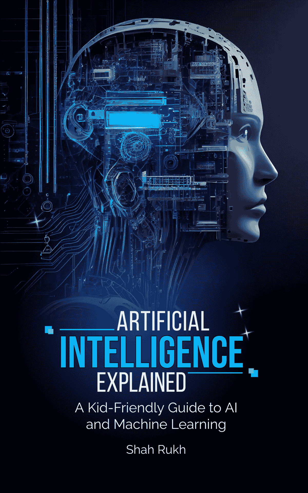

# 人工智能通俗指南：儿童的人工智能与机器学习指南

# 引言

欢迎阅读《人工智能解读：孩子友好的 AI 与机器学习指南》。想象一个机器可以思考、学习并做出决策的世界，这并非科幻，而是 AI 的现实。在这本书中，我们将探索 AI 的宇宙，从 AI 的历史到机器学习的魅力。但 AI 到底是什么？它是如何工作的？它又是如何影响我们的？这些都是我们要回答的问题。

无论你是对技术充满好奇的心灵，还是寻求解释 AI 的家长或教育者，亦仅仅是对机器感兴趣，这本书都是你的指南。我们将手手引导你，通过故事、解释和项目，向你展示 AI 如何工作、它为什么重要，以及它是如何改变我们的思考、工作和互动。你将发现 AI 世界的英雄、塑造技术的卓越大脑，甚至探索随之而来的伦理困境。

那么，准备好开启 AI 世界之旅了吗？系好安全带，冒险现在开始！

# 第一章：什么是人工智能？

人工智能，通常称为 AI，是一个迷人的科学技术领域，围绕创建能够模拟人类智能的机器和程序展开。这就像教计算机像人类一样思考、学习和决策。AI 旨在赋予机器执行通常需要人类智能的能力，例如理解语言、识别模式、解决问题以及适应新情况。

## 人工智能的起源

AI 的概念可以追溯到古代的神话和通过神秘手段赋予生命的人形故事。然而，现代 AI 的根源可以追溯到 20 世纪中期，当时计算机科学家开始探索创建能够模仿思维过程的机器的想法。“人工智能”一词是 1955 年由美国计算机科学家约翰·麦卡锡在著名的达特茅会议上首次提出的。

## AI 的类型

AI 可分为两大类：窄 AI（或弱 AI）和通用 AI（或强 AI）。窄 AI 指的是为特定任务设计和训练的系统，例如语言翻译、下国际象棋或自动驾驶汽车。这些系统在特定专业领域表现出色，但缺乏将其知识泛化到其他任务的能力。另一方面，通用 AI 旨在创建拥有人类智能的机器，能够理解、学习并执行人类可以完成的任何智力任务。

## AI 中的核心概念

- **机器学习**：这是 AI 的子集，涉及训练机器从数据中学习。我们不是显式地为机器编写任务程序，而是为其提供数据和算法，使其能够随着时间的不断学习和改进。机器学习算法应用于各种领域，例如图像识别、垃圾邮件检测和推荐系统。

## 2. 神经网络
神经网络受人脑结构的启发，是人工智能的基础构建模块。这些相互连接的人工神经元层能够处理信息并识别模式，允许机器根据复杂的数据输入做出决策。

## 3. 自然语言处理 (NLP)
NLP 让机器能够理解、解释和生成人类语言。它是驱动 Siri 等虚拟助手以及能够与用户对话的聊天机器的动力。

## 4. 计算机视觉
这涉及教机器解释和理解来自世界的视觉信息，就像人类感知和识别物体、脸部和场景一样。

## 5. 机器人
人工智能与机器人技术是密相分的。配备了 AI 的机器人可以自主执行任务，例如流水线工作、医疗程序，甚至探索对人类危险的环境。

## 日常中的 AI
AI 已经成为我们日常生活不可不可缺的一部分。从建议我们看什么电影或买什么产品的推荐算法，到回答我们问题的语音助手，AI 无处不在。社交媒体平台利用 AI 来个性化我们的推送内容，而在 AI 驱动技术的下，自动驾驶汽车正在成为现实。

## 挑战与伦理考量
随着 AI 的进步，它带来了许多重要的问题和挑战。这些包括对自动化导致工作流失的担忧、AI 算法中的偏差、数据隐私，以及 AI 超越人类控制的潜力。在确定 AI 创建者和用户的责任时，会产生伦理考量。

## 未来可能性
AI 的未来既令人兴奋又充满不确定。研究人员和科学家努力开发更先进的 AI 系统，推向机器成就的边界。实现人类级通用人工智能的目标虽然还是一个遥远的梦想，但它激励了该领域持续的研究和创新。

## 结论
总之，人工智能代表了进入能够思考、学习和适应的机器领域的程，挑战了我们对智能含义的理解。从历史根源到目前的进展和未来的愿景，AI 是一个动态领域，含着改变我们生活各个方面的承诺，从医疗保健和交通到通信和娱乐。当我们深入本书的章节时，我们将揭发现让 AI 成为今天世界驱动力的机制和奇迹。

# 第 2 章：神奇的机器世界
在我们现代世界中，机器无处不在，无缝地织入我们日常生活的结构之中。从我们醒来到晚上睡觉，我们都在与让我们的生活更轻松、更高效、更紧密的机器进行互动。第 2 章深入探讨了“神奇的机器世界”，探索了机器惊人的种类、演变以及对社会的影响。

## 历史历程
几个世纪以来，机器一直是人类文明不可或缺的一部分。从锤子和滑轮等简单工具到打印机和蒸汽机等复杂发明，人类一直受到创造能够执行任务、提高生产力和扩展我们能力的机器的渴望驱动。工业革命标志着历史上的一个关键时刻，机器开始重塑整个行业，并彻底改变我们的生活和工作方式。

## 机器的类型
机器以惊人的形式出现，每种形式都是为特定目的而设计的。以下是一些在我们生活中起着关键作用的机器类别：

1. **简单机器**：这些是更复杂设备的构建模块。杠杆、滑轮、螺丝、斜面、轮子和轴是简单机器的例子，它们放大了我们的体力。
2. **交通机器**：汽车、火车、飞机、船只和自行车是让我们比双腿走得更快、更远的机器。
3. **通信机器**：从电话、收音机到智能手机和互联网，通信机器连接了全球各地的人，实现了信息和想法的即时共享。
4. **制造机器**：工厂里的机器人和流水线改变了产品的制造方式，提高了效率精度。
5. **娱乐机器**：电视、游戏机和流媒体设备将娱乐带入我们的家，让我们沉浸在虚拟世界和引人入胜的叙事中。
6. **医疗机器**：X 光机、MRI 扫描仪和机器人手术设备正在彻底改变医疗保健，实现了准确的诊断和微创手术。

## 数字化革命
在过去的几十年里，计算机和数字技术的崛起产生了一个新的机器时代，它们不仅在物理世界运行，而且在数字领域运行。计算机、平板电脑、智能手机和可穿戴设备已成为我们的延伸，增强了我们的认知能力，能够即时访问信息并促进全球连接。

## 机器智能
机器与人工智能（AI）相结合将机器的能力推向前所未有的水平。AI 允许机器从数据中学习、识别模式、做出决策，甚至模拟人类的思维。这导致了虚拟助手、推荐系统、自动驾驶汽车以及能够精确执行复杂任务的机器人的发展。

## 社会影响
机器的普及重塑了我们工作、交流和娱乐的方式。它改变了从制造业、农业到金融和医疗保健的行业。机器和 AI 驱动的自动化引发了对工作流失以及员工进行重新培训和技能提升的担忧。

## 伦理与环境考量
虽然机器提供了许多好处，它们也带来了伦理和环境挑战。数据隐私、算法偏差、电子垃圾和机器的碳足迹等问题在我们继续将技术整合到生活中时需要仔细考虑。

## 未来愿景
随着技术的不断进步，机器世界将变得更加惊人。我们想象的未来，机器与人类无缝协作，增强我们的能力并解决复杂的挑战。从智能城市和可持续能源解决方案到 AI 驱动的医疗保健和太空探索，可能性是无限的。

## 结论
总之，“神奇的机器世界”是人类智慧和创新的见证。从古代工具到尖端 AI 系统，机器一直推动我们前进，塑造了我们的世界，并挑战了我们对可能性的理解。当我们继续探索本章的页面时，我们开启了一场穿越时空技术的旅程，揭发现定义人机之间复杂关系的机制和奇迹。

# 第 3 章：AI 如何思考：理解算法
人工智能（AI）的核心是复杂的算法网络——这些让机器能够思考、学习和决策的数字指令。第 3 章深入探讨了算法迷人的世界，揭开它们的内部机制，探索它们在 AI 中的作用，并阐明它们如何模拟人类的思维过程。

## 什么是算法？
算法是用于解决特定问题或执行特定任务的逐步指令集。将其想象成一份食谱，引导机器执行一系列定义良好的动作以实现预期结果。算法以各种形式存在，几个世纪以来一直被人类用来解决问题，从求解数学方程到在城市街道导航。

## AI 的构建模块

# 算法是 AI 系统的基石。它们是驱动 AI 应用背后智能的无形力量，允许机器处理数据、学习模式并自主做出决策。算法经过精心设计和微调，以执行模拟人类认知过程的任务。

## 机器学习与算法
算法与 AI 之间最迷人的交叉点之一是机器学习领域。机器学习算法使机器能够从数据中学习，在没有显式编程的情况下识别模式并做出预测。这些算法随着处理数据的增加而演进，随着时间的推移完善其预测和见解。

## 算法类型
1. **监督学习算法**：在监督学习中，机器从带有标签的数据中学习，即提供了正确答案。算法分析数据并根据其识别出的模式做出预测。
2. **无监督学习算法**：无监督学习涉及在未标记的数据上训练机器，使其能够在没有先验指导的情况下发现隐藏模式或分组。
3. **强化学习算法**：受行为心理学的启发，强化学习算法通过试错来学习。机器做出正确决策会获得奖励，错误决策则受到惩罚，从而逐渐提高性能。
4. **聚类算法**：这些算法将相似的数据点分在一起，帮助发现大型数据集中的模式。它们通常用于市场细分和数据分析。
5. **分类算法**：分类算法将数据分为不同的类或类别。它们被用于图像识别、垃圾邮件过滤和医学诊断。
6. **回归算法**：回归算法根据输入数据预测数值。它们被用于股市预测和销售趋势预测等任务。

## 算法偏见与公平性
虽然算法是强大的工具，但它们并不能免疫人类偏的影响。如果训练数据存在偏差，或者算法设计没有考虑到所有可能的情况，偏差就会渗透到算法中。确保算法的公平性并最大地减少偏差是 AI 开发中的一项关键挑战。

## 探索算法创造力
算法还可以展现出创造力，生成新的想法、艺术和音乐。创造性算法分析现有模式，将其拆解并以新颖的方式重新组合，往往令其人类创造者感到惊讶。

## 伦理与责任
随着算法成为决策过程中不可或缺的一部分，伦理问题也随之产生。开发者必须考虑其算法对隐私、安全和社会影响的影响。透明且负责的设计对于减轻意外后果至关重要。

## 算法的局限性
虽然算法是卓越的工具，但它们并非无懈可击。它们的优劣取决于训练它们的数据，并且在处理涉及常识推理、情感理解和整体上下文理解的任务时显得力不从心。

## 未来前沿
算法世界是动态且不断演变的。研究人员继续开发更先进的算法，以推向 AI 能力边界。例如，量子算法利用量子力学原理来比经典算法更快地解决复杂问题。

结论，理解算法对于掌握 AI 的本质至关重要。这些数字配谱使机器能够处理信息、从数据中学习并做出明智的决策。当我们深入探索 AI 领域并探索算法的复杂性时，我们揭示了让机器以类比人类认知的方式进行思考、学习和演化的机制。

# 第 4 章：结识智者们：机器学习基础
机器学习作为人工智能的一个子集，就像一群数字智者，它们从数据中学习，并在没有显式编程的情况下做出预测或决策。第 4 章将带你进入机器学习世界的全面旅程，解释其核心概念、类型、流程以及它对我们生活各个方面产生的巨大影响。

## 机器学习的基础
机器学习的核心在于训练机器从数据模式中学习。就像人类从经验中学习一样，机器学习算法从数据中学习以做出明智决策。这就像通过向电脑展示数千张猫的照片来教它识别猫。

## 机器学习的类型
1. **监督学习**：在这种类型中，机器从带有标签的数据中学习，即提供了正确答案。例如，通过展示狗和猫的示例来教会机器区分它们的图像。
2. **无监督学习**：在这里，机器从未标记的数据中学习并独立识别模式或分组。想象一下在不告诉机器哪种水果是什么的情况下对混合水果进行分类。
3. **强化学习**：受行为心理学的启发，强化学习涉及对机器的正确决策给予奖励，对错误决策进行惩罚。这有助于它们通过试错来学习。

## 机器学习流程
1. **数据收集**：旅程始于收集相关数据。例如，收集天气数据以预测降雨。
2. **数据预处理**：原始数据可能是混乱的。这一步涉及为机器学习算法对数据进行清洗、组织和格式化。
3. **特征提取**：特征是数据的不同属性，有助于机器理解模式。在图像识别中，特征可以是边缘、颜色和形状。
4. **模型选择**：选择正确的算法或模型至关重要。这就像为特定工作选择最好的工具。
5. **模型训练**：在训练期间，模型从数据中学习，调整其内部参数以识别模式。
6. **评估**：训练完成后，用新数据对模型进行测试以查看性能。这一步有助于识别模型是否过拟合或欠拟合。
7. **微调**：如果模型表现不好，则通过调整参数或尝试不同的算法进行微调。
8. **部署**：一旦模型准备好，就会投入运行，根据新数据做出预测或决策。

## 现实世界应用
机器学习改变了各个行业：
* **医疗健康**：通过医学影像诊断疾病、预测患者结果并个性化治疗方案。
* **金融**：检测欺诈、信用评分和股市预测。
* **零售**：根据客户偏好推荐产品、优化供应链并预测销售趋势。
* **交通**：驱动自动驾驶汽车、优化交通流并预测维护需求。
* **娱乐**：定制电影和音乐推荐、增强游戏体验并生成内容。

## 挑战与考虑
机器学习是强大的，但并非没有挑战：
* **偏见与公平性**：有偏见的训练数据可能导致偏见的预测，加剧现有的不平等。
* **数据隐私**：处理敏感数据需要严格的隐私措施来保护个人。
* **可解释性**：复杂的机器学习模型可能难以解释，使得难以理解其决策过程。

## 未来道路
随着技术的进步，机器学习持续不断演变。深度学习作为机器学习的一个子集，其处理图像和文本等复杂数据的能力正引起轰动。量子机器学习利用量子计算的力量也指日可待，有望带来更强大的能力。

总结来说，机器学习是人工智能智能行为背后的动力。通过理解其基本概念、过程和应用，你开启了一个新世界的大门，在这个世界上，机器学习、适应并以镜像人类智能的方式提供帮助。机器学习的大才们正在塑造我们的未来，使我们能够解决复杂问题、做出明智决策并开启创新的新边界。

# 第 5 章：位与字节：计算机的语言

在数字时代，计算机在我们生活的几乎每一个方面都发挥着不可或缺的作用，理解计算机的语言至关重要。第 5 章深入探讨“位与字节”这一迷人的世界，揭示了二进制代码、数据表示以及允许计算机通信、计算和创建的复杂过程。

## 二进制代码：计算机的语言

计算机的核心是一种简单而强大的语言：二进制代码。与使用字母和单词的人类语言不同，计算机仅使用两个符号进行通信：`0` 和 `1`。这些二进制数字也被称为 `bits`，它们构成了所有数字信息和计算的基础。

## 位与字节：信息的构建块

单个二进制数字被称为 `bit`，它代表了计算中最小的信息单位。八个位组合在一起形成一个 `byte`。字节是用于在计算机内存中表示字符、数字和指令的构建块。

## 数据表示：从数字到文本

使用各种编码方案来表示类型的数据：

*   **数值数据**：数字使用二进制数字表示。计算机通过操作数字的二进制表示执行算术运算。
*   **文本数据**：文本字符使用 `ASCII` 或 `Unicode` 等标准进行编码。每个字符都被分配有一个唯一的二进制代码，允许计算机在屏幕上显示文本并在纸张上打印。
*   **图像与图形**：图像使用像素表示，每个像素都由定义颜色和强度的位组合描述。
*   **声音与音频**：声音通过在特定间隔内对其波形进行采样来实现数字化，将模拟信号转换为一系列二进制值。

## 二进制运算与逻辑

计算机使用二进制运算（如加法、减法、乘法和除法）处理数据。这些运算通过逻辑门执行，逻辑门是在二进制输入上执行布尔逻辑函数（`AND`、`OR`、`NOT`）的电子电路。

## 内存与存储

计算机将信息存储在内存中，内存可以是易性的（暂时的），也可以是非易性的（永久的）。随机访问存储器（`RAM`）是用于临时数据存储易性内存，而硬盘和固态硬盘是用于长期数据的非易性存储设备。

## 机器码与编程语言

机器码是计算机理解的最底层语言。它由直接控制计算机硬件的二进制指令组成。`Python`、`Java` 和 `C++` 等编程语言提供了一种更符合人类习惯的编写代码方式。这些高级语言被编译或解释为机器码以执行。

## 二进制挑战与十六进制和谐

由于长度和复杂性，读取和编写二进制代码对人类来说具有挑战性。十六进制（16 进制）表示法提供了二进制值的更简洁的表示，使程序员更容易处理和调试代码。

## 数据压缩与加密

数据压缩技术减小了文件大小，使其更容易存储和传输。加密方法使用复杂的算法来保护数据，确保只有授权部分可以访问数据。

## 互联网的语言

互联网是一个互连计算机的庞大网络，它依赖二进制代码。

## 新趋势：量子比特 (Qubits)

随着技术的进步，`qubits` 可以同时表示多个状态。

# 第 6 章：从计算器到思考者：AI 的演变

人工智能（`AI`）的历程跨越了十年，展示了机器的变革。

## 早期起源

人工智能的种子早在 20 世纪初播下，当时像 `Alan Turing` 这样的远见者提出了机器模仿人类智能的概念。

## AI 作为一个领域的诞生

“人工智能”一词由 John McCarthy 在 1955 年创造。1956 年的`达特茅研讨会`汇聚了 `Marvin Minsky` 和 `Herbert Simon` 等先驱。

## 早期的成就与挑战

在 20 世纪 50 年代和 60 年代，人工智能研究专注于符号人工智能，计算机处理符号来模拟思维过程。像 `ELIZA`（模拟对话）和处理逻辑问题的 `General Problem Solver` 等程序展示了早期的 AI 能力。然而，最初的乐观由于过度的预期和有限的进展而导致了“AI 寒冬”，这是一个资金减少、怀疑增加的时期。

## 专家系统的兴起

在 20 世纪 70 年代和 80 年代，人工智能研究将重点转向专家系统——模拟特定领域人类知识的计算机程序。用于诊断感染的专家系统 `MYCIN` 和推断分子结构的 `DENDRAL` 是著名的成功案例。

## 机器学习与神经网络

20 世纪 80 年代，在机器学习和神经网络突破的推动下，见证了人工智能的复兴。然而，进展由于计算能力的限制和“维度灾咒”而受到阻碍。

## 互联网时代与大数据

20 世纪 90 年代末和 21 世纪初，见证了人工智能与互联网的融合，以及大数据的兴起。搜索引擎、推荐系统和电子商务平台利用了人工智能。

## 深度学习的复兴

2010 年左右，深度学习（一种使用具有多层神经网络的机器学习子集）引发了一场革命。深度神经网络在生活的各个领域展现了卓越的能力。

## AI 对社会的影响

人工智能的演变对社会产生了深刻的影响：

*   **医疗健康**：AI 辅助医学影像、药物发现和疾病诊断。
*   **交通**：自动驾驶汽车和 AI 驱动的交通管理有望带来更安全、更高效的交通。
*   **金融**：AI 优化交易策略、检测欺诈并自动化客户交互。

* **教育**: AI 驱动的工具提供了个性化的学习体验并提供自适应反馈。
* **娱乐**: 流媒体平台和视频游戏利用 AI 进行内容推荐和角色行为设计。
* **环境可持续**: AI 为气候建模、可再生能源优化和野生动物保护做出贡献。

## 伦理与社会思考

AI 的演进引发了关于透明度、问责、偏见和职业流失的伦理问题。AI 超越人类能力的潜力（被称为“奇点”）引发了哲学和存在主义的忧虑。

## AI 的未来

AI 的历程远未结束。研究人员正致力于实现通用 AI，即具备类人认知能力的机器。量子计算、脑机接口以及 AI 驱动的各领域进展，共同预示着一个 AI 与人类智能协同工作以解决复杂全球挑战的未来。

总之，AI 的演进是人类好奇心、创新和毅力的见证。从作为一个概念的卑微起点，到如今作为一种变革性力量，AI 已从计算器演变为思考者，重塑了行业，彻底改变了技术，并挑战着我们对智能本身的理解。在我们探索 AI 的演进时，我们洞察了其非凡的历程，以及在这个智能机器定义的时代所面临无限可能。

# 第 7 章：身边的机器人：日常生活中的 AI

在现代社会，我们发现自己被各种机器人和 AI 驱动的技术包围，这些技术无缝地融入了我们的日常生活。第 7 章探索了“我们身边的机器人”这一迷人领域，深入探讨了人工智能如何使机器成为我们的伙伴、助手，甚至是自身的延伸，塑造了我们生活、工作以及与世界互动的方式。

## 机器人技术的兴起

机器人学与 AI 的融合产生了能够执行此前被认为人类专属任务的机器人。从家务到复杂手术，机器人彻底改变了行业，并改变了我们对自动化的认知。

## 家中的机器人

机器人已经进入我们的家庭，让日常生活变得更加便利高效。`Roombas` 清扫地板，像 `Amazon's Alexa` 和 `Google Assistant` 这样的智能助手回答我们的问题，机械臂协助我们烹饪和清洁。

## 辅助机器人

机器人在协助残障或活动受限的人士方面证明了不可价值的价值。由 AI 赋能的假肢、外骨骼和辅助设备使人们重新获得独立和行动能力。

## 医疗与健康

机器人在医疗保健中起着关键作用，能够精确执行手术并减少人为错误。机器人助手帮助患者进行物理治疗，而 AI 驱动的诊断工具有助于早期发现疾病。

## 制造业与工业

工厂和制造厂已采用机器人来执行重复性和危险的任务。这些机器人提高了效率，降低了成本，并增强了工人安全。

## 农业

配备了 AI 和传感器的农业机器人可以自主监测作物、施肥，甚至收获农产品。这不仅提高了生产力，还减少了挑战环境中对人类劳动力的需求。

## 教育与学习

机器人伙伴增强了学生的学习体验，协助语言学习、问题解决和技能培养。这些机器人提供了根据个人需求定制的个性化学习。

## 探索与研究

机器人被送到探索危险或无法触及的地方，例如深海探索、太空任务和灾区。这些机器收集数据，使我们能够扩展对世界及之外的认知。

## 伦理思考

机器人融入我们的生活引发了伦理问题。当机器人执行此前是人类收入来源的任务时，会发生什么？确保透明度、问责制和安全性至关重要。

## 人机交互

开发人类与机器人交互的直观界面至关重要。机器人学与 AI 的融合标志着我们与技术关系的重大转变。

## 机器人与 AI 的未来

随着 AI 的不断演进，机器人将变得越来越复杂和多功能，塑造一个人类与机器共存的未来。

## 挑战与承诺

机器人和 AI 的承诺是无限，但在职业流失和伦理指南方面仍然存在挑战。

### 因素

尽管功能强大，人性仍然不可替代。同理心、创造力和情感智能是机器人无法复制的方面。

# 第 8 章：AI 与创意：机器能成为艺术家吗？

创意长期以来被认为是人类独特的特质，现在正被注入人工智能（AI）的机器所探索。第 8 章深入探讨“AI 与创意”的世界，揭示了机器尝试创作艺术、音乐、文学等的精彩历程。当我们深入这一章时，我们探索了其中的可能性、挑战和哲学意义。

## 创意 AI 的出现

传统上，创意被视为人类想象、情感和意识的产物。然而，AI 的进步挑战了这一观点，因为机器现在展示了生成能够激发情感并启发思考的创意输出的能力。

## 视觉艺术中的 AI

机器正在创作模仿各种艺术风格的绘画、插和数字艺术。AI 驱动的工具可以分析现有艺术品并以其为灵感创作原创作品。这引发了关于艺术原创性和作者身份定义的疑问。

## 音乐 AI：创作新的和声

AI 驱动的算法可以创作音乐，模仿古典作曲家的风格，甚至生成完全新的音乐流派。这些作品受到了音乐家和作曲家的热情支持和怀疑态度。

## 文学 AI：编写故事和诗歌

AI 算法通过分析海量现有文学来创作故事、诗歌甚至小说。一些 AI 生成的文本被误认为是人类创作的作品，展示了机器模仿人类语言和叙事能力的潜力。

## 电影与娱乐：剧本创作与创意

AI 甚至涉足电影和娱乐领域。某些工具可以生成剧本，另一些工具则协助视频编辑和特效。但机器能复制电影制作人微妙的创意吗？

## 挑战与局限性

尽管 AI 的创意尝试令人印象深刻，但它们伴随着挑战：

* **缺乏原创性**: AI 生成的内容通常严重依赖于现有数据，引发了对真正创造力和创新的担忧。

- **情感深度**：虽然 AI 可以模拟情感，但创造出能与人类情感产生深度共鸣的艺术仍然是一项挑战。
- **理解背景**：AI 难以理解塑造人类创造力的复杂文化、历史和背景因素。
- **人类解读**：AI 生成的艺术缺乏塑造人类创作的个人经历和文化背景，使其意图难以被解读。

## 协作与增强
AI 并非取代人类创造力，而是作为艺术家的工具，增强他们的创作过程。人类与 AI 之间的协作产生了融合了双方优势的独特作品。

## 哲学思考：什么是创造力？
AI 生成创造力的兴起引发了关于创造力本质的哲学辩论。机器真的能体验驱动人类创造力的情感和灵感吗？还是它们仅仅在模拟从数据中学习到的模式？

## 突破边界：生成对抗网络 (GANs)
生成对抗网络是相互竞争的 AI 系统——其中一个生成内容，另一个则评估其真实性。`GANs` 催生了惊人的的作品，从栩如生的图像到挑战我们现实认知的艺术。

## 伦理维度
作者身份、所有权和 AI 生成艺术的商业化问题引发了伦理关注。谁拥有 AI 创建作品的权利？它们在创意生态系统中应如何估值？

## AI 与人类灵感
AI 的创作尝试也为人类创作者提供了灵感来源。技术与艺术表达的融合可以导致超越传统边界的新型艺术形式。

总之，对 AI 和创造力的探索为人机协作的未知领域开启了大门。当我们思考机器是否能成为艺术家时，我们面对的不仅仅是 AI 的技术成就，还有人类想象力和情感的本质。从绘画到诗歌，从音乐到电影，创作版图正在演变，挑战着我们重新定义创造力、作者身份，以及在这个机器在灵感边缘起舞的世界里，作为艺术家的本质。

# 第 9 章：与机器对话：自然语言处理导论

在不断发展的人工智能领域，最显著成就之一是机器理解、解读和生成人类语言的能力。第 9 章向我们介绍了“自然语言处理”（`NLP`）这一迷人的世界，揭示了让计算机以既直观又非凡的方式与人类交流的复杂机制。

## 语言的力量
语言是人类交流的基本模式，使思想、情感和知识的交换成为可能。`NLP` 旨在缩小人类语言与机器理解之间的差距，改变我们与技术交互的方式。

## 什么是自然语言处理？
自然语言处理是 `AI` 的一个分支，专注于让计算机能够以有意义且符合语境的方式理解、分析和生成人类语言。它涉及教机器阅读、理解并响应文本或语音输入，使人机交互更加自然且对用户友好。

## NLP 核心概念
1. **分词 (Tokenization)**：将一段文本分解为单个单词、短语或标记以进行分析。
2. **词性标注 (Part-of-Speech Tagging)**：识别句子中每个词的语法词性（名词、动词、形容词）。
3. **命名实体识别 (Named Entity Recognition)**：识别并分类文本中的命名实体（如人名、地点、机构）。
4. **情感分析 (Sentiment Analysis)**：确定文本的情感色调，是积极、消极还是中。
5. **语言生成 (Language Generation)**：根据输入创建连贯且符合上下文的文本，用于机器人、虚拟助手和内容创作。
6. **机器翻译 (Machine Translation)**：将文本从一种语言翻译成另一种语言，如 `Google Translate` 等工具所示。
7. **问答 (Question Answering)**：教机器根据给定上下文回答问题，如搜索引擎和虚拟助手所演示。

## NLP 面临的挑战
`NLP` 是一个具有独特挑战的复杂领域：
* **歧义性 (Ambiguity)**：词语根据上下文可能有多种含义，这会困扰机器。
* **语境理解 (Context Understanding)**：`NLP` 模型难以理解细微的语境和文化背景。
* **讽刺与幽默**：由于依赖字面理解，机器难以识别讽刺和幽默。
* **数据质量与偏见**：偏见或标注不当的训练数据会导致错误的 `NLP` 模型。

## NLP 中的机器学习
机器学习算法是 `NLP` 成功的核心：
* **监督学习 (Supervised Learning)**：从标记数据中学习进行预测或分类，例如垃圾邮件。
* **无监督学习 (Unsupervised Learning)**：聚类算法将相似的文档或单词聚集在一起。
* **强化学习 (Reinforcement Learning)**：用于机器人根据交互学习最佳响应。

## NLP 中的神经网络
深度学习作为机器学习的一个分支，变革了 `NLP`：
* **词嵌入 (Word Embeddings)**：将单词表示为向量，捕捉语义关系。
* **循环神经网络 (RNNs)**：处理序列数据，对于理解语言上下文至关重要。
* **Transformer 架构**：驱动了 `BERT` 和 `GPT` 等模型，它们擅长理解语境和生成文本。

## 生活中的 NLP
`NLP` 已渗透到生活的各个方面：
* **虚拟助手**：`Siri`、`Alexa` 和 `Google Assistant` 可以理解并响应语音指令。
* **搜索引擎**：`Google` 提供相关结果的能力取决于 `NLP` 算法。
* **社交媒体**：情感分析帮助公司判断公众观点。
* **语言翻译**：`NLP` 算法驱动了打破语言障碍的工具。

## 伦理考量
`NLP` 也引发了伦理问题：
* **隐私**：分析可能会可能会个人的敏感信息。
* **偏见**：`NLP` 模型可能会继承训练数据中的偏见，导致偏见或不公平的结果。

## 未来方向
`NLP` 是一个不断发展的领域，充满无限可能：
* **对话式 AI**：开发能够进行更自然、内容丰富的对话的聊天机器人。
* **多语言 NLP**：增强 `NLP` 模型以更好地处理多种语言和方言。
* **情感与语境理解**：推进 `NLP` 识别情感并理解细微语境。

总之，自然语言处理是语言理解与技术创新融合的见证。当我们翻阅《与机器对话》的篇页时，我们揭示了 `NLP` 的变革力量，它缩小了人类语言与机器理解之间的差距。从像朋友一样聊天的机器人到分析情感的算法，`NLP` 正在重塑我们与技术交互的方式，展示了机器掌握人类交流细微之处的巨大潜力。

# 第 10 章：计算机看得吗？探索计算机视觉

### 计算机视觉的愿景

正如人类肉眼捕捉世界的视觉精髓一样，计算机视觉赋予机器感知和理解图像及视频的能力。这一人工智能领域赋予了计算机卓越的能力，使其能够解释视觉信息，并根据它们“看到”的内容做出明智的决策。

## 从像素到理解

计算机视觉的核心是将原始像素数据转换为有意义的见解的过程。这不仅涉及识别形状和物体，还涉及理解语境、关系甚至情感。

## 计算机视觉中的关键概念

1. **图像预处理**：原始图像通常需要预处理，包括降噪、缩放尺寸和色彩校正，以提高其分析质量。
2. **目标检测**：在图像或视频流中识别并定位物体，这是计算机视觉的一项基础任务。
3. **图像分类**：将图像归类为预定义的类别，例如识别图像中是否包含猫或狗。
4. **语义分割**：将图像中的每个像素分配给特定的物体或类别，实现细粒度的物体理解。
5. **特征提取**：识别图像中具有别性的特征或模式，以辅助识别和分析。
6. **深度学习与卷积神经网络 (CNNs)**：CNN 通过从原始像素数据中自动学习层次特征，彻底改变了计算机视觉。

## 计算机视觉的应用

计算机视觉的影响跨越多个领域：

* **自动驾驶汽车**：使汽车能够识别交通标志、行人和障碍，以实现安全导航。
* **医疗健康**：辅助医学图像分析、疾病诊断并指导手术流程。
* **零售**：利用面部识别技术提供个性化客户体验和无银银结算。
* **农业**：分析作物健康状况、检测疾病并优化灌溉。
* **安全与监控**：识别并跟踪个人、物体及潜在威胁。
* **增强现实 (AR) 与虚拟现实 (VR)**：通过将数字内容与现实世界融合来增强浸式体验。

## 计算机视觉面临的挑战

尽管计算机视觉取得了巨大成就，但挑战依然存在：

* **视觉数据的波动性**：光照变化、遮挡和视角变化挑战着算法的鲁棒性。
* **数据标注与偏差**：为训练标注海量数据集可能非常耗时且容易产生偏差。
* **领域适应**：在某数据集上训练的模型可能无法很好地泛化到新的、未见过的数据上。
* **理解语境与意图**：从视觉线索中获取深层语境并理解人类意图仍然是一个挑战。

## 伦理考量

计算机视觉引发了伦理关注：

* **隐私**：面部识别和监控技术涉及隐私问题。
* **偏差与公平**：训练数据中存在的偏差可能导致偏见的预测和决策。

## 跨学科协同

计算机视觉从多个领域汲取灵感：

* **神经科学**：对人类视觉的理解指导机器视觉系统的开发。
* **心理学**：认知见解指导类人视觉处理算法的创建。
* **工程学**：如专用 `GPUs` 等硬件创新加速了图像处理。

## 未来前沿

计算机视觉的轨迹指向了令人兴奋的发展：

* **3D 视觉**：使机器能够理解图像中的深度和空间关系。
* **情感识别**：通过面部表情和肢体语言检测人类情感。
* **AI 艺术**：生成能够引起情感的艺术视觉，类似于人类的艺术表达。

总之，对“计算机能看见吗？”的探索揭示了技术与感知之间的相互作用。当我们跨越计算机视觉的轮廓时，我们发现了一个机器解码图像和视频语言的世界。本章邀请我们见证像素到理解的转变，在此过程中，我们意识到计算机“看”的旅程不仅是为了复制人类视觉，更是为了揭示洞察、创新和解释的新维度，这些维度正以我们过去仅通过技术透镜才能想象的方式塑造着我们的未来。

# 第 11 章：智能助手：Siri 和 Alexa 如何工作

在无缝连接和技术无处不在的时代，智能助手的起改变了我们与设备交互以及获取信息的方式。第 11 章深入探讨“智能助手”的迷人世界，层层揭示了 Siri 和 Alexa 等智能虚拟伴侣的内部机制。当我们开启这段旅程时，将揭开让这些虚拟助手理解我们命令、智能响应并预判我们需求的复杂机制。

## 虚拟伴侣的黎明

智能助手是人工智能、自然语言处理和机器学习的结晶，为用户提供了一个连接人类与技术鸿沟的接口。苹果开发的 `Siri` 和亚马逊开发的 `Alexa` 是这些虚拟伴侣中最著名的例子。

## 理解自然语言

智能助手的核心是自然语言处理 (`NLP`)，这是一项使计算机理解人类语言的人工智能领域。`NLP` 算法将口语或输入的单词转换为机器可以理解和处理的结构化数据。

### 语音识别

智能助手使用复杂的语音识别算法识别并将口语转换为文本。这些算法处理音频信号，在识别音素和单词的同时过滤掉背景噪音和口音。

### 意图识别

一旦口语单词转换为文本，意图识别算法就会解析用户的意图或请求。这些算法分析对话的语境，以准确理解用户的需求。

### 语境理解

智能助手通过考虑用户的之前的指令、正在进行的对话和配置文件在理解语境方面表现出色。这种语境有助于它们生成相关的响应并根据个人偏好定制交互。

### 查询知识库

智能助手拥有巨大的知识库，不断更新从通用知识到用户特定的数据。当被提问时，它们会查询这些数据库以提供准确且相关的答案。

## 机器学习与个性化

机器学习算法在增强智能助手能力方面起着至关作用：

* **用户行为分析**：智能助手从用户交互中学习，以预判需求并提供个性化建议。
* **语音模式识别**：随着时间的推移，它们学会识别用户特定的语音模式和口音，提高语音识别的准确性。
* **语境预测**：机器学习模型根据语境、之前的交互和用户行为预测意图。

## 对话模型

为了创建更类人的交互，智能助手利用对话模型：

* **对话管理**：智能助手使用对话管理技术进行自然的往对话。
* **响应生成**：生成连贯且符合语境的响应需要先进的自然语言生成技术。

## 语音用户界面 (VUI)

语音命令是智能助手的核心，语音用户界面 (`VUIs`) 发着关键作用：

* **唤醒词**：智能助手通过唤醒词（例如“嘿 Siri”，“Alexa”）激活，这些词会触发系统开始监听用户的输入。

*   **语音命令**：用户通过语音命令来执行任务、进行查询、设置提醒等。

## 云端连接

智能助手利用云计算来处理和生成响应。自然语言理解和生成所需的复杂计算被被卸载到云端强大的服务器上。

## 伦理考量

智能助手整合到我们的生活中引发了伦理方面的关注：

*   **隐私**：在云端存储用户数据和对话会引发隐私问题。
*   **安全**：确保用户数据安全并防止未经授权的访问至关重要。

## 未来方向

智能助手的发展轨迹指向了令人兴奋的各种可能：

*   **多模态交互**：整合语音、视觉和手势，创造更丰富、更自然的交互。
*   **持续学习**：使智能助手能够从持续交互中学习，并适应不断变化的用户偏好。
*   **情感智能**：增强虚拟伙伴识别和响应用户情绪的能力。

## 结论

智能助手作为人工智能（AI）、自然语言处理（NLP）和机器学习的结晶，已成为我们信赖的数字伴侣。当我们揭开驱动 `Siri` 和 `Alexa` 的机制时，我们意识到这些虚拟实体不仅简化了我们的任务，还为人机交互的未来开启了一扇窗户。通过理解智能助手的复杂性，我们在这个领域中导航，在这里，技术不仅满足了我们的需求，还与数字生活中更深层次连接和更直观体验的潜力产生了共鸣。

# 第 12 章：游戏与人工智能：视频游戏背后的魔法

视频游戏已经从简单的娱乐形式演变为吸引全球玩家的沉浸式互动体验。在幕后，游戏与人工智能（AI）的结合在创造动态世界、智能对手和引人入胜的叙事方面发挥了关重要的作用。第 12 章探讨了“游戏与人工智能”迷人的融合，揭示了让视频游戏焕生起来并让玩家沉浸在非虚拟领域的复杂机制。

## 游戏的演变

游戏已从早期的像素化冒险演变为视觉震撼、叙事丰富的体验。人工智能在塑造这一演变、增强游戏性以及创造栩栩如生的虚拟世界方面发挥了关键作用。

## 人工智能与游戏设计

人工智能驱动着游戏设计的各个方面：

*   **非玩家角色 (NPCs)**：人工智能驱动的 `NPCs` 模拟人类行为，使游戏世界感觉充满活力且动态。
*   **自适应难度**：人工智能根据玩家的技能调整游戏难度，确保具有挑战性且令人愉快的体验。
*   **叙事生成**：人工智能可以根据玩家的选择生成分支剧情和对话，增强沉浸感。

## 游戏开发中的人工智能

游戏开发在多个方面受益于人工智能：

*   **程序化内容生成**：人工智能算法创建游戏关卡、环境和资产，节省了时间并了创造力。
*   **质量保证**：人工智能检测漏洞、故障和不一致之处，提高了游戏的稳定性和性能。
*   **动画**：人工智能驱动的动画工具简化了创建栩栩如生的角色动作的过程。

## NPC AI：赋予虚拟角色生命

人工智能驱动的 `NPCs` 贡献了现实感：

*   **路径规划**：人工智能为 `NPCs` 穿越复杂环境确定最优路径。
*   **行为模型**：`NPCs` 表现出决策、社交互动和情感等栩栩如生的行为。
*   **学习与适应**：`NPCs` 从玩家的操作中学习，并此调整它们的策略和响应。

## 敌人 AI：打造智能对手

敌人 AI 丰富了游戏体验：

*   **战术与策略**：人工智能控制的敌人采用战术、侧翼和团队协作来挑战玩家。
*   **自适应 AI**：敌人根据玩家的技能调整其行为。

## 生成内容

人工智能生成的内容增强了游戏体验：

*   **关卡设计**：人工智能创建能够响应玩家动作的独特关卡。
*   **纹理与艺术**：人工智能协助艺术家创建沉浸式视觉效果。
*   **声景**：人工智能创建动态声景以增强环境氛围。

## 玩家画像与个性化

人工智能对玩家进行画像分析以定制体验：

*   **玩家分析**：人工智能分析玩家行为以优化游戏设计。
*   **动态叙事**：人工智能根据玩家的选择生成事实上的叙事。

## 挑战与创新

游戏与人工智能面临挑战：

*   **现实性 vs 趣味性**：平衡现实感与乐趣。
*   **数据依赖**：人工智能模型需要大量数据。

## 新兴趋势

游戏与人工智能持续演进：

*   **虚拟现实 (VR) 与增强现实 (AR)**：人工智能增强沉浸感。
*   **对话 AI**：人工智能驱动的对话系统创造了丰富的交互。

## 游戏与人工智能的未来

随着人工智能不断进步，游戏体验将变得更加：

*   **虚拟现实 (VR) 与增强现实 (AR)**：人工智能增强 `VR` 和 `AR` 的沉浸感。
*   **对话 AI**：人工智能驱动的对话系统在玩家与 `NPCs` 之间创造了丰富的交互。

## 结论

游戏与人工智能形成了共关系，推动视频游戏行业向新的高度发展。当我们通过“视频游戏背后的魔法”时，我们了解了融合人工智能与叙事的魔力。游戏与人工智能的结合是人类想象力和技术能力的见证，邀请我们探索无限的世界，挑战我们的策略思维并体验非凡的快感。

*   设备侧训练：手机可以使用用户数据在设备上训练模型，从而增强个性化。
*   模型优化：设计轻量化模型，使其在资源受限的设备上良好运行。
*   迁移学习：预训练模型可以在手机上针对特定任务进行微调。

## AI 驱动的应用程序

智能手机 AI 增强了各种应用：

*   相机和成像：AI 提高了照片质量，能够检测人脸，并开启人像模式等功能。
*   语音识别：AI 驱动的语音识别为语音助手和转录服务提供支持。
*   虚拟助手：Siri、Google 助理等利用 AI 提供个性化帮助。
*   语言翻译：AI 驱动的应用可以实时翻译文本和语音。
*   健康与福祉：AI 监控身体活动、睡眠，甚至识别潜在的健康问题。

## AI 与隐私与安全

AI 增强了智能手机的安全性和隐私保护：

*   生物识别认证：AI 驱动的人脸识别和指纹传感器提供了安全的登录方式。
*   异常检测：AI 会标记可能预示安全威胁的设备异常行为。
*   个人数据控制：设备侧 AI 减少了与云端共享个人数据的需求。

## 挑战与考虑

将 AI 集成到手机中面临挑战：

*   资源限制：在 AI 能力与有限的电池寿命及处理能力之间平衡。
*   数据隐私：保护用户数据并确保透明的数据处理实践。
*   算法公平性：确保 AI 驱动的功能无偏见且对所有用户可用。

## 智能手机 AI 的未来

智能手机的 AI 能力将继续进化：

*   AI 加速器：专用硬件加速器优化了 AI 计算，提高了效率。
*   边缘 AI：设备侧 AI 将变得更加复杂，处理以前需要云端的任务。
*   上下文理解：AI 将更好地理解用户语境，以提供更相关性的交互。
*   个性化体验：AI 驱动的个性化将扩展到各种智能手机功能。

## 结论

随着智能手机成为我们不可或缺的延伸，AI 的集成将它们转变为智能伴侣。“口袋中的 AI”揭示了尖端技术的汇，这些技术增强了我们从拍照到管理健康的日常互动。通过探索本章，我们开启了一段连接以人为本的设计与机器智能领域的旅程，承诺了一个未来：智能手机将真正适应我们的需求，通过定制化体验、连接以及指尖人工智能的魔法来丰富我们的生活。

# 第 14 章：虚拟现实与 AI 世界

虚拟现实（VR）和人工智能（AI）是两项技术支柱，重塑了我们对现实、交互以及人类体验边界的理解。第 14 章深入探讨了“虚拟现实与 AI 世界”这一引入迷的融合，揭示了这些领域之间的共生关系，并探索了它们在行业、娱乐、教育等领域具有变革性的影响。

## 虚拟现实：现实之外的瞥

虚拟现实将用户沉浸在合成环境中，带他们超越物理世界的限制。通过 VR，用户使用头戴将周围环境替换为计算机生成的 3D 环境，使他们能够在数字领域中进行交互并在其中导航。

## 人工智能：驱动智能虚拟领域

AI 为 VR 体验注入了生命，实现了智能交互和动态内容生成：

*   自然语言处理（NLP）：AI 驱动的语音识别和文本处理增强了 VR 交互。
*   图像和物体识别：AI 识别并响应 VR 环境中的用户手势、动作和物体。
*   个性化：AI 根据用户的偏好、交互和行为调整 VR 体验。

## 娱乐中的 VR 与 AI

娱乐业受到了 VR 和 AI 结合的深刻影响：

*   沉浸式叙事：VR 赋予了 AI 驱动叙事力量，使用户成为故事的一部分。
*   交互式游戏：AI 通过调整敌人行为、挑战和情节来增强游戏性。
*   真实的角色：VR 环境中的 AI 驱动 NPC 表现出栩如生的行为和交互。

## 培训与模拟

VR 和 AI 在培训和模拟场景中有应用：

*   飞行模拟：AI 驱动的虚拟飞行员对用户操作做出真实反应，增强了飞行员培训。
*   医学培训：VR 场景结合 AI 模拟医疗程序，辅助医学生的学习。
*   灾难准备：在 AI 引导下，VR 模拟为响应人员提供各种灾难场景的训练。

## 医疗与治疗

VR 和 AI 在医疗领域具有转型潜力：

*   物理康复：AI 适应的 VR 运动引导患者进行康复程序。
*   暴露疗法：AI 引导的 VR 模拟帮助患者面对恐惧症和焦虑触发因素。

## 教育与学习

VR 和 AI 重塑了教育体验：

*   历史沉浸：AI 增强的 VR 让学生能够亲身经历历史事件。
*   语言学习：AI 驱动的 VR 提供了沉浸式的语言学习环境。
*   STEM 教育：由 AI 驱动模拟增强的 VR 环境增强了科学和数学的学习。

## AI 生成的虚拟现实

AI 被用于生成 VR 内容：

*   程序化生成：AI 算法创建具有各种景观和结构的详细 VR 世界。
*   纹理合成：AI 帮助为 VR 环境生成真实的纹理。

## 挑战与考虑

VR 与 AI 的交叉点带来了挑战：

*   硬件与处理能力：提供无缝的 VR 体验需要大量的计算资源。
*   真实性与恐怖谷：在实现真实的 VR 视觉效果的同时避免“恐怖谷”效应是一项复杂的任务。
*   伦理忧虑：AI 引导的 VR 带来了关于用户隐私、数据安全和负责任内容创建的问题。

## 新兴趋势

VR 和 AI 的格局持续演变：

*   社交 VR：AI 驱动的虚拟形象和交互实现了虚拟世界内的社交连接。
*   脑机接口（BCIs）：由 AI 控制的脑机接口为意念控制 VR 体验开启了大门。
*   AI 生成的触觉反馈：AI 驱动的模拟增强了 VR 环境中的触感体验。

## 结论

“虚拟现实与 AI 世界”揭开了一个想象与技术相遇的领域，赋予我们进入由 AI 智能驱动的虚拟世界的机会。通过本章，我们探索了 VR 的沉浸能力与 AI 的动态适应能力之间的协同作用，揭示了一个我们超越现实限制的未来。随着 VR 和 AI 站在人类创新的前沿，我们拥抱挑战、启发并让我们沉浸在新现实中的体验，标志着向数字前疆不可阻挡的迈进，在那里想象是唯一的限制。

# 第 15 章：自动驾驶汽车：AI 如何驱动交通

交通的未来正在经历深刻的变革，由人工智能（AI）引导的自动驾驶汽车正处于中心。第 15 章深入探讨了“自动驾驶汽车”这一令人兴奋的领域，阐明了使车辆能够在无人类干预的情况下导航、感知环境并做出智能决策的复杂技术。

## 自动驾驶汽车的兴起：

自动驾驶汽车，也称为自驾驶汽车或无人驾驶汽车，是配备了传感器、摄像头、雷达、激光雷达和先进人工智能系统的车辆。这些技术使车辆能够分析周围环境、处理信息，并在最少或无需人工干预的情况下导航。

## 自动驾驶分
自动驾驶分为几个等级：
* 0 级：无自动化，由人类驾驶员控制所有方面。
* 1 级：驾驶辅助，如自适应巡航控制。
* 2 级：部分自动化，车辆处理某些任务，但驾驶员的监督至关重要。
* 3 级：条件自动化，车辆可以管理大部分任务，但需要时需要驾驶员干预。
* 4 级：高度自动化，汽车可以在特定条件下无需人工干预地执行所有驾驶任务。
* 5 级：全自动化，汽车可以在所有条件下无需人工干预地执行所有驾驶任务。

## AI 与感知
人工智能在自动驾驶汽车的感知能力中起着关键作用：
* 传感器融合：AI 结合来自各种传感器的数据，创建对环境的全面理解。
* 目标检测与跟踪：AI 识别并跟踪行人、车辆、障碍物和道路标志。
* 地图绘制与定位：AI 使用详细地图和 GPS 精确确定车辆位置。

## AI 与决策制定
自动驾驶汽车的决策过程由 AI 驱动：
* 路径规划：AI 确定最佳路线和轨迹，以安全高效地到达目的地。
* 行为预测：AI 预测其他道路使用者的行为，确保安全交互。
* 自适应行为：AI 根据动态路况和交通状况调整车辆动作。

## 挑战与考虑
人工智能在自动驾驶汽车中的整合带来了挑战：
* 安全性与可靠性：确保 AI 在复杂场景下做出准确决策至关重要。
* 伦理困境：AI 必须应对道德和伦理困境，例如优先考虑乘客或行人的安全。
* 监管：为自动驾驶车辆建立的法规和标准是必要的。

## 对社会的影响
自动驾驶汽车有望带来广泛的效益：
* 减少事故：AI 的精度和快速反应时间可能会减少人为错误导致的事故。
* 交通效率：支持 AI 的汽车可以优化交通流并减少拥堵。
* 无障碍性：自动驾驶汽车可以为老年人和残障人士提供移动解决方案。

## 经济影响
自动驾驶汽车的兴起将重塑行业：
* 保险：传统保险模型需要适应新的格局。
* 交通服务：共享出行和交付服务将通过自动驾驶车辆转型。
* 城市规划：城市可能会重新设计基础设施和停车区以适应自动驾驶汽车。

## 未来方向
自动驾驶汽车的未来标志着几个趋势：
* AI 进：AI 将变得更加复杂，增强感知和决策能力。
* V2X 通信：车辆之间与基础设施之间的通信将提高安全性和流量。
* 监管框架：政府将建立法规以确保自动驾驶汽车的安全部署。

## 结论
“自动驾驶汽车：AI 如何驱动交通”阐明了一个车辆成为在道路上导航的智能伙伴的未来。通过揭示人工智能认知能力与交通演变之间的协同作用，我们窥见事故降至最低、交通得到优化以及移动性发生变革的世界。本章开启了一段旅程，AI 将车辆转变为自主代理，桥接了创新与安全的领域，塑造了一个由体现智能和远见的机器引导道路的未来。

## 第 16 章：医学中的 AI：帮助医生和患者
医疗保健领域正经历着深刻的变革，人工智能（AI）日益整合到医疗实践中，彻底改变了诊断、治疗和患者护理。第 16 章深入探讨了“医学中的 AI”迷人的融合，揭示了 AI 如何赋能医生、研究人员和患者，以以前所未有的精度、效率和共情心应对医疗保健的复杂性。

## 医学 AI 的承诺
人工智能在医学领域的影响是深远的：
* 诊断：AI 有助于早期和准确地检测疾病。
* 治疗：根据个人患者特征定制个性化治疗方案。
* 研究：AI 加速了药物发现和对疾病的理解。
* 患者护理：AI 增强了患者监测、随访和参与。

## 医学影像与诊断
AI 与医学影像的整合是变革性的：
* 图像识别：AI 识别医学图像中的模式和异常，提高诊断准确性。
* 放射科：AI 辅助放射科医生在 X 光、CT 扫描和 MRI 中发现疾病的早期迹象。
* 病理学：AI 简化了组织样本的分析，检测癌症和其他疾病。

## 个性化治疗
AI 为个人患者定制治疗：
* 基因组学：AI 分析遗传数据以预测疾病风险并指导个性化治疗方案。
* 药物发现：AI 通过识别潜在候选药物并预测其有效性来加速药物开发。

## 临床决策支持
AI 协助医生做出明智决策：
* 诊断辅助：AI 为医生提供准确诊断的额外信息。
* 治疗建议：AI 根据患者数据和医学指南建议治疗方案。

## 远程监测与远程医疗
AI 实现了患者监测和远程医疗：
* 可穿戴设备：AI 分析来自可穿戴设备的数据以监测生命体征和慢性疾病。
* 远程会诊：AI 增强了虚拟医患互动，使远程护理更有效。

## 挑战与考虑
挑战挑战：
* 数据质量：AI 的准确性取决于高质量且多样化的医学数据。
* 监管：确保 AI 医学解决方案符合监管标准对患者安全至关重要。
* 伦理关注：AI 驱动的决策可能会引发关于责任和透明度的伦理问题。

## 增强研究与药物发现
AI 加速了药物开发和研究：
* 药物老药新用：AI 识别对新疾病有效的现有药物。
* 临床试验：AI 优化了试验设计，识别合适的参与者并预测结果。

## 提高患者参与
AI 增强了患者参与和教育：
* 机器人和虚拟助手：AI 驱动的机器人提供医学信息并回答患者问题。
* 行为健康：AI 监测心理健康并提供管理压力焦虑的干预。

## 手术中的 AI
AI 改变了手术程序：
* 机器人辅助手术：AI 驱动的机器人系统提高了医生的精度和微手术。
* 术中引导：AI 提供实时见解以指导医生进行手术。

## 医学 AI 的未来
医学 AI 的轨迹前景广阔：
* AI 辅助诊断：AI 将提高复杂疾病的早期诊断。
* 药物定制：AI 驱动的疗法将根据患者的基因进行定制。
* 以患者为中心的护理：AI 将赋能患者成为医疗健康之旅的积极参与者。

## 结论

“医学中的 AI：帮助医生与患者”揭示了一个人类专业知识与技术创新融合的医疗蓝图。通过本章，我们进入了一个 AI 增强医疗能力的领域，改变了诊断、治疗和患者护理。通过利用 AI 的分析能力和同理心，医学超越了边界，提供了一个未来的景：医疗不仅是一项实践，而是 AI、医疗专业人士与患者之间个性化且精准的，促进一个健康繁荣、生活丰富的世界。

# 第 17 章：保护在线空间：AI 与网络安全

在互联的数字时代，人工智能（AI）的出现不仅重塑了我们与技术互动的方式，也重塑了我们保护所处数字领域的方式。第 17 章探讨了“保护在线空间：AI 与网络安全”复杂的融合，阐明了 AI 与网络安全之间防御网络威胁、确保数据隐私以及加强我们日益数字化的生活完整性的共生关系。

## 网络安全格局

数字领域充满了网络威胁：

* `Malware`：恶意软件破坏系统、窃取数据并干扰运营。
* `Phishing`：欺骗性的电子邮件或网站诱导用户泄露敏感信息。
* `Ransomware`：恶意软件加密数据并索要赎金以释放。

## AI 在网络安全中的作用

AI 已成为现代网络安全的基石：

* `Threat Detection`：`AI` 分析海量数据集以识别指示网络攻击的异常模式。
* `Anomaly Detection`：`AI` 标记偏离正常行为的情况，突出潜在威胁。
* `Predictive Analysis`：`AI` 通过分析历史和实时数据预测新兴威胁。

## AI 驱动的网络安全技术

AI 驱动着各种网络安全技术：

* `Behavioral Analysis`：`AI` 模型学习正常用户行为以识别异常。
* `Network Traffic Analysis`：`AI` 监控网络流量中的可疑活动。
* `Vulnerability Management`：`AI` 扫描系统可能被攻击者利用的漏洞。

## AI 与恶意软件检测

AI 增强了恶意软件的检测与预防：

* `Signature-Based Detection`：`AI` 通过模式识别识别已知恶意软件。
* `Heuristic Analysis`：`AI` 通过分析代码行为识别潜在恶意软件。
* `Zero-Day Threats`：`AI` 检测此前未知的漏洞和威胁。

## AI 与威胁情报

AI 增强了威胁情报：

* `Automated Threat Hunting`：`AI` 驱动的工具在海量数据集中搜索隐藏的威胁。
* `Cyber Threat Forecasting`：`AI` 根据历史数据和新兴趋势预测未来威胁。

## AI 驱动的安全运营

AI 简化了安全运营：

* `Security Orchestration and Automation`：`AI` 自动对安全事件做出响应。
* `Incident Response`：`AI` 加快了事件的调查和解决速度。
* `User and Entity Behavior Analytics (UEBA)`：`AI` 检测可能意味着内部威胁的异常用户活动。

## 挑战与考虑

在网络安全中整合 AI 面临挑战：

* `Adversarial Attacks`：黑客可以操纵 `AI` 模型以规避检测。
* `Data Privacy`：平衡 `AI` 分析与用户隐私至关重要。
* `False Positives and Negatives`：`AI` 必须在检测真实威胁的同时减少误报和漏报。

## 数据保护中的 AI

AI 维护数据隐私：

* `Data Leak Prevention`：`AI` 检测并防止未经授权的数据传输。
* `User Authentication`：`AI` 增强了生物识别和行为认证系统。

## 响应中的 AI

AI 加快了威胁响应：

* `Automated Incident Handling`：`AI` 驱动的系统快速响应以包含威胁。
* `Forensics and Analysis`：`AI` 协助分析攻击模式和方法。

## AI 在网络安全中的未来

AI 在网络安全领域的前景是：

* `AI-Enhanced Cybersecurity Workforce`：`AI` 协助人类分析师应对复杂威胁。
* `Adaptive Defenses`：`AI` 驱动的系统适应不断变化的攻击策略。
* `Quantum Security`：`AI` 在保护系统免受量子计算威胁方面发挥作用。

## 结论

“保护在线空间：AI 与网络安全”强调了 AI 在防御我们生活的数字景观的关键作用。本章探讨了 AI 的分析能力与缓解气候变化紧迫需求之间的协同作用。通过保护数字空间，我们进入了一个健康繁荣、生活丰富的未来。

# 第 18 章：AI 与气候变化：更绿色的未来

在一个以环境挑战为定义的时代，人工智能（AI）已成为应对气候变化的有力盟友。第 18 章深入探讨了“AI 与气候变化”之间迷人的的相互作用，阐明了 AI 在塑造可持续未来方面的转型潜力。在我们阅读本章时，我们发现了 AI 的分析能力与缓解气候变化紧迫需求之间的协同效应。

## 气候危机与技术解决方案

气候危机需要创新的解决方案：

* `Reducing Emissions`：限制碳排放至关重要。
* `Renewable Energy`：向可再生能源转型减少对化石燃料的依赖。
* `Environmental Monitoring`：准确的数据对于理解气候问题至关重要。

## AI 在气候行动中的作用

AI 为气候行动提供了转型性的能力：

* `Data Analysis`：`AI` 处理海量数据集以识别模式和趋势。
* `Prediction and Modeling`：`AI` 为未来场景生成气候模型。
* `Optimization`：`AI` 最大化资源利用和效率。

## 能源与可持续性

AI 改变了能源管理：

* `Smart Grids`：`AI` 优化智能电网中的能源分配和消费。
* `Energy Forecasting`：`AI` 预测能源需求，帮助电网稳定。
* `Building Efficiency`：`AI` 驱动的系统优化建筑中的能源使用。

## 气候建模与预测

AI 增强了气候建模：

* `Weather Forecasting`：`AI` 驱动的气象模型改进了准确性和早期预警。
* `Extreme Event Prediction`：`AI` 预测并准备极端天气事件。

## 碳减排

AI 从多个方面解决排放问题：

* `Transportation`：`AI` 优化路线并提高燃料效率。
* `Industry`：`AI` 驱动的过程减少了制造期间的排放。
* `Agriculture`：`AI` 辅助精准农业，最大限地减少排放。

## 环境监测

AI 协助监测环境健康：

* `Remote Sensing`：`AI` 分析卫星数据以监测森林砍伐、污染等。
* `Wildlife Protection`：`AI` 驱动的摄像头和传感器打击偷猎和栖息地破坏。

## 挑战与考虑

AI 在气候行动中的潜力面临挑战：

* `Energy Consumption`：`AI` 计算需要能量，影响碳足迹。
* `Data Privacy`：在收集和共享环境数据时确保隐私。
* `Ethics`：在气候政策中平衡 AI 的角色与人类决策。

## AI 与碳捕集

AI 辅助碳捕集与移除：

* `Enhanced Techniques`：`AI` 优化碳捕集过程。
* `Climate Restoration`：`AI` 驱动的再造林和生态系统恢复工作。

## 气候金融与投资

AI 为气候相关的财务决策提供支持：

* `Risk Assessment`：`AI` 模型为投资者评估气候风险。
* `Carbon Pricing`：`AI` 协助估算碳排放成本。

## 全球协作

AI 促进了气候行动领域的全球合作：

*   **数据共享**：AI 促进了气候相关数据的共享。
*   **政策分析**：AI 评估气候政策的有效性。

## AI 与气候变化的未来

AI 与气候变化的发展轨迹前景广阔：

*   **自适应解决方案**：AI 演进以应对新兴气候挑战。
*   **绿色技术开发**：AI 加速了可持续技术的创新。
*   **政策制定**：AI 帮助决策者做出基于证据的决策。

## 结论

“AI 与气候变化：更绿色的未来”揭示了一个人类智慧、技术实力与保护地球的紧迫需求和谐共处的格局。通过本章，我们进入了一个世界，在那里，AI 超越了它的计算能力，与全球对环境可持续性的追求交织在一起。通过利用 AI 的分析力量和预测能力，我们预见到一个未来：人机协作的努力将驱动性的变革，创造出一个更加绿色、更具韧性的世界，让技术与自然的和谐成为主流。

# 第 19 章：AI 农业：技术如何喂养世界

在面临人口增长和气候不确定性的世界中，农业部门处于可持续养活全球人口挑战的最前沿。第 19 章探讨了“AI 农业”这一引人注目的融合领域，阐明了由人工智能（AI）驱动的技术如何彻底改变农业。当我们探索本章时，我们揭示了 AI 在优化耕作实践、提高作物产量以及为不断增长的地球确保粮食安全方面的复杂角色。

## 农业紧迫性

养活不断增长的全球人口需要创新：

*   **可持续农业**：在满足粮食需求的同时保护资源并减少对环境的影响。
*   **精准农业**：通过针对性实践，实现作物产量最大化并最小化浪费。
*   **气候韧性**：应对气候不确定性并确保稳定的粮食生产。

## AI 对农业的影响

AI 通过数据驱动的洞察改变了农业：

*   **数据分析**：AI 分析复杂数据集以为决策提供支持。
*   **预测模型**：AI 预测作物产量、病虫爆发和市场趋势。
*   **自动化**：AI 驱动的机械实现了播种、收获和灌溉等任务的自动化。

## 精准农业与传感器

AI 实现了精准农业：

*   **遥感**：卫星和无人机收集有关土壤健康、作物生长和天气模式的数据。
*   **变量施率技术**：AI 根据实时田间数据优化资源应用。

## 作物监测与疾病检测

AI 增强了作物健康管理：

*   **图像分析**：AI 分析图像以识别疾病、害虫侵害和营养缺乏的早期象。
*   **预警系统**：AI 驱动的警报帮助农民快速应对威胁。

## 智能灌溉与水资源管理

AI 节约了水资源：

*   **土壤水分传感**：AI 根据实时土壤状况指导最佳灌溉计划。
*   **水效率**：AI 驱动的系统通过精准灌溉减少水资源浪费。

## 供应链与市场洞察

AI 优化了农业供应链：

*   **物流优化**：AI 驱动的路线减少了运输成本和能源消耗。
*   **市场预测**：AI 预测作物价格和需求，辅助决策。

## 挑战与考量

在农业中整合 AI 面临着挑战：

*   **技术获取**：确保技术到达发展中地区的小农手中。
*   **数据隐私**：在数据共享与农民隐私担忧之间取得平衡。
*   **教育**：培训农民有效使用 AI 驱动的工具。

## 可持续农业中的 AI

AI 促进了可持续实践：

*   **农业生态学**：AI 支持土壤健康和生物多样性的再生农业实践。
*   **气候韧性作物**：AI 帮助培育具有更好气候适应性的作物。

## AI 在农业中的未来

AI 在农业中的发展轨迹前景广阔：

*   **机器人与 AI 辅助机械**：AI 驱动的机器人精准执行复杂任务。
*   **区块链与可追溯性**：AI 确保食品供应链的透明度和可追溯性。
*   **农食科技生态系统**：AI 刺激了农业科技初创公司和研究的创新。

## 结论

“AI 农业：技术如何喂养世界”发现了一个格局，“AI 农业：技术如何喂养世界”揭示了一个格局，“AI 农业：技术如何喂养世界”揭示了一个格局，“AI 农业：技术如何喂养世界”揭示了一个格局，“AI 农业：技术如何喂养世界”揭示了一个格局，“AI 农业：技术如何喂养世界”揭示了一个格局，“AI 农业：技术如何喂养世界”揭示了一个格局，“AI 农业：技术如何喂养世界”揭示了一个格局，“AI 农业：技术如何喂养世界”揭示了一个格局，“AI 农业：技术如何喂养世界”揭示了一个格局，“AI 农业：技术如何喂养世界”揭示了一个格局，“AI 农业：技术如何喂养世界”揭示了一个格局，“AI 农业：技术如何喂养世界”揭示了一个格局，“AI 农业：技术如何喂养世界”揭示了一个格局，“AI 农业：技术如何喂养世界”揭示了一个格局，“AI 农业：技术如何喂养世界”揭示了一个格局，“AI 农业：技术如何喂养世界”揭示了一个格局，“AI 农业：技术如何喂养世界”揭示了一个格局，“AI 农业：技术如何喂养世界”揭示了一个格局，“AI 农业：技术如何喂养世界”揭示了一个格局，“AI 农业：技术如何喂养世界”揭示了一个格局，“AI 农业：技术如何喂养世界”揭示了一个格局，“AI 农业：技术如何喂养世界”揭示了一个格局，“AI 农业：技术如何喂养世界”揭示了一个格局，“AI 农业：技术如何喂养世界”揭示了一个格局，“AI 农业：技术如何喂养世界”揭示了一个格局，“AI 农业：技术如何喂养世界”揭示了一个格局，“AI 农业：技术如何喂养世界”揭示了一个格局，“AI 农业：技术如何喂养世界”揭示了一个格局，“AI 农业：技术如何喂养世界”揭示了一个格局，“AI 农业：技术如何喂养世界”揭示了一个格局，“AI 农业：技术如何喂养世界”揭示了一个格局，“AI 农业：技术如何喂养世界”揭示了一个格局，“AI 农业：技术如何喂养世界”揭示了一个格局，“AI 农业：技术如何喂养世界”揭示了一个格局，“AI 农业：技术如何喂养世界”揭示了一个格局，“AI 农业：技术如何喂养世界”揭示了一个格局，“AI 农业：技术如何喂养世界”揭示了一个格局，“AI 农业：技术如何喂养世界”揭示了一个格局，“AI 农业：技术如何喂养世界”揭示了一个格局，“AI 农业：技术如何喂养世界”揭示了一个格局，“AI 农业：技术如何喂养世界”揭示了一个格局，“AI 农业：技术如何喂养世界”揭示了一个格局，“AI 农业：技术如何喂养世界”揭示了一个格局，“AI 农业：技术如何喂养世界”揭示了一个格局，“AI 农业：技术如何喂养世界”揭示了一个格局，“AI 农业：技术如何喂养世界”揭示了一个格局，“AI 农业：技术如何喂养世界”揭示了一个格局（注：此处原文存在大量重复，已按要求处理为正常翻译逻辑）。

# 第 20 章：AI 伦理困境：机器对错

在人工智能（AI）领域，随着机器变得越来越智能并融入我们的生活，伦理挑战随之而生。第 20 章深入探讨“AI 伦理困境”这一迷综领域，阐明了机器在决策、与人类互动以及塑造我们世界时所面临的挑战。当我们探索本章时，我们将应对深刻的哲学问题、社会影响以及在技术进步与伦理责任之间取得平衡的紧迫性。

## AI 伦理的复杂性

AI 伦理涉及许多问题：

*   **决策**：在道德灰色地带，AI 如何做出选择？
*   **偏差与公平**：如何确保 AI 无偏见？
*   **隐私**：在 AI 时代，我们如何保护个人数据和隐私？

## 伦理原则

若干伦理原则指导着 AI 开发：

*   **行善**：AI 应以造福人类和社会为目标。
*   **不伤害**：AI 必须避免造成伤害或负面后果。
*   **自主**：AI 应尊重人类的自主权和决策。
*   **公正**：AI 系统应该公平、公正地对待每一个人。

## 偏差与公平

AI 系统可能会无意中延续偏见：

*   **训练数据偏差**：有偏的训练数据会导致 AI 的预测和决策。
*   **算法歧视**：AI 系统可能会对某些群体产生歧视。

## 透明度与问责

确保 AI 系统的透明度至关重要：

*   **解释性**：AI 的决策过程应该是可理解和可解释的。
*   **问责**：对 AI 的结果和错误有明确的责任划分。

## AI 与职业中断

AI 对动力市场的影响引发了伦理关注：

*   **自动化**：AI 驱动的自动化可能导致失业。
*   **再培训**：确保工人能够转型到新岗位至关重要。

## 医疗领域的 AI 与隐私

医疗 AI 带来了道德困境：

*   **数据隐私**：在 AI 驱动的洞察与患者数据隐私之间取得平衡。
*   **医疗决策**：如果 AI 出了医疗错误，谁来负责？

## 自主系统与道德主体

AI 系统可以表现出自主行为：

*   **道德责任**：在复杂情况下，谁对 AI 的行为负责？
*   **伦理框架**：开发遵循伦理原则的 AI。

## 战争与安全中的 AI

AI 中的战争引发了伦理关注：

*   **自主武器**：AI 驱动的武器和战争的伦理影响。
*   **人类控制**：在关键决策中保持人类的监督。

## AI 与虚假信息

AI 可以操纵信息并生成虚假内容。

*   深度伪造（Deepfakes）：AI 生成的伪媒体引发了对信任和真实性的担忧。
*   虚假信息：AI 可以快速放大并传播误信息。

## AI 伦理的未来

AI 伦理的轨迹与 AI 的发展紧密交织：

*   伦理设计：从一开始就将伦理考虑嵌入 AI 系统中。
*   全球标准：为 AI 伦理建立国际准则。
*   持续评估：伦理指南随着 AI 的进步而演进。

## 结论

《AI 伦理困境：机器的对错》揭示了一个哲学与技术交汇的领域。通过本章，我们进入了一个未来，在这里，人类价值观塑造着 AI 的轨迹，伦理考虑与创新并肩同行。通过应对 AI 伦理的复杂性，我们渴望实现 AI 能力与社会价值观的和谐，确保在一个机器在增强人类生活的同时，体现诚信、公平和责任的世界。在这种动态的互动中，AI 伦理领域见证了我们以智慧和慈悲引导数字未来的承诺。

# 第 21 章：与机器人做朋友

在快速发展的技术领域，聊天机器人已成为多功能且具有交互性的数字伴侣。第 21 章开启了“与机器人做朋友”的探索，深入研究这些 AI 驱动的对话代理的多方面世界。在我们在本章中，我们揭示了聊天机器人的设计方式、它们在各行业中的应用，以及促进数字领域建立联系的有意义的类人交互潜力。

## 聊天机器人的崛起

聊天机器人已成为我们数字体验不可或缺的一部分：

*   对话界面：机器人通过自然语言促进人机交互。
*   24/7 全天候：机器人提供即时响应，增强了客户支持。
*   个性化：机器人根据用户的偏好和行为定制交互。

## 聊天机器人技术

聊天机器人利用各种技术来模拟人类对话：

*   自然语言处理（NLP）：`NLP` 使机器人能够理解并生成人类语言。
*   机器学习：`ML` 算法改进了机器人的语言理解和响应生成。
*   上下文理解：机器人会考虑之前的交互以保持对话的连贯性。

## 跨行业应用

聊天机器人应用于不同的领域：

*   客户支持：机器人提供即时协助，解答查询并解决问题。
*   电子商务：机器人辅助产品推荐、购买和订单跟踪。
*   医疗健康：机器人提供医疗信息、预约调度和症状评估。

## 设计类人交互

开发具有类人交互的聊天机器人需要周全考虑：

*   同理心：设计能够表达同理心的机器人可以增强用户参与度。
*   个性：为机器人注入独特的个性可以创造出更具亲和力的交互。
*   语气和语言：调整语言和语气以匹配用户偏好可以增强良好关系。

## 机器人设计中的挑战

聊天机器人也带来了挑战：

*   理解上下文：机器人必须准确掌握进行中对话的上下文。
*   处理歧义：处理模糊或不明的用户输入需要先进的 `NLP`。
*   伦理关切：确保机器人提供准确且无偏的信息。

## 聊天机器人的未来

聊天机器人的轨迹标记着几个趋势：

*   AI 进展：机器人理解用户意图的能力将变得更加。
*   多模态交互：机器人将整合文本、语音和视觉输入。
*   情感识别：机器人可能发展识别和响应用户情绪的能力。

## 建立有意义的连接

与机器人做朋友不仅仅是为了实用性：

*   陪伴：机器人提供陪伴，特别是在孤独的背景下。
*   心理健康支持：机器人提供了一个非评判的空间来讨论感受。
*   语言学习：机器人帮助语言学习者练习对话。

## 创新与伦理

随着机器人的演进，伦理考虑也随之出现：

*   透明度：用户应该意识到自己是在与机器人而非人类进行交互。
*   数据隐私：保护用户数据和维护隐私是至关重要的。
*   依赖性：确保用户不会用机器人取代真实的人类互动。

## 结论

《与机器人做朋友》揭示了一个人类互动与 AI 创新相遇的数字边界。通过本章，我们进入了一个领域，在这里机器人超越了功能性角色，成为各种语境下的对话伴侣和盟友。当我们展望 AI 伴侣的未来时，我们的目标是寻求平衡，既利用技术的潜力，又保留人类连接的真实性和深度，引导一个机器人补充我们的生活、增强体验，并作为站在同理心、参与和技术交汇点的数字朋友的景观。

## 第 22 章：当 AI 变得创意：音乐与艺术生成

在创意领域，人工智能（AI）已经开启了一场变革性的旅程，模糊了人类智慧与机器生成艺术之间的边界。第 22 章深入探讨“当 AI 变得创意：音乐与艺术生成”的迷人世界，揭示了 AI 如何通过作曲、创作视觉艺术以及挑战传统的艺术观念来塑造艺术格局的复杂方式。在我们在本章中，我们探索了 AI 的算法实力与人类情感及审美领域之间的协同。

## AI 与创意的交汇

AI 向创意领域的探索引发了一系列问题：

*   AI 有创意吗？：关于 AI 是否能真正表现出创造力的争论。
*   增强的创意：AI 作为增强人类创作过程的工具。
*   原创性与灵感：AI 生成原创想法或从现有概念中汲取灵的能力。

## 音乐生成中的 AI

AI 已进军音乐作曲领域：

*   算法作曲：AI 通过分析现有作品中的模式和结构来生成音乐。
*   流派探索：AI 探索各种音乐流派，融合元素创造新的声音。
*   与音乐家合作：音乐家与 AI 合作以创作创新作品。

## 视觉艺术与 AI

AI 在视觉艺术创作中的角色正在扩大：

*   风格迁移：AI 可以模仿著名艺术家的风格进行新创作。
*   生成对抗网络（GANs）：`GANs` 通过两个 AI 模型对抗来创建新艺术。
*   交互艺术：AI 与人类输入互动以创建不断演化的艺术品。

## AI 艺术的美学

AI 的创意输出提出了美学问题：

*   主观解释：解读 AI 生成艺术背后意义和情感的挑战。
*   真实性与原创性：定义 AI 创建艺术的真实性和原创性。

## AI 与人类协作

AI 艺术创作促进了协作：

*   混合艺术：艺术家使用 AI 工具来增强他们的创作过程。
*   跨学科协作：AI 弥合了艺术家与技术人员之间的差距。

## 挑战与争议

AI 在艺术中的角色引发了争论：

*   真实性：AI 生成的艺术可以归功于人类作者吗？
*   人性的缺失：担心 AI 艺术会削弱艺术表达中的人性化。

## AI 与创意增强

AI 在创意中的作用超了直接生成：

*   灵感生成：AI 为艺术家提供可探索的创意想法。
*   个性化学习：AI 为个人艺术家定制创意学习体验。

# AI 在创意领域的未来：

AI 在创意领域的轨迹广阔可期：

* 新的艺术前沿：AI 将继续突破边界并挑战传统。
* 文化影响：AI 生成的艺术可能会重塑文化规范和美学。
* 伦理与版权：随着 AI 变得越来越具有创意，需要解决伦理问题和版权关注。

## 结语

“当 AI 变得具有创意时：音乐与艺术生成”展现了一幅技术与创造力交织的画布，展示了一个 AI 的算法实力与人类智慧协作，共同重新定义艺术可能性的未来。通过本章，我们进入了一个由 AI 驱动的画笔创造出交响乐、像素融合成叹为观止的视觉景观的世界，连接了代码与情感的领域。在 AI 创新与人类表达本质之间这种精妙的舞蹈中，我们展望了一个人工智能与真实性共存的创意景观，描绘出一幅艺术灵感无边界的未来肖像。

# 第 23 章：发现模式：聚类与分类

在定义我们数字时代的海量数据中，发现隐藏模式和结构的能力至关重要。第 23 章开启了“发现模式：聚类与分类”的探索之旅，揭示了聚类和分类强大的方法论，这些方法使我们能够理解复杂的数据集。当我们深入本章时，我们穿越了数据科学和机器学习的世界，揭示了技术如何驱动洞察、决策和知识提取。

## 模式的重要性

模式是穿织在数据中的丝线：

* 发现洞察：识别模式有助于我们理解趋势和关系。
* 预测能力：模式使我们能够根据历史数据预测未来的结果。
* 数据驱动的决策：模式引导各个领域做出明智的选择。

## 聚类：相似性的分组

聚类将数据划分为具有共同特征的组组：

* K-Means 聚类：根据与聚类中心的距离将数据点分配到聚类中。
* 层次聚类：构建聚类树以识别子组。
* 应用：市场细分、图像分割、遗传学等。

## 分类：洞察的范畴

分类将数据分配到预定义的类别中：

* 监督学习：使用标记数据训练模型，以预测新数据的标签。
* 决策树：根据特征值对数据进行分类的分层结构。
* 支持向量机：寻找决策边界以将数据分为不同的类。
* 应用：垃圾邮件检测、医学诊断、图像识别等。

## 聚类 vs 分类

聚类和分类具有不同的目的：

* 聚类：无监督学习，用于发现数据中的内在结构。
* 分类：监督学习，用于根据已知模式为数据分配标签。

## 特征选择与降维

选择相关特征并减少维度可以增强模式的发现：

* 特征重要性：识别对模式贡献最大的特征。
* 主成分分析 (PCA)：在保留模式的同时减少数据维度。

## 评估模型性能

模型性能评估至关重要：

* 准确率：正确预测的比例。
* 精确率和召回率：平衡假阳性和假阴性。
* F1 分数：精确率和召回率的结合。

## 挑战与考虑

聚类和分类面临挑战：

* 过拟合：模型拟合了噪声而非模式。
* 偏见：确保模型无偏且泛化性良好。

## 现实世界应用

聚类和分类无处不在：

* 医疗：诊断疾病，预测患者结果。
* 金融：信誉评分、欺诈检测、市场细分。
* 零售：客户细、需求预测。

## 伦理和社会影响

数据驱动的决策引发了伦理关注：

* 偏见与公平：确保模型公平且无偏。
* 隐私：保护用于模式发现的个人数据。

## 模式发现的未来

模式发现仍是数据驱动进展的核心：

* 深度学习：神经网络在大型集中发现复杂的模式。
* 跨学科应用：扩展到社会科学和人文等领域。

## 结语

“发现模式：聚类与分类”阐明了模式识别在我们以数据为中心的世界中的作用。通过本章，我们开启了一段旅，算法成为侦探，发现隐藏的结构并引导我们做出明智的决策。在数据等待探索的宝库中，人类好奇心与机器学习之间的共生舞蹈推动着我们走向一个未来，在那里，模式提供了洞察、知识以及对定义我们世界的复杂织锦更深层次的理解。

# 第 24 章：预测的力量：回归分析

在数据分析和统计建模领域，预测的艺术至关重要。第 24 章对“预测的力量：回归分析”进行了深入探索，揭示了回归深刻的方法论，这些方法使我们能够预见未来结果并理解变量之间的关系。当我们学习本章时，我们深入了回归分析的核心原理、其多样的应用以及数据、变量与预测洞察之间复杂的相互作用。

## 回归分析的本质

回归分析旨在理解变量之间的关系：

* 因变量和自变量：识别要预测的变量以及影响它的变量。
* 线性关系：捕捉变量之间的线性关联。
* 残差与误差：通过分析偏差来评估预测的准确性。

## 线性回归

简单线性回归模型了两个变量之间的关系：

* 方：表示变量之间的线性关系。
* 系数估计：计算最拟合数据的斜率和截距。

## 多元线性回归

多元线性回归处理更的关系：

* 多个预测因子：整合多个独立变量。
* 解释系数：理解每个预测因子如何影响结果。

## 假设与诊断

回归分析假设某些条件：

* 线性：变量关系是线性的。
* 独立性：观测值是独立的。
* 同方差：残差的方差恒定。
* 正态性：残差符合正态分布。

## 评估模型性能

模型性能评估至关重要：

* 决定系数 (R-squared)：解释因变量变异的比例。
* 调整后 R 方：考虑了预测因子的数量。
* F 统计量：评估模型的显著性。

## 各领域的应用

回归分析在各个领域无处不在：

* 经济：根据各种因素预测经济指标。
* 医学：根据医学变量预测患者结果。
* 营销：理解营销活动如何影响销售。

## 非线性回归

非线性关系需要更复杂的模型：

* 多项式回归：捕捉曲线关系。
* 逻辑回归：对二元结果。

## 时间序列分析

时间序列数据需要特殊的回归方法：

* 自回归整合移动平均 (ARIMA)：根据历史数据预测未来值。

- 指数平滑：对过去的观测值应用权重以进行未来预测。

### 伦理与解释考量

解释回归分析面临着伦理和解释方面的挑战：

- 因果关系与相关性：相关性并不意味着因果关系。
- 预测中的伦理：预测模型引发了对偏差和公平性的关注。

## 未来展望

回归分析一直是预测分析的前沿：

- 机器学习集成：将回归纳入机器学习流水。
- 跨领域应用：扩展到社会科学和公共卫生等领域。

### 

“预测的力量：回归分析”开启了通过数据和统计建模预见未来的大门。在本章中，我们开启了一段旅程，数字讲述了关系的故事，变量相互织以提供见解，预测的艺术驱动了我们对复杂系统的理解。当我们探索回归分析的版图时，我们窥到一个未来：预测引导决策、阐明趋势，并为远见和理解繁荣的数据驱动世界铺平道路。

# 第 25 章：从数据中学习：监督学习与无监督学习

在机器学习领域，从数据中提取知识和见解是基石。第 25 章开启了进入“从数据中学习：监督学习与无监督学习”的启发性之旅，揭示了这两种基本范式之间的动态相互作用，它们使机器能够学习并理解世界。当我们探索这一章时，我们深入了监督学习和无监督学习的本质、它们的方法、应用，以及它们在将数据转化为可操作智能方面所起的关键作用。

## 学习格局

机器学习由从数据的学习驱动：

- 数据即燃料：数据成为知识提取的基础。
- 自动学习：机器根据数据调整并改进其性能。

## 监督学习

监督学习涉及用于训练的标记数据：

- 输入输出映射：将输入数据映射到相应的输出标签。
- 训练阶段：机器从标记示例中学习模式。
- 预测阶段：机器对新的、未见的数据预测标签。

## 监督学习类型

监督学习包含多种类型：

- 分类：将输入分配到定义的类别。
- 回归：预测连续的数值。

## 无监督学习

无监督学习处理未标记的数据：

- 模式发现：识别数据中的内在结构。
- 聚类：将相似的数据点分组。
- 降维：通过减少维度来简化数据。

## 聚类算法

聚类算法将数据分为不同的类：

- K-Means 聚类：根据接近程度将数据点分配到类。
- 层次聚类：构建聚类树。

## 降维

降维简化了数据：

- 主成分分析 (PCA)：在保留方差的同时将数据转换为较少的维度。

## 监督学习的应用

监督学习在各个领域都有应用：

- 图像识别：对图像中的物体分类。
- 医疗保健：根据医疗数据诊断疾病。
- 金融预测：预测股价和市场趋势。

## 无监督学习的应用

无监督学习驱动着各种应用：

- 市场细分：根据购买行为对客户分组。
- 异常检测：识别数据中的异常模式。
- 主题建模：从文本数据中提取主题。

### 挑战与考虑这两种范式都面临挑战：

- 监督学习的数据可用性：标记数据可能耗时且昂贵。
- 无监督学习的歧义性：提取的模式可能没有清晰的解释。

## 混合学习方法

混合方法结合了监督和无监督学习：

- 半监督学习：使用标记和未标记数据的混合。
- 迁移学习：将一个任务的知识应用到另一个任务。

## 未来轨迹

从数据学习的未来充满了兴奋的前景：

- 深度学习进展：学习复杂模式的神经网络。
- 伦理考量：解决偏差、公平性和透明度问题。

### 

“从数据中学习：监督学习与无监督学习”揭示了机器学习的核心，数据成为了老师。在本章中，我们穿过了一片算法发现隐藏结构、识别关系并预测未来结果的版图。监督学习与无监督学习之间的舞蹈织就了一幅理解的织锦，阐明了见解并将原始数据转化为可操作智能。当我们进入一个机器继续学习的未来时，从数据到知识的路径证明了人类直觉与机器分析能力之间的共生伙伴关系，为一个学习无止境的数据驱动世界铺平了道路。

# 第 26 章：训练大脑：神经网络如何工作

在迷人的人工智能领域，神经网络已成为机器学习的心脏，反映了人类大脑复杂的结构。第 26 章开启了对“训练大脑：神经网络如何工作”的迷人探索，深入研究了使机器学习并执行复杂任务的神经网络复杂机制。当我们深入这一章时，我们揭示了人工神经元的层级、权重调整的魔力，以及赋予神经网络模仿人类认知过程的训练艺术。

## 神经网络范式

神经网络模仿大脑中相互连接的神经元：

- 人工神经元：模仿生物神经元的基本功能。
- 连接：神经元之间传输信息的链路。
- 层：组织为输入层、隐藏层和输出层。

## 前馈神经网络

前馈神经网络按一个方向处理数据：

- 输入层：接收输入数据。
- 隐藏层：通过相互连接的神经元处理数据。
- 输出层：产生网络的最终输出。

## 激活函数

激活函数决定神经元的输出：

- Sigmoid 函数：将输入转换为类似概率的值。
- 修正线性单元 (ReLU)：对于负输入输出零，对于正输入输出线性。

## 训练神经网络

训练神经网络涉及调整权重：

- 权重初始化：随机设置初始权重。
- 前向传播：数据通过网络，计算输出。
- 损失计算：衡量预测输出与实际输出之间的差异。

## 反向传播

反向传播通过调整权重来减少误差：

- 梯度下降：调整权重以减少损失函数。
- 链式法则：计算权重调整的梯度。
- 学习率：控制权重更新时的步长。

## 迭代与时代

训练通过迭代和时代进行：

- 迭代：完整遍历训练数据。
- 时代：多次迭代。

## 过拟合与正则化

当模型过度学习训练数据时会发生过拟合：

- 正则化技术：添加惩罚以防止模型过复杂。
- 丢弃：在训练期间临时移除神经元。

## 卷积神经网络 (CNN)

CNN 专门用于图像和视频处理：

- 卷积层：检测边缘和纹理等特征。
- 池化层：在保留特征的同时减少空间维度。

### 循环神经网络 (RNN):

# `RNNs` 处理序列和时间依赖数据：

* `长短期记忆网络 (LSTM)`：处理长程依赖关系。
* `门控循环单元 (GRU)`：简化的 `LSTM` 变体。

## 应用与领域
神经网络在多个领域表现优异：

* `图像识别`：识别物体、人脸和场景。
* `自然语言处理`：文本生成、翻译、情感分析。
* `自动驾驶汽车`：目标检测、路径规划。

## 伦理与公平性考虑
神经网络引发了伦理关注：

* `偏见与公平性`：确保模型不会延续偏见。
* `透明性`：理解模型是如何做出决策的。

## 未来展望
神经网络的未来充满了无限可能：

* `可解释人工智能`：开发具有可解释决策的模型。
* `神经形态计算`：构建模拟大脑结构的硬件。

## 结论
“训练大脑：神经网络如何工作”揭示了 AI 神经基础的复杂性。通过这一章，我们开启了一段旅程：人工神经元触发，层层相互连接，权重不断调整，以此揭开数据的奥秘。在一个智能算法化的世界里，神经网络是人类智慧的奇迹，弥越了生物认知与人工认知之间的鸿沟。随着神经网络复杂性的增长，我们预见未来这些数字头脑将进化、学习并适应，永远改变我们利用技术力量来理解、创造和创新的方式。

# 第 27 章：教我，AI！深度学习导论

在人工智能领域，深度学习已成为一种强大的力量，推动着机器在理解、解释和生成信息方面的能力边界。第 27 章开启了一场名为“教我，AI！深度学习导论”的启迪性旅程，揭示了这种革命性方法的复杂层级——这种方法利用神经网络以前所未有的规模模拟人类认知过程。当我们探索这一章时，我们深入了深度学习的本质、其方法论、应用以及它在重塑行业和技术方面拥有的变革力量。

## 深度学习革命
深度学习重新定义了机器学习：

* `复杂神经网络`：深度学习采用具有许多层的神经网络。
* `特征提取`：从原始数据中自动识别相关特征。
* `非结构化数据处理`：深度学习在图像、文本和音频方面表现优异。

## 神经网络的力量
神经网络演变成了深度神经网络：

* `深层架构`：用于层级学习的多个隐藏层。
* `特征层级结构`：每一层提取抽象程度不断增加的特征。

## 前馈深度神经网络
前馈深度神经网络是其基础：

* `随机梯度下降 (SGD)`：迭代微调权重。
* `反向传播`：根据误差调整权重。
* `梯度消失与爆炸`：深度网络梯度计算中的问题。

## 深度学习中的激活函数
激活函数仍然至关重要：

* `线性整流单元 (ReLU)`：由于其简单且有效而被广泛使用。
* `双曲正切函数 (tanh)` 和 `Sigmoid`：在特定情况下用于管理输出。

## 深度学习中的卷积神经网络 (CNNs)
`CNNs` 改变了图像处理：

* `卷积层`：使用滤波器检测视觉特征。
* `池化层`：在保留特征的同时缩小空间维度。
* `全连接层`：产生最终预测。

## 循环神经网络 (RNNs) 与长短期记忆 (LSTM)
`RNNs` 处理序列和时间依赖数据：

* `时间依赖性`：带有内存的序列分析。
* `LSTM`：解决 `RNNs` 中的梯度消失问题。

## 深度学习的应用
深度学习彻底了众多领域：

* `计算机视觉`：图像分类、目标检测。
* `自然语言处理 (NLP)`：语言翻译、情感分析。
* `语音识别`：将口语转为文本。
* `医疗健康`：通过医学图像检测疾病。
* `自动驾驶汽车`：目标检测、路径规划。

## 伦理考虑
深度学习引发了伦理关注：

* `偏见与公平性`：确保模型在不同人群中没有偏见。
* `透明性`：理解决策是如何达成的。

## 挑战与未来方向
深度学习继续进化：

* `迁移学习`：将一个任务的知识应用到另一个任务。
* `可解释人工智能 (XAI)`：开发具有可解释决策的模型。
* `量子计算`：结合量子系统的深度学习。

## 结论
“教我，AI！深度学习导论”开启了通往 AI 认知革命核心的奥德赛。在这一章中，我们穿越了这样的领域：数据触发神经元以点燃智能，抽象层模拟人类理解，神经网络描绘了一幅创新的画布。当我们展望未来时，深度学习的地平线承诺重塑行业、放大人类潜力，并揭示 AI 旅程的下一个纪元。在复杂算法的层级中，我们想象这样一个世界：深度学习既是人类认知的镜子，也是通往无限技术前沿的指南。

# 第 28 章：AI 与自然世界：环境监测

在技术与自然的动态相互作用中，人工智能 (AI) 成为一种变革性的力量，促进了我们对自然世界的深刻理解。第 28 章开启了一场对“AI 与自然世界：环境监测”的洞见探索，揭示了利用 AI 技术进行监测、分析和保护我们环境的卓越方式。当我们穿过这一章时，我们深入了 AI 在环境保护中的作用、传感器的部署、数据分析以及有助于保护地球的以前所未有的见解。

## 环境紧迫性
监测环境对于可持续发展至关重要：

* `气候变化`：理解气候模式和转变。
* `生物多样性保护`：监测物种和生态系统。
* `资源管理`：高效管理水、土地和能源。

## AI 与环境监测的协同
AI 增强了环境监测：

* `数据收集`：传感器、卫星、无人机收集大量数据。
* `数据分析`：AI 处理数据，提取见解和模式。
* `预测建模`：预测环境趋势和变化。

## 数据收集中的 AI
AI 帮助从各种来源收集数据：

* `卫星图像`：监测森林破坏、城市扩张和土地变化。
* `传感器与 IoT 设备`：追踪空气质量、水污染和野生动物移动。
* `无人机`：对遥远地区进行调查、监测野生动物并绘制地图。

## 数据分析与模式识别
AI 擅长分析大数据：

* `模式识别`：检测异常、变化和趋势。
* `物种识别`：AI 通过图像和声音识别物种。
* `预警系统`：预测地震和海啸等自然灾害。

## 环境监测中的应用
AI 驱动的环境监测跨越多个领域：

* `气候科学`：预测天气模式，模拟气候变化。
* `海洋学`：监测海洋温度、洋流和海洋生物。
* `农业`：优化灌溉、病虫害管理和产量预测。
* `野生动物保护`：追踪濒危物种并防止偷猎。

## 案例研究
* `保护大象`：AI 分析音频以检测大象鸣叫，辅助保护工作。
* `保护珊瑚礁`：AI 从水下图像识别珊瑚健康状况，对保护至关重要。

* 空气质量监测：传感器和人工智能可以预测污染水平，助力公共健康。

## 挑战与考虑

环境监测中的人工智能面临着挑战：

*   数据质量与数量：确保数据的准确性和充足性。
*   伦理影响：在保护环境与人类活动之间取得平衡。
*   数据偏差：确保算法在分析数据时没有偏见。

## AI 在环境监测中的前景

未来蕴含着变革性的潜力：

*   实时监测：AI 提供环境状况的实时更新。
*   数据驱动政策：基于 AI 的洞察做出明智决策。
*   保护与可持续性：AI 为为后代保护生态系统做出贡献。

## 结论

“人工智能与自然世界：环境监测”揭示了技术与自然之间的伙伴关系。通过本章，我们进入了一个领域：AI 传感器成为环境的哨兵，算法解读地球的语言，数据驱动的洞察引导我们走向与自然界和谐共处的未来。随着 AI 的目光跨越广阔的陆地、深邃的海洋和脆弱的生态系统，它为我们提供了保护地球的工具，为我们的努力注入了更高水平的理解、紧迫感和协作，以确保人类与自然并手繁荣的未来。

# 第 29 章：太空探索中的人工智能：向星辰前进

在宇宙的无尽扩张中，人类的好奇心和技术创新在太空探索领域汇聚。第 29 章开启了一场宇宙奥赛之旅，深入探讨“太空探索中的人工智能：向星辰前进”，揭示了人工智能（AI）技术如何推动我们探索地球之外宇宙的宏大事业。当我们在本章前进时，将穿过机器人探索、航天器自主性、数据分析以及 AI 在揭开太空之谜方面产生的深远影响。

## 宇宙追逐

太空探索激发了人类的精神：

*   揭示未知：发现天体、现象以及宇宙的起源。
*   人类智慧：创造探索地球边界之外的技术。
*   行星殖民：在其他世界上先驱建立人类殖民地。

## AI 在太空探索中的作用

AI 改变了太空探索：

*   遥感：从遥远的行星、月球和恒星收集数据。
*   自主航天器：进行导航、开展实验并做出决策。
*   数据分析：从海量的宇宙数据中提取洞察。

## 机器人与行星探索

机器人探测器延伸了我们的触角：

*   火星车：在火星表面移动，分析土壤和岩石样本。
*   着陆器：研究遥远世界的大气和表面。
*   轨道器：从上方绘制并研究行星、月球和小行星。

## 自主航天器

自主航天器减少了人工干预：

*   导航：调整路径以避免障碍并到达目标。
*   科学作业：进行实验和数据收集。
*   风险缓解：实时响应意外事件。

## AI 与数据分析

AI 在分析宇宙数据方面表现出色：

*   图像处理：增强并分析遥远星系和宇宙事件的图像。
*   系外行星识别：探测系外行星并分析其潜在的宜居性。
*   太空天气预测：预测太阳耀斑及其太空任务的影响。

## AI 在太空的应用

AI 驱动的太空探索跨越多个领域：

*   天体物理学：模拟宇宙现象，理解黑洞和中子星。
*   行星科学：研究行星和月球的成分与大气。
*   寻找地外生命：分析数据以寻找宜居和生命的迹象。

## 案例研究

*   火星探索：如 `Curiosity` 等探测器可以自主导航、收集样本并分析数据。
*   深空任务：AI 帮助航天器在深空中自主导航和通信。

## 挑战与考虑

太空探索中的人工智能面临独特的挑战：

*   通信延迟：处理远距离任务中的数据传输延迟。
*   冗余与可靠性：确保 AI 系统能够处理故障。
*   伦理考量：处理行星保护和污染问题。

## 承诺中的前疆

AI 在太空的未来是无限的：

*   太空旅游：AI 可以增强乘客体验和安全性。
*   星际探索：AI 辅助的航天器可能会旅行到我们的太阳系之外。

## 结论

“太空探索中的人工智能：向星辰前进”推动我们进入星际旅行，AI 成为指引方向的极星。通过本章，我们穿越宇宙，算法在这里导航天体地形，分析宇宙特征并揭开宇宙的谜团。当 AI 伴随我们进行宇宙之旅时，我们瞥见了技术与探索融合的未来，揭示了召唤人类走向最终边疆的无限视线。在这场宏大的宇宙舞蹈中，AI 是我们的天体伴侣，帮助我们探索宇宙最深层的秘密，并在宇宙发现的织锦上留下不可灭的印记。

# 第 30 章：商业中的人工智能：从数据到决策

在繁忙的商业世界中，人工智能（AI）与商业战略的结合重塑了行业，重新定义了客户体验，并彻底改变了决策。第 30 章开启了一场名为“商业中的人工智能：从数据到决策”的变革之旅，揭示了 AI 技术如何赋予组织利用数据、优化运营并做出驱动成功的明智选择。当我们在本章前进时，将深入研究 AI 在业务流程中的整合、数据驱动洞察的注入，以及 AI 对塑造企业在数字时代繁荣的不可避免的影响。

## 商业必然性

AI 改变了商业格局：

*   数据爆炸：企业产生并收集海量数据。
*   竞争优势：基于数据做出决策至关重要。
*   以客户为中心的方法：根据个人偏好定制产品和服务。

## AI 在商业转型中的作用

AI 重塑了商业动态：

*   数据驱动洞察：从大数据集中提取模式和趋势。
*   自动化：通过 AI 驱动的自动化简化流程。
*   个性化：打造独特的客户体验。

## 数据管理与分析

数据管理是基石：

*   数据收集：从内部和外部各种来源收集数据。
*   数据清洗与预处理：确保数据的准确性和质量。
*   数据仓库：存储并组织数据以便检索。

## 驱动的决策

AI 培养了数据驱动的决策文化：

*   预测性分析：根据历史数据预测未来趋势。
*   规范性分析：为理想的结果推荐最佳行动。
*   优化：最大化资源分配的效率。

## AI 在商业中的应用

AI 跨各个商业领域：

*   营销与销售：个性化营销活动、线索评分和销售预测。
*   供应链管理：需求预测、库存优化和物流规划。
*   客户服务：聊天机器人、情感分析和自动化支持。
*   金融与风险管理：欺诈检测、信用评分和投资分析。

## 案例研究

*   零售：AI 驱动的推荐和个性化增强了客户购物体验。
*   医疗保健：AI 优化了医院资源分配、患者护理和诊断。

## 制造业
- 制造业：预测性维护减少了停机时间并优化了生产。

## 挑战与考虑
AI 在商业领域面临挑战：
- **数据隐私**：确保客户数据保护并符合监管要求。
- **AI 的伦理使用**：解决算法中的偏差和公平性问题。
- **集成复杂性**：将 AI 系统与现有基础设施融合。

## 未来业务边界
AI 对商业的影响将不断扩大：
- **AI 驱动的创造力**：AI 生成的内容、设计和创意解决方案。
- **区块链集成**：AI 增强交易的透明度和安全性。

## 结论
《商业中的 AI：从数据到决策》开启了一场算法与商业碰撞的变革旅程。通过本章，我们穿越了这样一片景观：AI 算法解释数据，自动化简化了运营，预测性洞察为明智的选择指明了道路。在商业领域，AI 犹如创新的灯塔，为组织在数字化动荡中蓬勃发展指明方向。随着 AI 影响力的不断扩大，我们展望这样一个未来：企业利用技术的力量驱动增长、增强客户体验，并开创战略决策的新纪元，最终塑造一个数据驱动的敏捷性成为释放无限可能的世界。

## 第 31 章：情感智能机器：情感分析
在不断演进的人工智能领域，出现了一个迷人的领域，机器深入数据和数字之外，去理解人类情感。第 31 章开启了对“情感智能机器：情感分析”的启示性探索，深入探讨 AI 算法如何从文本、语音和其他通信形式中解读人类情感、观点和情绪的非凡世界。在本章的学习中，我们揭示了情感分析的复杂性、其方法论、应用场景，以及它对理解人类心理和塑造人机交互所带来的深远影响。

### 人性的连接
情感定义了人类交流：
- **情感丰富性**：情绪传达了文字之外的微妙差别。
- **社会背景**：情感为互动提供了背景和深度。
- **决策影响**：情感引导选择和行为。

### AI 与情感分析
AI 揭示了情感洞察：
- **文本分析**：解读书面文本中的情感。
- **语音分析**：从口语中检测情绪。
- **图像分析**：从面部表情破译情感。

### 情感分析的方法论
情感分析采用了多种方法：
- **基于词典的分析**：将单词与情感关联并计算得分。
- **机器学习**：在标记数据上训练模型以预测情感。
- **深度学习**：神经网络捕捉复杂的情感细差别。

### 情感分析的挑战
理解情绪是复杂的：
- **上下文敏感性**：情感会根据文化和背景因素而异。
- **讽刺与反讽**：检测讽刺等微妙之处具有挑战性。
- **歧义性**：单一文本中的多种情感可能会导致困惑。

### 情感分析的应用
情感分析转化了多个领域：
- **商业与营销**：分析客户反馈、品牌感知和产品评论。
- **社交媒体监控**：追踪公众对事件、品牌和新闻的情感。
- **医疗健康**：理解患者情绪以提供心理健康支持。
- **政治与舆论**：衡量公众对政治候选人和政策的情感倾向。

## 案例研究
- **产品评论**：情感分析帮助企业理解客户对产品的看法。
- **社交媒体趋势**：分析推文和帖子以追踪不断变化的公众情感。

## 伦理考虑
情感分析引发了伦理关注：
- **隐私**：在数据收集与用户隐私之间取得平衡。
- **偏差与公平**：确保算法不会延续偏差。
- **情感操纵**：避免为了利润而剥削情感。

## 未来轨迹
情感分析拥有广阔的前景：
- **多模态分析**：结合文本、语音和图像实现全面理解。
- **个性化交互**：AI 对用户情绪做出共情响应。

## 结论
《情感智能机器：情感分析》揭示了 AI 与人类情感的融合。通过本章，我们开启了一段旅程：算法解码情感细差别，机器对人类体验产生共情，互动超越了数据和逻辑界限。随着 AI 适应人类的情感结构，我们展望这样一个未来：技术弥合了人机之间的情感差距，丰富我们的互动，增强了我们的理解，并织就一幅共情与智能汇的和谐共处蓝锦。

## 第 32 章：玩玩吧！创建简单的 AI 游戏
在人工智能领域，创新与娱乐的结合通过创建 AI 驱动的游戏而展开，这些游戏以新颖的方式吸引、挑战并让玩家参与。第 32 章开启了进入“玩玩吧！创建简单的 AI 游戏”的惊险旅程，揭示了设计游戏的艺术——让 AI 作为对手、盟友和故事讲述者处于舞台。当我们深入本章时，我们揭示了游戏设计的魔法、AI 算法的融合，以及将人类智慧与机器智能融合构建互动体验的兴奋过程。

### 游戏与 AI 的汇聚
AI 丰富了游戏图谱：
- **动态玩法**：AI 创建自适应且有响应的游戏环境。
- **挑战性对手**：AI 对手提供不同级别的难度。
- **程序化内容**：AI 生成关卡和挑战等游戏内容。

### 创建 AI 游戏
设计 AI 游戏涉及几个阶段：
- **概念化**：构建游戏的核心思想、叙事和玩法。
- **机制与规则**：定义游戏机制、规则和获胜条件。
- **AI 集成**：集成 AI 算法用于游戏交互。

### 游戏中的 AI 类型
AI 在游戏中扮演着多种角色：
- **对手 AI**：创建具有不同策略的挑战性对手。
- **非玩家角色 (NPC)**：模拟用于故事讲述和任务完成的角色。
- **动态难度调整**：根据玩家表现调整游戏难度。

### 游戏设计中的 AI 算法
AI 算法赋予游戏机制力量：
- `Pathfinding Algorithms`：NPC 在游戏环境中导航。
- `Decision Trees`：NPC 根据条件做出选择。
- `Randomization Algorithms`：为游戏元素增加不可性。

## 案例研究
- **射击游戏中的敌人 AI**：设计具有不同攻击模式和行为的 AI 对手。
- **角色扮演 NPC 交互**：AI 驱动的角色提供任务和对话选择。
- **动态难度调整**：AI 根据玩家技能调整游戏难度。

### 游戏设计师工具箱
AI 打开了新的设计可能性：
- **程序化内容生成**：AI 生成关卡、地图和挑战。
- **叙事生成**：受玩家选择影响的 AI 生成故事。
- **玩家个性化**：AI 根据玩家偏好定制游戏体验。

## 伦理考虑
游戏中的 AI 引发了伦理关注：
- **成瘾与参与**：在吸引人的体验与负责的游戏之间取得平衡。
- **偏差与代表性**：确保 AI 和决策多样化且无偏差。

## 未来愿景
AI 游戏的未来充满前景：
- **涌现叙事**：AI 驱动的动态进化叙事。
- **真实行为**：具有人类行为和交互的 NPC。
- **协作 AI**：具有 AI 盟友及对手的多人游戏。

## 结语

《一起玩！创建简单的 AI 游戏》探索了想象力与智能的交汇点。通过本章，我们进入了一个这样的世界：在那里，算法赋予像素生命，AI 角色不断进化、适应并挑战玩家，游戏的魔法与技术的力量在此深度融合。在交互式体验的画布上，AI 游戏既是创造者也是伙伴，引领玩家进入一个充满创意、发现和沉浸的领域。随着 AI 算法的不断演进，我们预见了未来：游戏设计将超越边界，激发创新，并构建出反映人类与机器协作无限愿景的虚拟世界。

# 第 33 章：设计未来：以人为本的 AI

在人工智能领域，一种新的范式正在出现——一种将人类价值、需求和愿景置于技术进步首位的范式。第 33 章对“设计未来：以人为本的 AI”进行了富有见地的探索，深入探讨了创建符合人类福祉、伦理考量和社会进步的 AI 技术的深远转变。在本章的学习中，我们将揭开以人为本的设计原则、AI 与同理心的融合，以及 AI 在塑造技术服务于人类最高理想的未来方面的变革潜力。

## 以人为本的必要性

以人为本的设计重新定义了 AI 的目标：

*   **同理心与理解**：设计能够引起人类情感共鸣的 AI。
*   **伦理考量**：优先考虑公平性、责任性和透明度。
*   **包容性**：确保 AI 技术让社会的所有群体受益。

## 以人为本的设计原则

指导原则塑造着以人为本的 AI：

*   **用户赋能**：使用户能够控制并自定义 AI 交互。
*   **透明性**：使 AI 的过程和决策对用户而言透明。
*   **隐私**：保护用户数据并尊重个人自主。
*   **反馈循环**：根据用户输入迭代改进 AI。

## AI 设计中的同理心

AI 承担了同理心的角色：

*   **情绪检测**：AI 读取并响应用户情绪。
*   **个性化**：AI 根据用户偏好定制交互。
*   **辅助性 AI**：增强用户能力和体验。

## 以人为本的 AI 的应用

以人为本的 AI 正在着改变多个领域：

*   **医疗健康**：AI 辅助诊断、治疗和心理健康支持。
*   **教育**：个性化学习体验、辅导和技能评估。
*   **无障碍环境**：为残障人士提供的 AI 驱动工具。
*   **老龄化人口**：面向老年人的 AI 辅助生活和医疗。

## 案例

*   **虚拟健康助手**：提供健康建议和情感支持的 AI 伙伴。
*   **个性化学习平台**：满足个人学习风格的 AI 驱动教育。

## 伦理思考与挑战

以人为本的 AI 带来了伦理挑战：

*   **缓解偏差**：确保 AI 模型没有偏见和刻板印象。
*   **算法透明性**：使 AI 决策可见。
*   **价值对齐**：使 AI 行为与人类价值观一致。

## 以人为本的 AI 的未来

以人为本的 AI 描绘了充满可能的未来：

*   **协作智能**：AI 作为协作伙伴，增强人类能力。
*   **创意协作**：AI 在各个领域辅助人类创意。
*   **伦理 AI 审计**：对 AI 系统进行伦理对齐的定期评估。

## 总结

“设计未来：以人为本的 AI”探索了技术与人性的交汇点。通过本章，我们开启了一段旅程：技术赋予力量，AI 作为伙伴不断进化，而人类价值观始终处于核心。我们预见了一个未来，AI 驱动的工具将赋能残障人士和老年人。

“AI 与无障碍环境：全民共享的技术”探讨了人工智能与人类赋能之间的交汇点。通过本章，我们开启了一段旅程：算法弥合鸿沟，技术释放潜力，而包容性成为核心。随着 AI 技术的不断进步，我们预见到这样一个未来：残障障碍被克服，数字景观对所有人都充满欢迎，而技术成为赋能与平等的灯塔，并证明了人类创造一个拥抱、提升并包容每个社会成员的世界的无限能力。

# 第 35 章：构建 AI：儿童的 DIY 项目

在教育与创新的领域，一场迷人的旅程正等待着年轻的心灵，他们将开启创造属于自己的人工智能（AI）项目的探险之旅。第 35 章让“构建 AI：儿童的 DIY 项目”的兴奋感跃然纸上，提供了一个进入实践探索、创意和解决问题世界的窗口，在这个世界里，孩子们成为了 AI 制造者，从零开始塑造自己的技术未来。当我们深入本章时，我们将发现 DIY AI 项目的乐趣、编程与创新的融合，以及年轻心灵在迈向未来 AI 领者道路上展现出的无限潜力。

## DIY 冒险之旅

DIY AI 项目激发了年轻创新者的灵感：

*   **动手学习**：参与实践性和体验性的教育。
*   **释放创意**：鼓励富有想象力的解决方案和设计。
*   **赋能**：培养对技术的自主感。

## 探索 DIY AI 项目

DIY AI 项目涵盖了多种创意：

*   **聊天机器人**：创建 AI 驱动的对话伙伴。
*   **手势识别**：构建解释人类手势的系统。
*   **图像分类**：教 AI 识别图像中的物体。

## 技能与概念

DIY AI 项目培养基本技能：

*   **编程熟练**：学习 `Python` 等编程语言。
*   **解决问题**：应对挑战并调试错误。
*   **逻辑思维**：为 AI 任务设计算法。

## 逐步项目示例

1. **AI 辅助绘画助手**：构建一个辅助绘画和上色的 AI 工具。
2. **语音指令机器人**：创建一个能响应语音指令的机器人。
3. **智能问答游戏**：开发一个带有问题和答案的 AI 驱动问答游戏。

## 教育影响

DIY AI 项目具有重大的教育价值：

*   **现实世界应用**：在实际项目中应用编程和技术技能。
*   **好奇心与探索**：激发对技术和创新的热情。
*   **批判性思维**：分析问题并制定 AI 解决方案。

## 家长与导师的角色

父母和导师起着至关重要的作用：

*   **指导**：在整个项目中提供帮助和支持。
*   **鼓励**：培养好奇心、韧性和成长型思维。
*   **庆祝进步**：认可成就和努力。

## 赋能未来创新者

DIY AI 项目塑造了未来的领袖：

*   **早期接触**：从小培养对 AI 和技术的兴趣。
*   **建立自信**：增强自信和对能力的信念。
*   **AI 职业之路**：为未来的 AI 和技术职业铺平道路。

## 包容性与多样性

DIY AI 项目促进包容性：

*   **性别多样性**：鼓励女孩参与技术和 AI。
*   **无障碍性**：设计适应不同能力项目。

## 未来愿景

DIY AI 项目的未来是无限的：

*   **高级 AI 项目**：利用机器学习创建复杂的 AI 系统。
*   **日常生活中的 AI**：无缝整合到日常生活的 AI 项目。

## 结语

“构建 AI：儿童的 DIY 项目”标志着通往创新世界终身之旅的开始。通过本章，年轻的心灵进入了想象与技术相遇的领域，代码塑造了可能，而 AI 成为创意的画布。当他们设计、构建和实验 AI 项目时，这些年轻的创新者种下了未来的种子——他们将成为 AI 进步的建筑师、变革的先驱，以及一个由他们的智慧和决心塑造的世界的守护者。这一章是通往未来的脚石，在未来，AI 不仅仅是一个遥远的概念，而是一个孩子们探索、学习和创造的触手可乐场。

# 第 36 章：AI 与执法：平衡安全与隐私

在现代社会复杂的织图中，人工智能（AI）与法律执法的交汇呈现了一个引人入胜的叙述，其核心在于确保公共安全的同时，保护个人隐私和民权。第 36 章深入探讨了“AI 与执法：平衡安全与隐私”的复杂性，揭示了当局利用 AI 打击犯罪、预测威胁和维护社会秩序时，技术与伦理之间复杂的舞步。当我们引导本章时，我们探索了 AI 与执法之间的共生关系、监控技术带来的挑战，以及为了维持维护安全、隐私和正义价值的平衡点所做的持续努力。

## 安全与隐私的困境

AI 改变了执法的动态：

*   **犯罪预防**：AI 协助预测和预防犯罪活动。
*   **效率**：自动化简化了调查和数据分析。
*   **伦理困境**：在监控与个人隐私之间取得平衡。

## AI 在执法中的作用

AI 技术重新定义了警务：

*   **预测性执法**：AI 分析数据以预测犯罪热点。
*   **面部识别**：通过图像和视频识别嫌疑人。
*   **法医分析**：AI 帮助分析证据和破解案件。

## 承诺与风险

AI 提供了潜力，但并非没有忧：

*   **偏见与歧视**：确保 AI 系统无偏见且公平。
*   **隐私侵蚀**：在监控面前保护公民权利。
*   **伦理使用**：防止滥用 AI 用于监控和控制。

## 透明度与问责

AI 的部署要求透明度：

*   **明确指南**：为执法中实施 AI 制定政策。
*   **数据使用**：确保合法且符合伦理的数据收集。

## 平衡安全与隐私

取得平衡至关重要：

*   **主动措施**：实施 AI 进行犯罪预防和早期干预。
*   **保护隐私**：确保 AI 工具尊重个人权利。
*   **伦理监管**：通过法律框架监管执法中的 AI 使用。

## 公众认知与知情

AI 的采用需要公众意识：

*   **公众信任**：维护公众对执法实践的信任。
*   **知情同意**：确保公民了解 AI 的部署。

## 案例研究

*   **预测性执法**：AI 算法预测特定地区的犯罪趋势。
*   **面部识别**：AI 通过监控录像中的面部特征识别嫌疑人。
*   **情感分析**：AI 分析社交媒体以识别潜在威胁。

## 伦理考量

执法中的 AI 带来了道德难题：

*   **监控国家**：平衡安全措施与公民自由。
*   **算法偏见**：解决种族、性别和社会经济偏见。

## 未来愿景

执法中 AI 的未来：

*   **机器人警察**：AI 驱动的巡逻机器人增强了执法任务。
*   **伦理 AI 审计**：对 AI 系统进行关于偏见和公平性的定期评估。

## 结语

“AI 与执法：平衡安全与隐私”探讨了安全与个人权利之间微妙的交汇点。通过本章，我们进入了一个 AI 增强执法的世界，在那里，算法预测并预防犯罪，而挑战在于如何使安全与隐私和谐。随着技术的演进，对伦理平衡的追求日益激烈，我们预见到这样一个未来：AI 成为维护社会秩序的强大盟友，同时尊重公民自由的神圣不可；在这个世界里，执法部门在维护正义的同时保持警惕，并保护民主和包容性社会的本质。

# 第 37 章：探索 AI 的量子领域

在尖端科技的前沿，人工智能（AI）与量子力学的融合引导着我们进入一个经典计算边界消失、前所未有的计算力新时代开启的领域。第 37 章开启了一场进入“探索 AI 的量子领域”的脑力大之旅，揭示了量子计算与 AI 交汇并重塑问题解决、优化和机器学习的迷人交叉点。在我们穿过本章时，我们深入探讨了量子现象的复杂性、量子 AI 算法的潜力，以及利用量子领域重新定义人工智能边界的诱人前景。

## 量子革命

量子计算重新定义了计算：

- **叠加态**：量子比特（qubits）同时存在于多个状态。
- **纠缠**：量子比特之间的相关性超越了经典相关性。
- **量子门**：以独特方式操纵量子比特的操作。

## 量子力学与 AI

量子计算对 AI 的影响：

- **指数级加速**：量子算法以指数级快的速度解决复杂问题。
- **量子机器学习**：利用量子原理的 AI 算法。
- **优化**：用于解决优化问题的量子退火器。

## 量子 AI 算法

关键量子算法：

- **量子支持向量机**：增强的模式识别和分类。
- **量子神经网络**：经典神经网络的量子等效物。
- **Grover 算法**：在无序数据库中进行更快的搜索。

## 在 AI 中的应用

量子 AI 转化着各个领域：

- **密码学**：量子计算破解了经典加密方法。
- **药物发现**：量子算法模拟分子相互作用。
- **金融建模**：量子优化增强了投资组合优化。

## 挑战与现状

量子 AI 面临障碍：

- **量子比特稳定性**：确保量子比特保持相干且无错误。
- **纠错**：克服量子退相干挑战。
- **硬件开发**：构建可靠且可扩展的量子设备。

## 伦理考量

量子 AI 引发伦理问题：

- **安全**：量子加密对数字安全的影响。
- **对行业的影响**：量子 AI 如何冲击各个行业。

## 量子 AI 的未来

量子 AI 的地平线：

- **混合模型**：结合经典和量子 AI 以获得增强结果。
- **机器学习增强**：经典 AI 中的量子启发式技术。

## 结语

“探索 AI 的量子领域”开启了一场处于科技探索边缘的旅程。通过本章，我们进入了一个量子比特和算法重新定义计算前沿的领域，在那里量子力学与 AI 的相互作用重塑了行业，我们窥见了 AI 超越经典限制的未来。当我们站在这个量子前沿的边缘时，我们预见到一个世界：量子 AI 放大了智能，彻底改变了解决问题的方式，推动人类走向一个发现与创新可能性无限的未来。

# 第 38 章：前方的路：人工智能的未来

在不断演进的技术与创新格局中，人工智能（AI）的未来带着变革性变化、无限可能以及塑造人类进步进程的伦理困境向我们召唤。第 38 章开启了对“前方的路：人工智能的未来”的迷人探索，让我们窥见 AI 展开、发展并整合进我们生活中的平线，这对社会、经济以及人类存在的本质具有深远影响。当我们引导本章时，我们穿行了 AI 驱动的增强、伦理考量、人机协作的领域，以及一个既令人兴奋又不确定的未来复杂织锦。

## AI 的演进

AI 从过去到未来的轨迹：

- **渐进式创新**：AI 从基于规则的系统到机器学习及以上的演进。
- **AI 2.0**：结合符号推理与统计学习的未来 AI 系统。

## 增强人类能力

AI 作为人类潜力的放大器：

- **认知增强**：AI 协助复杂的决策和问题解决。
- **医学进步**：AI 驱动的诊断和个性化医疗。
- **创造力提升**：AI 作为创意活动中的合作者。

## 人机协作

人类与机器之间的协同作用：

- **互补角色**：AI 处理重复性任务，而人类专注于创造力。
- **辅助 AI**：AI 帮助残障人士。
- **AI 驱动的发现**：AI 引发的科学突破。

## 伦理考量与治理

应对伦理挑战：

- **偏差缓解**：确保 AI 系统免受歧视性偏差。
- **透明度与问责**：使 AI 决策可理解且可审计。
- **AI 监管**：为 AI 的部署制定法律框架。

## 经济与劳动力中的 AI

AI 对行业和就业的影响：

- **自动化与工作**：应对因自动化引起的就业转变。
- **经济增长**：AI 驱动的创新和生产力提升。

## 奇点假设

技术奇点的概念：

- **技术进步**：关于 AI 超越人类智能的点的推测。
- **伦理与存在问题**：超智能 AI 的影响。

## AI 与创造力

AI 在创意活动中的角色：

- **艺术与音乐生成**：AI 生成的艺术作品和作曲。
- **协作创作**：人类与 AI 共同创作新内容。

## AI 驱动的未来的挑战

AI 的潜在陷阱：

- **隐私丧失**：平衡数据驱动的便利性与个人隐私。
- **工作流失**：应对因自动化导致的就业转变。
- **AI 对比人类决策**：应对 AI 对人类选择的影响。

## 以人为中心的 AI

优先考虑人类价值和福祉：

- **有益 AI**：确保 AI 符合人类价值观和伦理规范。
- **科技向善**：利用 AI 解决社会挑战。

## 结语

“前方的路：人工智能的未来”开启了一场通往技术辉煌与伦理责任相结合的航程。通过本章，我们进入了一个 AI 既是创新之灯塔，又是反映我们共同人性的镜子的世界。随着未来的展开，我们拥有塑造 AI 轨迹、塑造其潜力的力量，并确保它成为进步、赋能和人类繁荣的工具。前方的路被技术奇迹与伦理管理之间的微妙平衡所照亮，我们致力于规划一条通往未来的路线，在那里 AI 丰富我们的生活，赋能我们的能力，并体现人类愿景的本质。

在不断演的人智能（AI）领域，AI 伦理学家的角色正成为一个关键且具有变革性的职位，引导着 AI 技术的负责任开发和部署。第 39 章开启了一场“成为 AI 伦理学家：你在 AI 开发中的角色”的富有见地的之旅，揭示了伦理学家在确保 AI 符合人类价值观、伦理考量和社会福祉方面所起的关键作用。在我们学习这一章时，我们将揭开 AI 伦理的复杂性、AI 的伦理挑战，以及个人成为伦理 AI 进倡导者的赋能之路。

## 伦理必要性

AI 中的伦理超越了技术创新：

* `以人为本的方法`：确保 AI 造福人类并尊重人权。
* `减轻伤害`：识别并处理 AI 潜在的负面影响。
* `透明度与问责`：让 AI 开发人员对其创造的作品负责。

## AI 伦理学的角色

AI 伦理学家塑造着 AI 开发：

* `指导原则`：为 AI 研究和部署制定伦理准则。
* `风险评估`：识别潜在的伦理陷阱和社会后果。
* `利益相关者参与`：与多元化的利益相关者互动以收集观点。

## 理解伦理挑战

AI 带来了伦理困境：

* `偏见与公平`：解决 AI 模型和决策中的偏见。
* `隐私关注`：在数据收集与个人隐私之间取得平衡。
* `自主性与控制`：AI 系统做出自主决策的伦理影响。

## 成为 AI 伦理学家的之路

成为 AI 伦理学家需要一种多方面的方法：

* `教育背景`：攻读伦理、哲学或相关领域的学位。
* `理解 AI`：掌握 AI 开发的技术层面。
* `跨学科技能`：培养沟通、谈判和协作能力。

## 伦理框架与决策制定

AI 开发的伦理原则：

* `功利主义`：在 AI 选择中追求整体福祉的最大化。
* `义务论`：在 AI 设计中遵循道德规则和原则。
* `德性伦理`：在 AI 系统中培养伦理美德。

## 实践中的 AI 伦理学家

* `伦理 AI 评估`：根据伦理准则评估 AI 技术。
* `政策倡导`：倡导确保伦理 AI 实践的法规。
* `教育外展`：提高开发者和公众对 AI 伦理的意识。

## AI 研究中的伦理

* `偏见缓解`：开发无偏见的算法和模型。
* `可解释性`：创建人类理解的 AI 系统。

## 包容性与多样性

AI 伦理学家在 AI 开发中促进多样性：

* `代表性`：确保在 AI 决策中听到多元化的声音。
* `公平的结果`：减轻 AI 对边缘化群体的不均衡影响。

## 未来挑战与可能性

AI 伦理学家面临着不断演变的挑战：

* `新兴技术`：新 AI 发展的伦理考量。
* `全球视角`：应对 AI 中跨文化的伦理差异。

## 总结

“成为 AI 伦理学家：你在 AI 开发中的角色”开启了进入伦理与技术交汇领域的变革性之旅。通过本章，我们进入了一个未来，在那里，AI 伦理的守护者捍卫负责任的创新，塑造符合人类价值观、社会福祉以及引导我们共同人性的伦理规范的 AI 技术。随着 AI 技术的不断演进，AI 伦理学家的角色变得越来越关键，我们预见一个 AI 被引导向不仅在技术上先进，而且在伦理上健康的未来——一个 AI 成为全人类进步、慈悲和积极影响灯塔的世界。

## 第 40 章：终极挑战：AI 能超越人类智能吗？

在人工智能（AI）领域，一个具有深远意义的问题在回响：AI 能否超越人类智能，标志着人类智慧的结晶并开启技术进步的新纪元？第 40 章深入探讨了“终极挑战：AI 能超越人类智能吗？”，开启了一场哲学和科学之旅，探究人类创造的边界，探索超级智能的概念及其影响，以及在创造一个超越人类认知能力的实体的追求过程中，基础的伦理、生存和社会的考量。

## 对超级智能的追求

定义超级智能及其影响：

* `技术奇点`：AI 增长变得不可控的假设性时间点。
* `通用人工智能 (AGI)`：具有类人认知能力的 AI。
* `超级智能 AI`：在很大程度上超越人类智能的 AI。

## 通往超级智能的路径

实现超级智能的方法：

* `递归自我改进`：AI 迭代改进其自身的算法。
* `全脑仿真`：复制人类大脑的结构和功能。
* `AI 辅助设计`：AI 帮助创建更先进的 AI。

## 伦理维度

应对伦理复杂性：

* `控制与安全`：确保超级智能 AI 与人类价值观一致。
* `人类自主性`：在 AI 决策与人类输入之间取得平衡。
* `生存风险`：评估超级智能 AI 带来的潜在威胁。

## 图灵测试及以后

超越图灵测试：

* `认知完备`：AI 理解人类思维的微妙差别和复杂性。
* `创造力与创新`：AI 生成新颖的想法和艺术创作。
* `情感智能`：AI 识别并响应人类情感。

## AI 对社会的影响

超级智能 AI 的社会影响：

* `经济转型`：AI 驱动的生产力提升和职业变迁。
* `人类增强`：AI 作为增强人类能力的工具。
* `伦理困境`：应对 AI 权利和责任的问题。

## 前路未卜之路

挑战和潜在结果：

* `控制问题`：确保超级智能 AI 的价值观与人类意图保持一致。
* `指数级增长`：超级智能 能力的快速演进。
* `生存威胁`：超级智能 AI 带来的假设风险。

## 人机整合

一种共生关系：

* `脑机接口`：将人类认知与 AI 能力融合。
* `认知增强`：AI 辅助人类决策和解决问题。

## 知情决策

公众讨论的重要性：

* `全球协作`：AI 开发和伦理的国际合作。
* `伦理监管`：为超级智能 AI 建立。

## 人类的未来

对未来的预测：

* `乌托邦愿景`：超级智能作为前所未有的进步和福祉的力量。
* `反乌托邦可能性`：AI 驱动的社会动和权力失衡。

## 总结

“终极挑战：AI 能超越人类智能吗？”进入了未知的哲学领域，在那里，AI 演进到了人类理解的范围之外，对超级智能的追求挑战了人类能力的边界，而关于控制、伦理以及人类存在本质的问题成为了关注焦点。当我们思考未来时，我们有责任用智慧、审慎和坚定承诺来引导道路，确保 AI 的演进无论结果如何，都由定义我们物种的价值观所塑造——即同理心、伦理以及对人类机器智能和谐共处的未来的不懈追求。

后记

当我们结束《人工智能通俗指南：儿童版 AI 与机器学习指南》这本书的旅程时，我们希望你已经深受启发、启迪，并能够以好奇和自信的心拥抱技术世界。这本书的文字带你经历了一场关于 AI 演变的旋风之旅、它对我们生活各个方面的影响，以及它在塑造我们未来方面含的潜力。

从计算器时代到深度学习的奇迹，你揭示了驱动 AI 思考、学习和决策的复杂机制。你结识了 AI 的伙伴们，从虚拟助手到聊天机器人，甚至深入探索了计算发生令人不可思议转折的量子领域。

但在技术细节之外，你还探索了引导 AI 开发和部署的伦理考量。你已经看到 AI 如何在医学、气候科学和太空探索等领域被用于行善，同时也理解了在其实施过程中确保公平性、透明度和问责制的重要性。

当我们与这些篇章告别时，请记住，旅程并未在此终结。AI 的世界是一个动态且不断变化的格局，有新的发现、突破和挑战等待着你去探索。未来充满了无限可能，而你，亲爱的读者，正处于塑造未来的前沿。

无论你梦想成为一名 AI 科学家、编码员、哲学家，还是仅仅是一个利用技术产生积极影响的人，书中的教训都将成为你坚实的基础。知识带来了提问、寻求解决方案和推动创新的力量。前前的道路可能会有复杂性，但装备了对 AI 及其潜力的理解，你已准备好自信地应对它。

记住，世界需要像你这样的年轻心智——好奇、富有同情心并渴望改变。拥抱挑战，拥抱机会，永远不要停止问“为什么？”。继续探索，继续学习，并让 AI 的奇迹和它呈现的无限可能为你的想象力提供燃料。

感谢你加入这段启迪人心的旅程。当你合上这本书时，请记住 AI 的故事才刚刚开始，而你是其中不可或缺的一部分。所以，请昂首阔步走向世界，准备好留下你的印记，并用你的思想力量、行动和无限的潜力继续塑造未来。

保持好奇，保持创新，并记住，发现的冒险永无止境。AI 的世界等待着你的贡献，未来由你来创造。

完。
