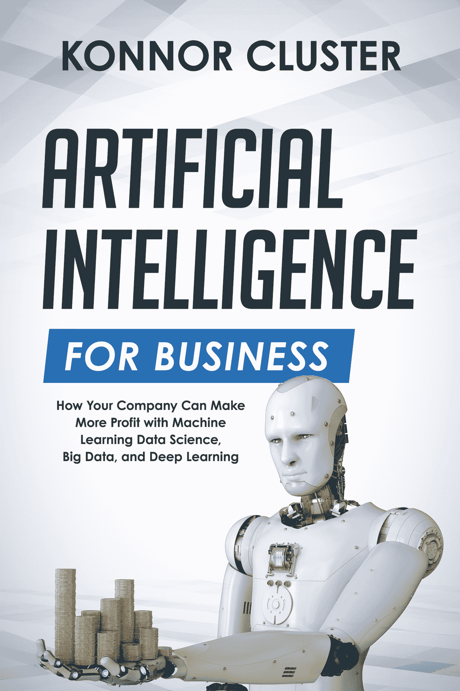
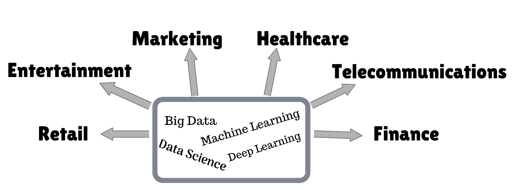

# 商业人工智能：企业如何通过机器学习、数据科学、大数据和深度学习获取更多利润

## 引言

恭喜你购买《商业人工智能》，感谢你的支持。接下来的章节将讨论关于人工智能如何工作，以及你如何将其应用于自己的业务中所需要的所有知识。AI 能做到的事情是惊叹的，这种数据科学方法即使在那些看似不可能的业务领域也能大显身手。

在本指南中，我们将更深入地探讨人工智能的工作原理及其定义，更多关于大数据的内容，以及人工智能在各种业务领域中使用的许多实际方法。指南的开头将侧重于人工智能的介绍、其工作原理，以及企业已经在使用它的不同方式的一些示例。

随后，我们将转向关注大数据及其本质。同时，公司将如何关注正确处理和使用其大数据的方法，从而真正获得竞争优势。我们将在指南的这一部分介绍一些 AI 的使用方式，以及企业在毫无察觉的情况下使用的一些工具。

本指南的下一部分将探讨一些可以利用 AI 的不同业务，以及该系统如何帮助他们增长、赚更多利润并看到他们想要的结果。我们将研究 AI 如何在零售、制造业、医疗保健、金融、营销等领域被应用。

最后，在结束本指南时，我们将探讨一些与 AI 合作的通用方法。此外，我们还将介绍该系统在许多不同行业中的具体用法，并对 AI 的现状以及未来可能的发展方向进行展望。

很多时候，关于 AI 以及如何使用这种技术存在着很多误解。我们要么假设它必须留在科学技术领域，要么对机器人接管世界或其他科幻构想的应用有天马行空的设想。在本指南中，我们将花时间拆解人工智能，看看它能做什么，甚至探索一些它能为你的业务带来益处的方式，无论你处于哪个行业！市面上有许多关于这个主题的书，再次感谢你选择本书！我们已尽全力确保它尽可能地充满有用信息；请享受阅读！

# 第一章：什么是人工智能？

市面上有很多不同类型的技术供公司使用。它们可以与编程相结合，帮助他们开发一些自己的程序，并确保它们已经准备好以处理客户的不同需求。它们还可以配合平板电脑、不同的手机、数据库等，用以帮助他们获得他们想要的结果。在企业开展工作和为客户提供良好服务方面，人工智能的帮助也是一个真正取得飞速发展的领域。

当大多数人听到人工智能时，他们的脑海中会立刻浮现出计算机接管世界并统治，做那些通常由人类完成的事情。虽然人工智能的几个子领域可以训练计算机和其他系统以类似于人类的方式进行思考，但人工智能在应用方面实际上并不会达到我们过去可能喜爱的科幻电影中所看到的那种程度。考虑到这一点，充分了解人工智能的工作原理，以及我们如何利用它来帮助任何业务领域以及我们可能需要的其他领域是非常重要的。人工智能包含许多不同的部分，因此能够完全理解它以及它的运作方式，是投入使用的第一步。

## 人工智能的定义

首先，人工智能通常被称为 `AI`，是计算机科学的一个领域。它强调系统和智能机器的创造，并且其运作和反应往往与我们看到的人类相似。许多使用 `AI` 的不同计算机活动的设计旨在提供帮助，包括计划、学习、解决问题和语音识别。基本上，当我们与人工智能工作时，我们是在与计算机科学这一大领域的一个分支工作。在这个特定部分，我们关注的是一种可以创建智能机器的过程，即能够独立思考和行动的机器。由于这些系统带来的力量，随着越来越多的企业和公司努力在此过程中使用它，它已而成为技术行业不可或缺的一部分。

## 核心研究与挑战

对 `AI` 进行的研究是专门化且高度技术性的。这可能是由于人工智能的工作性质以及随之而来的所有不同部分造成的。`AI` 的一些核心问题包括为计算机编程以具有特定特征，包括移动和操作各种物体的能力、学习、感知、规划、知识、解决问题和推理。在处理人工智能时，知识就是力量，而这种知识工程将成为该领域研究的核心。

机器通常能够学会像人一样行动和反应，但前提是它们被给予了足够关于世界如何运作以及它们应该如何表现的信息。请记住，在人工智能中，计算机并不是坐在那里在没有任何帮助的情况下获得知识。计算机将根据你提供给它的信息和示例，以及它在此期间能够进行的学习来受到限制。如果给系统错误的答案和示例，或者没有以正确的方式对其进行训练，就会变成一个大问题。机器必须拥有准确且大量的信息，以便以与人类相似的方式进行行为和反应。

为了确保人工智能能够正常工作，它必须访问所有这些事物之间的关系、属性、类别和对象，以实施知识的理念。这说明了为什么这种过程不会一直进行。教导计算机它本应该如何对周围的世界做出反应，以及如何与问题解决、推理和常识相结合进行工作，是一项艰巨且非常枯燥的任务。虽然这种技术所做的事情令人惊叹，但对于你想从事的每一个项目，`AI` 在成本和时间上并不合理。

## 机器学习与机器人技术

机器学习是许多开发者正在探索的另一种新技术，它是人工智能发生过程的核心部分。在没有监督的情况下学习将要求机器学会如何识别其所看到的输入流中的模式。而在正确的监督下进行学习将同时涉及数值回归和分类。

然而，这一切都意味着什么？首先，分类问题是有帮助的，因为它们的作用是确定物体属于哪里，以及哪个类别对它是最重要的。然后是回归问题，它们处理获取一组数值的输出和输入示例。这有助于我们发现正确的函数，以便根据我们能够找到的输入生成合适的输出。

虽然在机器学习和人工智能方面你可以做很多事情，但这并不是 `AI` 包含的唯一类别。事实上，你可能会发现机器人技术也是我们需要花一些时间查看的一个主要领域。机器人需要某种智能来处理对它们要求的许多不同任务，包括能够操作物体和进行任何形式的导航。

为了保持这一过程简单，人工智能将使你使用和编写的机器更容易从它们过去的经验中进行学习，并帮助这些机器能够适应它收到的任何新输入，从而执行类人类水平的任务。

## 现代技术与历史

今天我们谈到 `AI` 时已经听到的大多数例子都依赖于自然语言处理和深度学习的结合。当我们在工作中使用这些技术时，计算机可以经过训练以完成正确的任务。只需在正确的算法上进行训练以处理海量数据，甚至识别出数据中存在哪些模式即可。

让我们在这里暂停一下，探索一些与人工智能相关的历史。这个术语最早出现在 1956 年左右，但在过去的几十年里，`AI` 变得越来越流行。这种受欢迎程度的上升归于计算和算力的改进、一些更先进的算法以及数据量的增加。在 `AI` 研究的早期，不同的方法是符号化的，甚至包含一些问题解决。然后，在 20 世纪 60 年代，美国国防部对这项工作及其能力产生了兴趣，导致他们使用 `AI` 来训练他们的机器以模仿我们在人类身上看到的某些推理能力。早期的一些工作已经铺平了道路，使得像我们今天使用的机器中看到的形式推理和自动化变得更容易。虽然看科幻小说会发现 `AI` 被描绘成非常像人类的机器人接管世界，但你可以发现……

1. 将分析能力引入一些尚未充分利用其潜力的领域和行业。
2. 它可以改进我们在现有分析技术中看到的性能，包括计算机视觉和时间序列分析。
3. 帮助打破存在的经济障碍，包括出现在翻译和语言方面的障碍。
4. 它将增强现有的某些能力，从根本上让我们在已经在从事的工作中表现得更好。
5. 在同一个过程中赋予我们更好的愿景、更好的理解力、更好的记忆以及更多功能。

## 人工智能的挑战

尽管利用人工智能能为我们带来许多益处，但随之而来的也将面临一些挑战。只要使用方法得当，人工智能将具有改变每一个行业的能力。许多行业已经开始使用现有的 AI 技术，很可能会越来越多的行业也使用这些技术来帮助他们更好地工作。

基于此，对于每一个对人工智能感兴趣的行业和公司来说，理解该系统可能具有某些局限性是非常关键的。使用 AI 时出现的一个原则性局限性是，它将从数据中学习。我们没有其他方法可以将我们希望系统拥有的知识和数据整合。这意味着，如果数据存在不完整或不准确的部分，这些问题将反映在你获得的结果中。任何额外的分析和预测层必须以单独的方式添加到其中。

今天，被认为是 AI 的系统将以特定的方式进行训练，以帮助它们完成定义明确的任务。一个能够自主学会玩扑克的系统，无法将这种知识应用于玩国际象棋或纸牌。如果我们愿意，我们可以训练它来做这些事情，但它不像人类，不能将在学习玩扑克时获得的知识转用于玩其他游戏。你必须重新通过学习算法，并以多种方式对其进行训练，同时为系统留出足够的内存空间，以便计算机或机器学习超过一种游戏。

此外，一个旨在帮助银行和其他金融机构检测任何正在进行的欺诈行为的系统，将无法用于汽车或提供良好的法律建议。即使在同类的工作范围内，AI 系统也只能做一件事。例如，你可能有一个能够检测医疗保健领域发生欺诈的 AI 系统，但你不能用它来检查税务欺诈或保修索赔欺诈。换句话说，这些系统必须非常专业才能工作。它们将专注于某一项任务，无法以与人类完全相同的方式学习、适应或行为。它可以学习如何执行任务，但通常情况下系统是专门化的，因此它只学习如何与一种系统工作，而这就是它能做的全部。

## 人工智能如何工作

尽管存在这些局限性，你仍然可以使用 AI 完成许多不同的事情，这些可以帮助你真正让 AI 系统满足你的业务需求。但是，人工智能最初是如何工作的呢？AI 之所以工作是因为它将使用快速且能够迭代处理的算法来结合大量数据。这种方式允许软件在从使用数据中出现的特征或模式中学习时，以自动方式进行学习。人工智能是一个非常广泛的研究领域，并在过程中接管许多行业以及更多。这一特定的研究领域将包含许多你可以使用的不同技术、方法和理论。

除了这些之外，你还可以利用以下一些主要的子领域来真正发挥人工智能的最大价值：

1. **机器学习**：这是人工智能的一个子集，可以实现分析模型构建过程自动化。它将使用许多不同的方法来创建这些模型，包括物理学、运筹学、统计学和神经网络。这些方法也被用于发现隐藏在数据中的任何洞察，而无需通过编程来告知它去哪里寻找或在过程中做出什么预测。
2. **神经网络**：这是机器学习的一种类型，具有许多相互连接的单元，类似于我们在大脑中发现的神经元，通过对给定的输入做出响应来处理信息。这些信息然后在每个单元之间传递。这个过程需要我们对数据进行多次处理，以确保我们能够找到连接，然后系统将从未定义的数据中推导出某种意义和预测。
3. **深度学习**：这将使用大规模的神经网络，其中带有许多层处理单元，这使其能够利用计算机计算能力的进步和改进的训练技术。这一切都是为了让机器学习大量数据中发现的更复杂的模式。语音识别和图像识别是使用该技术的两个应用。
4. **认知计算**：这是 AI 的另一个子领域，可以帮助我们实现与机器自然交互。将 AI 与这种认知计算结合，目标是让机器通过解释语音和图像的能力，自然地模拟人类的过程。
5. **计算机视觉**：这一领域将依赖模式识别以及一些深度学习，以识别视频或图片中出现的内容。当机器能够处理、分析并理解它们所看到的图像时，它们有更大的机会实时捕捉视频和图像，然后它们就可以解释周围发生的情况。

除此之外，还会有几种不同的技术将发挥作用，它们不仅能实现 AI，还能为其提供支持。

### GPUs（图形处理器）

首先，我们可以看看 GPU。它们将成为我们在 AI 领域看到的关键，因为它们能够提供辅助迭代处理所需的某些强力计算能力。训练神经网络需要大量的数据，以及良好的计算能力来完成工作。

### 物联网（IoT）

AI 所需支持的下一项技术被称为物联网。它能够从连接设备中产生海量数据，而其中大部分并不会被分析。当我们决定对某些用于人工智能的模型进行自动化处理时，我们就能利用其中更多数据。此外，这一领域还会出现一些更先进的算法。这些算法正在以新的方式进行开发甚至结合，以帮助支持你所寻求的 AI 能力。

这一切之所以能汇聚在一起，是因为它们帮助我们更快速地分析更多数据，而且你可以在多个层次上进行操作。这种智能处理将是识别和预测可能发生的稀有事件的关键，同时理解更复杂的系统，并一气呵成完成对独特场景的优化。

### APIs（应用程序编程接口）

最后，`APIs`（应用程序编程接口）在支持 AI 方面也至关重要。它们是某种类型的可移植代码包，将帮助我们为现有的软件包和产品添加一些 AI 功能。

如果你已经有了投入市场并使用的软件和产品，但又想在不从头开始的情况下向其中添加一些人工智能，那么这就是你需要关注的。这些 `APIs` 能够帮助添加许多随 AI 的不同功能，包括：

* 图像识别能力（例如安全系统可能需要的那些）。
* 问答能力，帮助描述数据、创建标题和说明。
* 提取数据中发现的有趣见解和模式，而你可能在过去已经错过了这些。

正如你在这里看到的，AI 包含许多不同的部分，在处理计算机科学的这一领域时，你可以做很多不同的事情。学习如何使用人工智能以及与其相关的所有不同事物，可以帮助你真正变得工作更好，帮助快速高效地完成工作，并通过赋予企业相对于他人的竞争优势，将任何业务带向未来。

# 第 2 章：利用大数据成就大事

我们需要花时间探索的下一个主题是大数据的概念。这个术语用于描述每天进入企业的海量数据，这些数据可以是非结构化的、结构化的，或者两者兼有。虽然我们大多数时候谈论的是海量数据，但这并不是讨论的重点。相反，这里最重要的部分是公司如何获取并利用这些数据。对大数据进行分析，可以帮助公司获得有价值的洞察，从而引导他们做出最佳的业务决策和比以前更明智的选择。

在涉及到大数据时，有很多不同的部分共同构成了这个术语。虽然这个术语本身还很新，但收集和存储大量信息以供分析的行为已经存在多年了。公司一直在市场上力求尽可能地获取信息，并利用它们来帮助自己。如果他们能够以正确的方式筛选这些信息并找到正确的洞察，就能为它们在世界上赢得竞争优势，并让它们在服务客户的同时更容易脱颖而出。基于此，关于什么是大数据以及它是如何工作的，目前有几种定义。

## 大数据的三个 V 特性

我们可以通过三个主要的“V”来帮助更好地理解大数据，以及我们如何根据需求使用它。

### 体量 (Volume)

第一个 V 是体量。在这一点上，公司将花费时间收集数据，通常来自来自广泛的来源。依赖单一源的数据似乎可能更容易，但对于建立稳健的业务决策来说并非最佳选择。收集信息有许多不同的方式，包括业务交易、社交媒体、调查问卷等。然而，在过去，能够存储这些信息甚至处理完这些信息将是一个问题。但现在，有了许多不同的技术和平台可以处理这些信息，并帮助公司收集他们想要的尽可能多的信息，而无需担心应该将它们存储在何处。

### 速度 (Velocity)

我们需要关注的第二个 V 是速度。公司将获得的数据能够以非常快的速度流式传输，这是我们在过去未曾看到的，我们需要确保这些数据得到及时的处理，而不是在未来的某个时候。像 `sensors` 和 `RFID tags` 等工具将帮助我们处理这些信息并让其发挥作用，在此过程中实现近实时。

### 多样性 (Variety)

第三个 V 是多样性。最好的数据是具有多种多样性的数据。这将确保业务获得其所需的信息，而不会在过程中陷入某个特定的分支。公司使用的数据可以以许多不同的格式出现。这可能包括财务交易、股票报价数据、音频、视频、电子邮件、非结构化文本文档、结构化数据，甚至我们在某些传统数据库中可以找到的一些数值数据。

## 额外维度：变异性和复杂性

虽然这三个组件可以告诉我们许多关于大数据以及我们从中能获得的信息，但我们可能还想观察两个维度，以确定大数据的本质以及它是如何工作的。这两个额外维度包括我们处理的数据的复杂性和变异性。

### 变异性 (Variability)

我们在这里考虑的第一个维度是变异性。除了增加数据的种类和速度之外，数据流有时可能非常不一致，并伴随着一些周期性的峰值，这会干扰信息。当我们讨论社交媒体时经常会出现这种情况。虽然这些峰值有时被视为好事，因为意味着客户在那里并为我们提供了更多信息以便我们变得更好，但这些峰值（无论是季节性的、每日还是由事件触发）对于公司来说可能难以管理。当这些峰值发生在非结构化数据上时，挑战变得更加显著。

### 复杂性 (Complexity)

我们这一部分考虑的最后一个维度是复杂性。你可以想象，公司从客户、服务和产品获得的数据将来自多个来源。这有时会使跨系统的数据清洗、转换、匹配甚至链接变得困难。然而，对于公司来说，连接并关联关系、层级结构以及多个数据链接是至关重要的，否则你的数据很快就会失去控制。

## 大数据的重要性

现在我们对它的工作原理有了更多的了解，是时候继续探索大数据如此重要的一些原因了。为什么要在本指南书中用一整章介绍大数据的概念以及如何使用它？为什么其他公司想要收集所有这些数据并用于自己的需求？我们在大数据上发现的重要性在于，它并不取决于你拥有的数据量。虽然大多数公司都会拥有大量数据，但某些数据量较少的公司可能因为他们能够更好地利用现有的数据而获得竞争优势。当我们谈论此点时，最重要的是你决定对呈现给你的数据做什么。公司可以从任何来源获取数据，然后花一些时间进行分析以找到所需的答案。你正在寻找的答案取决于你经营的是什么样的业务，以及你自己的最终目标和计划。这些数据在被正确使用时，能够帮助我们降低成本、缩短完成时间、帮助我们优化为客户提供的产品和服务，并确保所做的所有决策都是明智的决策。当你能够将公司收集一段时间的所有数据，并将其与一些高级分析结合起来时，你能够完成一些与业务相关的任务。将数据与分析结合时，可以实现的一些任务包括：

1. 大数据可以用于检测是否存在某些欺诈行为，以免在影响你的业务并造成混乱之前发生。
2. 大数据能够在几分钟内重新计算你的整个投资组合的风险。
3. 你可以使用大数据让客户的购物体验更加友好。它对于根据客户的购买习惯在销售点生成优惠券将非常有用。
4. 大数据可以帮助在过程中近实时地确定故障、缺陷和问题的某些根源。

有很多公司和行业完全不担心使用大数据。他们可能会收集数据并偶尔进行查阅，但他们担心无法以正确的方式使用这些数据，或者会花费太长的时间。在许多情况下，这些公司正在浪费它们的潜力，而这些数据就静静地呆在那里，没有按照应该的方式被使用。但几乎所有行业都将使用这些大数据，以获得它们在保持竞争力和市场中脱颖而出所需的结果。大数据将能够帮助几乎任何行业中的组织。让我们来看看一些将使用这些大数据的行业，以及他们实际使用这些数据的一些方式。

## 利用大数据的行业

### 银行业

第一个能够从大数据中受益的行业将是银行业。想一下一家银行（即使是规模很小的地方银行）一直以来处理的所有数据和信息。这些数据转化成了来自许多不同来源的海量信息。正因为这些，许多银行正在寻找新的创新的方法来帮助他们管理客户。这些银行还面临着额外的问题，即在确保客户满意度高的同时，最大限度地减少自身的风险并防止欺诈。此外，通常还有州和国家层面的法规，银行很难管理所有这一切。在他们拥有的大数据的帮助下，银行能够一次性满足所有这些不同的需求。

### 教育行业

另一个大数据将非常重要的地方是教育。教育者如果想不仅对他们的学校体系产生影响，还要对他们选择课程以及学生产生影响，通常需要大量的洞察力。当教育者（无论是老师、校长还是学校的其他人员）选择分析他们拥有的所有大数据时，他们的工作就会变得更容易。根据教育者决定使用这些大数据的方向，他们将能够更好地准备识别那些有风险并可能需要更多帮助的学生。他们可以确保所有学生都能取得正确的进展，甚至可以审查实施过程，以确保有一个更好的支持系统，并评估学校系统中的每位教育者。

### 政府

政府是另一个可以利用大数据来让事情变得更好的领域。想一下政府从公民那里收集的关于他们日常活动和用途的海量数据。即使是我们的公用事业公司也会收集这类数据，以决定收取多少费用、在哪里添加新的公用服务等。政府能够真正利用许多不同的分析组件来帮助他们处理大数据。当他们能够以适当的方式做到时，我们可以看到他们取得了巨大的进展，帮助防止可能发生的犯罪、处理交通拥堵、运行任何与政府相关的机构，甚至在此过程中管理我们的公用事业。

### 医疗保健

引入大数据后，下一个受益的行业将是医疗保健。想一想医疗领域关于每个个体患者有多大的信息，更不用说把所有患者结合在一起时会有多大的信息了。在处方信息、患者记录和治疗计划之间，该领域有大量信息需要处理。在医疗保健世界，事情需要以尽可能快且准确的方式完成。并且需要足够的透明度，以及患者隐私，以满足行业内那些非常严格的法规。当大数据在这一行业中以有效的方式使用时，医疗提供者能够比以前看到更多关于患者的信息，并可能发现一些隐藏的洞察力。

### 制造业

制造业行业不仅将从之前谈过的人工智能中受益，还将从大数据的正确使用中受益。当制造商配备了随大数据带来的所有不同洞察力时，他们将能够提高质量和产出，同时还能最大限度地减少在此过程中产生的浪费。这些都是我们现代世界竞争性市场的关键，并可以帮助任何选择使用这些信息的公司领先并获得更大的利润。由于大数据带来的所有益处和所提供的洞察力，越来越多的制造商正尽可能地转变为一种基于分析的文化。这意味着他们能够更快地解决一些主要问题以及任何出现的较小问题，并且他们的业务决策更加敏捷。

### 零售业

零售业务也可以处理这些大数据。想一想零售公司从客户那里可以获取多少数据，包括姓名、地址、人口统计信息等，仅仅是因为客户进行了购买甚至填写了调查问卷。如果零售业务能够以正确的方式关注这些信息并在收集时使用它们，这可以成为一座金矿，帮助他们知道如何让客户更快乐，并将帮助他们获得更多利润。客户关系的建立对零售行业来说至关重要，公司管理此点的最佳方法之一就是妥善处理他们的大数据。零售商需要了解向客户推销的最佳方式、处理不同交易的最有效方式，甚至包括一些更具策略性的方法，将由于某种或其他原因可能流失的业务带回来。大数据绝对是可以用来处理这一切的方法。

## 大数据的来源

考虑到这一切，我们需要花些时间探索大数据将如何工作。在您发现大数据为您的业务提供工作的某些方式之前，我们首先需要了解从哪里能够收集这些大数据。所有这些大数据的来源通常属于三个类别之一。当然，如果公司愿意，他们可以从这三个类别中收集信息和大数据，但他们持有的任何数据都会符合这些类别。大数据的三个类别包括：

1. **流式数据**：您的公司将使用的第一个大数据来源被称为流式数据。这一类别包含来自连接设备网络到达您的 IT 系统的任何数据，这通常意味着 `IoT`。您可以在数据开始显示时对其进行分析，利用它对保留哪些数据、不保留哪些数据以及哪些数据需要您进行更多分析做出决策。

2. **社交媒体数据**：许多公司发现，通过社交媒体收集的数据非常有吸引力，特别是当他们开展营销活动、支持功能和销售时。这些数据通常以半结构化和非结构化的形式出现，因此与某些其他形式的数据相比，它确实带来了独特的挑战。

3. **公开可用的数据来源**：许多开放数据源都提供了大量数据。这包括 `CIA World`、`Facebook`、`data.gov` 等。作为一家公司，利用这些资源，并在过程中寻找更多所需的信息以做出明智决策，是一个非常好的主意。

在能够梳理并确定了所有潜在的数据来源之后，公司将需要做出一些决策，以帮助他们以最有效的方式使用数据。你需要考虑的一些事项包括：

1. **如何管理和存储信息**：虽然几年前存储对许多公司来说还是一个大问题，但现在有了许多低成本选项可以存储你的数据，无论你拥有多少数据，只要这最终成为你的业务希望采取的策略。

2. **分析多少此类数据**：有些组织将分析他们使用的所有数据。得益于现有的许多技术，这是可以实现的。但对于那些急于、想要过滤掉噪声或由于某种或其他原因无法处理所有数据的人来说，他们将决定分析多少以及分析什么类型的数据。

3. **你将如何利用这些洞察**：你拥有的知识越多，在对业务做出任何决策时就越有信心。在掌握了大量有助于做出业务决策的信息后，制定一个相应的策略总是好的。

每家企业在利用大数据满足其需求时都能受益。他们将能够将所有信息整合在一起，并根据手头信息查看如何做出最佳的业务决策。公司在尝试让大数据为其服务时，需要考虑的最后一步是研究。他们应该对各种不同的技术进行一些研究，以帮助他们真正利用数据并辅助分析。对于这一步，你可以考虑的一些事项包括：

1. 寻找能够处理你现有数据且对业务而言具有成本效益的存储方式。
2. 速度更快的处理器。
3. 可负担得起的开源大数据平台。
4. 云计算，以及其他灵活且可以协助分配安排的资源。
5. 高吞吐量、高连接性、大型网格环境、虚拟化、`MPP`、集群和并行处理。

大数据是每家企业都应该考虑使用的东西。从客户和其他许多来源中有很多丰富的信息，对于公司来说，查看这些信息并确定如何利用它们来为自己获益绝对是值得的。

# 第 3 章：你已经是一家 AI 企业了，但你甚至还不知道！

我们将花费一些时间讨论的下一个话题是在业务中使用 AI，以及我们已经在使用的一些 AI 常用工具和方法。AI 的普及程度远比许多企业主意识到的要得多，甚至客户也意识到了这一点。我们经常使用带有机器学习和其他 AI 部分的产品，而我们对此一无所知。这些产品将极大地帮助我们保持安全，让生活更轻松，并帮助我们经营业务，但我们还没有真正花时间停下来观察这种影响，以及它是如何满足我们的需求的。

考虑到这一点，让我们来看一些你的企业可能已经在用、但你甚至没有察觉的 AI 工具。以及你如何利用这些工具来让生活变得更轻松，同时每次都能提供良好的客户体验。

## 网络安全工具

许多客户甚至企业必须面对的现实是，网络攻击正变得日益频繁。尽管大多数企业付出了努力，但它们无法对这一切做好准备。除了企业层面某些准备不足外，网络安全领域的人才在跟上使用这些技术的业务需求时，也将面临巨大的困难。

事实上，估计到 2021 年，全球范围内将至少有 350 万个网络安全职位空缺。这意味着对于该领域的人才来说，即使他们工作更加努力，由于职位的空缺，也需要利用诸如人工智能的技术来帮助保持安全和保障。

鉴于我们今天所发现的网络安全现状，将 AI 系统引入业务中可以成为一个转折点。这些系统将带来许多益处，帮助该领域的人才应对网络攻击并确保企业和客户的安全。许多网络安全的 AI 算法使用机器学习，因为这有助于它们随着时间的推移而适应。由于新的攻击方式不断变化，恶意软件变得难以检测，因此动态 AI 方法将是完美的解决方案。

使用 AI 系统帮助网络安全的另一个益处是，这些算法可以根据感知到的威胁水平对攻击进行分类。虽然新的攻击方式不同，但机器学习能够帮助我们识别并响应，这帮助了人才跟上这些变化。

另一个优势是，在使用 AI 系统帮助网络安全时，这些算法和系统能够为员工节省大量时间。AI 系统将自动处理某些情况，释放员工的人力资源。现在，我们需要看看网络安全专家如何利用 AI，通过智能自动化来触发某些风险标记。根据 Grobman 的观点，这些 AI 系统不会让该领域的人才过时，而是将帮助保护业务和他们的客户。我们必须记住，由于该领域存在人才短缺，AI 系统的工作能力会有一些限制，但与人类协作解决某些问题是非常重要的。

## 语音和语音识别

AI 在业务中应用的一个很好的例子是语音和语音识别。你使用 `Alexa` 或类似的语音识别产品来查找信息、开启音乐并定期回答问题。这就是机器学习工作的一个示例。程序员将花费时间开发一种非常擅长识别现有单词和语音模式的系统。当然，这仍然存在学习曲线。很多时候，同一种语言存在不同的方言、语音模式和单词。这需要一些时间来调整并学习理解用户。但通过实践以及人工智能的进步，这些系统正在变得更好。

AI 将是处理公司面临的不同挑战的一种极佳方法。它对客户负责维护客户提供的信息安全。我们必须记住，AI 系统在该领域的能力会有局限。它可以做一些很不起眼的事情并帮助你更安全，但与人类协作解决某些问题是非常重要的。

## 垃圾邮件过滤器

对于邮件，我们希望减少杂质，留下对我们最重要的邮件。垃圾过滤器是人工智能可以帮助解决的挑战。许多常见的邮件提供商已经在使用人工智能和机器学习来帮助实现这一目标，确保你真正想读的邮件进入收件箱。在刚开始，垃圾过滤器可能没有我们预想的那么准确。有时我们会发现好邮件在垃圾箱里，而垃圾邮件却漏了进来。但随着时间的推移，当我们通过更多实践调整算法，过滤器会变得更好，邮件也会到达它们应该去的地方。

## 机器语言翻译

机器翻译系统将是在线服务或应用程序，它使用机器学习的一些技术将大量文本翻译成所支持的其他语言。该服务将接收源文本（即你想翻译的原始文本），将其转换为第二种语言（即你的目标语言）。虽然这项技术的一些概念以及呈现的界面非常容易理解，但其背后的科学甚至必须进行的工作是非常复杂的。它汇聚了诸如 `web APIs`、`云计算`、`语言学`、`大数据`和`深度学习`等元素。

自早期以来，由于深度学习的出现，`神经网络`等技术让 AI 系统能够学习并识别我们面临的威胁。虽然新的攻击方式不同，但机器学习能够帮助我们识别并响应，这帮助了人才跟上这些变化。使用 AI 系统帮助网络安全的另一个益处是，这些算法可以根据感知到的威胁水平对攻击进行分类。

### 词编码与注意力机制

每个词（也称为代表该词的 500 维向量）都会通过它的第一层。这一层将把单词编码到一个 1000 维向量中，该向量将代表该单词以及它在同一句话中与其他单词相比的语境含义。

一旦系统能够独立处理每个单词并将其编码为这些向量，同样的过程将重复进行几次。这一过程确保了每一层都能进行精细调整，以便我们理解每个单词在整个句子中的含义，而不仅仅是其孤立的含义。

在我们用于最终输出的矩阵中，我们可以获取该输出并将其放入注意力层。它还将利用之前完成的各种计算，以过滤掉目标语言（即第二层）中任何可能未被使用或是不必要的单词。

解码器（或称为翻译层）随后能够将选定的单词（在大多数情况下是整个句子）翻译成你选择的目标语言。进入这一最终层的输出可以被发送回到我们的注意力层。这样做是为了确保我们可以计算出下一个要翻译的单词。

## 安防监控与人工智能

人工智能开始进入个人及各类公司的安全监控领域。这允许我们使用计算机和机器来分析它们所看到的视频，而完全不需要人在现场进行工作。对于公共安全来说，这可能是一个极好的消息，并帮助急救人员和警察发现事故和犯罪。

此外，还有许多工业和科学应用。许多公司将依赖各种视频监控。他们可能利用此帮助监控商店内的盗窃和其他问题。对于客户的安全来说，周围有这些设备是件好事。你曾多少次走进商店，看到监控摄像头却什么都没想过？我们已经习惯了这些设备的存在，并且已经习惯了它们，并知道它们的目的是为了确保人们保持诚实并确保我们的安全。

在传统使用这些设备的情况下，必须有人翻看几个小时的视频，才能看到是谁在偷窃，或者是谁在危及他们周围的人。这通常是在事件发生后，即警察或其他人员介入后才进行的。大多数公司不会付钱让人坐在那里一直看视频，因此工作是在事后完成的。如果没有怀疑盗窃或对客户有任何危险，那几个小时的录像很可能会被忽略，因为这花费了太多的时间和精力。业务中发生但被客户和员工遗漏的可能给公司造成损失的事情数量是无法估量的。某些问题本可以被视频记录到，但大多数公司并没有建立起筛选和观看所有视频的机制，因此被遗漏了。

与其雇佣一个整天坐在那里看视频的人（他们往往会因为移开目光、无聊或不注意而漏掉事情），我们可以引入人工智能来完成这项工作。通过视频监控，你可以教人工智能算法你希望它如何运行，并向它展示需要发生的步骤，以便它能够检测盗窃、暴力和其他未经许可的行为是否正在发生。这通常通过向算法展示视频和图像来实现，直到它开始识别这些行为是否正在发生。该系统的设置方式使得，当算法在视频中注意到某处出现问题时，它可以根据你的输入发送警报或其他标记。这可以帮助公司提高效率，确保盗窃和其他行为的发生频率降低，并让他们更容易在商店里留住资金，而不必总是查看所有的几个小时录像。使用 AI 的工具每天都在增长。这些是帮助我们真正改进现有系统并确保我们的业务按照我们想要运行的绝妙方式。通常，我们在使用这类工具时甚至没有意识到它们的存在，也没有意识到我们实际上正在使用它们。

# 第 4 章：AI 及其在零售业中的应用

既然我们已经花了一些时间探索什么是 AI 以及以及如何使用它，现在是时候看看 AI 在我们可能经营业务的各种行业中将如何运作了。许多不同的行业和企业都能从使用人工智能中获益，本指南已经花了一些时间概述了哪些行业以及它们将如何使用这项技术。但在这一部分，我们将更深入地探讨零售店和企业依赖 AI 帮助其自身的一些方式。

我们都必须承认，世界确实发生了变化。自客户必须前往实体店才能购买任何任何产品的时代以来，我们已经走了很远的路。得益于过去 25 年发生的数字革命，如今你可以通过在线商店购买几乎任何你想要的物品。这种影响的程度之深，甚至已经影响了顾客光临实体店的方式。有了所有这些变化，许多零售店在开始在其门店引入一些人工智能以及相关系统时，将获得巨大的收益。

AI 被认为是整个商业世界现代技术的基石之一，许多公司，无论他们处于哪个行业，都能够从定制化、自动化和推荐引擎的优势中获益，这些功能共同工作以确保业务拥有更多客户。当我们观察零售业务时，这确实如此。在消费者体验方面，AI 正在开始发挥比以前更重要的角色，因为消费者可以根据自己的兴趣进行购物并找到他们想要使用的正确物品。此外，`VR`（也称为 `virtual reality`）将让想要尝试物品但无需实际穿戴或放置物品的顾客变得更容易。

许多零售企业现在关注的另一个重点是一种被称为 `RPA` 或机器人流程自动化的技术。这对于业务很有帮助，并能给客户带来利益，因为它设计旨在将正确的产品推给正确的人。另一个使用的平台被称为 `WorkFusion`，它帮助公司改进客户的购物体验。正如你所看到的，在 AI 及其相关系统的帮助下，公司有很多机会进行改进并获得更多销售额。

## 零售店如何使用 AI 实现更多利润

### 浏览在线目录

我们在零售业中看到的 AI 应用的第一个例子是客户能够浏览在线目录以查看有哪些货源。你曾多少次进入你最喜欢的商店的在线网站查看有哪些货，即使你最初从根本就没有打算购买任何东西？通常，所有这些选择让直接在上面购买变得非常方便。

AI 已经带来了几种更先进的推荐引擎，可以帮助客户找到他们需要的任何物品。这一过程所需的时间仅是旧系统或客户亲自到店转转的时间的一小部分。与其浏览成百上千件物品，消费者可以浏览数字目录，该目录会询问他们关于他们想要的物品的问题，包括尺寸、颜色偏好以及根据所需物品的其他信息。这导致了更高的客户满意度，确保了购买的物品是客户想要的，并在退货和退款时可以为你节省大量的时间和麻烦。

如果客户正在寻找他们需要的服装，而他们不确定穿在自己身上是否好看，或者是否是他们需要的风格，甚至他们想看看其他类型的服装、配件或鞋子与该物品如何搭配，`virtual mirror`（虚拟镜子）也可以实现这一点。这可以在顾客舒适的家中完成（如果公司提供此类服务且客户拥有镜子），并节省大量时间。对于许多在线服装零售商来说，这是一个很好的选择。很多时候人们想要为大场合购买一件连衣裙、一套西装或其他物品，但他们可能住在大型商店或大镇附近，或者他们只是没有时间从一家店走到另一家店寻找他们想要的东西。

### 高级手势识别

零售领域可用的下一个 AI 特性是高级手势识别的概念。除了能够从上面描述的一些数字目录中获益外，零售商还可以进入并监控新物品或他们针对的特定物品的成功程度。他们可以通过监控顾客在看到和与物品互动时的手势和面部表情，检查购物者对该物品的反应。顾客或购物者对某个物品的反应方式，特别是与另一个物品相比时，将告诉销售助理该物品被认为是冷门产品还是畅销商品。设想一下，当你能够看到购物者实际上对哪些物品感兴趣，并且对于你正在考虑开始推出但不确定是否会火爆的新物品获得客户的真实反馈时，这对你的业务将有多大的帮助。

除了面部和手势以及随之带来的处理外，当零售商能够更多地了解用户如何对特定物品做出反应时，推荐引擎也可以使用这些信息。这些引擎将以更有效的方式运行，根据他们购买的内容、他们似乎搜索的内容以及他们对在 AI 测试阶段展示的某些不同物品的反应，来寻找正适合每个用户的物品。

# 第 5 章：将 AI 引入你的营销

另一个能够从 AI 中受益的行业将是你的营销。无论你从事哪种业务，营销都将是这一切的重要组成部分。它帮助你接触客户，并将你的业务在他们脑海中占据中心位置。它帮助你介绍客户可能感兴趣的新产品，并确保你在过程中能够为自己赢得最好的声誉。

谈到营销，你有许多不同的方法可以接触对你最有意义的客户。你可以运营社交媒体，制作病毒式视频，可以在电视、广播、杂志和报纸上投放广告。所有这些选项都能让触达客户变得容易得多。但让你的营销提升到新层次的第一要素将是 AI。无论你经营的是哪种业务，或者你想开展哪种营销活动，你都有许多不同的方式可以使用 AI 以及它所提供的某些工具。

在 AI 的帮助下，你的营销活动中可以实现的一些示例包括：

## 深度学习

我们在这里首先来看的是深度学习的概念。深度学习被认为是现代世界中看到的许多营销活动背后的科学。这种学习将教计算机许多技能，包括理解照片、语音和文本，然后它将帮助系统学习如何提供答案、澄清任何进来的查询，甚至为客户提供个性化的建议。

让我们来看一个它是如何工作的例子。你会发现 `Facebook` 在很多情况下会结合深度学习，以改进他们对帖子的过滤，甚至是你看到的广告类型。他们可以查看你对什么反应最多、你在网络上搜索过什么等，以确保你在 `Facebook` 页面看到的内容是针对你最重要的内容而定制的。

## 内容策展与不同推荐

当你为客户提供良好的推荐以增加他们的购买时，这是一个你会非常喜欢的、常用的使用的部分。你过去可能访问过许多网站，它们使用了类似于“如果你喜欢这个，你可能也喜欢……”的语句。但许多人可能没有意识到，这些推荐是基于深度学习以及 AI 的其他功能的。

机器将分析大量关于客户行为以及普通人群的数据，以便根据他们刚刚看的内容，对他们接下来可能做什么或接下来喜欢什么给出不错的主意。这为过程增加了一点个性化，并确保你留住客户。你点击的这类内容越多，他们在完成操作后就可能将商品加入购物车并完成购买。

## SEO 优化标题

这通常被称为点击党。你想要确保提供给客户的标题是吸引人的、能够引起他们的注意力，并可能让他们点击你的页面。如果客户根本没有进入你的页面环顾，你就永远无法获得你想要的销售额。

但我们都知道，大多数用于点击党的标题充其量只是草率制定的。对于每个行业的营销人员来说，好消息是（特别是如果你是那些受写作障碍困扰的人之一），挪威的研究人员正在学习如何与神经网络和深度学习合作，以为你编写标题。这可以确保你每次都能获得正确的标题来吸引客户，即使你正难以为你的需求想出正确的标题。

## 产品推荐

当然，在营销中，内容并不是你能够利用深度学习功能进行推荐的唯一地方。如果你花时间访问许多不同业务的电子商务网站（包括像 `Amazon` 这样的地方），你可以看到 AI 如何根据他们查看过的内容和购买过的商品向客户推荐产品。

## 语音识别

在某些情况下，你的营销活动可能需要语音识别的能力。如果你在手机上使用 `Alexa`、`Siri` 或 `Cortana` 等选项，那么你已经很清楚这些语音识别软件在过去几年里发生了怎样的变化。这在营销领域变得越来越重要，因为它可以帮助 SEO。这是因为你需要确保你的所有内容都针对不仅是输入、而且是以问题形式的查询进行了优化，这改变了你设置社交媒体的游戏规则。

（注：原文此处有大量重复内容，译文已按要求保留其结构逻辑）

## 搜索

这最好的例子之一是 `RNN`。AI 算法将能够确定公司的时间段，使其更容易获得调整，而不需要密切跟进。

## 广告投放

我们接下来可以看的是 `ad targeting`。这是公司可以使用 AI 来帮助他们的地方。

## 聊天机器人

有很多公司可以使用 AI 与 `chatbot` 进行交互。

## 营销自动化

你的业务也可以选择使用被称为 `marketing automation` 的东西。这个过程能够利用 AI 来帮助。在此期间，系统能够分析客户的行为并交付个性化内容。

## 动态定价

当我们把一些 AI 引入你的工作时，我们将看到的最后一种是 `dynamic pricing`。当我们谈论旅游行业时，这被大量使用，但如果公司选择，也可以用于其他领域。

# 第 6 章：医疗健康能从 AI 中获益吗？

当我们讨论 AI 如何改进一个行业时，下一个关注的领域是医疗健康。在涉及我们的健康，特别是关乎生死的问题时，AI 真的可以在关键时刻营救，并为我们提供许多不同的方法，让医生的工作更高效。虽然在实现依赖 AI 和 AI 系统的医疗保健之前，仍有许多工作需要完成，特别是对数据隐私的担忧，以及对由于机器错误和缺乏人工监管导致护理管理不当的恐惧，但医疗提供者、科技公司和政府可能仍很大潜力愿意测试这些工具和解决方案，并观察它们在该行业中的运作情况。考虑到这些，我们可能需要审视 AI 已经能够帮助医学界的一些方式，以及随着时间的推移具有巨大改进潜力的领域。医疗领域中一些最常见且深思熟虑的 AI 进展示例包括：

## AI 辅助手术

我们在探讨如何使用 AI 技术时，医疗健康领域的第一个探索领域将是 AI 辅助的机器人手术。医疗保健领域的价值估计达 400 亿美元，机器人能够从术前医疗记录中提取一些数据，并利用这些数据指导外科医生在手术期间使用的器械。这实际上可以帮助患者的住院时间缩短 21%。在机器人辅助手术方面有很多值得期待的地方。首先，这种手术被认为是微创的，因此患者能够更快愈合，且伤口更小。通过 AI，机器人能够收集过去手术的数据，并在此过程中为新的手术技术提供参考。这些结果目前是非常乐观且非常积极的。

在其中一项研究中，研究人员对 379 名骨科患者进行了观察。发现，当他们接受 AI 辅助的手术时，与由医生独立完成手术的人相比，其并发症减少了五倍。在另一项研究中，机器人被首次用于进行眼科手术，最先进的手术机器人 `Da Vinci` 让医生与某些日常使用的方法相比，能够以更大的控制力执行相当复杂的程序。AI 辅助手术机器人提供帮助另一个例子是 `Heartlander`，一种能够帮助心脏外科医生的微型机器人。这个小机器人能够进入医生在胸部切开的较小切口，并在心脏表面执行制图和某些治疗。这有助于使心脏手术变得更具微创性、更高效，并帮助患者在短时间内康复并好转。

## 虚拟护理助理

我们在向医疗领域引入更多 AI 时关注的第二点是，利用它拥有更多的虚拟护理助理的想法。从与进诊患者互动到引导患者前往最适合他们的护理环境，这些依靠 AI 运行的虚拟护理助理可能为这一特定行业每年节省 290 亿美元或更多！由于虚拟护士可以全天候服务，这使得他们更容易回答任何问题、监控患者状况，甚至提供一些所需的快速回答。这使得他们比某些人类同类更有效，并能够在轮班人员短缺时提供支持。虚拟护理助理的大多数应用将使医疗提供者与患者之间的开放、定期的沟通变得更容易，即使在常规门诊之间也是如此。此举就能防止患者再次住院，并减少总体不必要的就次数。在某些情况下，例如使用 `Care Angel` 虚拟护理助理，可以使用 AI 工具和您自己的声音来完成健康检查。

## 诊断与临床判断辅助

AI 能够介入并帮助诊断诊所的某些患者。承认的是，这是 AI 的一个非常新的领域，尚未针对此进行大量工作，但有一些案例非常令人兴奋，向我们展示了它的运作方式。

首先，斯坦福大学进行的一项研究测试了 AI 算法检测皮肤癌的效果与皮肤科医生的对比。在这项特定的研究中，它们的表现与人类提供者水平相当。另一项研究是由丹麦的一家 AI 软件公司进行的，他们测试了其深度学习程序，让计算机在接线员接紧急电话时进行监听。该算法花时间分析人们说话的内容、使用的语调、背景噪音以及是否发生了心脏骤停等情况，成功率达到了 93%。而人类接线员在这些任务上的成功率为 73%。

根据百度研究院的研究，他们正准备对某项深度学习算法进行早期测试。这一个特定算法旨在测试其在识别乳腺癌转移方面是否能优于人类。当时的英国首相特丽莎·梅宣布了一项新的 AI 革命，旨在帮助英国医疗系统（国民医疗服务体系）在早期阶段预测癌症，并可能在 2033 年之前防止数例癌症死亡。

正如大家看到的，虽然在实现依赖 AI 和 AI 系统的医疗保健之前，仍有许多工作需要完成，特别是对数据隐私的担忧，以及对由于机器错误和缺乏人工监管导致护理管理不当的恐惧，但医疗提供者、科技公司和政府可能仍很大潜力愿意测试这些工具和解决方案，并观察它们在该行业中的运作情况。

# 第 7 章：电信领域的 AI

当我们探讨 AI 如何工作时，下一个关注的行业是电信业。如果你认为电信业与 AI 无关，那么你绝对完全错了。事实上，在《哈佛商业评论》2018 年报告的一项调查中，一些大型企业中约 73% 的高管认为，他们已经从包括数据科学和 AI 在内的举措中获得了可衡量的价值。

我们现在已经到了数据科学必不可缺的程度。它曾仅仅是公司用来获得竞争优势的方法。而现在，如果你的业务中缺乏这些技术，特别是在电信领域，你会被甩在后面。AI 目前被应用于许多不同的行业，这其中将深度涵盖电信业务。该领域的创新运营商将利用机器学习和 AI，根据他们希望服务客户的方式以及希望获得的结果，在许多不同的方面提供帮助。

例如，电信公司可以使用 AI 来优化其业务流程，以获取更多利润，提高客户的留存率和满意度，甚至确保网络可靠性的提升。电信业务在利用 AI 和机器学习的不同部分时，受益最大的领域主要有三个。这三个主要领域包括：

## 客户留存与客户服务

当我们考虑电信公司如何使用 AI 时，首先要看的是客户服务和留存。领先的电信公司正在利用 AI 带来的功能来帮助许多不同类型的流程。列表包括：精简客户服务流程、为客户提供个性化的优惠，以及通过自动化聊天机器人提供支持。

在极少数例外之外，AI 驱动的客户服务解决方案通常分为两个不同的类别。第一类是与客服的沟通，第二类是客户互动以及为用户提供更个性化的体验。解决并改进这这两个问题中的每一个都将有助于节省大量资金，并提高公司的整体效率。

我们首先需要关注的是电信公司如何解决客户面临的问题。考虑到这些公司目前的规模，对于他们的人工客服来说，这是一项巨大的工作量。但 AI 算法能够介入并独立处理大量的交互和数据，确保公司在获取更多潜在和现有客户信息的同时，及时、高效地处理客户的问题和疑问。

由 AI 驱动的客户服务解决方案在电信世界中通常以聊天机器人界面的形式出现。但并非总是如此。在某些情况下，这些 AI 算法存在于后台，帮助确保客户服务部门尽可能具有成本效益。在大型电信公司的客户服务通信方面，这些 AI 算法的用途有很多示例，包括：

1. 它们可以作为客户请求与人工聊天或帮助中心之间的网关。
2. 它们可以帮助将客户及其请求路由到正确的客服人员，并帮助意向购买的拨电客户直接进入销售部门以节省时间。
3. 它们可以帮助分析某些客户请求以及网络数据，确保客户的任何问题都能以最高效率找到解决方案。
4. 它们可以通过处理公司收的所有电子邮件来帮助识别高意向客户，然后将其转给销售部门的相应人员。
5. 它们允许客户仅通过语音和语言来探索并购买不同的媒体内容，而无需依赖遥控器来操作。
6. 娱乐聊天机器人也属于其中，可以根据方便程度在公司的原生平台或通过 `Facebook Messenger` 平台运行。

这种 AI 技术的一个应用场景是希望将其加入客户服务流程并作为客服代理。一个很好的例子是 `Ask Spectrum` 虚拟助手，它由 AI 驱动，将帮助客户解决一些常见问题、账户信息甚至故障排除。客户的查询将由助手管理，而聊天机器人执行此任务的方法取决于公司的需求。

助手可以被设置为为用户提供帮助中心的链接和其他实用提示，或者如果情况太复杂，它可以将他们转接到人工聊天代表。这些通常接入速度快得多，背后不需要人工，并且可以解决客户面临的许多问题。这释放了人工支持人员的时间和精力，以便他们更好地跟上客户的需求。从长远来看，这对双方都有利。客户可以在几分钟内获得问题的解答和处理，而不必在电话那头等 20 分钟或更久。该公司的客服部门也不需要雇佣那么多客服代表来完成工作。当客户确实有无法通过其他方式解决的需求的需求时，他们仍然可以联系真人寻求帮助。

## 销售与用户个性化体验

电信公司 AI 的另一种工作方式是增加销售并帮助提供个性化的用户体验。除了通过聊天机器人协助客户服务，甚至是查询路由系统外，AI 还有可能介入并帮助电信公司提高客户留存率，同时从每个留存用户赚取更多利润。AI 有许多方式加入并帮助这些电信公司，特别是在帮助他们为客户提供良好的用户体验方面。其中一些方法我们已经在之前讨论过。你的电信业务在使用 AI 系统时可能受益的方式包括：

1. 它可以根据用户过去表现出的偏好、内容偏好以及行为模式，提供一些个性化的推荐。
2. 它可以在正确的时间向正确的用户提供正确的升级销售和交叉销售优惠。这比你通过销售人员看到的会更高效。
3. 这个系统可以帮助你查看通话和流量包，并查看哪种最适合你所服务的每类客户。当你能够为客户匹配到合适的套餐时，他们更有可能购买。
4. 它可以帮助在终端用户意识到问题正在发生之前，检测并修复客户可能遇到的任何问题。
5. 这些系统能够分析客户情绪、品牌覆盖率和社交媒体，帮助他们更深入地了解客户选择特定服务提供商的原因，以及导致这些客户流失的原因，从而改进他们的业务工作。

`Comcast` 是这一系列运作方式的一个良好案例，按收入计算，它是全球的一家大型广播和电缆电视公司。他们成功推出了一种新型语音遥控器，使用户能够更容易地通过自然语言与系统进行交互。该公司能够利用 AI 帮助他们处理从客户处收集的所有元数据，并可以利用机器学习的视觉技术为客户推荐最佳内容。虽然这为企业带来了更多利润，但我们也可以退后一步，看看这对客户意味着什么。对于客户来说，拥有 AI 代理意味着服务体验将变得更好，而不是必须等待 20 分钟或更久来与客服代表通话，然后无尽地等待找出问题所在。根据问题的复杂程度和客户致电的原因，算法可以在几秒钟内解决问题。总的来说，这有助于提高客户的满意度，并提高公司的留存率。

### 帮助网络分析和预测性维护

正如我们在本部分开头提到的，电信行业能够在业务的其他两个领域发挥作用，即网络维护和客户服务。随着 4G 网络的增长（预计很快将会有 5G 网络出现），我们开始更多地学习应对各种形式数据消费量日益增长的需求。能够优化你正在工作的网络，并使其能够承受现在和未来更高的数据使用量，可以成为电信业务将依赖的战略决策之一。你会发现，当涉及到由 AI 驱动的一些第二代解决方案时，网络维护通常被认为是其中之一。这是因为它将更多地关注一种以软件为中心的方法，并尽可能倾向于自学习、自优化和自愈合的网络。

在过去，网络提供商必须派遣员工到现场查看硬件的运行情况。这在当时是行之有效的，但可能会导致许多错误和延迟，而且对于提升客户体验并没有真正帮助。虽然仍有一些网络提供商使用这种方法，但如果将数据科学更多地引入，许多非计划的紧急检查是可以避免的。今天，AI 算法可以登场并监控数百万个数据点和信号以检查硬件，而无需人员到现场。这将确保我们能够在问题发生时实时检测到即将出现的问题，然后公司根据问题类型采取几种修复方案。当这些问题出现时，有时仍需要人工代理，但通常简单的重启软件或负载均衡就足够了。为了帮助我们进一步了解通过 AI 驱动的某些网络分析将如何运作，让我们来看下面的示例：

1. AI 驱动的系统能够根据基站表现出的行为重启基站。因此，如果基站未连接到网络，系统将能够重启它们并希望解决问题。
2. 算法能够遍历并指出网络的哪些部分需要更多的时间和投入，以及哪部分最可能为公司带来最佳的投资回报。
3. 此外，网络运营商随后可以使用 AI 帮助他们识别用户最多且最从网络改进中获益的网络部分，这有助于公司获得更多利润。
4. 它可以帮助优化你获得的网络行为。这可能包括实时使用数据、每日移动数据甚至是他们拥有的天气信息。
5. 这些系统能够通过动态资源分配来增强网络利用率和客户的满意度。

正如你在这里看到的，AI 系统有许多不同的方式进入电信领域，并确保在增加利润的同时能够提供尽可能好的客户服务。许多电信公司已经在至少使用几种工具来实现这一点了！

# 第 8 章：在金融领域引入 AI

另一个能够从 AI 中受益的领域将是金融世界。AI 在金融领域创造了许多奇迹，帮助公司能够真正处理业务中许多许多不同的方面。这种技术不仅有助于提供过去可能无法实现的更好的客户服务，还能帮助提高金融机构的效率，保持良好的透明度，并确保始终准时符合各项法规。在利用 AI 及其随而来的所有神奇工具方面，金融和银行领域有多种方式可以受益。以下是金融银行业以及其他类似公司从人工智能中受益的几个示例：

## 风险评估

由于 AI 的核心组件主要是关于从过去收集的数据中学习，因此 AI 世界及其产生的所有技术在金融服务领域取得成功并表现优异是自然的，因为这种业务几乎需要大量的记录、簿记和大量数据。想一下在与财务任何相关的事务中，经过筛选和使用的所有不同信息。让我们来看看信用卡是如何被使用、管理甚至发放的。今天，你被要求使用信用分数来判断你是否有资格获得这些信用卡之一。然而，对于企业来说，将人们分为“贫者”和“富者”并不总是最有效的方法。相反，可以使用关于个人的数据（包括他们拥有多少张信用卡、当前的活跃贷款、还款习惯等）来个性化个人的资格，并为卡片定制允许的利率，使其符合机构的利益。虽然这可以帮助消费者和金融机构，但我们必须看看到什么样的系统实际上能够将这些整合在一起并实现这一切。

## 简单 AI

由于这一切都关乎数据，依赖数据并由数据驱动，扫描金融机构从客户那里获得的所有记录，可以使 AI 工具具备对信贷产品提供更智能、更快速建议的能力。在做这件事方面，它们也比专业的贷款人员更高效、更准确。

## 机器学习

机器学习和 AI 将迅速取代人类，因为该领域的不准确性可能会导致数百万美元的损失。基于机器学习（意味着程序将随着时间的推移学习如何更好地完成工作），这降低了错误的可能性。所以，虽然可能需要一些时间让这个程序按照我们想要的方式运行，并完成所有设置和准备就绪，但程序在这类事情上使用得越多，它就会表现得越好。你可以想象，这将从许多方面惠及客户和企业。企业将受益，因为他们能够更快地完成贷款并为人们提供所需的资金，同时在极短的时间内赚利息。AI 算法的不准确性也会减少，从而节省大量的资金。

## 检测

这些系统缩短了查看贷款或信用卡申请的时间。人类操作员需要几天才能处理的内容，算法只需要几分钟就能处理完毕。客户将更快地知道他们所要求的贷款金额或信用卡是否获得批准。它还可以帮助对金融机构定期处理的所有不同类型的交易、以及人员、贷款等需要处理的内容进行反欺诈。金融机构非常担心欺诈，以及如果无法充分捕获它会给他们带来多少损失，这并不奇怪。每家企业都需要找到降低现有风险的方法，特别是如果你有储蓄或支票账户或其他可以赚取利息的投资时，事实更是如此。这也是另一个原因，即金融机构将非常认真对待 AI 如何在帮助公司识别任何安全问题方面处于顶尖作用。它能够查看过去所有正常的消费行为，甚至通过不同的工具来找出何时存在某些有些奇怪且需要检查的行为。例如，如果一张信用卡在内布拉斯加州使用，然后就在德国发生了一笔交易，那么很可能发生了某种形式的欺诈，AI 工具能够发现这一点。或者查看账户的 AI 算法对用户如何取钱、取多少等有一个非常好的了解。这些都是在该人离开那里后，行业中的 AI 系统能够提供帮助的事情。涉及到 AI 时，你会喜欢的另一个优秀功能是，该系统在学习时不会遇到任何问题。它能够为某些常规交易标记红旗，有时它在这里是错的，但随后人类会介入，看到交易是正常的并进行纠正，而不是像人类那样担心犯错和产生错误。

## 金融咨询服务

我们在这里看到的下一个点是 AI 如何帮助各种金融服务。根据普华道报告，客户在与银行和其他金融机构打交道时应该开始考虑更多的机器人顾问（`robot advisors`）。由于金融机构面临着减少个人投资收取的佣金金额的压力，机器可能会做一些人类永远不会为首付工作的事情。

这方面的另一个开始兴起的领域是仿生咨询（`bionic advisory`）。它能够将人类的洞察与机器计算相结合，以提供比人类洞察更高效的选项，为我们提供比单个组件单独能做的更高效的选项。然而，为了让这种协作发挥作用，协作是关键。我们的意思是，仅仅观察机器并将其视为配件、甚至是每个部分的无知者是不够的。两者之间必须有良好的平衡，我们需要将 AI 更多地视为决策过程的一个组件，这个部分与人类能提供的东西是平衡的且同等重要的。当我们能做到这一点时，我们才对金融世界决策的未来有了内部视角。

## 交易

我们也可以看看人工智能如何在金融世界的交易中提供帮助。投资公司已经能够依靠数据科学家和计算机来帮助他们确定市场中出现的一些未来模式。作为一个领域，投资和交易将取决于投资者或机器以准确的方式预测未来，以帮助他们在过程中赚更多的钱。机器在这些所有事情上可以是一个极佳的工具，因为它们能够处理海量数据并在短时间内对其进行计算。我们还可以教机器观察过去数据中发生的模式，并利用这些信息对这些模式可能在未来某点重复做出良好的预测。虽然在这方面会出现一些异常情况，例如 2008 年金融危机，但仍然可以教机器研究呈现的数据以找到通常在异常之前发生的触发因素，并对此制定计划。

## 财务管理

第五个受益的领域是 AI 如何管理他们的财务。这被称为个人财务管理（`PFM`），是随 AI 而来的最新发展之一。它能够查看你的开支情况，这将变得更容易，而且这是金融机构在未来将改变的一部分。毫无疑问，AI 将成为世界变化方式的一个重要部分。

## 个人财务

这种惠及客户和企业的 AI 使用，是因为它能够更快地完成所有贷款并为人们提供所需的资金。这是金融和银行领域在利用 AI 及其随而来的所有神奇工具方面，可以受益的途径之一。客户和金融机构查看这一切将变得更容易。这是金融和银行领域在利用 AI 及其随而来的所有神奇工具方面，可以受益的途径之一。

# 第 9 章：AI 的通用应用

在指南中，我们花费了大量时间观察 AI 世界以及它在不同行业中能够完成的各种事情。在营销、零售、金融甚至是医疗保健等多个领域，我们所能做的事情已经令人印象深刻了。但这仅仅是一个开始。利用 AI 背后的技术，你可以做的事情还有很多，而我们还没有时间讨论全部！关于 AI 以及它将如何塑造我们世界的未来，存在着很多争论。虽然我们可能认为 AI 还没有被普及，而且要过很一段时间它才会对我们的日常生活产生任何影响，但人工智能已经存在，并帮助影响着我们的决策、生活方式、购物方式等。让我们来看看一些你已经在日常生活中甚至没有察觉的情况下使用的其他人工智能的通用应用和示例。

## 智能手机

许多人经常使用智能手机。手机通常被认为是如今大多数人拥有的最不可或缺的科技产品，而且我们大部分时间都会使用它。但如果你在使用智能手机，无论是哪种智能手机，无论我们是否意识到，你都在与 AI 交互。从 AI 一些而易见的特征（包括你使用的智能助手或语音识别）到一些不那么明显的特征（包括你在相机上使用的人像模式），当你拿出手机并尝试为了个人需求使用它时，很多时候都在使用 AI。越来越多的制造商确保在他们制造手机中包含 AI，这很常见，包括几家公司，华为（`Huawei`）和高通（`Qualcomm`）为具有 AI 功能的手机生产芯片。这种与 AI 的集成将带来许多不同的功能，包括混合现实和虚拟现实类型的元素、场景检测等。随着时间的推移，这种 AI 可能会在我们使用手机、消费媒体等方面开始发挥更大的作用。诸如自适应电池、剪辑和应用操作等功能都可以成为其中的一部分。

## 社交媒体信息流

也许你不是那种使用智能手机的人，而且无人机和智能汽车的想法听起来并不那么有趣，尽管在任何关于人工智能的对话中，它们都非常受欢迎。即使你不使用其中的某些东西，你很可能以某种形式使用某种社交媒体。现在有很多不同类型的社交媒体应用可用，包括 `Instagram`、`Twitter`、`Facebook`、`Snapchat` 等。每当你为了需求使用社交媒体时，你的决策都可能受到人工智能的影响。从出现在你时间线中的信息流，到这些应用发送给你的各种不同通知，你会发现这一切都是在 AI 的帮助下进行筛选的。你可能认为这些社交媒体网站没什么大不了，它们只是为了娱乐，但其中大多数内容都将受到 AI 的影响。事实上，AI 的存在是为了观察你的互动、你的网页搜索以及你在该网站上过去的一些行为，然后尝试根据你的喜好来定制体验。这样做是为了让社交媒体网站获益。他们使用 AI 是为了寻找让应用程序变得非常有成瘾性的方法。他们知道，当你迷于这些应用并感到被吸引回来时，会更容易反复再回来。AI 知道你喜欢看什么，并将不断吸引你回来获取更多，同时还根据你的偏好定制广告等，以帮助他们在此过程中盈利。

## 媒体和音乐流服务

当我们谈到 AI 以及它是如何影响我们的生活时（即使我们没有意识到），我们可以观察的另一个例子是许多人每天使用的媒体和音乐流。无论你是在使用 `YouTube`、`Netflix` 还是 `Spotify`，你都会发现 AI 正在为你做很多决定。你可能在这个过程中觉得你才是那个控制者，但实际上，你并不是。这样做是为了帮助你只需听音乐而无需思考，并可以使整个体验更加愉快，但现有的 AI 系统将对你将听什么以及你的播放列表中会出现哪些歌曲做出决定。

## 视频游戏

我们也可以看到许多常见的视频游戏都可以配合 AI 使用。视频游戏行业实际上是 AI 最早的采用者之一。这种整合最初规模很小，因为 AI 仅用于为玩家生成一些随机关卡供其。随着时间的推移，这种对 AI 的使用增加到了将真正触及该行业每一个方面的程度。让我们来看一个例子。在更大规模上，我们最近看到由埃隆·马斯克（`Elon Musk`）支持的 `OpenAI` 公司开发的 `OpenAI 5` 在单挑比赛中击败了职业级 `Dota 2` 玩家。同一个程序也击败了业余 `Dota 2` 队伍。这一成就将是 AI 行业的一个大时刻。这是因为 `Dota 2` 是一款基于策略的游戏，游戏玩家必须每秒钟都做出决策。能够击败被视为职业的玩家（这意味着他们已经花费了大量时间研究这类游戏并精通了它），对于 AI 系统来说是一项巨大的成就。

考虑到这些，我们需要看看 AI 渗透到我们在游戏行业看到的一些其他方式。你决定要玩的任何游戏内部都会有一个 AI 元素。当你玩 `Fortnite`、`CS` 等游戏时，你将从面对几个由 AI 驱动的机器人开始，随着时间的推移，你将开始与真人对战。AI 在游戏领域的最有趣用法之一是在《中环》（`Middle Earth`）系列中，该游戏中的敌人将由 AI 控制。

## 在线广告

我们在日常生活中使用人工智能的另一种方式是在线广告。这种行业将使用 AI 来跟踪用户的统计数据，同时根据收集到的数据向用户提供某些广告。这有助于获得更具针对性的广告，并可以增加成交的可能性。如果没有 AI 的帮助，广告行业将会失败，你将看到完全随机的广告。很难知道用户是否会对该广告产生任何联系。

AI 已经实现在在线广告中的许多不同方式。这种行业将使用 AI 来跟踪用户的统计数据，同时根据收集到的数据向用户提供某些广告。这有助于获得更具针对性的广告，并可以增加成交的可能性。如果没有 AI 的帮助，广告行业将会失败，你将看到完全随机的广告。很难知道用户是否会对该广告产生任何联系。

## 旅行与导航

AI 已经可能在旅行和导航等方面发挥作用。现在我们应该知道，AI 在很多方面影响着日常生活，通过 `GPS` 来帮助我们。无论你是使用 `Apple Maps` 或 `Google Maps` 来帮助你，或者你叫 `Uber` 去某处，或者你预订机票，AI 正在发生作用。你可以看到，在 `Apple` 和 `Google` 都在使用的的导航设备中，AI 正在正在发生。

## 监控与安全

我们之前已经讨论过这个话题，但重要的是看到我们利用安全的各种方式来帮助我们保持安全、防止盗窃、确保正确的人进入某些地方，以及更多。虽然我们可能会对使用泛泛监控系统的某些伦理问题进行争论，但现在无法否认的事实是它已经在使用，而且 AI 在其中确实起着非常重要的作用。想象一下，要监控许多不同的显示器是多么困难、几乎不可能，因为所有这些显示器同时处理来自数百甚至数千个摄像头的画面。这对于人类来说几乎是不可能的，但当你加入 AI 时，它将变得完全合理。通过带有 AI 技术，你可以比任何其他方法更好地进行物体识别和人脸识别，而且监控视频流将越来越多地由 AI 监控，而不是人类。

# 第 10 章：AI 的未来

在本指南中，我们已经花了很多时间讨论了人工智能，以及你能够利用这项技术所做的许多事情。我们已经查看了这类技术可以完成的一些通用任务，甚至包括了将这种智能应用到广泛领域的某些更具体的方法，涵盖医疗保健、零售、营销、金融等。

但是，当你展望 AI 的未来时，会发生什么呢？它已经蕴含着巨大的潜力，考虑到当我们更多地使用它并真正对其进行测试时将会发生什么，将是令人惊叹的。智能技术不仅仅是为了改变我们的家。它们还将渗透到许多其他行业，并且很可能会颠覆职场以及我们日常工作的方式。

人工智能有许多不同的应用将发挥作用，它们有望提高整个机构的准确性、效率和生产力，但它对每个人来说都是有益的吗？人们担心 AI 变得越来越流行这是一种很常见的现象，他们认为这将导致机器和机器人出现，并取代通常从事这类工作的工人。持有这种观点的人将对 AI 的增长感到非常担心，并可能想要阻止它。

在我们深入研究并了解更多关于 AI 的信息之前，我们需要理解 AI 的出现并不是为了夺走我们的工作并将我们全部踢到街上。它是为了填补某些空白，帮助我们更好地、更高效地工作，并且将帮助我们填充那些可能员工不足、没有足够时间来处理需要完成的工作空间。

考虑到这一点，许多企业和个人将持乐观态度，认为 驱动的职场转型将导致创造更多职位而不是流失职位，就像某些人所言的那样。随着更多此类创新技术的开发，AI 将对经济产生巨大影响，简单来说是因为因为它将创造更多工作——那些需要我们具备某些技能来实施新系统的工作。

事实上，约 80% 的安永（`EY`）调查回复者表示，在尝试雇用新的 AI 程序时，面临的最大挑战将是劳动力缺乏技能。劳动力需要花时间来学习如何掌握这些技能并实施 AI 系统，以便获得所需的结果并确保这些系统能够正常运行。这可能需要一些时间，这可能是许多 AI 系统需要时间增长和实施的原因之一。为了改进这一点并实现一些变化，我们需要确保配备了正确的劳动力储备。

随着时间的推移，可能会有一些工作在人工智能的帮助下被取代。但这些将是执行一些基础问题解决任务或重复性工作的工作，而其中一些将超越人类目前的能力。AI 系统能够进入许多客户服务岗位、金融机构内部和工业环境，由它们来代替人类做出决策。

例如，你会发现自动化决策将负责许多事情。你会发现金融行业在批准贷款、决定客户是否能够入驻，以及识别腐败和金融犯罪时，将使用这种自动化决策。许多组织将受益于自动化程度的提高而带来的生产力提升，这意味着它们能够在过程中产生更多收入。这反将提供额外的资金，用于投入到服务部门的更多支持性性工作中。

在建立这些基础之后，是时候学习在商业世界中利用 AI 的几种不同方法了。由于受到 AI 帮助可能影响的不同类型工作，解决这些技术随之而来的潜在陷阱至关重要。在这一切方面，我们可以考虑以下几点，包括：

1. 企业必须通过实现有效且成功的实施，克服 AI 经常伴随的一些偏见和信任问题，使所有使用系统的人都能在此过程中受益。

2. 使用这些技术的政府需要确保他们从 AI 处获得的任何收益都能广泛地（或尽可能）分享给整个社会，以防止受这些发展的影响与不受影响的人之间出现社会不平等。例如，这可以通过增加培训方面的投入来实现。

3. 随着实施 AI 系统所带来的额外成本节约，雇主还需要关注其现有及未来员工需要具备的技能数量。

为了充分利用人工智能的强大力量，我们需要能够解决教育层面以及业务领域发生的一些问题。教育系统需要能够利用这些技术，以便专注于培训学生从事与人工智能工作直接相关的角色，包括数据分析师和程序员在内的人员。这意味着需要更多地强调 STEM（科学、技术、工程和数学）学科，以便在这一过程中也能处理这些内容。此外，我们需要花时间集中在培养需要鼓励的情感、社交和创造力上。虽然人工智能的生产效率将高于人类，能够完成某些重复性任务，但在需要大量想象力和建立关系的工作中，人类将能够胜过机器，这将改善该领域的职业状况。你将在未来发现，人工智能将改变我们的外部和内部世界，而且很多时候这种情况在我们甚至不知道发生了什么的情况下就已经发生了。与其关注对自动化所存在的某些恐惧，不如企业需要能够拥抱一些新技术，以确保他们能够实施一些最有效的 AI 系统，其目的不是为了取代人类智能，而是对其进行补充和增强。考虑到此，我们需要花一些时间探索人工智能未来将如何改变事物，并让事情的完成变得更容易。这种情况可能发生的方式有很多种，包括以下方面：

### 自动交通

我们已经通过自动驾驶汽车看到了一部分，尽管这些车辆仍需要驾驶员在场以确保安全。尽管有了这项新进展，自动交通的想法仍然很新颖，可能还需要一段时间才能达到足够安全的水平，而要被公众接受则需要更长时间。`Google` 在 2012 年开始测试自动驾驶汽车，从那时起，美国交通运输部目睹了如此多的变化，并发布了自动化的类型和水平的定义，而 Google 的汽车是首几个等级之一，然后一直延伸到全自动。这里还有其他一些我们可以使用的方法，它们将更接近某些全自动，例如火车和公共汽车。这在未来可能会增长得更多，并成为我们出行方式的一部分。

### 机械有机技术（Cyborg technology）

人类的主要局限性之一是我们的大脑和身体。根据研究人员 `Shimon Whiteson` 的说法，未来，我们能够在计算机的帮助下自我增强，这些计算机不会取代我们，而是会尽可能地增强我们的一些自然能力。虽然在大多数情况下，这些增强只是为了方便，但在其他时候，它们可能会为了更具实用性的目的而出现。人们注意到，AI 对于许多肢体截断并希望像过去那样拥有能力行走和移动的人来说将变得更有用。在 AI 的帮助下，这种机械有机技术将允许大脑与肢体通信，从而让患者对该肢体所需的所需的。这种技术可以以几种不同的方式工作，但它将减少截肢者每天面临的一些局限性。

### 接管某些危险工作

我们已经看到机器人将接管某些对其他人来说并不一定安全的工作，包括拆弹等。根据来自 `BBC` 的一些信息，这些目前还不完全是机器人。它们在技术上目前是无人机，被用作物理实体来帮助拆弹，但它们确实需要人类来控制它们，而不是目前形式的 `AI`。无论如何分类，它都可以通过接管这项工作并确保他人安全，来拯救数千人的生命。

### 解决气候变化问题

你通过 AI 可以做的另一件事是应对气候变化。当涉及到机器人能做什么时，这个问题似乎是一项艰任务，但根据 `Stuart` 的说法，机器获取的信息将比任何个人都多得多，同时在大大数据的帮助下，`AI` 发现天气中的趋势，甚至在高度、有害化学品等方面，都可能是未来我们通过 `AI` 的帮助能够改进的事物。

### 友谊

现实中，谁不想有一个朋友呢？大多数人可能不想尽可能避开这一点，随着 AI 在我们的日常生活中变得越来越普遍，你会发现世界上所有的机器人都能与你产生共鸣并保持友好。这在未来将会发生变化，尽管日本的一家公司已经迈出了第一步。事实上，伴侣机器人 `Pepper` 在 2015 年上市，并在几分钟内就售出了单元。对于这台机器人，我们看到它被编程为读取人类，甚至发展出一些情感。虽然这还有很长的路要走，但这种机器将无法完全取代人类互动。

### 改进对老年人的照顾

由于许多不同的原因，许多老人和老年人的日常生活将是一场斗争，这些人中许多不得不雇佣外部帮助以确保他们能够管理照顾的所有不同部分并不罕见。在某些情况下，他们可能依靠自己的家庭成员和朋友来完成工作，并在过程中帮助他们安全健康。`AI` 目前尚未达到让这种对外部帮助的需求成为远可能的阶段。根据华盛顿州大学 `Matthew Taylor` 的说法，被称为 `Home Robots`（家用机器人）的机器人可能会出现并帮助这些老人完成一些日常任务，确保他们安全健康，而无需去养老院或失去他们需要的某些独立性。对于那些不需要一直帮助的老人，以及那些尚未准备好离开家放弃生活但仍需要某些帮助的人——例如有人查看他们，甚至有人确保他们用药和就诊——使用 AI 的家用机器人完成这些工作将非常有用。这让老人留在家里尽可能长时间拥有自己的自由和生活，同时确保他们获得所需的帮助，改善他们的整体健康状况，并让他们的亲人在知道他们安全时感到放心。

这些只是我们与 `AI` 工作时能够做的一些事情，我们并展望它未来将能够做什么。这有很多选择，局限性将仅仅在于我们的大脑和创造力。这种 `AI` 未来可能会扩张，并产生新的意义，并随着时间的推移在各个方面涵盖我们家庭和生活的更多领域。

## 结论

感谢你读完人工智能的最后一个章节，希望这些内容能为你提供见解，并为你提供实现目标所需的所有工具，无论你的目标是什么。

当你看到“人工智能”这个词时，你脑海中浮现出什么？你是否会回想起你最喜欢的某部科幻电影，以及它是如何被用来构建有趣故事的？你是否想到了计算机线路在独立思考，并在程序员的帮助下进行学习的场景？无论你最初是如何设想人工智能的，如果你经营的业务并非科学技术或其相关领域，你可能起初会认为自己根本不需要这种流程。

正如你在本指南中所看到的，这种思维方式是完全错误的。跨越众多不同领域的许多行业都依赖人工智能以及机器学习来帮助它们完成工作。人工智能拥有一套独特的技能，可以一次性帮助你完成更多工作、更多地了解你的客户并提高客户满意度。本指南探讨了所有这些元素如何结合在一起以事成事。

我们在本指南中探讨的某些与 AI 相关的主题包括：

* 什么是人工智能？
* 如何处理大数据。
* 你已经在使用的某些能让业务变得更简单的人工智能工具。
* 如何在营销、零售、电信、金融和医疗保健等行业中使用 AI。
* 人工智能的一些通用应用。
* AI 的未来以及它从现在可能向何处发展。

下一步是开始寻找将人工智能应用到你业务中的某些方法。无论我们是否花时间探索了你的业务领域，仍然有很多方法可以使用人工智能来帮助你的业务，并确保你能够使用最好的技术来提供优质的客户服务，在此过程中增加利润。

当我们谈论人工智能时，会有许多不同的因素发挥作用。许多企业可能会忽略这个话题，并认为在这一技术方面他们没有什么可以学习的（这主要是因为他们认为这与他们无关），但这绝对是许多行业和企业开始更密切关注的技术领域之一。如果你想确保自己处于竞争之列，或者至少不被甩在尘后，那么研究人工智能以及它能为你做什么将产生巨大的影响。

本指南花了一些时间更深入地探索了人工智能，并了解许多行业和企业能够为你做的各种不同事情。这项技术能够做的事情太多了，它的存在并不是为了取代人类或夺走我们所有的工作，而是为了让我们工作更高效，并帮助在此过程中提供更多收益、更好的客户服务，甚至是更高的安全性。当你准备好看看人工智能能为你的业务做什么，并看看你的业务是否真的能从这项技术的帮助下受益时，请务必查阅本指南以帮助你开始。
