# 智慧医疗中疾病诊断和预后的人工智能


# 前言

人工智能（AI）总体而言，尤其是机器学习和深度学习，正变得越来越复杂，并不断推动机器能力向更高效、更快速、更低成本的边界发展。与此同步，AI在医疗保健领域的潜力巨大。确实，AI及相关数字技术是下一代医疗服务正在奋勇迈进的几个新兴范式。这些数字技术可以利用计算和通信能力的进步，改变医疗保健的各个方面。借助新的商业机会谱系，AI驱动的医疗服务将改善患者、其家人及社会的生活。由于医疗方法中的AI驱动范式转变，全球研究人员已开始探索各种技术解决方案。本书全面涵盖了多种疾病诊断和预后中的AI模型，重点介绍了最近的进展、工作原理及相关挑战。

本书介绍了AI如何成为医学研究不可或缺的一部分并促进新药研发的广泛视角。它帮助我们理解AI如何更好地分析疾病不断演变的特性。在临床实践中，使用多种药物（称为多重用药）是一个众所周知的问题，可能出现在多种情境下。例如，在未做出正确诊断的情况下给予新药，可能导致药物的不必要使用。因此，有助于防止多重用药的药物敏感性预测对于优质治疗至关重要。本书深入探讨了AI方法如何帮助药物反应预测。精准医学是一种新兴的疾病治疗和预防方法。为了个性化治疗和医疗服务，它可以利用人们的独特特征，例如基因组序列、微生物组成和生活方式。本书充分关注如何利用精准医学确保更高质量的患者护理。除与疾病无关的通用AI方法外，本书还针对一组特定疾病（包括乳腺癌、胶质母细胞瘤、COVID-19、皮肤病变和帕金森病）介绍了特定的AI方法和系统。本书还提供了关于使用基于网络的在线工具进行特定基因和癌症类型背景下数据驱动癌症分析的优秀教程内容。

目前，很少有书籍全面涵盖AI在医疗保健领域的应用。不同于那些书籍，本书更侧重于人类疾病的诊断和预后。此外，本书还涵盖了一些额外主题，例如基于AI的医疗保健中的隐私与安全，这些主题日益重要，但却大多被现有书籍忽视。鉴于这是一个快速发展的领域，我们收录了过去几年该领域的最新进展，使本书与众不同。

由于本书大部分内容以教程方式呈现，它将受到缺乏坚实技术背景的普通读者的欢迎。然而，特别是，本书非常适合医疗技术广泛领域的研究生和研究人员。此外，本书还可作为BSc/MSc项目/论文工作的参考。总体而言，我们期望这本编著能帮助读者理解如何在AI时代实现增强型医疗解决方案。

# 编辑

Ghita Kouadri Mostefaoui 博士目前是伦敦大学学院（UCL）计算机科学系的副教授。她目前的教学包括编程、计算机体系结构和软件工程。在加入UCL之前，Mostefaoui博士在英国同步辐射源担任软件工程师，开发了光束线存档应用程序。在此之前，她在牛津大学担任研究助理，参与了多个电子健康项目。她分别获得了瑞士弗里堡大学和皮埃尔和玛丽·居里大学（巴黎六校）的计算机科学博士学位。Mostefaoui博士还是高等教育学院院士。

S. M. Riazul Islam 博士目前是英国哈德斯菲尔德大学计算机科学系的高级讲师。在移居英国之前，他于2017年至2022年期间担任韩国世宗大学计算机科学与工程系的助理教授。他之前的任职经历包括：仁荷大学的博士后研究员、三星研发院的高级工程师，以及达卡大学电气与电子工程系的助理教授。他于2012年获得韩国仁荷大学的信息与通信工程博士学位。他的研究兴趣包括应用AI、机器学习、数据科学和物联网。

Faisal Tariq 博士目前是英国格拉斯哥大学詹姆斯·瓦特工程学院的高级讲师。在担任现职之前，他曾在伦敦玛丽女王大学担任讲师。他获得了瑞典查尔默斯理工大学的工程硕士学位和英国公开大学的博士学位。他的研究兴趣包括在多个领域（包括智能无线通信、医疗技术、网络安全和智能物联网（IIoT））中应用AI和机器学习（ML）。他获得了IEEE WPMC 2013最佳论文奖。他是IEEE Wireless Communications Letters的副编辑和Journal of Networks and Computer Applications的编辑。他是IEEE高级会员和高等教育学院院士。


## Taylor & Francis

Taylor & Francis Group

http://taylorandfrancis.com

# 贡献者

**S. M. Riazul Islam**
计算机科学系
哈德斯菲尔德大学
哈德斯菲尔德，英国

**Julhash U. Kazi**
转化癌症研究部
实验医学系和隆德干细胞中心
隆德大学
隆德，瑞典

**Faisal Tariq**
詹姆斯·瓦特工程学院
格拉斯哥大学
格拉斯哥，英国

**Masum Shah Junayed**
计算机工程系
巴赫塞希尔大学
伊斯坦布尔，土耳其

**Ghita Kouadri Mostefaoui**
计算机科学系
伦敦大学学院
伦敦，英国

**Baharul Islam**
计算机工程系
巴赫塞希尔大学
伊斯坦布尔，土耳其

**Sujay Saha**
电气与电子工程系
达卡大学
达卡，孟加拉国

**Arezoo Sadeghzadeh**
计算机工程系
巴赫塞希尔大学
伊斯坦布尔，土耳其

**Shekh Mahmudul Islam**
电气与电子工程系
达卡大学
达卡，孟加拉国

**Esraa Hassan**
人工智能学院机器学习与信息检索系
卡夫尔谢赫大学
卡夫尔谢赫，埃及
和
计算机与信息学院计算机科学系
曼苏拉大学
曼苏拉，埃及

**Muhammad Afzal**
软件系
世宗大学
世宗，韩国

**Mahmoud Y. Shams**
人工智能学院机器学习与信息检索系
卡夫尔谢赫大学
卡夫尔谢赫，埃及

**Maqbool Hussain**
计算机科学系
德比大学
德比，英国

**Noha A. Hikal**
信息技术系
计算机与信息学院
曼苏拉大学
曼苏拉，埃及

**Samir Elmougy**
计算机与信息学院计算机科学系
曼苏拉大学
曼苏拉，埃及

**Hossain Shakawat**
纪念斯隆凯特琳癌症中心
纽约，纽约
和
东京工业大学
横滨，日本

**Matthew Hanna**
纪念斯隆凯特琳癌症中心
纽约，纽约

**Kareem Ibrahim**
纪念斯隆凯特琳癌症中心
纽约，纽约

**Rene Serrette**
纪念斯隆凯特琳癌症中心
纽约，纽约

**Peter Ntiamoah**
纪念斯隆凯特琳癌症中心
纽约，纽约

**Marcia Edelweiss**
纪念斯隆凯特琳癌症中心
纽约，纽约

**Edi Brogi**
纪念斯隆凯特琳癌症中心
纽约，纽约

**Meera Hameed**
纪念斯隆凯特琳癌症中心
纽约，纽约

**Masahiro Yamaguchi**
东京工业大学
横滨，日本

**Dara Ross**
纪念斯隆凯特琳癌症中心
纽约，纽约

**Yukako Yagi**
纪念斯隆凯特琳癌症中心
纽约，纽约

**Subbroto Kumar Saha**
生物化学与分子医学系
加州大学
戴维斯，加州

**Afsana Nishat**
微生物学与细胞科学系
佛罗里达大学
盖恩斯维尔，佛罗里达

**Shaker El-Sappagh**
计算机科学与工程学院
加拉拉大学
苏伊士，埃及

**Moradul SiddiqueYeasir**
计算机科学与工程系
杰索尔科技大学
杰索尔，孟加拉国

**Arefin Tusher**
计算机科学与工程系
杰索尔科技大学
杰索尔，孟加拉国


**胡马云·卡比尔**
计算机科学与工程系
杰索尔科学技术大学
孟加拉国杰索尔

**穆罕默德·法尔哈德·布尔布尔**
数学系
杰索尔科学技术大学
孟加拉国杰索尔
和
计算机科学与工程系
浦项科学技术大学
韩国浦项

**西耶德·加利卜**
计算机科学与工程系
杰索尔科学技术大学
孟加拉国杰索尔

**法特玛·M.·塔拉特**
人工智能学院
卡夫尔谢赫大学
埃及卡夫尔谢赫

**扎伊娜布·哈桑**
人工智能学院
卡夫尔谢赫大学
埃及卡夫尔谢赫

**努拉·埃尔-拉希迪**
人工智能学院
卡夫尔谢赫大学
埃及卡夫尔谢赫

**萨基尔·侯赛因**
纪念斯隆·凯特琳癌症中心
纽约, 纽约

**阿拉姆吉尔·卡比尔**
纪念斯隆·凯特琳癌症中心
纽约, 纽约

**S. M. 哈桑·马赫穆德**
纪念斯隆·凯特琳癌症中心
纽约, 纽约

**沙菲库尔·伊斯兰**
计算机科学学院
格拉斯哥大学
英国格拉斯哥

**卡伊鲁尔·伊斯兰**
信息通信技术系
伊斯兰大学
孟加拉国库斯蒂亚

**艾尔·阿明**
计算机科学与工程系
普莱姆大学
孟加拉国达卡

**莫吉布尔·拉赫曼·雷多伊·阿坎达**
计算机科学与工程系
普莱姆大学
孟加拉国达卡

**沙布杰·侯森**
计算机科学与工程系
普莱姆大学
孟加拉国达卡

**弗罗扎·纳兹宁**
计算机科学与工程系
普莱姆大学
孟加拉国达卡

**扎希杜尔·伊斯兰**
信息通信技术系
伊斯兰大学
孟加拉国库斯蒂亚

**穆罕默德·阿里·莫尼**
健康与康复科学学院
健康与行为科学学院
昆士兰大学
澳大利亚圣卢西亚

**鲁潘·库马尔·达斯**
科学与工程学院
格拉斯哥大学
英国格拉斯哥

**扎卡里亚·伊斯兰·艾蒙**
计算机科学系
美国国际大学
孟加拉国达卡

**夏沙·库马拉·卡卢塔拉格**
计算机学院
罗伯特·戈登大学
英国阿伯丁

**M. M. 曼朱鲁尔·伊斯兰**
计算机、工程与智能系统学院
阿尔斯特大学
英国阿尔斯特

**穆罕默德·沙迪·哈贾尔**
计算机学院
罗伯特·戈登大学
英国阿伯丁

**赛耶达·阿米娜·阿贝丁**
计算机科学系
美国国际大学
孟加拉国达卡

**M. 奥马尔·阿尔-卡德里**
计算机与数字技术学院
伯明翰城市大学
英国伯明翰

**侯赛因·沙赫瓦特**
计算机科学系
美国国际大学
孟加拉国达卡

**M. 胡马云·卡比尔**
电气与电子工程系
伊斯兰大学
孟加拉国库斯蒂亚

# 面向智慧医疗中疾病诊断与预后的人工智能（AI）导论

S. M. 里亚祖尔·伊斯兰
哈德斯菲尔德大学计算机科学系, 英国哈德斯菲尔德

法伊萨尔·塔里克
格拉斯哥大学詹姆斯·瓦特工程学院, 英国

吉塔·库阿德里·莫斯塔法维
伦敦大学学院计算机科学系, 英国

## 目录

- 1.1 AI 应用与优势 ........ 1
- 1.2 AI 技术 ....................... 2
- 1.3 智慧医疗中的 AI ................ 2
- 1.4 本书组织 ............. 3

动物（包括人类）的智力能力被称为自然智能。相比之下，机器展现的智能被称为人工智能（AI）。AI 驱动的系统可以感知其环境，并采取最有利的行动来实现其目标。因此，AI 驱动的系统可以独立寻找解决问题的方法，能够得出结论并做出决策。在本章中，我们首先概述 AI 的应用、优势和技术，然后讨论医疗保健中的 AI。接着，我们对每章进行简要介绍。

## 1.1 AI 应用与优势

由于 AI 的进步，我们在日常生活中可以看到人类与机器之间有显著的协作。像电力或计算机一样，AI 现在是一种应用无限的多用途技术。AI 已影响农业、自动驾驶汽车、游戏和家用电器等多个领域。此外，它还增强了语言翻译、图像识别、客户服务、金融、销售和营销以及许多其他领域。在人类健康方面，许多医疗保健服务提供商及相关组织正在依赖 AI。

## 1.2 AI 技术

AI 涵盖广泛的工具和技术。其中一些已经验证，另一些则是新兴的。AI 的主要子领域包括机器学习（ML）、自然语言处理（NLP）和计算机视觉（CV）。值得注意的是，ML 算法处理大量数据并从中学习。ML 模型和方法有多种类型，例如监督学习、无监督学习和强化学习。此外，深度学习（DL）模型（ML 方法的另一重要系列），构建在人工神经网络之上，广泛应用于 AI 应用中。此外，包括物联网（IoT）、模糊逻辑和遗传算法在内的各种其他数字技术和软计算方法，在开发 AI 驱动系统中发挥着重要作用 [1, 2]。谈到 AI 应用的组成部分，它通常包含三个关键要素：数据、算法和人工反馈。因此，确保每个组件都得到充分构建和验证，以开发和实施 AI 应用程序至关重要。

## 1.3 智慧医疗中的 AI

“医疗保健中的 AI”指的是系统地使用 AI 技术来分析医疗和医疗保健数据，并提取可操作的见解以改善医疗保健服务。在医疗保健中采用 AI，可以在更短的时间内、以更低的成本减少错误，从而简化患者、医生和护理提供者的生活。医疗保健中的 AI 已促进制药公司加速其药物发现过程。它使临床试验自动化更加简单并缩短了所需时间。AI 赋能的医疗机器人可以协助患者。在大数据时代，数据驱动的医学有潜力改善疾病诊断，并为靶向治疗打开大门 [4]。它使阿尔茨海默病等脑部疾病的预测和检测更加准确和精确 [3, 4]。研究人员已使用 AI 算法发现了许多医疗诊断系统 [5]。AI 驱动的系统甚至在检测、监测和管理像冠状病毒（COVID-19）这样的传染病方面也很有效 [6]。

由于其巨大而广泛的商业机会，大型高科技公司也在研究和实施 AI 技术，以解决医疗保健中的实际问题。例如，Amazon Comprehend Medical 是一项 NLP 服务，使用 ML 从健康数据中进行疾病诊断。IBM Watson Health 是一种数字工具，为许多医疗问题提供云、数据和 AI 解决方案。此外，Google Health 和 Samsung Health 可以跟踪日常生活的各个方面，有助于人们的健康。

然而，鉴于对人类生命和福祉的直接影响，医疗保健领域中 AI 的应用需要特别关注。AI 的快速进步使得利用医疗数据设计用于痴呆和糖尿病等慢性病自动诊断的实用工具成为可能。数据是任何 AI 应用的燃料。另一方面，在医学领域，数据难以获得，主要是出于隐私问题。这使得 AI 与医疗保健的结合成为一项重大研究挑战。本书的作用是探索 AI 在医疗保健解决方案中的进展、机遇和挑战。我们强调了将 AI 模型应用于各种疾病诊断和预后的当前研究趋势，以使医疗保健更加高效和有效。

## 1.4 本书组织

在第 2 章中，我们全面概述了用于人类疾病评估的 ML 方法及其优点和缺点。此外，本章还解释了与现实世界环境中的医疗保健应用相关的挑战。

第 3 章概述了精准医学的潜在应用。它解释了在精准医学实现背景下数据科学、AI 和 ML 之间的相互作用。此外，本章还为开发者将精准医学应用于未来医疗保健解决方案提供了一条有用的路线图。

第 4 章介绍了使用 ML 算法进行药物反应预测方法的最新进展。它讨论了单药疗法和药物组合预测方法。本章还概述了药物基因组学数据选择方法和相关 ML 算法。

第 5 章详细介绍了基于 AI 的皮肤病诊断。它首先介绍皮肤疾病，然后随后描述图像获取方法、可用数据集和所需预处理技术。本章随后详细解释皮肤疾病的特征提取和分类。在每个教程步骤中，本章都提供一些示例 Python 代码。

第 6 章全面调查了 COVID-19 识别和肺部分割的 DL 方法。它回顾了基于 COVIDx 数据集用于特征提取和分类的 X 光和计算机断层扫描（CT）图像。最后，本章确定了检测 COVID-19 的 DL 方法面临的障碍，并提供了一些应对挑战的途径。

第 7 章讨论了一个 AI 辅助全张成像（WSI）系统，用于对侵袭性乳腺癌患者进行分级，从而实现治疗决策的自动化。此外，本章还展示了所提出的框架如何克服当前在为治疗目的选择乳腺癌患者方面的实践弱点。

第 8 章利用多组学分析回顾了 CALD1（高钙黏蛋白 1）基因表达在脑癌中的意义。本章通过一套在线生物信息学工具分析基因表达数据，研究了 CALD1 在脑癌中的表达模式、功能和预后价值。它提供了一些重要的见解，说明 CALD1 表达在脑癌背景下是否具有任何预后意义。


第 9 章阐述了使用机器学习算法进行帕金森病（PD）检测的基本原理，并概述了基于 AI 的 PD 识别。本章回顾了各种特征扩展和降维方法，以期为早期 PD 检测寻找可靠解决方案。

第 10 章回顾了几种常用的乳腺癌数据集。同时对几种用于乳腺癌筛查的深度学习架构的有效性进行了概述。本章帮助我们认识当前用于乳腺肿瘤诊断的深度学习方法的发展。

第 11 章解释了基于 WSI 系统的数字病理学工作原理。阐述了图像处理与 AI 的应用如何提取主要超出传统病理学范围的有意义见解，最终实现精确疾病诊断和改善患者护理。

第 12 章概述了如何将机器学习和深度学习技术应用于提取与糖尿病相关的各种特征，并以成本效益高的方式利用这些特征进行糖尿病的早期预测和管理。这种早期预警机制可以通过采取适当措施帮助预防该疾病，至少可以降低疾病严重程度并延迟其发病。

第 13 章描述了如何将物联网（IoT）和深度学习应用于协助医师和放射科医生远程诊断皮肤病变。此外，本章通过演示基于云的计算机辅助诊断，解释了可信应用的重要性。

第 14 章介绍了实时视频流中的自动口罩检测方案。该技术采用基于深度卷积神经网络（DCNN）的迁移学习方法。实验结果表明，所提出的框架在类似 COVID-19 的大流行危机期间，对公共卫生管理可能具有优势。

第 15 章阐述了无线技术在满足 5G 及以后时代人工智能医疗系统需求方面的重要性。此外，它还解释了如何保护无线健康系统和网络免受外部对手和内部入侵者的侵害，重点关注无线体域网络（WBAN）。

第 16 章介绍了基于端到端信号流的生理数据保护的人工智能安全与隐私解决方案。它突出了相关机器学习方法的不足，并为克服已识别的弱点提供了一些指示。

最后，在第 17 章中，我们简要概述了疾病诊断和预后人工智能的未来挑战。

## 参考文献

- 1. S. M. R. Islam, D. Kwak, M. H. Kabir, M. Hossain, and K.-S. Kwak, “医疗物联网：一项全面综述,” IEEE Access, vol. 3, pp. 678–708, 2015.

- 2. F. Ali, S. M. R. Islam, D. Kwak, P. Khan, N. Ullah, S.-j. Yoo, and K. S. Kwak, “基于 Type-2 模糊本体的 IoT 医疗推荐系统,” Computer Communications, vol. 119, pp. 138–155, 2018.

- 3. S. K. Saha, S. M. R. Islam, K.-S. Kwak, M. Rahman, S.-G. Cho, F. Ali, “Prom1 和 Prom2 表达差异性调节癌症临床预后：多组学分析,” Cancer Gene Therapy, vol. 27, no. 3, pp. 147–167, 2020.

- 4. P. Khan, M. F. Kader, S. M. R. Islam, A. B. Rahman, M. S. Kamal, M. U. Toha, and K.-S. Kwak, “脑病诊断的机器学习与深度学习方法：原理与最新进展,” IEEE Access, vol. 9, pp. 37622–37655, 2021.

- 5. S. Kaur, J. Singla, L. Nkenyereye, S. Jha, D. Prashar, G. P. Joshi, S. El-Sappagh, M. S. Islam, and S. M. R. Islam, “基于人工智能（AI）算法的医学诊断系统：原理与展望,” IEEE Access, vol. 8, pp. 228049–228069, 2020.

- 6. N. El-Rashidy, S. El-Sappagh, S. M. R. Islam, H. M. El-Bakry, and S. Abdelrazek, “用于冠状病毒（COVID-19）检测与监测的端到端深度学习框架,” Electronics, vol. 9, no. 9, p. 1439, 2020.


## 泰勒与弗朗西斯

泰勒与弗朗西斯集团

http://taylorandfrancis.com

# 疾病评估的机器学习

Sujay Saha

达卡大学电气与电子工程系

Shekh Mahmudul Islam

达卡大学电气与电子工程系

## 目录

- 2.1 引言 .................................................................................... 8
- 2.1.1 疾病评估的方法学 ........................................... 9
- 2.1.2 数据集与模型描述 ................................................... 12
- 2.2 机器学习算法 ........................................................... 13
- 2.2.1 监督学习 ..................................................................... 13
- 2.2.2 无监督学习 ................................................................. 21
- 2.2.3 其他方法 ..................................................................... 24
- 2.3 疾病风险预测 ................................................................... 29
- 2.4 评估方法 ........................................................................... 30
- 2.5 现实场景中的应用 .................................................. 31
- 2.6 结论 ......................................................................................... 33

机器学习（ML）已吸引大量关注，致力于通过提供智能临床决策制定来开发智能医疗系统，尤其是在疾病评估及其相关风险预测方面。目前，许多疾病需要在早期被识别，以预防相关风险，这在智能数字医疗干预中也能发挥重要作用。当 ML 应用于临床数据时，它试图解释数据，以建议为改善个人健康所需执行的最佳行动。然而，在现实世界环境中采用基于 ML 的方法仍面临重大挑战，例如训练模型与计算时间之间的性能权衡等。本章重点讨论疾病评估中 ML 方法方法论的基础，并强调不同的评估方面。同时，还将讨论基于 ML 的方法在不同疾病检测和评估相关应用领域及其优缺点。此外，还将阐述该方法面临的不同挑战以及潜在解决方案，以将此 ML 方法应用于现实环境中，造福人类。

## 2.1 引言

在现代世界中，尽管医学领域取得了重大进展，但不治之症和致命疾病的数量正在迅速增加 [5]。为了人类健康的福祉，不治之症和致命疾病需要在早期被识别。因此，需要以更高的准确性在最短时间内分析医学数据和影像。以更高效率分析医学数据也可以帮助及时预测和检测疾病。为处理医学数据实施和设计新的有效算法始终充满挑战，因为由于医学数据的复杂性，基于医学数据的决策很困难。此外，处理大量医学数据需要耗费大量时间，因为需要为决策处理大量数据。在医疗领域，从医学数据的信息到疾病诊断，机器学习（ML）正在受到关注并取得了显著进展。

ML 正在各种医疗活动的不同技术和算法中应用 [3]。对于临床决策，机器学习主要被采用。当 ML 应用于医学数据时，学习模型可以解释数据，以建议为改善个人健康所需执行的最佳行动。一般来说，ML 模型需要学习问题陈述，数据质量对决策也很重要 [5]。一般来说，ML 模型在初次使用时并不十分强大和具体，但通过重复，它会从之前的迭代中积累经验。此外，借助之前的训练经验，学习模型也可以变得稳健且自动化。临床决策有两种方式，通过比较数据集中包含的先前知识来进行。第一种基于对医学数据集底层模式的直觉，主要用于医疗紧急情况。另一种是缓慢且基于推理的方法，使用大型医学数据集来训练学习模型。第二种方法更准确，但耗时稍长，因为需要处理大型数据集来训练学习模型。随着计算设备处理能力的提升，推理方法正在医疗领域被用于提高质量。

人工智能（AI）是计算机科学的一个分支，其中机器智能被集成以执行任何任务。ML 是 AI 的子集，用于训练算法进行决策。ML 正在医疗领域的不同领域中使用，其整合 ML 的目标是以有意义的方式解释医学数据，以便进行疾病预测和评估 [6]。ML 模型正在用于心脏病预测、2 型糖尿病风险预测等不同领域 [6]。由于分析技术的迅速进步，ML 模型正试图为医疗带来范式转变 [6]。最近，世界正因 COVID 大流行面临前所未有的挑战 [4]。不同研究人员也在尝试整合 AI 和 ML 模型，以预测 COVID-19 感染患者的风险因素 [2]。对于疾病评估，它不仅仅是检测或预测疾病，而是涵盖更广泛的领域，包括医疗治疗研究、公共医疗政策制定、患者护理、医院


体积，等等。因此，AI/ML 在数字医疗干预中可以发挥重要作用，因为它可以覆盖更广泛的应用范围。

AI 正在医疗保健领域的变革中发挥重要作用，但为了在现实世界中务实地实施这项技术，需要考虑一些伦理方面的问题。例如，决策由算法执行，因此由于算法偏差，决策可能存在偏差。因此，可能会引起系统问责制和透明度的问题，同时，如果临床医生依赖 ML，也会对其公正性提出质疑。因此，针对任何特定疾病评估，考虑 AI/ML 模型的稳健性和有效性非常重要。此外，AI 中的算法可以对大型数据集进行分析和预测，以提供快速且明智的决策。目前，在医疗保健领域，AI/ML 模型主要作为诊断辅助工具使用。要将这些方法集成到现实世界环境中并用于直接决策，需要克服多个挑战。

本章重点讨论将 AI/ML 模型集成到疾病评估中的基础知识。例如，它将阐述疾病评估、疾病风险预测以及 ML 模型评估方法的 ML 方法论基础。此外，它还将阐述使用 ML 和 AI 进行疾病评估的一些潜在应用。同时，它还侧重于突出这种方法的挑战及其相关的潜在解决方案，以便将其应用于现实世界环境，造福人类。

### 2.1.1 疾病评估方法论

准确识别疾病是医疗领域的一项巨大挑战。自 COVID 进入我们的生活以来，这一挑战在近来显得尤为严峻。检测 COVID 及其对身体的影响可能需要很长时间。在此期间，患者的状况可能会显著恶化，这可能导致身体永久损伤甚至死亡。克服这一挑战可以显著降低疾病风险，并为初始治疗创造条件，从而避免永久损伤。识别疾病及其严重程度的程序正式称为疾病评估 [7]。疾病评估整个过程的难度可能因疾病本身或采用的方法而异。随着技术的进步，无论疾病类型如何，大多数方法都基于 ML。X 光图像现在使用基于计算机视觉的 AI 模型进行分类。为了使用 ML/AI 模型进行此类评估，模型需要系统地构建。方法可能因应用和疾病而异，但大多数都遵循常规流程。

首先是数据收集。数据收集是指根据我们的需求从不同类型的来源收集数据，并将数据纳入单一框架的活动。它是整个过程中最重要的工作之一，根据方法和需求的不同，可能会有点繁琐。如果我们想从胸部 X 光片中确定 COVID 对患者的影响，我们需要收集成千上万人的 X 光图像。需要收集处于不同 COVID 阶段的患者的图像。收集没有 COVID 记录的人的数据也是必要的，因为这有助于使数据集更加稳健。

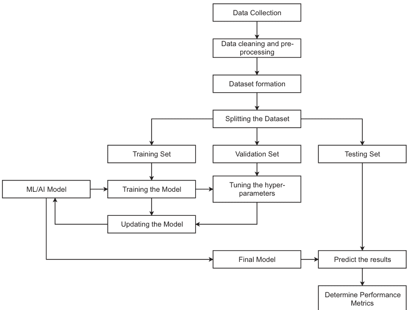

### 图 2.1 疾病评估方法

可以构建最先进的 AI 模型，但如果数据收集不当，模型的表现将不佳。

数据可以采取不同的形状和形式。它可以包括年龄、性别、国籍/种族、地址、位置、心率等。根据需要，这些数据可以是定量数据，如整数、浮点数、字符串、字符、日期、布尔值、图像、声音等，也可以是定性数据，如感受和情绪。所有这些数据都可以通过多种方式收集——通过传感器、表格、实时问卷、摄像头、自动化脚本等。

数据还可以根据特定用例的必要性分为主数据和次数据。为每条数据保留时间戳是一种良好的做法。但是，在许多情况下，我们可能不需要那个日期和时间。在这里，日期和时间被视为次数据。另一方面，时间可以包含主数据，在这些情况下，疾病评估或用药高度依赖于时间。最后，数据收集过程在整个过程中应该是无偏见且中立的。

在数据收集过程中，收集的数据可能不完美或不够准确。可能存在一些缺失数据；一些数据可能具有错误的值类型；一些数据可能完全不正确；一些数据可能不在其应处于的范围内。这就是为什么在将数据输入模型之前，需要对数据进行清洗和预处理。

假设我们想从图像或视频中识别人类活动或步态。这里有很多事情可能会出错。摄像头可能会掉落或轻微抖动，导致图像模糊且失焦。最糟糕的情况是，摄像头可能会完全停止工作。我们不希望数据中存在这类异常。因此，我们需要排除此类数据。数据清洗过程有助于消除数据中的此类异常，使数据集更加稳健和符合实际情况。

数据清洗过程可以采用几种不同的方式进行——手动、自动化或两者结合。手动清洗数据非常费力，因为需要逐一检查每条数据。就我们的示例而言，我们需要逐帧检查是否准确。如果不准确，就必须丢弃那些帧。研究人员倾向于为自动化数据清洗设置固定的绑定条款或阈值，将数据限制在这些规则之内。虽然自动化数据清洗可能要快得多，但有时也可能不准确。这时，两者结合就很有帮助。使用两者结合可以使数据集更加稳健和准确。

特征是定义任何情况、事件、活动或事实的属性或特征的可测量变量。它们被视为任何数据集的基石。为了让任何模型高效且准确地运行，有必要定义给定数据集的适当特征。

在定义特征时，我们应牢记几个方面。冗余特征绝对不应成为特征集的一部分。这不仅会降低模型的准确性，还会增加延迟。例如，我们使用温度数据来监测患者。某个特定温度传感器可能同时以摄氏度和华氏度记录数据。将两者都用作特征会产生冗余，因为它们之间存在线性关系。因此，对于该特定情况，我们应只将其中之一作为特征。

另一个因素是特征的归一化。在将特征输入任何 ML 或深度神经网络之前，有必要将数据归一化到特定的值范围，通常是 0 到 1。为了避免更多问题，我们应确保特征集的所有单位一致。让我们考虑之前的示例，但有一个前提。我们不是使用一个温度传感器，而是将使用多个温度传感器来监测身体的不同部位。我们应确保身体各部位的所有数据都采用摄氏度或华氏度。此外，其他单位中包含温度的特征也应使用相同的单位。简而言之，一致性是关键因素。

此外，我们还应考虑其值分布较为均匀的特征。假设我们想寻找疾病的症状。如果我们有一个将年龄作为特征的模型，我们应确保数据包含不同年龄的人。如果数据集包含 2 个 50 岁的人的数据和 100 个 55 岁的人的数据，那么年龄不应被视为该模型的特征。因此，我们需要数据的均匀分布。这有助于模型学习该特征值对特定标签的重要程度。


这一切之后，我们需要构建一个合适的数据集。数据集应当组织良好。人们以后应当能够通过他们的贡献对其进行扩展。此外，我们应该确保人们能够使用他们自己的方法和模型来使用该数据集。数据集通常分为三部分——训练集、验证集和测试集。某位作者[9]定义了这三个集合。训练集是用于学习的一组示例，即拟合分类器的参数。验证集是用于调整分类器参数的一组示例，例如，选择神经网络中的隐藏单元数量。最后，测试集是仅用于评估完全指定的分类器性能的一组示例。

构建数据集后，我们需要在训练集上训练模型，并在验证集上调整超参数。然后，最终模型需要在测试集上进行测试。测试集仅用于确定模型的性能指标。最后，模型将部署到实际生活中。

### 2.1.2 数据集与模型描述

对于疾病预测，研究某些疾病需要许多不同的数据集。不同研究中使用的大多数数据集来自医院。医院数据集有时存储在数据中心。住院患者数据主要由结构化文本数据和非结构化文本数据组成。结构数据主要包括实验室数据和患者基本信息，例如患者的年龄、性别、习惯等。另一方面，非结构化数据包括患者既往病史信息、医生关于诊断的记录等。对于研究，不同的数据可用于分析，例如，与患者地理区域相关的疾病需要结构化数据，而与既往病史相关的研究则需要非结构化数据分析。例如，对于疾病风险预测，有监督机器学习应用于数据集的属性。假设$X = x_1, x_2, x_3, \dots x_n$，其中$X$包括个人信息，如年龄、性别、症状的流行情况等。输出值为$C$，表示患者属于高危人群，$C = C_0, C_1$，其中$C_0$表示患者患癌症或其他疾病的风险很高，$C_1$表示患者患某种疾病的风险较低。下面我们将描述数据集、实验设置、数据集特征和学习算法。

- 1. 结构化数据（S-data）：结构化数据使用结构化数据来预测患者是否患有不同疾病的高风险。它还阐明了患者感染某种疾病的概率。它提供了关于感染某种疾病的概念。

- 2. 文本数据（T-data）：文本数据使用非结构化文本数据来预测患者是否患有某种疾病的高风险。它主要关注非结构化信息。

- 3. 结构化数据和文本数据（S&T-data）：它同时使用S-data和T-data来预测某种疾病的风险。通过整合结构化数据和文本数据的数据融合，可以检测某些疾病的风险，并且它提供了比

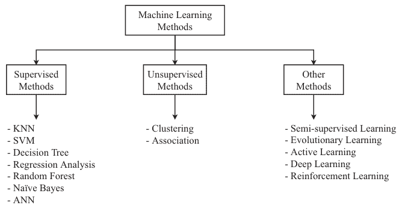

图 2.2 疾病评估的机器学习方法。

准确率优于单独使用结构化数据和文本数据，因为它使用了组合数据集。

## 2.2 机器学习算法

### 2.2.1 有监督学习

正如其名称所示，算法的学习过程将在监督下进行。但是，在什么的监督下？在结构化输出的监督下。这意味着，训练过程中模型的输入将具有特定的输出。

从最简单的意义上讲，有监督学习可以被视为类似于一个函数。存在输入X和输出Y，你需要使用一个算法（即函数f()）将输入和输出映射起来。

```
Y = f(X)
```

训练过程根据输入和输出执行函数的映射。该函数是一个用于在标记的训练数据上进行训练和优化的程序化算法。之后，这个训练好的模型或算法用于根据模型对未标记测试数据的输入来预测或分类数据。

在有监督学习中，有两种预测类型——分类和回归。分类是将输出分配到不同的离散类别中。准确率是评估模型的主要参数。回归是预测连续值。会计算各种误差值来评估模型。

- K-近邻（KNN）：K-近邻是一种超简单的有监督分类方法。由于它不像其他算法那样具有特定算法和专门的训练过程，因此被视为懒惰学习算法。它也被称为非参数算法，因为关于底层数据未定义或假设任何参数。它不依赖不同参数，而是使用距离来对任何测试数据进行分类。我们可以使用多种技术来计算距离值。最常见的方法是欧几里得距离。

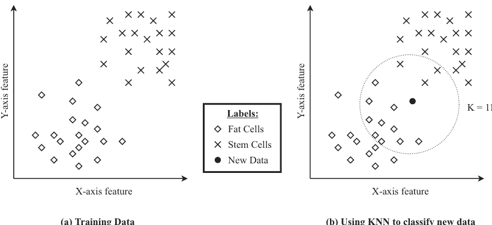

图 2.3 K-近邻。

假设我们有关于不同细胞类型（干细胞和脂肪细胞）的大量数据。数据在图2.3中绘制。我们想使用KNN对K = 11的新细胞数据进行分类。然后将新数据与其余数据进行比较，以找到新数据与训练数据之间的距离。然后汇总训练实例中K个最小距离。在这些数据中，出现次数最多的标签将被分类为新数据。在此示例中，在K = 11范围内，有8个脂肪细胞的数据和3个边界数据。因此，新数据被标记为脂肪细胞。如果出现平局，则随机选择一个标签。

在KNN中，数据集越大，输出就越准确。尽管KNN的准确率非常高，但它也有一些缺点。KNN的计算和内存成本要高得多，因为它需要将所有训练数据（即多维自由空间中的向量）加载到内存中，并计算新数据与所有这些点的距离。

- 支持向量机（SVM）：SVM是一种简单的机器学习模型，可以对线性和非线性数据进行分类。使用SVM可以同时实现线性和非线性分类。SVM将数据映射到n维特征空间。然后，不同类别的数据使用具有一定容忍度的超平面进行分离。超平面是一种函数或平面，用于分离不同标签的数据，其维度比数据空间本身的维度少一个。超平面的定义方式是使类别之间的距离最大。它有助于将新数据点插入数据池。超平面也可以称为“决策边界”。距离超平面最近的数据点称为“支持向量”，因为它们在确定超平面时被用作支持。可能存在数据不可线性分离的情况。在这种情况下，数据空间使用某些非线性变换转换为更高维空间。

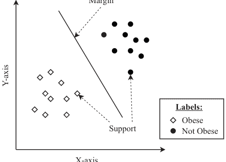

图 2.4 支持向量机。

例如，我们想找出一个人是否肥胖。我们有两个特征——一个在X轴上，另一个在Y轴上，可以是身高、体重等。我们应用SVM算法来确定将肥胖数据与非肥胖数据分开的最佳超平面。如果绘制新的测试数据，我们可以根据其相对于超平面的位置来确定其类别。

SVM在高维空间中非常有效。即使维度数量大于样本数量，SVM仍然有效。SVM非常灵活，因为可以为决策函数指定不同的核函数，这允许在常见核函数之外使用自定义核函数。但是，如果特征数量远大于样本数量，在选择核函数时有必要避免过拟合。如果我们想要计算概率估计，需要使用昂贵的五折交叉验证，因为SVM不会直接提供这些估计。

- 决策树（DT）：决策树是一种基于预测的有监督机器学习技术，其设计类似于一棵树，在树的每个节点中考虑决策和可能的结果，以找到给定输入的最终后果。可以使用决策树解决分类和回归问题。

根据不同条件，数据集通常以多种不同的方式分割以构建决策树。树可以是分类的或数值的，或者两者的结合。分类可以是分类的或数值的。此外，最终分类可以是重复的。

决策树从顶部开始工作。然后它逐层向下，最终到达一个不再需要做决策的点。有


决策树中有三种不同类型的节点。树的顶部称为根节点或根。箭头从它们指向。中间的节点称为内部节点。箭头指向和从它们指向。提供分类结果的最后节点称为叶节点或叶。箭头将指向它们。

当存在许多堆叠的节点时，每个节点根据不同参数以最佳方式分离数据。这可以通过多种不同方式确定，其中“Gini 杂质”方法被认为是最佳的。

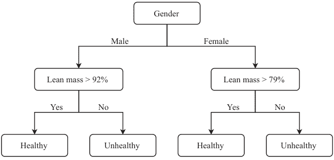

### 图 2.5 决策树。

让我们假设我们可以根据性别和骨密度判断一个人是否健康。首先，我们需要询问该人是男性还是女性。然后，我们想询问男性的瘦体重是否大于 92%，女性是否大于 79%。决策树如图 2.5 所示。由此，我们可以确定一个人是否健康。

- 回归分析：回归分析是使用一组统计方法形成的估计过程。通常，有一个需要估计的因变量，以及一个或多个自变量，它们将决定因变量的输出。它对建模这些变量之间的未来关系并预测任何事件的未来结果非常有效。

使用回归分析训练数据集的第一步是将数据点绘制在图表上。这可以了解数据集，并帮助找出因变量和自变量之间是否存在实际关系。因变量绘制在 Y 轴上，自变量绘制在 X 轴上。绘制数据后，会计算变量之间的相关性。然后绘制一条线来定义因变量和自变量之间的关系。这条线称为回归线。根据回归分析的类型，它可以是线性函数或多项式函数。此外，如果因变量的数量增加，数据池的维度也会增加，使函数更复杂。回归分析有三种类型：线性回归、多元线性回归和非线性回归。

在线性回归中，只有一个自变量函数。由于因变量和自变量，斜率和截距之间存在线性关系。自变量不是随机的。残差误差的值为零，在所有观测中保持不变，观测之间不相关，并服从正态分布。如果我们公式化简单线性回归，方程将是

$Y = a + bX + \epsilon$

where:

- Y : 因变量
- X : 自变量（解释变量）
- a : 截距
- b : 斜率
- ε : 残差（误差）

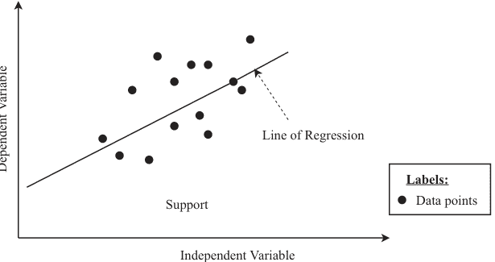

### 图 2.6 简单线性回归分析。

多元线性回归分析与简单线性模型非常相似。唯一的关键区别是模型中使用了多个自变量。如果我们公式化多元线性回归，方程将是

$Y = a + bX_1 + cX_2 + \cdots + dX_n + \epsilon$

where:

- Y : 因变量
- X1, X2, ..., Xn : 自变量（解释变量）
- a : 截距
- b, c, d : 斜率
- ε : 残差（误差）

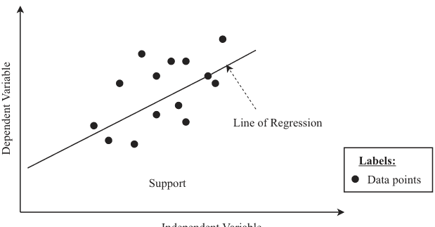

### 图 2.7 多元线性回归

在非线性回归中，因变量使用非线性函数与自变量相关。使用对数、指数、多项式等非线性函数来定义变量之间的关系。

假设，我们想要根据封锁的地点、正确使用洗手液的人数以及正确佩戴口罩的人数，来找出未来几天将受 COVID 影响的人数。在这种情况下，我们采用了三个因变量，自变量是未来一周或一个月内可能被感染的人数。现在，根据以前的数据，我们可以创建一个多元线性回归模型并找出可能被感染的人数。这将帮助我们根据需求维护医疗物资，以便医院不至于不堪重负或饱和。

- *随机森林 (RF)*：随机森林是一种流行的机器学习技术，被认为是决策树的进阶版本。它用于解决回归和分类问题。集成学习技术被用作随机森林算法的基础。集成学习是一种通过结合许多分类器来解决复杂问题的技术。

许多决策树构成随机森林算法。Bagging，也称为自助聚合，是一种集成元算法，用于训练随机森林算法生成的“森林”。Bagging 减少了噪声数据集内的方差，从而提高机器学习算法的准确性。

随机森林算法的主要构建块是决策树。随机森林根据每个决策树做出的不同预测提供输出。所有决策树的平均或平均输出被考虑在内，以预测整个模型的结果。树的数量越多，随机森林算法的准确性就越高。图 2.8 显示了随机森林的示意图。

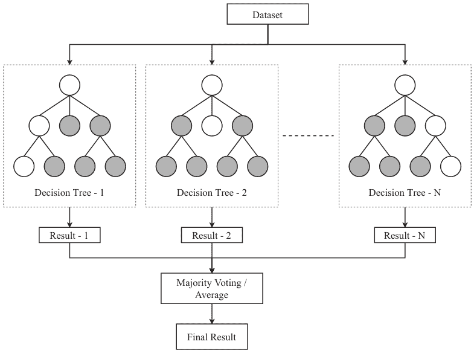

### 图 2.8 随机森林。

随机森林擅长处理缺失值，因为它可以自动完成此操作。它使用基于规则的方法而不是基于距离的方法，后者不需要对特征进行缩放。此外，它在处理非线性参数方面非常高效。它也能很好地处理异常值，且较少受噪声影响，因此更加稳定。但是，构建随机森林很复杂，训练时间非常长。

COVID-19 是医学领域中一种相对较新的疾病。因此，使用单一机器学习方法检测 COVID-19 不容易，而且不可靠，因为数据集还不够庞大。在这种情况下，我们可以为每个决策树使用几种类型的机器学习算法。然后，我们可以使用随机森林算法将它们结合起来。这将提供最终输出，与其他单一方法相比更准确。

- 朴素贝叶斯：朴素贝叶斯算法基于概率理论，即贝叶斯定理。在已知另一个已发生事件的概率的情况下，求某事件发生的概率是贝叶斯定理的主要目的。我们可以将贝叶斯定理表述为：

```
Posterior = prior x likelihood / evidence
```

我们可以用数学方法表述为以下方程：

```
P(a|x) = P(x|a)P(c)/P(a)
```

$P(a|X) = P(x_1|a)P(x_2|a)\cdots P(x_n|a)P(a)$

where:

- $P(c|x)$ 是给定预测器（x，属性）的类别（c，目标）的后验概率
- $P(x|c)$ 是似然性，即给定类别的预测器概率
- $P(c)$ 是类别的先验概率
- $P(x)$ 是预测器的先验概率

朴素贝叶斯不是单一算法。这是一组基本上基于贝叶斯定理的算法。假设所有预测器都是独立的。这意味着类中某个特定特征的存在不会对另一个特征产生任何影响。

朴素贝叶斯比其他算法快得多，节省大量时间。解决多类预测问题是朴素贝叶斯非常适合的用例。如果特征实际上彼此独立，它们确实可以胜过其他模型，并且所需的训练数据较少。但也可能存在特征彼此不独立且一个特征依赖于另一个特征的情况。在这种情况下，朴素贝叶斯可能不如其他模型表现好。它在类别型输入变量上比数值型输入变量效果更好。如果某个事件的概率随时可能变为零，这意味着该事件的实例不存在于训练数据集中。在这种情况下，结果的准确性可能会受到影响。此外，基于概率的输出不应被认真对待。

在医学领域，朴素贝叶斯可用于计算某人患病的概率。根据某人的不同属性和数据，我们可以假设某人是否会感染该疾病的概率。

- 人工神经网络 (ANN)：ANN 的概念源于对生物神经网络工作原理的思考。在这里，生物神经网络一词指的是人脑。在人脑中，最小的单位或细胞称为神经元。它们相互互连，构成大脑的整个结构。同样，ANN 具有分布在多个层中的相互互连的神经元。这些神经元作为一个整体协同工作，根据我们的需求将数据分类为各种类别。

让我们比较生物神经网络和 ANN。图 2.9 和 2.10 同时显示了生物神经网络和 ANN。生物神经网络中的树突可比拟于 ANN 的输入。细胞核充当节点，突触等同于权重，轴突充当输出。

ANN 的单个节点通过获取前一层的各个输入，将其与一些权重值相乘并求和来工作。有时，求和中还会添加一个偏差值。然后该值


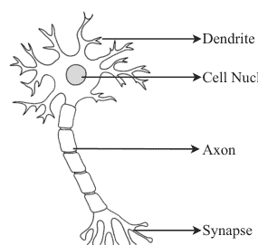

图 2.9 生物神经网络。

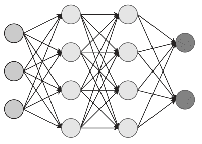

图 2.10 人工神经网络。

经过激活函数处理。它具有一定的阈值，并可包含一个在必要时修改该值的函数。

ANN 目前被广泛用于诊断患者。电信号分析、医学图像分析和放射学是受益于 ANN 的主要领域。例如，我们有一张心脏病患者的 X 光片。现在我们想使用自动化系统来诊断患者并检测疾病。在这种情况下，其他机器学习方法会失败，因为它们无法处理图像数据。但是，卷积神经网络（一种 ANN）可以突出且高效地处理图像数据。它可以被训练来检测疾病，并且在分类疾病方面更加准确和有条理。

### 2.2.2 无监督学习

无监督学习的主要思想是处理未标记的数据。在无监督学习中，由于数据未手动标记，因此数据的标签未知。它更多是一种数据驱动的方法。与监督学习相比，它提供了执行更复杂处理任务的能力。但它可能更加不可预测。

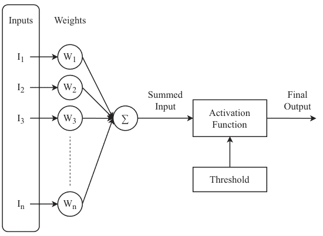

基于用户设置的参数，无监督学习可分为两部分——参数化无监督学习和非参数化无监督学习。在参数化无监督学习中，假设数据源具有概率分布。而在非参数化无监督学习中，假设数据被分组成簇。

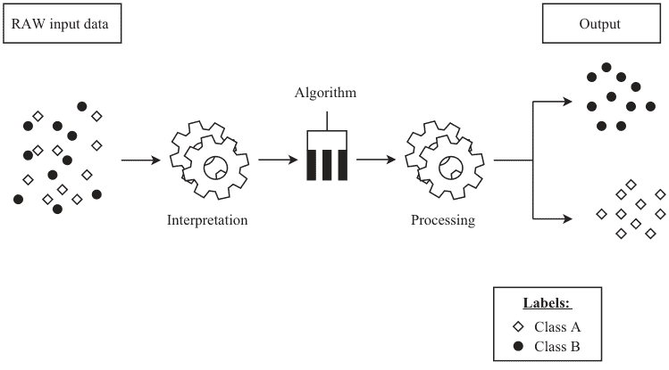

基于训练过程，无监督学习算法有两种类型。

- 聚类：将具有相似属性的对象分组到一个簇中称为聚类。相似的实例保留在单个簇中，而具有不同属性或特征的实例保留在不同的簇中。在这里，数据由算法处理，如果数据中存在自然组，则算法会找到它们。聚类无监督学习可以拥有不同的技术和类型。这里我们将讨论其中几种。

- 分区聚类：在这里，数据被分割或聚类，使得一个数据只能属于一个簇。
  - 凝聚聚类：在此方法中，数据最初被聚类为固定数量的簇，不需要每个数据都是单个簇的簇数。随着数据的训练，簇的数量随着它们相互合并而减少。最终，它形成一个包含所有实例的单个簇。
  - 概率聚类：在这里，数据基于对象的概率分布进行聚类。
  - 重叠：在此过程中，数据使用模糊集进行聚类，其中每个点可能属于两个或多个簇。每个数据将有单独的隶属度。

基于这些技术，有不同的算法——层次聚类（构建簇的层次结构），K-means 聚类（基于 K 的最高值对数据进行聚类），树状图聚类（树状图的高度是簇之间的相似性级别），K-最近邻聚类（类似于监督学习 KNN，但使用未标记的数据）。

- 关联：关联规则是基于 if-else 条件的无监督学习。它检查一个数据实例是否依赖于另一个数据实例。目标是在数据点中找到某种关系或关联。关联中的“if”元素称为前件，语句部分称为后件。

关联学习规则有三种类型：

- Apriori 算法：此算法使用广度优先搜索和哈希树。包含事务的数据集是此算法的常见用例。
- Eclat 算法：Eclat 代表等价类转换。它依赖于深度优先搜索技术来在数据集中的实例之间查找关联。
- F-P 增长算法：F-P 代表频繁模式。它是 Apriori 算法的改进版本。它通过将数据集表示为树结构来工作。该结构称为频繁模式，其目的是提取最频繁的模式。

无监督学习在检测异常方面非常出色。它可以很好地检测欺诈交易。此外，它擅长使用较少的特征工作，并将数据集分解为多个组成部分。相反，模型的输出未标记且未知。这会导致普通用户获得的数据准确性较低。

用户在分类后需要花费额外时间来标记类别。此外，光谱特征可能随时间变化，这可能导致一些不准确的分类。

在医学领域，无监督学习在组织分化方面非常有效。它可以用于识别身体某个部位的不同类型的组织。这对治疗肌肉受伤的人非常有帮助。

### 2.2.3 其他方法

许多其他方法与传统方法不同，采用非常不同的方法。在这里，我们将讨论其中几种最流行的方法。

- 半监督学习：在监督学习中，机器学习工程师或数据科学家必须逐个手动标记数据。随着数据数量的增加，整个过程变得非常乏味、耗时且昂贵。另一方面，无监督学习在现实生活中的应用是有限的。为了解决两者的这些缺点，半监督学习非常有用。

无监督学习的主要目标是将一组数据聚类为同质子组。在某个组中，所有数据彼此相似，并与其余数据不同。需要任何先前信息来实现最终目标，即在数据点之间发现相似性和不相似性。但是，可能存在一些数据被标记而其余数据未被标记的情况。这时半监督学习是有效的。

半监督学习使用一种称为伪标签的技术。与监督学习相比，它可以用较少的标记数据来训练数据。它通常使用不同神经网络模型和训练方法的组合。

半监督学习首先以与监督学习类似的方式训练标记数据。然后它为未标记数据预测输出。这些输出称为伪标签，可能不太准确。然后在标记训练数据的标签与模型创建的伪标签之间建立链接。然后将标记训练数据和未标记数据的输入相互关联。最后，再次训练模型以减少错误并提高模型的准确性。

半监督学习中数据的假设可以分为不同类型——连续性假设（如果点彼此靠近，则输出更有可能具有相同的输出标签），聚类假设（使用离散簇来划分数据点，单个簇内的点倾向于具有相同的输出标签）和流形假设（在流形内部使用数据的距离和密度，该流形的维度远低于输入空间）。

在医疗领域，蛋白质序列分类是一个重要的新兴领域，因为它可以帮助理解和解决疾病。它可以帮助改变我们看待疾病的方式，并比以往任何时候都更好地理解疾病。通常，DNA 链非常大。这时，半监督学习使理解 DNA 的蛋白质序列变得容易。

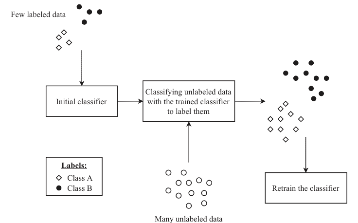

图 2.13 半监督学习。

- 强化学习：“好事得到奖励，坏事受到惩罚”——基于这一概念，强化学习的工作原理。强化学习算法通过试错程序学习。在训练过程中使用试错。期望的行为会得到奖励，而不想要的行为会受到惩罚。这是通过为期望动作分配正值以鼓励智能体，并为不想要的动作分配负值来完成的。算法的目标是尽可能多地积累奖励点。这鼓励模型追求尽可能高的总奖励并找到最优解。这帮助模型学会追求正面事物并避免负面事物。随着模型训练程度越来越高，它学会寻求正面并避免负面。

强化学习是几种算法的组合。这些算法根据应用和模型将被训练的环境而有所不同。强化学习的几种流行算法是——状态-动作-奖励-状态-动作（SARSA）、Q 学习、深度 Q 网络等。

在强化学习中，输入是模型开始学习的初始状态。对于特定问题的输出，可能有多种可能的解决方案。训练过程从输入开始，尝试找到解决方案。模型将返回一个状态。根据模型的输出，用户会对其进行奖励或惩罚。以这种方式，模型将在循环中学习，直到根据最大奖励的阈值确定最佳解决方案。

尽管强化学习具有非常高的潜力，但一个主要挑战是它难以部署。此外，它受环境限制，并


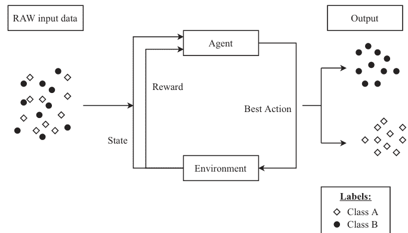

图 2.14 强化学习。

这意味着它即使想要，也无法学习最终可能产生更好结果的新事物。此外，由于时间限制，它可能无法学习从特定数据集中发现的新可能结果。与监督学习相反，如果提供给监督模型的数据量足够大，它的效率可能较低且速度较慢。对于复杂情况，从头构建整个环境也很困难。由于与模型通信的唯一方式是通过奖励值，因此缩放和调整模型并不容易。此外，达到局部最优也是强化学习面临的挑战。模型甚至有时可能在未达到最终目标的情况下仍获得正向奖励。

强化可分为两种类型——正向和负向。正向强化会在每次事件后增加行为的强度和频率。它有助于最大化性能，长期维持变化。另一方面，负向强化通过在停止或避免负面条件时强化行为来发挥作用。它有助于增加行为，为最低性能标准提供抵抗力。

在医学领域，强化学习可以帮助患者从策略中获得治疗。基于之前的经验，模型将提供最佳策略，使应用程序更多地成为一种基于控制的系统。

- 进化学习

> 生命观中存在着壮丽，其若干力量最初被注入少数形式或单一形式；而且，当这颗行星依据固定的重力定律运转时，从如此简单的开端，无数最美丽、最奇妙的形式已经进化，并正在进化。
>
> ——查尔斯·达尔文，《物种起源》

这段出自查尔斯·达尔文的引文是进化学习的基础。它并非某个特定的单一算法，而是多种算法的组合。那些在多项式时间内难以轻松解决的问题，使用进化算法来解决。进化算法通常与其他算法结合，以在更短时间内找到最优解。在没有进化算法存在的情况下，遗传算法可能难以在时限内找到最优解。

简单来说，“适者生存”是进化算法的主要动机。进化算法的步骤是模仿自然界中发现的进化场景而设计的。它分为四个基本步骤——初始化、选择、遗传算子和终止。

初始化之后，自然选择的过程是一种淘汰不适生物的方法。那些不适应其环境的生物会被淘汰。那些能够在艰苦环境中生存下来的生物会自然地被“选择”。这些生物能够在恶劣环境中生存。接下来是交叉和变异。在自然界中，生物通常会繁殖并将其特征传递给后代。同样，算法也会繁殖和传播。基因的交叉会产生全新的生物个体。同样，进化算法也可以进行交叉并创造出新的结果。适应度是一种衡量标准，用于了解模型表现如何。当基因从一代传到下一代时，它们可能会发生畸变并改变特性。这被称为变异。根据环境不同，它可以增强生物个体的能力。变异为生物个体和算法引入了多样性。由于变异，问题的新解决方案可能会出现。主要目标是优化适应度函数，使得在终止时适应度得分最大。

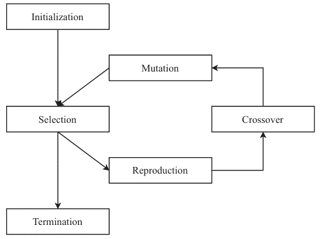

### 图 2.15 进化学习。

在医疗领域，我们可以看到使用进化算法来检测某些神经系统疾病。阿尔茨海默症、抑郁症和帕金森病等疾病是通过基于语音信号特征提取的进化算法来检测的。

- 主动学习：主动学习是一种特殊的监督机器学习算法，可以交互式地查询用户以用所需输出对数据进行标记。在构建高性能分类器时，训练数据集的大小保持在最小。主动学习的设计考虑了几个要点——它适用于包含大量或少量数据的数据集；对未标记数据进行注释需要人力、时间和金钱；计算能力有限。

主动学习基于用少量标记训练数据实现更高准确性的概念。模型本身会选择用于学习的数据。具体做法是，从未标记数据中主动选择下一批将要标记的示例。因此，在训练阶段，主动学习者可以交互式地提出查询。这些查询通常是未标记的，会被提供给人类对实例进行标记。

主动学习的实现主要有三种方法。

- 基于流的选择性采样方法：在训练过程中，模型会接收到数据，并计算对数据进行标记对模型是否有益。也就是说，模型是否希望数据被标记。这种方法的主要问题是人力成本高。此外，在预算内雇佣数据科学家来标记数据也非常困难。

- 基于池的采样方法：这是主动学习中最适用的方法。主动学习者会遍历整个数据集并对其进行评估。然后选择最佳的一组查询。在某些情况下，主动学习者甚至会在完全标记的训练数据集上进行训练。基于此，学习者会检测如果将数据插入数据池，哪些未标记数据对该场景有益。然后模型需要再次训练。这种方法的唯一缺点是内存消耗高。

- 基于成员查询综合的方法：这种方法不适用于所有场景。这里数据是人工合成的。允许主动学习者创建新数据。在容易创建新数据实例的情况下，这种方法很有效。

在医疗保健领域，在医学影像数据及其他情况下，可能只有有限数量的标记数据。在这种情况下，人工标注者可以对数据进行标记以协助算法。对这些数据进行标记并相应重新调整模型的过程可能有些繁琐且缓慢。但与传统的数据收集方法相比，它节省了时间。

- 深度学习：深度学习是机器学习的一个子集。该领域研究的是受人脑工作过程和结构启发的算法。它与人工神经网络非常相似。但最显著的区别在于，层数为三层或三层以上。网络的深度非常高，架构可能非常复杂。通常，较少的层数可能会提供一定的准确性，系统可能会按预期运行。更多的层数有助于改进模型、优化模型并提高模型的准确性。

当系统的输入（甚至输出）是模拟值时，深度学习效果尤为显著。模拟数据可以是图像、文本文档、音频等。深度学习通过模仿大脑的工作方式，结合数据输入、偏置和权重来工作。这些要素共同作用，根据我们的需求对数据进行分类。深度学习中的另一个关键要素是前向传播和反向传播。这有助于找到模型的误差值，并将偏置和权重值更新为更优的值。每次迭代都会逐步更新这些值，使模型更加准确。

深度学习有助于加速自动化。它可以帮助机器在无需人工干预的情况下完成大量复杂的分析或物理工作。常规机器学习算法很难处理图像和音频数据。深度学习有助于处理此类数据并提供洞察。深度学习可以实现一些非常令人印象深刻的成果，因为它能提供高准确性。

虽然深度学习在许多领域都有效，但也存在一些缺点。它需要大量标记数据才能按预期运行。如果数据具有多维性（如图像或视频），数据规模会进一步增加。处理如此大量的数据需要非常强大的计算能力。使用如此大量的数据进行如此多的复杂计算在计算成本上可能非常高昂。训练此类模型和算法需要高性能 GPU（图形处理单元）。这些设备耗电量大且昂贵。即使拥有此类设备，正确训练一个模型也可能需要数小时甚至数天。

医疗行业从深度学习的引入中获益匪浅。由于医院记录、图像和放射学的数字化，图像识别在帮助放射科医生和医学影像专家方面发挥了至关重要的作用。它使疾病检测和评估比以往任何时候都更容易，因为处理此类复杂数据几乎不需要时间。

## 2.3 疾病风险预测

疾病可能随时发生在任何人身上。它可以通过病毒、细菌传播，甚至可能是遗传性的。但如果我们知道自己患某种疾病的风险有多大，至少可以采取预防措施。为了了解自身风险，有必要进行疾病风险预测。


这可以通过不同的机器学习方法实现。例如，如果我们每天监测血压、血糖、心率等，可以通过对比标准数据、之前的数据和当前数据来判断患任何心脏病的风险。我们还可以确定疾病的当前状况，并监测情况是好转还是恶化。在一定程度上，它还可以动员治疗。

不仅如此，我们还可以预测某人患癌症或糖尿病的概率。如果概率较高，医生可以据此推荐药物和生活方式。这可以大大减少全球受复杂疾病影响的人数。

## 2.4 评估方法

构建机器学习模型并不是全部。确保模型正常工作同样至关重要。但是，我们如何确定所设计的模型正常工作呢？为此，我们需要一些变量。这些变量被称为评估指标，帮助我们理解和评估模型。根据模型是用于分类还是回归，会有各种类型的评估指标。

- 混淆矩阵：混淆矩阵是一个 N × N 矩阵。这里 N 是将要预测的类别数量。从该矩阵中，我们可以得到模型的准确率、正例预测、负例预测、精确率、召回率和特异度。通常，我们只关心其中某一项指标。

- F1-Score：从混淆矩阵中我们可以得到召回率和精确率。然后从这两个值中，我们可以计算出F1-Score的值。在某些情况下，有必要在精确率和召回率之间取得平衡。对于这些情况，我们计算F1-Score来理解模型。

```
F₁ = ( (recall⁻¹ + precision⁻¹) / 2 )⁻¹
```

- 增益和提升图：检查概率的排序是增益图和提升图的主要关注点。它们在涉及营销活动的情况下效果显著。

- Kolmogorov Smirnov图：Kolmogorov Smirnov或K-S图用于衡量分类模型的性能。值越高，模型区分正例和负例的能力越强。

- ROC曲线下面积（AUC-ROC）：该指标在工业界更常用。ROC曲线为我们提供灵敏度与（1-特异度）的图表。值越高意味着模型表现越好。在某些情况下，如果参数发生变化，提升图可能无法提供当前数据。但这个指标更有意义。

- 对数损失：AUC ROC基于分类概率工作。但有时模型表现得更好，这一点未被考虑到。为解决这个问题，对数损失计算每个实例正确预测概率的对数。随着模型训练越来越多，该值会随时间逐渐降低。

- 基尼系数：基尼系数用于分类模型。基尼系数是ROC曲线与对角线之间的面积与上方三角形面积之比。

- 一致-不一致比率：一致-不一致比率用于定义类别对之间的关系。这是分类问题中最重要的指标之一。

- 均方根误差（RMSE）：RMSE是评估任何回归模型最重要的指标。其思路是找出每个实例的误差，将其平方，然后求均方根。RMSE的公式为：

```
RMSE = \sqrt{\frac{\sum_{i=1}^{N} (Predicted_i - Actual_i)^2}{N}}
```

- 均方根对数误差：这也是评估任何回归模型最重要的指标之一。它与RMSE非常相似。但主要区别在于，我们在计算误差后取对数值。RMSLE的公式为：

```
RMSLE = \sqrt{\frac{\sum_{i=1}^{N} (log(Predicted_i + 1) - log(Actual_i + 1))^2}{N}}
```

- 当我们不想因RMSE中发现的巨大差异而惩罚模型时，会使用该指标。

## 2.5 现实场景中的应用

机器学习在医疗领域的应用近年来显而易见。随着存储和处理数据的能力不断增强，机器学习的使用也在增加。有人可能认为，机器学习仅用于检测疾病。但它也可以用于追踪甚至治疗疾病。要在医疗领域利用机器学习，需要有一个数据集。我们可以找到很多这样的实际用例。这里将讨论其中几个。

阿尔茨海默病（AD）是一种常见的痴呆类型，占痴呆病例的70%。患者往往会出现轻度记忆丧失。患者甚至可能失去沟通或对环境做出反应的能力。轻度认知障碍（MCI）是AD的早期迹象之一。功能性磁共振成像（fMRI）是检测AD的一种有效方法。立陶宛的研究人员 [8] 在阿尔茨海默病神经影像计划（ADNI）fMRI数据集上开展工作，以预测MCI、早期MCI（EMCI）、晚期MCI（LMCI）和AD。该数据集本身包含138名受试者的数据。由于脑成像的复杂性和AD的晚期发展，很难在早期预测AD。但是，这组研究人员使用了基于ResNET18网络的AI模型来诊断AD。他们在EMCI vs. AD上达到了99.999%的准确率，在LMCI vs. AD上达到了99.95%的准确率，在MCI和EMCI上达到了99.95%的准确率。

帕金森病（PD）是一种影响运动的类似疾病。它是一种进行性神经系统疾病，会导致颤抖、僵硬以及行走和保持身体平衡困难。早期可能不易察觉。随着时间的推移，它可能引起震颤、动作迟缓、肌肉僵硬、姿势和平衡受损、自动动作丧失、言语改变和书写改变。尽管男性和女性都可能患病，但男性患病人数约比女性多50%。人们通常在大约60岁时患上PD。研究人员 [1] 使用面部表情来诊断PD。他们从604名个体中收集了1812个视频。在这些个体中，61人患有PD，543人没有。受试者的平均年龄为63.9岁。他们利用面部微表情，并在该数据上应用SVM来训练模型。他们达到了95.6%的准确率。

2020年，Wang [10] 发布了一个关于COVID-19的数据集，以对抗席卷全球的疾病。该数据集利用自然语言处理和其他AI技术用于生成关于该疾病的新见解。该数据集在不断增加。来自世界各地的数据正在被添加到该数据集中。此外，还有许多其他研究项目正在进行中，利用ML来检测和诊断COVID-19。研究人员正在使用胸部X射线数据来了解COVID-19造成的损害，并使用不同的数据集来根据地质位置和过去的传播趋势预测COVID的传播。

不同类型的癌症也可以使用ML进行检测和诊断。不同类型的传感器和放射成像数据与AI模型相结合，能够在瞬间识别癌症。这些AI模型足够强大，可以检测癌症并预测其未来的传播。这可以显著帮助提升治疗效果。一组研究人员表明，图像分析可以帮助肺癌病理学，前提是合理利用AI模型。由于AI和计算机视觉的最新进展，肿瘤区域识别、预后预测、肿瘤微环境表征和转移检测等任务具有巨大潜力。

远程医疗是医疗领域最近快速发展的一个领域。远程诊断患者的过程称为远程医疗。这有助于患者在无需亲自到医生面前的情况下获得医疗协助。可能会出现医生无法提供咨询的情况。在这种情况下，AI已经彻底改变了远程医疗。AI聊天机器人和助手可以承担医生的工作，帮助患者进行初步治疗过程。研究人员正在利用自然语言处理（NLP）与先前的数据记录来训练AI模型，来自


不同的医生。电子健康记录为此目的生成大量数据。然后对这些数据进行处理，以创建那些 AI 助手和聊天机器人。

## 2.6 结论

在过去几年中，机器学习已成为医学研究中不可否认的一部分。随着放射学、计算机视觉、基于传感器的数据等方面的进步，数据记录和处理从未像现在这样容易。机器学习也在为新药的研发做出贡献。从寻找新药到药物重新定位和进行临床试验，一切都可以使用机器学习来完成。在未来，机器学习的使用将进一步增加。随着现代计算机计算能力的提升，基因组测序和蛋白质合成等过程正在增加。这有助于了解疾病如何随时间演变。如果我们能理解疾病，就可以相应地找到治疗方法。

## 参考文献

- 1. Mohammad Rafayet Ali, Taylor Myers, Ellen Wagner, Harshal Ratnu, E. Ray Dorsey, and Ehsan Hoque. 面部表情可以检测帕金森病：从在线收集的视频中获得的初步证据。 *NPJ 数字医学*, 4(1), 2021.

- 2. Gopi Battineni, Getu Gamo Sagaro, Nalini Chinatalapudi, and Francesco Amenta. 慢性病诊断中机器学习预测模型的应用。 *个性化医学杂志*, 10(2):21, 2020年3月.

- 3. Min Chen, Yixue Hao, Kai Hwang, Lu Wang, and Lin Wang. 基于医疗社区大数据的机器学习疾病预测。 *IEEE Access*, 5:8869–8879, 2017.

- 4. Shekh M. M. Islam, Francesco Fioranelli, and Victor M. Lubecke. 雷达远程生命感应技术能否帮助对抗 COVID-19？ *通信与网络前沿*, 2:648181, 2021年5月.

- 5. Senerath Mudalige Don Alexis Chinthaka Jayatilake and Gamage Upeksha Ganegoda. 机器学习工具在医疗决策中的应用。 *医疗工程杂志*, 2021:1–20, 2021年1月.

- 6. Naresh Kumar, Nripendra Narayan Das, Deepali Gupta, Kamali Gupta, and Jatin Bindra. 使用机器学习模型进行高效自动疾病诊断。 *医疗工程杂志*, 2021:1–13, 2021年5月.

- 7. Forrest W Nutter, Paul D Esker, and Rosalee A Coelho Netto. 疾病评估概念及提高植物病害数据准确性和精度的进展。 *欧洲植物病理学杂志*, 115(1):95–103, 2006.

- 8. Modupe Odusami, Rytis Maskeliūnas, Robertas Damaševičius, and Tomas Krilavičius. 阿尔茨海默病特征分析：使用微调 ResNet-18 网络从功能脑磁共振图像中检测早期阶段。 Diagnostics, 11(6), 2021.

- 9. Brian Ripley. 模式识别与神经网络。剑桥大学出版社，第1版，2008.

- 10. Lucy Lu Wang, Kyle Lo, Yoganand Chandrasekhar, Russell Reas, Jiangjiang Yang, Doug Burdick, Darrin Eide, Kathryn Funk, Yannis Katsis, Rodney Kinney, Yunyao Li, Ziyang Liu, William Merrill, Paul Mooney, Dewey Murdick, Devvret Rishi, Jerry Sheehan, Zhihong Shen, Brandon Stilson, Alex Wade, Kuansan Wang, Nancy Xin Ru Wang, Chris Wilhelm, Boya Xie, Douglas Raymond, Daniel S. Weld, Oren Etzioni, and Sebastian Kohlmeier. CORD-19: COVID-19 开放研究数据集，2020. https://www.kaggle.com/datasets/allen-institute-for-ai/CORD-19-research-challenge

- 11. Shidan Wang, Donghan M. Yang, Ruichen Rong, Xiaowei Zhan, Junya Fujimoto, Hongyu Liu, John Minna, Ignacio I. Wistuba, Yang Xie, and Guanghua Xiao. 肺癌病理图像分析中的人工智能。 Cancers, 11(11):1673, 2019.

# 精准医疗与未来医疗保健

Muhammad Afzal 和 Maqbool Hussain

韩国世宗大学软件系

## 目录

| 章节 | 标题 | 页码 |
|---|---|---|
| 3.1 | 简介 | 35 |
| 3.2 | 精准医疗的不断演变的范式 | 36 |
| 3.3 | 人工智能和机器学习在精准医疗中的作用 | 37 |
| 3.4 | 精准医疗的未来实施路线图 | 39 |
| 3.5 | 结论 | 41 |

精准医疗应用正在增长，并为塑造未来医疗保健创造巨大机遇。尽管它目前在肿瘤学中更为显著，但精准用药和罕见/遗传疾病等其他领域也不例外。它在治疗 COVID-19 方面也显示出一些前景。数据驱动方法、人工智能（AI）和机器学习（ML）正在恰当地改进传统的以症状为导向的医疗实践，并将医疗模式从“反应式”改为“预测式”。遗传学的进步、遗传数据的可用性、快速准确的基因组和转录组测序以及计算工具使制定个性化治疗方案成为可能。我们有动力去考察精准医疗在肿瘤学及其他领域的潜在应用。我们打算描述著名而强大的生物信息学工具和技术的特点。数据科学、AI 和机器学习在提升精准医疗实用性方面可以发挥什么作用，将是本章的重要论点。最后，我们旨在为开发者和实施者社区提出一份全面的路线图，以在未来医疗保健解决方案中应用精准医疗。

## 3.1 简介

精准医疗是一个初创范式，有望彻底改变医学和医疗保健 [1]。不同的人对精准医疗有不同的描述，因为相关术语个性化医疗、分层医疗和个体化医疗被应用于多个学科领域，但最近精准医疗已成为一个普遍使用的术语 [1, 2]。精准医疗也称为精准健康，是一种基于患者个体数据考虑疾病的方法，包括诊断、表型、生物学发现、环境因素、人口学信息和生活方式因素 [3]。

精准医疗是一个引人注目的研究领域，有可能将不同社区聚集在一起，以应对影响患者护理的临床、基因组和环境信息的异质性。对于研究社区来说，这是一个令人兴奋的研究领域，可以利用技术进步实现共同目标。然而，要掌握在这一跨学科研究领域中建立不同前景之间关系所涉及的技术细节是具有挑战性的。

从传统的一般性和指南特定治疗向个性化和以患者为特定的精准医疗的范式转变，得益于调查工具、生物标志物技术以及医疗保健中 AI 使用的进步 [4]。传统上，人们普遍采用一种方法来利用感兴趣患者的平均状况和临床结局，而精准医疗则涉及个体生活方式、基因变异和环境 [5]。因此，传统方法可能对某一患者队列有效，而对另一队列无效；而精准医疗很可能根据每个患者队列的个体特征和状况对每个队列都有效。此外，精准医疗已将基于体征或症状的方法（即对症状相同的患者采取相同处理方式）转变为面向目标的方法，该方法允许每组患者接受正确的适当治疗。

## 3.2 精准医疗不断演变的范式

精准医疗正在迅速发展，随着创新基因组测序技术的出现 [6]，尤其是下一代测序（NGS）技术的进步推动了精准医疗应用，以评估个性化疗法并改善患者护理结局 [7]。NGS 可以在短时间内以合理的成本对由大量核苷酸组成的长序列进行测序 [8, 9]。然而，在点护理处实践精准医疗的成功需要顺畅地获取基因组变异数据及其正确解释 [10]。在三种主要的 NGS 测序类型中，靶向测序（TS）在精准医疗背景下更为实用，因为其成本较低、深度更高，特别是对于发现新的可成药靶点 [9, 11]。此外，NCBI BLAST（基本局部比对搜索工具）[12] 等比对服务有助于与查询中传递的参考基因组序列进行目标序列匹配。根据输入的大小和序列类型，比对结果可以相对快速地获得，使这些过程适合于实际设置。

其他生物信息学工具可使基于知识的变异数据解释在点护理处成为现实。例如，TBTools 是一款具有超过一百个功能和用户友好界面的独立工具，专为大数据分析而设计，范围从批量序列处理到交互式数据可视化 [13]。GMAP（基因组映射与比对程序）[14] 是另一种用于 NGS 序列映射的工具，可处理基因组、转录组和表观基因组数据。


同样，对于组学数据比对，例如 BWA (Burrows-Wheeler aligner) [15] 和 GATK (Genome Analysis Toolkit) [16] 等工具均可用。

基因集富集分析（GSEA）是用于从 RNA 表达数据集中提取生物学洞见的分析方法之一 [17]。该分析方法最初用于白血病和肺癌，揭示了与靶向基因 p53 相关的基因集调控。GSEA 方法在一个全面的工具集中实现，包含不同癌症领域的数千个相关基因集 [18]。

## 3.3 人工智能和机器学习在精准医学中的作用

医学中的 AI 应用分为虚拟分支和物理分支。其中，虚拟分支涉及机器学习（ML）和深度学习（DL），而物理分支指医疗设备、精密机器人及其他物理对象 [19]。此处我们关注虚拟分支在精准医学中的作用，因为其在精准医学中的重要性和效用巨大，甚至有人表述为“没有 AI 就没有精准医学”。毕竟，这些方法以新的规模使用了医生的认知能力 [20]。此外，AI 技术正在改变医生做出诊断和治疗决策的方式。因此，日常执业的医生有动力去关注颠覆性 AI 工具与技术以及医疗数据指数级增长所带来的、前所未有的快速传播的进步与创新 [21]。此处重点强调了 ML 和 DL 应用广泛的若干领域。

- 1. 生物医学数据处理：电子健康记录（EHRs）和其他健康系统以结构化和非结构化格式生成临床数据。将其纳入临床工作流程相对简单；然而，非结构化数据处理更具挑战性，需要获取可能有助于解决患者健康状况、临床推理和推断相关临床问题的有意义信息。传统上，临床相关信息是通过临床领域专家支持的人工方法从临床文档中提取的，这在可扩展性和成本方面存在障碍。ML 算法已被用于减轻人工评估非结构化临床和科学数据的工作量。在过去几年中，ML 算法（尤其是 DL）在文本挖掘领域取得了多项成功，包括文本标注、分类、聚类、摘要、命名实体识别等。配备词嵌入的现代 DL 算法取代了传统 ML 或浅层神经网络模型。最新的尖端模型 BERT（来自 Transformer 的双向编码器表示）被认为在文本处理领域取得了重大成功，涵盖问答、文本质量评估和语言推理等多种任务 [22]。BERT 模型在不同文本处理任务中展现出的更高准确性，以及 BioBERT 等其他变体，鼓励了各种精准医学应用，例如癌症、基因组学和精准肿瘤学的自动概念提取 [23]。

- 2. **表型发现**：生物学过程可能涉及一组相关基因——即在调节各种行为中发挥关键作用的通路。例如，Hippo 通路包括调节生物体内细胞增殖和生长的基因 [24]。Hippo 通路最初被假定在癌症中细胞严重过度生长中发挥关键作用。然而，最近，通过在人类癌症中发现 Hippo 通路基因子集的突变和表达改变，该假设得到了验证 [25]。这些分析基于增强的统计方法，例如 GSEA，以查找不同临床特征与 Hippo 通路中基因集子集表达水平之间的关联。GSEA 是关键的计算方法之一，可用于判断预先定义的基因集是否在两种生物学状态（例如表型）之间表现出统计学上显著且一致的差异 [17]。例如，将与 I 期癌症相比的 IV 期晚期癌症中特定通路的基因表达状态进行比较，GSEA 会确定并对这些基因的表达（上调或下调）进行排名。

- 3. **图像分析**：医学影像是疾病诊断和治疗所必需的信息来源，由于其具有患者特异性，可成为精准医学的重要组成部分 [26]。已开发出各种用于图像信息处理的技术，例如具有电影级渲染效果的逼真图像可视化、用于深入图像理解的人工代理，以及具有增强预测能力的患者特异性计算模型，这些技术使精准医学得以进步。此外，AI 和 DL 可以在数字病理学领域为病理学家的诊断增加价值并提高速度，以便在各种诊断或预后任务中学习复杂的形态学模式 [27]。

- 4. **下一代测序**：NGS 改进可生成数亿到多千兆比特级别的 DNA 序列，这显著扩展了用于个性化医疗和精准医学的诊断基因组测序在患者护理和研究方面的可能性 [28]。将这一强大的基因组检测技术整合到多个专科的患者护理标准中，临床医生等专业人员的角色将得到扩展。NGS 技术支持精准医学的核心主张——在正确的时间为正确的患者提供正确的治疗，通过一次快速且准确地对许多基因进行测序 [29]。NGS 生物信息学流程的大部分步骤，如测序比对、变异调用、变异过滤、变异注释和优先级排序，涉及使用 AI 和 ML 处理和整合多样化数据集，以增强诊断和治疗决策，尤其是在罕见疾病的情况下 [30]。使用 DL 进行变异调用的示例包括 DeepVariant [31]，它使用深度卷积神经网络（CNN）通过将 DNA 比对重建为图像来从短读测序中进行变异调用。Clairvoyante [32] 使用深度 CNN 预测变异类型，DeepNano [33] 使用深度循环神经网络（RNN）对 MinION 纳米孔读段进行碱基呼叫。同样，Skyhawk [34] 和 DANN [35] 等模型使用深度神经网络（DNNs）进行变异优化和注释，而 DeepSea [36] 使用深度 CNN 完成相同任务。

## 3.4 精准医学未来实施路线图

精准医学在全球范围内广受欢迎。然而，该领域仍处于起步阶段，许多方面尚未触及，并且前方挑战重重。IBM、Google、Apple 和 Amazon 等科技公司大力投资于医疗分析以促进精准医学。然而，尽管 AI 在组学数据处理和分析方面提供了帮助和推动了进步，但各种挑战依然存在。

- 数据验证匮乏：获取具有统计学显著性和有效性的患者数据。
- 透明度和可重复性：商业公司、商业平台和研究出版物提供的信息有限，公众难以重复使用数据和模型。
- 培训与教育：缺乏一个全面的机制，让患者和医生了解、学习和接受精准医学中新兴工具和技术的培训。

构建一个支持健康和基因组数据广泛共享和有效利用的基础设施，以推动一个对外部赞助资源依赖最少的医疗系统，这仍然是一个巨大的挑战。我们之前工作中提出的一个框架旨在解决数据集成和分阶段分析的问题，涉及四个重要模块：初级分析、二级分析、用于知识服务的知识管理以及用于数据服务的数据分析 [1]。如图 3.1 所示，多样化数据从不同输入源获取，包括临床、分子、组学、传感器、环境数据以及已发表文献。对收集到的数据进行预处理以移除不需要的数据项。二级分析模块使用预处理后的数据进行进一步分析，其中部分数据被整合用于联合分析。在此阶段，会发现基因中各种数据项之间的相关性。分析后的数据被保存以供各种服务重复使用。知识管理（KM）和数据分析（DA）模块使用在二级分析中生成的分析数据。DM 模块通过从分析数据中创建、维护和验证知识规则来构建知识库（KBs），而 DA 模块则面向设计描述性、预测性和规范性服务模型。


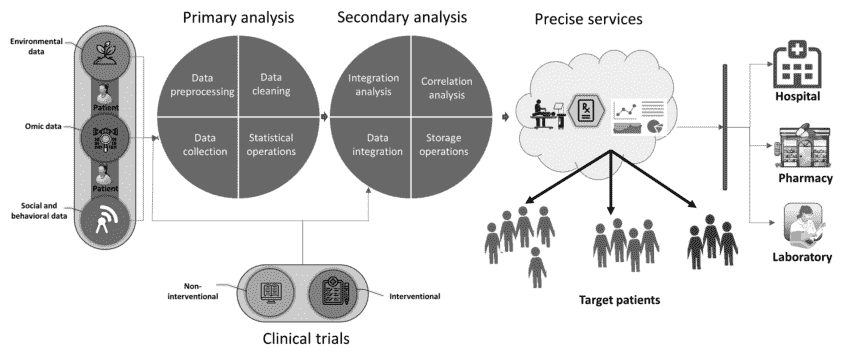

图 3.1 精准医疗实现的概念框架架构。

现有的电子健康记录（EHR）基础设施可以通过将患者标本信息从 EHR 传输到实验室信息管理系统（LIMS）来与精准医疗基础设施集成。LIMS 组件在处理、测序和分析标本数据后，将生成的报告发送回 EHR 基础设施的病理系统。临床信息学、生物信息学和参与式健康信息学可以通过考虑以下想法，在标准医疗中构建一个整体生态系统以实施精准医疗：

- 1. 通过整理来自各种移动和传感器设备、社交媒体平台、物联网设备以及环境因素的数据，并将其与临床和基因组数据相结合，可以实现精准的一点决策。
- 2. 开发基础设施、工具、技术和应用程序，以在生物信息学和临床信息学之间产生协同效应，并允许数据共享，将个体患者数据整合到临床研究环境中。
- 3. 启用多尺度人群数据，包括表型组、基因组、暴露组及其互连。

实施精准医疗平台可能存在多种意见和考虑因素。

- 1. 由临床研究人员和医生拥有，并由企业级开发团队支持的单一诊所解决方案，
- 2. 在云基础设施上支持和运行的集中式解决方案，以及
- 3. 中介解决方案允许机构范围的平台通过单一安全且成本效益高的技术基础，支持多个诊所之间的创新。该策略通过利用前者的快速开发和灵活性以及后者的可扩展性和可持续性，在单一诊所解决方案和集中式解决方案之间取得了平衡。

## 3.5 结论

实现更高质量患者护理这一共同目标是当前的迫切需求；因此，信息学界与医学界合作，为构建一个可行的解决方案以实施可扩展且可持续的精准医疗平台，时机已然成熟。首先，我们从信息学的角度描述了实现精准医疗的重要研发领域。我们提供了生物医学信息学的使能工具和技术的更广泛概述，并解释了人工智能和机器学习在精准医疗中的作用。最后，我们通过提出精准医疗实施的概念框架架构，描绘了未来的发展路线图。未来工作需要充分发挥精准医疗的最大潜力。在要素中，用于分子和 -omics 数据分析的低计算复杂性解决方案似乎是一个巨大的挑战。处理和挖掘相关预测所需的异质数据集（如组学、影像和临床数据）也需要大量研究。此外，必须引入安全机制来保护基因组数据免遭恶意使用。

## 参考文献

- 1. M. Afzal, S. M. Riazul Islam, M. Hussain, and S. Lee, “精准医疗信息学：原则、前景与挑战,” IEEE Access, vol. 8, pp. 13593–13612, 2020, doi: 10.1109/ACCESS.2020.2965955.
- 2. E. Faulkner, Holtorf AP, Walton S, Liu CY, Lin H, Biltaj E. et al., “关于精准医疗的精确论述：价值框架应纳入何种内容以应对精准医疗？个体化精准医疗特别兴趣小组报告,” Value in Health, vol. 23, no. 5, pp. 529–539, May 2020, doi: 10.1016/j.jval.2019.11.010.
- 3. S. J. Maceachern and N. D. Forkert, “精准医疗的机器学习,” Genome, vol. 64, no. 4, pp. 416–425, 2021, doi: 10.1139/GEN-2020-0131/ASSET/IMAGES/LARGE/GEN-2020-0131F1.JPEG.
- 4. T. H. Su, C. H. Wu, and J. H. Kao, “肝病学中精准医疗的人工智能,” Journal of Gastroenterology and Hepatology, vol. 36, no. 3, pp. 569–580, Mar. 2021, doi: 10.1111/JGH.15415.
- 5. I. R. König, O. Fuchs, G. Hansen, E. von Mutius, and M. v. Kopp, “什么是精准医疗？” European Respiratory Journal, vol. 50, no. 4, p. 1700391, Oct. 2017, doi: 10.1183/13993003.00391-2017.
- 6. F. Passiglia and G. v. Scagliotti, “肺癌精准医疗范式的演变,” Current Opinion in Pulmonary Medicine, vol. 27, no. 4, pp. 249–254, Jul. 2021, doi: 10.1097/MCP.0000000000000778.
- 7. D. A. Dominguez and X. W. Wang, “下一代测序对肝细胞癌预后的影响：我们真的够精准吗？” *Journal of Hepatocellular Carcinoma*, vol. 7, p. 33, Mar. 2020, doi: 10.2147/JHC.S217948.
- 8. F. Mosele, Remon, J. Mateo, C.B. Westphalen, F. Barlesi et al., “转移性癌症患者下一代测序（NGS）使用建议：ESMO 精准医疗工作组报告,” *Annals of Oncology*, vol. 31, no. 11, pp. 1491–1505, Nov. 2020, doi: 10.1016/J.ANNONC.2020.07.014.
- 9. V. de Falco, L. Poliero, P. P. Vitello, D. Ciardiello, P. Vitale et al., “临床实践中下一代测序的可行性：坎帕尼亚“Luigi Vanvitelli”大学精准医疗部门试点研究结果,” *ESMO Open*, vol. 5, no. 2, p. e000675, Jan. 2020, doi: 10.1136/ESMOOPEN-2020-000675.
- 10. G. Alterovitz, B. Heale, J. Jones, D. Kreda, F. Lin, L. Liu et al., “FHIR 基因组学：为精准医疗用例实现标准化,” *NPJ 基因组医学 2020 5:1*, vol. 5, no. 1, pp. 1–4, Mar. 2020, doi: 10.1038/s41525-020-0115-6.
- 11. F. Bewicke-Copley, E. Arjun Kumar, G. Palladino, K. Korfi, and J. Wang, “癌症研究中靶向基因组测序的应用与分析,” *计算与结构生物技术杂志*, vol. 17, pp. 1348–1359, Jan. 2019, doi: 10.1016/J.CSBJ.2019.10.004.
- 12. M. Johnson, I. Zaretskaya, Y. Raytselis, Y. Merezhuk, S. McGinnis, and T. L. Madden, “NCBI BLAST：更好的 Web 接口,” *核酸研究*, vol. 36, no. suppl_2, pp. W5–W9, Jul. 2008, doi: 10.1093/NAR/GKN201.
- 13. C. Chen, C. Hao, Y. Zhang, H. R. Thomas, M. T. H. Frank, Y. He, et al., “TBtools：一个用于交互式分析大型生物数据的集成工具包,” *分子植物*, vol. 13, no. 8, pp. 1194–1202, Aug. 2020, doi: 10.1016/J.MOLP.2020.06.009.
- 14. T. D. Wu and C. K. Watanabe, “GMAP：用于 mRNA 和 EST 序列的基因组映射与比对程序,” *生物信息学*, vol. 21, no. 9, pp. 1859–1875, May 2005, doi: 10.1093/BIOINFORMATICS/BTI310.
- 15. H. Li and R. Durbin, “基于 Burrows–Wheeler 变换的快速准确短读比对,” *生物信息学*, vol. 25, no. 14, pp. 1754–1760, Jul. 2009, doi: 10.1093/BIOINFORMATICS/BTP324.
- 16. A. McKenna, M. Hanna, E. Banks, A. Sivachenko, K. Cibulskis, A. Kernytsky, K. Garimella, et al., “基因组分析工具包：用于分析下一代 DNA 测序数据的 MapReduce 框架,” *基因组研究*, vol. 20, no. 9, pp. 1297–1303, Sep. 2010, doi: 10.1101/GR.107524.110.
- 17. A. Subramanian, P. Tamayo, V. K. Mootha, S. Mukherjee, L. E. Benjamin, A. G. Michael, et al., “基因集富集分析：一种用于解释全基因组表达谱的基于知识的方法,” 国家科学院院刊, vol. 102, no. 43, pp. 15545–15550, Oct. 2005, doi: 10.1073/PNAS.0506580102.
- 18. “GSEA.” http://www.gsea-msigdb.org/gsea/index.jsp (访问日期：2022 年 1 月 5 日).
- 19. P. Hamet and J. Tremblay, “医学中的人工智能,” Metabolism, vol. 69, pp. S36–S40, Apr. 2017, doi: 10.1016/J.METABOL.2017.01.011.
- 20. B. Mesko, “精准医疗中人工智能的作用,” http://dx.doi.org/10.1080/23808993.2017.1380516, Taylor & Francis 在线, vol. 2, no. 5, pp. 239–241, 2017, doi: 10.1080/23808993.2017.1380516.
- 21. C. Krittanawong, “人工智能的兴起与医生的未来不确定性,” 欧洲内科学杂志, vol. 48, pp. e13–e14, Feb. 2018, doi: 10.1016/J.EJIM.2017.06.017.
- 22. M. v. Koroteev, “BERT：自然语言处理与理解中应用的综述,” 2021 年 3 月，访问日期：2022 年 1 月 5 日。[在线]。可用：https://arxiv.org/abs/2103.11943v1
- 23. N. Greenspan, Y. Si, and K. Roberts, “从生物医学文献中提取精准肿瘤学概念,” AMIA 转化科学峰会论文集, vol. 2021, p. 276, 2021, 访问日期：2022 年 1 月 5 日。[在线]。可用：/pmc/articles/PMC8378653/
- 24. N. Tapon, K. F. Harvey, D. W. Bell, D. C. Wahrer, T. A. Schiripo, D. Haber, I. K. Hariharan, et al., “Salvador 在果蝇中同时促进细胞周期退出和凋亡，并在人类癌细胞系中发生突变,” Cell, vol. 110, no. 4, pp. 467–478, Aug. 2002, doi: 10.1016/S0092-8674(02)00824-3.
- 25. K. F. Harvey, X. Zhang, and D. M. Thomas, “Hippo 通路与人类癌症,” Nature Reviews Cancer 2013 13:4, vol. 13, no. 4, pp. 246–257, Mar. 2013, doi: 10.1038/nrc3458.
- 26. D. Comaniciu, K. Engel, B. Georgescu, and T. Mansi, “通过创新塑造未来：从医学影像到精准医疗,” 医学影像分析, vol. 33, pp. 19–26, Oct. 2016, doi: 10.1016/J.MEDIA.2016.06.016.
- 27. P. D. Caie, N. Dimitrou, and O. Arandjelović, “通过图像分析和机器学习在数字病理学中实现精准医疗,” 病理学中的人工智能与深度学习, pp. 149–173, Jan. 2021, doi: 10.1016/B978-0-323-67538-3.00008-7.
- 28. J. Gibson, “精准医疗与下一代测序：挑战与机遇 Culling 纪念讲座,” 组织技术学杂志, vol. 40, no. 4, p. 99, Oct. 2017, doi: 10.1080/01478885.2017.1383138.


- 29. M. Morash, H. Mitchell, H. Beltran, O. Elemento, and J. Pathak, “精准医学中下一代测序的作用：肿瘤学结果综述,” *Journal of Personalized Medicine*, vol. 8, no. 3, 2018年9月, doi: 10.3390/JPM8030030.

- 30. Z. Liu, L. Zhu, R. Roberts, and W. Tong, “向罕见病中基于下一代测序的遗传检测临床实施迈进：我们在哪里?” *Trends in Genetics*, vol. 35, no. 11, pp. 852–867, 2019年11月, doi: 10.1016/J.TIG.2019.08.006.

- 31. R. Poplin et al., “使用深度神经网络的通用SNP和小插入缺失变异检测器,” *Nature Biotechnology*, vol. 36, no. 10, pp. 983–987, 2018年9月, doi: 10.1038/nbt.4235.

- 32. R. Luo, F. J. Sedlazeck, T. W. Lam, and M. C. Schatz, “单分子测序中变异检测的多任务卷积深度神经网络,” *Nature Communications*, vol. 10, no. 1, pp. 1–11, 2019年3月, doi: 10.1038/s41467-019-09025-z.

- 33. V. Boža, B. Brejová, and T. Vinař, “DeepNano: 用于MinION纳米孔读段碱基识别的深度循环神经网络,” *PLoS ONE*, vol. 12, no. 6, p. e0178751, 2017年6月, doi: 10.1371/journal.pone.0178751.

- 34. R. Luo, T. W. Lam, and M. C. Schatz, “Skyhawk: 用于评审临床显著基因组变异的人工神经网络判别器,” *International Journal of Computational Biology and Drug Design*, vol. 13, no. 5–6, pp. 431–437, 2020, doi: 10.1504/IJCBBDD.2020.113818.

- 35. D. Quang, Y. Chen, and X. Xie, “DANN: 用于注释遗传变异致病性的深度学习方法,” *Bioinformatics*, vol. 31, no. 5, pp. 761–763, 2015年3月, doi: 10.1093/BIOINFORMATICS/BTU703.

- 36. J. Zhou and O. G. Troyanskaya, “使用基于深度学习的序列模型预测非编码变异的影响,” *Nature Methods*, vol. 12, no. 10, pp. 931–934, 2015年8月, doi: 10.1038/nmeth.3547.

# 面向个体化癌症医疗的AI驱动药物反应预测

Julhash U. Kazi
转化癌症研究部
隆德大学癌症中心

## CONTENTS

- 4.1 引言 .................................................................... 46
- 4.2 ML是AI的一个子集 ............................................................ 46
- 4.3 药物敏感性预测中使用的算法 ....................... 47
- 4.4 药物基因组数据集与数据处理 .......................... 48
- 4.5 药物敏感性预测研究 ......................................... 49
- 4.6 岭回归、弹性网和Lasso模型的应用 ................. 51
- 4.7 药物敏感性预测中的随机森林和核函数 ... 52
- 4.8 药物敏感性预测的矩阵分解算法 ....... 53
- 4.9 使用神经网络算法预测药物敏感性 ......... 53
- 4.10 药物敏感性预测前的降维：自编码器和变分自编码器 ................................... 55
- 4.11 药物联合用药预测 ............................................... 56
- 4.12 临床相关预测模型 ...................................... 58
- 4.13 当前方法的局限性 .......................................... 58
- 4.14 结论 ......................................................................... 59

由于药物反应的异质性以及对治疗的原发性或获得性耐药性，癌症治疗仍然具有挑战性。技术进步使得对个体癌症患者进行成本效益高的基因组和转录组分析成为可能，这些分析可用于更好的疾病分类和个体化治疗。然而，在临床实践中使用复杂数据仍然具有挑战性。人工智能（AI）已被用于开发药物敏感性预测模型，为将其用于个体化癌症医疗提供了机会。通过将大规模药物基因组数据纳入各种机器学习（ML）算法，已开发出多种用于临床前评估或研究目的的模型。尽管这些进步明显显示出前景，但要实现临床获益，仍有几个挑战需要解决。本章将描述使用机器学习算法进行药物反应预测方法的最新进展。将讨论单药治疗和药物联合用药预测方法。还将简要概述药物基因组数据选择方法和适当的机器学习算法。此外，将解决当前方法的局限性。预测个体癌症患者药物反应的能力将通过减少不必要的药物相关副作用和经济负担来提高治疗质量。

## 4.1 引言

在过去几十年中，人工智能（AI）已广泛应用于癌症研究中的诊断、治疗规划、药物开发、药物敏感性预测和预后判定。数字数据收集的进步为计算程序的开发提供了大量可用数据。计算机硬件和算法的改进使AI更易于研究人员使用，以利用实验数据开发更好的计算机模拟工具。

由于药物反应的异质性，癌症治疗仍然具有挑战性。虽然我们预期某种药物会在同一类型的癌症中引发类似的反应，但对于共享相似癌症亚型的不同患者，反应可能会非常不同。因此，存在开发能够在应用药物之前指导患者是否会从药物中获益的工具的未满足需求。这种方法在确定个体化癌症医疗方面将是有益的。

机器学习（ML）作为AI的一个子集，已被广泛应用，一些早期研究已记录了其在癌症研究中的应用[1-9]。这些研究为该领域的进步、相关计算挑战提供了宝贵的见解，并说明了该领域对癌症治疗的重要性。癌症研究领域非常广泛，ML可以用于多个不同的方面。在本章中，我们将简要讨论目前应用于药物反应预测的ML算法。

## 4.2 ML是AI的一个子集

任何使计算机能够模拟人类智能的技术都可归类为AI，如果一种方法允许计算机根据经验执行任务，则可将其归类为ML（图4.1a）。因此，ML是AI的一个子集，已在癌症研究中得到广泛应用，特别是药物敏感性预测。ML算法可进一步分为四个子组：（1）监督学习——算法使用与已知结果关联的数据集进行训练，以构建假设模型，从而允许从未知样本中预测结果。（2）无监督学习——从无标签数据中识别隐藏模式，从而允许对无标签生物样本进行聚类和模式检测。（3）半监督学习——混合了已知和未知结果的数据，算法从部分标记的数据中学习以开发预测模型。（4）强化学习——算法学习如何使用完全无标签的数据来预测情况（图4.1b和4.1c）。在药物敏感性预测中，监督学习被广泛使用，并且

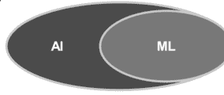

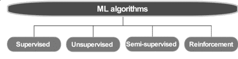

| 数据类型 | 学习算法 | 示例 |
| :--- | :--- | :--- |
| 已标记 | 监督学习 | 决策树、逻辑回归、k-最近邻、支持向量机、随机森林、朴素贝叶斯等。 |
| 未标记 | 无监督学习 | 层次聚类、隐马尔可夫模型、k-means聚类、主成分分析等。 |
| 部分标记 | 半监督学习 | ADE-CoForest、Co-Adaboost、Co-Forest、Co-NB-SVM、Rasco等。 |
| 未标记 | 强化学习 | 马尔可夫决策过程、动态规划、蒙特卡洛方法、Q学习、QR-DQN、时序差分算法等。 |

图4.1 AI和ML。（a）ML是AI算法的一个子集。（b）ML算法的可能子组。（c）ML算法示例。

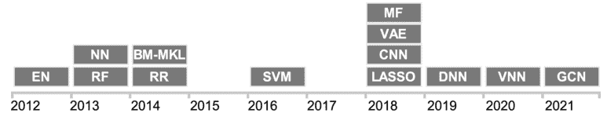

图4.2 随时间引入的算法。早期研究优先使用ML算法，而后期研究主要集中在深度学习（DL）。

因此，本章将重点介绍用于开发药物敏感性预测模型的不同监督学习算法。

## 4.3 药物敏感性预测中使用的算法

在过去十年中，随着计算能力的提升和先进算法的发展，药物敏感性预测模型不断演进。尽管早期研究主要关注稀疏线性回归模型，但后期研究引入了更复杂的模型。图4.2展示了药物敏感性预测研究中引入的不同模型的时间线图，可以清楚地看出，当前研究更偏向于深度神经网络架构。


## 文中使用的缩写

- BM-MKL – 贝叶斯多任务多核学习（又称为 BMT-MKL）
- CNN – 卷积神经网络
- DNN – 深度神经网络
- EN – 弹性网
- GCN – 图卷积网络
- LASSO – 最小绝对收缩和选择算子
- MF – 矩阵分解
- NN – 神经网络
- RF – 随机森林
- RR – 岭回归
- SVM – 支持向量机
- VAE – 变分自编码器
- VNN – 可见神经网络

## 4.4 药理基因组数据集和数据处理

要构建预测模型，高质量的药理基因组数据是必需的。表 4.1 中提到的几项研究已生成或整理了高质量的药理基因组数据，最初来源于细胞系，后来来源于患者来源异种移植物和原发患者材料。这些数据集主要提供药物敏感性数据以及基线转录组和基因组数据。

| 数据集 | M | T | E | P | C | Me | D | 参考文献 | 数据集链接 |
|---|---|---|---|---|---|---|---|---|---|
| CCLE | M | T | E | P | C | Me | D | [10, 11] | https://sites.broadinstitute.org/ccle/datasets |
| NCI-60 | | | | | | | D | [12] | https://dtp.cancer.gov/discovery_development/nci-60/ |
| GDSC | M | T | E | | C | | D | [13, 14] | https://www.cancerrxgene.org/ |
| gCSI | | | | | | | D | [15] | https://www.gene.com/gCSI.GRval |
| CTRP | | | | | | | D | [16, 17] | https://portals.broadinstitute.org/ctrp/ |
| PharmacoDB | | | | | | | D | [18] | https://pharmacodb.pmgenomics.ca/ |
| CellMinerCDB | M | T | E | P | C | | D | [19, 20] | https://discover.nci.nih.gov/cellminer/cellminercdb/ |
| DrugComb | | | | | | | D | [21] | https://drugcomb.fimm.fi/ |
| DrugCombDB | | | | | | | D | [22] | http://drugcombdb.denglab.org/main |
| PDX finder | M | T | | C | | | D | [23] | https://www.cancermodels.org/ |
| PRoXE | M | T | | | | | D | [24] | https://www.proxe.org/ |
| PDMR | M | T | | C | | | D | [25] | https://pdmr.cancer.gov/ |
| Vizome | M | T | | | | | D | [26, 27] | http://www.vizome.org |

缩写：C：拷贝数变异，D：药物敏感性，E：表观遗传学，Me：代谢组学，M：遗传突变，P：蛋白组学，T：转录组学。

数据预处理是任何计算分析中最初但重要的步骤之一。它包括多个步骤，例如数据选择、缺失值插补、噪声滤波、特征选择和归一化。由于不同数据集之间可能存在不一致性，选择合适的数据集仍然具有挑战性 [28]。两项优雅的研究比较了最大的公开可用药理基因组数据集，并表明单个数据集独立展示出相当的预测能力 [15, 29]。此外，药理基因组数据集包含不同类型的生物学数据，包括遗传突变、基因表达、拷贝数变异、蛋白质表达、表观遗传修饰和代谢组学数据。基因表达数据可能具有超过 20,000 个特征，然后将生物样本中的所有特征组合起来会导致数千个变量。然而，最大的药理基因组数据集可能包含大约 1000 个样本。因此，系统选择重要特征对于开发理想的预测模型至关重要 [30, 31]。已应用多种特征选择技术，包括主成分分析、后向特征消除、高相关性过滤器以及最小冗余最大相关性（mRMR）[32–40]。此外，由于生物学特征存在广泛差异，可能需要应用一种或多种数据缩放方法（归一化），例如数据标准化、最小-最大归一化、交叉相关性、等级不变集归一化或缩放到单位长度 [41]。

## 4.5 药物敏感性预测研究

药物敏感性预测问题可分为分类问题或回归问题。在分类模型中，算法会学习某种药物是否会对癌性对象（例如癌细胞系或患者来源异种移植物 (PDX)）表现出显著的敏感性或耐药性。在这种情况下，在药物覆盖广泛浓度范围的存在下测量细胞存活率或死亡率，以拟合确定药物敏感性的药物反应曲线。拟合曲线以后可用于确定半抑制浓度（IC₅₀——半最大抑制浓度，EC₅₀——半最大有效浓度，或 GR₅₀——半最大生长速率抑制）、曲线下面积、曲线上面积或其他药物敏感性评分等定量参数。这些评分可用于开发回归模型，其中预测模型以药物敏感性评分进行训练。表 4.1 中总结的数据集提供药物敏感性评分，可用于开发分类模型和回归模型。

### 表 4.2 著名的药物敏感性预测研究

| 算法 | 使用的数据集 | 特征 | 参考文献 |
| :--- | :--- | :--- | :--- |
| 弹性网 | GDSC | 突变, CNV, 基因表达 | [14] |
| | CCLE | 突变, CNV, 基因表达 | [10] |
| | CTRP | 突变, CNV | [16] |
| | CCLE, GDSC | 基因表达（1000 个选定的基因） | [32] |
| 岭回归 | GDSC, 临床数据 | 基因表达 | [42] |
| | van de Wetering et al. [43], Lee et al. [44] | 基因表达, 通路 | [45] |
| 随机森林 | GDSC, CCLE, NCI | 基因表达（1000 个选定的基因） | [33] |
| | PDXGEM | 基因表达 | [46] |
| 弹性网和岭回归 | CCLE, GDSC | 突变, CNV, 基因表达 | [47] |
| 弹性网和随机森林 | GDSC 2 | 突变, CNV, 基因表达, 甲基化 | [13] |
| 贝叶斯多任务多核学习 | NCI-DREAM | 突变, CNV, 基因表达, 蛋白组学 | [48] |
| 随机森林和支持向量机 | NCI | 突变, CNV, 基因表达, RPLA, miRNA | [49] |
| 细胞系-药物网络模型 | GDSC, CCLE | 基因表达 | [50] |
| 基于网络的基因-药物关联 | AML 患者和细胞系数据 | 基因表达, 突变, CNV, 甲基化 | [51] |
| 神经网络和随机森林 | GDSC | 选定的基因组特征 | [52] |
| 推荐系统 | CCLE, GDSC | 基因表达 | [53] |
| DNN | LINCS | 基因表达 | [54] |
| | GDSC | 基因表达 | [55] |
| | GDSC | 突变, CNV, 基因表达。 | [56] |
| | GDSC, KEGG, STITCH | 基因表达, 通路 | [57] |
| | CCLE, Shah et al. [58] | 基因表达 | [58] |
| 卷积神经网络 | GDSC | 基因组指纹 | [59] |
| | GDSC | 突变和 CNV | [60] |
| 自动编码器 | GDSC, CCLE | 基因表达 | [39] |
| 变分自编码器 | PharmacoDB, CMap | 基因表达 | [37] |
| | TCGA, CCLE | 突变, 基因表达 | [38] |
| | AML 患者和细胞系数据 | 基因表达 | [61] |
| 可见神经网络 | GDSC, CCLE, CTRP | 基因表达, 突变, CNV, 甲基化 | [40] |
| 图卷积网络 | GDSC | 突变和 CNV | [62] |

如图 4.2 所示，随着时间的推移，药物敏感性预测研究已从经典机器学习（ML）算法转向深度学习（DL）算法。表 4.2 按所实现的算法汇总了著名的药物预测研究。下面将分别提供详细描述。总体而言，这些研究主要使用里程碑式细胞系研究中的药理基因组数据来开发其模型。少数研究使用了 PDX 和原发患者数据。

## 4.6 岭回归、弹性网和 LASSO 模型的使用

线性回归算法是广泛使用的机器学习（ML）算法。普通线性最小二乘回归是最常见的算法，其中成本函数最小化残差平方和（图 4.3a）。普通线性最小二乘回归可能对简化的数据有用，但药理基因组数据很复杂，因此不应将此回归用于药物敏感性预测。主要缺点是过拟合，即模型表现出低偏差但承受较高方差。在成本函数中添加额外因素已被证明有助于最小化过拟合。例如，在岭回归中，添加了所谓的 L2 正则化因子，即斜率的平方乘以 λ（图 4.3b）。同样，在最小绝对收缩和选择算子（lasso）模型中，L1 正则化（λ * 斜率的绝对值）已添加到普通线性最小二乘成本函数中（图 4.3c）。最后，弹性网算法同时应用 L1 和 L2 正则化（图 4.3d）。通过调节 λ 的值，可以对这些模型进行调节 [9]。

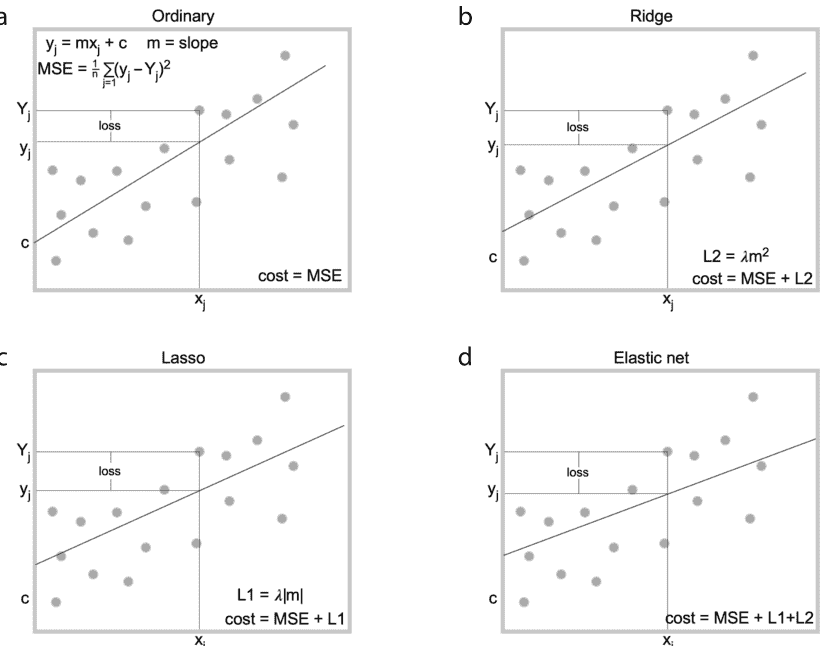

图 4.3 线性模型。(a) 普通线性最小二乘回归。(b) 岭回归。(c) 最小绝对收缩和选择算子（Lasso）。(d) 弹性网算法。


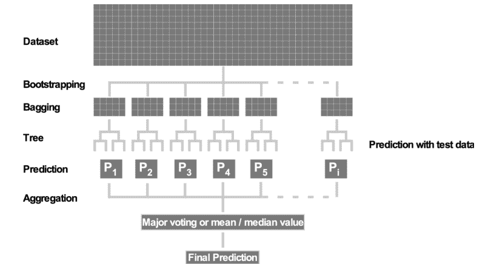

图 4.4 随机森林模型。在随机森林模型中，一个相对较大的数据集被分成几个较小的数据集。这个过程称为自助采样（bootstrapping）和装袋（bagging）。然后，小数据集被用来开发决策树。测试数据集应用于所有决策树，并将预测值聚合以做出最终预测。

若干早期研究开发了稀疏线性回归模型来预测药物敏感性。这些研究通常应用岭回归 [42, 45, 47] 和弹性网算法 [10, 14, 16, 32]。尽管这些模型的性能泛化能力较差，但这些研究产生了大量药物基因组数据，对后续研究很有用。

## 4.7 药物敏感性预测中的随机森林与核函数

决策树是流行的监督学习算法，广泛用于临床决策分析 [63]。在决策树中，模型数据在树的根节点中获取，并根据测试规则不断生长，直到可以得出决策 [64]。决策树的优点在于每一步都可以被理解、解释和可视化。随机森林使用一组决策树来解决相对复杂的问题。在此方法中，数据被随机分成小集，然后应用于决策树（图 4.4）。预测由所有树决策中最常被选择的值（分类）或均值/中位数（回归）得出。这一过程最终提高了预测准确性 [65]。

Stetson 等人使用了来自癌症药物敏感性基因组学（GDSC）、癌症细胞系百科全书（CCLE）和美国国家癌症研究所（NCI）数据集的药物基因组数据，并利用 1000 个选定基因开发并比较了机器学习模型 [33]。他们发现随机森林模型优于包括弹性网和核函数在内的其他几种模型。尽管非线性模型在分类问题等方面可能相对优于线性模型，但在回归任务中可能表现不佳。

核函数不仅可用于监督学习中的分类和回归问题，还可应用于无监督学习。可使用广泛的函数，如线性、非线性、Sigmoid、径向基和多项式，将数据转换到高维空间。支持向量机（SVM）是应用于药物敏感性预测的最流行的基于核的算法之一 [49]。贝叶斯多任务多核学习（BM-MKL 或 BMT-MKL）是另一种此类算法，在 Costello 等人总结的 NCI-DREAM 挑战中显示出了有希望的结果 [48]。

## 4.8 药物敏感性预测的矩阵分解算法

矩阵分解（MF）是广泛使用的无监督学习算法之一，用于降维，但也可用于监督学习问题。MF 是电子商务推荐系统中的流行方法 [66]。MF 的优点在于它可以处理带有缺失信息的高维数据。MF 将输入矩阵分解为具有相同数量潜在因子的低维矩阵 [9]。该系统的缺点是每个特定模型都需要定制以服务于特定目的。Suphavalai 等人使用修改后的推荐系统开发了基于推荐系统的癌症药物反应预测（CaDRReS）[53]。CaDRReS 使用基因表达信息计算细胞系特征（CCLE/GDSC 数据），关联药物敏感性信息，然后将其分解为细胞系矩阵和药物矩阵。除了药物敏感性预测，该方法还可用于探索药物作用机制、药物与信号通路之间的相互作用以及细胞系或患者的亚型 [53]。

## 4.9 使用神经网络算法预测药物敏感性

深度学习算法是机器学习算法的一种子类型，其骨干由生物启发的神经网络算法开发而成。该算法可以从适当标记的数据中自主学习分类或回归问题。该算法应用非线性激活，通过隐藏层形成复杂的神经网络来处理输入数据。这一过程使其能够学习复杂函数，同时放大重要特征以最小化噪声。图 4.5 总结了一个简单的深度学习模型，其中训练数据经过隐藏层，然后经过丢弃层处理。引入丢弃层并非强制性的，但随机丢弃层可以帮助模型学习重要特征并减少过拟合。该算法通过定义每个层的权重和偏置值来最小化成本函数。通常，使用梯度下降来寻找极小值，梯度由导数的链式法则（也称为反向传播）确定 [67]。此类算法广泛用于图像分类，并且最近也已用于药物敏感性预测 [68]。然而，由于数据可用性，图像分类是一项较容易的任务，而与这类数据的维度数量相比，目前药物基因组数据的可用性相对有限。因此，使用药物基因组数据开发深度学习模型仍然具有挑战性 [9]。早期研究应用前馈神经网络开发药物敏感性预测模型 [52, 54]。那些研究没有使用所有可用或转录组特征，而是通过选择重要的基因组 [52] 或转录组 [54] 变量来减少特征数量。后续研究应用了类似的方法构建深度神经网络（DNN）模型，并表明这些模型的表现优于经典机器学习模型 [55, 57]。

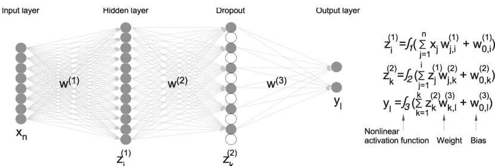

图 4.5 深度神经网络。在 DNN 模型中，输入层的每个节点都与隐藏层的节点完全连接。可以包含丢弃层以随机移除某些节点。

卷积神经网络（CNN）是另一种有助于发现重要特征的神经网络领域。该方法应用多个卷积和池化步骤，从中学习这些特征 [67]。CNN 广泛用于图像分类，但最近也已用于药物敏感性预测。癌症药物反应特征扫描（CDRscan）分别对药物分子指纹和细胞系基因组指纹应用卷积，然后合并输出结果来开发预测模型 [59]。Sharifi-Noghabi 等人使用 GDSC（特别是转录组、体细胞突变和拷贝数变异）的药物基因组数据构建了类似模型，并通过 PDX 和原发患者材料进行了验证 [56]。由于在学习过程中汇集重要特征的特性 [67]，CNN 开发的模型表现出了显著更高的鲁棒性和泛化能力。

为了开发治疗反应预测的通用模型，训练过程中需要纳入多种药物的化学和结构信息。二维分子指纹广泛用于此目的，其中确定分子的部分结构并将其转换为二进制表示。扩展连接指纹（ECFP）算法是一种确定二维分子指纹的流行算法 [69]。三维结构信息也可以通过三维指纹描述符以类似方式收集。此类转换的信息可用作神经网络的输入。Weininger 开发了简化分子输入行项系统（SMILES），这是一种可在 CNN 中使用的线性表示方法 [70]。分子图是一种非结构化方式，用于存储具有多个原子和键的小分子药物结构中的原子特征 [71]。由于常规 CNN 通常用于结构数据，因此开发了一种称为图卷积网络（GCN）的修改版 CNN 来使用分子图 [72]。Nguyen 等人使用 GCN 从小分子药物中提取重要分子特征，将该数据与 CNN 提取的基因组特征相结合，并将其输入到完全连接的前馈神经网络中 [62]。使用药物的图形表示似乎比 SMILES 提供了更好的预测性能 [60]。

尽管深度学习模型在药物敏感性预测方面显示出前景，但模型解释仍然具有挑战性，因为难以理解模型做出预测的内部合理性。Kuenzi 等人将基因组和转录组数据与信号通路和细胞结构的先验知识相结合，开发了一种可见神经网络模型（VNN），该模型可以相对容易地解释 [40]。该模型单独处理药物的化学信息，然后将其与嵌入的基因型数据相结合。尽管使用 VNN 开发的模型显示出相似或略好于其他模型的预测性能，但它以易于解释而著称。

## 4.10 药物敏感性预测前的降维：自编码器和变分自编码器

由于药物基因组数据的特征数量远多于样本数量，已使用自编码器来降低特征维度。自编码器用于将高维数据映射到低维潜在空间，算法在其中从观测数据中学习潜在变量。它包含两种不同类型的层：一种是将高维数据投影到低维潜在空间的编码层，另一种是从潜在空间解码数据的解码层（图 4.6a）。损失函数计算为输入数据与解码数据之间的最小平方差。自编码器可以使用未标记的数据来开发模型，该模型可用于降低特征，随后这些特征可用于药物敏感性预测 [39, 73]。自编码器的一种改进形式（称为变分自编码器或 VAE）将确定性瓶颈层替换为随机采样向量（均值和标准差）（图 4.6b）。由于采样向量的随机性，可以通过添加库尔贝克-莱布勒（KL）散度项来更新损失函数。这种重参数化技巧允许算法进行反向传播优化 [74]。

Chiu 等人在 TCGA（癌症基因组图谱）的未标记突变和基因表达数据上应用了自编码器，以开发可用于从 CCLE（癌症细胞系百科全书）的标记数据中确定潜在变量的模型 [38]。这些潜在变量用于开发前馈神经网络以进行药物敏感性预测。与标记的药物基因组数据相比，由于未标记数据丰富，自编码器的实现


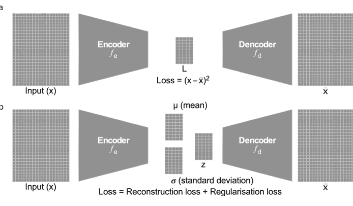

图 4.6 自编码器示意图。(a) 在自编码器中，通过降维确定潜在变量，然后从潜在变量解码数据。(b) 在 VAE 中，使用类似的编码/解码过程，除非潜在变量由均值和标准差编码。

在开发预测模型之前可以提高预测性能。除了自编码器，VAE 也已被应用于开发单药治疗预测模型。Dincer 等人使用急性髓系白血病 (AML) 患者的基因表达数据，利用 VAE 确定一个八维潜在表示，然后使用拉索模型进行最终的药物敏感性预测 [61]。还描述了一个类似模型，其中药物诱导的基因表达扰动被用于 VAE [37]。这些是从高维复杂数据开发用于预测的简单线性模型的典型示例。使用药物诱导的基因表达扰动可以是一种可行的特征降维方法，并可在确定调节药物反应的通路方面提供有用的见解 [58]。

## 4.11 药物组合预测

尽管大多数研究都集中在单药治疗预测的开发上，但在现实生活中，单药治疗用于癌症治疗的情况非常有限。由于疾病的复杂性，大多数癌症采用联合用药治疗。因此，开发一种能够推荐治疗组合，或判断治疗组合是否会表现出增强疗效（也称为协同作用）的算法，将对临床环境产生重大影响。表 4.3 总结了尝试开发药物组合预测方法的重要研究。

开发确定药物组合的理想模型需要来自生物样本的大量遗传/转录组信息、药物组合反应以及药物的结构信息。如表 4.3 所总结，一些研究使用了有限的已发表或公开可用数据

### 表 4.3 预测药物组合的研究

| 算法 | 使用的数据集 | 参考文献 |
| :--- | :--- | :--- |
| 半监督学习 | DCDB [75], KEGG, NCI-DREAM | [76] |
| 随机森林 | DREAM [77] | [78] |
| 正则化最小二乘法 | Held et al. [79] | [80] |
| 正则化最小二乘法 | DrugBank, SIDER, OFFSIDES | [81] |
| 朴素贝叶斯、支持向量机和随机森林 | DCDB [75], Cmap [82] | [83] |
| 弹性网、随机森林、支持向量机 | O'Neil 2016 [84] | [85] |
| 基于网络的 | LINCS L1000, Held et al. [79] | [86] |
| | LINCS L1000 | [87] |
| 常微分方程 | 扰动数据 [88] | [89] |
| 多种 | DREAM | [90] |
| DL | NCI-ALMANAC [91] | [92] |
| DL | O'Neil 2016 [84] | [93] |
| Transformer 增强的 DL | O'Neil 2016 [84] | [94] |
| 图卷积网络 | O'Neil 2016 [84] | [95] |
| 自编码器 | O'Neil 2016 [84] | [96] |
| 受限玻尔兹曼机 | DREAM [77] | [97] |

以开发药物组合预测模型。与单药治疗预测模型类似，几项初步研究使用 ML 算法利用细胞系的药物基因组数据构建预测模型 [76–89]。尽管这些方法（包括由 DREAM 挑战发起的研究）对于临床开发并非最佳，但它们为进一步开发提供了实质性框架 [77, 98]。

几项研究已使用前馈神经网络利用先前发表或公开可用的数据开发药物组合预测模型。例如，Xia 等人使用 NCI-ALMANAC 数据库中的转录组和蛋白质组数据 [91] 开发了前馈神经网络 [92]。他们使用两个独立的子模型来处理生物学数据和药物描述符。使用子模型使他们能够在将数据引入最终预测模型之前降低维度。此外，两项研究使用 O'Neil 等人 [84] 的数据开发了深度学习模型 [93] 或修改后的 DL 模型 [94]。尽管这些模型相比经典 ML 方法在预测性能方面表现出显著改进，但它们也需要用具有临床相关性的药物基因组数据进行升级。

将药物描述符与药物基因组数据相结合仍然具有挑战性，因为特征数量大幅增加。近期研究专注于在构建预测模型之前允许变量降维的方法。Jiang 等人实现了 GCN 以构建特定于细胞系的药物组合预测模型 [95]。其他几项研究使用自编码器 [96] 或受限玻尔兹曼机 (RBM) [97] 从高维药物基因组数据中提取有意义的特征。尽管如此，提取有意义的特征可以提高模型的预测性能。

## 4.12 具有临床相关性的预测模型

由于细胞系的药物基因组数据相对容易获得，大多数研究都使用这种类型的数据来开发预测模型。尽管细胞系模型广泛用于研究癌症的几个方面，但它们可能并不总能很好地代表癌症患者。因此，基于细胞系数据开发的模型在原始临床材料上可能表现不佳。为克服此类局限性，近期研究使用具有临床相关性的 PDX [46] 或三维类器官培养模型 [45] 开发 ML 模型。这些研究开发了具有临床相关性的预测模型，提高了成功临床应用的概率。

## 4.13 当前方法的局限性

尽管计算能力经历了快速发展，但我们仍然缺乏开发药物敏感性预测模型所需的具有临床相关性的药物基因组数据。大多数当前研究都使用细胞系的药物基因组数据。虽然细胞系数据对于假设生成很有用，但它们不能重现临床表型。在人类中，肿瘤在多细胞环境中形成并与周围细胞相互作用。不考虑其他细胞与肿瘤细胞可能相互作用的模型可能无法达到临床级准确性。为克服此类局限性，最近几项研究已使用 PDX 和肿瘤类器官 [45, 46]。此外，还做了几项尝试来开发提供具有临床相关性的药物基因组数据的 PDX 存储库 [23–25, 99]。

任何遗传或表观遗传变化都可能反映癌细胞中的基线基因表达水平。因此，使用基线基因表达数据有助于理解癌症生物学。然而，在药物治疗期间，尽管细胞可能具有相似的遗传或表观遗传特征，但基因表达模式可能会失调，进而改变药物敏感性。目前，大多数药物基因组数据集提供广泛用于开发预测模型的基础基因表达数据 [10, 14, 16, 52]。只有少数研究提供了关于药物扰动的见解 [37, 88]。因此，未来我们可能需要大量具有临床相关性的药物扰动数据。例如，关于患者在诊所对特定药物的反应以及药物治疗后基因表达模式的变化的数据，将为未来的预测模型提供有价值的信息。

在精准医疗中实施 AI 的计算挑战已被此前强调，包括医疗数据处理、环境数据收集、临床文本和数据处理 [9, 100, 101]。除了这些局限性之外，将药物基因组数据纳入临床决策系统可能具有挑战性。此外，如上文部分讨论的那样，开发每个步骤都可解释的预测模型仍然具有挑战性。


## 4.14 结论

任何单一药物或药物组合的药物敏感性预测都具有挑战性，但为了通过减少不必要的药物使用来提高治疗质量（尤其是癌症治疗），它具有至高无上的临床意义。尽管最近在预测模型开发方面的研究显示出前景，但对于临床应用仍需大量工作。为特定药物收集临床相关药基因组数据的长期临床试验可能有用，但成本非常高。也许可以将细胞系、PDXs、肿瘤类器官和原发性患者的药基因组数据纳入以开发具有临床相关性的模型。因此，尽管药物敏感性预测模型有着非常有前景的进展，我们需要更多地致力于从原发性患者中生成药基因组数据，以开发可临床应用的模型。

## 参考文献

- 1. K. Kourou, T.P. Exarchos, K.P. Exarchos, M.V. Karamouzis, D.I. Fotiadis, 癌症预后与预测中的机器学习应用, 计算结构生物技术杂志, 13 (2015) 8–17.

- 2. A. Sharma, R. Rani, 癌症预测与诊断中机器学习应用的系统综述, 工程计算方法档案, 10.1007/s11831-021-09556-z (2021).

- 3. R. Hamamoto, K. Suvarna, M. Yamada, K. Kobayashi, N. Shinkai, M. Miyake, M. Takahashi, S. Jinnai, R. Shimoyama, A. Sakai, K. Takasawa, A. Bolatkan, K. Shozu, A. Dozen, H. Machino, S. Takahashi, K. Asada, M. Komatsu, J. Sese, S. Kaneko, 肿瘤学中人工智能技术的应用：迈向精准医学的建立, 癌症 (巴塞尔), 12 (2020).

- 4. P.M. Putora, M. Baudis, B.M. Beadle, I. El Naqa, F.A. Giordano, N.H. Nicolay, 肿瘤信息学：现状与展望, 肿瘤学, 98 (2020) 329–331.

- 5. H. Shimizu, K.I. Nakayama, 肿瘤学中的人工智能, 癌症科学, 111 (2020) 1452–1460.

- 6. S. Huang, J. Yang, S. Fong, Q. Zhao, 癌症诊断与预后中的人工智能：机遇与挑战, 癌症信件, 471 (2020) 61–71.

- 7. C. Nardini, 肿瘤学中的机器学习：综述, ecancermedicalscience, 14 (2020) 1065.

- 8. F.V. Filipp, 推进精准医学中人工智能的机遇, 当前遗传学医学报告, 7 (2019) 208–213.

- 9. R. Rafique, S.M.R. Islam, J.U. Kazi, 癌症治疗预测中的机器学习, 计算结构生物技术杂志, 19 (2021) 4003–4017.

- 10. J. Barretina, G. Caponigro, N. Stransky, K. Venkatesan, A.A. Margolin, S. Kim, C.J. Wilson, J. Lehár, G.V. Kryukov, D. Sonkin, A. Reddy, M. Liu, L. Murray, M.F. Berger, J.E. Monahan, P. Morais, J. Meltzer, A. Korejwa, J. Jane-Valbuena, F.A. Mapa, J. Thibault, E. Bric-Furlong, P. Raman, A. Shipway, I.H. Engels, J. Cheng, G.K. Yu, J. Yu, P. Aspesi, Jr., M. de Silva, K. Jagtap, M.D. Jones, L. Wang, C. Hatton, E. Palescandolo, S. Gupta, S. Mahan, C. Sougnez, R.C. Onofrio, T. Liefeld, L. MacConaill, W. Winckler, M. Reich, N. Li, J.P. Mesirov, S.B. Gabriel, G. Getz, K. Ardlie, V. Chan, V.E. Myer, B.L. Weber, J. Porter, M. Warmuth, P. Finan, J.L. Harris, M. Meyerson, T.R. Golub, M.P. Morrissey, W.R. Sellers, R. Schlegel, L.A. Garraway, 癌细胞系百科全书使抗癌药物敏感性的预测建模成为可能, 自然, 483 (2012) 603–607.

- 11. M. Ghandi, F.W. Huang, J. Jane-Valbuena, G.V. Kryukov, C.C. Lo, E.R. McDonald, 3rd, J. Barretina, E.T. Gelfand, C.M. Bielski, H. Li, K. Hu, A.Y. Andreev-Drakhlin, J. Kim, J.M. Hess, B.J. Haas, F. Aguet, B.A. Weir, M.V. Rothberg, B.R. Paolella, M.S. Lawrence, R. Akbani, Y. Lu, H.L. Tiv, P.C. Gokhale, A. de Weck, A.A. Mansour, C. Oh, J. Shih, K. Hadi, Y. Rosen, J. Bistline, K. Venkatesan, A. Reddy, D. Sonkin, M. Liu, J. Lehar, J.M. Korn, D.A. Porter, M.D. Jones, J. Golji, G. Caponigro, J.E. Taylor, C.M. Dunning, A.L. Creech, A.C. Warren, J.M. McFarland, M. Zamanighomi, A. Kauffmann, N. Stransky, M. Imielinski, Y.E. Maruvka, A.D. Cherniack, A. Tsherniak, F. Vazquez, J.D. Jaffe, A.A. Lane, D.M. Weinstock, C.M. Johannessen, M.P. Morrissey, F. Stegmeier, R. Schlegel, W.C. Hahn, G. Getz, G.B. Mills, J.S. Boehm, T.R. Golub, L.A. Garraway, W.R. Sellers, 癌细胞系百科全书的下一代特征描述, 自然, 569 (2019) 503–508.

- 12. R.H. Shoemaker, NCI60人肿瘤细胞系抗癌药物筛选, 自然评论癌症, 6 (2006) 813–823.

- 13. F. Iorio, T.A. Knijnenburg, D.J. Vis, G.R. Bignell, M.P. Menden, M. Schubert, N. Aben, E. Goncalves, S. Barthorpe, H. Lightfoot, T. Cokelaer, P. Greninger, E. van Dyk, H. Chang, H. de Silva, H. Heyn, X. Deng, R.K. Egan, Q. Liu, T. Mironenko, X. Mitropoulos, L. Richardson, J. Wang, T. Zhang, S. Moran, S. Sayols, M. Soleimani, D. Tamborero, N. Lopez-Bigas, P. Ross-Macdonald, M. Esteller, N.S. Gray, D.A. Haber, M.R. Stratton, C.H. Benes, L.F.A. Wessels, J. Saez-Rodriguez, U. McDermott, M.J. Garnett, 癌症中药基因组相互作用的图谱, 细胞, 166 (2016) 740–754.

- 14. M.J. Garnett, E.J. Edelman, S.J. Heidorn, C.D. Greenman, A. Dastur, K.W. Lau, P. Greninger, I.R. Thompson, X. Luo, J. Soares, Q. Liu, F. Iorio, D. Surdez, L. Chen, R.J. Milano, G.R. Bignell, A.T. Tam, H. Davies, J.A. Stevenson, S. Barthorpe, S.R. Lutz, F. Kogera, K. Lawrence, A. McLaren-Douglas, X. Mitropoulos, T. Mironenko, H. Thi, L. Richardson, W. Zhou, F. Jewitt, T. Zhang, P. O'Brien, J.L. Boisvert, S. Price, W. Hur, W. Yang, X. Deng, A. Butler, H.G. Choi, J.W. Chang, J. Baselga, I. Stamenkovic, J.A. Engelman, S.V. Sharma, O. Delattre, J. Saez-Rodriguez, N.S. Gray, J. Settleman, P.A. Futreal, D.A. Haber, M.R. Stratton, S. Ramaswamy, U. McDermott, C.H. Benes, 癌细胞中药物敏感性基因组标记的系统鉴定, 自然, 483 (2012) 570–575.

- 15. P.M. Haverty, E. Lin, J. Tan, Y. Yu, B. Lam, S. Lianoglou, R.M. Neve, S. Martin, J. Settleman, R.L. Yauch, R. Bourgon, 癌细胞系面板可重复的药基因组分析, 自然, 533 (2016) 333–337.

- 16. A. Basu, N.E. Bodycombe, J.H. Cheah, E.V. Price, K. Liu, G.I. Schaefer, R.Y. Ebright, M.L. Stewart, D. Ito, S. Wang, A.L. Bracha, T. Liefeld, M. Wawer, J.C. Gilbert, A.J. Wilson, N. Stransky, G.V. Kryukov, V. Dancik, J. Barretina, L.A. Garraway, C.S. Hon, B. Munoz, J.A. Bittker, B.R. Stockwell, D. Khabele, A.M. Stern, P.A. Clemons, A.F. Shamji, S.L. Schreiber, 一种交互式资源，用于识别由小分子靶向的癌症遗传和血统依赖性, 细胞, 154 (2013) 1151–1161.

- 17. B. Seashore-Ludlow, M.G. Rees, J.H. Cheah, M. Cokol, E.V. Price, M.E. Coletta, V. Jones, N.E. Bodycombe, C.K. Soule, J. Gould, B. Alexander, A. Li, P. Montgomery, M.J. Wawer, N. Kuru, J.D. Kotz, C.S. Hon, B. Munoz, T. Liefeld, V. Dancik, J.A. Bittker, M. Palmer, J.E. Bradner, A.F. Shamji, P.A. Clemons, S.L. Schreiber, 利用大规模小分子敏感性数据集中的连接性, 癌症发现, 5 (2015) 1210–1223.

- 18. P. Smirnov, V. Kofia, A. Maru, M. Freeman, C. Ho, N. El-Hachem, G.A. Adam, W. Ba-Alawi, Z. Safikhani, B. Haibe-Kains, PharmaDB：用于体外抗癌药物筛选研究数据挖掘的集成数据库, 核酸研究, 46 (2018) D994–D1002.

- 19. V.N. Rajapakse, A. Luna, M. Yamade, L. Loman, S. Varma, M. Sunshine, F. Iorio, F.G. Sousa, F. Elloumi, M.I. Aladjem, A. Thomas, C. Sander, K.W. Kohn, C.H. Benes, M. Garnett, W.C. Reinhold, Y. Pommier, 用于癌细胞系整合跨数据库基因组学和药基因组学分析的 CellMinerCDB, iScience, 10 (2018) 247–264.

- 20. A. Luna, F. Elloumi, S. Varma, Y. Wang, V.N. Rajapakse, M.I. Aladjem, J. Robert, C. Sander, Y. Pommier, W.C. Reinhold, CellMiner 跨数据库（CellMinerCDB）版本 1.2：患者来源癌细胞系药基因组学的探索, 核酸研究, 49 (2021) D1083–D1093.

- 21. B. Zagidullin, J. Aldahdooh, S. Zheng, W. Wang, Y. Wang, J. Saad, A. Malyutina, M. Jafari, Z. Tanoli, A. Pessia, J. Tang, DrugComb：一个整合性癌症药物组合数据门户, 核酸研究, 47 (2019) W43–W51.

- 22. H. Liu, W. Zhang, B. Zou, J. Wang, Y. Deng, L. Deng, DrugCombDB：面向联合疗法发现的综合性药物组合数据库, 核酸研究, 48 (2020) D871–D881.


- 23. N. Conte, J.C. Mason, C. Halmagyi, S. Neuhauser, A. Mosaku, G. Yordanova, A. Chatzipili, D.A. Begley, D.M. Krupke, H. Parkinson, T.F. Meehan, C.C. Bult, PDX Finder：患者来源肿瘤移植瘤模型发现门户，核酸研究，47 (2019) D1073–D1079.

- 24. E.C. Townsend, M.A. Murakami, A. Christodoulou, A.L. Christie, J. Koster, T.A. DeSouza, E.A. Morgan, S.P. Kallgren, H. Liu, S.C. Wu, O. Plana, J. Montero, K.E. Stevenson, P. Rao, R. Vadhli, M. Andreeff, P. Armand, K.K. Ballen, P. Barzaghi-Rinaudo, S. Cahill, R.A. Clark, V.G. Cooke, M.S. Davids, D.J. DeAngelo, D.M. Dorfman, H. Eaton, B.L. Ebert, J. Etchin, B. Firestone, D.C. Fisher, A.S. Freedman, I.A. Galinsky, H. Gao, J.S. Garcia, F. Garnache-Ottou, T.A. Graubert, A. Gutierrez, E. Halilovic, M.H. Harris, Z.T. Herbert, S.M. Horwitz, G. Inghirami, A.M. Intlekofer, M. Ito, S. Izraeli, E.D. Jacobsen, C.A. Jacobson, S. Jeay, I. Jeremias, M.A. Kellher, R. Koch, M. Konopleva, N. Kopp, S.M. Kornblau, A.L. Kung, T.S. Kupper, N.R. LeBoeuf, A.S. LaCasce, E. Lees, L.S. Li, A.T. Look, M. Murakami, M. Muschen, D. Neuerg, S.Y. Ng, O.O. Odejide, S.H. Orkin, R.R. Paquette, A.E. Place, J.E. Rodenick, J.A. Ryan, S.E. Sallan, B. Shoji, L.B. Silverman, R.J. Soiffer, D.P. Steensma, K. Stegmaier, R.M. Stone, J. Tamburini, A.R. Thorner, P. van Hummelen, M. Wadleigh, M. Wiesmann, A.P. Weng, J.U. Wuerthner, D.A. Williams, B.M. Wollison, A.A. Lane, A. Letai, M.M. Bertagnolli, J. Ritz, M. Brown, H. Long, J.C. Aster, M.A. Shipp, J.D. Griffin, D.M. Weinstock, 异种移植物公共资源库可促进小鼠中的发现与随机 II 期类似试验，癌细胞，29 (2016) 574–586.

- 25. PDMR，NCI 患者来源模型资源库，https://pdmr.cancer.gov/，(2021)。访问日期：2022 年 11 月 16 日。

- 26. J.W. Tyner, C.E. Tognon, D. Bottomly, B. Wilmott, S.E. Kurtz, S.L. Savage, N. Long, A.R. Schultz, E. Traer, M. Abel, A. Agarwal, A. Blucher, U. Borate, J. Bryant, R. Burke, A. Carlos, R. Carpenter, J. Carroll, B.H. Chang, C. Coblenz, A. d'Almeida, R. Cook, A. Danilov, K.T. Dao, M. Degnin, D. Devine, J. Dibb, D.K.T. Edwards, C.A. Eide, I. English, J. Glover, R. Henson, H. Ho, A. Jemal, K. Johnson, R. Johnson, B. Junio, A. Kaempf, J. Leonard, C. Lin, S.Q. Liu, P. Lo, M.M. Loriaux, S. Luty, T. Macey, J. MacManiman, J. Martinez, M. Mori, D. Nelson, C. Nichols, J. Peters, J. Ramsdill, A. Rofelty, R. Schuff, R. Searles, E. Segerdell, R.L. Smith, S.E. Spurgeon, T. Sweeney, A. Thapa, C. Visser, J. Wagner, K. Watanabe-Smith, K. Wert, J. Wolf, L. White, A. Yates, H. Zhang, C.R. Cogle, R.H. Collins, D.C. Connolly, M.W. Deininger, L. Drusbosky, C.S. Hourigan, C.T. Jordan, P. Kropf, T.L. Lin, M.E. Martinez, B.C. Medeiros, R.R. Pallapati, D.A. Pollyea, R.T. Swords, J.M. Watts, S.J. Weir, D.L. Wiest, R.M. Winters, S.K. McWeeney, B.J. Druker, 急性髓系白血病的功能基因组图景，自然，562 (2018) 526–531.

- 27. H. Zhang, S. Savage, A.R. Schultz, D. Bottomly, L. White, E. Segerdell, B. Wilmott, S.K. McWeeney, C.A. Eide, T. Nechiporuk, A. Carlos, R. Henson, C. Lin, R. Searles, H. Ho, Y.L. Lam, R. Sweat, C. Follit, V. Jain, E. Lind, G. Borthakur, G. Garcia-Manero, F. Ravandi, H.M. Kantarjian, J. Cortes, R. Collins, D.R. Buelow, S.D. Baker, B.J. Druker, J.W. Tyner, 急性髓系白血病对克雷罗尼布的临床耐药源于多种分子机制，自然通讯，10 (2019) 244.

- 28. B. Haibe-Kains, N. El-Hachem, N.J. Birkbak, A.C. Jin, A.H. Beck, H.J. Aerts, J. Quackenbush, 大规模药物基因组学研究中的不一致性，自然，504 (2013) 389–393.

- 29. C. 癌细胞系百科全书，C. 癌症药物敏感性基因组学，两种癌细胞系数据集之间的药物基因组学一致性，自然，528 (2015) 84–87.

- 30. K. Koras, D. Juraeva, J. Kreis, J. Mazur, E. Staub, E. Szczurek, 药物敏感性预测的特征选择策略，科学报告，10 (2020) 9377.

- 31. M. Ali, S.A. Khan, K. Wennerberg, T. Aittokallio, 全球蛋白质组学谱分析改善药物敏感性预测：来自多组学泛癌建模方法的结果，生物信息学，34 (2018) 1353–1362.

- 32. S. Papillon-Cavanagh, N. De Jay, N. Hachem, C. Olsen, G. Bontempi, H.J. Aerts, J. Quackenbush, B. Haibe-Kains, 抗癌药物敏感性基因组预测器的比较与验证，美国医学信息学杂志，20 (2013) 597–602.

- 33. L.C. Stetson, T. Pearl, Y. Chen, J.S. Barnholtz-Sloan, 抗癌治疗反应多组学关联的计算鉴别，BMC 基因组学，15 Suppl 7 (2014) S2.

- 34. C. Ding, H. Peng, 来自微阵列基因表达数据的最小冗余特征选择，生物信息学与计算生物学杂志，3 (2005) 185–205.

- 35. T.H. Lin, H.T. Li, K.C. Tsai, 在 k-均值聚类算法中实现 Fisher 判别比率以进行特征选择和数据集修剪，化学信息与计算机科学杂志，44 (2004) 76–87.

- 36. M. Nakajo, M. Jinguji, A. Tani, D. Hirahara, H. Nagano, K. Takumi, T. Yoshiura, 基于 (99m)Tc-GSA SPECT/CT 的肝脏功能表征机器学习方法应用，腹部放射学 (纽约)，(2021).

- 37. L. Rampasek, D. Hidru, P. Smirnov, B. Haibe-Kains, A. Goldenberg, Dr.VAE：通过建模药物扰动效应改善药物反应预测，生物信息学，35 (2019) 3743–3751.

- 38. Y.C. Chiu, H.H. Chen, T. Zhang, S. Zhang, A. Gorthi, L.J. Wang, Y. Huang, Y. Chen, 基于深度神经网络的整合基因组图谱肿瘤药物反应预测，BMC 医学基因组学，12 (2019) 18.

- 39. M. Li, Y. Wang, R. Zheng, X. Shi, Y. Li, F. Wu, J. Wang, DeepDSC：一种预测癌细胞系药物敏感性的深度学习方法，IEEE/ACM 计算生物学与生物信息学汇刊，(2019).

- 40. B.M. Kuenzi, J. Park, S.H. Fong, K.S. Sanchez, J. Lee, J.F. Kreisberg, J. Ma, T. Ideker, 使用人类癌细胞深度学习模型预测药物反应及协同作用，癌细胞，38 (2020) 672–684 e676.

- 41. X. Liu, N. Li, S. Liu, J. Wang, N. Zhang, X. Zheng, K.S. Leung, L. Cheng, 不平衡转录组数据分析的归一化方法：综述，前沿生物工程与生物技术，7 (2019) 358.

- 42. P. Geeleher, N.J. Cox, R.S. Huang, 可使用基线基因表达水平和细胞系体外药物敏感性预测临床药物反应，基因组生物学，15 (2014) R47.

- 43. M. van de Wetering, H.E. Francies, J.M. Francis, G. Bounova, F. Iorio, A. Pronk, W. van Houdt, J. van Gorp, A. Taylor-Weiner, L. Kester, A. McLaren-Douglas, J. Blokker, S. Jaksani, S. Bartfeld, R. Volckman, P. van Sluis, V.S. Li, S. Seepo, C. Sekhar Pedamallu, K. Cibulskis, S.L. Carter, A. McKenna, M.S. Lawrence, L. Lichtenstein, C. Stewart, J. Koster, R. Versteeg, A. van Oudenaarden, J. Saez-Rodriguez, R.G. Vries, G. Getz, L. Wessels, M.R. Stratton, U. McDermott, M. Meyerson, M.J. Garnett, H. Clevers, 结直肠癌患者活体类器官生物库的前瞻性构建，细胞，161 (2015) 933–945.

- 44. S.H. Lee, W. Hu, J.T. Matulay, M.V. Silva, T.B. Owczarek, K. Kim, C.W. Chua, L.J. Barlow, C. Kandoth, A.B. Williams, S.K. Bergren, E.J. Pietzak, C.B. Anderson, M.C. Benson, J.A. Coleman, B.S. Taylor, C. Abate-Shen, J.M. McKiernan, H. Al-Ahmadie, D.B. Solit, M.M. Shen, 膀胱癌患者来源类器官模型中的肿瘤进化与药物反应，细胞，173 (2018) 515–528 e517.

- 45. J. Kong, H. Lee, D. Kim, S.K. Han, D. Ha, K. Shin, S. Kim, 结直肠癌和膀胱癌类器官模型中的基于网络的机器学习可预测患者的抗癌药物疗效，自然通讯，11 (2020) 5485.

- 46. Y. Kim, D. Kim, B. Cao, R. Carvajal, M. Kim, PDXGEM：基于患者来源肿瘤移植瘤的基因表达模型，用于预测癌症患者对抗癌治疗的临床反应，BMC 生物信息学，21 (2020) 288.

- 47. I.S. Jang, E.C. Neto, J. Guinney, S.H. Friend, A.A. Margolin, 来自癌细胞系数据的药物敏感性预测分析方法的系统评估，太平洋生物计算研讨会，(2014) 63–74.

- 48. J.C. Costello, L.M. Heiser, E. Georgii, M. Gonen, M.P. Menden, N.J. Wang, M. Bansal, M. Ammad-ud-din, P. Hintsanen, S.A. Khan, J.P. Mpindi, O. Kallioniemi, A. Honkela, T. Aittokallio, K. Wennerberg, N.D. Community, J.J. Collins,


- D. Gallahan, D. Singer, J. Saez-Rodriguez, S. Kaski, J.W. Gray, G. Stolovitzky, 评估和改进药物敏感性预测算法的社区努力, 自然生物技术, 32 (2014) 1202–1212.

- 49. I. Cortes-Ciriano, G.J. van Westen, G. Bouvier, M. Nilges, J.P. Overington, A. Bender, T.E. Malliavin, 利用NCI60癌细胞系面板改进生长抑制模式的大规模预测, 生物信息学, 32 (2016) 85–95.

- 50. N. Zhang, H. Wang, Y. Fang, J. Wang, X. Zheng, X.S. Liu, 使用双层整合细胞系-药物网络模型预测抗癌药物反应, PLoS计算生物学, 11 (2015) e1004498.

- 51. S.I. Lee, S. Celik, B.A. Logsdon, S.M. Lundberg, T.J. Martins, V.G. Oehler, E.H. Estey, C.P. Miller, S. Chien, J. Dai, A. Saxena, C.A. Blau, P.S. Becker, 急性髓系白血病精准医疗中整合大数据的机器学习方法, 自然通讯, 9 (2018) 42.

- 52. M.P. Menden, F. Iorio, M. Garnett, U. McDermott, C.H. Benes, P.J. Ballester, J. Saez-Rodriguez, 基于基因组和化学性质的癌细胞对药物敏感性的机器学习预测, PLoS One, 8 (2013) e61318.

- 53. C. Suphavilai, D. Bertrand, N. Nagarajan, 使用推荐系统预测癌症药物反应, 生物信息学, 34 (2018) 3907–3914.

- 54. A. Aliper, S. Plis, A. Artemov, A. Ulloa, P. Mamoshina, A. Zhavoronkov, 使用转录组数据预测药物药理特性和药物重新定位的深度学习应用, 分子药剂学, 13 (2016) 2524–2530.

- 55. T. Sakellarpoulos, K. Vougas, S. Narang, F. Koinis, A. Kotsinas, A. Polyzos, T.J. Moss, S. Piha-Paul, H. Zhou, E. Kardala, E. Damianidou, L.G. Alexopoulos, I. Aifantis, P.A. Townsend, M.I. Panayiotidis, P. Sfikakis, J. Bartek, R.C. Fitzgerald, D. Thanos, K.R. Mills Shaw, R. Petty, A. Tsirigos, V.G. Gorgoulis, 预测癌症治疗反应的深度学习框架, 细胞报告, 29 (2019) 3367–3373 e3364.

- 56. H. Sharifi-Noghabi, O. Zolotareva, C.C. Collins, M. Ester, MOLI: 用于药物反应预测的基于深度神经网络的多组学晚期整合, 生物信息学, 35 (2019) i501–i509.

- 57. L. Deng, Y. Cai, W. Zhang, W. Yang, B. Gao, H. Liu, 通路引导的用于可解释和预测性药物敏感性建模的深度神经网络, 化学信息与建模杂志, 60 (2020) 4497–4505.

- 58. K. Shah, M. Ahmed, J.U. Kazi, 极光激酶/β-缘蛋白轴促进白血病中地塞米松耐药性, NPJ精准肿瘤学, 5 (2021) 13.

- 59. Y. Chang, H. Park, H.J. Yang, S. Lee, K.Y. Lee, T.S. Kim, J. Jung, J.M. Shin, 癌症药物反应特征扫描(CDRscan): 根据癌症基因组特征预测药物有效性的深度学习模型, 科学报告, 8 (2018) 8857.

- 60. P. Liu, H. Li, S. Li, K.S. Leung, 使用深度卷积网络改进癌细胞系表型药物反应预测, BMC生物信息学, 20 (2019) 408.

- 61. A.V. Dincer, S. Celik, N. Hiranuma, S.I. Lee, DeepProfile: 用于精准医疗的癌症分子特征深度学习, bioRxiv, 10.1101/278739 (2018).

- 62. T.T. Nguyen, G.T.T. Nguyen, T. Nguyen, D.H. Le, 用于药物反应预测的图卷积网络, IEEE/ACM计算生物学与生物信息学汇刊, PP (2021).

- 63. J.M. Bae, 使用决策树的临床决策分析, 流行病学与健康, 36 (2014) e2014025.

- 64. V. Podgorelec, P. Kokol, B. Stiglic, I. Rozman, 决策树: 概述及其在医学中的应用, 医学系统杂志, 26 (2002) 445–463.

- 65. L. Breiman, 随机森林, 机器学习, 45 (2001) 5–32.

- 66. Y. Koren, R. Bell, C. Volinsky, 推荐系统的矩阵分解技术, 计算机, 42 (2009) 30–37.

- 67. Y. LeCun, Y. Bengio, G. Hinton, 深度学习, 自然, 521 (2015) 436–444.

- 68. N.T. Issa, V. Stathias, S. Schurer, S. Dakshanamurthy, 癌症药物重新定位的机器学习和深度学习方法, 癌症生物学研讨会, (2020).

- 69. D. Rogers, M. Hahn, 扩展连接指纹, 化学信息与建模杂志, 50 (2010) 742–754.

- 70. D. Weininger, SMILES, 一种化学语言和信息系统。1. 方法学和编码规则简介, 计算机化学信息杂志, 28 (1988) 31–36.

- 71. M. Sun, S. Zhao, C. Gilvary, O. Elemento, J. Zhou, F. Wang, 用于计算机辅助药物开发和发现的图卷积网络, 简明生物信息学, 21 (2020) 919–935.

- 72. T.N. Kipf, M. Welling, 使用图卷积网络的半监督分类, arXiv, 1609.02907v4 (2017).

- 73. G.P. Way, C.S. Greene, 使用变分自编码器从癌症转录组中提取具有生物学相关性的潜在空间, 太平洋生物计算研讨会, 23 (2018) 80–91.

- 74. D.P. Kingma, M. Welling, 自编码变分贝叶斯, arXiv, 1312.6114 (2014).

- 75. Y. Liu, Q. Wei, G. Yu, W. Gai, Y. Li, X. Chen, DCDB 2.0: 药物组合数据库的重大更新, 数据库(牛津), 2014 (2014) bau124.

- 76. Y. Sun, Z. Sheng, C. Ma, K. Tang, R. Zhu, Z. Wu, R. Shen, J. Feng, D. Wu, D. Huang, D. Huang, J. Fei, Q. Liu, Z. Cao, 结合基因组和网络特征以扩展预测癌症协同药物的能力, 自然通讯, 6 (2015) 8481.

- 77. M. Bansal, J. Yang, C. Karan, M.P. Menden, J.C. Costello, H. Tang, G. Xiao, Y. Li, J. Allen, R. Zhong, B. Chen, M. Kim, T. Wang, L.M. Heiser, R. Realubit, M. Mattioli, M.J. Alvarez, Y. Shen, N.-D. Community, D. Gallahan, D. Singer, J. Saez-Rodriguez, Y. Xie, G. Stolovitzky, A. Califano, N.-D. Community, 预测化合物对活性的社区计算挑战, 自然生物技术, 32 (2014) 1213–1222.

- 78. X. Li, Y. Xu, H. Cui, T. Huang, D. Wang, B. Lian, W. Li, G. Qin, L. Chen, L. Xie, 基于药物靶点网络和药物诱导基因表达谱的协同抗癌药物组合预测, 人工智能医学, 83 (2017) 35–43.

- 79. M.A. Held, C.G. Langdon, J.T. Platt, T. Graham-Steed, Z. Liu, A. Chakraborty, A. Bacchiocchi, A. Koo, J.W. Haskins, M.W. Bosenberg, D.F. Stern, 通过高通量药物筛选确定的黑色素瘤基因型选择性联合疗法, 癌症发现, 3 (2013) 52–67.

- 80. K.M. Gayvert, O. Aly, J. Platt, M.W. Bosenberg, D.F. Stern, O. Elemento, 识别协同药物组合的计算方法, PLoS计算生物学, 13 (2017) e1005308.

- 81. C. Yan, G. Duan, Y. Pan, F.X. Wu, J. Wang, DDIGIP: 基于高斯交互特征核的药物-药物相互作用预测, BMC生物信息学, 20 (2019) 538.

- 82. J. Lamb, 连接图谱: 生物医学研究的新工具, 自然癌症评论, 7 (2007) 54–60.

- 83. A. Cuvitoglu, J.X. Zhou, S. Huang, Z. Isik, 使用网络生物学和机器学习进行精准医疗中的药物协同预测, 生物信息学与计算生物学杂志, 17 (2019) 1950012.

- 84. J. O'Neil, Y. Benita, I. Feldman, M. Chenard, B. Roberts, Y. Liu, J. Li, A. Kral, S. Lejnine, A. Loboda, W. Arthur, R. Crisestcu, B.B. Haines, C. Winter, T. Zhang, A. Bloecher, S.D. Shumway, 一种用于识别新型联合策略的无偏肿瘤化合物筛选, 分子癌症治疗, 15 (2016) 1155–1162.

- 85. A. Malyutina, M.M. Majumder, W. Wang, A. Pessia, C.A. Heckman, J. Tang, 药物组合敏感性评分有助于发现癌症中的协同和有效药物组合, PLoS计算生物学, 15 (2019) e1006752.

- 86. K.E. Regan, P.R.O. Payne, F. Li, 基于整合网络和转录组学的方法可预测黑色素瘤的基因型特异性药物组合, AMIA联合峰会转译科学论文集, 2017 (2017) 247–256.

- 87. K.E. Regan-Fendt, J. Xu, M. DiVincenzo, M.C. Duggan, R. Shakya, R. Na, W.E. Carson, 3rd, P.R.O. Payne, F. Li, 基因表达和网络挖掘(SynGeNet)方法可预测不同黑色素瘤基因组亚型的协同药物组合, NPJ系统生物学与应用, 5 (2019) 6.

- 88. A. Korkut, W. Wang, E. Demir, B.A. Aksoy, X. Jing, E.J. Molinelli, O. Babur, D.L. Bemis, S. Onur Sumer, D.B. Solit, C.A. Pratilas, C. Sander, 扰动生物学提名RAF抑制剂耐药黑色素瘤细胞中的上游-下游药物组合, eLife, 4 (2015).

- 89. B. Yuan, C. Shen, A. Luna, A. Korkut, D.S. Marks, J. Ingraham, C. Sander, CellBox: 用于扰动生物学的可解释机器学习及其在癌症联合治疗设计中的应用, 细胞系统, 12 (2021) 128–140 e124.

- 90. M.P. Menden, D. Wang, M.J. Mason, B. Szalai, K.C. Bulusu, Y. Guan, T. Yu, J. Kang, M. Jeon, R. Wolfinger, T. Nguyen, M. Zaslavskiy, D.C. AstraZeneca-Sanger Drug Combination, I.S. Jang, Z. Ghazoui, M.E. Ahsen, R. Vogel, E.C. Neto, T. Norman, E.K.Y. Tang, M.J. Garnett, G.Y.D. Veroli, S. Fawell, G. Stolovitzky, J. Guimney, J.R. Dry, J. Saez-Rodriguez, 社区评估以推进药物基因组学筛选中癌症药物组合的计算预测, 自然通讯, 10 (2019) 2674.

- 91. S.L. Holbeck, R. Camalier, J.A. Crowell, J.P. Govindharajulu, M. Hollingshead, L.W. Anderson, E. Polley, L. Rubinstein, A. Srivastava, D. Wilsker, J.M. Collins, J.H. Doroshow, 国家癌症研究所ALMANAC: 一种用于检测具有增强治疗活性的抗癌药物对的全面筛选资源, 癌症研究, 77 (2017) 3564–3576.

- 92. F. Xia, M. Shukla, T. Brettin, C. Garcia-Cardona, J. Cohn, J.E. Allen, S. Maslov, S.L. Holbeck, J.H. Doroshow, Y.A. Evrard, E.A. Stahlberg, R.L. Stevens, 使用深度学习预测肿瘤细胞系对药物对的反应, BMC生物信息学, 19 (2018) 486.

- 93. K. Preuer, R.P.I. Lewis, S. Hochreiter, A. Bender, K.C. Bulusu, G. Klambauer, DeepSynergy: 使用深度学习预测抗癌药物协同作用, 生物信息学, 34 (2018) 1538–1546.


- 94. Q. Liu, L. Xie, TranSynergy: 用于药物组合协同预测和通路解卷的机制驱动可解释深度神经网络, PLoS Comput Biol, 17 (2021) e1008653.

- 95. P. Jiang, S. Huang, Z. Fu, Z. Sun, T.M. Lakowski, P. Hu, 用于抗癌药物协同组合优先排序的深度图嵌入, Comput Struct Biotechnol J, 18 (2020) 427–438.

- 96. T. Zhang, L. Zhang, P.R.O. Payne, F. Li, 通过在深度学习模型中整合多组学数据进行药物协同组合预测, Methods Mol Biol, 2194 (2021) 223–238.

- 97. G. Chen, A. Tsoi, H. Xu, W.J. Zheng, 基于深度置信网络和本体指纹预测有效药物组合, J Biomed Inform, 85 (2018) 149–154.

- 98. C.P. Goswami, L. Cheng, P.S. Alexander, A. Singal, L. Li, 基于基因表达和剂量-反应曲线的癌细胞药物组合效应预测新算法, CPT Pharmacometrics Syst Pharmacol, 4 (2015) e9.

- 99. M. Hidalgo, F. Amant, A.V. Biankin, E. Budinska, A.T. Byrne, C. Caldas, R.B. Clarke, S. de Jong, J. Jonkers, G.M. Maelandsmo, S. Roman-Roman, J. Seoeane, L. Trusolino, A. Villanueva, 患者来源异种移植模型：转化癌症研究的新兴平台, Cancer Discov, 4 (2014) 998–1013.

- 100. M. Afzal, S.M.R. Islam, M. Hussain, S. Lee, 精准医学信息学：原理、前景与挑战, IEEE Access, 8 (2020) 13593–13612.

- 101. S. Kaur, J. Singla, L. Nkenyereye, S. Jha, D. Prashar, G.P. Joshi, 使用人工智能（AI）算法的医学诊断系统：原理与视角, IEEE Access, 8 (2020) 228049–228069.


泰勒·弗朗西斯

泰勒·弗朗西斯集团

http://taylorandfrancis.com

# 基于 Python 的机器学习与深度学习皮肤病识别与分类

Masum Shah Junayed 和 Arezoo Sadeghzadeh
巴哈切希尔大学计算机工程系，伊斯坦布尔，土耳其

Baharul Islam
巴哈切希尔大学计算机工程系，伊斯坦布尔，土耳其
马耳他美国大学数据科学与工程学院，博姆拉，马耳他

## 目录

- 5.1 引言 .................................................................... 72
- 5.2 图像获取与数据集 ............................................ 75
- 5.3 预处理 .................................................................... 77
- 5.3.1 图像调整大小与归一化 ...................................... 77
- 5.3.2 色彩空间转换 .................................................... 78
- 5.3.3 对比度增强 ...................................................... 80
- 5.3.4 去噪 ....................................................................... 80
- 5.3.5 去模糊 ...................................................................... 81
- 5.4 分割 ...................................................................... 81
- 5.5 基于机器学习的识别 ...................................... 82
- 5.5.1 特征提取 .......................................................... 82
- 5.5.2 分类器 ..................................................................... 84
- 5.6 基于深度学习的识别 ........................................... 86
- 5.6.1 数据增强 ........................................................... 86
- 5.6.2 基于 CNN 的模型 ............................................................ 87
- 5.6.3 神经网络 ............................................................... 88
- 5.6.4 基于 CNN 的分类器 ....................................................... 91
- 5.6.5 CNN 作为特征提取器 ................................................ 95
- 5.7 评估指标 ................................................................ 97
- 5.7.1 分割任务 ............................................................ 98
- 5.7.2 分类任务 ........................................................... 99
- 5.8 结论 ........................................................................... 100
- 5.9 练习 ............................................................................. 101

最近，皮肤病在全球范围内广泛影响着人们的生活。作为人们中最严重和最常见的疾病之一，对皮肤病（尤其是最具威胁性的疾病，如皮肤癌）进行及时准确的诊断，对于获得有效治疗至关重要。在过去十年中，基于机器学习和深度学习的自动化计算机皮肤病系统因其出色的性能而受到研究人员的极大关注。本章介绍了基于机器学习和深度学习的皮肤病识别与分类的总体流程和趋势。本章的主要目的是为该领域的初学者和更高级别的研究人员提供有用的知识。为此，在介绍皮肤病简要概述后，自动化皮肤病识别系统的主要步骤（如图像获取和可用数据集、预处理、分割、增强、特征提取和分类）均进行了详细说明。介绍了基于深度学习的架构的一般概念。此外，每个步骤都提供了一些 Python 代码示例，以便您可以使用 Python 编程语言舒适且轻松地应用 Keras、Tensorflow、Scikit-learn 和 OpenCV 库，按照步骤设计自己的自动化系统，然后对其进行训练和评估。

## 5.1 引言

皮肤是人体最广泛的器官（成人约重 3.6 公斤，面积 2 平方米），作为防水盾牌覆盖在人体表面，以保护人体免受有害紫外线、危险化学物质、极端温度、外来病毒、细菌以及潜在危险疾病的侵害。它还能稳定体温，并从阳光中产生维生素 D。皮肤包含神经、肌肉以及血管和淋巴管，由表皮、真皮和皮下组织（也称为皮下层）三层构成。在这三层中，表皮是皮肤的外层，无血液供应，具有两种主要功能：一是作为环境感染的屏障，二是调节身体经表皮水分流失（transepidermal water loss，即防止脱水）的水分量。真皮是皮肤的内层，位于表皮和皮下层之间，由结缔组织、血管和毛囊组成。触觉和热觉通过该层提供。真皮下方的皮肤最底层是皮下层，含有人体脂肪，其血管和神经比真皮的更大。

由于皮肤在保护人们健康生活方面发挥着至关重要的作用，并具有众多重要功能，因此准确识别皮肤状况至关重要。皮肤病/皮肤疾病是一种非典型的皮肤状况，可能发生在几乎所有年龄段的人群中。作为人们中最常见的疾病之一，近 20% 的美国人（每五人中就有一人）正遭受某种类型的皮肤病困扰 [14]。某些皮肤疾病和疾病具有外部和情境性原因，例如

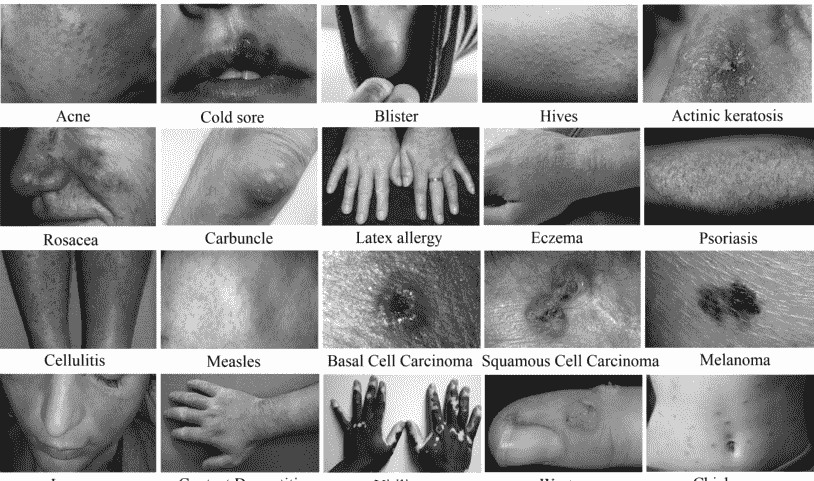

图 5.1 不同类型皮肤病的部分示例图像 [6]。

职业以及环境条件和气候的变化，而另一些则是由内部因素引起的，例如遗传、不同的饮食、激素和免疫系统。即使基于生活方式因素和环境的变化，皮肤病的发病率也有所增加 [26]。欠发达国家的卫生条件差和人口过剩会导致皮肤疾病迅速传播。存在多种类型的皮肤病（症状和严重程度各异），其中一些在图 5.1 中有所展示。这些疾病中的每一种也可能包含一些子类，例如，基底细胞癌、鳞状细胞癌和黑色素瘤是不同类型的皮肤癌，其中黑色素瘤最为致命 [37]。这些疾病中有些是暂时的，而另一些则是永久性的，甚至无法治愈且危及生命。然而，根据最近的研究，已经发现这些危险疾病如果在早期被识别，可能有治愈的可能性；即使无法完全治愈，及时的诊断和治疗也可以使五年存活率提高约 14% [9]。皮肤科医生通常通过肉眼目视检查或使用皮肤镜图像（这是临床诊断中最流行的方法）来简单诊断皮肤病。然而，由于采用非侵入性方法，获取这些图像耗时。这些诊断的另一局限性是，它们也可能不准确或无法复现，因为它们对皮肤科医生的判断极为主观，并且会因专家经验不同而有所差异。存在许多皮肤分析方法和系统，例如，ABCD

1 这些图片通过 Wikimedia Commons 根据创意共享许可提供，这意味着它们可以在任何媒介中自由复制和使用 [http://creativecommons.org/licenses/by/2.0].


规则、模式分析、Menzies方法和7-Point Checklist，以及来自Canfield的VISIA10和来自Miravex的ANTERA 3D11，仅可由经验丰富的专家用于诊断。另一方面，由于缺乏皮肤科医生，尤其是在欠发达国家，疾病诊断被延迟，患者无法得到及时治疗。即使在发达国家，治疗流程也会延迟，因为与皮肤科医生预约平均需要患者等待32天 [13]。

因此，提供一种更客观的自动化计算机诊断系统对于及时识别皮肤疾病至关重要，无需使用昂贵设备，也不受专家主观意见的影响。此外，基于自动化系统识别不同类型的特定皮肤疾病及其严重程度分级，对于为该疾病选择有效且适当的治疗及其相关方案至关重要。这些系统也可用作欠发达国家的远程筛查工具。然而，由于几个主要原因，提供此类高精度系统具有挑战性：

- 每种疾病病变类型多样性高的大量不同皮肤疾病的存在。
- 不同皮肤疾病具有相似的视觉特征，这使得视觉诊断不仅对计算机系统困难，对皮肤科医生也同样困难。
- 皮肤疾病外观依赖于人类肤色和类型、年龄及性别。
- 缺乏包含足够数量图像的适当数据集，以考虑现实世界应用中可能出现的所有可能变化，例如不同的相机角度、不均匀缩放和光照效果。

为了克服这些局限性并提供高精度系统，在过去十年中，基于机器学习技术和深度学习模型的众多方法已被用于诊断和分类两项任务，例如皮肤病变诊断 [10]、皮肤癌分类 [22, 23]、湿疹分类 [24] 等。

基于机器学习和深度学习的皮肤疾病识别与分类系统的一般过程如图5.2所示。首先，这两类方法中的几乎所有方法都要经过三个步骤：图像采集与数据集准备、图像预处理和图像分割。一旦完成这三个步骤，输入图像即可进入机器学习或深度学习系统进行处理。在基于机器学习的系统中，首先提取主要基于颜色和纹理信息的视觉特征，然后将其输入监督分类器以进行最终分类。但是，如果我们的数据集不够大怎么办？我们可以使用深度学习模型来训练它们吗？显然不行，如果我们想要获得高效性能的话。因此，在基于深度学习的方法中，除了上述三个初始步骤外，还有一个额外步骤，即增强。通过此步骤，数据集的大小和变化得到增强，这导致

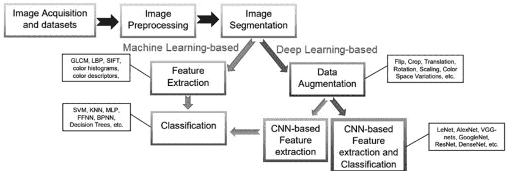

图5.2 基于机器学习和深度学习模型的皮肤疾病分类与识别的一般过程。

使系统对未来的变异数据更加稳健并能准确运行。此外，通过增强生成额外训练数据可以防止系统过拟合并提升性能。基于深度学习的方法通常遵循图5.2所示的两种方案之一：(a) 仅将卷积神经网络（CNN）模型作为特征提取器，并将提取的特征图应用于机器学习分类器以进行最终分类；(b) 将CNN模型作为单个端到端网络，同时用于特征提取和分类。本章后续部分将介绍这些步骤中的每一个的相关细节。

据作者认为，仅学习所提供概念的理论和数学对于你的未来职业生涯或将所学尽可能实践化并无直接用处。有必要通过自己的代码设计定制系统并进行修改。无需担心这一点！我们还尝试提供与皮肤疾病识别和分类基础相关的必要代码，让你在这个领域拥有更愉快的旅程。所提供的代码基于OpenCV [12]、Scikit-learn [31]、Keras [15]和Tensorflow [7]库（如图5.3所示），使用Python编程语言。

## 5.2 图像采集与数据集

获取足够数量的高质量图像对于评估皮肤疾病识别系统的性能至关重要。大量标注数据的存在甚至被认为是训练高性能可靠深度学习算法的首要要求。通常，皮肤疾病图像通过两种方式获取（如图5.4所示）：(a) 使用皮肤镜获取皮肤镜图像，(b) 使用普通数码相机获取临床图像。每种方法都有其自身的优势和劣势。皮肤镜检查是一种广泛用于皮肤科的非侵入性成像技术。在此方法中，使用皮肤镜（一种光学放大设备）获取患病皮肤表面的图像。皮肤镜获取的图像通常具有明亮的照明

| 库 | 描述 |
|---|---|
| OpenCV | OpenCV，即开源计算机视觉库，是专为实时计算机视觉设计的库。它旨在为基本视觉基础设施提供开放且优化的代码。 |
| Scikit-learn | Scikit-learn（也称为sklearn）是基于Python编程语言的机器学习库，可执行不同的分类、回归和聚类算法，例如SVM、随机森林、决策树、KNN、k-means和DBSCAN。 |
| Tensorflow | 它支持Python、C++和R等多种语言。它可以轻松用于设计和进行深度学习架构的实验，并为数据提供便捷的表述。由于具有灵活的架构，深度学习模型可以轻松在多个CPU和GPU上运行。 |
| Keras | 它也基于Python编程语言，可在TensorFlow之上运行，适合深度学习领域的初学者，并且可以在多个CPU和GPU上运行。 |

图5.3 四种常用的Python编程语言库及其描述。

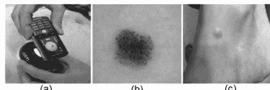

图5.4 皮肤疾病图像采集方法 [19]：(a) 图像采集过程中的皮肤镜，(b) 皮肤镜获取的图像，(c) 普通数码相机获取的临床图像。

以及更高的对比度，以便病变足够清晰从而被识别。由于噪声和光照变化较少（归因于均匀照明），计算机辅助方法在这些图像上表现更好。然而，由于图像是通过非侵入性方法获取的，收集包含足够图像数量的数据集既费时又费力。临床图像是使用普通数码相机拍摄患者受影响身体部位的照片来获取的。因此，这些图像在光照条件、分辨率和相机角度方面可能存在差异。然而，由于这些图像通常由智能手机相机拍摄，数据可以更轻松地收集，且基于这些图像的皮肤疾病识别系统可用作远程筛查工具，特别是在欠发达国家。在过去十年中，基于这两种图像采集技术，已开发出许多公开可用的数据集，用于皮肤疾病诊断/识别、分类和严重程度分级。其中一些数据集，包括PH2 [29]、ISIC [17]、HAM10000 [1]、Dermnet [4]、Dermoft图像库 [5]、Hallym [20]、AtlasDerm [1]、Danderm [2]、Derm101 [11]、7点标准评估数据集 [25]、SD-198 [36]、dermis [3]、MoleMap [40]、Asan数据集 [20]、Acne [33]和ACNE04 [39]，在图5.5中列出并附有详细信息。


| 数据集 | 图像数量 | 图像类型 | 疾病类型 |
|---|---|---|---|
| PH2 | 200 | 皮肤镜 | 常见痣、黑色素瘤、不典型痣 |
| ISIC | 超过 20000 | 皮肤镜和临床 | 黑色素瘤、脂溢性角化症、良性痣 |
| HAM10000 | 10015 | 皮肤镜 | 色素性病变 |
| Dermnet | 23000 | 皮肤镜、临床和病理 | 23 个类别 |
| Dermofit 图像库 | 1300 | 临床 | 10 个类别 |
| Hallym | 152 | 临床 | 基底细胞癌 |
| AtlasDerm | 11057 | 临床 | 几乎所有类型 |
| Danderm | 超过 3000 | 临床 | 常见皮肤病 |
| Derm101 | 数千 | 临床 | 几乎所有类型 |
| 7 点标准评估数据集 | 超过 2000 | 皮肤镜和临床 | 黑色素瘤和非黑色素瘤 |
| SD-198 | 6584 | 临床 | 198 个类别 |
| DermIS | 数千 | 临床 | 几乎所有类型 |
| MoleMap | 102451 | 皮肤镜和临床 | 22 个良性类别和 3 个癌性类别 |
| Asan 数据集 | 17125 | 临床 | 针对亚洲人的 12 个类别 |
| 痤疮 | 3000 | 临床 | 7 类痤疮类型 |
| ACNE04 | 1457 | 临床 | 4 类痤疮分级 |

图 5.5 用于皮肤病诊断、分类和严重程度分级的部分公开可用数据集。

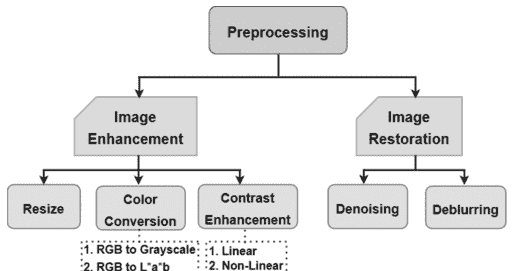

图 5.6 皮肤病识别和分类系统领域中常用的预处理技术。

## 5.3 预处理

输入图像的质量对整个系统的性能有显著影响。因此，应用预处理技术来提高图像质量和清晰度是设计皮肤病识别和分类系统的重要步骤。该领域的一些常见预处理技术在图 5.6 中有所展示，并将在以下各节中详细说明。

### 5.3.1 图像大小调整和归一化

由于训练基于机器学习和深度学习系统的输入图像需要具有相同的尺寸，预处理的第一步是应用

```python
import cv2
import glob

for filename in glob.glob('images/*.jpg'): # path to your images folder
    print(filename)
    img=cv2.imread(filename)
    img_resize=cv2.resize(img, (360,360))
    cv2.imwrite(f'{filename}resized.jpg', img_resize)
```

图 5.7 调整图像大小的 Python 代码。

调整大小。然而，直接将图像调整为所需尺寸可能会导致图像畸变和信息丢失。因此，通常有用的解决办法是沿着图像的最短边以统一比例调整图像大小（需要保持宽高比）。图 5.7 展示了一个示例 Python 代码，其中 OpenCV 库作为 cv2 使用。此外，图像的强度通常会被归一化。在图像输入系统之前，通过从强度中减去均值然后除以标准差，对整个图像执行此操作。这种基于减去统一值的归一化方法可能无法有效地归一化图像，因为数据集中皮肤病图像存在较大的光照条件、肤色和视角变化，这会导致系统性能下降。[41] 通过基于从每张单独图像中获得的通道平均强度值进行归一化来解决了这个问题。由于皮肤病图像可能包含一些其他额外内容（如头发），可以使用阈值处理、形态学和深度学习技术将其移除，以进行更准确的分析。

### 5.3.2 色彩空间转换

色彩空间转换是指通过将图片从一个色彩空间转换到另一个色彩空间，将颜色的描述从一种图形基础转换到另一种图形基础，以使转换后的图片尽可能接近原图。如前所述，皮肤病图像通常使用数码相机或皮肤镜拍摄。将 RGB（红、绿、蓝）图像转换为标量图像是很常见的，因为处理标量值（单通道）更容易、更快、更方便，甚至更准确。例如，病变通常在蓝色通道中更明显，因此通常只保留蓝色通道，执行亮度变换并保留它。皮肤病变出现各种色调；但是，绝对颜色对图像分割没有帮助。病变内部或周围皮肤（尤其是病变边缘）的颜色变化，通常用于进行初步评估。因此，将 RGB 色彩坐标图像转换为其他色彩空间相对流行且有用。

**RGB 转灰度。** 基于红色（$R$）、绿色（$G$）和蓝色（$B$）三个通道的 RGB 图像包含额外信息，这些信息在处理中大多是多余的。这会导致更高的复杂性和存储空间，而性能可能仅略有提高。因此，将 RGB 图像转换为灰度图像是图像处理和

```python
import cv2
import glob
for filename in glob.glob('images/*.jpg'): # path to your images folder
    print(filename)
    input=cv2.imread(filename)

lab = cv2.cvtColor(input,cv2.COLOR_BGR2LAB) # lab color space conversion
cv2.imshow("l*a*b*",lab)

L,A,B=cv2.split(lab) # split of lab color conversion

cv2.imwrite('ael.jpg',L) # split of L
cv2.imwrite('aea.jpg',A) # split of A
cv2.imwrite('aeb.jpg',B) # split of B
cv2.imwrite("aelab.jpg",lab) # lab (together)

cv2.imshow("L_Channel",L) # For L Channel
cv2.imshow("A_Channel",A) # For A Channel (Here's what You need)
cv2.imshow("B_Channel",B) # For B Channel

cv2.waitKey(0)
cv2.destroyAllWindows()
```

图 5.8 从 RGB 到 L*a*b* 色彩空间转换的 Python 代码。

计算机视觉领域。RGB 图像通常根据两种方法转换为灰度图像：平均法和加权法。基于平均法的灰度值计算如下：

Grayscale = (R + G + B)/3

由此得到的值归一化为 0 到 255 之间。虽然这种方法简单，但不如人类视觉感知所期望的准确。人眼对 R、G、B 所有颜色的反应并不相同。这意味着我们的眼球对绿光、红光和蓝光的敏感度不同（从高到低依次排列）。因此，在计算灰度值时，这些光线需要有不同的权重，从而导致基于以下公式的加权方法：

Grayscale = 0.299R + 0.587G + 0.114B

RGB 转 L*a*b*。为了更好地可视化皮肤病区域，许多方法都采用了 RGB 到 L*a*b* 色彩空间转换。在 L*a*b* 色彩空间中，L*、a* 和 b* 分别代表亮度和色对立维度。L*a*b* 色彩空间的开发旨在模仿人类视觉，而不是 RGB 和 CMYK 色彩模型。通过修改和优化 a 和 b 分量中的输出曲线，L 分量与人类对亮度的感知非常接近，从而可用于改变亮度对比度或进行精确的色彩平衡调整。另一方面，RGB 或 CMYK 空间不反映人类视觉体验，而是显示物理设备的输出，只能通过编辑应用程序和使用合适的混合模式来修改。可以通过将图像的色彩空间从 RGB 更改为 L*a*b* 来克服这个问题。这种转换通过提供输入图像和皮肤病区域的更好表示来提高最终分类准确率。图 5.8 展示了一个用于 RGB 到 L*a*b* 色彩空间转换的示例 Python 代码。

### 5.3.3 对比度增强

当图像的强度值范围较小时，通常需要对比度增强。这发生在图像太暗或太亮的情况下。对比度是指暗区和亮区之间的差异。增加对比度包括使暗物体更暗、亮物体更亮。降低对比度则相反，使亮度和黑度的极端值更接近。增强意味着整体图像质量的提高。

**线性对比度增强。** 这种形式的对比度增强使用对比度拉伸方法。通过重新映射或扩展灰度级值，使直方图在整个范围内拉伸，从而改善图像的对比度。

**非线性对比度增强。** 非线性方法广泛用于基于医学图像的应用中。这种对比度增强主要涉及直方图均衡化和增加对比度的算法方法。这类方法中最显著的缺陷是由于输出图像中的数字多于输入图像中的每个值，导致物体精确亮度的丢失。图 5.9 展示了一个基于直方图均衡化的非线性对比度增强的示例 Python 代码。

```python
#Histogram Equalization Contrast Enhancement
def ehan(img):
    if(len(img.shape)==2): #gray
        outImg = ex.equalize_hist(img[...,:])*255
    elif(len(img.shape)==3): #RGB
        outImg = np.zeros((img.shape[0],img.shape[1],3))
        for channel in range(img.shape[2]):
            outImg[..., :, channel] = ex.equalize_hist(img[..., :, channel])*255
    outImg[outImg>255] = 255
    outImg[outImg<0] = 0
    return img.astype(np.uint8)

def main():
    img_name = sys.argv[1]
    image = Imageio.imread(img_name)
    result = ehan(img)
    plt.imshow(result)
    plt.show()

if __name__ == '__main__':
    main()
```

图 5.9 基于直方图均衡化的非线性对比度增强的 Python 代码。

### 5.3.4 去噪

图像去噪可以有多种方法。空间滤波和变换域滤波是两种最基本的图像处理技术。在空间滤波中，邻域和预定操作根据以该像素为中心的平方邻域内的像素值来调整每个像素的灰度值（例如，均值滤波器、中值滤波器、维纳滤波器、李滤波、各向异性扩散滤波器、总变分滤波器等）。

**高斯滤波器。** 基于高斯函数的模糊方法称为高斯模糊或高斯平滑，常被用于最小化


图像噪声。该方法产生一种平滑模糊，类似于通过透明屏幕观看图像时看到的效果，而不是由失焦镜头生成的效果或标准照明下物体投射的阴影。高斯平滑也被用作计算机视觉方法中改善各种尺寸图像结构的预处理步骤。图5.10展示了基于高斯滤波器的去噪Python代码示例。

```python
import cv2
import glob

for filename in glob.glob('images/*.jpg'): # path to your images folder
    print(filename)
    img = cv2.imread(filename)
    img_resize = cv2.resize(img, (360, 360)) # image scaling
    new_image_gauss = cv2.GaussianBlur(img_resize, (360, 360), 0) # Add Gaussian Blur
    new_image = cv2.medianBlur(img_resize, figure_size) # Add Median Blur
### Outputs
cv2.imwrite(f'{filename}resize.jpg', img_resize)
cv2.imwrite(f'{filename}gaussian.jpg', new_image_gauss)
cv2.imwrite(f'{filename}median.jpg', new_image)
```

图5.10 基于高斯和中值滤波器的去噪Python代码。

### 5.3.5 去模糊

模糊大多发生在图像获取过程中。它是由源图像与相机之间缺乏对焦或运动引起的，在用于后续处理之前需要将其消除。去模糊策略包括Lucy-Richardson算法、逆滤波器、Wiener滤波器去模糊方法和神经网络方法。Wiener滤波器已被用作医疗应用中最强大和最流行的去模糊技术之一，该技术还可去除噪声。

## 5.4 分割

该程序旨在区分皮肤的患病部分和健康部分。应使用高度准确的分割算法来准确识别疾病区域。基于K-means聚类方法的基于颜色的分割方法是产生满意结果的最佳方法。聚类是一种根据图像像素与选定中心点之间的欧几里得距离将图像划分为K个簇组的方法。

该过程首先计算图像的直方图以获取中心点的数量作为K，该数量代表簇的数量。然后，如果像素值与中心点值之间的差异最小，则在空间或颜色空间中应用聚类。所需的簇数量（即K）使用K-means或Fuzzy C-means方法确定。比较这两种方法，Fuzzy C-means方法更灵活，因为它能识别与分区中许多簇交互的项目。由于图像中的项目往往具有相似的特性，聚类方法对其敏感。因此，将RGB图像转换为L*a*b颜色以更好地解释颜色的强度。然后，使用聚类方法对患病区域进行分割。

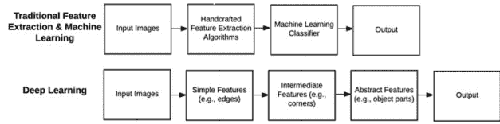

图5.11 基于机器学习和深度学习的分类系统的一般比较[8]。

## 5.5 基于机器学习的识别

如图5.11（顶部）所示，输入图像在预处理并分割皮肤疾病区域后，会经过手工特征提取和基于机器学习的分类两个主要步骤。这两个步骤将在以下部分中详细说明。

### 5.5.1 特征提取

从图像中收集的信息称为特征。特征是从图片中提取的数值信息，人类难以理解和相互关联。从图片中检索到的特征维度通常远低于原始图像。

一般来说，根据应用程序，可以从图像中提取两种特征：局部特征和全局特征。图像检索、目标检测和分类都使用全局特征，而皮肤疾病诊断和识别则使用局部特征。结合全局特征和局部特征可以提高识别准确性，但也会增加计算成本。从大量文本数据中发现和提取图像特征的技术称为机器学习中的特征提取。

**GLCM特征。** 在统计纹理分析中，纹理特征源于图像中定义位置处相对强度组合的统计分布。统计特征根据每个组合中的强度点数量分为一阶、二阶和高阶统计特征。GLCM方法是获取二阶统计纹理特征的一种技术。该方法已广泛应用于各种领域。三阶及高阶纹理考虑三个或多个像素之间的连接。这些在理论上是可以设想的，但由于计算所需时间和结果解释的困难，它们并未广泛使用。

GLCM的每一行和每一列对应图像中的灰度级数（G）数量。矩阵元素P（i，j |Δx，Δy）包括在特定距离（d）和特定角度（θ）下灰度级“i”和“j”变化的二阶统计概率值。该矩阵元素是两个像素，

```python
import matplotlib.pyplot as plt
import cv2
from skimage.feature import graycomatrix, graycoprops

### segmented images
image = cv2.imread(filename)
PATCH_SIZE = 21
### select some patches from disease areas of the image
disease_locations = [(280, 454), (342, 223), (444, 192), (455, 455)]
disease_patches = []
for loc in disease_locations:
    # disease_patches.append(image[loc[0]:loc[0] + PATCH_SIZE, loc[1]:loc[1] + PATCH_SIZE])
    # select some patches from affected areas of the image
    aff_locations = [(38, 34), (139, 28), (37, 437), (145, 379)]
    aff_patches = []
    for loc in aff_locations:
        aff_patches.append(image[loc[0]:loc[0] + PATCH_SIZE, loc[1]:loc[1] + PATCH_SIZE])
### compute some GLCM properties each patch
xs = []
ys = []
for patch in (disease_patches + aff_patches):
    glcm = graycomatrix(patch, distances=[5], angles=[0], levels=256,
                        symmetric=True, normed=True)
    xs.append(graycoprops(glcm, 'dissimilarity')[0, 0])
    ys.append(graycoprops(glcm, 'correlation')[0, 0])
```

图5.12 GLCM特征提取Python代码。

按像素距离（Δx，Δy）分隔，在特定邻域中出现，一个具有强度“i”，另一个没有，在该邻域中。

使用大量的强度级别G需要存储大量临时数据，即为每个(Δx，Δy)或（d，θ）组合存储一个G×G矩阵。由于其维度很高，GLCM对其计算所依据的纹理样本数量非常敏感。图5.12展示了一个GLCM特征提取的*Python*代码示例。

**HOG。** 从图像数据中提取特征时，方向梯度直方图（HOG）常被用作特征提取。它通常用于计算机视觉应用，例如皮肤疾病检测和识别。

即使没有相关梯度或边缘坐标的确切信息，局部强度梯度或边缘方向的分布也常常能相当有效地表示局部项目的外观和结构。这一断言导致了HOG方法的定义，该方法已广泛用于人体识别，并在尺度不变特征变换[18]中使用了其成熟版本。特征表示基于对称为“单元”的微小空间区域内像素的梯度方向进行累积，随后构建一个1D直方图，其串联提供将用于未来目的的特征向量。令*L*为描述所考虑图像的强度（灰度）函数。图像被分割为大小为N×N像素的单元，每个像素的梯度\(\theta_{x,y}\)方向（图5.13a）通过以下方程确定（图5.13b,c）：

```
\(\theta_{x,y} = \tan^{-1} \frac{L(x, y + 1) - L(x, y - 1)}{L(x + 1, y) - L(x - 1, y)}\) (5.3)
```

随后，属于同一单元*j*的方向\(\theta_{j,i}\)，i = 1...N<sub>2</sub>，被量化并累积到一个M-bin直方图中（图5.13d,e）。最后，所有

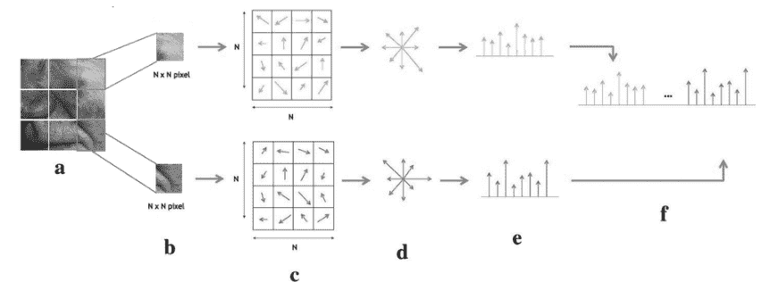

图 5.13 HOG特征提取：分割图像的单元格大小为 N×N 像素。在 M 个方向的直方图中，每个像素的方向都会被计算并收集。为了生成最终特征向量，所有单元格直方图都会被连接。

生成的直方图将被排序并连接成一个单一的 HOG 直方图（图 5.13f），作为后续处理所用的特征向量。HOG 特征提取的示例 Python 代码如图 5.14 所示。

```python
import matplotlib.pyplot as plt

from skimage.feature import hog
from skimage import data, exposure

image = data.astronaut()

fd, hog_image = hog(image, orientations=8, pixels_per_cell=(16, 16),
                    cells_per_block=(1, 1), visualize=True, channel_axis=-1)

fig, (ax1, ax2) = plt.subplots(1, 2, figsize=(8, 4), sharex=True, sharey=True)

ax1.axis('off')
ax1.imshow(image, cmap=plt.cm.gray)
ax1.set_title('Input image')

### Rescale histogram for better display
hog_image_rescaled = exposure.rescale_intensity(hog_image, in_range=(0, 10))

ax2.axis('off')
ax2.imshow(hog_image_rescaled, cmap=plt.cm.gray)
ax2.set_title('Histogram of Oriented Gradients')
plt.show()
```

图 5.14 HOG 特征提取的 Python 代码。

### 5.5.2 分类器

K-近邻（KNN）。简单的最近邻分类器会将每个像素分类为强度最高的训练数据所属的同一类别。如果单个推导的邻居是另一个类别的异常值，最近邻分类器可能会做出错误判断。KNN 分类器使用 K 个模式来防止这种情况。由于它不对数据的统计结构做出任何基础假设，因此被认为是一种非参数分类器。

#### KNN 算法：

- 训练集包含类别。
- 检查待分类项附近的 K 个项。
- 将新项放入拥有最多近邻项的类别中。

K 近邻分类通过使用包含输入变量和目标变量的训练数据集，然后将仅包含输入变量的测试数据与该参考集进行比较来完成。KNN 分类器的示例 Python 代码如图 5.15 所示。

```python
from sklearn.neighbors import KNeighborsClassifier

knn = OneVsRestClassifier(KNeighborsClassifier())

knn.fit(X_train,y_train)
#### predict for one observation
knn.predict(X_test[0].reshape(1,-1))
#### predict for multiple observation (images) at once
knn.predict(X_test[0:10])
#### make prediction on entire test data
predictions = knn.predict(X_test)
```

图 5.15 KNN 分类器的 Python 代码。

支持向量机（SVM）。分类任务通常包含两组数据：训练数据和测试数据，每组数据都包含多个数据样本。在训练集中，每个实例具有一个目标值和多个特征。SVM 的目的是创建一个模型，在仅提供特征时预测测试集中数据实例的目标值。

SVM 基于监督学习（使用带标签或标注数据训练的模型，用于预测未来不可见数据的类标签）。为确定系统是否运行正确，会使用已知标签，这些标签可以通过指向预期响应并评估系统的正确性，帮助系统学习适当行为。对于分类任务，监督学习算法基于统计学习理论，可以用较少的训练样本生成可靠、准确且有价值的结果。一般来说，传统的二分类器使用属于两个类别的数据集进行训练，而 SVM 训练方法创建一个可预测新数据类别的训练模型。然而，多类分类近期通过将多类分解为多个分类任务并创建多个 SVM 分类器来解决。

在多种应用中，SVM 已被证明优于神经网络和 RBF（径向基函数）分类器。SVM 基于两种不同的数学过程。在特征空间中，SVM 使用最优线性分离超平面将两个数据集分开。通过最大化两组之间的最小边界来获得这个最优超平面。因此，最终的超平面仅依赖于称为支持向量的边界训练模式。

输入向量被非线性地映射到输入和输出不可见的高维特征空间中。构建用于区分特征的最佳超平面。SVM 将输入向量转换到更高维的向量空间，从中构建出可用于评估具有线性可分性的数据的理想超平面，而高斯 RBF 等核函数则用于研究不可线性分离的数据。

一般来说，SVM 的输出是通过应用核函数训练示例将训练实例投影到高维特征空间后的连接结果。SVM 基于统计学习理论中的结构风险最小化，这是一种机器学习。其主要目标是通过控制过拟合问题和分类能力，来减少类别之间的边界和实际代价。SVM 分类器的示例 Python 代码如图 5.16 所示。

```python
from sklearn.svm import SVC
svc = SVC(kernel='linear', gamma='auto')
svc.fit(X_train, y_train)
```

图 5.16 SVM 分类器的 Python 代码。

## 5.6 基于深度学习的识别

在本节中，我们将讨论 CNN 的一般概念及其层的相关细节。

### 5.6.1 数据增强

基于深度学习的模型的性能高度依赖于训练数据的大量程度。大量的训练数据可以防止模型过拟合，提高模型的泛化能力，并增强其性能。然而，由于患者隐私、疾病罕见性以及需要由专业专家对图像进行标注，收集如此大量的数据（尤其是在医学图像分析中）非常具有挑战性、耗费资源且精力密集。另一方面，由于网络在未来测试中看到的数据可能包含多种变化，使其与训练数据不同，因此使用多样化的数据训练模型，并通过学习更强健的特征来使其具有鲁棒性至关重要。为解决这些问题，通过应用数据增强对原始训练数据进行人工变换。数据增强由多种技术组成，这些技术通过应用随机抖动和扰动，从原始图像生成新的训练样本，同时保持类别标签不变，以提高原始数据集的规模和质量。在测试阶段，不应用数据增强。在训练数据上应用不同的增强操作后，测试精度会提高，因为模型可以学习不同可能

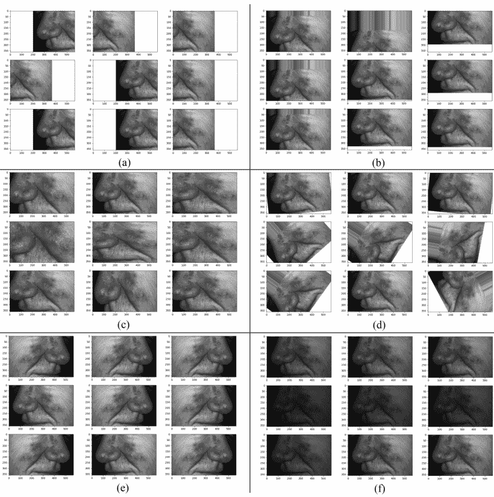

图 5.17 不同增强技术的可视化表示。其中，(a)、(b)、(c)、(d)、(e) 和 (f) 分别表示平移、剪切、缩放、旋转、翻转和阴影增强。

变化。常见的数据增强技术包括几何变换（例如平移、旋转、翻转、剪切、缩放改变和裁剪）、颜色空间增强（例如阴影）和核滤波器。图 5.17 以可视化方式展示了一张图像的多种增强结果。数据增强的示例 Python 代码如图 5.18 所示。

### 5.6.2 基于 CNN 的模型

如图 5.11 所示，与基于机器学习的分类系统不同，基于深度学习的模型（例如 CNN）通过训练过程以分层方式自动从图像中提取特征。在这些

```
from keras.preprocessing.image import ImageDataGenerator, array_to_img, img_to_array, load_img
datagen = ImageDataGenerator(
    rotation_range=40,
    width_shift_range=0.2,
    height_shift_range=0.2,
    shear_range=0.2,
    zoom_range=0.2,
    horizontal_flip=True,
    fill_mode='nearest')
```

图 5.18 用于数据增强的 Python 代码。

模型中，一些基本表示被编码在网络的底层中，随后这些基本层被高层用于生成更抽象的概念。这种分层学习使 CNN 成为端到端学习者，消除了提取手工设计特征的需求。对于给定图像，原始像素强度被输入到 CNN 中作为输入，以使用一系列隐藏层提取特征。由于特征提取以分层方式进行（网络中每层的输出作为下一层的输入），底层仅提取边缘等简单特征，随后在下一层中用于确定角点和轮廓等中间特征。这些角点和轮廓组合形成高层中的对象部分。最终层作为输出层，用于分类并获取输出类别的标签。

CNNs 相对于传统基于机器学习的方法的一个优势是，在这些模型中跳过了特征提取步骤，仅专注于模型训练过程。另一个主要优势是，由于高度优化的 GPU、快速计算机和大型标记数据集的出现，CNN 实现了出色的性能准确性。如今，研究人员能够使用海量训练数据设计更深层的神经网络，从而获得更高的分类准确性，而传统机器学习算法无法实现这种行为。如图 5.19 [30] 所示，机器学习算法的性能在特定数据量时达到平台期，增加数据集大小对其性能没有影响，而深度学习模型的性能则呈增长趋势。

### 5.6.3 神经网络

在讨论 CNN 的细节之前，首先了解神经网络（NN）的基础知识至关重要，NN 是深度学习系统的基本构建块。人工 NN 架构受到现实生物神经网络的启发，以模仿大脑识别复杂模式的能力。NN 架构的一个简单示例在图 5.20 中说明。在这种架构中，每个节点执行简单的计算，每个计算的输出作为信号，通过带有指定权重的连接从一个节点传输到另一个节点。这些权重中有些放大信号，因为它们在最终分类中起着重要作用，而另一些则减弱信号强度，因为它们对最终分类的重要性较低。在此，X1、X2 和 X3 是来自设计矩阵的单行输入。值 1 作为偏置输入到设计矩阵的模型中。通常，

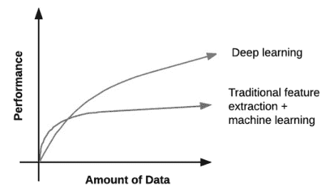

图 5.19 基于深度学习的算法与传统基于机器学习的方法的性能比较，表明增加训练数据量可提高深度学习算法的准确性。

这些输入可以是颜色直方图、HOG、LBP 等特征的向量，但在深度学习模型中，输入通常是图像的原始像素强度。系统的整体过程可表示为 $f(net)$，其中 $net = \sum_{i=1}^n W_i X_i$（即输入的加权和），并对其应用激活函数 $f$ 以确定神经元是否发火。

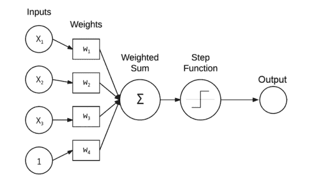

图 5.20 具有三个 X 输入和一个带有 W 权重的隐藏层的简单神经网络架构，用于计算输出类别标签。输入的加权和传递给激活函数，以确定神经元是否发火。

激活函数。有几种广泛应用于深度学习模型的流行激活函数，其中六种在图 5.21 中说明。“阶跃函数”是感知算法使用的最简单的阈值函数激活函数。它定义如下：

```
f(t) = \begin{cases} 1 & \text{if } net > 0 \\ 0 & \text{otherwise} \end{cases} \quad (5.4)
```

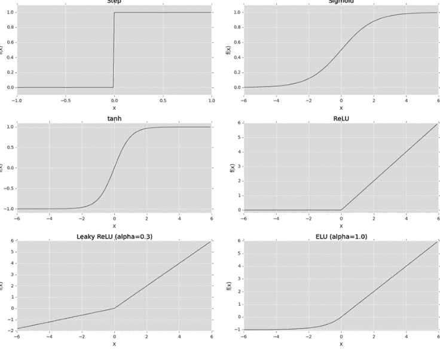

图 5.21 深度学习架构中常用的六种激活函数 [8]。

尽管该函数易于使用，但在训练网络时应用梯度下降会面临挑战，因为阶跃函数不可微。Sigmoid 是另一种常见的激活函数，遵循以下方程：

$$t = \sum_{i=1}^{n} W_i X_i \qquad s(t) = \frac{1}{1 + e^{-t}} \quad (5.5)$$

由于 Sigmoid 函数是连续、可微且对称的，它在深度学习算法中的表现优于阶跃函数。然而，它也存在一些局限性：(i) 其输出不是零中心的，(ii) 梯度会因饱和神经元导致极小的梯度增量而退化。与 Sigmoid 形状相似，双曲正切（tanh）是广泛使用的激活函数之一，定义如下：

$$f(z) = tanh(z) = \frac{e^z - e^{-z}}{e^z + e^{-z}} \quad (5.6)$$

与 Sigmoid 相反，它是零中心的，但饱和神经元仍然会消除梯度。比前面提到的函数更好的选择是整流线性单元（ReLU），定义如下：

$$f(x) = max(0, x) \quad (5.7)$$

基于其形状，它也称为“斜坡函数”。对于负值为零，对于正值线性增加。它不仅优于 Sigmoid 和 tanh 激活函数，而且计算高效且不饱和。然而，问题仅在输入值为零时出现，因为无法计算梯度。为了克服这一局限性，使用了一种称为 Leaky ReLUs [28] 的 ReLU 另一种形式，即在单元不活跃时允许小的非零梯度：

\( f(net) = \begin{cases} net & \text{if } net >= 0 \\ \alpha \times net & \text{otherwise} \end{cases} \) (5.8)

最后一种激活函数是指数线性单元（ELUs），如 [16] 所介绍，定义如下：

\(\alpha\) 是一个常数，典型值为 1。

### 5.6.4 基于 CNN 的分类器

引入的前馈神经网络可用于图像处理。然而，由于一层中所有节点与下一层节点之间存在大量连接，它们效率不够高。在这种情况下，可以根据图像结构仔细修剪这些连接来提高效率，从而获得更好的性能。一种非常常见的 NN 类型是 CNN，它通过层间极少的连接保留数据中的空间关系。图 5.22 说明了一种应用于皮肤病分类和识别领域的典型 CNN 架构。CNN 由不同层组成，包括卷积层（CONV）、激活层、池化层（POOL）、全连接层（FC）、批量归一化层（BN）和 Dropout 层（DO），将在以下段落中详细说明。

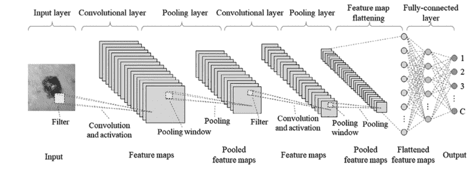

图 5.22 用于皮肤病分类和识别的典型 CNN 模型 [27]。

#### 卷积层。

CNN 的基本构建层是 CONV 层，包含一组可学习的滤波器，称为“内核”（几乎总是方阵）。这些小滤波器扩展到卷积层的整个深度。如图 5.23 所示，CONV 层的输入经过三个主要步骤。


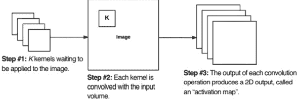

图 5.23 卷（输入图像或特征图）在卷积层中经过的三个主要步骤 [8]。

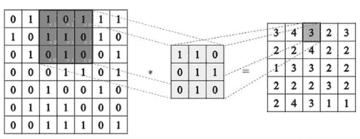

图 5.24 2D 卷积运算的可视化呈现 [27]。

输入的初始深度等于图像中的通道数量（例如，当图像为 RGB 图像时为三个）。网络中更深层卷积层的深度是前一层的滤波器数量。在第一步中，确定滤波器的数量及其核大小，每个滤波器都与输入卷进行卷积运算，第二步也是如此。卷积运算的一个示例如图 5.24 所示。这里，\(W_{j,i}\) 是核大小为 \(3 \times 3\) 的滤波器，其中 \(j\) 和 \(i\) 分别是滤波器编号和层数。这个小窗口从左到右、从上到下移过图像或特征图的 2D 网格。窗口在图像上移动的步长由 *步长* 步长决定，通常为 1（每次移动一个像素）或 2（每次跳过两个像素）。在每次移动中，窗口的元素与网格中对应的元素相乘。通过将这些按元素相乘的值求和来完成卷积运算，从而得到一个标量值。卷积得到的所有值构成另一个称为特征图/激活图的 2D 网格，如图 5.23 的第三步所示。一旦所有 \(K\) 个滤波器都应用于输入卷，就会得到 \(K\) 个 2D 激活图，它们沿深度维度堆叠作为最终的输出卷（如图 5.25 所示）。

应指出，在输入边界上应用零填充以保持原始图像尺寸，从而使输出卷尺寸与输入尺寸匹配（如图 5.26 所示）。假设 I、F、S 和 P 分别为输入正方形图像尺寸（一个维度）、过滤器核大小、步长值和零填充量。要构建有效的卷积层，以下方程必须为整数：

```
((I – F + 2P)/S) + 1 (5.10)
```

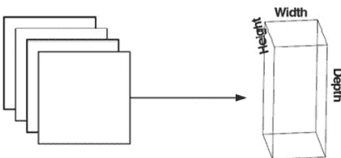

图 5.25 将 K 个滤波器得到的 K 个激活图堆叠，形成 CNN 下一层的输入卷 [8]。

#### 带零填充的输入

| 0 | 0 | 0 | 0 | 0 | 0 | 0 |
|---|---|---|---|---|---|---|
| 0 | 95 | 242 | 186 | 152 | 39 | 0 |
| 0 | 39 | 14 | 220 | 153 | 180 | 0 |
| 0 | 5 | 247 | 212 | 54 | 46 | 0 |
| 0 | 46 | 77 | 133 | 110 | 74 | 0 |
| 0 | 156 | 35 | 74 | 93 | 116 | 0 |
| 0 | 0 | 0 | 0 | 0 | 0 | 0 |

#### 卷积核

| 692 | -315 | -6 |
|---|---|---|
| -680 | -194 | 305 |
| 153 | -59 | -86 |

#### 卷积输出

| -99 | -673 | -130 | -230 | 176 |
|---|---|---|---|---|
| -42 | 692 | -315 | -6 | -482 |
| 312 | -680 | -194 | 305 | 124 |
| 54 | 153 | -59 | -86 | -24 |
| -543 | 167 | -35 | -72 | -297 |

图 5.26 在卷积前对原始输入应用零填充，从而保留输入的空间维度，使输出卷尺寸与原始输入卷尺寸相匹配。

**激活层。** 每个卷积层之后都会应用非线性激活函数，例如 ReLU、ELU 等（详见第 5.7.4 节），旨在使神经网络能够执行几乎任何非线性函数。如图 5.27 所示，激活函数（此处为 ReLU）的输出是作为特征图的新张量。

**池化层。** 除了使用步长大于 1 的卷积层外，还可以在两个连续卷积层之间应用池化层来减小输入卷的大小。池化也有助于处理过拟合问题。常见的池化层有最大池化和平均池化两种。通常，最大池化应用于 CNN 架构的中间层，目的是降低空间尺寸；而平均池化常作为网络的最后一层，以避免完全使用全连接层。图 5.28 展示了对步长为 1 和 2 的示例输入应用最大池化的一个示例。

**批量归一化。** 批量归一化最初在 [21] 中提出，它位于激活层之后，用于对输入卷的激活值进行归一化

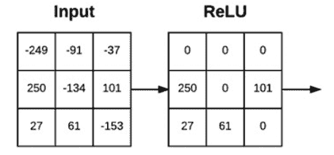

图 5.27 输入通过 ReLU 激活，在此过程中负值被视为零，正值保持不变。

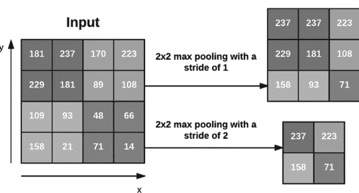

图 5.28 对步长为 1 和 2 的示例输入应用 2 × 2 最大池化滤波器 [8]。

在将它们应用到下一层之前。将 x 视为激活值的小批量，其归一化值计算如下：

$$\hat{x}_i = \frac{x_i - \mu_\beta}{\sqrt{\sigma_\beta^2 + \varepsilon}}$$ (5.11)

其中，\(\mu_\beta\) 和 \(\sigma_\beta^2\) 分别在训练期间对 \(\beta\) 的每个小批量计算为均值和方差，\(\varepsilon\) 被定义为一个非常小的值。使用批量归一化层，激活值的均值和标准差被强制保持为零和单位。该层还减少了代数，并使其对仔细初始化和调整参数的依赖性降低。

**丢弃法。** 丢弃层最初在 [35] 中提出，是一种正则化形式，它通过随机消除训练中的神经元，以概率 p 移除一层神经元与下一层神经元之间的连接，从而防止模型过拟合。这种丢弃过程会导致略有不同的网络，因此网络权重通过优化原始网络的各种形式来调整。图 5.29 展示了以 50% 的概率向网络应用丢弃法的一个示例，在此过程中一半的连接被移除。

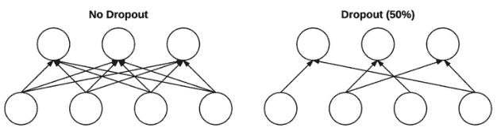

图 5.29 应用和未应用丢弃层的两个 CNN。这里，通过以 0.5 或 50% 的概率应用丢弃法，移除了一半的连接 [8]。

**全连接层。** 本章解释的最后一层是全连接层，其名称源于这些层中的神经元与前一层的所有激活值完全连接这一事实。这些层始终设计为网络的最后一层，而不会出现在 CNN 架构的中间。在每个 CNN 架构中，通常会应用一层或两层全连接层，其后接 softmax 分类器以计算每个类别的最终输出概率（分类步骤）。基于 CNN 的端到端分类器的 Python 代码示例如图 5.30 所示。

```
import numpy as np
from keras.models import Sequential
from keras.layers import Dropout, Dense, Flatten
from keras.optimizers import SGD
from keras.layers.convolutional import Conv2D, MaxPooling2D
from keras.utils import np_utils as u
from keras.datasets import cifar10

model = Sequential()
model.add(Conv2D(32, (3, 3), input_shape=(32, 32, 3), padding='same',
		activation='relu'))
model.add(Dropout(0.2)) # 20% of the nodes are set to 0
#### padding='valid' means that the output dimension can
model.add(Conv2D(32, (3, 3), activation='relu', padding='valid'))
model.add(BatchNormalization()) # This works as regularization
model.add(MaxPooling2D(pool_size=(2, 2))) #maxpool with a kernel of 2x2
#In a convolution NN, we need to flatten our data before input it into the output/dense layer
model.add(Flatten())
model.add(Dense(512, activation='relu')) #Dense layer with 512 hidden units
model.add(Dropout(0.3)) #This time we set 30% of the nodes to 0 to minimize overfitting
#Finally the output dense layer with 10 hidden units corresponding to classes
model.add(Dense(10, activation='softmax'))
#Few simple configurations
model.compile(loss='categorical_crossentropy',
	optimizer=SGD(momentum=0.5, decay=0.0004), metrics=['accuracy'])
model.fit(X, y, validation_data=(X_test, y_test), epochs=25,
	batch_size=512)
#Finally print the accuracy of our model!
print("Accuracy: %.2f%% " % (model.evaluate(X_test, y_test)[1]*100))
```

图 5.30 基于 CNN 的端到端分类器的 Python 代码。

### 5.6.5 CNNs 作为特征提取器

如前所述，CNN 被用作端到端图像分类器，其输入是一张图像，图像通过网络向前传播并给出


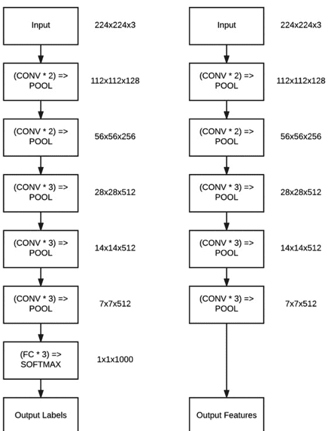

图 5.31 左侧图像展示了原始 VGG16 网络架构，用作端到端图像分类器。一旦移除了 FC 层及 softmax 分类器，之前各层获得的特征图即被视为提取的特征，这些特征通常应用于基于机器学习的分类器以进行最终分类 [32]。

作为输出的最终分类概率。然而，如图 5.31 所示，CNN 也可以通过在特定层停止传播，并将网络该点提取的信息用作特征向量，从而作为唯一的特征提取器。在本示例中，左侧展示了原始 VGG16 网络 [34] 作为端到端分类器。右侧，通过移除网络末端的 FC 层和 softmax 分类器，将同一网络视为特征提取器，使得网络的最后一层现在是最大池化层。

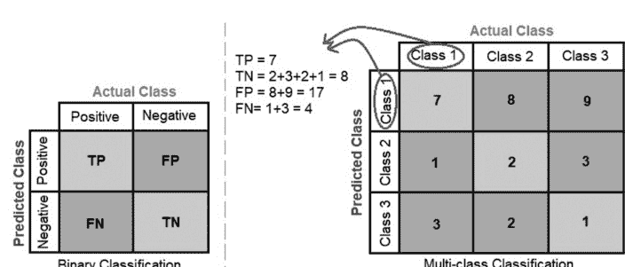

图 5.32 二分类和多类分类的混淆矩阵。

在此情况下，输出形状为 7 × 7 × 512，表明存在 512 个滤波器，其核大小为 7 × 7（512 个 7 × 7 激活值，被视为具有 7 × 7 × 512 = 25088 个数值的特征向量）。为数据集中每张 N 幅图像获取这样的向量后，即可得到 N 幅图像的设计矩阵。这些特征向量可用于训练基于机器学习的分类器（如 SVM）来识别图像的类别。

## 5.7 评估指标

皮肤病识别与分类系统性能评估的大部分指标均基于混淆矩阵（用于展示预测模型性能的表格）中获得的信息。该矩阵既用于二分类也用于多类分类情况，其中每个条目表示模型所做的正确或错误预测/分类的数量。如图 5.32 所示，对于二分类问题，存在正类和负类两个类别。在此混淆矩阵中，TP、TN、FP 和 FN 分别代表真阳性、真阴性、假阳性和假阴性。真阳性是指模型将样本正确分类为正类，且样本的实际类别也为正类的预测数量。同样，如果实际类别为负类且模型也将其预测为负类，则被视为真阴性预测。假阳性是指分类器做出的错误预测数量，其中实际为负类的样本被预测为正类。相比之下，假阴性是指模型将实际为正类的样本预测为负类的错误分类数量。

与二分类不同，多类分类基于系统针对两个以上类别所做的预测。因此，在此不存在正类或负类，我们需要根据从整个表格中获取的信息，分别为每个类别找出 TP、TN、FP 和 FN。图 5.32 展示了一个三类分类任务的简单示例，其中包含了针对类别 1 计算这四个参数值的过程。同样，可为其他类别计算这些值，以便在后续估算不同评估指标的值时使用。

### 5.7.1 分割任务

评估分割任务性能最流行的指标之一是交并比（Intersection-over-Union，IoU），它用于衡量真值数据与所提算法所做分割之间的重叠程度。IoU 的取值范围为 0（性能差）到 1（最佳性能）。其计算公式如下：

\( IoU = \frac{Area of overlap}{Area of union} = \frac{target \cap prediction}{target \bigcup prediction} \) (5.12)

此处，Area of overlap 是真值分割区域与算法预测区域之间的重叠值。Area of union 是两者的并集。此外，还有五个用于分割任务的评估指标，它们基于从混淆矩阵中获得的 TP、TN、FP 和 FN 进行计算。

其中一个指标是准确率，定义为模型正确预测数与总预测数之比，计算公式如下：

\( Accuracy = \frac{TP + TN}{TP + TN + FP + FN} \) (5.13)

在此，对于分割任务，像素级准确率以及高于和低于 128 的像素值分别被视为正类和负类。Recall/Sensitivity（灵敏度/召回率）表示真阳性率，通过将正确预测为正类的数据除以所有正类数据来计算：

\( Recall/Sensitivity = \frac{TP}{FN + TP} \) (5.14)

作为评估指标的特异性，是指正确预测的负类占所有负类的比例，计算公式如下：

\( Specificity = \frac{TN}{FP + TN} \) (5.15)

Jaccard 索引/Jaccard 相似系数用于衡量样本集之间的相似性和差异性，其取值范围为 0 到 1。其基于以下公式计算：

\( Jaccard = \frac{TP}{TP + FN + FP} \) (5.16)

验证皮肤病分割算法最广泛使用的指标是 Dice 相似系数，它用于衡量两组数据之间的相似性，计算公式如下：

\( Dice = \frac{2TP}{2TP + FN + FP} \) (5.17)

### 5.7.2 分类任务

用于评估分类性能的常见指标包括准确率、精确率、召回率/灵敏度、F1 分数、特异性和 Matthews 相关系数（MCC）得分，其中准确率、召回率/灵敏度和特异性是分割与分类之间的通用指标，如前一节所定义，区别在于在分类任务中它们不是在像素级别计算，而是在整个图像级别计算。

_精确率_ 通过计算正类正确预测数占所有被预测为正类（无论正确或错误）的预测数之比来确定：

```
Precision = \frac{TP}{TP + FP} \quad (5.18)
```

精确率和召回率的平均值定义为 _F1 分数_，其取值范围为 0（即精确率或召回率为零）到 1（即精确率和召回率完美）。这与 Dice 相似系数类似，计算公式如下：

```
F1-Score = \frac{2 * (Precision * Recall)}{Precision + Recall} \quad (5.19)
```

通过 MCC 评估分类性能可以获得一个更具信息性且更有效的得分，这使其比准确率和 F1 分数更可取。基于 MCC，分类器的准确性是通过比较观测结果和预期结果来衡量的，计算公式如下：

```
MCC = \frac{(TP * TN) - (FP * FN)}{\sqrt{(TP + FP) * (TP + FN) * (TN + FP) * (TN + FN)}} \quad (5.20)
```

这些指标针对分类任务中的每个类别分别计算，整体性能通过对所有这些值取平均来评估。例如，图 5.32 中多类分类器的性能是根据第一类的这些评估指标进行评估的，计算如下：

_准确率_ = \(\frac{7+8}{7+8+17+4} = 0.41 = 41\%\), _召回率/灵敏度_ = \(\frac{7}{7+4} = 0.63 = 63\%\), _特异性_ = \(\frac{8}{8+17} = 0.32 = 32\%\), _精确率_ = \(\frac{7}{7+17} = 0.29 = 29\%\), _F1 分数_ = \(\frac{2*0.29*0.63}{0.29+0.63} = 0.39 = 39\%\).

图 5.33 展示了一段用于计算混淆矩阵和评估指标的示例 Python 代码。

除上述基于混淆矩阵数值计算的评估指标外，接收者操作特征（ROC）曲线下面积（AUC）能够完美地评估分类器的能力。ROC 曲线是通过在不同阈值下将真阳性率（即灵敏度/召回率）与假阳性率（即 1-特异性）进行描绘而形成的，其 AUC 通过求积分确定。不同基于机器学习的分类器及其 AUC 的 ROC 曲线示例见图 5.34。AUC 的取值范围为 0 到 1，接近 1 的值表明分类器具有高能力。比较结果表明，最高的 AUC 值为 0.90，属于 SVM+Naïve Bayes 和 SVM 分类器，这证明这些分类器优于其他分类器。


```python
### Confusion Matrix and Classification Report
class_name = []
for i in validation_generator.class_indices:
    class_name.append(i)
### print(class_name)
num_of_test_samples = 1200
batch_size = 32
from sklearn.metrics import classification_report
from sklearn.metrics import jaccard_score
Y_pred = model.predict_generator(validation_generator, num_of_test_samples // batch_size+1)
y_pred = np.argmax(Y_pred, axis=1)
print('Confusion Matrix')
print(confusion_matrix(validation_generator.classes, y_pred)) #Output of confusion matrix
print('Classification Report')
target_names = class_name
#Output of precision, recall, f1 score, accuracy
print(classification_report(validation_generator.classes, y_pred, target_names=target_names))
print(jaccard_score(validation_generator.classes, y_pred, average=None)) #Output of jaccard score
```

图 5.33 用于计算混淆矩阵和不同评估指标的 Python 代码。

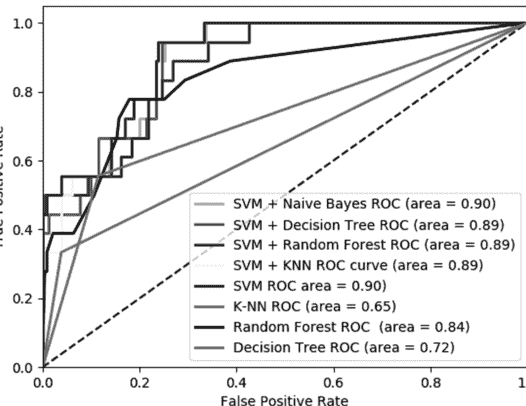

图 5.34 8 种不同基于机器学习的分类器所属 ROC 曲线的 AUC 之间的对比。

## 5.8 结论

在本章中，我们回顾了基于计算机技术（即机器学习和基于深度学习的方法）的皮肤疾病识别和分类的概念。我们首先讨论了皮肤疾病图像获取方法和可用数据集，这些是计算机辅助系统的主要和首要要求。

将当前的皮肤疾病识别和分类算法分为基于机器学习和基于深度学习的两大类后，我们首先讨论了预处理和分割这两个常见步骤。通过应用预处理，输入图像被调整为相同的图像大小，其质量和清晰度通过颜色空间转换、对比度增强、去噪和去模糊得到改善。通过应用不同的分割技术，皮肤疾病的精确区域与健康皮肤分离，从而提高了识别性能。分割后的皮肤疾病区域用于提取手工制作的特征。这些特征由基于机器学习的分类器（如 SVM、KNN 等）用于执行识别和分类任务。基于 CNN 的模型取得了更好的性能，因为它们使用更大的数据集进行训练。基于 CNN 的模型既可以被视为端到端分类器，也可以仅被视为特征提取器。然后，系统在分割和分类任务上的性能可以通过不同的指标进行评估，这些指标通常从混淆矩阵的条目中获得。

为了更深入地理解与皮肤疾病识别相关的所有步骤和概念，我们使用 Python 的 OpenCV、Scikit-learn、Keras 和 TensorFlow 等不同库手动实现了它们。

## 5.9 练习

- 1. 根据图 5.35 中 3×3 图像的给定 R、G、B 矩阵，基于加权方法计算相应元素的灰度值。

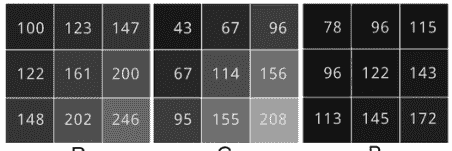

图 5.35 3×3 图像的 R、G 和 B 矩阵。

- 2. 在图 5.36 中，X 是输入图像矩阵，h 是卷积层的内核。（a）通过将输入图像与步长为 1 和 2 的内核进行卷积来计算输出图像的像素值。（b）考虑零填充重复该过程。

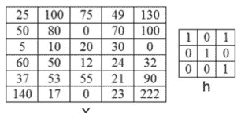

图 5.36 将与内核 h 进行卷积的输入图像 X。

- 3. 对于图 5.37 中给出的多类分类的混淆矩阵，计算准确率、灵敏度、特异度、精确率和 F1 分数的平均评估指标。

| | 类别 1 | 类别 2 | 类别 3 | 类别 4 |
|---|---|---|---|---|
| 类别 1 | 315 | 21 | 11 | 10 |
| 类别 2 | 14 | 350 | 14 | 16 |
| 类别 3 | 13 | 10 | 356 | 10 |
| 类别 4 | 21 | 25 | 9 | 344 |

图 5.37 一个 4 类分类任务的混淆矩阵，其中 Target 和 prediction 分别指示实际类别和预测类别。

- 4. 采用 ACNE04 [39] 数据集在 Python 中应用严重度分类。为此，首先将数据分为 70% 训练集和 30% 测试集。将图像大小调整为 240×240 像素，然后通过应用不同的预处理技术来提高其质量。提取 GLCM 特征，训练一个 SVM 和一个 KNN 分类器。基于五个不同的评估指标比较它们的性能。

- 5. 在 Python 中使用 CNN 分类器对 ACNE04 [39] 相同数据集应用相同的分类场景。为此，首先将数据分为 70% 训练集和 30% 测试集。将图像大小调整为 240 × 240 像素，然后通过应用旋转、水平翻转、平移、剪切和缩放这五种不同的增强技术来增强训练集。通过应用不同的预处理技术来提高其质量。设计一个包含 5 个卷积层、5 个最大池化层和 2 个全连接层（后接 softmax 分类器）的 CNN 模型。使用步长为 1 的零填充。
  (a) 优化每个卷积层中滤波器的数量和内核大小。
  (b) 基于 5 个不同的评估指标评估系统的性能。
  (c) 通过添加额外层，如何提高模型的性能和训练速度？比较结果。
  (d) 如果您的模型出现过拟合问题，如何处理？将您的解决方案应用于模型并比较性能。

## 参考文献

- 1. Atlasderm。https://www.atlasdermatologico.com.br，2019。[在线：访问于 11-Sep.-2019]。
- 2. Danderm。https://www.danderm.dk/，2019。[在线：访问于 11-Sep.-2019]。
- 3. Dermis。http://www.dermis.net/dermisroot/en/home/indexp.htm，2019。[在线：访问于 11-Sep.-2019]。
- 4. Dermnet。http://www.dermnet.com/，2019。[在线：访问于 11-Sep.-2019]。
- 5. Dermofit 图像库。https://licensing.edinburgh-innovations.ed.ac.uk/i/software/dermofit-image-library.html，2019。[在线：访问于 11-Sep.-2019]。
- 6. 关于常见皮肤疾病的全部信息。https://www.healthline.com/health/skin-disorders，2022。[在线：访问于 17-Feb.-2022]。
- 7. Martín Abadi, Paul Barham, Jianmin Chen, Zhifeng Chen, Andy Davis, Jeffrey Dean, Matthieu Devin, Sanjay Ghemawat, Geoffrey Irving, Michael Isard 等人。TensorFlow：一种大规模机器学习系统。载于第 12 届 {USENIX} 操作系统设计与实现研讨会（{OSDI} 16），第 265–283 页，2016。
- 8. Adrian Rosebrock。使用 Python 进行计算机视觉的深度学习，PyImageSearch 2017。ISBN:9781722487836。
- 9. Abder-Rahman A Ali 和 Thomas M Deserno。皮肤镜图像中自动化黑色素瘤检测及其基准真实数据的系统综述。载于《医学成像 2012：图像感知、观察者性能和技术评估》，第 8318 卷，第 83181I 页。光学与光子学国际学会，2012。
- 10. Catarina Barata, Jorge S Marques 和 M Emre Celebi。用于皮肤病变分层诊断的深度注意力模型。载于 IEEE/CVF 计算机视觉与模式识别研讨会论文集，第 2757–2765 页，2019。
- 11. Almut Boer 和 KC Nischal。准备好使用 https://ijdvl.com/www-derm101-com-a-growing-online-resource-for-learning-dermatology-and-dermatopathology/。一个用于学习皮肤病学和皮肤病理学的不断壮大的在线资源。2007。
- 12. Gary Bradski 和 Adrian Kaehler。学习 OpenCV：使用 OpenCV 库进行计算机视觉。O'Reilly Media, Inc.，2008。
- 13. Alexander Börve。您需要等待多久才能预约皮肤科医生？来自 https://www.firstderm.com/appointment-wait-time-see-dermatologist/，2021。[在线：访问于 14-April-2021]。
- 14. Shouvik Chakraborty, Kalyani Mali, Sankhadeep Chatterjee, Soumen Banerjee, Kaustuv Guha Mazumdar, Mainak Debnath, Pikorab Basu, Soumyadip Bose 和 Kyamelia Roy。使用元启发式支持的人工神经网络检测皮肤疾病。载于 _2017 年第 8 届工业自动化与机电工程年会 (IEMECON)_，第 224–229 页。IEEE，2017。
- 15. François Chollet。2015。Keras。可于 https://github.com/fchollet/keras 获取。访问于 2022 年 11 月 16 日。
- 16. Djork-Arne Clevert, Thomas Unterthiner 和 Sepp Hochreiter。基于指数线性单元 (ELUs) 的快速且准确的深度网络学习。_arXiv 预印本 arXiv:1511.07289_，2015。
- 17. Noel CF Codella, David Gutman, M Emre Celebi, Brian Helba, Michael A Marchetti, Stephen W Dusza 等人。面向黑色素瘤检测的皮肤病变分析：2017 年国际生物医学成像研讨会 (ISBI) 的挑战，由国际皮肤成像协作组织 (ISIC) 主办。载于 _2018 IEEE 第 15 届国际生物医学成像研讨会 (ISBI 2018)_，第 168–172 页。IEEE，2018。
- 18. Navneet Dalal 和 Bill Triggs。用于人体检测的定向梯度直方图。载于 _2005 年 IEEE 计算机学会计算机视觉与模式识别会议 (CVPR'05)_，第 1 卷，第 886–893 页。IEEE，2005。
- 19. Tanvi Goswami, Vipul K Dabhi 和 Harshadkumar B Prajapati。基于图像的皮肤疾病分类——一项综述。载于 _2020 年第 6 届先进计算与通信系统国际会议 (ICACCS)_，第 599–605 页。IEEE，2020。
- 20. Seung Seog Han, Myoung Shin Kim, Woohyung Lim, Gyeong Hun Park, Ilwoo Park 和 Sung Eun Chang。使用深度学习算法对良性和恶性皮肤肿瘤的临床图像进行分类。_调查皮肤病学杂志_，138(7):1529–1538，2018。
- 21. Sergey Ioffe 和 Christian Szegedy。批量归一化：通过减少内部协变量偏移来加速深度网络训练。载于 _国际机器学习会议_，第 448–456 页。PMLR，2015。
- 22. Afsana Ahsan Jeny, Abu Noman Md Sakib, Masum Shah Junayed, Khadija Akter Lima, Ikhtiar Ahmed 和 Md Baharul Islam。Sknet：一种基于卷积神经网络的皮肤癌分类分类方法。载于 _2020 年第 23 届计算机与信息技术国际会议 (ICCIT)_，第 1–6 页。IEEE，2020。
- 23. Masum Shah Junayed, Nipa Anjum, Abu Noman 和 Baharul Islam。一种用于皮肤癌检测和分类的深度 CNN 模型。2021。
- 24. Masum Shah Junayed, Abu Noman Md Sakib, Nipa Anjum, Md Baharul Islam 和 Afsana Ahsan Jeny。EczemaNet：一种基于深度 CNN 的湿疹疾病


- 分类。在 _2020 IEEE 第 4 届图像处理、应用与系统国际会议 (IPAS)_, 第 174–179 页。IEEE, 2020.

- 25. Jeremy Kawahara, Sara Daneshvar, Giuseppe Argenziano, and Ghassan Hamarneh. 七点检查表与使用多任务多模态神经网络的皮肤病变分类。_IEEE 生物医学与健康信息学杂志_, 23(2):538–546, 2018.

- 26. Seema Kolkur and DR Kalbande. 基于纹理的皮肤病检测特征提取综述。在 _2016 商业、工业与政府 ICT 国际会议 (ICTBIG)_, 第 1–6 页。IEEE, 2016.

- 27. Hongfeng Li, Yini Pan, Jie Zhao, and Li Zhang. 基于深度学习的皮肤病诊断：综述。_arXiv 预印本 arXiv:2011.05627_, 2020.

- 28. Andrew L Maas, Awni Y Hannun, Andrew Y Ng. 整流器非线性改进神经网络声学模型。在 _ICML 论文集_, 第 30 卷, 第 3 页。Citeseer, 2013.

- 29. T Mendonça, PM Ferreira, J Marques, ARS Marçal, and J Rozeira. 用于研究和基准测试的皮肤镜图像数据库。_PH2 IEEE EMBC 论文集中的演示_, 2013.

- 30. Andrew Ng. 数据科学家应该了解的深度学知识。https://www.slideshare.net/ExtractConf, 2015.

- 31. Fabian Pedregosa, Gaël Varoquaux, Alexandre Gramfort, Vincent Michel, Bertrand Thirion, Olivier Grisel, et al. Scikit-learn：_Python_ 中的机器学习。_机器学习研究杂志_, 12:2825–2830, 2011.

- 32. Adrian Rosebrock. _使用 Python 进行计算机视觉深度学习：实践者套装_. PyImageSearch, 2017.

- 33. Xiaolei Shen, Jiachi Zhang, Chenjun Yan, and Hong Zhou. 基于卷积神经网络的面部寻常痤疮自动诊断方法。_科学报告_, 8(1):1–10, 2018.

- 34. Karen Simonyan and Andrew Zisserman. 用于大规模图像识别的非常深层卷积网络。_arXiv 预印本 arXiv:1409.1556_, 2014.

- 35. Nitish Srivastava, Geoffrey Hinton, Alex Krizhevsky, Ilya Sutskever, and Ruslan Salakhutdinov. Dropout：防止神经网络过拟合的简单方法。_机器学习研究杂志_, 15(1):1929–1958, 2014.

- 36. Xiaoxiao Sun, Jufeng Yang, Ming Sun, and Kai Wang. 临床皮肤病图像自动视觉分类基准。在 _欧洲计算机视觉会议_, 第 206–222 页。Springer, 2016.

- 37. Talicia Tarver. 2012 年癌症事实与数据。American Cancer Society (ACS) Atlanta, GA: American Cancer Society, 2012. 66 页, pdf.

- 38. Philipp Tschandl, Cliff Rosendahl, and Harald Kittler. HAM10000 数据集：常见色素性皮肤病变的多源皮肤镜图像大型集合。科学数据, 5(1):1–9, 2018.

- 39. Xiaoping Wu, Ni Wen, Jie Liang, Yu-Kun Lai, Dongyu She, Ming-Ming Cheng, and Jufeng Yang. 通过标签分布学习进行痤疮图像联合分级与计数。在 IEEE/CVF 国际计算机视觉会议论文集, 第 10642–10651 页, 2019.

- 40. Xin Yi, Ekta Walia, and Paul Babyn. 利用 Wasserstein 距离辅助的分类生成对抗网络的非监督与半监督学习用于皮肤镜图像分类。arXiv 预印本 arXiv:1804.03700, 2018.

- 41. Zhen Yu, Xudong Jiang, Feng Zhou, Jing Qin, Dong Ni, Siping Chen, Baiying Lei, and Tianfu Wang. 通过聚合深度卷积特征识别皮肤镜图像中的黑色素瘤。IEEE 生物医学工程学报, 66(4):1006–1016, 2018.

# 基于 COVIDx 数据集的 COVID-19 诊断深度学习方法：初步调查

Esraa Hassan

卡夫尔谢赫大学人工智能学院机器学习与信息检索系，埃及卡夫尔谢赫

Mahmoud Y. Shams, Noha A. Hikak, 和 Samir Elmougy

曼苏拉大学计算机与信息学院信息技术系，埃及曼苏拉

## 内容

- 6.1 引言 108
- 6.2 数据集描述 109
- 6.3 COVIDx 数据集 109
- 6.4 COVIDx-CT 数据集 109
- 6.5 相关工作 110
- 6.6 结论 117

COVID-19 是一种严重且普遍流行的疾病，因为它直接影响肺部，使全世界许多人的生命处于危险之中。胸部 X 光 (CXR) 图像和计算机断层扫描 (CT) 被部分用于对感染该病毒的患者进行可靠的筛查分析。从不同医学图像中识别 COVID-19 非常具有挑战性，因为这需要更长时间，还需要对易受人为错误影响的批次进行准确可视化。因此，人工智能 (AI) 技术不断被用于实现高性能。深度学习 (DL) 架构已超越了 AI 方法中流行的经典机器学习 (ML)。此外，DL 自动充当提取器、选择器和特征分类器。本章全面回顾了 DL 方法在 COVID-19 识别和肺部分割中的应用。此外，我们还重点研究了 X 光图像和 CT 用于特征提取和分类。此外，还介绍了使用 DL 方法基于 COVIDX 数据集对录入图像进行分类的文章综述。该数据集最近常用于分类感染患者或正常患者。最后，我们强调了在检测基于 DL 的 COVID-19 方法过程中遇到的困难。还介绍了诊断记录图像的挑战，并提出了解决这些挑战的建议。

## 6.1 引言

2019 年 12 月，COVID-19 病毒在中国武汉被发现，随即在全球迅速传播 [1]。该病毒进入肺细胞并扩散至呼吸系统，在那里复制并杀死细胞 [2, 3]。该病毒极其危险，可能导致免疫系统较弱的人死亡 [4]。全世界的传染病专家和临床医生一直在尝试寻找该疾病的治疗方法 [5]。COVID-19 是世界上许多国家的首要死亡原因，因此在其早期阶段进行检测至关重要。然而，使用聚合酶链反应 (PCR) 检测进行检测耗时，这对 COVID-19 患者来说是一种风险。因此，首先和最重要的是，使用医学影像应用来识别 COVID-19，然后使用 PCR 检测来协助临床医生做出最终决定。用于诊断 COVID-19 的两种医学影像程序是 X 光和 CT 扫描。X 光模态是诊断 COVID-19 的初始方法。它具有费用低廉且对人体健康辐射危害风险低的优点 [6]。基于 X 光的 COVID-19 检测是一个困难的过程。放射科医生必须密切关注这些图像中含有水和脓液的白色斑点，因为这些斑点非常冗长且棘手。诊断 COVID-19 的初始技术是使用 X 光，它具有费用低廉且被认为是低人体健康辐射风险的优点。然而，使用 X 光进行 COVID-19 检测是一项艰巨的任务。因为这些图像中含有水和脓液的白色斑点异常冗长且棘手，放射科医生必须特别关注它们。由于 X 光具有较高的误差率，CT 扫描可以用于更精确的检测。尽管如此，CT 扫描比 X 光图像昂贵得多 [7]。在 CT 扫描记录时，会提供每个被怀疑感染 COVID-19 的患者的多个切片。要基于 CT 扫描图像诊断 COVID-19，医生和放射科医生必须处理大量图像。图 (14.3) [8] 展示了基于深度学习 (DL) 的最近方法的分类法，用于监督学习和非监督学习。在监督学习中，卷积神经网络 (CNN) 和循环神经网络 (RNN) 被优先用于实现医学图像的实时精确诊断和分类。另一方面，基于自动编码器 (AE)、深度置信神经网络 (DBNN) 以及 CNN 和 AE 组合的非监督深度学习方法被用于应用医学图像的聚类和诊断。在特殊情况下，这些方法可用于从 MRI 扫描中诊断和扫描脑肿瘤，以及在许多任务（包括医学图像分析）中实现人类精度水平的多种 AI 数据处理应用。在第 [7] 章中，介绍了使用 DL 模型诊断冠状病毒的摘要 [7, 9]。节


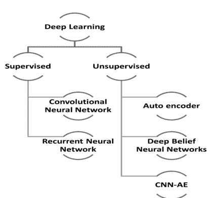

图 6.1 子深度学习方法的一般说明 [8]。

第 6.3 节介绍了 COVIDx 数据集，第 6.4 节阐述了基于 DL 模型的相关工作。最后，第 6.5 节介绍了未来研究方向的概要。

## 6.2 数据集描述

收集 COVID-19 病例的数据集对于支持诊断任务的研究至关重要。本综述介绍了 COVIDx 数据集 [10] 和 COVIDx-CT [11]，以说明它们在 COVID-19 大流行中多项近期研究中的作用。

## 6.3 COVIDx 数据集

COVIDx 是一个开放访问的基准数据集，包含来自 13,870 个病例的 13,975 张 CXR 图像，包含目前公开可用的最多数量的 COVID-19 阳性样本。COVIDx 数据集 [10] 中具有代表性的 X 射线扫描图如图 6.2 所示。

## 6.4 COVIDx-CT 数据集

COVIDx-CT 由来自 1489 个病例的 104,009 张胸部 CT 切片组成。这种 CT 成像数据值得注意，因为它如图 6.3 所示由 CT 成像数据生成。其贡献包括将原始数据清理和格式化为适合基准测试的格式，以及为 CT 图像内的身体区域提供边界框标注 [11, 12]。

COVIDx 具有多项优势，使其在许多与 COVID-19 病例相关的研究中普遍且更易于使用。第一个优势是可与病毒检测并行进行的快速分诊，以帮助缓解受影响最严重地区的高病例负荷。图 6.4 展示了 COVIDx 数据集的主要类别以及实现所需的库。该

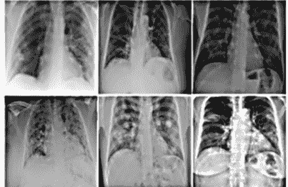

图 6.2 COVIDx 数据集中的 X 射线扫描示例 [10]。

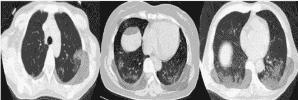

图 6.3 COVID-19 病例的 CT 扫描示例 [11, 12]。

首先使用的 Python 库是 Matplotlib，它可对应用的医学图像进行动画、静态和交互式图表的可视化与创建。Scikit Learn 提供了辅助应用图像实现的所有方法论。Numpy 提供了全面的数学运算和函数，可配合线性代数例程生成随机数。所有库均基于 Python 3.6 版本。在此工作中，我们将 COVID-19 的三个广为人知的类别进行分类，即感染 COVID-19、正常和肺炎。此外，CXR 成像在地理区域中用于分诊非常有效，在这些区域患者被指示待在家中直至出现晚期症状 [13]。第二个挑战是可用性和可访问性，在大多数医疗系统中它被视为标准设备。特别是，CXR 成像比 CT 成像更容易获得，尤其是在发展中国家，由于设备和维护成本高昂，CT 扫描仪成本高得难以承受 [11]。更具体地说，Gunraj 等人 [11] 合并了五个数据存储库来创建 COVIDx 数据集，从每个数据存储库中收集以下类别的病例：来自 COVID-19 图像数据集的非 COVID-19 肺炎病例和 COVID-19 病例，COVID-19 病例，COVID-19 胸部 X 射线数据集。

## 6.5 相关工作

本节介绍了基于 DL 模型的 COVID-19 分类、分割及其他任务的一系列相关研究。截至 2020 年 7 月 11 日，使用提到的关键词选取了最

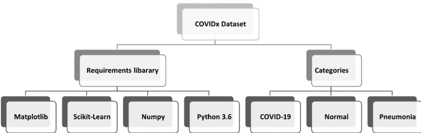

图 6.4 COVIDx 数据集的主要类别及实现所需库 [10]。

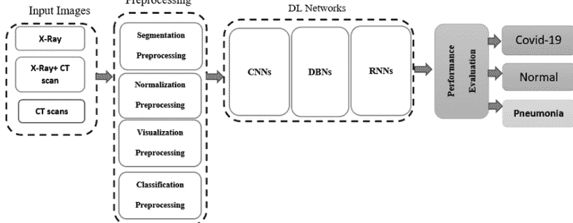

图 6.5 使用 DL 方法对 X 射线/CT 图像进行分类的通用架构。

近期论文选集。使用 COVIDx 数据库的 DL 方法进行 COVID-19 诊断的标准架构如图 6.5 [14] 所示。为应对决策制定的困难，Gunraj 等人 [12] 引入了 COVID-Net CT-2 数据集，该数据集增强了用于胸部 CT 图像中 COVID-19 检测的深度神经网络 (DNN) 架构，并在最大数量和多样性的跨国病例上进行了训练。该数据集包含来自至少 15 个国家的 4501 名患者，用于解释和观察 COVIDNet CT 的决策行为。Ebadi 等人 [15] 引入了 COVIDx-US，这是一个 COVID-19 相关超声成像数据的开放访问数据集。该数据集包含超声成像数据。该数据集从各种图像中收集。包含 150 条肺部超声记录，12,943 张 COVID-19 病例、非 COVID-19 感染及其他肺部疾病病例的处理后图像。Chowdhury 等人 [16] 提出了一种集成深度卷积神经网络 (ECOVNet) 来检测 COVID-19，该方法在 15,854 个病例的 15,959 张 CXR 图像上实现，包含正常、肺炎和 COVID-19 患者。他们以易于理解的方式描述了预测。该方法可以以 91.6% 的精度阳性预测值区分 COVID-19 病例。Ambati 等人 [17] 通过在公开可用的 COVID-19 数据集上计算拟议方法的灵敏度，提出了 AC-COVIDNet 模型。观察发现，拟议的 AC-COVIDNet 即使在训练数据有限的情况下，也表现出与现有方法相比非常有前景的性能。Cherti 等人 [18] 引入了一个在大规模数据集上使用 ImageNet 的预训练模型，范围为 21K/1K，取决于胸部 X 射线图像，并比较了在互补物理和医学领域的各种客观数据集上应用的完整迁移学习。

Qi 等人 [19] 将 X 射线图像特征的局部相位纳入多 CNN 特征架构。数学评估在包含 8851 张正常图像、6045 种肺炎类型和 3795 张 COVID-19 X 射线扫描图像的数据集上进行。仅利用 7.06% 的标记数据和 16.48% 的未标记数据进行训练。此外，5.53% 的数据用于验证。该方法在测试的 70.93% 数据大规模数据集上达到 93.61% 的平均准确率。Celaya 等人 [25] 表明，PocketNet 架构在执行各种分割和分类任务时产生的结果与传统 NN 相当，同时将参数数量减少几个数量级，将 GPU 内存使用量减少高达 90%，并加快数据处理速度。训练时间高达 40%，使得此类模型可以在资源受限的环境中进行训练。

Yang 等人 [26] 通过展示一种简单但成功的技术（服务器和客户端仅共享模型的一部分）来探讨这一难题。使用现实世界医疗任务和基准数据进行的广泛测试表明，他们的方法在减少隐私和安全问题的同时，提供了等效或更好的结果。他们在 COVID-19 数据集上测试了 FLOP 算法，并证明它使不同机构能够协作并有效地训练部分共享模型，而无需披露本地患者数据进行联邦学习。

Ali 等人 [27] 使用 CNN 架构学习最优嵌入空间，在通用分类中实现了 F1-Score 提高 5% 和两倍大的差距。Dong 等人 [20] 提出了一种用于强健 COVID-19 检测的深度模型，采用混合高阶矩特征 (MHMF) 和多专家不确定性感知学习来捕捉紧凑且解耦的表示特征。MHMF 可以充分利用高阶统计的优势，提取医学影像中复杂分布的区分特征。Hao 等人 [21] 使用创新组合来分类数据丰富但极度不平衡的 COVID-19 胸部 X 射线图像。他们表明，通过训练所有可用标签，仅需 10% 的标记数据即可实现准确性。在完全监督的分类场景中使用 COVID-19 数据证明了其模型，该模型使用通用 ResNet 骨干。他们探讨了使用高阶统计的优势，并从医学图像的复杂分布中提取了区分特征。Zhang 等人 [33] 提出了一种新的无监督方法，直接从自然发生的图像-文本数据对学习医学视觉表示。他们使用一种与领域无关的策略来预训练并编码带有相关数据的医学图像


与两种模式之间涉及文本双向不兼容目的且无需额外输入。该技术基于 ImageNet 标记数据，以实现改进结果。

Wong et al. [13] 提出了一种基于深度卷积神经网络 (DCNN) 的 COVIDNet 架构。它们专为从胸部 X 射线图像中检测 COVID-19 病例而定制设计。使用 COVIDNet 实现，这是自初始发布以来用于从 CXR 图像诊断 COVID-19 的第一个源网络方案。COVIDNet 使用解释力技术构建预测，这不仅能更深入地理解与 COVID 病例相关的关键方面，还能帮助临床医生进行更好的检测。COVIDNet 的 PARAM、MAC 和准确率结果分别达到了 11.75、7.50 和 93.3%。

Wang et al. [7] 假设，与专家胸部放射学家的基本现实相比，计算机辅助深度学习算法可以可靠地预测与 SARS-CoV-2 感染相关的 CXR 上的肺部疾病严重程度，该研究的实验结果支持了这一预测。在预测分数与 COVIDNet S 的 DNN 之间，地理范围的 R2 分别为 0.664 ± 0.032 和 0.635 ± 0.044。

Abbasi et al. [29] 提出了一种独立的 COVID-19 诊断和严重程度预测方法，该方法使用 CXR 成像的深度特征图来诊断 COVID-19 并预测其严重程度。他们使用了不同的浅层监督分类算法，并提出模型采用三阶段分类方法（健康 vs. 患病、COVID-19 vs. 肺炎、COVID-19 严重程度）。他们不仅在实验室环境中使用 10 次交叉验证和外部验证数据集测试了 COVIDx，还在经验丰富的放射学家参与的真实环境中测试了 COVIDx。在所有评估情况下，COVIDx 在严重程度预测方面均优于所有可靠模型。

Motamed et al. [23] 未使用未知类别图像的标签或训练数据。他们提供了一种 RANDGAN（随机不良生成网络），可从已知且标记的类别（正常和病毒性肺炎）中识别未知类别（COVID-19）的照片。在 COVIDx 数据集中，他们使用迁移学习来区分肺部。之后，他们用于异常检测。

Qi et al. [19] 提出了一种新的多特征架构 (CNN) 以改进从 CXR 图像中进行的 COVID-19 多类分类。他们对两个数据集提供了定量评估，以及用于视觉检查的定性结果。定量分析是对 8851 个正常扫描、6045 种肺炎和 3323 个 COVID-19 图像的数据进行的。该模型对三个类别的平均准确率达到 95.57%，准确率为 99%，以及 COVID-19 病例的恢复率和 F1-Score。

Huang et al. [28] 将局部相位 CXR 成像特征集成到多特征 CNN 架构中。共定量分析了 8851 个正常（健康）扫描、6045 种肺炎和 3795 个 COVID-19 CXR 扫描。只有 7.06% 的数据有标签，而 16.48% 无标签，5.53% 用于验证。该类型在大规模测试数据（计算机断层扫描 (CT) 的 70.93%）上达到平均准确率 93.61%。

Chen et al. [8] 使用了一个大型胸部 X 射线数据集。该研究建议使用一组内置 EfficientNet 的 DCNN（称为 CovNet）来检测 COVID-19。首先，他们补充了庞大的开放获取胸部 X 射线集合，然后将预训练的 ImageNet 权重转移到 EfficientNet，并对顶层进行一些自定义微调，接着使用一组模型快照来分类对应于 COVID-19、正常和肺炎的胸部 X 射线。

Dev et al. [32] 建议使用分层卷积网络 (HCN) 架构来自动用各种属性丰富数据。为了提取特征，HCN 使用 COVIDNet 的第一个卷积层，然后是已知网络的先前训练过的卷积层。使用 COVIDNet 卷积层可确保提取与 CXR 模态相关的表示。他们还建议使用 ECOC 将多类问题编码为二进制分类，以提高识别性能。与以前的研究相比，实验结果表明 HCN 架构可以取得更好的结果。所建议的方法使用 CXR 成像来准确分类潜在的 COVID-19 患者，以便分担举证责任并提高检测能力。

在 Shoeibi et al. [14] 中，对使用 DL 方法进行 COVID-19 诊断和自动肺部分割的研究进行了全面综述，重点是使用 X 射线和 CT 成像的研究。此外，还对使用 DL 方法预测全球冠状病毒流行情况的文章提供了评论。最后，强调了使用 DL 方法自动识别 COVID-19 的局限性以及计算机断层扫描 (CT) 特征选择用于医学诊断的未来研究前景。

对于 COVID-19 图像分类，Nwosu et al. [24] 提出了 ResNet，一种基于残差神经网络 (ResNet) 的双路半监督深度学习模型，其中两条路径分别指受监督路径和非受监督路径。此外，为了解决数据不平衡问题，他们设计了一种加权监督损失，在训练过程中给少数类更高的权重。根据 COVIDx 数据集的实验结果，该建议模型即使在少量标记训练图像上训练也能取得有希望的性能。

Ali et al. [27] 在 F1-Score 上实现了 5% 的提升，并在一般分类中实现了两倍大的差距。

为了学习最优嵌入空间，Zhang et al. [22] 结合了多相似度损失、硬挖掘采样技术和注意力机制，并为查询图像提供了相似图像。该模型使用从世界各地三个不同来源获得的 COVID-19 数据集进行训练和验证。COVID-19 图像检索和诊断任务的结果表明，所提出的模型可以作为 CXR 分析的强健解决方案。

为了在所需不平衡类的凸包中生成点，Deepshikha et al. [34] 对生成器网络 G 施加了额外要求。此外，与分类器 C 的对抗游戏将 G 学习的条件分布推向各自类别的外围，从而解决异常检测中的类别不平衡问题。

Sarosht et al. [35] 的目标是考察深度学习和人工智能在 COVID-19 管理的许多方面（特别是 COVID-19 检测和分类）中的作用。DL 模型用于检查临床模式，例如 CT 扫描和 X 射线图像，并预测患者的疾病状态。DL 模型旨在检测 COVID-19 肺炎，并分类和区分 COVID-19、社区获得性肺炎 (CAP)、病毒性和细菌性肺炎。

Banerjee et al. [36] 展示了两种流行模型（COVIDNet 和 CoroNet）的结果，这些模型在三个公开可用的数据集和一个额外的机构数据集上进行了评估，这些数据集于 2020 年 1 月至 5 月在 Emory 医院收集，包括使用 RT-PCR 检测 COVID-19 感染的患者。

Zhang et al. [33] 提出使用一种称为权重印迹的最小化学习方法，该方法利用已知疾病（如肺炎）的许多样本来提高 COVID-19 检测性能。他们建议使用一种称为权重印迹的最小化学习方法，该方法利用已知疾病（如肺炎）的许多样本来提高 COVID-19 检测性能。

最常见的输入图像分类（包括 X 射线和 CT 扫描）的一般结构如图 6.5 所示。在此，除了使用单一模态外，还可以利用两种模态的组合。在某些情况下，预处理阶段包括分割和分类，作为匹配和分类之前的初始阶段。DL 的使用涉及预处理和特征提取。如前所述，包含 CNNs、DBN 和 RNN 的 DL 网通常被用作注册的 X 射线和 CT 图像的特征提取器和分类器。性能评估基于混淆矩阵确定，包括准确率、F1-Score、召回率和精确度。基于 DL 方法的最近大多数分类器使用两个类别（0 和 1），分别表示 COVID-19 和正常病例，作为所提架构的输出。可视化在预处理阶段至关重要，因为它使放射科医生能够注意到代表 COVID-19 或肺炎病例的区域和感兴趣区域 (ROI) 的扩展。

表 6.1 总结了用于分类 CT/X 射线图像的最近方法，包括模态数量、架构和获得的性能。

出于以下原因，我们选择了表中的这些特定标准，而不是其他标准。首先，我们研究了所有使用 COVIDx 数据集的诊断架构。其次，我们突出了主要任务，包括基于 CT 和 X 射线图像的图像分类和学习。此外，该调查侧重于使用深度学习方法进行 COVID-19 分类和诊断。

上述所有研究目前正在进行和展示，以确保使用基于知名 COVIDx 数据集的 DL 方法基于 CT 和 X 射线图像分类和预测 COVID-19 病例的可靠性。

在图 6.5 中，展示了 COVID-19 图像分类主要阶段的流程。第一阶段包括应用可能是 X 射线、CT 或 CT 和 X 射线图像组合的图像。之后，在分类和特征提取过程之前，对注册图像进行预处理，包括分割、标准化、可视化和分类。因此，提取特征以获得特征向量，该向量应用于基于 CNN、DBN 和 RNN 的 DL 网络中，以分类和匹配 CT 和 CXR 图像。最后阶段是性能评估矩阵，用于获取和分类三个主要类标签，即 COVID-19、正常和肺炎。


表 6.1 使用 COVIDx 数据集的 COVID-19 诊断架构比较研究

| 作者 | 年份 | 任务 | 病例数 | 预处理 | 架构 | 性能 |
|---|---|---|---|---|---|---|
| Gunraj 等人 [12] | 2021 | 地理范围和不透明度范围评分 | 396 | 随机平移 旋转 水平翻转 缩放 强度偏移 剪切 高斯噪声 | DNN | 地理范围 = 0.664 不透明度范围 = 0.635 均值 = 0.032 标准差 = 0.044 |
| Ebadi 等人 [15] | 2021 | 图像分类 | 12,943 | 裁剪 | DNN | N/A |
| Ambati 等人 [17] | 2021 | 图像分类 | 13,870 | N/A | CNN | 准确率 = 98.08% |
| Cherti 等人 [18] | 2021 | 小样本学习 图像分类 迁移学习 | 13,870 | 标准随机调整大小裁剪数据增强 | 预训练模型，ResNet 50 | 准确率 = 95.78% |
| Celaya 等人 [25] | 2021 | 医学图像分割 语义分割 | 13,870 | 随机反射 | CNN | 准确率 = 99.41% |
| Qi 等人 [19] | 2021 | 计算机断层扫描 (CT) COVID-19 诊断 决策制定 | 13,870 | N/A | ResNet50 | 准确率 = 86.46% |
| Yang 等人 [26] | 2021 | 联邦学习 | 13,870 | N/A | CNN | F1 = 94.54 +/- 0.21 |
| Ali 等人 [27] | 2021 | 分类 | 13,870 | 几何变换和颜色空间变换 | CNN | 准确率 = 95% |
| Li 等人 [20] | 2021 | 计算机断层扫描 (CT) | 19 | 翻转、平移、使用五个不同的随机角度旋转 | 基于补丁的卷积神经网络 | 准确率 = 97.89% |
| Hao 等人 [21] | 2021 | 主动学习 通用分类-表征学习 无监督表征学习 | 13,870 | 随机裁剪 随机翻转 色彩畸变 高斯模糊 随机灰度 | CNN-GP 混合模型 | 准确率 = 96% |
| Zhang 等人 [22] | 2021 | COVID-19 诊断 | 13,870 | N/A | CNN | 准确率 = 88% |
| Gunraj 等人 [10] | 2020 | COVID-19 诊断 | 13,870 | 平移 旋转 水平翻转 缩放 强度偏移 | CNN | N/A |
| Gunraj 等人 [11] | 2020 | 决策制定 | N/A | 裁剪框 抖动 旋转 水平和垂直剪切 水平翻转 强度 | DNN | 灵敏度 = 98.1% 阳性预测值 = 98.1% |
| Huang 等人 [28] | 2020 | 图像分类 | 217,000 | 颜色抖动变换 | DNN | 准确率 = 92.4% |
| Abbasi 等人 [29] | 2020 | 严重程度预测 | 13,870 | N/A | CNN | ROC = 0.99 ± 0.01; PR F1 = 0.99 ± 0.01; 0.98 |
| Hirano 等人 [30] | 2020 | 异常检测 COVID-19 诊断 COVID-19 图像分割 迁移学习 | 13,870 | 归一化图像 | CNN | ROC 曲线从 0.71 到 0.77 |
| Motamed 等人 [23] | 2020 | 异常检测 COVID-19 诊断 COVID-19 图像分割 迁移学习 | 13,870 | 增强 | CNN | AUC 0.54 到 0.71 |
| Li 等人 [31] | 2020 | 图像增强 | 13,870 | 自适应直方图均衡化 | CNN | 准确率 = 94.44% |
| Chowdhury 等人 [16] | 2020 | 图像分类 | 14,914 | 部分平移不变性 | CNN | 准确率 = 97% |
| Dev 等人 [32] | 2020 | 图像分类 | 13,870 | 旋转 平移 翻转 | CNN | 准确率 = 98.08% |
| Shoeibi 等人 [14] | 2020 | 图像分类 | 13,870 | N/A | CNN | N/A |
| Zhang 等人 [33] | 2020 | 图像检索 度量学习 | 13,870 | 水平翻转 透视 锐度 模糊 网格畸变 弹性变换 | CNN | 准确率 = 94% |
| Deepshikha 等人 [34] | 2020 | 异常检测 | 14,200 | GAN 生成器 | 迁移学习 | 准确率 = 70% |
| Sarosh 等人 [35] | 2020 | 生存预测 迁移学习 | 13,870 | GAN 增强 | CBB | 准确率 = 98% |
| Banerjee 等人 [36] | 2020 | COVID-19 诊断 | 1786 | 旋转，水平翻转 | CNN | 准确率 = 93% |

## 6.6 结论

COVID-19 是一种迅速发展的大流行病，在很短的时间内使世界上许多人的健康面临危险。它直接影响肺细胞，如果不能及早发现，可能导致永久性损伤，甚至死亡。专业人士使用 X 射线或 CT 图像以及 PCR 结果来准确检测该疾病。PCR 结果揭示的并非 COVID-19，而是另一种形式的肺部感染，例如呼吸道结核。DL 网络被用于对 COVID-19 识别进行广泛分析。讨论了用于诊断和预测 COVID-19 的公共数据库。使用了最新的 DL 方法来诊断、分割和预测 COVID-19 的传播。大型公共数据库的可用性是开发可靠且准确的 COVID-19 诊断系统面临的问题之一。我们相信，随着更多公共数据库的出现，研究人员将能够构建更好的 DL 模型，以可靠地检测和预测 COVID-19。因此，这将有助于开发性能最佳的范式。我们相信，数据模型的融合可以辅助诊断和预测性能。为了构建准确的模型，从 DL 架构中提取的特征可以与应用的 ML 相结合，以增强获得的分类结果。此外，构建合适的分割模型很困难，因为它需要专业人士勾勒肺部。因此，利用胸部 X 射线或 CT 的可视化过程来检测对这些病例准确诊断至关重要的最重要特征。未来，我们计划使用应用于 COVIDX 和其他更新收集的数据集的特征选择算法，以可靠且高效的准确性调查和可视化图像。

## 参考文献

- 1. J. Wu, J. Liu, S. Li, Z. Peng, Z. Xiao, X. Wang, R. Yan, J. Luo. “COVID-19 患者各种生物样本中核酸的检测与分析.” Travel Medicine and Infectious Disease, 37 (2020): 101673.
- 2. T. Corse, L. Dayan, S. Kersten, F. Battaglia, S. R. Terlecky, and Z. Han, “既有免疫系统受损的 COVID-19 患者的临床结局：病例报告综述,” Int. J. Med. Sci., vol. 17, no. 18, pp. 2974–2986, 2020, doi: 10.7150/ijms.50537.
- 3. D. Wu, T. Wu, Q. Liu, and Z. Yang, “SARS-CoV-2 疫情：我们所知道的,” Int. J. Infect. Dis., vol. 94, pp. 44–48, 2020, doi: 10.1016/j.ijid.2020.03.004.
- 4. S. Elmuogy, N. A. Hikal, and E. Hassan, “COVID-19 CT 扫描图像分类的高效技术,” vol. 40, pp. 5225–5238, 2021, doi: 10.3233/JIFS-201985.
- 5. E. Hassan, M. Shams, N. A. Hikal, and S. Elmuogy, “基于迁移学习的植物幼苗分类,” 2021 国际电子工程会议 (ICEEM), pp. 1–7, 2021.
- 6. O. M. Elzeki, M. Shams, S. Sarhan, M. A. Elfattah, and A. E. Hassanien, “COVID-19：一种用于分类的新型深度学习计算机辅助模型,” PeerJ Comput. Sci., vol. 7, pp. 1–33, 2021, doi: 10.7717/peerj-cs.358.
- 7. A. Sedik 等人, “部署机器学习和深度学习模型以实现高效的数据增强 COVID-19 感染检测,” Viruses, vol. 12, no. 7, pp. 1–29, 2020, doi: 10.3390/v12070769.
- 8. P. Ghamisi 等人, “光谱-空间高光谱图像分类的新前沿：基于数学形态学、马尔可夫随机场、分割、稀疏表示和深度学习的最新进展,” in IEEE Geoscience and Remote Sensing Magazine, vol. 6, no. 3, pp. 10–43, Sept. 2018.
- 9. K. M. Hosny, M. A. Kassem, and M. M. Foaud, “使用深度学习和迁移学习进行皮肤癌分类,” 2018 年第九届开罗国际生物医学工程会议 CIBEC 2018 - 论文集, pp. 90–93, 2019, doi: 10.1109/CIBEC.2018.8641762.
- 10. H. Gunraj, L. Wang, and A. Wong, “胸部 X 射线图像,” Front. Med., vol. 7, pp. 1–12, 2020, doi: 10.3389/fmed.2020.608525.
- 11. H. Gunraj, L. Wang, and A. Wong, “COVIDNet-CT：一种用于从胸部 CT 图像中检测 COVID-19 病例的定制深度卷积神经网络设计,” Front. Med., vol. 7, pp. 1–12, 2020, doi: 10.3389/fmed.2020.608525.
- 12. H. Gunraj, A. Sabri, D. Koff, and A. Wong, “COVID-Net CT-2：通过更大、更多样化的学习，用于从胸部 CT 图像中检测 COVID-19 的增强型深度神经网络,” pp. 1–15, 2021, [在线]。可用：http://arxiv.org/abs/2101.07433.
- 13. A. Wong 等人, “COVID-Net S：通过训练和验证深度神经网络对胸部 X 射线的地理范围和不透明度范围评分来进行计算机辅助严重程度评估，以评估 SARS-CoV-2 肺部疾病严重程度,” 2020, [在线]。可用：http://arxiv.org/abs/2005.12855.
- 14. Shoeibi, A., Khodatars, M., Alizadehsani, R., Ghassemi, N., Jafari, M., Moridian 等人. 使用深度学习技术自动检测和预测 COVID-19：一篇综述. arXiv 预印本 arXiv:2007.10785.
- 15. A. Ebadi, P. Xi, A. Maclean, S. Tremblay, S. Kohli, and A. Wong, “COVIDx-US - 用于 AI 驱动的 COVID-19 分析的开放访问超声成像数据基准数据集,” pp. 1–12, 2021.
- 16. N. K. Chowdhury, M. A. Kabir, M. M. Rahman, and N. Rezoana, “ECOVNet：基于 EfficientNet 的用于从胸部 X 射线中检测 COVID-19 的深度卷积神经网络集成,” 2020, doi: 10.7717/peerj-cs.551.
- 17. A. Ambati and S. R. Dubey, “AC-CovidNet：用于胸部 X 射线图像中 COVID-19 识别的注意引导对比 CNN,” 2021, [在线]。可用：http://arxiv.org/abs/2105.10239.
- 18. M. Cherti and J. Jitsev, “大规模预训练对自然和医学图像中全样本和小样本迁移学习的影响,” pp. 1–18, 2021, [在线]。可用：http://arxiv.org/abs/2106.00116.
- 19. X. Qi, J. L. Nosher, D. J. Foran, and I. Hacihaliloglu, “基于胸部 X 射线图像的 COVID-19 诊断多特征半监督学习,” vol. 2019, pp. 1–11, 2021, [在线]。可用：http://arxiv.org/abs/2104.01617.


20. Q. Li, B. Dong, D. Wang, 和 S. Wang, “基于少量特征的疟原虫分泌蛋白鉴定,” IEEE Access, vol. 8, pp. 89793–89801, 2020, doi: 10.1109/ACCESS.2020.2994206.

21. Heng Hao, P. Bangert, “面向失衡数据的高效表示与主动学习框架及其在 COVID-19 X 光分类中的应用,” pp. 1–16, 2021.

22. J. Zhang, P. Xi, A. Ebadi, H. Azimi, S. Tremblay, 和 A. Wong, “基于印记权重方法的胸部 X 光图像中的 COVID-19 检测,” pp. 1–5, 2021, [在线]. 可用: http://arxiv.org/abs/2105.01710.

23. S. Motamed, P. Rogalla, 和 F. Khalvati, “RANDGAN: 用于胸部 X 光中 COVID-19 检测的随机生成对抗网络,” Sci. Rep., vol. 11, no. 1, pp. 1–10, 2021, doi: 10.1038/s41598-021-87994-2.

24. L. Nwosu, X. Li, L. Qian, S. Member, 和 S. Kim, “基于 ResNet 的半监督学习 COVID-19 图像分类.” EAI Endorsed Transactions on Bioengineering and Bioinformatics. 1. 170754. 10.4108/eai.25-8-2021.170754.

25. A. Celaya, J. A. Actor, R. Muthusivarajan, E. Gates, C. Chung, D. Schellingerhout, B. Riviere, 等. “PocketNet: 用于医学图像分析的更小型神经网络,” pp. 1–9, 2021 [在线]. 可用: http://arxiv.org/abs/2104.10745.

26. Y. Yang 和 S. Soatto, “FDA: 用于语义分割的傅里叶域自适应.” pp. 4084–4094.

27. A. Ali, T. Shaharabany, 和 L. Wolf, “可解释性引导的多站点 COVID-19 CT 分类,” 2021, [在线]. 可用: http://arxiv.org/abs/2103.13677.

28. Huang, C., Wang, Y., Li, X., Ren, L., Zhao, J., Hu, Y., 等. “中国武汉 2019 新型冠状病毒感染患者的临床特征.” Lancet, 2020, 395(10223), pp. 497–506.

29. W. A. Abbasi, S. A. Abbas, 和 S. Andleeb, “COVIDX: 基于原始数字胸部 X 光图像的 COVID-19 计算机辅助诊断及其严重程度预测,” pp. 1–19, 2020 [在线]. 可用: http://arxiv.org/abs/2012.13605.

30. H. Hirano, K. Koga, 和 K. Takemoto, “用于从胸部 X 光图像检测 COVID-19 病例的深度神经网络对通用对抗攻击的脆弱性,” PLoS One, vol. 15, no. 12, 2020, doi: 10.1371/journal.pone.0243963.

31. Li, L., Qin, L., Xu, Z., Yin, Y., Wang, X., Kong, B., 等. 基于肺 CT 使用人工智能检测 COVID-19 和社区获得性肺炎: 诊断准确性评价. Radiology, 2020, 296(14.4), E65–E71.

32. K. Dev, S. A. Khowaja, A. S. Bist, V. Saini, 和 S. Bhatia, “使用层级卷积网络从胸部 X 光图像中对潜在 COVID-19 患者进行分诊,” Neural Comput. Appl., 2021 年 11 月, doi: 10.1007/s00521-020-05641-9.

33. Zhang, Hang, H. Zhang 等, “ResNeSt: 分割注意力网络,” 2022 IEEE/CVF 计算机视觉与模式识别研讨会 (CVPRW), 2022, pp. 2735–2745.

34. K. Deepshikha 和 A. Naman, “使用 Polarity-GAN 消除类别不平衡: 一种不确定性采样方法,” 2020 [在线]. 可用: http://arxiv.org/abs/2012.04937.

35. P. Sarosh, S. A. Parah, R. F. Mansur, 和 G. M. Bhat, “用于 COVID-19 检测的人工智能——最新进展综述,” Arxiv, vol. 2, 2020 年 11 月.

36. I. Banerjee, P. Sinha, S. Purkayastha, N. Mashhaditafreshi, A. Tariq, J. J. Jeong, H. Trivedi, 和 J. W. Gichoya, “2012 年是否存在 COVID-19? 相似指征下 AI 诊断的挑战,” vol. 19, 2020 [在线]. 可用: http://arxiv.org/abs/2006.13262.


Taylor & Francis Group
http://taylorandfrancis.com

# 用于治疗方案决策的侵袭性乳腺癌患者自动分级

Hossain Shakhawat, Matthew Hanna, Kareem Ibrahim, Rene Serrette, Peter Ntiamoah, Marcia Edelweiss, Edi Brogi, Meera Hameed, Masahiro Yamaguchi, Dara Ross, 和 Yukako Yagi

## 内容

- 7.1 引言 .................................................................................... 124
- 7.2 HER2 定量的临床实践 ............................................ 125
- 7.3 全片成像与自动图像分析 .................................. 128
- 7.4 自动癌症分级系统的架构 ............................... 129
- 7.5 WSI 质量评估 ..................................................................... 131
- 7.5.1 自动分析的图像质量问题 .................................... 131
- 7.5.2 用于质量评估的伪影检测 ........................................ 134
- 7.5.3 WSI 质量评分 ...................................................................... 135
- 7.6 用于癌症分级的自动 HER2 评分 ............................................. 136
- 7.6.1 单个细胞核检测 .............................................................. 136
- 7.6.2 HER2 和 CEP17 检测 .............................................................. 137
- 7.6.3 用于 HER2 评分和癌症分级的信号定量 . . 138
- 7.6.4 HER2 评分的颜色校正 .................................................... 139
- 7.7 验证实验的程序与结果 ................................... 139
- 7.8 应用程序开发与系统集成 .......................................... 141
- 7.9 结论 ......................................................................................... 143

全片成像 (WSI) 与人工智能 (AI) 已成为诊断病理学中智慧医疗的先锋。本章讨论了一种利用 WSI 和 AI 技术设计的自动系统，用于对侵袭性乳腺癌患者进行分级，从而辅助治疗决策。癌症是美国前五大死亡原因之一，而侵袭性乳腺癌是最令人担忧的癌症形式，因为其治疗复杂且需要考虑众多因素。本章探讨了当前治疗患者选择实践中的不足之处，介绍了用于自动分析的 WSI 技术，并描述了所提系统如何利用 WSI 和 AI 来应对治疗患者分级的挑战。验证实验的结果也予以包含，以确保该系统在临床实施中的潜力。

## 7.1 引言

乳腺癌 (BC) 是最常见的癌症形式之一。当受癌细胞通过血液或淋巴系统从原发部位扩散到周围乳腺组织时，BC 即变为侵袭性乳腺癌。根据美国国家癌症研究所 (NCI) 的最新研究，在美国出生的女性中有 12.9% 有可能患上侵袭性乳腺癌 [1]。这意味着，8 名女性中有 1 名在其一生中的某个时间点会被诊断出患有侵袭性乳腺癌，而且尽管几十年来进行了大量研究，这一比率仍在随时间增加。2021 年，预计美国女性中有 330,840 例新发侵袭性乳腺癌病例将被诊断 [2]，而 2019 年该数字为 268,600 例 [3]。男性的这一风险因素较低，833 名男性中有 1 名有被诊断出患侵袭性乳腺癌的风险。

除肺癌外，侵袭性乳腺癌是女性死亡率最高的癌症。人类表皮生长因子受体 2 (HER2) 阳性是乳腺癌中最具侵略性的形式之一，会降低生存率并导致高复发率。约 25% 的乳腺癌患者为 HER2 阳性 [4,5]。HER2（也称为 ERBB2）是人类表皮生长因子受体家族的一员。HER2 受体负责正常细胞的生长、分裂和修复。在 HER2 阳性乳腺癌患者中，HER2 基因会产生过多自身拷贝，导致乳腺细胞不受控制地生长和分裂。因此，HER2 不仅用于乳腺癌，还用于胃癌，作为一种预测性和预后性生物标志物。HER2 阳性肿瘤对乳腺癌常规治疗方案的反应与 HER2 阴性肿瘤不同。在临床实践中，所有乳腺癌患者都会常规进行 HER2 评估，以确定 HER2 扩增状态并决定治疗方案。

侵袭性乳腺癌患者的治疗包括手术、化疗、放疗、激素治疗和靶向治疗。这些治疗可以独立或联合使用，具体取决于肿瘤大小、肿瘤位置、癌症类型、癌症分期、HER2 状态以及其他一些因素。1998 年，美国食品药品监督管理局批准曲妥珠单抗用于治疗 HER2 阳性乳腺癌和胃癌患者。随后在 2010 年，它获批用于 HER2 阳性胃癌患者。HER2 阳性患者可从抗 HER2 靶向治疗（如曲妥珠单抗或拉帕替尼）中获益。曲妥珠单抗会附着在 HER2 蛋白上，从而阻止癌细胞接收生长信号。如果给药得当，这种靶向治疗有助于延长生存时间 [6]。但如果将此治疗用于 HER2 阴性患者，可能会引起心脏毒性和其他严重副作用 [7]。费用是另一个考虑因素 [8, 9]。一次错误的 HER2 阳性决定可能花费 50,000 美元，加上缓解副作用的费用


然而，现实中的健康和经济损失要大得多。因此，在为乳腺癌（BC）患者制定治疗方案时，选择接受HER2靶向治疗的患者是一个关键步骤。

HER2阳性可通过评估HER2基因扩增或随后的HER2蛋白过表达来确定。免疫组化（IHC）检测用于评估HER2蛋白表达，原位杂交（ISH）检测用于评估HER2基因扩增。在临床实践中，最初使用IHC检测来确定HER2阳性状态。然而，IHC检测结果对某些病例并非确定性。因此，根据美国临床肿瘤学会和美国病理学家学会（ASCO/CAP）指南[11]，需要进行反射ISH检测，并使用荧光原位杂交（FISH）或染色原位杂交（CISH）来确认结果。大多数实验室使用FISH作为反射检测。然而，FISH检测需要特殊培训、特殊设置，并且在制备标本和定量信号方面耗费大量时间。另一方面，CISH检测需要病理学家手动计数无数信号，这既费力又耗时。虽然有一些商业工具可供辅助，但它们不可靠且不易于使用。现有检测的局限性凸显了需要一个更实用、更高效的HER2评估系统。此外，在一项对1787名患者的研究中，发现9.7%的HER2阴性患者从抗HER2治疗中获益[12]，这可能是由于HER2检测的假阴性结果。因此，为治疗选择患者并促进患者护理，需要一个更实用、更准确的系统，这一点是毋庸置疑的。

在本章中，我们提出了一种自动HER2分级系统，用于筛选接受HER2治疗的浸润性乳腺癌患者。该系统基于我们小组在先前研究[13]中提出的HER2定量方法开发，并由纪念斯隆凯特琳癌症中心验证。该系统预计能自动确定HER2状态，并提供有用信息以决定治疗方案，从而通过最佳治疗改善患者护理。

## 7.2 HER2定量的临床实践

HER2阳性可通过计数细胞核内的HER2基因或细胞核外随后的HER2蛋白受体来确定。图7.1显示了正常细胞和HER2阳性细胞的示例。根据所使用的生物标志物，HER2检测可分为两类：基于基因的检测和基于蛋白的检测。这两类检测旨在检测HER2阳性，但它们为此目的量化不同的生物靶点。IHC评估HER2蛋白表达，而ISH检测（如FISH或CISH）检测HER2基因扩增。IHC、FISH和CISH是FDA批准的HER2评估检测。

IHC检测细胞膜（细胞边界）中的蛋白质。如果HER2蛋白位于细胞膜中，则在IHC中会对膜进行染色。随后，病理学家根据表7.1给出的标准，将细胞膜中的染色强度评为0、1+、2+或3+。之后，HER2蛋白表达被分类为阴性（评分0和1+）、不确定（评分2+）或阳性（评分3+）。IHC是一种定性检测，评分会受到观察者间和观察者内差异的影响。此外，the

### TABLE 7.1 IHC评分方法

| 评分标准 | IHC评分 | HER2蛋白表达 |
|---|---|---|
| 浸润性肿瘤细胞中膜染色 < 10% | 0 | 阴性 |
| ≥ 10% 的浸润性肿瘤细胞中弱不完全膜染色 | +1 | 阴性 |
| ≥ 10% 的浸润性肿瘤细胞中弱到中度完全膜染色，或 < 30% 细胞中强完全膜染色 | 2+ | 不确定 |
| ≥ 30% 的浸润性癌细胞中强完全膜染色 | 3+ | 阳性 |


图 7.1 正常细胞（左）和HER2阳性细胞（右）示例。

染色强度因固定时间和所使用的染色抗体而异。在常规临床实践中，首阶段使用IHC检测来确定HER2状态。之后，如果某病例的IHC检测结果为不确定（非明显阳性或阴性），则根据ASCO/CAP 2018指南进行反射ISH检测以确定HER2状态。然而，由于检测的主观性，IHC检测评分的可靠性令人担忧。如果检测不确定病例的阈值略有变化，HER2 FISH检测和HER2阳性患者的比例会显著不同。图7.2说明了当前的HER2评估方法。

FISH和CISH是反射ISH检测的常用选项。两者均为定量检测；然而，FISH在大多数实验室中使用。FISH和CISH均会计数每个细胞核中的HER2基因和17号染色体计数探针（CEP17）。ASCO/CAP 2018指南要求对至少20个细胞核的信号进行计数。然后，针对这20个细胞核计算HER2与CEP17的比值及每个细胞核的平均HER2拷贝数，以确定HER2状态。FISH检测使用荧光显微镜，并需要特殊的暗房设置来观察信号。在FISH载玻片中，细胞核呈蓝色，而HER2和CEP17信号分别呈现为红色和绿色点，如图7.3所示。该检测需要特殊培训，只有经过认证的病理学家才能执行该检测，他们能够区分癌细胞的蓝色细胞核与良性细胞的蓝色细胞核。成本是另一


图 7.2 HER2评估的当前临床方法。


图 7.3 (a) IHC膜染色，(b) FISH，和 (c) CISH。

FISH的问题。IHC通常每例花费100至150美元，而FISH检测的费用是其三倍[10]。FISH的载玻片制备时间较长，且信号会随时间褪色，使得难以存档载玻片以备将来使用。FISH有可用的自动和半自动定量方法[14,15]。然而，该检测的周转时间和成本无法进行比较。

另一方面，CISH检测使用亮场成像，观察生物标志物信号无需特殊设置。在CISH载玻片中，细胞核呈蓝色，HER2呈黑色，CEP17呈洋红色，如图7.3所示。CISH检测无需特殊培训，可由技术员在普通计算机桌前进行。与FISH相比，CISH的载玻片制备时间和成本更低，更接近IHC载玻片。由于CISH染料褪色速度较慢，存档CISH载玻片非常方便。即使使用低倍放大图像，也可在CISH载玻片中轻松识别肿瘤异质性。此外，CISH载玻片中可观察组织形态。因此，原位癌和非肿瘤区域可轻松与肿瘤区域区分开来，这使得肿瘤内的信号计数变得容易，并提高了检测的可靠性。可以得出结论，考虑到其成本、制备时间和其他可用性，CISH更适合常规临床应用。然而，目前没有可靠的工具可用于从CISH载玻片中计数信号以实现自动HER2定量。手动从CISH载玻片中计数信号是一项艰巨且耗时的任务。虽然有一些商业工具可用于CISH，但它们无法区分单个细胞核，并对重叠和部分缺失的细胞核进行了定量。此外，它们在定量中包含了假阳性生物标志物信号。

HER2定量的另一大挑战是肿瘤异质性。HER2肿瘤异质性指同一患者体内不同肿瘤细胞表达不同水平的HER2扩增的情况[16]。它包括同一病例中明显的HER2阳性肿瘤细胞与HER2阴性或不确定细胞。研究发现，异质性影响了11%-13%的HER2检测的准确性[17,18]。化疗也会增加HER2基因拷贝数[19]，这使得接受过化疗的患者的HER2评估更具挑战性。

## 7.3 全切片成像与自动图像分析

WSI系统为利用AI进行数字病理的自动图像分析和诊断提供了平台。WSI扫描仪将整个病理标本转换为高分辨率数字图像，通常称为全切片图像。在数字病理学中，分析和诊断使用此图像进行。在传统病理学中，诊断基于对标本中某些选定区域的显微镜观察。分析取决于病理学家及其选定的区域。因此，分析结果有时在病理学家之间会有所不同。而WSI允许在计算机屏幕上使用自动化工具对整个标本进行仔细检查，从而改善分析并帮助减少病理学家之间的偏差。图7.4显示了使用WSI进行基于显示器的分析系统。WSI图像尺寸非常大，通常达到十亿像素量级。使用金字塔形模型来存储多分辨率WSI，其中金字塔的每一层代表图像的不同放大倍数或分辨率。顶层提供最低分辨率图像，底层用于最高分辨率。这种系统适合开发数字病理学的自动分析系统。例如，某些病理任务（如组织分割）可以使用低分辨率图像执行，而某些任务（如分析组织结构）则需要高分辨率图像。更高分辨率的图像提供标本的更精细细节，但处理这种海量数据需要很长时间。

图像处理和机器学习技术可应用于WSI，以提取特征、关联并对其进行解释以作出诊断决策，这在依赖观察的诊断中是难以实现的。机器学习可应用于WSI以自动化病理操作，例如计数有丝分裂象[20]、检测组织伪影[21]、检测石棉等感染性因子、识别癌症[22, 23]、分类癌症[24–26]等。

然而，分析的准确性在很大程度上取决于图像质量。主要由于扫描失败或标本质量差，WSI质量有时不足以进行分析。图像质量差可能导致分析不准确和错误的


图 7.4 计算机屏幕上的 WSI 分析。

诊断。图 7.5 显示了对焦问题对分析的影响。其他质量问题包括颜色变化、噪声和伪影。病理标本的颜色可能受多种来源影响。然而，染色方案和图像捕获设备是自动分析中最重要的因素。染色方案的要素，如试剂、温度和染色时间决定了玻璃标本的颜色。随后，WSI 的颜色受扫描仪特性影响。WSI 的颜色可能影响自动分析工具，尤其是当其依赖于图像的基于颜色的特征时。

选择适当的区域是自动分析工具的另一项关键考虑因素。大多数工具依赖操作员选择区域，而其他工具则自动检测区域进行分析。一组工具利用整个 WSI，这很耗时。对于自动化 HER2 定量方法，区域选择至关重要，尤其是当存在肿瘤异质性时，如图 7.7 所示。

## 7.4 自动化癌症分级系统的架构

拟议的自动化 HER2 分级系统利用明场双色 CISH WSI 进行 HER2 定量，因为 CISH 提供了更加用户友好和实用的功能。自动化癌症分级系统可以分为三部分：标本制备、WSI 获取和自动化 HER2 评分，如图 7.8 所示。自动化 HER2 癌症分级可能受多种来源影响，如玻璃载玻片标本的质量、WSI 质量、WSI 颜色以及用于定量的肿瘤位置。

准确的 HER2 定量取决于玻璃载玻片制备的质量。决定标本质量的主要因素包括切片技术、组织厚度、组织消化、洗涤步骤、检测试剂盒、探针和杂交时间。因此，我们优化了标本制备方案，以保持标准化的标本，这对于自动分析很有用。我们为拟议系统按 CISH-H&E-FISH 顺序制备了 4 微米厚的连续切片载玻片。我们使用 VENTANA Ultra Red ISH DIG 检测试剂盒和 INFORM HER2 Dual ISH DNA Probe Cocktail 来估计 CISH 载玻片中 HER2 基因的拷贝数。杂交时间为 6 小时。标本制备步骤失败会导致异常的玻璃载玻片，从而导致分析不准确或失败。


图 7.5 图像质量对自动化工具的影响。

当玻璃载玻片制备完成后，使用 WSI 扫描仪进行扫描。拟议系统需要高分辨率图像来分割生物标志物。CISH 载玻片使用 40× 放大倍率（数值孔径 0.95）的明场 WSI 扫描仪进行扫描，提供了 0.13 μm/pixel 的图像分辨率。然而，图像质量有时无法达到分析标准。高质量图像是高效图像分析的前提，尤其是当分析基于生物信号计数时。因此，我们为临床应用开发了一种实用的 WSI 质量评估方法 [27, 28]。拟议系统在分析前评估 WSI 质量，以确保仅使用质量足够的图像进行 HER2 定量。当 WSI 质量得到确认后，使用连续切片 H&E WSI 选择浸润性肿瘤区域进行 HER2 定量，以排除原位癌和非肿瘤区域。拟议系统依赖病理学家在 H&E 载玻片上标注浸润性肿瘤区域，这是乳腺病理学中的常规做法。我们使用图像注册复制了标注。

此后，自动化 HER2 定量方法从区域中检测了单个细胞核、HER2 基因和 CEP17 信号。拟议系统对区域颜色进行校准，以实现可靠的 HER2 和 CEP17 检测。该方法对每个细胞核计数 HER2 和 CEP17 信号，以计算两个参数的值：HER2-CEP17 比率和每个细胞核的平均 HER2 拷贝数。此后，根据 ASCO/CAP 2018 指南，基于这些参数确定 HER2 分级。拟议系统对至少三个不同的浸润性


图 7.6 噪声对细胞核检测方法的影响（顶部）和对焦模糊对 HER2 检测的影响（底部）。

区域以推导 HER2 状态。对于肿瘤异质性病例，不同区域的数量较高。可视化量化数据（例如，细胞核检测、HER2 和 CEP17 检测）是系统的重要属性，它允许病理学家观察和验证评分。当操作员批准时，系统还会生成诊断报告并将结果导出到实验室信息系统（LIS）。

拟议系统使用 CISH WSI 图像进行 HER2 定量 [13]。然而，该系统也通过优化少量参数，使用 FISH WSI 对 HER2 定量进行了验证。FISH 载玻片使用 40×（NA 1.25）水浸共聚焦 WSI 扫描仪扫描，获得了 0.165 μm/pixel 的图像分辨率。该系统使用扩展对焦层图像进行 FISH HER2 定量。

## 7.5 WSI 质量评估

### 7.5.1 自动化分析的图像质量问题

自动化分析的质量高度依赖于所使用图像的质量。随着许多强大且快速的 WSI 扫描仪的出现，WSI 在病理学家和从业者中日益流行，用于常规临床工作。多年来，WSI 可实现的质量极限有了显著提高。然而，


图 7.7 不同区域显示出不同水平的 HER2 扩增。

偶尔的质量故障至今仍是一个问题。扫描故障和有缺陷的标本是 WSI 质量故障的主要来源。

扫描故障会在图像中引入失焦区域和噪声，从而影响自动图像处理或机器学习算法。WSI 扫描仪利用从组织表面手动或自动选择的最佳数量的对焦点，将标本转换为数字图像。然而，组织表面不平整，对焦深度因区域而异。如果从与相邻区域深度不同的区域选择对焦点，则相邻区域可能会遭受对焦模糊问题。因此，WSI 有时会有失焦区域。对焦误差也可能由于载物台对齐和光学对齐错误而引入。

有缺陷的标本包含组织折叠、组织皱褶、组织撕裂、气泡、组织污垢、笔迹等组织伪影。组织伪影是由于制备标本时发生的错误产生的。组织折叠和气泡是病理学中最常见的伪影。组织折叠是组织的重叠，通常由有故障的出血或脂肪组织引起。气泡是组织盖下被困的空气，在浮片和封片过程中产生。此类伪影隐藏或改变重要特征，可能导致分析不准确。例如，组织折叠区域比正常区域吸收更多染料，使其看起来像肿瘤。

扫描故障和标本制备故障都会降低图像质量。但是，如果质量下降是由扫描故障（如对焦问题或噪声）引起的，则可以通过重新扫描标本来解决。但是，重新扫描无法帮助改善受伪影影响区域的质量。一种智能的方法是检测此类伪影，并将其从分析中排除，以实现无风险诊断。我们提出了一种使用 WSI 进行自动化分析的实用质量评估方法。该方法检测图像中无用的区域（即，组织伪影和


图 7.8 提议的自动癌症分级系统架构。

玻璃区域)，然后排除无用区域来评估 WSI 的图像质量。如果图像质量足够，则将其用于分析，否则建议重新扫描该载玻片。质量评估方法与分析方法通信，以从分析中排除无用区域。现有图像质量评估方法将受伪影影响的区域与正常组织区域同样处理。因此，它们无法用于选择用于分析或重新扫描的载玻片。所提方法支持无参考评估，因为在病理学中实际上无法使用参考图像。该方法利用低分辨率 WSI 检测组织伪影，而利用高分辨率图像进行质量评估和 HER2 定量。使用低分辨率 WSI 进行伪影检测可以在保持最优精度的同时实现更快速的检测。而质量评估和 HER2 定量则需要高分辨率图像。根据需求为不同任务使用多分辨率 WSI，使系统在实际应用中高效。

### 7.5.2 用于质量评估的伪影检测

我们检测了组织折叠和气泡，因为它们是病理学中最常见的伪影。所提方法利用支持向量机（SVM）在低分辨率 WSI 上进行伪影检测。使用一组选定特征训练了两个二元 SVM 分类器：一个用于检测组织折叠，另一个用于检测气泡。从包含传统 GLCM 特征、旋转不变 GLCM 特征以及基于伪影物理特性导出的其他特征的 126 个特征库中，为每个分类器选取了 9 个次优特征。我们使用了序列特征选择（SFS）方法，该方法通过评估特征对分类的性能来提供次优特征集。特征被排序，并在 10 折交叉验证实验中根据平均分类误差选择了一组特征。我们依赖 SFS，因为它比最优特征选择方法（如分支定界法）计算速度更快，尤其是在特征空间较大时。伪影的方向可能在不同载玻片之间以任意角度旋转，因此我们训练 SVM 分类器以实现旋转不变分类。在我们的实验中，我们发现与使用旋转不变特征相比，使用旋转图像来扩充训练数据能使分类器获得更好的精度。因此，我们使用从原始图像及其旋转版本导出的选定特征训练了分类器。每张图像都从 15 度旋转到 345 度，共旋转了 15 个不同的角度。

我们尝试了 1× 和 5× 放大倍率，并分析了分辨率对伪影检测精度的影响。与 1× 图像相比，使用 5× 放大倍率可以提高伪影检测精度，但检测时间会显著增加。在 4 折交叉验证中，5× 放大倍率 WSI 的平均分类精度为 99.40%，而 1× 放大倍率为 98.11%。检测时间取决于 WSI 尺寸，1× 放大倍率的时间在 4 到 10 秒之间，而 5× 放大倍率的时间在 14 到 50 秒之间。本实验中，我们使用了 5 个 WSI 和一台配备 2.6 GHz Intel Core i5 处理器（无外部显卡）的个人笔记本电脑，采用所提方法检测伪影。

当样本数量有限时，我们还尝试了传统机器学习方法（如 SVM）和深度学习方法（如 CNN）来检测伪影。使用 SVM 时，组织折叠检测精度为 98%，气泡检测精度为 97%。使用 CNN 时，组织折叠和气泡检测的最佳精度分别为 87.33% 和 92.17%。在 CNN 实验中，我们对在 ImageNet 数据集上预训练的 VGG16 模型的最终层进行了微调。我们利用数据增量来训练模型，然后研究了模型在不同 epoch、批量大小、学习率、丢弃率和优化器下的表现。研究结果表明，当训练数据量有限时，使用最优选定特征的 SVM 分类器比基于 CNN 的模型能产生更准确、更稳定的分类。此外，SVM 实现简单且计算速度快。

所提方法使用 1× 放大图像，并将 WSI 划分为 100×100 像素的非重叠图像块。然后，两个不同的 SVM 分类器检测这些块中的组织折叠和气泡伪影。包含任一伪影的图像块被从质量评估和分析中排除。1× 放大倍率下块的坐标位置被处理，以便在更高倍率（例如 20×）下追踪伪影，从而将其从质量评估和分析中排除。

### 7.5.3 WSI 质量评分

所提方法旨在评估更高倍率（即 20× 或 40×）下的 WSI 质量。本节首先使用 20× WSI 演示了所提方法，随后解释了评估 40× 的流程。首先，该方法将整个 WSI 划分为非重叠的固定大小块。然后，它消除无用块，例如受伪影影响的块和玻璃块。如果图像块中白色像素超过 75%，则将其视为玻璃块并排除在后续工作之外。如果像素在灰度图中的强度高于 200，则将其视为白色像素。之后，该方法对除受伪影影响的块和玻璃块之外的每个图像块进行评分。所提方法利用低倍率下伪影和玻璃块的定位信息，在更高倍率下追踪它们。在实验中，20× 放大倍率的 WSI 用于质量评估，块大小为 2000 × 2000 像素，这使得在更高倍率下集成伪影检测结果以排除检测到的块变得更加容易。对于其余块，对其质量进行评分以估计 WSI 的质量。

所提方法利用两个指标来判断图像块的质量：模糊指数和噪声指数。模糊指数通过测量边缘像素的局部最大值与局部最小值之间的距离来获得。对每个边缘方向检测局部最大梯度。如果该梯度高于预定义阈值，则将其视为边缘像素并估计该边缘的宽度；如图 7.9 所示。然后，将所有边缘的总宽度除以边缘数量，从而得到模糊指数。与清晰区域相比，失焦区域在边缘像素上的梯度较小。因此，模糊指数值越小，图像越清晰。如果像素与其周围像素独立且不属于边缘，则该方法将其视为噪声。通过滤波检测图像的噪声和边缘。然后，在 3 × 3 像素窗口中计算所有像素上中心像素与周围像素之间的最小差值，以过滤边缘像素。之后，使用这些最小差值的平均值来量化图像中的噪声。值越高，图像似乎噪声越多或过度锐化像素越多。

之后，使用线性回归模型推导出块的质量劣化指数

```
q = α + βs + γn
```

其中，q 是图像块的质量劣化指数，s 是清晰度劣化或模糊指数，n 是噪声指数，α、β 和 γ 是预测系数。预测系数是通过训练回归模型得出的，其中原始图像（20×）与其劣化版本之间的均方误差（MSE）取代了公式 (7.1) 中的质量劣化。训练图像的放大倍率应与要评估的 WSI 的放大倍率相同。如果


若要在 40× 倍率下评估 WSI，应使用 40× 训练图像推导系数。之后，通过对质量降级指数应用阈值，将每个图像块分类为良好、一般或差块。最后，WSI 中差块的百分比用于选择供分析或重新扫描的切片。该方法与病理学家的主观评估以及基于 MSE 的病理图像客观评估显示出高度一致性。


Figure 7.9 用于推导锐度降级角的边缘宽度计算。


Figure 7.10 识别典型噪声像素。

## 7.6 用于癌症分级的自动化 HER2 评分

### 7.6.1 单个核检测

所提方法利用机器学习检测单个核。非单个核包含重叠区域或部分缺失区域。在定量中包含非单个核会损害 HER2 评分的可靠性，因为这会误导信号定位和计数。因此，所提方法分两个阶段选择用于定量的核：候选检测阶段和选择阶段。候选检测阶段包含所有可能的单个核，随后在选择阶段对其进行评分。只有高分核被用于使定量具有鲁棒性和可靠性。在早期版本中，所提系统利用 SVM 进行核检测，而在更新的系统中则被基于 U-net 的分割取代。在 CISH 标本中，三种染料决定了核、HER2 和 CEP17 信号的颜色。在核区域，蓝色染料最为突出，而 HER2 为黑色，CEP17 信号为品红色。该方法利用颜色解混技术从 CISH 的 RGB 图像中分离染料通道。U-net 经过训练，以从颜色解混的蓝色通道中区分背景、边界和核内像素。U-Net 的输出是每个像素属于背景、边界或核内的概率。

在 FISH 标本中，染料串扰不显著，难以将其区分开。因此，该方法利用核通道的灰度扩展层图像进行核检测。U-net 分割后，每个候选者根据其形状和大小特征进行评分。在细胞病理学中，检查核大小较大的癌细胞是常见做法，形状有助于区分完整的单个核与部分缺失或连接的核。如图 7.11b、c 所示的非单个核不适用于 HER2 定量。


Figure 7.11 (a) 单个核无重叠或缺失部分，(b) 部分缺失，(c) 重叠核。

### 7.6.2 HER2 和 CEP17 检测

HER2 和 CEP17 信号分四个步骤检测：背景分离、噪声消除、分割连接信号和信号评分。对于 CISH 定量，使用颜色解混的染料通道进行信号检测。在第一阶段，使用颜色解混方法获取黑色 HER2 染料和品红色 CEP17 染料通道，这些通道分别用作 HER2 和 CEP17 信号分割的背景。在第二阶段，消除噪声。在检测信号时遇到了两种噪声：颜色噪声和白噪声。例如，在 CEP17 染料图像中，品红色 CEP17 染料被蓝色核染料或黑色 HER2 染料重叠。这些是 CEP17 检测的颜色噪声，因其为弱信号而从定量中排除。在 HER2 染料图像中，颜色噪声由黑色染料与品红色或蓝色染料重叠产生。白噪声包括 RGB 图像所有通道中值较高的像素。噪声消除后，利用距离变换和分水岭算法分割部分连接的信号。之后，根据每个候选信号对应染料量的可能性对其进行评分。高可能性评分的信号被选中用于定量。通过这种方式，所提方法确保仅使用突出信号进行定量，并拒绝弱信号及假阳性信号。

在 FISH 中，使用 CEP17 和 HER2 通道的扩展焦点图像作为背景。FISH 中染料间的干扰可忽略，因此这里的噪声性质与 CISH 不同。噪声为低强度像素，通过应用基于灰度图像像素强度分布推导的阈值将其消除。之后，分割部分连接的信号。然后根据每个信号的像素强度对其进行评分。

在 HER2 检测中，第三步（分割连接信号）被忽略，因为 HER2 信号可能形成多个信号的簇。相反，我们开发了一种策略，先识别 HER2 簇，然后计算簇中信号的数量。利用 HER2 信号的平均大小来识别簇，然后计算其中的信号数量。

### 7.6.3 用于 HER2 评分和癌症分级的信号定量

2007 年，ASCO/CAP 提供了一项指南来确定 HER2 扩增等级，意识到不准确的 HER2 评估的影响，该指南随后在 2013 年和 2018 年进行更新。所提系统遵循 ASCO/CAP 2018 指南对 HER2 扩增进行评分并分类 HER2 癌症等级。首先，所提方法对选定核计数 HER2 和 CEP17 信号。然后根据 HER2-CEP17 差值按降序对核进行排序，CEP17 或 HER2 信号少于 2 个的核不纳入。接着，计算从排序列表顶部选取的至少 20 个核的 HER2-CEP17 比值和每个核的平均 HER2 拷贝数。之后，根据表 7.2 给出的 ASCO/CAP 图表确定 HER2 等级。对于 ISH 模糊病例，建议进行额外的 IHC 测试。如果反射 IHC 测试评分为 2+，则使用更多数量的核（如 40 或 60）重复 ISH 定量。之后，ISH 结果被视为最终结果。如果反射 IHC 评分为 0/1+/3+，则认为 ISH 评分结果由 IHC 解决。提供 HER2 靶向治疗的决定基于患者的 HER2 等级。

TABLE 7.2 HER2 评分标准

| 参数评分 | 基于 ASCO/CAP 指南 [2018] 的 HER2 定量报告 | HER2 等级 | 癌症 |
|---|---|---|---|
| HER2/CEP17 ≥ 2.0 平均 HER2 拷贝 ≥ 4.0 | ISH 阳性 | 第 1 组 | |
| HER2/CEP17 ≥ 2.0 平均 HER2 拷贝 < 4.0 | ISH 模糊 | 第 2 组 | |
| HER2/CEP17 < 2.0 平均 HER2 拷贝 ≥ 6.0 | ISH 模糊 | 第 3 组 | |
| HER2/CEP17 < 2.0 平均 HER2 拷贝 ≥ 4.0 且 < 6.0 | ISH 模糊 | 第 4 组 | |
| HER2/CEP17 < 2.0 平均 HER2 拷贝 < 4.0 | ISH 阴性 | 第 5 组 | |


Figure 7.12 使用切片上的对照物对 HER2 和 CEP17 信号进行颜色校正。

### 7.6.4 用于 HER2 评分的颜色校正

颜色是使用 WSI 进行自动图像分析的重要属性，颜色变化可能会给分析工具带来问题。在 WSI 系统中，颜色变化可能由标本厚度、染色浓度、扫描仪设置、WSI 可视化软件或显示设备引起。所提系统利用像素的 RGB 值对信号进行评分。因此，在信号检测和评分之前，有必要应用颜色校正。自动颜色校正是自动图像分析系统的常见功能。WSI 中两种最常见的颜色校正方法是使用颜色图表进行颜色校准和基于参考图像的颜色变换。基于颜色图表的方法旨在补偿扫描仪引入的颜色变化。而另一种方法则专注于扫描问题，并利用参考图像的颜色分布形状。在所提系统中，使用切片对照物来校准切片的颜色。对照物是标本中染色标准的圆形斑块。所提系统利用 Murakami 等人 [29] 提出的颜色校正方法校准信号的颜色。然而，该系统并未将颜色校正应用于整个 WSI，而是使用查找表估计像素的颜色校正值，并使用校正后的像素来评分和选择信号。这种方法节省了估计校正值的时间。

## 7.7 验证实验的程序与结果

在我们的研究中，我们在 36 名侵袭性乳腺癌（BC）患者身上演示了所提系统。该研究已获机构审查委员会（IRB#17-287）批准。这些患者随机选取并通过 IHC 测试诊断，其中 5 名患者被评分


图 7.13 自动化 HER2 定量与病理学家手动计数之间的相关性。

作为阴性，8 例为阳性，23 例为不确定。所有 IHC 类别的患者均纳入验证研究，以确保所提系统能够对所有类型乳腺癌（BC）患者的 HER2 扩增进行分级。我们按照优化后的方案制备了 CISH 和 FISH 玻片。随后，两位资深乳腺病理学家手动计数 CISH 和 FISH 玻片上的信号以对 HER2 扩增进行评分。然后扫描玻片以获取用于所提系统自动化定量的 WSI。通过将结果与病理学家的手动 CISH 和 FISH 计数进行比较，使用 CISH WSI 验证了所提系统的自动化 HER2 分级，如图 7.13 所示。

使用 CISH WSI 进行了 HER2 定量。将 CISH HER2 定量评分与病理学家的手动 CISH 计数进行了比较。对于 29 例患者，自动化 CISH 定量与手动 CISH 计数之间 HER2 与 CEP17 比率的相关性为 0.97。7 例患者无法获得手动 CISH 计数。平均 HER2 拷贝数的相关性为 0.96。随后，我们将自动化 CISH 评分与手动 FISH 计数进行了比较。对于 36 例患者，HER2 与 CEP17 比率及平均 HER2 拷贝数的相关性分别为 0.96 和 0.93。所提方法与手动 FISH 和 CISH 计数之间的高度正相关性确保了所提系统使用 CISH 玻片进行自动化 HER2 定量的有效性。

所提系统还演示了使用 FISH WSI 进行自动化 HER2 定量。对先前使用 IHC 检测被诊断为不确定的 7 例乳腺癌患者进行了自动化 FISH 定量。之后，将自动化 FISH 定量结果与病理学家的 CISH 和 FISH 计数进行了比较。自动化 FISH 与手动 FISH 之间 HER2 与 CEP17 比率及平均 HER2 拷贝数的相关性分别为 0.97 和 0.96。在自动化 FISH 与手动 CISH 的比较中，HER2 与 CEP17 比率及平均 HER2 拷贝数的相关性分别为 0.98 和 0.99。本研究结果表明，所提系统也可用于自动化 FISH 定量。

所提系统在 Cohen’s kappa 统计量方面，与手动 CISH 和 FISH 计数相比，在自动化 CISH 和 FISH 定量的 HER2 分级中达成了 100% 一致性。然而，我们依赖 Bland-Altman 统计量来验证所提 HER2 定量系统替代医院现有系统的效能。Bland-Altman 图（又称差异图）用于衡量两种定量检测方法之间的一致性，是通过与标准实践进行比较来验证新临床技术的常用选择。所提系统与手动 FISH 计数（即 HER2 评估的标准临床实践）具有较低偏差和较窄的一致性极限。所提自动化 CISH 定量与手动 FISH 计数相比具有 0.05 的低偏差，95% 置信区间为 −0.07 至 0.17，且一致性极限范围从 −0.48 到 0.58，较窄。对于自动化 FISH 定量，偏差为 0.01，一致性极限范围从 −0.69 到 0.72。研究结果表明，所提系统能够高效地确定乳腺癌患者的 HER2 分级，而不论其先前的 IHC 评分如何。

研究了所提 HER2 定量方法的时间要求。使用 CISH WSI 进行 HER2 定量时，当前版本应用程序的周转时间范围为 1 至 7 分钟。如果使用 FISH 玻片进行定量，周转时间将少于一分钟。时间是使用配备 2.6 GHz Intel Core i5 处理器且无任何外部显卡的个人笔记本电脑估算的。定量时间取决于多个因素，包括定量区域面积、图像中核密度、信号密度以及图像质量。

## 7.8 应用开发与系统集成

所提系统首先评估 WSI 的质量。质量不达标的 WSI 将被选中重新扫描，质量良好的 WSI 存储在图像服务器中以供后续使用。所提系统与图像服务器通信以访问用于自动化定量的 WSI。在排除无用伪影和玻璃块后，所提系统对 WSI 的选定区域进行定量。目前，系统依赖病理学家的标注来选择适合 HER2 定量的区域。

采用 _Python_ 和 OpenCV 开发了一个内部应用程序以在临床操作中实现所提系统。该软件的图形用户界面（GUI）


图 7.14 所提系统工作流。

采用 Python Tkinter 开发。该应用程序采用服务器-客户端模型，并与医院的实验室信息系统（LIS）集成。它为定量生成诊断报告和可视化数据。定量结果和数据存储在 LIS 系统中，并可供查询。

病理学家的反馈对于将系统投入日常工作至关重要。根据他们的意见开发并更新了该应用程序，以便于实际使用。该应用程序允许暂停当前定量，并使用病例的唯一标识符稍后恢复。它允许根据 HER2 结果（如阳性或阴性）、定量日期以及定量类型（如 FISH 或 CISH）搜索和分组病例。此外，它允许病理学家包含或排除用于定量的区域，移除结果中的任何核，或手动将任何核纳入定量。它还针对可能的肿瘤异质性、HER2 聚类、HER2 染料噪声及其他情况提供警告或通知。用户还可以通过应用程序 GUI 提供基于表情符号的反馈和关于系统的评论。图 7.14 显示了系统的结构。所提系统的这种结构可用于其他自动化图像分析和诊断应用。例如，可以通过相应更新系统，将丝裂分裂检测或其他分析应用添加到自动化分析和诊断模块下。可以根据特定分析的要求选择合适的放大倍率。无用组件的定义可能会根据分析而超出组织伪影和玻璃块而发生变化。例如，某些分析可能需要检测并排除破损的组织块。

## 7.9 结论

现有的用于定量 CISH 玻片的商业工具无法检测单个核，并在定量中包含非单个核。它们还未能检测可靠的 CEP17 和 HER2 信号，并在初步实验中定量了假阳性。所提系统包含适合定量的有限数量单个核以及具有高似然得分的突出信号，以进行准确分析。所提系统的核和信号检测算法已通过与病理学家手动核和信号选择进行比较进行了验证。

目前，先进行 IHC 检测，随后进行手动 FISH 检测作为反射评估以确定患者的 HER2 分级。然而，乳腺病理学家并不执行 FISH 检测，因为它需要较长时间和更多精力。本章介绍了一种使用 CISH WSI 的自动化 HER2 分级系统，与手动 FISH 计数相比，该系统所需精力较少，周转时间显著降低。此外，此定量不需要任何培训或特殊工作环境，使系统适合乳腺病理学家。通过将系统与病理学家的手动 CISH 计数和 FISH 计数进行比较，验证了该系统使用 CISH 玻片进行 HER2 定量的可行性。这确保了系统的可靠性。此外，该系统还针对 FISH 玻片进行了演示以验证其有效性。因此，所提系统允许实验室根据自身便利性自由选择定量方案。从临床角度看，FISH 检测仅用于不确定病例（IHC 2+），其主要原因之一是成本。所提系统可用于常规 HER2 评估，以验证所有浸润性乳腺癌患者的 IHC 结果，因为 IHC 检测结果并非对所有病例都具有结论性，而所提定量在成本和时间上高效，可与 IHC 检测相媲美。

然而，系统仍存在一些改进空间。有时，CISH WSI 会受到与 HER2 信号具有相似特性的 HER2 背景噪声的影响。所提方法可以检测玻片中噪声的存在，但如果噪声发生在核内，则无法将其与定量分离。所提系统用于厚度大于 4 微米的细胞块 CISH 图像。细胞块图像显示的核重叠比通常情况更多。在细胞块图像中寻找单个核是一项挑战。多核化是量化细胞块图像时面临的另一个问题。细胞块 CISH 图像的核检测精度会下降。目前，系统依赖病理学家在 H&E 玻片上选择用于定量的区域。未来，可将自动浸润癌检测和具有代表性的区域选择方法集成到系统中，使其更具实用性。还可进一步优化周转时间，以便在一分钟内完成 CISH 病例的定量。

## 参考文献

- 1. Howlader N, Noone AM, Krapcho M, 等人（编）. SEER Cancer Statistics Review, 1975–2017, National Cancer Institute. Bethesda, MD, https://seer.cancer.gov/csr/1975_2017/, 基于 2019 年 11 月 SEER 数据提交，于 2020 年 4 月发布在 SEER 网站上。


- 2. 美国癌症协会. 乳腺癌有多常见？2021年1月. 可查阅：https://www.cancer.org/cancer/breast-cancer/about/how-common-is-breast-cancer.html.

- 3. 美国癌症协会. 2019–2020年乳腺癌事实与数据. 亚特兰大：美国癌症协会公司，2019年

- 4. Owens MA, Horten BC, Da Silva MM. 基于荧光原位杂交的6556例乳腺癌组织队列中HER2扩增比率及其与免疫组化的相关性. Clin Breast Cancer 2004; 5:63–69. PMID: 15140287

- 5. Yaziji H, Goldstein LC, Barry TS, Werling R, Hwang H, Ellis GK, 等. 基于平行组织方法的乳腺癌HER-2检测. JAMA 2004; 291:1972–1977. PMID: 15113815

- 6. Slamon DJ, Leyland-Jones B, Shak S, 等. 用于过表达HER2的转移性乳腺癌中化疗联合抗HER2单克隆抗体的应用. N Engl J Med 2001; 344:783–92.

- 7. Tan-Chiu E, Yothers G, Romond E, 等. 淋巴结阳性、人类表皮生长因子受体2过表达乳腺癌中比较多柔比星和环磷酰胺后接紫杉醇，辅助治疗时单独或联合曲妥珠单抗的随机试验中的心脏功能障碍评估：NSABP B-31. J Clin Oncol. 2005; 23(31):7811–7819.

- 8. Liberato NL, Marchetti M, Barosi G. 人类表皮生长因子受体2阳性乳腺癌中辅助曲妥珠单抗的成本效益. J Clin Oncol. 2007; 25:625–633 [PubMed: 17308267]

- 9. Kurian AW, Thompson RN, Gaw AF, Arai S, Ortiz R, Garber AM. 早期HER2/neu阳性乳腺癌中辅助曲妥珠单抗方案的成本效益分析. J Clin Oncol. 2007; 25:634–641. [PubMed: 17308268]

- 10. Carlson B. HER2检测：我们如何选择？Biotechnol Healthc. 2008年9月; 5(3):23–27.

- 11. A. C. Wolff, M. E. H. Hammond, K. H. Allison, B. E. Harvey, P. B. Mangu, J. M. S. Bartlett, 等. 乳腺癌中人类表皮生长因子受体2检测：美国临床肿瘤学会/美国病理学家学院临床实践指南重点更新. Arch Pathol Lab Med. 2018年11月; 142(11):1364–1382.

- 12. Paik S, Kim C, Wolmark N. 乳腺癌中HER2状态与辅助曲妥珠单抗获益. N Engl J Med 2008; 358: 1409–11.

- 13. Md Shahkawat Hossain, Matthew G. Hanna, Naohiro Uraoka, Tomoya Nakamura, Marcia Edelweiss, Edi Brogi, 等. 来自染色原位杂交全切片图像的浸润性乳腺癌中HER2基因扩增的自动定量. J Med Imaging. 2019年10月;6(4): 047501

- 14. J. Konsti 等. 用于荧光原位杂交信号自动定量的公共领域图像处理工具. J. Clin. Pathol. 2008; 61(14.5), 278–282.

- 15. D. Furrer, S. Jacob, C. Caron, 等. 乳腺癌标本中人类表皮生长因子受体2(HER2)基因扩增自动分析的新分类器验证. Diagn. Pathol. 2013; 8, 17.

- 16. Hanna WM, Rüschhoff J, Bilous M, 等. 乳腺癌中HER2原位杂交：17号染色体多倍体和遗传异质性的临床意义. Mod Pathol 2014; 27: 4–18

- 17. Brunelli M, Manfrin E, Martignoni G, 等. 伴有HER2/NEU扩增的乳腺癌中的基因型肿瘤内异质性：根据ASCO/CAP标准评估. Am J Clin Pathol 2009; 131: 678–82.

- 18. Seol H, Lee HJ, Choi Y, 等. 乳腺癌中HER2基因扩增的肿瘤内异质性：其病理学意义. Mod Pathol 2012; 25: 938–48

- 19. Valent A, Penault-Llorca F, Cayre A, Kroemer G. 紫杉醇类化疗后乳腺癌中HER2(ERBB2)基因状态的改变：多倍体化可能导致诊断陷阱并对临床管理产生潜在影响. Cancer Genet 2013; 206: 37–41.

- 20. Tellez D, Balkenhol M, Otte-Holler I, 等. 使用PHH3作为参考来训练去染色不变卷积网络，在H&E乳腺病理学全切片中进行有丝分裂检测. IEEE Trans Med Imaging 2018; 37: 2126–2136.

- 21. Bautista, Pinky & Yagi, Yukako. 全切片图像中组织皱褶的检测. IEEE工程医学与生物学学会年会国际会议论文集. IEEE工程医学与生物学学会. 会议 2009; 3669–3672. 10.1109/IEMBS.2009.5334529.

- 22. Alanazi SA, Kamruzzaman MM, Islam Sarker MN, Alruwaili M, Alhwaiti Y, Alshammari N, Siddiqi MH. 使用卷积神经网络提升乳腺癌检测. J Healthc Eng. 2021年4月3日; 2021:5528622. doi: 10.1155/2021/5528622. PMID: 33884157; PMCID: PMC8041556.

- 23. Cruz-Roa, A., Basavanhally, A., González, F., Gilmore, H., Feldman, M., Ganesan, S., Shih, N., Tomaszewski, J., & Madabhushi, A. (2014). 使用卷积神经网络在全切片图像中自动检测浸润性导管癌. Medical Imaging 2014: 数字病理学. https://doi.org/10.1117/12.2043872

- 24. Iizuka, O., Kanavati, F., Kato, K, 等. 胃和结肠上皮肿瘤病理分类的深度学习模型. Sci Rep 2020; 10:1504. https://doi.org/10.1038/s41598-020-58467-9

- 25. J. Ye, Y. Luo, C. Zhu, F. Liu 和 Y. Zhang. 带空间相关性的WSI乳腺癌图像分类. ICASSP 2019–2019 IEEE国际声学、语音和信号处理会议(ICASSP), 2019, 1219–1223, doi: 10.1109/ICASSP.2019.8682560.

- 26. Baris Gecer, Selim Aksoy, Ezgi Mercan, Linda G. Shapiro, Donald L. Weaver, Joann G. Elmore. 使用深度卷积网络对全切片乳腺病理学图像中的癌症进行检测和分类. 模式识别, 2018; 84:345–356, ISSN 0031-3203,

- 27. Hossain M. Shakhaawat, Tomoya Nakamura, Fumikazu Kimura, Yukako Yagi, Masahiro Yamaguchi. 用于全切片成像扫描仪实际应用的全切片图像自动质量评估. ITE Trans. on MTA, 2020; 8(4):252–268.

- 28. Hossain M. Shakhaawat, Tomoya Nakamura, Fumikazu Kimura, Yukako Yagi, Masahiro Yamaguchi. 全切片成像扫描仪的实用图像质量评估. 第4届生物医学成像与传感会议2018(BISC2018), SPIE论文集, 10711, 107111S, 2018年4月.

- 29. Murakami Y, Abe T, Hashiguchi A, Yamaguchi M, Saito A, Sakamoto M. (2013). 肝脏活检标本中自动纤维化定量的颜色校正. J Pathol Inform 2013; 4:36

# 脑癌中CALD1的预后作用：一篇数据驱动的综述

**S. M. Riazul Islam**  
_英国哈德斯菲尔德大学计算机科学系，哈德斯菲尔德，英国_

**Subbroto Kumar Saha**  
_美国加州大学戴维斯分校生物化学与分子医学系_

**Afsana Nishat**  
_美国佛罗里达大学微生物学与细胞科学系_

**Shaker El-Sappagh**  
_埃及苏伊士加拉拉大学计算机科学与工程学院_

## 内容

- 8.1 引言 ..... 148  
- 8.2 材料与方法 ..... 149  
- 8.2.1 ULCAN Web ..... 149  
- 8.2.2 GEPIA2 Web ..... 149  
- 8.2.3 人类蛋白质图谱 ..... 149  
- 8.2.4 cBioPortal Web ..... 149  
- 8.2.5 肿瘤免疫估计资源(TIMER)网站 ..... 149  
- 8.2.6 Enrichr Web ..... 150  
- 8.3 多组学分析与结果 ..... 150  
- 8.3.1 基因和蛋白质表达分析 ..... 150  
- 8.3.2 突变和遗传改变分析 ..... 150  
- 8.3.3 生存分析 ..... 150  
- 8.3.4 本体和通路分析 ..... 152  
- 8.4 讨论与结论 ..... 152

CALDESMON基因(CALD1)参与许多细胞功能，最近由于其在细胞迁移、侵袭和增殖中的作用而在癌症研究中引起关注。一些研究人员发现CALD1表达与胶质母细胞瘤预后之间存在相关性。然而，CALD1介导的治疗在临床环境中的应用以及其表达水平作为人类癌症预后标志物的使用仍处于起步阶段。在此背景下，本章利用多个在线生物信息学平台和工具，回顾了CALD1表达在脑癌中的意义。本章通过访问和分析所有当前可用的基因表达数据，研究了脑癌中CALD1的表达模式、功能和预后价值。这项系统综述最终将有助于了解CALD1表达是否可以作为脑癌预后的生物标志物。

## 8.1 引言

仅在美国，2020年就有近24,000人被诊断出患有脑癌，而这种癌症是癌症相关死亡的第九大原因。脑部恶性肿瘤的治疗长期以来一直是一个挑战。早期发现脑癌对尝试治愈它们非常有用。分子靶向治疗最近改变了不同肿瘤的治疗方法。为了为脑癌患者采用靶向治疗，更好地了解包括相关基因表达和甲基化在内的各种分子过程的状态非常重要。Fibronectin 1 (FN1)、Nicotinamide phosphoribosyltransferase (NAMPT)和CALD1等多种基因在脑癌中发生突变 [1–3]。虽然FN1是脑癌诊断的已知生物标志物，但NAMPT并非在所有研究中都表达。相比之下，虽然CALD1在所有研究中都过表达，但它尚未从数据驱动的角度进行全面研究。系统综述有助于理解基因在人类癌症中的预后作用，并可以帮助增强我们对靶向治疗的认识 [4,5]。在本章中，我们将回顾CALD1在脑癌中的作用。

CALD1作为一种细胞骨架相关蛋白，通过调节肌动蛋白丝来调控细胞形态和运动能力 [6]。CALD1基因的转录变异包含15个外显子，并以可变剪接模式的重组为特征。不同的CALD1同源异形式负责细胞类型的不同功能。早期有报道称，CALD1表达限制于胶质瘤的血管结构 [7]。另一项研究表明，源于胶质瘤患者的肿瘤细胞中CALD1转录组水平与胶质瘤分级进展相关 [3]。Liu et al. [8] 表明，CALD1可以被视为一种预后生物标志物，并与胃癌中的免疫浸润相关。CALD1的关联在膀胱癌中也很明显 [9]。

尽管有大量相关研究，但CALD1辅助靶向治疗的应用仍处于早期阶段，其表达水平作为脑癌预后标志物的使用是一个活跃的研究领域。在本章中，我们使用多组学分析彻底回顾了CALD1在人脑癌中的生物标志物效用和预后意义。我们利用所有当前可用的基因表达数据，全面分析了CALD1在脑癌中的表达模式、各种功能以及不同的预后影响。这项多组学分析


最终表明，CALD1 表达可以被视为 BC 患者预后的生物标志物。

本章的其余部分组织如下。第 8.2 节介绍材料和方法。多组学分析和结果在第 8.3 节中介绍，最后一节对本章进行总结。

## 8.2 材料和方法

在本节中，我们介绍了本研究中使用的在线生物信息学工具的详细信息。

### 8.2.1 ULCAN Web

使用 ULCAN web (ualcan.path.uab.edu) [10]，分别利用 TCGA Level 3 RNA-seq 数据和临床蛋白质组肿瘤分析联盟 (CPTAC) 数据检测了 CALD1 mRNA 和蛋白质表达。采用学生 t 检验分析数据，p 值为 0.05 时被认为具有显著性。从 ULCAN web 中检索了 GBM 中与 CALD1 正共表达的基因。共表达系数 r 值 > 0.30 且 P ≤ 0.01 被认为可用于提取本分析中的共表达基因。

### 8.2.2 GEPIA2 Web

使用 GEPIA2 web (gepia2.cancer-pku.cn) [11] 和 TCGA Level 3 以及基因组组织表达 (GTEx) RNA-seq 数据，检测了 GBM 和正常组织中 CALD1 mRNA 表达。采用学生 t 检验分析数据，p 值为 0.05 时被认为具有显著性。

### 8.2.3 人类蛋白质图谱

使用来自人类蛋白质图谱 (proteinatlas.org) [12] 的免疫组化 (IHC) 染色数据，检测了 GBM 组织和正常组织中 CALD1 蛋白的表达。IHC 染色使用了针对 CALD1 的 HPA017330 抗体进行。

### 8.2.4 cBioPortal Web

使用 cBioPortal web (cbioportal.org) [13] 通过 TCGA 数据集检测了 GBM 中 CALD1 的突变和拷贝数变异 (CNA)。此外，使用 cBioPortal web 分析了 CALD1 mRNA 表达与 CNA 之间的相关性。

### 8.2.5 肿瘤免疫估计资源 (TIMER) Web

使用 TIMER web (cistrome.shinyapps.io/timer) [14]，检测了 CALD1 mRNA 表达与胶质母细胞瘤 (GBM) 患者生存之间的预后关系。使用扫描模式表达值，通过阈值 log-rank 检验分析了生存曲线。显著性水平设定为 p < 0.05。

### 8.2.6 Enrichr Web

基于从 ULCAN 识别出的 GBM 中 1575 个与 CALD1 正共表达的基因，使用 Enrichr (amp.pharm.mssm.edu/Enrichr) [15] 确定基因本体论 (GO) 和通路富集分析。从 Enrichr web 检索的柱状图按多个数据库中的 p 值排名，包括京都基因与基因组百科全书 (KEGG)-2021、Wiki 通路-2021 以及 GO (生物过程和分子功能)-2021。

## 8.3 多组学分析和结果

在本节中，我们介绍了数据驱动综述的结果。

### 8.3.1 基因和蛋白质表达分析

为调查 CALD1 在脑癌及其正常对照中的表达水平，我们首先通过 UALCAN web 利用 TCGA 数据确定了 CALD1 的 mRNA 表达模式。在 GBM 中发现了 CALD1 显著高 mRNA 表达水平 (图 8.1a)。由于正常样本数量相对较少，我们使用 GEPIA2 web 通过 GTEx 数据比较了表达模式。结果 (图 8.1b) 还显示，与正常脑组织相比，GBM 患者中 CALD1 过表达。此外，就蛋白质表达而言，GBM 组织中 CALD1 显著过表达，相较于其正常对照 (图 8.1c)，该分析通过 UALCAN web 利用 CPTAC 数据进行。为交叉检查正常脑组织和脑癌组织中 CALD1 蛋白表达，我们展示了来自人类蛋白质图谱 web 的免疫组化结果 (图 8.1d)。这些结果还证实，在 GBM 的早期和晚期阶段，相较于正常脑组织，脑癌样本中的 CALD1 蛋白水平过表达。

### 8.3.2 突变和遗传改变分析

我们使用 cBioPortal web 分析了脑癌中 CALD1 拷贝数的改变频率。结果表明，突变和扩增是拷贝数改变 (CNA) 的原因 (图 8.2a)。cBioPortal 针对涵盖 2178 名 GBM 患者/2198 个样本的 7 项研究中的 CALD1 基因进行了查询。结果得出 10 个突变，包括患有多个样本的患者中的 3 个重复突变。大多数突变为错义类型。我们还注意到，mRNA 表达水平和 CNA 总体上存在相关性，且二倍体和增益是导致相关性的 CNA 主要来源 (图 8.2b)。

### 8.3.3 生存分析

我们接下来调查了 CALD1 mRNA 表达是否对 GBM 预后具有任何潜在作用。为找到 CALD1 在脑癌中的预后相关性，我们使用 TIMER web 通过 TCGA 数据进行了生存分析。在这里，我们使用了 Kaplan–Meier 曲线进行生存分析，该曲线用于测量接受治疗后脑癌患者在一定时间内存活的比例。


图 8.1 GBM 中 CALD1 的表达。(a) 通过 UALCAN web 利用 TCGA 数据分析了正常组织和 GBM 组织中 CALD1 的 mRNA 表达。(b) 通过 GEPIA2 web 利用 TCGA 和 GTEx 数据分析了正常组织和 GBM 组织中 CALD1 的 mRNA 表达。(d) 通过 UALCAN web 利用 CPTAC 数据分析了正常组织和 GBM 组织中 CALD1 的蛋白质表达。(d) 来自人类蛋白质图谱 web 的正常组织和 GBM 组织中 CALD1 蛋白质的免疫组化 (IHC) 表达。P < 0.01。


图 8.2 GBM 中 CALD1 的突变和遗传改变。(a) 使用 cBioPortal web 分析了 GBM 中 CALD1 突变和拷贝数的改变频率。(b) CALD1 mRNA 表达与拷贝数改变之间的相关性。缩写：SD：浅删除，D：二倍体，G：增益，A：扩增。


图 8.3 使用 TIMER web 通过 TCGA 数据分析了 GBM 患者中 CALD1 mRNA 表达与临床结局之间的关系。

患有脑癌的患者在接受治疗后存活一定时间的比例。分析表明，CALD1 高表达水平与生存不良相关，而 CALD1 低表达水平与高生存率相关 (图 8.3)。

### 8.3.4 本体论和通路分析

与单一基因不同，多个基因共同参与信号通路。这些多个基因称为相关基因。我们首先使用 UALCAN web 识别了脑癌中与 CALD1 相关的基因。然后，我们通过 Enrichr web 对 CALD1 及其正相关基因进行了基因本体论 (GO) 和通路富集分析。分析表明，细胞外基质组织是主要的生物学过程，而钙粘蛋白结合是 GO 中的主要分子功能 (图 8.4a,b)。它还揭示，VEGFA-VEGFR2 信号通路是关键的 Wiki 通路，内质网中的蛋白质加工是显著的 KEGG 通路 (图 8.4c,d)。

## 8.4 讨论和结论

在本章中，我们介绍了关于 CALD1 mRNA 表达和临床结局数据的多组学分析综述结果，以了解 CALD1 对人脑癌的影响。虽然基因表达分析和免疫染色结果表明 CALD1 在胶质母细胞瘤中过表达，但生存分析显示 CALD1 过表达与生存不良相关。结果与之前的几项研究 [16–18] 一致。GO 分析表明，钙粘蛋白结合是 CALD1 及其相关基因的主要代表性分子功能，这与之前的一项研究一致，该研究指出


图 8.4 通过 Enrichr web 对 GBM 中与 CALD1 正共表达的基因进行基因本体论 (GO) 和通路富集分析。(a 和 b) 使用 Enrichr web 对 GBM 中与 CALD1 正共表达的 1575 个基因进行了 GO (生物过程 2021 和分子功能 2021) 富集分析。(c 和 d) 使用 Enrichr web 对 GBM 中与 CALD1 正共表达的 1575 个基因进行了通路 (Wiki 2021 和 KEGG 2021) 富集分析。

N-钙粘蛋白表达水平是 GBM 等非上皮肿瘤中侵袭的关键指标 [19]。我们还注意到，VEGFA-VEGFR2 是与 GBM 相关的主要通路之一，这也与早期的研究结果 [20,21] 一致。总而言之，本综述得出结论：CALD1 可以作为治疗脑癌患者的靶点，并可被视为 GBM 的预后标志物。然而，需要适当的实验和临床研究来验证基于数据挖掘的结果。

## 致谢

S. M. Riazul Islam 和 Subbroto Kumar Saha 对本章的贡献相等。

## 参考文献

- 1. E. Serres, F. Debarbieux, F. Stanchi, L. Maggiorella, D. Grall, L. Turchi, F. Burel-Vandenbos 等，“胶质母细胞瘤中纤连蛋白表达促进细胞凝聚力、体外集体侵袭基底膜以及小鼠异位肿瘤生长，”Oncogene, vol. 33, no. 26, pp. 3451–3462, 2014.

- 2. A. Lucena-Cacace, M. Umeda, L. E. Navas, and A. Carnero，“NAMPT 作为去分化诱导基因：Nad+ 作为胶质瘤癌干样细胞维持的核心轴，”Frontiers in Oncology, vol. 9, p. 292, 2019.


- 3. Q. Cheng, A. Tang, Z. Wang, N. Fang, Z. Zhang, L. Zhang, C. Li, 和 Y. Zeng, “CALD1 通过促进肿瘤血管生成调节胶质瘤进展,” 《Cancers》, 第 13 卷, 第 11 期, 第 2705 页, 2021.

- 4. S. K. Saha, S. M. R. Islam, K.-S. Kwak, M. Rahman, S.-G. Cho, 等人, “PROM1 和 PROM2 表达差异性调节癌症临床预后：一种多组学分析,” 《癌症基因治疗》, 第 27 卷, 第 3 期, 第 147–167 页, 2020.

- 5. S. K. Saha, S. M. R. Islam, T. Saha, A. Nishat, P. K. Biswas, M. Gil, L. Nkenyer-eye, 等人, “EGR1 在乳腺癌中的预后作用：一篇系统综述,” 《BMB 报告》, 第 54 卷, 第 10 期, 第 497 页, 2021.

- 6. S. Nie, Y. Kee, 和 M. Bronner-Fraser, “肌钙蛋白调节肌动蛋白动力学以影响非洲爪蟾颅神经嵴迁移,” 《细胞分子生物学》, 第 22 卷, 第 18 期, 第 3355–3365 页, 2011.

- 7. P.-P. Zheng, T. M. Luider, R. Pieters, C. J. Avezaat, M. J. van den Bent, P. A. Sillevis Smitt, 和 J. M. Kros, “通过对原发性脑肿瘤患者脑脊液的蛋白组学分析鉴定肿瘤相关蛋白,” 《神经病理学与实验神经病学杂志》, 第 62 卷, 第 8 期, 第 855–862 页, 2003.

- 8. Y. Liu, S. Xie, K. Zhu, X. Guan, L. Guo, 和 R. Lu, “CALD1 是胃癌的预后生物标志物，并与免疫浸润相关,” 《Heliyon》, 第 7 卷, 第 6 期, 第 e07257 页, 2021.

- 9. Y. Du, X. Jiang, B. Wang, J. Cao, Y. Wang, J. Yu, X. Wang, 和 H. Liu, “与癌症相关成纤维细胞相关基因 CALD1 是膀胱癌的预后生物标志物，并与免疫浸润相关,” 《癌细胞国际》, 第 21 卷, 第 1 期, 第 1–15 页, 2021.

- 10. D. S. Chandrashekar, B. Bashel, S. A. H. Balasubramanya, C. J. Creighton, I. Ponce-Rodriguez, B. V. Chakravarthi, 和 S. Varambally, “UALCAN：一个促进肿瘤亚组基因表达和生存分析的门户,” 《新生物》, 第 19 卷, 第 8 期, 第 649–658 页, 2017.

- 11. Z. Tang, B. Kang, C. Li, T. Chen, 和 Z. Zhang, “Gepia2：一个用于大规模表达谱分析和交互式分析的增强型 Web 服务器,” 《核酸研究》, 第 47 卷, 第 W1 期, 第 W556–W560 页, 2019.

- 12. M. Uhlén, L. Fagerberg, B. M. Hallström, C. Lindskog, P. Oksvold, A. Mardinoglu, Å. Sivertsson, C. Kampf, E. Sjöstedt, A. Asplund, 等人, “基于组织的人类蛋白质组图谱,” 《科学》, 第 347 卷, 第 6220 期, 第 1260419 页, 2015.

- 13. J. Gao, B. A. Aksoy, U. Dogrusoz, G. Dresdner, B. Gross, S. O. Sumer, Y. Sun, A. Jacobsen, R. Sinha, E. Larsson, 等人, “使用 cBioPortal 进行复杂癌症基因组学和临床特征的整合分析,” 《科学信号》, 第 6 卷, 第 269 期, 第 pl1–pl11 页, 2013.

- 14. T. Li, J. Fan, B. Wang, N. Traugh, Q. Chen, J. S. Liu, B. Li, 和 X. S. Liu, “Timer：一个用于肿瘤浸润免疫细胞全面分析的 Web 服务器,” 《癌症研究》, 第 77 卷, 第 21 期, 第 e108–e110 页, 2017.

- 15. E. Y. Chen, C. M. Tan, Y. Kou, Q. Duan, Z. Wang, G. V. Meirelles, N. R. Clark, 和 A. Ma’ayan, “Enrichr：一种交互式协作 HTML5 基因列表富集分析工具,” 《BMC 生物信息学》, 第 14 卷, 第 1 期, 第 1–14 页, 2013.

- 16. P.-P. Zheng, A. M. Sieuwerts, T. M. Luider, M. van der Weiden, P. A. Sillevis-Smitt, 和 J. M. Kros, “人类肌钙蛋白基因（CALD1）剪接变体在胶质瘤新血管形成与正常脑微血管中的差异表达,” 《美国病理学杂志》, 第 164 卷, 第 6 期, 第 2217–2228 页, 2004.

- 17. P.-P. Zheng, W. C. Hop, P. A. S. Smitt, M. J. van den Bent, C. J. Avezaat, T. M. Luider, 和 J. M. Kros, “低分子量肌钙蛋白作为胶质瘤的潜在血清标志物,” 《临床癌症研究》, 第 11 卷, 第 12 期, 第 4388–4392 页, 2005.

- 18. J. Meola, G. d. S. Hidalgo, J. C. R. e. Silva, L. E. C. M. Silva, C. C. P. Paz, 和 R. A. Ferriani, “肌钙蛋白：子宫内膜异位症诊断的新见解,” 《生殖生物学》, 第 88 卷, 第 5 期, 第 122–1 页, 2013.

- 19. J. S. Haug, X. C. He, J. C. Grindley, J. P. Wunderlich, K. Gaudenz, J. T. Ross, A. Paulson, K. P. Wagner, Y. Xie, R. Zhu, 等人, “N-钙粘蛋白表达水平区分造血干细胞的静止与受激状态,” 《干细胞》, 第 2 卷, 第 4 期, 第 367–379 页, 2008.

- 20. S. R. Michaelsen, M. Staber, H. Pedersen, K. E. Jensen, W. Majewski, H. Broholm, M. K. Nedergaard, C. Meulengracht, T. Urup, M. Villingshøj, 等人, “VEGFA 在贝伐珠单抗治疗下维持 VEGFR2 激活并促进胶质母细胞瘤维持,” 《神经肿瘤学》, 第 20 卷, 第 11 期, 第 1462–1474 页, 2018.

- 21. C. Xu, X. Wu, 和 J. Zhu, “VEGF 通过 VEGF 受体 2 促进人胶质母细胞多形性干细胞样细胞的增殖,” 《科学世界期刊》, 2013.


泰勒与弗朗西斯

泰勒与弗朗西斯集团

http://taylorandfrancis.com

# 帕金森病诊断的人工智能：综述

莫拉杜尔·西迪克·亚西尔, 阿芬·图沙尔, 休姆恩·卡比尔, 和 赛义德·加利布

计算机科学与工程系, 杰索尔理科技大学, 杰索尔, 孟加拉国

穆罕默德·法尔哈德·布尔布尔

数学系, 杰索尔理科技大学, 杰索尔, 孟加拉国, 和 计算机科学与工程系, 浦项科技大学, 浦项, 韩国

## 目录

- 9.1 引言 .................................................... 158
- 9.2 背景 .................................................... 159
- 9.3 问题分析 .............................................. 161
- 9.4 可能的解决方案 ............................................. 161
- 9.5 结论 ...................................................... 162

巴金森病（PD）是一种影响神经系统的疾病，包括震颤、肌肉僵硬、姿势和运动受损、失衡状态、言语和书写改变以及注意力下降。考虑到适当护理，对每一名可能患者进行早期和快速的 PD 检测至关重要。然而，检测 PD 没有特定的医学检查，除临床症状评估外。为了得出确诊结果，必须出现多种身体问题才能诊断 PD。由人工智能（AI）驱动的方法，如机器学习（ML）、深度学习（DL）、计算机视觉和自然语言处理（NLP），已被用于 PD 患者的分类和严重程度评估。然而，缺乏基于非运动体征和症状等各种数据的 AI 方法的全面技术概述。因此，在本章中，我们基于 AI 应用系统回顾了最近发表的用于从医学和技术数据库中诊断 PD 的文献。因此，该综述涵盖了大量文章，这些文章检索、调查并根据不同方法总结了它们的目标、数据来源和收集以及取得的成就。因此，利用综合 AI 方法可以作为早期 PD 诊断的有用决策工具，有助于防止患者健康状况的其他变化。

## 9.1 引言

巴金森病（PD）是仅次于阿尔茨海默病的世界第二常见神经系统疾病。此外，PD 是一种终身且退行性疾病。PD 最初由英国医生詹姆斯·帕金森 [1] 发现。通常，基底神经节中多巴胺神经元活动的紊乱会导致 PD。它主要影响美国约 100 万或 50 岁以上约 1% 的成年人 [2]。男性比女性更容易患病。症状逐渐出现并随时间加重。PD 症状主要有两种类型：运动性和非运动性。运动问题、震颤、僵硬、行走困难和姿势失衡均属于运动症状 [3, 4]。此外，血管性痴呆、精神问题、忧郁和严重抑郁是一些非运动症状。虽然免疫疗法有助于缓解 PD 的体征并提高患者的生活质量，但单靠疗法可能无法完全治愈该疾病。在接下来的几十年里，PD 的患病率预计只会上升。静息性震颤在帕金森病患者生病的某个时间影响超过 75% 的患者，而动作性震颤在 60% 的患者运动或动作时发生 [5]。此外，社区中许多 PD 患者由于贫困、偏远地区或其他原因未被诊断。因此，这些患者的状况日益恶化。据报道，受 PD 影响的人数将在 2050 年前以更快的速度上升 [6]。因此，大多数发达国家正变得高度关注。

实际上，早期检测 PD 对于最大限度地减少后果和并发症至关重要。症状和严重程度因人而异。已识别出几种与 PD 主动或被动相关的运动症状。以下是体征和症状：震颤、构音障碍、无动症、迟缓运动、吞咽困难、肌张力障碍、跌倒、运动减少、肌僵直、面具脸、悖论性运动、语音低微、姿势不稳等等 [7]。此外，目前缺乏能够明确确认早期 PD 的特定医学检查 [8, 9]。在传统的临床环境中，专家可能会要求患者进行各种认知和身体测试，如姿势不稳、睡眠困难、言语问题、便秘等等，以诊断 PD 的任何阶段 [10]。目前，正在使用计算机辅助预后系统来帮助检测 PD。脑部扫描可以通过各种基于图像的筛查测试进行，例如磁共振成像（MRI）、功能磁共振成像（fMRI）、单光子发射计算机断层扫描（SPECT）、脑超声扫描以及正电子发射断层扫描（PET）/计算机断层扫描（CT）扫描 [11–13]。此外，专家可以使用多巴胺转运体（DaT）扫描技术获得大脑多巴胺系统的精确图像 [14, 15]。上述筛查技术无法证明 PD 的存在。然而，它可以协助专家


图 9.1 基于 ML 的 PD 检测通用方法。

为确认预后以及识别此类帕金森病的阶段。然而，将 PD 与其他多种神经系统疾病区分开来可能具有挑战性，并且完全取决于放射科医生的技能。

## 9.2 背景

已对 PD 患者中机器学习和语音模式识别的应用进行了许多研究。在使用不同类型的机器学习模型进行 PD 检测的情况下，例如支持向量机 (SVM)、K-最近邻 (KNN)、决策树 (DT)、朴素贝叶斯 (NB)、高斯朴素贝叶斯 (GNB)、逻辑回归 (LR)、随机森林 (RF)、线性判别分析 (LDA)、梯度增强 (GB) 和模糊逻辑 (FL) 已被使用。此外，ML 模型的通用系统如图 9.1 所示。

与标准主成分分析 (PCA) 相比，统计压缩技术为数据提供了更强的分类效果 [16]。从高维空间的意义上说，PCA 只能最小化数据的维度。

深度学习方法在临床图像分析和疾病识别应用方面最近显得很有前景。后来，基于运动 [17]、语音 [18]、MRI [19]、步态和震颤 [20]、手写 [21] 以及阿基米德螺旋 [22] 等数据集，特征可以是不同类型。声学特征 [23]、时频特征 [24]、递归特征消除和特征重要性方法 [25] 被用于推导最显著的特征。作者 [26] 使用相似性网络模型开展了一种称为最大信息增益最小相关 (MIGMC) 的特征选择方法。同样，一项基于计算机视觉的研究已应用于使用 microphony [27] 识别 PD。同时，Peker 等人 [28] 还整合了语音特征和复值神经网络来诊断 PD。

PD 患者可能会遭受言语障碍或声带问题。因此，对声音和言语的评估作为检测和测量 PD 症状严重程度的一种方法，已得到广泛关注。根据研究 [29,30]，大约 90% 的帕金森病患者 (PWP) 有某种形式的言语和声音障碍。声音障碍可能是该疾病的第一个迹象之一。Little 等人 [31] 建立了一种名为音高周期熵 (PPE) 的新失音量表，它不受许多不受控制的影响变量的影响，例如嘈杂的声学环境和声音频率的自然正常变化。Radha 等人 [32] 使用卷积神经网络 (CNN)、人工神经网络 (ANN) 和隐马尔可夫模型 (HMM) 从语音信号中研究了 PD 检测。与基于 HMM 和 CNN 的 PD 系统相比，基于 ANN 的 PD 检测表现优于其他。在处理不平衡数据时，有两种方法：重采样和算法 [33]。增强过程在性能方面也相当。作者使用 10 折交叉验证程序表明，集成方法通过粒子群优化 (PSO) 优化后达到了 100% 的准确率 [34]。

运动障碍也是 PD 的一种症状，手部震颤会影响 PD 患者的书写。有三种测试用于检测手写障碍，例如静态螺旋测试 (SST)、动态螺旋测试 (DST) 和特定点稳定性测试 (STCP) [35]。输入数据取自包括普通人和帕金森病患者在内的各类人士的书写。由于数据量较小 (62 名帕金森病患者和 15 名健康人)，一项研究 [36] 应用 k-NN 和 ANN 方法达到了 100% 的准确率。书写输出的改变是 PD 最常见的症状。例如，可以检查书写中的运动学和压力时空书写测量因素，以评估 PD [37]。任务包括阿基米德螺旋、书写小句子、语音符号、单词、元音等等 [15]。

Palmerini 等人 [38] 开展了与震颤相关的评估，例如姿势运动测量和频率域姿势测量。计算了一段音频录音（来自 PC-GITA 数据库）的频谱，并将其用作从录音转换而来的谱rogram 图像，这些图像应用于通过 ImageNet 和奇异值分解 (SVD) 预训练的残留神经网络 (ResNet) 框架 [39]。W. U. Wang 等人 [40] 提供了显著特征的选择，并使用增强方法识别 PD。若干患者在语法、言语能力、语义以及语言障碍方面存在困难。所调查的研究使用了多种自然语言处理 (NLP) 方法，例如词袋 (BoW) 和词频-逆文档频率 (TF-IDF)，以及基于词嵌入的方法，如 word2vec (W2V) [41]。在此背景下，为 PD 提出了各种最先进的识别方法，如表 9.1 所示。

在表 9.1 中，大多数拟议的 PD 诊断方法均使用来自 UCI 的公开数据集进行评估，这些数据集包含归纳推理和演绎推理 [42]。相反，有几项是个人数据 [43]。在大多数情况下，数据收集系统通过非侵入式方式进行，可以方便地从患者处获取并发送到临床支持系统。

| 作者 | SVM | KNN | DT | NB | RF | LDA | DF | LR | GNB | DNN | GB | NN |
|:---:|:---:|:---:|:---:|:---:|:---:|:---:|:---:|:---:|:---:|:---:|:---:|:---:|
| [44] | • | • | | • | • | | | • | | | | |
| [40] | • | • | • | | • | | | • | | • | | |
| [45] | • | • | • | | | • | | • | | • | | |
| [17] | • | | | • | • | | | | | | | |
| [46] | • | | | | • | | | • | | | • | |
| [47] | • | • | • | • | • | | | • | | • | | |
| [16] | • | • | • | | • | | | • | | | | |
| [48] | • | • | • | • | • | | | • | | | | • |
| [49] | • | • | • | • | | • | | | | | | |
| [24] | • | • | | • | | • | | | | | | |
| [50] | • | | • | | | | • | • | | | | • |
| [51] | • | | | • | • | | | • | | | | |
| [52] | • | | • | • | • | | | | | | | |

缩写：SVM: 支持向量机; KNN: K-最近邻; DT: 决策树; NB: 高斯 NB; RF: 随机森林; LDA: 线性判别分析; DF: 决策森林; LR: 线性回归; GNB: 高斯朴素贝叶斯; DNN: 深度神经网络; GB: 梯度增强; NN: 最近邻。

## 9.3 问题分析

由于衰老，检测 PD 可能会带来诸多挑战，包括失去平衡、动作不良、肌肉僵硬和体态驼曲。后来，PD 影响神经细胞，细胞向肌肉传递信息以使其运动。生病的神经元无法正常调节肌肉。PD 诊断并非简单直接，这意味着特定的临床检查（如血液检查或心电图 (ECG））无法指示一个人是否患有该疾病。此外，该疾病的真正原因仍然未知 [53]。在某些情况下，PD 可能由遗传因素诱导 [54]。由于没有针对 PD 的确诊测试，误诊的可能性很大。相反，大量人群在诊所进行筛查和治疗的适当预约方面面临挑战。从某种意义上说，大多数 PD 患者高度依赖医疗干预。从概念上讲，早期诊断被认为可以有效控制或减轻 PD 症状。因此，PD 早期诊断的自动化系统是一个主要考虑因素，因为如果在晚期才检测出，该病可能变得无法治愈。

当然，如果早期且可靠的诊断可行，患者可以接受适当的治疗。因此，深度学习 (DL) 和机器学习 (ML) 方法可以为放射专家提供信息，帮助其为患者做出更好、更可靠的决定。

## 9.4 可能的解决方案

PD 目前没有已知的治疗方法，患者的病历和个人观察用于评估疾病的严重程度。然而，临床症状用于诊断 PD。多巴胺是评估疑似 PD 患者的一个特征，通过氟多巴正电子发射断层扫描 (PET) 测量。此外，计算机断层扫描 (CT) 和 MRI 可用于确定疑似 PD 患者的结构问题 [55]。因此，最常用的评分量表为


PD诊断所用的量表包括统一帕金森病评定量表（UPDRS）、Hoehn和Yahr量表、Schwab和England日常生活活动量表（ADL）、PDQ-39、PD非运动症状（NMS）问卷及调查。专家更倾向于使用UPDRS分级（四点量表）来评估PD严重程度，因为其计量学特征优于其他系统[56]。事实上，所有这些量表可能仍无法提供可靠且准确的结果[57]。

要诊断PD，需要新方法。因此，应采用更经济、简单且可靠的方法来诊断疾病并确保治疗。应开展非手术PD诊断程序的研究。DL和ML算法被用于区分PD患者和非PD患者。在这方面，书写困难既与疾病本身也与其严重程度相关，因此手写改变也可用作生物标志物[58]。近年来，医疗信息学方法已被频繁用于重大疾病的快速筛查。因此，大量研究已针对解决PD诊断问题采用了DL和ML技术。此外，基于不同PD特征的各种类型的数据集广泛可用，用于检测该疾病。在该领域，快速手指敲击测试（RFT）是评估PD运动障碍的一种有用技术[59]。最后，使用包含更多患者病史的丰富数据对ML或DL模型进行训练将是有效的。目前，疾病严重程度是通过步态或震颤特征确定的[20]。A. Ul Haq等人[60]表明，与LR、SVM、KNN等机器学习技术相比，深度神经网络在准确率（98%）、灵敏度（99%）和特异度（95%）方面表现更好。pc-Gita数据集使用深度特征策略达到了99.7%的准确率，其性能优于普通声学特征和迁移学习方法[61]。一种机器学习技术，提升逻辑回归（Boosted Logistic Regression）基于非运动症状、快速眼动（REM）和嗅觉丧失，提供了97%的出色准确率[10]。发音障碍的变化，PD患者存在言语问题[45]。因此，PD已使用各种语音数据（如单词、数字、短句等）以及步态数据分析[6]和传感器数据[52]进行检测。作者揭示了U-Net的优越性，U-Net是一种自适应卷积结构，其能力和性能优于视觉几何组（VGG）[62]。

## 9.5 结论

神经退行性疾病的检测与诊断现在已成为一个有前景的研究领域。然而，PD是一种随时间推移而加重的长期疾病。因此，早期识别PD应受到高度关注。在本研究中，我们从最先进的技术到一些已应用于PD检测的常见DL和ML分类技术进行了讨论。为了提高分类性能，已提出了各种特征扩展和缩减方法。因此，上述方法可以为早期PD检测提供可靠的解决方案。

在本章中，我们提出了一种在ML和DL技术以及可通过数据集避免的未加权症状之间充当桥梁的方法。与现有技术相比，该集成系统可以使用更少的参数进行分类，并实现最大预测准确率。该策略可以降低预测方法的复杂度并最小化计算负载。为了获得更高的分类率，可以使用大部分加权特征以及创新技术。总之，我们的初步报告建议将加速度计作为一种可接受的PD诊断工具。最后，混合方法支持早期PD检测，这将使我们所有人受益。

## 参考文献

- 1. G. K. York，“詹姆斯·帕金森及其疾病的历史，”J. Neurol. Sci., vol. 381, no. 2017, p. 35, 2017, doi: 10.1016/j.jns.2017.08.147.
- 2. L. Ali, C. Zhu, Z. Zhang, and Y. Liu，“基于线性判别分析和遗传优化神经网络的多种持续发音类型的帕金森病自动检测，”IEEE J. Transl. Eng. Heal. Med., vol. 7, no. September, pp. 1–10, 2019, doi: 10.1109/JTEHM.2019.2940900.
- 3. A. J. Hughes, S. E. Daniel, L. Kilford, and A. J. Lees，“特发性帕金森病临床诊断的准确性：100例临床病理研究，”pp. 181–184, 1992.
- 4. B. R. Brewer, S. Pradhan, G. Carvell, and A. Delitto，“修正回归技术在帕金森病运动体征定量评估中的应用，”vol. 17, no. 6, pp. 568–575, 2009.
- 5. L. E. Heusinkveld, M. L. Hacker, M. Turchan, T. L. Davis, and D. Charles，“震颤对早期帕金森病患者的影响，”Front. Neurol., vol. 9, no. AUG, pp. 1–5, 2018, doi: 10.3389/fneur.2018.00628.
- 6. S. Aich, H. C. Kim, K. Younga, K. L. Hui, A. A. Al-Absi, and M. Sain，“基于语音数据集的不同特征选择技术的帕金森病预测监督式机器学习方法，”Int. Conf. Adv. Commun. Technol. ICACT, vol. 2019 February, no. 3, pp. 1116–1121, 2019, doi: 10.23919/ICACT.2019.8701961.
- 7. V. Majhi, S. Paul, G. Saha, and J. K. Verma，“基于传感器的帕金森病运动症状检测，”2020 Int. Conf. Comput. Perform. Eval. ComPE 2020, pp. 553–557, 2020, doi: 10.1109/ComPE49325.2020.9200051.
- 8. R. Das，“专家系统与应用：帕金森病诊断的多种分类方法比较，”Expert Syst. Appl., vol. 37, no. 2, pp. 1568–1572, 2010, doi: 10.1016/j.eswa.2009.06.040.
- 9. N. Singh, V. Pillay, and Y. E. Choonara，“帕金森病治疗的进展，”Prog. Neurobiol., vol. 81, no. 1, pp. 29–44, 2007, doi: 10.1016/j.pneurobio.2006.11.009.
- 10. K. N. R. Challa, V. S. Pagolu, G. Panda, and B. Majhi，“利用机器学习技术进行帕金森病预测的改进方法，”Int. Conf. Signal Process. Commun. Power Embed. Syst. SCOPES 2016 - Proc., pp. 1446–1451, 2017, doi: 10.1109/SCOPES.2016.7955679.
- 11. F. M. Skidmore et al.，“静息状态可靠性分析可敏感且特异地识别帕金森病的存在，”Neuroimage, vol. 75, pp. 249–261, 2013, doi: 10.1016/j.neuroimage.2011.06.056.
- 12. M. Rumman, A. N. Tasneem, S. Farzana, M. I. Pavel, and A. Alam，“利用图像处理和人工神经网络进行帕金森病早期检测，”2018 Jt. 7th Int. Conf. Informatics, Electron. Vis. 2018 2nd Int. Conf. Imaging, Vis. Pattern Recognit., pp. 256–261, 2018, doi: 10.1109/ICIEV.2018.8641081.
- 13. A. Boutet et al.，“利用功能磁共振成像和机器学习预测帕金森病的最佳深脑刺激参数，”Nat. Commun., pp. 1–13, 2021, doi: 10.1038/s41467-021-23311-9.
- 14. S. J. Son, M. Kim, and H. Park，“利用SPECT和脑纤维束成像对帕金森病患者进行影像分析，”Sci. Rep., vol. 6, pp. 1–11, 2016, doi: 10.1038/srep38070.
- 15. P. Drotár, J. Mekyska, I. Rektorová, L. Masarové, Z. Smékal, and M. Faundez-Zanuy，“用于帕金森病鉴别诊断的书写动力学与压力评估，”Artif. Intell. Med., vol. 67, pp. 39–46, 2016, doi: 10.1016/j.artmed.2016.01.004.
- 16. Y. Mittra and V. Rustagi，“利用步态数据分析对帕金森病受试者进行分类，”2018 Int. Conf. Autom. Comput. Eng. ICACE 2018, pp. 84–89, 2018, doi: 10.1109/ICACE.2018.8687022.
- 17. F. Cavallo, A. Moschetti, D. Esposito, C. Maremmani, and E. Rovini，“利用机器学习对帕金森病进行上肢运动临床前评估，”Park. Relat. Disord., vol. 63, no. September 2018, pp. 111–116, 2019, doi: 10.1016/j.parkrel.dis.2019.02.028.
- 18. J. S. Almeida, P. P. Rebouças, T. Carneiro, W. Wei, V. Hugo, and C. De Albuquerque，“利用机器学习技术通过持续发音和语音信号检测帕金森病，”vol. 125, pp. 55–62, 2019, doi: 10.1016/j.patrec.2019.04.005.
- 19. G. Singh, M. Vadera, L. Samavedham, and E. C. Lim，“基于机器学习的神经退行性疾病多类诊断框架：帕金森病研究，”IFAC-PapersOnLine, vol. 49, no. 7, pp. 990–995, doi: 10.1016/j.ifacol.2016.07.331.


- 20. E. Abdulhay, N. Arunkumar, K. Narasimhan, and E. Vellaippan, “使用机器学习技术诊断帕金森病的步态和震颤调查,” 未来生成计算机系统, 2018, doi: 10.1016/j.future.2018.02.009.

- 21. C. Kotsavasiloglou, N. Kostikis, D. Hristu-Varsakelis, and M. Arnaoutoglou, “生物医学信号处理与控制：帕金森病简单绘画动作的基于机器学习的分类,” 生物医学信号处理与控制, 卷 31, 页 174–180, 2017, doi: 10.1016/j.bspc.2016.08.003.

- 22. R. Saunders-Pullman et al., “早期帕金森病螺旋分析的有效性,” 卷 23, 期 4, 页 531–537, 2008, doi: 10.1002/mds.21874.

- 23. O. Yaman, F. Ertam, and T. Tuncer, “基于声学特征的统计池化方法自动识别帕金森病,” 医学假说, 卷 135, 页 109483, 2020, doi: 10.1016/j.mehy.2019.109483.

- 24. Y. N. Zhang, “智能手机能诊断帕金森病吗？一种深度神经网络方法和远程诊断系统实现,” 帕金森病, 卷 2017, 期 1, 2017, doi: 10.1155/2017/6209703.

- 25. Z. K. Senturk, “使用机器学习算法早期诊断帕金森病,” 医学假说, 卷 138, 期 1月, 页 109603, 2020, doi: 10.1016/j.mehy.2020.109603.

- 26. E. Rastegari, S. Azizian, and H. Ali, “使用加速度计基步态分析支持帕金森病自动分类的机器学习和相似性网络方法,” 夏威夷国际系统科学年会论文集, 卷 2019-1月, 页 4231–4242, 2019, doi: 10.24251/hicss.2019.511.

- 27. C. R. Pereira et al., “一种新的基于计算机视觉的辅助帕金森病诊断方法,” 生物医学计算机方法与方案, 卷 136, 页 79–88, 2016, doi: 10.1016/j.cmpb.2016.08.005.

- 28. M. Pekar, B. Şen, and D. Delen, “使用复值神经网络和mRMR特征选择算法的帕金森病计算机辅助诊断,” 健康工程杂志, 卷 6, 期 3, 页 281–302, 2015, doi: 10.1260/2040-2295.6.3.281.

- 29. S. Skodda, H. Rinsche, and U. Schlegel, “帕金森病中语调障碍随时间的进展——一项纵向研究,” 运动障碍, 卷 24, 期 5, 页 716–722, 2009, doi: 10.1002/mds.22430.

- 30. J. A. Logemann, H. B. Fisher, B. Boshes, and E. R. Blonsky, “Jeri A. Logemann,” 页 47–57, 2016.

- 31. M. A. Little et al., “NIH 公共存取,” 卷 56, 期 4, 2011, doi: 10.1109/TBME.2008.2005954.

- 32. N. Radha, S. M. Rm, and S. Sameera, “使用机器学习技术检测帕金森病,” 卷 XXX, 页 543–552, 2021, doi: 10.24205/03276716.2020.4055.

- 33. H. He and E. A. Garcia, “从不平衡数据中学习,” 卷 21, 期 9, 页 1263–1284, 2009.

- 34. P. Das, S. Nanda, and G. Panda, “使用集成建模的自动改进帕金森病检测,” 2020 年 IEEE 可持续能源、信号处理和网络安全国际研讨会 iSSSC 2020 论文集, 2020, doi: 10.1109/iSSSC50941.2020.9358898.

- 35. M. E. Isenkul, B. E. Sakar, and O. Kursun, “使用数字化图形平板监测帕金森病的改进螺旋测试,” 2014, 页 171–175, 2014, doi: 10.13140/RG.2.1.1898.6005.

- 36. A. Ranjan, “一种基于智能计算的帕金森病检测方法,” 2018 年第二届先进电子计算机通信国际会议, 页 1–3, 2018.

- 37. P. Drot, I. Rektorov, and L. Masarov, “基于新手写标记的帕金森病决策支持框架,” 卷 11, 期 4, 2014, doi: 10.1109/TNSRE.2014.2359997.

- 38. L. Palmerini, L. Rocchi, S. Mellone, F. Valzania, and L. Chiari, “帕金森病加速度计基姿态分析的特征选择,” IEEE 生物医学与健康信息学汇刊, 卷 15, 期 3, 页 481–490, 2011, doi: 10.1109/TITB.2011.2107916.

- 39. M. Wodzinski, A. Skalski, D. Hemmerling, J. R. Orozco-Arroyave, and E. Noth, “使用语音录音和专门用于图像分类的卷积神经网络检测帕金森病的深度学习方法,” IEEE 工程医学与生物学学会年会论文集, 页 717–720, 2019, doi: 10.1109/EMBC.2019.8856972.

- 40. W. U. Wang, J. Lee, F. Harrou, and Y. Sun, “使用深度学习和机器学习早期检测帕金森病,” 页 147635–147646, 2020, doi: 10.1109/ACCESS.2020.3016062.

- 41. K. E. Ed, R. Goebel, Y. Tanaka, and W. Wahlster, 文本、语音与对话. 2019.

- 42. M. A. Little*, P. E. McSharry, E. J. Hunter, J. Spielman and L. O. Ramig, “帕金森病远程监测中失语测量的适用性,” 载于 IEEE 生物医学工程汇刊, 卷 56, 期 4, 页 1015–1022, 2009 年 4 月, doi: 10.1109/TBME.2008.2005954.

- 43. M. Su and K. S. Chuang, “通过音频信号检测帕金森病的动态特征选择,” 2015 年 IEEE MTT-S 国际微波工作系列射频无线技术生物医学与医疗应用 IMWS-BIO 2015 论文集, 期 2, 页 148–149, 2015, doi: 10.1109/IMWS-BIO.2015.7303822.

- 44. G. Solana-Lavalle and R. Rosas-Romero, “计算机方法和生物医学方案：使用基于体素形态学和机器学习的 PPMI MRI 扫描分类以辅助帕金森病诊断,” 生物医学计算机方法与方案, 卷 198, 页 105793, 2021, doi: 10.1016/j.cmpb.2020.105793.

- 45. L. Ali, S. U. Khan, M. Arshad, S. Ali, and M. Anwar, “一种多模型框架，用于评估包含帕金森病互补信息的语音样本类型,” 第 1 届电气通信计算机工程国际会议 ICECCE 2019, 期 7月, 页 1–5, 2019, doi: 10.1109/ICECCE47252.2019.8940696.

- 46. E. Celik, “使用机器学习方法改进帕金森病诊断,” 2019 年电气生物医学工程与计算机科学科学会议, 页 1–4, 2019.

- 47. A. Anand, J. Sahaya, and R. Alex, “结合降维技术的帕金森病分类机器学习和深度学习算法评估,” 2018 年 IEEE 信号处理与信息技术国际研讨会, 页 342–347, 2018.

- 48. D. Swain, V. Hiwarkar, N. Motwani, and A. Awari, “使用各种分类模型预测帕金森病的发生,” 2018.

- 49. C. Caramia et al., “基于 IMU 的步态帕金森病分类：关于传感器位置和特征选择的灵敏度分析,” 卷 2194, 期 c, 2018, doi: 10.1109/JBHI.2018.2865218.

- 50. A. Dinesh and J. He, “使用机器学习从语音录音诊断帕金森病,” IEEE MIT 本科生研究技术会议 (URTC), 页 1–4, 2017.

- 51. R. Prashanth, S. Dutta Roy, P. K. Mandal, and S. Ghosh, “通过多模态特征和机器学习高精度早期帕金森病检测,” 国际医学信息学杂志, 卷 90, 页 13–21, 2016, doi: 10.1016/j.ijmedinf.2016.03.001.

- 52. D. J. Cook, M. Schmitter-Edgecombe, and P. Dawadi, “使用智能家居技术在自然环境中分析活动行为和运动,” IEEE 生物医学与健康信息学杂志, 卷 19, 期 6, 页 1882–1892, 2015, doi: 10.1109/JBHI.2015.2461659.

- 53. Y. Wang, A. Wang, Q. Ai, and H. Sun, “生物医学信号处理与控制：一种用于有效检测帕金森病的自适应核加权极端学习机方法,” 生物医学信号处理与控制, 卷 38, 页 400–410, 2017, doi: 10.1016/j.bspc.2017.06.015.

- 54. R. E. Burke, “帕金森病 Braak 分期方案的评估：专题介绍,” 运动障碍, 卷 25, 期 增刊 1, 2010, doi: 10.1002/mds.22783.

- 55. W. Hazzard, J. Blass, J. Halter, J. Ouslander, and M. Tinetti, 老年医学与老年学原理. 纽约市, 麦格劳-希尔教育, 2003 年 7 月.

- 56. N. Kour, Sunanda, and S. Arora, “基于计算机视觉的步态帕金森病诊断：一项综述,” IEEE Access, 卷 7, 页 156620–156645, 2019, doi: 10.1109/ACCESS.2019.2949744.

- 57. O. Cigdem, A. Yilmaz, I. Beheshti, and H. Demirel, “使用结构性 MRI 图像比较 PDF 和 PCA 在帕金森病分类中的性能,” 第 26 届 IEEE 信号处理与通信应用会议 SIU 2018, 页 1–4, 2018, doi: 10.1109/SIU.2018.8404697.

- 58. D. Impedovo and G. Pirlo, “用于神经退行性疾病评估的动态手写分析,” IEEE 生物医学工程评论, 卷 12, 页 209–220, 2019, doi: 10.1109/RBME.2018.2840679.

- 59. T. Khan, D. Nyholm, J. Westin, and M. Dougherty, “帕金森病手指敲击评估的计算机视觉框架,” 人工智能医学, 卷 60, 期 1, 页 27–40, 2014, doi: 10.1016/j.artmed.2013.11.004.

- 60. A. Ul Haq, J. Li, Md. H. Memon, J. Khan, S. Ud Din, I. Ahad, R. Sun, Zhilong Lai, “机器学习分类器与深度神经网络分类器在帕金森病预测中分类性能的比较分析,” 2018 年第 15 届计算机会议小波主动媒体技术信息处理 ICCWAMTIP 2018, 卷 1, 页 101–106, 2019, doi: 10.1109/ICCWAMTIP.2018.8632613.

- 61. L. Zahid et al., “一种基于频谱图的深度特征辅助帕金森病计算机辅助诊断系统,” IEEE Access, 卷 8, 页 35482–35495, 2020, doi: 10.1109/ACCESS.2020.2974008.

- 62. Y. Dai, Z. Tang, Y. Wang, and Z. Xu, “面向帕金森病的数据驱动智能诊断,” IEEE Access, 卷 7, 页 106941–106950, 2019, doi: 10.1109/ACCESS.2019.2931744.


# 乳腺癌检测：综述

艾斯拉·哈桑, 法特玛·M·塔拉特, 宰娜卜·哈桑, and 诺拉·埃尔-拉希迪

开罗谢赫大学人工智能学院，埃及

## 目录

- 10.1 引言 .................................................................... 170
- 10.2 数据集 ........................................................................ 171
- 10.2.1 威斯康星乳腺癌数据集（WBCD）.............................. 171
- 10.2.2 乳腺癌亚型（BRACS）............................................ 171
- 10.2.3 乳腺癌语义分割（BCSS）数据集.............................. 171
- 10.2.4 乳腺癌病理组织数据库（BreakHis）.......................... 172
- 10.2.5 PatchCamelyon（PCam）数据集................................ 173
- 10.2.6 Kumar 数据集.................................................... 173
- 10.3 相关工作 ................................................................ 173
- 10.4 结论 ...................................................................... 174

乳腺癌是一种由于 DNA 异常导致乳腺细胞失控生长而引发的疾病。这些异常细胞堆积并最终形成肿瘤或可触及的肿瘤。乳腺癌主要由年龄增长和家族病史引起。因此，需要更快速地检测乳腺癌，以减少与该疾病相关的死亡人数。得益于人工智能的最新发现，深度学习模型在计算机视觉、电子商务、网络安全和医疗保健等领域取得了显著进展。众多项目已开发出有效解决方案，以帮助放射科医生进行医学影像处理。例如，乳腺X线片中自动病灶识别和分类仍被视为关键问题，需要对问题病灶进行更精确的诊断和研究。本综述探讨了几种常用的乳腺癌数据集（无论是文本还是图像），以及展示以前乳腺癌诊断努力的相关工作。

## 10.1 引言

乳腺癌（BC）是全球女性中最常见的癌症。2020 年，美国报告了超过 279,000 例病例，与其他癌症相比，死亡率为 15%。它是一种无法控制的细胞分裂，可扩散到身体的其他部位。它通常始于通向乳头的乳腺导管。乳房皮肤凹陷和腋下肿块，随后是一侧或双侧乳房尺寸的变化。乳腺肿瘤有两种类型：良性和恶性。良性肿瘤是非癌症的，因为它们不会扩散到导管周围的乳腺组织，也不危及生命。传统的癌症诊断技术很大程度上依赖于医学专家的经验和视觉检查。因此，这种评估形式既耗时又容易出现人为错误。因此，有必要构建一种用于癌症早期检测的自动诊断方法。多项研究已使用机器学习方法为临床诊断创建模式识别和分类模型。机器学习（ML）是人工智能（AI）的一个子集，允许系统通过输入一组事实并通过经验学习而不是进行大量编程来进行学习。大多数研究人员使用三种类型的数据来帮助早期检测乳腺癌：图像数据、文本数据和生物标志物数据。首先，对于文本数据，Shiny 等人 [1] 提出了支持向量机（SVM）歧视比率。他们比较了三种最流行的机器学习（ML）算法。原始 Wisconsin BC 数据集中使用的方法包括随机森林（RF）、SVM 和朴素贝叶斯（NB）。结果表明，SVM 具有最佳性能和准确率，准确率为 97.2%。除了 KNN、NB 和 DT 之外，Jiande 等人 [2] 使用了 SVM 算法。使用 ML 方法，他们利用基因表达数据对（三阴-非三阴）阴性 BC 患者进行分类。各种算法的实现表明，SVM 具有最佳性能，准确率为 90%。Mücahid 等人 [3] 提出了一种基于年龄、生物标志物、血糖和体重指数的人工神经网络（ANN）和（NB）乳腺癌检测模型。特征选择（FS）技术也用于提高模型性能。FS 的目标是减少数据维度并实现高乳腺癌分类准确率。所提出的系统是一种两阶段机制。首先，使用 FS 技术从 WDBC 数据集中选择了 22 个特征。带有 15 个神经元（15-神经元 ANN）的 ANN 分类器在乳腺癌分类中达到了 96.4% 的准确率，灵敏度为 99.9%，精确度为 98.4%，假阳性率为 1.6%，处理时间为 0.42 秒。在未使用 FS 的初始测试中，所提出的 15-神经元 ANN 分类器达到了 98.8% 的分类准确率。使用 FS 后，分类准确率平均提高了 0.6%。其次，图像数据集，可使用两种类型的图像来检测乳腺癌：（i）乳腺X线图像和（ii）病理学图像。长期以来，乳腺X线筛查一直被认为是检测乳腺组织异常最成功的方法，最常见的结果是乳腺肿块和钙化，两者都可以表明癌症的存在 [4]。我们可以对这两种类型的图像使用深度学习算法，但后者，即病理学图像，具有更高的准确性，因为图像包含 considerably more cell information 并且分辨率较高 [5]。因此，在这种情况下，我们将使用病理学图像。我们的任务是检测图像中的有丝分裂细胞。有丝分裂计数是乳腺癌诊断的关键指标。许多机器学习和深度学习技术（如 SVM、决策树、CNN 等）已被应用 [6,7]。但由于各种计算和数据相关问题，应用了层数较多的深度学习模型的非常少。在这个案例研究中，我们将应用 U-Net 进行图像分割，然后应用 Faster R-CNN 进行目标检测。早期识别对乳腺癌至关重要，因为它能提高生存率，降低治疗风险并降低死亡率。本章的组织如下：第 10.2 节描述了几种类型的乳腺癌数据集。第 10.3 节描述了相关工作，并在第 10.4 节结束。

## 10.2 数据集

收集乳腺癌病例的数据集是协助研究人员进行诊断任务的关键任务。乳腺癌亚型数据集、PatchCamelyon 数据集、乳腺癌语义分割数据集和乳腺癌病理组织数据集。本综述中介绍了数据集，以解释它们在乳腺癌诊断几项最近研究中的作用。

### 10.2.1 威斯康星乳腺癌数据集（WBCD）

威斯康星乳腺癌数据集（WBCD）从此处从 UCI ML 存储库下载。该数据集用于区分癌性和良性肿瘤。在威斯康星，所有特征均从细针吸取图像中提取，这些图像描绘了细胞核特征。在威斯康星医院，WDBC 包含 569 名患者（357 例良性和 212 例恶性病例）及 32 个特征的特征。每个特征表示测量结果。第一和第二个属性分别是识别编号和患者诊断状态。其余属性是红核特征的标准误差、均值和最小值。

### 10.2.2 乳腺癌亚型（BRACS）

乳腺癌亚型（BRACS）数据集是大量血氧酸和伊红（H&E）染色图像的集合，旨在帮助诊断乳腺病变。BRACS 中已从全张切片图像（WSI）中检索出 547 张全张切片图像和 4539 个感兴趣区域（ROI）。每个 WSI 及其相关 ROI 由三名委员会认证的病理学家分为几种病变类型。BRACS 区分三种类型的病变：良性、恶性和非典型，进一步细分为七类 [8]。

### 10.2.3 乳腺癌语义分割（BCSS）数据集

BCSS 数据集包含来自癌症基因组图谱乳腺癌图像（TCGA）的约 20,000 个组织区域分割注释。病理学家、病理学住院医师和医学生协作使用数字幻灯片档案对这个大规模数据集进行了注释，如图 10.1 所示。它允许创建非常准确的组织分割机器学习算法 [9]。


图 10.1 BCSS 数据集样本。


图 10.2 BreakHis 数据集样本。

### 10.2.4 乳腺癌病理学数据库 (BreakHis)

乳腺癌病理图像分类 (BreakHis) 由从 82 人采集的不同放大倍数（40×、100×、200× 和 400×）的 9109 张乳腺肿瘤组织显微图像组成，如图 10.2 所示。该集合包含 2480 个良性样本和 5429 个恶性样本（700×460 像素，3 通道 RGB，每个通道 8 位深度，PNG 格式）[10]。


图 10.3 PCam 数据集样本。

### 10.2.5 PatchCamelyon (PCam) 数据集

PatchCamelyon 是一个用于图像分类的数据集。它由淋巴结病理扫描中采集的 327,680 张彩色图像（96 × 96 像素）组成。每张图像都有一个二进制标签，用于指示转移组织的存在，如图 10.3 所示。PCam 是一个新的机器学习基准，大小介于 CIFAR10 和 ImageNet 之间，且可在单个 GPU 上训练 [11]。

### 10.2.6 Kumar 数据集

Kumar 数据集包含 30 张 1000 × 1000 的图像切片，这些切片以 40 倍放大率从癌症基因组图谱 (TCGA) 数据库中采集，涉及七种器官（6 个乳腺、6 个肝脏、6 个肾脏、6 个前列腺、2 个膀胱、2 个结肠和 2 个胃），如图 10.4 所示。每个图像中的每个细胞核边界均已完全标记 [12]。

## 10.3 相关工作

Graham 等人 [6] 提出了密集可旋转滤波器 CNN (DSF-CNN)，该方法在密集连接框架中使用群卷积，为每个滤波器提供多个可旋转副本。与传统滤波器相比，每个滤波器被指定为可旋转基滤波器的线性组合，从而实现精确旋转并减少可训练参数的数量。W. Lafarge 等人 [7] 专注于病理图像分析应用，在这些应用中，希望机器学习模型不收集所观察组织的任意全局方向信息。使用三个独立的病理图像分析任务来测试所提出的系统。Zhou 等人 [8] 开发了一种新的平滑截断损失，通过修改损失来最小化异常值干扰。因此，网络可以专注于从可靠且信息丰富的数据中学习，从而本质上提高泛化能力。对 2018 年 MICCAI 多器官细胞核分割挑战的实验证实了所提技术的有效性。在众多独立的多组织病理图像数据集上，Graham 等人 [9] 相较于先前方法展现出了最先进的性能。作为这一工作的一部分，我们展示了一种新的苏木素-伊红染色的结肠腺癌图像切片数据集，其中包含 24,319 个经过详尽标注并带有相关类别标签的细胞核。Weiler 等人 [10] 将 He 的权重初始化方法扩展到被指定为原子滤波器线性组合的滤波器。数值实验表明，当采样的滤波器方向数量增加时，样本复杂度会显著增加，这表明网络能够跨方向泛化学习到的模式。S. Cohen 等人 [11] 提出了群等变卷积神经网络 (G-CNN)，这是卷积神经网络的合理推广，利用对称性来减少样本复杂度。G-CNN 使用 G 卷积，这是一种新型层，其权重共享程度显著高于标准卷积层。我们描述了一种高度依赖数据增强的网络和训练技术，以更好地利用给定的标注样本。使用收缩路径来收集上下文，同时使用对称扩展路径来确保精确定位。

## 10.4 结论

深度学习在监督学习方面取得了巨大进展，并继续改善放射学家的工作流程和决策制定。本章概述了乳腺癌数据集，并介绍了若干相关工作中多种深度学习架构在乳腺癌筛选中的有效性。此外，本工作的目标是清楚掌握乳腺肿瘤识别深度学习的最新进展。

### 表 10.1 乳腺癌数据集及规范

| 年份 | 作者 | 模型 | 任务 | 数据集 | 结果 (%) |
| :--- | :--- | :--- | :--- | :--- | :--- |
| 2020 | Graham et al. [5] | CIA-Net | 乳腺肿瘤分类 细胞核分割 肿瘤分类 | PCam Kumar | F1-Score = 0.874 Dice = 0.891 |
| 2020 | W. Lafarge et al. [13] | 平移-旋转等变卷积网络 | 乳腺肿瘤分类 数据增强 多组织细胞核分割 平移 | PCam Kumar | Dice = 0.811 |
| 2019 | Zhou et al. [14] | CIA-Net | 实例分割 多组织细胞核语义分割 | Kumar | Dice = 0.818 |
| 2018 | Graham et al. [15] | HoVer-Net | 分类 多组织细胞核 细胞核分割 | CoNSeP | Dice = 0.826 |
| 2018 | Weiler et al. [16] | 可旋转 G-CNN | 乳腺肿瘤分类 分割 多组织细胞核 | PCam Kumar | Dice = 0.791 |
| 2016 | S. Cohen 等人 [17] | G-CNN | 乳腺肿瘤分类 分割 多组织细胞核 | PCam Kumar | Dice = 0.856 |
| 2015 | Ronneberger 等人 | U-Net | 细胞分割 结直肠显微图像分割 病变分割 肺结节 | CVC-ClinicDB Kumar | F1-Score = 0.7783 AUC = 0.9772 |

## Bibliography

- 1. D. Houfani, S. Slatnia, O. Kazar, N. Zerhouni, A. Merizig, 和 H. Saouli，“乳腺癌诊断的机器学习技术：文献综述，”Adv. Intell. Syst. Comput., vol. 1103 AISC, 2 月, 第 247–254 页, 2020, doi: 10.1007/978-3-030-36664-3_28.

- 2. F. Paquin, J. Rivnay, A. Salleo, N. Stingelin, 和 C. Silva，“多相半结晶微结构驱动纯塑料半导体中的激子离解，”J. Mater. Chem. C, vol. 3, 2019 年 1 月, pp. 10715–10722, doi: 10.1039/b000000x.

- 3. M. A. Rahman 和 R. C. Muniyandi，“基于具有 15 个神经元的人工神经网络的两步特征选择方法提高癌症分类准确率，”Symmetry (Basel), vol. 12, no. 2, 2020, doi: 10.3390/sym12020271.

- 4. S. Dabeer, M. M. Khan, 和 S. Islam，“病理图像中的癌症诊断：基于 CNN 的方法，”Informatics Med. Unlocked, vol. 16, no. 5 月, p. 100231, 2019, doi: 10.1016/j.imu.2019.100231.

- 5. S. Graham, D. Epstein, 和 N. Rajpoot，“用于利用组织图像旋转对称性的密集可旋转滤波器 CNN，”IEEE Trans. Med. Imaging, vol. 39, no. 12, pp. 4124–4136, 2020, doi: 10.1109/TMI.2020.3013246.

- 6. S. Elmuogy, N. A. Hikall, 和 E. Hassan，“COVID-19 CT 扫描图像分类的高效技术，”vol. 40, pp. 5225–5238, 2021, doi: 10.3233/JIFS-201985.

- 7. E. Hassan, M. Shams, N. A. Hikall, 和 S. Elmuogy，“使用迁移学习的植物幼苗分类，”no. 7 月, pp. 3–4, 2021.

- 8. “BRACS，”[在线]。可用：https://www.bracs.icar.cnr.it/.

- 9. BCSS，“无标题，”[在线]。可用：https://github.com/PathologyDataScience/BCSS.

- 10. “BreakHis，”[在线]。可用：https://web.inf.ufpr.br/vri/databases/breast-cancer-histopathological-database-breakhis/.

- 11. “PCam，”[在线]。可用：https://github.com/basveeling/pcam.

- 12. “Kumar，”[在线]。可用：https://monuseg.grand-challenge.org/Data/.

- 13. M. W. Lafarge, E. J. Bekkers, J. P. W. Pluim, R. Duits, 和 M. Veta，“平移-旋转等变卷积网络：应用于病理图像分析，”Med. Image Anal., vol. 68, no. 2, 2021, doi: 10.1016/j.media.2020.101849.

- 14. C. I. Aggregation, Y. Zhou, O. F. Onder, Q. Dou, 和 E. Tsougenis，“CIA-Net：稳健的细胞核实例分割，”vol. 1, pp. 1–12.

- 15. S. Graham, Q. D. Vu, S. E. A. Raza, A. Azam, 和 Y. W. Tsang，“HoVer-Net：多组织病理图像中细胞核的同时分割与分类，”pp. 1–18.

- 16. M. Weiler, F. A. Hamprecht, 和 M. Storath，“学习用于旋转等变 CNN 的可旋转滤波器，”Proc. IEEE Comput. Soc. Conf. Comput. Vis. Pattern Recognit., pp. 849–858, 2018, doi: 10.1109/CVPR.2018.00095.

- 17. M. Welling 和 M. W. U. V. A. NI，“群等变卷积网络，”vol. 48, 2016.


# 数字病理学中自动化分析和诊断的伪影检测方法综述

侯赛因·沙卡瓦特  
美国国际大学计算机科学系，达卡，孟加拉国

萨基尔·侯赛因、阿尔姆吉尔·卡比尔、S. M. 哈桑·马赫穆德，  
和 M. M. 曼茹鲁尔·伊斯兰  
纪念斯隆凯特癌症中心，纽约，纽约

法伊萨尔·塔里克  
格拉斯哥大学詹姆斯·瓦特工程学院，格拉斯哥，英国

## CONTENTS

- 11.1 简介 ......... 178  
- 11.2 数字病理学中的自动化分析和诊断 ......... 179  
  - 11.2.1 形态图像分析 ......... 182  
  - 11.2.2 分子图像分析 ......... 182  
- 11.3 主要伪影 ......... 184  
  - 11.3.1 扫描伪影 ......... 184  
  - 11.3.2 组织伪影 ......... 186  
- 11.4 由于伪影导致的自动化分析挑战 ......... 189  
- 11.5 现有伪影检测方法综述 ......... 190  
  - 11.5.1 基于图像增强和其他方法 ......... 191  
  - 11.5.2 基于机器学习的方法 ......... 194  
  - 11.5.3 基于深度学习的方法 ......... 195  
- 11.6 讨论 ......... 197  
- 11.7 结论 ......... 198  

传统上，病理分析和诊断是通过显微镜观察固定在玻璃载片上的活检标本进行的。在数字病理学中，扫描仪将玻璃载片标本转换为高分辨率数字图像，称为全切片图像（WSI），并在计算机屏幕上观察。WSI可以使用图像处理和人工智能（AI）技术进行处理，以实现自动化分析和诊断。图像处理和AI的应用揭示了许多在传统病理学中未被探索的有用信息。这使得更准确的分析和精确的治疗选择成为可能，从而提供更好的患者护理。然而，如果WSI的质量因聚焦模糊、组织皱褶或气泡等伪影而受损，分析的准确性可能会受到影响。在传统病理学中，标本通过人工审查进行质量检查。现代病理学需要一种智能解决方案来实现可重复的自动化分析。本章介绍了全切片成像系统和WSI中发现的主要伪影，探讨了由伪影引起的自动化分析挑战，并回顾了现有的伪影检测方法。

## 11.1 简介

传统上，病理分析始于活检以从体内取出组织，然后标本在不同阶段进行处理，以将其放置在透明玻璃载片上，处于类似生命的状态，随后在显微镜下进行检查以进行分析或做出诊断决定。病理学家通过调整显微镜手动汇总整个标本，在检查过程中选择合适的区域，在此期间会识别并忽略受伪影影响的区域。这种手动区域选择和检查耗时、劳动密集，且不同病理学家的评估可能有所不同。图 11.1 展示了基于传统显微镜的病理系统的方法。活检标本经过一系列步骤来准备玻璃载片，包括组织固定、将组织装入载物盒、组织处理、切片和染色。当玻璃载片标本准备就绪后，使用显微镜进行观察。使用玻璃载片标本和显微镜进行的病理分析包括检查玻璃载片标本的质量、选择适当的区域以及汇总观察到的信息。在基于显微镜的传统病理学中，所有这些任务都由病理学家手动执行。

在数字病理学中，一种称为全切片成像（WSI）扫描仪的先进成像设备被用来取代显微镜。WSI扫描仪将整个病理标本转换为数字图像，并在计算机屏幕上使用专用软件进行观察，以进行分析和诊断。WSI扫描仪被认为是数字病理学的关键。WSI系统能够将病理标本精确转换为数字图像，快速传输数字标本以供会诊，无损保存标本，并在数字显示器上用户友好地检查标本。此外，将数字标本纳入病理学允许应用模式识别和图像分析技术进行自动化分析和诊断。然而，使用自动化方法的分析质量高度依赖于数字标本的质量，其质量可能受到不同伪影的影响。数字标本包括玻璃载片中包含的伪影，以及将玻璃载片转换为数字图像时产生的伪影。组织皱褶和聚焦模糊等伪影会干扰自动化工具并误导分析。在传统病理学中，伪影由病理学家手动检测和忽略


图 11.1 基于显微镜的主观分析传统病理学。

由病理学家手动执行，这既耗时又容易疲劳。为了实现可重复的自动化分析和诊断系统，需要一种更实用的方法。因此，需要一个自动化质量评估系统，它可以估计WSI的可用性并在分析过程中定位伪影以将其消除，这一点是不容置疑的。

本章将WSI系统作为智能医疗自动化分析和诊断的基础进行介绍。然后，本章介绍了使用WSI进行自动化分析时困扰的主要伪影。最后，回顾了现有的伪影检测方法，并评估了其在自动化分析中的应用，以设计一个实用的系统。

## 11.2 数字病理学中的自动化分析和诊断

数字病理学是一个基于图像的环境，其中使用信息技术和病理标本的数字版本（称为WSI）执行共享、管理、分析和诊断等病理操作。WSI扫描仪将整个病理标本转换为数字图像。数字病理标本的概念最初是为远程病理工作（也称为远程病理）而引入的。数字标本通过网络共享，由远程位置的病理学家进行分析或会诊。随着远程病理技术（包括存储和转发、机器人显微镜以及WSI）多年来的显著改进，生产数字标本的技术也得到了显著提升。机器人显微镜会自适应地为玻璃载片标本的选定区域生成数字图像，而WSI扫描仪将整个标本转换为数字图像。WSI系统有两个主要组件：产生数字图像的扫描仪和用于在计算机屏幕上观察图像的查看器。多年来，WSI系统被认为不切实际，不鼓励用于临床病理工作。主要问题包括扫描时间、图像质量、图像大小、图像格式、颜色变化、交互式处理和数据共享 [2,3]。目前，许多先进的扫描仪可用，能够在不到一分钟的时间内将整个标本转换为数字图像。图像质量在最近的时间显著提高，像素尺寸从 1 μm 减小到 0.23 μm。查看软件已得到改进，允许对WSI进行无缝缩放、平移和处理。2017年，美国食品药品监督管理局批准了Philips的扫描仪用于初级诊断，这促进了WSI系统在医院中的应用。瑞典的一个实验室已实施WSI系统用于大规模常规诊断 [4]。然而，仍有一些未解决且值得报告的问题，主要与图像质量有关。WSI的质量取决于玻璃载片标本的质量以及扫描仪生成高质量图像的能力。有缺陷的标本制备会在玻璃载片中引入组织伪影，如组织皱褶和气泡，最终损害WSI的质量。玻璃载片标本制备涉及不同阶段的人工操作，尽管一些实验室有自动切片机和染色机可用。玻璃载片上标本的表面并不完全平坦，这会干扰扫描仪的聚焦系统通过调整物镜来找到最佳焦点。因此，聚焦系统有时会失败，从而在图像中引入失焦伪影。噪声是扫描系统引起的另一种关键伪影。图像格式是WSI扫描仪实际实施的另一个重要问题。WSI扫描仪将整个标本转换为数字图像，其尺寸非常大，需要大量存储空间。未压缩的WSI文件大小在1GB到30GB之间，并且没有标准文件格式。因此，不难理解为什么WSI很难处理。WSI系统使用金字塔模型来允许用户以不同放大倍率访问图像，如图 11.2 所示。


图 11.2 多分辨率全切片图像的金字塔模型。

顶层是缩略图，提供最低分辨率，例如1×放大倍率，而底层包含最高分辨率图像，例如  


40× 或 60× 放大倍率。每个图像层被分为固定大小的图像块，块的坐标被同步，以便可以在不同放大倍率下访问特定的图像块。这种多尺度图像结构允许根据图像分析应用的必要性在不同放大倍率或分辨率下访问标本。更高放大倍率的图像包含标本更精细的细节，并且访问时间随放大倍率增加而增加。通常，高分辨率图像对于图像分析方法更高效，但处理时间更长。准确性和处理时间之间存在权衡。对于某些任务，低分辨率图像就足够了，例如组织区域分割和载玻片上的大目标检测。然而，分析组织结构或细胞形态以及检测小生物标志物信号需要高分辨率图像，这可能很耗时。图 11.3 显示了乳腺癌患者自动图像分析和诊断系统的数字病理学管道结构。在数字病理学管道中，自动切片和染色系统用于标本的切片和染色。这使得从组织块中在短时间内大量生产玻璃载玻片成为可能。之后，使用 WSI 扫描仪扫描玻璃载玻片。现代扫描仪支持批量扫描系统，允许操作员一次装载多张载玻片，数量从 10 到 400 张不等，具体取决于扫描仪型号。然后由操作员设置批量扫描的配置文件，包括焦点选择、组织区域检测阈值、白平衡、放大倍率、图像压缩和其他扫描仪设置。


图 11.3 自动分析的数字病理学工作流。

之后，玻璃载玻片被扫描并存储在给定目录中，无需操作员任何输入。与之前需要一次装载一张载玻片的扫描仪相比，该系统大大减少了操作员的工作量。扫描完成后，操作员手动检查 WSI 的质量。质量由操作员主观评估，以选择用于分析的 WSI。如果质量被判定为满意，WSI 将被转发进行分析，否则，玻璃载玻片将被重新扫描。操作员主要根据虚焦区域的数量、组织区域检测和颜色来判断 WSI 的质量。这种手动评估耗时，容易受疲劳影响，对于每天扫描大量载玻片的常规临床应用来说不实用。此外，如果图像中存在无用的伪影，例如组织皱折、笔迹或灰尘，病理学家必须在分析期间手动定位并排除它们。因此，有必要自动评估 WSI 的质量。之后，使用特殊查看器在计算机屏幕上观察 WSI。在数字病理学中，使用自动图像分析工具。自动分析大致可分为两类：形态学图像分析和分子图像分析。

### 11.2.1 形态学图像分析

数字图像分析、模式识别和机器学习技术的应用使得对组织结构和形态的详细分析成为可能，从而实现更好的诊断。核的形状、大小和畸变等特征对于确定癌症患者的恶性程度是有效的。苏伊精和伊红（H&E）染色被认为是组织病理学中的标准染色方法。苏伊精染料将组织的酸性成分（例如核）染成蓝色，而伊红将组织的所有其他成分（包括细胞质、细胞壁和细胞外纤维）染成粉色。这种解释对于许多基于细胞结构的诊断来说通常已经足够。H&E WSI 在数字病理学中常规使用，利用自动化算法了解细胞和组织结构，以进行形态学评估 [5–10]。在乳腺癌分析中，恶性和浸润性癌区在 H&E WSI 上被识别。图 11.4 显示了乳腺组织的 H&E WSI。虽然 H&E 对于检测细胞的变化很有用，但 H&E 载玻片的一个主要局限性是缺乏与细胞相关的分子数据。

### 11.2.2 分子图像分析

为了可视化标本中分子的更详细信息，使用了特殊染色，例如免疫组化（IHC）、显色原位杂交、荧光原位杂交等。IHC 表达抗体-抗原相互作用，通常用于亚型癌症分类。在 IHC-DAB（二氨基联苯胺）染色图像中，阳性染色区域为棕色，阴性为蓝色。通过计数阳性和阴性核的数量来估计阳性核的百分比，以分析癌组织。IHC 也用于评估乳腺癌分级，通过对细胞膜中的染色强度进行评分来识别 HER2 阳性癌症。IHC 中雌激素受体（ER）、孕激素受体（PR）、HER2 和增殖标记蛋白 Ki67 的存在用于乳腺癌的诊断。有几种自动和半自动图像分析方法可用于基于 IHC 的图像分析 [11–13]。


图 11.4 乳腺组织的 H&E WSI。

CISH 和 FISH 是用于详细分子评估的原位杂交技术，允许计数细胞核内 HER2 基因的存在。图 11.5 显示了使用 FISH 和 CISH WSI 进行分子图像分析的示例。自动图像分析系统的一个示例是 Yagi 等人提出的乳腺癌决策支持系统，用于协助病理学家选择接受抗 HER2 治疗的患者 [14]。该系统在第一步使用 H&E WSI 自动检测浸润区域，然后使用 CISH WSI 定量 HER2 扩增状态。Saito 等人提出了一种完全自动图像分析系统，用于从胃癌、结直肠癌和乳腺癌标本中检测恶性癌区域 [15]。自动图像分析系统的另一个示例是 Yamashita 等人开发的肝细胞癌评估系统 [16]。


图 11.5 来自 FISH（左）和 CISH（右）WSI 的 HER2 和 CEP17 生物标志物检测。

## 11.3 主要伪影

伪影在标本制备的不同阶段被引入。在基于显微镜的病理学中，伪影主要由制备玻璃载玻片标本时发生的故障引起。在数字病理学中，WSI 扫描仪扫描玻璃载玻片标本将其转换为数字图像，伪影可能在此转换过程中被引入。对伪影进行分类的一种方法是基于其产生时间，分为组织伪影和扫描伪影。在玻璃载玻片制备的不同阶段产生的伪影被视为组织伪影，而在扫描标本时产生的伪影被称为扫描伪影。这两类伪影都需要故障分析。但是，扫描伪影可以通过重新扫描标本来修复，而重新扫描无法帮助修复组织伪影。因此，如果图像由于扫描伪影而质量差，智能系统应重新扫描标本，并检测组织伪影以将其从分析中排除（如果受组织伪影影响）。有时，当整个标本受组织伪影影响时，标本会从组织块的不同部分重新制备，这很耗时且需要大量工作。

### 11.3.1 扫描伪影

扫描伪影主要是由于 WSI 扫描仪的硬件故障而产生。荷兰数字病理学的一项研究记录显示，5% 的扫描载玻片存在扫描伪影 [1]。虚焦和噪声是全片图像中发现的主要扫描伪影。图 11.6 和 11.7 分别显示了虚焦和噪声伪影的示例。


图 11.6 虚焦伪影。

WSI 扫描仪自动选择有限数量的焦点，或允许操作员手动选择它们以扫描标本。然后，扫描仪要么遵循线扫描法，要么遵循平铺扫描法扫描标本。在线扫描法中，载玻片被分为若干特定的线，而在平铺扫描法中，载玻片被分为平铺块。有限的焦点被分配给这些线或平铺块。图 11.8 描绘了平铺块和


图 11.7 噪声伪影。

WSI扫描仪的基于行的扫描方式。如果扫描仪为每个补丁分配一个焦点，图像的焦点将更加准确，生成的图像质量也会更高。但焦点数量过多会显著增加扫描时间，这在实际操作中不可行。因此，有必要选择一个最佳数量的焦点，使质量满意且扫描时间最短。在扫描标本时，如何在最短扫描时间内选择最佳焦点以获得足够质量，是主要挑战。因此，图像的部分区域有时会出现虚焦。分配焦点后，扫描仪通过调整物镜位置和载物台，为所选补丁调整焦平面。现在，如果扫描仪从与高度未正确对齐的某些区域选择焦点，则这些区域在WSI中会模糊。错误选择的焦点与理想焦点之间的距离差与模糊程度成正比。适当的载物台和光学对准是避免焦点问题所必需的。图 11.9 展示了WSI扫描仪中自动对焦的工作原理。


图 11.8 WSI扫描仪的基于瓦片（a）和基于行（b）的扫描方法。实心圆表示焦点。

噪声是WSI中另一种常见的扫描伪影。数字图像的噪声大致可分为两类。第一类是与像素值无关的噪声，第二类是与像素值有关的噪声。由成像传感器引起的噪声依赖于像素值。成像传感器将光子转换为电子，然后将其转换为像素值。基于传感器的噪声示例包括固定模式噪声、暗电流噪声、散粒噪声、放大器噪声和量化噪声。检测基于传感器的噪声比较困难，因为它们的值与其他像素相似。对于WSI扫描仪而言，很难识别噪声源。因此，一种将噪声视为与像素值无关的随机变量的噪声检测方法，适用于从WSI中估计噪声。

### 11.3.2 组织伪影

玻璃载玻片标本制备是一个漫长的过程，始于外科活检，随后进行固定、组织处理、包埋、切片和染色，最后在载玻片顶部放置盖玻片。组织固定在手术后切除组织后很快进行，以保持组织的原始状态。通常，10%缓冲福尔马林被用作固定剂，以防止因自溶和腐败导致的衰变。组织固定至关重要，因为分子或组织结构的研究取决于标本的准确保存。固定后，使用手术刀将标本切割以适应组织处理盒，直至处理前存放其中。组织处理是下一步，包括三个步骤：脱水、清洁和包埋。通过将标本浸入酒精中进行脱水，以去除组织中的水分和福尔马林。之后使用二甲苯去除先前使用的酒精。这样可以实现石蜡浸渍，组织被石蜡包裹。然后将组织块嵌入支撑介质中。包埋后，组织被切成切片并放置在载玻片上。切片前，去除蜡以暴露组织。然后使用微切机或自动切片机将组织切成4–5 µm的薄片，并放置在玻璃载玻片上。之后，载玻片被染色并用盖玻片保护，以防止干燥。制备过程中的故障会导致玻璃载玻片标本出现伪影。组织伪影会改变组织形态和细胞学特征，从而导致分析误判。这些伪影可能只覆盖标本的一小块区域，也可能覆盖整个标本。执业人员认为组织伪影无用，并在分析中予以忽略。有些伪影在载玻片上容易识别，而有些则困难。对组织伪影进行分类的一种常见方法是基于玻璃载玻片制备的阶段。组织褶皱、气泡、组织撕裂、灰尘、笔迹标记和卷曲伪影是组织病理学标本中发现的主要伪影，而组织褶皱和气泡是最常见的。在使用CISH载玻片进行分子分析时，HER2染料噪声是一个主要问题，会影响乳腺癌患者的HER2评估。

组织褶皱是薄组织切片的多层结构。它在组织处理阶段的组织切片提取过程中发生。有时由于刀片不佳或组织含脂肪，组织会粘附在刀片表面并重叠在组织层上。组织褶皱会改变标本的特征并对诊断产生负面影响[17]。与正常组织区域相比，组织褶皱厚度更大，并在染色过程中吸收更多染料。因此，与相邻区域相比，组织褶皱的饱和度更高、亮度更低，这可能会影响自动化分析工具。由于厚度更大，组织褶皱会吸引自动对焦算法。如果从褶皱中选择焦点，会使相邻区域出现虚焦。图 11.10 展示了组织褶皱的示例。组织褶皱被认为是组织病理学中最常见的伪影，即使非常小心，也很难避免。


图 11.10 显示两种不同染色的组织褶皱（由白色条纹标记的深色区域）。

气泡是被困在玻璃载玻片盖玻片下方的空气。通常，这发生在封片阶段，当盖玻片放置在染色切片上时，由于封片介质过薄引起。如果气泡是由于封片介质过薄而产生的，可以使用厚度适宜的封片介质来避免。由于漂浮技术不佳，也可能在切片下产生并被困住气泡。在漂浮水槽中使用沸水可能有助于解决此问题。有时被困的空气会被组织吸收，导致组织干燥，无法正确粘附在玻璃载玻片上。气泡隐藏了组织结构的细节，使得难以提取用于分析的显著特征。因此，病理学家认为气泡覆盖的区域无用并予以避免。然而，气泡会吸引扫描仪自动对焦系统的注意。如果为这些区域选择焦点，会使相邻的正常组织区域出现虚焦。气泡伪影通常具有深色边界，因为空气的折射率与其周围区域不同。气泡内部的组织区域看起来褪色，如图 11.11 所示。


图 11.11 显示气泡。

墨迹标记在组织病理学中用于多种目的，以协助执业人员工作。在包埋期间，会在组织边缘做标记，以识别组织的方向和表面，确保标本的正确放置。它可以用于在较大的组织切片中定位小病变、管状结构以及标本中的其他成分。有时，墨迹标记会侵入组织结构，病理学家在分析过程中会忽略它。因此，有必要自动检测墨迹标记，并从分析中排除这些区域。

卷曲伪影是组织的褶皱和弯曲，通常见于切片活检。它与组织褶皱相似，但由于尺寸较小，被认为问题较小。卷曲伪影是由福尔马林固定导致的收缩引起的[18]。挤压伪影是由手术器械（如镊子或其他工具）造成的压缩导致组织变形或残缺[19]。它改变了组织形态，使得难以识别结构。细胞核会变形，并可能误导分析。由组织压缩引起的另一种伪影是出血，它常被误认为形态学变化[19]。

HER2噪声伪影是CISH载玻片中的一种常见伪影。HER2噪声与HER2信号外观相似。因此，很难将HER2信号与HER2噪声区分开来。HER2噪声是由于杂交时间过长引起的。在分子分析中，消除假阳性信号并仅量化高效信号以确保分析的可靠性至关重要。因此，有必要检测HER2噪声并将其从定量中排除，否则结果可能会产生误导。图 11.12 显示了一张带有HER2噪声的CISH载玻片。

可能影响自动化分析的其他伪影示例包括组织碎屑、福尔马林色素、染色不完全、电灼伪影、注射伪影，


图 11.12 背景中类似于 HER2 信号的 HER2（微小点）噪声。

过度脱水、脱水不足及其他。组织标本在制备过程中可能会被灰尘、污垢或指纹污染。组织撕裂是由于刀片故障导致组织标本分裂成几部分。色素伪影是福尔马林色素在组织上的沉积。组织长期暴露于福尔马林溶液中会产生甲醛色素，这是福尔马林与血红蛋白反应的结果。

## 11.4 由于伪影导致的自动分析挑战

在数字病理学中，分析是通过使用自动化方法检查 WSI 进行的。分析的准确性取决于方法提取形态特征或检测生物标志物的效果，而这需要无伪影的高质量 WSI。如果 WSI 包含伪影，并且此类区域被包含在分析中，分析可能会产生误导且无效。Markiefka 等人开展了基于深度学习的分类方法的诊断。在实验中，他们在测试集中故意添加了伪影，以表明当 WSI 中存在伪影时，深度学习模型的性能会显著下降。[20] 在类似的研究中，我们通过添加焦点模糊和噪声生成了数字降质图像。焦点模糊伪影是通过使用高斯模糊滤波器产生的，其标准差从 2 变化到 14，步长为 2。噪声伪影是通过将高斯噪声滤波器的标准差从 2 变化到 14，步长为 2 生成的。我们还使用反锐化掩模生成了过度锐化的图像，高斯滤波器的特性相同。之后，这些受伪影影响的图像被用于分子分析和形态分析。形态分析发现原始图像与数字模糊图像之间的纹理特征存在显著差异。在分子分析中，HER2（人表皮生长因子受体 2）检测和核检测方法无法从模糊、噪声和过度锐化的图像中检测到 HER2 基因，而它成功地从原始图像中检测到了该基因，如图 11.13 所示。

为了研究组织伪影的影响，从受伪影影响的区域提取了 Haralick 灰度共生矩阵（GLCM）特征，并将其与未失焦的邻近区域进行了比较。特征值中注意到显著差异，表明由伪影引起的变化。该实验针对组织褶皱和气泡伪影进行，其中使用了 Haralick 纹理特征。纹理是形态图像分析的有用指标，例如用于识别对象或分类结构。Haralick 特征是利用纹理信息分析图像的最早方法之一。其他用于基于纹理的图像分析的流行方法包括尺度不变特征变换（SIFT）、加速稳健特征（SURF）和局部二值模式（LBPs）。


自动 HER2 检测对 (a) 原始图像成功但对 (b) 模糊图像失败


自动核检测对 (a) 原始图像成功但对 (b) 噪声图像失败

图 11.13 存在伪影时自动图像分析工具失效。

## 11.5 现有伪影检测方法综述

已为数字病理学开发了多种伪影检测方法。大多数方法检测组织伪影或扫描伪影中的一种，而少数方法结合了这两种类型的伪影检测。同样，大多数组织伪影检测方法仅检测了组织褶皱伪影，将其视为唯一的主要组织伪影。用于检测气泡、灰尘、墨迹、出血和压碎伪影的方法非常少。另一方面，大多数为质量评估识别扫描问题的论文将焦点模糊视为主要伪影并对其进行了检测。在本章中，根据所使用的技术，将伪影检测方法分为三类进行综述：基于图像增强的方法、机器学习方法和其他方法。修改或增强图像信息以检测伪影的方法被视为基于图像增强的方法。基于机器学习的伪影检测方法利用从伪影中提取的一些代表性特征，并使用这些特征来教导模型区分伪影和正常组织区域。机器学习方法可进一步分为两个部分：传统机器学习方法和深度学习方法。在本章中，传统机器学习方法是指利用 SVM、朴素贝叶斯、K-means 聚类、线性回归、逻辑回归或类似模型的方法，其中输入模型的特征选择由用户或单独的方法完成。传统机器学习模型在解决分类、回归、聚类和降维问题方面很高效，尤其是在数据集有限的情况下。深度学习方法是指由模型本身完成输入模型的特征选择的方法。这些模型可以从给定的数据（如图像或视频）中学习特征，并在不需要专家显式识别特征的情况下，为给定任务识别重要特征。最近的研究表明，基于深度学习的方法（尤其是 CNN）优于基于传统机器学习的方法，但它需要显著更大的数据集、更高的计算能力和训练时间。一些流行的 CNN 模型示例包括 VGG16、ResNet、InceptionNet、GoogleNet 和 MobileNet。还有其他一些用于检测伪影的方法，依赖于不同的技术，例如 Tenengrad 算子、拉普拉斯算子、Sobel 梯度的大小或扫描仪的点扩散函数（PSF）的行为。表 11.1 列出了本章综述的伪影检测方法列表。也有一些商业伪影检测应用程序可用，但这些工作的细节不足以复现实验。因此，它们未包含在此表中。

### 11.5.1 基于图像增强和其他方法

组织褶皱包含多层组织，与正常组织区域相比，其厚度更高，染色更多。因此，与正常组织区域相比，组织褶皱颜色较深，饱和度更高，亮度较低。大多数基于图像增强的方法都是受此事实的启发，并利用组织褶皱与正常组织之间的饱和度差异作为识别组织褶皱像素的主要属性。组织褶皱的饱和度差异特性激发了一种颜色偏移法的开发，以增强折叠区域和非折叠区域之间的颜色度量差异。一种在不改变色调的情况下增强颜色度量差异的有效方法是将 RGB 图像转换为 HSV（色调、饱和度和明度）图像，然后修改饱和度或亮度分量。增加饱和度会降低图像的亮度，反之亦然。

Pinky A Bautista 等人提出了一种类似的基于颜色增强的组织褶皱检测方法 [21]。在其方法中，他们表明可以直接将平移和缩放应用于像素的 RGB 值，以相应地增强亮度和饱和度，而无需将 RGB 图像转换为 HSV 空间。该方法通过向像素的 RGB 值添加某个常数来修改饱和度，这被视为通过偏移饱和度进行颜色增强。然而，向 RGB 值添加常数会降低像素的饱和度并增加其亮度。相反，在 HSV 空间中向像素的饱和度值添加常数会增加饱和度并降低亮度。


### 表 11.1 所审阅论文列表

| 序号 | 论文 | 检测到的伪影 | 方法 | 放大倍数 | 评估 |
|---|---|---|---|---|---|
| 1 | Palokangas et al. 2007 | TA: 组织褶皱 SA: 不可用 | TML | 20x | 分段错误率 14.54% |
| 2 | Bautista et al. 2009 | TA: 组织褶皱 SA: 不可用 | IME | 缩略图 | 不可用 |
| 3 | Zerbe et al. 2011 | TA: 不可用 SA: 焦点模糊 | IME | 高分辨率 | 不可用 |
| 4 | Hashimoto et al. 2012 | TA: 不可用 SA: 焦点模糊 & 噪声 | IME & TML | 20x & 40x | Pearson 相关系数 0.94 |
| 5 | Kothari S. et al. 2013 | TA: 组织褶皱 SA: 不可用 | IME | 缩略图 | 平均真实率 0.77 |
| 6 | Lopez et al. 2013 | TA: 不可用 SA: 焦点模糊 | TML | 20x | 准确率 0.88 |
| 7 | Shrestha P. et al. 2016 | TA: 不可用 SA: 焦点模糊, 亮度 & 对比度 | Other | 40x | 不可用 |
| 8 | Senaras C. et al. 2018 | TA: 不可用 SA: 焦点模糊 | DL | 40x | 准确率 93.2% |
| 9 | M. S. Hosseini et al. 2018 | TA: 不可用 SA: 焦点模糊 | Other | 40x | Pearson 相关系数 0.8556 |
| 10 | A. Foucart et al. 2018 | TA: 组织褶皱 SA: 不可用 | DL | 1.25x & 0.625x | 准确率 91% |
| 11 | Babaie et al. 2019 | TA: 组织褶皱 SA: 不可用 | DL | 20x | 准确率 81% |
| 12 | Janowczyk et al. 2019 | TA: 组织褶皱, 墨迹 & 气泡 SA: 焦点模糊 | DL | 40x | 平均一致性 95% |
| 13 | Kohlberger T. et al. 2019 | TA: 不可用 SA: 焦点模糊 | DL | 40x | Spearman 秩相关系数 0.94 |
| 14 | Hossain A.I. 2020 | TA: 组织褶皱 & 气泡 SA: 焦点模糊 & 噪声 | IME & TML | 1x & 20x | 平均准确率 97.7% |
| 15 | Moyes et al. 2020 | TA: 染色伪影 SA: 不可用 | DL | 20x | 不可用 |
| 16 | Smit et al. 2021 | TA: 组织褶皱, 气泡, 墨迹 & 灰尘 SA: 焦点模糊 | DL | 低分辨率 | Dice 分数 0.91 |

缩写：SI：序号；TA：组织伪影；SA：扫描伪影；TML：传统机器学习；DL：深度学习；IME：图像增强；N/A：不可用。

两种操作都通过改变饱和度和强度来增强色度量特征，同时保持色调不变。在他们的方法中，常数是根据像素的饱和度-亮度差自适应推导的，以便比正常像素更强烈地增强组织褶皱像素。之后，对亮度变化应用了固定阈值，以识别变化高于正常像素的组织褶皱像素。由于载玻片的技术和生物学差异，固定阈值可能不适用于所有载玻片。WSI 的颜色取决于实验室的染色方案，不同实验室之间存在差异。轻染色载玻片上的组织褶皱可能与高度染色载玻片上的正常区域相似。不同 WSI 扫描仪的颜色也有所不同。因此，有必要针对多种扫描仪和不同实验室制备的多种载玻片，演示一种基于颜色增强的检测方法。该方法已在多种扫描仪上演示，但仅使用了 H&E 载玻片。该方法使用了低分辨率缩略图，在实际应用中效率高，但只检测了组织褶皱伪影。Kothari 等人提出了一种基于饱和度的检测组织褶皱的另一种方法，其中应用了两个自适应阈值来区分褶皱区域和正常组织 [22]。他们表明，饱和度和强度差异是识别组织褶皱的主要指标，方法是通过基于 H&E 标本中载玻片上像素的饱和度-强度差异来研究像素连通性。他们创建了一个像素连通图，如果两个像素具有相同的饱和度-强度差异且位于 8 × 8 邻域内，则视为连通。对于具有中等饱和度-强度差异的核区域，连通像素计数最高，而对于褶皱区域，差异更高且连通像素计数较低。从该图中得出了两个阈值，用于从核和标本的其他部分定位组织褶皱像素。这种基于饱和度-强度的特征是从使用统计方法从 105 张 H&E 染色 WSI 中推导出的 461 个特征列表中选出的，该方法确保了基于饱和度的特征用于组织褶皱检测的有效性。与 Pinky 等人方法相比，该方法在不同载玻片上的检测准确率更高。该方法已在癌症标本上演示，发现消除组织褶皱后，癌症预测模型表现更好。然而，基于单一色度量特征的方法对于可重复的图像分析系统可能不够稳健。此外，有必要对其他染色方法演示该方法。

基于图像增强的两种方法都证明了基于饱和度的特征对组织褶皱检测的有效性。两者都使用了低分辨率缩略图，确保了快速检测，这对实际实施很重要。然而，这些方法仅考虑了组织伪影，并且在他们的工作中只检测了组织褶皱，有必要检测其他常见伪影，如气泡、墨迹和灰尘，以实现自动化分析。

在另一项研究中，Zerbe 等人提出了一种利用 Tenenbaum 梯度来估计图像补丁清晰度以评估是否存在焦点模糊，并将其分类为优秀、可接受、待审查或有缺陷的方法。然而，该方法未考虑组织伪影 [23]。Shrestha 等人提出了一种基于参考的图像质量评估方法，该方法将图像的焦点质量、亮度和对比度与参考进行比较以判断可用性 [24]。在病理图像分析中，无法找到理想的参考图像。因此，通过与标准参考图像比较来评估图像的焦点质量是不切实际的。不依赖参考的检测或评估方法更适合实际使用。M.S. Hosseini 等人提出了一种无参考焦点质量评估方法，该方法增强图像的高频信息来估计焦点问题 [25]。

### 11.5.2 基于机器学习的方法

Palokangas 等人 [26] 提出了最早的检测组织褶皱的方法之一。该方法也使用了饱和度-强度差异图像，但依赖于 k-means 聚类方法，而不是基于阈值的技术，来识别褶皱区域。k-means 聚类是一种无监督方法，这意味着不需要标记数据。在基于医学图像的数据上应用机器学习技术进行目标检测或分割时，主要挑战之一是需要为大量图像进行标注以准备训练用的标签数据，因为这需要花费大量的时间和精力。然而，像 K-means 这样的无监督方法可以将未标记的输入数据（如像素）分类为指定数量的聚类，并有助于从未标记图像中检测对象。具有相似属性的像素保留在同一聚类中，每个聚类都被视为可能类别的候选项。尽管如此，K-means 聚类的性能取决于聚类数量（即 K 值）的选择以及质心的初始化。病理标本可能包含载玻片上的不同类型成分，如细胞核、细胞质、背景、模糊区域、组织褶皱或其他不规则结构。应选择最佳聚类数量，以将组织褶皱区域与载玻片的其他成分分开。Palokangas 等人根据包含褶皱的聚类的方差来确定聚类数量。应用 K-means 时的第二个问题是其初始质心的随机初始化。初始质心选择不当可能导致聚类效率低下。计算时间也可能显著增加。k-means 方法的另一大局限性是它无法很好地处理大小和密度各异的数据，这与高斯混合模型不同。Palokangas 等人利用了一个后处理步骤，以补偿其方法中的误分类。该方法仅检测明显的组织褶皱，并在载玻片上没有褶皱的情况下导致较高的假阳性率。此外，该方法依赖于 20× 放大倍数图像，且仅在 H&E 载玻片上进行了演示。尽管无监督方法提供了使用未标记图像的优势，但可能会被标本的其他不规则结构所困惑。因此，模板匹配、SVM 或 CNN 等有监督方法更适合从组织病理学载玻片中检测伪影。

Hashimoto 等人提出了一种质量评估方法，该方法基于模糊度和噪声量，使用线性回归模型来推导图像块的质量。该方法与选定图像块的病理学家排序分数和均方误差进行了比较。在两种情况下，所提方法均具有高度一致性。该方法旨在仅评估选定的感兴趣区域，训练和测试图像均从同一载玻片上获取，仅在单张 H&E 载玻片上进行了演示，并且对受组织伪影影响的图像块产生了假阳性结果。因此，该方法的实际可用性和泛化能力需要进一步研究 [27]。Lopez 等人提出了一种模糊检测方法，其中他们识别了一组特征，包括 Haralick 特征和 Tenengrad 算子 [28]。之后，使用决策树分类器来检测存在焦点模糊问题的图像块。该方法包括 H&E 和 IHC 载玻片，由一台扫描仪扫描


单台扫描仪。该方法仅应用于H&E或IHC切片时可获得良好的准确性，但其泛化准确率较低。

Hossain et al. 提出了另一种质量评估方法，该方法将组织物伪迹检测与基于模糊度和噪声的质量评估相结合[29,30]。他们提出了一种监督的物伪迹检测方法，其中利用了经过最优特征选择的SVM。特征是从一个特征库中选取的，该特征库包括基于饱和度的色度特征、纹理特征、形状特征以及其他基于物理属性的特征。还研究了特征选择的旋转不变分类性能。他们在实验中表明，当数据集显著较小时，传统的机器学习技术（如经过最优选择的手工特征的SVM）可以实现比深度学习模型（如CNN）更好的分类性能。在他们的工作中，他们同时考虑了扫描伪迹和组织伪迹这两种类型的伪迹，以评估用于自动分析的WSI质量。使用两个二分类SVM分类器检测了组织折叠和气泡作为组织伪迹。同时，通过检测对焦模糊和噪声伪迹来识别扫描失败。对焦模糊基于边缘宽度来识别。噪声基于其为与邻域不同的随机值这一假设来识别。这项工作的一个重要方面是研究在医院中实施自动图像分析系统的问题，并纳入病理学家的反馈以设计用户友好的系统。他们分析了物伪迹检测和质量评估系统的时间要求。该系统在52张不同切片上进行了演示，这些切片由两台不同的扫描仪扫描，包括多种器官和不同染色，以确保其鲁棒性和实际用途。他们对不同分辨率的图像进行了组织伪迹和扫描失败检测实验，最后选择了准确率最优且耗时最少的分辨率。他们提出的系统依赖于缩略图进行组织伪迹检测，并依赖于20×图像进行扫描失败检测。然而，在设计完全自动化系统时，有必要考虑其他组织伪迹。对焦模糊基于边缘宽度进行检测，这需要大量时间。最近，研究人员发现基于CNN的模型即使使用较低放大倍数（如10×）也能在相对较短的时间内有效检测对焦模糊。此外，当数据集有限时，某些基于CNN的模型也被发现是有效的。还可以利用迁移学习，通过使用瓶颈特征并仅训练最终层来实现。

### 11.5.3 基于深度学习的方法

设计机器学习解决方案的两个主要任务是识别判别性特征，并使用这些特征训练机器。传统机器学习技术依赖于人类直觉或单独的算法进行特征选择，而深度学习方法（如CNN）可以自行提取和识别特征。在模型训练过程中将特征选择过程与参数调优相结合的这种自主方法，使深度学习能够解决许多复杂问题。研究人员发现，基于CNN的模型对处理视觉信息并将其转化为有意义特征以产生预期结果非常有效。在最近的时期，许多基于CNN的模型已被用于多种医学图像分析任务，例如生物标志物检测、异常检测、癌症分类、核分割、分级评估等。

Senaras et al. 提出了一种基于CNN的方法来检测WSI的对焦模糊问题，并在多样化数据集上演示了该方法[1]。用于训练模型的图像数据集包括8种不同的对焦模糊标签，通过改变焦平面生成，并从16张不同染色的切片中在40×放大倍数下提取。该方法在准确性和速度方面优于Lopez的方法。然而，在比较研究中，他们使用了从40×图像下采样得到的20×图像，而Lopez的结果是针对20×图像生成的。WSI扫描仪的图像质量可以用传感器分辨率（如采样率）和光学分辨率（如数值孔径）来解释。40×扫描的WSI比20×具有更高的数值孔径和更小的像素尺寸（如0.23微米/像素）。当40×图像下采样为20×图像时，图像的采样率或像素尺寸会转换为相当于20×的值（如0.46微米/像素）。然而，数值孔径意味着光学分辨率保持不变。因此，下采样的20×图像通常比实际20×图像提供更精细的细节。该方法评估一个WSI需要超过10分钟，而现代WSI扫描仪可以在一分钟内扫描一张切片。对于实际实施而言，时间是一个重要考量因素，如果WSI质量评估在不到一分钟内完成且不会给扫描过程增加任何额外时间，那将是高效的。Kohlberger et al. 提出了另一种基于CNN的对焦模糊检测方法，他们将对焦问题的临床相关性纳入考虑，并相应地对对焦模糊进行了分类[31]。该方法通过数字生成受对焦模糊影响的图像来增加训练数据的多样性。这种合成数据生成节省了训练机器学习模型的时间和资金，而此类模型的性能高度依赖于使用显著更大且更多样化的数据集。然而，这种数据生成对训练模型性能的影响需要进一步研究。该方法在两台不同的扫描仪上进行了演示（两台扫描仪的Spearman等级相关系数分别为0.81和0.94），结果对它们之间存在显著差异。因此，有必要考虑更多扫描仪以确保该方法的可重复性。

Foucart et al. 提出了一种基于残差CNN的方法来识别组织皱褶伪迹，该方法可以利用标注不精确和不准确的数据集[32]。在医学图像分析中，为训练机器学习模型标注数据是一项耗时且艰巨的任务。此外，它还需要适当的培训或经验。弱监督方法对于这类应用非常有用，因为在这些应用中数据标注很困难。他们通过改变残差单元，研究了残差网络在低分辨率图像（如1.25×图像）上的检测和分割性能。该模型在分割方面倾向于提供比检测更高的准确性，这可能是由错误的标注引起的。当使用支持GPU的计算机实现时，分割网络不到两分钟即可从WSI中定位组织皱褶伪迹。

Babaie et al. 研究了在标注数据集有限时，不同机器学习方法检测组织皱褶伪迹的性能[33]。该方法对5种不同的CNN模型（包括VGG16、GoogLeNet、Inception V3、ResNet 101和DenseNet 201）应用了迁移学习技术。之后，将决策树、SVM和KNN等传统机器学习方法的性能与传统方法进行了比较。此外，将CNN的特征提取能力与SVM分类器相结合，该分类器依赖于有限的数据点来对图像进行分类。基于DenseNet 201和SVM的分类器优于其他方法，提供了超过96%的准确率。然而，泛化性能为81%，显著较低。实验中考虑了多种组织器官。包含不同染色和扫描仪的图像对于确保方法的鲁棒性非常重要。

Janowczyk et al. 提出了一种开源工具，用于检查WSI图像的质量以供自动分析[34]。该工具依赖于监督方法，使用一组图像特征（如亮度、对比度、边缘等）来识别适合分析的图像区域。该方法在40×放大倍数下对450张图像进行了演示，以在存在组织折叠、气泡、墨迹标记和对焦模糊伪迹的情况下识别无伪迹区域。该实验在具有四个超线程核心处理器的机器上进行，评估450张图像耗时130分钟。由于该方法依赖于高分辨率图像，因此预计会有较高的计算时间。该方法与病理学家的手动评估建立了95%的一致性。然而，据我们所知，该方法的细节不可用于复现结果。在存在压缩伪迹、基质区域或WSI中染色较浅的区域时，该方法的性能会下降。

Moyes A et al. 提出了另一种无监督方法，用于分离组织学切片中的染色并检测依赖染色的伪迹（如色素）[35]。

Smit et al. 提出了一种多类别像素级语义分割方法，用于识别WSI中质量退化的源头，以便采取适当措施来修复问题。这项工作利用了包含多种组织、染色和扫描仪图像的多样化数据集，并分割了主要伪迹，如组织皱褶、气泡、墨迹标记、灰尘和对焦模糊。然而，85%的数据用于训练，只有15%用于评估，其中最高Dice系数得分为0.91。

## 11.6 讨论

在数字病理学中，WSI是分析和诊断的基础。对于可重复的自动化全景切片成像系统，有必要消除WSI中不必要的部分和无用的伪迹，从而仅分析那些质量足够且临床相关的区域。关于伪迹检测的第一篇文章刊载于不到二十年前。从那时起，该主题上发表的文章并不多。已提出了一些利用不同图像分析技术的方法来检测数字病理学标本中的伪迹，这些方法从将带有伪迹的图像块进行分类，到定位伪迹的精确边界以进行分割不等。大多数这些方法要么检测


组织伪影或扫描伪影，但对于完整且可重复的自动图像分析系统，这两类伪影都应被考虑用于WSI的质量保证。所有这些论文都显示出检测特定伪影的有前景结果，但这些结果不足以保证该方法在未见数据上的泛化性能。因此，有必要对方法在检测所有常见组织和扫描伪影方面的表现进行全面调查，这些伪影来自不同器官的未见图像、不同实验室制备的不同染色切片以及使用不同扫描配置的不同扫描仪。此外，只有少数论文旨在通过将质量评估与分析系统集成来开发实用系统。时间是使系统实用的重要考虑因素。然而，从低分辨率图像中检测某些伪影（如焦点模糊和噪声）具有挑战性，而使用高分辨率图像会显著增加检测时间，使系统不够实用。另一方面，组织皱褶、气泡和墨迹等伪影可以从低分辨率图像中高精度地检测出来。因此，一种高效的方法可能是利用WSI的多分辨率成像系统，其中不同的分辨率将根据伪影的性质用于检测不同的伪影。最后，质量保证系统的设计应实用且用户友好，以便与病理流程中的自动图像分析和诊断系统成功集成。此外，通过将质量保证系统与WSI扫描系统集成，质量评估系统的结果可用于高效的焦点选择。这种集成系统的管道对于智能医疗非常有用，其中自动系统评估标本的合格性，从标本中选择合适区域并自动检查所选区域，无需用户干预。

## 11.7 结论

本章讨论了与WSI质量相关的主要问题及其对使用自动化方法进行分析的影响。调查了现有伪影检测方法的局限性，以用作终端质量保证系统。还讨论了开发完整可重复的分析和诊断系统的其他重要问题。

## 参考文献

- 1. Senaras C, Niazi MKK, Lozanski G, Gurcan MN (2018) DeepFocus: 使用深度学习检测全切片数字图像中的离焦区域. PLoS ONE 13(10): e0205387. https://doi.org/10.1371/journal.pone.0205387
- 2. Ghaznavi F, Evans A, Madabhushi A, Feldman M. 病理学中的数字成像：全切片成像及其超越. Annu Rev Pathol. 2013 Jan 24;8:331-59. doi: 10.1146/annurev-pathol-011811-120902. Epub 2012 Nov 15. PMID: 23157334
- 3. Farahani N, Parwani A, Pantanowitz L. 病理学中的全切片成像：优势、局限性与新兴展望. 病理学与实验室医学国际期刊. 2015;7:23-33 https://doi.org/10.2147/PLMI.S59826
- 4. Thorstenson, S., Molin, J., & Lundström, C.F. (2014). 瑞典利用全切片成像开展大规模常规诊断的实施：2006–2013年的数字病理学经验. *病理学信息学杂志*, 5.
- 5. Le H, Gupta R, Hou L, Abousamra S, Fassler D, Torre-Healy L, Moffitt RA, Kurc T, Samaras D, Batiste R, Zhao T, Rao A, Van Dyke AL, Sharma A, Bremer E, Almeida JS, Saltz J. 利用自动化乳腺癌检测识别浸润性乳腺癌中肿瘤浸润淋巴细胞的空间分布. *美国病理学杂志*. 2020 Jul;190(7):1491–1504. doi: 10.1016/j.ajpath.2020.03.012. Epub 2020 Apr 8. PMID: 32277893; PMCID: PMC7369575.
- 6. Veta M, van Diest PJ, Kornegoor R, Huisman A, Viergever MA, Pluim JPW (2013) H&E染色乳腺癌病理组织图像中的自动细胞核分割. *PLoS ONE* 8(7): e70221. https://doi.org/10.1371/journal.pone.0070221
- 7. Wienert, S., Heim, D., Saeger, K. *等*. 虚拟显微图像中细胞核的检测与分割：一种最小模型方法. *科学报告* **2**, 503 (2012). https://doi.org/10.1038/srep00503
- 8. Cruz-Roa, A., Gilmore, H., Basavanhally, A. *等*. 全切片图像中浸润性乳腺癌的准确可重复检测：一种用于量化肿瘤范围的深度学习方法. *科学报告* 7, 46450 (2017). https://doi.org/10.1038/srep46450
- 9. Cruz-Roa A, Gilmore H, Basavanhally A, Feldman M, Ganesan S, Shih N, 等 (2018) 基于卷积神经网络的全切片病理图像分析高通量自适应采样(HASHI)：应用于浸润性乳腺癌检测. *PLoS ONE* 13(5): e0196828. https://doi.org/10.1371/journal.pone.0196828
- 10. S. Kwok “全切片图像中乳腺癌的多类分类” *图像分析与识别国际会议*, Springer, Cham, Switzerland (2018), pp. 931–940
- 11. Van Eycke, YR., Allard, J., Salmon, I. *等*. 数字病理学中的图像处理：解决组织化学染色批间差异的机会. *科学报告* 7, 42964 (2017). https://doi.org/10.1038/srep42964
- 12. Kaplan, K. 从全切片图像中定量IHC数据正在为个体化医疗铺平道路. *MLO医学实验室观察*. 47, 20–21 (2015)
- 13. Helps, S. C., Thornton, E., Kleinig, T. J., Manavis, J. & Vink, R. 使用颜色解卷积通过免疫组织化学可视化抗原含量的自动非主观估计. *应用免疫组织化学与分子形态学* 20, 82–90 (2012)
- 14. Md Shakhawat Hossain, Matthew G. Hanna, Naohiro Uraoka, Tomoya Nakamura, Marcia Edelweiss, Edi Brogi, Meera R. Hameed, Masahiro Yamaguchi, Dara S. Ross, and Yukako Yagi “来自显色原位杂交全切片图像中浸润性乳腺癌_HER2_基因扩增的自动定量,” _医学成像杂志_ 6(4), 047501. https://doi.org/10.1117/1.JMI.6.4.047501
- 15. Akira Saito, Eric Cosatto, Tomoharu Kiyuna, Michiie Sakamoto, “数字诊断辅助系统的黎明，它能为病理学开启新时代吗？” _Proc. SPIE 8676, 医学成像2013：数字病理学_, 867602 (2013年3月29日); doi: 10.1117/12.2008967
- 16. Yoshiko Yamashita, Tomoharu Kiyuna, Michiie Sakamoto, Akinori Hashiguchi, Masahiro Ishikawa, Yuri Murakami, Masahiro Yamaguchi, “基于全切片图像中自动测量的形态特征的肝细胞癌分类原型开发”, _分析细胞病理学_, vol. 2014, ArticleID 817192, 2 pages, 2014. https://doi.org/10.1155/2014/817192
- 17. Bindhu, P., Krishnapillai, R., Thomas, P., Jayanthi, P.: 伪影中的事实. _口腔颌面病理学杂志: JOMFP_ 17(3), 397 (2013)
- 18. Rastogi V, Puri N, Arora S, Kaur G, Yadav L, Sharma R. 伪影：一项诊断困境——综述. _临床诊断研究杂志_. 2013 Oct;7(10):2408-13. doi: 10.7860/JCDR/2013/6170.3541. Epub 2013 Oct 5. PMID: 24298546; PMCID: PMC3843421
- 19. Taqi SA, Sami SA, Sami LB, Zaki SA. 组织病理学中伪影综述. _口腔颌面病理学杂志_. 2018 May-Aug;22(2):279. doi: 10.4103/jomfp.JOMFP_125_15. PMID: 30158787; PMCID: PMC6097380.
- 20. Schömig-Markiefka, B., Pryalukhin, A., Hulla, W. _等_. 数字病理学中基于深度学习的诊断模型质量控制压力测试. _现代病理学_ 34, 2098–2108 (2021). https://doi.org/10.1038/s41379-021-00859-x
- 21. Bautista PA, Yagi Y. 通过色彩增强改善全切片图像中组织皱褶的可视化与检测. _病理学信息学杂志_ 2010:1:25
- 22. Kothari S, Phan JH, Wang MD. 消除组织病理全切片图像中的组织皱褶伪影，以改进基于图像的癌症分级预测. _病理学信息学杂志_ 2013;4:22
- 23. Zerbe, N., Hufnagl, P., & Schlüns, K. (2011). 使用开源框架进行图像分析的分布式计算及其在组织学全切片图像清晰度评估中的应用. _诊断病理学_, 6 (Suppl 1), S16. https://doi.org/10.1186/1746-1596-6-S1-S16
- 24. Shrestha P, Kneepkens R, Vrijsen J, Vossen D, Abels E, Hulsken B. 评估全切片成像扫描仪图像质量的定量方法. _病理学信息学杂志_ 2016;7:56.


- 25. Hosseini, M. S., Brawley-Hayes, J. A., Zhang, Y., Chan, L., Plataniotis, K., & Damaskinos, S. (2020). 数字病理学中高通量全切片影像的聚焦质量评估. IEEE Transactions on Medical Imaging, 39(1), 62–74. https://doi.org/10.1109/tmi.2019.2919722

- 26. Palokangas, S., Selinummi, J., & Yli-Harja, O. 组织切片图像中褶皱的分割. 2007 年 IEEE 工程医学与生物学学会第 29 届年会国际会议 (2007).

- 27. Hashimoto, N., Bautista, P.A., Yamaguchi, M., Ohyama, N., Yagi, Y. (2012). 全切片影像的无参考图像质量评估. Journal of Pathology Informatics, 3:9.

- 28. Moles Lopez X, D'Andrea E, Barbot P, Bridoux A-S, Rorive S, 等. (2013). 组织学全切片影像的自动模糊检测方法. PLoS ONE 8(12): e82710. doi:10.1371/journal.pone.0082710

- 29. Hossain M. Shakhawat, Tomoya Nakamura, Fumikazu Kimura, Yukako Yagi, Masahiro Yamaguchi. 面向全切片影像扫描仪实际应用的全切片影像自动质量评估. ITE Trans. on MTA, Vol. 8, No. 4, pp. 252–268 (2020).

- 30. Hossain M. Shakhawat, Tomoya Nakamura, Fumikazu Kimura, Yukako Yagi, Masahiro Yamaguchi. 全切片影像扫描仪的实用图像质量评估. 第 4 届生物医学成像与传感会议 2018 (BISC2018), SPIE 会议录, 10711, 107111S, 2018 年 4 月.

- 31. Kohlberger T, Liu Y, Moran M, Chen PC, Brown T, Hipp JD, 等. 全切片影像聚焦质量：自动评估及其对 AI 癌症检测的影响. J Pathol Inform 2019;10:39.

- 32. A. Foucart, O. Debeir 和 C. Decaestecker. 基于深度残差网络的弱监督和噪声监督下数字病理学中的伪迹识别. 2018 年云计算技术与应用国际会议 (Cloudtech), 2018, pp. 1–6, doi: 10.1109/CloudTech.2018.8713350.

- 33. Babaie, M., & Tizhoosh, H.R. (2019). 病理图像中组织褶皱检测的深度特征. ECDP.

- 34. Janowczyk A, Zuo R., Gilmore H., Feldman M., Madabhushi A. (2019). HistoQC：面向数字病理切片的开源质量控制工具. JCO Clinical Cancer Informatics, 2019.

- 35. Moyes A., Zhang K., Ji M., Zhou H., Crookes D. (2020) 病理图像中无监督深度学习用于染色分离和伪迹检测. In: Papież B., Namburete A., Yaqub M., Noble J. (eds) 医学图像理解与分析. MIUA 2020. 计算机与信息科学通信, vol 1248. Springer, Cham. https://doi.org/10.1007/978-3-030-52791-4_18


## Taylor & Francis

Taylor & Francis Group
http://taylorandfrancis.com

# 基于机器学习的糖尿病检测与管理

Shafiqul Islam
格拉斯哥大学计算机科学学院，英国

Faisal Tariq
格拉斯哥大学詹姆斯·瓦特工程学院，英国

## CONTENTS

- 12.1 糖尿病简介 .................................................... 204
- 12.2 糖尿病类型 ............................................................ 205
- 12.3 如何诊断糖尿病 ............................................... 206
- 12.4 糖尿病管理 .................................................... 206
- 12.5 当前挑战与局限 .................................... 208
- 12.6 糖尿病管理中的机器学习 ........................ 208
- 12.6.1 用于糖尿病管理的机器学习算法 . 209
- 12.6.2 2 型糖尿病进展预测 ........................ 210
- 12.6.3 用于增强糖尿病管理的 HbA1c 预测 ....... 212
- 12.7 结论 ....................................................................... 214

糖尿病（Diabetes Mellitus，DM）是一种影响全球数百万人的代谢性疾病。当血液中的葡萄糖水平升高时即发生 DM。如果 DM 在较长时间内未被发现和未得到控制，各种身体器官可能出现许多严重并发症，导致危及生命的情况。因此，预防或延迟糖尿病发病可以为许多人提供改变人生的经历。但是，只有在开发出严格的筛查流程才能实现这一点，该流程可以识别在近将来有患糖尿病风险的个体。机器学习技术可用于提取各种与糖尿病相关的特征，然后利用它们来预测糖尿病长期发展的可能性。在本章中，将详细介绍用于血糖化血红蛋白（hemoglobin A1c，HbA1c）高级预测的机器学习和深度学习技术，HbA1c 是糖尿病管理中使用的基本指标，并伴随其严格的性能评估。

## 12.1 糖尿病简介

糖尿病是发展最快的疾病之一，由血糖（BG）水平升高引起。人体胰腺产生胰岛素以维持 BG 水平。血液中胰岛素不足或身体无法利用胰岛素会导致糖尿病[1]。糖尿病的后果导致医疗支出增加。国际糖尿病联合会（IDF）估计，2017 年全球约有 4.25 亿人患有糖尿病。糖尿病全球摘要报告改编自[2]。IDF 还预测，到 2045 年，将有 6.29 亿人患上糖尿病。

中东和北非（MENA）地区的糖尿病形势令人担忧。它是糖尿病最易受影响的地区，2017 年有 3900 万患者，预计到 2045 年将达到 6700 万，增幅为 78%。卡塔尔总人口中有 14.1% 为糖尿病患者，是受糖尿病影响最严重的国家之一。由于老年人口增加和肥胖率高，这种疾病在未来几十年将恶化。根据 2015 年进行的卡塔尔糖尿病调查，卡塔尔的糖尿病患病率为 17%，11%–23% 的人患有糖尿病前期。卡塔尔约三分之一的糖尿病患者不知道自己患病。约 23% 的在卡塔尔生活的女性在怀孕期间患上糖尿病。一项旨在预测糖尿病患病率的卡塔尔人群基础临床研究[3]警告称，到 2050 年，24% 的卡塔尔人口将患上糖尿病。卡塔尔 2015 年的年度医疗费用为 15 亿美元，预计到 2055 年将达到 84 亿美元。卡塔尔国家 2030 愿景设想了一个健康的人口。早期糖尿病检测和适当的糖尿病管理计划可能有助于实现其 2030 年的愿景。

糖尿病患者每年花费约 7270 亿美元，相当于每八美元医疗支出中就有一美元用于此。工作年龄人群（20–64 岁）深受糖尿病影响，目前有 3.265 亿人患有糖尿病。按性别划分，2.21 亿男性和 2.04 亿女性患上糖尿病。IDF 的研究还发现，城市地区有 2.8 亿糖尿病患者，而农村地区的数字为 1.45 亿。到 2045 年，城市地区糖尿病患者人数将达到 4.72 亿。IDF 研究中最令人担忧的部分是，约一半的糖尿病患者不知道自己患病。因此，应优先促进糖尿病患者的筛查、诊断和提供必要的医疗保健。未确诊糖尿病的人群在医疗保健上的支出比确诊糖尿病的人群更大。

高血糖和低血糖是糖尿病的两个重要特征。如果不能适当监测这两者，则有发展心血管疾病等健康并发症的高风险。如果事先可以采取适当措施，这些健康并发症可以得到解决。一项研究[4]指出，通过提前进行必要干预，先进的糖尿病检测可以降低健康并发症的风险。糖尿病管理中使用的另一个关键生物标志物是糖化血红蛋白（HbA1c）。另一项研究[5]发现，较低的 HbA1c 检测值与减少微血管并发症相关。


由糖尿病引发。然而，较高的HbA1c检测值与糖尿病相关并发症的进展相关联。妥善管理糖尿病至关重要，因为它可以帮助患者尽早采取实际措施，并可阻止健康并发症的发展。如果一个人保持健康的生活方式，糖尿病的发展可以被阻止或延缓其发病。某些人群，如超重者、年龄超过45岁者、有糖尿病家族史者以及身体活动较少者，比其他人更有可能在终生中患上糖尿病。

## 12.2 糖尿病类型

糖尿病的分类和诊断是两项复杂的任务。糖尿病主要有三种类型，即1型糖尿病（T1D）、2型糖尿病（T2D）和妊娠糖尿病（GDM）。当免疫系统破坏胰腺中的β细胞时，就会发生T1D [6]。这些β细胞负责胰岛素的产生。由于β细胞受损，身体产生的胰岛素量减少，导致胰岛素缺乏。胰岛素负责将葡萄糖运输到身体细胞。细胞利用这种葡萄糖作为燃料来产生能量。由于β细胞受损，在没有胰岛素的情况下葡萄糖无法转移到身体细胞，因此能量生产过程停止。因此，葡萄糖在血液中积聚，导致高血糖。

儿童和青少年最容易患上T1D。尽管T1D的确切原因对研究人员来说尚不清楚，但基因在该有害发展中起作用 [7]。环境因素，如病毒感染、毒素接触或饮食习惯，也与T1D相关。糖尿病家族史会增加后代患该疾病的风险。如果T1D不进行治疗，可能会出现严重的健康并发症，有时会危及生命。T1D患者有患眼病、肾脏损伤、神经细胞损伤和心血管疾病的风险。

T2D是最常见的糖尿病类别，由于胰岛素抵抗而发展 [8]。导致T2D糖尿病的根本原因尚未完全明了，但研究人员已观察到T2D与肥胖、年龄、种族和糖尿病家族史之间存在相关性 [9]。一项研究 [10] 表明，摄入高热量的精制食品和饮料，而水果、蔬菜和全谷物摄入不足，会显著增加患T2D的风险。虽然T2D通常见于老年人，但由于身体活动量少、饮食不佳和肥胖水平上升，儿童、青少年和年轻成年人也面临T2D发展的显著风险。T2D的症状与T1D相似，只是症状的进展较为缓慢，且在T2D的情况下发病时间难以确定。有些患者只有在出现健康并发症（如足部溃疡、肾衰竭导致视力变化）时才被首次诊断为T2D。

根据美国糖尿病协会（ADA）的定义，妊娠24至28周之间检测出的糖尿病称为GDM [11]。GDM会升高血糖水平，可能影响新生儿的健康。在GDM的情况下，分娩后血糖水平会很快恢复正常。然而，如果有人在怀孕期间患上GDM，则有患T2D的风险。对于初次妊娠期间出现高血糖的女性，在后续分娩时患上GDM的几率很高。约50%的妊娠期高血糖女性在分娩后5至10年内会发展为T2D [12]。怀孕期间，胎盘会产生其他激素，这些激素会损害胰岛素对身体细胞的作用。因此，血糖水平升高。

## 12.3 如何诊断糖尿病

世界卫生组织（WHO）为糖尿病诊断提供了指南，如图12.1所示。血糖值<100 mg/dL被视为正常，血糖值在100至126 mg/dL之间被视为糖尿病前期，血糖值≥126 mg/dL被确认为糖尿病的发展。或者，ADA认为HbA1c<5.7%为正常，5.7%至6.4%为糖尿病前期，≥6.5%为糖尿病。


Figure 12.1 糖尿病诊断和HbA1c检测范围示意图。

## 12.4 糖尿病管理

妥善管理糖尿病是指通过调整食物摄入、药物或体力活动，将血糖水平维持在接近正常的水平。近年来，电子健康技术取得了长足进步，并被证明是监测健康相关数据的一种经济高效的方法。电子健康技术的进步使得一组健康相关数据可以被收集。对于糖尿病的诊断和管理，血糖测量在减少糖尿病相关健康并发症方面发挥着至关重要的作用。口服葡萄糖耐量试验（OGTT）和HbA1c检测等不同的实验室检测用于糖尿病管理。


Figure 12.2 血糖仪。

传感器技术的进步有助于血糖的日常监测。用于测量血糖的传感器设备有三种类型：有创、半无创和无创。各类别的简要概述将在随后的章节中介绍。

对于自我管理，在20世纪60年代之前没有血糖测量设备可用。第一款易于在家使用的设备于1981年开发，称为血糖仪 [13]。该仪表基于当今测量中使用的相同基本原理。首先，血液样本暴露于一种酶中，该酶氧化血液（释放电子）。然后，释放的电子通过一个电极，读取与氧化葡萄糖成正比的电流值。血液中葡萄糖含量越高，氧化程度越高，从而导致血糖水平越高。多年来，该设备准确测量血糖的能力得到了提高，如今，先进的血糖仪可供使用，如图12.2所示。

血糖监测系统的一项重大进步是开发持续血糖监测（CGM）系统。CGM是一种全天候持续测量血糖的方法，可提供用户血糖水平的完整图景，以便做出更好的治疗决策和血糖控制 [14]。一种被称为葡萄糖传感器的微型电极被植入皮肤下，以测量间质液中的葡萄糖水平。目前最著名的CGM设备是Dexcom和Freestyle Libre。然而，CGM测量血糖的方式与传统的金标准方法不同。CGM系统测量的是间质液中的葡萄糖，而不是直接从血液中测量。主要缺点是，此类CGM读数滞后于实际血糖值10–15分钟 [15]。

无需针头的替代指尖刺血测试的设备，是许多糖尿病患者长期以来梦寐以求的设备。在2000年代初，Cygnus推出了Glucowatch [16]。它使用弱电极将葡萄糖从间质液吸入自动传感器。该设备于2002年获得FDA批准，本应提供定期且无痛的测量，但很快因其在皮肤接触点引起疼痛性皮疹、读数不准确以及预热时间长而声名狼藉。尽管许多公司做出了承诺，但至今没有产品能真正取代它。无创血糖监测系统在糖尿病患者中仍然是一个梦寐以求的设备。

## 12.5 当前挑战与局限性

近年来，传感器技术取得了值得称赞的进步，这些进步被证明具有成本效益，并确保其在健康及相关领域的应用。这些进步有助于产生大量健康相关数据。一个关键挑战是缺乏对这些健康数据的即时可用洞察。因此，为了更深入地理解，或者更具体地说，为了从原始医疗数据中发现知识，机器学习（ML）模型被频繁采用 [17]。我们已看到医疗专业人员有兴趣通过应用机器学习和数据挖掘技术，利用糖尿病患者的可用数据进行糖尿病管理。然而，当今的医疗从业者已被各种专业和行政职责压得喘不过气来。因此，为了从这些数据中提取任何有用信息，我们需要构建模型，为从业者提供基于数据的更深入洞察和“第二意见”，以便为其提供便利。

糖尿病诊断和管理中一个根本性的挑战是，很少有工作针对糖尿病进展的早期发病检测。糖尿病管理中另一个关键挑战是，应采取被动还是主动的方法。被动响应通常是在糖尿病发展之后才被建议，而主动活动则是在疾病发展之前进行。通过主动响应进行早期干预，可以通过早期检测糖尿病和妥善管理糖尿病，减少医疗负担和并发症。虽然机器学习技术已被应用于疾病诊断，但很少有工作解决了2型糖尿病早期发病的检测。此外，当前的HbA1c估计方法被用于采取被动行动进行糖尿病管理。HbA1c的估计有时与实际水平相差甚远。而且，这些估计是使用当前血糖测量得出的。先进的CGM技术尚未被用于HbA1c预测。目前尚无关于早期HbA1c预测的先前工作，这可能有助于采取主动响应进行糖尿病管理。

## 12.6 用于糖尿病管理的机器学习

本节旨在调查与糖尿病预测和管理相关的早期基于ML的工作。我们首先简要介绍ML。然后总结了用于糖尿病检测和预测的ML技术。最后，我们总结了文献中的研究结果及其局限性以及我们未来工作的范围。

Arthur Samuel于1959年首次提出了ML一词 [18]。ML使机器或计算机能够在没有明确编程的情况下从数据中学习。ML方法训练计算机像人类和动物一样行为：从经验中学习。ML


算法使用统计或计算方法，在没有预定义方程或模型的情况下，建立数据与结果之间的关系。算法试图在数据中找到模式，并做出更好的决策和预测。基于过去的数据，对未来特定事件进行准确预测，由于数据挖掘和 ML 技术的进步，引起了日益增长的兴趣。最近，我们看到这种方法被应用于许多领域，包括商业管理、工业自动化、体育分析和医疗保健。在当今大数据时代，ML 技术被应用于解决诸如用于面部和物体检测的图像处理、药物发现、疾病检测、DNA 测序、预测性维护、语音识别和机器翻译等领域的问题 [19]。ML 任务分为两大类：(a) 监督学习，其中算法从可用的训练数据（也称为基准真实）中学习；(b) 无监督学习，其中算法试图发现关于未标记数据的洞察。考虑到糖尿病的严重影响，基于 ML 和数据挖掘的方法最近在糖尿病研究界引起了足够的关注。

### 12.6.1 用于糖尿病管理的机器学习算法

支持向量机（SVM）是用于分类和回归的最流行的监督 ML 方法之一。SVM 通过利用拉格朗日优化技术找到一个超平面，以最大化组之间的间隔 [20]。SVM 使用一种核技术，将数据转换以区分不同类别的数据。Yu 等人 [21] 实现了 SVM 以测试其在糖尿病检测中的潜力。他们的研究使用了对美国人群进行的国家健康和营养检查调查（NHANES）的总计六年健康记录。针对糖尿病和糖尿病前期检测的 10 折交叉验证，报告的 AUC 得分分别为 83.47% 和 73.18%。Barakat 等人 [22] 提出了一种用于糖尿病诊断的可解释 SVM。数据源自阿曼苏丹国 1991 年的国家糖尿病调查。基于训练数据的最佳性能，选择了带有 RBF 核和 gamma 正则化参数的优化 SVM。

集成学习方法生成多个分类器，并通过投票结合所有分类器的结果来提供最终结果。集成有两种方法，即提升（boosting）和袋装（bagging）。在提升方法中，误分类的实例在后续迭代中会被赋予更多权重。然而，在实现袋装方法时，树是基于自助样本构建的。袋装方法的一个特定示例是 Breiman 提出的随机森林（RF）算法 [23]。研究人员还 [24] 利用 RF 模型选择负责糖尿病发展的单核苷酸多态性（SNPs）。该实验使用了包含 677 名受试者（429 名健康人和 248 名糖尿病患者）的数据集进行。针对选定的 SNP 特征，实现了 85.3% 的 AUC 得分。

逻辑回归（LR）是一种统计方法，其中事件概率的对数几率是自变量的线性组合 [25]。尽管模型输出事件的概率，但它通过应用阈值用于分类任务。逻辑回归方法的结果是二进制的，例如阳性或 1（糖尿病）和阴性或 0（非糖尿病）。逻辑回归试图通过寻找最佳描述性拟合模型来建立特征与结果之间的关系 [26]。学习此函数有两种方式。判别模型直接学习该函数以计算类后验概率，而生成模型学习条件类概率、类先验概率，然后应用贝叶斯规则。判别模型和生成模型的一种修改替代方案是完全合并概率，以学习直接将输入映射到输出的判别函数。Devi 等人 [27] 提出了一种修改后的 LR 模型，用于检测并找出 T2D 最相关的预测因子。该研究使用了包含 739 名患者的数据集，包含 31 个详细特征，如年龄、性别、随机血糖、空腹血糖、胆固醇、脂蛋白、HbA1c。对于 sigmoid 激活函数，报告的准确率为 90.4%。

朴素贝叶斯（NB）分类器是一种基于贝叶斯定理用于分类数据的坦诚且引人注目的模型 [28]。NB 分类器假设所有属性都与给定的类标签条件独立。该分类器的目标是从给定的带标签训练数据集中学习一个代表性函数。Nongyao 等人 [29] 比较了 ANN、决策树（DT）、NB、LR 和 RF 等主要 ML 分类器。糖尿病数据来自泰国的 26 个初级保健单位，包含 12 个特征，如吸烟行为、BMI、高血压家族史和糖尿病。他们使用交叉验证方法构建了无偏模型，并为随机森林分类器实现了最高 85.56% 的准确率。

人工神经网络（ANN）是 ML 中使用的主导工具之一。正如名称“神经元”所暗示的那样，ANN 是一种受大脑启发的系统，试图复制人脑 [30]。ANN 包含输入层和输出层以及（在大多数情况下）一个隐藏层，以将输入转换为下一层可以使用的某种形式。ANN 在从被认为对人类来说复杂或费力的数据中查找模式或特征提取方面非常有用。ANN 的成功归功于一种称为“反向传播”的技术，该技术允许在发生误分类时更改隐藏层的权重。ANN 的根本优势在于它不需要深入了解变量之间的关系。相反，它试图在数据集中识别模式，并将这些模式作为权重存储起来，以便后续用于测试用例。一项研究 [31] 开发了基于深度神经网络的模型来监测血糖水平。他们的模型使用儿童糖尿病研究网络（DirecNet）数据进行评估，该数据包含 25 名 1 型糖尿病患者，用于 30 分钟预测。他们报告糖尿病检测的准确率为 64.88%。

### 12.6.2 2 型糖尿病进展预测

我们最近的一项研究提出了一个基于 ML 的框架，用于早期发病的 2 型糖尿病检测，其实现工作流程如图 12.3 所示。从名为圣安东尼奥心脏研究（SAHS）的临床试验中收集的 OGTT 数据经过了预处理，去除了异常值和噪声。提出了两种新的特征提取技术，并通过特征选择技术选择了最佳特征。最后，针对先进的 2 型糖尿病进展预测优化了 ML 框架。所开发模型的性能进行了讨论和基准测试


图 12.3 用于 2 型糖尿病先进预测的基于 ML 的框架。

与文献进行了比较。本研究的工作成果在 IEEE Access 期刊上发表 [32]。

SAHS 数据集在 1978 年（基线）和 1988 年（随访）期间收集，墨西哥裔美国人（MA）和非西班牙裔白人（NHW）群体的人员参与了研究 [33]。在基线和随访研究中，收集了年龄、种族、空腹血糖值、OGTT 半小时、一小时和两小时的血糖值等不同生物标志物。我们共研究了 1368 名参与者，其中 171 人在随访期间患上了 2 型糖尿病。我们对原始 OGTT 进行了预处理，使用相应生物标志物的均值填充缺失数据，然后进行特征提取。使用分数导数方法 [34] 提取了人体葡萄糖消化能力特征。我们试图找出与 2 型糖尿病未来进展相关的显著特征，并实现了过滤、包装和嵌入式特征选择方法。特征选择之后，提出并优化了 SVM、NB 和 RF 等 ML 模型，以区分糖尿病患者和非糖尿病患者。

表 12.1 T2D 预测模型的 10 折交叉验证性能比较

| 模型 | 准确率 | 灵敏度 | 特异度 | AUC |
|---|---|---|---|---|
| SVM | 92% | 51.9% | 99.5% | 74.8% |
| 随机森林 | 94.07% | 58.5% | 99.2% | 90.7% |
| Bagging | 94.15% | 57.9% | 99.3% | 88.3% |
| Boosting | 94.3% | 59.1% | 99.3% | 87.1% |
| NB | 81.65% | 81.9% | 81.6% | 88.8% |
| A1DE | 84.46% | 84.8% | 84.1% | 89.3% |
| A2DE | 92.94% | 93.4% | 92.5% | 89.5% |
| 集成 | **95.94%** | **100%** | **91.5%** | **96.3%** |


已实施方法的分类结果在表 12.1 中突出显示。集成法达到了最高准确率 95.94%。我们旨在提高灵敏度相对于特异度，因为误分类 T2D 病例被认为比误分类非糖尿病病例更严重。我们的模型检测出所有 T2D 进展者（灵敏度，100%），但误分类了 8.5%（特异度，91.5%）的健康病例。

本研究的结果对于识别个体未来是否有成为 T2D 进展者的可能性具有重要意义。这种先进的预测将有助于预防 T2D，或者至少通过采取有效措施延缓 T2D 的发病。

### 12.6.3 用于增强糖尿病管理的 HbA1c 预测

定期监测 HbA1c 对于妥善管理糖尿病至关重要。HbA1c 水平高于正常范围会增加患心血管疾病等糖尿病相关并发症的风险。为进一步促进糖尿病管理，我们开发了一个 HbA1c 预测模型，该模型可通过对时间序列 CGM 数据应用 ML 技术，提前两到三个月预测 HbA1c 水平，如图 12.4 所示。本研究的结果发表在 IEEE Sensor Journal [35] 上。

我们与卡塔尔 Sidra Medicine 启动了回顾性数据收集，使用 CGM 传感器从 200 名参与者处收集 BG 数据。Sidra Medicine 的机构审查委员会 (IRB) 批准了我们的研究（IRB 编号，1536761-1）。我们为每位参与者使用了名为 Freestyle Libre 的 CGM 传感器，时长为 90–120 天。CGM 传感器每天提供 96 次 BG 水平测量。HbA1c 水平在实验室单独收集，并通过提取新特征（例如基于以下内容的时间在范围内 (TIR)）与 BG 水平相关：

```
TIR_{70-180} = \frac{\sum_{i=1}^N (C(x_i) \ge 70 \land \le 180)}{N} \quad (12.1)

TIR_{250-300} = \frac{\sum_{i=1}^N (C(x_i) \ge 250 \land \le 300)}{N} \quad (12.2)

TIR_{300-350} = \frac{\sum_{i=1}^N (C(x_i) \ge 300 \land \le 350)}{N} \quad (12.3)
```

其中 C 表示总计数，x 代表个别 BG 值，N 表示样本量。TIR_{70-180} 表示参与者在 70–180 mg/dL BG 范围内花费的时间。先前的研究表明，TIR 与 HbA1c 显著相关 [36]。

所提议的三阶段 MSMC 框架在图 12.5 中突出显示。该框架使用 BG 数据在提前两到三个月的时间范围内预测 HbA1c 水平。我们根据 HbA1c 范围将参与者分为四个不同的患者组。这些患者组分别属于控制组（类 C1，≤ 7.5%）、中度控制组（类 C3，7.5% < HbA1c ≤ 9%）、低控制组（类 C5，9% < HbA1c ≤ 12.5%）和失控组（类 C6，> 12.5%）。


### 图 12.4 所提议的多阶段 CGM 数据分析框架。


### 图 12.5 基于 HbA1c 水平的参与者分组，用于 HbA1c 预测。

我们进行了 10 折交叉验证，并在 stage-1 中使用集成模型观察到 90.67% 的准确率。SVM 在 stage-2 中分离组别时显示 83.49% 的准确率。在最终的 stage-3 中，A1DE 观察到 91.80% 的准确率，总体准确率为 88.65%。据我们所知，这是文献中首次尝试应用 MSMC 分类框架进行 HbA1c 预测。研究 [37, 38] 仅尝试估计 HbA1c 水平。另一方面，我们所提议的框架对医生和患者都有潜在应用，可采取预防措施以更好地管理糖尿病。

## 12.7 结论

当前管理糖尿病的策略是反应性方法，仅在疾病发生后才进行干预。主动方法可以在疾病进展很久之前就开始早期干预，从而为患者带来实质性的健康益处。OGTT 和 HbA1c 测试被广泛用于诊断和管理糖尿病。ML 模型可以检测未来患病风险增加的个体，从而促进疾病进展的预防或延缓。开发 T2D 早期发病检测框架对于开始早期干预和减缓其进展具有巨大益处。为此，我们开发了一种用于早期预测 T2D 进展的新方法。开发的 ML 管道能够检测未来将患上 T2D 的人。

HbA1c 测试测量先前 3–4 个月的平均葡萄糖含量。HbA1c 测试值 ≥6.5% 用作诊断糖尿病的阈值，医疗专业人员通常建议将 HbA1c 水平保持在 ≤7.5% 以留在良好控制组。HbA1c 测试水平被广泛用于识别未控制或控制不佳糖尿病的患者。未控制或控制不佳的糖尿病会导致未来的健康问题。通过提前准确预测 HbA1c 水平，可以使用主动干预和治疗方案来避免这些并发症。因此，HbA1c 的先进预测有助于糖尿病患者的管理。在文献中，曾尝试仅使用 BG 测量数据来估计瞬时 HbA1c。我们设计了一种用于先进预测 HbA1c 水平的新方法。该框架达到了 88.65% 的准确率。这项研究还对与当前 HbA1c 估计相关的现有工作进行了比较和讨论。这种先进的 HbA1c 预测是促进关于患者血糖特征的未来知识的先驱，以便采取必要干预。因此，由糖尿病引起的健康复杂性可以降低。

本章涉及了若干超出本研究范围且未来值得探索的领域。首先，本研究工作的一个局限性是缺乏对其他类似 OGTT 数据集的模型评估。其次，由于心血管疾病进展风险在 T2D 患者中显著，本研究的一个扩展方向可以是使用深度学习方法预测导致心血管疾病的 T2D。第三，预测较小范围的 HbA1c 对于避免患者误分类至关重要。在我们的 MSMC 模型中，范围为 1.5%。将患者进一步分为 0.5%、0.25% 和 0.1% 等更小范围，有潜力使模型更具泛化能力。预测更窄范围的 HbA1c 可能是一个潜在的研究方向，但由于数据量较小，超出了本研究的范围。

## 参考文献

- 1. K. G. M. M. Alberti 和 P. F. Zimmet，“糖尿病及其并发症的定义、诊断和分类。第 1 部分：糖尿病的诊断和分类。WHO 咨询临时报告，”Diabetic medicine，第 15 卷，第 7 期，第 539–553 页，1998年。

- 2. K. Ogurtsova 等，“IDF 糖尿病地图册：2017 年和 2045 年糖尿病患病率的全球估计，”Diabetes research and clinical practice，第 128 卷，第 40–50 页，2017年。

- 3. S. F. Awad 等，“预测卡塔尔 2050 年 2 型糖尿病负担：一种新型建模方法，”Diabetes research and clinical practice，第 137 卷，第 100–108 页，2018年。

- 4. S. J. Griffin 等，“筛查检测到的 2 型糖尿病患者早期强化多因素治疗对 5 年心血管结局的影响 (addition-Europe)：一项集群随机试验，”Lancet，第 378 卷，第 9786 期，第 156–167 页，2011年。

- 5. L. Agrawal 等，“退伍军人事务糖尿病试验 (VADT) 中强化血糖控制对肾脏结局的长期随访，”Diabetologia，第 61 卷，第 2 期，第 295–299 页，2018年。

- 6. M. A. Atkinson 等，“1 型糖尿病，”Lancet，第 383 卷，第 9911 期，第 69–82 页，2014年。

- 7. H. Hakonarson 等，“全基因组关联研究将 KIAA0350 确定为 1 型糖尿病基因，”Nature，第 448 卷，第 7153 期，第 591–594 页，2007年。

- 8. S. Chatterjee 等，“2 型糖尿病，”Lancet，第 389 卷，第 10085 期，第 2239–2251 页，2017年。

- 9. I. Shai 等，“女性的种族、肥胖与 2 型糖尿病风险：一项 20 年随访研究，”Diabetes care，第 29 卷，第 7 期，第 1585–1590 页，2006年。

- 10. R. L. Duyff，《美国饮食协会完整食品和营养指南》，Houghton Mifflin Harcourt，2012年。


- 11. A. D. Association et al., “Gestational diabetes mellitus,” *糖尿病护理*, vol. 27, p. S88, 2004.

- 12. H. Herath, R. Herath, and R. Wickremasinghe, “Gestational diabetes mellitus and risk of type 2 diabetes 10 years after the index pregnancy in Sri Lankan women—a community based retrospective cohort study,” *公共科学图书馆·综合*, vol. 12, no. 6, p. e0179647, 2017.

- 13. S. Clarke and J. Foster, “A history of blood glucose meters and their role in self-monitoring of diabetes mellitus,” *英国生物医学科学杂志*, vol. 69, no. 2, pp. 83–93, 2012.

- 14. D. C. Klonoff, “Continuous glucose monitoring: roadmap for 21st century diabetes therapy,” *糖尿病护理*, vol. 28, no. 5, pp. 1231–1239, 2005.

- 15. C. D. Block, J. Vertommen, B. Manuel-y Keenoy, and L. V. Gaal, “Minimally-invasive and non-invasive continuous glucose monitoring systems: indications, advantages, limitations and clinical aspects,” *当前糖尿病评论*, vol. 4, no. 3, pp. 159–168, 2008.

- 16. M. J. Tierney, J. A. Tamada, R. O. Potts, L. Jovanovic, S. Garg, C. R. Team, et al., “Clinical evaluation of the Glucowatch® biographer: a continual, non-invasive glucose monitor for patients with diabetes,” *生物传感器与生物电子学*, vol. 16, no. 9–12, pp. 621–629, 2001.

- 17. J. Wu, J. Roy, and W. F. Stewart, “Prediction modeling using EHR data: challenges, strategies, and a comparison of machine learning approaches,” *医疗护理*, pp. S106–S113, 2010.

- 18. A. L. Samuel, “Some studies in machine learning using the game of checkers,” *IBM研究与开发杂志*, vol. 3, no. 3, pp. 210–229, 1959.

- 19. P. Domingos, “A few useful things to know about machine learning,” *ACM通讯*, vol. 55, no. 10, pp. 78–87, 2012.

- 20. I. Steinwart and A. Christmann, *支持向量机*. Springer Science & Business Media, 2008.

- 21. W. Yu, T. Liu, R. Valdez, M. Gwinn, and M. J. Khoury, “Application of support vector machine modeling for prediction of common diseases: the case of diabetes and pre-diabetes,” *BMC医学信息学与决策*, vol. 10, no. 1, p. 16, 2010.

- 22. N. Barakat, A. P. Bradley, and M. N. H. Barakat, “Intelligible support vector machines for diagnosis of diabetes mellitus,” *IEEE生物医学信息技术交易*, vol. 14, no. 4, pp. 1114–1120, 2010.

- 23. A. Liaw, M. Wiener, et al., “Classification and regression by random forest,” *R新闻*, vol. 2, no. 3, pp. 18–22, 2002.

- 24. B. López, F. Torrent-Fontbona, R. Viñas, and J. M. Fernández-Real, “Single nucleotide polymorphism relevance learning with random forests for type 2 diabetes risk prediction,” 医学人工智能, vol. 85, pp. 43–49, 2018.

- 25. D. R. Cox, “The regression analysis of binary sequences,” 英国皇家统计学会杂志：B系列（方法论）, pp. 215–242, 1958.

- 26. F. E. Harrell, “Ordinal logistic regression,” in 回归建模策略, pp. 311–325, Springer, 2015.

- 27. M. N. Devi, A. alias Balamurugan, and M. R. Kris, “Developing a modified logistic regression model for diabetes mellitus and identifying the important factors of type II DM,” 印度科学与技术杂志, vol. 9, no. 4, 2016.

- 28. K. P. Murphy et al., “Naïve Bayes classifiers,” 不列颠哥伦比亚大学, vol. 18, 2006.

- 29. N. Nai-arun and R. Moungmai, “Comparison of classifiers for the risk of diabetes prediction,” 程序计算机科学, vol. 69, pp. 132–142, 2015.

- 30. T. M. Mitchell, “Artificial neural networks,” 机器学习, vol. 45, pp. 81–127, 1997.

- 31. H. N. Mhaskar, S. V. Pereverzyev, and M. D. van der Walt, “A deep learning approach to diabetic blood glucose prediction,” 应用数学与统计学前沿, vol. 3, p. 14, 2017.

- 32. M. S. Islam, M. K. Qaraqe, S. B. Belhaouari, and M. A. Abdul-Ghani, “Advanced techniques for predicting the future progression of type 2 diabetes,” IEEE访问, vol. 8, pp. 120537–120547, 2020.

- 33. J. P. Burke, K. Williams, S. P. Gaskill, H. P. Hazuda, S. M. Haffner, and M. P. Stern, “Rapid rise in the incidence of type 2 diabetes from 1987 to 1996: results from the San Antonio Heart Study,” 内科学档案, vol. 159, no. 13, pp. 1450–1456, 1999.

- 34. A. Atangana, H. Jafari, S. B. Belhaouari, and M. Bayram, “Partial fractional equations and their applications,” 工程中的数学问题, vol. 2015, 2015.

- 35. M. S. Islam, M. K. Qaraqe, S. Belhaouari, and G. Petrovski, “Long-term HbA1c prediction using multi-stage CGM data analysis,” IEEE传感器期刊, vol. 21, no. 13, pp. 15237–15247, 2021.

- 36. R. W. Beck, R. M. Bergenstal, P. Cheng, C. Kollman, A. L. Carlson, M. L. Johnson, and D. Rodbard, “The relationships between time in range, hyperglycemia metrics, and HbA1c,” 糖尿病科学与技术杂志, vol. 13, no. 4, pp. 614–626, 2019.

- 37. C. L. Rohlfing, H.-M. Wiedmeyer, R. R. Little, J. D. England, A. Tennill, and D. E. Goldstein, “Defining the relationship between plasma glucose and HbA1c: analysis of glucose profiles and HbA1c in the Diabetes Control and Complications Trial,” 糖尿病护理, vol. 25, no. 2, pp. 275–278, 2002.

- 38. D. M. Nathan, J. Kuenen, R. Borg, H. Zheng, D. Schoenfeld, and R. J. Heine, “Translating the A1c assay into estimated average glucose values,” 糖尿病护理, vol. 31, no. 8, pp. 1473–1478, 2008.

# 基于物联网和深度学习的集成安全系统智能医疗，用于检测各种皮肤病变

**凯鲁尔·伊斯兰和查希杜尔·伊斯兰**
伊斯兰大学信息与通信技术系，孟加拉国库什蒂亚

**艾尔·阿敏**
普莱姆大学计算机科学与工程系，孟加拉国达卡

**莫吉布尔·拉赫曼·雷多伊·阿坎达**
德州农工大学计算机科学与工程系，美国得克萨斯州

**沙布杰·胡赛因**
普莱姆大学电气与电子工程系，孟加拉国达卡

**菲罗扎·纳兹宁**
孟加拉国绿色大学计算机科学与工程系，达卡

**穆罕默德·阿里·莫尼**
昆士兰大学健康与行为科学学院健康与康复科学系，澳大利亚昆士兰州

## 目录

- 13.1 简介 .................................................... 221
- 13.1.1 相关工作 .................................................... 222
- 13.2 方法 .................................................... 223
- 13.2.1 患者 .................................................... 225
- 13.2.2 皮肤癌检测的注册信息与登录 . . . . . . . . . . 225
- 13.2.3 智能手机 . . . . . . . . . . . . . . . . . . . . . . . . . . . . . . . . 225
- 13.2.4 应用程序 . . . . . . . . . . . . . . . . . . . . . . . . . . . . . . . 225
- 13.2.4.1 用户界面 . . . . . . . . . . . . . . . . . . . . . . . . . . . . 225
- 13.2.4.2 后端 . . . . . . . . . . . . . . . . . . . . . . . . . . . . . . . 226
- 13.2.5 云计算 . . . . . . . . . . . . . . . . . . . . . . . . . . . . 226
- 13.2.5.1 用于发送和接收信息的天线 . . . . . . . . . 226
- 13.2.5.2 ARM Cortex-M CPU . . . . . . . . . . . . . . . . . . . . . . . . . . 227
- 13.2.5.3 安全传输的数据存储与数据安全 . . . . . . . 227
- 13.2.5.4 稳压ATX电源 . . . . . . . . . . . . . . . . . . . . 229
- 13.2.5.5 SSD存储设备 . . . . . . . . . . . . . . . . . . . . . 230
- 13.2.5.6 计算机辅助诊断 . . . . . . . . . . . . . . . . . . . . . 230
- 13.2.5.7 警报文本 . . . . . . . . . . . . . . . . . . . . . . . . . . . . . . 231
- 13.2.6 基于深度学习的技术 . . . . . . . . . . . . . . . . . . . . 232
- 13.2.7 带微调的CNN . . . . . . . . . . . . . . . . . . . . . . . . . . 232
- 13.3 实验与结果 . . . . . . . . . . . . . . . . . . . . . . . . . . 233
- 13.3.1 数据集 . . . . . . . . . . . . . . . . . . . . . . . . . . . . . . . . 233
- 13.3.2 准确率与损失 . . . . . . . . . . . . . . . . . . . . . . . . . . . 233
- 13.3.3 参数与超参数 . . . . . . . . . . . . . . . . . . . . 233
- 13.3.4 评估指标 . . . . . . . . . . . . . . . . . . . . . . . . . . . 234
- 13.3.4.1 训练损失与验证损失 . . . . . . . . . . . . . . . . . . 235
- 13.3.4.2 召回率 . . . . . . . . . . . . . . . . . . . . . . . . . . . . . . . 235
- 13.3.4.3 精确率 . . . . . . . . . . . . . . . . . . . . . . . . . . . . . . . 236
- 13.3.4.4 F1得分 . . . . . . . . . . . . . . . . . . . . . . . . . . . . . . . 236
- 13.3.4.5 准确率 . . . . . . . . . . . . . . . . . . . . . . . . . . . . . . . 237
- 13.3.5 结果 . . . . . . . . . . . . . . . . . . . . . . . . . . . . . . . . . 237
- 13.3.6 讨论 . . . . . . . . . . . . . . . . . . . . . . . . . . . . . . . . . 237
- 13.4 结论 . . . . . . . . . . . . . . . . . . . . . . . . . . . . . . . . . 238

人工智能（AI）和物联网（IoT）的实施正在各个专业领域大规模增加，以实现流程自动化。AI和IoT在医疗保健领域的应用有助于自动化设备的发展，这些设备在降低时间和成本方面极大地服务于现代文明。然而，在使用可能泄露个人信息的自主设备时，存在安全问题。因此，在本研究中，我们提出了一种最先进的管道，以构建具有集成安全性的智能医疗系统。在本研究中，我们提出了一款应用程序，该应用将从任何地点收集患者皮肤病变图像，需获得患者的适当授权。收集的数据将发送到云端，部署了计算机辅助诊断（CAD）系统来分类皮肤病变状况。我们提出的CAD使用基于深度学习的技术来识别皮肤病变等皮肤镜图像。在本研究中，我们的重点主要是对七种不同类型的皮肤病变进行分类，特别是早期黑色素瘤，以便向患者推荐采取的


必要步骤。我们部署的CAD使用卷积神经网络（CNN）[1]在“HAM10000”数据集上进行了训练。我们使用了VGG16、ResNet152、InceptionV3和DenseNet201等深度学习模型的微调。DenseNet201在七种不同皮肤病变的分类中达到了85%的最佳准确率。结果将发送到患者的App个人资料并提供访问所需步骤。因此，我们的智能医疗系统将能够以高度安全性诊断患者。

## 13.1 引言

网络安全是数字时代个人必须关注的最关键的安全类型。电子信息存储和组织在银行、学校、医院、企业、政府以及几乎所有人所能想到的其他所有现代机构中。这意味着任何拥有计算机、互联网连接和深厚计算机知识的人都可能查看、窃取或操纵您所有最敏感的信息，包括信用卡号码和支票账户、医疗记录以及电话账单。黑客攻击是用来描述旨在破坏计算机、手机、平板电脑甚至整个网络等数字设备的行为的术语；而较新的黑客攻击概念则围绕理解和操纵技术的难度展开 [2]。黑客生成的计算机感染在各个组织中造成了约550亿美元的损失，几乎是其在2002年造成的危害的两倍（https://www.trustwave.com）。在现代，通过利用普适计算、通信能力、互联网协议和应用程序等底层技术，允许减少人为干预并增加交互。因此，一种名为IoT的新技术结合了上述所有设施，将我们的生活方式从传统转变为智能。各种协议是识别IoT设备所需任务所必需的，例如使用口语而不是结构化的消息交换。此外，在执行多个并行任务时，确定符合每个设备的适当限制至关重要 [3]。因此，确认IoT设备的保密性对用户数据安全至关重要。

皮肤病变是影响全球大量人群的严重疾病。使用非侵入性皮肤镜方法早期诊断黑色素瘤能显著提高生存率 [4]。并且它是白种人中最常见的癌症之一，因此基于皮肤镜图像的皮肤病变分类计算机辅助方法备受关注。皮肤癌在所有癌症形式中具有最高的发生机会，并伴有相当大的恶性风险。深度学习最近被引入皮肤病变分割和分类领域。

黑色素瘤造成的死亡人数多于非黑色素瘤皮肤癌。因此，区分癌性和非癌性黑色素瘤皮肤图像目前受到广泛关注 [5]。2008年，共研究了8694例患者的皮肤切除术。基底细胞癌（BCC）的PPV（阳性预测值）为72.7%，鳞状细胞癌（SCC）的PPV为49.4%，皮肤黑色素瘤（CM）的PPV为33.3%。在典型的临床诊断中，BCC、SCC和CM的灵敏度得分分别约为63.9%、41.1%和33.8%。虽然只有6.3%的临床诊断的普通痣（皮肤色素沉着）最终被证实为黑色素瘤，但约21%的所有黑色素瘤被归类为普通痣 [6]。皮肤癌的年度病例数已增加到53%，黑色素瘤影响美国每52名女性中的1名和每32名男性中的1名。据估计，约有10,000人死于此病 [7]。在美国，自2018年以来已报告了178,560例新的黑色素瘤病例。此外，9320人死于黑色素瘤，其中3330名女性和5990名男性 [8]。

CNN已显示出巨大的前景，并经常被用于各种竞赛，例如ImageNet挑战赛，研究人员在其中尝试对大量不同的自然物体进行分类 [9, 10]。在本研究中，我们微调并训练了VGG16、DenseNet201、InceptionV3、NasNetLarge和ResNet等各种神经网络架构，以成功识别多种皮肤病变。然而，像VGGNet这样具有非常深层神经网络和层的现有CNN架构具有分类像皮肤病变这样的复杂分类的能力 [11]。在[12]中，一组研究人员在“HAM10000”数据集上达到了84.00%的最佳准确率。“HAM10000”是一个广为人知的数据集，研究人员广泛用于皮肤病变分类。各种机器学习和图像处理概念和应用已部署在该数据集上，以开发一个强大的计算机化皮肤病变分类器。该数据集中包含10,015张皮肤镜图像，作为学术机器学习目的的训练集发布。超过一半的病变已通过病理学确认，而剩余病例要么已进行随访，要么已通过体内共聚焦显微镜确认。该数据集可通过哈佛Dataverse上的ISIC档案公开获取 [13]。

尽管在我们早期的研究中，我们通过评估患者的遗传信息识别了与皮肤相关的患者的癌症风险 [14]，但本研究特别采用非侵入性策略来识别皮肤病变风险。因此，在本研究中，我们的主要目标是开发一个早期皮肤病变预筛查框架，以便患者在病情恶化前采取适当措施。在我们的框架中，我们假设患者可以免费在家使用该设备以及数据，并且该数据受到良好保护，防止未经授权的访问。

### 13.1.1 相关工作

关于构建皮肤病变计算机辅助诊断（CAD）的工作有很多。然而，很少有研究提出基于IoT的皮肤病变检测，更具体地说，是具有足够患者数据安全措施的检测。因此，我们提出了一个框架，以确定基于IoT的CAD与对获取数据和结果的适当安全关注的组合。

2019年，Kiran Pai等人在“HAM10000”数据集上训练了用于皮肤病变分类的卷积神经网络。他们使用了VGG16架构，并达到了79%的准确率 [15]。在另一项研究中，Ardan Adi Nugroho及其团队使用“HAM10000”皮肤癌数据集提出了一种皮肤癌识别系统，训练准确率和验证准确率分别为80%和78% [13]。Imen Ben Ida于2016年发表的研究提供了电子健康和云环境中IoT安全的综述。在我们之前的工作中，我们建立了一个用于皮肤病变的基于IoT的数据采集系统。然而，我们并未为数据采集器提出任何安全系统。我们还开发了一个使用集成模型的皮肤分类CAD [16]。此外，在另一项研究中，我们假设了一种用于智能医疗的远程监测系统，为患者提供多种设施，例如宫颈癌预筛查 [17]。尽管上述研究仅考虑各种疾病的基于图像的预筛查，但我们还在另一项针对早期糖尿病预测的研究中，利用患者的病史创建了智能诊断助手 [18]。

在医疗保健环境中讨论了安全要求，重点关注数据交换漏洞、未经授权的访问、多重漏洞、密码学、eHealth云安全受病毒损害等主题 [19]。在[20]中，讨论了IoT的安全性、现状、挑战和前景措施。他们还讨论了感知层、网络层、应用层以及IoT的安全特性，并演示了如何提供安全性。这两项研究分为：基于IoT的皮肤病变检测和IoT安全性。在我们的研究中，我们整合了这两者。

## 13.2 方法论

本节列出了基于IoT的皮肤癌检测的工作流程。在图13.1中，我们以图形方式描绘了本工作提案的技术。

要使用该应用，患者必须首先通过输入姓名、年龄、电话号码、NID（或出生登记ID）和电子邮件地址来创建账户。智能手机将使用计划软件拍摄患病皮肤和人脸的照片，分别用于检测癌症的存在和安全目的。程序中包含保护组件。注册此应用后，它将生成一个随机代码用于安全目的。所有数据将通过患者智能手机上已连接互联网并已收集的应用程序发送到中央存储库。即便如此，皮肤疾病图像将由应用程序使用特殊算法与生成的随机代码组合，使得未知者在获取此编码数据后无法检索目标图像。此随机代码将从运行随机代码生成器算法的中央存储库中获取。数据将通过“WiFi Module ESP32”（也称为天线）发送到中央存储库。在使用与应用程序相同的算法解码组合数据后，“ARM Cortex-M CPU”将检索目标图像和随机生成的代码。图像将发送到“CAD”设备，并通过“GSM SIM800M”天线，随机生成的代码将发送到患者的手机。这种云计算的“SSD Storage Device”可以存储所有数据，包括用于面部保护的图像和用于数据分发的随机生成的代码副本，以实现这两项安全确认。图像将在CAD系统中预处理，以删除不必要的细节并提高所需信息的准确性。然后将对图像进行分割以提取重要特征并确定感兴趣区域。分类器可以


图 13.1 提出的方法论以图形方式表示。

决定是否因该程序发现癌症。然后将使用“SSD 存储设备”来保存数据。在云计算中，“安全代码与警报文本”块将确认协议栈并通知患者其结果已准备好。收到警报文本后，患者将输入收到的代码，并向应用程序提供其面部图像。该数据将由应用程序再次发送到云存储。“安全代码与警报文本”块将把安全代码与面部检测算法进行比较。在那个块中，将生成一个人脸识别算法来验证患者的请求是否已完成。如果这两个保护组件匹配，结果将通过“WiFi 模块 ESP-32”天线发送到应用程序，患者将从应用程序接收此信息。

### 13.2.1 患者

患者是在医生诊所甚至诊所接受医疗护理的人。而这位可能患有皮肤病的患者将提供数据给应用程序，如皮肤图像、电话号码、电子邮件和指纹，以注册应用程序并获取结果。

### 13.2.2 皮肤癌检测的注册信息和登录

要注册此应用程序，您需要提供姓名、电话号码、年龄、电子邮件和 NID（或出生登记 ID）。患者注册此应用程序后将收到一个代码，该代码将用作用户的登录代码。因此，用户将能够使用其用户名和登录代码登录应用程序。

### 13.2.3 智能手机

智能手机是一种小型电子计算机，不仅可用于拨打电话、发送短信和拍照。因此，消费者能够连接到网络并使用各种应用程序和服务。目前，智能手机用户约为 30 亿，预计未来几年这些数字将继续每年增加几亿 [21]。根据我们提出的框架，患者将安装并运行一个设计好的应用程序来捕获皮肤图像。智能手机的内置摄像头将用于拍摄患病皮肤的图像，随后将由 CAD 分析以检测癌症的存在。但是，最初患者需要扫描他们的面部，以确保他们是应用程序的授权用户。

### 13.2.4 应用程序

应用软件是指用于特定功能的软件的概念。它通常是一个系统，也许是一系列程序，根据用户需求产生所需结果。应用程序在当今社会发挥着重要作用。用户可以从任何地方轻松使用应用程序 [22]。

应用程序由两部分组成：一部分是用户界面，另一部分是安全性。

#### 13.2.4.1 用户界面

您的应用程序的用户界面是用户需要查看和交互的所有内容，它像 Android 应用程序的布局和小部件的层次结构一样构建。布局是组视图，是控制子视图在屏幕上的位置的容器。

#### 13.2.4.2 后端

- 移动应用开发：涉及服务器端的开发，在后端中，所有过程都会像随机代码生成、摄影等一样进行处理。在移动应用中，有必要存储、保护和处理数据。
- 摄像头：通过此方式，拍摄皮肤疾病和患者面部的图像以发送到云计算，以检测皮肤病变并保障流程安全。
- 加密/合并面部图像和随机代码：出于安全目的，将合并随机代码和面部图像，因为黑客将无法检索真实数据，也无法区分目标数据。随机代码将从中央仓库获取。加密后，这些数据将发送到中央仓库以检测癌症。这是重要部分之一。

### 13.2.5 云计算

通过互联网分发各种服务被称为云计算。这些服务包括数据存储、服务器、数据库、网络和软件，之所以这样称呼，是因为数据在云或虚拟空间中被远程访问。云计算最有价值的优势之一是能够在云中存储数据。云将存储任何相关业务数据，使其更易于获取和使用。数据和程序正在从台式计算机和企业服务器室中转移出来，传输到计算云 [23]。此云计算中将完成最大量的处理，因为所有数据都将存储在此处，患者在通过安全流程后将能够访问其个人资料。

#### 13.2.5.1 用于发送和接收信息的天线

- WiFi 模块 ESP-32：ESP32 是一款低成本、低功耗的单片机系统级芯片模块，集成了 Wi-Fi 和双模蓝牙，可以作为独立系统或作为主机 MCU 的从机计算机工作，最大限度地降低主应用处理器上的通信系统延迟。它可以绑定到 WiFi 网络并支持 Arduino 库。连接到 WiFi 网络非常简单，Tensilica Xtensa LX6 微处理器为这种高度集成的结构提供动力 [24]。
- GSM SIM800M：由于 GSM 运营商将客户详细信息存储在一次性 SIM 卡上，因此在 GSM 网络上更换手机要简单得多，并且它充当用户与设备网络层之间的链接。在本项目中，使用了 GSM SIM800M。SIM800 是一个四频 GSM/GPRS 模块，工作频率为 850 MHz GSM、900 MHz EGSM、1800 MHz DCS 和 1900 MHz PCS。它在本项目中被使用。它还具有 GPRS 多时隙 12 类/10 类（可选），并支持 GPRS 编码方案 CS-1、CS-2、CS-3 和 CS-4 [25]。


图 13.2 数据安全。

#### 13.2.5.2 ARM Cortex-M 处理器

ARM Cortex-M 处理器内核是一组 32 位 RISC ARM 处理器内核。Cortex-M 内核通常用作专用微控制器芯片，但它们常常“隐藏”在 SoC 芯片内，用作电源管理控制器、I/O 控制器、系统控制器、触摸屏控制器、智能电池控制器和传感器控制器。在行业中，Cortex-M 架构是最常见且应用最广泛的处理器系列。现在微控制器的数量正在接近 3000 种。CMSIS 是由 ARM 创建的，用作与基于 ARM Cortex 的微控制器通信的基础库 [26]。

#### 13.2.5.3 用于安全传输的数据存储和数据安全

数据安全：数据安全是用于防止未授权访问的保护系统，旨在确保您的数据安全 [27]。

如图 13.2 所示，患者的数据将存储在云计算中或通过安全网关进行存储。

如果未经授权的个人可以检索数据，这对用户构成严重风险。当然，没有人希望数据落入不法分子之手。当今世界上每个人都依赖互联网，最重要的方面是在每个平台上为用户保障数据安全。

在本章中，介绍了两种安全系统：人脸识别安全系统和基于代码生成的匹配安全系统。

人脸匹配：如果用户的面部照片匹配，他们可以访问自己的个人资料；否则，则不能。这将检测无法进入或高安全环境中的入侵者，并尽量降低错误率。当今机构的稳定性是一个主要问题 [28]。

人脸识别算法包括局部二值模式、HoG、Fisherface，以及 FaceNet、概率面部嵌入、ArcFace 和 SpherFace 等深度神经网络模型。然而，在图像识别中，本文使用了“FaceNet”模型。FaceNet 是一种一次学习模型，它学习从面部图像到紧凑欧氏空间的映射，其中距离与面部相似度成正比。与以往深度学习方法中使用中间瓶颈层不同，FaceNet 使用深度卷积网络直接优化嵌入本身 [29]。在传统的深度人脸识别系统中，面部通常在馈送到卷积神经网络之前，先使用简单的仿射变换进行排列，以提取保留身份的特征 [30]。人脸识别正在越来越多地用于各种应用，包括安全系统，并且来自“野外标注面孔”（LFW）数据集，FaceNet 可提供高达 99.63% 的准确率，以及在 YouTube Faces DB 上的 95.12% [31]。

图 13.3 描绘了患者必须经过的安全阶段，以获取其结果或访问数据存储中的个人资料。

**代码生成** 出于安全目的，本应用程序中将创建一个随机代码。所有过程将由本应用程序处理。因此，此随机生成的代码将发送给患者以加密面部图像数据。首先，患者将安装并注册本应用程序。然后，通过执行应用程序的连续命令来拍摄图像，以确保数据安全，并通过安全通道将数据发送到云中。这是本工作最重要的部分。为了在本项目中生成随机代码，我们使用了伪随机代码生成器（PRCG）。任何使用数学模拟随机性的软件都被称为伪随机数生成器（PRNG）。它的另一个名称是确定性随机位生成器（DRBG）。它由计算机生成，并且许多计算机应用程序（包括游戏和保护）都需要它。这些生成器采用数值算法生成一系列数字，这些数字表现出许多真正随机数的特征。尽管伪随机数序列并非完全随机，但一个好的生成器可以生成几乎与真正随机数相同的数字。算法在选择一个初始数字或种子后将生成伪随机模式 [32]。当用户使用其代码通过其安全系统时，它就是安全系统 [33]。用户可能会从中央仓库收到一个代码，他们必须将其与应用程序中的代码匹配，以获得所需的结果。这是设备和云最关键的保护系统。

```
FROM random IMPORT seed
FROM random IMPORT randint
FOR_IN range(6):
    SET value TO randint(0, 9)
    OUTPUT(value)
```


图 13.3 患者必须经过安全检查才能访问其结果。

**代码匹配** 如果患者想要获取他们的结果，那么他们当然必须通过警报消息输入代码。如果输入或匹配了正确的代码，那么患者就可以通过此安全检查。我们建议在本项目中使用“Karp–Rabin 算法”来匹配密码或字符串。Karp–Rabin 算法是用于检测两个字符串相似度级别的算法之一，是由 Richard M. Karp 和 Michael O. Rabin 开发的字符串搜索算法 [34]。

#### 13.2.5.4 稳压 ATX 电源

主板发出一个信号来控制所有 ATX 电源。此外，当直流电压正确时，它们会警告主板，以便系统能够启动。

#### 13.2.5.5 SSD 存储设备

固态硬盘是一种非易失性存储介质，它将永久数据存储在固态闪存中。它是新一代存储设备。所有患者记录都将保存在那里，仿佛患者确实能够检索他过去的两个结果。我们可以假设这是某位患者的档案。

#### 13.2.5.6 计算机辅助诊断

我们希望开展一个项目，协助医生在具有足够安全性的 IoT 平台上检测皮肤病变，以便医生或病理学家能够理解或诊断皮肤状况。此过程解释了如何使用深度学习来检测皮肤病变。


图 13.4 分类模型的 CAD。

图 13.4 展示了为该模型分类皮肤病变应遵循的步骤。

**数据采集** 数据采集被描述为一种方法，通过标准验证的研究方法以及从患者处收集的数据，来收集、测量和分析准确的洞察。

**图像预处理** 预处理是对图像进行的一种操作，用于生成图像。预处理通常用于通过减少不需要的畸变或优化对图像采集至关重要的图像特征来优化图像。图像预处理技术有多种类型，例如像素亮度变换、几何变换、图像滤波、分割、傅里叶变换和图像恢复 [35]。

**图像分割** 图像分割是根据像素属性将信息分离到各个区域的方法，以定义伪影或边界，从而更准确地简化和探索图像。该方法使我们能够更详细地理解图片中的对象。借助此技术，我们可以轻松地将目标图像与其他部分分开，并轻松移除图像的多余部分 [36]。示例：通过图像分割可以轻松隔离受影响的皮肤。图像分割技术主要有两种类型：基于区域的分割和边缘检测分割。

**特征提取** 特征提取是降维过程的一部分 [37]。特征描述图像的动作，表明其在所占空间、分类性能以及当然的时间消耗方面的位置。

**分类器** 分类器可以是任何能够将一组数据分类到不同类别中的算法。分类算法既是一种假设，也是一种用于为特定数据点分配类别标签的可分离方法 [38]。深度学习中有多种分类器，例如 MobileNet、DenseNet121、ResNet101、VGG16、Xception 等。

#### 13.2.5.7 警报文本

警报似乎是一种简单直接的一键式格式，适用于简短、富有洞察力的消息。当分类器检测到患者的最终结果时，此部分将通过 Wi-Fi 模块向患者手机发送警报消息，通知他结果已准备好，并附带一个随机代码，该代码在加密患者面部图像以用于安全目的之前已生成并传输到应用程序。


图 13.5 加密和解密执行位置的表示。

图 13.5 显示患者在接受某项操作后收到的 SMS 警报。在接收到面部图像和随机生成代码的组合文件后，该文件将被解密。解密后，模型将生成结果，然后警报消息将通过云计算传输给患者。

这将确保患者在打开消息框时知道其结果已最终确定，并且他可以通过收集带有两层保护的结果数据来做到这一点。

### 13.2.6 基于深度学习的技术

基于深度学习的分类器的使用很常见，因为它们通常比人类更擅长执行对象分类任务。在处理非结构化数据时，深度学习处理海量特征的能力使其非常强大。另一方面，对于更简单的任务，深度学习技术可能大材小用，因为它们需要访问大量数据才能发挥作用。深度学习使具有多个处理层的计算模型能够为数据表示学习多个抽象层次 [39]。VGG、AlexNet、ResNet 和 Xception 是最近开发的一些深度学习模型。

### 13.2.7 带微调的 CNN

CNN 是一种用于在深度学习中评估视觉图像的深度神经网络类型，CNN 已经在计算机视觉和机器学习领域展现出许多成功案例 [40]。


图 13.6 微调后模型的架构。

最流行的深度神经网络之一是 CNN。它以一种数学运算命名，该运算对两个矩阵应用矩阵并执行卷积，称为卷积 [41]。

CNN 模型的微调架构如图 13.6 所示。

应用高级调优技术以提高新神经网络模型的准确性将涉及合并现有神经网络的结果。我们可以利用已经设计并训练过的人工神经网络所学到的知识，而不是从头开始，从而避免重复造轮子。为特定任务微调的预训练 CNN 是解决分配工作的一种简单而高效的方法 [42]。

CNN 模型的方程定义为：

$h_{w,b} (x) = f(W^t x) = f(\sum_{i=1}^n W_i x_i + b)$ (13.1)

## 13.3 实验与结果

本节介绍了本研究中各种模型的实验和结果。这里从不同角度描述了准确率、损失、参数和超参数。此处讨论了结果以及计划中的项目。

### 13.3.1 数据集

HAM10000 数据集中包含 10,015 个皮肤病变，这是常见色素性皮肤病变多源皮肤镜图像的重要集合。


图 13.7 不同皮肤病变的图像。

该数据集中包含的七种皮肤病变类型包括：恶性黑色素瘤 (MEL)、黑色素细胞痣 (NV)、基底细胞癌 (BCC)、日光性角化病 (AKIEC)、良性角化病 (BKL)、皮肤纤维瘤 (DF) 和血管病变 (VASC) [1]。图 13.7 显示了七种皮肤病变的图像。

### 13.3.2 准确率与损失

所有选定模型的相应准确率得分和损失值均显示在表 13.1 中。

### 13.3.3 参数与超参数

在 CNN 中，每一层的参数称为权重和偏置。当考虑权重和偏置的总值时，参数的总数只是所有

表 13.1 对四种深度学习模型进行比较，以揭示哪一种最准确

| 分类模型 | 训练准确率 | 测试准确率 | 训练损失 | 测试损失 | 精确率 | 召回率 | F1 分数 |
| :--- | :--- | :--- | :--- | :--- | :--- | :--- | :--- |
| VGG16 | 0.961 | 0.844 | 0.108 | 0.749 | 0.841 | 0.846 | 0.842 |
| ResNet152 | 0.997 | 0.841 | 0.010 | 1.428 | 0.833 | 0.841 | 0.834 |
| InceptionV3 | 0.961 | 0.844 | 0.108 | 0.749 | 0.841 | 0.846 | 0.842 |
| DenseNet201 | 0.998 | 0.850 | 0.004 | 1.120 | 0.846 | 0.850 | 0.844 |

表 13.2 这些参数和超参数用于在模型中对皮肤病变进行分类

| 分类模型 | 总层数 | 可训练层数 | 不可训练层数 | 批量大小 | 时代 | 优化器 | 学习率 | 可训练参数总数 |
| :--- | :--- | :--- | :--- | :--- | :--- | :--- | :--- | :--- |
| VGG16 | 16 | 13 | 3(first) | 64 | 50 | Adam | 0.842 | 17,039,367 |
| ResNet152 | 152 | 122 | 30(first) | 64 | 50 | Adam | 0.0001 | 58,049,216 |
| InceptionV3 | 48 | 45 | 3(first) | 64 | 50 | Adam | 0.0001 | 14,675,968 |
| DenseNet201 | 201 | 171 | 30(first) | 64 | 50 | Adam | 0.0001 | 17,936,064 |

所有权重和偏置的总和。卷积层中的每一层都有权重，但汇聚层和非线性层除外，它们没有权重 [41]。表 13.2 显示了模型的参数、超参数和总层数，说明哪些层是可训练的，哪些层是不可训练的。网络结构和训练过程由网络的超参数决定。随着超参数性能的提升，表现更好的超参数将需要人工设置各种超参数值 [43]。时代、批量大小、学习率及其他参数是控制超参数的参数，并常用于算法参数估计过程中。


### 13.3.4 评估指标


#### 分类模型

评估指标被用作任何数据科学项目中至关重要的组成部分，用于衡量统计模型或机器学习模型的质量，并评估模型推广到未来信息的准确性。

#### 13.3.4.1 训练损失和验证损失

训练损失是在训练数据集上的误差，验证损失是在训练好的网络上运行验证数据集时的误差，当损失为0时，两者都表现完美。

#### 13.3.4.2 召回率


评估指标涉及使用各种不同的评价指标来评估模型或算法，确保模型正常且最优地运行至关重要，这对于在整个分类训练过程中获得最佳分类结果也是必不可少的 [44]。

召回率是指我们的方法正确识别真阳性（True Positives）的度量指标，其中TP表示真阳性数，FN表示假阴性数，它也是找到的相关实例的比例。我们应该记住，最佳召回率值为1，最差召回率值为0。

$$Recall = \frac{TP}{TP + FN}$$ (13.2)

#### 13.3.4.3 精确率

精确率是正确预测的阳性观测值占所有预测为阳性的观测值的比例。预测准确率用于评估在假阳性代价高昂的情况下的表现。假设罕见病检测是我们面临的问题。如果使用准确率较低的模型，许多患者会被告知自己患有某种疾病，这可能导致误诊。

$$Precision = \frac{TP}{TP + FP}$$ (13.3)

#### 13.3.4.4 F1-分数

F1-分数是准确率和召回率的加权平均值，该分数通常称为F1-分数，用于衡量模型在数据集上的准确性。这用于评估将实例分类为正确或错误的分类系统，特别是在类别分布不均衡的情况下，它通常比精确率更有用。

$$F1 - score = 2 \times \frac{Precision \times Recall}{Precision + Recall}$$ (13.4)

#### 13.3.4.5 准确率

分类准确率本质上是正确分类的比率，无论是针对独立测试集还是交叉验证，它已被用于评估哪个模型能够基于数据输入和训练识别数据集中变量之间的连接和相关性。

$$Accuracy = \frac{TP + TN}{TP + FP + TN + FN}$$ (13.5)

### 13.3.5 结果

所有模型在评估指标中经微调后表现良好，准确率为84%；然而，DenseNet201是这项工作的最佳模型，测试准确率为85%，测试损失为1.12，精确率为84%，召回率为84%，F1-分数为84%。DenseNet201模型的训练准确率为99%。训练准确率和测试准确率之间差别不大。因此，我们可以得出结论：我们的模型既没有欠拟合也没有过拟合。DenseNet201总共有201层，但本研究中前30层进行了微调，仅剩171层需要训练。该模型使用Adam优化器，批次大小为64，50个时代，学习率为0.0001，总可训练参数数量为17,936,064。

### 13.3.6 讨论

在HAM10000数据集上，我们训练了深度学习模型来识别基于安全性的物联网（IoT）中的皮肤病变。训练了四个分类模型，这些模型的准确率良好。本研究的主要重点是确保基于物联网的皮肤病变检测具备足够的安全性。对模型进行了测试，不过，我们建议使用“基于安全性的物联网”，因为实验成本过高。然而，提出了一种基于参考文献的方法。本项目的主要架构如图13.1所示。图13.2展示了患者数据如何通过网关、经过安全机制并进入云计算存储。图13.3描绘了用于访问患者结果的安全措施。在本研究中，模型能够使用一种称为CAD的五步过程对皮肤病变进行分类，如图13.4所示。在加密和解密后，结果将在云计算中准备就绪，然后转移到患者处，如图13.5所示。在我们的工作中，我们使用了带有微调的CNN模型，架构如图13.6所示。图13.7展示了七种不同形式皮肤病变的图像。为了了解所有模型的性能，准确率、损失、参数和超参数已在表13.1和表13.2中报告。

## 13.4 结论

基于物联网的皮肤病变检测器可以协助医生和病理学家检测皮肤病变。如果患者在使用该软件时保持联网，他们将能够在任何位置轻松检测自己的皮肤病变。这可以帮助您节省时间和金钱。如果患者早期发现，可能会免受黑色素瘤的侵害。基于物联网的皮肤病变研究目前在研究领域开展，但该工作未包含安全性。如今，安全性至关重要。当消费者使用任何程序时，他们会将其数据和结果的安全性置于风险之中，因为如果用户无法获得准确或精确的结果，这是危险的。如果未经授权的人员可以访问患者记录，他将能够篡改其结果。因此，我们现在必须提供安全的基于物联网的应用程序，尤其是在医疗保健领域。如果患者或用户对其结果感到有信心，这将是有益的。现在，我们整合了两个关键概念：基于物联网的皮肤检测和基于物联网的安全性，我们的工作专注于基于安全性的物联网皮肤病变检测。

## 致谢

Muhammad Khairul Islam和Muhammad Al Amin对本章作出了同等贡献。

## 参考文献

- 1. Philipp Tschandl, Cliff Rosendahl, and Harald Kittler. The HAM10000 dataset, a large collection of multi-source dermatoscopic images of common pigmented skin lesions. Scientific Data, 5(1):1–9, 2018.

- 2. Robert G Morris. Computer hacking and the techniques of neutralization: An empirical assessment. In Corporate hacking and technology-driven crime: Social dynamics and implications, pages 1–17. IGI Global, 2011.

- 3. Mahmoud Ammar, Giovanni Russello, and Bruno Crispo. Internet of Things: A survey on the security of IoT frameworks. Journal of Information Security and Applications, 38:8–27, 2018.

- 4. Yuexiang Li and Linlin Shen. Skin lesion analysis towards melanoma detection using deep learning network. Sensors, 18(2):556, 2018.

- 5. Jeremy Kawahara, Aicha BenTaieb, and Ghassan Hamarneh. Deep features to classify skin lesions. In 2016 IEEE 13th International Symposium on Biomedical Imaging (ISBI), pages 1397–1400. IEEE, 2016.

- 6. Clare F Heal, Beverley A Raasch, PG Buettner, and David Weedon. Accuracy of clinical diagnosis of skin lesions. British Journal of Dermatology, 159(3):661–668, 2008.

- 7. Muhammad Attique Khan, Muhammad Younus Javed, Muhammad Sharif, Tanzila Saba, and Amjad Rehman. Multi-model deep neural network based features extraction and optimal selection approach for skin lesion classification. In 2019 International Conference on Computer and Information Sciences (ICCIS), pages 1–7. IEEE, 2019.

- 8. Farhat Afza, Muhammad A Khan, Muhammad Sharif, and Amjad Rehman. Microscopic skin laceration segmentation and classification: A framework of statistical normal distribution and optimal feature selection. Microscopy Research and Technique, 82(9):1471–1488, 2019.

- 9. Olga Russakovsky, Jia Deng, Hao Su, Jonathan Krause, Sanjeev Satheesh, Sean Ma, Zhiheng Huang, Andrej Karpathy, Aditya Khosla, Michael Bernstein, et al. Imagenet large-scale visual recognition challenge. International Journal of Computer Vision, 115(3):211–252, 2015.

- 10. Md Khairul Islam, Most Nilufa Yeasmin, Chetna Kaushal, Md Al Amin, Md Rakibul Islam, and Md Imran Hossain Showrov. Comparative analysis of steering angle prediction for automated object using deep neural network. In 2021 9th International Conference on Reliability, Infocom Technologies and Optimization (Trends and Future Directions) (ICRITO), pages 1–7. IEEE, 2021.

- 11. Tallha Akram, Muhammad Attique Khan, Muhammad Sharif, and Mussarat Yasmin. Skin lesion segmentation and recognition using multichannel saliency estimation and m-SVM on selected serially fused features. Journal of Ambient Intelligence and Humanized Computing, pages 1–20, 2018.

- 12. Adria Romero Lopez, Xavier Giro-i Nieto, Jack Burdick, and Oge Marques. Skin lesion classification from dermoscopic images using deep learning techniques. In 2017 13th IASTED International Conference on Biomedical Engineering (BioMed), pages 49–54. IEEE, 2017.

- 13. Ardan Adi Nugroho, Isnandar Slamet, and Sugiyanto. Skin cancer identification system of HAM10000 skin cancer dataset using convolutional neural network. In AIP Conference Proceedings, volume 2202, page 020039. AIP Publishing LLC, 2019.

- 14. Md Khairul Islam, Md Habibur Rahman, Md Rakibul Islam, Md Zahidul Islam, Md Mainul Islam Mamun, AKM Azad, and Mohammad Ali Moni. Network-based systems biology approach to identify diseasome and comorbidity associations of systemic sclerosis with cancers. Heliyon, page e08892, 2022.

- 15. Kiran Pai and Anandi Giridharan. Convolutional neural networks for classifying skin lesions. In TENCON 2019–2019 IEEE Region 10 Conference (TENCON), pages 1794–1796. IEEE, 2019.

- 16. Md Khairul Islam, Chetna Kaushal, and Md Al Amin. Smart home-healthcare for skin lesions classification with IoT-based data collection device. 2021.


- 17. Chetna Kaushal, Md Khairul Islam, Anshu Singla, and Md Al Amin. 基于IOMT的智能远程医疗监测系统. IoT-Enabled Smart Healthcare Systems, Services and Applications, 第177页, 2022.

- 18. Md Abu Rumman Refat, Md Al Amin, Chetna Kaushal, Mst Nilufa Yeasmin, and Md Khairul Islam. 使用机器学习和深度学习方法进行早期糖尿病预测的比较分�. 在2021年第6届信号处理、计算与控制国际会议（ISPCC）上，第654–659页. IEEE, 2021.

- 19. Imen Ben Ida, Abderrazak Jemai, and Adlen Loukil. 电子健康和云环境中物联网安全调查. 在2016年第11届设计与测试国际研讨会（IDT）上，第25–30页. IEEE, 2016.

- 20. Rwan Mahmoud, Tasneem Yousuf, Fadi Aloul, and Imran Zualkernan. 物联网（IoT）安全：现状、挑战与未来措施. 在2015年第10届互联网技术与安全交易国际会议（ICITST）上，第336–341页. IEEE, 2015.

- 21. S O’Dea. 2016年至2021年全球智能手机用户数量. Statista研究部, 2020.

- 22. RasheduI Islam, Rofiqul Islam, and Tohidul Mazumder. 移动应用及其全球影响. 工程与技术国际期刊（IJEST）, 10(6):72–78, 2010.

- 23. Brian Hayes. 云计算, 2008.

- 24. Alexander Maier, Andrew Sharp, and Yuriy Vagapov. 物联网ESP32微控制器模块的比较分析与实际实现. 在2017年互联网技术与应用会议（ITA）上，第143–148页. IEEE, 2017.

- 25. P Elechi, CO Ahiakwo, and ST Shir. 使用全球移动通信系统网络的自动化安防门系统的设计与实现.

- 26. Y Paunski和R Zahariev. 基于“ARM Cortex M”架构微处理器系统的服务机器人控制系统. 在索非亚技术大学会议录，第XXVI届ADP-2017国际会议上，第300–304页, 2017.

- 27. Dorothy E Denning和Peter J Denning. 数据安全. ACM计算机调查（CSUR）, 11(3):227–249, 1979.

- 28. Michel Owayjan, Amer Dergham, Gerges Haber, Nidal Fakiih, Ahmad Hamoush, and Elie Abdo. 人脸识别安防系统. 在网络、计算、电子学习、系统科学与工程新趋势中，第343–348页. Springer, 2015.

- 29. Weiguo Wan和Hyo Jong Lee. 基于FaceNet的人脸速写识别. 在 _2017年计算科学与计算智能国际会议（CSCI）_，第432–436页. IEEE, 2017.

- 30. Mingjie He, Jie Zhang, Shiguang Shan, Meina Kan, and Xilin Chen. 用于姿态不变人脸识别的可变形人脸网络. _模式识别_, 100:107113, 2020.

- 31. Ivan William, Eko Hari Rachmawanto, Heru Agus Santoso, Christy Atika Sari, et al. 使用FaceNet的人脸识别（调查、性能测试和比较）. 在 _2019年第四届信息学与计算国际会议（ICIC）_，第1–6页. IEEE, 2019.

- 32. Majid Babaei和Mohsen Farhadi. 安全伪随机数生成器简介. _通信、网络与系统科学国际期刊_, 4(10):616, 2011.

- 33. Nataliia Bielova, Nicola Dragoni, Fabio Massacci, Katsiaryna Naliuka, and Ida Siahaan. 面向移动代码的契约安全中的匹配. _逻辑与代数编程期刊_, 78(5):340–358, 2009.

- 34. Andysah Putera Utama Siahaan, Robbi Rahim, Mesran Mesran, and Dodi Siregar. 作为Rabin-Karp算法中抄袭程度决定因素的K-gram. 2017.

- 35. Milan Sonka, Vaclav Hlavac, and Roger Boyle. 图像预处理. 在 _图像处理、分析与机器视觉_ 中，第56–111页. Springer, 1993.

- 36. Robert M Haralick和Linda G Shapiro. 图像分割技术. _计算机视觉、图形与图像处理_, 29(1):100–132, 1985.

- 37. Martin D Levine. 特征提取：调查. _IEEE学报_, 57(8):1391–1407, 1969.

- 38. Ryo Asaoka, Hiroshi Murata, Aiko Iwase, and Makoto Araie. 使用深度学习分类器通过标准自动视野检查检测前视野期青光眼. _眼科学_, 123(9):1974–1980, 2016.

- 39. Yann LeCun, Yoshua Bengio, and Geoffrey Hinton. 深度学习. _自然_, 521(7553):436–444, 2015.

- 40. Jianxin Wu. 卷积神经网络简介. _南京大学新型软件技术国家重点实验室. 中国_, 5(23):495, 2017.

- 41. Saad Albawi, Tareq Abed Mohammed, and Saad Al-Zawi. 理解卷积神经网络. 在 _2017年工程与技术国际会议（ICET）_，第1–6页. IEEE, 2017.

- 42. Xiangnan Yin, Weihai Chen, Xingming Wu, and Haosong Yue. 卷积神经网络的微调与可视化. 在 _2017年第12届IEEE工业电子与应用会议（ICIEA）_，第1310–1315页. IEEE, 2017.

- 43. Nurshazlyn Mohd Aszemi和PDD Dominic. 使用遗传算法进行卷积神经网络超参数优化. 先进计算机科学与应用国际期刊, 10(6):269–278, 2019.

- 44. Mohammad Hossin和Md Nasir Sulaiman. 数据分类评估指标综述. 数据挖掘与知识管理进程国际期刊, 5(2):1, 2015.

# 基于深度卷积神经网络迁移学习的实时口罩检测

Jakaria Islam Emon, M. M. Manjurul Islam, Syeda Amina Abedin and Shakhawat Hossain
美国国际大学-孟加拉国，达卡，计算机科学系
Rupam Kumar Das
英国格拉斯哥大学，科学与工程学院

## 目录

- 14.1 引言 .................................................... 244
- 14.2 相关工作 ................................................... 245
- 14.3 材料与方法 ............................................ 246
- 14.3.1 数据集 ....................................................... 246
- 14.3.2 VGG16架构 ............................................ 247
- 14.3.3 用于VGG16模型微调的迁移学习 ....... 248
- 14.3.4 测试阶段 ................................................. 249
- 14.3.4.1 使用OpenCV进行视频采集 ............................ 249
- 14.4 结果与讨论 .......................................... 250
- 14.5 结论与未来工作 ...................................... 251

COVID-19大流行造成了严重危害，并在全球感染了数千万人。为应对COVID-19的快速暴发，本章提出了一种基于深度卷积神经网络（DCNN）迁移学习机制的实时视频流自动口罩检测技术。所提出的框架包含两个模块——第一个模块利用基于视觉几何组网络（VGG16，DCNN的一种变体）的训练阶段，在基准数据集上学习一个模型。为了构建准确模型，VGG16需要大量数据。因此，我们部署了一个在ImageNet（一个大型视觉数据库）上构建的预训练模型，通过知识迁移来微调VGG16模型。在第二阶段，我们使用微调后的VGG16模型对离线口罩图像和实时视频流进行测试。所提出的方法能够成功识别戴口罩和未戴口罩的人，与MobileNet V2和ResNet50相比，在准确率方面分别实现了41%（0.41比率）和20%（0.20比率）的性能提升。实验结果表明，所提出的口罩检测算法可以在公共场所部署，具有满意的性能，有助于控制COVID-19大流行。

## 14.1 引言

在最近的历史中，席卷全球的最大流行病是2019年冠状病毒病（COVID-19），该疾病发生在2019年末。COVID-19是由严重急性呼吸综合征冠状病毒2（SARS-CoV-2）引起的一种致命传染病 [1]。截至2021年10月，已确认超过2.46亿例病例和499万例死亡病例，使其成为历史上最致命的流行病之一。根据疾病控制与预防中心（CDC）[2]，冠状病毒感染主要通过人们呼吸、交谈、打喷嚏或咳嗽时形成的呼吸道飞沫传播。

因此，世界上大多数政府建议采取封锁、停工和隔离等多种解决方案，以防止COVID-19感染迅速传播。除此之外，由于保持社交距离和防护措施对人类、经济和社会的影响，世界许多地区的活动已放慢或停止。除各种预防措施外，世界卫生组织（WHO）的临时指南建议，使用口罩与减少SARS-CoV-2传播有明确关联 [3]。专家也支持在公共场所使用口罩以降低感染传播 [4]。作为应对当前大流行的预防措施，本章寻求开发一种基于深度学习的口罩检测系统，该系统能够识别监控类视频流中的人是否正确佩戴口罩。在海量数据时代，深度学习方法已被用于分析这些多样化的数据；这些方法包括用于特征提取的表征学习和用于预测的监督学习。大量数据的积累和并行计算资源的利用加速了深度学习技术的发展；在过去十年中，这些深度学习模型已应用于学术界和工业界的各个领域，并且也在计算机视觉领域得到积极应用 [5]。

深度学习是一种构建和训练具有隐藏层的深度神经网络的方法，主要用于分类和预测。视觉几何组网络（VGG16）[6]——一种基于深度卷积神经网络（DCNN）的图像分类器——在2014年ImageNet [7]图像分类挑战赛中以绝对优势获胜，表现卓越。本章的主要目标是构建基于VGG16分类器的迁移学习流程，用于实时视频流中的自动口罩检测。


本章的其余部分结构如下。第14.2节回顾了过去的相关工作。第14.3节描述了本研究的材料和方法。在第14.4节中，我们介绍了所提方法的实验结果和发现。最后，所提工作的结论在第14.5节中给出。

## 14.2 相关工作

图像重建和用于身份验证的人脸识别是最常见的研究课题之一[8]。持续的流行病使得意图相似的研究变得极为流行。我们工作的主要目标是在实时视频流中检测人是否戴口罩。研究人员开发了一种可以独立判断鼻子和嘴巴是否存在以检测口罩的方法[9]。他们提出的系统虽然高效，但存在局限性——只能处理完整的正面人脸，且传感器可能仅通过用手遮住嘴和鼻就被欺骗。Qin和Li开发了一种口罩识别技术，该技术利用SRCNet分类网络将图片分为三类：正确佩戴口罩、错误佩戴口罩和未佩戴口罩[10]。Deb等人提出了一种应用MobileNetV2进行口罩分类的不同系统方法[11]。但该方法不能代表不同种族、性别和不同面部类型。

Cabani等人提出了一种基于面部特征图像并附加训练数据的口罩识别系统[9]。同时，开发了移动应用程序[12]来教育个人正确使用口罩，通过检测用户的口罩是否同时遮住了鼻子和嘴巴。对于有口罩和无口罩的人脸识别，Ejaz等人使用了主成分分析(PCA)技术[13]。在识别无口罩人脸时，PCA的准确率为96.25%，但戴口罩时会下降到68.75%。Javed等人创建了一个名为MRGAN的交互模型，该模型从人脸图片中消除麦克风等物体，并利用生成区域的对抗网络重新合成被删除的区域[14]。Li和同事们利用名为DarkNet-19的深度神经网络架构进行人脸识别，并使用YOLOv3进行人脸检测[15]。有人提出了一种用于识别手术室内是否佩戴所需外科口罩的自动化方法[16]。该系统的目标是，如果值班人员未戴口罩，则发出警报。

但对实时视频流中的口罩检测相关研究相对较少，这些现有研究工作还需要进一步改进以提高分类准确性。因此，我们提出了一种迁移学习策略，利用预训练的VGG16模型来增强来自实时视频流的口罩识别方案，以应对COVID-19。

## 14.3 材料和方法

图14.1说明了所提口罩检测系统，该系统由两个主要模块组成。在训练阶段，VGG16分类器使用有限的医疗口罩数据集进行微调，并共享来自大型预训练ImageNet权重模型的权重。微调后的模型进一步使用验证数据集进行验证以衡量性能。在测试阶段，使用离线图像和视频流对模型进行测试以进行分类性能测量。所提方法论的详细描述如下。

### 14.3.1 数据集

我们应用Kaggle的基准口罩数据集来构建和测试VGG16模型以衡量分类准确性[17]。该数据集包含1500张有口罩和无口罩的图像。我们随机将该数据集分为训练集、验证集和测试集三组。我们保留了数据集的33%（即500张图像）用于测试，该图像对模型完全未知，以确保更高的泛化性能，这意味着测试集未参与模型构建。请注意，数据集的67%（即1000张图像）在训练阶段用于模型构建。


图14.1 识别口罩的所提工作示意图。

### 14.3.2 VGG16架构

所提算法基于VGG16深度学习模型，该模型是DCNN架构的一个变体[6]。VGG16被认为是迄今为止最好的计算机视觉模型架构之一。使用VGG16的主要动机在于，他们专注于使用步长为1的3×3滤波器卷积层，并始终使用相同的填充和步长为2的2×2最大池化层，而不是拥有大量超参数。它在整个架构中始终遵循卷积层和最大池化层的排列。最后，它有3个全连接层(FC)，后跟一个SoftMax用于输出层。VGG16中的16表示其具有权重的16层。这个网络是一个相当大的网络，拥有约1.44亿个参数。VGG16网络所提架构的描述如图14.2所示。表14.1展示了VGG16架构中每一层的维度。


图14.2 用于口罩检测的所提VGG16网络。

在VGG16的卷积层中，它以函数积的积分形式对两个函数进行数学运算。卷积操作的主要动机是寻找显著特征。如果f是输入，w是滤波器，则卷积操作可以定义如下，

```
y = f * g = \(\int_{-\infty}^{\infty} f(t - \tau) w(\tau) d\tau,\) (14.1)
```

其中t定义了一个偏移量。卷积操作后，我们应用激活函数来引入模型的非线性。各种激活函数，例如修正线性单元(ReLU)、线性函数、Sigmoid或tanh大多被使用，但我们在本研究中应用ReLU来训练模型，因为与其他激活函数相比，它确保了权重的快速且接近全局优化。

### 表14.1 所提VGG16网络及参数计数的维度

| 层(类型) | 输出形状 | 参数 |
| :--- | :--- | :--- |
| input_1 (输入层) | (None, 244, 244, 3) | 0 |
| block1.conv1 (Conv2D) | (None, 244, 244, 64) | 1792 |
| block1.conv2 (Conv2D) | (None, 244, 244, 64) | 36928 |
| block1.pool (Maxpooling2D) | (None, 112, 112, 64) | 0 |
| block2.conv1 (Conv2D) | (None, 112, 112, 128) | 73856 |
| block2.conv2 (Conv2D) | (None, 112, 112, 128) | 147584 |
| block2.pool (Maxpooling2D) | (None, 56, 56, 128) | 0 |
| block3.conv1 (Conv2D) | (None, 56, 56, 256) | 295168 |
| block3.conv2 (Conv2D) | (None, 56, 56, 256) | 590080 |
| block3.conv3 (Conv2D) | (None, 56, 56, 256) | 590080 |
| block3.pool (Maxpooling2D) | (None, 28, 28, 256) | 0 |
| block4.conv1 (Conv2D) | (None, 28, 28, 512) | 1180160 |
| block4.conv2 (Conv2D) | (None, 28, 28, 512) | 2359808 |
| block4.conv3 (Conv2D) | (None, 28, 28, 512) | 2359808 |
| block4.pool (Maxpooling2D) | (None, 14, 14, 512) | 0 |
| block5.conv1 (Conv2D) | (None, 14, 14, 512) | 2359808 |
| block5.conv2 (Conv2D) | (None, 14, 14, 512) | 2359808 |
| block5.conv3 (Conv2D) | (None, 14, 14, 512) | 2359808 |
| block5.pool (Maxpooling2D) | (None, 7, 7, 512) | 0 |
| flatten_1 (Flatten) | (None, 25088) | 0 |
| dense_1 (Dense) | (None, 2) | 50178 |
| 总参数: 144,764,866 | | |
| 可训练参数: 50,178 | | |
| 非可训练参数: 144,414,688 | | |

### 表14.2 不同方法论的测试性能比较

| 模型 | PR | RR | AC |
| :--- | :--- | :--- | :--- |
| MobileNet V2 | 0.66 | 0.22 | 0.55 |
| ResNet50 | 1.0 | 0.59 | 0.76 |
| VGG16 (所提) | 1.0 | 0.92 | 0.96 |

ReLU的计算如下：

```
ReLU (y_i) = max (0, y_i) (14.2)
```

其中y_i是卷积层的输出。

池化层紧随卷积层之后，以2的因子降低特征图。池化层的动机是减少过拟合和训练时间。全连接层使用SoftMax函数对图像进行分类。为了学习表14.2中报告的如此庞大的模型参数数量，需要一种高效的优化算法。我们应用了自适应矩估计(Adam)算法来优化模型参数，该算法通过计算梯度和梯度二阶矩的运行平均值来改进均方根传播优化器[18]。

### 14.3.3 用于VGG16模型微调的迁移学习

由于需要训练超过1.44亿个参数，VGG16网络需要大量的训练数据集。获取高质量数据始终至关重要。因此，我们应用迁移学习，这是深度学习中一种流行的方法，


其中，采用先前训练好的模型来解决新的相关问题。当训练数据集中的图像数量较少时，迁移学习非常有用。为解决数据稀缺问题，使用了包含 1400 万张图像的 ImageNet 数据集来微调模型。首先，在 ImageNet 数据集上使用 VGG16 构建了预训练模型。然后，使用该预训练的 VGG16 模型结合口罩数据集对模型进行微调。图 14.3 说明了使用预训练模型的迁移学习机制。


图 14.3 拟议 VGG16 模型（采用预训练模型）的迁移学习方案。

### 14.3.4 测试阶段

为测试拟议的口罩检测系统，我们导入两个文件：一个是使用迁移学习构建的微调 VGG16 模型，另一个是 XML 分类器。拟议方法在离线图像和实时视频流上均进行了测试。为测试拟议方法在实时视频流上的有效性，我们使用摄像头设置了视频采集，并将每一帧传递给 XML 分类器。它检测帧中的人脸，如果检测到人脸，则绘制边界框，并将裁剪后的人脸区域发送到模型进行预测。计算人脸区域的感兴趣区域（ROI），模型在计算后返回预测结果。如果在人脸中预测到口罩，则会在人脸顶部显示绿色文本“Mask”。否则，将显示“No Mask”。

#### 14.3.4.1 使用 OpenCV 进行视频采集

计算机视觉方法包含在开源计算机视觉库（OpenCV）中。在此拟议的解决方案中，我们使用摄像头捕获实时流视频。

OpenCV 提供了一个便捷的接口，通过其库来完成此任务。要捕获视频，我们构建视频捕获对象。设备索引或视频文件名可用作参数。设备索引是一个标识正在使用哪个摄像头的数字。通常会连接一个摄像头。在此情况下，我们只需将值设置为 0。通过传递 1 来选择第二个摄像头，依此类推。我们设置一个无限 while 循环，并使用 read() 方法读取帧。使用 cv2.imshow() 方法在视频中显示帧。当我们点击特定按键时，可以中断循环。

## 14.4 结果与讨论

在本节中，我们使用基准口罩数据集（如第 14.3.1 节所述）评估拟议的 VGG16 口罩检测系统的性能。实验在一台本地 PC 上进行，配备 Intel Core i7 处理器、32GB RAM、Nvidia GTX 980Ti GPU，以及相关软件和库，如 Python、Keras、TensorFlow 和 OpenCV。

最广泛使用的评估指标，如精确率（PR）、召回率（RR）和准确率（AC），用于评估拟议方法的性能 [5]。精确率表示模型预测的真实目标所占比例，召回率表示检测到的所有真实目标所占比例。交并比（IOU）值大于阈值（默认为 0.5）的预测边界框被定义为正样本，反之亦然。PR、RR 和 AC 定义如下：

\(PR = \frac{TP}{TP + FP}\) (14.3)

其中 $TP$ 定义将正确预测的正类样本预测为正的数量，$FP$ 定义错误地将非正样本预测为正类的数量。

\(RR = \frac{TP}{TP + FN}\) (14.4)

其中 $FN$ 定义错误地将负样本预测为正的数量。

\(AC = \frac{TP}{TP + FP + TN + FN}\) (14.5)

表 14.2 提供了不同算法在 PR、RR 和 AC 方面的比较结果。根据表 14.2 的结果，可以看出拟议方法在精确率上实现了完美准确率，召回率为 0.92。总体而言，拟议的 VGG16 模型显著优于最先进的技术，与 MobileNet V2 和 ResNet50 相比，在准确率方面分别实现了 41%（0.41 的比率）和 20%（0.20 的比率）的性能提升。

图 14.4 提供了模型构建过程中交叉验证方法的结果，以确保测试阶段具有更高的泛化性能。根据图中的结果，可以确认拟议的 VGG16 提供了稳定性能，从而证明了更高的测试准确率。

图 14.5 提供了混淆矩阵的结果。混淆矩阵可视化了真实标签与预测标签的偏差。在这些结果中，可以看出拟议方法明显优于竞争模型，错误分类率很低。

拟议方法还在实时视频流上进行了测试。图 14.6 展示了口罩检测的结果。在图中，绘制了一个人脸周围的边界框，并配有绿色或红色文本，分别表示存在口罩和无口罩。


图 14.4 每个时代的训练和验证性能趋势。（a）MobileNet V2，（b）ResNet50，（c）VGG16（拟议）。


图 14.5 测试数据集上三种不同算法的混淆矩阵：（a）MobileNet V2，（b）ResNet50，（c）VGG16（拟议）。

## 14.5 结论与未来工作

在本章中，我们开发了一个基于深度学习的自动口罩检测系统。拟议的方法部署了视觉几何组网络（VGG16）来学习口罩和非口罩基准数据集。但是，构建准确模型需要大量的数据集。因此，我们应用了迁移学习方案，该方案将在 ImageNet 数据集上预训练的 VGG16 模型集成起来，以缓解数据匮乏的情况。为验证拟议方法的有效性，我们在基准离线数据集和实时视频流上进行了严格实验。实验结果表明，拟议的口罩检测系统在办公场景和实时图像上均非常有效，与 MobileNet V2 和 ResNet50 相比，在准确率方面分别实现了 41%


图 14.6 拟议 VGG16 模型在实时视频流上的测试。在图中，左侧和中间图像表示戴口罩，而右侧图像表示未戴口罩。

（0.41 的比率）和 20%（0.20 的比率）的性能提升。这一显著的性能提升清楚地表明，拟议的口罩检测系统在公共场所控制 COVID-19 爆发方面具有潜在的应用前景。

对大规模图像进行拟议系统的训练和测试可能是一个潜在的未来研究方向。此外，从视频帧流中识别多张人脸是一个有前景的研究方向。

## 参考文献

- 1. T. Acter, N. Uddin, J. Das, A. Akhter, T. R. Choudhury and S. Kim, “SARS-CoV-2 作为 COVID-19 大流行的演变：一场全球卫生紧急事件,” Science of the Total Environment, vol. 730, pp. 138996–138996, 2020. W475W9026
- 2. K. A. Prather, C. C. Wang and R. T. Schooley, “减少 SARS-CoV-2 传播,” Science, vol. 368, no. 6498, pp. 1422–1424, 2020. W475W9026
- 3. 世界卫生组织（WHO），“世界卫生组织” [在线]。可用：https://apps.who.int/iris/bitstream/handle/10665/331215/WHO-2019-nCov-ICPPE_use-2020.1-eng.pdf。[访问于 2021 年 10 月 30 日]。W475W9026
- 4. S. Feng, C. Shen, N. Xia, W. Song, M. Fan and B. J. Cowling, “COVID-19 大流行中口罩的合理使用,” Lancet Respiratory Medicine, vol. 8, no. 5, pp. 434–436, 2020. W475W9026
- 5. S. Sethi, M. Kathuria and T. Kaushik, “基于深度学习的口罩检测：一种降低冠状病毒传播风险的方法,” Journal of Biomedical Informatics, vol. 120, pp. 103848–103848, 2021. W475W9026
- 6. K. Simonyan and A. Zisserman, “用于大规模图像识别的非常深度的卷积网络,” in ICLR 2015: International Conference on Learning Representations 2015, 2015. W475W9026


- 7. J. Deng, W. Dong, R. Socher, L.-J. Li, K. Li and L. Fei-Fei, “ImageNet：大规模分层图像数据库”，在2009年IEEE计算机视觉与模式识别会议上，2009年。
- 8. A. Nestor, A. C. Lee, D. C. Plaut and M. Behrmann, “图像重建的面貌：进展、陷阱与前景”，《认知科学趋势》，第24卷，第9期，第747–759页，2020年。
- 9. A. Cabani, K. Hammoudi, H. Benhabiles and M. Melkemi, “MaskedFace-Net——COVID-19背景下正确/错误佩戴口罩面部图像数据集”，《智慧健康》，第19卷，第100144–100144页，2021年。
- 10. B. Qin and D. Li, “使用带分类网络的图像超分辨率识别口罩佩戴情况以防止COVID-19”，《传感器》，第20卷，第18期，第5236页，2020年。
- 11. B. N. Patel, S. Sipoliya and S. Mishra, Shreyansh and P. K. Sreelatha, “口罩检测”，《先进研究、创意与技术创新国际期刊》，第7卷，第4期，第548–551页，2021年。
- 12. K. Hammoudi, A. Cabani, H. Benhabiles and M. Melkemi, “通过自拍验证防护口罩正确佩戴情况：设计名为“CheckYourMask”的移动应用程序以限制COVID-19传播”，CMES，第124卷，第3期，第1049–1059页，2020年。
- 13. M. S. Ejaz, M. R. Islam, Sifatullah and A. Sarker, “蒙面与非蒙面人脸识别中主成分分析的实现”，在2019年第1届科学、工程与机器人技术国际会议 (ICASERT) 上，2019年。
- 14. M. K. J. Khan, N. U. Din, S. Bae and J. Yi, “面部图像中麦克风对象的交互式移除”，《电子学》，第8卷，第10期，第1115页，2019年。
- 15. C. Li, R. Wang, J. Li and L. Fei, “基于YOLOv3的人脸检测”，第277–284页，2020年。
- 16. A. Nieto-Rodríguez, M. Mucientes and V. M. Brea, “通过面部属性在手术室进行医用口罩检测系统”，在伊比利亚模式识别与图像分析会议上，2015年。
- 17. A. Jangra, “口罩检测图像数据集”，2021年11月12日。[在线]。可用：https://www.kaggle.com/ashishjangra27/face-mask-12k-images- dataset.
- 18. D. P. Kingma and J. L. Ba, “Adam：一种随机优化方法”，在ICLR 2015：2015年表征学习国际会议上，2015年。
- 19. S. A. Hussain and A. S. A. A. Balushi, “基于深度学习模型的实时面部情感分类与识别”，《物理学杂志：会议系列》，第1432卷，第1期，第12087页，2020年。


## 泰勒与弗朗西斯
泰勒与弗朗西斯集团
http://taylorandfrancis.com

# 智能医疗中无线体域网络的安全挑战

穆罕默德·沙迪·哈贾尔和哈沙·库马拉·卡拉图拉格
罗伯特·戈登大学计算机学院，英国阿伯丁

M. 奥马尔·阿尔卡德里
伯明翰城市大学计算机与数字技术学院，英国伯明翰

## 目录

- 15.1 简介 .................................................... 256
- 15.2 医疗保健中的人工智能 ................................................ 257
- 15.3 无线体域网络 ................................ 258
- 15.3.1 WBAN 拓扑 ............................................. 258
- 15.3.2 WBAN 通信架构 ................................................... 258
- 15.3.3 WBAN 中的安全 .......................................... 260
- 15.4 WBAN 威胁 .................................................... 262
- 15.4.1 对机密性的攻击 .............................. 263
- 15.4.2 对完整性的攻击 ...................................... 264
- 15.4.3 对服务可用性的攻击 ......................... 265
- 15.5 WBAN 威胁对策 ............................. 266
- 15.5.1 安全通信 .................................... 266
- 15.5.1.1 安全要求 ................................. 266
- 15.5.1.2 身份验证与密钥建立 .............. 268
- 15.5.1.3 完整性验证 .................................. 270
- 15.5.1.4 加密 .............................................. 270
- 15.5.2 入侵检测系统 ............................. 271
- 15.5.2.1 基于签名的 IDS ................................... 271
- 15.5.2.2 基于异常的 IDS ..................................... 272
- 15.5.2.3 基于规范的 IDS ............................... 273
- 15.5.3 信任管理系统 ................................ 273
- 15.5.3.1 基于模糊逻辑的 TMS ................................. 274
- 15.5.3.2 基于概率的 TMS ................................. 275
- 15.5.3.3 基于加权的 TMS ................................... 275
- 15.5.3.4 其他信任管理系统 ....... 276
- 15.6 结论 ........... 276

在通信技术时代，无线医疗网络能够实现创新应用，以提升患者的生活质量，为照护者提供有用的监测工具，并允许及时干预。然而，安全顾虑仍在阻碍这一有前途技术的广泛采用。不安全的数据通信侵犯患者隐私，并可能因不当的医疗诊断或治疗而危及他们的生命。尽管包括身份验证、加密和数据完整性在内的传统安全对策对于保护网络免受外部对手攻击至关重要，但更先进的基于人工智能的安全方案对于保护网络免受内部威胁是必要的。

本章首先简要介绍了符合IEEE 802.15.6标准的无线体域网络（WBANs），为读者提供了解本章其余内容所需的必要信息。随后，全面研究了WBAN威胁及其对策，特别关注基于人工智能的方法。广泛调查了潜在攻击。最后，讨论了传统安全对策，随后是入侵检测系统（IDS）和信任管理系统（TMS）。

## 15.1 简介

WBAN是一种特殊的无线传感器网络（WSN），主要用于监测人体的生理信号。它由分布在人体表面或植入体内的微型生物医学传感器节点组成。WBAN的第一个也是唯一的国际标准定义在IEEE 802.15.6 [34]中，该标准于2012年发布。该标准定义了可靠、低功耗、短距离的无线通信，支持广泛的数据速率，适用于各种医疗应用。WBAN支持的数据速率从几十Kbps（窄带）到10 Mbps（超宽带）。

WBAN通过为照护者提供实时监测工具并允许及时医疗干预，为未来医疗应用的变革提供了有前途的技术。不同类型的传感器节点、可穿戴和植入式医疗器械（IDMs）以及周围节点旨在感知人体的生理信号，并将其转发到远程医疗服务器。这些定期医疗读数包括广泛的生物信号，具体取决于传感器节点（SN）的感应单元，例如血压、血糖水平、心电图（ECG）、心率、肌电图（EMG）、体温和血氧饱和度（SpO2）。这种对患者生命体征的持续感知为患者提供了更大的灵活性和移动性，并提高了他们的生活质量。

这项革命性技术的广泛采用由多种因素推动。全球老龄人口的快速增长预计将在2050年达到约15亿，是2019年数量的两倍多[84]。例如，在英国，超过85岁的老龄人口预计将在2041年中之前翻一番[63]。此外，医疗系统的总支出显著增加，超负荷卫生专业人员的比例也在迅速增长。例如，约15%的健康预算用于糖尿病，糖尿病将成为2030年主要的死亡原因之一[89]。这些原因强烈推动了这项新兴技术的采用。然而，安全和隐私挑战仍在阻碍该技术的广泛采用，因为任何妥协都可能侵犯患者隐私并危及其生命。例如，具有胰岛素泵功能的传感器节点可能会收到被攻击的指令，向血液中注射过量胰岛素。WBAN容易受到各种安全攻击和不当行为的影响。尽管身份验证、加密和完整性验证等传统安全对策对于保护网络免受各种威胁至关重要，但它们不足以确保高水平的安全和隐私。因此，文献中引入了更先进的基于人工智能的安全对策，如IDS和TDS，以增强整体安全性，保护网络免受潜在的创新攻击，这些攻击将在本章后面进一步讨论[24]。

本章首先在15.2节中概述医疗保健中的人工智能，接着在15.3节中简要介绍WBAN技术背景。随后，15.4节全面介绍WBAN威胁和漏洞，而15.5节探讨不同的安全对策，包括安全通信、入侵检测和信任管理。

## 15.2 医疗保健中的人工智能

人工智能（AI）领域的巨大发展为在医疗保健应用中采用这项革命性技术打开了大门。由人工智能进步赋能的身体传感器节点（BSNs）现在能够收集人体的生理信号，并提供高频率、高分辨率的远程监测工具。这项技术帮助医师在必要时进行诊断、预测和干预。此外，收集的医疗数据还用于发现模式、预测结果、验证假设和优化运营。例如，基于人工智能的预测模型通过使用深度卷积神经网络（CNNs）[16]分析皮肤病变，在预测皮肤癌方面优于医生。另一个例子是，一位研究人员[68]构建了一个预测模型，使用随机森林算法预测细菌性尿路感染（UTI）。他们还基于预测模型构建了一种处方政策，以评估医师的处方。该预测模型的AUC为0.731，结果显示丹麦的抗生素使用量下降了7.42%，丹麦是抗生素使用较为保守的国家之一，这为其他国家取得更好结果提供了指示。


此外，AI被广泛用于保护医疗网络免受安全漏洞的影响 [9, 30]。监督学习、无监督学习和强化学习均被引入以增强医疗网络的整体安全性。监督学习算法，如支持向量机（SVM）、随机森林和K近邻（KNN）被引入以检测网络入侵和欺骗攻击。无监督学习算法，如k-means聚类，已被用于检测拒绝服务（DoS）攻击。此外，强化学习被广泛应用于安全和路由应用。

## 15.3 无线体域网络

医疗应用无线传感器网络的标准化进程源于对其在不久将来的重要性和关键作用的预见。因此，IEEE 802.15.6 [34]定义了物理层（PHY）和介质访问控制（MAC）层，以确保不同厂商设备之间的互操作性。该标准支持三种物理层，即窄带（NB）PHY、超宽带（UWB）PHY和人体通信（HBC）PHY，它们支持不同的频段和数据速率，以满足不同潜在应用的要求。

### 15.3.1 WBAN拓扑

每个体域网络（BAN）由一个单一的汇聚节点和一组传感器节点组成。IEEE 802.15.6标准规定一个BAN内节点的最大数量为64。标准中采用星型拓扑，包含简单型和扩展型两种通信方式。在简单的一跳星型拓扑中，所有节点应在汇聚节点的直接通信范围内，而在扩展的两跳星型拓扑中，一些节点中继流量到其他节点，如图15.1所示。

WBAN节点可根据其角色、部署位置和功能进行分类 [7]。基于角色，传感器节点可分为：

- 集中节点（Hub）：它也可称为汇聚节点或协调器。它是BAN节点连接到其他BAN和网络的网关。由于所有BAN流量都经过它，它通常比其他节点拥有更优越的资源。
- 中继节点（Relay node）：在扩展星型拓扑中，一些节点具有中继能力，以帮助不在直接通信范围内的节点。
- 终端节点（End node）：这些节点设计用于感知生物信号，并将其报告给汇聚节点，若在直接通信范围内则直接报告，或通过中继节点报告。

### 15.3.2 WBAN通信架构

在WBAN生态系统中存在不同层级的通信，AI已被用于所有这些层级的安全。一般而言，有三个层级


图15.1 WBAN拓扑 [24]。

的通信，尽管少数研究人员建议在纳米节点和微节点之间添加一个新的通信层级 [85]。然而，一般而言，WBAN标准中认可三个通信层级 [48,53,58]：

- **第一层（Tier-1）BAN内通信**：BAN内部的所有通信均被视为第一层通信，包括传感器节点与汇聚节点之间的通信，以及传感器节点之间的通信。使用的频率和数据速率因所使用的物理层而异。
- **第二层（Tier-2）BAN间通信**：BAN与接入点（AP）之间以及BAN之间的通信被视为第二层通信。
- **第三层（Tier-3）超越BAN通信**：WBAN生态系统之外的通信被视为第三层通信，包括接入点与远程医疗服务器之间的所有通信。

三个通信层级在图15.2中说明。图中显示了一组体内和体表传感器节点形成两个BAN。所有传感器节点可以


图15.2 WBAN架构。

与汇聚节点直接通信（若在直接通信范围内），或通过中继节点通信。

### 15.3.3 WBAN安全

确保WBAN中的高安全性和隐私性对于大规模采用这项技术起着关键作用。敏感信息必须在从感知生物信号到存储的所有阶段得到保护。任何妥协都可能泄露患者的健康记录，甚至危及患者生命。WBAN从WSN继承了许多安全漏洞和问题。这些继承的安全问题，加上严格的资源限制，带来了前所未有的安全要求，并为进一步的科学研究打开了道路，以满足这些要求。WBAN的基本安全要求概述如下：

- *机密性*：数据必须受到保护，防止被任何未经授权的一方泄露 [10]。采用适当的加密算法可以在传输和存储阶段保护数据。未受保护的数据可在开放信道传输中通过窃听攻击轻易泄露，或在医疗服务器或节点被攻破时以明文格式存储时泄露。

- *完整性*：攻击者可在传输阶段拦截数据并删除、注入或修改传输的数据包。仅有机密性无法保护数据免受篡改。因此，接收方必须能够确保接收到的数据是原始数据，且在传输过程中未被修改 [66]。

- 可用性：WBAN提供关键服务。对手可能发起攻击以中断照护者与传感器节点之间的通信 [3]。中断网络运行可能危及患者生命。因此，在任何情况下保持访问所需数据的能力是一项关键要求。

- 数据认证：当满足完整性要求时，接收方可以确保接收到的数据完整且在传输阶段未被修改。然而，接收方无法验证接收到的消息是否由原始发送方发送（人们认为是如此） [14]。因此，为实现数据认证，IEEE 802.15.6标准定义了消息认证码（MAC），以确保接收到的消息是由原始发送方发送的。

- 数据新鲜度：数据新鲜度是一项基本要求，用于确保没有对手能够捕获消息并稍后重放 [44]。重放攻击可能导致网络不稳定和混乱，并可能使医生基于不准确的信息做出错误决策。可实现两级新鲜度，即强新鲜度和弱新鲜度。在强新鲜度中，接收到的消息必须按序且准时；然而，在弱新鲜度中没有保证的延迟。

- 安全管理：加密安全对策，如认证、加密和完整性验证需要安全密钥。因此，安全管理至关重要，以确保安全密钥以安全的方式分发 [43]。

IEEE 802.15.6标准中定义了三个安全级别。所有节点（包括汇聚节点）必须根据其应用要求选择其中一个级别。

- 第0级（Level-0）不安全通信：在第一个安全级别中，未应用任何安全对策。不安全帧在未经认证、加密、完整性或甚至重放防御的情况下传输。

- 第1级（Level-1）认证：在第二个安全级别中，交换经过认证的帧但未加密。此外，提供完整性验证和重放防御；然而，不提供机密性和隐私保护。

- 第2级（Level-2）认证和加密：第三个安全级别提供最高安全性。在此级别交换经过认证和保护的帧。此外，在此级别提供机密性、隐私保护、重放防御和完整性验证。

在关联过程中，每个节点和汇聚节点需要根据各自的要求共同选择上述某个级别。安全密钥生成如图15.3所示。预共享主密钥（MK）在关联过程中被激活或建立，用于安全单播通信。之后，


图 15.3 安全结构。

成对临时密钥（PTK）通过调用PTK创建过程生成，用于两个节点之间的通信会话。此外，集线器生成组临时密钥（GTK），并以单播方式将其与相应的组播组节点共享，以建立安全的组播通信。

另一方面，最近的研究表明，尽管IEEE 802.15.6标准中包含了所有安全措施，但它仍然存在一些漏洞。例如，分析用于建立预共享MK的密钥协议表明，四种协议易受密钥妥协冒充（KCI）攻击，且不满足前向保密要求。此外，一种协议容易受到离线字典攻击 [81, 82]。

## 15.4 WBAN威胁

WBAN易受各种攻击和恶意活动的影响。攻击有不同的分类。基于攻击来源，可以按以下方式分类为内部攻击和外部攻击 [1]:

- **内部攻击**：这些攻击由内部入侵者发起。例如，当某个节点被攻破时。内部攻击更难以应对，因为被攻破的节点已经通过了传统的安全防护措施，并可能拥有密钥副本。因此，需要采用更高级的安全措施来保护网络 [23]。

- **外部攻击**：这些攻击由外部对手从网络外部发起。

针对WBAN的攻击还可以按以下方式分类为被动攻击和主动攻击 [1]:

- **被动攻击**：被动攻击的主要目标是信息收集。尽管其危害性小于主动攻击，但它侵犯了患者的隐私。攻击者可以利用收集到的数据发起更高级的攻击。

- **主动攻击**：大量攻击被视为主动攻击，例如DoS攻击、数据包篡改攻击和路由投毒攻击。攻击者可以针对网络运行来耗尽资源并降低整体性能。


图 15.4 WBAN威胁分类。

此外，WBAN也易受WBAN节点发起的各种恶意活动的影响。这些恶意活动背后有不同的原因。当节点被攻破时，可能会发起内部攻击。此外，即使是良性节点也可能出于节省资源的目的表现得自私。例如，当中继节点停止转发数据包以节省电力时，可能会中断网络运行。因此，即使是合法节点发起的不当行为也非常有害且危险，因为加密安全措施无法防御它们。然而，一些高级对策（如本章后面将讨论的基于AI的TMS [22, 23]）可以检测丢弃攻击等恶意活动。

接下来，将讨论并根据攻击违反的CIA（机密性、完整性和可用性）安全要求对广泛的攻击进行分组。值得注意的是，此攻击列表并不详尽。

### 15.4.1 针对机密性的攻击

存在许多可能危及机密性的攻击，如下所示：

- **窃听攻击**：这是一种被动攻击，攻击者可以监听传输介质以捕获交换的数据包，从而获取敏感信息 [2]。根据IEEE 802.15.6安全级别，安全级别0和级别1不提供加密服务，这使得攻击者可以轻松捕获和分析交换的明文帧。此外，即使在第三级安全级别，智能攻击者也可以在密钥交换阶段捕获密钥。

- **重放攻击**：这是一种主动攻击，攻击者捕获并存储交换的帧，以便稍后重放到网络中 [54]。重放攻击在WBAN中是一种严重攻击，因为重放的帧仍然有效，如果基于这些消息做出决策，可能会导致严重后果。因此，IEEE 802.15.6标准的安全级别1和安全级别2中已集成重放防御机制。MAC帧体的第一个八位字节，即“低序安全序列号”，用于验证消息新鲜度并检测重放攻击 [34]。

- **中继攻击**：这是一种中间人（MITM）攻击。攻击者试图拦截发送方和接收方之间的通信 [44]。因此，当双方以为自己正在直接通信时，攻击者可以拦截所有交换的消息。

- **冒充攻击**：攻击者可以利用嗅探到的消息来冒充合法节点。成功的冒充攻击可能会造成有害的后果 [71]。

### 15.4.2 针对完整性的攻击

完整性攻击被视为主动攻击，因为攻击者试图删除、注入或修改交换的帧。

- **欺骗攻击**：欺骗攻击可以以多种方式发起，以干扰网络运行。攻击者试图修改消息以获取对资源的合法访问权限 [54]。IEEE 802.15.6标准支持交换经过身份验证的帧。消息完整性代码（MIC）字段设置为消息身份验证代码（MAC），以验证接收到的帧的真实性和完整性。

- **修改/注入攻击**：修改和注入攻击是MITM攻击的一种。攻击者试图注入新帧或在重放前修改交换的帧 [2]。当没有运行完整性验证服务时，这种简单的攻击可能会导致严重后果并危及患者的生命。例如，修改后的消息可能包含发送给医生的紧急生物信号，也可能是来自远程医疗中心向胰岛素泵发送释放胰岛素剂量的命令。在这两种情景下，帧修改都可能危及患者的生命。

- **女巫攻击**：在这种攻击中，攻击者冒充虚假身份。然后，攻击者使用非法身份发起攻击，直到被发现。一旦被发现，攻击者就会生成一个新的虚假身份来伪装成良性节点 [52]。同时，攻击者有机会拦截交换的消息并继续恶意活动。

### 15.4.3 针对服务可用性的攻击

影响服务可用性的最常见攻击是DoS攻击，攻击者会中断网络运行并阻止其他实体访问所需资源。DoS攻击可以针对不同的协议栈层。下面将讨论最常见的DoS攻击：

- **干扰攻击**：干扰攻击针对物理层。该攻击最早于1982年在文献中被讨论 [86]。从那时起，无线网络一直易受干扰攻击。攻击者通过故意干扰所使用的频率来阻止网络内的合法通信，这会显著降低信号干扰噪声比（SINR）。在WBAN中，干扰器很容易降低网络性能，这可能会延迟紧急且关键的生物信号消息或药物指令。此外，由于重新传输尝试，它可能会耗尽传感器节点的电池。

- **篡改攻击**：当攻击者可以物理访问WBAN节点时，可能会发生篡改攻击。攻击者可能会造成硬件损坏或访问关键数据，例如加密密钥 [54]。尽管传感器节点通常靠近人体，但提高患者对谁有权处理这些传感器节点的意识，有助于防御篡改攻击。

- **冲突攻击**：冲突攻击是一种数据链路攻击，当多个节点同时发送时会发生 [38]。当发生重叠传输时，发送方进入重新传输阶段，这会耗尽节点的资源并降低网络性能。攻击者故意重叠其他节点的传输，从而导致帧冲突。这会导致接收方的循环冗余校验（CRC）过程无法验证接收到的帧并将其丢弃。

- **选择性转发攻击**：这是一种丢弃攻击，恶意或自私的节点会丢弃接收到的帧而不是转发它们。在选择性转发攻击中，恶意或自私的节点会选择性地转发一些数据包并丢弃其他数据包 [37]。例如，在WBAN的扩展两跳星型拓扑中，中继节点可以丢弃来自特定节点的所有帧。

- **耗尽攻击**：这是一种DoS攻击，攻击者试图耗尽受害节点的资源。例如，在拒绝睡眠攻击中，受害者的电池会显著耗尽 [70]。


- 沉洞攻击：这是一种丢包攻击，攻击者试图吸引WBAN内的所有流量并将其丢弃 [22]。攻击者可以通过发送伪造的路由更新来发起此类攻击，将自身显示为最佳路由。
- 黑洞攻击：它与选择性转发攻击类似；然而，在黑洞攻击中，恶意节点会丢弃接收到的所有消息 [61]。

## 15.5 WBAN威胁对策

WBAN的特性及其关键的健康应用决定了必须实现高水平的安全性和隐私性。数据在采集、传输、处理和存储过程中必须受到保护。任何类型的漏洞都可能被攻击者利用来发动致命攻击。另一方面，任何拟议的安全措施都必须考虑WBAN的安全要求和严格的资源限制。本节将在不同层次讨论各种安全对策。值得注意的是，WBAN安全仍然是一个开放的研究领域，文献中提出的WBAN专用方案数量有限。因此，本节讨论的一些安全方案通常是为WSN提出的，它们具有很大的潜力来满足WBAN要求；然而，在采用之前，强烈建议进行进一步的调查。图15.5展示了本节讨论的安全对策的高层次视图。

### 15.5.1 安全通信

安全通信被视为保障WBAN机密性、隐私性和完整性的基石。因此，在本节中，讨论了安全要求、认证与密钥建立、完整性验证和加密。

#### 15.5.1.1 安全要求

为确保端到端的安全通信，任何提供认证、加密和完整性验证的拟议方案都应满足一些安全要求。

- 轻量级：由于WBAN资源有限，任何安全方案在计算上都必须是轻量级的 [67]。
- 匿名性：为确保隐私得到保障，外部人员不应能够识别认证过程中涉及的各方 [72]。
- 互认：在互认中，双方可以相互认证，以防止冒充攻击 [91]。
- 不可关联性：不可关联性是防止攻击者追踪节点身份的关键要求。此外，即使攻击者能够捕获属于同一发送者的两个帧，也必须保持不可关联性。


图15.5 WBAN安全对策分类法。

这意味着捕获的帧与发送者之间不应存在任何关联或联系 [50]。
- *会话密钥建立*：认证过程成功完成后，应以安全方式创建和交换会话密钥，用于节点间的后续通信 [91]。
- *前向保密*：这意味着即使通信双方中的一方或双方被攻破，会话密钥仍必须保持安全。此外，即使攻击者获得了一个或两个私钥，它也应保持安全 [28]。
- *可撤销性*：可撤销性要求允许有效撤销任何恶意节点，以保持网络安全 [91]。
- *不可否认性*：通过满足不可否认性要求，发送者不能否认其消息 [72]。
- *抵御已知攻击*：安全方案必须能够抵御已知攻击，例如重放攻击和冒充攻击 [14]。

#### 15.5.1.2 认证与密钥建立

认证是保障WBAN所有通信层级网络安全的基石。文献中已开展了大量研究以填补这一研究空白。然而，大多数拟议方案易受特定攻击的影响或无法满足所有安全要求 [64,90]，这使得为WBAN提出一种实用且安全的认证方案成为进一步研究的开放领域 [50]。接下来，将介绍潜在的认证方案。

**非加密安全方案。** 非加密认证方案利用目标网络的一些物理特征，例如人体生理信号。由于所采用的技术，它们被归类为非加密方案；然而，许多拟议方案能够生成密钥来加密交换的消息。

- **基于生物特征的安全方案：** 文献中基于人体生物信号提出了许多轻量级认证方案，因为人们认为这些信号难以伪造。[69]为WBAN提出了一种新型安全方案。该方案能够通过感知心电图信号来生成和分发对称密钥。作者采用了时间同步来避免广播心电图信号。此外，该研究通过进行非正式和正式的安全分析证明了所提方法的稳健性。

- **基于信道的安全方案：** 另一种利用物理特征对节点进行认证的方法基于这样一个假设：两个节点之间的通信信道质量相同。文献中的拟议方案可分为：

  - **基于带外（OOB）通信信道的安全方案：** 一些方案引入使用辅助信道来对节点进行认证，假设该带外信道不易受到窃听攻击。例如，[49]引入了一种可视带外信道，帮助患者通过比较LED闪烁模式来认证传感器节点。

  - **需要额外硬件的安全方案：** 少数研究引入了添加额外硬件以促进认证过程的方法，例如好邻居方案，其中作者在接收端使用了多个天线 [12]。

  - **基于信道特征测量的安全方案：** 许多方案考虑了信道特征测量，例如接收信号强度（RSS）测量。BANA [73]和MASK-BAN [74]的作者提出了基于RSS的轻量级认证方案。在该类方案中，存在一些节点分布限制，节点通常分布在半波长范围内。

- 基于距离的安全方案：在距离方案中，可以通过利用小尺度衰落变化和第三方射频（RF）源来提取密钥 [55]。

**加密安全方案。** 这些方案因密钥类型而异，可分为以下几类。

- 公钥签名方案：公钥密码学（PKC）是一种提供认证的强健安全方法。它可以在数学上实现为类似RSA的整数因式分解问题，或类似椭圆曲线密码学（ECC）的离散对数问题。然而，这两种方法仍被认为是消耗WBAN有限资源的“大户”。作者[87]提出了一种混合乘法来降低内存访问速率，从而将过程速度提高约七倍。此外，还引入了一个ECC-PKC库，用于WSN [87]。

- 基于身份的签名方案：这是一种公钥密码学，其中公钥包含身份信息，私钥由可信第三方（TTP）生成，即私钥生成器（PKG）。基于身份的PKC方案不满足WBAN的所有安全要求 [13, 36, 93]。由于存在TTP，它们易受密钥托管问题的影响。此外，由于PKG拥有所有私钥，它可以轻松解密所有交换的消息并伪造任何签名。

- 无证书签名方案：这是一种公钥密码学，旨在降低PKC的资源消耗和基于身份的PKC的密钥托管问题 [4]。通过引入密钥生成中心（KGC）解决了基于身份的PKC中固有的密钥托管问题，KGC持有主密钥而非私钥。KGC负责向节点发送部分私钥（DA），节点随后可以生成其私钥。文献中介绍了许多集线器与应用提供商之间的远程认证方案 [39, 71, 76, 91, 95]。然而，仍在进行进一步研究，以产生满足所有安全要求且不易受攻击的安全方案。

- 基于对称的方案：一组研究者[50]提出了一种基于对称的认证方案，使用预共享密钥和唯一ID来实现互认、不可关联性和前向保密安全要求。然而，攻击者可以利用未掩码值（\(\gamma\)）将两个会话关联到同一节点。因此，有人提出了修改方案[41]以满足不可关联性和前向保密。然而，该安全方案仍然存在密钥托管问题，因为集线器除了主密钥外还拥有所有ID。


图 15.6 MAC 帧主体格式 [34]。

- 5. 物理不可克隆函数（PUF）方案：一些安全方案考虑节点之间不可避免的独特差异，这些差异在半导体制造过程中自然出现。文献 [88] 的作者在协调器的帮助下，提出了两个 WBAN 传感器节点之间的互认方案。文献 [78] 介绍了另一种适用于多跳 BAN 的安全方案。分层身份验证方法已用于不在集线器通信范围内的节点。质询-响应对（CRP）存储在云端，以最大限度地减少存储消耗。

#### 15.5.1.3 完整性验证

完整性验证允许接收方确保接收到的消息完整且在传输过程中未被篡改。传输过程中可能发生大量篡改，这些篡改会更改消息内容，无论是由恶意活动还是传输错误引起。内容更改可能包括添加、删除或转置片段。在生成加密密钥后，部署完整性验证模块可以可行地实现 [15]。然而，由于 WBAN 的资源匮乏，这项任务仍然具有挑战性 [53]。

如前所述，IEEE 802.15.6 有三个安全级别，完整性验证在第二级和第三级提供 [34]。图 15.6 显示了 WBAN MAC 帧主体。长度可变，可扩展至最大 255 个八位字节。WBAN 实体可以交换受保护和未受保护的帧。传感器节点在关联过程中应选择满足其安全要求的安全级别。受保护帧中使用了两个附加字段，MIC 和“低序安全序列号”。后者用于验证消息新鲜度以检测重放攻击，而 MIC 字段则通过将其设置为 MAC 来验证消息完整性 [34]。

#### 15.5.1.4 加密

WBAN 数据在疾病诊断和治疗中起着关键作用。在传输或存储期间，保密性对于保护这些敏感信息至关重要。文献中已介绍大量加密算法，例如 3-DES [59] 和 RSA [65]。然而，并非所有算法都能满足 WBAN 严格的资源限制。例如，具有长密钥、无数轮数和大块大小的加密算法不适用于 WBAN。因此，2015 年，美国国家标准与技术研究院（NIST）开始为受限设备（如 WBAN 传感器节点）标准化轻量级加密算法的进程 [56]。为了设计资源和能源高效的轻量级加密算法，必须考虑以下方面 [75]：

- 密钥大小：受限设备的存储容量极小。例如，MICAz 只有 4 KB 存储空间 [31]。因此，小密钥大小是这类设备的关键因素。作者 [92] 提出了 SIMECK，这是一种加密密钥大小可为 64、96 或 128 位的加密算法。它是一种面向硬件的块加密算法，灵感来自 SIMON 的算法设计 [8]。

- 块大小：较小的块大小是构建轻量级且资源高效加密算法的另一个关键因素。文献 [8] 的作者提出了两种轻量级块加密算法 SPECK 和 SIMON。SPECK 基于加法-旋转-异或（ARX）结构构建，支持 32 到 128 位之间的不同块大小。另一方面，SIMON 属于与 SPECK 相同的家族，但它是面向软件的。

- 轮数：轻量级加密算法倾向于使用简单操作以满足严格的资源限制。然而，像 ARX 结构中那样使用简单操作需要增加轮数。因此，为受限设备选择需要较少轮数的算法是可取的。一组作者 [83] 引入了 LWE，这是一种 3 轮块密码加密算法。它使用 64 位作为密钥和块大小，以适应医疗传感器的资源限制。此外，它与 Rectangle [96] 和 TWINE [77] 等知名轻量级算法进行了对比。性能结果表明，LWE 在加密/解密速率方面表现更好，且不会对基础设施造成重负。

### 15.5.2 入侵检测系统

入侵检测系统（IDS）是监控网络并检测任何恶意活动的重要网络安全工具。它能够抵御已通过传统加密安全措施的节点发起的内部攻击。IDS 被视为额外的保护层，用于检测和击败内部和外部滥用行为。文献中提出了不同方法来实现有效的 IDS 方案，这些方案可根据检测方法分类。

#### 15.5.2.1 基于签名的 IDS

它也称为基于规则的 IDS。在这种 IDS 中，会为每个已知攻击创建一个配置文件（签名）。然后使用此签名来检测与预定义攻击模式匹配的任何恶意活动。这种检测方法的主要缺点是无法检测未知攻击。这需要定期更新签名数据库以检测新攻击。作者 [5] 为资源受限网络提出了一种受人体免疫系统启发的轻量级 IDS。它采用了带有签名数据库的免疫细胞特性。例如，检测节点代表树突状细胞，同样，T 细胞和 B 细胞在检测过程中被映射到指定节点。检测节点能够刺激检测过程中的其他成员。

#### 15.5.2.2 基于异常的 IDS

在这种 IDS 中，会对正常网络操作和节点行为进行建模。当出现一定程度的变化时，检测引擎能够报告异常。研究人员 [11] 对基于异常的 IDS 分类如下。

- **基于统计。** 基于统计的异常 IDS 为无恶意活动的正常网络操作构建参考配置文件。随后，IDS 监控网络，定期生成配置文件并将其与参考配置文件进行比较以计算异常分数。如果异常分数超过某个阈值，则检测到异常。一组研究者 [30] 为 WBAN 提出了汇聚节点辅助统计 IDS。所提方案能够成功检测重放攻击、干扰攻击、数据伪造攻击、耗尽型 DoS 攻击和选择性转发攻击。检测性能表现出较高的真阳性率和较低的假阳性率。另一种统计 IDS 是一种利用多种统计量（例如转发百分比（FP）、最大序列计数器（MSC）、针对特定目标的恶意泛滥、全局转发百分比（GFP）和局部转发百分比（LFP））来检测异常行为的方案 [32]。此外，该方案能够提供更多关于攻击的细节，例如攻击类型和来源。性能结果表明，在检测自私活动方面准确率较高，但在检测黑洞和欺骗攻击方面准确率较低。

- **基于知识。** 基于知识的异常 IDS 依赖于对正常运行和特定攻击下网络状况的事先了解。这种 IDS 可以使用多种技术，例如专家系统、描述语言、有限状态机、数据聚类和异常值检测 [5, 11]。

- **基于机器学习。** 基于机器学习的 IDS 是检测网络中异常活动的一种智能方法。使用机器学习算法构建检测模型，并使用真实网络中的示例模式进行训练。这种数据驱动的检测引擎的优势在于能够检测甚至未知攻击。许多机器学习算法已被用于构建检测模型，例如 SVM [9] 和随机森林 [51]。一组作者 [79] 提出了 iDetect，这是一种用于检测 WBAN 攻击的分布式智能 IDS。该模型使用多目标遗传算法构建，以在高检测性能和资源消耗之间进行权衡。性能结果显示，针对干扰攻击、随机干扰攻击和选择性转发


攻击。一种带有移动代理的分布式 IDS 框架已被引入 [80] 用于 WBAN。检测过程在 WBAN 中的一个传感器节点向另一个传感器节点迁移，这允许所有传感器节点共享检测开销。结果表明，所提框架能够降低功耗。这些作者 [62] 也使用了移动代理技术。他们提出了一种带有自主移动代理的分层分布式 IDS。所提框架已针对以下机器学习算法进行评估：决策树（DT）、SVM、RF、朴素贝叶斯分类器（NBC）和 K 近邻（KNN）。报告的性能结果显示消耗功率上升了 6%。HEKA IDS 已被提出 [60]，它是一种被动 IDS，可监控和检测异常。作者首先在医疗设备上发起了多种攻击以发现漏洞。他们运行了窃听攻击、MITM 攻击、重放攻击和 DoS 攻击。所提模型针对四种机器学习算法进行了评估，即 SVM、RF、DT 和 KNN。性能结果表明，针对上述攻击的准确率约为 98%。此外，他们对所提方案在复合攻击下的评估，包括带有 MITM 攻击的错误数据注入攻击，以及带有 MITM 攻击的重放攻击。结果显示准确率约为 95%。一组人 [21] 构建了一个医疗监测测试平台。他们构建了一个包含 16,000 条正常和恶意条件记录的数据集。网络特征和生物特征的组合被用于训练和测试四种机器学习算法 KNN、ANN、SVM 和 RF。性能结果表明，在某些情况下，使用组合特征可使准确率提高 7% 到 25%。

#### 15.5.2.3 基于规范的 IDS

它在某种程度上位于基于异常的 IDS 和基于签名的 IDS 之间。首先，定义描述程序或协议的规范和约束。然后，系统将根据定义的规范和约束监控运行中的程序或协议 [11]。

### 15.5.3 信任管理系统

加密安全措施对于保护 WBAN 免受安全漏洞和隐私侵犯至关重要。然而，内部攻击、恶意活动和自私行为无法使用这种安全对策来检测和击败。例如，一个通过所有加密措施并被视为合法节点的传感器节点，可能会停止为其他节点中继帧，从而导致网络运行中断。因此，WBAN 节点之间的信任关系可以增强整体安全性并保护网络免受恶意活动的影响。因此，有必要部署一个有效的 TMS，以持续监控传感器节点的行为，以便区分可信节点和不可信节点。信任关系可以定义如下：节点 X 信任节点 Y 当且仅当 X 对 Y 未来的行为和性能有足够的信心 [24]。与其他安全方案一样，在 WBAN 中部署信任管理方案是一项挑战性任务 [35]。因此，必须更多地考虑 WBAN 架构、资源限制、通信开销和 TMS 攻击。除了其理想的安全保护之外，信任管理已被引入不同的应用，例如基于信任的路由协议 [94]、访问控制和角色分配 [57]。

信任关系通常根据信息来源使用两个组件来评估：直接信任和间接信任。在直接信任中，信任方直接监控受信方并记录成功和不成功的交互。间接信任组件基于网络中其他节点的接收建议进行评估。信任方可以始终考虑这种二手信息，或者在没有足够的观察历史来评估受信方时才考虑它们。不幸的是，间接信任过程资源消耗大且容易受到不诚实建议攻击 [25]。

尽管引入 TMS 是为了增强整体安全性，但它可能容易受到一些内部攻击的影响，这使得设计一个强健的 TMS 成为一项挑战性任务。

- 开关攻击：在开关攻击中，聪明的对手会交替改变其行为，以保持自身未被检测到，并且其信任值高于信任阈值。这种攻击可以操纵 TMS 并中断网络运行 [46]。
- 恶意中伤攻击：不诚实建议的一种攻击。在这种攻击中，推荐者倾向于对可信节点给出负面建议，以破坏其声誉 [27]。
- 票据填充攻击：另一种不诚实建议的攻击，即推荐者对恶意节点给出正面建议以提升它们 [42]。
- 串谋攻击：与仅由一个恶意节点提供不诚实建议的恶意中伤攻击和票据填充攻击不同，在串谋攻击中，一组恶意节点串谋提供不诚实建议。串谋攻击难以检测，并可能误导系统做出不公平的决策 [26]。
- 选择性转发攻击：已在第 15.4 节中讨论。

信任管理方案可以根据其信任评估方法分为四个主要组。

#### 15.5.3.1 基于模糊逻辑的 TMS

在这种 TMS 中，信任关系是使用模糊逻辑和具有模糊性质的预定义标准来评估的。作者 [29] 提出了 DTMS，一种基于模糊逻辑的分布式信任管理方案。网络中的每个节点监控其他节点的行为并预测其可信度，旨在移除恶意、被攻破和自私的节点。DTMS 使用了两种加权技术。第一种用于基于直接观察和邻域节点的二手信息来估计当前信任，而第二种用于基于当前信任和信任历史来评估整体信任。与基准方案相比，DTMS 表现出卓越的性能。然而，使用信任矩阵和表格，以及考虑许多因素来估计信任，会产生显著的网络开销 [40]。基于模糊的信任管理——医疗物联网（FTM-IoMT）[6] 是另一种基于模糊的 TMS。它已被提出用于 IoMT 以防范女巫攻击。作者采用了集中式方法，使用完整性、接收性和兼容性等特征来评估信任值。性能结果显示良好的检测准确率。然而，它也显示出明显的处理开销。因此，需要进一步研究以减少服务器端开销并增强数据包传输延迟。

#### 15.5.3.2 基于概率的 TMS

概率分布理论在文献中广泛用于从先前估计中推断信任值。贝塔概率分布大约是使用最多的一种。然而，少数方案是基于不同概率分布构建的，例如指数概率分布和二项概率分布 [18, 97]。传感器网络声誉框架（RFSNs）[20] 被视为文献中第一个基于贝塔的信任管理方案 [24]。作者使用看门狗技术来监控相邻传感器节点的行为并收集观察结果，然后用于更新后验声誉值。作者 [23] 为无线医疗传感器网络（WMSNS）提出了一种轻量级信任管理方案。LTMS（轻量级信任管理系统）提供了两种算法来评估信任关系。第一种算法旨在适应体内传感器节点的严格资源限制，而第二种算法则进一步防范开关攻击，并旨在适应体表和体外传感器节点。所提的两种算法与基准信任方案进行了对比，并在攻击检测和开销处理方面表现出卓越性能。基于指数的信任和声誉评估系统（ETRES）[97] 是另一种基于概率的信任方案。作者使用指数分布来评估信任关系，假设未来行为应与旧行为具有相同的模式。作者建议使用熵理论来评估不确定性，以减少考虑间接信任模块所引起的开销。此外，作者使用了加权技术来强调最可信的推荐者和最近的观察结果。ETRES 的性能结果与 RFSN [19] 和 BTMS [17] 相比有轻微改进。

#### 15.5.3.3 基于加权的 TMS

在这种 TMS 中，信任关系是通过随时间加权其他传感器节点的性能来评估的。它易于实现和部署；然而，它没有坚实的统计或数学基础 [35]。作者在 [45] 中提出了一种带有风险评估的基于加权的信任方案，以确保对恶意活动做出快速反应。风险评估模块使得破坏信任比建立信任更容易，从而增强了所提方案的可靠性。整体信任值是使用直接信任、接收到的建议、风险


因子，以及先前的信任值。另一种基于加权的 TMS 是 RaRTrust [47]。作者同时使用声誉和风险来评估信任关系，旨在击败开关攻击。此外，他们为评级采用了时间窗口以减少网络拥塞和延迟。结果表明，RaRTrust 对开关攻击和恶意中伤攻击具有韧性，而 TMR 仅能击败开关攻击。

#### 15.5.3.4 其他 TMS

某些信任管理方案不属于上述分类。例如，一组 [33] 提出了一种基于簇的三层架构信任管理方案。第一层仅考虑节点注册，而第二层定义五种不当行为活动级别以保护节点间的数据通信，第三层用于监控能量消耗并将集群头进程迁移到另一个节点。所提方案使用先前信息和二手信息来评估信任关系，以发现恶意节点。

## 15.6 结论

本章全面探讨了无线体域网络 (WBAN) 的当前研究，特别关注安全性。首先，对 WBAN 及其架构和拓扑进行了简要介绍，以向读者提供理解本章内容所需的信息。接着，广泛讨论了 WBAN 攻击和安全要求。最后，调查了不同层面的安全对策，包括安全通信、入侵检测和信任管理。

鉴于现代 WBAN 攻击的复杂性，传统的基于签名的方法不足以有效缓解这些攻击。相反，应实施由最近 AI 发展支持的更先进方法。AI 系统经过训练，可在恶意软件到达目标之前识别恶意软件、识别网络流量模式并检测 APT 攻击。因此，将 AI 集成到 WBAN 安全中是实时检测和响应 WBAN 攻击并提供真实性保护的最佳方法。

## 参考文献

- 1. Farhan Abdel-Fattah, Khalid A Farhan, Feras H Al-Tarawneh, and Fadel Al-Tamimi. 动态移动自组织网络 (MANETs) 中的安全挑战与攻击. In _2019 IEEE 约旦国际电气工程与信息技术联合会议 (JEEIT)_, 页码 28–33. IEEE, 2019.

- 2. Moshaddique Al Ameen, Jingwei Liu, and Kyungsup Kwak. 医疗应用中无线传感器网络的安全与隐私问题. *医学系统杂志*, 36(1):93–101, 2012.

- 3. Samaher Al-Janabi, Ibrahim Al-Shourbaji, Mohammad Shojafar, and Shahaboddin Shamshirband. 医疗应用中无线体域网络主要挑战（安全和隐私）调查. *埃及信息学杂志*, 18(2):113–122, 2017.

- 4. Sattam S Al-Riyami and Kenneth G Paterson. 无证书公钥密码学. In *密码学与信息安全理论与应用国际会议*, 页码 452–473. Springer, 2003.

- 5. Vishwa Teja Alaparthy and Salvatore Domenic Morgera. 基于免疫理论的无线传感器网络多级入侵检测系统. *IEEE Access*, 6:47364–47373, 2018.

- 6. Ahmad Almogren, Irfan Mohiuddin, Ikram Ud Din, Hisham Al Majed, and Nadra Guizani. FTM-IOMT: 用于防止物联网医疗中女巫攻击的 FTM-IOMT 信任管理. *IEEE 物联网杂志*, 2020.

- 7. Deena M Barakah and Muhammad Ammad-uddin. 无线体域网络 (WBAN) 挑战与应用调查及现有架构中虚拟医生服务器的作用. In *2012 第三届智能系统建模与仿真国际会议*, 页码 214–219. IEEE, 2012.

- 8. Ray Beaulieu, Stefan Treatman-Clark, Douglas Shors, Bryan Weeks, Jason Smith, and Louis Wingers. SIMON 和 SPECK 轻量级分组密码. In *2015 第 52 届 ACM/EDAC/IEEE 设计自动化会议 (DAC)*, 页码 1–6. IEEE, 2015.

- 9. Mohammadreza Begli and Farnaz Derakhshan. 基于多代理并带有分层 SVM 基础 IDS 的远程医疗系统框架. *arXiv 预印本 arXiv:2104.06498*, 2021.

- 10. KR Siva Bharathi and R Venkateswari. 无线体域网络的安全挑战与解决方案. In *计算、通信与信号处理*, 页码 275–283. Springer, 2019.

- 11. Ismail Butun, Salvatore D Morgera, and Ravi Sankar. 无线传感器网络入侵检测系统调查. *IEEE 通信调查与教程杂志*, 16(1):266–282, 2014.

- 12. Liang Cai, Kai Zeng, Hao Chen, and Prasant Mohapatra. 好邻居：利用多天线对附近无线设备进行自组织配对. In *网络及分布式系统安全研讨会 (NDSS)*, 2011.

- 13. Xuefei Cao, Xingwen Zeng, Weidong Kou, and Liangbing Hu. 移动网络增值服务的基于身份的匿名远程身份验证. *IEEE 车辆技术汇刊*, 58(7):3508–3517, 2009.

- 14. Sravani Challa, Mohammad Wazid, Ashok Kumar Das, and Muhammad Khurram Khan. 植入式医疗设备身份验证协议：分类、分析与未来方向. *IEEE 消费电子杂志*, 7(1):57–65, 2017.

- 15. Djamel Djenouri, Lyes Khelladi, and Nadjib Badache. 移动自组织网络和传感器网络的安全问题. 在 IEEE 通信调查与教程中，第 7 卷，页码 2–28. IEEE 通信学会, 2005.

- 16. Andre Esteva, Brett Kuprel, Roberto A Novoa, Justin Ko, Susan M Swetter, Helen M Blau, and Sebastian Thrun. 基于深度神经网络的皮肤癌皮肤科水平分类. Nature, 542(7639):115–118, 2017.

- 17. W Fang, X Zhang, Z Shi, Y Sun, and L Shan. 无线传感器网络基于二项式的信任管理系统. Chin J Sens Actuat, 28(5):703–708, 2015.

- 18. Weidong Fang, Chunsheng Zhu, Wei Chen, Wuxiong Zhang, and Joel JPC Rodrigues. BDTMS: 面向医疗无线传感器网络的基于二项分布的信任管理方案. 在 2018 第 14 届国际无线通信与移动计算会议 (IWCMC) 中, 页码 382–387. IEEE, 2018.

- 19. Saurabh Ganeriwal, Laura K Balzano, and Mani B Srivastava. 高完整性传感器网络声誉框架. ACM 传感器网络汇刊 (TOSN), 4(3):15, 2008.

- 20. Saurabh Ganeriwal and Mani B. Srivastava. 高完整性传感器网络声誉框架. 在第 2 届 ACM 自组织网络与传感器网络安全研讨会论文集中, 页码 66–77. ACM, 2004.

- 21. Anar A Hady, Ali Ghubaisb, Tara Salman, Devrim Unal, and Raj Jain. 使用医疗和网络数据的医疗系统入侵检测系统：一项比较研究. *IEEE Access*, 8:106576–106584, 2020.

- 22. Muhammad Shadi Hajar, M Omar Al-Kadri, and Harsha Kalutarage. ETAREE: 无线医疗传感器网络有效趋势感知声誉评估引擎. 在 2020 IEEE 通信与网络安全会议 (CNS) 中, 页码 1–9. IEEE, 2020.

- 23. Muhammad Shadi Hajar, M Omar Al-Kadri, and Harsha Kalutarage. LTMS: 无线医疗传感器网络轻量级信任管理系统. 在 2020 IEEE 第 19 届计算与通信信任、安全与隐私国际会议 (TrustCom) 中, 页码 1783–1790. IEEE, 2020.

- 24. Muhammad Shadi Hajar, M Omar Al-Kadri, and Harsha Kumara Kalutarage. 无线体域网络调查：架构、安全挑战与研究机遇. 计算机与安全, 页码 102211, 2021.

- 25. Muhammad Shadi Hajar, Harsha Kalutarage, and M Omar Al-Kadri. Trustmod: NS-3 模拟器的信任管理模块. 在 2021 IEEE 第 20 届计算与通信信任、安全与隐私国际会议 (TrustCom) 中. IEEE, 2021.

- 26. Guangjie Han, Jinfang Jiang, Lei Shu, Jianwei Niu, and Han-Chieh Chao. 无线传感器网络信任管理与应用调查. 计算机与系统科学期刊, 80(3):602–617, 2014.

- 27. Daojing He, Chun Chen, Sammy Chan, Jiajun Bu, and Athanasios V Vasilakos. Retrust: 医疗传感器网络抗攻击轻量级信任管理. IEEE 生物医学信息技术汇刊, 16(4):623–632, 2012.

- 28. Debiao He and Sherali Zeadally. 环境辅助生活系统身份验证协议. IEEE 通信杂志, 53(1):71–77, 2015.

- 29. J Hossein, RA Mohammad, et al. 无线传感器网络模糊完全分布式信任管理系统. 电子与通信国际期刊, 9(17):1–10, 2016.

- 30. Xuyang Hou, Jingjing Wang, Chunxiao Jiang, Sanghai Guan, and Yong Ren. WBAN 接收节点辅助轻量级入侵检测机制. 在 2018 IEEE 国际通信会议 (ICC) 中, 页码 1–6. IEEE, 2018.

- 31. CMT. http://courses.ece.ubc.ca/494/files/MICAz_Datasheet.pdf. Micaz. 访问日期: 07-11-2019.

- 32. Yi-an Huang and Wenke Lee. 自组织网络协作式入侵检测系统. 在第 1 届 ACM 自组织网络与传感器网络安全研讨会论文集中, 页码 135–147. ACM, 2003.

- 33. Syed Asad Hussain, Imran Raza, and Muhammad Mohsin Mehdi. 医疗无线传感器网络 (MWSNS) 基于簇的节能信任管理机制. 在 2018 第 5 届电气与电子工程国际会议 (ICEEE) 中, 页码 433–439. IEEE, 2018.

- 34. IEEE. 局域网和城域网标准—第 15.6 部分：无线体域网络. IEEE Std 802.15.6-2012, 页码 1–271, Feb 2012.

- 35. Farruh Ishmanov, Aamir Saeed Malik, Sung Won Kim, and Bahodir Begalov. 无线传感器网络信任管理系统：设计考虑和研究挑战. 新兴电信技术汇刊, 26(2):107–130, 2015.

- 36. Sk Hafizul Islam and GP Biswas. 基于椭圆曲线密码系统的移动设备更高效安全的基于 ID 的远程相互身份验证与密钥协商方案. 系统与软件期刊, 84(11):1892–1898, 2011.

- 37. Saeideh Sadat Javadi and MA Razzaque. 医疗应用中无线体域网络的安全与隐私. 在无线网络与安全中, 页码 165–187. Springer, 2013.


- 38. Minho Jo, Longzhe Han, Nguyen Duy Tan 与 Hoh Peter In. 调查：WBAN中MAC协议的能量耗尽攻击. 电信系统, 58(2):153–164, 2015.

- 39. Philemon Kasyoka, Michael Kimwele 与 Shem Mbandu Angolo. 医疗管理系统中无线体域网的无证书无配对认证方案. 医学工程与技术杂志, 44(1):12–19, 2020.

- 40. Farwa Kazmi, Muazzam A Khan, Ayesha Saeed, Nazar Abbas Saqib 与 Muhammad Abbas. 无线传感器网络中信任管理方法的评估. 在 2018年第15届国际应用科学与技术布兰会议(IBCAST)中, 第870–875页. IEEE, 2018.

- 41. Haibat Khan, Benjamin Dowling 与 Keith M Martin. 无线体域网高效隐私保护密钥协商. 在 2018年第17届IEEE计算与通信信任、安全与隐私国际会议/第12届IEEE大数据科学与工程国际会议(TrustCom/BigDataSE)中, 第1064–1069页. IEEE, 2018.

- 42. Tayyab Khan, Karan Singh, Mohamed Abdel-Basset, Hoang Viet Long, Satya P Singh, Manisha Manjul 等. 大规模无线传感器网络中基于聚类的新型全面信任估计方法. IEEE Access, 7:58221–58240, 2019.

- 43. Nesrine Khernane, Maria Potop-Butucaru 与 Claude Chaudet. BANZKP: 基于零知识证明的WBANs安全认证方案. 在 2016年IEEE第13届移动自组织和传感器系统国际会议(MASS)中, 第307–315页. IEEE, 2016.

- 44. Marko Kompanara 与 Marko Hölbl. 体域内网络通信安全调查. 自组织网络, 70:23–43, 2018.

- 45. Nabila Labraoui. 无线传感器网络中可靠的信任管理方案. 在 2015年第12届编程与系统国际研讨会(ISPS)中, 第1–6页. IEEE, 2015.

- 46. Nabila Labraoui, Mourad Gueroui 与 Larbi Sekhri. 无线传感器网络中信任系统的开关攻击缓解. 在 IFIP计算机科学及其应用国际会议中, 第406–415页. Springer, 2015.

- 47. Nabila Labraoui, Mourad Gueroui 与 Larbi Sekhri. 无线传感器网络中基于声誉的风险感知信任管理. 无线个人通信, 87(3):1037–1055, 2016.

- 48. Benoît Latré, Bart Braem, Ingrid Moerman, Chris Blondia 与 Piet Demeester. 无线体域网络调查. 无线网络, 17(1):1–18, 2011.

- 49. Ming Li, Shucheng Yu, Joshua D Guttman, Wenjing Lou 与 Kui Ren. 无线体域网中安全自组织信任初始化和密钥管理. *ACM传感器网络事务(TOSN)*, 9(2):18, 2013.

- 50. Xiong Li, Maged Hamada Ibrahim, Saru Kumari, Arun Kumar Sangaiah, Vidushi Gupta 与 Kim-Kwang Raymond Choo. 无线体域网中可穿戴传感器的匿名互认和密钥协商方案. *计算机网络*, 129:429–443, 2017.

- 51. Chao Liu, Zhaojun Gu 与 Jialiang Wang. 基于可扩展K-means+随机森林和深度学习的混合入侵检测系统. *IEEE Access*, 9:75729–75740, 2021.

- 52. Ruixia Liu 与 Yinglong Wang. 无线体感网络中新的女巫攻击检测. 在 *2014年第十届计算智能与安全国际会议*中, 第367–370页. IEEE, 2014.

- 53. Vikash Mainanwal, Mansi Gupta 与 Shravan Kumar Upadhyay. 无线体域网络调查：安全技术及其设计方法学问题. 在 *2015年信息、嵌入式与通信系统创新国际会议(ICIIECS)*中, 第1–5页. IEEE, 2015.

- 54. Mohammad Masdari 与 Safiyeh Ahmadzadeh. 无线体域网络中认证方法的综合分析. *安全与通信网络*, 9(17):4777–4803, 2016.

- 55. Suhas Mathur, Robert Miller, Alexander Varshavsky, Wade Trappe 与 Narayan Mandayam. Proximate: 利用环境无线信号的基于近距离的安全配对. 在 *第9届移动系统、应用与服务国际会议论文集*中, 第211–224页. ACM, 2011.

- 56. Kerry McKay, Lawrence Bassham, Meltem Sönmez Turan 与 Nicky Mouha. 轻量级密码学报告. 技术报告, 美国国家标准与技术研究院, 2016.

- 57. Sudip Misra 与 Ankur Vaish. 无线传感器网络中基于角色的访问控制的基于声誉的角色分配. *计算机通信*, 34(3):281–294, 2011.

- 58. Samaneh Movassaghi, Mehran Abolhasan, Justin Lipman, David Smith 与 Abbas Jamalipour. 无线体域网络：调查. *IEEE通信调查与教程*, 16(3):1658–1686, 2014.

- 59. Aamer Nadeem 与 M Younus Javed. 数据加密算法性能比较. 在 *2005年信息与通信技术国际会议*中, 第84–89页. IEEE, 2005.

- 60. AKM Iqtidar Newaz, Amit Kumar Sikder, Leonardo Babun 与 A Selcuk Uluagac. HEKA: 针对个人医疗设备攻击的新型入侵检测系统. 在 *2020年IEEE通信与网络安全会议(CNS)*中, 第1–9页. IEEE, 2020.

- 61. Pejman Niksaz 与 Mashhad Branch. 无线体域网络：攻击与对策. *科学与工程研究国际杂志*, 6(19):565–568, 2015.

- 62. Adedayo Odesile 与 Geethapriya Thamilarasu. 无线体域网络中使用移动代理的分布式入侵检测. 在 *2017年第七届新兴安全技术国际会议(EST)*中, 第144–149页. IEEE, 2017.

- 63. 国家统计局. 基于2016年的全国人口预测：统计公报, 2016. 访问日期：14-05-2019.

- 64. Anyembe Andrew Omala, Kittur P Kibiwott 与 Fagen Li. 无线体域网络高效远程认证方案. *医学系统杂志*, 41(2):25, 2017.

- 65. B Padmavathi 与 S Ranjitha Kumari. DES、AES和RSA算法以及LSB替换的性能分析调查. *IJSR*, 印度, 2:2319–7064, 2013.

- 66. Pangkaj Chandra Paul, John Loane, Gilbert Regan 与 Fergal McCaffery. 无线体域网络攻击与安全需求分析——系统文献综述. 在 *软件过程改进欧洲会议*中, 第439–452页. Springer, 2019.

- 67. Monalisha Polai, Sujata Mohanty 与 Shreeya Swagatika Sahoo. 无线体域网络轻量级互认证协议. 在 *2019年第六届信号处理与集成网络国际会议(SPIN)*中, 第760–765页. IEEE, 2019.

- 68. Ribers, M. A. 与 Ullrich, H. (2019). 抗击抗生素耐药性：机器学习能改善处方吗？*arXiv预印本 arXiv:1906.03044*.

- 69. Amal Sammoud, Mohamed Aymen Chalouf, Omessaad Hamdi, Nicolas Montavont 与 Ammar Boulalague. WBAN中新的基于生物识别的密钥建立协议：能源效率与安全性鲁棒性分析. *计算机与安全*, 页101838, 2020.

- 70. Vladimir V Shakhov. 保护无线传感器网络免受能量耗尽攻击. 在 *计算科学及其应用国际会议*中, 第184–193页. Springer, 2013.

- 71. Jian Shen, Shaohua Chang, Jun Shen, Qi Liu 与 Xingming Sun. 无线体域网络轻量级多层认证协议. *未来生成计算机系统*, 78:956–963, 2018.

- 72. Jian Shen, Ziyuan Gui, Sai Ji, Jun Shen, Haowen Tan 与 Yi Tang. 具有匿名性的无线体域网络云辅助轻量级无证书认证协议. *网络与计算机应用杂志*, 106:117–123, 2018.

- 73. Lu Shi, Ming Li, Shucheng Yu 与 Jiawei Yuan. BANA：利用信道特性的体域网络认证. *IEEE通信选区期刊*, 31(9):1803–1816, 2013.

- 74. Lu Shi, Jiawei Yuan, Shucheng Yu 与 Ming Li. MASK-BAN：利用体域网络中信道特性的移动辅助认证密钥提取. *IEEE物联网杂志*, 2(1):52–62, 2015.

- 75. Saurabh Singh, Pradip Kumar Sharma, Seo Yeon Moon 与 Jong Hyuk Park. IoT设备高级轻量级加密算法：调查、挑战与解决方案. *环境智能与人性化计算杂志*, 第1–18页, 2017.

- 76. Upasna Singh 与 Bhawna Narwal. 具有匿名性的无线体域网络新型认证方案. 在 *先进计算与智能工程进展*中, 第295–305页. Springer, 2021.

- 77. Tomoyasu Suzuki, Kazuhiko Minematsu, Sumio Morioka 与 Eita Kobayashi. Twine：一种轻量级多功能分组密码. 在 *ECRYPT轻量级密码学研讨会*中, 卷2011, 2011.

- 78. Xiao Tan, Jiliang Zhang, Yuanjing Zhang, Zheng Qin, Yong Ding 与 Xingwei Wang. 多跳体域网络基于PUF且云辅助的轻量级认证. *清华科学与技术*, 26(1):36–47, 2020.

- 79. Geethapriya Thamilarasu. iDetect：无线体域网络的智能入侵检测系统. *安全与网络国际杂志*, 11(1-2):82–93, 2016.

- 80. Geethapriya Thamilarasu 与 Zhiyuan Ma. 无线体域网络中基于自主移动代理的入侵检测框架. 在 *2015年IEEE第十六届无线、移动和多媒体网络世界国际研讨会(WoWMoM)*中, 第1–3页. IEEE, 2015.

- 81. Mohsen Toorani. IEEE 802.15.6标准中安全关联的漏洞探讨. 在 *金融密码学与数据安全国际会议*中, 第245–260页. Springer, 2015.

- 82. Mohsen Toorani. IEEE 802.15.6标准安全分析. *通信系统国际杂志*, 29(17):2471–2489, 2016.

- 83. Sezer Toprak, Akhan Akbulut, Muhammet Ali Aydın 与 Abdül Haim Zaim. LWE：面向医疗传感器和IoT设备的节能型轻量级加密算法. *电气*, 20(1):71–81, 2020.


- 84. 联合国，经济和社会事务部。2019年世界人口老龄化，2019年。访问日期：07-11-2021。
- 85. Muhammad Usman, Muhammad Rizwan Asghar, Imran Shafique Ansari, 和 Marwa Qaraqe。无线体域网络安全：从体内到体外通信。IEEE Access, 6:58064-58074, 2018。
- 86. Satish Vadlamani, Burak Eksioglu, Hugh Medal, 和 Apurba Nandi。无线网络干扰攻击：分类学调查。国际生产经济学杂志, 172:76-94, 2016。
- 87. Haodong Wang 和 Qun Li。mote传感器上公钥密码系统的高效实现（短论文）。载于信息与通信安全国际会议，页码 519-528。Springer, 2006。
- 88. Weichao Wang, Xinghua Shi, 和 Tuanfa Qin。基于物理不可克隆函数的体域网络中免加密身份验证和完整性保护。Smart Health, 2018。
- 89. 世界卫生组织。全球状况报告，2010年。访问日期：14-05-2019。
- 90. Hu Xiong。成本效益高、可扩展且匿名的无证书远程身份验证协议。IEEE信息取证与安全期刊, 9(12):2327-2339, 2014。
- 91. Hu Xiong 和 Zhiguang Qin。面向无线体域网络的可撤销且可扩展的无证书远程身份验证协议（带匿名性）。IEEE信息取证与安全期刊, 10(7):1442-1455, 2015。
- 92. Gangqiang Yang, Bo Zhu, Valentin Suder, Mark D Aagaard, 和 Guang Gong。Simeck轻量级分组密码家族。载于密码学硬件与嵌入式系统国际研讨会，页码 307-329。Springer, 2015。
- 93. Jen-Ho Yang 和 Chin-Chen Chang。基于椭圆曲线密码系统的移动设备基于ID的远程相互身份验证与密钥协商方案。计算机与安全, 28(3-4):138-143, 2009。
- 94. Guoxing Zhan, Weisong Shi, 和 Julia Deng。TARF的设计与实现：面向WSMs的可信感知路由框架。IEEE可靠与安全计算期刊, 9(2):184-197, 2012。
- 95. Lu Zhang, Jingwei Liu, 和 Rong Sun。面向无线体域网络的高效轻量级无证书身份验证协议。载于2013年第5届智能网络与协作系统国际会议，页码 637-639。IEEE, 2013。
- 96. Wentao Zhang, Zhenzhen Bao, Dongdai Lin, Vincent Rijmen, Bohan Yang, 和 Ingrid Verbauwhede。Rectangle：一种适用于多种平台的位片轻量级分组密码。中国科学：信息科学, 58(12):1-15, 2015。
- 97. Jin Zhao, Jifeng Huang, 和 Naixue Xiong。无线传感器网络中有效的基于指数的信任和声誉评估系统。IEEE Access, 7:33859-33869, 2019。


## Taylor & Francis

Taylor & Francis Group

http://taylorandfrancis.com

# 基于机器学习的处理生理数据安全与隐私保护方法

M. Humayun Kabir
伊斯兰大学电气与电子工程系，孟加拉国库斯蒂亚

## 目录

- 16.1 引言 .................................................................... 288
- 16.2 生理数据安全与隐私保护概述 .... 289
- 16.2.1 可穿戴设备 .................................................... 290
- 16.2.2 生理数据存储云平台 ........................ 292
- 16.2.3 大型生理数据分析 .................................... 292
- 16.2.4 远程医疗与电子医疗 ....................................... 293
- 16.3 生理数据保护中的机器学习解决方案 ... 293
- 16.3.1 可穿戴设备领域 .............................................. 294
- 16.3.2 云计算领域 .............................................. 296
- 16.3.3 大数据领域 ....................................................... 297
- 16.3.4 远程医疗与电子医疗领域 ................................ 298
- 16.4 现有基于AI方法的局限性 .............................. 299
- 16.5 克服局限性的动机 ................................ 299
- 16.6 结论 ................................................................ 300

人工智能（AI）是现代计算领域中新兴的领域之一。使用AI技术，机器可以通过数据分析获取知识，这有助于它们理性地行动。由AI赋能的医疗已被证明在具有个性化功能的同时高效且经济。AI的力量可以加速诊断、图像分析、资源优化和医疗诊断。因此，将AI技术整合到医疗中是至关重要的。AI技术的最新进展表明，在医疗中实施AI和机器学习方面表现出色。医疗系统正在捕获各种类型的生理数据，以向用户提供所需服务。这需要高度的问责制和透明度。大多数无线协议支持身份验证以确保数据安全，尽管这些数据可能容易受到传统和零日攻击的影响。因此，安全和隐私是阻碍技术在医疗领域落地的两个主要问题。本章提出了一种在生理数据保护中利用基于AI的方法分析安全和隐私解决方案。此外，我们讨论了影响基于机器学习（ML）方法的安全和隐私的潜在缺点。此外，还提出了克服这些缺陷的动机。

## 16.1 引言

当今，可穿戴技术的应用范围与日俱增。消费者使用可穿戴设备为个人和临床用途捕获生理数据。多家公司提供不同类型的便携设备（手表、眼镜、腕带、珠宝）；大多数使用Bluetooth和Wi-Fi作为通信协议。可穿戴设备记录生理（心率、呼吸、血压）、个人数据（个人资料）和地理位置，这些数据可以通过互联网和云服务器进行交互。它们成为物联网（IoT）上的一个实体。可穿戴设备使用嵌入式技术，该技术提供低计算能力和存储容量 [1]。因此，与传统方法相比，它们容易面临安全和隐私挑战。由于它是物联网的一部分，未经授权的人员可能因为安全性弱而进入这些设备。由于安全固件系统薄弱，可穿戴设备容易受到用户数据安全威胁 [2]。

医疗涉及利用各种通信技术分析和处理个人健康相关的生理数据，并在用户与医疗服务提供者之间建立桥梁。任何滥用或误解都可能对用户造成生命威胁甚至死亡。安全一词用于处理数据完整性、机密性和可用性。而隐私则维护身份验证和个人数据的正确处理。隐私和安全的范围和领域不同。安全措施不能保证用户隐私的保护。因此，应分别采取措施，以保护医疗领域用户的安全和隐私权利。

当今，各种安全和隐私问题层出不穷。其中最明显的包括：由于PIN码不安全导致缺乏身份验证、云服务器与医疗设备之间的消息被截获（欺骗）、第三方从设备访问敏感信息（包括位置信息）、不安全的HTTPS协议、未经用户同意的图像和视频录制。这些安全和隐私问题会导致各种威胁，即数据注入、拒绝服务（DOS）、Wi-Fi信号劫持、窃听、间谍软件和恶意软件。建议采用不同类型的缓解方法：（i）定期间隔进行固件更新，（ii）与移动设备配对时，使用固定且私有的身份解析至关重要，（iii）定期间隔随机生成MAC地址。随着生理数据使用的应用领域扩大，处理医疗领域已变得复杂。


AI技术可用于疾病的诊断与预测、辅助生活，以及安全与隐私的检测和保护。本章聚焦于AI在生理数据保护中的安全和隐私应用。随着AI在医疗领域的范围和领域日益扩大，要概述AI在医疗中的应用变得越来越困难。不同类型的技术参与使得医疗领域非常复杂。我们根据应用的相似性，尝试将AI在医疗领域的应用分为四组（可穿戴设备、云平台、大数据、远程医疗和电子医疗）。机器学习（ML）是AI的一个子集，用于分析数据并产生有意义的信息。ML可以从可用的数据量中学习，这有助于确定安全和隐私威胁。ML的三种类型：监督学习、无监督学习和半监督学习可用于生理数据保护的隐私和安全解决方案。现有解决方案不考虑时间复杂度，无法与其他人共享领域知识，或者支持黑盒模型（这会导致用户缺乏信任），而在共享数据时无法保证用户的安全和隐私。为了提高安全性，并信任传统的黑盒方法，需要将其替换为可解释特征，这些特征可以表达推理背后的原因和事实。此外，还可以采用分布式机器学习特征，既能降低时间复杂度，又能同时降低安全和隐私威胁。因此，可解释AI和联邦学习在这方面可能是更好的解决方案。

本章的组织如下：第16.2节概述了医疗领域生理数据处理中存在的安全和隐私问题。生理数据处理中的潜在安全和隐私问题根据应用领域的相似性进行分类。第16.3节描述了生理数据保护中可用的基于机器学习的解决方案。缓解方法基于第16.2节中提到的类别进行说明。现有基于AI的方法的局限性在第16.4节中介绍。克服现有ML方法局限性的动机在第16.5节中描述。最后，在第16.6节中，我们通过提及该领域的范围和未来来总结全文。

## 16.2 生理数据中安全与隐私保护概述

安全和隐私是基于信息和通信技术（ICT）的服务中的热门问题。由于医疗领域涉及处理和分发与个人健康相关的生理数据，因此也不例外。安全涉及数据的机密性、完整性以及可用性。它专注于保护数据免受有害攻击和滥用，以造福于人。另一方面，医疗领域中的隐私确保个人医疗相关生理数据的安全。应采取隐私政策，以确保个人数据的正确使用。它还以适当的方式规范收集、共享和利用生理数据的授权。安全措施无法保证用户隐私的保护。图16.1展示了数据安全和


图16.1 医疗领域生理数据的数据安全与隐私概述。


图16.2 生理数据处理的子领域。

生理数据在医疗领域中的隐私。在本章中，我们将生理数据在四个子领域中的用途加以区分：可穿戴设备、云计算、大数据、远程医疗和电子医疗。各子领域的简要描述将在以下章节中说明。生理数据处理的子领域如图16.2所示。

### 16.2.1 可穿戴设备

在本节中，我们研究了可穿戴设备的安全与隐私特性及其应对威胁的能力。此外，详细描绘了当前最先进技术的场景。而且，可穿戴设备中也展示了未来研究的指示。一个团队[3]分析了未经授权的人员如何通过当前可穿戴设备访问用户数据。他们还发现了保护可穿戴设备数据方面的挑战。该研究基于三种不同的移动健康设备：Fitbit、Jawbone和Google Glass。该研究的摘要列于表16.1中。

表16.1 可穿戴设备中潜在安全威胁与缓解方法摘要

| 设备名称 | 安全与隐私问题 | 常见威胁类型 | 一般缓解方法 |
| --- | --- | --- | --- |
| Fitbit Tracker [4] | • 缺乏身份验证<br>• 蓝牙低能耗（BLE）技术隐私泄露 [5]<br>• 拦截云服务器与健身追踪器之间的消息（伪装） [7]<br>• 第三方访问设备中的敏感信息，包括位置信息 [8] | • 数据注入<br>• 拒绝服务（DoS）<br>• 电池耗尽攻击 | • 定期固件更新 [6]<br>• 固件需加固并保持私密 |
| Jawbone [9] | • 缺乏隐私功能<br>• 设备协议中的用户位置信息<br>• 不安全的HTTPS协议 | • 拒绝服务（DoS）<br>• 为其个人账户生成虚假健身数据 | • 与移动电话配对时使用身份解析密钥（IRK） |
| Google Glass [10] | • 由于不安全的PIN而缺乏身份验证 [11]<br>• 未经用户同意进行图像和视频录制 [12]<br>• 网络不安全<br>• 易受敌对环境影响 | • Wi-Fi信号劫持<br>• 窃听<br>• 安装间谍软件<br>• 附近人员因基于手势的身份验证方案而轻松进行录制<br>• 诸如QR Photobombing之类的恶意软件 | • 定期随机生成MAC地址 |

Fitbit追踪器是一种可穿戴腕带设备，用于跟踪不同类型的用户活动和离散事件，例如步行步数、睡眠模式和质量。它还可以测量各种健康指标，如体温、血压、脉搏速率、饮食习惯和体重。此外，它可以通过智能手机应用自动识别用户的运动并记录数据。用户需要全天佩戴Fitbit设备以获得持续服务。数据通过移动应用程序捕获。它支持Android、iOS和Windows应用程序。在数据同步期间，数据通过互联网连接转发到Fitbit云服务器。另一种潜在的健康活动监测设备是Jawbone。它是一种类腕带的可穿戴设备，可跟踪用户的日常活动并推荐与生活方式相关的有用提示。当用户登录应用程序或同步其可穿戴设备时，Jawbone会定期传输地理位置信息。它支持Android和iOS。Google Glass是可穿戴技术的先驱。Google Glass使用与一副眼镜接口的眼镜式计算设备。Google Glass仅适用于企业版，不提供个人使用。

| 设备名称 | 安全与隐私问题 | 常见威胁类型 | 一般缓解方法 |
| --- | --- | --- | --- |
| 云平台 | • 基于密码的身份验证存在通用限制和风险<br>• 服务的异质性和多样性需要细粒度访问控制策略<br>• 云服务提供商使用Web服务描述语言（WSDL），无法完全满足云计算服务描述要求 | • 数据注入<br>• 分布式拒绝服务（DDoS）<br>• 窃听<br>• 由病毒或恶意软件、间谍软件发起的洪水攻击 | • 应在身份验证中引入以用户为中心的身份与访问管理（IAM）机制<br>• 安全审计以保护数据免受数据泄露<br>• 基于角色的访问策略以防止未经授权的数据处理<br>• 引入数字签名以识别正确来源 |

| 设备名称 | 安全与隐私问题 | 常见威胁类型 | 一般缓解方法 |
| --- | --- | --- | --- |
| 大型生理数据分析 | • 由于数据量巨大，很难维护用户隐私<br>• 保护数据来源免受未经授权的访问是一项挑战性任务<br>• 易受基于数据挖掘的攻击 | • 与网络层相关的数据包嗅探器 [16]<br>• 伪装<br>• 篡改<br>• 与应用层相关的拒绝服务（DoS） [17]<br>• DDoS垃圾邮件<br>• 病毒<br>• 蠕虫<br>• HTTP<br>• 漏洞利用 | • 嗅探检测平台，在特定间隔清除缓存<br>• 防火墙，入侵检测系统 |

### 16.2.2 生理数据存储的云平台

云计算是当前技术的一大恩赐，它使资源受限的设备能够通过共享存储库来克服其局限性。用户可以随处利用处理能力和内存存储。它提供远程访问功能。由于云平台带来的巨大好处，安全和隐私问题随之产生 [13]。表16.2概述了生理数据存储云平台中的安全威胁和缓解方法。

### 16.2.3 大型生理数据分析

医疗系统处理生理数据以向最终用户提供服务。大量数据需要在网络中进行处理和分发。因此，应采取措施保护数据免受未经授权的处理 [14,15]。本子领域中潜在安全威胁和已采用的缓解方法的摘要见表16.3。


| 设备名称 | 安全与隐私问题 | 常见威胁类型 | 一般缓解方法 |
|---|---|---|---|
| 远程医疗与电子健康 | • 用户识别要求<br>• 网络边界扩展<br>• 标准安全监控的变化 | • 黑客利用病毒或恶意软件程序发起洪水攻击<br>• 分布式拒绝服务攻击（DDoS） | • 部署管理工具以保障网络安全<br>• 下一代防火墙<br>• 入侵检测系统<br>• 高级恶意软件防护 |

### 16.2.4 远程医疗与电子医疗保健

如今，基于网络的应用在数字世界中已涌现。医疗设备已在通信设施中采用，以与网络融合。医疗设备网络电信缩短了患者与医疗领域专家之间的距离。因此，远程医疗和电子医疗保健服务正在发展。远程医疗和电子医疗保健服务为提供远程患者护理和监测设施打开了大门。除了其广泛的益处之外，它还面临如表16.4所示的一些安全和隐私问题。

## 16.3 生理数据保护中的基于机器学习的解决方案

能够模仿人类从数据中学习的人工智能分支称为机器学习（ML）[18]。机器学习可用于分析数据并产生有意义的信息。传统的数据安全和隐私解决方案不适用于低资源嵌入式设备。机器学习技术可以从海量数据中学习，这有助于发现安全和隐私威胁 [19]。机器学习可分为三类：监督学习、无监督学习和半监督学习。第一类是监督学习，处理已知类别的标记数据。对于恶意软件检测，主要使用监督学习技术，即支持向量机（SVM）、决策树、神经网络（NN）、深度学习（DL）。深度学习是神经网络的一种高级形式，可以像人脑一样按层处理数据并从数据中自动提取特征。深度学习有多种类型：卷积神经网络（CNN）、循环神经网络（RNN）、长短期记忆网络（LSTM）、自编码器（AEs）、玻尔兹曼神经网络（BM）、生成对抗网络（GAN）、前馈深度网络（FDNs）和深度信念网络（DBNs）。对于异常检测，使用AE。

另一方面，无监督机器学习以非确定性方法处理未标记数据。对于异常检测，使用无监督学习，即K近邻（KNN）、自组织映射（SOM）、潜在狄里克莱分配（LDA）。当大量学习数据中部分数据已标记时，可以采用半监督方法。对于攻击检测，使用半监督学习


图16.3 生理数据保护中使用的机器学习方法。

。多种机器学习技术已用于攻击检测和缓解方法。本节介绍了医疗领域（尤其是生理数据保护）中提出的现有机器学习技术。我们根据前一节所述的技术使用相似性，尝试将应用分为四个子领域。图16.3展示了用于生理数据保护安全与隐私的机器学习方法概览。

### 16.3.1 可穿戴设备领域

可穿戴设备和生物传感器用于从人体捕获生理（体温、血糖、心跳、呼吸、大脑）信号 [20]。捕获的原始数据随后在本地或远程服务器上进行处理和存储，以供进一步应用。不同类型的无线通信协议（蓝牙、低功耗蓝牙[BLE]、近场通信[NFC]、射频识别[RFID]、Zigbee、Z-wave、Wi-Fi等）用于发送和接收数据。可穿戴设备帮助用户过上更轻松、更健康的生活。该领域的安全和隐私至关重要，因为它们可能威胁患者的生命。可穿戴设备体积小，其计算资源和电力无法处理现有的安全和隐私解决方案。因此，易受传统攻击和零日攻击。

故障测量会产生假阳性结果，对用户产生负面影响。因此，应采取措施区分实际情况与观测状态。一组作者 [21] 提出了一种传感器异常方法，通过对医疗设备传感器收集的生理数据进行适当分析来检测传感器异常。该方法可结合历史数据和收集的数据，高效地区分虚假报告和真实报告。序列最小优化（SMO）回归被用于检测生理数据中的异常。为了评估所提方法，他们使用了PhysioNet [22]的多重重症监护智能监测（MIMIC）数据集中的生理数据。检测结果与马氏距离（MD）、线性SVM和J48决策树方法进行了比较，以进行性能分析。实验结果表明，所提系统在所有三个医学数据集上的检测率高达100%。

异常可能由受损的传感器节点或恶意第三方创建，这会导致误诊并可能危及生命。O Salem等人 [23] 提出了一个框架，将数据挖掘和机器学习算法与传感器融合技术相结合，用于无线体域网络（WBAN）中的异常检测。使用SVM来分类传感器数据中的不规则情况。他们使用了PhysioNet [24]的一个生理数据集，包含七个属性：血压（BP）平均值、收缩压（BPsys）、舒张压（BPdias）、心率（HR）、脉搏、呼吸（RESP）、血氧饱和度（SpO2）。作者报告称，其方法比线性回归、加法回归、K-NN、决策树J48、朴素贝叶斯、决策表等其他最先进的算法更快地识别异常。

随着传感技术的快速发展，开发面向老年护理的医疗设备的范围正在浮现。与医疗设备相关的威胁已被研究 [25]，并提出了一种新型入侵检测技术。该技术包含三个步骤：数据预处理、特征提取和入侵行为判定。对于特征提取，使用堆叠自编码器（SAE）。另一方面，XGBoost用于通过SAE学习的特征检测入侵。他们考虑了一个互联医疗系统来评估所提方法。作者声称，SAE可以提取更精细的特征并降低特征维度。

生理数据的保密性在医疗设备开发中起着至关重要的作用。计算能力和内存的限制是实现传统强密码学的缺点。Alassaf等人 [26] 对三种轻量级密码学（LWC）算法（AES、SPECK、SIMON）的性能进行了比较，依据是执行时间、功耗、内存占用和速度。结果表明，考虑到所有性能指标，SPECK优于其他两种密码算法。SPECK比AES快27%，比SIMON快45%。一位作者 [27] 提出了一种基于SVM的身份验证方法，并表明，由于硬件资源限制，在身份验证过程中纳入其他领域（如生理生物识别和行为生物识别）是一种良好做法。为了制造廉价轻便的设备，大多数无线医疗设备未采用身份验证技术。因此，它们易受各种安全和隐私威胁。因此，为实时可穿戴医疗传感器网络 [28] 提出了基于生物识别的轻量级相互身份验证和密钥协商协议。该方法使用模糊提取器、椭圆曲线密码学（ECC）和动态身份进行相互身份验证。他们专注于为低资源可穿戴设备开发轻量级协议。该方法包含五个步骤：首先，医护人员和可穿戴设备注册；其次，医护人员登录；第三，身份验证和密钥协商步骤；第四，监测；最后，加密密钥更换步骤。

植入患者体内的医疗设备称为可植入式医疗设备。可植入式医疗设备（IMD）用于患有糖尿病、心律失常、帕金森病等慢性疾病的患者。如今，IMD大多连接到外部程序以进行控制和监测。目前有多种类型的IMD可供选择：血氧仪 [29]、除颤器 [30]、起搏器等。IMD市场正在兴起。因此，为安全、顺畅的应用，该领域出现了安全和隐私问题。IMD在计算、存储和能源方面资源有限。这些作者 [31] 解决了资源耗尽（RD）攻击，该攻击会大幅耗尽IMD资源。RD包括拒绝服务（DoS）和身份验证攻击。提出了一种基于SVM的新方法来检测RD攻击。他们使用了线性和非线性SVM分类器并进行了性能比较。实验结果表明，所提方法使用线性SVM可检测90%的攻击，使用非线性SVM可检测97%。一种新型检测和预防系统CardiWall已被提出，用于保护可植入式心脏复律除颤器（ICD）免受网络攻击 [32]。此外，它可以设计、检测并实现软件中的漏洞，以防止人为错误。所提系统的真正率（TPR）和准确率分别达到91.4%和94.7%。

可植入设备的安全和隐私可能受到无线通信的影响，在安全和隐私功能存在任何缺陷的情况下，可能允许不必要的人进入网络。可植入系统的软件和硬件可能受到安全和隐私攻击的影响。Rathore等人 [33] 提出了一种基于多层感知机模型的身份验证方法，为数据、网络和应用程序提供安全保障。基于心电图的生物识别身份验证方法使用勒多项式提取和多层感知机（MLP）分类器进行识别和授权。所提模型的准确率为99.99%。研究人员 [34] 评估了使用机器学习算法检测可植入式医疗设备中安全威胁的适用性。使用一套开发的特征集对各种机器学习算法进行了实验，包括决策树、SVM和K-means算法。实验结果表明，基于决策树的算法在准确性和计算复杂性方面优于其他机器学习算法。

### 16.3.2 云计算领域

安全密钥和生物识别身份验证存在一些缺点，这引发了对系统可靠性和效率的疑问。一些作者 [35] 提出了一种


基于云平台的高度安全可撤销生物特征认证 [36] 系统的框架。他们从理论和实验上表明，与最先进的技术相比，该系统的错误率最小。最小的时间复杂度使其适合于 IoT 环境。如今，电子健康记录 (EHRs) 可以使用云存储，这增强了将患者生理数据与远程医疗从业者和医疗保健提供者共享的范围。这些新范式为低成本、灵活和普遍的 EHRs 打开了大门。随着 EHRs 的运行领域扩大，患者生理数据的安全和隐私问题也随之产生。一组作者 [36] 利用区块链和去中心化行星间文件系统 (IPFS) 在移动云平台上提出了一个用于安全 EHRs 的框架。该框架在带有 Amazon 云平台的移动 App 上实现。评估结果表明，该框架可以在移动云上针对潜在威胁保证可靠的数据交换。性能比较结果声称，与最先进的技术相比，该框架可以在高数据安全和隐私水平的同时实现最小网络延迟。医疗 cyber-物理系统 (MCPS) 是医疗保健领域中带有感知和计算设备的系统汇聚网络。该网络的建立是为了通过远程监控和护理提供高质量的医疗服务。MCPS 处理个人生理数据；因此，缺乏安全和隐私会对患者的健康和生命造成严重威胁。

### 16.3.3 Big Data Domain

大数据是信息与通信技术 (ICT) 领域的一项最新发展，它提供了无处不在的计算和存储范围。大数据与智能医疗设备的结合可以扩大医疗保健领域的应用。得益于 ICT，医疗保健领域产生并电子处理海量数据。使用 ML 方法进行数据挖掘对于挖掘医疗保健领域的信息和知识是必要的。大数据的概念是处理大量数据，因此常规方法很难对其进行处理。可以利用基于 DL 的 ML 方案来处理安全和隐私功能。与预防或管理慢性疾病相关的技术是数字世界节省成本并提供更好生活的要求。该技术应处理用于远程监测生理数据的设备，并按需协助用户。如今，患者正在利用移动电话使用移动应用程序来管理其健康相关需求。

移动医疗设备现在配备了使用 IoT 和大数据的远程医疗和远程健康设施。大数据分析可以揭示医疗世界的数字化颠覆，并能加速业务流程和实时决策制定 [37]。全世界的人们现在正在使用可穿戴生物传感器，并且这一趋势正在兴起。因此，需要一种可靠、自适应、安全且具成本效益的解决方案。一组 [38] 引入了一种基于大数据的智能医疗系统框架 (BSHSF)，它在医疗保健环境中实现了一种新的商业模式。

### 16.3.4 Telemedicine and E-Healthcare Domain

MCPS 在临床综合环境 (ICE) 中为患者监测、诊断和治疗铺平了新道路，提供自动化、高效和可靠的服务。ICE 领域中当前的 MCPS 系统不考虑安全和隐私问题。因此，它容易受到网络安全威胁。勒索软件攻击导致医疗保健领域所有恶意软件攻击中 85% [39]。F. Maimo 等人 [40] 在 ICE 环境中引入了一种基于 ML 的勒索软件检测解决方案。此外，利用网络功能虚拟化 (NFV) 和软件定义网络 (SDN) 来减轻勒索软件攻击的传播。实验报告表明，所提方案可以准确分类 99.9% 的勒索软件攻击。医疗物联网 (IoMT) 是 IoT 的一种特殊范式，其中医疗设备相互通信以共享生理数据。因此，患者可以使用 ICT 从医疗保健提供者那里获得更好的护理。

随着应用领域和容量的增加，安全和隐私也随之增加。如今，各种安全和隐私相关威胁正在引起该领域研究人员的关注，例如重放攻击、中间人攻击、冒充攻击、特权内部人攻击、远程劫持攻击、密码猜测攻击、DoS 攻击和恶意软件攻击。一组作者 [41] 提出了一种框架，用于确定和避免不安全 IoMT 的风险。该安全评估框架旨在克服 IoMT 解决方案提供者和消费者之间的差距，而不论安全、隐私和信任。该框架在 IoMT 用户（患者和医疗专业人员）中建立意识，并使他们意识到 IoMT 领域中现有的低级安全解决方案。移动医疗系统利用传感器收集生理数据，为其用户提供各种类型的健康相关服务。不准确或错误的生理数据可能会产生错误的决策，从而妨碍服务，有时会给用户带来生命威胁。AUDIT [42] 是一种针对移动医疗系统提出的异常数据检测和隔离方法。它可以区分实时测量中的故障或错误。所提方法遵循两种方法；首先，在基于主成分分析 (PCA) 技术的实时检测之后进行预处理。为了验证计算复杂度和性能方面的性能，已在真实医疗数据集上进行了实验。实验结果表明，它可以以高召回率和低误报率检测和隔离异常生理测量值。HealthGuard [43] 是一种基于 ML 的安全框架，旨在检测智能医疗系统 (SHS) 中的恶意活动。该框架可以观察 SHS 中不同设备的生命体征以检测恶意活动。它使用了 ANN、决策树、随机森林和 K 最近邻算法。HealthGuard 报告了 91% 和 90% 的高准确率和 F1-Score。一位作者 [44] 提出了一种基于深度学习 (DL) 技术的 IoMT 领域有效且高效的入侵检测系统 (IDS)，用于分类意外的网络攻击。通过严格测试，他们声称所提 DNN 模型在准确性和计算复杂度方面分别比现有机器学习方法提高 15% 和 32%。P. M. Shakeel 等人 [45] 提出了一种深度 Q 网络，以减少医疗相关应用中的恶意软件攻击。它遵循逐层方法来处理具有较低计算复杂度的数据。实验结果表明其在恶意软件威胁防护方面具有潜力。

## 16.4 LIMITATION OF EXISTING AI-BASED APPROACHES

在医疗系统中引入 AI 使其更加高效、经济实惠和个性化。ML 作为 AI 的子集，在生理数据保护的安全和隐私方面发挥着巨大作用。生理数据处理需要高水平的安全、隐私和信任平台。因此，应仔细考虑这些问题，以扩大生理数据在不同领域的应用。最近，许多基于 ML 的方案已用于处理安全和隐私功能。这些方案不能完全维护用户的安全和隐私。随着生理数据使用领域的扩大，该领域的处理变得复杂。现有方案不考虑时间复杂度，无法与他人共享领域知识，支持黑盒模型，用户对其缺乏信任，而在共享数据时也是如此。

传统的 ML 方法遵循黑盒模型，隐藏了所有过程，只发布推理结果。因此，专家或从业者无法猜测推理中考虑了哪些因素，也无法证明信念背后的知识。在进行诊断或开具处方时，专家系统应解释决策背后的依据。传统的 ML 方法使用中央服务器/处理器处理数据，这在传输过程中可能会对数据安全和隐私造成危害。医疗领域的应用是安全关键的，包含个人敏感信息。因此，在训练模型和进行预测或分类时应引起重视。

## 16.5 MOTIVATION TO OVERCOME THE LIMITATIONS

为了降低 ML 方法中的计算复杂度，应采用分布式方法。分布式方法（例如联邦学习 (FL) [46] 方法）在这方面可能有所帮助。分布式 ML 方法既节省计算成本，又能保持客户端的安全和隐私。它不允许将本地数据在中央服务器中处理，而是在本地处理。这种去中心化使数据保留在源头，并保持安全和隐私。

为了提高安全性和信任度，需要将传统的黑盒方法替换为可解释功能，这些功能可以表达推理背后的原因和事实。因此，解释对于确保安全性和在平台上建立信任是必要的。可解释 AI (XAI) 在这方面可以成功使用 [47]。许多 XAI 商业平台正在提供这项服务。其中，IBM、Google、Darwin AI、Flowcast、Imandra、Kybdi、Factmata 最为引人注目 [48]。

支持 XAI 和 FL 的 ML 模型在医疗领域对于安全和隐私保护至关重要。XAI 和 FL 主要专注于诊断、健康记录和疾病预测中的预测与分类。另一组 [49] 利用 FL 与传统的基于 ML 的方法相比，以最大限度地降低通信和计算成本。该方法已使用真实患者


数据，并防御安全 DoS、数据修改和数据注入攻击。评估结果表明，平均准确率可达 99%。在使用 XAI 和 FL 方法进行异常检测、身份验证、攻击检测和恶意软件检测方面仍有更多可拓展空间。

## 16.6 结论

生理数据是个人的私人财产，因而具有保密性。因此，安全和隐私是医疗健康领域研究中的重要问题。本章阐述了基于 AI 的生理数据安全与隐私场景。介绍了从信号源到用户端的分步生理数据流程的简要说明。同时，还简要描述了 AI 在每个步骤中处理安全和隐私问题的作用，以及当前 ML 方法之间的差距。此外，还描绘了该领域中缓解方法的动机。

## 参考文献

- 1. J. Al-Muhtadi, D. Mickunas, 和 R. Campbell，“可穿戴安全服务”，载于第 21 届分布式计算系统研讨会论文集，第 266–271 页，IEEE，2001。
- 2. H. Fortify，“物联网安全研究：智能手表”，技术报告，2015。
- 3. C. Zhang, H. Shahriar, 和 A. K. Riad，“可穿戴健康设备的安全与隐私分析”，载于 2020 年 IEEE 第 44 届计算机、软件与应用大会 (COMPSAC)，第 1767–1772 页，IEEE，2020。
- 4. Fitbit，“https://www.fitbit.com/global/us/technology”（访问日期：05.11.2021）。
- 5. M. L. Hale, K. Lotfy, R. F. Gamble, C. Walter, 和 J. Lin，“开发一个用于评估和评定可穿戴设备安全性的平台”，数字通信与网络，第 5 卷，第 3 期，第 147–159 页，2019。
- 6. J. A. Martin，“可穿戴设备的 10 个安全风险，https://www.csoonline.com/article/3186164/10-security-risks-of-wearables.html”（访问日期：05.11.2021）。
- 7. T. Seals，“Fitbit 漏洞暴露佩戴者数据，https://www.infosecurity-magazine.com/news/fitbit-vulnerabilities-expose/”（访问日期：05.11.2021）。
- 8. “Fitbit 和其他蓝牙设备如何使我们面临跟踪风险，https://www.bu.edu/articles/2019/fitbit-bluetooth-vulnerability/”（访问日期：05.11.2021）。
- 9. Jawbone，“https://www.wearablezone.com/companies/jawbone/”（访问日期：05.11.2021）。
- 10. Google Glass，“https://www.google.com/glass/start/”（访问日期：05.11.2021）。
- 11. K. W. Ching 和 M. M. Singh，“可穿戴技术设备的安全和隐私漏洞分析”，国际网络安全及其应用杂志，第 8 卷，第 3 期，第 19–30 页，2016。
- 12. S. Safavi 和 Z. Shukur，“通过改变物理和软件结构来提高 Google Glass 的安全性和隐私性”，生命科学杂志，第 11 卷，第 5 期，第 109–117 页，2014。
- 13. M. Mamun-Ibn-Abdullah 和 M. H. Kabir，“物联网 (IoT) 领域云计算的多层安全框架”，计算机与通信杂志，第 9 卷，第 7 期，第 31–42 页，2021。
- 14. F. Lombardi 和 R. Di Pietro，“异构架构：恶意软件与对策”，载于安全系统设计与可信计算，第 421–438 页，Springer，2016。
- 15. K. Abouelmehdi, A. Beni-Hessane, 和 H. Khaloufi，“大型医疗数据：保护安全和隐私”，大数据杂志，第 5 卷，第 1 期，第 1–18 页，2018。
- 16. X. Chen, S. Chen, X. Zeng, X. Zheng, Y. Zhang, 和 C. Rong，“移动云计算中上下文感知计算卸载框架”，云计算杂志，第 6 卷，第 1 期，第 1–17 页，2017。
- 17. Y. Chen, X. Li, 和 F. Chen，“云计算研究与应用概述与分析”，载于 2011 年国际电子商务与电子政务会议 (ICEE)，第 1–4 页，IEEE，2011。
- 18. M. Kubat，“多标签领域中的归纳”，载于机器学习导论，第 251–271 页，Springer，2017。
- 19. F. Hussain, R. Hussain, S. A. Hassan, 和 E. Hossain，“物联网安全中的机器学习：当前解决方案与未来挑战”，IEEE 通信调查与教程，第 22 卷，第 3 期，第 1686–1721 页，2020。
- 20. Valadkhani, Z., Lotfi, F., 和 Rodić, B. (2021). 物联网愿景：关键挑战综述。计算机与信息技术国际杂志 (2279-0764), 10(4).
- 21. S. A. Haque, M. Rahman, 和 S. M. Aziz，“医疗无线传感器网络中的传感器异常检测”，传感器，第 15 卷，第 4 期，第 8764–8786 页，2015。
- 22. PhysioNet，“https://www.physionet.org/content/mimicdb/1.0.0/”（访问日期：05.11.2021）。
- 23. O. Salem, A. Guerassimov, A. Mehaoua, A. Marcus, 和 B. Furht，“使用 SVM 和线性回归模型对医疗无线传感器网络进行异常检测”，国际电子健康与医疗通信杂志 (IJEHMC)，第 5 卷，第 1 期，第 20–45 页，2014。
- 24. “https://physionet.org/about/database/，”（访问日期：05.11.2021）。
- 25. D. He, Q. Qiao, Y. Gao, J. Zheng, S. Chan, J. Li, 和 N. Guizani，“基于堆栈自编码器的互联医疗系统入侵检测”，IEEE 网络，第 33 卷，第 6 期，第 64–69 页，2019。
- 26. N. Alassaf 和 A. Gutub，“物联网医疗数据安全应用轻量级密码学实现仿真”，国际电子健康与医疗通信杂志 (IJEHMC)，第 10 卷，第 4 期，第 1–15 页，2019。
- 27. A. A. Mawgoud, A. I. Karadawy, 和 B. S. Tawfik，“基于机器学习的互联医疗物联网安全身份验证技术”，arXiv 预印本 arXiv:1912.12143，2019。
- 28. N. R. Mohsen, B. Ying, 和 A. Nayak，“使用生物特征和持续监测的实时可穿戴医疗传感器网络身份验证协议”，载于 2019 年国际物联网 (iThings) 与 IEEE 绿色计算与通信 (GreenCom) 与 IEEE 网络、物理和社会计算 (CPSCom) 与 IEEE 智能数据 (SmartData) 大会，第 1199–1206 页，IEEE，2019。
- 29. Nonin Medical, Inc. “https://www.nonin.com/resources/”（访问日期：05.11.2021）。
- 30. Medtronics, Inc. “https://www.medtronic.com/me-en/index.html”（访问日期：05.11.2021）。
- 31. X. Hei, X. Du, J. Wu, 和 F. Hu，“防御可植入医疗设备的资源耗尽攻击”，载于 2010 年 IEEE 全球电信会议 GLOBECOM 2010，第 1–5 页，IEEE，2010。
- 32. M. Kintzlinger, A. Cohen, N. Nissim, M. Rav-Acha, V. Khalameizer, Y. Elovici, Y. Shahar, 和 A. Katz，“Cardiwall：用于检测心脏可植入电子设备恶意临床编程的可信防火墙”，IEEE Access，第 8 卷，第 48123–48140 页，2020。
- 33. H. Rathore, C. Fu, A. Mohamed, A. Al-Ali, X. Du, M. Guizani, 和 Z. Yu，“可植入医疗设备的多层安全方案”，神经计算与应用，第 32 卷，第 9 期，第 4347–4360 页，2020。
- 34. S. Gao 和 G. Thamilarasu，“互联医疗设备安全的机器学习分类器”，载于 2017 年第 26 届计算机通信与网络国际会议 (ICCCN)，第 1–5 页，IEEE，2017。
- 35. M. R. Abdmeziem 和 D. Tandjaoui，“面向电子健康应用的端到端安全密钥管理协议”，计算机与电气工程，第 44 卷，第 184–197 页，2015。
- 36. N. K. Ratha, S. Chikkerur, J. H. Connell, 和 R. M. Bolle，“生成可撤销指纹模板”，IEEE 模式分析与机器智能汇刊，第 29 卷，第 4 期，第 561–572 页，2007。
- 37. C. L. Ross, T. Teli, 和 B. S. Harrison，“电磁场设备及其对伤害感受和外周炎性疼痛机制的影响”，健康与医学替代疗法，第 22 卷，第 3 期，2016。
- 38. M. I. Pramanik, R. Y. Lau, H. Demirkan, 和 M. A. K. Azad，“智慧健康：智慧城市中的大数据驱动健康范式”，专家系统与应用，第 87 卷，第 370–383 页，2017。
- 39. S. Widup, M. Spitler, D. Hylender, 和 G. Bassett，“Verizon 数据泄露调查报告”，检索自 https://www.researchgate.net/publication/324455350_2018_Verizon_Data_Breach_Investigations，2018。
- 40. L. Fernandez Maimo, A. Huertas Celdran, A. L. Perales Gomez, F. J. Garcia Clemente, J. Weimer, 和 I. Lee，“集成临床环境中智能动态勒索软件传播检测与缓解”，传感器，第 19 卷，第 5 期，第 1114 页，2019。
- 41. F. Alsubaei, A. Abuhussein, 和 S. Shiva，“基于安全性和隐私性测量的 IoMT 解决方案排名框架”，载于未来技术会议论文集，第 205–224 页，Springer，2018。
- 42. L. Ben Amor, I. Lahyani, 和 M. Jmaiel，“审计：移动医疗系统异常数据检测与隔离方法”，专家系统，第 37 卷，第 1 期，第 e12390 页，2020。
- 43. A. I. Newaz, A. K. Sikder, M. A. Rahman, 和 A. S. Uluagac，“Healthguard：面向智慧医疗系统的基于机器学习的安全框架”，载于 2019 年第六届社会网络分析、管理与安全国际会议 (SNAMS)，第 389–396 页，IEEE，2019。
- 44. Swarna Priya R.M., Praveen Kumar Reddy Maddikunta, Parimala M., Srinivas Koppu, Thippa Reddy Gadekallu, Chiranji Lal Chowdhary, 和 Mamoun Alazab，“使用混合 PCA-GWO 进行 DNN 的有效特征工程，用于 IoMT 架构中的入侵检测”，计算机通信，第 160 卷，第 139–149 页，2020。ISSN 0140-3664, https://doi.org/10.1016/j.comcom.2020.05.048。
- 45. P. M. Shakeel, S. Baskar, V. S. Dhulipala, S. Mishra, 和 M. M. Jaber，“使用基于学习的深度 Q 网络维护医疗系统的安全性和隐私性”，医学系统杂志，第 42 卷，第 10 期，第 1–10 页，2018。


- 46. T. S. Brisimi, R. Chen, T. Mela, A. Olshevsky, I. C. Paschalidis, and W. Shi, “面向联邦电子健康记录的预测模型联邦学习,” *医学信息学国际期刊*, vol. 112, pp. 59–67, 2018.

- 47. Y. Xie, G. Gao, and X. Chen, “医疗诊断可解释智能系统设计空间概述,” *arXiv 预印本 arXiv:1902.06019*, 2019.

- 48. M. Humayun Kabir, K. Fida Hasan, M. Kamrul Hasan, and K. Ansari, “面向智慧城市应用的可解释人工智能：一个安全可信平台,” *arXiv 电子预印*, pp. arXiv–2111, 2021.

- 49. W. Schneble and G. Thamilarasu, “面向医疗物联网系统的联邦学习攻击检测,” in *第28届计算机通信与网络国际会议（ICCCN）*, pp. 1–8, 2019.

# 面向智慧医疗的人工智能未来挑战

**法伊萨尔·塔里克**
英国格拉斯哥大学詹姆斯·瓦特工程学院

**S. M. 利亚苏尔·伊斯兰**
英国哈德斯菲尔德大学计算机科学系

**吉塔·库阿德里·莫斯塔法奥伊**
英国伦敦大学学院计算机科学系

## 目录

- 17.1 简介 ............................................ 306
- 17.2 优化智慧医疗的人工智能架构 ............ 306
- 17.3 使用影像的AI赋能疾病诊断 ................. 306
- 17.4 生物信息学与多组学中的人工智能 ........................ 307
- 17.5 AI赋能的电子健康记录 ....................... 307
- 17.6 医疗保健中的可解释人工智能 ............................... 307
- 17.7 安全与隐私挑战 ............................ 308

人工智能（AI）技术总体上已在医疗保健的所有领域广泛普及，包括疾病检测、电子健康记录、患者管理、临床决策、图像分析、疾病预测和治疗。另一个快速发展的领域是个性化医疗研究与设计。随着更强大的硬件处理能力、软件敏捷性以及网络和通信能力，AI正在成为智慧医疗系统中的主导力量。尽管过去十年取得了快速进展，但在技术和生物因素的各个方面仍存在重大挑战，需要加以解决，以确保AI在智慧医疗中的成功应用。本章将简要概述智慧医疗系统各个方面AI采用的主要挑战。

## 17.1 简介

面向智慧医疗的人工智能（AI）研究正在迅速增加，但由于各种挑战和限制[7]，实际临床实施仍远远落后于预期的采用水平。本章剩余部分识别了智慧医疗中AI采用的一些关键挑战，以及将这些研究成果转移到实际临床实践所需的步骤。

## 17.2 优化智慧医疗的人工智能架构

AI系统并未针对医疗保健进行最优化或定制。从技术角度看，仍存在许多挑战。例如，大多数功耗芯片并非专门为AI算法设计，因此往往缺乏效率。此外，它们非常昂贵，阻碍了广泛采用。因此，设计低成本解决方案至关重要。

医疗保健中物联网（IoT）的大规模普及要求AI系统以分布式方式工作。然而，支持AI算法分布式特性的通信和网络技术仍不尽如人意。特别是，网络的延迟、可靠性和无处不在的可用性严重阻碍了物联网赋能医疗系统分布式AI解决方案的发展[8]。因此，需要一种颠覆性设计，能够支持极端延迟和可靠性要求，这对于远程手术和远程患者监测至关重要。

## 17.4 生物信息学与多组学中的人工智能

在多组学分析（参见第8章）中，多个数据集以集成方式进行分析，以揭示与特定疾病相关的模式。AI赋能的多组学分析有助于我们识别新的生物标志物并设计靶向治疗。迄今为止，研究人员已开发许多此类工具，使多层数据集更加有效[6]。不过，我们需要开发更精确、更高效的工具，特别是针对临床实践应用。在此背景下，分子生物学家、医疗从业者和计算机科学家之间的有效合作对于开发生物学知识引导的整体框架至关重要。

## 17.5 AI赋能的电子健康记录

电子健康记录（EHR）是一种广泛采用的机制，用于管理患者信息并实施治疗/药物。传统上，劳动密集且依赖专家的表型分析已被用于使其适合进一步利用，因为为EHR数据生成可用于进一步处理的可行分析模型非常具有挑战性。深度学习已被用于自动化该过程并减少对人类专家的依赖，但由于各种机构和环境中的数据集缺乏普遍性[9]，迄今为止仅取得了有限的成功。此外，由于各种临床事件的复杂性和多样性，以及数据密度的波动和不规则采样问题，从长期数据中发现真实模式非常具有挑战性。数据的多模态性是自动化的另一项挑战，并使标记任务变得非常复杂。大多数机器学习（ML）方法将神经网络视为黑箱，因此缺乏其内部工作的可解释性、可说明性和透明度，这使得效率基准测试以及在不同环境中重用系统变得困难。可利用迁移学习[2]来提高基于AI的EHR系统的性能，这可以防止上述陷阱。

## 17.6 医疗保健中的可解释人工智能

AI驱动的系统无疑性能出色。然而，缺乏可解释性仍然招致批评，尤其是在医疗保健应用方面。可解释性“可以帮助临床医生根据其经验和临床判断评估系统提供的建议。这使他们能够做出明智的决定，是否依赖系统的建议，并因此增强他们对系统的信任”[1]。医疗保健中可解释人工智能（XAI）的范式是巨大的，因为其具有多维视角。它不仅涉及技术工作，还涉及医疗、伦理、法律和社会方面，这些方面确实需要深入调查[1]。目前，已存在一些基于SHAP和LIME等通用XAI工具的可解释性疾病诊断研究[3]。然而，需要开发面向医疗保健的领域特定XAI框架。


## 17.7 安全与隐私挑战

虽然人工智能技术在疾病诊断和预后方面已显示出令人期待的改进，但安全性仍然是一大挑战。如第15章和第16章所指出的，存在需要解决的重大漏洞。特别是，许多算法被发现存在可被对抗性攻击利用的漏洞。在某些情况下，这可能危及生命。例如，通过故意添加对抗性噪声，甚至仅通过引入简单的旋转，良性痣的图像可能会被误诊为恶性[5]。需要采取适当措施，以确保此类攻击能够被检测和补救。

## 参考文献

- 1. Julia Amann, Alessandro Blasimme, Effy Vayena, Dietmar Frey, and Vince I Madai. 医疗保健中人工智能的可解释性：多学科视角. BMC Medical Informatics and Decision Making, 20(1):1–9, 2020.
- 2. Edward Choi, Mohammad Taha Bahadori, Andy Schuetz, Walter F Stewart, and Jimeng Sun. Doctor AI：通过循环神经网络预测临床事件. 在医疗保健机器学习会议上，第301–318页. PMLR, 2016.
- 3. Shaker El-Sappagh, Jose M Alonso, S. M. Riazul Islam, Ahmad M Sultan, and Kyung Sup Kwak. 基于可解释人工智能的阿尔茨海默病多层多模态检测与预测模型. Scientific Reports, 11(1):1–26, 2021.
- 4. Andre Esteva, Brett Kuprel, Roberto A Novoa, Justin Ko, Susan M Swetter, Helen M Blau, and Sebastian Thrun. 使用深度神经网络的皮肤科医生级别皮肤癌分类. Nature, 542(7639):115–118, 2017.
- 5. Samuel G Finlayson, John D Bowers, Joichi Ito, Jonathan L Zittrain, Andrew L Beam, and Isaac S Kohane. 医疗机器学习中的对抗性攻击. Science, 363(6433):1287–1289, 2019.
- 6. Sijia Huang, Kumardeep Chaudhary, and Lana X Garmire. 多组学数据整合方法的最新进展：多即是好. Frontiers in Genetics, 8:84, 2017.
- 7. Christopher J Kelly, Alan Karthikesalingam, Mustafa Suleyman, Greg Corrado, and Dominic King. 使用人工智能提供临床影响的关键挑战. BMC Medicine, 17(1):1–9, 2019.
- 8. Faisal Tariq, Muhammad RA Khandaker, Kai-Kit Wong, Muhammad A Imran, Mehdi Bennis, and Merouane Debbah. 对6G的推测性研究. IEEE Wireless Communications, 27(4):118–125, 2020.
- 9. Cao Xiao, Edward Choi, and Jimeng Sun. 使用电子健康记录数据开发深度学习模型的机遇与挑战：系统综述. Journal of the American Medical Informatics Association, 25(10):1419–1428, 2018.


## 泰勒和弗朗西斯

泰勒和弗朗西斯集团
http://taylorandfrancis.com

# 索引

- L\*a\*b\* 颜色空间, 79
- 7点标准评估数据集, 76
- 临床图像, 75
- ABCD规则, 74
- 准确率, 74, 79, 82, 86, 88, 89, 98, 99, 101
- ACNE04, 76
- 激活函数, 89–91, 93
- 各向异性扩散滤波器, 80
- ANTERA 3D11, 74
- 曲线下面积 (AUC), 99
- Asan数据集, 76
- AtlasDerm, 76
- 数据增强, 72, 74, 75, 86–88, 102
- 平均方法, 79
- 平均池化, 93
- 基底细胞癌, 73
- 批归一化, 93
- 二分类, 97
- 模糊法, 80, 81
- Canfield, 74
- 临床图像, 76
- CMYK颜色, 79
- 基于CNN的模型, 75, 87, 101
- 颜色空间转换, 78, 79, 101
- 计算机视觉, 79, 81, 83
- 混淆矩阵, 97–102
- 对比度增强, 80
- 卷积层, 91
- 卷积神经网络, 87
- 卷积神经网络 (CNNs), 75
- Danderm, 76
- 数据集, 72, 74, 76, 77, 88, 100
- 去模糊, 81
- 深度学习, 72, 74, 75, 77, 78, 82, 86–90, 100
- 去噪, 80, 81, 101
- Derm101, 76
- 皮肤科医生, 73, 74
- 真皮, 72, 76
- Dermnet, 76
- Dermofit图像库, 76
- 皮肤镜, 75, 76, 78
- 诊断, 72–74, 76, 82
- Dice相似系数, 98, 99
- 数码相机, 75, 76, 78
- 丢弃层, 94, 95
- 湿疹分类, 74
- 端到端网络, 75
- 表皮, 72
- 设备, 74, 79
- 欧氏距离, 81
- 评估指标, 98–102
- 指数线性单元 (ELUs), 91
- F1分数, 99, 101
- 假阴性, 97
- 假阳性, 97, 99
- 特征提取, 72, 75, 82–84, 88
- 特征图, 75, 93, 96
- 前馈神经网络, 91
- 全连接层, 95, 102
- 模糊C-means方法, 81
- 高斯滤波器, 81
- GLCM方法, 82
- 全局特征, 82
- 梯度下降, 90
- 灰度, 79, 83
- 灰度, 78, 101
- Hallym, 76
- HAM10000, 76
- 隐藏层, 88
- 分层学习, 88
- 高层级, 88
- 高度优化的GPU, 88
- 直方图, 80, 81, 83
- 方向梯度直方图 (HOG), 83
- 双曲正切 (tanh), 90
- 超平面, 86
- 皮下层, 72
- 光照, 75, 76
- 图像获取, 72, 74, 76, 81, 100
- 图像噪声, 81
- 图像质量, 77
- 基于图像的应用, 80
- 强度, 78, 80–84
- 中间特征, 88
- 交并比 (IoU), 98
- 逆滤波器, 81
- ISIC, 76
- Jaccard指数, 98
- Jaccard相似系数, 98
- K-means聚类, 81
- Keras, 72
- 核, 86, 91, 92, 97, 101, 102
- KNN分类器, 84, 85, 102
- LBP, 89
- 带泄漏的ReLU, 91
- Lee滤波器, 80
- 照明条件, 76, 78
- 局部特征, 82
- 低层级, 88
- Lucy-Richardson算法, 81
- 亮度变换, 78
- 机器学习, 72, 74, 75, 77, 82, 86–89, 96, 97, 99–101
- Matthews相关系数 (MCC) 分数, 99
- 最大池化, 93, 94, 96, 102
- 均值滤波器, 80
- 中值滤波器, 80
- 黑色素瘤, 73
- Menzies方法, 74
- Miravex, 74
- MoleMap, 76
- 形态学的, 78
- 多分类, 85, 97, 101
- 最近邻分类器, 84
- 神经网络, 81
- 神经元, 89, 90, 94, 95
- 非侵入性成像技术, 75
- 非参数分类器, 85
- 归一化, 78
- OpenCV, 72, 75, 78, 101
- 过拟合, 75, 86, 93, 94, 102
- 感知机算法, 89
- PH2, 76
- 池化层, 93
- 预处理, 72, 74, 77, 78, 81, 100, 102
- 精确率, 99, 101
- Python, 72, 75, 76, 78–81, 83–88, 95, 99–102
- Python, 72
- 斜坡函数, 91
- RBF分类器, 85
- 召回率, 98, 99
- 接收者操作特征 (ROC), 99
- 整流线性单元 (ReLU), 90
- 远程筛查工具, 74, 76
- 调整大小, 78
- RGB图像, 78, 79, 92
- 尺度不变特征变换, 83
- Scikit-learn, 72, 75, 101
- SD-198, 76
- 分割, 72, 74, 78, 81, 98–101
- 灵敏度, 98, 99, 101
- 严重程度分级, 74, 76, 77
- Sigmoid, 90, 91
- 皮肤癌, 72–74
- 皮肤疾病识别, 72, 74–77, 97, 100, 101
- 皮肤病变, 74, 78
- 皮肤色调, 74, 78
- Softmax分类器, 95, 96, 102
- 空间滤波, 80
- 特异度, 98, 99, 101
- 鳞状细胞癌, 73
- 阶跃函数, 89, 90
- 步长, 92
- 皮下组织, 72
- 监督学习, 85
- 支持向量机 (SVM), 85
- Tensorflow, 72
- 纹理数据, 82
- 阈值函数, 89
- 阈值处理, 78
- 全变分滤波器, 80
- 训练数据, 75, 84–86, 88, 89
- 经表皮, 72
- 变换域滤波, 80
- 真阴性, 97
- 真阳性, 97–99
- VGG16网络, 96
- VISIA10, 74
- 目视检查, 73
- 加权方法, 79, 101
- 经验丰富的专家, 74
- 维纳滤波器, 80, 81
- 零填充, 92

