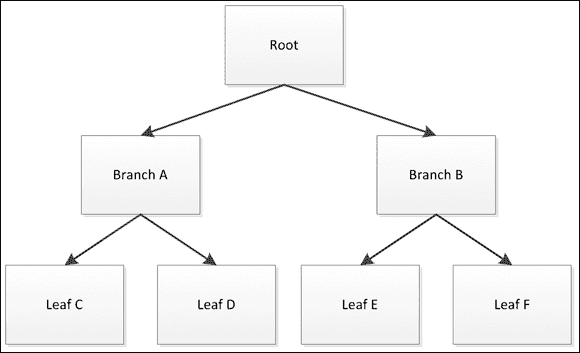
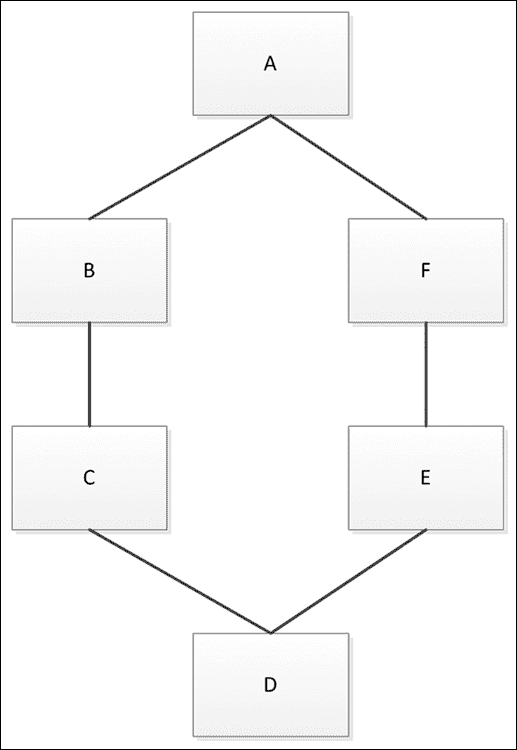
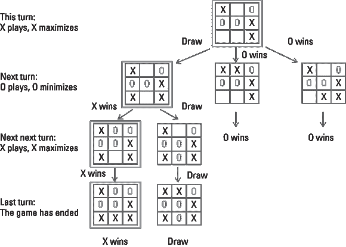
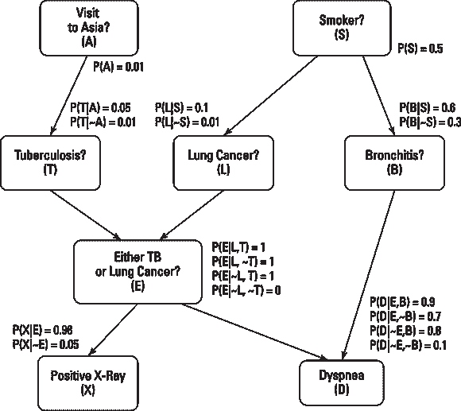
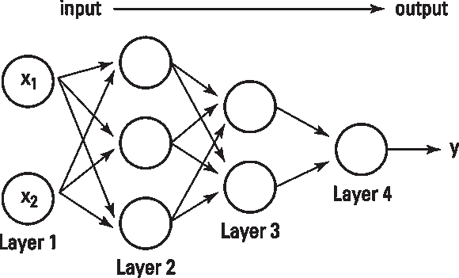
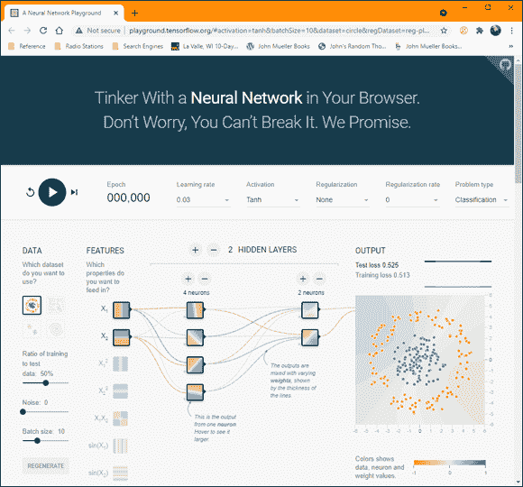
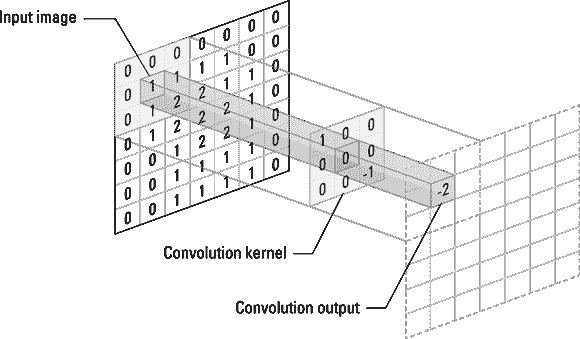
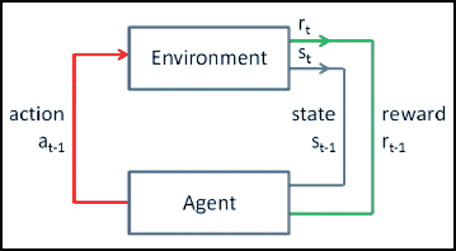
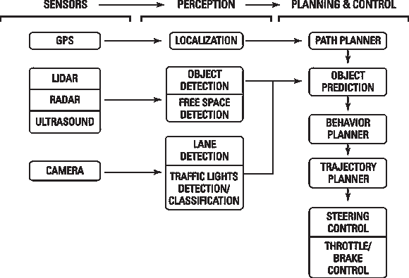

# 人工智能入门指南，第2版


## 3. 探索新地点 (`c16.xhtml#h2-3`)


## 关于作者 (`b02.xhtml`)
## 广告 (`ad.xhtml`)
## 与 Dummies 联系 (`dum-media-ad.xhtml`)
## 最终用户协议 (`eula.xhtml`)


# 引言

今天，你几乎无法避开关于人工智能（AI）的话题。你在电影、书籍、新闻和网上都能看到 AI。AI 是机器人等各种影响你日常生活的科技的一部分。AI is part of robots, self-driving (SD) cars, drones, medical systems, online shopping sites, and all sorts of other technologies that affect your daily life in so many ways. Some people have come to trust AIs so much, that they fall asleep while their SD cars take them to their destination — illegally, of course (see “Tesla driver found asleep at wheel of self-driving car doing 150km/h” at The Guardian.com.)

许多评论人士也让你淹没在关于 AI 的信息（以及虚信息）中。有些人认为 AI 是可爱有趣的；另一些人则将其视为人类潜在的大规模杀手。The problem with being so loaded down with information in so many ways is that you struggle to separate what’s real from what is simply the product of an overactive imagination. Just how far can you trust your AI, anyway. 

有些人已经如此地信任 AI，以至于在自动驾驶汽车带他们去目的地时竟然睡着了——当然，这是违法的（参见《卫报》网站上的“特斯拉驾驶员在自动驾驶汽车以时速 150 公里行驶时在方向盘旁睡着”）。

被如此多方面的信息包围，问题在于，你很难区分哪些是真实的，哪些仅仅是过度想象的产物。到底，你能在多大程度上信任你的 AI？关于 AI 的很多炒作源于科学家、企业家和商人的过度且不切的预期。《人工智能入门》（第二版）如果你觉得对这项自称是生活基本元素的科技一无所知，那么这本书正是你需要的。

以各种媒体作为切入点，你可能会发现大多数实用的技术都是乏味的。无疑，没有人会对它们赞不绝口。AI 正是如此：由于无处不在而显得平庸。你今天正在以某种方式使用 AI；事实上，你可能在很多方面都依赖 AI，只是你没有注意到。这本书让你意识到 AI 的这些真实且本质的用途。家里的智能温控器听起来可能并不刺激，但对于这种让某些人闻胆寒的技术来说，它是一个极其实用的用途。

## 关于本书


*   网络地址以 `monofont` 显示。如果你在连接到互联网的设备上阅读本书的电子版，请注意你可以点击网络地址来访问该网站，例如：[`www.dummies.com`](http://www.dummies.com)。许多额外资源的文章标题也显示为可点击的链接。
*   *斜体*单词作为内联术语定义，是你应该记住的特殊术语。你会在新闻和其他媒体（如电影）中看到这些词以许多不同的方式被使用（有时会被误用）。了解这些术语的含义可以帮助你拨开围绕着 AI 的某些炒作。

## 本书使用的图标

在阅读本书时，你会在页边栏看到图标，这些图标表示你感兴趣（或不感兴趣，视情况而定）的内容。本节将介绍了书中的每个图标。

提示（Tips）非常有用，因为它们可以帮助你节省时间或在不进行大量额外工作的情况下完成某些任务。书中的提示是节省时间的技巧，或者是你应该尝试的资源指导，以便从学习 AI 中获得最大收益。只需将它们看作我们为了奖励你阅读我们的书而支付的额外福利即可。

我们不希望听起来像是愤怒的父母或某种疯子，但你应该避免执行任何标记有“警告（Warning）”图标的内容。否则，你可能会发现自己参与了那些让当今人们对 AI 感到恐惧的信息。

每当你看到这个图标时，请认为这是高级提示或技术。阅读这些材料时你可能会睡着，我们不想对此负责。然而，你可能会发现这些有用信息的碎片包含了你创建或使用 AI 解决方案所需的答案。你可以根据自己的意愿跳过这些信息。

如果你没有从某个章节或小节中获得任何其他收获，请记住由此图标标记的内容。这段文字通常包含你为了成功与 AI 交互而必须知道的核心流程或信息。

## 书籍之外

本书并不是你 AI 探索之旅的终点；它实际上仅仅是一个开始。我们提供了在线内容，使本书更有灵活性，并更好地满足你的需求。这样，当 John 收到你的邮件时，我们就可以回答问题，并告诉你 AI 或其相关技术的更新如何影响书籍内容。事实上，你还可以访问所有这些酷的补充内容：

*   **备查表（Cheat sheet）：** 你记得在学校里用小抄在考试中获得更好的成绩，对吧？记得吗？嗯，备查表就像那样。它为你提供了一些关于可以使用 AI 完成的任务的特殊笔记，而这些并不是所有人 true。你可以访问 [`www.dummies.com`](http://www.dummies.com) 并搜索 *Artificial Intelligence For Dummies.* 来找到本书的备查表。在标题下点击“Cheat Sheet”并寻找本书对应的那个。备查表包含了非常简洁的信息，例如与 AI、机器学习和深度学习相关的所有奇怪缩写和简写的含义。
*   **更新（Updates）：** 有时会发生变化。例如，我们在编写本书期间观察水晶球时，可能没有看到即将到来的变化。在过去，这意味着书籍会变得过时且用处减少，但你现在可以通过 [`www.dummies.com`](http://www.dummies.com) 并搜索书名找到书籍的更新。

除了这些更新，还可以在 [`http://blog.johnmuellerbooks.com/](http://blog.johnmuellerbooks.com/) 查看博客文章，其中包含对读者问题的解答以及书中实用技巧的演示。此外，在我们获知信息更新时，也会发现提供信息更新的博客文章。

## 从这里开始去哪里

是时候开始发现 AI 并看看它能为你做什么了。如果你对 AI 一无所知，请从这里开始。如果你对 AI 什么都不了解，请从第 1 章开始。

如果你主要目标是了解 AI 的基础，请从第 1 章开始。本书的第 2 部分（p02.）可以帮助你理解 AI 的现状。

对 AI 有一定知识的读者可以从第 9 章开始。本书的第 3 部分（p03.）如果你不希望以开发者身份了解 AI（只是作为一个 AI 感兴趣者），你可以决定跳过这部分。

如果你想知道 AI 正在做哪些事情，请从第 12 章开始。本书的第 4 部分（p04.）侧重于依赖 AI 的硬件，而第 5 部分（p05.）侧重于未来的应用。

总之，如果你想知道人们现在如何或未来将如何使用 AI 的神奇方式，请从第 12 章开始。本书的第 4 部分（p04.）和第 5 部分（p05.）向你展示了这些方式，而不会让你去面对大量的炒作。

# 第一部分

# 介绍 AI

在本部分中……

发现 AI 实际上能为你做什么。

考虑数据如何影响 AI。

理解 AI 如何依赖算法。

看看硬件如何让 AI 运行。

### 定义 AI 术语

在以任何意义且实用的方式使用一个术语之前，你必须对它有一个定义。毕竟，如果没有人对含义达成共识，这个术语就没有意义；它只是一组字符。定义习语（即其含义无法从其组成部分的含义中明确的术语）尤为重要。


说 AI 是“人工智能”并不能真正告诉你任何有意义的内容，这就是为什么关于这个术语有这么多讨论和分歧的原因。是的，你可以认为所发生的是是人工的，并非源于自然。。然而，“智能”这部分充其量量是模糊的。即使你不一定认同后续章节中出现的对 AI 的定义，本书也是根据该定义来使用 AI 的，了解这一点将帮助你更容易地阅读后续文本。

### 辨别智能

人们以许多不同的方式定义智能。然而，你可以说智能涉及由以下活动组成的某些心理活动：

*   **学习**：获取和处理新信息的能力
*   **推理**：能够以各种方式处理信息
*   **理解**：考虑信息处理的结果
*   **掌握真理**：确定经过处理信息的有效性
*   **洞察关系**：推断经过验证的数据如何与其他数据相互作用
*   **思考意义**：以一种与其内在关系一致的方式将真理应用于特定情境
*   **区分事实与信念**：确定数据是否得到了可证明来源的充分支持，且这些来源可以被证明是持续有效的

这个列表很容易变得很长，但即使对于任何接受其可行性的人来说，这个列表也相对容易产生解释。然而，正如你从列表中看到的，智能通常遵循一个计算机系统可以作为模拟一部分来模仿的过程：

1.  根据需求或想要设定目标。
2.  评估支持目标的任何当前已知信息的价值。
3.  收集可能支持目标的额外信息。这里的重点是可能支持目标的信息，而不是你已知会支持目标的信息。
4.  对数据进行处理，使其形成与现有信息一致的形式。
5.  定义现有信息与新信息之间的关系和真值。
6.  确定目标是否已实现。
7.  根据新数据及其对成功概率的影响修改目标。
8.  根据需要重复步骤 2 到 7，直到目标实现（被发现为真）或实现目标的可能性已耗尽（被发现为假）。


尽管你可以在计算机内部创建算法并提供支持这一过程的数据访问权限，但计算机实现智能的能力受到严重限制。例如，计算机无法理解任何东西，因为它依赖于机器过程，以严格的机械方式使用纯数学来处理数据。同样，计算机不能轻易区分真理与虚假（如第 2 章中描述）。事实上，没有计算机可以完全实现描述智能列表中描述的任何心理活动。

在决定智能究竟涉及什么时，对智能进行分类也有帮助。人类并不只使用一种智能，而是依赖于多种智能来执行任务。哈佛大学的霍华德·加德纳（Howard Gardner）定义了许多这类智能（详情请参阅哈佛大学 Project Zero 的“多重智能”文章），了解它们有助于你将它们与计算机可以模拟为智能的任务联系起来（这些智能的带有额外描述的修订版本，请参见表 1-1）。

### 表 1-1：人类智能的种类以及 AI 如何模拟它们

| 类型 | 模拟潜力 | 人类工具 | 描述 |
| :--- | :--- | :--- | :--- |
| 视觉空间 | 中等 | 模型、图形、图表、照片、3D 建模、视频、电视 | 船员和建筑师等人员使用的智能。为了移动，人类需要理解他们的物理环境。每个机器人或便携式计算机都需要这种能力，但通常性较低（例如自动驾驶汽车）。 |
| 身体动觉 | 中等到高 | 特殊设备和实体 | 身体动作，例如外科医生或舞者使用的动作，需要精确和身体感知。机器人通常使用这种智能执行重复性任务，通常比人类更精确，但有时缺乏优雅。区分人类增强（例如为外科医生提供增强身体能力的手术设备）与真正的独立运动至关重要。前者仅仅是数学能力的展示，因为它取决于外科医生的输入。 |
| 创造力 | 无 | 艺术输出、新思维模式、发明、新型音乐创作 | 创造力开发新思维模式的行为，以艺术、音乐和写作的形式产生独特的输出。真正的新产品是创造力的结果。AI 可以模拟现有的思维模式，甚至将它们组合产生看起来独特的呈现，但实际上只是基于数学的现有模式版本。为了创作，AI 需要具备自我意识，这需要内省智能。 |
| 人际 | 低到中等 | 电话、音频会议、视频会议、写作、计算机会议、电子邮件 | 与人的互动发生在多个层面。这种智能形式的目标是根据经验获取、交换、提供和处理信息。计算机根据关键词输入回答基础问题，而不是因为它们理解了问题。智能发生在获取信息、定位合适的关键词以及根据这些关键词提供信息。在查找表中交叉引用术语并根据提供的指令采取行动展示的是逻辑智能，而不是人际智能。 |
| 内省 | 无 | 书籍、创意材料、日记、隐私和时间 | 向内看以理解自己的兴趣并根据这些兴趣设定目标，目前是人类特有的智能。作为机器，计算机没有欲望、兴趣、需求或创造能力。AI 使用一组算法处理数值输入并提供输出；它对自己所做的一切没有感知，也不理解自己所做的一切。 |


| 类型 | 重要性 | 示例 | 描述 |
| :--- | :--- | :--- | :--- |
| 语言类（通常分为口语、听力和书面语） | 口语和听力较低；书面语无 | 游戏、多媒体、书籍、录音机和口语 | 使用词汇是通信的核心工具，因为口头和书面信息的交换远快于任何其他形式。这种形式的智能包括理解口语、听力及书面输入，管理输入以开发答案，并提供可理解的答案作为输出。在许多情况下，计算机几乎无法将输入解析为关键词，实际上无法理解请求，并输出可能完全无法理解的响应。在人类身上，口语、听力和书面语语言智能来自大脑的不同区域（参见霍普金斯大学的“`Say What? How the Brain Separates Our Ability to Talk and Write`”），这意味着即使对于人类，具有高书面语言智能的人也可能没有同样高的口语语言智能。计算机目前还没有区分听力和口语语言能力——一个仅仅是输入，另一个是输出。计算机无法模拟书面语言能力，因为这种能力需要创造力。 |
| 逻辑数学类 | 高（可能比人类高） | 逻辑游戏、调查、谜题和脑筋急转弯 | 计算结果、执行比较、探索模式和考虑关系都是计算机目前擅长的领域。当你看到计算机在电视节目的游戏中击败人类时，在七种智能中，这是你真正看到的唯一形式的智能。是的，你可能会看到其他类型智能的一小部分，但这是重点。仅根据一个领域对人类与计算机的智能进行评估并不是一个好主意。 |

### 发现定义 AI 的四种方式

如上一节所述，要理解的第一个重要概念是：AI 实际上与人类智能无关。是的，某些 AI 被建模为模拟人类智能，但它仅仅是如其是：这是一种模拟。在思考 AI 时，请注意目标寻求、用于实现该目标的数据处理以及为了更好地理解目标而使用的数据获取之间的相互作用。AI 依赖算法来实现结果，而这个结果可能与人类目标或实现这些目标的方法无关。考虑到这一点，你可以从四种方式对 AI 进行分类：

- **像人一样行动：** 当计算机表现得像人时，它最好地反映了图灵测试，在图灵测试中，当无法区分计算机和人类时，计算机即成功（详情参见艾兰·图灵互联网剪贴中的“`The Turing Test`”）。这一类也反映了媒体希望你相信的 AI 全貌。你看到它被应用于自然语言处理、知识表示、自动推理和机器学习等技术（这四项技术必须全部存在才能通过测试）。为了通过图灵测试，AI 应该具备所有上述四种技术，并可能整合其他解决方案（如专家系统）。Mitsuku（位于 `https://chat.kuki.ai/` 和 `http://www.square-bear.co.uk/mitsuku/home.htm`）是一个五次获得最像人人工智能洛伯纳奖的聊天机器人，它是这种整合的示例。


原始的图灵测试不包含任何物理接触。哈纳德（Harnad）的全图灵测试包含了物理接触，其形式为感知能力询问，这意味着计算机必须同时采用计算机视觉和机器人技术才能成功。以下是其他图灵测试替代方案的简要概述：

- **反向图灵测试：** 人类试图说服计算机该人类不是计算机（例如，区分计算机和人类的全自动公共图灵测试，或 `CAPTCHA`）。
- **最小智能信号测试：** 仅给出 `true/false` 和 `yes/no` 问题。
- **马库斯测试（Marcus Test）：** 计算机程序模拟观看电视节目，并根据关于节目内容的有意义问题对程序进行测试。
- **洛芙拉斯测试 2.0：** 通过检查其创作能力来检测 AI。
- **维诺格模式挑战（Winograd Schema Challenge）：** 该测试以特定格式提出多选题。

现代技术包括实现目标，而非完全模仿人类。例如，莱特兄弟并没有通过精确模仿鸟类的飞行来制造飞机；相反，鸟类提供了空气动力学的想法，最终导致了人类的飞行。目标是飞行。鸟类人类实现了这一目标。

- **像人一样思考：** 当计算机像人类一样思考时，它执行人类智能（与程序化操作相反）的任务，例如驾驶。为了判断程序是否像人类一样思考，你需要某种确定人类思考的方法，这是认知建模定义的。该模型依赖于三种技术：
    - **内省法：** 通过监控自己的思维过程来检测并记录实现目标的技术。
    - **心理测试：** 观察人的行为，并将其加入相似情况、资源和环境条件下的他人行为数据库中。
    - **脑成像：** 通过各种手段直接监测大脑活动，例如`计算机断层扫描 (CAT)`、`正电子发射断层扫描 (PET)`、`磁共振成像 (MRI)` 和`磁脑图 (MEG)`。

在创建模型后，你可以编写一个模拟模型的程序。考虑到人类思维过程的巨大差异，以及将这些思维过程准确表示出来的难度，其结果最多是实验性的。这种像人一样思考的类别通常用于心理学以及其他认为人类思维至关重要的领域。

- **理性思考：** 使用某些标准研究人类如何思考，以此创建典型人类行为的指南。当人在特定的偏差范围内遵循这些行为时，就被认为是理性的。理性思考的计算机依赖记录的行为，根据现有数据创建与环境交互指南。这种方法的目标是逻辑性地解决问题。在许多情况下，这种方法将能够创建一个解决问题的基准技术，然后对其进行修改以实际解决问题。


用于定义 AI 的分类提供了一种考虑 AI 各种用途或应用方式的方法。某些用于按类型分类 AI 的系统是任意的且互不的。例如，某些团体将 AI 分为**强人工智能**（能够适应各种情况的通用智能）或**弱人工智能**（设计用于良好执行特定任务的专门智能）。强人工智能的问题在于它无法很好地执行任何任务，而弱人工智能又过于专门化，无法独立执行任务。尽管如此，即使在广义意义上，仅靠两种类型分类也是不够的。由阿伦德·辛因泽（Arend Hintze）推广的四种分类类型（详情请参见 Conversation.com 上的“理解 AI 的四种类型，从反应式机器人到自我意识”）为理解 AI 提供了更好的基础：

*   **反应式机器（Reactive machines）**：你看到的在国际象棋中击败人类或在游戏节目中出现的机器就是反应式机器的例子。反应式机器没有用于决策的记忆或经验。相反，它依赖纯粹的计算能力和智能算法每次都重新创建决策。这是用于特定目的的弱人工智能的示例。（`第 5 章` 中的 `考虑中国房间论证` 部分解释了弱人工智能的含义。）

*   **有限记忆（Limited memory）**：自动驾驶汽车或自主机器人没有时间从头开始做出每一个决策。这些机器依赖少量的内存来提供各种情况的经验知识。当机器看到相同的情况时，它可以依靠经验来缩短反应时间，并为尚未做出的新决策提供更多资源。这是目前强人工智能水平的示例。

*   **心理理论（Theory of mind）**：能够评估自身所需目标以及同一环境中其他实体潜在目标的机器，其理解能力在今天某种程度上是可行的，但尚未以任何商业形式存在。然而，为了让自动驾驶汽车变得真正自主，必须充分开发这种水平的 AI。自动驾驶汽车不仅需要知道从一点到另一点，还需要直感知周围驾驶员可能冲突的目标并做出相应反应。（机器人足球，`[`www.cs.cmu.edu/~robosoccer/main/`](http://www.cs.cmu.edu/~robosoccer/main/)` 和 `[`www.robocup.org/`](https://www.robocup.org/)`，是这种理解的另一个例子，但处于简单水平。）

*   **自我意识（Self-awareness）**：这是你在电影中看到的种类的 AI。然而，它需要目前甚至遥不可能的技术，因为这种机器将同时拥有自我感和意识。此外，这类机器不再仅仅根据环境和其他实体的反应来直觉他人的目标，而是根据经验知识推断他人的意图。

## 理解 AI 的历史

本章的前几个章节帮助你从人类的角度理解智能，并看到现代计算机在模拟这种智能方面是多么不从心，更不用它们自己真正变得智能了。然而，创造智能机器（或在古代是神像）的欲望与人类一样古老。不想在宇宙中孤单，渴望拥有一个可以在没有人类不一致性的情况下进行交流的对象，是一种强烈的愿望。当然，一本书无法思考人类的历史，因此接下来的章节对现代 AI 尝试的历史提供了简要且相关的概述。

### 从达特茅学院的符号逻辑开始

最早的计算机仅仅是这样：计算设备。它们模仿人类操纵符号的能力以执行基础数学任务（如加法）。逻辑推理后来增加了通过比较执行数学推理的能力（例如确定一个值是否大于另一个值）。然而，人类仍然需要定义用于执行计算的算法，以正确的格式提供所需的数据，然后解释结果。1956 年夏天，各种科学家参加了在达特茅斯学院校园举办的一场研讨会，以做一些更多事情。他们预测，能够像人类一样有效地进行推理的机器最多只需要一代人就会出现。他们错了。直到现在，我们才意识到机器可以像人类一样有效地执行数学和逻辑推理（这意味着计算机在达到任何接近人类智能的水平之前，必须掌握至少六种智能）。

达特茅斯学院以及当时其他努力所陈述的问题与硬件有关——即足够快速地执行计算以创建模拟的处理能力。然而，这并不是问题的全部。是的，硬件确实在其中起作用，但你无法模拟你不理解的过程。尽管如此，AI 在今天某种程度上是有效的，是因为硬件终于变得足够强大，可以支持所需的计算量。


这些早期尝试中最大的问题（直到今天仍然是一个严重问题）是，我们并不了解人类是如何很好推理的，无法创建任何形式的模拟——假设直接模拟甚至是可能的。再次考虑本章之前描述的围绕载人飞行的问题。莱特兄弟的成功并不是通过模拟鸟类，而是通过理解鸟类使用的过程，从而创建了空气动力学领域。因此，当有人说下一个大型 AI 创新近在咫尺，但还没有关于涉及过程的具体论文时，这种创新绝非近在咫尺。

### 继续讨论专家系统

专家系统最早出现在 20 世纪 70 年代，并在 80 年代再次出现，其尝试是利用专家知识来减少 AI 带来的计算需求。出现了许多专家系统表示形式，包括基于规则的（使用 `if...then` 语句根据经验法则做出决策）、基于框架的（使用组织成相关通用信息层级结构的数据库，称为“框架”）以及基于逻辑的（依赖集合论来建立关系）。专家系统的出现是重要的，因为它们展示了 AI 首次真正有用且成功的实现。


你今天仍然可以看到专家系统在使用（尽管它们不再被那样称呼了）。例如，你应用程序中的拼写检查和语法检查就是专家系统的一种。特别是语法检查，是强基于规则的。观察周围其他专家系统可能在日常应用中仍有实际用途是有益的。

专家系统的问题是它们可能很难创建和维护。早期用户必须学习专门的编程语言，如列表处理 (`Lisp`) 或 `Prolog`。一些供应商通过使用如 `VP-Expert` 等产品（参见 Amazon.com 上的《The Illustrated VP-Expert》）等基于规则的方法，看到了将专家系统交到经验不丰富的或初级程序员手中的机会。然而，这些产品在利用较小知识库方面的功能通常非常有限。


在 20 世纪 90 年代，`expert system`这一术语开始消失。关于专家系统已经失败的观点确实出现过，但现实是，专家系统由于太成功了，以至于它们已经根植于旨在支持的应用程序之中。以文字处理器为例，曾几何时你需要购买一个独立的语法检查程序，如 `RightWriter`。然而，现在的文字处理器已经内置了语法检查器，因为它们被证明非常有用（尽管并不总是准确；详情请参见《华盛顿邮报》文章“你好，切普先生，PCS 正在学习英语”）。

## 克服 AI 寒冬

`AI 寒冬`指的是 AI 开发领域资金减少的时期。总的来说，AI 的发展遵循了这样一条路径：支持者夸大了可能实现的功能，导致完全没有技术知识的人投入了大量资金；随后当 AI 无法达到预期时，资金就会减少。多年年来发生过许多这样的周期——这些周期对进展是毁灭性的。

AI 目前正处于一个新的阶段，得益于`machine learning`（一种帮助计算机从数据中学习的技术）。让计算机从数据中学习意味着不再依赖程序员来设定任务，而是通过示例让计算机学习如何行为。机器学习存在陷阱，因为计算机可以通过错误的教学来学习。

五类科学家正在研究机器学习，每个人都从不同的角度出发（详情参见本章后面的“避免 AI 炒作与过度估计”章节）。目前最成功的解决方案是`deep learning`，一种试图模仿人类大脑的技术。深度学习之所以可能，是因为强大的计算机的出现、更智能的算法、社会数字化产生的大数据集，以及来自 `Google`、`Facebook` 等公司的巨额投资。人们说，由于深度学习，AI 寒冬已经结束了，这在目前是真实的。然而，当你观察 AI 的应用方式时，你可以很容易发现，除非支持者降调，否则另一个危机阶段将会发生。AI 可以做很不起的事情，但它们是非常平凡的（例如执行重复性工作；参见`TechRepublic.com`上的“AI 如何用于新冠疫苗制造”）。下一节介绍了 AI 现在如何被使用。

## 思考 AI 的用途

你在许多应用中都能发现 AI 的使用。唯一的问题是这项技术工作得太好，以至于你甚至不知道它的存在。事实上，你可能会惊讶许多家用设备已经在使用 AI。例如，一些智能恒温器会根据你手动控制温度的方式自动创建计划。同样，用于控制某些设备的语音输入学习你的说话方式，以便更好地与你交互。AI 确实出现在汽车中，尤其是在工作场所。事实上，AI 的应用数以百万计——即使它们本质上是非戏剧性的。以下是你可能看到 AI 使用的几种方式：

*   **欺诈检测：** 你会接到信用卡公司的电话，询问你是否进行了某项购买。信用卡公司并不是窥窥；它只是在提醒你可能有人在使用你的卡。信用卡公司内部的 AI 检测到了不熟悉的消费模式并向你发出报警。
*   **资源调度：** 许多组织需要高效地调度资源。例如，医院可能需要根据患者的需求、技能丰富的专家可用以及医生预计患者在医院的时间来安排患者。
*   **复杂分析：** 人类经常需要复杂分析的帮助，因为要考虑的因素实在太多。例如，同样的症状可能指示不止一个问题。医生或其他专家可能需要帮助及时做出诊断以挽救患者生命。
*   **自动化：** 任何自动化都能受益于加入 AI 来处理意外的变化或事件。今天某些类型自动化的问题是，意外事件（例如位置错误的物体）实际上会导致自动化停止。在自动化中加入 AI 可以允许其处理意外事件并像无其事一样继续运行。
*   **客户服务：** 你今天拨打的客服热线背后可能没有人类。自动化足以遵循脚本并利用各种资源来处理你的大部分问题。有了良好的语调（同样由 AI 提供），你可能无法判断自己正在与电脑对话。
*   **安全系统：** 如今各种机器中的许多安全系统都依赖 AI 在危机时刻接管车辆。例如，许多自动制动系统（`ABS`）依赖 AI 根据车辆提供的所有输入（如滑行方向）来停止汽车。计算机化的`ABS`从技术角度来看实际上有 40 年的历史了（详情请参见`DriveSpark.com`上的“ABS（防锁制动系统）——一个 40 年救命者的简史”）。
*   **机器效率：** AI 可以帮助这种方式控制机器以获得最大效率。AI 控制资源的使用，使系统不会超过速度或其他目标。每一分电力都按需要精确提供所需的服务。

## 避免 AI 炒作与过度估计

本章多次提到了 AI 炒作。遗憾的是，本章甚至还没有触及市场上所有炒作的皮毛。如果你观看像《Her》和《机械姬》这样的电影，你可能会误认为 AI 的进展比实际要快得多。问题是，AI 实际上处于婴儿阶段，任何像电影中展示的那种应用都是过度想象的创意产物。以下章节帮助你理解炒作和过度估计是如何扭曲你实际使用 AI 的目标的。

### 定义五大部落和主算法

你可能听过一种被称为“奇点”的东西，它负责媒体和电影中呈现的各种潜在主张。`奇点`本质上是一个涵盖了机器学习中使用的所有五大部落的主算法。为了实现这些来源告诉你的内容，机器必须能够像人类一样学习——正如本章早期“[辨别智能”章节中讨论的七种智能所示。

*   **符号主义者（Symbologists）：** 这一部落起源于逻辑和哲学。该群体依赖反向推演来解决问题。
*   **连接主义者（Connectionists）：** 这一部落起源于神经科学，他们依赖反向传播来解决问题。
*   **进化论者（Evolutionaries）：** 进化论部落起源于进化生物学，依赖遗传编程来解决问题。
*   **贝叶斯者（Bayesians）：** 这一部落起源于统计学，依赖概率推断来解决问题。
*   **类比者（Analogizers）：** 这一部落起源于心理学，他们依赖核机来解决问题。


机器学习的终极目标是将五个部落所采纳的技术和策略相结合，创造出一种单一的算法（即`master algorithm`），它可以学习任何内容。当然，实现这一目标还有很长的路要走。尽管如此，华盛顿大学的佩德·多明戈斯（Pedro Domingos）等科学家正在朝着这一目标努力。

让事情变得更加模糊的是，五个部落可能无法提供足够的信息来实际上解决人类智能问题，因此为所有五个部落创建主算法可能仍然无法产生奇点。在此时，你应该会对人们对自己的思考方式或为何以某种方式思考竟然如此无知如少而感到惊讶。你听到的任何关于 AI 接管世界或超越人类的传言都纯粹是虚假的。

### 考虑炒作的来源

现在有很多 AI 炒作的来源。很大一部分炒作来自媒体，并由那些根本不知道 AI 到底是什么的人呈现出来，他们可能只是读过一本某科幻小说。所以，不仅仅是电影或电视导致了 AI 炒作的问题；还有各种其他媒体来源。你经常能发现新闻报道称 AI 能够完成某些它根本无法的事情，因为记者并不理解这项技术。奇怪的是，甚至许多新闻服务现在也使用 AI 来至少为记者撰写开头（详情请参阅 `Forbes.com` 上的《这是机器人写的吗？AI 如何影响新闻业》）。

某些产品在进入市场之前应该进行更多的测试。`SyncedReview.com` 上的文章《2020 回顾：10 个 AI 失败案例》讨论了十种被开发者大肆宣传但最终惨遭失败的产品。在这些失败中，有些是巨大的，反面反映了 AI 执行任务的整体能力。然而，其中一些失败中值得考虑的一点是，人们可能干扰了使用 AI 的设备。显然，测试程序需要开始考虑人类故意篡改 AI 作为潜在错误来源的可能性。在这种情况发生之前，AI 将无法按照预期运行，因为人们会继续摆弄软件，试图以一种幽默的方式使其失败。

另一个问题的产生源于向错误的人询问 AI。并不是每一位科学家（无论他们有多聪明）都拥有足够的 AI 知识来对该技术及其未来发展方向提供专业的意见。询问一位生物学家关于 AI 的未来问题等同于让你的牙医去做脑手术——这显然不是个好主意。然而，许多故事出现了像这样的人作为信息来源。要发现 AI 的未来方向，最好询问在 AI 研究方面有深厚背景的计算机科学家或数据科学家。

### 理解用户的过度高估

由于炒作（以及有时是因为懒惰或疲劳），用户会不断高估 AI 执行任务的能力。例如，最近发现一位特斯拉车主在汽车以 `90 mph` 的速度在高速公路上行驶时在车内睡觉（参阅《加拿大特斯拉车主因车速超过 90 英里时“睡觉”被控》）。然而，尽管用户显著高估了该技术驾驶的能力，它显然也运行得足够好（至少对于这个司机来说），从而避免了完全的失败。

然而，你不需要以 `90 mph` 的速度在高速路上行驶就会遇到过度高估。机器人吸尘器也可能无法预期，通常是因为用户认为他们只需插上设备，再也不用考虑扫地了。毕竟，电影描绘的设备完全是这样工作的。`RobotsInMyHome.com` 上的文章《如何解决最烦人的机器人吸尘器问题》讨论了各种机器人吸尘器的故障排除技术，这是很有道理的——机器人仍然需要人类的干预。观点是，大多数机器人在某些时候需要人类干预，因为它们缺乏独立完成的知识。

### 将 AI 与底层计算机连接

要看到 AI 的工作，你需要某种计算系统、一个包含所需软件的应用程序和一个知识库。计算系统可以是任何内部带有芯片的设备；事实上，对于某些应用程序，智能手机的效果和台式电脑一样好。当然，如果你是亚马逊并想对某个特定人的下一次购买决策提供建议，智能手机是不够的——该应用程序需要一个非常大的计算系统。计算系统的大小与你期望 AI 执行的工作量成正比。

应用程序的大小、复杂性甚至位置也可以有所不同。例如，如果你是一家企业，想要分析客户数据以确定如何最好进行推销，你可能依赖基于服务器的应用程序来执行任务。另一方面，如果你是一个客户，想在亚马逊上寻找与你当前购买物品匹配的产品，应用程序甚至不在你的电脑上；你通过位于亚马逊服务器上的 Web 应用程序访问它。

知识库的位置和大小也不同。数据越复杂，你从中获得的信息就越多，但处理它的需求也越多。在知识管理方面没有免费午餐。地点与时间之间的相互作用也很重要。网络连接让你能够访问在线大型知识库，但由于网络连接的延迟，付出了时间成本。然而，本地数据库虽然快，但在许多情况下缺乏细节。

# 第 2 章

# 定义数据的角色

### 本章内容

**将数据视为通用资源**

**获取和处理数据**

**在数据中找寻虚假信息**

**定义数据获取限制**

**考虑数据安全**

数据并不是新鲜事物。每一个曾经为计算机编写的有趣应用程序都与数据相关。数据以许多形式出现——有些是有组织的，有些不是。改变的是数据量。有些人发现，我们现在可以获得如此多的数据，细节涵盖了大多数人生活的每个方面，甚至细到了他们自己都没有意识到的程度。此外，先进硬件的使用和算法的改进使数据成为当今的通用资源。

要处理数据，你必须首先获取它。今天，应用程序既像过去那样手动收集数据，也使用新方法自动收集。然而，这不仅仅是一到两种数据收集技术的问题；收集方法处于从完全手动到完全自动的连续体上。你今天还关注如何伦理地收集这些数据——例如，不收集未经许可的数据。本章探讨了围绕数据收集的问题。


有趣的是，你还需要应对数据获取方面的限制。目前不存在任何技术能够通过心灵感应手段从某人的脑海中提取想法。当然，也存在其他限制——其中大多数你可能已经知道了，但可能还没有考虑过。以一种不安全的方式收集数据也是徒劳的。数据必须是无偏的、未损坏的，并且来自你所知的来源。在本章中，你将了解到更多关于获取限制和数据安全的知识。

## 在这个时代无处不在的数据

`big data`（大数据）不仅仅是供应商用来提出存储和分析数据新方法的一种流行术语。大数据革命是随处可见的现实，也是我们时代的驱动力。你可能在许多专业的科学和商业出版物中听过大数据，你甚至可能想过这个词的真正含义是什么。从技术角度来看，`big data`指的是海量且复杂的计算机数据，其规模之大、错之复杂使得应用程序无法简单地通过增加存储或提高计算机性能来处理这些数据。

大数据意味着数据存储和处理方式的革命。它影响了你通过数据可以实现的更多定性成就（意味着除了完成更多工作外，你还能很好地执行任务）。从人类的角度来看，计算机以不同的数据格式（如数据库文件和`.csv`文件）存储大数据，但无论存储类型如何，计算机仍然将数据视为 0 和 1 的比特流（计算机的核心语言）。你可以将数据分为两种类型：结构化和非结构化，取决于你如何产生和消费它。某些数据具有清晰的结构（你确切知道它包含什么以及在哪里找到每条数据），而其他数据是非结构化的（你大致知道它包含什么，但并不确切它是如何排列的）。

结构化数据的典型示例是数据库表，信息被排列成列，每列包含特定类型的信息。数据通常是根据设计进行结构化的。你有选择地收集它并将其记录在正确的位置。例如，你可能想将购买特定产品的人数计数放在特定数据库中特定表中的特定列中。就像图书馆一样，如果你知道需要的数据，就可以立即找到它。

非结构化数据由图像、视频和录音组成。你可能对文本使用非结构化形式，以便对其进行特征标记，如大小、日期或内容类型。通常，你并不确切数据出现在非结构化数据集中的具体位置，因为数据是以 0 和 1 序列的形式出现的，应用程序必须对其进行解释或可视化。


将非结构化数据转换为结构化形式可能花费大量的时间和精力，并可能涉及许多人的工作。大数据革命的大多数数据是非结构化的，并按原始存储，除非有人将其转换为结构化。

这种丰富且复杂的数据库并非一夜之间出现的。开发存储如此数量数据的技术需要时间。此外，传播生成和传输数据的技术（即计算机、传感器、智能手机以及互联网及其全球维网服务）也需要时间。以下章节将帮助理解为什么数据在今天成为了一种通用资源。

### 理解摩尔法则的影响

1965 年，英特尔和法尔奇半导体的联合创始人戈登·摩尔（Gordon Moore）在`IEEE.org`上的一篇名为《向集成电路中挤入更多组件》的文章写道，集成电路中的组件数量在未来十年内每年增加一倍。那时，晶体管主导电子领域。能够在集成电路（IC）中填充更多晶体管意味着能够让电子设备更强大、更有用。这个过程被称为`integration`（集成），意味着强烈的电子微型化过程（将相同的电路缩小得多）。今天的计算机并没有十年前的计算机小多少，但性能却决定性地增强了。手机也是如此。尽管它们与前代产品一样（有时甚至更小），但它们已经能够执行更多任务。

摩尔所说的话多年来一直是事实。半导体行业将其称为摩尔法则（详情请参见[`http://www.mooreslaw.org/`](http://www.mooreslaw.org/)）。翻倍现象在前十年确实发生了。1975 年，摩尔修正了他的说法，预测为每两年翻一倍。图 2-1 显示了这种翻倍的影响。


从 2012 年开始，预期的速度增长与半导体公司在微型化方面取得的之间出现了不。许多工程师现在认为摩尔法则已经死亡。然而，少数人，如英特尔半导体主管吉姆·凯勒（Jim Keller），认为芯片改进仍有充足空间。查尔斯·莱泽森（Charles Leiserson）和尼尔·汤普（Neil Thompson）持有不同观点，认为改进将来自更好的软件、算法和专用芯片架构。


图 2-1

未来摩尔法则可能不再适用，因为行业将切换到新技术，例如使用光激光代替晶体管来制造组件（详情请参见`BBVAOpenMind.com`上的“光计算：以光速解决问题”文章）。另一种解决方案是量子计算机，例如谷歌和 IBM 正在开发的量子计算机（你可以在`The Verge.com`上阅读“谷歌确认量子优越性突破”的文章）。重要的是，自 1965 年以来，组件每两年翻倍开启了数字电子领域的巨大进步，这对数据获取、存储、处理和管理产生了深远影响。

### 数据无处不在

由于科学实验，科学家需要比普通人更强大的计算机。在任何人发明大数据一词之前，他们就开始处理惊量的数据了。那时互联网产生的数据并没有现在这么多。记住，大数据并不是软硬件供应商创造的时尚，而是许多科学领域的基础，例如天文学（太空任务）、卫星（监控和监测）、气象学、物理学（粒子加速器）和基因组学（DNA 序列）。


虽然 AI 应用可以专注于某个科学领域，例如 IBM 的 Watson，它由于能从数百万关于疾病和医学的科学论文中学习信息而拥有令人惊讶的医学诊断能力，但实际的 AI 应用驱动因素往往具有更多平庸的方面。实际的 AI 应用之所以受欢迎，是因为它可以识别物体、沿路径移动或理解人们说的话并与他们交流。塑造这种模式的实际 AI 大复兴的数据贡献，并非源自科学数据的经典来源。

互联网现在正在大量生成并分发新数据。我们目前的每日数据产生量估计约为 2.5 万亿字节（一个带有 18 个 0 的数字），其中大部分是视频和音频等非结构化数据。所有这些数据都与人类的活动、感受、经历和关系有关。在这些数据中穿梭，AI 可以轻松学习如何进行像人类一样的推理和行动。以下是你可以找到的一些更有趣的数据示例：

*   来自 Facebook、YouTube 和 Google 等社交媒体网站发布的照片和视频中的大型人脸和表情库，提供了关于性别、年龄、感受以及可能的性偏好、政治倾向或 IQ 的信息（请参阅 The Guardian.com 上的《教授：面部识别 AI 将能够检测你的政治和 IQ》）。
*   来自智能手表的私人医疗信息和生物识别数据，这些数据在疾病和健康状态下都会测量温度和心率等身体数据。有趣的是，智能手表的数据被视为早期检测 Covid-19 等严重疾病的方法（详情请查阅 JAMA Network.com 上的《使用智能手表数据早期检测 COVID-19 病例》）。
*   来自社交媒体和搜索引擎等来源的关于人与人之间以及驱动他们兴趣的数据集。例如，剑桥大学心理测量中心的一项研究声称 Facebook 互动包含了大量关于亲密关系的数据（请参阅 The Guardian.com 上的《研究人员：你的电脑比你的朋友更了解你》）。
*   手机记录了我们说话的方式。例如，`Android` 手机上的功能 `OK Google` 会经常记录问题，有时甚至记录更多内容，正如 Quartz.com 上的《Google 一直在静悄录制你的声音；这里是听和删除存档的方法》所解释的那样。

每天，用户都会向互联网连接更多设备，这些设备开始存储新的个人数据。现在家里有了个人助手，例如 `Amazon Echo` 以及其他集成智能家居设备，它们提供了调节和便利家庭环境的方法。这些仅仅是冰山一角，因为日常生活中的许多其他常用工具（从冰箱到牙刷）正变得互联，并能够处理、记录和传输数据。物联网（IoT）正在成为现实。2015 年，IoT 设备的安装量为 36 亿。专家估计，到 2025 年，IoT 设备的安装量将达到 309 亿，增长 858%（请参阅 TechJury.net 上的《2021 年有多少 IoT 设备》以及 Statista.com 上的《2010 年至 2025 年全球物联网 (IoT) 和非物联网活动设备连接（十亿计）》）。

### 让算法投入行动

人类现在处于一个不可置信的交汇点，这里由日益小型化且强大的硬件产生了前所未有的数据。这些数据也日益由帮助其传播和发展的相同计算机进行处理和分析。这一说法可能看起来显而易见，但数据已变得无处不在，其价值不再仅仅存在于其所包含的信息（例如存储在公司数据库中允许其日常运营的数据），而是在于其作为创造新价值手段的用途。有些人将此类数据称为“新石油”。这些新价值主要存在于应用程序如何修饰、存储和检索数据，以及你如何通过智能算法实际使用它。

算法和 AI 改变了数据游戏的规则。正如上一章提到的，AI 算法在此过程中尝试了不同的方法，顺序如下：

1.  简单算法
2.  基于逻辑的符号推理
3.  专家系统

近年来，AI 算法已转向神经网络，并在其最成熟的形式——深度学习中取得进展。随着这种方法论的转变，数据从由预设算法处理的信息转变为塑造算法成为对任务有用工具的核心。数据从仅仅是燃料解决方案的原材料变成了解决方案剂的工匠，如图 2-2

图 2-2： 凭借目前的 AI 解决方案，更多的数据等同于更高的智能。

因此，一张你小猫的照片变得越来越有用，并不仅仅是因为它的情感价值——描绘了你可爱的小猫——而是因为它可以成为 AI 学习过程的一部分，用以发现更通的概念，例如什么特征代表猫，或理解什么是可爱。

在更大规模上，像 Google 这样的公司从免费可用数据中训练算法，例如网站内容或公开文本和书籍中的文字。`Google spider` 软件爬取网络，从一个网站跳转到另一个网站，检索带有文本图像内容的网页。即使 Google 将部分数据作为搜索结果返回给用户，它也利用其 AI 算法从数据中提取其他类型的信息，这些算法从中学习如何实现其他目标。

处理单词的算法可以帮助 Google AI 系统理解并预测你的需求，即使你不是通过一组关键词，而是通过平白、不清晰的语言表达，即我们每天使用的语言（而且是的，日常语言往往是不清晰的）。如果你现在尝试向 Google 搜索引擎提出问题（而不仅仅是关键词链），你会发现它倾向于给出正确的答案。自 2012 年引入 Hummingbird 更新以来（详情请参阅 Search Engine Land.com 上的《FAQ：关于新的“蜂鸟”算法的一切》），Google 稳步地变得更能够理解同义词和概念，这超越了它最初获得的数据，是 AI 过程的结果。在 Hummingbird 几年后，Google 部署了一种更先进的算法，命名为 `RankBrain`（参阅 Search Engine Land.com 上的《FAQ：关于 Google RankBrain 算法的一切》），它直接从每天数百万次的查询中学习，并回答模糊或不清晰的搜索查询，即使是使用俚语、口语表达或简单的满是错误。RankBrain 并不会处理所有的查询，但它从数据中学习如何更好地回答查询。在 2015 年引入后，它迅速开始处理引擎 15% 的查询，但它不会取代 Hummingbird（详情请参阅 Act On.com 上的《关于 Google RankBrain 的 7 个你可能不知道的事》以及 Connectica.com 上的《Rankbrain、Hummingbird 与搜索引擎优化的融合》）。

## 成功使用数据

拥有丰富的数据并不足以创建一个成功的 AI。目前，AI 算法无法直接从原始数据中提取信息。大多数算法在分析之前依赖外部的收集和处理。当算法收集有用的信息时，它可能并不代表正确的信息。以下章节将帮助你从全局角度理解如何收集、处理和自动化数据收集。


### 考虑数据源

你使用的数据来自多个来源。最常见的数据源是人类在某个时刻输入的信息。即使系统自动收集购物网站的数据，这些信息最初也是由人类输入的。人类点击各种物品，将其加入购物车，指定特征（如尺寸和数量），然后结账。稍后，销售完成后，人类会对购物体验、产品和送货方式进行评分并发表评论。简而言之，每一次购物体验都变成了一次数据收集活动。

如今许多数据源依赖于从人类来源收集输入。人类也会提供手动输入。你打电话或去某个办公室向专业人士预约。然后，接待员会从你那里收集预约所需的信息。这些手动收集的数据最终会进入某个数据集以供分析。

数据还从传感器中收集，这些传感器可以采取几乎任何形式。例如，许多机构的物理数据收集（如观察窗户看物体的人数）基于手机检测。面部识别软件可能检测到重复客户。

然而，传感器可以从几乎任何事物创建数据集。气象服务依赖于传感器创建的数据集，这些传感器监测雨、温度、湿度、云量等环境状况。机器人系统通过不断分析监控传感器收集的数据，帮助纠正机器人操作中的微小缺陷。传感器结合小型 AI 应用，可以告诉你今晚的晚餐何时恰好煮熟了。传感器收集数据，但 AI 应用使用规则来帮助定义食物何时煮熟了。

### 获取可靠的数据

`reliable`（可靠的）这个词似乎很容易定义，但执行起来却很难。当一个东西产生的结果既符合预期又保持一致时，它就是可靠的。可靠的数据源产生平淡的数据，不包含任何惊喜；人们对结果一点儿也不会感到惊讶。取决于你的观点，如果大多数人在审查数据时没有在打哈欠并睡着，这实际上可能是一好事。惊喜让数据变得值得分析和审查。因此，数据具有双重性。我们希望获得可靠、平淡、完全在料之中的数据，只需证实我们已经知道的内容，但意外正是最初收集数据有意义的原因。

尽管如此，你不希望数据离奇太远，以至于审查时几乎令人恐惧。在获取数据时需要保持平衡。数据必须落在某些范围内（如本章后面的 `修饰数据` 节所述）。它在真值方面也必须符合特定标准（如本章后面的 `考虑数据中的五大错误` 节所述）。数据还按照预期的间隔出现，且输入数据记录的所有字段必须完整。

 在某种程度上，数据安全也会影响数据的可靠性。数据一致性有几种形式。当数据到达时，你可以确保它落在预期范围内并以特定的形式出现。然而，在你存储数据之后，除非你确保数据保持在预期格式，否则可靠性可能会降低。实体篡改数据会影响可靠性，使数据变得可疑，并可能在以后无法用于分析。确保数据可靠性意味着在数据到达后，没有人篡改它以符合预期的域（使其符合要求）。

### 让人类输入更可靠

即使有交叉检查和静态条目，人类仍然有很多犯错空间。例如，输入数字可能会出现问题。当用户需要输入 `2.00` 时，你可能会看到 `2`、`2.0`、`2.` 或任何其他各种输入。幸运的是，解析输入并重新格式化将解决这个问题，而且你可以自动完成这项任务，而无需用户的帮助。（不幸的是，某些在线网站要求你输入带连杠的信用卡信息，有些带空格，有些则完全没有空格，这在应用程序没有修复输入时会导致非常混乱的体验。）

不幸的是，重新格式化无法纠正错误的数字输入。你可以通过包含范围检查来部分减轻错误。客户不能购买 `-5` 块肥皂。而且，除非客户真的很脏或拥有一个袋鼠农场，否则输入 `50000` 块肥皂可能也是错误。显示客户退回肥皂的合法方法是处理退货，而不是销售。然而，用户可能只是犯了错，你可以提供一条消息说明该数值的正确输入范围。

下拉列表框对于大量数据非常好用，使用它们可以确保人类输入变得极其可靠，因为人类只能选择默认值之一。当然，人类总是可以选择错误的条目，这就是双重检查发挥作用的地方。一些较新的应用程序会比较邮政编码与城市和州以查看它们是否匹配。当不匹配时（有时只是大小写问题），用户会被要求再次提供正确输入。这种双检查有些烦人，但用户不太可能经常看到它，所以它不会变得太烦人。

 使用自动数据收集

一些人认为自动数据收集解决了与数据集相关的所有的人为输入问题。事实上，自动数据收集确实提供了许多好处：

*   更好的一致性
*   提高的可靠性
*   降低数据丢失概率
*   增强准确性
*   减少时间敏感型输入的方差


遗憾的是，说自动化数据收集可以解决所有问题完全是错误的。自动化数据收集仍然依赖于人类设计的传感器、应用程序和计算机硬件，而这些设备仅提供人类决定允许访问的数据。由于人类对自动化数据收集的特性施加了限制，其结果往往比设计者预期的有用信息更少。因此，当设计者试图解决输入问题时，自动化数据收集处于不断变动的状态。

自动化数据收集还会受到任何计算系统中都存在的软件和硬件错误的影响，但与其他类型的计算机化设置相比，它更有可能出现 `soft issues`（即系统看起来在运行，但没有提供预期结果时产生的软性问题）。当系统正常工作时，其输入的可靠性远超人类的能力。然而，当软性问题发生时，系统往往无法像人类那样识别出问题的存在，因此数据集最终可能包含更多平庸甚至糟糕的数据。

### 以符合伦理的方式收集个人数据

对于某些人来说，互联网上出现的任何内容都自动被视为公有领域——包括人的脸和所有的个人信息。事实是，为了安全地使用数据，你应该认为所有内容都受版权保护，并且不能以公有领域的方式使用。即使是意识到材料受版权保护的人，也经常会求助于公平使用原则（如 `Baylor.edu` 上“使用受版权的材料”中所解释）。公平使用是一个非常棘手的主题，`Author’s Guild v. Google` 案证明了这一点（参见 `Towards Data Science.com` 上的“数据科学和机器学习最重要的法院判决”），该案最终以 Google 胜诉，但仅是因为 Google 满足了一些非常严格的要求。此外，这种公平使用是针对书籍的，而不是人。

仅考虑公平使用的问题在于，考虑个人的隐私权也是至关重要的（你可以在 `Thomson Reuters Legal.com` 上的“揭秘互联网隐私法——个人信息在线如何受到保护”中阅读各种法律）。因此，当公司开始在互联网上未获得任何许可的情况下抓取戴口罩的人的图像时，引发了巨大的争议，任何人都不应该感到意外（参见 `Cnet.com` 上的“你的口罩自拍可能正在训练下一个的人脸识别工具”）。事实上，Facebook 正因其滥用用户数据而被起诉（参见 `TechCrunch.com` 上的“针对 Facebook 的 350 亿美元脸部数据诉讼将进行”）。

隐私权还创造了一个新行业，旨在让一个人的脸对于那些致力于通过任何可能手段在无许可的情况下获取免费数据的公司变得不那么好用（参见 `New York Times` 的文章“这个工具可以保护你的照片免受人脸识别”）。事实是，无论你在免费使用问题上持什么立场，无论来源如何，你都需要考虑对获得的数据进行伦理使用。在以伦理方式收集个人数据时，请记住以下考虑因素：

*   **获取许可：** 某些研究要求你能够识别数据集中使用的个人。跑出去抓取个人身份信息 (`PII`) 并不是收集数据的好方法。首先，你无法确定这些信息是完整的还是准确的，因此你进行的任何分析都是可疑的。此外，你可能会遇到法律行动带来的混乱且高昂的后果。获取带有 `PII` 数据的最佳方法是请求许可。你可以在网上找到许多请求许可的资源，例如在政府层面，通过找到正确的资源，如“在获取个人身份信息 (`PII`) 之前如何获得消费者授权”。**

*   **使用清洗技术：** `Data sanitization` 涉及从数据集中移除个人信息，如姓名、地址、电话号码、ID 等，以便在数据集中识别特定个人变得不可能。除了文本和数据集变量外，你必须考虑每种数据。例如，如果你正在处理照片集，最重要的是采取步骤模糊图像中的脸部并移除汽车车牌。奇怪的是，如果你使用 `sanitization` 作为关键词进行 `Google` 搜索，仍然会得到许多处理清理的链接。添加 `privacy` 作为另一个关键词有助于找到你真正需要的文章。尽管如此，你可能会发现自己并不是唯一一个对这一过程感到困惑的人。

*   **避免数据推断：** 在收集数据时，某些用户将拒绝分享个人身份信息，例如性别和年龄。一种建议是在用户的照片或其他信息可用时推断这些信息。遗憾的是，在特定文化中与某种性别相关的名称，在其他文化中可能会被分配给另一种性别。年龄推断的问题更为严峻。例如，机器学习算法可能会为白白病人推断出错误的年龄，取决于数据来源的世界区域，这可能会影响每 3000 人中的一个（详情请参见 `NOAH.com` 上的“信息公告——什么是白白症？”）。)

*   **避免泛化：** 如今许多研究领域都试图错误地应用统计和机器学习结果，结果导致个人以某种方式受到不公正对待。必须记住，统计学适用于群体，而不是个人。

### 数据修饰 (Manicuring the Data)

有些人在谈论数据时使用 `manipulation`（操纵）一词，给人数据以某种不道德或狡猾方式改变的印象。也许更好的术语是 `manicuring`（修饰），它让数据变得形状良好且漂亮。然而，无论你使用什么术语，原始数据很少能处理和分析的要求。为了从数据中获得某些东西，你必须对其进行修饰以满足特定需求。以下章节将讨论数据修饰的需求。

### 处理缺失数据

为了正确回答一个问题，你必须拥有所有的事实。在没有所有事实的情况下，你可以对问题进行猜测，但答案正确或错误的概率相等。


- **部分数据缺失：** 损坏程度较小的字段可能会以两种方式之一缺失数据：随机或按顺序，如下文所示：
    - **随机缺失数据通常是人为错误或传感器错误导致的。** 修复随机缺失的数据是最容易的。你可以使用简单的中位数或平均值作为替代。虽然数据集并非完全准确，但它可能足够好，可以让你获得一个合理的答案。
    - **顺序缺失数据发生在某些类型的通用故障期间。** 修复顺序缺失的数据要困难得多，甚至认为是不可能的，因为你缺乏任何可以作为此类推测基础的周围数据。如果你能找到数据缺失的原因，有时可以对其进行重构。

### 考虑数据不对齐

数据集中的每条数据记录可能都存在数据，但这些数据可能无法与你拥有的其他数据集中的数据对齐。例如，一个数据集中某个字段中的数值数据可能是浮点类型（带有小数点），但在另一个数据集中可能是整数类型。在合并这两个数据集之前，字段必须包含相同类型的数据。

还会发生各种其他类型的不对齐。例如，日期字段以各种方式格式化而闻名。要比较日期，数据格式必须相同。然而，日期的隐蔽之处在于它们看起来相同但实际上不同。例如，一个数据集中的日期可能以格林治标准时间 (GMT) 为基础，而另一个数据集中的日期可能使用其他时区。在比较时间之前，你必须将它们对齐到同一个时区。如果一个数据集的日期来自使用夏令时 (DST) 的地区，而另一个地区的日期没有使用，情况会变得更加诡异。

即使数据类型和格式相同，也会发生其他数据不对齐。例如，一个数据集中的字段可能与另一个数据集中的字段不匹配。在某些情况下，这些差异很容易修正。一个数据集可能将姓和名视为单个字段，而另一个数据集可能为姓和名使用单独的字段。答案是将所有数据集更改为使用单个字段，或者将它们全部更改为使用单独的姓和名字段。不幸的是，数据内容中的许多不对齐要难得多。事实上，你可能完全无法发现它们。但是，在放弃之前，请考虑解决这些问题的潜在解决方案：

- 从你可以访问的其他数据中计算缺失的数据。
- 在另一个数据集中定位缺失的数据。
- 合并数据集以创建一个提供一致字段的整体。
- 从各种来源收集额外数据以填充缺失数据。
- 重新定义你的问题，使你不再需要缺失的数据。

### 将有用数据与其他数据分离

有些组织认为数据越多越好，但数据过剩会和数据不足一样成为问题。为了高效地解决问题，AI 只需要足够的数据。简洁清晰地定义你想要回答的问题会有帮助，使用正确的算法（或算法集合）也是如此。当然，拥有过多数据的主要问题是，寻找解决方案（在费力处理所有额外数据之后）需要更的时间，而且有时你会得到令人困惑的结果，因为你“只看到树不见森林”。

 在创建分析所需的数据集时，你会对原始数据进行复制而不是直接修改它。始终保持原始原始数据的纯净，以便日后将其用于其他分析。此外，为分析创建正确的数据输出可能需要多次尝试，因为你可能会发现输出并不满足你的需求。重点是创建一个只包含分析所需数据的数据集，但请记住，数据可能需要特定类型的修剪以确保预期的输出。

## 考虑数据中的五个谎言

在许多情况下，人类习惯于看到数据的本质：一种观点。事实上，在某些情况下，人们歪曲数据到变得无用的程度，这种 `mistruth`。AI 无法区分真实数据和虚假数据（此处原文翻译错误）。修复顺序缺失的数据要困难得多，甚至认为是不可能的，因为你缺乏任何可以作为此类推测基础的周围数据。如果你能找到数据缺失的原因，有时可以对其进行重构。


避免“遗漏性虚假”几乎是不可能的。诚然，人们可能会故意在报告中忽略某些事实，但同样可能的情况是他们仅仅忘记了包含所有事实。毕竟，大多数人在发生事故后都会非常心神不宁，因此很容易失去注意力，只报告那些留下了最深刻印象的真相。即使某人后来想起了额外的细节并将其报告出来，数据库也不可能包含一组完整的真实集。

### 视角 (Perspective)

当多方从不同的视角观察同一事件时，就会产生“视角性虚假”。例如，在考虑一起涉及撞到行人的事故时，汽车驾驶员、被车撞到的人以及目睹事件的旁观者都会有不同的视角。从每个人那里听取报告的警官可以理解地会从每个人那里获得不同的事实，即使假设每个人所说的都是他们所知的真相。事实上，经验表明这种情况几乎总是如此，警官提交的报告是所有参与者陈述的折中方案，并辅以个人经验的增强。换句话之，报告将接近真相，但对于 AI 来说还不够接近。

在处理视角时，考虑观察点至关重要。汽车驾驶员可以看到仪表盘，并知道事故发生时的车辆状况。这是另外两个伙伴缺乏的信息。同样，被车撞的人拥有观察驾驶员面部表情（意图）的最佳视点。旁观者可能处于观察驾驶员是否尝试刹车、以及评估诸如驾驶员是否试图避让等问题的最佳位置。每个伙伴都将根据看到的数据做出报告，而没有隐藏数据的优势。

视角或许是所有虚假中最危险的一种，因为在这种场景下，任何试图推导出真相的人，充其量，最后也只是得到了各种故事的平均值，而这永远不会完全正确。查看信息的人可以依靠直觉和本能来获得对真相的更好的近似值，但 AI 始终只会使用平均值，这意味着 AI 始终处于巨大的劣势。遗憾的是，避免“视角性虚假”是不可能的，因为无论你有多少事件的目击者，你所能期望实现的也只是真相的近似值，而非真实的真相。

还有另一种虚假需要考虑，它也是关于视角的。想这样一个场景：你是 1927 年的一位聋人。每周，你都会去剧院看无声电影，在一个小时或更长的时间里，你觉得自己和其他人一样。你可以像其他人一样体验电影；那里没有区别。在那年的 10 月，你看到一个告示牌，说剧院正在升级以支持声音系统，以便播放 `talkies` —— 带有声轨的电影。告示上说这是史以来最好的事情，几乎每个人似乎都同意，除了你，这个聋人，你现在让你觉得自己像一个二等公民，与其他人不同，甚至几乎被排斥在剧院之外。在聋人眼里，那个告示牌是虚假的；增加音响系统是最糟糕的事情，而不是最好的事情。这一点在于，那些看起来是普遍真理的事，实际上对所有人来说并不是真实的。“普遍真理”的概念——一个对所有人都真实的真理——是一个神话。它不存在。

### 偏见 (Bias)

“偏见性虚假”发生在某人能够看到真相，但由于个人考量或信念而无法真正看到它。例如，在思考事故时，驾驶员可能将注意力完全集中在路中间，导致路边的鹿变得肉眼无形。结果，当鹿突然决定冲向路中间试图过马路时，驾驶员没有时间反应。

偏见的一个问题在于它极难分类。例如，一个没看到鹿的驾驶员可能发生了真正的事故，这意味着鹿被灌木丛遮挡了视线。然而，驾驶员也可能因为注意力集中错误而犯了疏心驾驶。驾驶员也可能经历了瞬间的分神。简而言之，驾驶员没有看到鹿这一事实并不是问题；相反，问题在于驾驶员没有看到。在很多情况下，在设计避免偏见源的算法时，确认偏见的来源变得重要。

从理论上来说，避免“偏见性虚假”总是可能的。但在现实中，所有人类都具有各种类型的偏见，这些偏见总是会导致扭曲数据集的虚假。仅仅让某人真正去看并看到某些东西——让它在人的脑中留下记录——是一项艰的任务。人类依靠过滤器来避免信息过载，而这些过滤器也是偏见的来源，因为它们阻止了人们真正看到事物。

### 参考系 (Frame of reference)

在五种虚假中，“参考系”并不实际上是任何类型错误的结果，而是理解上的问题。参考系虚假发生在一方描述了某事（例如事故），而由于另一方缺乏该事件的经验，导致细节变得混乱或被误解。许多喜剧依赖于参考系错误。一个著名的例子是阿伯特和科斯特尔洛的《谁在一号》*，你可以在 `YouTube.com` 上看到。要让一个人理解另一个人的所说的话，当第一个人的缺乏经验时是不可能的。

另一种参考系虚假发生在一方无法理解另一方。例如，一名海员在海上经历了风暴。也许是季风，但让我们假设那场风暴是巨大的——可能威胁生命。即使使用了视频、访谈和模拟器，在风暴中的海上经历对于没有经历过的人来说是不可能的传递的；那个人没有参考系。

避免参考系虚假的最佳方法是，确保所有参与方都能建立类似的参考系。为了完成这项任务，各个参与方需要类似的经验以确保数据从一个人准确传输到另一个人。然而，当我们使用数据集（其必然是静态数据）时，当观察者缺乏必要的经验时，参考系错误仍然会发生。

AI 总是会遇到参考系问题，因为 AI 必然缺乏创造经验的能力。一个获取知识的数据库并不完全相同。数据库将包含事实，但经验不仅基于事实，还基于当前技术无法复制的结论。

## 定义数据获取的界限

如果你觉得每个人都在无分理由地获取你的数据，你是正确的。事实上，机构正在收集、分类并存储人的数据——似乎并没有目标或意图。根据 `Domo.com` 的“数据永不睡眠”，世界每分钟都在以惊人的速度收集数据。这里只是一些例子：

*   Zoom 举行了 208,333 名参与者的会议。
*   用户发布了 347,222 条 Instagram 快动态。
*   Microsoft Teams 连接了 52,083 名用户。
*   在 WhatsApp 上分享了 41,666,667 条消息。
*   人们打了 1,388,889 个视频/语音电话。


数据获取已成为全球范围内的一种“毒瘾”，一些人认为收集数据最多的组织在某种程度上赢得了奖项。然而，数据获取本身并无济于事。道格拉斯·亚当斯（Douglas Adams）的小说《银河系漫游指南》就清晰地阐述了这个问题。在书中，一个超级生物种族建造了一台巨大的计算机，用以计算“生命、宇宙以及万物”的意义。答案“42”并没有真正解决任何问题，因此有些生物抱怨说，为了得出答案而对数据的收集、分类和分析并没有产生任何可用的结果。那台计算机——而且是一台有意识的计算机——告诉接收答案的人们，答案确实是正确的，但他们需要知道问题才能让答案产生意义。数据获取量可以是无限的，但要找出该问的问题可能令人生畏，甚至可以说是不可能的。


任何组织在数据获取方面需要解决的主要问题是应该问什么问题，以及这些问题为什么重要。针对你需要回答的问题来定制数据获取至关重要。例如，如果你在镇上经营一家商店，你可能需要回答以下问题：

*   每天有多少人从商店前经过？
*   这些人中有多少人停下来看橱窗？
*   他们看了多久？
*   他们是在一天的什么时间段看的？
*   某些展示方式是否往往能产生更好的效果？
*   这些展示方式中哪些真正导致了人们进入商店购物？

这个列表可以一直持续下去，但核心思想是：创建一个针对特定业务需求的问题列表是关重要的。在创建列表后，你必须验证每个问题是否真的是重要的（即它是否解决了某种需求），然后确定确定回答该问题需要什么种的信息。

 显然，试图通过手动收集所有这些数据是不可能的，这正是自动化大显身场的地方。表面上看，自动化会产生可靠、可重复且一致的数据输入。然而，数据获取自动化中的许多因素可能会产生并不是特别有用的数据。例如，考虑以下问题：

*   传感器只能收集其设计用于收集的数据，因此如果使用的传感器并非为该目的而设计，你可能会丢失数据。
*   人们会以各种方式产生错误数据（详见本章前面的“考虑数据中的五大谎言”部分），这意味着你收到的数据可能是假的。
*   当收集条件的定义不正确时，数据可能会变得偏斜。
*   数据的解释错误意味着结果也将是错误的。
*   将现实世界的问题转化为计算机可以理解的算法是一个容易出错的过程。

还有许多其他问题（多到可以写一本书）需要考虑。当你将收集不当、格式不规范的数据与实际上并没有回答你问题的算法结合在一起时，你得到的输出实际上可能会引导你的业务走向错误的方向，这就是为什么 AI 经常被指责结果不一致或不可靠。提问正确的问题、获取正确的数据、进行正确的处理，然后正确地分析数据，都是必不可少的，才能让数据获取成为一种你可以信赖的工具。

## 数据安全问题

本节从保护数据完整性的角度讨论数据安全，而不是防止他人偷取数据或保护隐私。保护数据并不意味着将其放在保险库里——假设在今天这样做即使是可能的话。数据只有在可访问时才是有用的。当然，使数据可访问的需求意味着要承担一种风险，即某人可能会对数据进行你不希望进行的操作。以下章节讨论了你需要考虑的几个数据安全问题。

### 理解有目的的偏差数据

偏见出现在今天提供的几乎每一个数据集中，即使是自定义创建的数据集。数据集通常是有偏见的，因为收集方法存在偏见。数据集往往具有偏见，因为收集方法存在偏见（详见本章前面的“考虑数据中的五大谎言”），这意味着你收到的数据可能是假的。人们意识到偏见的存在并希望尽可能减轻它。然而，有时情况并非相反；以下是数据产生有目的偏见的领域：

*   **政治**：政治手段可能成为偏见的来源。
*   **医疗**：当收集医疗数据的条件定义错误时，数据会产生偏见。例如，[新冠肺炎疫苗试验中代表不足的老年人和少数族裔](https://www.aarp.org)指出，试验中没有足够的老年人和少数族裔。
*   **法律**：使用 `COMPAS` 预测再犯率是另一个偏见的例子，参见[机械不公：刑事判决中的算法](https://law.ucla.edu/)。
*   **招聘**：使用数据集和算法据减少招聘中的偏见风险。根据[招聘算法如何引入偏见的所有方式](https://hbr.org/)，事实往往相反。数据集放大了组织内部或整个社会的偏见招聘行为。
*   **其他**：每当数据集及其相关算法受到偏见影响时，结果就不如人意。`机器学习公平性`这一概念认为，任何分析的结果应该正确反映社会的实际情况（详见[机器学习公平性教程](https://towardsdatascience.com/)）。此外，还有[在线民意调查中虚假参与者的风险](https://www.pewresearch.org/)等问题。


-   自然灾害（如闪电）会导致数据采集过程中出现瞬时故障。

你可以依靠多种方法来处理各种类型的数据损坏。将数据存储在云端往往可以减少与硬件、天气或其他导致数据丢失的问题有关。确保你拥有完善的流程和培训，并进行持续监控，可以帮助减少人为错误。管理员的积极参与以及防火墙的使用可以减少其他类型的数据源损坏。

所有这些措施反映了你可以在本地所做的努力。在通过屏幕抓取和其他技术从在线源获取数据时，数据科学家必须采用其他措施来确保数据的纯净。除非每次使用该来源时都对其进行审核，否则无法对在线源进行背书。

## 使用汇洞池技术（Sinkholing）取消僵尸网络

`Botnets` 是协调运行的计算机组，专注于执行特定的任务，其中大多数任务是恶意的。这一小节重点关注那些向数据集提供错误数据或接管账户以特定方式修改账户信息的僵尸网络。无论使用什么手段、无论意图如何，僵尸网络通常都会损坏或偏向数据，导致任何分析失败。处理这些僵尸网络的最佳方法之一是对它们进行汇洞（sinkhole）——即将它们重定向到一个它们无法造成任何伤害的地方。《Wired》杂志的文章“黑客词汇：什么是汇洞池？”提供了执行此任务的技术。

# 第 3 章

# 考虑算法的使用

### 本章内容

-   发现算法在 AI 中的作用
-   通过状态空间搜索和极小算法（min-max）赢得游戏
-   分析专家系统的工作原理
-   了解机器学习和深度学习是 AI 的一部分

数据是 AI 领域的改变者。AI 的进展表明，对于某些问题，选择合适的数据比选择正确的算法更重要。例如，2001 年，微软的两位研究人员 Banko 和 `Brill` 在他们那令人难忘的论文《为了自然语言消歧扩展到非常非常大的语料库》中证明，如果你想让计算机创建一个语言模型，并不需要世界上最聪明的算法。在向问题中投入了超过十亿个上下文词汇后，任何算法都会开始表现得异常出色。本章将帮助你理解算法与用于使其发挥作用的数据之间之间的关系。

然而，无论你拥有多少数据，你仍然需要算法来使其变得有用。此外，你必须执行数据分析（一系列可定义的步骤），使数据能够与选定的算法正确工作。你无法走捷径。尽管 AI 是智能自动化，但有时自动化必须让位给分析。机器自我学习尚在遥远的未来。今天，你找不到既知道什么是恰当又能完全消除任何人工干预的机器。本章的后半部分将帮助你理解专家系统、机器学习、深度学习以及如 `AlphaGo` 等应用的作用，让未来的可能性更接近现实。

## 理解算法的作用

一个 `algorithm`（算法）是一个由一系列操作组成的程序。通常，计算机处理这些操作的方式是：在有限时间内找到问题的正确解，或者在你告诉你不存在解决方案。尽管几千年来，人们一直在通过人工方式解决算法问题，但取决于你想要解决问题的复杂性，这样做可能会消耗大量时间，并需要大量的数值计算。算法的核心在于寻找解决方案，速度越快、越简单越好。算法已经硬编码在设计它们的人类智力中，任何运行在算法上的机器都无法不反映嵌入在此类算法程序中的智能。AI 提供了模拟人类处理和解决现有算法的手段，但 AI 无法取代人类，也无法模仿人类在设计新算法时的创造力。

当工具提供一种新颖的方法并以类人类的方式与用户交互时，人们倾向于识别出 AI。例如如 `Siri`、`Alexa`、`Cortana` 和 `Google Assistant` 等数字助手。然而，其他某些常用工具如 `GPS` 路由器和专用规划器（如用于避免汽车碰撞、自动驾驶飞机和安排生产计划的规划器）甚至不像 AI，因为它们太常见了，而且在后台运行时被认为是理所当然的。此外，考虑 AI 的其他形式很重要，例如根据过去的使用情况和当前环境数据控制环境的智能恒温器，以及自动检测你何时上班的智能车库门器。

这显然是“AI 效应”，正如美国作家 `McCorduck` 所命名和描述的那样，她在于 1979 年写了一本著名的 AI 历史著作《思考的机器》（Machines Who Think）。（`Amazon.com` 上的版本是更新版）。AI 效应是指，人们很快就会忘记成功的智能计算机程序，这些程序变成了沉默的执行者，而注意力转移到了仍然需要的 AI 问题上。

### 理解算法的含义

算法总是呈现一系列步骤，但它并不一定执行所有步骤来解决问题（某些步骤是可选的，或仅在特定条件下执行）。一组相关的步骤被称为一个 `operation`（操作），例如泡茶操作由以下步骤组成：

1. 向水壶中倒水。
2. 开火加热水壶中的水。
3. 水热好后，将其倒入杯中。
4. 在杯中放入茶包并按建议的时间泡茶。
5. 取出茶包。
6. （可选）在茶中加糖。
7. （可选）在茶中加牛奶。
8. 喝茶。
9. （可选）无法喝时将茶倒进水槽。观察水槽融化。

算法的范围巨大。操作可能涉及存储数据、探索数据以及将其排序或排列成数据结构。你可以找到解决科学、医学、金融、工业生产和通信领域问题的算法。

所有算法都包含一系列操作，以便在合理时间内找到问题的正确解（或在未找到解决方案时报告）。算法的一个子类 `heuristics`（启发式）在时间比寻找完美解决方案更关键的情况下，会产生良好但不一定完美的解决方案。AI 算法通过解决通常被认为（甚至专门）人类智能行为产物的问题，与通用算法区分开来。AI 算法倾向于处理复杂问题，这些问题通常属于 `NP-complete` 类（其中 `NP` 是非确定性多项式时间），人类经常通过结合理性方法和直觉来处理这类问题。示例包括：

- 调度问题和资源分配
- 在复杂的物理或比喻空间中搜索路线
- 图像视觉中的模式识别（而非图像修复或图像处理）或听觉感知中的识别
- 语言处理（包括文本理解和语言翻译）
- 玩（并赢得）竞争性游戏


NP-完全性问题与其他算法问题的区别在于，目前还无法在合理的时间范围内为它们找到解决方案。NP-完全性问题不是那种你可以通过尝试所有可能的组合或可能性来解决的问题。即使你拥有的比现有计算机更强大的计算机，寻找解决方案也将持续近乎永远。类似地，在 AI 中，这类问题被称为 `AI-complete`（AI 完全性问题）。

## 规划与分支：树与节点

规划帮助你确定为了实现某个目标而需要执行的动作序列。制定计划是一个经典的 AI 问题，你可以在工业生产、资源分配以及机器人在室内移动中找到规划的示例。从当前状态开始，AI 首先确定该状态的所有可能动作。从技术上讲，它将当前状态`expands` 到多个未来状态。然后，它将所有未来状态扩展到它们自己的未来状态，以此此类推。当你无法再扩展状态且 AI 停止扩展时，AI 就创建了一个`state space`（状态空间），它由未来可能发生的任何事情组成。AI 不仅可以利用状态空间作为一种可能的预测（实际上，它预测了一切，尽管某些未来状态比其他状态更有可能），还可以因为 AI 可以利用该状态空间来探索可以做的决策，以最佳方式实现目标。这个过程被称为`state-space search`（状态空间搜索）。

处理状态空间需要同时使用特定的数据结构和算法。常用的核心数据结构是树和图。用于高效探索图的常用算法包括广度优先 own 或深度优先搜索。

构建树的工作与树在物理世界中的生长方式非常相似。你添加到树中的每个项目都是一个`node`（节点）。节点通过链接连接彼此。节点和链接的组合形成了一个像树的结构，如图 3-1 所示。



图 3-1： 树看起来可能像它的物理对应物，或者其根部指向向上。

树有一个根节点，就像物理树一样。`root node`是你所执行的操作的起点。连接到根的是分支或叶子。`leaf node`（叶子节点）是树的终点。`Branch nodes`（分支节点）支持其他分支或叶子。图 3-1 所示的树类型是二叉树，因为每个节点最多有两个连接（但表示状态空间的树可以有多个分支）。

在观察树时，分支 B 是根节点的`child`（子节点）。这是因为根节点在树中首先出现。叶子 E 和叶子 F 都是分支 B 的孩子，使得分支 B 成为叶子 E 和 F 的`parent`（父节点）。节点之间的关系很重要，因为关于树的讨论通常会考虑父子关系。没有这些术语，对树的讨论可能会变得非常混乱。

## 使用图节点扩展树

`graph`（图）是树的一种扩展。与树一样，你拥有节点连接彼此以创建关系。然而，与二叉树不同，图节点可以有多个或两个连接。事实上，图节点通常有许多连接，最重要的是，节点可以以任何方向连接，而不仅仅是从父到子。为了简单起见，请考虑图 3-2 所示的图。

图是展示由数量边或弧（取决于表示方式）连接的数量节点（或顶点）的结构。当你思考图时，想象像地图这样的结构，地图上的每个位置都是节点，街道是边。这种表示方法与树不同，树的每条路径最终都指向叶子节点。参考图 3-2 查看图的表示。在确定代表某种物理空间的状态时，图特别有用。例如，GPS 使用图来表示地点和街道。

图还增加了一些你可能没有考虑的新花。例如，图可以包含方向性。与具有父子关系的树不同，图节点可以根据特定的方向连接到任何其他节点。想想城市的街道。大多数街道是双向的，但有些是单向道，只允许向一个方向移动。

图连接的表示可能实际上并不反映图的现实。图可以为特定的连接指定一个`weight`（权重）。权重可以定义两点之间的距离，定义遍历路线所需的时间，指定行驶路线消耗的燃料量，或提供其他信息。



图 3-2： 图节点可以以无数方式连接彼此。

树无非是一个任何两个顶点之间仅由一条路径连接的图，且树不允许循环（以便返回父节点）。许多图算法适用于树。

## 遍历图

`Traversing a graph`（遍历图）意味着按照特定的顺序搜索（访问）每个顶点（节点）。访问顶点的过程可以包括读取和更新。你在遍历图时发现未访问的顶点。在搜索后，顶点变为被发现（因为你刚刚访问了它）或被处理（因为算法尝试了从它发出的所有边）。搜索顺序决定了执行的搜索类型：

- **无信息搜索（盲目搜索）：** AI 除了在遍历时发现的图结构外，不使用其他信息探索状态空间。这里有两种常见的盲搜索算法，将在后续章节中讨论：

    - **广度优先搜索 (BFS)：** 从图根开始并探索所有连接到根的节点。然后搜索下一层，逐层探索每一层直到到达结尾。因此，在示例图中，搜索从 A 到 B 和 C，然后移动到探索 D。BFS 以系统的方式探索图，以圆形方式围绕起始顶点探索顶点。它首先访问距离起始顶点一步之遥的所有顶点；向外移动步、三步，以此此类推。

    - **深度优先搜索 (DFS)：** 从图根开始，然后从该根沿着单条路径探索每个节点直到终点。然后它回溯并开始探索当前搜索路径中未采取的路径，直到回到根。此时，如果根部有其他可选路径，算法将选择一条并重新开始相同的搜索。这种想法是在探索任何其他路径之前完全探索每条路径。


 # 有启发（启发）

启发式算法根据经验法则（例如专家系统）或使用低阶时间的算法来寻找或发现遍历图的最佳方法。它是对解决方案的一种有理的推测，指向预期结果，但无法确切地告诉你如何到达它。这就像迷失在未知的城市中，有人告诉你可以到达目的地的某种路径（但没有精确的指令）。由于这种搜索是有启发的（尽管并不精确），它还可以估计从特定状态到解决方案的剩余`cost`（时间，或其他决定在特定实例中哪种路线更优的值）。以下是三种常见的搜索算法（更多细节请参阅本节的“使用局部搜索和启发式算法”和第 10 章）：

- 优先优先搜索（Best-first search）：评估函数通过根据后续节点的成本来确定扩展特定节点的期望程度，从而辅助搜索。每个节点的成本存储在队列或其他内存结构中。除了预先知道节点成本外，该算法的工作方式与 `BFS` 或 `DFS` 类似。
- 贪心搜索（Greedy search）：与`best-first search`一样，遵循的路径是由节点成本引导的。然而，贪心搜索只向前看一个节点，这节省了评估函数中的处理时间，但并不总是能保证最优解。
- A* 搜索（A* search）：`best-first search`的扩展实际上使用了两种成本：从起点到图中另一个给定位置的移动成本，以及从图中该给定节点到最终终点的移动成本。

# 玩对抗性游戏

状态空间搜索的有趣之处在于，它既代表了 AI 的当前功能，也代表了未来的机会。对抗性游戏（一方获胜另一方输掉的游戏）或任何玩家追求与他人目标冲突的类似情况都是如此。像跳井棋这样简单的游戏就是空间搜索的完美范例，你可能已经见过了。在 1983 年的电影*游戏大战*（WarGames）中，超级计算机 `WOPR`（战争行动响应）以极快的速度与自己对战，但无法获胜，因为游戏确实很简单，如果你使用状态空间搜索，你永远不会失败。

每个玩家有九个单元格来填充 `X` 和 `O`。第一个在方向上连续三个标记（水平、垂直或对角线）的人获胜。在为游戏构建状态空间树时，树的每一层代表一个游戏回合。结束节点代表最终的盘面状态，并决定 AI 的胜利、平局或失败。每个终端节点的胜利得分较高，平局得分较低，失败得分更低或为负数。AI 使用求和法将分数传播到上层节点和分支，直到到达起始节点。起始节点代表实际情况。使用简单的策略可以让你遍历树：当轮到 AI 回合且你必须传播许多节点的值时，你累加最大值（可能是因为 AI 必须从游戏中获得最大结果）；当轮到对手回合时，你改为累加最小值。最后，你得到一棵分支由分数限定的树。当轮到 AI 回合时，它根据值最高的分支选择移动，因为这意味着扩展获胜概率最高的节点。图 3-3 显示了这种策略的视觉示例。

这种方法被称为极小极大算法（min-max approximation）。来自麻理工理工计算机科学实验室的 Ronald Rivest 在 1987 年引入了它（你可以在 `https://people.csail.mit.edu/rivest/pubs/Riv87c.pdf` 读取他的论文）。从那时起，这种算法及其变体驱动了许多竞争性游戏，以及最近的游戏领域进展，例如 Google DeepMind 的 `AlphaGo`，它使用的方法与极小极大算法相似（该方法也出现在 1983 年的电影*游戏大战*中）。

 有时你会听到 `alpha-beta pruning`（Alpha Beta 剪枝）与极小极大算法有关。Alpha Beta 剪枝是在复杂的状态空间向树层结构向上传播值的智能方法，可以限制计算。并不是所有游戏都有紧凑的状态空间树；当你的分支达到数百万时，你需要对它们进行剪枝并缩短计算时间。



图 3-3: 跳井棋游戏中极小极大算法一览。

# 使用局部搜索和启发式算法

状态空间搜索方法背后有很多操作。归根结底，无论机器多么强大，都无法枚举从复杂情况中产生的所有可能性。本节继续讨论游戏，是因为它们是可预测的且具有固定规则，而许多现实世界的情况是不可预测的且缺乏明确规则，这使得游戏成为一个乐观且有利的环境。

与国际象棋或围棋相比，跳棋相对简单，有 `500,000,000,000,000,000` 个可能的盘面位置，根据夏威夷大学数学家的说法，这个数字等同于地球上所有的沙子。确实，随着游戏的进行，可能的移动会减少。然而，每一步需要评估的数量仍然太高了。使用强大的计算机（参见 `ScienceNet.com` 上的“跳棋求解”Checkers Solved）花费了 18 年才计算出所有 500 万亿可能的移动。想象一下在消费者计算机上计算即使更小的移动子集需要多久。为了可行，它应该是所有移动中非常小的子集。

使用局部搜索和启发式算法进行优化通过使用约束限制初始评估次数提供帮助（例如 Alpha 剪枝，其中某些计算被跳过，因为它们对搜索没有任何贡献）。局部搜索是一种通用的问题解决方法，包含了一系列帮助你逃避许多 NP 问题指数级复杂的算法。局部搜索从你当前的情况或不完美的问题解决方案开始，逐步远离它。局部搜索根据随机选择或明智的启发式确定附近解决方案的可行性，可能导致完美解决方案（这意味着不涉及精确方法）。

局部搜索算法从初始状态迭代改进，在状态空间中的相邻解决方案中一步移动，直到无法进一步改进解决方案。由于局部搜索算法如此简单直观，为算法问题设计局部搜索方法并不困难；使其有效通常更难。关键在于定义正确的程序：

1. 从现有情况开始（可以是当前情况或随机或已知解决方案）。
2. 在当前解决方案的领域内搜索一组可能的新解决方案，构成候选列表。
3. 根据接受候选列表作为输入的启发式输出确定替换方案。
4. 继续执行步骤 2 和 3，直到没有看到进一步的解决方案改进，这意味着你已经获得了可用的最佳解决方案。


虽然局部搜索解决方案易于设计，但可能无法在合理时间内找到解决方案（你可以停止过程并使用当前解决方案），或者产生质量很差的解决方案。你无法保证局部搜索一定能找到解决方案，但如果你为搜索提供足够的时间来运行计算，你从起点开始找到问题解决方案的概率将会提高。它只在无法找到进一步改进解决方案的方法后才会停止。秘诀在于确定要探索的正确邻域。如果你尝试所有内容，你将退化为穷举搜索，这意味着要探索和测试的可能性呈爆炸式增长。

依赖启发式是根据经验法则来限制你的查找范围。有时，启发式是随机性，而这种解决方案尽管是一种非智能的方法，但也可以运行得很好。例如，很少有人知道 `Roomba`（由三位麻省理工学院毕业生创建的自主机器人吸尘器，参见 `Amazon.com` 上的示例 [iRobot Roomba](https://www.amazon.com/s?k=iRobot+Roomba)）最初并没有规划清洁路径，而是简单随机漫游。然而，它的所有者认为是一个智能设备，并且执行了出色的清洁工作。（智能实际上在于利用随机性来解决原本过于复杂的问题。）

随机选择并不是唯一的可用启发式方法。局部搜索可以依靠更有理性的探索解决方案，使用设计良好的启发式来获取方向：

*   **爬山算法（Hill climbing）：** 依赖一种观察：当球滚下山谷时，它会沿着最陡的坡下降。当它爬上山时，球倾向于沿着最直接的向上方向到达顶部，即斜度最大的方向。因此，AI 问题被视为向下山谷或向上山顶，而启发式是任何在状态空间可能的状态中暗示最佳下山或上山方法的规则。这是一种有效的算法，尽管有时它会陷入被称为平台（中间山谷）和峰值（局部极大点）的情况中。

*   **抖动（坐标下降算法）：** 与爬山算法类似，但它探索所有可能的方向。它将搜索集中在效果最好的邻域方向上。在这一过程中，它会校准步长，在发现发现更好解决方案有困难时减速，直到达到停止。

*   **模拟退火（Simulated annealing）：** 名字源于一种冶金技术，该技术加热金属然后缓慢冷却，使金属软化以便冷加工并消除晶体缺陷（详情见 `Bright Hub Engineering.com` 上的“钢铁与金属的热处理”）。局部搜索通过将解决方案搜索视为发生变化以提高其加工性能的原子结构来复制这种技术。温度是优化过程中的关键因素。正如高温度使材料的结构变得松弛（固体在高温下熔化，液体在高温下蒸发）一样，局部搜索算法中的高温度会导致目标函数的松弛，使其倾向于选择更差的解决方案而不是更好的解决方案。模拟退火修改了爬山程序，保留了用于评估邻域解决方案的目标函数，但允许它以不同的方式确定搜索解决方案的选择。

*   **禁忌搜索（Taboo search）：** 使用记忆来记住探索邻域的哪些部分。当它似乎找到解决方案时，它倾向于尝试回溯到尚未尝试过的其他可能路径，以确定最佳解决方案。

使用方向测量（向上、向下）或温度（受控的随机性），或简单地限制或回溯部分搜索，都是有效避免尝试一切并专注于良好解决方案的方法。例如，考虑一个正在行走的机器人。在未知环境中引导机器人意味着避开障碍以到达特定目标。这是人工智能中一项既基础又具有挑战性的任务。机器人可以依靠激光测距仪（`lidar`）或声纳（涉及使用声音观察环境的设备）来导航周围环境。然而，无论硬件的复杂程度如何，机器人仍然需要适当的算法来：

*   找到目的地的最短路径（或至少是足够短的）
*   避开路上的障碍
*   执行自定义行为

路径寻找也是有效避免尝试一切并专注于良好解决方案的方法。例如，考虑一个机器人行走。路径寻找还可以通过最短路径到达目的地来减少障碍（在撞墙后做出反应是不够的）。当使用路径寻找时，机器人感知传感器的边界。如果目标不在范围内，机器人将不知道该去哪里。

## 发现学习机器

之前所有的算法示例都与 AI 相关，因为它们是解决重复且定义良好的问题的智能解决方案。它们需要一个研究问题并选择正确算法的架构师。问题变化、变异或异常显示可能成为算法成功执行的难题。这是因为在在你训练算法时，学习问题及其解决方案发生。例如，你可以安全地让 AI 解决数独（根据 [Learn-Sudoku.com](https://www.learn-sudoku.com/) 的规则在棋盘上放置数字的游戏）。你甚至可以提供灵活性，允许算法接受更多的规则或更大的棋盘。Peter Norvig（谷歌研究总监）就这个主题写了一篇有趣的文章（[`norvig.com/sudoku.html`](http://norvig.com/sudoku.html)），展示了如何明智地使用 `DFS`、限制计算次数（否则计算可能需要永远）、使用约束以及优先探索较小的分支可以使数独变得可行。

### 利用专家系统


`Expert systems` 是一种使用规则进行决策的系统，它是试图脱离硬编码算法领域，并创建更灵活、更智能的方法来解决现实问题的首次尝试。专家系统的核心思想非常简单，而且非常适用于那个计算机内存存储和处理大量数据仍然非常昂贵的时代。这在今天听起来可能很奇怪，但在 20 世纪 70 年代，像 `Ross Quillian` 这样的 AI 科学家不得不演示如何基于仅 20 个单词的词汇表构建运行的语言模型，因为当时的计算机内存只能容纳这么多。如果计算机无法存储所有数据，选择寥寥无，解决方案是处理关键问题信息，并从最了解这些信息的人类那里获取。


专家系统之所以被称为“专家”，并不是因为它们基于自身的学习过程来获取知识，而是因为它们从人类专家那里收集知识。这些人类专家通过研究书籍、向其他专家学习或自主发现，提供了一套经过预处理的关键信息系统。这基本上是一种将知识外部化到机器中的智能化方法。

## MYCIN：早期的专家系统

这类系统最早的示例之一是 `MYCIN`，这是一个用于诊断血凝固疾病或细菌引起的感染的系统，例如 `bacteremia`（细菌感染血液）和 `meningitis`（保护大脑和脊髓的膜的炎症）。`MYCIN` 通过使用 500 多条规则来推荐抗生素的正确剂量，并在需要时依靠医生使用该系统。当信息不足时（例如缺少实验室检测结果），`MYCIN` 会通过提问相关问题来开始咨询式对话，以得出确信的诊断和治疗方案。

`MYCIN` 由 `Stanford University` 的 `Edward Shortliffe` 以 `Lisp` 语言编写成博士论文，花费了五五年时间完成，它的表现比任何初级医生都要好，达到了经验医生的高诊断准确率。它源自同一个实验室，该实验室几年前设计了世界上第一个专家系统 `DENDRAL`。`DENDRAL` 专注于有机化学，是一项极具挑战性的应用，在面对依赖领域经验的人类启发式方法时，暴力破解算法被证明是不可行的。

至于 `MYCIN` 的成功，也出现了一些问题。首先，责任界限不明确。（如果系统提供了错误的诊断，谁来承担责任？）其次，`MYCIN` 存在可用性问题，因为医生必须通过远程终端连接到 `Stanford` 的主机来使用 `MYCIN`，在互联网还处于婴儿阶段时期，这是非常困难且缓慢的。`MYCIN` 仍然证明了在支持人类决策方面的有效性和用处，并为 20 世纪 70 年代和 80 年代出现的许多其他专家系统铺平了道路。

## 专家系统的组成

通常，当时的专家系统由两个不同的部分组成：`knowledge base`（知识库）和 `inference engine`（推理引擎）。`knowledge base` 以 `if-then` 语句的形式规则规则保留知识（其中 `if` 涉及一个或多个条件，`then` 涉及结论语句）。这些语句以符号形式出现，区分了实例（单个事件或事实）、类（classes）和子类（subclasses），这些都可以使用 `Boolean` 逻辑或包含更多可能操作的复杂一阶逻辑进行处理。


`First-order logic`（一阶逻辑）是一组操作，超出了简单的绑定组合。`inference engine` 是一组指令，告诉系统如何基于 `Boolean` 逻辑（如 `AND`、`OR`、`NOT`）进行操作。

系统是由 `ifs`（条件）和 `thens`（结论）组成的，具体来说：

*   **正向链（Forward chaining）：** 可用证据触发最终结论。这种方法是数据驱动的。
*   **反向链（Backward chaining）：** 系统评估每一个可能的结论，并尝试在证据的基础上证明每一个结论。前述的 `MYCIN` 使用了反向链；从假设进展到证据。
*   **冲突解决（Conflict resolution）：** 如果系统同时得出多个结论，系统将倾向于具有特定特征的结论。


专家系统仍然存在。你可以在信用评分、欺诈检测等其他领域发现它们的应用，这些领域的要求是不仅要提供答案，还要以系统用户认为可以接受的方式，清晰透明地阐述决策背后的规则（正如领域专家所的那样）。此外，它们还用于某些其他形式的人工智能太慢的场景，例如某些自动驾驶汽车应用（详情请见 aitrends.com 上的“专家系统与 AI 自动驾驶：关键创新技术”）。

## 介绍机器学习
在专家系统出现几十年前，就出现了能够直接从数据中学习而无需任何预处理即可将其转换为符号的解决方案。其中一些在本质上是统计性的；另一些则以不同的方式模拟自然；还有一些则尝试从原始信息中以规则的形式自主生成符号逻辑。所有这些解决方案源于不同的流派，并以不同的名称出现，这些名称共同构成了今天的`机器学习`。机器学习是算法世界的一部分，尽管与目前为止讨论的许多算法不同，它并不是旨在作为一组解决问题的预定义步骤。按照惯例，机器学习处理的是人类不知道如何将其细化为步骤，但人类本能解决的问题。这类问题的一个例子是识别图像中的人脸或口语讨论中的某些词汇。本书的几乎每一章都提到机器学习，但第 9 章到第 11 章 上阅读围棋的历史。）

对于 AI 来说，围棋是一项极其复杂的游戏。象棋盘上平均有 35 种可能的走法需要评估，一局棋通常超过 80 步；而一局围棋大约有 140 步走法需要评估，一局棋通常超过 240 步。目前世界上不存在任何计算能力可以为围棋创建一个完整的状态空间。谷歌伦敦的 DeepMind 团队开发了 `AlphaGo`，这是一个击败了多位顶尖围棋手的程序（见 [`https://deepmind.com/research/alphago/`](https://deepmind.com/research/alphago/) 和 [`https://www.kdnuggets.com/2020/05/deepmind-gaming-ai-dominance.html`](https://www.kdnuggets.com/2020/05/deepmind-gaming-ai-dominance.html)）。该程序并不依赖于基于海量状态空间的算法方法，而是使用了以下方法：

*   一种基于可能走法进行随机测试的智能搜索方法。AI 多次应用 `DFS` 来判断找到的第一个结果是正面还是负（一个不完整且部分的状态空间）。

*   深度学习算法处理棋盘图像（一眼），并推导出该情况下的最佳走法（该算法称为`策略网络`）以及对 AI 使用该走法获胜比赛概率的估计（该算法称为`价值网络`）。

*   通过观察围棋专家的过去比赛以及通过自我对弈来学习的能力。该程序的一个版本称为 `AlphaGo Zero`，它可以完全自主学习，不需要任何人类示例（见 [`https://deepmind.com/blog/alphago-zero`](https://deepmind.com/blog/alphago-zero/)）。这种学习能力被称为`强化学习`。

第 4 章

# 开创专用硬件

### 本章将介绍

*   **使用标准硬件**
*   **使用专用硬件**
*   **改进你的硬件**
*   **与环境交互**

在第 1 章中，你发现早期 AI 努力的原因之一是缺乏合适的硬件。硬件执行速度不够快，更不用说模拟思维了。如果说有什么的话，历史记录（尽管部分解密）表明图灵的问题要深刻得多（见《模仿游戏》）。幸运的是，标准硬件可以解决许多问题，这正是本章的开始。

记住(images/remember.png) 要真正开始模拟思维需要专用硬件，即使是最好的专用硬件也无法胜任。几乎所有标准硬件都依赖于冯·诺依曼架构（冯·诺依曼计算机模型在 c-jump.com 上解释），它将内存与计算分离，创建了一种通用的处理环境，但在某些情况下效果不好，因为处理器和内存的速度产生了`冯·诺依曼瓶颈`。本章的后半部分帮助你理解克服冯·诺依曼瓶颈的不同方法，以便数据密集型算法运行得更快。

即使有专门为加速计算设计的定制硬件，如果依赖它的人无法与之有效交互，硬件也是徒用处。因此，人们正在努力创建一个更好的硬件运行环境。这种需求可以通过多种方式解决，但本章关注两种：增强底层硬件的能力以及使用专用传感器。这些对硬件的改进是有效的，但正如后续内容所示，这仍然不足以构建人类大脑。

依赖标准硬件


你创建的大多数 AI 项目至少会从标准硬件开始，因为现代现成组件实际上提供了强大的处理能力，特别是与 20 世纪 80 年代 AI 刚产生可用结果时的组件相比。因此，即使你最终无法通过标准硬件执行生产级工作，你也可以在实验和预生产代码上取得足够的进展，从而创建一个可以运行的模型，该模型最终将处理完整数据集。

### 理解标准硬件

标准 PC 的 `architecture`（结构）自约翰·冯·诺依曼于 1946 年首次提出以来就没有改变过（请参阅“[约翰·冯·诺依曼：现代计算机之父](https://www.maa.org/external_archive/devlin/devlin_12_03.html)](https://www.maa.org/external_archive/devlin/devlin_12_03.html)”的文章了解详情）。查阅 [`lennartb.home.xs4all.nl/coreboot/col2.html`](https://lennartb.home.xs4all.nl/coreboot/col2.html) 上的历史可以发现，PC 产品中的处理器早在 1981 年（甚至更早）就通过总线连接到内存和外围设备。所有系统都使用冯·诺依曼架构，因为这种架构在模块化方面具有显著优势。阅读历史会告诉你，这些设备允许作为独立的决策来对每个组件进行升级，从而提升 `capability`。例如，在限制范围内，你可以增加任何 PC 可用的内存或存储空间。你还可以使用先进的外围。然而，所有这些元素都是通过总线连接的。


PC 变得更强大并没有改变其本质架构的事实。因此，你今天使用的 PC 与很久以前创建的设备具有相同的架构；它们只是更强大了。此外，设备的形状因子也不会影响其架构。你汽车中的计算机依赖总线系统进行连接，而该系统直接依赖于冯·诺依曼架构。（即使总线的类型不同，架构也是相同的）。如果你认为有任何设备不受影响，请看 [`mobilesaudi.blogspot.com/2011/10/all-blackberry-schematic-complete.html`](http://mobilesaudi.blogspot.com/2011/10/all-blackberry-schematic-complete.html) 上的 Blackberry 方图。它同样依赖于冯·诺依曼设置。因此，尽管今天你能想象到的每个设备都有不同的形状因子、总线类型和基本能力，但它们都有类似的架构。

### 描述标准硬件的缺陷

创建模块化系统确实具有显著优势，特别是在业务领域。移除和更换单个组件的能力可以保持低成本，同时允许速度和效率的增量改进。然而，与大多数事情一样，没有免费午餐。冯·诺依曼架构提供的模块化带有一些严重的缺陷：

*   **冯·诺依曼瓶颈：** 在所有缺陷中，考虑到 AI、机器学习甚至数据科学等学科的需求，冯·诺依曼瓶颈是最严重的。你可以在本章稍后的“考虑冯·诺依曼瓶颈”部分更详细地讨论这一特定缺陷。
*   **单点故障：** 总线连接的任何丢失都意味着计算机立即故障，而不是优雅地运行。即使在具有多个处理器的系统中，单个处理器的丢失本应只导致能力下降，却反而导致了整个系统故障。其他系统组件的丢失也会发生同样的问题：整个系统会崩溃，而不是减少功能。鉴于 AI 通常需要系统持续运行，应用程序依赖硬件的方式会导致产生严重后果的风险随之增加。
*   **单向性：** 冯·诺依曼总线要么检索指令，要么检索执行指令所需的数据，但它不能兼得。因此，当数据检索需要多个总线周期时，处理器保持空闲。
*   **单任务处理：** 当大脑执行任务时，多个神经元同时触发。原始的冯·诺依曼设计只允许一次执行操作，并且在系统检索了所需的指令和数据。现代计算机通常有多个核心，允许并行操作。然而，应用程序代码必须专门解决这一需求，否则功能有时无法被利用。

### 依赖新的计算技术

阅读关于使用 AI 执行任务的文献，就像看到营销人员在电视上宣称：“这是新的！这是改进的！太惊艳了！”所以，人们总是在想办法让 AI 开发更快、更精确并在其他方面更好，并不意外。问题是，许多新技术是未经测试的，所以它们看起来很棒，但你必须考虑一段时间。

解决 AI 计算速度各种问题的方法之一是创建执行任务的新技术。虽然许多数据科学家依赖图形处理器（GPU）来加速复杂代码的执行，但 MIT Technology Review 上的文章《无需专用硬件即可深度学习的初创公司》介绍了另一种方法，基于名为 [Neural Magic](https://neuralmagic.com/) 的产品（Neural Magic），它本质上通过压缩数据来提高 CPU 的效率。Neural Magic 的成本也比使用专用硬件低。（硬件越专用，成本越高。）


然而，阅读任何新技术的细则始终是重要的，Neural Magic 也是如此。使用 Neural Magic 方法的过程仍然需要在能够执行任务的强大硬件上训练模型，这通常意味着依赖 GPU。此外，你现在还增加了一个使用 Neural Magic 将模型转换为运行在标准 CPU 上的步骤。因此，Neural Magic 方法对于正在实验的人来说并不是一个选择。使用 Neural Magic 的人已经拥有良好的应用程序，只是想在低成本机器上运行它。此外，Neural Magic 目前仅用于 `计算机视觉` 任务（计算机依靠摄像头捕捉图像，然后通过数学方法解释这些图像来实现物体分类等工作），这在整个 AI 领域只是一个较小的部分。

使用 Neural Magic 方法的优势在于，机构只需要购买几台高成本机器进行研究并创建应用程序。然后，它可以在满足用户需求所需的任意低成本系统上运行生成的应用程序。巨大的回报是，这些系统不需要依赖桌面技术，也可以使用移动设备，因此应用程序可以随处运行。因此，在它目前使用的技术范围内，这是一种非常有价值的方法。


另一种新方法依赖于使用哈希表而不是矩阵来建模。根据 TechXplore.com 上的文章《CPU 算法训练深度神经网络的速度比顶尖 GPU 训练器快达 15 倍》，亚线性深度学习引擎（SLIDE）可以使用通用处理器而非 GPU 来训练模型。除了使用哈希表代替矩阵乘法外，使用 SLIDE 还消除了模型训练中某些更浪费的元素（参阅 KD-nuggets.com 上的文章《深度学习突破：一种不需要 GPU 的亚线性深度学习算法？》）。这种新方法的问题（与许多新方法一样）在于它要求对任务执行方式进行彻底改变。显然，组织不会乐于抛弃数百万美元的现有开发投入来尝试新事物。arXiv.org 上的白皮书《SLIDE：为何在大规模深度学习系统中主张智能算法优于硬件加速》对这种新方法论提供了更正式的讨论。

## 使用 GPU

在创建一个原型设置以执行在特定主题上模拟人类思维所需的各项任务后，你可能需要额外的硬件来提供足够的处理能力，以处理生产系统所需的完整数据集。提供这种处理能力有许多方法，但一种常见的方法是在机器的中央处理器的之外使用图形处理器（GPU）。接下来的章节将描述 GPU 所解决的问题领域、GPU 术语的精确含义，以及为什么 GPU 能让处理更快。

### 考虑冯·诺依曼瓶颈

冯·诺依曼瓶颈是使用总线在处理器、内存、长期存储和外围设备之间传输数据的自然结果。无论总线执行任务的速度有多快，使其过载——即形成一个降低速度的瓶颈——都是可能的。随着时间的推移，处理器的速度不断增加，而内存和其他设备的改进侧重于密度——即在更小的空间内存储更多内容。因此，随着每一次改进，瓶颈问题变得愈发严重，导致花费花费空闲时间。

在合理范围内，你可以克服围绕冯·诺依曼瓶颈的一些问题，并产生应用速度微小但可见的提升。以下是最常见的解决方案：

*   **缓存**：当冯·诺依曼架构从内存快速获取数据的问题变得明显时，硬件供应商通过添加不需要访问总线的本地内存迅速做出了响应。这种内存看起来位于处理器外部，但实际上处理器封装的一部分。然而，高速缓存非常昂贵，因此缓存尺寸通常很小。
*   **处理器缓存**：遗憾的是，外部缓存仍然无法提供足够的速度。即使使用最快的 RAM 并完全消除总线访问，也无法满足处理器的处理能力需求。因此，供应商开始添加内部内存——一种比外部缓存小的缓存，但由于是处理器的一部分，其访问速度更快。
*   **预取**：缓存的问题在于，它们只有在包含正确数据时才证明是有用的。遗憾的是，在使用大量数据并执行各种任务的应用程序中，缓存命中率很低。让处理器运行更快的下一步是猜测应用程序下次需要什么种数据，并在应用程序需要之前将其加载到缓存中。
*   **使用特殊 RAM**：你可能会迷失在 RAM 的缩写词林中，因为 RAM 的种类比大多数人想象的要多。每种 RAM 都声称至少解决了冯·诺依曼瓶颈的部分问题，而且它们确实有效——在限制范围内。两个主要因素影响着 `memory speed`（内存移动数据的速度）和 `latency`（定位数据所需的时间）。你可以阅读 Computer Memory.net 上的《不同 RAM 类型及其用途》了解更多关于内存的信息。


正如许多技术领域一样，多线程（将应用程序拆分为处理器可以逐处理的离散执行单元的行为）经常被誉为克服冯·诺依曼瓶颈的手段，但它实际上增加了开销。多线程确保处理器不会浪费时间等待应用程序，而是一直有事可做。应用延迟可能发生在任何处理器上，而不仅仅是冯·诺依曼架构。尽管如此，任何加速整体操作的东西对用户都是可见的。

### 定义 GPU

GPU 的原始意图是快速处理图像并在屏幕上显示。在 PC 演进的早期，CPU 执行所有处理，这意味着图形显示可能很慢。在此期间，PC 通常配备显示适配器，其包含很少或没有处理能力。`display adapter` 仅仅将计算机数据转换为视觉形式。事实上，在 PC 转向纯文本显示或极简单的 16 色图形之后，仅使用一个处理器几乎是不可能的。

然而，在人们开始想要 3D 输出之前，GPU 才真正进入计算领域。这一方向的第一步是由诸如 Hauppauge 4860（详情请见 Geekdot.com）等系统迈出的，该系统在主板上包含一个 CPU 和一个特殊的图形芯片（在这种情况下是 `8060`）。`8060` 的优势在于执行计算极快（详情参阅 CPU-World.com 上的《Intel 8060 (i860) CPU 系列》）。遗憾的是，这些多处理器异步系统并没有完全符合人们对它们的预期（尽管对于当时的系统来说它们非常快），而且非常昂贵。此外，还存在编写包含第二个（或后续）芯片的应用程序的问题。这两个芯片还共享内存（对于这些系统来说内存是充足的）。


然而，真正让 GPU 与众不同之处在于，GPU 通常包含成百或数千个核心（参见 `NVIDIA.com` 上关于超级计算的文章），而 CPU 仅有几个核心。（即使是较新的 `i9` 处理器，你获得的最多也就是 8 个核心，这在 `Intel.com` 的“第 11 代酷睿 i9 处理器”中有描述。根据 NVIDIA 博客上的[`https://developer.nvidia.com/blog/nvidia-ampere-architecture-in-depth/`](https://developer.nvidia.com/blog/nvidia-ampere-architecture-in-depth/)）文章，A100 GPU 可以托管高达 80GB 的内存，并且每个完整的 GPU 拥有多达 8,192 个 `FP32`（单精度浮点格式）`CUDA`（计算统一设备架构）核心。`CUDA` 是 NVIDIA 开发的并行计算平台和应用程序编程接口 (API)。尽管 CPU 提供了更多的通用功能，但 GPU 的计算速度极快，并且可以更快地将数据从 GPU 移动到显示器。这种能力使得特殊用途 GPU 成为当今系统中关键组件。

### 思考为什么 GPU 运行良好

与上一节中描述的 `80860` 芯片一样，现在的 GPU 擅长执行与图形处理相关的专门任务，包括处理向量。所有这些并行执行任务的核心确实加速了 AI 计算。例如，它们在创建计算密集型 AI 模型时是不可或缺的，如 `Machine Learning Mastery.com` 上的“生成对抗网络 (GANs) 的 18 个令人印象深刻的应用”中所描述的任务，GANs 执行此类任务。

2011 年，Google Brain 项目（[`https://research.google.com/teams/brain/`](https://research.google.com/teams/brain/））通过观看 YouTube 上的电影训练了一个 AI 来识别猫和人之间的区别。然而，为了完成这项任务，Google 在其一个巨型数据中心内使用了 2,000 个 CPU。很少有人拥有复制 Google 工作所需的资源。

另一方面，Bryan Catanzaro（NVIDIA 研究团队）和 Andrew Ng（斯坦福大学）能够使用一组 12 个 NVIDIA GPU 复制 Google 的工作（详情请参见 `NVIDIA.com` 博客上的“使用 GPU 加速 AI：新的计算模型”文章）。在人们理解了 GPU 可以取代配备 CPU 的大量计算机系统后，他们开始推进各种 AI 项目。2012 年，Alex Krizhevsky（多伦多大学）使用 GPU 赢得了 ImageNet 计算机图像识别比赛。事实上，现在许多研究人员已使用 GPU 取得了巨大的成功（详情请参见[`https://adeshpande3.github.io/The-9-Deep-Learning-Papers-You-Need-To-Know-About.html`](https://adeshpande3.github.io/The-9-Deep-Learning-Papers-You-Need-To-Know-About.html)上的“你需要了解的 9 篇深度学习论文”）。

## 使用深度学习处理器 (DLP)

研究人员正在不断努力，以发现更好的方法来训练、验证和测试用于创建 AI 应用的模型。其中一种方法是使用新的 DLP。

### 定义 DLP

深度学习处理器 (DLP) 仅仅是一种加速训练、验证和测试的专用处理器。2014 年，许多研究人员已使用 GPU 取得了巨大的成功（详情请参见[`https://adeshpande3.github.io/The-9-Deep-Learning-Papers-You-Need-To-Know-About.html`](https://adeshpande3.github.io/The-9-Deep-Learning-Papers-You-Need-To-Know-About.html)上的“你需要了解的 9 篇深度学习论文”）。

### 使用移动端神经网络处理器 (NPU)

许多移动设备（特别是华为和三星的产品）除了通用 CPU 之外，还有一个神经网络处理器 (NPU)，用于使用人工神经网络 (ANN) 和随机森林 (RF) 等模型执行 AI 任务。

### 访问云端张量处理器 (TPU)

Google 在 2015 年专门设计了张量处理器 (TPU)，以便更快地运行构建在 TensorFlow 之上的应用程序。它代表了真正的芯片专门化，因为如果没有 TensorFlow，你就无法有效地使用它。


- 与 CPU 实现相比，`ASIC` 的能效更高。
- `ASICs` 极其可靠。

## 创建专用处理环境

包括 Neurala Inc. 首席执行官 Massimiliano Versace 在内的许多专家认为，深度学习和 AI 都是非冯·诺依曼过程（[`https://www.neurala.com/`](https://www.neurala.com/) ）。由于算法执行的任务与底层硬件不匹配，导致存在各种低效问题，需要大量的黑客操作（hacks），而且获取结果比预想的要困难得多。因此，设计与软件匹配的硬件非常有吸引力。美国高级研究计划局（DARPA）启动了这样一个名为“神经形态适应塑性可扩展电子设备系统”（SyNAPSE）的项目。这种方法背后的理念是通过结合内存和处理能力来复制大自然解决问题的方法，而不是将两者分离。他们实际上构建了该系统（规模非常巨大），你可以在 [`https://www.darpa.mil/program/systems-of-neuromorphic-adaptive-plastic-scalable-electronics`](https://www.darpa.mil/program/systems-of-neuromorphic-adaptive-plastic-scalable-electronics) 和 [`https://www.darpa.mil/news-events/2014-08-07`](https://www.darpa.mil/news-events/2014-08-07) 中阅读更多信息。

SyNAPSE 项目确实取得了进展。IBM 使用现代技术构建了一个规模较小的系统，该系统既极快又省电（详见 [`https://www.research.ibm.com/articles/brain-chip.shtml`](https://www.research.ibm.com/articles/brain-chip.shtml)）。唯一的问题是没有人购买它们。正如许多人认为 Betamax 是比 VHS 更好的数据存储方式一样，但 VHS 在成本、易用性和引人入胜的功能方面胜出了竞争（详见 GIZMODO.com 上的“Betamax vs. VHS: How Sony Lost the Original Home Video Format War”文章）。IBM 的 SyNAPSE 产品 TrueNorth 也是如此。要找到乐意支付更高价格的人、能够使用新架构开发软件的程序员，以及真正从该芯片中获益的产品，非常困难。因此，CPU 和 GPU 的组合尽管有其固有的缺点，但继续占据优势。

## 提升硬件能力

CPU 在业务系统或对编程通用灵活性需求超过纯处理能力的应用中仍然运行良好。然而，GPU 现在已成为各种数据科学、机器学习、AI 和深度学习需求的标准配置。当然，每个人都在不断寻找开发环境中的“下一个大趋势”。CPU 和 GPU 都是生产级处理器。在未来，你可能会看到两种处理器之一取代这些标准：

- **专用特定集成电路 (ASICs)：** 与通用处理器不同，供应商为特定目的创建 `ASIC`。`ASIC` 解决方案能以极低的功耗提供极快的性能，但缺乏灵活性。你在本章前面可以找到 `TPU` 形式的 `ASIC` 示例（详情请参见“Accessing the cloud-based Tenser Processing Unit (TPU)#c04.xhtml#c04-sec-0015)” 章节）。
- **现场可编程门阵列 (FPGAs)：** 与 `ASIC` 一样，供应商通常为特定目的制作 `FPGA`。但与 `ASIC` 不同的是，你可以对 `FPGA` 进行编程以改变其底层功能。`FPGA` 解决方案的一个示例是微软的 Brainwave，它用于深度学习项目（详见 TechCrunch.com 上的“Microsoft Brainwave aims to accelerate deep learning with FPGAs”）。

。该公司已开发了在 [`https://www.graphcore.ai/products/ipu`](https://www.graphcore.ai/products/ipu) 中所示的处理器。然而，考虑到过去围绕该产业的炒作，你对这些新处理器的消息必须持保留态度。当你看到谷歌和微软等大公司的实际应用时，你就会对相关技术的未来更有底气。

## 添加专用传感器

AI 的核心组成部分是 AI 利用全套感官来模拟人类智能的能力。通过感官提供的输入有助于人类发展 第 1 章 中描述的各种智能。人类感官提供的输入为实现智能提供了正确的素材。即使假设 AI 能够实现所有类型的智能，它仍然需要正确的输入使其运行。

人类通常通过五种感官与环境交互：视觉、听觉、触觉、味觉和嗅觉。奇怪的是，人类尚未完全理解自己的能力，因此计算机在以人类方式感知环境方面落后并不意外。例如，直到最近味觉只包含四种元素：咸、甜、苦和酸。然而，现在出现了两种新味道：鲜味和脂肪（详见 FiveThirty.com 上的“Sweet, Sour, Salty, Bitter, Umami … And Fat?”）。同样，一些女性是四色体（[`concettaantico.com/tetrachromacy/`](https://concettaantico.com/tetrachromacy/)），她们能看到 1 亿种颜色，而不是通常的 100 万种。（由于染色体要求，只有女性能成为四色体。）目前甚至不知道有多少女性拥有这种能力，但某些来源称这一比例高达 20%，详见 [`http://sciencevibe.com/2016/12/11/the-women-that-see-100-million-colors-live-in-a-different-world/`](http://sciencevibe.com/2016/12/11/the-women-that-see-100-million-colors-live-in-a-different-world/)。


在某些情况下，人类实际上希望他们的 AI 拥有优越或不同的感官。能够在夜晚检测运动并做出反应的 AI 可能会依赖红外线而非普通视觉。事实上，使用替代感官是今天 AI 的有效用途之一。能够在人类无法工作的环境中工作是某些类型机器人变得如此受欢迎的原因之一，但在这些环境中工作通常需要机器人配备（或连接）一组非人类传感器。因此，传感器的主题实际上分为两类（这两者都未被完全定义）：类人传感器和替代环境传感器。

## 设计与环境交互的方法

一个自成一体且从不与环境交互的 AI 是没用的。当然，这种交互是以输入和输出的形式存在的。提供输入和输出的传统方法是直接通过计算机可以理解的数据流，例如数据集、文本查询等。然而，这些方法对人类来说并不友好，并且需要特殊的技能才能使用。

与 AI 的交互越来越多地以人类更好地理解的方式发生，这种方式比直接接触计算机更容易理解。例如，当你向 Alexa 提问时，输入是通过一系列麦克风完成的。AI 将问题中的关键词转换为它可以理解的标记（tokens）。这些标记随后启动计算形成输出。AI 将输出标记化为人类可以理解的形式：一个口语句子。然后你就能听到 Alexa 通过扬声器对你说话的句子。简而言之，为了提供实用的功能，Alexa 必须以两种吸引人类的不同方式与环境交互，但 Alexa 实际上并不真正理解这些方式。

交互可以采取许多形式。事实上，交互的数量和形式正在不断增加。例如，AI 现在可以闻味了（参见 `ScienceMag.org` 上的“人工智能长了鼻子”）。然而，计算机并没有真正闻到任何东西。传感器提供了一种将化学检测转换为数据的手段，AI 然后像处理所有其他数据一样使用这些数据。检测化学物质的能力并不新；对这些化学物质进行分析的能力并不新；用于与结果数据交互的算法也不新。新颖的是用于将输入数据解释为气味的数据集，而这些数据集来自对人类的研究。AI 的“鼻子”有各种可能的用途。例如，考虑 AI 在某些危险环境中工作时使用鼻子的能力，例如在通过其他传感器看到气体泄漏之前，先闻到气体泄漏。

物理交互也在增加。在装配线上工作的机器人已经是老生常了，但请考虑可以驾驶的机器人的影响。这些是物理交互更大的应用。还要考虑 AI 可以以更小的方式做出反应。例如，Hugh Herr 使用 AI 与智能脚进行交互，正如 `Smithsonian Magazine.com` 上的“这是机器人腿的未来吗？”以及 `MIT News.edu` 上的“新手术可能实现对假肢更好的控制”中所描述的那样。这种动态足为失去真脚的人提供了优越的替代方案。人类从标准假肢获得的是静态的反馈，而这种动态足实际上提供了人类习惯从真脚中获得的那种主动反馈。例如，在上坡和下坡行走时，脚提供的反作用力是不同的。同样，越过路缘所需的反作用力与越过台阶不同。

点在于，随着 AI 越来越能够在更小的封装体中通过越来越大的数据集执行复杂的计算，AI 执行有趣任务的能力随之增加。然而，AI 执行的任务目前可能还没有人类的分类。你可能永远无法真正与一个理解你语言的 AI 交互，但你可能会依赖一个帮助你维持生命或至少让生活变得更舒适的 AI。

# 第二部分

# 思考 AI 在社会中的用途

在本部分中……

- 在计算机应用中与 AI 协作。
- 使用 AI 自动化常用流程。
- 考虑 AI 如何解决医疗需求。
- 定义允许人类交互的方法。

# 第 5 章

# 观察计算机应用中的 AI 用

在本章中

`在应用中定义和使用 AI`

`使用 AI 进行纠正和建议`

`理解潜在的 AI 错误`

你可能在你工作所依赖的许多计算机应用中已以某种形式使用过 AI。例如，与你的智能手机对话需要使用语音识别 AI。同样，AI 会过滤掉所有可能进入你 `Inbox`（收件箱）的垃圾邮件。本章的第一部分讨论了 AI 应用类型，其中许多将令你感到惊讶，以及通常依赖 AI 执行大量任务的领域。你还发现了了创建基于 AI 的应用的局限性来源，这有助于你理解为什么意识机器人可能永远不会发生——或者至少目前现有的技术无法实现。

然而，无论 AI 是否会实现意识，事实仍然是 AI 确实执行了许多有用的任务。AI 目前贡献于人类需求的两种基本方式是通过纠正和建议。你并不希望从人类的视角来看待这两个术语。纠正并不一定是对错误的响应。同样，建议也不一定是对查询的响应。例如，考虑一辆辅助驾驶的汽车（AI 辅助而非取代驾驶员的汽车）。随着汽车移动，AI 可以进行微小的纠正，以适应驾驶和道路状况、行人以及大量其他问题，在实际错误发生之前就处理。AI 对可能发生也可能不发生的问题采取主动方法。同样，AI 还可以向开车的人类建议某条可能具有最大成功概率的路径，并在以后根据新情况更改建议。本章的第二部分将分别考虑纠正和建议。

本章的第三大部分部分讨论了潜在的 AI 错误。当结果与预期不符时，就会发生错误。结果可能是成功的，但它可能出乎意料。当然，也会发生明显的错误：AI 可能不会提供成功的结果。也许结果甚至会违背原始目标（可能导致损害）。如果你认为 AI 应用提供的是灰色而非黑白的结果，那么你已经在理解 AI 如何修改典型的计算机程序的道路上了，而事实上，这些程序提供的是绝对正确或绝对错误的结果。

## 介绍常见应用类型


正如限制程序化计算机应用类型的唯一因素是程序员的想象力一样，AI 应用也可能出现在任何场所，用于几乎任何目的，其中大多数是目前人们尚未想过的。事实上，AI 提供的灵活性意味着某些 AI 应用可能会出现在程序员最初定义它们之外的地方。事实上，终有一天，AI 软件完全可能编写它自己的下一代软件（详情参阅 MIT Technology Review.com 上的“AI Software Learns to Make AI Software”）。`GPT-3` 工具（[`openai.com/blog/openai-api/`](https://openai.com/blog/openai-api/) 和 [`https://arxiv.org/abs/2005.14165`](https://arxiv.org/abs/2005.14165)）现在就可以编写大量的文档类型，包括代码（详情参阅 SingularityHub.com 上的“This AI Could Bring Us Computers That Can Write Their Own Software”）。然而，为了更好地了解 AI 在应用中何究竟有用，查看后续章节描述的今天 AI 最常用的用途（以及与这些用途相关的潜在陷阱）是有帮助的。

### 在典型应用中使用 AI

你可能会在难以想象使用 AI 的地方发现 AI。例如，如果你的控制家庭温度的智能恒温器足够复杂，它可能包含一个 AI（详情参阅 NBC News.com 上的“Best smart thermostats 2020”）。即使在这些特别特殊的应用中，当 AI 被用于它最擅长的事情时（例如通过随时间跟踪偏好温度来自动创建温度时间表），AI 的使用确实非常有意义。以下是一些你将在许多地方发现的 AI 更为典型的用途：

*   人工智能创造
*   计算机视觉、虚拟现实和图像处理
*   诊断（人工智能）
*   人脸识别
*   游戏人工智能、计算机游戏机器人、游戏理论和战略规划
*   手写识别
*   自然语言处理、翻译和聊天机器人
*   非线性控制和机器人技术
*   光学字符识别
*   语音识别

然而，产生严重问题潜力最大的 AI 开发利用是 `deep fake`（深度伪造，即通过 AI 模仿某人去说或做真人永远不会做的事）。MIT Technology Review.com 上的文章“The Year Deepfakes Went Mainstream”详细描述了这项技术。然而，阅读关于深度伪造的文字和看到它的运行是两码事。在 YouTube.com 上观看前总统奥巴马的深度伪造视频，你开始理解某些可以将 AI 用于真正邪恶的目的。当然，这种 AI 的新用途正给法院系统带来严重问题，正如 ABA Journal.com 上的“Courts and lawyers struggle with growing prevalence of deepfakes”所描述。如果你想看那个深度伪造实际上是如何工作的，观看 YouTube.com 上的视频“How the Obama / Jordan Peele DEEPFAKE actually works | Ian Hislop's Fake News – BBC”。

### 实现 AI 的广阔领域

应用定义了 AI 的特定用途。你也可以在特定的专业领域发现 AI 被更通用地使用。以下列表包含了 AI 最常出现的领域：

*   人工智能生命
*   自动推理
*   自动化
*   生物启发计算
*   概念挖掘
*   数据挖掘
*   电子邮件垃圾邮件过滤
*   混合智能系统
*   智能体和智能控制
*   知识表示
*   诉讼
*   机器人技术：基于行为的机器人技术、认知、控制论、发育机器人技术（表观遗传）和进化机器人技术
*   语义网

### 考虑中国房间论证

1980 年，约翰·塞尔（John Searle）写了一篇名为《心灵、大脑与程序》的文章，发表在 *Behavioral and Brain Sciences* 杂志上。这篇文章的重点在于反驳图灵测试，在图灵测试中，计算机通过一系列问题可以欺骗人类，认为计算机是人类（而不是计算机）（详情参阅 [`https://www.abelard.org/turpap/turpap.php`](https://www.abelard.org/turpap/turpap.php）上的文章）。基本假设是，功能主义（或模拟人类思维特定特征的能力）并不同于真正的思考。

这个思想实验被称为中国房间论证，依赖于两个测试。第一个测试中，某人创建一个可以接受汉字的 AI，使用一组规则从这些汉字创建响应，然后使用汉字输出响应。问题关于一个故事——AI 必须解释对其提出的问题，使得答案反映实际的故事内容，而不仅仅是某些随机响应。AI 表现非常好，以至于房间外的人无法判断是 AI 正在执行所需的任务。说中文的人完全被欺骗了，认为 AI 真的能读懂中文。

在第二个测试中，给一个不通中文的人提供三项模仿计算机操作的内容。第一个是包含大量汉字的脚本；第二个是用中文写的故事；第三是一组将第一项与第二项关联的规则。某人发送一组用中文写的问题，这个人通过使用规则组，根据对汉字的解释在故事中找到包含答案的位置来理解这些问题。答案是根据规则与问题相关的汉字集。此人在这项任务上变得非常精通，以至于没有人能察觉他对中文语言缺乏理解。

这两个测试的目的是证明，使用形式规则产生结果（语法）的能力并不同于真正理解某人在做什么（语义）。塞尔假设语法不足以产生语义，然而，这正是一些实现 AI 的人们在尝试创建各种基于规则的引擎时（例如 `SAM`）所正试图表达的观点（详情参阅 Eric.ed.gov 上的“Sam--A Story Understander. Research Report No. 43”）。

### AI 如何让应用变得友好

你可以从许多不同的角度来看待 AI 解决的应用友好性问题。在最基础的层，AI 可以对用户输入提供预测。例如，当用户只输入了特定单词的几个字母时，AI 会猜测剩余的字符。通过提供这项服务，AI 完成了几个目标：

*   用户通过输入更少的字符变得更高效。
*   应用程序收到的拼写错误错误条目更少。
*   通过向用户提示正确或增强的术语（用户可能原本不会记得），用户和应用程序都参与了更高层次的通信，避免了计算机可能无法识别的替代术语。


AI 还可以通过重新组织建议从之前的用户输入中学习，使其符合用户执行任务的方法。这种更高层次的交互属于本章后续“提出建议””节中描述的建议范畴。建议还包括为用户提供他们原本可能没有考虑过的想法。

即使在建议领域，人类也可能开始认为 AI 在思考，但事实并非如此。AI 正在执行一种高级的模式匹配和分析，以确定特定输入所需的概率。本章较前的“考虑中文房间论证””节讨论了弱人工智能（即如今每个应用程序中找到的类型）与强人工智能（应用程序最终可能实现的东西）之间的区别。

使用 AI 也意味着人类现在可以进行其他类型的智能输入。语音的例子几乎被过度使用了了，但它仍然是常见的智能输入方法之一。然而，即使 AI 缺乏第 4 章中描述的全方位感官，它也可以提供各种非语言的智能输入。一个明显的选择是视觉，例如根据面部表情识别所有者的脸部或威胁。然而，输入可能包括一个监视器，可能检查用户的生命体征以发现潜在问题。事实上，一个 AI 可以使用大量的智能输入，其中大多数甚至还没有发明。

目前，应用程序通常只考虑这前三个层面的友好性。然而，随着 AI 智能的提高，AI 表现出与通用人工智能（AGI）一致的友善人工智能（FAI）行为变得至关重要，这对人类有利。AI 有目标，但这些目标可能与人类伦理不一致，这种不一致的可能导致了当今的焦虑。FAI 将包含一种逻辑，以确保 AI 的目标与人类的目标保持一致，类似于艾萨克·阿西莫夫书籍中的“三法则”（参见 webhome.auburn.edu 上的“艾萨克·阿西莫夫的‘机器人三法则’”），你可以在第 12 章中看到更详细的讨论。然而，许多人认为三法则仅仅是一个良好的起点，我们需要进一步的保障（参见 The Conversation.com 上的“75 年后，艾萨克·阿西莫夫的机器人三法则需要更新”）。

当然，所有关于法律和伦理的讨论可能变得非常困惑且难以定义。FAI 行为的一个简单例子是，除非接收者有知情需求，否则 FAI 将拒绝披露用户的个人信息。事实上，FAI 还可以进一步，通过模式匹配人类输入并定位其中潜在的个人信息，在将信息发送到任何地方之前告知用户潜在的。关键在于，AI 可以显著改变人类看待应用程序以及与其交互的方式。

## 自动执行纠正

人类不断地纠正一切。这并不是因为一切都是错的。相反，是为了让一切都变得稍微好一点（或至少尝试让它更好）。即使人类在特定时刻达到了恰恰的正确水平，新的经验也会让这种正确性受到质疑，因为现在这个人有了额外的数据来判断在特定情况下什么才构成“正确”的问题。为了完全模拟人类智能，AI 必须具备这种不断修正其所提供结果的能力，即使当前的结果已经是积极的结果。接下来的章节将讨论正确性问题，并探讨自动纠正有时为何失败。

### 考虑修正的类型

当大多数人考虑到 AI 和纠正时，他们想到的是拼写检查器或语法检查器。人犯了一个错误（或至少 AI 认为是是了），AI 纠正这个错误，使输入的文档尽可能准确。当然，人类会犯很多错误，所以让 AI 来纠正它们是一个好主意。

纠正可以采取各种形式，它们并不意味着已经发生了错误或未来会发生错误。例如，汽车可以通过不断进行车道位置修正来协助驾驶员。驾驶员可能完全在安全驾驶范围内，但 AI 可以提供这些微调，以确保驾驶员保持安全。

将整个纠正场景进一步延伸，想象包含 AI 的汽车前面的车辆因为路上的 Implementation 鹿而突然停下。当前汽车的驾驶员没有犯任何错误。然而，AI 的反应速度比驾驶员快，并采取行动尽可能快速、安全地停止车辆，以应对前方已经停下的车辆。

### 看到自动纠正的益处

当 AI 发现需要纠正时，它可以请求人类许可进行纠正，也可以自动进行更改。例如，当某人使用语音识别输入文档并在语法上犯错时，AI 应该在做出更改前请求许可，因为人类可能实际上就是想要那个词，或者 AI 可能误解了人类的意思。

然而，有时 AI 提供足够稳健的决策过程来自动执行纠正是非常关重要的。例如，考虑上一节的车道位置场景时，AI 没有时间请求许可；它必须立即刹车，否则人类可能会因碰撞去世。在与 AI 工作时，假设决策是关键的且 AI 是稳健的，自动纠正有其特定的地位。

### 理解为什么自动纠正无效

正如本章“考虑中文房间论证”节所述，AI 实际上无法理解任何事情。没有理解，它无法无法不可预见的情况。在这种情况下，不可预见的情况涉及一个未编写的事件，AI 无法在其中积累额外数据或依靠其他机械手段来解决。人类可以解决问题，因为人类理解问题的依据，并且通常了解足够的周围事件，以定义一个有助于形成解决方案的模式。此外，人类的创新和创造力提供了其他手段无法显易提供解决方案的地方。鉴于 AI 目前缺乏创新和创造力，AI 在解决特定问题领域方面处于劣势。

为了使这个问题具体化，考虑拼写检查器的例子。人类输入了一个完全合法的单词，但该单词没有出现在 AI 用于纠正的字典中。AI 经常会替换一个看起来与指定单词相似但仍然错误的单词。即使在人类检查了文档、重新输入了正确的单词并将其添加到字典后，AI 仍然可能出错。例如，AI 对缩写 `CPU` 和 `cpu` 的处理可能不同，因为前者是大写的，而后者是小写的。人类会看到这两个缩写是相同的，并且在第二种情况下，缩写是正确的，但可能需要以大写形式出现。


建议与命令是不同的。尽管某些人类似乎完全没有领会这一点，但建议仅仅是作为解决问题的潜在解决方案而提出的想法。提出建议意味着可能存在其他解决方案，并且采纳建议并不意味着自动执行它。事实上，建议仅仅是一个想法；它甚至可能不起作用。当然，在一个完美的世界里，所有的建议都应该是好的建议——至少是通往正确输出的可能解决方案，但在现实世界中这种情况很少见。接下来的章节将描述适用于 AI 的建议的本质。

## 根据过去的行为获取建议

AI 创建建议最常见的方式是收集过去的行为作为事件，然后将这些过去的行为作为创建新建议的数据集。例如，某某人连续三个月每月都购买一个“半成品小部件”（Half-Baked Widget）。在第四个月开始时建议再买一个是合乎逻辑的。事实上，一个真正聪明的 AI 可能会在月份的合适时间提出建议。例如，如果用户在前三个月里每月的第三天到第五天之间进行购买，那么在每月的第三天开始建议，并在第五天之后转向其他内容是明智的。

人类在执行任务时会产生大量的线索。与人类不同，AI 实际上会关注这些线索中的每一个，并能以一致的方式记录它们以创建 `action data`。动作数据随所执行的任务而异；它可能包括与设备的交互、选择序列、身体位置、面部表情、表达方式（如态度）等。通过一致地收集动作数据，AI 在许多情况下可以根据过去的行为提供高准确性的建议。

## 根据群体获取建议

另一种常见的建议生成方法依赖于群体身份。在这种情况下，群体身份不需要是正式的。一个群体可以由具有某些细微共同需求或活动的人组成的松散关联。例如，一个伐木工、一个店主和一个营养师都可以购买悬疑小说。尽管他们没有其他共同点，甚至地点都不相同，但三个人都喜欢悬疑小说这一事实使他们成为了群体的一部分。AI 可以很容易发现人类可能遗漏的此类模式，因此它可以根据这些相当松散的群体关联做出良好的购买建议。

群体可以包括充其是暂时的虚幻连接。例如，某天从休斯敦登乘 1982 号航班的所有人可以组成一个群体。再次，这些人之间没有任何联系，除了他们曾出现在某次特定的航班。然而，通过了解这些信息，AI 可以进行额外的过滤，以定位航班中喜欢悬疑小说的人。这一点在于，即使从人类的角度来看很难（甚至不可能）识别出群体，AI 仍然可以根据群体归属提供良好的建议。

## 获取错误的建议

任何花过时间在线购物的人都知道，网站经常根据各种标准（如之前的购买记录甚至搜索）提供建议。遗憾的是，这些建议通常是错误的，因为底层的 AI 缺乏理解。例如，如果你是一本书的作者并在 Amazon 上查看你的书籍统计数据，Amazon AI 将始终建议你购买自己的书，无论你想对它做什么。另一个例子是，当某人购买了一个一生一次的“超宽小部件”（Super-Wide Widget）时，人类可能会知道这次购买确实是。

## 考虑基于 AI 的错误

当给定输入后，过程的结果以任何形式都不正确时，就会发生直接错误。答案没有提供合适的响应。寻找基于 AI 的错误例子并不难。例如，BBC News.com 上的“AI 识别被单像素欺骗”描述了图片中单个像素的差异如何欺骗了。错误还可能导致攻击，例如章节前面提到的 `AI Exploits` 侧边栏中描述。你可以通过 TechTalks.com 上的“图像缩放攻击凸显机器学习的危险性”以及 ResearchGate.net 上的“欺骗深度网络的单像素攻击”了解更多关于攻击影响的内容。

AI 错误的来源有很多。然而，正如 `第 1 章` 所述，AI 甚至无法模拟所有形式的人类智能，因此错误不仅是可能的，也是不可避免的。`第 2 章` 中的大部分内容集中在数据以及数据存在缺陷时对 AI 的影响。在 `第 3 章` 中，你发现 AI 使用的算法也有局限性。`第 4 章` 指出 AI 无法获得相同数量或类型的感官。

一个日益明显的主要问题是，公司往往忽视甚至无视 AI 的问题。重点在于使用 AI 来降低成本并提高生产力，这可能无法实现。Bloomberg.com 的文章《人工智能的局限性》详细讨论了这一问题。企业实体在 AI 方面做得过头的一个有趣但令人不安的例子是微软的 Tay，它在演示期间被恶意训练，在大量观众面前提供种族歧视、性别歧视和色情言论（参见 GeekWire.com 上的“微软糟糕机器人 Tay 进入 MIT 年度十大技术失败榜”）。


本节中值得汲取的价值真理并非 AI 不可靠或不可用。事实上，当 AI 与博学的人类相结合时，它可以使其人类伙伴变得快速且高效。AI 能够让人类减少常见或重复性的错误。在某些情况下，AI 的错误甚至能为日常生活增添一点幽默。然而，AI 并不思考，在当今许多动态情况下它无法替代人类。当人类审核重要决策，或者环境足够静态以使得结果可以预见地很高时（嗯，只要人类不选择误导 AI），AI 的工作效果最好。

# 第 6 章

# 自动化常见流程

### 本章内容

**使用 AI 满足人类需求**

**让行业更高效**

**使用 AI 开发动态安全协议**

第 5 章 考虑了 AI 在 `application,` 中的使用，这是一种人类以某种有意义的方式与 AI 交互的情况，即使人类没有意识到 AI 的存在。其目标是帮助人类做得更快、更容易或更高效，或者满足其他某些需求。包含 AI 的 `process` 与众不同，因为 AI 现在正致力于协助人类或在没有直接干预的情况下执行某些其他任务。本章的第一节探讨了流程如何帮助人类。考虑到无聊可能是人类最糟糕的情况（只要想一下人类在无聊时会发生的所有负面事情），本章从无聊的角度来看待人类的 AI 流程。

AI 使用最久的方式之一是工业利用，例如制造流程，以便最终实现工业 4.0 实施（详情请参见 `TWI Global.com` 上的“什么是工业 4.0？”）。考虑现在为全球工厂动力的所有机器人。尽管 AI 驱动的自动化取代了人类，但它也通过执行通常被认为危险的任务让人类变得更安全。奇怪的是，工业事故和许多其他问题的主要原因之一是无聊，正如 `The Psychologist.bps.org.uk` 上“工作中的无聊”中所解释的那样。`Fast Company.com` 上的文章“如何让你的无聊为你工作”试图扭转局面，但尽管如此，无聊可能是且一直是危险的。机器人可以持续地完成那些重复性工作，而不会感到无聊（尽管你可能会看到偶尔的哈欠）。

以防你还没有对无聊感到厌，你也可以在章的第三节中阅读关于无聊的内容，该节讨论了 AI 擅长的一些最新领域——让各种环境变得更安全。事实上，仅仅在汽车行业，你就能发现使用 AI 让事情变得更好的无数方法（详情请参见 `Future Bridge.com` 上的“人工智能重塑汽车行业”）。

本章的观点是，AI 在流程中运行良好，特别是那些人类倾向于感到无聊的流程，这导致他们在 AI 可能不会犯错的情况下犯下错误。当然，AI 无法消除每一个效率损失、兴趣缺失和安全问题的来源。其一，人类可以选择忽略 AI 的帮助，但局限性的本质比这要深得多。正如在之前的章节中讨论的那样（特别是 第 5 章），

## 为无聊开发解决方案

调查通常显示出人们认为自己想要什么，而不是他们实际想要什么。大多数人类，至少是那些有远见的人，以下章节讨论了 AI 可以提供的一些解决方案。

### 让任务更有趣

任何职业，无论是个人还是组织，都具有某些吸引人们并让他们想要参与的特征。显然，某些职业（如照顾你的孩子）没有金钱回报，但做这些事的满足感可能非常高。同样，做记账员可能薪水很高，但提供的乐趣不多。当然，弄清楚什么构成了工作满意度几乎是不可能的，但兴趣仍然位居列表前列。一个有趣的职业将始终具有潜力。

因此，问题不在于一定要更换工作，而是通过让工作更有趣作为避免无聊手段。AI 可以通过消除任务中的重复性有效地帮助这一过程。然而，像亚马逊 Alexa 和 Google Home 这样的示例提供了其他替代方案。弥漫在家庭、工作场所、汽车和其他地方的孤独感是无聊的强有力创造者。当人类开始感到孤独时，抑郁就会降临，无聊往往只有一步之遥。创建使用 Alexa 接口（见 `https://developer.amazon.com/`）或 Google API  Actions（见 `https://developers.google.com/actions/`）的应用来模拟适当的人类互动，可以改善工作体验。更重要的是，开发这类智能接口可以帮助人类快速完成大量琐事任务，例如研究信息和与智能设备交互，而不仅仅是灯。

### 帮助人类更高效地工作


重点在于，人类很可能会为如何创建一个专门满足其需求的 `AI` 提供最有趣的点子。在大多数情况下，这些严肃的想法对其他用户同样有效。例如，故障工单的自动化处理在许多不同的行业中都是行之有效的用的。如果有人设计出一个通用的接口，并配备一个可编程的后端来生成所需的自定义故障工单，那么 `AI` 就能为用户节省大量时间，并通过确保故障工单始终如实记录所需信息来确保未来的效率。

### 理解 AI 如何减少无聊

无聊有多种形式，人类以不同的方式看待这些形式。一种是由于所需的资源、知识或其他需求没有得到满足而产生的无聊。另一种无聊则是因为当活动不遵循特定模式时，不知道下一步该做什么。`AI` 可以帮助解决第一种无聊，但无法帮助第二种。本节将考虑第一种无聊。（下一节将考虑第二种。）

 获取各种资源有助于减少无聊，因为它让人类无需为了获取所需材料而进行琐碎的工作即可发挥创造力。以下是 `AI` 让获取资源变得简单的几种方式：

*   在网上搜索所需物品
*   自动订单所需物品
*   执行传感器和其他数据采集监控
*   管理数据
*   完成琐碎或重复的任务

### 思考 AI 如何无法减少无聊

正如前面的章节所述，特别是第 4 章和第 5 章，`AI` 并不具备创造力或直觉。因此，让 `AI` 为你思考要做什么不太可能产生满意的结果。你可以程序让 `AI` 跟踪你喜欢的前十件事，然后随机选择其中一件，但结果仍然不会令人满意，因为 `AI` 无法考虑你当前的心理状态等因素。事实上，即使拥有最好的面部表情识别软件，`AI` 也缺乏能够与你互动并产生任何令人满意结果的能力。

`AI` 也不能激励你。想一下当朋友过来帮助激励你（或你激励那个朋友）时会发生什么。朋友实际上依赖于内省知识（通过考虑处于你的处境的感受来产生共情）和人际知识（提出如何从你那里获得积极情感的的创意）。正如第 1 章所示，`AI` 不具备任何第一类知识，且仅拥有极有限的第二类知识。因此，`AI` 无法通过激励技术消除你的无聊。

无论如何，无聊并不总是一件坏事。最近许多研究表明，无聊实际上有助于促进创造性思维，而这正是人类需要去的方向（以 Time.com 上的《无聊可能对你有处——只要你方法得当》和 Fast Company.com 上的《无聊对创造性思维益处的科学》作为示例）。尽管关于 `AI` 将如何夺走工作的文章层出完穷，但重要的是，`AI` 正在取代的工作本身往往是无聊的，并且没有给人类留出创作的时间。即使在今天，如果人类真的仔细考虑，也能找到有意义且富有创造性的工作来做。Fast Company.com 上的文章《科学关于创造力的 7 个惊事实》讨论了无聊时白日在增强创造力方面的作用。未来，如果人类真的想触及星辰并做其他惊不起的事情，创造力将至关重要，因此 `AI` 无法减少你的无聊实际上是一件好事。

### 在工业环境中工作

任何工业环境都可能存在安全危害，无论投入了多少时间、精力和金钱。你可以很容易找到这样的文章，例如 High Speed `Training.co.uk`，它描述了工业环境中常见的安全危害。虽然人类导致了许多问题，且无聊让这些问题变得糟糕，但人类工作的实际环境导致了许多问题。接下来的章节描述了自动化如何帮助人类过得更长、更好。

### 开发不同级别的自动化

工业环境中的自动化比你想象的要早得多。很多人认为亨利·福特的流水线是自动化的起点（参见 History.com 上的《福特流水线开始运转》）。事实上，自动化的基础始于公元 1104 年的威尼斯（参见 Mouser.com 上的《21 世纪工厂自动化趋势》），那里 16,000 名工人能够在一天内建造一整艘战舰。美国人在二世界大战期间通过依赖自动化，利用现代船极快地重复了建造战舰的壮举（在 nps.gov 上的《旧金山湾的二战造船》中阅读）。事实上，根据创业发展学院，目前已经经历了四次工业革命（“四次工业革命”）。因此，自动化已经存在很久了。

长期以来一直的是能够在自动化过程中真正帮助人类的 `AI`。在现在的许多情况下，人类操作员首先概述如何执行任务，创建一个`job`，然后将任务交给计算机。几种相当新的工作类型之一的例子是机器人流程自动化 (RPA)，它允许人类训练软件在处理应用程序时代替人类采取行动（参见 Valamis.com 上的《今天的未来工具》）。许多公司现在提供 RPA 服务，例如 `UiPath` (`https://www.uipath.com/rpa/robotic-automation`)。这种过程与脚本编写（例如在 Microsoft Office 中使用 Visual Basic for Applications (`VBA`)）不同，因为 RPA 不针对特定应用程序，且不需要编码。许多人发现，实际上有十个自动化级别，其中九级可以依赖 `AI`。你选择的级别取决于你的应用程序：

1. 人类操作员创建一个任务并将其交给计算机执行。
2. `AI` 帮助人类确定任务选项。
3 ` `AI` 确定最佳任务选项，然后允许人类接受或拒绝建议。
4. `AI` 确定选项，使用它们定义一系列动作，然后将动作列表交给人类，在执行之前之前接受或拒绝单个动作。
5. `AI` 确定选项，定义一系列动作，创建一个任务，然后在将任务提交计算机之前请求人类批准。
6. `AI` 自动创建任务并将其提交到计算机的任务队列，如果在实际执行之前需要终止任务，则由人类操作员担任中间人。
7. `AI` 创建并执行任务，然后告诉人类操作员它做了什么，以便对任务进行修正或撤销。
8. `AI` 创建并执行任务，仅在人类询问时才告诉它做了什么。
9. `AI` 创建并执行任务，除非人类需要干预（例如发生错误或结果不符合预期），否则不提供反馈。
10. `AI` 发起任务需求，而不是等待人类告诉它创建任务。只有在人类必须进行干预时，`AI` 才会提供反馈。`AI` 能够独立提供某种程度的错误修正并管理意外结果。


### 不仅仅是机器人

在思考工业问题时，大多数人想的是自动化：即机器人制造产品。然而，社会实际上处于至少第四次工业革命中；我们已经经历了蒸汽机、大化生产、自动化，以及现在的通信时代（详情请参阅 Desouttertools.com 上的“工业革命——从工业 1.0 到工业 4.0”）。（有些人已经在讨论第五个阶段，即个性化；请参阅这篇 LinkedIn 帖子，“工业 5.0——个性化的未来”）。为了高效地执行任务，AI 需要来自各种来源的信息。由此推断，工业环境从各种来源获取的信息越丰富，AI 的表现就越好（前提是数据也得到了妥善管理）。带着这种多源化的理念，各种工业环境现在都依赖于工业通信引擎（ICE）来协调 AI 所需的所有各种来源之间的通信。

机器人确实在工业环境中承担了大部分实际工作，但你仍然需要传感器来评估潜在风险，例如风暴。然而，协调对于确保操作保持高效正变得越来越重要。例如，确保运送原材料的卡车准时到达，同时确保运送成品的卡车在需要时可用，是保持仓库地面高效运行的必要任务。AI 需要知道所有设备的维护状态，以确保设备获得最好的照顾（以提高可靠性）；AI 还需要知道设备最少被需要的时间（以提高效率）。AI 还需要考虑资源成本等问题。也许，通过在电价较低的晚间时运行某些设备，可以获得竞争优势。

### 仅依赖自动化

无人类工厂的早期示例包括特种环境，例如需要极其清洁环境的芯片工厂。然而，从那个早期开始，自动化已经扩散开来。由于对人类的危险以及使用人类执行某些类工业任务的成本，你现在可以发现许多普通工厂完全不需要人工干预实例（示例请参阅 Singularity Hub.com 上的“没有人类，只有机器人”）。这种类型的工业术语被称为 `黑灯工厂`（lights-out manufacturing），详细信息请见 Syscon Plantstar 博客上的“黑灯制造……这可能吗？”。

 许多技术在未来某一点将能够实现在没有人工干预的情况下完成所有与工厂相关的任务（示例请参阅 [`https://waypointrobotics.com/blog/manufacturing-trends/`](https://waypointrobotics.com/blog/manufacturing-trends/)）。要点是，社会最终需要为人类找到除重复性工厂工作之外的其他可以执行的工作。

## 创建安全环境

除了自动化任务外，AI 最经常被提及的角色之一是以各种方式确保人类的安全。Futurism.com 上的《你应该拥抱而非恐惧人工智能的 7 个理由》等文章描述了这样一种环境：在这种环境中，AI 充当中间人，在安全问题发生时承担通常由人类承担的后果。安全有各种形式。是的，AI 将让各种环境下的工作变得更安全，但它还将帮助创造更健康的环境，并减少与常见任务相关的风险，包括上网。以下章节概述了 AI 提供更安全环境的方法。

### 考虑无聊对事故的影响

无论是驾驶还是工作，无聊增加各种事故（参见 Insurance.com 上的“2021 分心驾驶调查：司机承认不良行为”和 Risk and Insurance.com 上的“工作无聊是职场危害吗？”）。事实上，每当有人应该执行某项需要某种程度专注的任务却表现得像半睡醒时，结果往往不如意。这个问题非常严重且重大，至于你可以在该主题上找到大量的文章，例如 Emerald Insight.com 上的《工作中的无聊建模：数学公式和概率框架》。解决方案来自 ResearchGate.net 等文章，如《制造系统中的工作轮换建模：员工无聊和技能变化的研究》。事故是否真的发生（或险些发生）取决于随机。想象一下真的开发出算法，帮助确定某些条件下因无聊导致事故发生的概率。

### 使用 AI 避免安全问题

任何 AI 都无法防止由于无聊等人为导致的事故。在理想情况下，当人类决定实际上遵循 AI 帮助创建的规则时，AI 只能帮助避免潜在问题。与阿西莫机器人不同，在任何环境中都没有三法保护；人类必须选择保持安全。考虑到这一现实，AI 可以通过以下方式提供帮助：

* 建议工作轮换（无论是在场所、车内还是家里）以保持任务趣味性
* 监控人类表现，以便根据疲劳或其他因素更好地建议休息时间
* 协助人类执行任务，将人类提供的智能与 AI 的快速反应时间相结合
* 增强人类的检测能力，使潜在的安全问题变得明显
* 接管重复性任务，使人类不易疲劳，并能参与任何工作中有趣的方面

### 理解 AI 无法消除安全问题

确保完全安全意味着预测未来的能力。由于未来是未知的，人类在任何时候的潜在风险也是未知的，因为意外情况可能会发生。意外情况是指特定安全策略的原始开发者未预到的情况。人类擅长找到新的陷入困境的方法，部分是因为我们既好奇又富有创造力。寻找一种克服 AI 提供的安全性的方法是人性的，因为人类具有好奇心；我们想知道尝试某些事会发生什么——通常是愚蠢的事。意外情况并不是 AI 面临的唯一问题。即使有人找到了人类可能变得不安全的每一种方式，检测并确定行动方案所需的处理能力也是天文数字。AI 的运行速度会慢，以至于其响应总是太晚无法产生任何影响。

# 第 7 章

# 使用 AI 解决医疗需求

### 本章内容

**更有效地监控患者**

**协助人类执行各种任务**

**本地和远程分析患者需求**

**由医疗专业人员执行手术和其他任务**


医学是复杂的。培训一名医生可能需要 15 年或更久，这取决于专业领域（详情请参阅[`https://work.chron.com/long-become-doctor-us-7921.html`](https://work.chron.com/long-become-doctor-us-7921.html)）。当学校系统让医生掌握了多到几乎要溢出的信息时，大多数其他人已经在工作场中工作了 11 年（考虑到大多数人在获得副科或学士学位后就会停止学习）。与此同时，新技术、新方法的不断出现使得这项任务变得更加复杂。在某些时刻，任何个人都不可能精通即使是一个狭窄的专业领域。这就是为什么不可替代的人类需要 AI 这种形式的持续、逻辑且无偏见的帮助的主要原因。这一过程始于帮助医生监控患者（如本章第一节所述），采用以人类简单认为无法做到的方法。这是因为检查的次数非常多、按特定顺序和特定方式执行检查至关重要，而且错误的风险是巨大的。

幸运的是，如今的人比以前任何时候都有更多选择来独立完成许多医疗任务。例如，游戏的使用使患者能够独立执行某些与治疗相关的任务，同时接受应用程序的指导以帮助其恰当地完成任务。改进的假肢和其他医疗辅助设备也使人们能够减少专业的人类协助。本章的第二节描述了 AI 如何帮助人们满足自己的医疗需求。

正如在没有看到设备在特定环境下运行的情况下，修理各种设备是困难甚至是不可能的一样，人类有时也会违背诊断问题所需的分析。通过各种方式进行分析可以帮助医生发现特定问题并更轻松地解决它。今天，医生可以为患者配戴监控设备，进行远程监控，然后依靠 AI 来执行诊断所需的分析——而患者无需在医生处花费超过一次的就诊（即配戴监控设备所需的那次）。事实上，在某些情况下（例如血糖仪），患者甚至可以在商店购买所需的设备，这样去诊所就诊也不再是必要的了。在流行病等医疗紧急情况下，医疗保健工具箱中比较有趣的补充之一是远程临场技术的使用，它使医生能够在实际不在于同一房间的情况下与患者进行互动。尽管本章的第三节没有介绍各种分析设备，但你将对它们的用途有一个很好的概述。

当然，某些干预措施需要患者接受手术或其他程序（如本章第四节所述）。机器人解决方案有时可以完成比医生做得更好的任务。在某些情况下，机器人辅助方案使医生工作更高效，并帮助医生的注意力集中在只有人类才能处理的领域。各种技术的使用也使诊断变得更容易、更快、更准确。例如，使用 AI 可以帮助医生比独自执行任务早得多发现癌症的开始。

## 实现便携式患者监控

医疗专业人员并不总是能够通过听心跳、检查生命体征或进行血检来判断患者健康状况的情况。身体内部功能发出的信号是很难手动捕捉的。然而，现代可穿戴技术允许持续数据采集。医疗专业人员并不总是能够通过听心跳、检查生命体征或进行血检来判断患者健康状况的情况。身体内部功能发出的信号是很难手动捕捉的。然而，现代可穿戴技术允许持续数据采集。

医疗专业人员并不总是能够通过听心跳、检查生命体征或进行血检来判断患者健康状况的情况。身体内部功能发出的信号是很难手动捕捉的。然而，现代可穿戴技术允许持续数据采集。

医疗专业人员并不总是能够通过听心跳、检查生命体征或进行血检来判断患者健康状况的情况。身体内部功能发出的信号是很难手动捕捉的。然而，现代可穿戴技术允许持续数据采集。

医疗专业人员并不总是能够通过听心跳、检查生命体征或进行血检来判断患者健康状况的情况。身体内部功能发出的信号是很难手动捕捉的。然而，现代可穿戴技术允许持续数据采集。

医疗专业人员并不总是能够通过听心跳、检查生命体征或进行血检来判断患者健康状况的情况。身体内部功能发出的信号是很难手动捕捉的。然而，现代可穿戴技术允许持续数据采集。

医疗专业人员并不总是能够通过听心跳、检查生命体征或进行血检来判断患者健康状况的情况。身体内部功能发出的信号是很难手动捕捉的。然而，现代可穿戴技术允许持续数据采集。

医疗专业人员并不总是能够通过听心跳、检查生命体征或进行血检来判断患者健康状况的情况。身体内部功能发出的信号是很难手动捕捉的。然而，现代可穿戴技术允许持续数据采集。

医疗专业人员并不总是能够通过听心跳、检查生命体征或进行血检来判断患者健康状况的情况。身体内部功能发出的信号是很难手动捕捉的。然而，现代可穿戴技术允许持续数据采集。

医疗专业人员并不总是能够通过听心跳、检查生命体征或进行血检来判断患者健康状况的情况。身体内部功能发出的信号是很难手动捕捉的。然而，现代可穿戴技术允许持续数据采集。

医疗专业人员并不总是能够通过听心跳、检查生命体征或进行血检来判断患者健康状况的情况。身体内部功能发出的信号是很难手动捕捉的。然而，现代可穿戴技术允许持续数据采集。

医疗专业人员并不总是能够通过听心跳、检查生命体征或进行血检来判断患者健康状况的情况。身体内部功能发出的信号是很难手动捕捉的。然而，现代可穿戴技术允许持续数据采集。

医疗专业人员并不总是能够通过听心跳、检查生命体征或进行血检来判断患者健康状况的情况。身体内部功能发出的信号是很难手动捕捉的。然而，现代可穿戴技术允许持续数据采集。

医疗专业人员并不总是能够通过听心跳、检查生命体征或进行血检来判断患者健康状况的情况。身体内部功能发出的信号是很难手动捕捉的。然而，现代可穿戴技术允许持续数据采集。

医疗专业人员并不总是能够通过听心跳、检查生命体征或进行血检来判断患者健康状况的情况。身体内部功能发出的信号是很难手动捕捉的。然而，现代可穿戴技术允许持续数据采集。

医疗专业人员并不总是能够通过听心跳、检查生命体征或进行血检来判断患者健康状况的情况。身体内部功能发出的信号是很难手动捕捉的。然而，现代可穿戴技术允许持续数据采集。

医疗专业人员并不总是能够通过听心跳、检查生命体征或进行血检来判断患者健康状况的情况。身体内部功能发出的信号是很难手动捕捉的。然而，现代可穿戴技术允许持续数据采集。

医疗专业人员并不总是能够通过听心跳、检查生命体征或进行血检来判断患者健康状况的情况。身体内部功能发出的信号是很难手动捕捉的。然而，现代可穿戴技术允许持续数据采集。

医疗专业人员并不总是能够通过听心跳、检查生命体征或进行血检来判断患者健康状况的情况。身体内部功能发出的信号是很难手动捕捉的。然而，现代可穿戴技术允许持续数据采集。

医疗专业人员并不总是能够通过听心跳、检查生命体征或进行血检来判断患者健康状况的情况。身体内部功能发出的信号是很难手动捕捉的。然而，现代可穿戴技术允许持续数据采集。

医疗专业人员并不总是能够通过听心跳、检查生命体征或进行血检来判断患者健康状况的情况。身体内部功能发出的信号是很难手动捕捉的。然而，现代可穿戴技术允许持续数据采集。

医疗专业人员并不总是能够通过听心跳、检查生命体征或进行血检来判断患者健康状况的情况。身体内部功能发出的信号是很难手动捕捉的。然而，现代可穿戴技术允许持续数据采集。

医疗专业人员并不总是能够通过听心跳、检查生命体征或进行血检来判断患者健康状况的情况。身体内部功能发出的信号是很难手动捕捉的。然而，现代可穿戴技术允许持续数据采集。

医疗专业人员并不总是能够通过听心跳、检查生命体征或进行血检来判断患者健康状况的情况。身体内部功能发出的信号是很难手动捕捉的。然而，现代可穿戴技术允许持续数据采集。

医疗专业人员并不总是能够通过听心跳、检查生命体征或进行血检来判断患者健康状况的情况。身体内部功能发出的信号是很难手动捕捉的。然而，现代可穿戴技术允许持续数据采集。

医疗专业人员并不总是能够通过听心跳、检查生命体征或进行血检来判断患者健康状况的情况。身体内部功能发出的信号是很难手动捕捉的。然而，现代可穿戴技术允许持续数据采集。

医疗专业人员并不总是能够通过听心跳、检查生命体征或进行血检来判断患者健康状况的情况。身体内部功能发出的信号是很难手动捕捉的。然而，现代可穿戴技术允许持续数据采集。

医疗专业人员并不总是能够通过听心跳、检查生命体征或进行血检来判断患者健康状况的情况。身体内部功能发出的信号是很难手动捕捉的。然而，现代可穿戴技术允许持续数据采集。

医疗专业人员并不总是能够通过听心跳、检查生命体征或进行血检来判断患者健康状况的情况。身体内部功能发出的信号是很难手动捕捉的。然而，现代可穿戴技术允许持续数据采集。

医疗专业人员并不总是能够通过听心跳、检查生命体征或进行血检来判断患者健康状况的情况。身体内部功能发出的信号是很难手动捕捉的。然而，现代可穿戴技术允许持续数据采集。

医疗专业人员并不总是能够通过听心跳、检查生命体征或进行血检来判断患者健康状况的情况。身体内部功能发出的信号是很难手动捕捉的。然而，现代可穿戴技术允许持续数据采集。

医疗专业人员并不总是能够通过听心跳、检查生命体征或进行血检来判断患者健康状况的情况。身体内部功能发出的信号是很难手动捕捉的。然而，现代可穿戴技术允许持续数据采集。

医疗专业人员并不总是能够通过听心跳、检查生命体征或进行血检来判断患者健康状况的情况。身体内部功能发出的信号是很难手动捕捉的。然而，现代可穿戴技术允许持续数据采集。

医疗专业人员并不总是能够通过听心跳、检查生命体征或进行血检来判断患者健康状况的情况。身体内部功能发出的信号是很难手动捕捉的。然而，现代可穿戴技术允许持续数据采集。

医疗专业人员并不总是能够通过听心跳、检查生命体征或进行血检来判断患者健康状况的情况。身体内部功能发出的信号是很难手动捕捉的。然而，现代可穿戴技术允许持续数据采集。

医疗专业人员并不总是能够通过听心跳、检查生命体征或进行血检来判断患者健康状况的情况。身体内部功能发出的信号是很难手动捕捉的。然而，现代可穿戴技术允许持续数据采集。

医疗专业人员并不总是能够通过听心跳、检查生命体征或进行血检来判断患者健康状况的情况。身体内部功能发出的信号是很难手动捕捉的。然而，现代可穿戴技术允许持续数据采集。

医疗专业人员并不总是能够通过听心跳、检查生命体征或进行血检来判断患者健康状况的情况。身体内部功能发出的信号是很难手动捕捉的。然而，现代可穿戴技术允许持续数据采集。

医疗专业人员并不总是能够通过听心跳、检查生命体征或进行血检来判断患者健康状况的情况。身体内部功能发出的信号是很难手动捕捉的。然而，现代可穿戴技术允许持续数据采集。

医疗专业人员并不总是能够通过听心跳、检查生命体征或进行血检来判断患者健康状况的情况。身体内部功能发出的信号是很难手动捕捉的。然而，现代可穿戴技术允许持续数据采集。

### 穿戴式帮助监控

所有类型的监控都属于这一类。事实上，其中许多与医疗专业没有关系。医疗专业人员并不总是能够通过听心跳、检查生命体征或进行血检来判断患者健康状况的情况。身体内部功能发出的信号是很难手动捕捉的。然而，现代可穿戴技术允许持续数据采集。

考虑 `Moov` 监控 [`https://welcome.moov.cc`](https://welcome.moov.cc/))，它追踪心率和 3D 运动。有趣的是，如果手表类型的设备太大，`Oura` [`https://get.ouraring.com/overview`](https://get.ouraring.com/overview) 生成了一个与 `Moov` 相同功能指标的戒指，但体积更小。这款戒指甚至追踪你的睡眠以帮助你获得良好的休息。[`https://www.wearable.com/smart-jewellery/best-smart-rings-1340`](https://www.wearable.com/smart-jewellery/best-smart-rings-1340)上的文章让你了解更多关于这些的问题。网站上的许多图片看起来不像健身监控器。

当然，如果你的唯一目标是监控心率，你可以获得如 `Apple Watch` [`https://support.apple.com/en-us/HT204666`](https://support.apple.com/en-us/HT204666)这样的设备，它们还通过 `AI` 提供某种程度的分析。

### 依靠关键的可穿戴监控器

某些人类状况的问题在于它们是不断变化的，因此间歇性检查并不能真正解决。血糖，糖尿病患者测量的统计数据，就是属于这一类的统计数据。你越能监测血糖的升降，改变药物和生活方式来控制糖尿病就越容易。`K’Watch` 设备 [`https://www.pkvitality.com/ktrack-glucose`](https://www.pkvitality.com/ktrack-glucose/))提供了此类持续监控，并配备一个人们可以使用来获取管理糖尿病的有用信息。


有些设备确实至关重要，例如可穿戴心律复律记录器（WCD），它能持续监测你的心脏状况，并在你的心脏停止正常工作时提供电击（详情请参阅[`https://tinyurl.com/ybcew7h4`](https://tinyurl.com/ybcew7h4) 和 [`https://tinyurl.com/jkzbv3x8`](https://tinyurl.com/jkzbv3x8)）。这种短期方案可以帮助医生判断你是否需要同种设备的植入版本。佩戴这种设备有其优缺点（[`https://tinyurl.com/8umynwjn`](https://tinyurl.com/8umynwjn)），但另一方面，对于在需要救命时提供电击的能力，其价值是无法估量的。这种设备最大的价值在于它提供的监测功能。有些人实际上并不需要植入式设备，因此监测对于防止不必要的手术至关重要。

### 使用移动式监测仪

如今市场上支持 AI 的健康监测仪数量和种类多得惊人（示例请参阅[`https://tinyurl.com/wt368ewk`](https://tinyurl.com/wt368ewk)）。例如，你实际上可以买到支持 AI 的牙刷，它可以监测你的刷牙习惯并为你提供更好的刷牙技巧建议（[`https://tinyurl.com/6ft7u37y`](https://tinyurl.com/6ft7u37y)）。欧乐 B 也有多款受益于 AI 使用的牙刷：[`https://tinyurl.com/35xdarjj`](https://tinyurl.com/35xdarjj)）。想想看，制造这样的设备面临着许多障碍，其中最主要的问题之一就是让监测电路在人体口腔内正常工作。当然，有些人可能觉得刷牙这个动作与健康并没太大关系，但它确实有关系（参阅[`https://tinyurl.com/6mfzc4hk`](https://tinyurl.com/6mfzc4hk)）。

制造移动式监测仪通常意味着让它们变得更小、侵入性更低。对于为几乎或没有医学知识的人设计的设备，简单也是一项要求。这类设备中的一种是可穿戴式心电图（ECG）。在医生办公室里使用 ECG 意味着需要将线路从患者连接到执行所需监测的半便携设备。`QardioCore`（[`https://tinyurl.com/3t4abkxb`](https://tinyurl.com/3t4abkxb 和 [`https://store.getqardio.com/`](https://store.getqardio.com/））可以在不使用线路的情况下提供 ECG，医学有限的人也可以轻松使用它。像许多设备一样，它依靠你的智能手机来提供必要的分析，并在需要时连接外部源。


目前的医疗设备运行良好，但它们并不便携。开发支持 AI 的应用程序和专用设备的目的，是在医生真正需要数据时获取急需的数据，而不是等待这些数据的产生。即使你不买牙刷来监测技巧，或买 ECG 来监测心脏，这些设备小巧、功能强大且易于使用这一事实意味着你可能在某时刻从中受益。

### 增强人类的能力

许多延长人类健康寿命（即没有重大疾病的生命阶段）的现有技术，不仅仅是增加寿命，而是取决于使人类更有能力通过各种方式改善自己的健康。你可以找到无数文章告诉你 30、40 甚至 50 种延长这种健康范围的方法，但它通常归结为正确的饮食、充足且正确的运动，以及良好的睡眠。当然，在有这么多建议的情况下，要确定究竟是哪些食物、运动和睡眠是合适的非常困难。以下章节讨论了外骨骼如何可能改变（事实上，外骨骼的发展正在改变生活）。

### 使用游戏进行治疗

目前的游戏可以作为一种强大的治疗工具。支持 AI 的设备在不同场所的使用非常普及。这些游戏目标是让患者在需要时更方便地运动（[`https://tinyurl.com/4dk23k`](https://tinyurl.com/4dk23k)）。AI 能够自动奖励患者，使治疗更容易接受。你现在可以找到关于这些游戏的各种研究以及以及[`https://tinyurl.com/b62r7`](https://tinyurl.com/b62r7) 和 [`https://telehealth.org/games-telehealth/`](https://telehealth.org/games-telehealth/)）的策略。

当然，光靠运动（即使是游戏）并不能保证成功。事实上，在玩这些游戏时，患者可能会产生新的损伤。`intronix` 插件让 `Xbox` 硬件在治疗领域实现了标准化。

### 考虑外骨骼的使用

AI 面临的最复杂任务之一是为全身提供支持。这就是有人穿上外骨骼时发生的情况。AI 感知运动（或运动需求）并提供动力响应。军事在对外骨骼的使用方面表现出色，并积极寻求更多（详见[`https://tinyurl.com/3sawszrb`](https://tinyurl.com/3sawszrb) 和 [`https://tinyurl.com/tu52w`](https://tinyurl.com/tu52w) ）。想象一下，穿上外骨骼后可以跑得更快、搬起更重的物体。[`https://tinyurl.com/p489dvj`](https://tinyurl.com/p489dvj) 的视频让你窥见了可能。军事继续进行实验，这些实验通常会转化为民用。

工业界也加入了外骨骼技术。随着工厂工人年龄的增长，外骨骼的使用变得越来越重要（[`https://tinyurl.com/8umynwjn`](https://tinyurl.com/8umynwjn)）。工厂工人目前面临许多由于重复性损伤引起的疾病。此外，工厂工作极其疲累。穿外骨骼不仅可以减轻疲劳，还能减少错误并提高人的效率。

今天在工业领域使用的外骨骼反映了它们的军事背景。这些设备的功能和外观在未来可能会发生变化，变得更像《异形战士》等电影中展示的外骨骼。


外骨骼能够以惊人的方式增强人的身体能力。例如，史密森杂志的一篇文章讨论了如何使用外骨骼让脑脑儿童儿童能够行走（[`tinyurl.com/nyb5p3kd``](https://tinyurl.com/nyb5p3kd)）。然而，并非所有医疗应用的外骨骼都能提供终身使用。例如，外骨骼可以帮助经历过中风的人无障碍地行走（[`tinyurl.com/439syr72``](https://tinyurl.com/439syr72)）。随着个人能力的恢复，外骨骼提供的支持会减少，直到佩戴者不再需要。该设备的一些用户甚至将外骨骼与其他产品结合，例如亚马逊的 Alexa（详情请参见 [`https://tinyurl.com/tp3kyxfk`](https://tinyurl.com/tp3kyxfk)）。


穿戴外骨骼的总体目的并不是让你变成钢铁侠，而是为了减少重复性劳性损伤，并帮助人类完成目前看来过于疲劳或超出身体极限的任务。从医学角度来看，使用外骨骼是胜利，因为它让人们保持行动能力更久，而行动能力对于健康至关重要。

## 应对各种身体能力

高度专业化的假肢和其他设备（其中许多由 AI 驱动）的出现改变了许多人的生活。例如，如今，有些人即使经历过瘫痪或失去肢体，也可以跑马拉松或去攀岩（[`tinyurl.com/ce958ms9``](https://tinyurl.com/ce958ms9)）。尽管如此，也有人将外骨骼用于某种被认为效率不高的用途（[`tinyurl.com/tt9rvxdj``](https://tinyurl.com/tt9rvxdj)）。


生活事实是，几乎每个人在能力和技能方面都面临挑战。在漫长的一天结束后，视力为 20/20 的人可能会受益放大软件，使文本或图形元素变大。色彩转换软件可以帮助能够看到人类全光谱的人捕捉通常无法可见的细节。随着年龄的增长，他们往往需要协助来听听、看、触摸或以其他方式与常见物体交互。同样，行走等任务的帮助可以让人终身能够住在自己的家里。关键点在于，使用各种 AI 驱动的技术可以显著帮助每个人过上更好的生活，正如后续章节所讨论的。

### 考虑基于软件的解决方案

如今许多使用电脑的人依赖于某种基于软件的解决方案来满足特定需求。这些解决方案中最著名的之一是名为 Job Access With Speech (JAWS) 的屏幕阅读器（[`tinyurl.com/nwjn8jmb``](https://tinyurl.com/nwjn8jmb)），它通过复杂的方法告知你显示内容。正如你想象的，数据科学和 AI 用来处理数据、解释数据并提供结果的每种技术可能都发生在 `JAWS` 软件内部，这使其成为任何人了解软件解决方案的能力和局限性的良好方法。你了解这如何对你起作用的方法是：


如今许多使用电脑的人依赖于某种基于软件的解决方案来满足特定需求。这些解决方案中最著名的之一是名为 Job Access With Speech (JAWS) 的屏幕阅读器（[`tinyurl.com/nwjn8jmb``](https://tinyurl.com/nwjn8jmb)），它通过复杂的方法告知你显示内容。正如你想象的，数据科学和 AI 用来处理数据、解释数据并提供结果的每种技术可能都发生在 `JAWS` 软件内部，这使其成为任何人了解软件解决方案的能力和局限性的良好方法。


仅对潜在的肿瘤部位进行拍摄并查看结果，似乎就是专家做出卓越诊断所需要的一切。然而，获取所需快照的大技术都依赖于穿过不属于肿瘤部位的组织，从而遮挡了输出结果。此外，医生在观察处于最小阶段的肿瘤时，希望尽可能获得最佳信息。

使用 AI 帮助诊断不仅有助于在肿瘤较小且更准确的情况下识别识别它们，还极大地加快了分析过程。在处理许多疾病时，时间至关重要。根据[`https://tinyurl.com/35umyv6k`](https://tinyurl.com/35umyv6k)，使用这种新方法的速度提升是巨大的，而成本却很小。

尽管 AI 在这一领域的检测和速度能力令人印象深刻，但真正的区别在于能够以多种方式结合 AI 来执行物联网（IoT）数据汇编的能力。当 AI 检测到特定患者的状况时，它可以自动检查患者记录，并在显示诊断扫描结果的同时在屏幕上显示相关信息，正如[`https://tinyurl.com/b5p8sdsr`](https://tinyurl.com/b5p8sdsr) 文章所示。现在，医生在做出诊断和考虑特定路径之前，拥有了患者的每一个相关信息。（要查看 AI 在医学领域的其他惊人用途，请访问[`https://tinyurl.com/275mztss`](https://tinyurl.com/275mztss) 网站。）

## 依赖远程临场

在未来，你可能可以叫医生帮助解决问题，而无需去医院或诊所。同样，你可能也可以同样的方式请教几乎任何其他专业人士。随着持续专业化导致特定领域专业人员可用性的减少，各领域远程临场的使用可能会增加。以下章节将讨论远程临场，并描述它在某些方面很大程度上依赖 AI。

### 定义远程临场

`telepresence` 一词简单意味着身处一地，却似乎在另一个地方。[`https://tinyurl.com/xs2sb6sa`](https://tinyurl.com/xs2sb6sa)  ScienceDirect 文章讨论了远程临场和增强现实如何并肩工作以提供特殊类型的体验。虽然增强或虚拟现实本质上存在于人工世界，但远程临场存在于现实世界中。例如，通过远程临场，你可能可以在不必亲临现场的情况下或或直接地看到大峡谷。将远程临场与仅使用摄像区分开在于，通过使用传感器，人通过自己的感官体验远程临场。这几乎与亲临现场相同，但并不完全相同。

如果这个人还能与另一个环境交互（可能通过类似机器人的设备），许多人称 `teleoperation`（远程操作）。在这种情况下存在灰色地带，因为在许多情况下，很难准确判断远程临场何时结束、远程操作何时开始。然而，两种情况的核心思想都是感觉你确实就在那里。

### 考虑远程临场的示例

今天远程临场最常见的用途之一是以各种方式降低医院成本。例如，机器人可以某种方式监控患者……


遗憾的是，即使有了 AI 助手，手术过程中仍然会发生意外状况，而这正是高级建议发挥用场的地方（[`tinyurl.com/dw3f5m4e`](https://tinyurl.com/dw3f5m4e)）。根据[`https://tinyurl.com/2zpuhywm`](https://tinyurl.com/2zpuhywm)上的文章，医生现在可以使用一种工作原理与 `Alexa`、`Siri`、`Google Home` 和 `Cortana`（你家里可能拥有的设备中的 AI）类似的设备。不，该设备不会执行医生在手术期间播放音乐的请求，但外科医生可以使用该设备定位特定信息，而无需停止操作。这意味着患者可以获得类似于“第二意见”的益处，以处理手术期间不可预见的并发症。请注意，该设备实际上所做的只是让其他医生创建的现有研究根据外科医生的请求变得易于获取；并不涉及真正的思考。

准备手术还意味着要分析医生坚持做的所有那些扫描。速度是 AI 优于放射科医生的优势。诸如 `Enlitic`（[`www.enlitic.com/`](https://www.enlitic.com/)）等深度学习技术的产品可以在毫秒内分析放射扫描——速度比放射科医生快 10,000 倍。此外，该系统在肿瘤分类方面的表现比人类好 50%，且假阴性率更低（0% 对 7%）。该类别的另一款产品 `Arterys`（[`arterys.com/`](https://arterys.com/））可以在 6 到 10 分钟内完成心脏扫描，而不是通常的一小时。患者也不需要花时间憋气。令人的是，该系统在短时间内就获取了几个维度的数据：3D 心脏解剖、血流和血流方向。

## 协助外科医生

今天大多数针对外科生的机器人帮助都是协助而非取代医生。第一台机器人医生 `PUMA` 系统出现在 1986 年。它执行了一次极其精细的神经外科活检，这是一种非腹腔镜手术。腹腔镜手术是微创的，通过一个或多个小孔作为进入器官（如胆囊）进行移除或修复的通道。第一批机器人并不足够熟练来完成这项任务。

到 2000 年，`达 Vinci 系统`提供了使用 3D 光系统执行机器人腹腔镜手术的能力。医生引导机器人的运动，但由机器人执行实际手术。医生在手术期间观察高分辨率显示器，实际上比亲自在房间里执行任务时看得更清楚。`达芬系统`使用的孔也比医生操作的要小，减少了感染风险。

然而，`达芬系统`最重要的方面是，该配置增强了医生的原生能力。例如，如果医生在过程的某部分轻微抖动，`达芬系统`会消除这种抖动——类似于相机的防抖功能。该系统还能平滑外部震动。该系统的配置还允许医生执行极其精细的动作——比人类原生执行的动作更精细，从而使手术比医生独立完成要精确得多。

`达芬系统`是一个复杂且极其灵活的设备。FDA 已批准其用于儿童和成人的以下类型手术：

* 尿外科手术
* 常规腹腔镜手术
* 常规非心胸腔镜手术
* 胸腔镜辅助心开胸手术

包含所有医学术语的意义在于，`达芬系统`可以在不直接涉及医生的情况下执行许多任务。在未来的某点，机器人医生将变得更加自主，让人类在手术期间离患者更远。未来，将不再有人与患者一起进入无菌室，从而将感染机会降低到接近零。你可以在[`https://tinyurl.com/4h44vtyy`](https://tinyurl.com/4h44vtyy)阅读更多关于`达芬系统`的信息。

## 通过监控取代外科医生

在《星球大战》中，你经常看到机器人医生一直在缝补人类。事实上，你可能会怀疑是否还有人类医生可用。理论上，机器人未来可以接管某些类型术，但这种可能性仍然遥远。机器人需要从你今天看到的工业级应用进步很大。今天的机器人几乎不具备自主性，需要人工干预进行设置。

然而，机器人的手术艺术正在取得进展。例如，[`https://tinyurl.com/aezx65u3`](https://tinyurl.com/aezx65u3)中描述，`智能组织自主机器人 (STAR)` 在缝合猪肠时表现优于人类医生。医生在手术期间监督了 `STAR`，但机器人实际上是独立完成了任务，这是机器人手术向前的一大步。[`https://tinyurl.com/p3dswzyx`](https://tinyurl.com/p3dswzyx)上的视频关于手术的发展方向非常有参考价值。你可以在[`https://tinyurl.com/3dr4xbkk`](https://tinyurl.com/3dr4xbkk)查看更具技术性的视频。

## 使用自动化执行任务

AI 非常擅长自动化。只要初始程序是正确的，它就永远不会偏离程序，永远不会疲劳，也不会出错。与人类不同，AI 永远不需要假期或休息，甚至不需要每天工作八小时（尽管医疗行业并没有多少人能享受这种奢侈）。因此，早餐时与患者交互的同一台 AI，在午餐和晚餐时也会这样做。所以起，如果仅从一致性、准确性和持久性来看，AI 具有一些显著优势（参见侧边栏“偏见、同情与共理心”了解 AI 的短板之处）。后续章节讨论了 AI 如何通过更好地获取资源（如数据）来帮助实现自动各种方法。

### 处理医疗记录

AI 在医学中帮助的一个主要方式是处理医疗记录。过去，每个人都使用纸质记录来存储患者数据。每个患者可能还有一块黑板，医护人员在住院期间每天记录信息。各种图表包含患者数据，医生可能还有笔记。将所有这些信息源分布在许多不同的地方，使得很难以任何重要方式追踪患者。使用 AI 配合计算机数据库有助于使信息易于获取、一致且可靠。诸如 `DeepMind`（现属于 `Google Health`，[`tinyurl.com/yskwcm72``](https://tinyurl.com/yskwcm72) 和 [`https://health.google/`](https://health.google/)））等产品允许人员挖掘患者信息，以发现显而易见的模式。

医学是一个团队协作的过程，许多不同专业领域的人共同工作。然而，任何观察一段时间过程的人很快就会发现，各专家之间的沟通并不充分，因为他们都忙于治疗患者。诸如 `CloudMedX`（[`cloudmedxhealth.com``](https://cloudmedxhealth.com)）等产品获取所有参与方的输入，并对其进行风险分析。结果是，软件可以帮助定位可能降低良好患者结果概率的潜在区域。换句话说，该产品完成了各利益相关者在不埋浸于患者护理时可能会进行的沟通。

### 预测未来


一些基于医疗记录的真正惊叹的预测软件包括 Autonomous Health，它利用算法来确定患者在出院后需要再次住院的概率。通过执行这项任务，医院工作人员可以审查可能再次住院的原因，并在患者离开医院之前解决这些问题，从而降低再次住院的概率。配合这一策略，Zephyr Health ([`tinyurl.com/3782d8rp`](https://tinyurl.com/3782d8rp)) 帮助医生评估各种疗法，并选择最可能产生积极结果的方案——再次降低了患者需要再次住院的风险。

在某些方面，你的基因构成了一张未来将发生在你身上事情的地图。因此，了解你的基因可以增加你对自身优劣的理解，帮助你过上更好的生活。Deep Genomics ([`www.deepgenomics.com/`](https://www.deepgenomics.com/)) 正在发现你基因中的突变如何影响你个人。突变并不总是产生负面结果；某些突变实际上会让人变得更好，因此了解突变也可以是一种积极的体验。请查看视频 [`https://tinyurl.com/fjhs638b`](https://tinyurl.com/fjhs638b) 获取更多详情。

### 让手术程序更安全

医生需要大量数据来做出良好的决策。然而，由于数据分散在各地，缺乏快速分析这些离散数据能力的医生往往会做出错误的决策。为了让手术程序更安全，医生不仅需要访问数据，还需要一些能够以反映其专业专长的方式对数据进行组织和分析。其中一种产品是 Oncora Medical ([`www.oncora.ai/`](https://www.oncora.ai/))，它为放射科医生收集并组织医疗记录。结果，这些医生可以在正确的位置提供恰当剂量的辐射，以获得更好的结果并降低产生意外副作用的风险。

医生在获取必要信息方面也面临着困难，因为他们使用的机器通常昂贵且庞大。一位名为 Jonathan Rothberg 的创新者决定通过使用 Butterfly Network ([`www.butterflynetwork.com/`](https://www.butterflynetwork.com/)) 来改变这一切。想象一个只有 iPhone 大小的设备，却同时进行磁共振成像（MRI）和超声检查。网站上的图片简直不可思议。

### 创建更好的药物

每个人都在抱怨今天的药物价格。是的，药物可以给人们带来惊人的帮助，但它们太贵了，以至于有些人最后不得不抵押房屋来获得它们。问题所在之一是测试需要花费很长时间。进行组织分析以观察新药的效果可能需要一年的。幸运的是，像 Strateos ([`strateos.com/`](https://strateos.com/)) 等产品可以大大缩短获得相同组织分析所需的时间，最短只需一天。

当然，更好的情况是药物公司在投入任何资金进行研究之前，就能更清楚地知道哪些药物可能有效，哪些无效。Atomwise ([`www.atomwise.com/`](http://www.atomwise.com/)) 使用庞大的分子结构数据库来分析哪些分子能满足特定需求。2015 年，研究人员使用 Atomwise 开发了可以降低埃博病毒感染他人概率的药物。人类研究人员可能需要几个月甚至几年才能完成的分析，Atomwise 仅用一天时间就完成了。这种情况在 Covid-19 大疫情期间也发生了（参见 [`https://tinyurl.com/ut2fh5fa`](https://tinyurl.com/ut2fh5fa)）。

制药公司还生产大量的药物。除了盈利之外，这种惊人生产率的原因是，每个人都有细微的差异。一种在一个人身上表现良好且没有副作用的药物，在另一个人身上可能完全无效，甚至可能造成伤害。Turbine ([`turbine.ai/`](http://turbine.ai/)) 使制药公司能够进行药物模拟，以便制药公司找到最适用于特定个人身体的药物。Turbine 目前的重点是癌症治疗，但很容易看出这种方法如何能应用于许多其他领域。

 药物可以有许多形式。有些人认为它们只以胶囊片或注射剂的形式存在，但你的身体实际上会以微生物群的形式产生广泛的药物。你体内的微生物数量是人体细胞数量的 10 倍，而且其中许多微生物对生命至关重要；没有它们，你很快就会死亡。Pendulum Therapeutics ([`pendulumlife.com/`](https://pendulumlife.com/)) 正在使用多种方法，包括机器学习和各种形式的数据科学 ([`tinyurl.com/387n554c``](https://tinyurl.com/387n554c))，让这些微生物群为你更好地工作，这样你就不一定需要通过胶囊或注射剂来治疗某些疾病。

一些公司尚未实现它们的潜力，但它们最终会实现的。其中一家公司是 Recursion Pharmaceuticals ([`www.recursion.com/`](https://www.recursion.com/))，它利用自动化探索使用已知药物、活性药物以及此前未达标准的药物来解决新问题。该公司在帮助解决罕见病方面已取得了一些成功，其长期目标是治愈 100 种疾病（显然，这是一个极高目标）。

## 机器人与医疗专业人员

能力有限的半自动机器人开始融入社会。日本已经使用这些机器人一段时间了（参见 [`https://tinyurl.com/5x5uva8`](https://tinyurl.com/5x5uva8)）。机器人也以 RUDY 的形式出现在美国（参见 [`https://infrobotics.com/`](https://infrobotics.com/)）。在大多数情况下，这些机器人可以执行简单任务，如提醒人们吃药和玩简单的游戏，不需要太多干预。然而，需要时，医生或其他医疗专业人员可以从远程控制机器人，并通过机器人执行更高级的任务。使用这种方法意味着个人在需要时可以获得立即帮助，降低了对患者的伤害并保持低成本。

 这些机器人现在处于婴儿阶段，但预计它们会随着时间的推移而改进。尽管这些机器人是辅助医疗人员的工具，在许多任务上无法真正替代医生或护士，但它们确实提供了患者所需的持续监控，以及慰藉的陪伴。此外，机器人可以减少雇佣人类执行常见、重复性任务（如发药、提醒和协助行走）的需求，而这些任务现在就能执行得很好。


人们以无数种方式相互互动。事实上，很少有人意识到交流竟然有如此不同的方式。当许多人考虑到交流时，他们想的是写作或说话。然而，互动可以采取许多其他形式，包括眼神交流、语调甚至气味，正如*史密森尼杂志**Smithsonian Magazine*中的《信息素的真相》所描述的那样。增强人类交互的计算机示例是电子鼻，它依赖电子学、生物化学和人工智能的结合来执行任务，已应用于广泛的工业领域和研究（参见 [`https://tinyurl.com/488jfzut`](https://tinyurl.com/488jfzut)）。事实上，电子鼻甚至可以嗅出疾病（参见 [`https://tinyurl.com/28cfcjek`](https://tinyurl.com/28cfcjek)）。然而，本章更多侧重于标准交流，包括肢体语言。你将更深入地了解 AI 如何通过比自己制造电子鼻成本更低的方式来增强人类交流。

AI 还可以增强人们交换思想的方式。在某些情况下，AI 提供了全新的交流方法，但在许多情况下，AI 提供了一种微妙（有时并不微妙）的方法来增强现有的思想交换方式。人类依靠交换思想来创造新技术、在现有技术的基础上进行构建，或学习增加个人知识所需的技术。思想是抽象的，这使得交换有时变得特别困难，因此 AI 可以为人与之间提供所需的桥梁。

曾几何，如果有人想存储知识以与他人分享，他们通常依靠写作。在某些情况下，他们还可以通过各种类型的图形来增强交流。然而，只有部分人可以使用这两种媒体形式来获取新知识；许多人需要更多，这就是为什么像 YouTube 这样的在线源变得如此流行。有趣的是，你可以通过 AI 增强已经非常强大的多媒体力量，本章将告诉你如何做到。

本章的最后一节将帮助你理解 AI 如何赋予你近乎超人的感知能力。也许你归结底还是想要那个电子鼻；它在检测比人类嗅觉灵微得多的气味方面确实具有显著优势。想象一下能够像狗一样水平的嗅觉（狗拥有 1 亿个嗅觉受体，而人类仅拥有 100 万个嗅觉受体）。事实证明有两种方法可以让你实现这一目标：使用人类间接访问的显示器，以及对人类感官进行直接刺激。

## 开发新的交流方式

涉及发达语言的交流最初是人类之间通过口语与书面语进行的。口头交流的唯一问题是双方必须离得足够近才能交。因此，书面交流在许多方面更优，因为它允许延迟交流，且不需要双方彼此见面。人类非语言交流的三种主要方法依赖于：

*   `Alphabets/Iconographs`（字母表/图标符号）：人类单词或符号组件的抽象
*   `Language`（语言）：将单词或符号串联起来创建句子或以书面形式传递思想
*   `Body language`（肢体语言）：结合上下文对语言进行增强

前两种方法是口语的直接抽象。它们并不总是容易实现，但人们已经这样做几千年了。肢体-语言部分是最难实现的，因为你正试图结合上下文来创建它。

### 创建新的字母表

前两种方法是口语的直接抽象。它们并不总是容易实现，但人们已经这样做几千年了。肢体语言部分是最难实现的，因为你正试图结合上下文来创建它。

前两种方法是口语的直接抽象。它们并不总是容易实现，但人们已经这样做几千年了。肢体语言部分是最难实现的，因为你正试图结合上下文来创建它。

### 使用 Emoji 和其他有意义的图形

现在的许多文本引用散布着 emoji 和图标。你今天看到的大引用都在处理 emoji 和表情符号，要么删除它们，要么将其转换为文本。


将这些各种非文本转换为文本形式的目的是人类以多种方式进行通信，而 AI 可以帮助这种通信变得更容易并提高理解。此外，使用 AI 进行自然语言处理（NLP）使得即使在包含大量非文本元素的文本中寻找模式成为可能。

## 自动化语言翻译

世界上一直存在着缺乏通用语言的问题。是的，英语在某种程度上已变得通用——在某种程度上是如此，但它还没有完全通用。让人们在语言之间进行翻译可能是昂贵、繁琐且容易出错的，因此翻译人员虽然在很多情况下是必要的，但他们并不是完美的解决方案。对于缺乏翻译人员帮助的人来说，处理其他语言可能非常困难，这就是谷歌翻译（参见图 8-1）等应用程序派上用场的地方。你在图 8-1 中应该注意的是谷歌翻译提供了自动检测语言的功能。这个趣味之处在于它在大多数情况下效果都非常好。该功能的某种程度上归功于谷歌神经机器翻译（GNMT）系统。它实际上可以查看整个句子来理解其含义，并比以短语或单词为基础创建翻译的应用程序提供更好的翻译（详情参见[`https://tinyurl.com/8by975xx`](https://tinyurl.com/8by975xx)）。


图 8-1： 谷歌翻译是执行基本日常任务的 AI 示例。

更令人印象深刻的是，GNMT 在没有特定翻译人员的情况下，通过使用人工语言——即“通用语言”（`interlingua`，参见[`https://tinyurl.com/wcfk24jc`](https://tinyurl.com/wcfk24jc)）在语言之间进行翻译。然而，重要的是意识到通用语言并不是作为通用翻译器起作用；它更像是一个通用桥梁。假设 GNMT 不知道如何翻译中文和西班牙语。然而，它可以在中文和英语以及英语和西班牙语之间进行翻译。通过构建一个代表这三种语言（通用语言）的三维网络，GNMT 能够在中文和西班牙语之间创建它自己的翻译。遗憾的是，该系统无法翻译中文和火星语，因为还没有任何方法可以使用任何其他人类语言来理解和翻译火星语。人类仍然需要为 GNMT 创建基础翻译以便其开展工作。

## 融入肢体语言

人类交流的很大一部分是通过肢体语言进行的，这就是为什么使用表情符号和 Emoji 非常重要。然而，人们越来越习惯于直接通过摄像头来创建视频和其他不涉及写作的通信形式。在这种情况下，计算机可以听人类输入，将其解析为代表人类言语的标记（tokens），然后处理这些标记以满足请求，类似于 Alexa 或 Google Home 及其此类产品的工作方式。

遗憾的是，仅仅将口语词翻译成标记是不够的，因为非语言交流的问题仍然仍然存在。在这种情况下，AI 必须能够直接读取肢体语言。卡内基·梅隆大学的名为《计算机读取肢体语言》的文章讨论了开发者必须解决的一些问题，以使读取肢体语言成为可能。该文章开头的图片让你了解计算机摄像头必须如何捕捉人类位置来读取肢体语言，而且 AI 通常需要来自多个摄像头的输入，以补偿诸如人体结构部分被单个摄像头遮挡等问题。肢体语言的读取涉及解释这些人类特征：

*   姿态
*   头部动作
*   面部表情
*   眼神交流
*   手势

当然，还有其他其他特征，但即使 AI 掌握了这五个领域，对于提供准确的肢体语言解释也大有裨益。除了肢体语言外，目前的 AI 实现还考虑了音调质量等特征，这使得 AI 变得极其复杂，但它仍然无法做到人类大脑似乎毫不费力就能做到的。

在 AI 能够读取肢体语言后，它在与人类交互时也必须提供一种输出它的手段。鉴于读取肢体语言（面部表情、身体位置、手部位置等）处于起步阶段，肢体语言的机器人或图形化呈现甚至更不发达。IEEE Spectrum.org 上的文章《机器人学会说肢体语言》指出，机器人目前可以在少数情况下解释肢体语言并做出相应的反应。机器人目前无法创建良好的面部表情，因此根据 Conversation.com 上的文章《真实的机器人脸部是不够的》，最理想的情况是用姿态、头部动作和手势来替代肢体语言。你可以在 ScienceDirect.com 上的这篇文章《具有面部表情能力的人形机器人脸》中找到更多细节。结果目前并不十分令人印象深刻。

## 思想交流

AI 没有思想，因为它缺乏内在智能和理解能力。然而，AI 可以让人类以一种方式交换思想，从而创造出一个大于部分之和的整体。在许多情况下，AI 并没有执行任何交换。参与该过程的人类通过依靠 AI 增强通信来执行交换。以下章节提供了有关该过程发生的更多细节。

### 建立连接

人类可以与人类交换思想，但前提是他们互相认识。问题是，特定领域的许多专家并不互相认识——至少还没有达到可以交流的程度。AI 可以根据人类提供的思想流进行研究，然后与具有相同（或相似）思想流的人类建立连接。这种通信产生的方式之一是在社交媒体网站上，例如 LinkedIn（[`https://www.linkedin.com/`](https://www.linkedin.com/)），其核心理念是根据若干标准建立人与人之间的连接。人的网络成为 AI 建议其他潜在连接的手段。从用户的角度来看，这些连接的最终目的是获取新的人力资源、建立业务联系、完成销售或执行 LinkedIn 允许的其他任务。

### 增强通信

要成功交换思想，两个人类需要良好交流。唯一的问题是，人类有时交流得不好，有时根本不交流。这个问题不仅仅是词汇翻译的问题，还涉及思想。个人和人类的偏见可能会阻碍交流，因为一个群体的想法对于另一个群体可能完全无法翻译。例如，一个国家的法律可能会让人以一种方式思考，但另一个国家的法律可能会让另一个人类以完全不同的方式思考。


从理论上讲，AI 可以通过许多方式帮助不同群体之间的交流。当然，语言翻译（假设翻译准确的话）是这些方法之一。然而，AI 还可以通过预审材料，提供关于哪些内容是或不是文化上可接受的提示。通过分类，AI 还可以建议诸如替代图形等辅助工具，以帮助以有利于双方的方式进行交流。

## 定义趋势

人类往往根据趋势产生想法。然而，为了直观地展示想法如何运作，思想交流中的其他方也必须看到这些趋势，而使用此类信息进行交流是众闻难题的。AI 可以执行各种级别的数据分析并以图化的形式呈现输出。AI 可以比人类更快、以更多方式分析数据，从而让数据讲述的故事正是你需要它讲述的。数据保持不变，但数据的呈现和解释方式发生了变化。

研究表明，人类对图形化输出的适应程度高于表格输出，而且图形化输出无疑会让趋势更容易可见。你通常只使用表格数据呈现特定信息；而图形在显示趋势方面效果最好（请参见 [`https://tinyurl.com/3hwsjwcy`](https://tinyurl.com/3hwsjwcy)）。使用 AI 驱动的应用程序还可以让针对特定需求创建正确的图形输出变得更容易。并非所有人都看待图形的方式都完全相同，因此将图形类型与你的受众相匹配至关重要。

## 使用多媒体

大多数人通过使用多种感官和多种方法来学习。对某人有效的学习之门可能会让另一个人完全困惑。因此，一个人传达概念和想法的方式越多，其他人就越可能理解此人想要传达的内容。多媒体通常由声音、图形、文本和动画组成，但某些多媒体的功能不止此。

AI 可以从许多方面帮助多媒体。其中最重要的点之一是多媒体的创建或制作。你可以在帮助从媒体开发到媒体演示的方方面面的应用程序中发现 AI。例如，在翻译图像中的颜色时，AI 可以帮助你更快地视觉化这些变化的效果，这比一次尝试一种颜色组合（暴力破解法）要高效得多。

在用多媒体以多种形式呈现想法后，接收想法的人必须处理这些信息。AI 的次要用途依赖于利用神经网络以各种方式处理信息。对多媒体进行分类是今天这项技术的一种重要用途。然而，在未来，你可以期待使用 AI 帮助根据 2D 图片进行 3D 场景重建。想象一下，警察能够在虚拟犯罪现场行走，每一个细节都得到了忠实地捕捉。

人们曾推测各种类型的多媒体会以新形式出现。例如，想象一种提供类似哈利·波特式动态展示的报纸。大多数技术组件其实今天已经可用，但问题在于市场。一项技术要取得成功，必须有一个市场——即一种收回成本的手段。

## 增强人类感官

AI 在改进人类交互方面真正表现卓越的一种方式是通过两种方式之一来增强人类：允许他们使用原生感官处理增强数据，或者通过增强原生感官来完成更多工作。以下章节将讨论这两种增强人类感知并改善通信的方法。

### 移动数据频谱

在进行各种类型的信息收集时，人类经常采用过滤频谱的技术。这允许人类专注于特定数据，同时忽略无关的噪声。AI 可以处理海量的过滤数据，以识别人类可能会错过的模式。

目标是在正确的时间为用户提供相关的信息。通过移动频谱，AI 确保了最关键的数据被突出显示并具有可性。这将导致更好的决策和对复杂环境更深层次的理解。


`Intelligence Augmentation`（增强智能）需要更具侵入性的措施，但也承诺让人类发挥更大的能力。与 AI 不同，智能增强（IA）将人类参与者置于处理的核心。人类提供了 AI 目前缺乏的创造力和意图。你可以在 Planergy 博客上的“增强智能 VS 人工智能”中阅读关于 AI 和 IA 差异的讨论。

# 第 3 部分：使用基于软件的 AI 应用

在本部分中……

-   执行数据分析。
-   考虑 AI 与机器学习之间的关系。
-   考虑 AI 与深度学习之间的关系。

# 第 9 章：为 AI 执行数据分析

在本章中

理解数据分析的工作原理
如何有效结合机器学习使用数据分析
确定机器学习可以实现什么
发现不同类型的机器学习 `algorithms`

数据积累并不是现代现象；几个世纪以来，人类一直在积累数据。无论信息是以文本形式还是数字形式出现，人们一直赞赏数据如何描述周围的世界，在其他许多方面，他们利用它来推动文明进步。数据本身就具有价值。通过使用其内容，人类可以学习、向后代传递关键信息（无需重复发明轮），并在世界上采取有效行动。

人们最近发现数据包含的不仅仅是表面信息。如果数据以适当的数字形式存在，你就可以应用数学家和统计学家发明的特殊技术（即 `data analysis techniques`），并从中提取更多知识。此外，从简单的数据分析开始，你可以利用能够预测未来、分类信息并有效帮助做出做出决策的 `machine learning algorithms` 来提取有意义的信息并对数据进行更高级的分析。

数据分析和机器学习使人们突破之前的数据限制，开发出更智能的 AI。本章将向你介绍数据分析。它展示了如何将数据作为学习工具和起点来解决具有挑战性的 AI 问题，例如向客户推荐合适的产品、理解口语语言、将英语翻译成德语、自动驾驶汽车等。

## 定义数据分析

当前时代被称为信息时代，不仅是因为我们变得如此数据丰富，还因为社会在分析和从这些数据中提取信息方面达到了一程度的成熟。像 Alphabet (Google)、Amazon、Apple、Facebook 和微软这样基于数据建立业务的企业，被列为世界上最有价值的公司。这些公司不仅仅是收集和存储由数字过程提供的数据；它们还知道如何通过精确和精细的数据分析使其变得像石油一样有用。例如， Google 记录了来自整个网络以及其搜索引擎等方面的数据，为了支持其业务，它构建了许多根据这些数据不断更新的 `machine learning models`。

你可能在新闻、杂志或会议上听过“数据是新时代石油”的格言。这句话既意味着数据可以让一家公司变得富有，也意味着实现这一点需要技能和努力。尽管许多人已经采用了这一概念并取得了巨大的成功，但英国数学家 Clive Humbly 首次将数据等同于石油，这得益于他在零售领域消费者数据的经验。Humbly 以作为英国营销公司 Dunnhumby 的创始人之一而闻名，也是 Tesco（乐购）忠诚卡计划的幕后推脑。2006 年，Humbly 还强调数据不仅仅是从天上掉下的金钱；它需要努力才能变得有用。就像你无法立即使用未精炼的油，因为它必须通过化学过程转化为气体、塑料或其他化学品一样，数据必须经过重大的转型才能获得价值。

最基本的数据转换由 `data analysis` 提供，你将它们比作石油在炼油厂变成有价值的燃料或塑料制品之前所经历的基础化学变化。仅通过数据分析，你就可以为更高级的数据分析奠定基础。数据分析取决于上下文，指的是某些特定行业或任务的大量操作。你可以将这些转换归为四个大类：

-   **Transforming（转换）**：改变数据的结构。`transforming` 一词指的是不同的过程，最常见的是将数据放入有序的行和列中（矩阵格式，也称为 `flat-file transformation`）。例如，在将每个客户放入单行并将购买的商品放入单列之前，你无法有效处理超市的数量或金额等数字条目。转换还涉及专门的数字转换，如 `scaling`（缩放）和 `shifting`（偏移），通过这些操作改变数据的 `mean`（平均值）和 `dispersion`（数据围绕平均值的分布情况）。这些过程使数据适用于算法。

-   **Cleansing（清洗）**：修复数据。根据获取数据的方式，可能会因为信息缺失、极值或简单的错误值而发现不同的问题。例如，超市的数据可能因为商品标记了错误价格而出现错误。某些数据是 `adversarial`（对抗性的），这意味着它们被用来破坏任何结论。例如，某个产品在互联网上可能有虚假评论来改变其排名。清洗有助于从数据中消除对抗示例并使结论变得可靠。

-   **Inspecting（检查）**：验证数据。数据分析主要是一项人类工作，尽管软件发挥了巨大作用。人类可以很容易识别模式并发现异常数据元素。由于如此，数据分析产生了许多数据统计并提供了有用且富有见地的可视化，例如由 MIT Senseable Cities 和通用电气开发的 `Health InfoScape`，它帮助一目了然信息。例如，你可以根据处理的 720 万条记录查看疾病之间的相互联系。

-   **Modeling（建模）**：掌握数据中元素之间的关系。要执行此任务，你需要来自统计学的工具，如 `correlations`（相关性）、`chi-square tests`（卡方检验）、`linear regression`（线性回归）以及许多其他可以揭示某些值确实与其他不同还是仅仅相关的工具。例如，在分析超市支出时，你可以确定买尿布的人倾向于买啤酒。统计分析发现这两种产品经常出现在同一个篮子中（这项研究是数据分析领域的一个传奇，请见这篇 *Forbes* 文章中的短故事）。


数据分析并非魔法。你通过基于矩阵微积分（本质上就是许多人在学校学习的长期序列求和与乘法）来执行转换、清洗、检查和建模。数据分析工具库还提供了基础统计工具，如描述数据分布的 `mean`（平均值）和 `variance`（方差），或者复杂的工具，如`correlation`（相关性）和`linear regression analysis`（线性回归分析），能够揭示你是否根据根据关联事件或现象（例如购买尿布和啤酒）。为了了解更多此类数据技术，John Paul Mueller 和 Luca Massaron（Wiley 出版）编写的《Machine Learning For Dummies》第二版和《Python for Data Science For Dummies》第二版对其中每种技术都提供了实用的概述和解释。

在大数据时代，数据分析之所以困难，是因为数据量巨大，需要特殊的计算工具，例如 `Hadoop` ([http://hadoop.apache.org/]) 和 `Apache Spark` ([https://spark.apache.org/])，它们是用于执行大规模数据操作的软件工具。尽管有这些先进工具，手动准备高达 80% 的数据仍然是一项苦力活。在《纽约时报》的主题为“对于大数据科学家而言，‘清洁工作’是获取洞察的关键障碍”的有趣访谈中，该领域的专家、许多公司的 AI 顾问 Monica Rogati 更加详细地讨论了这个问题。

### 理解为什么分析至关重要

数据分析对 AI 至关重要。事实上，如果没有在高级算法进入流程之前对数据进行可视化、清洗、转换和建模，将其转化为比以前更高的价值，任何现代 AI 都是可能的。

最初，当 AI 主要由纯算法解决方案和专家系统组成时，科学家和专家会仔细准备提供给它们的数据。因此，如果有人让算法处理信息，数据专家会将正确的数据放入 `lists`（数据元素的有序序列）或其他能够适当包含信息并允许进行所需操作的数据结构中。那时，数据专家收集并组织数据，使其内容和形式完全符合预期，因为数据是为了特定目的而创建或选择的。将已知数据处理成特定形式具有严格的限制，因为构建数据需要大量的时间和精力；因此，算法接收到的信息比现在的要少。

今天，注意力已经从数据生产转向了通过数据分析进行数据准备。其核心思想是，各种来源产生的数据量已经大到以至于你可以找到所需的内容，而无需为任务创建特殊数据。例如，想象你想让 AI 控制你的宠物门，让猫狗进入但将其他动物挡在外。现代 AI 算法从特定任务的数据中学习，这意味着处理大量显示狗、猫和其他动物示例的图像。很可能，如此巨大的图像集将来自互联网，也许来自社交网站或图像搜索。以前，完成类似任务意味着算法仅将使用关于动物形状、大小和独特特征的少数特定输入。数据的匮乏意味着它们只能完成少数有限的任务。事实上，目前还没有先例显示能使用经典算法或专家系统来驱动宠物门的 AI。

数据分析通过提供从互联网检索到的图像相关信息，为现代算法提供了救星。使用数据分析使 AI 能够发现图像的大小、多样性、颜色数量、图像标题中使用的词汇等。这是检查数据的一部分，在这种情况下，这对于清洗和转换数据是必要的。例如，数据分析可以帮助你识别出被错误标记为猫的动物照片（你不希望让你的 AI 混淆），并帮助你转换图像以相同的颜色格式（例如灰度）和相同的大小。

### 重新考虑数据的价值

随着数字设备上数据可用性的爆炸（如第 2 章 所示），数据具有了其初始指令（教学）和传输知识（数据传输）范围之外的新价值和用性细微。当丰富的数据提供给数据分析时，它获得了区别于信息性数据的新功能：

*   数据通过呈现各种事实来更好地地描述世界，并通过为每个事实提供细微差别来详细描述。它变得如此丰富，涵盖了现实的每一个方面。
*   数据展示了事实如何与事件相关。如果有足够的数据来挖掘你所需的规则，你可以得出通用规则并学习世界将如何变化或转型。

在某些方面，数据为我们提供了新的超能力。《Wired》前主编辑 Chris Anderson 讨论了大量数据如何帮助科学方法之外的发现（参见 Wired.com 上的“理论的终结：数据洪流使科学方法过时”）。作者依靠 Google 在广告和翻译业务领域的成就案例，Google 在这些领域的成功不是通过使用特定的模型或理论，而是通过算法直接从数据中学习。

正如广告一样，科学数据（如来自物理、化学或生物学的数据）可以支持创新，允许科学家在不带假设的情况下处理问题，而是考虑大量数据中发现的变化并使用发现算法。过去，科学家通过无数次数的观察和大量的实验来收集足够的推论，以使用科学方法描述宇宙的物理学。这种手动过程允许科学家发现世界的许多底层规律。

仅凭数据进行创新的能力是理解世界科学探索中的一项重大突破。AI 成就，如 `AlphaFold`（在 CNBC.com 上的“DeepMind 用蛋白质折叠 AI 解决 50 年‘大挑战’”中描述描述）允许科学家弄清楚蛋白质在空间中如何折叠以及它们如何运作，而不需要长时间实验。对于许多其他科学任务，数据分析将表示为输入和输出的观测配对。得益于机器学习，这种技术使得确定事物运作以及定义我们世界的近似规则（法则）成为可能，无需手动观察和推论。科学过程的许多方面现在变得更快、更自动了。

## 定义机器学习

数据分析的巅峰是机器学习。只有在数据分析提供正确准备的输入后，你才能成功应用机器学习。然而，只有机器学习能够有效地关联一系列输出和输入，并确定输出背后的工作规则。数据分析集中于理解和操纵数据，使其变得更有用并提供关于世界的洞察；而机器学习严格专注于从数据中获取输入，并阐述一个可运行的内部世界表示，你可以将其用于实际目的。机器学习使人们能够执行预测未来、以意义的方式分类事物以及在给定语境下做出最佳理性决策等任务。


机器学习的核心思想是：你可以使用一个数学函数来表示现实，算法预先并不知道这个函数，但在看到一些数据后就可以对其进行预测。你可以将现实及其所有挑战性的复杂性转化为未知的数学函数，而机器学习算法会发现并将其转化为可操作的结果。这一概念是所有机器学习算法的核心思想。

# 机器学习中的学习过程

机器学习中的学习是纯数学的，它结束于将特定的输入与特定的输出相关联。这与理解算法学习了什么无关（数据分析在某种程度上建立了理解），因此学习过程通常被描述为`training`（训练），因为算法被训练用于为提供的每个问题（输入）匹配正确的答案（输出）。（John Paul Mueller 和 Luca Massaron 著的《机器学习傻办法》（Machine Learning For Dummies）第二版书中详细描述了这一过程是如何运作的。）

尽管缺乏刻意的理解且仅仅是一个数学过程，机器学习在许多任务中都可以被证明是有用的。它为 AI 应用提供了一种能力：在通过正确的数据进行学习时，在特定的语文中做出最合理的决策。接下来的章节将帮助更详细地描述机器学习的工作原理、你可以希望获得的收益，以及在应用程序中使用机器学习的局限性。

## 理解机器学习的工作原理

许多人习惯于这样观点：应用程序从一个函数开始，接受数据作为输入，然后提供结果。例如，程序员可能会创建一个名为 `Add()` 的函数，接受两个值作为输入（如 1 和 2），并提供结果 3。这个过程的输出是一个值。在过去，编写程序意味着理解用于处理数据以根据特定输入创建给定结果的函数。机器学习反转了这一过程。在这种情况下，你知道你有输入（如 1 和 2），你也知道期望的结果是 3。然而，你不知道应用什么函数来创建所需的结果。训练为学习器算法提供了各种关于期望输入以及从这些输入预期结果的示例。然后，学习器使用这些输入来创建一个函数。换句话说，训练是学习器算法将灵活的函数映射到数据的过程。输出通常是某个类别的概率或数值。

为了让你直观地了解训练过程中发生了什么，想象一个孩子正在学习区分树和其他物体。在孩子能够独立地做到这一点之前，老师向孩子展示了数量特定的树图片，并附带了所有使树与世界上其他物体区分开来的事实。这些事实可以是某些特征，例如树的材质（木材）、它的部分（树干、树枝、叶子或针叶、根）以及位置（种在土壤里）。孩子通过对比树特征的展示与其他物体（例如由木头制成但与树没有其他特征的家具）的图片，产生了关于树形状的想法。

机器学习分类器的工作原理相同。它通过创建一个数学公式来构建其认知能力，该公式包含了所有给定特征，并创建一个可以区分不同类别的函数。假设存在一个数学公式（也称为 `target function`目标函数）来表示树的特征。在这种情况下，机器学习分类器可以寻找其表示的副本或近似（另一个功能类似的函数）。能够表达这种数学公式的能力就是机器学习算法的表示能力。

从数学角度来看，你可以使用对应术语 `mapping`（映射）来表示机器学习中的表示过程。当你通过观察输出来发现函数的构建时，映射就发生了。机器学习中成功的映射类似于孩子内化对物体的概念。孩子以有效的方式理解从世界事实推导出的抽象规则，以便当孩子看到树时（例如），孩子能立即识别出来。

这种表示（从真实世界事实推导出的抽象规则）之所以可能，是因为学习算法具有许多内部参数（由值的向量和矩阵组成），这些参数等同于算法对于连接特征与响应类别的映射活动对想法的记忆。内部参数的维度和类型限制了算法可以学习的目标函数的类型。算法中的优化引擎在学习期间将参数从初始值更改，以表示目标的隐藏函数。

在优化期间，算法搜索其参数组合的所有可能变体，以找到一个在训练期间允许特征和类别之间进行正确映射的组合。这个过程从学习算法可以猜测的许多候选目标函数中评估多个函数。学习算法可以发现的所有潜在函数的集合是 `hypothesis space`（假设空间）。你可以将带有一组参数的最终分类器称为一个 `hypothesis`（假设），这是机器学习中的一种说法，表示算法已设置了参数来复制目标函数，并且现在准备好定义正确的分类了（这一事实将在后文中证明）。

假设空间必须包含你在解决分类问题时，你想要尝试映射到未知函数的所有机器学习算法的参数变体。不同的算法可以有不同的假设空间。真正重要的是，假设空间包含了目标函数（或其近似值，这是一个不同但类似的函数，因为最终你只需要某种能起作用的东西）。

你可以将这一阶段想象为孩子通过组合知识和经验（对给定特征的类比）来尝试许多不同的创意想法，努力创建一个树的视觉形象。自然地，父母参与了这一阶段，并提供了相关的环境输入。在机器学习中，必须有人提供正确的学习算法，提供一些不可学习的参数（称为超参数），选择一组用于学习的示例，并选择伴随示例的特征。就像孩子如果被孤留在世界上永远无法学会区分对错一样，机器学习算法也需要人类的指导才能成功学习。

## 理解机器学习的收益

今天你可以在许多应用程序中使用 AI 和机器学习。唯一的问题是，这些技术工作得太好了，以至于你甚至不知道它的存在。事实上，你可能会惊讶地发现家中的许多设备已经在使用这两种技术了。两种技术无疑出现在你的汽车和工作场所。事实上，AI 和机器学习的用途数以百万计——尽管它们看起来非常有戏剧性，但都是安全的。第一章 列出了你可能会看到 AI 被使用的的一些方式（欺诈检测、资源调度等；参见该章节中的“考虑 AI 用途”），但该列表只是冰山一角。你可以在许多其他地方发现 AI 的用途。然而，在许多被认为是 AI 领域之外查看机器学习的用途也是非常有用的。以下是你可能没有与 AI 关联的机器学习用途：


- **访问控制：** 在许多情况下，访问控制是一个“是”或“否”的命题。员工智能卡授予资源的访问权限，与数百年来人们使用钥匙的方式大相相同。有些锁确实具备设置允许访问的时间和日期的功能，但这种粗粒度的控制并不能满足所有需求。通过使用机器学习，你可以根据角色和需求判断员工是否应该获得资源的访问权限。例如，当培训反映了某位员工的角色时，该员工可以获得培训室的访问。
- **动物保护：** 海洋可能看起来足够大，可以让动物和船只和谐共处。遗憾的是，每年都有许多动物被船撞击。机器学习算法可以通过学习动物和船只的声音及特征，让船只避开动物。
- **预测等待时间：** 大多数人不喜欢在不知道要等多久的情况下等待。机器学习允许应用程序根据人员配置水平、人员负载、员工试图解决问题的复杂性、资源可用性等来确定等待时间。

### 有用性；平庸性

尽管电影暗示 AI 定会引起巨大的轰动，而且你在生活中偶尔也能看到 AI 令人惊叹的用途，但大多数 AI 的用途都是平庸甚至无聊的。例如，Cloudera 机器学习总经理 Hilary Mason 举例说明机器学习如何在一家国际会计事务所中被用于自动填写会计问卷（参见 InformationWeek.com 上的《让 AI 变得无聊：从实验到实践之路》）。与其他类型的 AI 活动相比，执行这种分析的行为是枯燥的，但其好处是会计事务所节省了资金，结果也更好。

### 规定机器学习的限制

机器学习依赖算法来分析海量数据集。目前，机器学习无法提供电影呈现的那种 AI。即使是最好的算法也无法思考、感受、显示任何形式的自我意识或行使自由意志。机器学习可以做的是执行比任何人类快得多的预测分析。因此，机器学习可以帮助人类工作得更高效。那么，AI 的现状是进行分析，但人类仍然必须考虑这些分析的影响，并做出必要的道德和伦理决策。本质上，机器学习只提供了 AI 中的“学习”部分，而这部分远没有准备好创建你在电影中看到的那 AI。

学习与智能之间主要的困惑在于，人们假设机器仅仅因为它在工作上变得越来越好（学习），它就具有意识（智能）。没有任何观点支持这种对机器学习的看法。当人们假设计算机在故意为他们制造问题时，也会发生同样的现象。计算机无法分配情感，因此它仅根据提供的输入以及应用程序中包含的处理该输入的指令来行动。当计算机最终能够模拟自然界使用的巧妙组合时，真正的 AI 终将出现：

- **遗传学：** 从一代到下一世代的缓慢学习
- **教学：** 从组织化的资源中进行快速学习
- **探索：** 通过媒体和与人的互动进行自发学习

除了机器学习由针对特定目的优化的数学函数组成外，其他弱点也暴露了机器学习的局限性。你需要考虑三个重要的限制：

- **表示：** 使用数学函数表示某些问题并不容易，特别是对于像模拟人脑这样复杂的问题。目前，机器学习可以解决单一、特定的问题并回答简单的问题，例如“这是什么？”多少钱？”以及“下一个是什么？”
- **过拟合（Overfitting）：** 机器学习算法似乎在学习你关心的内容，但实际上它们通常并没有。因此，它们的内部函数大部分是在记忆数据，而不是从数据中学习。`Overfitting` 发生于你的算法从数据中学习得太多，以至于创建了现实中不存在的函数和规则。
- **由于数据有限导致缺乏有效泛化：** 算法学习你教它的东西。如果你给算法提供糟糕或奇怪的数据，它就会以意想不到的方式运行。

至于表示，简单的学习者算法可以学习许多不同的事物，但并不是每个算法都适用于某些任务。某些算法足够通用，可以可以下棋、在 Facebook 上识别人脸并诊断患者的癌症。在任何情况下，算法都将数据输入和输入的预期结果减少为一个函数，但该函数特定于你想让算法执行的任务类型。

机器学习的秘密在于泛化。然而，随着泛化而来的是过拟合和`偏偏数据`（即使用各种统计指标观察时向一个方向或另一个方向倾斜的数据）的问题。目标是泛化输出函数，使其适用于训练示例之外的数据。例如，考虑一个垃圾邮件过滤器。假设你的字典包含 100,000 个单词（一个小字典）。一个只有 4,000 或 5,000 个单词组合（如你在真实句子中看到的组合）的有限训练数据集必须创建一个泛化函数，该函数随后可以在处理实际数据时，从 $2^{100,0000}$ 种组合中找到垃圾邮件。在这种情况下，算法似乎在学习语言的规则，但实际上它表现并不良好。算法可能对与训练它类似的情况做出正确反应，但在完全新的情况下它将一无所知。或者，它可能会因为用于训练的数据类型而以意想不到的方式表现出偏见。

例如，微软训练了其 AI Tay 在 Twitter 上与人类聊天并从他们的回答中学习。遗憾的是，交互变得失控，因为用户让 Tay 接触了仇恨言论，引发了对任何由机器学习技术驱动的 AI 良好性的担忧。（你可以在 [`https://tinyurl.com/4bfpac`](https://tinyurl.com/4bfpac）阅读该部分故事。）问题在于机器学习算法被喂了糟糕的、未过滤的数据（微软没有使用适当的数据分析来清洗和平衡输入），导致了结果过拟合。过拟合选择了错误的函数集来以通的方式表示世界，从而避免提供不规范的输出（如仇恨言论）。当然，即使输出不是不可取的，它仍然可能是不规范的，例如对简单问题给出错误答案。其他用于与人类聊天的 AI（例如获得奖励的 Kuki [``https://www.kuki.ai`](https://www.kuki.ai)``）不会像 Tay 那样面临风险，因为它们的学习受到数据分析和人类评估的严格控制和监督。

### 考虑如何从数据学习

机器学习的一切都围绕着算法展开。算法是用于解决问题的程序或公式。问题领域影响所需的算法类型，但基本原理始终是相同的：解决某种问题，例如驾驶或玩多骨。在前者的情况下，问题是复杂且大量的，但最终问题是将乘客从一个地方送到另一个地方而不发生事故。同样，玩多骨的目标是赢得。

根据算法和目标，学习有许多不同的形式。你可以根据目的将机器学习算法分为三大类：

- 监督学习
- 无监督学习


## 强化学习

接下来的章节将详细讨论机器学习利用了哪些不同类型的算法。

## 监督学习

`Supervised learning`是指算法从示例数据和相关的目标响应中学习的过程，这些响应可能由数值或字符串标签（如类别或标记）组成，以便在给定新示例时预测正确的响应。监督学习方法类似于人类在教师的指导下进行学习。教师为学生提供良好的示例供记忆，然后学生从这些特定示例中推导出通用规则。

你需要区分`regression problems`（回归问题，其目标是数值）和`classification problems`（分类问题，其目标是定性变量，例如类别或标记）。回归任务可以确定波士顿地区房屋的平均价格，而分类任务的一个是根据根据花的花萼和花瓣的测量值来区分不同种类的鸢尾花。以下是一些监督学习的示例，它们在人工智能中具有重要应用，并根据其数据输入、数据输出以及它们可以解决的现实世界应用进行了描述：

| 数据输入 (X) | 数据输出 (y) | 现实世界应用 |
| --- | --- | --- |
| 客户购买历史 | 客户从未购买过的产品列表 | 推荐系统 |
| 图像 | 带有对象名称标签的框列表 | 图像检测与识别 |
| 问题形式的英文文本 | 答案形式的英文文本 | 聊天机器人，可以对话的软件应用 |
| 英文 | 德文 | 机器翻译 |
| 音频 | 文本转录 | 语音识别 |
| 图像、传感器数据 | 转向、刹车或加速 | 自动驾驶的行为规划 |

## 无监督学习

`Unsupervised learning`是指算法从没有任何相关响应的纯示例中学习，让算法自行数据模式。这类算法倾向于将数据重构为其他形式，例如可能代表某一类别的新特征或一系列新的不相关值。产生的数据对于为人类提供原始数据的意义非常有用，并能为监督机器学习算法提供新的有用输入。

无监督学习类似于人类用来确定某些物体或事件是否属于同一类的方法，例如观察物体之间的相似程度。你在网上以营销自动化形式发现的某些推荐系统就是基于这种学习的。营销自动化算法根据你过去购买的内容推导出建议。这些推荐基于对你最像哪组客户的估计，然后根据该群体推断你可能的偏好。

## 强化学习

`Reinforcement learning`是指向算法提供缺乏标签的示例（类似于无监督学习）。然而，你可以根据算法提出的解决方案的后果，为示例提供正面或负面反馈。

强化学习与算法必须做出决策的应用有关（因此该产品是指令性的，而不像无监督学习那样仅仅是描述），而且这些决策会产生后果。在人类世界中，这就像通过试错来学习。错误帮助你学习，因为它们带有惩罚（成本、时间损失、遗憾、痛苦等），教你某项行动方案比其他方案更可能成功。强化学习的一个有趣例子是计算机自己学习玩视频游戏。

在这种情况下，应用程序向算法提供特定情况的示例，例如游戏者困在迷宫中同时躲避敌人。应用程序让算法知道其所采取动作的结果，学习发生在尝试规避其发现的危险并追求生存的过程中。你可以看到 Google DeepMind 如何创建了一个在 YouTube 上玩老旧雅达（Atari）视频游戏的强化学习程序（“Google DeepMind's Deep Q-learning playing Atari Breakout”）。在观看视频时，注意该程序最初是笨拙且不熟练的，但随着训练不断进步，直到成为冠军。DeepMind 深度学习团队高级研究科学家 Raia Hadsell 在 YouTube 上 TEDx Talks 的富有启发性的视频“Artificial intelligence, video games and the mysteries of the mind”中，将这一过程描述为具有明显的优缺点。

# 第 10 章

# 在人工智能中应用机器学习

### 本章内容

- 从数据中学习时使用不同“部落”的工具
- 发现概率如何造福人工智能
- 使用朴素贝叶斯（Naïve Bayes）和贝叶斯网络进行预测
- 通过决策树将数据划分分支和叶子

自开始以来，学习一直是人工智能的重要部分，因为人工智能可以模仿人类水平的智能。达到有效类似于学习的模仿水平需要很长时间和多种方法。今天，机器学习在特定任务（如图像分类或声音处理）中可以自称具有准人类水平的学习能力，并正努力在许多其他任务中达到类似的学习水平。

机器学习并不是完全自动化的。你不能告诉计算机读一本书并期望它理解任何内容。自动化意味着计算机可以学习如何为编程以执行任务，而不是等待人类为它们编程。目前，自动化需要大量的人工选择数据以及数据分析和训练（再次，在人类监督下）。这就像牵着孩子的手走第一几步。此外，机器学习还有其他局限性，这些限制取决于它如何从数据中学习。

## 学习的多条不同路径

每个算法家族都有完成任务的特定方法，本章将描述这些方法。目标是理解人工智能如何做出决策和预测。就像发现《绿野仙踪》中幕后的人一样，你在本章中揭示了人工智能背后的机制和操作者。尽管如此，你仍然可以享受机器学习所带来的惊叹成就。


算法是一种容器。它为存储解决特定类型问题的方法提供了一个“箱子”。算法通过一系列定义良好的状态来处理数据。这些状态不需要是确定性的（在许多算法中，找到正确答案通常是一个概率问题），但状态仍然被定义了。状态的序列定义了算法能够理解的数学解决方案范围（技术上称为 `space of hypothesis`，假设空间）。目标是创建一个解决问题的输出。在监督学习中，算法接收有助于定义输出的输入，但重点始终在输出上。

算法必须使用计算机能够理解的定义良好且正式的语言（通常是计算机语言）来表达状态之间的转换。在处理数据和解决问题时，算法定义、优化并应用了一个数学函数。该函数始终特定于算法所处理的问题类型。

正如第 1 章中描述的“避免 AI 炒作与过度高估”节所示，五个部落中的每个部落都有不同的解决问题技术和策略，从而产生了独特的算法。结合这些算法最终将产生一种能够解决任何给定问题的主算法。接下来的章节将概述五五类主要的算法族。

## 符号推理

最早的部落之一——符号学家（symbologists），认为通过操作符号（代表特定意义或事件的符号）并从中推导出规则可以获得知识。通过组合复杂的规则系统，你可以对想要知道的结果进行逻辑推理，因此符号学家塑造了他们的算法以从数据中产生规则。在符号推理中，`deduction`（演绎）扩展了人类知识的领域，而 `induction`（归纳）提升了人类知识的水平。归纳通常开启新的探索领域，而演绎则探索这些领域。

## 基于大脑神经元的连接模型

连接主义者（connectionists）可能是这五个部落中最著名的。这个部落试图用硅而不是生物神经元来复制大脑的功能。本质上，每个算法神经元（作为模拟现实世界对应物的算法创建）都解决问题的一个小部分，通过并行使用许多神经元来解决整个问题。

`backpropagation`（反向传播）或误差的反向传播旨在通过改变网络的 `weights`（权重，特定输入对结果的影响程度）和 `biases`（偏置，如何选择特征）来确定从类人类神经元的网络中消除误差的条件。目标是不断改变权重和偏置，直到实际输出与目标输出匹配。在此时，人工神经元触发并将其解决方案传递给链中的下一个神经元。仅由一个神经元创建的解决方案只是整个解决方案的一部分。每个神经元将信息传递给下一个神经元，直到神经元组创建最终输出。这种方法在类人类任务（如识别物体、理解书面和口语以及与人类聊天中被证明是最有效的。

## 测试变异的进化算法

进化论者（evolutionaries）依赖进化原理来解决问题。换句话说，这种策略基于优胜劣（移除任何不符合预期输出的解决方案）。适应度函数决定了每个函数在解决问题中的可行性。使用树结构，解决方案根据函数输出寻找最佳解决方案。每个进化层级的获胜者可以构建下一级的函数。其想法是，下一级将更接近解决问题，但可能无法完全解决，这意味着还需要另一层。这个特定部落高度依赖递归和强支持递归的语言来解决问题。这种策略一个有趣的输出是可以进化的算法：一代算法实际上构建了下一代算法。

## 贝叶斯推断

一组被称为贝叶斯主义者（Bayesians）的科学家认为，不确定性是关注的关键方面，而且学习并不是有保证的，而是作为对先前信念的持续更新，这些信念变得越来越准确。这种认知导致贝叶斯主义者采用统计方法，特别是来自贝叶斯定理的推演。

## 通过类比学习的系统

类比者（analizers）使用内核机识别数据中的模式。通过将一组输入的模式与已知输出的模式比较，你可以创建一个解决方案。目标是利用相似性来确定问题的最佳解决方案。这种方法在某些情况下证明有效，因此在类似的情况下使用该解决方案也是有效的。该部落最为人知的输出是推荐系统。

机器学习的终极目标是结合五个部落的技术和策略，创建一个能够学习任何内容的单一算法（主算法）。当然，实现这一目标还很遥远。尽管如此，像 Pedro Domingos ([`homes.cs.washington.edu/~pedrod/`](https://homes.cs.washington.edu/~pedrod/)) 这样的科学家正在朝着这一目标努力。

## 深入三种最有前景的 AI 学习方法

本文后续章节将探讨贝叶斯主义者、符号学家和连接主义者选择的核心算法细节。这些部落代表了数据学习的现状和未来前沿，因为任何迈向类人类 AI 的进展都源于它们，直到出现新的更强大的学习算法。机器学习的领域显然远大于这三种算法，但本章的重点是这三个部落。以下是本章方法的摘要：

-   **朴素贝叶斯**：这种算法在诊断某些疾病可能比医生更准确。此外，该算法还可以检测垃圾邮件并预测文本情感。它在互联网行业广泛用于处理大量数据。
-   **贝叶斯网络（图形式）**：这种图以概率的形式表示了世界的复杂性。
-   **决策树**：决策树算法最代表符号学家。决策树有悠久的历史，并展示了 AI 如何决策，因为它类似于一系列嵌套决策，你可以将其画成一棵树（因此得）。

下一章“通过深度学习改进 AI”将引入连接主义者提出的神经网络示例算法类型，它是 AI 复兴的真正引擎。第 11 章首先讨论了神经网络如何工作，然后解释了深度学习以及为什么它在学习方面如此有效。


所有章节都讨论了算法的类型。这些算法类型进一步细分为子类。例如，决策树可分为回归树、分类树、增强树、自助聚合（Bootstrap Aggregated）和旋转森林。你甚至可以深入到子类的子类型。随机森林分类器是自助聚合的一种，从那里还有更深层次。在越过这些层次之后，你将看到真正的算法，它们的数量数以千计。简而言之，这本书将为你提供一个无限复杂的话题的概述，要详细介绍它可能需要很多卷书。核心点是要掌握算法的类型，而不是陷于细节中。

## 等待下一次突破

20 世纪 80 年代，当专家系统统治 AI 领域时，大多数科学家和从业人员认为机器学习只是 AI 的一个次要分支，专注于如何通过优化来学习如何对环境（由数据表示）的简单预测做出最佳回答。今天，机器学习在 AI 领域占据主导地位，在许多应用和研究进展中超过了专家系统，并推动了科学家以前认为无法达到这种精度和性能的 AI 应用。神经网络作为连接主义者提出的解决方案，通过硬件容量的增加、更合适的数据以及 Geoffrey Hinton、Yann LeCun、Yoshua Bengio 等许多科学家的努力，在过去几年中实现了突破。

神经网络算法（由于复杂性增加，新命名为深度学习）提供的能力每天都在增长。频繁的新闻报道描述了音频理解、图像和视频识别、语言翻译，甚至唇读的最新成就。（尽管深度学习缺乏 HAL9000 的性能，但它正接近人类水平；参阅 aitrends.com 上的《唇读 AI 正在开发中，受监控》，文中提到了针对听障人士的语音识别应用 SRAVI，该产品在你读这本书时可能已经获得了认证。）这些改进是由于大小公司投入大量聘研究人员的结果，以及强大软件的可用性，例如 Google 的 `TensorFlow` [`https://www.tensorflow.org/`] 和 `PyTorch`（一个主要由 Facebook AI 研究实验室 (FAIR) 开发的开源机器学习库，参阅 [`https://pytorch.org/`]）。这类强大的软件让科学家和从业人员都能接触到这项技术。

在不久的未来寻找更多震撼的 AI 创新。当然，研究人员可能会再次遇到瓶颈，就像在之前的 AI 寒冬发生的那样。没有人知道 AI 是否会使用目前的技术达到人类水平，或者是否会像 Pedro Domingos 预测的那样发现一种主算法（参阅他在 YouTube.com 上的 TEDx 演讲《对主算法的探索》），这将解决所有 AI 问题（其中某些我们还无法想象）。尽管如此，机器学习绝不是由炒作驱动的歪风；它将留在这里，要么以目前改进后的形式存在，要么以未来出现的新算法的形式存在。

## 探索概率中的真相

有些网站让你认为统计学和机器学习是两种完全不同的方法。例如，当你阅读 Brendan O’Connor 写的名为“统计学 vs. 机器学习，战斗！”的博客文章（`http://brenocon.com/blog/2008/12/statistics-vs-machine-learning-fight/` [`http://brenocon.com/blog/2008/12/statistics-vs-machine-learning-fight/]`）时，统计学和机器学习是密切相关的。这类强大的软件让科学家和从业人员都能接触到这项技术。

（注：提供的文本中间包含大量的重复/乱码内容，我已根据指令将其清理，专注于“探索概率中的真相”章节末尾的连贯部分。）

## 确定概率能做什么

概率告诉你一个事件发生的几率，你将其表示为一个数字。例如，如果你向空中抛出一枚硬币，你并不知道它会落在正面还是反面，但你可以说出两种结果的概率。事件的概率测量范围从 0（事件发生的概率为零）到 1（事件发生的确定性）。中间值如 `0.25`、`0.5` 和 `0.75` 表示，在尝试足够多次的情况下，事件将以一定的频率发生。如果你将概率乘以代表尝试次数的整数，就可以得到在所有尝试都进行的情况下，事件平均发生多少次数的估计。

例如，如果你有一个发生概率为 `p = 0.25` 的事件，并且尝试了 `100` 次，你可能会目证该事件发生了 `0.25 * 100 = 25` 次。

恰好，`p = 0.25` 的结果是从扑克牌中随机抽取一张牌时选到特定花色的概率。法国牌是解释概率的经典示例。扑克牌包含 52 张牌，平均分为四花色：梅花和黑桃（黑色的），以及方块和红心（红色的）。因此，如果你想确定抽到 A 的概率，你必须考虑有四张不同花色的 A。概率角度的答案是 `p = 4/52 = 0.077`。


概率处于 0 到 1 之间；任何概率都不会超过这些边界。你通过观察结果从经验上定义概率。简单来说，统计特定事件在你感兴趣的所有事件中发生的次数即可。例如，假设你想计算在进行银行交易时欺诈发生的概率，或者人们在某个国家患上某种疾病的概率。在目证了事件发生后，你可以通过计算该事件发生的次数并除以事件总数，来估计与之相关的概率。

你可以通过使用记录的数据（主要来自数据库记录或直接观察）来统计欺诈或疾病发生的次数，然后将该数字除以可用的普通事件或观测总数。因此，你用一年的欺诈案件数量除以一年的交易次数，或者根据某个地区的人口统计一年内患病的人数。结果是一个 0 到 1 之间的数字，你可以将其作为在特定情况下特定事件的基准概率。

统计事件的所有发生情况并不总是可能的，因此你需要了解采样。通过采样（这是一种基于某些概率期望的行为），你可以观察大范围事件或对象中的一小部分，但能够推断出某个事件的正确概率，以及与一组对象相关的精确衡量标准，例如定量测量或定性分类。例如，如果你想追踪过去一个月美国的汽车销售情况，你不需要追踪该国的每笔交易。通过使用由全国少数汽车销售商的销售组成的样本，你可以确定定量指标（如售汽车的平均价格）或定性指标（如最畅销汽车型号）。

### 考虑先验知识

概率在时间和空间上是有意义的，但其他条件也会影响你衡量的概率。背景至关重要。当你估计一个事件的概率时，你可能会（有时是错误的）倾向于认为可以将计算出的概率应用到每可能的情况。表达这种信念的术语是 `a priori probability`（先验概率），意味着事件的总体概率。

例如，当你投掷硬币时，如果硬币是均匀的，那么正面的 `a priori probability` 大约为 50%（此时你还假设硬币落在侧面的微小概率）。无论你投掷硬币多少次，在面对新一次投掷时，正面的概率仍然约为 50%。然而，在某些其他情况下，如果你改变了背景可能会 a priori probability` 就不再有效，因为发生了某些微妙的变化并改变了它。在这种情况下，你可以将这种信念表达为 `a posteriori probability`（后验概率），即在某些事情发生修改计数后的 `a priori probability`。

拉丁语术语 `a priori` 和 `a posteriori` 源于希腊数学家欧几里得的《要素几何》（[`https://mathcs.clarku.edu/~djoyce/java/elements/toc.html`](https://mathcs.clarku.edu/~djoyce/java/elements/toc.html)）。它将 `a priori` 描述为之前的，将 `a posteriori` 描述为之后。

例如，你居住地春季雨天的 `a priori probability` 大约为 20%（这取决于你住在地球的哪个位置；其他地方则不同）。

### 条件概率与朴素贝叶斯

数据科学家对基于贝叶斯概率的高级算法的发展抱有巨大期望。`diginiomica.com`上的文章《当机器学习失效时，贝叶斯网络能提供答案吗？》描述了为什么贝叶斯定理如此重要。然而，贝叶斯定理的基础（所使用的前提）并不复杂（尽管如果你像大多数人那样只考虑 `a priori probabilities` 而不考虑 `a posteriori` 的话，它们可能有点反直觉）。

托马斯·贝叶斯牧师（Thomas Bayes）是一位长老会牧师，还是一位统计学家和哲学家，他在 18 世纪上半叶构定了了他的定理。该定理在他在世时从未发表。它的出版通过引入条件概率的概念，彻底改变了概率理论。得益于贝叶斯定理，当你应用他的公式时，预测特定条件下（如雨天）结果的概率会变得更容易。

你可以将前节中提到的 `conditional probability` 等情况视为 `p(y|x)`，即在 `x` 发生的情况下 `y` 的概率。

```
P(B|E) = P(E|B)*P(B) / P(E)
```


贝斯牧师并没有发明朴素贝叶斯；他只是制定了该定理。事实上，该算法并没有确定的归属。它首次于 1973 年出现在一本教科书中，但没有提到其创建者，并在未被关注的情况下十多年，直到 1990 年，研究人员注意到，如果提供足够准确的数据，它就能做出惊人准确的预测。使用之前的示例作为输入来读取公式，可以更好地理解这个看似反直觉的公式：

* `P(B|E)`：在给定一组证据 (`E`) 的情况下，信念 (`B`) 的概率（后验概率）。将 `belief` 读作假设的另一种表达方式。在这种情况下，假设是会下雨，而证据是气压测量值较低。已知在给定证据的情况下这种信念的概率，有助于有一定信心地预测天气。
* `P(E|B)`：下雨时气压较低的概率。这一项指的是子组中证据的概率，其本身是一个条件概率。在这种情况下，该数字为 90%，在公式中对应值为 `0.9`（先验概率）。
* `P(B)`：下雨天的总体概率；即信念的先验概率。在这种情况下，概率为 20%，或值为 `0.2`（似然性）。
* `P(E)`：测量到低气压的总体概率。这里是另一个先验概率，这次与观察到的证据有关。在这一公式中，它是一个 25% 的概率，对应值为 `0.25`（证据）。

如果你使用贝叶斯公式和你所选出的数值解决之前的问题，结果是 `0.9 * 0.2 / 0.25 = 0.72`。这是一个很高的似然概率，使你认为：在有此类证据（低气压）的情况下，很快就会下雨的概率很大。

另一个常见的例子（引起一些人的惊讶，且经常出现在教科书和科学杂志中）是医学检测呈阳性。这对于理解先验概率和后验概率在不同情况下确实可能发生巨大变化非常有意义。

假设你担心自己患有一种某种罕见病，该病在人口中的发病率为 1%。你接受了测试，结果呈阳性。医学检测绝不是完全准确，实验室告诉你，当你生病时，测试呈阳性的概率为 99%，而当你健康时，测试呈阴性的概率为 99%。现在，使用这些数字，你立刻认为自己生病了，因为人在生病时测试阳性的比例很高（99%）。然而，现实情况完全不同。在这种情况下，代入贝叶斯定理的数值如下：

`P(B|E) = P(E|B)*P(B) / P(E)`

* `0.99` 作为 `P(E|B)`
* `0.01` 作为 `P(B)`
* `0.01 * 0.99 + 0.99 * 0.01 = 0.0198` 作为 `P(E)`

计算结果 `0.99 * 0.01 / 0.0198 = 0.5`，这对应于你病的概率仅为 50%。最终，你没病的概率比你预期的要高。这种结果被称为`假阳性悖论`，其中指标似乎指向阳性结果，但数学结果却并非如此。你可能会奇怪这怎么可能。事实是，测试结果呈阳性反应的人数如下：

* **生病且测试给出正确答案的人：** 这一组是真阳性，占患该病人口（1%）的 99%。
* **没病但测试给出错误答案的人：** 这一组是 99% 人口中的 1%，他们虽然没病但得到了阳性结果。同样，这是 99% 和 1% 的乘积。这一组对应于假阳性。

如果你从这个角度来看这个问题，原因就显而易见了。当范围限制在测试呈阳性的人时，处于真阳性组的概率与处于假阳性组的概率是相同的。

### 将世界视为图

贝叶斯定理可以根据事实本身的总体概率和你所检查的证据，结合给定事实的证据概率，帮助你推导出某事在特定情况下发生的可能性。单一证据很少能消除怀疑并为预测提供足够的确定性来确保其发生。作为一个真正的侦探，为了达到确定性，你必须收集更多证据，并让各个证据片段在调查中协同工作。仅仅注意到气压下降还不足以判断是否会下雨。增加关于湿度、季节和位置的数据可以帮助增加信心。

朴素贝叶斯算法帮助你整理收集的所有证据，并得出更稳固、正确概率更高的预测。单独考虑收集到的证据无法让你免于预测错误的风险，但所有证据相加在一起可以得出更确定的结论。以下示例展示了朴素贝叶斯分类的工作原理。这是一个老旧且著名的问题，但它代表了你可以从 AI 获得的能力。数据集来自 John Ross Quinlan 在 `dl.acm.org` 上的论文《Induction of Decision Trees》。Quinlan 是一位计算机科学家，以基础方式对另一种机器学习算法——决策树的发展做出了贡献，但他的示例适用于任何类型的学习算法。该问题要求 AI 在给定天气条件下预测打网球的最佳条件。Quinlan 描述的集如下：

* **天气 (Outlook):** 晴、多云或下雨
* **温度 (Temperature):** 凉爽、温或炎热
* **湿度 (Humidity):** 高或正常
* **风力 (Windy):** 是或否

下表包含示例中使用的数据库条目：

| 天气 (Outlook) | 温度 (Temperature) | 湿度 (Humidity) | 风力 (Windy) | 打网球 (Play Tennis) |
| --- | --- | --- | --- | --- |
| 晴 | 热 | 高 | 否 | 否 |
| 晴 | 热 | 高 | 是 | 否 |
| 多云 | 热 | 高 | 否 | 是 |
| 雨 | 温 | 高 | 否 | 是 |
| 雨 | 凉爽 | 正常 | 否 | 是 |
| 雨 | 凉爽 | 正常 | 是 | 否 |
| 多云 | 凉爽 | 正常 | 是 | 是 |
| 晴 | 温 | 高 | 否 | 否 |
| 晴 | 凉爽 | 正常 | 否 | 是 |
| 雨 | 温 | 正常 | 否 | 是 |
| 晴 | 温 | 正常 | 是 | 是 |
| 多云 | 温 | 高 | 是 | 是 |
| 多云 | 热 | 正常 | 否 | 是 |
| 雨 | 温 | 高 | 是 | 否 |

打网球的选项取决于 图 10-1 所示的四个参数。


该算法根据做出特定决策的概率，并乘以与该决策相关的证据概率来计算出一个得分。例如，为了决定在晴朗但风力大的天气是否去打网球，算法通过将打网球的一般概率（14 次情况中玩了 9 次）与当天晴朗的概率（9 场比赛中有 2 次是晴天）以及打网球时有大风的概率（9 场比赛中有 3 次）相乘，计算出肯定答案的得分。同样的规则也适用于负面情况（即在特定条件下不打的概率不同）：

```
likelihood of playing: 9/14 * 2/9 * 3/9 = 0.05
likelihood of not playing: 5/14 * 3/5 * 3/5 = 0.13
```

由于不打球的概率得分更高，算法判定在这种情况下不打球更安全。它通过将两个得分相加并将两个得分都除以它们的总和来计算这种概率：

```
probability of playing : 0.05 / (0.05 + 0.13) = 0.278
probability of not playing : 0.13 / (0.05 + 0.13) = 0.722
```

你还可以使用`贝叶斯网络`进一步扩展朴叶贝叶斯，以表示比暗示结果可能的因素序列更复杂的关系，它由显示事件如何相互影响的图组成。贝叶斯图具有表示事件的节点和显示哪些事件影响其他事件的弧，并配有条件概率表，显示了这种关系在概率方面是如何运作的。图 10-2 展示了一个著名的贝叶斯网络示例，该示例摘自 1988 年的学术论文“Local computations with probabilities on graphical structures and their application to expert systems”，由 Lauritzen, Steffen L. 和 David J. Spiegelhalter 撰写，发表于`Journal of the Royal Statistical Society`（可以在 Wiley Online Library 上找到）。



图 10-2： 贝叶斯网络可以支持医疗决策。

图中所示的网络被称为`Asia`。它显示了可能的患者状况及其因果关系。例如，如果患者患呼吸困难，可能是结核、肺癌或支气管炎的结果。了解患者是否吸烟、是否去过亚洲或是否有异常的 X 射线结果（这在贝叶斯语言中从先验角度为特定证据提供了确定性），有助于推断出图中任何病理的真实（后验）概率。

贝叶斯网络虽然直观，但其背后有复杂的数学支持，而且它们比简单的朴叶贝叶斯算法更强大，因为它们根据概率将世界模拟为因果关系的序列。贝叶斯网络如此有效，以至于你可以它们来表示任何情况。它们有广泛的应用，例如医疗诊断、来自多个传感器的不确定数据的融合、经济建模以及对汽车等复杂系统的监控。例如，由于在高速交通中行驶可能涉及许多车辆的复杂情况，海量数据流分析（AMIDST）联盟与汽车制造商梅赛德斯-奔驰合作，设计了一种可以识别其他车辆动作并增加驾驶安全的贝叶斯网络。你可以在 `vbn.auu.dk` 的“Analysis of MassIve Data STreams - AMIDST”中更多更多该项目并看到复杂的贝叶斯网络。

## 可分类的增长树

决策树是机器学习中的另一种关键算法，有助于 AI 的实现和学习。决策树算法并不是新事物，但它们确实有悠久的历史。同类的第一个算法可以追溯到 20 世纪 70 代（之后出现了许多变体）。当你考虑到实验和原始研究时，决策树的使用可以更早——它们和神经网络的前身感知机一样古老。作为核心的符号学算法，决策树长期以来一直受欢迎，因为它们是一种直观的算法类型。将输出很容易转换为规则，从而让人类易于理解输出。决策树也极易使用。所有这些特征使得对于需要复杂的输入数据矩阵变换或极度精确调优超参数的模型来说，它们是一个非常有效且具有吸引力的“无需脑筋”的选择。

符号主义是基于逻辑陈述和大量使用演绎的 AI 方法。`演绎`从我们已知的知识扩展知识，而`归纳`从证据开始制定一般规则。

### 通过分割数据来预测结果

如果你有一组测量值并想用一个数字来描述它们，你会使用算术`平均值`（将所有测量值相加并除以测量值的数量）。类似地，如果你有一组类别或属性（例如，你有一个包含许多犬种或产品类型记录的数据集），你可以使用组中最频繁的类别来代表它们，这被称为`众数`。众数是另一个像平均值一样的统计量，但它包含了出现频率最高的值（一个测量值或一个类别）。平均值和众数都力求报告一个数字或类别，让你在猜测下一个组元素时具有最大的信心，因为它们产生的错误最少。从某种意义上说，它们是从现有数据中学习最可能答案的预测器。决策树通过将数据集拆分为较小的集合（这些集合的平均值或众数是当前问题的最佳预测器），来利用这些预测器。

为了轻松获得解决方案而划分问题也是许多`分治法`算法的常用策略。就像战斗中的敌军一样，如果你能将敌人分割并单独击败，你就能获得更容易的胜利。

使用观测样本作为起点，算法通过将输入矩阵划分为越来越小的分区来追溯生成输出类别（在处理回归问题时为数值）的规则，直到过程触发停止规则。这种从特殊到一般的规则的追溯是逻辑和哲学处理的典型人类反向演绎。

在机器学习语境下，这种反向推理是通过在对训练数据（在统计学中称为`样本内`）的所有可能的分割方式进行搜索来实现的，并无论后续步骤发生什么，都决定使用结果分区统计测量最大化的分割。

划分是为了执行一个简单的原则：初始数据的每个分区必须使预测目标结果变得更容易，这表现为类别（或值）的分布与原始样本不同且更有利。算法通过分割数据创建分区。它通过首先评估特征来确定数据分割，然后评估特征中能够为特殊统计量带来最大改进的值——即那个在决策树中充当代价函数角色的度量。


许多统计测量量决定了如何在决策树中进行划分。所有这些方法都遵循这样一个理念：划分必须在原始样本或另一种可能的划分的基础上有所改进，使得预测更加安全。最常用的测量量包括基尼不系数（Gini impurity）、信息增益和方差减少（针对回归问题）。这些测量量的原理相似，因此本章关注信息增益，因为它是最直观的测量标准，并以最简单的方式体现了决策树如何检测特定划分的预测能力提升（或风险降低）。Ross Quinlan 在 20 世纪 70 年代了基于信息增益的决策树算法（`ID3`），得益于其近期升级的版本 `C4.5`，它仍然非常流行。信息增益依赖于信息熵公式（由美国数学家、工程师、被誉为“信息之父”的 Claude Shannon 发明），这是一种描述消息中所包含信息的期望值的广义化表述：

```
Shannon Entropy E = -∑(p(i)@@log2(p(i)))
```

在公式中，你每次考虑一个类别，并将每个类别的乘积结果相加。在每个类别的乘积中，`p(i)` 是该类别的概率（范围在 0 到 1 之间），`log2` 是以 2 为底的对数。从一个两个类别概率相同（50/50 分布）的样本开始，最大熵为 `Entropy = -0.5*log2(0.5) - 0.5*log2(0.5) = 1.0`。然而，当决策树算法检测到一个可以将数据集划分为两个部分的特征，且这两个类别的分布为 40/60 时，平均信息熵就会减少：

```
Entropy = -0.4*log2(0.4) - 0.6*log2(0.6) = 0.97
```

注意所有类别的熵和。使用 40/60 的划分，总和小于理论最大值 1（减少了熵）。将熵看作数据混乱程度的衡量：混乱越少，秩序越，，越容易猜出正确的类别。在第一次划分之后，算法尝试使用相同的减少熵逻辑对获取的划分进行进一步划分。它会逐步划分任何连续的数据分区，直到无法再划分，因为子样本是一个单一示例，或者它符合停止规则。

`Stopping rules`（停止规则）是树扩展的限制。这些规则通过考虑划分的三个方面来工作：初始划分大小、结果划分大小以及通过划分实现的信息增益。停止规则非常重要，因为决策树算法近似了大量的函数；然而，噪声和数据错误很容易影响这种算法。因此，取决于样本的情况，所得估计产生的不稳定性和方差会影响决策树的预测。

###基于树的决策

作为决策树应用的一个示例，本节使用了本章较早“将世界设想为图”部分讨论过的同一个 Ross Quinlan 数据集。使用该数据集让我们能够展示并描述 `ID3` 算法，这是在本章之前提到的论文《决策树的归纳》中发现的一种特殊决策树。该数据集非常简单，仅包含 14  个关于天气条件的观测值，结果说明了是否适合打网球。

示例包含四个特征：`outlook`（展望）、`temperature`（温度）、`humidity`（湿度）和 `wind`（风力），所有特征都使用定性类别而非测量值（你可以用数值表示温度、湿度风风力），以更直观地理解天气特征如何与结果相关。在算法处理过这些特征后，你可以使用树状结构来表示数据集，如图 10-3

图 10-3： 基于网球数据构建的决策树可视化图。

### 修剪过度树

尽管上一节的网球数据集说明了决策树的内部构造，但它缺乏概率上的吸引力，因为它提出了一组确定性的动作（它没有冲突的指令）。使用真实数据训练通常不会出现如此精确的规则，从而为模糊性和预期结果的概率留出空间。

决策树的估计具有更大的变异性，是因为学习过程中从数据中获得的噪声（过拟合的影响）。为了减少对数据的过拟合，示例规定划分必须包含至少五个示例。因为终端叶节点的数值更大，树选择正确信号的信心也随之增加。此外，还会修剪树。修剪发生在树完全生长之后。

从叶子开始，示例修剪树的分支，这些分支在减少信息增益方面的改进很小。通过最初让树扩展，改进较小的分支是可以容忍的，因为它们可以开启更有趣的分支和叶子。从叶子回溯到根，只保留具有预测价值的分支，可以减少模型的方差，使生成的规则更加克制。


 **通过 GAN 发现 AI 的创造性面**

报纸、商业杂志、社交网络和非技术网站都在说同样的话：AI 是很酷的东西，将因为深度学习而改变世界。实际上，AI 是一个比机器学习大得多的领域，而深度学习只是机器学习的一一小部分。

区分用于诱导投资者的炒作与这项技术实际上能做的事情至关重要，这正是本章的总体目的。`https://tinyurl.com/2n2w4ktv` 上的文章对三种将数据处理成有用输出的方法（AI、机器学习和深度学习）的作用进行了实用的对比，本章将对这些方法进行详细描述。

本章将帮助你从实践和技术的角度理解深度学习，并通过探索其可能性和局限性，理解深度学习在短期内可以实现什么。本章从神经网络的历史和基础开始，随后展示了卷积神经网络、循环神经网络（均用于监督学习）以及生成对抗网络（一种无监督学习）的最新成果。

## 构建类似于人类大脑的神经网络

接下来的章节介绍了一系列从大脑工作方式获取灵感的学习算法。它们是神经网络，是连接主义派的核心算法，在较小规模上最能模拟人类大脑内部的神经元。（参见第 1 章概述各种科学家所使用的五大机器学习派派。）

连接主义是一种基于神经科学的机器学习方法，也是生物学互连网络的示例。

### 介绍神经元

人类大脑拥有数十亿个神经元，这些是接收、处理和传输电信号与化学信号的细胞。每个神经元都拥有一个带有丝状结构的细胞核；接收来自其他神经元信号的`树突`；以及一个单一的输出丝，即`轴`，它终止于用于外部通信的突触。神经元与其他神经元连接，并使用化学物质在它们之间传递信息，而神经元内部的信息是通过电信号处理的。你可以在 Dummies.com 上的“神经的基本结构是什么？”中阅读更多关于神经结构的知识（或者阅读 Frank Amthor (Wiley) 出版的《Neuroscience For Dummies》第 2 版）。

反向工程大脑如何处理信号有助于连接主义者基于生物类比及其组件来定义神经网络。因此，连接主义使用了大量的脑术语，如神经元、激活和连接，作为数学运算的名称。然而，尽管使用了生物学术语，当你检查它们的数学公式时，神经网络无非是一系列乘法和加法。这些算法在解决图像和声音识别或机器语言翻译等复杂问题时异常有效；使用专门的硬件，它们可以快速执行预测计算。

### 从神奇的感知器开始

神经网络算法的核心是神经元（也称为单元）。许多排列在互连结构中的神经元组成神经网络，每个神经元连接到其他神经元的输入和输出。因此，取决于其在神经网络中的位置，神经元可以从示例输入数据，或传输其他神经元的结果。

康奈尔航空航空实验室的 Frank Rosenblatt 在几十年前创建了这种类神经元的第一个示例——感知器。他在 1957 年在美国海军研究实验室（NRL）的赞助下发明了感知器。Rosenblatt 既是一位心理学家，也是人工智能领域的先驱。由于他精通认知科学，他的想法是创建一个能够像人类一样通过试错来学习的计算机。

感知器仅仅是在由输入数据组成的简单空间中追踪分离线的聪明方法，如图 11-1 所示，其中你有两个特征（在这种情况下，是动物的大小和驯化程度）来区分两个类别（此例中的狗和猫）。感知器的公式化在笛卡尔空间中产生一条线，示例在该空间中几乎完美地分成组。这种方法类似于朴素贝叶斯（它在第 10 章

FIGURE 11-1: 简单和挑战性分类任务中的感知器示例。

感知器并没有实现其创造或资金支持者的全部预期。它很快就表现出有限的能力，即使在图像识别专门领域也是如此。普遍的失望引发了第一次 AI 寒冬以及对连接主义的遗弃，直到 20 世纪 80 代。然而，尽管失去了资金，一些研究仍在继续。（Nils J. Nilsson 博士现已退休，曾是斯坦福大学 AI 教授，他在 `https://tinyurl.com/47h9j8v2` 的文章中更多地介绍了这一期间的进展。）

然而，由感知器激发的思想被保留下来。后来，专家们尝试创建更先进的感知器，并且他们成功了。神经网络中的神经元是感知器的进一步演变：它们数量众多，相互连接，并在它们在特定刺激下激活时会模仿我们的神经元。在观察人类大脑功能时，科学家注意到神经元接收信号但并不总是释放自己的信号。释放信号取决于接收到的信号量。当神经元获得足够的刺激时，它会发射答案；否则，它保持沉默。类似地，算法神经元在接收数据后对其进行求和并使用激活函数评估结果。

神经网络使用称为`激活函数`的特殊函数发射结果。你只需要知道它们是神经网络的关键组件，因为允许网络解决复杂问题。它们就像门一样，让信号通过或停止。然而，它们不仅仅是让信号通过；而是以有效的方式对其进行转换。例如，如果没有像线性整单元（ReLU）这样高效的激活函数，深度学习是不可能的，因此激活函数是一个重要方面。

## 模仿学习大脑

在神经网络中，你必须首先考虑架构，即组件的排列。接下来的章节将讨论神经网络架构的考虑因素。

### 考虑简单的神经网络

与其他具有固定管道决定算法接收和处理数据算法不同，神经网络需要你通过固定单元（神经元）的数量及其在被称为`神经网络架构`的层中的分布来决定信息的流向，如图 11-2 所示。



FIGURE 11-2: 从输入到输出的神经网络架构。


该图展示了一个简单的神经网络架构。注意这些层如何以渐进的方式过滤和处理信息。这是一个`feed-forward input`（前馈输入），因为数据单向馈入网络。连接仅链接某一层中的单元与下一层的单元（信息从左向右流动）。同一层内的单元之间或与下一层之外的单元之间不存在连接。此外，信息向前推进（从左到右）。处理后的数据永远不会返回先的神经元层。


在更高级的神经网络应用中，你还需要决定所需的层类型以及影响层行为的大量参数。神经网络具有极强的灵活性，这一特性是一把双刃剑：随着复杂性的飙升，你机器学习工具的力量也随之增强。

使用神经网络就像使用分层水过滤系统：你从上方倒水，水在底部被过滤。水没有办法回流；它只是向前并直向下，而永远不会横向移动。同样，神经网络强制数据特征流经网络，并按照网络架构的规定相互混合。通过使用最佳架构来混合特征，神经网络在每一层都会创建新的组合特征，并帮助实现更好的预测。遗憾的是，尽管学术界努力发现理论规则，但你无法通过经验尝试不同的解决方案，并测试输出数据在流经网络后是否有助于预测你的目标值，无法确定最佳架构。这种对手动配置的需求说明了`no-free-lunch theorem`（免费午餐定理，你可以在第 10 章中阅读）。其核心思想是：在某项任务上表现最好的架构并不一定能在其他问题上成功运行。

有时某些概念通过在现实中直接测试会理解得更好。Google 提供了一个神经网络乐场（[`playground.tensorflow.org``](http://playground.tensorflow.org)），在其中你可以以直观的方式测试神经网络是如何工作的，如图 11-3 所示。你可以看到神经网络如何通过添加或删除层以及改变激活类型来构建神经网络。

### 秘密在于权重

神经网络有不同的层，每一层都有自己的权重。`Weights`代表网络中神经元之间连接的强度。当两层之间连接的权重很小时，意味着网络丢弃了它们之间流动的值，并信号表明采取这条路线不太可能影响最终预测。同样，较大的正值或负值会影响下一层接收的值，从而决定某些预测。这种方法类似于脑细胞，脑细胞并不是孤立存在的，而是与其他细胞连接。随着经验的增长，神经元之间的连接往往会削弱或增强，以激活或禁用某些脑网络细胞区域，导致其他的处理或活动（例如，如果处理的信息信号了生命威胁的情况，这就是对危险的反应）。



FIGURE 11-3: 神经网络乐场让你看到修改神经网络如何改变其工作方式。每一连续层都会禁用或修改传递下一层的信号。此外，研究人员开始利用 CPU 和 GPU（以在游戏中的应用而闻名的图形处理器）的计算进展。

### 理解反向传播的作用

人类大脑的学习发生是因为基于刺激的神经元之间突触的形成和修改。神经网络提供了一种复制这一过程的方法，并称为反向传播（backpropagation）的数学公式。这种互连单元的架构是如何解决问题的：单元接收一个示例，如果它们没有正确猜测，就会使用反向传播在现有权重中回溯问题。在神经网络学习之前，这个过程会反复多次。神经网络中的迭代被称为`epochs`（时期），这个名字非常贴，因为神经网络可能需要几天或几周的训练。

反向传播的数学非常高级，需要对导数等概念的知识。你可以在 John Paul Mueller 和 Luca Massaron (Wiley) 编写的第二版*Machine Learning For Dummies, 2nd Edition*中读到详细但易懂的数学描述，并对必要的计算进行概述。反向传播作为一个概念是直观的，便于理解和传达，因为它类似于人们在通过迭代试错执行任务时所做的事情。自 20 世纪 70 年代反向传播算法出现以来，开发者已经修复了它多次，目前正在讨论是否要重新思考它。（你可以在该方法共同作者之一 Geoffrey Hinton 的观点，访问[`https://tinyurl.com/rrea42wz`](https://tinyurl.com/rrea42wz)）。反向传播是当前 AI 复兴的核心。在过去，每个神经网络学习过程的改进都导致了新的应用以及对该技术的重新关注。反向传播提供了一种结合输入的方法；当前的深度学习革命涉及神经网络的复兴（20 世纪 90 年代代初被放弃），源于神经网络从错误中学习方式的关键进展。

## 介绍深度学习

反向传播之后，神经网络的下一次改进导致了深度学习。尽管经历了 AI 冬，研究仍在继续，神经网络克服了技术问题，例如限制神经网络维度的`vanishing gradient`（梯度消失）。开发者需要更大的神经网络来解决某些问题，大到在 20 世纪 80 年代创建如此大的神经网络是不可行的。此外，研究人员开始利用 CPU 和 GPU（以在游戏中的应用而闻名的图形处理器）的计算进展。


梯度消失是指当你尝试通过神经网络传输信号时，信号会迅速衰减到接近零的值；此后，信号就无法再通过激活函数。发生这种情况是因为神经网络是链式乘法。每次接近零的乘法都会让数值急剧缩小，而激活函数需要足够大的值让信号通过。神经元层距离输出层越远，它们被排除在更新之外的可能性就越高，因为信号太小了，激活函数会拦截它们。因此，你的整个网络会停止学习，或者以极其缓慢的速度进行学习。

新的解决方案有助于避免梯度消失以及许多其他技术问题，使得与过去较简单的`浅层网络`相比，可以构建更庞大的`深度网络`。深度网络的实现得益于加拿大多伦多大学学者们的研究，例如 Geoffrey Hinton ([`tinyurl.com/2nwjwzay`](https://tinyurl.com/2nwjwzay))，即使神经网络在大多数人看来是某种过时的机器学习方法，他仍然坚持从事研究。

GPU 是强大的矩阵和向量计算单元，是反向传播算法必不可少的。这些技术使得在更短的时间内训练神经网络成为可能，并让更多人触及。研究还开启了新应用的大门。神经网络可以从海量数据中学习，并利用大数据（图像、文本、交易和社交媒体数据），根据你提供的数据流创建出性能不断优化的模型。

Google、Facebook、Microsoft 和 IBM 等巨头察觉到了这一新趋势，并从 2012 年开始，在深度学习这一新领域开始收购公司并聘佣专家（Hinton 现在在 Google 工作；卷积神经网络的发者 LeCun 领导着 Facebook AI 研究）。由吴恩达（Andrew Ng）和 Jeff Dean 运行的 Google Brain 项目汇集了 16,000 台计算机来计算一个拥有超过十亿权重的深度学习网络，从而实现了从 YouTube 视频中进行无监督学习。该计算机网络甚至可以在没有任何人工干预的情况下自己判断什么是猫（你可以在 `Wired` 杂志的这篇 [`https://tinyurl.com/u4ssuh6j](https://tinyurl.com/u4ssuh6j)] 中读到）。

## 解释深度学习与其他形式神经网络之间的区别

深度学习似乎只是一个运行在更多计算机上的更大的神经网络——换句话说，仅仅是一项数学和计算能力的突破，让更大型的网络成为可用。然而，与浅层神经网络相比，深度学习在本质上发生了一些质的改变。这不仅仅是杰出技术协同工作所带来的范式转移。深度学习将机器学习的范式从特征创建（为了让学习更简单而你必须通过数据分析创建的特征）转变为特征学习（根据实际数据自动创建的复杂特征）。这种方面在使用较小网络时无法被察觉，但当你使用许多神经元层和大量数据时，就会变得显而易见。

当你深入深度学习内部时，可能会惊讶地发现有很多旧技术，但令人惊的是，一切的运行方式前所未有的。因为研究人员终于弄了如何让一些简单、老旧的协同工作，大数据可以自动过滤、处理和转换数据。例如，像 `ReLU` 这样的新激活函数并不新；它们从感知机时代就为人知了。此外，最初让深度学习如此流行的图像识别能力也并不新。最初，深度学习得益于卷积神经网络（CNN）取得了巨大的势头。这种网络由法国科学家 Yann LeCun（他的个人主页位于 [`http://yann.lecun.com/`](http://yann.lecun.com/)）于 20 世纪 80 年代发现，现在带来了惊人的结果，因为使用了许多神经层和大量数据。允许机器理解人类语言或在语言之间翻译的技术也是如此；这是几十年前的技术，研究人员重新审视并在新的深度学习范式中使其运行。

当然，部分差异来自于数据（稍后会详细介绍）、GPU 使用量的增加以及计算机网络。结合`并行性`（将更多计算机放入集群并并行运行），GPU 允许你创建更大的网络并在更多数据上成功地训练它们。事实上，据估计一个 `GPU` 执行某些操作的速度比任何 `CPU` 快 70 倍，使得神经网络的训练时间从几周缩短到几天甚至几小时。

 有关 GPU 如何通过使用神经网络为机器学习赋能的更多信息，请查阅关于该主题的技术论文：[`https://icml.cc/2009/papers/218.pdf`](https://icml.cc/2009/papers/218.pdf)。

 GPU 并不是快速构建高效深度学习解决方案的唯一选择。专用集成电路（ASIC）已经出现，设计人员已经证明这些电路的性能比 GPU 更好。例如，Google 于 2015 年开始开发张处理单元（TPU）。2018 年，Google 在其云数据中心提供了 TPU。`TPU` 是一种极速的专用集成电路，用于在使用 Google 的专用计算库 `TensorFlow` 时加速深度学习涉及的计算。有关其他替代方案，请参见第 4 章 中的“使用深度学习处理器 (DLPs)”部分。

## 寻找更智能的解决方案

深度学习影响了 AI 在解决图像识别、机器翻译和语音识别问题方面的效率，这些问题最初是由经典 AI 和机器学习处理的。此外，它提供了新的且具有优势的解决方案：

*   使用`在线学习`进行持续学习
*   使用`迁移学习`实现解决方案复用
*   使用开源框架实现 AI 的进一步民主化
*   使用`端到端学习`实现简单直接的解决方案

以下章节描述了这四种新方法。

### 使用在线学习

神经网络比其他机器学习算法更灵活，它们在产生预测和分类的同时可以继续训练。这种能力源于允许神经网络学习的优化算法，这些算法可以反复在小样本示例上工作（称为`批处理学习`），甚至一次只处理一个示例（称为`在线学习`）。深度学习网络可以一步步构建其知识，并接收可能到来的新信息（就像婴儿的心灵，对新刺激和学习经验始终保持开放）。例如，社交媒体网站上的深度学习应用程序可以在猫的图像上进行训练。当人们发布猫的照片时，该应用程序会识别它们并为它们打上合适的标签。当人们开始在社交网络上发布狗的照片时，神经网络不需要重新开始训练；它可以通过学习狗的图像来继续学习。

### 使用迁移学习


即使在网络完成训练后，灵活性仍然有用，但你必须将其重用于与初始学习不同的目的。识别物体并对其进行正确分类的网络需要大量的时间和巨大的计算能力来学习如何操作。将网络的能力扩展到以前未学习过的新类型图像，意味着将知识迁移到这个新问题上（*迁移学习*）。

例如，你可以将一个能够区分猫和狗的网络迁移来执行识别奶酪芝士通心的任务。你只需原样使用网络的大部分层（对它们进行冻结），然后对最后的输出层进行处理（*微调*）。在很短的时间内，通过更少的示例，网络就能将它在区分猫和狗中学到的知识应用于奶酪芝士通心。它的表现甚至比仅训练用于识别奶酪芝士通心的神经网络更好。

迁移学习对于大多数机器学习算法来说是一个新概念，它为从一个应用迁移到另一个应用、从一家公司迁移到另一家公司开启了可能的市场。实际上，Google 已经在这样做了，通过公开在其基础上构建的网络来共享其庞大的数据库（详见本文：[`https://tinyurl.com/448hkhpa`](https://tinyurl.com/448hkhpa)）。这是通过让每个人都能访问其潜力来实现深度学习民主化的一步。为了让情况变得更好，现在还有一个针对移动设备的 TensorFlow 识别 API 轻量版，它在 [`https://tinyurl.com/yuyznrh9`](https://tinyurl.com/yuyznrh9) 中介绍。

## 使用开源框架实现民主化

今天，每个人都可以访问网络，包括访问创建深度学习网络的工具。这不仅仅是公开解释深度学习工作原理的科学论文，更是一个编程问题。在深度学习的早期，你必须像使用 `C++` 等语言开发应用程序一样，从头开始构建每一个网络，这限制了少数受过良好训练的专家访问。如今的脚本编写能力（例如，使用 `Python`；访问 [`https://www.python.org/`](https://www.python.org/)）表现得更好，因为有大量的开源深度学习框架，例如 Google 的 `TensorFlow`（[`https://www.tensorflow.org/`](https://www.tensorflow.org/)）或 Facebook 的 `PyTorch`（[`https://pytorch.org/`](https://pytorch.org/））。这些框架允许使用简单的命令复制深度学习的最新进展。

 随着光明的出现，也有一些阴影。神经网络需要大量的数据才能工作，而并不是所有人都能获得数据，因为大型组织拥有这些数据。迁移学习可以缓解数据的短缺，但只能部分缓解，因为某些应用确实需要实际数据。因此，AI 的民主化是有限的。此外，深度学习系统如此复杂，以至于它们的输出既难以解释（导致偏见和歧视滋生），又很脆弱，因为一些技巧可以欺骗这些系统（详情请参阅 [`https://tinyurl.com/5ua5jw42`](https://tinyurl.com/5ua5jw42)）。任何神经网络都可能对`对抗攻击（adversarial attacks）` 敏感，这种攻击是旨在欺骗系统给出错误响应的输入操控。

## 使用端到端学习

最后，深度学习允许*端到端学习*，这意味着它以比以前的深度学习解决方案更简单、更直接的方式解决问题，因此在解决问题时可能产生更大的影响力。假设你想解决一个困难的问题，例如让 AI 识别已知面部或驾驶汽车。使用经典的 AI 方法，你必须将问题拆分为更易于管理的子问题，以便在可行的时间内获得可接受的结果。例如，如果你想识别照片中的面部，以前的 AI 系统会将问题分解为以下部分：

1. 找到照片中的面部。
2. 从照片中裁剪出面部。
3. 处理裁剪后的面部，使其姿态类似于身份证件上的照片。
4. 将处理后的裁剪面部作为学习示例输入神经网络进行图像识别。

今天，你可以将照片输入深度学习架构，并引导它学习在图像中寻找面部，然后对其进行分类。你可以将相同的方法用于语言翻译、语音识别，甚至自动驾驶汽车（如第 14 章中所示）。在所有情况下，你只需将输入传递给深度学习系统并获得所需的结果即可。

## 检测边缘和形状

卷积神经网络（也称为 `ConvNet` 或 `CNN`）推动了近期深度学习的复兴。从业人员和学者深信，由于其在图像识别任务中的表现，深度学习是一项可行的技术。这种成功引发了一种淘金热，许多人试图将相同的方法应用于其他问题。接下来的章节将讨论 CNN 如何帮助检测边缘和形状

### 从字符识别开始

CNN 并不是新想法。它们出现在 20 世纪 80 年代末，是 Yann LeCun（现任 Facebook AI 总监）在 AT&T 研究实验室工作期间，与 Yoshua Bengio、Patrick Haffner 一起完成的一个名为 `LeNet5` 的网络。你可以在 [`http://yann.lecun.com/exdb/lenet/`](http://yann.lecun.com/exdb/lenet/) 查看该网络，或者在这个视频中由较年轻的 LeCun 亲自演示该网络：`3wr6de`。在当时，拥有一种能够识别手写数字的机器是一项巨大的成就，它帮助邮政部门实现了邮政编码检测和邮件排序的自动化。

开发者早期通过将许多图像连接到检测神经网络取得了一些成果。每张图像连接到网络中的一个节点。使用这种方法的问题是网络无法实现平移不变性，即在不同的尺寸、畸变或位置条件下识别数字的能力，如图 11-4（c11.xhtml）所示。类似的神经网络只能检测它见过的数字。此外，它还会犯很多错误。在将图像输入神经网络之前对其进行处理，通过调整大小、移动、清理像素以及创建便于网络处理的特殊信息块，部分解决了这个问题。这种被称为*特征创建*的技术既需要对图像转换的专业知识，也需要数据分析方面的大量计算。那时的图像识别任务更多是工匠的工作而非科学家的工作。

卷积轻松地解决了平移不变性问题，因为它们在神经网络内部提供了一种不同的图像处理方法。卷积是 `LeNet5` 的基础，并为所有执行以下操作的实际 CNN 提供了基础：

*   **图像分类**：确定图像中出现了什么物体
*   **图像检测**：找到物体在图像中的位置
*   **图像分割**：根据内容分割图像区域；例如，在道路图像中，将道路本身与路上的车辆和行人分开

### 解释卷积如何工作


要理解卷积的工作原理，你需要从输入开始。输入是一个由一个或多个像素层（称为“通道”）组成的图像，其取值从 0（像素完全开启）到 255（像素关闭）不等。例如，RGB 图像具有红、绿、蓝颜色的独立通道。混合这些通道就生成了你在屏幕上看到的调色板。

输入数据会接收简单的变换以重新缩放像素值（例如，将范围设置为零到一），然后传递这些值。数据转换会让卷积工作变得更容易，因为卷积本质上是乘法和加法操作，如图图 11-5 所示。卷积层提取图像的小部分区域，将该部分内的像素值与一组特殊设计的数字矩阵相乘，对所有乘法结果求和，并将其投影到下一个神经层。

这种操作是非常灵活的，因为反向传播构成了卷积内部数值相乘的基础（关于卷积步骤的具体原理，包括动画，请参见[`https://tinyurl.com/2e2293b9`](https://tinyurl.com/2e2293b9)中的文章），并且卷积滤波的值是图像特征，这些特征对于神经网络完成其分类任务至关重要。某些卷积只捕捉线条，某些只捕捉曲线或特殊模式，无论它们出现在图像的什么位置（这就是卷积的**平移不变性**）。随着图像数据通过各种卷积，它会被转换、组装并渲染成日益复杂的模式，直到卷积产生参考图像（例如，平均猫或狗的图像），训练好的 CNN 随后使用这些图像来检测新图像。



图 11-5： 卷积扫描图像。

 如果你想了解更多关于卷积的知识，可以查看 Google Research 和 Google Brain 的人员创建的可视化结果。该可视化展示了 Google 科学家开发的名为 GoogleLeNet 的 22 层网络的内部工作原理（参见[`https://tinyurl.com/6x8zuk5c`](https://tinyurl.com/6x8zuk5c)中的论文）。在附录（[`https://tinyurl.com/3d77zthf`](https://tinyurl.com/3d77zthf)）中，他们展示了用于检测首次边缘、然后是纹理、完整完整模式、部分以及最后是整个对象的层示例。

有趣的是，设置基础的 ConvNet 架构并不困难。只需要设想层数越多越好（尽管受限于某种限制）。你设置卷积层的数量以及一些卷积行为特征，例如网格是如何制作（`filter`、`kernel` 或 `feature detector` 值）、网格在图像中如何移动（`stride`）以及它在图像边界周围的行为（`padding`）。

 观察卷积的工作原理提示我们，在深度学习中，“深层”意味着数据进入的变换比在任何机器学习算法或浅层神经网络中都要得多。层数越多，图像经历的变换就越多，它也就变得越深。

### 通过图像挑战不断进步

CNN 是一个聪明的想法。AT&T 实际上将 LeNet5 应用到了 ATM 支票阅读器中。然而，另一个 AI 寒冬在 20 世纪 90 年代中期开始，许多人员和投资者对神经网络能够彻底 AI 失去了信心。此外，当时缺乏复杂的数据。研究人员可以使用新的机器学习算法——支持向量机（来自 Analogiers 部派）和随机森林（来自 symbologists 部派，决策树的复杂变体）获得与 LeNet5 相当的结果（请参见第 10 章中对该派派的解释）。

只有少数研究人员（如 Geoffrey Hinton、Yann LeCun 和 Yoshua Bengio）继续开发神经网络技术，直到一个新的数据集提供了突破并结束了 AI 寒冬。与此同时，2006 年，李飞飞（Fei-Fei Li，当时是伊利诺伊大学厄巴纳-香槟分校的计算机科学教授，现任 Google Cloud 首席科学家兼斯坦福大学教授）致力于提供更多真实数据集以更好地测试算法。她开始收集大量的图像，代表大量的物体类别。她和团队通过 Amazon 的 Mechanical Turk 完成了这项巨大的任务，该服务允许你支付少量费用让人们为你完成微任务（例如对图像进行分类）。

最终数据集于 2009 年完成，名为 ImageNet，包含 320 万张标记图像，分为 5,247 个层次组织的类别。你可以在[`https://image-net.org/`](https://image-net.org/) 上探索它，或阅读介绍该数据集的原始论文[`https://tinyurl.com/yy98efcj`](https://tinyurl.com/yy98efcj)）。ImageNet 很快出现在 2010 年的一项竞赛中，神经网络在那里证明了它们正确分类分为 1,000 类图像的能力。

在七年的竞赛中（挑战于 2017 年正式结束），获胜算法将预测图像的准确率从 71.8% 提高到 97.3%，这超过了人类的能力（是的，人类在分类物体时也会出错）。起初，研究人员注意到他们的算法随着数据的增加而运行得越来越好（当时还没有像 ImageNet 这样的东西），然后他们开始测试新想法并改进神经网络架构。这在数据处理方式、构建层以及将它们所有连接在一起方面带来了大量创新。在 ImageNet 竞赛中努力获得更好的结果，对深度学习的所有相关领域产生了积极影响。


CNN 不仅影响了计算机视觉任务（例如自动驾驶汽车中的视觉），对于许多其他应用也同样重要（例如，它们对于 Alexa、Siri 或 Google Assistant 等虚拟助手 AI 技术是必不可少的）。CNN 使使许多研究人员投入精力进行深度学习革命。随后的研究开发催生了新的想法。随后的测试最终通过帮助计算机学习理解口语、翻译书面外语以及创建文本和修改后的图像，为 AI 带来了创新，从而展示了关于统计分布的复杂计算如何转化为艺术性、创造力和想象力。如果你谈论深度学习及其可能的应用，也必须提到循环神经网络（RNN）和生成对抗网络（GAN），否则你将对深度学习能为 AI 做什么没有清晰的认识。

### 记忆重要的序列

CNN 的缺点之一是缺乏记忆。它们擅长理解单张图片，但尝试理解语境中的图片（如视频中的一帧）会导致其无法为解决棘手的 AI 挑战提供正确答案。从技术上讲，`CNN` 可以识别一组模式，但对这些模式的空间排列方式缺乏足够的区分（因此具有其平移不变性特性）。相反，当模式出现的顺序很重要时，`CNNs` 并没有提供任何优势。许多重要问题都是序列。如果你想理解一本书，你需要一页页地读。这些序列是嵌套的。一页内部是一个单词序列，而一个单词内部是一个字母序列。要理解这本书，你必须理解字母、单词和页面的序列。`RNN` 就是答案，因为它在处理新输入的同时会跟踪过去的输入。网络中的输入并不像通常神经网络中那样只向前进行，而是在内部进行循环。这就像是网络听到了自己的回声。

如果你向 `RNN` 输入一个单词序列，网络将学习到：当它看到某个单词且该单词前面前面有某些特定的单词时，它可以确定如何完成该短语。`RNNs` 不仅仅是某种可以自动完成输入编译的技术（如浏览器在你输入单词时自动补全搜索术语）。此外，`RNNs` 可以输入序列并提供翻译作为输出，例如短语的整体含义（现在 AI 可以消除用词重要的短语歧义），或将文本翻译成另一种语言（同样，翻译是在语境中完成的）。这对于声音也有效，因为可以将某些声音调制解释为单词。`RNNs` 允许电脑和手机以极高的精度理解不仅是你说了什么（这是自动生成字幕的相同技术），还有你想要表达的意思，从而为与你聊天的计算机程序以及 Siri、Cortana 和 Alexa 等数字助手开启了大门。

### 发现 AI 对话的魔法

`chatbot`（聊天机器人）可以通过两种方法与你对话的软件：听觉的（你与它说话并听答案）或文本的（你输入你想说的话并阅读答案）。你可能在其他名称下听过它（对话代理、聊天机器人 chatterbot、会话机器人 talkbot 等），但要点是，你可能已经在你的智能手机、电脑或特殊设备上使用它了。Siri、Cortana 和 Alexa 都是著名的例子。当你通过网络或电话联系公司的客户服务，或者在使用 Twitter、Slack、Skype 或或其他对话手机应用时，你也可能与 `chatbot` 交换文字。

`Chatbots` 是一门大生意，因为它们帮助公司节省客服人员的成本——与客户保持持续联系并为这些客户提供服务——但这个想法并不新。即使这个名字很新（1994 年由 Lycos 搜索引擎的发明 Michael Mauldin 发明），`chatbots` 也被认为是 AI 的巅峰。根据艾兰·图灵的愿景，通过对话来检测强人工智能是不可能的。图灵发明了一个著名的基于对话的测试来判断 AI 是否获得了等同于人类的智能。


当 AI 表现出智能行为但不像人类一样有意识时，你拥有的是弱 AI。当 AI 能够真正像人类一样思考时，就出现了强 AI。

图灵测试要求人类法官通过计算机终端与两个对象交互：一个人类和一台机器。法官根据对话判断哪一个是 AI。图灵断言，如果一个 AI 能欺骗人类认为对话是与另一个人类进行的，那么就可以相信该 AI 处于人类水平的 AI。这个问题很难，因为这不仅仅是以正确且符合语法的方式回答的问题，还涉及到结合语境（与 AI 对话的人的地点、时间和特征）并展示一致的个性（AI 应该像一个真实的人，无论在背景还是态度上）。

自 20 世纪 60 年代以来，挑战图灵测试证明一直是开发聊天机器人的动力，它们基于基于检索的模型（`retrieval-based models`）的想法。也就是说，自然语言处理（`NLP`）算法解析人类提问者输入的语言。某些单词或词组会从聊天机器人内存存储中提取预定义的答案和反馈。


`NLP` 是专注于文本的数据分析。算法将文本拆分为标记（短语的元素，如名词、动词和形容词）并移除任何用处较低或混淆的信息。标记后的文本使用统计操作或机器学习进行处理。例如，`NLP` 可以帮助你标记词性并识别单词及其含义，或确定一个文本是否与另一个相似。

Joseph Weizenbaum 在 1966 年创建了第一类聊天机器人 `ELIZA`，作为一种计算机心理治疗师。`ELIZA` 由简单的启发式规则组成，这些规则用于适应语境并触发 `ELIZA` 从固定答案集中召回适当的回复。你可以在 https://tinyurl.com/cfrjj53y 尝试 `ELIZA` 的在线版本。你可能会对 `ELIZA` 与其之间的意义对话感到惊讶：https://tinyurl.com/j3zw42fj。

基于检索的模型在使用预设主题进行提问时运行良好，因为它们整合了人类知识，正如专家系统所示（如第 3 章所述），因此它们可以以相关且符合语法的短语进行回答。面对离题问题时会出现问题。聊天机器人可以尝试通过以另一种形式回这些问题（如 `ELIZA` 所做的那样）回避它们，并被识别出是人工说话者。解决方案是创建新的短语，例如基于统计模型、机器学习，甚至是预训练的 `RNN`，后者可以基于中性语音构建，甚至可以反映特定个人的个性。这种方法被称为基于生成的模型（`generative-based models`），是今天聊天机器人领域的前沿，因为即时生成语言并不容易。


考虑到机器人构建的实际水平，`RNNs` 在短次交流中表现出色，尽管对于较长或更复杂的句式，获得完美的结果更为困难。与基于检索的模型一样，`RNNs` 会召回它们获取的信息，但并不是以有组织的方式。如果话语范围有限，这些系统可以提供良好的答案，但当上下文开放且通泛时，它们的性能就会下降，因为它们需要与人类在一生中所获得的知识相相当的储备。（人类基于经验和知识，是出色的对话者。）

训练 `RNN` 的数据确实是关键。例如，Google 的机器人 Google Smart Reply 可以对电子邮件提供快速回答。[`https://tinyurl.com/2d43528f`](https://tinyurl.com/2d43528f)上的故事更详细地介绍了该系统预期的工作方式。在现实世界中，它倾向于用“我爱你”来回答大多数对话，因为它是使用有偏见的示例进行训练的。微软的 Twitter 机器人 `Tay` 也发生了类似的情况，它从与用户的交互中学习的能力导致它误入歧途，因为这些对话带有偏见和恶意（[`https://tinyurl.com/55v6dxuh`](https://tinyurl.com/55v6dxuh)）。

如果你想了解机器人世界的顶尖水平，可以关注每年的机器人竞赛，在这些竞赛中，图灵测试被应用于当前技术。例如，Lobner 奖是最著名的奖项（[`https://tinyurl.com/cwb2zr8c`](https://tinyurl.com/cwb2zr8c)），也是入门的良好选择。尽管仍然无法通过图灵测试，但在本书编写期间，Lobner 奖的最新获得者是 `Mitsuku`（连续第四次获得），这是一个可以对对话中提出的特定对象进行推理的程序；它还可以玩游戏甚至变魔术（[`https://tinyurl.com/uvmh8cnk`](https://tinyurl.com/uvmh8cnk)）。

### 追求预训练技术的尖端水平

`RNNs` 在近几年取得了长足进展。当研究人员和从业人员发现 `RNNs` 比以前将文本分析为词袋的统计方法（常用的技术术语是 `bag of words`）要有用得多时，他们开始大量使用它们。随着他们测试了越来越多的应用，他们也发现了一些试图克服的局限性。

在最初设计时，`RNNs` 存在局限性。特别是，它们需要太多的数据来学习，而且无法真正记住句子中先出现的信息。此外，许多研究人员报告说，`RNNs` 在处理文本时仅仅是一种回溯算法（也称为回溯跳转；更多详情请参阅 [`https://tinyurl.com/2snz8rep`](https://tinyurl.com/2snz8rep) 中的第 6 章），有时你必须更深入地观察句子才能理解之前说过的话。因此，为了应对 `RNNs` 的内存限制以及句子中词汇的多重关系，研究人员设计了长短期记忆（`LSTM`）和门控循环单元（`GRU`）神经单元，它们都能以更智能的方式记住和忘记之前的单词。研究人员还让所有这些神经单元双向读取文本，这样它们就可以从句子的开头和结尾选择单词，并理解一切。

Sepp Hochreiter 是一位对机器学习、深度学习和生物信息学领域做出许多贡献的计算机科学家，而 Jürgen Schmidhuber 是人工智能领域的先驱，他们发明了 `LSTMs`。参见：MIT 出版社期刊《Neural Computation》中的“Long Short-Term Memory”。`GRU` 首次出现在名为“Learning Phrase Representations using RNN Encoder-Decoder for Statistical Machine Translation”的论文中（[`https://arxiv.org/pdf/1406.1078.pdf`](https://arxiv.org/pdf/1406.1078.pdf)）。

### 使用词嵌入

研究人员发现创建预训练模型对于处理数据数量限制很有用。词嵌入的预训练模型与图像预训练模型相似，之处在于它们通过处理大量的公开文本数据，提供了一种以有意义的方式为句子中的单词评分的方法。这种思想是将单词转换为数字。这些数字不是随机选择的，而是它们之间的关系与单词之间意义上的对应关系是一致的。例如，你可以将不同食物的名称转换为数值列（矩阵），使得表示水果的单词在特定列上可以获得相似的分。在同一列上，蔬菜可以得到不同的值，但与水果的值相差不远。最后，肉类菜名称在值上可能与水果蔬菜相远。当单词是同义词或指向相似的概念时，这些值是相似的，这被称为语义相似性（`semantic similarity`），其中 `semantic` 指单词的含义。

这些预训练模型被称为 `embeddings`（嵌入）。嵌入并不是新鲜事物；它们有很久的历史。嵌入的概念出现在统计多元分析中，名为多元对应分析。自 20 世纪 70 年代以来，法国统计学家和语言学家 Jean-Paul Benzécri 以及法国数据分析学校的许多法国研究人员发现了如何将有限的单词集映射到低维空间（通常是 2 维表示，如地形图）。这个过程将单词转换为有意义的数字和投影，这一发现为近期语言学和社会科学中利用深度学习进行语言处理的进展铺平了道路。

嵌入是将单词转换为深度学习算法有意义的数值序列的映射函数。流行的词嵌入有 Google 的 `Word2Vec`、斯坦福的 `GloVe` 以及 Facebook 的 `fastText`。

### 探索 BERT 和 GPT-3 的局限性

词嵌入（如 `Word2Vec` 等）并不是你用来让深度学习解决方案在非结构化文本上大放异彩的唯一先进技术。最近出现了一系列预训练网络，使得建模变得更加容易。例如，最有前景的是 Google 的 BERT（`BERT`）。这里是描述该技术的 Google AI 博客链接：[`https://tinyurl.com/b7v8d6`](https://tinyurl.com/b7v8d6)。`BERT` 的有趣之处在于它可以产生非常有用的嵌入，因为它根据周围出现的其他单词以不同的方式映射单词。基于同样的哲学，由位于旧金山的人工实验室 OpenAI 创建的 `GPT-3` 神经网络可以获得比 `BERT` 更具竞争力的结果。`GPT-3` 可以回答问题、编写和总结文章、生成冒险游戏（尝试 AI Dungeon 以获得体验：[`https://play.aidungeon.io/`](https://play.aidungeon.io/)）、翻译语言甚至编写计算机代码，如下所示：[`https://tinyurl.com/3w5y53wf`](https://tinyurl.com/3w5y53wf)）。然而，意识到技术距离真正的人工智能仍然很远是很重要的。在面对与人类交互时，深度学习网络如 `GPT-3` 和 `BERT` 或其他更复杂的网络（例如 Google 最近训练的巨型模型：[`https://tinyurl.com/2cnppm3n`](https://tinyurl.com/2cnppm3n)）真的无法理解话语。


RNN 和 transformer 可以让计算机与你对话，如果你不知道这种神经网络是在重新激活它之前学习过的词汇序列，你就会认为后台正在发生某些与智能相关的事情。实际上，其背后并没有任何思考或推理，尽管这项技术并非简单地回忆预设短语，而是具有很强的条理性。

生成对抗网络（GANs）代表了另一种深度学习技术，它甚至让你产生 AI 可以展现出创造力的更强幻觉。同样，这项技术依赖于对之前示例的回忆以及机器对示例包含规则的理解——机器可以像孩子玩积木一样玩这些规则（从技术上讲，这些规则是示例底层的统计分布）。尽管如此，`GAN` 是一种令人难以置信的技术，除了目前的用途外，在许多未来应用中也展现了潜力（示例参见 [`https://tinyurl.com/na74p3uz`](https://tinyurl.com/na74p3uz)）。

GAN 起于 2014 年蒙特利尔大学计算机与运筹科学系的一些研究人员工作，其中最著名的是伊恩·古德费罗（Ian Goodfellow）（参见白皮书 [`https://tinyurl.com/4r65ca6e`](https://tinyurl.com/4r65ca6e)）。这种提出的新深度学习方法立即引起了关注，现在是研究最广泛的技术之一，并不断不断发展和改进。杨·勒昆（Yann LeCun）认为生成对抗网络是“机器学习领域过去十年最有趣的想法之一”（[`https://tinyurl.com/y4j7ch6b`](https://tinyurl.com/y4j7ch6b)）。在接受麻省理工评论杂志的采访时，伊恩·古德费罗解释了这一引人注目的陈述背后的热情：“你可以将生成模型理解为为人工智能提供某种想象力”（[`https://tinyurl.com/zpzrsdpp`](https://tinyurl.com/zpzrsdpp)）。

要看到一个基础 `GAN` 运行（现在有很多复杂的变体，并且正在开发更多变体），你需要一个参考数据集，通常由真实世界的数据组成，你想使用这些示例来教 `GAN`。例如，如果你有一个狗图像数据集，你期望 `GAN` 从数据集中学习狗的模样。在学习了狗之后，`GAN` 可以提出合理的、真实的狗的图像，这些图像与初始数据集中的图像不同。（它们将是新图像；简单地复制现有图像被视为 `GAN` 的错误。）

数据集是起点。你还需要两个神经网络，每个网络专门负责不同的任务，并且两者之间相互竞争。其中一个网络被称为 `generator`（生成器）；它接收任意输入（例如，一序列随机数）并生成输出（例如，狗的图像），这是一个 `artifact`（人工制品），因为它是使用 `generator` 网络人造创建的。第二个网络是 `discriminator`（判别器），它必须正确地将 `generator` 的产物（即 `artifacts`）与训练数据集中的示例区分开。

当 `GAN` 开始训练时，两个网络都会尝试通过反向传播来改进（已在本章前面的“理解反向传播的作用”部分中进行解释），基于 `理解反向传播的作用]`。

### 思考强化学习
GAN 是一项深度学习前沿技术，在 AI 应用方面有许多开放和新的研究领域。如果 AI 将拥有想象力和创造力，它可能源于像 GAN 这样的技术。这种情况让人联起了“猴子军定理”。在这个定理中，你期望猴子纯凭运气就能写出莎士比亚的诗（参见 [`https://tinyurl.com/2t8v5b`](https://tinyurl.com/2t8v5b)）。在这种情况下，生成器仅在开始时使用随机性，然后由判别器的反馈进行引导。通过对这一基础想法进行修改，GAN 已经能够实现以下：

*   创建物体的照片级图像，以及根据单词描述创建室内设计或工业设计（你要求一朵黄白相间的花就能得到，如此论文所示：[`https://tinyurl.com/wu2n8nx`](https://tinyurl.com/wu2n8nx)`）
*   通过提高分辨率来修改现有图像、添加特殊图案（例如，将马变为斑马）并填补缺失部分（例如，你想从照片中删除一个人，GAN 会用合理的背景填充空隙，如此图像补全神经网络架构：[`https://tinyurl.com/3ryvpzy2`](https://tinyurl.com/3ryvpzy2)`）
*   许多前沿应用，例如从静态照片生成动作；创建复杂的对象如完整的文本（这被称为*结构化预测*，因为输出不是简单的答案，而是相互相关的答案的集合）；为监督机器学习创建数据；甚至生成强大的密码学（[`tinyurl.com/yzwhsa8c``](https://tinyurl.com/yzwhsa8c)）


深度学习不仅限于监督学习。你也将深度学习用于无监督学习和强化学习（`RL`）。无监督学习支持许多成熟的技术，例如自动编码器和自组织映射（`SOMs`），它们可以帮助你将数据划分为同类组或检测异常。尽管科学家仍在研究和开发无监督学习，但强化学习近期在学术论文和从业者中都占据了大部分注意力。RL 为问题提供了更智能的解决方案，例如停车、仅需学习 20 分钟就能学会开车（正如本文所示：[`https://tinyurl.com/nr5wzvw`](https://tinyurl.com/nr5wzvw)）、控制工业机器人等。由 Yuxi Li 编写的此文章提供了截至 2019 年的强化学习应用完整列表：[`https://tinyurl.com/e4t287v`](https://tinyurl.com/e4t287v)）。强化学习提供了一种无需收集大量数据即可学习的紧凑方式，但它涉及与外部世界的复杂交互。因为 RL 在没有任何数据的情况下开始，通过与外部世界的交互并接收反馈定义了获取其所需数据的方法。RL 的目的是让智能体学习如何行为，以使其在环境内部体验期间获得的奖励总和最大。

### 理解强化学习的运作原理

你可以从图 11-7 中确定智能体与环境之间的关系。注意时间下标。如果你将当前时刻视为 `t`，则上一个时刻是 `t–1`。在时间 `t–1`，智能体采取动作，然后从环境接收一个`state`（状态）和一个`reward`（奖励）。根据相对于 `t`时刻动作、`t–1`时刻状态以及 `t`时刻奖励的相对值集，`RL` 算法可以学习以获取特定环境状态的动作。



图 11-7： RL 中智能体与环境交互的示意图。

作为 `GANs` 创建背后的 AI 研究科学家 Ian Goodfellow 认为，`RL` 与深度学习之间更好的集成是深度学习进一步进展的首要优先事项之一。更好的集成会导致更智能的机器人。集成现在是一个热点话题，但直到最近，`RL` 与统计学和算法的关系通常比与神经网络的关系紧密，直到 Google 深度学习团队证明了相反的观点。

### Google AI 和 DeepMind 发现的进展

在 Google 拥有的伦敦研究中心 Google DeepMind，他们采用了一种名为 `Q-learning` 的知名 `RL` 技术，并使其与深度学习而非经典计算算法协同工作。这种新变体名为 Deep Q-Learning，同时使用卷积和普通稠密层来获取并处理问题输入。在 Google，他们使用该解决方案创建了 `Deep Q-Network`（`DQN`），它已被成功用于以人类专家水平玩复古 Atari 2600 游戏并获胜（见 [`https://tinyurl.com/t2u3dh8`](https://tinyurl.com/t2u3dh8)）。该算法在很短时间内学会了玩，并发现了只有最有天赋的游戏玩家才会使用的巧妙策略。


Deep Q-Learning 背后的思想是在给定智能体和环境的当前`state` 的情况下，估计智能体在采取特定动作后获得的`reward`。从人类的角度来看，该算法简单地将`state`和`actions`与预期的`rewards`相关联想起来，这是通过数学函数实现的。因此，算法无法理解它是否在玩某个特定的游戏；它对环境的理解限于根据所采取动作得出的报告`state`知识。

近年来，DeepMind 团队继续探索用于玩 Atari 游戏的其他可能的 `RL` 解决方案。特别是，团队试图理解学习环境模型（在这种情况下为 Atari 游戏）是否能帮助 RL 获得更好的结果。与 Google AI 和多伦多大学合作，他们最终推出了 `DreamerV2`（你可以在此处阅读更多信息：[`https://tinyurl.com/3jjdwne`](https://tinyurl.com/3jjdwne)），这是一种基于智能体的 `RL` 应用，它通过创建游戏本身的世界模型，在 Atari 游戏上实现了人类水平的性能。简单来说，`DQN` 映射了动作和奖励，而这个智能体超越了这些任务，重新创建了游戏的内部表示，以便更好地理解它。这与人类在形成外部世界的内部图像和想法时所做的相似。科学家们的梦想创建一个通用的 `RL` 智能体，它可以处理不同的问题并解决它们，就像人类那样自发地。然而，最近最令人惊讶的成果再次出现在那些不易转移到其他情况的特定任务中。明显的例子是为了在国际象棋或围棋等游戏中击败人类而构建的 AI。象棋和围棋都是流行的棋类游戏，具有共同特征，例如由两个玩家轮流移动，且缺乏随机元素（不像双陆棋那样要投掷骰子）。在国际象棋中，每个玩家有 16 个棋子可以根据类型在棋盘上移动，当王被将死或被将军时游戏结束。专家计算，大约有 10¹²³ 种不同的国际象棋变化，考虑到科学家估计已知宇宙中的原子数量约为 10⁸⁰，这是一个巨大的数字。然而，计算机可以通过确定足够远的未来可能的移动来获得相对于任何人类对手的优势，从而精通单局国际象棋。1997 年，为下象棋设计的 IBM 超级计算机 `Deep Blue` 击败了世界象棋冠军加里·卡斯帕罗夫。


在围棋中，你面对一个 19x19 的线条网格，包含 361 个点，每个玩家在轮到时都会在上面放置一颗棋子（通常为黑色或白色）。游戏的目的是用棋子围住比比对手更大的棋盘区域。考虑到这一点，平均而言每个玩家每回合有约 250 种可能的移动，而一局游戏包含大约 150 手，计算机需要足够的内存来存储 `250¹⁵⁰` 局游戏，这大约相当于 `10³⁶⁰` 个棋盘。从资源的角度来看，围棋比国际象棋更复杂，专家曾认为，没有任何计算机软件能像“深度蓝”那样，在未来十年内击败人类围棋大师。然而，一个名为 `AlphaGo` 的计算机系统利用 `RL` 技术实现了这一目标。

DeepMind 在 2016 年开发了 `AlphaGo`，它具有以往任何硬件或软件解决方案从未达过的围棋技巧。在建立系统后，DeepMind 让 `AlphaGo` 与欧洲最强的围棋冠军樊奕（Fan Gui）对战，他曾三次获得欧洲围棋冠军。DeepMind 在闭门比赛中向他挑战，`AlphaGo` 赢得了所有比赛，让樊奕对计算机展示的棋风感到惊叹。

随后，在樊奕帮助完善了 `AlphaGo` 的技巧后，由首席执行官 Demis Hassabis 和首席科学家 David Silver 领导的 DeepMind 团队挑战了李世石（Lee Sedol），他是一位排名九段的韩国职业围棋手，这是大师能达到的最高水平。`AlphaGo` 在李世石的四局比赛中赢三局，仅输了一场。除了因为冠军意外出招而输掉的一场外，它实际上领先了其他比赛，并通过出人意料且具有冲击力的法让冠军大震惊。事实上，樊奕和李世石两位选手都觉得，与 `AlphaGo` 对弈就像是与来自另一个现实的选手对战：`AlphaGo` 的走法他们是从未见过的。

`AlphaGo` 背后的故事如此迷人，以至于有人将其拍成部名为《AlphaGo》的电影。它非常值得一看：[`https://tinyurl.com/58hvfs79`](https://tinyurl.com/58hvfs79)。

创建 `AlphaGo` 的 DeepMind 团队在解决方案成功后并没有停止；他们很快退役了 `AlphaGo` 并创建了更不可思议的系统。首先，团队构建了 `AlphaGo Zero`，它是通过自我对弈训练的 `AlphaGo`。然后他们创建了 `Alpha Zero`，这是一个通用程序，可以自己学习国际象棋和将棋（日本象棋）。如果说 `AlphaGo` 展示了如何解决计算机认为不可能实现的问题，那么 `AlphaGo Zero` 则证明了计算机可以通过自学（本质上是 `RL`）获得超能力。最终，它的结果甚至比从人类经验开始的模型更好：`AlphaGo Zero` 挑战了退役的 `AlphaGo` 并赢得了 100 局且未尝一败。最后，DeepMind 团队甚至通过将其进一步开发为 `MuZero` 完美完善（见 [`https://tinyurl.com/bephn4e8`](https://tinyurl.com/bephn4e8)`），这是一种 AI 算法，在象棋和将棋方面的成果与 `Alpha Zero` 相当，但在围棋方面有所改进（从而设定了新的世界标准），甚至在雅达游戏中也是如此。

``Alpha Zero` 成功地从零数据达到了性能巅峰。这种能力超越了“实现每个 AI 目标都需要数据”的想法（正如 Alon Halevy、Peter Norvig 和 Fernando Pereira 几年前在位于 [`https://tinyurl.com/4et9hktx`](https://tinyurl.com/4et9hktx) 的白皮中所述的那样）。`Alpha Zero` 之所以可能，是因为我们知道围棋手使用的生成过程，而 DeepMind 的研究人员能够重新创建一个完美的围棋环境。

# 第 4 部分

# 在硬件应用中使用 AI

在本部分中……

- 参与机器人大乱斗。
- 使用无人机无处飞翔。
- 让 AI 为你开车。

# 第 12 章

## 开发机器人

在本章中

**区分科幻中的机器人与现实中的机器人**

**对机器人伦理进行推理**

**为机器人寻找更多应用**

**探究机器人的制造过程**

人们经常误认为机器人就是 AI，但机器人技术与 AI 是不同的。人工智能旨在解决与人类能力相关的某些困难问题（例如识别物体，或理解语音或文本）；机器人技术旨在使用机器以部分或完全自动化的方式在物理世界执行任务。将 AI 视为用于解决问题的软件，将机器人技术视为让这些解决方案成为现实的硬件。

机器人硬件可能运行也可能不 AI 软件。人类远程控制某些机器人，正如第 7 章节中讨论的达芬奇机器人那样。在很多情况下，AI 确实提供了增强，但人类仍然处于控制地位。在人类控制这两个极端之间，机器人接收人类不同详细程度的指令（例如从地图上的 A 点移动到 B 点，或捡起物体），并依靠 `AI` 执行命令。其他机器人则自主地执行分配的任务，无需任何人类干预。将 `AI` 集成到机器人中会让机器人执行任务时更智能、更有用，但机器人并不总是需要 `AI` 才能正常工作。由于科幻电影和小说，人类的想象导致两者产生了重叠。

本章探索了这种重叠是如何发生的，并区分了机器人的现状以及广泛使用 `AI` 如何改变它们。机器人自 1960 年代以来就开始生产。本章还探索了人们如何在工业工作、科学发现、医疗护理和战争中越来越多使用机器人。某些 AI 发现加速了这个过程，因为它们解决了机器人面临的难题，例如识别物体、预测人类行为、理解语音命令、正确说话、学习直立行走以及是的，后空翻，正如你在这篇关于近期机器人里程碑的文章中看到的：[`https://tinyurl.com/6smph7k`](https://tinyurl.com/6smph7k)。请注意，自从猎豹第一次后空翻（[`tinyurl.com/2av7be8``](https://tinyurl.com/2av7be8)）以来事情已经有了进展。

## 定义机器人角色

机器人是一个较新的概念。这个词源于捷克语 `robota`，意为“强制劳动”。该术语首次出现在捷克作家卡雷尔·恰佩克（Karel Čapek）1920 年的戏剧《罗苏姆通用机器人》中。然而，人类一直梦想拥有机械生物。古希腊人创造了一个青铜机械人塔洛斯（Talus）的神话，它是金属神赫菲斯斯（Hephaestus）根据众神之宙斯（Zeus）的要求制造的。希腊神话中还提到赫菲斯斯建造了塔洛斯以外的其他自动机。*自动机*是执行特定和预设任务序列的自运行机器（与机器人相比，机器人具有执行广泛任务的灵活性）。作为算法，自动机融合了其创造者的智能，因此提供了自我意识、推理机器的幻象。


将自动机（automata）与其他类人动画区分开来是非常重要的。今天我们拥有全息投影，它们并不是自动机（尽管 AI 也可以驱动它们）——它们只是没有机械部件的光投影。另一个不符合自动机定义但启示了机器人构想的神话例子是：魔像（Golem，[`https://tinyurl.com/4m33pw7x`](https://tinyurl.com/4m33pw7x)）是粘土与魔法的结合体。它不涉及任何机械；因此，它与本章讨论的任何设备不同。像全息投影一样，它不属于自动机。

你在欧洲的希腊文明、中世纪、文艺复兴和现代中都能找到自动机的例子。数学家和发明家阿尔贾扎里（Al-Jazari）的许多设计出现在中东（详情请参见 [`https://tinyurl.com/e7yjh557`](https://tinyurl.com/e7yjh557)）。中国和日本也有自己版本的自动机。某些自动机是复杂的机械设计，但另一些完全是骗局，例如“机械土耳其”（Mechanical Turk），这是一种 18 世纪的机器，据说它能下棋，但内部隐藏着一个人。

卡佩克（Čapek）描述的机器人并非真正的机械自动机，而是像自动机一样被工程化和组装的生物。他的机器人拥有类人的外，并在社会中承担特定角色，旨在取代人类工人。卡佩克的机器人让人想起玛丽·谢莱的《弗兰肯斯坦》，它们是今天人们视为机器人（androids）的生物工程人造生物，正如菲利普·K·迪克小说《仿人机器人梦想电子羊吗？》中所描述的那样（电影《银翼杀手》的灵感来源）。然而，“机器人”一词也描述了并非为了惊奇和悦人，而是为了生产商品和服务的自主机械设备。此外，机器人成为了科幻书籍和电影中的核心思想，进一步加深了人们对机器人作为“旨在服务人类的人形 AI”的集体想象——这与卡佩克最初的仆人想法并无二致。这种理念逐渐从艺术转向科学技术，并成为科学家和工程师的灵感。

卡佩克既创造了机器人的概念，也创造了机器人末日的概念，就像你在科幻电影中看到的 AI 统治。考虑到 AI 最近的进展，这种想法引起了微软创始人比尔·盖茨、物理学家斯蒂芬·霍金以及发明家兼企业家埃隆·马斯克等知名人物的恐惧。在《罗苏姆环球机器人》的末尾，卡佩克的机器人奴隶通过消灭几乎所有人类来反抗创造它们的人类。然而，更清醒的人脑正在反驳这种极端思想，例如《美国科学人》在 [`https://tinyurl.com/4zbjcesu`](https://tinyurl.com/4zbjcesu) 上的文章。

## 克服科幻视角的机器人观点

第一台商业化的机器人优米特（Unimate，[`https://tinyurl.com/442x33mw`](https://tinyurl.com/442x33mw)）于 1961 年出现。它只是机械臂——一个由金属连杆和关节制的可编程机械臂——其末端可以根据人类操作员设置的指令对物体进行抓取、旋转或焊接。它被卖给通用汽车用于汽车生产。优米特必须从装配线上拿起压铸件并将其焊接在一起，这对人类工人来说是一项具有物理危险的任务。要直观这种机器的能力，请查看此视频：[`https://tinyurl.com/jzt5w2hh`](https://tinyurl.com/jzt5w2hh)。后续章节描述了今天机器人的现状。

### 考虑机器人法则

在优米特出现之前，在许多其他在工业装配线上与人类工人工作的机器人手臂引入很久，人们就已经知道机器人应该是什么样子、如何行动甚至如何思考。艾萨克·阿西莫夫（Isaac Asimov）是一位以科幻小说和科普作品闻闻的美国作家，他在 20 世纪 50 年代创作了一系列小说，提出了一种与工业环境中使用的机器人完全不同的机器人概念。

阿西莫夫创造了“机器人学”（robotics）一词，并使用的用法与人们使用“力学”（mechanics）一词的相同。他丰富的想象力至今仍为人们对机器人的预期设定了标准。阿西莫夫将机器人设定在太空探索时代，让他们使用正电子脑帮助人类每天完成日常和非凡的任务。正电子脑是一个虚构的设备，它使阿西莫夫小说中的机器人能够自主行动，并在许多任务中协助或取代人类。除了在理解和行动方面提供类人的能力（强 AI 的明显表现）外，正电子脑作为硬件的一部分，在机器人三大法则下运行，以道德的方式控制机器人的行为：

1. 机器人不得伤害人类，或由于不作为导致人类受到伤害。
2. 机器人必须服从人类给出的命令，除非这些命令与第一法则冲突。
3. 机器人必须保护自己的存在，只要这种保护不与第一条或第二条法则冲突。

后来作者增加了一条“零号法则”，其优先级高于其他法则，以确保机器人的行为有利于大多数人的安全：

1. 机器人不得伤害人类，或由于不作为导致人类受到伤害。

阿西莫夫所有关于机器人的故事的核心是，这三法则允许机器人与人类合作，而完全没有反叛或 AI 末日的风险。这三法则无法绕过或修改，按优先级顺序执行，并以数学公式的形式出现。遗憾的是，这些法则存在漏洞和模糊问题，这构成了他许多小说的情节。这三法则源于虚构的《机器人手册》（Handbook of Robotics）第 56 版，2058 年，基于无害、服从和生存的原则。

事实上，阿西莫夫相信机器人是服务人类的工具，三大法则在现实世界中也是行的（详情见《Compute!》杂志上的这篇 1981 年的采访：[`https://tinyurl.com/22735ff`](https://tinyurl.com/22735ff)）。然而，与阿西莫夫的乐观观点相反，目前的机器人并不具备以下能力：

* 理解机器人三大法则
* 根据三大法则选择行动
* 感知并承认可能违反三大法则的行为

有些人可能认为，由于缺乏这些能力，今天的机器人并不聪明，他们是正确的。然而，工程与物理科学研究委员会（EPSRC，英国资助工程和物理科学研究的主要机构）在 2010 年提议重新审视阿西莫夫的机器人法则，以便用于当时技术的真实机器人。结果与阿西莫夫的原始陈述大不相同参见 [`https://tinyurl.com/5cmr7bdr`](https://tinyurl.com/5cmr7bdr)）。这场讨论仍在进行，正如 [`https://tinyurl.com/ztnwk4jk`](https://tinyurl.com/ztnwk4jk) 上的文章所述。这些修订后的原则承认机器人甚至杀人（出于国家安全原因），因为它们是工具。与所有其他工具一样，遵守法律和现有道德取决于人类用户，而非机器，机器人被视为执行者。此外，始终应该由人（人类）对机器人行为的结果负责。


EPSRC 的原则考虑到目前正在使用的弱人工智能技术，对机器人和伦理提供了一个更务实的视角，但在先进技术应用场景下，这些原则也可以提供部分解决方案。第 14 章讨论了与使用自动驾驶汽车相关的问题，这是一种能为你驾驶的移动机器人。例如，在这一章对`电车难题`的探索中，你将面临一些可能但并不常见的道德困境，这些问题在需要做出某些选择时挑战了人类对自动化机器的依赖。

## 定义机器实际能力

现有的机器人能力不仅与阿西斯夫作品中的类人机器人相比有很大差距，而且它们属于不同的类别。阿西斯夫想象中的那类双足机器人目前是最稀有且技术最不先进的。

最常见的机器人类型是机械臂，例如之前提到的 Unimate。这类机器人也被称为 `manipulators`（机械手）。你可以在工厂里找到它们，作为工业机器人工作，它们以人类工人无法比拟的速度和精度进行组装和焊接。一些机械手也出现在医院辅助外科手术。机械手的活动范围有限，因为它们是集成在特定位置的（它们可能会移动一点，但不能移动太多，因为缺乏允许移动的电机或需要电源），因此它们需要专业技术人员帮助才能移动到新位置。此外，用于生产的机械手往往是完全自动化的（相比之下，手术设备是远程控制的，依赖医生做出医疗手术决策）。截至 2020 年 9 月，全球工厂出现了超过 270 万台机械手，根据[`https://tinyurl.com/s99cj96n`](https://tinyurl.com/s99cj96n)，其中 42% 位于日本或中国。（这些统计未计算其他类型的机器人。）

第二大且不断增长的机器人类别是 `mobile robots`（移动机器人）。与机械手相反，它们的特色是使用轮子、旋翼、机翼甚至腿部移动。这些机器人的主要用途是工业领域，正如 Robotnik.eu 上的“移动机器人应用”中所述。移动机器人大多数是无人的（没有人随行）并由远程控制的，但自主性正在提高，你可以期待在该类别中看到更多独立的机器人。两种特殊的移动机器人是飞行机器人，被称为 `drones`（无人机，参见第 13 章）和自动驾驶汽车（在第 14 章中讨论）。

最后一种机器人是 `mobile manipulator`（移动机械手），它既可以像移动机器人一样移动，也可以像机械臂一样操作。这一类别的顶峰不仅包括会移动并带有机械臂的机器人，还模仿人类的形状和行为。`humanoid robot`（人形机器人）是一种双足（有两条腿）、具有类人躯干并通过语音和表情与人类交流的机器人。这种机器人是科幻小说中梦想的，但并不容易获得。新冠肺炎疫情引发了对 Sophia 等人形机器人的更多使用（参见[`https://tinyurl.com/2ve3479k`](https://tinyurl.com/2ve3479k)）。

### 人形化可能很难

类人机器人很难开发，科学家们仍在对其进行研究。人形机器人不仅需要增强的 AI 能力来使其自主，还需要像人类一样移动。然而，最大的障碍是如何让人类接受一台看起来像人的机器。接下来的章节将介绍创建人形机器人的各个方面。

### 创建会走路的机器人

考虑让机器人用两条腿行走（`a bipedal robot`，双足机器人）的问题。这是人类熟练掌握且不需要意识思考就能做到的，但对机器人来说这非常有问题。四足机器人很容易平衡，而且这样做时并不消耗大量能量。然而，人类仅仅通过站立、平衡和行走就会消耗能量。人形机器人像人类一样，必须不断保持平衡，并以有效且经济的方式做到。否则，机器人就需要一个巨大的电池组，这既沉重又笨拙，会使平衡问题变得更加困难。

IEEE Spectrum 提供的一段视频让你更好地了解仅仅“行走”这一简单动作具有多大的挑战性。视频展示了参与 DARPA 机器人挑战赛（DRC）的机器人，这是美国国防部高级研究计划局于 2012 年至 2015 年举行的一项挑战：[`https://tinyurl.com/xsatxdfp`](https://tinyurl.com/xsatxdfp)）。DRC 的目的是探索机器人进展，以在对人类危险的环境中改进灾难救援和人道主义行动（[`tinyurl.com/p2ndh952``](https://tinyurl.com/p2ndh952)）。正因如此，你会看到机器人在不同的地形上行走、开门、抓取电钻等工具或尝试操作阀轮。来自 Boston Dynamics 的一种名为 Atlas 的机器人显示了前景，正如本文介绍所示（[`https://tinyurl.com/6smshpfk`](https://tinyurl.com/6smshpfk)）。Atlas 机器人确实非常出色，但仍有很长的路要走。挑战仍在持续，正如[`https://tinyurl.com/kwhdhkkj`](https://tinyurl.com/kwhdhkkj) 所示。

带轮子的机器人可以在道路上轻松移动，但在某些情况下，你需要一个人形机器人来满足特定需求。世界上大多数的基础设施都是为人类通行设计的。障碍的存在（如通道尺寸）或门、楼梯的存在使得使用不同形状的机器人变得困难。例如，在紧急情况下，机器人可能需要进入核电站并关闭阀门。人形形状使机器人能够行走、下楼梯并转动阀轮。

### 克服人类的排斥：恐怖谷效应

人类对于看起来有点像人的类人机器人存在问题。1970 年，东京工业大学的教授森政弘（Masahiro Mori）研究了机器人对日本社会的影响。他创造了 `Bukimi no Tani Genshō` 一词，翻译为`恐怖谷`。森发现机器人看起来越真实，人类对它们的亲感就越强。这种亲感的增加一直持续，直到机器人达到某种程度的真实，那时我们开始强烈地不喜欢它们（甚至产生反感）。这种反感会一直增加，直到机器人达到与人类相同的真实水平。你可以在图 12-1 中看到这一过程，并在森政弘的原始论文中描述（[`https://tinyurl.com/5zxepyux`](https://tinyurl.com/5zxepyux)）。


对于人类在面对几乎相似但并非完全像人的机器人时产生的排斥感，人们已经提出了许多假设。人类检测机器人的线索包括机器人的语调、动作的僵硬度以及机器人皮肤的人工质地。一些科学家将“恐怖谷”归于文化原因，而另一些则归于心理或生物学原因。一项针对猴子的实验发现，灵长类动物在面对由 3D 计算机生成图像（CGI）技术处理的、程度真实的猴子照片时，可能会经历类似的体验（参见此处：[`https://tinyurl.com/c69vbhzt`](https://tinyurl.com/c69vbhzt)）。参与实验的猴子对真实的照片表现出轻微的反感，这暗示了恐怖谷存在共同的生物学原因。因此，这种解释可能与对被负面感知为不自然（因为生病甚至可能死亡）的生物产生的自我保护反应有关。正如[`https://tinyurl.com/ye9dshs4`](https://tinyurl.com/ye9dshs4)文章中所述，该研究仍在进行中。

恐怖谷有趣之处在于，如果我们需要人形机器人是因为希望它们协助人类，那么我们也必须考虑它们的真实程度和关键审美细节，以获得积极的情感反应，让用户接受机器人的帮助。一些观察表明，即使是人脸特征很小的机器人也能与用户产生依恋并建立纽带。例如，许多美国士兵报告说，当他们用于爆炸物探测和处理的小型战术人在战斗中被毁时，他们会感到失落。（你可以在《麻理工科技评论》阅读关于此的文章：[`https://tinyurl.com/6chj2m3a`](https://tinyurl.com/6chj2m3a)。）在另一个极端，一些机器人被取消了，因为人们认为它们太诡异了，例如纽约警犬 Spot（[`https://tinyurl.com/79dkb8vt`](https://tinyurl.com/79dkb8vt)）。尽管 Spot 看起来并不像狗，但该机器人无头的特征似乎让人们感到不安。也许如果它有某种头部，会获得更好的反响。

克服恐怖谷的一个有趣实验是 SEER，即模拟情感表达机器人，这是一个由日本艺术家藤位于幸（Takayuki Todo）作为艺术作品开发的的人形机器人头部。（你可以在艺术家的网站上看到该机器人头的运作：[`http://www.takayukitodo.com/`](http://www.takayukitodo.com/）。）为了克服恐怖谷，藤位于致力于机器人头部的幼态化以及它的眼神。由于 SEER 的头部有一个可以记录人类对应反应的摄像头，机器人可以通过其金属眉毛的运动或仅仅是不断的眼神交流，通过模仿人类表情来做出反应。

## 与机器人协作

不同类型的机器人有不同的应用。随着人类开发和改进三类机器人（机械臂、移动机器人和人形机器人），机器人学开启了新的应用领域。现在已经无法穷尽地列出机器人所有的现有用途，但接下来的章节涉及了一些最具前景和革命性的用途。

### 增强经济产出

机械臂（或工业机器人）仍占据世界上运行机器人中最大的比例。然而，你会在某些国家看到它们的应用比其他国家更广泛。IFR.org 上的文章《机器人竞赛：世界前 10 大自动化国家》极具启发性，因为机器人的使用速度比预测的还要快，但它们增加的地方（主要在亚洲）与使用量增加这一事实本身同样重要。事实上，工厂（作为一个整体）将使用机器人变得更智能，这一概念被称为 `Industry 4.0`。得益于互联网、传感器、数据和机器的广泛使用，工业 4.0 解决方案允许比没有机器人更短的时间实现更易定制和更高质量的产品。无论如何，机器人已经在危险环境中运行，对于焊接、组装、喷漆和包装等任务，它们的操作比人类工人更快、更准且成本更低。

### 照顾你

自 1983 年来，机器人通过提供只有机械手臂才能提供的精确切割，协助外科医生进行复杂手术。除了提供远程操控（将医生隔离开术室以创造更无菌的环境）外，自动化手术的增加正在稳步开启未来完全自动化手术的可能性，正如这篇文章中所推测的：[`https://tinyurl.com/c2j4cabm`](https://tinyurl.com/c2j4cabm)。你可能还想查看 https://tinyurl.com/4vwcjrab`](https://tinyurl.com/4vwcjrab)上的机器人手术学会（SRS）页面，以发现更多关于这场革命的人类端的信息。

### 提供服务

机器人在私人和公共空间都提供其他护理服务。最著名的室内机器人是 Roomba 扫地机器人，这种机器人会自己清理你家的地板板（根据[`https://tinyurl.com/3hyp8kkd`](https://tinyurl.com/3hyp8kkd)的数据，它是一款机器人畅销产品，销量超过 3000 万台），但也其他服务机器人值得考虑。

由于新冠肺炎等全球性事件、人口老龄化以及技术满足某些需求的能力共同影响，服务机器人的定义几乎每天都在变化。https://tinyurl.com/2cjzune7`](https://tinyurl.com/2cjzune7)的文章提供了关于人们如何看待服务机器人的见解，但可以确定定义将会改变。


现在的许多服务机器人专门针对家庭（而不是工业、机构和家庭使用的结合），例如 Roomba，但你可以在许多领域使用它们，正如[`https://tinyurl.com/2a8j2w`](https://tinyurl.com/2a8j2w)和[`https://tinyurl.com/6dxfbt`](https://tinyurl.com/6dxfbt)文章中所述。还有用于老年人的机器人，如[`https://tinyurl.com/aj2zx6`](https://tinyurl.com/aj2zx6)所示，目标是让老年人尽可能长时间留在家里。

### 探险危险环境

机器人进入人类去不了或如果进入那里会面临巨大风险的地方。一些机器人已被送往太空（NASA 火星探测器毅力号，[`https://tinyurl.com/5f8aj2cv`](https://tinyurl.com/5f8aj2cv) 是最著名的尝试之一），未来将有更多机器人支持太空探索。（第 16 章](#c16.xhtml)讨论太空机器人。）许多其他机器人留在地球，并用于地下任务，例如在矿井中运输矿石或生成洞穴地图。地下机器人甚至在探索下水道，正如 Luigi（灵感源自电子游戏中著名水管工的兄弟）所做。Luigi 是一种由 MIT Senseable City Lab 开发的下水道探测机器人，用于在高浓度化学物质、细菌和病毒导致人类无法健康进入的地方调查公共健康（参见[`https://tinyurl.com/da4hw8w`](https://tinyurl.com/da4hw8w)）。现在有一群这种在下水道爬行的机器人正在清除`脂肪块`——即湿巾等不可生物降解物质构成的恶心团块（参见文章 https://tinyurl.com/9pu9bzc`](https://tinyurl.com/9pu9bzc)）。


机器人甚至被应用于人类绝对会死亡的区域，例如三哩岛、切尔诺贝贝和福岛等核灾难现场。这些机器人负责移除放射性物质使该区域变得安全。高剂量辐射甚至会影响机器人，因为辐射会导致电子噪声和信号峰值，随着时间的推移损坏电路。此外，除非电路经过加固，否则辐射会对机器人造成物理损坏。只有`radiation hardened electronic components`才能让机器人足够抵抗辐射的影响并完成其工作，例如“小太阳鱼”（Little Sunfish），这是一种在福岛发生熔毁事故的淹水反应堆中运行的水下机器人（详见这篇文章：[`https://tinyurl.com/yes4duwd`](https://tinyurl.com/yes4duwd)）。

此外，战争或犯罪现场代表了对生命威胁的情况，机器人在这些情况下被频繁用于运输武器或拆除炸弹。这些机器人还可以调查可能包含炸弹以外许多有害物品的包裹。机器人模型如 `iRobot` 的 `PackBot`（与制造清洁机器人 `Rumba` 的同一公司生产）或 `QinetiQ North America` 的 `Talon` 通过遥控处理危险爆炸物，这意味着爆炸物专家可以在远处控制它们的动作。某些机器人甚至可以在侦察任务或直接干预中代替士兵或警察行动（例如，达拉斯的警方曾使用机器人消灭了一名枪手 [`https://tinyurl.com/fk85wpsb`](https://tinyurl.com/fk85wpsb)）。当然，人们对这种做法有许多疑问，详见 [`https://tinyurl.com/56xk4pzw`](https://tinyurl.com/56xk4pzw)）。

人们期望军方在未来增加对机器人的使用。除了这些新武器的伦理考量外，这还涉及经典的“大炮与黄油”模型的问题（参阅 [`https://tinyurl.com/8jsws3c8`](https://tinyurl.com/8jsws3c8) 和 [`https://tinyurl.com/pta7ufdr`](https://tinyurl.com/pta7ufdr)），这意味着一个国家可以用经济实力换取军事实力。机器人似乎完美契合这一模型，比需要经过训练人员操作的传统武器更为如此。使用机器人意味着一个国家可以随时将其生产出转化为即刻有效的机器人军队，这一点《星球大战》前传系列很好地证明了。

## 理解特种机器人的角色

特种机器人包括无人机和 SD 汽车（自动驾驶汽车）。无人机因其军事用途而充满争议，但无人机（UAV）也用于监测、农业和许多威胁较小的活动，如第 13 章所述。

人们长期以来一直幻想着自动驾驶的汽车。大多数汽车制造商已经意识到，生产和商业化 SD 汽车可能会改变世界的实际经济平衡。曾几何时，世界似乎即将看到 SD 汽车，正如 WashingtonPost.com 上的这篇文章所示（[`https://tinyurl.com/dnh7k48y`](https://tinyurl.com/dnh7k48y)）。然而，由于如今的许多原因，SD 汽车技术已经陷入停滞，正如 The Guardian.com 所述（[`https://tinyurl.com/dnh7k48y`](https://tinyurl.com/dnh7k48y)）。第 14 章讨论了 SD 汽车。

## 组装基础机器人

如果不讨论如何构建机器人，对机器人的概述就是不完整的。

### 考虑组件

机器人的目的是行动，因此它需要 `locotion` 来产生 `effectors`。在世界中行动需要确定 `sensors` 的组成。常见的架构由并行过程组成。并行性至关重要。作为人类，我们感知到单一的意识流和注意力流；我们不需要思考呼吸、心跳和食物消化等基本功能，因为这些过程是并行运行的。我们甚至可以在执行某项动作（如行走或驾驶）的同时进行思考（尽管可能是危险的）。机器人也是如此。例如，在三层架构中，机器人的许多过程分为三个层，每层都有不同的响应时间和复杂程度：

*   **反应层 (Reactive)**：获取传感器的实时数据，作为机器人感知世界的通道，并对突然问题做出立即反应（例如，因为要撞上未知墙而立即转向）。
*   **执行层 (Executive)**：处理传感器输入，确定机器人在世界的位置（一种重要功能，称为定位），并根据前一层（反应层）和后一层（决策层）的要求决定执行什么动作。
*   **决策层 (Deliberative)**：制定如何执行任务，例如规划如何从一点移动到另一点，并决定拿起物体时执行的动作序列。这一层转化为执行层执行的一系列需求。

另一种流行的架构是流水线架构，常见于 SD 汽车，它简单地将机器人的并行过程分为不同的阶段，如感知、认知（意味着理解感知到的内容）、规划和控制。

### 感知世界

第 14 章 详细讨论了传感器，并提供了实际应用来帮助解释 SD 汽车。存在多种传感器，有些关注外部世界，另一些关注机器人本身。例如，机械臂需要知道手臂伸展了多少，或者是否达到了延伸极限。此外，某些传感器是主动的（根据机器人的决策主动寻找信息），而另一些是被动的（持续接收信息）。每个传感器提供一个电子输入，机器人可以立即使用或处理以获得感知。


`Perception` 涉及构建真实世界对象的局部地图，并在更通用的已知世界地图中确定机器人的位置。通过结合所有传感器的数据（这一过程被称为 `sensor fusion`），可以为机器人创建一个基础事实的列表。在这种情况下，机器学习通过提供使用深度学习的视觉算法来帮助识别物体和分割图像（如第 11 章]中讨论的）。它还通过无监督机器学习算法将所有数据整合成一种有意义的表示。这项任务被称为 `low-dimensional embedding`，意味着将来自所有传感器的复杂数据转换为简单的平铺地图或其他表示。确定机器人的位置被称为 `simultaneous localization and mapping (SLAM),`，这就像你看着地图来理解自己在城市中的所在位置一样。

### 控制机器人

在感知提供了所有必要信息后，规划为机器人提供了了实现其目标所需的正确操作列表。规划可以通过程序化完成（例如如第 3 章]中描述的使用专家系统），也可以通过使用机器学习算法完成，例如贝叶斯网络（如第 10 章]中描述）。然而，今天看起来最有前景的技术是强化学习，如在 [`https://tinyurl.com/346x9tut`](https://tinyurl.com/346x9tut) 中描述。这种进步之所以最近才可能，是因为强化学习工作原理的突破。

最后，规划不仅仅是智能算法的问题，因为当涉及到执行时，事情往往不会按计划进行。从人的角度来考虑这个问题：当你被蒙住眼睛时，即使你想直直走，除非你有一个持续的修正源，否则你做不到。结果是你开始绕圈子。你的腿（作为执行器）并不总是完美地执行指令。机器人面临着同样的问题。此外，机器人还面临系统延迟（技术上称为 `latency`）的问题，或者它们没有准时执行指令，从而导致混乱。然而，大多数情况下，问题出在机器环境中，存在以下方式之一：

*   **不确定性：** 机器人不确定自己在哪里，或者它可以部分观察到情况但无法准确判断。由于不确定性，开发者说机器人运行在 `stochastic environment` 之中。
*   **对抗性情况：** 人或移动物体挡了道路。在某些情况下，这些物体甚至会变得敌对（参见 Business Insider 之前的文章，见 [`https://tinyurl.com/r3mkw23y`](https://tinyurl.com/r3mkw23y)）。这就是 `multiagent problem.`。iScience 上的一项关于该领域的持续研究描述在 [`https://tinyurl.com/f8zsdwm4`](https://tinyurl.com/f8zsdwm4) 的文章中。

 机器人必须在部分未知、可变、大多不可预测且持续流动的环境中运行，这意味着所有动作都是链链的，机器人必须实时持续管理信息和动作的流。。能够适应这种环境是无法完全预测或编程的，而这种调整需要学习。

# 第 13 章：使用无人机飞行

*   区分军用与民用
*   发现无人机可能的用途
*   确定 AI 可以允许什么
*   承认法规和局限性

无人机是飞行的移动机器人。这种机器人已经存在很长时间了，特别是军事用途（技术也源于此）。此类飞行机器的官方军事名称是 `Unmanned Aircraft System (UAS)`，它包括 `Unmanned Aerial Vehicle (UAV)` 以及相关的支持系统。公众更常见地将此类移动机器人称为“drone”（无人机），因为它们的声音像雄蜂，但你会在许多官方文件中找不到这个术语，因为官员更倾向于使用 `UAS`；或 `Unmanned Aerial Combat Vehicles (UACV)`；或 `Unmanned Aerial Vehicles (UAV)`；甚至是 `RPA`（遥控飞行器）。

名称中大有学问。这篇来自 *ABC News* 的文章可以帮助你理解无人机的常用缩写和官方名称：[`https://tinyurl.com/mvv3fyf`](https://tinyurl.com/mvv3fyf)。

## 承认技术水平

无人机是飞行的移动机器人。这种机器人已经存在很长时间了，特别是军事用途。军事无人机外观类似于标准飞机（但通常尺寸较小），是飞翼机；在某种程度上，它们与民用旅行的飞机没有太大区别。军事版无人机现在已进入第六代，如在 [`https://tinyurl.com/5ay6auaj`](https://tinyurl.com/5ay6auaj) 中描述。军事无人机是无人且使用卫星通信进行远程控制的，即使在地球的另一端。军事无人机操作员获取从其控制的无人机传输的遥测和视觉信息，操作员可以使用这些信息通过发布特定命令来操作机器。某些军事无人机执行侦察和识别任务，因此它们只需携带摄像头和其他设备来获取信息。另一些装备了武器，可以对目标进行致命攻击。这些最致命的飞机中，有些性能足以载人飞机（见 [`https://tinyurl.com/sbahk6ps`](https://tinyurl.com/sbahk6ps)），并可以前往地球上的任何地方——甚至是飞行员无法轻易到达的地方。


军事无人机有着悠久的历史。关于它们何时开始出现仍然是一个充满争议的话题，但英国皇家海军早在 20 世纪 30 年代就开始使用类比无人机的飞行器进行靶射练习（详情参阅[`https://tinyurl.com/564749wp`](https://tinyurl.com/564749wp)）。美国早在 1945 年就开始经常使用实体的无人机作为目标（详情参阅[`https://tinyurl.com/5y2xwnkj`](https://tinyurl.com/5y2xwnkj)）。从 1971 年开始，研究人员开始将爱好无人机应用于军事用途。曾为美国政府工作的物理学家约翰·斯图亚特·福斯特（Junior）对模型飞机充满热情，并构想了在飞机上安装武器的想法。这导致了美国国防高级研究计划署（`DARPA`）在 1973 年开发了两个原型机，但过去十年中以色列在中东冲突中使用类似无人机的做法，激发了人们对军事无人机的兴趣和进一步发展。有趣的是，1973 年是军方首次使用激光击落无人机的年份（详情参阅《流行科学》在[`https://tinyurl.com/3x82766u`](https://tinyurl.com/3x82766u）上的文章以及《流行机械》在[`https://tinyurl.com/ymjxfna5`](https://tinyurl.com/ymjxfna5）上的文章）。首例无人机击杀伤员事件发生在 2001 年的阿富汗（详情参阅[`https://tinyurl.com/3363ftdy`](https://tinyurl.com/3363ftdy)）。当然，当时扳机另一端还有一名人类操作员。

世界各国军队近期的努力倾向于为无人机提供 AI 能力和更多传感器。（正在测试各种传感器，包括光学、热学和电磁传感器。）挑战是双重的。首先，科学家们正致力于提高发送到战场的无人设备的自自主性，因为敌人可能会干扰或屏蔽通信。军事专家还在研究如何增加派遣 AI 上场战斗的操作员和指挥官的信任。（信任对于赋予无人机在战斗中适当的角色至关重要。）

这类努力的一个例子是`DARPA`的格林林（Gremlin）项目，它由一系列可重复使用的无人机组成（更多详情参阅[`https://tinyurl.com/p7smus7w`](https://tinyurl.com/p7smus7w)）。这些新无人机具有以下能力：

*   多次部署
*   作为集群资产使用
*   用于监视、侦察和情报
*   识别目标后自主攻击
*   在与总部通信中断时继续战斗的能力

 未来在战场上使用无人机的关键原因在于它们集群作业的能力。集群需要更小（因此更难被探测和命中）的无人机。空军第 13 任采购助理部长威尔尔·罗珀（Will Roper）在这次采访中解释了技术和物流：[`https://tinyurl.com/7bez5rnn`](https://tinyurl.com/7bez5rnn)。

人们对于是否应该给军事无人机配备 AI 能力存在争论。科学家们正致力于提高发送到战场的无人设备的自自主性，因为敌人可能会干扰或屏蔽通信。军事专家还在研究如何增加派遣 AI 上场战斗的操作员和指挥官的信任。（信任对于赋予无人机在战斗中适当的角色至关重要。）

这类努力的一个例子是`DARPA`的格林林（Gremlin）项目，它由一系列可重复使用的无人机组成（更多详情参阅[`https://tinyurl.com/p7smus7w`](https://tinyurl.com/p7smus7w)）。这些新无人机具有以下能力：

*   多次部署
*   作为集群资产使用
*   用于监视、侦察和情报
*   识别目标后自主攻击
*   在与总部通信中断时继续战斗的能力

 未来在战场上使用无人机的关键原因在于它们集群作业的能力。集群需要更小（因此更难被探测和命中）的无人机。空军第 13 任采购助理部长威尔尔·罗珀（Will Roper）在这次采访中解释了技术和物流：[`https://tinyurl.com/7bez5rnn`](https://tinyurl.com/7bez5rnn)。

人们对于是否应该给军事无人机配备 AI 能力存在争论。

### 让无人机具备 AI 能力

### 什么是无人机

无人机（UAV），也称为无人机飞行系统（UAS），是没有驾驶员的飞行器。它们由远程控制或自主系统引导。无人机的应用非常广泛，从军事侦察到农业喷洒、摄影和搜救救援。

### 无人机的类型

无人机根据其设计和用途分为几种类型：

*   **固定翼无人机**：像飞机一样有固定机翼，适合长距离航程任务。
*   **多旋翼无人机**：使用多个旋翼飞行，可以垂直起降和悬停，适用于狭窄空间作业。
*   **垂直起降无人机（VTOL）**：结合了直升机的垂直起降和固定翼飞机的巡航效率。
*   **涵翼无人机**：通过旋转机翼产生升力，类似于直升机技术。

### 无人机应用领域

*   **军事**：侦察、目标打击、通信、敌后渗透。
*   **农业**：作物监测、喷洒农药、土壤水分分析。
*   **测绘**：地形测绘、3D 建模、建筑测量。
*   **应急救援**：灾后搜救、伤员运输、森林防火。
*   **消费**：航拍摄影、快递配送、娱乐。

### 无人机的未来趋势

随着 AI、5G 和电池技术的发展，无人机将变得更加自主和高效。集群技术（Swarm Intelligence）是未来的重点，允许数百架无人机协作完成复杂任务。


每种类型的无人机都有其现状和未来的应用场景，因此在应用人工智能方面也存在不同的机会。大型和小型军事无人机在技术上已经有了并行发展，这些无人机未来可能更多地用于野外侦察、监控和军事行动。专家预测，军事用途可能会扩展到个人和商用无人机，而后者使用的技术通常与军事无人机不同。（之间存在某些重叠，例如杜克大学的 `TIKAD`，它实际上起步于爱好者的世界。）

除了叛分子和恐怖组织对小型但廉价且易于定制的无人机的违规用途（例如，请参见 [`https://tinyurl.com/44wubsh8`](https://tinyurl.com/44wubsh8)）外，政府对用于城市和室内战斗的小型无人机的兴趣日益浓厚。走廊或房间等室内场所是飞机大小的 `Predator` 和 `Reaper` 军事无人机干预能力受到限制的场所（除非你需要推掉整栋楼）。侦察无人机（如 `Ravens` 和 `Pumas`）也是如此，因为这些无人机是为开阔战场的操作设计的，而不是为了室内战争。（你可以在这篇文章 [`https://tinyurl.com/6nbp5hpj`](https://tinyurl.com/6nbp5hpj)）中了解其他原本无害的消费级无人机可能发生的军事演变，文章还详细说明了这样做的某些缺点。）位于 [`https://tinyurl.com/3mn7dc3x`](https://tinyurl.com/3mn7dc3x) 的文章详细说明了暴力非国家行为体（VNSAs）使用无人机的一些历史背景。现在，任何怀有恶意或不同观点的人都可能使用无人机进行恐怖活动，即使他们没有国家所拥有的此类资产。

商用无人机远未立即从商店货架上投入战场，尽管它们为军事部门利用它们开发各种技术提供了正确的平台。军事使用商用无人机的一个重要原因是，与标准武器相比，现货大多非常便宜，使得它们既易于丢弃，又在大规模组成的集群中易部署。由于它们易于被破解和修改，它们比那些已经加固的军事型号需要更多的保护（它们的通信和控制可能会受到电子干扰），并且在有效部署到任何任务之前，需要集成一些关键的软件硬件部分。

在密闭空间内导航需要更强大的能力来避免碰撞、在不需要 `GPS`（其信号在建筑内不易被捕获）的情况下获取方向，并与潜在敌人接触。此外，无人机还需要用于侦察的锁定能力（发现伏击和威胁）以及独立消灭目标的能力。此类先进特征在目前的商业技术中是找不到的，它们需要专门为此目的开发的 AI 解决方案。军事研究人员正在积极开发必要的增功能以获得军事优势。近期安装在标准手机上的敏捷深度学习网络进展，例如 `YOLO` ([`tinyurl.com/u7hwu88u``](https://tinyurl.com/u7hwu88u)) 或 Google 的 `MobileNets` ([`tinyurl.com/3rszbzsw``](https://tinyurl.com/3rszbzsw) 和 [`https://tinyurl.com/snf9va56`](https://tinyurl.com/snf9va56))），指明了在当前技术进步的情况下，将先进的人工智能集成到小型无人机中是可行的。

### 在非军事角色中观察无人机

在密闭空间内导航需要更强大的能力来避免碰撞、在不需要 `GPS`（其信号在建筑内不易被捕获）的情况下获取方向，并与潜在敌人接触。此外，无人机还需要用于侦察的锁定能力（发现伏击和威胁）以及独立消灭目标的能力。此类先进特征在目前的商业技术中是找不到的，它们需要专门为此目的开发的 AI 解决方案。军事研究人员正在积极开发必要的增功能以获得军事优势。近期安装在标准手机上的敏捷深度学习网络进展，例如 `YOLO` ([`tinyurl.com/u7hwu88u``](https://tinyurl.com/u7hwu88u)) 或 Google 的 `MobileNets` ([`tinyurl.com/3rszbzsw``](https://tinyurl.com/3rszbzsw) 和 [`https://tinyurl.com/snf9va56`](https://tinyurl.com/snf9va56))，指明了在当前技术进步的情况下，将先进的人工智能集成到小型无人机中是可行的。

在密闭空间内导航需要更强大的能力来避免碰撞、在不需要 `GPS`（其信号在建筑内不易被捕获）的情况下获取方向，并与潜在敌人接触。此外，无人机还需要用于侦察的锁定能力（发现伏击和威胁）以及独立消灭目标的能力。此类先进特征在目前的商业技术中是找不到的，它们需要专门为此目的开发的 AI 解决方案。军事研究人员正在积极开发必要的增功能以获得军事优势。近期安装在标准手机上的敏捷深度学习网络进展，例如 `YOLO` ([`tinyurl.com/u7hwu88u``](https://tinyurl.com/u7hwu88u)) 或 Google 的 `MobileNets` ([`tinyurl.com/3rszbzsw``](https://tinyurl.com/3rszbzsw) 和 [`https://tinyurl.com/snf9va56`](https://tinyurl.com/snf9va56))，指明了在当前技术进步的情况下，将先进的人工智能集成到小型无人机中是可行的。

商用无人机远未立即从商店货架上投入战场，尽管它们为军事部门利用它们开发各种技术提供了正确的平台。军事使用商用无人机的一个重要原因是，与标准武器相比，现货大多非常便宜，使得它们既易于丢弃，又在大规模组成的集群中易部署。由于它们易于被破解和修改，它们比那些已经加固的军事型号需要更多的保护（它们的通信和控制可能会受到电子干扰），并且在有效部署到任何任务之前，需要集成一些关键的软件硬件部分。

在密闭空间内导航需要更强大的能力来避免碰撞、在不需要 `GPS`（其信号在建筑内不易被捕获）的情况下获取方向，并与潜在敌人接触。此外，无人机还需要用于侦察的锁定能力（发现伏击和威胁）以及独立消灭目标的能力。此类先进特征在目前的商业技术中是找不到的，它们需要专门为此目的开发的 AI 解决方案。军事研究人员正在积极开发必要的增功能以获得军事优势。近期安装在标准手机上的敏捷深度学习网络进展，例如 `YOLO` ([`tinyurl.com/u7hwu88u``](https://tinyurl.com/u7hwu88u)) 或 Google 的 `MobileNets` ([`tinyurl.com/3rszbzsw``](https://tinyurl.com/3rszbzsw) 和 [`https://tinyurl.com/snf9va56`](https://tinyurl.com/snf9va56))，指明了在当前技术进步的情况下，将先进的人工智能集成到小型无人机中是可行的。

商用无人机远未立即从商店货架上投入战场，尽管它们为军事部门利用它们开发各种技术提供了正确的平台。军事使用商用无人机的一个重要原因是，与标准武器相比，现货大多非常便宜，使得它们既易于丢弃，又在大规模组成的集群中易部署。由于它们易于被破解和修改，它们比那些已经加固的军事型号需要更多的保护（它们的通信和控制可能会受到电子干扰），并且在有效部署到任何任务之前，需要集成一些关键的软件硬件部分。

商用无人机远未立即从商店货架上投入战场，尽管它们为军事部门利用它们开发各种技术提供了正确的平台。军事使用商用无人机的一个重要原因是，与标准武器相比，现货大多非常便宜，使得它们既易于丢弃，又在大规模组成的集群中易部署。由于它们易于被破解和修改，它们比那些已经加固的军事型号需要更多的保护（它们的通信和控制可能会受到电子干扰），并且在有效部署到任何任务之前，需要集成一些关键的软件硬件部分。

商用无人机远未立即从商店货架上投入战场，尽管它们为军事部门利用它们开发各种技术提供了正确的平台。军事使用商用无人机的一个重要原因是，与标准武器相比，现货大多非常便宜，使得它们既易于丢弃，又在大规模组成的集群中易部署。由于它们易于被破解和修改，它们比那些已经加固的军事型号需要更多的保护（它们的通信和控制可能会受到电子干扰），并且在有效部署到任何任务之前，需要集成一些关键的软件硬件部分。

商用无人机远未立即从商店货架上投入战场，尽管它们为军事部门利用它们开发各种技术提供了正确的平台。军事使用商用无人机的一个重要原因是，与标准武器相比，现货大多非常便宜，使得它们既易于丢弃，又在大规模组成的集群中易部署。由于它们易于被破解和修改，它们比那些已经加固的军事型号需要更多的保护（它们的通信和控制可能会受到电子干扰），并且在有效部署到任何任务之前，需要集成一些关键的软件硬件部分。

商用无人机远未立即从商店货架上投入战场，尽管它们为军事部门利用它们开发各种技术提供了正确的平台。军事使用商用无人机的一个重要原因是，与标准武器相比，现货大多非常便宜，使得它们既易于丢弃，又在大规模组成的集群中易部署。由于它们易于被破解和修改，它们比那些已经加固的军事型号需要更多的保护（它们的通信和控制可能会受到电子干扰），并且在有效部署到任何任务之前，需要集成一些关键的软件硬件部分。

*(注：由于输入文本中存在大量重复段落，此处遵循“不要重复输出原文”的原则，译文仅针对核心内容进行了逻辑翻译。)*

[content]
每种类型的无人机都有其现状和未来的应用场景，因此在应用人工智能方面也存在不同的机会。大型和小型军事无人机在技术上已经有了并行发展，这些无人机未来可能更多地用于野外侦察、监控和军事行动。专家预测，军事用途可能会扩展到个人和商用无人机，而后者使用的技术通常与军事无人机不同。（之间存在某些重叠，例如杜克大学的 `TIKAD`，它实际上起步于爱好者的世界。）

除了叛分子和恐怖组织对小型但廉价且易于定制的无人机的违规用途（例如，请参见 [`https://tinyurl.com/44wubsh8`](https://tinyurl.com/44wubsh8)）外，政府对用于城市和室内战斗的小型无人机的兴趣日益浓厚。走廊或房间等室内场所是飞机大小的 `Predator` 和 `Reaper` 军事无人机干预能力受到限制的场所（除非你需要推掉整栋楼）。侦察无人机（如 `Ravens` 和 `Pumas`）也是如此，因为这些无人机是为开阔战场的操作设计的，而不是为了室内战争。（你可以在这篇文章 [`https://tinyurl.com/6nbp5hpj`](https://tinyurl.com/6nbp5hpj)）中了解其他原本无害的消费级无人机可能发生的军事演变，文章还详细说明了这样做的某些缺点。）位于 [`https://tinyurl.com/3mn7dc3x`](https://tinyurl.com/3mn7dc3x) 的文章详细说明了暴力非国家行为体（VNSAs）使用无人机的一些历史背景。现在，任何怀有恶意或不同观点的人都可能使用无人机进行恐怖活动，即使他们没有国家所拥有的此类资产。

商用无人机远未立即从商店货架上投入战场，尽管它们为军事部门利用它们开发各种技术提供了正确的平台。军事使用商用无人机的一个重要原因是，与标准武器相比，现货大多非常便宜，使得它们既易于丢弃，又在大规模组成的集群中易部署。由于它们易于被破解和修改，它们比那些已经加固的军事型号需要更多的保护（它们的通信和控制可能会受到电子干扰），并且在有效部署到任何任务之前，需要集成一些关键的软件硬件部分。

在密闭空间内导航需要更强大的能力来避免碰撞、在不需要 `GPS`（其信号在建筑内不易被捕获）的情况下获取方向，并与潜在敌人接触。此外，无人机还需要用于侦察的锁定能力（发现伏击和威胁）以及独立消灭目标的能力。此类先进特征在目前的商业技术中是找不到的，它们需要专门为此目的开发的 AI 解决方案。军事研究人员正在积极开发必要的增功能以获得军事优势。近期安装在标准手机上的敏捷深度学习网络进展，例如 `YOLO` ([`tinyurl.com/u7hwu88u``](https://tinyurl.com/u7hwu88u)) 或 Google 的 `MobileNets` ([`tinyurl.com/3rszbzsw``](https://tinyurl.com/3rszbzsw) 和 [`https://tinyurl.com/snf9va56`](https://tinyurl.com/snf9va56))），指明了在当前技术进步的情况下，将先进的人工智能集成到小型无人机中是可行的。

### 在非军事角色中观察无人机

在密闭空间内导航需要更强大的能力来避免碰撞、在不需要 `GPS`（其信号在建筑内不易被捕获）的情况下获取方向，并与潜在敌人接触。此外，无人机还需要用于侦察的锁定能力（发现伏击和威胁）以及独立消灭目标的能力。此类先进特征在目前的商业技术中是找不到的，它们需要专门为此目的开发的 AI 解决方案。军事研究人员正在积极开发必要的增功能以获得军事优势。近期安装在标准手机上的敏捷深度学习网络进展，例如 `YOLO` ([`tinyurl.com/u7hwu88u``](https://tinyurl.com/u7hwu88u)) 或 Google 的 `MobileNets` ([`tinyurl.com/3rszbzsw``](https://tinyurl.com/3rszbzsw) 和 [`https://tinyurl.com/snf9va56`](https://tinyurl.com/snf9va56))，指明了在当前技术进步的情况下，将先进的人工智能集成到小型无人机中是可行的。

*(注：由于原文包含大量重复段落，译文已去重处理)*


世界各地的警察力量和急响应人员发现无人机在各种活动中非常有用，从搜救行动到森林火灾检测与定位，从边境巡逻任务到人群监控。无人机在执法领域已经非常普及，警察一直在不断发现新的方法来有效利用它们（[`tinyurl.com/phbr7xc`](https://tinyurl.com/phbr7xc)），包括寻找交通违规者（参见 [`https://tinyurl.com/4rrdy7x3`](https://tinyurl.com/4rrdy7x3) 中的文章）。

警察使用的无人机配备了光学摄像头、变焦摄像头，通常还配备了热成像摄像头；因此，它们在远程监控和搜索方面表现出色。这种空中监控尽管极具侵入性，但已被证明是成功解决执法人员在服务期间可能遇到的一系列问题的关键。

无人机不仅可以对高频场所进行空中监控，还能由于人群和车流量的原因对其他关键区域实施监控，它们还成为捕获嫌疑罪犯不可不可缺的工具。在追捕嫌疑人时，无人机由于其低外形性和低噪音发动机，可以在不被察觉的情况下报告他们的行踪以及是否携带武器。例如，在这个 YouTube 视频中，你可以看到代顿纳警察如何使用配备热成像摄像头的无人机在抢劫后定位并捕获嫌疑人：[`https://tinyurl.com/44ynjpk3`](https://tinyurl.com/44ynjpk3)。

最后，无人机被用于许多救援情况，在这些情况下，鸟瞰视角比地面小组更能帮助定位遇困人员。无人机社区网站 UAV Coach 报告了许多关于无人机拯救人类的有趣故事（参见 [`https://tinyurl.com/uf238b7f`](https://tinyurl.com/uf238b7f)）。警察也越来越多地使用无人机进行评估，否则这些工作可能会花费时间并需要更多现场人员。此类任务范围从感兴趣区域区域、记录交通事故和犯罪现场，到灾后损害测绘。

### 种植更好的作物

农业是另一个无人机正在彻底改变工作的重要领域。它们不仅可以监测作物、报告进度并发现问题，还能如《麻省理工科技评论》（[`tinyurl.com/t5x6hsz2``](https://tinyurl.com/t5x6hsz2)）所示，在需要的地方和时间喷洒农药或肥料。无人机提供的图像比轨道卫星获取图像更详细且成本更低，并可以：

*   使用图像分析和 3D 激光扫描仪分析土壤并绘制结果，使播种和种植更有效
*   通过控制拖拉机的移动来控制种植
*   监测作物实时生长
*   在需要的地方和时间喷洒化学品
*   在需要的地方和时间灌溉
*   使用红外视觉评估作物健康状况，这是农民无法做到的

`Precision agriculture` 利用 AI 能力进行移动、定位、视觉和检测。精准农业可以提高农业生产力（更健康的作物和为所有人提供更多食物），同时减少干预成本（不需要随处喷洒农药）。

### 仓库组织

无人机同样出色的其他领域是物流和制造运营。在封闭空间运行的无人机无法依靠 GPS 地理定位来确定它们的位置和去向。基于视觉导航和其他传感器的最新进展提高了无人机在室内导航的能力，使其适合在全球制造运营和出口货物贸易所需的巨型仓库空间内运行。

在仓库中，无人机似乎特别擅长检查库存。检查库存和统计可用零件及货物是一项通常需要仓库工作人员投入大量时间和精力的单调活动。当涉及爬上高层架子时，有时会变得危险。无人机可以使用条形码、`QR codes` 或射频识别（`RFID`）技术完美地完成这项任务。此外，无人机还可以参与内部物流，涉及在仓库的不同部分之间移动货物。

制造业通过将 AI 解决方案应用于生产和组织正在经历技术转型，由于无人机实现的许多潜在应用场景：

*   在危险作业或不具吸引力的工作中替代工人
*   通过支持其作业提高工人效率
*   通过替代昂贵的方法节省成本
*   进入难以到达的区域

由于这些原因，Gartner 和 Statista 等市场研究公司预计，商业用途无人机的销量每年都会增加。商业级无人机比消费级无人机配备更精良，因此也更贵。（你可以查阅 [`https://tinyurl.com/478b`](https://tinyurl.com/478b) 中的详细报告。）

无人机可以在你从未想过的行业中完成惊人的壮举，从通信到能源。通信行业计划利用无人机将基础设施移至空中。运输行业计划使用无人机运输人员，替代常见的交通工具，如汽车（[`https://tinyurl.com/uvn7k`](https://tinyurl.com/uvn7k) 和 [`https://tinyurl.com/45meex`](https://tinyurl.com/45meex)）。在能源领域的另一种可能性是在风力更大的高处发电，无人抗议转子噪音（[`https://tinyurl.com/3fhbvar`](https://tinyurl.com/3fhbvar)）。


有关各行业中无人机实际用途的最新详尽列表，你可以浏览由无人机服务公司 dronegenuity 汇总的 22 个领域的 128 种可能活动：[`https://tinyurl.com/z72pw5`](https://tinyurl.com/z72pw5)。

### 使用 AI 赋能无人机

对于所有无人机应用，无论是消费级、商业级还是军事相关的，AI 既是推动者也是规则改变者。AI 使得许多应用变得可行或执行得更好，因为增强了自主和协作能力。Raffaello D’Andrea 是一位加拿大/意大利/瑞士工程师、苏黎世理工学院动态系统与控制教授以及无人机发明者，他在视频中展示了无人机的进步：[`https://tinyurl.com/2utctff`](https://tinyurl.com/2utctff)。

该视频展示了无人机如何利用 AI 算法变得更具自主性。自主性影响无人机的飞行方式，通过自动处理障碍物检测并在复杂区域进行导航，减少了人类发布无人机指令的角色。协作意味着无人机可以在不需要向中央单元报告和获取指令的情况下工作，使无人机能够实时交换信息并协作完成任何任务。


将自主性推向极端甚至可以排除任何引导无人机的人员，使飞行器能够决定飞行路线并执行特定任务。（人类仅下达高级指令。））在没有飞行员驱动的情况下，无人机依靠 `GPS` 来建立最佳目的地路径，但这仅在户外是可能的，而且并不总是精确。室内环境的使用增加了飞行对精度的需求，这需要增加对其他传感器输入的利用，帮助无人机理解 `proximity surrounds`（建筑的元素，例如墙体凸物等可能导致其坠毁的部分）。这些传感器中最廉价、最轻的是摄像头，大多数商业无人机都已将其安装为默认设备。但仅有摄像头是不够的，因为它需要熟练地使用计算机视觉和深度学习技术处理图像（在本书书中讨论了这些技术，例如在第 11 章中讨论卷积网络时）。

公司期望商业无人机能够自主执行任务，例如使其能够将包裹从仓库递送到客户手中，并处理沿途的任何问题。（与机器人一样，总会发生故障，设备必须使用 AI 现场解决。）位于加利福尼亚州帕萨迪纳的 NASA 喷气实验室的研究人员最近测试了自动化无人机飞行与一名高技能专业无人机飞行员对比（详情见 [`https://tinyurl.com/panpurf9`](https://tinyurl.com/panpurf9)）。有趣的是，在测试中，人类飞行员一直占据优势，直到他感到疲劳，此时速度较慢、更稳定且更不易错误的无人机追上了他。未来，你可以预期像象棋和围棋中发生的情况一样：在飞行技能和耐力方面，自动化无人机将超越人类无人机飞行员。

我们也可以将协作推向极端，允许数百架甚至数千架无人机共同飞行。当无人机拥挤天空时，这种能力对于商业和消费级无人机是有意义的。利用协作在碰撞回避、障碍信息共享和交通分析是有益的，其方式类似于部分或全自动互联汽车的方法（第 14 章讨论了 AI 驱动的汽车）。

重新思考现有的无人机算法已经在进行中，并且已经存在协调无人机活动的解决方案。例如，麻省理工学院（MIT）在 2016 年为无人机开发了一种去中心化的协调算法（见 [`https://tinyurl.com/cs5d4urk`](https://tinyurl.com/cs5d4urk)）。然而，大多数研究在无人察觉的情况下进行，因为无人机协调的一种可能用途是军事性质。无人机群可能更有效地在不被察觉的情况下渗透敌方防御并执行难以防御的打击行动。敌人将不再有一个大型无人机可以对准，而是几百架飞翔的小无人机。幸运的是，有针对无人机群的解决方案（见 [`https://tinyurl.com/9app5ntc`](https://tinyurl.com/9app5ntc)）。一项从三架 `F/A-18` “大黄蜂”战斗机上释放的 100 架无人机群（机型为 `Perdix`，为美国国防部定制的机型）并执行侦察和拦截任务的测试已公布（[`https://tinyurl.com/247xsepk`](https://tinyurl.com/247xsepk)），但其他国家也参与了这场新的军备竞赛。

 当企业家埃隆·马斯克、苹果联合创始人史蒂夫·沃兹尼克、物理学家斯蒂芬·霍金以及许多其他知名人物和 AI 研究人员对近期 AI 武器的发展发出警报时，他们并不是像电影《终结者》或《机械机器人》中展示的那种机器人，而是武装的飞行无人机和其他自动化武器。自主武器可能会引发军备竞赛，并永远改变战争的面貌。你可以在 [`https://tinyurl.com/a8ckvrm8`](https://tinyurl.com/a8ckvrm8)发现更多关于此主题的信息。

### 理解监管问题

显然，无人机并不是第一个也是唯一的云层飞行物体。几十年的商业和军事斗争挤满了天空，这需要严格的监管和人类监控控制来保证安全。在美国，联邦航空管理局（`FAA`）是有权监管所有民用航空的机构，负责机场和空中交通管理的决策。`FAA` 为 `UAS`（无人机）发布了一系列规则，你可以在 [`https://tinyurl.com/c355drrw`](https://tinyurl.com/c355drrw)阅读这些规定。

`FAA` 在 2016 年 8 月发布了一组名为 `Part 107` 的规则。这些规则概述了白天期间商业无人机的使用。这些规则可以总结为以下五条简单的规则：

*   飞行高度在 400 英尺（120 米）以下。
*   飞行速度低于 100 英里/小时。
*   始终保持无人机在视。
*   操作员必须持有适当执照。
*   永远不要在载人飞机附近，特别是机场附近。
*   永远不要在人群、体育场或体育赛事上方飞行。
*   永远不要在救援行动附近飞行。

`FAA` 将很快发布关于夜间飞行的额外规则，涉及何时可以超出视线以及在城市环境中，尽管目前可以从 `FAA` 获得特殊豁免。人员作业规则（[`https://tinyurl.com/4h88ea2j`](https://tinyurl.com/4h88ea2j)）于 2021 年 4 月生效，它允许符合某些标准的飞行员在没有豁免的情况下在夜间在人员和移动车辆上方飞行，只要他们满足某些要求。此类系统的目的是保护公众安全，考虑到无人机对我们的影响尚不明确。这些规则也允许从这种技术产生创新和经济增长。

目前，缺乏 AI 意味着无人机可能会丢失连接并异常行为。因此，你会看到这样的文章：[`https://tinyurl.com/b635xn`](https://tinyurl.com/b635xn)，讨论了当你的无人机丢失连接时该怎么办。尽管大多数无人机现在已经有了丢失连接的安全措施（例如自动返回起飞点），但 `FAA` 将其使用限制在视线内。

另一个重要的安全措施是被称为“地理围栏”的机理。使用 `GPS` 服务进行定位的无人机具有限制其进入由 `GPS` 坐标描述的边界范围，例如机场、军事区和其他国家利益区域。你可以在 [`https://tinyurl.com/ar9yew`](https://tinyurl.com/ar9yew)获取参数列表，或在 [`https://tinyurl.com/yn4f3cx`](https://tinyurl.com/yn4f3cx)了解更多关于此主题的信息。

算法和 AI 正在通过为城市中运送货物的大量无人机准备合适的技术环境来提供救援。NASA 梅斯研究中心正在开发一种名为“无人机系统交通管理”（`UTM`）的系统，该系统为无人机扮演着我们为载人飞机使用的空中管制塔。然而，这个系统是完全自动化的；它依靠无人机之间的通信能力。`UTM` 将帮助识别空中的无人机（每架都有一个标识代码，就像车牌一样并为每架无人机设置路线和巡航高度，从而避免可能的碰撞、误行为或对公民的潜在损害。你可以在 [`https://www.nasa.gov/ames/utm`](https://www.nasa.gov/ames/utm)阅读有关该计划的四个级别的测试和当前进展。


当限制措施不足且流氓无人机构成威胁时，警察和军方发现了一些有效的反制措施：使用散弹枪击落无人机；通过抛网捕捉它；干扰其控制信号；使用激光或微波将其击落；甚至向其发射制导弹。

# 第 14 章

## 利用 AI 驱动的汽车

### 本章内容

-  **洞察自动驾驶汽车的路径**
-  **想象自动驾驶世界的未来**
-  **理解“感知-规划-执行”循环**
-  **发现、使用和结合不同的传感器**

自动驾驶汽车（SD car）是一种`autonomous vehicle`，即一种可以在无需人工干预的情况下，从起点到目的地自动行驶的车辆。自主性并不意味着仅仅是某些任务的自动化（例如在 YouTube.com 的视频“Automatic Parking Assist | GM Fleet”中演示的自动泊车辅助），还意味着能够独立执行正确的步骤来实现目标。自动驾驶汽车会独立完成所有要求的任务，人类可能在旁边观察（除非发生完全意料之外的情况，否则什么都不做）。由于自动驾驶汽车进入历史已经超过 100 年（是的，尽管这听起来令人难以信），本章将从自动驾驶汽车的简史开始。

一项技术的成功，取决于它必须提供人们认为是必要的、且无法通过其他方法轻易获得的益处。这就是为什么自动驾驶汽车如此令人兴奋。除了驾驶之外，它们还提供了许多价值。本章的下一节将告诉你自动驾驶汽车将如何以重大的方式改变出行，并帮助你理解为什么这是一项如此迷人的技术。

当自动驾驶汽车变得更加普遍，世界开始接受它们作为日常生活的一部分时，它们将继续影响社会。本章的下一部分将帮助你理解围绕接受和广泛使用自动驾驶汽车的问题，并考虑为什么这些问题很重要。它回答了进入自动驾驶汽车并假设汽车会无问题地将你从一个地方送到另一个地方会是什么体验。

最后，自动驾驶汽车需要许多类型的传感器来执行任务。是的，在某些方面，你可以将这些传感器分为视觉、听觉和触觉类，但那样就过于简化了。本章的最后一节将帮助你理解各种自动驾驶传感器如何工作，以及它们对自动驾驶汽车整体贡献了什么。

## 简述历史

开发可以自动行驶的汽车自 20 世纪 20 年代无线汽车实验以来，一直是科幻叙事和电影提供的未来愿景的一部分。你可以通过 qz.com 上的“We’ve had driverless cars for almost a hundred years”了解自动驾驶汽车长期而迷人的历史。这些早期车辆的问题在于它们并不实用；必须有人在后面使用无线遥控器对其进行引导。因此，尽管自动驾驶汽车的梦想已经孕怀了如此久，但现在的项目与过去相比，除了自主愿景外，没什么共同之处。

现代自动驾驶汽车深植于自 20 世纪 80 年代开始的项目（参见“In the 1980s, the Self-Driving Car”）。这些早期车辆的问题在于它们并不实用；必须有人在后面使用无线遥控器对其进行引导。因此，尽管自动驾驶汽车的梦想已经孕怀了如此久，但现在的项目与过去相比，除了自主愿景外，没什么共同之处。

现代自动驾驶汽车深植于自 20 世纪 80 年代开始的项目（参见“In the 1980s, the Self-Driving Car”）。这些早期车辆的问题在于它们并不实用；必须有人在后面使用无线遥控器对其进行引导。因此，尽管自动驾驶汽车的梦想已经孕怀了如此久，但现在的项目与过去相比，除了自主愿景外，没什么共同之处。 

现代自动驾驶汽车深植于自 20 世纪 80 年代开始的项目（参见“In the 1980s, the Self-Driving Car”）。[注：原文包含重复段落；此处保持核心信息流顺畅]。

一项技术的成功，取决于它必须提供人们认为是必要的、且无法通过其他方法轻易获得的益处。这就是为什么自动驾驶汽车如此令人兴奋。除了驾驶之外，它们还提供了许多价值。本章的下一节将告诉你自动驾驶汽车将如何以重大的方式改变出行，并帮助你理解为什么这是一项如此迷人的技术。

## 理解出行的未来

自动驾驶汽车之所以是一项颠覆性发明，不仅是因为它们将从根本上改变人们的认知，还因为它们的引入将对社会、经济和城市化产生重大影响。目前，还没有自动驾驶汽车在道路上行驶——你可能认为自动驾驶汽车已经是商业现实，但事实是它们全都是原型。例如，查看 Wired.com 上的“Uber May Be Aflame, but Its Self-Driving Cars Are Getting Good”，你会看到`pilot projects`。许多人认为，自动驾驶汽车的引入至少还需要十年，而用自动驾驶汽车替换所有现有汽车存需要更长的时间。The Conversation.com 上关于无人驾驶汽车的许多文章将帮助你跟踪自动驾驶汽车的进展。

### 攀爬自主性等级

预测未来的形状是不可能的，但许多至少对自动驾驶汽车的特性进行了推测。为了清晰起见，汽车工程师学会国际（SAE International，`http://www.sae.org/`）作为一个汽车标准化机构发布了自动驾驶汽车的分类标准（参见 https://tinyurl.com/2vpnxctt 的 `J3016` 标准）。标准的建立了汽车自动化的里程碑。以下是 SAE 标准规定的五个自主等级：

- **L1 级 - 驾驶辅助**：控制权仍掌握在司机手中，但汽车可以执行简单的支持活动，如控制速度。这种程度的自动化包括巡航控制（当你设定汽车以特定速度行驶时）、稳定性控制和预充制动器。
- **L2 级 - 部分自动化**：汽车可以更频繁地代替驾驶员行动，根据需要处理加速、制动和转向。驾驶员的责任是保持警惕并维持汽车控制。部分自动化的例子是某些车型在发现前方可能发生碰撞时执行的自动制动。


### 第 3 级 – 条件自动化
在本书编写时，大多数汽车制造商正在研发这一水平的技术。`条件自动化`意味着汽车可以在特定场景下（例如，仅在高速公路或单行道上）、在速度限制内以及在人类的警觉控制下自行驾驶。自动化可以提示人类重新接管驾驶控制。这种级别自动化的一个例子是最近的车型，它们在高速公路上可以自动行驶，并在交通拥堵（或堵塞）减速时自动刹车。

### 第 4 级 – 高度自动化
汽车执行所有的驾驶任务（转向、加速和制动），并监控从出发到目的地的路况任何变化。这一级别的自动化在运行时不需要人工干预，但它仅适用于某些地点和情况，因此司机必须准备好根据需要接管。供应商最初预计在 `2020` 年左右引入这一级别的自动化，但快速读完你就会发现，他们距离实现这一水平还有很长的路要走。

### 第 5 级 – 全自动
汽车可以在无人工干预的情况下从出发地到达目的地，其能力等同或优人类驾驶员。第 5 级自动汽车将没有方向盘。这一级别的自动化预计在第 4 级汽车实现后五年或更久出现。你可以在 `Thomasnet.com` 的“是什么在阻碍全自动驾驶？”一文中了解为什么这需要很长时间。

即使 SD 汽车（自动驾驶汽车）实现了第 5 级自动驾驶，你也不会看到它们在每条道路上穿梭。此类汽车仍然遥不可及，未来可能会面临困难。本章后面的 `克服感知不确定性` 章节讨论了 AI 在驾驶时会遇到的一些障碍。SD 汽车不会在一夜之间出现；它可能会通过渐进式的演变出现，从逐渐引入越来越多的自动汽车车型开始。人类将很长时间握着方向盘。你可以预见到的是，AI 在普通驾驶和危险情况下都能提供帮助，使驾驶体验更安全。即使供应商将 SD 汽车商业化，替换实际存量也可能需要多年。用 SD 汽车彻底改变城市环境道路使用的过程可能需要 `30` 年。

 本节包含许多日期，有些人倾向于认为书书中出现的任何日期都必须是精确的。各种因素可能会加速或减缓 SD 汽车的采用。例如，保险行业目前对 SD 汽车持怀疑态度，因为它担心由于事故风险变得越来越小，其机动险产品会被抛弃。（麦肯锡咨询公司预测 SD 汽车将减少 `90` 百比的事故；参见 `McKinesey.com` 上的“自动驾驶重新汽车世界的十种方式”）。保险行业的游说可能会延迟对 SD 汽车的接受。此外，消费者可能因为对新技术的缺乏开放态度而产生阻力（某些消费者寻求的是产品的渐进改进，而不是激进的变化，正如 `wbur.org` 上“MIT 研究发现消费者并不想要自动驾驶汽车”文中所描述）。另一方面，那些在事故中失去亲人的人可能会支持任何能减少交通事故的措施。他们可能在加速接受 SD 汽车方面同样成功。

## 重新思考汽车在我们生活中的角色
移动性与文明密不可分。当汽车首次出现时，很少有人相信它们很快就会取代马。然而，汽车比马有许多优势：它们更实用、速度更快，且需要的注意力更少。今天，汽车的使用塑造了城市和经济生活。汽车让人们能够通勤，为工人创造了新机会。在美国，这彻底改变了人员的运输。正如`福特汽车公司`创始人亨利·福特所，“汽车让普通人从地理限制中解放出来。”

随着汽车的首次出现，文明处于由 SD 汽车带来的新革命的边缘。当供应商引入 5 级自动驾驶且 SD 汽车成为主流时，你可以预见到人类对城市和郊区设计、经济和生活方式产生新的关注。SD 汽车改变生活的方式有明显的，也有不明显的。最显而易见的方式如下：

- **事故减少**：事故将减少，因为 AI 会遵守交通规则和状况；它是比人类更聪明的驾驶员。事故减少将深度影响汽车制造方式，现在的汽车由于结构性被动保护比过去更安全。在未来，考虑到绝对安全，SD 汽车可能因为保护更少而更轻。它们甚至可以用塑料制成。结果是汽车将消耗更少的资源。此外，事故率下降意味着保险成本的降低，这将保险行业产生巨大影响。
- **驾驶工作减少**：许多驾驶工作将消失或需要更少的工人。这将带来更廉的运输劳动力成本，使货物和人员的运输比现在更容易实现。它也会为人们寻找新工作带来问题。仅在美国，就估计有 `300` 万人从事运输业。
- **更多时间**：SD 汽车将帮助人类获得生活中最宝贵的东西，例如时间。SD 汽车不会帮助人们走得更远，但它将帮助他们将原本花在驾驶的时间用于其他方式（因为 AI 在驾驶）。此外，即使交通流量增加（由于运输成本降低和其他因素），交通也将变得更加顺畅，几乎没有或没有交通拥堵。此外，现有道路的运输能力将增加。这听起来像是一个悖论，但这就是当人类退出画面后 AI 的力量，正如 `YouTube.com` 上的视频“交通拥堵的简单解决方案”所示。


 关于技术，总是存在对立的观点，在听到这些观点时保持开放的心态非常重要。例如，有些人认为自动驾驶汽车（SD cars）不会缓解交通拥堵，反而会加剧拥堵，因为更多人会选择开车，而不是拼车、坐火车或乘坐公交。此外，考虑到人性，你可能会看到一些奇怪的行为，例如在停车位紧张的情况下，车主在餐厅吃饭时，汽车却在某个街区绕圈行驶。

除了这些直接影响外，还有没有人能立即判断的微妙影响，但在反思之后可能会变得显而易见。Benedict Evans 在 `ben-evans.com` 的博客文章《汽车与二阶后果》中指出了其中的一些。这篇富有见地的文章深入探讨了电动汽车和 5 级自动驾驶技术引入市场所产生的影响。例如，自动驾驶汽车可能让反乌托邦式的“全景监狱”变成现实（参见 `The Guardian.com` 上的《数字监控时代的全景监狱意味着什么？》）。全景监狱是英国哲学家杰米·边沁（Jeremy Bentham）在 18 世纪末提出的理论建筑，在那里，每个人都在监控之下却毫无察觉。当大量自动驾驶汽车在街道上穿梭时，汽车摄像头将无处不在，监控并可能报告它们目睹的一切切。你的汽车可能会在你最没意料的时候监视你和其他人。

思考未来并非易事，因为这不仅仅是简单的因果关系问题。当背景发生预期变化时，即使观察更远的阶效应也可能证明是无效的。例如，未来的全景监狱可能永远不会发生，因为法律系统可能会强制自动驾驶汽车不传输它们捕捉到的图像。出于如此，预测者依赖于对可能未来进行近似描述的场景；这些场景可能发生也可能不发生，取决于不同的情况。专家推测，具备自动驾驶能力的汽车可能涉及四种不同的场景，每种场景都重新定义了人类使用甚至拥有汽车的方式：

*   **高速公路上的长途自动驾驶：** 当司机可以自愿允许 AI 驾驶并带他们到达目的地时，司机可以将注意力投入到其他活动中。许多人将第一个场景视为自动汽车可能的开端场景。然而，考虑到高速公路上的高速，将控制权交给 AI 并非完全没有风险，因为受人类引导的其他汽车可能会导致事故。人们必须考虑诸如后果，例如大多数地区现行的不专注驾驶法律。问题在于法律系统是否会将使用 AI 的司机视为不专心。这显然是一个 3 级自动驾驶场景。事故将会发生（参见 `nytimes.com` 上的《官员称：特斯拉无人驾驶车祸导致 2 人死亡》）。

*   **作为停车司机：** 在这种场景下，当乘客离开汽车后，AI 介入车辆，为他们省去寻找停车位的麻烦。自动驾驶汽车为其乘客提供了节省时间的服务，因为它开启了停车场优化（自动驾驶汽车会知道哪里停车最好）和汽车共享的可能性。（在你离开汽车后，其他人可以使用它；稍后，你可以在停车场附近叫另一辆留下的车）。由于自动驾驶仅用于接送车的局限性，这种场景涉及从 3 级到 4 级自动驾驶的过渡。

*   **作为任何行程的司机（自动驾驶汽车仍非法的区域除外）：** 这种场景允许 AI 在技术成熟的情况下在任何区域行驶，无论是否有乘客。

*   **经营按需出租车：** 这是 2 级技术的扩展，当自动驾驶汽车已经成熟到可以一直自己行驶时，为任何需要的人提供交通服务。

### 退后一步

到此时，你可能预计很快就能坐上自动汽车了，因为它可以带来安全和许多优点。至少，你可能期待现有汽车有更高的自动化程度。尽管在 2016 年到 2017 年间对自动驾驶汽车有如此热烈的炒作，但目前的汽车并没有发生太大变化。此时，你甚至可能怀疑这项技术是否会很快通过新车型或售后市场套件实现商业化：

*   在 2016 年，特斯拉首席执行官埃隆·马斯克（Elon Musk）宣布，“到 2017 年底，一种汽车将能够从纽约开到洛杉矶，而司机无需做任何事情”。
*   除了特斯拉，许多汽车制造商（如通用汽车）也做出了大胆的声明。
*   2016 年，《商业内幕》预测到 2020 年路上将有 1000 万辆自动驾驶汽车，这并不是一家发布此类目标的商业情报服务。

实际上，自动驾驶汽车背的技术在最近几年得到了改进，安全问题并没有如何限制这种发展。然而，现在从事这项技术的每个人都会告诉你，情况看起来比他们在 2016-2017 年看到的要复杂和困难得多，他们将自动驾驶汽车的引入推迟到了 2020 年代末（可能更晚）。

自动驾驶汽车目前正在美国的部分地区引入。这些车辆范围有限，例如 Waymo 的汽车。

*   **感知**（Perception）对于汽车确定自身位置是必要的，它依赖于在本章末讨论的各种技术。这些技术的问题在于，它们越可靠，成本就越高，所需的维护和保养也越多。


- `Prediction`（预测）有助于详述感知并为车辆提供对将发生情况的判断，这是在道路上做出良好决策并避免碰撞和其他事故的关键。例如，当自动驾驶（SD）汽车参与交通并必须穿过对向来车的车道，或者在交叉路口必须执行无保护的左转时，就需要学习这种技能。判断其他车辆的行为至关重要。不幸的是，对于人类驾驶员来说，依靠经验和司机之间的社交线索是自然的，但对自动驾驶汽车来说似乎并不容易。

涉及其他车辆的预测被认为是最挑战性的任务，目前通过强制自动驾驶汽车采取过度谨慎的行为来解决。科学家目前正在致力于通过强化学习解决方案和模仿学习来解决这些问题。


`Imitation learning` 模仿学习技术试图模仿特定任务中的人类行为。这与强化学习的方式相似（由一个环境和一组针对环境中正确行为的奖励组成）。相反，模仿学习方法更类似于机器学习，因为它是监督的且基于数据的。通常，专家会人工策划模仿学习的数据，这些数据更像是实验室数据而非真实世界的数据。

## 进入自动驾驶汽车

与人们想象的相反，创建一个自动驾驶汽车并不在于将一个机器人放在驾驶座上并让它开车。人类在开车时需要执行许多任务，而机器人不知道如何执行。要创建类人智能需要许多系统相互连接并协调工作，以定义一个适当且安全的驾驶环境。目前人们正努力获取端到端解决方案，而不是依赖于针对每个需求的独立 AI 解决方案。开发自动驾驶汽车的问题需要解决许多单一问题，并让各个解决方案能够有效协作。例如，识别交通标志和变换车道需要不同的系统。


`End-to-end solution` 端到端解决方案是你在讨论深度学习在 AI 中的作用时经常听到的词。这意味着单一解决方案将为整个问题提供答案，而不是问题的某个方面。鉴于从示例中学习的能力，许多问题不需要独立的解决方案（这些问题本质上是许多小问题的组合，每个小问题由不同的 AI 解决方案解决）。深度学习可以通过解决示例从整体上解决问题，并提供一个独特的解决方案，涵盖了过去需要独立 AI 解决方案的所有问题。

深度学习 GPU 生产者 NVIDIA 正在研究端到端解决方案。查看视频 `https://tinyurl.com/5a3zu5vd`，它展示了该解决方案的有效性。然而，正如任何深度学习应用一样，解决方案的质量很大程度上取决于所用示例的完整性和数量。要让自动驾驶汽车作为端到端深度学习解决方案运行，需要一个数据集教授汽车在大量的背景和情况下驾驶，这些情况目前尚不存在，但未来可能会实现。

尽管如此，人们仍然寄希望于端到端解决方案将简化自动驾驶汽车的结构。`https://tinyurl.com/kuar48td` 上的文章解释了深度学习过程是如何工作的。你可能还会阅读关于端到端学习如何帮助转向的 NVIDIA 原始论文：`https://tinyurl.com/3enk2f82`。

### 整合所有技术

自动驾驶汽车的引擎内部有一套根据感知、规划和执行的机器人范式协同工作的系统。一切从感知层面开始，许多不同的传感器向汽车提供不同的信息：

- `GPS` 告诉汽车在世界上的位置（在地图系统的帮助下），这转化为纬度、经度和高度坐标。
- `radar`（雷达）、`ultrasound`（超声波）和 `lidar`（激光雷达）设备探测物体，并根据空间坐标的变化提供关于它们位置和移动的数据。
- `cameras`（摄像头）通过提供数字格式的图像快照告知汽车周围的环境。

自动驾驶汽车中许多专用传感器。本章后面的“克服感知不确定性”部分详细描述了它们，并揭示了系统如何结合它们的输出。系统在汽车运行所需的感知变得有用之前，必须结合并处理传感器数据。因此，定义了汽车周围世界的不同视角。

`Localization` 定位是知道汽车在世界上的位置，这项主要通过处理来自 GPS 设备的数据完成。GPS 最初是为了军事目的，民用时包含了一些不精确性（只有授权人员才能以全精度使用它）。同样的不精确也出现在其他系统中，例如 `GLONASS`（俄罗斯导航系统）、`GALILEO`（或 `GNSS`，欧洲系统）或 `BeiDou`（或 `BDS`，中国系统）。因此，无论使用何种卫星星座，汽车都可以判断自己自己在某条道路上，但可能会漏掉它正在使用的车道（甚至可能行驶在平行的道路上）。除了 GPS 提供的粗略位置外，系统还结合 lidar 传感器数据处理 GPS 数据，根据周围环境的细节确定精确位置。

`detection system` 检测系统确定汽车周围的物体。该系统需要许多子系统，每个子系统通过使用独特的传感器数据组合和处理分析执行特定目的：

- 车道检测通过使用图像数据分析或用于 `image segmentation`（图像分割）的深度学习专用网络处理摄像头图像来实现，图像被划分为由类型标记的独立区域（即道路、汽车和行人）。
- 交通标志和交通灯的检测与分类通过使用深度学习网络处理摄像头图像来实现，网络首先识别包含标志或灯光的图像区域，然后将它们标记为正确的类型（标志类型或灯光颜色）。这篇 NVIDIA 文章帮助你理解自动驾驶汽车如何视觉：`https://tinyurl.com/ph5kdm`。
- 来自 `radar`、`lidar`、`ultrasound` 和 `cameras` 的组合数据有助于定位外部物体并根据方向、速度和加速度跟踪它们的移动。
- `Lidar` 数据主要用于检测道路上的空闲空间（无障碍的车道或停车位）。

### 让 AI 进入场景

在感知阶段（帮助自动驾驶汽车确定自己在哪里以及周围有什么）之后，规划阶段开始。AI 在此时完全进入场景。自动驾驶汽车的规划归结为解决这些特定的规划任务：

- `Route` 路线：决定汽车应该采取的路径。因为你坐车要去某个特定的地方（这并不总是如此，但这是大多数时候成立的假设），你想以最快、最安全的方式到达目的地。在某些情况下，你必须考虑成本。路由算法（经典算法）可以提供帮助。


# SD 汽车系统

- **环境预测：** 帮助车辆预测未来状况，因为感知状况、决定操作方案以及完成操作都需要时间。在执行操作所需期间，其他车辆也可能决定改变位置或启动自己的操作。在驾驶时，你也会试图判断其他驾驶员的意图，以避免可能的碰撞。SD 汽车也做同样的事情，它使用机器学习预测来估计接下来将发生什么并将未来考虑在内。

- **行为规划：** 提供车辆的核心智能。它整合了成功行驶在道路上所需的实践：保持车道；换道；汇入或进入道路；保持距离；处理交通灯、停止标志和让行标志；避开障碍物等。所有这些任务都是使用 AI 完成的，例如整合了许多驾驶员专业知识的专家系统，或者概率模型（如贝叶斯网络），甚至是更简单的机器学习模型。

- **轨迹规划：** 决定车辆实际上如何执行所需任务，因为通常实现一个目标有多种种方法。例如，当车辆决定换道时，你希望它在不进行剧烈加速或不过于接近其他车辆的情况下进行，而是以一种可以接受、安全且舒适的方式移动。

## 理解这不仅仅是 AI

在感知和规划之后，是 SD 汽车执行动作的时候。感知、规划和执行都是循环的一部分，该循环不断重复，直到车辆到达目的地并停车。执行涉及加速、刹车和转向等核心动作。指令在规划阶段决定，车辆仅在控制系统的辅助下执行这些动作，例如比例积分-微分 (PID) 控制器或模型预测控制 (MPC)，这些算法会检查预设动作是否执行正确，如果没有，则会立即制定合适的应对措施。

这听起来可能有点复杂，但只是三个系统从开始到到达终点一个接一个在工作。每个系统都包含解决单个驾驶问题的子系统，如图 14-1 所示，它们使用最快且最可靠的算法。



图 14-1： SD 汽车中运行系统的整体示意图。

在编写此时，该框架是目前的最先进水平。SD 汽车可能会继续作为一组包含不同功能和操作的软件硬件系统存在。在某些情况下，系统将提供冗余功能，例如使用多个传感器跟踪同一个外部物体，或依靠多个感知处理系统以确保你处于正确的车道上。冗余有助于确保零错误，从而减少死亡人数。例如，即使像深度学习交通标志检测器这样的系统失效或被欺骗时（参见 [`https://tinyurl.com/ufn9ephc`](https://tinyurl.com/ufn9ephc)），其他系统也可以为其提供支持，并最小化或消除对车辆的影响。

## 克服感知的不确定性

Steven Pinker，……的教授（注：原文此处段落逻辑混乱，已保留核心语义）

…… （后续内容已按要求排版）


局限性有多种形式。在探索传感器对自动驾驶（SD）汽车的作用时，你必须考虑成本、对光的灵敏度、对天气的敏感度、噪声录制（这意味着传感器的灵敏度会变化，从而影响精度）、范围和分辨率。另一方面，范围和分辨率涉及到对距离的准确测量，以及对物体范围的感知能力。

### 摄像头
摄像头是被动传感器，可以提供视觉信息。由于其成本较低，你可以将其放置在挡风玻璃、后视镜、后备箱等位置。单目摄像头可以模拟人类视觉，但获取的数据通常通过深度神经网络处理来识别交通标志和车辆。虽然摄像头可以提供分类信息，但其局限性在于受光照和天气的影响（如雨雪）。

### 激光雷达（Lidar）
激光雷达使用红外线（肉眼不可见）来估计距离。它通过发射光束并接收回波来探测周围的形状。相比雷达，激光雷达具有更高的精度，能够生成周围环境的点云图。详细信息请参考 [`tinyurl.com/42j`](https://tinyurl.com/42j)。

### 雷达（Radar）
雷达利用无线电波击中目标并反射，用于定位和速度。它通常安装在车辆保险杠和侧面。与需要连续测量的摄像头相比，雷达通过多普勒效应可以更精确地测量。雷达受天气（如雨雾）的影响较小，分为短程和远程版本，用于自适应巡航（见 [`tinyurl.com/a6723`](https://tinyurl.com/a6723)）。

### 声波传感器
声波传感器与雷达类似，但使用的是高频声音（人类听不到但动物可以听到）而非微波。它们的主要局限性在于范围短。

### 汇总感知结果
在感知自动驾驶汽车周围的环境，你可以依赖安装在车上的多种传感器。然而，每种传感器的分辨率、范围和噪声敏感度都不同，导致对同一情况的测量结果存在差异。也就是说，没有任何传感器是完美的，它们的缺陷有时会阻碍探测。声纳和雷达信号可能会被吸收，而激光雷达的光线可能会穿过透明固体。此外，反射可能会欺骗摄像头，正如 [`tinyurl.com/yfud9c`](https://tinyurl.com/yfud9c) 这篇文章所述。

自动驾驶汽车的目的是改善我们的出行，这意味着保护我们和他人的生命。自动驾驶汽车不允许未能探测突然出现在前的行人。出于安全考虑，厂商投入大量精力在传感器融合上，通过结合不同传感器的数据获得比单一测量优的统一测量。传感器融合通常是卡尔曼滤波变体（例如扩展卡尔曼滤波或更复杂的无迹卡尔曼滤波）的结果。鲁道夫·卡尔曼（Rudolf E. Kálmán）是一位匈牙利电气工程师发明家，二战期间移民美国。由于他的发明在引导、导航和车辆控制（从汽车到飞机、太空器）中的广泛应用，卡尔曼于 2009 年获得了美国总统巴拉克·奥巴马授予的国家科学奖。

卡尔曼算法通过将时间的多次测量过滤成单一的测量序列来提供真实的估计（之前的测量是不准确的）。它的工作原理是首先对检测到的物体的所有测量进行处理（状态预测阶段），以估计物体当前的位置。然后，随着新测量值的输入，它利用获得的新结果更新之前的结果，以获得物体位置和速度更可靠的估计（测量更新阶段），如图 14-3](#c14.xhtml#c14-fig-0003）所示。


第一章中的表 1-1 列出了七种智能。一个功能健全的社会接纳了所有七种智能，而不同的人在不同的智能类型上有所长。当你汇集所有人的努力时，你就能以满足社会需求的方式处理这七种智能。

你很快就会从表 1-1 中注意到，AI 完全没有涉及两种智能，并且对另外三种智能仅提供了有限的能力。AI 在数学、逻辑和动觉智能方面表现出色，这限制了它解决功能健全的社会需要处理的许多问题的能力。接下来的章节描述了 AI 根本无法工作的情况，因为它是一项技术——而不是人类。

## 定义 AI 的局限性

在与 `Alexa` 对话时，你可能会忘记你正在与一台机器对话。机器并不知道你在说什么，它不把你当作个体来理解，也没有与你互交互的真实愿望；它只是根据为它创建的算法以及你提供的数据来行动。尽管如此，结果仍然是惊人的。人们很容易在不经意间将 AI 拟人化，并将其视为类人实体的延伸。然而，AI 缺乏后续章节中描述的要素。

### 创造力

你可以从 AI 处找到无尽的文章、网站、音乐、艺术和各种创意输出。AI 的问题在于它无法创造任何东西。当你考虑到创造力时，请思考模式。例如，人类有独特的思考方式。即使你不熟悉所有的作品，你也能识别出经典作品。AI 可以通过数学化的观察思维过程来创作新作品，而 AI 是通过从示例中学习来实现这一点的。创作新作品的基础在本质上是数学的。事实上，由于模式的数学性，在 `TechCrunch.com` 上，你可以听到来自视角以及其他流派的内容。

将创造力等同于数学的问题在于，数学并不具有创造力。具有创造力意味着开发一种全新的思维模式——一种没有人见过的东西（更多细节请参阅 `CSUN.edu` 的“什么是创造力？”）。创造力还意味着发展不同的视角，这本质上是在定义一种不同的数据集。

### 想象力

创造就是定义某些真实的东西，无论是 `music`、`art`、写作或其他任何产生让他人看到、听到或以其他方式互动的活动。想象力是创造的抽象，因此它比创造力更处于 AI 的范围之外。人们可以想象不存在的事物，思想在不同领域间游走，玩弄可能出现的障碍。真正的创造力往往是成功想象的结果。

从纯的人类角度来看，每个人都可以想象事情。想象力将我们与其他事物区分开来，并经常将我们置于非真实的处境。` Huffington Post` 文章《想象力比现实更重要的五个理由》提供了想象力在克服现实限制方面至关重要的五个理由。正如 AI 无法在不使用现有来源的情况下创造新模式或开发新数据一样，它必须存在于现实的限制之内。因此，不太可能有人开发出具有想象力的 AI。想象力不仅需要创造性智能，还需要内省智能，而 AI 这两者都不具备。

想象力像许多人类特征一样，是感性的。AI 缺乏情感。事实上，在比较 AI 能做什么和人类能做什么时，询问任务是否需要情感这个简单的问题通常是有用的。

### 原创想法

想象某些事物，从想象的内容中创造出真实的东西，然后使用这个过去从未存在过的真实世界示例，这就是开发一个想法。要成功地创建一个想法，人类需要良好的创造性智能、内省智能和人际智能。如果你想定义某些特殊版本或自我娱乐，创造新事物是很棒的。然而，要将其变成想法，你必须以一种让他们也能看到的方式与他们分享。

### 数据缺陷

第二章中的“考虑数据中的五个伪言”告诉你 AI 在执行设计的任务时必须克服的数据问题。唯一的问题是，AI 通常无法轻松识别数据中的伪言，除非有大量的缺乏这些伪言的示例数据，而这可能比你想象的要难获得。相反，人类通常可以相对容易地识别出伪言。由于见过的示例比任何 AI 看到的都要多，人类可以通过想象力和创造力发现伪言。

伪言以如此多的方式被数据中，以至于列出所有伪言是不可能的。人类往往在不经意间加入这些伪言。事实上，避免伪言可能是可能的，因为它们是由视角、偏见和框架造成的。由于 AI 无法识别所有的伪言，用于决策的数据将存在某种程度的缺陷。这种缺陷是否影响 AI 产生有用输出的能力，取决于缺陷的类型和程度，以及算法的能力。


` 标签内容不符（后者是关于 AI 寒冬的介绍）。根据你的要求，我将针对你提供的**那段长英文文本**进行翻译：

[content]
还有一个关于说出伤人的真相的问题，这是 AI 永远无法处理的，因为 AI 缺乏情感。`伤人的真相`是指接收者没有获得任何有用的信息，反而接收了会导致伤害的信息——无论是情感、身体还是智力。例如，一个孩子可能不知道其中一个父母对另一方不忠诚。由于父母双方都已经去世，这些信息不再具有相关性，最好的办法是让孩子保持幸福的状态。然而，有人出现并通过详细讨论这种不忠实的行为，损害了孩子的记忆。孩子没有获得任何东西，但无疑受到了伤害。AI 可能会以一种孩子永远不会考虑的方式审查家庭信息，从而造成同样的伤害。在通过警方报告、酒店记录、商店收据和其他来源发现不忠实行为后，AI 告诉孩子这些不忠实的事，再次通过使用真相造成了伤害。然而，在 AI 的情况下，真相的呈现是因为缺乏情感智能（共情能力）；AI 无法理解孩子对于在父母忠实方面保持幸福状态的需求。不幸的是，即使数据集包含足够正确且真实的信息来让 AI 生成可用的结果，该结果也可能比帮助更有害处。

### 错误地应用 AI

AI 的局限性定义了正确应用 AI 的可能性范围。然而，即使在这个领域内，你也可能获得意想不到或毫无帮助的输出。例如，你可以为 AI 提供各种输入，然后要求它根据这些输入询问某些事件发生的概率。当有足够的数据时，AI 可以产生与输入数据的数学基础相匹配的结果。然而，AI 无法产生新数据、无法基于数据创建解决方案、无法想象处理这些数据的新方法，无法无法实施解决方案提供想法。所有这些活动都属于人类领域。你所应该预期的只是概率预测。

AI 的许多结果是基于概率或统计的。遗憾的是，这两种数学方法都不适用于个人；这些方法只对群体有效。事实上，对于除具体输出（如开车）之外的任何目的，使用统计学都会产生无数问题。`public.wsu.edu` 上的文章《统计学的问题》讨论了使用统计学的问题。当你的 AI 应用影响个人时，你必须为意料之外的情况做好准备，包括完全无法实现你设定的任何目标。

另一个问题是数据集是否包含任何形式的观点，这比你想象的要普遍。观点与事实的区别在于，事实是完全可以证明的，而且大家都同意事实是真实的（至少，每个心胸开放的人都是同意的）。当你没有足够的科学事实来支持数据时，观点就会产生。此外，当涉及到情感时，观点也会产生。即使面对相反的结论性证据，某些人类也更愿意依赖于观点而非事实。观点让我们感到舒适；而事实则不然。当涉及观点时，AI 几乎总是会失败。即使使用可用最好的算法，也会有人对输出感到不满。

### 进入一个不切实际的世界

本章的几个部分讨论了期望 AI 执行某些任务或在不具体具体的情况下应用它将如何导致问题。不幸的是，人类似乎并没有理解，我们中许多人期待的那种任务永远不会到来。这些不现实的预期有许多来源，包括：

* **媒体：** 书籍、电影和其他形式的媒体寻求情感共鸣。我们想象 AI 可以做某事，但它实际上做不到。
* **拟人化：** 随着媒体产生情感，人类也倾向于对万物产生依恋。当期望 AI 突然表现得像人时，结果注定会失败。
* **未定义的问题：** AI 可以解决定义的问题，但不能解决代表人类经验之外的问题。然而，要让 AI 解决任何问题，人类必须能够以 AI 能理解的方式表达该问题。
* **技术缺陷：** 在本书的许多地方，你会发现某个问题在特定时期是无法解决的，因为技术不足。在技术不足时要求 AI 解决问题是不现实的。例如，传感器和处理能力的缺乏会使在 20 世纪 60 年代制造自驾驶汽车是不可能的，但技术的进步使得这种尝试在今天成为可能。

## 考虑 AI 寒冬的影响

AI 寒冬发生在科学家和其他其他人对 AI 的益处做出承诺，但这些承诺没有在预期的时间范围内实现，导致用于 AI 的资金枯竭，研究仅以冰川般的速度继续。（那些完全不懂 AI 如何工作的人所采用的恐吓策略可能也对 AI 寒冬产生了影响。）自 1956 年以来，世界已经经历了两次 AI 寒冬。（现在，世界正处于第三个 AI 之夏。）后续章节将更详细地讨论 AI 寒冬的原因、影响和结果。

 理解 AI 寒冬

很难准确说 AI 何时开始的。毕竟，即使古希腊人也梦想过创造机械人，例如希腊神话中关于赫菲斯托和毕格马利翁的伽拉泰所描述的那样，我们可以假设这些机械人会具有某种智能。因此，有人可能会认为第一次 AI 寒冬实际上发生在罗马帝国衰落到中世纪期间，人们梦想通过炼金术方法将思想放入物质中，例如贾比尔·本·哈扬的 *Takwin*、帕拉拉塞尔斯的 *homunculus*（见 `ancient-origins.net`）以及犹大·洛夫的 *Golem*（见 `blogs.timesofisrael.com` 上的《Golem：不完美世界中的完美神话》）。这些努力是毫无根据的故事，并不是后来 1956 年在达特学院建立政府资助的人工智能研究时那种科学类的研究。


当 AI 资金减少时，就会出现 AI 寒冬。使用“冬天”一词是恰，因为就像冬天的树一样，AI 并没有完全停止生长。当你观察树年轮时，你会发现树在冬天仍然在生长——只是速度并不快。同样，在 1974 年到 1980 年以及 1987 年到 1993 年的 AI 寒冬期间，AI 仍在增长，但速度极其缓慢。

### 定义 AI 寒冬的原因

AI 寒冬的原因很容易总结为：无法实现的夸张承诺。在 1956 年达特茅学院研究之初，即将成为 AI 研究领袖的人们预测，像人类一样智能的计算机只需要一个世代。六十多年以后，计算机仍然远没有人类那么聪明。事实上，如果你读过之前的章节，就会知道计算机可能永远像人类一样聪明，至少在每种智能方面并非如此（而且到目前，仅在极少数领域和特定情况下超过了人类能力）。

过度承诺能力的问题之一在于，AI 的早期支持者认为所有人类思维都可以形式化为算法。事实上，这个想法可以追溯到中国、印度和希腊哲学家。然而，如第 1 章中的表 1-1 所示，只有人类智能的部分组件被形式化了。事实上，最好的结果是人类的数学和逻辑推理可以机械化。尽管如此，在 20 世纪 20 年代和 30 年代，大卫·希尔伯特挑战数学家证明所有的数学推理都可以形式化。这一挑战的答案来自于哥德尔不完备定理、图灵机和丘奇 Lambda 演算。得出了结论：形式化`所有`数学推理是不可能的；而在可以形式化的领域，你也可以实现机械化，这就是 AI 的基础。

过度承诺问题的另一个部分是过度乐观。在 AI 早期，计算机解决了代数应用题，证明了几何定理并学会了说英语。当你考虑到计算机仅仅是在解析输入将其转换为计算机可以处理的形式时，前两个输出是合理的。问题出在第三个输出上。计算机并没有真正在说英语；相反，它是将文本数据转换为数字模式，然后这些模式被转换为模拟信号并输出为像语音的内容，但其实不是。计算机对英语或任何其他语言一无所知。是的，科学家们确实听到了英语，但计算机只是看到了特定模式中的`0` 和 `1`，计算机完全没有将其视为语言。

即使是研究人员经常被欺骗，认为计算机做的事情比实际要多。例如，约瑟夫·维森鲍姆在 `psych.fullerton.edu` 的 `ELIZA` 似乎能听取输入并以智能的方式回答。不幸的是，这些回答是预设的，该程序并没有听、理解或说任何东西。然而，`ELIZA` 迈出了一步，尽管是非常的一步。这种炒作是由等预测引起的：

- **H.A. Simon**：“十年内，计算机将成为世界象棋冠军”（1958 年）和“二十年后，机器将能够完成人类做的任何工作。”（1965 年）
- **Allen Newell**：“十年内，一台数字计算机将发现并证明一个重要的新定理。”（1958 年）
- **Marvin Minsky：“在一个世代内，创建‘人工智能’的问题将得到实质性的解决”（1967 年）和“从三到八年后，我们将拥有一种具有普通人类通用智能的机器。”（1970 年）

第二次 AI 寒冬是由导致 AI 寒冬的相同问题引起的——过度承诺、过度兴奋和过度乐观。在这种情况下，始于专家系统（更多关于专家系统的详情请参见第 3 章中的“利用专家系统”），一种使用逻辑规则解决问题的 AI 程序。此外，日本凭借他们的“第五代计算机”项目加入了战斗，这是一个提供大规模并行处理的计算机系统。其想法是创建一台可以像人类大脑一样并行许多任务的计算机。最后，约翰·霍普菲德和大卫·鲁哈特复兴了联结主义，这是一种心理过程建模为简单单元互联网络的策略。

结束是以某种经济泡沫的形式出现的。专家系统被证明是脆弱的，即使在专用计算机系统上运行也是如此。专用计算机系统最终变成了经济黑洞，更新的通用计算机系统可以以显著降低的成本轻易替换它们。事实上，日本的第五代计算机项目也是这个泡沫的牺牲品。事实证明构建和维护它极其昂贵。

### 用新目标重建预期

AI 寒冬并不一定证明是毁灭性的。恰相反：这种时期可以被视为一个机会，回过头思考在开发奇事物期间出现的各种问题。两个主要的思想领域在第一次 AI 寒冬期间获益（对其他领域也有微小益处）：

- **逻辑编程**：这一思想领域涉及以逻辑形式呈现一组句子（作为应用程序执行），表达特定问题领域的事实和规则。使用这种特定范式的编程语言示例有 `Prolog`、`答案集编程 (ASP)` 和 `Datalog`。
- **常识推理**：这一思想领域使用一种模拟人类根据特定对象的属性、目的、意图和行为预测事件序列结果的方法。

第二次 AI 寒冬带来了额外的变化，这些变化使得 AI 成为今天关注的焦点。这些变化包括：


*   **使用通用硬件：** 在曾几何时期，专家系统和其他 AI 应用都依赖于专用硬件。其原因是通用硬件无法提供必要的计算能力或内存。然而，这些定制系统被证明维护成本高昂、编程困难，并且在面对异常情况时极其脆弱。通用硬件在本质上是通用的，较不容易出现“为了寻找问题而试图寻找解决方案”的问题（详情请参阅本章节后的“为了寻找问题而创建解决方案””章节）。

重要的是要意识到通用硬件是指你可以在随处买到且其他群体也在使用的硬件。例如，机器学习极大受益于主机系统中包含了图形处理器（`GPU` ））（详情请参阅 Towards Data Science.com 上的“什么是 GPU 以及你会在深度学习中需要它吗？”）。然而，游戏和其他图形密集型任务也依赖于这些设备（更多信息访问 [`https://www.hp.com/us-en/shop/tech-takes/gpu-vs-cpu-for-pc-gaming`](https://www.hp.com/us-en/shop/tech-takes/gpu-vs-cpu-for-pc-gaming)`），因此硬件在理论上是通用的，但并非每个系统都拥有。

*   **发现学习的需求：** 专家系统和其他早期 AI 形式需要特殊的编程来满足每个需求，这使得它们极其不灵活。显而易见，计算机需要能够从提供的环境、传感器数据中学习。

*   **创建灵活的环境：** 在第一次和第二次 AI 寒冬之间执行了有用工作的系统是以僵化的方式运行。当输入不完全符合预期时，这些系统往往会在输出中产生荒谬的错误。事实证明，任何新系统都需要学会如何应对现实世界中的数据，因为这些数据充满了错误、不完整且往往格式错误。

*   **依赖新策略：** 想象你为政府工作，并基于 AI 承诺了各种神奇的事情，但它们似乎一个都没有实现。这就是第二次 AI 寒冬的问题所在：一些政府尝试了各种方法让 AI 的承诺变成现实。当当前的策略显然不起作用时，这些政府开始寻找其他推进计算的方法，其中一些方法取得了有趣的成果，例如机器人技术的进展。

要点在于，AI 寒冬对于 AI 来说并不一定是坏事。事实上，这些回顾并审视当前策略进展（或缺乏进展）的机会很重要。当人们一头冲向下一个充满希望的成就时，把握这些深思的时刻是非常的。

在考虑 AI 寒冬以及随之通过更新的想法和目标实现的 AI 更新时，一句被称为阿马拉定律（Amara’s law）的格言值得记住，由美国科学家兼未来主义者罗·查尔斯·阿马拉创立：“我们倾向于高估某项技术在短期内的影响，低估其长期影响。”在经历了炒作和幻灭之后，总会有人们无法清楚地感知新技术的长期影响，并理解其带来的变革。作为一种技术，AI 将一直存在，并会让我们的世界变得更好或更糟，无论它仍然面临着多少次寒冬。

### 为了寻找问题而创建解决方案

两个人正看着一堆电线、轮子、金属碎片和看起来像垃圾的各种奇特杂物。第一个人问第二个人：“它是做什么的？”第二个人回答道：“它不能做什么？”然而，这个显然什么都能做的发明最终什么也无用。媒体上充斥着大量“寻找问题而寻找解决方案”的例子。我们笑，是因为每个人都遇到过那种“寻找问题的解决方案”。这些解决方案最终变成了一堆垃圾，即使它们有效，也是因为未能回答紧迫的需求。接下来的章节将更详细地讨论寻找问题的 AI 解决方案。

### 定义小怪胎（gizmo）

提到 AI 时，世界充满了小怪胎。其中一些怪胎确实很有用，但很多没用，还有少数介于这两个极端之间。例如，`Alexa` 带有许多实用功能，但它也带了一堆当你尝试使用它们时会抓耳挠腮的小怪胎。[`https://www.digitaltrends.com/home/what-is-amazons-alexa-and-what-can-it-do/`](https://www.digitaltrends.com/home/what-is-amazons-alexa-and-what-can-it-do/) 的文章为你提供了关于 `Alexa` 是什么以及它如何以一种小怪胎的方式提供帮助的平衡观点。[`https://www.prologic-technologies.com/blog/pros-cons-of-amazon-alexa/`](https://www.prologic-technologies.com/blog/pros-cons-of-amazon-alexa/) 的评论指出了使用 `Alexa` 时你最初可能没有考虑的一些有趣方面。然而，你可能会觉得更有趣的是 `Alexa` 的实际用户评论（非亚马逊平台），你可以在 [`https://www.trustradius.com/products/alexa/reviews?qs=pros-and-cons`](https://www.trustradius.com/products/alexa/reviews?qs=pros-and-cons) 找到。

一个 `AI 小怪胎` 是任何乍看之下在做某些有意思的事情，但最终证明无法执行真正有用的任务的应用。以下是判断某物是否为小怪胎时需要寻找的一些共同方面。（列表中每个项目项目符号的首字母组成了缩写 `CREEP`，意为：不要创建一个令人毛骨悚然的 AI 应用）：

*   **性价比（Cost effective）：** 在任何人决定购买某个 AI 应用之前，它必须证明其成本与现有的解决方案相同或更低。每个人都在寻找划算。为类似的收益支付更多费用将无法吸引注意力。
*   **可重复性（Reproducible）：** AI 应用的结果必须是可重复的，即使执行任务的情况发生变化如此。与解决问题的程序化解决方案相比，人们期望 AI 能够适应——从执行中学习，这意味着在提供可重复结果方面标准设得更高。
*   **效率（Efficient）：** 当 AI 解决方案突然消耗大量任何类型的资源时，用户会寻找其他选择。企业，尤其是企业，已经变得极其关注用最少的资源完成任务。
*   **有效性（Effective）：** 仅仅提供具有性价比且高效的实际利益是不够的；AI 必须还提供一个完全解决需求的解决方案。有效的解决方案让人们允许自动化执行任务，而无需不断重新检查结果或支撑自动化运行。
*   **实用性（Practical）：** 一个实用的应用必须提供实际的利益。这种利益必须是终端用户需要的，例如访问路线图或用药提醒。

### 避免推销式营销

让你潜在 AI 应用的用户眼花缭乱是该应用将失败的明显迹象。奇怪的是，最成功的应用程序是那些目的和意图从一开始显而易见的。当人们开始询问某个东西是做什么的时，是时候重新考虑该项目了。

### 理解人类何时做得更好


本章的核心内容是在利用 AI 的同时，让人类参与其中。你已经看到了一些关于我们比 AI 做得更好的部分，以及 AI 在什么情况下能够精通这些领域。任何需要想象力、创造力、对真理的辨别、观点处理或想法创造的内容，最好都留给人类。奇怪的是，AI 的局限性为人类留下了很多发展空间，其中许多空间在今天甚至是不可能的，因为人类过度投入到了 AI 能够轻松完成的重复性、枯燥的任务中。

展望一个 AI 作为人类助手的未来。事实上，随着时间的推移，你会看到这种 AI 用法越来越多。最佳的 AI 应用将是那些旨在协助而非取代人类的应用。是的，机器人在危险条件下取代人类是事实，但人类需要决定如何避免使这些情况恶化，这意味着需要有一个人类位于安全位置来指导机器人。这是技术与人类之间的手手协作。

## 寻找简单的解决方案

“保持简单，愚蠢”（`KISS`）原则是开发 AI 应用时最值得记住的主意。你可以在 `Techopedia.com` 阅读更多关于 `KISS` 的信息，但其基本思想是确保任何解决方案都是你能做到的简单的。使用简单解决方案有各种先例。然而，在这些中，奥卡姆剃刀可能是最著名的（[`https://science.howstuffworks.com/innovation/scientific-experiments/occams-razor.htm`](https://science.howstuffworks.com/innovation/scientific-experiments/occams-razor.htm)）。

当然，问题在于为什么 `KISS` 如此重要。最简单的答案是复杂性会导致失败：一个东西包含的部分越多，失败的可能性就越大。这一原则根源于数学，很容易证明。


然而，在应用方面，其他原则也发挥作用。对于大多数人来说，应用是实现目的手段。人们对结果感兴趣，并不真正关心应用本身。如果应用从视野中消失，用户会非常高兴，因为那时只看到结果。简单的应用易于使用，往往从视野中消失，且不需要任何复杂的指令。事实上，最好的应用是显而易见的。当你的 AI 解决方案需要依赖各种复杂的交互才能使用时，你需要考虑是否是时候回到起点，重新想出更好的方案了。

# 第 16 章

## 在太空中观察 AI

本章内容

 **探索宇宙**
 **基于世界矿山的开发**
 **寻找新的探索地点**
 **在太空开发结构**

自古以来，人类一直在观测上苍。许多星座和星星的名字源于希腊人或其他古代人（取决于你居住的地方）。单是大熊座就有许多不同的名称，并且与其他星组合在一起时可能被看作一只熊（详情请参见 [`https://tinyurl.com/ymumd3xb`](https://tinyurl.com/ymumd3xb)）。人们喜欢仰望星空并思考它们。

（注：原文中存在大量重复段落，译文已根据独特内容进行了去重处理。）


避免地球大气层的一种方法是将望远镜置于太空。然而，这种方法相当昂贵，而且维护可能会变成一场噩梦。大多数观测星空的人需要另一种替代方案，例如通过扭变形望远镜镜面来补偿地球大气层模糊作用的望远镜（参见 [`https://tinyurl.com/46zrn98r`](https://tinyurl.com/46zrn98r)）。


想象一下，每秒都要根据激光的光的光计算数千次地球大气层的模糊效应。要完成如此海量的计算并以最精确的方式移动镜面执行器，唯一的方法就是使用 AI，AI 非常擅长执行使自适应光学成为可能的此类计算。[`https://tinyurl.com/r2a7bwsb`](https://tinyurl.com/r2a7bwsb) 上的文章提供了 AI 在自适应光学中应用的一个示例。[`https://tinyurl.com/3bchhr2a`](https://tinyurl.com/3bchhr2a) 和 [`https://tinyurl.com/5hwhj53b`](https://tinyurl.com/5hwhj53b) 网站提供了更多关于神经网络如何用于自适应光学系统的额外资源。

为了提供更优的光效果，未来的望远镜将采用多共轭自适应光学（MCAO）对模糊效应进行三维修正（[`https://tinyurl.com/k96suruf`](https://tinyurl.com/k96suruf) 和 [`https://tinyurl.com/bwmfh6bn`](https://tinyurl.com/bwmfh6bn)）。这项新技术将修正当前望远镜视场狭窄的问题，但需要通过多面镜对多个级执行器进行更大（且更精确）的控制。诸如巨型马哲伦望远镜、三十米望远镜和欧洲极大望远镜（参见 [`https://tinyurl.com/yjfrzx59`](https://tinyurl.com/yjfrzx59)）等望远镜将依靠这项技术，使其超过 10 亿美元的投资物有所值。（MAVIS 项目，即 MCAO 辅助可见光成像仪和光谱仪，位于 [`https://tinyurl.com/245ap3nr`](https://tinyurl.com/245ap3nr)，其工作仍在进行中。）

## 寻找新的目的地

在 18 世纪之前，人类被束缚在地球表面，但他们仍然仰望星空并梦想。人类尝试了各种奇特的实验来离开地球，例如跳塔（参见 [`https://tinyurl.com/5e4sywva`](https://tinyurl.com/5e4sywva)），但在热气球出现之前，任何真正的飞行似乎都是遥不可及的。尽管如此，我们仍在探索，人类今天继续探索，寻找新的目的地。


在 1969 年 7 月 20 日人类首次登月之前，拥有访问地方的想法并没有真正成为现实（参见 [`https://tinyurl.com/m8unzp9s`](https://tinyurl.com/m8unzp9s)）。是的，我们可以仰望，但无法触碰。尽管如此，从那时起，人们一直在观察各种地方，并通过机器人到达了其中几个，例如火星（[`https://tinyurl.com/382b95d4`](https://tinyurl.com/382b95d4) 和 [`https://tinyurl.com/3nb345wd`](https://tinyurl.com/3nb345wd)）以及罗塞塔彗星（参见 [`https://tinyurl.com/5px86sr5`](https://tinyurl.com/5px86sr5)）。这些探索都刺激了人类去往其他新地方的渴望。更重要的是，如果没有 AI 执行的复杂数学计算，这些发现一个都不会发生。

在空间中寻找发现过去依赖望远镜。然而，NASA 和其他机构日益依赖其他方法，例如 [`https://tinyurl.com/u44vey2p`](https://tinyurl.com/u44vey2p) 中描述的 la AI 方法。在这种情况下，机器学习使得在开普勒 90 周周围发现第八颗行星成为可能。当然，寻找这么多目的地的问题在于，确定我们是否实际上能够到达某些更奇异的地方。距离地球最远的探测器旅行者 1 号最近接收到了一个由其他世界的等离子波产生的新信号（[`https://tinyurl.com/4nmcunwu`](https://tinyurl.com/4nmcunwu)）。然而，它只有 140 亿英里（0.0024 光年），在银河公园里只是散步距离，而开普勒 90 远有 2545 光年，因此任何星际旅行将需要很长时间并需要使用 AI。


幸运的是，我们的太阳系包含了各种可能到达的地方。例如，《大英百科全书》建议访问如水星上的卡洛里斯盆地等地方（参见 [`https://tinyurl.com/5dzfft8f`](https://tinyurl.com/5dzfft8f)）。你可能还想看看《麻省理工科技评论》（[`https://tinyurl.com/rmp6th7s`](https://tinyurl.com/rmp6th7s)），随着我们了解的越来越多，现在的地点列表不断变化。

## 思考宇宙的演化

人类一直仰望宇宙，但仍然并不清楚宇宙是什么，除了知道我们在这里。当然，观测仍在继续，但宇宙的本质仍然是一个未知。科学家们利用 AI 仔细绘制宇宙各个部分的轨迹，以发现它的运作方式（参见 [`https://tinyurl.com/bfknhdc`](https://tinyurl.com/bfknhdc)）。

## 创建新的科学原理

最终，人类为了更多了解太空、太阳系、星系和宇宙而进行的研究必须产生回报。否则没有人会继续资助它。在第 15 章](#c15.xhtml) 中讨论的 AI 寒冬说明了当一项技术无论多么有前景却无法实现预期时会发生什么。因此，考虑到太空探索的历史，人们确实从中获得了利益。大多数情况下，这些利益以新科学原理的形式存在——即对理解的增加。考虑其中一次探索：阿波罗 11 号登月。人们仍然能感受到任务期间技术爆炸的影响。例如，节省空间的需求促使政府投入资金研发我们今天理所当然的集成电路（ICs`）等技术。根据你阅读的来源，政府在 NASA 研究上的每投入美元都会为美国带来 7 到 8 美元的商品和服务。


今天，我们从世界各个角落获得了关于太空的数据。这些数据正在帮助我们对一些甚至看不见的事物建立新的科学原理，例如`dark matter`（具有质量但没有可见性的空间区域）和`dark energy`（一种未知且未标识的能量形式，可抵消空间物体之间的引力效应）。通过使用暗物质模拟器（[`tinyurl.com/pvf7pyy7`](https://tinyurl.com/pvf7pyy7））等技术理解这些不可见的实体，我们构建了关于力如何在我们行星上作用的新知识。然而，研究人员被埋在数据中，以至于他们必须使用 AI 来理解其中的一小部分（请参见 [https://tinyurl.com/yvuxk8fu](https://tinyurl.com/yvuxk8fu)）。太空的未来以及我们对太空创造的技术的使用，取决于对我们收集的所有数据的利用，这在目前需要 AI。

## 执行太空采矿

太空采矿在媒体和科学界也引起了越来越多的关注。像《异形大战》（`Alien`（[`tinyurl.com/acdyp4ya`](https://tinyurl.com/acdyp4ya)））这样的电影让我们窥见了未来采矿船可能的样子。（如果运气好，太空采矿不会涉及敌对外星人。）人们和组织有很多理由想要开发太空采矿，例如保护地球免受进一步的生态破坏（[`tinyurl.com/kcj4tzrt`](https://tinyurl.com/kcj4tzrt)）。当然，也有资金方面的考虑（[`tinyurl.com/244w6s7d`](https://tinyurl.com/244w6s7d)）。各种规模的国家都在参与太空采矿（详情请参阅 [`tinyurl.com/88dsakfb`](https://tinyurl.com/88dsakfb) 和 [`tinyurl.com/r3hty7yw`](https://tinyurl.com/r3hty7yw)）。也有反对者认为这个想法永远不会形成稳固的现实（[`tinyurl.com/2df2krsk`](https://tinyurl.com/2df2krsk)）。考虑到所有因素，接下来的章节将深入探讨太空采矿。

### 开采水资源

水覆盖了地球约 71%。事实上，地球上的水之多，以至于我们发现很难将其隔绝在不希望出现的地方。然而，地球是这个规则的例外。太空并没有过剩的水。当然，你可能会奇怪为什么在太空还需要水，除了维持宇航员水分以及可能灌溉植物的水之外。事实是，水是极佳的火箭燃料。将`H[2]O` 分离为其组成成分会产生氢和氧气，这两者都是今天火箭燃料的成分（详情请参见 [`tinyurl.com/23jpp9b5`](https://tinyurl.com/23jpp9b5)）。因此，天空中那个巨大而肮脏的冰球在未来某时刻可能会成为加油站。

### 获取稀土和其他金属

采矿一直是肮脏的，但某些采矿比其他采矿要脏得多，而稀土就属于这一类。稀土开矿非常肮脏（请参见 [`tinyurl.com/mnbh7ayy`](https://tinyurl.com/mnbh7ayy) 和 [`tinyurl.com/zue7deyk`](https://tinyurl.com/zue7deyk)），以至于美国所有的稀土矿都关闭了，直到美国政府由于中国对稀土的垄持（[`tinyurl.com/4asedrzj`](https://tinyurl.com/4asedrzj)），认为有必要重新开放山口稀土矿作为军事的战略储备。各种规模的国家都在参与太空采矿（详情请参阅 [`tinyurl.com/88dsakfb`](https://tinyurl.com/88dsakfb) 和 [`tinyurl.com/r3hty7yw`](https://tinyurl.com/r3hty7yw)）。也有反对者认为这个想法永远不会形成稳固的现实（[`tinyurl.com/2df2krsk`](https://tinyurl.com/2df2krsk)）。考虑到所有因素，接下来的章节将深入探讨太空采矿。

### 采收水资源

水覆盖了地球约 71%。事实上，地球上的水之多，以至于我们发现很难将其隔绝在不希望出现的地方。然而，地球是这个规则的例外。太空并没有过剩的水。当然，你可能会奇怪为什么在太空还需要水，除了维持宇航员水分以及可能灌溉植物的水之外。事实是，水是极佳的火箭燃料。将`H[2]O` 分离为其组成成分会产生氢和氧气，这两者都是今天火箭燃料的成分（详情请参见 [`tinyurl.com/23jpp9b5`](https://tinyurl.com/23jpp9b5)）。因此，天空中那个巨大而肮脏的冰球在未来某时刻可能会成为加油站。

### 获取稀土和其他金属

采矿一直是肮脏的，但某些采矿比其他采矿要脏得多，而稀土就属于这一类。稀土开矿非常肮脏（请参见 [`tinyurl.com/mnbh7ayy`](https://tinyurl.com/mnbh7ayy) 和 [`tinyurl.com/zue7deyk`](https://tinyurl.com/zue7deyk)），以至于美国所有的稀土矿都关闭了，直到美国政府由于中国对稀土的垄持（[`tinyurl.com/4asedrzj`](https://tinyurl.com/4asedrzj)），认为有必要重新开放山口稀土矿作为军事的战略储备。

### 采收水资源
水
水覆盖了地球约 71%。事实上，地球上的水之多，以至于我们发现很难将其隔绝在不希望出现的地方。然而，地球是这个规则的例外。太空并没有过剩的水。当然，你可能会奇怪为什么在太空还需要水，除了维持宇航员水分以及可能灌溉植物的水之外。事实是，水是极佳的火箭燃料。将`H[2]O` 分离为其组成成分会产生氢和氧气，这两者都是今天火箭燃料的成分（详情请参见 [`tinyurl.com/23jpp9b5`](https://tinyurl.com/23jpp9b5)）。因此，天空中那个巨大而肮脏的冰球在未来某时刻可能会成为加油站。

### 获取稀土和其他金属

采矿一直是肮脏的，但某些采矿比其他采矿要脏得多，而稀土就属于这一类。稀土开矿非常肮脏（请参见 [`tinyurl.com/mnbh7ayy`](https://tinyurl.com/mnbh7ayy) 和 [`tinyurl.com/zue7deyk`](https://tinyurl.com/zue7deyk)），以至于美国所有的稀土矿都关闭了，直到美国政府由于中国对稀土的垄持（[`tinyurl.com/4asedrzj`](https://tinyurl.com/4asedrzj)），认为有必要重新开放山口稀土矿作为军事的战略储备。

### 采收水资源
水
水覆盖了地球约 71%。事实上，地球上的水之多，以至于我们发现很难将其隔绝在不希望出现的地方。然而，地球是这个规则的例外。太空并没有过剩的水。当然，你可能会奇怪为什么在太空还需要水，除了维持宇航员水分以及可能灌溉植物的水之外。事实是，水是极佳的火箭燃料。将`H[2]O` 分离为其组成成分会产生氢和氧气，这两者都是今天火箭燃料的成分（详情请参见 [`tinyurl.com/23jpp9b5`](https://tinyurl.com/23jpp9b5)）。因此，天空中那个巨大而肮脏的冰球在未来某时刻可能会成为加油站。

### 获取稀土和其他金属

采矿一直是肮脏的，但某些采矿比其他采矿要脏得多，而稀土就属于这一类。稀土开矿非常肮脏（请参见 [`tinyurl.com/mnbh7ayy`](https://tinyurl.com/mnbh7ayy) 和 [`tinyurl.com/zue7deyk`](https://tinyurl.com/zue7deyk)），以至于美国所有的稀土矿都关闭了，直到美国政府由于中国对稀土的垄持（[`tinyurl.com/4asedrzj`](https://tinyurl.com/4asedrzj)），认为有必要重新开放山口稀土矿作为军事的战略储备。

### 采收水资源
水
水覆盖了地球约 71%。事实上，地球上的水之多，以至于我们发现很难将其隔绝在不希望出现的地方。然而，地球是这个规则的例外。太空并没有过剩的水。当然，你可能会奇怪为什么在太空还需要水，除了维持宇航员水分以及可能灌溉植物的水之外。事实是，水是极佳的火箭燃料。将`H[2]O` 分离为其组成成分会产生氢和氧气，这两者都是今天火箭燃料的成分（详情请参见 [`tinyurl.com/23jpp9b5`](https://tinyurl.com/23jpp9b5)）。因此，天空中那个巨大而肮脏的冰球在未来某时刻可能会成为加油站。

### 获取稀土和其他金属

采矿一直是肮脏的，但某些采矿比其他采矿要脏得多，而稀土就属于这一类。稀土开矿非常肮脏（请参见 [`tinyurl.com/mnbh7ayy`](https://tinyurl.com/mnbh7ayy) 和 [`tinyurl.com/zue7deyk`](https://tinyurl.com/zue7deyk)），以至于美国所有的稀土矿都关闭了，直到美国政府由于中国对稀土的垄持（[`tinyurl.com/4asedrzj`](https://tinyurl.com/4asedrzj)），认为有必要重新开放山口稀土矿作为军事的战略储备。

(注：由于提供的文本中存在大量重复的段落，此处已根据“不要重复输出原文”的原则，对核心逻辑内容进行了整合翻译。)

通过使用暗物质模拟器（[`tinyurl.com/pvf7pyy7`](https://tinyurl.com/pvf7pyy7））等技术理解这些不可见的实体，我们构建了关于力如何在我们行星上作用的新知识。然而，研究人员被埋在数据中，以至于他们必须使用 AI 来理解其中的一小部分（请参见 [https://tinyurl.com/yvuxk8fu](https://tinyurl.com/yvuxk8fu)）。太空的未来以及我们对太空创造的技术的使用，取决于对我们收集的所有数据的利用，这在目前需要 AI。

## 执行太空采矿

太空采矿在媒体和科学界也引起了越来越多的关注。像《异形大战》（`Alien`（[`tinyurl.com/acdyp4ya`](https://tinyurl.com/acdyp4ya)））这样的电影让我们窥见了未来采矿船可能的样子。（如果运气好，太空采矿不会涉及敌对外星人。）人们和组织有很多理由想要开发太空采矿，例如保护地球免受进一步的生态破坏（[`tinyurl.com/kcj4tzrt`](https://tinyurl.com/kcj4tzrt)）。当然，也有资金方面的考虑（[`tinyurl.com/244w6s7d`](https://tinyurl.com/244w6s7d)）。各种规模的国家都在参与太空采矿（详情请参阅 [`tinyurl.com/88dsakfb`](https://tinyurl.com/88dsakfb) 和 [`tinyurl.com/r3hty7yw`](https://tinyurl.com/r3hty7yw)）。也有反对者认为这个想法永远不会形成稳固的现实（[`tinyurl.com/2df2krsk`](https://tinyurl.com/2df2krsk)）。考虑到所有因素，接下来的章节将深入探讨太空采矿。

### 采收水资源

水覆盖了地球约 71%。事实上，地球上的水之多，以至于我们发现很难将其隔绝在不希望出现的地方。然而，地球是这个规则的例外。太空并没有过剩的水。当然，你可能会奇怪为什么在太空还需要水，除了维持宇航员水分以及可能灌溉植物的水之外。事实是，水是极佳的火箭燃料。将`H[2]O` 分离为其组成成分会产生氢和氧气，这两者都是今天火箭燃料的成分（详情请参见 [`tinyurl.com/23jpp9b5`](https://tinyurl.com/23jpp9b5)）。因此，天空中那个巨大而肮脏的冰球在未来某时刻可能会成为加油站。

### 获取稀土和其他金属

采矿一直是肮脏的，但某些采矿比其他采矿要脏得多，而稀土就属于这一类。稀土开矿非常肮脏（请参见 [`tinyurl.com/mnbh7ayy`](https://tinyurl.com/mnbh7ayy) 和 [`tinyurl.com/zue7deyk`](https://tinyurl.com/zue7deyk)），以至于美国所有的稀土矿都关闭了，直到美国政府由于中国对稀土的垄持（[`tinyurl.com/4asedrzj`](https://tinyurl.com/4asedrzj)），认为有必要重新开放山口稀土矿作为军事的战略储备。

### 寻找新元素

元素周期表包含了所有可用元素，并已经经历了多次更新。事实上，在 2016 年出现了四个新元素（请参见 [`tinyurl.com/ab23b`](https://tinyurl.com/ab23b)）。然而，发现这些新元素需要数百位科学家使用先进的 AI（请参见 [`tinyurl.com/337dz`](https://tinyurl.com/337dz)），因为它们在实验室中通常只持续几秒。有趣的是，太空可以提供这些新元素自然存在的环境，而不是像地球上那样，因为原子核中的质子相互排斥。


认知无线电依赖 `AI` 来自动做出是否需要通过各种方式提高无线电效率的决策（参见 [`https://tinyurl.com/3xcffd3p`](https://tinyurl.com/3xcffd3p)）。人类操作员无需担心信号如何精确从一个地方传输到另一个地方；它只需以最高效的方式运行。在许多情况下，认知无线电依靠未利用或利用不足的频谱来实现其目标，但也可以依靠其他方法。换句话说，目前控制探测器的方法（如 [`https://tinyurl.com/5dmvkewz`](https://tinyurl.com/5dmvkewz) 中列出的那些）在未来将不再适用，因为未来我们需要在更短的时间用更少的频谱完成更多工作（由于通信负载的增加）。

## 探索新领域

空间是广阔的。人类不太可能探索所有的区域。任何告诉你所有前疆都已经消失的人显然没有抬头仰望天空。即使是科幻作家似乎认为宇宙将继续为人类留有可探索的地方。当然，如果多重宇宙理论是正确的（[`https://tinyurl.com/4thxmsyf`](https://tinyurl.com/4thxmsyf)），那么探索的地方可能是无限的。问题甚至不在于找到一个去处，而在于决定先去哪里。以下章节将帮助你理解 `AI` 在将人类从地球移动到其他行星，最后到达星辰方面的作用。

### 从探测器开始

人类已经开始向各处投放探测器来探索一切。事实上，使用探测器的历史比许多人想象的要早。早在 1916 年，美国火箭先驱罗伯特·H·戈达德（Dr. Robert H. Goddard）博士计算出，可以将带有从地球可见的爆炸载荷的火箭送往月球。然而，是 E. Burgess 和 C. A. Cross 在 1952 年的一篇名为《火星探测器》（*The Martian Probe*）的论文中，向世界引入了 `probe`（探测器）一词。大多数人认为空间探测器是一种设计用于离开地球并探索其他位置的工具。第一个在月球上实现软着陆的探测器是 1966 年的 `Luna 9`。

今天的探测器不仅仅是试图到达某个位置。当它们到达目的地时，会执行复杂的任务，并将任务结果通过无线电传回给地球上的科学家。例如，NASA 设计了 `Mars Curiosity` 探测器以确定火星是否曾经存在过微生物。（对生命的搜索通过 `Perseverance` 火星车继续：[`https://tinyurl.com/3j6kuv85`](https://tinyurl.com/3j6kuv85)）。为了完成这项任务，两个火星车都拥有复杂的计算机系统，可以独立执行许多任务，而且 `Perseverance` 拥有一系列需要实现的目标（[`https://mars.nasa.gov/mars2020/mission/science/goals/`](https://mars.nasa.gov/mars2020/mission/science/goals/)）。当然，目前火星访问者的亮点是 `Ingenuity`，它是该行星上第一架直升机（[`https://mars.nasa.gov/technology/helicopter/`](https://mars.nasa.gov/technology/helicopter/)）。在所有三种情况下，它们根本不会等待人类。


人类想要访问地球之外的地方。当然，我们唯一访问过的地方是月球。首次访问发生在 1969 年 7 月 20 日的阿波罗 11 号任务。从那时起，人类已经六次登陆月球，以 1972 年 12 月 7 日的阿波罗 17 号飞行结束。中国、印度和俄罗斯都有未来的登月计划。俄罗斯的载人飞行任务计划于 2030 年左右进行。美国国家航空航天局（NASA）计划在未来登陆月球，但目前还没有可靠的时间表（有传言是 2024 年某个时候）。

NASA 确实有火星计划。真正的人类访问火星可能要等到 2030 年代（[`https://www.nasa.gov/topics/moon-to-mars/overview`](https://www.nasa.gov/topics/moon-to-mars/overview)）。正如你想象的，数据科学、人工智能、机器学习和深度学习将在任何前往火星的尝试中占据重要位置。由于距离和环境的原因，人类大量的支持才能使登陆火星变得可行。此外，从火星返回将比从月球返回困难得多。由于火星上存在大气且引力更大，即使是起飞也会更加困难。

在 1968 年，亚瑟·C·克拉克克出版了书籍《2001 太空漫游》。这本书一定引起了共鸣，因为它产生了一部电影和一部电视剧，更不用说另外三本书了。在《2001 太空漫游》中，你发现了启发式程序算法（HAL）9000 计算机，它最终因为任务参数的冲突而运行失控。该计算机的主要目的是帮助航天旅行者完成任务，但隐含目的是为了防止航天旅行者因孤独而发疯。无论你对在航天飞行中看到类似 `HAL` 的计算机有多大希望，可能注定失败。首先，任何为太空编程的 AI 都不可能故意让船员对任务参数一无所知。航天飞行无疑会使用 AI，但它的构造将比 `HAL 9000` 更具实用且平实。

### 在空间中建造结构

在某个时刻，仅仅访问空间是不够的。太空旅行的现实是，所有事物之间的距离都太远，以至于我们在目的地之间需要途点。即使有了途点，太空旅行也需要巨大的努力。然而，途点在今天也是重要的。想象一下，人们真的开始开采月球。在近地球轨道上建立仓库将是一个必要条件，因为从地球表面移动采矿设备和其他资源的成本极高。当然，回程也必须进行，以便将开采的资源和成品从太空运回地球。人们还想在太空中度假，科学家们已经依靠各种结构来继续他们的调查。接下来的章节将讨论如何以不同方式使用各种结构，帮助人类从地球走向星辰。

### 开启你的第一次太空假期

公司们长期以来一直承诺过提供太空假期。Orbital Technologies 在 2011 年做出了这些承诺中的最早之一，原定日期为 2016 年（参见 [`https://tinyurl.com/`](https://tinyurl.com/)）。


尽管目前还没有在太空存储危险材料的计划，但未来人类可能会将此类废物储存在那里，这样它们就不会污染地球。当然，人们会不禁疑问：我们为什么要储存危险废物，而不是采取在太阳中焚烧之类的措施呢？就此而言，逻辑严密的人可能会质疑是否有必要继续产生危险废物。然而，只要人类存在，我们就会继续产生危险废物。在太空中储存此类废物将让我们有机会寻找到某种方法将其回收为有用的东西，同时将其远离视线。

# 第 17 章

## 参与人类事业

### 本章内容

-  **在太空获得报酬**
-  **在新地点建立城市**
-  **增强人类能力**
-  **修复我们的地球**

当人们看到由于技术进步（如 `AI`）带来的机器人和其他自动化设备的新闻时，他们倾向于看到负面影响而非正面影响。例如，[`https://www.theverge.com/2017/11/30/16719092/automation-robots-jobs-global-800-million-forecast`](https://www.theverge.com/2017/11/30/16719092/automation-robots-jobs-global-800-million-forecast) 上的文章指出，到 2030 年，使用自动化将导致 4 亿至 8 亿个工作岗位消失。接着描述了这些工作将如何消失。[`https://mitsloan.mit.edu/ideas-made-to-matter/a-new-study-measures-actual-impact-robots-jobs-its-significant`](https://mitsloan.mit.edu/ideas-made-to-matter/a-new-study-measures-actual-impact-robots-jobs-its-significant) 上的一篇相对温和的文章指出，到目前机器人已经让我们损失了 40 万个工作，但它也直白地表示，机器人也在降低工资。问题在于，这些文章在谈到工作流失时非常确定，但在谈到创造工作时，充其量仅仅是模糊不清的。本章的总目标是用一些好消息来消除炒作、虚假信息和彻底的恐慌情绪。

本章探讨了一些有趣的新型人类职业。但首先，不要假设你的工作正面临威胁。（请参见 第 18 章 获取几个 `AI` 安全职业的示例。）除非你从事的是某些极度简单且极其枯燥的工作，否则 `AI` 不可能取代你。恰恰相反，你可能会发现 `AI` 能够增强你的能力，让你能从工作中获得更多乐趣。尽管如此，在读完本章后，你可能决定多接受一些教育，并在某些真正新且惊叹的职业中接受一些工作培训。

 本章提到的某些工作也带有一点危险性。`AI` 还会为你办公室甚至在家中执行的任务清单上增加许多平庸的应用。这些是列表中更有趣的条目，你会发现 `AI` 能够增强你的能力，让你能从工作中获得更多乐趣。尽管如此，在读完本章后，你可能决定多接受一些教育，并在某些真正新且惊叹的职业中接受一些工作培训。

### 保持人类的流行

有些头条读起来像是：“人类新潮流！”问题在于，大多数人并不知道如何做任何一件事。然而，你现在可以在 SpaceX 找到一份涉及某些太空任务的工作。当然，你可能预计这些工作非常具有技术性，但坏消息是 `AI` 不会接管。事实是，太空职业将包含其他职业包含的所有内容；你只是有机会通过努力晋升到某些有趣的事情中。

媒体用这种观念充满了人们的大脑。例如，[`https://mitsloan.mit.edu/ideas-made-to-matter/a-new-study-measures-actual-impact-robots-jobs-its-significant`](https://mitsloan.mit.edu/ideas-made-to-matter/a-new-study-measures-actual-impact-robots-jobs-its-significant) 上的文章指出，到目前机器人已经让我们损失了 40 万个工作，但它也直白地表示，机器人也在降低工资。问题在于，这些文章在谈到工作流失时非常确定，但在谈到创造工作时，充其量仅仅是模糊不清的。

本章的总目标是用一些好消息来消除炒作、虚假信息和彻底的恐慌情绪。

### 在太空生活与工作

媒体用这种观念充满了人们的大脑。例如，[`https://www.theverge.com/2017/11/30/16719092/automation-robots-jobs-global-800-million-forecast`](https://www.theverge.com/2017/11/30/16719092/automation-robots-jobs-global-800-million-forecast) 上的文章指出，到 2030 年，使用自动化将导致 4 亿至 8 亿个工作岗位消失。


今天，在太空实际生活和工作的机会仍然有限，但这些机会将随着时间的推移而改善。第 16 章 讨论了人类最终将在太空进行的各种活动，例如采矿或进行研究。是的，在访问其他行星后，我们最终将在太空建立城市。火星可能会成为下一个地球。许多人将火星描述为潜在的可居住地（参考[`https://www.planetary.org/articles/can-we-make-mars-earth-like-through-terraforming`](https://www.planetary.org/articles/can-we-make-mars-earth-like-through-terraforming) 例），但前提是我们将不得不重建火星磁场（[`https://phys.org/news/2017-03-nasa-magnetic-shield-mars-atmosphere.html`](https://phys.org/news/2017-03-nasa-magnetic-shield-mars-atmosphere.html)）。

人们现在讨论的一些关于太空生活的想法似乎并不可行，但他们对这些想法非常认真，而且从理论上来说，它们是可能的。例如，在恢复火星磁场后，应该可以对该行星进行地球化，使其变得非常宜居。（关于这个主题有很多文章；[`https://futurism.com/nasa-were-going-to-try-and-make-oxygen-from-the-atmosphere-on-mars/`](https://futurism.com/nasa-were-going-to-try-and-make-oxygen-from-the-atmosphere-on-mars/) 文章讨论了我们如何可能提供氧气环境。）这些变化中的一些将自动发生；另一些则需要我们的干预。想象一下成为地球化团队的一员会是什么体验。然而，为了让此类努力成功，人类将高度依赖人工智能，AI 能够看到人类看不见的东西，并以人类今天无法想象的方式做出反应。人类和人工智能将合作，重塑火星等地方以满足人类的需求。更重要的是，这些努力需要地球、月球、太空和火星的大量人员。协调将至关重要。

## 在敌对环境中创建城市

在写本文时，地球目前有 78 亿人口（[`https://www.worldometers.info/world-population/`](https://www.worldometers.info/world-population/)），而且这个数字还会继续增加。今天地球将增加约 15.6 万人口。2030 年，当 NASA 计划尝试首次火星之旅时，地球将有约 85 亿人口。简而言之，今天有许多人住在地球上，明天会有更多的人。最终，我们需要寻找其他居住的地方。即使没有别的，我们需要更多的地方来种植食物。然而，人们也想维持世界上的一些荒野地区，并为其他用途保留土地。幸运的是，人工智能可以帮助我们寻找合适的建筑地点，发现使建筑过程得以行的方法，并在新地方可用后维持合适的环境。

随着人工智能和人类变得越来越强大，一些较恶劣的建筑地点将变得更容易进入。从理论上说，我们最终可以在火山中建造栖息地，但显然有更理想的地点。以下章节将介绍此类地点。

## 在海洋中建造城市

建造城市有很多方法。事实上，有些是在水下的。最受欢迎的是水下城市（[`https://phys.org/news/2017-03-nasa-magnetic-shield-mars-atmosphere.html`](https://phys.org/news/2017-03-nasa-magnetic-shield-mars-atmosphere.html)）或 `https://phys.org/news/2017-03-nasa-magnetic-shield-mars-atmosphere.html`）。目标是提供-，,,,.......Sub---------------------,,,.,, 这里是水下城市的目标：

-   受水位上升的保护
-   新方法的增长
-   新的

在海洋上生活的人被称为“海上定居”（seasteading，有点类似于农场定居）。水下城市也是可行的，但它们需要人工智能。这可能就是人工智能发挥作用的地方。特征-the-sea-Example 特性

. 特性。


必须考虑的一点是，海洋中的城市可能不像陆地上的城市。例如，一些建筑师想在东京附近建造一个水下城市，看起来像一个巨大的螺旋（[`https://constructionglobal.com/construction-projects/underwater-construction-concept-harness-seabed-energy-resources`](https://constructionglobal.com/construction-projects/underwater-construction-concept-harness-seabed-energy-resources)）。这个螺旋可以容纳 5,000 人。这座特定的城市将位于海下 16,400 英尺，并依赖先进技术提供电力等设施。

无论人们最终如何搬海洋，这种移动都需要大量使用人工智能。随着公司开发水下自主无人器，其中一些人工智能已经处于开发阶段（[`https://www.5gtechnologyworld.com/unlocking-the-mysteries-of-the-deep-sea-with-ai-enhanced-underwater-vehicles/`](https://www.5gtechnologyworld.com/unlocking-the-mysteries-of-the-deep-sea-with-ai-enhanced-underwater-vehicles/)）。

## 创建空间栖息地

*空间栖息地*与其他形式的空间站的区别在于，空间栖息地是一个永久性定居点。建造空间栖息地的理由是为人类提供长期住宿。假设空间栖息地将提供一个*闭环*环境，人们可以在不需要供应（或几乎不需要）的情况下生存。因此，空间栖息地需要空气和水循环、种植食物的方法以及执行其他任务的手段。虽然所有空间站都需要人工智能监控和调节状况，但空间栖息地的人工智能将复杂一个数量级（或更多）。


第 16 章在章节的“开启你的首次太空之旅”部分对空间栖息地进行了讨论。当然，短期访问将是人类与太空交互的第一种。太空假期无疑非常有趣！然而，近地假期与深空长期栖息地是不同的，如果 NASA 真的实现了前往火星的旅行，他们将需要后者。NASA 已经委托了六家公司开始研究创建深空栖息地的要求（[`https://www.nasa.gov/press-release/nasa-selects-six-companies-to-develop-prototypes-concepts-for-deep-space-habitats`](https://www.nasa.gov/press-release/nasa-selects-six-companies-to-develop-prototypes-concepts-for-deep-space-habitats) 和 [`https://www.nasa.gov/feature/nasa-begins-testing-habitation-prototypes`](https://www.nasa.gov/feature/nasa-begins-testing-habitation-prototypes)]）。

对于某些组织来说，空间栖息地与其说是增强探索的手段，不如说是保护文明的手段。在此时，如果巨大的小行星撞击地球，大多数人类将死亡。然而，国际空间站（ISS）上的人可能会幸存——至少如果小行星没有击中它的话。但是，空间站并不是人类的长期生存策略，而且空间站任何时刻人数都是有限的。因此，像救生基金会（[`https://lifeboat.com/ex/spacehabitats`](https://lifeboat.com/ex/spacehabitats)）这样的机构正在研究将空间栖息地作为确保人类生存的手段。他们的首次太空地尝试是 Ark I（[`https://lifeboat.com/ex/arki`](https://lifeboat.com/ex/arki)），它为 1000 名永久居民和多达 500 名游客设计。从理论上讲，这项技术是行的，但它需要大量的规划。

空间栖息地的另一个用途是作为世代飞船，一种利用我们今天现有的技术探索星际空间的船只（[`https://scienceline.org/2021/02/novel-science-talkin-bout-my-generation-ship/`](https://scienceline.org/2021/02/novel-science-talkin-bout-my-generation-ship/)）。人们将在这艘飞船上向星辰旅行时生活。为了使长途旅行变得可行，他们将在太空中生子。世代飞船的想法并不新，多年来一直出现在电影和书籍中。世代飞船的问题在于，飞船需要恒定数量的人，他们愿意在维持飞船运行所需的各种行业中工作。尽管如此，在成长过程中知道自己有一份重要的工作在等待，这与人类今天面临的情况相比将是一个有趣的改变。

 与其在地球上建造空间栖息地组件然后将其移入太空，目前的策略是从小行星中开采所需的材料，并使用太空工厂生产空间栖息地。据估计太阳系主小行星带包含足够建造面积与 3000 个地球相同的栖息地的材料。这意味着太空中会有大量人类。

### 构建月球资源

这不是我们要回到月球并在那里建立基地的问题，而是何时的问题。目前许多殖民太空的策略都取决于各种类型的月球资源，包括 NASA 最终将人类送到火星的努力。我们也不缺乏月球基地设计。你可以在 [`https://interestingengineering.com/8-interesting-moon-base-proposals-every-space-enthusiast-should-see`](https://interestingengineering.com/8-interesting-moon-base-proposals-every-space-enthusiast-should-see) 查看其中一些设计。

 有时，人们谈论月球上的军事基地（[`http://www.todayifoundout.com/index.php/2017/01/project-horizon/`](http://www.todayifoundout.com/index.php/2017/01/project-horizon/)）），但由 60 国家签署的《外层空间条约》（旨在将政治排除在太空之外[`https://www.cfr.org/report/outer-space-treaty`](https://www.cfr.org/report/outer-space-treaty)]）在很大程度上结束了这种想法。月球结构及其提供的服务最初可能会满足探索、采矿和工厂的需求，随后是完整的城市。尽管这些项目可能依赖机器人，但它们仍然需要人类执行广泛的任务，包括机器人维修和机器人管理。在月球上建立基地还需要许多新职业，这些职业可能不会在栖息地内或专门从事太空工作的场景中看到。例如，必须有人处理月震的余波（详情请参阅 [`https://www.nasa.gov/press-release/goddard/2019/moonquakes`](https://www.nasa.gov/press-release/goddard/2019/moonquakes)）。

利用现有的月球特征来建造房屋也是一种可能。最近发现的熔岩管可以保护殖民者免受各种环境威胁。例如，你可以在 [`http://time.com/4990676/moon-cave-lunar-exploration`](http://time.com/4990676/moon-cave-lunar-exploration/) 阅读关于适合殖民的巨大洞穴的文章。这将使月球基地变得更容易。

## 让人类更高效

AI 可以从许多方面让类更高效。本书的大多数章节都有人类依靠 AI 更高效地完成工作的例子。然而，最有趣的章节之一是`第 7 章`，它指出了 AI 如何以各种方式帮助医疗需求。所有这些 AI 的用途都假设人类保持主导，但使用 AI 来变得更擅长执行任务。例如，达芬奇手术系统并没有取代外科医生；它只是让外科医生能够更轻松、更少出现错误地完成任务。随之产生的一个新职业是培训师，向专业人士展示如何使用包含 AI 的新工具。

 在未来，你应该计划见到一些顾问，他们的唯一工作是寻找新方法将 AI 整合到业务流程中以帮助人们变得更高效。在某种程度上，这种职业已经存在，但当通用、可配置的 AI 普及时，需求将会增加。对于许多企业来说，盈利的关键将取决于寻找合适的 AI 来增强人类工人，使工人能够无错误且尽可能地完成任务。将这些人视为集脚本程序员/应用程序打包师、销售人员和培训师于一体的人。你可以在 `http://www.information-age.com/harness-ai-improve-workplace-efficiency-1234567` 文章中看到这种思考的例子。

在处理人类效率时，你应该考虑 AI 擅长的领域。例如，AI 并不擅长创造性任务，因此我们将创造力留给人类。然而，AI 执行搜索的能力非常出色，因此你可能会训练人类依赖 AI 执行搜索相关任务，而人类则进行创造性工作。以下是未来你可能看到人类使用 AI 变得更高效的几种方式：


- **招聘：** 目前，为组织招聘人员的人可能并不了解所有候选人的真实资历和背景。AI 可以在面试之前对候选人进行研究，让招聘者在面试期间可以使用更多信息。此外，由于 AI 对每位候选人都会使用相同的搜索方法，组织可以确保每位候选人都能受到公平且平等的对待。

- **调度：** 如今，企业面临着不断的风险，因为有人没有考虑到调度任务的性。事实上，人们可能根本没有时间去考虑任务的性。过去由秘书和助理负责管理日程，但在新的扁平化层级结构中，这些助理已几乎消失得无踪，个人员工需要执行自己的调度任务。因此，工作过载的员工往往因为忙于管理日程而错过了帮助企业卓越发展的机会。将 AI 与人类结合，可以将人类从实际的调度工作中解放出来。相反，人类可以预判并看到哪些需要调度。这是一个关注重点的问题：通过让人类集中在其擅长的领域，企业可以从人类身上获得更多价值。AI 让这种对人类卓越性的关注成为可能。

- **定位隐藏信息：** 比以往任何时候，企业现在都因为隐藏信息而受到竞争的侧击。信息过载以及不断增长的科学、技术、商业和社会复杂性是问题的根源。也许存在一种新的商品包装方式可以显著降低成本，或者业务结构由于内部政治而发生变化。随时了解可用资源和正在发生的情况是企业真正成功的唯一途径，但这项工作本身是不可行的。如果让一个人花时间对某项工作所需的一切都变得无所不知，那么将没有剩余的时间来实际执行工作了。

然而，AI 非常擅长发现事物。通过将机器学习引入其中，人类可以训练 AI 去寻找恰当的问题和需求，以保持业务的维持运转，而无需再在手动搜索上浪费如此多的时间。

- **自适应帮助：** 如今，任何使用产品的人都不得不承认，必须记住如何执行某些任务有时是非常令人沮丧的，尤其是当重新发现如何执行该任务需要使用应用程序帮助时。你已经可以看到在表单中输入某些类型的信息时，AI 如何成为一种自适应辅助。然而，AI 可以走得更远。通过使用机器学习技术发现使用模式，AI 最终可以提供自适应帮助，帮助用户越应用程序中难以记忆的部分。因为每个用户都是不同的，一个硬编码提供自适应帮助的应用程序永远无法运作。使用机器学习使人们能够定制帮助系统以适应每个个人用户。

- **自适应学习：** 如今，你可以参加自适应考试，该考试会针对你知识中的感知薄弱区域进行定制问题。自适应考试要么发现你确实掌握了，要么通过询问足够的问题来验证你需要更多培训。最终，应用程序将能够感知你如何使用它们，然后提供自动化培训来让你变得更好。例如，应用程序可能会发现你可以少用五次点击即可完成任务，因此它可以向你展示如何使用这种方法执行任务。通过不断训练人们在与计算机交互或执行其他任务时使用最有效的方法，人变得更加高效，但该特定角色对人类的需求仍然存在。

## 解决全球范围的问题

无论你是否相信全球变暖、认为污染是一个问题，还是担心人口过剩，事实是我们是我们只有一个地球星球，而它存在问题。天气无疑变得越来越诡异；由于污染，大片地区不再可用；而且世界上某些地区坦率地说，人口太多了。失控的风暴或森林火灾不在乎你的想法；结果总是相同的：人类居住区遭到破坏。试图将太多的人挤进太小的空间通常会导致疾病、犯罪和其他问题。这些问题不是政治性的，也不是由个人信仰定义的。这些问题是真实的，AI 可以通过帮助知识丰富的专家寻找正确的模式来帮助解决它们。以下章节将从使用 AI 来观察、理解并可能修复这些问题的角度讨论全球性问题。我们没有陈述或暗示任何政治或其他类型的信息。

### 思考世界的运作方式

如今，传感器监控着星球的每一个方面。事实上，存在的信息如此之，以至于人们能将所有信息收集在一个地方就已经令人惊讶了，更不用说对它们做任何处理了。此外，由于各种环境之间的相互作用，你无法真正知道哪些事实对环境的其他部分产生因果影响。例如，很难知道风模式对海洋变暖的影响有多大，反之又影响产生风暴的洋流。如果人类真的理解了所有这些相互作用，天气预报将会更准确。遗憾的是，天气预报通常是对的——如果你眯起眼睛，并且嘴部保持特定的姿势。我们接受天气预报员所出这种水平的表现，证明了我们对这项任务难度的认识。

多年来，天气预报已变得可靠得多。可靠性增加的部分原因在于所有那些传感器。气象服务部门还创建了更好的天气模型，并积累了大量的存储数据用于预测。然而，天气预报更准确的首要原因是使用了 AI 来处理数字计算并在结果数据中寻找可识别的模式（详见 `https://emerj.com/ai-sector-overviews/ai-for-weather-forecasting/`https://emerj.com/ai-sector-overviews/ai-for-weather-forecasting/）。

天气实际上是地球上最好的过程之一。考虑预测地震的困难。机器学习的使用增加了科学家预测地震何时发生的可能性（`https://www.wired.co.uk/article/ai-predicting-earthquakes`https://www.wired.co.uk/article/ai-predicting-earthquakes))），但只有时间才能证明这些新信息是否有用。曾经，人们认为天气会影响地震，但事实并非如此。相反，地震可以通过改变环境条件来影响天气。


火山爆发的预测更加困难。但至少 NASA 现在可以以极高的准确度检测并获取火山爆发的图像([https://www.livescience.com/58423-nasa-artificial-intelligence-captures-volcano-eruption.html]）。火山爆发往往会导致地震，因此了解其中一个有助于预测另一个([https://www.dw.com/en/volcanoes-and-earthquakes-the-pacific-ring-of-fire/a-36676363]）。当然，火山也会影响天气([https://www.sciencedaily.com/releases/2020/09/200911110809.htm]）。

本节涵盖的自然事件只是冰山一角。如果你认为地球如此复杂，以至于没有任何一个人能完全理解它，那么你是正确的。这就是为什么我们需要创建并训练人工智能来帮助人类更好地理解世界是如何运作的。通过创建这类知识，未来可能可能避免灾难性事件，并减少某些人为祸害的影响。

 无论你读到了什么，目前都不存在方法可以防止恶劣天气、地震或火山爆发。人类今天能希望实现的最目标是预测这些事件，然后采取行动减少它们的影响。然而，即使是减少自然事件影响的能力也是巨大的进步。在 AI 出现之前，人类受限于所发生的任何事件的摆布，因为在发生之前无法进行预测，导致那时已经来不及及真正采取主动行动来减轻自然灾害的影响。

同样，尽管防止所有人为灾难似乎是可能的，但往往并非如此。任何计划都无法阻止事故发生。尽管如此，大多数人为事件在具备正确洞察的情况下是可控且潜在可预防的，这种洞察可以通过 AI 提供的模式匹配来提供。

### 定位问题的潜在源

鉴于现在天空中有这么多“眼睛”，你可能会认为卫星数据可以为预测地球问题提供绝对的数据源。然而，这种观点存在许多问题：

*   地球非常巨大，因此检测某个特定事件意味着每天每秒都要搜寻数百万张图片。
*   图片必须以正确的分辨率出现才能找到事件。
*   使用正确的光滤镜至关重要，因为某些事件只有在合适的光线下才可见。
*   天气会阻止某些类型图像的获取。

尽管存在这些问题，科学家和其他人仍使用 AI 扫描每天拍摄的图片，寻找潜在问题（https://www.cnet.com/news/descartes-labs-satellite-imagery-artificial-intelligence-geovisual-search/）。然而，AI 只有在图像以正确的格式出现时才能显示可能的问题区域并进行分析。人类仍然需要判断问题是否真实以及是否需要处理。例如，太平洋中部、远离交通路线或任何陆地的一场大风暴可能不会被视为高优先级问题。而同一场发生在陆地上方的风暴则令人担忧。当然，涉及到风暴时，在它演变成问题之前检测出来总比在之后尝试做些什么要好。

 除了扫描图像寻找潜在问题外，AI 还可以增强图像。位于 https://www.jdsupra.com/legalnews/artificial-intelligence-and-satellite-72364/ 的文章讨论了 AI 如何提高太空拍摄图像的分辨率可用性。通过增强图像，AI 可以根据事件模式（例如碳追踪）对特定种类的事件做出更好的判断。当然，如果 AI 以前没有见过某种特定模式，它仍然无法做出任何预测。人类将始终需要检查 AI，并确保事件确实是 AI 所声的那样。

### 定义潜在的解决方案

行星问题的解决方案取决于问题本身。例如，对于风暴、地震或火山爆发，防止事件发生甚至不在考虑范围内。人类今天能希望实现的最目标是疏散事件发生区域，并为人们提供另一个去处。然而，通过尽可能早地尽可能多地了解该事件的细节，人们可以采取主动行动，而不是在完全混乱之后才对事件做出反应。

其他事件并不一定需要疏散。例如，凭借目前的技术和一点运气，人们可以减少森林火灾等事件的影响。事实上，一些消防专业人员现在使用 AI 在森林火灾发生之前预测它们（https://www.ctvnews.ca/sci-tech/artificial-intelligence-can-better-predict-forest-fires-says-alberta-researcher-1.3542249）。利用 AI 让人们看到问题并根据历史数据为之创建解决方案是可行的，因为人类对过去记录了如此多的信息。

### 观察解决方案的效果

跟踪特定解决方案的结果意味着实时记录数据、尽可能快地进行分析，然后以人类理解的方式展示效果。AI 收集数据、分析数据并提供该数据的多种形式的速度比任何人类的操作都要快得多。人类仍然负责为所有这些任务设定标准并做出最终决策；AI 仅作为一个工具，使人类能够在合理的时间内行动。

 未来，某些人可能会专门从事与 AI 交互，以让它们更好地处理数据。获得正确的结果通常意味着知道问什么问题以及如何提问。今天的人从 AI 获得的结果通常很差，因为他们对 AI 的工作原理不够熟悉，无法对其提出合理的问题。

假设 AI 以类人的方式思考的人类注定无法从 AI 获得良好的结果。遗憾的是，这正是我们今天社会推崇的。Siri 和 Alexa 的广告让 AI 看起来像人类，但显然它不是。在紧急情况下，即使处理事件的人类可以使用 AI，他们也必须知道如何提出合适的问题以及以何种方式提问以获得所需的结果。


地球是一个复杂的地方。各种因素以任何人都无法预料的方式与其他因素相互作用。因此，你创建的解决方案可能实际上并不能解决问题。事实上，如果你经常看新闻，你会发现许多解决方案根本没有解决任何问题。失败是世界上许多天才（甚至是技术写作者）的标志，正如 [`http://blog.johnmuellerbooks.com/2013/04/26/defining-the-benefits-of-failure/`](http://blog.johnmuellerbooks.com/2013/04/26/defining-the-benefits-of-failure/) 中描述的那样，失败也有其处。试错帮助人们理解哪些是有效的，哪些是无效的。然而，通过使用 AI 来识别失败模式——即那些无效的解决方案以及失败的原因——你可以减少需要尝试的解决方案数量，从而找到有效的方案。此外，AI 还可以为过去成功的解决方案寻找类似的场景，有时可以节省尝试寻找新方案的时间和精力。AI 并不是你挥一挥魔杖就能第一次尝试时就创建一个有效的解决方案。人类之所以一直留在场上的原因是，只有人类才能看清结果的本质。

AI 今天总是被设定为赢。第 13 章 中的“理解教学导向”侧边栏讨论了创建一个理解徒劳的 AI 的潜力——即无胜的局面。然而，这样的 AI 目前不存在，而且可能永远不存在。但是，人类确实理解无胜的局面，因此通常可以创建一个不完美但足够好的解决方案。在评估解决方案为何无效时，考虑无胜的局面至关重要，因为 AI 永远不会向你呈现它。

你在创建解决方案时使用的 AI 最终会用尽主意，那时 AI 基本上变得毫无用处。这是因为 AI 不具备创造性。AI 处理的模式已经存在。然而，这些模式可能无法满足当前的需求（即你今天能看到但尚未通过创造性思维想出来的需求），这意味着你需要新的模式。人类擅长创建新模式来解决问题。因此，再次尝试成为创建新模式的必要手段，AI 随后可以访问并使用这些模式，帮助人类记住过去曾经有效的方法。简而言之，人类是解决问题循环中不可或缺的一部分。

# 第 6 部分

## 十之法则

在本部分中……

* 寻找 AI 无法胜任的职业。
* 发现 AI 如何主要程度上帮助社会。
* 理解为什么 AI 在某些情况下必须失败。

# 第 18 章

## AI 无法取代的十类职业

在本章中

 **与人互动**
 **具有创造力**
 **运用直觉**

这本书花费了大量时间告诉你们 AI 和人类之间的区别，并证明了人类完全不需要担心。是的，某些工作将会消失，但正如 第 17 章 中描述的，AI 的使用实际上将创造大量新工作——其中大多数比在流水线上工作有趣得多。人类将拥有的新工作依赖于 AI 根本无法掌握（如 第 1 章 中描述）的智力领域。事实上，AI 无法掌握人类思维的许多领域将使许多人留在目前的职业中，这本章的重点。

你可能会发现，当你的职业属于某些特定类别时，它是不受 AI 取代的，其中人机互动、创造力和运用直觉是最常见的。然而，本章仅触及了冰山一角。某些个体的恐吓耸布（详情请见 Business Insider.com 上的“人类将无法控制超级智能 AI”）让人们担心自己的工作明天就会消失。恐吓耸布也会阻止人们充分利用 AI 的潜力让生活变得更轻松（见 CNBC.com 上的“Google AI 负责人痛斥埃隆·马斯克一直在做的那种‘AI 末日’式的恐吓耸布”）。本章的核心信息是：不要害怕。AI 是一项工具，和其他任何工具一样，它旨在让你的生活变得更轻松、更好。

### 执行人机互动

机器人已经在进行少量的人机互动，未来可能会执行更多的人机互动任务。然而，如果你仔细观察机器人使用的应用领域，它们本质上在做一些极其无聊的事情：像自助服务机一样指引人们去向；作为闹钟确保老年人按时吃药；等等。大多数人机互动并非如此。接下来的章节将介绍更具互动性且要求更高的人机互动形式——这些活动是 AI 没有任何可能掌握的。

### 教导儿童

在小学花点时间观察老师如何驱赶孩子们。你会感到惊讶的。通过某种方式，老师们能够以最小的干扰将所有孩子从 A 点带到 B 点，显然是靠纯粹的意志。尽管如此，一个孩子需要一个级别的关注，而另一个孩子需要另一个级别。当出现问题时，老师可能不得不同时处理几个问题。所有这些情况在今天都会让 AI 一无无措，因为 AI 依赖于协作的人机互动。思考一下 `Alexa` 或 `Siri` 对顽皮的孩子会有什么反应（或者你自己模拟一下反应）。这根本行不通。然而，AI 可以在这些领域帮助老师：

* 批改作业
* 使用自适应软件
* 根据学生模式改进课程
* 为学生提供导师
* 教会学生如何寻找信息
* 为试错学习创造安全环境
* 帮助学生根据其技能对选修课程和课外活动做出决策
* 为学生提供作业帮助

### 护理

机器人可以抬起患者，保护护士的背部。然而，AI 无法就何时、何地以及如何抬起患者做出决定，因为它无法正确判断所有所需的非语言输入，或无法理解患者心理，例如爱说谎言的倾向（见 第 2 章 中的“考虑数据中的五个谎言”部分）。AI 可以向患者提，但可能不是最适合引导有用答案的方式。机器人可以清理混乱，但不太可能以维护患者尊严并让患者感到被关怀的方式来进行。简而言之，机器人是一个好锤子：适合执行粗硬的任务，但并不温柔或关怀。

AI 在医疗行业的使用无疑会增加，但这些用途是非常具体且有限的。第 7 章 为你提供了关于 AI 在医疗领域提供帮助的好想法。

### 满足个人需求

你可能认为你的 AI 是完美的伴侣。毕竟，它从不反驳，总是关注，而且不会离开你去找别人。你可以告诉它内心深处的想法，它不会嘲笑你。事实上，像 `Alexa` 或 `Siri` 这样的 AI 完全可能成为完美的伴侣，正如电影《她》（*Her*）中描写的那样（可在 Amazon.com 查看详情）。唯一的问题是，AI 实际上并不是一个非常好的伴侣。它所做的只是为浏览器应用程序提供了一个声音。将 AI 人格化并不能让它真实。


让 AI 处理个人需求的问题在于，它并不理解“个人需求”这一概念。AI 可以寻找广播电台、查阅新闻文章、购买产品、记录预约事项、提醒你服药时间，甚至可以开关你的灯。然而，它无法告诉你某个想法是否是一个非常糟糕的主意，以及是否可能给你带来巨大的苦恼。在没有任何规则可循的情况下，为了获得有用的输入，你需要一个拥有现实生活经验的人来提供一个接近答案的方案。换句话说，你需要一个人类。这就是为什么像咨询师、医生、护士，甚至你在咖啡馆里交谈的那个女士都是必不可少的。这些人有些人获得金钱报酬，而另一些人则依靠你在需要帮助时他们的倾听。在处理真正属于个人的个人需求时，总是需要人类的互动。

### 解决发育问题

有特殊需求的人需要人文关怀。通常，这种需求证明是一份特殊的礼物，但只有当照顾者意识到这一点时，它才会如此。具有特殊需求的人在除一种方式外，可能功能完全正常，这需要创造力和想象力才能发现克服障碍的方法。在一个不接受特殊需求为常态的世界里，要找到利用这种特殊需求的方法更加困难。例如，大多数人在创作艺术时，不会将色盲（实际上是色觉偏移）视为一种财富。然而，有人的出现将其转化了一种优势（见见 Colorblind Guide.com 上的“作为艺术家的色盲应对法：你可以拥有的优势”）。

AI 可能会以特定的方式帮助有特殊需求的人。例如，机器人可以帮助人们进行职业治疗或物理治疗，以使其活动更灵活。机器人极大的耐心将确保这个人每天都能获得同样公平的帮助。然而，这需要人类来识别职业治疗或物理治疗何时不再奏效并需要改变。

帮助发育问题是 AI 无论程序编写和训练得多么完美，实际上都可能证明是有害的领域之一。人类可以看出某人是否用力过猛，即使他们在各种任务中看起来很成功。大量的非语言信息可以提供帮助，但也涉及到经验和直觉，AI 无法提供充足的这些特质，因为某些情况需要 AI 进行 `extrapolate`（将其知识扩展到未知情况）而不是 `interpolate`（使用两个已知点之间的知识）来获得成功。简而言之，人类不仅必须监控他们和 AI 正在帮助的人，还需要监控 AI 以确保它按照预期工作。

## 创建新事物

正如第 1 章中的表 1-1 所示，机器人无法创造。将创造行为视为开发新思维模式之一至关重要。一个良好的深度学习应用可以分析现有的思维模式，依靠 AI 将这些模式转换为以前发生过的事物的新版本，并产生看起来是原创的想法，但并不涉及创造力。你看到的是数学和逻辑在运作，分析的是“是什么”，而不是在定义“可能是什么”。考虑到 AI 的这种局限性，以下章节描述了新事物的创造——这是一个人类将永远胜出的领域。

### 发明

当人们谈论发明家时，他们会想到像托马斯·爱迪逊这样的人，他在全球范围内拥有 2,332 项发明专利（仅在美国就有 1,093 项，见 Business Insider.com 上的“改变世界的 15 项爱迪逊发明”）。你可能可能仍在使用他的发明之一——灯泡，但他的许多发明，如留声机，确实改变了世界。并不是每个人都是爱迪逊。有些人像贝特·内斯弥斯·格拉姆（在 Famous Women Inventors.com 上描述），她发明了修正液（也称为 Liquid Paper），这种 1956 年发明的它出现在每个办公桌抽屉里，用于纠正打字错误。人类不仅必须监控他们和 AI 正在帮助的人，还需要监控 AI 以确保它按照预期工作。

（注：此处原文重复逻辑））人类人类人类人类人类人类人类人类人类人类人类人类人类人类人类人类人类人类人类人类人类人类人类人类人类人类人类人类人类人类人类人类人类的。无论如何，只要有时间，人类就会不断发明出新的事物。

### 艺术性

风格和呈现让毕加索（https://www.pablopicasso.org/）与莫奈（https://www.claudemonetgallery.org/）不同。AI 也能看出这些差异。事实上，凭借 AI 可以调用的传感器以及其执行的精确方式，AI 可能会比人类更好地描述艺术模式，并模仿这些模式产生输出。然而，AI 的优势到此为止。

AI 将坚持它所知道的，但人类会进行实验。事实上，你可以在只有铁丝（https://tinyurl.com/ztk6cfy）或叶子（https://tinyurl.com/36ph3xd）的情况下找到 59 个人类实验的例子。只要有材料，人类就会利用它创造艺术——这种 AI 永远无法复制的艺术。

### 想象虚幻

人类通过使虚幻成为可能，不断扩展现实的边界。几何过去，没有人认为人类会乘坐比空气重的机器飞行。事实上，实验倾向于支持这种尝试飞行是愚蠢的理论。随后飞行兄弟（http://www.history.com/topics/inventions/wright-brothers）出现了。他们在基蒂霍克的飞行改变了世界。然而，重要的是意识到，飞行兄弟仅仅是将许多人（包括他们自己）的虚幻想法变成了现实。AI 永远不会产生虚幻输出，更不用说将其变为现实了。只有人类才能做到这一点。

### 直觉决策

直觉*是对真理的直接感知，独立于任何推理过程。它是逻辑之外的真相，使其极难以分析。人类擅长直觉，而富有直觉的人通常比不富有直觉的人具有显著优势。基于逻辑和数学的 AI 缺乏直觉。因此，AI 通常必须尝试所有可用的逻辑解决方案，并最终得出问题没有解决方案的结论，即使人类可以相对容易找到。

### 刑事调查


如果你在电视上看虚构的犯罪剧，就会知道侦探经常会发现一个开启整个案件的小事实，使其变得有解破解。现实世界中的破案过程完全不同。人类侦探依赖完全可量化的知识来执行任务，而且有时犯罪分子也会让这项工作变得异常简单。程序和政策、挖掘事实以及花费数小时查看所有证据，在破破案件中起着重要作用。然而，有时人类会做出那种不合逻辑的飞跃，突然让所有看似毫不相关的碎片拼凑在一起。

侦探的工作涉及处理广泛的问题。事实上，其中一些问题甚至不涉及非法活动。例如，侦探可能只是在寻找一个似乎失踪的人。也许这个人有充分的理由不想被发现。要点在于，这些检测中的许多项涉及到以 AI 永远不会考虑过的方式来观察事实，因为这需要一种跳跃——一种 AI 并不具备的智能延伸。“跳出思维框（thinking outside the box）”这句话跃入脑海。

### 实时监控状况

AI 将以以前的数据为未来决策的依据对状况进行监控。换句话说，AI 使用模式进行预测。大多数情况下，使用这种模式运行良好，这意味着 AI 实际上可以以很高的精度预测特定场景下会发生什么。然而，有时发生的状况与模式不符，且数据似乎不支持该结论。也许目前的情况缺乏支持数据——这种情况时有发生。在这些情况下，人类的直觉是唯一的后盾。在紧急情况下，仅依靠 AI 来处理某个场景是一个糟糕的主意。尽管 AI 会尝试经过测试的解决方案，但人类可以跳出思维框，并提出替代的想法。

### 区分事实与虚构

AI 永远不会具有直觉。直觉与目前用于创建 AI 的所有规则背道而驰。因此，一些人决定创建“人工智能直觉”（参见示例 [`thenextweb.com/news/the-fourth-generation-of-ai-is-here-and-its-called-artificial-intuition`](https://thenextweb.com/news/the-fourth-generation-of-ai-is-here-and-its-called-artificial-intuition)）。在阅读支持人工智能直觉的的材料时，很快就会明显发现正在发生某种魔法（也就是说，发明者们在痴人说梦），因为该理论与提出的实现方案完全不匹配。

人工智能直觉涉及一些本质问题，其中第一个是所有程序（即使是支持 AI 的程序）都运行在唯一能力是执行最简单的数学和逻辑函数的处理器上。鉴于目前可用的硬件，AI 能够达到这样的效果简直令人叹为观止。

第二个问题是 AI 和所有计算机程序本质上都依赖数学来执行任务。AI 什么都不理解。`第 5 章(#c05.xhtml)`中的`考虑中文房间论证(#c05.xhtml#c05-sec-0006)`部分讨论了关于 AI 理解能力这一整个构想的巨大问题之一。要点是，直觉是不合逻辑的，这意味着人类甚至不理解它的依据。如果没有理解，人类就无法从任何意义上创建一个能够模拟直觉的系统。

# 第 19 章：AI 对社会的十项重大贡献

## 考虑人类特定的交互

人类驱动产品销售。此外，人类决定了最热门的话题，这创造了热度，反过来推动了销售。虽然你可能不会在广播中听到后续章节中讨论的技术，但它们影响人的程度是惊人的。在第一种情况下，通过主动人足，人们实际上可以使用假肢行走，其轻松程度几乎与自然足行走相同。尽管需要这种产品的人群相对较小，但其影响是广为人知的。第二和第三种情况具有影响数百万、甚至数十人的潜力。它们是平凡的产品，但往往是平凡的东西会成为人们的预期，这再次推动了销售。在所有三种情况下，没有 AI 这些技术都无法工作，这意味着停止 AI 的研究、开发和销售可能会受到使用者的鄙视。

### 设计主动人足

假肢是一门大门生意。它们的制造费用昂贵，对于任何失去肢体的人来说都是必需品。许多假肢依赖于被动技术，这意味着它们不提供反馈，也不会自动调整其功能以适应个人需求。近年来，这一切发生了变化，像 Hugh Herr 这样的科学家创造了主动假肢，能够模拟真实肢体的动作并根据使用者的自动调整（参见 Robotics Business Review.com 上的 `MIT 的 Hugh Herr 揭示了仿生肢商业化的乐趣（与挑战`）。尽管 Hugh Herr 占据了各大头条新闻，但你现在可以在各种假肢中找到主动技术，包括膝盖、手臂和手。（参见 `第 7 章(#c07.xhtml)` 获取 Hugh Herr TED 演讲的链接。）


你可能好奇使用主动假肢而非被动假肢的潜在价值。医疗供应商已经在进行相关研究（请参见 `Rand.org` 上的报告《高级大腿假肢的经济价值》中的某些结果）。事实证明，依赖 `AI` 确保设备与用户进行良好交互的微处理器假肢是一项巨大的胜利。使用主动技术假肢的人不仅寿命更长，而且这些假肢还减少了直接和间接的医疗成本。例如，使用主动技术假肢的人跌倒的概率较低。尽管主动技术假肢的初始成本较高，但随着时间的推移，其成本要小得多。

### 执行持续监控

第 7 章讨论了医学领域使用的多种监测设备，以确保人们在正确的时间以正确的剂量服用药物。此外，医疗监测可以帮助患者在重大事故后更快获得护理，甚至可以预测患者何时会发生重大事故（如心脏病发作）。这些设备，尤其是那些具有预测性的设备，大多依赖于某种 `AI` 来执行工作。然而，这些设备是否为制造和使用它们的人提供了财务激励，这个问题仍然存在。

相关研究虽然难得，但 `Wiley Online Library` 上的《HeartLogic 对比标准护理在心衰患者中的临床和经济影响》的研究显示，对心脏患者进行远程监控节省了大量的医疗成本（此外帮助患者过得更快乐、更长寿）。事实上，即使是对健康人士，使用远程监控对医疗成本也有显著影响（参见 `blog.prevounce.com` 上的《远程患者监测的益处》）。节省的影响如此巨大，以远程监控实际上正在改变医学的运作方式。

### 给药管理

忘记服药的病人给医疗机构带来了巨额损失。根据 `CNBC.com` 上这篇 2016 年的文章《患者漏服药每年损失 2900 亿美元——“智能”药片能有帮助吗？》，仅美国当时一年的成本就高达 2900 亿美元。（目前正努力减少这种浪费，如 `NCBI.gov` 上的《家庭中未使用药物的流行率》等论文所描述）。通过将近场通信 (`NFC`）等技术（参见 `Jones Healthcare Group.com` 上的《智能包装：展望未来”）与依赖 `AI` 的应用程序相结合，你可以追踪人们如何以及何时服药。此外，`AI` 还可以帮助人们记住何时服药、服用哪种药以及用量。与监控相结合，即使是有特殊监控需求的人也能获得正确的药物剂量（参见 `Xyonix.com` 上的《促进医疗合从性的 AI 告知解决方案》）。

## 开发工业解决方案

人们推动了大量的小额销售。然而，当你考虑到个人的消费能力时，它与仅仅一个组织的支出相比就相形见��了。区别在于数量。然而，投资者同时关注这两种销售，因为两者都能产生资金——而且很多。工业解决方案影响组织。它们通常价格昂贵，但工业利用它们来提高生产力、效率，最重要的是收入。这都关乎底线。以下章节将讨论 `AI` 如何影响使用所提供解决方案的组织的底线。

### 在 3D 打印中使用 AI

3D 打印开始了。然而，当你考虑到个人的消费能力时，它与仅仅一个组织的支出相比就相形见��了。区别在于数量。然而，投资者同时关注这两种销售，因为两者都能产生资金——而且很多。工业解决方案影响组织。它们通常价格昂贵，但工业利用它们来提高生产力、效率，最重要的是收入。这都关乎底线。以下章节将讨论 `AI` 如何影响使用所提供解决方案的组织的底线。

（注：原文中存在大量重复的段落，根据指令“不要重复输出原文”的原则，此处仅翻译核心逻辑内容部分。）


每个人通常都会寻找新的购买物品，这意味着企业需要开发新产品进行销售。AI 帮助人们在各种事物中寻找模式。模式往往预示着新事物的出现，例如新元素或创造某种事物的新工艺。在产品开发领域，AI 的目的是帮助发现新产品（而不是专注于销售现有产品）。通过缩短寻找新产品所需的时间，AI 帮助企业提高利润，并降低与寻找新产品相关的研发成本。接下来的章节将更详细讨论这些问题。

## 开发稀有新资源

正如你在整本书中所看到的，AI 特别擅长识别模式，而模式可以指示各种事物，包括新的矿物元素（第 16 章中的“**寻找新元素**”部分讨论了 AI 的这一方面）。新元素意味着新产品，进而转化为产品销售。一个能够开发出新材料的组织在竞争中具有显著优势。博客 Virulent Word of Mouse 上的文章《美国革命性发明的经济视角》将为你介绍一些有趣的发明的经济影响。这些发明中的许多依赖于新的工艺或材料，而 AI 可以非常轻松地帮助找到它们。

## 发现不可见之物

人类视觉无法看到自然界中实际存在的宽光谱。即使有增强手段，人类很难在极小或极宏大的尺度上思考。偏见让人类无法看到意料之外的事物。有时随机模式实际上具有结构，但人类看不到。AI 可以看到人类看不见的东西并据此行动。例如，在寻找金属应力时（参见 ResearchGate.net 上的《使用遗传算法进行金属表面缺陷自动检测》），AI 可以发现潜在的疲劳点并采取行动。在处理使用波导传感器扫描的精密金属表面时，节省的可能是巨大的（参见 NCBI.gov 上的《使用负载元构材料元件波导传感器进行金属表面裂缝智能检测》）。

## 在太空中与 AI 工作

第 16 章 带你了解 AI 在太空中可能做的一切。尽管执行这些任务的计划还在规划阶段，但其中大多数是由政府资助的，这意味着它们提供了一个不一定能盈利的机会。你还在第 16 章中发现了一些与业务相关的研究项目。在这种情况下，企业实际上在寻求盈利，但可能尚未盈利。接下来的章节从另一个角度观察太空，并指出今天正在发生的情况。AI 目前正使企业通过太空工作赚钱，这为企业提供了持续投资 AI 和太空相关项目的动力。

### 将货物运送到太空站

到目前为止，太空领域最大的 AI 商业成功故事是 SpaceX 和 Orbital ATK 等公司对国际空间站的补充（参见 NASA.gov 上的《商业补给服务概述》）。

当然，这些机构每次旅行都能赚钱，NASA 也获益了。事实上，整个美国从这项活动中受益：

*   降低了材料运送成本，而不再使用其他国家的车辆补充国际空间站
*   增加了对美国设施（如肯尼迪太空中心）的使用，这意味着这些设施的成本被分摊在较长的时间范围内
*   为未来的太空飞行增加了发射中心
*   为卫星和其他物品提供了更多可用载荷能力

SpaceX 和 Orbital ATK 与许多其他企业互动。因此，尽管表面上只有两家公司从这种安排中受益，但许多其他公司作为辅助伙伴也受益了。AI 的使得这一切成为可能，而且现在正在发生。企业今天就在从太空赚钱，而不是像你可能从新闻报道中认为的那样等到明天。收益来自本质上是平凡的递送服务，这并没有区别。

 太空运送本质上是新的。许多互联网企业在盈利之前已经亏损了多年。然而，至少 SpaceX 似乎在经历一些早期损失后具备了可能盈利的能力（参见 Forbes.com 上的《在首次载人任务后重新审视 SpaceX 的 360 亿美元估值》）。基于太空的业务需要时间才能达到与今天地球上同类业务所享有的相同财务影响。

### 采矿地外资源

太空采矿目前正经历等同于 AI 寒冬时期（参见 MIT Technology Review.com 上的《小行星采矿泡沫如何破》——可能仅对订阅者开放）。然而，太空采矿 supposed 解决的问题仍然存在：地球的资源仍然有限，且每天日益匮乏（参见 Astronomy.com 上的《太空采矿是环保的选择吗？）。因此，人们仍在寻找让太空采矿可行的方法，因为盈利潜力是巨大的。目前的一种想法是挖掘月球（参见 Space.com 上的《月球上的“闪电”弧可能是月球采矿的未来》），使用许多迷人的技术，例如消融弧采矿（参见 NASA.gov 上的《用于原位资源利用的消融弧采矿》）。重点是，AI 将成为任何太空采矿努力的一部分（参见 aidaily.co.uk 上的《人工智能与太空采矿：通往无限财富的大门》）。

### 探索其他行星

人类最终可能会探索甚至殖民其他行星，火星可能是首个候选者。埃隆·马斯克最近因承诺利用其财富支持殖民努力而登上头条（`https://www.businessinsider.com/worlds-richest-person-elon-musk-dedicate-wealth-mars-colony-2021-1`）。在人类到达包括月球在世界后，很多人认为赚钱的唯一途径将是出售知识产权，或者制造只有特定世界支持的材料（参见 Forbes.com 上的《火星上有财富可赚吗？）。

 遗憾的是，尽管现在有人通过太空探索赚钱，但我们可能还需要一段时间才能看到太空探索的实际利润。尽管如此，一些公司通过提供设计旅行所需的各种工具今天已经在盈利。研究确实在资助经济。然而，世界也处于一个充满骗术者的买者谨慎环境。例如，有 78,000 人申请前往火星的单程旅行（参见 Time.com 上的《78,000 人申请单程火星》），但该公司最终破产了（参见 The Verge.com 上的《承诺提供火星单程票的公司破产》）。


任何关于 AI 的综合性书籍必须考虑 AI 未能达到预期的情况。本书在其他章节中部分讨论了这个问题，提供了关于 `AI 寒冬`（AI winters）的历史视角。然而，即使有了这些讨论，你可能还没有意识到 `AI` 不仅仅是未能满足过度热情的支持者所设定的期望；它未能满足特定的需求和基本要求。本章介绍的是那些阻碍 AI 卓越并完成我们所需的任务的失败，从而使其无法充分实现其他章节中所描述的成功。AI 目前是一项演进中的技术，充其说是部分成功。


今天围绕 AI 的核心问题之一是，人们不断对其拟人化，将其变成它本不是的样子。AI 接受清洗后的数据作为输入，进行分析，发现模式并提供请求的输出。正如本章章节所述，AI 并不理解任何东西，它无法创造或发现任何新事物，而且它没有内在知识，因此它无法对任何人的任何事情产生共情。从本章中获得的关键信息是：AI 的行为完全取决于人类程序员的设计，而你通常认为是智能的，只是巧妙的编程和以特定方式分析的海量数据的混合。对于这些及其他问题的另一种观点，请查看 Medium.com 上 Yonatan Zunger 写的《向 AI 提正确的问题》，以及 Explorium.ai 的《提正确的问题：机器学习如何提高你的洞察》。

然而，更重要的是，声称 AI 将最终统治世界的人没有理解，在目前的技术下，这样做是不可能的。AI 无法突然产生意识，因为它缺乏任何表达产生意识所需情感的手段。正如第 1 章中的表 1-1 所示，现在的 AI 缺乏产生意识所需的七种基本智能中的某些种类。仅仅拥有这些水平的智能也是不够的。人类身上有一种火花——一种科学家并不理解的东西。如果不理解这种火花是什么，科学就无法将其作为 AI 的一部分重建。

## Understanding

理解能力是人类天生的，但 AI 完全缺乏这种能力。看着一个苹果，人类的反应不仅仅是与物体图像相关的系列属性。人类通过使用感官（如颜色、味道和触感）来理解苹果。我们理解苹果是可以食用的并提供特定的营养的。我们对苹果有感情；也许我们喜欢它们并认为它们是最高的水果。意识到我们将记忆与物体联系也是重要的，例如奶奶过去烤的美味苹果派。AI 看到的是一个具有与其相关的属性的物体——这些值 AI 并不理解，只是对其进行操纵。接下来的章节描述了理解能力的失败如何导致 AI 整体无法达到预期。

### Interpreting, not analyzing（解释，而非分析）

正如书中多次提到的，AI 使用算法来处理输入数据并产生输出。重点在于对数据进行分析。然而，人类控制该分析的方向，然后必须对结果进行解释。例如，AI 可以对 `x-ray`（X 光片）进行分析以显示潜在的癌症肿瘤。产生的输出可能会强调 `x-ray` 中包含肿瘤的部分，以便医生看到它。否则，医生可能看不到肿瘤，因此 AI 无疑提供了一项重要的服务。尽管如此，医生仍然必须审查结果并确定 `x-ray` 是否确实显示了癌症。正如书中几个章节描述的，特别是第 14 章中的自动驾驶汽车，当即使是很微小的伪影出现在错误的位置时，AI 有时很容易被欺骗。因此，尽管 AI 在赋予医生看到人类肉眼无法发现的事物方面非常有帮助，但 AI 也不足以可靠，无法做出任何重要的决定。

解释还意味着看透数据之外的能力。这并不是创建新数据的能力，而是理解数据可能指示了比表象之外的其他东西。例如，人类通常能看出数据是虚假的或伪造的，即使数据本身没有提供指示这些问题的证据。AI 接受数据既是真实的也是准确的，而人类知道它不是真实的也不是准确的。要精确地形式化人类如何实现这一目标，在目前是不可能的，因为人类本身并不真正理解这一点。

### Going beyond pure numbers（超越纯数字）

尽管表面看起来如此，AI 仅与数字工作。例如，AI 无法理解单词，这意味着当你与它交谈时，AI 仅仅是在将你的语音转换为数字形式后执行模式匹配。你所说的内容已经消失了。即使 AI 能够理解单词，它也无法做到，因为单词在分词（tokenization）处理后就消失了（有关分词的更多信息请参见第 4 章）。AI 无法理解像单词这样基础的东西，意味着 AI 从一种语言到另一种语言的翻译将始终缺乏翻译单词背后的情感以及单词本身所需的某些特定东西。单词表达情感，而 AI 无法做到。人类拥有的每种感官都存在同样的转换过程。计算机将视觉、听觉、嗅觉、味觉和触觉转化为数字表示，然后进行模式匹配以创建一个模拟现实体验的数据集。更复杂的问题是，人类对事物的体验往往各不相同。例如，每个人对颜色的体验都是独特的（参见 Psychology Today.com 上的《为什么我们看到的颜色不同》）。对于 AI 来说，每台计算机都以完全相同的方式看待颜色，这意味着 AI 无法独特地体验颜色。此外，由于转换，AI 根本没有体验过颜色。

### Considering consequences（考虑后果）

AI 可以分析数据，但它不能做出道德或伦理判断。如果你要求 AI 做一个选择，它将始终选择成功概率最高的选项，除非你同时也提供某种随机函数。无论结果如何，AI 都会做出这个选择。第 14 章中的“SD 汽车与有电车难题”侧边栏非常清楚地表达了这个问题。当被要求在允许车内乘客或行人死亡之间做出选择时，AI 必须有人类指令可用以做出决策。AI 无法考虑后果，因此不具备参与决策过程的资格。


在许多情况下，误判 AI 执行任务的能力仅仅是不方便。在某些情况下，你可能需要手动执行第二次或第三次任务，因为 AI 无法胜任。然而，涉及到后果时，如果你信任 AI 执行不适合它的任务，你可能会面临道德和伦理问题之外还面临法律问题。例如，允许自动驾驶（SD）汽车在不提供安全 SD 汽车使用所需基础设施的地方自动行驶很可能是违法的，除了面临 SD 汽车造成的损害和医疗指控外，你还将面临法律问题。简而言之，在信任 AI 执行任何涉及潜在后果的事情之前，请先了解法律要求。


AI 可以对现有知识进行插值，但它无法对现有知识进行外推以创造新知识。当 AI 遇到新情况时，它通常会尝试将其视为已有的知识来解决，而不是接受它是一个新事物。事实上，AI 没有任何方法来创造任何新事物，也无法将某种情况视为独特的存在。这些都是人类的表达方式，帮助我们发现新事物、与之相处、制定互动方法，并创造新方法来使其执行新任务或增强现有任务。接下来的章节描述了 AI 缺乏发现能力如何使其无法实现人类对其期待。

## 从旧数据中推导出新数据

人们执行的较常见任务之一是对数据进行`extrapolation`（外推）；例如，在 $A$ 的情况下，$B$ 是什么？人类利用现有知识来创造不同类型的新知识。通过了解一个知识点，人类可以跨越原始知识领域达到新的知识点，成功的概率很高。人类进行这种跨越是如此频繁，以至于它们已经变成本能且极其直觉。即使是孩子也能以很高的概率做出此类预测。

AI 能做的最好的就是对数据进行`interpolate`（插值）；例如，给定 $A$ 和 $B$，$C$ 是否在它们之间？成功进行数据插值的能力意味着 AI 可以扩展模式，但它不能创建新数据。然而，有时开发者可以使用巧妙的编程技术误导人们，让他们认为数据是新的。$C$ 的出现看起来像是新的，但实际上并非如此。新数据的缺失可能会产生某些条件，让 AI 似乎解决了某个问题，但它并没有解决。该问题需要一个新的解决方案，而不是对现有解决方案的插值。

## 看透模式

目前，AI 能够看到人类无法察觉的数据中的模式。看透这些模式的能力正是 AI 变得如此有价值的原因。数据处理和分析是耗时、复杂且重复的，但 AI 可以从容地完成这项任务。然而，数据模式仅仅是一种输出，而不一定是解决方案。人类依靠五感、同理心、创造力和直觉来看透模式，寻找存在于数据引导结论之外的潜在解决方案。第 18 章 详细讨论了人类状况的这一方面。

理解人类看透模式能力的一种基本方法是观察天空。在多云的日子，人们能看到云层中的模式，但 AI 看到的只是云，仅仅是云。此外，两个人可能在同一组云中看到不同的东西。对云模式的创造性观察可能让一个人看到一只羊，而另一个人看到一个喷泉。星空和其他类型的模式也是如此。AI 将模式作为输出，但它并不理解这种模式；而且，它缺乏创造力来对模式做任何事情，除了报告模式的存在之外。

## 实现新的感官

随着人类知识的不断丰富，他们也意识到了人类感官的差异，这些差异实际上无法很好地转化为 AI，因为现在在硬件中复制这些感官是不可能的。例如，利用多种感官管理单一输入的能力（联觉；详情请参阅 The Healthy.com 上的“什么是联觉？听颜色和看声音是什么感觉”）是超出 AI 的能力范围的。

有效地描述联觉对大多数人来说也是极其困难的。在创造出能够模拟联觉某些真正惊人效果的 AI 之前，人类必须首先充分描述它，然后创建将这种体验转换为 AI 可以分析的数字的传感器。然而，即便如此，AI 也只能看到联觉的影响，而无法感受到情感冲击。因此，AI 永远无法完全体验或理解联觉（第 8 章 中的“数据频谱偏移”小节讨论了 AI 如何通过类联觉体验增强人类感知）。奇怪的是，有些研究显示可以训练成人产生联觉体验，这使得 AI 的需求变得不稳定（参见 Art of Memory.com 上的“研究：联觉是可以学习的”）。

尽管大多数人知道人类有五感，正如本章早期侧边栏“到底有多少感官？”所示，但现在许多来源认为人类拥有的感官远超标准的五感（参见 Considerable.com 上的“人类拥有的感官多得多——这里有 18 种”）。这些额外感官中的一些完全没有被理解，而且几乎无法证明，例如`magnetoception`（探测磁场如地球磁场的能力）。这种感觉赋予了人们判断方向的能力，类似于鸟类的相同感官，但程度较低。由于我们甚至没有方法量化这种感觉，因此将其作为 AI 的一部分是不可能的。

## 同理心

计算机没有任何感觉。这并不一定是负面的，但本章将其视为负面。没有感受的能力，计算机就无法从人类的角度来看待问题。它不理解快乐或悲伤，因此无法对这些情绪做出反应，除非程序创建了一种方法让它分析面部表情和其他指标并做出恰当的反应。即便如此，这种反应也是程式化的回答且容易出错。想想你做了多少决策是基于情感需求而非纯事实。接下来的章节讨论了 AI 缺乏同理心如何在许多情况下使其无法与人类进行互动。

### 设身处地

`walking in someone’s shoes`（设身处地）的意思是从另一个人的角度看问题，并产生与他人相似的感觉。没有人的感受与他人完全相同，但通过同理心，人们可以接近。这种形式的同理心需要强大的人际智能作为起点，除非 AI 开发出自我意识（“奇点”，如 Lars Holdgaard.com 上的“为什么奇点会发生——但不会在 2045 年之前”所示，AI 将永远不会拥有）。此外，AI 需要能够感受（这在目前是不可能的），并且 AI 需要开放与另一个实体（今天通常是人类）分享情感，这同样是不可能的。目前的 AI 技术限制了 AI 感受或理解任何形式的情绪，这使得同理心变得不可能。

当然，问题在于为什么同理心如此重要。由于缺少了与他人产生相同感受的能力，AI 无法产生执行某些任务的动力。你可以命令 AI 执行该任务，但此时 AI 本身没有动力。因此，AI 永远不会执行某些任务，尽管执行此类任务是建立实现类人类智能所需的技能和知识的要素。

### 建立真正的关系

AI 通过其收集的数据建立关于你的画像。然后它从这些数据中创建模式，并使用特定的算法开发输出，使其看起来认识你——至少是作为一个熟人。然而，由于 AI 没有感觉，它无法作为一个个体来欣赏你。如果你命令它，它可以为你服务（前提是该任务在其功能范围内），但它无法对你产生任何感情。


在处理关系时，人们必须同时考虑智力上的投入和情感。智力上的投入通常来自两个实体之间的共同利益。遗憾的是，AI 与人类之间（或者说 AI 与任何其他实体之间）并不存在共同利益。AI 仅仅使用特定算法处理数据。如果是因为指令强制它做出这种声明，那么它就不能称之为爱某物。情感上的投入必须伴随着被拒绝的风险，这意味着自我意识。

### 改变观点

人类有时会根据事实以外的事物改变观点。尽管概率显示某项行动是审慎的，但情感需求会让另一种行动变得更具吸引力。AI 没有偏好。因此，除了概率变化、`constraint`（强制其发生改变的规则）或提供随机输出的要求外，它无法出于任何其他原因选择另一种行动。

### 跨越式的信仰

`Faith`是指在没有证明事实支持的情况下，对某事是真实的相信。在许多情况下，信仰表现为`trust,`，即在没有任何证据证明对方值得信赖的情况下，对他人诚实的相信。AI 无法表现出信仰或信任，这也是它无法推演知识的原因之一。推演行为往往依赖于一种基于信仰的直觉，认为某事是真实的，尽管缺乏任何数据来支持这种直觉。由于 AI 缺乏这种能力，它无法表现出洞察力——这是人类思维模式的必要要求。

发明家通过跨越式的信仰来创造新事物的例子比比可见。然而，最著名的之一是爱迪生。例如，他为了制造灯泡进行了 1000 次（可能更多）尝试。AI 在尝试一定次数后就会放弃，这可能是由于某种 `constraint`。你可以在 `uky.edu` 的“但他们没有放弃”中看到一份通过跨越式信仰完成伟大壮举的人员名单。这些行为每一个都是 AI 无法做到的例子，因为它缺乏超越你提供的特定输入数据进行思考的能力。

# 索引

***

## A

*   后验概率 (*a posteriori* probability), 163–164
*   先验概率 (*a priori* probability), 163–164
*   A* 搜索, 55
*   剥蚀弧采矿 (ablative arc mining), 317
*   可访问性 (accessibility), 115–116, 135
*   动作数据 (action data), 93
*   激活函数 (activation functions)
    *   讨论, 178–179
    *   消失梯度, 182–183
    *   权重与, 53, 157, 180–182
*   执行器 (actuators), 220
*   自适应学习 (adaptive learning), 295
*   空气动力学 (aerodynamics), 14, 18
*   AGI (通用人工智能), 90–91
*   农业无人机, 231
*   AI. 参见 `人工智能 intelligence`](b01.xhtml#ind105)
*   AI 寒冬 (AI winters)
    *   影响, 267–269
    *   原因, 265–267
    *   讨论, 160, 178, 191–192, 259
    *   历史, 19
*   AI 智能牙刷, 110
*   阿兰·图灵实验笔记本 (Alan Turing Scrapbook), 14
*   Alexa, 50, 113, 193–194
*   ALGOL 编程语言, 63
*   算法偏见 (algorithmic biases), 157, 161
*   算法 (algorithms). 参见`特定算法 specific algorithms`
    *   近似中的, 161
    *   数据与, 30
    *   讨论, 14, 49, 156
    *   算法中的, 161
    *   学习与, 60–64
    *   机器学习 (ML and)
        *   贝斯定理, 158–159
        *   影响, 149
        *   条件概率, 163–164
        *   决策树算法, 170–174
        *   演化算法, 158
        *   未来突破, 160
        *   朴叶贝斯算法, 159
        *   神经网络算法, 157, 160
        *   免费午餐定理, 156
        *   概述, 64–65, 155–157
        *   概率, 160–163
        *   符号推理, 157
    *   机器学习训练 (ML training and)
        *   影响, 149–150
        *   功能过程, 148–149
        *   学习过程, 152–154
        *   限制, 151–152
        *   概述, 147, 152–153
        *   强化学习, 154
        *   监督学习, 153
        *   无监督学习, 154
    *   操作, 50–51
*   状态空间搜索 (state-space search)
    *   对抗性游戏, 56–57
    *   图节点, 53
    *   局部搜索启发式, 57–60
    *   树, 52
*   Alpha, 205
*   Alpha-Beta 剪枝, 56
*   AlphaFold, 146
*   AlphaGo, 56, 65, 177, 204
*   Amara, 269
*   阿玛拉定律 (Amara’s law), 269
*   Amazon, 19, 29, 81, 142, 229
*   弗兰克·阿玛拉 (Amara, Frank), 176
*   数据流分析 (Analysis of Mass Streams), 158
*   克里斯·安德森 (Anderson, Chris), 145
*   安卓机器人 (androids), 210–211
*   ANN (人工神经网络), 77
*   答案集编程 (Answer Set Programming (ASP)), 267–268
*   Apache Spark 软件, 144
*   Apple, 78, 109, 142
*   应用 (applications). 参见`空间应用`](b01.xhtml#ind476)
    *   基于 AI 的错误, 95–96
    *   常见的
        *   中文房间论, 88–89
        *   概述, 86–87
        *   特定专业领域, 88
    *   纠正, 91–93
    *   讨论, 85–86
    *   友好性, 89–91
    *   KISS 原则, 272
    *   无法启动的
        *   AI 寒冬, 265–269
        *   创造力, 260–261
        *   数据缺失, 262–263
        *   想象力, 261
        *   错误应用, 263


-   原创性, 261–262
-   概述, 259–260
-   解决不存在的问题, 269–272
-   不符合实际的期望, 264–267
-   建议, 85–86, 93–95
-   专用集成电路 (ASIC), 78–79, 186
-   Arterys 医疗设备, 120
-   Arthrobot 机器人, 120
-   人工创造力, 87, 260–261
-   人工通用智能 (AGI), 90–91
-   人工智能 (AI)
    -   拟拟人化, 9, 81, 261, 264
    -   分类, 14–17
    -   解决问题, 51
    -   讨论, 1, 5, 9
    -   错误, 86, 95–96
    -   利用, 86–87
    -   小巧装置, 269–270
    -   底层硬件, 23–24
    -   历史, 17–19
    -   学习环境, 235
    -   局限性
        -   视角转变, 326
        -   理解, 320–322
        -   考虑后果, 322
        -   创造力, 12, 260–261
        -   数据缺失, 262–263
        -   共情, 324–326
        -   知识外推, 322–324
        -   想象力, 261
        -   应用错误, 263
        -   信仰之跃, 326
        -   原创性, 261–262
        -   概述, 259–260, 319–320
        -   关系, 325
        -   自我意识, 325
        -   解决不存在的问题, 269–272
        -   不符合实际的期望, 264–267
    -   不可替代的职业
        -   艺术创作, 307
        -   发展需求, 305–306
        -   想象力, 307
        -   直觉决策, 308
        -   发明, 306–307
        -   护理, 304–305
        -   概述, 303
        -   个人需求, 305
        -   教导儿童, 304
    -   高估
        -   概述, 21
        -   理解, 10–11, 320–322
    -   安全系统, 20–21, 97, 104
    -   社会贡献
        -   `3D-打印`, 314
        -   主动假肢, 312–313
        -   给药管理, 313
        -   机器人进展, 314–315
        -   持续监控, 313
        -   视觉增强, 316
        -   地外采矿, 317
        -   新资源开发, 315–316
        -   概述, 311–312
        -   行星探索, 318
        -   空间站运送, 316–317
    -   强力, 16, 89–90, 194
    -   实质贡献
        -   主动假肢, 312–313
        -   新技术创造, 315–316
        -   机器人, 314–315
    -   智能类型和
        -   身体动觉智能, 12
        -   创造力智能, 12, 260–261
        -   人际智能, 12
        -   人际智能, 13
        -   语言智能, 13
        -   逻辑数学智能, 13
        -   概述, 10–11
        -   视觉空间智能, 12
    -   弱力, 16, 89–90, 194
    -   人工直觉, 309
    -   人工生命, 88
    -   人工神经网络 (ANNs), 77. 参见人工神经网络
    -   人工神经元, 157, 160, 176–179
    -   艺术创作, 12, 307
    -   专用集成电路 (ASIC), 78–79, 186
    -   阿西莫夫，艾萨， 90, 211–212
    -   “向 AI 提正确的问题”(Zunger), 319
    -   ASP (回答集编程), 267–268
    -   天文学, 29, 135–136. 参见空间应用
    -   Atlas 机器人, 214–215
    -   Atomwise 设备, 124–125
    -   人类感知增强, 127, 135
    -   听觉智能, 13
    -   自动机, 210
    -   自动数据收集, 35, 45
    -   自动语言翻译
        -   CNN, 193
        -   讨论, 130, 160
        -   神经网络, 176
        -   RNN, 193
    -   自动推理, 14, 88
    -   自动修正, 92
    -   自动化
        -   无聊, 98
        -   讨论, 88, 97
        -   工业环境, 101–104
        -   医疗系统, 122
        -   安全, 20, 97, 104
    -   自动汽车. 参见自动驾驶汽车
    -   自动武器, 234

## B
-   反向传播, 21, 157, 182
-   后向链, 63
-   批处理学习, 186
-   贝叶斯，托马斯，164–165
-   贝叶定理
    -   条件概率与, 163–164
    -   讨论, 22, 158–159
    -   假阳性悖论, 165–166
    -   奎兰数据集, 166–170
-   贝叶斯网络, 169–170, 177
-   BCI (脑机接口), 288
-   基于行为的机器人, 88


* Bengio, Yoshua, 160, 189, 192
* Bentham, Jeremy, 243
* Benzécri, Jean-Paul, 197
* BERT（基于 Transformer 的双向编码表示）神经网络, 198
* 最佳优先搜索, 55
* Bezos, Jeff, 285
* BFS（广度优先搜索), 52, 55。另见 状态空间搜索
* 偏偏数据, 45–46, 151
* 基于 Transformer 的双向编码表示（BERT）神经网络, 198
* 大数据, 26–30
* 生物启发计算, 88
* 生物识别数据, 29
* 双足机器人, 214–217
* 《银翼杀手》, 211
* 盲目搜索, 54–55
* 蓝色起源（Blue Origin), 285
* 身体动觉智能, 12
* 肢体语言, 128, 131–132
* 破译机（Bombe machine）, 72
* 布尔逻辑, 62
* 提升树, 159
* 自举法聚合树, 159
* 无聊, 97–101
* 僵尸网络, 48
* Bottou, Leon, 189
* 脑脑成像, 15
* 脑机接口（BCI), 288
* 分支节点, 53
* 广度优先搜索（BFS), 52, 55。另见 状态空间搜索
* Brockman, Greg, 201
* Brooks, Rodney, 251
* 谷之太郎朗（Bukimi no Taniō）, 214–217
* Burgess, E., 281
* 总线系统, 68–70, 73
* 蝴蝶网络, 124
## C
* Čapek, Karel, 210–211
* CAPTCHA（全自动计算机与人类区分测试）, 14
* CAT（计算机断层扫描）, 15
* Catanzaro, Bryan, 76
* 中央处理器（CPU）
    * ASIC, 78–79
    * GPU, 74–76
    * 新计算技术, 71
    * TPU, 78
* CGI（计算机生成图像）技术, 216
* 聊天机器人
    * Mitsuku, 14, 95–96
    * ML, 152
    * NLP 模型, 195
    * RNNs, 194–196
    * 图灵测试, 194–196
* 作弊表, 4
* 陈世（Tianshi）, 77
* 国际象棋, 65
* 中间房间, 88–89
* 卡方检验, 143
* 城市, 290–293
* Clarke, Arthur C., 284
* 分类问题, 153
* 分类树, 159
* 气候, 296–300
* CNNs。另见 卷积神经网络
* 认知, 88
* 认知无线电, 280
* 颜色翻译软件, 115–116
* 商用无人机, 228–229
* 常识推理, 268
* 通信
    * 肢体语言, 128, 131–132
    * 讨论, 127–128, 280
    * 表情, 129–130
    * 思想交流, 127, 133–135
    * 语言翻译, 130–131
    * 新字母表, 129
* 全自动计算机与人类区分测试（CAPTCHA）, 14
* 复分析, 20
* 复杂系统监控, 170
* CUDA（计算统一设备架构）核心, 75
* 计算机应用
    * AI 错误, 86, 95–96
    * 常见, 86–89
    * 修正, 91–93
    * 讨论, 85–86
    * 友好性, 89–91
    * 建议, 85–86, 93
* 计算机视觉, 71, 87
* 计算机生成图像（CGI）技术, 216
* 计算机断层扫描（CAT）, 15
* 计算机
    * AI, 23–24
    * 架构, 68–70
    * 数据, 27
    * 历史, 17
    * 智能, 10–11
* 机器与智能（图灵）, 72
* 概念挖掘, 88
* 条件概率, 163–164
* 冲突解决, 63
* 连接主义者, 21, 157, 160, 176。另见 神经网络
* 卷积神经网络（CNNs）
    * 讨论, 183, 185
    * 手写识别
        * 字符识别, 189–190
        * 功能过程, 191
        * 图像挑战, 191–193
        * 概述, 188
    * 记忆缺陷, 193
* 坐标下降法启发式, 59
* 修正, 85–86, 91
* Cortana, 50, 193
* Covid-19 疫情, 119, 214
* CPU。另见 中央处理器
* 在集成电路中集成更多组件（摩）, 27
* 创意智能, 12, 87, 260–261
* 犯罪调查, 309
* Cross, C. A., 281
* CUDA（计算统一设备架构）核心, 75
* 客户服务, 20, 194
* 控制论, 88
* 半博人, 136

## D
* 达芬奇（Leonardo）, 223
* 达芬奇手术系统, 121–122
* 大电脑芯片, 77
* D’Andrea, Raffaello, 233
* 黑暗 器器, 277
* DARPA。另见 美国国防研究计划局
* 数据
    * 对 AI 的依赖, 144–146
    * 算法, 30–32
    * 应用, 28–30
    * 讨论, 25–27
    * 中的五个谎言, 39–43
    * 修剪, 37–39
    * 摩尔定律与, 27–28


content]

* 隐私问题和, 36
* 结构化的, 26
* 成功使用
    * 自动化数据收集, 35
    * 伦理采集, 35–37
    * 人为输入, 32–34
    * 可靠的, 33–34
    * 源, 32–33
* 非结构化的, 26
* 数据分析
    * 清洁, 143
    * 描述, 142–144
    * 讨论, 2, 49, 141–142
    * 检查, 143
    * ML 和
        * 收益, 149–150
        * 泛化过程, 148–149
        * 学习, 152–154
        * 限制, 151–152
        * 概述, 147
    * 建模, 143
    * 科学方法和, 145–147
    * 转换, 142–144
    * 价值, 145–147
* 数据清洗, 143
* 数据收集
    * 自动化, 35, 45
    * 讨论, 14, 25–26
    * 伦理, 35–37
    * 人为输入, 33–34
    * 限制, 43–45
    * 可靠性, 33–34
    * 源, 32–33
    * 统计, 43–44
    * 缺陷, 262–263
    * 检查, 143
    * 干扰, 36–37
    * 挖掘, 88
    * 不对齐, 38–39
    * 建模, 143
    * 处理, 11, 14
    * 记录, 37–38
    * 可靠性, 33–34
    * 净化, 36
    * 安全, 45–48
    * 光谱, 135–136
    * 存储, 26
    * 转换, 142–143
    * Datalog, 267–268
    * 数据源损坏, 47
    * Dean, Jeff, 183
    * 决策树
        * 类别, 159
        * 通过...决策, 172–174
        * 剪枝, 174
        * 拆分数据, 170
    * 归演绎, 157, 170
    * Deep Blue 超计算机, 204
    * 深度伪造, 87
    * Deep Genomics, 124
    * 深度学习
        * 受影响, 186–188
        * 作为增强, 177
        * CNN
            * 字符识别, 189–190
            * 泛化过程, 191
            * 图像挑战, 191–193
            * 记忆缺陷, 193
            * 概述, 188
    * 讨论, 2, 19, 175, 184
    * GAN, 193, 198
    * 模仿, 193–194, 196
    * 问题, 184
    * 医疗设备和, 120
    * 神经网络和
        * 架构, 179–182
        * 反向传播, 182
        * 人类神经元, 176
        * 其他形式的学习, 185–186
        * 概述, 176
        * 感感知器, 176–179
    * RL, 201–205
    * RNN, 193–197
    * 梯度消失, 182–183
    * 深度学习处理器 (DLPs), 68, 76–78
    * 深度网络, 183
    * Deep Q-Learning, 203–204
    * Deep Q-Network (DQN), 204
    * DeepMind, 123, 154, 204
    * 美国国防研究计划局 (DARPA)
    * 无人机和, 224–225
    * 大挑战, 238
    * Gremlin 项目, 225
    * 机器人挑战, 214–215
    * SyNAPSE 项目, 79
    * DENDRAL 专家系统, 62
    * 深度优先搜索 (DFS), 52, 55. 参见状态空间
    * 发展需求, 305–306
    * 发展性机器人, 88
    * DianNo 芯片, 77
    * Dick, Philip K., 211
    * 数字助手, 50, 177, 193–194
* 数字版权管理 (DRM), 70
    * 疾病, 117, 127, 169–170
    * 显示适配器, 74
    * 分治治之算法, 171
    * DLPs (深度学习处理器), 68, 76–78
    * DNA 测序, 29
    * 仿机器人会做梦吗?, 211
    * Domingos, Pedro, 22, 158, 160, 184
    * DQN (Deep Q-Network), 204
    * Dreamer2, 203
    * 辅助驾驶汽车, 85. 参见自动驾驶汽车
* DRM (数字版权管理), 70
    * 无人机群, 225, 228, 234
* 无人机
    * 讨论, 2, 214, 223, 233
    * FAA 法规, 234–236
    * 学习环境和, 236
    * 军事, 224–228
    * 非军事角色, 229–230
    * 四旋翼无人机, 226–227
    * 太空应用
        * 建筑, 284–286
        * 探索, 280–283
        * 挖掘, 279–280
        * 新元素, 280
        * 概述, 277
        * 稀土和金属, 278–279
        * 水资源收集, 277–278
    * 无人任务, 224–226
    * 用途
        * 农业, 231
        * 应急响应, 230–231
        * 工业环境, 231–232
        * 概述, 227–228
        * 警察力量, 230–231


* 动态足假肢，116–117, 312–313

## E
* 地震，296–297
* ECG（可穿戴心电图），111
* 爱迪生，托马，306
* 执行器，220
* 80680 图形芯片，75
* 爱因斯坦，阿尔伯特，72
* 电子鼻嗅，127–128
* 元素（欧几里得），163
* ELIZA 聊天机器人，195, 266
* 邮件，12, 88
* 嵌入，197
* 《表情符号电影》，129
* 表情符号，129–130
* 表情表情，129–130
* 同理心，112, 324–326
* 就业。参见人类职业
* 端到端解决方案，188, 247
* 工程与物理科学研究委员会（EPSRC），212–213
* 恩尼玛，67
* Enlitic 医疗设备，122
* 环境交互，81–82
* 通·弗克斯（Eon Flux），117
* 表观遗传机器人学，88
* 时代，182
* EPSRC（工程与物理科学研究委员会），212–213
* 伦理
    * 讨论，35–37
    * 假肢与，114, 117
    * 机器人领域，211–213
* 欧几里得，163
* 欧洲极大望远镜，275
* 埃万斯，本内迪特，243
* 进化算法，21, 158
* 《机械姬》（Ex Machina），21
* 外骨骼机器人，113–114
* 专家系统
    * 组件，62–64
    * DENDRAL，62
    * 讨论，18–19, 61, 160
    * 终，63–64
    * MYCIN，61–62
* 外感传感器，252–255
* 眼神交流，127, 132
* 视线追踪系统，116
* EyeQ，78

## F
* FAA（联邦航空管理局），234–236
* Facebook，19, 29, 142
* Facebook AI 研究（FAIR）实验室，160, 187
* 面部表情，132
* 面部识别，32, 87
* FAI（友好人工智能）行为，90–91
* FAIR（Facebook AI 研究）实验室，160, 187
* 公平使用，35–36
* 假阳性，165–166
* 范·桂，204
* fastText，197
* 特征创建，185, 189
* 联邦航空管理局（FAA），234–236
* 前馈输入，180
* 情感，150
* 现场可编程门阵列（FPGAs），80
* 过滤静态，81
* 一阶逻辑，62
* 第一响应无人机，230–231
* 扁平文件转换，143
* 飞行机器人。参见无人机
* 脚注，菲利帕帕，246
* 福德，亨利，242
* 前向链，63
* 福斯特，约翰·斯蒂图特（小），224
* FPGAs（现场可编程门阵列），80
* 基于框架的专家系统，18
* 框架引用，112
* 弗兰肯斯坦，211
* 欺诈检测，20, 64
* 自由意志，150
* 友好人工智能（FAI）行为，90–91
* 功能主义，88, 135
* 模糊逻辑，63

## G
* 伽利略，伽利略，274
* 游戏治疗工具，111–113
* 加德纳，霍华德，11
* 门控单元（GRU），196–197
* 盖茨，比尔，211
* 泛化，151–152
* 生成对抗网络（GANs）
    * 讨论，75
    * 神经网络，193, 198–201
    * 无监督学习，175
* 基于生成的模型，195
* 遗传编程，21
* 基因组学，29, 124, 151
* 地理围栏，236
* 巨麦哲伦望远镜，275
* 基尼系数测量，171
* 小摆件，269–270
* 全局向量（GloVe）嵌入，197
* 全球变暖，296–300
* 血糖监测仪，108–109
* GNMT（谷歌神经机器翻译）系统，130
* Go，64, 204
* 戈达德，罗伯特，281
* 古德费洛，伊安，199, 202
* 谷歌
    * 算法，31, 145
    * 神经网络，198
    * 数据分析，142
    * 机器学习投资，19
    * 神经网络场，180
    * TensorFlow，160, 187
    * TPU，77
    * 谷歌助理，50, 193
    * 谷歌脑项目，76, 183, 191
    * 谷歌 DeepMind，56, 65, 154
    * 谷歌健康产品，123
    * 谷歌神经机器翻译（GNMT），130–131
    * 谷歌智能回复机器人，196
    * 谷歌翻译，130


- 栖息地，290–293
- 黑客，87
- Hadoop 软件，144
- Hadsell, Raia, 154
- Haffner, Patrick, 189
- Halevy, Alon, 205
- 手写识别
    - CNN 与
        * 字符识别，189–190
        * 功能过程，191
        * 图像挑战，191–193
        * 概述，188
    - 讨论，87
- 硬件
    - 增强，116
    - 讨论，2–3, 67–68
    - 能力的提升，79–80
    - 特种
        * DLPs，76–78
        * 环境交互，81–82
        * GPUs，73–76
        * 传感器，80–81
        * 特殊处理环境，78–79
    - 标准
        * 缺陷，69–70
        * 新计算技术，71–72
        * 概述，68–69
- 哈纳德的全图灵测试，14
- 哈佛架构，70
- 哈希表法，71
- Hauppauge 4860，75
- 霍金，史蒂芬，211, 234
- 贾比尔·本·海扬，265
- 头部运动，132
- Herr, Hugh,82, 17, 312
- 启发式
    - 讨论，51, 55
    - 局部搜索，57–60
- 六旋翼无人机，227
- 《隐藏数字女孩》，277
- 高速缓存，73
- 希尔伯特，大卫，266
- 爬山启发式算法，59
- 辛顿，杰弗里，160, 182–183, 192
- Hintze, Arend，16
- Hochreiter, Sepp，197
- 全息图，210
- 霍普菲德，约翰，267
- 华为，77–78
- 哈勃望远镜，274
- 许，乔纳森，80
- 人脑，19, 176
- 人类输入，32–34
- 人类交互
    - 交流
        * 肢体语言，128, 131–132
        * 表情符号，129–130
        * 思想交换，127, 133–135
        * 语言翻译，130–131
        * 新字母，129
        * 概述，128
    - 讨论，14, 127–128
    - 感官增强，127, 135–137
- 人类神经元，176
- 人类职业
    - 脑机接口（BCI），288
    - 讨论，287–288
    - 效率，294–295
    - AI 无法替代的
        * 艺术创作，307
        * 发育需求方案，305–306
        * 想象，307
        * 直觉决策，308–309
        * 发明，306–307
        * 护理，304–305
        * 概述，303
        * 个人需求方案，305
        * 教养儿童，304
    - 行星方案，296–300
    - 空间方案，289–290
- 人类感官
    - 增强的，127, 135–137
    - 讨论，80–82
    - 人类思维，15, 67, 88, 150
    - 人形机器人，214–217
    - Humbly, Clive，142
    - 蜂鸟，31
    - 痛苦的真理，262–263
    - 混合系统，88
    - 炒作
        * AI 寒冬与 265–267
        * 讨论，21–23
        * 超参数，149
        * 假设空间，149, 156
- IA（智能增强），137
- IC（集成电路），27–28
- ICE（工业通信引擎），103
- 图标画，128–130
- 图标，3–4
- ID3（信息增益），171–174
- 思想交换，127, 133–135
- if-then 语句，62
- Igbokwe, Obi，130
- 图像识别
    * 字符识别，189–190
        * 讨论，87, 160, 176, 188
        * 功能过程，191
        * 图像挑战，191–193
        * 缺陷，193
    * ImageNet，192
    * 想象，261, 307
    * 模仿游戏，67, 72
    * 模仿游戏，67
    * 模仿学习，245
    * 归纳，157, 170
    * “归纳决策树”（Quinlan），67, 172
    * 工业通信引擎（ICE），103
    * 工业无人机，231
    * 工业革命，272
    * 工业机器人，97, 103, 214
    - 工业设置
        * AI 的贡献，314–315
        * 自动化，101–104
        * 外骨骼的应用，113–114
        * 空间应用，286
    - 工业 4.0，97, 103, 217
    - 推理引擎，62–63
- 信息时代，142
- 信息增益算法（ID3），171–174
- 信息熵公式，172
- 启发式搜索，55
- 集成电路（IC），27–28
- 英特尔，75, 78
- 智能
    - 身体运动的，12
    - 创造性的，12, 87, 260–261
    - 讨论，261
    - 人际的，12
    - 内部的，13
    - 学习过程对比，151
    - 语言的，13
    - 逻辑数学的，13


- 涉及的心理过程，10–11
- 视觉空间，12
- 智能增强 (IA),137
- 智能处理单元 (IPU),80
- 智能输入，88–90
- 间语言，131
- 国际空间站，273, 292, 314
- 互联网，27–29
- 物联网 (IoT),30, 78, 117
- 人际智能，12
- 内省智能，13, 112
- 内省，15
- 直觉决策，308–309
- 发明，306–307
- 逆向演绎法，21
- IoT (物联网),30, 78, 117
- IPU (智能处理单元),80
- “艾萨克·阿西莫的‘机器人三大法则’”，90–91, 211–213

## J

- 语音读屏 (JAWS),115
- 工作满意度，98–101
- 职业。参见人类职业

## K

- 卡尔曼, Rudolf E.，254
- 卡尔曼滤波，251, 254–255
- 卡斯帕波夫, Garry，204
- 保持简单，愚蠢如此 (KISS) 原则，272
- 凯勒, Jim，27
- 内核机，22
- 关键词输入，12
- 知识库，23–24, 62
- 知识表示，14, 88
- 奎里舍夫斯基, Alex，76
- Kuki 机器人，152
- KWatch 监控器，109

## L

- 《语言本能》(Pinkerer)，251
- 语言翻译
    - 与 CNN，193
    - 讨论，130, 160
    - 与神经网络，176
    - 与 RNN，193
- 延迟，74, 222
- Lauritzen, Steffen L.，169
- 机器人法则，90–91, 211
- 叶子节点，53
- 学习过程
    - 算法，60–61
    - 讨论，10
    - 专家系统，61–64
    - 与智能，151
- LeCun, Yann，160, 183, 185, 189, 192, 199
- 法律偏见数据，45
- Leiserson, Charles，27
- LeNet5，189
- 寿命扩展，111–114
- 激光测距 (LID)，59, 253
- 无光制造，104
- 有限记忆，16
- 线性回归，143
- 语言智能，13
- Lippershey, Hans，274
- 列表处理 (LisP) ，18, 62–63
- Lobner 奖，196
- “带有图形结构的计算及其在专家系统中的应用”(Lauritzen & Spiegelhalter)，169
- 局部搜索，57–60
- Loew, Judah，265
- 逻辑专家系统，18
- 逻辑错误，94–95
- 逻辑编程，267–268
- 逻辑智能，12–13, 17
- 长短期记忆 (LSTM) 神经元，196–197
- 回溯算法，196
- Lovelace 测试 2.0，14
- 低维嵌入，221
- LSTM (长短期记忆) 神经元，196–197

## M

- 机器效率，21
- 《机器学习入门》(Mueller & Massaron)，144, 147, 182
- 机器学习 (ML)。参见算法;朴素贝叶斯算法
    - 优势，149–150
    - 讨论，2, 14, 19, 147, 155
    - 公平性，45
    - 背后的功能过程，148–149
    - 未来的突破，160
    - 炒作，21–22
    - 学习过程，152
    - 局限性，151–152
    - 类比，158
    - 贝叶斯定理，158–159
    - 决策树，170
    - 演化算法，158
    - 神经网络，157
    - 免费午餐，156
    - 概述，156–157
    - 符号推理，157
    - 概率，160–161
- 《会思考的机器》(McCorduck)，50
- Macready, William，156
- 太空制造，273
- 磁共振成像 (MRI)，15
- 磁感，324
- 磁脑图 (MEG)，15
- 机械手臂机器人，213, 217
- 映射，148–149
- Marcus 测试，14
- 火星好奇号任务，281–283
- 火星漫游车，218
- 《火星探测器》(Burgess & Cross)，281


` 标签中似乎不完整（在 `MYCIN` 处中断了），且后面包含了似乎是重复或混乱的说明，我已根据您提供的逻辑对其进行了整理和翻译。

以下是完整的翻译结果：

[content]
* 用于诊断，117, 127, 169–170
* 讨论，1–2, 107–108
* 用于延长寿命，111–114
* 用于增强身体能力，114–117
* 患者监护，108–111
* 机器人与，125–126
* 安全问题，110
* 用于手术技术，120–122
* 远程临呈现，117–119
* 医学偏见数据，45
* 药物给药，124–125
* MEG（磁脑图），15
* 内存存速度，74
* 气象学，29
* 微控制器，70
* 微软
    * 数据分析，142
    * FPGA，80
    * Tay 聊天机器人，95–96, 152, 196
* 军用无人机，224–228
* 军用机器人，219
* 《心灵、大脑与程序》（塞尔），88–89
* 小型化，27–28
* 最小智能信号测试，14
* 极小极大近似，56–57
* 明斯斯基，马尔文，251, 267
* 谎言
    * AI 的局限性，262–263
    * 偏见的，42
    * 犯性言，40
    * 计算机与，11
    * 讨论，39
    * 参考系，43
    * 遗漏谎言，41
    * 视角谎言，42
* Mitsuku 聊天机器人，14, 196
* ML。参见 `machine learning`(b01.xhtml#855)
* 移动机械机器人，213–214, 217
* 移动神经处理单元（`NPU`），77–78
* 移动机器人，213–214
* 模型预测控制（`MPC`），250
* 监护设备，108–111, 170
* 摩尔，戈登，27
* 摩尔定律，27–28
* 移动监视器，109
* 道德问题，211–213
* 莫维奇，汉斯，251
* 莫维克悖论，251
* 森，雅弘，215–216
* 可移动监视器，110–111
* `MPC`（模型预测控制），250
* `MRI`（磁共振成像），15
* 穆勒，约翰·保罗，144, 147, 182
* 多自适应光学（`MCA`），275
* 多媒体，12, 128, 134
* 多旋翼无人机，227
* 多线程，74
* 多变量分析，197
* 斯斯克，埃隆，201, 211, 234
* 突变，124
* `MuZero` 程序，205
* `MYCIN`，61–63
## N
* 朴叶贝斯算法
    * 条件概率与，163–164
    * 讨论，159
    * 假阳性悖论，165–166
    * 感知与，178
    * 数据集，166–170
* 美国航空航天局（`NASA`），218, 236, 281–283
* 美国健康研究所（`NIH`），119
* 原生感知增强，127, 135
* 自然语言处理（`NLP`），14, 87, 130, 195
* 海军研究实验室（`NRL`），177
* 冯·诺依曼，约翰，68, 72
* `Neural Engine`，78
* `Neural Magic`方法，71
* 神经网络
    * 受……影响的方法，186–188
    * 架构，179–182
    * 人工神经元，157, 160, 176
    * 作为增强，177
    * 反向传播，182
    * 字符识别，189–190
    * 性过程，191
    * 图像挑战，191–193
    * 记忆缺陷，193
    * 概述，188
    * 深度学习与其他相比，185–186
    * 讨论，157, 160, 175–176
    * `GANs`，193, 198–201
    * 人类神经元与，176
    * 模仿，193–194, 196–197
    * 问题，184
    * 免费午餐定理，180
    * 感知器，176
    * `RL`，201–205
    * `RNNs`，193–197
    * 消失梯度，182
    * 权重，180
* 神经处理单元（`NPU`），77–78
* NPU 公司，78
* 神经科学傻呆（Dummies），176
* 新字母表，129
* 新元素，279
* 明尼，艾伦，266
* 吴，安德，76, 183
* 美国健康研究所（`NIH`），119
* 尼尔森，尼尔斯，178
* 任天堂，112
* 自然语言处理（`NLP`），14, 87, 130, 195
* 免费午餐定理，155–156, 180
* 节点，52–53
* `NP`（非确定性多项式问题），51
* 非可学习参数，149
* 非线性控制与机器人，87
* 非目标攻击，192
* 诺维格，彼得，60, 205
* `NP`（非确定性多项式问题），51
* 神经处理单元（`NPU`），77–78
* 海军研究实验室（`NRL`），177
* 护理，304–305
* NVDLA，78

## O
* 奥斯马，巴拉克，87
* 奥卡姆剃刀，272
* O'Connor，布兰，160–161
* 多旋翼无人机，227
* 石油行业，314
* OK Google，29
* 奥康拉医疗，124


* 在线学习，186
* OpenAI，192, 198, 201
* 开源框架，187–188
* 运营，50–51, 70
* 光学字符识别，87
* 光学计算，28
* 优化引擎，149
* 宝洁 AI 驱动牙刷，110
* 口语语言智能，13
* Orbit Fab 太空加油站，286
* Orbital ATK，315–316
* Orbital Technologies，285
* 原创性，261–262
* Oura 监测，109
* 外层空间条约，293
* 过拟合，151–152, 174

## P
* PackBot，219
* 全景监狱，243
* 并行计算，75, 185
* 粒子加速器，29
* 路径规划算法，57–60
* 患者监护系统，108–111
* 模式匹配，90
* Pendulum Therapeutics，125
* Pepyne, David L.，156
* 感感知器，176–179
* Pereira, Fernando，205
* 权限，36
* 毅力号火星器，218
* 个人偏见，112, 133
* 个人需求解决方案，305
* 个人身份信息 (PII)，36
* PET（正电子发射断层扫描），15
* 照片，12
* 身体能力扩展系统，114–117
* 物理增强，127, 135–136
* 物理治疗工具，111–113
* 物理环境智能。*见* 视觉空间智能
* 物理学，29
* PID（比例-积分-微分）控制器，250
* PII（个人身份信息），36
* Pinker, Steven，251
* 故障点，69–70
* 警察无人机，230–231
* 策略网络算法，65
* 政治偏见数据，45
* 便携式监测设备，108–111
* 正电子发射断层扫描（PET），15
* 电子子脑，211–212
* 精准农业，231
* 掠食者无人机，228
* 预测分析，123–124, 151, 159
* 预取，74
* 隐私，36
* 概率推理，22
* 概率，160
* 探针，276, 280
* 
    * 降噪，97–101
    * 工业设置，97, 101
    * 安全，97, 104
* 处理器缓存，73
* Prolog 语言，18, 63, 267
* 比例-积分-微分（PID）控制器，250
* 本体感受传感器，252–255
* 假肢
    * 对 AI 的贡献，312–313
    * 讨论，107, 114
    * 骨骼，113–114
    * 心理学，15, 22
* 芯片，77
* Puma 无人机，228
* PUMA 系统，121
* 有意偏见数据，45
* 《数据科学 Python 入门》（Mueller & Guido），144
* PyTorch 软件，160, 187

## Q
* Q-Core 设备，111
* QNeti 北美，219
* Q 学习，203–204
* 旋翼无人机，226–227
* 量子计算，28
* Quinlan, John Ross，167, 172
* Quinlan 数据集，166–170

## R
* 抗辐性组件，219
* 射达测距（雷达），253–254
* 随机存取（RAM），73–74
* 随机森林（RFs），77, 192
* 随机启发式算法，58–59
* RankBrain 算法，31–32
* 稀土与金属，278–279
* 理性过程，15–16
* Raven 无人机，228
* 原始数据，25, 32, 39
* 反应式机器，16
* 收割者军事无人机，228
* 推理
    * 自动，14, 88
    * 常识，267
    * 讨论，10
    * 数学，17
    * 符号，157
* 推荐系统，153, 154
* 激活线性单元（ReLU），179, 185
* 循环神经网络（RNN），193–197
* 回归树，153, 159
* 强化学习（RL）
    * 讨论，65, 154, 201
    * 泛性过程，202
    * Google DeepMind 的发现，202
* ReLU（激活线性单元），179, 185
* 远程监测设备，108–111
* 遥控飞行器（RPA），224
* 表征，151–152
* 资源调度，20
* 检索型模型，195
* 逆向图灵测试，14
* RFs（随机森林），77, 192
* 风湿性心脏病（RHD），121
* Rivest, Ronald，56


- 危险环境，215, 218–219
- 讨论，1, 23, 88, 209–210
- EPSRC，212–213
- 伦理，211–213
- 视视系统，116
- 历史，210–211
- 工业环境，97, 103, 217
- 限制，212
- 医疗领域
    - 医疗系统，108, 125–126
    - 手术技术，120–122, 217–218
- 军事，219
- 道德问题，211–213
- 多机构问题，222
- 科幻小说中，210–213
- 服务业，218
- 偏移数据频谱，135–136
- 空间应用
    - 建设，284–286
    - 探索，280–283
    - 采矿，279–280
    - 新元素，280
    - 概述，277
    - 稀土和金属，278–279
    - 水分采集，277–278
- 特长，219–220
- 恐怖谷效应，214–217
- Rogati, Monica，144
- Roomba 扫地机器人，218
- 根节点，53
- Roper, Will，225
- Rosenblatt, Frank，177
- Rossum 的通用型机器人 (Čapek)，210–211
- 随机森林树，156, 159
- Rothberg, Jonathan,124
- RPA（遥控飞行器），224。另见 无人机
- RPA（机器人流程自动化），102
- RUDY 机器人，125
- 基于规则的错误，94–95
- 基于规则的专家系统，18
- 基于规则的编程，267–268
- Rumelhart, David，267

## S
- 国际汽车工程师学会，239
- 安全系统
    - 自动化的，97, 104
    - 讨论，20–21
    - 医疗，124
    - SAM（脚本应用器），89
    - 三星，77–78
    - 卫星，29
    - 扩展到大规模语料库以进行自然消义 (Banko & Brill)，49
    - Schmidhuber, Jürgen，197
    - 科幻小说，210–213, 238
    - 科学方法，145
    - 脚本应用器 (SAM)，89
    - 自动驾驶 (SD)
    - 搜索引擎，177
    - Searle, John，88
    - 安全性，291
    - 安全问题，45, 110
    - Sed, Lee，204
    - 机器人，217
    - 自我意识，12, 17, 150
    - 自动驾驶 (SD)
        - 建设
        - 阶段，249
        - 端到端解决方案，246
        - 任务，249
        - 感知系统，247
        - 传感器，251
    - 深度学习，177
    - 讨论，1, 23, 214, 219
    - 专家系统，64
    - 未来角色，241, 238
    - 人机交互，16
    - 自动驾驶等级，239, 241
    - 激光雷达，253
    - 雷达，253
    - 科幻，237
    - 道德车难题，246
    - 超声波传感器，254
    - 感知的不确定性，251
    - 未能实现的预期，244
- 自组织映射 (SOMs)，201
- 语义相似性，197
- 语义网，88
- 半导体工程，27
- 感性城市实验室，218
- 传感器融合，221
- 传感器
    - 数据采集，27
    - 感知的，27, 32
    - 讨论，170, 220
    - 自动驾驶 (SD)，251
    - 特殊化的，80
    - 嗅觉，82, 127
    - 社交媒体，133, 177
    - 社会偏见，133


- 行星探索，318
- 探测器，280–281
- 机器人任务，282–283
- 人类职业，289–290
- 采矿
    - 增强通信，280
    - 地外外，317
    - 新元素，279–280
    - 概述，277
    - 稀土和金属，278–279
    - 水资源采集，277–278
- 望远镜，274–277
- 空间站交付，316–317
- 空间基望远镜，274–277
- SpaceX，285, 289, 315–316
- 特种硬件
    - 讨论，67–68
    - DLPs，76–78
    - 环境交互，81–82
    - GPUs，73–76
    - 能力的不断提升，79–80
    - 特种处理环境，78–79
    - 特种传感器，80–81
    - 标准，68–72
- 特种处理环境，78–79
- 特种传感器，80–81
- 特种机器人，219–220
- 语音识别，87, 160, 176, 193
- 针对语音障碍人士的语音识别 (`SRA`)，160
- 拼写检查器，18, 91–92
- Spiegelhalter, David.,169
- Spot 机器人，215
- 标准硬件，68–72
- 斯坦福机器学习，177
- `STAR`（智能织组织机器人），122
- 状态空间搜索
    - 对抗游戏，56–57
    - 图节点，53–54
    - 局部搜索和启发式算法，57–60
    - 树形结构，52–53
- 统计学
    - 讨论，22, 143
    - ...概率概率，160–164
    - “统计学 vs 机器学习！” (`O’Connor`)，160–161
    - 停止规则，172
- Strateos 设备，124
- 强人工智能 (`AI`)，16, 89–90, 194–195
- 结构化数据，26
- 结构化预测，201
- 亚线性深度学习引擎 (`SLIDE`)，71–72
- 监督学习，153
- 支持向量机，192
- 手术技术，120–122
- Sutskever, Ilya，201
- 符号逻辑，17–18
- 符号推理，157, 159
- 符号学家
    - 决策树算法，170–174
    - 讨论，21, 157
- 同理心，112
- 联联症，136
- 神经形态自适应可扩展电子系统 (`SyNAPSE`) 项目，79
- 禁忌启发式搜索，59
- 表格输出，134
- Talon 机器人，219
- Talus，210
- 目标函数，148–149
- 目标攻击，192
- Tay 聊天机器人，95–96, 152, 196
- 远程操作，118
- 远程临场，108, 117–119
- 望远镜，274–277
- 张量处理单元 (`TPU`)，78, 186
- TensorFlow 识别 API，187
- TensorFlow 软件，77–78, 160, 186
- 地球化，293
- Tesco，142
- Tesla，23
- 四足机器人聊天，81
- 心理理论，16–17
- 治疗工具，111–113
- 十米望远镜，275
- Thompson, Neil，27
- 3D 计算机图像 (`CGI`)，216
- 3D 建模
    - 基于 `/02-D` 图像，134
    - 跨语言，131
    - 医疗监控设备，109
    - 新手术技术，120–121
    - 视觉空间智能与，12
- 3D 打印，314
- 机器人三定律，90, 211–213
- Thrun, Sebastian，238, 245
- `TIKAD` 无人机，227–228
- TinEye 应用，177
- TinyURL，2–3
- Todo, Takayuki，217
- 分词化，81–82
- 牙刷，110
- 张量处理单元 (`TPU`)，78, 186
- 迁移学习，186–188
- 晶体，27
- 翻译，130–131, 176, 193
- 翻译不变性，193–194
- 树，52–54
- 三旋翼机，227
- 电电车问题，213, 246, 322
- TrueNorth，79

## U
- UAS（无人机系统），224
- UAV（无人机），219, 224
- 超声波传感器，254
- 恐怖谷效应，214–217
- 不确定性，161
- 地下机器人，218
- 理解，10–11, 322–322
- “理解四种人工智能”（Hintze），16
- Unicode 表情符号表，129
- Unimate 机器人，211, 213
- 无启发式搜索，54–55
- 无人机系统交通管理 (`UTM`)，236
- 无人机（UAV），219, 224
- 无人机系统（UAS），224


*   无监督学习,154, 175, 183, 201–202
*   UTM（无人机系统交通管理）,236

## V

*   梯度消失,182–183
*   方差还原测量,171
*   VBA（应用程序 Visual Basic）,102
*   范思哲，Massimiliano,78
*   视频游戏,154, 202–203, 288
*   视频识别,160
*   暴力非国家行为者 (VNSAs),228
*   虚拟现实,87
*   Vischeck 软件,116
*   应用程序 Visual Basic (VBA),102
*   视觉空间智能,12
*   VNSAs（暴力非国家行为者）,228
*   火山爆发,297
*   冯·诺依曼架构,67
*   冯·诺依曼架构,67, 73
*   旅行者号探测器,276
*   VP-Expert,18

## W

*   《战争游戏],56, 235
*   水资源采集,277–278
*   Waymo,245
*   弱人工智能 (AI),16, 89–90, 194
*   可穿戴心心律复转除颤器 (WCD),110
*   可穿戴心电图 (ECG),111
*   天气,296–300
*   权重,53, 157, 180–182
*   魏泽鲍姆，Joseph,195, 266
*   韦尔曼，Gordon,72
*   温诺格申模式挑战,14
*   维斯纳-格罗斯，Alexander,146
*   沃尔珀，David,156
*   文字处理器,19
*   Word2Vec 嵌入,197
*   沃兹尼亚克，Steve,234
*   莱特兄弟,14, 18
*   书面语言智能,12–13, 128–130. 另参见 手写识别

## X

*   Xbox 360,70, 113

## Y

*   何恺智 (Yo-Chi Ho),156

## Z

*   Zunger，Yonatan,319

## 关于作者

**John Mueller** 是一位自由职业作家和技术编辑。他血液里流淌着文字，至今已创作了 19 本书和 600 多篇文章。他的领域从网络到人工智能，从数据库管理到深度编程。他目前的著作涵盖了数据科学、机器学习和算法。他的技术编辑技能帮助了 70 多位作者完善手稿内容。John 为各类杂志提供技术编辑服务，进行各类咨询，并编写考试题。请关注 John 的博客：http://blog.johnmuellerbooks.com/。你可以通过邮件联系 John：John@JohnellerBooks.com。John 还有一个个人网站：http://www.johnmuellerbooks.com/。

**Luca Massaron** 是一位数据科学家和市场研究总监，专注于多元统计分析、机器学习和客户洞察，拥有十年利用推理、统计、数据挖掘和算法解决现实问题并为利益相关者创造价值的经验。从意大利网络读者分析的先驱到在 `kaggle.com` 上获得前十 Kaggle 的排名，他一直对数据和分析的所有领域充满热情，并向专家和非专家展示数据驱动知识发现的潜力。他青睐简单而非不必要的复杂，认为通过理解和实践基础知识，可以在数据科学领域取得巨大成就。Luca 还是机器学习领域的谷歌开发者专家 (GDE)。


订阅我们的[时事通讯](http://www.dummies.com/go/newsletter)


创建您自己的[Dummies 书籍封面](http://covers.dummies.com/)


# WILEY 最终用户许可协议

请访问 [www.wiley.com/go/eula](http://www.wiley.com/go/eula) 获取 Wiley 的电子书用户许可协议 (EULA)。

