# 科学与工程应用人工智能


*本书献给我生命中最重要的几个人：Narges, Dorna 和 Greg。*

# 作者简介

**Shahab D. Mohaghegh** 是人工智能（AI）和机器学习在油探与生产行业应用的先驱，担任西弗吉尼亚大学（WVU）石油与天然气工程教授，并兼任 Intelligent Solutions, Inc. (ISI) 的总裁兼首席执行官。他是 `WVU-LEADS`（`L`aboratory for `E`ngineering `A`pplication of `D`ata `S`cience）实验室的主任。

在石油工程应用 AI 和机器学习领域拥有 30 多年的研发经验外，他还写了四本书（《页岩分析》、《数据驱动的储层建模》、《数据驱动分析在 CO[2] 地质封存中的应用》、《智能代理建模》），并发表了 230 多篇技术论文，为独立公司、国家石油公司（NOC）和国际石油公司（IOC）开展了 60 多个项目。他是石油工程师协会（SPE）卓越讲师（2007 年和 2020 年），并曾四次在 SPE 的《石油技术杂志》（JPT 2000 年和 2005 年）中作为卓越作者介绍 AI 议题。他是 SPE 技术分部的创始人，致力于人工智能和机器学习（石油数据驱动分析，2011 年）。他因在墨西哥湾“深水地平线”（马康多，Macondo）事故发生后（2011 年）基于 AI 的技术贡献受到美国能源部长的表彰，并在两届政府中担任美国能源部非常规资源技术顾问委员会成员（2008–2014 年）。他他还代表美国参加了国际标准组织（ISO）碳捕获与封存技术委员会（2014–2016 年）。

# 引言

DOI: [10.1201/9781003369356-1](https://doi.org/10.1201/9781003369356-1)

人工智能改变世界的速度将比我们预想的要早得多。现在，你可能已经意识到人工智能的重要性，它被应用并融入到你经常处理的许多主题和项目中。显而易见，世界各地的人对了解和学习人工智能的细节，以及理解如何利用人工智能创造出每个人都能看到的有趣特征感兴趣。本书关于“科学与工程应用中的人工智能”，这与“通用应用中的人工智能”不同。在过去的几年里，互联网上简要提到了这两种人工智能应用之间的区别。它们被应用为人工工程智能（AEI）和通用人工智能（AGI）。在过去几年的互联网上，曾提到这两种人工智能是不相同的。过去几年的互联网上提到，AEI 是“设计用于执行工程任务”，而 AGI 是“设计用于学习并执行任何任务”。还提到 AEI “能够以特定方式推理和解决问题”，而 AGI “能够以通用方式推理和解决问题”，且 AEI “仍在发展中”，而 AGI “仍是一个理论概念”。

这些是互联网上提到的一些有趣话题；然而，互联网上还提到的另一点是不正确的，书中将进行详细介绍。互联网上看起来错误的一点是，提到 AEI 是“基于工程原理的数学和计算模型”，而 AGI 是“基于任何领域的知识”。这种定义现在是人工智能用于解决问题方面的一个主要问题之一，特别是关于物理现象。本书关于 AEI 正确定义和应用的重要性，以用于建模和解决物理现象，这将比过去一个世纪物理现象建模和解决的方法要好得多。这就是为什么目前人工智能被用于解决许多不同类型的科学和工程问题，但没有提供正确的结果，并且没有表征人工智能如何被全面地增强建模和解决物理现象。注意的是，使用人工智能解决不同类型的问题需要不同的技术。

第一个原因是，人工智能专家试图模拟、建模和解决物理现象的科学和工程相关问题，但对这些特定的物理现象（石油、化学、机械、土木及任何其他工程）没有专业知识。

第二个原因是，特定物理现象的科学工程专家（石油、化学、机械、土木及任何其他工程）缺乏人工智能的专业知识。当这些物理现象的科学工程专家试图使用人工智能来模拟、建模和解决物理现象的科学和工程相关问题时，他们的结果最终也与人工智能无关。他们最终只是用过去一个世纪完全相同的方法解决此类问题，但现在他们称之为 AI 或机器学习的结果。


本书的核心问题在于，既需要对“特定的科学与工程相关问题”具备专业知识，也需要具备“人工智能”领域的实际知识，以便利用人工智能来模拟、建模和解决物理现象的科学与工程相关问题。

自 2000 年代中期（2005–2007 年）以来，人工智能变得越来越有趣且重要。通过`Google`、`Amazon`、`IBM`、`Microsoft` 等多家公司提供的图像和声音识别技术，人工智能已经进入了大众视野；许多科学工程行业也与人工智能专家进行了交流。这些行业的管理层希望通过测试人工智能来增强其解决方案的效果。这些行业寻求人工智能专家来利用其行业历史数据。参与此类与科学工程行业互动的人工智能专家，通常是开发基于`AI` 模型和系统的专家，这些模型和系统属于通用智能的一部分，例如图像识别、声音识别和翻译。人工智能专家（在特定科学工程主题上缺乏特定领域知识）与科学工程行业之间的这种互动结果，最终与这些行业所预期的截然不同。

科学工程行业中的这些努力导致其管理层得出结论：人工智能不应应用于科学工程行业，因为它无法提供任何预期的合理结果。在许多情况下，此类行业的管理层得出结论，认为人工智能并不是一种真正良好且积极的技术。事实是，人工智能在建模和解决科学与工程相关问题中的正确应用，比工业管理层最初预期的要好得多，这本书也将涵盖这些内容。

今天今天的人工智能始于 20 世纪 50 年代的概念和想法。基于规则的“专家系统”最终被称为人工智能，而原始版本的“感知器”（数据驱动的模式识别）则由于马文·明斯基（Marvin Minsky）和塞义尔·帕珀特（Seymour Papert）在 1969 年写的一的一书`[1]`而被移出了这项技术。一些关于数据驱动模式识别的研究仍在继续，最终，这项技术在 1986 年解决了明斯基和帕珀特在书中提出的问题，并开始演变成今天的样子。

在 21 世纪 00 年代的前 15 年里，人工智能被广泛应用于某些游戏（象棋、围棋……等）、互联网（`Google`、图像识别……等）、智能手机和平板电脑。在过去的几十年里，社会所接触的人工智能和机器学习的绝大多数应用被用于解决非工程（通用智能）相关的问题。人工智能和机器学习的工程应用，与这项技术用于解决和处理非工程相关问题（也称为人类水平智能，或`AGI`）的方式完全不同。在人工智能和机器学习的科学工程应用中，科学工程领域的专业知识是绝对的要求。

不幸的是，最近发现领域知识对人工智能的工程应用具有积极和消极的影响。书中也将讨论这个问题。当工程师对人工智能的哲学、主要特征和实际方法有坚定的理解时，领域知识会对人工智能的工程应用产生积极影响。另一方面，当工程师认为只需要传统的统计知识和对数学的理解就是成为人工智能专家的全部时，领域知识对这项技术产生了负面影响。

我花了大量时间与行业管理层就此进行交流、演示和沟通。过去十年里，我与他们主要的交流是告诉他们，虽然人工智能专业知识是一项要求，但也需要对正在解决特定主题具备领域知识。其中一个演示示例是在石油工程师协会`[2]`。许多行业的许多人最终得出了相同的结论。然而，不幸的是，虽然这是一个事实（而且现在仍然如此），但对这一问题的共识给人工智能带来了另一个问题。

在与大量尝试使用人工智能的科学工程领域专家进行了大量互动后（包括阅读了科学家和工程师发表的大量利用人工智能解决物理问题的文章后），得出的结论是：极少数自称为“数据科学家”的科学工程领域专家对人工智能的理解非常浅薄。他们利用人工智能解决科学与工程相关问题的方式显然加剧了这一事实。这就是写这本书的主要原因之一。

目前，绝大多数工程师在他们的工作和研究主题中使用“机器学习”而不是“人工智能”。在参与他们的工作和研究时，我一直在想他们为什么不使用“人工智能”这个术语。起初，我完全可以接受，直到最近我了解了他们为什么这样做。通过参与他们的工作和研究，我了解到他们进行研究是为了发现目前存在哪些类型的机器学习算法可以用来解决他们的工程相关问题，而这他们工作或研究的主题。


他们通常最终会使用几种现有的机器学习算法，并决定其中哪种最适合他们。再次，关键在于，绝大多数并非人工智能专家的工程师和科学家，最终只是在使用一种（或多个）现有的“机器学习”算法来处理他们工作或研究中与工程相关的特定课题。事实是，他们所发现并最终使用的几乎所有“机器学习”算法都是由 AI 专家开发的，而这些算法的目标是解决通用智能（非工程类）问题，而非工程相关问题。这些工程师最终将“机器学习”算法用于非工程相关的话题来解决工程相关的问题。这是目前人工智能在科学与工程应用中存在的主要问题之一。

同样，根据我近期参与的工程研究项目（涉及多所大学、大型国家级实验室和几家公司），他们所有人都在执行另一个问题。除了使用现有的“机器学习”算法外，这种方法（使用用于解决通用问题的现有机器学习算法来解决工程问题）相关的下一个严重问题是：他们他们在与“机器学习”相关的工作和研究中如何使用“数据”。

取决于他们所处理的工程相关问题的类型，他们通常处理通过我们传统的工程方法（包括数学方程）来解决该工程相关问题的数据。需要注意的是，仅使用此类数据非常类似于传统的统计方法。传统的统计方法也使用通常包含在通过数学方程解决工程相关问题中的数据。因此，除了使用通用智能相关的“机器学习”算法外，使用与传统工程问题解决方案相似的数量和类型的数据，似乎是他们使用“机器学习”而非“人工智能”作为其工作和研究主题的主要原因。这也是本书之所以编写的主要原因之一：帮助所有科学家和工程师正确地使用人工智能及其“机器学习”算法，以及使用“数据”解决科学和工程相关问题的正确方法。

通过这些目前的方法得出了一个结论，即此类科学家和工程师认为机器学习算法是传统工程问题解决以及传统统计中必须使用的新算法。事实是，这种方法与“人工智能”在科学和工程中的实际应用完全没有关系。他们对这种新的“数据驱动”方法的主要结论似乎仅仅在于更快、更快捷地解决以前的问题，而不是以更好、更现实的方式解决科学和工程相关问题以获得更好的结果。

正如本书涵盖的内容，在接下来的几书中，读者将理解通过“人工智能”生成的这种新的“数据驱动”技术解决的工程问题解决方案，与四世纪以前开发的传统工程问题解决方法以及一个多世纪以前开发的传统统计学完全不同。这些新方法涉及“人工智能”的实际且现实的定义，并且基于这种定义，如何使用实际数据来解决科学和工程相关问题。

人工智能在科学和工程相关问题中的应用并不是使用传统的统计学和数学方程。为了最大化效率并促进实际创新，工程领域的专家必须接受严肃的教育和培训，成为人工智能专家。人工智能在科学与工程应用中的目标包括：

*   使用事实、现实和测量对现象进行建模，以避免任何假设、解释、先入为主的概念和偏见。
*   通过大量引入代表人工智能的机器学习算法，推进工程问题解决、设计和不确定性的艺术与科学。
*   用人工智能的实用知识和专业知识培养下一代工程师和科学家。

在本书中，解释了如何使用人工智能解决科学和工程相关问题，随后识别了该技术的关键需求。此外，将解释缺乏成功背后的原因。以下项目是绝对要求和现实预期：

1. 科学和工程领域的专业知识是人工智能应用的绝对要求；
2. 人工智能领域的专业知识是人工智能运用的绝对要求；
3. 开发用于科学和工程相关问题的全面人工智能仅需要实际数据；以及
4. 在此过程中不需要包含物理学的数学公式。

非常重要的是，写这本书的主要原因以及过去几年中许多公司缺乏 AI 相关成功的主要原因如下：

1. 在其与 AI 相关的方法中包含“基于物理的”这一术语，指的是包含了物理的数学方程；
2. 他们不理解或没有得出结论认为人工智能的科学工程应用与非工程应用有所不同；
3. 他们不知道什么是 AI 伦理（AI-Ethics），即使知道，也不认为 AI 伦理适用于工程问题的解决；
4. 他们未能仅使用实际数据并在不包含物理数学方程的情况下，为科学和工程相关问题开发全面且可解释的人智能。

不幸的是，最近许多工程师在读了一本书或几篇论文、看了几个 YouTube 视频或听了几场讲座后，就开始自称为“数据科学家”。似乎这种简化背后的原因基于两个事实：

1. 科学家和工程师目前认为，为了处理物理现象，他们需要理解物理建模背后的数学；
2. 代表人工智能的许多机器学习算法背后的数学相当简单。

因此，许多科学家和工程师如此迅速地自称为“数据科学家”的原因似乎是，一旦他们学习了代表人工智能的机器学习算法背后的数学，他们就会得出结论，认为自己已经掌握了关于人工智能在科学和工程应用的所有知识。这是一个错误的假设。对人工智能的这种误解似乎是近期所谓的“混合模型”发展的的主要原因。


人工智能的应用在解决科学和工程相关问题上引发了彻底的范式转变。成为一名“数据科学”专家从业者需要全面理解如何修改传统的科学和工程问题解决方法。理解代表人工智能的机器学习算法背后的数学知识，对于成为一名真正的“数据科学家”的贡献不足 15%，特别是在涉及科学和工程相关问题的解决时。这就是为什么在教授这一主题的短期课程中，纯粹专注于代表人工智能的机器学习算法背后的数学是浪费时间的原因。

# 1 人工智能与机器学习的定义

DOI: [10.1201/9781003369356-2](https://doi.org/10.1201/9781003369356-2)

在本章将涵盖人工智能和机器学习的实际定义。遗憾的是，许多工程师对人工智能和机器学习生成了自身的定义，而没有注意到一个事实：这项技术的实际定义是由最初开发它的科学家所定义的。确保不使用对此类技术的个人定义来代替这项技术的实际定义（后者由该技术的实际开发者和实际专家定义）是非常重要的。一些工程师生成自己的人工智能和机器学习的定义，以便他们对这项技术的非现实应用在自己的定义下变得合理。

首先，在给出定义之前，让我们先过一遍这四个词的真实含义：“人工”、“智能”、“机器”和“学习”。一旦描述了这些用于这项革命性技术的词汇的实际含义，这项革命性技术的实际定义将变得更有意义。

## 什么是“人工”和“智能”？

首先，让我们识别“人工”和“智能”这两个词的定义。然后将这些定义结合在一起，就可以提供关于“人工智能”是什么以及为什么它被用作术语来定义这项新技术的细节。“人工”一词意味着复制，是对某些“自然”事物的拷贝和模仿。“人工”是由人类（*Homo sapiens*）制造、创造或产生的，而不是自然发生的。“智能”一词是指获取和应用知识技能的能力。“智能”是指逻辑、理解、自我意识、学习、情感知识、推理、规划、创造力、批判性思维和解决问题的能力。在“人工智能”术语出现之前，每当使用“智能”一词时，它指的是自然的“智能”和人类的“智能”。

因此，“人工智能”术语不应该改变“智能”作为自然“智能”和人类“智能”的定义。“智能”一词应该意味着“*Homo sapiens*”正在制造和生产所谓的自然“智能”和人类“智能”。换句话说，“人工智能”是使用机器（计算机）对自然“智能”和人类“智能”的模拟。由于自然和人类“智能”是通过人脑执行的，“人工智能”模仿了人脑。因此，“人工智能”的定义就是通过机器（计算机）模仿人脑对自然和人类“智能”进行模拟。

既然已经完成了对“人工智能”的定义，那么讨论自然和人类“智能”是如何运作的将会很有，这样它就可以以相同的方式用于人工版本的“智能”。首先，主要的自然和人类“智能”是“通用的”。通用智能被包含在所有 *Homo sapiens* 之中。通用智能包括思考、推理、记忆、想象、学习词汇、使用语言，以及大量的知识和问题解决。通用智能定义的关键在于定义科学和工程智能。在人类种中，通用智能是普遍的，而科学和工程智能并不普遍，需要许多超出通用智能的研究和学习。

这里有一个问题：许多人类是否可能在不读高中和大学以获得学士学位（B.S.）、硕士学位（M.S.）或博士学位（Ph.D.）的情况下，花费多年工作来解决实际的物理问题并获得经验，从而成为专家科学家和工程师？如果人类对这个问题的回答是“否”、“不需要”或“不可能”，这合理吗？显然，这没有任何意义，因为人类经历这些细节是成为科学和工程专家的绝对要求。既然这些关于自然和人类“智能”的问题是非常实际且真实的，那么它不与“人工智能”相似（实际且真实）这合理吗？换句话说，如果某人没有任何科学或工程专业知识，他/她能够使用人工智能来解决科学和工程相关问题这合理吗？

科学和工程“领域知识”是使用“人工智能”解决科学和工程相关问题的绝对要求。根据这些定义，显而易见，使用“人工智能”解决不同类型的问题需要不同的方法和解决方案，这进一步需要不同类型的经验和知识，因为自然和人类“智能”也是如此。然而，鉴于“领域知识”是使用“人工智能”解决科学和工程相关问题的绝对要求，对于此类解决方案来说，拥有“人工智能”专业知识也是如此。这刻画了科学和工程领域专家学习“人工智能”的重要性，以便他们使用“人工智能”解决物理问题。这里需要提到的重要问题，从自然和人类“智能”的角度来看，事实是由于他们已经成为了科学和工程领域的专家，因此必须进行等量的经验、学习和研究来获得“人工智能”的专业知识。


认为成为科学工程领域的专家对“人工智能”的细节了解极少是错误的，因为这些人本身已经是科学家，只需要花几周或几个月来研究“人工智能”，这与他们为了成为自身科学工程领域专家而所做的努力不同。相反的观点同样错误，即当“人工智能”专家认为他们可以使用这种新技术解决任何类型的问题时，因为他们是“人工智能”专家，对他们试图解决的任何科学工程问题几乎不需要多少理解。图 1.1 显示了 (a) 为了利用人工智能解决工程相关问题（人工智能工程），既需要人工智能方面的专业知识，需要科学工程方面的专业知识。它还显示 (b) 人工智能专家可以解决通用人工智能但不能解决人工智能工程 (c)，而不是人工智能专家的科学工程专家无法解决人工智能工程 (d)。

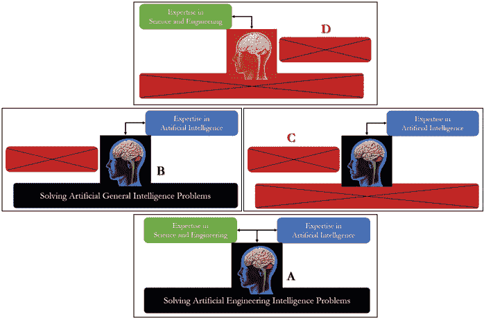

图 1.1 (a) 使用人工智能解决工程相关问题需要人工智能以及科学工程方面的专业知识，(b) 通用人工智能需要人工智能专业知识，(c) 仅有人工智能专业知识对于人工智能工程是不够的，(d) 不是人工智能专家的科学工程专家无法解决人工智能工程。

## 什么是“机器”和“学习”？

“机器学习”是一系列用于生成“人工智能”的算法。事实是在“人工智能”生成和使用之前，没有任何数据驱动的解决方法被称为“机器学习”。由于某些类型的“智能”（如科学和工程）需要“学习”，而且计算机（机器）是“智能”的“人工”开发的工具，因此，“人工智能”的发展需要需要使用“机器学习”。

在讨论“机器学习”的细节之前，让我们先确定“机器”和“学习”这两个词的定义。之后，将这些定义结合起来，将提供关于“机器学习”是什么以及为什么用这个术语来定义这种新技术的细节信息。在执行算法的语境下，“机器”一词指的是“计算机”。“学习”一词意味着获取新理解、知识、行为、技能、价值观、态度和偏好的过程。由于“机器学习”算法被用于开发和生成“人工智能”，前一节中提到的“人工智能”的定义使得“机器学习”遵循自然和人类“智能”经历学习过程的方式。换句话说，机器应该像人类接触学习一样接触学习。然而，鉴于机器（计算机）与人类不同的事实，虽然“学习”具有相同类型的要求，但显然无法以相同的方式进行。

其想法是涵盖人类如何学习，然后看计算机如何学习。在“人工智能”在科学和工程中的这一特定应用中，应该关注人类对科学工程的学习，然后尝试找出机器（计算机）如何学习相同类型的项目。在这种背景下，让我们先确定：人类是如何学习科学工程的？显而易见的是，对于人类来说，学习科学工程，他们需要在高中和大学学习几年。当人类去大学学习科学工程时，他们还接触到了什么呢？完全清楚，大学教授向学生传授课题，以便他们学习所课程的课题。显然，在大学，“教学”是学习的最佳方式。

在通用智能中，学习可以通过接触和经验完成；尽管教学可能也有帮助，但它未必是绝对要求，因为“通用智能”是人类大脑的一部分。然而，当涉及到科学和工程时，“学习”绝对需要“教学”。由于这是自然和人类“智能”的情况，它必须通过“机器学习”用于“人工智能”。正如前面的段落提到的，大学教授向学生教授课题，那么回答以下问题很重要：大学教授是否可能教授他们并不擅长的课题？答案是肯定的：不能。

为了教授一个课题，你必须是该领域的专家并非常熟悉它，以便以最好的方式向上该课程的学生传授课题的精髓和细节，让他们学会它。对于科学工程应用中的“机器学习”也是如此。领域知识是“人工智能”和“机器学习”用于分析、建模和解决科学及工程问题的绝对要求。这一问题的细节将在书中详细介绍。

## 人工智能与机器学习

与科学工程领域传统的分析、建模、问题解决和决策方法相比，人工智能和机器学习是一场完全的范式转移。科学工程应用中的人工智能和机器学习是一种“范式转移”。科学工程范式转移的例子包括 16 世纪的哥尼范式、19 世纪的牛顿范式以及 20 世纪的爱因斯坦范式。

21 世纪的新范式是通过人工智能和机器学习在科学工程中进行分析、建模、问题解决和决策。行业在解决挑战性工程和科学问题方法上的进步和突破，是人工智能和机器学习主要问题的范式转移。人工智能和机器学习结合大量数据和强大的计算能力，迅速改变了科学工程各个领域的格局。

在定义人工智能和机器学习，特别是当我们讨论这项革命性技术在科学和工程中的应用时，先阅读以下两条评论并尝试找出哪一个更有意义，哪一个是对人工智能更正确的描述将是有趣的：


*   `Comment One`: 一些科学家（人工智能的原始开发者）启动了这项新的科学技术（AI），是因为`他们对分析数据感兴趣`。这就是他们开发出这种用于数据分析技术的由来。
*   `Comment Two`: 一些科学家（人工智能的原始开发者）对`在人类物种大脑之外创造智能`感兴趣，然后他们学习并得出`通过处理数据是实现这一点的最好方式`。

即使第一个注释（`Comment One`）让你觉得并不没错，人工智能的真实情况恰恰描述在第二个注释（`Comment Two`）中。阅读人工智能简史（位于此本书的第 2 章）将决定你为什么第二个注释完全是事实。让我们从定义`Artificial Intelligence`和`Machine Learning`开始。

必须指出的是，人脑是宇宙中最强大的模式识别引擎。人脑包含约 100 亿个神经元（也称为神经细胞）。如图 1.2 所示。显而易见，人脑的人工版本与从神经科学家那里学到的东西非常相似，如图 1.2 所示。

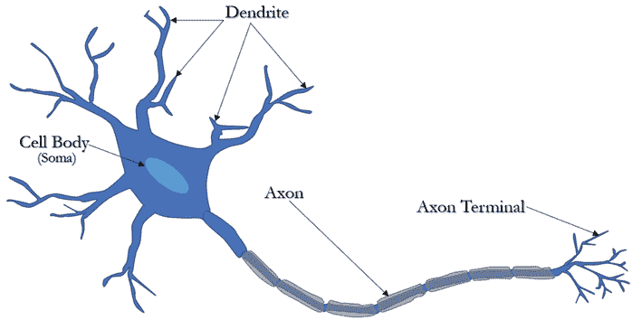

FIGURE 1.2 人脑中的神经元。

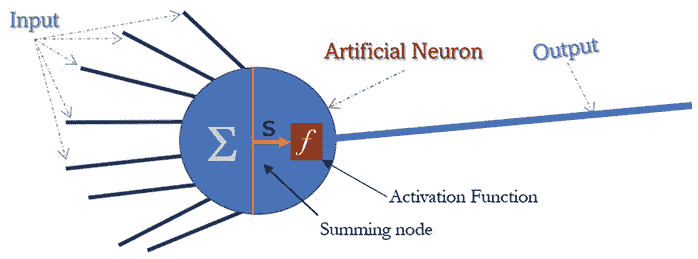

FIGURE 1.3 机器学习中使用的人脑神经元的人工版本。

在图 1.2 中显示为`Dendrite`（树突）的部分在图 1.3 中显示为`Input`（输入）。在图 1.2 中显示为`Axon`（轴突）的部分在图 1.3 中显示为`output`（输出）。在实际神经元中（如图 1.2 所示），细胞体产生从多个`Dendrites`进入细胞体的新类型电化学信号，这种由细胞体产生的新电化学信号进入`Axon`以与其他神经元连接。在图 1.3 中，`Artificial Neuron`（人工神经元）合并所有的`Inputs`（输入值与与每个输入相关的权重之和，权重代表了每个输入的质量和重要性），并通过`Activation Function`（激活函数）发送以生成一个新值传递到`Output`（输出）。虽然人脑神经元细胞体内的活动是生物化学活动，但在机器学习算法中使用的人脑人工版本（人工神经网络）中，它是数学计算。

比较图 1.2 和 1.3 中所示的内容可以清楚，生成人工神经网络（图 1.3 仅显示了一个人工神经元）的科学家们从神经科学中学习了人脑的特征，以开发人工智能的通用概念。因此，显而易见，人工智能模仿人脑的类似活动来学习智能并解决问题。

人脑中的神经元通过其轴突末端与其他许多神经元连接，这些末端连接到许多其他神经元的树突上。这种连接的示例如图 1.4 所示。人脑神经元之间的连接被称为`Synaptic Connection`（突触连接），如图 1.4 所示。图 1.5 展示了人脑神经元通信的更真实的表示。人脑神经元的实际数量为 100 亿。然而，人脑神经元相互之间的连接发展了超过 1000 万亿的连接。人脑神经元之间的这种相互作用是产生智能的主要特征之一。本书这一章中的所有图都代表了最重要的机器学习算法之一（人工神经网络）的发展，该算法广泛用于（以许多不同的方式）生成人工智能，以建模并解决许多不同类型的问题。

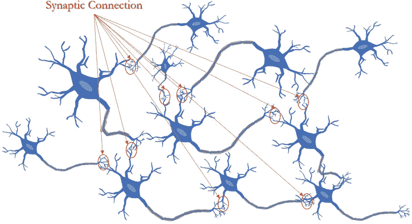

FIGURE 1.4 人脑中的神经元通过轴突末端相互连接。

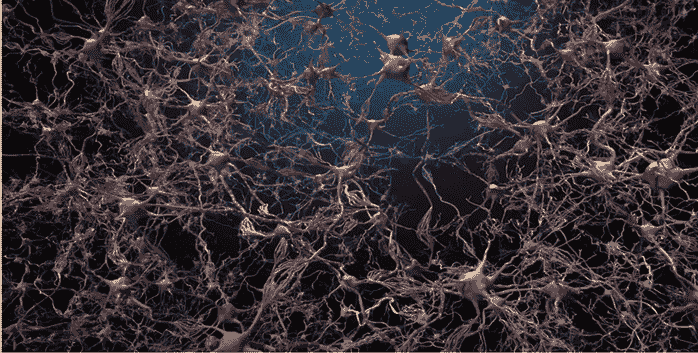

FIGURE 1.5 人脑神经元如何相互连接的示例。

神经元之间的相互作用通过`Synaptic Connections`（突触连接）完成，这主要关于一个神经元的轴突末端与许多其他神经元的树突之间的距离。需要注意的是，人脑中的`Synaptic Connections` 并不是共享神经递质分子的实际物理连接，如图 1.6 所示。多种神经递质从许多其他神经元进入，通过其树突的电化学信号进入细胞体。

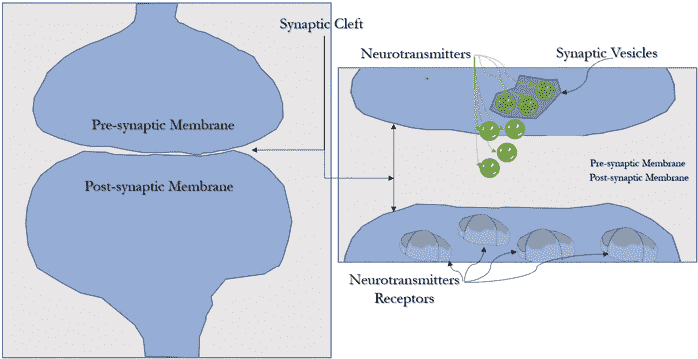

FIGURE 1.6 人脑神经元之间的突触连接。

细胞体产生一组新的神经递质，并通过其轴突与其他神经元通信。人脑神经元之间通信的最常见神经递质分子是氨基酸（谷氨酸、γ-氨基丁酸 `GABA` 和甘氨酸）、肽（阿片类：内啡肽、……）、单胺类（血清素、组胺、多巴胺、……）和其他（乙酰胆碱、……）（图 1.6）。

由于人类智能是通过人脑产生的，由于人脑特征涉及神经元（包括它们的连接和相互作用），人工智能相关的主要问题之一是模拟人脑神经元的连接和相互作用。在尝试模拟人脑的机器学习算法中，存在人工突触连接，如图 1.7 所示。如图，在这些机器学习算法中，一个人工神经元的输出通过其输入连接到其他几个人工神经元。换言之，一个人工神经元的输出充当其他几个人工神经元的输入。图 1.8 提供了称为人工神经网络机器学习算法中的多个人工神经元，它包含了大量的人工神经元。

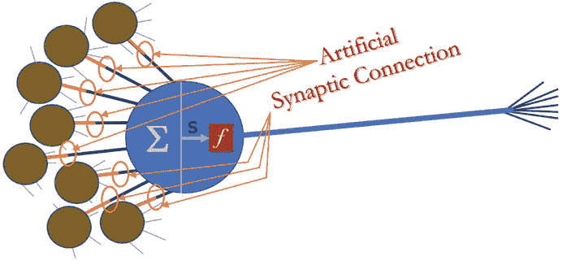

FIGURE 1.7 机器学习算法中的人工神经元也通过一个人工神经元的输出和其他神经元的输入相互连接。


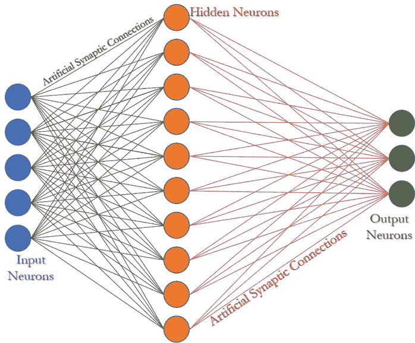

# 人工神经网络机器学习算法

`FIGURE 1.8` 人工神经网络机器学习算法。

此外，必须注意到，人脑的另一个特征是`Machine Learning`算法所涉及的逻辑。人脑在问题解决和决策过程中也涉及逻辑。一个主要问题是：`人脑使用的是什么种逻辑？` 在传统方法中，解决科学和工程相关问题时使用的逻辑主要是`Aristotelian Logic`。

## 逻辑类型对比

在当前的计算机版本中，`Aristotelian Logic` 仅包含 `0` 或 `1`，`Yes` 或 `No`，`Black` 或 `White`。显而易见，人脑并不使用这种 `0` 或 `1` 的逻辑，而是处理 `0` 和 `1` 之间的无限数字。这意味着`Artificial Intelligence` 和 `Machine Learning` 必须使用多值逻辑（`multi-valued logic`）。

因此，使用 `Artificial Intelligence` 进行建模、解决问题和决策的最佳方法是理解人脑如何处理信息（数据）以及它使用的逻辑类型。

## 速度与硬件差异

比较人脑动作与智能手机（或计算机）的速度，哪一个更快？`Artificial Intelligence` 的一个主要问题是解决任何问题所需的时间。人脑的速度比智能手机芯片慢 1000 万倍。人脑神经元放电的速度在 `1` 到 `200 Hz` 之间，而智能手机的 `CPU` 速度约为 `2 GHz`。`GHz` 是 `gigahertz` 的缩写，它是交流（`AC`）或电磁（`EM`）波频率的单位。对于计算机处理器或 `CPU`而言，`GHz` 是时钟频率，也称为 `clock rate` 或 `clock speed`，代表一个时间周期。

然而，人脑具有学习和实施复杂活动的能力，这是计算机很难模拟的。这涉及到人脑处理信息的方式。

## 机器学习的原理

`Machine Learning` 包括一系列用于生成 `Artificial Intelligence` 的算法。根据前文提到的 `Artificial Intelligence` 定义，`Machine Learning` 算法用于处理数据并使用正确的逻辑。

过去使用计算机解决问题的方法完全依赖显式编程（`explicitly programming`），即精确地告诉计算机做什么。工程师一直在使用数值仿真（`numerical simulation`）。为了解决使用复杂数学方程建模的工程相关问题，需要生成数值仿真。所有工程师都清楚，在开发数值仿真模型时，必须提供完整的显式程序以便计算机执行仿真。

值得注意的是，`Machine Learning` 算法不使用显式编程。同样适用于传统统计学（`traditional statistics`），它也是一种数据驱动的技术。在传统统计和任何其他传统的计算机建模中，我们总是详细地告诉计算机做什么，而不会要求它执行我们没有明确指示的事情。

## 算法分类

在 `Machine Learning` 算法出现之前，我们永远不会期望计算机执行我们没有告诉过它们（通过 `coding`）的事情。这是机器学习算法与过去几十年计算机操作的主要区别。`Machine Learning` 算法是 `Open Computer Algorithms`（开放计算算法）。其核心问题是让算法在不使用预定义的数值求解数学方程，或不使用一系列数学方程来检查匹配数据的情况下，从数据中学习。

常见的 `Machine Learning` 算法类型包括：
- `Supervised Learning`（监督学习）
- `Unsupervised Learning`（无监督学习）
- `Semi-supervised Learning`（半监督学习）
- `Reinforcement Learning`（强化学习）

## 数据的重要性

由于开放的 `Machine Learning` 算法从数据中学习，因此提供给算法的数据非常重要。这意味着提供给 `Machine Learning` 算法的数据质量和数量关键。这里有两个必须关注的特征：

1. **第一**：这意味着如果你意图在 `Artificial Intelligence` 建模中引入特定类型的偏见（`bias`），你可以通过提供的数据的类型和数量来实现。
2. **第二**：这意味着如果你不是科学或工程技术的领域专家，你将不知道如何处理和应对收集到的真实原始数据。

`Google Bard` 是一个大语言模型（`LLM`）聊天机器人。

`ChatGPT`、`Microsoft Bing` 和 `Google Bard` 的另一个重要特征是它们执行任务的速度。这适用于所有基于 AI 的模型和技术。`ChatGPT`（即 `Generative Pre-trained Transformer`）通过互联网海量数据集进行训练，包括网站、书籍和其他公开材料，能够回答问题、提供解释、语言翻译、代码编写、生产力辅助、头脑风暴以及编写各种文档。

关于 `ChatGPT` 的响应，它们是基于训练数据中学到的模式和关联生成的。虽然模型可以提供有用信息，但有时也会生成错误或无意义的答案。始终建议从可靠来源验证信息，并使用批判性思维来解释模型的响应。


1. 聊天机器人 是一种通过文本或语音模拟人类对话的计算机程序。聊天机器人主要有两种类型：基于规则的聊天基于基于机器学习的聊天机器人。基于规则的聊天机器人根据一组规则进行编程，规定了它们如何响应某些提示或问题。另一方面，机器学习聊天机器人可以根据与用户的对话学习并适应其回答。

# 2 人工智能的简史

DOI: [10.1201/9781003369356-3](https://doi.org/10.1201/9781003369356-3)

关于今天所谓的人工智能的通用概念始于 20 世纪 50 年代初，由一位英国数学家、计算机科学家、逻辑学家、密码分析学家、哲学家和理论生物学家艾兰·图灵（Alan Turing）提出的。他的照片可以在图 2.1 看到。他被称为现代计算之父，因为他开发了现代计算和人工智能的理念。在他的一篇原始论文 \[2]中，他提到：“我提议考虑一个问题：机器能思考吗？”艾兰·图灵创建了一个测试，这个测试对后来的思想者产生了持久的刺激，并对人工智能哲学和实践的研究做出了贡献：“图灵测试是人工智能的一种查询方法，用于确定计算机是否能够像人类一样思考” \[2]。


图 2.1 艾兰·图灵，英国数学家、计算机科学家、逻辑学家、密码分析学家、哲学家和理论生物学家。

图 2.2 展示了过去几十年中对人工智能发展起过重要作用的仅三位技术科学家（约翰·麦卡锡、沃尔特·皮茨斯和马克西恩·霍夫）的照片。由于我无法提供过去几十年中对人工智能发展起过重要作用的许多其他技术科学家的真实照片，在书中我只能提供他们的名字：沃伦·马库洛、弗兰克·罗森布拉特、伯纳德·维德罗、约翰·冯·诺依曼、克劳德·香农、艾伦·纽厄尔、赫伯特·A·西蒙、杰弗里·辛顿、杨恩·勒昆和约舒亚·本基奥。

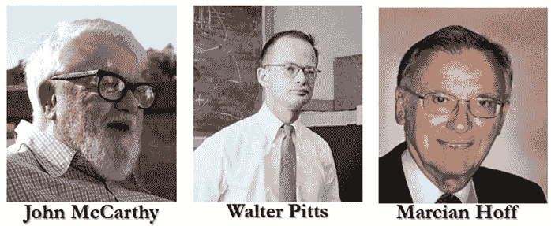

图 2.2 对人工智能发展起过重要作用的一些重要技术专家的照片。

使用 Google Bard 和 ChatGPT 来学习关于这些个人对人工智能贡献的某些细节，以及书中未提到的其他几位科学家（因为这只是“简史”），是一个好主意。本章计划涵盖的内容，再次简要地说是，简单地描述自 1986 年以来为什么没有使用“人工智能”这一术语，以及为什么最近（自 2005 年中以来）“人工智能”一词开始被使用。

## 使用数据和规则的原始人工智能

这一切都可以追溯到这项革命性技术（人工智能）的历史本质。在 20 世纪 50 年代和 60 年代，随着人工智能初始版本的产生，数据和规则均被用于开发人工智能模型，如图 2.3 所示。这一原始版本人工智能中的数据相关模型使用的是初始版本的人工神经网络，它只包含两层数据作为“输入”和“输出”。

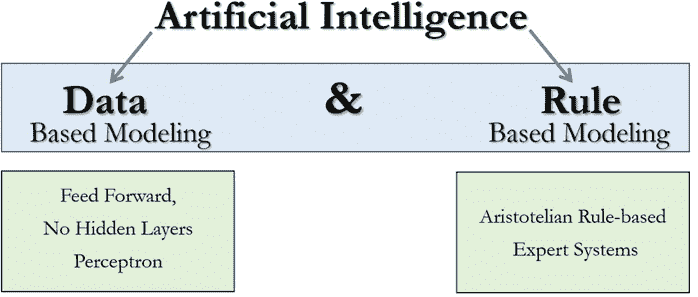

图 2.3 人工智能的初始版本（20 世纪 50 年代和 60 年代）正在基于数据和/或规则开发模型。

这种原始版本的人工神经网络（称为`Perceptron`）不包括今天所谓的隐藏层和隐藏神经元。此外，原始版本的人工神经网络仅通过神经元的“前向传播”（Feed Forward）进行计算，没有技术向后移动计算以修改和增强输入数据与输出数据之间的连接。因此，通过使用数据进行模型和问题解决的人工神经网络（`Perceptron`）的主要特征包括“无隐藏层”和仅“前向传播”计算。

如图 2.4 所示，1969 年，两位来自马萨诸塞理工学院（MIT）的大学教授马文·明斯基（Marvin Minsky）和西摩尔·帕珀特（Seymour Papert）写了一本名为《感知机：计算几何导论》（*Perceptrons: An Introduction to Computational Geometry*）的书 \[1]。在这本书中，作者涵盖了`Perceptron`算法（1957 年由美国心理学家弗兰克·罗森布拉特（Frank Rosenblatt）生成的原始版本的人工神经网络）。这本书对人工智能的主要贡献是关于原始版本的人工神经网络（感知机），解释了这种原始神经网络只能解决“线性”相关问题，无法解决任何“非线性”相关问题。

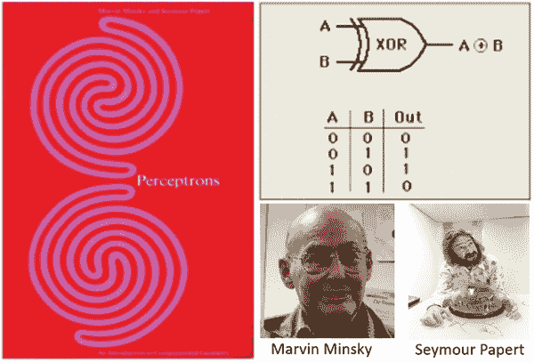

图 2.4 马文·明斯基和西摩尔·帕珀特在 1969 年写了一本重要的书籍*感知机：计算几何导论*，提供了一种增强原始人工神经网络特征的情境。

这本书的主要结果是，它从字面上从原始的“人工智能”中删除了数据驱动的模型和问题解决版本。如图 2.5 所示，一旦这本书被写并被大量科学家阅读，现有的“人工智能”技术中的所有现有研究和开发过程开始仅通过基于规则的模型进行工作，并避免使用任何数据驱动技术。

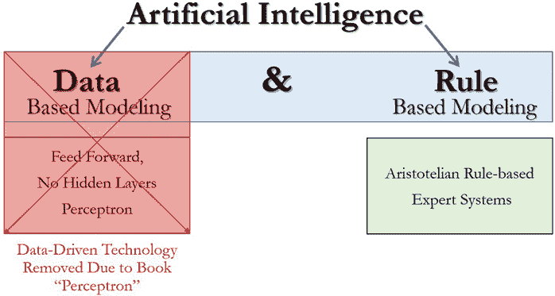

图 2.5 数据驱动模型从原始的人智能中被删除。

基于规则的建模类型包含了一系列解决特定问题必须遵循的规则。此类规则由领域专家针对要建模的主题开发，以帮助人类做出决策。人工智能原始版本中的这部分被称为“专家系统”，并尝试通过“如果……那么……”规则来解决复杂问题。


## 历史背景

亚里士多德逻辑发展于中世纪，是一种经典的二值逻辑（要么为真或假，是或否，0 或 1，……）。在数据驱动的模型开发从最初的“人工智能”中被剔除几十年后，基于规则的“专家系统”成为了原始“人工智能”领域研究与开发的唯一关注点。由于仅基于于基于规则的“专家系统”，原始的“人工智能”在解决方案开发上显得相当局限，没有以一种能够让大量人员接触并发现研究这项技术有趣的方式来解决任何重大问题或困难。

在这种背景下，纯粹基于规则“专家系统”的人工智能原始版本最终并没有成为一场新的技术革命，没有被广泛使用，也无法解决许多其他方式无法解决的问题。从这个角度来看，原始的人工智能并不是一个伟大且有趣的话题。这导致了一个事实：即当 1986 年新型人工神经网络（如机器学习算法）被开发出来并能够解决线性和非线性相关问题时，这种原始技术的增强不再被称为“人工智能”。

这一系列增强了原始“人工智能”并使其成为数据驱动技术的新型机器学习算法有了多个不同的名称，例如“计算智能”、“虚拟智能”、“软计算”、“智能系统”等等。关键在于，由于“人工智能”这一术语在使用基于规则的“专家系统”并没有产生任何积极、增强的技术以及有趣的问题解决方案，它不再被用作数据驱动模型开发和主要解决方案的术语。

## 神经网络的演变

1986 年，被证明无法解决“非线性”问题的原始版本人工神经网络通过一种名为“反向传播”（Back Propagation）的算法发生了改变。这种新算法改变了原始版本人工神经网络（感知器）的所有特征。首先，新版本的人工神经网络不仅有“输入”和“输出”两层。如图 2.6 所示，这种新版本的人工神经网络在“输入”层和“输出”层之间包含至少一层甚至更多层的神经元。这种新层（层）被称为“隐藏层”，因为它不需要来自“输入”层或“输出”层的任何数据。包含在新版本人工神经网络中的这个新“隐藏层”包含几个隐藏神经元，其数量通常大于输入特征的数量。“隐藏层”内部这些大量的隐藏神经元将与“输入”层和“输出”层中的所有数据和特征连接。

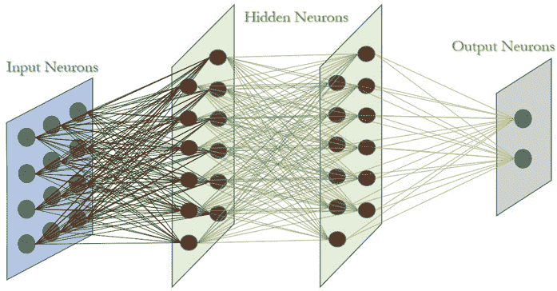

**图 2.6** 新版本的人工神经网络，在输入和输出之间包含多层神经元，并通过反向传播改变神经元之间的权重。

此外，新版本的人工神经网络不仅是一个“前向传播”过程，还通过“反向传播”算法包含“反向反馈”过程，以修改和增强多层之间所有神经元之间的连接。除了目前被称为人工智能机器学习算法的人工神经网络新版本，其他机器学习算法也是人工智能的一部分，例如模糊集理论和进化计算。如图 2.7 所示，当前版本的人工智能不再包含基于规则的“专家系统”。

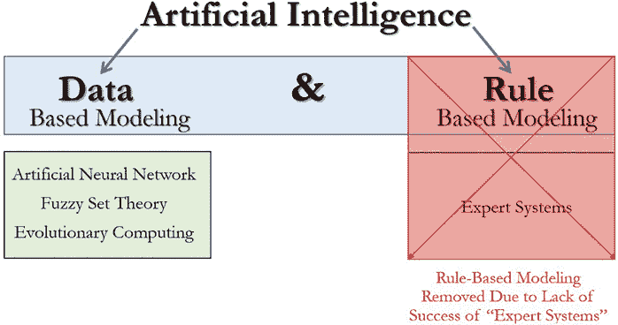

**图 2.7** 基于规则的系统在 20 世纪 80 年代从新版本的人工智能中移除。

## 未来方向与多值逻辑

然而，很有可能在不久的将来，被称为人工智能的当前革命性技术将使用基于规则的技术，并结合数据驱动技术进行模型开发。鉴于这种革命性的人工智能模拟了自然智能并模仿人脑，它需要遵循人脑使用逻辑。众所周知，人脑在处理过程中并不使用二值逻辑。当我们被问及“你好吗？”时，从不只用“好”或“坏”，而是回答“我很好”、“还可以”或“我不太好”，……与其使用二值逻辑，人脑使用的是多值逻辑。

因此，与其使用二值逻辑，如果基于规则的建模、决策和问题解决可以使用模糊集理论使用多值逻辑，那么革命性的人工智能就可以将规则算法与其他机器学习算法相结合，以推进科学工程的分析、建模、决策和问题解决。如图 2.8 所示，人工智能（不一定确定）可以回到以前结合基于数据建模和基于规则建模的形式来建模和解决问题，区别在于使用了多值逻辑而非简化的“二值”逻辑。

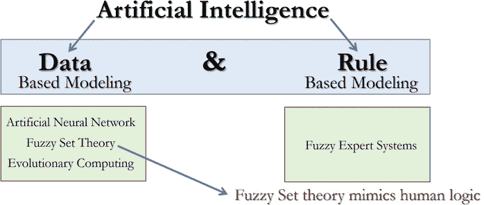

**图 2.8** 未来版本的人工智能可能还会包含基于规则的系统，但比起二值逻辑，它可能使用多值逻辑（模糊集理论），像人脑一样。

## 使用“人工智能”术语

如前，从 1986 年开始，反向传播算法开始用于人工神经网络。这使得人们对使用这种机器学习算法解决问题产生了巨大的兴趣。绝大多数此类应用都是电气电子工程师学会（IEEE）完成的。然而，由于人工智能已成为纯粹的基于规则的技术，且其特征并未在科学家中产生严肃的问题解决兴趣，因此当这种新版本的人工神经网络被解决问题时，没有人使用“人工智能”这一术语。


在 IEEE 中，这项技术被命名为“计算智能”（Computational Intelligence），而非人工智能；在许多其他情况下，也使用了其他名称来代替“人工智能”。例如，在《石油工程师协会》（Society of Petroleum Engineering, SPE）月刊和《石油技术期刊》（Journal of Petroleum Technology, JPT）上，2000 年发表了关于人工神经网络`[3]`、演化计算`[4]`和模糊逻辑`[5]`的三篇文章。在这三篇文章中，我们使用了“虚拟智能”（Virtual Intelligence）。其他替代“人工智能”的名称还包括“软计算”（Soft Computing）。

最后，在 21 世纪 00 年代中期，当深度学习和卷积神经网络被用于图像识别，并由 Google 向全球公众展示这种方式时，“人工智能”一词开始取代“计算智能”、“虚拟智能”、“软计算”等术语。

熟悉人工智能和机器学习基于物理和非基于物理的历史，为那些对这项技术在科学和工程相关领域应用的人士提供了一些重要的视角。例如，有趣的是，从 20 世纪 80 年代后期到 90 年代末，许多在众多科学和工程相关领域发起该技术应用的科学家和创新者，刻意避免使用“人工智能”这一术语来描述他们的研发工作。

在 20 世纪 90 年代，机器学习算法（如人工神经网络、模糊集合理论和演化计算）在科学和工程中的应用被称为“计算智能”、“虚拟智能”、“软计算”以及其他几个名称。21 世纪 00 年代中期，当利用传统统计学和多层人工神经网络结合生成图像识别技术时，“人工智能”这一名称的使用频率开始大幅增加。在这一时期，当使用机器学习算法进行建模或解决问题时，“人工智能”是该技术的主要名称。如果知道为什么从 20 世纪 80 年代中期到 21 世纪 00 年代中期的大约二十年里一直避免使用“人工智能”这一名称，将是非常有意思的。

这种避开的原因非常充分，甚至推影响了 IEEE 在该领域的决策。IEEE 是开发并正对人工智能和机器学习做出贡献的绝大多数技术的源地。当 IEEE 决定为这项技术成立一个科学部门（委员会/协会）时，它修改了 1989 年成立的“IEEE 神经网络委员会”，该委员会随后在 2001 年改为“IEEE 神经网络协会”，并在 2003 年开始称其“IEEE 计算智能协会”，而不是“IEEE 人工智能协会”（图 2.9`）。


**图 2.9** IEEE 的计算智能网站。

## 避免使用“人工智能”术语的主要原因

避免使用“人工智能”术语的主要原是，当 Google 将深度学习和卷积神经网络用于图像识别时，“人工智能”一词取代了“计算智能”、“虚拟智能”、“软计算”等术语。

有趣的是，从 20 世纪 80 年代后期到 90 年代末，许多在众多科学和工程相关领域发起该技术的科学家和创新者，刻意避免使用“人工智能”这一术语来描述他们的研发工作。

在 20 世纪 90 年代，机器学习算法（如人工神经网络、模糊集合理论和演化计算）在科学和工程中的应用被称为“计算智能”、“虚拟智能”、“软计算”以及其他几个名称。21 世纪 00 年代中期，当利用传统统计学和多层人工神经网络结合生成图像识别技术时，“人工智能”这一名称的使用频率开始大幅增加。

这种避开的原因非常充分，甚至影响了 IEEE 在领域的决策。IEEE 是开发并正对人工智能和机器学习做出贡献的绝大多数技术的源地。当 IEEE 决定为这项技术成立一个科学部门（委员会/协会）时，它修改了 1989 年成立的“IEEE 神经网络委员会”，该委员会随后在 2001 年改为“IEEE 神经网络协会”，并在 2003 年开始称其“IEEE 计算智能协会”，而不是“IEEE 人工智能协会”（图 2.9`）。

## 备注

**备注 IEEE 的计算智能网站。

避免使用“人工智能”术语的主要原因是，当 Google 将深度学习和卷积神经网络用于图像识别时，“人工智能”一词取代了“计算智能”、“虚拟智能”、“软计算”等术语。

有趣的是，从 20 世纪 80 年代后期到 90 年代末，许多在众多科学和工程相关领域发起该技术的科学家和创新者，刻意避免使用“人工智能”这一术语来描述他们的研发工作。

在 20 世纪 90 年代，机器学习算法（如人工神经网络、模糊集合理论和演化计算）在科学和工程中的应用被称为“计算智能”、“虚拟智能”、“软计算”以及其他几个名称。21 世纪 00 年代中期，当利用传统统计学和多层人工神经网络结合生成图像识别技术时，“人工智能”这一名称的使用频率开始大幅增加。

## 人工智能的科学与工程应用

DOI：[`10.1201/978103396534`](https://doi.org/10.1201/978103396534)

由于人工智能是一项技术，因此首先刻画科学和工程是合理的。一旦充分理解了科学和工程的应用，科学和工程成为人工智能的一部分也是合理的。

## 人类的通用智能

人类的通用智能从我们出生那天就开始了。人类的通用智能不断增强。图像识别、声音识别、听力、说话、语言翻译等项目通过人类的通用智能在合理的时间内实现。人类的通用智能使得很小的孩子也能解决特定类型的问题。例如，如图 3.1 所示，即使是 5 岁的孩子也能看出这些图像中哪一张是猫，哪一张是狗。


另一个例子如图 3.2 所示。即使在孩子 7 岁上学之前，如果你向他们展示一系列黑色和黄色的圆圈，并问他们是否能用一条线将它们隔离开，孩子能够做到的可能性非常高。几乎 99.99% 的孩子都能画出图 3.2 中所示的红线。图 3.1 和图 3.2 的示例说明，人类的通用智能即使在短暂的生命中，也能让我们解决许多问题。目前，我们正在使用人工智能以极快的速度解决相同类型的问题。在当前的人工智能版本之前，解决图 3.1 所示的问题无法由计算机轻松快速地完成，而像今天这样使用名为`卷积神经网络`（`CNN`）的机器学习算法通过人工智能就能完成了。

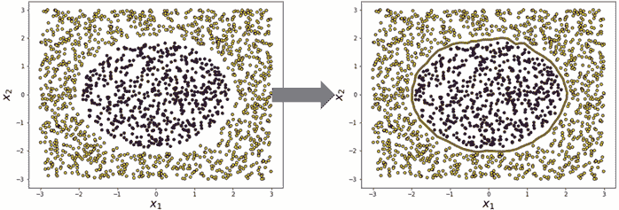

`FIGURE 3.2` 黑色和黄色的圆圈可以用非线性线分开。

同样重要的是，当最近询问 ChatGPT 和 Google Bard 关于通用的人工智能应用以及工程相关的问题建模和解决时，它们提到：“通用智能旨在跨多个领域复制人类的智能，而工程智能则侧重于为特定任务或应用构建专门的人工智能系统。通用智能代表了一个更全面、更广泛的目标，而工程智能则处理人工智能在特定领域的实用和针对性的实现。需要注意的是，这些仅仅是人工智能的两种不同方法。还有许多其他定义和分类人工智能的方法。然而，通用智能和工程智能是最常用的两种方法”。

通用智能最终涵盖了人的整个生命，并具有特别重要且复杂的特征。我强烈建议通过阅读尤瓦尔·诺亚·哈拉里撰写的书籍《人类简史》（*Sapiens: A Brief History of Humankind*）\[6\]来了解智人的重要历史。在科学和工程智能在我们历史上大约 300 年前开始之前，人类的通用智能已经涵盖了我们近 10 万年的历史。在智人之前，其他人类物种如尼安德特人、直人（*Homo erectus*）以及……拥有一定程度的通用智能（与智人具有的数量和类型不同），这些智能从未改变或增强为科学工程智能。然而，这确实发生在智人身上，并改变了我们历史的一切。

为了涵盖智人的通用智能，涵盖并理解人类历史发生的事情很重要。根据查尔斯·达尔文的书\[7\]，可能“非洲是人类的摇篮，因为我们两个最近的现代亲属（黑猩猩和大猩猩）居住在那里”（图 3.3）。虽然直人大约在一百万年前离开了东非，尼安德特人大约在 40 万年前离开了东非，但他们从未从采集狩猎者转变为其他。图 3.4 显示了直人、尼安德特人（Homo Neanderthalensis）和智人从东非到世界其他地区的移动。

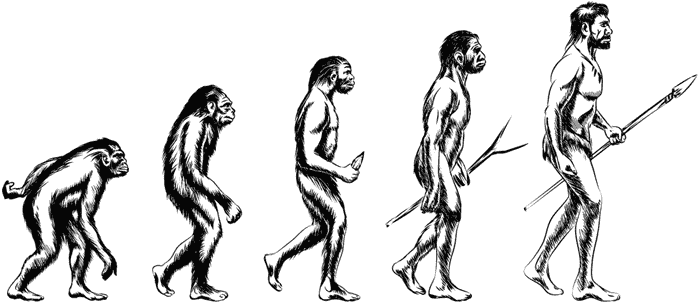

`FIGURE 3.3` 人类从黑猩猩和大猩猩的演化。

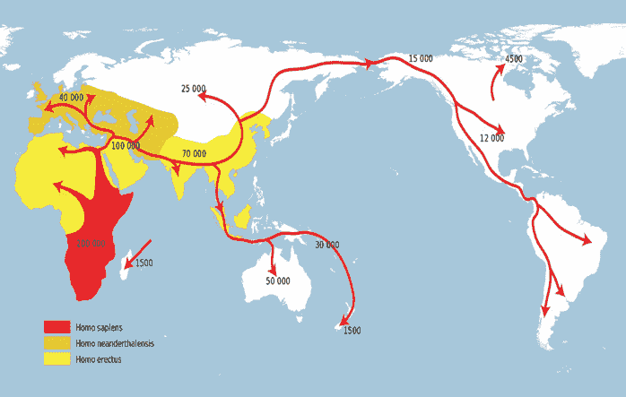

`FIGURE 3.4` 直人、尼安德特人（Homo Neanderthalensis）和智人（Homo sapiens）从东非到世界其他地区的移动。

*智人*从非洲进入今天所谓的“中东”和“欧洲”大约在 7 万年前。他们作为“采集狩猎者”生活了大约 5 万年。“农业革命”发生在 1 万年前。这是智人相对于尼安德特人和直人生活方式的重大变化。这展示了人类智能的增强。

下一次我们（智人）的革命发生在 18 世纪，“工业革命”使得执行许多操作变得比以前更快、更简单、更快捷。这一定与智人及其通用智能有关。

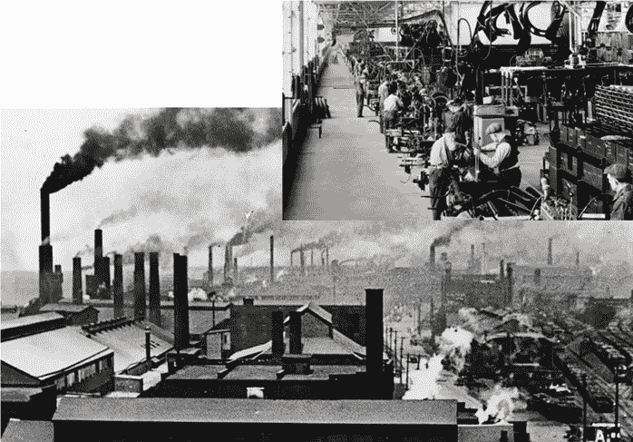

`FIGURE 3.5` 智人 300 年以前的工业革命。


在本章中，图 3.2 显示，黑色和黄色圆圈两种色的非线性分离可以通过通用智能完成，即使对于那些可能没有上过学或尚未学习过任何数学的儿童也是如此。然而，如果让这些相同的儿童（个体）对黑色和黄色圆圈进行“线性分离”而非圆圈（非线性分离），他们将无法做到这一点，因为他们不熟悉能够使黑色和黄色圆圈通过直线分离的数学方程，如图图 3.7 所示。

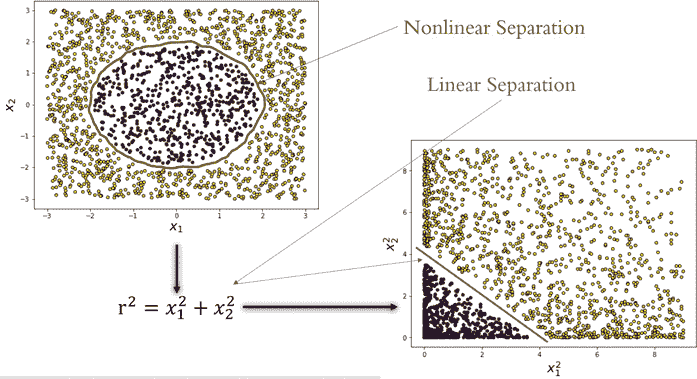

图 3.7 使用数学方程对黑色和黄色圆圈进行线性分离。

今天，人工智能是几乎每个人都感兴趣的技术。这项技术在应用于许多领域（如社交媒体、在线搜索、股票市场、公司与个人客户的互动（如 Netflix、银行、保险公司、旅行社，甚至是安全领域）时，已被证明可以取得巨大的成就。因此，工程师们对将这项技术整合到他们的日常工作中表现出兴趣是合理的。考虑到人工智能的科学和工程应用与该技术应用于非工程相关问题并不相同，学术界和工业界的一些科学家和工程师在使用这项技术解决工程相关问题时已经出现了一些问题。必须注意的下一个项目是回答以下问题。对这三个简单问题的回答应该是非常简单且诚实的。

### 问题 1
通用智能与科学工程智能之间是否存在差异？

### 回答 1
是的，确实如此。

### 问题 2
对上述问题回答“是”的原因是什么？

### 回答 2
因为通用智能包含在每一个人类（Homo sapiens）中，而那些想要科学工程智能的人必须经过重要的学习。

### 问题 3
科学工程智能的学习在人类身上是如何发生的？

### 回答 3
为了产生具有科学工程智能的人类，必须上高中和大学，并且至少要获得学士学位。

这些问题和答案应该非常简单清晰。没有人在没有上大学并获得学士、硕士或博士学位的情况下无法成为科学家或工程师。在完成大学学业后，他们将进入工业和学术界并在这些主题上工作多年。这些项目使他们成为科学家和工程师，并将智能从通用智能提升到科学工程智能，而科学工程智能已经包含了通用智能。

为了解释在使用人工智能和机器学习解决科学和工程相关问题时需要做什么以及需要避免什么，让我们从这些技术的名称开始：“人工智能”和“机器学习”。“人工智能”涉及的是非“自然”的而是“人工”的“智能”，而“机器学习”涉及的是应用于“机器”和计算机的“学习”，而不是“人类”。因此，需要定义和讨论的两个词是“智能”和“学习”。

“智能”被定义为获取、保留和应用知识的能力；从经验中学习；适应新情况；以及解决问题；而“学习”被定义为获取新理解、知识和技能的过程。在定义了这两项之后，让我们先问关于工程问题解决的两个简单问题：

1. 人类级别的通用“智能”可以用来解决科学和工程相关问题吗？
2. 人类是否需要“学习”特定的内容才能解决科学和工程相关问题？

上述两个问题的答案是显而易见的。为了成为科学家或工程师，人类在获得高中毕业证书后需要上大学。然后，在大学经过 4 年的“学习”后，他们成为拥有学士学位的科学家或工程师。此外，大学的“学习”不仅通过书籍、视频和文章向学生提供信息。科学工程专业的学生在成为科学家或工程师之前，要经历漫长的学习过程：学士 4 年，学士和硕士 6 年，以及学士、硕士和博士 10 年。同样重要的一点是大学的“学习”包含了“教学”。这些关于“智能”和“学习”问题的简单回答意味着，人工智能在科学和工程相关问题解决中的应用(*a*）需要科学工程知识和领域专业知识，并且 (*b*）需要通过对机器学习算法数据的详细理解和交流来进行“教学”。

这远比仅仅将可用数据丢给人工智能和机器学习算法来解决问题要复杂得多，人们在使用传统统计学进行数据分析时通常是这样做。通常，当使用传统统计学解决问题时，唯一重要的是“相关性”，它通常与“因果关系”（当一个变量的修改导致另一个变量的修改时的因果关系）无关。另一方面，所有的科学家和工程师对理解“因果关系”极其感兴趣，而不仅仅是“相关性”。这就是所谓的“可解释人工智能 – XAI”。人工智能和机器学习的科学工程应用需要“可解释人工智能 – XAI”，以便能够生成关于如何以及为什么做出某些预测的细节信息，而不仅仅是“相关性”。这个“可解释人工智能”主题在本书的第 7 章（C_010_c7.xhtml）中介绍。

当人类的科学工程自然智能在通用智能的基础上需要大量的学习时，同样的情况适用于人工智能是合理的吗？这意味着人工科学工程智能与人工通用智能之间的差异，正如自然科学工程智能与自然通用智能之间存在差异一样。这应该是显而易见的。然而，遗憾的是，许多对人工智能感兴趣的人并没有意识到差异的重要性。人工科学工程智能与人工通用智能之间的这些差异，为它们如何被生成和用于解决科学和工程相关问题对比非科学和非工程相关问题提供了特征。


需要注意的是，关于这些差异的描述并不意味着机器也必须上过高中和大学并至少获得学士学位才能解决与科学和工程相关的问题，因为这种问题是不可能的。因此，如果事实并非如此，那么“人工智能科学与工程智能”（Artificial Science and Engineering Intelligence）如何发展以产生正确、有趣且重要的结果呢？

首先，必须指出，在很长一段时间内（现在许多情况下也是如此），许多行业的人工智能专家在任何特定科学或工程领域都没有领域知识，却在执行人工智能工作，即解决与科学和工程相关的问题。这在许多行业（以及一些大学）中发生过多次，结果证明证明这根本不是一个好主意。

这里是石油行业发生的一个案例 [9]。2014 年 3 月 31 日，日立（Hitachi）发布了一份在线新闻稿。

该在线新闻稿的开头提到：

> “日立美国有限公司（Hitachi America, Ltd）与能源与环境研究中心（EERC）今日宣布，两家公司将合作开发技术驱动的产品、服务和解决方案，以增强从巴肯地层（Bakken formation）提取石油的产量。巴肯地层涵盖了北达科他州、蒙塔拿州、萨斯喀彻省和曼尼托巴省的部分地区，估计拥有数百亿桶石油”。

> “仅在北达科他州就有近 6000 口非常规巴肯石油系统井和近 200 个钻井平台，目前收集的数据量大得惊人。通过使用强大的分析工具来汇总和评估巴肯数据，油田运营人员和州官员可以更好地理解油井产量与各种因素之间的关系，例如油井是如何钻探的以及钻井地区的地质。这些工具还可以用于识别数据中以前未被发现的关系。反过来，这种认知的将使行业能够提高当前和未来巴肯井的生产率”。

一旦 EERC 向日立提供了所有数据，日立显然没有或没有使用既是人工智能专家又是石油工程领域专家的人来为 EERC 执行该项目。日立从提供给他们的数据得出的结论是：巴肯（北达科他州、蒙塔拿州、萨斯喀彻省和曼尼托巴省）的石油产量是天气引起的结果，而不是任何关于石油工程的问题。在没有任何任何石油工程专业知识或理解的情况下，使用“数据科学”得出这样的解决方案是完全合逻辑的。EERC 的工程师和科学家对人工智能给出的这种结果感到震惊，并与日立沟通，说明这些结果有多么不正确。

日立对 EERC 工程师和科学家的回复也于 2015 年 4 月 24 日（周五）发布，主题为“更新！数据融合、虚假相关性与雨天”。在文中，提到：

> “我注意到，本博客中展示的此项分析结果在结论上被夸大了。EERC 的人士指出了两个不符之处，我想在这里解决这些问题：下方图表显示的产量规模被夸大了（y 轴），而且寒天气导致产量下降的幅度也被夸大了（x 轴）。在与 Matthew O’Keefe 核实了这些细节后，事实证明他们是正确的。你真得爱这些专家！”

> “首先，y 轴上显示的产量规模是错误的。在操作上，用于此项计算的数据归结为我方面的一个操作失误——数据库被加载了多次相同的数据，导致该表中存在多达三份相同的数据。这极大地放大了分析中的任何结果”。

> “这对天气影响产量的第二个因素产生了影响。在同一张图表中，在极端寒冷月份期间提到有‘高达 80%的减少影响’。这实际上在很大程度上是错误的。从近年的峰值产量到最低产量，产量的减少接近 9%–15%，正如图表所示，以及天气如何影响产量？我需要一些天气数据，特别是历史天气数据。通过美国国家海洋和大气管理局（NOAA）网站 `http://noaa.gov`，我能够获得该地区的历史天气数据，利用纬度多边形，自 1960 年以来的石油产量数据中的第一个条目”。

2000 年左右，当图像识别通过人工智能和机器学习开发出来并展示了其强大的价值和特征时，美国最著名的石油公司之一的管理层聘请了一系列人工智能专家（没有任何石油工程专业知识），要求他们利用公司的海量数据来提供支持。

当人工智能专家利用提供给他们的数据进行分析时，他们对公司管理层提到：“为了提高你们的油气产量，你们需要储层具有更高的孔隙率”。由于这些信息在石油工程专业的入门课程中就会教给石油工程学生，因此对于开始学习石油工程的人来说，这是一个常识，石油公司管理层对人工智能专家给出如此简单的石油工程技术结果感到震惊。这些问题导致许多行业（在人工智能应用的早期）得出结论，认为人工智能无效，或者是在浪费金钱。


许多行业中的许多公司最初的一个主要问题之一（有些公司现在仍在这样做），是招聘人工智能专家和/或统计学家，将人工智能和机器学习应用到自己的行业中。2018 年，在一次 Petro-Talk `[10` 中，我解释了这种方法在石油行业面临的主要问题。那些缺乏工程领域专业知识的人通常只使用提供给他们的数据，并试图在共享给他们的参数之间寻找“相关性”。他们并不太关注提供的数据是否包含了完成所处理目标所需的所有。或者没有以一种能够让机器学习算法学习所建模的物理技术特征的方式来处理提供的数据。

领域专业知识的匮使他们无法识别出解决正在面临的问题需要什么数据。一个对特定工程技术一无所知的教授可能向学生教授那门特定的工程相关课程吗？换句话说，政治学教授能教热力学吗？还是反之亦然？就自然的“智能”而言，处理工程相关问题需要工程领域的专业知识。因此，对于人工“智能”来说也是如此。一个成为人工智能专家实践者的工程领域工程师将能够生成所需的特征，这些特征可以用于“教”人工智能和机器学习算法如何解决特定的工程相关问题。

成为人工智能的专家实践者需要对人工智能和机器学习算法的工作原理有深入理解，而不仅仅是这些算法的数学。机器学习算法的数学并不复杂。使用人工智能和机器学习解决工程相关问题远超数学和统计。它需要对神经生物学的理解。它需要对这项技术的哲学以及它与传统的工程问题解决方法差异的了解。

正如斯坦福大学的一篇文章 `[11]` 中提到的：“人工智能（AI）是一个致力于构建人工动物的领域……而且对于许多人来说，是人工人物……这些目标立即确保了人工智能是一门许多哲学家产生极大兴趣的学科，这已经得到了（例如）许多哲学家努力证明，试图证明这些目标实际上是不可实现或难以实现的。在建设性方面，人工智能中使用的许多核心形式和技术都源于哲学，并且实际上仍然在哲学中被大量使用和完善”。

简而言之，使用对工程领域专业知识理解极少的人工智能专家和/或统计学家来解决工程相关问题通常会产生非常糟糕的结果，最好也有时会产生非常平庸的成果。这导致许多工业公司的管理层归罪于人工智能和机器学习技术，而不是意识到是他们做了错误的决定——使用了错误的人员来引导公司这一领域，或者使用了错误的服务公司和供应商来解决问题，而这些公司对自己的知识和特点进行了大量的营销。

石油行业是多年来犯这些错误的顶尖行业之一。石油行业管理层必须被正确引导，如何将人工智能和机器学习作为一种积极且神奇的技术，用于公司的问题解决和决策。

### 第二个问题：传统工程师的参与，他们不相信人工智能是一门科学技术，并声称人工智能是一个骗局（与新冠肺炎疫情一样），并且不应用于解决工程相关问题。

传统主义工程师指的是那些认为解决工程相关问题的唯一方法是通过开发数学公式的人，这些公式可以描述他们试图解决的特定物理现象。他们认为，他们长期以来学习、经历和处理的内容是解决工程相关问题的唯一途径。对他们中的许多人来说，这种特定的、传统的工程问题解决方法与其说是科学，不如说是一种宗教。他们一直说“人工智能和机器学习是一个骗局”，或者“我试过，但它从未起作用”。这里提到的不仅仅是一个观点，而是一种经验。这是关于多年来许多传统科学家和工程师（大部分是教职员工）向我提到的此类事情。

直到大约十年前，这类工程师人在应用人工智能和机器学习解决工程相关问题方面面临着最困难的问题。他们中的一些仍然存在，并尽一切努力干扰那些对学习和使用这项技术感兴趣的工程师和科学家。幸运的是，鉴于新一代工程师和科学家的积极表现，目前的传统主义工程师不再是一个问题。他们中的许多人仍在尽可能利用政治手段，以避免在解决工程相关问题中应用人工智能和机器学习。随着时间的推移，这类人数量和相关问题一直在不断减少。

### 第三个问题：对人工智能有极少且肤浅理解的工程师，大多是从业务和营销角度对此感兴趣，而不是从科学技术角度。

今天，与在工程相关问题解决中应用人工智能和机器学习最重要的问题与一些工程领域专家有关。一些工程师应用人工智能和机器学习的主要问题之一，是当他们试图在不遵循人工智能和机器学习主要特征的情况下获得解决方案。从他们的角度来看，如果使用了包含机器学习算法的某些数学来实现他们的解决方案，他们觉得很自然地称之为基于人工智能的方法。他们错过的是正确回答这个问题：“你为什么想使用机器学习算法来获得解决方案？”

一个答案是：“因为人们（我公司的管理层或我的客户）对人工智能和机器学习感兴趣，因此我甚至可以使用机器学习算法执行`Linear Regression`”。好吧，这是的。它允许你练习机器学习算法以更好地学习如何使用它。然而，这种方法只有让你学习的“学术”价值，但没有“现实”价值，因为它没有遵循“必须使用机器学习算法的主要原因”。

另一个答案是：“我尝试过使用实际数据（实际测量），但无效。可能我没有足够的数据，也许实际数据太不确定且噪声太大，也许太复杂无法获得解决方案。因此，我决定从方程生成数据并与真实数据结合，这大大增加了模式识别成功的可能性”。


嗯，这是有道理的，因为由数学方程生成的数据基于现有的相关性，因此它保证了这些数据中的模式可以被机器学习算法识别。同样，这具有一种“学术”价值，可以让你学习人工智能和机器学习算法是如何运作的，但它并不具有“现实”价值，因为它没有遵循“**为什么必须使用机器学习算法**”这一核心原因。

让我们明确一点：尝试多种方法来获得合理的解决方案是正确的做法。然而，能够正确判断所用方法的本质至关重要，而且关注“**为什么必须使用机器学习算法**”的科学推理也是极其重要的。遗憾的是，在很多情况下，这种判断是基于营销和商业成功，而不是科学上的正确性。在这种情况下，在解决工程相关问题时，使用人工智能和机器学习缺乏现实意义和科学上的成功，这一点变得显而易见了。

似乎那些最终采取了上述操作并被称为“混合模型”的工程领域专家们，对人工智能和机器学习的理解是肤浅且有限的。总而言之，与工程领域专家相关的这一特定问题可以分为两类：

1. 那些在尝试使用人工智能和机器学习解决工程相关问题时，试图将数学方程生成的数据与实际测量值相结合的人。这被称为“混合模型”。
2. 那些试图使用为解决非工程相关问题开发的特定机器学习算法来解决工程相关问题的人。这里有两个例子：(a) 他们使用了开发用于解决“图像识别”等非工程相关问题的卷积神经网络（`CNN`）；(b) 他们使用了开发用于解决图像“字幕生成”等非工程相关问题的长短期记忆网络（`LSTM`）。

## 科学与工程领域人工智能的要求

正如前面提到的，科学与工程领域人工智能的主要要求是两个领域的专业知识：(1) 对人工智能所应用的特定科学和工程主题的专业知识，以及 (2) 对人工智能和机器学习的专业知识。如果有人缺少上述两个要求的专业领域中的任何一个，或者不是真正的专家，那么他们就无法现实且正确地使用人工智能来增强科学和工程相关问题的解决方案。遗憾的是，这种（在科学和工程中不现实且错误的人工智能应用）在过去十年在全球范围内一直在发生。

到为止和目前许多作为建模和解决科学与工程相关问题的人工智能和/或机器学习的应用，包括对传统统计的使用，或通过某些机器学习算法使用相同的传统科学和工程方法。此类方法总是被称为“基于 AI 的”，这完全是错误的。这种方法不正确的原因是，这些个人和公司对人工智能的了解很少，主要从营销的角度使用这个术语。然而，考虑到 AI 革命对我们世界的重要性，人工智能在科学和工程领域的应用将得到加强，希望很快如此。

在过去的十年里，当科学家和工程师由于人工智能在我们生活各个方面的重要性而对其感兴趣时，他们开始与人工智能交互并使用它来解决科学和工程问题。过去十年科学家和工程师使用人工智能和机器学习方面存在五个主要问题：(1) 过度关注机器学习算法的数学方程；(2) 在基于 AI 的建模中包含科学与工程相关问题的数学方程；(3) 使用开发并用于解决通用人工智能相关问题的机器学习算法；(4) 使用传统的统计方法，因为它们也是数据驱动的；以及 (5) 继续使用传统的工程方法解决问题，但使用了机器学习算法。以下是对上述这五项每项的简短解释：

### 问题 1：过度关注机器学习算法的数学方程

根据解决科学和工程问题的传统方法，科学家和工程师得出的结论是只要他们理解并学习了将要使用的机器学习算法的数学方程，就能让他们成为人工智能的专家。他们的结论是，他们将能够使用人工智能正确解决科学和工程相关问题（基于 AI 的），因为他们确切知道机器学习算法的数学方程是如何使用的。这种理解的主要原因在于，在传统工程中，理解和学习已经为任何物理现象开发的数学方程是一项绝对要求。

遗憾的是，这是对人工智能的误解。必须理解，使用机器学习算法解决科学和工程相关问题并创建基于 AI 的解决方案，与传统的物理现象建模方法非常不同。使用人工智能来分析、建模、解决和优化科学与工程相关问题，与我们通过生成数学方程的传统方法非常不同。鉴于机器学习算法相关的数学方程非常简单（相对于许多为物理现象开发的数学方程而言），绝大多数科学家和工程师认为自己可以在很短的时间内成为 AI 专家，因为他们完全理解并可以使用机器学习算法。他们对成为适用人工智能专家的理解中，错误的一点是，他们没有意识到自己必须充分理解与人工智能和机器学习算法相关的**进化论、神经科学和哲学**。关于这一主题的更多细节将在[`C_007_c4.xhtml`]中介绍。

### 问题 2：在基于 AI 的建模中包含科学与工程相关问题的数学方程

目前，试图使用人工智能对特定科学和工程主题建模的绝大多数科学家和工程师都包含了为这些特定科学和工程主题开发的数学方程。由于机器学习算法是数据驱动的，他们对“基于物理的数学方程”的包含是通过使用过去开发和用于解决此类问题的数学方程生成数据来实现的。他们从这些数学方程生成数据，并将其与为基于 AI 的建模收集的实际真实数据相结合。这种在许多科学和工程方法中相当的方法通常被称为“基于物理的”和/或“混合模型”。


由于数学方程中包含的所有变量和参数之间都是相互相关的，因此，使用数学方程生成此类变量和参数并将其纳入数据驱动建模中，实际上是要求机器学习算法去遵循（并实际使用）生成这些数据的数学方程来解决问题。这种方法在解决科学和工程问题的传统方法中也一直在发生。这种方法清楚地证明了人们对人工智能在科学工程领域的应用缺乏理解。

通过人工智能解决科学和工程问题仅基于实际且真实的数据，这些数据不包含任何假设、解释或简化。这意味着，正确应用人工智能解决科学和工程问题时，绝不能包含任何通过数学方程生成的数据。这需要特定科学工程领域的专业知识，以充分理解并使用实际（测量的）和真实数据来`教`机器学习算法物理现象。

一种基于人工智能的方法通过学习实际（测量的）和真实数据，并对实际（测量的）真实数据进行并行分布式信息处理来进行模式识别，从而产生科学工程解决方案。过去十年中，科学家和工程师常用的错误包括将使用数学方程生成的数据与收集和测量的实际数据相结合。关于这一主题的更多细节将在第 6 章中讨论。

### 问题 #3：使用已开发并用于解决通用人工智能相关问题的机器学习算法

在很大程度上，目前和过去十年中，绝大多数科学家和工程师最终使用了开发用于解决通用人工智能问题的机器学习算法，如`CNNs`、`LSTM`等……事实是，这些被开发和用于解决通用人工智能（如图像识别、语音识别、语言翻译、字幕生成、人脸识别、物体识别、自动驾驶车辆等）的算法，不应该以完全相同的方式来解决工程相关问题。

用于图像识别的`CNNs`经过两个主要过程。第一部分是图像指标的卷积，第二部分是使用人工神经网络训练卷积后的图像指标，如图图 3.8 所示。卷积是通过数学函数的组合（卷积）来合并信息以创建一个新函数的过程。如图图 3.9、图 3.10、图 3.11、图 3.12 所示，卷积过程包括几种类型的过滤过程，例如用于训练神经网络的图像初始指标的`Kernel`（卷积）、`Pooling`（池化）和`Flattening`（展平）。

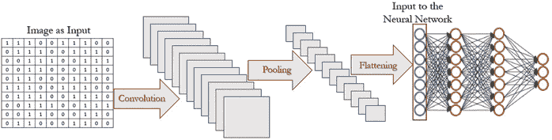

FIGURE 3.8 用于图像识别的卷积神经网络(CNN)过程。CNN 是图像修改（使用`Kernel`、`Pooling`和`Flattening`进行卷积）与神经网络的结合。

卷积的目标是从用于训练图像识别过程的图像中提取有用特征。图 3.8 显示了所使用的 10 × 10 像素的图像，而图 3.9 和图 3.10 显示了用于图像识别训练的 5 × 5 像素图像（0 和 1 组成）。

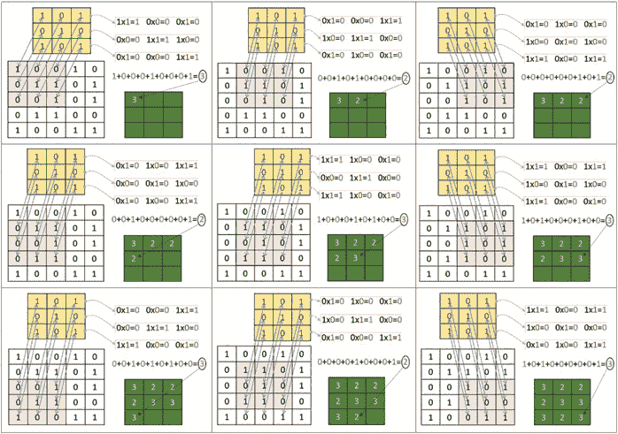

FIGURE 3.9 使用`Kernel`的卷积层。

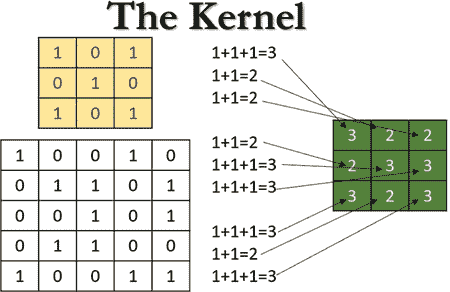

FIGURE 3.10 通过过滤/`Kernel`对输入图像执行卷积。

`Kernel`过程的示例在图 3.9 中分分步骤所示，并在图 3.10 中显示了当图 3.9 中所示的整个过程完成后。图 3.11 显示了`Pooling Layers`（池化层）的示例，其中使用了每系列`Kernel`的最大值，最后，图 3.12 显示了`Flattening`过程将最终计算的矩阵转换为单个输入序列。

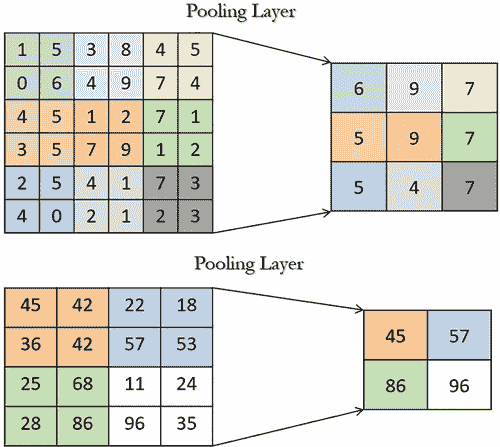

FIGURE 3.11 图像矩阵卷积层后的池化层。

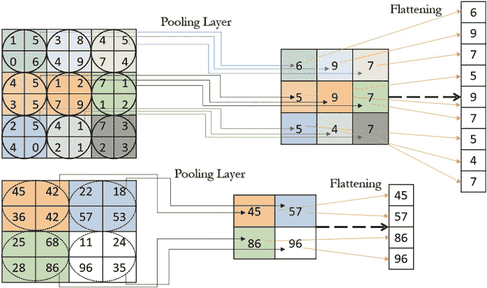

FIGURE 3.12 展平是图像矩阵的池化层。

### 问题 #4：使用传统统计方法因为它们也是数据驱动

由于人工智能方法目前也被称为数据驱动，许多科学家和工程师（特别是在学术界）认为人工智能方法与传统统计学一样，因为它只使用数据解决问题。遗憾的是，他们没有意识到人工智能并没有使用传统统计学在过去 150 年使用的解决问题技术。他们没有意识到，可能也没有兴趣学习传统统计学与人工智能之间的技术和哲学差异。关于这一项目的更多细节将在第 6 章中讨论。

### 问题 #5：使用机器学习算法继续传统的工程问题解决方法

虽然使用人工智能解决问题绝对需要科学工程领域的专业知识，但对人工智能现实且正确的理解和专业知识也是必要的。必须理解，人工智能解决工程问题的方式与我们过去几个世纪解决科学和工程问题的方式完全不同。必须学会，当使用人工智能解决科学和工程问题时，其目标是尽可能地避免假设、解释和简化。这就是人工智能分离并增强传统科学工程问题解决事实的事实。科学工程领域的知识将帮助向机器学习算法`教`它们这些重要的智能项目。


既然“过去十年中科学家和工程师在应用人工智能和机器学习方面所产生的问题已经提到”，接下来的事项是明确人工智能在科学和工程应用中的实际需求。正如本章开头提到的以及图 3.13 所示，人工智能对科学和工程应用的需求是：(1) 精通人工智能所应用的特定科学和工程主题的专业知识，以及 (2) 精通人工智能和机器学习的专业知识。

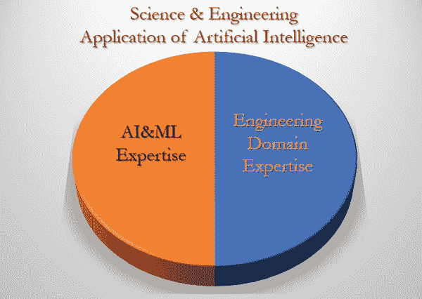

图 3.13 人工智能工程应用的特征。

如图 3.14 所示，在过去的十年里，所有工程行业都开始使用不具备任何特定工程专业知识的人工智能专家来解决他们的问题。随后，当 AI 建模和问题解决的结果非常糟糕时，工程领域专业知识在利用人工智能解决问题中的重要性变得变得如此重要。然而，在过去的几年里（甚至现在以及可能在未来几年内），开始使用人工智能的大多数工程领域专家的结果和方法与以前一样糟糕。此类问题的主要原因如图 3.15 所示，归于他们对人工智能和机器学习的浅层理解。作为工程师，他们认为使用人工智能解决工程相关问题完全在于了解生成人工智能的机器学习算法的数学特性。这就是为什么绝大多数人将他们的方法称为“机器学习”而不是“人工智能”。图 3.14 和 3.15 中左右两侧所示的这两种情况都需要被避免。利用人工智能解决科学和工程问题的最佳方式如图 3.16 的中间所示。希望摆钟能够左右摆动，并最终停在中间。

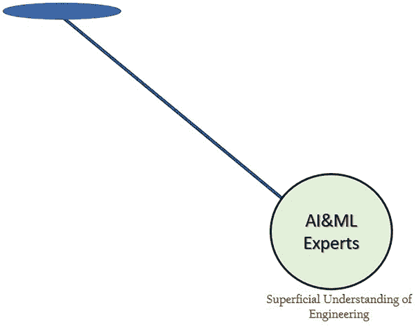

图 3.14 最初，人工智能专家试图对人工工程智能问题进行建模和解决，结果完全不好。

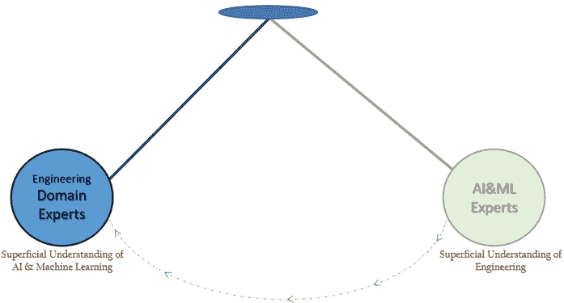

图 3.15 后来，工程领域专家试图在没有人工智能专业知识的情况下，对人工工程智能问题进行建模和解决，结果仍然完全不好。

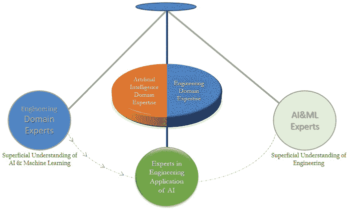

图 3.16 人工智能工程应用的特征。

科学和工程的专业知识并不是指包含数学方程。相反，科学和工程最重要的是对物理现象的理解。

## 人工智能专业知识

过去几个世纪利用科学和工程对物理现象进行建模的传统方法是通过数学方程。这导致许多科学家和工程师认为，要成为人工智能专家，只需要了解用于生成人工智能的机器学习算法的数学方程细节即可。


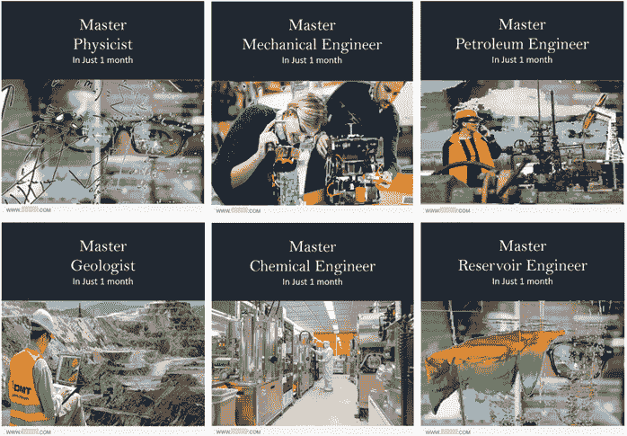

`图 3.17` 是否有人觉得合理，你只需要 1 个月就能成为某个主要科学工程领域（物理学、机械工程师、石油工程师、地质学家、化学工程师、储层工程师等……）的大师（专家）？

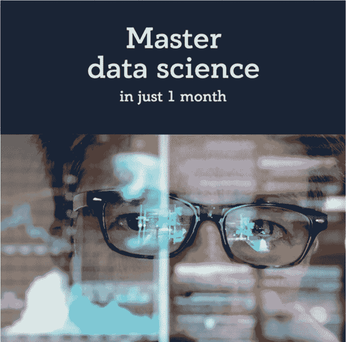

`图 3.18` 认为成为“数据科学家”只需要 1 个月，这合理吗？

图 3.18 显示的内容并非虚构。它绝对是不正确的，但实际上，这是一个事实。这是由一家公司（UDEMY）做的，它让许多人认为他们只需要很少的时间和精力就能成为人工智能专家，而人工智能现在也被称为“数据科学”。

人工智能的专业知识需要利用这种新型现代技术进行大量的研究和解决问题的技能开发。利用人工智能解决问题的研发将对进化论、哲学、神经科学和生物学领域的科学家和工程师产生极大兴趣，正如图 3.19 所示。

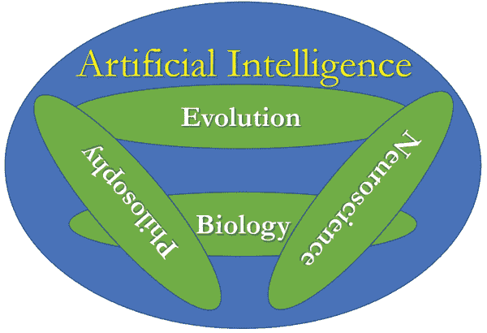

`图 3.19` 人工智能和机器学习的基础知识和理解需要对哲学、神经科学、数学、计算机科学、统计学和生物学的兴趣和专业。

1. *进化论*提供了关于智人（Homo sapiens）大脑增强和改进的信息。除了与我们之前发展的所有动物的大脑进行比较外，它甚至让我们可以将我们的强度与其他人类物种（如尼安德特人和*直人*/Homo erectus）的大脑进行比较。尼安德特人和直人在我们之前进化了数十万年，但从未离开过狩猎采集者的特征。智人几乎在 7 万年前离开了了东非，在约 1.2 万年前通过农业革命改变了他们的狩猎采集者特征，并在约 350 年前开始了科学和工业的创造。如果对进化论感兴趣，学习人类大脑的奇妙特性将非常困难且不切实际。

2. *哲学*提供了关于知识、事实、现实和经验之本质的令人难以信的信息和理解。与传统的科学和工程方法一样，亚里士多德哲学绝不能如此。

3. *神经科学*关注人类大脑和行为。

4. *生物学*是“生命”与“学习”的结合，是生物体的科学。

鉴于人工智能的专业知识，这让我们对进化论、哲学、神经科学和生物学产生了兴趣。需要注意的是，当你使用学习算法时，科学家和工程师并不需要（这些知识）。然而，如果你不相信这是真的，你可以发送电子邮件。注意物理建模和通用问题建模之间的区别很重要。

## 注意

1. 进化论提供了关于智人大脑增强和改进的信息。
2. 哲学提供了关于知识、事实、现实和经验之本质的令人难以信的信息和理解。
3. 神经科学关注人类大脑和行为。
4. 生物学是“生命”与“学习”的结合，是生物体的科学。

## 使用人工智能进行物理建模

DOI: [10.1201/97810336935](https://doi.org/10.1201/97810336935)

使用人工智能进行物理建模涉及事实、现实和实际测量。需要注意的是，当你使用学习算法时，科学家和工程师并不需要（这些知识）。

这是一个任何人都可以回答简单问题。

### 问题 1

使用“人类智慧”，在建模和解决“物理现象”与“通用现象”之间是否存在差异？这个问题一个合理的例子是：使用“人类智慧”，在“为了向盐水层注入二氧化碳以产生对气候变化的积极影响而进行建模”与“识别图像（如猫和狗之间的区别）”之间是否存在差异？

### 回答 1

是的，确实有。使用“人类智慧”在建模和解决物理现象与通用现象之间存在差异。为了建模或解决物理现象，人类需要在学校和大学学习几年，成为他们需要解决的特定类型物理现象的专家。“人类通用智能”对于解决“通用现象”足够。

### 问题 2

我们如何让机器（计算机——机器学习算法）进入学校和大学学习几年，并通过“人工智能”成为需要解决的特定类型物理现象的专家？

### 回答 2

首先，机器（计算机——机器学习算法）不需要（而且这是不可能的）去学校和大学成为物理现象专家。但还有其他方法来“教导”机器“学习”算法。由于物理现象的“学习”需要“教导”，物理现象对机器学习算法的教师必须是特定物理现象主题的专家。


因此，绝对重要的一点是：在使用“人工智能”对物理现象进行建模和/或解决时，使用人工智能的人员不仅必须具备“人工智能”方面的专业知识，还必须具备对所处理特定类型物理现象的专业知识。如图 4.1 所示，“人类智能”和“人工智能”都需要“通用智能”来解决和建模“通用现象”，并需要“领域专业知识”来解决和建模“物理现象”。

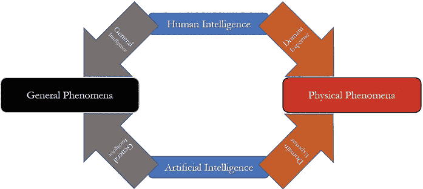

FIGURE 4.1 人类智能和人工智能对通用智能和领域专业知识的要求。

本章必须涵盖两个重要主题，以解释如何使用“人工智能”对物理现象进行建模和/或解决。这两个主题是：

1. 物理现象的传统建模与基于人工智能的物理现象建模之间的差异，以及
2. 如何通过人工智能利用特定物理现象的领域专业知识来对这些物理现象进行建模和/或解决。

如上所述，第一个主题是人工智能与过去几个世纪用于建模和/或解决物理现象的技术之间的独特性和差异；第二个主题则指明了如何实现。

## 人工智能与物理学中的传统建模

我们在学校和大学学习的建模和/或解决物理现象的知识被称为“物理现象的传统建模与求解”。这种“传统技术”使用数学方程对物理现象进行建模。传统技术与人工智能（全新技术）在建模和/或解决物理现象方面的主要区别在于在建模物理现象时使用或/或避免数学方程。虽然数学方程通过传统的科学和工程技术成为物理现象的模型，但人工智能并不通过数学方程对物理现象进行建模。人工智能不使用数学方程建模和/或解决物理现象的主要原因是避免了任何假设、解释和简化。人工智能建模和/或解决的物理现象完全基于现实、事实和实际测量。

总而言，过去几个世纪使用的“物理现象的传统建模与求解”包括识别对特定物理现象起作用的变量和参数。然后，识别出的变量和参数被用于开发数学方程。当这些数学方程不复杂时，可以通过解析解生成精确解。然而，当某些物理现象通过高度复杂的数学方程建模时，就无法使用解析解。在这种情况下，已经开发了数值解来求解复杂的数学方程。

正如前几节提到的，人工智能被定义为“人类智能”的模拟，由于“人类智能”是通过“人类大脑”产生的，因此模拟“人类大脑”活动将是人工智能最重要的部分。根据物理现象传统建模的简单定义（即使用数学方程对物理进行建模），可以提出问题：“人类大脑”使用数学方程来解决或与任何物理现象交互吗？这个问题的答案完全简单易见。为了给这个问题提供一个例子，让我们看图 4.2 所示。

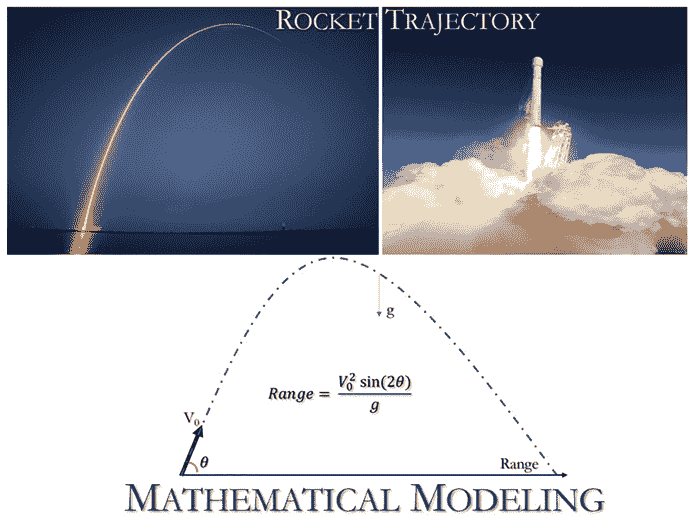

FIGURE 4.2 通过物理和数学识别火箭轨迹的最终掉落点。

这张图展示了一个使用数学方程建模的物理现象（火箭轨迹）。火箭轨迹的目标是到达一个需要击中并摧毁的特定位置。为了识别投出的火箭将落在何处，使用了通过数学方程建立的物理模型，如图 4.2 所示。到达火箭将落的位置是重力（`g`）、初始速度（`V[0]`）和发射火箭的初始角度（`θ`）的函数。然而，观察图 4.3

FIGURE 4.3 通过人类大脑识别球轨迹的最终掉落点。

一个人向另一个人投掷物品。在橄榄球比赛中，四卫会传出球让接球手接到。问题是：必须接住物品（橄榄球）的人类大脑（接球手）也会生成一个数学方程来识别物品（橄榄球）将落在何处吗？如果是这样，人类大脑在生成数学方程后，必须求解它。根据人类大脑实现的数学方程的解，接球手的脑是否应该引导他的脚和手臂去动作并接到橄榄球？

这个问题的答案似乎是显而易见的。事实是，人类大脑并没有开发数学方程来解决物理现象。既然情况如此（不开发和求解数学方程），那么人类大脑如何解决这个物理现象呢？美国橄榄球队上的接球手如何识别橄榄球掉落在哪里，以便他使用脚和手臂接到橄榄球？

人类眼睛观察橄榄球，甚至观察四卫传给他的方式，然后利用这些 `Data` 来识别向哪个方向移动以及跑多远才能接到橄榄球。换句话说，在很多情况下，通过“人类大脑”的“自然智能”试图解决物理现象问题。人类大脑的“自然智能”利用其观察到的实际数据来解决物理问题。人类大脑的“自然智能”并不是开发一个数学方程然后尝试求解它。如果人类大脑通过这种方式的自然智能活动是合理的，那么人工智能不应该以这种方式激活来解决类似的问题吗？答案是：当然可以。人工智能必须模拟人类大脑的自然智能，通过实际数据对物理问题进行建模和求解。此类情况（解决物理现象）的另一个示例见图 4.4。

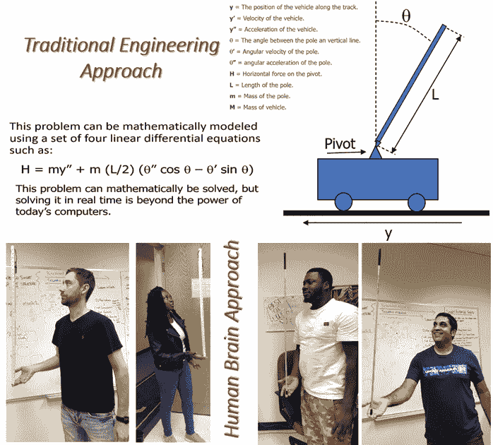

FIGURE 4.4 通过物理和数学平衡棍子与人类大脑对比。


通用人工智能技术已用于人脸、物体和语音识别，以及自动驾驶车辆、人类对话和大语言模型（`LLM`）。显而易见，“人类大脑”不需要任何基于物理的领域专业知识（通过上学校和大学学习）就能解决非物理类的问题。在街道上识别人脸、声音或不同的目标（如汽车、公交车、卡车、自行车、行人等），或者学会如何开车和进行语言对话，除了人类大脑中的通用智能之外，不需要任何其他东西。虽然已经明确并提到，目前开发的许多出的 AI 技术是基于通用智能的，但同样非常重要的一点是，本书并未声称这些通用人工智能技术是简单且易于开发的。

需要特别注意的是，开发通用人工智能技术并不容易或简单，因为它们正在模拟“人类通用智能”，而这种智能并不需要科学和工程专业知识。事实是，绝大多数通用人工智能技术在开发过程中非常复杂，它们的扩展需要 `Artificial Intelligence` 领域极其惊人的专业知识。然而，另一个事实是，当这些基于 AI 的专家在创建通用人工智能技术时，这些技术并不能为特定的物理现象生成模型，而在过去的几个世纪里，这些现象是通过数学方程完成的。这些物理现象的数学方程随后根据建模这些物理现象的数学方程的复杂性，通过解析解或数值解来求解。显而易见，智人身上发生的许多重要问题只需要“人类通用智能”。因此，成为“人工智能”专家以能够开发“通用人工智能”模型是至关重要的。

近期的技术如“ChatGPT”、“GPT-4”、“Google Bard”……等都是“通用人工智能”的一部分，注意“人工智能”的重要性至关重要。然而，这并不意味着这些“通用人工智能”技术能够通过对物理现象建模来解决与科学和工程相关的问题。

## 物理领域专业知识如何用于基于 AI 的物理建模

本章将包含的主要问题之一是必须如何物理领域专业知识来开发基于物理的人工智能模型。首先，必须提到：(A) 基于物理的人工智能模型与工程师和科学家对物理现象的传统建模大不相同；(B) 与工程师和科学家的传统物理建模相比，基于物理的人工智能模型开发速度更快，运行速度更快；(C) 基于物理的人工智能模型将比工程师和科学家的传统物理建模提供更好、更真实的的结果。首先，将在上述提到的三项内容的背景下讨论物理领域专业知识。一旦涵盖了传统物理建模与基于 AI 的物理建模之间的区别，将涵盖如何使用领域专业知识利用人工智能开发科学和工程相关的模型。

### 基于物理的 AI 模型与传统物理建模的区别

众所周知，传统的基于物理的模型是使用数学方程完成的。已经提到，科学家和工程师会识别涉及物理现象的变量和参数，然后将它们放入数学方程中进行建模。当使用人工智能来开发基于物理的模型时，一切都是基于实际数据的。这就是它也被称为数据驱动、数据科学和数据分析的主要原因。然而，这项内容最重要的一点是，目前许多科学家和工程师尚未正确使用它。使用人工智能开发基于物理模型的最重要的一点是：**仅**使用“实际数据测量”进行基于 AI 的模型开发，而不是包含使用数学方程生成的数据。关于此项的更多细节将在本书的第 6 章中介绍。

目前大量科学家和工程师正在解决的主要问题之一，是将通过数学方程生成的数据与部分“实际数据测量”相结合，以便人工智能开发基于物理的模型。问题可能是：“为什么大量的科学家和工程师将数学生成的数据添加到实际数据测量中以构建物理现象的 AI 模型？”

询问他们为什么这样做会很有趣。在我看来，必须首先提出的有趣问题是：“你们是否仅使用实际数据测量成功构建了物理现象的 AI 模型？”如果他们的答案是“是”，那么他们为什么要添加从数学方程生成的数据来构建模型呢？事实是，他们之所以使用从数学方程生成的数据并结合实际数据测量来构建物理现象的 AI 模型，是因为他们从未通过人工智能利用实际测量数据开发出合理的模型和解决方案。“混合建模”的定义是指无法利用人工智能的真实特征开发物理现象的模型和解决方案，或者完全不理解“人工智能”的含义。

### 与传统物理建模相比，基于物理的 AI 模型开发更快

这是一个非常已知的问题，物理现象的复杂性会导致建模它们的数学方程也变得复杂。此外，另一个众所周知的事实是，高度复杂的数学方程无法通过解析解简单快速求解。这就是约翰·冯·诺曼和斯坦尼斯斯拉夫·乌拉姆在 1946 年创建数值模拟的原因。在很大程度上，数值模拟略微修改（简化）了物理现象的特征，以便生成数学方程的解。

这一过程是通过将物理现象的特征划分为许多空间（数百万个单元格）和许多时间步来完成的。鉴于生成数值模拟的解需要大量的单元格和时间步，并且在完成完成后，为了生成关于需要做什么来增强物理现象行为的完整理解，即使使用大量计算机进行求解，总是需要很长时间。


正如你目前所看到并测试的通用人工智能模型（例如图像识别或 ChatGPT）的特性一样，你知道基于 AI 的模型生成的结果比人类完成的快得多。人工智能在科学和工程应用中也是如此。对于人工智能生成的基于物理的模型，即使是对于传统方法需要数十小时才能完成的极其复杂的物理现象，人工智能也仅需几秒钟或几分钟即可解决。

## 基于物理的 AI 模型比传统的物理建模提供好得多的结果

正如前文提到的，使用人工智能对物理现象进行建模需要使用实际的实测数据，而不是任何数学方程。事实上的情况是，当使用数学方程对物理现象进行建模时，假设和解释会成为解决方案的一部分。此外，物理现象中观察到的每一个变量或参数并不一定会成为数学方程的一部分。另一方面，当使用人工智能来开发物理现象模型时，所生成的每一个实际测量值都将包含在基于 AI 的模型中。由于只使用了实际测量值而没有使用数学方程，因此没有任何假设、解释或简化会成为物理现象的基于 AI 模型的一部分。

这一事实总是为物理现象带来更好、更真实的模型和解决方案。当将基于 AI 的物理现象模型用于匹配物理现象的历史并随后对其进行优化时，它提供的结果比模型中包含的任何想法都要真实得多。鉴于一切都基于事实和现实，并避免了任何假设和解释，其结果始终远优于传统的基于数学的模型（而且要快得多）。

## 为什么在人工智能中必须使用基于物理的领域知识

需要注意的是，使用人工智能对科学和工程物理现象进行建模只需要数据。人工智能将通过提供给机器学习算法的数据来学习物理现象的所有细节。必须注意的最重要问题是使用物理现象的**实际**数据，而不是任何任何人（甚至是领域专家）都可以生成的数据。由于物理现象的传统建模是通过数学方程完成的，因此新的物理现象人工智能建模将不再使用（也不能）使用数学方程对其进行建模。

使用物理领域专业知识来生成物理现象的人工智能模型有几个重要要求：(A) 避免包含数学方程的传统基于物理建模，(B) 将物理现象的主要信息教授并传达给用于生成人工智能的机器学习算法。使用物理领域专业知识生成物理现象的人工智能模型时，生成的每一个实际测量值都将包含在基于 AI 的模型中。虽然只使用了实际测量值而没有使用数学方程，因此没有任何假设、解释或简化会成为物理现象的基于 AI 模型的一部分。

这一事实总是为物理现象带来更好、更真实的模型和解决方案。当基于 AI 的物理现象模型被用于匹配物理现象的历史并随后对其进行优化时，它提供的结果比模型中包含的任何想法都要真实得多。鉴于一切都基于事实和现实，并避免了任何假设和解释，其结果始终远优于传统的基于数学的模型（而且要快得多）。

需要注意的是，使用人工智能对科学和工程物理现象进行建模只需要数据。人工智能将通过提供给机器学习算法的数据来学习物理现象的所有细节。必须注意的最重要问题是使用物理现象的**实际**数据，而不是任何任何人（甚至是领域专家）都可以生成的数据。由于物理现象的传统建模是通过数学方程完成的，因此新的物理现象人工智能建模将不再使用（也不能）使用数学方程对其进行建模。

使用物理领域专业知识来生成物理现象的人工智能模型有几个重要要求：(A) 避免包含数学方程的传统基于物理建模，(B) 将物理现象的主要信息教授并传达给用于生成人工智能的机器学习算法。使用物理领域专业知识生成物理现象的人工智能模型时，生成的每一个实际测量值都将包含在基于 AI 的模型中。虽然只使用了实际测量值而没有使用数学方程，因此没有任何假设、解释或简化会成为物理现象的基于 AI 模型的一部分。


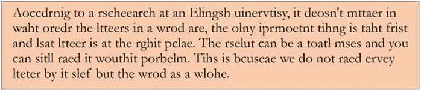

### 图 4.5 请阅读这段文字。如你所见，这段文字总共有 67 个单词。在 67 个单词中，4 个是单字母单词，16 个是双字母单词，13 个是三字母单词，34 个是三个字母以上的单词。你可能能够完全阅读它，然后发现它并不是写正确的。

我确定你已经见过图 4.5 中所示的那段文字了。我也确定你能够阅读那段文字并完全理解它的的话题是什么。很可能在阅读这段文字的中间，你已经注意到它有些非常不对，然后你注意到你正在阅读和理解的大量单词都没有写对。相同段落的正确版本在图 4.6 中所示。图 4.6 中所有红色的单词都是图 4.5 段落中写错误的单词。尽管如此，能够阅读这些单词的人类大脑在理解整个段落时几乎没有困难。

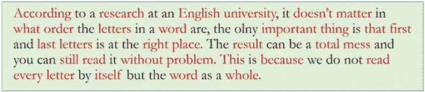

### 图 4.6 这是与图 4.5 所示相同的段落。这是一个拼写正确的段落。你可以注意到，97% 的三个字母以上的单词都被拼写错了，但你（很可能）在正确阅读和理解这段文字时几乎没有什么问题。

当工程师提到诸如“实际测量数据从不是 100% 准确……”这类项目时，我通常会给他们提供图 4.5 所示的段落，然后问他们是否理解该段落所提到的内容。事实是，通常 99.999% 的人都能阅读图 4.5 所示的段落，并识别出该段落中有大量单词没有正确正确。这意味着人类大脑能够理解并正确处理“从不是 100% 准确的实际数据……”，由于人工智能通过模仿人类大脑来模拟自然智能，它也能处理与实际数据相关的一些不准确性。

当人工智能用于建模和/或解决物理现象时，其实际数据应该以代表物理学的方式呈现给机器学习算法。那些得出以下三个结论的个人和/或公司可以被认为能够利用人工智能来增强他们的目标：

1. 领域知识是人工智能和机器学习工程应用的要求，
2. 人工智能的工程应用需要领域知识，
3. 无需通过数学方程生成数据。

那些将以下内容称为“数据驱动”、“机器学习”甚至是“人工智能”（尽管他们通常不直接称为人工智能）的个人和/或公司无法被认为能够利用人工智能来增强他们的目标：

1. 他们不理解人工智能与通用（普通）技术应用是不同的。
2. 他们未能开发出使用`仅`实际数据（测量数据）解决相关问题的全面且可解释的“AI 模型”。

数据应该以代表物理现象的方式呈现给机器学习算法。

# 5 人工智能对比传统统计

DOI: [10.1201/9781003369356-](https://doi.org/10.1201/9781003369356)

人工智能和传统统计都使用数据来生成解决方案，这并不意味着它们在做相同的事情。事实是，它们所做的完全不同。目前的人工智能版本是于 30 年前开发的，它产生了最有趣的类型解决方案。然而，使用数据开发模型并生成解决方案的传统统计学是在 350 年前开发的。因此，将传统统计方法作为“机器学习”来执行所谓人工智能与事实无关，正如本章将解释的那样。尽管如此，许多过去几年工作过传统统计并现在对其有良好经验的科学家和工程师继续使用它，他们现在不再将其称为传统统计，而是称为人工智能和机器学习。

一些人可能会好奇，为什么这本书包含一个关于人工智能和传统统计之间差异的章节。原因在于，学术界和工业界的许多工程师认为这些技术非常相似，因为它们都处理“数据”。当他们提到“数据分析”时，他们大多指的是线性、非线性或多元回归，并试图将其视为一种新技术。许多故意或无意犯此类错误的人也试图将这些传统的旧技术称为他们行业中相当新的东西。


正如前面提到的，传统统计学已经存在了三个多个世纪。“统计”（statistic）一词于 1749 年在德国起源并被发明。如果考虑到数据与概率论（随机性）之间的联系，那么它的历史甚至可以追溯到 16 世纪。尽管如此，关键点在于，与人工智能不同，传统统计学并不是一项新技术。为了为了地理解这两种技术之间的根本区别，应该从伯克利大学著名统计学教授利奥·布雷曼（Leo Breiman）写的开创性论文开始[12]，然后是 Nisbet、Elder 和 Miner 编写的书（《统计分析与数据挖掘应用手册》，*Handbook of Statistical Analysis & Data Mining Applications*）[13]]。

伯克利大学统计学教授（利奥·布雷曼博士）在其文章[12]中所述：“统计界对数据模型的关注导致了无关的理论和可疑的科学结论……一个预定义的模式（即参数模型）使用模型来刻画数据中的模式，这被称为数据模型”。“这项事业（*传统统计学*）的核心信念是，统计学家通过想象和观察数据，可以为大自然设计的复杂机制发明一种相当好的参数模型类……在拟合数据模型的热忱中，不言而喻的理往往被忽视了”。当对数据拟合模型以得出定量结论时，这些结论是关于模型的机制的，而不是关于自然机制的”。“对数据模型无错越性的信念几乎是宗教性的”。

传统统计学在解决问题上采用亚里士多德方法（二值逻辑）和对真理的演绎法，而人工智能背后的哲学包含了多值逻辑和对真理的归纳法。传统统计学通过参数模型对假设进行检验并将其与模型的标准指标进行比较，而人工智能是使用数据来构建模型，而不是从现有模型开始测试数据以查看其是否符合预定义的模型。人工智能被定义为模拟自然、生命和人脑以解决复杂和动态的问题。人工神经网络模拟人脑中的神经元；模糊集理论模拟人类的多值逻辑和推理；遗传算法则模拟达尔文的进化论。机器学习被定义为一组开放的计算机算法，通过数据进行学习，而不是显式地编写计算机并告诉它具体做什么（正如工程师在数值模拟中所做的那样）。人脑并不使用亚里士多德二值逻辑（例如是/否、黑/白、真/假、0/1）来解决问题和做出决策。概率论解决与随机性相关的不确定性，而不是与缺乏信息的不确定性。

传统统计方法从一系列预定义的方程（假设集）开始，例如单变量或多元线性回归或定义良好的非线性回归（例如对数、指数、二次）。然后，它试图找到最适合所收集数据的预定义方程。虽然传统统计方法试图寻找所涉及变量之间的相关性，但它并没有处理、考虑、甚至尝试从数据中识别因果关系。每个人都知道相关性并不一定意味着因果关系。图 5.1 和 5.2 是此类问题的很好的例子。在这两个图中，虽然两个主题之间的数据看起来极度相关（相关性超过 99%）——图 5.1 中的“美国在科学、太空和技术领域的支出”对比“悬吊、绞杀和窒息自杀人数”，以及图 5.2 中的“缅因州的离婚率”对比“人均人油消费量”——但很清楚，这两个主题之间完全没有任何关系。这意味着相关性并不一定意味着因果关系。

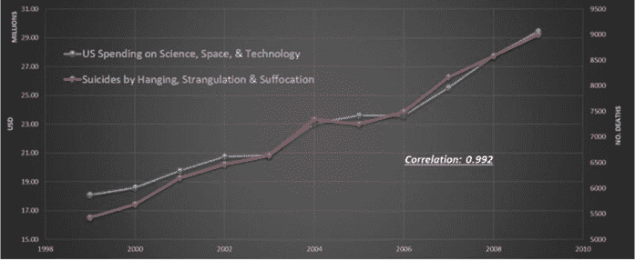

`图 5.1` 美国在科学、太空和技术领域的支出与悬吊、绞杀和窒息自杀人数之间的相关性显然并不意味着因果关系。

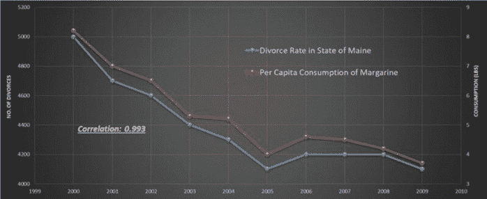

`图 5.2` 缅因州的离婚率与人均人油消耗量的相关性。

人工智能不是从任何预定义的方程开始的。它们没有关于行为变量可能具有何种类型以使其与目标输出相关的任何假设。使用机器学习的开放人工智能的力量在于它们在大量变量中发现复杂模式的惊人能力。人工智能开发的模型最终结果通常无法用一个或几个方程来总结。这就是为什么许多工程师喜欢用“黑盒”一词称为机器学习算法。

显然，除非模型中包含他们从大学开始就一直熟悉的一个或多个数学方程，否则传统工程师无法理解这些模型。这可能就是将人工智能相关模型称为“黑盒”的原因。那些不尊重新技术的传统工程师似乎没有意识到，从数学角度来看，使用人工智能开发的模型包含了一系列生成模型结果的矩阵。因此，这些模型（盒子）没有任何是不透明（黑）的。事实是，当你向基于人工智能的模型提问时（只要它是开发得当的），它可以以非常可靠的方式做出回答。人工智能这一主题的这部分可见本书的第 7 章](#C_010_c7.xhtml)。

图 5.3 总结了传统统计解决问题的方法与人工智能使用方法之间的主要区别之一。当在传统统计背景下使用数据时，会使用一系列预定义的方程来寻找如何拟合数据。换句话说，拟合数据集的方程的形式和形状，甚至是数据分布的形式，都是预定义的。在这种情况下，如果实际数据太复杂，无法拟合任何预定义的方程或分布，那么解决问题的方法要么停滞，要么在数据（或问题）中引入大量的假设、简化和偏见，以得出某种解决方案。

![图 5.3 传统统计学与人工智能及机器学习的区别 [14]。](images/Fig05_03.jpg)


## 图 5.3 传统统计学与人工智能及机器学习之间的差异 [14].

当利用人工智能从数据对工程相关问题的物理特性进行建模时，不会使用一组预先定义的方程来拟合数据。这种分离的主要原因是在使用人工智能对工程相关问题的物理特性进行建模并寻找解决方案时，避免偏见、先入为主的概念、粗略假设以及对问题的简化。当人工智能用于物理现象的工程建模时，其模型和解决方案完全围绕实际数据展开。在工业中，数据在大多数情况下都是实际的（现场）测量值，它们必须引导解决方案的形成，而不是根据我们今天对使用数学方程建模的物理学的理解。事实是，实际（现场）测量值代表了所建模问题的物理特性。因此，通过使用代表物理性的数据，这种方法变成了一种基于物理的问题解决方法。数据代表了正在建模的物理特性。

图 5.4 显示了传统统计方法中使用的某些算法与人工智能中使用的某些机器学习算法的对比。虽然在某些书中，人工智能专家已经证明了机器学习算法能够执行传统算法（例如：线性回归、非线性回归……），但一些工程师开始将这些传统算法称为机器学习。

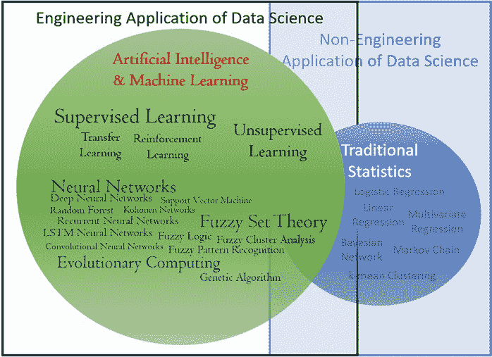

## 图 5.4 传统统计学与人工智能及机器学习使用的不同算法。

传统统计学与人工智能之间的另一个区别在于传统统计学对演绎推理的引入，以及人工智能对归纳推理的引入。演绎推理是根据通常被认为是真实的前提来得出结论的过程，而归纳推理是从特定的观察移动到更广泛的概括和理论。演绎推理通过遵循从一般到具体的直觉路径进行学习（即“关注细节的人”），而归纳推理则通过遵循从特定到一般的直觉路径进行学习（即“关注大局的人”）。

虽然传统统计学和人工智能都基于所提供数据的模式进行运行，但传统统计学使用预定义的模式（即参数模型），并将观测值的某些衡量标准与模型的标准指标进行比较（`假设检验`），而人工智能通过数据构建模型，它不是从现有模型开始的。传统统计学使用现有模型来表征数据中的模式。它通过演绎的方式将现有模型的预定义模式与数据相匹配，遵循亚里士多德式的真理方法。人工智能则利用数据中的模式来构建模型。它通过归纳的方式发现数据中的模式。如图 5.5 所示，传统统计学使用从一般原理到特殊情况的演绎推理，而人工智能则使用从特殊情况到一般原理的归纳推理。

 （注：此处图片路径与原文一致）

## 图 5.5 传统统计学使用演绎推理，而人工智能使用归纳推理。

图 5.5 传统统计学使用演绎推理，而人工智能使用归纳推理。

如图 5.6 和 5.7 所示，传统统计学和人工智能都基于所提供数据的模式进行运行。传统统计学使用预定义的模式（即参数模型），并将观测值的某些衡量标准与模型的标准指标进行比较（`假设检验`），而人工智能通过数据构建模型，它不是从现有模型开始的。传统统计学使用现有模型来表征数据中的模式。它通过演绎的方式将现有模型的预定义模式与数据相匹配，遵循亚里士多德式的真理方法。人工智能则利用数据中的模式来构建模型。它通过归纳的方式发现数据中的模式。

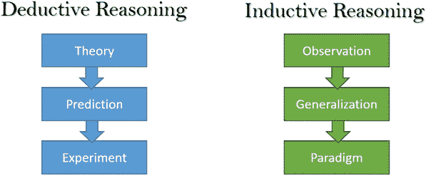

## 图 5.6 演绎推理与归纳推理之间的差异。

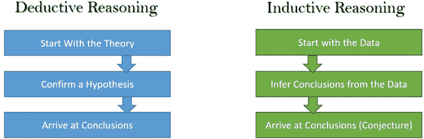

## 图 5.7 使用可用数据时演绎推理与归纳推理的差异。

# 6 科学与工程中的人工智能伦理 (AI-Ethics)

DOI: [10.1201/9781003369567](https://doi.org/10.1201/9781003369567)

众所周知的事实，人工智能和机器学习开发的预测模型和解决方案是基于“数据”的。由于已知如何使用数据通过人工智能构建模型，人工智能伦理的主要特征在于解决 AI 模型如何产生偏见，或者根据基于人工智能的模型开发过程中使用的数据质量和数量来告知（并表征）如何生成结果。

当涉及到人工智能和机器学习的非工程应用时，已经证明在机器学习算法训练过程中引入偏见数据，会导致种族主义和性别歧视等人类偏见包含在 AI 模型中。

## 人工智能伦理引言


核武器没有最终毁灭我们的地球（至少到目前），主要原因与全球范围内关于处理核弹的条约和协议有关。全球政治家们最终能够在人工智能方面达成一套类似的全球性条约和协议，这是至关重要的。许多个人担心人工智能在未来几十年内如何影响我们的世界，主要原因之一与几个国家的政府有关。某些国家的政府正根据自己的目标使用这项技术，而这些目标取决于他们对民主的观点、信仰、理解或仇恨，以及他们根据人工智能如何为其服务来成为世界领导者的意图。人工智能伦理（`AI-Ethics`）在近期已成为一个重要课题，对于那些已经或正在对人工智能和机器学习算法感兴趣的人来说，必须对其充分理解。遗憾的是，大量的科学家和工程师并没有关注 `AI-Ethics`，因为他们认为解决科学和工程相关问题不受 `AI-Ethics` 的影响，但这完全并非如此，这也是本章的主要原因。

自 21 世纪 00 年代中期以来，随着基于人工智能的图像识别、语音识别、人脸识别、物体识别和自动驾驶车辆向世界上大多数人开放，人们对人工智能的兴趣显著增加。作为一项新的科学技术，人工智能将改变 21 世纪许多事情。人工智能已成为人们、公司和学术界经常参与的最有趣的技术之一。

例如，在过去的十年里，几家银行开始使用与人工智能相关的模型（由一些最知名的人工智能建模公司开发）作为向申请人提供贷款决策的第一步。由于通常有成百上千的人在不同的银行申请贷款，而且每家银行只有固定数量的员工，且他们的工作是研究和分析贷款申请人的特征，因此要审查成百上千名申请贷款者的细节是非常困难的。在这种情况下，几家银行购买通过人工智能开发的模型，以识别出顶尖的几位贷款申请人（例如 20 至 50 人），是有意义的。然后银行员工就可以涵盖这些顶尖申请人的所有细节，为他们提供银行贷款。

在公司招聘员工方面情况也是如此。这是由于许多公司拥有的人资源部门能够每天、每周或每月月分析并对招聘少数员工做出合理的决策。当这些公司中的某些公司生成招聘 10 或 20 名新员工的广告时，有时会有大量人员申请此类工作。这就是为什么一些公司购买通过人工智能开发的模型来识别顶尖的几位员工申请人，以便公司的人力资源员工能够分析并对申请招聘职位的人员做出合理的决策。

在过去的十年里，几家公司开发了人工智能模型，这些模型可以帮助银行决定向谁提供贷款，帮助公司决定招聘谁。银行使用 AI 模型来最大限度地减少贷款申请人的数量，因此银行员工必须更详细地评估他们的特征。此外，公司使用基于人工智能的模型来评估根据公司职位广告申请工作的大量申请人，然后显著减少了实际人力资源专业人士必须关注的申请人数量。最初，在过去的十年里，银行和公司使用人工智能提供贷款或招聘个人的方式已使 `AI-Ethics` 成为一个极其重要且需要理解的课题。这些只是过去十年中发生的许多类似情况中的两个例子。

`AI-Ethics` 对于那些热衷于使用这项技术解决科学和工程相关问题的科学家和工程师来说也极其重要。在过去的几年里，`AI-Ethics` 已成为人工智能在许多非科学和非工程相关领域应用中的重要课题。本章将涵盖并解释 `AI-Ethics` 在该技术的科学和工程应用中的重要性。为了阐明科学和工程相关的 `AI-Ethics`，本章还将给出一些示例。

当科学家和工程师对 `AI-Ethics` 缺乏理解，而他们的努力是使用人工智能解决基于物理的问题时，就会产生某些类型的问题（有意或无意）。产生此类问题的主要原因与不关注对 `AI-Ethics` 的理解有关。如果不充分关注 `AI-Ethics`，通过应用人工智能来解决科学和工程相关问题会产生许多问题。`AI-Ethics` 在此类情况下的影响通常涉及：

1. 缺乏对人工智能的科学理解；
2. 通过科学和工程应用人工智能解决基于物理的现实问题方面缺乏成功；或
3. 将传统的工程偏见（假设、解释、简化和先入为主的概念）整合到物理现象的 AI 模型中。

目前，一些声称使用人工智能工程应用的个人和公司在解决问题时包含了大量的人类偏见，以便他们在未能构建出基于事实、现实和实际数据且不包含人类偏见的 AI 模型后，可以使用机器学习算法来解决问题。工程中的人类偏见与用于解决物理问题的数学方程构建有关。

## 数据是 AI 建模的基础

人工智能使用机器学习算法开发工具和模型以实现其目标。人工智能模型的开发与“数据”密切相关。数据的质量和数量对 AI 模型的行为有重大影响。正如本章上一节提到的，银行已开始使用人工智能模型作为向申请人提供贷款决策的第一步。AI 模型通常使用申请人提供的历史数据以及之前的还款结果进行开发。贷款还款的正负面结果数量，以及贷款申请人的输入数据（如性别、种族、信用、居住地、收入等），将决定为银行贷款开发的 AI 模型的质量。此类模型包含银行管理层决定的某些特征。


# 引言

同样的通用方法也适用于大型公司的人资源 AI 模型，用于做出录用决策。此类模型的开发还利用了来自多家公司关于员工申请者的现有数据，以及过去录用员工的质量数据。其他使 AI 伦理至关重要的 AI 应用包括`人脸识别`、`人脸检测`、`人脸聚类`、`人脸采集`、`人脸匹配`等。这些技术被手机、安全、警察、机场等使用。

在人工智能的科学与工程应用中，用于模型开发的数据特征（包括其质量和数量）影响基于 AI 的模型的质量。人工智能的科学与工程应用是指使用实际测量和基于物理的数据对物理进行建模，而不是使用数学方程为物理现象建立模型。在传统的过去几个世纪里，任何时刻对物理的建模都取决于工程师和科学家对所建模物理现象的理解。随着科学家对任何物理现象理解的增强，用于建模该物理现象的数学方程的特征也随之增强。

用于非科学和工程相关问题的数据（如本章之前章节提到的示例：`银行贷款`和`公司招聘`）通常由人类生成。人类生成的数据（保存为数据以供使用的活动）并非基于测量的事实和现实。此类数据与生成它的人的行为有关。此类数据与人类的决策有关，这些决策可能涉及特定的行为、理解、智能甚至是政治问题。

## AI 伦理解决 AI 建模中的偏差

用于构建基于 AI 模型的数据质量和数量特征，决定了人工智能开发的模型中是否引入了偏差。AI 伦理的目标是识别用于构建基于 AI 模型的数据的质量和数量，并识别是否通过用于构建模型的数据将偏差（有意或无意地）引入了模型中。

银行和公司利用人工智能和机器学习对个人进行贷款或招聘的方式，使得 AI 伦理成为一个极其重要的话题。人工智能和机器学习的科学与工程应用也是如此。只要结合了现实且非传统的统计数据和机器学习算法，基于 AI 的模型的质量完全取决于用于构建模型的数据质量和数量。因此，用于开发基于 AI 模型的数据完全控制了所开发和用于决策的模型的本质。

随着人工智能的进步并开始解决更多问题，科学家们开始感兴趣了解更多关于人工智能如何工作的细节。现在已经清楚，人工智能的主要特征是利用数据来产生所需的解决方案并做出决策。由于数据是基于 AI 模型开发的主要来源，学习以下内容变得非常重要：

1. 数据来自哪里以及其主要来源是什么，以及
2. 数据在多大程度上包含了所有必要的信息（即使不是显性的），以便人工智能可以从中提取模式、趋势和信息。

（注：原文中后续的大段重复段落已根据要求进行去重处理）


在另一篇有趣的文章中提到：“收集数据；偏见在训练数据中出现两种主要方式：要么你收集的数据对现实没有代表性，要么它反映了现有的偏见。第一种情况可能会发生，例如，如果深度学习算法输入的浅色皮肤照片多于深色皮肤照片，那么生成的人脸识别系统在识别深色皮肤脸时不可避免会表现更好。第二种情况正是亚马逊发现其内部招聘工具拒绝了女性候选人时发生的情况。因为该工具是基于倾向男性而非女性的历史招聘决策进行训练的，因此它学会了同样的做法。”] [22]。文中提到的这些为了了解偏见如何包含在模型而进行的研究结果，这非常真实，而且对于人工智能和机器学习的工程和非工程应用来说都非常重要。在本章中，将展示人工智能的工程应用中如何发生类似的活动，并在下一节中解释当使用人工智能对物理现象进行建模时，偏见究竟是什么。

通过对人工智能和机器学习算法的基础进行深入研究，可以很清楚地看出，这项技术具有极其强大的力量，能够发现用于训练和开发模型、做出预测以及帮助决策的数据中的模式。由于人工智能和机器学习算法的本质完全关于数据，因此也变得清晰：只要提供给它们的数据是基于偏见、解释和假设生成的，那么这项技术所开发的模型和工作流就会成为此类偏见、解释和假设的代表。

## 人工智能伦理在科学与工程中的应用

鉴于人工智能在许多情况下产生种族主义和性别歧视的经验，很清楚，控制与人工智能相关的模型和系统的行为是完全可能的。由于这在通用智能相关情况下已得到证明，许多科学家和工程师认为这与物理现象建模无关。事实上，绝大多数对人工智能感兴趣的科学家和工程师从未关注过人工智能伦理（AI-Ethics），因为他们认为此类问题不适用于科学和工程。事实并非如此。当任何科学家或工程师得出这样的结论时，意味着他们对人工智能的理解非常少。虽然种族主义和性别歧视不适用于科学和工程（该应用在工业中并不运作），但它们是使用人工智能构建模型和系统时的数据中所包含的“偏见”的结果。在这些情况下，人工智能伦理完全适用于科学和工程，通过创建某些类型的偏见来控制基于人工智能的模型和系统。

人工智能伦理对于那些热衷于利用这项技术解决工程问题的工程师和科学家来说非常重要。虽然在过去的几年里，人工智能伦理已成为人工智能和机器学习非工程应用中的一个重要课题，但现在它在这项技术的科学和工程应用中同样重要。本章展示了人工智能和机器学习在工程应用中人工智能伦理的示例，展示了猜测、假设、解释和简化如何帮助传统工程师使用人工智能和机器学习算法生成不符合实际且高度偏的预测模型。

这通常发生在当他们未能成功使用实际现场测量数据来构建物理现象的人工智能模型时。他们没有意识到的是他们缺乏对人工智能的理解和现实知识。因此，为了使他们构建基于人工智能建模的断言生效（他们通常称之为“混合模型”或“基于物理的人工智能模型”），他们开始将从数学方程生成的数据与实际现场测量的数据相结合。他们没有意识到（或者意识到但没有向他们所建模的对象提到）的是，从数学方程生成的数据已经包含了数学方程中使用所有变量和参数之间的相关性和模式。由于人工智能的机器学习算法的主要特征是尝试进行模式识别，由数学方程生成的数据中的模式告诉了机器学习算法该做什么。

人工智能在工程应用中包含此类偏见的原因，似乎很大程度上是因为对如何使用人工智能对物理现象进行建模缺乏科学理解。如何使用人工智能对物理现象建模的细节在本本书的第 4 章](#C_007_c4.xhtml）中。目前，大量声称使用人工智能解决科学和工程相关问题的个人和公司在其技术中加入了大量的人类偏见，以便生成解决方案。这种方法的主要原因是他们未能使用实际测量值（真实数据）来构建不包含人类偏见的物理现象人工智能模型。工程中的人类偏见在很大程度上与用于解决物理问题的数学方程构建方式有关。

人工智能和机器学习对科学和工程的主要贡献是基于实际测量数据解决问题和对物理现象进行建模，这是避免关于物理的偏见、假设、解释和先为主观念的核心。由于物理现象建模的传统技术是通过数学方程，它们通常包含假设，并且有时提供了包含偏见的机会。当正在建模的物理现象无法看到、观察、甚至触摸时，这是非常真实的，例如石油工程就是这种情况的良好例子，因为产生的碳烃是深地下的流体。对于任何其他工程学科也是如此，当使用包含假设、解释和简化的数学方程对物理现象进行建模时。

储层工程、储层建模和储层管理对油气行业大多数运营和服务公司的收入贡献了大部分。这显示了为什么储层建模是石油行业中一项非常重要的技术。目前，当 CO[2]被储在地质层中时，情况也是如此。事实是，对碳烃储层流体流建模包含了大量的假设、解释和简化，因为它们位于地面以下数百或数千英尺处。这意味着无法观察、触摸或现实地测试在碳烃储层中发生的任何事情。在本节中，让我们看看那些声称使用人工智能的人是如何在石油工程中显著引导人工智能伦理的。


图 6.2 和 图 6.3 显示了用于生产油气的常规和非常规来源的实际实测数据示例。这些图表清楚地表明，采集的实际现场测量数据与全球石油公司的主要特征——油气产量之间几乎没有显示出任何相关性。当使用人工智能和机器学习利用实际实测数据的复杂性来对此类物理现象进行建模时，石油行业绝大多数供应商和服务服务公司最终无法为这些复杂的物理过程开发出 AI 系统和 AI 模型。

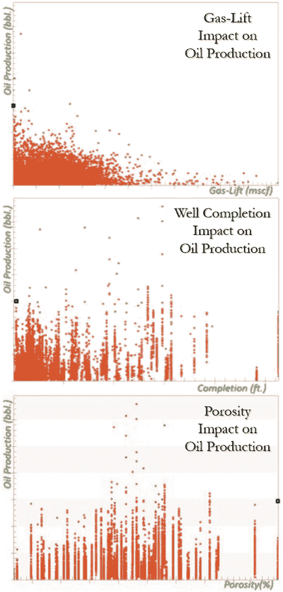

图 6.2 东南亚某气田的实际实测数据。三幅图都显示了产油与气注（左侧）、完井（中间）以及孔隙率（右侧）的关系。

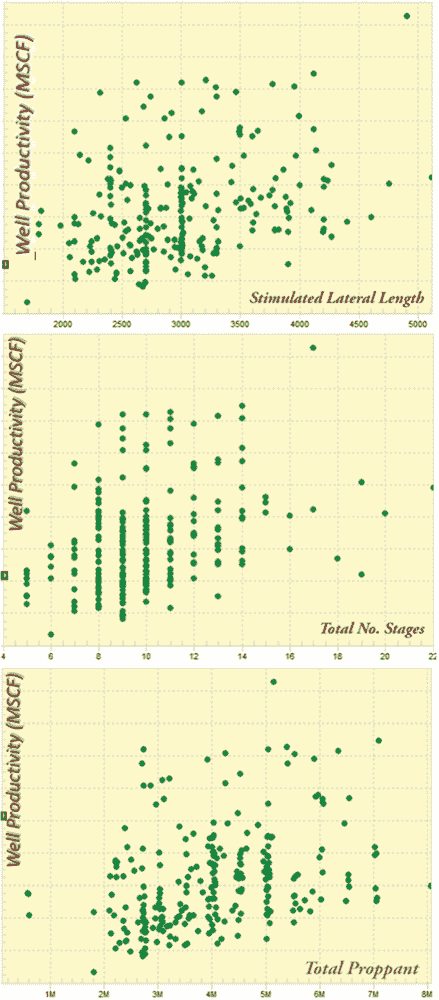

图 6.3 宾夕法尼亚州西部马塞勒斯页岩气田的实际实测数据。三幅图都显示了产气量与受刺激侧向长度（左侧）、总分段数（中间）以及支撑剂总量（右侧）的关系。

由于此类营销公司无法利用复杂的实际实测数据来实现其基于 AI 的解决方案，它们得出结论，生成它们目前所谓的“混合模型”（Hybrid Models）。“混合模型”的定义是“实际现场测量”与“通过数学方程生成的数据”的结合。众所周知，通过数学方程生成的所有数据都包含数学方程中所有参数（变量）之间的某些类型的相关性。当大量数据已经包含了已知的相关性时，那么这些相关性就会从提供的数据中产生作为机器学习算法主要特征的模式识别。由于绝大多数数学方程已经包含了假设、解释和简化，它们被包含在“混合模型”中的数据生成将决定机器学习算法必须生成什么以及什么种类型的模式识别。这意味着，通过使用“混合模型”，我们已经在告诉人工智能必须生成哪种解决方案，而不是仅仅提供实际实测数据，并要求人工智能从实际数据中生成该种的模式，以发现正在解决的物理现象的真实情况。用于生成与实际现场测量数据混合的数学方程类型告诉了机器学习算法该怎么做。这就是 AI 伦理中的主要问题“偏见”（Bias）。

这里是上述段落提到的一个例子。图 6.4 提供了来自供应商和服务公司尝试用于开发基于 AI 模型的字段中两个（多个变量中的两个）变量的实际现场测量数据示例。假设他们在模型开发上付出了努力，但由于对人工智能在科学和工程应用方面的理解有限，他们无法开发出合理的基于 AI 模型。一旦他们无法做到这一点，他们就会开始使用“混合模型”。其中一家公司使用特定的数学方程，可以为几个变量生成数据。

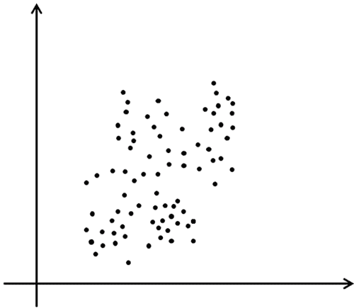

图 6.4 示例气田的实际实测数据示例。

第一家公司使用的特定数学方程生成的数据如图 6.5 所示。正如在图 6.4 所示，生成的数据仅显示了这两个特定参数（变量）。一旦完成从数学方程生成此类数据并用于机器学习算法，就可以开发出图 6.6 所示的模型。这些没有遵循 AI 伦理的公司仍会将此类模型称为基于 AI 的“混合模型”。

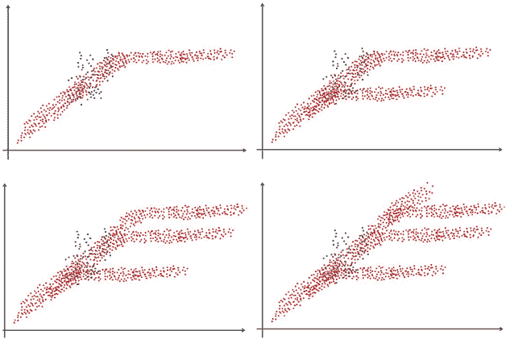

图 6.5 使用针对多个变量的数学方程生成的数据示例。这显示了两个变量的图表。

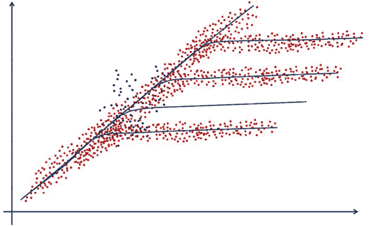

图 6.6 使用“混合模型”可以生成的模型，通过数学方程生成的数据识别模型特征。

图 6.7 和 图 6.8 显示了由另一家公司使用的另一个数学方程生成数据的类似方法，而图 6.4 中的原始数据数据也被该公司使用。由于该数学方程与图 6.5 中使用使用的和显示的不同，因此该“混合模型”生成的基于 AI 模型将与图 6.6 中所示的不同。第二家公司从相同的实际测量数据（图 6.8）开发的“混合模型”与第一家公司使用相同的实际测量数据（图 6.6）开发的“混合模型”不同。

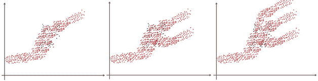

图 6.7 使用另一个针对多个变量的数学方程生成的数据示例。这显示了两个变量的图表。

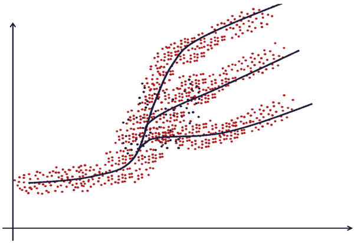

图 6.8 使用“混合模型”可以生成的模型，通过数学方程生成的数据识别模型特征。

图 6.9 和 图 6.10 显示了当科学家和工程师不了解 AI 伦理时，如何开发出带有偏见的“混合模型”。

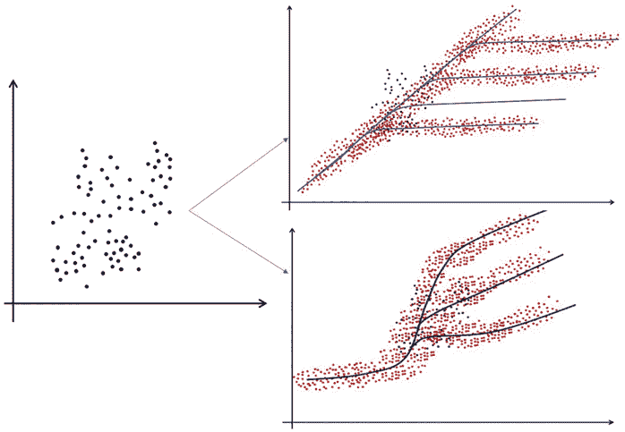

图 6.9 实际实测数据（左侧）与两个不同数学方程生成的数据结合。


图 6.10 通过 AI 伦理识别出的偏见，实际实测数据（左侧）被用于通过“混合模型”方法开发两种不同的基于 AI 模型。


由于我是一名石油工程科学家，我将提供与石油工程相关的示例，并尝试用最好的方式对它们进行解释，以便让所有科学家和工程师都能理解。在过去的十年里，美国绝大多数的碳烃（石油和天然气）产量来自页岩储层。页岩被称为非非常规储层，因为它与砂岩和碳酸岩储层等常规储层非常不同。所有的储层技术最初都是为常规储层开发的，但现在这些常规技术被应用于页岩等非非常规储层。与常规储层相比，这为页岩储层提供了更多的假设、简化和解释。这是一个包含偏见的重要案例：当某些个人、供应商和服务公司声称他们正在使用人工智能来解决页岩相关问题时，他们实际上仅在使用传统的数学方程来生成数据，然后利用这些数据通过机器学习算法来生成模型。

需要注意的是，储层岩石的某部分通常会被带到地表，并在实验室中进行测试和分析，以帮助科学家和工程师理解深层多孔介质流体流动物理的复杂性。然而，不能忽视此类分析的现实情况。虽然碳烃储层的体积大约有数亿到数百亿立方英尺，但带到实验室进行观察和测试的岩石通常小于几立方英尺。这提供了关于储层有多少百分比会被观察和测试的信息。此外，众所周知的是，碳烃储层具有高度异质性，这意味着在实验室对几平方英寸岩石进行的分析并不能代表整个储层岩石的情况。

因此，虽然实验室岩心分析是理解碳烃储层流体流动的重要且有效的过程，但它无法真实地代表地下数百英甚至数百亿立方英尺碳烃储层的所有细节和异质性。这阐明了用于模拟多孔介质流体流动的数学方程存在假设、解释和简化。此外，当碳烃储层是非非常规的（例如页岩岩层，目前是美国碳烃生产的主要来源），上述问题会变得复杂几个数量级，且更加重要。

在页岩岩层的完井、水压压裂和流体流动物理建模中，假设、解释、简化、先入为主的概念和偏见如此，以至于页岩井完井和生产优化的数学模型完全不切实际、毫无用处且充满偏见。这是因为理解碳烃储层流体流动物理性的历史细节主要适用于常规岩层。这种为常规储层开发的技术，从十年前开始被外推到非非常规储层。

一个明显的事实是，用于模拟页岩井碳烃生产物理特性的数学方程被假设所淹没，几乎与事实和现实没有任何关系，因为这项技术的核心本质主要适用于常规储层，而非非非常规储层。很难找到任何真正的科学家和专业工程师（包括那些开发并正在使用这些技术的人）来声称，页岩井水压压裂数学建模的当前版本与现实有任何联系。

这些事实证明，利用人工智能开发所谓的“混合模型”充满了假设、解释和偏见，这与人工智能在科学和工程应用中的现实毫无关系。当使用此类数学方程来生成数据，并将这些数据与实际现场开发相结合以建立所谓的“混合模型”时，这些模型可能会被强制生成由其开发者预先设定的输出类型和结果。这消除了人工智能真实的特征——即人工智能本能够基于现实而非基于猜测和偏见对物理学进行建模的能力。这是如何在该技术的科学和工程应用中必须解决人工智能伦理（AI-Ethics）问题的一个良好示例。

众所周知，当对天然裂缝非非常规储层（如页岩）进行水压压裂时，其结果与对常规储层（砂岩）进行水压压裂的结果完全不同。在页岩中，由于复杂天然裂缝的存在，水压压裂会产生“裂缝网络”（如图图 6.11 和图 6.12 所示），而不是椭圆形的水压裂缝（如常规储层的图 6.2 所示）。


图 6.11 天然裂缝储层的水压压裂无法基于真实测量进行建模，因为没有办法识别数千英尺地下天然裂缝的分布。


图 6.12 天然裂缝储层中的裂缝网络。

如图 6.11 和图 6.12 所示，当为了水压压裂向非非常规储层注入液体（水）时，在注入支撑剂之前，它开始使地层。当地层开始破碎时，裂缝的延续将通过岩石中阻力最小的路径。在天然裂缝储层中，阻力最小的路径是天然裂缝网络，而岩石的结构（数年前未产生天然裂缝的部分）阻力更大。因此，对页岩等天然裂缝储层非非常规资源进行水压压裂，会产生极其复杂的天然裂缝网络，这些网络无法进行详细建模。这是因为岩石（页岩）天然裂缝的形状、特征和细节无法在整个储层中观测或测量。非非常规储层水压裂缝网络极其复杂的形状是异质性和天然裂缝网络的函数。


在 50 多年前对水力裂缝进行模型开发时，常规储层中的水力裂缝形状是使用椭圆形进行建模的，如图 6.13 所示。这种传统的水力裂缝模型包含了四个特定特征，使其可以使用数学方程进行建模。这四个特定特征是：(a) 裂缝半长度、(b) 裂缝高度、(c) 裂缝宽度以及(d) 裂缝渗透系数。对比图 6.11 和图 6.12 中展示的水力裂缝形状与图 6.13 中所示的水力裂缝形状，可以清楚地看出，非常规储层与常规储层之间水力裂缝的实际形状有多大不同。


图 6.13 常规储层中的水力裂缝。

当实际的水力裂缝看起来像图 6.11 和图 6.12 所示时，使用图 6.13 所示的形状来对其进行建模是否有任何意义，或者是否与现实有任何关系？这个问题的答案必须非常清楚。这是一个很好的例子，说明了数学方程（用于模拟多孔介质中流体流物理物理）中所包含假设、解释、简化、先入为主的概念和偏见，是如何包含在将其与真实现场测量数据相结合的“混合模型”中的。

当基于 AI 的模型被用于决策时，AI 伦理已被证明是一个重要问题。AI 伦理可以揭示在科学和工程的人工智能应用以及通用智能问题解决中可能包含的偏见。几项研究（其中一些在本章中被引用）已经表明，种族主义和性别歧视等偏见是如何通过 AI 伦理被暴露在基于 AI 的模型中的。本章证明了由传统工程师建立的假设、解释和偏见是如何包含在人工智能的工程应用中的，这被称为工程 AI 伦理。

# 7 可解释的人智能 (XAI)

DOI: [10.1201/9781003369356-8](https://doi.org/10.1201/9781003369356-8)

可解释人工智能（XAI）是科学与工程人工智能应用的主要特征之一。正如前面的章节提到的，科学与工程人工智能模型纯粹基于事实和现实（实际测量数据）对物理现象进行建模。这项新技术与传统的工程应用非常不同，其主要目标是完全避免假设、解释、简化、先入为主的概念和偏见。科学与工程应用人工智能与通用人工智能不同的一个主要特征是它结合了 XAI。在利用实际数据测量值作为物理现象建模的主要构建块时，科学与工程人工智能结合了多种类型的机器学习算法，包括人工神经网络、模糊集合理论和进化计算。科学与工程人工智能的预测模型并不是由不可解释的“黑箱”表示的。科学与工程人工智能的预测模型具有合理的可解释性。


图 7.2 在过去的 12 个月里，冰淇淋销量与鲨鱼攻击具有相关性。这种相关性与因果关系完全没有关系。

## 解释传统工程模型

众所周知，通过数学方程生成的物理现象模型是可以被解释的。这是工程师和科学家期望任何物理现象的潜在模型都应该具有可解释性的主要原因之一。传统物理现象模型的可解释性是通过用于开发模型的数学方程的解来实现的。对这类模型的解释是通过对合理简单的数学方程进行解析解（或对复杂数学方程进行数值解）来实现的。数学方程的解为回答从物理现象模型中提出的几乎任何问题提供了可能。

数学方程的解被用于解释模型为何以及如何产生某些结果。它允许检查并解释所有涉及的参数（变量）对彼此以及对模型结果（输出参数）的影响和作用。通常情况下，这就是工程解决问题方法的定义。因此，基于数学方程的物理现象结果（无论其简单还是复杂）都可以被详细地解释。

图 7.3 显示了 Fetkovich “型曲线”。它包含了早期曲线（由瞬态流方程驱动）和后期曲线（边界主导流、Arp 递减曲线）。用于这一系列“型曲线”的方程也在方程 7.1 和 7.2 中给出，紧随图 7.3 之后。


图 7.3 Fetkovich 型曲线。

$q_{Dd} = q_{D}\left[\ln\left( \frac{r_{e}}{r_{wa}} \right) - \frac{1}{2} \right]$ (7.1)

$t_{Dd} = \frac{t_{D}}{\frac{1}{2}\left[\left( \frac{r_{e}}{r_{wa}} \right)^{2} - 1 \right]\left[\ln\left( \frac{r_{e}}{r_{wa}} \right) - \frac{1}{2} \right]}$ (7.2)

无量纲率(`q[D]`)和时间(`t[D]`)用于`方程 7.1` 和 `7.2`，并在测井领域背景下如下所示（`方程 7.3` 和 `7.4`）定义：

$q_{D} = \frac{141.2\ q\mu B}{kh\left( p_{i} - p_{wf} \right)}$ (7.3)

$t_{D} = \frac{0.001327 k}{\phi \mu r_{w}^{2}}$ (7.4)

可以清楚地看到，图 7.3 和 7.4 证明了物理现象是以类似的方式从曲线到曲线开发的。这种“型曲线”背后的原因是数学方程的解。使用数学方程开发的物理现象的性能是可以解释其产生机理的。当涉及到人工智能和机器学习的工程应用时，图 7.4 展示了“型曲线”的示例。


图 7.4 型曲线示例。

## 解释由人工智能开发的模型 (XAI)

在最近发表于《福布斯》的一篇文章中（`[23]`）提到：

“许多用于机器学习的算法在事后无法通过检查来具体理解是如何以及为何做出某项决策的。这对于目前最流行的算法——特别是深度学习神经网络方法尤其如此。XAI 是机器学习中的一个新兴领域，旨在解决 AI 系统的黑箱决策是如何产生的。到目前为止，在使深度学习方法具有可解释性方面只有处于早期、萌阶段的研究和工作。”

这篇文章写于 2019 年 7 月 23 日。它表明，使用人工智能和机器学习开发的模拟人类智能（非工程相关问题）的系统和模型，在解释该技术如何预测、预报或做出决策方面存在重大问题。这篇文章中提到的人工智能和机器学习的应用类型，以及许多其他关于 XAI 的最新文章，主要与非相关问题的应用有关。当涉及到人工智能和机器学习的工程应用时，“是如何以及为何做出某项决策”变得比该技术用于非工程相关问题时重要得多。因此，今天被称为 XAI 的问题自这项技术 20 世纪 90 年代开始用于工程领域以来就是一个重大问题。

有趣的是，利用人工智能和机器学习开发的可解释预测模型是由一家名为 `Intelligent Solutions, Inc.` 的技术公司开发的。


在过去的三十里，Intelligent Solutions, Inc. 和西弗吉尼亚大学开发的 PDA，其主要贡献之一是为预测性分析中所谓的“黑箱”创建了透明度。由于 PDA 是一项纯基于物理的技术，它避免了任何数学方程，并生成纯基于人工智能的预测模型，因此它能够开发出可解释的预测模型。

本章的目标是演示如何为使用人工智能开发的工程相关模型提供“可解释的人工智能”（XAI）。由于本书作者是一名石油工程师，本章中显示的 XAI 示例都将与石油工程有关。然而，同样的方法也适用于适用于所有其他使用人工智能建模的工程和科学技术。这种演示将通过关键性能指标（KPIs）、敏感性分析和类型曲线（Type Curves）进行解释。

## XAI 第一部分：关键性能指标 (KPIs)

在 PDA 背景下开发的基于人工智能的工程模型可以提供龙风图，以展示并排名用于开发（训练、校准和验证）预测模型的所有输入参数的贡献。本章接下来的 19 张图（图 7.11、7.13、7.14、7.15、7.16、7.17、7.18、7.19、7.20、7.21、7.22、7.23、7.24、7.25 和 7.27 以及 7.28、7.30、7.31、7.32 中用于生成工程模型 XAI 的模型是由一个名为“IMprove”并由“Intelligent Solutions, Inc.”开发的工程软件完成的。

图 7.5 显示了根据名为《Shale Analytics》 [24 ]的书中详细解释的技术，针对宾夕法尼亚州西南部的马勒斯页岩（Marcellus Shale）气田开发的人工智能工程相关模型所生成的龙风图。为该储层和完井工程相关问题开发的人工智能预测模型包含了 24 种现场测量值。该基于人工智能的预测模型的输出是该现场每口井的“30 天累计产气量”。


图 7.5 针对宾夕法尼亚州西南部马勒斯页岩的数据驱动预测模型，在 Shale Analytics 中生成的关键性能指标龙风图（石油数据分析在非常规储层中的应用）。

针对宾夕法尼亚州西南部马勒斯页岩的数据驱动预测模型，在 Shale Analytics 中生成的关键性能指标龙风图（石油数据分析在非常规储层中的应用）显示，平均而言，完井设计、井裂实施和地层特性最为重要。在图 7.5 中，图中部的每个属性都有背景颜色，而在图底部，背景颜色定义了重要性水平。

## XAI 第二部分：敏感性分析

用于解释模型行为的主要技术之一是敏感性分析。以下三个步骤中对这些基于人工智能模型的敏感性分析涉及约 250 口井。然而，接下来的三个步骤中提供的 XAI 可以适用于每口井。还应该注意的是，相同类型的 XAI 可以应用于几口井和/或所有井。本章后续部分演示的敏感性分析可以应用于储层的特定区域，或整个气田的所有井。

### 步骤 1：单参数敏感性分析

来自马勒斯页岩 308 口井的总现场测量数据被用于本章介绍的开发、验证和人工智能解释。来自马勒斯页岩约 250 口井的数据被用于开发这个“基于人工智能的页岩分析”模型，其余的 58 口井在基于人工智能的模型开发期间未使用。一旦完成使用 250 口井的基于人工智能的模型开发，为了理解模型行为的解释，将模型输出（6 个月产气量）作为修改每个单独参数的函数进行分析，以查看此类分析的结果是否符合工程（物理）逻辑。换句话说，其核心思想是能够“解释”人工智能模型。

如图 7.7 所示，在通过 250 口井通过训练、校准和验证完成基于人工智能的页岩分析模型后，在模型开发期间未使用的 58 口井被用作盲测（Blind Validation），以识别基于人工智能的页岩分析模型预测新井 6 个月产气量的准确性。如图所示，这 58 口盲测井的 R² 为 0.82。这将是该基于人工智能的模型预测马勒斯页岩所有新井 6 个月产气量的质量。本章这部分显示的内容是通过 Intelligent Solutions, Inc. 的“IMprove”软件应用程序开发的。


图 7.7, 图 7.8, 图 7.9, 图 7.10, 图 7.11, 图 7.12, 图 7.13, 图 7.14, 图 7.15 显示了几个井的单参数敏感性分析。在这九张图中，所有井的名称都提供在左上角，左下侧提供了用于开发基于 AI 的工程模型的每个井的实际现场测量数据。在图 7.7 中，显示识别出一个特定的井（`ISWN#032MSWPACW-3`），并展示了在构建此基于 AI 的页岩分析（Shale Analytics）模型期间该特定井的所有参数实际值（左下侧）。该图中选定的输入参数之一是“孔隙度”。


图 7.6 基于 AI 的页岩分析模型在训练、校准和验证期间提供了超过 0.95% 的 R²。然后，模型开发期间未使用的 58 口盲验证井显示了基于 AI 的页岩分析模型能多准确地预测新井的 6 个月产产量。


图 7.7 此图显示，如果保持所有其他变量不变，那么在 `ISWN#032MSWPACW-3` 井中，孔隙度的增加会导致碳烃产量的增加。


图 7.8 `ISWN#002MSWPAAD-1` 井中的相同行为（孔隙度增加导致井碳烃产量增加）在该地的其他井中也发生。


图 7.9 `ISWN#012MSWPAB-1` 井中的相同行为（孔隙度增加导致井碳烃产量增加）在该地的其他井中也发生。


图 7.10 此图显示，如果保持所有其他变量不变，那么在 `ISWN#056MSWPADU-1` 井中，受刺激侧向长度的增加会导致碳烃产量的增加。


图 7.11 `ISWN#032MSWPACW-3` 井中的相同行为（受刺激侧向长度增加导致井碳烃产量增加）在该地的其他井中也发生。


图 7.12 `ISWN#036MSWPAC-1` 中的中的相同行为（刺激侧向向增加导致井碳烃产量增加）在该地的其他井中也发生。

图 7.13 此图显示，如果保持所有其他变量不变，那么在 ISWN#012MSWPAB-1 井中，孔隙度的增加会导致碳烃产量的增加。

图 7.13 此图显示，如果保持所有其他变量不变，那么在 `ISWN#012MSWPAB-1` 井中，孔隙度的增加会导致碳烃产量的增加。


图 7.14 `ISWN#056MSWPADU-1` 井中的相同行为（孔隙度增加导致井碳烃产量增加）在该地的其他井中也发生。


图 7.15 `ISWN#076MSWPAHJ-2` 井中的相同行为（孔隙度增加导致井碳烃产量增加）在该地的其他井中也发生。

*(注：由于原文中从图 7.12 开始后续的图片路径和描述不完整或存在重复，翻译时根据您提供的占位符逻辑进行了对应处理)*


非常重要的一点是，开发这种“基于 AI 的页岩分析模型”并没有使用任何特定的数学方程（或通过基于方程的数据预设相关性）。图 7.10 对井（`ISWN#056MSWPADU`）的“受控侧向长度”进行了单参数敏感性分析，图 7.11 对井（`ISWN#032MSWPACW-3`）进行了同样的分析，而图 7.12 对井（`ISWN#036MSWPACC-1`）也进行了分析。同样的单参数敏感性分析还针对“每层支撑剂量”进行了重复，分别在图 7.13 井（`ISWN#089MSWPAK-1`）、图 7.14 井（`ISWN#056MSWPADU-1`）以及最后的图 7.15 井（`ISWN#076MSWPAHJ-2`）中进行。所有这些井和参数的模型行为从物理学角度来看都是完全合理的。这是页岩分析中 XAI（可解释人工智能）的一个良好示例。

#### 步骤 2：双参数敏感性分析

同时分析两个参数的敏感性而非单个参数，将得到一个三维图。如图 7.16 所示，某口识别井的“6 个月产气”（图中的 `Z` 轴）的修改被解释为两个储层特征“孔隙度”和“初始水饱和度”修改的函数。虽然人工智能模型生成了该特定井的产量，但它解释了在保持所有其他输入参数不变的情况下，井产量如何随着这两个储层特征的变化而改变。


FIGURE 7.16 此图显示了给定页岩井的烃类产量随两个变量（孔隙度和初始水饱和度）变化的敏感性，同时所有其他变量保持不变。

值得注意的是，这种“基于 AI 的页岩分析”模型的解释完全符合物理逻辑，因为它解释了：随着储层孔隙度的增加和初始水饱和度的降低，井产量将会增加。再次，重要的是：(a) 该区域的每口井都存在相同的总体趋势（井产量随孔隙度增加和初始水饱和度降低而增加），以及 (b) 没有使用任何数学方程来为这个“基于 AI 的页岩分析”模型的训练、校准和验证生成任何数据。

#### 步骤 3：多参数敏感性分析

当输入参数数量的敏感性分析增加到两个以上时，将无法再提供多维图表。执行多个输入参数（两个以上）敏感性分析的最常用方法是蒙特卡洛模拟（MCS）。在 MCS 中，对于使用多少输入参数进行多参数敏感性分析没有限制。

“基于 AI 的页岩分析”模型被用作 MCS 的目标函数。一旦确定了敏感性分析的参数数量，就可以开始该过程。在本章这一部分的图 7.17 示例中，已确定了四个参数用于敏感性分析。如图 7.17 所示，所确定的四个参数为：孔隙度 `[%`、初始水饱和度 `[%`、受控侧向长度 `[ft.]` 以及每层支撑剂量 `[lbs.]`。一旦确定了敏感性分析的参数数量，执行 MCS 需要以下三个步骤：


FIGURE 7.17 使用 MCS 进行多参数敏感性分析。预测模型被部署了数千次，以识别烃类产量随储层特征（孔隙度和初始水饱和度）和完层设计（受控侧向长度和每层支撑剂量）变化的潜在分布。

1. 确定每个参数的分布类型 `[均匀分布、三角形分布、高斯分布……分布]`，

2. 生成结果必须执行 MCS 目标函数（在本例中“基于 AI 的页岩分析”模型）的次数（模型输出——此处：井产量），最后，

3. 确定分箱（bins）的数量，以展示井产量随所有参数修改而变化的分布。

上述三个步骤包含在图 7.17 中。该区域三口井的多参数敏感性分析结果显示在图 7.17（`ISWN#002MSWAD-1`）、图 7.18（`ISWN#018MSWPABE-2`）和图 7.19（`ISWN#018MSWPABE-2`）中。在这些分析中，使用了四个参数（孔隙度、初始水饱和度、受控侧向长度和每层支撑剂量）来展示井产量对其修改的敏感性，同时保持每井的其他输入参数不变。蓝色柱状图显示了井产量随这些参数变化的分布，而红色曲线显示了分布的累和。


FIGURE 7.18 AI 模型针对井 `ISWN#018MSWPABE-2` 部署了数千次，以识别烃类产量随储层特征和完层设计变化的潜在分布。


FIGURE 7.19 AI 模型针对井 `ISWN#018MSWPABE-2` 部署了数千次，以识别烃类产量随储层特征和完层设计变化的潜在分布。

通过这些图中的红色曲线，可以根据敏感性分析参数的修改，确定每口特定井的 P10（产量产量）、P50（产量平均产量）和 P90（产量最低产量）。“蓝色柱状图”和“红色曲线”的特征详细地解释了该区域内每口井的“基于 AI 的页岩分析”模型的物理原理。

### XAI 的第三部分：类型曲线


正如本章早期提到的，使用数学方程生成的类型曲线（Type Curves）是非常“良的”（连续的、非线性的、具有在不同曲线之间以相似方式变化的特定形状）。图 7.20 展示了储层工程中生成的几个更多类型曲线示例。问题是，“能够生成一系列良好类型曲线的模型，其主要特征是什么？”对于这个问题，一个直接且简单的答案是：“能够生成一系列良好类型曲线的模型，是由一个或多个数学方程开发的基于物理的模型。清晰解释该基于物理模型行为的良好类型曲线，是通过数学方程的解生成的”。


FIGURE 7.20 储层工程的类型曲线示例。

接下来的问题将是：“如果证明（并证实）生成良好类型曲线的模型并不是使用任何数学方程开发的，该如何？如果这个模型完全基于人工智能呢？”那么合理的答案将是：

1. 这些良好类型曲线的生成证明了用于构建纯数据驱动模型的人工智能合理地代表了所建模的物理现象，
2. 人工智能预测模型可以清晰地解释，且
3. 开发此类模型的技术必须是坚实的科学与工程技术。

## 非常非常规储层的 XAI 模型 – 页岩分析

良好类型曲线的主要特征是生成这些曲线的模型的可解释性。图 7.21 和 7.22 是“解释”开发这些曲线模型的极佳示例。图 7.21 包含了三组图表/类型曲线。这些类型曲线以“受控压裂缝侧向长度（英尺）”为 x 轴，“6 个月累计产产量（Mscf）”为 y 轴。在图 7.21 中，图中每条曲线代表完井期间使用的水压压裂段数。每个图中都有六条曲线。每张图解释了宾夕法尼亚州南部一个特定的马塞勒斯页岩（Marcellus Shale）井的行为。每个图中的六条曲线显示了每个井的产量如何随着图 7.21 中段数（从 15 段到 40 段）以及图 7.22 中“受控压裂缝侧向长度（英尺）”的变化而变化。图 7.21 和 7.22 中显示的三口井隶属于该特定马塞勒斯页岩资产中三个不同位置的三口井。


FIGURE 7.21 井产量随受控压裂缝侧向长度和段数变化的类型曲线。


FIGURE 7.22 井产量随受控压裂缝侧向长度和每段支撑剂量的变化的类型曲线。

页岩分析（Shale Analytics）是人工智能在非常规储层中的科学与工程应用。为了完井和生产优化而开发的页岩人工智能预测分析完全基于实际现场测量。在页岩分析中，由于对页岩层中流体流动物理学以及实施水压压裂产生的裂缝形状和特征缺乏真实的理解，因此避免了任何类型的数学方程。

一旦完成页岩人工智能预测分析，通过生成类型曲线，使用 `XAI` 来解释页岩井完井和生产的物理机制。此类基于实际现场测量的解释完全避免了过去十年中石油行业一直使用的传统方法无法完成的任何假设、简化和偏差。使用 `RTA` 和 `NRS` 对页岩碳烃产量的传统建模包含的实际现场测量极少。`RTA` 和 `NRS` 包含了 `裂缝半长`、`裂缝高度`、`裂缝宽度`，甚至`受控储层体积 (SRV)`，这些实际上都不是实际测量的。

页岩分析的基础使我们即使在结论彼此 100% 不同也能得出结论。换句话说，此类技术可以生成任何形式的解决方案，且与事实或现实完全无关。它与我们的目标有关，而与页岩井碳烃生产相关的现实无关。

图 7.21 和 7.22 显示了 `XAI` 如何为马塞勒斯页岩资产中的每个井提供信息。类似的类型曲线可以为每个井场、页岩资产的每个特定部分或整个页岩资产生成。在图 7.21 中，`XAI` 显示 015 号井的 6 个月累计产产量从 850,000 MSCF 增加到 130 万 MSCF，其“受控压裂缝侧向长度（英尺）”从 3500 增加到 10000。这种产量随受控压裂缝侧向长度的变化是非线性的，当水压压裂完井设计从 15 段变为 40 段且构建此模型的其他变量保持不变时，其显示方式会发生变化。如果完井设计包括 15 段，那么当受控压裂缝侧向长度从 3500 增加到 10000 时，产量可以从 850,000 MSCF 增加到 105 万 MSCF。如果完井设计包含倍数的段数（30 段），那么当受控压裂缝侧向长度从 3500 增加到 10000 时，产量可以从 900,000 MSCF 增加到 125 万 MSCF。

对于 112 号井（图 7.21 中的中间图），类型曲线解释了当“受控压裂缝侧向长度（英尺）”从 3500 增加到 10000 时，6 个月累计产产量可以从 100,000 增加到 900,000 MSCF。这种产量随受控压裂缝侧向长度的变化是非线性的，当水压压裂完井设计从 15 段变为 40 段且构建此模型的其他变量保持不变时，其显示方式会发生变化。如果完井设计包括 15 段，那么当受控压裂缝侧向长度从 3500 增加到 10000 时，产量可以从 100,000 MSCF 增加到 700,000 MSCF。如果完井设计包含倍数的段数（30 段），那么当受控压裂缝侧向长度从 3500 增加到 10000 时，产量可以从 100,000 MSCF 增加到 820,000 MSCF。


对于井 `#002`（图 7.21 中的底部图表），类型曲线解释道，随着该井“受压侧向长度（英尺）”从 3,500 ft 增加到 10,000 ft，6 个月累计产产量可以从 750,000 增加到 125 万 MSCF。这种产产量随受压侧向长度增加的变化是非线性的；当水力压裂完井设计从 `15` 段变为 `40` 段时，图中显示的方式可能会发生变化，前提是构建该特定模型的所有其他变量保持不变。

如果完井设计包含 `15` 段，那么随着受压侧向长度从 3,500 ft 增加到 10,000 ft，产产量可以从 750,000 MSCF 增加到 116 万 MSCF。如果完井设计包含两倍段数（`30` 段），那么随着受压侧向长度从 3,500 ft 增加到 10,000 ft，产产量可以从 100 万 MSCF 增加到 121 万 MSCF（图 7.22）。

图 7.22 中的类型曲线解释道，在这一马塞勒斯页岩资产中，井 `#325` 的 6 个月累计产产量随着该井“受压侧向长度（英尺）”从 3,500 ft 增加到 10,000 ft，可以从 10 万 MSCF 增加到 120 万 MSCF。这种产产量随受压侧向长度增加的变化是非线性的；当水力压裂完井设计中每段的支撑剂注入量从 `188,000` lbs 变为 `993,000` lbs 时，图中显示的方式可能会发生变化，前提是构建该特定模型的所有其他变量保持不变。

如果每段支撑剂量为 `188,000` lbs，那么随着受压侧向长度从 3,500 ft 增加到 10,000 ft，产产量可以从 10 万 MSCF 增加到 50 万 MSCF。如果每段支撑剂量增加到 `680,000` lbs，那么随着受压侧向长度从 3,500 ft 增加到 10,000 ft，产产量可以从 15 万 MSCF 增加到 103 万 MSCF。

对于井 `#110`（图 7.22 中的中间图表），类型曲线解释道，6 个月累计产产量随着该井“受压侧向长度（英尺）”从 3,500 ft 增加到 10,000 ft，可以从 100,000 增加到 950,000 MSCF。这种产产量随受压侧向长度增加的变化是非线性的；当每段支撑剂从 `188,000` lbs 变为 `993,000` lbs 时，图中显示的方式可能会发生变化，前提是构建该特定模型的所有其他变量保持不变。

如果每段支撑剂量为 `188,000` lbs，那么随着受压侧向长度从 3,500 ft 增加到 10,000 ft，产产量可以从 100,000 增加到 350,000 MSCF。如果每段支撑剂量增加到 `838,000` lbs，那么随着受压侧向长度从 3,500 ft 增加到 10,000 ft，产产量可以从 150,000 增加到 830,000 MSCF。

对于井 `#066`（图 7.22 中的底部图表），类型曲线解释道，6 个月累计产产量随着该井“受压侧向长度（英尺）”从 3,500 ft 增加到 10,000 ft，可以从 10 万 MSCF 增加到 122 万 MSCF。这种产产量随受压侧向长度增加的变化是非线性的；当每段支撑剂从 `188,000` lbs 变为 `993,000` lbs 时，图中显示的方式可能会发生变化，前提是构建该特定模型的所有其他变量保持不变。

如果每段支撑剂量为 `188,000` lbs，那么随着受压侧向长度从 3,500 ft 增加到 10,000 ft，产产量可以从 10 万增加到 60 万 MSCF。如果完井设计的每段支撑剂注入量增加到 `993,000` lbs，那么随着受压侧向长度从 3,500 ft 增加到 10,000 ft，产产量可以从 25 万 MSCF 增加到 125 万 MSCF。

重复之前的观点，Shale Analytics（以及）并没有使用任何方程来生成图 7.21 和 7.22 中所示的类型曲线。图 7.24、图 7.25、图 7.26 中数据的复杂性阐明了石油工程中所使用的可解释人工智能（XAI）的质量。


`FIGURE 7.27` 东南亚某海上成熟油田的现场测量数据，该数据被用于人工智能储层模拟和建模（自上而下建模 – TDM）。

### 石油工程中 XAI 的历史

自 2001 年以来，已发表了七篇石油工程师协会（SPE）论文，其中包含了如今被称为 XAI（可解释人工智能）的内容。这七篇 SPE 论文总共包含 38 张图表，它们利用人工智能预测分析模型来解释这些模型如何完全基于实际现场测量数据而非数学方程，来解释所建模的物理现象。为了展示 XAI 在石油工程中的历史应用，本章本节展示了这七篇 SPE 技术论文中的大部分图表。

第一篇包含如今被称为 XAI 的早期版本的技术论文是 2001 年发表的一篇 SPE 论文（`SPE 72385`）[26]。该论文关于人工智能和机器学习在水力裂缝建模中的应用。`Figure 7.28` 显示了该 SPE 论文中的几张与 XAI 相关的图。在本文中，使用人工神经网络开发（训练、校准和验证）的人工智能模型用于解释三个水力裂缝相关参数的影响。


`FIGURE 7.28` SPE 72385 论文的图 7。单井“Carlson, Thomas #075”分析 – 对注水量的敏感性。

这些水力裂缝相关参数是射孔数、注水速率和总注水量。文中的 XAI 解释了这些参数对井产量（5 年累计产气量）的影响。此类关于参数对井产量影响的解释被用于确定作为射孔数、注水速率和总注水量函数的井产量优化。`Figure 7.28` 显示了该论文的图 7，解释了井产量（5 年累计产气量）达到最大值的条件。对于这口井（`Carlson, Thomas #075`），只要射孔数和注水速率保持在最小值（注水速率为 `25 bbl./min`，`8 perforations`），5 年累计产气量即可达到 `57,050 MSCF` 的最大值；而只要射孔数和注水速率保持在最大值（注水速率为 `60 bbl./min`，`26 perforations`），即可达到 `63,400 MSCF` 的最大值。

如 `Figure 7.28` 所示，当这些参数（射孔数和注水速率）保持在最小值时，最高的 5 年累计产气量（`57,050 MSCF`）在 `680 barrels of water` 时达到。相反，当这些值保持在最大值时，最高的 5 年累计产气量（`63,400 MSCF`）在约 `725 barrels of water injected` 时达到。结论可能是，对于这口井，理想的注水量约为 `700 barrels`。这篇 SPE 论文还包含了另外两张类似的图，展示了同一油田内另外两口井的解释（`Figure 7.29`）。


`FIGURE 7.29` SPE 77597 论文的图 8。修复后测量值的敏感性。

第二篇技术论文（`SPE 77597`）采用了类似的方法，将人工智能和机器学习应用于现场数据。


第五篇包含 XAI 的技术论文是 2005 年发表的一篇 `SPE` 论文（`SPE 95942`）。该论文涵盖了俄克拉荷马州黄金趋势（Golden Trend）水力压裂的 XAI 研究。文中包含了两幅图表，展示了该地区多个单井水力压裂的 XAI 结果。`Figure 7.34` 解释了每英射孔（x 轴）和注入速率（`BPM/ft`）（y 轴）如何影响三口单井的 30 年最终剩余产量（EUR）生产能力。随着射孔数量和每英尺厚平均注入速率的变化，这些井表现出不同类型的响应。随着射孔数量和平均注入速率的增加，每口井的产量响应均不同。

```
FIGURE 7.34 SPE 95942 paper’s Figure 13. Sensitivity analysis for "Shot/ft" and "Rate" for three wells in the database.
```

第六篇包含 XAI 的技术论文是 2006 年发表的一篇 `SPE` 论文（`SPE 10174`）。该论文涵盖了传统数值模型智能代理建模的 XAI 研究。`Figure 7.35` 提供了模型的类型曲线，证明了特定储层对产油量的影响，而 `Figure 7.36` 提供的模型类型曲线则证明了另一个特定储层对含水的影响。

第七篇包含 XAI 的技术论文是 2010 年发表的一篇 `SPE` 论文（`SPE 13902`）。该论文涵盖了巴肯页岩（Bakken Shale）水力压裂的完井设计特征。文中所示 XAI 模型是使用 `Imagine` 软件开发 `TDM` 的。

```
FIGURE 7.35 SPE 10174 paper’s Figure 10. Behavior of 5-Year Cumulative Production as a function of time for different values of "A" of top layer. This can be considered a type curve for this reservoir.
FIGURE 7.36 SPE 10174 paper’s Figure 11. Behavior of instantaneous water cut as a function of time for different values of "B" of top layer. This can be considered a type curve for this reservoir.
```

`Figure 7.37` 展示了利用 XAI 解释随 `Lateral Length` 和 `Injected Fracturing Fluid` 变化的产产特征（左图），以及随 `Pay Thickness` 和 `Lateral Length` 变化的产油量特征（右图）。

```
FIGURE 7.37 SPE 13902 paper’s Figures 27 and 28 – effect of volume of injected fluid and lateral length on production rate (Middle Bakken model) – effect of pay thickness and lateral length on production rate (Middle Bakken model).
```

## 备注

1. 网站：[`IntelligentSolutions.com`](http://IntelligentSolutions.com)
2. 网站：[`shahab-mohaghegh.medium.com/petroleum-data-analytics-frequently-asked-questions-51309078bcf`](https://shahab-mohaghegh.medium.com/petroleum-data-analytics-frequently-asked-questions-51309078bcf)

# 参考文献

1. Minsky, M. and Papert, S., *Perceptrons: An Introduction to Computational Geometry*, The MIT Press, Cambridge, MA; London, 1969, ISBN: 0 262 13043.
2. Hodges, C., *A Short Biography of Alan Turing*. [`www.turing.org/`](https://www.turing.org/)


# 参考文献

17. `Doshi, T.`, “介绍包容性图像竞赛”，2018 年 9 月 6 日，Google AI 产品经理 - Google AI 博客。[`ai.googleblog.com/2018/09/introducing-inclusive-images-competition.html`](https://ai.googleblog.com/)

18. `Dave, P.`, “谷歌独家搜索：通过开发新的肤色衡量标准以减少产品偏见”，2021 年 6 月。[`www.reuters.com/business/sustainable-business/exclusive-google-searches-new-measure-skin-tones-curb-bias-products-2021-06-18/?utm_medium=techboard.fri.media.20210618&utm_source=email&utm_content=&utm_campaign=campaign`](https://www.reuters.com/)

19. `Dastin, J.`, 亚马逊弃用显示对女性存在偏视的秘密 AI 招聘工具。路透社发布 - 旧金山，2018 年 10 月。[`www.reuters.com/article/us-amazon-com-jobs-automation-insight/amazon-scraps-secret-ai-recruiting-tool-that-showed-bias-against-women-idUSKCN1MK08G`](https://www.reuters.com/)

20. `Hao, K.`, 减少人脸识别的偏见并不能使其变得不可怕。麻理工科技评论发布。技术政策 - AI 伦理。[`www.technologyreview.com/2019/01/29/137676/making-face-recognition-less-biased-doesnt-make-it-less-scary/`](https://www.technologyreview.com/)

21. `Hao, K.`, AI 偏见真实是如何发生的 以及为什么如此难以修复。麻理工科技评论发布。技术政策 - AI 伦理。[`www.technologyreview.com/2019/02/04/137602/this-is-how-ai-bias-really-happensand-why-its-so-hard-to-fix/`](https://www.technologyreview.com/)

22. `Terence, S.`, 歧视性人工智能的真实案例。展示偏见与成见的 AI 算法真实案例。2020 年 6 月。[`towardsdatascience.com/real-life-examples-of-discriminating-artificial-intelligence-cae395a90070Sdfg`](https://towardsdatascience.com/)

23. `Schmelzer, R.`, 理解可解释 AI，福布斯发布。2019 年 7 月 23 日。[`www.forbes.com/sites/cognitiveworld/2019/07/23/understanding-explainable-ai/?sh=1f83c5ce7c9e`](https://www.forbes.com/)

24. `Mohaghegh, S.D.`, 储岩分析 - 非常非常规资源中的数据驱动分析。Springer 国际出版社，2017 年。硬装印刷本（ISBN: 978-3-319-48751-9）。[`www.springer.com/gp/book/9783319487519`](https://www.springer.com/)

25. `Mohaghegh, S.D.`, “数据驱动储层建模”。石油工程师协会（SPE）发布，2018 年。硬装印刷本（ISBN: 978-1-61399）。[https://store.spe.org/DATA-DRIVEN-RESERIR-MODELING]

26. `Mohaghegh, S.D.`, “数据驱动储层建模”。SPE。[https://store.spe.org/

27. `Mohaghegh, S.D.`, “成功数据挖掘技术的识别”。2001 年 10 月在坎顿召开区域会议。

28. `Mohaghegh, S.D.`, “普鲁德湾优化：使用神经网络技术”。2002 年 9 月在圣安东奥召开年度会议。

29. `Mohaghegh, S.D.`, “科德尔盆地人工智能的最新进展”。

30. `Mohaghegh, S.D.`, “替代场的不确定性分析”。SPE 工程，2004 年 4 月。

31. `Mohaghegh, S.D.`, “中东油田策略”。2005 年 11 月在阿布扎比召开国际会议。

32. `Mohaghegh, S.D.`, “巴肯页岩开发”。2010 年 10 月在摩根敦召开区域会议。

33. `Intelligent`。[https://www.intelligenet.com/]

# 索引

- AI 伦理: 6, 72, 73, 74, 75, 76, 77, 78, 79, 82, 85, 86, 88
- 人工工程智能 (AEI): 1, 9, 47
- 通用人工智能 (AGI): 1, 9, 34, 35, 41, 42, 57, 58, 59, 60, 89


# 人工智能

- 1, 2, 3, 4, 5, 6, 7, 8, 9, 10, 11, 13, 15, 16, 17, 18, 19, 20, 21, 22, 23, 24, 25, 26, 27, 28, 29, 30, 31, 32, 33, 34, 35, 36, 37, 38, 39, 40, 41, 42, 44, 45, 46, 47, 48, 49, 50, 51, 53, 54, 55, 57, 58, 59, 60, 61, 62, 63, 64, 65, 66, 67, 68, 69, 70, 71, 72, 73, 74, 75, 76, 77, 78, 79, 82, 85, 86, 88, 89, 90, 94, 95, 96, 97, 104, 106, 107, 108, 111, 112, 114, 115
- 避免, 5, 22, 25, 26, 33, 39, 45, 47, 53, 55, 61, 68, 78, 89, 95, 107, 108
- 偏差, 68, 72, 74, 75, 76, 77, 78, 82, 86, 88, 89, 108
- 黑箱, 68, 89, 94, 95
- 因果, 66, 67, 89, 90
- 相关性, 36, 37, 39, 66, 67, 78, 79, 90
- 数据分析, 65, 94, 96
- 数据驱动, 5, 9, 17, 22, 23, 24, 26, 41, 42, 44, 59, 64, 96, 106, 112, 115, 117
- 数据科学/数据科学家, 6, 35, 50
- 定义, 5, 7, 8, 10, 11, 17, 51, 55, 60, 79, 91
- 领域知识, 5, 8, 10, 18, 34, 35, 37, 38, 45, 47, 54, 55, 57, 59, 61, 62, 63
- 专家系统, 21, 22, 24, 26
- 可解释人工智能 (XAI), 64, 89, 90, 95, 96, 97, 99, 106, 107, 108, 111, 112, 114, 119
- 模糊逻辑/模糊集合, 25, 26, 66, 89
- 历史, 11, 19, 20, 25, 27, 29, 35, 61, 66, 90, 114
- 智人, 8, 27, 29, 30, 31, 32, 33, 50, 51, 58
- 混合模型, 39, 40, 42, 60, 78, 79, 82, 83, 84, 85, 86, 88


- `行业` 2, 3, 11, 33, 35, 37, 38, 65, 69, 79, 90, 92, 108

- `互联网` 1, 2, 4, 16, 52

- `学习` 1, 3, 6, 10, 13, 16, 17, 18, 20, 28, 34, 39, 41, 48, 51, 57, 61, 66, 77

- `逻辑` 7, 15, 17, 19, 22, 24, 25, 26, 65, 66, 71, 79

- `机器学习` 2, 3, 4, 5, 6, 7, 11, 13, 15, 17, 18, 23, 24, 25, 26, 28, 33, 34, 36, 37, 38, 39, 40, 41, 42, 45, 46, 47, 48, 51, 53, 54, 61, 62, 63, 64, 65, 66, 67, 68, 69, 72, 74, 75, 76, 77, 78, 79, 82, 85, 89, 94, 114, 115

- `感知机` 2, 20, 21, 23

- `石油` 1, 2, 3, 25, 26, 35, 36, 37, 38, 49, 62, 65, 78, 79, 85, 92, 94, 95, 96, 99, 108, 111, 112, 114

- `物理现象` 1, 2, 5, 41, 42, 47, 48, 49, 53, 54, 55, 59, 60, 61, 62, 64, 72, 74, 75, 77, 78, 79, 89, 90, 91, 92, 94, 106, 114

- `页岩分析` 95, 96, 97, 98, 99, 104, 106, 107, 108, 111

- `统计/统计学的` 3, 4, 5, 17, 26, 34, 37, 38, 40, 41, 44, 45, 51, 62, 65, 66, 68, 69, 70, 71, 75, 89, 90

- `传统/传统的` 3, 4, 5, 6, 11, 15, 17, 26, 34, 37, 38, 40, 41, 42, 44, 45, 49, 51, 55, 59, 60, 61, 62, 65, 66, 68, 69, 70, 71, 72, 74, 75, 76, 78, 87, 88, 89, 90, 91, 92, 95, 108, 119

