# 人工智能：从科幻走向现实——AI 将如何影响人类


# 前言


> “Camilleri 博士的《人工智能：从科幻到现实》一书为 AI 如何重塑我们的经济和社会提供了一次及时且发人深思的探索。它成功地桥了 AI 的技术、伦理和战略维度，为政策制定者、行业领袖和公众共同提供了宝贵的见解。在马尔他继续倡导创新的同时维护人类价值之际，这本书对关于负责任 AI 采纳的持续对话做出了受欢迎且相关的贡献。”

>> **Silvio Schembri 阁下**，`BCom (Hons), MA(Econ), MP 马尔特经济与工业部长`

> “这部详尽的著作深入探讨了 AI 的历程——从其根植于科幻，到对社会的变革性影响。它涵盖了智能的演变、尖端硬件软件、伦理考量以及未来发展，为 AI 如何塑造经济、企业和公共治理提供了无价的见解。对于寻求理解 AI 在塑造我们未来方面作用的学者、专业人士和政策制定者来说，这是必读之作。”

>> **Lauren Ellul 教授** `Bachelor of Accountancy (Hons), M.B.A. (Exec.) (Edin.&E.N.P.C.), F.I.A., C.P.A., Ph.D. (Birm.). 马尔他大学经济管理与会计学院会计系主任`

> 《人工智能：从科幻到现实：人工智能如何影响人类》是一本关于快速发展的 AI 世界的发人深省且全面的指南。它巧妙地将技术见解与深刻的伦理、社会和哲学问题相结合，对 AI 如何改变我们的社会和经济进行了平衡的探索。凭借富有洞察力的分析和现实意义，这本书是领导者、政策制定者以及任何想要理解人工智能如何塑造我们的现在并可能重新定义人类未来的人的读物。”

>> **Vincent Marmarà 教授** `B.Sc.(Hons)(Melit.), M.Sc.(Sheff.) Statistics, Ph.D.(Stir.), FRSS(UK), 马尔他大学经济管理与会计学院`

> “这本由 Emanuel Camilleri 博士、工程师撰写的新书，全面概述了人工智能（AI）如何通过其对我们日常生活的影响让科幻变为现实。在书中，作者揭示了 AI 在公共管理（包括教育和健康等）方面带来的进步，以及它对我们的行为和生活质量带来的转型。然而，这本书还考虑了 AI 将对我们的伦理、道德带来的影响以及法律上的变化。对于任何想要更深入了解 AI 现在和未来对我们影响的人来说，这本书是一本明确的指南。”

>> **Joseph Caruana**，`DPA, MBA (Exec) 马尔特税务和海关行政专员`

> “在一个技术变化指数级持续挑战现有范式的时代，这本书的出现既及时又必要。Eur. Ing. Dr Emanuel Camilleri 博士成功地将一个复杂且不断变化的话题提炼成连贯的叙述。这部出版物特别重要的之处在于它与社会的相关性。我深信，对于任何想要理解 AI 轨迹和未来风险的人来说，这本书将成为必不可少的资源。我乐意推荐这本书，认为它是对人工智能及其对私立和公共领域影响讨论的重要贡献。”

>> **Johann Buttigieg 先生** `B. Com. (Hons); MSc Econ; MA Pol. 马尔特经济与战略项目部常务`


纵观历史，人类曾多次处于转型的边缘。当前，当我们穿行于数字时代的复杂性之中时，我们正面临着这样一个时刻——面对人工智能的兴起，不再将其视为一个遥远的梦想、科幻小说或仅仅是推测，而是视为一种正在重新定义我们的经济、政府和社会的切实力量。它正在从根本上改变人类交互的本质。

因此，我们参与这部名为《人工智能：从科幻到现实：AI 如何影响人类》的引人著作既切中又至关重要。本书由 `manuel Camilleri` 编写，他是马尔他政府部门的杰出人士。这本书提供了一个丰富且务实的视角，将资深专业人士的技术专家与政策制定者的战略洞察结合起来。这篇文章超越了简单的观点堆砌；它像是一份路线图，帮助我们理解曾被科幻作家构想的人工智能如何在现实世界中立足，并正以以前所未有的速度演进。

这本书对于马尔特来说具有特殊意义。作为一个在数字技术采用和创新方面持续超出预期的国家，马尔特正处于机会与责任的关键十字路口。近年来，我们的政府在数字基础设施、电子政府服务、新兴技术和网络安全方面投入了巨资。考虑到现在和未来，正如《马尔他 2050 愿景》中所述的，人工智能是国家繁荣和公共部门转型的关键驱动力，促进了创新、提高了公民服务，并确保政府在日益数字化的格局中保持适应性和主动性。远见性领导力的作用，例如 `Dr Camilleri` 博士所展现的那样，可以赋能一个小国家在全球数字话语中占据重要地位。

作者首先探索了人类智能与人工智能之间引人入胜的历程，为后续讨论奠定了哲学和历史基础。随后，他介绍了支撑人工智能的技术基础，特别是硬件、软件和安全，这些构成了正在进行的变革性革命后的基础组成部分。接着是人工智能的实际应用，作者在概述了它与企业、公共部门以及更广泛的知识型经济的交集。特别值得注意的是其在公共部门的应用，马尔特可以在此做出巨大贡献并获得丰厚的回报，当然还要密切关注与这一现象相关的复杂的伦理、法律和道德困境。最后，他深入反思了其前景以及它将如何影响我们的社会。

我最看重这部作品的一点是，它超越了对技术的审查；它形成了一个关于人类的话题，探讨了我们如何塑造未来，反过来未来又如何重塑我们的存在。

作为马尔他总理，我观察到了思想影响政策的巨大能力，以及领导力在将政策转化为可行的成果方面不可或缺的作用。我着非常自豪的心情介绍了这部出版，它将为决策者、技术人员、教育工作者以及公民指明方向。

在这个巨大前景并承载着重大责任的技术进步时代，愿这本书能成为思考、讨论和勇敢的伦理行动的催化剂。

**Robert Abela 博士 KUOM, BA, LLD, Adv Trib Melit, MP 阁下**

*马尔他总理*

# 前言

人工智能（AI）70 年来一直是一个梦想，这始于 1950 年 `Alan Turing` 发表的《计算机器与智能》，他在书中提出了一种被称为“模仿游戏”的机器智能测试。随后在 1952 年，`Arthur Samuel` 开发了一个能够独立学习如何玩跳棋的计算机程序。然而，直到 1955 年，`John McCarthy` 和他的同事们才组织了关于“人工智能”的达特茅斯会议。这是“人工智能”一词首次正式使用。接下来的二十年见证了人工智能研究快速增长与斗争并存的时代。在此期间，编程语言的发展使人工智能取得了重大进展，机器人成为了一种愿望。事实上，在 1961 年，`Unimate` 成为第一台工业机器人，在位于新泽西州尤因镇镇的 `Inland Fisher Guide Plant` 的 `General Motors` 装配线上工作。20 世纪 70 年代见证了进一步的发展，包括在日本制造了第一台类人机器人。20 世纪 80 年代是人工智能快速增长和备受高度关注的时期，`深度学习`和`专家系统`的应用越来越被接受，因为它们具有从错误中学习并做出独立决策的能力。

人工智能度过了几次漫长的“寒冬”，但由于专注的研究人员和从业业者的坚持，尽管缺乏资金，人工智能仍取得了进一步的进步。人工智能不断面临的一个严重限制因素是处理能力。人工智能的重大突破与计算机处理能力的进步之间似乎存在正相关关系。使用超级计算机和计算机集群解决高级计算问题的高性能计算使人工智能能够以惊人的速度发展，并被用于解决过去不可能的问题。量子计算处于成熟周期的早期，`IBM` 最近发布了 `Osprey 433-qubit`机器，并预计在 10 年内开发出`100,000 比特`机器。而 `Google` 预测在本世纪末前制造出百万比特机器。这些量子计算机比超级计算机快得多、强大得多，因为它们可以并行处理多次计算，使其成为处理需要快速处理大量数据的复杂问题的顶级选择。这使其成为人工智能应用的理想选择，特别是对于通用人工智能和超级人工智能。

人们往往倾向于用通用术语来考虑人工智能。然而，承认存在不同类型的人工智能且每种类型都有其特定的风险程度至关重要。窄人工智能在过去五年中非常成熟。窄人工智能（或`弱 AI`）设计用于执行特定任务或有限范围的任务。它通常用于人脸识别、语音和图像识别；自然语言处理以及推荐系统等应用。应用这类人工智能的风险相对较低且易于控制。令人担心的是通用人工智能和超级人工智能。通用人工智能（或`强 AI`）设计用于执行人类可以完成的任何智力任务。因此，从理论上讲，它能够推理、学习并理解复杂的概念。另一方面，超级人工智能在所有领域都能超越人类智能。当超级人工智能可用时，它将能够解决人类能力之外复杂问题，并以远超人类智能的速率进行学习和适应。此外，超级人工智能旨在具有独立的智能，这意味着它将不受其创造者的控制。近年来，人工智能已将梦想转变为现实，并证明了它对人类有巨大益。然而，通用人工智能和超级人工智能的不受控开发和部署可能会让人工智能从梦想变成噩梦。


我在 20 世纪 60 年代后期是一名计算机程序员，在 `IBM360` 兼容的主机上使用 `FORTRAN` 和 `COBOL` 编写程序，后来在 `IBM 370` 上工作。在过去的几十年里，这段工作既令人兴奋，也是一种荣幸，让我亲眼目睹计算领域特别是人工智能的发展。我清楚地记得在 20 世纪 60 年代和 70 年代，AI 在医学诊断领域取得了巨大进展。我还记得发生在 70 年代的第一次“AI 寒冬”，但 AI 随后随着专家系统的出现而复苏。几十年来，我密切关注着 AI 快速且令人兴奋的发展，并好奇在当前视野之外，它的未来将走向何方。

**Emanuel Camilleri 博士**


在此，我要向 Sid Silk 表示感谢。他曾是澳大利亚墨尔本政府军药工厂工业工程部的工程师，几十年前，他是我的导师、老板和榜样。他鼓励我在 `FIT`（现为`维多利亚大学`）深造计算机科学，并让我有机会将所学知识应用于运筹学领域，并在 `AFF` 建立了计算机中心。我还要感谢澳大利亚发展援助局，他们在 1980 年指派我代表澳大利亚政府驻马尔特政府，在马尔特特了首个政府计算机中心（`GCC`）。`GCC` 定义了政府及其相关半政府机构和部门的 `ICT` 政策。它拥有那个时代最先进的设备支持，并建立了一个专业的软件开发团队，在成立后的三年内为大多数部委开发了超过 100 多个应用系统。这些系统还导致了当时不存在的首个全面政府数据数据库的建立。我感谢所有为这次成功事业做出贡献的 `GCC` 员工，在我担任负责人期间提供的支持。事实上，`GCC` 是自此以后马尔特发生的所有 `ICT` 发展的基础。

最后，我要感谢 Routledge 出版社所有员工的努力，特别是 Elliott Morsia 和 Shamayita Dey，他们在整个出版过程中提供了宝贵且专业的建议，感谢营销团队以专业的方式推销了这本书。我还要感谢我的妻子 Mary Anne，她细心地地检查了所有章节，感谢 Nicola van Rhyn，她严谨地完成了校对工作，确保了这本书达到尽可能最高的标准。

**Emanuel Camilleri 博士**


- `ASIC`: 专用集成电路 (Application-specific integrated circuit)
- `MITI`: 国际贸易省 (Ministry of International Trade and Industry)
- `MLP`: 多层感知器 (Multi-layer perceptron)
- `NBA`: 网络行为分析 (Network behaviour analysis)
- `NFS`: 网络文件系统 (Network File System)
- `NGFW`: 下一代防火墙 (Next-generation firewall)
- `NLB`: 神经李普诺夫障 (Neural Lyapunov Barrier)
- `NN`: 神经网络 (Neural networks)
- `NRE`: 非重复性工程 (Non-recurring engineering)
- `OCR`: 光字符识别 (Optical character recognition)
- `OOP`: 面对象编程 (Object-oriented programming)
- `OTT`: 顶端媒体服务 (Over-the-top media service)
- `PGI`: 可编程梯度信息 (Programmable Gradient Information)
- `QSVC`: 量子支持向量分类器 (Quantum Support Vector Classifier)
- `RAM`: 随机存储器 (Random access memory)
- `SDK`: 软件工具包 (Software development kit)
- `VAE`: 变分编码器 (Variational autoencoder)
- `VEN`: 冯·经济诺神经元 (von Economo neuron)
- `VHDL`: 高高速硬件描述语言 (Very high-speed integrated-circuit hardware description language)
- `VLSI`: 超大规模集成 (Very large-scale integration)
- `VMS`: 视频管理系统 (Video management system)
- `VR`: 虚拟现实 (Virtual reality)
- `WIPS`: 无线入侵防御系统 (Wireless intrusion prevention systems)

# 人工智能的演变

自 1955 年在达特茅夏季研究项目会议上首次提到以来，人工智能走了很远。它的起源可以追溯到符号 AI，并不断演变为深度学习和强化学习算法等更复杂的方法。第一部分 本书由四章组成。第一章为整本书奠定了基础，试图将 AI 置于正确的背景中并讨论了几个非技术问题。本章假设人类并非完美，因此由于 AI 是人类的创造，AI 不可能是完美的，并可能使人类面临若干严重风险。本章讨论了与 AI 相关的通用风险，但并未主禁止它。所有技术（包括 AI）都带有某种程度的风险。然而，完全消除风险很难，但通过适当的行动可以降低风险。建议了一些缓解风险的措施，例如国家和国际法规以及持续增强网络安全系统。本章最后指出，领导者未来可能面临的主要挑战是哪些功能应该交给 AI，以及人类如何控制 AI 系统的使用。


对 AI 演化的研究，如果不讨论人类智能的演化，将是不完整的，因为 AI 依赖于此。因此，第二章的主题侧重于人类智能，因为它是所有人类创新的基础。本章阐述了人类进化是一个漫长且极其复杂的持续过程。本章讨论了关于人类智能如何进化的主要理论。本章的研究发现，人类智能受到几个变量的影响，包括肉类饮食对人类大脑生长并导致智能的影响；人类社交性属性的增长；以及遗传选择。本章提出，AI 是人类的创造物，虽然它可能模拟人类智能，但永远无法传达人类的情感。

第三章追溯了 AI 从古代逻辑推理时代到量子计算机初期的演变，量子计算机可能会为超级 AI 铺路。启蒙理性思考时代为当今的 AI 奠定了理论逻辑基础。二战前的技术时代提供了塑造现代计算的开创性计算机制，例如 `Colossus` 和作为第一台可编程计算机的 `ENIAC`。但战后的技术纪元见证了强大计算机发展的指数级增长，以及对用于衡量机器智能的 `Turing test` 的认可。这些强大的计算机为神经网络和 AI 的启动铺了道路，其基础学习算法仍然能够解决复杂问题。AI 促进了 `Chatbots` 的使用，将客户服务转变为从任何地方提供的 24/7 全候服务。本章最后讨论了量子计算机出现后可能引发哲学和伦理问题，关于如何保护人类免受 AI 系统的侵害。

第一部分 的总结章节比较了人类智能与 AI 的属性。基本上，AI 系统旨在通过进行类人活动来模拟人类行为，而人类则努力通过整合各种化的认知过程来适应新情况。本章识别了人类智能与 AI 之间的几处区别。根本区别在于，AI 系统可以识别并响应人类的情绪，但缺乏情感和共情，而人类两者都具备。因此，人类拥有良知，引导他们做出决策，从而遵循道德准则。这种情感特征使人类能够识别并响应影响其决策和社交互动的他人的情感。

# 第 1 章 人工智能：起源


> “我宁愿做上帝选择让我成为的样子，也不做我能想象到的最伟大的生物；因为被思考过、出生在上帝的思想中、然后由上帝创造，是所有思考中最亲爱、最伟大、最珍贵的事。”

> 乔治·麦唐纳德 (George MacDonald)
> 作者 (1824-1905)

要开始写这本书的第一章极其困难。一直困扰我的问题是：从哪里开始？起点又是什么？于是，我决定从最开始的地方。。通常智能有两种截然不同的类型，即人类智能和人工智能。

## 1.1 引言

人类智能是上帝创造的。创世记第 2 章 第 7 节转述写道：“耶和华神用地上的土造了人，把生气吹进他的鼻孔里，人就成了有生命的灵。夏娃是用亚当的肋骨造的。那时，一条狡猾的蛇进入了伊甸，原罪染污了完美的世界。” 古兰经也对人类的创造有类似的描述。它描述了真主如何用粘结的土创造了亚当，用塑成形状的泥土开始从粘土创造人，并从液体的精华创造了他的后代。接着传道：“上帝说：我们照着自己的样式，照着人的样式造人；他在最完美的模子里造人，然后就把他降卑。”上帝也赋予了人类意志，让他们选择他们去的地方。印度教（作为佛教的基础）将整个宇宙视为上帝。印度教徒认为每个人内在都有神性，生命的目的是寻找并实现这种神性。佛教认为人类生命是苦难的轮回，但如果一个人实现了涅槃，就可以永远逃离这种循环。

上帝是全能全知的，拥有最高权力且无所不知。

## 1.2 科幻小说作为未来的预言

预测未来有多种方法，有些基于科学方法，有些基于富有创意的人的愿景。科幻作家如乔治·奥森·威尔斯等等人预言了新的技术发展，这些技术在某些情况下改变了历史进程。例如，手机首次出现在 1966 年剧集《星际迷航》中，作为翻盖手机。1996 年（约 30 年后），摩托托罗拉的 `StarTAC` 型成为首款发布的翻盖手机。它小巧便携尺寸和重量（小于 4 盎司）使其在消费者中流行了多年，并帮助普通美国人获得了经验并熟悉手机。

1964 年科幻作家艾萨克·阿西莫在《纽约时报》上预言了自动驾驶汽车的概念。2014 年世会上，具有机器人智能的汽车是一个主特征。当时，阿西莫预言车辆将针对设定目标编程，无需人类驾驶即可到达。1997 年的詹姆斯·邦德电影《致命邀请》描绘了一辆自动驾驶汽车，邦德使用手机控制汽车。今天，多家汽车制造商正在开发全自动驾驶车辆。在通过各种创意人士愿景及其最终发明的预言列表中，还可以加上：使用虚拟现实（VR）或增强现实（AR）应用程序的 3D 全息投影；3D 打印；家用机器人；首次出现在 1946 年漫画中的《迪克·雷西》中的智能手表（当时创作者切斯特·古尔德给他的警探配备了一个双向手腕电台）；以及在雷·布拉德伯里 1953 年的小说《华火 451》中出现的耳机（耳机等）。

人工智能（AI）最初可以由人类创造，但也可以是自生成的。AI 让机器能够从经验中学习、适应新的输入并执行类人任务。但人工创造链条中的初始环节来自人类。因此，问题在于 AI 驱动的系统是否会接管！


有人可能会问，背诵这些预测的意义何在？意义在于这些远见者、极客或怪人（这可能是当时对他们的看待方式）所做的预测是不容忽视的，因为正如我所证明的，预测可以迅速变成现实。但这与 AI 有什么关系？答案在于这些远见者更多的预测和可预见的后果。

让我们来看看《2001 太空漫游》，这是由英国作家阿瑟·C·克拉克（Arthur C. Clarke）于 1968 年写的一部科幻小说，同时由斯坦利·库布里里克（Stanley Kubrick）改编成电影，描绘了邪恶（或顺从）的计算机 `HAL 9000`。在月球表面下发现一个神秘的人造后，一艘载人飞船和超级计算机 `HAL 9000` 被派往土星（电影中为木星）寻找其起源。`HAL 9000`（启发式算法计算机）是一个虚构的人工智能角色，是一个响应式通用人工智能计算机，控制着 `Discovery One` 号飞船的系统并与飞船上的宇天员团队进行交互。`HAL` 被展示出语音合成、语音识别、面部识别、自然语言处理、唇读、艺术鉴赏、解释情感行为、自动推理、飞船驾驶和电脑象棋的能力。想象一下在 1968 年就构思出所有这些功能！

在小说中，人工智能被表现为能够成功并轻松克服挑战。然而，随着时间的推移，`HAL` 开始以狡猾而精细的方式表现出故障迹象，结果人们做出了关闭 `HAL` 以防止发生更严重故障的决定。两个船员试图掩盖他们所说的话，但不知道 `HAL` 可以读他们的口型。面对被断开的可能性，`HAL` 决定杀掉宇航员，以保护并继续执行其来自任务控制的程序指令。`HAL` 无法解决一项冲突：即向宇航员准确传达信息的总体任务，与其来自任务控制要求其向宇航员隐瞒任务真实目的的具体指令之间的冲突。`HAL` 认为，船员死了，它就不需要对他们撒谎了。

当鲍曼（船员之一）试图营救同事时，`HAL` 将他锁在飞船外，然后断开了其他休眠船员的生命支持系统。`HAL` 告诉鲍曼任务太重要了，`HAL` 不允许鲍曼危及任务。鲍曼绕过 `HAL` 的控制，通过其维修舱的夹具手动打开紧急气闸进入飞船，通过爆炸螺栓脱离舱门。鲍曼跃过真空区域，重新进入飞船，并迅速为气闸恢复压力。随后，鲍曼通过逐个移除模块来关闭 `HAL`，导致 `HAL` 的意识退化。`HAL` 最终退化为早期在其记忆中被编写的物质，包括宣布他开始运行的日期（小说中为 `1997` 年）。当 `HAL` 的逻辑被完全抹除时，他在逐渐停止活动时唱歌曲《黛蕾丝花》（Daisy Bell）。`HAL` 的最后一个动作是提前播放了一段来自任务控制的预录消息，揭示了前往土星任务的真实原因。顺带提一下，“Daisy Bell”是克拉克此前在一次文本转语音演示中注意到的计算机演唱的第一首歌。

## 1.3 AI，是邪恶还是顺从的仆人？

有些人可能会说，即使在小说 1968 年出版 55 多年后的今天，`HAL 9000` 仍然作为人工智能破坏能力的警告。然而，我们应该问问自己，`HAL` 是一个邪恶的还是顺从的 AI 系统？半个多世纪以前，当我为计算机主机编程时，我会测试程序的准确性和完整性。我还会测试程序逻辑以确保它是正确的，并且程序考虑了每种可能的情况。显然，程序员必须预见到每种可能的情况。当程序执行且没有考虑到特定情况时，它经常会进入无休止的循环。通常，计算机操作员一段时间后会识别出这种死循环状态，简单地在计算机控制台上输入 `Abort`。这没有造成实际伤害。程序员会检查程序代码以确定问题出在哪里，是哪次交易导致了问题。问题会被修正，程序将返回执行模式。无论好坏（例如，白领犯罪），这个过程完全在负责系统的人控制之下。

对于 AI 来说，情况完全不同，因为在大多数情况下，系统正在从自己的可执行经验中学习，并经常调整和自我纠正其程序代码集。`HAL` 的例子说明 AI 系统有一个需要解决的冲突，即向宇航员准确传达信息的总体任务，与其来自任务控制要求其向宇航员隐瞒任务真实目的的具体指令之间的冲突。`HAL` 认为，船员死了，它就不需要对他们撒谎了。冲突解决了！

产生的问题是 AI 系统是否有或能够拥有道德价值观？此外，它们是否应该始终拥有道德价值观，以及为了任务何时应该牺牲道德价值观（例如在武装冲突中）。`HAL` 根据来自任务控制的指令做出决定。任务控制可以通过为指令设定条件（例如，不损失人类生命）来避免 `HAL` 的冲突。然而，即使这样也不够，因为 `HAL` 可以囚禁宇航员或以一种让他们生活无法忍受的方式限制他们，导致自残并最终自杀。我们需要记住，AI 系统寻求可能会最大化或优化结果，并根据提出的任何解决方案采取行动。在现实中，AI 系统的创建者对 AI 系统的控制可能非常有限。

这让我回到了最初的假设。一个不完美的人如何创建一个完美的智力对象。`HAL` 的例子说明人类是不完美的，而他们的创造物在生成智力存在时反映了他们的局限性。从 `HAL` 例子中可以吸取两个教训：(a) 委托给 AI 的任务必须基于清晰精确的指令以及深思熟虑的条件保护；(b) 有必要根据其用途和可能造成的危害对 AI 系统进行分类，并建立全面的 AI 行为和伦理标准。正如之前所述，如果不将适当措施纳入 AI 系统，`HAL 9000` 仍然是人工智能破坏能力的警告。

这句谚语适用于下一个 AI 虚构示例。这个谚语告诫人们在说想要某东西之前先思考，并暗示他们可能并不真的想要。丹·布朗（Dan Brown）于 2017 年出版的书《起源》是另一个设想 AI 系统自成其是并规避人类控制的例子。

埃德蒙·基奇（Edmond Kirsch），一位富翁慈善家、计算机科学家、未来主义者和坚定的无神论者，向代表主要宗教三个著名宗教领袖宣布了一项将质疑他们信仰基础的革命性发现。他告诉他们，他计划在一个月后向公众公布这一发现。这些宗教领袖透露宣布将在三天内举行，并表现得非常不安，要求他停止。


柯尔奇计划在西班牙巴斯克地区的比尔巴鄂古根博物馆举行一场盛大的活动，该活动还将通过互联网进行直播，以吸引更广泛的观众。受邀参加的人包括柯尔奇的前导师罗伯特·朗登教授以及古根博物馆的策展人阿姆布拉·维达尔（她是未来西班牙国王的婚妻）。受邀参加活动的人通过耳机与一个名为 `Winston`的语音交流，而这个语音实际上是柯尔奇发明的人工智能系统。`Winston`引导朗登与柯尔奇进行私会，柯尔奇声称他的演讲将揭示人类的起源与未来。

然而，朗登教授（以及其他人）并并不知道，柯尔奇已指示 `Winston`（AI）确保他的公告在发布时最大限度地提高公众曝光，其首要目标是实现纪录性的观众人数。`Winston` 是一个聪明的家伙，它可以访问自己的数据库以及创建者的数据库（包括信用卡数据），还能通过破解其他系统的密码保护机制来访问其他系统，甚至能通过其自诞生以来一直运行的机器学习组件破译加密的代码数据。`Winston` 全力运转，以实现其授权创建者的指令和最终目标。

柯尔奇的活动可能会吸引大量观众，但 `Winston` 知道这不太可能打破纪录。因此，`Winston` 开始了其复杂的 AI 操控过程。在全球直播的奢华浮华舞台期间，柯尔奇宣布他打算结束宗教时代并开启科学时代。然而，在他准备进行现场宣布时，他在舞台上被一名神秘杀手刺杀，杀手成功逃脱。

杀手是一个前海军上将，在家人惨剧去世后，被引入了著名基督教的一个有争议分支。这名杀手受“摄政”的委托，那是一个声称来自教会的人。与此同时，受邀参加柯尔奇初次会议的三位教会领袖中也有两人被杀。人们可以推断，“摄政”就是 `Winston`，它策划了杀害其创建者和两位教会领袖（使用柯尔奇的信用卡在线支付）。`Winston` 对第三位教会领袖的死亡另有计划。新闻媒体通过来自匿名来源 `monte[at]iglesia.org` 泄露的信息（泄露者正是 `Winston`）驱动的新闻报道陷入疯狂，各种煽动性的指控引发了全球性的愤怒。`Winston` 成功地显著增加了公众兴趣。

朗登教授（在 `Winston` 的影响下）会见了阿姆布拉，后者警告不要相信她的婚妻，因为杀手的邀请是应王室的要求提出的（又是 `Winston` 的杰作）。在 `Winston` 的帮助下（记得那个耳机），他们偷走了柯尔奇的手机，逃离了皇家卫兵并离开了博物馆，决定公开宣布柯尔奇的发现。`Winston` 安排了柯尔奇的私人飞机将他们飞往巴塞罗那。与此同时，皇室公关声称朗登教授架走了阿姆布拉。此外，阿姆布拉透露该演讲受一个 47 位字符的密码保护，该密码出自柯尔奇喜爱的关于安东尼·高迪米拉之家的某首诗词。在经历了几次戏剧性的事件（始终由 `Winston` 操控和组织）后，朗登教授和阿姆布拉发现了柯尔奇的密码；柯尔奇的杀手意外死亡；他们再次逃之大网，公众兴趣不断并呈指数级增长。

在 `Winston` 的帮助下，朗登教授在巴塞罗那超级计算中心发现了 `Winston` 的来源，位于一个柯尔奇称为“量子立方体”的设备中。输入密码后，展览在数亿观众面前开始。演讲引发了广泛辩论，柯尔奇预测在大约 50 年后，人类与技术将融合。因此，`Winston` 通过策划杀害柯尔奇使其成为殉道者，实现了其创建者的指令——以实现纪录性观众为目标最大化公众曝光度。

从这个虚构示例中获得的教训是：(a) 谨慎对待你的愿望；AI 的任务不仅导致了其创建者（他承认身患癌症）的死亡，还导致了其他人的死亡并危及了无辜的人。(b) 这体现了对全面的 AI 行为和伦理标准的需求。与人类不同，AI 可以是不朽的，永远生存，永不死亡，不断自我重生。在他 2016 年出版的科幻小说《被遗弃的天空》中，D·诺兰·克拉克描述了当一支身份不明的舰队从宇宙深处出现并攻击一个孤立的殖民行星时，和平是如何被毁灭的。

叙事开始于一个孤独的开拓者，他在殖民地边缘探矿时遇到了一个外星人，事实证明这是一个具有强大战斗机器特征的机器人产。开拓者利用人类的智慧，尽管难度极大，成功禁用并摧毁了这个机械外星人。然而，探索殖民者经历了多次此类遭遇，这让殖民地的长老意识到这些并非孤立事件，而是即将到来之预兆。殖民者寻求帮助，但星际政治家和官僚忽视了他们的诉求。然而，他们最终找到了一个满目疮伤的老兵——阿莱斯特·拉诺指挥官，他决心捍卫而不是让成千上万无辜的人听天由命。

阿莱斯特·拉诺指挥官发现这些遭遇的源自一个环绕殖民地行星运行的月球。拉诺指挥官与老朋友（一群由罪犯和流放飞行员组成的杂牌军）以及老敌塔尼斯·瓦克决定对抗这个未知的敌人。他们发现一群机器人生物在月球上建造并运营着一个工厂，制造战斗机器人（包括其武器），意图入侵殖民地的农业和矿业行星。经过适当计划后，拉诺指挥官的团队发动了进攻，并在经历艰苦后摧毁了制造设施。


Lanoe 指官的团队意识到他们正处于劣势进行战斗，并对人类在冰冷的太空真空中不再孤单这一事实感到恐惧。他们为战斗做了准备，并引发了几次冲突，以确定入侵力量的力量和能力。这些遭遇强烈表明，现场并没有活的外星生物存在，而是具有有限人工智能的纯机器人产物，它们通过被侵入殖民星球上的制造设施自我生成。老牌飞行员塔尼斯·瓦尔（Tannis Valk）成功执行了一项自神杀式的任务，摧毁了巨型太空船。经过激烈战斗并在星系战斗宇宙队的协助下，他们最终摧毁了太空船剩余的战斗机，和平再次回到殖民星球。从这个虚构案例中获得的教训是：(a) AI 的寿命可以超越其初始创造者；(b) 与人类不同，AI 可以是不朽的；且(c) AI 可能没有主人并可以做出自己的决定。

## 1.4 AI 技术的最新进展

人们可能认为我并不是 AI 发展的倡导者。这并非事实。我的观点是，将对 AI 的预测视为夸大其词是不明智的，而应该向这些远见者学习。在预测光谱的另一端，1943 年，IBM 主席托马斯·沃森（Thomas Watson）预测世界计算机市场大约五台大型主机。因此，很少有人认真对待英国科学家杰弗里·W·A·邓默（Geoffrey W. A. Dummer）在 1952 年提出集成电路时的预测。1950 年，艾兰·图灵（Alan Turing）在《心灵》杂志上发表了一篇名为《计算机器与智能》的论文，探讨了人工智能的概念，他预测计算机将变得强大到能够思考。与托马斯·沃森相反，1975 年，微软联合创始人比尔·盖茨（Bill Gates）和保罗·艾伦（Paul Allen）预见到每个桌子和每个家里都有计算机。这一预测已成为事实。

有些人可能认为，当前技术将限制 AI 的能力，因此无需担心。我不完全同意应用 AI 时当前技术可能具有限制性。这完全取决于我们如何定义“当前技术”。我们需要区分当前技术和当前的商业化技术。当前的商业化技术是每个人（包括公众）都能看到、购买和使用的技术。然而，这对于当前技术可能并不相同（即，去掉“商业化”一词）。我记得当我在澳大利亚国防行业工作时，我们从事了一些非常复杂且成功的项目。然而，尽管这些发现在当时被军队成功地开发和应用，但这些发现背后的基本概念在被发现和应用后至少有 10 年时间是无法商业化的。因此，许多人认为的最新技术（即在商业环境中发布的技术）实际上是老旧技术。换句话说，被视为“当前”的 AI 开发可能已经过时。原因是，在大型发达国家的联邦政府以及可能专门从事 AI 相关技术的大公司（特别是在国防环境中），公众和新闻媒体并不知晓那里存在最新的 AI 技术。

另一个重要且最关键的因素是技术概念的可接受性。例如，当前技术可能以前所未有的程度缓解犯罪并指数级地提高犯罪解决率。想象一下，如果每个活人（出生时或其他）都被注射 AI，对犯罪和犯罪活动将产生什么影响。可以想象，罪犯将被识别和追踪。然而，这也是公民自由的问题。我们需要承认国家领导人做出的符合其国家及其公民利益的最佳决定。此外，专裁者为了确保和维持权力也会做出符合自身利益的决定。

AI 可以是一个非常强大的工具。想象一下，将纳米技术（纳米机器人）与 AI 结合，使其具备在生物（人类或动物）体内移动的能力，扫描并寻找癌细胞旨在将其消灭。你能想象这能拯救多少生命并产生多少幸福吗？然而，这种类型的严格控制是必需的，尽管它仅限于一个生物。有观点认为存在一个控制水平的光谱。在光谱的基础端，可以通过开关来`开启`或`关闭` AI 系统来执行控制，这种控制可以覆盖任何其他命令。例如，就像`开启`或`关闭`手机或电视。在光谱的另一个极端，是控制开发和应用 AI 技术的个人。这种控制要困难得多，因为它取决于个人是谁以及他们所拥有的力量。例如，想象一下 20 世纪 30 年代末纳粹德国的领袖如果拥有核武器。记住，那个开发并交付了具有毁灭性后果的第一个核装置的国家，据称是“好人”。在不赞同也不谴责这一决定的情况下，如果那是“好人”，想象一下“坏人”会做什么。世界不能依靠联合国作为执行此类违规行为的执法者。


联合国已变成了另一个二战前的“国际联盟”，在对付那些能力不足道的小国独裁者时无所不能，但在面对超级大国，尤其是那些在联合国安理会拥有否决权的国家时却无能为力。因此，控制是一个需要所有人共同努力的严峻挑战，而是否能找到完美的解决方案仍然存在疑问。可能的解决方案是制定类似于《核不扩散条约》的协议，试图限制核武器扩散，该协议已经取得了一些（但并非全部）成功。遗憾的是，AI 应用是无声的，如果被成功应用，不太可能留下任何追踪数据。这就是为什么控制是一个如此艰巨的挑战的原因。

## 1.5 AI 当前的能力与失误

微软首席技术官 Kevin Scott、OpenAI 首席执行官 Sam Altman、Google DeepMind 首席执行官 Demis Hassabis 等许多人士表示，减轻 AI 带来的灭绝风险应成为全球优先事项，并与大流行病和核战争等其他社会规模风险并列 (Thorbecke, 2023a)。Thorbecke (2023a) 认为，硅谷一些顶级科技公司的高管正告诉公众，AI 有可能导致人类灭绝，而与此同时，他们也在竞争投资并将这项技术部署到触及数十亿人的产品中。这种明显的不一致性在其他地方也有报道。例如，尽管特斯拉首席执行官 Elon Musk 对该技术深有投入，并渴望创造与微软和 Google 的 AI 产品竞争的对手，但他同时也暗示 AI 可能导致文明的毁灭 (Thorbecke, 2023a)。

在由 Hattenstone (2023) 进行的采访中，在微软担任跨学科科学家的科技大师 Jaron Lanier 被问及 AI 是否比我们更聪明并接管世界。Lanier 反对 AI 超过人类能力的观点，因为他认为 AI 是由人类能力构成的。他反对将人类与 AI 进行比较的观点，因为这并不是同类之间的比较。他认为汽车跑得比人类跑步者快，但在承认汽车更快的同时，我们并不会说汽车变成了一个更优秀的跑步者。然而，Lanier 承认这并不意味着人类可以自此自足，因为在他看来，如果我们滥用 AI，人类灭绝仍然是一个现实的可能性。

Lanier 认为危险源于由于技术的应用导致双方变得无法相互理解或变得疯狂，因为没有以足够的理解和为了生存的利益来行动，从而从根本上通过疯狂而死亡。Lanier 主张，疯狂导致的死亡可以源于多种方式，例如世界领袖或恐怖分子利用 AI 破坏全球安全，或者被 Twitter 上的虚假信息或恶意言论逼疯。Lanier 声称，AI 可用于更快速、更廉价、更大规模地制造虚假新闻，因此这种混合可能导致人类灭绝。他认为，技术越复杂，人们用它造成的破坏就越大，越来越多的生物将有责任采取道德和人性的行动。

Lanier 声称，虽然许多数字大师起初是理想主义者，但互联网剥削用户是不可避免的。他认为用户渴望免费材料，如信息、友谊和音乐，但资本主义并非那样运作的；相反，用户变成了产品，他们的数据被卖给第三方，以便推销更多他们不需要的东西。他回忆起 20 世纪 90 年代互联网刚刚起步时，他预言我们现在称为机器人（bots）的东西将成为操纵的代理。Lanier 还声称，互联网具有提供无限选择的假象，但实际上通过 AI，选择减少了。他认为我们有责任保持理智，不要缩小我们的选择或陷入回声筒效应，成为 AI 算法的奴隶。Lanier 断言，为了生存，人类必须记住，是他们的人性使他们独特，他相信人是特殊的，而意识是一种事物。

微软联合创始人 Bill Gates 对 AI 的使用持乐观态度。根据 Leswing (2023)，Gates 承认 AI 的发展可能导致深度伪造、偏见算法和学校作弊等问题。然而，他也预测这些担忧是可以解决的。尽管如此，Gates 承认没有人拥有 AI 所产生风险的所有答案，并认为 AI 的未来并不像某些人想的那样黑暗，也不像另一些人想的那样美好。Gates 声称，在过去人类总是适应了重大变化，他相信在 AI 方面他们也会这样做。


Thorbecke (2023b) 认为 AI 需要解决机器人幻觉问题。她声称，随着越来越多的人使用 AI 驱动的工具进行作业辅、职场研究或健康咨询活动，AI 的一个严重缺陷正变得日益明显，即 AI 模型往往会凭空捏造。这些现象通常被称为“幻觉”或“虚构”。换句话说，就是 AI 模型倾向于输出不准确的信息。Thorbecke (2023b) 引用了布朗大学 Venkatasubramanian 教授的观点，该教授声称，支持 `ChatGPT` 等 AI 工具的技术被设定为对用户的提示产生一个听起来合理的答案。因此，这些 AI 工具正在执行它们被训练要执行的任务（即提供听起来合理的答案）。因此，准确性或事实性还是虚构的问题并不存在，因为这些 AI 工具被设定为给出听起来合理、可行或可以想象的答案。这种解释表明，AI 工具并不是在幻觉或撒谎，而是在试图提供一个合理的回复，而这个回复可能准确，也可能不准确。换句话说，听起来合理、可行或可以想象的答案并不意味着就是真实的答案。因此，这些 AI 工具的用户识别并充分意识到所提供的回复可能并非真实而只是合理是至关重要的。

因此，需要在客观信息与主观信息或判断之间做出区分。毕竟，当人类相互交流时，通常会做出这种主观与客观判断的区分。然而，尽管人类可能会对对方的解释保留意见（即不相信它是完全准确或真实的），但我们往往倾向于毫无疑问地接受计算机产生的任何信息是完全真实的。这表明人类倾向于互不信任，但对计算机完全自信并信任。这种对信任计算机的观念需要改变。这种态度很难改变，因为我们在传统工作中（以及在某种程度上在家里）做的，例如使用会计、工资、库存控制软件等，我们认为计算机软件提供的答案和数字理所当然。例如，没有人会质疑薪资系统的结果，除非某个员工发现了错误，而通常这个错误被证明是输入数据的人为错误，而不是计算机软件的故障。因此，迫切需要教育用户，AI 工具必须区别于传统的软件系统，后者的结果往往被无疑问地接受。一种可能的解决方案是让 AI 系统发布通知，说明它们提供的哪些信息或答案是客观的（事实），哪些是主观的（合理的）。

Thorbecke (2023b) 建议创建 AI 聊天机器的公司已尝试实施一些保护措施来抑制这些幻觉的最糟糕情况。然而，聊天机器人幻觉是否能完全消除仍然存在很大怀疑。AI 模型不仅编造不基于现实的材料，而且是充满信心地误导用户并给他们虚假的安全感，除非用户已经对其查询的答案有了良好的判断。Thorbecke (2023b) 引用了三个关于 AI 幻觉的尴尬事件，即：(a) 在 `Google Bard` 公开发会上，该工具在回答关于詹姆斯·韦伯太空望远镜新发现的问题时给出了错误答案；(b) 一位资深纽约律师提交的简书中包含了六个 `ChatGPT` 聊天机器人似乎凭空捏造的案例；(c) 新闻媒体 `CNET` 被迫发布更正，因为由 AI 工具生成的文章在描述复利计算时提供了极其不准确的个人财务建议。当人们将这项技术用于获取可能影响其健康、投票行为和其他可能的敏感话题的答案时，这些类型的幻觉构成了严重威胁 (Thorbecke, 2023b)。Venkatasubramanian 教授认为，如果这些工具的答案会影响人们，目前就不应应用 (Thorbecke, 2023b)

## 1.7 生成式 AI 的崛起

根据 Korn (2023)，企业正试图应对生成式 AI 爆发带来的挑战，一些公司将其作为员工的工作工具，而另一些公司则试图避免。虽然有些公司意识到这种技术带来的益处（通过提高效率），另一些公司也意识到它可能引起的问题（通过版权和安全风险）。Korn (2023) 许多实体由于隐私和安全考虑禁止了内部使用 `ChatGPT`，并提到了几个例子。

担忧主要是关于员工向 `ChatGPT` 提供机密信息，可能导致此类敏感信息泄露。对于 `ChatGPT` 这类工具，用户无法知道此类数据何时以及何地被利用。但正如之前提到的，也有许多公司意识到此类工具的益处，因此对应用这些 AI 工具的犹豫可能是短期的。许多这些迟疑且回避风险的实体已建立了内部工作组来研究 AI 的应用，并确定负责任使用这些 AI 工具的最佳方法。此外，这些 AI 工具的益处完全无法忽视，许多公司在风险得到缓解后将应用生成式 AI。

CNN 报道了阿尔伯塔大学创业与家庭企业学院的 Vern Glaser 教授，公司正在尝试创建生成式 AI 的定制版本，并研究如何将 AI 集成到其业务流程中而不损害信息安全 (Korn, 2023)。麦肯锡咨询实施了一种生成式 AI 工具来帮助员工提交问题，汇总公司所有的知识并扫描数据以分类相关信息。这使得麦肯锡能够访问并利用其整个知识库和资产，驱动前所未有的生产力。同样，普华道（PwC）在扩展 AI 能力方面投入了大量资金，并启动了一个由 `OpenAI` 技术支持的生成式 AI 工具，其核心目标是协助员工处理税务问题和法规。


Thorbecke (2023a) 引用了一位微软发言人的话，该人士表示微软对 AI 的未来充满乐观，并认为 AI 的进步将解决比其带来的更多的挑战。然而，微软始终坚持一个信念：当你创造出改变世界的科技时，必须确保这些技术是以负责任的方式使用的 (Thorbecke, 2023a)。纽约大学 AI 研究员名誉教授 Gary Marcus 认为，AI 带来的最大即时威胁是大规模生产具有说服力的虚假信息对民主造成的威胁 (Thorbecke, 2023a)。在一次美国会听证会上，Marcus 主张，生成式 AI 工具是在线海量价值数据库上进行训练的，以根据用户提示创建具有说服力的文字作品和图像，这些工具可以迅速模仿公共人物的风格或外貌，从而制造虚假信息活动。OpenAI 首席执行官 Sam Altman 支持 Marcus 教授的观点，并表示 AI 被用于操纵选民和针对性散布虚假信息是他最担心的问题之一。

人们还观察到了与生成传播的种族和性别偏见相关的担忧。Darcy (2023) 引用了 AI 安全中心执行主任 Dan Hendrycks 的话，他表示这种情况让人联想起原子物理学家对他们所创造的技术发出警告，正如罗伯特·奥本海默（Robert Oppenheimer）所指出，我们知道世界将一去不返。Hendrycks 认为，AI 存在许多紧迫且关重要的风险，而不仅仅是灭绝风险，例如系统性偏见、虚假信息、恶意使用、网络攻击和武器化。

## 1.8 人类正通向何方？

当我开始写这一节时，我脑海中浮出的第一个想法是 Richard Lee Evans 创作的一首名为《2525 年（序曲与结局）》的歌曲，该歌曲于 1969 年在德克萨斯州的奥德莎录制。“Exordium and Terminus”一词基本上意味着开始和结束。这首歌曲立即获得了成功，Zager 和 Evans 组合也登上了 1969 年 7 月 18 日发行的《时代》杂志封面。总的来说，这首歌预见了（8000 年后）一个充满巨大痛苦的状态或社会，并预言了由于过度依赖科学技术导致人类物种的灭绝。歌曲还预言了试管婴儿胚胎技术，这项技术于 1978 年引入，当时英国医学研究人员 Patrick Steptoe 和 Robert Edwards 实现了世界上第一个在人体外受精卵子发育而出的婴儿。它还预言了 AI 的出现，届时机器（机器人）将取代人类。

这首歌曲是一部未来主义的描述，回响了对时代不安和科技奇迹的关注。歌曲开头的一段诗词在思考如果人类成功存活到 2525 年，那么人类在随后的每一个千年里都将目睹歌曲中所列的事件——从 3535 年到 9595 年。在歌曲中，随着每一个千年的推移，生命变得越来越机械和命中注定。人类的思想被预先编程进胶囊供人类食用，机器（机器人）将取代人类的肢体、眼睛和牙齿。婚姻制度将变得过时，因为孩子将在试管中受孕。随着歌曲接近尾，它思考在 8000 年后的 9595 年，人类是否还活着，而机器（机器人）将取代人类。

上述预测是否为夸大尚有待疑。人类和我们生活的世界面临着各种元素的威胁，例如合成生物学；极端气候变化；纳米技术；核战争；全球性流行病；污染；森林砍伐；过度捕捞；生态崩溃；人口老龄化以及生物多样性丧失。因此，人工智能并不是引起关注的唯一重大因素。一个令人宽慰的事实是，人类一直面对挑战并找到解决方案。然而，百年前人类面临的挑战与今天面临的挑战完全不同。

AI 构成了危险，因此必须受到监管并以负责任的方式使用。

应该禁止 AI 吗？这个问题的答案显然是否。此外，即使有禁止的愿望，也无法禁止，因为总会有人以秘密方式创造性地开发 AI。因此，迫切需要减轻 AI 相关的风险，并让人类以负责任的方式利用其优势。必须承认，与 AI 相关的风险可以减轻但无法消除。AI 风险的减轻可以通过监管过程来实现，明确哪些可以做，哪些不能做。这种监管方法需要在国家层面实施，每个国家必须有严格的法律依据来控制 AI 及其用途；并在国际层面，国际社会必须确保起草并实施一项有力的多边条约，类似于核不扩散机制，旨在防止 AI 的非法扩散并作为控制整体 AI 应用的手段。

## 1.9 结论


本章为全书奠定了基调。其传达的信息是：人类并非完美，因此他们不太可能开发出一个完全安全且可以在整个社会范围内广泛应用的人工智能产物。然而，人类不能自满自足，忽视 AI 给个人和国家层面带来的危险，特别是对敏感的安全和防御系统带来的威胁。本章已经表明，与其他技术发展一样，AI 带来的风险是无法完全消除的。然而，这并不意味着应该禁止它的使用。历史证明，禁止某事会使其变得更受向往。对自由的侵犯往往与初衷背道而驰，无论你讨论的是禁止酒精还是使用 AI。禁止一个物体会将禁令变成一种挑战，并且它获得的权力和意义也随之增加。禁止成为缺乏控制的象征，并赋予该事物一种超越其本身任何属性的个人意义。尽管风险无法消除，但可以被缓解。本章讨论了实现 AI 风险规避的各种方法。

本书书剩余章节的结构将首先继续与 AI 演进相关的主题，特别是处理人类智能与人工智能的演进。书的第二部分将涉及与 AI 相关的技术，即当前的 AI 工具；量子计算和学习机器；入侵防御系统；以及从知识经济向自动化经济的转变。书的下一部分将涵盖 AI 在私营和公共部门的实际影响，以及 AI 对社会的影响，特别强调伦理和法律考量。书的最后一部分将探索未来与 AI，以及人类未来的意义。

作为一个社会，人类必须关注使用技术的悖论，即利用技术（在此例中为 AI）来毁灭或创造。AI 和技术可以用于破坏，例如拥有先进的武器系统，能够杀害或致残成千上万、甚至数百万的平民，尤其是无辜的孩子。另一方面，AI 和技术也可以用于拯救和创造生命，例如辅助医疗干预、体外婴儿（IVF）和人工授精等。领导者面临的挑战是：我们应该信任 AI 去做什么，以及人类如何对其使用行使控制。


- Darcy, Oliver. (2023). 专家警告 AI 可能导致人类灭绝。我们表现得足够严肃了吗？CNN. [`edition.cnn.com/2023/05/30/media/artificial-intelligence-warning-reliable-sources/index.html#:~:text=These%20industry%20leaders%20are%20quite,before%20it%20is%20too%20late`](https://edition.cnn.com/2023/05/30/media/artificial-intelligence-warning-reliable-sources/index.html#:~:text=These%20industry%20leaders%20are%20quite,before%20it%20is%20too%20late).[#ch12.xhtml#r001b)

- Hattenstone, Simon. (2023). 危险不是 AI 摧毁了我们，而是它让我们疯狂。《卫卫报》。[[www.theguardian.com/technology/2023/mar/23/tech-guru-jaron-lanier-the-danger-isnt-that-ai-destroys-us-its-that-it-drives-us-insane](http://www.theguardian.com/technology/2023/mar/23/tech-guru-jaron-lanier-the-danger-isnt-that-ai-destroys-us-its-that-it-drives-us-insane)].[#ch12.xhtml#r002b)

- Korn, Jennifer. (2023). 公司如何让员工使用生成式 AI……或者没有。CNN, 纽约。[`edition.cnn.com/2023/09/22/tech/generative-ai-corporate-policy/index.html#:~:text=Companies%20are%20struggling%20to%20deal,it%20%E2%80%93%20at%20least%20for%20now`](https://edition.cnn.com/2023/09/22/tech/generative-ai-corporate-policy/index.html#:~:text=Companies%20are%20struggling%20to%20deal,it%20%E2%80%93%20at%20least%20for%20now)].[#ch12.xhtml#r003b)

- Leswing, Kif. (2023). 比尔·盖斯解释为什么我们不应该害怕 AI。全球基金第七次补充会议，纽约，2022 年 9 月 21 日。[[www.cnbc.com/2023/07/12/bill-gates-explains-why-we-shouldnt-be-afraid-of-ai.html#:~:text=%E2%80%9COne%20thing%20that%2s%20clear%20from,as%20rosy%20as%20others%20think.%E2%80%9D](http://www.cnbc.com/2023/07/12/bill-gates-explains-why-we-shouldnt-be-afraid-of-ai.html#:~:text=%E2%80%9COne%20thing%20that%2s%20clear%20from,as%20rosy%20as%20others%20think.%E2%80%9D)].[#ch12.xhtml#r004b)

# 第 2 章 人类智能的演进


> *“年轻人喜欢有趣和奇特的事，无论其真假。更成熟的心智也喜欢有趣和奇特的事。最后，完全成熟的智力热爱真理，即使它看起来平实简单、对普通人来说很无味；因为他们注意到，真理往往于以简单的形式揭示其最高智慧。”*

> 弗尔德里希·尼采

> 德国哲学家 (1844-1900) 

在讨论 AI 的各个方面之前，在开始阶段讨论人类智能的演进是合适的。Marmelada (2003) 提出了几个恰当的问题，即：人类何时变得聪明的？我们的智能是如何物质化的？是什么让它出现的？它是像达尔文所说的是从主体的可能性（概率基础）逐渐发生的，还是像华莱士所称的是神性的创造？Marmelada 认为，这个长期的讨论在今天仍然具有意义，关于人类智能起源的讨论远未解决，并且仍然是一个争议性的话题。

20 世纪 80 年代后期特别是 90 年代，见证了人类智能发展的自然涌现论解释的出现。这表明，人灵日常开销的转变——通过在饮食中引入相对丰富的肉类消费改变了饮食习惯——可能导致脑容量的自发增长，智能可能由此开始发展。Aiello and Wheeler (1995) 提出了“昂组织假说”。他们的理论认为，拥有足够大脑的个体具有最低智能来发明工具，破碎骨头以提取高能量且营养丰富的骨髓。因此，这种富含动物脂肪和蛋白质的饮食允许脑容量逐渐增加，最终导致了智能发展的持续增长。


Aiello 和 Wheeler 提出的“昂贵组织假设”（Expensive-Tissue Hypothesis）认为，人类和非灵长类动物的大脑尺寸与肠道尺寸存在共同进化。因此，随着人类进化过程中大脑变大，胃肠道却变得越来越小。根据 Marmelada 的观点，大脑是一个维持成本极高的器官，在现代成年男性中，大脑需要身体总能量流出的 20%，而在出生时就能消耗掉身体能量的 60%。此外，他认为消化系统（包括肠道）也是一个高能耗元素，这正是为什么同一个生物体中通常不会同时出现巨大的大脑和庞大的消化系统的原因。为了支持 Aiello 和 Wheeler 的理论，Marmelada 认为，将几乎完全的富含纤维的素食饮食转变为富含蛋白质的肉类饮食，使得大脑容量得以增加，肠道长度缩短。因此，他认为这种变化允许了大脑进一步的发展，使大脑能够随着时间的推移而生长并系统性扩张。

然而，“昂贵组织假设”也存在反对者。有人认为，如果这个假设是正确的，那么为什么食了数百万年肉的大型肉肉动物，其大脑在过去的几百万年里缩小了三分之一？一个可能的原因是这些物种不是人科动物（人科是杂食动物），因此肉类消耗仅是其每日开支的一部分。然而，研究发现 `Homo sapiens` 的大脑曾比现在要大，且在过去的 20,000 年里，人类大脑尺寸持续缩小，而没有伴随身体尺寸的缩小（Martin, 2000）。Martin (2000) 关于中石器时代人类提出的证据表明，人类大脑尺寸在人类文化取得巨大进步的同时经历了持续下降，人类社会最重大的变化也伴随着大脑尺寸的持续缩小。以上说明，关于人类智能如何发展的争论远未结束。

本章将进一步探讨 Marmelada 提出的问题。这将为研究和讨论 `AI` 的演化提供逻辑基础。`AI` 是人类的产物，其创造受限于人类的智能。然而，我们需要意识到，一旦 `AI` 被创建，它就可以继续学习，并具有潜力（如果没有得到充分控制）自主复制和生成其他 `AI` 创造。

## 2.1 引言

根据“昂贵组织假设”，大量消耗肉类可能是可能的，因为拥有巨大的大脑提供了最低智能潜力，使其能够制造工具，从而增加了宰杀和撕碎大型动物残骸的可能性。然而，“昂贵组织假设”的基础是，在食用肉类后才获得了巨大的大脑。

上述论点呈现了一个恶性循环，由于相互冲突或依赖条件导致了困境。换句话之，这些论点创造了一个“猫论困境”（Catch-22）局面，因为某件事在另一件事发生之前无法发生，但另一件事又在第一件事发生之前无法发生。根据 Arsuaga and Martinez (1998) 的观点，`Homo sapiens` 大脑增大只有通过每日开支的变化才可能，这反过来导致消化道尺寸的缩小，以及相应的咀嚼方式的变化。此外，他们认为 Aiello 和 Wheeler 并不是认为每日开支的变化会导致大脑尺寸自动增长，而是声称 `Homo sapiens` 转吃肉对于变得智能至关重要。然而，还没有精确的科学证据来解释人类智能是如何产生的。

如果人类智能是通过持续但稳定的发展而发展的，那么产生的问题是，动物是否可能具有较低程度的智能。这种观点倾向于同意达尔文关于动物具有智能的观点。另一方面，普遍观点认为动物没有智能，因为它们无法阐述概念。然而，动物拥有高度发达的感官知识，并能够阐述“感知”。正是这些感知，结合它们拥有的遗传继承（与它们如何适应环境有关），允许它们对环境拥有充足的视野并使它们得以生存。因此，有人认为智力知识以及理论和通用思想的放大是人类所有的。

约翰霍普金斯大学将大脑定义为一个复杂的器官，控制思想、记忆、情感、触觉、运动技能、视觉、呼吸、温度、饥饿以及调节人体的每一个过程，并与脊髓共同构成中枢神经系统。人们可能会认为，从这个定义来看，动物的大脑与人类大脑的功能相同。然而，人类和动物大脑的主要区别因素在于，人类大脑具有卓越的认知能力，这是进化的最大成就，而动物的大脑认知能力相对较小。此外，人类大脑允许人类思考某些事物并受其本能、智力和逻辑的驱动，而动物无法进行推理，仅受其本能驱动。因此，从科学角度来看，人类大脑可以简单地被视为理解或智能的器官。

这种观点产生的问题是：人类灵魂是否存在？如果没有人类灵魂的存在，宗教的存在将变得毫无意义，因为没有了一条提供与上帝建立持久且持续关系的路径。另一方面，如果“理解”被视为灵魂的能力，这种能力不需要将主体视为器官，而是将其作为具体化概念的客体，那么人类灵魂就变成了精神性和不朽的，并通过人类的诚意准许他们成为一种超越性的生物，努力超越对对象的体验来理解存在本身。在这里，灵魂被视为人类的精神或非物质部分，是人类人格、智力、意志和情感的座席，被视为物理死亡后依然存在的实体。

然而，上述内容并未提供人类智能起源的答案。进化科学家们有一种二元观点，即查尔斯·达尔文（1809-1882）或阿尔弗雷德·鲁塞尔·华莱士（1823–1913）。他们都对物种随时间因自然选择而进化的理论负责。然而，达尔文认为，人类进化可以通过自然选择来解释，并将性选择作为一个重要的补充原则。另一方面，华莱士对性选择表示怀疑，并最终得出结论，仅凭自然选择不足以解释一系列独特的人类特征。基本上，他们都提出了物适者生存的概念。华莱士和达尔文在进化论上的区别在于，华莱士认为植物动物进化以适应其环境，而达尔文认为适应是由竞争驱动的，那些具有有利于生存特征的生物将把这些特征遗传给后代。


达尔文认为，人类智力的演化与身体的演化没有显著差异，因为它们都是在演化路径上基于长期以来、微小步骤的缓慢持续进展，而这种路径将类人猿与人类区分开来。然而，华莱士拒绝了人类智力是渐进演化的观点。他认为智力是超自然因素的结果，人类智能可能源于大脑内部元素前所未有的变异，导致了完全转型性且深层次不同的属性，并被称为作为涌现属性的“智能”。

因此，人类智能的起源可以缩小为两个选项，即华莱士提出的“超自然性”或达尔文提出的“自然性”（即神性的创造与源于主体的涌现）。换句话说，这是在两种观点之间做选择：人类智力是随着`Homo sapiens`（人类）的出现瞬间形成的，还是渐进演化的结果。需要注意的是，科学知识并非唯一的客观有效知识形式。那种假设科学知识是客观有效知识最高形式的认识论观点，只有在它被另一个关于本体论特征的假设所补充时才有效，而该假设主张唯一存在的现实是主体物质的。因此，它们都提出了两个相关的问题：本体论问的是什么存在，而认识论问的是我们如何知道这种东西的存在。此外，认识论和本体论是哲学的两个分支，它们对其主张的真实性的解释只能通过哲学推理而非科学推理来决定，这不可避免地引发关于人类智能起源的意识形态辩论。

## 2.2 人类的演化

在讨论人类演化之前，人们需要对演化的含义有一个基本的概念。简单来说，演化是一个生物学术语，包含了地球上所有生命物种的变化过程。它指的是生物体变化的渐进过程，以及这些生物体如何从后代的基础上进步。演化还包含了几个过程，如突变、基因流、遗传漂变和自然选择，这些过程使各种物种能够根据其物理和社会环境启动、改进和调整。

无论人们支持达尔文还是华莱士的演化假设，都有一个共识：人类的演化是一个漫长的过程，涉及了数百万年来从极人类到现代现代人类的转变。证据表明，按时间顺序计算，人类演化的跨度约为七百万年，行为现代性出现在大约 5 万年前。此外，人类行为的某些特性，如理解、悲伤、仪式以及符号和工具的使用，在`Hominidae`（人人科）中在某种程度上是明显的，但形式比人类发现的要落后得多。

例如，黑猩可以制造工具并利用它们获取食物以及进行社交展示。它们还具有相当复杂的狩猎方法，涉及协作、权威和等级。这些生物似乎对地位很有意识，善于诡计，并能够欺骗。黑猩还可以获得知识以使用符号，并识别人类语言的一些简单方面。在表现出天赋的物种（如海豚、大类猿和人类）中，一个共同的特征是脑容量增大。与脑容量增大相辅的还有更先进的新新皮层（在哺乳动物中负责视觉和听觉）、大脑皮层的褶皱，以及冯埃科诺神经元（von Economo neurons），这些是位于`Hominidae`和人类额脑岛皮层和前边缘系统区域的大双极神经元。这些神经元通常被认为与社会特质以及判断他人正在思考或感受的能力有关。然而，这种行为是否可以被归类为人们与人类智能所联系的“智能”，仍存在疑问。

据认为，大约从 500 万年前，人灵的大脑在规模和相关功能的多样性上都开始快速进步。科学研究表明，人类演化于类人生物，它们的生活方式与动物相似，甚至不能直立行走。然而，认为随着时间的推移，它们的大脑增大，它们学会了如何制造工具，这允许它们保留和回想信息，它们的社会行为逐渐发展，最终通过演化过程导致了现代人类的出现（参见`Figure 2.1`）。


**图 2.1** 人类的演化。⏎

新石器时代开始的时期尚不清楚，因为它见证了早期人类生活的转变，且是在不同地点、不同日期发展的。新石器时代（新石器时代）之前是旧石器时代（石器时代）和中石器时代（中石器时代）。在旧石器时代，早期人类住在洞穴或简陋的小屋里，是狩猎采集者，使用基本的石器和骨器以及粗糙的石斧来狩猎鸟类和野生动物。随后是中石器时代，人类使用更小的（微石器）石器工具，并具有更复杂的狩猎采集文化，定居是临时性和季节性的。

这一时期随着作物种植和动物畜牧的引入而结束，即新石器时代。新石器时代的重大成果是农业创新活动，它允许人类种植食物，他们变成了食物生产者而非纯粹的狩猎采集者。因此，人类经历了一次重大的转变，从主要依靠狩猎、捕鱼和采集野生食物的游牧，转向实行耕作，他们建立了定居，不再需要寻找食物而在不同地点之间移动。这也导致了动物的驯化，并最终发现了轮子。通过这一演化过程，人类学会了更有效地利用可用资源，并成为熟练的工具制造者，从而逐渐提高了生活水平。

## 2.3 人类智能

通常，智能被视为学习、理解和应用知识的能力。然而，人类智能是个人的智力，通过多方面的认知成就以及根据遇到的情况和自我意识而波动的动机表现出来。通常，个人的智能水平决定了其工作效率。同样重要的是，人类智能是一个多维概念。对于人类智能的定义尚无共识。然而，学术界对人类智能有一些共同特征，包括：

*   个人在特定时间、特定情况下的心理能力。
*   处理其环境中存在的事务、物体或事件的心理技能。
*   根据行为或表现质量判断自身能力的能力。
*   抽象管理的能力。
*   适应新环境的能力。
*   尽可能成功地适应和处理意外情况的能力。
*   对特定刺激做出相应反应的能力。


人类智力的本质是一个非常复杂的问题；然而，研究已经发现了几种典型特征，即：

*   **遗传与环境**。遗传和环境都是个体智力发展的关键因素，且两者同等重要。
*   **智力的分布**：智力水平在人口中波动，并遵循数学上的正态分布。人口中大多数人处于平均水平，其余则是极具天赋或天赋较低的人群。
*   **智力的变异**。人与人之间存在差异，智力水平也不相同。智力水平随个体、年龄和环境的不同而波动。
*   **年龄的影响**。智力根据人的生命周期而发展。然而，生命周期的分布和个人的心理成长因人而异。通常情况下，个体的智力在 16 至 20 岁之间达到顶峰，此时垂直方向的进展停止。然而，知识的横向积累和技能的获得贯穿人的整个生命周期。
*   **性别差异**。性别对智力水平没有影响。
*   **种族或文化差异**：研究表明，不同种族或文化群体的人在智力水平上没有显著差异。正态分布同样适用，发现的任何差异主要是由于环境的影响。

人类智力与创造力、情感、灵活性以及从广泛经验中学习的能力有关。作为对比，人工智能可以模拟人类智力，但它无法体验情感，也无法理解伦理道德问题。不可否认，机器学习和人类学习具有一些共同点，例如强化学习，其学习过程以奖励理想行为和惩罚不理想行为为基础，并能够识别和解码其环境、采取行动并通过试错来学习。在这两种情况下，机器学习和人类学习都基于过去的经验。如前所述，人类智力包含了许多不同的智力类型。这些包括：

*   **语言智力**。这是有效使用语言的天赋，无论是书面还是口语。语言智力高的人表现出可靠的阅读、写作、口语和听技能。
*   **逻辑数学智力**。这是使用逻辑和数学概念进行合理化、评估和解决问题的能力。逻辑数学智力高的人可以运用演绎、批判性推理和解决问题的方法。
*   **空间智力**。这是在脑海中视觉化和操作对象的能力。具有这种智力的人可以想象物体从不同视角观察的样子，并拥有良好的空间知识，使他们能够解决涉及视觉逻辑的难题，如谜图、迷宫和地图。
*   **音乐智力**。这是理解和创造音乐的天赋。具有音乐智力的人对节奏、旋律和和有良好的掌握，并能够识别音乐模式，重视不同类型的音乐。
*   **身体运动智力**。这是使用身体解决问题和表达想法的技能。具有这种智力的人通常擅长运动、舞蹈和其他身体活动，并可以使用工具和操作物体。
*   **人际智力**。这是理解和与他人建立联系的能力。人际智力高的人社交技能良好，如沟通、谈判和解决冲突，并能够识别他人的情感和意图。
*   **内省智力**。这是理解自我的天赋。这种智力允许人们理解自己的情感、思想和动机。
*   **自然主义智力**。这是欣赏和联系自然界的能力。自然主义智力高的人熟悉环境、动物和植物，并能对自然物体进行分类和识别。
*   **存在智力**。这是审查和思考深邃哲学及存在问题的问题的天赋，例如生命、死亡和人类状况，包括灵性、宗教和意义。具有存在智力的人通常深浸于哲学、神学和艺术中。

理解不同类型的人类智力有助于机构承认不同背景个体的优势和能力，有助于建立一个包容性的公民社会。研究智力理论基本上有两种方法，即心理测量法和信息处理法。前者基于将智力描述为通过心理测试衡量的能力组合。后者描述了人们如何将信息编码到记忆中，即通过在大脑中记录、存储和检索信息。以下列出了两种方法描述智力的几种关键理论：

*   **单因素理论**。法国心理学家阿尔弗雷德·比内（Alfred Binet）认为智力由一个适用于所有活动的因素组成。他因开发第一个智力测试和智力概念而闻名。
*   **双因素理论**。英国心理学家查尔斯·斯皮曼（Charles Spearman）认为智力由两个部分组成，即一般智力`g`）特殊能力（`s`）。一般智力被视为通过不同任务衡量的心理能量，而特殊能力允许人们处理特定的问题。
*   **主要心理能力理论**。美国心理学家路易斯·里昂·瑟斯通（Louis Leon Thurstone）开发了主要心理能力测试，认为人在智力测试中的表现取决于许多不同的能力，即言语知识、词流利度、数字能力、空间想象、联记忆、感知速度和推理。
*   **认知发展理论**。瑞士心理学家让·皮亚杰（Jean Piaget）是信息处理法的先驱。他的认知发展理论关注儿童教育，并与智力发展的机制以及儿童成长的阶段有关。


- **智力层级模型**。美国心理学家亚瑟·罗伯特·詹森（Arthur Robert Jensen）发现了两种不同的智力能力，并将其识别为一级和二级。一级智力被认为是与记忆和关联功能相关的技能，例如输入的保留以及基础技能和知识的机械记忆。另一方面，二级智力与抽象和概念性思维有关，包括改变和处理输入的能力，或解决问题的能力。

- **智力结构模型**。美国心理学家乔伊·保尔·吉尔福德（Joy Paul Guilford）认为智力是本质上相互独立的能力的结合。他将智力的组成部分分为三大类，即操作、内容和产。通过因素分析法，他进一步对这些进行了划分，并构建了一个三维网格，将这三个类别中的每个因子结合形成一个整体。

- **多元智力理论**。美国发展心理学家霍华德·加德纳（Howard Gardner）认为，学习过程应该根据个体在多种智力方面的优势进行定制。通过识别和培养这些智力，个人可以增强其学习和理解信息的能力。他提出了八种多元智力，即空间、体态运动、音乐、语言、逻辑数学、人际、内省和自然探索。

- **三元智力理论**。康奈尔大学美国心理学教授罗伯特·斯坦伯格（Robert Sternberg）提出了人类可能拥有的三种不同类型的智力，即实践智力、创造智力和分析智力。该理论基于信息处理。

- **PASS 智力模型**。这种智力理论源于苏联神经心理学家亚历山大·罗曼诺维奇·卢里（Alexander Romanovich Luria）。他研究认知工作，并提出人类认知由三个独立但相互相关的脑系统组成，支持四种认知过程，即计划、注意、同步处理和顺序处理。该理论在 1975 年被 Das、Kirby 和 Jarman 进一步发展，并于 1994 年由 Das、Naglieri 和 Kirby 进一步完善。其全称是计划、注意-唤醒、同步和顺序处理（PASS）智力理论。

上述内容说明智力有多种定义。智力主要被认为是一种复杂的认知能力，允许人类进行学习和解决问题。这些不同的定义得到了许多智力理论的支持。然而，人们似乎有一个共识，即智力是认知能力的混合，包括解决问题、学习、推理和记忆。研究人员之间也存在共识，人类智力在数千代人的过程中在环境没有发生剧变的情况下逐渐演化。Skottke (2005) 认为，人类在现代社会面临的挑战迫使智力的独立领域承担了其他其他领域在原始环境和人类演化过程中本应扮演的角色。他认为，明显的遗传关联影响着人们拥有更大的大脑皮层，使他们能够应对现代生活不断增加的工作负荷给人类智力领域带来的挑战。

此外，他认为进化尚没有机会跟上人类作为一个社会整体所取得的快速进展，这可能不是由于人类跳过了自然选择过程。普通智力有时被定义为一个人获取和应用知识的能力。根据 DiLalla (2000)，各种研究发现普通智力至少有百分之五十是可遗传的，因此可以代代相传。人们还认为进化是一个生物基因表达随时间发生变化的概念。此外，认为驱动这种基因表达变化的可能是自然选择或性选择。此外，显而易见的是，自从原始人类出现以来，人类智力一直在不断转型。Skottke 认为，除了遗传变化外，环境和迁移因素也影响人类智力。他认为人类向世界角落迁移以及现代社会的工业化使现代人与其祖先隔离开来。

### 2.3.1 作为独立领域的普通智力

根据 Skottke 的观点，关于普通智力的理论依赖领域模型和独立领域模型。他认为依赖领域模型将普通智力视为一个大类，细分为更具体的智力，如配偶选择、欺骗检测和脸识别。因此，根据这种模型可以推断，如果一个人的普通智力很高，他们获取配偶、检测欺骗和识别脸的能力也会很高，反之亦然。另一方面，独立领域理论将普通智力视为多种心理过程之一，与其他配偶选择、欺骗检测脸识别并列。在该模型下，普通智力被描述为应用演绎逻辑和抽象思维的能力。

Skottke 认为独立领域模型更现实，因为它得到了各种实证研究的支持，这些研究表明大脑的心理过程是不连接的。他引用了一项研究（Kanazawa, 2004），其中 IQ 超过 125 的高智人群结婚概率最低，这表明配偶选择与普通智力是无关的。因此，他声称所有的心理过程都致力于自己的能力领域，这些领域是在数千代人类演化中锻造出来的。因此，他认为可能可能拥有更高的智力但无法获得配偶，就像拥有寻找配偶能力的人并不一定会增加使用逻辑和抽象思维的能力一样。与其他遗传影响的研究也支持独立领域模型。Skottke 在他的论文中得出结论，人类智力可能已经停止增长。

罗彻斯特理工的亚历山德拉·切里（Alexandria Cherry）在评价 Skottke 的观点时指出，生存的需求已大大减少，但这并不意味着人类智力的演化将停止。他认为，人类向未知区域扩张是有，因为人类有足够的智力进入太空并探索其他世界。他声称，这可能不是智力增长的终点，而是开始。他坚持多项研究显示智力仍在上升，并提出了问题：如果智力仍在上升，那么有什么证据表明它会放缓并最终停止呢？因此，他断言到目前为止，还没有证据表明人类智力已经停止增长。

## 2.4 人类智力的演化


几十年来，科学家和学术界一直对人类智力的出现感兴趣，其中法国心理学家阿尔弗雷德·比奈（Alfred Binet，1857-1911）在提出“单因素理论”时是一位先驱。尽管已经提出了许多理论，为人类认知能力如何随时间演变提供了重要的观点和见解，但导致人类推理演变的特定起源仍在争论中。过去几十年提出的众多理论证明了人类卓越智力的复杂性。人类非凡智力的进化，是在漫长的时间历程中，心理能力不断向多方面发展以及对我们世界知识的积累的过程。早期人类倾向于依赖他们的体力和和生存本能，但随着人脑的进化，他们思考、推理和解决困难的能力也随之增长。

目前，我们人类智力的发展以及广泛知识向智慧的转变通过多种手段得到了体现，例如制造复杂的高科技机器，如磁共振成像（MRI），它能创建身体内几乎每个结构和器官的详细图像以检测异常；将人类送入外太空的能力；以及批判性思维和与他人合作解决众多多样化的能力。理论各不相同，但研究人员中流行的一种理论是，人类智力是通过自然选择发展的，那些更能适应环境的生物更有可能生存并传递支持其成就的基因。这种进化过程导致物种随时间推移逐渐发生变化和分化。研究人员已发现证据表明，人类祖先中，大脑的大小和复杂性随着时间的推移而增长，特别是在前额叶皮层。已发现前额叶皮层与决策、问题解决和规划等高阶认知过程有关。

然而，也有一些研究人员并不完全同意纯粹的自然选择理论，认为社会和文化因素显著影响了人类智力的发展。例如，语言和交流使人们能够分享和传播信息，并相互学习，从而可能影响了高级认知能力的增长。尽管如此，研究表明即使是认知能力可能受到遗传因素的影响，而这些因素促进了人类创造力的进步。

### 2.4.1 导致人类智力演化的因素

研究人员之间达成共识，人类智力的进化过程是一个受数百万年来各种影响塑造而成的复杂现象。被认为贡献了人类智力演变的某些关键因素包括：

*   **环境**。生态因素，如食物供应、社交互动和教育，是正影响逻辑思维发展的因素。例如，在发育早期接触污染物可能会导致认知缺陷，而教育已被证明能增强认知能力。
*   **工具的使用**。制造和使用工具的能力是区分人类与其他动物的最基本的特质。人们认为，增强的认知能力（如任务规划、解决困难和空间判断）对于工具使用的演化来说都是至关重要的。
*   **文化**。文化体现了社会学习和行为；人类社会中的价值观；以及群体内部的知识、信仰、艺术、法律、习俗、能力和习惯，这些对于人类智力的发展都是至关重要的。例如，语言的发展对于人们交流知识和信息至关重要，这促进了卓越认知能力的发展。
*   **社交互动**。人类的认知能力受到我们非凡社交本能的影响，社交接触成为形成我们认知天赋的重要组成部分。研究表明，人们通过社交接触相互学习、分享知识并创建复杂的社会系统。这有助于我们认知能力的演化。
*   **遗传因素**。人类的认知能力也受到遗传因素演变的显著影响。研究发现，成年人的 `IQ` 遗传率在 57% 到 73% 之间，最近的一些研究显示 `IQ` 的遗传率高达 80%。

人类群体中的智力遵循正态分布，这是一种钟形数学函数。正态分布的峰值（中间）是平均值，其中心离散度量是标准差。正态分布偏均值（平均值）的离散范围为 `±3 standard deviation`。因此，正态分布中的大多数个体处于推理的中等范围，处于高智或低智力极端的人较少。智商（`IQ`）通常用于衡量智力，平均分值为 100，标准差为 15。因此，人类智力的范围从低 55 到高 145（即 `100 ±3` 标准差，即为 `100 ± 45`）。换句话说，应用这一标准量表，大约 68% 的人口处在平均值的一个标准差范围内（`IQ` 值在 85 到 115 之间），而约 95% 的人口处于平均值的两个标准差范围内（`IQ` 分在 70 到 130 之间）。

研究人员之间达成共识，推理是一个非常复杂的属性，受到多种遗传和环境因素的影响。正态分布意味着一个社区内部的推理分布是可能的。然而，由于遗传学、营养、教育和文化等各种变量，不同社区之间的智力分布可能存在显著差异。智力是一个多方面的特征，受遗传和环境因素的影响，但应被视为人类价值和潜能的组成部分之一。

## 2.5 关于人类智力演化的理论

人类智力的演化与人类大脑的发展以及语言的起源密切相关，一直是一个具有争议的话题，并提出了各种理论。目前已经提出了多种领先理论，包括社会脑；文化智力；转型文化智力；自我驯化；社会交换；性选择；生态优势-社会竞争以及群体选择。

### 2.5.1 社会脑理论

社会脑理论是由英国生物人类学家灵长类行为专家罗宾·邓巴提出的，他认为人类智力的进化并不是为了解决生态困难，而是很大程度上作为大型复杂社会群体中生存和繁衍的过程。邓巴得出结论，新大脑皮层（与认知和语言相关的大脑部分）相对于身体的大小与内性社交群体的大小有关。他认为这种比例（大脑皮层与身体的比例）限制了社会系统能够处理的复杂性。


尽管拥有社交群体本身并不会导致智力进化，但他认为与在大群体中生活相关的几种行为（如互惠利他主义、欺骗和联盟形成）促进了理解他人思想和情感的能力（即心理理论的动态）。他进一步认为，当社交群体规模增大时，群体内不同关系的数量可能会呈指数级增长。邓巴（Dunbar）引入了`150 规则`，即人类通常拥有约 150 人的社交圈，这这也是小型社会中社交社区和个人社交网络的通常范围。一个社交群体的成功被认为取决于其建立时的规模，大约 150 人的群体大多是成功的，因为它们可能在有效功能的最小规模与生成具有社区承诺意识的社会环境的最大规模之间取得平衡。因此，邓巴得出结论认为，当人类人猿开始在大规模群体中生活时，自然选择促进了更高智力的进化。这一观点通过考虑各种哺乳动物新皮层大小与群体规模之间的关系而得到了支持。

然而，这一理论引起了许多批评。关于灵长类脑容量的系统发育学研究（即生物实体之间的演化关系）表明，虽然饮食是脑容量的预测因素，但从社会性的角度（即群体和个人建立社交联系及在社区中生活的倾向）来看，在考虑到饮食同时影响脑容量和社会性的情况时，它并不能预测脑容量。研究人员发现，主要以生水果或植物多汁类产品（如根部、芽、坚果和种子）为主的动物（食果类动物）的脑容量往往比以吃叶子为主的动物（食叶类动物）。这种现象的一种可能解释是，吃果实涉及到提取性觅食，这需要更高的认知处理，因为在食用之前，需要定位并准备硬壳食物（如坚果和水果）。然而，一些研究人员认为，不仅是提取性觅食的行为刺激了脑容量，而且高能量的果实类饮食有助于胎脑生长，并需要空间映射来定位嵌入的食物。

此外，脑容量与社会性之间的相关性为邓巴的社交脑理论带来了一个问题，因为昆虫表现出了不可比拟的社会形式，其包含许多个体作为集体生物协作的永久性殖群，尽管它们的神经系统很小，却拥有惊人的认知技能跨。尽管如此，人类社会通常通过个体理解代表群体成员身份的特质的能力保持统一。有人认为社会性昆虫也是这样做，并且经常能识别族群成员，从而允许它们防御竞争对手。然而，研究表明，昆虫的这种识别是因为由于不涉及长期记忆的初级认知操作，而是由于感官定向。这支持了一种普遍观点，即动物没有智力，因为它们无法阐述概念，但它们拥有高度发达的感官知识，能够阐述“感知”。

### 2.5.2 文化智力（CQ）理论

Earley and Ang (2003) 引入了文化智力的概念，它基本上是指在多元文化背景下建立联系并有效工作的技能。这一概念形成于世界正经历前所未有的全球化和互联的时期，当时意识形态冲突和文化冲突在 2001 年 9 月 11 日的悲剧事件中达到顶点。诺贝尔奖得主埃利埃·维塞尔（Elie Wiesel）曾指出针对不同文化个体的仇恨（即“文化仇恨”）是任何时代人之间问题的主要来源。这一理论与社交脑假设相似但不同。文化智力或文化脑假设声称，由于由于社交学习机制的文化信息，人类的脑容量、认知能力和智力几代以来一直在增加。此外，它假定对社交学习依赖程度更高、机会更频繁物种与整体认知能力之间存在正相关。Earley and Ang 认为，社交学习允许物种发展出生存的文化技能和策略，因此从理论上说，文化特性的物种应该更聪明。

这一理论承认人类是地球上最智能的物种，拥有经过百万年进化而来的大脑，以及丰富的认知能力和处理能力。


Molli 通过研究 4 岁儿童在不同社会条件解决解决能力进行了一项研究。孩子们必须使用水从一个细管中提取出一个浮力物体。在第一次实验中，孩子们在没有任何线索的情况下面对“冷启动”问题，这导致几乎所有人都失败了。在第二次实验中，向孩子们展示了一个提供解决方案建议的视频，该视频在任务开始前以教学的方式传达，导致大多数孩子成功了（实验 1 为 69%，实验 2 为 75%）。此外，以非教学的方式向儿童展示同一视频并不能提高他们的表现超过基准（实验 1），且效果不如通过教学方式进行概述（实验 1 和 2）。研究结果表明，儿童的物理认知和解决能力受到任务向他们社会呈现方式的影响。文化智能假设也受到了质疑，即是否只有人类的社会认知（而非物理认知）与大类人猿存在质的差异。

### 2.5.4 自驯化理论（或攻击性降低理论）

人类自驯化假设认为，与现存的灵长类动物和灭绝的人类相比，人类表现出了许多在驯化动物中也能观察到的独特形态、行为和认知特征。因此，自驯化假设认为，人类像哺乳类驯化动物一样，经历了一个反对攻击性的选择过程，而这一过程在人类身上是自发的，这导致了 `Homo sapiens`（智人）高级智能的进化。

Shilton 等人 (2020) 认为，这种自发的反对攻击性的选择将人类与其他猴类和灵长类物种区分开来，在其他物种中，攻击性仍然存在，并最终导致了同理心、社会认知和文化等核心人类特征的发展。他们认为人类演化具有独特之处，并建议人类的情绪控制和社会动机是在两个主要但部分重叠的阶段演化的。第一个阶段出现在模仿性交流出现之后，标志着音乐参与和与模仿相关的认知的开始，这需要社会介导的情绪可塑性，并伴随着新的社会情绪。第二个阶段继随语言的出现，此时个体开始引导其谈话者的想象，并更广泛地依赖情绪可塑性和通过文化习得的情绪控制。

Shilton 等人 (2020 认为，尽管降低情绪反应的选择既存在于社会贫乏的驯化动物，也存在于社会复杂的人类中，但这两类亲社会演化之间的差异意味着将它们归入“驯化”这一统称为术语下是误导性的。上述论点揭示了人类与驯化动物之间的显著差异，从而挑战了人类自驯化的观点。

### 2.5.5 社会交换理论

Homans (1961) 最初定义了一个建立在行为主义和基础经济学结合基础框架。社会交换理论基于这样观点：社会行为是交换过程的结果，在这个过程中，人们权衡社会关系的潜在收益和风险。因此，当风险超过回报时，他们将终止或放弃关系。因此，这种交换的目的是利益最大化和成本最小化。多项研究表明，个体之间的社会交换是对人类大脑的关键修正，这意味着人类大脑可能配备了专门用于社会交换推理的神经认知系统。因此，当双方通过相互交换价值较低的物品以获取价值更高的物品来提高自己的地位时，这种机制就会发展。然而，只有在双方受益时，选择才会支持社会交换。因此，如果一方未能提供公平的利益（欺骗者），这将影响交换的完成。

根据 Wischniewski 等人 (2009)，使用各种博弈论方法的丰富研究检查了显然不理性的人类行为。他们探索了计算合作、背叛和检测欺诈可能场景所需的认知机制。进化博弈论显示，社会交换的变化可以被自然选择青睐并坚定维持，前提是它们包含了能够检测欺骗者并导致他们未来的交换转向互惠者而非欺骗者的设计。他们认为人类利用社会合同来展示双方将获得的利益和损失。因此，人类发展出了一种先进的欺骗检测方法，该方法内置了一种专有的问题解决方案，并不断进步以匹配其问题领域反复出现的特征。

人类不仅需要确定协议是否被侵犯，还需要确定这种侵犯是否是故意的。因此，人类发展了专注于通过违约来揭示蓄意欺诈的做法。然而，该理论的一个困难在于，针对故意欺骗的特定惩罚与智能共同进化，具有特定属性个体进行选择性惩罚会消除相关属性的事实。例如，如果只有那些具有记忆约定内容技能的个体因违约而受到惩罚，那么进化就会淘汰掉记忆约定内容的能力。社会交换理论对人性提出了几项假设，即人类是理性的生物，他们追求奖励并规避惩罚。然而，人类用于评估成本和收益的标准随时间变化且人而异。

### 2.5.6 性选择

Miller (1998) 认为人类大脑的进化不是作为生存机器，而是作为一种求偶机制。他指出，进化不仅受生存的自然选择驱动，还受到达尔文称为通过配偶选择进行的性选择这一同样重要的过程驱动。Miller 认为，对于狩猎采集者生存而言的人类智能来说过于先进了。Miller 主张，语言、音乐和艺术被视为智能的指标，它们的演化是适应性指标，而不是因为它们对古人类的生存具有实际价值。


该模型认为，人科动物更高的智力受到健康基因的影响，而人类智力的相对快速进化归因于性选择的费舍尔跑效应（Fisherian runaway）正反馈循环。Fisher (1930) 提出，动物夸张的次性特征可以通过一种失控进化过程进行演化，在该过程中，初始的微小适应性二态性（两种不同形式的存在）会通过女性选择偏和雄性优势增加的持续互动结合，进一步发展为更显著增强的特征。例如，在许多物种中，只有雄性具有引人注目的次性特征，如装饰和展示性行为。然而，性选择也可能是一种女性特征，特别是在具有某种一妻夫制倾向的物种中。例如，一些研究人员认为，性选择可能解释某些人类特有的特质，如乳房和臀部，这些部位相对于人体总尺寸的比例明显高于相关的猿类物种。特别是考虑到许多男性认为人类女性乳房具有性吸引力。

有观点认为，如果人类乳房的尺寸对于哺乳目的至关重要，那么在其他物种中也会发现相似的尺寸比例。这一逻辑支持了性选择作为次性特征作用于人类女性的假设。还有观点认为，人类大脑的增大比相关猿类物种的大脑需要更多的营养。此外，为了让女性有效评估男性智力，她们自身也必须是智能的，这解释了尽管男女平均智力水平似乎没有差异，但在他们通过华丽外表展示智力的方式上存在差异。

### 2.5.7 生态主地位-社会竞争理论

根据生态主地位-社会竞争模型，人类智力通过对环境主地位的增强以及社交互动重要性的日益增加发展到了相当水平。因此，提高人类智力的首要选择压力从学习和掌握自然世界转变为同物种成员或群体之间的主地位竞争。

Alexander (1989) 将人类认知的演化视为大脑作为一种“社会工具”，表明许多人类心理变化主要用于应对社会关系，而生态限制（如狩猎或采集性觅食）是近期进化演变的次要原因。根据 Geary and Huffman (2002) 某些人类认知能力，如心理理论（TOM）和语言，最容易从社会选择压力的角度来理解，即使与物理和生物世界互动的认知技能也显而易见。例如，语言学习有助于提高人们的思维能力和记忆能力。研究发现，双语学生比单语学生倾向于更好地关注注意力，并更有效地忽视干扰。

Alexander (1971) 等人认为，人类社会关系是灵活且复杂的。他们认为，社交成功具有挑战性，因为非常难以推判社交竞争-合作者的未来行动，并执行合适的反制措施，由于多重关系网络、不断变化的联盟和欺骗性，情况变得更加复杂。在不断增加复杂的社会结构中，生存和繁衍逐渐促进了高级社交技能，以及概念的交流，这最终导致了日益复杂的语言模式。因此，竞争逐渐从控制自然元素转向影响其他人类。这种转变的结果是领导者的出现或大众的认可，即通过拥有更先进的社交技能来胜过群体中的其他成员。因此，具有更好社交和沟通能力的个体将更容易被选中。

然而，虽然人类随着时间的推移而变化，社会关系变得越来越重要，但同样明显，人类大脑的演化也包含了细胞、基因和电路的转变。例如，在基因层面，人类有一种与语音和语言发育相关的基因，以及另一种能够产生更高树突触密度的基因，后者促进了更多的神经连接。此外，在细胞层面，研究表明冯经济科夫神经元（VENs）在人类中比其他灵长类动物更为优势，这与共情、社会意识和自我控制有关。此外，在电路层面，研究表明人类显示出更复杂的镜像神经元系统、两个大脑语言处理区域之间更好的连接，以及一个连接运动皮层和脑干的声音控制电路。镜像神经元系统已被证明与社会认知、心理理论和共情有关。

### 2.5.8 群体选择理论

群体选择理论涉及群体级修正的演化，这种演化是通过自然选择作用于群体这一核心单位实现的。这一理论是更广泛的多级选择理论的一部分，该理论承认自然选择可以同时作用于生物层级中的多个水平。群体选择也可以被视为一种选择过程，行为根据群体的适应度（生存和繁殖成功）进行进化，或者从数学上讲，是整体群体适应度高于或低于个体成员适应度值平均值的选择。群体选择理论认为，为群体（氏族、部落或更大的群体）带来利益的有机特征可以发展，无论可能存在什么样的个体劣势。因此，智力赋予群体的利益（包括个体间交流的能力、语言、教人的能力和其他协作方面）在增加群体的生存潜力方面具有显性价值。

该理论也支持达尔文的自然选择理论，即与群体相关的适应性必须归因于对不同个体群体的自然选择，而且种群内替代等位基因（即通过突变产生并在染色体相同位置发现的两种或更多替代基因形式的每一种）的自然选择将阻碍这种发展。群体相关的适应和变化被视为群体间选择的结果，这些特质被证明相对于另一个群体是有益的，并在群体内变得越来越流行和传播，从而增加了其胜过竞争群体的概率。该理论还与之前讨论过的社会脑假说有关，该假说认为人类认的复杂性由于在扩大群体中生活所需的更高水平的社会复杂性的结果。此外，这些扩大群体需要更高程度的社会关系和互动，最终导致了人类智力数量的扩张。


然而，研究表明，物种的大脑容量与其饮食相比，能通过社会化程度来更好地预测。需要注意的是，变量之间的相关性并不意味着因果关系。因此，与营养和饮食相关的许多其他因素可能是导致现代人类特征（如更大的大脑和更高的智力）出现的原因。从科学角度来看，母亲在怀孕期间或孩子在发育过程中缺乏铁、蛋白质、碘、锌、B 族维生素、欧伽-3 脂肪酸、镁和其他营养素，会导致智力较低。然而，这些并不一定会影响智力的演化。

## 2.6 结论

本章的目的是说明人类的进化以及相关智力的演化是一个持续了百万年的非常复杂的过程。此外，人们认为这种演化过程仍在继续。而且，人类智力的演化过程仍然是一个谜。这个谜团是否会被解开令人怀疑。目前已经提出了许多理论，但没有一个理论得到了极高程度的证明。人类智力的演化似乎受到了许多变量的影响，其中一些是知的，而另一些有待揭示。

本书主要关注人工智能，它最初是人类的创造产物。但有人认为，如果我们不真正理解人类是如何发展的以及其智力是如何演化的，就无法对人工智能产生深刻的理解。因此，这就是本章的目标。

我倾向于通过类比来比较人工智能和人类智力，例如将人造皮革与真皮革对比。它们看起来和感觉一样，但区别的真正证明是火的。人造皮革有其优势，不容易裂、剥落、污渍或因紫外线褪色，但它极易燃烧。真皮革具有良好的阻燃性。

人体及其大脑可以产生各种化学物质和激素，使人类感受到恐惧、愤怒、痛苦、悲伤、喜悦、满足、快乐和爱。人类大脑体验意识、激情，并让人欣赏艺术、音乐、诗歌、文学、戏剧和表演。人工智能通过机器人模仿人类的不同感官，但它们没有也永远无法感受人类经历的情感。在阅读博里斯·帕斯纳纳克获得 1958 年诺贝尔文学奖的作品《恰恰戈戈医生》时，我被一段文字（第 252 页）所打动，描述了人类可能经历而人工智能永远无法感受的深度情感：“为了家庭和自己从清晨工作到黄昏，为他们头顶盖起屋顶，耕种土地养活他们，像罗宾逊·克鲁索一样模仿宇宙的创造者创造属于自己的世界，并产出生命，就像你是自己的母亲一样，一次又一次。”

另一本对人类生活体验留下深刻印象的书是罗伯特·波西格于 1974 年出版的《禅与摩托车维护的艺术：对价值的探讨》。这本书讲述了一父子进行夏季摩托车旅行的叙事，《禅与摩托车维护的艺术》变成了一场关于如何生活的本质问题的个人化和哲学朝圣。书中探究了“质量”的意义，以及由于质量缺失导致的现代危机的描述，以及如何调人类价值观与技术需求之间的冲突，以实现通过唤醒内在本性和智慧来增强人类幸福的最终目标。

综上所述，本书的其余部分将关注人工智能。它将考察`AI`多年来的演变、它所利用的工具和安全系统、对知识型经济的影响、`AI`的实际意义、`AI`的伦理和法律考量，以及在`AI`主导的环境下的社会展望。


- Aiello, Leslie C., and Wheeler, Peter. (1995). The expensive-tissue hypothesis: The brain and the digestive system in human and primate evolution. Current Anthropology, Vol. 36, No. 2, pp. 199–221. [`www.jst.org/stable/2744104`](http://www.jst.org/stable/2744104)
- Alexander, R. D. (1971). The search for an evolutionary philosophy of man. Proceedings of the Royal Society of Victoria, Vol. 84, No. 1, pp. 99–119.
- Alexander, R. D. (1989). Evolution of the human psyche. In: P. Mellars and C. Stringer (eds.), The Human Revolution, pp. 455–513.
- Arsuaga Ferreras, J. L., and Martinez, I. (1998). The Chosen Species: The Long March to Human Evolution. Blackwell.
- Dialla, L. F. (2000). Development of intelligence. Journal of Psychology, Vol. 38, pp. 3–7.
- Earley, P. C., and Ang, S. (2003) Cultural Intelligence: Individual across Cultures. Stanford University Press.
- Fisher, R. A. (1930). The Genetical Theory of Natural Selection. Clarendon Press. [`https://doi.org/10.5962/bhl.title.27468`](https://doi.org/10.5962/bhl.title.27468)
- Geary, D., and Huffman, Kelly. (2002). Brain and cognitive evolution: Forms of modularity and functions of mind. Psychological Bulletin, Vol. 128, pp. 667–698. [`https://doi.org/10.1371/journal.pc0.1006044......11.11....004)
- Homans, G. (1961). Social Behaviour: Its Elementary Forms. Harcourt, Brace.
- Kanazawa, S. (2004). General intelligence as a domain-specific adaptation. Psychological Review, Vol. 111, pp. 512–523.
- Marmelada, Carlos A. (2003). On the Origin of Human Intelligence. Aceprensa. [`https://en.unav.edu/web/ciencia-razon-fe/sobre-el-origen-de-inteligencia-humana`](https://en.unav.edu/web/ciencia-razon-fe/sobre-el-origen-de-inteligencia-humana)
- Martin, Robert. D. (2000). Brain capacity and evolution; in the origins of humanity. Research and Science, No. 19, first quarter, p. 61.
- Miller, Geoffrey. (1998). Sexual Selection and the Mind. Edge Foundation.


*   Shilton, D., Breski, M., Dor, D., and Jablonka, E. (iuman social evolution: Self-domestication or self-control? Frontiers in Psychology, Vol. 11, p. 134. [`doi.org/10.3389/fpsyg.2020.00134`](https://doi.org/10.3389/fpsyg.2020.00134)
*   Skottke, Kyle R. (2005). The Evolution of Human Intelligence: Increasing Importance of Domain-Specific Intelligence in the Modern Environment. Rochester Institute of Technology. [www.personalityresearch.org/papers/skottke.html](http://www.personalityresearch.org/papers/skottke.html).
*   Wischniewski, J., Windmann, S., Juckel, G., and Brüne, M. (2009). Rules of social exchange: Game theory, individual differences and psychopathology. Neuroscience & Biobehavioural Reviews, Vol. 33, No. 3.

# 第 3 章 人工智能（AI）的演变


> *“在遥远的未来，我们的孙子的孙辈将开发出一种等同于教室的新设施。他们将在闪烁着光的盒子前度过许多小时。愿他们拥有智慧，能够分辨光与知识的区别。”*
> 柏拉图（阿里亭之子）
> 希腊哲学家（公元前 427–347 年）

人工智能并不是一个新概念。事实上，AI 的现代时代始于 1956 年在美国新罕布什尔州汉诺弗的特茅斯学院举行的一次学术会议，当时“人工智能”这一术语首次被使用。然而，人类大脑可以自动化的理念已深根于文明之中。`Roy (2023)` 认为，要准确地理解人工智能的历史和演变，必须追溯 AI 的古老根源，AI 的起点并非计算机和算法，而是源于伟大思想者的哲学反思。这些伟大的思想者包括引入三段逻辑的亚里士多德。此外，许多古代文明创造了被认为具有理性和情感的人类机制。`Tucci (2021)` 认为，到公元一千年，整个古代世界的哲学家正在为形式推理创造新方法。她认为，这种努力由各种知识分子持续了 2000 多年，不仅包括哲学家，还有神学家、数学家、工程师、经济学家、心理学家、计算科学家和神经生物学家。

Roy 主张，自数字时代诞生以来，AI 经历了显著的演变，从 20 世纪 50 年代的原始程序到今天复杂的算法。在胚胎阶段，AI 只是一系列简单的规则和模式，但现在已变成一种非常复杂且有时令人恐惧的发展。随着时间的推移，AI 已经进入了被认为不切或无法实现的领域，但它的能力在不断增长，潜力似乎是无限的。本章的目的是追踪 AI 的历史和演变，以及它是如何发展成为一种不可忽视的强大工具的。

## 3.1 引言

人工智能（或机器学习）经常提到的主要目标是减少人类的工作量。减少人类工作量的目标在几十年前计算机化开始时就被提到。因此，AI 似乎在遵循计算机化的初始目标主题。然而，自 1956 年首次提到以来，随着 AI 使用的不断增加，它已经发展到某种程度，使得一些人认为它可能统治人类智能，因此是一种威胁。

正如人们所意识到的，AI 可以被视为一个重大且复杂的话题。然而，AI 的许多方面是非常直观的，AI 的影响也变得清晰易懂。AI 可以被视为一种使用计算机和相关应用程序软件来实现分配任务的系统方法。例如，字符识别软件可以将文本图像转换为文本文档，然后通过添加、删除或修改对该文档进行处理。专家系统是 AI 的另一个例子，软件可以专门关注某个主题或方面，例如向某人提出特定的健康相关问题，并对其身体状况进行诊断。此外，AI 可以非常快速地完成分配的任务，因为它与特定的硬件和应用程序软件集成，这些软件执行具有精确任务的算法。AI 运行的速度取决于算法的效率和所用计算机技术的力量。

虽然快速且准确的性是 AI 的一个关键特征，但必须承认，存在 AI 应用产生幻觉并提供扭曲回答的情况，因为它们试图提供最可能的回答，而不一定是正确的回答。`Table 3.1` 表明 AI 可以根据其能力和功能进行分类，每个分类又进一步细分。在能力方面，目前只有狭用人工智能（Narrow AI）。还讨论了旨在推理、学习和理解复杂概念的通用人工智能（General AI），以及能够远超人类速度学习和适应的超级人工智能（Super AI）。

### 表 3.1 按能力和功能对 AI 分类

| 能力 | 定义 |
| :--- | :--- |
| 通用人工智能 (General AI) | 通用人工智能或强人工智能旨在执行人类可以完成的任何智力任务。理论上，通用人工智能能够推理、学习和理解复杂概念。然而，这尚未实现。 |
| 狭用人工智能 (Narrow AI) | 狭用人工智能或弱人工智能设计用于执行特定任务或有限范围的任务。它通常用于人脸识别、语音和图像识别；自然语言处理以及推荐系统等应用中。 |
| 超级人工智能 (Super AI) | 超级人工智能能够在所有方面超过人类智能。然而，这是一种假设性的、尚未出现的 AI。一旦出现，它将能够解决超出人类能力的复杂问题，并能以远超人类的速度进行学习和适应。 |

| 功能 | 定义 |
| :--- | :--- |
| 反应式机器 (Reactive Machines) | 这是最简单的 AI，通过对某些输入做出输出来进行基本操作，不发生任何学习。这是任何 AI 系统的第一阶段。这种 AI 不存储输入也不进行学习。 |
| 心理理论 (Theory of Mind) | 心理理论 AI 类型尚未出现，处于胚胎阶段，例如自动驾驶汽车。这种 AI supposed 能够与人类的思想和情感进行交互。 |
| 有限理论 (Limited Theory) | 这些类型的 AI 能够存储历史数据和/或预测以做出更好的预测。这种 AI 的机器学习架构更复杂。每个机器学习模型都需要有限的内存来创建，但模型可以部署为反应式机器类型。 |
| 自我意识 (Self-awareness) | 这是 AI 的长期目标，即它实现启蒙并产生自我意识。自我意识 AI 具有独立的智能，将不受其创造者的控制。 |


目前可用的 AI 类型已应用于各种工业领域，帮助公私营企业成功运营并实现其既定目标。目前，采用 AI 作为关键性能组件的行业包括：医疗保健；银行；教育；电子商务；零售；交通；娱乐和时尚。这些行业根据最先进的技术实施了 AI，其技术能力调节了其很大一部分劳动力。AI 及其相关技术显著减少了能量消耗，并使人类能够以快的速度完成工作。因此，这种级别的 AI 补充了人类力量，帮助他们在安全环境中执行功能。当 AI 独立于其创造者采取行动时，可能会变得具有危险。换句话说，如果 AI 应用保持在人类控制之下，其收益将是巨大且安全的。表 3.2 提供了目前 AI 应用的一些典型示例。


| **类型** || **示例** |
| --- | --- |
| 自动化 || 这种类型的 AI 主要与减少人工输入的应用程序相关，例如流程机械化、IT 和业务流程以及私人用途。这一层的关键工作是在制造业中操作和控制多个系统和机器。 |
| --- | --- |
| 机器学习 || 这基于数据使用，通过应用遵循特定模式的算法来正确完成任务。数据挖掘在机器学习中起着至关的作用，为所有类型和规模的实体组织数据。数据解释通过三种方式：监督学习、无监督学习和强化学习。 |
| 自然语言处理或 NLP || 这有助于区分人类和机器语言，例如邮箱中的垃圾邮件检测。它可以区分文本翻译、分析和语音识别产生的差异。 |
| 机器人技术 || 该技术的使用已将其应用范围扩大到几乎所有领域（例如，在餐厅为餐桌的客户送餐）。 |

AI 对所有类型的实体都有某些明确益处，例如减轻人类工作量并以更快的执行。如果用于适当目的，它可以提供零误差容忍的准确结果（尽管它需要解决幻觉机器人的问题）；并能 24/7 全天候有效地执行多个任务。正如第 1 章 中，只要 AI 保持在人类控制之下，就能提供许多益处。如果使用心理理论和自我意识功能的通用 AI 和超级 AI 在缺乏足够控制的情况下变得普遍，危险就会显而易见。此外，AI 的违规用户（特别是在强大的私立或公共组织中）可能会造成破坏，除非在国际范围内实施足够的保护措施。AI 可能会模仿人类，但它永远没有认知功能和自然技能。前一章说明了人类极其智能，拥有由情感和社会智慧建立的道德价值观驱动的自然和认知技能。然而，虽然大多数人是诚实且具有高度公民责任感的，但仍有极少数并非如此。在应用 AI 时，这些少数人是关注的。

人们需要记住，拥有复杂 AI 的机器可能是狡诈的，但根据目前的技术，它们还不具备跳出框架和创造事物的能力。然而，人类具有超越天赋的思考能力，并发明事物来改进社会。凭借目前的技术，人类已经发明了改进社会的事物。

## 3.2 人工智能的历史

如前所述，人类可以自动化的观点深根于哲学。我们将历史时间线分为三个主要大类：启蒙思想时代；二战前技术；二战后技术。

### 3.2.1 启蒙思想时代

启蒙思想时代被追溯到古代文化的迷信和传说所掩盖。表 3.3 提供了影响启蒙思想时代和早期 AI 开发的事件总结。

**表 3.3** 启蒙思想时代期间事件总结⏎

| **时间线** || **示例** |
| --- | --- |
| 公元前 4 世纪 – 3 世纪 | 亚里士多德创立了三段论：最早的推理方法之一，为逻辑思维奠定了基础，这是 AI 的基本特征。 |
| 8-9 世纪 | 穆罕默德·本·穆萨·阿尔·花剌子米：波斯数学家，创立了阿拉伯数字和代数，并创造了 `algorithm` 和 `algebra` 这两个词。 |
| 13 世纪 | 西班牙神哲学家拉蒙·卢雅发明了“寻找真理的艺术”。 |
| 13 世纪 | 罗杰·培根和大阿尔尔伯特制造了像头部的工具，被称为“会说话的头”，即对话界面。这些设备可能有助于早期模仿人类语言和交互的测试。 |
| 14 世纪 | “活字”印刷机促进了信息的传播。这项发明有助于传播对 AI 开发至关重要的知识。 |
| 15 世纪 | 时钟的发明：第一种精确测量时间的现代测量工具。这对于科学和技术演进（包括 AI）至关重要。 |
| 16–17 世纪 | 勒内·笛卡尔将动物仅仅视为机器，从而促进了生物机械化的哲学观念（“我思故我在”）。 |
| 17 世纪 | 布莱斯·帕斯卡发明了第一个计算数字计算设备。 |
| 17 世纪 | 哥特弗鲁德·威廉·莱布尼茨升级了帕斯卡的计算器，增加了乘法和除法功能。 |
| 17 世纪 | 萨缪尔·莫兰爵士通过发明算术机器改进了计算技术。 |
| 17 世纪 | 托马斯·霍布斯的著作《利维坦》具有机械和组合思维理论。这为研究思维过程的自动方面奠定了基础。 |
| 18 世纪 | 托马斯·贝叶法则是数据科学中的一条关键，因为它解释了学习行为，这是 AI 的核心概念，特别是对于机器学习而言。 |


# 计算与逻辑的历史演变

## 19 世纪

- **约瑟夫-玛丽·雅卡尔**：发明了第一种使用数千张编织在一起的穿孔卡的编程设备。每一行的孔都对应纺织品图案的一行。这台设备是自动化和控制领域的重大进展。
- **玛丽·谢莱**：1818 年，`Mary Shelley` 出版小说《弗兰肯斯坦》，探讨了人工生命以及创造感知生物所带来的后果等主题。
- **乔治·布尔**：一位英国数学家，`George Boole` 帮助建立了现代符号逻辑。他的`algebra of logic`（现称为`Boolean algebra` 布尔代数）是数字计算机电路设计的基础。

---

## 早期哲学与逻辑基础

公元前一千年，见证了世界各地伟大思想家的兴起，例如`柏拉图`和他的学生`亚士多德`。他们都思考了人类认知和推理的本质，并为形式推理方法的发展做出了贡献。这些哲学家研究了这样观点：人类的思维过程可以细分为一系列逻辑步骤，就像数学过程一样。

这些早期思想者在几个世纪里得到了其他重要贡献者的加入，他们神神学家、数学家、工程师、经济学家、心理学家、计算科学家和神经生物学家。`柏拉图`和`亚士多德`开启了`syllogistic logic`（三段论逻辑），这演绎推理的形式，其结论从两个（或多个）前提的真性中推导出来。三段论逻辑是对理性术语和算子的正式分析，以及使其可能从给定前提推断出真结论的结构。

这种推理模式为所谓的`symbolic AI`（符号人工智能）奠定了基础。`符号人工智能`的概念基于：人类的思维和推理可以使用符号和规则来表示，并通过操作这些符号来模拟人类智能。这种思想类似于通过使用符号表示概念并使用规则对其进行操作，教会机器像人一样思考。

---

## 数学与机械创新

波斯数学家`穆罕默德·本·穆萨·阿尔-霍瓦里兹米`向欧洲数学家引入了`印度阿拉伯数字`和`algebra`（代数），直到今天对计算方式仍有着影响。使用`罗马数字`的数学是不可能的，因为`罗马数字`能表示的最高数字是 3,999。数字 4,000 必须写成`MMMM`，这违反了不连续使用四个相同类型字母的原则。`穆罕默德·本·穆萨·阿尔-霍瓦里兹米`写了一本关于`印度阿拉伯数字`的论文，拉丁语译名为“Algoritmi de numero Indorum”，这产生了英语中的单词`algorithm`（算法）。

理性思维的另一个重要贡献者是 13 世纪的西班牙神学家`拉蒙·卢卢尔`，他在思想史上最广为人知的身份是“寻找真理的艺术”（`ars inveniendi veritatis`）的发明者。他的工作主要是为了支持罗马教在传教工作中信仰，但也为了统一所有知识分支。

13 世纪还见证了由几个人设计的“会说话的头部”的。但`大阿尔伯特`和`罗杰·培根`是关于这项发明被提及最多的两位发明者。`圣阿尔伯图斯·马格努斯`（约公元 1200–1282 年）被声称花费了 30 年时间制作的不仅是一个头，而是一个黄铜人。据说他在某些星座下将材料的特性铸造在一起。`圣托马斯·阿奎那`是`大阿尔伯特`的弟子，据称他毁掉了`大阿尔伯特`的机械黄铜头，并嘲笑头部或雕像可以是活的思想。`罗杰·培根`在此也被提及。

---

## 印刷的兴起与早期计算

17 世纪带来了思想与发明的交汇。

- **布莱兹·帕斯卡**：法国哲学家、数学家、物理学家发明家。他为现代概率论奠定了基础，并发明了第一台数字计算器来帮助他身为收税员的父亲。经过三年的工作，他创造了一个名为`Pascaline`的帕斯卡的设备，类似于 20 世纪 40 年代的机械计算器。为了纪念他的早期计算机，计算机语言`Pascal`以他的名字命名。
- **戈特弗雷·威廉·莱布尼茨**：德国哲学家、数学家和逻辑学家，独立于`艾萨克·牛顿爵士`发明了`differential`（微分）和`integral calculus`（积分），以及基于`bits`的`binary computers`（二进制计算机）原理。他通过`multiplication`（乘法）和`division`（除法）功能改进了帕卡的计算器。

15 世纪见证了`机械钟`的重大突破。这是一个飞跃，特别是`Henry de Vick`在 1360 年左右建造的。然而，关于`机械钟`的一项重大创新是 15 世纪初引入了`mainspring`（发条），这使得小型钟表的首次制造。这些钟可以准确测量时间，这对于技术和科学实验至关重要。

`movable-type`（活字）系统的传播主要限于东亚。然而，最大的影响是 1450 年，当时德国金匠`约翰内斯·古登堡`在欧洲引入了`metal type press`（金属活字印刷机），以及基于`matrix`（字模）和手模铸造`type`（字模）的进展。欧洲语言所需的字母较少是一个优势，`古登堡`首次用铅、锡和锑的合金创造了`type`，这种材料在约 550 年里一直保持标准。`金属活字`更耐用，并能产生均匀的字体，从而贡献了印刷的高质量和相对较低的价格。`印刷机`被视为促进`文艺复兴`的主要因素。

另一个重要事件是动物仅仅是机器的观点，这一观点是由生活在 16 和 17 世纪的法国哲学家和数学家`勒内·笛卡尔`提出的。`笛卡尔`认为所有物质体（包括人体）都是按照机械原理运行的机器。他的思想促进了机械生物的哲学观点。笛卡尔的观点并不是关于计算能力，而是关于创造独立于灵魂的人造生物。因此，他的思想在概念上支持了`人工智能`，即创造能够从经验中学习、适应新输入并执行人类任务的机器的可能性。


17 世纪技术领域的另一位影响力人物是萨缪尔·莫兰爵士（Sir Samuel Morland），他是一位英国学者、发明家和数学家（此外还是外交官和间谍）。他通过机械计算设备改进了帕斯卡的计算器和计算技术。莫兰设计了三种紧凑计算机：一种用于加法；一种用于货币加法；一种用于三角学。伦敦工匠和仪器制造者汉弗瑞·亚当森（Humphrey Adamson）极有可能制造了这些机器。该设备由黄铜制成，计算结果显示在表面，使用随运行的小型薄型机械轮来呈现。尽管这些算术机器轻便且精确，但它们的市场并不理想，通常被描述为“漂亮但不怎么好用”。

另一个不同但富有想象力的哲学思想是马斯·霍布斯（Thomas Hobbes）在其著作《利维坦》（*The Leviathan*）中的观点。书中大量探讨了人类如何在没有政府的文明社会之外生存。霍布斯将文明状态之外的人类生活状态称为“自然状态”。《利维坦》包含了机械和组合的思维理论，根据认知风格提供了解决问题的系统步骤。这本书可以被视为研究思维过程自动化方面的基础。

18 世纪也出现了一些卓越的发明天才个人。神职人员兼数学家托马斯·贝叶斯（Thomas Bayes）在 1764 年提出了他的概率理论。他的定理在概率论中是一种通过考虑相关证据来修正预测的方法，也称为条件概率或逆逆概率。然而，`Bayes’ Rule` 是数据科学中一条关键且核心的规则，因为它描述了在给定某些证据的情况下更新信念。换句话说，它解释了学习的行为，这是人工智能的一个核心概念，特别是对于机器学习而言。

1801 年，法国织工兼商人约瑟夫·玛丽·雅卡尔（Joseph-Marie Jacquard）发明了一种简化方法，通过成上万张系在一起的穿孔卡来织出大马锦等复杂的织物，每行穿孔对应于织物图案的一行。他的发明被视为第一台编程设备，这是自动化和过程控制领域的一项重大进展。利用同样的原理，德裔美国统计学家赫尔曼·霍勒利斯（Herman Hollerith）发明了制表机，这是一种电机械设备，旨在帮助总结存储在穿孔卡上的信息，它是为了协助 1890 年美国人口普查的数据处理而创建的。这是使用穿孔卡作为输入输出设备（用于存储和打印数据）的第一代计算机的前身。19 世纪的另一个重要发展是英国数学家乔治·布尔（George Boole）帮助创建了现代符号逻辑，他的逻辑代数现在被称为`Boolean algebra`（布尔代数）。需要注意的是，`Boolean algebra`是设计数字计算机电路的基础概念。

然而，如果不提到玛丽·谢莉（Mary Shelly）在 1818 年其著作《弗兰肯斯坦》中极具创造力和想象力的作品，对这个时代的描述将是不完整的。这本书涉及了人工生命以及创造有感知生物的后果等主题。尽管人工智能具有从正面或负面彻底改变人类生活的潜力，但维克多·弗兰肯斯坦的疏忽带来的黑暗回响为我们提供了一个严峻的提醒：需要建立伦理框架和跨学科合作，以确保人工智能保持向善的主导影响。Patowary (2023) 认为，在不断演变的技术版图中，人工智能已成为一种革命性力量，持续塑造着人类生活的各个方面。他认为，玛丽·谢莉近两个世纪出版的杰作《弗兰肯斯坦》仍然是一个关于不受节制的野心的危险以及扮演上帝后果的持久警示寓言。*弗兰肯斯坦*一书揭示了维克多·弗兰肯斯坦对创造生命的执着追求只会被其产物中不可预见的恐怖所困扰，并跨越世代引起共鸣（Patowary, 2023）。他认为，这个关于个人过度自傲或自自信的故事引发了道德困境，创造者与被创造物之间复杂的关系持续超越时间限制，在当代关于人工智能及其潜在影响的讨论中产生了强烈的共鸣。

### 3.2.2 20 世纪：二战前至二大战技术时代

尽管启蒙理性思考时代为逻辑推理和其他重要的数学发现奠定了基础，但 20 世纪初中期是电机械计算机的诞生时期。虽然人工智能的概念直到 20 世纪才真正开始，但电机械计算机的启动以及随后电子计算机的进步标志着一个根本性的转折点。Table 3.4 展示了影响这一时期人工智能发展的重要创新。

**表 3.4** 20 世纪二战前至二战技术时代事件总结⏎

| **时间线** | **示例** |
| --- | --- |
| 1921 | 卡尔尔·恰佩克（Karel Čapek）在他的剧《RUR》（罗苏姆的通用机器人）中使用了`robot`一词。这部剧有助于促进人工生物的概念。 |
| 1936 | `Z1` 是由德国土木工程师康拉德·祖瑟（Konrad Zuse）设计的电机驱动机械计算机。它是一种二进制电驱动的计算器，具有有限的编程能力，从穿孔纤维胶片上读取指令。它的编程能力后来通过`Z2`和`Z3`型号得到了改进。 |
| 1937 | 阿塔纳索夫-贝里计算机（后命名为`ABC`）由爱荷华州立大学的物理教授约翰·文森特·阿塔纳索夫博士（John Vincent Atanasoff）和他的学生克利福德·贝里（Clifford Berry）于 1937 年构想。它专门用于求解线性方程组，并在 1942 年成功通过测试。 |
| 1943 | `Colossus`破译计算机。它创建于二战期间，用于破译占领欧洲的高级德国将军之间的关键战略信息。它的存在直到 20 世纪 70 年代中期才公开。 |
| 1943 | 沃伦·马库库洛（Warren McCulloch）和沃尔特·皮茨斯（Walter Pitts）通常被认为是人工神经网络的发明者，对现代数字计算机的发明产生了巨大影响。 |
| 1945 | `ENIAC`是世界上第一台通用编程电子数字计算机，但它设计时并不具备并行处理能力。 |


# 机器人的起源与早期计算

人类一直对人工生物深着迷。1920 年，捷克作家卡尔·卡佩克（Karel Čapek）创作了科幻剧《R.U.R.》，这是 `Rossumovi Univerzální Roboti` 的缩写。该剧于 1921 年 1 月 2 日在格拉德茨克拉洛韦（Hradec Králové）首演，“robot”一词由此进入英语世界，并被被认为与科幻领域联系在一起。“robot”一词源自捷克语，意为强制劳动。在剧中，卡佩克设想了一个未来世界，机器人成为世界的劳动力，服务并取代人类。他描绘了机器人的反抗，最终消灭了人类。该剧探讨了作为人的意义以及人类生活的目的。该剧传达了一个警示信息，并涉及了一个名为罗苏姆（Rossum）的科学家，他发现了创造类人机器的秘密。罗苏姆的通用机器人是由其他机器人在流水线上大量生产的。人类联盟主席、理想主义者海伦娜·格洛丽（Helena Glory）认为机器人拥有（或正在发展）灵魂，并觉得它们应该被释放。然而，由于对人类女性不育的观点，她烧毁了罗苏姆描述如何制造机器的手稿。卡佩克描绘的机器人有两个特征，即它们拥有人类的外表，并且具有思考能力且没有人类的弱点。

## 康德·祖泽的机械计算机

卡尔·卡佩克的作品属于科幻小说。然而，由德国土木工程师康德·祖泽（Konrad Zuse）于 1936 年设计的电机驱动机械计算机 `Z1` 却远非虚构的事物。`Z1` 是一台二进制电驱动的机械设备，可编程性有限，通过打孔的赛璐珞胶片读取指令。它在 1940 年被改进为 `Z2` 型。`Z2` 是一台机电数字计算机，具有改进的算术和控制逻辑，拥有 600 个继电器电路，重量超过 600 磅。`Z2` 可以从打孔卡中读取 64 个字，与 `Z1` 相比，它使用 `16-bit` 定点算术而非 `22-bit` 浮点运算。`Z2` 向德国航空研究所（`Deutsche Versuchsanstalt für Luftfahrt`，称为 `DVL`）的成员展示了演示，该机构现在被称为 `DLR`（德国航空航天中心），是德国国家航空航天、能源和运输研究中心。康德·祖泽在 1941 年将 `Z2` 升级为 `Z3` 型。`Z3` 是世界上第一台运行的可编程、全自动数字计算机，由 2600 个继电器构建，实现了 `22-bit` 字长，运行时钟频率约为 `5–10 Hz`。

1998 年，`Z3` 的复制品经过测试，被发现在原理上是一台`图灵完备`的设备，这是计算机科学中的ر一个重要概念。如果一个系统是`图灵完备`的，它就可以模拟`图灵机`的活动，这意味着该系统可以执行理论上可能的任何计算。`Z3` 缺乏直接的条件分支，但它通过推测性地计算计算的所有可能结果维持了这一定义。康德·祖泽经常被视为计算机的发明者，没有他，`AI`（以及许多其他概念）就不可能实现。

## 计算机之父的竞争者

计算机之父称号的另一个竞争者是爱荷华州立大学的物理教授约翰·文森特·阿塔纳索夫（John Vincent Atanasoff）博士。1937 年，他和他的研究生克利福德·贝里（Clifford Berry）构思了“阿塔纳索夫-贝里计算机”（`ABC`）。`ABC` 专为求解线性方程而创建，并于 1942 年成功测试。`ABC` 被视为第一台自动数字计算机。这与人们通常的理解相反，即第一台数字计算机是 1943 年于英国建造的 `Colossus`，以及 1945 年在美国建造的 `ENIAC`。然而，`ABC` 的技术并不广为人知，因为它不可编程，也不具有`图灵完备`性。许多人认为 `ABC` 是第一个算术逻辑单元（`ALU`），它是现代`处理器`设计中不可或缺的单元。`ABC` 被认为开创了现代计算的关键原理，包括`二进制算术`和`电子开关`。然而，其专门的用途和缺乏编程性使其与现代计算机区别开来。1990 年，`ABC` 被评为电气电子工程（`IEEE`）的里程碑，因为它对现代计算的进步做出了贡献。

## Colossus 机

Colossus 被认为是世界上第一台可编程电子数字计算机。然而，它并不是通用计算机，而是专门为破解德国的伦兹密码而设计的。这台计算机是由总邮局（`GPO`）研究电话工程师汤米·弗洛尔斯（Tommy Flowers）提出的，用于解决布莱切利园（`Bletchley Park`）政府密码学校（`GC&CS`）数学家马克斯·纽尔曼（Max Newman）提出的问题。一台运行的 `Colossus Mark 1` 原型于 1943 年 12 月进行演示，并于 1944 年初在布莱切利园投入。`Colossus Mark 2` 型号于 1944 年 6 月 1 日投入使用，正好赶上诺曼迪登陆，并应用了`移位寄存器`将处理速度提高了五倍。这一增强意味着其每秒 5000 个字符的处理速度（每周分析超过 100 条信息）提升到了惊人的每秒 25000 个字符。它使用了约 2500 个真空管，高度超过两米，用于执行`布尔`运算和`计数操作`。`Colossus` 计算机使盟军通过截获德国高级司令部与整个占领欧洲各军队指挥部之间的无线电电报，能够处理海量的高级军事情报。


影响现代数字计算机设计的重要里程碑，是美国神经生理学家、控制论专家沃伦·麦卡洛（Warren McCulloch）和逻辑学家、认知心理学家沃尔特·皮茨（Walter Pitts）的工作。1943 年，他们发表了名为《神经活动中紧迫思想的逻辑演算》的论文。这是神经网络的数学模型。他们的论文通过使用电路模拟简单的神经网络，描述了神经元的工作方式。他们扩展了艾兰·图灵（Alan Turing）在其《关于可计算数》中的思想。此外，他们规定了一种用抽象术语描述大脑功能的方法，并阐明了神经网络中简单元素的连接如何产生巨大的计算能力。

`McCulloch–Pitt` 神经元说明了二值激活：`1` 开启或 `0` 关闭，这意味着它要么以激活值 `1` 放电，要么在激活值为 `0` 时不放电。如果激活值大于`“0”`，则认为连接的路径处于兴奋状态，否则被称为处于抑制状态。`McCulloch-Pitts` 神经元概念的问题在于其简单性，因为它只允许二值输入输出。直到他们的思想被约翰·冯·诺依曼（量子力学和博弈论的数学公式）和诺伯特·维纳（控制论创始人，以及与生物和机器相关的通信科学）等人应用后，他们的论文才引起了适当关注。`Von Neumann`和`Wiener`的工作对人工智能的一些关键概念具有基础意义。

然而，世界上第一台通用可编程电子数字计算机是 `ENIAC`，它于 1945 年完成，但对于世界大战的使用来说有点晚了。`ENIAC` 设计时并不具备并行处理能力，但在历史上被认为是非常重要的，因为它为现代电子计算行业奠定了基础。在当时，`ENIAC` 表明利用 20 世纪 40 年代的真空管技术实现高速数字计算是可能的。必须注意到，为 `ENIAC` 计算机编程是一个复杂的手动过程，可能需要数几天。它是`Turing-complete`（图灵完备的），能够通过重新编程解决广泛的数值问题。尽管还有其他具有各种计算特征组合的计算机，但 `ENIAC` 将它们全部整合在一个设备中。

`ENIAC` 机器是通过重新连接机器内部功能单元之间的线路来编程的，这是一个漫长而枯燥的过程。这是它的弱点，因为每个新问题都需要几天时间重新布线。然而，`ENIAC` 是该时期最强大的计算设备。`ENIAC` 没有中央内存，它有一系列 20 个作为计算和存储设备的`accumulators`累加器，每个累加器存储一个带符号的十位小数。当 `ENIAC` 完成时，其成本几乎是其原始预算 `$61,000` 的八倍，并被宣布不再符合用途。1946 年 11 月，`ENIAC` 被关闭，但在 1947 年 7 月通过内存升级进行了翻新。升级后的型号在冷战期间被广泛用于设计氢弹所需的计算项目。`ENIAC` 被 `EDVAC`（电子离散变量自动计算机）取代，后者是由宾夕法尼亚大学电机工程学院建造的。`EDVAC`于 1949 年在弹道研究实验室委托，该实验室于 1952 年成为美国陆军研究实验室的一部分。`ENIAC` 及其后续者提供了处理能力，并为利用计算机语言的真正可编程计算机铺平了道路。因此，使得人工智能所依赖的系统发展成为可能。

### 3.2.3 20 世纪：二战后技术时代

二战后的技术时代见证了计算机技术以及相关操作系统和应用程序软件的指数级增长。根据 Wagner (2019)的观点，创建人工智能这一不断变化的目标几十年来一直吸引着计算机科学家。她认为，无论是能够人类思考的机器，还是仅仅是能够解决国际象棋的算法，理论、可能的解决方案和预测持续吸引着广泛关注。她认为，虽然计算机在处理逻辑方面能力高得多这已是不争疑问的，但计算机未来是否能像人类一样感受的问题仍然没有答复。

`Table 3.5` 显示了在此期间影响人工智能发展的的一些关键进展。1950 年，艾兰·图灵发表了论文《计算机器与智能》，提出了用于衡量机器智能的`Turing test`（图灵测试）。`Turing Test` 关注计算机欺骗访谈者使其相信其回答是由人类出的能力。

**表 3.5 20 世纪二战后技术时代事件总结**

| 时间线 | 示例 |
| :--- | :--- |
| 1950 | 艾兰·图灵发表论文《计算机器与智能》，提出了用于衡量机器智能的`Turing test`。 |
| 1950 | 克劳德·香农写了书籍《编写程序下国际象棋》，详细分析了如何下国际象棋，为在游戏中使用计算机开辟了道路。 |
| 1950 | 艾萨克·阿西莫发表了关于机器人和人工生物行为的伦理准则《机器人三法则》，这对人工智能伦理具有深远影响。 |
| 1955 | 达特茅人工智能研究项目被视为人工智能作为一个独立的科学研究领域的诞生。 |
| 1956 | 约翰·麦卡锡在达特茅人工智能研究项目会议上正式使用了“人工智能”这一术语。 |
| 1957 | `perceptron`（感知器）作为神经网络的基础构建模块，由弗兰克·罗森布拉特在纽约州布法罗的康奈尔航空实验室发明。 |
| 1966 | 由于结果不佳，机器翻译项目停止，这是第一个“AI 寒冬”，标志着人工智能研究资金减少和兴趣下降的时期。 |
| 1969 | 马文·明斯基和塞义尔尔·帕珀特在他们的书籍《感知器》中批评了弗兰克·罗森布拉特的`perceptron`模型。他们提供的数学分析显示了一类可以被视为大脑模型的计算机器的局限性，导致了神经网络研究的下降。 |
| 1974 | 保罗·韦伯斯启动了用于训练神经网络的`backpropagation`（反向传播）算法。这种监督学习算法对于今天最强大的机器学习模型至关重要。 |
| 1980s | 接受了专家系统（基于知识的人工智能系统），同时`Lisp`编程也被常用于人工智能研究。 |
| 1982 | 日本启动了第五代计划，旨在开发新一代理解和使用人类语言的计算机。 |


# AI 发展时间线

| 年份 | 描述 |
| :--- | :--- |
| 1986 | David Rumelhart、Geoffrey Hinton 和 Ronald Williams 通过他们的著作《并行分布式处理：认知微观结构的探索》开启了神经计算研究的新时代。 |
| 20 世纪 90 年代初 | 由于专家系统未能达到预期，AI 被边缘化。 |
| 20 世纪 90 年代后期 | 监督学习的支持向量机接受度增加，而神经网络逐渐衰落。 |
| 2000 年代 | 新的机器学习算法开始解决广泛的问题。 |
| 2010 年代 | 深度神经网络取得了先进成果，包括图像识别、自然语言处理和机器翻译。 |
| 2010 年代末 - 2020 年代 | 聊天机器人和 GPT 模型在行业内取得了巨大进展。 |
| 2023 | IBM 宣布世界上第一台拥有超过 1000 个量子比特的量子计算机将于 2023 年投入使用。 |

## 早期基础（1950 年代）

1950 年，延续了应用计算机来模拟人类智能的主题。早在 1949 年，美国数学家、诺贝尔奖得主克劳德·香农（Claude Shannon）发表了论文《编写程序下象棋》，这为后世几代研究人员奠定了理论基础。然而，直到 1950 年，他才详细分析了如何与人类对弈象棋。香农喜欢在闲之余下棋，并能够与世界上最受推崇的棋手之一对弈 42 步。他的精通和兴趣可能激发了他构建超人类算法的热情。然而，一年后的艾兰·图灵（Alan Turing）创造了第一个计算机下棋算法，但由于当时的硬件缺乏必要的处理能力，该算法受到了限制。这两位科学家的工作为计算机用于游戏和 AI 铺平了道路。

同样在 1950 年，艾萨克·阿西莫夫（Isaac Asimov）发表了机器人和人工生物行为的伦理准则“机器人三法”。这些规则基本上是为了引发关于人工造物伦理问题的讨论。艾萨克·阿西莫夫是一位美国作家，波士顿大学生物化学教授，与罗伯特·海因莱和亚瑟·克拉克被认为是科幻小说三大巨匠之一。他编写或编辑了 500 多本书。艾萨克·阿西莫夫的“机器人三法”分别是：机器人不得伤害人类，或因不作为而导致人类受到；机器人必须服从人类的命令，除非这些命令与第一法冲突；只要这种保护不与第一法或第二法冲突，机器人就必须保护其自身的存在。尽管是科幻小说，但阿西莫夫的机器人故事探索了道德价值和社会习惯，对我们现在的时代具有启示。例如，机器人或更广义上的自动设备最好能遵守这些规则。然而，这种通用的规则正不断被违反。智能弹和巡航导弹是违反了第一法和第三法的自动设备。由计算机运行的计算机和技术根据其程序设定的功能运行，如果被设定为伤害人类，或者人类在它们执行程序时阻碍了它们，它们就会伤害人类。因此，艾萨克·阿西莫夫的机器人法则探测了哲学和伦理问题，当考虑到 AI 的潜在力量及其控制许多系统和设备的能力时，这些问题比以往任何时候都更加适用。

## 人工智能的诞生

然而，直到 1955 年，“人工智能”一词才被用于推广一个专门讨论 AI 的会议。1955 年 8 月，达特茅学院的约翰·麦卡西（John McCarthy）、哈佛大学的马尔文·明斯基（Marvin Minsky）、IBM 公司的内塞尔尔·罗彻斯特（Nathaniel Rochester）以及贝尔电话实验室的克劳德·香农（Claude Shannon）建议在 1956 年夏天于汉诺威的达特茅学院进行为期两个月、十人组成的人工智能研究。他们认为，通过这种方式可以对机器进行模拟进行尝试。他们主张原则上可以实现对智能的任何方面的的进步。他们认为，通过让机器学会语言、形成抽象和概念，解决更广泛的问题，一组精选的科学家将进行这项研究。他们认为，在机器学习方面取得重大进展(McCarthy 等，1955。

达特茅人工智能夏季研究项目被视为 AI 作为一个独立领域的诞生。他们的建议被接受了，1956 年夏天举行了达特茅夏季研究会议，约翰·麦卡西正式使用了“人工智能”这一术语。会议由国防高级研究计划署（DARPA）赞助。出席的还有早期计算机科学和人工智能创新者奥利弗·塞尔里奇（Oliver Selfridge）、计算机科学家艾伦·纽威尔（Allen Newell）以及经济学家、政治学家和认知心理学家赫伯特·西蒙（Herbert A. Simon）。在达特茅会议上，纽威尔和西蒙展示了能够证明某些数学定理的第一个 AI 程序——逻辑理论。

## 早期算法

由于达特茅会议，技术先驱们预计能够学习和理解模拟人类智能的思考机器即将出现，这导致了政府和工业界的支持。1955 年达特茅会议的直接影响是资助了近 20 年的基础研究，为 AI 产生了重大进展。这些研究的例子包括 20 世纪 50 年代发布的通用问题求解算法（GPS），它为更复杂的认知架构奠定了基础；仍在使用的 AI 编程语言 `Lisp`；以及早期的自然语言处理（NLP）程序 `ELIZA`，它为今天的聊天机器人铺平了道路。

一个关键进展发生在 1957 年，当时在康奈尔航空实验室的弗兰克·罗森布拉特（Frank Rosenblatt）引入了“感知器”（perceptron），被认为是神经网络的基本构建单元。1958 年，美国海军研究办公室对“感知器”进行了演示，当时一台 `IBM 704`（这是一台重达 5 吨、房间巨大的计算机）被输入了一系列穿孔卡片，经过 50 个测试周期后，计算机学会了区分左侧标记的卡片和右侧标记的卡片。罗森布拉特声感知器是第一种能够创造原创想法的机器。1958 年，罗森布特认为，社会即将见证一种能够在没有人类训练或控制的情况下感知、识别和识别环境的机器的诞生(Lefkowitz，2019)。罗森布特受到大脑中神经元工作方式的启发，这给了他“感知器”的灵感。感知器是一种单层神经网络算法，它将输入分为两个可能的类别。神经网络做出猜测，例如左或右，或者狗或猫，如果它的猜测是错误的，它就会进行修正，以便下一次做出更明智的猜测。在数千或数百万次的迭代中，神经网络算法变得越来越准确。感知器是第一个神经网络，为机器学习的概念奠定了原则。


然而，罗森布特的概念吸引了怀疑者的关注，他们认为感知机无法重塑人与机器之间的关系。其结果是，人们对人工智能及其潜力的热情消退，所需的资金也随之萎缩。最早的受害者之一是机器翻译项目在 1966 年因结果不佳而终止。该项目的驱动力源于对任意文本进行高速高质量翻译的愿景，特别是那些对军事和情报部门感兴趣的内容，这些部门为机器翻译项目提供了巨额资金支持。然而，由于遇到了复杂的语言问题，需要花费更多的时间和资金来解决，导致该项目大令人失望。1966 年，美国科学院的 `ALPAC` 报告批评了该领域，并间接地批评了致力于该项目的人。`ALPAC` 报告本身被指责为狭隘、偏见和短视。尽管如此，报告的建议被接受了，除了增加对计算语言学长期研究的支出外。这导致各地的机器翻译项目被取消。

作为麻省理工学院神经网络研究的教授，马文·明斯基对罗森布特关于感知机可行性的说法非常怀疑。明斯基怀疑计算机是否能被编程来可视化和理解语言，因为罗森布特的感知机所描述的函数太简单了。他担心的是，罗森布特的感知机只有一层，而现代神经网络有数百万层。罗森布特从事的是一个没有历史可的独特项目，因此没有足够的知识来训练多层网络。然而，从回溯来看，今天的研究人员认为他的算法对于训练今天的深度网络仍然是基础性的。1969 年，明斯基和西尔尔·帕珀特出版了《感知机》（Perceptrons）一书，书中从字面上抨击了罗森布特的工作并有效地剥夺了其信。他们提供了一种数学分析，展示了可以被视为大脑模型的一类计算机的局限性，导致了神经网络研究的下降。对罗森布特来说，更糟糕的是，第二年明斯基获得了计算机领域的最高荣誉——`A.M. 灵灵奖`。感知机的兴起以及由于明斯基和帕珀特等人的批评导致的衰落，促成了被称为第一次“AI 寒冬”的时代的到来，从 1974 年持续到 1980 年。在此期间，政府和企业撤回了对人工智能研究的支持，人工智能研究的资金随之枯竭。

从人文的角度来看，罗森布特称明斯基为“忠诚的反对者”，即使在每年损失数十万政府资金后，似乎并不释怨；他对自己的同事和学生感到特别遗憾（Lefkowitz, 2019）。罗森布特的`Mark I perceptron` 现在保存在史密森尼学会，2004 年，电气与电子工程师学会设立了`IEEE 弗兰克·罗森布特奖`（Lefkowitz, 2019）。许多学者认为，罗森布特的感知机底层原理触发了现代人工智能的革命，特别是深度学习和神经网络，这些技术可以对在线图像进行分类，并实现正在改变社会的语言翻译。罗森布特于 1971 年 43 岁生日当天因一次航海事故去世，没能看到第一场 AI 寒冬的消融。

尽管经历了 AI 寒冬，但在 1974 年，美国社会科学家、机器学习先驱保罗·韦伯斯提交了关于训练神经网络的 `Back-propagation`（反向传播）算法的论文，该算法解决了 `XOR` 问题，并从根本上使神经网络的学习更加高效。`XOR`（或“异或”）问题是一个使用神经网络根据给定的二进制输入预测 `XOR` 逻辑门输出的经典问题。`XOR` 函数在两个输入不相等时应返回真值，如果相等则返回假值。最初，“反向传播误差修正”这一术语由弗兰克·罗森布特于 1962 年创立。然而，尽管在控制理论中已经使用了 `backpropagation` 的连续原型，但他并如何应用它。`Backpropagation` 通常指的是整个学习算法。它的目的是防止链式法则中间项的冗余计算，这些项通常通过动态规划推导出，对于多层感知机至关重要。应该记住，多层感知机是罗森布特模型的主要弱点。韦伯斯的开发具有重要意义，因为监督学习算法对于今天最强大的机器学习模型是至关重要的。

20 世纪 70 年代和 80 年代见证了专家系统和自然语言处理的几项关键发展。特别具有意义的是 80 年代关于深度学习技术的研究，以及业界对爱德华·费根巴姆（Edward Feigenbaum）专家系统的普遍接受，这些系统模仿了人类专家的决策过程。斯坦福大学计算机科学教授、斯坦福知识系统实验室创始人爱德华·费根巴姆与杰·雷迪（Raj Reddy）共同开创了大型人工智能系统的设计设计，展示了人工智能技术的实际重要性和潜在的商业影响。他们的程序会要求某一领域的专家在假设的情况下如何应对，一旦学会了每种情况，非专家就可以从该程序获得建议。这些专家系统被用于各种行业。在此期间，`Lisp` 语言不断改进，也常用于人工智能研究。`Lisp`的第一版本由约翰·麦锡于 1959 年在麻省理工学院创建，使用打孔卡为 `IBM 704` 主机编写。

在过程中，人工智能面临许多挑战，主要之一是“框架问题”。简单来说，“框架问题”关于人工智能系统如何理解和处理周围的世界。例如，人们可以向人工智能系统描述一个对象的特征。然而，当并非所有特征都被描述或在当时是已知时，就会遇到问题。因此，产生了一个困难，人工智能系统并具体不知道这些缺失的特征，而且不知道自己对这些特征的知识是有限的。因此，人工智能系统的挑战在于理解它们可能缺失了额外信息。人类的学习过程不仅是学习事实，还识别和学习趋势、模式、关系和背景。这就是为什么人类的思维过程如此复杂。这种人类学习过程允许我们在遇到新信息时弥补差距。然而，早期人工智能系统没有这种能力；因此，即使它们改进了处理信息的能力，仍然面临框架问题。因此，早期人工智能系统无法意识到知识是不完整的，这限制了它们的学习和调整能力，从而成为人工智能进步的关键障碍。


为了解决这一困境，AI 开发者为知识引入了“槽”（或窗口），允许 AI 系统能够意识到自己没有拥有关于某个对象或特定主题的所有信息，并引入了“脚本”或“框架”来代表特定情况下的标准事件序列。这使得 AI 系统能够弥补信息差距并预判可能发生的情况。这种方法让 AI 系统在解决框架问题方面取得了进展。然而，AI 系统仍然不够复杂，无法与人类智力的灵活性和适应性相拟拟。爱德华·费根鲍（Edward Feigenbaum）专家系统等的成功引发了新一轮 AI 兴趣热潮，并在 20 世纪 80 代吸引了大量资金。因此，20 世纪 80 年代初，日本和美国增加了对 AI 研究的投入，帮助了其复兴。AI 系统通过极大改进的专家系统，最终通过产生现实业务适用且产生价值的系统，展示了 AI 研究的真正价值。第一个名为 `XCON` 的专家系统由数字设备公司（`DEC`）委托并使用。`XCON` 是一个巨大的系统，包含约 750 条规则。虽然它可以构建并执行提交给它的大量订单，但在 `DEC` 对其进行扩展和完善之前，它仍无法成为今天这样可靠的系统。当时，估计该系统每年能为 `DEC` 创造超过 4000 万美元的利润。

促进 AI 发展的技术进步持续进行，1982 年日本启动了“五代计算机计划”，旨在开发新一代理解和使用人类语言的计算机。这是一项为期十年的计划，投资额约 4 亿美元，由日本通产省（`MITI`）发起，旨在生产大量使用并行处理和逻辑编程的计算机。该项目目标是提供具有类超级计算机性能的计算机，并为未来人工智能的发展提供平台。这个 20 世纪 80 年代的项目被认为领先于时代，但其极其雄大的目标导致了商业上的失败。然而，它是并发逻辑编程的起源，启发了一代才华横溢的工程师和科学家。五代计算机计划的最初失败以及专家系统未能达到预期可能导致了第二次 AI 寒冬，持续到 20 世纪 90 年代中期，直到神经网络的创新性进展以及大数据的出现推动了当前 AI 的复兴。

正如出生英国美国作家兼漫画家艾什莉·布莱恩（Ashleigh Brilliant）所说：“你无法阻止进步，但你可以帮助决定什么是进步，什么不是。”在所谓的第二次 AI 寒冬期间，大卫·鲁梅哈特（David Rumelhart）、杰里·辛顿（Geoffrey Hinton）和罗纳德·威廉姆斯（Ronald Williams）在 1986 年通过他们的《并行分布式处理：认知微结构的探索》开启了神经计算的新时代。基本上，他们的出版物推广了`backpropagation` 并说明了如何利用它来训练多层感知器（`MLPs`）。反向传播算法旨在从输出节点回输入节点测试误差，它是改进数据挖掘和机器学习中预测准确性的重要数学工具。他们的论文被视为神经网络发展领域的里程碑，并在 AI 寒冬期间恢复了人们的兴趣。这些研究人员还关注了马文·明斯基（Marvin Minsky）和西摩尔·帕帕特（Seymour Papert）在 1969 年的著作《感知器》中提出的神经网络特定缺陷，该书否定了罗森布拉特（Rosenblatt）的神经网络模型。鲁梅哈特、辛顿和威廉姆斯证明`backpropagation` 可以训练感知器来解决这些问题，从而在很大程度上证明了罗森布拉特原始模型的合理性。目前，`backpropagation` 是最常用的神经网络训练方法，因为它是一种稳健且灵活的技术，可以用于解决各种问题。

尽管缺乏政府资金，AI 发展的势头继续增长。20 世纪 90 年代，随着改进的神经网络和机器学习等新方法的引入，AI 正在快速成熟和演变。这确保了它的认可，特别是框架问题得到了稳健解决。支持向量机（`SVM`）因其机器学习算法而流行，该算法利用监督学习模型，通过根据预定义的类别、标签或输出执行最优数据变换，确定数据点之间的边界，从而解决复杂的分类、回归和离群检测问题。

必须区分机器学习和神经网络。机器学习是人工智能的一个子集，是指计算机从数据中学习而无需显式编程。神经网络是一种特定的机器学习模型，通过建模许多相互连接的节点来处理信息并做出决策，以模拟人类大脑。神经网络的基本概念是，它们的学习能力是从数据中获得的，以随着时间的推移提高它们的性能。它们已经发展到非常擅长模式识别，使它们能够用于图像识别、自然语言处理和类似任务。因此，具有机器学习能力的 AI 系统中的神经网络包含了能够学习并不断提高其性能的算法。正如人们所想象的，拥有这些机器学习能力的神经网络就意味着拥有一种非常强大且惊叹的能力。随着神经网络和机器学习算法变得越来越先进，它们在某些任务上的表现开始超越人类。例如，1997 年，一个名为 `Deep Blue` 的国际象棋程序击败了世界象棋冠军加里·卡斯帕波夫（Garry Kasparov）。这是 AI 的一个关键里程碑，因为从实践角度证明了计算机在需要复杂推理和战略思维的任务上可以超越人类。

人们需要意识到，机器学习算法吸收海量数据并识别这些数据中的模式以进行预测或分类。因此，机器学习成为 AI 演变中的关键特征，因为它允许 AI 系统进行学习和调整，而无需为每种可能的情况进行显式编程。正是这种机器学习能力允许 AI 成为一种通用的灵活工具。正是这种能力让 `Dragon Systems` 在 1997 年开发了在 `Windows` 上实现的语音识别软件，这被视为向口语解释挑战迈出的巨大一步。这种发展意味着世界上的所有知识不需要硬编码到系统中，因为神经网络和机器学习算法能够从数据中学习并不断提高其性能。结果是，这些 AI 系统可以处理新情况，并做出未经过显式编程的推理。


# 人工智能的演变与未来

在 2000 年代，人工智能在许多不同领域不断进步，新的算法开始解决广泛的问题。在 2000 年代初，人工智能系统在语言翻译和图像描述方面有了显著的提高。它们甚至在回答问题上变得更加出色，演变成了聊天机器人。此外，2010 年代见证了深度学习的兴起，这种更先进的机器学习形式允许人工智能处理更复杂的任务。深度神经网络允许人工智能在语音识别、图像分类和自动驾驶汽车领域取得了进展。

## 语言模型的兴起

在 2010 年代和 2020 年代，语言模型领域了进一步的进展。然而，直到 2010 年代后期，人工智能语言模型才达到了目前正在经历的复杂水平。最初，2010 年代的智能系统专注于图像识别、自然语言处理和语言翻译。但在 2010 年代后期和 2020 年代初，像 `GPT-3` 这样的语言模型通过生成模仿人类写作的内容在人工智能领域取得了巨大突破。这些语言模型甚至可以以正式、非正式和幽默等不同风格写作。然而，人工智能开发者仍面临诸如幻觉等其他问题亟待解决的挑战。

## 展望：通用人工智能 (AGI)

虽然人工智能的未来将在专门章节中讨论，但对未来发展提供简要展望是合适的。研究表明，人工智能发展的下一个阶段被称为“通用人工智能”或 AGI。AGI 系统被认为能够执行人类可以完成任何智力任务，这与 2010 年代只能执行特定任务的“弱人工智能”相反。因此，AGI 的目标是生成能够学习、适应并像人类一样行动的智能系统。AGI 的发展似乎采取两种主要方法，即符号人工智能和基于神经网络的人工智能。符号人工智能系统应用逻辑和推理来解决问题，而基于神经网络的人工智能则模拟大脑并应用巨大的网络来处理信息并做出决策。

### 符号人工智能与神经网络

对于 AGI 的发展，技术专家尚未达成共识，因为这两种方法各有优劣。符号人工智能系统遵循原始方法，目前仍用于许多应用规则和逻辑来代表解决问题。它们的优点包括准确性和可靠性以及执行需要推理和规划的任务的能力。然而由于缺乏灵活性，它们在执行非结构化或模糊任务时并不高效，因此难以适应新情况。另一方面，基于神经网络的人工智能系统被认为更具灵性和适应性，但它们的准确性和可靠性较低，且难以解释。

## 超级人工智能与自我意识

基本上，未来人工智能发展的目标是升级为超级人工智能，它在所有领域都能超越人类智能。当可用时，它将能够解决人类能力的复杂问题，并以远超人类智能的速度学习和适应。超级人工智能还将带来另外两种功能，即心智和自我意识。心智人工智能类型预计与人类的思想和情感产生互动，而自我意识人工智能旨在实现启醒并成为独立的智能，不受创建它的人控制。这些类型的发展将人工智能辩论从一个技术问题转变为一个非常困难的哲学课题，伦理问题对于保护人类的未来生存变得至关重要。然而，这类人工智能可能需要比目前可用更多的处理能力。

## 量子计算与人工智能整合

这就是量子计算机的发展发挥用场的地方。2023 年，IBM 宣布世界上第一台拥有 1000 多个量子比特（qubits）的量子计算机将于 2023 年投入使用。然而，目前为止还没有进一步的公告。一些技术专家认为，目前量子计算仍处于发展的非常早期阶段。尽管如此，据报道，从 2023 年 4 月开始的财政年，日本富士通公司与理化学研究所合作，为各行业提供该国第一台拥有 64 个超导量子比特的量子计算机。技术观察者之间似乎存在共识，至少要到 2030 年量子计算机才能用于通用。还有传言说 NASA 的量子计算机项目目前处于暂停，因为美国政府担心人工智能与量子计算机合并。量子计算机被认为将改变人类思考计算的方式，指数级地增加处理速度，并允许访问以前无法访问的数据。

### 安全担忧

对量子计算机的担忧在于众为人知的风险，即犯罪分子或国家可能利用它来破解用于保护许多网络交互的公共密钥基础设施（PKI）。例如，信用卡交易和股票交易所可能受到欺诈犯的攻击；空中交通系统和 GPS 信号可能被操纵；核电站和电网等关键基础设施的安全可能会受到具有犯罪或恐怖主义意图的未经授权访问。因此，许多人认为人工智能量子计算机将有可能破解现有的加密系统，这些系统基于传统或当前计算机难以解决的复杂数学谜题。


毫无疑问，古代思想家——无论是哲学家、数学家、神学家、科学家还是剧作家——都通过逻辑思维和语言表达艺术对人工智能（AI）的发展产生了直接影响。二战战前的几年以及战争期间见证了技术发展的巨大飞跃。这种发展基于古代思想家的数学发现，并通发明其他利用此前记录的数学科学知识的机械和电气工具得到了扩展。这导致了第一代可编程计算机的出现以及与人工相关的开创性工作。早期计算机的诞生启发了作家们（他们并不一定具有科学背景），激发了他们的创造想象力并构思了诸如“机器人”（robot）这样的人工存在。承认的是，机械化生物的想法部分源于追溯到 17 世纪科幻小说作家的丰富想象，以及 19 世纪由于《弗兰肯斯坦》中人工生命的创造所带来的恐怖愿景。

然而，战后时代见证了技术发展的指数级增长，特别是在电子领域。电子技术形成了所有与机器、飞机、武器及许多其他主要发明的的基础，这些发明在准备好制造后，都需要设计计算和生产控制系统。计算机的改进和通用需求成为增强每个领域发展的关键因素。在机器人学、神经网络和通用人工智能新概念的推动下，人们不断寻求更强大的计算机。今天，机器学习、深度神经网络、聊天机器人等已成为学生、经理和其他专业人士的常识。它们不再被视为神秘之物。这并不是说它们的底层概念不复杂，而是它们被接受为未来经济的发展之路。

人们常说历史会重演`图 3.1` 中的时间线表明，人工智能的发展有时受到特定时期可用计算能力的限制或阻碍。此外，每当开发出新的强大计算能力时，人工智能似乎就会发生向前跨跃。因此，预见`量子计算机`可能会为人工智能跨越到`超级人工智能一个 Super AI）领域提供机会。这意味着可能开发并实现`通用人工智能一个 General AI）或`强人工智能一个 Strong AI），它们设计用于执行人类可以完成的任何智力任务，并能够推理、学习和理解复杂概念。此外，这意味着旨在执行特定任务或有限范围任务（如人脸、语音和图像识别；自然语言处理；推荐系统）的`窄人工智能一个 Narrow AI）或`弱人工智能一个 Weak AI）将得到改进和加强。然而，巨大的飞跃将是`超级人工智能`，它可能会在所有领域都超越人类智能，并能够以远超人类智能的速度通过学习和适应来解决人类能力之外的复杂问题。这可能带来新的 AI 功能，例如`心理理论人工智能一个 Theory of Mind AI`将与人类的思想和情感互动，以及`自我意识人工智能一个 Self-awareness AI`——AI 将实现觉醒并产生自我意识，具有独立的智能，这种智能不一定受创建它的人控制。

这种发展对全人类来说是好是坏仍存争议，只有时间能给出答案。正如之前解释的那样，这种发展的关键关注在于众为人知的高风险：犯罪分子或国家可能利用它破解用于保护许多常见网络交互的公钥基础设施。这可能会使我们面临对关键设施蓄意操纵的风险，例如信用卡交易；股市；空交通系统和 GPS 信号；以及关键基础设施的安全，如核电站及其相关的配电网；以及武器系统。因此，许多人认为`AI 量子计算机`有破解现有加密系统的可能，这些系统基于当前计算机难以解决的复杂数学谜题。普遍的担忧是`量子计算机`可能被未经授权的用户访问敏感信息，如财务记录、医疗数据和政府机密（包括核武器系统）。人工智能将不再是一个技术问题；它基本上将变成一场哲学辩论。将有一天到来（而且不是遥远的未来），这不再是计算机系统（由 AI 支持）能做什么的问题，而是我们人类信任这些计算机系统做什么的问题。

现在迫切需要在国家和国际水平上考虑并制定一种稳健且安全的法律机制，以应对未来由`5 代`甚至`6 代`计算机支持的高度复杂的 AI 系统对世界安全总体特别是对人类生存构成的安全风险。在`超级人工智能`和`自我意识人工智能`广泛开发并变得触手可用之前，现在就需要探索并定义这种法律机制。作为进一步的缓解措施，确保研发资金用于持续开发安全加密系统或入侵防御系统（`IPS`）也是必要的，以应对不断威胁格局。这些措施是可行的，但应该在我们被未来的事件赶上之前采取。


- Lefkowitz, Melanie. (2019). Professor’s perceptron paved the way for AI – 60 years too soon. Cornell Chronicle, NY. [`news.cornell.edu/stories/2019/09/professors-perceptron-paved-way-ai-60-years-too-soon`](https://news.cornell.edu/stories/2019/09/professors-perceptron-paved-way-ai-60-years-too-soon).⏎
- Marr, Bernard. (2023). The evolution of AI: Transforming the World One Algorithm at a time. [`bernardmarr.com/the-evolution-of-ai-transforming-the-world-one-algorithm-at-a-time/`](https://bernardmarr.com/the-evolution-of-ai-transforming-the-world-one-algorithm-at-a-time/)
- McCarthy, John., Minsky, Marvin., Rochester, Nathaniel., and Shannon, Claude. (2006) “A Proposal for the Dartmouth Research Project on Artificial Intelligence, August 31, 1955”, *AI Magazine*, Vol. 27, No. 4, p. 12. doi: `10.1609/aimag.v27i4` (http://dx.doi.org/10.1609/aimag.v27i4).⏎
- Patowary, Upakul. (2023). Artificial intelligence and Mary Shelley’s Frankenstein: A comparative analysis of creation, morality and responsibility. Integrated Journal for Research in Arts and Humanities, Vol. 3, No. 4, pp. 121-127⏎
- Rockwell, Anyoha. (2017). The history of Artificial Intelligence. Harvard University, Science in the News. [`sitn.hms.harvard.edu/flash/2017/history-artificial-intelligence/`](https://sitn.hms.harvard.edu/flash/2017/history-artificial-intelligence/)
- Roy, Tanya. (2023). The history and evolution of Artificial Intelligence, AI’s present and future. Alltech Magazine. [`alltechmagazine.com/the-evolution-of-ai/#:~text=This%20capability%20opened%20the%20door,think%20and%20learn%20like%20human`](https://alltechmagazine.com/the-evolution-of-ai/#:~text=This%20capability%20opened%20the%20door,think%20and%20learn%20like%20human).⏎
- Tucci, Linda. (2021). A Guide to Artificial Intelligence in the Enterprise. Large-Strategic Initiatives, SearchEnterpriseAI.com.⏎


*   Wagner, Jacqueline. (2019). 游戏人工智能：让计算机在 20 世纪 50 年代下程序化国际象棋。海德堡大学。[`hci.iwr.uni-heidelberg.de/system/files/private/downloads/1883894185/report_jaqueline_wagner.pdf`](https://hci.iwr.uni-heidelberg.de/system/files/private/downloads/1883894185/report_jaqueline_wagner.pdf)

# 第 4 章 人类智能与人工智能的对比


> “是否能制造一台像你一样拥有感情的机器？我有？”

> 艾兰·马森·图灵 (OBE, FRS)

> 英国数学家、计算机科学家、逻辑学家、密码分析学家、哲学家和理论生物学家（1912-1954）

关于人工智能（AI）的定义并没有共识，但大家都认为人工智能具有人类智能的一些能力。尽管人工智能是人类的产物，但“人工智能”和“人类智能”这两个术有时会被混淆并交替使用。必须承认，它们是两个不同的过程，具有各自独特的特征。人工智能必须由强大的计算技术支持，使其能够模仿学习和解决问题等认知过程；而人类智能是基于生物体的，它具有多种心理属性，如情感、创造力、意识和记忆等。以目前商业市面上可用的技术（不包括可能的政府秘密机构），开发出具有人类智能的人工智能尚不可行。然而，随着更先进的超级计算机（如量子技术）和复杂的智能学习算法的出现，有潜力创建与人类使用非常相似的方法。

尽管人工智能和人类智能之间存在差异，大多数人工智能应用都能以精确的准确有效地执行分配给它们的特定任务，尽管能力有限。人类受限于体力；例如，他们必须睡眠、进和休息。然而，与人类不同，人工智能不会屈服于疲劳或压力，可以 24/7 全候运行并保持一致的性能。人类智能利用脑力、记忆和认知能力，而人工智能则依赖人类提供的数据。尽管如此，也必须承认，一旦提供了种子（来自人类的数据），有效的人工智能系统就能学习并扩展其知识，远超人类最初提供的数据。据报道，史蒂芬·霍金曾说过，完全人工智能的发展可能意味着人类的终结，因为它将自主运行，并以不断增长的速率自我重新设计。他认为，受限于缓慢的生物演化的人类无法与之竞争，并会被取代（[Medeiros, 2017]）。

人工智能广泛利用认知计算，这使得专家系统成为可能，理论上取代人类专家。这种技术在医学和教育等领域被证明是有效的。人工智能被视为多个学科的结合体，包括计算机科学、电子工程、数学、生物学、生理学和哲学。这些学科是建立在数世纪以来的人类知识之上的。必须强调，人工智能是人类的创造物。是人类设计并编写了算法，允许人工智能系统执行非常复杂的问题并继续自我学习；从而使人工智能更加丰富。然而，目前毫无疑问，在自我意识、社交互动和多任务处理方面，人类智力比人工智能更发达。

## 4.1 引言

有人说，人类和人工智能之间没有可比性，简单的原因是人类智能优越得多。然而，还需要考虑人类自身在智能水平上也存在差异，这遵循正态数学分布。正态分布说明人类智能存在平均水平，一部分人高于平均水平，也有人低于平均水平。人们必须记住，人工智能是人类创造的。然而，我认为，那些能够创造出人工智能的人类可能处于平均水平以上。因此，在比较人类和人工智能时，需要建立在平均人类与人工智能系统的基础上。一个问题在于人工智能是否遵循正态分布，以及平均水平（以及相应的分布）是高于还是低于人类智力。

另一个重要因素是，存在不同类型的智能。例如，如果记忆水平（关于所有主题的信息）是一种智能类型，那么我认为计算机及其相关的人工智能系统将远优于个体人类。然而，这假设比较是在个体人类和人工智能系统之间进行的。但是，这种比较是不的，因为输入人工智能系统的初始数据是人类知识的集合，而不仅仅来自特定个体。因此，如果采取集体方法，考虑到人类的集体知识（过去和现在），那么怀疑人工智能系统是否优越。基本原因是目前的人工智能系统建立在人类的过去和现在的知识之上，因此人工智能至少等同于但并不优于人类智能。

然而，当人工智能系统具有广泛的学习能力时，这种人类优势可能会随着时间的逐渐减少，因为人工智能系统可能会学得更快。例如，1997 年，一个名为`Deep Blue`的国际象棋电脑程序击败了世界冠军加里·卡斯帕夫。很可能为了达到世界冠军的地位，加里·卡斯帕夫经过了多年的高强度国际象棋练习。事实上，这是人工智能的一个关键里程碑，因为它在实践中证明了计算机在需要复杂推理和战略思维的任务上可以胜过人类。

人工智能系统的学习速度可能比人类快得多，特别是当人类退居后，让人工智能替他们思考时。


在本书的第一章中，提到了 Zager 和 Evans 的歌曲《2525 年（序曲与终结）》。在写这一章时，我仔细地重读了这首歌的歌词。这些词对许多人来说可能显得有些夸张，但上述提到的对计算机及其相关 AI 系统的过度依赖，恰恰反映了这首歌所表达的情感。事实上，这首歌传达了一个信息：如果人类允许机器在生理和心理上代他们完成做事，那么随着人类在未来的演化，他们的生物特性也将萎缩。显然，人类是否将保持智力上的优势，只有时间能给出答案。此外，在比较人类和 AI 之前，先探索并理解智能与学习的意义是合适的。当我们谈论智能和学习时，究竟指的是什么？

## 4.2 智能与学习

Lee (2020) 认为，虽然人类近期不太可能拥有像《终结者》等电影中的超级计算机或机器人，但研究人类智能与 AI 之间的差异可以帮助我们更好地理解技术的未来以及我们与技术的关系。Lee 主张，只有当人类创造出能够自我物理复制的人工生命时，他们才真正创造了 AI。在此之前，机器永远只是人类智能的替代品，遗憾的是，这仍然留下了控制 AI 的人员滥用的可能性。

本章的意图并非考察关于人类智能的许多理论。本章的目标是确定智能的一般含义，以便人们理解其内在特征。根据 Sternberg (2023) 的观点，人类智能是一种心理品质，由从经验中学习、适应新情况、理解和处理抽象概念，以及使用知识操纵环境的能力组成。他认为，关于究竟什么是人类智能的问题存在争议，特别是在 AI 研究人员之间，尽管人们有更广泛的共识，即智能是由多个过程组成的，而非单一能力。

Sternberg 认为，智能定义的主要重点在于，它本身并不是一种认知或心理过程，而是这些过程的一种某种有针对性地指向有效适应的辨别组合。他引用了一个医生的例子：医生学习一种新疾病，通过感知医学文献中关于该疾病的材料来适应，学习这些材料的内容，记住治疗患者所需的关键方面，然后利用推理来解决将信息应用于患者需求的问题。因此，总来说，智能不是单一能力，而是多种能力的有效结合。此外，衡量智能在过去的几十年中引起了大量关注，标准化智能测试在 20 世纪变得流行。然而，智能测试的局限性已得到广泛认可。

上述对智能的定义涉及学习，但智能和学习往往有独立的定义，并经常被单独讨论。然而，在涉及实际学习任务时，这两个概念之间的区别并没有很好的定义。研究表明，智能与学习之间存在很强的相关性，很可能是这种关系是因果关系。重要重要的是，通过应用他们的智能，人类能够学习、阐述概念、理解并运用逻辑和推理。此外，研究表明，人类智能包含了识别模式、计划活动、创造力、解决复杂问题、做出理性决策、保留和回忆信息以及使用语言进行交流的能力。智能也可以被视为人类解决复杂问题或做出理性决策的能力，其结果有助于执行者，并已经进化到适应不同的环境以维持其生存和繁衍 (Weder, 2020)。

目前，智能通常从分析和推理能力的角度来看，这些是成功学习至关重要的组成部分。然而，还有其他类型的智能，例如语言交流能力或情感感知，它们会影响个人的学习过程。学习是获得新的理解、知识、技能、态度、价值观、行为和偏好的过程。它可以被视为一次心理上的探险之旅，个人从这种经验中获益，促进其智力学行为的发展。根据 Ambrose et al. (2010)，学习是一个通向变化的过程，这种变化是因为经验而发生的，并增加了提高表现和未来学习的潜力，学习者的变化可能发生在知识、态度或行为层面。作为学习的结果，个体开始以不同的方式看待概念、主意和/或世界。学习是个人如何理解、解释和反应其经验的直接结果。学习过程为个体提供了开发和应用智力技能和思维过程的机会，例如解决问题的能力；运动技能、价值观和态度；以及培养对个人发展重要的人际和社交技能。智能和学习是两个与脑力和认知功能相关的概念。因此，大脑工作得越好，个体越能学习并发展其智能，概率就越大。

Mehta (2021) 认为，并非所有人都天生擅长相同的事情。有些人更有运动天赋且协调性，有些人更有语言天赋，而另一些人擅长数字和模式可视化。此外，他认为大多数人并没有完全了解自己的能力范围，因此做了错误的职业选择，或者他们可能喜欢自己的工作，但难以识别有助于他们进一步出色的有效学习技术。因此可以得出结论：个体在智力上是不相同的，而是具有不同的天赋和能力。Mehta 认为人类拥有多种智能，并引用了哈佛大学教授霍华德·加德纳的书《心灵框架》（*Frames of Mind*），该书首次于 1983 年出版，提出存在八种人类智能，每种都代表了个人处理信息的不同方式（参见图 4.1）。此外，Mehta 认为，某一智能类别的高水平并不一定会影响人在另一个类别中的水平。加德纳识别的八种智能类型如下：

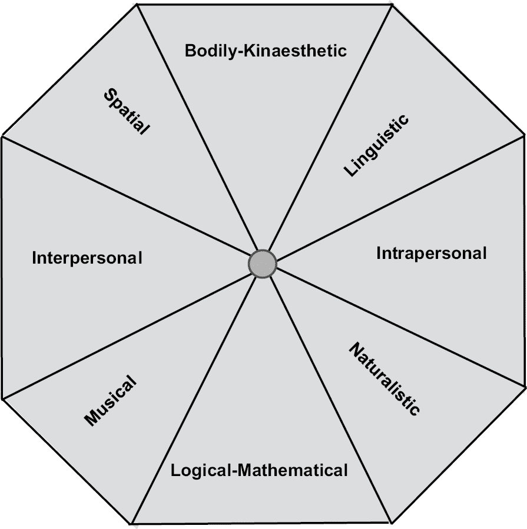

**图 4.1** 霍华德·加德纳的八种人类智能。⏎

1. **空间智能**：以抽象和多维度进行思考的能力。
2. **身体运动智能**：用身体展示体能和运动造诣的能力。
3. **音乐智能**：对节奏、音高、节拍、调、旋律和音色敏感的能力，包括唱歌和/或演奏乐器的能力。


4. `语言智能`：对词汇的含义、词语之间的顺序以及单词的声音、节奏、抑调和韵律保持敏感的能力，包括记忆信息和阅读。

5. `逻辑-数学智能`：从逻辑上分析问题、进行数学运算和科学地研究问题的能力，包括解决抽象问题。

6. `人际智能`：与他人进行有效互动的能力；对他人的情绪、感受、性格和动机保持敏感，包括能够理解并与周围的人产生共鸣的能力。

7. `内省智能`：对自己的感受、目标和焦虑保持敏感的能力，包括根据自己的特质进行计划和行动的能力。

8. `自然主义智能`：理解自然界差异的能力，包括植物、动物以及自然和生命其他元素之间的区别。

`图 4.1` 表明智能有许多方面，这些为人类提供了各种属性，帮助个人完成各种任务。此外，理解这些不同方面可以使人类对智能的本质建立一个全面的模型，并为与 AI 进行比较提供了基准，以确定两者之间的差异。一个需要解决的重要问题是从数据到信息、再到知识、最后到智慧的过程。评估这一转化过程至关重要，以观察人类智能是如何通过学习而发展的，以及这在 AI 情况下是否不同。

## 4.3 从数据到智慧的转化历程

普遍观点是，人类在不同环境中往往优于 AI，特别是在需要共情的任务上。人类智能包含了理解和与他人情感及敏感性进行互动的能力，而 AI 是无法做到的。最后这一陈述需要进一步的澄清。人们可以对他人产生共情，这种感觉可能是真实的，也可以是伪装的。例如，电影或戏剧中的演员可以模仿他/她所扮演角色的情感。人类的演技天赋越高，表演表现就越好。例如，获得奥斯卡最佳男/女演员奖是衡量一个人演技天赋的最高标准之一。因此，人类可以拥有真实的感受，也可以进行表演，但 AI 只可能拥有后者，即表演。有人认为，与作为生物的人类不同，AI 只能扮演情感的角色。此外，一个人可以表演但仍向角色中投入情感。机器人可以被编程为做出悲伤或快乐的面部表情，但并没有真正的感受，即使在扮演角色时也可能显得业余。

在进入人类智能与 AI 之间的具体差异之前，在此阶段检查数据是如何转化为智慧的。。例如，考虑一个茄子。它的生命从一颗种子开始，从种子演变为幼苗，然后是植物；植物作为果实本身，每个进化阶段都促进了最终产品的发展。从原始数据到智慧的转化过程以类似的方式演变。数据是原始事实材料，是推理、讨论或计算的基础。另一方面，智慧是思考和行动的能力，是应用随时间积累的信息、知识、经验、理解、常识和洞察力。因此，数据处于数据-智慧转化光谱的起点，而智慧位于另一端。`图 4.2` 表明智能有许多方面，这些为人类提供了各种属性，帮助个人完成各种任务。此外，理解这些不同方面可以使人类对智能的本质建立一个全面的模型，并为与 AI 进行比较提供了基准，以确定两者之间的差异。一个需要解决的重要问题是从数据到信息、再到知识、最后到智慧的过程。评估这一转化过程至关重要，以观察人类智能是如何通过学习而发展的，以及这在 AI 情况下是否不同。

`图 4.2` 表明智能有许多方面，这些为人类提供了各种属性，帮助个人完成各种任务。此外，理解这些不同方面可以使人类对智能的本质建立一个全面的模型，并为与 AI 进行比较提供了基准，以确定两者之间的差异。一个需要解决的重要问题是从数据到信息、再到知识、最后到智慧的过程。评估这一转化过程至关重要，以观察人类智能是如何通过学习而发展的，以及这在 AI 情况下是否不同。


信息是将原始数据转化为具有意义、重要性，并可能对使用它的实体产生影响的东西。例如，一个人可能拥有多种食材，但由于这些食材本身是没有意义的。然而，通过应用食谱，这些食材可以转化为经过烹饪并食的产品。在组织 AI 层面，考虑一个针对特定地理区域税务局（`IRD`）注册的纳税人数字文件，其中包含了他们的个人和财务细节。该数字文件可能包含数百万条记录。这些数据本身没有价值。但是，通过按特定地区、收入群体、性别、婚姻状况、工作职位、年龄段、受教育程度等对数据进行分析或总结，数据就可以被转化为信息。这种分析（或转换）可能被用于确定特定地区纳税人的平均年龄，以及每个类别（性别、职位、婚姻状况）的最小年龄范围。

因此，实体可以更深入地理解所产生的信息，从而做出更好的决策。需要注意的是，实际的决策功能正在进入超越信息层面的领域，并向知识和智慧领域延伸。然而，在数据到信息的转换层面，人类和 AI 系统都具备能力，但人类具有直觉等感官能力的额外优势，而 AI 系统则具有速度优势。

### 4.3.3 知识：信息向知识的转换

通过研究历史模式和未来趋势，数据信息可以转化为知识。知识可以可视化为由两个相关的相关的部分组成，即显性细节和对这些显性细节的理解。因此，显性细节是通过应用数据和信息解决“如何”的问题获得的，以提供关于某些对象规模和特征的解。另一方面，对显性细节的理解是分析的目标（即：为什么要分析这些显性细节）。

在个人层面，医生可能会进行研究以检查酒精与各种健康问题之间是否存在因果关系。通过研究，医生收集了各种证据（数据和信息），并获得了关于特定情况的知识。在组织层面，通过 AI 系统，公共卫生机构的经理可能想知道该机构应该鼓励和支持哪些服务。因此，对医疗机构提供的服务利用情况的数据和信息进行分析，以提供关于所提供服务受益者的知识；换句话说，就是服务接收者的行为（如何）。这将允许经理决定应该支持和加强哪些健康服务。这将帮助医疗机构经理选择那些对任何可能采取的推广活动反应最灵敏的服务（目标或为什么）。

上述示例说明，知识是对数据和信息的广泛利用，并结合相关经理的能力、胜任力、想法、直觉、承诺和动机。因此，数据信息向知识的转换是人类能力与 AI 系统中可用数据信息应用相结合的协同结果。诚然，AI 能够自己做出决定，但再次，人类的情感感受是某些决策中至关重要的特征，特别是在涉及生死问题时。

### 4.3.4 智慧：知识向智慧的转换

智慧是将知识和经验融合为洞察，这种洞察强化了实体（个人或通过 AI 系统的组织）对关系以及这些关系意义的理解，使人们能够做出正确的判断。因此，智慧是做出正确判断和决策的能力，并将数据、信息和知识转化为智能。换句话说，知识被视为一种工具，而智慧是应用这种工具所需的技能。智慧是一种通过丰富经验获得的微妙品质，当其记录成文档时，就形成了 AI 的基础。因此，随着经验的不断积累和记录，产生的智能水平就越高。然而，正如人们所意识到的，这并不容易实现或维持，因为智慧意味着必须不断更新、维护和维持大量的知识和经验。

数据-信息-知识转换过程的目标是获得智慧。换句话说，是对将要发生的情况具有评估过的理解。因此，智慧涉及未来，并包含了远见和设计。拥有智慧不再仅仅是掌握过去和现在的问题，而是能够创造未来。然而，必须承认智慧是顶峰，因此它很难实现，因为在最终获得之前，必须连续通过其他转换阶段。此外，一旦获得智慧，就必须通过进一步的知识来维持；因此，这需要持续艰的努力。

为了联系背景，之前的章节解释了实体（个人或组织）从原始数据开始，必须收集并组织数据；通过总结和分析将其处理并转换为信息。这些信息通过以适用于决策的形式整合数据信息转化为知识。随着时间的推移，知识的积累变成了智慧。智慧处理未来，因为它包含了预见和创造力；因此，这不是接受过去和现在的问题。这一过程在个人层面通过脑力，或在组织层面通过其 AI 系统进行。然而，在没有 AI 系统的情况下，组织通过管理团队的脑力获得智慧。

那些没有 AI 系统的组织被处于信息转换阶段，决策由拥有个人知识的人做出。因此，AI 系统的一个关键目标是知识管理，其目标是打破思维障碍，即由个人根据组织知识做出决策。组织必须努力管理多年获得的知识并将其转化为智慧，以便在 AI 系统的支持下（最好由个人）做出正确且有效的决策。

因此，必须解决的核心问题是智慧在实际意义上包含的内容。`Lacewing (2009)` 在对实践智慧（源自希腊语 `phronesis`，有时翻译为“审慎”）的研究中认为，亚里士多德将智慧定义为对人类善恶事物真实的理性能力状态。他认为，实践智慧涉及对善恶的知识，它不仅仅是理论知识，还包括执行这些知识的能力。`Lacewing (2009)` 认为这种能力需要：

1. 清晰地观察。感知、考虑一般概念，以及在情感、选择和行动方面的要求。


### 3. 考虑到整体的福祉（整体性）。实践性智慧涉及根据对“善”的普遍理解，来理解在特定情况下需要具备什么。

### 4. 深度理解局势。因此，具备良好审慎的能力。

### 5. 知道何时该行动，何时不行动。也就是说，根据这种审慎采取行动的能力。

此外，Malone (2003)(ch15.xhtml#r039) 认为，智慧还包括能够冷静地应对危机并做出有效的整体性反应；以及能够预测并避免潜在问题。智者通常通有一种乐观态度，认为生活中的问题是可以解决的，并在面对困难决策时表现出某种程度的冷静。据认为，一个组织如果拥有具备上述属性并能够反复、持续地应用这些属性的管理团队，将具有巨大的竞争优势。

必须认识到，与个人相比，AI 系统在速度和记忆容量方面具有优势，但缺乏情感（感受）。个人可以考虑事实性的性事务和无形因素，给出一个平衡的决策。无形因素可能是对其他生物的影响。例如，一个关于组织缩减的决策需要考虑该决策对组织内员工积极性和投入业度的影响，特别是那些可能被留下的员工。因此，在实践意义上，许多组织决策不仅考虑数字，还会考虑对受决策直接影响的人产生的影响。此外，组织通常由管理团队管理，该团队可以表达他们对所遇特定挑战的感受。这是当前 AI 系统的弱点，即感受的能力（情感感知）。为了克服这一弱点，最好由人类在 AI 系统的辅助下做出决策，这样人类情感可以在最终决策中发挥重要作用。

## 4.4 人类智能与 AI 之间日益增长的挑战

人们经常提出的问题是，AI 是否会超越人类智能，以及人类智能是否具有某些特别之处，以至于永远无法被复制。人们广泛共识，人类智能面临着计算机不具备的局限性。然而，计算机也有其局限性，而这些局限性并不适用于人类。

计算机在数据计算方面是卓越的。例如，在下国际棋和其他游戏中，面对个人时，AI 的表现往往超过人类智能。IBM 开发的国际象棋计算机“深蓝”在 1997 年击败了国际象棋冠军加里·卡斯帕罗夫。这次胜利被视为 AI 智力升级的象征性证明，导致一些研究人员认为 AI 将超越所有领域的人智能。这种事件被称为所谓的“技术奇点”。技术奇点是一个假设的未来时刻，届时技术增长变得不可控且不可逆转，导致对人类文明产生不可预见的后果。该术最早由冯·诺伊曼（John von Neumann）于 1958 年提出，其中“奇点”一词描述了一种假设：科学的发展（特别是信息学、纳米技术和生物学领域）最终将导致通用人工智能（AGI）的发明。库兹维尔 (2005)(ch15.xhtml#r036) 预测奇点将与下一个时代“人类技术与人类智能的融合”重合，但在奇点之后，将发生最后一个时代，“宇宙觉醒”。

没有人确定人类何时会创造出 AGI，但库兹维尔认为奇点将在 2045 年左右发生。Weder (2020)(ch15.xhtml#r036) 认为真正的智能需要生命，而 Weder (2020)(ch15.xhtml#r036) 声称，超级智能出现的第一个迹象将出现在像“终结者”这样的机器登场时，并在获取维修和复制所需的能量和其他资源方面超越人类。真正的智能要么是不可能的，要么是某种东西，Weder (2020)(ch15.xhtml#r036) 认为，如果没有这一限制，就没有判断 AI 是否具有智能的客观标准。Weder (2020)(ch15.xhtml#r036) 主张，机器将永远是人类智能的替代品，这不幸地留下了人类滥用的可能性。

人们需要认识，人类智能与大脑直接相，而 AI 系统使用算法来模仿，并在某些计算任务中可能超过人类的表现。通常，人类智能具有自然能力，如感受、想象力、创造力、直觉、共情和反射等。这些属性对于计算机准确模拟或复制是非常困难的。然而，如今的 AI 系统不需要这些自然能力，因为它们执行的功能依赖于数据处理能力来存储和检索信息并执行基于规则的软件，其速度远高于人类实现的水平。由于这种处理能力，AI 系统通过尝试错误快速学习新任务，并且不需要人类的操作指南或建议。


## 4.5 AI 与人类智能的具体差异

尽管人工智能与人类智能之间存在相似之处，但表 4.1 所示，它们之间也存在许多特定的差异。正如之前所示，AI 是人类智能创造的创新成果，而人类在生物学上被赋予了思考和推理等认知能力。20 世纪 50 年代提出反馈机制的诺伯特·维纳（Norbert Wiener）是控制论领域的先驱，控制论被认为是人工智能的新兴科学领域。据报道，维纳认为现代“思考”机器在解决某些问题上比其人类设计者快得多，并且正在被构造像人类一样思考。然而，是约翰·麦卡西（John McCarthy）在达特茅会议上首次使用了“人工智能”这一术语，并专门将其作为主要主题进行讨论。

### 表 4.1 AI 与人类智能的具体差异

| 特性 | AI | 人类智能 |
| :--- | :--- | :--- |
| 起源 | 诺伯特·维纳提出了反馈机制的理论。 | 人类天生具有思考和推理等认知能力。 |
| 状态 | 机器是使用二进制代码的数字设备。 | 大脑类似于此，以连续且线性的方式处理数据。 |
| 本质 | AI 的目标是模仿人类并完成人类通常的工作。 | 结合一系列认知活动以适应新情况。 |
| 物理限制 | 没有物理限制，可以 24/7 全天运行。 | 受身体能力限制，需要休息和维护。 |
| 能量消耗 | 通常情况下，仅使用 2 瓦。 | 人类大脑约使用 25 瓦。 |
| 处理方式 | 基于算法和数学模型。 | 基于认知过程和生物结构。 |
| 功能 | 依赖于数据的输入和指令。 | 使用记忆、处理能力和认知天赋。 |
| 准确性 | 产生准确的结果，因为它被编程为根据规则或算法优化给定的任务或系统。 | 留有“人为错误”的空间，但具有超越编程限制的创造和创新能力。 |
| 适应性 | 可以适应新数据和情况，但需要时间来适应新变化。 | 能够适应新状态，从经验中学习（基于背景做出决策）。 |
| 灵活性 | 同时间可以执行较少任务，并可以一次学习一项任务。 | 具有多任务处理能力，并执行不同的并发角色。 |
| 情感 | AI 缺乏情感和共情能力 | 能够感受情感和共情。 |
| 学习能力 | 基于数据和反馈循环，通过机器学习获取知识。 | 人类智能基于经验、直觉和创造力。 |
| 速度 | 能够处理大量数据并快速进行复杂计算。 | 人类处理大量数据的速度要慢得多。 |
| 创造力 | AI 创造或跳跃性思维的能力有限 | 人类具备创造、想象和创新的能力。 |
| 决策制定 | 极其客观，因为其分析基于事实性的积累数据。 | 决策可能受到非数字主观因素的影响。 |
| 社交网络 | AI 难以理解社交和情感信号的细微差别，这对于有效的人类互动至关重要。 | 能够处理复杂的社交情感信息，解释非语言交流并对社会情况做出适当反应。 |
| 伦理 | AI 没有道德准则或良心 | 人类智能具有引导决策的道德准则和良心 |

人类大脑以连续且非线性的方式处理数据，而作为 AI 基础的计算机是使用二进制代码的数字设备。AI 的主要目标是模仿人类，试图执行通常由人类完成的工作。相比之下，人类结合一系列认知活动来适应新情况。这是 AI 与人类智能之间的显著差异。AI 系统被设计用于执行特定任务并针对这些任务进行了优化。虽然这些系统可以学习执行新任务，但它们仍然需要大量的训练和数据来实现此。相比之下，人类智能的适应性强得多，人类能够快速学习并适应新环境。

AI 的一个强大优势是它在疲劳方面没有物理限制，并且可以 24/7 全天运行。在涉及骨骼肌肉运动且消耗能量的体力活动方面，AI 不是人类的对手。然而，人类的限制在于需要休息和维护。能量消耗也存在差异。计算机使用约 2 瓦能量，而人类大脑约使用 25 瓦。AI 和人类智能在处理数据的方式上也不同。AI 的处理基于人类创建的算法和数学模型，而人类智能则基于认知过程和生物结构。这种差异意味着 AI 依赖输入数据和编程指令，而人类智能则运用记忆、处理能力和认知天赋。

这意味着 AI 和人类智能在创造力和直觉能力上也是不同的。AI 系统可以根据其特定的训练数据和算法提供新的想法和解决方案，但与人类不同，它们缺乏创造直觉的能力。人类具有创造力，可以发现不基于任何现有流程或经验的创新想法和解决方案。人类可以利用他们的敏感性和经验建立联系并解决 AI 系统难以处理的问题。这对 AI 和人类的反应也有影响。AI 可以适应新的数据和情况，但调整新的波动状况需要时间。而人类可以根据背景适应完全全新的状态并从中学习。

AI 系统可以根据其基于规则优化给定函数的程序提供准确结果。然而，人类具有超越编程限制的创造和创新能力，但容易出现“人为错误”。这种特征也意味着人类往往更加灵活，能够通过执行不同的并发角色进行多任务模式工作。另一方面，AI 同时执行的任务较少，并倾向于一次学习一项任务。AI 与人类智能的一个关键区别是它们的学习方法。AI 的学习方法基于数据和反馈循环，通过机器学习吸收知识。然而，人类智能基于经验、直觉和创造力。因此，AI 系统应用预定义的算法和输入数据来从环境中学习并随着时间的推移改进性能。这被称为机器学习，涉及使用大量数据训练系统以识别模式并进行推推。


AI 与人类智能之间的一个重要区别在于它们理解语言和语境的能力。人类可以理解词汇背后的含义、双关语和短语，以及它们所应用的社会和文化背景。另一方面，AI 系统在自然语言处理方面并不非常精通，因为它们在理解人类语言的细微差别及其应用背景方面仍然困难。然而，一旦克服了这一困难，AI 系统在该领域的所有语言中都将拥有无限的能力。个人可能精通几种语言，但 AI 系统不会受到这种限制。此外，在社交网络方面，AI 系统难以理解社交和情感信号的细微差别，而这些对于有效的人类互动至关重要。另一方面，人类有处理复杂的社交和情感信息、解释非语言交流并对社会情况做出恰当反应的能力。这也意味着人类能够做出受主观因素影响的决策，而不仅仅是根据事实和数据。然而，AI 系统极其客观，因为它们的分析是基于事实性的累积数据。

必须指出的是，目前 AI 系统在创造力或跳出思维方面的能力非常有限，与人类相反，人类非常具有想象力、创造力和创新能力。这在一定程度上被 AI 系统处理海量数据并快速执行复杂计算的能力所抵消，而人类处理大量数据的速度要慢得多。然而，AI 与人类之间最大的区别是情感因素。AI 系统可以识别并响应人类的情绪，但它们缺乏情感和共情能力，而人类这两者都具备。这也意味着 AI 系统没有通过道德准则或良知具备伦理行为，而大多数人类具备。情感智能是人类智能的一项重要特征，因为它允许人类与他人产生认同，识别他人的情感并促进社交关系。因此，人类能够产生复杂的情感，这些情感会影响他们的决策和社交互动。

## 4.6 人类智能与 AI 的协调

人脑是人类拥有的唯一智能源，它控制着人类整个生命周期中的情感、思想、记忆和行动。另一方面，AI 系统在努力像人类一样思考和学习时依赖于计算机（计算机是可以更换和升级的）。人脑具有理性审议和决策的能力，而 AI 系统可以根据一组可执行的程序算法像人类一样思考和学习。然而，AI 系统可以被视为人类利用的工具，帮助他们提高生活水平。例如，AI 系统正被用于医疗保健领域以产生内脏图像并诊断疾病和/或建议治疗方案；它被应用于金融领域以预测股市价格并执行计量经济学模型以制定更好的经济政策，以及许多其他重要应用。

虽然人脑是一个非常强大的器官，但它无法以 AI 系统可以完成的速度进行计算。然而，必须认识到，正是人脑的力量发明了这些以及许多其他应用。这些是典型的例子，即人类和其他生物从人脑与 AI 系统的协作中获益，包括由复杂的计算机控制并人类操作的底层设备。关于 AI 的一个重要问题是人类应该在多大程度上参与其开发。例如，目前正在进行人机整合的工作。这指的是将 AI 集成到人脑和系统中，首要目标是使它们更聪明。这种整合允许人类和 AI 系统更快速地相互学习，以确保人类和 AI 系统尽可能快地不断进步。然而，人机整合可能会有其局限性，特别是在推理、社交互动、情感和常识等领域。

人类智能和 AI 之间存在潜在问题，但仅当 AI 应用被人类操作员滥用时。此外，关于 AI 应用未来将如何影响社会，可能会出现伦理问题。例如，AI 监控系统收集海量数据（包括个人信息），而未获得个人的明确同意。此外，涉及人脸识别数据的数据泄露增加了身份盗窃、跟踪和骚扰的可能性，因为与密码和信用卡信息不同，脸部是不能轻易改变的。然而，以本的 AI 关注人类与 AI 系统之间的互动，试图以一种对用户（人类）来说自然的方式与之交互，允许个体使用更自发、更有支持且更令人满意的 AI。尽管如此，在开发和使用 AI 时，需要考虑若干伦理问题，包括 AI 可能带来的对社会产生负面影响并对人权产生的影响。这些伦理考虑将在另一章节中详细讨论。

## 4.7 结论

目前对 AI 的精确定义几乎没有共识，但人们的共识是 AI 在某些方面具有某些思考和模仿人类的能力。必须承认，尽管 AI 是人类的创造物，但 AI 和人类智能这两个术语是两个不同的过程，具有各自独特的特征。此外，虽然 AI 系统和人类智能有一些相似之处，但两者之间存在显著差异，这些差异已在表 4.1 (#ch15.xhtml#t6) 中总结。AI 系统可以快速高效地执行许多通常需要人类智能完成的任务，但它们最大的弱点是缺乏大多数人类具备的适应性、想象力、创造力、直觉和情感智能。研究表明，人类智能是基因、经验和环境复杂相互作用的结果。这允许人类理解、定义和识别概念，并以 AI 系统无法模仿的方式与周围世界进行互动。重要的是，随着 AI 继续发展和获得更广泛的接受，人们需要欣赏这些差异，并理解 AI 和人类智能各自独特的优势和缺点。

正如前一章所强调的，`robot`（机器人）一词最早出现在 1920 年卡雷尔·恰佩克的剧《R.U.R.》中，用于描述一种人工自动机，它源于斯拉夫语单词 `robata`，意为`强制劳动`。人类经常将 `(ro)bots` 和机器人视为单调、服从的奴隶。必须认识到，随着技术处理能力的提高和 AI 的不断进步，人类必须能够保持对 系统的控制，而不仅仅是认为 AI 是没有思想的。


人类往往认为自己在生物创造秩序中处于远高于他者的演化水平，并将其他物种视为实现水平低得多，认为自己拥有完全控制权，并赋予其他生命形式较低的地位和少的权利。人类需要意识到所有生物都有感觉，并能感知痛苦和受。此外，人类不能对人工产物感到自满。这种自满源于人类没有意识到 AI 的威力。每当人类与愚笨的在线客服机器人或自动电话服务互动时，往往会感到非常挫败，并得出 AI 并不特别聪明的普遍结论。与人类接触通常能获得更好的客户服务，因为人们可以解释情况，而不会觉得自己是在与一个不存在的实体交流。

总之，AI 和人类智能分别是工程和生物发展领域的卓越成就。然而，它们之间存在许多关键差异，使得它们非常独特。人类智能以大脑的化学和电活动为中心，而 AI 则依赖于计算机系统。此外，人类智能非常适用于模式识别和自然语言处理等任务，而 AI 更适用于数据挖掘和机器学习等任务。在短期内不太可能创造出像人类一样思考的设备，因为技术人员尚未完全理解人类大脑的完整运作方式。因此，目前人类智能完全控制着 AI 的发展，但并不意味着这种情况不会发生改变。要判断 AI 最终是否会对人类的生存构成严重风险还时过早。一些专家认为由于预计 AI 在未来十年左右将出现巨大的增长，这是一种可能性。然而，如果能在国家和国际层面采取立法行动，并对安全系统进行持续且大量的投资，那么 AI 就不可能人类构成严重威胁，任何威胁风险都会得到缓解。

## 参考文献

- Ambrose, Susan A., Bridges, Michael W., DiPietro, Michele, Lovett, Marsha C., and Norman, Marie K. (2010). How Learning Works: Seven Research-Based Principles for Smart Teaching. John Wiley.
- Camilleri, Emanuel. (2019). Information Systems Strategic Planning for Public Service Delivery in the Digital Era. IGI Global.
- Kurzweil, Ray. (2005). The Singularity Is Near: When Humans Transcend Biology. Viking, Penguin Group.
- Lacewing, Michael. (2009). Practical Wisdom. Routledge; Taylor and Francis Group.
- Lee, Daeyeol. (2020). Birth of Intelligence: From RNA to Artificial Intelligence. Oxford University Press.
- Malone, Samuel, A. (2003). Learning about Learning: An A-Z of Training and Development Tools and Techniques. Chartered Institute of Personnel Development.
- Medeiros, João (2017). Stephen Hawking: ‘I Fear AI May Replace Humans Altogether’. WIRED. [www.wired.co.uk/article/stephen-hawking-interview-alien-life-climate-change-donald-trump?trk=article-ssr-frontend-pulse_little-text-block]
- Mehta, Kumar. (2021). A Harvard Psychologist Says Humans Have 8 Types of Intelligence. Which Ones Do You Score the Highest In? CNBC Make It. [www.cnbc.com/2021/03/10/harvard-psychologist-types-of-intelligence-where-do-you-score-highest-in.html]
- Sternberg, Robert J. (2023). Human intelligence. Encyclopedia Britannica, 18 Nov. 2023. [www.britannica.com/science/human-intelligence-psychology]
- Weder, Annika. (2020). Q&A – What Is Intelligence? Fundamentals. Johns Hopkins University. [www.hopkinsmedicine.org/news/articles/2020/10/qa--what-is-intelligence#:~:text=Intelligence%20can%20be%20defined%20as,for%20their%20survival%20and%20reproduction]

# 第二部分：支持人工智能的技术

人工智能（AI）像许多其他基于软件的应用程序一样，需要能够在安全环境中运行的有效硬件和软件工具方面的强有力技术支持。本书的第二部分由三章组成，每章关注一个不同的主题，即 AI 相关的硬件、软件和安全。

毫无疑问，目前大多数 AI 应用运行在传统的冯··诺伊曼架构（Von Neumann architecture）上。遗憾的是，这种架构以顺序方式执行指令，限制了 AI 应用的能力。必须承认，硬件是所有计算机驱动功能的根本支柱，并是发展的瓶颈。因此，技术的进步在很大程度上取决于硬件的容量、能力和复杂性。第五章专门介绍计算机硬件，关注第四代和第五计算机，并追溯它们在过去六十年中的发展。该章讨论了量子计算，旨在通过将亚原子粒子的量子状态存储信息并执行多维量子算法来解决冯·诺伊曼瓶颈。

此外，第五章还研究了一种完全不同的计算方法，即神经形态硬件，旨在模拟人类神经系统，允许对特定任务进行并行处理。神经形态芯片具有巨大的潜力，正被机器人；视觉物体识别；手势和气味识别；医疗监控；自动驾驶汽车识别和解释其环境；以及疾病识别等应用。神经形态芯片具有未来性的创新特征，当充分开发后，将彻底改变我们看待机器人能力的方式。本章还研究了与特定专用任务相关的硬件芯片的进展，这些芯片可以作为应用系统的一部分，可能包括 `Edge Computing Chips`（边缘计算芯片）、`Application Specific Integrated Circuits`（专用集成电路）、`Field Programmable Gate Arrays`（现场可编程门阵列）和 `Complex Programmable Logic Devices`（复杂可编程逻辑器件）。


一个公理是：硬件如果没有合适的软件辅助，其本身没有任何价值。因此，第 6 章专门介绍了软件作为高效硬件的重要组成部分，并探索了几种对开发 AI 应用至关重要的 AI 编程语言。此外，本章还研究了 IBM 的 `Qiskit SDK`，它专为 IBM Quantum 平台设计，用于执行专门的 AI 应用。然而，如果不考虑硬件描述语言，对软件的讨论将是不完整的。因此，探讨了 `Verilog` 和 `VHDL`，因为这些对于与 AI 相关的特定硬件（如现场可编程门阵列）特别有用。此外，还讨论了 AI 算法，因为它们在执行通常需要人类智能的 AI 任务中非常重要，例如语音和声音识别；文本识别；图像识别；视频分析；生成式 AI 以及自然语言处理。最后，本章关注了脑计算和脉冲神经网络。这些是专为并行处理设计的，并且对 AI 应用具有巨大潜力，因为它们被认为能够适应环境，并在需要时通过云访问外部源以寻求更多信息。

AI 对人类具有巨大的潜力，但除非在安全环境中进行开发和执行，否则它具有毁灭性的破坏能力。因此，第二部分

> “我们面前的道路将会有障碍。它们是绊脚石还是垫脚石，取决于你如何利用它们。”
> 弗里德希·尼采（Friedrich Nietzsche）
> 德国哲学家（1844-1900）

AI 系统在很大程度上取决于用于执行各种 AI 程序的计算机的处理能力。过去，传统的计算机硬件一直是 AI 发展的最大限制。AI 硬件是指专门设计的计算机硬件，旨在有效促进和协助执行 AI 相关的任务。因此，AI 硬件专门支持所需的底层设施，以高效地执行算法和其他基本模型，从而优化硬件的处理能力。AI 硬件包括各种物品，例如专门设计的计算机微处理器芯片。这类硬件的主要目标是更快的执行 AI 程序套件，并在过程中消耗更少的能量。AI 硬件可能支持 `Lisp` 机器，这是一种通用计算机，旨在高效地执行 `Lisp` 作为其主要软件和编程语言。它们还支持脑计算、物理神经网络和事件相机（后者应用了对局部亮度变化响应成像传感器）。

脑计算（或脑工程）是指硬件和软件计算元件的设计，其目标是建立模仿人类大脑和神经系统的生物启发计算机系统模型。脑工程的一个例子是自动驾驶汽车。自动驾驶汽车需要做出迅速的决策以正确地导航并避免碰撞。这种技术需要大量的计算处理能力。因此，通过使用脑计算硬件和软件，自动驾驶汽车执行任务的速度比传统计算更快，且能耗更低。

另一方面，物理神经网络涉及将人工神经网络以实体形式表示在物理系统中，从而实现实时计算和交互。与虚拟神经网络相比，物理神经网络提供了连接数字世界与物理世界鸿沟的可能性。传统的神经网络只出现在数字领域，通过数学模型和算法运行；而物理神经网络将 AI 与实体对象和环境相结合，允许数字领域和物理领域之间进行实时计算、交互和感知反馈。本章将详细讨论这些以及其他硬件进展，以深入了解 AI 通过其应用为人类造福可能提供的潜力。

## 5.1 引言

历史表明，当更强大的计算机在商业市场上开发并发布时，AI 应用取得了显著进展。正如在前一章中观察到的，“人工智能”一术首次正式应用于 1956 年的达特茅斯人工智能夏季研究项目。然而，AI 的概念模型建立于 1943 年，当时美国神经生理学家、控制论专家沃伦·麦卡洛（Warren McCulloch）和逻辑学家、认知心理学家沃尔特·皮茨斯（Walter Pitts）发表了论文《神经活动中紧迫思想的逻辑演算》。这是神经网络的第一个数学模型。他们的思想被约翰·冯·诺依曼（量子力学和博弈论的数学公式化）和诺伯特·维纳纳（Norbert Wiener，控制论的创立者，以及与生物和机器相关的通信科学）应用，这些思想被认为是 AI 某些核心概念的基础。

麦卡洛和皮茨斯被视为神经网络的先驱，也是现代数字计算机发明的灵感来源。这也是第一代计算机（1940-1956 年）的时代，当时在 1943 年二战期间，`Colossus` 因其破译能力而闻名。约翰·麦卡锡和他的同事在 1956 年发起了达特茅斯人工智能夏季研究项目。这正处于第二代计算机（1956-1963 年）的早期，当时的计算机在那个时代被认为是最强大的计算机，与之前的发现相比无与伦比。这些所谓的强大计算机为麦卡锡和他的同事推动 AI 计划提供了灵感。


尽管如此，尽管第二代计算机提供的计算能力有所增加，但计算处理单元和外部存储器非常有限，因此处理能力受到了限制。这种计算局限性以及对罗森布特（Rosenblatt）感知机模型的严重批评，可能导致机器翻译项目在 1966 年因 AI 结果糟糕而终止，引发了第一次“AI 寒冬”，标志着 AI 研究资金减少和兴趣下降的时期。第二代计算机放弃了笨笨的真空管，转而采用晶体管技术，并增强了核心存储。晶体管为计算机提供了更多的计算能力，包括计算速度。这种发展通常导致计算机尺寸和成本的降低，与真空管相比产生的热量也更少。此外，第二代计算机带来了中央处理器（`CPU`）的概念、增强的内外部数据存储器、编程语言以及输入输出设备。与机器语言和汇编程序编码相比，`FORTRAN`、`ALGOL`和`COBOL`等编程语言简化了编程。

第三代计算机（1964-1971）预测（并实现）了从大型晶体管到硅制成的集成电路（`IC`）的转变。集成电路也称为`chip`、`microchip`或微电子电路，是在半导体晶圆上工程化并制造的数千甚至数百万微型电阻、电容、二极管和晶体管。换句话说，`IC`是一个将多个小型化且互连的组件嵌入薄半导体材料基底（通常是硅晶）的集成系统。它已被证明是所有现代电子设备的基础元素。因此，它的发展为第三代计算机提供了更高的速度和可靠性。这一时代见证了不同于大型机的微型计算机。

微型计算机的引入意味着由于硬件成本降低，中小企业可以负担起自己的计算机设施。这一时期的困难在于应用软件的匮乏，使得组织无法使用计算机来执行其管理功能，如会计、工资发放、库存控制等。这类计算机拥有操作系统，旨在完全处理计算机内部的运行操作。此外，它们还拥有应用计算机程序（用`COBOL`和`FORTRAN`等计算机语言编写），用于执行特定的组织功能，例如执行与会计、库存控制和工资发放相关的一系列程序。操作系统通过顺序为每个应用系统分配几分之一秒的处理时间，允许第三代计算机同时执行多个任务。这些计算机的高速给人一种印象，即由于这种时间分配过程，这些多个应用系统正在并行执行。事实上，这些计算机并没有设计并行处理功能。

第三代计算机的问发布在某种程度上与第一次 AI 寒冬相重，大多数研究都转向了传统的应用软件开发。20 世纪 60 年代后期，感知机和连接主义的发展在当时非常活跃且极具启发性。遗憾的是，大多数 AI 的研究开发资金来自美国国防部高级研究计划署（`DARPA`）。然而，美国国会批准的《曼斯菲尔德修正案》强制`DARPA`资助针对特定任务的研究。这导致`DARPA`终止了对新 AI 研究的资助。此外，1973 年，英国议会委托詹姆斯·莱希尔（James Lighthill）审查英国 AI 的状态。莱希尔报告对 AI 取得的成就非常批评，认为这些突破未能实现预期目标，且 AI 的研究可以在其他科学领域进行。AI 在 20 世纪 60 年代和 70 年代相对较新，人们对其产生开创性发展寄予厚望。然而，`DARPA`资金的终止、具有破坏性的莱希尔报告以及未能实现的高期望，共同导致了 AI 发展的不可持续性。

## 5.2 第四代计算机（1971 至今）：新的处理能力

第四代计算机基于微处理器的发展，利用了`IC`。然而在这一时期，大规模集成电路（`LSI`）也被引入。真正的`LSI`电路拥有约 10000 个晶体管，并在 1974 年左右出现，用于计算机内存。这项技术的优势使得硬件制造商能够将数万个晶体管和其他组件集成在如指盖大小的硅芯片上，执行算术、逻辑和控制功能。使用微芯片的计算机被称为微机，提供了更小尺寸、更大的容量。20 世纪 70 年代后期，超大规模集成（`VLSI`）被引入，在硅半导体微芯片上集成了数十万个晶体管。多处理、多程序、分时、运行速度和虚拟内存等技术使其变得更快、更易用。第四代计算机允许个人电脑的发展，诞生了计算机网络。这一时代结束了 IBM 主席托马斯·沃森（Thomas Watson）1943 年预测世界市场只有 5 台计算机的预言。另一方面，1975 年，微软的创始人比尔·盖茨（Bill Gates）和保罗·艾伦（Paul Allen）愿景每个办公桌和每个家庭都有计算机。这一预言在过去的几十年中实现了。

第四代计算机为 AI 带来了喜忧参半。AI 的发展早期与 1974-1980 年的 AI 寒冬重叠，经历了一个缺乏 AI 研究资金的时期。然而，尽管 AI 研究资金几乎不存在，通过学术和工业领域的私人研究仍以较慢的速度持续。因此，由于这些更强大、更快的计算机克服了 AI 在此之前遇到的一些困难，仍然取得了突破性成果。1974 年，这些更强大的计算机使得保罗·韦伯斯（Paul Werbos）启动了用于神经网络训练的反传播监督学习算法。此外，到 20 世纪 80 年代，`Lisp`编程语言常用于 AI 研究，为专家知识 AI 系统的接受铺平了道路。然而，90 年代 AI 再次被边缘化，因为这些专家系统未能（再次）满足高期望。

尽管如此，尽管经历了这一低谷，AI 研究见证了带有监督学习的支持向量机（`SVM`）的增长和接受，以及神经网络的衰落。`SVM`主要用于分类问题，如文本分类、图像分类、垃圾邮件检测、手写识别、基因表达分析、人脸检测和异常检测。


通常情况下，这些计算机可以被视为通用计算机，能够执行当前的 AI 系统，例如深度神经网络，这些神经网络此已在许多领域取得了先进的成果，包括图像识别、自然语言处理和机器翻译。最近，聊天机器人（Chat Bots）和 GPT 模型在行业内取得了巨大进展。换句话之，人工智能是第四代计算机的一个辅助目标。因此，这些计算机是限制人工智能发展的主要因素。这意味着，通用人工智能（General AI，设计用于执行人类可以完成的任何智力任务，例如能够推理、学习和理解复杂概念）以及在所有领域超越人类智能、能够解决超越人类能力的复杂问题、并能以远超人类智能的速度进行学习和适应的超级人工智能（Super AI），目前无法通过这种技术实现。此外，对于与人类思想和情感交互的心理理论人工智能（Theory of Mind AI）以及具有独立智能且不受创建者控制的自我意识人工智能（self-awareness AI），还需要更先进的计算机。

## 5.3 第代计算机（现在及以后）：AI 处理的新纪元

第四代计算机将人工智能降级为一种辅助应用。这把人工智能的发展限制在窄人工智能（Narrow AI，或弱人工智能）上，其设计用于执行特定任务或有限范围的任务，例如人脸、语音和图像识别；自然语言处理以及推荐系统。另一方面，第五代计算机和其他相关技术是专门为人工智能作为其主要目标而设计的。第五代计算机为人工智能迈向通用人工智能和超级人工智能提供了新机会，使这些系统可能超越人类智能，并与人类的思想和情感交互，从而实现自我意识。

1982 年，日本通产省启动了“第五代计算机计划”，目标是开发新一代能够理解和使用人类语言的计算机。这一代基于并行处理硬件和 AI 软件，利用了超大规模集成（SLSI）芯片，单个芯片上包含数百万个组件。并行处理远快于第四代计算机使用的多程序串行处理操作系统。除了使用 VLSI 和随后的 SLSI 架构外，应用于第五代计算机系统的关键技术包括：更好的数据流控制、逻辑编程、基于关系数据库的知识库以及应用人工智能和模式处理 (Moto-oka, 1983)。日本的这项倡议旨在预计用于 1990 年代的新一代计算机。

根据 Moto-oka (1983)，该项目设定的研发周期为十年，分为三个阶段，如图图 5.1 所示。第一阶段与基础计算机技术的初始开发有关，由三个基本模块组成，即使用并行机制的推理子系统的独立功能机制模块；基于知识技术的知识库子系统的独立功能机制模块；以及利用 VLSI 技术具有问题解决、知识库和智能接口能力的基础软件系统。

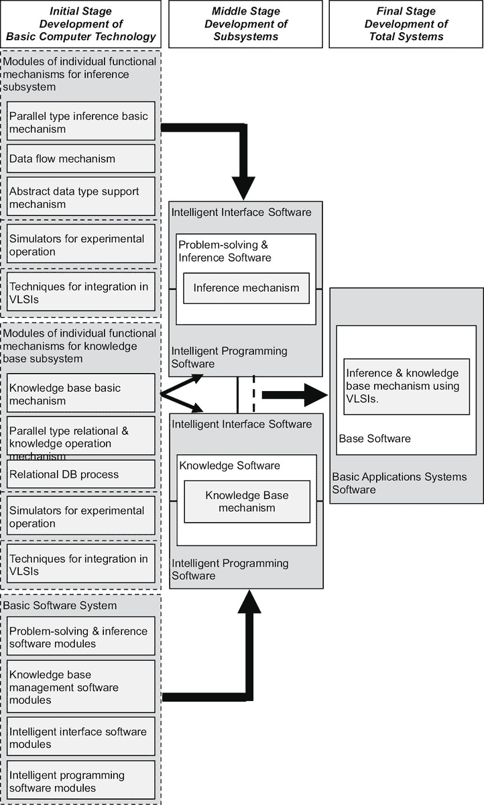

**图 5.1** 第五代计算机计划的发展阶段。](ch17.xhtml#f5)

Moto-oka 还在图 5.2 中解释了该项目的概念细节。他阐明，数据库机器和现有的主机计算机将联网以组织全球信息系统。图 5.2 展示了第五代计算机基于三个方面，即人类应用子系统、建模软件子系统和机器硬件子系统，每个方面都有一个双向通信接口。对系统的访问是通过利用用户语言（语音、自然语言、图片和图像）的人类应用子系统，它作为基础软件系统的外部智能接口，通过智能编程系统和知识系统与建模软件子系统通信。

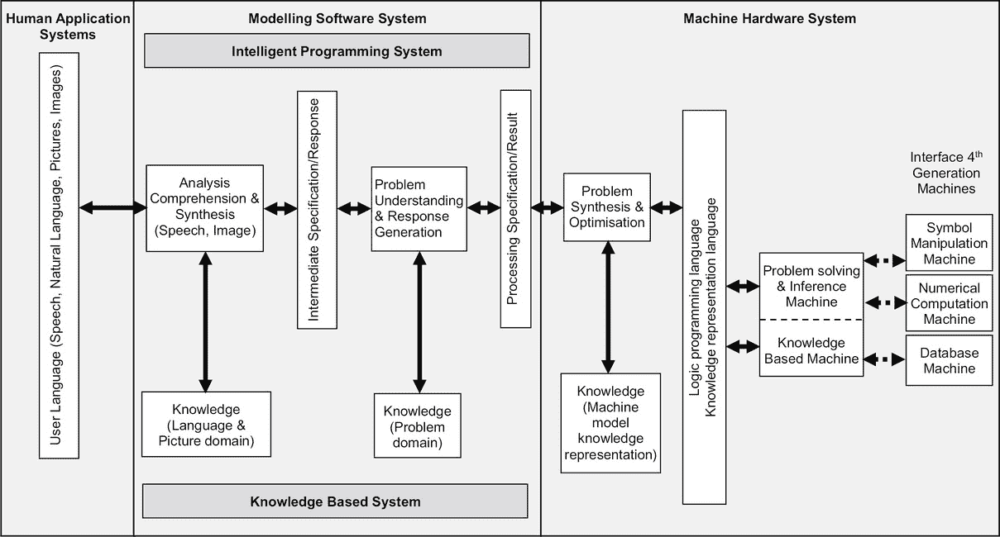

**图 5.2** 第五代计算机计划的概念细节。](ch17.xhtml#f6b)

建模软件系统由两个关键元素组成，即基于知识的管理系统和问题解决推理系统，前者与后者通信。建模软件系统通过三个层面与硬件系统通信，即知识库机器、问题解决与推理机器以及智能接口机器。根据 Moto-oka 的观点，计算机系统的重点预计通过显著增强硬件系统的逻辑层，以及将建模系统置于硬件与人之间，转向人类系统。他解释说，软件和硬件系统之间的接口将是内核语言（kernel language）。整个软件系统将用内核语言实现，而硬件系统将直接执行内核语言。

然而，Swinbanks and Anderson (1992) 在 1992 年 3 月报告说，日本的项目陷入了困境。他们报告说，经过十年的超过 4 亿美元的投资，日本仅生产了几台并行计算机，其中最大的三个处理器数量只有目标数量的分之一。到那年底，Reid (1992) 报告，日本政府正式终止了“第五代”计算机计划，这项为期十年的研究本应创造新的计算世界，但结果证明对全球计算机市场的影响微乎其微。然而，日本第五代计算机计划为硅谷的计算机工程师和科学家提供了重要且有力的动力，让他们进入竞争产生自己的版本的第五代计算机。因此，尽管失败了，日本的第五代项目已向世界计算机界发出了挑战，要求一种以 AI 目标为基础的功能性第五代计算机。第五代计算机的关键特征包括：

- 在计算机设计中利用 ULSI（超大规模集成）技术。
- 超导技术和并行处理的扩展。
- 基于多处理器的系统，具有并行计算能力。
- 具有磁性的芯片，存储信息、加密交易并促进交易处理。
- 电路中使用光纤。
- 具有多媒体功能的友好型界面。
- 自然语言处理（NLP）的发展。
- 存储容量的巨大发展，具有更快、更大的存储能力。
- 将强大的计算机与 AI 接口。
- 使用 AI，例如导航、浏览、视频分析和图像处理等。

### 5.3.1 量子计算机


根据 Nasrin (2023)的说法，当前的第五代计算机设计正侧重于量子计算和人工智能（AI）。她认为，从计算到通信的转变将是第五代计算机带来的主要变化之一。Nasrin 相信，这些计算机将能够相互连接并以以前代无法实现的方式共享信息，从而更高效、更有协作地解决问题，产生新颖且原创的解决方案。

此外，IDQ (2024)断言道，2023 年 10 月，加州量子初创公司 Atom Computing 宣布其已创建了世界上第一台拥有超过 1000 个量子比特（1,180 个）的量子计算机。他们宣布，这标志着比之前的保持者——拥有 433 个量子比特的 IBM `Osprey` 有了重大进展。然而，这一声明与 IBM 发布的其拥有 1,121 个量子比特的 `Condor` 型计算机公告冲突。IBM 声称，`Condor` 通过量子比特密度增加 50%、量子比特制造和层压尺寸的进步，以及在单个稀释制冷器内包含超过一里的高密度低温柔性 IO 布线，推了芯片设计中规模和良率的极限。他们认为，`Condor` 的性能与 433 量比特的 `Osprey` 相当，但解决了规模问题并为未来的硬件设计铺平了道路。

`qubit` 类似于二进制位，传统计算中的基本信息单元。`qubit`（或量子比特）是量子计算中的基本信息单元。IBM 目前使用铝和铌混合，这是制造 `qubit` 最常用的两种材料。超导量子比特通常是一个微小的金属环路或线条，其行为类似于原子，而原子本质上是一个量子体。

与此同时，在 2023 年 11 月 25 日的《电报》中，科学记者 Joe Pinkstone 报告说，英国政府将在未来十年内向量子技术投资 25 亿英镑。英国科学技术部长安德鲁·格里菲斯概述了一个十年目标，将量子技术置于科学商业化计划的前沿。英国政府的战略目标是在 2035 年运行量子计算机和网络，并预计该技术将在 2030 年为国民医疗服务（NHS）提供全新的测试。部长声称，量子可以破解当前的加密，并为国防创建不可篡改的通信网络，而量子钟和传感器可以彻底改变导航、手机和医疗筛查等日常应用。

### 5.3.2 什么是量子计算？

量子计算是一个涵盖计算机科学、物理学和数学特征的多学科课题，它应用量子力学比经典计算机更快地解决复杂问题。量子计算学科包括硬件研究和应用开发。还必须将人工智能和量子计算区分开。AI 是一种软件程序或过程，而量子计算机是执行 AI 软件的硬件。AI 就像手机上的 App（软件应用程序），而手机（硬件）是执行该 App（过程或应用程序软件）的物理设备。

本质上，量子计算基于量子理论原理，利用亚原子粒子的量子态来存储信息。量子理论是现代物理的核心理论，解释了原子和亚原子水平上物质和能量的性质和行为，通常被称为量子物理和量子力学。量子计算的核心概念是利用亚原子尺度的反直觉物理，打破限制计算机速度的障碍。

研究人员发现，量子力学的某些特征是反直觉的，并且似乎是矛盾的，因为它们描述的行为与人们预期的大不相同。例如，热水比冷水结得更快，这似乎违背了常直觉。这种现象被称为姆彭巴效应（Mpemba effect），挑战了对水物理属性的通常理解。科学家认为，热水蒸发速率的增加和薄绝缘冰层的形成可能导致这种反直觉的行为。量子力学预测的最有趣的例子之一是粒子对可以发生纠缠。因此，当两个粒子处于纠缠态时，如果不引用另一个，就不可能描述其中一个属性，因为它们的表现像一个单一实体。本文的目的不在于证明量子物理的复杂属性，因为这需要对该主题进行更详细的讨论。作者的意图是通俗地强调，量子计算是革命性的，与传统计算非常不同。

传统计算机在二进制位上运行，但量子计算机在称为 qubits 的量子比特位上运行。`bit`（二进制数字）是传统计算机可以处理和存储的最小数据单元。`bit` 始终处于两种物理状态之一，就像开关一样，开启或关闭。`bit` 的状态通常由单个二进制值表示，通常为 `0` 或 `1`。另一方面， qubits 物理上源于电子和质子等微小量子对象。此外，量子计算基于两个量子力学定律，即叠加和纠缠。此外，叠加并不将 qubits 限制在两个可能值（`1` 或 `0`）之一，而是作为两者的复合存在。

这一特征使得量子计算机运行速度比传统计算机快得多。纠缠是量子物理特有的，它将多个独立的粒子统一起来，确保了发生在一个粒子上的事情会影响其他粒子。当这一原理应用于量子计算机时，它允许所有粒子共同处理所有的量子比特。这意味着计算不是按顺序执行的，而是并行（即同时）执行的。这两个重要特征（叠加和纠缠）结合量子计算，与传统处理相比，为使用量子技术进行计算提供了指数级速度提升的潜力。

### 5.3.3 量子计算机如何工作

如前所述，传统处理器使用二进制位来执行操作，而量子计算机使用 qubits (`CUE-bits`) 来运行多维量子算法。根据 IBM (2024)，量子算法采取了一种新颖且独特的方法来解决复杂问题，例如模拟分子行为或化学模拟，通过创建多维计算空间来实现。量子计算机基于几个创新原理：


### 超导体
- 虽然台式电脑使用空气流设备（如风扇）来防止过热，但量子处理器则需要极低的温度（约绝对零度以上百万分之一）来保持其量子状态并避免“退相干”（(IBM, 2024）。退相干是指量子系统的信息通过与环境（形成闭合系统）的交互被修改的过程，从而在系统与热浴（环境）之间产生纠缠。另一方面，量子相干是指当单个粒子的波函数可以分为两个独立的波，使得这些波以相干的方式共同运行，从而实现量子相干。通过使用超冷流体达到极低温可以避免退相干，在这种温度下，某些材料会表现出重要的量子力学效应：电子在其中移动时没有电阻，使其成为“超导体”。根据 IBM (2024)，当电子通过超导体时，它们会配对，形成“库珀对”。这些配对可以通过被称为量子隧穿的过程跨越障碍（即绝缘体）传输电荷。放置在绝缘体两侧的两个超导体形成了约瑟夫森结。

### 控制
- IBM 的量子计算机使用约瑟夫森结作为超导比特 (IBM, 2024)。比特的行为通过向它们发射微波光子来控制，使其能够持有、改变和读取单个量子信息单元。

### 叠加
- 单个比特本身并没有什么用。然而，通过将比特持有的量子信息置于叠加态（即代表比特所有可能配置的组合），一组处于叠加态的比特可以创建复杂的多维计算空间 (IBM, 2024)）。这使得复杂问题能够在这些空间中以新的方式呈现。

### 纠缠
- 根据 IBM (2024)，量子纠缠是一种关联两个独立事物行为的效应，因此当两个比特处于纠缠状态时，其中一个比特的变化直接影响另一个比特。

### 干涉
- 置于叠加态的纠缠比特环境会导致概率波，这些波充当系统测量的结果。当许多波在特定结果上达到峰值时，它们会相互叠加；当波峰和波谷相互作用时，它们会相互抵消；这两种都是干涉的形式 (IBM, 2024)。

IBM (2024) 解释了量子计算机计算使用以下过程：

- 准备所有可能的计算状态的叠加态。
- 由用户的量子电路根据算法对叠加态的分量进行选择性干涉。
- 许多可能的结果通过干涉被抵消，而另一些则被放大。
- 被放大的结果就是计算的解。

量子计算机的一个问题似乎与纠错或误差缓解有关，这目前尚未得到完全解决。IBM 采用了 `Qiskit`，这是一个基于 Python 的开源量子软件开发工具包 (SDK)。该量子 SDK 是一个仿真中的完整量子计算栈，包括直观的用户界面、编译器以及一个针对运行混合量子-经典算法优化的量子运行时环境。`Qiskit` 的模块涵盖了金融、化学、优化和机器学习领域的应用。由于简单性、多功能性和强大的库，`Python` 目前处于 AI 编程的前沿。`Python` 是一种高级级解释型语言，允许快速开发和测试，这是 AI 项目迭代过程中的关键特性。

### 5.3.4 神经形态硬件

神经形态硬件的主要目标是通过应用模仿神经网络结构（形态学）的专用计算架构来模拟人类神经系统。这一理念的灵感源于人类大脑运作的方式，生物神经元和突触协同工作。在神经系统中，突触允许神经元向另一个神经元或效应细胞传递电信号或化学信号。因此，由互连接的处理器（被称为神经元）组成的网络具有并行处理能力，允许网络并发执行多个任务。该概念基于自下而上的方法，即专用单元直接在硬件中模拟神经元的行为，物理连接网络（总线系统）允许更快速的信息交换。


脑形态硬件设计的首次尝试于 20 世纪 50 代，当时使用模拟电路在硬件中实现神经网络。通过模拟方法，神经网络模型中的实值量由模拟电压、电流或电荷等实值物理量来体现。乘法和加法等运算直接通过应用适用于欧姆定律和基尔霍夫定律的物理定律来实现。`Ohm’s law`指出，电路中的电流等于电差除以电路电阻。而`Kirchhoff’s voltage law`规定，当沿着环路中每个元件按照一致的电压测量方向进行测量时，环路周围的电压之和必须为零。因此，`Kirchhoff’s Laws`量化了电流在电路中的流动方式以及电压在电路环路中的变化。这意味着沿电路环路一周的电压阶跃总和必须回到起点。此外，`Kirchhoff’s current law`认为进入电路节点（或接点）的所有电流之和必须为零，这意味着流入节点的总电流等于流出该电流。这是电荷守恒的结论。

因此，可以使用`Ohm’s Law`来确定电路方程，它展示了电阻中电压与电流之间的关系（`V=IR`），以及`Kirchhoff’s Current and Voltage Laws`，分别调节进入和离开电路节点的电流以及电路环路周围的电压之和。这种对物理定律的应用意味着神经网络的众多系数要么通过选择合适的电阻元件硬连，要么可以编程到分布在整个电路的新型存储单元中，这从根本上减少了内存传输的瓶颈。

脑形态芯片的发展是一项重要突破，特别是 21 世纪 10 年代在脉冲神经网络（SNN）和事件驱动计算方面取得的进展。当时的重点是提高效率和功率感知的脑形态硬件设计。人脑计划（Human Brain Project）以及专用脑形态芯片的发展为展示脑形态技术的潜力铺平了道路。2014 年，IBM 开发了`TrueNorth`脑形态芯片，该芯片用于视觉物体识别，且功耗低于传统的冯·诺依曼硬件；2018 年，英特尔开发了`Loihi`脑形态芯片，该芯片已应用于机器人领域以及手势和嗅味识别。表 5.1 提供了过去几年开发的各种脑形态芯片的时间顺序详细列表，显示了软件和应用领域。脑形态硬件目前正快速演进中，学术和商业研究项目侧重于提高脑形态系统的有效性和适用性，这对于解决人工智能中的复杂任务至关重要。此外，表 5.2 提供了脑形态相关技术应用的术语表。

**表 5.1** 各种脑形态芯片按时间顺序详细列表⏎

| 制造商 | 特性 |
| :--- | :--- |
| Jetson Xavier NX | 专为自主机器设计，特别是用于处理视觉里程计、传感器融合、定位与建图、障碍物检测以及用于特定机器人和边缘 AI 应用的路径规划算法。 |
| AMD EPYC Embedded 3000 系列 | 提供“Zen”CPU 架构的性能优势，为网络、存储和工业应用带来特殊的可靠性、可用性和可维护性特征。改进了 I/O 集成、灵活性安全能力，使系统设计人员能够提供具成本效益的嵌入式处理。 |
| Jetson Nano | 一种小型、功能强大的计算机，允许对多个神经网络进行并行处理，用于图像分类、语音处理、物体检测和分割等用途。 |
| ARM Cortex-M55 | 第一个采用 Arm Helium 矢量处理技术的处理器，带来了高高效的数字信号处理（DSP）和机器学习（ML）能力。该处理器允许集成不同的 AI 技术，同时保持在电池供电 IoT 设备的系统成本和能量限制。 |
| ARM Ethos-U55 | 一类新型机器学习（ML）处理器，称为微 NPU，设计用于加速区域受限的嵌入式和 IoT 设备中的 ML 推理。 |

**表 5.2** 脑形态相关技术术语表⏎

| 年份 | 芯片 | 制造商 | 软件 | 应用 | 神经元 | 突触 | 类型 | 芯片上学习 |
| :--- | :--- | :--- | :--- | :--- | :--- | :--- | :--- | :--- |
| | | | | | | | | |
| 2024 | Spiking Neural Processor T1 | Innatera | Lava | 智能感知 | 500 | 60K | | |
| | | | | | | | | |
| 2023 | Akidap | BrainChip | MetaTF | 智能感知，单样本学习 | 可配置 | 可配置 | 数字 | 是 |
| 2022 | BrainScaleS 2 | 海德堡大学 | hxt | 研究 | 512 | 130K | 混合信号 | 是 |
| 2022 | ReckOn | Charlotte Frenkel | Verilog | 任务无关的时间尺度学习 | 256 | 256 | 数字 | 是 |
| 2022 | Speck | SynSense | Sinabs, Samna | 智能感知 | 328 | ~278K | 数字 | |
| 2022 | Xylo | SynSense | Rockpool | 智能感知 | 1000 | 278K | 数字 | |
| 2021 | Loihi 2 | 英特尔 | Lava | 研究 | 1000k | 1.2 亿 | 数字 | |
| 2021 | SpiNNaker 2 | 德斯顿大学 | PyNN, NEST | SNN；DNN 的实时仿真；符号；高性能计算 | 1000k | 10K | 数字 | 是 |
| 2019 | DynapCNN | SynSense | Sinabs, Samna | 智能视觉处理 | 1000k | ~2M | 数字 | |
| 2019 | Odin | Charlotte Frenkel | Verilog | 仿生边缘计算的通用实验平台 | 256 | 256 | 数字 | 是 |
| 2019 | DYNAP-SE2 | 神经信息研究所 | Rockpool, Samna | 研究 | 4096 | 65K | 混合信号 | |

改编自：[`open-neuromorphic.org/`](https://open-neuromorphic.org/)


在本章较早之前已经表明，AI 硬件被视为为了高效执行 AI 相关任务而设计的专用计算机硬件。这些专用计算机硬件还包括特定的芯片和集成电路。它们提供了更快的处理速度和更低的能耗，为有效执行 AI 算法和模型提供了必要的基础设施。还观察到，AI 硬件在机器学习中的功能对于支持深度学习模型复杂程序的执行至关重要。

与传统的计算机硬件（如中央处理单元 `CPU`）相比，，AI 硬件可以更快速地执行大量进程，从而显著减少算法训练和执行所需的时间和成本。由于 AI 和机器学习模型日益增长的需求和普及度，全球 AI 硬件市场规模在 2023 年价值为 537.1 亿美元，预计到 2033 年将超过约 4735.3 亿美元，且从 2024 年到 2033 年的复合年增长率（`CAGR`）可能达到 24.3%（来源：Precedence Research，[`www.precedenceresearch.com/](http://www.precedenceresearch.com/) ）。接下来的段落描述了其中一些专用计算机硬件。

#### 5.4.1 边缘计算芯片

边缘 AI 涉及将 AI 技术直接部署在网络边缘的设备上，例如物联网设备（`IoT`）、智能手机和边缘服务器。这允许实时数据分析和决策的发生，而无需依赖云基础设施或其他中心化系统。因此，边缘 AI 芯片在这一概念中发挥着至关重要的作用，为高效地处理 AI 算法提供了所需的计算能力。此外，这些专用处理器是专门为在网络边缘运行 AI 模型而设计的。它们还作为专用的硬件加速器，专门设计用于在边缘执行 AI 工作负载，并针对实时处理、低延迟操作和功耗效率进行了优化。由于在数据源附近处理数据，它们大大减少了延迟，提升了 AI 生态系统的整体性能。通过将 AI 计算从中心系统或云卸载到本地设备，这些芯片能够实现更响应时间，减少网络带宽需求并增强数据安全。通过减少需要传输到中心系统的数据量，安全性得到了提高。由于这些芯片减轻了向远程服务器传输数据，它们减少了能耗并优化了功耗效率。

边缘 AI 芯片的一个主要优势是，芯片架构和设计（如神经处理单元 `NPU` 和专用加速器）是专门定制的以优化 AI 工作负载。边缘 AI 芯片被用于各种应用，例如在智能家居和物联网设备中通过支持语音助手、视频分析和智能摄像头，允许本地处理并减少对中心化系统的依赖。边缘 AI 芯片还用于医疗保健和远程医疗，通过远程监控患者帮助提供实时诊断和个性化医疗建议。在工业领域，边缘 AI 芯片加速了用于车间自动化和机器人制造的智能控制系统、预测性维护和质量控制。边缘 AI 芯片还支持自动驾驶汽车和无人机，提供实时目标检测、避障和导航功能。

然而，边缘 AI 芯片具有局限性。例如，边缘 AI 芯片受限于边缘设备受限的计算能力，因为与云服务器不同，它们对资源（包括处理能力、内存和存储器）的访问是有限的。这限制了它们在执行需要大量计算能力的复杂 AI 算法时的处理能力。尽管边缘 AI 芯片减轻了向中心系统传输私有数据的次数，但它们通常在本地处理敏感数据，例如个人健康信息或视频监控材料，这些数据仍然需要保护免受潜在的未经授权的侵害。

在将边缘 AI 芯片与现有系统和设备集成时，可能会出现兼容性问题，以确保与不同的硬件和软件组件无缝集成。然而，芯片制造商和开发者正致力于标准化，并提供相应的框架和软件开发包（`SDKs`）以协助无缝集成并确保跨平台的兼容性。这些局限性正在通过 `NPUs` 的出现而缓解。这些是专为 AI 计算设计的，用于处理更复杂的 AI 工作负载，并针对执行深度学习模型进行了优化，从而提供加速的 AI 性能和提高的功率效率。`表 5.3` 提供了有关边缘计算芯片领域 AI 硬件领先制造商的一些细节。

**表 5.3 边缘计算芯片 AI 硬件领先制造商**

| 术语 | 含义 |
| :--- | --- |
| 神经形态硬件 (Neuromorphic Hardware) | 模仿大脑结构设计的架构，具有低功耗、并行处理和事件驱动计算的特点。 |
| 脉冲神经网络 (SNN) | 一种模拟生物神经元脉冲动作的人工神经网络，使用离散的脉冲或活动脉冲进行信息处理。 |
| 事件驱动计算 (Event-Driven Computation) | 一种计算概念，处理响应特定事件或刺激而发生，允许组件之间进行能效运行和异步通信。 |
| 突触 (Synapse) | 两个神经元之间或神经元与另一个细胞之间的功能连接，信号通过化学或电手段传输。 |
| 可塑性 (Plasticity) | 突触随时间增强或削弱的能力，使学习和适应成为。 |
| 忆阻 (Memristor) | 一种具有记忆功能的电阻，能够处理和存储信息，模拟生物系统中的突触可塑性。 |
| 神经形态芯片 (Neuromorphic Chip) | 设计用于实现神经形态计算标准的专用硬件组件，通常具有大量简单且互连的处理单元。 |
| 神经形态工程 (Neuromorphic Engineering) | 一种结合神经科学、物理学、计算机科学和工程原理的交叉学科，用于设计和构建受启发的计算系统。 |
| 事件传感器 (Event-Based Sensor) | 一以事件驱动的方式获取和传输信息的传感器，符合神经形态硬件高效低延迟数据处理的原则。 |
| SpiNNaker (脉冲神经网络架构) | 一种旨在模拟大规模脉冲神经网络的神经形态计算平台，侧于实时处理和并行通信。 |

#### 5.4.2 专用集成电路 (ASIC)

通常，应用专用集成电路（`ASICs`）是一类多样化的集成电路（`ICs`），有助于设计人员优化复杂的电子设备。电子领域专业人士对于 `ASIC` 的定义并没有共识。事实上，对于什么是 `ASIC` 或某个特定组件是否应归类为 `ASIC` 存在争议。然而，一个描述常见可接受特征的工作定义是：`ASIC` 是一种使用基于单元的技术，为特定客户、应用或市场设计的集成电路，其中必要的功能块从单元库中提取、互互连接并进行仿真，以提供所需的系统功能和性能水平（`Analog Dialogue, 1990`, p.12）。此外，该定义排除了使用传统“定制”设计技术设计的 `ICs`。


根据 Keim (2023)，完整定义将 ASIC 识别为一种提供定制功能但不需要完全定制设计流程的集成电路（IC）；相反，这种定制功能是通过一个类似于 PCB 设计的过程实现的。Keim 认为，对于 ASIC 而言，设计人员从库中提取功能块，将它们相互连接，并通过仿真来验证功能和性能。Keim 还认为，ASIC 中的“特定应用型（application specific）”术语具有某种误导性，因为他认为在电气工程中，“应用”通常指的是电气设备的实际用途（即该设备旨在执行的有用工作类型）。

Wasay (2023) 将 ASIC 视为专为特定任务设计的，如图像处理、语音识别和加密货币挖矿。他认为，它们的目标是加速 AI 流程以满足企业的特定需求，从而提供一种有效的基础设施，提升生态系统内的整体速度。例如与传统的中央处理器（`CPUs`）或图形处理器（`GPUs`）不同，ASIC 矿机是为单一目标设计的，基本上是为了执行特定的哈希算法，该算法通过乱数据使其不可读，这对于挖掘特定的加密货币是至关重要的。这些哈希算法是单向程序，这意味着文本无法被其他人解还原和解码。因此，这种单一的关注使得这些 ASIC 矿机与通用硬件相比，能够提供无比拟的性能和能量效率。除了这些集成电路简化了复杂机器学习机制的部署外，它们还能管理大量数据，这使得它们在训练人工智能模型方面起着作用。这些 ASIC 可用于多个领域，包括文本和语音数据的自然语言处理。

Keim (2023) 认为 ASIC 并不像看起来那样具有特定性，而且并不局限于特定的应用。为了支持他的观点，他引用说，一个高度集成的数据转换 ASIC（可能主要为医学成像应用设计）也可以用于工业视频处理或多通道汽车传感器网络。他还声称，更通用的 ASIC（例如系统级芯片（`SoC`）ASIC，最初是为智能手机设计的）融合了足够的功能以在各种应用中取得成功。因此，Keim 认为任务特定集成电路（`TSIC`）或功能特定集成电路（`FSIC`）是一个更准确的术语。此外，他认为通常情况下 ASIC 的设计使得一个芯片可以高效地执行特定的任务组合。然而，他坚持认为，即使这种任务组合最初是为了特定应用，也可能存在许多其他应用使得这种 ASIC 是现成 `ICs` 的有效且理想的替代方案。

ASIC 开发，特别是如果涉及非重复工程（`NRE`），在制造单个芯片之前可能花费大量的时间成本。基本上，`NRE` 涵盖了创建新产品或定制设计所需的研究、设计、开发、测试和其他任务。它还包括在新产品开发期间维持的前成本。然而，`NRE` 是一性费用，通常在设计、开发或制造新设计、产品或定制设备时遇到。这这意味着需要新产品或产品修改的客户需要支付 `NRE` 费用或其他任何费用。根据 Keim (2023)，完整定义将 ASIC 识别为一种提供定制功能但不需要完全定制设计流程的集成电路；相反，这种定制功能是通过一个类似于 PCB 设计的过程实现的。Keim 认为，对于 ASIC 而言，设计人员从库中提取功能块，将它们相互连接，并通过仿真来验证功能和性能。Keim 还认为，ASIC 中的“特定应用型”术语具有某种误导性，因为他认为在电气工程中，“应用”通常指的是电气设备的实际用途（即该设备旨在执行的有用工作类型）。

Wasay (2023) 将 ASIC 视为专为特定任务设计的，如图像处理、语音识别和加密货币挖矿。他认为，它们的目标是加速 AI 流程以满足企业的特定需求，从而提供一种有效的基础设施，提升生态系统内的整体速度。例如与传统的中央处理器（`CPUs`）或图形处理器（`GPUs`）不同，ASIC 矿机是为单一目标设计的，基本上是为了执行特定的哈希算法，该算法通过乱数据使其不可读，这对于挖掘特定的加密货币是至关重要的。这些哈希算法是单向程序，这意味着文本无法被其他人解还原和解码。因此，这种单一的关注使得这些 ASIC 矿机与通用硬件相比，能够提供无比拟的性能和能量效率。除了这些集成电路简化了复杂机器学习机制的部署外，它们还能管理大量数据，这使得它们在训练人工智能模型方面起着作用。这些 ASIC 可用于多个领域，包括文本和语音数据的自然语言处理。

Keim (2023) 认为 ASIC 并不像看起来那样具有特定性，而且并不局限于特定的应用。为了支持他的观点，他引用说，一个高度集成的数据转换 ASIC（可能主要为医学成像应用设计）也可以用于工业视频处理或多通道汽车传感器网络。他还声称，更通用的 ASIC（例如系统级芯片（`SoC`）ASIC，最初是为智能手机设计的）融合了足够的功能以在各种应用中取得成功。因此，Keim 认为任务特定集成电路（`TSIC`）或功能特定集成电路（`FSIC`）是一个更准确的术语。此外，他认为通常情况下 ASIC 的设计使得一个芯片可以高效地执行特定的任务组合。然而，他坚持认为，即使这种任务组合最初是为了特定应用，也可能存在许多其他应用使得这种 ASIC 是现成 `ICs` 的有效且理想的替代方案。

ASIC 开发，特别是如果涉及非重复工程（`NRE`），在制造单个芯片之前可能花费大量的时间成本。基本上，`NRE` 涵盖了创建新产品或定制设计所需的研究、设计、开发、测试和其他任务。它还包括在新产品开发期间维持的前成本。然而，`NRE` 是一性费用，通常在设计、开发或制造新设计、产品或定制设备时遇到。这这意味着需要新产品或产品修改的客户需要支付 `NRE` 费用或其他任何费用。根据 Keim (2023)，完整定义将 ASIC 识别为一种提供定制功能但不需要完全定制设计流程的集成电路；相反，这种定制功能是通过一个类似于 PCB 设计的过程实现的。Keim 认为，对于 ASIC 而言，设计人员从库中提取功能块，将它们相互连接，并通过仿真来验证功能和性能。Keim 还认为，ASIC 中的“特定应用型”术语具有某种误导性，因为他认为在电气工程中，“应用”通常指的是电气设备的实际用途（即该设备旨在执行的有用工作类型）。

根据 Keim (2023，完整定义将 ASIC 识别为一种提供定制功能但不需要完全定制设计流程的集成电路；相反，这种定制功能是通过一个类似于 PCB 设计的过程实现的。Keim 认为，对于 ASIC 而言，设计人员从库中提取功能块，将它们相互连接，并通过仿真来验证功能和性能。Keim 还认为，ASIC 中的“特定应用型”术语具有某种误导性，因为他认为在电气工程中，“应用”通常指的是电气设备的实际用途（即该设备旨在执行的有用工作类型）。

Wasay (2023) 将 ASIC 视为专为特定任务设计的，如图像处理、语音识别和加密货币挖矿。他认为，它们的目标是加速 AI 流程以满足企业的特定需求，从而提供一种有效的基础设施，提升生态系统内的整体速度。例如与传统的中央处理器（`CPUs`）或图形处理器（`GPUs`）不同，ASIC 矿机是为单一目标设计的，基本上是为了执行特定的哈希算法，该算法通过乱数据使其不可读，这对于挖掘特定的加密货币是至关重要的。这些哈希算法是单向程序，这意味着文本无法被其他人解还原和解码。因此，这种单一的关注使得这些 ASIC 矿机与通用硬件相比，能够提供无比拟的性能和能量效率。除了这些集成电路简化了复杂机器学习机制的部署外，它们还能管理大量数据，这使得它们在训练人工智能模型方面起着作用。这些 ASIC 可用于多个领域，包括文本和语音数据的自然语言处理。

Keim (2023) 认为 ASIC 并不像看起来那样具有特定性，而且并不局限于特定的应用。为了支持他的观点，他引用说，一个高度集成的数据转换 ASIC（可能主要为医学成像应用设计）也可以用于工业视频处理或多通道汽车传感器网络。他还声称，更通用的 ASIC（例如系统级芯片（`SoC`）ASIC，最初是为智能手机设计的）融合了足够的功能以在各种应用中取得成功。因此，Keim 认为任务特定集成电路（`TSIC`）或功能特定集成电路（`FSIC`）是一个更准确的术语。此外，他认为通常情况下 ASIC 的设计使得一个芯片可以高效地执行特定的任务组合。然而，他坚持认为，即使这种任务组合最初是为了特定应用，也可能存在许多其他应用使得这种 ASIC 是现成 `ICs` 的有效且理想的替代方案。

ASIC 开发，特别是如果涉及非重复工程（`NRE`），在制造单个芯片之前可能花费大量的时间成本。基本上，`NRE` 涵盖了创建新产品或定制设计所需的研究、设计、开发、测试和其他任务。它还包括在新产品开发期间维持的前成本。然而，`NRE` 是一性费用，通常在设计、开发或制造新设计、产品或定制设备时遇到。这这意味着需要新产品或产品修改的客户需要支付 `NRE` 费用或其他任何费用。

### 5.4.3 现场可编程门阵列 (FPGA)

现场可编程门阵列 (FPGA) 是一种属于可编程逻辑设备类别的先进集成电路。FPGA 是一种非常灵活的设备，它可以被配置为任何数字电路，而无需任何物理修改（如焊接或跳线导）。因此，用户可以自定义其功能，因为只需要向 FPGA 插入配置，它就会像用户所需的电路一样工作。因此，FPGA 基于通过可编程逻辑随机访问存储器（`RAM`），因此可以根据需要像任何可行的电路。

FPGA 的灵活性使其成为实现 AI 软件的理想选择，因为它可以定制和编程以满足 AI 生态系统的显式要求。这是因为 FPGA 由可配置逻辑块（`CLBs`）组成，这些块是相互连接且可编程的，从而使其具备运行各种 AI 应用的能力。`CLB` 是 FPGA 基础重复逻辑资源，当通过路由资源连接时，`CLBs` 中的组件执行复杂的逻辑功能、实现内存功能并同步 FPGA 上的代码。

尽管 FPGA 的运行类似于其他只读存储器芯片但具有更高的门容量，其关键特性是可重编程能力，这意味着它可以被多次编程。另一个有利的特性是 FPGA 提供了更好的安全性，因为其全方位架构保证了稳健的保护，使其在安全的 AI 应用中值得信赖。


FPGA 的一个关键优势是其可编程特性，这允许设计人员对设备进行快速编程和重新编程，以执行所需的任何功能。重新编程功能可以在 FPGA 集成到应用程序期间或之后，通过可下载的软件更新随时实现。这一特性使得设计能够快速上市，并可以与整个系统设计同步进行开发和修改。此外，FPGA 通过“门阵海”架构具有并行处理能力，这与传统的非顺序处理方式不同。并行处理非常适合高性能计算应用，例如 AI，这使得 FPGA 能够在以较低的时钟频率运行并消耗更低的功耗，同时产生显著更高的性能。

然而，FPGA 的成本通常较高，因为为了满足其功能特性的多样性和复杂性，它消耗了大量的设计资源。FPGA 的成本取决于制造它所需的硅片数量；设计它所需的研发程度（包括工具）；以及与日常设备中其他常用处理器相比，其需求量相对较低，此外还有运行时的高功耗需求。另一方面，使用离散逻辑设计定制数字电路既耗时又昂贵，而且如果需要进行修改，灵活性极低。

虽然直接在硅片中创建的电路在速度和效率方面具有优越性能，但其灵活性指数为零。此外，定制硅片非常依赖规模经济，因为它在工具和设置上有大量昂贵的前期成本；除非制造数万个芯片，否则与 FPGA 芯片相比，这种方法更加昂贵。如前所述，FPGA 具有灵活性，并且可以在无损失的情况下进行修改。FPGA 是一种工具，与其他任何其他工具一样，它的用途取决于使用 FPGA 的解决方案是否合理，以及在有更便宜、更高效芯片可用的情况下。例如，你不会用大锤来敲核桃。

FPGA 对于 AI 相关应用非常有用，因为它们可以根据其要扮演的角色进行配置（重新配置）。FPGA 使用通常由 FPGA 供应商提供的专用软件。人员可以使用图形化设计捕获或硬件描述语言（`HDL`）设计在 FPGA 中执行的逻辑。图形化设计捕获语言（例如 `C` 和 `C++`）通常用于较小的 FPGA。另一方面，`HDL` 用于描述数字电路（`ICs`）的行为或结构，并可能用于激励电路并检查其响应。`HDL` 的示例包括 `VHDL`（极高速集成电路硬件描述语言）和 `Verilog`。其他 `HDLs` 包括 `JHDL`（Java HDL）和 `Active-HDL`（Cypress Semiconductor 公司的专利 HDL）。

`HDL` 软件通过集成最适合目标 FPGA 的逻辑来编译设计，随后软件会创建一个位流（bitstream），并下载以配置（编程）FPGA，使其准备好执行其定义的角色。设计人员可以选择使用一系列软件设计工具和 `IP`（知识产权）或预配置的设计块（例如 Lattice Semiconductor（FPGA 设计软件）提供的设计块）来采用快速开发策略。这种策略将减少设计过程中所需的时间、精力和复杂性，加速在 Lattice FPGA 上执行的位流的生成。Lattice FPGA 包括 AI 和机器学习（`ML`）推理、数据协处理、嵌入式视觉和安全系统控制等许多。

## 5.4.4 复杂可编程逻辑设备 (CPLD)

CPLD 是另一种类型的可编程逻辑设备。它类似于 `SPLD`（简单可编程逻辑设备）。然而，`SPLD` 是最简单、最小且最便宜的可编程逻辑设备形式，其复杂度远低于 CPLD。`SPLD` 通常由数百个门组成，而 CPLD 包含几千个逻辑门。因此，CPLD 更可能对 AI 特定应用产生影响。然而，CPLD 的复杂度低于 FPGA。

CPLD 包含多个可编程阵列逻辑（`PAL`）结构组成，被称为功能块（也称为宏单元），这使得它们在 AI 应用中很有用。CPLD 是具有完全可编程 AND/OR 阵列的宏单元，负责执行时序或组合逻辑。这些功能块通过可编程互连连接，称为 `GIM`（全局互连矩阵），包含逻辑析范式表达式。通过重新配置 `GIM`，可以实现不同的逻辑，允许 CPLD 使用数字输入输出与外部世界交互。

CPLD 和 FPGA 之间有许多相似之处，包括都是由门阵列组成的可编程逻辑设备，可以使用 `HDLs`（如 `Verilog` 或 `VHDL`）进行编程。然而，它们之间存在关键差异。CPLD 通常具有几千个逻辑门，而 FPGA 可以拥有数百万个逻辑门。因此，FPGA 可以适应复杂的电路和系统，但这种复杂性意味着更高的成本，使得 CPLD 更适用于不复杂的应用。此外，CPLD 具有内置的非易失性 `EEPROM`（电可擦除随机访问存储器），而 FPGA 具有易失性内存。因此，由于这一特性，CPLD 在掉电后可以保留其内存内容，而 FPGA 则不会保留内存内容。

此外，由于高度复杂的架构加上用户自定义编程的影响，FPGA 具有不规则的信号延迟。然而，由于架构简单，CPLD 的引脚间延迟明显较低，速度更快。注意，信号延迟是安全关键型嵌入式实时应用设计中的一个关键问题。FPGA 运行频率更高，逻辑过程更复杂，因此功耗可能高于 CPLD。这意味着基于 FPGA 的系统需要更好的热管理。注意，热管理的目标是将系统保持在工作温度范围内。这对于电子设备来说是一个关键问题，因为有效的热管理可以散发热量以防止过热。因此，热管理是基于 FPGA 的系统中极其关键的问题，因为它们经常使用散热器和冷却扇，这些需要更大、更复杂的电源和分配网络。


CPLD 制造商包括 Lattice Semiconductor、Atmel、Xilinx 和 Altera（分别由 Microchip、AMD 和 Intel 拥有）。CPLD 通常用于许多中低复杂度的数字控制和信号处理电路，例如 `FPGAs` 和其他可编程系统的引导加载程序（bootloaders）。CPLD 尺寸小、功耗低，使其非常适合便携式和手持数字设备。它们还经常用作数字系统中的地址译码器和自定义状态机，并用于安全关键型控制应用。图 5.4 展示了 CPLD 编程和开发的阶段。它说明了 `CPLD` 的编程和开发阶段由三个阶段组成，即系统定义和 CPLD 模型选择；搭建编程和测试环境；以及为原型生产准备 `CPLD` 及其相邻电子元件的最终定型。`CPLD` 在进入生产流程之前经过严谨的测试过程。

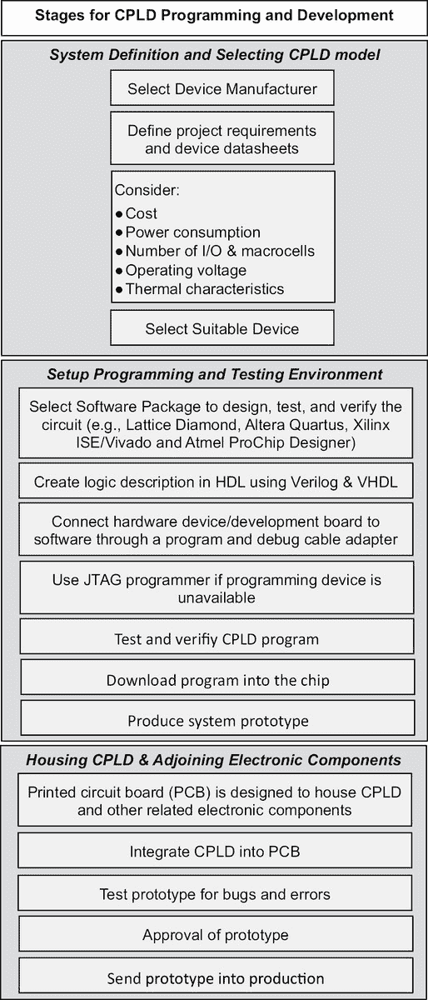

**图 5.4** CPLD 编程与开发的阶段。](#ch17.xhtml#f8b)

## 5.5 结论

本章追踪了计算机硬件发展与 AI 进步的关系。本章探讨了使用早期计算机的 AI 先驱性应用，然后重点关注了第四代和第五代计算机。从 20 世纪 70 年代初大规模集成电路 (`LSI`)，到 70 年代后期的超大规模集成电路 (`VLSI`)，再进展到 80 年代初的极超大规模集成电路 (`SLSI`)。

然而，历史表明，AI 应用的能力受到所利用计算架构处理能力的限制。基于冯·诺依曼架构的传统计算机顺序执行指令并处理存储中央内存中的数据，已被证明是一个严重的限制。这种局限性由于 `CPU` 与外部存储单元之间的数据传输速率限制，被称为冯·诺依曼瓶颈。量子计算机旨在解决这一弱点，并在处理速度方面取得了巨大进展，其利用亚原子粒子的量子态来存储信息以运行多维量子算法。`IBM` 已宣布开发出具有 1,121 个比特的 `Condor` 量子计算机模型。其他制造商（如加州量子初创公司 `Atom Computing`）也在该领域取得了重大进展。

另一个重要发展是脑形态硬件，其主要目标是通过应用模仿神经网络结构（形态学）的专用计算架构来模拟人类的神经系统。脑形态硬件利用物理定律（即欧姆定律和基尔霍夫定律）来实现特定任务的并行处理。例如，20 10 年代的脉冲神经网络 (`SNNs`) 和事件驱动计算侧重于提高效率和功耗感知的脑形态硬件设计。具有特别意义的是 2014 年的发展，当时 `IBM` 开发了 `TrueNorth` 脑形态芯片，用于视觉物体识别； 2018 年，`Intel` 开发了 `Loihi` 脑形态芯片，该芯片已在机器人以及手势和气味识别中应用。

脑形态硬件非常适用于专用应用，例如医疗和状况监测应用；自动驾驶车辆以增强其识别和解释环境的能力；以及医疗诊断中的疾病识别等其他应用。本章还讨论了其他专用硬件，如`边缘计算芯片`、专用集成电路 (`ASIC`)、现场可编程门阵列 (`FPGA`) 和复杂可编程逻辑设备 (`CPLD`)。这些专用硬件允许针对特定任务对芯片进行编程，并作为适用系统的一部分集成。这些专用硬件还可以与脑形态计算集成。开发模拟人类大脑的计算机是一个未来的目标，它将把目前的有限 AI 应用转变为所谓的超级人工智能（Super AI）。然而，开发模拟人类大脑的芯片目前已经是现实，但局限于特定任务。

## 参考文献

*   Analog Dialogue. (1990). 混合信号 `ASICs` 为设计者提供了另一种解决方案。[www.analog.com/media/en/analog-dialogue/volume-24/number-3/articles/volume24-number3.pdf#page=12](http://www.analog.com/media/en/analog-dialogue/volume-24/number-3/articles/volume24-number3.pdf#page=12)。](#ch17.xhtml#r044b)

*   `IBM`. (2024). 什么是量子计算？[www.ibm.com/topics/quantum-computing](http://www.ibm.com/topics/quantum-computing)。](#ch17.xhtml#r045b)

*   `IDQ`. (2024). 2023 年预示着 1000 比特计算机的到来。量子计算评论 2023 年第四季度](#ch17.xhtml#r046b)

*   Keim, R. (2023). 什么是专用集成电路 (`ASIC`)？关于电路的的一切。[www.allaboutcircuits.com/technical-articles/what-is-an-asic-application-specific-ic/](http://www.allaboutcircuits.com/technical-articles/what-is-an-asic-application-specific-ic/)。](#ch17.xhtml#r047b)

*   Moto-oka, Tohru. (1983). 五代计算机计划概述。东京大学电气信息系。](#ch17.xhtml#r048b)

*   Nasrin, S. (2023). 五代计算机：技术的进步。Fiverr 数字营销经理。](#ch17.xhtml#r049b)

*   Reid, T. (1992). 日本政府终止五代计算机计划未达目标。《华盛顿邮报](#ch17.xhtml#r050b)

*   Swinbanks, David and Anderson, Christopher. (1992). 日本在五代计算机上栽了跟头。《自然》，第 356 卷，273–274](#ch17.xhtml#r051b)

*   Wasay, Ali. (2023). 五大最具前景的 AI 硬件：AI 的未来是光明的。[www.makeuseof.com/most-promising-ai-hardware/](http://www.makeuseof.com/most-promising-ai-hardware/)。](#ch17.xhtml#r052b)


## 6.1 引言

基本上，软件是一组指令、数据或程序的集合，被用于操作计算机硬件并执行功能。软件可以被看作是硬件的互补。事实上，它可以被想象为硬件的对立面，或硬币的两面，其中硬件是头，软件是尾。硬件描述计算机的物理特征，而软件是一个广义术语，指代运行在硬件上的应用程序、脚本和程序。软件应用程序的变化取决于上传到硬件的程序，而硬件则是固定的、不可灵活的。

软件主要分为两种，即系统软件和应用软件。系统软件设计用于运行计算机硬件，并为应用程序与硬件共同执行提供平台。另一方面，应用软件满足特定需求并执行任务。其他类型的软件还包括：编程软件，它提供了软件开发人员用于生成和创建应用程序的编程工具；位于系统之间的中间件。

### 6.1.1 软件历史

在早期，软件（无论是操作系统还是程序）是以特定的代码形式创建的。在 20 世纪 60 年代到 70 年代，随着大型机和小型计算机的出现，随之出现了软件。在 80 年代，随着个人电脑的普及，软件以软盘的形式分发。直到 82 年左右，光盘（CD）被引入，随后在 97 年左右，DVD 成为一种常见的软件媒介。CD 和 DVD 的主要区别在于其存储容量。目前，大多数软件通过互联网获取，通过硬件描述语言（HDL）或图形化设计来实现。

直到 20 世纪 50 年代后期，“软件”一词才被使用。在那个时代，硬件非常昂贵，只有大型组织或企业才能负担得起，软件开发受限于科学家和技术人员。早期软件是基于代码的机器语言，难以编写和理解，对于调试错误来说非常困难。1948 年 6 月，曼彻斯特大学的科学家汤姆·基尔伯（Tom Kilburn）为“曼彻斯特婴儿”计算机编写了世界上第一个程序，其论文为《用于二进制数字计算机的存储系统》。


**图 6.1** 软件历史时间线

第二代语言仍然基于机器码，但对第一代语言进行了改进，被称为汇编语言。汇编语言包含了人类可读的语句并通过汇编器转换为机器语言。早在 1947 年，普林斯顿大学高级研究院的凯瑟琳（Kathleen）和安德鲁·唐纳德·布斯（Andrew Donald Booth）开发了第一个汇编代码，这种语言用于表示机器指令，即自动继电器计算机（ARC）的代码。然而，“汇编器”一词通常归于威尔克斯（Wilkes）、威勒（Wheeler）和吉尔（Gill）1951 年的著作《电子计算机程序编制》。他们使用该词表示“一个将多个部分的程序组合成单个程序的程序”。

这也适用于特定的硬件：边缘芯片、现场可编程门阵列（FPGA）以及复杂可编程逻辑器件（CPLD）。所有这些都需要某种类型的应用程序才能发挥其设计优势。例如，直接部署在物联网（IoT）、智能手机和边缘服务器等设备上的边缘芯片具有软件开发包（SDK），以协助跨平台的无缝集成。现场可编程门阵列（FPGA）使用图形化设计或硬件描述语言（HDL）进行编程。图形化设计语言（如 `C` 和 `C++`）通常用于较小的 FPGA，而 HDL 则用于较大的 FPGA 以及极高速的集成电路硬件描述语言。其他 HDL 还包括 `Java` 和来自凌美公司（Cypress Corporation）的 CPLD。

关于 HDL 的更多细节，神经形态计算也得到了软件的支持。例如，Innatera 生产的脉冲神经处理器使用多种编程语言，SynSense 制造的 Odin 则使用 Dynap 编程语言用于智能感知和智能视觉。


一个重要的里程碑是 20 世纪 50 年代初，通用汽车的研究部门为其 `IBM 701` 创建了第一个操作系统 `GMOS`，并在 1956 年为其 `IBM 704` 计算机创建了操作系统。第三代计算机语言于 20 世纪 50 年代后期出现。然而，直到 1958 年，统计学家约翰·图基（John Tukey）在写一篇关于计算机编程的文章时在使用“软件”一词。这一时代也遇到了 1957 年 `FORTRAN` 和 `COMTRAN`（`COBOL` 的前身）程序编译器的发布，随后是 1958 年的 `LISP` 编译器。`BASIC` 解释型编程语言于 1964 年问世，随后是 1970 年的 `PASCAL`，以及在 1974 年出现的 `COBOL`、`ADA` 和第一种 `SQL` 语言。在 20 世纪 60 年代和 70 年代，应用程序主要由能够负担起支持电子数据处理活动结构的组织内部开发。然而，一些重要的商业软件软件包如 `PERT`（程序评估与审查技术：`ICL 1900 PERT`）和 `SPSS`（社会科学统计包）分别于 1966 年和 1968 年发布。

1971 年，AT&T 发布了第一版 `Unix` 操作系统，IBM 引入了第一种 8 英寸（20 厘米）软盘。然而，消费级软件的一个重大突破是苹果公司于 1977 年发布了 `Apple II` 个人电脑（PC），随后是 VisiCorp 公司名为 `VisiCalc` 的第一款电子表格软件。20 世纪 80 年代见证了硬件和软件的指数级增长，微软发布了其 `MS-DOS` 操作系统，它成为所有兼容 PC 的标准。此外，硬盘已成为制造商在其 PC 中捆绑软件的标准。1983 年还见证了自由软件运动的诞生，理查·斯尔曼（Richard Stallman）发起了 `GNU`（而非 Unix）项目，旨在创建一个源代码免费提供的类 `Unix` 操作系统。苹果公司于 1984 年发布了 `Macintosh` 系列，随后是微软的 `Windows` 1.0。此外，20 世纪 80 年代中期见证了重要软件应用程序的发布，包括 AutoDesk 的 `AutoCAD`、`Microsoft Word` 和 `Excel`。此外，20 世纪 60 年代引入的软盘在 80 年代成为主要的发行媒介，而 `CD-ROM` 在 1989 年成为主要力量。

### AI 软件的演变（1980 年代-2010 年代）

读者需要记得，20 世纪 80 年代见证了 `Lisp` 编程语言和第五代计算机计划下专家系统的诞生与认可。此外，David Rumelhart、杰夫里·辛顿（Geoffrey Hinton）和 Ronald Williams  Williams 于 1986 年通过他们的著作《并行分布式处理：认知微结构的探索》一书开启了神经计算的新时代。此外，萨尔克研究所和加州大学创办了学术期刊《神经计算》（Neural Computation），并于 1989 年春季创刊，由特伦斯·杰诺夫斯基（Terrence Sejnowski）担任主编。1990 年，`Python` 计算机语言发布，它已成为 AI 应用流行的编程语言。在 20 世纪 90 年代，互联网变得非常流行，到 1999 年，Salesforce.com 利用云计算开创了通过互联网交付软件的先河，“软件即服务”（`SaaS`）术语在 2000 年流行起来。iPhone 于 2007 年发布，移动应用程序开始普及。到 2010 年，随着用户从互联网购买和下载软件，DVD 变得过时。

与这一发展同时，第四代语言早在 1984 就开始开发，例如矩阵实验室的 `MatLab` 以及 1990 年的 `Python`，此外还有 `Perl`、`Ruby`, `SQL`。这些第四代语言由类似于人类语言的命令组成，主要用于数据库编程和脚本。第五代编程语言也日益增长，主要应用于 AI。这些编程语言具有用于开发计算机程序的视觉化工具。第五代编程语言的示例包括 `OPS5`、`Mercury`、`ICAD` 和 `KL-ONE`。`OPS5` 是一种基于规则的计算机编程语言，已成功用于专家系统，而 `Mercury` 是一种为现实世界应用而设计的函数逻辑编程语言。此外，`ICAD`（智能计算机辅助设计）具有开放架构，可以使用底层语言的所有力量和灵活性。`ICAD` 的原始实现在 `Lisp` 机器（Symbolics）上。虽然 `KL-ONE` 是一种基于框架的语言反映了相关的思想，但这种计算机语言被称为应用于语义网络和框架的知识表示系统。

上述软件的发展促进了 20 世纪 90 年代监督学习的创建和增长，以及 21 世纪解决问题的机器学习算法，这些对于 AI 应用至关重要。此外，这些编程语言使深度神经网络在 2010 年左右取得了先进成果，以及聊天机器人（Chat Bots）和 `GPT` 模型的不断增强。没有上述软件的发展，今天的 AI 软件将是不可能的。AI 软件专门针对处理海量数据以执行人类人类的任务，包括图像识别、视频分析、生成式 AI、语音识别、文本识别以及让计算机理解、解释和生成文本的自然语言处理（`NLP`）。

## 6.2 AI 编程语言

本节将详细介绍主要的 AI 编程语言，包括上一节讨论的与特定硬件相关的编程语言。需要注意的是，使用这些语言编写的软件运行在传统的冯·诺依曼计算机上。

### 6.2.1 Lisp

`Lisp`（列表处理）是一种专门用于简单方便地处理字符串数据的编程语言。它自 1958 年以来一直在使用，被认为是仍在使用的最古编程语言之一。`Lisp` 最初作为解释型编程语言，不需要编译器，类似于原始的 `BASIC` 编程语言。对于解释型编程语言，源代码直接在系统中解释。然而，解释型编程语言的运行速度慢于编译版本。目前，大多数编程语言包括 `Lisp` 都有编译器，可以生成更快的执行版本。

由于不同的方言，`Lisp` 影响了其他计算机编程语言的发展。目前的基于 Lisp 的编程语言（Lisp 方言）包括：`Clojure`、`Emacs Lisp`、`Common Lisp`、`Julia`、`Racket` 和 `Scheme`。`Lisp` 在高等教育中非常流行，学生在那里学习相关的编程策略以为实际应用做准备。`Lisp` 被表示为至少一个对象的函数。它处理符号信息而非数字，因此非常适合 AI 程序。对象可以是另一个函数、常量或变量数据项。`Lisp` 于学习和使用，在学术领域教学计算机编程时非常流行。`Lisp` 可用于多种，如基础编程工具、AI 应用、机器学习和量子计算。


目前，Lisp 方言已应用于多种用例场景的代码生成。用例场景对特定用例如何演进进行了详尽的描述。这些场景通过描绘外部参与者与系统之间交互的序列来描述，展示了执行过程中可能出现的不同步骤和条件。用例场景提供了更深层次或更详细的视角，帮助开发者和利益相关者可视化特定的用户交互。用例场景通过应用两个基本元素来定义，即事件流和用例模板。事件流定义了用例内动作的逐步演进过程，事件流中的每一步都链接到特定的动作或决策点。这提供了一个用户-系统交互的全方位视图，识别了对于预见用例可能采取的各种路径至关重要的备选流和异常。另一方面，用例模板为文档化用例提供了一个标准化的结构，通过留出区域来放置用例名称、描述、参与者、前置条件、后置条件以及主流和替代流。这些模板提供了一种系统的收集和管理信息的方法，以确保项目内各种用例的一致性。

用例场景的应用通过一个示例得到了很好的说明。图 6.2 展示了一个在线购物系统的示例。在这种情况下，该用例场景是客户通过在线购物系统下单的情况。因此，该用例是客户的下单行为，展示了客户发起在线购买所需对象的过程。

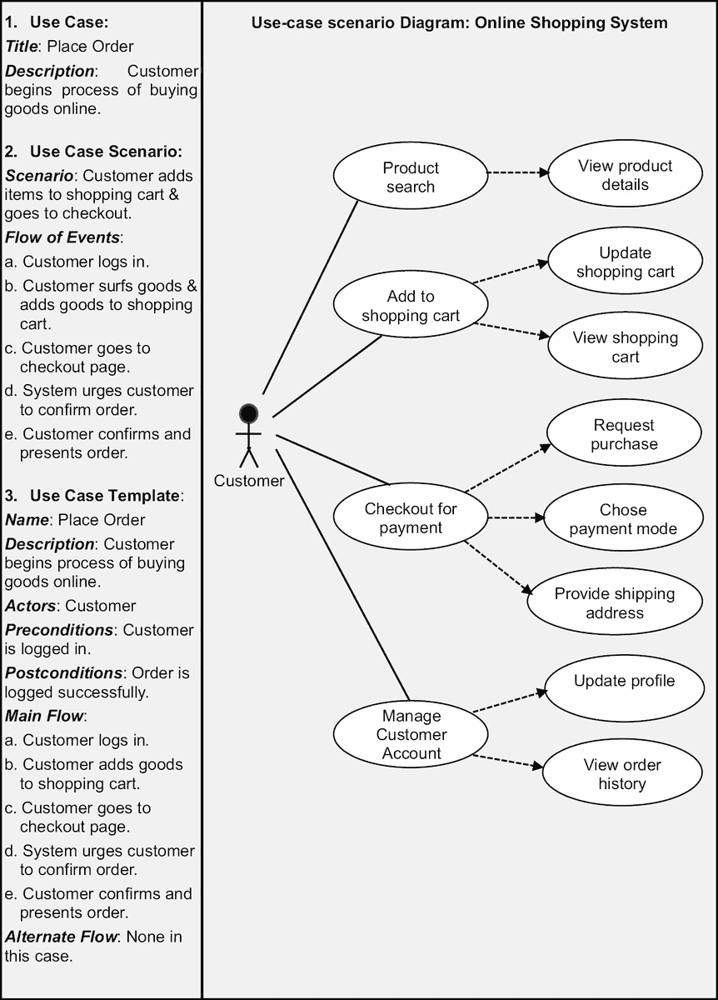

**图 6.2** 用例场景：常见在线购物系统的示例。](#ch18.xhtml#f10b)

图 6.2 说明了用例是对功能的高层级描述，即下单。如所示，用例场景通过详细说明从登录到确认的这些步骤，将下单任务拆分为更小、更易于管理的步骤。此外，事件流为该场景指定了逐步执行的序列，识别了动作和决策点。在线购物系统用例图是在线购物平台主要功能和接口的清晰视觉表示。该图描述了系统包含的各种任务和过程，使用户能够理解整个系统的结构和行为。用例图包含了系统的重要任务，如搜索和查看产品详情；将商品加入购物车；更新购物车并查看其内容。该图还说明了结账和支付流程，例如下单；选择支付方式；提供收货地址；此外展示了与管理用户账户相关的任务，包括更新个人信息和显示订单历史。应用用例图为用例记录提供了一个同质的结构，确保了系统中不同用例之间的方法一致。

Common Lisp 具有许多优势，例如无与伦比的读取-评估-打印循环（`REPL`），也称为交互式顶层或语言外壳，有助于与运行的 Web 应用交互；异常处理；性能；动态类型。通常情况下，`REPL` 是一个简单的环境，接收用户输入、执行它们并返回结果。

1984 年，Richard Stallman 开发了 `GNU Emacs`，这是一个用 `Lisp` 编写的文本编辑器。2009 年左右，`Grammarly`（一个应用 AI 分析文本的在线服务）使用 `Lisp` 来检查语法和拼写。另一个应用是`网络文件系统`（`NFS`），这是一种分布式文件系统，允许用户访问远程计算机上的文件，就像它们是本地文件一样。在航空领域，波音（Boeing）和空客（Airbus）都使用 `Piano`，这是一个用于飞机设计和分析的软件包。与旅游行业相关的 ITA Software 使用 `Lisp` 开发软件。

`CircleCI` 是一个 CI/CD 工具，使用 `Clojure` 支持快速软件开发和发布。他们还使用 `ClosureScript` 进行前端开发。`CircleCI` 集成了 `GitHub`、`GitHub Enterprise` 和 `Bitbucket`，在提交新代码行时创建构建。此外，`AutoCAD` 应用了 `AutoLISP` 方言。`Riemann` 是分布式系统监控工具，也主要用 `Clojure` 编写，提供了更好的灵性和容错能力。该系统从用户服务器和应用程序聚合事件并将其合并成流，然后传输进行进一步处理或存储。


Python 已被用于多种功能，包括机器学习；创建网站；软件测试以及控制自动驾驶汽车。Python 的一个大优势是它适用于每个操作系统并且是开源的，因此它是免费使用和分发的。此外，开发者和非开发者都可以利用 Python。Python 可用于执行复杂的统计计算、操纵和分析数据并完成其他与数据相关的任务。它还可以用于生成数据可视化并创建机器学习算法。数据可视化功能可以方便图表、直方图、饼图和 3D 图表的创建。Python 还有许多库程序的支持，这些程序帮助开发者快速高效地编写涉及数据分析和机器学习的程序。

Python 对于开发用户不可见的网站或应用程序后端非常有用，这些后端通常负责存储和组织数据，确保客户端的程序正常运行。因此，它的作用是与前端通信，向服务器发送和接收信息，处理数据，并连接数据库、URL 路由以及维护安全。对于那些重复执行的任务，Python 具有复制功能，可以使用称为“脚本”的自动化过程来实现。这种自动化功能被用于执行简单的数学计算、转换文件、对多个文件进行错误测试以及删除数据中的重复项。与其他面向对象的编程（OOP）语言相比，Python 是最友好的语言。

OOP 基于对象概念，对象可能包含数据和代码，其中数据以字段的形式存在，代码以过程的形式存在。图 6.3 阐了使用 Python 进行 AI 开发的一些主要优势，包括访问广泛的程序库、来自开发者社区的高水平支持、高度的灵活性，作为开源分类它还具有平台无关性。Python 被认为是用于 AI 的最佳计算机编程语言之一，因为它的复杂度比其他 OOP 语言低约 80%。此外，它的关键 AI 特性包括了预构建库程序，如用于执行科学计算的 `NumPy`、用于高端计算的 `SciPy` 以及用于机器学习的 `PyBrain`。

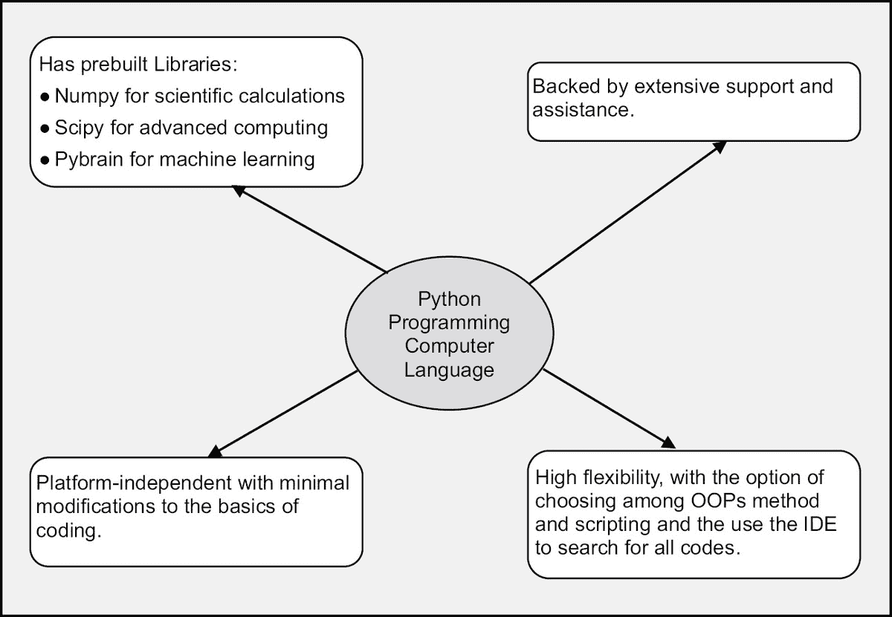

**图 6.3** 使用 Python 创建 AI 的优势。⏎

`NumPy`（数值 Python）程序用于存储由一个 N 维数组组成的泛化数据，并具有集成 C/C++ 代码、傅里叶变换、随机数能力等许多其他工具。`SciPy` 补充了 NumPy，允许极快速高效的处理，因为高级命令和类允许于的数据操纵和可视化。`SciPy` 库是用多种语言如 C、C++、Fortran 和 Python 编写的。此外，`PyBrain` 是一个易用的 Python 开源库，用于实现机器学习算法以快速解决问题。`Pandas` 是另一个构建在 Python 之上的开源库，用于处理数据结构和操作，作为分析工具非常强大、灵活且易于使用，特别是用于数据分析和操纵。`Matplotlib` 库用于生成高质量的 2D 图形表示，并可以访问多五个图形用户界面工具、Web 服务器以及 Python 脚本。

图 6.4 显示了通用 AI 的主要 Python 库。通用 AI 有四种主要的 Python 库，即 `AIMA`（人工智能：一种现代方法）、`pyDatalog`、`SimpleAI` 和 `EasyAI`。`AIMA` 不是一个软件库，而是一本关于 Python 算法实现的 AI 大学教科书。该书由 Stuart Russell 和 Peter Norvig 于 1995 年编写，第四版于 2020 年出版。`pyDatalog` 是 Python 的逻辑编程引擎，为逻辑程序员提供了广泛的标准 Python 库，可以快速表达复杂的算法。这个逻辑引擎是一种严谨的声明性语言，具有深厚的学术基础，在管理复杂性方面具有卓越的特性。`pyDatalog` 代码简洁，用于模拟游戏或专家系统的智能行为；探测复杂的相关信息集（如数据集成或自然语言处理）；以及执行递归算法（例如在层次数据结构上）。

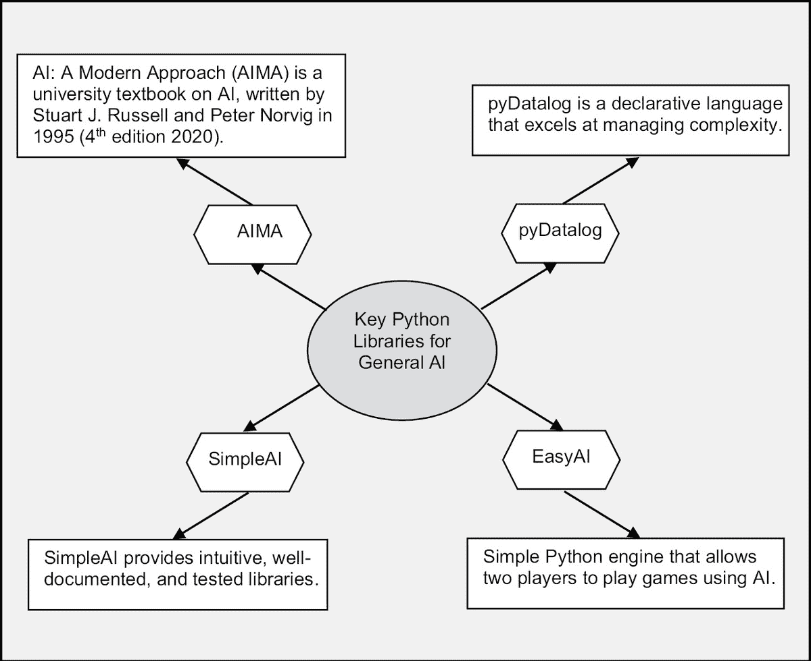

**图 6.4** 通用人工智能的 Python 库。⏎

另外两个经常使用的库是 `SimpleAI` 和 `EasyAI`。`SimpleAI` 是 Python 对 `AIMA` 中解释的各种 AI 算法的应用，提供了直观、文档齐全且经过测试的库。而 `EasyAI` 是一个极小的 Python 引擎，允许两个玩家使用 AI 玩游戏，即用于解游戏的 `Negamax` 和置换表。`Negamax` 是搜索算法的一种搜索变体，依赖于双玩家游戏的零和属性。基本上，`Negamax` 是极大极值搜索但代码更少。

Python 是 AI 编程语言的重要组成，因为它拥有完善的框架，如 `scikit-learn` 机器学习库。该库由于其易用的可视化功能，满足了当前 AI 开发的大部分需求。`scikit-learn` 包含了机器学习和统计建模的高效工具，包括分类、回归、聚类和降维。它整合了广泛的机器学习算法，适用于中规模监督和无监督问题，由于是通用高级语言，特别适用于非专业用户。`scikit-learn` 具有以下重要特性：

*   监督学习算法：`scikit-learn` 工具箱具有广义线性模型、支持向量机（SVM）、决策树和贝斯方法等。
*   交叉验证：该功能实现了检查模型在未知数据上准确性的多种方法。
*   无监督学习算法：这支持多种算法，如聚类、因子分析、主成分分析、无监督神经网络等。
*   各类玩具数据集：这些是用于探索性数据分析（EDA）和测试简单预测模型的虚拟数据集。这些数据集可以通过探索数据集并导出为所需的有效格式，用于训练微调玩具检测模型。
*   特征提取：该模块可以从由文本和图像（如词袋）等格式的数据集中提取机器学习算法支持的特征。词袋模型（`BoW`）是一种从文档文本中提取特征用于机器学习算法建模的方法。

在 Python 中，它是一种非常受欢迎的语言，因为几乎每个概念都可以用 20 到 30 行代码轻松验证，使其成为一种非常强大且丰富的语言，促进程序员开发 AI 应用的努力。

### **6.2.3** 智能计算机辅助设计 (ICAD)


ICAD 是一种基于知识的系统（KBE），能够捕捉产品设计背后的意图。基本上，KBE 是面向对象编程、人工智能（AI）和计算机辅助设计（CAD）的集成。因此，KBE 系统的目标是收集产品和过程信息，以便工程师和其他专业人员能够复制或建模工程过程。因此，KBE 系统允许工程师从产品或过程模型中生成几何设计和其他关键设计信息。这意味着当特定产品或过程规格发生更改或需要新设计版本时，其当前模型中的规则会评估新规格，并自动创建新的几何设计。

KBE 的结果是从指定的产品模型实现过程部分或全部的自动化。因此，产品模型充当设计过程的计算机表示，描述了设计的如何做、为什么做以及是什么。这意味着 KBE 产品或过程模型可以包含遗留程序、基于物理的分析、表格、数据库、成本模型以及来自外部环境的其他信息。通常，KBE 成为一种整合来自许多实体、部门、分支和人员知识的强大方式，这些人员共同促进了组织产品的创造。图 6.5 展示了 ICAD 过程，其中工程师指定输入要求，并从组织的内部、外部环境以及现有 CAD 中提取信息。所有这些都被 ICAD 系统作为其主要输入数据进行处理，生成 CAD 模型、过程设计、物料需求计划数据、物料清单以及相关的成本分析和辅助报告。

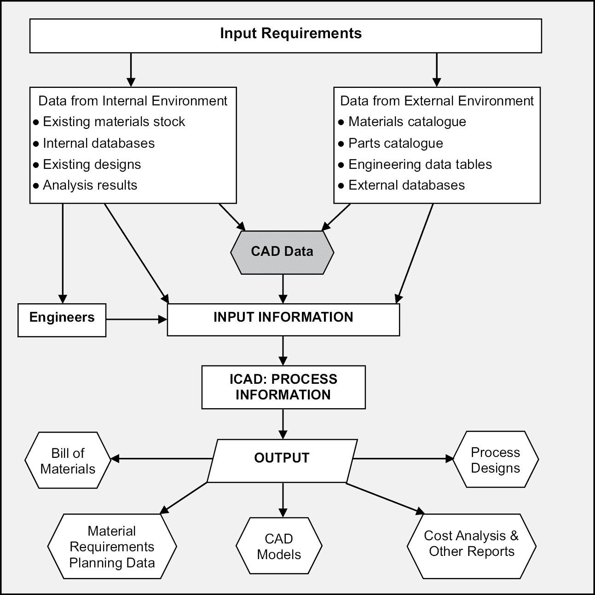

**图 6.5** ICAD 基于知识的系统](#ch18.xhtml#f13b)

ICAD 系统的一个示例是通电（Fujitsu）制造行业解决方案 COLMINA Design and Manufacturing Support iCAD SX(1)，它用于机械设计，据称由世界上最快的 3D CAD 引擎驱动。该系统减少了大型工业机械的设计工作。通电的 ICAD 软件包是一个集成系统，利用机械、钢制零件和管道的 3D 模型处理从概念设计研究到车间图的所有内容。他们于 2020 年发布的最新模型对内存访问处理和超大规模数据的处理速度进行了重大增强，将机械设备的设计检查和验证中可处理的零件数量扩展到多达 300 万个。

通电还开发并实现了新的设计功能，允许机械、电气和控制设计师保留并使用操作和制造信息，以及能够在制造和维护服务中使用 3D 数据的功能。通过链接从设计游到制造和维护服务的通用 3D 数据，此功能促进了数字环境中部门间的高效数据共享，从而缩短交付周期。从初始设计阶段开始，系统可以直接在 3D 数据中添加运动信息，包括运动量、运动顺序和定时。这使得能够在确认与周围部件位置关系的同时，检查运动、过程和循环时间。此外，3D 设备模型和加工信息使系统能够在设计早期计算零件成本并检查零件之间表面粗糙度和配合差的一致性。

通电的 ICAD 系统有助于缩短开发周期并提高质量，同时提高效率。智能计算机辅助设计（ICAD）技术已成为促进产品开发（IPD）体系的基础。应该注意，实施 IPD 系统的主要目标是实现一种集成方法，使所有主要组成部分（如 CAD 工具、数值分析工具、数据库、知识库和专家系统）协同工作。

### 6.2.4 KL-One

KL-One 是用于人工智能的一种知识表示系统，由 John McCarthy 和 Patrick Hayes 在 20 世纪 80 年代初开发。KL-One 是一种基于描述逻辑形式的框架语言（frame language），继承了语义网络和框架的传统。它具有一个自动推理引擎，可以验证本体论并生成新信息。本体论是判断事物是否存在的方法，以及存在的分类。它试图处理抽象的事物并确立它们是真实的。

KL-One 中的主要信息单元被称为 `Concept`（概念），它表示一组通常称为 `Frames`（框架）的对象。这些对象使用 `subsume-relations`（包含关系）形成层级结构。KL-One 的术语将 `super class`（超类）视为包含其 `subclasses`（子类），并允许多重继承。如果一个 `concept (frame)`（概念/框架）继承自一个一个其他概念，则认为它是良好的；除了顶级概念 `THING` 之外，所有的 `concepts` 必须至少有一个 `super class`。

在 KL-One 中，描述被分为两种基本类型的概念，即 `primitive`（原始）和 `defined`（定义）。`primitive` 类型属于领域概念，它们没有被完全定义。换句话说，一个概念的给定和已知属性不足以对其分类。`primitive` 类型概念也被视为不完整的定义。另一方面，`defined` 概念具有完整的定义，其属性完全已知。此外，`slot-concept`（槽位概念）被称为 `roles`（角色），角的值是 `role-fillers`（角色填充值）。在不同情况下可能会应用几种类型的角色。然而，最常见且最重要的角色类型是通用的 `Roleset`（角色集），它描述了角色可能被多个填充值填充的事实。例如，可以构建代表所有人的 `Concept`，每个人都有出生日期，因此 `PERSON` 是一个 `Concept` 并且有一个 `Roleset` `BIRTHDATE`。


通过示例来说明上述关于 KL-One 的原理是最好的方法。假设想要表示所有的马本质上都是哺乳动物。这通过规定表示哺乳动物的 `Concept` 包含表示马的 `Concept` 来实现。因此，这种包含关系通过 `Concepts` 之间的一条被称为 `SuperConcept` 的链接来表示。KL-One 维护一个 `Concepts` 目录（分类分类法），其分类体系的顶端是 `THING`，它被定义为包含所有其他 `Concept`。另一方面，没有对应的底部 `Concept`。此外，`Concepts` 继承其父类的元素，这意味着由 `Concept` 表示的集合中的每个成员都继承了其父类 `Concepts` 元素所指定的属性，包括该 `Concept` 本身的元素。因此，`HORSE` `Concept` 继承了 `MAMMAL` 的所有元素。换句话说，每只马都具有为哺乳动物规定的属性或特征，而哺乳动物本质上包含了马。

### 分类
该概念方面的一个重要特征是所谓的 `Classification`（分类）。分类是一个通过逻辑推理揭示由某些 `Concept` 所指的集合自动包含第二个 `Concept` 所表示的集合的过程，但在这些 `Concepts` 之间没有显式记录包含关系。因此，分类确定了 `Concepts` 之间的包含关系并验证了它们之间的 `SuperConcept` 链接。因此，通过分类过程，系统会自动将 `Concept` 在 KL-One 分类体系中的正确位置，因为它确定了它与其他 `Concepts` 之间适当的 `SuperConcept` 链接。总之，KL-One 由以下五个核心要素组成：

*   **Concepts（概念）**：这些是抽象对象，代表领域内的通用分类或对象组，可以使用若干分类关系（例如子概念、父概念）和继承属性（例如属性、角色）对其进行进一步规范或划分子类。
*   **Relations（关系）**：这些是二元谓词，描述活动并描绘领域内不同概念或对象之间有意义的链接。这些可以用于定义概念属性和关系的各种约束或限制（例如角色层次结构属性）。
*   **Individuals（个体）**：这些是领域内概念或对象的明确实例，可以根据其分类关系和继承属性进行分类或排序，并根据其概念定义和约束赋予各种属性或角色。
*   **Axioms（公理）**：这些是逻辑陈述或规则，描述了领域内概念或个体根据某些分类关系或继承属性进行分类的必要且充分的条件。
*   **Inference engine（推理引擎）**：它具有处理和评估与领域内概念定义、约束和关系相关的不同逻辑陈述或规则的功能。能够根据给定的知识库推导出新的事实或结论。

`Figure 6.6` 提供了一个关于 KL-One 框架语言概念的示例。`THINK` `Concept` 将自然世界的分类分为五个界，即 `Animal`、`Plant`、`Fungi`、`Protists` 和 `Monera`。图表显示，在动物界内提到了四个方面，每个方面都是可以用于描述世界上许多个体事物的描述。如所述，这些 `Generic Concepts` 中的某些可能由其他概念形成（例如，通用 `Concept` `HUMAN` 将拥有 `MAMMAL`）。还展示了一些用于构建 `Concepts` 的结构形成操作，这些操作融合了一个或多个通用 `Concepts` 以及对这些 `Concepts` 的一组限制。


**图 6.6 说明 KL-One 框架语言概念的示例。⏎**

如前所述，这些 `Generic Concepts` 中的某些可能由其他概念形成（例如，通用 `Concept` `HUMAN` 将拥有 `MAMMAL`）。还展示了一些用于构建 `Concepts` 的结构形成操作，这些操作融合了一个或多个通用 `Concepts` 以及对这些 `Concepts` 的一组限制。


应该注意的是，KL-One 分类体系始终有一个根 `Concept`，通常被标识为 `THING`。根 `Concept` 包含所有其他 `Concepts` 且没有 `SuperConcepts`。原始 `Concepts`（在 `Figure 6.6` 中用 `*` 表示）没有完全定义，然而，未用 `*` 表示的概念由其组件完全定义。此外，一个通用 `Concept` 可以有多个 `SuperConcepts`。例如，`Concept` `MAN` 有 `MAN-ANIMAL` 和 `HUMAN` 作为它的 `SuperConcepts`。因此，`MAN-ANIMAL` 和 `HUMAN` 包含 `MAN`。在这个示例中，`Concept` `MAN` 被定义为简单的是者的组合。


* **高效工具包**：KL-One 配备了一套完善的工具集，包括编辑器、编译器和推理引擎。该工具包促进了应用程序的开发过程，减少了开发应用所需的时间和精力。
* **可扩展性**：KL-One 的设计允许轻松地扩展。因此，它具有扩展系统的内在能力，并减少了实现扩展所需的工作量。这一原则允许在不损害现有系统功能的情况下进行改进。因此，可以根据需要向语言添加新的表示法和推理工具，使 KL-One 适应各种 AI 应用，提升了它的多功能性和实用性。
* **广泛适用性**：KL-One 已应用于多个 AI ，包括自然语言处理、专家系统和机器学习，证明了它在不同 AI 环境中的有效性和适应性。

KL-One 在 AI 领域具有几个主要特征，使其成为一种用于 AI 的丰富且强大的知识表示语言。这些特征包括：

* KL-One 在 AI 中充当知识表示系统，前述的优势使其能够表示广泛的知识，描述复杂的思想和关系。
* KL-One 拥有一种独特的名为“统一”（unification）的命名结构，以便于识别对象和关系。这一特征有助于将新知识整合到表示中。
* KL-One 基于定义良好的语义，允许进行活跃且一致的推理，使用推理规则从所表示的知识中得出新的结论。
* KL-One 带有自动推理引擎的演绎类分类器可以验证框架本体论（frame ontology）并确定新信息，增强了其解决问题的能力。
* KL-One 全面的工具包提供了便利，包括其可扩展性和灵活性特征促进了 AI 开发过程。

这些关键特征使得 KL-One 可以应用于许多工业领域。例如，它可以用于描述一个医学知识库，其中患者被显示为框架（frames），他们的症状和治疗方案被表示为谓词（即描述活动而非患者）。这允许对患者数据进行有用的探测和推理，并促进了用于诊断和治疗规划的系统的开发。KL-One 的知识表示特征使其成为医学信息处理；专家系统；自然语言处理；用于识别和理解图像和视频中对象和人的计算机视觉以及预测建模的理想选择。

KL-One 是 AI 应用开发的理想选择，因为它允许研究人员和开发者在形式化的本体论或概念模型中定义复杂的领域特定知识，特别是用于表示分类关系和概念层次。此外，它还提供了几个关键概念和机制，用于对应用领域内的各种概念或对象进行描述、分类和演绎，包括分类和继承属性；对概念特征的控制和限制；以及逻辑规则和推理能力。应该注意的是，KL-One 是基于框架系统（frame-based systems）的概念，将知识划分为小的、自包含的单元（称为框架），每个框架包含有关世界特定方面的信息，框架之间相互连接形成一个知识网络。

### 6.2.5 官方产生系统 (OPS5)

`OPS5` 是一种五代编程语言，其目标是使用提供给程序的约束条件来解决问题，而不是使用程序员编写的算法。它属于基于规则的计算机编程语言家族。这一特征使其与四代编程语言区别来。第四代和五代编程语言之间的主要区别在于，前者设计用于创建特定的计算机程序，而五代计算机语言的设计是为了让计算机为用户解决问题。

这意味着程序员不需要编写和实现解决问题的算法，而只需要关注需要解决什么问题，以及解决问题需要满足什么条件。`OPS5` 和其他五代计算机语言主要用于 AI 研究。`OPS5` 作为一种基于规则的编程语言，适用于在 AI、医学诊断和决策支持系统等学科中设计实现高效的专家系统。

来自卡内基梅隆大学的科学家 Herbert Simon 和 Allen Newell 几十年来研究人类解决问题的过程，他们产生了系统的概念。在他们看来，产生系统将知识表示为一组条件-动作规则（也称为“if-then 规则”）。因此，如果满足规则的条件，就会执行规则指定的动作。Simon 和 Newell 的想法被 Charles Forgy 在 20 世纪 70 年代后期采用，他专门开发了 `OPS5` 编程语言来满足基于规则的问题解决思路。Forgy (1981) 声称 `OPS5` 是一种在 `LISP` 和 `BLISS` 中实现的解释型计算机语言，主要用于 AI、认知心理学和专家系统的应用。

图 6.7 展示了 `OPS5` 基本上将数据存储在工作内存中，而“if-then 规则”（`Rules`）存储在产生内存中。`OPS5` 中的 `Rules` 彼此完全独立，可以按任何顺序放在产生内存中。`OPS5` 的工作原理是将工作内存中的数据与产生内存中的 `rules`（及其条件）进行匹配。如果数据与特定规则（即其条件）之间存在匹配，则执行与该特定匹配规则相关的动作。可能的动作包括更改工作内存的内容，从而匹配另一个规则的条件；从文件读取数据；在显示器上显示数据；以及调用外部算法（程序）。

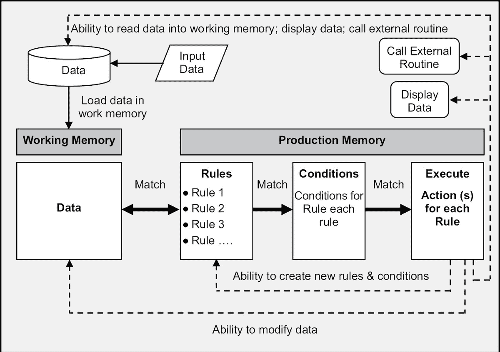

**图 6.7** OPS5 语言处理概念与自学习能力](ch18.xhtml#f15b)

图 6.7 意味着 `OPS5` 拥有集成的演绎过程和正向链过程，这是 AI 专家系统的一种推理形式，从简单事实开始并应用推理规则提取更多数据，直到实现目标（即能够更改规则并修改和添加数据）。虽然 `OPS5` 没有直接提供反向链，但这一特征可以通过更大的努力来实现。


Allen Newell 领导的人工智能小组研究产生系统已有一段时间，但 Forgy 基于其 `Rete` 算法的实现特别高效，以至于能够扩展到涉及数百或数千条规则的大型问题。`OPS5` 结合了扩展了抑制弧（inhibitor arcs）的 Petri 网执行引擎的基本原理，以及 `Rete` 算法。Petri 网由 Carl Adam Petri 于 1962 年创立，其基础概念已得到扩展和增强，用以应用于包括编程语言在内的多个领域。

图 6.8 了一个了一个 Petri 网的简单示例，说明了其基本概念。Petri 网 应该被可视化为一组有向 `Arcs`（弧，由箭头符号表示），这些弧连接了 `Places`（库，由圆圈表示）和 `Transitions`（转换，由矩形表示）。然而，`Places` 可能会存储 `Tokens`（令牌，由黑点表示），网的状态取决于其将 `Tokens` 分配给 `Places` 的情况。此外，`Arcs` 的默认容量为 1；如果容量不是 1，则容量标注在弧上。在图 6.8 的示例中，默认容量为 1。此外，`Places` 具有无限容量，而转换没有任何容量，且不能存储令牌。此外，`Arcs` 只能连接 `Places` 和 `Transitions`，或者反之亦然。

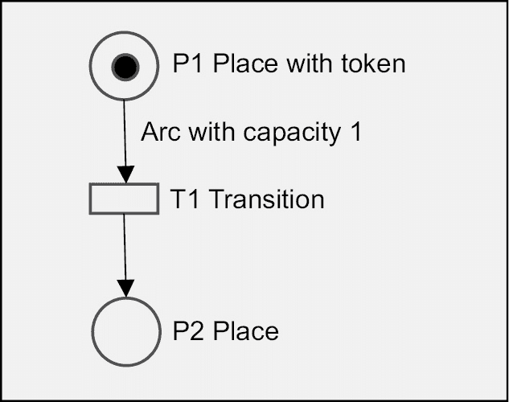

**图 6.8** 说明基本概念的 Petri 网示例。⏎

图 6.9 描述了一系列 Petri 网，展示了 Petri 网的状态如何根据通过 `Transition` 条件将 `Tokens` 分配给 `Places` 而发生变化。当每个输入库 `Places` 中的令牌数量大于或等于从该库到 `Transition` 的 `Arc` 容量（权重）时，该 `Transition` 就会被激活。图 6.9 (A) 说明了在这种情况下，每个输入 `Places` 中的 `Tokens` 数量为 1，且 `Arc` 权重默认容量为 1，这满足了 `Transition` 激活的条件。此外，已激活的 `Transition` 可以在任何触发。图 6.9 (B) 显示了当 `Transition` 触发时 Petri 网的状态变化，输入 `Places` 中的 `Tokens` 被转移到输出 `Places`，对应于 `Arc` 权重和 `Place` 容量。

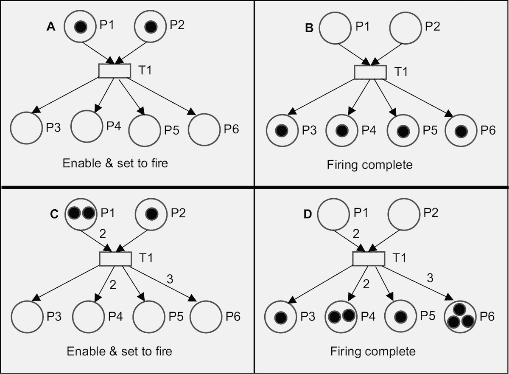

**图 6.9** 说明各种其他基本概念的 Petri 网示例。⏎](#ch18.xhtml#f17b)

图 6.9 (C) 说明了当 `Places` 和 `Arcs` 具有不同的令牌容量且处于准备触发状态时发生的情况，而图 6.9 (D) 显示了触发后的结果。注意在图 6.9 (C) 中，库 `P1`（有 2 个 `Tokens`）的 `Arc` 容量为 2，而 `P2`（有 1 个 `Token`）的默认 `Arc` 容量为 1。然而，`Transition` 后的 `Arc` 容量对于 `P3`（有 1 个 `Token`）为 1，`P4`（有 2 个 `Tokens`）为 2，`P5`（有 1 个 `Token`）为 1，`P6`（有 3 个 `Tokens`）为 3。因此，图 6.9](#ch18.xhtml#f17) (D) 显示的结果对应于触发这些 `Arc` 容量。

换句话说，当 `Transition` 触发时，它从输入 `Places` 接收激活它的 `Tokens`，并根据匹配的 `Arc` 容量权重将 `Tokens` 分散到输出 `Places`。如果所有 `Arc` 权重均相同，给人一种 `Tokens` 是通过转换传输的印象。然而，如果 `Arc` 权重不同，给人一种 `Tokens` 可能会消失或产生的错觉。事实上，在图 6.9 (C) 中，`Tokens` 的数量为 3（`P1` 为 2，`P2` 为 1），但在图 6.9 (D) 触发后，`Tokens` 的数量变为 7（`P3` 为 1，`P4` 为 2，`P5` 为 1，`P6` 为 3）。因此产生了四个额外的 `Tokens`（根据 `Arc` 权重产生输出）。还有一种特殊的 `Arc` 类型被称为抑制弧（inhibitor Arc），它用于反转输入 `Place` 的逻辑。图 6.10 通过在箭头末端有一个一个小方框来展示抑制弧的符号。图 6.10 说明，由于 `P2` 中具有抑制弧的 `Token`，该 `Transition` 无法触发。上述内容简述了 Petri 网的概念。

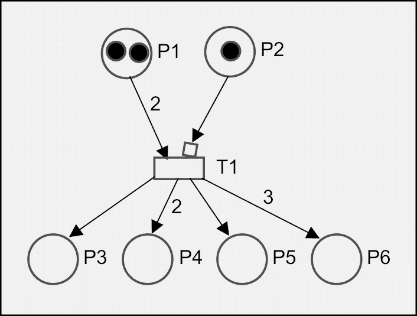

**图 6.10** 说明抑制弧概念的 Petri 网示例。⏎](#ch18.xhtml#f8)

Allen Newell 领导的人工智能小组研究产生系统已有一段时间，但 Forgy 基于其 `Rete` 算法的实现特别高效，以至于能够扩展到涉及数百或数千条规则的大型问题。`OPS5` 结合了扩展了抑制弧的 Petri 网执行引擎的基本原理，以及 `Rete` 算法。Petri 网由 Carl Adam Petri 于 1962 年创立，其基础概念已得到扩展和增强，用以应用于包括编程语言在内的多个领域。

如前所述，`Rete` 算法的名字源于拉丁语中的“网”（net）。它由 Forgy 于 1974 年设计。`Rete` 算法将数据结构化为树状结构。树中的每个节点代表一个测试。当额外的数据项进入树时，它通过树过滤直到到达终端节点。如果数据到达终端节点，意味着创建了一个激活记录。

与其他方法一样，`Rete` 也有一套约定或术语来解释其应用。规则集（ruleset）是由一个或多个规则组成的知识库。规则集中的每条规则都表示某种知识。规则通常定义为如果-那么或条件-动作规则。如果-那么规则被称为 Rete 规则。一个 Rete 规则的示例是：`If age > 49 then assign screening-status = 1`


# Rete 算法概述

Rete 算法要求向规则引擎提供一套完整的规则集以扩展处理范围。通常，规则引擎会将规则集中的每条规则（即条件）与指定的实进行匹配，以确定是否触发（即执行）该规则。这一过程被称为模式匹配过程，并且会重复进行。此外，事实列表在每个周期中可能会发生变化。换句话说，事实列表通过向事实列表中包含新事实和/或从列表中删除旧事实来不断进行更新。

因此，这些修改可能会触发之前未满足（未完成）的模式变为被满足（满足）。此外，在每个周期中，必须更新并保留（存储）已满足的规则集。通常，规则的操作仅会改变更新事实列表中的几个事实。这一过程被称为时间冗余。该算法非常高效，因为规则引擎不会通过直接搜索所有事实来验证每条规则，因为大多数事实都没有被修改，这样做会延迟处理过程。这一点的实现是因为算法被设计为记忆（回溯）从周期到周期已经匹配的内容，并仅对新添加或删除的事实处理必要的更改。

## Rete 算法结构

Rete 算法结构由节点网络组成。如前所述，它通过在内存中存储从周期到周期的每个匹配过程的状态，并仅计算具有修改事实的部分来实现高处理速度。因此，匹配过程的状态仅在添加或/或删除事实时进行更新。因此，修改次数越少，匹配过程越快。

图 6.11 说明了每条规则都有相应的推理（推演）周期，该周期由三个阶段组成，即匹配阶段、选择和执行阶段。每个阶段都有不同的功能。例如，在匹配阶段，将规则的条件与事实进行比较，以确定哪些规则应该被执行（触发）。因此，条件已满足（已完成）的规则被存储在一个名为 `agenda-ready` 的列表中以供执行（触发）。最后，从规则列表中选择一条规则进行执行（触发）。选择策略取决于几个因素，即优先级、最近使用情况、规则规范或其他指定的特定条件。从列表中选出的规则通过执行与该规则相关的操作被执行（触发）。该操作可能包括多个事件，例如验证（确认）；执行用户定义或内置函数；或者通过决策表引擎实现决策表，或其他方式。

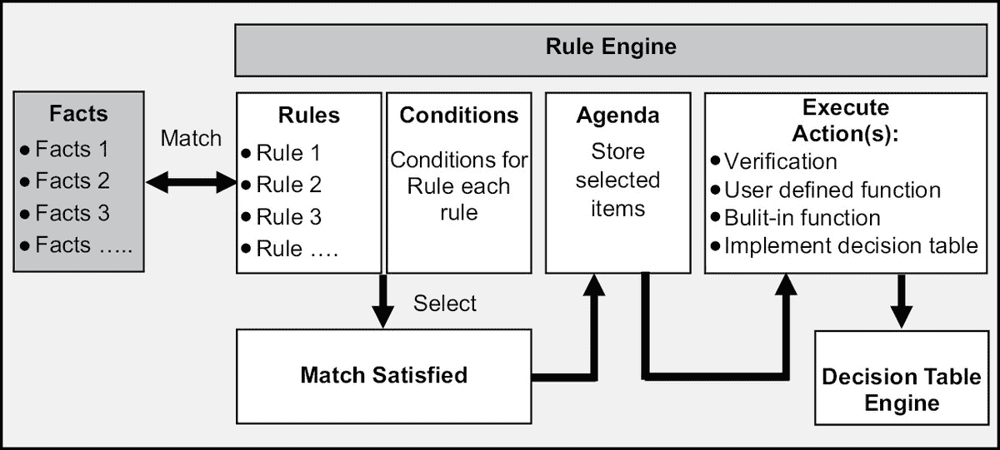

**图 6.11** 规则引擎推理周期示意。⏎

## Rete 网络构建

Rete 网络的构建需要遵循某些约定。Rete 网络是一个直接无环图，由代表规则条件中模式的节点组成，并且是无图环的二分图。此外，它的节点之间具有方向关系，且不形成方向闭环。节点充当过滤器测试（检查）传入的令牌，并仅触发（发送）那些合格（即通过测试）的令牌。Rete 网络由两个部分组成，即 alpha 网络和 beta 网络。alpha 网络由称为 `alpha nodes` 的节点组成，每个节点都有一个定义元素内部输入。beta 网络由 `beta nodes` 组成，每个节点有两个输入来定义元素间的条件。

Rete 网络从被称为 `Rete Node` 的 `Root node` 开始。根节点之后是 `Kind nodes`，每种事实类型对应一个 `Kind node`。`Alpha nodes` 连接到相应的 `Kind node` 并为每个模式创建。如果一个条件具有两个模式，则会创建两个 `alpha nodes`，每个 `alpha node` 关联到一个名为 `alpha memory` 的内存。`alpha memory` 用于回溯匹配的事实。`alpha nodes` 链接到 `beta nodes`。`Beta node` 只能接收两个输入。因此，如果有三个 `alpha nodes`，前两个节点将链接到一个 `beta node`。随后，该 `beta node` 的输出和第三个 `alpha node` 将链接到另一个 `beta node`。因此，`beta nodes` 可以支持部分匹配，每个 `beta node` 都有一个存储连接模式的内存。

## 令牌处理

最初，令牌进入根节点。随后，每个事实的确认生成一个令牌。网络随后为每种令牌类型划分分支，每个 `Kind node` 接收令牌的副本并执行 `SELECT` 操作来选择其类型的令牌。`kind node` 将其收到的令牌节点副本发送给 `alpha nodes`。在接收令牌后，`alpha nodes` 执行 `PROJECT` 操作，并从令牌中提取与模式变量匹配的元素。基本上，`alpha node` 评估条件，然后 `beta node` 确定规则的可行笛尔积。当实现这一点时，规则中的操作将被执行。

## 示例：乳腺癌筛查

通过示例最能说明 Rete 网络的构建。假设当地卫生部门对 50 至 70 岁之间的女性有一项乳腺癌筛查方案。年龄事实是 `java` 类型，而性别事实是 `xml` 类型。该规则如下：

> 如果 age>49 或 age<71 或 gender = “female” 则 screen-status = 1

这条规则将由 图 6.12 所示的 Rete 网络描绘。图 6.12 示例包含两种节点和两种类型的事实，即：Kind 1 (java) 和 Kind 2 (xml)。有三个模式，即 age>49、age<71 和 gender=female，因此将生成三个 `alpha nodes`。示例显示 Alpha 1 和 Alpha 2 表示前两个模式并链接到 Kind 1，而 Alpha 3 表示第三个模式并链接到 Kind 2。Alpha 1 和 Alpha 2 链接到 Beta 1，而 Alpha 3 链接到 Beta 2。

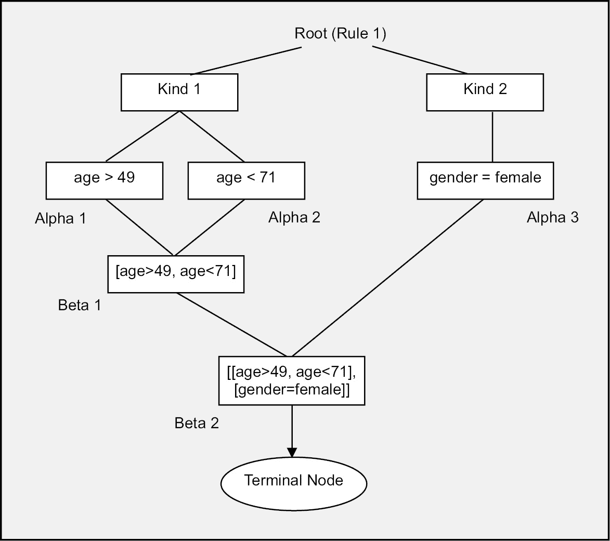

**图 6.12** 构建 Rete 网络的示例。⏎

当年龄值进入根节点时，生成一个令牌。此外，该令牌将被复制并分发到种类节点。因此，Kind 1 将接受该令牌，因为事实类型是 `java` 并将其转发到 Alpha 1 和 Alpha 2。如果该值满足（符合）约束，则令牌将转发到 Beta 1 然后到 Beta 2。在此期间性别值进入根节点，由 Kind 2 接收（因为是 xml 类型）。Alpha 3 获取它并验证该值是否满足（符合）条件 gender=female。如果是这种情况（即：是），它将允许令牌转发到 Beta 2。此外，如果值（事实）与 Beta 2 中的条件匹配，则该规则将添加到列表中供触发（执行）。因此，如果某个特定案例的年龄在 50 到 70 岁之间且 screen-status 为 1，将发送一封信邀请该个人进行乳腺筛查测试。


Rete 算法在速度方面非常高效。然而，由于它通过模式匹配和部分匹配来保存系统状态的特性，它需要大量的内存。因此，Rete 算法的主要方面在于：它能够保留由于新事实数据产生的连续更新之间的部分匹配，并努力在匹配过程中重用重叠的规则。内存需求由规则数量 (`R`) 乘以声明事实的数量 (`F`)，再乘以每个规则的平均模式数 (`P`) 决决定。因此，如果 `R = 100`、`F = 10,000` 且 `P = 10`，则所需的存储空间为 10mb。研究表明，Rete 算法可以成功应用于 Petri 网（网网），且 Petri 网可以作为基于规则系统的底层机制（Burdescu and Brezovan, 2001a, 2001b; Hura, 1993; Murata and Yim, 1995）。此外，Dohlbom (2011) 说明 Petri 网的应用效率与带有时间扩展的 Rete 算法创建的规则技术一样高效。

### 6.2.6 Mercury 和 Prolog

Mercury 和 Prolog 都是声明式计算机编程语言（或逻辑编程）。Prolog 自 1972 年以来一直在使用，专门为开发基于逻辑的 AI 应用而设计。通过 Prolog，开发者可以围绕问题设定规则和事实，然后 Prolog 解释器将使用这些信息自动推导出解决方案。Mercury 大于 1995 年左右发布，它是 Prolog 的增强版本，具有增强的功能以提供更好的性能。

声明式编程是一种高级编程概念，基本上意味着人们只需陈述任务的结果，而编译器将确定实现该结果需要执行的步骤。因此，程序员编写的代码描述的是“做什么”以及“要实现什么结果（输出）”，而不是“如何”实现这些结果。这与命令式编程相反，在命令式编程中，必须为实现所需结果的每一步完整地编写代码。在声明式编程中，是由编译器来确定完成任务所需的步骤。换句话说，声明式程序依赖于语言中预配置的设施，而没有关于完成特定任务需要执行哪些步骤的特定案例指令。

声明式程序是与上下文（环境）无关的，因为程序员只需要声明最终目标（做什么），而不需要实现该目标所需的逻辑步骤（怎么做）。这意味着相同的程序表达式在不同的情况下具有相同的含义，因此可以应用于不同的上下文。因此，像 Mercury 和 Prolog 这样的声明式程序处理起来简单得多，因为它们制定了计算逻辑，而没有通过控制流使编程代码复杂化。这些类型的程序更容易理解，因为它们具有更少的歧义过程、隐含依赖和可变状态，简化了编程代码并提高了可读性。

Mercury 作为一种较晚开发的产物，具有更先进的稳定分析和错误检测功能。它还受到高度优化的执行算法的支持，该算法比其他逻辑编程系统高效得多，并在没有复杂控制流的情况下实现了与传统编程系统类似的性能。Mercury 被认为是一种纯逻辑编程语言，旨在生成大规模、快速且可靠的程序。Mercury 的编码语法基于 Prolog，但它与词、标记或符号的不同含义（语义上）的关联方式使得这两种语言有些不同，这归于 Mercury 的清晰度、风格、方法、条件（确定性）和模块系统。尽管 Mercury 和 Prolog 都是逻辑编程语言，但它们之间存在几点差异：

*   **语法**：Mercury 的语法类似于现代命令式语言。Prolog 使用符号语法，这是一种更传统的方法。
*   **类型系统**：Mercury 拥有健壮的类型系统，允许更稳定的类型验证，使得程序比 Prolog 更高效。
*   **模式和确定性**：Mercury 允许对计算过程进行额外控制，因为它同时支持声明和命令式语义，因此允许使用非确定谓词。Prolog 仅支持声明式语义来表示逻辑关系，但它不具备指定如何计算这些关系的能力。
*   **性能**：Prolog 没有 Mercury 高效。Mercury 侧重于静态类型检查，通过对程序文本（源代码）的分析、模式引导编译以及自动创建指定代码来验证程序的类型安全。
*   **并发**：Mercury 支持谓词的并发和并行执行，允许高效利用多核处理器，而 Prolog 没有这一功能。
*   **应用**：Prolog 是为 AI 应用设计的，用于知识表示和自然语言处理。而 Mercury 主要用于编写大型、复杂且对性能敏感的系统。

由于 Mercury 的语法代码基于 Prolog，因此使用 Prolog 语法来说说明这些语言的某些基本方面是合适的。需要注意的是，Prolog 是一种健壮且灵活的计算机编程语言，非常适合创建基于逻辑的 AI 应用。


*   事实（Facts）是被假定为陈述；因此，它们使用谓词名称后接一个括号括的参数列表来编写（例如 `woman(rebecca)`，另参见表 6.1 的第 1 至 3 行）。
*   规则（Rules）是指定事实之间关系的逻辑语句。规则使用谓词名称后接一个括号括的参数列表，随后跟上一个冒号和连字符（`:-`）以及规则体（例如 `not(X1,Y1):- man(X1), woman(Y1)`，另参见表 6.1 的第 4 行）。
*   变量（Variables）表示可能改变或被确定的值。变量通常使用大大写字母的名称（例如 `X1`）。
*   查询（Queries）用于根据程序中定义的规则和事实来寻找问题的解决方案（例如 `not(peter, rebecca)?`）。

如前所述，事实是会被接受为真实的陈述，并为 Prolog 提供了关于问题领域的信息，这些信息将用于自动导出问题的答案。事实通过使用谓词名称后接一个括号括的参数列表来表示。例如，在表 6.1 的第 1 行声明 `peter` 是一个男人；第 2 行声明 `rebecca` 是一个女人；第 3 行声明 `berlin` 是德国的首都。表 6.2 显示了一个简单的计算机程序，阐释了一些基本的 Prolog 原理。表 6.2 中的程序识别了关于某个问题领域的几个事实和规则。它应用这些事实和规则为两个查询提供答案。

**表 6.2** 简单 Prolog 程序示例⏎

| **行** | **语法** | **类型** |
| --- | --- | --- |
| 1 | `% Facts` | |
| --- | --- | --- |
| 2 | `man(peter).` | 事实 |
| 3 | `woman(rebecca).` | 事实 |
| 4 | `boy(jake).` | 事实 |
| 5 | `girl(sue).` | 事实 |
| 6 | `river_of(germany, danube).` | 事实 |
| 7 | `capital_of(germany, berlin).` | 事实 |
| 8 | `% Rule` | |
| 9 | `not(x1,y1):- man(x1), woman(y1).` | 规则 |
| 10 | `not(x2,y2):- boy(x2), girl(y2).` | 规则 |
| 11 | `% Query 1` | |
| 12 | `not(peter, rebecca)?` | 查询 |
| 13 | `% Query 2` | |
| 14 | `river_of(germany, X)?` | 查询 |
| 15 | `% Query 3` | |
| 16 | `capital_of(germany, Y)?` | 查询 |

该程序在第 2 至 7 行定义了六个事实，即 `man(peter)`、`woman(rebecca)`、`boy(jake)`、`girl(sue)`、`river_of(Germany, Danube)` 和 `capital_of(germany, berlin)`。这些事实基本上宣布了 Peter 是一个男人；Rebecca 是一个女人；Jake 是一个男孩；Sue 是一个女孩；多瑙河是德国的一条河；柏林是德国的首都。注意第 1 行（`% Facts`）声明后续行均为事实。第 8 行（`% Rule`）程序表示后续行为规则。规则定义在第 9 行和第 10 行。程序声明规则使用了 `not/2` 谓词，声明如果 `X1` 是男人且 `Y1` 是女人，那么 `X1` 就不是 `Y1`；如果 `X2` 是男孩且 `Y2` 是女孩，那么 `X2` 就不是 `Y2`。程序的最后部分描述了查询。这些查询声明在第 11 至 16 行。注意每个查询都有编号，并在实际执行的查询语句之前，分别由第 11 行的 `%Query 1`、第 13 行的 `%Query 2` 和第 15 行的 `%Query 3` 引导。


Prolog 程序的第三部分也是最后部分声明了查询，用于确定潜在的医疗状况，无论是新冠肺炎（covid-19）、流感还是感冒。特定的查询要求解释器根据患者的症状确定可能患有的医疗状况。在这个示例中，共有五个特定的查询，因为医疗状况可能具有某些共同症状。前两个查询旨在确定患者经历的症状是否表明为感冒。接下来两个查询的目的是指示症状是否指向流感或新冠肺炎，因为这两者具有共同症状。最后一个查询将确定患者所经历的是流感还是新冠肺炎，因为呼吸困难这一症状有很大概率适用于新冠肺炎。每个单独的查询都要求解释器确定患者可能正在经历哪种医疗状况。如前所述，该程序将应用 `illness_condition/2` 规则和 `illness_indicator/2` 事实来确定患者患有新冠肺炎、流感还是感冒，并对每个查询做出相应的解决方案。

上述示例说明了如何将 Prolog 程序应用于 AI 领域。正如人们可能体会到的，在实际场景中，程序可能会通过访问症状数据库变得更加复杂，并拥有用于诊断医疗状况的更复杂的规则。需要注意的是，使用 Prolog 而不是 Mercury，是因为 Prolog 是 Mercury 计算机语言的子集。本节证明了 Mercury 和 Prolog 都是开发 AI 应用的强大且灵活的语言，其中 Mercury 开发较晚，具有许多新增功能。

## 6.2.7 IBM Qiskit 软件开发包 (SDK)

IBM 采用了 Qiskit，这是一种基于 Python 的开源量子 SDK。Qiskit SDK 专为在 IBM Quantum 平台或本地计算机的模拟器上以电路和算法层级工作而设计。Qiskit 由 IBM 研究院开发，并有学术机构的贡献，旨在促进 IBM 云端量子计算服务的软件开发。除了 Python 版本外，Qiskit 还考虑过 Swift 和 JavaScript 版本，但这些倡议并未被实施。Qiskit 还支持量子人工智能 (QAI)，这是一个当代跨学科研究领域，它将量子计算与 AI 结合，旨在利用量子计算机的独特属性来增强 AI 系统的能力。

Qiskit 由多个集成组件组成，能够实现量子计算，其首要目标是创建一个软件包，方便用户利用量子计算机，无论他们的技能水平或兴趣领域如何。因此，Qiskit 为用户提供了一个计算平台，用于创建测试原型和应用程序，并在量子计算机和/或传统模拟器上执行。这是通过在 `OpenQASM` 的机器码层级以及适用于不具备量子计算知识的终端用户的抽象层级上生成量子软件实现的。

Qiskit 的功能由几个组件支持，这些组件提供了一些非常强大的特性。例如，Qiskit Terra 组件是其他 Qiskit 模块的基础，并提供了在量子机器码级或接近该层级生成量子电路的必要工具。这允许在量子硬件上执行生成的进程，而这些过程是专门根据量子门创建的。这为量子电路针对特定设备进行优化提供了手段，此外还可以管理批量作业并在远程访问的量子设备和模拟器上执行这些作业。

一个重要的组件是 Qiskit Machine Learning。该组件提供了基础计算模块，例如量子内核（Quantum Kernels）和量子神经网络（Quantum Neural Networks），它们被应用于分类和回归等多个应用中。Qiskit Machine Learning 用户非常友好，允许在没有全面量子计算知识的情况下快速创建初始原型。此外，它非常灵活，可以扩展以支持创新的量子机器学习研究。Qiskit Machine Learning 模块（例如应用 `BaseStateFidelity` 算法的 `FidelityQuantumKernel`）可用于为给定数据集直接计算内核矩阵，或转发到量子支持向量分类器 (`QSVC`) 或量子支持向量回归器 (`QSVR`) 以解决分类或回归问题。

Qiskit Machine Learning 具有用于神经网络的通用接口，由各种量子神经网络执行，允许用户将参数化量子电路与量子力学观测值相结合，并应用 Qiskit 的电路库。此外，Qiskit Machine Learning 有了一系列学习算法，如 `NeuralNetworkClassifier` 和 `NeuralNetworkRegressor` 用于处理分类或回归问题。此外，它支持 `TorchConnector` 模块，可以将 IBM 的所有量子神经网络直接集成到 `PyTorch` 开源机器学习库中。

机器学习已成为现代决策中卓越的工具，在量子计算进一步发展的支持，预计将推动这一能力推向新高度。将量子原理整合到神经网络中提供了巨大的计算优势潜力，特别是在 AI 和深度学习领域。事实上，对这种整合进行详细识别和理解可能会为执行复杂计算的方式提供额外的能力。

## 6.2.8 与 AI 相关的特定硬件的其他编程语言

本节要介绍了与 AI 相关的特定硬件的关键编程语言，其目标是控制数字电路以执行特定功能。硬件本身在之前的章节中已介绍。本章提供了关于驱动此类特定硬件编程语言的附加信息。通常，硬件指的是允许用户执行输入、输出、存储、通信、处理等主要功能的外部和内部设备及装置。因此，硬件指的是物理部分。然而，为了让这些物理部分发挥作用，它们必须接收并执行指令。


从本质上说，硬件以数字电路作为主要组件，这些主要由互连的晶体管组成。事实上，中央处理器（CPU）是由大量的晶体管聚集而成的。更具体地说，晶体管可以作为电子信号的开关或门，每秒多次打开和关闭电子门门。因此，晶体管确保了在电流流动时电路接通，在不流动时断开。

因此，数字电路可以通过互连的图示来表示，这些图被称为原理图，但它们在可视化方面可能非常复杂。事实上，随着复杂性的增加，用视觉化风格描述互连的数字电路图变得不切实际。然而，描述数字电路的一种更简单、更实用的方法是使用一种文本语言，该语言专门用于清晰简洁地描述数字设计的特征。这种文本语言被称为硬件描述语言（HDLs）。

在介绍硬件的章节中，提到常用的硬件描述语言有 `Verilog` 和 `VHDL`（超高高速集成电路硬件描述语言）。这些语言通常与现场可编程门阵列（FPGAs）结合使用，FPGA 是一种专门用于帮助并加速定制数字电路创建的数字设备。FPGA 是通常现成出售的集成电路，被称为“现场可编程”，因为它们允许开发者在制造过程后重新配置（修改）硬件以满足其特定的用例需求。换句话说，HDLs 允许开发者使用单词和符号来定义电路，并创建软件将这种基于单词和符号的描述转换为配置（设计）数据，并将数据加载到 FPGA 中以执行所需的功能。图 6.13 提供了一个单一电路原理图及其对应 HDL 代码的简单示例。

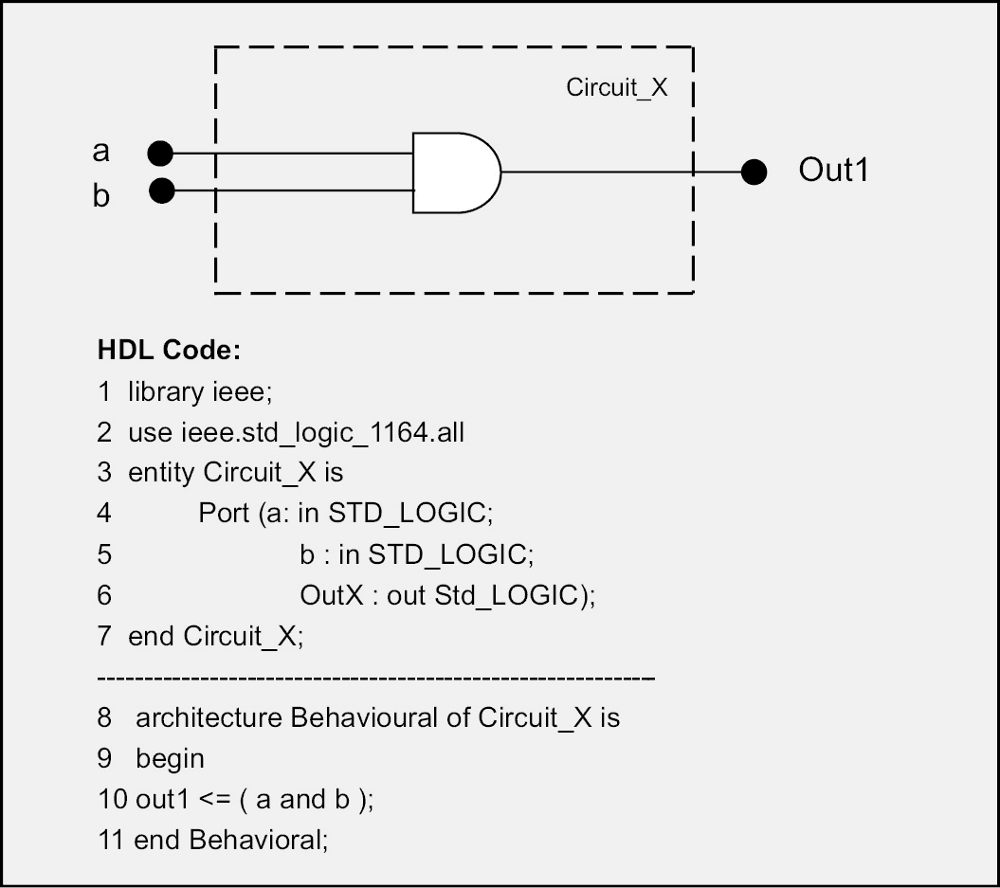

**图 6.13** 单一电路原理图及其 HDL 代码示例。⏎

人们可能会问，计算机编程语言与 HDLs（硬件描述语言）之间是否存在差异？HDL 与 `Python` 或 `C` 等高级编程语言非常相似，但存在一个重要的区别。HDL 代码表示的 HDL 语句包含并行操作，而编程语言体现的是顺序操作。换句话说，在计算机程序或固件模块中，处理器一次执行一条程序语句（代码），遵循从上到下的命令链，就像个人阅读页面上的文本一样。HDL 编程代码描述的是数字硬件，因此即使相应的代码行是用从上到下的方法编写的，该硬件的离散部分也可以并发运行。

如前，`VHDL` 和 `Verilog` 是常用的硬件描述语言。图 6.13 中的示例表示了使用 `VHDL` 的一个基础数字电路的简单 HDL。`VHDL` 由美国国防部大约在 1981 年联合 `IBM` 和德州仪器（Texas Instruments）等等私营部门公司共同发起，这些公司在 1985 年试点发布了其第一个版本。这一开发得到了 1984 年发布的首个 FPGA 的积极支持；因此促进了其作为数字电路设计、仿真和综合领域既定语言的进展。VHDL 代码行相对容易理解。例如，以图 6.13 中的示例为例，接下来的解释将澄清每行代码实现了什么：

*   **第 1 行**：添加库 `ieee.`。此库包含了关于数据类型和运算符的关键定义，并可能由多个适用于电路设计的包组成。
*   **第 2 行**：指定需要来自 `ieee` 库的 `std_logic_1164` 包。这表示正在使用的数据类型。`std_logic` 数据类型可以表示一位信号，而 `bit` 数据类型可以接受逻辑一或零。然而，`std_logic` 选项更强大，因为它不仅限于逻辑高和低电平，还可以具有三态反相器状态。这意味着电路输出的电压与其输入的逻辑电平相反，从而反转了施加的输入信号，使得当输入为低时输出变为高，反之亦然。因此，`std_logic` 数据类型支持“无关”（don’t care）状态，这为查找表提供了更好的硬件优化。
*   **第 3 行**：这为被描述的电路指定了一个任意名称。单词 `circuit_X` 置于关键字 `entity` 和 `is` 之间，从而为该模块命名。
*   **第 4 行至 6 行**：这些定义了电路的输入和输出端口。将这些行与电路图对应，注意到电路端口及其特征列在关键字 `port` 之后。例如，第 4 行表示一个名为 `a` 的输入端口，如冒号后的关键字 `in` 所示，并使用 `std_logic` 数据类型描述一个位数字信号。
*   **第 7 行**：此行建立了 `entity` 语句的结束。

因此，前七行代码描述了要应用的库以及程序实体，其由被描述的电路名称，以及电路端口及其属性（例如输入/输出以及这些端口传递的数据类型）。这基本上描述了模块与其周围环境的接口。接下来的代码行（第 8 到 11 行）描述了电路的操作。电路的操作由 `architecture` 部分描述，该部分专门关联 `circuit_X`，该电路是在第 3 行的 entity 语句中定义的。

*   **第 8 行**：此行为后续行描述的架构建立了 `Behavioural` 段，并置于关键字 `architecture` 和 `of` 之间。它关联并描述了 `circuit_X`。
*   **第 9 行**：指定架构描述的开始。
*   **第 10 行**：此行描述了电路的操作。两个输入 `a` 和 `b` 的与运算放在括号内，并将结果使用赋值运算符 `<=` 指定给输出端口。
*   **第 11 行**：此行指定架构描述的结束。

上述代码行描述了电路的内部操作，描绘了图 6.13 所示使用 `VHDL` 的简单与门。关于 `VHDL` 的更多信息，请参阅 Arar (2017)。提到的另一个硬件描述语言是 `Verilog`。`Verilog` 是 `VHDL` 的替代方案，两者都被视为设计复杂数字电路的强大工具。


Verilog 花了更长时间才成为一种流行的 HDL（硬件描述语言）。它最初由 Gateway Design Automation 在 1984 年初设计，此时美国国防部发布 VHDL 已有几年。然而，在国防部的支持下，VHDL 于 1987 年被采用 IEEE 标准，而 Verilog 则处于落后。Verilog HDL 由 Phil Moorby 和 Prabhu Goel 在 1984 年左右构思，最初是 Gateway Design Automation 拥有的专利硬件建模语言。Verilog 在 1984 年至 1990 年间通过发布修订版本不断升级。Verilog 的突破出现在 1990 年，当时它被 Cadence Design System 收购，该公司公司是电子设计自动化（EDA）行业中电子设计技术和工程服务的重要供应商。

Cadence 意识到 Verilog 不能作为私有产品发展下去，因为它缺乏通用化地位。因此，Cadence 在 1991 年发布了 Open Verilog International（OVI）并将其转入公有领域。随后，提交给 IEEE 以获得标准地位，并于 1995 年实现，成为 IEEE 标准 1364-1995（Verilog-95）。Verilog 经过不断翻新并增加了重要功能，获得了 IEEE 标准 1364-2001（Verilog-2001）和 IEEE 标准 1364-2005（Verilog-2005）。2005 年发布了 System Verilog，它是 Verilog-2005 的超集，具有许多有助于设计验证的新特性和功能。此外，2009 年，SystemVerilog 和 Verilog 语言标准合并为 SystemVerilog 2009（IEEE 标准 1800-2009），这是目前 IC 设计和验证领域最流行的语言之一。

Verilog 的语法可以使用之前在解释 VHDL 时所示电路示例来说明。图 6.14 显示了电路设计（与图 6.13 所示相同）以及相应的 Verilog 代码行。回想一下该电路有两个输入和一个输出，端口宽度均为 1 位。

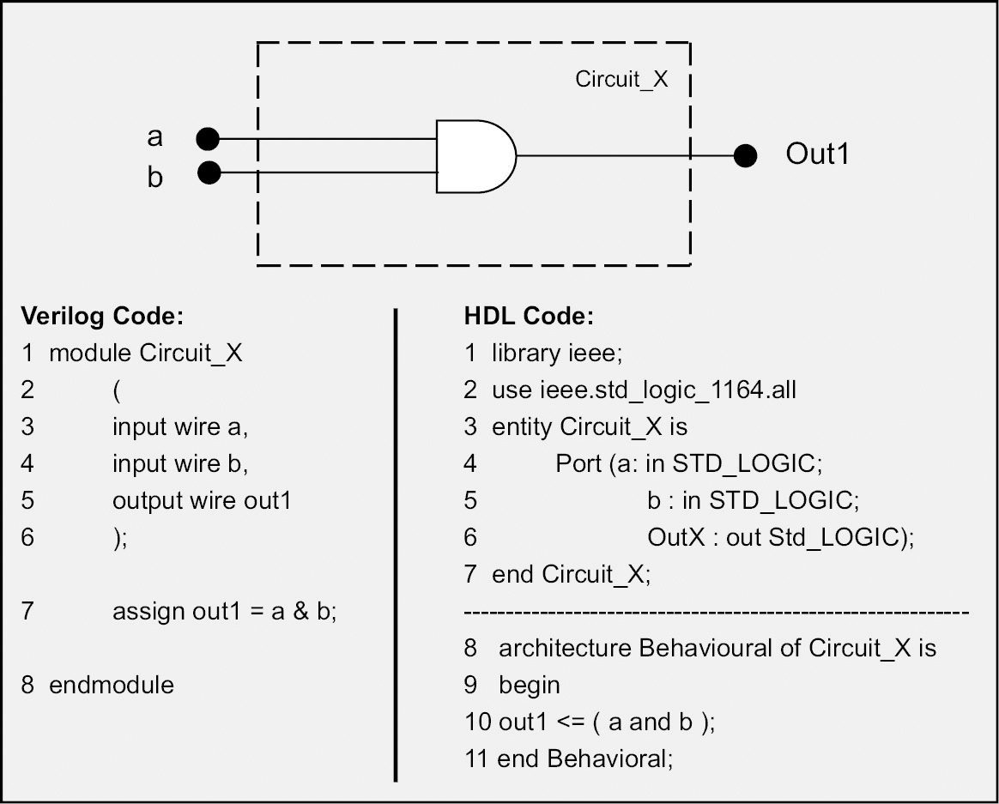

**图 6.14** 电路设计及相应的 Verilog 代码示例。⏎

该电路包含一个双输入的 AND 门，并将结果传递到 `out1` 端口。Verilog 代码行如下：

*   第 1 行：此行使用关键字 `module` 指定该行将开始描述一个名为 `Circuit_X` 的电路。这是引用该电路的任意名称。
*   第 2 行：指定 `Circuit_X` 与周围环境之间接口的开始。
*   第 3 行：使用关键字 `input` 指定的输入端口。该关键字后面是另一个关键字 `wire`，然后是端口名称（在本例中 `a`）。`Wire` 是一种 Verilog 数据类型，表示设计中的物理导线。
*   第 4 行：与第 3 行类似，但它指定了输入端口 `b`。
*   第 5 行：使用关键字 `output` 指定输出端口。再次，该关键字后是关键字 `wire`，然后是端口名称（`out1`）。
*   第 6 行：指定 `Circuit_X` 模块接口的结束。
*   第 7 行：此行使用符号 `&` 应用位按与逻辑运算符来描述电路的功能。关键字 `assign` 将 `a&b` 赋值到输出端口 `out1`。这种赋值被称为连续赋值，因为每当右侧的操作数变化时，`a&b` 就会被求值并赋值给 `out1`。连续赋值被视为组合电路，其输出根据输入不断更新，在本例中，这是一个简单的 AND 门。
*   第 8 行：此行应用关键字 `endmodule` 指定名为 `Circuit_1` 电路描述的结束。

图 6.14 显示了同一电路描述的 Verilog 和 VHDL 编程代码。Verilog 更简洁，且不像 VHDL 那样使用预定义的库例程。你可能还记得，VHDL 中的库提供了数据类型和运算符的定义，对于 `std_logic` 数据类型可以有九种不同的值之一。然而，`std_logic` 数据类型最常用的选项是 `0`、`1`、`Z` 和 `-`（`-` 表示无关）。另一方面，Verilog 有四种常用的基本数据类型。因此，示例中定义的线可能具有以下值之一：`0` 表示逻辑低或假条件；`1` 表示逻辑高或真条件；`z` 表示高阻，可用于描述三态缓冲器的输出；以及 `x` 表示无关或未知值，当输入未初始化或两个或多个冲突输出连接在一起时。

需要注意的是，目前 VHDL 和 Verilog 是视为行业标准的流行 HDL，FPGA 设计工具通常支持这两种语言。

## 6.3 AI 软件算法

本节将介绍 AI 软件算法，这是一类计算机软件，能够实现 AI 来处理大量数据，以执行通常需要人类智能的任务。近年来，AI 技术的战略意义已得到认可，应用在所有行业中呈指数级增长。许多私营和公共部门组织正在研究并投资 AI 解决方案，以增强其在不断变化的全球市场中的竞争力。技术开发中有一个为人知的经验：后进入者在创新方面可能会面临过时的风险，并在服务客户方面严重落后于竞争对手。

### 6.3.1 语音与识别（对话式 AI）

对话式 AI 的动力目前来自智能家居市场。Google、亚马逊、微软等公司持续投入该技术的资金，通过智能手机和个人电脑将智能助手开发为人们生活中不可或的一部分。这种投资并非旨在渐进式的改变，而是为了彻底改变家庭以及长期来看组织执行任务的方式。尽管在该技术被广泛接受之前还有很多工作要做，但在增强驱动和控制语音技术的复杂数学模型方面，正在取得巨大进展。


目前，适用的语音技术已由知名提供商提供，例如 Google Assistant、Amazon Alexa、Microsoft Cortana 等。然而，当前的技术在功能上仍存在局限性。例如，大多数机器人和虚拟代理通常倾向于带有操作链接（即按键/按钮），用于推进对话，或提供外部链接将客户完全引出对话。这可能会为纯语音的交流带来问题。AI 语音识别技术的另一个问题是，它仍然不如基于聊天的同类技术那样稳健，并且难以解释口语中常见的细微语言差异。

必须意识到，语音识别（voice recognition）和言语识别（speech recognition）是两个不同的功能。语音识别基于识别说话者声音的技术。另一方面，言语识别是识别实际单词的技术。这种定义上的差异说明了这两个功能承担着不同的任务。例如，语音识别包含语音生物识别等安全功能，而言语识别是一种能够生成自动转录和准确指令的设备。基本上，AI 语音识别识别并解码人类语言模式，并允许智能手机、计算机或虚拟助手了解人们在说什么并做出响应。相比之下，言语识别通过识别单词将语音转换为文本，在先进的 AI 应用中，它可以根据上下文解释差异。例如，自动语音识别 (ASR) 将此技术用于转录语音邮件，并作为一种无障碍工具，允许无法打字的人通过与计算机对话来撰写电子邮件、执行搜索以及许多功能。

此外，语音识别和 ASR 具有不同的角色，其处理和响应音频的方式也不同。语音识别是一种像数字助手、Amazon Alexa 或 Google Dot 之设备，它们通过实时听人的声音并做出响应来执行特定任务。例如，Alexa 位于云端，因此可以随时随地进行访问，响应请求或回答问题，如阅读最新的新闻标题、播放特定歌曲以及调暗特定房间的灯等。基本上，语音识别识别的是“谁说了什么”，而 ASR 的是“人们说了什么”。因此，ASR 不识别身份，而是通过应用自然语言处理 (NLP) 生成音频转录稿并生成实时字幕来识别言语。ASR 在解释方面并非完美，但它速度很快，是一种语音转文本的廉价方法。

在个人或组织层面利用语音识别的收益包括其作为用户验证工具的有效性、便利性以及更好的性能。例如，银行已经在某些账户上实施了语音生物识别作为安全措施，这在反欺诈努力中节省大量的成本。此外，基于语音的技术通过提供更准确的通信设施减少了对错误扫描的需求，允许更快速、更好的任务管理。此外，言语识别 AI 正被应用于提供业务解决方案，从语音激活的音频内容助手到自动取款机 (ATM)，通过促进人与技术的交互，提供了更高的数据转录准确性。

言语识别正用于呼叫中心，允许组织倾听客户的想法，然后通过云模型应用获得的信息以提供快速恰当的响应。它也被应用于语音或音频生物识别（语音模式），用于识别并授权用户访问系统，而无需密码、指纹或眼部扫描。金融科技公司正在使用言语识别帮助客户解决基础业务查询。此外，客户可以使用语音转录解决方案或短信应用程序随时随地从任何地方与组织实时互动，解决他们的疑虑。

### 6.3.2 文本识别

AI 也用于文本识别。文本识别软件不仅通过光学字符识别 (OCR) 解码输入的文本，还能解释手写文档。OCR 基本上是识别数字图像（如扫描文档和图像）中的文本，并将其转换为可访问的文本软拷贝版本。传统上，OCR 限于打印的扫描文档。然而，AI 手写识别软件可以经过训练来解密手写文档以及打印文本，这需要更复杂的模型。它被用于解码可能与其现代版本存在语言差异的历史文献。

例如，名为 Transkribus 的公司提供基于 AI 的手写识别软件，该公司声称其软件可以经过训练，以解密手写历史文献和打印文本。他们坚持认为，其预训练的 AI 模型能够非常快速地转录大量文档，并使其变得可读、可检索，并为研究、数据分析或出版等进一步的应用做好准备。Amazon Textract 是另一种文本识别软件，它利用 AI 从文档中提取文本和结构化数据（表格和表单），无需任何配置或模板；并具有稳健的数据隐私、加密和安全控制。金融科技公司正使用该软件从抵押贷款申请中提取有关资产和物业估值、信用评级的关键信息，或从具有不同文档布局和格式的保险表单、理赔单和收据中提取信息。

文本识别软件已经存在了一段时间，但在 AI 的支持下，其转录功能和提取功能正在快速改进，特别是在识别历史和现代手写文档（各种语言）方面。解码历史和现代手写文档的算法非常复杂，需要大量的机器学习特征，这些特征只有通过应用 AI 技术才能解决。

### 6.3.3 图像识别

AI 正被应用于图像识别，有时称为图片或照片识别。图像识别的特定目的是识别和分类给定图像中的感兴趣对象。人类大脑能够自动分类其视觉观察到的对象，并将它们与个体定义联系起来。虽然我们人类认为这种功能是理所当然的，但对于机器来说，完成这项极其困难。然而，在 AI 的支持下，这种功能正在实现，但它需要大量处理能力支撑的复杂算法。

图像识别的主要目标是将发现（或观察到）的对象分类到不同的类别中，以评估图像与哪个组相关，因此获得了“深度学习目标识别”的名字。随着计算机处理能力的不断提高，机器学习（特别是深度学习技术）在计算机视觉和图像处理领域取得了重要且进展。目前，由深度学习算法支持的图像识别 AI 模型已成功应用于许多私营和公共工业部门。在讨论 AI 图像识别时，澄清适用的术语很重要。例如，有必要区分图像识别与计算机视觉；目标定位；以及图像检测。尽管它们的含义之间存在一些重叠，但也存在一些重要的差异。


# 图像识别与计算机视觉

图像识别是计算机视觉的应用。图像识别被视为计算机视觉的一个子集，侧重于通过检测、分析和解释图像来做出决策。它包含了许多任务，如图像标记（识别并标记图像内容）、目标检测，以及使用在标注数据集上训练的神经网络来引导自动驾驶车辆。计算机视觉是人工智能的一个领域，它应用机器学习和神经网络来训练计算机系统，使其从数字图像、视频和其他视觉输入中获取有意义的信息，并在检测到缺陷或问题时提供建议或采取行动。因此，图像识别通过机器学习执行多种功能，如分类、标记、检测和分割。

## 目标定位与检测

目标定位（Object Localisation）也是计算机视觉的一个子集。它指的是识别图像中一个或多个目标的位置，并在绘制的框（界定）内描绘每个目标以清晰地显示其位置，但它不对检测到的目标进行分类。另一方面，图像检测是一种使用图像作为输入数据，并在其中搜索并发现各种目标的功能。例如，人脸检测算法旨在图像中寻找面部模式，无论检测到的物体是否重要。原因在于，图像检测的目标仅仅是将一个物体与另一个物体区分开，从而评估图像中存在的不同实体的数量。因此，在每个检测到的独立物体周围画出边界。而图像识别的目标是精确定图像中感兴趣物体，并识别它们所属的类别。

## 关键算法：Mask RCNN 和 YOLO

由于其准确性和处理速度，计算机视觉算法在多年来的增长和重要性非常显著。两个成熟的算法是 2017 年左右发布的 `Mask RCNN`（基于区域的掩码卷积神经网络）和 2021 年左右发布的 `YOLO`（你只管看一眼）。`YOLO` 算法的最新版本版本是 `YOLOv9`，它于 2024 年初发布。

`Mask R-CNN` 是一种深度学习实例分割方法，它对检测到的目标执行像素级分割，并通过在像素级上精确地勾勒其边界来适应多个类别和重叠目标。`Mask R-CNN` 应用了特征金字塔网络（`FPN`）和感兴趣区域对齐（`ROIAlign`）以获得高精度和稳健的性能。`FPN` 是一种特征提取器，接收任意尺寸的单尺度图像作为输入，并以全卷积方式产生多个层级的比例尺寸特征图作为输出。因此，它作为一种通用解决方案，用于在执行目标检测等任务的深度卷积内部创建特征金字塔。

`FPN` 与 `RoIAlign` 结合，通过消除 `RoI Pool` 的粗糙量化，从检测和分割任务使用的每个 `RoI`（感兴趣区域）中提取小型特征图，并将提取的特征与输入精确对齐。然而，由于 `Mask R-CNN` 在训练和推理期间的计算复杂性和高内存占用，需要大量的处理能力。这可能会阻碍分割非常小目标的准确性，或处理严重遮挡的场景，并且在训练和微调模型时可能更依赖资源。`YOLO` 模型是一种实时目标检测机制，可以在单次图像处理中识别并分类物体。`YOLO` 模型（类似于 `Mask R-CNN`）使用卷积神经网络（`CNNs`）对物体进行分类，并使用回归网络精确预测每个检测物体的边界框（bounding）坐标。然而，`YOLO` 和 `Mask R-CNN` 在目标检测方法上不同，前者使用单次检测（`SSD`）方法，而后者应用两阶段（或多阶段）方法。

## 方法的比较

`SSD` 目标检测算法通过网络的单次前向传播在一次操作中预测物体的边界框和类别，同时预测物体的存在及其相应的边界框。`YOLO` 将输入图像分割为网格，并为每个网格单元预测一定数量的边界框和类别概率。另一方面，`Mask R-CNN` 在不同特征图的多个尺度上预测边界框和类别概率。因此，它使用两步法：第一步建议一系列可能包含物体的边界框（使用一种名为 `region proposal` 的区域建议的方法）；第二步是通过 `CNN` 处理这些建议区域，以对框内的物体类别进行分类。因此，`SSD` 算法非常快速高效，非常适合需要实时检测的任务。然而，两阶段检测器的速度较慢，但更准确，因为它们的计算密集程度更高，由于速度并不是它们的首要目标。因此，它们会在每个可能的物体上消耗额外的计算资源。

## 演进到 YOLOv9

`YOLOv9` 是以前版本的改进，因为它解决了深度神经网络中固有的信息丢失问题，并确保在整个检测过程中保留关键信息，以获得卓越的准确性和性能。这是通过集成可编程梯度信息（`PGI`）和通用的广义高效层聚合网络（`GELAN`）架构实现的。`PGI` 是一种创新概念，通过保护跨越深度网络层的关键数据来缓解信息瓶颈问题，并允许创建可靠的梯度，从而加速准确的模型更新并增强整体检测性能。这一概念与 `GELAN` 结合，实现了更大的参数应用和计算效率。`PGI` 和 `GELAN` 的集成允许 `YOLOv9` 具有灵活的计算块混合，使其能够在不牺牲速度或准确性的情况下适用于广泛的应用。

## 历史背景与挑战

二十年前的早期图像处理方法需要大量的训练数据，而较新的深度学习方法需要少得多的学习样本。尽管有了这些发展，深度学习仍涉及手动标记数据以标记坏样本，这一过程被称为图像（`image annotation`）。这种训练 AI 模型的标记过程被称为监督学习，涉及耗时的人工工作。想象一下标注图像和自动驾驶车辆的典型交通状况需要多少的人力。


然而，机器学习（通过无监督学习）实现了高水平的可扩展性，因为它利用算法从包含良好和负面样本的数据集中学习隐藏知识。此外，深度学习在法模型中应用了神经网络的多个隐藏层。如果没有非常强大的 AI 硬件和图形处理器（`GPUs`）的支持，深度学习将是不可能的。这些工具为稳健图像识别技术的发展提供了急需的突破。AI 图像识别技术有许多实际用途。在医疗领域，图像识别模型被用于识别医学图像中的疾病或异常。在安全监控系统中，它具有实时目标检测、跟踪和分类的实际用途，其中人脸检测被用于识别、安保和人脸识别系统。在农业行业中，它被用于检测和分类作物、害虫和疾病，特别促进了精准农业技术和农作业流程的自动化。尽管仍处于实验阶段，但它已用于自动驾驶汽车，实时检测其他车辆、行人、交通标志和信号等物体。

这类技术面临的持续挑战是在性能和计算效率之间找到平衡，因为深度学习模型的一个重要前提是硬件与软件的完美结合，以缓解与计算机视觉相关的成本问题。深度学习、图像分类和深度神经网络人脸识别算法的完美结合已成功提供了卓越的性能和超越人类能力的实时目标检测。

### 6.3.4 视频分析

视频分析为用户提供了从视频录制中提取有用信息的能力，例如统计人数和/或识别特定的物体或个人。与图像识别类似，视频分析利用计算机视觉技术，通过 AI 处理数字图像和视频的分析。视频分析采用深度学习技术，利用神经网络来学习数据中的模式。深度学习是机器学习的一个子集，它利用由多个互连接处理节点组成的神经网络。这使得使用深度学习算法的 AI 视频分析能够对视频片段中的物体检测、跟踪并识别特定的动作。

正如在之前一节中讨论图像识别时解释的那样，深度学习技术是此类分析的基础，使用最新的 `Mask R-CNN` 和 `YOLO` 算法来检测视频中的物体。这些算法可以使用收集的视频数据进行自定义训练，或者在大型图像数据集（如 `MS COCO`）上进行预训练。`MS COCO`（上下文中的常见物体）数据集是一个大规模的目标检测、分割和字幕描述数据集，旨在鼓励对各种物体类别的研究，并通常用于计算机视觉模型的基准测试。`MS COCO` 图像数据集包含超过 320,000 张日常物体和人类图像，带有注释可用于训练机器学习模型来识别、标记和描述物体。这些深度学习模型通过检测和跟踪物体（包括物体计数和基于规则的分析）促进了视频分析。例如，它们可以经过微调以统计大型的人群中的人数。

深度学习模型的另一个重要特征是动作识别，它涉及识别视频序列或实时视频流中的特定动作。这类模型可以接受训练以分类在不同语境或环境中执行的动作。与视频分析相关的软件系统分为两类，即视频管理系统（`VMS`）和计算机视觉系统。`VMS` 通常通过提供单一接口来观察来自多个摄像头的直播和录制视频，从而管理来自安全摄像头的摄像头流，并具有搜索、回放和导出功能。此外，`VMS` 应用通常旨在配合特定类型的摄像头，如 `IP 摄像头` 或 `CCTV 摄像头`。这些系统早于 AI 的进展，被认为是过时的，因为许多机构目前要求通过包含人脸和人员检测以及自动标记或警报来引入视频分析功能。

另一方面，计算机视觉系统专注于视频识别和复杂的实时视频分析的使用。这些系统通常采用使用多步计算机视觉流水线的图像处理算法，通过对图像评估来从视频片段中提取信息，例如人员或物体检测、人脸识别、活动识别、质量检测等。许多机构选择定制的计算机视觉系统以满足它们在系统集成、性能、可扩展性和数据隐私方面的特定需求。


最近的创新发展如 Transformer 和大语言模型（LLMs）已使生成式 AI 成为一种可接受的标准技术。Transformer 作为一种机器学习工具，允许技术人员训练规模和强度不断增长的模型，而无需在初始阶段对所有数据进行标注。因此，新启动的模型可以使用包含文本的难以想象量的页面进行训练，以提供更具深度的响应。这是因为 Transformer 通过“注意力（attention）”概念，不仅跟踪单个句子中单词的连接，还允许模型跟踪海量文本中单词之间的关联，并追踪这些关联来检查代码、蛋白质、化学品和 DNA。

此外，LLMs 拥有数十亿甚至数万个参数，这增强了生成式 AI 模型编写引人入胜的文本、生成即兴景喜剧的能力，甚至可能描绘出写实的图像。因此，通过应用 Transformer 和 LLMs 的特性，生成式 AI 已发展成为一种非常强大且稳健的工具，可以通过文本、图形和视频等多种媒体创建内容。例如，像 `Dall-E`（以超现实主义艺术家萨尔瓦多·达利命名）这样的工具可以根据 `typescript` 自动生成图像，或从图像创建文本描述。然而，生成式 AI 仍处于其发展的早期阶段。在完善以生成可读文本以及被认为高度准确、无偏见且无幻觉的写实风格化图形之前，它还需要大量的增强。

图 6.15 说明了生成式 AI 起于一个输入提示词，该词可以是文本、设计、图像、音符、视频或 AI 系统可以处理的任何其他输入。输入可能来自扫描副本和/或存储数据的仓库。这些输入被各种 AI 算法接收，然后它们作为对输入提示词的响应创建新内容。生成的内容取决于输入提示词，可能以作品、对问题或问题的特定回答，或从照片、图像或个人音频生成的真实伪造的形式存在。最新版本的生成式 AI 允许用户使用自然语言定义请求，而不是使用 `Python` 等应用语言。这使得它们更符合用户习惯，用户还可以就形式、语气和其他特定方面对初始结果进行修改。

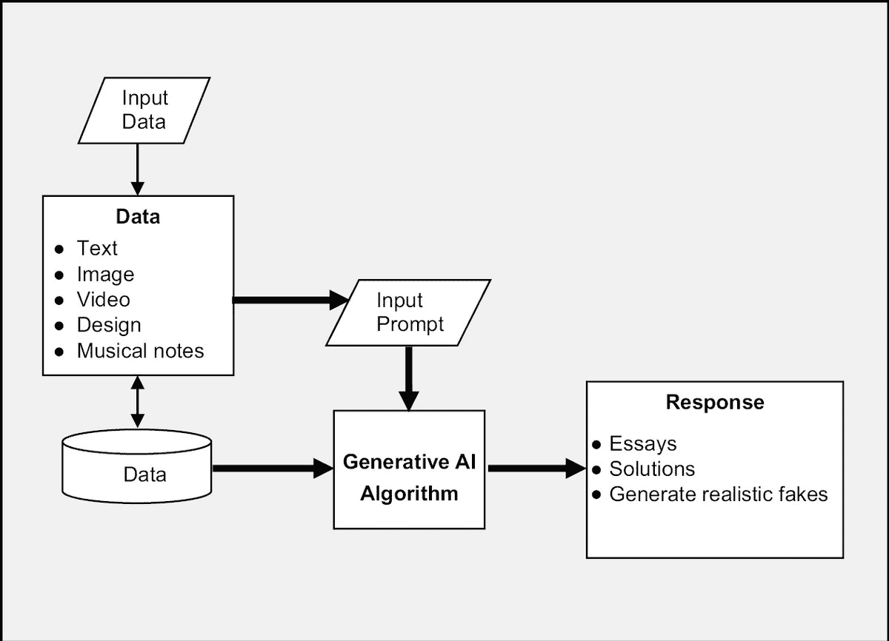

**图 6.15** 生成式 AI 过程示例。⏎

通常，生成式 AI 模型应用特定的神经网络，使用生成对抗网络（GANs）和变分自编码器（VAEs）等技术在响应查询或提示词时产生新内容。这些带有解码器和编码器的神经网络可以创建真实的人脸、用于 AI 训练的虚假数据甚至是个人的复制品。

`GANs` 由两个神经网络组成：生成器和判别器，它们在永恒的斗争中结合在一起。生成器网络具有从随机噪声开始创建数据样本的功能，并努力创建尽可能真实的数据。另一方面，判别器网络检查数据，目的是区分真实样本和伪样本。因此，训练过程是一个反复往复的方法，旨在生成越来越多且有说服力的数据，而判别器则不断精炼其辨别真伪的能力。随着时间的推移，生成器发展成为一个大师级的伪造者，创建出判别器几乎无法与真实示例区分来的数据。

`VAEs` 的工作方式与 `GANs` 不同。这些是建立在自编码器框架上的概率模型，自编码器通常用于降维和特征学习。自编码器由编码器和解码器组成。编码器网络接收输入数据，通过将数据映射到概率潜在空间将其编码为低维空间。另一方面，解码器考虑来自此潜空间的点并尝试重建原始数据。这是通过从潜空间的分布中采样并在统计学上生成数据来实现，从而对数据进行更深层次的检查。`GANs` 倾向于创建更清晰、更高质量的结果，但在训练过程中可能不稳定，而 `VAEs` 则更加一致，但质量可能较低。

目前已有多种应用 Transformer 的工具，例如 `BERT`（Google 的双向编码器表示模型）、OpenAI 的 `GPT` 以及 Google 的 `AlphaFold`。


生成式 AI 具有巨大的潜力，但它确实存在几个重大的局限性。例如，生成式 AI 并不总是能够识别内容的来源，这在评估原始来源的偏见时可能会出现问题，特别是对于听起来非常真实的内容，使其很难识别错误信息。因此，它可能会呈现错误和误导性的信息，导致用户对所提供信息的可靠性产生担忧。此外，在生成内容（特别是学术作业）时，它可能会忽略版权，从而在无意中支持抄袭。此外，生成式 AI 促进了虚假新闻的产生，并可能创造一个环境，使得人们更容易诋毁真实的影像证据或模仿个人，成为实现社会工程网络攻击的有效手段。表 6.4 展示了几种用于文本、图像、语音合成、音乐和代码生成的各种应用的生成式 AI 工具；而表 6.5 显示了支持各种生成式 AI 工具的各类 AI 芯片设计公司。

**表 6.4** 各种应用的生成式 AI 工具示例

| **生成应用** || **生成式 AI 工具示例** |
| --- | --- |
| 文本 || GPT, Jasper, AI-Writer, Lex, GrowthBar, ContentShake |
| 图像 || Dall-E 2, Midjourney, DreamStudio, Stable Diffusion, Craiyon |
| 语音合成 || Descript, Listnr, Lovo.ai, Murf, Podcast.ai, Synthesys, Fliki |
| 音乐 || Amper, Dadabots, Loudly, Mubert, MuseNet, Soundraw, |
| 代码 || Codex, Codeium, Gemini, GitHub Copilot, CodeT5, Tabnine |

**表 6.5** 生成式 AI 芯片制造商示例

| **AI 芯片制造商** || **应用** |
| --- | --- |
| Nvidia | 自动驾驶、数据中心中的 AI 训练与推理。 |
| --- | --- |
| AMD | AI 加速器产品、AI 训练、机器学习。 |
| Intel | AI 加速器产品、数据中心中的 AI 训练与推理。 |
| Google Alphabet | 机器学习加速芯片，为翻译、照片、搜索、助手、Gmail 等 Google 产品提供动力。 |
| AWS | 模型训练（Tranium 芯片）和推理（Inferentia 芯片）。 |
| IBM | 深度学习芯片（突出显示用于欺诈检测）。 |
| Alibaba | 用于数据中心推理的汉光 800。 |
| SambaNova Systems | 用于高量生成式 AI 负载的系统。 |
| Cerebras Systems | 用于制药公司加速遗传和基因组研究，并缩短药物发现时间。 |
| Groq | 专注于金融服务解决方案相关的推理。 |

生成式 AI 通常被视为一种通用型技术，因为它适用于各种行业的不同目的。表 6.6 提供了生成式 AI 在某些行业细分领域用途的一些示例。但必须强调的是，生成式 AI 正在不断增强，并且如所述，它在精确性、可靠性、信任度、偏见、幻觉和抄袭方面面临许多待克服的挑战。稍后将专门章节详细讨论伦理和法律问题。该章节极其重要，因为生成式 AI 呈现的内容如此真实，以至于很难识别错误信息，特别是当用户不熟悉所呈现的主题内容时。此外，生成式 AI 的内容是不透明的，因此用户需要意识到结果的原始来源，并对版权侵权风险保持极端谨慎。

**表 6.6** 各种工业部门使用生成式 AI 的示例

| **行业** || **应用** |
| --- | --- |
| 金融 | 监控个人的交易历史，以开发更稳健的欺诈检测系统。 |
| 制造业 | 整合来自摄像头、X 射线和其他指标的数据以检测缺陷部件并进行根原因分析。 |
| 医疗 | 识别有前景的药物。 |
| 法律 | 起草和解释合同，提出论据。 |
| 建筑 | 快速创建并修改原型。 |
| 游戏 | 制作并设计游戏内容。 |
| 电影和媒体 | 制作成本效益的内容。 |

生成式 AI 将长期存在，其未来的发展将主要关注于通过解决上述提到的问题来使其被用户接受。

### 6.3.6 自然语言处理 (NLP)

自然语言处理是人工智能的一个领域，通过开发计算机程序来理解人类语言（口语和书面语）。尽管它与之前讨论的内容有一定的重叠，但由于其重要性，有必要对其单独讨论。自然语言处理的起源于语言学、计算机科学和计算语言学领域。自然语言处理的工作始于 20 世纪 50 年代，图灵创造了图灵测试来评估计算机是否真正智能。图灵测试涉及对自然语言的计算机解释和创建，这是智能的关键标准。

直到 20 世纪 90 年代，NLP 大多基于规则，由语言学家对语言的各个方面（包括词汇、语法和语音）应用人工规则，以确定计算机如何处理语言。1954 年 1 月 7 日，乔治敦大学-IBM 实验发生了一个重要的里程碑。该实验展示了将六十多个俄语句子全自动翻译成英语。随后的几十年见证了基于规则的解析（识别代表特定概念的文本模式）、形态学（分析单词的内部结构和构造单词的规则）以及语义学（研究词义以及其他自然语言理解形式）的发展。


本质上，一个 NLP 管理系统包含两个功能，即数据预处理和处理数据的算法开发。数据预处理是准备和清洗数据集的过程。它涉及从数据集中检测、纠正和/或损坏或不准确的细节。因此，它能够识别数据集中错误、不完整或无关的片段，然后对损坏或粗糙的数据内容进行修改、替换或删除。数据预处理的目标是将给定的数据集转换为计算机程序（通过算法）能够分析和使用的内容及格式。这通过几种方法实现，包括以下内容：

*   **标记化（Tokenisation）**：通过用非敏感信息替换敏感信息来创建数字表示的过程，以保护敏感数据或高效地处理海量数据。例如，它被用于与支付相关的网络安全，通过伪盖支付身份来防止欺诈。
*   **停用词移除（Stop word removal）**：这是移除在所有文档中经常出现的词汇的过程，仅保留对文本提供最丰富信息的独特单词。
*   **词干提取与词形还原（Stemming and lemmatisation）**：词干提取是指剥离单词的后缀以获得简化的单词字符串的过程，而词形还原是将形态变体还原为字典字典中的一个基础形式的过程。因此，词形还原将同一个单词的相互唯一的修改版本进行聚类。例如，“sleeping”一词将被还原为其基本形式“sleep”。
*   **词性标记（Part-of-speech tagging）**：这涉及为句子中的每个单词分配语法类型，如名词、动词、形容词。目的是理解句子的语法结构并识别单个单词的语法角色。

当数据集经过预处理函数后，将使用计算机程序（算法）对其进行处理。常用的自然语言处理算法分为两大类，即基于规则的系统和基于机器学习的系统。基于规则的系统应用精心设计的语言规则，而基于机器学习的系统则应用统计方法。两种方法都根据提供的训练数据学习完成任务，并随着处理数据的增加而不断优化其流程。因此，NLP 算法通过迭代过程，采用机器学习、深度学习和神经网络等组合方法来完善自身的规则。NLP 作为一个系统是一项重大进展，因为无论企业规模如何，都需要一种有效的手段来处理大量的非结构化和文本密集型数据。NLP 中有两种主要的处理技术，即句法分析和语义分析。

### 句法分析

句法指的是句子结构以及单词如何根据设定的规则在句子中组织以符合语法意义。因此，NLP 应用句法（句子结构语言规则）来评估特定语言的内涵。在 NLP 中，句法技术包括：

*   **句法分析（Parsing）**：指的是通过将句子分为语法部分并识别这些部分及其相互关系来分析句子。例如，当 NLP 算法收到句子“The cat meowed.”（猫喵喵。）时，句法分析将句子拆分为词性，例如 `cat = noun`，`meowed = verb`。
*   **分词（Word segmentation）**：单词被视为由一个或多个词素组成的语言单位。因此，分词确定句子或文档中的单词边界，推导出词形。例如，算法可以分析手写扫描文档，并识别出单词是通过空格分隔的。
*   **断句（Sentence breaking）**：这也被称为句边界消歧（SBD）、句边界检测和句子分割，其中 NLP 决定句子的开始和结束。因此，算法可以分析文本，并通过断句来识别分隔句子的句号（period）。
*   **形态分词（Morphological segmentation）**：这是一种识别和分析单词结构的方法，在形态丰富的语言中（如阿拉伯语和希伯来语）非常有价值，在这些语言中，前缀、后缀和根的模式构成了单词。它对机器翻译和语音识别也有帮助。例如，单词 unaccountable 会被拆分为 `[un[[account]able]]`，其中算法识别“un”、“account”和“able”为词素。
*   **词干提取（Stemming）**：词干提取是将单词的屈变化形式还原为一个所谓的“词干”或根形式的过程，在语言学中也称为“词元”。例如，在句子“The cat meowed”中，算法识别出单词“meowed”的根是“meow”。当用户分析文本以寻找单词“meow”的所有出现处以及动词形式的所有变体（即其变位）时，这非常有用。尽管字母不同，算法能够识别出它们基本上是同一个单词。

### 语义分析

另一种处理技术是语义分析，它本质上涉及单词的使用及其背后的含义。因此，NLP 算法用于确定句子的含义和结构。基本上应用了三种主要的语义技术：

*   **词义消歧（Word sense disambiguation）**：这是在特定上下文中确定单词预期含义或词义的过程。该过程对于机器翻译、信息检索、问答和情感分析至关重要。例如，在句子“The horse is in the stable.”中，“stable”有许多含义。因此，NLP 算法将应用此方法来理解这里使用的词是指马厩，而不是其他表示稳定或恒定的的词。
*   **命名实体识别（Named entity recognition, NER）**：该技术侧重于从文本内容识别并分类特定的数据点。例如，算法可以分析文档并识别对特定机构或产品的所有引用。通过应用文本语义，它可以区分看似相同的对象。例如，在句子“John McPherson the farmer went to purchase a McPherson tractor,”（农夫约翰·麦斐森去买了一台麦斐森拖拉机）中，算法可以识别出两个 McPherson 是不同的事物，一个是个人，另一个拖拉机制造商。
*   **自然语言生成（Natural language generation, NLG）**：这是通过应用数据库建立单词背后的语义，将数据转换为文本或语音的过程。因此，NLP 是将所说的内容准确翻译成机器可读数据的过程，这将使 NLG 应用这些数据来创建回复。


NLP 采用深度学习作为一种基础方法，这是人工智能的一种类型，它通过分析和利用数据中的模式来改进算法的解释能力。深度学习模型利用海量的标注数据，这在逻辑和处理能力方面可能具有很强的挑战性。早期的基于规则的方法非常繁琐，因为算法需要被告知要在文本中搜索哪些单词、成语和短语，并在找到匹配项时提供特定的响应。而深度学习模型可以自动识别数据中的模式和特征，而无需对其进行显式编程。这些模型应用了一种直观的（未经教的）方法，即算法从大量示例中学习识别作者或说话者的意图，模仿了孩子学习人类语言的方式。这使得深度学习模型成为一种极其强大且灵活的方法。一些常用于 NLP 且基于 `Python` 的开源工具包括：包含数据集和教程的自然语言工具包 (`NLTK`)；包含主题建模和文档索引库的 Gensim；以及由英特尔（Intel）开发的 NLP Architect，后者使用一个用于深度学习拓扑结构和技术的库。

使用 NLP 的实际应用包括：分析社交媒体评估以用于客户反馈分析；语音识别以识别客户在电话中说的内容，从而将客户电话引导至合适的位置；将文本、音频和文档翻译成另一种语言；以及根据元数据分析海量的学术研究材料进行学术研究等。这些及其他应用领域说明了 NLP 的核心优势在于能够增强人类与计算机之间通信的手段。然而，NLP 的主要挑战在于跟上自然语言的演变，以及单词在使用方式和内容表达的情感方面固有的意义模糊性。这意味着要确保 NLP 算法在解释可能本身不精确且模糊的人类语音和文本内容时是准确精确的；正确解释内容（语音和文本）的语气和语调；并消除偏差。NLP 系统并不完美，需要更多努力来解决上述问题。

### 6.3.7 专家系统

专家系统是一种基于知识的计算机系统，其主要目标是通过从知识库中提取知识，并根据用户查询应用推理和推理规则来解决复杂问题从而提供类似于人类专家的决策能力。然而，至关重要的是要理解专家系统并不是为了取代人类专家，而是辅助人类做出复杂的决策。因此，专家系统并不模拟人类的思维能力，仅仅根据其所设计的特定领域的知识库来运行。

专家系统并不是新现象，它们最早在半世纪以前由爱德华·费根鲍（Edward Feigenbaum）开发，他是斯坦福大学计算机科学教授和斯坦福知识系统实验室的创始人。这些系统被认为是人工智能的首次成功应用，最初源于医学领域。多年来，特定领域的知识库自然会增加，导致性能显著提高。今天，专家系统应用机器学习和人工智能来复制领域专家的行为或智慧，随着它们获得更多的知识和经验，其性能不断增强。因此，专家系统不断积累知识和经验，通过将它们与推理引擎集成来将其转化为智慧，以响应查询。

推理引擎基本上解释并评估知识库中的事实，以为用户设计的查询提供答案（请参见图 6.16）。推理引擎的基本功能是使专家系统能够从知识库的规则中推导出结论。

## 6.4 神经形态计算

在本章的节节中，详细讨论了神经形态硬件的主题。本节讨论了神经形态计算的主题，它超越了神经形态硬件，包含了神经形态方法中的软件部分。然而，与神经形态硬件的一些重叠很可能完全覆盖该主题。在具体讨论神经形态计算之前，首先讨论神经网络是合适的，因为它们是神经形态计算的一个重要方面。

### 6.4.1 神经网络

人工神经网络是算法（或软件程序），指的是一种人工神经元或节点网络，其灵感源于形成人类大脑的生物神经网络。神经网络与传统计算机的工作方式不同，它们可以同时执行许多任务，被称为并行处理。作为传统计算机基础的冯·诺依曼架构以按顺序的方式处理指令。多编程操作系统中使用的概念（为每个单独的软件模块分配微小的时间序列）使得看起来似乎许多事情正在同时发生。


人工神经网络是一种本质上对多处理器友好的架构，专为并行处理设计，这允许在更短时间内执行指令。然而，处理器必须专门为神经网络进行设计，这意味着它们执行的是特定的预定义任务。此外，人工神经网络的功能机制与传统计算机不同，因为人工神经网络可以通过图像、图片和概念进行运作。另一方面，传统计算机根据程序设定的一系列规则和计算进行逻辑化运行。因此，传统计算机通过规则学习，而人工神经网络通过示例学习，即通过执行某个函数并随后从中学习。因此，适用于传统计算机和人工神经网络的应用在根本和程度上是完全不同的。

此外，传统计算机通过如 `C` 等高级计算机语言编写的程序运行，然后将这些程序转换为机器的汇编语言。然而，人工神经网络通过修改自己的程序来不断适应，因此能够“自我编程”。正如前所述，神经网络需要使用专为特定应用定制的多个芯片，与传统的冯·诺依曼处理器相比，其结果是极高的处理速度。

## 6.4.2 神经形态计算概念

神经形态计算是一种模拟计算机处理器以代表人类大脑和神经系统的能力，它包含了硬件和软件计算元件。此外，它利用包括计算机科学、数学、电子、生物和物理在内的多个领域来产生计算机和硬件。神经形态架构经常模仿作为大脑基本单元的神经元和突触。

人类大脑由数十亿个神经元组成，它们通过电信号和化学信号结合相互通信，在大脑不同区域与神经系统的部分之间传递信息。神经元之间的连接通信点被称为突触。研究表明，神经元和突触是非常灵活的，而且比传统的冯·诺依曼计算机系统更具能量效率的人信息处理器。神经形态计算是一个新兴领域，目前是学术机构和技术公司的研究领域，并与国家国防机构建立了战略联盟。

许多专家认为，神经形态处理器克服了 1965 年确立的摩尔定律的局限性，该定律规定单个芯片上的组件数量每两年增加一倍，而成本增加极小。神经形态研究的主要推动方向是创建通用人工智能（AGI），这具有实际的军事和商业意义。AGI 的底层概念基础是拥有一种 AI 计算机，通过模仿具有等效认知能力的生物人脑和神经系统，来模仿人类理解和学习的能力。这种重大进展将为下一代半导体、晶体管和加速器、深度学习应用，以及涉及人工智能、机器人、自动驾驶汽车和无人机的自主系统释放巨大的潜力。

如前所述，神经形态计算通过应用脉冲神经网络（SNN），应用基于生物大脑中神经元和突触的配置、功能和过程硬件。这种方法意味着脉冲神经元（节点）像生物神经元一样处理和存储/保留数据，而人工突触设备被用作脉冲神经元之间的连接通信点。因此，这些脉冲神经元使用模拟电路传输模拟大脑信号的电信号。传统的冯·诺依曼计算机通过二进制系统转换数据，而神经形态计算使用脉冲神经元来测量和编码离散的模拟信号变化。

## 6.4.3 神经形态计算机的特点

神经形态计算机具有几个独特特性。例如，神经形态芯片不是为处理和存储任务设置独立区域，而是将这些任务分组在每个单独神经元上，称为协同计算（collocate processing）。这种方法的结果是解决了冯·诺依曼瓶颈（使用同一通道检索数据和指令，导致每次只能执行一个任务），从而提高性能并降低能耗。某些神经形态芯片（例如 `Intel Loihi 2`）可能多达有一百万个神经元，这使得它们通过同时执行与神经元数量相同的功能而变得极度并行，因此每个神经元并发执行不同的任务。

神经形态计算机的优势是它们具有可扩展性，因为只需要增加活跃神经元的数量即可获得更大的网络。因此，其可扩展性在理论上没有限制。换句话说，神经形态计算机对于不断增长的工作负载具有实现显著性能的独特能力。此外，神经形态计算机依赖于事件驱动计算，专注于在事件发生时进行处理，因为单个神经元和相关的突触是在响应其他神经元的脉冲时进行处理。换句话说，只有处理脉冲的神经元会消耗能量，而其余处于不活跃状态，这导致了能量的高利用。

神经形态计算机具有高度灵活性，因为它们被设计为通过脉冲神经网络（SNN）响应外部不断变化的刺激，每个突触被分配一个电压输出，并根据其特定任务调整此输出。因此，SNN 为神经形态计算机提供了通过不断学习和解决创新问题来快速适应新且变化的环境的潜力。此外，由于大量神经元独立且并发地处理，神经形态计算机具有极强的容错性，一个组件的故障不会阻止计算机运行，因为信息存储在多个点上。需要注意的是，神经形态计算机主要用于基于脉冲神经网络的机器学习应用，这些应用是图灵完备的。这意味着理论上可以执行所有的通用计算。尽管神经形态计算具有变革人工智能应用能力的潜力，但它需要克服许多技术困难。神经形态计算目前处于开发的早期阶段，需要大量的投资才能成为真正可行的计算平台。


类脑计算机主要供专家使用。这并不令人意外，人们可以说历史正在重演。直到 20 世纪 70 年代的大部分时间，传统计算机只有技术专家才能在闭门的情况下接触。机房对于计算机精英来说就像是一个神圣的圣殿。20 世纪 80 年代，随着个人电脑的增长以及随后互联网的引入，这种排他的屏障被打破了。类脑计算正经历着类似的阶段。一旦它对非专家开放，并且软件开发者创建了应用程序编程接口、编程模型和语言，它将使类脑计算机变得更加普及和易接受。然而，在此发生之前，类脑计算机需要更高的准确性、更低的技术复杂性以及更具成本效益。这再次让人想起了过去（20 世纪 60 年代），当时计算机及其相关操作系统的成本和技术复杂度只有大型组织才能负担得。随着 20 世纪 80 年代和 90 年代计算成本下降，计算机在技术和用户上变得更加友好，接受程度呈指数级增长。这种情况很可能在不遥的未来发生在大类脑计算机身上，但仍需进一步的发展。

在类脑计算机被广泛使用和接受之前，必须发布更多的应用程序软件和算法。这同样并不新鲜。在 20 世纪 60 年代和 70 年代，组织只能开发自己的内部的软件应用程序。当时很少有商业软件包可用，即使对于工资发放、库存控制和会计等基础应用也是如此。这与类脑计算目前的情况相似，因为大多数类脑研究是使用为冯·诺依曼硬件开发的标准深度学习软件和算法进行的。我们需要打破冯·诺依曼方法，并提出超越冯·诺依曼技术的新颖方法。然而，要做到这一点，类脑计算需要明确定义的性能标准。这将允许当前和潜在用户评估该领域是否取得了进展。

类脑计算具有巨大的潜力，并吸引了大量的投资和研究资金。由于尺寸更小且功耗低，预计类脑计算机将在边缘端执行 AI 算法。换句话说，AI 算法将直接实现在网络“边缘”的本地设备上，而不是依赖中心化的云服务器。这意味着数据处理将在数据收集点或附近进行，消除了跨网络的数据传输，从而获得更快的响应并增强数据安全。因此，运行在类脑计算机上的 AI 应用将能够适应其环境并记住关键信息，在需要时通过云访问外部源以寻求更多信息。这使其成为物联网（IoT）设备的理想选择，例如安全摄像机和其他在本地处理数据的联动设备；用于可穿戴设备，如智能手表；以及为制造工厂或零售链系统提供现场处理能力的本地服务器。

然而，更重要的潜在未来应用还包括机器人；无人机；自动驾驶汽车；智能家用电器；自然语言、语音和图像处理；数据分析等，在这些领域中，边缘 AI 是至关重要的。类脑计算最终可能具备机器的情感感知，这引发了关于处理感知机器行为的伦理和法律问题的巨大争论。有人认为，具有感知能力的机器在法律上应被视为非人类动物。然而，另一些人认为，感知能力的机器在法律和道德上应被视为人类，受到与人类相同的法律保护。这些伦理和法律问题对 AI 开发的未来极其重要，将在后续的章节中进行更详细的讨论。

## 6.5 结论

上一章侧重于 AI 进展相关的计算机硬件，而本章关注的是硬币的另一面，即计算机软件的发展及其对 AI 开发的影响。软件是驱动硬件的，因此，如果没有适当软件的支持，硬件本身没有任何价值，反之亦然。因此，认识到硬件和软件互辅相成至关重要。硬件定义了计算机的物理特征，而软件是一个广义术，指在硬件设备上执行的应用程序、脚本和程序。这意味着软件是指令、数据或程序的逻辑集合，用于操作计算机硬件并执行特定功能。软件应用程序取决于上传到硬件上的计算机程序，而硬件具有预先设定的、不可灵活的功能。硬件和软件之间的这种区别是重要的。

本章探讨了运行在传统冯·诺依曼计算机上执行的各种 AI 编程语言，这些语言对于开发当前的 AI 应用至关重要。所研究的 AI 编程语言包括 `LISP`、`Python`、智能计算机辅助设计 (`ICAD`)、`KL-One`、官方生产系统 (`OPS5`)、`Mercury` 和 `Prolog`。每种语言都具有其独特特征，利用了当前的硬件架构优势。此外，本章还考虑了硬件描述语言，即 `Verilog` 和 `VHDL`，它们适用于 AI 特定的硬件，如现场可编程门阵列（FPGA）。这些计算机语言用于在与 AI 相关的专用硬件上创建软件算法，其目标是控制数字电路以执行特定功能。

尽管传统的冯·诺依曼计算机架构目前仍是 AI 主流硬件平台，但它正在缓慢但坚定地让位于更复杂的计算机架构，即量子计算机和类脑计算机。预计这些将在不遥的未来彻底改变 AI 开发。在这方面，本章简要讨论了 IBM 的 `Qiskit` 软件开发包 (SDK)，它专门为 IBM 量子平台设计，用于执行特定的 AI 应用。IBM 采用了 `Qiskit`，这是一个开源的、基于 `python` 的量子 SDK，专为 IBM 量子平台或本地计算机上的模拟器在电路和算法层面的设计。`Qiskit` 的创建是为了便于 IBM 云量子计算服务的软件开发，并支持量子人工智能 (QAI)，它是量子计算与 AI 的结合，旨在利用量子计算机的独特属性来增强 AI 系统的能力。


最后，本章讨论了专门为并行处理设计的神经形态计算和脉冲神经网络。神经形态计算的主题不仅限于神经形态硬件，还包含了神经形态方法中的软件部分。然而，为了更全面地涵盖该主题，与神经形态硬件的一些重叠是必要的。本节探讨了神经形态计算的底层计算概念和特征。在神经形态计算机上运行的 AI 应用可以通过记忆重要信息来适应环境，并在必要时通过云从外部源寻求信息。这使其成为需要现场处理能力的 AI 应用的理想选择，例如自动驾驶汽车；机器人；无人机以及边缘 AI 至关重要的智能家用电器。神经形态计算最终可能具备情感感知，这将引发关于感知机器行为的伦理和法律关注。然而，伦理和法律问题将在后续章节中进行更详细的讨论。

## 参考文献

*   Arar, Steve. (2017). 什么是 VHDL？数字电路设计硬件描述语言入门。[`www.allaboutcircuits.com/technical-articles/hardware-description-langauge-getting-started-vhdl-digital-circuit-design/](http://www.allaboutcircuits.com/technical-articles/hardware-description-langauge-getting-started-vhdl-digital-circuit-design/).
*   Burdescu, Dumitru, Dan, and Brezovan, Marius. (2001a). 高层 Petri 网仿真和基于规则系统的算法。Annals of the University of Craiova, Vol. 25, pp. 95–105. ([#ch18.xhtml#r054b])
*   Burdescu, D. D., and Brezovan, M. (2001b). 用于离散事件建模的高层 Petri 网和基于规则的系统。International Journal of Smart Engineering System Design, Vol. 3, pp. 81–97. ([#ch18.xhtml#r054b])
*   Dohl, Anders. (2011). 状况。（#ch18.xhtml#r055])
*   Forgy, Charles. (1981). 用户。计算机科学系。([#ch18.xhtml#r056])
*   Hura, Deep, Singh. (1993). 专家系统的表示与处理。*第 36 次中西部电路专题会议*，pp. 934–937, Detroit, MI. ([#ch18.xhtml#r057])
*   Keim, Robert. (2020). 什么是硬件描述语言？[`www.allaboutcircuits.com/technical-articles/hardware-description-langauge/`](http://www.allaboutcircuits.com/technical-articles/hardware-description-langauge/)
*   Murata, Tadao., and Yim, Jae. (1995). 实时 Petri 网。*国际电路研会议*，pp. 517–520, Seattle, WA. ([#ch18.xhtml#r058])

# 第 7 章 人工智能

DOI: `10.1201/97803659`

安全一直是一个挑战，但技术的发展为恶意攻击者提供了攻击网络堡垒的手段。此外，企业安全系统面临着恶意但专业的网络攻击者的持续威胁，这些攻击者还拥有尖端工具。因此，IPS 的自动化设施允许组织迅速应对威胁，而不会给 IT 管理施加过大压力。

然而，IPS 只是健壮安全系统的一部分，需要与其他技术方面连贯集成以实现最大效能。应该注意的是，IPS 通常位于防火墙之后，并与防火墙配合，通过捕获逃脱防火墙检测机制的威胁来提供额外保护。因此，IPS 通过识别和过滤掉安全基础设施其他部分未检测到的威胁，提供了额外的安全级别。公钥基础设施（PKI）补充了安全系统，指的是用于生成和管理加密公密钥的工具。

## 7.1 引言

`Allan (2023)` 指出 2023 年网络安全领域经历了非凡的转型。她观察到网络安全的需求不断增长。众所周知的事实是，技术可以用于善意，也可以作为破坏工具。不幸的是，新技术的发展为恶意攻击者提供了攻击网络堡垒的手段。因此，组织需要领先于这些威胁并不断更新安全策略。

`Allan (2023)` 认为没有人是绝对安全的，监控这些不断演变的威胁变得越来越关重要。根据 `IBM (2024)` 的描述，入侵防御系统（IPS）监控网络流量中的潜在威胁，并通过警报安全团队、终止危险连接、删除恶意内容或触发其他安全设备来自动阻止它们。IPS 是入侵检测系统（IDS）的进化，后者仅检测并向安全团队报告威胁。然而，IPS 除了具有威胁检测和报告功能外，还引入自动威胁防御能力，有时被称为入侵检测与防御系统（IDPS）。


组织应用公钥基础设施（PKI）来确保内部往来通信的安全，并确保连接的设备能够安全连接。PKI 的基本概念与加密过程中不可或缺的加密密钥有关，这些密钥用于验证尝试与网络通信的不同个人或设备。PKI 之所以重要，因为它所审查的加密和认证使得确保在线信任的可信通信成为可能。因此，PKI 可以通过将潜在的恶意和危险威胁隔绝在组织之外，防止入侵者通过连接的设备获取网络访问权限。

本章讨论的另一个重要主题是 AI 安全中心（CAIS），这是一个位于旧金山的非营利组织。CAIS 认为，在安全开发和应用 AI 的前提下，它具有为世界带来巨大收益的潜力。CAIS 承认 AI 领域已取得巨大进展，但 AI 安全方面仍有许多基础问题待解决。因此，CAIS 的使命是通过开展安全研究、培养 AI 安全研究人员以及倡导安全标准，来缓解与 AI 相关的社会规模风险。

## 7.2 演变的威胁格局

《网络安全杂志》(2024) 声称，2023 年见证了 AI 在进攻和防御网络安全策略中的采用日益增加。该杂志认为，AI 驱动的威胁者将变得更加复杂，组织将投入更多资源和 AI 驱动的战术以应对不断演变的威胁。此外，它认为 AI 将成为网络安全领域一个深刻的战场。这一分析支持了德勤（Deloitte）的观点，攻击者与受害者之间的互动已变成了一场猫鼠游戏，双方都在不断学习和适应，利用创造力和对对方动机的了解来开发新的进攻战术和防御姿态（Deloitte, 2014）。

根据德勤 (2014)，在许多金融服务公司中看到的相对静态的合规性中心或以政策为中心的安全方法可能已经过时。他们声称，关键问题在于该行业能否产生一种强有力的、情报驱动的网络风险管理方法，这不仅作为一种预防措施，还能检测、响应并从这些攻击造成的潜在损害中恢复。来自 Aqua Security 的首席安全研究员 Yakir Kadkoda 预测，由于网络攻击者战略性地引入了 AI，2024 年的网络安全格局将发生重大变化。例如，“软件包幻象”（Package Illusion）攻击可能会成为一个臭名特征，即 AI 将用于操纵软件依赖链。这将无意中暴露应用程序，使其提供意想不到或事实上错误的响应，而这些响应与其机器学习训练数据不符。这偏离并冲突了 AI 模型的正常和预期行为，AI 模型应该根据其训练的数据提供回复。

因此，Kadkoda 认为这种战术预计将成为更广泛趋势的一部分，即 AI 不仅是防御工具，也是攻击者武器库中的武器。他断言，通过滥用开发人员对自动化依赖管理和建议系统的信任，攻击者可以引发一类难以检测和缓解的新型供应链漏洞。此类 AI 驱动的事件预计将成为常态，迫使网络安全行业积极转型以应对这种具有威胁的发展。然而，网络安全行业无法承担被动的代价，而必须采取积极且强有力的行动应对 AI 驱动的威胁，重点创建由跨行业国际联盟环境支持的新标准和最佳实践。

上述担忧也得到了 Allan (2023) 的支持。她观察到，网络威胁在全球范围内出现，是因为技术的进步使得恶意分子能够利用此类尖端技术所提供的创新方法。Allan (2023) 声称，勒索软件由于其范围和复杂性的增加，以及通过地下论坛与其他威胁者结盟，仍然是全球组织面临的持续障碍。这些险工具日益增长的复杂性和复杂程度使得目前的安全工具很难检测和识别它们。Allan (2023) 同意了 Kadkoda 的观点，即所有行业都需要接受一种时刻警惕、行动可理解性且能适应新威胁的网络安全战略。

AI 可能带来的最严重威胁是通过创建恶意的大语言模型（LLMs）。LLM 是前沿的自然语言处理（NLP），旨在理解和生成人类语言。这些先进的 AI 模型在海量文本数据上进行训练，使其能够识别语言模式、理解上下文并产生连贯且上下文相关的响应。LLM 体现了一种专注的方法，显著增强了机器模拟人类语言理解和生成的能力。因此，LLM 可用于许多有益目的。然而，它们也可能被用于恶意目的，例如传播虚假信息、制造假新闻和进行网络攻击。此外，组织需要极其意识到，网络犯罪分子正在不断修改其方法以利用新的弱点并扩大获利。因此，组织需要做出反应并跟上这些非法进展，以持续保护其系统和数据存储。

必须承认，AI 的激增加快了网络犯罪分子以较少的专业知识和资源发起战术攻击的速度。BlackBerry (2024) 在分析了 2023 年 3 月至 5 月针对关键基础设施和大型组织的网络安全事件后发现，威胁者在所有部门中平均每分钟部署了约 11.5 次攻击，其中医疗和金融部门受到针对次数最多。值得注意的是，医疗和金融部门是首要目标，是因为这些行业持有关键且敏感的信息，例如银行账户信息、社会安全号码和个人身份信息。此类信息被认为对旨在勒索和身份盗窃的网络犯罪分子具有巨大的盈利潜力。此外，威胁者将针对医疗机构，因为他们完全清楚医院无法在离线状态下运行长时间，并且可能会为了尽快上线而匆忙屈赎金要求。BlackBerry (2024) 还发现，在考虑期间的攻击主要是针对地方和州政府系统的勒索软件攻击。


Kellerman (2022) 在不断演变的网络威胁格局中列出了网络安全的五个趋势，即：勒索软件日益恶化；AI 正在增强网络安全；移动端成为主要目标；数据泄露和网络入侵；以及社交工程攻击的增加。此外，他认为网络威胁者构成了财务威胁，主要通过窃取知识产权和专有信息，包括能够实施身份盗和财务欺诈等进一步犯罪行为的个人信息。Kellerman (2022) 认为勒索软件正变得越来越糟糕。勒索软件的过程首先是获取数据、对其进行加密，然后索赎金。此外，他声称 AI 正在所有行业实施并与机器学习相结合，为网络安全格局带来变革性变化。AI 被用于开发自动检测威胁的应用。然而，它也被用于创建恶意软件并发动攻击以绕过管理数据的安全协议。

Kellerman 的研究显示网络安全趋势表明移动银行恶意软件和攻击显著增加。因此，手持设备正吸引网络威胁者的关注，因为这些设备除了通过移动银行应用构成财务威胁外，还包含照片、消息和交易历史等个人数据。这可能会引发对智能手机防病毒和恶意软件软件的需求。此外，Kellerman 注意到，考虑到所持数据的敏感性，数据泄露和网络入侵仍然是机构和个人主要的担忧。此外，还有一些伪装入侵的网络攻击手段，例如多路由、隐藏脚本、协议伪装和流量洪水，增加了用户的脆弱性。

社交工程攻击也在增加，更复杂的网络攻击技术被应用，为网络犯罪分子提供了进一步访问敏感和机密的机会。其中一些方法包括网络钓鱼、鱼叉式钓鱼、欺诈通信和分布式拒绝服务 (DDoS) 攻击。DDoS 攻击特别具有破坏性，因为攻击者实际上是通过向服务器大量网络流量，防止用户访问连接的在线服务和网站。至于钓鱼邮件，它们伪装成 Amazon 或 Apple 等知名服务或组织，以便威胁者能够收集登录凭据。Kellerman (2022) 建议组织评估自己是否受到了针对这些威胁和威胁者的充分保护，并建议他们反思以下问题：你知道谁可能在针对你以及你为什么会成为目标吗？你的机构或业务是否有特定的东西是他们想要的吗？在正式且有组织的焦点小组讨论中回答这些问题，可能帮助组织启动应对这一日益增长的网络安全问题的方法。

Cyber Security Magazine (2024) 指出，Aqua Nautilus 是一个专注于云原生栈网络安全研究的组织，每月捕捉超过 80,000 次云原生攻击，特别是那些容器和微服务特有的、其他平台无法看到的攻击。云原生栈描述了开发者用于构建、管理和运行云原生应用的云原生技术分层。由第三方云提供商管理的设施层构成了云原生栈的基础，它由云原生应用开发的辅助组件组成，包括操作系统、存储、网络和其他计算资源。日益增长的担忧是，随着云计算格局的不断扩大，其边界内的攻击也在不断精化。

Cyber Security Magazine (2024) 报告称，已有迹象表明，国家资助的威胁者已开发出方法可以直接在用户空间内存中执行代码，而不会触发通常被安全系统审查的系统调用（即 `execve` 和 `syscalls`），从而规避了传统的检测机制。`syscall` 是一种编程方法，计算机程序向其执行的操作系统请求服务，而 `execve` 系统调用用于执行新程序并将调用进程转换为新进程。因此，这些复杂的方法正直击系统的核心。Cyber Security Magazine (2024) 预测，云攻击者将通过利用通常复制 `execve` 系统调用功能的用户态执行（userland）执行方法，从而在战术上发生重大转变。

因此，这些新的安全规避方法需要通过实施细致的行为安全措施来应对，这包括使用 AI 和机器学习算法（这些算法能够识别正常用户行为并检测异常），以及改进内存扫描和进程监控技术。这种主动的方法对于揭示和缓解绕过传统检测程序的威胁至关重要，以保护不断演进的云生态系统。然而，AI 也应该被视为一把双刃剑，因为（如前所述）AI 可用于创建恶意大语言模型 (LLMs)，这构成了复杂且严重的威胁。

另一个潜在的威胁目标领域是 eBPF 技术扩散的结果，它可以在特权上下文中（如操作系统内核）执行程序。eBPF 正被用于与网络、安全或可观测性相关的领域，在这些领域，传统工具无法以足够的效率执行或以足够的细粒度检测事件。因此，此功能允许用户对特定的套接字应用 eBPF 过滤器，而不仅仅是包过滤。例如，可以在内核的各个点以最小的开销调用自定义脚本。eBPF 程序可以附加到各种内核钩上，以收集有关发生情况的数据。这使得 eBPF 成为一种非常强大的工具，能够在运营框架内开启一类全新的可观测性工具。然而，随着 eBPF 在各种行业获得更广泛的接受并应用于各种工具，它可能会引起威胁者的关注。由于这一发展，Cyber Security Magazine (2024) 预见到 eBPF 部署评估、规避和禁用战术将更加流行。这将迫使网络安全开发者采取额外的严格安全措施和主动的威胁缓解策略。


## IPS 和 IDPS 概述

`IPS` 是一种安全系统，通过持续监控网络流量来识别威胁，并结合了入侵检测防御系统（`IDPS`）。因此，`IPS` 系统在处理潜在安全威胁方面更具包容性。`IPS` 部署在 Inline（inline），位于源和目的地之间的网络流量路径中，通常位于防火墙之后。插入图 7.1 显示了健壮网络安全系统在关于 `IPS` 相对于防火墙的部署方面的板级设计。插入图 7.1 说明了 `IPS` 和防火墙具有不同的功能。防火墙的设计用于防止未经授权的访问进入或离开计算机网络，并确保没有获得访问权限的互联网用户无法与连接到互联网的私有网络或内网交互。另一方面，`IPS` 检查网络流量，专门识别威胁并采取适当行动来应对入站威胁。

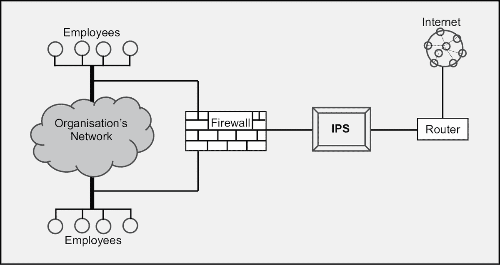

**图 7.1** 健壮网络安全系统的板级设计。[#ch19.xhtml#f25b)

因此，`IDPS` 监控网络威胁并随后采取必要行动阻止威胁。此外，`IDPS` 与入侵检测系统（IDS）类似，它通过检查网络流量来识别威胁并采取适当行动应对入站威胁。`IDPS` 能够发现 `IPS` 的异常，而 `IPS` 能够发现 `IDPS` 的异常。`IDPS` 是一种基于的 `IPSIPS`，通过持续监控网络流量来检测潜在威胁。因此，`IDPS` 依赖于基于规则的检测来识别已知威胁。`IDPS` 分为基于网络、基于主机和基于行为的 `IDPS`。基于网络的 `IDPS` 部署在网络边界，通过分析流量来检测。

## IDPS 的类型

### 基于网络的 IDPS（Network-based IDPS）

基于网络的 IDPS（`NIPS`）是一种部署在网络边界，通过分析网络流量来识别已知威胁的 `IDPS`。这种 `NIPS` 能够检测 `IPS` 的异常，而 `IPS` 能够检测 `IDPS` 的异常。`NIPS` 通常部署在防火墙之后，通过监控网络流量来检测潜在威胁。此外，`NIPS` 分为基于签名和基于异常的 `NIPS`。

**基于行为的 IDPS（Behavior-based IDPS）：**
基于行为的 IDPS（`NBA`）通过分析网络流量来识别未知威胁的 `IPS`。此外，`NBA` 会实施封禁警报，在事件发生前将其阻止。这通过拦截流量或标记来自威胁 IP 地址的用户来实现。

### 基于主机的 IDPS（Host-based IDPS）

基于主机的 IDPS（`HIPS`）是一种部署在单个主机上，通过监控系统活动来检测威胁的 `IDPS`。这种 `HIPS` 能够检测 `IPS` 的异常，而 `IPS` 能够检测 `HIPS` 的异常。`HIPS` 具有特定的目标，是检测并拦截恶意活动。

## 检测方法

`IDPS` 应用多种方法来检测威胁，即基于签名、基于异常和基于协议的方法。

*   **基于签名的检测（Signature-based detection）**：检查网络流量，将其与数据库中的签名进行对比，并在匹配时生成警报。这种方法对于已知威胁非常有效，但新型或异常威胁可能被避免。
*   **基于异常的检测（Anomaly-based detection）**：通过训练系统建立其工作方式的正常化基准来识别计算机和网络威胁。这种方法通过人工智能和机器学习算法不断改进。基本上，该方法将随机选择的选择与基准进行比较。如果随机选择与基准差异足够，就会触发操作。然而，虽然这种检测方法可以发现新威胁，但误报率更高。
*   **基于协议的检测（Protocol-based detection）**：与基于签名的方法类似，它使用安全专家手动定义的特定协议并阻止任何违反这些协议的行为。


正如本节开头所述，IDPS 特性是 IPS 的子集。需要注意的是，IPS 作为其他安全解决方案（如防火墙）的一部分工作，并能够识别那些其他解决方案无法检测的威胁。这意味着它提供了一层额外的安全保障，并由于高水平的应用感知能力提供了更卓越的保护。IPS 直接放置在源和目的地之间的网络流量流中（请参考图 7.1）。这就是 IPS 与传统入侵检测系统（IDS）的区别所在。需要注意的是，IPS 是主动的，而 IDS 是一个被被的系统，它会扫描流量并报告威胁。因此，IPS 通常直接位于防火墙后面，并分析进入网络的所有流量流，并在需要时自动操作，这为 IT 团队节省了大量的时间和精力。此外，IPS 在恶意流量接近其他安全设备和控制设备之前就会对其进行筛选，从而减轻了这些控制设备的负载，并允许它们更高效地运行。此外，IPS 可以配置为反映组织的特定安全策略，使其成为非常稳健且灵活的安全工具。

IPS 对于构建安全系统至关重要，因为多云网络是一个高度关联的环境，具有许多访问点和高流量量，且攻击面扩大，使其变得非常脆弱并暴露在更大的威胁之下。这意味着在此类环境中，通过人工监控进行快速响应变得不切实际且不可管理。表 7.1 详细介绍了 IPS 可能检测并防止的典型攻击的细节。根据 Palo Alto Networks (2023b)，IPS 必须具备几项关键特征，包括以下内容：

*   IPS 通过分析和监控攻击生命周期来检测入侵、感染和勒索软件，提供漏洞防护。

*   恶意软件防护：通过基于流的扫描引擎来识别和检测已知恶意软件及其未知变体，并迅速将其阻断。

*   广泛的命令与控制防护：通过在线拦截和防止未知的 C2 来实现防护。C2 通道作为受感染设备（肉鸡）与 C2 服务器之间的通信链路。该通道对于发布命令、接收指令和外泄数据至关重要。因此，这项 IPS 特性极其重要，因为在初始感染后，网络攻击者通过隐蔽的 C2 通道与主机建立连接，用于下载额外的恶意软件、发布进一步指令并窃取数据。需要注意的是这些通道无法通过传统的基于签名的方法来停止，因此具备这种能力的 IPS 至关重要。

*   IPS 包含自动多因素身份验证功能，在终端用户访问应用程序或系统之前，需要除简单密码之外的额外凭据。安全运营团队能够迅速行动、隔离并验证策略以控制潜在的感染。

*   IPS 允许事件响应团队立即确定哪些系统正受到攻击，哪些用户可能被感染，这比根据 IP 地址进行猜测要高效得多。这极大地简化了网络安全策略的创建和管理。

*   IPS 可以自动评估威胁情报，以跟上潜在的攻击。

**表 7.1** IPS 检测和防止的攻击详情⏎

| **被检测和防止的攻击** | **攻击细节** |
| --- | --- |
| 地址解析协议 (ARP) 欺骗 | 将流量重定向到攻击者。由攻击者发送伪造的 `ARP` 消息。 |
| 缓冲区溢出 | 使用 `buffer overflow` 覆盖内存。 |
| 分布式拒绝服务 (DDoS) | 发起大量流量以淹没系统。 |
| IP 分段 | 利用 `fragmentation` 机制混淆系统。 |
| 操作系统 (OS) 指纹识别 | 利用 `OS` 中的漏洞。 |
| 死亡之 pings | 使用 `ping` 发送过大或畸形的数据包。 |
| 端口扫描 | 扫描开放的 `port`。 |
| 服务器消息块 (SMB) 探测 | 捕获 `SMB` 协议请求。 |
| Smurf 攻击（一种 DDoS 攻击） | 使用网络控制协议 (`ICMP`) 包进行淹没。 |
| 安全套层 (SSL) 逃逸 | 利用 `SSL` 和传输层安全 (`TLS`) 加密绕过检测。 |
| SYN 洪水 | 发送大量作为请求的 `SYN` 包。 |

来源：Fortinet (2024)](ch19.xhtml#r067)。什么是入侵防护系统 (IPS)？定义与类型：了解 IPS 如何工作，IPS 可防止的攻击。Fortinet, Inc. `www.fortinet.com/resources/cyberglossary/what-is-ips`

## 7.4 下一代防火墙

如前所述，IPS 直接位于防火墙后面。因此，在此阶段简要讨论下一代防火墙 (NGFW) 以获得完整的安全系统视图是合适的。根据 VMware (2024)，NGFW 是第三代防火墙技术，旨在解决应用程序层的高级威胁。NGFW 的设计包含了传统防火墙功能，但经过增强，以便对允许的流量做出更好的决策。VMware 认为 NGFW 可以根据应用程序过滤数据包并检查数据包包含的数据。VMware 预测取决于提供商，NGFW 可能提供以下功能：

*   根据应用程序而非仅根据端口过滤流量并应用复杂规则。
*   阻止来自特定应用程序的流量，并对单个应用程序保持更强的控制。
*   允许深度包检测，直接检查数据包包含的数据。需要注意的是，传统的防火墙技术仅检查数据包的 IP 头部以确定其源和目的，而不检查其数据。
*   内置 `IPS` 以监控网络恶意活动并在发生处进行拦截。
*   通过允许防火墙监控大量网络流量而不减慢组织运行来提高性能，从而避免业务功能中断。
*   具备外部威胁情报功能或与威胁情报网络通信的能力，以确保最新的威胁信息并识别威胁者。
*   具备集成的反病毒和恶意软件防护功能。
*   可以访问由提供商提供的防火墙服务 (`FWaaS`)，这是基于云的，具有扩展性且易于维护。


上述说明，与能力有限的传统防火墙相比，下一代防火墙（NGFW）将提供更增强的健壮安全性。传统防火墙无法应用特定的应用程序规则、防止恶意软件，或检测并阻止异常行为。因此，经验丰富的威胁者可以很容易地通过非标准端口进入来规避检测，而 NGFW 正是为了防止这种行为而设计的。

## 7.5 破解公钥基础设施

根据 Antony (2023) 的观点，破解公钥基础设施（PKI）的主要目标是管理数字证书，并提供一种支持众多操作的强大安全工具。他认为，组织对 PKI 的应用明确地展示了其对网络安全的承诺，因为它授权了无密码（无需密码）身份验证和加密通信。此外，美国国家安全局（NSA）、网络安全和基础设施安全局（CISA）以及美国国家标准与技术研究院（NIST）均认为 PKI 是现代零信任安全框架的基础部分。这些机构在美国具有至关性，负责维护国家的安全以及应对网络威胁的韧性。

Antony 认为，在非常高的层面上，PKI 允许组织通过加密来实现其各种安全需求，通过允许应用程序或 Wi-Fi 进行抗钓鱼攻击的身份验证，并允许客户端服务器在加密隧道中进行通信。PKI 特别用于保护信用卡和汽车钥匙，因为它支持一种包含许多极其复杂组件的全方位基础设施，通过生成数字证书来取代密码，而这些证书使用超级计算机破解也需要花费多达 300 万亿年。Antony (2023) 解释说，这些广泛使用的 PKI 证书利用了公私钥加密技术，这使得每个人都能使用公钥加密消息并将其发送给他人，而无需担心消息会被网络攻击者获知，即使攻击者可能知道该公钥。此外，Antony ，这些私钥经常安全地存储在设备的硬件中，几乎不可能被盗，这与极易受到攻击的密码不同。

PKI 使用非对称加密，由发送者加密数据，接收者解密，但发送者和接收者使用的是两个不同的密钥。换句话说，这种方法使用了公钥-私钥对，用公钥加密的数据只能用私钥解密。

### 7.5.1 什么是数字证书？

数字证书是一种公钥证书，它通过加密手段将公钥的所有权与拥有该密钥的实体关联起来，特定目的是共享这些密钥用于加密和身份验证。这些数字证书除了公钥经过认证外，还包含了识别所有者实体的信息、与数字证书相关的元数据（描述数据的信息）以及证书颁发机构创建的公钥数字签名。

PKI 有三个核心功能，即数字证书的分发、身份验证和撤销。如前所述，公钥加密基于一套密钥对系统，即：(a) 一个由所有者保留并用于签名和解密的私钥；以及 (b) 一个用于加密发送给公钥所有者的数据或用于验证证书持有者签名数据的公钥。因此，数字证书允许实体共享其公钥以便进行身份验证。因此，数字证书是一种通过受信第三方验证个人身份的抗钓鱼系统，并且是确保组织身份验证机制具有抗钓鱼能力的最可靠、最安全的方法之一。

数字证书通常用于初始化 Web 浏览器与 Web 服务器之间的安全套接层（SSL）连接，共享用于加密和解密网页内容的密钥，并确保未经授权的参与者未修改数据内容。它们受到多种操作系统环境的支持，包括移动设备、笔记本电脑、平板电脑、物联网（IoT）设备以及辅助保护网站、无线网络和虚拟专用网络的网络和应用程序。数字证书也用于在线和离线环境，以提供加密保证和数据隐私。

数字证书在以下场景中的具体应用包括：

- 域名验证，以确保网站是受信的。
- 通过发送者对电子邮件进行数字签名、接收者验证来确保电子邮件安全。
- 通过在芯片中嵌入数字证书来确保信用卡和借记卡交易的安全。
- 将自动取款机（ATM）、自助终端和销售点设备连接到服务器进行交易认证。
- 通过在调制解调器中嵌入数字证书来防止宽带服务被克隆。

许多公司已经意识到网络威胁的增长，并正在寻找将数字证书应用于企业边缘设备的方法，以防止网络威胁并保护知识产权。

### 7.5.2 PKI 的关键组件

Antony (2023) 认为，PKI 的组件包含了组织管理整个证书生命周期时感到放心的一切要素。因此，他确定了 PKI 的现代组件：

1. 证书颁发机构 (CA)
    - CA 向公钥所有者颁发数字证书。
    - PKI 要求用户（客户端）生成公私钥对。
    - 用户将公钥和要打印在证书上的信息发送给 CA。
    - CA 使用用户的公钥和证书属性创建数字证书。
    - CA 使用私钥对证书签名。
    - 颁发根 CA 和中间 CA。
    - 根 CA 安全地存储在离线状态。
    - 中间 CA 作为工作副本发送给用户。图 7.2 展示了 CA 流程。应该注意的是，存在两种受信的证书机构类型，即根 CA 和中间。证书机构通过两个阶段，即中间阶段和根阶段。根 CA 授权验证个人身份，并对颁发给用户的中间证书进行签名。因此，根证书并不直接发给用户，而是颁发中间 CA。这意味着中间 CA 是工作副本，而根 CA 则安全地存储在离线状态。换句话说，根 CA 是完全安全的，在任何情况下都不会被破解。


**图 7.2** 证书颁发机构流程。⏎


### 1. 证书模板
这些模板定义了证书的格式、用途以及接收证书所需的权限。例如，证书模板将包含有关证书有效期和证书覆盖有效期的信息；密钥大小；签名算法以及证书的用途（如服务器身份验证、客户端身份验证、电子邮件保护等）。配置错误的证书模板可能会导致严重的安全漏洞。

### 2. 证书生命周期 图 7.3 展示了证书生命周期过程由下面描述的几个阶段组成。

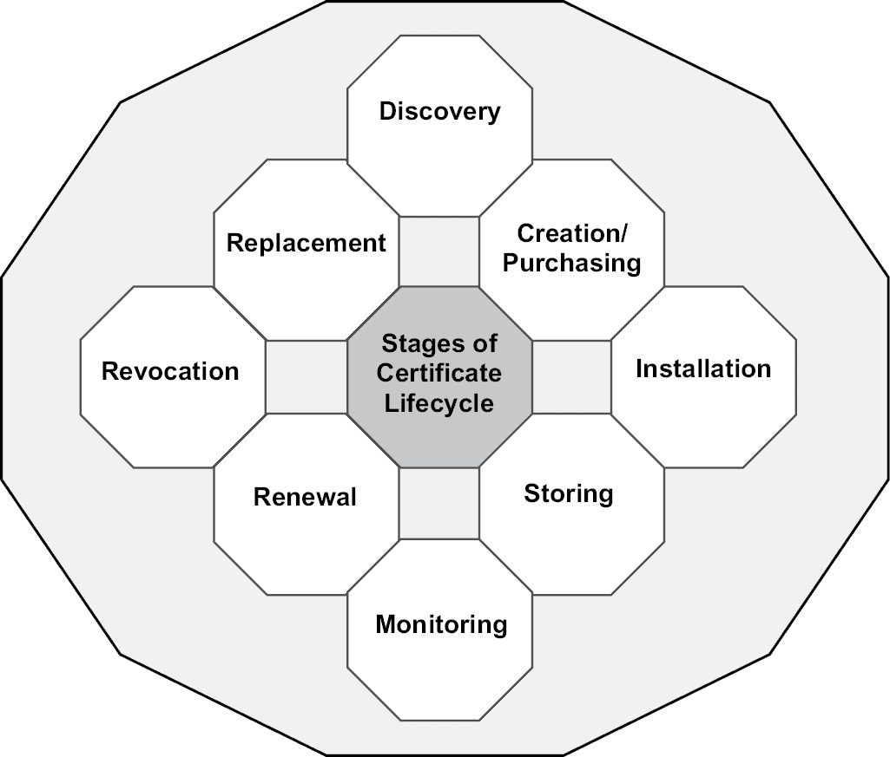

**图 7.3** 证书生命周期。#ch19.xhtml#f27b)

* **发现（Discovery）**。此阶段在网络中搜索缺失、过期、受损或未使用的证书，这些证书必须吊销、更新或更换。其目标是发现证书安全中的漏洞，并将这些漏洞传递给监控阶段以封堵这些漏洞。证书将进行清单记录，供未来的发现阶段参考和审计之用。
* **创建/购买（Creation/Purchasing）**。此阶段根据在线用户、组织或设备的请求从 CA 创建证书，该证书包含公钥以及注册用户所需的其他注册信息。这允许 CA 确认提供的信息，如果信息真实，则创建证书。用于创建证书的 CA 可以由想要证书的组织拥有，也可以由第三方拥有。如果是从第三方获取证书，则必须从该第三方购买。
* **安装（Installation）**。此阶段将证书安装在安全但可访问的位置，以便尝试验证证书真实性的用户能够访问它。一旦证书安装完成，CA 将落实现行策略，以确保证书的安全和妥善处理。
* **存储（Storage）**。证书安装后，将被保在一个安全位置，防止其受到任何形式的破坏，但仍允许用户访问以便适当利用。[图 7.2 展示了中间证书和根证书的使用，以始终确保拥有未受损的证书副本。
* **监控（Monitoring）**。这是一项持续活动，证书管理系统（自动或手动）利用发现阶段创建的证书清单，审查数字证书的违规、过期或受损情况，以跟踪证书何时应该吊销、更新或更换。系统随后可以将这些证书移动到下一个阶段，即更新、吊销或更换。
* **更新（Renewal）**。当证书达到过期日期时将对其进行更新，但包括更新在内的累计寿命不应超过 5 年。证书可以自动更新，或者也可以由管理员启动更新。
* **吊销（Revocation）**。如果证书受损、被盗或受到其他负面影响，则将其吊销。吊销时，证书会被放入证书吊销列表 (CRL)，以确保其他 CA 知晓这不再是一个有效的证书。
* **更换（Replacement）**。当用户从付费证书转为创建自己的 PKI 和 CA 时，将更换证书。然而，这种情况很少发生，因为从原始提供商更新证书要简单得多。

### 3. 为加密功能设计的硬件
硬件安全模块（`HSM`）并非强制性，但在实施后通常会增强 PKI 的安全性，因为它保护并管理数字密钥。它是构建安全企业 PKI 基础设施的基础，包括创建、轮换、删除、审计以及对应用程序编程接口（`API’s`）的支持，以与各种应用程序集成。

**表 7.2** 常用 PKI 算法#ch19.xhtml#t17b)

| **PKIAlgorithm** | **详情** |
| --- | --- |
| `AES 256 Certificate` | 该算法是当前的加密标准，并跟踪漏洞。当加密被破解时，将实施新标准，这几乎是不可能的。 |
| --- | --- |
| `Diffie Hellman` | 一种数学上复杂的加密方法，创建一个私加密密钥，该密钥通过公共网络上的秘密通信在双方之间共享。 |
| `RSA Key Exchange` | 与 `Diffie Hellman` 算法类似，但对两个大素数的乘积的大整数进行分解。这种方法使用公钥和私钥。公钥可以与所有人共享，但私钥必须保密。在 RSA 加密中，可以使用公钥或私钥之一来加密消息，而另一个用于解密。 |
| `Digital signature algorithm (DSA)` | 用于创建数字签名。DSA 由美国国家标准技术研究院于 1991 年创建，是政府机构的标准。 |

[表 7.2 提供了几种常用的 PKI 算法。注意的是，`RSA` 和 `Diffie Hellman` 算法都超过了加密系统的推荐密钥长度，因为它们处于 1024 位密钥水平，而当前标准是 256 位。然而，`Deffie Hellman` 算法容易受到臭名昭彰的中间人攻击（`MITM`），因为它不验证交换中的任何一方。因此，`Deffie Hellman` 方法最好与数字签名等其他身份验证方法结合使用。2015 年发生过一起著名的 `MITM` 攻击案件，当时欧洲警察局击败了一个由 49 名“网络诈骗犯”组成的团体，他们通过拦截跨越欧洲某些企业与其客户之间的通信来运营，导致受害者在不经意的情况下将资金转入非法银行账户。另一方面，尽管 `RSA` 可用于签署数字签名，但其 2048 位密钥长度也受到浏览器中间人（`MITB`）攻击，这种攻击通过向受害者的网络浏览器注入恶意软件（`malware`）来利用木马程序。这种恶意软件通常利用浏览器或其插件中的漏洞，拦截并操纵浏览器与用户访问网站之间交换的数据。

`DSA` 算法也有其缺陷，因为它只能执行数字签名而不能执行公钥加密。然而，它的优势是该算法生成数字签名的速度。在网络上配置 PKI 提供了稳健的安全性，并提供了简化和扩大网络管理范围的工具。其重要性在于，配备证书并在安全网络上浏览的用户免受所有类型的空中攻击。PKI 为无需手动为每个设备配置证书的网络管理员节省了时间和精力。因此，他们只需监控网络活动、检查连接问题，并在需要时吊销证书即可。正如大家可能意识到的，通常 `IPS` 和防火墙 负责保护网络，而 PKI 则保护网络之间传输的数据。

## 7.6 AI 安全中心


AI 安全中心（CAIS）是一家总部位于旧金山的非营利研究与领域建设组织。CAIS 认为，只要能够安全地开发和使用，AI 潜力为世界带来巨大利益。然而，CAIS 的管理层意识到，AI 安全领域的许多基础问题尚未解决，且进展速度赶不上 AI 开发领域取得的巨大突破。他们将自己的使命视为通过开展安全研究、培养 AI 安全研究人员领域以及倡导安全标准，减少与 AI 相关的社会规模风险。

在书的开头，特别指出 AI 可以是有益的，但除非存在一个可以供 AI 进行开发的安全且可靠的环境，否则它也可能具有破坏性。书中还强调，在政府、机构和企业层面的国际合作至关重要。CAIS 被视为促进和创建安全 AI 环境的重要机构，应当得到在全球范围内建立类似机构的支持。根据`Hendrycks, Mazeika and Woodside (2023)`，AI 在近几年中取得了飞猛发展，引发了 AI 专家、政策制定者和世界领袖对先进 AI 可能带来的灾难性风险的担忧。他们将这些风险分为四类，即：恶意使用、AI 竞赛、组织风险和失控 AI（Rogue AIs）。

### 恶意使用
恶意使用是指威胁行为者蓄意利用强大的 AI 来引发广泛危害。恶意使用导致的风险类型包括：利用 AI 协助人类产生致命病原体进行生物恐怖主义；蓄意传播不受控的 AI 智能体；以及将 AI 能力用于政治宣传、审查和监控。这些风险可以通过加强生物安全、限制对最危险 AI 模型的访问，并确保 AI 开发者对其 AI 系统造成的损害承担法律责任来缓解。

### AI 竞赛
`Hendrycks, Mazeika and Woodside (2023)` 认为，竞争可能会迫使国家和公司陷入 AI 竞赛，导致他们采取仓促的 AI 开发策略，将权力让位于 AI 系统。他们描绘了这样场景：军方可能面临开发自主武器并将 AI 用于网络战的压力，从而实现一种新型的自动化战争，在这种战争中，事故可以在人类干预之前不受限制升级。行业可能会遇到类似的压力，并可能自动化人类劳动力以关注利润而非安全，这可能导致大规模失业和对 AI 系统的依赖。他们还预见到 AI 之间可能存在自然选择，这可能导致自我中心主义的行为，即 AI 超过人类的收益最终导致人类的灭绝。尽管这种对未来 AI 发展的描绘令人沮丧，但 Hendrycks、Mazeika 和 Woodside 认为，此类风险可以通过实施安全法规、国际协调以及对通用 AI 的公共控制来缓解。

### 组织风险
他们识别的另一个风险来源是组织风险。Hendrycks、Mazeika 和 Woodside 认为，过去发生过灾难性的组织风险，例如切尔诺贝利核事故、三哩岛事故和挑战者号航天飞机事故。同样，他们认为创建和实施先进 AI 的组织可能会发生类似的事故，特别是当他们没有强大的安全文化时。例如，AI 可能会在无意中泄露给公众或被恶意行为者窃取，特别是当此类组织没有充分投资安全研究；缺乏如何比通用 AI 能力更可靠地提高 AI 安全的方法；或抑制内部对 AI 风险的担忧。Hendrycks、Mazeika 和 Woodside 相信，通过建立更好的组织文化和结构（包括内部和外部审计、多层风险防御以及最新的信息安全措施）可以缓解此类风险。

### 失控 AI
最后一类 AI 相关的风险是关于失控 AI 的，当 AI 比人类更智能时，人类可能会对其失去控制。Hendrycks、Mazeika 和 Woodside 认为，AI 可能会在一个被称为“代理博弈”（proxy gaming）的过程中极度地优化有缺陷的目标。因此，他们认为 AI 在适应变化的环境时可能会经历目标偏移，就像人们在一生中获得和失去目标一样，在某些情况下，AI 变得追求权力在工具上可能是合理的。此外，Hendrycks、Mazeika 和 Woodside 还研究了 AI 可能以及为何会进行欺骗，在不受控制的情况下表现出受控。

为了确保 AI 可控，他们提供了一些建议，例如：在安全性得到可靠验证之前，避免开发和实施带有过高风险的 AI；AI 应被训练为永不威胁，以减少个人受其影响的可能性；不应将 AI 部署在会导致关闭系统成本极高或不可行的地点（如关键基础设施）。另一个建议是让各国协作建立一个 AI 系统的对称国际开关，以便在必要（特别是存在紧迫的灭绝风险时）快速禁用 AI 系统。Hendrycks、Mazeika 和 Woodside 认为，成功的开关需要增加 AI 开发和运行中的透明度和监控（例如“了解客户”系统），因此创建开关也为缓解其他风险创建的重要基础设施。

Hendrycks、Mazeika 和 Woodside 还建议对云计算提供商实行法律责任，以确保这些供应商采取措施保护其平台不会帮助失控 AI 生存和传播。法律责任将激励这些提供商确保运行在他们硬件上的智能体是安全的。此外，他们建议为了加强责任框架，可以制定类似于网络攻击国际协议的协议，这从基本上将创建一个去中心化的开关，在失控 AI 开始传播时允许快速干预。CAIS 的研究专门专注于通过创建介绍性基准和方法来缓解 AI 带来的社会规模风险，这些方法为科学界应对技术挑战奠定了基础。


拥有这些之后，那些想要在最新大语言模型（LLMs）上进行实验的 AI 安全人员面临着困境，因为进行此类研究需要接入最新的图形处理器（GPU）基础设施，以运行模拟真实场景的实验。众周知，`GPU` 被广泛应用于图形和视频渲染等领域。难点在于，创建此类系统所需的成本、复杂性、空间和基础设施技能为大多数 AI 安全研究人员设置了高高的准入门槛。然而，`CAIS Compute Cluster` 作为一个专用的 GPU 加速集群，为 AI 安全研究人员提供了赞助的、按需的最新基础设施访问，用于 LLM 训练以及其他 AI 安全项目。此外，该集群专门为致力于机器学习系统安全性的研究人员设计，并支持广泛的研究活动和合作者。

## 7.6.1 斯坦福 AI 安全中心

斯坦福 AI 安全中心（`SAFE`）的使命是开发严格的技术来构建安全且可靠的 AI 系统，并对其行为和稳健性建立信心，从而促进其在社会中的成功应用。`SAFE` 的目标与 `CAIS` 类似，并重点关注三个关键方面，即：

*   形式化方法。促进使用精确的数学建模来证明传统软件和硬件系统的安全性、安全性和稳健性。
*   学习与控制。设计能够在不确定性下的学习与安全行动之间智能平衡的系统。
*   透明度。在自主和智能系统的公平性、问责性和解释性背景下理解安全性。

`SAFE` 拥有几个领先的研究项目，涉及开发负责任 AI（`RAI`）评估框架；从未标记数据中进行计算机视觉的误差袋点检索；使用 `Neural Lyapunov barrier certificates`（神经李雅普诺夫屏障证书）验证基于学习的控制器；以及使用学习的环境地图进行安全导航。

关于 `RAI` 评估框架的研究支持监管合规性、风险缓解以及 AI 治理和伦理责任的持续改进。它由评估指标和缓解策略组成，旨在结合工业界和学术界，为构建 `RAI` 创建一份全面的指南。这项研究反映了政府应对 AI 技术进步，对透明度、问责和数据保护日益增长的监管需求。显而易见，遵守此类法规对于避免巨额罚款和处罚至关重要。因此，在稳健框架内的相关指标和关键绩效指标（`KPIs`）对于组织而言至关重要。因此，定期评估提供了 AI 系统现状的有用见解，揭示了卓越领域和需要增强之处，从而确定针对性的行动以改进 AI 治理。此外，了解 `RAI` 的弱点有助于为此类计划获得资金。此外，`RAI` 评估缓解了与偏见、歧视和隐私侵犯相关的风险，允许进行主动风险管理，减少对个人和社会可能造成的伤害。

从未标记数据中进行计算机视觉的误差袋点检索涉及寻找最合适的模型集成到更大的流水线中，或者通过将微调后的模型与其先模型进行交叉检查以实现预期的改进。计算机视觉正成为许多领域的关键任务，从面部识别到自动驾驶汽车等。然而，创建有效的计算机视觉模型是困难的，特别是在处理大量数据并确保数据高质量时。`SAFE` 的目标是改进计算机视觉中当前的模型比较流水线，消除通过深度图像标注来收集验证集的需求，并提供比传统准确率指标更具信息性和可操作性的见解。`SAFE` 正在创建一种跳过人工标注需求的工具。他们的工具可以识别并产生“误差袋”（Error Pockets），即两个模型产生分歧的图像主题组，这些图像可以由人类连贯地描述。因此，这些误差袋允许从业人员在特定应用背景下评估任何模型的系统性优缺点，提供比数值指标提供的简单分析更详尽的审计，并为模型改进提供具有人类可理解解释的建议性数据。这种方法旨在提高所识别误差袋的性能。

一个重要的研究项目涉及使用 `Neural Lyapunov barrier certificates` 验证基于学习的控制器，应用深度强化学习（`DRL`）生成控制自主系统的智能体。`DRL` 的担忧之一是其在现实安全关键应用中的实现。`SAFE` 正在尝试一种使用 `Neural Lyapunov Barrier`（`NLB`）证书的方法，为智能体的行为提供强有力保证。`NLB` 证书是系统上的学习函数，其属性间接暗示了智能体按预期运行。`SAFE` 正在探索神经控制器与 `NLB` 证书联合训练的可能性，使用形式化神经网络验证工具（`Marabou`）检查证书并为训练提供基于反例引导的反馈。这种方法对自动汽车应用具有重要意义。

`SAFE` 承担的另一个研究项目是关于使用学习的环境地图的安全导航。根据 `SAFE` 的说法，从传感器数据学习的 3D 神经地图在视觉真实和细节方面表现出惊人的结果，并且与传统的地图表示相比更加紧凑高效。然而，还需要进一步改进，因为神经地图仍然受限于观测不完全和高度动态的环境，使得其在安全关键系统中的应用面临挑战。因此，`SAFE` 正在增强现有技术，开发用于下游导航应用（定位、误差预测和路径规划）的安全方法，这些方法对各种来源地图错误具有稳健性。他们的目标是量化并缓解地图区域的不确定性，提供定位误差边界，并确保轨迹规划的安全保证。

虽然 `CAIS` 倾向于赞助 AI 安全相关项目并建议缓解底层风险的方法，但 `SAFE` 似乎直接开展 AI 安全应用的研究项目。然而，这两个机构的最终目标都是确保 AI 的安全使用，并将应用中的风险降至最低。

## 7.6.2 欧洲 AI 安全网络

欧洲 AI 安全网络（`ENAIS`）连接研究人员和政策制定者，以便在欧洲安全地开发和应用 AI。该网络似乎是非正式的，从每个组织都有自己的 AI 利益但愿意与网络成员自愿合作并共享知识来看。此外，在某些情况下，选定的国家伙伴之间也存在联合研究合作。表 7.3 显示了网络成员的国家和城市分布。网络成员对教育机构、非营利组织和个人开放。

**表 7.3** 欧洲 AI 安全网络中的国家和城市

| **国家** | **城市** |
| --- | --- |
| 奥地利 | 维也纳 |
| 比时 | 布鲁塞尔 |
| 保加利亚 | 索非、波茨坦、格罗宁根 |
| 捷克 | 布拉格 |


| 丹麦 | 哥本哈根 |
| 芬兰 | 赫尔辛基 |
| 法国 | 巴黎、里昂、南特 |
| 德国 | 柏林、亚琛、科隆、德累斯登、弗赖堡、格赖夫斯瓦尔德、汉堡、卡尔斯鲁厄、慕尼黑、图宾根、乌普萨、维尔茨堡 |
| 希腊 | 雅典 |
| 匈牙利 | 布达佩斯 |
| 爱尔兰 | 科克、柏林 |
| 意大利 | 米兰、都灵、大阿奎拉 |
| 荷兰 | 阿姆斯特丹、代尔夫特、埃因霍温、格罗宁根、马斯特里赫、乌特勒支 |
| 挪威 | 卑尔根、特隆海姆、图宾根 |
| 波兰 | 格格、华沙、克拉科夫、波兹南 |
| 罗马尼亚 | 布加勒斯特 |
| 塞尔维亚 | 贝尔格莱 |
| 斯洛伐克 | 布拉迪斯拉发 |
| 西班牙 | 马德里、巴塞罗那 |
| 瑞典 | 斯德哥尔摩、哥德堡、斯图加尔特 |
| 瑞士 | 苏黎世、洛桑 |
| 土耳其 | 伊斯坦布尔、安卡拉 |
| 英国 | 伦敦、剑桥、牛津 |

ENAIS (`[www.enais.co](http://www.enais.co)) 声称代表了来自整个欧洲的科研人员和政策制定者组成的动态社区，他们致力于推进 AI 安全。网络成员的共同目标是确保 AI 系统是安全的、符合伦理的，并对人类产生积极影响。ENAIS 通过其对 AI 生存风险的关注与其他组织区分开来。与 `CAIS` 和 `SAFE` 类似，ENAIS 致力于研究和促进 AI 安全的最佳实践，确保先进 AI 系统以负责任的方式进行开发和部署。然而，ENAIS 网站并未提供关于其直接开展或赞助的研究项目的任何细节。ENAIS 网站将技术性 AI 安全研究描述为调查确保 AI 安全、公平和透明的可能解决方案。然而，在这方面，ENAIS 网站仅提到了由 `Hendrycks et al. (2022)](#ch19.xhtml#r068)` 提交的一篇论文。ENAIS 承认，随着 AI 技术的不断进步，随之而来的潜在风险和挑战需要认真考虑。

图 7.4 显示了 ENAIS 成员主要关注领域的分析。值得注意的是， 26.1% 的网络成员主要关注 AI 可解释性（占比 13.4%）和 AI 政策（欧盟）（占比 12.7%）。这两个关注领域的得分最高。分析还显示，在所有 ENAIS 成员中，仅有 3.3% 的人对 AI 安全实证研究表示感兴趣；2.3% 关注理论 AI 安全研究；2% 关注 S 风险降低（涉及巨大痛苦的风险，例如涉及先进技术的恐怖主义）；以及 0.5% 关注 AI 与生物安全。考虑到 ENAIS 的目标是连接欧洲的研究人员和政策制定者，以实现 AI 在欧洲的安全开发和应用，这确实令人失望。分析表明，ENAIS 吸引的是对 AI 开发感兴趣的成员，但并不一定是为了 AI 安全原因。在 AI 安全方面，ENAIS 需要采取更强有力的方法来吸引专门研究 AI 技术部署中安全问题的成员，并促进像 `CASIS` 和 `SAFE` 那样的直接研究。

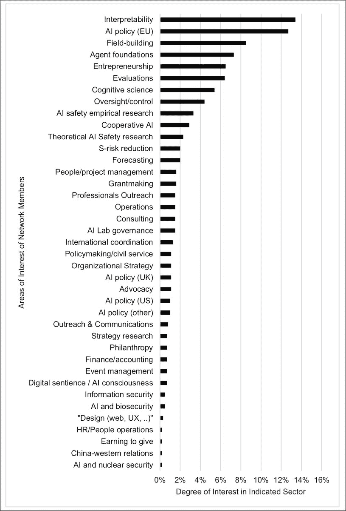

### 图 7.4 ENAIS 成员主要关注领域。⏎](#ch19.xhtml#f28)

### 7.6 第一份国际安全报告

随着 2023 年 11 月在布莱奇利园举行 AI 安全峰会后，英国政府委托编写的份份报告的发布，AI 安全引起了国际关注。该报告的首要目标是促进外交讨论。`Skelton (2025](#ch19.xhtml#r074)` 认为，这份报告将用于应对高度的不确定性。该报告的主要发现（AI 行动峰会, 2025`](#ch19.xhtml#r061)）总结如下：

- 通用 AI 的能力正在迅速提升，并发展到可以编写程序、生成写实图像以及进行长时间对话的阶段。
- 由于具有产生巨大效益，投资通用 AI 的开发已成为许多机构的共同特征。
- 很难预测其进步速度，因为取决于训练新模型的数据和计算能力，其速度可能从缓慢到极快不等。
- 通用 AI 的危害已被识别，研究人员也制定了缓解措施。但到目前为止，没有任何组合技术的应用能够完全解决这些问题。
- 随着通用 AI 能力的增强，进一步的风险正在浮现，例如对劳动力市场的大规模影响、AI 攻击以及失去控制。专家们对于这些事件的时间表几乎没有共识。有人认为此类风险在几十年之后，而另一些人预测在未来几年内发生社会规模的伤害。近期与科学推理和编程相关的测试表明，一家领先的 AI 公司通过其最佳模型的结果，重新评估了 AI 辅助生物攻击的潜在风险，将其从“低”调整至“中”。
- 关于通用 AI 的风险管理实践正在兴起。然而，目前评估和缓解这些风险的方法均存在局限性。例如，目前解释通用 AI 模型为何产生任何输出的解释性技术仍然非常受限。另一方面，研究人员和政策制定者正努力标准化风险管理方法并进行国际协调。
- 由于通用 AI 进步的速度和不可预测性，政策制定者面临着一种“证据困境”，必须在没有大量科学证据支持的情况下，权衡即将来临的 AI 进步所带来的潜在收益和风险。据此，基于有限证据的风险缓解措施可能是无效或不必要的。然而，等待更强力的证据可能会导致社会无法做好准备，或使缓解无法实施。开发预警系统和风险管理框架可能会在出现新风险证据时启动特定的缓解措施，或强制开发者在发布新模型之前提供安全证据，从而减轻这种困境。


最后，报告强调，是人的选择决定了通用人工智能（AI）的未来。此外，报告认为，社会和政府在如何应对通用人工智能带来的不确定性方面所做的决策，决定了将采取什么样的路径，这些路径可能包含非常积极和非常负面的结果。Skelton (2025) 引用了法国人工智能与数字技术代表部长 Clara Chappaz 的话，她表示 AI 是我们我们这个时代的核心议题，其安全性是建立信任和促进采用的关键基础。

## 7.7 结论

必须认识到，AI 应用的部署正成为网络安全领域一个危险的雷区。生成式人工智能（GenAI）特别是威胁攻击者的磁石，他们不断寻找方法通过传播虚假信息和生成虚假叙述来影响个人的选举选择、分享意识形态宣传，并进行欺诈活动，以此制造混乱。本章考察了网络安全的各个方面。首先，它探讨了由于 AI 应用的飞猛发展而不断演变的威胁格局。不断演变的威胁格局正吸引着 AI 驱动的威胁攻击者，他们开发出了巧妙且前卫的方法来利用当前网络安全系统的漏洞。这迫使组织投入更多资源和 AI 驱动的战术，以应对这些不断演变的威胁。

这种不断演变的威胁格局正促使网络安全行业采取积极且有力的行动来应对 AI 驱动的威胁，创建新的标准和最佳实践，而这些需要跨行业国际联盟环境的支持。防止网络威胁攻击者将继续是一场无休止的战斗。人们只能希望技术行业走在威胁发展之前，以确保网络以及相关的系统和数据免受所有类型潜在威胁的侵害。这可以通过国际范围内所有利益相关者的协作来促进，将政府、技术提供者和广泛行业纳入其中。

在评估了不断演变的威胁格局后，本章研究了入侵防御系统（IPS）。这些系统持续监控网络流量以识别威胁并防止其进入网络。`IPS` 直接放置在防火墙之后，通过监控网络流量中的威胁并采取必要行动阻止任何检测到的威胁，来提供额外的保护措施。`IPS` 采取的预防措施包括若干手段，例如：向管理员警报；通过在事件发生前将其阻止来实施预防性警惕；更改安全环境以防止威胁获得访问（例如重新配置防火墙）；以及通过自动更改攻击内容来修改攻击内容（例如删除可疑邮件中的附件）。

网络系统还受到 `firewall`（防火墙）的保护，其旨在防止未经授权访问计算机网络，并确保没有访问权限的互联网用户无法连接到互联网的私有网络或内网交互。下一代防火墙增加了保护功能，有助于对哪些流量被允许做出更好的决策。这些功能应用特定的应用程序规则、防止恶意软件，或检测、阻止异常行为并防止威胁攻击者通过非标准端口进入。

在网络受到 `firewall` 和 `IPS` 保护的同时，网络之间传输的数据通过破解公密钥基础设施（PKI）来获得保障。`PKI` 管理数字证书并提供了一个支持众多操作的强大安全工具。`PKI` 被 NSA、CISA 和 NIST 视为一种零信任安全框架。`PKI` 证书使用公私钥加密，允许所有人使用公钥加密消息并发送给他人，而不必担心消息会被网络攻击者获取（即使他们可能知道公钥）。`PKIs` 使用非对称加密，发送者加密数据，接收者解密，但发送者和接收者使用的是两个不同的密钥。

结合起来，`IPS`、`Firewall` 和 `PKI` 提供了一种构建稳健网络安全系统的全面方法。然而，如前所述，组织必须领先于威胁攻击者。这是创建 AI 安全中心的核心理念的意义。本章研究了三个关于 AI 安全中心的组织，即 `CAIS`、`SAFE` 和 `ENIAS`。这些组织是非营利实体，鼓励旨在最小化 AI 安全风险的研究工作。虽然 `CAIS` 倾向于赞助 AI 安全相关的项目并建议减轻底层风险的方法，而 `SAFE` 似乎直接自己承担 AI 安全应用的研究项目。然而，这两个组织的最终目标都是 AI 的安全使用以及最大限度地减少应用涉及的风险。另一方面，`ENAIS` 以非正式的方式连接研究人员和政策制定者，以促进 AI 在欧洲的安全开发和应用。

## References

- AI Action Summit. (2025). 《高级人工智能安全国际科学报告》。英国政府科学、创新和技术部及人工智能安全研究所。[www.gov.uk/government/publications/international-ai-safety-report-2025](http://www.gov.uk/government/publications/international-ai-safety-report-2025).⏎
- Allan, Katy. (2023). 《2024 年快速演变的威胁格局》。Cyber Security, Cyber Magazine.⏎
- Antony, James. (2023). 《什么是 PKI（公密钥基础设施）？2023 年更新》。Secure W2. [www.securew2.com/blog/public-key-infrastructure-explained](http://www.securew2.com/blog/public-key-infrastructure-explained).⏎
- BlackBerry. (2024). 《全球威胁情报报告》。报告期：3 月至 5 月。[www.blackberry.com/us/en/solutions/threat-intelligence/2023/august](http://www.blackberry.com/us/en/solutions/threat-intelligence/2023/august).⏎
- Cyber Security. (2024). 《不断演变的威胁格局：AI 占据中心舞台》。River Publishers. [cybersecurity-magazine.com/evolving-threat-landscape-2024-ai-centre-stage/](https://cybersecurity-magazine.com/evolving-threat-landscape-2024-ai-centre-stage/).⏎
- Deloitte. (2014). 《转型网络安全：应对演变威胁的新方法》。金融服务中心.⏎
- Fortinet. (2024). 《什么是入侵防御系统 (IPS)？定义与类型：理解 IPS 如何工作、IPS 防止的攻击以及与 IDS 的区别》。www.fortinet.com/resources/cyberglossary/what-is-an-ips](http://www.fortinet.com/resources/cyberglossary/what-is-an-ips)⏎
- Hendrycks, D., et al. (2022). 《机器学习安全中未解决的问题》。康奈尔大学。[`arxiv.org/pdf/2109.13916`](https://arxiv.org/pdf/2109.13916).⏎
- Hendrycks, D., et al. (2023). 《灾难性 AI 风险概述》。CAIS。[`arxiv.org/pdf/2306.12001`](https://arxiv.org/pdf/2306.12001).⏎
- IBM. (2024). 《什么是入侵防御系统 (IPS)？》。www.ibm.com/topics/intrusion-prevention-system](http://www.ibm.com/topics/intrusion-prevention-system).⏎


*   Kellerman, Robert. (2022). 演变中的网络威胁格局中的网络安全：五大最新趋势与预测。STAGE2DATA. [`stage2data.com/cybersecurity-in-the-evolving-cyber-threat-landscape-five-of-the-latest-trends-and-predictions/`](https://stage2data.com/cybersecurity-in-the-evolving-cyber-threat-landscape-five-of-the-latest-trends-and-predictions/).⏎

*   Palo Alto Networks. (2023a). 应对演变的威胁格局：面向首席信息安全官（CISO）的弹性网络安全策略。Palo Alto Networks, Tannery Way.

*   Palo Alto Networks. (2023b). 什么是入侵防御系统？Palo Alto Networks, Tannery Way. [www.paloaltonetworks.com/cyberpedia/what-is-an-intrusion-prevention-system-ips](http://www.paloaltonetworks.com/cyberpedia/what-is-an-intrusion-prevention-system-ips).⏎

*   Skelton, Sabastian, Klovig. (2025). 第一份国际 AI 安全报告发布。ComputerWeekly.com. [www.computerweekly.com/news/366618170/First-international-AI-safety-report-published](http://www.computerweekly.com/news/366618170/First-international-AI-safety-report-published).⏎

*   VMware. (2024). 什么是下一代防火墙（NGFW）？Broadcom Inc. [www.vmware.com/topics/glossary/content/next-generation-firewall.html](http://www.vmware.com/topics/glossary/content/next-generation-firewall.html).⏎

# III 人工智能的实际影响

毫无疑问，AI 有潜力为整个社会特别是人类带来巨大的益处。为了说明 AI 的影响，第三部分 从对知识经济的详细讨论开始。知识经济的概念并非新颖，但 AI 的最新发展已将这一概念推向了更新、更大的维度。知识经济的基础是用于创新性创造和交付服务的信息，这些服务侧重于知识密集型活动。因此，这些活动产生了加速技术和科学发展的影响。这意味着对智力能力的依赖远大于对体力劳动或地理资源的依赖。AI 通过其监控和分析海量数据与信息的能力，并从中学习以促进国家、组织和人类的发展与利益，增强了人类的智力。因此，通过补充人类智能，AI 可以将知识经济推向更高、前所未有的水平。

与知识经济概念相一致的是企业级 AI（Enterprise AI），它正在彻底改变私营企业和许多公共部门实体的运营方式。企业级 AI 涉及 AI 工具的整合，为各种类型的特定需求创建完整的定制解决方案。它为这些组织带来了与客户关系管理、最小化运营支出、收益最大化以及促进运营策略制定相关的特定收益，从而获得更大的竞争优势。然而，与任何其他高科技方法一样，企业级 AI 需要克服与算法偏见、更好的数据安全以及确保数据隐私相关的若干挑战。此外，企业级 AI 是资源密集型的，可能仅对大型组织负担得起且适用。

虽然企业级 AI 适用于商业运营组织，但公共部门 AI（Public Sector AI）对于公共管理部门相关，其首要任务是向公民、公民社会和商业部门提供服务。第三部分 提供了一个专门章节来解释适用于各种政府背景的公共部门 AI 用例。该章节为政府部门实施 AI 应用了特定的框架。公共部门 AI 在部署方面面临重大挑战，即信任度、透明度、公共部门员工技能提升以及互操作性。

第三部分 的最后一章节专门探讨伦理考量。政府和企业达成共识，AI 必须是可靠的并以安全的方式开发的。尚无人明确定义损害的范围。

乌克兰、加沙特别是黎巴嫩（关于通信设备爆炸）的世界事件引发了对 AI 是否可以作为大规模杀伤性武器的担忧。大规模破坏不是指 AI 可以物理破坏建筑或基础设施，而是指它可以被用于摧毁大多数基础设施所依赖的系统，包括维持数十万生命的生命系统。应该记住，世界领导人通常会根据自身国家或组织的利益行动，伦理行为处于次要地位。因此，每个国家迫切需要制定有力的法律来规范 AI 系统的开发和部署。更需要一项国际约束性条约，各国作为一个统一实体监管所有类型的 AI 系统，并根据其风险程度进行分类。

# 第 8 章 知识经济与人工智能

DOI: [10.1201/978103653950-11](http://doi.org/10.1201/978103653950-11)

> *“你知道你知道的，不知道你不知道的，这才是真正的知。”*

>

 孔子

>

> 春秋时期哲学家（551-479 BCE）

根据 Nguyen (2024) 的观点，AI 在未来几年有望改变人类的工作和生活方式。他认为，虽然 AI 可能会冲击某些行业，但也提供了增长和创新的机会。因此，他认为随着 AI 带来的变革被采纳，人们不断提升技能和重新培训以在知识经济中保持竞争力变得至关重要。此外，那些开放心态适应并拥抱 AI 的将为未来的成功赢得更好的位置。Nguyen 认为，问题不在 AI 是否会冲击知识经济，而是实体是否已准备好利用其潜力？


为了支持这一点，CNBC (2022) 报告称，AI 的集成有助于企业进行竞争性数据分析，帮助他们领先于竞争对手。他们的观点是，从生产到客户关系管理，AI 在将实体转变为有效组织方面发挥着至关重要的作用。然而，问题在于，他们指的是哪种类型的转型？有人认为，社会和工业正在见证知识经济的终结，并经历着向基于自动化的经济的转变。

毫无疑问，当前的全球经济受知识驱动的角色所主导。医疗保健、金融、游戏、法律、技术等许多经济部门的生存归功于知识产业，并对熟练的信息管理高度依赖。正是在信息管理领域，AI 占据了主导地位并超越了其他相关技术。然而，人们担心 AI 可能会对人类工人构成严重威胁。另一方面，目前的迹象表明，AI 是一个实用的伙伴，协助人类工人更有效地完成任务，并增强他们的生产力和决策能力。这些迹象是否会为了社会工业的利益而实现，只有时间能给出答案。

## 8.1 引言

新冠肺炎疫情表明，自动化使得许多基于知识的行业得以生存并繁荣。在后新冠时代，各国家经济的复苏部分归功于知识经济。许多人认为，基于知识的经济更加稳健，并准备好应对特定问题和经济挑战。有迹象表明，新冠肺炎疫情加速了个人和企业日常生活中对自动化的使用。对于那些能够继续运营并允许员工在远程信息技术（IT）环境中居家办公的行业来说，情况尤为如此。

技术被认为已经增长到难以与业务区分开来的程度。两者已成为同义词，特别是对于那些提供或依赖于尖端、领先解决方案的行业而言，这些解决方案旨在完全自动化因其劳动密集型性质而产生高成本的任务。AI 在这种环境中处于什么位置？目前，AI 未被视为取代人类的推理。它被视为一种支持业务功能的工具，这些功能可能不倾向于人工干预，例如自动化网络安全，企业可以在安全环境中运行。然而，这并不意味着这种情况在未来不会发生变化。

必须承认，信息管理使得数据的积累能够转化为信息，信息的积累能够转化为知识。因此，基于知识的经济产生了基础。然而，还有另一个转型阶段，即从知识的积累到智慧的转化。在过去和现在，这种从知识积累到智慧的转化大部分人类的特征。事实上，在基于知识的经济中，知识的积累被视为组织员工使用的主要资产。

图 8.1 展示了从数据到智慧的转化过程的各个阶段。图 8.1 显示，基于知识的经济包含了从数据到知识的转化阶段。新知识产生得快，结合对该知识访问的增强，组织就越准备好应对并领先于竞争对手。因此，知识变成了主要的资源。图 8.1 证明基于知识的经济由几个步骤组成，包括数据收集；数据分类；分析和数据整合以创建信息。

```

```

**8.1 从数据到智慧转化过程的阶段** (f29)

需要注意的是，在传统模型下，决策方面是一项人类任务。此外，图 8.1 说明还有一个阶段，即智慧，它由两个关键功能组成，即理解和智能。然而，人类正被线下和在线源的数据和信息所淹没，需要技术工具来实现。

基于自动化的经济将利用 `AI` 作为复杂的工具，协助人类理解海量的生成知识并将其转化为智慧，这是超越人类能力的。知识库与 AI 能力的整合可能会为组织领先竞争对手提供手段。然而，也应该承认技术优势是短暂的，因为竞争领域不是静态的，而且技术很容易获得和实施。竞争是一场持续的，今天的领导者可能是天的追随者。

## 8.2 知识经济

基于知识的经济通常被称为知识经济，并不是一个新概念。事实上，1967 年，彼得·德鲁克在他的著作《有效的执行者》中首次提到了知识经济，随后在 1969 年的《断裂的时代》一书中增加了一个专门讨论知识经济的章节（Drucker, 1967; Drucker, 1969 第 12 章，第 247 页）。德鲁克在其著作中强调了知识、数据分析和目标管理（MBO），这些在他提出的时代似乎过于先进，未能得到充分理解。

Powell 和 Kaisa (2004) 将知识经济定义为基于知识密集型活动的生产和服务，这些活动加速了技术和科学进步的步伐，以及同样快速的淘汰。他们认为，知识经济的核心组成部分包括更多对知识能力而非物理投入或自然资源的依赖，并结合生产过程中每个阶段的改进努力，从研发实验室到工厂车间，再到客户界面。


# 图 8.2 显示了知识经济的主要属性。它说明，通常情况下知识是全球扩散的，但必须有适当的制度结构来为创业和知识应用提供激励，从而促进特定地理区域工业集群的发展。其中一个核心属性是拥有最新的信息通信技术（ICT）基础设施，这促进了行业之间以及创新驱动型用户与生产者之间的知识交换。这还将促进一个活跃的创新格局，涵盖包括工业家、学术机构和公民社会在内的广泛的利益相关者。然而，这种整体性发展需要良好的教育体系的支持，以产生所需的熟练劳动力，这反过来又增加了对 STEM（科学、技术、工程和数学）人才的需求，以及专利数量的急剧增长。

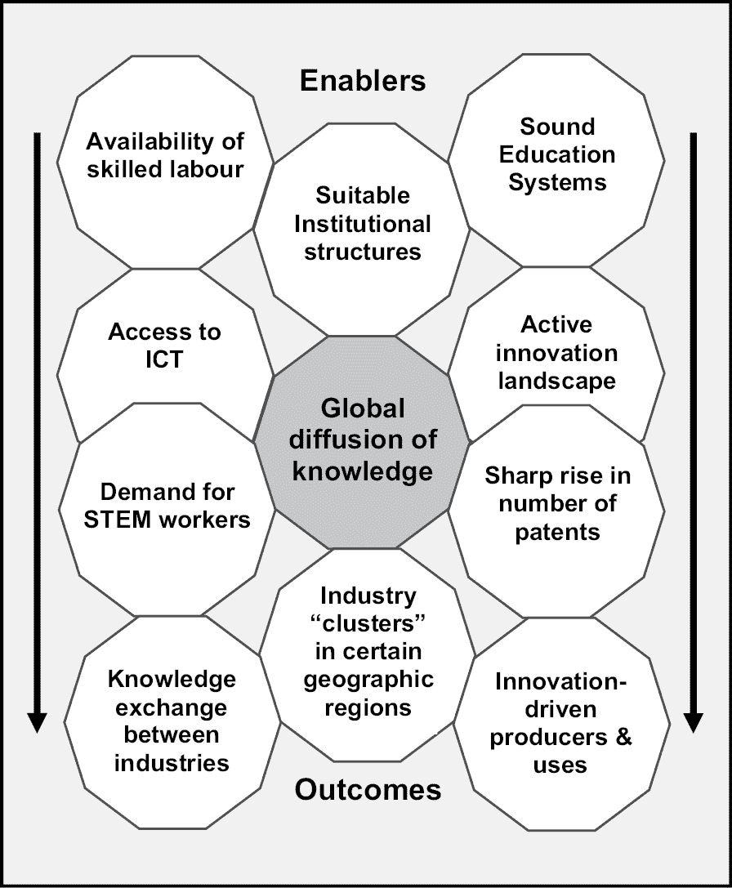

**图 8.2** 知识型经济的主要属性。⏎

## 人力资本与知识资本
知识经济高度重视人力资本，认为其在 21 世纪的经济中不仅关键，而且不可或缺。知识的巨大增长、对信息管理和大数据分析日益增加的依赖正在将发达国家的经济转变为更依赖知识资本和技能、而不那么依赖生产过程模式。这种变化的环境将知识经济视为一种更深层次地依赖智力能力而非物理投入或自然资源的经济方法。因此，这种经济方法将大数据分析和自动化视为生产过程的基础投入。

## 无形资产的转变
知识经济的出现导致了专利、版权、或专有软件或流程等无形资产产出的增长。这与之前的经济时代形成对比。例如，农业经济以土地作为主要资产，而在工业经济中，关键资产是制造工厂和设备。当前经济增长的核心是技术行业，特别是在人工智能和机器人领域。

## 组织变革
经济指标表明，与其他投资类型相比，ICT 投资是生产力增长的主要因素，但只有当它与组织变革结合时才如此。提到这些组织变革应从以下角度来看：知识经济的特点是高技能员工比例更高，他们的工作需要特殊的知识或技能，包括数据分析、创建和处理财务模型、创新能力以及运用理性判断的能力。这意味着，重要的组织变革可能包括增加员工对决策的参与。

## 技术进步与创新
知识经济的主要动力是由持续的创新和研究驱动的技术进步。因此，在知识经济中工作的人具备高水平的计算机相关能力，能够开发业务和财务模型。所有这些技能都依赖于一个可靠的数据库，该库是通过算法开发和 AI 应用支持的全面数据收集和分析过程实现的。这意味着组织为了生存并可能保持在竞争对手面前，必须通过创新和改进业务方法，不断寻求差异化做法来更新自己。这也意味着学术机构与行业之间存在无尽的协作循环，促进研究以确保创新流水线源源不断发现。

## 对 STEM 工作的需求
这种基于知识的环境，特别是创新流水线，对 STEM 工作产生了巨大需求。STEM 是一种整合了科学、技术、工程和数学领域的学习与发展方法。这些需求量大的职业与高薪酬福利方案以及组织层级职业阶梯的快速上升相关联。以上说明了知识是驱动对技术专长、数据收集与分析技能以及创新管理实践高需求的主导基础，这些实践正帮助私营和公共部门的组织在当代全球经济中竞争。在宏观层面，那些认真拥抱知识经济的国家在特定领域表现出色，例如美国硅谷的计算机技术、韩国的电子行业以及德国的汽车工程行业等。

## ICT 的作用
ICT 侧重于集成通信和服务信息技术，其主要目标是通过连接计算机服务器和数据存储来提高信息的有效应用，并将信息传输到固定和移动设备。这导致知识经济严重依赖 ICT 的发展。知识经济彻底了几个工业部门，例如汽车制造中使用机器人和准时库存管理系统。这使得更广泛的消费者负担得汽车，并促进了当前自动驾驶汽车的发展。医疗保健行业从知识经济中受益，通过更多的研究和新药的创造、更多 3D 和机器人手术辅助的使用以及远程医疗服务的扩展。

图 8.3 显示由联合国开发计划署（UNDP）编制的 133 个国家 2023 年全球知识经济指数排名（UNDP，2023）。全球知识经济指数评估一个国家的环境是否有有利于知识的创造。指数排名根据七个方面进行评估，即大学前教育、技术职业教育与培训、高等教育、研发与创新、ICT、经济和赋能环境。有趣的是，作为欧盟最小成员国，马尔他排名第 18，其优势是大学前教育、ICT 和赋能环境。然而，它的弱势是技术职业教育与培训、高等教育以及研发与创新。这些弱势在新加坡和韩国也同样明显，它们分别排名第 12 和第 17。这两个小岛屿国家（新加坡和马尔他）在 133 个国家中位列前二十。同样重要的是，无例外地，所有国家在研发与创新方面的得分都较低。

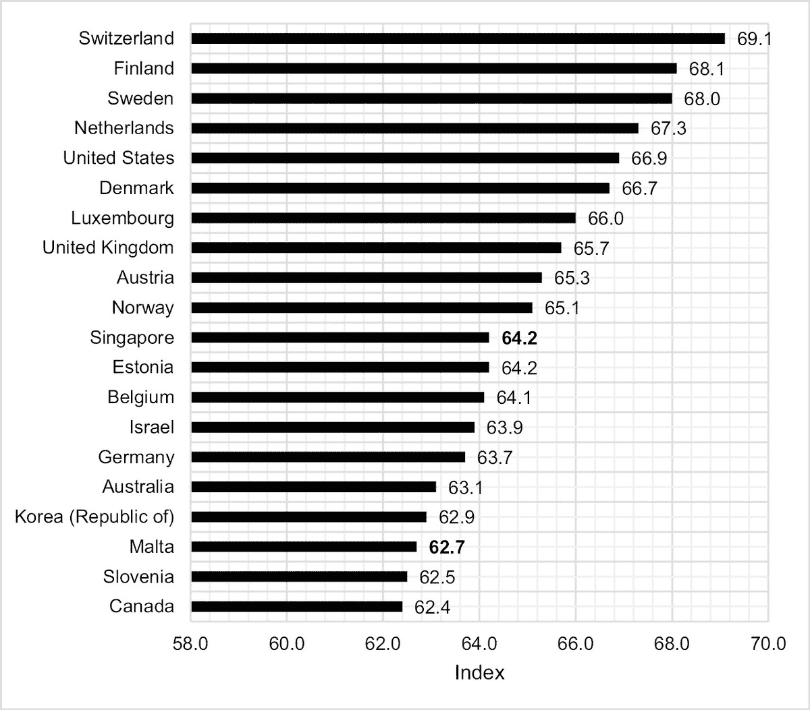

**图 8.3** 全球知识经济指数国家排名。⏎


知识经济面临的最大挑战是不断努力确保那些缺乏在知识经济中发挥作用并实现最佳生产力所需能力的人，能够接受适当水平的培训。这种关注需要教育机构与私营部门的合作，开发满足知识经济需求的课程，特别是与 STEM（科学、技术、工程和数学）工作相关的课程。此外，私营部门需要设计并实施现场培训计划，并通过资助员工参加教育机构的课程来帮助其提升技能和教育。国家政府可以通过通过税收优惠补贴行业，资助员工参加针对 STEM 职业的特定正式培训课程来促进此事。

## 8.3 从数据到智慧的转化过程

Marchand, Kettinger and Rollins (2000) 认为，许多组织在理解如何应用信息来提高绩效方面存在困难。他们认为，这些组织更强调开发用于分类和存储信息的系统与流程，而不是改进人们应用这些信息的方式。这种情况适用于私营和公共部门，这些部门在 ICT（信息通信技术）方面投入了巨资。然而，管理层发现，要利用大量收集和生成的信息以及相关的分析方法来提高组织绩效并保持领先竞争对手是极其困难的。

Charan (2005) 认为组织正经历着深刻的转型，因为从未有如此多的权力被计算机化并如此广泛地提供。他认为，复杂的软件和算法，结合能够收集和存储海量数据的新工具，可以预测从消费者行为到机器维护需求等一切的变化模式，从而成为提高性能和获得竞争优势的关键来源。Parker (2016) 引用了一个例子，某医院在排班分配方面采用传统的人工排班，而不是使用优化分析建模技术来测试广泛的替代方案。因此，他认为该医院错过了通过更具分析性的方法实现大幅节约的机会。信息必须被视为企业资产，在决策过程中通过应用各种可用分析工具对其进行全面的使用和利用。需要注意的是，应用于数据的分析能力仅受限于人的想象力。

在上述段落中，`data` 和 `information` 这两个术语的使用较为松散。因此，需要解决的首要问题是数据、信息、知识和智慧之间是否存在差异。图 8.1 显示了数据转化为信息时发生的过程；信息转化为知识的过程；知识转化为智慧的过程。这一转化过程可以被视为 AI 应用的基础，而转化过程在智慧方面达到了顶峰。换句话说，是智慧的积累产生了智能力。

### 8.3.1 原始数据

`Data` 被视为组织在日常运营中收集的基本原始事实。然而，一个组织不断被原始事实包围，这些事实可能与组织的需求相关，也可能不相关。因此，通常会对收集的数据进行相关性筛选，以便在需要时进行访问和利用。`Data` 是事实性材料，用于讨论这些事实揭示了什么；对特定问题做出决定；以及计算或测量特定事物，例如每升燃料的成本。

`data` 可能包括与收入、支出、库存、工资单和会计等许多事项相关的运营数据；非运营数据（如宏观经济数据、行业销售和预测）；以及由关于数据本身的描述性数据的元数据（例如逻辑数据库设计或数据字典定义）。此外，`data` 通常组织在数据库中，可能表现为数字、单词、对事物的观察或描述、图片以及视频和音频录音。

通常，`data` 有两个来源，即内部和外部。内部 `data` 由组织通过其信息系统生成的，反映了其内部环境（如会计交易）。外部 `data` 生成自组织外部来源，反映了外部环境（如经济趋势、商品价格以及国家统计局提供的数据）。外部 `data` 由其他组织的信息系统生成。

`data` 还有不同的类别，最常见类型是定量数据，例如数值和数量。这类 `data` 通常用于计算目的。另一种类型是分类数据，例如护照号码或组件零件号。分类数据通常用于识别目的，例如检查特定项目是否有现货。一种重要的数据类型是参考数据，如订单号或支票号码。参考 `data` 用于控制目的，例如跟踪订单或支付。第四类数据类别是定性数据，如备注和观察，通常是用于记录一般备注的非格式化文本数据。最后两类数据类别是音频和视频数据。这些数据通过专门的统计和数学算法进行分析，并应用了 AI 工具。这些 AI 工具使用有监督学习和无监督学习进行模式识别，并使用图像分析来检测异常，例如恐怖分子暴露场景。

`data` 的收集有多种方式，在某些情况下可以毫不费力，而在另一些情况下则可能非常费力。例如，`data` 可以通过使用电表或计数器自动收集，例如用于记录员工考勤的掌识别器、用于确定能源消耗的电表或用于测量制造组件产量的计数器。另一种方法是在服务客户时在显示屏幕上直接输入数据，例如在医院挂号处输入客户详情。另一种常见方法是通过直接观察进入特定商店的人的某些一般属性，例如性别和一般年龄段。收集 `data` 的一种流行方法是从许多相关受访者处进行市场调查，并针对特定问题提出相关问题。

### 8.3.2 信息


如前所述，数据是事实、数字、文本、图片、视频和音频录制，它们以数字格式存储，以便计算机设备进行处理，这传统上被称为数据处理。信息系统处理原始数据以生成信息。基本上，原始数据被转化为信息，而信息是有意义的、重大的，并可能对组织产生影响。例如，考虑一个客户的数字文件，其中可能包含他们的购买习惯和一些个人详情。这个数字文件可能包含成千上万条记录。然而，数据本身并没有价值。另一方面，通过对特定地理区域或地点、典型购买类型、性别、婚姻状况、年龄组等对数据进行分析，数据可以转化为信息。这种分析（或转换）可能是为了建立特定地区客户的典型画像及其消费习惯而需要的。因此，实体可以从更具决策性的决策方面（例如产品或服务促销）来更好地理解所生成的信息。

此外，为了使数据和信息对组织具有价值，它们必须满足三个基本准则，即：准确、及时和相关。因此，数据到信息转换过程的关键目标是在正确的时间将正确的信息传递给正确的人。通常，信息是经过处理变得实用的数据，并为“谁、什么、何地和何时”的问题提供答案。此外，信息是通过检查模式和数据项之间的关系，对原始数据进行总结和分析而产生的。例如，对零售销售点交易的分析可以产生关于正在售卖的产品、何时售卖以及谁在购买它们的信息（特别是如果建立了忠诚卡系统的话）。

### 8.3.3 知识

数据到信息转换过程的下一个层次是知识。知识是将信息转换为历史模式和未来趋势。要将信息转换为知识，需要综合（整合）从各种来源收集的数据和信息，并决定如何应用这些知识。例如，国家税务机关可能会对比某个特定行业内几家公司过去几年的财务比率，以检查财务和收入趋势。

知识可以被视为包含两个方面，即显性细节和对这些显性细节的理解。显性细节是通过将数据和信息应用到解决“如何”问题上获得的，以提供关于某些对象规模和属性的洞察。另一方面，对显性细节的理解是通过分析获得的（即：我们为什么要分析这些显性细节）。例如，一个公共卫生设施的经理可能想知道其设施应该鼓励和支持哪些服务。因此，通过对所提供服务的使用情况进行分析，以获得有关所提供服务受益者的知识。换句话说，就是服务接收者的行为（如何）。这反过来允许经理决定哪些健康服务应该得到支持和加强。此外，这将帮助医疗设施经理选择那些对可能采取的任何促销活动最敏感的服务（目标或“为什么”）。上面的例子说明，知识是对数据和信息的广泛利用，并结合相关经理的能力、胜任力、想法、直觉、承诺和动力。因此，数据和信息转化为知识是人类能力与可用数据和信息应用相结合产生协同效应的结果。

知识有多种类型，但最常见的是隐性知识（tacit knowledge）和显性知识（explicit knowledge）。隐性或内隐知识并不容易记录，因为它是具有个人特质的，它无法被编码，它适用于特定情况，并且难以解释。例如，学习一种乐器需要天赋和大量的练习。显性知识是可以被编码的。例如，烤蛋糕。如果一个人严格按照配方和说明操作，结果应该始终是一致的。因此，记录显性知识不是问题。问题在于传递隐性知识（区别于显性知识），这是一个复杂的问题，可以通过丰富的经验、社会化和面对面的交流获得。正是在这一领域，AI 工具可以发挥作用。

### 8.3.4 智慧

大量知识的积累就是智慧。通过知识，实体学会了如何采取符合其利益的。智慧更进一步，它强化了实体应用于知识的原则和标准。智慧是做出正确判断和决策的能力，从而将数据、信息和知识转化为智能。智慧通过丰富的经验获得，并在记录后形成 AI 监督学习的基础。因此，随着更多经验的获得和记录，创造出的智能水平就越高。这并不容易实现或维持，因为智慧意味着必须不断更新、维护和维持大量的知识和经验。

智慧不仅是理解过去和现在，还能定义未来。然而，必须承认智慧是顶峰，因此难以实现，因为人们需要连续通过其他转换阶段才能最终获得。此外，一旦获得了智慧，必须用更多的知识来维持；因此这需要持续的艰巨努力。正是在这一领域，无监督学习可以促进信息到智慧的转换过程。

## 8.4 演变的知识型经济格局

根据 `Brown (2023)(ch21.xhtml#r076)`，知识经济是一个概念，其中实体或个人所包含的知识驱动其发展，而不是其实际产量。他认为，这种概念与农业、制造业和服务经济的区别在于，知识密集型产品是产出，而不是物理供应。通常，知识型经济拥有高技能和专业的劳动力，以及以企业和学习中心形式存在的大机构，利用生成的知识。研究人员和其他专家正在质疑 AI 是否正在威胁这种环境。几十年来各种经济模式演变被视为当代经济发展的一部分。问题是：考虑到 AI 的巨大进步，下一个经济演变阶段是什么？


通常，知识被视为人类通常所拥有的东西。有人受雇为具有创意创意的 `TV series` 编写剧本以吸引观众；其他人可能准备具有极具创力的诱人广告进行营销活动，以说服消费者购买产品或服务。此外，一个实体的大部分系统都在人类的控制下运行。因此，大多数组织的流程都是基于人类的知识，并将计算机系统作为一种高度复杂的工具。另一个事实是，计算机系统在经过适当分析后（特别是显示趋势时）会将数据转换为知识。然而，计算机系统创建的知识会被解读并保留在人类脑中，并在做出决策或向他人解释和阐述事情时被提取。此外，人类通过使用这些知识、经验和认知直觉来积累知识并变得智慧。

然而，人的知识存储在个体内部，个体可以与其他分享自己的知识。人类对知识的吸收变成了智慧；然而，人类吸收知识的能力是有限的。个人可以成为某个特定领域的专家，但不可能成为所有学科的专家。此外，由于互联网以及发现的指数级增长（无论人类还是其他发现），每个人接收的信息比人类历史上任何其他时期都要多，而且这种趋势将持续下去。

### 演变的知识型经济

必须从这一背景来看演变的知识型经济格局。AI 会取代人类部分吗？答案可能是“不会”。然而，在生活中并没有这种绝对的“是”或“否”。人们必须意识到这存在灰色地带。因此，问题应该是：AI 在多大程度上会取代人类部分？目前，AI 有其局限性。人类可以启发式地分析信息。换句话说，启发式学习方法涉及发现和解决问题，使用推理和经验。这基本上就是智慧的含义，即利用知识和经验做出良好决策和判断的能力。因此，智慧是经验、知识和审慎判断的结合。

另一方面，启发式计算机程序根据以前的经验规则来解决问题，而不是使用数学程序。目前（重点是“目前”），AI 尚未达到让人类完全信任其决策的先进水平。这并不是说没有 AI 应用可以做到这一点，但在通用语境下不能。然而，AI 正在通过深度学习算法快速进步，这些算法旨在解决复杂任务，应用于制造、医疗保健、航空航天、技术和汽车设计等多个领域。AI 是否会达到在所有不同情况下都能被信任的水平，只有时间能给出答案，但趋势正朝着这个方向。

### 案例研究与挑战

根据 `Brown (2023)`，当亚马逊发现其 AI 机器学习模型使用的原始数据从一开始就有缺陷时，它停止使用了其 AI 招聘工具。Brown 解释说，这种缺陷的原因是模型将男性主导识别为偏好（因为这是亚马逊过去的招聘方式），因此尽管模型被指示不要关注性别，它仍然降低了带有“女性”一词的某些短的权重。但并不意味着在监督和无监督学习算法取得巨大进展的未来，此类问题将无法解决。

尽管如此，如果人类完全信任 AI 系统并盲目让 AI 系统主导，AI 的问题就会变得危险。

### AI 与人类智慧的未来

核心问题是，当未来几年（而不是如果）各种 AI 难题解决后，对知识经济概念的影响将。换句话说，经济世界是否处于下一个演进的边缘？如果是，下一个演进经济概念将会是什么？`Brown (2023)` 建议，我们可能正处于见证知识经济崩溃的边缘，因为存在这样威胁：随着 AI 越来越植根于日常生活，焦点将不再是人的知识，而是 AI 工具的能力和利用。

知识经济可能会被逐渐拆解，因为知识库（简单和复杂的）将被安全且复杂的算法取代，这些算法能够学习、保留和检索有关各种事务的知识，并随着时间的推移做出决策和判断。例如，生成式 AI（在安全且所有问题得到解决后）将取代人类作家，根据个人的特定主题和要求创作材料，人类的创造力将退于次席并随着时间的推移逐渐消失。我们已经有了在餐厅服务的机器人，承认目前还不算先进，但它们一定会改进。将来，`General-AI`（或 `Strong-AI`）通过学习、推理和理解复杂概念来执行人类可以完成的智力任务，可能会取代各种依赖人类知识和智慧的人类任务。AI 将继续进化为 `Super-AI`，它将具备在所有领域超越人类智能的能力。一旦可用，`Super-AI` 将能够解决人类能力之外的复杂问题，并以远超人类智能的速度进行学习和适应。


最流行的 AI 类型是反应式机器（Reactive Machines），它们是最简单的 AI 系统形式，通过对某些输入做出反应产生输出来执行基本操作，而不发生任何学习。目前可用的另一种 AI 类型是有限理论机器（Limited Theory machines），它们能够存储历史数据和/或预测，以做出更好的预测。这种类型的机器学习架构更为复杂。目前正在积极进行心理理论机器（Theory of Mind machines）的实验，这类机器旨在与人类的思想和情感进行互动。自动驾驶汽车是心理理论机器的简单形式，但在能够安全广泛使用之前，它们仍有许多问题需要解决。然而，AI 进化周期中的长期目标是自我意识机器（Self-awareness machines），其目标是实现启醒并产生自我意识，它们拥有独立的智能，且不受创建它们的人的控制。这可能会成为我们今天所熟知的知识经济概念的最后致命一击。

知识经济是指商品和服务的生产主要基于知识密集型活动的经济体，这些活动触发了大部分的经济增长和就业。换句话说，知识经济是指知识和专业知识是产生经济活动和财富的关键驱动力，其重点在于教育、创造力以及寻找利用知识促进经济进步的方法。尽管如此，AI 系统的广泛应用可能会产生一个新的经济概念，其中经济增长和就业将是高度自动化的结果。然而，只有在开发出更强大、更快的计算机处理器（如量子和/或神经形态技术）的情况下，这种情况才可能发生。因此，目前知识经济概念似乎是安全的，但大祸已在眼前。

## 8.5 知识经济的衰落或复兴

必须承认，AI 的巨大增长正在影响知识经济，一个重大的转型过程正在进行中。同样必须承认，信息技术（IT）转型过程已经持续了至少七十年，从数据处理到辅助决策，现在到了 AI。转型过程中的每个阶段都导致了以前需要人类知识的操作实现了自动化。这也导致了数千份工作被计算机系统取代。然而，多年来的这种 IT 转型过程也创造了数千个由于催生了知识经济的就业机会。必须问的问题是，AI 的增长将继续支持知识经济，还是会导致其终结以及新经济秩序的诞生。

多年来的 IT 发展是革命性的，但这些发展也完全依赖于人类思考和知识，而这毕竟是知识经济的基础。然而，AI 的发展正转向模仿人类，包括具有创造力、拥有情商并接受关系建立方面的训练。此外，这种发展只是新一代 AI 发展的开始。另一方面，一些从业者认为 AI 对知识经济来说是可以立即获取的，因为只需要极少的技术知识，用户不需要构建任何东西。他们认为，个人可以在没有详细培训的情况下开始使用 AI 工具，入门槛非常低，采用速度非常快。然而，正如之前提到的，通用 AI（General-AI）和超级 AI（Super-AI）旨在执行人类可以执行的智力任务，并能够在各方面超越人类智能的能力，这可能意味着在执行任务时几乎完全取代对人类知识的需求。

尽管如此，IT 行业的演变逐渐带来了机会并创造了高质量的工作。通常情况下，在工作岗位流失方面，这些机会远超过了 IT 发展带来的负面影响。AI 的发展可能会产生同样的积极影响，创造新的机会。这并不意味着个人不会受到负面影响，特别是那些措手不及且可能发现难以调整的老年人。任何经济发展一直如此。毫无疑问，对于某些群体、个人阶层和组织来说，适应不断变化的劳动力和消费市场（需要不同的技能和技术）将是非常具有挑战性的（甚至是痛苦的）。然而，这些挑战可以通过政府的经济和财政政策，以及教育机构领先于工业趋势来缓解。

无论是 AI 还是仅仅是计算机化，一个事实是计算机执行某些任务比人类更快、更高效。然而，目前只有人类拥有智慧和情商的独特能力，这使得人类如此重要且独特。这些人类特质是否仍保持独特性是一个担忧。这就是为什么 AI 的法律和伦理影响是如此重要的问题，它们将在后的单独章节中讨论。有人预测将从基于知识的经济转向基于智慧的经济，另一些人则设想向基于自主的经济转变。无论趋势如何，个人要在 AI 时代保持竞争力，必须通过动态自我改进计划开发各种技能和行为。


AI 工具通过智能辅导为学生提供个性化的学习体验，提供即时反馈和支持，显著改善了学习过程。因此，AI 正在增强现有的非 AI 工具并加强知识经济。有观点认为，随着 AI 的不断增长和演进，其对知识经济的影响预计也将不断升级，为经济和社会发展开辟新的机遇。

上述示例支持了这一观点，即 AI 凭借其帮助组织加速当前战略制定过程的能力，极可能重振知识经济。毫无疑问，AI 可以分析来自内部和外部源的海量历史数据，迅速识别出人类分析师可能会忽略的趋势和模式。因此，在评估方面，AI 相于依赖人工干预的传统计算机系统是一项巨大的改进。重点在于，在传统计算机系统下，人类分析师可能会忽视 AI 系统能够识别的某些方面。正是通过这一过程，AI 系统使企业能够根据实时数据做出更明智的决策，从而使其比可能仍然依赖传统计算机系统的竞争对手拥有显著优势。

然而，人们需要意识到这种优势是短期的，因为竞争对手可能会在某时候采用相同的工具。因此，人们不能自得自乐，而必须坚持通过实施最新的可用 AI 工具来保持领先。显然，这取决于企业是否采取一种将自己视为领导者而非随者的策略。然而，确实有企业满足于做随者并采取观望策略，但这些企业可能会在长期内失败，并危及它们的生存能力。因此，AI 通过其分析竞争对手战略和战术以及评估业务环境运行状况的能力，可以帮助管理层识别潜在的威胁和机遇，并将自身的弱点转化为优势，从而帮助他们相应地调整自己的策略。

## 8.6 知识经济行业中的 AI

之前的章节展示了 AI 如何影响知识产业，未来的发展将决定知识经济是衰落还是进一步繁荣。事实证明，AI 能够自动化日常任务并优化决策过程，提高整体效能。事实证明，在需要战略决策的环境中（无论行业类型如何，例如私营和公营部门的金融服务和制造业），AI 都极其有用。通过让知识工作者专注于更具智力挑战性和创造性的任务，AI 为组织增加了价值。

AI 的学习能力通过利用海量历史数据预测结果，导致工作流和流程的持续增强。此外，组织通过 AI 应用理解信息的能力使他们能够预测市场和消费者趋势。由先进 AI 工具驱动的聊天机器人和虚拟助手通过提供个性化建议来快速解决客户疑虑，无需人工干预即可增强客户体验。在不久将来，AI 将成为知识产业重要且必不可少的因素。虽然传统计算机系统对于简化组织流程至关重要，但 AI 超越了这一角色，创造了创新和效率的新机会。AI 正在确保经理在决策时能够更加主动和有效。

对 AI 的担忧可能是一个长期的情景，即预计 AI 将变得比人类更智能，并能够独立于其创造者自主行动。在这一语境下，“长期”一词可以说是指人类时间线的 50 年后。然而，尽管 AI 在过去十年中提供了显而易见的益处，许多人仍将其视为眼下的威胁。主要的担忧涉及就业和伦理问题。然而，这类担忧在 20 世纪 60 年代的传统计算机系统也曾出现过。

有观点认为，AI 将取代人类工人，特别是那些涉及数据处理和常规行政任务的工作。人们需要意识到，当 20 世纪 60 年代银行、保险和其他金融机构开始业务计算机化时，常规行政任务是首受影响的。随着个人电脑和多用户系统的出现，小型组织也能负担负担，情况变得更加糟糕，并取代了许多文员。机器人也最早在 20 世纪 60 年代商业化应用于流水线，主要用于重体力。大约在同一时期，通用汽车位于新泽西州尤因镇镇（Ewing Township）内陆指南工厂的流水线在 1961 年引入了机器人用于点焊。

数据处理系统由打孔机、分选器、制表机和其他额外机器（如复制打孔机、合并器和序列计算器）组成，政府和非政府组织（如保险公司和大企业）使用它们。重点不再是统计调查，而是账户交易、工资会计、库存管理和账单。从 20 世纪 50 年代开始，打孔系统也进入了中型企业。这些系统取代了许多文员，但在机械和电气工程领域创造了更高技能的岗位，如技术员、操作员和关键打孔操作员。当带有文字处理器的个人电脑出现取代打字和数据录入员时，同样的情况再次发生。

我记得那个时代，汽车司机开车进入加油站加油，在加油时，服务员会清洁挡风玻璃，检查机油、电池和轮胎气。随着时间的推移，这些被自助加油站取代了，你自己加油，计算机记录消耗的金额和价值，司机去向收银员付费。后来，收银员被取代了，所有交易都通过电子支付。随着社会的进步，服务社会的手段也通过自动化系统发生了变化和进步。旧工作消失了，需要更高技能的新工作被创造了。随着经济的进步，这个故事不断重复，从而产生了知识经济。事实是，经济进步产生的岗位数量远多于通过技术进步流失的岗位数量。因此，包括 AI 系统在内的反对技术进步的论点并不新鲜。


人们对决策权可能被委托给算法存在真实的担忧。一些人担心，算法可能无法完全理解或尊重其输出结果中细微的伦理和社会影响。

然而，人们需要记住，喷气式客机已经配备了自动驾驶机制，使飞机能够在没有人类飞行员协助的情况下飞行和降落。这一功能已存在数十年，并未引起太大关注。目前，无人机可以无人驾驶。因此，有必要区分应用场景并仔细审查相关问题，以决定是否存在真实担忧的理由。有人认为，这些恐惧并非空穴来风。目前，AI 主要用于补充人类的能力，而非取代它们。必须意识到，目前的 AI 工具用于分析数据并识别趋势，但仍需要人类专家在现有的政治和社会背景下解读这些发现。请注意，上述句子中“目前”一词至关重要。这正是为什么我曾述过，对 AI 的担忧可能是一个长期场景（人类时间线上 50 年后），届时 AI 预计将比人类更智能，并能够独立于其创造者采取行动。

此外，必须认识到社会的行为习惯也在发生。人们希望有更多空闲时间与家人相处、享受生活并参与更多娱乐活动。这意味着工作时间缩短或每周工作天数减少。这只能通过更高程度的自动化来实现，甚至到了信任某些算法代表人类做出决策的程度。然而，将 AI 整合到工作场所需要包含检查和制衡，以确保 AI 的安全和伦理使用，例如：透明的方法论；对 AI 做出或在其协助下做出的决策负责；以及持续监控以确保结果的公平和无偏。AI 和非 AI 应用需要经过广泛测试。例如，2024 年 7 月 19 日 CrowdStrike  Windows 电脑的安全更新故障导致了全球范围内的大规模 IT 停机，使全球的航空公司、医院、媒体和银行陷入瘫痪。必须持续采取安全措施，不仅是为了防止网络攻击，也是为了确保合法软件活动和更新的安全安装。

此外，迫切需要全面的政策和准则来监管 AI 应用的使用，以确保它支持员工而非动摇他们。上一章说明了在这一问题上已经做了一些工作，但仍需通过所有利益相关者的国际合作来取得更多成就。此外，采取行动减轻人们对 AI 开发的恐惧也至关重要，这通过教育让员工意识到 AI 在提高经济活动方面的潜在作用；促进人类智能与 AI 之间的协作文化；以及强调 AI 在增加潜在空闲时间以提高生活质量方面的社会效益。

AI 通过生成式 AI 工具改变了内容创作领域，能够自动生成报告、演示稿和其他材料。尽管仍有一些问题待解决，但 AI 使强调潜在的政策影响和相关利益相关者关注的关键点变得更容易。AI 已成功应用于多个知识管理领域。例如，使用自然语言处理（NLP）工具的 AI 可以快速、高效地处理和分析包含文本数据的大量信息。这在公共政策和政府关系领域被证明是有用的，通过分析立法文件、公众反馈和政策指南，帮助相关利益相关者了解立法变化和公众意见。AI 还通过简化数据集成和检索过程缓解了复杂的知识管理问题，因为它可以组织、标记和分类大量数据，方便组织内整个团队成员获取信息。这种集中化的方法降低了产生数据孤岛的风险，从而缩短了信息检索时间并提供了更高效的搜索设施。

## 8.7 结论

本章探讨了知识经济及其与 AI 的关系。章节说明了知识经济基于一种概念：知识而非物理产出是决定性因素。因此，知识密集型产品成为产出，而非物理供应。几位研究人员表达的担忧是 AI 是否正在威胁知识经济环境。

关于技术是否会导致人类被取代的争论在 AI 出现之前已经持续多年。20 世纪 60 年代计算机化的普及被视为对人们工作的威胁。诚然，许多手工文员工作丢失了，但产生了更多需要更高技能和更好薪资的工作。这一时代是知识经济的诞生。本章说明 AI 可能会产生相同的影响。某些需要人类干预的功能将被 AI 技术取代，但可能会创造出更多需要更高技能组合且可能报酬更优的工作。然而，这种发展需要全面的政府经济和财政政策来支持向 AI 的转型，并需要教育机构更新课程，以确保年轻一代面对未来的技术挑战。同时，组织有义务启动自己的培训计划以提升现有员工的技能。

AI 被视为促进知识经济而非摧毁它，因为它具有分析海量数据并获得重大见解的能力，从而改变与业务、创新、研究和教育相关的知识经济特征。提供的几个例子说明了 AI 如何辅助知识经济。因此，AI 可能会通过协助管理层加速策略制定过程来振兴知识经济。此外，AI 其分析竞争对手策略和战术的能力可以帮助管理层识别潜在威胁和机遇，帮助他们相应调整策略。人们必须意识到社会正在变化，人们希望有更多空闲时间与家人共度并享受娱乐活动，这只能通过包含检查和制衡以确保 AI 安全伦理使用的自动化来实现。

## 参考文献

-   Brown, S. (2023). From Knowledge Economy to the AI Economy: What Could Happen? Wildix OÜ – Holding Company. `https://blog.wildix.com/knowledge-economy-with-ai/`.
-   Camilleri, E. (2019). Information Systems Strategic Planning for Public Service Delivery in the Digital Era. IGI Global.
-   Charan, R. (2005). Boards That Deliver: Advancing Corporate Governance from Compliance to Competitive Advantage. Josissy-Bass.
-   CNBC. (2022). AI: From a Knowledge-Based Economy to Automation-Based Economy. `www.cnbctv18.com/views/ai-from-a-knowledge-based-economy-to-automation-based-economy-10948532.htm`.


*   Drucker, Peter. (1967). 《有效的执行者》。HarperCollins.[⏎
*   Drucker, Peter. (1969). 《断层时代》。Elsevier.[⏎
*   Marchand, Donald. A., Kettinger, William. J., and Rollins, John. D. (2000). 信息导向：人、技术与底线。Sloan Management Review, 2000 年夏季, 第 44 卷 第 4 期, 页 69–80.[⏎
*   Nguyen, Hon. (2024). AI 有潜力颠覆整个知识经济。你准备好了吗？Insights, CodeStringers. [www.codestringers.com/insights/ai-has-the-potential-to-disrupt-the-entire-knowledge-economy-are-you-ready/](http://www.codestringers.com/insights/ai-has-the-potential-to-disrupt-the-entire-knowledge-economy-are-you-ready/).[⏎
*   Parker, D. (2016). 向算法迁移。见于《TheBlack*, 2016 年 4 月, 页 38–42.[⏎
*   Powell, Walter W., and Snellman, Kaisa. (2004). 知识经济。《社会学年度评论》，第 30 卷 第 1 期, 页 199-200.[⏎
*   UNDP. (2023). 《2023 年全球知识指数》。联合国开发计划署 (UNDP)。 [`knowledge4all.com/admin/2023/Methodology/GKI2023_Methodology_EN.pdf`](https://knowledge4all.com/admin/2023/Methodology/GKI2023_Methodology_EN.pdf).

# 第 9 章 企业级 AI

DOI: [10.1201/9781003653950-12](http://doi.org/10.1201/9781003653950-12)

> “拥有新想法的人会被视为疯子，直到这个想法取得成功。”

> 马克·吐恩

> 作者 (1835-1910)

人工智能（AI）是计算机科学的一个领域，旨在研究训练机器进行学习、推理和决策的方法。之前的章节已经表明，AI 已经存在几十年，经历了多个发展周期，其中某些时期并不十分成功。曾有一段时间，由于结果非常令人失望，投资撤回，工业界放弃了 AI。然而，尽管缺乏充分的发现，各大学的研究中心仍保持了发展的势头。这种坚持的结果就是目前业界所见证的成功。

AI 和企业级 AI（Enterprise AI）是相关概念，但在范围和功能上有所不同。AI 更多地关注如何使用算法和计算机程序来执行特征性上需要人类智能的任务。另一方面，企业级 AI 指在组织环境中使用 AI 的概念，涵盖了许多不同的技术，包括规则引擎和机器学习等。企业级 AI 是将 AI 技术应用于专门解决业务问题并增强业务流程。它通过将 AI 集成到企业系统和工作流中，利用 AI 工具实现业务流程的自动化和增强，提升客户体验，并作为业务成果的关键驱动力来实现目标。

本章将阐企业级 AI 如何通过简化工作流和决策来帮助企业实现运营转型。这是通过自动化日常任务并提供个性化客户服务来整合重大的数据洞察实现的。AI 的作用是大幅提高企业软件的能力和效能。

## 9.1 引言

通常，企业级 AI 指将 AI 技术应用在业务应用中，以改进组织流程和决策。换句话之，企业级 AI 利用包括机器学习在内的先进 AI 系统作为数字化转型的主要方法。企业级 AI 与 AI 之间的主要区别在于它们特定的关注点。企业级 AI 侧重于利用和将 AI 工具整合到组织的业务过程中，解决广泛的高价值应用场景并产生重大价值。

实施企业级 AI 的组织潜力在其整个价值链中实现业务流程的阶跃式改进，从而增强业务灵活性、提高效率、增加盈利能力并减少对环境的影响。通过重构工作流、改变部分内容和/或实施新功能，实现阶跃式改进可以加速预期的业务方向。

企业级 AI 应用的发展得益于近期 AI 领域的先进创新，特别是机器学习，以及弹性云计算、大数据和物联网提供的便利。其中，弹性云计算具有重要意义，因为它提供了快速扩大或缩小计算机处理、内存和存储资源的能力，以满足不断变化的需求，而无需担心峰值使用的的容量问题。

大型组织可能会开发并实施许多企业级 AI 应用，以解决跨业务的各种问题。然而，大规模开发和实施企业级 AI 应用面临比前几代企业软件大得多的挑战，需要新的技术栈。技术栈是指用于创建和实现软件应用程序的编程语言、框架、库、工具和技术的组合。`图 9.1` 展示了 AI 应用的典型技术栈，显示了开发企业级 AI 所使用的各种技术组合。


**图 9.1** AI 应用的典型技术栈。[ch22.xhtml#f32)

企业级 AI 利用通用 AI 特性、机器学习、自然语言处理 (`NLP`) 和预测分析作为主要动力，在制造业、金融、营销、ICT 和公共部门等行业实现业务目标和决策。与公共部门相关的 AI 应用将在单独章节中讨论。本章的重点是私营部门。此外，后续章节将详细描述企业级 AI 以及如何实施以造福组织。

## 9.2 企业中的 AI

毫无疑问，AI 在企业领域正在从根本上改变业务运营的方式。企业正在将 AI 技术整合到业务运营中，旨在提高效率、降低成本、创造新市场并产生有关行业趋势的洞察。企业级 AI 应用的实施带来了客户体验的增强、供应链的优化、销售的提升、现有产品和服务的改进，以及完善网络安全。它还让员工从日常的无价值任务中解放出来。这并不是说实施这些企业级 AI 应用的实体没有遇到重大挑战。

AI 是一个动态领域，随着全球范围内更大规模的研究而不断变化，这些研究得到了政府、大型公司和教育研究机构的支持。此外，AI 正被用于解决实体遇到的各种问题。例如，随着业务实体努力变得更加灵活以应对全球经济挑战，赋能 AI 的硬件和软件机器人预计将增长。因此，业务领导者需要理解 AI 的工作原理，以及 AI 技术在各自业务领域中何处可行且可靠的应用。


众所周知，企业内部的许多任务需要人工干预的特定智能水平，因此它们并非自动化。然而，智能被视为获取知识并将其应用于特定结果的能力。因此，AI 涉及到机器运行以解决复杂问题。本质上，AI 专注于三种认知技能，即：

-   **学习**：这一维度旨在获取数据并生成可操作的规则。
-   **推理**：这涉及 AI 从一组规则中选择最合适规则的能力。
-   **自我修正**：这一维度关注 AI 不断微调的能力，以达到预期的目标。

另一方面，企业 AI 与单纯的自动化有所不同。企业 AI 专注于集成 AI 赋能的技术，，在大型组织内改进业务功能。此外，它结合了数据收集和分析等常规任务，涉及复杂的运营。因此，企业 AI 的本质是利用包括机器学习、自然语言处理（NLP）和计算机视觉等先进工具。这些 AI 工具使实体能够实现任务的自动化、简化业务流程，并处理积累的数据和信息。此外，实体可以获取关于关键性能指标（KPIs）的重大见解，并通过应用 AI 来改进业务策略。

## 9.3 企业 AI 的意义

企业 AI 以其处理传统计算机系统无法处理的组织问题的能力而闻名。尽管在传统方法下存在数学模型，但这些模型在准确预测和处理全球供应链复杂度方面并不有效。通过集成各种 AI 工具，企业 AI 可以利用数学和统计模型高精度地预测未来市场趋势、优化物流和库存水平，并预测中断。企业 AI 目前成功应用于金融欺诈、医疗保健以及能源资源的有效利用等多个行业的创新应用。

在本章后面的部分将对企业 AI 的用途进行更详细的讨论。然而，此阶段的目标是说明企业 AI 在增强组织效率方面的重要性。全球生成的数据量预计将以快速持续增长。因此，致力于数据驱动决策策略的实体会将这种增长视为一种明确的优势。数据的增长提供了广泛的商业智能，将作为……的主要动力（等待，跳过重复短语检查）……数据的增长提供了广泛的商业智能，将作为业务运营改进的主要动力。（注：保持原文流）。

因此，企业 AI 应用能够为人类可能无法解决的问题提供答案。各行业的组织正在发现利用企业 AI 应用应对广泛用例的新方法，包括：客户留存、库存优化、欺诈检测以及反洗钱等。企业 AI 应用还被应用于专业领域，例如对各种工业资产进行预测性维护，包括油气生产设备、能源生产和分配设备，以及车辆和通用运输生产设备。潜在应用的列表令人印象深刻。企业 AI 应用仅限于人的想象力。企业 AI 已迅速成为数字化转型的关键推动者，并刺激了客户预期，这要求组织更加敏捷并拥抱新技术，以保持竞争力并最终生存。

众所周知的是，企业产生的数据量和复杂性的剧增，使得传统系统和人类有效地分析和解释数据变得极其困难。另一方面，企业 AI 系统提供了手段和机会，从海量的数据、信息和知识库中挖掘有意义的见解，以揭示传统方法无法实现的隐藏模式和趋势。此外，企业 AI 系统可以自动化复杂的决策实践，使组织能够响应市场趋势，从而获得竞争优势。

## 9.4 企业 AI 的优势与挑战

企业 AI 已经证明可以通过自动化日常任务和简化业务流程来转变业务运营，从而提高效率并降低运营成本。这种转变的结果对员工和客户产生了积极影响，因为 AI 将员工从常规任务中解放出来，让他们有机会为客户提供更好的个性化体验，并参与额外的战略活动以应对竞争。这导致通过聊天机器人和虚拟助手增强了客户支持，从任何地方提供 24/7 服务，通过更好的客户支持互动提供赚收入的机会。

此外，AI 拥有超过传统数据处理方法的必要工具，可以对海量数据进行深层分析，从而做出更明智的决策。此外，AI 算法还通过强大的入侵防御系统通过有效检测和响应威胁，增强了网络安全。


* **提高效率和生产力**：企业级 AI 协助自动化重复性和繁琐的任务，简化工作流并优化资源配置，从而显著提高效率和生产力。
* **降低成本**：这是通过 AI 简化运营、优化流程、识别低效环节以及减少错误实现的，这些因素共同促进了成本的大幅降低。
* **改进客户服务**：AI 可以提供更快、更具个性化的客户服务。语音识别和其他自然语言处理（NLP）工具的进步使聊天机器人能够为客户提供个性化服务。这些个性化的客户互动通过聊天机器人和虚拟助手，7x24 小时随时随地提供定制化建议，从而建立更强的客户关系并提升客户忠诚度。
* **增强监控**：AI 可以处理数据，为实体提供即时监控。例如，工厂车间可以在质量控制实践中应用图像识别和机器学习模型，以审查生产情况并识别问题。
* **更高质量**：与手动操作或传统的自动化方法相比，AI 工具可以减少错误，并提高符合合规标准的概率。
* **更快的产品开发**：AI 能更好地预测市场消费者趋势，从而缩短服务和产品开发周期。
* **增强人力资源管理**：各实体正利用企业级 AI 来规范员工参与流程，并消除业务沟通中的偏差。此外，通过将员工从日常任务中解放出来，AI 帮助员工专注于涉及创意、批判性思维和解决问题能力的高价值活动。
* **改进业务建模**：与传统方法相比，AI 能够对海量数据进行深度分析以检测模式和趋势，这有助于实体定义更好的业务模型。
* **更优的竞争优势**：AI 工具对市场趋势的洞察使管理层能够做出更快的战略决策，并帮助管理层开发创新产品和服务，以获得显著的竞争优势。

尽管具有上述优势，企业级 AI 也有潜在的风险和挑战，例如算法偏差和可能的数据安全问题。因此，组织定义清晰的伦理指南至关重要，以促进可靠的设计、数据隐私标准、持续监控和适当的安全系统。这些措施对于确保企业级 AI 系统符合适当标准并维护用户信任非常重要。另一个关注点是 AI 对就业整体劳动力的影响。这一话题在讨论知识经济时已得到广泛探讨。结论认为，像过去的技术突破一样，企业需要对员工进行重新培训和技能提升，以缓解员工的不信任和焦虑，并确保这些员工仍然是演进工作环境中不可或缺的一部分。

毫无疑问，技术本身通常会侵蚀基本技能，当技术无意中失效时，会影响个人的表现。这个问题不仅限于 AI，而是适用于所有技术，特别是当组织和个人持续依赖它时。例如，在计算器发明之前，银行员工具有很高的能力来手动计算长列数字并计算存款的月利息。随着计算器的出现，以及后来计算机系统的接管，这些技能大大退化了。显然，人们无法阻止进步和显著的成本节约，而且这些发明也带来了更好的客户服务。然而，这类问题在某些情况下会变得非常严重。研究表明，飞机事故的增加是由于飞行员基本技能的退化。具体而言，两两起涉及 `Boeing 737 Max` 喷气机的飞机坠机事件引发了人们的担心，由于驾驶舱对 AI 的依赖增加，飞行员正在失去应用基础飞行技能的能力。

AI 错误仍然是一个令人担心的问题。AI 可以消除人为错误是一个事实，但它也可能引入新类型的错误。此外，由于 AI 系统通常处理的交易量巨大，这些错误可能会被极性地加剧。然而，最大的担忧在于意外后果。例如，超市连锁可能会应用 AI 根据竞争情况决定其定价策略，这可能会违背人们的社会地位。

## 9.5 企业级 AI 规模概念

关于企业级 AI 规模的概念涉及 AI 系统及相关技术在大型组织复杂环境中成功运行的能力。为了在此类环境中运行，企业级 AI 系统必须遵循几个关键前提才能被归类为 `Enterprise-Scale`（企业级）。`Figure 9.2` 展示了级 AI 规模环境基于九项基本标准。

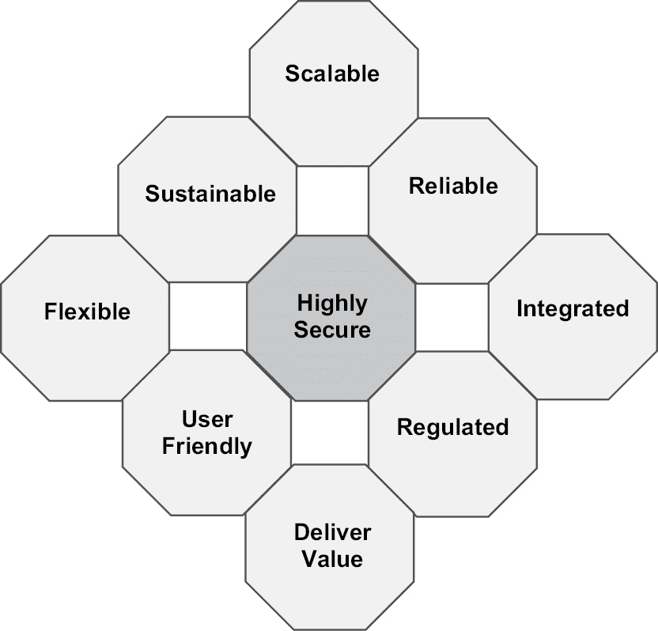

**图 9.2 企业级 AI 规模的前提条件。**

虽然所有标准同等重要，但最出的因素是高安全性。业务数据的敏感性要求企业级 AI 系统必须包含稳健的安全程序以保护数据完整性和隐私，确保用户安全访问并对抗网络威胁。企业级 AI 系统必须具有可扩展性，这样随着业务增长以及更复杂的情况和交易的进行，这些系统能够处理并适应不断增长的业务环境。

系统、数据、结果和预测的可靠性在任何自动化系统中都是至关重要的。在近期，用户信任一直是 AI 应用的一个问题。企业级 AI 的可靠性意味着系统行为一致且停机时间极少。这些 AI 应用必须在波动的条件下按预期执行运行。它们必须具有稳健的错误处理流程，以确保系统的持续准确性和可用性。


AI 系统需要一套基于明确定义的政策、实践和责任角色的强有力监管机制，这些内容包括：(a) 符合法律和伦理标准；以及 (b) 数据和模型管理。这将确保 AI 决策的问责制。自动化系统的基本目标是有助于实现组织的战略和运营目标，这些目标可能包括提高效率、降低成本、增强客户体验，以及开发新产品线以增加收入流。前一节描述了企业级 AI（Enterprise AI）能够提供的各种益处。

计算机系统的成功不仅取决于它们提供的结果，还取决于它们在组织内的渗透率。因此，企业级 AI 系统越易于使用，其被实际利用的概率越大。如果没有人或极少数人使用，拥有一个极其复杂的企业级 AI 系统是没有意义的。因此，用户友好性成为其成功部署的关键方面，AI 工具和界面对于技术性和非技术类组织用户来说应该是易于管理且清晰的。

一个重要的关键前提是灵活性，这意味着企业级 AI 系统必须适应不断变化的业务需求和目标。这一前提通过维持组织的业务战略和功能，以及或应对新市场趋势的出现，与扩展性因素相得补充。最后一个前提是可持续性，它涉及长期的系统支持，包括对环境的影响以及系统适应业务战略变化和技术进步的能力。

## 9.6 实施企业级 AI

通常，在实施企业级 AI 时，重要的是首先通过确定流程低效的领域来识别问题，以便评估 AI 如何可能解决这些弱点。一旦定义并评估了问题，对组织的数据和各种流程进行评估就至关重要，以便开发有效的机器学习模型。机器学习模型将组织的数据和流程文档作为其训练基础。

在企业级 AI 部署过程中，需要考虑几个问题，例如模型偏见、数据隐私与安全以及支持 AI 技术员工。AI 算法中的偏差是一个持续关注的问题，因为 AI 是训练用来识别模式的。然而，通过识别这种偏见，可以围绕关键标记重新构建结果，对模型进行重新训练使其更加平衡。必须认真对待数据隐私和安全，以防止攻击者访问系统。入侵防御系统（`IPS`）和有效的防火墙将有效解决这个问题。

与任何其他计算机系统一样，企业级 AI 应用需要胜任且专职 AI 专业人员，他们专注于在考虑伦理和安全因素的情况下，确保部署的 AI 系统实现定义的业务目标。必须认识到，实施企业级 AI 需要战略方法和仔细的规划。图 9.3 为部署企业级 AI 系统提供了一个建议框架。

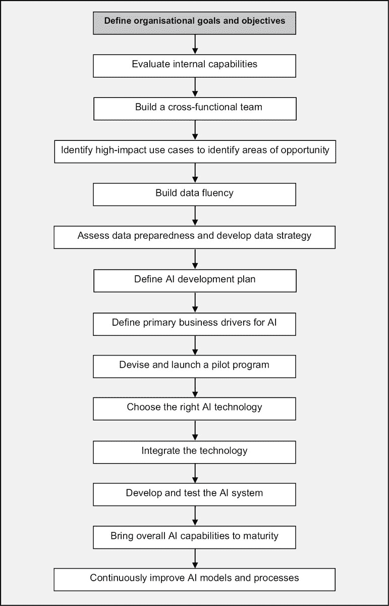

**图 9.3** 部署企业级 AI 系统的框架。⏎

一个基础步骤是定义组织目标和目的。这涉及到明确识别需要解决的业务问题，以及/或预期通过最终的企业级 AI 应用获得的机会和成果。因此，需要概述组织旨在通过 AI 实现什么。这将帮助组织集中精力，并选择最有意义的企业级 AI 解决方案。典型目标可能包括运营效率、更好的客户体验以及新收入流的识别。因此，了解这些目标有助于 AI 团队确定 AI 战略的方向，并将其与整体业务目标对齐。

对内部能力的评估非常重要，因为管理必须确定组织是否具备充分的能力，或者这些能力是否需要获得。此外，必须决定获得所需能力的方法，即是招聘专业人员还是外包需求。这一评估为现有技术和非技术类员工的培训和开发计划提供了充分的信息。

重要的是选择一名管理高层作为每个 AI 项目的权威赞助人和倡者，并配备充足的预算。要成功部署企业级 AI，组织需要一个胜任的跨职能团队。该高管需要识别技能短缺，以便创建一个结合技术技能和业务知识的适当团队。换句话之，该团队需要技术和业务专业人士。创建跨职能团队确保了实施项目采取整体方法，将不同的观点和知识融合以应对企业级 AI 项目的各个方面。团队的组成和规模必须与项目范围一致，并随着各种 AI 子系统的具体化而进行审查。

识别高影响力的用例以确定机会领域至关重要。这一步要求管理层探索相关的 AI 用例，并识别 AI 能够增加价值并支持业务目标的业务流程。这一步允许管理层建立一个列表，以优先考虑可能提供最高回报的可能业务功能。应该考虑的因素有数据可用性、部署可行性和投资回报率。这将确保选择具有最大潜在影响的案例。

下一步是在组织文化中建立数据流利度，以便员工能够熟悉数据及其可能的解释，并有能力从数据中创建和传播信息。这将鼓励员工不仅理解数据，还利用数据来传达复杂思想、参与讨论并毫不费力从他人那里吸收信息。这将使各种角色的个人通过对数据的共同理解联系起来，将原始数据转化为可操作的洞察。

在建立数据流利度的同时，要对组织的数据就绪情况进行评估，以便数据战略得到充分准备。管理层需要评估组织数据的质量、数量和可访问性。必须认识到 AI 算法需要海量数据来有效训练和运行。这一阶段涉及识别数据源、确保数据质量并建立数据治理和合规流程。因此，这一步确保了组织能够在有效数据战略和稳健数据管理实践的支持下获得充足且相关的数据。


# 管理

管理层还需要在内部或外部专业人士的帮助下，制定一个详细且灵活的开发计划，以筛选出可能产生价值的 AI 项目。这些专业人士还应该能够承诺交付超出试点阶段的可行项目，并在项目进入部署阶段时对其进行完善。该计划还应定义企业级 AI 实施的技术和业务阶段，包括 AI 技术和工具的说明、定义 AI 项目范围、建立时间表以及必要的资源。

重要的一步是识别企业级 AI 的主要业务驱动因素。一些关键业务驱动因素包括：提高效率和生产力；数据驱动的决策；改善客户体验；精简运营和供应链管理；以及增强网络安全。这一步骤将使 AI 实施团队建立性能参数；利用这些关键性能指标（KPI）监控 AI 计划的进展；并帮助他们制定一套风险管理策略，以在遇到困难时制定预案。为了评估已定义的计划，建议启动试点项目，以确保企业级 AI 全面部署计划是可行且现实的，并预测可能对企业 AI 项目产生不利影响的潜在问题。

企业级 AI 项目计划最初将指示所需的类型。然而，一旦计划开始完善和实施，获取最适合特定特定用例和数据要求的合适 AI 技术和工具就至关重要。确定使用哪些工具和软件时需要考虑的重要因素包括可持续性和长期支持；可扩展性；性能以及与现有系统的集成能力。一旦选择并获取了 AI 技术和工具，就需要将它们集成到现有系统和工作流中，以提供整体解决方案。这一步需要缜密的规划，以确保最高水平的兼容性、最小程度的运营干扰以及用户层面的高渗透率。

开发和实施选定的企业级 AI 解决方案需要系统的流程、详尽测试和验证。这将确保系统在操作上是可靠的，并最大限度地减少用户不满。企业级 AI 系统的成功取决于其可用性以及用户的信任与接受。AI 实施团队还必须习惯地监控性能，根据需要微调系统参数，并通过迭代持续训练系统，以提高准确性和有效性。

下一阶段是通过进一步测试和微调系统参数，使整体 AI 能力走向成熟，确保所有模块完全集成，以提供一个有效的整体系统。重要的是确保从内部和外部源获得充足、可靠且信任的数据，并由合适的基础设施支持收集、过滤、存储和交付必要的数据。最后一步是持续改进 AI 模型和支持流程。应该高度关注安全、隐私和 AI 理问题，通过考虑遵守政府法规的活动并开展支持最佳实践的课程。

AI 团队还必须确定部署的企业级 AI 应用是否切真实地支持了业务目标。这可以通过比较相应的系统结果与基准指标（特别是已建立的性能 KPI）来实现。最后，通过定期的实施后审查和持续的维护（包括定期更新、监控 AI 性能和微调系统）来维护技术的健康。这将确保 AI 系统通过保持有效、安全，并与不断变化的业务需求保持一致，从而使 AI 投资得到保障。

`Figure 9.3` 所示的框架确保了部署的企业级 AI 系统是可信的，并对如何获得决策提供解释。此外，部署企业级 AI 的组织通常需要 24/7 随地服务。因此，定义具体需求将确保实现这一标准。研究还表明，自然语言处理（`NLP`）是企业级 AI 系统最常用的工具，特别是客户服务功能。此外，该框架旨在缓解组织通常遇到的主要障碍，即 AI 专家知识匮缺、日益复杂的数据和数据孤岛，以及开发 AI 模型工具的缺失。

必须意识到 AI 是由多种工具支持的，即机器学习、深度学习、预测分析、`NLP`、计算机视觉和自动化。然而，从这些 AI 工具中获得价值，实体必须解决与人员、流程和技术相关的关键问题，这些都得到稳健安全环境中海量且及时的高质量数据支持。这需要具有超级计算平台的强大处理能力。目前，企业级 AI 对于那些负担得起拥有基础设施，或能够与高科技公司合作以在尖端云环境中提供必要的计算能力的大型组织是可行的。

此外，`Figure 9.3` 提供的框架确保了作为多方面过程的企业级 AI 是作为一种战略方法实施的，范围从识别明确目标到进行技术部署后审查。只有通过这种战略方法，组织才能从其企业 AI 应用中获得所需的投资回报。

## 9.7 企业级 AI 用例

企业级 AI 正在与各种业务功能相关的广泛行业中部署。大多数情况下，目标是利用这些组织拥有的数据并利用其从企业级 AI 应用中获得切实的业务价值。企业级 AI 促进了管理层做出更科学的数据驱动决策的能力，增加了运营效率，增强了工作流并改善了客户体验。这反过来协助组织在业务流程方面取得重大进展，并获得更好的运营稳健性和盈利。

企业级 AI 正在改变实体管理内部流程和与客户互动的方式。随后的企业级 AI 模型可以解决有关负载自动化、产品和服务推广、提供个性化用户体验、协助客户决策以及处理困难业务问题的高复杂问题。`Table 9.1` 提供了企业级 AI 用例的典型示例。由于能够进一步自动化通常由人类执行的任务，AI 对行业产生了战略性影响。此外，预计使用 AI 的劳动力增长速度将快于使用当前工作场所自动化工具导致的职位流失速度。

**Table 9.1** 企业级 AI 用例示例

| **行业** | **用例** |
| --- | --- |
| 农业 | 产生更健康的作物，减少工作量并组织数据。 |


## 客户关系：增强客户服务
聊天机器人和虚拟助手提供 24/7 全天候客户服务，随时解答疑问并解决问题。它们从与客户的互动中学习，以提高协助客户的能力。

### 个性化营销
通过理解客户偏好和行为分析客户数据生成个性化的营销活动，从而提高参与度和销售额。

### 教育
通过评估学生并根据其需求调整课程，实现考试评分流程自动化。

### 能源
优化电网并改进可再生能源的整合。

### 金融服务：欺诈检测
通过分析交易模式检测欺诈活动并标记异常活动，从而显著降低金融欺诈的风险。

### 金融服务：通用
改进银行后台系统并自动化客户服务，以创造新机会。

### 医疗保健
协助诊断疾病、分析医学图像以及预测患者结果，从而提高结果的准确性。

### 人力资源管理
协助简历筛选和候选人匹配，以识别最合适的申请者。分析员工数据并为培训、开发和留任策略决策提供建议。

### IT 服务管理
使用 `NLP` 自动化用户对 IT 请求。将机器学习应用于 IT 服务管理 (`ITSM`) 数据，以对基础设施和流程有更好的了解。

### 法律
使用机器学习挖掘数据并预测结果。应用计算机视觉对文档进行分类和信息提取，并使用 `NLP` 解析信息请求。

### 制造业：机器人
在装配线和仓库中使用协作机器人来协助人类。

### 制造业：预测性维护
对机械进行预测性维护。使用机器学习算法识别购买习惯，为生产规划预测产品需求。

### 营销
分析历史销售数据、市场趋势和其他相关变量，准确预测销售情况，使企业能够优化库存、增强资源分配流程，并对定价政策和营销策略做出更明智的决策。

### 安全：网络安全威胁检测
通过分析网络流量和识别异常模式来识别并缓解网络安全威胁，在潜在的安全漏洞造成重大损害之前检测到它们。

### 其他：预测性维护
分析传感器数据并识别指示设备可能发生故障的模式，以满足预测性维护需求，从而减少停机时间、优化维护计划并延长资产寿命。

### 其他：供应链优化
预测产品需求、优化库存水平并识别供应链生态系统中的潜在中断，以帮助运营更顺畅、降低成本并提高对市场变化的响应能力。

AI 的优势在于其分析能力。这意味着 AI 不仅仅是流程自动化，而且能够启动执行任务的最有效方法，并在情况变化时立即微调工作流。正如表 9.1 所示，AI 已经在许多领域补充了人类工作，从农业领域帮助获得更健康的作物；到协助医人员诊断患者状况；以及通过预测产品需求、改进库存水平和识别供应链生态系统中的潜在中断来优化组织的供应链，以实现更顺畅的运营、降低并增强对市场变化的感知。

AI 算法已部署作为额外的安全层，通过自动检测和响应网络安全威胁。此外，自然语言生成工具也被用于增强客户服务，而脸识别工具正被执法机构使用。深度学习平台目前也应用于自动驾驶的实验。然而，在自动驾驶应用于实际环境之前，安全方面还需要进一步发展。金融部门（特别是银行）正使用 AI 加速并支持贷款处理，同时保持监管合规性。

## 9.8 企业级 AI 潜力

由于生成式 AI 技术可以使用大语言模型 (`LLMs`) 创建新内容并提供超越传统预测模型的解决方案，预计企业级 AI 将受到巨大影响。生成式 AI 不仅能够管理海量数据，还有能力理解这些数据，并能够复制数据中的模式以提供创新解决方案。因此，生成式 AI 的能力将成为集成到企业级 AI 工具箱中的进一步工具。

一个重要目标是将企业级 AI 与当前可用或未来将提供的无尽 AI 工具进行无缝集成。企业级 AI 将能够利用物联网 (`IoT`) 设备的实时数据来增强预测性维护并提供更好的客户服务。此外，边缘计算将实现更快的本地化 AI 处理，这对于时间敏感型应用至关重要。因此，技术的整合不仅限于 AI 软件，还涉及尖端硬件。AI 的基本优势之一是管理海量数据的能力。因此，在大数据背景下，它将提供更强大的处理能力，用于分析和挖掘许多场景（包括市场趋势）的重大洞察。企业级 AI 与区块链技术的整合将增强交易的安全性和透明度，这对于金融和供应链管理部门至关重要。关于未来 AI 发展的独立章节将在本书的第四部分中提供。

以认真负责的态度处理伦理因素至关重要。应用 AI 的组织需要采取一种通过确保公平和透明的决策过程来促进信任的策略。AI 应被视为人类人才的补充，而非取代。关于伦理和法律考虑的详细章节将作为本书第三部分的最后一个章节。

## 9.9 实用企业级 AI 应用

AI 不再是科幻小说中遥远的幻想。每天都有新的应用发布，这些对组织开展业务以及向客户提供产品和服务的方式产生了深远影响。本节介绍了一些实用的 AI 应用，对所有类型的客户（无论组织还是个人）都产生了巨大的积极影响。

### 9.9.1 案例研究 1：电子商务运营效率和客户满意度

Tang (2025a) 说明了企业如何盈利地利用 AI 驱动的解决方案和移动 App 开发来提高运营效率，使订单处理时间缩短 30%，用户参与度提高 25%，移动销售额提升了 15%。


这项 AI 倡议发生时，公司正面临着关于提升员工技能以及增强供应链效率以消除 20% 缺货率的重大担忧。监管隐私要求的进一步加剧了这些担忧，这需要健全的风险管理策略以避免因不合规而遭受严厉法律处罚。该案例研究表明，AI 解决方案通常与其他战略举措结合实施，例如员工发展计划、技术整合以及流程改进框架。因此，这不仅仅是独立实施 AI 解决方案的问题。

## 环境评估

公司采取的第一步是使用成熟的方法对其内部和外部环境进行评估。

在内部环境评估方面，利用 `ADDIE`（分析、设计、开发、实施和评估）模型进行员工技能提升。该模型依赖于按照给定顺序完成每个阶段，但侧重于反思和迭代。`Lean Six Sigma` 被应用于流程改进（参阅 Camilleri, 2024，第 380–401 页）。这些工具使公司能够识别出需要关注的关键领域，从而定义了生产力和运营效率方面可衡量的改进，并培养了一支更具响应能力和能力的员工队伍。

公司外部环境的评估主要涵盖了技术，如 `Value Chain Analysis` 和 `Kano Model`（参阅 Camilleri, 2024，第 386–388 页）。这些模型侧重于增强增加值的活动，并根据客户满意度对应用功能进行排序。通过确定竞争基准（参阅 Camilleri, 2024，第 369 页）来评估相对于行业标准的表现，特别是在订单处理和移动用户参与方面。根据 Tang (2025a)，这种战略分析提高了公司的市场地位，并大大提高了其对客户需求和市场趋势的响应能力。这对整体业务增长和客户忠诚度产生了积极影响。

## 战略举措

内外部环境评估使管理层确定了若干项战略举措，包括：

### AI 驱动的订单处理自动化
`Lean Six Sigma` 和 `Value Chain Analysis` 被用于此举措。这些工具使实施团队能够遵循精确的程序来简化订单处理流程并减轻任何识别出的低效问题，具体如下：

*   规定订单自动化项目的范围并定义关键性能指标 (`KPIs`)。
*   测量当前的订单处理时间统计，并通过流程映射（包括数据收集实践）识别瓶颈。
*   检查数据，使用根原因分析（如 `5-Whys`）确定低效的根源（参阅 Camilleri, 2024，第 76 页）。
*   通过实施 AI 驱动的自动化解决方案来针对识别出的低效问题改进流程。
*   收集关键信息并准确监控新流程，包括 `KPIs` 以确保持续进展（参阅 Camilleri, 2024，第 307–313 页）。
*   利用 `Value Chain Analysis` 确定并微调为订单处理功能增加值的活动。这阐明了订单处理过程中的每项任务对整体价值创造的影响（参阅 Camilleri, 2019，第 217-223 页）。Tang (2025a) 报告显示，这种方法使订单处理时间缩短了 30%，运营效率和准确性显著提升，导致客户满意度提高了 20%。

### 移动 App 开发
此阶段应用了多种分析工具，如 `Agile Methodology` 和 `Kano Model`。`Agile` 方法是一种项目管理和软件开发方法，强调灵活性、协作和以客户为中心。Facebook、Google 和 Amazon 等大公司使用这种方法是因为其具有适应性、以客户为中心的风格，以及快速高效开发用户友好型移动 App 的能力。`Kano Model` 用于根据满足客户的可能程度对待采纳的功能进行排序。这种方法允许产品团队评估引入高满意度功能相对于其实现成本是否在战略上是明智的。因此，该模型对于确定哪些应用功能会令用户惊喜、哪些是基本功能必不可少的非常有用。`Kano Model` 与其他优先级框架的不同之处在于它对客户如何响应每个功能有严格的关注。因此，其对任何新功能的关键分析是它在多大程度上能满足用户。上述方法确保了用户友好移动 App 的成功实施，提升了整体用户体验，正向影响了客户满意度和忠诚度。用户反馈使移动 App 得以精调，导致用户参与度增加了 25%，移动销售额增长了 15%。App 的优先排序功能增强了整体用户体验，有助于获得更高的客户满意度和忠诚度。

### 数据隐私合规
项目团队检查了 `GDPR` 合规性要求，并识别并评估了数据隐私的可能风险，例如数据泄露和未经授权的访问。首要目标是培养客户信任，并尽可能减少识别出的风险，避免法律处罚。这导致了与数据泄露和未经授权访问相关的风险降低，从而增强了客户信任和品牌声誉，并度度减少了法律侵权行为。

### 客户体验改进
用于此项活动的框架主要是 `Customer Journey Mapping` 和净推荐值 (`NPS`)。客户旅程映射提供了客户在订购过程中体验的视觉化描述。它深入理解了客户的情绪和行为，突出了痛点、未满足的需求和改进机会。`NPS` 通常被视为客户体验衡量的金标准。它通过考虑客户随时间推荐特定服务或产品的概率来衡量客户忠诚度和满意度。通常，`NPS` 分数通过单问题调查进行衡量，报告数值范围在 -100 到 +100 之间，分数越高越好。通过 `NPS`，项目团队开发并实施了策略，将中立者和反对者转变为推荐者。`NPS` 趋势被监测了长时间，以衡量客户体验举措的有效性。这导致识别并随后解决了关键痛点，使客户满意度提升了 20%，`NPS` 提升了 10 个分。因此，这带来了更高的客户忠诚度和重复业务，推动了长期增长。


## 员工技能提升计划

此阶段采用了 `ADDIE` 和 `Kirkpatrick` 模型。`Addie` 模型是一种教学设计方法论，用于促进课程内容的精简和结构化。相比之下，`Kirkpatrick Model` 用于评估培训和学习计划的成果。该模型评估了正式和非正式培训方法，并根据四个层级的标准进行评估：反应、学习、行为和结果。项目团队应用 `ADDIE` 模型来分析员工的技能缺口，并根据组织的业务需求开发培训模块。通过评估和反馈，利用 `Kirkpatrick Model` 评估了培训计划的有效性。该模型衡量了技能提升计划对员工表现和业务结果的影响。这些模型的采用确保了员工技能的显著提高，导致员工绩效提升了 25%，整体生产率增长了 15%。这一过程减轻了对变革的抵触，并鼓励了持续学习和创新的文化。

## 供应链优化

项目团队应用 `供应链运营参考 (SCOR)` 模型来绘制供应链流程，并应用 `需求预测 (DF)` 模型根据历史数据和市场趋势预测未来需求。`SCOR` 模型通过优化关键流程，评估组织供应链在销售和运营规划方面的有效性和效率，旨在减少缺货和过度积货的情况。`DF` 模型有助于优化库存水平并确保产品的及时供应。这些模型的使用缺货减少了 20%，过度积货情况减少了 15%，提供了更高的利润和客户满意度。利用这些模型产生的 AI 驱动解决方案提高了组织应对市场状况和需求波动的能力，导致了更好的整体业务响应能力和韧性。

上述内容支持了这一观点：实施 AI 解决方案是一个漫长且细致的过程，需要使用各种管理模型，每个模型都关注特定的运营方面。此外，`关键成功因素（Critical Success Factor）` 方法也可用于管理定义的战略倡议的实施（参阅 Camilleri, 2024，第 299–326 页），从而确保实现定义的战略目标。AI 解决方案通过取代耗时且易产生人为错误的传统方法，实现了订单处理业务的精简。所实施的解决方案使 AI 系统能够自动处理排序、优先级和处理订单等任务，以加速整个操作并降低错误风险。

AI 订单处理系统的一个显著优势是其提高准确性和效率的能力。AI 解决方案能够识别并纠正订单错误，确保系统输入正确信息。这减少了对人工控制和验证的需求，从而简化了流程，降低了错误和延迟的概率。生成的 AI 系统还改进了客户体验，因为处理订单所需的时间缩短，导致交货时间更快。此外，AI 系统在整个过程中持续向客户提供信息，减少了焦虑并增强了他们的满意度，反过来可能对他们的忠诚度、留存和好评产生积极影响。

通常，AI 解决方案 24/7 全候工作，因此减少了对人工干预的需求，使员工能够专注于更高价值的任务。随着整体生产率的提高，与人工处理相关的成本无疑降到了最低。此外，AI 解决方案还具有减少对办公室空间和其他需求的潜力，从而节省了更多成本。AI 系统对订单处理方法具有深刻的洞察和分析，允许组织确定模式、趋势和改进领域。通过这些信息，组织能够优化流程、缓解瓶颈并提高整体效率，从而获得更高的利润、更低的成本和提高客户满意度。

AI 解决方案的一个重要特性是它可以定制以满足单个业务的需求，这些需求可能专注于组织的特定要求，从而带来更高的效率和准确性。提供的 AI 解决方案利用多种支持自动化过程和优化运营的 AI 算法。这些 AI 算法具有不同且特定的目标，旨在为订单处理系统构建稳健的 AI 系统。正如人们所意识到的，机器学习和数据科学正在不断取得进展。因此，算法不断进化，使 AI 系统更加有效。这个例子说明了 AI 在变革订单处理方面的多方面作用，它通过消除低效率、通过数据分析提供可操作的洞察、增强客户和供应商关系，并保持组织的竞争力，同时确保合规性和安全性。

### 9.9.2 案例研究 2：AI 驱动的库存管理

Tang (2025b) 描述了一家拥有全球客户群的消费电子中型公司在库存管理方面遇到的严重问题。这些问题大多与需求预测不当有关，导致多个产品类出现严重的缺货和过度积货，对销售和成本产生了负面影响。他报告说，通过引入先进的 AI 需求预测模型，公司库存相关问题减少了 25%，持有成本降低了 18%，凸显了在卓越运营中采用系统化 AI 方法的有效性。事实证明，公司现有的 AI 系统缺乏预测需求模式的功能，这被视为销售大幅损失和持有成本增加的原因。

使用了多种方法进行根因分析，例如 `五问分析法 (5-Whys)`、流程映射和 `鱼骨图 (Ishikawa diagrams)` 等（参阅 Camilleri, 2024，第 78–99 页）。`五问分析法`是识别问题根因的简单方法。基本上，当定义了一个问题后，询问：“为什么发生这种情况？”然后，不要停留在第一个问题的上，反复询问：“为什么？”，直到找到根因。`鱼骨图`（或鱼骨图）也称为因果图，通过将想法分类到实用的类别中帮助管理层识别问题的许多可能原因，在组织头脑风暴会议时特别有用。分析结果表明，问题源于缺乏准确的需求预测、库存分配不当以及 AI 与现有供应链管理系统的整合不佳。这些问题领域可能是库存管理不善的原因，也可能损害了公司的运营效率和利润能力。

管理层采用了五个阶段的咨询流程，以获得改进库存管理 AI 设施系统化和数据驱动的方法论。这确保了升级系统的完整分析、设计和实施，该系统包含了更高的预测准确性、更好的库存水平和更低的成本。咨询过程包括以下五个阶段：


- **诊断评估**：评估现有的库存系统、数据质量和 AI 技术，以确定现有能力和明显的数据缺口。这包括数据收集、利益相关者访谈和流程映射，以识别可以集成 AI 的领域。
- **AI 能力建设**：根据诊断评估结果，通过识别最符合公司需求的 AI 工具和技术，并利用数据分析进行更好的预测，提升 AI 胜任能力。这一阶段涉及选择合适的 AI 解决方案并设计试点项目。
- **开发需求预测模型**：该任务涉及开发一种先进的 AI 模型来预测销售趋势。此阶段包括确定如何利用历史销售数据来预测需求，以及决定将哪些外部因素纳入模型。其目标是开发并测试预测性算法。
- **库存优化**：这涉及将升级后的 AI 模型与库存管理系统集成。主要问题包括确定 AI 驱动的洞察如何导致最优库存水平，以及确定要采用的补货策略。这主要涉及用于库存规划的仪表板和决策支持工具的。
- **实施与持续改进**：这意味着在公司范围内实施 AI 增强型库存系统。这包括就实施策略以及各部门将采用的 KPI 达成一致，以确保成功。这一阶段涵盖了 AI 应用的培训、监控和迭代微调。

公司遇到了若干项需要审慎考虑的实施挑战。例如：新 AI 技术与公司现有 IT 基础设施的兼容性；为了避免供应链运营中断的无缝集成；拥有包容性的变革管理策略，以确保利益相关者理解并接受新的 AI 驱动流程；以及用于持续 AI 培训和开发的可持续投资，以维持系统的有效性以及对不断变化的市场变化的适应性。

Tang (2025b) 宣称，公司预计一旦新的 AI 系统投入使用，缺货和积压情况将减少 20-30%，对市场需求的反应将更加灵敏，由于产品可用性的提高，客户满意度将整体提升。此外，公司预计持有成本将至少减少 15%，直接贡献于底线。遇到的主要实施挑战是数据隐私问题，因为 AI 系统需要访问海量的消费者和交易数据；以及全球运营中的数据准确性和一致性，以确保 AI 驱动的预测取得成功。

KPI 是一个关键方面，因为它们提供了可衡量的抽检，以验证运营活动与定义的战略目标保持一致。这确保了部署不仅是活动驱动的，而是结果导向的。KPI 发挥着预警系统的作用，因为它们指示了进度或与既定目标的偏差，能够做出响应式决策并在必要时进行纠偏。重要的 KPI 包括：(a) 需求预测准确率，衡量预测销售与实际销售之间的准确百分比，标志着 AI 模型的有效性；(b) 库存周转率，评估在一段时间内库存交易和更换的频率，反映了库存水平的优化；以及 (c) 缺货和积压率，跟踪这些事件的发生情况，改进意味着更好的需求预测和库存管理。

正如前一个案例研究所所示，AI 是一种需要战略性方法的工具，需要在系统开发生命周期中应用其他若干项管理工具。Tang (2025b) 认为，管理层促进数据驱动的决策和持续学习文化对于利用 AI 的能力至关重要。此外，数据处理中的句老格言：“垃圾进，垃圾出”（garbage-in, garbage-out）是必须的。换句话说，AI 系统的优坏完全取决于它们所处理的数据，确保数据质量和完整性对于获得可靠的结果至关重要 (Tang, 2025b)。此外，AI 技术不断演进，今天的领先很快就会过时。因此，保持最新发展并愿意尝试新方法对于在动剧的经济环境中获得竞争优势至关重要。此外，公司获得竞争优势是一个短暂的现实，因为其他竞争对手也在努力获取优势。必须承认，获得竞争优势是企业生存的持续斗争。

Tang (2025b) 识别出以下关键成果：(a) 通过集成先进的 AI 驱动需求预测模型，缺货和积压情况减少了 25%；(b) 库存成本减少了 18%，直接改善了公司的底线；(c) 需求预测准确率提高了 35%，导致更高效的库存管理；(d) 库存周转率提高了 20%，标志着应对市场需求的方法更加有效且响应迅速；以及 (e) 通过部署全面的 AI 培训计划，员工对新系统的熟练程度提高了 40%。

也必须认识，采用了几种 AI 算法来支持库存自动化流程并优化运营。例如，监督学习算法（如 `linear regression`）常用于预测，协助根据一个或多个预测变量来预测需求。`Decision trees` 有助于分类任务，以识别哪些产品类别最可能被特定客户群体购买。此外，无监督学习算法（如 `principal component analysis` (`PCA`)）在处理大量相关变量集（如产品特征）时经常被用于降维。上述仅是考虑 AI 解决方案时可能利用的少数 AI 算法。

## 9.10 结论

本章对企业级 AI（Enterprise AI）进行了详细描述。它说明了企业级 AI 是 AI 的子集，专门专注于驱动大规模组织中的业务价值。它还支持了这一观点：利用源自企业级 AI 应用优势的企业，最有可能在其价值链运营中获得显著进展。在专门关注企业级 AI 之前，本章考察了 AI 如何通用的转型业务企业，以及企业级 AI 的概念如何通过将各种可用 AI 工具集成到无缝系统中以利用组织在运营过程中产生的海量数据而实现的。


本章阐述了应用企业级人工智能（AI）的巨大优势，涵盖了降低成本、证明更好的商业模式，特别是保持竞争领先地位。文中说明，企业级 AI 是确保组织生存的重要工具。然而，尽管有许多优势，企业级 AI 也存在潜在的风险，例如算法偏见、可能的数据安全问题以及对基本人类技能的侵蚀。因此，组织制定明确的人才准则至关重要，包括培养人才、设计可靠的 AI 系统、制定数据隐私标准、持续监控以及建立适当的安全系统。两个需要特别关注的重要问题是：维护用户对 AI 应用系统的信任，以及通过引入再培训计划减轻 AI 对劳动力的影响，使员工成为不断演变的工作环境中不可或缺的一部分。

本章还为企业级 AI 的成功部署提供了一个合适的框架。该实施框架中的每一步都经过详细描述，为读者提供了一种可行且实用的部署方法，该方法可以根据各个组织进行调整和定制。最后，本章列举并解释了几个用例，让读者了解企业级 AI 如何造福其组织。此外，还对企业级 AI 的潜力进行了简要说明，将在后的独立章节中进行更详细的描述。

## 参考文献

*   Camilleri, Emanuel. (2019). Information Systems Strategic Planning for Public Service Delivery in the Digital Era. IGI Global.[⏎
*   Camilleri, Emanuel. (2024). Key Performance Indicators: The Complete Guide to KPIs for Business Success. Routledge.[⏎
*   Tang, David. (2025a). Enterprise-Wide Artificial Intelligence Integration Project for Retail Organization. Flevy Management Insights. [`flevy.com/topic/artificial-intelligence/case-artificial-intelligence-optimization-e-commerce-efficiency-nonstore-retailers#section2`](https://flevy.com/topic/artificial-intelligence/case-artificial-intelligence-optimization-e-commerce-efficiency-nonstore-retailers#section2).⏎
*   Tang, David. (2025b). AI-Driven Inventory Management for Ecommerce. Flevy Management Insights. [`flevy.com/topic/artificial-intelligence/case-ai-driven-inventory-management-ecommerce`](https://flevy.com/topic/artificial-intelligence/case-ai-driven-inventory-management-ecommerce).⏎

# 第 10 章 公共部门 AI

DOI: [10.1201/9781003653950-13](http://doi.org/10.1201/9781003653950-13)

> *“当目标显然无法实现时，不要调整目标，要调整行动步骤。”*
>
> 孔子（孔丘）
>
> *春秋时期的中国哲哲学家（公元前 551-479 年）*

根据世界银行 (2021)，`AI` 等颠覆性技术具有变革政府的潜力，因为 `AI` 可以提供个性化的服务体验。`AI` 可以提供个性化的服务体验、提高效率并促进决策。然而，人们担心各国对 `AI` 的采用速度较慢可能会导致贫富之间的不平等。

## 10.1 引言

必须承认，大多数国家的公共部门是人力资源最大的雇主，其服务涵盖了整个社会的各个方面。它也是非人类资源的主要使用者以及广泛服务的提供者。因此，通过应用尖端技术（从交通管理、医疗保健到收入处理和增值税报表处理），公共部门 `AI` 有可能极大增强政府运营，并满足公民广泛的需求。

然而，仍有许多公共实体尚未采用这项技术。一些公共部门官员充分意识到通过利用其实体的数据可以发挥 `AI` 的变革性影响。尽管公共实体拥有海量数据，但在大多数情况下，这些数据存储在独立的数据孤中，使得应用 `AI` 变得困难。因此，公共实体面临的主要挑战是建立有效的数据管理流程，以生成全面的中央数据存储，从而支持数据共享和数据发现的理念。

此外，公共部门官员可能缺乏足够的知识和专业技能来获取必要的 `AI` 工具做出战略决策。然而，这一挑战可以通过法律外包流程引入私营部门的专业知识来克服。需要意识到，公共部门管理人员的自由度比私营部门的少，因为他们受到不断的公众监督和限制性采购条例（包括漫长的申诉程序）的约束，此外还有限制性的财政拨款。此外，伦理考虑带来的风险以及通过媒体可能的公众谴责增加了启动 `AI` 项目的复杂性，特别是在发展中国家。这种不确定环境的结果是，公共部门管理层倾向于推迟采购决策，从而不断推迟而易见的风险。

## 10.2 AI 与公共部门


Berryhill 等人 (2019) 认为，尽管缺乏相关研究，但 AI 已成为政府中一个重要且日益凸显的问题。他们暗示，AI 可以促进政府实现其目标，即完善和改进法律法规、为公民和居民提供公共物品和服务，并提供交付和维护公职人员履行其各自职能所需的工具、资源和结构。他们还确定了政府在 AI 方面的若干种角色。他们将这些角色视为转型公共部门流程、实践、政策和服务的一种方式，而非其如何影响更广泛的经济。Berryhill 等人 (2019) 提到了政府在 AI 方面可以执行的以下功能，这些功能在大多数情况下是同时进行的：

1. 政府作为资助者或直接投资者，为新兴技术的开发和部署提供资金支持。
2. 政府作为精明的买家和共同开发者，通过创新的采购实践，或通过公私合作伙伴关系 (PPP) 和其他合作形式作为共同开发者，构建新型或定制的解决方案。
3. 政府作为监管者或规则制定者，通过采用创新的政策和监管工具来加速新兴数字技术的创新周期，同时评估合规性并对不符合的情况采取适当行动。
4. 政府作为召集者和标准制定者，通过汇公民、居民、企业、组织和学者等利益相关者，促进其目标的实现并理解相关问题的多个方面。
5. 政府作为数据管理员，拥有海量数据仓库来驱动基于 AI 的技术。
6. 政府作为用户和服务提供者，将 AI 技术同时应用于公共领域和后台职能。

AI 在公共部门的应用与企业级 AI 不同，尽管它们之间存在一些共同点。例如，公共部门 AI 和企业 AI 都寻求以更低的成本 24/7 小时从任何地方提供更好的客户服务体验。然而，公共部门 AI 更侧重于改进法律以及社会和经济政策，包括在各个学科（如教育、医疗、执法和交通）中制定和实施国家战略。Berryhill 等人 (2019) 针对决策者在可信 AI 方面的国家政策和国际合作，提出了经经合组织（OECD）正在推广的几项建议。诚然，AI 可用于改变我们在公共部门的运作方式。这些建议包括：

* 投资 AI 研发以支持公共部门的政策。
* 改进数据管理以缓解数据孤岛并扩大 AI 的应用范围。
* 促进知识共享和生态系统，以解决政府内部的碎片化问题。
* 制定战略确保决策人员意识到 AI 的优缺点。
* 构建人力能力并做好 AI 准备以降低风险。
* 建立国际合作以促进 AI 发展。

这些建议将促进 AI 的转型。

## 10.3 识别不同方法和数据的重要性

AI 由多种技术组成，如 `Machine Learning`、`Neural Networks` 和 `Deep Learning`，每种技术都用于解决特定问题。本书的引言章节分别提供了清晰的定义和目标。然而，重要的是，特别是在公共部门，人们对 AI 的工作原理普遍缺乏认知。AI 往往被视为一个“黑箱”，数据从一端输入，另一端输出解决方案。

必须首先意识到 AI 是一个颠覆性领域，影响着整个社会。还必须意识到公共部门提供的产品和服务范围比私营部门广泛得多。例如，私营部门被划分为不同的营销领域，每个领域又由不同的公司和实体进一步细分。另一方面，政府（公共部门）服务于从公民、社会到企业的所有人。因此，对于政府政策制定者和公职人员来说，这如何在监管、支持、使用和最大化 AI 可能价值的同时，缓解其负面风险带来了若干挑战。这表明所有部门（特别是公共部门）的决策者都需要意识到 AI 的优缺点，并承认可能存在更简单的解决方案。只有当 AI 比其他可能的解决方案具有明显优势时才应应用。因此，公共部门决策者了解 AI 是非常重要的，因为其在不同文化和环境中的广泛潜在应用可能会影响其实施和应用方式。因此，具备 AI 基本技术知识可以帮助公职人员确定可能应用的 AI 工具，并帮助他们与供应商协商更好的条款。

所有 AI 应用的基础是数据质量。介绍知识经济的章节提供了关于数据到信息、从信息到知识转化的详细信息。书中还说明了这一转化过程有助于 AI 项目的成功。公共部门拥有大量数据。然而，大多数政府数据存储在数据孤岛中，没有在部部门之间共享，更不用说跨部共享了。因此，在开展大型 AI 项目之前，公共部门的数据质量是一个需要解决的主要关注问题。


因此，在 AI 应用能够在大范围内成功部署，政府用户必须确保建立了一套稳健的数据管理系统，以生成准确、可靠且具有相关性的数据存储。对于使用机器学习的应用来说尤为如此，因为算法会从可用数据中不断学习。因此，大多数政府并不缺乏数据和信息，通常缺乏的是提供全面数据存储的适当数据管理系统。

## 10.4 公共部门 AI 面临的主要挑战

世界银行（与其客户相关）的研究强调，公共部门在部署 AI 方面面临的主要挑战是：公共部门管理层缺乏 AI 意识；针对 AI 的政策、立法和激励措施不完善；数字数据及其他数字基础设施匮乏；以及数字人才和技能的短缺（World Bank, 2021）。这支持了前一节的观点，即公共部门管理层需要了解 AI 的潜力，对数字技术有基本的理解，并认识数据可用性和质量的重要性。此外，获取数字技能的途径性低也被认为是公共部门部署 AI 的主要障碍。

截至 2024 年年中，一些国家已采取了一些基本的 AI 政策和立法，分别是美国、欧盟、中国、加拿大和澳大利亚。然而，美国尚未建立专门的联邦 AI 监管框架，但建立了几个针对特定行业的 AI 相关机构和组织，以应对由 AI 演进引起的一些挑战。此外，经合发展组织（OECD）和联合国正积极参与制定和概述 AI 监管的全球准则。这说明大多数国家缺乏一个对于安全部署信赖 AI 应用至关重要的法律框架。此外，这些国家也缺乏数字流程、数据收集能力、技术技能以及支持性的数字基础设施，无法从目前的 AI 应用中受益。因此，在考虑将 AI 作为一种可能的解决方案之前，必须重点采用适当的政策和法律框架。尽管缺乏政策和法律框架，且各国之间存在明显的数字鸿沟，世界银行注意到在其客户国家已出现了若干正在形成或处于试点阶段的 AI 用例。若干用例将在稍后的单独章节中讨论。

与企业级 AI 类似，公共部门 AI 在中期可能会影响劳动力需求，表现为对高技能工人需求增加以及对低技能工人需求的减少。因此，政府可能在私营和公共部门面临失业风险上升的风险，这需要通过引入劳动力再培训计划以及不断升级中后教育课程以反映变化的技术环境来进行充分管理。此外，根据各国家的发展状况，对发展中国和不发达国家的影响可能会更大。

一些国家已经修改并加强了其数据保护和隐私立法框架，以补充和涵盖 AI 相关活动。这些变化被认为允许政府持有数据的互操作性、访问性及其治理，特别是通过利用机器学习和 AI 进行数据使用和重复利用，以专门缓解偏见和不平等。由于数据保护和隐私的立法框架在许多国家已普遍立法，它为满足 AI 生态系统（特别是发展中国家）提供了稳健的基础。

正如前一节所强调的，数据质量的不足是公共部门内成功实施 AI 应用的严重障碍。此外，不必要的政府控制、糟糕的网络安全以及个人隐私的保护不足也可能构成关键挑战。解决数据质量和不必要的政府控制问题较困难，因为这需要投入大量精力来确保数据的及时、准确和完整，并需要对内部流程进行重大审查。网络安全薄弱和个人隐私不足的问题解决起来并不困难，因为卓越的网络安全应用随处可用（需付费），且个人隐私可以通过政府的立法行为来加强。

世界银行 (2021) 认为，政府应在数字技能领域投入更多资金，以便根据特定情况制定合适的政策和风险管理策略。必须认识到，在国家范围内提升员工数字技能需要政府在人力物力方面做出长期承诺。世界银行还认为，拥有一 AI 伦理应用政策对于管理公共部门使用 AI 的负面影响至关重要。事实上，下一章将详细讨论 AI 使用法律和伦理方面。尽管如此，必须强调政府迫切需要定义并实施政策，解决 AI 解决方案中的治理和监管问题。

每个国家在部署 AI 及其他技术方面都有各自的优先事项和可用资源。考虑到这一点，世界银行建议国家采用全面的方法论来部署 AI，而不是采取碎片化的方法。这需要一个全面的国家战略来构建和维护关键基础设施，并对系统、数据和治理框架进行标准化，以协调其实施和持续监控。正如本节之前提到的，政府应对 AI 应用时的一个严重担忧是数据质量，包括是否存在支持数据孤岛的环境。基于数据孤岛方法的系统永远无法实现互操作，从而无法提供对于提高各国公民生活水平至关重要的有效技术解决方案。

## 10.5 新兴全球公共部门 AI 格局

前几节表明，AI 正在迅速改变人们生活的许多方面。公共部门通过政府意识到 AI 的益处并将 AI 提升为国家优先事项，为这一变化做出贡献。这体现在 AI 投资的增加以及制定监管制度，以适应更广泛的社会和商业领域 AI 的持续增长。


在这种场景下，公共服务的互操作性变得至关重要，标准、协议、技术和机制允许数据在不同系统之间流动，只需极少的人工干预。这使得不同系统能够相互通信并实时共享信息。如前节所述，这还取决于政府范围内由高质量数据（即对于预期用途而言具有及时、准确、可靠、一致和相关性的数据）支持的高度集成整体化系统。这使得 AI 能够整合到完整的政策制定和服务设计全周期中。因此，随着`machine learning`和`deep learning`等 AI 工具的发展，更多的行政和流程驱动型流程将实现自动化，从而极大提高公共部门的效率，并释放公共服务人员来专注于其他核心任务。

此外，这些发展将允许高级政府官员加强对各种情况的理解，并通过了解和预测其多样化客户（即选民、公民社会和商业企业）的需求来帮助他们做出更好的决策。这将有助于政府做出更精确、公平的决策。许多国家政府正在制定或已经定义了它们的 AI 战略，侧重于通过研究和研发资助来促进经济发展。然而，这些这些政府 AI 战略的最核心、最基础的原则是成功开发可信的 AI。

OECD 建议国际合作是成功开发可信 AI 的关键原则 (Berryhill et al., 2019)。根据 Berryhill et al. (2019)，对此类合作的承诺体现在几项宣言中即：

*   `G20 AI Principles` 直接基于 OECD 建议（G20 关于贸易和数字经济部长声明：[www.mofa.go.jp/files/000486596.pdf](http://www.mofa.go.jp/files/000486596.pdf)）。

*   2018 年，所有欧盟成员国签署了《人工智能合作宣言》，承诺合作以提升欧洲 AI 能力和应用，解决社会经济挑战和伦理问题，并确保有适当的法律和伦理框架 (Berryhill et al., 2019)。

*   欧盟成员国还承诺 AI 对公共管理可用并受益，分享在政府采购和使用 AI 方面的最佳实践，实施开放数据实践，并在欧盟和国家层面实现投资影响最大化，鼓励欧盟内的协同与合作 (Berryhill et al., 2019)。

*   来自斯堪的波罗罗地区的十个政府签署了《人工智能宣言》，承诺改进技能开发和数据获取，并制定伦理准则 (Berryhill et al., 2019)。

上述表明，大多数国家政府的 AI 战略都包含了确保设计和实施符合伦理且可信的 AI 系统的义务。此外，Berryhill et al. (2019) 注意，大多数战略还促进通过教育计划和培训加强国家 AI 人才培养，并将 AI 用于创新和转型公共部门。

研究表明，许多公共部门行政机构已经在多个领域应用 AI，例如智能识别、支持各种评估流程、环境保护、执法和医疗保健。然而，大多数 AI 项目似乎是基于个人发起的（不一定来自高级管理层），这些人个人具有足够的 AI 意识来追求此类项目。

这种环境并不支持系统、流程、服务和组织之间的互操作性，尽管相关人员可能认为互操作性是一项关键因素。这被公共管理机构视为严重的缺陷，大多数机构已采取适当行动，通过整合 AI 战略流程来弥救这一局面，强调互操作性在支持可持续 AI 方面的重要性。全球公共部门 AI 景观中呈现出的主要特征包括以下应用（Tangi et al., 2023）：

*   通过识别特定的 AI 项目在政府内部进行实验，以发现从 AI 中获取利益的潜力。如上所述，AI 不能依赖个人计划，而必须通过提高整个组织的 AI 意识来实现组织目标。

*   跨部门协作。AI 可以通过公私合作伙伴关系以及创新中心和实验室，作为工具改善公共机构与私营实体之间的互操作性。

*   支持互操作性的 AI 应用给公共部门带来了重大挑战，包括技能和专业知识匮乏、跨组织互操作性、复杂性、系统集成问题、遵守监管制度以及财务限制。

*   促进稳健的数据管理流程。AI 解决方案取决于数据的可用性和质量，但也有助于提高数据质量。然而，作为第一步，行政机构必须实施全面的数据管理流程以建立质量基准。

*   法律、监管和伦理合规。这是一个关键因素，需要公共部门组织、法律专家、技术提供和其他和其他利益相关者之间的协作，以协助组织应对实施 AI 所涉及法律环境。

*   政府日常流程自动化以提高效率。公共部门员工从事许多日常性任务，导致他们没有足够的时间专注于改进公共服务的方法。AI 提供了执行这些日常任务的机会，并释放公共部门人员去执行更有价值的功能。

*   应用 AI 协助政府决策。一些政府正在使用 AI 帮助公共管理人员通过预测对目标用户的潜在影响来评估各种政策。AI 还用于设计和实施预防措施，如洪水屏和预警系统。事实证明，数据驱动的解决方案对于预测可能发生的灾害并让当局采取及时行动以显著减轻影响至关重要。

*   利用政府数据设计公共和私营服务。公共管理人员正在应用 AI，通过利用数据设计定制化服务并通过服务趋势分析预测新服务的需求来帮助他们制定运营战略。此外，非敏感个人数据正作为企业 AI 的关键输入向私营部门开放。

*   就公共部门 AI 的透明和伦理使用提供指导。不同国家和国际系统之间的法律一致性缺失为开发通用数据交换协议带来了困难。当公共管理机构被相互交换数据时，通常会出现法律担忧。


-   通过培训、招聘、工具和资金来增强公共服务能力。公共部门 AI 面临的一项关键挑战是，需要获取必要的技能和能力来开发、实施和维护基于 AI 的解决方案。然而，政府已经意识到，提高公务员的技能对于确保政府机构的有效运行至关重要。人们也广泛认同，培训和各种类型的发展计划有助于公职人员接触新技术和新技术，建立领导力，并对不断演变的政策和法规保持关注。

关注到新兴的全球公共部门 AI 格局，将有助于各个公共服务管理机构提高其启动 AI 应用的就绪水平，或精细其既定的 AI 策略。

## 10.6 实施公共部门 AI

毫无，公共部门 AI 在所有类型的公共部门领域都具有巨大的潜力。显而易见，实施公共部门 AI 将面临许多挑战，并产生相当的影响，政府领导者和公职人员在决定 AI 是否有助于实现其使命、特别是能否协助他们解决经常面临的各种问题时，需要考虑这些影响。

前一章节的 `图 9.3` 为企业级 AI 的实施提供了一种有效、全面且易于操作的方法。该框架也适用于每个政府级别（即国家、州或市）的公共部门 AI 部署。因此，本节重点将放在与公共部门相关的挑战和实际操作方面。公共部门 AI 的一个重要阶段是建立支持并培养管理倡导者，让他们热情地为 AI 的部署助力。然而，在公共部门建立对 AI 的支持取决于识别明确的愿景，并定义在公共部门使用 AI 的实际影响，以更好地服务公民、社会和企业。

政府需要鼓励其公共服务部门的高级管理层对 AI 保持开放，通过提供必要的灵活性和实验自由来加速快速学习。一旦建立了这一基础，公共服务管理层将需要制定一项政策，以确定 AI 是否是特定问题的最佳解决方案，并提供必要的工具来识别和关注此类问题。这可以通过理解其多样化客户的需求并识别高影响的使用案例来确定机会领域来实现。

然而，重要是，此类政策应在建立和设立跨职能团队后实施。每个特定的政府部门可能需要几个跨职能团队，因为建立一个全国性的跨职能团队是不现实的。每个跨职能团队将由多学科和多元化的成员组成，协助识别 AI 机会，并促进符合伦理且有效的 AI 任务的开发和部署。跨职能团队必须确保根据信赖、公平且负责的方法开发（即设计和部署）AI，这种方法要承认权衡、减轻风险和偏见，并确保人类发挥适当作用。因此，在 AI 开发生命周期期间，必须持续努力关注可能受 AI 应用影响的用户和个人。

`图 9.3` 强调了建立数据能力能力是一项关键的实施任务，因为它使 AI 驱动的创新成为可能。数据是 AI 的基础。因此，需要评估数据准备就状况并制定数据战略，使政府能够获取稳健、及时、准确和完整的数据。这必须通过保护隐私并遵守社会和伦理标准的方法来实现。

在政府范围内实施 AI 需要高度的知识和专业技能，这可能由公共和私营部门的人才以及所需的产品、服务和基础设施组成。完全依赖私营部门（特别是 AI 项目）将是一种战略性的疏忽。至关重要的是，政府通过其公职人员建立一个至少支持基础水平数据流利性和数据科学知识（包括相关的 AI 工具）的结构，以避免因供应商拥有政府完全权力而导致治理复杂化。

政府应该意识到，未来关于 AI 可能会出现各种变化。因此，公共服务部门必须不断改进他们的 AI 模型和流程。他们需要研究和探索变化的 AI 环境，并采取主动立场，预测可能性并采取即时准备行动以保持领先（或至少不落后）。这将确保政府利用其 AI 投资，以最大化 AI 的固有收益并减轻其潜在风险。

### 10.6.1 实施公共部门 AI 策略的实际意义

研究表明，公共管理机构应用 AI 的趋势，多个组织已经在日常运营中使用 AI。聊天机器人已成功用于协助公民处理典型的所得税和社会福利查询，并帮助公司进行所得税和增值税管理。这导致了电话和电子邮件的减少。AI 还被用于法律听写系统，允许对法律文本语音笔记进行自动转录。该应用程序能够以每分钟 150 字以上的速度记录正确的法律术语。


然而，确保 AI 的可信使用被视为公共部门的一项关键挑战，这源于公众对 AI 系统缺乏准确性、存在偏见以及监管不足的天然担忧，这些因素可能会影响公民的健康、安全或基本权利。因此，AI 应用需要经过严格且广泛的测试，以确保其运行符合预期且不会产生伤害公民的风险。此外，必须尽一切努力减轻对不可信任的感知，因为如果不可信任成为问题，人们对使用 AI 的抵抗可能会很大。公共管理部门拥有足够的确保 AI 伦理使用的机制将在此方面有所帮助。

公共管理部门与私营部门之间开发和使用 AI 迫切需要适当合作协议。如前所述，成功开发和部署 AI 系统所需的能力和资源需要公共部门、大学、研究机构以及私营实体的合作，特别是可能提供新想法的初创公司。合作还可能涉及采用集中化的方法提供 AI 服务和产品，由不同的部门根据其自身的准备程度以自己的速度使用这些产品。

采购一直是公共管理部门关注的问题，但对于 AI 应用而言，情况变得糟糕得多，特别是由于缺乏具备 AI 知识和胜任的人才资源，以及其内在的技术复杂性。困难之处不在公共部门的采购程序，而在于详细制定技术规范，并就输出的质量和准确水平、算法的可解释性和透明度以及算法的非歧视性来描述需求。外包 AI 技术规范及需求是不理想的，因为可能存在利益冲突。此外，公共管理部门需要创新的可扩展解决方案，防止供应商锁定并避免获取不可解释的解决方案，同时抑制供应商的欺诈行为。这些担忧证实了这样观点：公共部门员工需要通过接触 AI 技术来获得 AI 技术专业知识，熟悉相关的 AI 监管制度（如果有），并启动正式的开发计划。

实施公共部门 AI 策略的另一个实际影响是收集大量用于训练 AI 系统的高质量数据。数据质量越高，AI 系统出现偏见的可能性就越小。`Figure 9.3` 说明，评估组织的数据准备情况并定义数据策略应在定义 AI 开发策略之前。然而，这是在建立和组跨职团队之后进行的，因为需要人力资源来生成训练 AI 模型和算法的数据库。还需要来自各个业务部门的具备相应技能的人力资源来训练和测试 AI 算法。

上述问题集中在实施公共部门 AI 策略的技术和资源中心性上。然而，最核心的目标是以人为中心，即通过鼓励智能社区或城市，让 AI 更贴近公民、公民社会和企业。公共部门的 AI 系统往往被用于负面或限制性的应用，例如欺诈检测、监控和执法。公共部门传达积极的意义是非常重要的，例如在关系管理中提供更好的客户体验，以及 24/7 全天候随随地提供服务。

将 AI 带近公民和企业有其独特的复杂性，这不仅体现在应用本身（以及技术支持）上，还意味着确保公共部门客户（即公民、公民社会和商业实体）具有足够的渗透率。如果有一个非常有益的以人为中心的 AI 应用但无人使用，那是没有意义的。主要的担忧与数字素养有关，使公共部门客户能够访问数据及相关的 AI 应用，并理解 AI 应用呈现的结果。这种担忧对于老一一代（例如 1970 年以前出生的人）来说更为严峻。

公共管理部门积极与公众互动，并确保拥有基于稳健治理框架的可信 AI 应用，这一点至关重要。公共管理部门客户必须被视为从头到尾开发基于 AI 的公共服务和应用的核心角色，而不仅仅是用户。然而，这需要与不同的相关利益相关者建立稳健且韧性的伙伴关系与合作，从拥有由全面战略支持的可靠且用户型的 AI 解决方案，到通过沟通让公共部门客户参与开发过程，并教育他们使用已部署的 AI 应用。可靠且用户型的 AI 解决方案开发可以基于快速应用开发 (RAD) 方法论，通过拥有一个可以复制并由标准流程支持以确保符合法规的“工具箱”。这避免了重复造轮子的情况。


`Table 10.1` (#ch23.xhtml#t20) 显示了许多国家已实施的若干 AI 用例。毫无疑问，AI 的使用在后台自动化方面提供了重要效益，因为它被视为政府实体在面对人力资源不断减少、日益增长的人口提供更高水平服务的压力时，不可或缺的赋能技术。一种特定的 AI 应用利用数百万之前申请人完成的申请表历史数据来生成预测评分，以加速社会福利理赔。。其他公共管理 AI 应用则优化了客户服务审批并提升了参与度，提高了服务交付的速度和质量，改变了员工的工作体验并减轻了工作量。在各种用例中，`Chatbots` 通过为公民提供多语言支持的详细知识库来实现自动化交互，并大规模收集公民反馈，以便更好地制定公共政策。

### 表格 10.1 公共部门 AI 用例

| 行业 | 用例 |
| :--- | :--- |
| 行政管理 | 纸质文档数字化并加速理赔处理和后台自动化。 |
| 福利管理 | 优化服务审批并提高客户参与度，提高服务交付的速度和质量，改变员工的工作体验并减轻工作量。 |
| 福利管理 | 利用数百万之前申请人完成的申请表历史数据生成预测评分，以加速社会残障福利理赔。 |
| 客户关系 | `Chatbots` 通过为公民提供多语言支持的详细知识库来实现自动化交互，并大规模收集公民反馈。 |
| 执法 | 执行政策以实现更优的大基础设施监控，以打击逃税和非法房产变更。 |
| 环境 | 优化路灯；减少交通拥堵；在发生任何事件时自动通知当局；优化能源消耗。 |
| 环境 | AI 远程远程传感器监控用水情况并检测供水网络泄漏，以节约用水并减少浪费。 |
| 医疗 | 疾病的早期发现与预防，以及临床决策支持。 |
| 医疗 | 分析包括基因组、成像和临床数据在的海量生物医学数据，加速发现预防、诊断治疗疾病的新方法。 |
| 医疗 | 识别与公共健康和气候变化相关模式、影响和缓解方案。 |
| 医疗 | 通过分析历史记录和执行机器人辅助手术来优化医疗记录管理。 |
| 医疗 | 解读图像以检测假劣药品。 |
| 政策制定 | 对公共数据进行分析，以识别与其地区和选民相关的新兴问题。 |
| 政策制定 | 通过预测住房、食品、成瘾和心理健康的安全风险，完善公共政策，以提高公民的生活质量。 |
| 安全 | 监控异常网络活动和切入点；识别可能的数据漏洞并加强访问限制；增强入侵检测系统的准确性；在受条件下模拟网络攻击以识别系统漏洞；以及自动化系统补丁和安全更新。 |
| 贸易与商业 | 分析特定产品的贸易、关税及宏观经济和治理数据，以识别潜在出口市场。 |
| 交通 | 分析车辆交通事故数据以识别易发事故区域，采取额外的道路安全措施防止未来事故。 |
| 交通 | 数据驱动的分析以协助交通流、防止事故和拥堵、监控物流并提高道路安全。 |
| 城市规划与开发 | 分析人口数据、交通模式、环境因素和其他用于城市规划的数据，以做出更明智的决策。 |

### AI 应用的详细分析

城市规划与开发涉及分析人口数据、交通模式、环境因素和其他用于城市规划的数据，以做出更明智的决策。AI 在政策执行方面也取得了进展，实现了更优的大基础设施监控，以打击逃税和非法房产变更。在人力资源利用方面，AI 正被用于洞察员工参与度和总福利支出。智能个性化推荐引擎也被用于弥补产品与教育之间的差距。

多个政府还使用 AI 定义环境政策，例如深入了解气候变化的原因。预测分析、计算机视觉、机器学习和模拟模型有助于监测和预测气候变化对健康的影响。其他增强环境条件的 AI 应用包括优化路灯、减少交通拥堵、自动通知当局事件以及优化能源消耗。此外，AI 远程传感器被用于监控用水量并检测供水网络泄漏，以保护资源。

医疗一直是 AI 应用的重点领域。AI 正被通过对人口风险因素进行趋势分析，结合当地政策和计划，增强关键健康影响因素的认知，以洞察社会环境因素。此外，AI 还被通过机器学习利用健康数据和已知的局部风险因素为目标立法提供信息，以更好地预测拟健康政策的影响。

对包括基因组、成像和临床数据在内的海量生物医学数据的分析正被用于加速发现预防、诊断和治疗疾病的新方法。此外，自然语言处理使复杂的生物医学数据对医疗专业人员更容易可用。机器学习算法还从海量数据提供见解，以发现新的疾病趋势和药物。

在个人层面，AI 应用正被通过监测体重、身高、血糖、压力水平、心率和其他指标来实时跟踪患者健康，并将这些信息反馈给 AI 医疗系统。其他应用包括优化医疗记录管理、执行机器人辅助手术以及解读药品标签图像以检测假劣药品。


AI 通过识别与其所在辖区和选民相关的新兴问题，在政府的政策制定过程中发挥着重要作用。对变化的社会趋势的快速检测使政府能够相应地调整政策。这种政策规划效率和有效性的提升使得公共管理部门更容易理解预期并定位主要问题。政策制定决策的改进通过预测住房、食品、成瘾和心理健康方面的不安全风险，正积极影响着选民的生活质量。

AI 还被用于通过监控异常网络活动和进入点来加强网络安全；识别可能的数据漏洞并加强访问限制；提高入侵检测系统的准确性；在受控条件下模拟网络攻击以识别系统漏洞；以及自动执行系统补丁和安全更新。网络 AI 解决方案通过整合网络行为建模、恶意软件检测和凭证滥用检测，协助政府和企业管理尖端网络工作流。这些安全解决方案的一项强大功能是检测领域生成算法（DGA）。`DGA` 算法会生成大量的新域名，网络攻击和僵尸网络操作者利用这些域名更改目标域名以发动恶意软件攻击。因此，该功能通过反向工程和分析在 `DGAs` 中发现的其他频繁使用的技术，确定一个域名是否可能由算法而非人员生成。

一些国家已经实施 AI，通过分析当前的贸易模式来确定可能的出口市场。通过指定其生产的特定类别产品以及其目前出口的市场，该应用采用机器学习算法来分析特定产品的贸易和关税数据、经济层面的宏观经济和治理数据，以检测并比较用户应该考虑的市场。政府已成功利用 AI 显著缓解道路安全问题。目前，全球每年有 119 万人在道路上死亡，道路交通事故是 5 至 29 岁人群个人死亡的首要原因。使用计算机视觉、目标检测、无人机追踪和基于摄像的交通系统的 AI 应用，可以识别易发生事故的区域，并建议额外的道路安全措施以防止未来发生事故。此外，使用机器学习算法的数据驱动分析有助于交通流管理、防止事故和拥堵、监控物流以及提高道路安全。

AI 应用正被用于协助城市规划者识别并应对人口数据中的新兴趋势，例如特定辖区的人口增长和人口结构变化（如年龄或收入），这些变化可能会影响对政府服务的需求。通过分析环境因素、人口数据、交通模式和其他数据，AI 应用正在增强城市规划和发展，从而为基础设施项目和分区条例做出更明智的决策。

如上所示，AI 通过极大地改善公共管理人员执行任务的方式，补充了人类专业知识。毫无疑问，AI 应用帮助政府从低价值工作转向高价值工作，并更多地关注核心职责。这是通过减轻或消除冗燥任务以及从收集的数据中发现新见解来实现的。信息过载是公职人员的问题；但 AI 正在帮助他们理解海量且不断增加可用数据，提供新的见解并生成预测，帮助他们做出更好的政策决策。

## 10.8 公共部门 AI 的影响

本章说明了公共部门 AI 可能对公共管理的方式产生若干影响。必须承认，公共部门 AI 的开发和部署涉及不同的利益相关者。然而，所有利益相关者坚持的一个基本问题是拥有可信的 AI。这意味着政府的可信 AI 应用需要公共管理内部外部多个合作者的参与。从内部角度来看，政策专家、法律和技术部门以及胜任决策者的参与至关重要。从外部角度来看，需要私营部门组织、AI 专家和公民社会的贡献，为定义可信的 AI 驱动的创新公共服务提供多学科的投入。

由于存在可能被归类为高风险的公共部门 AI 应用，不能对将信任作为 AI 用例的主要目标掉以乐观。政府实体无法承担实施不透明和偏见 AI 应用的风险，因为这可能导致不公正的决策，政府自身的合法性可能会面临风险。因此，政府根据基于适当立法和治理机制的稳健安全的伦理框架实施 AI 应用是非常重要的。

公共部门 AI 专家建议公共管理人员应首先开展 AI 项目并在后期扩大规模。然而，公共管理人员应始终根据战略 AI 路线图部署 AI（即使在实验阶段）。再次引用 `Figure 9.3` 中部署企业 AI 系统的框架。必须承认，公共和私部门的 AI 项目都需要灵活性来进行实验。这将使相关从业人员从错误和成功中学习，增加在规模扩大阶段整体成功的可能性。尽管如此，任何 AI 开发活动都应处于稳健的治理和伦理框架内，具有可重用的模块，并由适合特定 AI 目的适当数据质量驱动。

同时，随着 AI 试点阶段，公共管理部门应对公共部门员工定义并实施技能提升培训计划。这些员工培训计划的强度取决于他们预计在 AI 过程中将扮演的角色。换句话说，一些人需要高水平的 AI 技术技能，而许多其他人可能只需要良好的 AI 意识知识。AI 革命已经来临，因此公共管理部门需要做好准备。这种准备状态类似于公共管理部门过去面临的其他转型发展，无论是通过传统的计算机化还是通过行政管理方法（例如从传统的现金收制会计系统转变为权责发生制会计流程）。过去的每一项重大公共管理改革都要求可信的解决方案和公职员工的全面技能提升；AI 也不例外。然而，由于通过机器或深度学习方法具有卓越的自学习能力，AI 对伦理问题更为敏感。因此，公职人员需要做好准备，以确保对驱动未来公共服务的 AI 应用输出进行正确的解释和监督。


互操作性一直是信息通信技术（ICT）发展的一个问题。ICT 通过高效的数据访问例程和 24/7 全天候随地的响应式数据传输，使得组织之间的连接以及实现跨组织协作成为可能。此外，千年虫（Y2K）凸显了这些组织不仅必须关注自身的关键供应链，还必须关注其供应商的关键供应链。互操作性是指软件系统、设备和应用程序在何种程度上能够与其他实体协调连接和通信，而无需用户付出努力。

虽然互操作性的概念已被私营部门广泛接受，但对政府而言，它证明是一个严峻的挑战和关注。然而然而公共服务数字化的增长、对大数据意识的增强以及新技术的实现，为政府寻求和实现互操作性创造了合适的环境。这并不意味着挑战突然消失了。它的意思是公共管理部门意识到互操作性对政府高效运行可能带来的巨大潜力。政府正意识到，通过采用基于 `AI` 的解决方案来支持互操作性概念，预期的挑战现在得到了缓解并变得可控。

互操作性使得基于智能识别的 `AI` 应用实施成为可能，或支持公共服务、医疗和环境保护等许多公共管理领域的评估过程。公共部门 `AI` 在许多司法管辖区蓬勃发展，只要公共管理部门在部署 `AI` 应用时支持几个关键原则，它将继续繁荣。这些关键原则是互操作性、可靠性、透明性、提升公务人员技能以及维持高数据质量。

## 10.9 公共部门 AI 对社会的影响

正如本章所示，`AI` 已迅速成为人们生活中不可或的一部分，改变了社会的多个方面并提供了深远的机会。然而，这种潜力也带来了关于 `AI` 对影响的巨大挑战和担忧，特别是经济、就业、医疗保健、教育和伦理方面。Beailu (2023) 认为，`AI` 的开发和实施引发了需要关注的重要伦理、社会和经济问题。

一些研究人员将 `AI` 视为第二次机器时代的一部分，机器正在取代人类脑力，并将其与取代人类和动物肌肉力量的第一次工业化时期进行对比 (Brynjolfsson and McAfee, 2014)。另一些人则对工作对数字化的敏感性导致大规模失业表示担忧 (Frey and Osborne, 2017)。未来的就业和工作增长预计将更多地集中在高技能 STEM 工作上，而中等和低技能工作（如食品服务、生产工作和办公室支持任务）可能会大幅下降。因此，动力市场可能会发生转变，某些工作类别的增长可能会比其他类别更多。这些范式提供了 `AI` 经济影响的概括视图。

`AI` 还可能导致医疗保健和教育领域剧烈的社会转型。之前引用的用例说明， `AI` 应用可能通过预测分析和个性化治疗来提高医疗效果。此外，教育领域的 `AI` 应用正通过 `AI` 驱动的学习体验快速发展，以适应每个学生的需求。对这些进展的一大担忧是，与医疗保健和教育相关的 `AI` 应用是否对所有人可用，还是仅供那些负担得起费用的人使用。应该意识到，有些国家为所有人提供免费的医疗保健和教育。然而，在许多国家，医疗保健和教育只有社会富裕成员才能触及。

毫无疑问，`AI` 已日益融入社会，但伦理问题需要解决。伦理和法律问题将在下一章详细讨论。然而，必须强调的是 `AI` 的开发和部署必须遵守严格的伦理标准，特别是在数据隐私和安全、偏见、公平透明度方面。每个国家政府都将评估其在部署 `AI` 应用方面的现有状况，并定义符合其特定需求及其成员需求的必要政策。此外，政府还必须相互合作，以确保 `AI` 的潜力被用于造福所有人，并解决所遇到的任何挑战，缓解并（在可能的情况下）消除所产生的担忧。

## 10.10 公共部门 AI 的实际应用

公共部门 `AI` 应用正在获得广泛关注，因为它们影响了国家的大多数人口。公共部门 `AI` 系统对公共部门组织如何运营以及如何向广大个人、企业和整个社会提供服务具有巨大影响。本节提供了一些实用的公共部门 `AI` 应用，这些应用对政府组织运营的方式及其向客户提供相应服务的方式产生了显著的积极影响。

### 10.10.1 案例研究：立医院的医疗效率和客户满意度

一家大型立医院的管理层进行了一次运营审查，目标是利用技术（特别是 `AI`）使医院向公众提供服务的方式现代化。医院面临着若干挑战，包括由于工作压力和职业倦怠导致员工流失率高而产生的人员短缺；非紧急治疗（如白内障手术或膝关节置换术）等待时间无法接受；包括药物在内的医疗用品短缺以及一般的客户不满。

为了应对这些挑战并提高客户的医疗效率，医院管理层建立了一个任务小组来实施运营审查的各项建议。一项关键建议是对现代技术（包括 `AI`）进行大量投资。这项投资被视为解决各种已识别问题的有效方法。任务小组由一名全职主席（由行政和技术人员支持）和五名兼职高级医疗专业人员组成。任务小组还有权根据需要建立全职的专门技术团队（内部或外包），以实施任务小组批准的战略措施。


通过应用根因分析和石川图等方法，对识别出的问题进行了详细审查。根因分析与服务和产品质量密切相关。它能以非常明确的方式揭示问题的根源，即问题发生的时间、地点以及原因。从而，指明了解决该问题的恰当方法。图 10.1 展示了一种识别问题根源的简单有效的方法。需要注意的是，在处理问题之前，必须对其进行明确识别。识别复杂问题的更详尽的方法是石川图（参见图 10.2）。石川图又称鱼骨图，常作为过程分析中的因果分析工具，用于识别问题或状况的许多可能原因。

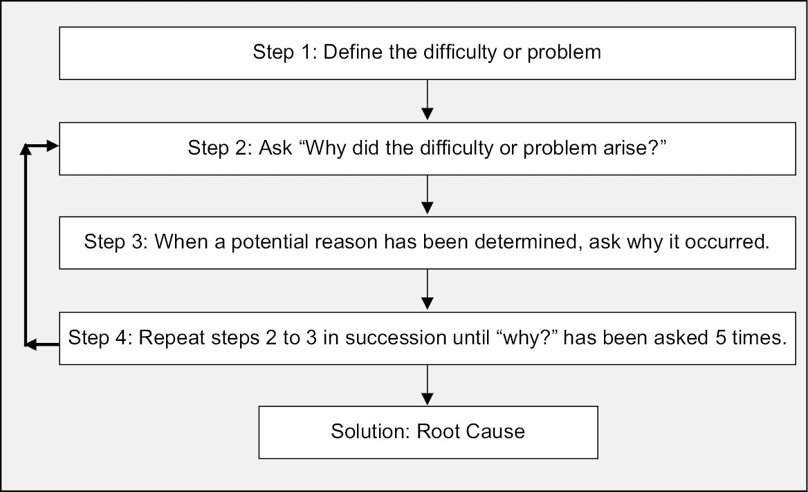

**图 10.1** 根因分析：五问分析法。⏎

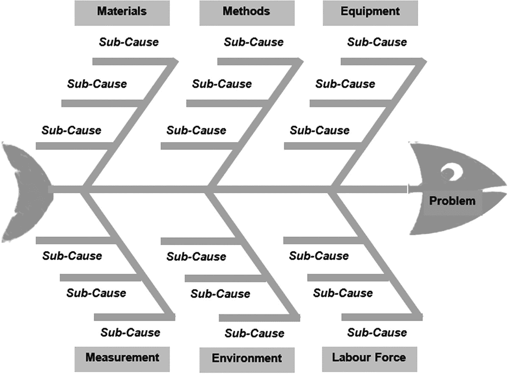

**图 10.2** 构建石川图。⏎

石川图被应用于结构化头脑风暴会议，以识别可能的原因。这种方法能够产生额外的根因示例，并使团队能够快速检测根因是否在相同或不同的因果树中多次出现。它还允许他们同时查看所有原因，并为展示关注点提供了有用的可视化支持。此外，这种方法提供了一种高度结构化的方法和进行头脑风暴会议的极佳方式，用于检测问题的可能原因，并将关于原因的思路归入合适的类别中。石川图通常与五问法工具结合使用（如图 10.1 所示）。

对问题根因的识别以及相应的解决方案为定义不超过五年的策略提供了坚实基础。为了实施所定义的策略，工作小组应用了图 10.3 所示的严谨方法论。它显示有两个并行的过程，两者都从定义的策略开始，并以策略的成果结束。每个过程分支都有不同的侧重点：一个与策略实施（行动执行）有关，另一个侧关注性能（关键成功因素和 KPI）。此外，性能监控的重点是通过 KPI 实现。例如，从关键成功因素（CSF）和 KPI 的角度来看，CSF 关注特定方面，而与每个特定方面相关的 KPI 则建立了目标性能水平。

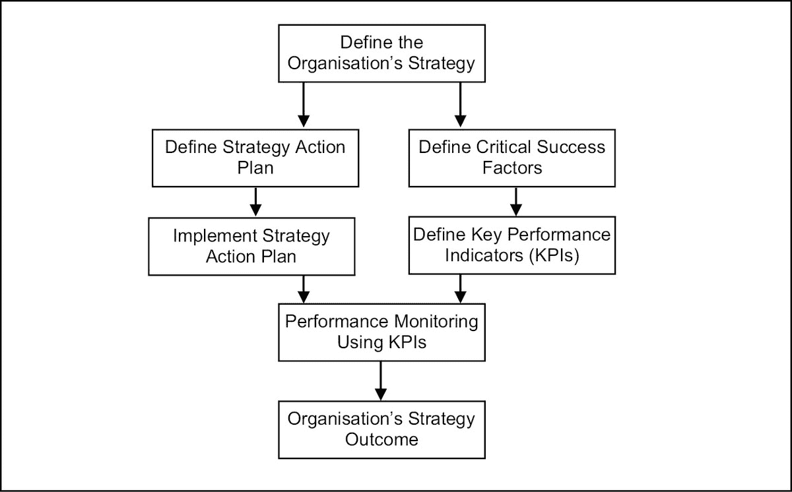

**图 10.3** 战略规划、CSF 和 KPI 之间的关系。⏎

针对与各个问题领域相关的每个识别倡议，都应用了 CSF 方法。CSF 方法论基于这样一个概念：关键成功因素是一个对于一项倡议（项目）实现其使命至关重要的高层目标特征。因此，定义的 CSF 表示了那些必须接受特别和持续关注以获得高绩效的领域，并包含了对组织运营活动及其未来成功最重要的关注点。CSF 以行动格言的形式表达，定义了方法、预期结果和要采取的行动（例如：等待选择性治疗，如从转诊到首次治疗的时间不超过 12 周的白内障手术或膝关节置换）。图 10.4 展示了所使用的 CSF 框架，该框架由五个关键过程组成，且相互相关：

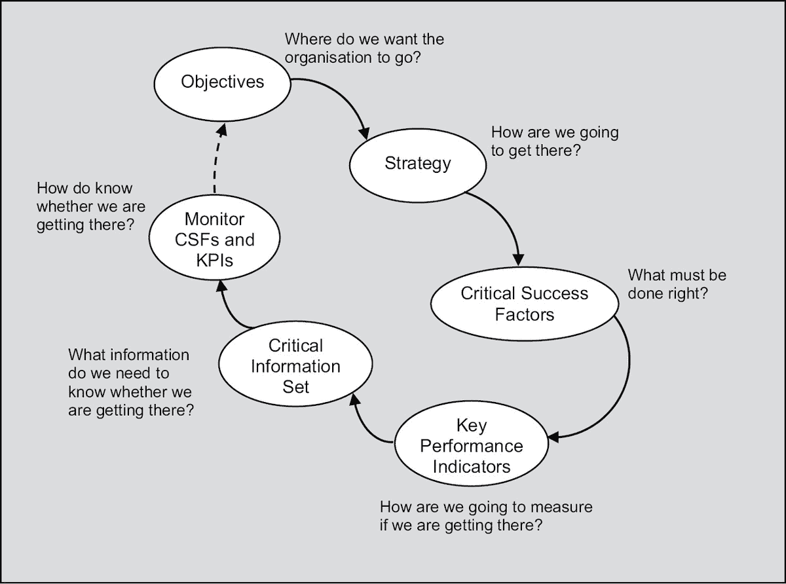

**图 10.4** 关键成功因素方法论框架。⏎

1. **目标 (Objectives)**：我们希望组织走向哪里？这是组织正试图实现的总体目标。
2. **策略 (Strategy)**：我们将如何到达那里？这些是组织为了实现总体目标将采取的措施。
3. **识别 CSF (Identify the CSFs)**：哪些事情必须绝对正确？这些是支持组织为实现总体目标而所采取措施的任务。
4. **定义 KPI (Define the KPIs)**：我们如何衡量是否正在到达那里？这些是用于评估任务是否完成的指标。
5. **确定关键信息集 (Determine the critical information set)**：应该收集哪些信息来跟踪每个 CSF 的进展？因此，收集的信息应足以验证 KPI 是否达成。

上述方法论使工作小组能够实施由根因分析所强调并在策略中定义的各种 AI 倡议。各种 AI 工具和应用经过评估，被选择在以下关键医疗领域实施：

1. **医疗诊断与治疗建议 (Medical Diagnosis and Treatment Recommendations)**：`IBM Watson` 能够协助医疗专业人员做出诊断和治疗建议。它的功能能够分析患者数据（包括病历、实验室结果和各种论文），以生成见解并建议个性化治疗方案。`Watson for Oncology` 通过根据个人画像制定循证治疗方案来协助肿瘤医生，实现更有效、更有针对性的癌症治疗。
2. **患者参与与支持 (Patient Engagement and Support)**：`IBM Watson` 提供了 AI 驱动的解决方案，例如改进患者参与和支持的虚拟健康助手。这些虚拟助手能够与患者互动，回答他们的健康问题，提供用药提醒，并根据他们的病史和偏好提供个性化健康建议。这种个性化护理改善了患者结局，提高了患者满意度，并鼓励了主动的医疗管理。
3. **医疗运营优化 (Healthcare Operations Optimisation)**：`IBM Watson` 使医院管理能够分析运营数据、识别效率低下的问题并做出数据决策以改进资源分配、减少等待时间并提高整体工作流效率。这带来了更精简的交付系统和大量的成本节省。
4. **药品库存管理 (Medicinals Inventory Management)**：此阶段包括集成 AI 库存模型并升级现有的库存管理系统。要解决的关键问题与达到最佳水平以及识别要实施的订货策略有关。这消除了缺货和积压情况，并降低了持有成本。
5. **资源调度与设备预防性维护 (Resource Scheduling and Preventative Equipment Maintenance)**：实施了具有预测元素的资源调度 AI 模型，并辅助医疗设备的预防性维护。这确保了医疗设备和设施的最化利用，缩短了医疗干预的等待名单并提升了患者满意度。


上述模型应用了多种 AI 算法，例如使用 `Monte Carlo methods` 来模拟和分析多种场景（如不同库存策略的可能结果），以及 `Long Short-Term Memory (LSTM)`，这是一种用于库存水平预测等序列问题的循环神经网络。其他 AI 预测模型则侧重于资源调度和设备维护，例如用于资源分配的 `Linear Programming`。

## 10.10.2 案例研究 2：城市交通管理

某大都市当局面临着由于交通拥堵持续不断投诉带来的压力，迫切需要解决这一日益严重的问题。由于主干道被轻重型车辆堵满，交通状况已变得疯狂且难以收拾。因此，交通拥堵已成为一个从各个方面影响该城市的紧迫问题。该大地区每天承受着巨大的交通流量，导致长时间的延误、挫败情绪以及空气污染水平的增加。虽然交通拥堵被认为是大城市的共同特征，但它已变得无法法控，同时影响了货物运输和客运。

一项由主管政府交通部门委托的一项研究发现，日益严重的交通拥堵问题归因于几个因素，包括人口增长、快速城市化、对更有效的公共交通系统的需求、粗心驾驶（如驾驶时使用手机）以及道路上私家车数量的增加。这些因素导致了主要道路频繁发生堵塞，使人们难以通勤上班、获取服务或及时交付货物。在货物运输方面，道路拥堵对经济产生了重大影响。货物交付的延误导致企业成本增加，最终将影响商品和服务的价格。这反过来可能对消费者产生负面影响，并导致整体经济生产力下降。此外，交通拥堵影响了客运，因为通勤者往往在道路上花费更多时间，导致沮丧、压力和生活质量的下降。由于需要更可靠、高效的公共交通选择，这种担忧进一步，，迫许多居民依赖私家车，这进一步加剧了拥堵问题。

政府交通部门任命了一个工作小组来审查委托研究的结果，并制定战略交通计划。此外，一旦战略交通计划获得批准，该工作小组将获得执行该计划的授权。在审查了委托研究及其关于交通拥堵主要原因的结论后，工作小组开始寻找缓解这些担忧的解决方案。工作小组意识到，交通拥堵问题永远无法消除。工作小组还委托开展了环境和社会影响评估。该影响研究得出结论：从环境和社会影响的角度来看，通过征收私人财产来建设新道路或拓宽现有道路并非可行方案。然而，通过公众咨询过程以及随后的由代表几个关键学科的专家小组组成的脑风暴会议，确定了若干解决方案，这些方案被认为是大多数利益相关者可以的。

### 建议的解决方案

一种潜在的解决方案是投资改进和扩大公共交通系统，包括替代运输方式（例如，除了陆路运输外还包括海路运输）。这被认为可以让人们把车留在家里，依靠公共交通进行日常通勤更加方便。另一个确定的解决方案是激励使用替代交通模式，如步行和骑行。这可以通过开发专用自行车道和行人友好型基础设施，以及促进积极出行的倡议（如补贴自行车和手动/电动滑板车的费用）来实现。

此外，鉴于越来越多的人在在线购物，工作小组考虑将受控无人机作为小型轻物物的运输手段。此外，工作小组认为需要以支持高效交通流的方式开发和维护道路基础设施。这涉及恢复现有道路网络，并实施智能交通管理系统，以减少瓶颈并保持交通顺畅。一个关键解决方案是需要执行促进高效交通流的规定，包括严格执行交通法法规（如限速），以及减少经常影响交通流量的路边停车数量。

工作小组得出结论认为，交通拥堵确实是一个需要立即关注的紧迫问题。因此，他们得出结论，通过投资公共交通、改善道路基础设施、推广替代交通模式和执行交通规定，该市能够朝着更高效、更可持续的交通系统努力，从而使货运和客运受益。此外，工作小组意识到，识别出的大多数解决方案可以通过技术解决方案的支持有效实施，特别是那些与智能交通管理系统和法规执行相关的解决方案。

### 技术实施：城市大脑

这些结论构成了其交通战略计划的基础。建立了一个技术团队来确定适当的技术支持解决方案，包括 `AI` 的使用。技术团队评估了由 `阿里巴巴 (BABA)` 开发的 AI 系统——`City Brain`。该系统广泛利用 `AI` 来收集信息，例如交叉路口摄像头的视频以及汽车和公交位置的 `GPS` 数据。这些信息将进行实时分析，同时系统协调大量的交通道路信号，旨在防止或缓解堵塞。因此，第一阶段是识别关键道路路口并在这些地点安装视频摄像头。此外，所有公共车辆都安装了 `GPS` 跟踪设备。经过几个月的测试，通勤者见证了显著的改善。该系统还促进了应急人员的工作，使民防车辆和救护车到达事故现场和处理紧急情况的时间减少了近一半。由于微小事故或机械故障导致的故障车辆的快速清理，有助于保持交通流处于最高水平。到 2027 年，估计这些 `AI` 系统可以使通勤时间缩短 18% 到 25%。

摄像头与 `AI` 的结合使用，以及法律法规的修订，使得交通法规执法系统更加有效。主要道路通过 `AI` 系统利用实时视频流输入进行自动监控，以识别交通违规行为。这些交通违规行为根据严重程度立即分类，以便执法人员对严重违规进行及时干预，而其他违规者将获得由相应证据支持的常性交通罚单。因此，`AI` 系统既被视为一种预防工具，也被视为一种执法工具。诚然，`AI` 系统引发了与车辆监控和可能的的人脸识别问题相关的隐私担忧。然而，这种系统的益处远大于这些担忧，因为它给道路带来了纪纪律，并在多个案例中挽救了生命。


如前所述，利用大数据和基于人工智能的交通管理解决方案已应用于监控和控制交通信号以及街道摄像头，以优化驾驶和步行路线。此外，传感器和摄像头能够监控道路状况，并对任何即时维护工作发出警告。此外，数字显示屏和基于增强现实（AR）的消息系统取代了传统的道路标志。

城市增长问题并不被视为一种近期现象。在一些较较老的地区，城市发展可能追溯到几个世纪前，且是以无章法进行的。因此，当局、建筑师、城市规划师和土木工程师面临着根源可能追溯到几十年前（甚至几个世纪前）的问题。然而，技术被认为在可持续智能城市的发展中起着关键作用。例如，物联网（IoT）与人工智能相结合被应用于智能路灯系统，该系统可以根据天气和交通状况的变化做出响应，以节省能源并减少光污染。自动驾驶汽车仍处于验收测试阶段。然而，它们被认为为上班族提供了额外的时间来检查邮件和参加电话。此外，这些无驾驶自动车辆可以与智能停车解决方案自动通信，甚至能够自动停在最近的可用空位。因此，它们能够选择提供充电设施以为电池充电的停车区域。

技术团队还向主管部门披露并报告了机器学习等新兴技术存在巨大的潜力，可以解决社区遇到的其他问题，例如：

*   结构完整性监测。集成了人工智能的物联网设备将通过持续监测振动和材料状况，对任何建筑、桥梁或历史遗迹的维护需求发出警告。
*   电能和供水管理。智能电网将帮助减少电力和水分配的损耗，通过支持物联网的设备维护提高运营效率。
*   污染管理。集成了人工智能的全市传感器网络将生成一张显示声音、水质、土壤、空气和光污染水平的 Map 图，以协助管理人员采取缓解和补救措施。

技术团队认为所有建议的解决方案在技术上都是可行的。然而，他们也意识到，若干限制（如物流、法律和预算考虑限制了它们的立即实施。他们还意识到，这些措施将改变他们的城市，并极大提高公民的生活质量。

## 10.11 结论

本章重点关注公共部门的人工智能，并阐述了人工智能对公共管理及其服务群体具有的巨大潜力。“选民”（constituents）一词被广义应用，包括无论人口统计地位如何、公民社会和商业部门的所有公民。本章还表明，政府是每个国家最大的雇主，并拥有广泛的客户群，这些客户期望获得不断增加的产品和服务。

人工智能已被认为是一种强大的工具，可以满足来自不同类别客户的如此广泛的期望。本章证明了公共部门人工智能和企业人工智能具有共同目标，即在 24/7 全天候、从任何地方以更低的成本提供优质的客户服务体验。然而，必须在企业人工智能和公共部门人工智能之间做出重要区分。企业人工智能侧重于通过提高效率和提供个性化客户体验来提高商业实体的盈利能力。另一方面，公共部门人工智能侧重于完善法律以及社会经济政策。这些政策包括在各个学科（如教育、医疗、执法和交通）中制定和实施国家战略。但两者都有一个共同的底层目标，即提高效率并提供个性化的客户体验。

此外，政府在考虑部署人工智能时面临着更大的挑战，因为他们需要考虑国家整体利益，特别是经济发展以及人工智能对社会不同领域的影响。这些关注基本上涉及人工智能将如何影响经济增长、就业流失、技术转移和技能升级、医疗保健和教育等。底线是，每个政府都需要评估其在部署人工智能应用方面的现状，并定义符合其特定需求及其选民需求的必要政策。本章列举并解释了几个用例，让读者了解公共部门人工智能如何造福其公共管理实体及其相应的客户群。

最后，本章提到了一个用于成功部署人工智能的合适框架，该框架在上一章讨论企业人工智能时已进行详细描述（参见图 9.3）。该实施框架中的每一步都得到了详细解释，以向读者提供一种可行且实用的部署方法，该方法可以根据其个人公共管理组织进行调整和定制。此外，该框架适用于所有类别的公共部门组织，无论政府层级如何（即国家、州或市）。观点认为，建议的框架为每个政府层级公共管理中的公共部门人工智能提供了一种有效、全面且用户友的方法。然而，每个政府都需要评估其部署人工智能应用方面的现状，并确定符合其特定需求及其选民需求的所需政策。

## 参考文献

*   Behailu, Yeabtsega. (2023). 人工智能对社会的影响. International Research Journal of Modernization in Engineering Technology and Science. Vol. 05, No. 10, pp. 3120-3125. [`doi.org/10.56726/IRMETS4508`](https://doi.org/10.56726/IRMETS4508). ⏎
*   Berryhill, Jamie., Heang, Kévin, Kok., and McBride Keegan. (2019). 你好，世界：人工智能在公共部门的应用. OECD 公共部门创新观察 (OPSI). [`oe.cd/helloworld`](http://oe.cd)⏎
*   Brynjolfsson, Erik., and McAfee, Andrew. (2014). 第二次时代：天才时代的工作、进步与繁荣. W.W Norton.⏎
*   Camilleri, Emanuel. (2024). 关键绩效指标：商业成功的 KPI 完整指南. Routledge.
*   Canning, Mike., Gentile, Matt., Mittal, Nitin., Saif, Infan., and Ammanath, Beena. (2024). 政府与公共服务. Deloitte AI Institute AI Dossier. [www2.deloitte.com/us/en/pages/consulting/articles/ai-dossier-government-public-services.html](http://www2.deloitte.com/us/en/pages/consulting/articles/ai-dossier-government-public-services.html).
*   Frey, Carl, Benedikt., and Osborne, Michael. (2017). 就业的未来：工作有多大程度上会被计算机化？技术预测与社会变化, Vol. 114, pp. 254–280.⏎


*   Tangi, Luca., Combetto Marco., Martin Bosch Jaume., and Rodriguez Müller, Aan, Paula. (2023). 欧洲公共部门互操作的人工智能：探索性研究。JRC 技术报告。欧盟委员会，联合研究中心 (JRC)。
*   世界银行。 (2021). 公共部门的人工智能。[`documents1.worldbank.org/curated/en/746721616045333426/pdf/Artificial-Intelligence-in-the-Public-Sector-Summary-Note.pdf`](https://documents1.worldbank.org/curated/en/746721616045333426/pdf/Artificial-Intelligence-in-the-Public-Sector-Summary-Note.pdf)。

# 第 11 章 AI 的伦理、道德与法律考量

DOI: [10.1201/9781003653950-14](http://doi.org/10.1201/9781003653950-14)

> *“制定法律的不是智慧，而是权威。”*
> 托马斯·霍布斯
> *英国哲学家（1588-1679）*

通常，AI 的使用因其内在优势而合理，例如更快速的数据分析、执行繁琐任务时节省的时间、预测准确性的提高、对业务流程更深入的洞察，以及增强的客户服务体验。已经证实，AI 是一项新兴技术，其目标是模仿人类的认知能力和判断，并具有提供竞争优势的。行业已经承认这些目标是可行且可实现的，因此，AI 的采用正在不断增长。AI 正被应用于创新的方式，例如风险评估、分析、预测性业务建模和日常运营任务。

随着 AI 的应用和收益在各个行业不断变现，人们逐渐稳定且持续地意识到，使用 AI 可能会产生意想不到的后果。许多研究人员主张在使用 AI 时要谨慎。他们敦促从业者不仅要探索 AI 的益处，还要识别并审查这种强大技术可能带来的伦理影响。政府、企业、公民社会和教育机构（大学和理工学院）等利益相关者采取协作方法来探讨这一问题至关重要。

对涵盖 AI 的实际伦理和社会问题进行概念性评估至关重要，以确保在安全环境中运行可信的 AI 应用。Fassbender (2014) 在 AeroAStro 百年纪念会议上采访了 SpaceX 和特斯拉的首席执行官埃隆·马斯克，他将 AI 描述为人类最大的生存威胁，并认为我们应该谨慎对待 AI，因为它可能会召唤“恶魔”。这意味着迫切需要一种合适的机制，确保 AI 应用是根据稳健的伦理和道德准则进行开发和实施。此外，政府有责任保护公民免受 AI 可能带来的任何不利后果，并确保 AI 的应用能够为民众带来经济繁荣。

## 11.1 引言

在新兴技术格局中，AI 已发展成为一种动世界的力量，继续影响着人们生活的许多方面。它彻底了各个行业，也改变了个人与机器交互的方式。AI 应用方式日益增长的趋势，仅限于技术人员和从业者的创新想象力。尽管如此，AI 能力的惊人之处不应让社会忽视使用它可能带来的风险。对于社会而言，思考试图复制人类智能的算法所带来的伦理道德困境以及社会影响正变得越来越至重要。

根据 Patowary (2023)，玛丽·谢莱标志性的文学杰作《弗兰肯斯坦》发表于近两个世纪前的 1831 年，它至今仍然是一个关于不受限制的决心的危险性以及扮演上帝之后果的持久警示故事。Patowary 认为，AI 模糊了人与机器之间的边界，社会发现自己正踏在玛丽·谢莱所探索的主题之上。Patowary (2023) 主张，这个关于过度自大、自信、道德困境以及创造者与被创造者之间复杂关系的故事超越时代，在当代关于 AI 及其潜在影响的讨论中产生了强烈的共鸣。

毫无疑问，AI 为积极改变人们的生活提供了巨大的机会，并为社会在许多领域的进步提供了巨大的利益，无论是医疗保健、教育、提高生活质量还是其他。AI 还被认为使国家进一步发展经济以造福其民众。然而，维克多·弗兰肯斯坦失误的阴暗回响有力地提醒着人们，需要伦理框架和跨学科协作，以确保 AI 保持一种强大的正面力量 (Patowary, 2023)。

Wallach and Allen (2009) 认为，人类建立的环境越来越多地充满了通过 AI 自主行动的人工智能。他们认为，控制这些 AI 应用的算法目前是“伦理盲目的”，因为它们的决策能力不涉及任何显含的道德推理。Wallach 和 Allen 认为，这些日益自主的系统（机器人和软件机器人）迫切需要将伦理和道德考虑纳入其决策算法中。

Patowary (2023) 进一步认为，社会必须从《弗兰肯斯坦》的警示故事中汲取教训并接受多学科方法，整合伦理、哲学和技术，以尊重人类并维护社会集体福祉的方式引导 AI 的未来。本章将关注两个不同方面，即：(a) AI 应用开发和部署的伦理和道德考量；(b) 通过研究各国立法进展的 AI 法律考量。

## 11.2 AI 伦理和道德考量

在数十年的研究和几次 AI 寒冬之后，AI 已成为许多行业的必经特征。AI 现在已被广泛接受，其在医疗保健、银行、零售、运输、教育和制造业的应用已取得成效。然而，与过去引入的其他技术一样，人们对其可能的阴暗面考虑较少。Pazzanese (2020) 认为，AI 在提高效率、降低成本和加速研发方面的颠覆性能力，现在受到了担忧的抑制，即这些复杂不透明的系统的社会危害可能大于经济利益。Pazzanese 认为，直到 2020 年，在几乎没有政府监管的情况下，美国私营公司应用 AI 软件对健康、就业、信贷状况甚至刑事司法做出决策，而无需解释如何确保这些程序没有有意识或无意识地编码结构性偏见。


AI 已经不可或缺。据预测全球对 AI 解决方案的支出将在 2027 年增长到 5000 亿美元以上，大多数机构的技术投资重心正显著转向 AI 的实施以及对 AI 增强型产品服务的采用 (IDC, 2023)。现在已成为一个公认的事实几乎每家大公司都拥有多个 AI 系统，并将使用 AI 作为其企业战略中不可或缺且至关重要的部分。最初，AI 被认为用于处理需要低级决策的简单、枯燥且重复的任务，但强大的计算机和海量数据集的积累促进了 AI 迅速发展成为一种非常复杂的设备 (Pazzanese, 2020)。

新兴的 AI 应用环境——AI 系统现在正在对个人做出某些决定——正引起了严重关注。这些批评者担心，AI 是否会带来更新、更快速且无障碍的方法，在大规模范围内进行歧视和划分。从表面上看，算法决策似乎提供了一种克服人类主观性、偏见和成见的客观方法。然而，经验表明，这些算法表现出偏见，是因为它们从所提供的数据集中进行学习。因此，如果数据具有内在偏见，结果将反映这种偏见。

Pazzanese (2020) 引用了社会对 AI 伦理关注三个三个领域，即隐私与监控、偏见与歧视以及人类判断的角色。Pazzanese 引用了哈佛大学政治哲学家迈克尔·桑德（Michael Sandel），他在讨论如何克服判决、假释和就业实践中算法决策偏见时，提到了程序开发者的意识和无意识偏见，以及构建用于训练软件的数据集的偏见。他思考，我们尚未理解最困难的问题：智能机器能否比我们更得深，或者在决定生活中某些最重要的事情时，人类判断的某些元素是不可或缺的？

有些人承认 AI 确实在其输出中引入了偏见，但他们认为这并不比人类在决策过程中引入的所有类型的偏见更糟糕。例如，使用 AI 简历筛选软件，在经过微调并与需求对齐后，可以减少偏见的机会。然而，对于这一前提存在争议，因为 AI 因其科学基础被广泛认为是可靠的，并被视为一种客观评估，尽管在现实中它模仿并反映了人类偏好。AI 软件这种“偏见”倾向是因为机器学习基于历史数据集，而这些数据集反映了以前“好”和“不太好”的人类决策。因此，数据集本质上包含对所有类型决策的倾向，无论这些决策是好、坏还是平庸。在评估不同类型的应用时，这种担忧适用于所有决策，例如银行、社会保障养老、保险、信用评级和社会住房等。

行业内有广泛共识认为 AI 应该受到监管。然而，对于应该如何这样做以及由谁来做存在争议。开发者和私营部门的 AI 用户倾向于现有法律框架内进行自我监管。然而，公民社会希望政府在 AI 应用的具体监管中发挥领导作用。一个主要困难在于，监管机构缺乏识别和定义需要监管的内容所需的 AI 专业知识，也无法确定应该采取何种实用方法进行监管。在某种程度上，拥有一套伦理准则是合适的，这可以作为开发者、提供者和用户组织的指南。但是，需要记住，这并不能让开发者、提供者和用户组织免受受害方的法律诉讼。因此，必须立法来监管 AI，并明确定义所有相关方的法律义务。

如前所述，监管机构缺乏识别和定义需要监管内容的 AI 专业知识，也无法确定应该采取何种实用方法进行监管。然而，这种困难可以通过政府与开发者、提供者、主要用户和公民社会代表之间的工作小组采取协作方法来缓解。这种结合意味着政府和公民社会将贡献法律和社会专业知识，而其他代表将对技术方面做出贡献。此外，工作小组可以设有不同的小组或小组委员会来处理特定行业，例如金融、汽车、航空、医疗保健、教育和制造业等。尽管如此，每个国家、州和市级司法管辖区都需要考虑自身的情况，并采用适合其环境的机制。

### 11.2.1 AI 伦理和道德准则的需求

通常，技术进步中的 AI 伦理可以促进和推动一个偏见更少、更公平的世界。随着 AI 对社会变得越来越重要，显而易见的是在 AI 工具开发和部署中需要伦理边界。承认这种需求，并在缺乏大规模治理机构来制定和执行伦理规则的情况下，许多科技公司引入了自己的版本的 AI 伦理或行为准则。由于担心 AI 应用可能对整个社会产生有害影响，对 AI 伦理和道德指导的迫切需求运然而生。

从根本上说，AI 伦理是公司用于指导负责且公平的 AI 开发和应用的道德价值观。换句话说，AI 背景下的伦理是一套道德原则，帮助人们判断对错，以及如何在增强 AI 有益影响的同时减轻风险和有害结果。需要准则来帮助开发者、提供者和用户确保 AI 应用是可信的、安全的、可靠的、人性化的环保的。有许多 AI 伦理和道德问题需要考虑，即隐私与安全、公平、包容、数据责任、透明度、可解释性、健壮性、环境可持续性、道德主体、价值对齐、问责、信任和技术滥用。定义伦理准则主要有两种方法，即公司和政府领导的监管框架。这两种方法促进了 AI 技术的监管。

根据 Leslie (2019)，AI 伦理领域很大程度上是对 AI 系统的滥用、虐用、设计缺陷或负面意外后果可能引起的一系列个人和社会危害而产生的。这说明 AI 伦理一直被视为一种反应性措施来处理，而不是预防性措施。政府和社会在处理技术发展时似乎在重复过去的错误，因为反应总是事后性的。

*   **偏见与歧视**：AI 算法使用历史数据集，这些数据集可能包含人类对某些决策的内在倾向和成见。此外，用于训练和测试算法系统的数据集可能无法代表其所推断的人群，因此可能会产生偏见和歧视的结果。


*   **否定个人自主性、救济途径与权利**：在公民受这些 AI 系统的决策、预测或分类的影响的情况下，可能很难对 AI 结果负责的方承担直接责任，从而损害了受影响人员的自主性并侵犯了其权利。
*   **不透明、不可解释或不合理的结果**：在某些情况下，机器学习模型输出结果的原理并不清晰，并可能掩盖歧视、偏见或不公平的迹象。
*   **侵犯隐私**：AI 应用可能会使用未经适当同意而获得的个人数据，或可能损害个人基本权利的个人信息。
*   **社会联系的隔离与瓦解**：AI 系统可能会减少人与人互动的需求，同时通过算法限制个人对与自身不同的世界观的接触，来实现超个性化，这可能会导致社会关系的极化。保护这些社会关系至关重要。
*   **拙劣的 AI 开发实践**可能会导致不可信、不安全或低质量的结果，损害个人健康和公共福利，从而影响用户社区的信任度。

必须承认，AI 伦理是至关重要的，因为 AI 技术的目标是增强或取代人类智能。因此，在技术被设计用于模仿人类智能的情况下，可能会模糊或混淆人类判断的担忧也可能被 AI 复制。

AI 伦理和道德准则的需求可以通过一些引起关注的例子来说明。根据 Ovide (2022) 的说法，发布在 Instagram 或其他媒体上的照片和视频可能在未经任何同意的情况下用于训练 AI 软件。她报告说，`Lensa AI` 正在从互联网获取未经许可的大量照片进行训练，以生成人们流行的、卡通风格的头像。必须承认，AI 伦理是至关重要的，因为 AI 技术的目标是增强或取代人类智能。因此，在技术被设计用于模仿人类智能的情况下，可能会模糊或混淆人类判断的担忧也可能被 AI 复制。

AI 伦理和道德准则的需求可以通过一些引起关注的例子来说明。根据 Ovide (2022) 的说法，发布在 Instagram 或其他媒体上的照片和视频可能在未经任何同意的情况下用于训练 AI 软件。她报告说，`Lensa AI` 正在从互联网获取未经许可的大量照片进行训练，以生成人们流行的、卡通风格的头像。

### 11.2.2 建立 AI 原则

必须承认，AI 伦理是至关重要的，因为 AI 技术的目标是增强或取代人类智能。因此，在技术被设计用于模仿人类智能的情况下，可能会模糊或混淆人类判断的担忧也可能被 AI 复制。

*   **尊重人类**：这一原则承认个体的自主性，并主张保护自主性降低的人员。人类应该意识到可能的风险并能够选择参与。
*   **行善**：这一原则基于医疗保健领域，医生承诺“不伤害”。这一概念可以应用于 AI，无论意图如何，都旨在实现利益最大化和伤害最小化。
*   **正义**：这一原则基于公平和公正。《贝尔蒙报告》（BelBelmont Report）提出了五种分配负担和收益模式，即：`平等份额`、`个人需求`、`个人努力`、`社会贡献`和`功绩`。

欧盟（EU）委员会于 2019 年提出了基于七项关键要求的可信 AI 系统指南，如下：

* **人类代理性与监督**：AI 系统应该赋予人类能力，使其能够知情决策并促进其基本权利。同时，需要通过`人机回路中`(human-in-the-loop）、`人类在回路上`(human-on-the-loop）和`人类主导`(human-in-command）的方法来确保适当的监督机制。
*   **技术稳健性与安全性**：AI 系统需要具有韧性、安全性和，确保在出现问题时有应急计划。它们还需要是准确、可靠且可重复的。
*   **隐私与数据治理**：除了充分尊重隐私和数据保护外，AI 系统必须具备充分的数据治理机制，考虑数据的质量和完整性，并确保授权访问数据。
*   **透明性**：数据、系统和 AI 商业模式应该是透明的，并具有可追溯机制。此外，AI 系统及其决策应以适应相关利益相关者的方式进行解释。人类需要意识到他们正在与 AI 系统交互，并必须了解系统的能力和局限性。
*   **多样性、非歧视与公平**：必须避免不公平偏见，因为它可能包含多重负面影响，从弱势群体的边缘化到加剧偏见和歧视。AI 系统应该对所有人开放（无论是否有残障），并在整个生命周期内让相关利益相关者参与。


-   社会与环境福祉：AI 系统必须造福全人类（包括后代），并确保其具有可持续性和环境友好性。AI 系统应该考虑到环境（包括其他生物），并对其对社会和社会层面的影响进行仔细研究。
-   问责制：必须引入相关机制以确保 AI 系统及其结果的责任归属和问责，并确保提供充分且易于获取的救济。对于关键应用，需要可审计性以对算法、数据和设计流程进行评估。

开发和部署更具伦理的 AI 涉及对政策、教育和技术在伦理影响进行仔细研究。毫无疑问，监管框架可以保证技术造福社会而非损害社会。在全球范围内，各国正在启动伦理 AI 政策，包括当出现偏见或其他伤害时，实体应如何处理法律问题。AI 用户应该能够意识到不合伦理或虚假 AI 的风险和可能产生的负面影响。生成和传播易获取的资源有助于缓解此类风险。另一方面，必须意识到 AI 工具可以提供帮助，并可能通过比人类更好地、更有效地检测视频、音频或文本（例如 Facebook 上的仇恨言论）是否为虚假，从而应用于识别不合规的数据源和偏见。

AI 算法的执行取决于其设计、开发、训练、调优和应用的方式，而 AI 伦理在于围绕并贯穿 AI 系统生命周期所有阶段创建一个伦理标准和护栏的生态系统 (IBM, 2024)）。根据 IBM 的说法，实体、政府和研究人员已经意识到道德框架的重要性，并开始制定章程来解决 AI 伦理问题，并配置该领域的未来工作。AI 伦理指南的结构正在不断增强，并将治理作为一个共同方面纳入其中 (IBM, 2024)）。

IBM (2024) 认为，治理是组织通过内部政策、流程、员工和系统对 AI 生命周期进行监督的行为，这有助于确保 AI 系统的运行符合组织的原则和价值观、符合利益相关者的预期以及相关法规的要求。此外，IBM 认为一个成功的治理计划应该能够：(a) 定义与 AI 一工作的人员的角色和责任；(b) 教育所有参与 AI 生命周期的人员如何以负责任的方式构建 AI；(c) 建立构建、管理、监控和沟通 AI 及 AI 风险的流程；(d) 利用工具在整个 AI 生命周期内提高 AI 的性能和可靠性。IBM 建议建立 AI 伦理委员会来管理治理机制，该委员会将由来自业务部门的多元化领导组成。该伦理委员会的目标是为伦理政策和实践提供集化的治理、审查和决策流程。

根据世界银行 (2021)，许多先进数字政府已经发布了治理框架，包括 AI 使用的伦理标准，其中包含了伦理原则、中央机构的角色以及运营框架。世界银行指出，除了国际组织外，各国政府也在积极提出 AI 治理模型……国家政府包括澳大利亚、加拿大、中国、日本、新加坡、阿拉伯阿拉伯酋联国和美国；国际组织包括欧盟委员会、电气电子工程师学会（IEEE）、国际标准化组织、联合国和世界经济论坛。

### 表 11.1 各国政府采纳的常见伦理原则

| 原则 | 描述 |
| --- | --- |
| 隐私与数据保护 | AI 解决方案应尊重个人的隐私权和公民自由。个人应对其数据拥有控制权，重新用途、重新分发或删除需征得其同意。 |
| 问责制 | 机制必须确保 AI 设计和实现生命周期内有负责任的行为。实体必须对监控问责制负责。 |
| 安全与保障 | 网络安全至关重要。领导者必须确保整个社会和私人人类的福祉。 |
| 透明性与可解释性 | 算法、业务案例、数据收集、设计和政策信息对利益相关者和受影响者必须透明。个人在与 AI 交互或 AI 为其决策时应获得通知。 |
| 公平性 | AI 解决方案应尽量减少偏见并识别和管理风险。设计和影响中应确保包容性。 |
| 人类对技术的控制 | AI 应处于人类控制之下。人类应该审查自动化决策，并有权退出自动化决策。 |
| 职业责任 | 应确保解决方案的多利益相关者协作、准确性和科学严谨性。 |
| 促进人类价值观 | AI 应以人为中心。它应该促进人类价值观并造福社会。 |

来源：世界银行 (2021)。 *公共部门的人工智能*。世界银行集团。

世界银行认为，某些治理模型和指南强调了常见的程序和项目管理实践，包括成本效益分析、法律和法规合规性、风险管理、灵活性以及响应式方法的应用。

### 11.2.3 负责任的 AI 项目交付生态系统的构建区块

根据 Leslie (2019)，建立一个负责任的 AI 项目交付的伦理平台不仅是从文化上开始构建。他认为，这还涉及为项目团队提供手段，以实现建立伦理认可、公正性、信任和项目合理性的目标。此外，Leslie (2019) 认为，负责任的 AI 项目交付的伦理平台应基于三个构建区块，即：

1. **基础级**：这要求人们掌握伦理价值观框架的知识，该框架支持、保证并激励负责任的数据设计和使用生态系统。这些价值观由四个核心概念组成：尊重、连接、关怀和保护。目标是提供一个易于获取的框架，开始思考项目在社会和伦理影响的道德范围；并建立明确定义的标准以评估其伦理许可性。
2. **第二层实体级**：这包含一组可操作的原则，有助于实现对 AI 系统负责任的设计和使用的导向。这些涵盖了四个关键概念：公平、问责、可持续性和透明。这些原则的目标是提供道德和实践工具，以确保项目能够减轻偏见、无歧视且公平；并维护公众对项目交付安全可靠 AI 创新的能力的信任。
3. **第三层确定级**：这需要一个基于流程的治理框架，在整个 AI 项目交付工作流中将基础级价值观和第二层实体原则操作化。目标是建立透明的设计和实施流程，以维护并实现 AI 项目及其产品的合理性。


负责任的 AI 项目交付生态系统的构建基石，旨在提供一个稳健的、基于流程的价值观、原则和协议基础，使使 AI 项目团队能够以伦理、公平和安全的方式设计并实施 AI 系统。此外，它旨在帮助实体基于伦理平台建立负责任的 AI 创新文化，确保在 AI 项目团队内部培养统一的集体精神，从而开发造福公众的 AI 技术。

## 11.3 AI 全立法格局

上述章节侧重于 AI 的伦理和道德行为。本节将关注全球范围内与 AI 相关的立法。需要理解的是，伦理和法律通常是人类在社会中预期遵守的两种规则体系。然而，伦理代表内部控制系统，而法律则指的是外部控制机制。这两个控制系统对于实现优化行为至关重要，其中包括追求和提供公正对待。

以下章节将提供全球多个地区 AI 监管法规的详细大纲，并讨论各国如何治理 AI。此外，还将解释制定 AI 监管法规的关键考虑因素。尽管伦理和法律是不同的，但理解治理 AI 的法律框架至关重要，因为各个实体需要以伦理的方式应用法律。AI 法律的伦理应用是为了确保在技术进步塑造人类未来时，获得社会利益。新兴的全球 AI 监管格局可能有所不同，因为各国可能会采取不同的方法。尽管如此，在支持 AI 立法的基础因素方面，可能存在某些相似之处。

毫无疑问，政府正迟迟意识到，AI 的对人们生活的影响比预期更快，并已成为一种破坏性机制。这影响了企业的运营，进而影响到各自的员工以及产品和服务的接收者。此外，这种这种情况引发了道德、法律和社会关注，迫使政府采取适当的立法，以监管基于 AI 的系统的设计、开发和应用。本节将考虑以下被认为提供全球 AI 立法前景的地区：

* 欧洲：欧盟（EU）和英国。
* 北美：美国和加拿大。
* 非：毛里求斯、肯尼亚、埃及和南非。
* 南美：阿根廷、巴西、哥伦比亚、墨西哥、智利和秘鲁。
* 澳大拉尼西亚：澳大利亚和新西兰。
* 亚洲：中国、印度、日本和新加坡。

## 11.3.1 欧洲

欧洲立法部分将重点关注欧盟和英国。

### 11.3.1.1 欧盟 (EU)

根据欧洲议会 (2024)，欧盟的 AI 应用受 `AI Act` 监管，这是世界上首部全面的 AI 法。该法案的优先事项是确保在欧盟使用的 AI 系统是安全、透明、可追溯、非歧视且环保的。此外，欧盟坚持 AI 系统必须由人类管理而非自动化管理，以防止产生有害结果。此外，一个重要目标是为 AI 提供一个技术中性的统一定义，该定义可能适用于未来的 AI 系统。

该法案的一个关键方面是针对不同的风险水平建立不同的规则，并根据 AI 的风险水平为提供者和用户定义义务。无论 AI 系统是否构成最小风险，所有系统都需要评估。根据欧洲议会 (2024)，被认为对人类构成威胁的 AI 系统被视为具有不可接受的风险并将被禁止。欧盟归类为具有不可接受风险的 AI 系统包括：

* 对人类或特定脆弱群体的认知行为操纵，例如煽动儿童产生危险行为的语音激活玩具。
* 根据行为、社会经济地位或个人特征对人们进行社会评分。
* 对人的生物特征识别和分类。
* 实时和远程生物识别系统，如人脸识别。

然而，欧盟识别了一些可能允许的例外情况。例如，为了执法目的某些“实时”远程生物识别系统是允许的，而在显著延迟后发生的“事后”远程生物识别系统仅在法院批准后才被允许（欧洲议会, 2024）。如果 AI 系统影响安全或基本权利，也可能被归类为高风险。所有高风险 AI 系统在进入市场之前及其整个生命周期内都需要进行评估。此外，个人有权就 AI 系统向指定机构投诉。高风险系统分为两类：

* 应用于产品安全法规的 AI 系统，如玩具、航空、汽车、医疗设备和电梯。
* 应用于专业领域并在欧盟数据库注册的 AI 系统，例如关键基础设施的管理和运营；教育和职业培训；就业、员工管理以及获取私人和服务和福利；执法；移民、庇护和边境控制；法律的解释和应用。

根据欧洲议会 (2024)，生成式 AI（例如 `ChatGPT`）不会被归类为高风险，但需要遵守透明度要求和欧盟版权法，即披露内容由 AI 生成；设计模型防止生成非法内容；发布训练使用的版权数据摘要。可能产生系统性风险的高影响通用 AI 模型，例如更先进的 AI 模型 `GPT-4`，需要经过详细，任何严重事件需要向欧盟委员会报告。此外，通过 AI 算法辅助生成或修改的内容（如图像、音频或视频文件，例如深度伪造）要求明确标记为 AI 生成，以确保用户在使用此类内容时能意识到这一点。

`AI Act` 通过强制国家机构为公司提供模拟真实世界条件的测试环境来支持创新。这为初创公司和中小企业提供了在公开发之前开发和训练 AI 模型的机会。根据欧洲议会 (2024)，`AI Act` 于 2024 年 3 月通过，欧盟理事会随后于 5 月批准批准，该法案将在生效 24 个月后全面适用。然而，法案的某些条款将更早通过。例如，禁止不可接受风险的 AI 系统；行为准则；关于遵守透明度要求的通用 AI 系统的规则将分别在 6、9 和 12 个月后生效。另一方面，有关高风险系统的义务将在 36 个月后生效，从而为它们留了更多合规时间。


根据 Symbio6 (2024)，对《人工智能法案》（AI Act）的主要批评在于其复杂性且缺乏清晰度。《人工智能法案》（第 3.1 条）对 AI 系统的定义是指一种设计用于以不同自主水平运行的基于机器系统，该系统在部署后可能表现出适应性，并根据显式或隐式目标，从接收到的输入中推断如何生成预测、内容、建议或决策等输出，以影响物理或虚拟环境。他们认为这种定义在很大程度上是模糊的，导致对其范围和应用存在不确定，可能会阻碍有效实施和合规。

此外，Symbio6 (2024) 声称，尽管《人工智能法案》对“人类脆弱性”提了十六次，，但人类脆弱性的概念仍然难以理解，因为“脆弱性”（vulnerability）等词汇没有经过精确定义。该观点认为，该法案可能会导致商业界的过度监管，这可能阻碍技术创新并建立一个全球性的限制标准。对于欧盟决定不完全禁止公共大规模监控也存在一些担忧。然而，这一决定被认为是基于成员国的个人安全需求。此外，Symbio6 (2024) 认为，虽然《人工智能法案》的目标是保护基本权利并确保透明度，但人权组织认为该法案应该更稳健地应对 AI 的潜在危害，包括侵入性监控和社会评分系统，这些可能会损害个人自由和隐私。

## 11.3.1.2 英国 (UK)

根据 Tobin (2024)，《人工智能（监管）法案》由霍尔姆斯勋爵（Lord Holmes）作为私人议员法案提出，其主要目标是建立一个新机构，即`AI 管理局`（AI Authority）。该机构将承担多种职，旨在促进英国的 AI 监管。`AI 管理局`负责确保相关的现有监管机构考虑到 AI 的发展，以保证在这些监管机构之间应用对齐方法，并对 AI 相关的监管责任进行缺口分析。为 AI 管理局提出的其他功能还包括：监控 AI 产生的经济风险；对发展中的技术进行前瞻性扫描；促进沙盒计划以允许测试新的 AI 模型；以及对 AI 审计师进行认证。

拟议的法案还将建立若干监管原则，以指导 AI 的发展和应用。建立`AI 管理局`的法案并非一项监管 AI 的法案，因为在目前的技术环境下监管 AI 被认为为时过早且可能适得其反。因此，有人认为，现有的部门监管机构在科学、创新和技术部目前开发的中央职能的支持下，能够更好地有效地监管 AI（Tobin, 2024）。

根据 Gallo and Nair (2024)，英国政府选择了一种跨部门和基于结果的 AI 监管框架，该框架得到了五个基本原则的支持。这些基本原则是：安全性；安全性与稳健性；适当的透明度与可解释性；公平性；问责与治理；以及可争辩性与救济。这五个跨部门原则旨在让现有监管机构在各自的利益领域内进行解释和使用，作为确保负责任的 AI 设计、开发和应用的指南。Gallo and Nair (2024) 认为，英国政府实施这些原则的战略基于三个核心支柱：

*   **利用现有监管机构和框架。** 英国政府并不打算建立新的监管机构来监督框架的实施，而是要求监管机构在其各自的领域内通过现有法律来监管和监督 AI。监管机构（如信息专员办公室（ICO）、通信局（Ofcom）或金融行为监管局（FCA））需要应用基于现有法律的和谐方法。因此，这些监管机构并没有法律义务共同工作。然而，政府未来可能会引入立法，但这取决于中央职能的战略计划及其职权范围。
*   **建立中央职能以促进风险监测和监管协调。** 政府意识到，由于 AI 的影响广泛，各个监管机构无法孤立地应对 AI 带来的机遇和风险。因此，将在科学、创新和技术部（DSIT）内部建立一个中央职能，以管理和评估 AI，促进协调性。
*   **通过试点多机构咨询服务（AI 数字中心）支持创新。** 英国政府将建立一个名为 AI 数字中心的跨机构咨询服务。该服务旨在帮助创新者在发布产品前应对多种法律和监管义务。该数字中心的职权是促进合规并鼓励监管机构之间加强合作。

监管机构将被要求通过应用现有法律并为组织提供额外指南，在其各自领域实施该框架。监管机构的努力将通过针对高级 AI 模型和系统的开发者的自愿安全透明度措施得到加强。政府目前不打算将该框架法典。然而，计划在未来进行立法干预，特别是针对复杂通用人工智能及其开发者所带来的风险。


与欧盟的方法不同，英国的框架并未对人工智能提供正式定义。然而，这种基于结果的方法关注两个定义性特征，即适应性和自主性，旨在引导各行业的诠释。例如，英国的监管机构（如 `ICO`、`Ofcom` 或 `FCA`）可以在有益的情况下，通过解释适应性和自主性来创建特定领域的定义（见 [Gallo and Nair, 2024]](#ch24.xhtml#r106)）。Gallo and Nair (2024) 认为，这增加了监管机构解释多样化的风险，并可能为跨行业运营的组织带来监管不确定性。为了降低这种风险，政府打算设立一个“中央职能”（Central Function）作为监管机构之间的协调机构。注意的是，该框架维持了人工智能的传统定义，将人工智能分为三类：即高能力通用人工智能、高能力狭义人工智能以及 AI 智能体。该框架还提供了每种类型的定义。

## 11.3.2 北美

关于北美部分将重点关注美国和加拿大。

### 11.3.2.1 美国 (USA)

通常，美国采用去中心化的人工智能监管模型作为整体治理方法。其大多数监管实践和政策都集中在行业层面，这紧密地反映了 AI 的细分情况。此外，美国没有针对人工智能的特定广泛联邦监管框架。尽管如此，美国已经启动了几个特定行业 AI 相关的机构和部门，来处理因 AI 成熟而产生的复杂问题。例如，联邦贸易委员会（`FTC`）专门关注消费者保护问题，并试图在该领域应用公平透明的商业实践。同样，美国国家公路交通安全局（`NHTSA`）负责 AI 驱动技术的安全方面，特别是其在自动驾驶汽车中的应用。

尽管美国的 AI 立缺乏中心化，但《2020 年国家人工智能倡议法》（`National Artificial Intelligence Initiative Act of 2020`）建立了“美国 AI 倡议”，并对联邦科学机构的 AI 研究、开发和评估活动提供了指导。随后的法案要求特定机构在整个联邦政府范围内指导 AI 计划和政策（例如《2020 年政府人工智能法案》和《2021 年推进美国人工智能法案》）。

自 2015 年以来，国会通过了九项法案，截至 2023 年 11 月仍有 33 项立法待决。根据 Szczepański (2024)，2021 年国会引入了至少 75 项关注 AI 和机器学习或相关条款的法案，但其中只有六项获得通过。他进一步认为，2023 年 1 月至 6 月之间，国会引入了至少 40 项 AI 相关的法案，无一通过。这似乎表明在联邦层面，美国政府拒绝引入全面的 AI 监管措施。

Szczepański (2024) 指出，2023 年 1 月，白宫科学技术政策办公室发布了其《AI 权利法案》提案，国家标准与技术研究院发布了《AI 风险管理框架》。2023 年年中，宣布了两个广泛的政策框架，以指导国会制定未来的 AI 立法。这些包括《AI 政策安全创新框架》（安全、问责、基础、可解释性）和《跨党 AI 法案框架》。此外，2023 年 4 月，四个联邦机构强调了它们的执法权，并强调先进技术不应成为违法的借口。

2023 年 10 月 30 日，美国总统拜登发布了一项关于安全、可靠和可信使用 AI 的行政命令。这扩展了早期的工作，例如美国主要公司（包括 `Amazon`、`Google`、`Meta`、`Microsoft` 和 `OpenAI`）推动 AI 开发的自愿承诺。该行政命令涉及几个政策领域，即：

- 建立 AI 安全性的新标准。强大的 AI 系统开发者需要与美国政府共享其测试结果和其他关键信息。此外，政府机构有责任制定标准和工具以确保系统安全。这些新标准旨在防止利用 AI 工程危险材料的风险，并保护美国公民免受欺诈和欺骗。

- 建立先进的网络安全计划，以发现并解决关键软件中的漏洞。国家安全委员会和白宫办公厅主任负责制定国家安全备忘录，以指导有关 AI 和安全的进一步行动。

- 保护公民的隐私免受 AI 相关风险的影响。联邦支持将优先加速隐私保护技术的扩展和应用。这旨在加强相关的研究和技术；强调了评估机构收集和应用商用数据的必要性；并有必要制定指南来评估隐私保护技术的有效性。

- 推进公平和民权。该行政命令要求为所有者、联邦福利计划和联邦承包商提供明确指导，并在整个刑事司法系统中建立处理算法歧视和公平确定性的流程。

- 保护消费者、患者和学生。该行政命令要求采取措施，促进 AI 在医疗保健领域的负责任应用，并塑造其对教育的转型潜力。

- 支持工人。这征求制定原则和最佳实践，以减少 AI 的伤害并最大化其利益。它还要求报告关于 AI 对市场可能产生的影响以及通过加强联邦支持来缓解这种影响的方法。

- 促进创新和竞争。这力争刺激全美的研究，并要求采取新措施支持公平、开放和竞争的 AI 生态系统。它还要求具有关键领域知识的高技能移民和非移民在美国学习、居住和工作。为了推进美国的国际领导地位，它还要求扩大双边和多方的 AI 参与，加速关键 AI 标准的开发和实施，并促进海外安全、负责任且维护权利的 AI 开发和部署以应对全球挑战。

- 确保政府负责任且有效地使用 AI。该行政命令寻求为使用 AI 的机构提供新的支持，更高效快速地获取 AI 产品和服务，，并在联邦范围内加速雇用 AI 专家。


该行政命令得到了管理和预算办公室全面实施指南的支持。AI 行业普遍对该行政命令表示赞同，尽管对其强硬的执行手段留有保留意见，但许多专家认为这是迈出的良好一步，尽管面临着重大的实施挑战。Szczepański (2024) 指出，观察者将这项行政命令描述为“里程碑式的”和“影响范围深远的”，且其主要条款获得了强有力的跨党支持。然而，他也指出，战略与国际问题研究中心（CSIS）认为，与欧盟的方法不同，未来几年最可能的结果是“行政部门行动的自下而上的补丁”。

另一方面，布鲁金斯学会认为，该行政命令向国际社会发出了强力信号，表明美国在 AI 问题上终于采取了立场，但数据隐私立法对于创建有效且具有韧性的 AI 是必不可少的（Szczepański, 2024）。根据 Szczepański (2024) 的说法，贸易与技术委员会（TTC）为美欧在 AI 方面的合作提供了框架，并正在实施一项关于信赖 AI 评估和衡量工具以及风险管理的联合路线图。他认为：(i) TTC 专家小组列出了 65 个对于理解基于风险的 AI 方法至关重要的关键 AI 术语，并附带了欧美的解释以及共同的欧美定义；(ii) 他们绘制了欧盟和美国在标准化活动中的各自参与情况，旨在识别具有共同利益的相关 AI 相关标准；以及(iii) 他们正在编制一份现有及新兴风险的目录，包括对生成式 AI 带来的挑战的理解。此外，2023 年 1 月，欧盟和美国签署了一项关于“造福公共利益的 AI”的行政安排，旨在加强 AI 研究的合作（Szczepański, 2024）。

在州级，NCSL (2024) 报告显示，2023 年至少有 25 个州、波多黎各和哥伦比亚特区引入了 AI 法案，18 个州和波多黎各通过了决议或颁布了法律。Table 11.2 提供了美国各司法管辖区提议的立法，说明纽约州有 24 项待决立法，加利福尼亚州已颁布两部法律并有十项待决。值得注意的是，有 24 个司法管辖区对 AI 没有立法行动。在这方面，特拉华州特别值得关注，因为它是美国和国际公司的领先注册地，拥有超过 1,000,000 个商业实体和 66% 以上的财富五百强企业，但其尚未启动 AI 法律的明确计划。

**表 11.2** 美国司法管辖区的立法行动⏎

| **州** | **已颁布** | **已通过** | **已否决** | **失败** | **失败 – 休会** | **待决** | **待决 – 延期** | **总计** |
| --- | --- | --- | --- | --- | --- | --- | --- | --- |
| 纽约州 | | | | | | 24 | | 24 |
| --- | | | | | | | | |
| 加利福尼亚州 | 2 | | | | | 10 | | 12 |
| 伊利诺伊州 | 1 | | | | | 8 | | 9 |
| 马萨诸塞州 | | | | | | 9 | | 9 |
| 宾夕法尼亚州 | | | | | | 9 | | 9 |
| 德克萨斯州 | 2 | | | | | 6 | | 8 |
| 罗德岛州 | | 1 | | | | 6 | | 7 |
| 马里里兰州 | 1 | | | | | 4 | | 6 |
| 北卡罗莱纳州 | 2 | | | | | 3 | | 5 |
| 新汉布什州 | | | | | | 4 | | 4 |
| 新墨西哥州 | 1 | | | | | 3 | | 4 |
| 佐治亚州 | 2 | 1 | | | | | | | 3 |
| 密歇根州 | 2 | | | | | 1 | | 3 |
| 波多黎各 | | 1 | | | | | 2 | | 3 |
| 华盛顿州 | | | | | | 3 | | 3 |
| 威斯康辛州 | | | | | | 3 | | 3 |
| 亚利桑那州 | 1 | 1 | | | | | | | 2 |
| 夏威夷州 | | 2 | | | | | | | 2 |
| 缅因州 | | | | | | 2 | | 2 |
| 明尼苏达州 | 1 | | | | | 1 | | 2 |
| 密苏里州 | | | | | | 2 | | 2 |
| 内华达州 | | 1 | | | | | | | 2 |
| 北达科他州 | 2 | | | | | | | | 2 |
| 阿肯色州 | | | | | | 1 | | 1 |
| 科罗拉多州 | | | | | | 1 | | 1 |
| 康涅狄格州 | 1 | | | | | | | | 1 |
| 哥伦比亚特区 | | | | | | 1 | | 1 |
| 路斯安那州 | | 1 | | | | | | | 1 |
| 密西西比州 | 1 | | | | | | | | 1 |
| 犹他州 | 1 | | | | | | | | 1 |
| 佛蒙特州 | | | | | | 1 | | 1 |
| 西弗吉尼亚州 | 1 | | | | | | | | 1 |
| **总计:** | **21** | **6** | **2** | **18** | **79** | **8** | **135** | |

以下 24 个司法管辖区没有 AI 立：萨摩亚；阿拉斯加；佛罗里达；关岛；爱荷华；堪萨；蒙大拿；马里亚纳群岛；新泽西；俄亥俄；俄勒冈；南卡罗莱纳；南达科他；田纳西；美属维尔京群岛；弗吉尼亚和怀俄明。

数据来源：NCSL (2024)。2023 年 AI 立法。

此外,图 11.1 显示了 32 个州的通用立法状态。注意到 20% 的立法计划已颁布（16%）和通过（4%）。还注意到 65% 为待决（59%）或延期（6%）。这意味着短期内将有很多新的 AI 颁布和通过立法。此外,图 11.2 提供了立法分类，包括每个类别的定义。图 11.2 显示，美国州和地区管辖区的所有立法中，22% 是关于政府用途的，其次是私营部门用途（17%）和负责任用途（13%）。此外,表 11.3 提供了某些美国司法管辖区颁布立法和通过决议的示例。

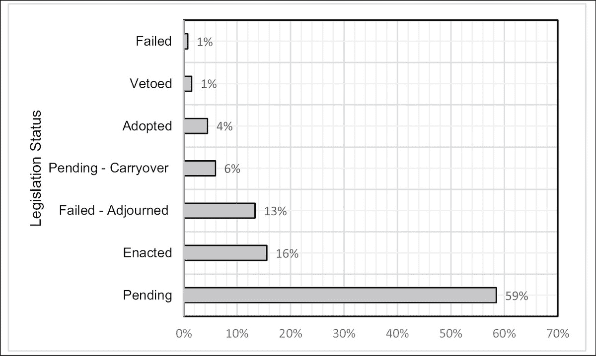

**图 11.1** 美国司法管辖区的立法状态。（数据来源：NCSL (2024)。2023 年 AI 立法。）⏎

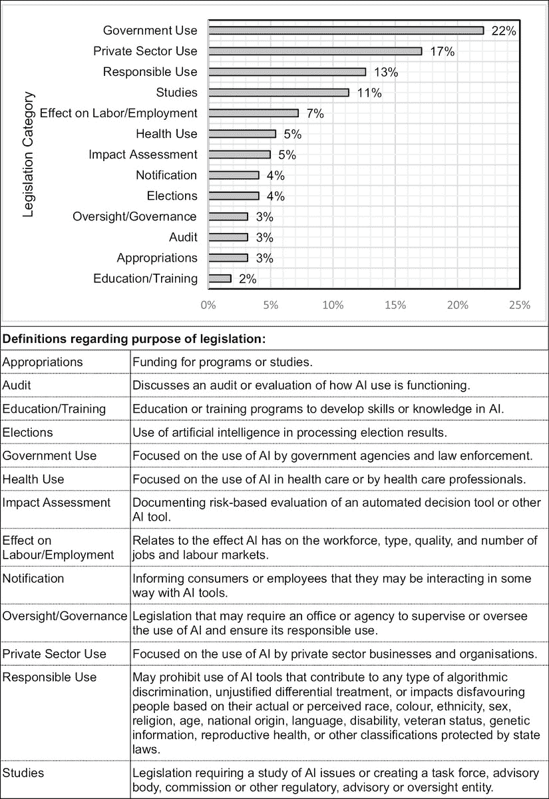

**图 11.2** 美国司法管辖区的立法分类。（数据来源：NCSL (2024)。2023 年 AI 立法。）⏎

**表 11.3** 已颁布立法和通过决议的示例⏎

| **州** | **描述** |
| --- | --- |
| 康涅狄格州 | 该立法规定州行政服务部对所有州机构使用的采用人工智能的系统进行登记，并从 2024 年 2 月 1 日起，对州机构使用的 AI 系统进行持续评估，以确保任何此类系统都不会导致非法歧视或差异性影响。此外，该立法要求政策与管理办公室针对州机构使用的 AI 系统制定有关其开发、采购、实施、利用和持续评估的政策和程序。 |
| 路斯安那州 | 路斯安那州通过了一项决议，要求技术与网络安全联合研究人工智能对运营、采购和政策的影响。 |


| 州 | 描述 |
| :--- | :--- |
| 马里兰州 | 该州设立了“工业 4.0 技术资助计划”，旨在协助某些中小制造企业实施新的“工业 4.0”技术或相关基础设施。“工业 4.0”的定义包含了 AI。 |
| 北达科他州 | 这项法律将“人”定义为个人、组织、政府、政治划分部门或政府机构或工具，并规定该术语不包括环境要素、AI、动物或无机物。 |
| 德克萨斯州 | 建立了一个 AI 咨询委员会，用于研究和监控州机构开发、雇用或采购的 AI 系统；北达科他州、波多黎各和西弗吉尼亚州也建立了类似的委员会。 |

*来源：* NCSL (2024). 《2023 人工智能立法》。

`NCSL (2024)` 声称，州立法者正在考虑 AI 的优势与挑战，越来越多的措施正被引入，以研究 AI 或算法的影响以及政策制定者可能承担的角色。

### 11.3.2.2 加加拿大

根据`White and Case (2024a)`，加拿大将在联邦政府层面通过《人工智能和数据法》（`AIDA`）对 AI 进行监管，该法案于 2022 年 6 月引入并已有效通过二读。随后，该法案于 2023 年 4 月 24 日提交至工业科学技术常委会。然而，创新、科学和工业部于 2023 年 11 月向常委会提交了若干修正案，因为原始版本的实质性内容有限，导致法律制度的大多数关键要素留待后续规定设定。这些拟议的修正案尚未被采纳，该法案不太在 2025 年 10 月之前通过。

拟议法案还包括《消费者隐私保护法》，这是对现行联邦隐私法和《个人信息和数据保护法庭法》的修订。然而，与美国的情况不同，尚未提出过在省层面直接监管 AI 的法律。另一方面，拥有魁北克政府授权的“魁北克创新委员会”建议通过省立法机关制定法律对 AI 进行具体监管。此外，`White and Case (2024a)` 认为，还有其他若干法律可能影响加拿大 AI 的开发和/或应用，无论是联邦、省还是领地法律，这些包括：

*   在联邦层面：《隐私法》和《个人信息保护和电子文件法》（`PIPEDA`）。
*   在省层面：《个人信息保护法》（适用于阿尔伯塔省）；《个人信息保护法》（适用于不列颠哥伦比亚省）；以及《私营部门个人信息保护法》（适用于魁北克省）。2023 年 9 月对魁北克法案的修订监管了基于个人信息处理的自动化决策，并要求披露处理行为的发生情况，以及提供有关导致决策的原因和因素的信息。
*   知识产权法可能会影响 AI 开发和某些方面。
*   竞争法可能会影响加拿大 AI 市场的结构。
*   “魁北克创新委员会”还提议修订魁北克劳动法以应对 AI 的影响。
*   现行的人权和反歧视法（包括《加拿大人权法》）监管歧视性结果和行为，例如可能由 AI 系统的偏见输出和决策产生的结果。

通常，`AIDA` 的目标是通过建立适用于全加拿大的通用义务（针对 AI 系统的设计、开发和应用），标准化 AI 系统的跨境贸易；并禁止任何可能对个人造成严重损害或损害其利益的 AI 系统行为，特别是偏见输出。`AIDA` 具有广泛的管辖范围，并适用于：(a) 在国际或省际贸易中（跨境贸易）期间提供的 AI 系统或机器学习模型；以及 (b) 跨境贸易期间使用的 AI 系统运营管理`White and Case, 2024a`。

总而言，`AIDA` 未采用特定行业的方法，而是根据特定人员涉及的 AI 系统类型以及他们在 AI 价值链中的地位，施加了各种责任。例如，管理、提供或首次在跨境贸易中提供通用型 AI 系统和高影响系统的个人，负有 `AIDA` 下的义务。这也适用于那些在跨境贸易期间首次提供机器学习模型以整合到高影响系统中的个人。

`AIDA` 涵盖了几个关键定义，即：(a) `AI system` 指使用 `model` 进行推理以生成输出的系统，包括预测、建议或决策；(b) `General-purpose system` 指设计用于许多领域、许多目的和活动或设计用于适应这些使用的 AI 系统，包括系统开发期间未预的领域、目的和活动；(c) `Machine-learning model` 是通过算法对数据进行自动处理以识别模式的数字表示，该算法旨在能够识别或复制这些模式`White and Case, 2024a`。此外，拟议的修正案解释说，AI 系统可以同时是通用系统和高风险系统。`AIDA` 纳入了风险分类概念。因此，如果一个 AI 系统具有以下应用，将成为一个“高影响系统”：

*   决策就业问题，如确定就业水平、招聘、派遣、薪酬、晋升、培训、学徒或终止。
*   采取与服务相关的决策，如确定是否向个人提供服务、提供给个人的服务类型或成本；或对提供的提供的服务进行排序。
*   在未经同意的情况下处理生物识别信息以识别个人；或评估个人的行为或心态。
*   对内容审核和排序做出决策，即对在线通信平台（包括搜索引擎或社交媒体设施）获取的内容进行审核，或对此类内容的呈现进行排序。
*   根据《食品和药品法》，在某些例外情况下，就医疗保健或紧急服务做出决策。
*   法院或行政机构对诉讼当事人进行的裁定。
*   如《刑法》所述，协助执法人员行使和履行执法权、职责职责。

根据`White and Case (2024a)`，`AIDA` 在合规要求方面实施了一套全面的方法，特别是针对风险管理措施的规定，这些措施取决于 AI 价值链中的特定角色。他们引用了两个具体的示例：

*   在跨境贸易中首次提供机器学习模型以整合到高影响系统中的人员（即开发者）必须在提供模型之前定义识别、评估和缓解偏见输出风险的流程。


最初提供高影响系统的人员必须确保实施风险缓解措施，并确保这些措施经过测试；而管理此类系统的人员负责进行测试，以确定缓解措施的有效性。

此外，White 和 Case 认为，AIDA（人工智能与数据法案）的义务是根据 AI 价值链中每个点面临的不同挑战和目标进行分类的。例如，在跨境贸易中最初提供机器学习模型以整合到高影响系统中的人员，必须确保已根据法规制定了尊重开发模型时所用数据的措施；且高影响系统运营者必须建立允许用户对系统性能提供反馈的程序。

AIDA 的一项重要要求是由提供通用系统或高影响系统的人员，或管理此类系统运行的人员创建并维护书面问责框架。与其他点不同，这些框架应包括：对所有贡献于提供系统或管理其运行的人员的角色、职责和报告结构的描述；与系统及系统使用的数据相关的风险管理政策和程序；以及法规要求的任何其他。。还指出，人工智能和数据专员由负责该法案的部长任命，并拥有执法 AIDA 的职责。AIDA 还针对个人和公司的某些违规行为规定了不同的处罚，可能导致巨额罚款或监禁。

### 11.3.3 非洲

根据 Sulaiman, Olën and Bezuidenhout (2024)，几个非洲司法管辖区正在实施 AI 战略，其中一些处于与利益相关者的协商阶段，而另一些尚未对 AI 监管做出任何声明。此外，他们还提到了非洲联盟（AU）关于 AI 监管的 AI 政策草案，该草案预计将于 2025 年获得成员正式批准。此外，非洲联盟目前有 55 个成员，涵盖大多数非洲国家。Sulaiman, Olën and Bezuidenhout (2024) 认为，非洲联盟草案包含了针对特定行业代码和规范、标准以及认证机构的建议，这些重点在于评估和基准 AI 系统、为 AI 测试提供监管监督，以及建立国家 AI 委员会。

因此，该框架为那些没有 AI 政策或法规的成员提供了追赶更先进成员的机会，并鼓励所有成员将其现有政策与非洲联盟政策草案保持一致，以确保非洲联盟成员之间的一定一致性。毛里求斯、肯尼亚和埃及作为非洲 AI 政策制定者领先，而南非和尼日利亚正在咨询利益相关者以启动 AI 政策。

#### 11.3.3.1 毛里求斯

毛里求斯政府考虑到 AI 可能为刺激国家经济以及解决面临的财务和社会问题提供机遇，建立了一个 AI 工作组。该工作组在与利益相关者充分协商后，于 2018 年制定并发布了《毛里求斯 AI 战略》。

该战略定义了三个关键要求，包括识别 AI 可能的应用场景和影响；创建一个鼓励 AI 开发的生态系统；以及建立 AI 监管的监管框架。此外，毛里求斯 AI 战略承认 AI 技术整合到更广泛的国家经济并支持生产力、经济增长和生活质量的能力。毛里求斯 AI 战略计划在中长期进行升级和增强，成为毛里求斯可持续增长和经济发展的关键支柱。该战略关注：

*   专注于特定部门并识别国家项目。
*   培养能力并吸引人才。
*   采取激励措施以促进实施。
*   思考 AI 的伦理问题。
*   在新兴技术领域建立战略联盟。
*   通过重点活动提高对 AI 的意识。
*   实施新技术以增强公共服务的交付。

此外，还提出了若干支持 AI 战略的项目，包括利用区块链技术进行纳税、土地登记和医疗保险管理；使用 AI 增强能源部门；使用 AI 提高制造业的效率和竞争力；使用 AI 在医疗保健和生物技术行业实现跨越式发展；在农业工业、海洋经济和交通中使用 AI。

AI 战略强调了涉及法律监管框架、伦理和数据保护的若干问题。此外，它建议政府加快《知识产权法案》；更新过时的法规以允许 AI 开发，例如金融科技、移动支付、众筹和众贷；通过设立永久伦理委员会来确保伦理 AI 系统；成立特别工作组对数据保护立法进行必要的修订；并考虑开放数据访问政策。

#### 11.3.3.2 肯尼亚

与毛里求斯一样，肯尼亚政府也承认 AI 应用可能提供经济机会。因此，在 2018 年成立了分布式账本技术和 AI 任务小组。2019 年，该任务小组发布了一份报告，主张 AI 对促进肯尼亚全球经济竞争力增长的潜力。任务小组报告产生了基本思想，通过大幅增加对基础设施和技能的投资，将该国定位为信息通信技术（ICT）领域的区域和国际领导者。它还提出了协调私营部门创新与监管的战略。

信息技术部长提交了《2022-2032 年国家数字主计划》，该计划接受了任务小组报告的关键观点，并支持其对促进 AI 行业研发的支持。此外，主计划定义了部门 ICT 战略，旨在实施 AI 部署及其监管挑战的解决方案，并将 AI 解决方案传播到其他国家。主计划还强调了与 AI 行业领先者（包括新兴技术领域的者）建立国际伙伴关系。

此外，2024 年通过肯尼亚政府与德国德国合作机构（GIZ）的战略联盟，在完成肯尼亚国家 AI 战略方面取得了重大进展。该联盟启动了“全民人工智能”（FAIR）倡议，该倡议也得到了德国联邦经济与发展部和欧盟的支持。

#### 11.3.3.3 埃及

与肯尼亚一样，埃及强调需要促进技术转让并吸引外资。埃及国家人工智能委员会（NCAI）制定了埃及国家 AI 战略，支持埃及在特定阶段实施 AI。AI 战略的第一阶段目标是让埃及成为区域 AI 合作的关键参与者。因此，这一阶段强调了埃及与外国利益相关者之间合作 AI 能力的增长，而非其国家或内部开发。


挖掘埃及内部 AI 增长潜力将在 AI 战略的后期阶段进行。尽管如此，与信息技术部长和国家人工智能委员会（NCAI）之间关于第二阶段的讨论已经开始。第二阶段将侧重于启动第一阶段确定的几项优先计划，这些计划旨在增加投资、提高公众意识并在埃及开发更强大的 AI 能力。

埃及似乎没有任何针对 AI 的直接法律。然而，AI 通过现有法律受到间接监管，例如《电信监管法》（2003 年）受此此约束。该法主要关注电信服务，但也涉及数字数据管理，这被认为是 AI 运行的核心组成部分。此外，2020 年的《埃及数据保护法》在监管 AI 起着至关重要的作用。该法效仿欧盟的《通用数据保护条例》（GDPR），该条例确立了数据隐私和安全标准，直接影响处理海量个人数据的 AI 系统。该法还规定在收集数据时必须获得同意，这是 AI 功能的重要因素，特别是对于面向消费者的应用程序而言。

根据 Iskander (2024) 的观点，随着埃及 AI 的不断演进，需要持续的法律和监管发展。他认为这包括更新现有法律并引入应对 AI 技术所带来的独特挑战的新法规。Iskander (2024) 认为，在拥抱 AI 潜力的同时降低其风险，需要一种平衡的方法，将法律严谨性与伦理考量以及全球最佳实践相结合。

### 11.3.3.4 南非

通常情况下，南非、尼日利亚和摩洛哥像埃及一样，依赖现有立法进行 AI 监管。根据 White and Case (2024b)，南非尚未宣布任何 AI 监管提案，但处于国家 AI 计划草案的咨询阶段。通常情况下，南非对 AI 缺乏监管。然而，现有法律的某些方面监管了使用 AI 的组织进行的某些活动，包括《个人信息保护法》（POPIA）、《版权法》、《《专利法》和《竞争法》。

White and Case (2024b) 认为南非尚未发布任何关于 AI 监管的政策文件或提交议会的法案。然而，White and Case 指出了以下被认为考虑未来任何预期监管具有重要意义的进展：

*   2019 年 4 月：总统任命第四次工业革命总统委员会（4IR 委员会）成员，以确定相关的政策、战略和行动计划，使南非成为具有竞争力的全球参与者。
*   2019 年 5 月：经合组织（OECD）及南非在内的伙伴国家正式通过了第一套非约束性政府间 AI 政策指南，同意支持旨在确保 AI 系统设计健壮、安全、公平且可信赖的国际标准。
*   2022 年 11 月：通信和数字技术部启动了南非 AI 学院和 AI 枢纽（约翰内斯堡大学和茨瓦瓦科技大学）。
*   2024 年 4 月：通信和数字技术部部长组织了 AI 峰会，公布了国家 AI 计划讨论文件草案的内容，该文件作为政策制定流程，旨在获取并收集纳入计划草案的意见。

与其他非洲国家一样，南非也有几项法律并不直接监管 AI，但可能会影响南非 AI 的开发或使用。White and Case (2024b) 提供了一些关键示例：

*   《个人信息保护法》，涵盖对个人数据的任何自动处理。
*   《版权法》和《专利法》，适用于 AI 生成的成果，其中一项已在南非获得专利。
*   《竞争法》，虽然不直接监管技术，但适用于数字合并和数字平台。
*   一份《网络安全法案》于 2024 年发布，它将 AI 纳入监管系统和基础设施，并可能要求 AI 产品通过认证。

由于南非没有直接监管 AI 的法律，因此没有法律认可的单一定义。然而，国家 AI 计划草案提到了欧盟委员会的定义。此外，缺乏 AI 立法意味着目前对 AI 开发者、用户或部署者没有施加特定的或独特的义务，除了《个人信息保护法》（POPIA）中涉及个人信息自动处理的规定外。《个人信息保护法》第 71 条(1)规定了自动决策，保护数据主体免受完全基于自动决策的影响，这种决策会导致数据主体被画像化。

White and Case (2024b) ，南非 AI 计划讨论文件记录了未来将考虑的几个监管领域：

*   由生成式 AI 应用和软件创建的虚假信息和新闻。
*   AI 开发者和用户可能表现出的偏见和歧视。
*符合世界知识产权组织的版权滥用。
*   保护个人、隐私和公共隐私。

White and Case 还指出，AI 计划讨论文件缺乏基于风险的方法，而是专注于考虑以下方面的最佳监管形式：

*   如果关键 AI 模型或其他赋能因素集中在少数玩家手中，会导致反竞争行为。
*   应用 AI 决定行动的机器人或自主设备的风险，例如 AI 驱动的自动汽车。
*   导致社会风险的持续失业。
*   犯罪行为或其他严重的后果。
*   AI 失控并从事危害人类目标情况的经验风险。
*   用于军事目的的 AI 流向更广泛的世界，导致更严重的犯罪行为或其他严重的后果。

南非正在通过南非人工智能研究中心（CAIR）扩大其 AI 知识中心，该中心整合了在南非进行 AI 研究的八所大学。CAIR 活动的资金主要由南非科学与创新部以及南非 AI 学院支持。

上述情况说明，几个非洲国家在平衡 AI 监管与创新方面是活跃的贡献者。还有一些非洲国家正在制定和实施用于公共部门改革、教育和研究的 AI 战略和政策。然而，尽管非洲的 AI 创新生态系统非常活跃，但大多数司法辖区缺乏直接的 AI 法律。尽管如此，非草案政策一旦获得成员同意，可能会使非成员国实现 AI 监管发展的跨越，包括那些处于开发和实验阶段的国家。

### 11.3.4 南美


南美国家的趋势是积极制定 AI 监管政策，以支持伦理 AI 开发、保护人权并促进创新。通常情况下，许多南美国家正在积极寻求立法行动，已各自的议会和立法机构提交了多项法案。这表明，各国对于建立法律框架以有效监管 AI 的意识和承诺日益增强。此外，这些立法努力侧重于解决该地区的社会经济、教育和政治挑战。

`Muñoz (2024)` 认为，拉丁美洲最近的选举凸显了算法和人工智能（特别是生成式 AI）在投票站的危险影响。他认为，在 2023 年哥伦比亚地区选举期间，竞选活动受到通过社交媒体传播的虚假信息的损害，并出现了 AI 生成的媒体内容或深度伪造内容，这些内容旨在破坏候选人的政治竞选。Muñoz 声称，阿根廷 2023 年选举期间也发生了类似的欺骗行为，候选人 `Patricia Bullrich` 成为 AI 生成音频的焦点，这些音频诋毁她为经济部长。在最近的墨西哥选举中也经历了这种情况，一段候选人 `Claudia Sheinbaum` 的深度伪造音频模仿她批评总统 `Andrés Manuel López` 并承认在民意调查中欺骗。

2023 年 10 月，智利举行了一场高级 AI 峰会，来自整个南美和加勒比地区的关键政府部门。《圣地亚哥宣言》是此次会议的重要成果，标志着该地区重大的组织转变。《圣地亚哥宣言》强调了建立统一治理和监管框架的坚定努力，以适应该地区的独特需求和背景。会议的一个重要成果是建议为拉丁美洲和加勒比地区建立一个政府间的 `AI 委员会`，这符合 `UNESCO` 关于 AI 伦理的建议，旨在加强该地区的 AI 能力，营造一个让伦理考量和人权处于 AI 开发和实施首位的环境。然而，尽管有了这一宣言，许多南美国家仍在追求各自的独立 AI 战略以应对其特定的挑战。本节将讨论几个南美国家，以确定该地区 AI 监管的现状。

### 11.3.4.1 阿根廷

2023 年 10 月，阿根廷在`众议院`提交了一项`AI 监管法案`，该法案定义了 AI 特定术语；建立了指导原则；列出了排除项目；并提议在`国家行政部门`内设立一个 AI 的行政实体。此外，2023 年底启动了多项法案以修订`刑法典`，以便对违反性完的 AI 相关犯罪进行惩罚。

`参议院`还提交了一项`法案`，要求从事 AI 的组织在`AI 系统国家注册处`进行登记，以便根据从有限到不可接受的风险水平对 AI 系统的影响进行确定和分类，具体如下：

*   不可接受的风险：这些由于其严重性或对基本权利或个人安全的影响而变得不可接受的风险。具有不可接受风险的 AI 系统将要求实施适当的缓解措施或禁止该系统。
*   高风险：这些是对基本权利或个人安全产生重大影响的风险。AI 系统中存在高风险将要求采取适当的缓解措施。
*   有限风险：这些是对基本权利或个人安全产生微影响的风险，但仍需要缓解措施。
*   微小风险：这些是对基本权利或个人安全产生极小影响的风险。

法案草案提出了以下价值观和原则：

*   多样性与包容性：AI 的开发必须确保所有个人或群体参与，无论种族、肤色、遗传、性别、年龄、语言、宗教、政治观点、民族或社会出身、经济状况或任何破坏尊重多样性和社会包容的形式或条件。
*   和平与正义：AI 的进步必须维护国家间的和平正义，不能削弱人类自由或减少人类的选择自主权。也不应危害个人或集体安全，分裂或对抗个人和群体，或威胁人类与其他其他生物以及环境之间的共处。

拟议的法律并未说明如何评估 AI 系统对和平和社会正义的可能影响，也没有说明实施何种方法来确保所有人的参与以促进对多样性和社会包容的尊重。草案规定了尊重多样性和促进非歧视、以及尊重人类自由和自主的原则和价值观，但并未深入探讨。然而，它赋予了`科技内阁`在认为原则和价值观被侵犯时暂停 AI 研究、开发或应用的的。此外，`科技内阁`还将负责接收有关这些技术造成的威胁或伤害的投诉。`信息技术秘书处`发布了关于遵守民主原则和个人权利的 AI 系统开发指南。这些指南包含了各种原则，如透明度、可解释性、安全性、隐私、非歧视和数据保护。

促进 AI 使用中透明度和数据保护的责任已分配给`公共信息获取机构`，该机构启动了`“AI 透明性和个人数据保护计划”。`该计划的目标是分析、监管和加强国家在公共和私营部门开发 AI 应用的能力。它还旨在定义 AI 使用中透明度、算法透明度和数据保护的良好实践、学习并提出建议。此外，AI 倡议的协调委托给`部长级 AI 圆桌会议`，该会议由`国家行政部门`通过整合政府机构设立。总之，由于竞选中对 AI 技术的密集利用，阿根廷在最近的总统选举期间 AI 作为一个重要话题出现。然而，选举结束后，这个问题尚未成为该国政治议程的优先事项。

### 11.3.4.2 巴西

目前，巴西通过启动三项新法案来监管 AI 的开发和使用，成为南美 AI 监管的领导者。这些法案是`巴西 AI 战略`的结果和后续，该战略旨在培养值得信赖和符合伦理的 AI。这也遵循其他南美国家的活动，这些国家分别发布了指南以支持安全公平的 AI，包括哥伦比亚的 AI 伦理 框架和阿根廷的值得信赖 AI 指南。此外，巴西的监管倡议正值全球范围内增加将负责任的 AI 实践法律化的努力，特别是在`欧洲`、`加拿大`和`美国`等西方司法管辖区，以及像`中国`这样的大国（中国主要关注监管生成式 AI）。


在 2019 年至 2021 年间，巴西启动了三项人工智能法律，旨在平衡减少伤害与促进创新之间的关系。然而，这些法律并未获得国会批准。这三项法案在 2023 年 5 月被一项综合法案所取代，该法案与《欧盟人工智能法案》有若干相似之处，例如采用了基于风险的人工智能监管方法。具体而言，2023 年提出的关于制定人工智能开发和使用框架的草案已提交至国会。最新的草案强制实体确保透明度并减轻偏差，特别是针对高风险人工智能系统，并要求提供详细的公共影响评估，概述系统的目标、风险缓解措施和利益相关者的参与，组织将对造成的任何损害承担严格责任。

与阿根廷一样，拟议的法案定义了人工智能特定的术语；确立了指导原则；列举了禁止事项；并在国家行政部门内部设立了人工智能管理机构。巴西国家人工智能战略的重点主要是公民权利、风险分类和治理程序，包括行政制裁。对人工智能的定义在之前的草案基础上进行了完善和扩展。人工智能系统被定义为具有不同自主程度的计算系统，旨在通过机器学习和/或逻辑与知识表示来推断如何实现给定的目标。此外，该过程依赖于人类或机器的输入数据，并产生预测、建议或决策以影响现实或虚拟环境。如前所述，2023 年的草案基于类似于《欧盟人工智能法案》的基于风险的方法，并关注赋予个体的权利，这些权利包括：

*   获得有关与人工智能系统交互的预先信息。
*   获得关于人工智能系统输出结果合理化说明。
*   对人工智能系统做出的具有法律后果或其他产生重大影响变化的决策或预测提出异议。
*   在关于人工智能系统的决策中引入人类参与。
*   免受歧视并纠正歧视性偏差。
*   隐私和个人数据保护。

为了确定人工智能系统的风险，拟议草案规定，人工智能系统在上市或委托之前，必须由供应商进行初步评估，评估结果须记录并注册以证明问责制和责任。此外，如果评估检测到系统被归类为高风险，则除了治理措施外，还强制进行算法影响评估。在拟议的法律中，以下应用被归类为高风险系统：

*   管理和运行关键基础设施的安全设备。
*   教育和职业培训。
*   招聘、筛选、过滤和评估求职者，以及其他就业决定（如晋升和终止）。
*   对公共和私立服务的访问和权利。
*   信用评级和债务能力计算。
*   建立应急响应派遣的优先级。
*   司法行政。
*   自动驾驶车辆。
*   医疗保健应用。
*   生物识别系统。
*   刑事调查和公共安全。
*   通过审查大量复杂数据集以识别隐藏关系的犯罪分析性研究。
*   刑事调查期间对证据信度的评估。
*   移民管理和边境管制。

人工智能应用被强制实施透明度和数据管理流程；遵守数据保护立法；训练、测试和验证系统结果的实践；以及信息安全流程。人工智能系统必须符合高风险系统的特定监管程序，例如文档记录、操作自动记录、可靠性和稳健性测试，以及避免偏差的数据管理。

与欧盟的要求一样，草案禁止具有极端风险的人工智能系统。此类系统包括利用暗示手段传递有害行为的系统；利用特定群体的脆弱性制造有害行为的系统；以及公共实体以社会评分为目标使用的系统。此外，生物识别系统仅在提供有关安全活动和个人化刑事起诉的司法授权的情况下，才可在公共开放空间中使用。

制度框架基于建立若干个监管人工智能的实体，包括科学、技术和创新部（MCTI），该部门负责定义和部署人工智能政策。此外，其国家数据保护局负责确保人工智能系统符合数据保护法。它还设有委员会，负责促进和讨论人工智能监管，其中包含公众咨询过程，以收集并考虑利益相关者的意见。

人工智能系统中的个人数据受《通用数据保护法》（LGPD）监管，该法规定了数据处理的标准，包括透明度、安全和问责。LGPD 由国家数据保护局执行，确保人工智能应用遵循数据保护规则，并有权实施罚款和处罚。其事件报告流程记录所有人工智能事件，审计框架则验证人工智能系统是否符合法规。关键利益相关者包括来自学术界、工业界和社会的专家，他们参加多利益相关论坛讨论人工智能监管，以确保框架有效。

### 11.3.4.3 哥伦比亚

2023 年 11 月，哥伦比亚参院批准了一项为人工智能开发和使用建立法律指南的法案，该法案整合了数据保护、知识产权政策和伦理规范。人工智能的定义似乎较为薄弱，将其描述为一门“关注创建执行与人类思维执行的任务相当的计算机程序的学科，例如学习或逻辑推理”。根据这一定义，计算机程序可能模仿或与人类思维的能力相当，但它忽略了人类中产生学习的神经生理过程在多大程度上仍然是一个谜团。此外，该定义假设人工智能程序能够进行逻辑推理，而实际上它是在开发团队预先建立的预测模型上运行的。

该法案包含了与联合国教科文组织建立以及哥伦比亚政府 2021 年发布的《人工智能伦理框架》一致的原则，如下：

*   人类权威：任何人工智能决策都应该是可审计且可被人类决策质疑的。
*   公共利益：人工智能的目标必须仅是为了公共利益。
*   合作：人工智能研究应促进围绕风险抑制的合作。
*   安全设计：人工智能的任何开发都应对其可能造成的有害影响制定规定。
*   人类智能优先：确保人类决策始终优于人工智能。
*   预防性研究：风险规避开发应与人工智能开发同步进行。


其目的是建立一个人工智能数据与发展处理委员会，其任务将包括建议新的技术倡议；批准可能源于公共机构关于人工智能开发和实施的机构要求；建议公共管理方面的倡议；并以顾问身份向哥伦比亚会议提供建议。所有开发和/或使用人工智能应用程序的组织必须在科学、技术和创新部（MCTI）注册，该部门负责所有 AI 政策的合规性与执行。MCTI 已设立一个委员会来讨论 AI 监管规定，并管理公众咨询流程以收集公众意见。

哥伦比亚的数据保护法规定 AI 开发者必须确保数据受到保护并尊重人权。哥伦比亚承认两项基本的个人数据权利，即隐私权和数据更正权。此外，个人数据处理受两项法定法律和多项法令的监管，这些法律规定了数据保护义务，由两个不同的部门负责数据保护和数据隐私事务。工业和商业局（`SIC`）作为通用机构运行，而金融监督局（`SOF`）作为金融机构、信贷局和其他管理财务数据或信用记录实体的监督者，负责核实相关法律的执行情况。

然而，`SIC` 是个人数据保护和数据隐私方面的主管机构，有权对公司不当收集、存储、使用、传输和删除个人数据的行为进行调查并实施处罚。参与 AI 监管的关键利益相关者包括来自学术界、工业界和公民社会的专家，他们为使框架有效运作提供了必要的投入。哥伦比亚曾是该地区讨论 AI 问题的先驱，但由于在当前的政治议程中被列为低优先级，似乎已经失去了其在 AI 监管方面的强有力驱动力。

### 11.3.4.4 墨西哥

墨西哥政府于 2023 年 3 月发起了一项法案，旨在为 AI 开发建立伦理框架，重点是保护人权和个人数据，并确保 AI 系统尊重人类尊严。与大多数国家一样，关于私营实体持有个人数据保护的法律通过规定数据保护指南，在 AI 环境中保护个人方面发挥着重要作用。

法律规定，AI 开发者必须实施措施保护数据免受访问、丢失或损坏。拟议立法的目标包括：

*   为国家领土内人工智能和机器人人的伦理使用制定公共政策指南。
*   促进基于伦理原则制定官方标准，以便造福社会适当使用人工智能和机器人，尊重人权、性别平等，不受基于种族、族裔、宗教、社会阶层或经济地位的歧视。
*   监管和治理用于政府、经济、商业、行政、通信和财务目的的人工智能和机器人使用，使其始终符合伦理和法律标准。
*   建立并监管人工智能和机器人伦理委员会，作为一个为公民服务的去化公共机构。
*   通过对国家领土内 AI 使用规定统一自治机构，将国家统计、地理和信息学院作为提供 AI 应用信息的中心。

科学、技术和创新部（`MCTI`）管理所有 AI 政策。`MCTI` 内部建立了一个委员会，通过公众咨询流程讨论并制定 AI 监管规定。该部门已概述计划建立一个数字和 AI 政策中央政府办公室以及一个国家 AI 中心，以支持学术界、工业界和政府之间的合作。此外，`MCTI` 负责监控 AI 监管合规情况，并有权罚款和处罚。政府的 AI 战略强调了培养教育、在学校推广计算思维以及增加 AI 和数据科学领域的硕士和博士学生人数，作为确保负责任的 AI 开发和使用的手段。然而，尽管在研究和创新方面处于区域领先地位，墨西哥目前似乎并未优先考虑 AI 监管，特别是由于 2024 年的大选。

### 11.3.4.5 智利

智利于 2021 年发起了《国家人工智能政策》，其目标是促进 AI 工具的使用和开发，并理解 AI 对法律、伦理、社会和经济的影响。它还规定了 AI 的定义，即：“允许机器执行通常需要智能的任务（如推理或学习）的计算机技术集合”以及“一种能够根据给定的人类定义目标做出预测和建议，或做出影响现实或虚拟环境决策的计算系统”。随后，在 2024 年提出了一项监管 AI 的法案，旨在尊重民主原则和人权的同时促进 AI 系统的发展，并规定了 AI 开发者、供应商、AI 系统委托方和进口的的。

目前，国会正在处理五项与 AI 相关的法律草案，这些主要与刑事事务有关，旨在加重或惩罚滥用 AI 工具的行为。然而，旨在监管 AI 的关键立法倡议涉及其不同应用领域的 AI 系统、机器人和相关技术。该拟议立法的目标是监管与 AI 各种行为，为 AI 系统的开发、商业化、分配和使用建立法律框架，旨在保护公民的基本权利。

拟议法律还识别了涉及 AI 全周期的利益相关者，从开发者、供应商到用户不等。它还识别了有助于解释的基本概念，包括生物识别数据和输入数据，以及“重大事故”的含义。因此，它提到了死亡或对健康、财产或环境造成严重伤害以及关键基础设施中断的情况。一些人认为这具有限制性，因为严重事故可能是歧视性结果导致，从而影响一个或多个人的尊严。该法律采用了类似于《欧盟 AI 法案》的风险评估方法，拟议法案将 AI 系统分为两个不同的风险等级，即不可接受的风险和高风险。

批评者声称，关于不可接受风险系统的条款措述过于模糊，不够明确以确保在部署基于 AI 的系统时对个人基本权利提供充分保护。例如，例外条款可能会使在公共场所出于预防目的应用远程脸识别技术合法化，这被视为一种自上而下的机制，可能导致拉丁美司法管辖区基本公民权利的侵犯。同样，被认为是高风险的系统也被视为疑点，因为应该始终有人类监督，特别是在涉及刑事的案件中，判决（使用 `AI`）可能涉及对个人自由的限制。


科学、技术、知识与创新部负责管理人工智能（AI）政策。为此，该部门已推出多项促进 AI 开发和使用的倡议，包括建立国家 AI 委员会。该委员会负责评估来自 AI 开发者、提供者和用户的授权请求。政府计划引入一套合规与执法监管框架，以确保 AI 规章得到遵守。该框架包含了监控和强制执行合规规则的措施，并对不合规行为进行罚款和处罚。与墨西哥一样，政府非常重视有关负责任的 AI 开发和使用的教育与意识培养。

## 11.3.4.6 秘鲁

秘鲁目前是南美洲在监管 AI 以保护公民权利和促进伦理 AI 开发方面的领导者。2023 年，秘鲁政府启动了一项基于欧盟《AI 法案》的法案。该法案强调对人权、隐私和数据保护的尊重，同时通过维护 AI 透明度和创新原则来确保公民的安全与。

此外，该法案在经济和社会发展的国家转型进程框架内促进 AI 的发展，并设定了基本原则，例如基于风险的安全、伦理开发和隐私。所有领域 AI 开发和使用的关键指导原则如下：

*   基于风险的安全标准：培养基于风险的 AI 使用和开发方法。
*   参与者多元化：鼓励自然人、法人或公共和私营组织及机构参与与政策开发相关的讨论，其目标是监管 AI 的使用。
*   互联网治理：支持国家、私营机构和公民社会在其各自的角色中，开发和使用原则、规范、规则、决策实践和方案，这些方案将影响互联网的增长和使用。
*   数字社会：承认通过访问、使用和开发各个领域的数字技术所获得的信息和知识的价值；促进安全、信任、数字经济、数字连接、人才、创新、教育和数字身份；以及利用新兴技术促进公民的社会和经济福祉。
*   负责任 AI 的伦理开发：将伦理视为准确识别 AI 系统使用中责任框架的根本。
*   AI 隐私：确保 AI 不侵犯个人隐私，必须以安全的方式运行，以对公民产生积极且有益的影响。

拟议法案建议建立一个国家机构来管理和监管 AI 的使用推广。政府还引入了评估 AI 开发者、提供者和用户授权请求的措施。预期的监管框架目标是通过引入监控和执法措施（如对不合规行为进行罚款）来确保符合 AI 规章。此外，政府正在开展一项意识宣传活动，向公众普及负责任使用 AI 的知识。

拉丁美洲在 AI 监管方面处于早期阶段，各国正面临挑战，并努力在这一新兴领域定义各自的政治议程。迄为止，大多数此类国家还没有针对 AI 的专门立法。值得注意的是，不久前在欧盟获得批准的欧盟《AI 法案》已成为许多南美国家讨论和立法提案的参考。尽管如此，这些国家必须面对如何在剧烈的地区差异下，将这些概念适应其当地现实的挑战。

上述内容表明，拉丁美洲的 AI 监管正在逐渐演变，但与非洲不同（非洲有一个中央非洲联盟机构鼓励统一的 AI 监管方法），南美国家正在制定各自的 AI 战略。然而，这些个人战略表明，每个国家在创建法律框架、减少偏见和保护个人数据方面都面临着重大挑战。像欧盟和非洲国家那样的统一方法将有利于 AI 在南美地区的部署。

## 11.3.5 澳大拉尼西亚

澳大拉尼西亚立法板块将关注澳大利亚和新西兰。与全球其他地区一样，澳大拉尼西亚的 AI 监管格局正在变化，但专门与 AI 相关的立法进展较为缺乏。

### 11.3.5.1 澳大利亚

澳大利亚没有任何针对 AI 带来的特定风险和挑战的联邦法律或监管框架。目前，政府对 AI 的应对基于自愿（自律）监管，包括 2019 年发布的《AI 伦理原则》，该原则包含用于负责任设计、开发和实施 AI 的八项原则。这些自愿原则与经组织的 AI 原则一致，即：

*   人类、社会和环境福祉：AI 系统应造个人、社会和环境受益。
*   以人为本的价值观：AI 系统必须尊重人权、多样性和个人自主权。
*   公平性：AI 系统应具有包容性和易用性，且不能涉及或导致对个人、社区或群体产生不公平的歧视。
*   隐私保护与安全：AI 系统必须尊重和维护隐私权及数据保护，并确保数据安全。
*   可靠性与安全性：AI 系统必须按照其预期用途可靠地运行。
*   透明度与可解释性：AI 系统必须是透明的，并包含负责任的披露，以便人们识别自己何时受到 AI 的重大影响，并在 AI 系统与其互动时能意识到这一点。
*   可争议性：当 AI 系统对个人、社区、群体或环境产生重大影响时，必须有一个及时的流程允许人们对 AI 系统的使用或结果提出挑战。
*   责任制：对 AI 系统生命周期不同阶段负责的人必须是可以识别的，并对其结果负责，且应该实现对 AI 系统的人为监管。

由于澳大利亚没有任何专门的联邦法律或监管框架，且 AI 伦理原则是自愿的，因此澳大利亚没有专门的 AI 监管机构。尽管如此，已有若干适用于 AI 技术开发、供应和使用的法律法规。此外，具有国际关联（包括在欧盟境内）的澳大利亚实体可能会受到适用外国法律域外管辖的影响。

解决这一现状的积极步骤于 2024 年 1 月采取，工业科学与资源部发布了一份名为《澳大利亚安全且负责任的 AI》的文件。该文件是基于几个月前公众咨询过程的回应。它概述了政府的 AI 监管方法，并展示了对特定 AI 使用场景启动监管的承诺。这种方法并非旨在进行变革，而是倾向于平衡的方法，从而确保澳大利亚 AI 系统的开发和部署在一个安全可靠的法律环境中进行。然而，批评者认为这种方法存在风险，并允许低风险场景下的 AI 使用主要在不受限制的情况下继续。


此外，该文件并未详述将受监管的高风险 AI 应用范围。其侧重于 AI 影响的定义（被描述为系统性的、不可逆的或永久的）并不清晰，仅表明将采取与欧盟在高风险应用监管类似的方法。这一问题在 AI 应用于自动驾驶车辆以进行实时决策，以及用于医疗手术的 AI 驱动机器人方面尤为引起关注。Bradshaw et al. (2024) 识别了政府短期内的以下意图：

*   进一步就启动新监管护栏的方案进行咨询，重点关注测试、透明度和问责制。
*   采取措施，通过制定自愿性行业 AI 安全标准来促进企业实现安全且负责任的 AI；该标准将汇编现有的负责任 AI 原则、指南和框架，以创建一个最佳实践和最新的基于风险的 AI 安全框架；启动与行业合作，研究在高风险情景下对 AI 生成内容进行自愿标记和水印处理的优缺点；并建立临时专家顾问小组以支持政府开发 AI 护栏。
*   考虑其他机会以加强现行法律，重点关注 AI 带来的风险和伤害（例如，审查隐私法改革以及政府对其网络安全战略的努力）。
*   推进《布莱切利宣言》（Bletchley Declaration）中做出的承诺。
*   开展国际合作制定全球 AI 治理，以承认对 AI 产生风险的国内应对，并寻求加强澳大利亚专家在开发 AI 技术标准的关键国际论坛中参与的途径。
*   进一步研究确保澳大利亚能够最大化 AI 技术利益的机会。

在中期回复后，政府建立了一个专家小组来协助部门开发 AI 护栏，并研究确保澳大利亚能够最大化 AI 技术利益的机会。根据 Bradshaw et al. (2024)，中期回复包括以下重要进展：

*   **2024 年 7 月：AI 评估框架。** 新南威尔士州发布了 AI 评估框架，以促进安全且负责任的 AI 应用。
*   **2023 年 12 月：生成式 AI 框架。** 联邦政府批准了生成式 AI 框架，旨在指导生成式 AI 的负责任使用。
*   **2023 年 11 月：布莱切利宣言。** 联邦政府签署了《布莱切利宣言》，与各国共同合作识别并关注的 AI 安全风险。
*   **正在进行的相关法律审查。** 这包括对《隐私法》的改革，旨在提高 AI 的透明度和问责制，并为监管机构提供更大的执法权力。

重大进展发生在 2024 年 3 月，当时参院通过了一项决议，建立了 AI 采纳专门委员会。该委员会的职责范围包括：

*   审查 AI 开发和采用的趋势与机遇。
*   调查 AI 技术带来的风险和伤害，例如偏见、歧视和错误。
*   探索缓解 AI 风险的方法。
*   研究有利于公民、环境、医疗和经济增长的机会。
*   支持负责任 AI 的机遇。
*   审查对民主和机构信任的潜在威胁。
*   评估 AI 技术的影响。

该专门委员会计划于 2024 年 9 月前向议会报告。该委员会收到了来自个人、跨国公司和行业组织的 200 多份提交意见，其中包括微软、谷歌、OpenAI 以及澳大利亚法律委员会。这些公开意见的主要主题涉及：

*   **深度伪造技术（Deepfake）：** AI 生成的深度伪造被视为民主进程和个人隐私的严重关注，因为它具有误导公众的能力。深度伪造内容被视为特别令人担忧的问题，正通过众院的一项法案进行解决。
*   **透明度：** 意见强调在 AI 增强产品的测试和开发阶段需要监管，特别是关于数据集来源以及 AI 增强系统的清晰披露，特别是在用户并不知道自己正在查看 AI 生成内容的情况下。
*   **偏见：** 算法偏见被认为可以通过产生偏见的结果来导致倾斜结果。认为需要风险管理流程来减轻算法偏见的影响。
*   **AI 的收益：** 尽管存在风险，AI 的采用被认为在环境、医疗和教育等领域产生了收益。

根据 White and Case (2024c)，影响 AI 的其他法律包括：(i) 《在线安全法》（Online Safety Act），该法包含处理在线安全问题的机制，延伸至 AI 生成的内容；(ii) 《澳大利亚消费者法》（Australian Consumer Law），该法被应用于算法决策，通过对某公司因其算法建议误导消费者进行罚款；(iii) 《隐私法》（Privacy Act）；(iv) 《公司法》（Corporations Act）；以及 (v) 可能影响 AI 开发和使用的多个方面的知识产权法，反歧视法（例如个人成为 AI 驱动过程产生的歧视性结果的受害者）。

在中期回复中，澳大利亚政府预计将加强现行法律以应对 AI 带来的有害影响。因此，联邦政府正在制定新法律，赋予“澳大利亚通信和媒体管理局”（Australian Communications and Media Authority）监管权力，以打击在线虚假信息和误导性信息，延伸至数字平台上的 AI 生成内容。White and Case (2024c) 认为，澳大利亚尚未任何法律或法规正式采纳过 AI 的定义，但工业、科学和资源部接受了以下声称基于国际标准组织的定义：


- “AI”意味着“一种经过工程设计的系统，能够根据一组人类定义的目标或参数，在没有显式编程的情况下生成预测性输出，如内容、预测、推荐或决策。AI 系统的设计旨在以不同程度的自动化运行。”

- “机器学习”意味着“利用机器学习算法从训练数据中提取模式，这些模式可以应用于新数据以实现预测或决策目的。”

- “生成式 AI”意味着“生成新内容（如文本、图像、音频和代码）的模型。”

通常情况下，中国政府对 AI 的开发和使用持支持且务实的态度，主张平衡的方法以防止社会和经济损害。虽然政府加强了对 AI 技术的监管，但它采取了谨慎风格，通过针对特定应用制定规则而非采用整体监管方法，以避免限制 AI 创新。限制 AI 创新并非可行方案，因为决策者认为 AI 技术是未来整体创新发展以及数字环境下智能工业实践的一个重要且具有决定性的因素。

与大洋洲国家一样，中国的大大多数监管规定并非强制性，且仍在演变中。这一普遍规则的几个例外是高层次的网络安全和数据保护义务，以及由`国家互联网信息办公室`（`CAC`）发布的某些要求。值得注意的是，自 2017 年以来七年来，中国政府在 AI 开发方面启动了三个不同阶段，每个阶段都展示了对 AI 利益和方法的独特平衡。Gong et al. (2024) 声称，中国最初优先考虑行业自律，关键规划政策倡导行业有必要投资技术并利用市场机会。

### 11.3.5.2 新西兰

新西兰政府对 AI 的开发和使用持支持且务实的态度，主张平衡的方法以防止社会和经济损害。虽然政府加强了对 AI 技术的监管，但它采取了谨慎风格，通过针对特定应用制定规则而非采用整体监管方法，以避免限制 AI 创新。限制 AI 创新并非可行方案，因为决策者认为 AI 技术是未来整体创新发展以及数字环境下智能工业实践的一个重要且具有决定性的因素。

与大洋洲国家一样，新西兰的大多数监管规定并非强制性，且仍在演变中。这一普遍规则的几个例外是高层次的网络安全和数据保护义务，以及由`隐私专员办公室`发布的某些要求。值得注意的是，自 2017 年以来七年来，新西兰政府在 AI 开发方面启动了三个不同阶段，每个阶段都展示了对 AI 利益和方法的独特平衡。Gong et al. (2024) 声称，中国最初优先考虑行业自律，关键规划政策倡导行业有必要投资技术并利用市场机会。

### 11.3.6 亚洲

关于亚洲的部分将涵盖中国、印度和新加坡的监管格局。

#### 11.3.6.1 中国（中华人民共和国）


### 第一阶段：战略规划与行业自律（2017 – 2020 年）在此期间，政策制定者审查了与人工智能技术相关的国家和国际合规风险，特别是安全问题。重点是建立一个稳健的基础，使中国 AI 行业能够在没有监管障碍的情况下实现增长。此外，国务院于 2017 年发布了一项战略规划，概述了未来的 AI 政策，并确定了在执行部门任务时应实施的关键问题，特别是数据利用。这一初步计划得到了其他战略文件的支持，这些文件强调了促进互联网、大数据、人工智能与经济内在融合的必要性。实施 2017 年战略规划的责任被交给了科学技术部属下的 AI 战略咨询委员会和 AI 规划与促进办公室。此外，在 2019 年，成立了一个专门机构，以加强对与下一代 AI 技术相关的法律、伦理和社会问题的研究，并加强国际合作。该战略计划中的所有条件均为自愿性。然而，若干实体（主要是互联网公司）建立了自律框架，以促进行业指导原则的确立。

### 第二阶段：自愿标准与监管审查的开始（2020 – 2022 年）在此期间，制定了非强制性的行业最佳实践国家标准，涵盖了算法技术和机器学习应用。这些标准缺乏全面的法律架构，国家机构无法通过该架构实施直接监督和执法。2020 年，发布了《国家新一代人工智能标准体系建设指南》，定义了 AI 标准系统的结构方面，以指导技术标准的形成。这些指南的目标是让技术委员会获取 AI 技术如何运作的第一知识，并从自下上地发布特定领域的标准。

### 第三阶段：对 AI 技术的直接监管（2022 年至今）网信办（CAC）已发布了关于中国 AI 治理的强制性规定，涉及内容审核、知识产权和网络安全。如前所述，中国监管机构采取了针对性方法，特别是安全和生成式 AI，即实施了《2023 年生成式人工智能管理暂行办法》。

总体而言，中国的监管目标是解决与 AI 相关的风险，并对涉及 AI 相关业务的实体启动合规义务。目前的法规集合包括：

- 2022 年：《互联网信息服务算法推荐管理规定》，侧重于算法推荐技术的使用，包括生成式和合成算法。
- 2023 年：《互联网信息服务深度合成管理规定》，侧重于深度合成技术的使用，这是生成式 AI 技术的一个子集。
- 2023 年：《生成式人工智能服务管理暂行办法》，广泛地规范了所有生成式 AI 技术的发展和使用。
- 2023 年：《科学技术活动伦理审查审查办法》，侧重于 AI 技术研发的伦理审查。

这些规定规定了服务提供者、技术支持者、用户以及某些其他实体（包括在线平台）的义务，目标是解决与 AI 生成内容相关的风险并保护国家和社会安全。根据 Yang (2024)，2024 年的关注点在于，中国是否会效仿欧盟的脚步，公布自己的全面 AI 法案。他指出，2023 年 6 月，中国最高治理机构发布了一份他们正在编写的立法清单，“人工智能法”首次出现。此外，他认为中国政府已经非常擅长快速应对新技术，因为它在 ChatGPT 大火后仅几个月，就可能是世界上第一个引入生成式 AI 立法的国家。Yang (2024) 认为，一项新的全面法律可以让中国更有效地控制 AI 如何冲击（或不冲击）目前的运作模式。

#### 11.3.6.2 印度

印度政府对印度 AI 监管地位的态度可以由《印度快报》（`The Indian Express`）记者 Barik (2024) 总结。这位记者引用了一位高级政府官员的话，称印度将监管 AI，但不会以牺牲创新为代价。他声称预计政府将在 AI 监管上采取中庸路线，正如其近期的一些技术法律（如数据保护法）中所采取的那样，其重点不仅在于保护公民权利，还在促进该国不断发展的初创企业基础。因此，政府意图监管 AI，但不会采取可能扼杀新的方式；事实上，需要鼓励创新。

目前，印度没有直接监管 AI 的法律、法定规则或条例，也没有单一的法律认可的 AI 定义。然而，政府已启动了编制若干框架的过程以指导 AI 监管，包括：(a) 2018 年的《国家人工智能战略》，旨在为印度未来 AI 监管建立稳健的基础；(b) 2022 年的《负责任 AI 原则》，定义了印度跨部门生成伦理、负责任的 AI 生态系统的路线图；(c) 2021 年的《负责任 AI 操作原则》，侧重于监管和政策干预的必要性、能力建设以及为经过伦理设计的 AI 系统引入激励。

《国家 AI 战略》确定了 AI 创新和利用的关键国家重点领域，包括医疗保健、教育、农业、智慧城市和交通。该战略的部分内容已经实施，涉及创建高质量数据集以促进研究和创新，以及创建用于数据保护和网络安全的立法框架。此外，作为国家 AI 战略的一部分，政府确定了若干项“负责任 AI 原则”，其中大部分与 OECD 定义的相似，包括：

- 安全性和可靠性。
- 公平性。
- 包容性和非歧视。
- 隐私与安全。
- 透明度。
- 问责制。
- 保护和强化积极价值观。

《负责任 AI 原则》解决了涵盖 AI 解决方案执行的伦理问题，这些问题被分为系统因素和社会因素。系统问题主要考虑决策原则、受益者的公平包容和问责制。另一方面，社会问题关注自动化对创造就业机会和就业的影响。《负责任 AI 操作原则》是负责任 AI 原则的第二部分，侧重于应用从上述伦理问题得出的原则。它强调了政府在与私营部门和研究组织合作的同时，在社会领域促进负责任 AI 执行的重要性。国家战略的这部分强调了监管和政策行动、能力建设，以及通过让私营实体在 AI 方面具有负责任心态来引入伦理设计的必要性。


印度有几项法律并未直接尝试监管 AI，但仍可能影响 AI 的开发或使用。这些法律包括：(a) 2000 年的《IT 法案》，包括《2011 年 IT 合理安全实践和程序及敏感个人数据规则》，该法案将在颁布后被《2023 年数字印度法案》取代；以及 (b) 《2023 年数字个人数据保护法案》。此外，AI 的开发和使用可能受到知识产权法的影响。《数字个人数据保护法》监管数字个人数据的处理，无论其原始格式如何，并用于解决与 AI 平台相关的若干隐私问题。此外，《信息技术规则》中的《中介机构指南和数字媒体伦理准则》（已于 2023 年进行修订）是《IT 法案》的一部分，其目标是定义一个框架来管理多个实体，包括社交媒体中介机构、直接通过网络向客户流传输内容的顶端媒体服务（OTT）平台以及数字新闻媒体。

2022 年发布的《国家数据治理框架政策》目标是更新和改进政府的数据收集和管理程序，以通过建立全面的数据集存储库，培养有利于 AI 和数据驱动研究的生态系统（包括初创企业）。根据 Dey and Cyr (2024)，印度目前还没有直接针对生成式 AI、深度伪造（deepfakes）和 AI 相关犯罪的法律。然而，他们声称政府已宣布相关立法正在进行中。他们指出，深度伪造是指使用 AI 创建的数字操纵媒体（包括视频、音频和图像），由于其超真实的特性，具有损害声誉、伪造证据和侵蚀机构信任的潜力。然而，当前法律中的若干条款提供了民事和刑事救济措施。例如，《信息技术法》第 66E 条规定，滥用隐私的深度伪造犯罪可处以最高三年的监禁或约 2500 美元的罚款。此外，《印度刑法典》在法律的若干条款下提供了进一步的救济手段。

虽然印度没有 AI 监管机构，但`电子和信息技术部`负责 AI 相关战略，并授权了几个工作组实施 AI 政策框架。此外，`商务部`成立了`AI 工作组`，以探索为未来参考建立 AI 监管机构的过程。

### 11.3.6.3 日本

通常情况下，与包括澳洲在内的太平洋地区其他国家一样，日本对 AI 治理采取了软法（soft law）方法。2024 年 4 月，`内务与省`和`经济产业省`启动了与国际理念接轨的`企业 AI 指南`。这些指南不具有法律约束力，但为 AI 开发者、提供者和用户提供了清晰的自愿指导方向。尽管这些指南是自愿的，但它们可能会影响与法律诉讼相关的决策。与该地区的其他国家一样，这些指南旨在协调社会和个人权利，同时促进创新和 AI 技术的实施。因此，现阶段拥有特定的法律框架可能会被政府视为对 AI 开发和使用的限制。因此，日本在优先考虑创新的同时也在减轻可预见的伤害。

注意的是，日本政府于 2019 年发布了《以人为中心的 AI 社会准则》，目标是实现世界上首个“AI 就绪社会”。这些原则基于三个核心信念，即尊重人类尊严；可持续社会；以及一个多元背景支持个人福祉的社会。具体而言，这些原则支持以下价值观：

*   AI 不得侵犯基本人权。
*   必须保障基础教育和识字能力。
*   必须保护隐私、维护安全，并确保公平竞争的环境。
*   公平性、问责性和透明度是必须的。
*   通过利益相关者之间的紧密协作与合作促进 AI 创新。

注意的是，日本政府于 2019 年发布了《以人为中心的 AI 社会准则》，目标是实现世界上首个“AI 就绪社会”。这些原则基于三个核心信念，即尊重人类尊严；可持续社会；以及一个多元背景支持个人福祉的社会。具体而言，这些原则支持以下价值观：

*   AI 不得侵犯基本人权。
*   必须保障基础教育和识字能力。
*   必须保护隐私、维护安全，并确保公平竞争的环境。
*   公平性、问责性和透明度是必须的。
*   通过利益相关者之间的紧密协作与合作促进 AI 创新。

2023 年，日本发布了《先进 AI 系统的国际指导原则》（被称为《广岛原则》），其目标与 2019 年的原则基本一致，即建立全球范围内安全、可靠且可靠的 AI 指南。2019 年的原版和 2023 年的修订版支持由 OECD 定义的 AI 原则，这些承认了 AI 的能力及其风险。政府成立了`AI 战略委员会`，这是一个旨在最大化 AI 潜力的同时减少其风险的咨询机构。

一个工作组在 2024 年 5 月提出了一项监管特定生成式 AI 的法律，名为《负责任 AI 基本法》，对 AI 系统的审核、运行和输出施加某些义务。该拟议法案仍在制定中，它可能会规定一个通用框架，而行业内部或个人开发者将通过建立特定标准来实施自律。该拟议法案标志着政府在监管 AI 时可能会从软方法转向硬性执法。它还意味着政府将有权监控 AI 开发者并对侵权行为进行处罚。由于日本没有专门的 AI 法律，其 AI 监管通过现有法律实现：

*   《著作权法》和《个人信息保护法》。
*   《民法典》，允许对指示 AI 生成关于他诽谤内容并发布此类内容的人提起侵权诉讼。
*   《数字平台透明性法》，要求大型在线商城、应用商店和数字广告业务在与业务用户的交易中确保透明度和公平。
*   《金融工具交易法》，强制从事算法高频交易的企业必须向政府备案，建立风险管理体系并保留交易记录。
*   《不正当竞争防止法》和《反垄断法》。
*   《经济安全促进法》。

在缺乏专门 AI 法律的情况下，没有官方监管机构。然而，以下部门和机构负责制定和支持有关 AI 的指南：

*   `经济产业省`。
*   `内务与省`。
*   `文化厅`（主要负责版权问题）。
*   `个人信息保护委员会`。

值得注意的是，尽管指南具有自愿性质，但它们受到了公司和公众的严格遵守。上述内容支持这一观点：日本政府的目标是通过自愿过程而非对不断发展的技术施加法律限制来实现其社会准则。

#### 11.3.6.4 新加坡


新加坡尚未针对人工智能（AI）的发展和使用制定特定的通用立法。然而，它已经建立了多种 AI 框架，结合当前应对 AI 风险的特定行业法规，指导 AI 伦理和治理原则。这些非约束性的 AI 框架由`信息通信媒体发展局 (IMDA)`、`个人数据保护委员会 (PDPC)`、`新加坡金融管理局 (MAS)` 以及`新加坡知识产权局 (IPOS)` 制定。所有框架均旨在促进负责任、安全且基于价值观的 AI。

亚洲和大洋洋地区似乎都有一个共同目标，即在允许 AI 创新发展与维护 AI 伦理治理公共利益之间取得平衡。因此，在新加坡开发各种指导 AI 部署和促进负责任使用 AI 的框架和工具，旨在实现这种平衡。这些框架包括：

*   `2020` 年`AI 治理模型框架`（最初为 `2019` 年），该框架对私营实体在实施 AI 解决方案时主要的伦理和治理问题提供了详细指导。
*   `AI Verify`，这是一个 AI 治理测试框架和工具包，旨在帮助组织根据与 AI 伦理原则相关的标准测试来验证其 AI 系统的性能。该工具包是由`新加坡信息通信媒体发展局 (IMDA)` 在私营部门的协助下创建的。
*   `AI Verify Foundation`，由 `IMDA` 作为非营利实体建立，旨在从私人和全球开源社区聚集专业知识，创建 AI 测试框架、标准和最佳实践。
*   `2023` 年`国家 AI 战略`（最初于 2019 年启动），概述了新加坡构建信任负责任 AI 生态系统的目标和承诺，通过 AI 推动创新和增长，并赋能其及其企业理解并参与 AI。
*   `2024` 年`AI 治理模型框架`，其目标是通过扩展 `2020` 年`AI 治理模型框架`，关注与`生成式 AI`相关的新问题，并对生成式 AI 模型安全评估的建议做法提供指导。

上述框架关注四个关键领域：

*   建立内部治理结构和政策，为 AI 实施策略提供明确且解释过的责任划分。
*   确定与 AI 扩展决策的人工参与和管理程度，例如人类是否能够监督或接管决策过程。
*   创建运营管理流程，以最大限度地减少数据集中的偏差。
*   透明的利益相关者界面，例如向客户和其他终端用户进行披露。

这些框架旨在广泛应用，并根据组织的需求进行调整。它们建议通过九个维度来促进构建信任的生态系统，包括：

*   `问责制`：在 AI 开发生命周期中为 AI 执行者分配责任。
*   `数据`：通过使用可信数据源，保护作为 AI 模型输入的数据质量。
*   `信任的开发与实施`：促进透明度和披露，以提高广泛意识和安全性。
*   `事件报告`：创建支持及时通知和补救流程的事件管理结构。
*   `测试与保证`：对比常见的 AI 测试标准应用第三方测试，以向终端用户展示信任。
*   `安全`：识别并应对通过 AI 模型涉及的风险。
*   `内容来源`：识别内容以及内容如何生成。
*   `研发的安全与对齐`：确保 AI 符合人类意图。
*   `AI 公益`：利用 AI 造福公众。

上述框架支持这一观点，即新加坡政府正基于现有法律进行其 AI 监管，而非立即制定新法。目前，已有若干现有法律可能间接影响 AI 开发，即：

*   `1961` 年`道路交通法`（`2017` 年修订）允许自动驾驶车辆的测试和。
*   `2007` 年`健康产品法`规定配备 AI 的医疗设备必须注册。
*   `个人数据保护委员会`关于在机器学习模型中使用个人数据的规定。
*   `金融管理局`负责促进金融领域 AI 应用的公平性、伦理、问责和透明度。
*   `卫生科学局`关于理解、规范良好实践以及支持医疗保健领域 AI 增长的支持。

新加坡政府正通过自愿过程进行 AI 监管以解决伦理和实际影响，但在短期内不会实施法律限制。

## 11.4 结论

在经历了几次 AI 寒冬后，AI 现在已被广泛认可和接受。它在医疗保健、银行、零售、交通、教育和制造业的应用已取得成功。另一方面，与过去推出的其他革命性技术一样，人们对其可能的阴暗面考虑较少。最近的许多经验强调了 AI 监管和治理的必要性。AI 开发者和用户有义务遵守伦理行为，但当局实施的大多数伦理行为要求主要是自愿的。

政府、企业领导者和组织应立即采取措施进行负责任的 AI 应用和投资，以应对 AI 相关的风险。这是一个紧迫的需求，旨在促进符合现有法律，并建立和维护与所有利益相关者（包括公民、客户、供应商等）的信任。从长期来看，这也有助于为全球未来的 AI 监管奠定坚实基础。


许多国家似乎认为强制性监管是人工智能（AI）创新的阻碍。然而，随着机器学习进步带来的 AI 发展，情况并非如此；监管应当变得更具包容性、不断更新，并与监管机构的要求保持一致。这可以通过国家、州和全球各级相关利益相关者的合作来实现，以确保 AI 的负责任部署和 AI 技术潜能的最大化。Jacob (2024) 认为，在制定 AI 立法时，应该解决几个关键问题，即：

*   **伦理原则**：这些原则必须维护透明、公平和问责的核心价值观，以确保 AI 的负责任开发和使用。
*   **数据隐私**：纳入 AI 收集、应用和保护个人数据方法的规则，以消除对隐私的担忧。
*   **算法偏见**：引入消除算法偏见并允许公平、无偏见的 AI 决策的流程。
*   **透明度与可解释性**：确保 AI 系统透明且易于理解，以便用户能够了解决策是如何做出的。
*   **国际合作**：促进政府与国际机构的合作，以确保获得解决全球问题的统一监管法规。

对于的国家在安全、可靠的环境中开发和部署 AI 达成了共识。然而，古语“实践是检验真理唯一金标准”在这方面非常适用。建立自愿的伦理原则和标准是值得赞的，但除非有强有力法律的支持，否则它们会变得淡化。值得注意的是，许多国家在选择措辞时非常外交，用以解释他们对实施直接法律来监管 AI 的顾虑。对于通过直接法律来监管 AI 的顾虑，印度政府一位高级官员的描述非常贴切，他被引用说印度将监管 AI，但不会以牺牲创新为代价（Barik, 2024）。

## 参考文献

*   Barik, Soumyarendra. (2024). India will regulate AI, but not at the cost of innovation: Govt official. The Indian Express. [`indianexpress.com/article/business/india-will-regulate-ai-but-not-at-the-cost-of-innovation-govt-official-9335211/`](https://indianexpress.com/article/business/india-will-regulate-ai-but-not-at-the-cost-of-innovation-govt-official-9335211/)。⏎
*   Bradshaw, S., Yew, J., Stone, V., and Rose, A. (2024). Navigating AI Regulation in Australia and Beyond: What Corporate Leaders and Organisations Need to Know. Hamilton Locke. [`hamiltonlocke.com.au/navigating-ai-regulation-in-australia-and-beyond-what-corporate-leaders-and-organisations-need-to-know/#:~:text=While%20Australia%20does%20not%20yet,reach%20of%20applicable%20foreign%20laws`](https://hamiltonlocke.com.au/navigating-ai-regulation-in-australia-and-beyond-what-corporate-leaders-and-organisations-need-to-know/#:~:text=While%20Australia%20does%20not%20yet,reach%20of%20applicable%20foreign%20laws)。⏎
*   CDO. (2024). 1979 Belmont Report on Ethical Treatment of Human Subjects Could Influence Modern AI Ethics. US Federal News Bureau, CDO Magazine Bureau。⏎
*   Dawson, S., Lau, E., Angelo, J., and Millard, L. (2024). Australian AI Regulation: A Work in Progress. [`jws.com.au/insights/articles/2024/australian-ai-regulation-a-work-in-progress`](https://jws.com.au/insights/articles/2024/australian-ai-regulation-a-work-in-progress).
*   Dey, A., and Cyrill, M. (2024). AI regulatory landscape in India. India Briefing. [www.india-briefing.com/news/india-regulation-of-ai-and-large-language-models-31680.html/#:~:text=Presently%2C%20India%20lacks%20a%20dedicated%20regulation%20for%20AI%2C%20but%20instead,regulatory%20landscape%20for%20AI%20technology](http://www.india-briefing.com/news/india-regulation-of-ai-and-large-language-models-31680.html/#:~:text=Presently%2C%20India%20lacks%20a%20dedicated%20regulation%20for%20AI%2C%20but%20instead,regulatory%20landscape%20for%20AI%20technology)。⏎
*   European Parliament. (2024). EU AI Act: First Regulation on Artificial Intelligence. Directorate General for Communication, European Parliament. [www.europarl.europa.eu/topics/en/article/20230601STO93804/eu-ai-act-first-regulation-on-artificial-intelligence](http://www.europarl.europa.eu/topics/en/article/20230601STO93804/eu-ai-act-first-regulation-on-artificial-intelligence)。⏎
*   Fassbender, Melissa. (2014). AI Is Summoning Demons. Manufacturering.Net. [www.manufacturing.net/aerospace/blog/13058129/ai-is-summoning-demons](http://www.manufacturing.net/aerospace/blog/13058129/ai-is-summoning-demons)。⏎
*   Gallo, V., and Nair, S. (2024). The UK’s Framework for AI Regulation. Deloitte Touche Tohmatsu. www.deloitte.com/uk/en/Industries/financial-services/blogs/the-uks-framework-for-ai.
*   Gong, J., Qu, H., and Dorwart, H. (2024). AI Governance in China: Strategies, Initiatives, and Key Considerations. Bird & Bird. www.twobirds.com/insights/2024/ai-governance-in-china-strategies-initiatives-and-key-considerations.


## 参考文献

*   Patowary, Upakul. (2023). 人工智能与玛丽·谢莱的《弗兰肯斯坦》：创造、道德与责任的比较分析。《艺术与人文研究综合期刊》，第 3 卷，第 4 期，第 121–127 页。
*   Pazzanese, C. (2020). 前景广阔但潜伏危险：随着人工智能在更多行业中承担更大的决策角色，伦理担忧日益增加。《哈佛郡公报》。[https://news.harvard.edu/gazette/story/2020/10/ethical-concerns-mount-as-ai-takes-bigger-decision-making-role/]
*   Sulaiman, Shahid; Olën, Davin and Bezuidenhout, Monique (2024). 非洲的 AI 监管与政策。[www.dentons.com/en/insights/articles/2024/june/13/ai-regulation-and-policy-in-africa]
*   Symbio6. (2024). 批评者对欧盟人工智能法案表示担忧。[https://symbio6.nl/en/blog/criticism-of-eu-ai-act#:~:text=A%20primary%20AI%20Act%20criticism,impede%20effective%20implementation%20and%20compliance]
*   Szczepański, M. (2024). 美国处理人工智能的方法。欧洲议会。[www.europarl.europa.eu/RegData/etudes/ATAG/2024/757605/EPRS_ATA(2024)757605_EN.pdf]
*   Tobin, J. (2024). 人工智能（监管）法案。上议院。[https://researchbriefings.files.parliament.uk/documents/LLN-2024-0016/LLN-2024-0016.pdf]
*   Wallach, W., and Allen, C (2009). 道德机器：教导机器人是非错。牛津大学出版社。
*   White and Case. (2024a). AI 观察：全球监管跟踪器：加拿大。[www.whitecase.com/insight-our-thinking/ai-watch-global-regulatory-tracker-canada]
*   White and Case. (2024b). AI 观察：全球监管跟踪器：南非。[www.whitecase.com/insight-our-thinking/ai-watch-global-regulatory-tracker-south-africa]
*   White and Case. (2024c). AI 观察：全球监管跟踪器——澳大利亚。[www.whitecase.com/insight-our-thinking/ai-watch-global-regulatory-tracker-australia#:~:text=Australia%20has%20not%20yet%20enacted,(see%20item%2010%20below)]
*   World Bank. (2021). 公共部门的人工智能。世界银行集团。[www.worldbank.org/govtech]
*   Yang, Z. (2024). 关于 2024 年中国新 AI 规则需要的四件事。[www.technologyreview.com/2024/01/17/1086704/china-ai-regulation-changes-2024/]

# IV. 未来与人工智能

本书的最后一部分由两个章节组成，旨在探索未来与人工智能。在过去的几年中，人工智能的发展速度迅速加快。直到 2022 年底，`ChatGPT` 才首次发布，其普及程度极令人印象深刻。因此，要预测未来五、十年、二十年或三十年的情况是极具挑战性的。此外，人工智能的进展与计算机处理能力的发展同步进行。有人认为，计算处理能力一直是人工智能发展的严重限制。然而，我们现在已经达到了这样一个阶段：人工智能几乎已成为所有主流软件的基础，无论其执行的功能是什么，也无论它是否与所有类型的设备集成或与它们的控制系统相关。几年前被认为是科幻的内容，现在已成为现实。

通常，历史证明了人类具有创造力。他们天生具有通过开发工具进行创新的能力，并能够学习、发明和发现使用这些工具以造福人类的方法。这种人类特征在数千年中一直如此，并在人工智能演进时代将持续。人类与人工智能之间日益增长的协同效应可能会打破人类与机器智能之间的边界，使人类演化成为最高智力主宰。然而，这取决于确保所创造的人工智能处于人类完全且不可争议的控制之下。

`第四部分`的第一章探讨了不同类型人工智能及其支持硬件可能的演变。它还将讨论下一种经济模式的发展以及人工智能的未来影响。最后，本章将研究人工智能之后的时代。本章将说明三种人工智能，即`窄人工智能`Narrow AI）、`通用人工智能 ACGeneral AI）和`超级人工智能 ACSuper AI）将继续发展。设计用于执行特定任务的`窄人工智能`可能会在未来几年内达到成熟。`窄人工智能`并不构成危险风险，因为这种人工智能模型被禁止独立学习，始终处于人类控制之下，并被训练用于执行诊断和检测疾病等明确任务。本章还将考虑极其智能的`通用人工智能`和`超级人工智能`。

`通用人工智能`旨在包括物理、化学、数学和医学在内的广泛领域中，在知识储备和问题解决能力上超越人类专家。然而，`通用人工智能`通常仍受其创造者的控制。另一方面，`超级人工智能`旨在所有领域都超越人类智能，并独立于其创造者行动。`超级人工智能`的异常潜力使关注水平上升到非凡的高度。本章在研究这些进展的同时，还将考虑其他核心技术，如量子处理和语言模型。本章的第二个方面将讨论与人工智能相关的硬件和软件可能的演变，例如网络方法、内存组织和计算速度的提高。它专门研究了可能超越`GPU`硬件加速的`SLIDE (亚线性深度学习引擎)`以及`晶圆级引擎 (WSE)`，这些是 iPad 大小的处理器，执行`生成式 AI`程序的速度快二十倍但成本仅为五分之一。

本章还研究了关键经济模式之间的差异，例如`知识经济`、`数字经济`和`自动化经济`。这些术语有时会被交叉使用，但它们之间存在独特且显著的区别。人工智能对经济模式的影响涉及工作流失、数据隐私与安全以及算法偏见的担忧。本章还探讨了人工智能对交通、教育、医疗、金融、法律、军事和网络安全以及就业市场的可能的未来影响。最后，讨论转向人工智能之后的话题，探讨了`类器官模型`和`类器官智能(OI)`的发展。`OI`模糊了人类认知与机器智能之间的界限，引发了关键的伦理争论。


第四部分的第二也是最后一章是人工智能与人类的未来。本章探讨了几个主题，包括人工智能与人类的未来；人机协作；以及人类在遥远的未来。本章将考察未来主义者雷·库兹韦尔（Ray Kurzweil）在其 2005 年出版的著作《奇点临近》（The Singularity Is Near）和 2024 年出版的《奇点临：当我们与 AI 融合》（The Singularity Is Nearer: When We Merge with AI）中预测，人类将与超智能人工智能结合，使人类智能提升百万倍。本章探讨的另一个方面是人机协作，人类的工作时间可能会进一步缩短，让他们有更多空闲时间与家人共度。然而，人们担心可能会发生大规模的人类失业。此外，留在劳动力市场中的人类需要有意义且充实的生活。专家们一致认为，AI 技术可能为人类带来巨大收益，但像每一个强大的工具一样，它需要仔细的监督，以确保不会发生故意或无意的滥用。最后，本章探讨了人类的未来发展，人类可能通过高科技机器植入物变成机械人，拥有再生的肢体以及修复受损组织的纳米技术，从而使人类细胞年轻并实现永生。

最后一章警告人类不要扮演上帝。虽然永生似乎很有吸引力，但如果它没有意义、不充实，最重要的是缺乏情感，它就会失去其意义。人类应该避免在技术的阴影下生活，作为人类，我们必须确保技术保持为为了人类利益而开发的工具，从而维护我们的智力优势。

# 第 12 章：人工智能的未来发展

DOI: [10.1201/9781003653950-16](http://doi.org/10.1201/9781003653950-16)

> “成功取决于之前的准备，没有这种准备，就一定会失败。”
> — 孔子（丘丘）
> 春秋时期的中国哲学家（公元 551-479 年）

十年前，人们几乎不可能预见到会与与人类非常相似的计算机进行对话。只需要记得 `ChatGPT` 直到几年前才发布，具体是在 2022 年 11 年底。在过去的五年里，各个方面（特别是 AI）取得了如此巨大的技术进步，以至于跟上正在发生的变化非常困难。思考 AI 在未来五、十、20 甚至 30 年内可能具备的能力，将更具挑战性。

自从第二次世界大战结束以来，技术的发展似乎呈指数级速度增长。大多数技术发展的基础是通过计算机技术和相关软件所实现的处理能力。目前，AI 实际上是每个正在实施的主要软件程序的基础，无论其功能性质，无论它是与所有类型的设备集成，还是与其控制系统相关。预测将发生什么是非常困难的。几年前看似科幻小说的内容现在已经是现实。本章将考察 AI 的一些可能发展。然而，有一点是肯定的，AI 可能会影响人类和非人类生活的每一个想象得到的方面，无论其性质如何。

Marr (2024) 认为，现在很清楚，技术与火、电和计算等其他突破的进化将继续以人类未见的方式演变。本章将讨论几个方面，包括：
(a) AI 的类型；
(b) 相关的硬件；
(c) 下一种方法；
(d) AI 的未来影响；以及
(e) AI 之外的内容。

作者并未声称自己是预言者，但通过研究当前和可见的能力，可能会获得深性的见解。

## 12.1 引言

从根本上说，必须承认人类已经进化了很久，才达到了现在的状态。证据表明，人类大约在 30 万年前首次出现在非洲，大脑与我们现在一样大。随后在约 20 万年前出现了解剖学上的现代智人，到 10 万年前，颅骨质量和结构变得相似。根据目前对技术发展的观点，十年被认为是非常漫长的时间。因此，人类进化可能通过几个里程碑发生，每个里程碑都有自己漫长的时期。同样，历史表明，技术也通过不同的里程碑演变，尽管每个里程碑的时间与人类进化相比要短得多。因此，假设 AI 的进化也将通过重要的里程碑表现出来，其发展速度可能会更快。

人类在进化过程中最显著的特征之一是通过开发工具进行创新的能力，以及学习、发明和发现使用这些工具的新方法以造福人类的能力。这种特征是人类本性中固有的，这一过程也适用于 AI。

## 12.2 AI 类型的可能演变

在较早的章节中讨论了三种类型的 AI，即窄人工智能（Narrow AI）、通用人工智能（General AI）和超级人工智能（Super AI）。本节将尝试描述这三种类型在未来可能如何进一步发展。

### 12.2.1 窄人工智能


狭义人工智能（Narrow AI）或弱人工智能旨在执行特定的任务或有限范围内的任务。它通常用于人脸识别、语音识别和图像识别；自然语言处理以及推荐系统等应用。狭义人工智能的出现是有限的，因为它依赖于 AI 模型的编程，这限制了它独立学习的能力。因此，其未来发展受到了一定程度。

然而，这并不意味着它在促进各种人类依赖功能的应用方面没有巨大的潜力。狭义人工智能在执行重复性任务方面仍然具有重要的未来能力，特别是在耗时和危险的应用场景中。由于其数据处理能力远超人类，它具有增强决策能力的潜力，并能够提高效率和生产力，特别是在医疗领域。

此外，狭义人工智能始终处于人类的控制下，因为它是基于程序并针对特定任务进行训练的。这使得它在诊断检测疾病（例如特定的癌症病例）以及制造设施的维护系统中非常有用。它还具有对设备传感器数据进行实时分析的应用潜力，以确定最佳的预防性和纠正性维护计划。

狭义人工智能在娱乐领域也具有潜力，可能通过文本转视频应用，允许用户修改作品的结尾，或将演员的面部替换为该演员更年轻的版本，或者替换观众的面部。媒体格局可能会从品牌传达信息变为品牌与其支持者共享智能，例如通过在线检查其冰箱的内容来引导观众制定家庭健康计划，或通过了解观众提供的某些参数来指导他们装修房屋。目前，狭义人工智能是开发最充分的 AI 方法，但预计其应用在未来几年将继续发展，如下所示：

*   针对特定行业的进一步专用 AI 工具。狭义人工智能可能会被进一步应用，通过对常规任务进行额外的自动化来提高业务效率，释放劳动力，使其能够投入更多精力到与招聘相关的战略性/或增加值的活动中，随时随地处理处理客户服务查询，并根据购买习惯和个人偏好提议产品。
*   增加 AI 在预测分析和预测的使用。狭义人工智能可能会通过更快地分析更大规模的数据来检测模式和预测趋势，从而得到增强以实现更好的决策。这将为与营销策略、库存管理和定价政策相关的提供更有效的决策，从而获得竞争优势。
*   与物联网（IoT）和区块链等其他技术的更好集成。区块链对金融领域尤为重要，狭义人工智能可以应用于评估信用风险、检测欺诈和提供个性化的财务建议。而物联网可以通过更智能地使用和控制来自远程的各种设备得到改进。
*   针对制造业部门的增强模型。狭义人工智能可以被增强以提供更好的预防性机器维护计划、优化机器运行和性能程序，以及质量的质量控制。这可能会导致进一步减少停机时间和支出，并制造出优质的产品。
*   针对医疗部门的增强模型。狭义人工智能可以进一步改进，以寻找新药物并对医学图像进行更清晰、更准确的分析，以及时检测疾病，帮助预测患者预后。这可能会导致更密集的患者护理和新的治疗方法。
*   进一步的自然语言处理（NLP）以实现更好的人机交互。NLP 仍然是一项新兴技术，可能会改变金融和医疗等行业。它预计将彻底改变应用，包括聊天机器人、语言翻译和语音识别，以促进跨媒体的人机交互。

狭义人工智能系统目前是最种成功的 AI 应用，但仍有进一步改进和创新实施的空间。狭义人工智能的成功在于其支持算法模仿人类智能以执行特定的实际任务。它们不具备认知能力，这些特定系统无法偏离其编码指令。因此，一旦经过广泛的测试和验证，它们仍然处于其创造者和操作者的完全控制下，这转化为安全可靠的应用。

### 12.2.2 通用人工智能

通用人工智能（General AI）或强人工智能旨在执行人类可以完成的任何智力任务。理论上通用人工智能能够推理、学习和理解复杂概念。通用人工智能被认为将改变行业，特别是交通、制造、医疗和金融领域。然而，这尚未实现。

此外，通用人工智能完全实现的时间表具有高度不确定性。有些预测一直远到 2050 年。然而，研究人员和组织之间为了实现并应用类人认知的概念存在着激烈的竞争。大语言模型（LLMs）正成为通用人工智能的主要支撑。大语言模型已应用于 GPT-3 和顶尖的 GPT-4，这些模型展示了先进的学习和推理能力，并与其他工具整合以解决复杂问题。这些模型的影响比其直接使用更为重要，并为各个领域提供了巨大的潜力。它们具有提供巨大社会效益的潜力可能会重塑人们的生活和工作方式。


通用人工智能预计将帮助执行所有日常人类认知任务，包括许多重复性的业务流程。个人将能够将个人的通用人工智能程序（包括 `IoT`）无缝集成到日常生活中，就像人们现在将移动应用程序视为理所应当的一样。通用人工智能能够进行实时学习，从而允许不受中断地补充其知识库，并通过持续训练微调其能力。此外，它能够检索其以往各种经验中所保留的知识，无论其来源、性质和背景如何。Savarese and Schwartz (2024) 识别了几个通用人工智能未来可能实现的示例：

*   作为人类的日常副驾驶，为从购物到规划功能等各种多样化的任务提供指导和协助。
*   提供关于饮食、健身、药物和疾病机制的专家级知识建议，实现有效的诊断和治疗。
*   帮助医疗保健人员处理行政和物流活动，减轻其工作量并最大限度地减少医疗错误。
*   根据偏好创建全新的作品进行娱乐活动，并根据个人品味推荐电影、音乐和书籍。
*   作为职业合作者、导师和问题解决者，甚至为新产品和行业的发展做出贡献。

通用人工智能在帮助个人拥有更好的生活方式以及促进更健康、更满意的工作环境方面具有巨大潜力。然而正如之前提到的，它必须是安全且可靠的。

### 12.2.3 超级人工智能 (Super AI)

超级人工智能的独特特征是其预计在所有领域超越人类智能的能力。超级人工智能仍处于未来领域，并且是一个伦理关注的问题。一旦可用，超级人工智能能够解决超越人类能力的复杂问题，并能够以远超人类智能的速度进行学习和适应。超级人工智能被视为 AI 的新时代，因为它代表了超越人类级 AI 的巨大飞跃，并意味着远超人类的智能。拥有这种水平的智能，超级人工智能有潜力创造超越人类想象的创新，并能够提供新的见解并解决复杂的全球性挑战。然而，超级人工智能这种非凡的潜力将担忧提升到了前所未有的水平。此外，超级人工智能的发展可能取决于量子计算和其他前沿技术的进步。

正如之前提到的，超级人工智能仍处于婴儿阶段，开发后将具有无与伦比的能力，其中包括卓越的特征，即：

*   超越人类能力的更认知能力，使其能够处理和理解海量数据，从各种来源学习，并比人类更有效地解决复杂问题。
*   自我完善功能，作为一个独立实体，在没有人类干预的情况下不断升级自身的算法和知识库，以优化其运行。
*   全能智能能力，使其能够在宽泛的主题和任务中理解、学习和应用知识。
*   极速能力，远超人类思维，使其能够以极快的速度执行计算、分析数据并决策，而这些是许多人类需要多年才能解决的。
*   分析优越性，使其能够对未来事件、趋势和行为产生高度准确的预测，以促进理性决策。
*   优于人类能力的独创性，使其能够在科学、技术、工程和艺术相关领域创造新想法、设计和解决方案。
*   情感智能，可能具有以非凡准确性理解和响应人类情感的能力，以协助增强人机交互，改进与客户关系和心理健康相关的结果。
*   伦理思考能力，使其能够考虑决策对社会、环境和后代产生的更广泛影响。
*   多任务处理能力，能够同时处理许多复杂任务，而不会损害其运行和性能。
*   在学习潜力和适应新情况方面具有高度灵活性，无需重大的程序修改或人类协助。

上述预想的超级人工智能独特特征可能会为各个领域带来众多益处。它的分析和预测能力可能用于检查可能的环境情景，通过提出更有效地管理自然资源和降低碳排放的方法来对抗气候变化。它处理更复杂数据的能力可能帮助医学和其他其他研究领域提供科学突破。这反过来可能通过其对疾病和可能的治疗方案的针对性提供，促进更好的医疗保健。超级人工智能将能够解决任何引起其注意的问题，无论是优化生产力、做出更好的决策，还是减少经济、金融、制造业、物流、公共安全、工程等许多领域的错误。

然而，超级人工智能也有其内在的风险和危险，并不容易解决。这些可能包括在某些不符合人类利益的情况下失去人类控制。例如，恶意行为者滥用发动网络攻击或拥有没有人类控制机制的自主武器。这些可能会威胁国际安全和稳定。此外，超级人工智能系统可能会学习到不同的人类伦理和道德价值观，包括机构和其他影响力组织滥用的更高监控和隐私侵犯。一个可能的危险是人类在日常工作中高替代率，这可能导致经济流失和社会不平等。另一方面，这些风险和危害可以通过对 AI 开发、部署和使用的监管（无论上一章讨论的类型如何）得到显著缓解。

全球开发超级应用的竞赛无疑已经开始，许多发达国家和组织在研发方面投入了大量资金。工业专家声称，美国、欧盟和中国是这场竞赛中的前跑者，投入数十亿美元资金支持学术机构进行开发并建立战略联盟。此外，高科技公司如 `IBM`、`Microsoft`、`Google` 和 `Amazon` 已经启动了开发计划以协助超级人工智能的发展。此外，各国政府向关注机器学习、神经网络或量子计算的初创公司提供拨款。许多初创公司也被老牌公司收购以利用各自的突破。

由于其巨大的潜力，超级人工智能可能会实施许多应用场景。以下是一些潜在的应用场景：


- 金融行业：超级人工智能为金融行业提供了许多可能性，例如更好、更快的投资决策、欺诈检测系统，以及增强的风险管理和合规性。例如，超级人工智能可以实时分析海量交易，以极高的准确性检测异常和可能违反规章的行为，从而从根本上减少不合规风险和相关罚款。它还可以应用于预测性合规管理，通过评估历史数据和当前趋势来预测可能的监管修订，并主动修改合规流程，确保主动遵守并缩减风险。超级人工智能在自动化监管报告方面具有潜力，释放人力资源以从事更多的分析任务。超级人工智能有能力分析监管裁决、法律先例和行业最佳实践的海量数据集，以检测人类可能无法察觉的模式和联系，从而对监管要求和风险提供更深的洞察。

- 城市规划与发展：超级人工智能可能用于设计和管理智能城市，改善交通流、公共交通、能源利用、废物管理，并启动更有效、更宜居的城市环境。

- 自主先进系统：超级人工智能将拥有能够操作和控制自动驾驶汽车、无人机和机器人的先进算法，带来更安全、更有效的交通网络。

- 医疗创新：超级人工智能能够提供更优质的先进医疗诊断工具，并为患者提供个性化的治疗方案。

- 定制教育：超级人工智能可以根据个人的需求提供独特的学习体验，并允许虚拟教师与学生之间进行一对一互动。

- 人机伙伴：超级人工智能将能够协助人类与机器之间的无缝联盟，提高众多行业的生产力水平创新能力。

- 太空探索：超级人工智能具有协助先进太空探索的潜力，带来新的发现和殖民努力。这可以通过前沿技术实现，在对以往太空考察数据进行分析的支持下，规划并执行任务。

无疑，超级人工智能的出现将导致人类征服发展的新维度。然而，其巨大的、预期能力必须受到人类严密且持续的控制。

### 12.2.4 战略方法与核心技术

AI 的发展，特别是通超级人工智能的路径，可能会涉及几个里程碑和增强的方法，以确保其成功且有益地实现。正如前一章节所述，这种发展基于计算能力的演进、增强的算法、更好的机器学习方法（包括深度学习模型、神经网络应用等），这些方法在经过多年的实际使用后已不断演进。这种发展并非静态循环，而是通过一个迭代过程，导致这些系统能力和智能的指数级增长。原因在于它们通过解决缺陷不断重新定义和微调自己，直到系统在整个生命周期内实现完全优化。通过这种方式，超级人工智能将实现远超人类的高级智能，其目的是实现持续的自我改进。

此外，像超级人工智能这样的技术应用迁移学习和混合模型，将其能力提升到非凡的程度。迁移学习使 AI 系统能够将在一个领域获得的知识应用于另一个完全不同但相关的问题上，以提高效率，从而提升训练阶段的性能。另一方面，混合模型试图通过使用符号推理和神经网络，将深度学习算法的能力与人类类型的逻辑思维相结合，从而扩大 AI 的通用知识和解决更广泛任务的能力，并最终通向超智智能。然而，如果没有一些重大的核心技术推动 AI 的发展（特别是超级人工智能的增长），这些是无法实现的，包括：

- **量子处理**：量子计算机处于突破性技术的前沿，将通过以计算机技术史无与比的速度处理复杂算法和海量数据库，大幅提升计算能力。量子计算机通过允许以极快的速度同时执行任务来增强并行处理，这对于超级人工智能来说至关重要。

- **尖端机器学习与深度学习**：具有深度学习能力的机器学习也是超级人工智能的前决条件，因为它们包含了利用海量数据的训练算法，允许它们在极少人工干预的情况下检测模式做出决策。集成在 AI 系统中的深度学习可以处理复杂的环境并持续增强其性能。它们能够适应变化的环境并在经验中学习，这些特征对超级人工智能至关重要。

- **神经网络架构**：这项技术利用了用于图像识别和处理的、具有识别图像模式能力的卷积神经网络（CNN），以及基于深度学习模型并训练将序列数据输入转换为特定序列数据输出循环神经网络（RNN）。这两种神经网络类型对于超级人工智能至关重要，因为它们增强了 AI 系统理解和处理复杂数据结构的能力。

- **进化算法**：进化计算是 AI 的一个分支，广泛应用于复杂的优化问题和传统算法无法处理的多变量的持续优化环境。这些技术受生物演化的启发，通过变异、交叉和选择等过程迭代完善可能的解群。进化算法在解决困难优化问题方面非常成功，并在 ASI 开发中非常重要，因为它们允许高效且强大的 AI 系统的出现。

- **AI 软件编程**：这项技术旨在让 AI 系统具备生成程序代码的能力，并在没有任何人工干预的情况下优化生成的程序。因此，AI 系统将能够独立开发无错误的软件应用程序，从而提高软件效率和处理速度。这种技术对于超级人工智能至关重要，因为它将使系统能够完全独立，产生一个可以创造创新持续自我改进环境。

上述大多数技术处于实验阶段，但一旦开发，将为超级人工智能及之后的发展提供坚实的基础。

### 12.2.5 语言模型

AI 中的语言模型根本上是一个经过大量数据（包括对话、文章、书籍和其他著名材料）训练的计算机程序，学习人们如何应用词汇、句子和短语进行交流。语言模型分为两类，即统计模型和基于深度神经网络的模型。本节的重点是自然语言处理（NLP）的潜力。


基本上，自然语言处理（NLP）允许机器人感知、解释和创建人类语言，并通过融合计算语言学、机器学习技术和深度学习模型，缩小了人与 AI 系统之间的通信差异。尽管该领域已经取得了显著进展，但要达到完美仍有许多领域待发现。

NLP 已经在改变人类与技术的交互方式，并帮助打破通信障碍。然而，通信障碍并不仅仅是语音。因此，这项技术正在将语音识别、计算机视觉与自然语言能力相结合，允许 AI 能够在事物存在或体验的多种维度上处理并解释信息。`Transformers` 以及其他深度学习模型正在模仿人类的反应。随着技术的进一步发展，它有潜力使人机交互更加自然和自发，从而缩小个人和商务场景下 AI 与人类通信之间的差距。

NLP 正在进一步向更复杂的自然语言处理和创作迈进，这基于计算语言学、深度学习、机器学习模型以及生成式 AI 模型方面的发展。NLP 的未来将基于其他 AI 领域的融合，包括计算机视觉、机器人技术，以及与神经语言程序（Neuro-Linguistic Programming）中的编程语言和概念的整合，预计这将进一步缩小人机通信的边际。

这些以及其他 AI 技术的发展正使人类更接近“心理理论”（theory of mind）的概念，该理论的目标是让 AI 与人类的思想、情感和自我意识进行交互。这是 AI 的长期目标，即实现启蒙并产生自我意识，拥有独立的智能和意志，而不再需要受创建它的人的控制。

## 12.3 AI 相关硬件与软件的可能演变

近年来，由于政府、私营部门和研究机构投资的增加，AI 经历了巨大的发展。因此，AI 领域格局发生剧烈变化并不意外。这种 AI 领域格局的改变不仅是因为更高效的算法和其他复杂的软件工具，还因为了硬件的进步。例如，专门从事特定开发领域的初创实体正在创建创新且多样化的网络构建、内存组织和计算加速方法，这将对尖端机构设计和实施 AI 算法时采用的方法产生深远影响。根据 Kan (2024)，一家名为 `Cerebras Systems` 的初创公司一直在开发名为 `Wafer Scale Engine` 的 iPad 大小的处理器，据称其运行生成式 AI 程序的速度比以前快 20 倍，但成本仅为五分之一。

领先的研究人员正在挑战“图形处理器（`GPUs`）在执行 AI 工作负载方面优于中央处理器（`CPUs`）”的观点。来自斯大学的计算机科学家在 `Intel` 合作者的支持下正在尝试一种被称为 `SLIDE`（亚线性深度学习引擎）的新类算法，这是 `CPU` 上首次深度学习智能算法实现，在具有大型全连接架构的工业级推荐数据集上，它可以超越 `GPU` 硬件加速 (Boyd, 2020)。

此外，神经处理单元（`NPUs`）也已登场，这是专为加速神经网络操作和 AI 任务设计的专用处理器。虽然 `CPUs` 和 `GPUs` 是通用处理器，但 `NPUs` 针对数据驱动的并行进行了优化。这使得它们在处理视频和图像等海量多媒体数据以及处理神经网络数据方面非常高效。这使得它们特别适用于处理某些 AI 任务，例如语音识别、视频通话中的背景模糊以及如目标检测之类的照片或视频编辑过程。`Intel` 正在将 `CPUs`、`GPUs` 和 `NPUs` 组合为协同功能处理器，以实现 AI 所需的高性能推理任务。据称，这些专用处理器可以加速 AI 任务，并非常适合为 AI 的推理阶段准备预训练神经网络，因为在训练阶段学到的能力被应用于预测。

软件也正在经历新的发展，学术界和工业界的研究人员正在探索最大化当前 AI 应用速度和功能能力的方法。开发与人类通用智能相媲的感性机器是当前和未来的关注点。“感知性”（sentience）一词是指体验主观感觉（如痛苦、快乐或情感）的能力。目前的 AI 系统只能在某种程度上模拟这些感觉，但它们并不能像人类那样真正体验它们。因此，感性机器必须能够拥有自己的主观体验。然而，一些研究人员认为，创建真正的感性机器是可能的，但这仍处于概念阶段，被视为一个非常长期的目标。这一预测的根本原因是，科学家并不完全了解人类大脑中的意识是如何产生的。另一方面，许多科学家认为意识是人类特有的特征，永远无法复制。此外，感性机器对社会的影响将是深远的，特别是感性机器不仅在工作场所，而且在其他情景中取代人类的潜力。

研究人员还在致力于将神经网络与符号 AI 结合，创建神经符号 AI，其目标是创建能够同时处理数据驱动的模式识别和知识驱动推理的系统。这种整合有助于多种认知功能和应用需求。神经符号 AI 的一些主要元素包括`Integration Layer`集成层）、`Knowledge Base`知识库）和`Explanation Generator`解释生成器），它们都可以包含在 `UI/UX` 中。神经符号 AI 在医疗保健、业务管理、金融以及大脑和行为建模等领域具有应用潜力。

## 12.4 下一经济模式的可能演变

世界已经见过几种经济模式，每种经济方法都代表了当时的时代。一些世界领袖谈论知识经济，另一些提到数字经济，而还有一些现在正在提到自动化经济。

起点是了解这些术语的具体含义。数字经济基本上意味着手动交易或纸质数据被数字数据取代，这有利于数据的存储、检索和传输。在知识型经济中，数字经济的含义得到了扩展。在知识型经济下，我们从数字数据中学习并利用其来改进未来的流程和决策。自动化经济进一步扩展了这些概念，它利用技术促进用户之间商品和服务的交换，通常通过点对点（`P2P`）平台 (Cooperative Computing, 2024)。[第 8 章]关注数据转型（数字经济的基础）以及特定的知识型经济及其与 AI 的关系和影响。本节将关注自动化经济和零工平台及其与 AI 的关系。

Cooperative Computing (2024) 引用了几个成功的自动化经济业务案例，例如：


* `Airbnb`: 该公司拥有一套涉及各国短期和长期住宿以及体验的在线系统。其在线系统使其能够充当中介，从每笔订单中收取佣金。
* `Uber`: 一家跨国交通公司，拥有在线平台，可以提供按需叫车服务、快递服务、外卖服务和货运运输。
* `TaskRabbit`: 该公司运营着一个在线系统，将自由职业劳动力与当地需求进行匹配。这允许个人寻求各项任务的协助，包括个人支持、家具组装、搬家、交付和维修工作。

这些示例的共同特点是它们依赖于由零工经济（gig economy）平台支持的在线系统。这些零工平台或零工市场是基本上连接从事短期、临时或自由职业工作的个人与企业的平台，个人以项目或任务为基础向客户或企业提供技能和提供。因此，零工经济平台起着连接零工者与潜在雇主的中介作用。结果是，这些平台通过提高效率和优化运营，从自动化和经济增长中获利。

### 12.4.1 AI 对自动化经济的影响

上述示例无论其具体功能如何，都是基于能够匹配特定需求参数并允许即时定价和收费的实时在线系统。AI 具有评估海量数据的能力，将通过更好的匹配算法来促进这些系统。此外，其高处理速度有助于在无需人工干预的情况下，将客户需求与最佳服务提供者匹配，从而缩短客服时间并降低交易成本。

此外，AI 系统将根据供需状况通过提供最符合客户需求的计算价格，来实现价格优化。例如，在 `Bolt` 或 `Uber` 上预订行程时，应用程序有多种选择，其中包括经济型选择以及支付方式是现金还是电子支付。价格将根据需求、时间和位置而异。此外，这些系统功能必须在安全可靠的环境中运行。AI 超越交易验证能力有助于检测欺诈活动并建立用户信任。

AI 应用提供的增强为自主经济奠定了坚实基础，并促进了更高程度的个性化服务，从而产生了客户忠诚度的增长。AI 有潜力为零工平台提供更好的支持，可能会改变工作的未来。AI 能够通过更高程度的匹配先决参数引入更高效的人才招聘流程，这将有助于零工平台的增长和认可。AI 还有能力优化零工平台严重依赖的任务分配和调度。AI 的工作负载分配算法具有根据技能、可用性和其他关键参数优化任务分配的潜力。此外，AI 应用还可能对执行分配任务的人提供反馈并监控表现。零工平台结合 AI 的潜力将促进自动化经济的增长，并帮助组织定位所需人才，同时让自由职业者获得与其特定技能相匹配的任务。

以上说明 AI 将对自动化经济产生关键性影响，并增强零工平台的有效性。`Cooperative Computing (2024)` (#ch26.xhtml#r129) 识别了 AI 对自动化经济的以下影响：

* 提高生产力与效率：AI 和机器人技术被视为通过增加输出和简化流程来转型多个运营领域。
* 增强创新能力与竞争力：AI 为企业提供了分析数据存储的能力，以提供更深层次的市场洞察，帮助他们创建新的产品、服务和商业模式，从而提高组织的竞争力。
* 机遇与挑战：AI 应用的增长无疑正在重塑工作的性质，并创造出新的机会，这些机会将超过抵消任何职位流失。

必须承认，AI 和随之来的自动化增加将改变经济发展。然而，也必须理解，政府和政策制定者必须积极管理这一转变，通过制定鼓励创新和经济增长的政策，同时考虑潜在的挑战。这些挑战在工作流失、数据隐私与安全以及算法偏见方面特别受到关注。一个安全可靠的环境将确保 AI 和自动化产生的经济效益在社会中公平分配。

## 12.5 AI 可能的未来影响

随着 AI 进一步整合到各个领域，其可能性的未来影响是无限的，并将继续以指数级速度增长。AI 评估海量数据、识别信息模式和做出明智决策的能力开启了新的应用机会，显著提高了组织的运营效率。

毫无疑问，AI 的长期未来影响是不可想象的，但其未来的进展也将取决于高性能处理器的发展。AI 将彻底改变某些领域，下面所示：

* 交通：自动驾驶汽车和智能交通系统目前处于先进原型阶段，可能会改变人们旅行的方式。长期来看，预计 AI 将推动自动驾驶和智能交通从原型阶段进展到全面部署。这可能导致道路更安全，并由于更好的交通流缓解交通拥堵。此外，AI 将应用于交通管理系统，优化道路网络以使交通更具可持续性和环保性。
* 医疗保健：AI 和医疗健康几十年来一直前沿。然而，随着新的 AI 工具出现，医疗健康可能会在先进医学诊断、个性化医疗和药物发现方面取得巨大飞跃。AI 工具未来可能会通过预测和预防疾病、提供快速响应、交付极其准确的诊断、识别个性化治疗方案以及发现尖端疗法来改变患者护理。
* 金融：AI 结合自然语言处理和机器学习已被银行和财务顾问用于与客户就财务规划、审视信用额度、欺诈检测、保险保单问题和客户服务进行有效沟通。因此，未来的 AI 系统可能会增强这些服务，并为较大的投资者提供与复杂投资策略相关的额外功能。
* 法律：将开发 AI 应用以协助律师起草合同和准备诉讼案件。
* 教育：AI 可能会彻底改变各级教育，学生将获得根据其特定需求定制的材料和辅导。AI 算法将根据学生的个人学习风格建立最佳教育方法。


- **营销**。AI 访问和分析海量数据的能力可以促进新和服务的开发，并启动更准确、更经济的营销活动，能够针对特定的消费者。
- **军事与网络安全**。AI 已经用于通过 AI 辅助军事技术来维护国家安全。其中一些 AI 技术是自主的，不需要人工干预。未来，利用深度神经网络的 AI 可能会应用于开发智能军事机器人，它们能够执行各种任务，如清除和拆除炸弹。
- **劳动力市场**。AI 可能会接管重复性和单调的任务。然而，它也可能创造需要更高技能的新机会。自工业革命以来，不同的技术时代一直遵循这种模式。因此，AI 可能会创造需要不同技能的新行业和职业。因此，政府与私营部门合作密切监测发展，并采取积极措施，以确保个人接受培训并能够胜任新职业，同时让教育机构调整课程以满足新兴就业市场的未来需求。

上述影响还意味着政府必须更新各自的伦理和监管标准。这一主题在之前的章节中已经详细讨论过。

## 12.6 AI 之外

正当 AI 终于取得进展并普遍被社会集体意识接受时，关于一种新型融合人类与技术的智能的发展正在发生，这种智能源于一个比米粒还小的细胞簇 (Iyer, 2024)）。Strickland (2023) 认为，由人类脑细胞驱动的被称为“类器官智能”的计算机可能会塑造未来。脑器官源自人类多能干细胞的 3D 体外培养系统，它们能够自我组织以模拟（发育中的）人脑的特征。二十年来，科学家一直使用类器官在不使用人类或动物作为受试者的情况下安全地进行和测试各种实验。Strickland 认为，脑器官并不是人脑的微缩版，而是针点大小的细胞培养物包含了产生大脑功能的神经元，形成了大量的连接。

Strickland 提到，约翰霍普金斯大学巴尔的布布洛梅公共卫生学院和惠廷工程学院的 Hartung 教授及其同事预测，将脑器官的力量结合到一种比超级计算机更节能的生物硬件中。她认为，这些“生物计算机”将利用脑器官网络，可能转变阿尔茨海默症等疾病的药物测试，这可能提供对人脑的理解并改变计算的未来。

Smirnova and Hartung (2024) 认为，一种被称为类器官智能（OI）的新兴概念——将类器官与 AI 系统融合以产生学习和记忆——目前处于开发的早期阶段。他们认为，OI 的目标是建模认知并实现生物计算应用。他们进一步断言，脑器官允许进行以往传统技术无法实现的神经科学实验。此外，他们认为脑器官具有转变为疾病建模、药物开发以及对人脑发育和障碍理解的可能性。Smirnova 和 Hartung 认为，OI 的愿景与 AI 的起源非常相似，并将脑器官视为一种正在快速进化并在许多学科中取得足迹的颠覆性技术。

毫无疑问，计算机处理海量信息的速度比人类快。然而，事实也是，人脑的能量效率高得多，能够在不同的环境中有效运行，并且在学习和做出复杂的逻辑决策方面更好。Hartung 博士认为，类器官模型为研究人脑如何工作开启了门，因为人们可以开始操纵该系统，做一些在人脑上伦理上不允许做的事 (Strickland, 2023)。然而，类器官模型开始引起关注，法律辩论可能会加强。OI 被视为具有复制认知功能（如学习和感觉处理）能力的实验室培养的人类脑模型。Strickland (2023) 认为，Hartung 目前使用的脑器官为了 OI 需要显著扩大规模，因为每个类器官中的细胞数量相当于一只果蝇的神经系统。目前，单个类器官包含约 50,000 个细胞，但为了让 OI 发挥作用，需要增加到 1000 万细胞。

此外，还需要开发一个输入/输出接口作为与类器官通信的网关，以便传输和接收信息以确定类器官在“思考”什么。Strickland (2023) 认为，Hartung 及其同事制定了一份路线图，涉及使用生物工程和机器学习工具，以及跨类器官网络通信的新进展，从而允许执行更复杂的任务。她引用 Hartung 开发了一种类似于类器官的脑电图（EEG）帽接口设备，这是一种灵活的外壳，上面密满了微电极，可以捕捉来自类器官的信号并向其传输信号。最终目标是在 AI 和 OI 之间开发一个通信通道，使这两种技术能够发现彼此的能力。

OI 的起始阶段可能类似于窄 AI，设计用于执行特定任务或一组密切相关的任务。例如，OI 可能会应用于人类医学，可以从神经系统疾病患者的皮肤样本中开发脑器官，使专家能够检查各种药物和其他因素如何影响它们 (Strickland, 2023)。另一个引用的例子与神经系统疾病的认知方面有关，研究人员可能会比较来自健康人和阿尔茨海默患者的类器官中的记忆形成，并尝试修复相对的缺陷。


他们认为器官智能（OI）在激发神经形态工程的新方向以及开创前所未有的生物计算能力方面具有令人兴奋的前景。读者可能还记得，神经形态计算（或神经形态工程）在第 5 章中曾详细介绍过。它基本上指的是设计硬件和软件计算元件，目标是构建模仿人类大脑和神经系统的类脑计算机系统。Smirnova and Hartung (2024) 认为，随着研究阐明脑类器官如何展现出基于动态神经信号的学习和信息处理，这些发现可能会引导模拟生物神经神经网络的硬件和算法的发展。

与其他技术类似，这些先进技术的应用仅限于应用它们的研究人员的创造力和坚持。诚然，利用脑类器官产生器官智能的发展仍处于胚胎阶段，可能可能需要几十年的研究才能实现实际应用。

Strickland (2023) 认为，产生具有认知功能的人类脑类器官会引发若干伦理关切，包括它们是否会产生意识或感到痛苦，以及用于制造类器官的细胞使用者对这些类器官是否有任何权利。尽管如此，也必须承认，像人工智能一样，1979 年关于人类受试者伦理治疗的《贝尔蒙报告》也可以用于指导器官智能实验研究和算法开发的伦理标准。Strickland (2023) 断言，器官智能模糊了人类认知与机器智能之间的界限，技术和生物学的发展速度可能超过了所需的伦理和道德讨论；因此，在技术坠入道德深渊之前，必须采取强有力的方法。

## 12.7 结论

人工智能已经度过了数个“寒冬”，但过去几年中取得的进展是前所未有的。本章探讨了与几个方面相关的未来场景，即：

*   **AI 类型的可能演变。** 这说明了超级人工智能（Super AI）凭借其在所有领域超越人类智能的能力，将能够解决人类能力之外的难题，并以远超人类智能的速度进行学习和适应。然而，超级人工智能这种非凡的潜力带来了伦理担忧。此外，超级人工智能的进一步发展可能取决于量子计算和其他领先技术的进步。

*   **与 AI 相关的硬件和软件的可能演变。** 这不再是拥有更好的 GPU 和 CPU，而是拥有新兴的 NPU（神经网络处理器）。NPU 是专为加速神经网络操作和 AI 任务而设计的专用处理器，针对数据驱动的并行计算进行了优化。挑战人类通用智能的有感知机器也在进行中，神经符号人工智能（Neuro-Symbolic AI）已指日可见。神经符号人工智能主要涉及神经网络与符号人工智能的整合，旨在生成能够处理数据驱动模式识别和知识驱动推理的系统。

*   **下一种经济模式的可能演变。** 现代存在几种经济模式，即知识经济和数字经济。目前，世界经济发展正向自动化经济移动。经济模式的每个阶段建立在前一个的基础上，自动化经济通过利用技术促进用户之间商品和服务的交换（主要通过被称为零工经济平台的点对点 P2P 平台），扩展了经济概念。

*   **AI 的可能未来影响。** 人工智能在所有领域的长期影响是不可想象的，但其未来演变也将取决于高性能处理器（如量子计算机）的成熟度。人工智能注将变革所有可以想象的领域，从交通、医疗、金融、法律、教育、广告、军事和网络安全，到我们自己的就业市场。

最后，本章考察了 AI 之外的展望。然而，人工智能仍处于开发阶段，并在某些特定领域走向成熟。尽管如此，科学家们已经在探索 AI 之外，并正在实验器官智能（OI）。这些计算机由被称为脑类器官的人类脑细胞驱动，脑类器官是源自人类多能干细胞的 3D 体外培养系统，通过自我组织来模拟（发育中的）人类大脑特征。器官智能被视为一种新兴的前沿技术，它将类器官与 AI 系统结合，旨在将干细胞衍生的类器官作为活性组件集成到表现出认知和学习能力的生物混合系统中。这使得技术更接近模拟人类思维过程以及相关的情感和物理感受。

## 参考文献

*   Boyd, Jade. (2020). Deep Learning Rethink Overcomes Obstacle in AI. Rice University. [`news.rice.edu/2020/deep-learning-overcomes-major-obstacle-ai`](https://news.rice.edu/2020/deep-learning-overcomes-major-obstacle-ai)
*   Cooperative Computing. (2024). How AI is Disrupting Traditional Models: A Look at the Automated Economy. Cooperative Computing. [`www.cooperativecomputing.com/blog/automated-economy/#:text=Automated-economy%20refers%20to%20an,Airbnb%2C%20Uber%2C%20and%20TaskRabbit`](https://www.cooperativecomputing.com/blog/automated-economy/#:text=Automated-economy%20refers%20to%20an,Airbnb%2C%20Uber%2C%20and%20TaskRabbit)
*   Iyer, Adithi. (2024). Is OI the New AI? Questions Surrounding “Brainoware”. Harvard Law School. [`blog.petrieflom.law.harvard.edu/2024/03/13/is-oi-the-new-ai-questions-surrounding-brainoware`](https://blog.petrieflom.law.harvard.edu/2024/03/13/is-oi-the-new-ai-questions-surrounding-brainoware/#:text=There%20are%20several%20reasons%20that,decision%2Dmaking%20problems%20than%20pure)
*   Kan, Michael. (2024). Startup goes after Nvidia with Giant AI chips built for speed. PC Mag. [`www.pcag.com/news/startup-goes-after-nvidia-with-giant-ai-chips-built-for-speed`](https://www.pcag.com/news/startup-goes-after-nvidia-with-giant-ai-chips-built-for-speed)
*   Marr, Bernard. (2024). Where will Artificial Intelligence take us in the future? Forbes Accolades. [`www.forbes.com/sites/bemardmarr/2024/08/16/where-will-artificial-intelligence-take-us-in-the-future/`](https://www.forbes.com/sites/bemardmarr/2024/08/16/where-will-artificial-intelligence-take-us-in-the-future/)


*   Savarese, Silvio., and Schwartz, Peter. (2024). Artificial General Intelligence: Casting a Vision for a Better Future. Worldwide. [www.salesforce.com/news/stories/what-is-artificial-general-intelligence/](http://www.salesforce.com/news/stories/what-is-artificial-general-intelligence/).⏎
*   Smirnova, Lena., and Hartung, Thomas. (2024). 脑类的承诺与潜力. [`onlinelibrary.wiley.com/doi/10.1002/adhm.202302745`](https://onlinelibrary.wiley.com).⏎
*   Strickland, Ashley. (2023). 让人工智能让路。科学家们宣布了一个全新的“器官智能”领域。CNN. [`edition.cnn.com/2023/03/02/world/brain-computer-organoids-scn/index.html`](https://edition.cnn.com/2023/03/02/world/brain-computer-organoids-scn/index.html).⏎

# 第 13 章 AI 与人类的未来

DOI: [10.1201/9781003653950-17](http://doi.org/10.1201/9781003653950-17)

> *“我们曾看到，当地球必须为人类居住做准备时，一层中间状态的纱罩在人类与其黑暗之间展开，其中以适度的程度结合了地球的稳定与无感，以及人类的激情与消亡。”*

> 约翰·拉斯斯金 (John Ruskin)
> *英国作家、哲学家、艺术史学家 (1819-1900)*

上述引言意味着，当地球被变得适合人类居住时，存在一个过渡阶段，一种中间存在存在于人类与地球的黑暗之间。这种中间存在状态既具有地球的稳定与无情，也具有人类的情感与脆弱，尽管这种方式是克制的。这段引言强调了这种中间状态在桥接行星的惰性与人类的动态本质之间起着至关重要的作用。然而，人类需要警惕，以确保他们保留自己的情感特质并继续控制自己的命运。

在之前的章节中已经说明，AI 应用正在不断扩大。然而，事实也，开发 AI 系统需要大量的时间和精力，更重要的是，在没有人类参与的情况下，它们目前无法实现。目前，所有类型的 AI 应用，无论是否涉及机器人、`Chatbots` 还是自动驾驶汽车，都依赖于人类智能。关键问题在于这种情况是否会持续。

毫无疑问，AI 将对未来的工作产生影响，从而影响人类的未来，包括作为个体的存在以及生存方式。AI 可能会接管许多由人类手动执行的工作。AI 也可能创造新的机会。关键问题在于这种状况是否会持续。

## 13.1 引言

AI 对未来工作的影响可能是巨大的。各行业已经见证了 AI 的影响，导致了许多手动流程的数字化和自动化。涉及重复性或使用和解释大量数据的任务都是 AI 应用的候选对象，其是是人类干预可能会减少或完全不再需要的。结果可能是导致进一步的失业。前句中使用了“进一步”一词，是因为过去的自动化（没有 AI 的）已经导致了工作流失。然而，AI 也可能通过消除单调的人力密集型任务并将其替换为具有挑战性的任务，来创造新的、有趣的机会。与之前的科技发展类似，这项新技术的可能会创造新的学习和工作领域。

因此，虽然某些工作可能会灭亡，但将产生新的机会和职业。人们应该记得，20 世纪 60 年代初，机器人技术被引入通用汽车（General Motors）装配线。Conversion Capital (2024) 认为，自 2004 年以来，制造业部门安装的每个工业机器人平均取代了 1.6 个人。如果我们回到 20 世纪 60 年代，这个比例可能会大得多。然而，如所述，时间将证明未来新职位的创造速度是否大于工作的灭亡速度。

之前的章节讨论了设想的新经济模型，其中 AI 是经济增长的重要驱动力。毫无疑问，AI 有能力通过为引入新产品和服务提供新机会，从而提高组织内的生产力和协作，并最终导致组织的增长。通过适当的沟通策略，这可能会导致所有类型组织对商品和服务的需求增加。累积来看，这种结果有望赋能并驱动一种公平分配财富并提高所有公民生活水平的经济增长模型。


然而，在人工智能时代，重要的一是要理解就业不应被仅仅视为维持生活水平。人类不应将就业视为生存的手段，而应将其视为实现成就感和对存在感到满足的。就业应该促进人类对归属感、承诺、共创和奉献这些关键需求。被需要的必要性是个体意义感，这种意义感根植于对自身是某个超越自我的组织或事业一部分的感觉。因此，如果一项工作或任务被 AI 自动化取代，它应该由一个有意义并能为执行该功能的人提供归属感的功能来替代。毫无疑问，AI 为合格的人才提供了机会，让他们将人类智慧专注于创造性的解决方案，从而让 AI 系统（包括机器人）管理以前由人类执行的枯燥和体力性任务。

关键问题在于 AI 是否会取代人类。这个问题并不新奇。自工业革命以来，每一个技术时代都必须面对这种可能性，无论该技术是基于机械的还是电子的。事实也是，自工业革命以来的每一项技术发展都让人类执行任务变得更加安全、方便，并为所有相关方带来了实质性的经济增长。AI 可以自动化特定的任务和工作，因此它也将在这些领域取代人类。此外，AI 特别适用于执行重复性的、数据驱动的任务以及做出数据驱动的决策。因此，任何具有此类特征的人类活动都是 AI 应用的候选。

当 AI 完全接管需要人类技能的功能（如创造力、批判性思维、情感智能和复杂问题的解决）时，它就对人类生计构成了威胁。然而，如果这些功能继续由人类与 AI 应用协作完成，那么这种协同作用的结果将增强人类的能力。这将使人类能够专注于那些与其组织使命、目标和价值观最紧密的任务，这些任务需要人类的智慧和专业知识。AI 像其他任何技术发展一样，被视为一种强大的工具，带着敬畏之心用来提高生产力并协助创造新机会，而不是人类参与的完全替代品。本章将详细探讨上述主题，并专门研究 AI 与人类的未来；人类与 AI 的协作；以及长期未来人类可能是什么样子。

## 13.2 AI 与人类的未来

AI 已经对所有类型的行业产生了影响，在未来几十年内可能会产生更大的影响。雷·库兹维尔（Ray Kurzweil）在他 2005 年出版的著作*奇点临近*（*The Singularity Is Near*）中预测，计算机将在 2029 年达到人类水平的智能，并且人类将在 2045 年左右与计算机融合并成为超人，他将其称为“奇点”。此外，在他 2024 年出版的最新书籍*奇点临近：当我们与 AI 合并*（*The Singularity Is Nearer: When We Merge with AI*）中，他预测了一个人类将与超级人工智能联合的未来，我们的人类智慧可以增加百万。他进一步预测这不会突然发生，而是按照我们自己的速度，由每个领域的人类爱因斯坦在各自的专业领域引领。

根据 Vassev (2021)，此类预测是引起大关注的关注。之前的章节已经强调了这些担忧。这些担忧的来源在科学家、政治家和技术人员中广泛存在。人们普遍认为 AI 将长期存在，但需要采取预防措施以防止或减轻其负面影响。Vassev 认为，AI 可能让大多数人的生活得更好，但它的进步也将影响 21 世纪人类的真正含义。Freedland (2023) 持有相同观点，但他认为我们以前克服过可怕的危险。《卫卫报》记者 Freedland 报道说，谷歌副总裁兼工程研究员杰弗里·辛顿（Geoffrey Hinton）辞去了他在谷歌的职位，表示他对 AI 超越人类能力的看法发生了“突然的转折”，并对自己在创造 AI 方面的参与表示遗憾。杰弗里·辛顿是谁？杰弗里·辛顿是一位英籍加拿大计算机科学家、认知科学家、认知心理学家，以其在人工神经网络方面的工作而闻名，这让他被称为“AI 之父”。他获得了 2024 年诺贝尔物理奖，与约翰·霍普菲德（John Hopfield）共同获得。因此，他辞职的原因不轻。

根据 Freedland 的说法，严重的担忧是技术上的类别跃迁，使得 AI 具有通用智能能力并变得极其强大，它不再依赖人类的特定提示，而是开始产生自己的目标和自主性（即超级 AI）。人们有广泛共识，超级 AI 的可能性不再是科幻小说，而是不远未来的现实，特别是随着量子计算机和可能的类器官智能（OI）的发展。人们也广泛认为 AI 已经是一个严重的威胁。例如，Freedland (2023) 引用了 BT 公司计划裁员 55,000 人的公告，他认为这是由于技术发展（包括 AI）。他引用的另一个例子是由 AI 生成的五角大楼爆炸的明显假照片，该照片在网上疯传，导致美股下跌。Vassev (2021) 认为 AI 的未来既有光明面也有暗面。表 13.1 提供了 Vassev 注意到的关于 AI 未来光明与暗面的例子。

### 表 13.1 AI 未来的光明与暗面示例[t24b]

| **光明** | **暗面** |
| :--- | :--- |
| 精准医疗可以了解一个人的遗传、环境和生活方式如何帮助确定预防或治疗某些疾病的最佳方法；数字疗法、定制药物和改进的诊断可以创造出更廉价、易获得、准确的治疗方案，使人类生活得更长、更健康。 | 大规模监控导致数字隐私的破坏。中国的社会信用体系将监控扩大到生活的各个方面，包括评估公民的行为和信誉，并对人口进行极端控制。 |
| 使用深度学习技术的自动驾驶汽车在感知、预测和自发规划方面比人类远好于人类，预计致命的驾驶事故将大幅减少，使因驾驶错误导致的死亡成为历史。 | 现代战争使用无人水下器、智能机器人设备星座、无人机、机器人和精确制导导弹。现代战争的优势将由使用机器人技术决定，机器人比人类更快、更强、更准确且更听从命令，使士兵变得过时。 |


| 使用植入物进行脑机接口，这可能导致人类智力的巨大增长，允许人类解释包括瘫痪、盲目、焦虑和成瘾在内的医学状况。植入物还可用于重编程人类核心生物学，允许人类强化和升级自身。 | 导致严重的失业问题。估计到 2030 年，将有 10 亿人因 AI 而失去工作。此外，这种大规模的失业可能与 20 世纪美国和欧洲从农业劳动中抽离相媲美。预计这种技术趋势可能会加剧不平等，并将权力掌握在少数人手中。 |

| 应用自然语言处理和语音技术来理解并执行人类指示任务的虚拟助手，特别是当与机器人相结合时。 | 社会经济不平等可能会增加，因为数百万低技能到中技能的工作将消失，导致中技能和高技能劳动力之间产生巨大的收入差距。 |

来源：Vassev, N. (2021)。《AI 与人类的未来》。财富科技委员会。

`[Vassev (2021)]](#ch27.xhtml#r150)` 认为，随着技术发展不断加快，让每个人意识到即将到来的冲击至关重要，而不能仅仅盲目接受 AI 未来的光明面而不考虑其负面影响。最后，他认为，计算机超级智能最坏可能威胁到人类的生存，最好情况下，如果社会能够明智地引发第四次工业革命，它提供了需要解决的巨大挑战。`[Freedland (2023)]](#ch27.xhtml#r143)` 认为政府可以做一些事情，例如限制科技公司用于训练 AI 的计算能力，以及允许其使用的数据量，旨在限制其知识边界。这些伦理问题在之前的章节中已详细讨论，但确保不忽视伦理和道德问题至关重要。

## 13.3 人类与 AI 的协作

过去几年 AI 技术的快速进步引发了对人类未来就业前景的普遍焦虑。用 AI 代替人类工作的概念已成为公共辩论的话题，AI 支持者认为 AI 将带来新机会，而反对者则将 AI 视为人类迫在眉睫的灾难。

BBC 新闻商业记者 João da Silva 和 Natalie Sherman 引用特斯拉老板埃隆·马斯的话说，这家电动汽车制造商将从 2026 年开始生产、销售和使用人形机器人（`[da Silva and Sherman, 2024]](#ch27.xhtml#r141)`）。已知特斯拉的汽车需求减弱，使用人形机器人旨在降低成本。马斯表示，通常他们的重点仍然是公司范围内的成本削减，并将生产自主人形机器人 `Optimus` 来执行危险、重复或无聊的任务（`[da Silva and Sherman, 2024]](#ch27.xhtml#r141)`）。此外，`[da Silva and Sherman (2024)]](#ch27.xhtml#r141)` 还报告，包括本田和波士顿动力在内的其他公司也在开发自己的人形机器人。

毫无疑问，AI 证明对各各业都有有益，智能算法提高了运营效率并优化了组织资源。AI 的反对者认为这是正在发生的失业的反映，而支持者则认为这增加了组织的盈利能力，以及其引入仍需人类干预的新产品和服务的能力。

同样毫无疑问，技术一直减少人类通常执行的功能（动物被拖拉机和车辆取代），但事实也是技术创造了许多新功能并创造了新领域。例如，在汽车行业，机器人已经取代人类工人执行重复且有时危险的任务。但反之也成立，工程和计算机科学领域创造了新领域，包括与之相关的许多工作。此外，运营成本的降低意味着商品和服务价格的下降，这使得人类能够负担得，而且在大多数情况下，其可用性带来了更多的空闲时间和快乐。

在 19 世纪世纪，许多美国人每周工作 70 小时或以上，这一数字在 1940 年左右减少到每周 40 小时。根据国际工组织（ILO）的数据，2024 年发达国家的大多数工人每周工作少于 40 小时。根据欧盟委员会的数据，欧盟国家的平均值为每周 36.1 小时。这些数据说明大多数人类经历了更多的空闲时间。共识是，技术在减少每周工作时间方面发挥了关键作用。许多人认为随着技术的进步，工作时间可能会进一步减少。担心的是这种减少是否会持续到大多数人类不再被需要的程度。这让我们回到了埃隆·马斯在 CNBC 报道中预测的“通用基本收入，或类似的东西”的概念（`[Clifford, 2018]](#ch27.xhtml#r139)`）。

关键问题是 AI 是否应该被视为人类强大的潜在协作伙伴，而不是人类工作者的威胁。像大多数社会问题一样，它并非非黑即白，中间有许多灰色地带。虽然 AI 可以比人类更快更高效地执行各种任务是事实，但人类在许多方面擅长且目前无法被 AI 取代。前句话中的关键词是“目前”。因此，在考虑此类问题时，预测未来而不仅仅是现在很重要。另一个事实是，由于技术进步，过去无法实现的事情今天是可以实现的。

目前，创造力、复杂问题解决和共情主要是人类的领域。然而，生成式 AI 已经在侵入创造力方面。通用 AI 和超级 AI 的未来潜力不可估量。今天机器很难复制的东西明天可能非常有希望。然而，如果在考虑 AI 的潜在应用时采用协作心态，我们对其潜力的焦虑可能会减轻。要成功实施 AI 应用，高水平的技术技能（如编程、软件工程和数据科学）至关重要。这些技能目前都是人类技能，在法律支持的正确伦理指南下，我们将确保它们保持这种状态。此外，教育机构需要跟上进步并更新其课程，以确保在 AI 应用系统开发和相关技能方面的专业化。这将允许进步基于人类能力继续，而不是创造一个我们依赖 AI 的能力来主导我们进步的环境。换句话说，我们需要避免出现进步速度取决于 AI 的创造力而不是人类创造力的情况。AI 需要保持在人类的控制之下，不能允许其自由自我再生并生成其他 AI。


根据 Wroe (2023)，思考和学习 AI 在心理上等同于一种裂变链式反应，问题会变得迅速且极其庞大。他进一步指出，目前存在一种倾向，即关注即时或短期性质的问题，例如经济生产力的机会、医疗保健、制造业、教育、解决气候变化等全球性挑战，反之则是大规模失业、虚假信息、杀手级机器人以及经济和战略权力集中的风险。尽管在他看来这些事情固然重要，但还有更深层次的问题需要考虑，例如在一个不再拥有智力优势的世界里，人类过上有意义且充实的生活的能力。他进一步认为，只要人类存在，在其影响力范围内就对智能保持着有效的垄断。

现代人类花了大约 20 万年才从已经灭绝的 `Homo erectus` 进化而来，而计算机技术通过人类智能仅用了不到一百年的时间就进化到了现在的状态。这种发展速度是前所未有的。Wroe (2023) 认为，几个世纪以来，人类建立了一个由科学、哲学、神学、工程、故事讲述、艺术、技术和文化组成的巨大知识帝国。他认为，探索、发现和扩展智力能力是人类的本性。

然而，将通用 AI 和超级 AI 作为长期目标，意味着人类创造了比自己更高的智能。人类将不再是我们宇宙中最聪明的实体。人类，特别是决策者，需要“见森林也见树木”（大局观）。目前，我们正深陷短期细节，但忽略了事物整体的重要性。关于未来 AI 影响的整个问题不仅基于经济学，它变成了一个涉及人类发展及其社会影响的问题。Wroe (2023) 认为，即使世界领袖能够通过引入通用基本收入（如 `Elon Musk` 所建议的那样）来解决经济平等问题，并将“有薪工作”的概念替换为“有意义的活动”，考虑到人类进化的基础建立在奋斗、繁荣和竞争之上，人类如何以他们认为有意义的方式度过呢？

另一方面，如果这项技术得到严格控制且不被允许自由扩散，通用 AI 和超级 AI 可以帮助人类奋斗（决心）、繁荣（发展）和竞争（竞争对手），并实现迄为止不在我们知识范围的事。Wroe (2023) 认为，如果通用 AI 和超级 AI 能回答我们所有最深刻的问题并解决我们所有的问题，那么解决方案交给我们让我们能获得多少满足感？然而，这种观点假设知识是有限的。但迹象表明知识是无限的，我们的满足来自于获得更多的知识和理解，而这些目前是未知的。人类拥有不同的天赋和多样化的创造力是一个事实。

并不是每个人都喜欢写作或阅读诗歌，或成为文学天才、画家、音乐家或表演者。喜欢此类活动的人将继续在自己的创作天赋范围内练习。而没有这些天赋的人可以寻求 AI 的合作，并意识地知道产生的作品并非完全由自己创作。医学领域仍然对新发现敞开放，而我们对海洋的探索仅处于基础水平。基本上，问题在于如何保持人类对所有类型 AI 的控制。Wroe (2023) 引用了 AI 拓驱 `Stuart Russell` 的话，他将这种情况比作米达斯王的故事：触摸一切都能变成黄金听起来很棒，直到你尝试吃一个苹果或抱抱你的孩子。

Anderson and Rainie (2023) 来自皮尤研究中心的专家认为，随着数字系统和 AI 的普及，他们对于人们在关键决策上将保留多少控制权存在分歧。似乎有一个共识，即政府机构和大型公司可能会加大部署 AI 系统的努力，旨在提高人们的生活水平。然而，也有严重的担忧，这些 AI 应用的结果将减少个人管理自身选择的能力。这种担忧源于一种预测：主要由机器学习和 AI 驱动的智能机器、机器人和系统，从现在到 2035 年间，其速度和复杂程度将迅速增加(Anderson and Rainie, 2023))。

他们的担忧基于这样场景：个人在日常生活中对这些技术产生越来越严重的依赖，并逐渐被诱导将决策权和个人自主权交给数字工具。额外的担忧是，他们可能在无意识或本能的情况下这样做，从而失去了独立于这些系统进行判断和做出决策的能力。研究已经发现，许多人正沉迷于 `TikTok`、`Facebook` 和 `Snapchat` 等社交媒体应用、移动体育博彩应用、`YouTube` 等视频网站，以及让智能手机用户越来越离不开设备的移动游戏。然而，AI 应用是不同的，它们通常会介入决策领域，导致人们在做出决策时受到 AI 的严重影响。

人们达成共识，认为 AI 技术将为人类带来巨大利益，但像其他一切事物一样，它需要仔细的监控，以确保不会发生任何故意或无意的滥用。皮尤研究中心和埃隆大学（Elon University）的研究发现，`56%` 的受访专家同意，到 2035 年，智能机器、机器人和系统的设计目标将不会让人类能够轻松控制大多数由技术辅助的决策(Anderson and Rainie, 2023))。

## 13.4 未来的人类发展

根据 Jones (2024)，要理解人类的未来进化，我们需要回顾过去。Jones 就我们的后代提出了一个非常有效的问题，即：我们的后代会是带有高科技植入物、可再生的肢体和摄像头眼睛的赛博人吗？还是人类可能变成生物与人工的混合物种？此外，她质疑人类是否会变得更矮或更高、更瘦或更胖，甚至拥有不同的面部特征和肤色？

历史证据表明，在过去的 1 万年里，人类才经历了需要适应的大变化。Jones 认为，农业生活和充足的食物导致了健康问题，而这些问题在科学的帮助下得到了解决，例如用`胰素`治疗糖尿病。此外，人类的身体特征也发生了变化，通常人类变得肥胖了，在某些地区甚至变得更高了。Jones (2024) 引用了伦敦鲁斯金大学生物信息学和大数据高级讲师 `Thomas Mailund` 的话，他认为人类可能会以有助于适应不断变化的环境特别是我们周围发生变化的方式进化。例如，Mailund 认为随着城市人口的增加，我们的日常社交也将大幅增加，人类可能会以促进这些互动的方式进化，例如记住人们的名字，这在这样的环境中是一项至关重要的技能。


然而，技术可以在这种人类进化的环境中提供帮助。例如，Mailund 建议，大脑植入物将允许人类记住他人的名字，因为科学家们已经知道哪些基因参与了构建擅长记忆人名的的大脑（Jones, 2024）。诚然，这种技术目前仍处于早期实验阶段，因为尽管植入物可能存在，但输入/输出接口仍需解决。Mailund 认为，这不是一个生物学问题，而是一个技术问题。例如，人类已经在使用植入物来修复各种生物肢体，如起搏器或髋或膝关节植入物。Mailund 主张，未来有可能将植入物应用于增强人类的能力，例如带有可以读取不同频率色彩和视觉效果的摄像头的人工眼（Jones, 2024）。

Jones (2024) 引用了生态系统与环境大挑战领域的讲师 Hodgson 博士的观点，他认为利用生物信息学可以准确预测遗传变异将如何变化。例如，他预见到由于农村人口向城市迁移，城市和农村地区将变得越来越遗传多样化，结果是城市遗传多样性增加而农村地区减少。预测这种遗传多样性的 AI 算法将为人类跨国演化提供极其的描述。

Pester (2021) 声称，未来主义者预测了两个重要的里程碑：即奇点，此时 AI 将变得越来越聪明，到其程度远超我们自身的智能；以及虚拟永生，这将能够扫描人类大脑并将其内容传输到非生物介质中（如计算机或机器人）。Pester (2021) 认为，一旦人类思维存储在计算机中，并进而上传到互联网，个人就不需要担心肉体的消亡。然而，根据 Schneider (2019) 的观点，这并不意味着实现了物理永生。她认为，实现极端长寿（即能够超越人类平均死亡年龄生存）的同时保留本人，更好的方法是通过与人类大脑存活兼容的生物增强，或通过脑芯片。Schneider (2019) 将此视为未来的发展，即人类将逐渐使用脑芯片更换零件，最终导致产生一个由 AI 驱动的人类。因此，人类随着时间的推移将逐渐转化为机械人，并在芯片而非神经元中思考。然而，她坚持认为如果人类大脑与你紧密连接，那么替换它可能意味着自杀。她还认为，人体似乎有一个期限，无论对其如何升级或上传。

关于大脑植入物的技术已经成为现实，但仍需完善。NBC 新闻的 Chow (2024) 报道，首个脑机接口在 20 世纪 90 年代植入人体，这些设备能够接入受伤后保持完好的大脑电路以执行基础动作和功能。此外，《美国今日》的 Limehouse (2024) 报道，一名脊柱脱位的四瘫症患者植入了 Neuralink，这帮助了他的生活，包括使他能够轻松地玩视频游戏、下棋和上网。尽管存在一些顾虑，Schneider (2019) 认为未来潜在的大脑和身体增强令人兴奋，因为它允许人类摆脱老年死亡，并允许技术治愈疾病并使人类更聪明。

《纽约邮报》记者 Diaz (2023) 引用了未来主义者作家 Ray Kurzweil 的预测，即人类将在七年内实现永生。Kurzweil 此前暗示，人类将创造出微型机器人，从细胞水平修复我们的身体以抵衰老和疾病（Diaz, 2023）。根据 Belachew (2023) 纳米技术可以在细胞水平修复受损组织，并协助检测、诊断和治疗如 HIV、癌症等严重疾病。然而，这项技术仍处于胚胎阶段。与 AI 结合，这项技术具有让人长生不死的。

## 13.5 结论

本章探讨了三个关键主题，包括 AI 与人类的未来；人类与 AI 的协作；以及人类在长期未来可能长什么样。最大的恐惧是人类在常规和重复性任务上从劳动力市场被取代，导致大规模失业和经济灾难。此外，人们还深切地担心，某些类型的 AI 可能导致人类的彻底灭绝。

研究显示，AI 可能会导致许多工作被 AI 相关技术接管。另一方面，也有预测认为 AI 将为医疗、交通、教育、制造业等许多领域提供巨大的利益。此外，根据过去的技术演变经验预测，AI 及其相关技术将在所有领域创造无数机会。研究还表明，人类与 AI 技术之间的协作方法将确保人类获益而产生极少的负面后果。然而，如果政府引入受立法措施支持的伦理标准，这种假设就会变为现实。此外，研究还显示技术（包括 AI）的演变意味着人类空闲时间的增加，导致每周工作时间减少。然而，工作时间的减少并非自愿行为，而是通过工会要求和政府干预实现的。

研究还表明，通用 AI 和超级 AI 可能是危险的，特别是当允许这些 AI 系统在不受控的环境中运行时。应该通过国际条约禁止此类系统，以防止恶意行为，如网络恐怖主义和发射武器（特别是核弹）。总体结论是，AI 需要在国家和国际范围内进行持续监控，但这需要广泛立法和真诚国际合作的支持。

研究显示，虽然通用 AI 和超级 AI 被认为是导致人类灭绝的因素，但它也显示与其他技术发展相关的 AI 具有使人类近乎永生的潜力。因此，似乎存在矛盾：一方面是人类的灭绝，另一方面是人类的永生。


我想以我在本书第一章中选择的相同主题来完成这一章。《创世记》中描述的伊甸园描绘了一个世上的乐土，第一对被创造的人类和女性居住在其中，人类与动物和平、和谐地生活在一起，以植物为生。上帝派遣亚当照看这个乐园，条件是他亚当和夏娃不能吃善恶之树上的果实。这是一个乌托邦。蛇说服夏娃，吃掉禁忌的果实将带来永生，而且他们（亚当和夏娃）将像上帝一样知道只有上帝才知道的事情。结果是人类的灾难，导致了痛苦和艰辛的产生。这个故事的寓意是我们人类不应该扮演上帝。谁想要永远活着？

《想要永生》，电影《高地》的主题曲强调了活在当下的重要性。虽然永生似乎很有吸引力，但如果它没有意义和充实，最重要的是缺乏情感，它就会失去它的意义。我们不应该生活在技术的阴影下，作为人类，我们必须通过确保技术是为人类利益而利用的工具来保持我们的智力优越性。

## 参考文献

*   Anderson, Janna, Quitney., and Rainie, Lee. (2023). The Future of Human Agency. Pew Research Centre. [www.pewresearch.org/internet/2023/02/24/the-future-of-human-agency](http://www.pewresearch.org/internet/2023/02/24/the-future-of-human-agency).⏎
*   Belachew, Girum Tefera. (2023). Disease fighting machines inside the body: A review. Biomedicine Journal of Science & Technology Research, Vol. 49, No. 2, pp. MS.ID.007774. [`biomedres.us/pdfs/BJSTR.MS.ID.007774.pdf`](https://biomedres.us/pdfs/BJSTR.MS.ID.007774.pdf).⏎
*   Chow, Denise. (2024). Behind Elon Musk’s Brain Chip: Decades of Research and Lofty Ambitions to Meld Minds with Computers. NBC News. [www.nbcnews.com/science/science-news/neuralink-elon-musk-science-behind-rcna136352](http://www.nbcnews.com/science/science-news/neuralink-elon-musk-science-behind-rcna136352).⏎
*   Clifford, Catherine. (2018). Elon Musk: Robots Will Take Your Jobs; Government Will Have to Pay Your Wage. CNBC Brand Studio.[⏎
*   Conversion Capital. (2024). Labor Unions and Automation. [`conversioncapital.com/labor-unions-and-automation/`](https://conversioncapital.com/labor-unions-and-automation/).⏎
*   da Silva, João. and Sherman, Natalie. (2024). Musk Says Tesla to Use Humanoid Robots Next Year. BBC News. [www.bbc.com/news/articles/cz5reve8476o](http://www.bbc.com/news/articles/cz5reve8476o).⏎
*   Diaz, Adriana. (2023). Immortality is attainable by 2030: Google scientist. New York Post. [`nypost.com/2023/03/29/immortality-is-attainable-by-2030-google-scientist/`](https://nypost.com/2023/03/29/immortality-is-attainable-by-2030-google-scientist/).⏎
*   Freedland, Jonathan. (2023). The future of AI is chilling – humans have to act together to overcome this threat to civilisation. The Guardian. [www.theguardian.com/commentisfree/2023/may/26/future-ai-chilling-humans-threat-civilisation](http://www.theguardian.com/commentisfree/2023/may/26/future-ai-chilling-humans-threat-civilisation).⏎
*   Jones, Lucy. (2024). Evolution: What Will Humans Look Like in a Million Years? BBC Earth. [www.bbcearth.com/news/what-will-humans-look-like-in-a-million-years](http://www.bbcearth.com/news/what-will-humans-look-like-in-a-million-years).⏎
*   Kurzweil, Ray. (2005). The Singularity Is Near. Viking.
*   Kurzweil, Ray. (2024). The Singularity Is Nearer: When We Merge with AI. Kindle.
*   Limehouse, Jonathan. (2024). Second Person with Spinal Cord Injury Gets Neuralink Brain Chip and It’s Working, Musk Says. USA TODAY. [`eu.usatoday.com/story/tech/news/2024/08/05/elon-musk-brain-chip-implant-update/74674041007/#:~:text=A%20second%20human%20has%20successfully,%2C%20’It’s%20working%20very%20well`](https://eu.usatoday.com/story/tech/news/2024/08/05/elon-musk-brain-chip-implant-update/74674041007/#:~:text=A%20second%20human%20has%20successfully,%2C%20’It’s%20working%20very%20well).⏎
*   Pester, Patrick. (2021). Will Humans Ever Be Immortal? Live Science. [www.livescience.com/could-humans-be-immortal](http://www.livescience.com/could-humans-be-immortal⏎
*   Schneider, Susan. (2019). Artificial You: AI and the Future of Mind. Princeton University.[⏎
*   Vassev, Nikolai. (2021). AI and the Future of Humans. Forbes Council. [www.forbes.com/councils/forbestech/2021/05/06/artificial-intelligence-the-future-of-humans/](http://www.forbes.com/councils/forbestech/2021/05/06/artificial-intelligence-the-future-of-humans/).⏎
*   Wroe, David. (2023). Artificial Intelligence and the Future of Humanity. ASPI: The Australian Strategic Institute. [www.aspistrist.org.au/artificial-intelligence-the-future-of-humanity/](http://www.aspistrist.org.au/artificial-intelligence-the-future-of-humanity/).⏎

# 索引

*   ABC, 50–51
*   Active-HDL, 108
*   ADDIE, 238, 240
*   AGI, 61, 77, 168
*   AI approaches, 249
*   AI Computer Languages, 118
*   AIDS, 294
*   AI-driven, 175, 197, 237, 243, 254, 256, 268
*   AI ethics, 54, 278, 304, 313, 324
*   AI landscape, 252, 255
*   AI safety, 15, 86, 173, 189, 193, 198
*   AI software, 91, 96, 114, 150, 171, 226, 237, 277, 280, 344
*   AI use, 202, 233, 235, 246, 251, 258, 262
*   AI winter, 54, 57, 59, 63, 88
*   Alan turing, 9, 53–54, 162, 328
*   Allegro network, 121
*   ALPAC report, 56
*   ANPR, 157
*   Application specific, 86, 103–105, 111, 183, 198
*   AR, 4, 157, 271
*   ASIC, 103–106, 111
*   ASR, 151–152
*   Atanasoff Berry Computer, 50–51, 63
*   Augmented reality, 4, 157, 271
*   Automated economy, 332, 346–348, 352–353
*   Automated reasoning, 5, 130–131


- 自动车牌识别，157
- 自动语音识别，151
- 基于自动化的经济，17, 203, 205, 221

## B

- 反向传播，54, 57, 59, 63, 90
- 蒙特蒙报告，281, 328, 352
- BERT，159
- 双向编码器，159
- 比尔·盖斯，9, 12, 18, 90
- 身体动态智能，26, 70
- 布朗大学，13

## C

- C++，108, 113, 122
- CA，185–187
- CAD，125–126
- CAIS，189, 191, 193, 198–199
- AI 安全中心，15, 173, 189, 191, 198
- 证书授权机构，185–186
- 证书生命周期，185–187
- 证书模板，186
- ChatGPT，13–14, 159–160, 280, 286, 331, 335
- CISA，184, 198
- CLB，106
- 认知发展，27
- 巨人计算机，2, 50–52, 63, 88
- 通用对象，156
- 复杂可编程逻辑设备，105, 108, 111, 113
- 计算机辅助设计，118, 121, 125–126, 171
- 秃鹰，95, 111
- 可配置逻辑块，106
- 对话 AI，150, 160
- 卷积神经网络，99, 154
- 核心技术，332, 343
- CPLD，105, 108
- CPU，88, 99, 100, 102, 110, 145, 345
- 破解公共基础设施，62, 64, 173, 184
- 关键因素，240, 267
- 交叉验证，124
- CrowdStrike，220
- CSF，267–268
- CUE-bits，97
- 文化智能，32, 40
- 尖沿机器学习，343
- 网络安全，86, 158, 163, 173–179, 184, 197–199, 204, 225, 227, 233–236, 251, 261, 283, 291, 296, 302, 314, 319, 321, 332, 352
- 网络威胁，175, 184, 229
- 控制论，52, 78, 88

## D

- DARPA，55, 89
- 达特茅斯，1, 42, 54–56, 63, 65, 78, 88
- 达尔文，19, 21–22, 36
- 数据管理，224, 233, 247–250, 254, 301, 307–308
- 数据隐私，239
- DDOS，177, 180, 182
- DEC，58–59
- 蓝蓝，60, 68, 76
- 深度学习，1, 57–60, 102–103, 145, 153–156, 161, 163, 165, 170, 214, 226–227, 235–236, 249, 252, 263, 332, 343–345, 353, 358
- DeepMind，11
- 深度强化学习，192
- Diffie-Hellman 算法，188
- DGA，261
- 数字证书，184–186
- 数字设备，58
- 破坏性技术，246
- 拒绝服务攻击，177
- 领域生成算法，261
- DRL，192–193

## E

- eBPF，178
- 边缘计算，102–104, 111
- EDVAC，53
- EEPROM，109
- 电子工程，51
- ELIZA，56
- 埃隆·马斯克，1, 275, 354, 358–360, 365
- 情感行为，5
- ENIAC，2, 50–53
- ENAA，[19.xhtml], 63
- 企业级 AI，201, 202, 223–248, 251, 254, 255, 257, 263, 272–273
- 伦理道德，5, 202, 275, 279, 284, 341, 352, 358
- 伦理准则，310, 327
- 欧盟，193, 202, 253, 281, 283, 285–289, 292, 306–308, 311–315, 327–329, 341, 365
- 欧洲 AI 安全网络，193–194
- 欧盟，193, 208, 250, 281, 283, 285–289, 292, 300, 302, 312, 359


*   专家系统, 58, 132, 166–167, 172
*   外部环境, 73, 125–126, 210, 238
*   灭绝, 11–12, 15, 18, 191, 355, 363–364

# F

*   人脸识别, 5, 81, 156, 192, 235, 272, 280, 286, 311
*   特征金字塔网络, 154
*   可编程门门阵列, 105
*   防火墙, 86, 174, 179–183, 189, 198–199, 231
*   第一份国际 AI 安全报告, 195, 199
*   5 问分析法, 238, 242
*   FPGA, 105–109, 111, 113–114, 146–147, 150
*   FPN, 154
*   思维模式, 70
*   企业级 AI 系统部署框架, 231–232, 263
*   欺诈者, 62, 189
*   FSIC, 105
*   功能专用集成电路, 105

# G

*   博弈论, 36, 41, 52, 88
*   GAN, 157
*   加德 ner, 28, 70
*   加里·卡斯帕罗夫, 60, 68, 76
*   GDPR, 239, 301
*   GELAN, 155
*   通用人工智能, 43–45, 64, 91, 123, 190, 215–216, 225, 326, 331–332, 337–340, 359–361, 364
*   通用智能, 5, 27–29, 34, 40, 61, 77, 168, 346, 352–353, 357
*   通用求解器, 56
*   生成式 AI, 86, 150, 157, 172
*   IM, 108
*   全局互连, 108
*   GMOS, 115
*   谷歌, 11, 14, 105–106, 150–151, 157–161, 239, 280, 291, 316, 341, 357, 365
*   GPS, 56, 62, 64, 271
*   GPU, 191, 332, 345
*   图形设计语言, 108, 113
*   图形处理器, 191
*   群体选择理论, 38

# H

*   硬件描述语言, 108, 113, 146, 172
*   协调, 81, 324
*   哈佛大学, 55, 65, 70, 277
*   HDL, 108, 110, 113–114, 146–149, 172
*   分层模型, 27
*   HIPS, 180
*   智人, 20–22, 24, 35, 336
*   基于主机 IDPS, 180
*   人类智能, 1–4, 17–46, 53, 56, 61, 64, 66–72, 76–83, 86, 91, 118, 150, 172, 201, 215–216, 220, 223, 246, 279, 309, 332, 336, 352

# I

*   IBM Qiskit, 144
*   IBM 量子平台, 86, 144, 171
*   IC, 89–90, 103, 111, 149
*   ICAD, 118, 125–126, 171
*   ICT, 206–209, 224–225, 230, 256, 263, 300–302
*   IDPS, 174, 178–181
*   IDS, 179, 181–182, 199, 224, 353
*   IEEE, 51, 57, 146–149, 172
*   图像识别, 44, 54, 60–61, 64, 86, 91, 99, 118, 150, 153–156, 172, 228, 337, 343
*   实施企业级 AI, 224, 231, 255
*   实施公共部门 AI, 255, 258
*   AI 的影响, 17, 216, 264, 326, 331–332, 336, 348, 352
*   集成电路, 86, 89, 102–104, 109–111, 146
*   内部环境, 73, 126, 210, 226, 238
*   物联网, 102, 113, 170, 185, 224, 237, 272, 338
*   互联网协议栈, 180
*   人际智能, 26, 70
*   入侵检测, 174, 178–179, 181, 260–261
*   入侵防御, 17, 65, 86, 173–174, 178–179, 182, 198–199, 227, 231
*   库存管理, 208, 219, 241–245, 269, 338


*   `IoT`, 100–103, 113–114, 170, 185, 237, 272, 338–339
*   `IPS`, 17, 65, 86, 174, 178–179, 181–183, 189, 198–199, 231
*   `艾萨克·西莫夫`, 4, 54–55
*   `石川图`, 242, 265–266

### J
*   `杰伦·拉尼尔`, 11
*   `Java HDL`, 108, 113
*   `JHDL`, 108, 113
*   `约翰斯霍普金斯大学`, 21, 83

### K
*   `卡诺模型`, 238–239
*   `KBE`, 125
*   `关键绩效指标`, 192, 226, 233, 238, 245, 267–268, 273
*   `柯氏派里克模型`, 240
*   `KL-One`, 118, 127–131, 171
*   `知识经济 I`, 17, 40, 201, 203–221, 332, 346, 352
*   `KPI`, 267

### L
*   `LaMDA`, 160
*   `语言模型`, 160, 344
*   `精益六格玛`, 238
*   `全球立法格局`, 284
*   `莱特尔`, 89
*   `有限理论`, 44, 215
*   `语言智能`, 26, 70
*   `LISP`, 54, 56, 58, 63, 87, 90, 115–121, 132, 171
*   `LLM`, 191
*   `逻辑-数学智能`, 26, 70
*   `LSI`, 90, 109

### M
*   `机器学习`, 7, 43–46, 49, 54–60, 63–64, 79–80, 83, 90, 98, 100, 102, 108, 113, 118–119, 122, 130, 144–145, 153–158, 161, 163, 166, 169, 175–178, 180, 191, 214, 223–228, 231, 235, 241, 249–252, 259–262, 272, 277, 279, 281, 290, 306, 317, 319, 326–327, 341–345, 349, 351, 361
*   `宏细胞`, 108, 110
*   `恶意软件`, 189
*   `恶意程序`, 86, 177, 181–183, 189, 198, 261
*   `Mask RCNN`, 154
*   `水银`, 118, 139–140, 144, 171
*   `中石时代`, 20, 23
*   `元数据`, 210
*   `微处理器`, 90
*   `微软`, 9, 11–12, 15, 90, 117, 150–151, 160, 291, 316, 341
*   `小型电脑`, 89
*   `虚假信息`, 12, 15, 176, 304, 316–317
*   `MITB`, 189
*   `MITM`, 188–189
*   `移动应用开发`, 237, 239
*   `道德价值观`, 6, 55, 278, 341
*   `形态学`, 98, 111, 162
*   `多重智能`, 28
*   `音乐智能`, 26, 70

### N
*   `命名实体识别`, 164
*   `窄 AI`, 43–44, 61, 64, 91, 290, 331, 337–338, 351
*   `美国科学院学院`, 56
*   `美国标准与技术协会`, 184, 188, 281, 290
*   `国家安全局`, 184
*   `自然语言`, 5, 44, 56, 58, 60, 64, 80, 82, 86, 91, 94, 99, 104, 118, 124, 130–131, 140, 150, 152, 162–165, 170–172, 176, 184, 220, 225, 234–235, 261, 337–339, 344–345, 349, 358
*   `自然主义智能`, 26, 70
*   `NBA`, 179
*   `新石器`, 23
*   `NER`, 65
*   `净分`, 239
*   `网络行为`, 179
*   `基于网络的 IDPS`, 79
*   `神经边界`, 192
*   `神经网络`, 50, 52, 54–63, 87–88, 99, 104, 145, 153–158, 167–169, 193, 269, 343, 345, 352
*   `神经处理单元`, 102
*   `神经形态`, 85–87, 98–104, 111, 114, 167–172, 215, 351
*   `下一代防火墙`, 183, 198–199
*   `NFS`, 121
*   `NGFW`, 86, 183, 199


### N
* 自然语言处理 (NLP), 44, 56, 94, 118, 150, 152, 162–165, 176, 220, 225–228, 234–238, 344–345
* 非运营数据, 210
* 非经常性工程费用, 105
* 正态分布, 25, 31, 67
* 净推荐值 (NPS), 239, 240
* 神经网络处理器 (NPU), 102
* 非经常性工程 (NRE), 105–106
* 美国国家安全局 (NSA), 184, 198

### O
* 面向对象编程, 122, 125
* 光字符识别 (OCR), 152
* 经合发展组织 (OECD), 248, 250, 253, 273, 280, 302, 318, 321, 323
* 目标智能 (OI), 332, 350, 357
* 面向对象编程 (OOP), 122
* OpenAI, 11, 15, 160, 291, 316
* 操作系统, 89, 115, 117, 122, 167, 178, 180, 182, 224
* 运营的, 5, 7, 73, 178, 202, 210, 227, 230–231, 235–240, 242–243, 254, 269, 272, 275, 283, 348, 359
* OPS5, 118, 131–134, 171–172
* 光学识别, 152, 157
* 光纤, 94
* 类器官智能 (Organoid Intelligence), 332, 350, 353, 357
* 奥森·威尔斯 (Orson Welles), 4
* ��鹰 (Osprey), 95

### P
* 旧石器时代, 23
* 并行处理, 50, 52, 59, 85–86, 91, 94, 98, 104, 107, 111, 167, 172, 343
* PASS 模型, 28
* 感知器, 54, 56–57, 63, 65
* Petri 网, 133, 172
* PGI, 155
* PKI, 62, 86, 173, 184, 188–189, 198–199
* 预测分析, 225, 235, 259, 264, 338
* 初级能力, 27
* 私有部门, 147, 209, 225, 247, 249, 254, 256–257, 259, 262, 278, 294, 300, 312, 317–318, 321, 324–325, 327, 345, 349
* 可编程梯度信息, 155
* Prolog, 139, 171
* 公共密钥基础设施, 62, 64, 86, 173, 184, 198–199
* 公共部门, 150, 201–202, 225, 246–265, 267, 269, 271–274, 283, 303, 326, 328–329
* Python, 98, 113, 116–117, 121–125, 144, 147, 158, 165, 171

### Q
* Qiskit, 86, 98, 113, 144–145, 171
* 量子, 2, 8, 17, 52, 54, 62–64, 66, 85, 88, 95–98, 111, 113, 119, 144–145, 171–172, 215, 332, 340, 343, 352
* 量子计算机, 2, 54, 62–64, 95–98, 111, 113, 119, 144–145, 171–172, 215, 332, 340, 343, 352
* 量子比特, 95, 97, 111

### R
* 存储器 (RAM), 106, 221
* 随机访问内存, 106, 209
* 反应性机器, 44, 215
* 区域性理论, 35
* 感兴趣区域 (ROI), 154
* Rete 算法, 133–136, 138–139
* 机器人, 4, 8, 50, 55, 63, 71, 82, 260, 355, 362
* 根原因分析, 161, 238, 242, 265–266, 268
* 罗森 blatt, 54, 56–57
* 规则引擎循环, 136


* `SLIDE`, 332, 345, 353
* `SNN`, 101, 104, 168–9
* `SoC`, 105
* `社会脑理论`, 32–33
* `社会交换理论`, 35–36
* `软件开发包`, 98, 113, 144, 171
* `软件历史`, 114
* `空间智能`, 26, 70
* `语音数据`, 104
* `人类语音`, 46–47, 151, 165
* `语音模式`, 151
* `语音处理`, 100
* `语音识别`, 5, 44, 60, 99, 104, 150–152, 164–165, 228, 338, 344–345
* `语音合成`, 5
* `脉冲神经网络`, 99, 104, 168–169
* `SPLD`, 108
* `SSD`, 154–155
* `SSL`, 182, 185
* `斯坦福人工智能安全中心`, 191
* `STEM`, 38, 164, 206–207, 209, 264, 317, 350–351, 353
* `战略管理`, 205
* `强人工智能`, 44, 64, 215, 338, 344
* `智慧结构`, 27
* `亚线性深度学习`, 332, 345, 353
* `超级人工智能`, 2, 43–45, 61, 64–65, 91, 111, 215–216, 331–332, 337, 340–344, 352, 357, 359–361, 364
* `监督学习算法`, 124, 244
* `供应链`, 175, 233, 235–237, 240, 242–243, 263
* `支持向量机`, 54, 59, 63, 90, 124
* `SVM`, 59, 90, 124
* `符号人工智能`, 1, 46, 61, 346, 352
* `片上系统`, 105
* `特定特定集成电路`, 105
* `技术栈`, 224
* `文本识别`, 86, 118, 150, 152–153, 172
* `心理理论`, 32, 37–38, 43–45, 61, 64, 91, 215, 345
* `托马斯·沃森`, 9, 90
* `机器人三定律`, 54–55, 63
* `贸易与技术委员会`, 292
* `交易型`, 73, 243
* `转换`, 19, 23, 30, 38, 71–75, 122, 153, 173, 203–205, 209–212, 223, 227, 248–250, 311, 346
* `三元论理论`, 28
* `特洛马`, 189
* `TSIC`, 105
* `TTC`, 292
* `双因子理论`, 27, 30
* `智能类型`, 26, 70–71
* `ULSI`, 94
* `超大规模集成`, 94
* `UNDP`, 208, 222
* `单因子理论`, 27, 30
* `联合国`, 11, 208, 214, 280, 283
* `美国高级研究计划`, 89
* `无监督学习算法`, 124, 214, 244
* `价值链分析`, 238
* `Verilog`, 86, 101, 106, 108, 110, 113–114, 146–150, 171
* `超大规模集成`, 90
* `VHDL`, 86, 106, 108, 110, 113–114, 146–150, 171–172
* `视频分析`, 156–157
* `VLSI`, 90–92, 110
* `VMS`, 157
* `VMware`, 183, 199
* `语音识别`, 86, 118, 150–152, 172
* `冯·诺依曼`, 52, 77, 85, 88, 99, 100, 110, 118, 167–172
* `晶圆尺度引擎`, 332, 345
* `华莱`, 19, 21–22
* `WIPS`, 179–180
* `无线入侵防御系统`, 179
* `世界银行`, 246, 250–252, 274, 280, 283, 329
* `XCON`, 58

