# 信息物理系统中的人工智能（无线通信与网络技术）


## 预测技术简述

以下是对预测技术的简要概述，包括基本概念、核心技术、应用领域和未来展望。

### 1. 基本概念

预测技术是利用历史数据、数学模型和算法来估计未来结果的科学。

- 数据驱动方法
- 基于模型预测
- 不确定性量化

### 2. 核心技术

机器学习、统计推断和仿真方法构成了现代预测系统的基础。

| 技术 | 应用 |
|--------------|---------------------------|
| ML           | 模式识别        |
| Statistics   | 风险评估           |
| Simulation   | 场景测试          |

### 3. 应用领域

预测被广泛应用于天气预报、金融市场、医疗诊断和供应链管理。

> "好的预测不是关于确定性，而是关于降低不确定性。"

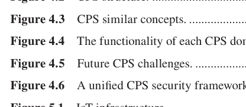

图1：从数据收集到决策支持的预测流程简化流程图。

```python
## 预测示例循环
for step in range(10):
    forecast = model.predict(data)
    data.append(forecast)
```

### 4. 未来展望

人工智能和计算能力的进步将继续拓展预测技术的可能性。


## 图目录

- **图5.6** 投递时间 – 88
- **图5.7** 邻居间的平均通信时间 – 88
- **图5.8** 给定时间内的数据投递率 – 89
- **图6.1** 互联网代际 – 96
- **图6.2** 车辆通信的子领域 – 99
- **图6.3** 车辆与网络的连通性 – 102
- **图7.1** 物联网的优势 – 110
- **图7.2** 物联网的局限性 – 111
- **图7.3** 对云计算、边缘计算和雾计算的理解 – 113
- **图7.4** CPS的应用领域 – 118
- **图8.1** 图像在Ω（大矩形）上定义[45]，任意红色曲线为C – 132
- **图8.2** 符号距离函数Φ(x,y)[45] – 133
- **图8.3** 所提方法的框图与流程图 – 135
- **图8.4** 输入图像 – 137
- **图8.5** 含噪图像 – 138
- **图8.6** 预处理后 – 138
- **图8.7** 分割后的图像 – 139
- **图8.8** 从脑部MRI图像中提取的肿瘤 – 139
- **图8.9** 输入图像 – 140
- **图8.10** 含噪图像 – 140
- **图8.11** 预处理后 – 141
- **图8.12** 分割后的图像 – 141
- **图8.13** 从脑部MRI图像中提取的肿瘤 – 142
- **图8.14** 原始图像 – 143
- **图8.15** 含噪图像 – 143
- **图8.16** 预处理后的图像 – 144
- **图8.17** 分割后的图像 – 144
- **图8.18** 从脑部MRI图像中提取的肿瘤 – 145
- **图9.1** 单个目标检测（台灯、沙发桌、桌子、花盆） – 153
- **图9.2** 图像分类 – 153
- **图9.3** 问题 – 155
- **图9.4** 目标提取架构 – 156
- **图9.5** 目标检测算法 – 157
- **图9.6** YOLO架构 – 158
- **图9.7** 边界框回归 – 158
- **图9.8** 图像预处理步骤 – 164
- **图9.9** SVM分类器 – 165
- **图9.10** 决策树示例 – 166
- **图9.11** k近邻分类器 – 166
- **图9.12** (a) ANN框图。(b) ANN层。 – 167
- **图9.13** 应用CNN时遵循的步骤 – 168
- **图10.1** 现代智慧城市的布局 – 177
- **图10.2** 智慧城市的特征 – 177
- **图10.3** 基于物联网的应用 – 178
- **图10.4** 物联网技术按范围的分类 – 183
- **图11.1** 正常和白血病血液样本 – 196
- **图11.2** 所提出的工作流程 – 199
- **图11.3** CNN操作 – 206
- **图11.4** 精确率比较 – 207
- **图11.5** 召回率比较 – 208
- **图11.6** F值比较 – 209
- **图11.7** 准确率比较 – 209
- **图11.8** PRF与准确率比较 – 210
- **图12.1** 步态子阶段 – 214
- **图12.2** 双足（机器人）开发过程中的不同设计问题 – 215
- **图12.3** 步态分析的知识发现数据库 – 216
- **图12.4** 步态分析框架的概念概述[8] – 216
- **图13.1** 含九个客户的CVRP的两种排列 – 228
- **图13.2** 以两种不同方式应用组合后得到的排列 – 229
- **图13.3** (a) 含九个客户的CVRP的一个粒子（排列）。(b) 路径。 – 231
- **图13.4** A-n32-k5的结果 – 235
- **图13.5** A-n44-k6的结果 – 235
- **图13.6** A-n60-k9的结果 – 236
- **图14.1** 智能紧凑型物联网嵌入式系统的框图 – 246
- **图14.2** 用于测量和监测医院关键参数的创新智能物联网设备的拟议架构 – 247
- **图14.3** 所提出的架构方法的流程图 – 247
- **图14.4** 针对bpm设计的系统与现有系统的误差率性能分析 – 248
- **图14.5** 针对体温设计的系统与现有系统的误差率性能分析 – 249
- **图14.6** 针对血压设计的系统与现有系统的误差率性能分析 – 249
- **图14.7** 针对呼吸频率设计的系统与现有系统的误差率性能分析 – 250
- **图15.1** 总体流程图 – 262
- **图15.2** 系统架构 – 263
- **图15.3** 使用的技术 – 264
- **图15.4** 用例图 – 265
- **图15.5** STUN和TURN服务器 – 267
- **图15.6** 模型架构 – 269
- **图15.7** 语音转文本模块的结果 – 270
- **图15.8** 数据集 – 271
- **图15.9** 使用数据集中的词语的第一种方法的结果 – 271
- **图15.10** 使用英语词典中的词语的第二种方法的结果 – 272
- **图15.11** 样本输入数据 – 272
- **图15.12** 分配的标签 – 273
- **图16.1** 可通过物联网服务的供应链活动 – 277
- **图16.2** 人工智能的应用 – 278
- **图16.3** 供应链管理中的人工智能 – 279


## 图表目录

- **图 16.4** 用于供需预测的人工智能。 282
- **图 16.5** 灾害管理的各个阶段。 285
- **图 17.1** 关于仿生人的认知。 296
- **图 17.2** 人类与仿生人的力量对比。 296
- **图 17.3** 关于 Neuralink 的认知。 297
- **图 17.4** 人形机器人和仿生人的百分比比例。 297
- **图 17.5** 仿生人的未来前景。 298

## 表格目录

- **表 1.1** 精度比较 11
- **表 2.1** 过去 BSN 研究中使用的不同技术的概述 24
- **表 4.1** 云计算系统 60
- **表 4.2** 边缘计算上的 ML/DL 系统、包、库、模型、框架、设备 61
- **表 4.3** 云网络中的学习技术 64
- **表 4.4** 基于 ML 的 CPS 攻击检测方法 67
- **表 4.5** 使用 ML 进行 CPS 恶意软件检测 69
- **表 5.1** 智能交通现状 80
- **表 7.1** 用于安全的 IoT 与 ML 技术 116
- **表 7.2** 用于安全的 IoT 与 DL 技术 118
- **表 8.1** 所提系统的性能 146
- **表 8.2** 不同迭代下所提算法的性能 147
- **表 9.1** 工具示例 169
- **表 10.1** IoT 技术之间的比较 186
- **表 10.2** IoT 在 SC 中部署的挑战 188
- **表 11.1** 所提 BCC 模型的性能参数 207
- **表 11.2** 比较分析 210
- **表 13.1** 参数值 234
- **表 13.2** A 集合 CVRP 实例的输出 236
- **表 15.1** 槽位填充 257
- **表 15.2** 结果 273
- **表 17.1** 关于仿生人的问卷调查 296


## 前言

网络物理系统（CPS）是一种新兴的计算概念，为全球学者和工业界开辟了许多研究领域。在我们当前的生活和未来的展望中，对人工智能（AI）和物联网（IoT）的依赖日益剧增。在各个方面，我们的应用正变得智能化。物联网的应用包括智慧城市、农业、医疗保健、家庭自动化、供水管理、智能车辆等。在无线通信的帮助下，物联网对我们所有人来说都易于管理。

在物联网中，我们可以将 AI 视为若干排列对象的整体集合。从这个角度来看，理解 AI 的作用至关重要，它将为全球数据共享提供世界性的支柱。因此，同样重要的是要考虑新的赋能技术，例如远程传感器网络、智能 5G 技术和计算机视觉。本书旨在介绍 CPS，并涵盖广泛的应用领域，包括 AI 程序和其他新兴智能方法，以实现物联网的全球优化和丰富。书中包含了 AI 在物联网中的利用、评估指标、局限性以及所涉及主题的开放性问题。本书将帮助在 AI 领域工作的专家和专业人士。本书还涵盖了与 CPS 相关的各种问题，以及如何通过提高无线设备传感能力、实时数据处理和预测系统行为来实现更高的系统性能。

## 编辑

**Dr. Anil Kumar Sagar** 目前在印度大诺伊达 Sharda 大学计算机科学与工程系担任教授。他在计算机科学领域获得 B.E.、M.Tech. 和博士学位。在加入 Sharda 大学之前，他曾在印度 Galgotias 大学计算科学与工程学院担任教授。他的当前研究兴趣包括移动自组织网络和车载自组织网络、物联网和人工智能。他在包括 IEEE 和 Springer 在内的国际期刊和会议上发表了大量论文。他于 2018–19 年获得印度计算机学会青年科学家奖，并于 2006 年和 2007 年获得 SGI、阿格拉最佳教师奖。

**Dr. Parma Nand** 获得了 IIT Roorkee 的计算机科学与工程博士学位，以及 IIT Delhi 的计算机科学与工程 M.Tech. 和 B.Tech. 学位。Parma Nand 教授在工业界和学术界拥有超过 27 年的经验。他获得了多项奖项，如来自联合部长的最佳教师奖、2015 年微软最佳学生项目指导奖，以及 2016 年 Cognizant 最佳教师奖。他已成功完成政府资助项目，并主导了最近五届 IEEE 计算、通信与自动化国际会议、IEEE 学生分会、Technovation 黑客松 2019、Technovation 黑客松 2020 以及计算、通信与智能系统国际会议（ICCCIS-2021）。他是 IEEE UP 分会（R-10）执行委员会成员、IEEE 计算机与信号处理学会执行委员会成员、印度计算机学会执行委员会成员、印度计算机学会诺伊达分会执行委员会成员，并在许多 IEEE 会议中担任观察员。他还拥有 ACM、IEEE、CSI、ACEEE、ISOC、IAENG 和 IASCIT 的活跃会员资格。他是软计算研究学会和 ISTE 的终身会员。

**Dr. Sanjoy Das** 担任印度中央政府大学印度甘地国家部落大学（中央政府大学）计算机科学系教授兼系主任，阿马尔坎塔克，M.P.（曼尼普尔地区校区）。他获得了计算机科学的 B.E.、M.Tech. 和博士学位。他的博士学位来自新德里贾瓦哈拉尔·尼赫鲁大学。在加入 IGNTU 之前，他曾在印度 Galgotias 大学计算科学与工程学院担任副教授。他还在 G. B. Pant 工程学院（政府学院）、北阿坎德邦和阿萨姆大学（中央大学）、希拉查担任助理教授。他在教学和研究方面拥有 16+ 年的经验。他组织了许多国际会议并担任会议主席。他在 SCI、Scopus 收录的国际期刊和会议上发表了 70+ 篇研究论文，包括 IEEE、Inderscience、Elsevier 和 Springer 等出版商。他曾主编过关于云计算、车载自组织网络等的五本著作。他的当前研究兴趣包括移动自组织网络和车载自组织网络、分布式系统和数据挖掘。

**Dr. Neetesh Kumar** 获得了贾瓦哈拉尔·尼赫鲁大学计算机与系统科学学院的 M.Tech. 和博士学位，新德里。他通过了 GATE 和 NET+JRF。他获得了 IEEE IPDPS 国际学会的旅行资助奖和班加罗尔 Xerox 研究中心的特别提及奖。他曾在印度查谟-克什米尔卡特拉的 Shri Mata Vaishno Devi 大学（SMVDU）担任助理教授。他还被任命为 SMVDU 计算机网络中心的负责人。后来，他在德里技术大学担任助理教授。他还曾在印度古瓦廖尔的阿塔尔·比哈里·瓦杰帕伊印度信息技术与管理学院（IIIT）担任教员。目前，他在印度 IIT Roorkee 担任教员。他在世界顶级出版商发表了许多研究成果，如 IEEE 期刊和论文集、Elsevier 期刊（包括 *Future Generation Computer Systems*（FGCS）、*Information Sciences* 等）和 Springer 期刊（*Soft Computing*、*Computing* 等）。他发表在 IEEE *Sensors* 期刊上的一篇文章已被 IEEE 委员会列入 2018 年 10 月至 11 月全球下载量前 15 名的文章名单。他是 *IEEE Transactions on Parallel and Distributed Systems*、*IEEE Journal of Internet of Things*、FGCS 等知名期刊的常任审稿人。他还担任印度政府 DST/CSIR 机构资助的三个项目的主任 PI。他曾担任多个会议的技术程序委员会成员。他还受邀在安米蒂古瓦廖尔举行的会议上担任主题演讲嘉宾，并在 IIIT 阿拉哈巴德举行的 IEEE CICT-2019 上担任会议主席。他的研究兴趣主要包括算法设计、并行计算系统中的调度（多核/众核系统）、应用进化计算和智能交通系统。

**Dr. Subrata Sahana** 是 Sharda 大学 Greater Noida、U.P. CSE 系副教授。他获得了 JNU、新德里（中央大学）、印度（NIRF 排名-2020：02）的计算机科学博士学位，2010 年 BIT Mesra 的计算机科学与工程 M.Tech.（NIRF 排名-2020 前 100），以及 2007 年隶属于西孟加拉理工大学的 CEMK、科拉加特的计算机科学与工程 B.Tech.。他于 2019 年 8 月加入 Sharda 大学担任助理教授，并于 2021 年 1 月晋升为副教授。此前，他于 2012 年至 2019 年在 Galgotias 大学担任助理教授，2010 年至 2012 年在 Vellore 的 V.I.T. 大学担任助理教授，2007 年至 2008 年在 Jamshedpur 的 RVSCET 担任讲师。他在许多享有盛誉的国际期刊和会议上发表论文，经验丰富。他还担任多家知名期刊的编委会成员和审稿委员会成员。此外，Dr. Sahana 还在国际会议上发表过专家演讲和客座讲座，并担任 IEEE、Springer、IGI Global 等期刊的审稿人。他的研究领域为水下无线传感器网络、模式匹配、生物信息学、物联网、安全和密码学。


## 贡献者

**阿卜杜勒·巴西特·阿夫塔布**
机电工程系
沙希德·佐勒菲卡尔·阿里·布托科技学院（SZABIST）
巴基斯坦卡拉奇

**伊姆兰·阿明**
机电工程系
沙希德·佐勒菲卡尔·阿里·布托科技学院（SZABIST）
巴基斯坦卡拉奇

**达尔潘·阿南德**
昌迪加尔大学
印度莫哈利

**普拉图尔·阿尔温德**
阿克希莱什·达斯·古普塔博士技术与管理学院
印度新德里

**马拉瓦拉普·拉詹·巴布**
伦迪工程技术学院
印度维济亚纳加拉姆

**基兰迈·巴布鲁**
伦迪工程技术学院
印度维济亚纳加拉姆

**阿贾伊·库马尔·巴尔米基**
莫拉纳·阿布·卡拉姆·阿扎德技术大学
印度西孟加拉邦

**A·M·阿努莎·巴米尼**
计算机科学与工程系
卡伦亚理工学院
印度泰米尔纳德邦哥印拜陀

**帕鲁尔·巴纳卡尔**
朱莱拉尔理工学院
印度那格浦尔

**图沙尔·巴德瓦杰**
应用研究中心
佛罗里达国际大学
美国佛罗里达州迈阿密

**帕里贾特·博米克**
印度理工学院古瓦哈提分校
印度古瓦哈提

**普拉德尼亚·S·博尔卡尔**
朱莱拉尔理工学院
印度那格浦尔

**K·古鲁·查兰**
伦迪工程技术学院
印度维济亚纳加拉姆

**桑乔伊·达斯**
英迪拉·甘地国家部落大学曼尼普尔校区
印度因帕尔

**西玛·达斯**
莫拉纳·阿布·卡拉姆·阿扎德技术大学
印度西孟加拉邦

**迪维亚·冈瓦尼**
电气工程与计算机科学系
佛罗里达大西洋大学
美国佛罗里达州博卡拉顿

**普拉纳夫·冈瓦尼**
电气与计算机工程系
佛罗里达国际大学
美国佛罗里达州迈阿密

**普拉蒂克莎·高塔姆**
阿米提大学
印度瓜廖尔

**阿卡什·戈尔**
拉杰·库马尔·戈尔技术学院
印度加济阿巴德

**尼迪·古普塔**
拉杰·库马尔·戈尔技术学院
印度加济阿巴德

**古鲁查兰·卡皮拉**
伦迪工程技术学院
印度维济亚纳加拉姆

**沙伊莱什·库马尔·古普塔**
拉杰·库马尔·戈尔技术学院
印度加济阿巴德

**J·H·詹莎·汉娜**
圣泽维尔天主教工程学院
安娜大学
印度金奈

**阿舒·贾因**
阿克希莱什·达斯·古普塔博士技术与管理学院
印度新德里

**迪亚南德拉·贾因**
阿克希莱什·达斯·古普塔博士技术与管理学院
印度新德里

**法拉兹·朱内乔**
机电工程系
沙希德·佐勒菲卡尔·阿里·布托科技学院（SZABIST）
巴基斯坦卡拉奇

**阿米特·库马尔·潘迪**
阿克希莱什·达斯·古普塔博士技术与管理学院
印度新德里

**贾尚克尔·普拉萨德·凯沙里**
IIMT工程学院
印度大诺伊达

**伊姆兰·艾哈迈德·汗**
国立伊斯兰大学
印度新德里

**阿姆鲁塔·科特**
瓦尔昌德工程学院
印度桑利

**G·R·格纳纳·金**
萨尔达亚工程技术学院
印度科达卡拉

**S·S·基兰**
伦迪工程技术学院
印度维济亚纳加拉姆

**B·基兰迈**
伦迪工程技术学院
印度维济亚纳加拉姆

**马诺杰·库马尔**
阿米提大学
印度瓜廖尔

**尼特什·库马尔**
印度理工学院鲁尔基分校
印度鲁尔基

**高拉夫·辛哈**
电子与通信工程系
IIMT工程学院，知识园三期
印度大诺伊达

**迪内什·索尼**
印度理工学院鲁尔基分校
印度鲁尔基

**丽娜·塔库尔**
朱莱拉尔理工学院
印度那格浦尔

**希曼舒·乌帕德亚伊**
应用研究中心
佛罗里达国际大学
美国佛罗里达州迈阿密

## 关于本书

### 第1章：基于情绪检测的媒体推荐

普拉尚特·辛格、迪亚南德拉·贾因、阿舒·贾因、普拉图尔·阿尔温德、阿米特·库马尔·潘迪、阿尼尔·库马尔·萨加尔和桑乔伊·达斯

本章提出了一种利用不同技术来检测情绪并推荐与用户当前情绪相匹配的媒体来源（如图像、音乐、视频、播客、诗歌等）的方法。Moodiest 就是这样一款基于 Android 的应用，它使用基于机器学习的 NLP 和 CNN 算法来检测情绪并据此推荐媒体。

### 第2章：用于医疗保健系统的基于AI和物联网的人体传感器网络：系统综述

迪维亚·冈瓦尼

本章旨在综述一种基于物联网和 AI 中深度学习技术的智能医疗保健系统，该系统能够识别患者的严重健康问题，并提供低成本治疗和医院管理的选项。

### 第3章：区块链与物联网的融合以增强安全性

普拉纳夫·冈瓦尼、图沙尔·巴德瓦杰、亚历山大·佩雷斯-庞斯、希曼舒·乌帕德亚伊和莱昂内尔·拉戈斯

在本章中，我们将讨论物联网面临的各种安全问题，以及区块链集成如何应对这些安全风险。此外，我们还将介绍通过将物联网与区块链技术集成所需要应对的挑战。

### 第4章：云计算中的人工智能

迪内什·索尼和尼特什·库马尔

本章介绍了描述 CPS 实际应用、结构、组件、特性、编程语言、优势、领域、挑战、安全性、入侵检测、智能电网以及主要研究主题的相关文献。此外，还介绍了 CPS 在医疗保健领域的映射，这将有助于趋势可视化、医疗保健中的事件预测，并确定基于云的医疗保健解决方案与基于 CPS 的医疗保健解决方案之间的差异。

### 第5章：人工智能在智能交通系统中的应用的当前与未来趋势

阿蒂夫·赛义德、阿卜杜勒·巴西特·阿夫塔布、法拉兹·朱内乔和伊姆兰·阿明

本章涵盖了一系列影响被归类为智能交通系统的交通运输行业的挑战。交通管理、公共交通、安全管理、制造和物流是智能交通系统中应用 AI 优势所考虑的一些子系统。

### 第11章：采用改进卷积神经网络方法进行基于基因表达的血癌分类

尼迪·古普塔、阿克希莱什·拉托里亚和阿卡什·戈尔

本章所述工作旨在设计一种有监督的机器学习方法，使用改进的卷积神经网络方法区分 AML 和 ALL，即急性髓系白血病和急性淋巴细胞白血病。

### 第12章：面向信息物理系统矩阵、利用步态分析探究仿人双足行走的内省方法

马诺杰·库马尔、普拉蒂克莎·高塔姆和维贾伊·巴斯卡·塞姆瓦尔

本章旨在调和在 CPS 背景下人形机器人的研究工作与实现人形机器人行走之间的关系。本工作侧重于步态分析在机器人应用中的基础知识，随后讨论了人形机器人的 CPS 方面，包括当前的局限性、研究挑战和未来前景。

### 第13章：结合模拟退火算法的代数粒子群优化求解容量受限车辆路径问题

穆罕默德·萨吉德、贾根德拉·辛格和兰吉特·拉贾克

本工作提出了一种结合模拟退火（SA）算法的代数粒子群优化算法来解决 CVRP（容量受限车辆路径问题），以使总行驶距离最小化。所提出的算法由 PSO 和 SA 的代数版本组成，作用于排列，并采用代数复合算子来实现 PSO 的不同操作。

### 第14章：一种在医院测量和监测患者关键参数的创新型智能物联网设备

纳文·拉蒂、贾尚克尔·普拉萨德·凯沙里、桑迪普·库马尔、瓦尔尼卡·拉蒂、高拉夫·辛哈、伊姆兰·艾哈迈德·汗和莫妮卡·辛格

在本章中，借助所设计的智能物联网设备（用于在医疗保健中测量患者关键参数），在医院使用 ICU 仪器记录了患者关键参数（如心率、体温、脉搏率和血压）的实际和测量数据。

### 第15章：基于深度神经网络的数字医生健康分析

阿姆鲁塔·科特

在本章中，我们利用自然语言处理和推荐系统的力量构建了这样一个工具，使医疗流程变得简单。它不仅能够理解医患对话，还可以处理任何其他数据集。

### 第16章：AI与物联网在供应链管理和灾害管理中的应用

卡尔乔特·夏尔马和达尔潘·阿南德

本章描述了 AI 和物联网在供应链管理协议和灾害管理中的作用。此外，它还讨论了这些技术的重要性和益处，以及使用这些技术所面临的挑战？在供应链管理和灾害协议中使用它们为何至关重要？该


AI平台通过评估和分析所有可用数据和最佳实践来改进结果，从而提供洞察并帮助决策。

## 第17章：赛博格：一个即将到来的时代

Anushka Purwar 和 Nidhi

本章讨论赛博格如何借助人工智能和控制论出现、控制论的应用以及现存的不同类型的赛博格。本研究的关键贡献在于介绍了赛博格化（即生物体能力的增强），以及随着技术日益进步所产生的未来影响。

## 1 基于情绪检测的媒体推荐

*Prashant Singh, Dhyanendra Jain, Ashu Jain,*  
*Pratul Arvind 和 Amit Kumar Pandey*  
阿基莱什·达斯·古普塔博士  
技术与管理学院

*Anil Kumar Sagar*  
沙尔达大学，大诺伊达

*Sanjay Das*  
英迪拉·甘地国家部落大学  
曼尼普尔地区校区

### 1.1 引言

人类的性情通常依赖于其在特定时间段内的感受。一个人可以通过直接观察另一个人的面部表情，或与之交谈并注意其说话方式、用语以及说话时表现出的神态，来判断对方的情绪。如今，机器正利用深度学习方法来研究这种能力，相关算法被设计为以文本、图片或评论作为输入，从而识别出用户的情绪，更不用说其性情了。同样，各种应用在向用户推荐活动和治疗方案的同时，也帮助用户管理自己的情绪。这类算法和应用在临床场景中极具价值，因为有时治疗师发现很难判断患者的心理状态；因此，他可以很容易地依赖一种理想的基于机器的性情识别框架。通常使用的算法由NLP（自然语言处理器）执行，它处理以文本形式给出的信息，并融合了多种技术，如预处理、去除停用词、词干提取、词形还原和词编码。我们使用k近邻、随机森林、朴素贝叶斯和逻辑回归等分类算法来决定性情。对于头像图片，则使用CNN（卷积神经网络）来研究它们，这种根据面部特征推断心态的提取过程称为特征提取。该算法是深度学习的重要组成部分。在本章中，我们介绍了一个应用程序，它执行基于NLP和集成CNN的计算来获取用户性情，并利用人工智能（AI）方法来确定音乐、录音和图片等各种媒体对情绪的影响，将它们映射在一起，以规划最终的推荐媒体列表。

作为实质性唤醒的一个元素，视觉提示既非公开也非个体化。眼神交流在梳理个人情感和当前情绪方面起着重要作用。获取信息的机器可以通过观察面部表情和分析每句话语的含义来发现情感。这种能力同样适用于新获得的数据。近来，机器学习在计算机的创意和智能推荐程序中逐渐获得力量。机器的优势主要基于推荐算法以及对由此产生的三种能力的显著改进，如下所示：

- 可靠推荐者的协同学习能力
- 基于内容的深度筛选
- 能力之间的交互

传统的推荐系统依赖于个人显式的数据内容、材料和记录。从长远来看，我们看到了利用情感以显式方式设计更高质量推荐系统的努力出现了明显的激增。默认推荐就是这些惊人技术之一。各种媒体框架被设为默认。探索这些目标以像人一样地收集能力。个体的产出指令不会通过表情和行为以多种方式传达，尤其是通过面部表情。通过视频推荐程序，我们可以通过计算个体的面部表情来扩展情感。

与音乐的进步相关的技术进展也有很多，或者我们可以称之为音乐信息的重构；然而，我们尚未在此处解决这个问题。音乐信息的恢复一直是探索的重要主题。我们可以获取的音乐非常多，计算机难以呈现。另一方面，我们在情感知识方面也取得了非凡的进展。有大量可用的技术和算法。但这里同样，问题仍然令人烦恼，因为这两种能力是以意想不到的方式执行的；这里试图将这两项创新进步结合起来，即使在它们的典型生活中也是如此。在标准的FER框架中，眼睛和嘴巴是面部表情的重要特征。你的感受或情感通过眼睛和嘴唇反映出来，比如“我无法想象你有意思。”

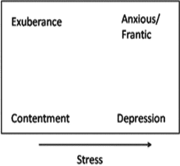

**图1.1** Thayer情绪模型[1]。

#### 1.1.1 情绪分类法

如文献[2]所述，音乐心理学中识别情绪反应的传统方法是使用形容词描述符，如悲伤、乐观和忧郁。20世纪90年代末，Thayer（1989）提出了二维情绪模型。这种维度方法认为情绪由两个因素组成：紧张（快乐/焦虑）和能量（平静/充满活力），并将音乐情绪分为四类：满足、悲伤、狂喜和焦虑/疯狂，如图1.1所示。

这些概念对于四类情绪清晰且具有区分度，二维框架仍提供了重要的计算机建模标记。因此，它被用于我们的情绪检测方法中。

### 1.2 相关工作

#### 1.2.1 媒体推荐

在文献[3]中，Erion C、Riccardo Coppola、Eleonora Gargiulo、Marco Marengo和Maurizio Morisio提出了一种基于情绪的车载音乐系统，该系统通过分析歌词来关联驾驶员的情绪与歌曲的情绪，从而形成一个推荐系统。

Charulatha Vijaykumar在她提出的理论[4]中解释了一个系统，通过该系统使用API提取歌曲歌词，并使用一种算法来确定用户的情绪；然后将两者进行匹配，并相应地播放音乐。


在 [5] 中，Aurobind V. Iyer、Viral Pasad、Smita R. Sankhe 和 Karan Prajapati 提出了一个系统，该系统使用特征提取算法从人脸图像中检测情绪，从而推荐合适的音乐片段。

#### 1.2.2 基于文本的情绪检测

在 [6] 中，Efthymios Kouloumpis、Theresa Wilson 和 Johns Hopkins 的团队探索了本章中语言特征在检测 Twitter 消息情感方面的有效性。他们评估了当前词汇工具的实用性以及收集微博中非正式和创新词汇知识的特征。他们采用了监督方法来解决该问题，但利用了现有的 Twitter Hashtag 数据来创建训练数据。

[7] 中的作者根据 Twitter 用户发布的文本预测了个性。B. Y. Pratama 和 R. Sarno 使用了文本分类；所使用的语言为英语和印尼语。所应用的分组技术为朴素贝叶斯、k 近邻和支持向量机。测试结果显示，朴素贝叶斯在其他策略中略有胜出。

#### 1.2.3 基于图像的情绪检测

在 [8] 中，从面部图像中提取了多个面部参数，并用于训练多个通用和先进的神经网络。基于初步测试确定了委员会的优化神经网络结构，最佳性能的通用和先进神经网络被招募到决策委员会中。然后使用在准备或初步研究中未使用的主题派生的数据，对集成神经网络系统委员会进行了评估。

Kobayashi 和 Hara 提出并开发了一种主动人机界面 [9]，其中他们考虑了六组面部表情，即惊讶、恐惧、厌恶、愤怒、快乐和悲伤，从而获得了覆盖面部三个元素（眼睛、眉毛和嘴巴）的面部特征点（FCP）的 30 个 x 和 y 坐标。然后生成面部位置信息并输入到神经网络的输入单元中；网络学习通过反向传播算法进行，并执行了识别测试。

他们在 [9] 中再次在其理论中提出了一个系统，并从客户面部图像拍摄的录像带中检索显示混合面部表情的面部图像，并从这些图像中，他们获得了以 FCP 的 (x, y) 坐标形式表示的面部表情信息。然后为 19 名客户创建面部图像位置信息，并用于神经网络训练和识别测试。在 [10] 中，FaceFetch 是基于智能框架的新颖媒体内容提案，该框架通过区分面部表情并为个人提供视听内容来了解个人的当前情绪状态。该框架可以了解个人的情绪状态。他们提供工作区以及便携式 UI 和来自云端的音乐、电影和客户感兴趣的不同录音等视听内容。在 [1] 中，他们介绍了视频相关内容分析的整体系统，包括视频内容和情感描绘。

这些记录以迂回的方式。当使用基本的一个时，个人向机器提供记录。当使用基本的一个时，个人向机器提供记录，例如通过模仿电影故意实现一些内容。整洁地，个人行为被追踪出来，需要与机器进行额外的个人交易。例如，为了将其作为发布声音旋律的见解来应用，另一个模型，基本如任务的介绍，通往创新的快速发展的方式，是经常在个人摄取内容时所经历的感受上踉跄。情感的程序化定位在一种被称为情感计算的综述主题中被研究。名称“充满感觉的计算”由 Rosalind Picard 于 1997 年创立。他将其描述为与 PC 相关的、源自或故意影响情感的东西。对此主题的研究探索了影响人际交流的因素是什么。计算机、个人以及与同情心相关的方法可以用来提供具有大致人类影响的记录。此外，一些不同的研究集中在主体状态的规划上，并研究利用其心理影响的结构。

情感计算的改进迄今为止是巨大的，特别是在自动化方面。说明如何找到拥有情感的独立技术，类似于此，以及面部分析、轮廓语言、声音、生物识别等。在 2005 年，研究网络接受了 RS 中情感的含义。情感在 RS 中是基本的，因为，正如所证明的那样，使用该项目是为了感受情感。情感对人类至关重要；它们影响日常游戏和独立决策。例如，热情的赞扬会影响客户是否采用某事的决定。在 RS 的情况下，由于困难，他们在很大程度上忽略了情感，因为安排和设置、量化和直接的库存。直到现在，RS 和情感计算的研究是独立进行的。

通过音乐推广心血管观点是一个古老的想法，已在不同的环境中有效利用，既在实验室环境中（即 Westermann、Spies、Stahl 和 Hesse），也在现实世界环境中。Janssen、Van Den Broek 和 Westerink 的意见播放器，旋律因此被推荐以改善客户的状况，采用自然技术，如使用皮肤温度作为化学计量测量。首先，参与者需要根据效价（即美感）对自己的曲目集合进行评分。接下来，Janssen 等人（2012）将曲目分为三个效价阶段：错误、中立和优秀。然后，他们在旨在使参与者进入中立状态的阶段中随意使用了九首曲目，并降低或提高效价。因此，Janssen 等人（2012）推断单个曲目概念增加了参与者的皮肤温度（化疗）。除了皮肤温度外，他们还利用皮肤控制来描述能量的强度。作者 van der Zwaag、Janssen 和 Westerink 发现，参与者对我们放置位置的态度受到（增加或减少强度和效价）的影响，通过让他们通过热情的曲目体验相似性。所述研究使用了针对参与者的强制条件，可能并未如此做。那可能是最理想的方式。适当的是，个人脉搏使每个人都回到先前描述的状态。建议取决于客户偏好，这使得定制
场合，或在更好的地方，同一首曲目可能会以意想不到的方式出现。即使是推理能力弱的人也能传达在音乐作品中感受到的情感。然而，它可能无法精确地传达 [16]。那么，如何让机器和电脑，这些机器和电脑不像人类那样思考，来表达情感呢。精确复制音乐的能力已成为声音领域人工智能中的一个重要问题 [3]。

### 1.3 建议系统

所提出的基于推荐系统的应用程序“Moodyst”的架构如下所示，参考 [4,5]（图 1.2）。

在此算法中，首先用户将使用其用户名注册/登录并向应用程序介绍自己。接下来，UI 将要求输入。用户可以选择以文本或图像形式提供输入。根据输入，它将由相应的算法处理以检测用户的情绪。在数据库中，有各种媒体的集合，即音乐、视频、播客、图像、故事和新闻，或根据他的选择将其重定向到 YouTube 或 Spotify 等其他界面。因此，它将播放合适的媒体。

该算法基本上具有以下三个主要组件如下。

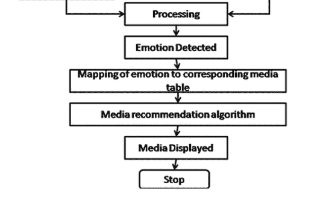

图 1.2 系统的整体架构。


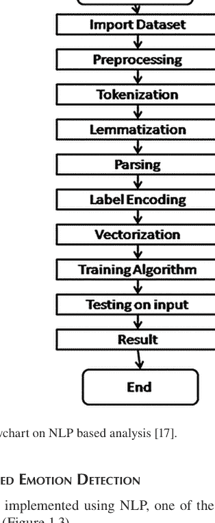

图 1.3 基于 NLP 的分析流程图 [17]。

#### 1.3.1 基于文本的情绪检测

该算法使用 NLP 实现，NLP 是机器学习中广泛使用的应用之一（见图 1.3）。

该过程的步骤已在参考 [14] 的流程图中描述。用于训练该算法的数据集来自 Kaggle，其中有 30,000 行用于训练，10,000 行用于测试。用于测试的数据集取自 Emo Bank，包含 10,000 条标注了效价、唤醒度和优势度的句子。在使用第一个数据集训练了三种算法（即逻辑回归、多项式朴素贝叶斯和支持向量机）之后，将它们用于第二个数据集，以查找其中文本的情绪。

这部分使用的算法参考了 [6,15]。

#### 1.3.2 基于特征提取的情绪检测

该算法参考了 [6,8]，其中我们使用了委员会神经网络，这些网络进一步使用了反向传播方法（见图 1.4 和图 1.5）。

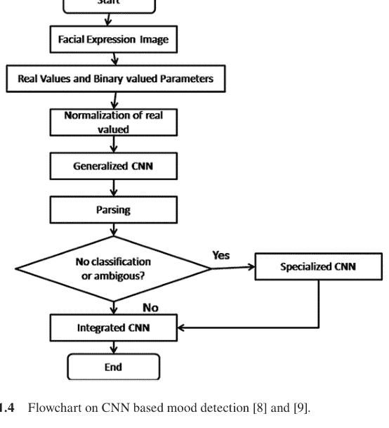

图 1.4 基于 CNN 的情绪检测流程图 [8] 和 [9]。

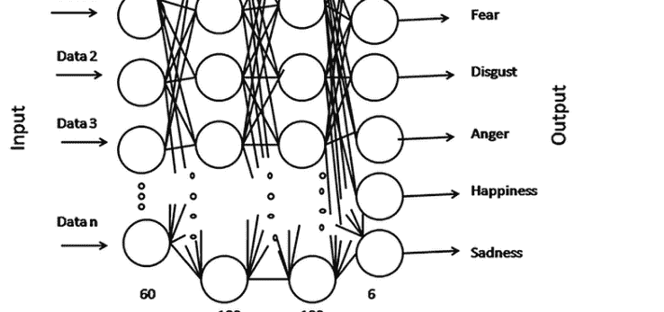

图 1.5 神经网络 NN [6]。

在该算法中，我们使用了特征提取 [6] 和 CNN 的委员会神经网络变体 [8]。我们采用了 CNN 委员会，即广义 CNN 和专门化 CNN。所使用的数据集是 Cohn-Kanade 数据库 [16]。面部表情图像来自 Cohn-Kanade 数据库 [14]。该数据库包含 97 名年龄在 18 至 30 岁之间的受试者的面部照片。其中 65% 的受试者为女性，15% 的受试者为非裔美国人，3% 为拉丁裔或亚裔。CNN 首先基于实值参数和二值参数进行训练。在测试时，图像首先被输入广义 CNN 委员会，根据参数的归一化值 [8] 判断是否为无法分类或模糊分类；随后，根据决定因素将其输入专门化 CNN 委员会，因此，大多数 CNN 检测到的情绪即为最终情绪。

#### 1.3.3 媒体推荐算法

该推荐算法名为 Moodyst 算法。在获取情绪后，我们会对情绪进行编码和标记，例如“快乐”为 1001，“悲伤”为 1002。数据库中提供的媒体存储在不同的表中，表名与相应的情绪表相匹配。在将情绪与表映射后，将在所选表的主键不同值范围内生成一个随机整数。在此基础上，将显示一个随机媒体，其主键将与生成的随机整数匹配。该系统还能够将用户引导至 YouTube、Spotify、Indian Express、Kindle、Audible 等应用程序，在网络连接存在的情况下，用户可以重定向到这些应用。

- Moodyst 算法
- Moodyst（字符串情绪）标记情绪
- 将标签与数据库中的表名匹配
- 在主键值范围内生成随机整数
- 媒体与随机整数的映射
- 播放匹配的媒体

#### 1.3.4 结果

该系统已在 Android 设备上运行，以下文本分类算法和基于特征提取的（使用委员会 CNN 的）情绪检测算法的准确率如表 1.1 所示。

下图显示了在第二个数据集中检测到的情绪频率（图 1.6–1.9）。

表 1.1 准确率比较

| 训练算法 | 准确率 |
|---|---|
| 逻辑回归 | 0.7125 |
| 多项式朴素贝叶斯 | 0.7183 |
| SVM | 0.7829 |

```
nb = MultinomialNB()
nb.fit(X_train_count, y_train)
y_pred = nb.predict(X_val_count)
print('naive bayes count vectors accuracy %s' % accuracy_score(y_pred, y_val))
```

naive bayes count vectors accuracy 0.7183828610919143

```
[63] lsvm = SGDClassifier(alpha=0.001, random_state=5, max_iter=65, tol=None)
lsvm.fit(X_train_count, y_train)
y_pred = lsvm.predict(X_val_count)
print('lsvm using count vectors accuracy %s' % accuracy_score(y_pred, y_val))
```

lsvm using count vectors accuracy 0.7829993089149966

```
[64] logreg = LogisticRegression(C=1, max_iter=5000)
logreg.fit(X_train_count, y_train)
y_pred = logreg.predict(X_val_count)
print('log reg count vectors accuracy %s' % accuracy_score(y_pred, y_val))
```

log reg count vectors accuracy 0.7125086385625432

图 1.6 不同向量的准确率。

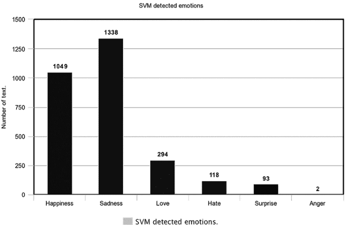

图 1.7 SVM 检测到的情绪。

### 朴素贝叶斯检测到的情绪

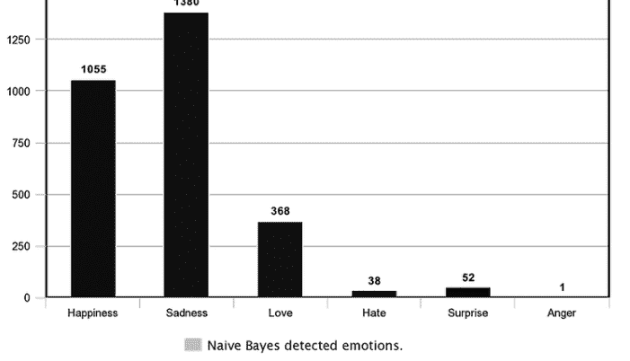

图 1.8 朴素贝叶斯检测到的情绪。

### 逻辑回归检测到的情绪

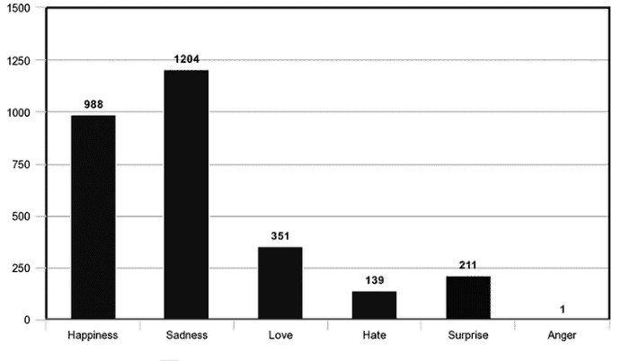

图 1.9 逻辑回归检测到的情绪。

因此，本系统以基于 Android 的应用程序形式实现。该系统已在多台联网的 Android 设备上成功运行，并支持多种 Android 版本。用户界面的设备架构使用 Adobe Illustrator 设计。框架通过 Android 应用工具包（ADT）开发为 Android 应用。下面附上了运行 Android 6.0.1 版本的三星 F41 型号智能手机的几张设备截图。

## 参考文献

- [1] Wang, S, Q Ji, “视频情感内容分析：最新方法综述”，*IEEE 情感计算汇刊*，6，410–430，2015年10月至12月。
- [2] Liu, D, L Lu, H J Zhang, “基于声学音乐数据的自动情绪检测1”，*IEEE*，8712006，2005年12月19日。
- [3] Erion C, Riccardo Coppola Eleonora G, Marco M, Maurizio M, “基于情绪的车载音乐推荐”，*国际工业网络与智能系统会议*，154–163，2016年。
- [4] Vijayakumar, C, V Adaickalam, “使用智能情感分析的智能减压音乐播放器”，*国际工业电子与电气工程杂志*，ISSN：2347-6982 4, 6, 2016年。
- [5] Iyer, A V, V Pasad, S R Sankhe, K Prajapati, “基于情绪的情绪增强音乐推荐”，*IEEE*，17504486，2018年1月5日。
- [6] Kobayashi, H, F Hara, “基于神经网络的基本面部表情识别”，*国际神经网络联合会议*，460–466，1991年。
- [7] Pratama, B Y, R Sarno, “基于朴素贝叶斯、KNN 和 SVM 的 Twitter 文本个性分类”，*2015年数据与软件工程国际会议（ICoDSE）*，170–174，2015年，印度尼西亚日惹：IEEE。DOI：10.1109/ICODSE.2015.7436992。
- [8] Kulkarni, S S, N P Reddy, S I Hariharan, “基于委员会神经网络的面部表情（情绪）识别”，*生物医学工程在线*，16，2009年。
- [9] Kobayashi, H, F Hara, “基于神经网络的混合面部表情识别”，*国际机器人与人类通信研讨会论文集*，387–391，1992年。
- [10] Mariappan, M B, M Suk, B Prabhakaran, “FaceFetch：基于面部表情识别的用户驱动多媒体内容推荐系统”，*2012年IEEE国际多媒体研讨会*，1，84–87。
- [11] Tripathi, A, T S Ashwin, R M R Guddeti, “WmoWare：使用情感视频序列的个性化视频推荐上下文感知框架”，*IEEE Access*，7，51185–51200，2019年。
- [12] Zhao, J, G Kearney, “基于模糊输入的反向传播神经网络面部情绪分类”，*神经信息处理会议论文集*，1，454–457，1996年。
- [13] Kim, S-M, E Hovy, 确定意见的情感。*COLING 会议论文集*，2004年。
- [14] Fasel, B, J Luettin, “自动面部分析综述”，*模式识别*，36，259–275，2003年。


- [15] Zhang, Z, “基于多层感知器的特征面部表情识别实验”, *国际模式识别与人工智能杂志*, 13, 893–912, 1999.
- [16] Kanade T, J Cohn, Y Tian, 面部表情分析综合数据库. *第四届IEEE自动人脸与手势识别国际会议*, 法国, 2000.
- [17] Padgett, C, GW Cottrell. “面向情感分类的人脸图像表示”, *神经信息处理系统进展会议论文集*, 1996, 894–900.

## 2 面向医疗系统的基于AI和IoT的身体传感器网络

## 系统综述

Divya Gangwani  
佛罗里达大西洋大学

### 2.1 引言

无线通信以及物联网（IoT）被用于我们生活的各个方面，例如医学、农业、娱乐、用于检测致命状况的深度学习技术[1]、用于提供智能技术系统的人工智能（AI）方法[2]，以及智能家居设备。身体传感器网络（BSN）能够在不要求患者去看医生的情况下监测其健康相关数据[3]。它对无法获得医疗服务的人群以及老年人和儿童广泛有用。BSN已被证明在监测人体健康和提供准确的诊断结果方面是有效的。基于医疗系统的物联网还能够通过BSN提供生理信息，如脑电图（EEG）和心电图（ECG）[4]。医疗数据通过传感器收集，并存储在云端并加以保护，这对医学专家审查所存储数据并根据结果进行预测或决策是有用的。这种智能医疗系统[5]如今被医学专家和医院工作人员广泛使用，为患者提供远程医疗服务，患者可以提出与医疗保健相关的问题，并向世界任何地方的医学专家咨询[6]。BSN通过可穿戴传感器设备捕获人的生命体征，该设备通过无线通信技术将信息发送给医学专家，如图2.1所示。它监测血压、血氧水平、体温、心脏和大脑活动等。从当前情况来看，获得医疗建议和医院管理对大多数人来说变得更加困难和昂贵。使用基于BSN和物联网的智能医疗系统为人们提供了更快更好的服务，以便他们能够治疗和分析自己的生活方式，并提高生活质量。然而，这种智能医疗系统收集了大量隐私和机密的数据[7]。因此，极其重要的是要重视数据安全和存储管理[8]。有必要保护数据免受黑客攻击和外部威胁[9]。本章提出并分析了改进传统医疗系统的先进技术，讨论了基于物联网的医疗系统的最新趋势和改进，并提供了使用云计算方法来处理大多数医疗数据的方法。本章的主要贡献总结如下。

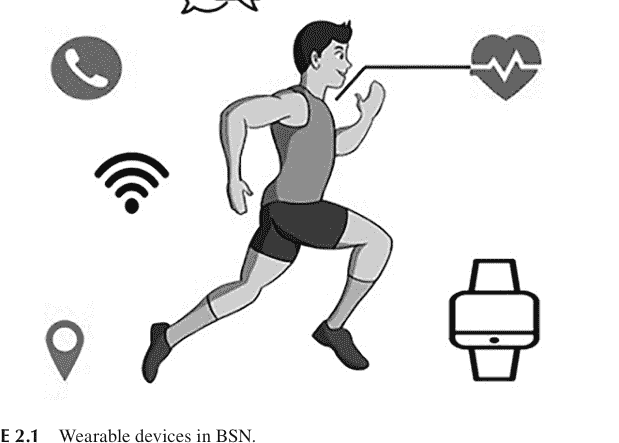

图2.1 BSN中的可穿戴设备。

- 本章重点介绍BSN在物联网技术中于医疗系统及其他相关领域的主要用途。
- 我们提出了一种物联网服务和BSN技术的架构，并简要解释其在医疗网络中的重要性。
- 我们强调BSN在物联网技术中的重要性，并总结了BSN如何改变人们对医疗系统的看法。
- 本章演示了深度学习方法，以开发一个无偏模型，该模型可以捕获从BSN信号接收的数据，并通过检索云服务器上存储的数据输出结果。
- 我们对当前支持物联网创新所需的相关实际应用进行了详细调查，以促进BSN技术发展更好的医疗系统。
- 最后，我们提到了使用BSN的物联网技术所面临的挑战，并展示了用于克服医疗管理系统中安全问题的方法。

管理海量医疗数据以提高患者诊断和治疗的质量和标准始终是一个挑战[10]。一旦我们解决了这些挑战，我们就能实现一个智能医疗系统，为人们提供更好、更可靠的医疗服务。

本章其余部分组织如下：第2.2节讨论了许多研究者在BSN和物联网系统中的文献综述。第2.3节涵盖了BSN的特征。第2.4节讨论了BSN在物联网中的重要性。第2.5节简要介绍了物联网与BSN技术的架构。第2.6节涵盖了用于开发医疗系统BSN应用的不同深度学习方法。第2.7节涵盖了BSN在医疗及其他领域的应用。第2.8节讨论了BSN面临的主要挑战，并提供了克服这些挑战的方法。最后，我们在第2.9节总结了本章。

### 2.2 文献综述

一些研究资料关注无线BSN和可穿戴设备的最新趋势和使用。医疗系统中的物联网改变了世界对医疗系统的看法，并为许多人带来了改善。

Castillejo等人[11]演示了在物联网中使用无线传感器网络，将可穿戴设备集成到电子健康应用系统中。其重点是建立一套高效的电子医疗系统，用于在危险环境中工作的女性或其他人员，使他们能够报告并立即采取必要行动。

He等人[12]提出了一种“无线体域网（WBAN）”，重点关注医疗数据的安全性。它使用集成电路和嵌入式系统从WBAN捕获数据。尽管这一章已证明可以减少安全问题，但管理和减少客户端的安全弱点仍然是一个挑战。

Rana和Bajpayee[13]开发了一个获取患者数据的系统，包括患者的生命体征，如体温、血氧水平和心率，这些数据存储在云服务器中并进行维护，以便全国各地的医学专家都能轻松访问。作者提到了正在处理的安全问题，并评估了针对患者数据安全漏洞所采取的措施，但仍需深入研究以处理不同方面的安全问题。

Sharma等人[14]使用了一种星型网络拓扑，其中包含网络中的不同组件，以与远程监视患者生理体征的“WBAN”传感器节点协调。然而，这种方法无法捕获患者的全部关键体征，而这在紧急情况下是必需的。

Guidi等人[15]开发了一个带有AI技术的心力衰竭分析仪表板系统，用于诊断和分析患者的健康参数，并提供及时的随访。该系统提供有关患者健康状况的最新信息，有助于医生为患者制定医疗计划。

Hongxu等人[16]提出了一个框架，用于监测医疗数据并为患者提供可信赖的居家援助。它通过安装的服务器使用数据传输方法，由医学专家为患者提供远程医疗。

Pandey等人[17]对医疗物联网中的BSN进行了广泛的调查。该论文提到了这些传感器面临的局限和挑战，在开发BSN架构时应予以考虑，但没有提供如何克服这些挑战以在物联网系统中开发安全可靠的BSN的系统框架。

### 2.3 BSN的特点

BSN系统是一种重要的技术，如今已被许多人广泛使用，因为它是监测医疗生命体征和跟踪基本生命体征最方便、最快捷的方式，尤其是在新冠疫情期间，这使得看医生变得非常困难[18]。以下几个特性描述了BSN在物联网中的使用和可访问性，如下文所述。

- BSN在物联网中为患者打开了医疗系统的大门，让他们可以与医生讨论自己的健康状况。它改善了医疗管理系统，因为它通过传感器收集数据，并分析身体最关键部位（如大脑和心脏）的结果[19]。
- BSN收集大量足够准确的数据，使医生能够为患者做出更好的决策。AI在物联网中的应用使BSN在诊断和随访方面更加智能，并改善了结果。
- BSN帮助世界各地的人们，并提供庞大的资源库，使人们有机会利用其中可用的技术


发达国家的技术也惠及弱势群体。AI技术与物联网结合不仅对普通人有用，对医生或医疗专业人员同样有帮助，因为它能基于诊断结果辅助做出更优判断和决策[20]。

- BSN与物联网相结合，降低了人们的整体运营成本，为医疗管理提供了更好的结果和策略。
- 它改善了面向患者的居家服务并实现了虚拟化，使农村地区的人们能够获得医疗服务和医师助理的帮助。
- BSN还能以易于访问且安全的方式为患者提供实时服务。它通过移动接入保证了点对点的可靠性，从而实现更快的通信和结果反馈。

### 2.4 BSN在物联网中的重要性

医疗技术系统随着时间不断发展，并随着技术的进步而日益先进。公司的每个部分都已数字化，包括网络系统、基础设施和虚拟医疗。它能在任何地点、任何时间为人们提供医疗护理，从而降低患者的生命风险。传感器网络和物联网已经改变了全球“医疗系统”的面貌；因此，可以说，如果不将BSN技术与物联网结合使用，就不可能建立起“以患者为中心”的医疗系统。

在BSN的帮助下，传感器和电子设备通过网络系统连接在一起，因为它有助于在安全的环境中与患者建立连接。网络与物联网的结合使系统能够将数据传输到任何地点，从而减少了人们赶往医院、排队抽血或检查患者生命体征（如血压、心率、血糖）所需的时间[21]。

在当今世界，BSN可以通过重新布置传感器来构建，既可以将传感器放置在身体周围，也可以将其植入体内。传感器还可以作为可穿戴设备佩戴在身体上，收集有关个人健康的重要信息。与物联网相结合，BSN提供了一个框架，使人类能够获得适当、最新且前沿的“技术驱动型”医疗服务，以提高生活质量[22]。这类服务可包括疾病监测、家庭或医院设备管理、访问患者医疗记录、在紧急情况下自动联系医护人员，以及根据紧急情况引导至可用的医院和医务人员。然而，在这种情况下最困难的挑战之一是克服网络流量问题。如果资源有限，基于紧急情况管理整个系统并处理此类网络流量可能是一个巨大的难题。即使在BSN中，其原型也包含各种传感器和其他电子设备，如路由器、服务器、LPU（逻辑处理单元）和传感器节点。由于BSN的配置及其连接方式，物联网可以为检测和治疗恶性癌症等医疗状况提供实时解决方案，此类疾病若未及时治疗，可能会扩散到身体其他部位。因此，BSN正是促进人体信息从传感器传输到其他本地实体，再从本地实体传输到集中式或个人服务器的关键原因。

除此之外，人工智能、机器学习技术、深度学习框架和自然语言处理都是BSN的组成部分，这些技术使物联网更加健壮，并能够创建“电子健康记录”，在紧急情况下这些记录将非常有用，并能及时向患者亲属提供帮助或发送消息[23]。

总而言之，BSN为医疗环境中的物联网提供了可靠的基础，使人们能够信任该系统良好运行并提供准确结果，从而让人们可以专注于日常事务，而不必过多担心自己的健康。即便如此，在共享患者医疗记录等重要信息时仍存在挑战。由于网络脆弱性，处理此类关键信息可能会引发问题，因此需要加以防范，以维持人们对物联网医疗系统中BSN的信任。

### 2.5 基于BSN的物联网医疗系统架构

物联网在BSN中的架构由三个部分组成，它们共同构成了以安全方式为患者提供技术服务的整体工作机制。这三个组成部分分别是BSN、安全的云服务器，以及负责读取或为患者分配紧急管理系统的医学专家[24]。基于物联网的BSN总体架构和操作如图2.2所示。

BSN是架构中的第一个组成部分，如图2.2所示。它通过附着在人体的传感器来捕捉患者的生命体征。这些传感器被称为可穿戴设备传感器，例如智能手表，也可以是根据所捕获的测试类型或生命体征而附着在身体不同部位皮肤上的传感器[25]。无论如何，这些传感器都能通过可穿戴设备上附着的传感器实时捕获人体生命体征，如心率、体温、血氧水平、血糖水平和湿度。一些可附着在皮肤上的传感器可以生成

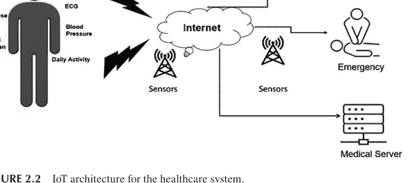

图2.2 医疗系统的物联网架构。

实时图形，专门用于通过脑电图（EEG）或心电图（ECG）等设备监测心律不齐或脑电波[26]。这些传感器提供生命体征读数，并通过可视化图形或节点显示，以便更好地与患者进行沟通和理解。从这些节点或BSN产生的数据通过互联网经由云服务器收集和传输，供医学专家进一步评估[27]。

第二个组成部分是医疗服务器或云服务，主要负责任何以数据形式收集和存储患者的重要医疗信息。这些信息通过互联网以适当的安全管理方式传递到云端，以防止未经授权的数据使用并避免服务器被黑客入侵。这些服务器还能在系统中设置警报，通过读取上传的数据，基于患者的潜在健康状况通知患者和医学专家[28]。医疗监测系统的这一能力可避免患者和医生方面的延误，确保医疗状况得到及时处理。

第三个组成部分负责将医疗专家提供的医疗管理服务传递给患者。各种服务包括紧急护理、住院治疗、由护士或医护人员进行现场心肺复苏，为老年患者提供上门服务，以及医生为病情稳定且不需要紧急服务的患者进行探访[29]。医疗管理工作人员与患者协调，并监测通过医疗系统服务器发送的数据，以便协助患者和医生，并为应对紧急情况做好准备。医疗管理工作人员充当患者和医生之间的中间人。这种系统确保了用户与医学专家之间的适当管理和协调，从而使用户能够信任智能技术，并依赖可穿戴设备生成的数据[30]。

许多作者在物联网医疗系统中已使用了多种现有的BSN架构。BSN基于不同参数采用多种技术进行评估。不同的参数和技术见表2.1，表中显示了从传感器获取的数据随后存储到辅助服务器或远程服务器中，以维护隐私并进一步分析存储的医疗信息，从而产生所需的结果，因为它保证了医疗数据的进一步安全，并建立了用户对BSN或医疗专业人员的信任。

在表2.1中，我们讨论了一些作者提出的现有技术，以及设计医疗系统架构时所考虑的参数，如数据安全、数据管理和易访问性。

许多作者在设计BSN架构时都考虑到了数据隐私和管理；这是因为设计中的一个简单缺陷可能会破坏BSN的主要目标，也会让物联网设备的用户产生恐惧。总的来说，在设计BSN架构时已经考虑了上述参数，但没有任何一位作者将所有参数整合到一个独特的模型中。如果未来能够做到这一点，那么我们可以说，BSN架构的建模以及一些其他参数可以成为医疗系统的理想解决方案，因为它能满足保护人类安全并减少其对健康状况焦虑的目标。


**表 2.1** 过去 BSN 研究中使用的不同技术的总结

| 作者 | 技术 | 数据安全 | 数据管理 | 访问便捷性 | 能效 |
|---|---|---|---|---|---|
| Stephanie B. Baker et al. [31] | 推荐系统 | 未出现 | 是 | 是 | 是 |
| Prosanta Gope and Tzonelih Hwang [11] | 带警报系统的基于决策技术 | 存在 | 是 | 是 | 是 |
| Habib Carol et al. [32] | 基于决策技术 | 未出现 | 否 | 是 | 是 |
| Alper Akkas et al. [33] | 警报功能 | 未出现 | 是 | 是 | 否 |
| Ali Farman et al. [34] | 推荐技术 | 未出现 | 是 | 是 | 否 |
| Bulaghi Zohre et al. [35] | 基于预测技术 | 未出现 | 否 | 否 | 否 |

### 2.6 用于传感器数据的基于深度学习方法的 AI 技术

过去已使用了许多深度学习方法，证明了其在有效管理和检测各种疾病或病症方面的能力，并防止因长时间延迟而使病情恶化 [36]。它还可以使用可穿戴设备捕获的传感器数据提供更快、更准确的诊断，如图 2.3 所示。

对于 EEG 诊断和检测，[37,38] 提出了诸如卷积神经网络之类的深度学习技术，其捕获脑电信号并使用自动特征提取方法解码信息。这可以根据传感器数据预防或检测严重的健康状况。这些数据被医疗人员用于进一步诊断治疗方案并安排更多检查，如脑部 CT 或 MRI，以获得清晰的了解并向患者提出治疗方案。

当前用于体育和健身多个应用的具有时间序列分析的 BSN 系统提供了各种优势，如自我分析技术、教练、对手分析、战术分析和招募。时间序列数据可以提供实时信息和现场体育赛事的可视化。

对于传感器数据的建模，胸部传感器收集的特征集合可以表示为：

$$F_f = (F_x, F_y, F_z) \quad (2.1)$$

同样，心脏用于 ECG 的传感器可以表示为：

$$E = (E1, E2) \quad (2.2)$$

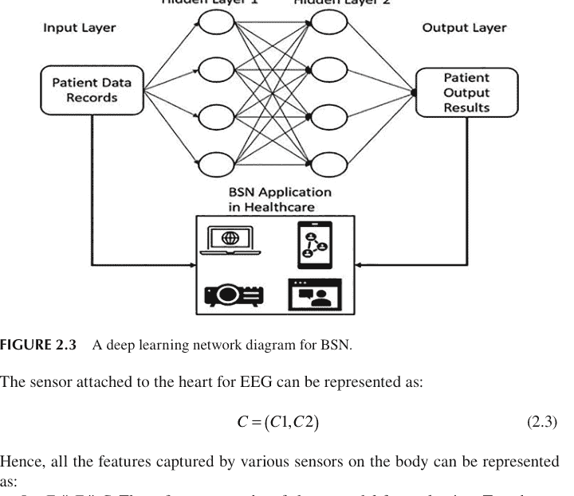

**图 2.3** BSN 的深度学习网络图。

头部用于 EEG 的传感器可以表示为：

$$C = (C1, C2) \quad (2.3)$$

因此，身体上各种传感器捕获的所有特征可以表示为：

$$L = F_f \| E \| C$$

这些特征随后被输入模型进行评估。为了增强特征，使用了基于核的判别分析（KDA），其基于特征值问题以找到非线性特征空间。这工作如下：身体不同部位附着的传感器通过从以下方程最大化得到的 Gaussian 核捕获：

$$S = \frac{|S^T C_w S|}{|S^T C_B S|}$$

其中 $S$ 表示类 $C_B$ 与类 $C_w$ 的判别特征。KDA 提供了一种聚类技术，可根据聚类组展示特征。

DNN 的层。它由三层组成：第一层使用线性方法对信号进行分离，第二层是“全连接”层，最后一个层使用激活函数，该激活函数是线性函数。这些层构建了 DNN 的模型以预测信号并为基于 IoT 的医疗保健系统开发一种方法，该系统为其提供有关患者的准确信息。DNN 用于根据医疗专家给出的特定范围预测信号是否异常或正常，以评估设备产生的信号。

信号日志生成生理信号，如 ECG、EEG、体温、“心率”和“血氧”，这些是为数据检索过程获取的一些显著信号形式。DNN 提供了进一步分析仅异常信号的能力，并为医疗专家提供更多灵活性，以便及时评估并采取进一步措施。

### 2.7 BSN 的应用

BSN 今天被许多研究人员广泛研究，因为 BSN 与 IoT 结合可以改变许多人的生活。它的应用不仅限于医疗领域或医疗保健管理，而且还用于许多其他领域。BSN 在其他领域的使用包括体育和健身训练、娱乐、残疾服务以及军事服务 [41]。图 2.4 显示了 BSN 在不同领域的所有应用。下文简要描述了 BSN 在医疗保健系统中最重要的应用。

#### 2.7.1 医疗领域

BSN 在医疗领域使用最广泛，因为它具有广泛的能力来检测和分析影响人类生活的绝大多数疾病的医疗保健数据。全世界面临着许多健康相关问题，为人们提供及时有效的服务一直是一个挑战。因此，BSN 正在成为

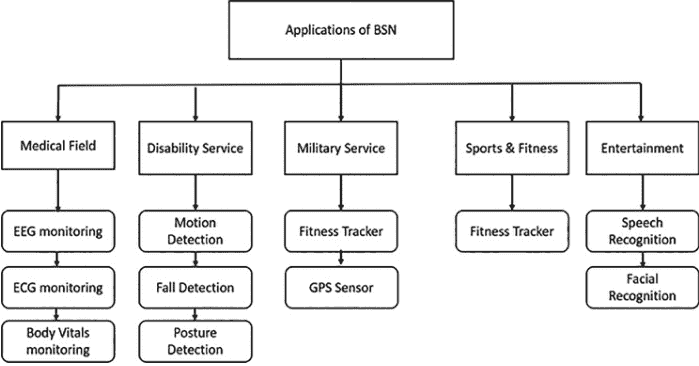

**图 2.4** BSN 在不同领域的应用。

在战争或袭击期间提供有用的警报以使他们保持活跃。无线传感器与 GPS 传感器一起用于跟踪移动并为军事专业人员提供有用的信息 [46]。除此之外，军事专业人员使用 BSN 使他们保持活跃并帮助他们全天保持健康 [33]。

#### 2.7.5 娱乐

如今，娱乐系统不断变化，每天都有新技术被添加到娱乐中，无论是手机、电视还是其他电子设备。许多最新技术都采用免提操作，需要面部动作或语音识别来操作此类设备。这是由于无线传感器和物联网技术能够检测动作或面部识别，从而以便捷的生活方式提供娱乐服务 [47,48]。

### 2.8 医疗保健技术中 BSN 和 IoT 的挑战

在设计基于物联网医疗保健系统的合适的无线通信技术时，关键要求包括实时监控医疗保健数据、及时管理患者对医疗专家的请求、有效诊断和读取数据以及提供增强的数据安全。维护患者的隐私和保密性以及保持医疗数据安全极其重要。

#### 2.8.1 可扩展性

“医疗保健系统”中的可扩展性是一个重要基准，在设计或开发新应用时应予以考虑。可扩展性不过是任何医疗保健监测系统能够适应不断变化的医疗环境并满足用户需求的能力。由于通过互联网用于医疗保健系统的服务器和设备太多，物联网技术变得可扩展性较差，因为它失去了统一性和通信技术。保持设备之间的统一性可以减少可扩展性问题，并使 BSN 与 IoT 的使用更加灵活。

主要目标是使 BSN 连接到设备更具可扩展性，以便它能够满足不断变化的环境的需求，因为可扩展性确保医疗保健管理系统能够顺利运行，而不会出现服务器端的任何延迟。无响应的设备可能会导致读取数据时出现错误，并使关键患者使用此类设备变得不可靠。因此，解决可扩展性问题成为现有设备中的一个重要因素，并在为未来使用开发新设备之前考虑可扩展性。

#### 2.8.2 安全

在当今世界，随着数据日复一日地增加，采取必要措施以改善“医疗保健监测系统”的安全性和隐私性势在必行。

研究人员和工程师必须确保用于捕获各种应用的医疗保健监测系统具有经过身份验证的安全性，因为这些应用的使用随着时间的推移而增加 [34]。

考虑到患者保密性和医疗数据的重要性，医疗保健系统应采取措施提高安全性、维护保密性以及确保数据质量。

基于物联网医疗保健环境，“智能医疗保健应用系统”是医生通过 WBAN 远程监控相应患者状态的最重要应用之一 [49]。当信息通过网络交换时，网络钓鱼诈骗是可能预期的有害攻击之一。因此，在设计智能医疗保健系统时应采取措施。

Gope 等人 [50] 提出了一种名为 BSN-care 的方法，为医疗保健应用系统中的患者提供增强的安全性。总体安全框架分为两个部分：网络安全和数据安全。身份验证、定位和数据匿名化都是网络安全方面的内容。另一方面，数据隐私和完整性由数据安全处理。这两个组件共同提供医疗保健系统的整体安全性和身份验证，并防止数据遭受伪造攻击。

Lal 等人 [35] 提出了基于“WBAN”的“内容中心网络”方法用于物联网医疗保健。该方法在需要连接到门户或其他形式手段以访问患者数据的应用中提供高度安全性。为了将患者信息传递给医生，它会经过许多在患者和医生之间充当中介的人；因此，重要的是确保信息不会被错误的人访问，并确保无缝连接，高速数据传输速率可提供更好的信息访问。

Wu 等人 [51] 使用匿名身份验证系统来在医疗保健应用中维护患者数据信息的增强安全性。该方法减少了许多人普遍面临的身份验证方法中的安全问题。作者能够在医疗保健系统中以更低的成本实现更高性能的高安全性。

#### 2.8.3 隐私和保密性

医疗保健系统中的隐私和保密性对患者和医生都很重要。它保持患者与医生之间的关系公平并建立相互信任。只有个人的医生、医疗保健提供者或健康保险提供者应有权访问此类敏感和机密信息。任何滥用或不当行为都会导致医疗系统产生灾难性后果 [52]。由于数据隐私泄露，可以对医疗主管或健康保险公司提起诉讼。因此，医疗保健系统应安全、私密，并必须具有增强的安全措施以保持数据保密 [53]。因此，物联网技术中的 BSN 应克服安全和隐私问题，并为患者和医生提供更快、更可靠的来源，使其信任系统并改善生活方式 [42]。


### 2.9 结论

本章总结了可穿戴 BSN 传感器用于检测与患者医疗保健相关的信号的应用。过去几年里，在使用 BSN 或 WBAN 的智能医疗保健系统领域已开展了大量研究。当今的医疗保健行业可以说是[content]
### 2.9 结论

本章总结了可穿戴 BSN 传感器用于检测与患者医疗保健相关的信号的应用。过去几年里，在使用 BSN 或 WBAN 的智能医疗保健系统领域已开展了大量研究。当今的医疗保健行业可以说是至关重要且最脆弱的领域，因为它有助于人们保持健康的生活方式。如果医疗保健系统管理不当，可能损害一个人的情感和社会福祉，甚至危及他们的生命。因此，在提供使用中的最高安全性和高端技术模型方面采取措施非常重要。在本章中，我们总结了使用深度学习模型构建智能医疗保健系统的应用。我们强调了医疗保健中物联网的架构，并着重介绍 BSN 在医疗保健中的各种应用和使用情况，同时也强调了在其他领域的应用。BSN 已显示出远程监测医疗保健数据的能力，这对老年人来说是一大福音。

研究表明 BSN 如何改变老年人的生活以及年轻人的生活。先进的功能和智能监测设备以及可轻松访问的可穿戴传感器提供了有前景且值得信赖的结果，并确保人们拥有良好的生活质量。然而，对于这样一个关键系统，始终存在涉及患者数据的隐私和安全风险的担忧。通过妥善管理数据并提供高端安全保障，BSN 与物联网相结合可以极大地改变人们的生活质量，并可能成为未来医疗革命的未来。

在未来几年中，BSN 的应用可以包括个性化处方和药品在家中递送，并发送有关药品补充或过期提醒。它还具有将应用扩展到以前未使用过的其他领域的潜力。因此，BSN 在物联网与人工智能技术的结合为社会、公众以及医疗专家带来了革命性的变革。

### 参考文献

- [1] N Al Bassam, S Asif Hussain, A Al Qaraghuli, J Khan, E P Sumesh, and V Lavanya. IoT-based wearable device to monitor the signs of quarantined remote patients of COVID-19. *医学信息学解锁*, 24: 100588, 2021.
- [2] H N Almajed, A S Almogren, and A Altameem. A resilient smart body sensor network through pyramid interconnection. *IEEE 访问*, 7: 51039–51046, 2019.
- [3] P Castillejo, J-F Martinez, J Rodriguez-Molina, and A Cuerva. Integration of wearable devices in a wireless sensor network for an e-health application. *IEEE 无线通信*, 20, 4: 38–49, 2013.
- [4] W-Y Chung, Y-D Lee, and S-J Jung. A wireless sensor network compatible wearable u-healthcare monitoring system using integrated ECG, accelerometer, and SpO2. In *2008 30th Annual International Conference of the IEEE Engineering in Medicine and Biology Society*, 1529–1532. IEEE, 2008.
- [5] D Gangwani, Q Liang, S Wang, and X Zhu. An empirical study of deep learning frameworks for melanoma cancer detection using transfer learning and data augmentation. 2021 *IEEE International Conference on Big Knowledge (ICBK)*, 2021, pp. 38–45, doi: 10.1109/ICKGS2313.2021.00015.
- [6] L D'Arco, H Zheng, and H Wang. Sensebot: A wearable sensor-enabled robotic system to support health and well-being. *CERC*, 30–45, 2020.
- [7] O Faust, A Shenfield, M Kareem, T R San, H Fujita, and U Rajendra Acharya. Automated detection of atrial fibrillation using long short-term memory network with R interval signals. *生物医学与医学计算*, 102: 327–335, 2018.
- [8] P Gangwani, A Perez-Pons, T Bhardwaj, H Upadhyay, S Joshi, and L Lagos. Securing environmental IoT data using masked authentication messaging protocol in a DAG-based blockchain: IOTA tangle. *未来互联网*, 13, 12: 312, 2021. https://doi.org/10.3390/fi13120312.
- [9] H Fouad, A S Hassanein, A M Soliman, and H Al-Feel. Analyzing patient health information based on IoT sensors with AI for improving patient assistance in the future direction. *测量*, 159: 107757, 2020.
- [10] D Gangwani and P Gangwani. Applications of machine learning and artificial intelligence in intelligent transportation system: A review. *人工智能和机器学习的应用*, 203–216, 2021.
- [11] P Gangwani, J Soni, H Upadhyay, and S Joshi. A deep learning approach for modeling of geothermal energy prediction. *国际计算机科学与信息安全杂志 (IJCSIS)*, 18, 1, 2020.
- [12] P Gope and T Hwang. BSN-care: A secure IoT-based modern healthcare system using body sensor network. *IEEE 传感器杂志*, 16, 5: 1368–1376, 2015.
- [13] L Greco, G Percannella, P Ritrovato, F Tortorella, and M Vento. Trends in IoT based solutions for health care: Moving into the edge. *模式识别信件*, 135: 346–353, 2020.
- [14] G Guidi, M Chiara Pettenati, R Miniati, and E Iadanza. Heart failure analysis dashboard for patient's remote monitoring combining multiple artificial intelligence technologies. In *2012 Annual International Conference of the IEEE Engineering in Medicine and Biology Society*, 2210–2213. IEEE, 2012.
- [15] K Hameed, I Sarwar Bajwa, S Ramzan, W Anwar, and A Khan. An intelligent IoT based health care system using fuzzy neural networks. *科学编程*, 2020, 2020.
- [16] A Harbouche, N Djedi, M Erradi, J Ben-Othman, and A Kobbane. Model driven flexible design of a wireless body sensor network for health monitoring. *计算机网络*, 129: 548–571, 2017.
- [17] D He, S Zeadally, N Kumar, and J-H Lee. Anonymous authentication for wireless body area networks with provable security. *IEEE 系统杂志*, 11, 4: 2590–2601, 2016.
- [18] A Khanna, M Kapahi, and E Gupta. Wearable technologies in IoT: A critical survey. In: Proceedings of the International Conference on Innovative Computing & Communication (ICICC). Available at SSRN 3833933, 2021.
- [19] X Lai, Q Liu, X Wei, W Wang, G Zhou, and G Han. A survey of body sensor networks. *传感器*, 13, 5: 5406–5447, 2013.
- [20] K Nidhi Lal and Anoj Kumar. E-health application over 5G using content-centric networking (CCN). In *2017 International Conference on IOT and Application (ICIOT)*, 1–5. IEEE, 2017.
- [21] R Kumar Mahendran and P Velusamy. A secure fuzzy extractor based biometric key authentication scheme for body sensor network in internet of medical things. *计算机通信*, 153: 545–552, 2020.
- [22] V Mainanwal, M Gupta, and S Kumar Upadhayay. A survey on wireless body area network: Security technology and its design methodology issue. In *2015 International Conference on Innovations in Information, Embedded and Communication Systems (ICIIECS)*, 1–5. IEEE, 2015.
- [23] H Masoumi, A Behrad, M Ali Pourmina, and A Roosta. Automatic liver segmentation in MRI images using an iterative watershed algorithm and artificial neural network. *生物医学信号处理与控制*, 7, 5: 429–437, 2012.
- [24] B Anand Muthu, CB Sivaparthipan, G Manogaran, R Sundarasekar, S Kadry, A Shanthini, and A Dasel. IoT based wearable sensor for diseases prediction and symptom analysis in healthcare sector. *点对点网络与应用*, 13, 6: 2123–2134, 2020.
- [25] M Muzammal, R Talat, A Hassan Sodhro, and S Pirbhulal. A multi-sensor data fusion enabled ensemble approach for medical data from body sensor networks. *信息融合*, 53: 155–164, 2020.
- [26] A Nadeem, M Azhar Hussain, O Owais, A Salam, S Iqbal, and K Ahsan. Application specific study, analysis and classification of body area wireless sensor network applications. *计算机网络*, 83: 363–380, 2015.
- [27] MA Kumar and YR Sekhar. Android based health care monitoring system. In 2015 International Conference on Innovations in Information, Embedded and Communication Systems (ICIIECS). IEEE, 2015.
- [28] C Pandey, S Sharma, and P Matta. Body sensor network architectures in healthcare internet-of-things (HIoT): A survey. In 2021 *6th International Conference on Communication and Electronics Systems (ICCES)*, 494–499. IEEE, 2021.
- [29] H Kupwade Patil and R Seshadri. Big data security and privacy issues in healthcare. In *2014 IEEE International Congress on Big Data*, 762–765. IEEE, 2014.
- [30] S Furqan Qadri, S Afsar Awan, M Amjad, M Anwar, and S Shehzad. Applications, challenges, security of wireless body area networks (WBANS) and functionality of IEEE 802.15.4/ZigBee. *科学国际*, 25, 4: 697–702, 2013.
- [31] H Yin and N K Jha. A health decision support system for disease diagnosis based on wearable medical sensors and machine learning ensembles. *IEEE 多尺度计算系统学报*, 3, 4: 228–241, 2017.
- [32] S B Baker, W Xiang, and I Atkinson. Internet of things for smart healthcare: Technologies, challenges and opportunities. *IEEE 访问*, 5: 26521–26544, 2017.
- [33] H Carol, A Makhoul, R Darazi, and R Couturier. Health risk assessment and decision-making for patient monitoring and decision-support using wireless body sensor networks. *信息融合*, 47: 10–22, 2019.
- [34] M Alper Akkas, R Sokullu, and H Ertürk Cetin. Healthcare and patient monitoring using IoT. *物联网*, 11, 2020.
- [35] S Sanjay Kale and D S Bhagwat. A secured IoT based web care healthcare controlling system using BSN. In *2018 Second International Conference on Inventive Communication and Computational Technologies (ICIICT)*, 816–821, 2018.
- [36] P Rajan Jeyaraj and E Rajan Samuel Nadar. Smart-monitor: Patient monitoring system for IoT-based healthcare system using deep learning. *IETE 研究杂志*, 68: 1435–1442, 2019.
- [37] J Rana and A Bajpayee. Healthcare monitoring and alerting system using cloud computing. *国际近期与创新计算与通信趋势杂志*, 3, 2: 102–105, 2015.
- [38] D Ravi, C Wong, B Lo, and G-Z Yang. A deep learning approach to on-node sensor data analytics for mobile or wearable devices. *IEEE 生物医学与健康信息学杂志*, 21, 1: 56–64, 2016.
- [39] P P Reboucas Filho, R Moura Sarmento, G Bandeira Holanda, and D de Alencar Lima. New approach to detect and classify stroke in skull CT images via analysis of brain tissue densities. *计算机方法和生物医学中的程序*, 148: 27–43, 2017.
- [40] SD Ross, R Estok, S Chopra, and J French. Management of newly diagnosed patients with epilepsy: A systematic review of the literature. *证据报告/技术评估 (摘要)*, 39: 1–3, 2001.
- [41] S Sharma, A Lal Vyas, B Thakker, D Mulvaney, and S Datta. Wireless body area network for health monitoring. In *2011 4th International Conference on Biomedical Engineering and Informatics (BMEI)*, 4: 2183–2186. IEEE, 2011.


- [42] H F Nweke, Y W Teh, M A Al-Garadi, and U R Alo. 基于移动和可穿戴传感器网络的人类活动识别深度学习算法：最新进展与研究挑战。*专家系统与应用*，105: 233–261, 2018.
- [43] Y Sun. *保障体域网与泛在医疗系统的安全*，伦敦帝国理工学院，2019.
- [44] C A Tavera, J H Ortiz, O I Khalaf, D F Saavedra, and THH Aldhyani. 面向医疗应用的可穿戴无线体域网络。*医学中的计算与数学方法*，pp. 1–9, 2021.
- [45] L Wu, Y Zhang, L Li, and J Shen. 无线体域网的高效匿名认证方案。*医学系统杂志*，40, 6: 1–2, 134, 2016.
- [46] S Subrata, K Singh, S Das, and R Kumar. 水下传感器网络中的节能最短路径路由协议。载于*2016年国际计算、通信与自动化会议（ICCCA）*，546–550。IEEE，2016.
- [47] S Vivek Kumar, R Kumar, and S Sahana. 采用新型聚类方法提高无线传感器网络的可靠性和能效。载于*2017年国际计算、通信与自动化会议（ICCCA）*，488–493。IEEE，2017.
- [48] H A Sanghvi, S B Pandya, P Chattopadhyay, R H Patel, and A S Pandya. 面向电子医疗、娱乐和金融的数据科学。载于*2021年第三届国际创造性计算应用研究会议（ICIRCA）*，604–611。IEEE，2021.
- [49] M M Dhanvijay, and S C Patil. 物联网：医疗健康使能技术及其应用综述。*计算机网络*，153: 113–131, 2019.
- [50] A Farman, S El-Sappagh, S M Riazul Islam, D Kwak, A Ali, M Imran, et al. 基于集成深度学习和特征融合的心脏病预测智能医疗监控系统。*信息融合*，63: 208–222, 2020.
- [51] B Zohre Arabi, A Habibi Zade Navin, M Hossein Zadeh, and A Rezaee. SENET：一种基于物联网的体域网新架构。*医学信息学（开放获取）*，20, 100365, 2020.
- [52] C Pandey, S Sharma, and P Matta. 医疗健康物联网（HIoT）中的体域网架构：综述。载于*2021年第六届国际通信与电子系统会议（ICCES）*，494–499, 2021。doi: 10.1109/ICCES51350.2021.9489205.
- [53] A A Mutlag, M K A Ghani, and M A Mohammed. 面向心电生物医学传感器的医疗资源管理优化框架。载于*海量医疗物联网的高效数据处理*，229–244。施普林格，Cham.


## 3 论区块链与物联网的融合以增强安全性

Pranav Gangwani
佛罗里达国际大学

Tushar Bhardwaj、Alexander Perez-Pons、Himanshu Upadhyay 和 Leonel Lagos
佛罗里达国际大学

## 目录

- 3.1 引言 ........................................................ 35
- 3.2 动机 ........................................................ 36
- 3.3 物联网安全 ........................................................ 37
- 3.3.1 物联网背景 ........................................................ 37
- 3.3.2 物联网安全风险 ........................................................ 38
- 3.3.2.1 感知层的安全风险 ........................................................ 38
- 3.3.2.2 网络层的安全风险 ........................................................ 39
- 3.3.2.3 中间件层的安全风险 ........................................................ 40
- 3.3.2.4 应用层的安全风险 ........................................................ 41
- 3.4 区块链技术 ........................................................ 42
- 3.5 区块链与物联网的集成 ........................................................ 42
- 3.5.1 系统架构 ........................................................ 43
- 3.6 集成技术面临的挑战 ........................................................ 46
- 3.7 结论 ........................................................ 47
- 参考文献 ........................................................ 47

### 3.1 引言

物联网（Internet of Things，IoT）是一个由智能物理设备（称为“物”）[1]和人类构成的全球网络。物联网允许每一个“物”进行链接和连接，有效将整个物理生态系统转变为一个大规模的数据管理环境。云计算[2]、人工智能[3]和深度学习[4]，以及数据分析与信息建模，正逐渐成为物联网系统的重要组成部分。物联网领域的巨大进步也在推动“信息与通信技术”产业的发展。

智能设备从其本地环境中收集数据，然后与其他平台和物联网设备进行通信。在传统物联网网络中，数据被收集并存储在集中式服务器上（尤其是云服务器）以备后用[5]。因此，物联网消费者必须信任传统的中心服务器，相信机密和敏感信息在那里受到保护。尽管服务提供商带来了不可否认的好处，但集中式物联网系统有时会面临一些障碍。例如，未加密的服务器数据可能被黑客攻击，导致重要信息泄露。一种蓬勃发展的技术——区块链正在演进，它是一种分布式且不可篡改的账本。该技术通过使用其加密算法和共享数据库来记录和存储交易。区块链参与者以点对点的方式在互联网上进行操作。从技术上讲，区块链解决了与信任相关的问题。基于哈希链的加密算法通过证书值的时间戳机制进行安全传输，提供了数据的可追溯性和不可逆更改。

在本章中，我们将讨论物联网的各种安全风险，例如聚合物联网数据时可能出现的问题——如果在数据聚合之前未对传感器进行监控的话。物联网的某些特性也可能构成威胁，如数据存储、数据传输、嵌入式标签、物联网基础设施、身份认证[6]和访问控制。此外，我们将讨论为什么需要区块链以及分布式账本技术的概述。而且，我们还将讨论区块链与物联网的结合以增强物联网设备的安全性。进一步地，我们将讨论这两项新兴技术集成带来的好处，如去中心化、安全性、可扩展性、可靠性、身份、自治、安全代码部署和服务市场。我们还将介绍区块链与物联网集成时必须克服的问题/挑战。

### 3.2 动机

物联网是一个以惊人速度增长、由全球数十亿互联设备组成的领域。这些设备未来还将继续增加，预计到2025年，这一数字将达到750亿[7]。每台设备都在互联网上共享数据。因此，不难理解，当考虑如此海量的设备时，数据将持续以巨大的规模产生。因此，解决这样海量数据的安全问题成为一项重大挑战。本节将解释物联网面临的一些挑战以及为什么需要区块链。

物联网的分布式架构是最重要的问题之一。物联网集群中的每个节点都可能被用来发起“分布式拒绝服务（DDoS）”和许多其他网络攻击，因此成为潜在的故障点[8]。如果多台设备同时工作，物联网设备集群可能会迅速崩溃

受到破坏。物联网的另一个问题在于其集中式架构可能成为单点故障 [9]，因此必须解决这一问题。数据认证与机密性 [10] 是另一个关键威胁，也是必须解决的最重要威胁之一。如果物联网设备受到破坏，数据可能会以多种方式被滥用。此外，在设备自主共享数据、计算能力或电力的各种应用场景中，物联网数据的安全性变得至关重要 [11]。

### 3.3 物联网安全

#### 3.3.1 物联网背景

物联网协议栈包含四个层，即感知层、网络层、中间件层和应用层 [12]，如图 3.1 所示。感知层包含各种物联网设备，例如各类传感器、执行器、二维码扫描器和 GPS 模块。如果从工业场景来看，这些设备可能附着在某些设备上，如传送带系统、自动导引车和机械臂。网络层包含各种技术，例如蓝牙、MQ 遥测传输（MQTT）、Wi-Fi、Zigbee、IPv6 和 IPv4。所有这些协议都有相同的任务，即将数据传输到下一层进行处理和分析。中间件层包含数据处理系统，如数据库、服务器，它们负责提供存储和计算服务，例如计算优化算法、决策制定以及维护海量数据的记录。最后一层，即应用层，为最终用户提供各种应用的特定需求。供应链 [13]、数字医疗

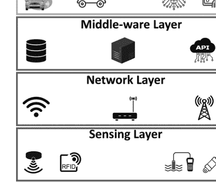

图 3.1 物联网架构。

这可能导致物联网应用发生故障，也可能导致错误的结果。如果使用这种方法，攻击者还可能试图发起 DDoS 攻击 [17]。

- 3. **恶意代码注入攻击：** 在这种威胁形式中，攻击者将恶意脚本插入节点的内存中。通常，软件或固件的升级通过空中下载（OTA）方式进行，这为对手提供了注入包含恶意软件的程序的机会。这些对手可能能够访问整个物联网系统，甚至可能通过注入此类恶意代码来强制节点执行某些非必要功能 [18]。

- 4. **睡眠剥夺攻击：** 在这种攻击类型中，低功率物联网设备的电源会被攻击者耗尽。由于电池电量耗尽，源自节点的物联网应用可能会发生拒绝服务。如果对手能够人为地增加各种物联网设备的功耗，或者攻击者成功利用恶意代码在这些物联网设备中运行无限循环，就可能实施睡眠剥夺攻击 [19]。

- 5. **侧信道攻击：** 攻击者可以通过发起各种侧信道攻击（而不是直接攻击节点）来泄露敏感和机密数据。由于处理器及其微架构的功耗和电磁辐射，敏感数据可能会泄露给攻击者。电磁攻击、基于激光的攻击、功耗和时序攻击是侧信道攻击所基于的一些攻击类型。现代芯片实现了密码模块，提供了不同的方法来避免这些攻击 [20]。

- 6. **启动攻击：** 物联网设备在启动过程中容易受到各种威胁。该漏洞源于启动过程中内置安全进程被禁用。因此，对手可能会利用这一弱点，在设备启动过程中发起攻击。由于边缘设备功耗低，有时会经历睡眠-唤醒周期，因此必须保护其启动过程 [21]。

- 7. **窃听与干扰：** 物联网应用中部署了许多节点，这些节点处于开放环境中。因此，这些物联网应用面临被窃听的风险。在数据认证或传输等不同阶段，对手可能能够捕获或窃听数据 [22]。

##### 3.3.2.2 网络层安全风险

网络层的作用是将信息从感知层传输到中间件层或处理单元以供进一步分析。以下是网络层的安全问题：

- 1. **拒绝服务/分布式拒绝服务攻击：** 在这类威胁中，攻击者执行大量无用请求来淹没目标服务器。因此，由于目标服务器无法正常服务，合法用户的服务被中断。

当攻击者利用多个来源使目标服务器过载时，该攻击被定性为分布式拒绝服务攻击。由于物联网网络的多样性和复杂性，物联网协议栈的网络层容易受到这些威胁的影响。如果物联网应用中的物联网设备未正确安装，攻击者可以对目标服务器发起分布式拒绝服务攻击，这些设备可能成为他们的简单网关 [23]。

- 2. **网络钓鱼攻击：** 当攻击者花费最少量的精力来攻击大量物联网设备时，就会发生网络钓鱼攻击。攻击者预期至少有一些设备会因攻击而受到入侵。用户在互联网上浏览网站时，可能会遇到钓鱼网站。如果用户的登录凭据泄露，用户当前使用的整个物联网系统就容易受到网络威胁。在物联网架构中，网络层极易受到网络钓鱼攻击 [24]。

- 3. **数据传输攻击：** 各种物联网应用涉及大量的数据交换和存储。对手和黑客总是试图攻击数据，因为数据很有价值。当信息存储在云或本地服务器上时，存在安全漏洞的风险；然而，当它从一个位置移动到另一个位置时，就更容易受到网络威胁 [25]。

- 4. **访问攻击：** 这是一种攻击类型，对手或任何未经授权的用户实现了对物联网网络的访问，也称为高级持续性威胁。入侵者如果愿意，可以在网络内长时间不被发现地停留。由于物联网应用不断传输和接收重要信息，因此它们特别容易受到此类攻击 [26]。

- 5. **路由攻击：** 这些攻击之所以有效，是因为当数据在物联网应用中传输时，恶意节点可能会尝试改变路由路径。一种路由攻击类型是攻击者利用通告来鼓励节点沿尽可能短的路径路由流量，称为汇聚攻击。另一种称为虫洞攻击，如果与汇聚攻击或其他类型的攻击相结合，可能成为严重的安全威胁。虫洞的目的是快速传输数据包，并且是两节点之间的带外链路 [27]。

##### 3.3.2.3 中间件层安全风险

在物联网协议栈中，中间件层作为网络层和应用层之间的抽象层。由于该层提供 API，因此可以满足应用层的需求。尽管中间件层很有用，并能提供健壮且可靠的物联网应用，但它容易受到各种攻击。以下是中间件中的不同攻击：

- 1. **云中的洪泛攻击：** 在这种威胁类型中，服务质量受到影响，类似于云中的拒绝服务攻击。对手持续向云服务发送大量请求以耗尽云资源。如果云服务器上的负载增加，

那么这些攻击可能会对部署在云上的资源产生巨大影响 [28]。

- 2. **中间人攻击：** 以 MQTT 协议为例，该协议采用发布/订阅形式的通信模型。该协议中有三个主要角色，分别是发布者（客户端）、订阅者和充当代理的 MQTT Broker。由于 MQTT Broker 的存在，消息可以在不知道目的地的情况下发送，并有助于将发布者和订阅者彼此解耦。如果 Broker 由攻击者管理并且获得了对所有通信的完全控制，而客户端却浑然不觉，攻击者就可能成为中间人。

- 3. **签名包裹攻击：** 在中间件中使用的 Web 服务内部，采用了 XML 签名。在签名包裹攻击中，攻击者能够通过利用简单对象访问协议中的漏洞来实现或篡改窃听的数据，除非对手成功击败了签名方案。

- 4. **SQL 注入（SQLI）攻击：** 中间件层容易受到另一种被称为 SQLI 攻击的攻击。在这种攻击中，攻击者可以注入恶意 SQL 语句。注入后，攻击者可以篡改数据库中的记录，甚至可能获取任何用户的机密数据。

- 5. **云恶意软件注入：** 如果对手能够通过向云中注入恶意脚本或虚拟机来获得控制，则该攻击被称为云恶意软件注入。攻击者在假装成有效用户的情况下创建恶意服务模块或虚拟机。因此，攻击者可以掌握受害者的服务请求和私人信息，具体取决于情况，这些信息可能会被篡改。

##### 3.3.2.4 应用层的安全风险

应用层的角色是向客户提供功能服务，这里存在可穿戴设备、数字医疗和智能零售等物联网应用。该层存在一些特定于安全的问题，例如数据隐私和数据盗窃，这些问题在其他层中不存在。甚至特定物联网应用也有特定的安全问题。应用层面临的各种安全威胁说明如下：

- 1. **重编程攻击：** 在此类攻击中，如果编程过程未受保护，对手会尝试远程重新编程物联网设备，最终导致物联网网络被劫持 [29]。

- 2. **数据盗窃：** 各种物联网应用处理大量机密和敏感数据。静态数据或静止数据比传输中的数据更不易受攻击，而物联网应用中频繁发生数据移动。当此类物联网应用容易受到数据盗窃威胁时，客户将不愿将个人数据存储或使用在这些物联网应用上。

- 3. **嗅探攻击：** 在各种物联网应用中，攻击者可能会使用嗅探应用程序来检查网络流量的数据包。因此，如果没有实施足够的 security 协议来阻止攻击，攻击者就可以控制私人用户信息 [30]。

- 4. **访问控制攻击：** 访问控制是一种仅允许授权流程或个人访问账户或数据的方式。如果权限控制被破坏，整个物联网应用就会容易受到威胁；因此，访问控制攻击是物联网应用中的关键威胁。

- 5. **恶意代码注入攻击：** 攻击者通常会选择他们可以使用的最简单或最方便的方法来入侵网络或系统。由于代码检查不足，系统可能容易受到恶意脚本的攻击，而这可能成为攻击者选择的首个入口点。跨站脚本常被攻击者用来向受信任的网站插入恶意代码。

- 6. **服务中断攻击：** 根据现有文献，这些攻击也被称为 DDoS 攻击或非法中断攻击，许多物联网应用在各种情况下都曾成为此攻击的受害者。这些攻击人为地使服务器或网络过于繁忙而无法响应，从而导致授权用户无法使用物联网应用的服务 [31]。

### 3.4 区块链技术

区块链技术已被证明是不可变的，它基于分布式数字账本，而无需使用任何集中式存储库和权威机构来管理和治理它。在初始阶段，区块链使用户域能够在用户域范围内以共享账本的形式进行交易 [32]。基本思想是，在区块链网络的正常运行期间，一旦发布，交易将保持不变。

让我们深入探讨如图 3.3 所示的区块链技术架构。区块链的骨干是经过数字签名并最终分组为区块的分布式账本 [33]。每个区块随后与其前一个区块相连/链接，通过利用验证机制 [34] 和共识决策使其防篡改。此外，当向链中追加额外区块时，更改前面的区块变得极其复杂（这使其具有抗篡改性）。

### 3.5 区块链与物联网的集成

我们通过提出一种讨论访问管理去中心化系统的架构，描述了区块链技术如何被用于访问控制数据的分布式存储。除了物联网设备和管理中心之外，所有节点都将包含在区块链网络中。大多数物联网设备由于低功耗物联网设备的限制而无法存储区块链数据。我们还设计了一个特定的节点，即管理中心，

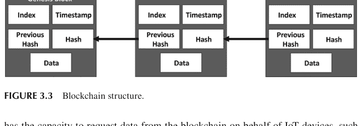

图 3.3 区块链结构。

具有代表物联网设备（如访问控制信息）从区块链请求数据的能力 [35]。此外，该架构采用了一种称为智能合约的自执行脚本；该智能合约充当一种解决方案，其中可以定义访问控制操作。被称为管理员的特殊用户通过与其交互来定义智能合约的策略。

#### 3.5.1 系统架构

图 3.4 显示了完整的系统架构，该架构分为六个不同的组件：

- 1. 管理中心
- 2. WSNs
- 3. 区块链
- 4. 代理节点
- 5. 管理员
- 6. 智能合约

1. **管理中心：** 如前所述，系统设计中的物联网设备不会出现在区块链网络中。大多数物联网设备功耗和存储容量低，CPU 也有限。由于这些限制，物联网设备很难直接加入区块链网络。我们引入了管理中心，这是一个独特的节点，充当接口，其作用是将物联网设备中编码为受限应用协议消息的数据转换为区块链参与者可读的 JavaScript 对象表示法远程过程调用数据。区块链中的节点（如矿工）直接与管理中心相连。如图 3.4 所示，区块链中的一个节点可以链接多个管理中心，同样一个管理中心也可以链接多个 WSN。物联网设备可以通过管理中心从区块链请求数据。

管理中心节点不能有与物联网设备相当的限制，因为它们必须能够处理来自物联网设备的许多并发查询，因此需要高性能。

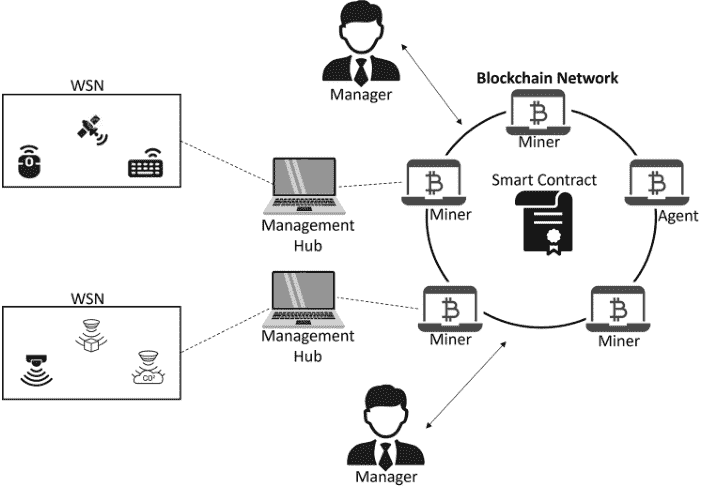

**图 3.4** 物联网-区块链集成架构。

只有在特定情况下，当不需要身份验证时，任何物联网设备如果直接连接到管理中心就可以联系区块链网络。虽然在某些情况下可能需要访问控制，但如果是这种情况，物联网设备将只连接到某些管理中心。特定物联网设备的管理员节点必须在该对象加入网络后，将该物联网设备的凭据告知特定的管理中心。管理员节点的工作还包括告知物联网设备管理中心的位置。

- 2. **WSNs：** WSNs 是一种特殊的传输网络，为各种应用提供低要求、受限功率并允许有限连接。此外，WSN 包含物联网设备，这些设备在能源、内存和计算能力方面存在一定的限制。

区块链网络不包含物联网设备，我们的系统中要求所有物联网设备必须通过其在区块链平台中的唯一身份进行全球识别。生成唯一且相当大的随机数可能成为一个问题；然而，使用公钥生成器则可能是一个可行的替代方案。通常，由于当前的密码学技术，每个物联网设备的公钥都会自动生成。因此，可以通过采用各种加密技术生成唯一身份。


- 3. 区块链：我们将为我们的架构系统使用私有区块链[36]，以便在管理物联网设备时获得更好的性能。由于私有区块链比公有区块链更具可扩展性，我们选择了它。尽管私有区块链比公有区块链性能更好，但在现实场景中应使用公有区块链，因为它是真正去中心化的。

    如果节点获得许可，它们就有能力在私有区块链上进行读写。矿工的角色是验证区块链交易，并通过维护区块链数据库副本来保持区块链的安全。节点可以在全局范围内访问访问控制策略，并使用区块链接口存储这些策略。一旦数据存储在区块链中，它就是不可变的，并且所有参与者都可以轻松获取。

- 4. 代理节点：在我们的系统中，有一种特殊类型的节点称为代理节点，其作用是在我们提出的架构中实现唯一的智能合约。代理节点在整个访问控制系统的运行过程中负责执行智能合约。一旦智能合约被批准进入区块链平台，代理节点就会在区块链内获得一个标识该智能合约的地址。要与智能合约交互，区块链网络上的每个节点都必须知道其地址。

- 5. 管理者：在提出的系统中存在一些区块链参与者，称为管理者，他们管理一组物联网设备的权限。与矿工节点相比，管理者（也称为轻量级节点）不验证区块链交易，也不保留交易数据。因此，在我们的系统中，受限设备尽管硬件有限，也可以充当管理者。此外，由于管理者无需持续连接到区块链，使用我们的方法可以减少对管理者硬件资源的利用。

    管理者可以是任何参与者；然而，已注册的物联网设备必须受该管理者的控制。因此，管理者可以避免注册那些已受其控制的设备。此外，系统中至少有一名已注册管理者必须将所有已注册的物联网设备置于其管理之下。如果不是这种情况，那么该设备将无法由任何参与者管理，同时，多个管理者也可以监管同一个物联网设备。

    一旦这些设备注册到管理者的控制之下，管理者就可以为物联网设备的访问控制定义某些权限。

- 6. 智能合约：访问管理系统由系统中创建的唯一的智能合约的活动来管理。访问管理系统的所有操作都由智能合约定义，这些智能合约由区块链交易激活。一旦交易发起了对访问控制的操作，矿工将存储交易数据，这些数据将在全球范围内可用。智能合约的执行活动以及智能合约本身都是公开可用的。

    此外，在我们的系统中，只有管理者才有权通过与智能合约交互来定义新策略。

### 3.6 集成技术面临的挑战

本节将讨论在集成物联网和区块链技术时出现且必须解决的重要挑战。将物联网与区块链技术集成并非易事。区块链技术是为高性能机器的互联网场景而开发的，这与物联网技术相矛盾。设备必须能够使用加密货币进行操作，并且必须有能力对交易进行数字签名，这是区块链的一项要求。在本节中，我们重点介绍并概述了将区块链与物联网融合时出现的关键问题。

### 3.6.1 可扩展性和存储

虽然区块链的可扩展性和存储能力尚有争议，但在物联网应用中，低功耗和受限的资源使得这些挑战更加严峻。从这一场景来看，将区块链用于物联网应用似乎并不合适；但仍然可以通过一些方法完全避免或缓解上述限制。对于物联网应用以及区块链的集成来说，这种限制确实具有挑战性，因为设备可能实时产生大量信息。因此，在集成这两种技术时必须解决这些挑战[37]。

### 3.6.2 数据隐私和匿名性

大多数物联网应用处理敏感数据，例如心率监测应用；因此，解决数据隐私和匿名性问题非常重要。为了解决身份管理问题，区块链被认为是物联网的最佳解决方案；然而，在比特币的情况下，一些应用可能需要匿名性。

在公有区块链中，数据隐私问题已经与其他解决方案一起讨论过。物联网设备面临数据隐私的重大挑战，因为这些设备从数据收集开始，然后将数据用于各种应用。存储和保护设备及其数据成为一项挑战，而确保只有授权人员才能访问这些数据则是另一项挑战，因为必须将密码学安全软件集成到设备中[38]。

### 3.6.3 智能合约

智能合约是区块链技术最重要的用途之一；然而，存在许多必须解决的挑战。物联网设备可能以多种方式受益于智能合约，尽管将它们与物联网应用集成很复杂[39,40]。

此外，在使用智能合约时会用到预言机；这些特殊实体的作用是在实际真实场景中建立信任并提供数据。由于物联网设备的不稳定性，这些智能合约的验证可能会受到损害。此外，如果访问多个数据源，这些智能合约很容易过载。目前，智能合约无法处理大量的计算，也无法共享资源来分配任务，尽管它们是去中心化和分布式的。

### 3.6.4 共识算法

由于各种物联网应用中物联网设备的受限特性，直接参与诸如工作量证明（PoW）之类的共识技术具有挑战性。对于共识算法，存在各种提议；然而，它们尚未经过测试，也还不成熟。在区块链网络中，根据所使用的共识协议类型来确定资源需求。通常，这些任务被分配给没有计算限制的设备或能够执行这些功能的网关。这一功能可以通过链下方法提供，这些方法在区块链外部处理数据，以减少区块链网络中的计算时间[41]。

### 3.7 结论

物联网系统计算资源有限，并产生大量数据。因此，这些设备存在若干必须解决的安全风险。在本章中，我们识别并描述了与物联网设备相关的各种安全威胁。我们介绍了区块链技术，它提供了某些能力，有助于使物联网设备在面对各种攻击时更加安全。我们提出了一种涉及多种类型节点的架构，可用于集成物联网设备和区块链技术。此外，我们还识别并描述了区块链与物联网集成时出现的各种挑战。

### 参考文献

- 1. V. Roman 和 J. Ordieres-Mere，基于树莓派的智能传感器物联网区块链技术，*2018年IEEE第11届服务计算与应用国际会议论文集*，第216–220页，2019年，doi: 10.1109/SOCA.2018.00038.
- 2. L. Wang 等，云计算：一项视角研究，*新一代计算*，第28卷，第2期，第137–146页，2010年，doi: 10.1007/s00354-008-0081-5.
- 3. D. Gangwani 和 P. Gangwani，机器学习和人工智能在智能交通系统中的应用：综述，载于*电气工程讲义*，施普林格，2021年，第203–216页。
- 4. P. Gangwani、J. Soni、H. Upadhyay 和 S. Joshi，一种用于地热能预测建模的深度学习方法，*国际计算机科学与信息安全杂志*，第18卷，第1期，第62–65页，2020年。
- 5. B. P. Rimal、D. Pham Van 和 M. Maier，光纤无线接入网络中的移动边缘计算与集中式云计算比较，载于*2016年IEEE计算机通信会议研讨会（INFOCOM WKSHPS）*，第991–996页，2016年4月，doi: 10.1109/INFCOMW.2016.7562226.
- 6. V. Parmar、H. A. Sanghvi、R. H. Patel 和 A. S. Pandya，关于无密码身份验证的综合研究，*2022年可持续计算与数据通信系统国际会议（ICSCDS）*，2022年，第1266–1275页，doi: 10.1109/ICSCDS53736.2022.9760934.
- 7. Statista研究部门，2015年至2025年全球物联网（IoT）连接设备安装基数，2016年8月3日。


- [8] C. Kolias, G. Kambourakis, A. Stavrou, and J. Voas, IoT 中的 DDoS：Mirai 及其他僵尸网络, Computer, 50, 7, pp. 80–84, 2017, doi: 10.1109/MC.2017.201.
- [9] J. Gubbi, R. Buyya, S. Marusic, and M. Palaniswami, 物联网 (IoT)：愿景、架构要素与未来方向, Futur. Gener. Comput. Syst., 29, 7, pp. 1645–1660, 2013, doi: 10.1016/j.future.2013.01.010.
- [10] S. Sicari, A. Rizzardi, C. Cappiello, D. Miorandi, and A. Coen-Porisini, 迈向物联网中的数据治理, in 新的物联网进展, R. R. Yager and J. Pascual Espada, 编者. Cham: Springer International Publishing, 2018, pp. 59–74.
- [11] F. Hawlitschek, B. Notheisen, and T. Teubner, 无信任系统的局限性：共享经济中区块链技术与信任的文献综述, Electron. Commer. Res. Appl., 29, pp. 50–63, May 2018, doi: 10.1016/j.elerap.2018.03.005.
- [12] S. A. Al-Qaseemi, H. A. Almulhim, M. F. Almulhim, and S. R. Chaudhry, IoT 架构挑战与问题：缺乏标准化, FTC 2016 – Proc. Futur. Technol. Conf., December, pp. 731–738, 2017, doi: 10.1109/FTC.2016.7821686.
- [13] B. Kehoe, 整合供应链, Mater. Manag. Health Care., 15, 8, pp. 26–29, 2006, doi: 10.1108/eum0000000000329.
- [14] D. Gangwani, Q. Liang, S. Wang, and X. Zhu, 基于迁移学习和数据增强的黑素瘤癌症检测深度学习框架的实证研究, in 2021 IEEE International Conference on Big Knowledge (ICBK), December 2021, pp. 38–45, doi: 10.1109/ICKG52313.2021.00015.
- [15] A. Mukherjee, 物联网中的物理层安全：在资源受限条件下的感知与通信保密性, Proc. IEEE, 103, 10, pp. 1747–1761, 2015, doi: 10.1109/JPROC.2015.2466548.
- [16] M. Conti, R. Di Pietro, L. V. Mancini, and A. Mei, 涌现特性：移动无线传感器网络中节点捕获攻击的检测, WiSec’08 Proc. 1st ACM Conf. Wirel. Netw. Secur., pp. 214–219, 2008, doi: 10.1145/1352533.1352568.
- [17] L. Xie, Y. Mo, and B. Sinopoli, 电力市场中的虚假数据注入攻击, in 2010 First IEEE International Conference on Smart Grid Communications, 2010, pp. 226–231, doi: 10.1109/SMARTGRID.2010.5622048.
- [18] D. Swathigavaishnave and R. Sarala, 使用两阶段分析技术检测恶意代码注入攻击, Int. J. Comput. Appl., 45, 18, pp. 8–14, May 2012.
- [19] M. Pirretti, S. Zhu, N. Vijaykrishnan, P. McDaniel, M. Kandemir, and R. Brooks, 传感器网络中的睡眠剥夺攻击：分析与防御方法, Int. J. Distrib. Sens. Networks, 2, 3, pp. 267–287, 2006, doi: 10.1080/15501320500642718.
- [20] F.-X. Standaert, 侧信道攻击导论, in Secure Integrated Circuits and Systems, I. M. R. Verbauwhede, 编者. Boston, MA: Springer US, 2010, pp. 27–42.
- [21] B. Collier, R. Clayton, D. R. Thomas, and A. Hutchings, 铲除攻击者：评估执法干预对拒绝服务攻击市场的影响, Proc. ACM SIGCOMM Internet Meas. Conf. IMC, pp. 50–64, 2019, doi: 10.1145/3355369.3355592.
- [22] Y. Zou and G. Wang, 存在窃听攻击时工业无线传感器网络的截获行为分析, IEEE Trans. Ind. Informatics, 12, 2, pp. 780–787, 2016, doi: 10.1109/TII.2015.2399691.
- [23] H. Liu, 云中一种新型 DoS 攻击及其规避机制, Proc. ACM Conf. Comput. Commun. Secur., pp. 65–75, 2010, doi: 10.1145/1866835.1866849.
- [24] S. Gupta, A. Singhal, and A. Kapoor, 社会工程攻击文献综述：网络钓鱼攻击, Proc. IEEE Int. Conf. Comput. Commun. Autom. ICCCA 2016, pp. 537–540, 2017, doi: 10.1109/CCAA.2016.7813778.
- [25] S. Andy, B. Rahardjo, and B. Hanindhito, 物联网系统中 MQTT 通信协议的攻击场景与安全分析, Int. Conf. Electr. Eng. Comput. Sci. Informatics, 2017, September, pp. 19–21, 2017, doi: 10.1109/EECSI.2017.8239179.
- [26] M. S. Islam, M. Kuzu, and M. Kantarcıoglu, 可搜索加密中的访问模式泄露：影响、攻击与缓解, Ndss, 20, pp. 1–15, 2012.
- [27] B. Kannhavong, H. Nakayama, Y. Nemoto, N. Kato, and A. Jamalipour, 移动 Ad Hoc 网络中路由攻击综述, *Wirel. Commun. IEEE*, 14, pp. 85–91, 2007, doi: 10.1109/MWC.2007.4396947.
- [28] M. N. Ismail, A. Aborujilah, S. Musa, and A. Shahzad, 使用协方差矩阵方法检测云计算环境中基于洪泛的 DoS 攻击, *Proc. 7th Int. Conf. Ubiquitous Inf. Manag. Commun. ICUIMC 2013*, pp. 4–9, 2013, doi: 10.1145/2448556.2448592.
- [29] N. Sayegh, A. Chehab, I. H. Elhajj, and A. Kayssi, SCADA 系统的内部安全攻击, *2013 3rd Int. Conf. Comput. Inf. Technol. ICCIT 2013*, pp. 22–27, 2013, doi: 10.1109/ICCITechnology.2013.6579516.
- [30] A. Barua, H. Shahriar, and M. Zulker nine, 内容嗅探攻击的服务器端检测, *Proc. Int. Symp. Softw. Reliab. Eng. ISSRE*, pp. 20–29, 2011, doi: 10.1109/ISSRE.2011.27.
- [31] M. Nawir, A. Amir, N. Yaakob, and O. B. Lynn, 物联网 (IoT)：安全攻击分类, *2016 3rd Int. Conf. Electron. Des. ICED 2016*, pp. 321–326, 2017, doi: 10.1109/ICED.2016.7804660.
- [32] M. Nofer, P. Gomber, O. Hinz, and D. Schiereck, 区块链, *Bus. Inf. Syst. Eng.*, 59, 3, pp. 183–187, 2017, doi: 10.1007/s12599-017-0467-3.
- [33] M. Cash and M. B. Sassouni, 用于安全数据共享的两层许可与非许可区块链, *Proc. -3rd IEEE Int. Conf. Smart Cloud, SmartCloud 2018*, pp. 138–144, 2018, doi: 10.1109/SmartCloud.2018.00031.
- [34] H. Sukhwani, J. M. Martínez, X. Chang, K. S. Trivedi, and A. Rindos, 许可区块链网络 (hyperledger fabric) PBFT 共识过程的性能建模, *Proc. IEEE Symp. Reliab. Distrib. Syst.*, 2017, pp. 253–255, 2017, doi: 10.1109/SRDS.2017.36.
- [35] M. A. Ferrag, M. Derdour, M. Mukherjee, A. Derhab, L. Maglaras, and H. Janicke, 物联网的区块链技术：研究问题与挑战, *IEEE Internet Things J.*, 6, 2, pp. 2188–2204, 2019, doi: 10.1109/JIOT.2018.2882794.
- [36] P. Ganganwi, A. Perez-Pons, T. Bhardwaj, H. Upadhyay, S. Joshi, and L. Lagos, 使用 DAG 基于区块链中的掩码认证消息协议保护环境物联网数据：IOTA Tangle, *Futur. Internet*, 13, 12, p. 312, December 2021, doi: 10.3390/fi13120312.
- [37] P. Cui, U. Guin, A. Skjellum, and D. Umphress, 物联网中的区块链：当前趋势、挑战与未来路线图, *J. Hardw. Syst. Secur.*, 3, 4, pp. 338–364, 2019, doi: 10.1007/s41635-019-00079-5.
- [38] S. Roy, M. Ashaduzzaman, M. Hassan, and A. R. Chowdhury, 物联网安全与管理的区块链：当前前景、挑战与未来方向, *Proc. 2018 5th Int. Conf. Networking, Syst. Secur. NSysS 2018*, 2019, doi: 10.1109/NSysS.2018.8631365.
- [39] A. Aniso, A. Chaudhary, and S. Sahana, 基于人工智能方法的分布式 DoS 攻击防御综述. In *2021 IEEE 6th International Conference on Computing, Communication and Automation (ICCCA)*, pp. 32–38, IEEE, 2021.
- [40] M. Kumar Singh, K. Deep Mishra, S. Sahana, 基于车辆密度的智能实时交通控制, in *International Journal of Engineering Technology and Management Sciences*, 5, 3, 2021, doi: 10.46467/ijtems.2021.v05i03.004. ISSN: 2581–4621.
- [41] P. K. Sharma, N. Kumar, and J. H. Park, 面向绿色物联网的区块链技术：机遇与挑战, *IEEE Netw.*, 34, 4, pp. 263–269, 2020, doi: 10.1109/MNET.001.1900526.3.

## 4 云计算中的人工智能

Dinesh Soni 和 Neetesh Kumar
IIT Roorkee

## 目录
- 4.1 引言 ........................................................ 51
- 4.2 赛博物理系统 ............................................. 52
- 4.2.1 CPS 结构 ................................................... 52
- 4.2.2 CPS 组件 .................................................. 53
- 4.2.3 CPS 特征 ................................................... 54
- 4.2.4 CPS 领域 .................................................. 55
- 4.2.5 CPS 挑战 .................................................. 56
- 4.2.6 CPS 安全 .................................................. 57
- 4.3 云计算技术 .................................................. 58
- 4.4 AI 技术 ...................................................... 63
- 4.4.1 使用 ML 算法检测恶意软件 ............................... 68
- 4.5 结论 ........................................................ 68
- 参考文献 ........................................................ 70

### 4.1 引言

赛博物理系统 (CPS) 根据国家标准与技术研究所 [46] 的定义为“将网络世界与物理世界集成的系统”。由于 CPS 数据流具有大量的数据，因此使用机器学习 (ML) 技术对其进行分析和解释。在 CPS 中，ML 方法应用于三个领域：智能电网 (SG)、交通运输和工业。人工神经网络 (ANN) 可以通过对时间序列流进行回归来预测趋势。ANN 预测能源消耗以帮助客户调节需求。支持向量机 (SVM) 因其响应时间短而被用于故障检测、预测、聚类、特征设计以及智能电网和交通运输等应用领域。随机森林 (RF) 用于检测制造机器或产品中的故障，以及传感器中的虚假电力记录。在电力系统中，决策树分类技术用于故障检测、能源需求预测和公交旅行时间。

本章分为三个部分。首先，第 4.2 节包含六个子部分，分别是 CPS 结构、CPS 组件、CPS 特征、CPS 领域、CPS 挑战和 CPS 安全。其次，第 4.3 节包含云计算技术，讨论云计算系统、ML/深度学习 (DL)

系统、软件包、库、模型、框架、边缘计算设备以及云网络中的学习技术。第三，第4.4节包含人工智能（AI）技术，讨论了基于机器学习的网络物理攻击检测。该小节讨论了使用机器学习算法检测恶意软件，并描述了使用机器学习进行CPS恶意软件检测。

## 4.2 网络物理系统

### 4.2.1 CPS结构

“CPS”一词由美国国家科学基金会于2006年提出。美国总统科技顾问委员会在2007年的报告中承认CPS战略是迈向网络和IT领域未来的关键且充满希望的转型。CPS的整体视图如图4.1所示。物理世界的活动需要被监控[8]。下一代嵌入式设备处理数据并与其分布式环境通信，这些设备被称为网络系统。通信和其他中间组件被称为接口。它通过执行器、模数转换器（ADC）/数模转换器（DAC）转换器、互联传感器等将网络系统与物理世界连接起来[6]。

传感器节点执行感测、驱动、计算（使用处理器和内存）操作，还包含通信模块和电池。这些传感器节点可以将原始数据传输到数据融合节点，或者利用自身的处理能力处理这些数据，并将所需部分中继到另一个传感器节点[11]。

物理层盒应被理解为分布在多个区域中的一个或多个物理层。每个物理层都有一组可以单独或异步运行的物理过程。监控测量值的传感器和控制这些过程的控制器必须受到保护，以防止

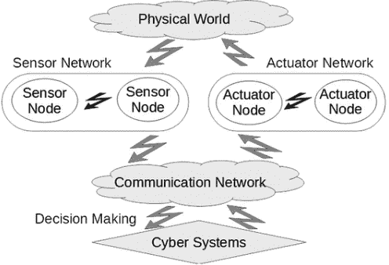

**图4.1** CPS的整体视图。

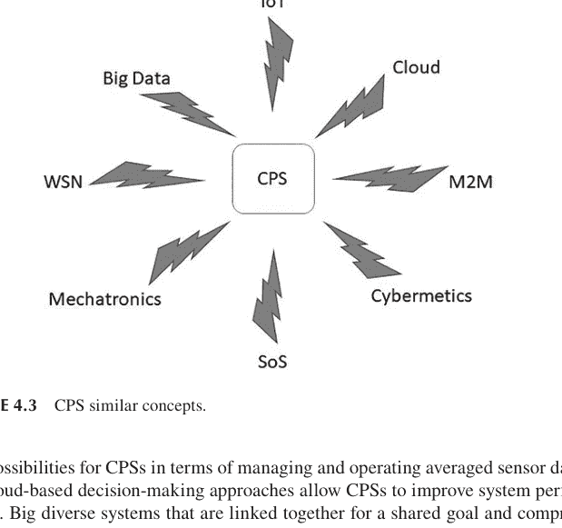

图4.3 CPS相关概念。

CPS在管理和操作平均传感器数据方面有了新的可能性，基于云的决策方法使CPS能够提高系统性能。为共同目标而连接在一起并由可独立运行的自主元素组成的大型异构系统被称为“系统的系统”[24]。机电一体化是一种设计、开发和部署复合工程系统的技术，它将信息技术融入物理环境。对机器和生物体中处理与通信能力的研究被称为控制论。

物联网（IoT）关注于观察现实世界中的事物，利用连接性并收集数据，以处理那些尚未被有效处理的对象[30]。M2M指的是通过网络相互通信的智能设备，例如PC、智能传感器、移动设备、嵌入式处理器和执行器。CPS将无线传感器网络与智能道路和自动驾驶车辆导航系统集成在一起。

### 4.2.3 CPS特性

本节概述了CPS区别于其他应用领域的特性。

- **1. 可靠性：** CPS中的软件故障可能带来灾难性后果。CPS以其高可靠性著称。
- **2. 安全性：** CPS的安全漏洞涉及数据，但也可能对人身或财产产生重大影响。即使无法直接访问，CPS也可能被利用。
- **3. 实时性要求：** 在CPS中，时间和截止期限非常重要。在CPS领域指定程序正确性时，实时性要求是一个重要的区分因素[38]。
- **4. 数据表示：** 数据的表示方式对性能有巨大影响。CPS直接与硬件交互，或定期使用定义良好的协议与其他设备通信。数据表示除了是功能上的必需之外，还对性能有巨大影响。
- **5. 受限环境：** CPS以在资源受限的情况下工作而闻名。内存通常稀缺，CPU时钟速度通常比同类硬件平台慢。当能源是电池时，功耗会带来一个非常不同的问题[46]。
- **6. 软件更新：** 更新设备可能需要使用专门的工具和技术，以及大量的资金投入。工业控制应用或植入式医疗设备（IMD）的停机可能会对CPS产生重大影响。

### 4.2.4 CPS领域

本节讨论如图4.4所示的关键CPS应用。智能制造是应用嵌入式硬件和软件来提高产品生产力或服务交付。由于国际市场、国内、大规模生产和经济增长等特点，智能制造是一个非常受欢迎的CPS应用领域[25]。应急响应是指管理公共卫生风险、安全和福利，保护环境、关键基础设施和自然资源。任何民用或军用航空系统及其交通

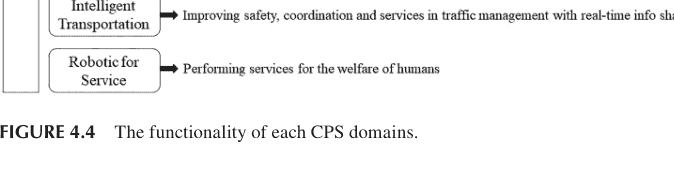

图4.4 每个CPS领域的功能。

对其资源的访问进行限制，并保护敏感数据免受未经授权的访问。*可维护性*是指系统在发生故障时得以纠正的能力。*可用性*是指系统即使在发生故障时也能被访问的能力。系统在运行时不造成任何伤害和风险的能力被称为*安全性*。

*鲁棒性*是指系统在出现意外故障时保持其持久结构并生存的能力[12]。*准确性*给出了系统估计结果与真实结果之间匹配程度的度量。*可组合性*是系统能够通过观察其每个方面而被完全理解的性质。*适应性*是指系统通过根据不断变化的环境条件更新配置来改变其状态以保持运行的能力。*弹性*是指系统在面对不超过其耐力极限的内部或外部挑战时，继续运行并提供可接受质量服务的能力。*可重构性*是指在发生故障或响应内部或外部请求时更改其设置的能力[15]。系统执行特定功能所需的资源量（如能源、成本和时间）被称为*效率*。*完整性*是指系统保护自身或其包含的信息免遭非法操纵或更改以保持信息正确性的能力。只允许经过身份验证的用户访问该系统内生成的隐藏数据的特性被称为*机密性*。*可组合性*是不同元素真正结合在一起的属性，以及它们在系统中的相互关系[23]。*异构性*是系统的一个特征，它允许系统将各种交互和相互关联的组件整合到一个复杂的整体中。*可扩展性*是指系统在规模变化或工作量增加的情况下继续正常运行并从中获益的能力。

其他一些挑战包括缺乏标准、验证和确认工具、架构设计时间管理、系统反馈、高级查询处理、软件可靠性、设备互操作性、数据提取、安全隐私和可靠性[27]。需要进一步研究的问题包括参数可变性、数据工作流、实际实施等。

### 4.2.6 CPS安全

对CPS的攻击可能导致经济损失和人员伤亡。因此，检查和评估最相关的出版物以评估CPS安全性至关重要[28]。CPS技术的安全框架包含三个组成部分，如架构层、应用场景以及度量、攻击、防御和控制（MADC）类型。

图4.6显示了CPS安全框架，解释如下。

**架构层：** 它包含三个组成部分：感知层、网络层和应用层。*感知层*的基本目标是在收集和处理状态信息之前识别和测量对象[39]。*网络层*获取收集到的数据并将其传送到应用层。它包含物联网协议（ZigBee、Z-Wave、WiFi、蓝牙、HDMI等）、轻量级加密、流量分析方法等。


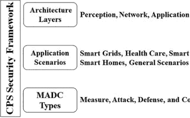

**图4.6** 统一的CPS安全框架。

*应用层*从该网络层接收信息，并将其用于辅助这些应用。认证、访问控制、漏洞分析和可信计算是这一层需要研究的关键参数。

**应用场景：** CPS技术已广泛用于5G、交通、家居和智能工业系统等多种场景 [34]。嵌入式系统设备包含各种安全特性。

**MADC类型：** 需要了解整个攻防过程，以构建一个综合防控体系。

- **测量：** 在CPS安全中，错误配置识别、恶意软件发现、风险评估、设备驱动软件和集成电路都是关键的安全措施。
- **攻击：** 研究人员还必须设计新的攻击策略来加强防御系统。根据目标位置，我们将攻击分为感知层、应用层和网络层三类 [23]。
- **防御：** 研究人员已使用多种方法在不同结构层中进行检测和阻止攻击 [27]。
- **控制：** 研究人员已使用多种方法来区分结构层。设备耦合、云服务监控、可信计算、密钥管理和加密通信方案都是在应用层开展的控制研究示例。

## 4.3 云计算技术

本节概述了云属性、部署模型、服务、特性、安全问题和挑战的基本原理 [1]。这有助于理解基本的云计算系统。云的特性是*用户中心*的，因为用户拥有云中的数据并可以共享。采用*任务中心*模式时，用户必须专注于云如何完成任务；云是强大的，因为许多计算资源连接在一起，从而产生高计算能力；云是可访问的，因为云中有许多存储库，因此数据不是单一来源；云是智能的，因为云拥有大量数据和检索工具；云是可编程的，因为云拥有大量数据，并且使用许多数据挖掘工具来检索这些数据。基础设施即服务（IaaS）包含许多用户可控制的计算资源、内存需求、操作系统和应用程序；软件即服务（SaaS）提供软件工具服务，无需在PC上安装即可使用，只需连接互联网；平台即服务（PaaS）提供部署用户可控制的应用程序和软件的能力。

云中存在的部署模型包括：私有云是单个用户拥有并运营的云，公司使用它来最大化计算资源的利用并根据公司需求工作；公有云是由第三方运营和拥有的云，每个用户被分配其计算能力，混合云可以通过组合公有云和私有云来创建。由组织共享且具有共同关注点的特定社区称为社区云。云的特性，如按需自助服务，使用户能够按需提供计算资源；广泛网络接入通过标准规则提供云访问，并可通过互联网被各种类型的设备访问；资源池化提供了根据需要以多租户模型服务许多用户的能力；快速弹性提供了在云中立即扩展或缩减的功能。在计量服务中，云监控、控制和报告资源使用情况，还可以利用计量和测量能力控制和优化资源利用率。基于一些安全问题，用户选择云提供商。云安全对用户来说是一种特权访问，因为云中的用户信息由于其数据所有权而存在风险，用户需要熟悉监管体系；云提供商需要定期遵守第三方的安全标准，而用户在选择供应商时负责安全解决方案。数据位置应让用户知晓，提供商应使用数据分离机制将加密数据隔离在单个硬盘上，并且如果用户发生数据灾难，提供商需要按照一定的恢复协议进行恢复。详细内容见表4.1。

下一节讨论边缘计算领域的系统、包、库、模型、框架和设备，如表4.2所示。多伦多大学提出了CloudPath。它提供多种资源，以及设备与云数据中心之间的路径，主要用于路径计算 [2]。它改善了带宽消耗并减少了响应时间。CloudPath节点中包含PathExecute、PathStore、PathRoute、PathDeploy、PathMonitor和PathInit等模块。PCloud整合了边缘计算和存储资源，为移动服务提供无缝支持。它提高了系统的可用性并优化了资源配置。威斯康星大学麦迪逊分校提出了ParaDrop [6]，它提供了有效的资源利用、多租户和动态应用管理。它用于物联网数据分析，并提供隐私、低网络延迟、稳健连接、最小带宽和位置感知服务等。SpanEdge允许程序在靠近数据源的地方运行，从而减少网络延迟 [2]。通信有两种：一种是在工作节点与管理节点之间（系统管理），以及

### 表4.1 云计算系统

| 序号 | 属性 | 服务 | 部署模型 | 特性 | 安全问题 | 挑战 |
|---|---|---|---|---|---|---|
| 1 | 用户中心、任务中心、强大、可访问、智能、可编程 | IaaS、SaaS、PaaS | 私有、公有、混合、社区 | 共享基础设施、按需自助服务、计量服务、快速弹性、资源池化、成本、可靠、可持续性、敏捷性、维护、计量 | 法规遵从、长期可行性、数据位置、恢复、调查支持、特权访问、隔离 | 信息使用、隐私、问责、连接性、资源管理、功耗、可靠性、基于能量的资源调度、虚拟机迁移、工作负载预测、网络带宽、SLA违规、故障预测、调度算法 |

### 表4.2 边缘计算中的ML/DL系统、包、库、模型、框架、设备

| 序号 | 系统 [2] | 包 [2] | 库 [3] | 模型 [3] | 框架 [3] | 设备 [3] |
|---|---|---|---|---|---|---|
| 1 | EdgeX Foundry, CORD, Open VDAP, FocusStack, AirBox, SpanEdge, LAVEA, Vigna, VideoEdge, MUVR, CloudPath, PCloud, Cachier and Precog, ParaDrop, Firework | TensorRT, CoreML, PyTorch, MXNet | DL4J, SNPE, NCNN, Paddle-Mobile, MACE, FANN | YOLO, DetectNet, MobileNet, GoogLeNet, DeepSense, AlexNet, LSTM, VGG, SENNA, Deepface, Faster R-CNN, VGG16, OpenALPR | TensorFlow Lite, Caffe2Go, MXNet, Core ML2, DeepThings, ML Kit, AIZGO, DeepIoT, DeepCham, SparseSep, DeepX, Eignent, daBNN, TensorFlow Federated, CONDENSA | NVIDIA GPU, SparkFun Edge, ARM ML, NVIDIA Jetson TX2, Raspberry-Pi kit, Google Coral Dev Board |

Intel Movidius 是一种视觉处理单元，用于无人机和智能安全摄像头。为了构建机器学习、计算机视觉、图像分类和语义分割，BeagleBone AI 包含了德州仪器的深度学习机器学习API。NVIDIA Jetson 驱动的嵌入式计算板和AI计算设备被设计用于处理边缘设备上的复杂实时数据和智能系统 [4]。OpenMV Cam 是一款紧凑型摄像头板，带有低功耗 ARM Cortex-M7 处理器，用于运行机器视觉算法 [13]。

文献中有许多用于此目的的机器学习应用，如表4.3所示。云计算学习技术发挥着重要作用。本节简要介绍了云计算领域多篇研究文章中的学习技术、挑战、参数和目标。机器学习影响了多个研究领域。近年来，用于改进云计算领域的机器学习技术已被使用 [7]。谷歌提出了联邦学习（FL）[5]。多方使用FL技术来开发ML模型并协作维护私有数据。FL是一种多方、隐私保护的机器学习。DL具有多层结构类型，这种方法从放置在复杂网络环境中且用于提高边缘设备性能的物联网设备中提取准确数据 [6]。在云计算中，ANN提供了广泛的操作能力，并提供了一种快速简便的计算方法 [8]。ANN是一种包含互联多级神经元的机器学习技术 [19]。ANN训练可以发现许多模式，并用于检测云中的入侵以保障云安全。云计算使用带计算机算法的统计机器学习 [10]。当变量在统计上相关且在没有因果关系的情况下进行测量时，使用统计机器学习方法 [14]。强化学习（RL）基于试错法工作 [17]。RL处理困难的现实世界情况。它不像监督学习那样使用外部指导提供的统计样本。RL作为一种基于智能体的方法工作，智能体根据自身经验最大化奖励 [20]。

并行Q学习在整个训练过程中维护Q矩阵收敛、奖励和策略 [18]。它是一种离策略RL技术。Q矩阵提供了状态转移的策略。更少的训练和计算复杂度容易理解，并且易于修改以构造存储策略。SVM最适合不均衡数据集，也是用于云入侵检测的更好算法 [16]。物联网中使用许多传感器进行数据感知。许多算法被应用于识别设备，这些算法可以提取设备特征。

## 4.4 人工智能技术

本节详细阐述了CPS应用中的各种安全设计问题和相关ML技术 [47]。它讨论了软件、物理和网络层面的各种网络物理攻击，如表4.4所示。

在文献[25]中，作者提出了RNN模型传感器检测技术，用于入侵者针对车辆的场景。该研究探索了几种车轮速度传感器攻击情况，所提出的检测方法可对被攻击传感器的位置和数量进行分类。在文献[26]中，作者探讨了与基于视觉的自动驾驶系统相对的恶意图像注入攻击。在文献[27]中，作者描述了一种基于贝叶斯网络的水处理系统攻击检测技术，利用数据

## 表 4.3 云网络中的学习技术

| 参考文献 | 技术 | 挑战 | 指标/参数 | 领域 |
|---|---|---|---|---|
| [4] | ML | 运营商成本降低和浮动收入。 | 网络延迟、吞吐量、回传成本、功耗 | 边缘缓存 |
| [5] | FL | 通信成本、资源分配、隐私、安全、参与者掉线、无标签数据、干扰、异步 FL | 通讯轮次、可扩展性、准确率、延迟、通信成本、计算、收敛速率、通信负载、公平性、延迟、资源开销、DL 训练、推理、可扩展性、数据速率、能效 | 边缘网络 |
| [6] | DL | 通信受限、非独立同分布训练数据、贡献不平衡 | 通讯轮次、可扩展性、准确率、延迟、通信成本、计算、收敛速率、通信负载、公平性、延迟、资源开销、DL 训练、推理、可扩展性、数据速率、能效 | 边缘计算 |
| [7] | ML | 异构回传/前传 | 传输功率、数据速率、频谱利用率、频谱效率、能耗、回传参数、延迟、成本 | 无线网络 |
| [8] | ANN | 无线 VR、无人机和空中飞行器 | 内容相关性、缓存效率、命中率、资源管理；路径、信道、切换、内容、计算、需求、LoS 链路 | 无线网络 |
| [9] | ML (最近邻、朴素贝叶斯、决策树、SVM) | 参数值优化、时空相关性、时空采样、指令频率、性能调优、预取配置、硬件事件 | 数据预取、系统性能 | 内存预取器配置 |
| [15] | ML (SVM、神经网络、线性回归) | VM 供给、公有云基础设施、数据库服务器 | CPU 利用率、响应时间、吞吐量、平均绝对百分比误差 RMSE、观测百分比 | 资源需求预测 |
| [16] | ML (回归树 + boosting) | 系统的数据库资源管理、最佳资源分配 | 服务延迟、响应时间、到达率 | 调整分配并最大化利润 |
| [17] | 强化学习 | VM 配置、分布式 RL | 内存大小、带宽、CPU 实例 | VM 的最优配置 |
| [18] | 并行 Q 学习 | 优化资源分配、实时虚拟化测试床 | UTC、响应时间、到达率 | 提高收敛时间 |
| [19] | ANN + SVM | 资源分配与规模、存储 I/O 延迟 | MIMO 队列模型、CPU-内存限制、I/O 延迟 | 性能与资源分配 |
| [20] | GA + 支持向量回归 | 互联网辅助内存、资源优化模块 | 响应时间、CPU、RAM | 降低服务响应时间 |

## 表 4.4 基于 ML 的 CPS 攻击检测方法

| 层 | 参考文献 | CPS 领域 | 防御概念 | 基于 ML 的模型 | 使用的验证 |
|---|---|---|---|---|---|
| 物理层 | [25] | 汽车 | 感测设备 | RNN | 实验 |
| 物理层 | [26] | 汽车 | 感测设备 | CNN | 建模 |
| 物理层 | [27] | 水 | 感测设备 | 多种 (贝叶斯网络) | 建模 |
| 物理层 | [28] | HVAC | 传感器 | SVM | 建模 |
| 物理层 | [29] | 电力 | 传感器 | DRE | 仿真 |
| 网络层 | [42] | 汽车 (VANET) | DoS | DNN | 仿真 |
| 网络层 | [30] | ICS | 多种 | 多种 (SVM) | 实验 |
| 网络层 | [44] | 天然气管道 | 多种 | K 近邻 | 实际数据 |
| 网络层 | [45] | ICS | 多种 | LSTM-FNN | 实验 |
| 网络层 | [46] | 能源 | 各种 | CNN | 实验 |
| 网络层 | [31] | 能源 | DoS | SVM | 建模 |
| 应用层 | [32] | – | 应用程序 | 多种 | 实验 |
| 应用层 | [35] | – | 应用程序 | CNN | 实验 |
| 应用层 | [37] | – | 应用程序 | Softmax | 实验 |
| 应用层 | [38] | – | 处理硬件 | 多种 (逻辑回归、SVM、MLP) | 实验 |
| 应用层 | [39] | – | 计算硬件 | CNN | 实验 |

来自众多执行器和传感器。在 [28] 中，作者提出了一种物理模型和学习模型检测器的组合。在基于学习模型的检测器上，应用了一类 SVM 模型。作者 [29] 提出了一种基于密度比估计 (DRE) 的 AC 微电网异常检测方法。作者 [42] 提出了一种混合干扰攻击模型。为了告知威胁管理，建议的检测器使用 SVM 和基于 k-means 的聚类算法，从而实现对不同形式网络攻击的分类 [30]。在 [44] 中，作者提出了一种两阶段数据包级异常模型检测器。为了检测相关网络攻击，在 [45] 中，作者提出结合学习方法，使用前馈神经网络 (FNN) 模型和 LSTM 模型。在 [46] 中，提出了一种用于监控控制和数据采集 (SCADA) 网络的基于 CNN 的网络攻击检测器。作者 [31] 建议使用单类 SVM 来防御 SG-SCADA 系统上的 DoS 攻击。作者 [32] 提出了一种用于相机应用嵌入式系统的轻量级基于 ML 的软件异常分析器。几种基于 ML 的侧信道检测技术用于防护的效率

## 表 4.5 使用 ML 的 CPS 恶意软件检测

| 参考文献 | 环境 | 分类算法 | 结果 | 未来工作 |
|---|---|---|---|---|
| [40] | 物联网 | SVM | 在物联网环境中，SVM 提高了 Android 设备恶意软件检测中许多其他分类器模型的性能。 | – |
| [41] | CPS 系统 | SVM、神经网络、随机森林、J48、朴素贝叶斯、贝叶斯网络、逻辑回归 | 在水处理环境中，所提出的方法可以高精度地检测攻击频率以及攻击类型。 | 数据集扩展 |
| [41] | 物联网 | 支持向量机、主成分分析、n-gram 方法 | 对于短片段，SVM 和 n-gram 表现更好。对于巨大片段，三种算法都 100% 有效，且无误报。 | 利用更小的包来扩展工作。 |
| [42] | CPS 系统 | SVM、随机森林、K-NN、K-means | 使用 SVM 和随机森林获得最佳检测结果 | 数据集扩展 |
| [42] | 物联网 | SVM | 将 SVM 应用于提高 WMS AMMDS 的有效性可获得 100% 的预测性能，零误报。 | – |
| [42] | CPS 系统 | 自动多级恶意软件检测方法 | 和 5.8% 的效率开销 | 数据集扩展 |
| [42] | CPS 系统 | DCA | 可以使用简单的轻量级模型识别 CPS 中的加密劫持者 | – |
| [42] | 物联网 | DNN | 在物联网环境中，它改进了监督模型性能以及使用 DL 技术对 Android 设备进行恶意软件攻击检测的半监督方法 | 数据集扩展（标记和未标记数据） |
| [43] | 物联网 | DNN | 使用 Tensorflow 和 DL (DNN) 检测物联网中的僵尸网络可提供超过 97% 的检测性能 | 增加数据集中的当前数据量。 |
| [44] | CPS 系统 | SVM、独立成分分析、K 近邻、MEWMA、随机森林 | SVM 与随机森林的组合可获得高达 100% 的预测准确率 | – |
| [44] | CPS 系统 | SVM、决策树 | 使用决策树与 SVM 算法检测供应链中的恶意软件可提高准确性 | – |
| [45] | CPS 系统 | ML | 使用历史攻击数据检测对 CPS 的攻击 | 扩展数据集的可用性 |

基于 CPS 的医疗保健解决方案与医疗保健解决方案也被介绍。SG-CPS 是一个高度复杂的结构，融合了网络和物理系统。SG-CPS 的复杂性需要对其众多领域进行全面审查的理解。对 CPS 最严重的威胁是被感染恶意软件使其变成僵尸网络、众多类型的异常以及 CPS 中的恶意软件攻击。本章介绍了云计算技术和当前新兴 ML 算法在 CPS 环境领域的重要性。由于数据可用性的增加以及设备间显著计算能力的增长，ML 算法由于更好的泛化能力而优于传统算法。本章强调了云计算领域中 ML 技术的重要性。未来的研究应侧重于使用 ML 算法检测 CPS 中的僵尸网络和恶意软件分类。仍有一些重大挑战需要进一步探索，以提高性能，拓展 CPS 领域的新领域，以及使用 AI 的云计算。

## 参考文献

- [1] Arockiam L, Monikandan S, and Parthasarathy G. 云计算：综述。 *国际互联网计算期刊*, 1(2):26–33, 2011.
- [2] Fang L, Guoming T, Youhuizi L, Zhiping C, Xingzhou Z, and Tongqing Z. 边缘计算系统和工具综述。 *IEEE 会议录*, 107(8):1537–1562, 2019.
- [3] Murshed MG, Christopher M, Daqing H, Nazar K, Ganesh A, and Faraz H. 网络边缘的机器学习：综述。 *ACM 计算调查 (CSUR)*, 54(8):1–37, 2021.
- [4] Liying L, Guodong Z, and Rick S B. 蜂窝网络中缓存技术综述：内容放置和分发策略中的研究问题和挑战。 *IEEE 通信调查与教程*, 20(3):1710–1732, 2018.
- [5] Wei Yang Bryan L, Nguyen Cong L, Dinh Thai H, Yutao J, Ying-Chang L, Qiang Y, Dusit N, and Chunyan M. 移动边缘网络中的联邦学习：全面综述。 *IEEE 通信调查与教程*, 22(3):2031–2063, 2020.
- [6] Yiwen H, Xiaofei W, Victor C M, Leung, Dusit N, Xueqiang Y, and Xu C. 边缘计算与深度学习的融合：全面综述。 *arXiv*, 22(2):869–904, 2019.
- [7] Yaohua S, Mugen P, Yangcheng Z, Yuzhe H, and Shiwen M. 机器学习在无线网络中的应用：关键技术和开放问题。 *arXiv*, 21(4):3072–3108, 2018.
- [8] Mingzhe V, Ursula C, Walid S, Changchuan Y, and Merouane D. 基于人工神经网络的无线网络机器学习：教程。 *arXiv*, 21(4):3039–3071, 2017.
- [9] Shih-wei L, Tzu-Han H, Donald N, Chinyen C, Chiaheng T, and Hucheng Z. 基于机器学习的预取优化用于数据中心应用。 In *高性能计算网络、存储和分析会议论文集*, 1–10, 2009.
- [10] Peter B, Rean G, Charles A S, Armando F, Michael I J, and David A P. 统计机器学习使互联网数据中心的自动控制变得实用。 *HotCloud*, 9:12, 2009.
- [11] Chetan G, Abhay M, and Umeshwar D. PQR：预测自主工作负载管理的查询执行时间。 In *2008 年自主计算国际会议*, 13–22. IEEE, 2008.
- [12] Jing J, Jie L, Guangquan Z, and Guodong L Web 应用的最优云资源自动扩展。 In *2013 年第 13 届 IEEE/ACM 集群、云和网格计算国际研讨会*, 58–65. IEEE, 2013.


- [13] Sadeka I, Jacky K, Kevin L, and Anna L. 云中自适应资源配置的经验预测模型。 *未来一代计算机系统*, 28(1):155–162, 2012.
- [14] Zhenhuan G, Xiaohui G, and John W. Press：云系统预测弹性资源扩展。 载于 *2010 年国际网络与服务管理会议*, 9–16. IEEE, 2010.
- [15] Akindele A B, and Samuel A A. 使用机器学习技术预测云资源配置。 载于 *2013 年第 26 届 IEEE 加拿大电气和计算机工程会议 (CCECE)*, 1–4. IEEE, 2013.
- [16] Pengcheng X, Yun C, Sheng Z, Hyun Jin M, Calton P, and Hakan H. 云环境中数据库系统虚拟化资源智能管理。 载于 *2011 IEEE 第 27 届国际数据工程会议*, 87–98. IEEE, 2011.
- [17] Cheng-Zhong X, Jia R, and Xiangping B. URL：自主云管理的统一强化学习方法。 *并行与分布式计算杂志*, 72(2):95–105, 2012.
- [18] Enda B, Enda H, and Jim D. 应用强化学习实现云中资源分配自动化和应用可扩展性。 *并发与计算：实践与经验*, 25(12):1656–1674, 2013.
- [19] Sajib K, Raju R, Ajay G, Ming Z, and Kaushik D. 使用机器学习技术建模虚拟化应用。 载于 *第 8 届 ACM SIGPLAN/SIGOPS 虚拟执行环境会议论文集*, 3–14, 2012.
- [20] Cheng-Jung H, Yu-Wu W, Chih-Tai G, Heng-Ming C, and Jui-Jiun J. 机器学习在云计算资源管理中的应用。 *建模与优化国际期刊*, 3(2):148, 2013.
- [21] Gian Antonio S, Andrea S, Simone P, Sean M, and Alessandro B. 预测性维护的机器学习：多分类器方法。 *IEEE 工业信息学报*, 11(3):812–820, 2014.
- [22] Eneko O, Enrique O, Asier M, Pedro L-G, Asier P, and Pablo G B. 基于分类技术的分布式智能分散式智能交通系统。 *IET 智能交通系统*, 10(10):674–682, 2016.
- [23] Mitchell Y, Yong Q, Jing Z, Ying G, Branko G C, and Steven W S. 基于粒子群聚类和隐马尔可夫模型的轴承故障自动诊断。 *人工智能工程应用*, 47:88–100, 2016.
- [24] Allen H T, Wai-Ki C, and Ling-Yau C. 机器故障检测：隐马尔可夫模型方法。 *计算机与工业工程*, 57(2):608–619, 2009.
- [25] Shin J, Baek Y, Lee J, and Lee S. 基于 RNN 的汽车制动系统网络物理攻击检测与恢复。 *应用科学*, 9(1):82, 2019.
- [26] Cai F, and Koutsoukos X. 学习型网络物理系统中的实时分布外检测。 载于 *2020 ACM/IEEE 第 11 届网络物理系统国际会议 (ICCPS)*, 174–183. IEEE, 2020.
- [27] Lin Q, Adepu S, Verwer S, and Mathur A. TABOR：基于图形模型的工业控制系统异常检测方法。 载于 *2018 年亚洲计算机与通信安全会议论文集*, 525–536, 2019.
- [28] Paridari K, O’Mahony N, Mady A E D, Chabukswar R, Boubekeur M, and Sandberg H. 面向抗攻击工业控制系统的框架：攻击检测与控制器重配置。 *IEEE 会议录*, 106(1):113–128, 2017.
- [29] Chakhchouk Y, Liu S, Sugiyama M, and Ishii H. 用于电力状态估计中网络攻击诊断的统计离群点检测。 载于 *2016 IEEE 电力与能源学会年会 (PESGM)*, 1–5. IEEE, 2016.
- [30] Maglaras L A, Jiang J, and Cruz T. SCADA 系统入侵检测的集成 OCSVM 机制。 *电子快报*, 50(25):1935–1936, 2014.
- [31] da Silva, E G, da Silva, A S, Wickboldt, J A, Smith, P, Granville, L Z, and Schaeffer-Filho, A. SDN 基于 SCADA 系统的一类 NIDS。 载于 2016 IEEE 第 40 届计算机软件与应用年会 (COMPSAC) (Vol. 1), 303–312. IEEE, 2016.
- [32] Yoon M K, Mohan S, Choi J, Christodorescu M, and Sha L. 从系统调用分布学习执行上下文以用于智能嵌入式系统的异常检测。 载于 第二届物联网设计与实现国际会议论文集, 191–196, 2017.
- [33] Wang H, Sayadi H, Sasan A, Rafatirad S, Mohsenin T, and Homayoun H. 用于检测微架构侧信道攻击的机器学习对策综合评估。 载于 2020 大湖 VLSI 研讨会论文集, 181–186, 2020.
- [34] Mushtaq M, Akram A, Bhatti M K, Chaudhry M, Yousaf M, Farooq U, and Gogniat G. 机器学习在安全中的应用：运行时侧信道攻击检测案例。 载于 2018 年第 25 届 IEEE 电子、电路与系统国际会议 (ICEECS), 485–488. IEEE, 2018.
- [35] Wang, W, Zhao, M, and Wang, J. 基于深度自编码器和卷积神经网络的混合模型有效 Android 恶意软件检测。 Journal of Ambient Intelligence and Humanized Computing, 10(8):3035–3043, 2019.
- [36] Patel N K, Krishnamurthy P, Amrouch H, Henkel J, Shamouilian M, Karri R, and Khorrami F. 面向嵌入式 CPS 设备安全的基于新型热监测的框架。 IEEE Transactions on Dependable and Secure Computing, 19(1):524–536, 2022. doi: 10.1109/TDSC.2020.2973959.
- [37] Cho J, Kim T, Kim S, Im M, Kim T, and Shin Y. 使用性能计数器监控的缓存侧信道攻击实时检测。 Applied Sciences, 10(3):984, 2020.
- [38] Li C, and Gaudiot J L. 使用性能计数器检测利用硬件漏洞的恶意攻击。 载于 2019 IEEE 第 43 届计算机软件与应用年会 (COMPSAC) (Vol. 1), 588–597. IEEE, 2019.
- [39] Chakraborty A, Alam M, and Mukhopadhyay D. 基于深度学习的 DRAM 芯片 Rowhammer 保护诊断。 载于 2019 IEEE 第 28 届亚洲测试研讨会 (ATS), 86–865. IEEE, 2019.
- [40] Ham H S, Kim H H, Kim M S, and Choi M J. 基于线性 SVM 的 Android 恶意软件检测以实现可靠的 IoT 服务。 Journal of Applied Mathematics, 2014, Article ID 594501, 10 pages. https://doi.org/10.1155/2014/594501.
- [41] An N, Duff A, Naik G, Faloutsos M, Weber S, and Mancoridis, S. 家用路由器上恶意软件的行为异常检测。 载于 2017 年第 12 届恶意和不受欢迎软件国际会议 (MALWARE), 47–54. IEEE, 2017.
- [42] Zhou W, and Yu B A. 基于动态微分博弈的物联网无线多媒体系统云辅助恶意软件检测与抑制框架。 China Communications, 15(2):209–223, 2018.
- [43] Letter I I, Penna G D, and Gasperis, G D. 物联网中的安全：基于深度学习技术的软件定义网络中的僵尸网络检测。 International Journal of High Performance Computing and Networking, 15(3–4):170–182, 2019.
- [44] Huda S, Abawajy J, Al-Rubaie B, Pan L, and Hassan M M. 用于网络物理网络保护的恶意软件行为指标自动提取与集成。 Future Generation Computer Systems, 101:1247–1258, 2019.
- [45] Maleh Y. 航空航天网络物理系统中物联网入侵检测的机器学习技术。 载于 Hassanien, A., Darwish, A., El-Askary, H. (eds) Machine Learning and Data Mining in Aerospace Technology, 205–232. Springer, Cham, 2020. https://doi.org/10.1007/978-3-030-20212-5_11.

## 5 智能交通系统中的当前与未来发展趋势及人工智能应用

*Atif Saeed, Abdul Basit Aftab,*  
*Faraz Junejo, and Imran Amin*  
Shaheed Zulfiqar Ali Bhutto Institute of Science and Technology (SZABIST)

**目录**

- 5.1 引言 ...... 75
  - 5.1.1 物联网 (IoT) ...... 76
  - 5.1.2 机器学习 (ML) ...... 77
  - 5.1.3 传感器技术 ...... 78
    - 5.1.3.1 车载传感器 ...... 79
  - 5.1.4 物联网和机器学习在使我们当前交通“智能化”方面的作用 ...... 79
- 5.2 智能交通系统趋势 ...... 80
  - 5.2.1 路线优化-导航 ...... 80
  - 5.2.2 停车 ...... 82
  - 5.2.3 灯光 ...... 82
  - 5.2.4 事故检测与预防 ...... 83
  - 5.2.5 道路异常检测 ...... 83
  - 5.2.6 基础设施 ...... 83
- 5.3 案例研究：智能交通：卡拉奇案例 ...... 84
  - 5.3.1 智能交通：概念 ...... 84
  - 5.3.2 卡拉奇案例 ...... 85
    - 5.3.2.1 卡拉奇的建议框架 ...... 86
    - 5.3.2.2 结论性意见 ...... 87
- 5.4 结论 ...... 88
- 参考文献 ...... 89

### 5.1 引言

过去十年里，电子设备的数量急剧上升，尤其是能够相互通信的设备。这些设备是

通常可移动，并融合了不同的传感器和执行器，能够完成任何任务，甚至远程完成。2008 年在这一领域是个转折点，因为联网设备总数超过了全球人口[1]。这一趋势从未衰退，直到此刻仍在急剧增长。连接的便捷性使每一台设备都能通过互联网相互通信。这催生了一个名为物联网（IoT）的新连接分支。随着设备数量快速增加，它们所采集的数据量自然也在不断增长。

## 5.1.1 物联网（IoT）

物联网的基本构件是“物”。这些物实质上是任何能够发送或接收数据的设备，可能包括物理执行器、传感器或底层处理器。这些设备需要连接到公共网络，以便通过机器对机器（M2M）通信高效地交换数据。这种通信的范围可以是蓝牙、Wi-Fi、ZigBee 支持的短距离通信，也可以是借助 GPRS、3G、4G、LTE 和 5G 实现的长距离通信[2]。日常生活中联网设备数量庞大，这为我们利用所有这些数据和互联设备去做更有用、更具生产力的事情提供了机遇。由于这些设备大规模生产，生产成本已被压到最低。借助 M2M 通信协议，这些设备不仅能够采集原始数据，还能利用高级分析得出逻辑结论。与任何其他工业应用一样，必须在其生产成本、稳健性和功耗之间取得完美平衡。物联网应用正处于历史最高水平，智慧城市就是物联网可以应用的领域之一。物联网基础设施如图 5.1 所示。在智慧城市这一分支下，物联网的适用性涉及众多方向，具体如下所述[3]：

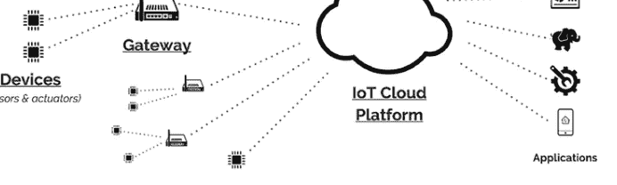

图 5.1 物联网基础设施。

- **智能家居：** 这一类别涵盖日常家用电器，如冰箱、电视机和洗衣机。在这一层面部署这些设备的目的，是构建一个可通信设备网络，以确保自动化和情境感知决策，从而为用户提供最大的舒适度。

- **医疗辅助：** 这些物联网设备最重要的优势在于能够无缝地采集数据。这对医疗应用尤为重要，因为可以通过智能手表和其他传感器采集患者的重要健康指标数据，并持续监测异常情况。

- **智能交通：** 该行业在基于物联网的应用方面具有巨大的发展潜力。嵌入道路或通勤车辆中的传感器可以帮助识别最短路径或车流量最少的路径。这甚至可以包括空余和占用停车位指示器，以方便公众。在第三世界国家，天气和治安状况可能是影响交通的主要因素，并且可以通过物联网设备进行更新。

- **物流与供应链：** 基于物联网的应用可以极大地增强工业应用。这包括利用长距离或短距离射频识别（RFID）设备的进步，在存储区域的每个角落追踪包裹和产品，甚至延伸到生产或配送单元。

- **安防与监控系统：** 可以使用成像设备对敏感场所进行持续监控，并将采集到的图像传输到控制室或执法部门，以实现更好的监视。

## 5.1.2 机器学习（ML）

机器学习为传统运行系统增加了一种独特的能力，帮助工业以更高的效率自主运行。这不仅使系统能够从以往经验中学习，还引入了决策能力，从而营造更具生产力和灵活性的环境。机器学习只不过是一组专门设计的智能算法，使系统能够在每次试验中运行和学习。模型大多数时候在可用数据集上进行测试和训练，这些数据集帮助系统像人脑一样通过神经元做出决策。我们可以用一个例子进一步说明：在人类幼年时期，当他触摸一杯热饮时，手会被轻微烫伤；这一事件被大脑中的早期神经元学习。此后直到生命最后，他的大脑都能阻止手指去触摸可能烫伤的热饮；这就是机器学习[4]。在机器学习框架下开发的所有算法又进一步分为以下几类。

- **监督学习：** 这种学习方式向模型同时提供可能性和结果。模型在输入和输出上同时进行训练，以便基于二者之间的关系预测任何可变的输入变量。监督学习所需的数据集应包含正样本和负样本。大多数算法会在图像中搜索阈值和像素等特征，以进行读取和学习。

- **无监督学习：** 这种学习方式只向模型提供可能性；数据集非常庞大，模型通过运行有限次迭代自行学习。对这种网络进行建模是一项非常复杂和困难的任务，需要更强的计算能力。

- **强化学习：** 这种学习方式基本上基于激励策略，在学习阶段的每一步，算法都旨在增加激励。如果参数和输出对齐一致，学习阶段就会加速，从而获得更好的结果[5]。

## 5.1.3 传感器技术

传感器技术在过去的十年中越来越受欢迎，引起了广泛关注。传感器已被用于多种应用，包括医疗[6,7]、农业[8]、森林[9,10]以及汽车和海洋监测[11,12]。

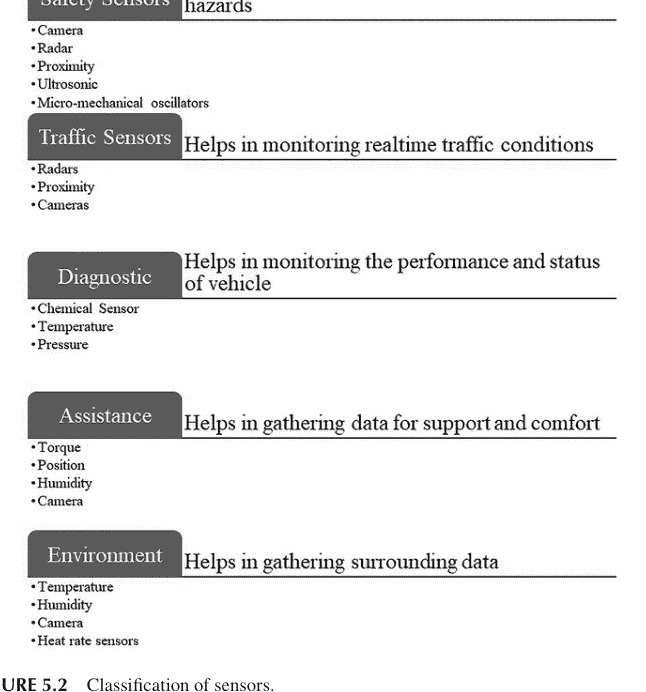

图 5.2 传感器分类。

传感器技术有助于构建交通领域各种应用的原型，包括交通控制、安全和娱乐。在传感器和执行器类别下，已经涌现出许多可用于交通运输行业的电气设备，包括轮胎压力传感器和后视摄像头，它们可以持续监控交通并留意任何异常活动[13]。这些最终可以带来更好的客户体验，增强市民对城市政府的信任，并减少交通拥堵。

车辆中嵌入的传感器并不局限于上一段列出的两种。越来越多的公司正在寻找让车辆变得更“智能”的方法。目前行业嵌入传感器的标准约为 60–100 个，但基于智能车辆需求和要求的持续增长，这一数字很有可能会触及 200 个左右[14]。

### 5.1.3.1 车载传感器

只有正确识别传统交通系统所涉及的问题之后，才能建立起智能交通系统：（i）过度拥挤和停车问题，（ii）通勤时间过长，（iii）有害气体排放，以及（iv）交通事故，是交通系统中备受关注的一些领域。这些问题不仅对个人层面尤为重要，而且在集体层面对交通网络中所有参与者的安全与保障也至关重要。图 5.3 展示了典型车辆中安装的一些传感器。

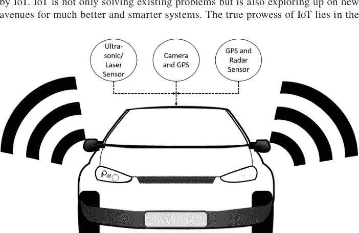

图 5.3 车载传感器。

## 5.1.4 物联网与机器学习让当前的交通“智能化”

物联网所带来的潜力和应用正在令世界发生巨大变化。物联网不仅解决现有问题，还在为更美好、更智能的系统探索新的途径。物联网真正的威力在于


事实上，它不仅限于一个或几个系统，而且能够连接所有可能的传感器和执行器，从而构建一个真正完整的系统。这正是物联网（IoT）兴起的核心概念。整个城市都可以实现基于网络的互联。这一技术进步能极大改善的一个领域是交通系统。一个城市典型且完整的交通系统范围极其庞大，因此实施物联网并从中获益，进而实现智能交通系统（ITS），是合乎逻辑的选择。物联网可以发挥作用的另一个极其重要的领域是路线优化。这可以通过利用驾驶员手持设备的输入或通勤路线上的任何其他传感器来实现，以正确分析交通状况，并及时向该路线上的未来乘客更新信息[15]，最终减少燃料消耗和有害气体排放。此外，还可以通过在路灯中集成传感器或摄像头，实现有效的监控和监视，以达到安全目的[16]。许多专家还提出了基于物联网原理开发停车系统的想法，因为该系统可以使用简单的红外和接近传感器，在有空闲停车位时及时通知用户[16]。这对公众来说可能极为有用，并增加他们的生产性时间，因为他们不必为了停车而把时间浪费在毫无意义的事情上。

## 5.2 智能交通系统的发展趋势

本章本节简要介绍智能交通系统及其所有相关局限性。本节识别了其中涉及的几乎六个不同类别的问题，并提出了可能的解决方案。解决方案来自机器学习（ML）和物联网算法等技术的应用。表5.1列出了问题类别及其参考文献。

**表5.1** 智能交通技术发展现状

| 序号 | 智能交通系统应用 | 参考文献 |
|---|---|---|
| 1 | 停车 | [16,18,19] |
| 2 | 路面异常 | [20–24] |
| 3 | 导航 | [25–29] |
| 4 | 基础设施 | [17,30] |
| 5 | 路灯 | [31–33] |
| 6 | 事故检测 | [34–37] |

### 5.2.1 路线优化与导航

城市和大都市的交通系统常常面临一个严重问题，即交通拥堵或过度拥挤。随着人口的快速增长以及人们为了谋生而向城市迁移的意愿增强，这个问题只会愈发严重。利用物联网和机器学习算法可以提出的一种解决方案是路线优化。这基本上是一种通过考虑所有外部因素，为任何特定驾驶员提供前往任何目的地的最短路径的技术。这些因素可以包括一天中的时间、天气状况、路面状况以及任何其他可能的车辆事故。这可能会带来突破性的发展，因为它不仅能为公众提供便利，还有助于减少道路事故。只有当车辆运行时间缩短时，有害气体的排放才能减少[15]。已经提出了多种实现路线优化算法的方法。其中之一是使用马尔可夫决策过程（MDP）算法，在车辆之间建立通信以规划编队路线。这将使具有相同目的地的整组车辆相互协作，形成集体努力[38]。另一种已提出的方法是采用机器学习技术，实现k-means和深度信念网络（DBN）来优化交通状况[25]。其他一些文献为不同类型的交通预测提供了背景。文献[39]处理了短期交通预测，并为此提出了若干其他技术，如FF-NN、非线性自回归（NARX）模型和季节性自回归积分移动平均（BN-SARIMA）模型。文献[28]针对相同问题及其对应问题，应用了四种机器学习算法进行处理。然后对这四种算法进行相互比较，以评估性能和结果。这四种算法包括基线预测器、随机森林（RF）、FF-NN和回归树。文献[29]也使用FF-NN和基线预测器来估计时间变化和总行程时间。

文献[27]中的研究者实现了逻辑回归模型以及支持向量机算法和其他模型来预测交通状况。Lv等人[40]使用先进的数据分析和提取技术，对传感器数据进行操作以预测基本交通流量。该方法使用了堆叠自编码器。

群体智能算法是计算机科学中的一个新分支，因为它们受自然启发，并且在模拟现实系统方面表现出色。其中之一是蚁群优化算法，可与移动群智感知结合用于智能交通系统。乘客能够与它们通信，获取有关路线、路面状况和其他因素的数据，以找到不太拥堵的路线。这类似于蚂蚁通过追踪信息素/化学物质的分泌来找到食物的方式[43]。

文献[42]实现了一种不同的路线优化算法。它利用车载自组织网络，通过移动导航设备收集交通状况并优化路线。与上述技术相比，这类似，因为它让车辆之间进行交互以共享交通状况。

文献[43]中的研究采用了一种不同的方法，即通过移动应用进行路线规划的众包。一个名为Crowd Navi的应用安装在移动设备上，它会将特定交通区域的信息无线上传到互联网，并在各种车辆之间共享。

### 5.2.4 事故检测与预防

事故预防是与任何城市的交通系统相关的主要问题。它可能是影响最严重的事件，因此必须非常严肃地对待，因为它直接关系到人们的生命安全。如果驾驶员专注于驾驶，并遵守所有交通规则，那么大量道路事故是可以避免的。交通网络中更智能的设施还能帮助我们尽早检测已经发生的事故，以便为其提供紧急救护措施。

研究文章[35]使用CHMM技术在车辆之间实时交换信息，以防止碰撞和追尾。研究文章[47]提出了一种自主预防事故的方法，该方法也利用了道路传感器数据，输入到FF-NN和回归树算法中。所有技术的基础是V2V（车对车）通信，以实现整体更智能的决策[37]。文献[26]还涉及另一个重要方面，即在V2V通信的同时，使用全卷积层（FCN）方法进行盲点识别。这也可以使用基于图像处理和物体检测的深度循环注意力模型（DRAM）方法[48]来实现。驾驶员意识[49]也可以通过图像数据和不同的计算机视觉技术进行监测。这些图像还可以输入到神经网络中，以获得最准确和可靠的结果[36,50]。

### 5.2.5 路面异常检测

路面状况是另一个直接影响到交通流量和车辆损耗的非常重要的参数。有效且高效地识别坑洼和颠簸，将让用户事先了解任何路线的隐患，并为他们提供相应改变路线的选项。

综述文章[20]详细阐述了用于学习不同路面和道路表面的各种深度学习技术。它引用了多达12项该领域的最新研究。所采用的神经网络是CNN和深度卷积神经网络（DCNN）。这些技术从性能、结果、可靠性和框架等关键参数上进行了相互比较。作者最后认为，CNN在路面图像分类方面表现最佳。

### 5.2.6 基础设施

随着物联网技术的最新发展，传统交通系统可以从中受益匪浅。交通系统可以通过更智能的工作模式加以改进，从而在任何层面提供舒适性。以下段落列举了实现这一目标的方法。

研究文章[51]提供了一种结合硬件和软件的方法来监控公交车队。这是通过使用RFID标签实现的，每辆公交车都具有唯一标识，车内还安装了红外传感器以统计某辆公交车上的乘客人数。GPS传感器用于提供车辆位置信息。该

数据被收集并传输到 TI CC3200 微控制器，最终传输到云服务器。控制器模块在每个公交站都配备了一个配套单元，用于在公交站的 LCD 上显示公交车的到站和离站时间。这也可以通过移动应用程序远程监控。

物联网网络可以与社交网络结合，为用户提供更好的可访问性。它被称为 SiOV（Social Internet of Vehicles，车辆社会互联网）。作者认为 [17]，车载社交网络协议可用于减少 SiOV 网络中的干扰和拥挤程度。该协议可覆盖 MAC、物理和网络层，以使通信更快。

## 5.3 案例研究：智能交通：卡拉奇案例

联合国发布的一份综合报告的发现指出，世界人口将从 2010 年的 26 亿增加到 2050 年的 52 亿。根据这一发现，可以清楚地估计几乎翻了一番 [53]。维持高质量生活的基本需求与政府所拥有的资源直接相关，如果人口以当前速度增长，那么毫无疑问世界将出现资源短缺，从而严重影响生活质量。应对这一全球现象的唯一解决方案是制定能够使政府有效利用其有限资源的政策，因此技术发挥作用。智能和可持续城市的概念是利用人类在工程方面的当前进步，为其居民提供更安全、更高标准的生活 [53]。

城市地区面临的各种问题中，其中之一是交通拥堵。交通是一个动态问题，可能有各种根本原因：它可能是由于错误/双重停车、重型车辆行驶、某些施工、任何路边事故等造成的 [54]。目前，当局需要及时响应以确保交通流畅。这为研究人员提供了方向，让他们努力寻找解决交通拥堵问题的更好方案，因此智能交通系统一词应运而生 [55]。

### 5.3.1 智能交通：概念

该系统是一个无线传感器网络（WSN），旨在感知不同的常规操作。以下列出了此类 WSN 的一些主要特点 [56]。

- 环路检测传感器可用于感知车辆的存在、其数量、流量和速度。
- 雷达传感器可用于车辆上以检测可能的障碍物并确保交通顺畅。
- 红外传感器可通过其回波测量来表征汽车类型。
- 光探测和测距传感器可用于车辆内部，使系统实现自主化，并在无人干预的情况下执行诸如障碍物检测和导航等任务。

其他日子。自 1949 年以来，卡拉奇的主规划纳入了五个主要交通相关项目；然而，至今尚未形成任何方案 [60]。政府缺乏对城市基础设施发展的兴趣，导致其公民依赖维护不善的交通系统。

该市居民依赖私营部门满足其日常出行需求，而政府缺乏对该部门的监管兴趣也导致交通整体标准日渐下降 [61]。根据优化分配，公共交通占特定时间道路上所有车辆总数的 2%–3%，这可以满足几乎 40%–50% 居民的需求。然而，沮丧的市民现在更依赖自己的车辆而不是公共交通，这在很大程度上扰乱了上述公共交通分配比例。可以这样理解，一辆在城市运营的标准中巴车可搭载 27 人，但如果这 27 人对所获得的设施感到不满，他们将使用私人车辆出行；因此，取而代之的是单辆中巴车，现在道路上有 27 辆车辆，使交通基础设施达到顶峰。分流道路交通的另一种方式是使用地铁和铁路；1964 年，卡拉奇环城铁路项目启动，它以更便宜的价格帮助其居民在工作场所之间移动。该项目一直运行到 1979 年，此后由于政府缺乏维护铁路基础设施的兴趣，到站和离站的常规延误导致其客户减少 [62]。

### 5.3.2.1 卡拉奇的建议框架

交通堵塞问题出现在道路上的车辆超过其承载能力时。智能交通系统通过不仅提醒居民可能的交通堵塞，还提供到目的地的下一个最短路线，为此问题提供了高效的解决方案 [63]。正如我们在上一节中已经讨论的那样，卡拉奇这座大都市的人口急剧增加，而政府缺乏兴趣，使得当局日复一日地难以监管交通流。因此，为了给市民带来一丝宽慰，部署智能交通系统将非常有益。

随着此类先进技术的涌入，交通基础设施变得越来越先进。这不仅使系统能够检测动态行为，还能实现快速准确的数据交换。此外，在搭载机器学习的情况下，系统开始预测特定道路交通高峰时间，从而提醒用户选择替代路线。智能交通管理系统建议框架如图 5.5 所示。

该建议模型是根据卡拉奇市交通流的动态行为设计的。建议框架根据城市景观分为多个行政部门。该行政部门作为子系统运作，并与集中信息处理中心协调，后者定期处理接收到的数据并将信息传达给其居民。这些信息可以以多条路线或最佳出行时间的形式传达。枢纽将作为系统的“大脑”，连接各种神经元（子系统）。

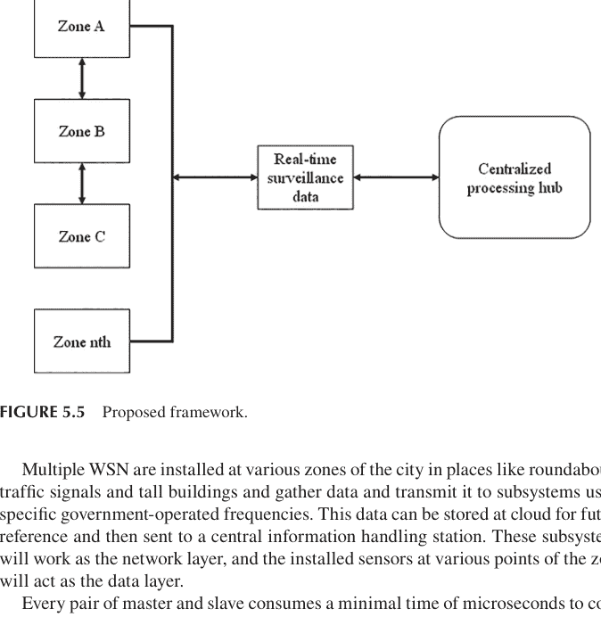

图 5.5 建议框架。

多个 WSN 安装在城市的各个区域，如环岛、交通信号灯和高层建筑处，收集数据并使用特定政府运营频率将其传输到子系统。这些数据可以存储在云中以供将来参考，然后发送到中央信息处理站。这些子系统将作为网络层，而安装在区域各个点的传感器将作为数据层。

每对主从设备消耗微秒级的最小时间来在相邻对之间通信和传输数据。图 5.7 表示相邻对之间的平均通信时间。随着指定区域内车辆数量的增加，配对数量也会增加以有效传输数据。此外，图 5.8 展示了数据传输速率相对于车辆速度的变化。图表显示，两车之间的距离超过 500 m 越多，数据传输速率下降越快。

### 5.3.2.2 结论性意见

该案例研究解决了世界大都市之一，即卡拉奇的交通拥堵问题，并通过整合先进技术提供了一个消除其根本原因的框架。研究强调，交通堵塞的主要原因是城市化不均、人口增长率巨大以及缺乏政府政策来发展这一已充分利用的基础设施。因此，解决这一问题的技术方案的责任在于研究人员，因此提出了这一框架。该框架提出了对现有交通基础设施进行改造并通过注入 WSN 使其智能化的建议。它是根据卡拉奇市不断变化的交通动态专门设计的，并分析了不同的通信方式以确保双向流动


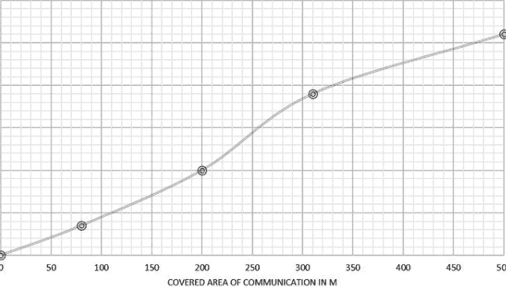

**图 5.6** 交付时间。

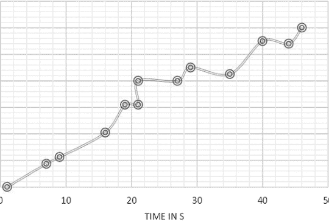

**图 5.7** 邻居之间的平均通信时间。

数据。这不仅可以帮助居民实时了解城市交通流量，还可以帮助他们在检测到某条路线拥堵时决定替代路线。

## 5.4 结论

本章揭示了物联网在交通网络中的当前应用范围及其真正潜力所在。本章提出，物联网与机器学习技术相结合，可以在城市交通领域带来突破性发展。

- [8] Bapat, Varsha, Prasad Kale, Vijaykumar Shinde, Neha Deshpande, and Arvind Shaligram. “WSN application for crop protection to divert animal intrusions in the agricultural land.” Computers and Electronics in Agriculture 133 (2017): 88-96.
- [9] A. A. Khamukhin and S. Bertoldo, “Spectral analysis of forest fire noise for early detection using wireless sensor networks,” in 2016 International Siberian Conference on Control and Communications, SIBCON 2016 – Proceedings, 2016.
- [10] P. Bolourchi and S. Uysal, “Forest fire detection in wireless sensor network using fuzzy logic,” in Proceedings – 5th International Conference on Computational Intelligence, Communication Systems, and Networks, CICSyN 2013, 2013.
- [11] Guerrero, J. A., M. Cosío, A. Espinoza, E. Ruiz, J. D. Sánchez, J. Contreras, and J. I. Nieto. “GeoSoc: A Geocast-based communication protocol for monitoring of marine environments.” IEEE Latin America Transactions 15, no. 2 (2017): 324-332.
- [12] Pérez, Cristina Albaladejo, Fulgencio Soto Valles, Roque Torres Sánchez, Manuel Jiménez Buendía, Francisco López-Castejón, and Javier Gilabert Cervera. “Design and deployment of a wireless sensor network for the mar menor coastal observation system.” IEEE Journal of Oceanic Engineering 42, no. 4 (2017): 966-976.
- [13] USA Today, “NHTSA to require backup cameras on all vehicles,” USA Today, 2014.
- [14] Fleming, William J. “Overview of automotive sensors.” IEEE Sensors Journal 1, no. 4 (2001): 296-308.
- [15] A. Al-Dweik, R. Muresan, M. Mayhew, and M. Lieberman, “IoT-based multifunctional Scalable real-time Enhanced Road Side Unit for Intelligent Transportation Systems,” in Canadian Conference on Electrical and Computer Engineering, 2017.
- [16] Q. Wu, C. Huang, S. Y. Wang, W. C. Chiu, and T. Chen, “Robust parking space detection considering inter-space correlation,” in Proceedings of the 2007 IEEE International Conference on Multimedia and Expo, ICME 2007, 2007.
- [17] Jain, Bindiya, Gursewak Brar, Jyoteesh Malhotra, Shalli Rani, and Syed Hassan Ahmed. “A cross layer protocol for traffic management in Social Internet of Vehicles.” Future Generation computer systems 82 (2018): 707-714.
- [18] Amato, Giuseppe, Fabio Carrara, Fabrizio Falchi, Claudio Gennaro, Carlo Meghini, and Claudio Vairo. “Deep learning for decentralized parking lot occupancy detection.” Expert Systems with Applications 72 (2017): 327-334.
- [19] De Almeida, Paulo RL, Luiz S. Oliveira, Alceu S. Britto Jr, Eunelson J. Silva Jr, and Alessandro L. Koerich. “PKLot–A robust dataset for parking lot classification.” Expert Systems with Applications 42, no. 11 (2015): 4937-4949.
- [20] Gopalakrishnan, Kasthurirangan. “Deep learning in data-driven pavement image analysis and automated distress detection: A review.” Data 3, no. 3 (2018): 28.
- [21] Kulkarni, Aniket, Nitish Mhalgi, Sagar Gurnani, and Nupur Giri. “Pothole detection system using machine learning on Android.” International Journal of Emerging Technology and Advanced Engineering 4, no. 7 (2014): 360-364.
- [22] M. A. Al Mamun, J. A. Puspo, and A. K. Das, “An intelligent smartphone based approach using IoT for ensuring safe driving,” in ICECOS 2017- Proceeding of 2017 International Conference on Electrical Engineering and Computer Science: Sustaining the Cultural Heritage Toward the Smart Environment for Better Future, 2017.
- [23] M. Ghadge, D. Pandey, and D. Kalbande, “Machine learning approach for predicting bumps on road,” in Proceedings of the 2015 International Conference on Applied and Theoretical Computing and Communication Technology, iCATccT 2015, 2016.
- [24] Ng, J.R., Wong, J.S., Goh, V.T., Yap, W.J., Yap, T.T.V., Ng, H. (2019). Identification of Road Surface Conditions using IoT Sensors and Machine Learning. In: Alfred, R., Lim, Y., Ibrahim, A., Anthony, P. (eds) Computational Science and Technology. Lecture Notes in Electrical Engineering, vol 481. Springer, Singapore. https://doi.org/10.1007/978-981-13-2622-6_26

- [25] Yang, Jiachen, Yurong Han, Yafang Wang, Bin Jiang, Zhihan Lv, and Houbing Song. “Optimization of real-time traffic network assignment based on IoT data using DBN and clustering model in smart city.” Future Generation Computer Systems 108 (2020): 976-986.

- [26] D. Kwon, S. Park, S. Baek, R. K. Malaiya, G. Yoon, and J. T. Ryu, “A study on development of the blind spot detection system for the IoT-based smart connected car,” in 2018 IEEE International Conference on Consumer Electronics, ICCE 2018, 2018.

- [27] Devi, Suguna, and T. Neetha. “Machine Learning based traffic congestion prediction in a IoT based Smart City.” Int. Res. J. Eng. Technol 4, no. 5 (2017): 3442-3445.
- [28] Hou, Yi, Praveen Edara, and Carlos Sun. “Traffic flow forecasting for urban work zones.” IEEE transactions on intelligent transportation systems 16, no. 4 (2014): 1761-1770.
- [29] J. Yu, G. L. Chang, H. W. Ho, and Y. Liu, “Variation based online travel time prediction using clustered neural networks,” in IEEE Conference on Intelligent Transportation Systems, Proceedings, ITSC, 2008.
- [30] D. N. Chowdhury, N. Agarwal, A. B. Laha, and A. Mukherjee, “A vehicle-to-vehicle communication system using IoT approach,” in Proceedings of the 2nd International Conference on Electronics, Communication and Aerospace Technology, ICECA 2018, 2018.
- [31] Jia, Gangyong, Guangjie Han, Aohan Li, and Jiaxin Du. “SSL: Smart street lamp based on fog computing for smarter cities.” IEEE Transactions on Industrial Informatics 14, no. 11 (2018): 4995-5004.
- [32] J. Nausicaa, “Smart street lighting system using IoT and cloud computing,” Int. J. Res. Appl. Sci. Eng. Technol., 2021.
- [33] A. K. Tripathy, A. K. Mishra, and T. K. Das, “Smart lighting: Intelligent and weather adaptive lighting in street lights using IOT,” in 2017 International Conference on Intelligent Computing, Instrumentation and Control Technologies, ICICICT 2017, 2018.
- [34] Celesti, Antonio, Antonino Galletta, Lorenzo Carnevale, Maria Fazio, Aime Lay-Ekuakille, and Massimo Villari. “An IoT cloud system for traffic monitoring and vehicular accidents prevention based on mobile sensor data processing.” IEEE Sensors Journal 18, no. 12 (2017): 4795-4802.
- [35] W. Liu, S. W. Kim, K. Marczuk, and M. H. Ang, “Vehicle motion intention reasoning using cooperative perception on urban road,” in 2014 17th IEEE International Conference on Intelligent Transportation Systems, ITSC 2014, 2014.
- [36] B. Ryder and F. Wortmann, “Autonomously detecting and classifying traffic accident hotspots,” in UbiComp/ISWC 2017-Adjunct Proceedings of the 2017 ACM International Joint Conference on Pervasive and Ubiquitous Computing and Proceedings of the 2017 ACM Symposium on Wearable Computers, 2017.
- [37] N. Dogru and A. Subasi, “Traffic accident detection using random forest classifier,” in 2018 15th Learning and Technology Conference, L and T 2018, 2018.
- [38] K. S. Sang, B. Zhou, P. Yang, and Z. Yang, “Study of group route optimization for IoT enabled urban transportation network,” in Proceedings -2017 IEEE International Conference on Internet of Things, IEEE Green Computing and Communications, IEEE Cyber, Physical and Social Computing, IEEE Smart Data, iThings-GreenCom-CPSCom-SmartData 2017, 2018.
- [39] G. Fusco, C. Colombaroni, L. Comelli, and N. Isenko, “Short-term traffic predictions on large urban traffic networks: Applications of network-based machine learning models and dynamic traffic assignment models,” in 2015 International Conference on Models and Technologies for Intelligent Transportation Systems, MT-ITS 2015, 2015.
- [40] Lv, Yisheng, Yanjie Duan, Wenwen Kang, Zhengxi Li, and Fei-Yue Wang. “Traffic flow prediction with big data: a deep learning approach.” IEEE Transactions on Intelligent Transportation Systems 16, no. 2 (2014): 865-873.


- [41] S. Distefano、G. Merlino、A. Puliafito、D. Cerotti 和 R. Dautov，“用于（群体）智能交通系统的众包与信息素方法”，载于《计算机科学讲义》（包括《人工智能讲义》和《生物信息学讲义》子系列），2018年。
- [42] Chang, Ing-Chau, Hung-Ta Tai, Feng-Han Yeh, Dung-Lin Hsieh, and Siao-Hui Chang. “基于VANET的A*路径规划算法，用于出行时间和能耗高效的GPS导航应用。”《国际分布式传感器网络杂志》9卷，第7期（2013年）：794521。
- [43] Fan, Xiaoyi, Jiangchuan Liu, Zhi Wang, Yong Jiang, and Xue Liu. “众包道路导航：概念、设计与实现。”《IEEE通信杂志》55卷，第6期（2017年）：126-128。
- [44] D. V. Niture、V. Dhakane、P. Jawalkar 和 A. Bamnote，“基于物联网的智能交通系统”，《国际工程与先进技术杂志》，2021年。
- [45] Elsonbaty, Amira, and Mahmoud Shams. “智能停车管理系统。”arXiv预印本arXiv:2009.13443（2020年）。
- [46] A. Araújo、R. Kalebe、G. Girão、I. Filho、K. Gonçalves 和 B. Neto，“面向智慧城市的基于物联网的智能停车应用的可靠性分析”，载于《2017年IEEE国际大数据会议论文集》，Big Data 2017，2017年。
- [47] M. Ozbayoglu、G. Kucukayan 和 E. Dogdu，“基于大数据处理与计算智能的实时自主高速公路事故检测模型”，载于《2016年IEEE国际大数据会议论文集》，Big Data 2016，2016年。
- [48] J. L. Ba、V. Mnih 和 K. Kavukcuoglu，“基于视觉注意的多目标识别”，载于《第三届学习表征国际会议》，ICLR 2015会议记录，2015年。
- [49] Ghosh, Arnab, Tania Chatterjee, Sunny Samanta, Jayanta Aich, and Sandip Roy. “分心驾驶：一种新颖的交通事故预防方法。”《计算机科学与技术进展》10卷，第8期（2017年）：2693-2705。
- [50] M. Munoz-Organero、R. Ruiz-Blaquez 和 L. Sánchez-Fernández，“结合离群点检测与深度学习分类技术，基于驾驶GPS轨迹自动检测交通灯、街道交叉口和城市环岛”，《计算、环境与城市系统》，2018年。
- [51] S. Geetha 和 D. Cicilia，“物联网赋能的智能公交运输系统”，载于《第二届国际通信与电子系统会议论文集》，ICCES 2017，2018年。
- [52] 联合国，《世界人口展望2019：要点》，联合国经济和社会事务部人口司，2019年。
- [53] H. Chourabi 等人，“理解智慧城市：一个综合性框架”，载于《夏威夷国际系统科学年度会议论文集》，2012年。
- [54] K. Berdica，“道路脆弱性导论：已完成、正在进行和应做的工作”，《交通政策》，2002年。
- [55] Guerrero-Ibáñez, Juan, Sherali Zeadally, and Juan Contreras-Castillo. “智能交通系统的传感技术。”《传感器》18卷，第4期（2018年）：1212。
- [56] V. W. S. Tang、Y. Zheng 和 J. Cao，“基于无线传感器网络的智能停车场管理系统”，载于《SPCA 2006：2006年第一届普适计算与应用国际研讨会论文集》，2006年。
- [57] Jin, Jiong, Jayavardhana Gubbi, Slaven Marusic, and Marimuthu Palaniswami. “通过物联网创建智慧城市的信息框架。”《IEEE物联网杂志》1卷，第2期（2014年）：112-121。
- [58] Mage, David, Guntis Ozolins, Peter Peterson, Anthony Webster, Rudi Orthofer, Veerle Vandeweerd, and Michael Gwynne. “世界特大城市城市空气污染。”《大气环境》30卷，第5期（1996年）：681-686。

## 6 智慧交通中的智能5G网络与增强虚拟现实

A M Anusha Bamini
卡鲁尼亚技术科学学院

G R Gnana King
Sahrdaya工程与技术学院

J H Jensha Haennah
圣泽维尔天主教工程学院

## 目录

- 6.1 引言 ........................................................... 95
- 6.2 5G网络的智能性 ................................................ 97
- 6.3 5G智能交通 ..................................................... 98
  - 6.3.1 车辆通信 ................................................... 98
  - 6.3.2 自动驾驶 .................................................. 99
  - 6.3.3 智能导航 .................................................. 100
  - 6.3.4 道路安全信息社会 ......................................... 100
  - 6.3.5 独立交通灯控制 ........................................... 100
- 6.4 车内与广域连接 ................................................ 101
- 6.5 信号化道路网络改进 ........................................... 101
- 6.6 问题与挑战 .................................................... 103
- 6.7 结论与未来展望 ................................................ 104
- 参考文献 ............................................................. 104

### 6.1 引言

有线和无线电信中支持的各种网络拓扑、传输介质和通信方法，用于在构成网络的两个或多个节点之间的距离之间维持信息传输。电信革命，特别是无线移动通信，被视为一项重大的演进，因为它已经经历了多代发展，如图6.1所示。

### 各种互联网世代

| 1G | 2G | 3G | 4G | 5G |
|---|---|---|---|---|
| 1980年代 | 1990年代 | 2000年代 | 2010年 | 2018年 |
|  |  |  |  |  |
| 模拟通信 | 数字通信 | 宽带 | 高速数据速率 | 互联设备 |
| 2.4 Kbps | 64 Kbps | 3.1 Mbps | 100 Mbps | 10 Gbps |

### 图6.1 互联网世代。

在技术实现的基础上，每一代演进都以特定标准为特征，包含有别于前代的新方法和新功能[1]。

第五代（5G）于2018年推出[3,4]。它与大量新服务相关联，数字应用为人们提供了超连接的生活。这项技术能够提供超高速连接，并在人与行业之间建立纽带。由于当前的疫情形势，数字应用、协作和服务的需求与增长急剧增加。5G移动技术正通过克服第四代（4G）技术的缺陷而发挥作用。5G与智能连接相结合，创造出更智能、更好的应用，让生活更美好。全球约有50个国家（如中国和日本）预计将在2025年前推出5G移动网络。

第一代（1G）移动网络于20世纪80年代问世。当时使用模拟技术传输语音，支持频分多址（FDMA）技术。信号由基站处理和传输。语音通话是当时1G提供的唯一服务。但1G存在诸多限制，它不支持更好的数据服务和漫游功能。1G提供的最大数据速率为2.4 kbps。无法全球漫游和语音质量差是1G的主要缺陷。

第二代（2G）在20世纪90年代引入了数字通信的概念。模数传输提高了语音质量，支持时分多址（TDMA）和码分多址（CDMA）。这一代的语音质量和数据速率也有所提高。短信（SMS）、全球移动通信系统（GSM）和多媒体消息服务（MMS）都是在这一时期引入的。在WAP协议的支持下，手机可以访问互联网。短信也随着2G移动通信的出现而诞生。2G支持的多媒体技术耗电量大。


3G（第三代移动通信）出现于2000年代。它通过无线数据提供了非常快速和广泛的互联网接入。所支持的技术是宽带码分多址。3G的一大优势是数据传输速率高。3G中提出了UMTS。与GSM相比，UMTS提供了两种频带模式，即频分双工（FDD）和时分双工（TDD）。这里支持宽频带。支持高级多媒体应用。所有移动电话都支持VoIP和IP多媒体子系统（IMS）系统。它提供144 kbps的数据传输速率。

4G于2010年推出。它主要关注互联网协议。它支持微波接入。4G提供高安全性、低成本、高速的互联网连接。与其他代际网络相比，4G提供高带宽服务。数据传输速度以兆字节为单位，延迟以毫秒为单位。物联网（IoT）概念也被引入并应用于智能家居、智慧城市、智能办公等场景。由于移动通信技术的持续发展，下一代移动网络应运而生。

5G提供了一些以前无法实现的新功能[2]。5G于2018年推出。它结合人工智能、物联网、多接入边缘计算和网络功能虚拟化等多种技术，开创了全新的网络架构。大量传感器高度连接以构建5G网络。5G中引入了计算和数据分析技术。拥有5G的设备将能随时随地保持与网络的连接，这开启了将所有设备接入网络的可能性。虚拟现实和增强现实概念也存在于5G中。因此，可以认为基本的5G系统策略能够支持每平方公里多达100万个瞬时连接。5G网络的目标是为97%的用户提供100 Mbps的数据速率[5]。

## 6.2 5G网络的智能性

5G移动网络有望成为移动宽带领域的下一次巨大飞跃。研究表明，它应该能够克服4G和LTE网络的缺点。它是一个高速、超低延迟、高带宽的网络。5G的网络容量是4G的一千倍。5G网络的数据传输速度通过两种方式得到提升，即频谱利用和带宽扩展。在这两者中，带宽扩展是提高网络速度的更好方案。5G的数据速率可以通过不同的指标来衡量，即边缘速率、峰值速率和聚合数据速率。聚合数据速率表示通过网络传输的整个数据量。5G网络的数据速率提高了一千倍。5G的峰值速率在10到20 Gbps之间。此外，5G的延迟预计将降至不到1毫秒。5G的部署旨在处理每平方公里10万个连接用户。在最高20 Gbps的预期下载速度下，五个用户可以同时下载完整电影，只需几秒。5G提供了如此高的网络速度。它可以启动特定任务和功能，如远程控制、精准医疗、网联汽车、虚拟现实和增强现实以及物联网。它创造了新型网络；这些网络彼此虚拟连接，并与机器、电子产品、物体等相连接。5G基本上具有三个功能。

- 提供大规模物联网，理论上包含超低能耗（电池寿命超过10年）、超低复杂度（每秒数十比特）和超高密度（每平方公里100万个节点）的设备。
- 提供任务关键型控制，理论上包含超高可用性（大于99.999%）、超低延迟（低至1毫秒）和极致移动性（高达100 km/h）。
- 提供增强型移动宽带，理论上包含高数据速率（峰值多Gbps，持续100+ Mbps）和更高容量（每平方公里总吞吐量10 Tbps）。

## 6.3 5G智能交通

如今交通的复杂性和交通流量都在增加。为了优化整个交通系统，智能交通是最佳解决方案。5G网络以及人工智能系统将实时互连车辆、自行车和行人的位置，并降低事故或碰撞的可能性。天气、路面状况、施工工地或交通拥堵等数据通过驾驶员的头盔实时传输，并结合人工智能帮助道路使用者找到更好的路线。5G提升了网联汽车、自动化、共享和电动汽车的社会效益，并且能够促进并真正成为未来自动驾驶汽车发展的核心。一项调查[6,7]显示，到2035年，5G技术将产生2.4万亿美元的经济产出。在欧洲，汽车交通将产生2205亿欧元的收益。

智能交通的关键概念如下：

- 车载通信
- 自动驾驶
- 智能导航
- 道路信息社会
- 独立交通灯控制

### 6.3.1 车载通信

近年来，所有现代车辆都在传感器平台的支持下工作，这些平台从环境中提取数据。提取的信息由计算机系统处理，然后用于导航、交通管理、污染控制等。然而，要实现快速处理，需要一台非常强大的车载计算机。通过互联网将数据传输到云端以完成大量数据处理，从而降低了昂贵设备的使用成本。因此，物联网可以结合先前从车辆收集的数据，帮助收集更多交通控制中心的信息。因此，移动云计算的观点可能是真正审视未来5G能力的一个难点[9]。车辆可以交换数据。这种方式无需无线系统即可工作。但对于自动驾驶，仅靠车载处理和传感器是不够的。如果车辆之间没有通信，则必须考虑不确定性，因为无法保证其他车辆如何移动，或者行人在接下来几秒内是否会横穿马路；如果汽车之间可以进行信息交换，车辆就能利用这些信息来减少不确定性。因此，独立驾驶员可以从本地V2V连接中受益，并对操作做出更快的响应，从而避免碰撞。

### 6.3.3 智能导航

在自动驾驶车辆中，导航引导由数字地图和地理定位系统提供给驾驶员。根据这种在线交通信息，驾驶员能够选择合适路线，从而提高驾驶效率。这些交通信息是根据交通管理中车辆发送的数据或摄像头捕获的数据计算得出的。在5G、物联网和大数据的支持下，所有与交通相关的信息都被收集。驾驶员的手机上会收到与停车、餐厅、旅游景点、加油站、ATM、医院等相关的通知。

### 6.3.4 道路安全信息社会

在电动出行和汽车行业中，即将推出的自动驾驶汽车产品大幅增加。然而，一些潜在应用并不需要高度的自动化。车载传感器通过摄像头或激光，经云连接传递的信息，也能让驾驶员通过警报应用获知情况。为了实现安全、高效和舒适的驾驶，车辆将使用本地V2V和V2X通信。这些车辆能够提前轻松识别事故情况。在V2X通信的支持下，所有可能的信息都共享给附近的车辆。这些信息帮助驾驶员了解道路上邻近车辆的情况。例如，一辆车在道路上行驶，跟在另一辆车后面。突然，一名行人可能穿过第一辆车前方的道路。此时，第一辆车的摄像头检测到行人，并将该画面共享给第二辆车以发出警报。这可以借助增强现实来实现。这种实际应用涉及高可见性、高可靠性、高数据速率和低延迟。这种增强现实还可以支持警告道路危险、警告改道、警告道路施工、变道等。利用车辆路侧单元（VRU）和车载云计算，可以避免事故。

### 6.3.5 独立交通灯控制

在独立控制中，交通沿单向道路行驶，并且不与邻近的信号灯通信[11,12]。独立交通的目标是最小化车辆等待时间，最大化车辆通行数量。交通的绿灯信号周期表示为相位，用于将车辆从一个方向引导到另一个方向。信号相位需要交通方向来确定车辆的方向。交通灯

控制器使用传感器和交通探测器进行建模。交通灯控制与多个参数相关，称为方向、周期长度、相位长度和偏移 [10]。

-   **方向：** 车辆从一个方向移动到另一个方向。
-   **周期长度：** 完成一个信号相位所需的时间量。
-   **相位长度：** 分配给信号相位的周期长度比例。
-   **偏移：** 交通中特定点与参考点之间计算的时间差。

三种类型的交通隔离控制表示为半感应控制器、全感应控制器和体积-密度控制器。

-   **半感应控制器：** 基于次要街道和主要街道的交叉口，交通量的密度不同。为了检测次要街道的交通，需要一个探测器。可以为次要街道请求绿灯，并且在车辆存在于街道中时延长绿灯。
-   **全感应控制器：** 这可以在两条街道相似的交通量组合中得到支持。这里需要一个传感器来打开绿灯。如果夜间没有车辆，则同一信号将继续或根据先前定义的周期时间更改信号。
-   **体积-密度控制器：** 这是一种先进的控制器技术，但与全感应控制器类似。绿灯阶段的车辆数量以及红灯阶段等待车辆的密度也会被测量。控制器可以通过评估来车交通来缩短绿灯延长时间或延长最小绿灯时间。为了正确响应交通状况，传感器或探测器必须正确且充分地放置在停车线前方。

## 6.4 车内及广域连接

车辆中的连接可视化并同时实现多用途设备连接。每辆车都配备了内部连接，该连接与执行器、传感器、雷达、激光雷达、摄像头和其他一些设备相互连接。该智能 5G 网络以极低的延迟在每个设备和车辆之间传输数据。此外，它还连接到司机、乘务员和乘客的手机。图 6.3 显示了车辆和路侧设备的网络连接。然而，该广域 5G 网络有效地共享频谱资源。

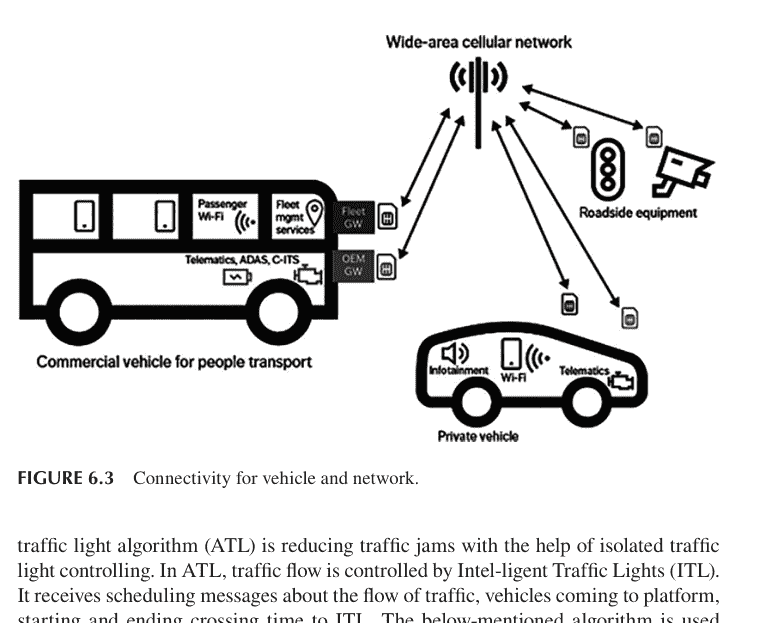

**图 6.3：** 车辆与网络的连接。

## 6.5 信号化道路网络改进

事实上，不太可能存在指定的交叉口，而更可能存在一个拥有众多交叉口的道路网络。基于车辆速度和交叉口之间的距离，每个路口都会保持绿灯以实现良好的交通流，避免排队车辆等待。一种称为动脉交通灯算法（ATL）的算法在孤立交通灯控制的帮助下减少交通拥堵。在 ATL 中，交通流由智能交通灯（ITL）控制。它接收有关交通流、车辆驶入平台、开始和结束穿越时间等调度消息至 ITL。以下提到的算法用于交通灯。基于动脉流的优先级，交通流畅度吞吐量增加。公式（6.1）表示动脉因子（A_i）和饱和因子（S_i）组合以创建组合因子（C_i）。ω 表示这些因素的重要性。

C_i = ω × A_i + (1 - ω) × S_i (6.1)

### 算法：动脉交通灯控制算法 (AT_RL)

使用的统计数据：

-   T_RL：交通灯
-   RM：报告消息
-   N：通过 T_RL 之前的车辆数量
-   S_time：先前 T_RL 的开始穿越时间
-   E_time：先前 T_RL 的结束穿越时间
-   MF：最大流量
-   A_time：预计到达时间
-   L_time：预计离开时间
-   LCFT：上次周期结束时间
-   NCFT：下次周期结束时间

```
Initial cycle phases of T_RL are programmed using this algorithm:
Send RM of MF to following T_RL in a street;
if T_RL1 accepts RM from T_RL2, it finds;
A_time = S_time + distance (T_RL1, T_RL2)/S_time;
L_time = E_time + distance (T_RL1, T_RL2)/S_time;
if A_time < NCFT
while Current Time < A_time do
for planning upcoming cycle phases of T_RL and don't think MF;
end
use Equation 1 to compute Cf_i of every competing flow i;
while Cf_i of several traffic flows at T_RL > 0 do
let j be a traffic flow with the maximum combined factor (Cf_j);
let i1 and i2 be the traffic flows which pass the junction with traffic flow j;
if Cf_i1 > Cf_i2 then
P_ji1 = ART-schedule (j, i1);
Cf_i1 = 0; t_i1 = 0;
else
P_ji2 = ART-schedule (j, i2);
Cf_i2 = 0; t_i2 = 0;
end
end
else
Cf_j = 0; t_j = 0;
use the steps to plan the subsequent cycle phases of T_RL;
end
```

## 6.6 问题与挑战

5G 网络取代了 4G 和 LTE 网络的缺点。D2D 通信、毫米波和频谱共享在 5G 中引入。

-   移动设备的存储以及缓存容量可以得到改善。
-   设备之间的网络延迟可以降低。
-   移动设备和 5G 网络的计算能力将得到进一步发展。
-   VR 技术被应用于改善视觉增强。

## 6.7 结论与未来展望

新技术的发展和人类需求在 5G 网络中发挥着至关重要的作用，该网络支持并创造了智能驾驶中的复杂技术。交通效率通过交通灯优化得到改善。5G 智能交通中提到的各种技术列举了智慧城市中的道路安全。车内广域连接在车辆、车内设备、车辆与交通灯等之间建立连接。动脉交通灯控制算法也控制整个交通网络。

## 参考文献

-   [1] Primima, D., and Pruthi, D.J. 移动通信网络的演进：从 1G 到 5G. *Int. J. Innov. Res. Comput. Commun. Eng.* 2016, 4, 224–227.
-   [2] Gupta, A., and Jha, R.K. 5G 网络综述：架构与新兴技术. *IEEE Access* 2015, 3, 1206–1232.
-   [3] Sawanobori, T.K. *无线通信的下一代：美国的 5G 领导力（白皮书）；* Technical Report; CTIA Everything Wireless: Washington, DC, 2016.
-   [4] 5G-PPP. *5G 基础设施公私合作伙伴关系：通信网络和服务的下一代。（白皮书）。* 可在线获取： https://5g-ppp.eu/wp-content/uploads/2015/02/5G-Vision-Brochure-v1.pdf (访问于 2020 年 7 月 21 日).
-   [5] Samsung. *5G 愿景（白皮书）；技术报告；* Samsung Electronics Co.: Suwon-si, 2015.
-   [6] Zanella, A., Bui, N., Castellani, A., Vangelista, L., and Zorzi, M. 物联网在智慧城市中的应用. *IEEE Internet Things J.* 2014, 1, 22–32.
-   [7] Nassar, A.S., Montasser, A.H., and Abdelbaki, N. 智慧城市物联网综述. 载于 *Proceedings of the International Conference on Advanced Intelligent Systems and Informatics, Cairo, Egypt, 9–11 September 2017.*
-   [8] Yan, J., Liu, J., and Tseng, F.M. 基于智慧城市自组织系统框架的评估系统：中国智慧交通系统的案例研究. *Technol. Forecast. Soc. Chang.* 2020, 153, 119371.
-   [9] Peng, M., Sun, Y., Li, X., Mao, Z., and Wang, C. 云无线接入网络的最新进展：系统架构、关键技术和开放问题. *IEEE Commun. Surv. Tutorials.* 2016, 18, 186.
-   [10] Faisal Ahmed Al-Nasser, M. S. M. *无线传感器网络应用：交通控制与管理的去中心化方法；* IntechOpen: Rijeka, 2012.
-   [11] Pandit, K., Ghosal, D., Zhang, H. M., and Chuah, C.-N. 采用车载自组织网络的自适应交通信号控制, *IEEE Transac. Vehicular Technol.*, 2013, 62, 1459.
-   [12] Gottlich, S., Herty, M., and Ziegler, U. 道路网络中交通灯设置的建模与优化, *Comput. Operations Res.*, 2015, 55, 36.
-   [13] Uchida, N., Tagawa, T., and Sato, K. 驾驶员性能评估增强现实车辆的开发. *IEEE Intell. Transp. Syst. Mag.*, 2017, 9(1), 35–41.


## 7 基于机器学习和深度学习技术的信息物理安全问题与挑战

Sima Das、Ajay Kumar Balmiki 和 Kaushik Mazumdar  
西孟加拉邦毛拉纳·阿布·卡拉姆·阿扎德技术大学

Parijat Bhowmick  
印度理工学院古瓦哈提分校

### 目录

- 7.1 引言 — 106
- 7.2 文献综述 — 106
- 7.3 用于安全的物联网技术概述 — 109
  - 7.3.1 物联网的优势 — 110
  - 7.3.2 物联网的局限性 — 111
- 7.4 云、边缘与雾技术 — 112
  - 7.4.1 云 — 112
    - 7.4.1.1 云在安全中的优势 — 112
    - 7.4.1.2 云在安全中的局限性 — 113
  - 7.4.2 边缘 — 113
    - 7.4.2.1 边缘在安全中的优势 — 114
    - 7.4.2.2 边缘在安全中的劣势 — 114
  - 7.4.3 雾 — 114
    - 7.4.3.1 雾在安全中的优势 — 114
    - 7.4.3.2 雾在安全中的劣势 — 115
- 7.5 用于安全的机器学习方法 — 115
- 7.6 用于安全的深度学习方法 — 115
- 7.7 安全应用领域 — 115
- 7.8 结论 — 120
- 参考文献 — 120

提出了一种具有保护意识的智能电网框架，该框架将为电网运营商提供一种强大的工具，以有效对抗攻击者，并保持电网的安全与稳定。文中还介绍了该防御框架的设计工作和实施流程[4]。

Slipachuk等人利用乌克兰国家网络安全领域管理的集成系统，开发并提出了关键基础设施网络保护管理的网络模型。文中描述了关键基础设施对象的网络安全系统的功能组件。该集成管理系统在处理关键基础设施对象网络安全方面的实用价值已得到验证[5]。

Wu等人认为，网络安全是各类信息物理系统（CPS）面临的主要威胁之一。为了评估CPS的网络安全风险，提出了一种由攻击严重性、攻击成功概率和攻击结果组成的量化层次风险评估模型，该模型能够在主机级别和系统级别评估正在进行攻击所造成的风险。随后，详细讨论了这三个指标的定义和估计方法。最后，本章给出了描述实施步骤的风险评估算法。数值仿真表明，该模型能够响应攻击机会并获取系统安全风险变化曲线，从而帮助用户对风险做出最优响应。该风险变化曲线也可用于预测未来的风险[6]。

在论文中，Pavlenko和Zeghdha提出了另一种信息物理系统安全评估方法。适用于信息系统的现有安全技术不足以应对包含网络组件和物理组件的信息物理系统。作者详细阐述了考虑信息物理系统关键特征的安全评估要求。对致力于开发信息物理系统安全评估的科学研究进行分析后发现，这些研究与上述要求不一致。因此，作者提出了一种新的信息物理系统安全性评估方法，将其定义为网络可持续性，该方法可确保系统在破坏性影响下保持稳定和一致的状态。作者还提出了一种基于自相似性估计的计算度量来评估网络可持续性。作为数值度量，选择了赫斯特指数。实验测试证明了所提方法的有效性以及赫斯特指数对信息物理系统破坏性影响的高敏感性[7]。

Barrère等人指出，监控系统对于理解和控制系统与网络的行为至关重要。信息物理系统在某种程度上尤为脆弱，因为它们涉及实时约束和物理现象，而这些在传统IT系统中通常不予考虑。因此，需要公开可用的监控工具来考虑这些方面。在本次海报/演示中，我们介绍了名为CPS-MT的方案，旨在开发一种可适应的、实时的CPS监控工具，特别关注安全研究。我们首先介绍其架构和主要组件，然后介绍基于MiniCPS的案例研究。我们还描述了性能分析和初步结果。在演示过程中，我们将讨论CPS-MT在安全应用中的能力和局限性[8]。

Teoh等人提出了可用于预测时间序列数据的概率模型。这些模型已在金融、生物信息学、医疗保健、农业和人工智能等不同领域取得成功。然而，到目前为止，HMM在网络安全中的应用仍然有限。我们认为，HMM的预测性、概率性以及建模不同自然状态的能力，为建模网络安全数据奠定了良好的基础。因此，本研究的动机是提供我们使用HMM预测安全攻击的初步结果。本文使用了一个代表网络安全攻击的大型网络数据集来开发专家系统。可以从我们的集成数据集中提取攻击者IP地址的特征，以创建统计信息。网络安全专家为每个特征赋予权重，并通过注释日志历史形成评分系统。我们应用HMM来检测网络安全攻击、不确定状态和无攻击状态，首先使用模糊k均值将数据划分为三个聚类，然后手动标注一个小型数据集（专家直觉），最后使用基于HMM状态的方法。因此，与在网络安全日志中查找异常（通常会产生大量误报）相比，我们的结果非常令人鼓舞[9]。

Chu等人针对依赖型信息物理电力系统提出了一种安全评估方案。该方案的重点是评估通信网络中节点故障对整个电力系统的影响。通过通信网络中每个节点的故障形成预想事故集，并按节点重要性进行排序。考虑了触发电力网络级联故障的两种机制，包括初始随机事件后的功率流重定向和保护隐藏故障。在枚举预想事故集之后，完成了依赖型信息物理电力系统的N-1安全评估。每个预想事故的影响通过随后电力系统的负荷损失来衡量。新英格兰10机39节点测试系统的仿真结果证明了所提方案的有效性[10]。

Elfar等人认为，CPS通常是监督控制系统，其中人在环上（HOL）管理一个或多个自主系统，而系统自身的自主性使操作员能够间歇性地处理系统和其他任务。因此，任何具有安全意识的CPS的设计都必须考虑人与系统交互对安全的影响。然而，在促进人类态势感知以增强系统性能的人机CPS设计方面几乎没有任何工作，尤其是在信息物理安全和实时防攻击方面。阻碍该领域快速发展的主要障碍之一是缺乏用于评估具有安全意识的人机CPS交互的测试平台。我们提出了RESCHU-SA，这是一个可扩展的虚拟平台，通过关注HOL对不同自主性水平的CPS安全的影响来发挥作用。它允许用户研究归纳推理和提供上下文的能力（尤其是在攻击期间）如何影响整个CPS的安全性。所提出的平台是异构监督控制研究环境的扩展

云计算在其中发挥主要作用；数据可以发送到云端，而且随时随地也可以轻松地从云端访问数据。

## 3. 任务性能

物联网还确保多个操作更快、更好地进行。例如，在农业和医疗保健用途中，在这类领域，我们需要速度来节省时间和精力。由于性能，工业数字化只能发展得更快，因此物联网提供了速度。

## 4. 最佳时间管理

由于工业数字化以及物联网的发展，我们可以很好地节省时间。例如，如果我们想读报纸，就不必去商店买。我们可以轻松地在手机上阅读。

## 5. 远程控制

最好的例子将是医疗保健和农业。在农业中，农民过去会收集数据，并借助数据进行必要的操作来控制参数，或者此操作也可以远程执行。农民无需定期去田间。从家中，他们可以远程控制自己的作物。这只能在物联网的帮助下实现。

## 6. 成本效益高

再次就金钱价值而言，物联网表现得像冠军。只有在物联网的帮助下，才能根据自己的需求组装系统，因此系统更具成本效益且易于处理。

## 7.3.2 IoT 的局限性

在这里我们讨论了一些需要管理和在数字智能中非常重要的物联网的重要局限性。物联网的缺点如图 7.2 所示。

### 1. 数据侵害

轻松访问数据已经足够好，但访问数据也会带来一些安全威胁；它使我们的个人数据变得脆弱，黑客可以入侵。大多数公司和客户都会受到此问题的影响；这一标准无法得到保证，因此可能会出现不可信的问题。


FIGURE 7.2 IoT 的局限性.

- 1. 与云相比，雾中的数据安全性更好，因为您无需将数据发送到集中式云，因此可以由 IT 团队轻松管理。它还具有在相似网络中连接多个设备的倾向；由于这种过程不同于集中式云过程，因此更容易识别安全威胁并在造成任何损害之前进行管理。
- 2. 当可行性因素进入我们的考虑时，雾更好，因为客户端可以使用雾服务并按其想要的方式创建自己的产品。虽然这对程序员也很有帮助，因为程序员使用各种类型的工具，他们可以在这里轻松完成。
- 3. 带宽问题也在雾中得到解决；数据传输借助带宽完成，这成本很高，因此为了解决这个问题引入了雾；我们可以通过物联网设备在本地发送，而不是将信息或数据发送到云端。

## 7.4.3.2 雾安全性的缺点

雾安全性的缺点如下：

- 1. 由于其复杂的功能和逻辑，它只会使网络更复杂，因此变得更难以理解。
- 2. 尽管该架构中有大量设备，但中间人攻击的可能性很大，因此由于网络和设备的广泛范围，它造成了安全性较低的环境。
- 3. 雾中的维护并不像云中那样容易。只因大量设备分散部署，它是分散的且更难维护。

## 7.5 用于安全的 ML 方法

ML 在网络安全中的作用是当今研究人员非常重要的一个方面 [15]。表 7.1 中讨论了与物联网安全相关的 ML 方法。

## 7.6 用于安全的 DL 方法

本节中，表 7.2 讨论了用于安全的物联网 DL 技术。

## 7.7 安全应用领域

本节中，我们讨论了 CPS 的安全性和应用领域，如图 7.4 所示。

### a. 医疗保健

如今医疗保健系统发展得非常快，这一领域的数字化甚至使我们变得更聪明。因此目前我们称之为“智能医疗保健系统”。它是为方便医生、患者和其他管理人员而开发的记录管理。

## 表 7.2

物联网用于安全的 DL 技术

| 方法 | 优势 | 劣势 | 在物联网安全中的应用 |
|---|---|---|---|
| CNN (convolutional neural network) | CNN 可以在整个网络上存储信息。CNN 技术能够在信息不足的情况下工作。它具有分布式特性。 | CNN 的局限性在于它依赖于机器 | 恶意软件检测 [26]、知识追踪 [27] |
| RNNs | RNN 可以通过时间记住每个信息；这称为长短期记忆 (LSTM)。LSTM 有用，因为所有输入和特征都存储在网络上 | RNN 的局限性在于对网络的训练是一项非常困难的任务 | 安全控制直流微电网 [28]、威胁分析 [29] |
| GAN (generative adversarial network) | GAN 是一种可以轻松检测和识别任何对象的技术。GAN 可以解释为多个版本，因此可以轻松地与任何 ML 技术融合 | 训练 GAN 模型非常困难。GAN 技术在文本或语音识别领域非常复杂 | 异常检测 [30]、入侵检测 [31] |

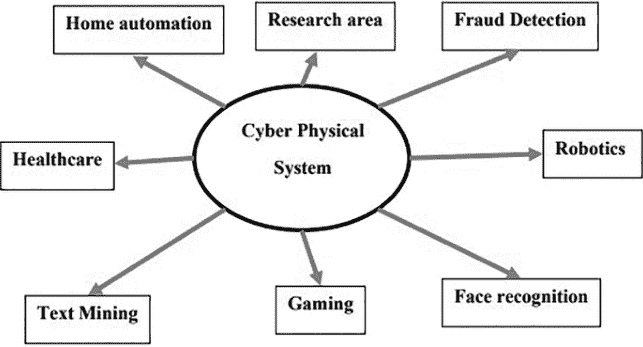

**FIGURE 7.4** CPS 的应用领域.

技术发展得更快，在数字世界中也具有更广泛的应用。机器人最好的伴侣是物联网、云、ML、人工智能和 DL。不同方法具有各自独特的功能。不仅如此，该领域还使用了各种算法，以使系统或机器尽可能先进。物联网具有先进的机制，可以让我们保持安全，并且通过 ML 和 DL，由于其独特的算法和方法，实现安全是完全可能的。

## 7.8 结论

云计算和任何系统中最重要的因素是安全。今天的数字世界非常关注安全及其后果。这一挑战每天都在激烈地成为焦点。云、雾和边缘是数字世界中主要使用的新技术。主要公司和数字行业都受到影响。很多方法、算法和技术都被介绍给我们，但仍然有些东西我们还不能称之为完全安全的系统。现在在某些地方这种情况仍然出现。在本章中，我们成功地讨论了云中用于安全的技术、算法和方法。数字化对我们这一代和未来是有益的，但当有优势时，劣势也会随之而来，而这种劣势是我们所有人的主要问题之一，并且也伴随着一些局限性。物联网、ML 和 DL 等新技术也在计算中普遍使用，当谈到物联网时；这些技术的安全威胁也成为一个主要问题，因此我们使用一些算法、身份验证技术来确保安全。在物联网的情况下，如果数据被黑客攻击，系统将受到严重影响，因此它也可能使个人数据变得脆弱。这种安全威胁对于 ML 和 DL 技术也是相同的。但技术数字化帮助很大并且也拥有光明的未来，因此未来也有机会发现新的方法和技术，为我们提供万无一失的安全。

## 参考文献

- [1] S. Das, L. Ghosh, and S. Saha, “Analyzing gaming effects on cognitive load using artificial intelligent tools,” 2020 IEEE International Conference on Electronics, Computing and Communication Technologies (CONECCT), 2020, doi: 10.1109/CONECCT50063.2020.9198662.
- [2] S. Das, and A. Bhattacharya, “ECG Assess heartbeat rate, classifying using BPNN while watching movie and send movie rating through telegram,” In: Tavares, J.M.R.S., Chakrabarti, S., Bhattacharya, A., and Ghatak, S. (eds.), Emerging Technologies in Data Mining and Information Security. Lecture Notes in Networks and Systems, 2021, vol. 164, pp. 465–474. Springer, Singapore. doi: 10.1007/978-981-15-9774-9_43.
- [3] S. Das, J. Das, S. Modak, and K. Mazumdar. (2022). “Internet of Things with machine learning based smart cardiovascular disease classifier for healthcare in secure platform,” In: Bhattacharya, B., Roy, B., Sur, S.N., Mallik, S., and Dasgupta, S. (eds.), Internet of Things and Data Mining for Modern Engineering and Healthcare Applications, pages 20. Chapman and Hall/CRC, New York.


[4] M. Ni, A. K. Srivastava, R. Bo, and J. Yan，“基于博弈论的电力系统网络安全防御系统设计”，*2017年IEEE第七届自动化、控制与智能系统中网络技术年度国际会议（CYBER）*，2017年，第1049–1054页，doi: 10.1109/CYBER.2017.8446449。

[5] L. Slipachuk, S. Toliupa 和 V. Nakonechnyi，“利用乌克兰国家网络安全部门管理综合系统进行关键基础设施网络安全管理的过程”，*2019年第三届国际先进信息与通信技术会议（AICT）*，2019年，第451–454页，doi: 10.1109/AICT.2019.8847877。

[6] W. Wu, R. Kang 和 Z. Li，“信息物理系统的网络安全风险评估方法”，*2015年第一届国际可靠性系统工程会议（ICRSE）*，2015年，第1–5页，doi: 10.1109/ICRSE.2015.7366430。

[7] E. Pavlenko 和 D. Zegzhda，“定向破坏性影响下信息物理系统的可持续性”，*2018年IEEE工业信息物理系统会议（ICPS）*，2018年，第830–834页，doi: 10.1109/ICPHYS.2018.8390814。

[8] M. Barrere et al.，“CPS-MT：一种用于安全研究的实时信息物理系统监控工具”，*2018年IEEE第24届嵌入式和实时计算系统与应用国际会议（RTCSA）*，2018年，第240–241页，doi: 10.1109/RTCSA.2018.00040。

[9] T. T. Teoh, Y. Y. Ngwi, Y. Elovici, N. M. Cheung 和 W. L. Ng，“基于分析师直觉的隐马尔可夫模型在高速时间序列网络安全大数据上的应用”，*2017年第13届自然计算、模糊系统与知识发现国际会议（ICNC-FSKD）*，2017年，第2080–2083页，doi: 10.1109/FSKD.2017.8393092。

[10] X. Chu, M. Tang, H. Huang 和 L. Zhang，“相互依赖的信息物理电力系统的安全评估方案”，*2017年IEEE第八届软件工程与服务科学国际会议（ICSESS）*，2017年，第816–819页，doi: 10.1109/ICSESS.2017.8343036。

[11] M. Elfar et al.，“WiP摘要：人回环信息物理系统安全感知设计平台”，*2017年ACM/IEEE第八届信息物理系统国际会议（ICCPS）*，2017年，第93–94页。

[12] B. Craggs 和 A. Rashid，“智能信息物理系统：从可用安全性到设计安全工效学”，*2017年IEEE/ACM第三届智能信息物理系统软件工程国际研讨会（SEsCPS）*，2017年，第22–25页，doi: 10.1109/SEsCPS.2017.5。

[13] Y. A. Shichkina 和 R. R. Fatkieva，“信息物理系统的智能信息安全管理”，*2021年第二届神经网络与神经技术国际会议（NeuroNT）*，2021年，第25–27页，doi: 10.1109/NeuroNT53022.2021.9472853。

[14] T. T. Teoh, G. Chiew, Y. Jaddoo, H. Michael, A. Karunakaran 和 Y. J. Goh，“将RNN和J48深度学习应用于安卓网络安全领域进行威胁分析”，*2018年国际智能计算与电子企业会议（ICSCEE）*，2018年，第1–5页，doi: 10.1109/ICSCEE.2018.8538405。

[15] S. Das, A. K. Balmiki 和 K. Mazumdar，“AI-ML技术在网络安全中的作用”，载于：Prakash, J.O., Gururaj, H.L., Pooja, M.R., Pavan Kumar, S.P.（编），*网络安全智能与分析的方法、实施与应用*。IGI Global，英国，2022年。doi: 10.4018/978-1-6684-3991-3。

[16] R. Manikandan, R. Patan, A. H. Gandomi, P. Sivanesan 和 H. Kalyanaraman，“使用物联网的哈希多项式双因子决策树用于智能医疗调度”，*专家系统与应用*，2020年，第141卷，112924，ISSN 0957-4174，doi: 10.1016/j.eswa.2019.112924。

[17] K. Ghanem, F. J. Aparicio-Navarro, K. G. Kyriakopoulos, S. Lambotharan 和 J. A. Chambers，“用于网络入侵和网络攻击检测的支持向量机”，*2017年国防传感器信号处理会议（SSPD）*，2017年，第1–5页，doi: 10.1109/SSPD.2017.8233268。

[18] D. Stiawan, S. Sandra, E. Alzahrani 和 R. Budiarto，“K均值法和朴素贝叶斯法在暴力攻击可视化中的比较分析”，*2017年第二届反网络犯罪国际会议（ICACC）*，2017年，第177–182页，doi: 10.1109/Anti-Cybercrime.2017.7905286。

[19] C. Guo, R. Zhuang, C. Su, C. Z. Liu 和 K. R. Choo，“云物联网生态系统中加密不确定数据的安全高效K最近邻查询”，*IEEE物联网杂志*，2019年，第6卷第6期，第9868–9879页，doi: 10.1109/JIOT.2019.2932775。

[20] J. Purmaissur, A. Seeam, S. Guness 和 X. Bekkens，“增强现实智能照明智能空间”，*2019年下一代计算应用会议（NextComp）*，2019年，第1–5页，doi: 10.1109/NEXTCOMP.2019.8883577。

[21] R. Kumari, Sheetanshu, M. K. Singh, R. Jha 和 N. K. Singh，“使用K均值聚类的网络流量异常检测”，*2016年第三届信息技术最新进展国际会议（RAIT）*，2016年，第387–393页，doi: 10.1109/RAIT.2016.7507933。

[22] W. K. S. Karunaratne 和 S. P. Wimalaratne，“增强ICA-AtoM的安全性：基于网络的档案描述软件”，*2014年第一届计算系统与通信国际会议（ICCSC）*，2014年，第236–241页，doi: 10.1109/COMPSC.2014.7032654。

[23] P. V. S. Alpaño, J. R. I. Pedrasa 和 R. Atienza，“用于信息物理系统入侵检测的二进制权重和激活的多层感知机”，*2017年IEEE第十区会议（TENCON 2017）*，2017年，第2825–2829页，doi: 10.1109/TENCON.2017.8228432。

[24] F. Pan, H. Wen, X. Gao, H. Pu 和 Z. Pang，“基于BPNN和物理层信誉的工业无线CPS克隆检测”，*IEEE工业信息学汇刊*，2021年5月，第17卷第5期，第3693–3702页，doi: 10.1109/TII.2020.3028120。

[25] T. Arora, M. Sharma 和 S. K. Khatri，“使用随机森林算法检测社交媒体上的网络犯罪”，*2019年第二届电力能源、环境与智能控制国际会议（PEEIC）*，2019年，第47–51页，doi: 10.1109/PEEIC.47157.2019.8976474。

[26] C. Chen, S. Wang, D. Wen, G. Lai 和 M. Sun，“应用卷积神经网络进行恶意软件检测”，*2019年IEEE第十届意识科学与技术国际会议（iCAST）*，2019年，第1–5页，doi: 10.1109/ICAwST.2019.8923568。

[27] W. Wang, T. Liu, L. Chang, T. Gu 和 X. Zhao，“用于知识追踪的卷积循环神经网络”，*2020年国际网络赋能的分布式计算与知识发现会议（CyberC）*，2020年，第287–290页，doi: 10.1109/CyberC49757.2020.00054。

[28] M. R. Habibi, T. Dragicevic 和 F. Blaabjerg，“基于循环神经网络的网络攻击下直流微电网安全控制”，*2020年IEEE第十一届分布式发电系统电力电子国际研讨会（PEDG）*，2020年，第517–521页，doi: 10.1109/PEDG48541.2020.9244459。

[29] T. T. Teoh, G. H. Chiew, Y. Jaddoo, H. Michael, A. Karunakaran 和 Y. J. Goh，“将RNN和J48深度学习应用于安卓网络安全领域进行威胁分析”，*2018年国际智能计算与电子企业会议（ICSCEE）*，2018年，第1–5页，doi: 10.1109/ICSCEE.2018.8538405。

[30] S. K. Alabugin 和 A. N. Sokolov，“应用生成对抗网络进行工业控制系统的异常检测”，*2020年全球智能工业会议（GloSIC）*，2020年，第199–203页，doi: 10.1109/GloSIC50886.2020.9276778。

[31] P. F. de Araujo-Filho, G. Kaddoum, D. R. Campelo, A. Gondim Santos, D. Macêdo 和 C. Zanchettin，“雾环境中使用生成对抗网络进行信息物理系统的入侵检测”，*IEEE物联网杂志*，2021年，第8卷第8期，第6247–6256页，doi: 10.1109/JIOT.2020.3024800。

[32] S. Sahana, S. Das 和 B. K. Sarkar，“基于主成分的无比对全基因组系统发育分析方法：在HEV基因型中的应用”，载于*2015年国际计算、通信与自动化会议（ICCCA）论文集*，2015年，第984–989页。

[33] K. K. Senapati, S. Sahana 和 G. Sahoo，“一种高效的生物序列模式匹配算法”，载于*IPCV*，2010年，第755–759页。


青少年脑肿瘤可能从只需少量治疗即可治愈到即使进行强化治疗也无法治愈不等。存在许多不同类型的青少年脑肿瘤，如颅咽管瘤、脑干胶质瘤、室管膜瘤、生殖细胞肿瘤和星形细胞瘤。

为了识别肿瘤、水肿和出血，必须将大脑分割成灰质、皮质下白质、脑脊液和颅骨等各种成分。根据主要在工业化国家进行的研究，脑肿瘤患者的死亡率高于过去三十年。肿瘤是由于通常调节生长的机制失控而无控制生长的组织团块[1]。肿瘤可以摧毁大脑的所有健康细胞。由此产生的拥挤、炎症、水肿和颅内压力可能会影响其他脑区[2]。在早期的医学肿瘤识别研究中，研究人员采用了传统的图像处理方法（如边缘检测和区域生长），取决于图像的灰度强度[3]。

## 8.1.1 医疗保健系统中脑 MRI 分割的需求

计算应用在日常生活中变得越来越重要。在计算生物医学分析中，计算机辅助诊断（CAD）工具的使用正在被更深入地研究，尤其是在CAD方面。脑肿瘤是当今医疗保健环境中最常见的致命疾病之一。根据美国国家癌症研究所2019年的数据，过去二十年间，包括脑癌在内的癌症病例数量增长了约10%。根据国家脑肿瘤基金会的数据，每年有29,000名美国人被诊断出原发性脑肿瘤，其中13,000人因此死亡。特别是儿童，四分之一的癌症相关死亡是由脑肿瘤引起的。在美国，原发性脑肿瘤影响每10万人中的11-12人，而原发性恶性脑肿瘤影响每10万人中的6-7人。超过4,200名英国人患有脑肿瘤（2007年估计）。每年发现超过200种不同的肿瘤；主要在英国，每1,000例恶性肿瘤中有16例发现于大脑。然而，在印度，有80,271人患有各种类型的肿瘤。

完全计算机化的脑部问题诊断，如使用MRI识别脑肿瘤，是医学领域专业图像分析的一个显著例子。脑肿瘤由于脑组织细胞的失控生长而发展。因为构成血脑屏障的细胞紧密连接在一起，标准实验室检查不足以检查人脑的化学成分。CT、MRI和PET等三种生物医学成像方法使医生和研究人员能够在不进行侵入性手术的情况下观察大脑结构。

MRI是放射科医生用来研究大脑解剖的生物医学成像技术。使用MRI可以深入检查人体软组织结构解剖。MRI扫描的使用可能有助于诊断脑肿瘤[3]。它用于在不进行手术的情况下学习人体解剖学[4,5]。脑图像分割是计算机辅助临床诊断和治疗肿瘤及其他解剖异常的重要组成部分之一。噪声脑MR图像是乘性噪声；因此，降低噪声对于获得良好结果至关重要。从治疗角度来看，确保降噪算法不会消除必要的解剖特征至关重要。因此，脑MR图像分割是一个具有挑战性的研究课题。因此，正确的MRI图像分割对于利用计算机辅助临床技术进行有效诊断至关重要。到目前为止，已提出了多种分割MR图像的方法。

纹理分析或识别是计算机视觉领域近三十年来日益受到关注的主题之一，也是最紧迫的问题之一。纹理分析算法分为三类：统计、模型和结构。每种方法都有其优缺点。肿瘤是由不同或混合细胞组成的脑部病变。脑肿瘤分为癌性和非癌性（良性）。当非癌性或有害肿瘤生长时，它们会对颅内施加压力，这可能是致命的。原发性和继发性脑肿瘤是脑肿瘤的两种分类。原发肿瘤起源于大脑。有几种良性脑肿瘤。当来自呼吸器官或乳房等其他器官的恶性细胞转移到大脑时，就会形成继发肿瘤。核磁共振，通常称为MRI，是一种主要（但不 exclusively）用于诊断应用以安全观察内部结构的技术。当身体或其一部分置于强均匀磁场中时，该技术依赖于水中受激原子核的共振特性。这种方法的明显好处是非电离特性，而与CT扫描和X射线束等替代程序相比，后者会使患者暴露于电离辐射。使用MRI时，通常需要图像分割，以便专家和专业人员在医疗治疗前分解患者信息，以确定器官或肿瘤的特定区域。

临床识别在很大程度上依赖于医学图像分割。理想的临床图像分割的特征是用户交互最少、计算快速以及分割结果准确且一致。图像分割是一种图像分析方法，试图根据同质性标准将图像划分为多个区域。这些分割区域的精确信息在评估危险恶性肿瘤中起着至关重要的作用。

本文描述了一种用于从脑MRI图像数据集中正确分割肿瘤的增强分割系统，该系统经过全面评估方法检验。该方法基于主动轮廓，通过最小化（其中包括）梯度相关的能量，同时保持轮廓形状的光滑度来适应物体的形状。因此，与边缘检测不同，主动轮廓技术更抗噪声，因为轮廓光滑度和形状一致性的要求起到了正则化的作用。该方法的另一个优点是可以将有关物体形状的先验信息纳入轮廓定义过程。为了使基于主动轮廓的算法[6]能够有效收敛到实际边界，轮廓必须在物体边界附近初始化。

由于医学成像的进步，近几十年来关于脑肿瘤分割自动化的研究数量激增[7]。主动轮廓模型（ACMs）用于脑肿瘤分割。这些方法有效地定位肿瘤与组织的边界[8]。该方法利用了借鉴自解剖和生物信息的标准，涉及解剖区域的位置、大小和形状[9]。带有主动轮廓的曲线或曲面会响应加权内部和外部力而移动。曲线光滑度由内部力决定，而曲线向解剖目标的推拉则由外部力决定。总体而言，早期轮廓初始化不当和在不准确边缘处的泄漏困扰着ACMs。用于检测和分割脑异常的大多数建议方法受到大量计算、由于脑肿瘤而缺乏完全自动化以及轮廓初始化和边缘错误等的限制。

## 8.1.2 脑 MR 图像去噪的重要性

诊断和治疗计划过程需要医学图像的去噪。近年来，图像已使用数字技术捕获。从数字照片中去除噪声是一项困难的任务[10]。噪声分散了我们对图像自然美感的注意力。为了去噪过程，应识别噪声并评估其统计特性[11]。高斯、瑞利和脉冲噪声是在图像捕获过程中引入的。这种噪声是由采样和传输过程产生的。它在图像中表现为黑白斑点[12,13]。

图像去噪方法包括添加变化滤波器、改变域滤波器和使用梯度方法。平滑对变化和变化域滤波器的影响[14,15]。模糊混合滤波器可去除MR图像中的Rician噪声。Rician噪声会影响分割和参数合成等后处理技术[16]。

非局部均值滤波器和贝叶斯估计器可减少超声图像中的斑点噪声。贝叶斯估计器捕获Gamma分布的形状和大小以及每个像素的强度。单源小波将噪声描述为拉普拉斯分布和瑞利分布的混合。非局部均值滤波器通过对所有像素加权来降低噪声[17–19]。

预计在未来的MRI滤波中将提出基于小波和曲线波的变换滤波器和统计滤波器，其特定目标是消除不透明问题。双边滤波器（BF）是近年来为MRI设计的知名非线性噪声滤波器。它是一种简单、局部、非迭代的空间降噪和边缘保持技术。局部信息用于图像中识别边缘部分。这些滤波器一次平滑图像的各个部分[20]。

尽管其在MRI图像去噪中广泛使用，但关于最佳BF设置知之甚少[21,22]。先前的研究中使用统计方法来找到最佳参数。作者[23]使用向量均方根误差估计来选择最佳滤波器设置。尽管如此，他们的方法承认了真实图像的存在。另一项以粒子群优化（PSO）为重点的优化研究使用了受单一噪声水平降质的颜色图像来测试BF滤波器的参数[24]。大多数情况下，BF设置是通过试错过程得出的。

EGOA（增强型蚱蜢优化算法）受益于大量的探索和快速收敛。在此计算中，该工具的卓越多功能性可轻松平衡探索和利用。这使得EGOA计算成为多目标问题的替代方案。


多维计算特性优于多种图像增强技术。基于这些开创性发现，我们创建了一个由蝗虫社会行为建模的多目标优化代理。该研究旨在通过使用 EGOA 来降低医学 MR 图像中的噪声，从而增强 BF 参数。EGOA 具有更快找到最佳解决方案且需要较少先验知识的优势 [25]。根据我们的研究，这是团队首次使用 EGOA 来优化用于去噪 MR 图像的 BF 参数。

## 8.2 文献综述

在文献中，描述了几种用于改进分割的分割方法。下面列出了一些最常用的方法。

### 8.2.1 阈值分割

图像分割经常采用阈值分割作为一种技术。该技术适用于亮度水平不同的图像。该技术根据强度水平将图像划分为不同的区域。如果 X(x, y) 是输入图像，“T” 是阈值，则分割后的图像为 Y(x, y)。

Y(x,y)=1, if X(x,y)>T
0, if X(x,y)≤T

使用 Y(x, y)，图像可分为两类。如果我们希望将照片分为多个组，则需要多个阈值点。当我们有两个阈值时，则 Y(x, y) 将图像分割为三组，如

Y(x,y)=a, if X(x,y)>T₂
b, if T₁<X(x,y)≤T₂
c, if X(x,y)≤T₁

Bhattacharyya 和 Taihoon Kim [26] 开发了一种用于检测脑 MRI 中肿瘤的图像分割方法。在每张图像中，许多当前阈值方法产生了不同的结果。为了对脑肿瘤图像产生可接受的影响，他们开发了一种单独进行肿瘤识别的技术。文献 [27–30] 提供了各种阈值方法的综述。

#### 8.2.1.1 Otsu 阈值分割

Otsu 方法是几种阈值方法中最广泛使用的。利用判别分析，Otsu 阈值方法在灰度级 “k” 的每一级将图像分为两个类别 C1 和 C2，其中 C1 等于 0，C2 等于 1、2、3、5 等。该图像在第 i 个灰度级包含 n_i 个像素；

因此，设 $P_i$ 为灰度级的概率。灰度级的可能性表示为

$$P_i = \frac{n_i}{n}$$

类别 “C1” 和 “C2” 分别表示感兴趣区域和背景。如果直方图是单峰或近似单峰，则 Otsu 技术会失败。

#### 8.2.1.2 局部阈值分割

对于每个子图像，都会确定一个阈值来确定图像的质量。计算局部阈值比计算全局阈值涉及更多计算。当用于改变照片的背景时，它能取得良好的效果。它只能去除噪声斑点 [31]。

#### 8.2.1.3 直方图阈值

直方图阈值分割使用直方图特征和灰度级阈值。

以下是要使用的算法：

- 1. 沿图像中心轴分割的 MRI 脑图像的每一半都创建直方图。
- 2. 通过比较两个直方图确定直方图的阈值点。
- 3. 阈值点将图像分为两半。
- 4. 为了确定肿瘤的物理尺寸，检测到的图像沿其轮廓裁剪。
- 5. 复制原始图像并将其与分割图像进行比较。假设值大于阈值，则赋值为 255。
- 6. 将肿瘤分成两半。
- 7. 计算肿瘤的大小。

### 8.2.2 基于边缘的分割

使用基于边缘的分割方法，可以根据边缘沿线的强度变化速度将图像分割成部分 [32,33]。最终结果是二值图像。灰度直方图和基于梯度的分割是最常用的两种方法 [34]。在边缘检测技术的情况下，切断值 T 的选择对结果有很大影响 [35]。Sobel、Canny、Laplacian 和 Laplacian of Gaussian (LOG) 算子用于基于梯度的边缘检测。智能算子 [36] 最有前景。

边缘检测技术的检测精度和抗噪性必须平衡。例如，如果噪声检测精度设置过高，可能会在图像中引入虚假边缘。这使得图像轮廓不准确。图像轮廓的某些部分可能未被注意到，导致物体位置不正确。因此，边缘检测技术的应用适用于无噪声且细节丰富的图像，但在处理复杂且有噪声的图像时，它们通常会产生缺失或多余的边缘 [37]。

### 8.2.3 基于区域的分割

将图像分割成区域的算法比边缘检测技术更简单、更抗噪 [38,39]。使用边缘根据预定义标准将图像分割成可比区域的技术称为基于边缘的技术。相比之下，基于区域的方法将像素划分为相似区域。

#### 8.2.3.1 区域生长

区域生长方法是一种系统性的分割策略。使用该技术，以单个种子像素作为起点，然后根据需要从邻近区域添加像素以扩展图像的大小。当区域生长减缓时，会选择一个不属于任何其他区域的新种子像素。当给定区域中的所有像素都属于同一区域时，该区域的扩展停止。

一种称为区域扩展分割的技术是区分肿瘤和病变等小型基本特征最有效的方法 [40,41]。采用该方法的一些缺点如下：(i) 有时需要人工参与来选择种子位置；(ii) 对噪声敏感，导致提取区域出现孔洞或过度分割。

使用同伦区域生长技术，可以消除提取图像中的不连续性。

在论文 [6] 中，作者提出了一种技术，“Snakes: Active contour models”，依赖于可变形形状并证明了将前景与背景分离。在图像处理领域，这些 ACM 已被最广泛地用作图像分割的成功系统 [6]。

水平集策略被用于控制 developing contour 朝向理想极限的模型中，这些模型在复杂临床图像分析中被特别积极地使用。

在论文 [42] “Active contours without edges” 中，作者介绍了 ACM 的概念，可有效用于图像分割应用。

在论文 “A deformable segmentation algorithm for brain M.R. images” [43] 中，作者引入了一种算法 (D-C) 用于有效解决分割问题。他们证明了通过结合主动轮廓分割技术变化，他们的算法效果更好。他们包含了形状和强度图像及其能量函数，以实现脑 MRI 图像的有效分割。

以这种方式，Chan-Vese [44] 改进了该技术并通过结合边缘项成功分割了没有平滑边界的噪声图像。

## 8.3 拟议方法

分割是指将图像分解为称为段的不同片段。这些段有助于从背景中提取感兴趣区域。这可以通过文献综述中描述的各种方法完成。

组织的覆盖、噪声和低复杂度导致 MRI 图像中感兴趣区域的评估不适当。标准的基于边缘的分割由于噪声而无法正确量化感兴趣区域。

### 8.3.1 Chan-Vese ACM

Chan-Vese 可变形模型模型 [45] 是一种不可思议且适应性强的策略，可以分割许多种图像，包括一些在“传统”分割方法中非常难以分割的图像——即利用阈值或基于梯度的方法。该模型中使用 Mumford-Shah [45] 泛函来分割大脑、心脏和气管。该模型 [45] 常用于临床成像，如图 8.1 所示。

设 $\Omega$ 为 $R^2$ 的有界开子集，$\partial\Omega$ 为其边界。设 $\mu_0:\Omega\to R$ 为预定图像，且 $C(s)$ 为分段 $C^1[0,1]$ 定义的曲线。

$C$ 内包含的区域将表示为 $\omega$，而 $C$ 之外的空间将标记为 $\Omega\setminus\omega$。此外，$c_1$ 的值将表示 $C$ 内像素的平均强度，而 $C$ 外的平均强度将由变量 $c_2$ 表示（即 $c_1=c_1(C),\ c_2=c_2(C)$）。

Chan-Vese 方法的目标是将能量函数 [45] 降至最小可能值 $F(c_1,c_2,C)$，由下式给出：

$$F(c_1,c_2,C)=\mu\cdot\operatorname{Length}(C)+\nu\cdot\operatorname{Area}(\operatorname{inside}(C))$$
$$+\lambda_1\int_{\operatorname{inside}(C)}|\mu_0(x,y)-c_1|^2\,dx\,dy$$
$$+\lambda_2\int_{\operatorname{outside}(C)}|\mu_0(x,y)-c_2|^2\,dx\,dy \tag{8.1}$$

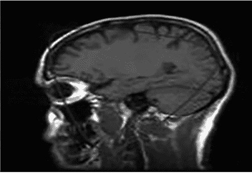

**图 8.1** 图像在 [45] 上定义于 $\Omega$（大矩形），（任意）红色曲线为 $C$。


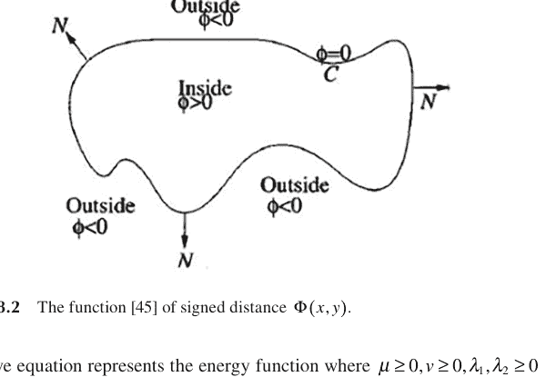

## 图 8.2 有符号距离 Φ(x,y) 的函数 [45]。

上述方程表示能量函数，其中 μ ≥ 0，ν ≥ 0，λ₁，λ₂ ≥ 0 是不可更改的设置。

我们按如下方式用 C 的有符号距离函数重写 F(c₁,c₂, C)：

- 1. 长度 (C) 是零水平集函数 Φ(x,y)=0 的长度，如图 8.2 所示
- 2. 长度 (C) = ∫_Ω |∇H(Φ(x,y))| dx dy = ∫_Ω δΦ(x,y) |∇(Φ(x,y))| dx dy
  其中 H(z) = {1, if z ≥ 0
  0, if z < 0
- 3. Area(inside(C)) 为 Φ(x,y) ≥ 0 的区域的面积：
  Area(inside(C)) = ∫_Ω H(Φ(x,y)) dx dy
- 4. ∫_{inside(C)} |μ₀(x,y)-c₁|² dx dy 可以用 Φ(x,y) 表示，仅考虑 Φ(x,y) ≥ 0 的区域时：
  ∫_{inside(C)} |μ₀(x,y)-c₁|² dx dy = ∫_{(x,y):Φ(x,y)≥0} |μ₀(x,y)-c₁|² dx dy
  = ∫_Ω |μ₀(x,y)-c₁|² H(Φ(x,y)) dx dy
- 5. 同样
  ∫_{outside(C)} |μ₀(x,y)-c₂|² dx dy = ∫_{(x,y):Φ(x,y)≥0} |μ₀(x,y)-c₂|² dx dy
  = ∫_Ω |μ₀(x,y)-c₂|² H(1-Φ(x,y)) dx dy

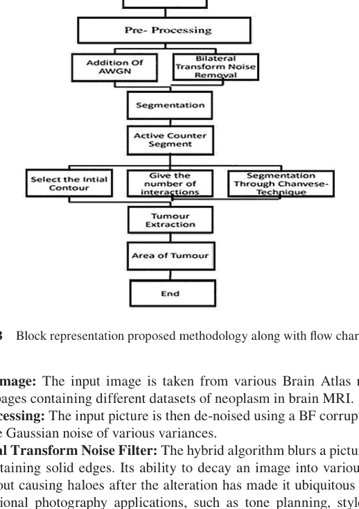

## 图 8.3 提出的方法的框图表示以及流程图。

**输入图像：** 输入图像取自包含脑 MRI 中肿瘤不同数据集的各种 Brain Atlas 研究网页。

**预处理：** 输入图片被各种方差的白高斯噪声损坏。然后使用 BF 进行去噪。

**双边变换噪声滤波器：** 该混合算法在保持坚实边缘的同时模糊图像。它能够将图像衰减为各种尺度而不会在更改后产生光晕，这使其在计算摄影应用中无处不在，例如色调规划、风格移动、重新照明和去噪。其细节是基本的。每个像素都被其邻居的加权平均值所取代。这很关键，因为它使得获得对其行为的直觉、将其调整为应用特定需求并实现它变得简单。BF 仅取决于两个边界，这些边界表明要保留的特征的大小和差异。建议的解决方案使用 BF 来去除噪声同时保持边缘。去噪后的图像被传输用于主动轮廓分割。

**主动轮廓分割：** 分割从轮廓初始化开始，在此我们选择图像上的底层形状并设置最极端的迭代次数。该算法包含两种能量，其中一种功率减小形式，另一种扩展形状。当形式到达我们理想项目的最远点时，这两种能量会得到调整，从而导致完全分割。主动 ACM 的概念首次于 1987 年提出 [6]，后来由各种分析师创建。功能形状是识别图像内确定特征的活力限制样条。它是一个灵活的弯曲（或表面），可以逐步调整到照片中所需的边缘或项目（它可以用于编程对象分割）。

控制的数量描述了主动轮廓焦点以及彼此的连续性。将主动轮廓拟合到图像中的形状是一个智能过程。客户端必须推荐一个初始轮廓，该轮廓非常接近计划的数字。然后轮廓将被拉入由内部活力提取的图像中的特征，形成吸引图像。

## 肿瘤提取：

我们从分割图像中提取肿瘤，即我们的感兴趣区域。此外，我们去除肿瘤的面积和肿瘤区域内的像素数量，这有助于医生使用脑 MRI 诊断和追踪肿瘤。

主动轮廓技术是由 Osher 和 Sethian 创建的数值和概念设备，用于图像处理、流体力学、设计和计算机视觉等其他领域。与主动轮廓技术相比，主动轮廓策略在图像分割中提供了一些优势。拓扑修改无法与动态形式方法相匹敌。

建议的工作包含此计算中的以下改进。

- a. 创建一个与输入图像尺寸完全相同的任意网络，然后将该框架连接到图片——这有助于在图像中创建轮廓。当时轮廓在图像中可见，但这有助于创建更有效的方式。
- b. 接下来，定位图片中的轮廓位置并创建轮廓以帮助图像分割。这使得图像的第一次分割。
- c. 一旦这些轮廓在图片中被识别，下一步就是通过计算它们的距离来更新各个段。如果距离为负，则像素的值或位置被认为是段的一部分。如果距离为正，则像素的值或位置被认为在组件之外。
- d. 下一步是通过检查段的像素值来更新分割区域。该函数被如此认真地处理，以至于任何新形式都可能很容易接受区域的变化。随着更新值的变化，ACM 会移动以合并或分割段。

## 8.4 结果与讨论

预处理用于准备输入脑 MRI 图像，随后添加白高斯噪声。通过将信号发送通过 BF，该噪声被消除。下一阶段包括使用主动轮廓方法进行分割，通过 Chan-Vese 技术实现。

在此技术中，首先选择掩模并设置迭代次数。肿瘤从图片中分离出来。肿瘤的面积和像素计数被确定。建议的方法已在多个迭代中对少量良性肿瘤 MRI 数据集的有效性进行了测试。除了验证之外，我们还根据分割时间计算了我们预期方法的总体执行情况，这是快速处理算法开发中最关键的因素之一，并展示了我们的结果。当一切正常时，我们建议的方法分别在 5 秒、7 分钟 26 秒和 7 分钟 19 秒内从 MRI 图像中分离出大脑肿瘤。在完整准备的数据集（例如 250 次迭代）中，肿瘤的分割时间低至 5 秒，高至 7.9 秒，具体取决于不可预测的临床图像。

图 8.4 显示了脑 MRI 数据集中的一张输入图像；图 8.5 描述了添加加性白高斯噪声后的图像。图 8.6 显示了 BF 的输出，之后使用建议的主动轮廓 Chan-Vese 技术进行分割。图 8.7 显示了分割图像，我们可以在其中观察到整个图片中仅肿瘤区域被分割出来。最后，图 8.8 描述了脑 MRI 图像中存在的肿瘤，即我们的感兴趣区域。

图 8.4–8.8 是在方法中描述的每个步骤后获得的。上述结果是在最大迭代次数为 100 时生成的。分割图像所需的时间为 7.2 秒。肿瘤占用的面积为 0.0930，肿瘤区域内的像素数为 6,093。

图 8.9 显示了脑 MRI 数据集中的一张输入图像；图 8.10 显示了添加加性白高斯噪声后的图像。图 8.11 显示了 BF 的输出，之后使用建议的主动轮廓 Chan-Vese 技术进行分割。

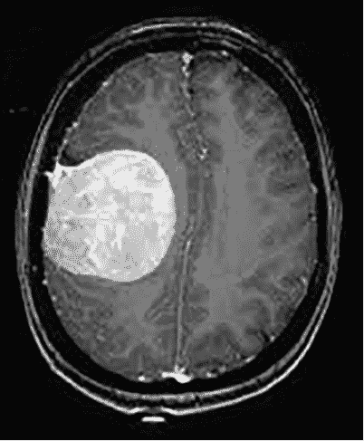

**图 8.4** 输入图像。

## 噪声图像

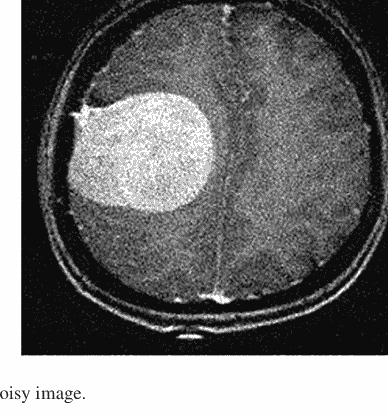

图 8.5 噪声图像。

## 预处理后的结果图像

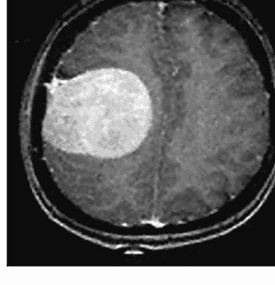

图 8.6 预处理后。

## 分割后的最终图像

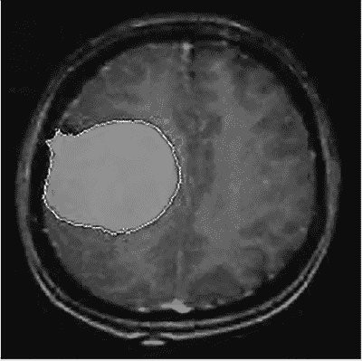

**图 8.7** 分割图像。

## ROI-感兴趣区域--肿瘤

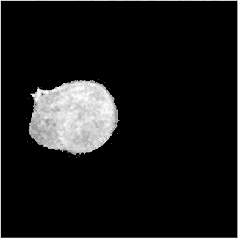

**图 8.8** 从脑 MRI 图像中提取的肿瘤。


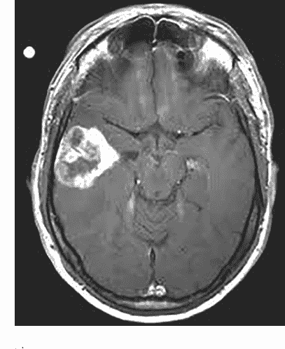

图8.9 输入图像。

## 噪声图像

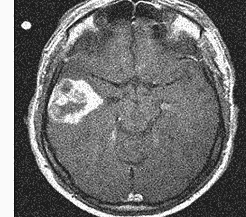

图8.10 噪声图像。

## 预处理后的结果图像

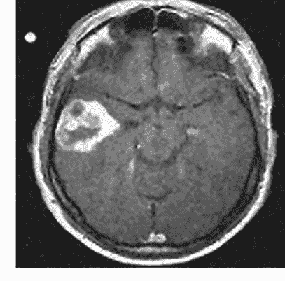

图8.11 预处理后。

## 分割后的最终图像

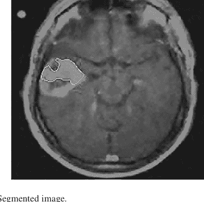

图8.12 分割后的图像。

图8.12显示了分割后的图像，我们可以观察到只有肿瘤区域从整个图像中被分割出来。最后，图8.13显示了脑部MRI图像中存在的肿瘤，即我们感兴趣的区域。

图8.9至图8.13是在方法学中描述的每个步骤之后获得的。上述结果是在最大迭代次数为35时生成的。对图像进行分割所用时间为5.26秒。肿瘤所占面积为0.0156，肿瘤区域的像素数为1,021。我们观察到，当算法以35次迭代运行时，发现轮廓与整个肿瘤区域不匹配。这个问题被称为欠分割，从图8.9到图8.10可以明显看出。

## ROI-感兴趣区域--肿瘤

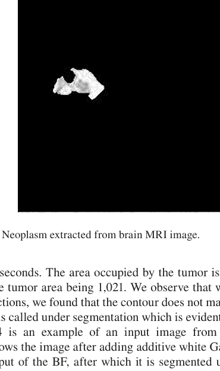

图8.13 从脑部MRI图像中提取的肿瘤。

图8.14是来自脑部MRI数据集的输入图像示例；图8.15显示了添加加性白高斯噪声后的图像。图8.16显示了BF的输出，随后使用所提出的活动轮廓Chan-Vese技术对其进行分割。

图8.17显示了分割后的图像，我们可以观察到只有肿瘤区域从整个图像中被分割出来。最后，图8.18显示了脑部MRI图像中存在的肿瘤，即我们感兴趣的区域。

图8.14至图8.18是在方法学中描述的每个步骤之后获得的。上述结果是在最大迭代次数为200时生成的。对图像进行分割所用时间为4.65秒。肿瘤所占面积为0.0107，肿瘤区域的像素数为698。我们观察到，当算法以200次迭代运行时，发现轮廓与整个肿瘤区域不匹配。这个问题被称为欠分割，从图8.17和图8.18可以明显看出。

表8.1显示了所提出的框架在不同MRI图像上的表现。可以观察到，初始轮廓根据图像的复杂度而逐图变化。分割图像所需的最大迭代次数也因图像而异。可以注意到，肿瘤尺寸较小的图像（序号4）需要较少的迭代次数，因此分割图像所需的时间较少。可以观察到（序号3）如果迭代次数多于最佳值，会导致过分割。

## 原始图像

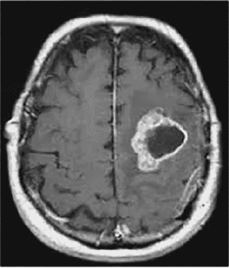

**图8.14** 原始图像。

## 噪声图像

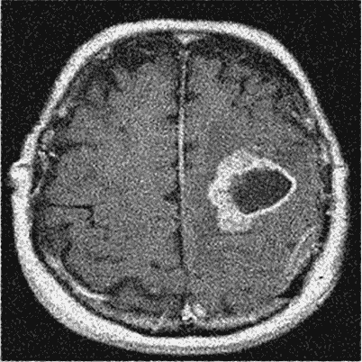

**图8.15** 噪声图像。

## ROI-感兴趣区域--肿瘤


**图8.16** 预处理后的图像。

## 预处理后的结果图像


**图8.17** 分割后的图像。

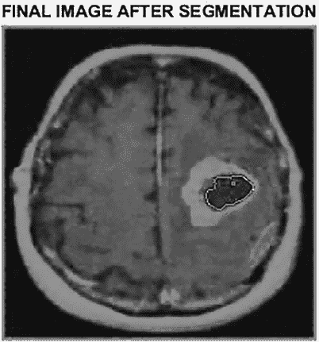

**图8.18** 从脑部MRI图像中提取的肿瘤。

表8.2显示了所提算法在不同迭代次数但相同掩膜下的性能。可以观察到，在第50次迭代时，从分割图像中可以看出肿瘤尚未被适当分割。在这里观察到，随着迭代次数从50增加到250，分割输出发生了显著变化。在第250次迭代时，我们发现所提算法从MRI图像中提取肿瘤的效果远优于其他迭代次数。

因此，我们可以得出结论，从脑部MRI中完美分割肿瘤主要取决于所取的掩膜大小、迭代次数和输入图像的复杂度。我们还可以从上述结果得出结论，我们提出的设计在存在噪声的情况下表现出更好的结果。有助于图像去噪的BF是与存在噪声的脑部MRI图像分割的完美组合，最后可以得出结论，所提设计的分割结果平均耗时约7.23秒，这也取决于图像复杂度和计算分割所采用的迭代次数。

## 8.5 结论

所提出的活动轮廓分割的功能是为医生提供关于识别、肿瘤监测诊断和治疗安排的早期初步判断—ACM分割图像基于曲线流曲率和轮廓。ACM用于前景分析和处理。本章提供了一种使用Chan-Vese分割方法从MRI图像中分割脑肿瘤的卓越且稳健的技术。在此方法中，第一步是从数据库中获取输入图像，

## 表8.1

**所提出系统的性能**

| 序号 | 输入图像 | 分割图像 | 迭代次数 | 分割时间 | 肿瘤面积 |
|---|---|---|---:|---:|---:|
| 1 | [image] | [image] | 230 | 6.67 | 0.0105 |
| 2 | [image] | [image] | 280 | 7.12 | 0.0845 |
| 3 | [image] | [image] | 180 | 9.12 | 0.0586 |
| 4 | [image] | [image] | 75 | 4.65 | 0.0326 |

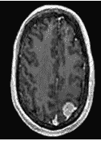

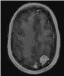

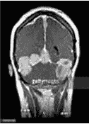

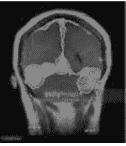

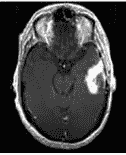

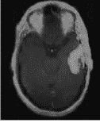


然后添加加性白高斯噪声。将所得图像通过称为BF的去噪滤波器。使用活动轮廓分割对MRI图像进行分割。初始轮廓的选择和迭代次数显著影响着从数字图像中准确识别癌症。

当用于MRI图像中的脑肿瘤分割时，所建议的方法对医生、临床专家和分析师所在位置以及分析师本人都有益。该过程还可以扩展到各种其他临床成像模式，以尽可能快速有效地获取精确的临床数据。还可以对检查图像进行分割，以便简单检查

## 表8.2
所提算法在不同迭代次数下的性能

| 序号 | 输入图像 | 初始轮廓 | 分割输出 | 迭代次数 |
|---|---|---|---|---|
| 1 | ![输入图像1] | ![初始轮廓1] | ![分割输出1] | 50 |
| 2 | ![输入图像2] | ![初始轮廓2] | ![分割输出2] | 100 |
| 3 | ![输入图像3] | ![初始轮廓3] | ![分割输出3] | 150 |
| 4 | ![输入图像4] | ![初始轮廓4] | ![分割输出4] | 200 |
| 5 | ![输入图像5] | ![初始轮廓5] | ![分割输出5] | 250 |

以及识别囊肿、肿瘤、微小动脉瘤和炎症中的病变和血液凝块、异常增生和癌细胞。

## 参考文献

- [1] Kostas, P. “使用自动化方法的医学图像非刚性配准”，《国际医学与健康科学杂志》，1, 7, 477–479, 2007。
- [2] J. Jaya, K. Thanushkodi, “采用新变换技术选择医学图像的探索”，IJCSI国际计算机科学问题杂志，7, 3, 4, 2010。
- [3] K Gurucharan, S S Kiran, K Babbu and L Vadda, “基于计算机视觉的水果识别与分类系统”，《国际未来一代通信与网络杂志》(IJFGCN)，ISSN: 2233–7857(印刷版)；2207–9645(在线版)，2020, 13, 3, 1–14。
- [4] Nag, S., Maitra, I., Sudipta, M., Roy, S., and Bandyopadhyay, K., “基于脑MRI检测肿瘤及相关异常的图像分割方法综述”，《国际计算机科学与软件工程高级研究杂志》，4, 5, 1073–1095, 2014。
- [5] Bandyopadhyay S., and Paul T., “从多张脑MRI图像自动分割脑肿瘤”，《国际工程与管理应用或创新杂志》(IJAIEM)，2, 1, 2013。
- [6] Kass, M., Witkin, A.P., and Terzopoulos, D. “Snakes：活动轮廓模型”，《国际计算机视觉杂志》，1, 321–331, 2004。
- [7] Menze, H., Jakab, A., Bauer, S., Kalpathy-Cramer, J., Farahani, K., Kirby, J., Burren, Y., Porz, N., Slotboom, J., Wiest, R. 等，“多模态脑肿瘤图像分割基准（Brats）”，《IEEE医学影像汇刊》，34, 1993–2024, 2015。
- [8] Gordillo, N., Montseny, E., Sobrevilla, P. “MRI脑肿瘤分割的最新技术综述”，《磁共振成像》，31, 8, 1426–1438, 2013。
- [9] Nabizadeh, N. “使用磁共振图像自动检测和分割脑部病变”，博士论文，迈阿密大学，科勒尔盖布尔斯，佛罗里达州，美国，2015年4月。
- [10] R. Biswas, D. Purkayastha and S. Roy, “使用曲波变换对MRI图像进行去噪，《系统进展》”，控制与自动化，575–583, 2017。
- [11] K. Das, M. Maitra, P. Sharma, and M. Banerjee, “医学图像的早期混合去噪技术”，《信号与图像处理的最新趋势》，131–140, 2018。
- [12] Lysaker, M., Lundervold, A., and Tai, X.-C., “使用四阶偏微分方程去除噪声及其在医学磁共振图像时空中的应用”，《IEEE图像处理汇刊》，12, 12, 1579–1590, 2003。
- [13] Arora, S., Hanmandlu, M., and Gupta, G., “使用信息集滤除医学图像中的脉冲噪声”，《模式识别快报》，2018。
- [14] Bai, J., Song, S., Fan, T. and Jiao, L., “基于稀疏字典学习和聚类集成的医学图像去噪”，《软计算》，22, 5, 1467–1473, 2018。
- [15] Lee, Y., “使用迭代计数器的梯度法改进全变分降噪技术及其在医学诊断胸部腹部X射线成像中的应用”，《Optik》，170, 475–483, 2018。
- [16] Caldairou, B., Passat, N., Habas, P., Studholme, C., and Rousseau, F., “一种非局部模糊分割方法：在脑MRI中的应用”，《模式识别》，44, 9, 1916–1927, 2011。
- [17] Yang, J., Fan, J., Ai, D., Wang, X., Zheng, Y., Tang, S., and Wang, Y., “局部统计和非局部均值滤波器用于医学超声图像散斑噪声抑制”，《Neurocomputing》，195, 88–95, 2016。
- [18] Gai, S., Zhang, B., Yang, C., and Yu, L., “使用单演小波和拉普拉斯混合分布减少医学超声图像的散斑噪声”，《数字信号处理》，72, 192–207, 2018。
- [19] Sudeep, P., Palanisamy, P., Rajan, J., Baradaran, H., Saba, L., Gupta, A., and Suri, J., “使用无偏非局部均值方法减少医学超声图像的散斑”，《生物医学信号处理与控制》，28, 1–8, 2016。
- [20] Zhang, Y., Tian, X., and Ren, P., “基于自适应双边滤波的图像去噪框架”，《Neurocomputing》，140, 299–316, 2014。


## 参考文献

- [21] Qi, M., Zhou, Z., Liu, J., Cao, J., Wang, H., Yan, A., Wu, D., Zhang, H., and Tang, L., “Image De-noising Algorithm via Spatially Adaptive Bilateral Filtering.” Advanced Materials Research, 760–762, 1515–1518, 2013.
- [22] Zhang, M., and Gunturk, B., “Multiresolution Bilateral Filtering for Image De-noising.” IEEE Transactions on Image Processing, 17, 12, 2324–2333, 2008.
- [23] Ramananda, S., Lehmann, B., and Kraus, D., “Optimal parameters for bilateral filtering and SAS image de-noising,” 2011 International Symposium on Ocean Electronics, 2011.
- [24] Shi, H., “Determination of bilateral filter coefficients based on particle swarm optimization,” 2012 5th International Congress on Image and Signal Processing, 302–306, 2012.
- [25] Farooq, M., “Application of genetic algorithm & morphological operations for image segmentation,” International Journal of Advanced Research in Computer and Communication Engineering, 4, 3, 2015.
- [26] D. Bhattacharyya, K. Taihoon, “Brain Tumor Detection Using MRI Image Analysis,” Communications in Computer and Information Science, 151, 2011, 307–314.
- [27] M. H. Chowdhury, W. D. Little, “Image thresholding techniques,” IEEE Pacific Rim Conference on Communications, Computers and Signal Processing, Proceedings, 17–19 May 1995, 1995, 585–589.
- [28] P. K. Sahoo, S. Soltani, A. K. C. Wong, and Y. C. Chen, “A Survey of thresholding techniques,” Computer Vision, Graphics, and Image Processing (CVGIP), 41, 1988, 233–260.
- [29] M. Sezgin, B. Sankar, “Survey over image thresholding techniques and Quantitative performance evaluation,” Journal of Electronic Imaging, 13, 1, 2004, 146–165.
- [30] S. Xavierarockiaraj, K. Nithya, R. Maruni Devi, “Brain tumor Detection using Modified Histogram thresholding Quadrant approach,” Journal of Computer Applications, 5, 1, 2012, 21–25.
- [31] P. L. Lions, J. M. Morel, T. Coll, “Image selective smoothing and edge detection by nonlinear diffusion.” SIAM Journal on Numerical Analysis, 29, 1, 1992, pp. 182–193.
- [32] R. C. Gonzalez, R. E. Woods, “Digital Image Processing,” 3rd Edition, Pearson Education, 2007.
- [33] N. R. Pal, S. K. Pal, “A Review on Image Segmentation Techniques,” Pattern Recognition, 26, 9, 1993, 1277–1294.
- [34] W. X. Kang, Q. Q. Yang, R. R. Liang, “The Comparative Research on Image Segmentation Algorithms,” IEEE Conference on ETCS, 2009, 703–707.
- [35] R. C. Gonzalez, R. E. Woods, “Digital Image Processing,” 3rd Edition, Pearson Education, 2007.
- [36] S. Varshney, N. Rajpal, R. Purwar, “Comparative Study of Image Segmentation Techniques and Object Matching using Segmentation,” Proceedings of International Conference on Methods and Models in Computer Science, 2009, 1–6.
- [37] H. Zhang, J. E. Fritts, S. A. Goldman, “Image Segmentation Evaluation: A Survey of unsupervised methods,” Computer Vision and Image Understanding, 2008, 260–280.
- [38] Dzung L. Pham, Chenyang Xu, Jerry L. Prince, “A Survey of Current Methods in Medical Image Segmentation,” Technical Report JHU/ECE 99-01, Department of Electrical and Computer Engineering, 1998.
- [39] X. Jiang, R. Zhang and S. Nie, “Image Segmentation Based on PDEs Model: A Survey,” 2009 3rd International Conference on Bioinformatics and Biomedical Engineering, 2009, 1–4.
- [40] Damodaran, S. and R. Dhanasekaran, “Segmentation of cerebrospinal fluid and internal brain nuclei in brain magnetic resonance images,” International Review on Computers and Software, Vol. 8, 5, 2013, 1063–1071.
- [41] Chan, T. F., and L. A. Vese, “Active contours without edges.” IEEE Transactions on Image Processing: A Publication of the IEEE Signal Processing Society, 10, 266–277, 2001.
- [42] T. Zhang, Y. Xia and D. D. Feng, “A deformable segmentation algorithm for brain M.R. images,” 2012 Annual International Conference of the IEEE Engineering in Medicine and Biology Society, 2012, 3215–3218.
- [43] D. Mumford and J. Shah, “Optimal approximations by piecewise smooth functions and associated variation problems,” Communications on Pure and Applied Mathematics, 42, 577–685, 1989.
- [44] C. Tomasi and R. Manduchi, “Bilateral Filtering for Gray and Color Images,” Sixth International Conference on Computer Vision (IEEE Cat. No. 98CH36271), 1998, 839–846.
- [45] Rami Cohen, “The Chan-Vese Algorithm,” Computer Vision and Pattern Recognition, arXiv:1107.2782.
- [46] K. Babburu, K. Gurucharan, S. S. Kiran, P. Srujana, “PAPR Reduction Techniques, and Image Quality Assessment in Image-Based MMS VLC System,” I.T. in Industry, 9, 2, 2021.

| 章节 | 页码 |
| --- | ---: |
| 9.8.3 数据增强 | 163 |
| 9.8.3.1 数据增强技术 | 164 |
| 9.9 图像分类技术 | 164 |
| 9.9.1 SVM模型 | 165 |
| 9.9.2 决策树模型 | 165 |
| 9.9.3 k近邻模型 | 166 |
| 9.9.4 人工神经网络（ANN）模型 | 167 |
| 9.9.5 CNN模型 | 167 |
| 9.10 结论 | 168 |
| 参考文献 | 172 |

## 9.1 引言

这个世界包含数以百万计的生物。那么，人们如何区分它们呢？因此，有必要区分不同的事物、颜色、气味以及所有生物的生活方式。任何生物要执行任何行动，都必须具备辨别能力，以区分它们通过感觉器官从外部世界获得的不同输入。在日常的每一项任务中，从早晨开始，人类就能轻松地区分一个物体与另一个物体。本文所讨论的物体是指可以被看见和观察到的物理实体。它可以包括简单的物体，如你的汽车和电视。在被捕获的图像和视频中可以看到各种不同的物体。

如图9.1所示，目标检测是与图像分类、目标识别、目标分割或语义分割类似的计算机视觉任务。随着计算机视觉模型中深度学习算法的近期进展，上述任务变得日益重要，从而提升了性能并实现了实时应用场景。

如图9.2所示，图像分类实际上是为图像中的物体分配类别标签，然后识别物体的类别。图像分类基于图像特征进行工作。目标定位也是计算机视觉预处理任务之一，它在给定图像中的物体周围绘制边界框，从而识别感兴趣目标的位置。

物体的尺寸是对物体外观观察的一部分。在物体尺寸的众多用途中，尺寸可用于广泛的测量和估算。在这些情况下，可能需要复杂级别的图像处理来获得精确的尺寸。一些一般性任务包括以下内容：

1. 预测零件和产品的最小和最大尺寸
2. 估算金属零件的圆度和角度的精确尺寸，以确保准确装配。

目标检测和尺寸预测的任务涉及将简单、不可靠的低级测量/尺寸值转换为复杂、高级的尺寸描述/启发式信息。目标检测和目标识别在计算机视觉领域有着众多应用，并具有广泛的研究空间。其中一些应用包括自动驾驶汽车、监控系统以及图像/目标提取。物体尺寸预测构成了目标检测和识别的下一阶段。


**图9.1** 单个物体检测（台灯、沙发桌、桌子、花盆）。


**图9.2** 图像分类。

为了解物体的大小，图像分割可以帮助从图像中分割出所需区域，从而更容易识别其形状和大小。图像分割和目标检测是该实现的后续步骤。


**图 9.3** 问题。

我们的计算机视觉架构能够处理良好的数据。预处理一词指的是在基本抽象层面的图像处理，其中输入和输出均为强度像素。预处理通过去除不需要的失真来改善图像特征，从而改善图像中某些视觉方面，有利于后续操作。

- **b. 检测对象：** 识别对象的过程被称为“检测”，它包括分割图像并确定感兴趣对象的位置。


**图 9.4** 对象提取的架构。

- **c. 特征提取和提供训练：** 这是过程中的一个重要步骤，其中应用深度学习的分析算法来寻找图像中最需要的有趣特征；提取特定图像类别特有的特征，并将帮助模型区分图像类别。模型从数据集中学习特征所遵循的重要过程被称为训练模型。

## 9.5 对象分类

分类方法将视觉特征与目标特征进行比较，以便使用适用的分类方法将观察到的项目分类到指定的类别中。

### 9.5.1 对象检测技术

对象检测是一种机器学习任务，可以通过传统图像处理技术或先进的深度学习方法来实现。深度卷积网络的最新发展以及提高计算能力的 GPU 可以专门用于对象检测。对象检测算法的进步使得检测能够实现高精度。称为单阶段和双阶段对象检测器的对象检测器在图 9.5 中表示：

- 1. 从输入图像或视频中确定对象。
- 2. 对象识别或分类，然后更准确地找到表示对象的边界框的大小。


**图 9.5** 对象检测算法。

双阶段检测器执行对象区域提议，然后执行基于特征提取的对象分类。单阶段检测方法可以在不寻找区域提议工作的情况下工作。这些方法通常会在输入图像或视频上预测边界框。

### 9.5.2 区域提议网络

区域提议网络构成了双阶段检测器中对象检测过程的骨干。使用 RPN 的原因在于识别输入图像中可用的对象，有助于实时对象检测。

#### 9.5.2.1 单阶段对象检测算法

##### a. YOLO

YOLO 是 You Only Look Once 对象检测算法，用于快速对象检测，与其他算法相比具有速度和准确性等优势。

YOLO 中的对象检测问题可以被视为回归问题，通过边界框在实时输入中检测对象。所注意的应用包括交通信号、动物和人物的检测。图 9.6 显示了 YOLO 边界框回归示例：


**图 9.6** YOLO 架构。

##### b. 边界框回归

边界框方法用于识别图像中对象的可能位置并勾勒出对象以突出显示它，如图 9.7 所示。


**图 9.7** 边界框回归。

每个创建的边界框包含宽度、高度、类别和边界框中心。中心定义为 (cx, cy)，框的宽度由宽度 (wb) 表示，框的高度由高度 (bh) 表示，对象的类别由 c 表示。

##### c. YOLO 应用

- **自动驾驶 [1]：** YOLO 深度学习算法与边界框回归相结合，可用于实时检测自动驾驶车辆的障碍物和对象如人和车辆，以避免事故发生。
- **监控安全系统 [2]：** 在安全领域，YOLO 对象检测可应用于检查/执行受限区域的安全。使用 YOLO 开发的智能视频监控现在能够执行一些所需的图像处理任务，有助于人类行为预测和安全。
- **野生动物中的动物检测 [3]：** YOLO 对象检测可以帮助野生动物部门实时记录和观察野生动物。此处的挑战是检测动物及其名称和分类。模型可以使用预训练数据集进行设计和测试。
- **人类情绪识别 [4]：** 情绪分析可以通过提取面部特征来完成，这有助于识别和检查处于压力、兴奋或抑郁等状态的人。面部热图像可以使用 YOLO 深度学习算法进行分析。
- **实时交通计数 [5]：** 交通信息可用于运输系统的有效管理。实时车辆流量计数可以借助 YOLO 对象检测算法实现自动化。边界框回归应用于有效执行此任务并避免误检。

##### d. SSD（单次检测器）[6]：

该检测器是用于对象检测任务的快速 SSD。该对象检测模型在生成固定大小边界框的卷积网络上工作。

**SSD 应用：**

- **自动车辆的 SSD [7]：** 在工业 4.0 中，自动车辆是一种智能设备，可用于执行某些导航任务甚至货物运输和转移。
- **特征聚合和增强 [8]：** 浅层和深层特征图的增强对于高效对象检测至关重要。特征聚合和增强可以与 SSD 集成以实现更高的准确性。
- **相机传感系统的实时检测 [9]：** 相机传感系统是借助单次多框检测器进行对象检测的重要设备。该方法有助于减少对象检测中的过拟合问题。

##### e. RetinaNet：

名为 RetinaNet 的单阶段对象检测器适用于小对象检测。RetinaNet 到目前为止已应用于卫星和航空图像。它是基于焦点损失方法和特征金字塔网络的特征组合设计的。

**RetinaNet 应用：**

- **水下运动物体检测的 3D RetinaNet [10]：** 3D RetinaNet 可应用于水下复杂背景和低可见度等具有挑战性的成像条件。海洋生命科学研究可使用该模型进行检测和鱼类跟踪以获取信息。
- **柔性材料的视觉检测 [11]：** 在柔性材料如纺织品表面的视觉检测中，背景信息量过大，导致必须检索的主要特征并不明显的问题。焦点误差率用于构建 RetinaNet 网络并更快地过滤背景噪声/信息，从而允许以更快的速度获取输入图像特征信息，尽管所考虑的输入具有缺陷表面。
- **手部运动检测 [12]：** 多尺度上下文信息提取可用于智能居家护理系统。手部检测可使用空洞卷积模块与 RetinaNet 结合进行，以提高检测性能。

##### f. YOLOV3 和 YOLOV4：

YOLOV3 比 SSD 和 RetinaNet 更好更快，并且不需要重新训练。YOLOV3 在多个位置和多个尺度上应用于输入图像。基于高分考虑区域进行检测。将图像划分为多个区域后进行边界预测。这些边界框具有加权概率。归一化和锚定方法可用于预测边界框。YOLOV4 是 YOLOV3 的扩展，用于基于深度学习的感兴趣对象实时检测。YOLOV4 使用金字塔池化和路径聚合网络顺序来实现速度和准确性。

**YOLOV3 和 YOLOV4 应用：**

- **多对象检测 [13]：** YOLOV3 和 YOLOV4 对象检测算法可成功用于智能监控和交通控制应用。对象检测模型还用于从包括电影和计算机游戏在内的场景中提取特征。
- **先进交通标志识别 [15]：** 为了有效检测和识别交通标志，需要各种带注释的训练数据。基于 CNN 的视觉系统可用于确定数据的质量。生成对抗网络（GANs）可用于改进标志数据库，增加更准确和多样化的训练数据集。

##### g. YOLOR（You Only Learn Once Representation）

用于对象检测的 YOLOR 模型是一种算法，同时利用隐式和显式知识。这里使用统一网络来产生统一表示。架构具有三个用于对象检测的过程，包括通过 CNN 进行的核空间对齐和预测细化。

**YOLOR 应用：**

- **多模型遥感 [14]：**

The recently developed YOLOR can be used in order to improve real-time detection performance by applying fusion of better multiple remote-sensing technologies.

## 9.5.2.2 两阶段目标检测算法

### a. RCNN 和空间金字塔池化 CNN（SPPNet）

SPPNet 是一种流行的图像分类和目标检测方法，可在可变尺寸输入图像上工作。与其他方法相比，它提高了边界框预测速度。RCNN 方法生成类别无关的 RPN，并从 CNN 模型中提取固定长度的特征向量。它们使用基于超像素的选择性搜索。

**RCNN 和 SPPNet 应用：**

- **流量分类 [16]：** SPPNet 可通过应用最大池化层的方法来使用，该方法可用于网络流量和可变长度数据集的分析。
- **智能交通系统 [17]：** 交通监控、安全系统、监控系统是 RCNN 已显示出良好性能的应用领域。

### b. Fast RCNN 和 Faster RCNN：

Fast RCNN 的设计目的是改进或减少 RCNN 和 SPPNet 的缺点。

**Fast RCNN 和 Faster RCNN 应用：**

- **最优遥感图像的目标检测 [18]：** 目标检测在许多航空和卫星图像分析中都有应用。遥感图像设备捕获的图像可能包含复杂的背景和其他许多复杂性。为应对这些问题，可使用 Faster RCNN 以及特征金字塔网络和可变形卷积网络，这也有助于提高检测性能。
- **车辆分类的事件分析 [19]：** 车辆分类和计数已成为交通管理中控制和进行交通流量分析不可或缺的一部分。Fast RCNN 可通过从事件视频流中提取特征来实现成功的实时车辆分类。
- **文档上的分类与识别 [20]：** 当前 OCR 技术的局限性在于它只能处理简单的数字文档。Faster RCNN 可用于处理涉及非文本内容（如噪声、签名和表格）的复杂文档。

### c. Mask RCNN：

以特征金字塔网络的概念为导向，该 Mask RCNN 是一种有效的目标检测和分割方法。该模型有助于找到输入图像中出现的对象的各个实例的边界框和分割掩码。

**Mask RCNN 应用：**

- **目标检测 [21]：** 在许多机器人应用中，主要挑战之一是实现目标检测以避免工作场所发生碰撞。这也会影响机器人目标识别时间和目标捕获。
- **人体姿态检测 [22]：** Mask RCNN 为检测模型提供了更高的精度，可用于多人体态检测。检测速度可通过基于 MobileNet 的 Mask RCNN 方法进一步提高。

### d. 金字塔网络/FPN：

特征金字塔网络是 CNN 下的简单框架。特征金字塔网络（FPN）能够将低分辨率图像特征与高分辨率特征集成在一起，从而使检测更容易。

**FPN 应用：**

- **动作识别 [23]：** 双路径网络与特征金字塔网络结合可用于在许多应用中实现动作识别。该网络还处理时空图像特征的融合，以更好地辅助动作识别。
- **医学图像分割 [24]：** 对医学图像应用的检测对于医学诊断后的分析至关重要。FPN 可用于对医学图像进行准确且自动的分割。

### e. G-RCNN [26]

图识别 CNN 是 RCNN 的扩展。它利用了 RCNN 模型的关键组件，即卷积的循环层，通过该层可以在给定神经元之间纳入循环类型的连接，从而创建门控循环卷积层。

**G-RCNN 应用：**

- **自主工具构建 [25]：** 在机器人领域，重大挑战是将自动化引入工具构建，其中涉及基于参考工具重建新工具的过程。

## 9.6 机器学习的应用

### 9.6.1 计算机视觉中的机器学习

计算机视觉任务是复制人类视觉任务的任务。人类视觉任务包括检测物体然后对其进行标记。这是通过涉及眼睛和皮层的非常复杂的有机过程完成的。人可以通过存储和学习来自现实世界的不同物体的模型以及对概念的理解来做到这一点。这还包括与环境交互的经验。

### 9.6.2 使用机器学习和深度学习的目标检测与维度预测

曾在飞越海洋时看到各种大小的几艘船并想知道每艘船的大小和形状吗？在图像中的物体被检测到后即可确定物体的维度。各种机器学习和深度学习方法可以被设计用来分析特定物体的尺寸。目标识别算法在目标检测方法输出之上工作，并使用从输入图像或视频中检测到的物体/感兴趣物体特征将物体分类到特定类别中，从而识别出确切的物体。

## 9.7 图像分类

目标分类对人类来说是相当直接的练习，然而对最近的机器来说却显示出显著的问题；因此，图像分类在最近已成为一个关键的研究领域。对图像进行分类的过程是通过将图像归类到若干预定类别中的一个类别来完成的。单张图像可以被分类到无穷多个类别中。利用计算机视觉实现分类过程的自动化绝对会有帮助。

自动驾驶领域的进步也是图片分类如今如何被使用的一个绝佳例子。

## 9.8 案例研究 [1]

下面给出了一些例子，展示图像是如何完全处理的。

图像预处理的步骤如图 9.8 所示。

### 9.8.1 读取图像

在此阶段，我们将所考虑的图像集的完整路径保存在特定变量中，然后编写一个函数以将图像文件加载到数组结构中，以便计算机能够管理它们。

### 9.8.2 调整图像大小

由于特定相机获取并提供给我们人工智能算法的一些照片的大小不同，我们需要调整输入我们人工智能算法的每张图像的大小以建立基准大小。

### 9.8.3 数据增强

数据增强是一种生成具有各种方向的“新数据”的技术。它有两个优点：首先，它允许您从不足的数据中制作“额外数据”，其次，它可以防止过拟合。


**图 9.8** 图像预处理的步骤。

**9.8.3.1 技术-数据增强**

- 1. 灰度化
- 2. 翻转或反射
- 3. 高斯模糊
- 4. 直方图均衡化
- 5. 旋转
- 6. 平移

## 9.9 图像分类技术

本节涵盖机器学习下的统计分类器，包括决策树和 SVM，即支持向量机，然后描述 CNN 这一深度学习技术。

分类任务的结果可用于区分淋巴母细胞型白血病细胞，而这些细胞与非淋巴母细胞不同，后者具有


**图 9.9** SVM 分类器。

已提供以增强其性能分析。CNN 是一种用于提取特征的深度学习技术，也将被探索作为我们的分类器之一。

不同的分类器随后应用于此特征提取器以对数据进行分类。

## 9.9.1 SVM 模型

SVM 模型是一种监督机器学习方法，可应用于分类和回归类型的任务。线性边界方法用于区分分类中的类别，如图 9.9 所示。

在给定的高维空间中，它生成超平面或连续的超平面序列，其中与每个考虑类别的最近训练样本数据点距离最大的超平面实现了两个考虑类别之间的稳定分离。算法的真正威力由所使用的核函数决定。

最常用的核模型如下：

- 线性核模型
- 高斯核模型
- 多项式核模型

## 9.9.2 决策树模型

决策树模型是监督机器学习算法，仅使用树数据结构和对所选特征的几个 if/else 语句。


**图 9.12** (a) ANN 的框图。 (b) ANN 层。

## 9.9.4 人工神经网络 (ANN) 模型

如图 9.12a 所示的 ANN 模型是受生物神经网络启发的不同统计学习模型/算法。它们被用于不同的任务和领域，从基本分类到计算机视觉以及语音识别任务。

数值以节点间连接上的权重形式存储。网络最终可以通过系统地调整生成的值来利用预期功能，如图 9.12b 所示。

每个隐藏层特征检测器可以是一个单独的特征检测器，随着数据通过开发的网络，它可以检测出越来越复杂的模式。如果该网络被分配人脸识别任务，则第一个隐藏层可以充当某种线检测器，第二个隐藏层将这些线作为输入变量，然后将它们组合形成鼻子等部件，第三个隐藏层可能将鼻子与眼睛匹配，依此类推，直到使用这些特征构建完整的人脸图像 [28,29]。

## 9.9.5 CNN 模型

CNN 模型是深度学习技术，也是具有独特架构的一种 ANN 类型。CNN 通过利用视觉皮层的某些

## 表 9.1：工具示例

| 工具名称 | 图像 | 资源 | 功能 | 结果 |
|---|---|---|---|---|
| Brandfolder |  | https://brandfolder.com/workbench/extract-text-from-image | 你可以使用提交提取器从任何图像中提取文本。你可以提交图像或 PDF 文档，应用程序将提取信息 | Society 4.0<br>Cyber space<br>0006<br>Person access, retrieve and analyze the information<br>Clouds<br>Physical space in library<br>Physical space for banking<br>Robots under control of human<br>Physical space |
| ImageData Extractor 2.0 |  | http://www.imagedataextractor.org/results/85665a1-695b-4474-b6af-1a4443b271c9 | ImageDataExtractor 能够从图像中提取数据，其中图像中的单个粒子可以被人类辨别和分离 | Particle Instance Segmentation Map (Continued)<br><br><br><br>Histogram of particle sizes<br>The radial distribution function of extracted particles<br><br> |
| Image analysis tool | ![Image of patterned fabric] | https://compress-or-die.com/analyze-process | 这是一个免费的在线分析工具，应用于图像，可生成输入图像中发现的大量信息 | ![Outcome screenshot of image analysis tool] |
| Wordcloud (cloud) | Abstract of this chapter | https://monkeylearn.com/word-cloud/result | 用于突出流行词和短语 | ![Outcome screenshot of word cloud] |

## 参考文献

1. https://iq.opengenus.org/basics-of-machine-learning-image-classification-techniques/.
2. A. Sarda, S. Dixit and A. Bhan, “使用 YOLO [You Only Look Once] 算法的自动驾驶目标检测,” 2021 Third International Conference on Intelligent Communication Technologies and Virtual Mobile Networks (ICICV), 2021, pp. 1370–1374, doi: 10.1109/ICICV50876.2021.9388577.
3. H. H. Nguyen, T. N. Ta, N. C. Nguyen, V. T. Bui, H. M. Pham and D. M. Nguyen, “基于 YOLO 的边缘智能视频监控实时人体检测,” 2020 IEEE Eighth International Conference on Communications and Electronics (ICCE), 2021, pp. 439–444, doi: 10.1109/ICCE48956.2021.9352144.
4. B. K. Reddy, S. Bano, G. G. Reddy, R. Kommineni and P. Y. Reddy, “使用 YOLO 和 Darknet 的基于卷积网络的动物识别,” 2021 6th International Conference on Inventive Computation Technologies (ICICT), 2021, pp. 1198–1203, doi: 10.1109/ICICT50816.2021.9358620.
5. Chaitanya, S. Sarath, Malavika, Prasanna and Karthik, “使用 Yolo 算法从热图像中识别人类情绪,” 2020 International Conference on Communication and Signal Processing (ICCSP), 2020, pp. 1139–1142, doi: 10.1109/ICCSP48568.2020.9182148.
6. J. Lin and M. Sun, “基于 YOLO 的交通计数系统,” 2018 Conference on Technologies and Applications of Artificial Intelligence (TAAI), 2018, pp. 82–85, doi: 10.1109/TAAI.2018.00027.
7. Liu W. et al. SSD: 单次多框检测器. In: Leibe B., Matas J., Sebe N., Welling M. (eds.), Computer Vision – ECCV 2016. ECCV 2016. Lecture Notes in Computer Science, vol. 9905, 2016. doi: 10.1007/978-3-319-46448-0_2.
8. GENGEÇ, N., EKER, O., Cevikalp, H., Yazici, A., and Yavuz, H. 智能工厂中自主运输车辆的视觉目标检测. Turkish Journal of Electrical Engineering & Computer Sciences, 2021, 29, 2101–2115. doi: 10.3906/elk-2008-62.
9. W. Li and G. Liu, “具有特征聚合和增强的单次目标检测器,” 2019 IEEE International Conference on Image Processing (ICIP), 2019, pp. 3910–3914, doi: 10.1109/ICIP.2019.8803543.
10. B. Ding, L. Gu and X. Zhu, “相机传感系统的实时检测：自适应级联单次检测器,” 2019 14th IEEE Conference on Industrial Electronics and Applications (ICIEA), 2019, pp. 2154–2160, doi: 10.1109/ICIEA.2019.8834260.
11. Shen and C. Nguyen, “用于鱼类检测的时间 3D RetinaNet,” 2020 Digital Image Computing: Techniques and Applications (DICTA), 2020, pp. 1–5, doi: 10.1109/DICTA51227.2020.9363372.
12. W. Wu, L. Wu, J. Li, S. Wang, G. Zheng and X. He, “基于 RetinaNet 的柔性材料视觉检测,” 2019 IEEE International Conference on Smart Internet of Things (SmartIoT), 2019, pp. 432–435, doi: 10.1109/SmartIoT.2019.00077.
13. Q.-V. Hoang, T.-H. Le and S.-C. Huang, “智能家庭护理系统中手部检测的 RetinaNet 改进,” 2020 IEEE International Conference on Consumer Electronics – Taiwan (ICCE-Taiwan), 2020, pp. 1–2, doi: 10.1109/ICCE-Taiwan49838.2020.9258335.
14. C. Kumar B. R. Punitha and Mohana, “YOLOv3 和 YOLOv4：监控应用的多目标检测,” 2020 Third International Conference on Smart Systems and Inventive Technology (ICSSIT), 2020, pp. 1316–1321, doi: 10.1109/ICSSIT48917.2020.9214094.
15. M. Sharma et al., “YOLOrs：多模态遥感图像中的目标检测,” in IEEE Journal of Selected Topics in Applied Earth Observations and Remote Sensing, vol. 14, pp. 1497–1508, 2021, doi: 10.1109/JSTARS.2020.3041316.


- 16. C. Dewi, R.-C. Chen, Y.-T. Liu, X. Jiang and K. D. Hartomo, “用于高级交通标志识别的 YOLOv4，使用多种 GAN 生成的合成训练数据”，在 IEEE Access, 第 9 卷, 页 97228–97242, 2021 年, doi: 10.1109/ACCESS.2021.3094201.
- 17. H. Zhou, Y. Wang and M. Ye, “基于 Sppnet 的 CNN 交通分类方法”，2018 年第 14 届计算智能与安全国际会议 (CIS), 2018 年, 页 390–394, doi: 10.1109/CIS2018.2018.00093.
- 18. V. Murugan, V. R. Vijaykumar and A. Nidhila, “用于智能交通系统的 RCNN 车辆标志识别”，2019 年无线通信信号处理与网络国际会议 (WiSPNET), 2019 年, 页 107–111, doi: 10.1109/WiSPNET45539.2019.9032733.
- 19. X. Chen, Q. Zhang, J. Han, X. Han, Y. Liu and Y. Fang, “基于改进 Faster RCNN 的光学遥感图像目标检测”，2019 年 IEEE 第 5 届计算机与通信国际会议 (ICCC), 2019 年, 页 1787–1791, doi: 10.1109/ICCC47050.2019.9064409.
- 20. K. S. Htet and M. M. Sein, “使用 Fast RCNN 的车辆分类事件分析”，2020 年 IEEE 第 9 届全球消费电子大会 (GCCE), 2020 年, 页 403–404, doi: 10.1109/GCCE50665.2020.9291978.
- 21. C. Jun, Y. Suhua and J. Shaofeng, “基于 Faster RCNN 的复杂文档自动分类与识别”，2019 年第 14 届 IEEE 电子测量与仪器国际会议 (ICEMI), 2019 年, 页 573–577, doi: 10.1109/ICEMI46757.2019.9101847.
- 22. J. Shi, Y. Zhou and W. X. Q. Zhang, “服务机器人中基于改进 Mask RCNN 的目标检测”，2019 年中国控制会议 (CCC), 2019 年, 页 8519–8524, doi: 10.23919/ChiCC.2019.8866278.
- 23. Z. Yin, X. Wang and L. Li, “基于 Mask RCNN 的人体姿态检测优化”，2020 年第 8 届橙色技术国际会议 (ICOT), 2020 年, 页 1–4, doi: 10.1109/ICOT51877.2020.9468723.
- 24. Z. Jie, W. Muqing and X. Weiyao, “用于动作识别的具有时序金字塔网络的两路径卷积神经网络”，2020 年 IEEE 第 6 届计算机与通信国际会议 (ICCC), 2020 年, 页 2448–2452, doi: 10.1109/ICCC51575.2020.9345152.
- 25. S. Feng et al., “CPFNet：用于医学图像分割的上下文金字塔融合网络”，在 IEEE Transactions on Medical Imaging, 第 39 卷, 第 10 期, 页 3008–3018, 2020 年, doi: 10.1109/TMI.2020.2983721.
- 26. C. Yang, X. Lan, H. Zhang and N. Zheng, “基于门控图神经网络的自主工具构建”，2020 年 IEEE 机器人与自动化国际会议 (ICRA), 2020 年, 页 9708–9714, doi: 10.1109/ICRA40945.2020.9197285.
- 27. J. Wang and X. Hu, “具有门控循环连接的卷积神经网络”，在 IEEE Transactions on Pattern Analysis and Machine Intelligence, doi: 10.1109/TPAMI.2021.3054614.
- 28. M. Agrawal, A. Sah, S. Shah and S. Sahana, “指纹认证的安全 AndroidNotes” 在 2021 年 International Journal of Technical Research & Science (IJTRS)。ISSN 号：2454-2024。
- 29. R. Hrithik Saga, T. Ashraf, A. Bingi, A. Pola, and S. Sahana, “使用卷积神经网络的恶性皮肤癌检测”，International Journal of Technical Research & Science, ISSN 号：2454-2024。

## 10 人工智能和物联网使能技术及智慧城市应用

Shailesh Kumar Gupta and Neha Singh

Raj Kumar Goel Institute of Technology

## 目录
- 10.1 引言 ......................................................... 176
- 10.1.1 物联网 ................................................... 176
- 10.1.2 人工智能 ............................................... 177
- 10.2 物联网使能应用 ............................................... 178
- 10.2.1 智慧城市 ......................................................... 178
- 10.2.2 零售与物流 ................................................. 178
- 10.2.3 医疗保健 ........................................................... 179
- 10.2.4 智能能源 ......................................................... 179
- 10.2.5 交通系统 ............................................... 179
- 10.2.6 安全与应急 ............................................ 180
- 10.2.7 环境监测 ............................................ 180
- 10.2.8 智慧农业 ................................................... 180
- 10.3 物联网与人工智能：文献综述 ....... 181
- 10.3.1 智慧城市物联网文献综述 .............................. 181
- 10.3.2 智慧城市人工智能文献综述 ............................... 181
- 10.4 人工智能和物联网使能技术 ....................................... 182
- 10.4.1 射频识别 (RFID) ............................... 182
- 10.4.2 近场通信 (NFC) ..................................... 183
- 10.4.3 蓝牙 ............................................................ 183
- 10.4.4 Zensys Wave (Z-Wave) ............................................... 184
- 10.4.5 光保真 (Li-Fi) .............................................. 184
- 10.4.6 无线保真 (Wi-Fi) ........................................... 184
- 10.4.7 ZigBee ............................................................... 184
- 10.4.8 无线智能公用事业网络 (Wi-SUN) ............................. 184
- 10.4.9 蜂窝技术 ............................................... 184
- 10.4.10 长距离广域网 (LoRaWAN) ........................... 185
- 10.4.11 低功耗无线个人局域网 (6LoWPAN) ........... 185
- 10.4.12 SigFox 技术 .................................................. 185


FIGURE 10.1 现代时代智慧城市的布局。


FIGURE 10.2 智慧城市的特征。

### 10.1.2 人工智能

科学研究工具、玩具、医疗诊断和机器人控制只是人工智能用途的几个例子。推荐引擎、自主导航吸尘器、游戏引擎、语音识别、自动变速箱和工业机器人只是今天使用嵌入式人工智能的众多服务中的一小部分。在智能家居领域，必须在智能环境中实现能够处理日常任务（如做饭、吃饭、服药、饮水和个人护理）的情境感知服务。数百个传感器必须与这些系统接口 [5]。此外，它们必须能够处理海量数据，而这对于人工智能来说学习和预测起来极其困难 [6]。总体而言，基于人工智能的技术用于为智能家居提供情境感知的客户服务。这些系统必须具备从用户行为中学习行为的能力，例如他们在何时在家中走动并执行任务。当活动是

在城镇中（汽车、公共汽车、火车和自行车）越来越多地配备传感器和/或执行器，形成了一个由移动传感器组成的网络。道路和铁路以及运输货物都配备了标签和传感器，为交通控制站提供重要数据。这不仅能够实现所运输产品的追踪，还可用于开发新颖的解决方案，例如让车辆更好地引导交通或为游客提供相关的交通信息。因此，“智能汽车”的概念应运而生，如果此类数据被正确收集和提供，可以帮助使道路交通更绿色、更智能、更安全 [9]。

### 10.2.6 安全与应急

物联网技术在安全和应急领域被广泛使用，其中一些例子包括周界访问控制、辐射水平、爆炸性危险气体和液体存在。周界访问控制用于识别和管制未经授权人员进入受限区域、空间监控、人员和资产追踪、设备维护、基础设施、警报等。为了避免腐蚀和故障，液体的存在被用于在数据中心、敏感建筑物场地和仓库中识别液体 [8]。辐射水平工具被用于监测核电站环境中的辐射水平以产生泄漏警告，而最后的物联网工具则用于识别生产环境、化工厂周边和矿山中的气体水平以及泄漏。通过检测干扰或其他自然灾害并提前采取必要措施，传感器组合、其自主管理和建模可以帮助预测地震和火山爆发的开始 [2]。

### 10.2.7 环境监测

未来最具潜力的市场领域之一是在自然保护和其他绿色活动中无线可识别设备和物联网技术的使用。生物监测、土壤监测、遥感、水监测和污染监测在全球环保倡议中的使用将普遍增加。物联网可用于推进环境项目，例如收集可回收材料以便再利用、清除电子废物以及收集可回收材料以便再利用 [15]。天气监测包括湿度、气压、温度、风速和降雨，以及地震早期识别 [10]。

### 10.2.8 智慧农业

传感器网络可以收集数据、处理数据，并通过通信基础设施（如短信通信）提醒农民有关需要特别护理的土地区域。能够适应特定区域情况并识别行为的智能种子包装、肥料和害虫控制设备就是例子。通过获取土地状况和气候变化的信息，智能农业系统将帮助农学家更好地掌握植物发展

工作中需要对海量数据进行处理，这些数据通常被称为“大数据”。大数据的三个“V”特征已被讨论为“高容量、高速度和/或高多样性信息资产”[8]，这意味着通过算法快速处理海量数据集，并利用多种数据源，包括数据集合并。

文献[24]的作者首先定义了智能监测的目标，这为对人工智能（AI）、机器学习（ML）智能监测算法进行分类奠定了基础，这些算法可以经过调整以在土木工程中产生可解释的人工智能。

文献[25]的作者们对相关文献工作进行了详细综述，该综述表明，人工智能促进可持续发展的研究工作受到诸多问题的阻碍，例如对基于机器学习的模型中的历史数据的过度依赖、人类对基于人工智能的干预措施的行为反应不确定、不断扩大的网络安全风险、人工智能应用的负面影响，以及衡量干预措施的挑战。根据该综述，未来人工智能促进可持续发展的研究应包括多层次视角、设计思维、系统动力学方法、社会学和心理学考量以及经济价值因素等多方面要点。

文献[26]的作者调查了此类技术，以发现明确实施人工智能和机器人的计划。一项互联网关键词搜索共产生了12个案例研究，涵盖了世界各地的不同规模城市。搜索中使用了代表机器人技术及相关术语的“人工智能”和“机器人”等词语。根据这些数据，全球北方目前在智慧城市的发展中拥有最周密的人工智能和机器人部署计划，而全球南方的国家也在逐渐增加其代表性。加拿大和澳大利亚的许多城市正在积极推进人工智能和机器人的设计与开发，其中莫斯科拥有最详细的计划之一。

文献[27]的作者们研究了人工智能、机器学习和深度强化学习在智慧城市发展中的作用。上述方法对于确定各种智慧城市相关挑战的最佳策略非常有效。该综述详细深入地介绍了以往实践在网络安全、智能交通系统（ITSs）、高效智能电网（SGs）、有效利用无人机保障智慧医疗系统，以及智慧城市通信服务中的最佳5G和超5G（B5G）技术等方面的应用信息。

## 10.4 人工智能与物联网赋能技术

有多种技术[4,9,17,20,28,29,30]被用于定义物联网，但按距离分类的技术如图10.4所示。按距离分类的物联网技术可分为三类：短距离、中距离和远距离，其进一步分类如图10.4所示。

### 10.4.1 射频识别（RFID）

RFID使用无线电频率来发送和接收数据。在RFID通信中，使用两种设备：阅读器和标签[29]。当标签接近阅读器时，在授权后发生信息交换；无源标签依靠阅读器的能量工作，而有源标签则不然。RFID可在多种频率下运行，允许进行更丰富的操作。具有非常高速率的蜂窝频段范围从600 MHz到80 GHz不等，具体取决于方法。

### 10.4.10 远距离广域网（LoRaWAN）

LoRaWAN是一种低功耗广域网（LPWAN），由后端网络服务器、多个网关和终端设备组成。通过后端服务器提供与云的连接。在向云端传输数据时，终端设备与单个网关之间没有固定的关系，可以将数据传输到多个网关。

### 10.4.11 低功耗无线个域网（6LoWPAN）

互联网工程任务组（IETF）制定了6LoWPAN，即低功耗网络上的IPv6（IPv6 over Low-power networks），特别用于物联网应用，使小型设备能够接入互联网。这是一个基于IP的网络，使用IPv6进行通信。它是一个使用ISM频段进行通信的小范围网络。

### 10.4.12 SigFox技术

SigFox是总部位于法国的SigFox公司创建的专有标准。它使用免许可频段以低速率进行超窄带双向通信。与LoRaWAN和6LoWPAN一样，SigFox具有类似的设计，是物联网领域中常见的LPWAN技术，可实现长达50公里的足够远的通信范围。智能照明、建筑安全和环境监测都是SigFox的应用场景。

### 10.4.13 窄带物联网（NB-IoT）

NB-IoT是一种LPWAN技术，使用全球长期演进（LTE）和移动通信（GSM）频段进行通信。由于它是LTE的精简版本，可以在升级了软件的同一硬件上运行。每个小区最多可连接100,000台设备。

物联网技术之间的比较见表10.1。

## 表10.1
物联网技术比较

|  | 标准 | 频率 | 最大数据速率 | 最大范围 | 网状网络支持 | 总体成本 |
|---|---|---|---|---|---|---|
| NFC | – | 13.56 MHz | 106或212或424 kbps | <10厘米 | 否 | 低 |
| Bluetooth | 802.15.1 | 2.4 GHz | 2 Mbps | 200米 | 是 | 低 |
| Z-Wave | 802.15.4 | 908.4 MHz | 100 kbps | 100米 | 是 | 中等 |
| ZigBee | 802.15.4 | 800和900 MHz，2.4 GHz | 250 kbps | 100米 | 是 | 中等 |
| 6LoWPAN | 802.15.4 | 868和915 MHz，2.4 GHz | 250 kbps | 10米 | 是 | 递减 |
| Wi-Fi | 802.11a、b、g、n、ac | 2.4和5 GHz | 高达1 Gbps | 40米 | 是 | 高 |
| NB-IoT | 3GPP Release 13/14 | 多种 | 250 kbps | 20公里以上 | 否 | 中等 |
| LoRaWAN | 802.15g | 470–510 MHz、865–925 MHz | 27 kbps | 10公里以上 | 否 | 低 |
| SigFox | 二进制相移键控 | 100 Hz–900 MHz | <100 bps | 100米以上 | 是 | 低 |
| Cellular | 3GPP | 200 KHz–900 MHz | 50–200 Mbps（LTE） | 35公里（GSM），200公里（HSPA） | 否 | 高 |

## 10.5 人工智能与物联网赋能智慧城市中需要牢记的事项

本节通过分析来展示讨论。在物联网于智慧城市中的应用中，我们进行了缺陷、优势、前景和威胁分析，考察了物联网为智慧城市带来的益处、当前实施场景中存在的缺陷、物联网使用对智慧城市构成的威胁，以及该领域未来工作的前景。

### 10.5.1 优势

物联网智慧城市的优势包括提高城市居民的生活质量，同时降低运营成本，并使城镇更加可持续。传感器和小型设备可以部署在城市中，以提供城市关键服务状况的概览，例如电力、供水、交通、燃气分配以及犯罪监测等。此外，由于物联网结构的分布式特性和灵活设计（利用传感器单元的移动性实现了流动性），升级和扩展现有已部署系统的成本相当低。而且，这种分布式设计使此类系统具有极高的容错性，提高了部署的可靠性，并在电力系统等应用中提供了自愈能力。

### 10.5.2 劣势

物联网在智慧城市中存在若干技术问题。正如本章所述，当前的部署状况涉及网络、软件框架和硬件平台等多种不同类型的技术，这些技术不一定能很好地协同工作。IETF、IEEE、欧洲电信标准协会等组织贡献了通信标准、标识、网络发现和设备管理等方面的成果。然而，数量庞大的“标准”（其中许多彼此不兼容）并未完全解决互操作性问题，这可能会阻碍物联网系统的扩展，除非对系统组件进行大幅重新设计。

### 10.5.3 机遇

在减少漏洞和提供新的市政服务方面，物联网在智慧城市中为研究人员和公司都提供了众多潜力。物联网设备中的传感器收集的数据可以提供城市状况的全面视角，从而能够利用大数据技术开发新的应用和服务。这些异构数据为数据分析研究者提供了绝佳机会，以构建用于维护交付的创新数据科学算法。为了更快、更经济地部署物联网，在推进和使用计算成本低廉的加密方法、高效数据存储系统和网络技术方面具有很高的经济价值。对于从事智慧城市研究的物联网研究人员来说，另一个潜力在于新传感器技术的进步。创造改进的、更高效率的和更低成本的传感器将有助于物联网基础设施的建设，从而实现广泛使用。

### 10.5.4 威胁

在智慧城市中使用的物联网设备存在许多危险，包括用户信任困难、因网络攻击引起的隐私担忧、潜在的数据窃取等等。物联网应用最重要的关切是隐私和安全。在智慧城市中，由于设备与人之间存在如此个性化的交互机制，数据窃取、泄露和隐私侵犯的风险很大，这是服务用户和提供者始终关注的焦点。针对智慧城市基础设施的数次网络攻击凸显了该技术对网络攻击的脆弱性及其对公众的影响。由于物联网设备通常缺乏足够的计算能力，传统的安全流程和技术（如路由、访问认证和网络）在多种物联网实现中可能不够充分或不可行。这加剧了物联网生态系统中利益相关者的安全和隐私问题。由此，客户对智慧城市应用缺乏信心的情况可能会加剧。

## 10.6 物联网在智慧城市中部署的挑战

物联网的部署取决于几个重要变量。理解实施问题可能有助于管理层进行智慧城市服务的设计、指导和控制[28,31,32]。为了提供更高质量的服务，政策制定者可以为物联网部署做好准备。本研究的问题是在查阅相关文献后选定的（见表10.2）。

语义特征与城市区域重叠之间存在相互依赖关系。智慧城市的大数据研究问题有两种类型：业务


- [14] X.-F. Xie and Z.-J. Wang, 信号交叉口驾驶集成车载决策支持系统：交通智能物联网原型, 交通运输研究委员会第96届年会, 华盛顿特区, 美国, 2017年。
- [15] H. Arasteh, V. Hosseinezhadd, V. Loia, A. Tommasetti, O. Troisi, M. Shafie-khah and P. Siano, 基于物联网的智慧城市：综述, IEEE 第16届环境与电气工程国际会议 (EEEIC). IEEE, 纽约, 2016年. doi: 10.1109/EEEIC.2016.7555867
- [16] M. Miraz, M. Ali, P. Excell, and R. Picking, 纳米物联网、物联网与万物：未来增长趋势, Future Internet, 10, 8, 68, 2018年, doi: 10.3390/fi10080068.
- [17] K. Saravanan, E. G. Julie and Y. H. Robinson, 智慧城市与物联网：应用、架构与技术的演进，现状与未来展望 In: Balas V., Solanki V., Kumar R., Khari M. (eds.), Internet of Things and Big Data Analytics for Smart Generation. Intelligent Systems Reference Library, vol. 154. Springer, Cham. doi: 10.1007/978-3-030-04203-5_7.
- [18] A. A. Jaafar, H. K. Sharif, I. M. Ghareb and D. N. A. Jawawi, 物联网与智慧城市：现状与未来趋势, Advances in Computer Communication and Computational Sciences, Advances in Intelligent Systems and Computing Series (AISC), vol. 760, 2018年8月19日, doi: 10.1007/978-981-13-0344-9_1.
- [19] N. Janmenjoy, V. Kanithi, D. Paidi, N. Bighnaraj, M. Subhashree, S. Tripti, and M. Manohar, 物联网赋能智慧城市中的智能计算：系统综述, Green Technology for Smart City and Society, Lecture Notes in Networks and Systems vol. 151, 2021年, doi: 10.1007/978-981-15-8218-9_1.
- [20] V. Albino, U. Berardi and R. M. Dangelico, 智慧城市：定义、维度、绩效与举措, Journal of Urban Technology, vol. 22, pp. 3–21, 2015年1月。
- [21] A. Pacheco, P. Cano, E. Flores, E. Trujillo and P. Marquez, 基于深度学习与渗透式物联网计算的智能教室, 收录于 2018 年国际创新与工程趋势大会论文集 (CONIITI), 波哥大, 哥伦比亚, 2018年10月3日至5日. doi: 10.1109/CONIITI.2018.8587095.
- [22] D. Devin, V. V. Anne Fleur, T. Tjerk, T. Paola and K. Maria, 智慧城市与城市交通中的人工智能, IPOL | 经济、科学与生活质量政策部, PE 662.937, 2021年7月。
- [23] A. Nikitas, K. Michalakopoulou, E. T. Njoya and D. Karampatzakis, 人工智能、交通与智慧城市：新出行时代的定义与维度, Sustainability, vol. 12, issue 7, 2020年4月1日。
- [24] D. Luckey, H. Fritz, D. Legatiuk, K. Dragos and K. Smarsly, 智慧城市应用的人工智能技术. In: Toledo Santos E., Scheer S. (eds.), 第18届土木与建筑工程计算国际会议论文集. ICCBCE 2020, Lecture Notes in Civil Engineering, vol. 98, Springer, Cham, 2021年. doi: 10.1007/978-3-030-51295-8_1.
- [25] R. Nishant, M. Kennedy, & J. Corbett, 可持续发展的人工智能：挑战、机遇与研究议程, International Journal of Information Management, vol. 53, 2020年8月。
- [26] G. Oleg and T. Mary, 智慧城市战略与规划智慧发展中的人工智能与机器人, Smart Cities 2020, 3, 4, pp. 1133–1144, 2020年. doi: 10.3390/smartcities3040056.
- [27] U. Zaib, T. FadiAl, M. Leonardo, and G. Roberto, 人工智能与机器学习在智慧城市中的应用, Computer Communications, vol. 154, pp. 313–323, 2020年3月15日. doi: 10.1016/j.comcom.2020.02.069.
- [28] S. Albishi, B. Soh, A. Ullah and F. Algarni, 物联网应用与技术中的挑战与解决方案, Procedia Computer Science, vol. 124, pp. 608–614, 2017年. doi: 10.1016/j.procs.2017.12.196.
- [29] H. Badis, K. Rida, Z. Sherali, F. Achraf and K. Lyes, 物联网 (IoT) 技术在智慧城市中的应用, *IET Networks*, 7, 1, 2017年9月. doi: 10.1049/iet-net.2017.0163.
- [30] S. S. Abbas, S. S. Daniel, K. Anup and E. Adel, 智慧城市中的物联网：技术、实践与挑战综述, *Smart Cities 2021*, 4, pp. 429–475. doi: 10.3390/smartcities4020024.
- [31] R. Roman, J. Zhou and J. Lopez, 关于分布式物联网中安全与隐私的特征与挑战, *Computer Networks*, vol. 57, issue 10, pp. 2266–2279, 2013年7月5日. doi: 10.1016/j.comnet.2012.12.018
- [32] B. R. Stojkoska and K. Trivodaliev, 物联网在智能家居中的应用综述：挑战与解决方案, *J Clean Prod*, vol. 140, issue 3, pp. 1454–1464, 2017年1月1日. doi: 10.1016/j.jclepro.2016.10.006.
- [33] K. I. Haleem, K. M. Imran and K. Shahbaz, 智慧城市发展中物联网实施的挑战, Lecture Notes in Civil Engineering, vol. 58, Smart Cities—Opportunities and Challenges Select Proceedings of ICSC 2019, pp. 475–486, ISBN 978-981-15-2544-5, ISBN 978-981-15-2545-2 (eBook), doi: 10.1007/978-981-15-2545-2.
- [34] S. Knud Erik, P. Lynggaard, I. Windekilde and A. Henten, 物联网、AAI 如何助力智能家居与智慧城市服务：创新的作用, 国际电信社会第25届欧洲区域会议 (ITS)：信息通信技术行业的颠覆性创新：欧洲政策与商业的挑战, 布鲁塞尔, 比利时, 2014年6月22日至25日。
- [35] C. Tankard, 物联网的安全问题, *Computer Fraud & Security*, vol. 2015 issue 9, pp. 11-14, 2015年. doi: 10.1016/s1361-3723(15)30084-1.
- [36] P. Asghari, A. Rahmani and H. Javadi, 物联网应用：系统综述, *Computer Networks*, vol. 148, pp. 241–261, 2019年1月. doi: 10.1016/j.comnet.2018.12.008.
- [37] L. Atzori, A. Iera and G. Morabito, 物联网：综述, *Computer Networks*, vol. 54, issue 15, pp. 2787–2805, 2010年10月. doi: 10.1016/j.comnet.2010.05.010.
- [38] J. Jin, J. Gubbi, S. Marusic and M. Palaniswami, 通过物联网创建智慧城市的信息框架, *IEEE Internet of Things Journal*, vol. 1, issue 2, pp. 112–121, 2014年4月. DOI: 10.1109/JIOT.2013.2296516.
- [39] O. Bello and S. Zeadally, 实现物联网 (IoT) 服务高效智能化, *Future Generation Computer Systems*, vol. 92, pp. 663–673, 2019年3月. doi: 10.1016/j.future.2017.09.083.
- [40] I. Yaqoob, I. Hashem, A. Ahmed, S. Kazmi and C. Hong, 物联网取证：最新进展、分类、需求与开放性挑战, *Future Generation Computer Systems*, 92, 265–275, 2019年3月. doi: 10.1016/j.future.2018.09.058.
- [41] M. Rathore, A. Paul, A. Ahmad, and G. Jeon, 基于物联网的大数据, *International Journal on Semantic Web and Information Systems (IJSWIS)*, 13, 1, 28–47, 2017年. doi: 10.4018/ijswis.2017010103.
- [42] P. Boer, A. van Deursen and T. van Rompay, 在家中接受物联网：用户技能的作用, *Telematics and Informatics*, 36, 147–156, 2019年3月. doi: 10.1016/j.tele.2018.12.004.
- [43] G. Sagirlar, B. Carminati and E. Ferrari, 物联网智能对象的隐私执行去中心化, *Computer Networks*, 143, 112–125, 2018年10月. doi: 10.1016/j.comnet.2018.07.019.
- [44] S. Sicari, A. Rizzardi, L. Grieco and A. Coen-Porisini, 物联网中的安全、隐私与信任：未来之路, *Computer Networks*, 76, 146–164, 2015年1月. doi: 10.1016/j.comnet.2014.11.008.
- [45] R. Weber, 物联网：隐私问题再探讨, *Computer Law & Security Review*, vol. 31, issue 5, pp. 618–627, 2015年10月. doi: 10.1016/j.clsr.2015.07.002.
- [46] W. Serrano, 智慧城市与基础设施中的数字系统：数字即服务, *Smart Cities*, 1, 1, 134–153, 2018年11月. doi: 10.3390/smartcities1010008.


- [47] E. Ahmed、I. Yaqoob、I. Hashem、I. Khan、A. Ahmed、M. Imran和A. Vasilakos，大数据分析在物联网中的作用，《Computer Networks》，129卷，459–471页，2017年12月。doi: 10.1016/j.comnet.2017.06.013。
- [48] N. Ismail，物联网（IoT）的影响，《Information Age》，2017年7月24日。https://www.information-age.com/impact-internet-things-iot-123467503。
- [49] L. Liu，物联网与可持续城市，《Energy Procedia》，153卷，第342–346页，2018年10月。doi: 10.1016/j.egypro.2018.10.080。
- [50] M. Rathore、A. Paul、A. Ahmad和G. Jeon，基于物联网的大数据：从智慧城市迈向下一代超级城市规划，《International Journal on Semantic Web and Information Systems (IJWSIS)》，13卷，第1期，第28–47页，2017年。doi: 10.4018/ijswis.2017010103。
- [51] P. Marques、D. Manfroi、E. Deitos、J. Cegoni、R. Castilhos、J. Rochol、E. Pignaton和R. Kunst，基于物联网的智慧城市基础设施架构应用于废物管理场景，《Ad Hoc Networks》，87卷，200–208页，2019年。doi: 10.1016/j.adhoc.2018.12.009。
- [52] Sagar, R. H., T. Ashraf, A. Sharma, K. S. Raj Goud, S. Sahana, 和 A. K. Sagar。面向患者辅助的人工智能医疗保健聊天机器人系统的革命。见《Applications of Artificial Intelligence and Machine Learning》，第229–249页。Springer，新加坡，2021年。
- [53] Anand, A., Mishra, S.P. 和 Sahana, S. 医疗保健功能中的辅助设备和物联网。《Deep Learning and IoT in Healthcare Systems: Paradigms and Applications》，2021年，103。

## 11.1 引言

微阵列技术领域的新兴技术帮助学者同时测定多个基因，从而获得有关细胞功能的重要信息[1]。研究过程中收集的信息可用于癌症的预后和诊断。然而，在提取基因表达特征时，由于噪声的存在，来自大型数据集的数据和基因选择过程仍然是困难的。为了克服这一困难，需要一种技术来选择一组具有高分类准确性的合适基因[2]。

该技术将节省计算开销，也使医生能够识别一小部分在生物学上对特定癌症具有特异性的基因。此外，一种有效的方法可以帮助癌症患者进行早期诊断和检测[3]。正常和白血病血液样本如图11.1所示。


**图11.1 正常和白血病血液样本。**

如图11.1所示，血液由血浆以及三种不同的细胞（白细胞、红细胞和血小板）组成。每一种细胞负责不同的任务。红细胞（RBC）将氧气从肺部输送到组织，反之亦然[4]；白细胞负责对抗疾病。血小板负责控制出血。在图11.1的右侧，白血病是一种血癌，其中白细胞的生长迅速增加，并干扰血小板和红细胞执行的功能[5]。血液中出现的白血病主要有两大类，即由淋巴样细胞引起的淋巴细胞性白血病，以及由髓样细胞引起的髓细胞性白血病。这些细胞的生长迅速增加。因此，必须立即治疗这些细胞。因此，需要创建或设计一个自动化系统，以便在早期阶段检测疾病[6]。改进的卷积神经网络（MCNN）方法。

我们将重点介绍以两种不同方式引入改进的MCNN方法，即：

### 11.2.1 基于加速鲁棒特征的MCNN

1. 首先，我们引入极值特征描述符的概念，从可能是正常或肿瘤组织数据的基因微阵列数据中提取精确的模式特征。通过利用极值特征描述符的概念，我们可以仅传递基因数据的精确模式特征，从而增加分类准确性提高的机会；但如果仍存在任何问题，那么我们引入下一个概念，利用PSO作为特征选择方法。

### 11.2.2 优化的基于SURF的MCNN

1. 这是所提出的BCC模型的第二个步骤，包括基于最优适应度函数并使用PSO作为特征优化方法的特征选择过程。

图11.2描绘了所提出的BCC模型策略的概要，包含四个不同阶段。各小节重点说明了每个阶段的作用以及每个阶段所进行的修改。


**图11.2 提出的工作流程。**

BCC模型的第一部分是基因表达数据集。数据集收集自Kaggle存储库（可访问链接：参考）。该数据集由Golub等人[14]开发和收集，用于学术研究，包含通过DNA微阵列对血癌基因表达数据进行分类的结果。基本上，给定的数据集用于将血癌患者分为急性髓性白血病（AML）和ALL。整个数据集将分为两部分：训练和测试。训练数据集包含38个样本，测试数据集包含34个样本，用于所设计的BCC模型的仿真。血癌数据集包含从患者骨髓和外周血中收集的ALL和AML样本。

| 基因登录号 | 1 | 2 | 3 | 4 | 5 | 6 | 7 | 8 |
|---|---|---|---|---|---|---|---|---|
| AFFX-BioB-5_at | -214 | -139 | -76 | -135 | -106 | -138 | -72 | -413 |
| AFFX-BioB-M_at | -153 | -73 | -49 | -114 | -125 | -85 | -144 | -260 |
| AFFX-BioB-3_at | -58 | -1 | -307 | 265 | -76 | 215 | 238 | 7 |
| AFFX-BioC-5_at | 88 | 283 | 309 | 12 | 168 | 71 | 55 | -2 |
| AFFX-BioC-3_at | -295 | -264 | -376 | -419 | -230 | -272 | -399 | -541 |
| AFFX-CreX-5_at | -176 | -168 | -367 | -253 | -122 | -186 | -179 | -463 |
| AFFX-CreX-3_at | 252 | 101 | 206 | 49 | 70 | 87 | 126 | 70 |

此外，在预处理阶段对样本强度值进行重缩放。预处理是BCC模型的一个基本且重要的需求，用于根据通过基因表达数据集对AML和ALL进行分类的要求准备数据集。常规预处理涉及以下所述的一个或多个过程，以设计一个用于对ALL和AML癌症类型进行分类的BCC模型：

- **过滤：** 基因表达数据过滤是使数据无噪声、无干扰的基本需求之一，它从数据集中排除行为类似于噪声的数据。噪声过滤通常用于减少ALL和AML血癌基因数据中噪声的存在，并创建信息损失更少的无噪声数据。因此，利用各种基因表达数据的过滤过程来估计存在的噪声水平，所使用的过滤算法组成如下：

**算法1：基因表达过滤**

```text
Input: Gene Data (GD) and Estimated noise point (P)
Output: Filtered Gene Data (FGD)
Start filtration
Calculate size of GD, [row, column] = Size (GD)
for m = 1 to row
  for n = 1 to column
    Slots = Divide GD into N number of slots
    Calculate variation = Check relation between neighbor values of GD
```

特征选择的目标是去除冗余和不相关的特征模式，以提高BCC模型的性能。由于PSO在机器学习或深度学习领域中的搜索行为，PSO特征选择方法被认为是最重要的步骤之一，所使用的算法如下：

**算法5：作为特征选择的PSO**

```text
Input: F-pattern and Designed FF for feature selection
Output: OF Pattern- Improved feature pattern
First Step: Initialization of Selection
Optimization of F-pattern using Particle Swarm Optimization (PSO)
PSO set up: P – Particle Size based on the F-pattern
V – Velocity of particle
Pp – Particle Position
OF-pattern – Optimized Feature Pattern
Fitness Function:
F(f) = {1(True); if Fs * (Pp+V) ≥ Ft = ThresholdData 0 (False); Otherwise
where Fs : feature pattern from the F-pattern
Ft : ALL data Threshold and it is the average of all F-pattern
F-pattern Length (Len)
OF-pattern=[] // Set as Null-Empty initially
For I = 1 to Len
Fs = FS (I) = SelectedData // Current data from F-pattern
Ft = ThresholdData = Σ_{i=1}^R Fs(I) // Average of all data (F-pattern)
F(f) = Fit Fun (Fs, Ft)
Nvar = Number of variables
OF-pattern(I) = PSO (F(f), Nvar, PSO Setup)
end – for
if OF-pattern = 1 then
OF-pattern = Select characteristics from F-pattern
else
```


## 召回率比较


图 11.5 召回率比较。

使用 PSO 方法对基因特征进行处理，然后使用 CNN 方法提高了训练好的 BCC 模型的准确性。

使用设计的基于 SURF 的 MCNN 的 BCC 模型和基于优化 SURF 的 MCNN 的 BCC 对十个样本的召回率比较显示在图 11.5 中。召回率表示在整个训练数据集中相关实例的数量（ALL 和 AML 类型血液癌的分类）。召回率的观察值显示在图 11.5 中。所提出的基于优化 SURF 的 MCNN 的 BCC 和基于 SURF 的 MCNN 的 BCC 模型的平均召回率分别为 0.938 和 0.8572。因此，从总可用数据中检索数据的提升达到了 9.43%。

同样地，未优化和采用优化方法的 F 测度比较显示在图 11.6 中。F 测度参数用于以 F 测度指标的形式显示设计模型计算出的精确率和召回率之间的平衡。结果显示，与基于优化 SURF 的 MCNN 的 BCC 相比，所提出的工作具有更好的 F 测度（图 11.7）。

准确率可以定义为真阳性和真阴性与绝对或总可用数据的比率。它表示设计的 BCC 模型的整体检测率。使用基于 SURF 的 MCNN 的 BCC 模型检测到的平均准确率为 89.72%，而基于优化 SURF 的 MCNN 的 BCC 为 97.88%。因此，与基于 SURF 的 MCNN 的 BCC 模型相比，所提出的模型提高了 9.09%（表 11.2）。

## PRF 和准确率比较

图 11.8 显示了所提出的 BCC 模型使用 MCNN 的结果，与使用改进 K-NN 概念的现有模型对 ALL 和 AML 类型血液癌进行分类相比。因此，与 Chaudhari 等人 [16] 使用改进 K-NN 概念提出的现有模型相比，所提出模型的真实性得到增强。通过在所提出的 BCC 模型中利用基于 PSO 的 SURF 特征模式选择，实现了改进，我们注意到与现有工作相比，改进接近 23.42%。

## F 测度率比较


图 11.6 F 测度率比较。

## 准确率比较


图 11.7 准确率比较。

## 11.4 结论

我们提出了一种使用基于 PSO 的特征选择方法与 SURF 描述符的 BCC 模型，用于 MCNN 对 ALL 和 AML 类型血液癌进行分类。该研究还表明，特征选择是使用 SURF 描述符优化相关信息的一种非常有用的方法。特征优化技术有助于减少数据集，从而提高分类器的准确性。所提出工作的准确性还通过基因表达数据集对 ALL 和 AML 血液癌的比较研究进行了检验，采用基于 SURF 的 MCNN 和优化的基于 SURF 的 MCNN 两种不同方式。

最后，该研究调查了所提出 BCC 模型的仿真结果。测试结果显示准确率约为 97.8%，提高了 23.42%。该工作的未来范围可以通过增加数据集大小或考虑各种血液癌类别来扩展。

## 参考文献

- [1] J. Rawat, A. Singh, H. S., & Virmani, J., “使用显微图像检测白血病的计算机辅助诊断系统”, Procedia Computer Science, vol. 70, (2015), pp. 748–756.
- [2] S. Agaian, M. Madhukar, & A. T. Chronopoulos, “血液显微图像中急性髓系白血病检测的自动化筛查系统”, IEEE Systems Journal, vol. 8, no. 3, (2014), pp. 995–1004.
- [3] M. R. Baer, C. C. Stewart, R. K. Dodge, G. Leget, N. Sulé, K. Mrózek, ... & R. M. Stone, “急性髓系白血病复发时免疫表型变化的高频率：残留病变检测的意义（癌症和白血病组 B 研究 836）,” Blood, The Journal of the American Society of Hematology, vol. 97, no. 11, (2001), pp. 3574–3580.
- [4] T. L. Dunwell, L. B. Hesson, T. V. Pavlova, V. Zabarovska, V. I. Kashuba, D. Catchpoole, ... & E. R. Zabarovsky, “儿童急性淋巴细胞白血病的表观遗传分析,” Epigenetics, vol. 4, no. 3, (2009), pp. 185–193.
- [5] P. Viswanathan, “基于形态轮廓分割的模糊 C 均值白血病检测,” Procedia Computer Science, vol. 58, (2015), pp. 84–90.
- [6] S. Mohapatra, S. S., Samanta, D. Patra, & S. Satpathi, “用于自动白血病检测的基于模糊的血液图像分割,” In 2011 International Conference on Devices and Communications (ICDeCom) (pp. 1–5). IEEE.
- [7] K. H. Chen, K. J. Wang, K. M. Wang, & M. A. Angelia, “在基因表达数据上应用基于粒子群优化的决策树分类器进行癌症分类,” Applied Soft Computing, vol. 24, (2014), pp. 773–780.
- [8] E. Alba, J. Garcia-Nieto, L. Jourdan, & E. G. Talbi, “使用 PSO/SVM 和 GA/SVM 混合算法进行癌症分类中的基因选择,” In 2007 IEEE Congress on Evolutionary Computation (pp. 284–290). IEEE.
- [9] S. Li, X. Wu, & M. Tan, “使用混合粒子群优化和遗传算法进行基因选择,” Soft Computing, vol. 12, no. 11, (2008), pp. 1039–1048.
- [10] M. S. Mohamad, S. Omatu, S. Deris, & M. Yoshioka, “在癌症分类中用于基因选择的粒子群优化,” Artificial Life and Robotics, vol. 14, no. 1, (2009), pp. 16–19.
- [11] L. Gao, M. Ye, X. Lu, & D. Huang, “基于信息增益和支持向量机的癌症分类基因选择的混合方法,” Genomics, Proteomics & Bioinformatics, vol. 15, no. 6, (2017), pp. 389–395.
- [12] A. K. Dwivedi, “使用微阵列基因表达数据进行有效癌症分类的人工神经网络模型,” Neural Computing and Applications, vol. 29, no. 12, (2018), pp. 1545–1554.
- [13] L. Sun, X. Zhang, Y. Qian, J. Xu, & S. Zhang, “使用基于邻域熵的不确定性度量进行基因表达数据分类的特征选择,” Information Sciences, vol. 502, (2019), pp. 18–41.
- [14] T. Golub, D. K. Slonim, P. Tamayo, C. Huard, M. Gaasenbeek, J. P. Mesirov, H. Coller, M. L. Loh, J. Downing, M. A. Caligiuri, C. D. Bloomfield, E. S. Lander, “癌症的分子分类：通过基因表达监测进行类别发现和类别预测,” Science, vol. 286, (1999), pp. 531–537.
- [15] J. Kennedy and R. Eberhart, “粒子群优化,” *IEEE 国际神经网络会议论文集*, vol. 4, (1995), pp. 1942–1948. http://dx.doi.org/10.1109/ICNN.1995.488968.
- [16] P. Chaudhari, H. Agarwal, & V. Bhateja, “肿瘤基因组学中癌症分类的数据增强：一种改进的基于 KNN 的方法,” *进化智能*, vol. 14, no. 2, (2019), pp. 1–10.

## 12 一种通过步态分析探索人启发式双足步行以用于网络物理系统矩阵的内省方法

Manoj Kumar and Pratiksha Gautam
Amity University

Vijay Bhaskar Semwal
NIT Bhopal

## 目录

- 12.1 引言 ......................................................... 214
- 12.1.1 人体步态分析与关键术语 ................................ 214
- 12.1.2 人形模型 ..................................................... 214
- 12.1.3 双足机器人的设计与实现 .................................. 215
- 12.1.4 人类行走与双足行走 – 局限性与约束 ........ 215
- 12.1.5 人体步态分析方法 ...................................... 216
- 12.1.6 章节结构 ................................................... 217
- 12.1.7 基于视觉的步态分析 ......................................... 217
- 12.1.8 CPS 及其动机 .............................................. 217
- 12.2 步态分析的应用 ......................................... 218
- 12.2.1 运动科学 ....................................................... 218
- 12.2.2 物理康复 ............................................. 218
- 12.2.3 临床应用 ............................................... 218
- 12.2.4 生物识别应用 .............................................. 219
- 12.2.5 假肢设计 ............................................. 219
- 12.2.6 AR/VR 应用 .................................................. 219
- 12.2.7 人形机器人 ................................................... 220
- 12.2.8 人类活动识别 ......................................... 220
- 12.2.9 专家系统 ...................................................... 220
- 12.2.10 骨科护理 .................................................... 220


- 12.3 步态分析中 CPS 的新兴安全维度 .................... 221
- 12.4 研究挑战与局限性 ............................... 221
- 12.5 结论与未来展望........................................... 222
- 参考文献................................................... 222

## 12.1 引言

双足机器人 [1] 的行走已被应用四十多年。研究人员使用大量计算模型来实现机器人的类人行走，但开发类人行走仍然是一项具有挑战性的任务。步态分析是科学分析人类行走的过程。它是连续动力学与离散动力学的结合。生物力学研究人员研究运动和地面反作用力来开发类人行走 [2]。步态分析分为两个阶段：支撑相和摆动相，这两个阶段又进一步细分为子阶段。在诸多方面，技术成熟度尚未达到将类人行走发展为混合系统的水平。我们需要高性能计算设备、硬件和高精度率，才能让计算机系统实现适当的行走。

### 12.1.1 人体步态分析与关键术语

对人体行走或人体运动进行科学调查和研究的过程称为人体步态分析。它被分为两个子阶段：支撑相和摆动相。支撑相进一步细分为承重反应期、支撑中期和支撑末期，而摆动相则包括摆动前期、摆动初期、摆动中期和摆动末期。支撑相占整个步态周期（GC）[3]的60%，摆动相占40%。人体行走是许多步态周期的组合，而步态周期本身又是连续阶段和离散阶段的组合。步态周期是指从一只脚发生某一事件到同侧脚再次发生同一事件的时间段（图12.1）。

### 12.1.2 类人模型

几十年来，领域专家开发了多种模型。这些模型试图模仿人类行走，例如二维肌肉骨骼模型，


图12.1 步态子阶段。


图12.3 步态分析的知识发现数据库。


图12.4 步态分析框架的概念总览 [8]。

而肌肉的缺乏给双足开发带来了复杂的任务。角动量在平衡体重、正确行走以及开发和理解人体模型方面起着至关重要的作用 [7]（图12.3）。

### 12.1.5 人体步态分析方法 [8,9]

这一概念始于16世纪；后来，许多研究人员不断提出了关于生物力学的不同概念，主要是Eadweard Muybridge和Leland Stanford、Whittle和Vasconcelos以及Tavares。人体步态分析基本上分为四种：使用带摄像头的图像处理概念（基于视觉）、基于传感器的方法、基于医学成像的方法（MRI、CT、X射线、超声）以及其他混合方法。图12.4详细说明了人体自我管理和自我优化在适应不同文化挑战、保护边缘计算设备免受外部黑客攻击以及应用建模和模拟等方面的不同方面。了解所有这些如何作为机器在网络空间中协同工作，以更好地支持决策和具有成本效益的过程，确实很有趣。通过这项工作，我们试图聚焦于类人机器人的步态分析如何改变未来几代人对CPS的看法。

## 12.2 步态分析的应用

### 12.2.1 体育科学 [14,15]

可以监测运动员的表现和伤病预防，并分析训练及结果以加快球员的恢复。通过考虑足底压力和行为参数测量来提高球员的质量。步态评估对于开发无损伤跑步或训练非常有帮助；它有益于那些负担不起运动教练或步态专家，或者跑步姿势不佳的运动员和跑步者。基于评估和治疗的系统是该领域利用人工智能的未来发展方向。

### 12.2.2 物理康复 [16]

这是进行临床步态分析并取得更好结果的原因；在多种可用治疗方法中，迫切需要识别并执行更好的选择机制。诊断、评估、监测和预测是康复的关键。应以准确性、验证、成本效益、可靠治疗和程序为标准进行生物力学测量，患者应遵循临床实践中最高标准的实践。应进一步研究以验证新旧优化技术，并且只有最适合的模型而非传统模型才能在患者身上实践。可以利用先进的机器学习和人工智能方法开发关节运动、关节角度和软组织位移，以更好地估计足部运动，从而产生更好的人体步态。皮肤安装传感器、摄像头以及与步态相关的高级实验室设备可以在该领域产生更好的训练和原则。

### 12.2.3 临床应用

临床步态评估和步态研究是步态分析的两个主要方面。两者都有助于改善医学治疗，并做出与人类健康行走相关的定性决策。在执行临床实践时，数据可靠性、适用性和可重复性应高度精确并具有纠正性。与髋、膝、踝和骨盆位置相关的数据在实验时应呈正态分布，以获得准确且无错误的结果 [16,17]。定量步态分析基于高视觉摄像头、高质量传感器和更好的实验室来记录数据，以做出更好的分析和决策。运动学、动力学、肌肉活动分析和能量水平可通过各种可用的步态工具进行解释，从而做出更好的决策。

### 12.2.7 类人机器人

双足机器人行走受到人类行走的启发。人体步态分析基于髋、膝、踝位置和方向的统计数据，以训练机器人像人类一样行走。Sophia、ASIMO、Atlas、Aquanaut等只是类人机器人中的几个名字。轨迹生成、轨迹优化、平滑行走、避障行走、无抖动行走、受控和非受控环境中的行走以及监测人类日常活动，这些只是从人体步态分析中提取的几个概念。机器人训练 [25] 和路径规划是非常复杂且耗时的过程。开发与人类非常相似的机器人行走算法仍处于早期阶段。如今，深度学习、机器学习、自然语言处理和情感分析正越来越多地被用于从计算机科学角度实现类人机器人。类人机器人已被用于教学、端茶、照顾老人，并被派往战场和偏远地区。由于固有的局限性和挑战，复制人类的思想、身体和行走确实非常困难。未来的发展方向在于无抖动行走、最低能耗、避障、医疗领域、农业领域、形态计算方面，以及与动态环境交互相关的认知方法开发。

### 12.2.8 人类活动识别

人体步态用于识别个人，并判断一个人是正常行走还是异常行走。最新研究 [26] 正在致力于识别行走者的情绪，因为人们会基于自己的心情和情绪而采用不同的行走方式。在步态分析中，可以区分慢速行走、中速行走和快速行走，这进一步有助于深入了解老年患者平稳行走和神经系统疾病的识别。步态分析的未来应用包括开发自动情绪识别器、为患者提供辅助以及应用于生物识别领域。

### 12.2.9 专家系统

自动化步态分析可用于医疗保健领域和运动损伤中的决策。这些系统可以轻松建议在跑步机、地形和实验室外的正确行走姿势。对于导致功能障碍步态模式发展的步态异常和相关肌肉 [27]，应实现自动化，并采用数据驱动方法提取有用信息，以帮助在正常和异常行走情况下做出决策。数据分析专家系统和步态病理专家系统必须随着技术的快速变化而改进。

### 12.2.10 骨科护理 [28]

步态分析可以通过视觉或借助专门仪器进行。仪器化步态分析作为一种完整且标准的分析方法而受到欢迎，因为它可以捕捉关节角度运动、关节力记录和肌肉活动。


以及神经系统检查。脑瘫疾病的儿童和患者诊断属于这一类。正常和异常步态、受损步态识别类型及其有用建议来自骨科护理。

## 12.3 步态分析：CPS中新兴的安全维度

随着网络中数据和计算设备的快速增长，信息物理系统（CPS）的重要性已引起研究者和学术界人士的关注。我们需要高计算能力、强大的网络技能和控制管理来与物理过程交互。步态分析已被认为可以利用物联网发展人机交互。双足行走的步态生成和合适控制器的设计在人形机器人领域已获得巨大普及。在酒店、餐厅、助人、清洁等家务、搬运重物、访客互动、教学培训以及工业应用等领域，人形机器人在过去几十年中越来越受欢迎。在所有工作中，适当的控制、反馈机制和网络远程控制使其变得更加困难。机器人是信息物理系统的一个很好例子，它可以被静态或动态控制，远程发出的指令受到监控。跌倒风险评估、血压计算、人类活动识别、遮挡以及作为现有生物信息学系统新安全层的步态，都需要在云端存储指令并将信号传输到系统端，还需要高清晰度摄像机、大型计算设施和更好的算法。由于技术数量不断增加、异构设备的使用以及机器人技术的固有局限性，这一领域存在许多局限性和挑战[29]。

## 12.4 研究挑战与局限性

-   在远程方式下，考虑/不考虑加加速度的轨迹优化、最小能量消耗以及避障
-   由于人机交互需要调节直接命令和治理，教学和训练机器人是非常具有成本效益但复杂的过程
-   由于适当的传感器数据采集、噪声和滤波过程计算的局限，将人体运动建模并构建为双足运动仍然具有挑战性
-   开发传统和非传统控制器来执行生成的步态
-   隐私作为恶意攻击、入侵检测、安全约束、可扩展性和复杂性管理、反馈系统参与等，是步态的固有局限性，这些使步态在一般使用中更加安全
-   步态作为语音识别和指纹检测等现有层的附加层，可用于构建更安全的CPS
-   开发可行的计算机算法，在非受控环境中管理和控制人形机器人，如煤矿搜索作业、远程采矿和战时搜索救援行动

-   [12] https://www.cognizant.com/whitepapers/how-cyber-physical-systems-are-reshaping-the-robotics-landscape-codex4484.pdf
-   [13] Yaacoub, J. P. A., Salman, O., Noura, H. N., Kaaniche, N., Chehab, A., & Malli, M. Cyber-physical systems security: Limitations, issues and future trends. Microprocessors and Microsystems, 77, (2020): 103201.
-   [14] Wahab, Y., and Bakar, N. A. Gait analysis measurement for sport application based on ultrasonic system. In 2011 IEEE 15th International Symposium on Consumer Electronics (ISCE) (pp. 20–24). IEEE, (2011).
-   [15] http://www.gaituk.com/assessments/injury-prevention-performance-enhancement-gait-assessment/.
-   [16] Baker, R. Gait analysis methods in rehabilitation. Journal of Neuroengineering and Rehabilitation, 3, no. 1 (2006): 1–10.
-   [17] Benedetti, M. G., Catani, F., Leardini, A., Pignotti, E., & Giannini, S. (1998). Data management in gait analysis for clinical applications. Clinical Biomechanics, 13, no. 3, 204–215.
-   [18] https://musculoskeletalkey.com/applications-of-gait-analysis.
-   [19] https://witanworld.com/article/2021/06/09/future-of-biometrics-gait-biometrics/.
-   [20] Connor, P., & Ross, A. Biometric recognition by gait: A survey of modalities and features. Computer Vision and Image Understanding, 167, (2018), 1–27.
-   [21] Esquenazi, A. Gait analysis in lower-limb amputation and prosthetic rehabilitation. Physical Medicine and Rehabilitation Clinics of North America, 25, no. 1, (2014), 153–167.
-   [22] Daniele, B. Evolution of prosthetic feet and design based on gait analysis data. In Ernesto Iadanza (ed.), Clinical Engineering Handbook (pp. 458–468) (2020). Academic Press: United Kingdom.
-   [23] Nagymáté, G., & Kiss, R. M. Affordable gait analysis using augmented reality markers. PLoS One, 14, no. 2, (2019): e0212319.
-   [24] Chan, Z. Y., MacPhail, A. J., Au, I. P., Zhang, J. H., Lam, B. M., Ferber, R., & Cheung, R. T. Walking with head-mounted virtual and augmented reality devices: effects on position control and gait biomechanics. PLoS One, 14, no. 12, (2019): e0225972.
-   [25] Li, M., & Wang, D. Physical motion gait analysis and planning for humanoid robots. International Journal of Simulation Systems, Science & Technology, 17, no. 32 (2016): 48.1–48.8. doi: 10.5013/IJSSST.a.17.32.48
-   [26] Xu, S., Fang, J., Hu, X., Ngai, E., Guo, Y., Leung, V., ... & Hu, B. Emotion Recognition from Gait Analyses: Current Research and Future Directions. arXiv preprint arXiv:2003.11461. (2020).
-   [27] Bontrager, E. L., Perry, J., Bogey, R., Gronley, J., Barnes, L., Bekey, G., & Kim, J. W. GAIT-ER-AID: An expert system for analysis of gait with automatic intelligent preprocessing of data. In Proceedings of the Annual Symposium on Computer Application in Medical Care (p. 625), (1990). American Medical Informatics Association: USA.
-   [28] White, H., & Augsburger, S. Gait Evaluation for Patients with Cerebral Palsy. In: Nowicki, P. (ed) Orthopedic Care of Patients with Cerebral Palsy, Springer, Cham., Switzerland, (2020): 51–76. https://doi.org/10.1007/978-3-030-46574-2_4
-   [29] Sagar, A. K., L. Banda, S. Sahana, K. Singh, and B. Kumar Singh. “Optimizing quality of service for sensor enabled Internet of healthcare systems.” Neuroscience Informatics, 1, no. 3 (2021): 100010. ISSN: 2772-5286, https://doi.org/10.1016/j.neuri.2021.100010.

∑_{i∈N} ∑_{j∈N} X_{ij}^k * q_i ≤ W,  ∀ m_k ∈ M  (13.5)

∑_{j∈N} X_{0j}^k = 1,  ∀ m_k ∈ M  (13.6)

∑_{i∈N} X_{i0}^k = 1, ∀ m_k ∈ M  (13.7)

∑_{i∈N} X_{ih}^k − ∑_{j∈N} X_{hj}^k = 0,  ∀ h ∈ N − {0}, i ≠ j, i ≠ h, j ≠ h  ∀ m_k ∈ M  (13.8)

X_{ij}^k ∈ {0,1}, ∀ i, j ∈ N, ∀ m_k ∈ M  (13.9)

式(13.2)显示了目标函数，它计算所有K辆车服务n个客户所行驶的总距离。根据约束条件(13.3)和(13.4)，每个客户必须且只能由一辆车服务一次。根据式(13.5)，分配给一辆车的客户需求必须等于或低于该车的容量W。式(13.6)和(13.7)确保了车辆的流量约束，即每辆车必须从主车场出发并最终返回主车场。式(13.8)和(13.9)分别保持了每个客户处的车辆流量约束以及决策变量X_{ij}^k的整数性。

## 13.3 置换群预备知识

CVRP是一个公认的组合NP-hard优化问题，其中整数（或n个客户）的排列是来自所有排列集合的解。图13.1显示了由九个客户组成的CVRP的两个解（排列）α和β。如果α和β是CVRP的解，则存在一个复合运算符*，使得(α*β)(i) = α(β(i)), ∀ i ∈ V，仍然是解。图13.2显示了图13.1中给出的两个排列α和β复合后得到的排列γ。在本工作中，我们采用群论来模拟裸骨PSO算法的移动以解决所考虑的问题。本节讨论与置换群对应的群论预备知识。


图13.1 九个客户的CVRP的两个排列。


图13.2 以两种不同方式应用复合运算后得到的置换结果。

### 13.3.1 置换群

如果置换集合P包含任意两个置换α和β，并包含一个二元复合运算*，使得α*β仍是P中的一个元素，则称集合P为一个群。置换群还满足单位元、逆元以及结合律的条件[12]。对于每一个置换群，存在单位元e ∈ P和逆元α⁻¹ ∈ P。

置换群满足群的三个条件。如果置换群P包含两个以上的置换，则它是非阿贝尔群，即对于所有α, β ∈ P，α*β ≠ β*α。如果置换群P包含有限个元素，则它是有限群，即对于包含n个元素（顾客）的集合N，它由n!个置换组成。置换群P也是对称群，因为每个置换都是自身的双射。P存在一个子集⟨P⟩，它在复合算子(*)下是一个群，并且如果P的所有元素都可以使用⟨P⟩的元素及其逆生成，则⟨P⟩称为生成集。群P和生成集⟨P⟩可以用一个连通有向图来刻画，该图称为凯莱图。凯莱图Γ = ⟨⟨P⟩, P⟩是一个有向图，具有以下性质。

- P中的每个元素α都是图中的一个节点。
- ⟨P⟩中的每个ρ都被赋予一种颜色c_ρ。
- 对于每个α ∈ P和ρ ∈ ⟨P⟩，存在一条颜色为c_ρ的有向边，指向节点α*ρ ∈ P。

### 13.3.2 抽象代数运算

在数值进化算法（如PSO和DE）中，运算被应用于向量以生成新的向量，该向量表示所考虑问题的新解。数值进化算法需要解码方法将连续值向量转换为置换，以表示解。对于组合置换空间，有必要定义加法、减法和标量乘法算子，使得结果解仍然是置换。对于组合置换空间，研究[12–15]已经证明，抽象加法(⊕)、抽象减法(⊖)和抽象标量乘法(⊙)可以依据复合算子(*)来定义，使得这些运算具有与欧几里得向量空间中的数值运算类似的属性。

如文献[12]所证明，代数抽象加法(⊕)和减法(⊖)算子不依赖于生成元和生成集，给出如下：

γ = α ⊕ β = α * β      ∀α, β ∈ P      (13.10)
γ = α ⊖ β = β⁻¹ * α      ∀α, β ∈ P      (13.11)

β⁻¹ 表示逆置换，其定义如下：

β⁻¹ = (k_i, k_j, k_l …)  s.t., β(k_i) < β(k_j) < β(k_l)  ∀k_i are indices of β      (13.12)

需要指出的是，由于复合算子(*)的非交换性，抽象加法和减法算子都是非交换的，即α ⊕ β ≠ β ⊕ α，且α ⊖ β ≠ β ⊖ α。

为了定义抽象标量乘法，需要选择一个形成对称置换群P的生成集。由交换相邻位置元素的所有置换组成的集合称为所有简单对换的集合⟨P_ST⟩。生成集⟨P_ST⟩由n−1个元素组成，其搜索空间直径为（n选2）。在本工作中，选择了所有简单对换的生成集⟨P_ST⟩，因为它具有简单的搜索空间结构，即α ∈ P与ρ_i ∈ ⟨P_ST⟩的复合导致α中索引i和i+1处的元素交换。连续应用这一简单性质有助于将置换ρ_i ∈ ⟨P_ST⟩变换为期望的置换。

抽象标量乘法的类比类似于欧几里得向量空间中的标量数值乘法。标量φ与置换α ∈ P的乘法会根据标量φ的值改变置换α的长度。对于给定的φ ≥ 0和α ∈ P，抽象标量乘法(φ ⊙ α)满足以下三个条件，以模拟欧几里得向量空间中的标量数值乘法[12]。

C1: α ⊙ φ = α^{|φ|};   C2: α ⊙ φ ≤ α      ∀φ ∈ [0,1];   C3: α ⊙ φ ≥ α      ∀φ > 1

由于C1–C3的应用和每个置换的非唯一最小分解，P中可能存在多个置换。直径也限制标量φ的值，即标量值必须是直径的一个分数。由于上述限制，抽象标量乘法可以通过多种不同方式实现。为了在置换上实现抽象标量运算(⊙)，基于性质C1–C3考虑以下四种情形。

α ⊙ φ = e if φ = 0      (13.13)
α ⊙ φ = α if φ = 1      (13.14)
α ⊙ φ ≤ α if 0 < φ < 1      (13.15)
α ⊙ φ ≥ α if φ > 1      (13.16)

公式(13.13–13.16)遵循欧几里得向量空间中标量数值乘法的类比。抽象标量乘法可以使用公式(13.13和13.14)以及随机冒泡排序算法[12–15]来计算。

### 13.4 提出的算法

PSO算法受群体智能的启发，能够解决复杂的优化问题[16]。每个粒子由位置和速度表征，它们是连续值向量。以下方程用于更新第k个粒子的位置和速度。

$v_k^{t+1} = \omega * v_k^t + c_1 * \mathrm{rand}[0,1] * (zb_k - z_k^t) + c_2 * \mathrm{rand}[0,1] * (zb^t - z_k^t)$  (13.17)

$\bar{z}_k^{t+1} = z_k^t + v_k^{t+1}$  (13.18)

其中 $v_k^t$ 和 $v_k^{t+1}$ 分别是第k个粒子在第 $t$ 次和第 $t+1$ 次迭代中的速度；$z_k^t$ 和 $z_k^{t+1}$ 分别是第k个粒子在第 $t$ 次和第 $t+1$ 次迭代中的位置；$zb^t$ 和 $zb_k$ 分别是第 $t$ 次迭代时最优粒子的位置和第k个粒子迄今为止的最优位置。$\mathrm{rand}[0,1]$ 表示 $[0,1]$ 中的随机数，$c_1$ 和 $c_2$ 对应学习因子，$\omega$ 表示惯性权重。

PSO的目标是找到一个向量 $z_k^t = [z_1 z_2 z_3 \dots z_y]$，使其优化所考虑问题的适应度函数 $f(z_k^t)$。位置向量的维度取决于问题的维度。在PSO中，对于离散和连续优化问题，位置和速度向量由连续值组成。对于CVRP，必须使用RK、角调制或其他方法将位置向量转换为置换。

### 13.4.1 初始种群与适应度值

对于APS，大小为 $\eta$ 的种群用CVRP中给定顾客的随机置换进行初始化。图13.3a显示了包含九个顾客的随机粒子（置换）。

粒子 $\alpha$ 可以使用“先聚类后定路线”的方法分解为路线。该方法按照粒子中顾客出现的顺序将顾客分配给第一辆车，直到容量耗尽。然后，将剩余粒子的剩余顾客分配给下一辆车，直到第二辆车的容量耗尽。该方法用于为所有顾客确定路线。


图13.3 (a) CVRP的一个包含九位顾客的粒子（置换）。 (b) 路线。

$I_2^{t+1} = c_1 \times \mathrm{rand}(0,1) \odot (ZB_k \ominus Z_k^t)$  (13.20)

$I_3^{t+1} = c_2 \times \mathrm{rand}(0,1) \odot (ZB^t \ominus Z_k^t)$  (13.21)

现在，第 $k$ 个粒子在第 $t+1$ 次迭代的速度计算如下：

$V_k^{t+1} = I_1^{t+1} \oplus I_2^{t+1} \oplus I_3^{t+1}$  (13.22)

在计算速度时，抽象标量乘法（$\odot$）具有最高优先级，抽象加法（$\oplus$）和抽象减法（$\ominus$）具有相同优先级。对于这三个算子，结合性按从左到右考虑。

第 $k$ 个粒子在第 $t+1$ 次迭代的位置计算如下：

$Z_k^{t+1} = Z_k^t \oplus V_k^{t+1}$  (13.23)

类似地，计算种群中其余粒子在第 $t+1$ 次迭代的状态。接下来，使用公式(13.2)以及第13.4.1节讨论的先聚类后定路线方法计算每个粒子的适应度值。

模拟退火算法基于局部搜索算子（即2-opt*、交换和重定位算子[24–26]）来提高收敛速度并避免陷入局部最优。开始时，SA需要种群在第 $t+1$ 迭代时的最优粒子 $ZB^{t+1}$，然后搜索给定最优粒子的邻域。最初，温度值 $\tau$ 被初始化为一个常数。接下来，通过随机应用2-opt*、交换和重定位算子来搜索邻域粒子（解）。随机选择一个算子，生成一个邻域解。接受质量较好的邻域解；否则，以基于玻尔兹曼常数的某个概率接受较差的解。其计算如下：

$\mathrm{Prob}_A = \begin{cases} 1 & \Delta C \le 0 \\ e^{-\Delta C / \tau} & \Delta C > 0 \end{cases}$  (13.24)

$\tau = \tau^* (1 - \phi)$  (13.25)

其中 $\Delta C$ 表示目标值的变化，$\phi$ 是温度变化率。

循环的所有步骤重复固定的迭代次数。最后，APS算法返回全局最优粒子。每个粒子保存自身的最优位置，并考虑自身最优表现和表现最优的粒子来调整速度。粒子利用其个体最优和群体最优，然后应用SA搜索给定粒子的邻域。最终，群体将以良好的收敛速度收敛到接近最优的位置。

### 13.5 仿真研究

为了比较性能，所提出的APS和经典RK-PSO算法已在Python 3.9.6中实现，运行环境为DESKTOP-L9O54PJ，Intel(R) Core™


## 表 13.1
参数值

| 序号 | 参数 | 值 |
|---|---|---|
| 1 | 群体大小 (η) 和 代数 (θ) | 200 |
| 2 | 学习系数 (c₁) 和 (c₂) | 0.01 |
| 3 | 惯性权重 (ω) | 0.09 |
| 4 | 每个 CVRP 实例进行的实验次数 | 5 |
| 5 | 记录的目标值 | 最佳值, 均值, 标准差 |

i7-8700, Windows-10。RK-PSO 算法采用经典设置。每个粒子是介于 −10 和 10 之间的连续值的向量，且向量中的总值等于 CVRP 实例中的客户总数。为了计算适应度值（总行驶距离），RK-PSO 算法使用 RK 方法将连续值向量转换为排列，然后计算总行驶距离 [9–11]。表 13.1 给出了用于实现所提出的 APS 和 RK-PSO 算法的参数值。对于 APS 和 PSO 算法，群体大小 (η)、代数 (θ)、惯性权重 (ω)、加速系数 c₁ 和 c₂ 分别为 200、200、0.09、0.01 和 0.01。对于每个 CVRP 实例，算法执行五次，并记录总行驶距离的均值、标准差以及最佳粒子。

Augerat 等人提出了包含 27 个 CVRP 实例的数据集 A [27]。在每个实例中，由于其同质性，车辆容量为 100，而客户总数、客户需求和位置以及配送中心位置各不相同。客户总数在 32 到 80 之间变化；车辆总数在 5 到 10 之间变化；需求在 1 到 72 之间变化；距离在 2 到 125.87 之间变化。

## 13.5.1 仿真结果

算法针对 27 个 CVRP 实例进行了测试，但不可能展示所有实例的图形结果。因此，我们仅提供三个实例的可视化结果。图 13.4、13.5 和 13.6 分别显示了实例 A-n32-k5、A-n44-k6 和 A-n60-k9 的结果。图 13.4a、13.5a 和 13.6(a) 分别表示 APS 算法针对 A-n32-k5、A-n44-k6 和 A-n60-k9 CVRP 实例生成的路线。图 13.4b、13.5b 和 13.6b 分别显示了 RK-PSO 算法针对 A-n32-k5、A-n44-k6 和 A-n60-k9 CVRP 实例生成的路线。明显可见，与 RK-PSO 算法相比，APS 算法提供的路线重叠最小。最小重叠表明同一区域的客户由最少的车辆服务。因此，最小重叠直接影响车辆的总行驶距离。对于 A-n32-k5 实例，APS 和 RK-PSO 提供的总行驶距离分别为 797.87 和 1542.55；五次实验的均值分别为 835.59 和 1561.88；标准差分别为 16.81 和 16.94。对于 A-n44-k6 实例，APS 和 RK-PSO 提供的总行驶距离分别为 959.37 和 1881.88；均值分别为 1023.90 和 1942.28；标准差分别为 45.15 和 41.75。对于 A-n60-k9 实例，APS 和 RK-PSO 提供的总行驶距离分别为 1463.44 和 2887.80；五次实验的均值分别为 1524.88 和 2942.07；标准差分别为 38.49 和 51.30。如图所示，APS 算法的标准差略高于 RK-PSO 算法显示的标准差。然而，APS 算法提供的均值明显小于 RK-PSO 算法提供的均值。因此，这表明了所提出的 APS 算法的优越性。

图 13.4c、13.5c 和 13.6c 分别显示了 APS 和 RK-PSO 算法在 200 代过程中针对 A-n32-k5、A-n44-k6 和 A-n60-k9 CVRP 实例生成的总行驶距离。可以分析出，与 RK-PSO 算法相比，APS 算法提供了最佳优化的总行驶距离。

表 13.2 展示了数据集 A 中全部 27 个 CVRP 实例的结果。该表包括 APS 和 RK-PSO 算法在五次实验中最佳粒子提供的最佳行驶距离、均值和标准差。如我们在表 13.2 中可检查数据集 A 的所有实例，APS 产生的解


**图 13.4** A-n32-k5 的结果。


**图 13.5** A-n44-k6 的结果。

所提出的 APS 算法也可以扩展以解决 CVRP 的变体。它也可以被开发用于解决其他基于排列的优化问题，例如无人机路径规划问题、独立任务调度问题、依赖任务调度问题和虚拟机调度问题。

## 参考文献

- [1] X. Liu, Y. X. Liu, N. N. Xiong, N. Zhang, A. F. Liu, H. L. Shen, C. Q. Huang, “利用车载网络构建大规模低成本配送基础设施,” *IEEE Access*, 6, 21482–21497, 2018.
- [2] G. Dantzig, J. H. Ramser. “卡车调度问题.” *Management Science*, 6, 80–91, 1959.
- [3] P. Toth, D. Vigo, “车辆路径问题：问题、方法与应用” Philadelphia, PA: Society for Industrial and Applied Mathematics, 2nd Ed., 2015.
- [4] M. Sajid, A. Zafar, S. Sharma, “用于带容量车辆路径问题的混合遗传和模拟退火算法,” 2020 6th IEEE International Conference on Parallel, Distributed and Grid Computing (PDGC), JU IT Waknaghat, India, 131–136, 2020.
- [5] J. Y. Potvin, “综述 – 用于车辆路径的进化算法,” *INFORMS Journal on Computing*, 21, 518–548, 2009.
- [6] R. Baldacci, A. Mingozzi, R. Roberti, “在容量和时间窗约束下求解车辆路径问题的最新精确算法,” *European Journal of Operational Research*, 218(1), 1–6, 2012.
- [7] M. Sajid, J. Singh, R.A. Haidri, M. Prasad, V. Varadarajan, K. Kotecha, D. Garg, “面向智慧城市的带容量车辆路径问题的一种新算法,” *Symmetry*, 13(10), 1923, 2021.
- [8] J.F. Cordeau, M. Gendreau, G. Laporte, J.Y. Potvin, F. Semet, “车辆路径启发式指南,” *Journal of the Operational Research Society*, 53, 512–522, 2002.
- [9] M. Ayodele, J.A.W. McCall, O.R. Coudert, “RK-EDA：一种新型基于随机键的估计分布算法,” in *Proceedings of 14th International Conference on Parallel Problem Solving from Nature, PPSN XIV*, 849–858, Edinburgh, UK, 2016.
- [10] L. Liu, W. Liu, D.A. Cartes, I.Y. Chung, “基于慢相干性和角度调制粒子群优化的大规模电力系统孤岛化,” *Advanced Engineering Informatics*, 23(1), 45–56, 2009.
- [11] B.J. Leonard, A.P. Engelbrecht, “角度调制粒子群变体,” in *Proceedings of 9th International Conference on Swarm Intelligence, ANTS 2014, LNCS*, 38–49, 2014.
- [12] V. Santucci, M. Baiolletti, A. Milani, “组合优化中群智能和进化算法的代数框架,” *Swarm and Evolutionary Computation*, 55, 100673, 2020.
- [13] V. Santucci, M. Baiolletti, G.D. Bari, “求解多维双向数划分问题的改进膜式代数差分进化,” *Expert Systems with Applications*, 178, 2021.
- [14] V. Santucci, M. Baiolletti, A. Milani, “用于总流通时间准则的排列流水车间调度问题的代数差分进化算法,” *IEEE Transactions on Evolutionary Computation*, 20(5), 682–694, 2016.
- [15] M. Baiolletti, A. Milani, V. Santucci, “排列搜索空间的代数粒子群优化,” in *Proceedings of 2017 IEEE Congress on Evolutionary Computation, CEC 2017, Donostia, Spain*, 1587–1594, 2017.
- [16] J. Kennedy, R. Eberhart, “粒子群优化,” In *Proceedings of IEEE International Conference on Neural Networks*, vol 4, 1942–1948, 1995.


## 14 用于测量和监测医院患者关键参数的创新智能物联网设备

Naveen Rathee, Jaishanker Prasad Keshari, and Sandeep Kumar
IIMT College of Engineering

Varnika Rathee
VIT Bhopal

Gaurav Sinha
IIMT College of Engineering

Imran Ahmed Khan
Jamia Millia Islamia

Monika Singh
Brahmanand Mahavidhyalaya

## CONTENTS

- 14.1 引言 ........................................................ 242
- 14.1.1 物联网在业务转型中的实施 .................... 242
- 14.1.2 利用物联网技术的巨型能源管理 ............ 242
- 14.1.3 物联网助力智慧农业 ...................................... 243
- 14.2 文献综述 ...................................................... 244
- 14.3 拟议系统....................................................... 245
- 14.3.1 产品的主要成果 ............................... 246
- 14.4 结果与讨论................................................ 248
- 14.4.1 测试与性能分析............................... 248
- 14.5 结论与未来展望 ....................................... 250
- 参考文献........................................................................ 250

设备的信息被发送到云端，然后通过有线或远程框架传输到其他网关。这些信息可能面临安全风险。因此，应采取适当的安全措施来确保信息安全，如设备验证、防火墙、IPS（入侵预防系统）、区块链、SDN（软件定义网络）等。由于利用高质量的物联网工具，如数据挖掘 [2,3] 进行即时监测和监督能源利用，因此能源生产的持续性和电力有效分配成为可能。

### 14.1.3 物联网助力智慧农业

物联网和数据分析的重要性已被引入以实现高效且高产的耕作实践。无线传感器网络（WSN）节点及其与互联网的连接已得到设计和部署。物联网框架在农业领域具有光明前景，因为它是该领域的理想匹配。为了更好地实现系统集成和扩展的简便性，政府应改进其方法。主要限制因素是成本和系统信息。政府应认识到物联网框架所能产生的数据的重要性，并因此支持农民，提供更便宜的技术以及对物联网设备和服务的便捷访问。对物联网框架的研究不断增加，这将为农业领域提供理想的物联网解决方案 [1]。

该创新利用物联网和高效智能传感器，将来自多个传感器的关键测量参数传输到 ARM Cortex-M3 高精度微控制器，并配有无线发射电路，可附着于或放置于他/她的口袋中。接收到的信息通过无线方式传输到 ICU 区域的台式电脑接收器，并进一步通过无线网络连接到医护人员办公室。如果观察到任何异常读数，将向工作人员的台式电脑或其手机发送警报。同样的警报也会触发患者的家属以察觉任何不当状况。该创新去除了目前使用的近 80% 的电缆，并提高了医院 ICU 患者舒适度。该智能物联网设备的主要目标是借助智能传感器和系统，实现对血压、脉搏率、SpO2、脑电图、呼吸频率、体温和血糖水平等参数的智能紧凑型无线远程监测功能。

将各种传感器集成以获取测量参数，然后使用先进的计算算法进行处理，已纳入嵌入式控制器。ARM 控制器配有信号调理单元用于提取和滤波噪声信号，以便可以传输传感器产生的大量数据。开发了先进的计算算法来去噪信号，并进一步利用数据压缩技术，使设备更高效可靠。每个患者将被分配一个唯一的 ID、电池供电、可充电设备，与现有传统系统相比，具有小型化、软性且有限的电极连接。鉴于现有医疗设备可用的空闲频段，同一频段也被纳入我们的系统中，且不会干扰其他现有设备。患者陪同的家属也在本方法中得到考虑，靠近 ICU 等候休息区。评估和验证已完全纳入结果查看中。

这项工作通过引入物联网设备消除了传统的医疗保健方法，从而提高了医疗服务质量。

本研究的范围可总结如下：

- 1. 物联网设备可以收集有关患者状态的实时信息。
- 2. 在获取患者信息后，数据可以被分类并进一步实时处理。
- 3. 该物联网设备可在任何时间、任何地点为患者的危急参数提供解决方案。

因此，创新的智能物联网设备持续监测 ICU 患者的关键参数，从而减少了对较少医护人员的依赖。它进一步消除了因人为错误造成的不一致。通过该物联网设备，医生、护士和患者家属之间实现了高效的沟通和信息共享，从而提高整体医疗服务的有效性。此外，这些真实数据会上传到云端，以便利用网络和智能设备的互联进行进一步处理。

研究的其余部分组织如下：第 14.2 节讨论文献综述和论文贡献。第 14.3 节介绍拟议系统的概述。第 14.4 节展示了物联网在医疗保健监测系统中的结果与讨论。第 14.5 节展示结论与未来展望，随后在研究末尾附有参考文献。

## 14.2 文献综述

作者在文章 [4] 中强调了物联网设备用于持续监测患者健康参数的应用。物联网设备在智能家居自动化和医疗保健行业中的应用已在文章 [5,6] 中有所描述。文章 [7] 中已实施了与物联网设备集成的医疗保健设计框架系统。文章 [8] 侧重于利用云计算和网络服务设计电子医疗保健系统。进一步使用基于物联网的设备设计健康监测系统已在 [9,10] 中纳入。详细分析及其在测量医疗保健和农业参数方面的物联网应用已在 [11,12] 中讨论。

基于医疗物联网（IoMT）的健康应用旨在满足智能设备的安全和隐私挑战 [13]。在文章 [14,15] 中，研究工作侧重于物联网医疗保健系统设计的机遇和挑战。进一步，文章 [16] 中已实施了可靠的基于物联网的医疗保健系统的设计，用于测量患者的各种参数。作者实施了基于边缘计算的生物医学物联网设备设计 [17]。文章 [18] 实施了利用基于可穿戴设备的算法和框架收集健康参数以进一步实时处理数据，而大数据在医疗保健中的应用已在文章 [19,20] 中设计并实施。

作者在文章 [21] 中利用 ICT 工具和用途实施了 IoMT 智能医院的应急系统。作者设计并实施了基于物联网的智能家居 [22,23]。论文 [1,2,24,25] 强调了物联网在发展中国家农业、耕作以及温室环境中的重要性。

## 14.3 拟议系统

物联网的基本组件是集成有执行器和微控制器设备的传感器。该智能物联网设备使医疗设备足够智能，能够实时捕获患者数据，以便医生能够在很短时间内轻松分析患者数据。这些测量的患者数据可以发送到云端，以便从任何地方进行临床诊断。

整个系统设计分为三个步骤：

Step 1: 设计一个便携式系统，使用物联网紧凑系统、手机和台式机之间的无线接口，为医护人员以及患者家属提供警示。硬件使用基于 ARM Cortex-M3 处理器的无线发射器嵌入，以通过细线连接不同传感器并将其放置在患者床上或其身体附近。硬件使用可充电电池运行。它是一种便携式设备，与医院现有的传统系统相比，具有对传感器的软性连接。由于便携式医疗设备可自由使用的频段，在 ICU 病房中使用它们不会对其他工具造成干扰。确保 ICU 患者个体物联网设备的管理。确保每个模块中的内存管理插槽，以便在需要分析时忠实存储和重构数据。

Step 2: 设计了一种新颖的信号处理算法，用于分析和处理来自传感器的数据，并通过无线方式共享到台式机或其他所需设备。该算法对信号进行两级处理：第一级用于去除噪声和压缩数据；第二级用于增强和标记，以便在 ICU 病房患者台式机上实现智能显示。这些来自传感器的接收数据可使用 ARM Cortex-M3 单处理器轻松采样。第三级、数据分析和警报激活，将在临床团队办公室的台式电脑中实现，该电脑还将获取来自其他房间的信息。这一突出功能将有助于在患者出现问题时提醒人员。

Step 3: 在实验室中测试设计的新颖高效紧凑系统，并使用各种高效智能医疗传感器远程评估和测试系统，所获得的结果非常令人鼓舞和满意。


## 14.3.1 产品的显著成果

这项创新带来了以下结果：

- 1. 设计和开发了一个更小型物联网装置框架，集成了多种无线传感器，用于评估和监测患者（主要是康复患者）的各项基本和关键参数。无线接收器连接到患者ICU病房内桌面上的多个探测器；临床团队区域内的控制桌面连接到ICU病房内的桌面。医护人员通过移动设备无线连接到ICU病房内每位患者可用的桌面。
- 2. 将计算后的传感器信号无线传输到桌面，如果数值异常则通知医护人员。
- 3. 开发了用于评估传感器信号的新的高效算法。
- 4. 评估并验证了紧凑型系统设计。
- 5. 开发了ARM控制器系统、物联网设备与桌面/计算机之间的远程接口。
- 6. 在用户桌面与医院桌面之间建立网络，以发送报警信号。

图14.1展示了智能紧凑型物联网嵌入式系统的框图；图14.2展示了用于测量和监测医院关键参数的创新型智能物联网设备的拟议架构；图14.3展示了所提出的智能设备测试和性能分析架构方法的流程图。


图14.1 智能紧凑型物联网嵌入式系统框图。


图14.2 用于测量和监测医院关键参数的创新型智能物联网设备的拟议架构。


图14.3 拟议架构方法的流程图。

## 14.4 结果与讨论

物联网能够实时测量和监测各种身体功能。这款智能创新设备可以分别记录心率数据、体温数据、血压数据和呼吸频率数据，如下图所示。根据患者关键参数的需求，使用这款物联网设备可以在极短时间内进行各种测试测量和数据分析。此外，这些数据可以存储在大数据平台上，任何医疗专业人员都可以随时随地访问。

智能创新型物联网设备的实施对医护人员、医生、患者及其家属极为有用，因为借助云平台可以实时查看数据。该设计基于原型模型实现；因此，所有病理健康参数都可以被分析，以便于诊断和校正。

### 14.4.1 测试与性能分析

图14.4重点展示了针对bpm设计的系统与现有系统误差率的性能分析。其依据是ICU中现有实际设备采集的不同患者的体温数据，以及所设计的智能物联网设备观测到的数据。该图还测量了医院记录的百分比误差。图14.5展示了针对体温设计的系统与现有系统误差率的性能分析。图14.6展示了所观察到的不同患者血压的实际数据、观测数据及百分比误差。所有数据均取自印度哈里亚纳邦帕尼帕特的马利克医院。


图14.4 针对bpm设计的系统与现有系统误差率的性能分析。


图14.5 针对体温设计的系统与现有系统误差率的性能分析。


图14.6 针对血压设计的系统与现有系统误差率的性能分析。

基于ICU中现有实际设备和所设计的智能物联网设备采集的呼吸频率数据，图14.7展示了针对呼吸频率设计的系统与现有系统误差率的性能分析。


图14.7 针对呼吸频率设计的系统与现有系统误差率的性能分析。

差异源于治疗过程中患者运动产生的运动伪影。偶尔，传感器会发生移位，导致数据错误。此外，其他光源的光散射也会造成偏差。

## 14.5 结论与未来展望

本研究使用基于智能物联网的创新设备和医院ICU仪器，测量了患者心率、体温、脉搏率和血压等关键参数的实际数据与测量数据。该设备利用物联网、高效无线传感器和高精度微控制器，以及可附着于患者的无线发射器电路。实际数据与测量数据彼此高度吻合。此外，这种智能物联网设备可以与人工智能和机器学习相结合，这将进一步增强该设备的能力，以便在实时先进技术方面为医疗和医务人员提供便利。

## 参考文献

- 1. Jaiswal, S. P., Bhadoria, V. S., Agrawal, A., Ahuja, H. (2019). 物联网（IoT）在发展中国家智能农业和养殖中的应用。*国际科学与技术研究杂志*，8(12)，1049–1056.
- 2. Gandhi, P., Bhatia, S., Kumar, A., Alojail, M., Singh Rathore, P. (编辑). 业务转型中的物联网：制定工业5.0的工程和商业战略（第91–126页）。© 2020 Scrivener Publishing LLC.
- 3. Sahana, S., K. Singh. (2019). 基于模糊逻辑的高能效水下路由协议。*离散数学科学与密码学杂志*，22(8)，1501–1515.
- 4. Aleksandar K., Natasa K., Saso K. (2016). 电子健康监测系统。见 Pece Mitrevski（主编）国际应用互联网与信息技术会议。马其顿比托拉。
- 5. Vishwakarma, S. K., Upadhyaya, P., Kumari, B., & Mishra, A. K. (2019). 基于物联网的智能节能家庭自动化系统。见 2019年第四届物联网国际会议：智能创新与应用（IoT-SIU）（第1–4页）。IEEE.
- 6. Islam, S. M. R., Kwak, D., Kabir, M. H., Hossain, M., Kwak, K.-S. (2015). 医疗保健物联网：综合综述。*IEEE Access*，3，678–708.
- 7. S. Tyagi, A. Agarwal, P. Maheshwari. (2016). 基于云计算的物联网医疗保健系统概念框架。见 Abhishek Singhal（主编）第六届国际会议——云系统与大数据工程（第503–507页），IEEE，地点：印度诺伊达。
- 8. U. Dhanaliya, A. Devani. (2016). 使用Web服务和云计算的电子医疗保健系统实现。见 Brijesh Iyer, S.L. Nalbalwar, R.S. Pawade（主编）国际通信与信号处理会议——（ICCSP）（第1034–1036页）。Atlantis Press：印度马哈拉施特拉邦赖加德县洛内尔。
- 9. S. Biswas, S. Misra. (2015). 电子健康监测系统原型设计。IEEE 国际计算智能与通信网络研究会议（ICRCICN）（第267–272页），IEEE：印度加尔各答。
- 10. A. M. Ghosh, D. Halder, S. K. Alamgir Hossain. (2016). 基于物联网的远程健康监测系统。第五届信息学、电子与视觉国际会议（ICIEV）（第921–926页），IEEE：孟加拉国达卡。
- 11. Brewster, C., Roussaki, I., Kalatzis, N., Doolin, K., Ellis, K. (2017). 农业物联网：设计欧洲范围的大规模试点。IEEE通信杂志，55(9)，26–33.
- 12. Yuehong, Y. I. N., Zeng, Y., Chen, X., Fan, Y. (2016). 医疗保健物联网：概述。*工业信息集成杂志*，1，3–13.
- 13. Nanayakkara, N., Halgamuge, M., Syed, A. (2019). 基于医疗物联网（IoMT）的医疗应用的安全与隐私：综述。见 国际商业管理与信息技术进展会议，土耳其伊斯坦布尔。
- 14. Selvaraj, S., Sundaravaradhan, S. (2020). 物联网医疗系统的挑战与机遇：系统综述。SN应用科学，2(1)，139.
- 15. Nazir, S., Ali, Y., Ullah, N., García-Magariño, I. (2019). 利用移动计算效果的医疗保健物联网：系统文献综述。无线通信与移动计算，2019。https://doi.org/10.1155/2019/5931315.
- 16. Pulkkis, G., Karlsson, J., Westerlund, M., Tana, J. (2017). 安全可靠的医疗保健物联网系统。见 2017年IEEE第五届未来物联网与云国际会议（FiCloud）（第169–176页）。IEEE.
- 17. Premsankar, G., Francesco, M. D., Taleb, T. (2018). 物联网边缘计算：案例研究。*IEEE物联网杂志*，5(2)，1275–1284.
- 18. Kadhim T., Alshahlany, A. M., Wadi, S. M., Kadhum, H. T. (2020). 基于物联网的人体心脏生命体征监测。*幼发拉底电子与计算机工程创新杂志*，1(2)，9–13.
- 19. Dash, S., Shakya war, S. K., Sharma, M., Kaushik, S. (2019). 医疗保健中的大数据：管理、分析与未来展望。*大数据杂志*，6(1)，54.


## 15 基于深度神经网络的数字医生健康分析

Amruta Khot  
Walchand College of Engineering

## 目录

- 15.1 引言 ........................................................ 254
- 15.2 概述与问题陈述 ........................................................ 254
- 15.2.1 动机 ........................................................ 255
- 15.2.2 本文的贡献 ........................................................ 256
- 15.3 术语 ........................................................ 258
- 15.3.1 自然语言理解 ........................................................ 258
- 15.4 目标 ........................................................ 259
- 15.4.1 开发视频通话Web应用程序 ........................................................ 259
- 15.4.2 开发视频通话Web应用程序 ........................................................ 259
- 15.4.3 实现特征提取以获取患者详细信息，用于开发视频通话Web应用程序 ........................................................ 260
- 15.4.4 基于提取的特征构建相似患者推荐系统 ........................................................ 260
- 15.5 提出的方法/算法 ........................................................ 260
- 15.5.1 问题定义 ........................................................ 261
- 15.5.2 提出的想法/系统 ........................................................ 261
- 15.6 系统架构 ........................................................ 262
- 15.6.1 系统分析与设计 ........................................................ 263
- 15.6.2 需求规格说明 ........................................................ 263
- 15.6.3 设计与测试步骤 ........................................................ 264
- 15.6.4 算法与伪代码 ........................................................ 265
- 15.7 性能研究 ........................................................ 266
- 15.7.1 实现 ........................................................ 266
- 15.7.2 视频通话 ........................................................ 267
- 15.7.3 语音转文本 ........................................................ 267
- 15.7.4 自然语言处理 ........................................................ 268
- 15.7.5 推荐系统 ........................................................ 270
- 15.8 结果与分析 ........................................................ 270
- 15.8.1 性能研究总结 ........................................................ 272
- 15.9 结论与未来工作 ........................................................ 273
- 参考文献 ........................................................ 274

### 15.1 引言

技术正在不断改善其应用以及我们与世界其他地区的沟通方式。一个高效的医疗保健系统对一个国家的发展、经济和工业化至关重要。医疗保健也是确保全球所有人身心健康和福祉的重要决定因素。医疗记录必须妥善存储。同样，所有处方也必须妥善保存。因此，开发的一个应用程序以摘要形式存储患者过去的医疗交互信息。同时，它也将医生给出的处方以数字方式存储。

这里，一个开发的视频通话Web应用程序使用WebRTC（网页实时通信）实现医生与患者之间的数字交互。WebRTC能够通过传输实时音频、视频和数据在网页中轻松实现通信。WebRTC是一个开源应用程序编程接口（API），支持点对点通信。视频通话期间的语音使用Google Cloud Speech API实时转换为文本。Google Cloud使用深度学习方法将语音转换为文本。流式语音转文本API识别旨在实时捕获音频并将该音频转换为文本，即音频的捕获和识别是实时完成的[1]。

口语语言理解是指让机器理解人类语音。它指的是通过将用户的输入转换为特定任务的语义表示，实现对机器的定向理解。槽填充是口语语言理解中语义解析的一种技术。这是一个分类问题，其中句子中的每个词都有标签。循环神经网络（RNN）主要被构建用于实现槽填充技术。槽填充能够理解词语的语义上下文，并填充槽以提取语义概念。因此，对于槽填充技术，输入是词序列，输出是这些词的序列标签或为每个对应词填充的槽。我们工作的目标是找到具有最大后验概率的词序列对应的槽序列。这些标签有助于提取关键关键词。提取的关键词用于为患者生成摘要报告。该报告存储在数据库中，从而使患者能够随时查看报告。

推荐系统用于向医生展示具有类似症状的患者健康状况，以及给这些患者开出的药物。这使医生能够查看之前给患者开过哪些药物，从而医生可以开出合适的药物。已开发基于内容的推荐系统来向医生推荐相似患者。基于内容的系统假设如果某个患者过去被开过某种药，将来也可能推荐给其他类似患者。设计的模块是基于内容的检索系统，有助于根据用户显式或隐式提供的数据进行推荐。推荐系统的输入是生成的患者报告。

### 15.2 概述与问题陈述

对自然语言的学术研究是当今科学中的一门新学科。医生必须治疗疾病以及患者，因此语言是科学的重要组成部分。患者的记录保存过程存在缺陷。预约和拜访医生是一个麻烦的过程。关键信息必须妥善存储。这些信息在未来的后续互动中可能进一步用于诊断。因此，关于先前互动的信息必须安全存储。然而，诊断信息由患者以纸质形式保存。因此，由于各种原因存在信息丢失的风险。

数字交互可以减少每次去医院（尤其是定期随访）的麻烦。患者需要精心保存纸质处方。医生也应该拥有患者的详细信息，以便在必要时审查。很多时候，患者可能不得不从一位医生转到另一位医生。因此，这对医生和患者都变得不方便，因为医生不了解每位患者的病史。视频通话Web应用程序将帮助患者和医生相互交流。从视频对话中提取的语音实时转换为文本。这样，对话就转换为文本格式。从叙述性医疗互动中提取临床信息并为患者保存。因此，将从对话中提取概念。这将有助于对概念之间的关系进行分类（例如，症状和症状持续时间），并识别关于这些概念的断言语义（例如，断言性问题，如“患者是否有头痛”，答案只能是“是”或“否”）。这些关键词或信息提取将存储给患者，使其始终可用。

对于特定疾病或症状，有众多药物可用。然而，并非所有药物都适用于所有患者。因此，将根据提取的信息以及给那些患者的药物或处方，向医生推荐与当前患者相似的患者。然后，医生可以通过参考相似患者来相应地为患者开药。此外，这些处方将在患者的个人资料中可用，这将节省患者以纸质格式保存处方的精力。

#### 15.2.1 动机

医生与患者之间的医疗对话在医疗诊断中起着至关重要的作用。研究表明，80%的诊断评估基于医疗互动。此外，医疗领域已经取得了巨大的进步。

患者大量时间花在去医院进行常规随访上。此外，也可能出现医生不在的情况。因此，患者必须等待医生回来。因此，为了充分利用技术进步，一个开发的Web应用程序将使患者能够轻松方便地联系医生。

通过互动产生了关于患者症状、疾病和治疗的前所未有的信息量。然而，并非所有信息都可以被认为是重要的。自然语言处理（NLP）可以帮助处理那巨大的信息，并从对话中提取相关信息。因此，视频互动中的音频被实时转换为文本并进行处理。


understands. 它通过理解不完整句子、修辞问答系统等能力超越了 NLP。

**Keyword Extraction:** 关键词是可以用来总结文档的最短内容单元。关键词提取技术用于从文本中提取重要信息。关键词代表关于数据的简洁信息。关键词提取系统的基本思想是从连续的词袋中提取少量关键词，从而从完整词列表中表示出小的词集。

**Recurrent Neural Network:** RNN 是一种从先前输出中获取输入的神经网络变体。传统神经网络在输入之间没有连接。然而，有时输入之间存在连接。RNN 包含一个隐藏层，用于存储有关先前序列的信息以预测当前输入的输出。RNN 将独立激活转换为依赖激活，因此对所有层提供相同的权重和偏置输入。因此，当前输出取决于之前的计算。它包含“记忆”以捕获迄今为止捕获的信息，即迄今为止填充的捕获槽。RNN 在每个时间戳记住每一条信息。

**Gated Recurrent Unit:** RNN 存在梯度消失问题。门控循环单元旨在帮助解决梯度消失问题。GRU 决定传递哪些信息，而不是传递所有信息。因此，它们被训练以保留长期信息，同时洗去过去的重要无关信息。

**Slot Filling Technique:** NLP 中的一项主要任务是通过填充槽或一组参数来定义语义概念以实现其目标。因此，这是一个序列分类问题，其中每个词都被标记为槽或标签。因此，输入是以句子形式组成的词集合，并生成这些词的标签序列作为输出。

**Content-Based Recommender System:** 该系统用于预测用户对特定项目的性能评分 [5]。基于内容的推荐系统根据之前相似的项目预测项目。因此，基本思想是如果一个人喜欢某个特定项目，那么他也会喜欢相似的项目。因此，它基于过去的用户预测做出预测。基于内容的推荐系统依赖于项目的相似性。

## 15.4 目标

### 15.4.1 开发视频通话 Web 应用

需要友好的界面来理解用户的需求并解释他们的观点，并建立一个环境，让他们可以轻松使用可用功能。无需学习任何工具或技术即可在日常生活中使用该界面的应用程序。新手无需学习任何工具或技术即可在日常生活中使用该界面的应用程序。所使用的属性将非常常见且足够友好，任何人都可以处理。

### 15.4.2 开发视频通话 Web 应用

该模块旨在将从视频通话中收集的信息转换为所需格式，以便信息可以进一步处理并被机器理解。它应该能够从视频通话对话中提取音频，然后实时将该音频转换为简单文本。然后，此简单文本应转换为对话，这些对话以这样的方式相互分组，以便可以以向量形式作为输入提供给神经网络模型以便理解。

### 15.4.3 实现特征提取以提取患者详细信息以开发视频通话 Web 应用

如果目标是仅根据对话最终生成医疗报告，那么理解医生和患者之间的对话是非常必要的。目标是创建一个模块，该模块将理解生成的对话，然后从这些对话中提取必要信息创建报告。为此目的，它需要理解 NLP 的各种特征，这将有助于它仅提取相关信息并丢弃其他信息。它需要学习识别哪些词很重要以及该特定词描述了什么。这将有助于它为对话中的句子提供含义。一旦弄清楚句子的含义，现在的最终任务是考虑到迄今为止已提取的信息生成报告。

### 15.4.4 基于提取的特征为患者构建类似的推荐系统

终极目标是显示与医生当前正在处理的患者相似的患者资料。目标基本上是创建一个基于内容的推荐系统为医生提供推荐。

首先，模型必须理解当前患者的特点。然后，它必须能够将这些特征与所有其他先前患者的历史进行比较，然后显示相似度得分最高的案例。

## 15.5 建议方法/算法

这项工作旨在使医生-患者对话能够轻松便捷地进行。想法是创建医生和患者之间的视频通话 Web 应用，以便他们可以从任何地方在双方都可行的时间相互沟通。它还有助于自动生成医疗报告，理解他们之间的对话，并在必要时保留所需文件。

假设患者正在经历医疗紧急情况，他/她必须去看医生，但医生不在城里。这就是患者可以通过视频通话联系医生并且他们的对话报告将自动生成的案例之一。槽填充是一种理解口语特别是对话的技术，已用于通过理解和从对话中提取重要关键词来生成报告。语义分析的口语处理术语是理解人类语音定向


**FIGURE 15.3** Technologies used.

组织将其与数据库集成并实现最佳结果，而系统及其存储的数据没有任何歧义。预期错误和异常已在异常情况下被考虑和处理，这使其足够健壮，任何普通人都可以毫不犹豫地使用它。

硬件支持并不是太大的问题，因为任何能够进行视频通话的系统都可以启动该系统，并且不需要此类系统配置，因为数据大小已使用服务器处理，并且界面的兼容性不会成为问题。可扩展性和可靠性是最重要的功能，使此实现成为有效的成果。

**Technological Requirements** (Figure 15.3):

**System Requirements:**

1. 网络摄像头
2. 麦克风
3. 浏览器

**Use Case Diagram** (Figure 15.4):

### 15.6.3 设计与测试步骤

1. 在医生和患者之间建立视频通话并进行对话
2. 从视频通话中提取音频并实时将其转换为文本
3. 对提取的文本应用 NLP 以提取理解对话的基本关键词
4. 使用提取的关键词生成并显示医疗报告
5. 将报告存储在数据库中以备将来使用
6. 实现基于内容的推荐系统以向医生推荐相似患者的案例

**FIGURE 15.6** Architecture of the model.


**Embedding Layer:** 索引是完全随机分配的。单词之间语义关系并未通过分配给它们的索引来表现。对于此问题，首先使用嵌入层，它根据每个单词的向量分配具有更新索引的新向量。这使得相似的词具有更接近的向量。简而言之，该层根据单词的含义对单词进行分组。

**Convolution Layer:** 双向 RNN 在在线低延迟设置中部署具有挑战性。为此，使用了前瞻卷积层，该层以有效的方式从未来子序列获取信息以改进单向 RNN。

**Gated Recurrent Unit:** GRU 是长短期记忆（LSTM）的扩展，而 LSTM 是简单 RNN 的扩展。

GRU 在两个门上工作，更新门和重置门。在更新门中，决定丢弃哪些信息以及保留哪些信息，而重置门决定应保留信息到过去的哪个点。由于创建的数据集有限，使用需要更大数据集的 LSTM 并不可取。因此，使用了门控循环单元层。此外，由于张量操作较少，GRU 的训练速度更快。

**Time Distributed Dense Layer:** 该层用于每个词以确定该词的适当标签。使用时序分布密集层是因为它需要在每个时间步应用全连接密集层并按时间步分别获取输出，这有助于我们在输入和输出上保持一对一关系。softmax 函数计算每个标签的概率，并选择概率最高的标签。模型使用的梯度下降类型是 Adam，损失函数使用的是分类交叉熵。Adam 是一种优化算法，是经典随机梯度下降过程的扩展，用于更新

数据集概览如图15.8所示。该数据集包含句子及其标签。

图15.9和图15.10展示了两种输入数据方法的F1分数实现结果。

从图15.9和图15.10中可以看出，第一种方法的F1分数低于第二种方法。

图15.11和图15.12展示了从输入文件到分配标签后生成报告的整个过程。

在上述图中，模型为每个单词分配标签并存储到文件中。这些标签将用于生成报告。


图15.8 数据集。


图15.9 第一种方法使用数据集中的单词所得结果。


图15.10 第二种方法使用英语词典中的单词所得结果。


图15.11 样本输入数据。

## 15.8.1 性能研究总结

模型的性能通过F1分数和均方误差来衡量。F1分数被视为模型准确度的度量指标。它同时考虑精确率和召回率来计算F1分数。F1分数越高，模型越好。

$F1 = 2 * \frac{precision * recall}{precision + recall}$ (15.2)


图15.12 分配的标签。

表15.2
结果

|  | 第一种方法 | 第二种方法 |
|---|---|---|
| F1分数 | 0.9158453373768006 | 0.9301075268817204 |
| 均方误差 | 32.83717357910906 | 28.821812596006144 |

均方误差是误差平方的平均值。这些值始终为正。均方误差越接近零越好。

从表15.2可以看出，使用完整英语词典的第二种方法具有更好的F1分数和更小的均方误差。这是因为模型中使用的第一层是嵌入层。更多的单词使嵌入更加有效，每个单词的向量与相似单词的对齐程度更高。

## 15.9 结论与未来工作

NLP是一种强大的工具，将在人工智能领域带来革命性的变化。借助自然语言理解，从英语等非结构化语言中提取信息变得更加容易，并且有助于构建更多工具，使人类与计算机系统更加兼容。该工具利用NLP和推荐系统的能力构建，使医疗流程更加简便。它不仅能理解医患对话，还能处理任何其他数据集。

它旨在理解医生与患者之间的简单对话，并基于该理解自动生成医疗报告。它还会向医生推荐与当前病例相似的患者档案。未来，系统可以通过考虑更复杂的对话来改进，并且还可以

## 16.1 引言

世界多年来已迈向新的转型，工业4.0技术被视为未来发展方向。人工智能（AI）是这些技术中最知名的技术之一，被定义为计算机与人类能力交互并模仿人类能力的容量（包括区块链、物联网（IoT）、云计算等）。当使用AI时，问题能够以更高的精度、速度和条目数量得到解决[1]。AI既不是新概念，也不是新的学术领域。AI正在成为一种竞争优势，而信息技术的某些方面正在沦为竞争必需品。许多公司正在从远程监控转向控制、效率，并最终转向基于AI的复杂自主技术，以提高绩效。它在企业界也具有很大的影响力[2]。AI在学术文献中的存在日益广泛且日益增多，其存在已影响到包括研究项目在内的多个其他领域，这些领域已选取了相关事实，并且AI已从更广泛的角度得到研究，供应链管理（SCM）被确定为最有可能受益于应用领域的领域之一。尽管研究和实践对AI充满热情（如大量关于AI的研究所示），但仍需研究AI对SCM领域的贡献[3]。AI在SCM研究中扮演什么角色？管理公司内部以及相关公司和业务模块（包括第三方供应商、采购、制造工厂、运输、营销和关联）之间的互动模式，促进了资源、设施、资金和数据从原始创建者到最终用户的正向和反向供应，并通过使用IoT：RFID、扫描仪和其他IT相关传感器产品提供价值链优势，这些产品将传统供应链与智能供应链区分开来，并试图使整个过程变得简单、舒适和灵活[4,5]。

物联网革命正在改变每个组织，物流行业也不例外[6]。物联网可以在供应链旅程中有效地向不同领域提供某些不同资源。物联网运动正在重塑每个企业，不留死角，物流行业也不例外。在整个供应链旅程中，通过在特定区域增加智能，可以获得新信息。物联网使物流公司能够更有效地运营，并通过无需人工协助或参与的系统为客户提供更定制化、更智能、更自动化的解决方案[7]。

### 16.1.1 供应链管理

传统的SCM依赖于人工和繁琐的数据收集及商品跟踪，但随着时间的推移已得到发展。企业创建一个分销商网络（或“链”中的“环节”），将商品从供应商和制造商运送到直接与客户互动的组织[8,9]。

分销网络、物流支持、库存管理和仓储都是行业中可互换使用的术语。供应链中的所有企业都通过技术和逻辑流程连接起来。物理流动包括产品和资源的转换、分销和存储。这些是迄今为止最明显、最易识别的供应链组成部分。供应链沿线的不同公司和部门利用共享信息来协调其长期目标，并管理来自供应链提供商的货物和商品的日常流动[10]。所有活动均在图16.1中提及。


图16.1 可通过物联网实现的供应链活动。

## 16.2 什么是物联网？

物联网是由唯一标识符连接的有组织的网络化计算机智能设备、产品、汽车、机器和人员的网络[11]。通过公共网络传输数据时，无需人工传输交互。网络中可以包含可穿戴设备、带有生物处理器收发器的农场哺乳动物、带有内置传感装置（当轮胎气压低时提醒驾驶员）的车辆，或任何自然或人造实体。各行业的组织正逐步使用物联网来提高运营效率，更好地了解客户以提供改进的客户服务和响应能力，并提升品牌盈利能力[12,13]。这些应用的安全性也至关重要[14–16]。

### 16.2.1 物联网在SCM中的作用

物联网在SCM中实施的主要目标是跟踪和监控。然而，物联网的能力远不止仓库管理。以下是关于物联网如何改变供应链管理的一些重要见解：

- **实时位置监控：** 该技术为供应链运营提供关于物品位置的实际数据的持续流。如果产品确实被错误配送，您将收到通知


立即，并且能够跟踪交付，直到所有物品到达其目的地 [17]。

- **监控存储环境：** 供应链经理可能会使用特定传感器来监控产品的运输条件，例如车内温度、海拔、湿度，以及可能危及服务绩效的其他因素 [18]。
- **确定商品的运输和交付：** 供应链经理通过物联网设备可获得的选项数量不断增加，提高了决策质量并提高了交付估算的准确性。实时跟踪使供应链物联网公司能够预测最终交付日期，并在此之前识别和消除风险。

### 16.2.1.1 加强应急准备

智能物联网系统在路线规划方面显著协助供应链经理，考虑到道路上会发生意外事件。物联网收集开发动态备份计划和避免当前延误所需的所有数据 [19]。


图 16.2 AI 的应用。

- **缺乏熟练团队：** 适应网络平台的管理通常需要对仓库工作人员和运输司机进行广泛培训。它需要机会来解决安全规则并提供使用业务平台的指南。鉴于缺乏物联网培训，组建能够开发针对企业量身定制解决方案的团队具有挑战性。
- **数据存储增长问题：** 物联网为物流管理带来各种优势，包括大数据池。然而，这一优势伴随着购买足够服务器来存储和分析所有获取数据的需求。为了利用基于物联网的洞察创建适当的报告，企业高管必须采用信息管理政策并招聘数据科学家和分析师 [23]。
- **安全威胁：** 在将所有流程迁移到连接平台之前，构建安全的物联网基础设施是供应链经理必须完成的另一项任务。计算和存储中的漏洞可能导致威胁和泄漏，损害公司的绩效并增加失败成本。
- **连接问题：** 稳定的互联网连接对物联网设备至关重要。由于车队司机从一个地区迁移到另一个地区，并不总是存在连续的网络。带宽是在为 SCM 开发物联网系统时需要考虑的因素。连接系统有时需要大量的带宽，并且需要使用高级服务器集群才能有效工作。

## 16.3 人工智能

它“是智能机器创建背后的科学，尤其是智能系统软件。”它类似于使用计算机来理解人类认知的等效工作，但 AI 不限于物理可见的方法。“人工智能（AI）是计算机科学的一个广泛主题，关注的是开发能够执行通常需要人类智能的任务的智能机器的开发。”“人工智能具有广泛的应用，如下所示” [24]。

### 16.3.1 供应链管理（SCM）中的人工智能（AI）

很长一段时间以来，AI 似乎是几乎所有专业和私人问题的良药（从机器人劳动到 Alexa），并正在创造真正的初创公司热潮。通过传感器从集装箱或制造设备收集的数据应用于提前预测问题。最后，AI 应该接管几乎整个供应链规划过程，并做出以前由人类专业人员做出的决策。为了让物品正常流动，今天的供应链公司严重依赖其广泛的供应商和合作伙伴网络。为此，他们需要适当的 technology 来解决战术和长期问题，同时控制与此类复杂活动相关的许多风险 [25]。

通过将 AI 融入其供应链，似乎有巨大的创新机会来重新构想物品如何被创造、制造并交付给客户。

工作安全、预测性维护、寻找流程低效以及建立提供更大、更高质量物品的智能供应链都是 AI 可以提供帮助的领域。AI 是 SCM 企业的首要关注点，因为它能够自动化、补充并改善客户体验和决策制定，以及重新考虑公司战略。事实上，AI 的炒作正在侵入一个 AI 使用已经得到充分建立的领域。最后，这归结为定义——在公众看来，AI 现在与机器学习（ML）等方法甚至子类别深度学习相关联。然而，从科学角度来看，ML 只是 AI 的几个学科之一。现有的 SCM 软件有效地采用了各种“方法”的人工智能，包括 ML，以及完全无关的领域，如运筹学或模糊逻辑。预测和优化是供应链规划中的两个常见子应用。在不深入探讨 ML 用于预测的具体好处的情况下，可以说该领域采用的所有方法都处理过去的数据，例如销售和生产水平，并为未来提供或多或少可信的视图。AI 的这一领域对实际规划决策没有答案，特别是关于在给定情况下什么是最佳行动的问题（优化）。机器预测只回答问题：“可能发生什么？”换句话说，就 SCM 而言，“产品 XY 在下个月的消费者需求会是什么样子？”或“如果机器 A 因维护工作而停机 5 天，其他制造机器的利用率将如何变化？” [3]。

归根结底，SCM 仍然面临大量选择，必须做出最终决定。了解未来的消费者需求机会并不总是导致单一的运营行动。预测的输出只是确定后续决策的一个方面，尽管是一个重要的方面。这里有一个内部工厂物流中判断困难的“极端”例证：使用 10 个运输订单（例如，从材料仓库运输托盘到制造地点）和一辆车辆（例如叉车）时，可能存在 360 万种订单序列。现代供应链是公司、人员、活动、数据和资源的复杂网络，参与产品或服务在供应商和客户之间的流动。SCM 解决方案通常以软件架构系统体现，使信息能够在企业组织内部和之间各个部门之间流动。领先的 SCM 系统催化组织成员和地区之间信息共享，使判断能够以快速、可靠和系统的方式获得企业范围的信息视角。AI 系统除了完全自动化的决策之外，还使用不同类型的认知计算，以优化其人工和自然智能的集体力量。例如，SCM 中的智能通过使用计算机程序提供更大的供应链自动化，这些程序可在内部（单个组织内部）或供应链利益相关者之间（例如客户-供应商链）使用。

### 16.3.2 AI 如何在供应链中被利用？

供应链是一个包含多个较小活动和交换的大概念。这些程序为 AI 驱动的 SCM 提供了很多潜力。在物流管理中使用 ML 可以帮助公司自动化各种繁琐的操作，使他们能够专注于更关键的业务活动。

智能机器在供应链中的当前可能性和用途如下 [26]。

### 16.3.3 SCM 中的 AI 可能性

AI 现在是一个非常重要的工具，并且对于将工业 4.0 转变为工业 5.0 至关重要。对于任何工业革命，主要过程都是 SCM。接下来的几节描述了 AI 在此过程中的使用。

### 16.3.3.1 改善人力

自动化有可能显著促进更精益的材料和生产流程的发展，这对供应链至关重要。虽然大多数分销和制造工作现在已经自动化，但在此类活动中融入由 ML 驱动的技术设备将显著提高精度和敏捷性。AI 系统还可以比人类更快、更精确地处理各种仓库问题，简化复杂操作并提高效率 [3]。

### 16.3.3.2 供需预测

由于 AI 处理大量数据的能力，它对于需求预测这一重要功能很有用。AI 实时预测经济需求，考虑到当前销售、年度变化以及消费者行为的异常变化。通过预测库存需求并使用价格优化算法在整个网络中进行调整，AI 和系统算法可以使供应链保持学习。这种数据循环使库存和供应商计划能够得到调整。得益于 AI 技术，有用的事实、调度和分销系统现在可以改为主动而不是被动。


图 16.4 AI 用于供需预测。


### 16.3.3.3 库存管理（周转与损耗）

仅观察供应链模型并关注那些维持物流服务网络运转的众多不同参与者，就足以引人入胜。然而，仔细调查后会发现浪费和未充分利用的流程。以食品供应网络为例，大约有一半的食物浪费发生在电压设置正确的情况下。供应链中的重要客户、制造商、分销商和经销商手头保留的库存量超出了技术上的必要水平，以此作为安全边际，确保所有请求都能完成而不会错过某些商品。AI 可以有效协助设计供应网络。供需预测有助于实现更精确的规划、减少浪费并降低成本 [27]。

### 16.3.3.4 质量控制与智能维护

使用 AI 分析特定指标有助于预测、预判和预防质量问题，就如同识别细微趋势有助于改善供应链规划一样。

公司可以利用图像分析作为 AI 如何提高制造精度的例子。直接在各生产线上进行的目视检查可以识别出在许多活动中可能被忽视的趋势。除了图像处理之外，基于传感器的质量保证系统还能提供一致性和效率。

### 16.3.3.5 运输效率

供应链中的各个团队收集敏感信息（例如请求、供应商状态、生产特性、运输细节等），而且这一趋势预计将持续下去。深度学习技术使机器能够实时分析这些模块产生的实时数据流，从而加快调整和改进。 “人工智能（AI）是计算机科学中一个庞大的分支，专注于构建能够执行通常需要人类智能的任务的智能机器人”，这使得物流过程更快、更可靠。物流（例如确保完成生产所需的物料按时到达）是供应链管理面临的最困难的挑战之一。

智能解决方案加速了传统库存水平的处理，减少了价值链上的运营瓶颈，同时以最少的工作量实现交付目标。

### 16.3.4 AI 在供应链环境中的优势

智能地实施 AI 可能会在以下领域产生许多实际影响：

### 16.3.4.1 做出明智决策

通过提供运营见解以及关于模式和异常情况的评论，你可以帮助组织做出更好的决策并建立更精益的供应链。你还可以帮助员工开发创造性想法并实施数据驱动的选择。

### 16.3.4.2 提高效率

通过利用 AI 和认知服务，你可以节省资金，同时使员工从繁琐、重复的任务中自动化出来。你甚至可以在问题发生之前就发现它们。识别瓶颈并使用自动化技术加快物流流程。

### 16.3.4.3 竞争优势

利用大数据分析来快速恢复，同时保持竞争力和成功：探索新的机会和业务实践，改进物流和运营。

### 16.3.4.4 扩展组织

你可以通过 AI 自动化流程来促进企业发展并扩大公司规模。AI 和机器学习应用支持全球市场的增长。

### 16.3.4.5 客户满意度

通过加快运输并在 24 小时内提供商品来提高客户满意度。通过聊天机器人和语音识别促进人机交互，让整个流程对消费者透明，并且所有状态信息随时可用。

### 16.3.5 供应链的人工智能挑战

与其他行业一样，在制造过程中采用 AI 也充满困难。为了开发 IT 基础设施并理顺数据体系，需要进行大量投资、组织变革以及从旧系统迁移。某些解决方案可能需要单个组织和大量供应链合作伙伴进行大量前期投资（在资金、时间和运营方面）。企业必须选择正确的问题，并投资于创建和管理 AI，以确保其成功。 “人工智能（AI）是计算机科学的一个广阔主题，涉及开发能够执行通常需要人类智能的任务的智能机器人” [28]。以下是采用基于 AI 的供应链管理解决方案最常见的挑战：

- 问题不正确
- 数据不足（或缺乏数据）
- 遗留基础设施

## 16.4 组织变革与灾难管理

灾难是一种毫无预兆地袭来并造成人员伤亡的灾祸。自然灾害和人为灾害是两类灾害。它是一种意外事故或自然灾害，造成重大损害或生命损失。灾难管理是指在自然或人为灾害发生时，为确保人员和财产安全而采取的行动。当一场悲剧袭击社会时，通常需要以援助形式提供的外部帮助来应对后果。

- **准备：** 指在灾难发生之前采取的行动。准备策略、应急演练/培训和预警系统是其中的一些例子。
- **响应：** 灾难发生后的行动。例如，公共警报系统、紧急疏散和搜索救援。
- **恢复：** 灾难发生后进行的活动。例如，临时住所、索赔处理和补助金、长期医疗和心理辅导。
- **缓解：** 减少灾难影响严重程度的行动。例如，建筑规范和分区，以及公共教育和脆弱性评估。

## 16.5 IoT 在灾难管理中的作用

虽然 IoT 技术无法预防灾难，但它们对于灾难准备（例如预警系统和事前预测）将非常有用。这项技术将以此弥补设施不足，使弱势国家和发展中国家面临风险。以森林火灾监测为例：安装在树木上的传感器将收集数据，指示火灾何时开始或是否存在高风险，例如高温、湿度、水分和不同的 CO 含量。

针对其他类型的灾难，已经开发了不同的 IoT 应用，例如用于在地震前和地震期间分析地球运动的微波传感器，或者用于探测和监测洪水及人类活动的红外传感器。

IoT 的进步不仅可以加强灾难准备，还可以增强灾后恢复能力。在发生灾难时，对支持 IoT 的设备进行仔细规划（通常


图16.5 灾难管理的各个阶段。

- 使用近场通信（NFC）进行空间封闭和标准屏障
- 通过一组信息实现态势感知和事件管理
- 多种信息处理、预测分析、大数据和复杂事件管理
- 社交媒体监控和处理

### 16.5.4 恢复

IoT 通常通过以下方式成为恢复工作和活动的良好促进因素：

- 使用传感元件技术进行受益者识别和验证
- 使用智能卡和 RFID 进行救济发放
- 创建虚拟供应机制（Determ...），使枢纽运营商和其他人能够：实时地保持往返枢纽的稳定竞争性流量；以及
- 促进所有相关方之间的沟通。

## 16.6 结论

在本章中，我们讨论了 AI 和 IoT 在供应链管理和灾难管理中的作用。此外，我们还讨论了这些技术的重要性和好处、使用这些技术所面临的挑战，以及在供应链管理和灾难管理中使用它们的重要性。AI 平台通过评估和分析所有可用数据和最佳实践，以提供见解并帮助决策，从而改善结果。这不仅有助于创建智能、响应迅速且以客户为中心的供应链，而且还能提高所有供应链合作伙伴的安全性、有效性和透明度。AI 可以预测供应链需求、优化路线并规范网络管理。

此外，库存管理可以得到改善，从而为现有基础设施带来更高的利润和环境效益。它还可以进一步简化和加快经纪流程，降低成本并减少错误率 [30]。

## 参考文献

- [1] D. Anand, “Role of artificial intelligence in the field of medical and healthcare: A systematic review,” Annals of the Romanian Society for Cell Biology, 3729–3737, 2021.
- [2] M. H. R. Mehrizi, P. van Ooijen, and M. Homan, “Applications of artificial intelligence (AI) in diagnostic radiology: a technography study,” European Radiology, 31, 4, 1805–1811, 2021.
- [3] M. Pournader, H. Ghaderi, A. Hassanzadegan, and B. Fahimnia, “Artificial intelligence applications in supply chain management,” International Journal of Production Economics, p. 108250, 2021.


- [22] R. Dash, M. McMurtrey, C. Rebman, and U. K. Kar, “人工智能在供应链管理自动化中的应用,” 《战略创新与可持续发展杂志》, 14, 3, 43–53, 2019.
- [23] N. Singh, “支持供应链管理的 emerging technologies,” 《ACM通讯》, 46, 9, 243–247, 2003.
- [24] H. Min, “供应链管理中的人工智能：理论与应用,” 《国际物流研究与应用杂志》, 13, 1, 13–39, 2010.
- [25] R. Toorajipour, V. Sohrabpour, A. Nazarpour, P. Oghazi, and M. Fischl. “供应链管理中的人工智能：系统文献综述,” 《商业研究杂志》, 122, 502–517, 2021.
- [26] B. Prasad, “电子商务的智能技术.” 《电子商务研究杂志》, 4, 2, 65–71, 2003.
- [27] P. Lou, Z.-d. Zhou, Y.-P. Chen, and W. Ai, “基于多智能体的敏捷供应链管理研究,” 《先进制造技术国际杂志》, 23, 3, 197–203, 2004.
- [28] G. Baryannis, S. Validi, S. Dani, and G. Antoniou, “供应链风险管理与人工智能：现状与未来研究方向,” 《国际生产研究杂志》, 57, 7, 2179–2202, 2019.
- [29] K. Sharma, D. Anand, M. Sabharwal, P. K. Tiwari, O. Cheikhrouhou, and T. Frikha, “基于物联网互联设备的灾害管理框架,” 《工程数学问题》, 2021, 2021.
- [30] J. Xia, H. Jiang, and Q. Tang, “人工神经网络导论,” 收录于《高级医学统计》. World Scientific, 1073–1090, 2003.
- [31] Anand, A., S. P. Mishra, and S. Sahana. “医疗功能中的辅助设备与物联网.” 《医疗系统中的深度学习与物联网：范式与应用》, 2021, 103.
- [32] Yadav, L., S. Kumar, A. K. Sagar, and S. Sahana. “IOV 的架构、应用与安全：综述.” 收录于 2018 International Conference on Advances in Computing, Communication Control and Networking (ICACCCN). IEEE, 383–390, 2018.

当向右触角发送信号时，蟑螂会向左移动。同样，如果向左触角发送电荷，蟑螂会向右移动。信息通过微电路经由设备的微型蓝牙天线发送给操作员。普通手机可以轻松检测到该信号；这就是 Roboroach 的工作原理，我们可以从自己的移动设备控制其移动。

## 17.4 赛博格老鼠

研究人员为环路解析创建了一种非常有效的赛博格老鼠。该机器人老鼠是通过在其大脑中植入电极并在其背部绑上便携式微型刺激器构建的。这些设备使计算机能够远程与老鼠通信，帮助其在迷宫中找到最快的路线，避免死胡同并穿越环路。计算机并非远程控制老鼠，而是提供建议来帮助老鼠做出决策 [5]。

仿生机器人已被用于多种动物中，包括蟑螂、老鼠、鸽子、金鱼等。仿生机器人在许多方面优于标准机械机器人，包括机动性、环境适应性和能源使用，并且在救援和搜救行动中具有巨大的潜力 [7]。鼠型机器人是仿生机器人的一种常见类型。操作员可以使用计算机向鼠型机器人发出控制指令，使其沿预定义路径行进。然而，由于需要人工指导，鼠型机器人在实际应用中受到严重限制。当在某些救援和搜救任务中无法获得人工监督时，例如在倒塌建筑物的残骸下，鼠型机器人旨在实现自动控制 [7]。

## 17.5 人形机器人和机器人与赛博格有何不同

人形机器人和赛博格不是同一回事。赛博格中存在人类智能，尽管它在很大程度上基于机器人技术，而人形机器人则将人工智能融入类人身体中 [4]。人形机器人也被称为仿人机器人。人形机器人具有可拆卸部件，这意味着它们可以用新部件更新或根据手头的工作进行更改，但赛博格的部件无法移除，因为它们位于人体内部。与其他机器和机器人一样，人形机器人可以重新激活、维修和重新组装 [4]，但赛博格不能，因为它们是人类。赛博格具有增强的感觉、能力和天赋，以及基于计算机的大脑，精神和身体能力远超人类。

然而，大多数人并不知道赛博格和机器人存在，尽管并非像电影中描绘的那样 [10]。生命的存在是赛博格与机器人之间的主要区别。机器人本质上是一种高度先进的机器。它经常是自动化的，并且需要相对较少的人为干预。然而，赛博格是生物体与机器的结合。它不一定是人；它可以是狗、鸟或任何其他活物。赛博格与机器人之间的区别在于存在活体部件。这表明赛博格是活的，但机器人不是。机器人只能做它被编程要做的事情，但赛博格，特别是人类赛博格，对自己的行为有自由选择权 [11]。一些官员在其妻子体内植入了一台设备，使他能在有人抓住她手时感受到手上相同的感觉。这既令人震惊又奇怪地令人恐惧。

## 17.7 赛博格的优势与劣势

结合有机和机械部件有几个好处。主要好处是对健康的益处。许多人现在由于外科手术而被归类为赛博格；医学领域的许多进步使人们能够被归类为赛博格 [10]。许多身体部位可以被替换，包括膝盖、手腕、肘部、静脉、髋关节、心瓣和动脉。在即将到来的时代，随着我们技术的发展，人类将能够替换更多身体部位。基于神经形态建模的大脑植入物也已可用。许多研究已使用赛博格技术进行，该技术已应用于人类和动物。Ratbot 是一项实验，其中一只老鼠配备了小型电子背包和大脑中的电极 [11]。

如果某事有优点，那么也有缺点。因此，结合有机和机械元素也有一些缺点。机器人可以使用紫外线辐射、X 射线、红外线和超声波传感以人类无法的方式感知事物。因此，总体上对网络技术的依赖更大。赛博格在身体上受限。赛博格经常无法自行愈合身体伤害，而必须进行修复。例如，在肢体骨折和装甲板损坏的情况下，需要更换，这可能既昂贵又耗时 [10]。赛博格在更大维度（多重）上构想周围世界时毫不费力，但在这一点上人类更受限制。在记忆和算术处理方面，他们在认知上优于人类 [11]。

## 17.8 拟议工作与方法

调查针对 15–20 岁年龄段学生对赛博格的认知程度进行，因为这是可以成为未来研究和技术基石的年幼年龄段。

为研究目的，准备了问卷，见表 17.1，其中共有 100 名学生参与。

研究在印度进行，问卷在线与学生分享。参与的候选人来自印度德里大学的不同学院。

## 17.9 结果分析

对有多少学生了解赛博格的研究结果进行了深入研究和分析。表 17.1 中问题的结果分析如下所述。

15–20 岁年龄段的学生中，几乎只有 29% 了解赛博格，而 71% 不了解赛博格，如图 17.1 所示。

还得出结论，大约 54% 的人认为人类比赛博格更强大，如图 17.2 所示，但实际上赛博格比人类更强大，因为它们用人工智能制造的器官替换自身。


### 你了解 Neuralink 吗？

94 条回复


*图 17.3 对 Neuralink 的认知情况.*

### 你认为人形机器人和赛博格是相同的吗？

100 条回复


*图 17.4 人形机器人与赛博格的百分比占比.*

图 17.3 讨论了人们对 Neuralink 的认知情况，结果显示 80.9% 的人对这种新兴技术并不了解，相比而言，只有 19.1% 的受访者知道这项技术。

图 17.4 表明，许多人知道人形机器人与赛博格不同，但仍有 15% 的人认为它们是相同的。

研究还显示，约 59% 的人认为赛博格在未来几年不会取代人类，而 18% 的人接受赛博格将在未来取代人类的观点（见图 17.1）。

## 17.10 赛博格的未来

赛博格正在慢慢渗透我们的社会。最常见的赛博格形象是科幻电影中的人机融合体。神经系统与互联网之间的直接连接，如 BMI，已在实验室测试中成功得到验证。然而，人类与机器的融合并不局限于工程技术。生物技术是当前最重要的技术领域之一。人们通过医疗手段从生物技术中受益，但我们可能正处于一个未来的边缘：人类将完全由生物技术构成。延长人类生命的自然极限或延长寿命是改进的极端目标。例如，汽车技术让我们能以自然步行无法达到的速度行进，这实际上是对我们自然行走状态的延伸和放大 [11]。再生医学可以通过器官移植，为生病或濒临死亡的人提供更好的健康状态或更长的寿命。因此，生物技术（如再生医学）已经帮助了人类，而那些由生物技术构成的人也因这种技术而得到增强，这实际上延长了他们的生命，并注入了对抗死亡的勇气。

### 赛博格会在未来几年取代人类吗？

100 条回复


*图 17.5 赛博格的未来前景.*

## 17.11 结论

对涉及生物和机器的通信与控制系统的研究被称为控制论。用于制造赛博格的人造部件利用这些原理来发挥器官的主要功能；它们还可以增加、增强或替代生物系统的计算能力。

在昆虫身上实施赛博格并不新鲜；人们已经在某些昆虫上进行了大量实验，而且这些实验仍在继续，以发现新的可能。得益于各种赛博格技术，人类正逐步接近与人工智能机器人的融合。

在本研究中，我们对赛博格进行了比较分析。我们研究了不同技术，并对印度德里大学多所学院的100名15至20岁的学生开展了调查。分析显示，只有29%的人了解赛博格，71%的人甚至不知道赛博格的存在。

由于许多人并不了解赛博格，以为机器人、人形机器人和赛博格都是一回事，我们在本研究中列举了它们之间的一些差异。现实中的赛博格是说明人类为何不如赛博格强大的绝佳例证。此外，根据本研究所提到的著名赛博格（如尼尔·哈比森、凯文·沃里克博士）所建议的研究，他们的器官可以被更换、修复或充电。

赛博格、仿生人以及智能程度不断上升的机器人，将一系列引人入胜的主题联系在一起：认知、运动和感觉假肢技术；对人类的生物与技术改良；以及人体改造和脑机接口。根据Neuralink的科学研究，这是一项新技术。确实，“明日人类”的愿景正在超人类主义项目中得到讨论，但良好的讨论需要开放地对待所有观点，以避免狭隘的思路。

在本章中，我们还讨论了赛博格智能。开发具有人类智能的机器是人工智能研究最重要且最富成果的目标之一。最后，我们探讨了赛博格的利弊，以及这个即将到来的新时代。

## 参考文献

- [1] K. Sujatha, K. Sreekumar, I. Persis Urbana, B. Josiah Thomas, E. Anisha, and M. Karthika, "Cyborgs: Technical study," International Journal of Pure and Applied Mathematics, vol. 117, no. 22, pp. 221–224, 2017.
- [2] E. Graham, "Cyborgs or goddesses? Becoming divine in a cyberfeminist age," Information, Communication & Society, vol. 2, no. 4, pp. 419–438, 1999.
- [3] D. A. Mindell, "Cybernetics knowledge domains in engineering systems," Computer Science, vol. 2, p. 2011, 2000.
- [4] W. Barfield, Cyber-Humans: Our Future with Machines. Springer International Publishing, Switzerland, 2015.
- [5] D. Agushinta, F. Rindani, A. A. Kurniawan, E. Anggari, and R. Akbar, "Towards advanced development of cyborg intelligence," Jurnal Ilmiah Informatika Komputer, vol. 23, no. 3, pp. 201–211, 2020.
- [6] C. Ogbujah and C. Ufomadu, "Ethical issues in cyborgization: The case of brain-computer interface," Melintas, vol. 26, no. 2, pp. 141–159, 2010.
- [7] Y. Chen, H. Xu, W. Yang, C. Yang, and K. Xu, "Rat robot motion state identification based on a wearable inertial sensor," Metrology and Measurement Systems, vol. 28, no. 2, 2021.
- [8] W. Barfield and A. Williams, "Cyborgs and enhancement technology," Philosophies, vol. 2, no. 1, p. 4, 2017.
- [9] R. Kadyrov and I. Prokhorov, "Development of automated biobot control system using AI framework," Procedia Computer Science, vol. 169, pp. 320–325, 2020.
- [10] Dhandapani, J. P., "Cyborg technology: A quiet revolution," Pondicherry Journal of Nursing, vol. 12, no. 4, pp. 96–99, 2019.
- [11] M. Sai Kumar, "Cyborgs – The future mankind," International Journal of Scientific & Engineering Research, vol. 5, pp. 414–420, 2014.
- [12] G. Chakravarthi, The Evolution of Synthetic Thought, vol. 5 Takshashila Essay 2019-01, Takshashila Institution, Bangalore, 2019.
- [13] R. H. Sagar, T. Ashraf, A. Sharma, K. Sai Raj Goud, S. Sahana, and A. K. Sagar. "Revolution of AI-enabled health care chat-bot system for patient assistance," In Applications of Artificial Intelligence and Machine Learning, pp. 229–249. Springer, Singapore, 2021.
- [14] A. Almahameed, M. A. Oliva, and J. P. Borondo, "Cyborg acceptance in healthcare services: The use of cyborg as a surgeon," Moving Technology Ethics at the Forefront of Society, Organizations and Governments, Universidad de La Rioja, pp. 127–144, 2021.
- [15] K. Warwick, "A study in cyborgs," Ingenia, Journal of the Royal Academy of Engineering, vol. 16, pp. 15–22, 2003.

## 索引

- 5G 182
- 5G 智能交通 98
- 6LoWPAN 185
- 异常行走 220
- 访问控制 180
- 主动轮廓模型 127
- 主动轮廓分割 136
- Adam 269
- 适应性 279
- 代理节点 45
- AI 技术，ANN 63
- ALL 197
- AML 198
- ANN 197
- 应用程序编程接口 254
- ARM CortexM3 245
- 人工智能 35, 98, 276
- AR/VR 设备 219
- 攻击检测，基于 ML 的模型 67
- 增强现实算法 116
- 身份验证 39
- 自动驾驶 99
- 自动驾驶 158
- 自主工具构建 162
- 反向传播算法 4
- 反向传播神经网络 117
- BCC 模型 197
- BCI 292
- 大数据 53
- 双边噪声去除 135
- 生物机器人 293
- 双足机器人 214
- 双足 215
- 区块链 36
- 血液 196
- 血压 248
- 蓝牙 183
- BMI 292
- 玻尔兹曼常数 233
- 边界框回归 157
- 脑机接口 292
- 脑部 MR 图像 128
- BSN 17
- 冒泡排序算法 230
- 癌症 196
- 带容量约束的 VRP 226
- 加泰罗尼亚 294
- 凯莱图 229
- 细胞 196
- 质心 217
- 压力中心 217
- 聊天机器人 222
- Chan Vese ACM 135
- 临床领域 219
- 云 112
- 云计算系统 60
- 云服务器 22
- 联网设备 96
- 共识 47
- 基于内容的推荐系统 260
- 上下文感知 177
- 卷积神经网络 2, 118
- CoT 176
- CPS
  - 挑战 56
  - 特性 54
  - 组成 53
  - 安全，架构层级 57
  - 结构 52
- 交叉熵 270
- 密码学 44
- CT 扫描 126
- 控制论 291
- 信息物理系统 106
- 赛博格 291
- 数据管理 24
- 数据隐私 23
- 数据安全 18
- DDoS 39
- 决策树 116
- 深度信念网络 81
- 深度学习 19, 35, 107, 156, 283
- 深度神经网络 25
- 去噪 129
- 部署模型 59
- 恶意软件检测 68, 69
- 数字账本 42
- 灾害管理 284
- DL 模型 62
- 医生 255
- DOF 215
- 边缘 113
- 基于边缘的分割 131
- 电子健康记录（EHR）22
- EMOWARE 5
- 加密 44
- ESP8266 82
- 欧几里得向量空间 230
- 进化算法 226


## Taylor & Francis 电子书

www.taylorfrancis.com

一个集 Taylor & Francis 电子书于一体的专用平台，功能更强大，用户体验更佳，以满足客户需求。

90,000+ 本获奖学术电子书，涵盖人文、社会科学、科学、技术、工程和医学领域，由全球编辑和作者网络撰写。

## Taylor & Francis 电子书提供：

- 为图书馆客户提供精简的体验
- 一个发现所有电子书内容的统一入口
- 在书籍和章节层面改进内容搜索与发现

## 申请免费试用

support@taylorfrancis.com

