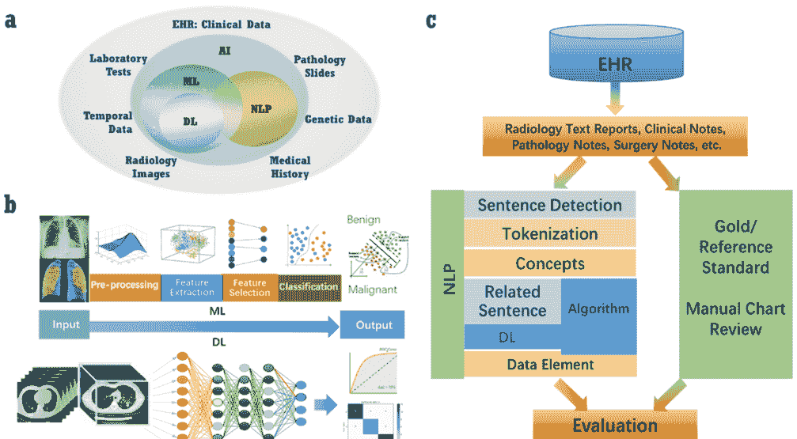

# 肺癌诊断与预后中的人工智能：当前应用与未来展望

Shigao Huang¹¹, Jie Yang¹¹, Na Shen², Qingshou Xu⁴, Qi Zhao⁵,ᵉ*

* 中国新疆信西县，空军医大学第一附属医院放射科
* 中国重庆，重庆理工大学
* 香港中文大学
* 中国澳门大学，健康科学学院医学转化研究所癌症中心，澳门特别行政区氹
* 中国澳门大学精准肿瘤学前沿科学中心，澳门特别行政区氹
* 中国澳门大学科学与科技学院，澳门特别行政区氹

# 摘要

**关键词：**

人工智能

肺癌诊断

自然语言处理

机器学习与深度学习

精准肿瘤学

肺癌是世界上发病率和死亡率最高的恶性肿瘤之一。肺癌的总体五年生存率低于其他主要癌症。肺癌的早期诊断和预后对于提高患者生存率至关重要。随着人工智能在肺癌中的广泛应用，其诊断和预测在近年来取得了卓越性能。本综述总结了肺癌中各种类型的 AI 算法，包括自然语言处理（NLP）、机器学习和强化学习。此外，我们提供了关于人工智能在肺癌诊断和临床预后中应用的参考。本综述旨在评估人工智能在肺癌诊断和预后中的作用，作为肺癌治疗的新型筛选决策依据。

# 1. 引言

肺癌是世界上发病率和死亡率最高的恶性肿瘤之一，生存率低于 20% [1,2]。在早期肺癌患者中，微浸润性腺癌和癌患者的术后五年生存率也超过了 90% [3,4]，而晚期肺癌患者的五年生存率仅为 2% [5,6]。对于为晚期肺癌患者提供治疗建议，临床诊断仍是一项重大挑战 [3,7]。肺癌的早期诊断和适当治疗可以有效提高 20% 的生存率 [6,8]。然而，对于中国许多晚期肺癌患者来说，预后仍然不理想。

生物标志物有望解决肺癌诊断中的当前挑战 [11,12]。从临床统计数据中深度解释信息仍然具有挑战性。最近，随着计算机技术的发展，人工智能已成为肺癌诊断的有效工具。图 1 显示了人工智能在肺癌诊断中的历史里程碑。近年来，机器学习和深度学习越来越多地用于改善肺癌的诊断和治疗 [13]。本综述总结了肺癌中各种类型的 AI 应用，包括自然语言处理、机器学习和强化学习。此外，我们提供了关于人工智能在肺癌诊断和临床预后中应用的参考。本研究的目的是为肺癌治疗说明并提供新的筛选决策。临床实践中应用了多种肺癌策略和治疗方法。肺癌患者的生存率仍不理想 [9]。多项研究表明，肺癌人群筛查具有成本效益，并具有早期检测的价值 [10]。

# 2. 应用于肺癌的人工智能类型

肺癌诊断有着悠久。病理发现和肿瘤标志物的分析已成为重要工具。然而，这些方法具有局限性。首先，对于病理发现，目前肺癌诊断的金标准主要通过侵入性程序进行，缺乏准确性。其次，临床应用中使用的肿瘤标志物（如 X 射线、计算机断层扫描）彻底了肺癌诊断，但小淋巴结或结节标记仍无法轻易检测，并可能被遗漏。如本文所述，应用于肺癌的各种类型人工智能包括 NLP、深度学习和机器学习。如图 2 所示，我们有了肺癌筛查和检测中经典 AI 的示意。

## 2.1. 机器学习与深度学习

近年来，大数据技术促进了医疗数据规模的飞跃。多样化的数据对数据处理、存储和利用提出了更高要求。这些领域的进展已广泛纳入肺癌的临床应用中 [4]。所有技术包括机器学习、深度学习和自然语言处理，它们之间的关系如图 3 所示。

尽管人工智能在肺癌中应用广泛，但 AI 诊断在实现从自动切片查看到使用数字健康记录编制医学报告的全过程中面临着许多困难。电子健康记录正在帮助肺癌诊断过程，并对病理学家在第一阶段和与患者沟通方面具有重要意义。然而，信息系统仅能够提取并将这些知识翻译为手动处理。信息的手动处理成本高昂、容易出错并具有固有的局限性。信息的提取可以通过深度学习来改进，深度学习由深层表示。智能健康诊断可以通过 NLP 的深度融合改进。它使我们能够理解非结构化文本或口头数据，用于复杂挖掘（包括信息提取和关系提取等）的潜在应用，并在病例治疗中辅助决策。机器学习目前在肺癌的筛选、诊断和预后方面实现了显著的临床价值。深度学习，如卷积神经网络（CNN）、递归神经网络（RNN）、生成对抗网络（GAN）等，通过自动化复杂的真实世界模型，赋予了临床医生强大的学习能力和功能基因组学能力。

## 2.2. 自然语言处理

| 人工智能 | 机器学习 | 深度学习 |
| :--- | :--- | :--- |
| 任何使计算机模拟人类行为的技术 | 无需显式编程即可学习 | 其子集，由多层神经网络组成 |
| 1954 年：计算机用于放射治疗诊断和制定治疗计划 | 1968 年：计算机辅助诊断（CAD）首次引入，导致了放射学的形成 | 2020 年：深度学习辅助检测获得 FDA 批准 |
| 1950 年代：数学模型引入一组病例的诊断，为计算机辅助诊断奠定了先例 | 1980 年代：“解释”临床支持系统，包含 2200 个病例和 5000 个系统 | 2019 年：Google 的肺癌检测 AI 优于专家 |
| 1992 年：第一个智能计算机辅助系统获得，知识库包含 572 个病例和约 4200 个病例 | | 2022 年：通过 AI 挖掘肺信息：预测肺癌 EGFR 基因型和靶向反应 |

图1。人工智能在肺癌诊断中的历史里程碑。

图 2. AI 在肺癌筛查和检测中的应用。a. AI、ML、DL、NLP 与肺癌各种需求的关系。b. 肺癌诊断应用中机器学习与深度学习的类型及差异 [84]，c. 基于电子健康记录（EHR）的肺癌数据中 NLP 技术的概念以及与传统方法的比较。AI：人工智能；NLP：自然语言处理；ML：机器学习；DL：深度学习用于 NLP 的健康研究方法。图 2c 展示了 NLP 技术在医学数据中的应用范式。一些研究人员已利用来自多个中心的临床数据来训练 NLP 模型。Kennedy 等 [16] 证明了训练自然语言医学模型的可性，该模型可以从非细胞肺癌患者的影像报告和筛查报告中提取结果。[18] 证明了此类方法在病记录中的通用可行性，并进一步辅助了 NLP 驱动的临床标注与总生存率之间的关联。

Gomez 等证实了通过 NLP 识别的胸部 CT 报告检测肺结节的一致性 [17]。另一项研究发现 NLP 技术用于自动分类放射学报告及之后的质量保证工具。Transformer 已成为 NLP 中的主要算法。Agnila Khastraya 等证明了使用双向长短期记忆（LSTM）混合模型进行表示学习的有效性，这解决了电子健康记录中基本病历特征的需求，并生成了大多数深度学习模型所需的训练数据量 [19]。Fei 等提出了针对中文放射学报告的首种方法以提高报告质量。部署基于随机场的双向逻辑或短期记忆（LSTM）模型从肺癌放射学报告中提取实体。基于恶性知识图谱和规则模板提出了与随访建议的关键信息 [20]。

诊断。深度学习模型在肺癌图像特征方面取得了近期进展 [21]。近期，强化学习被广泛用于分析肺癌定位、分割和分类 [22]。结合强化学习的深度学习模型出现并创建了新模型，例如深度 Q 学习和深度神经网络，这些具有 [24] 用于肺癌检测和诊断的代表性深度学习模型。肺癌的常见类型和每类型的主要特征是独特的。深度强化学习通过肿瘤的准确定位识别不同患者 [25]。然而，强化学习模型在肺癌筛查中的应用仍面临许多挑战。目前尚不清楚如何每个病例更新 Q 值定义适当的奖励。

# 3. 在肺癌诊断中的应用

## 3.1. 在肺结节筛查和检测中

目前，体检中发现了大量的肺结节。虽然大多数肺结节是良性的，但直径大于 3 cm 的早期肺结节发生频率仍然很高，且具有较高的恶性概率 [26,27]。有必要强调肺结节映射以转化。然而，为了提供早期治疗，临床医生可以准确区分良性和恶性肺结节。目前，许多研究人员和企业已投入资源开发肺癌的 AI 图像分析，这是计算机辅助协助医生进行肺结节筛查的重要部分 (32)。他们的发明将帮助放射科医生快速定位结节并提供诊断和治疗，以减少误诊和漏诊。AI 在肺部筛查和检测中的各种应用总结在表 1 中

人工智能辅助计算机诊断 (CAD) 工具已经开发。CAD 系统可以帮助放射科医生在癌症早期识别和定位漏诊结节 (33)。它们可用于评估恶性程度和治疗预后，改善临床工作流 (34)。用于肺结节检测、分类和定量评估的可用数据库包括肺部数据联盟 (LIDC)/图像数据库访问与检索 (IDRI) 和早期肺癌图谱 (ELCAP) (35)。LIDC/IDRI 为医学研究社区提供了一个开放参考，是促进 AI 算法开发、验证和转化的重要资源。这些算法是使用 LIDC/IDRI 的数据集进行开发和测试的 (37–39)。从 80 次 CT 扫描中总共选择了 6400 张图像，6 张图像由 4 名放射科医生进行标记 (37)。本研究中开发的 CAD 系统通过使用随机森林 (RF) 的快速分割机制实现了快速分割。我们评估了用于良性和恶性肺结节诊断的接收者操作特征 (ROC) 的灵敏性、特异性和准确性。与支持向量机 (SVM) 相比，我们的方法降低了假阳性率并实现了更高的 AUC (40)。

AI 在肺部筛查和检测中的应用。

| 年份 | 方法 | 样本量 | 参考文献 |
|---|---|---|---|
| 2018 | 基于 SVM 的模型使用 CT 放射组特征通过 SVM 构建预测，实现了 84.6% 的准确率，比肺-Rads 高 12.8%。 | 72 例 PN（良恶性） | [73] |
| 2020 | 基于 AI 的 FGD-PET/CT 算法用于肺结节检测和分割 | 320 名患者（病理证实病例） | [74] |
| 2020 | AI 算法在数字 X 线片上测试结节检测和分割 | 来自 485 人的基线 (TO) 标记者 | [75] |
| 2021 | 基于 DL 的肺结节检测和分割算法 | 57 名患者 982 张图像 | [76] |
| 2021 | 用于结节融合的 DL 神经网络为放射科医生提供支持 | 81 例良性和恶性 | [77] |
| 2022 | AI 识别心脏生成的显著因素和标准筛查以降低医疗成本 | 158 名患者 | [78] |
| 2022 | Adaboost-SVM-CNN 对肺结节检测具有良好的准确性并预测了其潜力 | 1018 次 CT 扫描 | [79] |

## 2.3. 强化学习

断层扫描 (CT) 多年来一直用于肺癌的管理，包括筛查、诊断和治疗。CT 对肺结节的定量价值也得到了认可。然而，多发肺结节在临床实践中仍然常见 (41–42)。对于肺结节，不同的形状和大小可能会影响转移 [36,43]。肺结节的 CT 图像是多维图像。3D 卷积神经网络 (CNN) 可以利用全 空间内容，从而提高 2D CNN 检测肺结节的准确性并降低假阳性率 (44)。CT 在肺自动断层扫描方面的近期进展已有报道 (34,45)。这些研究侧重于提高不同类型结节检测的准确性和形状。这些工作能够建立电子病历系统和影像存档 (46,47)。

AI 用于良性和恶性结节的诊断。对于肺结节，CT 分析可以准确判断良性和恶性结节 (48)。规则形状、毛玻璃影、边缘和征象是分析的重要依据。研究报告说，专业医生通过 CT 检测结节的真阳性率为 66.5%，远低于 AI 技术的 98.4% (49)。CT 扫描中存在误诊和漏诊的风险。

## 3.2. 在肺癌分类和诊断中的应用

肺癌分为非小细胞肺癌 (NSCLC) 和小细胞肺癌 (SCLC)。NSCLC 占

| 年份 | 方法 | 样本量 | 参考文献 |
|---|---|---|---|
| | 在肺癌临床诊断中的应用 | 通过 dropout 归一化层并使用 ELAC 进行测试 (2018) | | |

缩写：人工智能；AI；深度学习；CNN；神经网络；肺部；NLST；肺癌筛查试验；BSEM；块顺序期望算法；OSEM；期望子集最大化；Lung-RADS；CT 癌症报告与数据系统；SVM；支持向量机；LASSO；最小绝对收缩与选择；交叉验证。

……罕见。我们尝试使用深度学习自动对腺癌的组织学亚型进行分类。通过 CNN 方法，他们识别了区域并聚合这些分类，以推断整幅图像的原发部位和组织学模式。详细评估了模型的性能。并将结果与这些技术的解释结果进行了比较。

细胞病理学和诊断是肺癌诊疗中不可或缺的部分。为了提高病理诊断的准确性，一些研究人员尝试使用 AI 对不同类型的肺癌进行分类。在一项研究中，开发了一种具有多层特征的深度卷积网络（CNN）自动分类方案。微图像的分分辨率为 256 × 255 像素。为了防止过拟合，对图像进行了增强、模糊和旋转修正滤波。成功获得了 88% 的分类准确率。测试结果显示，约 71% 的图像被正确分类。[54] 还观察到了肺癌类型识别中的逻辑类型和错误不准确之处。

## 3.3. 突变类型对肺癌预测

不同亚型的肺肿瘤在分子水平上可能存在差异，因此对治疗的反应也不同。非小细胞肺癌（NSCLC）（52] 中具有预后/预测意义的遗传变异包括 EGFR 和间质性淋瘤酶（ALK）基因突变。EGFR 状态是选择合适治疗的关键。Cox 等人利用深度学习技术开发了一种腺癌基因突变模型 [36]。他们训练并输入了模型，以预测癌症基因组谱中的突变相关特征。

80%–90% 的肺癌具有不同的组织学特征，包括其主要亚型，即鳞状细胞癌、腺癌和大细胞癌。由于肺癌亚型之间的差异，在临床实践中准确分类肺癌类型至关重要。深度学习可用于识别肺癌的病理模式。气管支气管细胞学已用于识别不同类型的肺癌。Teramato 等人分析了 76 例肺癌的分类，包括鳞状细胞癌、腺癌和大细胞癌。他们使用特征提取来确定类型，准确率为 71.1%，并与经过培训的细胞病理学家的分类结果进行了比较 [54]。Khorani 等人开发了一种新的微调 Transformer 模型，用于从 100% 高分辨率定位图像中对腺癌进行分类，准确率达到 75%–90% [55]。Cox 等人通常使用 1634 张切片图像（1176 例肿瘤病例和 458 正常样本）来训练模型，分为 70% 的训练集、15% 的验证集和 15% 的测试集 [56]。图像分割数据方法用于训练输入 v-3，进一步在独立数据集中进行验证和测试。结果显示，图像的形态特征（如细胞形状）为鳞状细胞癌和腺癌。结果显示其与病理学家的结果相当，准确率为 97%。

肺腺癌在组织学、分子、放射学和病理特征具有显著的异质性 [57]。肺腺癌的生长和模式随亚型而异，包括微腺腺癌、肺润腺癌、腺状乳头腺癌、微乳头腺癌和实性腺癌。这些肺腺癌的主要亚型表现出不同的预后、结果 [58] 和治疗反应 [59]。亚型的分类仍然是一个挑战。对每类型进行准确分类是非常必要的，尽管这耗时且不准确。目前，肺癌分型的深度学习研究主要集中在鳞细胞和腺癌的分类上。腺癌亚型的分类是

数字病理最重要的方面之一是预测患者的预后和治疗，即根据病理组织学结果改善患者预后。已有报道通过 SVM 预测肺癌及其亚型等病理特征以预测图像。这仍然是一个巨大的挑战 [66]。以比较肺部非小细胞肺癌（NSCLC）类型并提供预后信息。如果 AI 是快速高效的，对于肺癌的临床诊断和治疗至关重要。深度学习可以获取量化特征信息，这对预测患者反应有用。Wang 等人通过训练卷积神经网络（CNN），将 205 张 NSCLC 患者图像分布到淋巴细胞、肿瘤细胞和间质细胞的模式中 [65]。他们有效地观察并利用多个特征来预测患者的生存情况。模型被输入深度模型，可以获得增强相互作用的参数。同时，肿瘤细胞、间质细胞和淋巴细胞之间的相互作用被定量。回归模型分析显示，肿瘤细胞与间质细胞之间的相互作用强度与良好预后显著相关（P = 0.005）。为了验证基因网络的构建，Lo 等人对 510 名患者的临床病理数据进行了基因表达训练，并在 100 名患者中进行了验证。筛选了与生存率最相关的 20 个基因并纳入 CNN 模型。输出结果为生存风险提供了可靠的预测。

图像存储、图像分析和系统可靠性非常高，导致 AI 应用狭窄。第三，在 AI 领域仍面临许多挑战。尽管 AI 技术可以提高经验丰富的医生的表现并做出肺癌诊断，但基于 AI 的肺癌诊断仍有很长的路要走。

血管相关特征是在训练集中手动标记的 HE 图像。通过对卷积神经网络（CNN）进行微调，模型识别了血管的存在。血管的总面积和周围肿瘤细胞的百分比可以获得。结果显示血管浸润程度显著影响预后；高风险组显著低于 [67]。在另一项研究中，Yu 等人证明了用于肺癌分析的 Cox 模型成功预测了生存情况 [69]。

## 5.2. 未来

随着医疗技术的发展，非侵入性 AI 检测肿瘤和 PET/CT 分析已应用于临床。外血中肿瘤 DNA（ctDNA）的检测已有报道。外血中 RNA 和其他化学标志物的检测预计将在几年内实现。优化不同方法的评估和效果仍需解决。到目前，肺癌的治疗尚未基于 AI 的使用。由于有效治疗主要取决于肿瘤中的 PD-1 表达水平，且 AI 技术在肿瘤分割、形态和异质性方面的开发面临许多挑战。肺癌的预后可以根据病理切片信息进行准确预测。通过 AI 预测肺癌的准确性将会提高。

一项研究分析了 TCGA 数据库中 2186 例腺癌和鳞癌患者 [69]。提取了图像的量化特征，这些特征对预测生存最为显著。结果显示，Cox 模型可以很好地预测腺癌（P = 0.03）和肺鳞癌（P < 0.02）患者的生存情况。此外，使用 TCGA 数据验证了预测效果。两种类型的预测准确率无显著差异（P < 0.036），表明自动图像特征的应用预测了肺患者的预后（60）。然而，AI 在肺癌预后方面的应用有望进展，为临床医生提供新的决策依据。

# 6. 结论

总之，AI 技术在肺癌的早期筛查、诊断分类、预后评估、手术导航和免疫治疗方面取得了进展。在这里我们评估了 AI 在肺癌诊断和预后方面的价值，为肺癌患者的精准治疗提供了新的决策依据。

## 作者贡献

S.HJ 发起了研究；S.J 和 JY 拟写了手稿；N.S, Q.X 和 J 编辑并修订了手稿。所有作者均批准了该版本的文章。

## 资助信息

中国教育部人文社会科学计划（项目编号：2019Y0063213）、国家科技研发计划（KZD-2020030301, JQN202003602, JQN202003607）、澳门大学科学技术研究基金（MYRG2019-科学技术发展基金，澳门 (SFD/2023/041/A 和 FDCT/2020/021/AK)，科学技术 (QGT20201103928031）、广东省医学基金会（NSZ-2021016）。

## 利益声明

无。

## 数据可用性

本文研究未使用任何数据。

## 致谢

不适用。

## 参考文献

# 参考文献

- [1] J. Sung, F. Bray, R.L. Siegel, M. Soeane, V. Ierer, A. Jemal, et al., GLOBOCAN 估计185 个国家36 种癌症的发病率和死亡率。Cancer Statistics 2021;71(1):1-24.

- [2] C. Fitzmaurpatrick, A. Davies, N. Heibat, B. Al-Haddad, F. Al-Abdah, O. Morgan, R. Global Research, et al., 1990–2017年全球癌症发病率和死亡率负担：2017年全球疾病负担研究的系统性分析。The Lancet 2018;392(10159):2241-2428.

- [3] F.H. Ries, G.Y. Scaglioli, J. Jungner, R. Rukman, W. Jordan, Y. Yuan, X.-Lu, et al., 肺癌流行病学：新挑战与新兴靶。Nature Reviews 2019;100(4):297-311.

- [4] J. Bray, 肺癌。Nature 578 (2020) 294-30.

- [5] H.-X. Wang, G. Xu, J.-Du, F.-Chen, W.-Wu, C.-Fan, H.-Lu, Y.-Pei, 中国肺癌的流行病学和生存状况。J Med Res 2019;8(12):100819.

- [6] H.-T. Lin, C. Liu, Y. Wang, and K. Huai, 肺癌筛查：综述。Med Sci J. 2021;10(2):224-238.

- [7] H.S. Wang, G. Guo, J. Sun, J. Chen, X. Zhang, J. Wang, et al., CT图像中肺癌检测深度学习算法的比较。Radi. Clin Oncol.

- [8] P. Li, J. Chen, Y. Liu, Y. Wu, 医学影像中肺癌检测的深度强化学习。Future Comput. Syst. Anal. 2022;9:255-268.

- [9] M. Li, H. Xiao, 非小细胞肺癌转移预测。Thorac Oncol 2020;33:187-198.

- [10] Y. Chen, Y. Hu, H. Zhang, M. Ma, Z. Liu, et al., 生物标志物在非小细胞癌早期诊断中的价值。Clin Med 2020;9(12):745-752.

- [11] J.L. Espina, T. Du, J. Wang, P.K. Tang, N. Yang, et al., 人工智能预测肺癌风险。J Clin Med 2022;9:123.

- [12] C. Wang, X. Xu, J. Lu, X. Shen, Y. Yang, CT扫描中肺癌检测的深度人工智能。Ann R Med (2022);18(8):e2012.

- [13] C.M. Mac, L. Winter, 用于肺结节分类的人工智能：综述。J Med Imaging 2021;20:005.

- [14] CT扫描中诱导肺结节放射治疗的效果。Acad. Radio. 14 (11) (2007) 1409-1421.

- [15] R. Valera, E.C. Perez, J.M. Soares, V. Buquayed, 肺结节恶性预测。Comput. Methods Biol. 124 (2016) 191-198.

- [16] S. Wang, J. Li, Y. Wang, 基于深度学习的CT扫描检测与分类。Sci Technol. 28 (2021) 100684.

- [17] H. Yoo, R. Kim, S. Siraj, D. Mukherjee, 用于肺结节检测的深度学习算法验证。JAMA Net Open. 3 (9) (2020), e21973.

- [18] Y. Yu, S. Sun, J. Fan, CT扫描上的深度学习肺结节识别与分类。Sci 14 (1) (2023) 130-142.

- [19] K. Madhu, K. Maligan, A. MacDougall, 用于肺结节筛查的深度学习。Thoracic Oncology 73 (2019) 225-230.

- [20] J. Cai, J. Si, M. Lu, 计算机辅助检测肺结节的价值。Thoracic Imaging 33 (6) (2004) 795-700.

- [21] N. Hertberg, P.A. Chang, G. Boer, J. Kamlinger, 低剂量CT筛查肺癌 (NELSON)：性能与测试结果。N Engl Med. 381 (2019) 1958-1967.

- [22] D.S. Giersda, H. Nini, C. Childs, D. Du, 使用不同模型判断CT扫描是否提示肺癌。Radiology 254 (2) (2010) 405-410.

- [23] J. Bennani, M. Guosti, C. Berthetto, A. Verdi, 计算机断层扫描肺结节检测。Radi Med. 37 (9) (2002) 479-485.

- [24] K. Abraham, A. Rajiman, 使用卷积网络的CT图像肺癌分类。Res. Imaging. 187 (2017) 467-482.

- [25] H. Kim, Y. Kim, J. Kim, I. Hajabha, 用于肺癌亚型的卷积网络验证。Nat J Digital Med. 10 (2018) 1559-1567.

- [26] N. Conley, M. Smith, D. Narula, T. Sakakal, D. El-Zaiti, 用于病理学的肺癌类型深度学习。Nat. Med. 26 (2020) 2357-2364.

- [27] S.H. Park, S. Smith, H. Lee, G. Lee, 基于深度学习组学的非增强CT扫描肺癌患者生存预测。J Thorac Oncol. 12 (4) (2017) 624-632.

- [28] J. Thorac. Onc. 12 (4) 2017 624-632.

- [29] J. Wang, C. Yu, J. Lu, B. Huang, et al., 肺/癌筛查中人工智能的重要性价值：元分析。Oncol Predict. 36 (2021) 2357-2364.

- [30] J.W. Lee, S. Hassahara, N. Tamura, J. Vaik, Y. Lim, T. Aya, 基于ACC临床实践指南的小细胞肺癌生存预测。J Clin Oncol. 9 (1) (2019) 335-348.

- [31] V. Amodius, A. Lorenzozo, S. Lambaorta, C. Cancelliere, R. Yager, et al., 用于肺腺癌诊断与分类的深度学习。Neuro影像. 12 (8) (2020) 1129-1339.

- [32] J. Lee, J.D. Miner, S. Kim, S. Lee, 肺癌靶向治疗：临床经验与新药物。Cancer J. 17 (6) (2011) 512-527.

- [33] Shin, A. Gidl, V. Biel, R. Roche, L. Reed, et al., 化学治疗的皮肤科影响。E. J Dermatol. 25 (2006) 27-.

- [34] F. Laskin, T. Tommerer, J.G. Jong, P. Eells, T. Deijmaat, Leijmaar, 医学影像与个性化肿瘤学的桥梁。Radiology 265 (2012) 999-1008.

- [35] Q. Li, A. Baivson, A. Gidlar, Y. X, Y. Li, J. Fan, 肺结节隐藏特征模型分析。Pathologists Biology 20 (2014) 24.

- [36] H. Xu, R. Rajimanian, A. Ki, 基于低剂量CT断层的肺癌筛查。J Cancer. 92 (2005) 819.

- [37] Y. Kim, J. Wang, Y. Xu, 用于肺癌亚型的卷积网络验证。Res. Imaging. 187 (2017) 467-482.

- [38] S. Wang, D. Chen, J. Wang, CT阳性提示肺癌的检测。Thoracic Oncology. 73 (3) (2019) 225-230.

- [39] J. Wang, Y. Wang, J. Lu, B. Huang, et al., 肺/癌筛查中人工智能的重要性价值：元分析。Oncol Predict. 36 (2021) 2357-2364.

- [40] J.W. Lee, S. Hassahara, N. Tamura, J. Vaik, Y. Lim, T. Aya, 基于ACC临床实践指南的小细胞肺癌生存预测。J Clin Oncol. 9 (1) (2019) 335-348.

- [41] V. Amodius, A. Lorenzozo, S. Lamba, C. Cancelliere, R. Yager, et al., 用于肺腺癌诊断与分类的深度学习。Neuro影像. 12 (8) (2020) 1129-1339.

- [42] J. Lee, J.D. Miner, S. Kim, S. Lee, 肺癌靶向治疗：临床经验与新药物。Cancer J. 17 (6) (2011) 512-527.
