## 人工智能、机器学习与数据科学技术：面向社会 5.0 的未来影响与福祉（计算卓越技术解密）


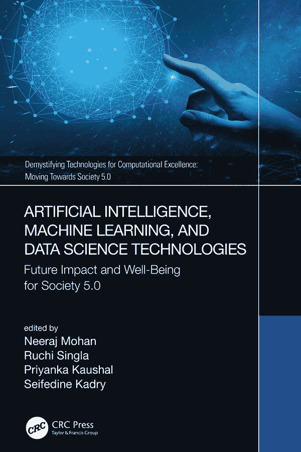


## 前言

本书全面、概念性且详细地概述了人工智能、机器学习和数据科学的广泛应用。这些技术在全球范围内成功引发了一场革命。这些技术已无处不在，并极大地推动了变革。

这些技术影响医疗、商业、工业、安全等各个领域。此外，它们被公认为应对复杂性的工具。

本书旨在提供低成本解决方案，即使在发展中国家也能实施。它重点阐述了这些技术对各行业以及我们人类自身的重大影响。它勾勒出了一幅由新技术及其应用庇佑的未来美好人类生活的虚拟图景。书中讨论了数据科学对各类商业应用的影响。本书还将概述不同的人工智能应用及其相互关联性。

本书适合对探索人工智能、机器学习和数据科学领域的最新技术与进展感兴趣的研究生/博士生、研究人员、学者、机构和专业人士阅读。

## 主编简介

**Neeraj Mohan** 是一位充满激情的研究员和学者。他的研究兴趣领域是网络流量管理和数字图像处理。他在印度旁遮普邦卡普尔塔拉的 I.K. Gujral Punjab Technical University 计算机科学与工程系担任助理教授。他在不同职位上拥有 19 年丰富且富有成果的学术经验。他在 I.K. Gujral Punjab Technical University, Kapurthala (Punjab) India 获得博士学位。他是一位活跃的研究员，在知名期刊和会议上发表了 50 多篇研究论文。他拥有一项已授权专利。他指导过一名博士和 17 名硕士研究生的论文。另有两篇博士论文正在进行中。


## 作者简介

**Ruchi Singla** 拥有独特的技能组合与专业知识，拥有印度巴蒂亚拉塔帕尔大学无线通信博士学位，加拿大温哥华阿什顿学院创业文凭，以及印度加尔各答管理学院（IIM）“增长战略与管理”认证课程结业证书。她是电子与通信系教授，同时担任研究部门的研究院长。她目前负责协调初创企业、论文发表、研究项目、咨询以及与研究和创新相关的活动。她在教学和研究领域拥有 18 年的经验。她的研究兴趣包括天线和生物传感器。她在具有良好影响因子的知名国际和国内期刊上发表了约 35 篇研究论文。此外，她拥有三项已授权专利。她还参与了多个由 DST（科技部）资助的项目，如温室监测系统和电子瓦片。

**Priyanka Kaushal** 是印度旁遮普邦莫哈里兰德兰昌迪加尔工程学院应用科学系副教授。她在印度喜马偕尔邦大学（西姆拉）获得硕士学位，在印度旁遮普邦 IK Gujral 旁遮普技术大学获得博士学位。她在知名期刊和会议上发表了 20 多篇研究论文。她在多个研讨会和工作坊上做过报告。她曾担任多个知名期刊的审稿人，如《先进材料科学》（SCI 收录）、《先进材料与结构力学》（Taylor & Francis，SCI 收录）、《材料今日：会议录》（Elsevier，SCI 收录）等。她拥有两项已授权专利。

**Seifedine Kadry** 1999 年获得黎巴嫩大学应用数学学士学位，2002 年获得兰斯大学（法国）和洛桑联邦理工学院（EPFL）计算机科学硕士学位，2007 年获得布莱兹·帕斯卡大学（法国）博士学位，2017 年获得鲁昂大学工程科学 HDR 学位。目前他的研究重点在于利用技术进行教育、系统仿真、运筹学、系统预测、随机系统、概率与可靠性分析。他是 ABET 项目评估员。他是《数学与统计研究期刊》和《ARPN 系统与软件期刊》的主编。他是《国际应用科学期刊》（IJAS）的副主编，以及《国际数学与统计期刊》、《理论与应用信息技术期刊》和《国际工程与应用科学期刊》的编委会成员。他发表了 270 多篇研究成果，被引用 1700 次，h 指数为 18，i10 指数为 40。

## 第 1 章：利用机器学习和口腔上皮恶性相关改变的分形分析进行乳腺癌诊断

**Dmitriy Klyushin, Kateryna Golubeva, Natalia Boroday, and Dmytro Shervarly**

DOI: [10.1201/9781003153405-1](https://doi.org/10.1201/9781003153405-1)


### 1.1 绪论

目前，全球女性乳腺癌的发病率和死亡率持续上升。因此，乳腺癌的早期诊断和筛查问题非常紧迫。乳腺癌的早期诊断涉及大规模人群的检查，因此筛查方法必须具有高灵敏度、高特异性和安全性。

目前公认的乳腺癌诊断“金标准”包括临床检查、乳腺 X 线摄影和穿刺活检。这能实现较高的诊断准确性，但乳腺 X 线摄影意味着辐射暴露，穿刺活检与肿瘤损伤相关。这与筛查必须安全的要求相悖，因此极其期望开发一种无创无害的有效筛查方法。因此，我们建议采用对口腔上皮间期细胞核中恶性相关改变（MAC）的无创研究。

本章旨在描述一种基于利用机器学习研究福伊根染色口腔上皮细胞核中染色质分形特性的乳腺癌筛查新型有效方法。本章共六节。第 1.1 节为绪论，阐述了本章目的及拟议方法的重要性。第 1.2 节简要综述了关于恶性相关改变的文献。第 1.3 节描述了口腔上皮中 MAC 的形态测量研究与图像分析。第 1.4 节描述染色质的分形分析。第 1.5 节包含诊断结果。第 1.6 节总结我们的研究并提出一些开放性问题。

### 1.2 口腔上皮中的恶性相关改变

关于恶性相关改变（MAC）的首批报道出现在 20 世纪 60 年代，当时人们广泛研究体细胞中 X-染色质的含量，并揭示了其在机体各种功能变化和一般躯体病理过程中的易变性。当机体内存在肿瘤时，口腔上皮和外周血中性粒细胞中的 X-染色质含量会发生显著变化。研究表明，含有 X-染色质的细胞数量变化是由异环 X 染色体功能状态紊乱引起的。

特别值得关注的是那些展示肿瘤患者口腔上皮细胞发生变化的研究。因此，在 20 世纪 60 年代，H. Nieburgs 及其合著者（Nieburgs et al. 1962, Nieburgs 1968）报道了 77%癌症患者体细胞中染色质团块的特征性重新分布，并称这些改变为肿瘤相关改变。后者的特征是上皮细胞核尺寸增大、“边界”染色质区尺寸增大，这些区域被透光区包围。在肝脏、肾脏和其他器官的细胞中也观察到相同的变化。文献（Obrapalska et al. 1973）报道，74%恶性肿瘤患者的口腔上皮中观察到 MAC。研究显示，与近乎健康的女性相比，恶性黑色素瘤患者上皮细胞核中的 DNA 含量增加。同时，与良性痣患者和对照组相比，恶性黑色素瘤患者染色质阳性细胞（X-染色质）的数量减少。乳腺癌患者口腔上皮间期细胞核的 DNA 含量和尺寸增加。但一些作者在对男性支气管上皮瘤患者口腔上皮细胞 DNA 含量进行细胞分光光度检测时，未发现患病男性与近乎健康男性之间该指标有显著差异（Ogden et al. 1990）。


### Application of Oral Mucosal Buccal Epithelium in Disease Detection

#### Screening Studies of the 1990s
In the 1990s, during population screening examinations, under experimental conditions, and in clinical medical practice, oral buccal epithelium served as a convenient study object for detecting early forms of diseases (Rathbone et al. 1994, Rosin et al. 1994, Prasad et al. 1995, et al.). This object reflects the overall health status of a human.

Some researchers, by measuring the percentage of electronegative nuclei in this epithelium and the velocity of nuclei during microelectrophoresis, revealed the human functional state, biological age, fatigue development, the effect of adverse environmental factors, and periodontal tissue status. Other researchers assessed the genetic effects of environmental pollution and the genotoxicity of xenobiotics by counting micronuclei in oral mucosal epithelial cells. Studies found that the level of micronucleated cells in oral exfoliated epithelial cells was elevated in patients with various allergies. Under the action of various carcinogenic genotoxic substances (chewing tobacco of different mixtures, snuff, betel quid, smoking), the formaldehyde level in micronucleated exfoliated cells could increase tenfold compared to the control group (Nair et al. 1991, Rosin et al. 1992; Tolbert et al. 1992, et al.). These data suggest that an increase in micronucleus levels may serve as a kind of "dosimeter" for various pathological states of the body. Oral micronucleus levels in cancer patients may increase after antitumor chemotherapy or ionizing radiation (Tolbert et al. 1992). Consumers of various chewing gums with carcinogenic activity (mawa, tamol, masheri, nut nat) showed elevated micronucleus levels in exfoliated cells (Adhraryn et al. 1991, et al.). Importantly, a high correlation was observed between micronucleus levels in exfoliated cells of subjects exposed to mutagens and the number of other cytogenetic abnormalities in peripheral blood lymphocytes (sister chromatid exchanges and chromosomal aberrations) (Sarto et al. 1990).

#### Assessment of Chromatin State and Epithelial Differentiation
Chromatin state was used to assess the degree of buccal epithelial differentiation in gastric and duodenal ulcers. Indicators characterizing the quantitative and functional state of buccal epithelial cells were also used, including the maturation index, intoxication index, differentiation index, and nuclear fragmentation index. Alterations in the normal differentiation properties inherent to specific areas of the buccal epithelium indicate local or systemic diseases. Accompanied by a high probability of cellular atypia, they suggest the development of precancerous lesions and neoplastic changes in the buccal epithelium, and allow reliable cytological diagnosis of these diseases in 96% of cases. Changes in buccal epithelial differentiation may also result from metabolic and hormonal disorders, mechanical factors, and chemical exposure (Schonwetter 1995).

#### Malignancy-Associated Changes (MAC)
Literature (Palcic et al. 1994, et al.) reports that quantitative cytological studies of nuclear DNA content and chromatin texture can detect malignancy-associated changes, i.e., H. Nieburgs' malignancy-associated changes (MAC). These changes are detected in normal cells of macroscopically unchanged areas at a certain distance from the malignancy. They may represent a growth response of normal cells to the malignant transformation of a specific organ (lung, cervix, breast). Based on the data obtained, it is hypothesized that tumor-associated changes are markedly expressed near malignant tumors, while they are weakly expressed or absent near tumors without progressive growth. After tumor removal, malignancy-associated changes disappear, whereas incomplete tumor removal does not significantly affect these changes. It has been hypothesized that quantitative cytophotometry can detect changes associated with malignant growth to diagnose these tumors (including early cancers) and assess the prognosis of the process.

#### Attempts to Characterize Tumor Influence on Buccal Epithelium
In the 1990s, attempts were made to use changes in buccal epithelium to characterize the tumor's influence on its state. For example, Ogden et al. attempted to characterize and substantiate the possibility of tumor influence on the functional state of buccal epithelium, in order to use the obtained data to characterize the course of processes occurring in organs distant from the tumor, and to identify patterns characterizing these processes. In 77% of patients with tumors of various localizations (cancer, lymphoma, seminoma), disturbances expressed by changes in nuclear material, heterogeneity of chromatin material, and nuclear membrane alterations were observed. Criteria for assessing malignancy-associated changes (MAC) included: tumor cell DNA content, nuclear size and cytoplasmic cytophotometry, and the nature of intranuclear chromatin distribution. However, the authors failed to identify distinct patterns inherent to the tumor process, except for an increase in tumor cell nuclear size and changes in the nuclear-cytoplasmic ratio. Nevertheless, they do not deny that the detected disturbances are related to the tumor's influence on the functional state of the oral mucosa.

#### Advantages of Oral Mucosal Cell DNA Analysis
Blood has traditionally been considered the standard method for genomic DNA analysis in genetic studies, but recently methods utilizing DNA isolated from oral mucosal cells have seen wider application. During benign hyperplasia, the number of Langerhans cells increases significantly compared to normal mucosa. In malignant tumors, their number decreases with decreasing differentiation level.

#### Summary
Literature analysis indicates that the relationship between the tumor and the body is extremely complex, due to the numerous connections formed between the tumor and the body's control systems (nervous, endocrine, and immune) under the influence of exogenous and endogenous factors, causing corresponding reactions in the body. From the totality of homeostasis indicators in cancer patients, important information about tumor influence can be obtained by studying the functional state of buccal epithelium, which has been proven to have close anatomical and physiological relationships with various organs and systems. This is evidenced by the fact that various visceral diseases are accompanied by mucosal changes, which may appear earlier in this pathology than other clinical symptoms.


### 口腔上皮 DNA 紧密堆积分形特性与形态测量分析

#### 介绍

2009 年发现细胞核中的 DNA 紧密堆积具有分形特性，即 DNA 如三维皮亚诺曲线般扭曲 (Lieberman-Aiden et al., 2009)。细胞的分形分析成为深入研究的领域。分形维数被认为是复杂子宫内膜增生和高分化子宫内膜样癌细胞异质性的有效测度 (Bikou et al, 2016)，也是黑色素瘤 (Bedin et al. 2010)、白血病 (Adam et al, 2006 等) 和其他疾病 (Losa 2012, Metze 2010, 2013) 生存率的预后因子。还应注意到，大量研究 (Nikolaou and Papamarkos 2002, Ohri et al. 2004, Losa and Castelli 2005 等) 已显示分形维数在形态学数据估计方面具有显著潜力。然而，这些研究侧重于肿瘤细胞，而非口腔上皮细胞。因此，我们可以假设分形特性反映在口腔上皮细胞核的染色质分布中，而肿瘤可能影响这种分布，导致与恶性相关的改变。正如我们将进一步看到的，我们的假设成立。

间期细胞核特征的记录使得评估细胞遗传装置的功能性改变成为可能，染色质物质结构组织的指标可用作各种病理条件（包括肿瘤）中这些紊乱的标志。也有研究表明，对口腔上皮间期细胞核的研究可能回答人体内是否存在恶性肿瘤的问题 (Andrushkiw et al. 2007 等)。

DNA 细胞光度法基于这样一个既定事实：正常细胞细胞核中 DNA 的平均含量对应于一定数量的染色体，这是该物种的特征。多位研究者对各种肿瘤的研究表明，细胞核中平均 DNA 含量的增加是肿瘤细胞的特征性表现 (Boroday et al. 2016)。因此，DNA 含量异质性的增加可被视为肿瘤的诊断标志及其恶性程度的标准。

应当指出，细胞核中的染色质可以处于浓缩（紧密堆积）和去浓缩状态。染色体去浓缩的程度可以不同。完全去浓缩的区域称为 `常染色质`。在细胞周期中处于浓缩状态的染色质区域称为 `异染色质`。由于异染色质被特殊染料强烈染色，因此可在光学显微镜下轻松观察。同时，去浓缩染色质对应着着色较浅的区域 (图 1.1)。

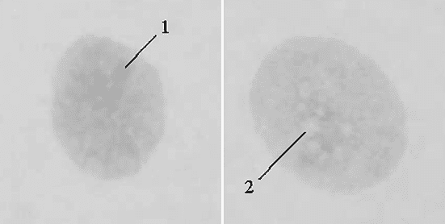

**图 1.1** 口腔上皮细胞核中染色质的分布（1—异染色质，2—常染色质）。

细胞核的变化虽明显，但很难进行目测评估，尤其是涉及数十个细胞时。因此，应使用数字分析进行客观定量。

### 1.3 形态测量研究与图像分析的材料和方法

我们研究了对照组（29 人）、II 期乳腺癌患者组（68 例患者）和腺纤维瘤病患者组（33 例患者）。所有诊断均经组织学验证。形态学数据集包含 20,256 幅口腔上皮间期细胞核图像（6,752 个细胞核以三种模式扫描：无滤镜、黄色滤镜和紫色滤镜）。

形态学材料为取自棘层中等深度的口腔黏膜上皮细胞涂片，室温干燥，尼基福罗夫混合液固定，`5 n HCl` 冷水解 15 分钟，`t = 21–22°C` 下 Feulgen 染色。Feulgen 染色的染色质使用 Olympus 分析仪进行分析，该分析仪由 Olympus BX 显微镜、Camedia C-5050 数码变焦相机和计算机组成。平均每张制片包含 52 个细胞。上皮细胞细胞核中的 DNA-阿尔新蓝含量计算为光密度与面积的乘积。作为第一阶段分析的结果，我们获得了以包含 `128×128` 像素的矩阵形式呈现的染色质分布图像。

为了反映染色质分布的分形特性并提供相对于图像旋转的不变性，我们构建了一条经过图像每个像素的空间填充曲线 (Sagan, 1994)，并按顺序读取扫描像素的 RGB 颜色值，而非逐行读取。结果，我们可以将像素矩阵映射到对应于 RGB 颜色模型三个通道的三个向量。作为空间填充曲线，我们使用了 `谢尔宾斯基曲线` (Sagan 1994)。

在应用分形图像分析方法之前，必须进行预处理。为此，我们使用了 `大津法`。该方法用于执行半色调图像的阈值二值化。算法假设图像中存在两类像素（主体和背景），并寻找将它们分成两类的最佳阈值，使其类内方差最小。

该方法的这一原理用于选择细胞核。考虑了两个聚类：细胞核像素和背景像素。我们将更详细地解释该方法。假设有一幅图像，其每个点由灰度强度值表示。因此我们有 `N` 个图像点和 `L` 个灰度级。假设图像的所有点可分为两类 `C[1]` 和 `C[2]`，以区分不同强度的点。则最佳阈值 `T` 将为使类间方差达到最大值时的 `k` 值：

```
T = k | [σ[C[1]C[2]]² max]
```

类间方差 `σ[C[1]C[2]]²` 计算为

```
σ[C[1]C[2]]² = ω[1]ω2²
```

其中 `ω[1]` 为获得类 `C[1]` 的概率，`ω[2]` 为获得类 `C[2]` 的概率，`μ[1]` 为类 `C[1]` 中的平均亮度，`μ[2]` 为类 `C[2]` 中的平均亮度。

要计算类间方差，必须首先构建图像直方图，即确定总图像点数 `N` 中强度为 `I` 的点数 `n[i]` 的分布。要计算概率并相应划分类 `C[1]` 和 `C[2]`，使用公式：

```
ω₁ = Σ(i=1 to k) pᵢ, ω₂ = 1 − ω₁
```

其中 `p[i]` 为分布 `p[i] = n[i]/N`。

`C[1]` 和 `C[2]` 中的平均亮度 `μ[1]` 和 `μ[2]` 分别计算为

```
μ₁ = (1/ω₁) Σ(i=1 to k) i pᵢ, μ₂ = (1/ω₂) Σ(i=k+1 to L) i pᵢ
```

接下来，通过将图像每个像素的强度值与选定的阈值 `T` 依次比较，确定该点所属的类别。所有属于类 `C[2]` 的点将被涂成白色。通过自适应阈值图像处理选择细胞核被证明是最好的。细胞核轮廓显得相当清晰 (图 1.2)。

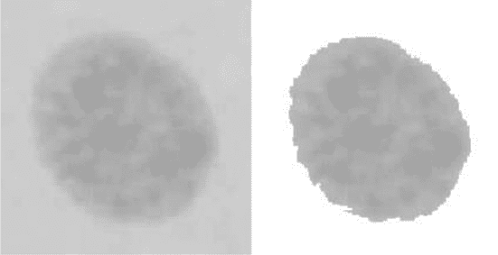

**图 1.2** 自适应阈值预处理后的细胞核。


### 图像伪影处理与核平滑

在图像背景存在伪影的情况下，核的选择可能不太准确。以口腔上皮细胞核图像为例，伪影包括污染（细小的黑色或深色斑点）、涂抹背景等，这些情况发生在药物未在流动水下充分清洗时；伪影区域大小不一（从几个像素到几十个像素）。此类区域的颜色亮度与细胞核本身相似，因此在选择细胞核的过程中，这些区域会保留在背景中。另一方面，在选择细胞核轮廓时，必须考虑染色质在细胞核中分布不均匀这一特征。实际上，这意味着在细胞核内部的深色区域中可能存在非常浅的区域，其亮度甚至可能与一般背景的平均亮度一致。

因此，当在轮廓选择过程中，核图像中的某些区域被初始化为背景并相应地涂成白色时，有必要恢复这些指定区域的原始颜色。这个过程称为**选定核的平滑**。

上述两种情况下的算法思路非常相似。例如，为了去除伪影，先按水平方向、再按垂直方向依次考虑图像的像素，寻找面积小于某个阈值 $\varepsilon$ 的区域。如果在背景中间有一小块非白色区域，说明遇到了伪影，将其涂白。浏览完所有行、再浏览所有列后，即可去除所有伪影（图 1.3）。值得注意的是，该算法无法识别大面积伪影，此类情况可使用手动模式选择核。

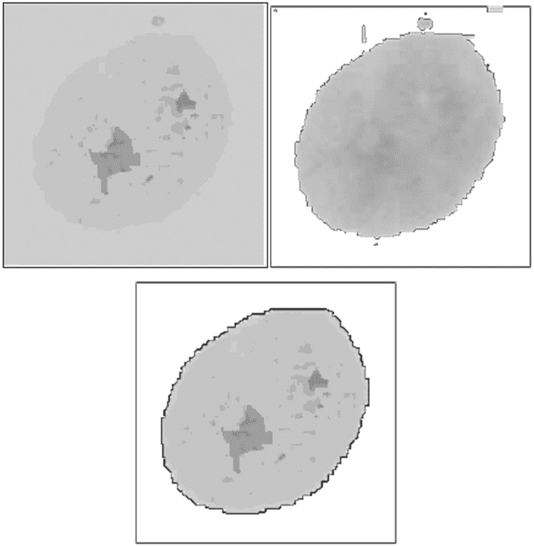

**图 1.3 伪影去除**

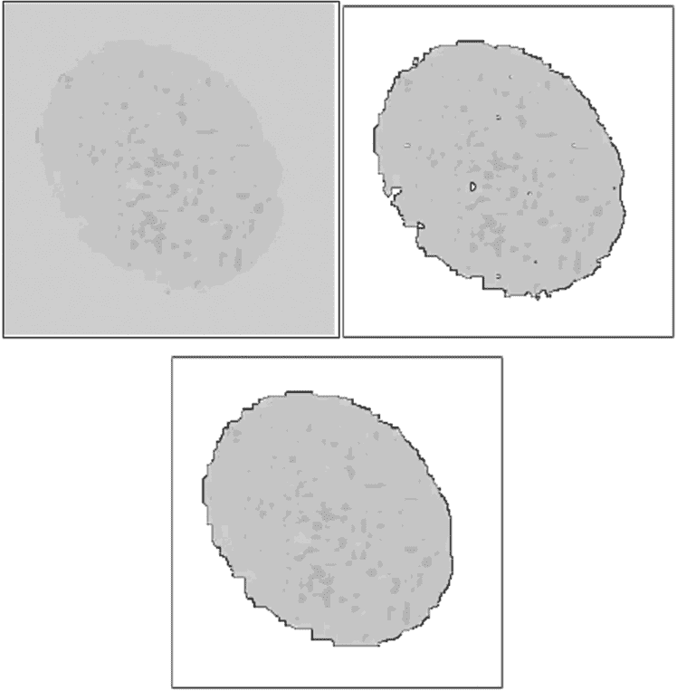

**图 1.4 核平滑**

与伪影去除算法类似，白点搜索算法作用于核上。如果在细胞核中存在一小块白色区域，且预先知道细胞核上不可能有伪影（这是选择核时的要求之一），则恢复该区域的原始颜色。因此，先在图像行中搜索区域，再在列中搜索（图 1.4）。

经过核轮廓选择、平滑和去除伪影操作后，核即可供进一步使用。

### 1.4 染色质分形分析

计算图像分形维数有多种方法。我们选择了赫斯特指数，因为它非常适合序列分析。赫斯特指数 $H$ 与分形维数 $D$ 的关系公式为 $H = 2 - D$。赫斯特指数的计算算法如下（Butakov and Grakovskiy 2005）：

1.  计算数据序列当前片段中数值偏离均值的累计偏差：
    $$
    \delta_{m,N} = \sum_{i=1}^{m} \left( x_i - \overline{x}_N \right), \tag{1.1}
    $$
    其中 $N$ 为片段长度（从 2 到序列末尾），$m$ 为求和上限（从 1 到 $N-1$），$x[i]$ 为数据序列的值，$\overline{x}_N$ 为片段均值。结果得到 $N-1$ 个值 $\delta[2,N], \dots, \delta[N-1,N]$。

2.  利用公式 (1.1) 计算偏差的极差：
    $$
    R = \max_{m=2,\dots,N} \delta_{m,N} - \min_{m=2,\dots,N} \delta_{m,N} \tag{1.2}
    $$

3.  利用公式 (1.2) 归一化偏差极差：
    $$
    Q = \frac{R}{s}, \tag{1.3}
    $$
    其中 $s$ 为数据序列的标准差。

4.  利用公式 (1.3) 计算 $\lg Q$ 和 $\lg N$，并绘制 $\lg Q$ 关于 $\lg N$ 的线性图。

5.  将拟合 $\lg Q$ 与 $\lg N$ 依赖关系的直线斜角的正切值作为赫斯特指数。

根据赫斯特指数，可按混沌特性对数据序列分类：
- 若 $0 < H < 0.5$，序列为**遍历性**，即前一片段增加则下一片段极可能减少，反之亦然（图 1.5）。
- 若 $H = 0.5$，序列为**混沌性**，即数值不影响后续值（图 1.6）。
- 若 $0.5 < H < 1.0$，序列为**趋势稳定性**。前一片段呈增或减趋势，则下一片段极可能保持该趋势（图 1.7）。
- 若 $H > 1$，序列为具有独立振幅跳跃的分形随机过程，服从 Lévy 分布（图 1.8）。

我们利用红、蓝、绿三个通道计算了每个细胞的 $H$ 值。为描述赫斯特指数的统计特性，我们对每位患者计算了三个通道中所有细胞赫斯特指数的平均值、最大值和最小值。因此得到：`min[BH]`、`min[GH]`、`min[RH]`（三通道所有患者细胞赫斯特指数的最小值）、`max[BH]`、`max[GH]`、`max[RH]`（最大值）、`aver[BH]`、`aver[GH]`、`aver[RH]`（平均值）。

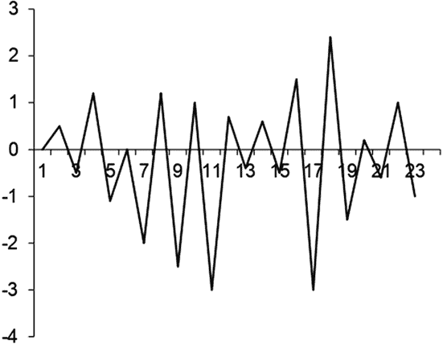

**图 1.5 遍历时间序列示例**

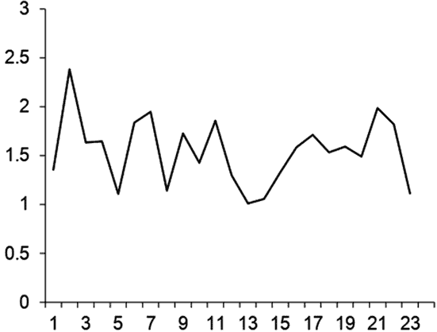

**图 1.6 混沌时间序列示例**

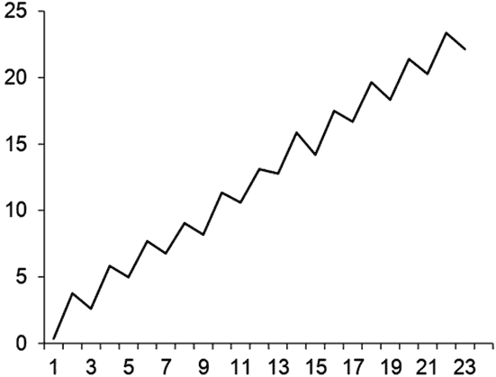

**图 1.7 趋势稳定时间序列示例**

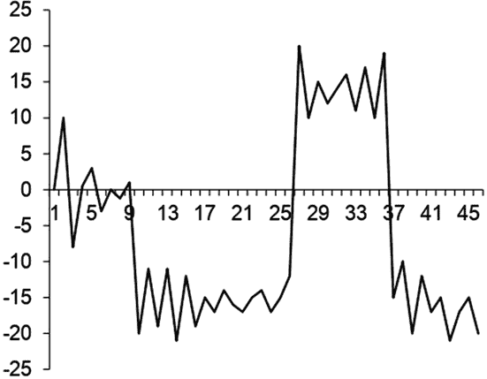

**图 1.8 分形时间序列示例**

赫斯特指数分析结果表明，蓝色通道最具信息量。因此，除了第一组特征外，我们还为每位患者计算了蓝色通道所有细胞赫斯特指数的描述性统计量（称为第二组特征）：

1.  方差
2.  均方
3.  第 75 经验四分位数
4.  中位数
5.  调和平均数
6.  几何平均数
7.  平均截断值（含 95% 数据）
8.  平均值
9.  峰度值

数据分类采用分类回归树（CART）。分类准确性通过交叉验证（留一法）验证：利用除一条观测外的所有数据构建决策树，再用该决策树测试被留出的观测，对每位患者重复此过程（示例见图 1.9）。

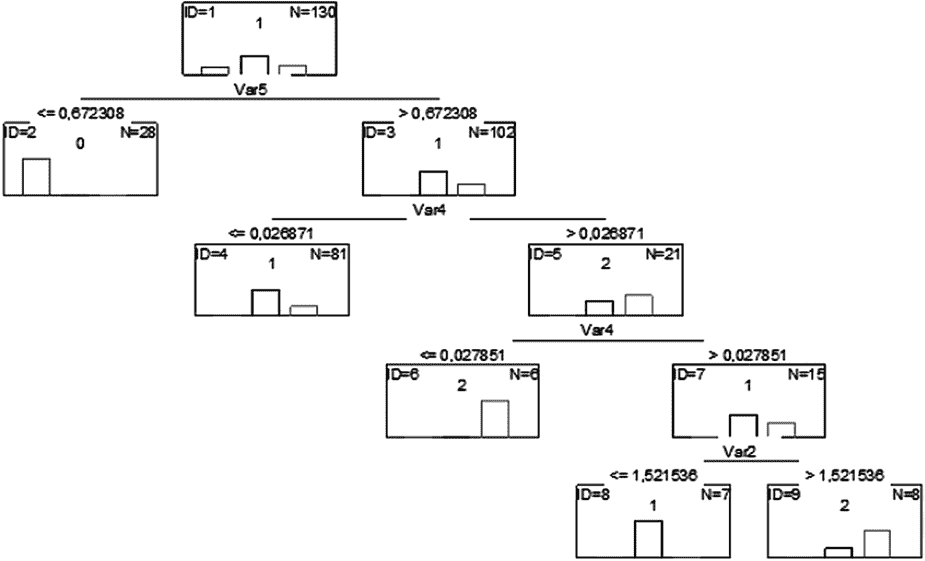

**图 1.9 CART 决策树示例**

#### 1.4.1 乳腺癌筛查总体算法

1.  若赫斯特系数的调和平均数 $\le 0.672$，转步骤 3；否则转步骤 2。
2.  若赫斯特系数的中位数 $\le 0.027$，转步骤 4；否则转步骤 5。
3.  **正常**。停止。
4.  **乳腺癌**。停止。
5.  若赫斯特系数的中位数 $\le 0.028$，转步骤 6；否则转步骤 7。
6.  **乳腺癌**。停止。
7.  若赫斯特系数的均方 $\le 1.152$，转步骤 4；否则转步骤 8。
8.  **纤维腺瘤病**。停止。


构建 CART 决策树的复杂度为 `O(mnlog₂n)`，其中 `m` 为特征数量，`n` 为患者数量（Sani 等，2018）。

### 1.5 结果与讨论

由于我们考虑了三个通道，因此从分类角度比较它们的有效性是很自然的。此类数据序列的主要属性之一是其类型。因此，在第一阶段，按赫斯特指数对颜色通道进行分类很有用：遍历、混沌、趋势稳定和分形（表 1.1–1.3）。

**表 1.1**  
按红色分量对数据序列进行分类

| **类型/组别** | **健康组** | **乳腺癌** | **纤维腺瘤病** |
| --- | --- | --- | --- |
| 遍历 | 0 | 0 | 0 |
| 混沌 | 0 | 0 | 0 |
| 趋势稳定 | 29 | 54 | 27 |
| 分形 | 0 | 14 | 6 |

**表 1.2**  
按绿色分量对数据序列进行分类

| **类型/组别** | **健康组** | **乳腺癌** | **纤维腺瘤病** |
| --- | --- | --- | --- |
| 遍历 | 0 | 0 | 0 |
| 混沌 | 0 | 0 | 0 |
| 趋势稳定 | 2 | 6 | 6 |
| 分形 | 27 | 62 | 27 |

**表 1.3**  
按蓝色分量对数据序列进行分类

| **类型/组别** | **健康组** | **乳腺癌** | **纤维腺瘤病** |
| --- | --- | --- | --- |
| 遍历 | 0 | 0 | 0 |
| 混沌 | 0 | 0 | 0 |
| 趋势稳定 | 29 | 43 | 24 |
| 分形 | 0 | 25 | 9 |

表 1.1 至 1.3 表明，蓝色分量有可能将对照组与乳腺癌和纤维腺瘤病患者组区分开来，因为它在健康人与乳腺癌患者之间提供了最清晰的区分。因此，下文我们将仅考虑蓝色通道（表 1.4）。

**表 1.4**  
蓝色通道中第一组特征进行鉴别诊断的成对特异性、灵敏度和准确率

| | **对照组 vs 乳腺癌** | **对照组 vs 纤维腺瘤病** | **乳腺癌 vs 纤维腺瘤病** |
| --- | --- | --- | --- |
| **特异性, %** | 82.76 | 96.55 | 63.63 |
| **灵敏度, %** | 95.59 | 93.94 | 52.94 |
| **准确率, %** | 91.75 | 95.16 | 56.44 |

由于无法使用上述方法区分癌症与纤维腺瘤病，因此在第二阶段，将癌症患者类别与纤维腺瘤病患者类别合并为一个总类别，并对健康人和患病患者进行分类（表 1.5）。这种情况在筛查中很典型，即在大量人群中需要识别风险群体，而无需对疾病进行鉴别诊断。在这种情况下，选取了所有（29 例）健康患者和合并类别的一半（51 例患者）。患病患者的选择是随机进行的。这样做是因为患病患者数量较多而健康患者数量较少。

**表 1.5**  
蓝色通道中第一组特征进行筛查的特异性、灵敏度和准确率

| | **对照组 vs 乳腺癌和纤维腺瘤病** |
| --- | --- |
| **特异性, %** | 96.55 |
| **灵敏度, %** | 94.00 |
| **准确率, %** | 94.94 |

在 表 1.6 和 1.7 中，我们展示了赫斯特指数分布描述性统计（第二组特征）获得的类似结果。

**表 1.6**  
蓝色通道中第二组特征进行鉴别诊断的成对特异性、灵敏度和准确率

| | **对照组 vs 乳腺癌** | **对照组 vs 纤维腺瘤病** | **乳腺癌 vs 纤维腺瘤病** |
| --- | --- | --- | --- |
| **特异性, %** | 93.10 | 93.10 | 72.72 |
| **灵敏度, %** | 86.76 | 90.91 | 69.12 |
| **准确率, %** | 88.66 | 91.94 | 70.30 |

“健康-癌症”和“健康-纤维腺瘤病”的成对分类使我们能够基于谢尔宾斯基曲线建立一个非常好的模型。基于谢尔宾斯基曲线扫描对所有三种细胞类型进行分类得出了以下结果。

**表 1.7**  
蓝色通道中第二组特征进行筛查的特异性、灵敏度和准确率

| | **对照组 vs 乳腺癌和纤维腺瘤病** |
| --- | --- |
| **特异性, %** | 96.55 |
| **灵敏度, %** | 94.00 |
| **准确率, %** | 94.95 |

### 1.6 结论与未来展望

我们的研究表明，口腔上皮间期核中福伊根染色染色质的分形维数是乳腺癌的一种有效生物标志物。基于此开发的分类方法具有极高的准确率（94.95%）、灵敏度（94%）和特异性（96.5%）。相比之下，乳腺 X 线摄影的灵敏度约为 87%（乳腺癌监测联盟，2017），乳腺 X 线摄影后的特异性因年龄而异，在 93% 到 88% 之间变化（Nelson 等，2016）（患者越年轻，假阳性率越高）。我们的方法能在筛查中有效检测人体内恶性肿瘤的存在，且无需侵入性操作。然而，癌症与纤维腺瘤病的鉴别诊断仍是一个悬而未决的问题。

### 参考文献

*   Adam R., Silva R., Pereira F. 等. 2006. 核染色质分形维数作为急性前体 B 淋巴细胞白血病的预后因子. *Cellular Oncology*. 28, pp. 55–59. DOI: [10.1155/2006/409593](https://doi.org/10.1155/2006/409593).

*   Adhraryn S.G., Dave B.J., Trivedi A.H. 1991. 烟草-槟榔嚼食者的细胞遗传学监测，包括口腔癌和癌前病变患者. *Mutation Research*. 261, 1, pp. 41–49. DOI: [10.1016/0165-1218(91)90096-5](https://doi.org/10.1016/0165-1218\(91\)90096-5).

*   Andrushkiw R.I., Boroday N.V., Klyushin D.A., Petunin Y.A. *计算机辅助细胞遗传学癌症诊断方法*. 纽约: Nova Publishers, 2007. ISBN 10: 1-59454-882-X.

*   Bedin V. 等. 2010. 染色质分形维数是黑色素瘤生存的独立预后因子. *BMC Cancer*. 10, 260. doi:[10.1186/1471-2407-10-260](https://doi.org/10.1186/1471-2407-10-260).

*   Bikou O. 等. 2016. 分形维数作为复杂子宫内膜增生和高分化子宫内膜样癌的诊断工具. *In Vivo*. 30, pp. 681–690.

*   Boroday N., Chekhun V., Golubeva E. and Klyushin D. 2016. 纳米复合材料和磁场影响下肿瘤细胞核 DNA 含量和染色质纹理的体外和体内密度分析. *Advances in Cancer Research & Treatment*. 2016, 706183. pp. 1–11, DOI: [10.5171/2016.706183](https://doi.org/10.5171/2016.706183).


*   乳腺癌监测联盟 (BCSC). 2017. 2007–2013 年 1,682,504 次筛查乳腺 X 线摄影检查的敏感性、特异性和假阴性率。 [www.bcsc-research.org/statistics/screening-performance-benchmarks/screening-sens-spec-false-negative](http://www.bcsc-research.org).

*   Butakov V., Grakovskiy A. 2005. 基于赫斯特参数的任意时间序列随机水平评估。*Computer Modelling and New Technologies.* 9, 2, pp. 27–32.

*   Lieberman-Aiden E. 等. 2009. 远程相互作用的全面绘图揭示了人类基因组的折叠原理。*Science.* 326, 5959, pp. 289–193. DOI: [10.1126/science.1181369](https://doi.org/10.1126/science.1181369).

*   Losa G., Castelli C. 2005. 人类乳腺癌细胞凋亡期间的核模式：通过分形维数和 (GLCM) 共生矩阵统计进行表征。*Cell and Tissue Research.* 322, pp. 257–267. DOI: [10.1007/s00441-005-0030-2](https://doi.org/10.1007/s00441-005-0030-2).

*   Losa G. 2012. 分形及其对生物学和医学的贡献。*Medicographia*. 34, pp. 365–374.

*   Metze K. 2010. 染色质的分形维数与癌症预后。*Epigenomics*. 2, 5, pp. 601–604. DOI: [10.2217/epi.10.50](https://doi.org/10.2217/epi.10.50).

*   Metze K. 2013. 染色质分形维数：癌症预后的潜在分子诊断应用。*Expert Review of Molecular Diagnostics*. 13, 7, pp. 719–735. DOI: [10.1586/14737159.2013.828889](https://doi.org/10.1586/14737159.2013.828889).

*   Nair U., Obe G., Nair J., Maru G.B. 1991. 以嚼食槟榔者（含烟草或不含烟草）口腔黏膜微核细胞频率作为遗传毒性损伤标志物的评估。*Mutation Research*. 261, 2, pp. 163–168.

*   Nelson H.D., Fu R., Cantor A., Pappas M., Daeges M., Humphrey L. 2016. 乳腺癌筛查的有效性：系统评价和荟萃分析以更新 2009 年美国预防服务工作组建议。 *Annals of Internal Medicine*. 164, 4, pp. 244–255. DOI: [10.7326/M15-0969](https://doi.org/10.7326/M15-0969).

*   Nieburgs H.E. 1968. 与恶性肿瘤相关的改变 (MAC) 解释方面的最新进展。*Acta Cytologica*. 12, pp. 445–453.

*   Nieburgs H.F., Herman B.E., Reisman H. 1962. 恶性肿瘤患者的颊细胞变化。*Laboratory Investigation*. 11, 1, pp. 80–88.

*   Nikolaou N., Papamarkos N. 2002. 使用分形特征提取技术的彩色图像检索。*Engineering Applications of Artificial Intelligence*. 15, 1, pp. 81–96. DOI: [10.1016/S0952-1976(02)00028-3](https://doi.org/10.1016/S0952-1976(02)00028-3).

*   Obrapalska E., Cadel Z., Kostyrka J. 1973. Ocena cytologic zna nablonka jamy ustney u chorych na nowotwory zlosliwe. *Nowotwory*. 23, 1/2, pp. 25–29 (波兰语).

*   Ogden G.R., Cowpe J.G., Green M.W. 1990 远处恶性肿瘤对正常口腔黏膜定量细胞学评估的影响。*Cancer*. 65, pp. 477–480. [doi:/10.1002/1097-0142(19900201)65:3<477::AID-CNCR2820650317>3.0.CO;2-G](https://www.doi.org).

*   Ohri S., Dey P., Nijhawan R. 2004. 乳腺和宫颈病变穿刺细胞学涂片中的分形维数。*Analytical and Quantitative Cytology and Histology.* 26, pp. 109–112.

*   Palcic B. 1994. 核纹理：能否作为替代终点生物标志物使用？*Journal of Cellular Biochemistry*. 19, 1, pp. 40–46.

*   Prasad M.P., Mukundan M.A., Krishnaswamy K. 1995. 微核和致癌物-DNA 加合物作为口腔癌前病变营养干预试验的中间终点。*European Journal of Cancer*. 31B(3), pp. 155–160. DOI: [10.1016/0964-1955(95)00013-8](https://doi.org/10.1016/0964-1955(95)00013-8).

*   Rathbone M.J., Drummond B.K., Tucker I.G. 1994. 口腔作为全身给药的部位。*Advanced Drug Delivery Reviews*. 13, 1–2, pp. 1–23.

*   Rosin M. 1992. 在剥脱细胞上使用微核试验以鉴定人类的抗断裂原作用。*Mutation Research*. 287, 2, pp. 265–276. DOI: [10.1016/0027-5107(92)90071-9](https://doi.org/10.1016/0027-5107(92)90071-9).

*   Rosin M.P., Ragab N.F., Anwar W. 等. 1994. 色素性干皮病患者口腔黏膜微核的局部诱导。*Cancer Letters*. 81, 1, pp. 39–45. DOI: [10.1016/0304-3835(94)90162-7](https://doi.org/10.1016/0304-3835(94)90162-7).

*   Sagan H. 1994. *Space-filling curves*。 — Springer-Verlag: New York–Berlin, ISBN 978-0-387-94265-0.

*   Sani H.M., Lei C. and Neagu D. 2018. 决策树算法的计算复杂性分析。载：Bramer M., Petridis M. (eds.) Artificial intelligence XXXV. SGAI 2018. *Lecture Notes in Computer Science*. Springer: Cham. 11311: pp. 191–197. DOI: [10.1007/978-3-030-04191-5_17](https://doi.org/10.1007/978-3-030-04191-5_17).

*   Sarto F., Tomanin R., Giacomelli L. 等. 1990. 人类鼻腔和口腔剥脱细胞微核检测：应用于铬酸和环氧乙烷的职业暴露。*Mutation Research*. 244, 2, pp. 345–351. DOI: [10.1016/0165-7992(90)90083-V](https://doi.org/10.1016/0165-7992(90)90083-V).

*   Schonwetter B.S., Stolzenberg E.D., Zasloff M.A. 1995. 炎症部位诱导的上皮抗生素。*Science*. 257, 5204, pp. 1645–1648. DOI: [10.1111/j.1600-0757.2010.00373.x](https://doi.org/10.1111/j.1600-0757.2010.00373.x).

*   Tolbert P.E,. Shy C.M., Allen J.W. 1992. 颊涂片中微核和其他核异常的发展。*Mutation Research*, 271, 1, pp. 69–77. DOI: [10.1016/0165-1161(92)90033-i](https://doi.org/10.1016/0165-1161(92)90033-i).

# 2

# 人工智能助力可持续医疗卫生进步

Ayesha Banu

DOI: [10.1201/9781003153405-2](https://doi.org/10.1201/9781003153405-2)


2.3.2 深度学习
2.3.3 自然语言处理
2.3.4 机器人技术
2.4 AI 在诊断和治疗中的应用
2.4.1 AI 在医学诊断中的最新应用
2.4.2 聊天机器人
2.4.3 肿瘤学
2.4.4 病理学
2.4.5 放射学
2.5 AI 在减少诊断错误中的应用
2.5.1 Buoy Health
2.5.2 PathAI
2.5.3 Enlitic
2.6 AI 在药物发现中的应用
2.6.1 Bioxcel Therapeutics
2.6.2 BERG Health
2.7 AI 在医学转录中的应用
2.8 AI 在 COVID-19 诊断中的应用
2.9 企业在医疗 AI 中的作用
2.10 医疗 AI 服务的效益与挑战
2.11 展望未来——医疗 AI 的未来
参考文献
### 2.1 简介


# 机器真正思考并模拟人类行为的可能性最早由艾伦·图灵提出，他通过开发图灵测试将人类与机器区分开来。后来，约翰·麦卡锡创造了人工智能（AI）这一术语。AI 的主要焦点是模仿人类的认知功能。\[Yoav Mintz, Ronit Brodie: 2019\]。AI 没有普遍认可的特定定义。该术语主要指代多种计算技术，如学习、推理、适应、交互和感官理解，这些技术与人类智能有相似之处 \[[`epsrc.ukri.org/research/ourportfolio/researchareas/ait/`](https://epsrc.ukri.org)\]。AI 有时被用作机器学习（ML）、深度学习（DL）和机器人技术的统称，这赋予了系统学习和利用经验的能力，并比人类更快、更好、更高效地执行某些特定任务。ML 也是 DL 的超集，也是 AI 的子集，如图 2.1 所示。

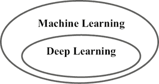

图 2.1 人工智能—机器学习—深度学习。

在 ML 中，系统基于过去的经验进行迭代学习，而 DL 受人类神经网络启发，通过向系统输入海量数据，使其通过示例进行学习。这是一种更复杂的 AI 形式。机器人技术是指机器以更高的准确性和精度执行超出人类能力的任务 \[Ross 2019\]。AI 是本十年最有趣且最具前景的研究领域之一，它彻底改变了当今人类生活和工作的方式。AI 能够从自身错误中学习并进行适当改进，随着使用越来越有用。目前，有许多 AI 应用正在协助专家提高效率 \[Kumar 2020\]。这些应用在教育、银行、商业、社交媒体和日常生活中较为通用，而在健康和医学领域则更为具体。近期对 AI 的研究及 AI 算法的应用正受到越来越多的关注，并对教育展现出积极影响。AI 系统的进步，如 ICAI（智能计算机辅助教学），为教育领域的教学开辟了新可能性 \[Chen, Chen and Lin 2020\]。在当今的电子商务世界中，商业管理正处于数据时代，AI 应用持续帮助提高决策和整体业务运营的效率。AI 旨在提升海量数据的现实价值，利用复杂算法促进商业智能，并洞察市场趋势和消费者行为，从而赋予企业真正的竞争优势 \[Al-Zahrani and Marghalani 2018\]。

AI 正将触角延伸至医疗保健领域，未来 AI 医生可能会协助人类医生进行改进。AI 在健康领域的真正动力是利用复杂算法从海量医疗数据中学习特征并获取知识，并利用所得知识提供临床辅助。AI 还具有学习和自我纠错的能力，以便根据之前的学习反馈提高其准确性。AI 系统通过从各种来源提供更新的医疗信息来协助医生，并有助于减少人类临床实践中可能出现的诊断错误。

本章的主要焦点是 AI 算法及其在医疗保健系统中的应用。本章其余部分安排如下。第 2.2 节介绍医疗保健数据的不同来源，第 2.3 节描述与医疗保健系统相关的 AI 技术类型。第 2.4 节侧重于 AI 在疾病诊断及治疗中的应用，第 2.5 节强调如何利用 AI 减少诊断错误。第 2.6 节和第 2.7 节解释 AI 在药物发现和医学转录方面的工业革命。第 2.8 节介绍 AI 如何帮助应对 COVID-19 大流行。AI 在医疗保健中的益处与挑战在第 2.10 节中讨论，随后的第 2.11 节展望 AI 在医疗保健中的未来。

### 2.2 医疗保健数据

在 AI 系统部署到任何医疗保健应用之前，必须对其进行医疗数据训练，以便系统能够学习并使自身专业化。与医疗保健相关的数据可以从以下来源生成，但不限于：临床活动、电子记录以及许多其他来源，如 `www.fda.gov/downloads/drugs/guidances/ucm328691.pdf`。

#### 2.2.1 电子健康记录

从医院、卫生系统、医学图书馆或存储库获得的电子形式临床数据通常称为电子病历（EMR）。这些数据包括人口统计信息、行政信息、医疗处方、实验室检查和诊断、药物、医疗记录、治疗方案，以及医生和患者详情。也存在大型合作机构，如美国国立卫生研究院（NIH）、去标识化临床数据存储库（DCDR）和斯坦福临床信息学中心，它们提供临床数据存储库的访问权限。

#### 2.2.2 疾病登记系统

这些登记系统是临床信息系统，用于追踪与特定慢性疾病状况（如阿尔茨海默病、哮喘、糖尿病、癌症、心脏病等）相关的极窄范围但重要的数据。疾病登记系统还提供患者状况的必要信息。全球阿尔茨海默病协会互动网络（GAAIN）提供阿尔茨海默病海量数据存储库的访问权限。国家心血管数据登记系统（NCDR）是一套数据登记系统，存储其提供的心血管护理数据。国家创伤数据银行（NTDB）是最大的创伤登记数据库。

#### 2.2.3 健康调查

这些调查是收集医疗保健数据的重要途径之一，特别是为了研究目的。国家健康调查通常旨在提供最常见慢性健康状况的估计数据，即国家健康和营养检查调查（NHANES）。

### 2.3 与医疗保健相关的主要 AI 技术

AI 不是单一技术，而是多种技术的组合。其中许多技术被发现与医疗保健领域相关，但它们支持的任务可能各不相同。被认为对医疗保健系统至关重要的 AI 技术描述如下。

#### 2.3.1 机器学习


# ML 是一种统计技术，用于分析结构化数据，主要用于识别数据中的模式或预测其未来

在医学术语中，这些模式可用于识别感染的风险因素，或预测未来的感染患者。这是 AI 最常见的技术。结构化数据是具有特定明确目的的有组织信息集合。在医疗保健数据库中，结构化数据以患者详情、实验室检查数值、人口统计数据、影像、基因和财务信息的形式存在。在医疗保健应用中，ML 算法试图从患者特征中形成聚类，或估算特定疾病结果的概率。存在不同的 ML 算法，如 `logistic regression` 和 `decision trees` 等，可用于完成此任务 [Jiang et al. 2017]。

ML 模型可分为三类，以便理解数据的输入。

## 1. 监督学习模型 (SLM)

第一个也是最直接的模型是监督学习模型 (SLM)。该模型的输入是带标签的，可以通过隐藏层的特征和权重进行训练，以正确映射输入和标签之间的关系。训练完成后，该模型可接触新记录的数据以进行预测。该模型的准确性可以被衡量和改进。这种学习可应用于预测建模，通过以患者特征作为输入和关注的结果作为输出来建立关系。

## 2. 无监督学习

第二个模型是无监督学习，其中没有用户定义的标签。该模型必须自行从给定输入中发现特征，以便执行与输出的映射。该模型的人工干预极少，主要用于提取有趣的特征。两种重要的学习方法是聚类和主成分分析 (PCA)。聚类将具有相似特征的数据归为一类，并为患者分配聚类标签。PCA 主要用于降维，当患者特征以大量维度存储时。

## 3. 混合模型（半监督学习）

第三个模型是混合模型，也称为半监督学习。该模型的输入包含带标签和不带标签的数据。这种模型非常接近人类病理学家利用带标签数据（如肿瘤宽度或密度）和不带标签数据（即既往记录）进行诊断的方法 [Carpenter 2020]。

医疗保健领域特别使用的主要 ML 算法 [Jenni and Chris 2019, Jabbar et.al. 2018, Smith 2020] 如 图 2.2 所示。

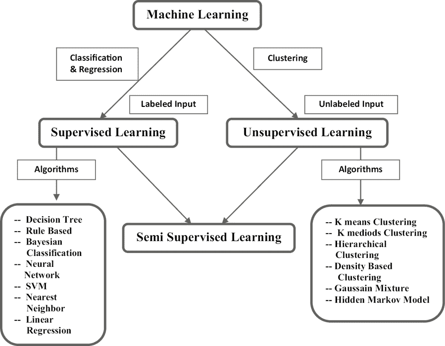

**图 2.2** 医疗保健中的机器学习算法。

#### 2.3.2 深度学习

DL 是神经网络模型的延伸，被认为是 ML 最复杂的形式。DL 也可称为具有多层且隐藏数千个特征的神经网络。这有助于探索数据的复杂非线性模式。近年来，数据的体量和复杂性迅速增加。DL 在处理此类数据方面越来越受欢迎。在放射学图像中识别潜在的癌变病灶是 DL 在医疗保健中最常见的应用之一。DL 的其他一些日益增长的应用包括放射组学、肿瘤学导向的图像分析以及影像数据中相关特征的检测。在医学研究领域，DL 的应用始于 2013 年，到 2016 年增加了一倍多，其中大多数算法应用于图像分析，因为图像复杂且体量大。四种主要的 DL 算法是深度置信网络、深度神经网络、卷积神经网络和循环神经网络 [Davenport and Kalakota 2019]。

#### 2.3.3 自然语言处理

它包含多种应用，如文本分析、语音识别、翻译等，用于理解人类语言。医疗保健数据的很大一部分源自叙述性文本，如实验室报告、病历记录、出院小结等。这些数据大多是非结构化的，也超出了任何计算机程序的理解范围。在此背景下，NLP 的主要目标是从这些叙述性文本中提取有意义的信息，并为临床决策提供辅助。在医疗保健领域，NLP 的重要应用包括创建、理解和分类临床文档、分析非结构化病历记录、生成检查报告和转录患者交互。大多数 NLP 系统通过重新吸收先前的交互结果作为反馈来反复学习，以确定准确的结果和未达到预期的结果。NLP 系统的两个主要组成部分是分类和文本处理。文本处理用于从病历记录中识别所有与疾病相关的关键词。进一步选择一部分关键词，并检查它们对正常和异常病例分类的影响。应用分类后，会生成一组经过验证的关键词，以改进结构化数据并支持决策过程 [Jiang et al. 2017]。

#### 2.3.4 机器人技术

过去二十年来，机器人技术已成为一个重要且新兴的研究领域。机器人也被称为能够自主执行各种任务、且比人类拥有更大自由度的机器。ML 和机器人技术的快速发展为整合这些技术并改变生活方式开辟了新途径。机器人技术处理专门设计和编程用于执行劳动密集型工作的机器。即使机器未被编程执行特定任务，ML 也能使其运行成为可能。这两者的结合赋予了机器人自主执行任务的能力，并允许 ML 任务以监督方式开始，过渡到半监督，最后以无监督学习完成。在医疗保健和医疗行业领域，机器人执行的综合职责可能包括患者护理、监测、电子健康、康复、医疗干预和人工假肢 [Patel et al. 2017]。根据“TNO Quality of Life on Robotics for Healthcare”报告，医疗机器人在健康、经济和社会效益方面对医疗保健具有巨大价值。机器人技术提供的解决方案非常重要，特别是针对患者群体。医疗机器人的重要应用领域包括：

*   开发智能医疗胶囊。
*   用于假肢的手术机器人。
*   机器人治疗。
*   机器人辅助的心理和社会治疗。
*   使用机器人的患者监测系统。

### 2.4 用于诊断和治疗的 AI


# 疾病诊断与治疗建议一直是过去五十年 AI 关注的焦点

1972 年，加利福尼亚州的斯坦福大学开始研发 `MYCIN`，这是一个用于治疗血液感染的早期 AI 程序。`MYCIN` 尝试根据报告的症状和医学检查结果来诊断患者。该程序还会建议额外的实验室检查，并给出可能的诊断。在诊断出疾病后，该程序会建议合适的治疗方案，并解释得出诊断和治疗建议的理由。据发现，该程序在识别和治疗血液感染方面的熟练程度与医学专家处于同一水平 [Copeland: 2018]。实际上，`MYCIN` 从未在医学上使用，这是由于法律和伦理问题，而非其性能缺陷。20 世纪 80 年代中期，匹兹堡大学推出了另一个名为 `CADUCEUS` 的医学专家系统，它基于与 `MYCIN` 相似的推理引擎运行，旨在改进 `MYCIN` 并专注于血源性传染细菌。`CADUCEUS` 系统能够诊断近 1000 种不同的疾病 [Banks 1986]。随后出现了多个此类 AI 医疗系统，其中一些获得了重视，少数未被临床应用。

#### 2.4.1 AI 在医学诊断中的近期应用

确定疾病状况的过程称为医学诊断。医学诊断所需的信息取自患者的病史、体格检查和医学检验。AI 在医学诊断的演变中发挥着不可或缺的作用。目前，AI 在医学诊断中的许多应用主要归属于以下几大类别 [Faggella 2020]。

#### 2.4.2 聊天机器人

聊天机器人是专门设计用于通过自然语言与用户交互的计算机程序。聊天机器人基本上基于 AI 原理工作。这些聊天机器人内置了对话代理程序，会向用户询问一系列关于其健康问题的问题，并获取疾病症状。它们还会就不同症状向用户给出建议以便澄清。这些获取的症状可能具有潜在的歧义。因此，聊天机器人会将它们与医学数据库中记录的症状及其相应代码进行映射。这有助于聊天机器人诊断疾病。随后，聊天机器人会为未来参考个性化诊断结果，并在发现重大疾病时将患者转介给合适的医生进行咨询。目前可用于医学诊断的聊天机器人有 `Florence`、`Your.MD` 和 `Babylon`。针对医学诊断聊天机器人领域的多项调查证明，它们是成本显著较低的优质医疗服务提供者 [Divya et al. 2018]。

#### 2.4.3 肿瘤学

肿瘤学是诊断和治疗癌症的医学领域。AI 在解决多个生物医学问题方面发挥了作用。`DL`（深度学习）作为 AI 的一个子集，能自动提取特征，且在包括癌症在内的不同研究领域应用更为灵活。它在癌症早期检测中发挥着至关重要的作用。`Enlitic` 的首席执行官兼创始人 Jeremy Howard 曾表示：“如果癌症能被早期发现，患者的生存概率将高 10 倍。”与许多领域专家相比，`DL` 在早期诊断中实现了最高准确率。目前 `DL` 在肿瘤学中的应用包括从基因表达数据中检测癌症，由于其高维特性，这类数据被认为非常复杂。`DL` 从这些数据中提取有意义的特征并对乳腺癌细胞进行分类。该技术还提取有助于癌症预测的基因和癌症生物标志物，以检测乳腺癌。

`DL` 还可用于在 MR 图像中分割脑肿瘤，与医生手动分割相比，其结果稳定得多，因为手动分割因运动和视觉因素容易出错。这也可用于在治疗期间测量肿瘤大小，并检测可能被忽视的新转移灶（如果有）。算法通过阅读更多患者的 CT 和 MRI 扫描来获得更准确的结果。预后给出癌症发展程度和生存几率的近似估计。`DL` 为患癌并接受治疗的患者开发生存预后检测的预测模型。研究发现，`DL` 的生存预测能力优于其他预测模型 [Ali 2019]。

#### 2.4.4 病理学

病理学是研究疾病不同病因及其相应效应的学科。疾病诊断基于对尿液、血液等体液以及组织的实验室分析。病理学在先进医学中发挥着关键作用，并建议合适的治疗方案以对抗病毒。病理学家诊断疾病的初始方式是通过显微镜手动观察图像。病理学诊断的金标准是显微镜形态学，但诊断变异性是导致病理学家之间出现误差的主要局限。在这种情况下，可在病理学领域引入 AI，以实现一致且更准确的诊断。为提高诊断的速度和准确性，`DL` 被用于训练算法，使其具备图像识别能力以诊断肿瘤。研究最初使用数百张标记的非癌细胞和癌细胞图像启动。从标记区域提取的结果被用作训练算法的模型。病理学中常用的流行 AI 算法包括 `CNN`（卷积神经网络）、`SVM`（支持向量机）和 `KNN`（K 近邻算法） [Faggella: 2020; Chang et al. 2018]。

#### 2.4.5 放射学

AI 技术或算法，特别是 `DL`，在图像识别方面取得了显著进展。从 `CNN` 到自编码器的不同方法在医学图像分析领域引发了众多应用。传统上，在放射学中，受过训练的医生通过肉眼评估医学图像以检测和表征疾病。放射学成像数据的增长速度远快于受过训练的专业人员数量，这极大地增加了放射科医生的工作量。一些企业研究报告称，放射科医生必须每 5 秒至少解读一张图像。由于放射学涉及视觉感知和决策制定，这种受限条件使得错误不可避免。如今，AI 方法在识别图像数据中的复杂模式和生成放射学特征的定性评估方面表现出色。将 AI 系统与成像工作流集成，通过为放射科医生提供所有预筛选的图像和识别出的特征，无疑能提高效率、减少诊断错误并实现预期目标。最近，许多临床任务已实现自动化并由 AI 驱动，这使放射学从感知领域转向可计算领域，并与其他应用领域并行发展 [Hosny et al. 2018]。

### 2.5 用于减少诊断错误的 AI


在当今的医疗保健系统中，与每位患者相关的医疗数据总量正在急剧增加。每当患者拜访医生、住院或进行医疗检测时，数据存储库的规模就会开始增长。访问这些实时数据并生成无人为错误的准确诊断的能力已变得至关重要。对任何疾病或其他健康问题的误诊可能导致不良后果，甚至在某些情况下导致患者死亡。在这种敏感的医疗环境下，AI 的应用对临床医生降低错误率大有裨益。AI 改变了数据分析和结果获取的方式。如今，AI 正以更快的速度和更低的成本助力精准诊断。AI 减少诊断错误的一些常见方式如下 [Daley 2019]。

#### 2.5.1 Buoy Health

这是一个症状检查工具，它使用复杂的算法来诊断疾病并建议治愈疾病的治疗方案。Buoy 的工作流程分为五个步骤：
1. 有一个聊天机器人与患者交谈，了解其关心的症状和健康困扰。
2. 随后，它从病因到严重程度获取关于症状的反馈。
3. Buoy 随后选择最佳护理方案，并根据其诊断指导患者。
4. 此后，在患者许可下，Buoy 可以跟进治疗的过程和进展。
5. 最后，Buoy 将患者添加到一个社区群组中，使其能够与经历过类似症状的人取得联系，并凭借自身经验帮助他人 [[www.buoyhealth.com/](http://www.buoyhealth.com)]。哈佛医学院是使用 Buoy AI 进行患者诊断和治疗以实现更快速诊疗的医院。

#### 2.5.2 PathAI

PathAI 开发机器学习技术，协助病理学家快速、准确地诊断癌症。PathAI 当前的目标是减少癌症诊断中的错误。它还为患者提供个性化医疗方案和方法。它帮助患者获得新型疗法的益处。PathAI 目前正与药物开发商百时美施贵宝以及比尔及梅琳达·盖茨基金会合作，在全球共享技术并将 AI 拓展至其他医疗保健行业 [[www.pathai.com/](http://www.pathai.com)]。

#### 2.5.3 Enlitic

Enlitic 是一家填补人类与 AI 之间鸿沟的公司，旨在引入医疗诊断领域的最新进展。它专门为放射学开发深度学习医疗工具。世界级放射科医生与数据科学家合作，分析最全面的临床数据。深度学习平台使分析非结构化医疗数据（如验血报告、放射影像、患者病史和基因组学）变得更加便捷。Enlitic 还在开创新型医疗软件，让医生能更好地洞察数据，并使他们能更早、更准确地进行诊断 [[www.enlitic.com/](http://www.enlitic.com)]。

Freenome 是一家在筛查和诊断中使用 AI 的生物技术公司。它是早期癌症检测和多组学平台的先驱 [[www.freenome.com/](http://www.freenome.com)]。Zebra Medical Vision 致力于利用 AI 的力量变革患者护理。它通过接收影像扫描并自动分析，为放射科医生提供 AI 辅助。它还会生成若干临床发现，放射科医生在诊断时会参考这些发现 [[www.zebra-med.com/](http://www.zebra-med.com)]。BIDMC（伯利恒以色列女执事医疗中心）是哈佛大学的教学医院，正利用 AI 在早期阶段诊断毒性血液疾病。医生使用复杂的 AI 增强型显微镜扫描血液样本并识别有害细菌。整个过程比人工扫描完成得更快。机器经过 25,000 份血液样本图像的训练，能够搜索细菌。结果显示，机器学会识别和预测血液中有害细菌的准确率达到 95% [[www.bidmc.org/](http://www.bidmc.org)]。

### 2.6 AI for Drug Discovery

AI 是工业革命时代的核心技术之一，预计将在降低新药发现的成本和时间方面产生巨大影响。许多制药行业通过组学和基于结构的药物开发进行合理的药物发现。尽管传统药物发现一旦成功收益巨大，但其成本高昂、风险高且耗时。目前，随着 AI 与先前技术的融合，药物发现领域正发生巨变 [Son 2018]。

药物发现的主要目标是确定能够预防或治疗特定疾病的药物。许多药物是小分子化学合成物。为了识别这些分子，传统方法是筛选分子库以识别潜在的候选药物。随后，执行多轮测试以开发具有挑战性的化合物。目前，合理的基于结构的药物设计正成为最常用的方法，它避免了初始筛选阶段。

化学家通过合成和评估多种化合物来创造新药。尽管如此，仍未知哪种化学结构具备成为有效药物并表现出预期生物学效应的特性。将化学化合物提炼为有效药物的过程成本高昂且耗时。如今，专家们倾向于利用 AI 的数据处理能力来加速流程并降低新药发现的成本 [[www.merckgroup.com/en/](http://www.merckgroup.com)]。以下公司依赖 AI 开发下一代药物：

#### 2.6.1 BioXcel Therapeutics

这是一家处于临床阶段的生物制药公司，利用 AI 在神经科学和免疫肿瘤学领域识别增强疗法并开发新药。其主要重点是利用新技术和创新研究开发有价值的疗法，旨在改变患者的生活。BioXcel Therapeutics 在独特的 AI 平台上工作，以降低治疗开发成本。它考虑多种大数据和机器学习算法来识别新的治疗指标并缩短药物开发时间。此外，公司还利用 AI 进行药物再创新，并识别现有药物的新应用 [[www.bioxceltherapeutics.com/](http://www.bioxceltherapeutics.com)]。

#### 2.6.2 BERG Health

BERG 是一家由 AI 驱动的临床阶段生物技术公司，采用“回归生物学”方法进行医疗保健。其主要研究领域包括肿瘤学、神经学和罕见疾病。通过使用探究性生物学智能平台，BERG 的目标是绘制疾病图谱并开发治疗方法。通过将 AI 技术与患者生物学相结合，该公司旨在加快临床识别步伐，并寻找能够治疗疾病的有效治疗靶点。通过将探究性生物学方法与传统研究方法相结合，BERG 能够开发出能够对抗罕见疾病的强效药物 [[www.berghealth.com/](http://www.berghealth.com)]。在认识到 AI 在发现新药方面的威力后，目前有 43 家制药公司正在使用 AI [Smith 2020]。

### 2.7 AI for Medical Transcription


如今，全球大部分医疗文档都存储在电子健康记录（EHR）中，而在线数据库正帮助临床医生快速获取患者信息。医生和外科医生大多仍采用传统方法记录治疗详情、患者病史或手术过程，即在纸上书写或在文本编辑器中输入。医生和医护人员通常要在记录过程中花费大量时间。遗憾的是，许多此类文档并未完全与患者电子记录系统集成，导致所有付出徒劳无功。这种耗时的手工记录已通过语音录制和转录技术实现了数字化。医疗转录的核心是将口述的医疗笔记转换为打字输入的健康记录。转录员在此转换过程中需耗费数小时。语音识别成为转录员在此过程中的最大障碍 [Kulkarni et al. 2020]。

医疗转录的另一项发展是听写-转录软件，它利用语音识别技术聆听医生的总结并将听写内容转录为文字。其中一些工具可自动与 EHR 集成，并将数据填充至健康系统中。然而，这些工具并未解决文档记录问题，因为它们只是将打字任务替换为听写和编辑。与听写-转录工具相比，医疗记录员和虚拟记录员为文档记录提供了更完整的支持。他们负责记笔记、总结以及将适当信息编码录入合适的 EHR 字段。医疗记录行业是医疗保健领域最具潜力的新兴行业之一。如今，临床文档面临的挑战由新型 AI 驱动的记录员来应对。这些记录员利用自然语言处理技术聆听患者与医生之间的对话。随后解析出医学相关术语，将信息总结为医疗笔记，并最终映射到 EHR 的相应字段。与其他听写和转录工具相比，AI 记录员在逐字总结方面做得更深入，且价格比医疗记录员更实惠。这导致 AI 驱动的医疗记录员占据了整个医疗转录系统 [[www.deepscribe.ai/](http://www.deepscribe.ai)]。

多家公司声称提供基于 AI 的医疗转录软件给医院和医疗保健行业，旨在帮助他们将语音转录为文本并在 EHR 中更新患者病历。Nuance Communications 推荐一款名为 Dragon Medical One (DMO) 的软件，它利用 NLP 帮助医生和医疗服务提供者将语音转录至 EHR。该软件也可集成到任何现有的 EHR 系统中。Nuance Communications 声称 Nebraska Medicine 已使用 DMO，在将该软件与其 EHR 集成后，提高了其医疗服务提供者的胜任力。转录成本降低了 23%，71% 的公司医生观察到文档质量有所提高，50% 的医生表示使用 DMO 每天至少节省了 30 分钟。M*Modal 推荐用于转录的 Fluency Direct (FDT) 软件，声称医疗服务提供者可将该软件结合到其现有的 EHR 数据库中，如 Epic、Cerner 和 Athenahealth。Floyd Memorial Hospital 将该软件纳入其 EHR 系统，使每日书写的医疗文档总数增加。Medical Transcription Billing, Corp. (MTBC) 推荐名为 TalkEHR 的软件，其中包含一个名为 Allison 的语音助手功能。还有更多公司推出了基于 AI 的医疗转录软件 [Mejia 2018]。

Amazon Transcribe Medical (ATM) 是 Amazon Web Services (AWS) 新推出的一项 ML 服务，可自动将医生口述的医疗笔记从语音转换为文本。ATM 同时利用 ML 和 NLP 技术实现准确的语音识别，医疗服务提供者可利用此服务分析医患对话或用于 HER 录入。ATM 使制药公司受益，能将患者或医生的通话转录以准确记录药品名称，并识别描述副作用的关键术语。这有助于公司分析和检测与药物相关的安全问题。ATM 经过专门训练，能理解不同风格的临床语言和术语，还提供自动标点功能，使医疗服务提供者能自然地说话 [Kent 2019]。

### 2.8 用于 COVID-19 诊断的 AI

COVID-19，又称冠状病毒大流行，于 2019 年 12 月在中国武汉首次被发现。世界卫生组织 (WHO) 将其宣布为公共卫生紧急事件。这引发了全球性危机，使整个医疗行业为诊断、预测和治疗绷紧了神经。快速准确地诊断阳性患者成为避免病毒进一步传播并提供及时治疗的重中之重。医疗保健行业现在需要 AI、ML 和 DL 技术的支持来对抗这种新疾病。AI 是一项关键技术，可用于追踪病毒传播和识别高风险患者，从而帮助控制感染。

美国国家卫生研究院 (NIH) 在利用 AI 进行 COVID-19 诊断、治疗和监测方面做出了宏大努力。这促成了医学影像与数据资源中心 (MIDRC) 的成立，该中心利用 AI 和医学影像的力量对抗大流行。NIH 下属的国家生物医学成像与生物工程研究所 (NIBIB) 创建了新工具，可帮助医生早期检测病毒并为患者提供个性化疗法 [[www.nih.gov/news-events/](http://www.nih.gov)]。

多位研究人员通过一切可能的途径，致力于确定 AI 在 COVID-19 大流行中的主要应用，以及可从 AI 中受益的诊断改进。利用胸部 CT 早期检测 COVID-19 可实现对患者的及时治疗，也有助于控制疾病传播。一项新的 AI 系统被提出用于快速 COVID-19 诊断和胸部 CT 表现的广泛统计分析。该系统基于包含 10,000 例胸部 CT 体积数据、社区获得性肺炎、流感和非肺炎受试者的大型数据集进行评估。这是一个基于深度卷积神经网络的系统，适用于多类别诊断任务。胸部 CT 的诊断性能与胸部 X 光片进行了比较，结果发现该 AI 系统在更具挑战性的任务中表现优于许多放射科医生 [Jin et al. 2020]。

印度理工学院 (IIT) 海得拉巴分校的一个研究团队开发了一款由 AI 驱动的 COVID-19 检测试剂盒，可在 20 分钟内出具结果，且每次检测成本仅为 600 卢比。这克服了最大的障碍，即筛查测试的成本。该试剂盒已在海得拉巴的 ESIC 医学院和医院进行临床试验以确定其效率，并寻求印度医学研究委员会 (ICMR) 的批准 [[`iith.ac.in/news/2020/06/10/Covid19-detection-kit/`](https://iith.ac.in)]。

### 2.9 企业在医疗 AI 中的角色


# AI 已在医疗保健领域开启了创新新纪元，并在这十年间极大地影响了医疗保健行业或企业

AI 有助于降低正在进行的医疗运营成本，并提高患者护理质量。AI 在医疗领域的成功吸引了越来越多的公司投身医疗保健，目前该领域已有超过 100 家公司在使用 AI。一些知名的医疗保健企业包括（但不限于）：

#### Watson Health

**Watson Health** 是国际商业机器公司（IBM）旗下的专业医疗部门，旨在将数据、技术和专业知识汇聚于一个平台，以变革医疗健康。IBM 通过提供所需的工具和服务，帮助组织解决医疗保健领域的临床、运营和财务问题。利用认知计算，Watson Health 已帮助包括梅奥诊所（乳腺癌临床试验）和 Biorasi（加速药物上市）在内的多家知名组织。IBM Watson Health 将人类专家与增强智能相结合，帮助全球研究人员转化数据和知识，以支持智能决策 [[www.ibm.com/in-en/watson-health](http://www.ibm.com)]。

#### Google Health

**Google Health** 现正致力于通过与 DeepMind 医疗团队合并，在所有重要健康领域改善人们的生活。Google Health 的主要研究成果包括：利用 AI 准确预测急性肾损伤，比目前的诊断方法早近 48 小时；检出 5% 更多的癌症病例，与无辅助放射科医生相比，将误阳性检查减少 11% 以上。Google Health 的自动视网膜疾病评估（ARDA）和光学相干断层扫描（OCT）帮助医生快速追踪糖尿病视网膜病变并解读眼部扫描 [[`health.google/health-research/`](https://health.google)]。

#### CloudMedX Health

**CloudMedX Health** 利用 NLP 和 DL 从 EHR 中获取患者数据，并向医疗专业人员提供临床洞察，帮助他们改善患者预后。CloudMedX 的解决方案已在肝癌、充血性心力衰竭、骨科手术和肾衰竭等医疗领域得到应用，显示出良好的效果 [[`cloudmedxhealth.com/`](https://cloudmedxhealth.com)]。

### 2.10 医疗保健领域 AI 服务的益处与挑战

从 DL 算法阅读 CT 扫描的速度远超人类，到 NLP 能够读取和解读 EHR 中的非结构化数据，AI 在医疗保健中的应用无穷无尽。AI 从疾病的早期检测起步，一直延伸到建议适当的治疗方案以实现治愈。在过去十年中，AI 的应用跨越了医疗保健的所有重要领域，包括肿瘤学、放射学、病理学、手术、患者护理等。但是，任何处于成功巅峰的技术也面临着需要解决的挑战。

研究人员进行了多项调查，以从医疗保健专业人员的角度了解 AI 服务的真实优缺点，因为他们是任何工具或应用程序的最终用户。MITTR 与 GE Healthcare 合作进行的一项调查报告称，美国和英国超过 82% 的医疗保健行业已部署 AI，并在运营和管理活动中创造了工作流改进 [[`complexstories.com/work/mit-ge-health-ai/`](https://complexstories.com)]。另一项调查针对医疗保健 AI 服务的实用性以及医疗保健专业人员采用 AI 技术的意愿。该研究显示，67.8% 的专业人员愿意使用 AI 进行独立诊断和决策支持，28.9% 的人有兴趣以受限方式使用 AI 来协助专业人员进行护理流程。仅有 3.3% 的受访者不愿意使用 AI 服务 [Väänänen et al. 2020]。

AI 在三个极具前景的视角中的主要益处是：

1.  **患者自助服务益处：** 患者现在拥有更便捷的选择，可轻松快速地完成咨询医院和医生详情、预约挂号、随访治疗、支付及其他流程等任务。AI 使获取医疗设施变得更容易，也提高了患者满意度。

2.  **临床医生诊断益处：** AI 工具有助于在相对较短的时间内实现疾病的早期有效诊断，使临床医生在延伸治疗时更有信心。AI 和机器人技术正推出助手，帮助专业人员进行复杂手术。

3.  **AI 对制药业的益处：** 随着 AI 的出现，新药发现的时间和成本大幅降低，这使制药业能利用节省的时间对不同化学组合和药物进行更多研究。

尽管 AI 有潜力带来新见解并帮助医疗保健提供者和患者，但它仍可能面临一些需要解决的挑战，以保留这项强大技术的红利。

*   AI 需要从数百万患者记录中收集大量训练数据以做出正确诊断，但如果数据不完整或不充分，仍存在有限的出错几率。
*   结合机器人的 AI 终究是缺乏情感和人文关怀的机器。对于精神障碍患者，这种情感纽带对于保持患者士气高昂至关重要。
*   医疗行业各层面 AI 技术的发展可能导致严重的失业风险。
*   EHR 是所有 AI 应用的主要数据存储库。医疗保健领域 AI 的采用可能依赖于标准格式的高质量数据。
*   数据保护和隐私保护是医疗保健领域 AI 面临的最关键挑战。
*   在实践中，患者和专业人员都必须能够信任 AI 系统，才能在医疗保健领域成功实施。

### 2.11 展望未来——医疗保健领域 AI 的未来

如今 AI 正在日常生活的方方面面得到实施。AI 应用的范围正迅速扩展，以涵盖人类的每一项基本需求，包括复杂的决策制定。没有任何技术领域未被 AI 应用触及。医疗保健的质量、安全性和实施水平因 AI 而大幅提升。与人类相比，AI 能在少得多的时间内从大量医疗数据中提取有趣的模式。AI 可以简化诊断、治疗、药物发现和患者护理。未来可受益于 AI 的不同医疗保健领域包括：

*   目前医生或临床医生花费大量时间阅读患者记录、分析检测报告、查找病因和治疗指南。AI 将高效地从 EHR 中提取关键信息，从而节省时间并直接指导患者管理。它还可以将患者的口头咨询转换为摘要信。这些应用可以节省时间并快速实施，因为它们有助于辅助临床医生。
*   利用患者的临床记录，AI 可以自动识别风险和行动。由于 AI 可以同时监控数百万个输入，它在预防医学中发挥着重要作用。
*   这些系统还将专家诊断专业知识引入患者护理。被识别为低风险的患者可即时获得安抚，而高风险患者可立即转诊给临床医生接受治疗，减少等待时间 [Buch et al. 2018]。


*   凭借海量数据分析能力，深度学习和人工智能系统均可实现更快、更准确的诊断。个性化医疗和治疗可变得更廉价。可为每种疾病定制更有效的药物。

*   未来 AI 研究可导向医疗保健的许多领域，且这些系统可融入临床实践，有助于建立 AI 与临床医生之间的互利关系。AI 为临床医生提供更高的效率或成本效益，反过来临床医生可为 AI 提供学习复杂医疗病例所需的所有必要接触机会。

*   在整个过程中，确保 AI 不损害人类的社会和伦理约束至关重要。尽管 AI 仍处于早期阶段，但 AI 在医疗保健领域已取得的成就令人印象深刻，并正朝着健康的未来迈进。

### 参考文献

*   Ali, A.-R. 2019. “Deep learning in oncology – applications in fighting cancer.” *Business Intelligence and Analytics Healthcare Process Automation*, Feb 2019. [`emerj.com/ai-sector-overviews/deep-learning-in-oncology/`](https://emerj.com).

*   Al-Zahrani A. and Marghalani A. 2018. “How artificial intelligent transform business” (April 25, 2018). Available at SSRN: [`ssrn.com/abstract=3226264`](https://ssrn.com) or [`dx.doi.org/10.2139/ssrn.3226264`](http://dx.doi.org/10.2139/ssrn.3226264).

*   Banks, G. 1986. “Artificial intelligence in medical diagnosis: the INTERNIST/CADUCEUS approach.” *Critical Reviews in Medical Informatics*. 1(1): 23–54.

*   Buch V.H., Ahmed I., and Maruthappu M. 2018. “Artificial intelligence in medicine: current trends and future possibilities.” *British Journal of General Practice* Mar; 68(668): 143–144. DOI: [10.3399/bjgp18X695213](https://doi.org/10.3399/bjgp18X695213).

*   Carpenter, A. 2020. “An introduction to machine learning in oncology, on the future of AI in cancer treatment and research.” [`towardsdatascience.com/machine-learning-ai- applications-in-oncology-73a8963c4735`](https://towardsdatascience.com).

*   Chen L., Chen P. and Lin Z. 2020. “Artificial intelligence in education: a review.” *IEEE Access* 8: 75264–75278.

*   Copeland B.J. “MYCIN.” *Encyclopedia Britannica*, November 21, 2018, [www.britannica.com/technology/MYCIN](http://www.britannica.com).

*   Daley, S. “32 Examples of AI in healthcare that will make you feel better about the future,” July 2019, [`builtin.com/ artificial-intelligence/artificial-intelligence-healthcare`](https://builtin.com).

*   Davenport T. and Kalakota R. 2019. “The potential for artificial intelligence in healthcare.” *Future Healthc J.* 6(2): 94–98. doi:[10.7861/futurehosp.6-2-94](https://doi.org/10.7861/futurehosp.6-2-94).

*   Divya S., Indumathi V., Ishwarya S., Priyasankari M., and Kalpana Devi S. 2018. “A self-diagnosis medical chatbot using artificial intelligence.” *Journal of Web Development and Web Designing* 3(1): 1–7.

*   Faggella, D. 2020. “Machine learning for medical diagnostics – 4 current applications.” March 2020, [`emerj.com/ai-sector-overviews/machine-learning-medical-diagnostics-4-current-applications/`](https://emerj.com).

*   Hosny A., Parmar C., Quackenbush J, Schwartz L.H., and Aerts H.J.W.L. 2018. “Artificial intelligence in radiology.” *Nat Rev Cancer* 18(8): 500–510. doi:[10.1038/s41568-018-0016-5](https://doi.org/10.1038/s41568-018-0016-5).

*   Jiang F., Jiang Y., and Zhi H., et al. 2017. “Artificial intelligence in healthcare: past, present and future.” *Stroke and Vascular Neurology* 2: DOI: [10.1136/svn-2017-000101](https://doi.org/10.1136/svn-2017-000101).

*   Jin, C., Chen, W., and Cao, Y. et al. 2020. “Development and evaluation of an artificial intelligence system for COVID-19 diagnosis.” *Nat Commun* 11: 5088. [`doi.org/10.1038/s41467-020-18685-1`](https://doi.org/10.1038/s41467-020-18685-1).

*   Jabbar M.A., Samreen S., and Aluvalu R. 2018. “The future of health care: machine learning.” *International Journal of Engineering & Technology* 7(4.6): 23–25.

*   Kumar, B. 2020. “AI applications assisting specialists to increase their efficiency.” 360digitmg, April 2020, [`360digitmg.com/application-of-artificial-intelligence`](https://360digitmg.com).

*   Kent, J. 2019. “Amazon introduces machine learning medical transcription service.” December 2019, [`healthitanalytics.com/news/amazon-introduces-machine-learning-medical- transcription-service`](https://healthitanalytics.com).

*   Kulkarni, S., Torse, D.A., and Kulkarni, D. 2020. “A cloud based medical transcription using speech recognition technologies.” *International Research Journal of Engineering and Technology (IRJET)* 7(5): 6160–6163.

*   Mintz, Y. and Brodie, R. 2019. “Introduction to artificial intelligence in medicine.” *Journal Minimally Invasive Therapy & Allied Technologies* 28(2): 73–81.

*   Mejia N. 2018. “Machine learning for medical transcription – current applications.” December 2018, [`emerj.com/ai-sector-overviews/machine-learning-for-medical-transcription-current-applications/`](https://emerj.com).

*   Patel A.R., Patel R.S., Singh N.M., and Kazi F.S. 2017. “Vitality of robotics in healthcare industry: An Internet of Things (IoT) perspective.” In: Bhatt C., Dey N., Ashour A. (eds) *Internet of Things and Big Data Technologies for Next Generation Healthcare. Studies in Big Data,* vol 23. Springer, Cham. [`doi.org/10.1007/978-3-319-49736-5\_5`](https://doi.org/10.1007/978-3-319-49736-5_5).

*   Ross D.B. 2019. “Artificial intelligence and healthcare.” In: Claypoole T. F. (ed.) The Law of Artificial Intelligence and Smart Machines, ABA Publishing, Chicago.

*   Smith, S., “43 Pharma companies using artificial intelligence in drug discovery,” September 2020,[`blog.benchsci.com/pharma-companies-using-artificial-intelligence- in-drug-discovery`](https://blog.benchsci.com).

*   Son, Woo Sung. 2018. “Drug discovery enhanced by artificial intelligence.” *Biomedical Journal of Scientific & Technical Research (BJSTR)* December 12, 2018, ISSN: 2574-1241 DOI: [10.26717/BJSTR.2018.12.002189](https://doi.org/10.26717/BJSTR.2018.12.002189).

*   Väänänen A., Haataja K., and Toivanen P. 2020. Survey to healthcare professionals on the practicality of AI services for healthcare \[version 1; peer review: 1 approved with reservations\] F1000Research 2020, 9:760 [`doi.org/10.12688/f1000research.23883.1`](https://doi.org/10.12688/f1000research.23883.1).

*   Ye Yoon Chang, Chan Kwon Jung, Junwoo Isaac Woo et al. 2018. “Artificial intelligence in pathology.” December 2018 *Journal of Pathology and Translational Medicine* 53(1), DOI: [10.4132/jptm.2018.12.16](https://doi.org/10.4132/jptm.2018.12.16).

# 利用人工智能识别肺癌恶性程度

Vinod Kumar and Brijesh Bakariya

DOI: [10.1201/9781003153405-3](https://doi.org/10.1201/9781003153405-3)


### 3.1 简介

IT 领域的最新进展表明，人工智能（AI）可以预测癌症的可能性、诊断和疾病。治疗决策制定很快将成为一种合理的可能性。将 AI 融入许多领域也令人振奋，例如心脏病学、肾病学、重症监护和心理健康。由于一系列因素，癌症是一个 AI 预计将产生积极的短期影响的环境，并在许多情况下提升基于 AI 的癌症医疗方法的可信度 [Asan et al., 2020]。首先，癌症是一种常见疾病，这给患者和社会带来了身体伤害、精神痛苦和反复经济成本的根本性压力。在所有癌症亚型中，不例外地提高癌症生存率也有着迫切需求。

早期检测和康复是提高五年生存率的关键。根据印度医学研究委员会（ICMR）的当前癌症趋势，在未来五年内，印度癌症病例将增加 12%；预计到 2025 年将有 150 万人患非传染性疾病，而 2020 年为 139 万 [Mathur et al., 2020]。目前，每年新增 57,795 例肺癌病例。到 2020 年，这一数字可能达到每年 67,000 例。

CT 成像已被证明是肺癌早期诊断非常成功的工具，可将死亡率降低多达 20%。尽管技术已被证明有效，但大量研究已探讨其他新兴技术的应用，包括 AI。此类技术将进一步增强结节的识别、辨别和大小测量，从而减少假阳性 [Asan et al., 2020]。

癌症是一个 AI 预计将在短期内产生重大影响的环境，且癌症在多个方面都是提升基于 AI 的公共医疗方法“声誉”的明智之选。第二，癌症广泛存在，并在特定残疾、社会不适和经济影响方面，给患者和整个社区带来了巨大压力。在几乎所有癌症形式中，提升癌症相关发现也有着至关重要的需求。第二，在人类层面，对更有效的疾病诊断、预后和治疗方法有着强烈需求；癌症是发病率和死亡率的主要原因，令人恐惧的是，在癌症作为致命疾病的认知方面，没有其他因素能与之相比 [Pelc et al., 2020]。肿瘤异质性也带来了巨大的决策困难，特别是从从业者的角度来看，由于真实数据的压力。令人震惊的是，现代癌症专家每天花费超过 20 小时阅读以跟上科学进步。过去几年来 AI 的应用一直很有效，因为 AI 利用多种统计、概率论和优化方法及标准来“改进”以往病例，并在临床上有用的潜在模式中识别“噪声”或多维数据集。本章总结了癌症幸存者旅程各个层面现有和不断发展的 AI 干预进展 [Yang et al., 2017]。

图像可定义为二维的 `f (x, y)`，其中 `x`、`y` 为空间坐标，`(f)` 为任意单对坐标 `(x, y)` 的振幅。灰度表面或图像上该位置的振幅也称为振幅 `(f)`。该数字图像由若干 `x` 和 `y` 元素组成，所有元素均具有相同的位置和值。这些图像分量也称为像素。三维函数 `(x, y, z)` 将定义 3D 图像，体素也被称为单个分量。图像质量是一个重要的放射学因素，局部分辨率一词意味着图像中可以识别两个相邻物体 [Altaf et al., 2019]。显示成像质量和性能的过渡分辨率是另一个重要的分辨率特征。`DICOM` 是处理和传输相关医学图像信息的通用协议。`DICOM` 是国家电气设备制造商协会的注册商标。它常用于放射学、心脏病学、肿瘤学、产科学和牙科。为检索健康信息和图像，`DICOM` 文件可将系统和 `DICOM` 格式的图像传输到系统。像素大小的 `DICOM` 文件包含位置基础、患者身份、自图像和图像属性。此外，`DICOM` [Herrmann et al., 2018] 文件使得难以区分患者数据和图像数据。`DICOM` 也仍与患者相关联。对于基础图像处理在哪里停止、更多图像和计算机视觉研究在哪里开始，目前尚无共识。图像处理通常被定义为一种函数，其输入和输出均包含一幅图像。

### 3.2 背景与相关工作


#### 利用 AI、机器学习和深度学习进行肺癌诊断

在每种 AI 范式中，数据集都是重要组成部分。相关数据的准确性带来了分析增长、准备和进展。为了使这种发展有所帮助，所获得的证据应由计算机视觉专家进行论证和标注。本节包含用于肺癌识别的早期人工智能工作的信息 [Wang et al., 2019]。肺癌是全球最严重的疾病之一。研究人员正从不同方向采取行动以提高肺癌检测水平。通过机器学习技术进行 CT 扫描，并从各种缺陷中识别肺结节。带有后代的更深层神经网络 [Taher et al., 2016] 提取了图像信息。作者在此处的技术表明，结节越大，癌症生长的风险越高。与类别标签（也称为模式分类）相比，测试集包含线性 SVM 中的特征，可提高测试质量。它使用压缩技术 ROI 分割 [Deep Prakash, et al. 2017] 获取 CT 图像。每个 ROI 图像被分解为不同的 DWT（离散小波变换）策略，以及一些 SVM 可检测的 GLCM 分类频带 [Gupta et al., 2020]。下文还建议了一种基于结节大小的方法 [Kim et al., 2016]，与用于检测癌细胞类型的 ROI 隔离相比，该方法显示出卓越的性能。特征提取 [Kumar et al., 2015]，包括大津分割阈值和灰度共生矩阵 (GLCM)，被定义为物理维度级别。它从这些特征效应的角度识别癌症结节。它还对早期阶段进行分级以预防癌症。中值滤波器是一种预处理方法，用于通过 [Murillo, 2018] 过滤椒盐图像噪声，并通过排列整个像素邻域的值以数值格式进行测量 [MyaTun et al., 2014]。随后涉及一些包含大津阈值的相交过程。

##### 分类技术分析

对上述概念的分析表明，其 GLCM 或 SVM 有助于改进肺癌图像的分类 [Kim et al., 2016]。在 CAD 系统中使用这些图像时，关键特征与其他几种定义截然不同，因为该模型基于 NC 比、圆度等特征，并建立了仅与基于规则的分类相符的细胞估计阈值。

尽管特征提取过程比其他方法公平得多，但概念分类并不具备 SVM 和 GLCM 等所有期望的结果。在癌症生长的早期阶段，可使用多种分期方法，尝试使用 Gabor [Kumar et al., 2015] 滤波器校正图像，该滤波器由谐波函数和高斯函数组成，以根据面积、周长和离心率等特征区分分水岭，并提取用于管理不同癌症疾病的放射组学形式 [Kumar et al., 2015]。该概念提供了一种更加自动化的基于雪橇的图像精确分割策略，无需人工干预即可生成起点。Min-max 归一化方法被描述为一种定义疾病分期的工具。

##### 高级分类方法

它通过使用随机森林算法提高分类准确性。它包含一些将阶段分类为恶性或良性的标准方法，如任务 [Murillo, 2018] 所示，该任务关注结构共生矩阵 (SCM)，有助于在分类技术中识别致死性和良性。采用 GLCM 技术提取结节图像。拉普拉斯和高斯按 SCM 滤波器分组，以实现更好的分类，将转移阶段的结节恶性程度进行分级 [Kumar et al. 2021]。

该策略为所有标准提供了改进的排序，包括 ANV、MLP 和决策等级，以及 SVM 评级。分类技术的组合相比单独测试能获得精确结果。机器工具技术的概念是多项研究的重点。研究发现，只有 SVM 甚至一些机器学习策略有助于通过可靠结果评估肺癌 [Murillo, 2018]。分类技术的组合相比单独测试能获得精确结果。此外，作者还考察了肺癌的重要预测，并揭示了一些特定的能力和弱点。深度学习技术对于发现非小细胞肺癌非常有用 [Sujitha and Seenivasagam, 2021]。正在借助深度学习网络、生理成像技术和患者分层，研究定量成像的发酵特征。Web 应用程序还将展示使用 Web 应用程序 2D-UNet 模型进行肺癌诊断的深度学习应用 [Taher et al., 2015]。2D 掩膜通过专用数据集的特定技术和高级参数提取，并开发了深度神经网络以识别组织病理学图像中的肺癌亚型 [Hussein et al., 2019]。研究表明，机器学习在具有挑战性的图像分类任务中可以发挥作用，并有潜力协助病理学家对肺癌进行分类。CNN 模型通过单点种子位置连接到 RNN 并验证病理学 [Yiwen et al., 2019]，涉及 NSCLC 的药物和干预护理。从临床断层扫描得出的非德尔塔放射组学特征被评估为其相关图像获得的发现的 X 射线改进 [Alahmari et al., 2018]。

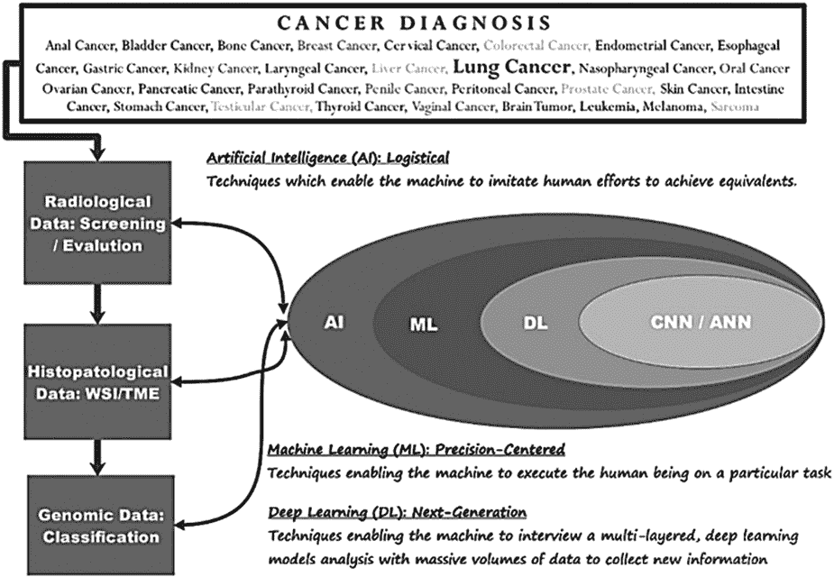

**图 3.1** 利用人工智能、机器学习和深度学习进行癌症诊断。

##### 预后与预测建模

肺癌诊断策略还通过使用 ROC 曲线，利用各种特征提高了效率。为了提高效率，该研究使用了传统的放射学资源。它通过贝叶斯网络在放疗前后从广泛数据集中增强肿瘤癌细胞响应 [Luo et al., 2018; Patel et al., 2020]。结合完整的马尔可夫系统和基于包装器的访问，改进了局部控制分析。作者提出了一个用于预测肺癌的放射模型，采用前文提到的基于放射学的预后 [Wu et al., 2018]。这种科学放射模型在相对较小的范围内，被用于结合信念和定量学习来解决诊断方法的一些特征。此外，建议使用最近邻分类特征来预测治疗性能。而其他分类特征则专注于利用一些专业高维度预测肺癌，并选择这些特征用于另一种专注于子预测选定特征的方法 [Rodrigues et al., 2018]。提出使用神经网络预测放疗后局部癌症患者的预后 [Cui et al., 2018]。此外，它将序列数据集的时间相关性作为特征以增强预测性能。针对 1-D 包装，通过两个局部连接层和全连接层引入了最大分布。


然而，与完全集成的多层架构相比，他们的整体模型提升了性能[Liu et al., 2018; Nie et al., 2018]。MAP 分析技术的应用说明了并行 SVM 在肺癌预测和诊断中的有效性（参见图 3.1）。

本章的主要目的是提升性能、缩短诊断时间、识别结节，并对特征和功能进行分类。已完成多项研究以确定最危险和最常见的肺癌类型。随后对这些肺结节及其提高的灵敏度、精确度和准确率进行分析。本章的关键目标是评估肺癌诊断方法并改进该策略。

动机：关键目标是提高性能、缩短诊断时间，并确定结节和特征的位置。从那时起，进行了大量研究以评估肺癌是否为最危险和最有害的类型。因此，所有肺结节的灵敏度、精确度和准确率被一起分析。肺癌的诊断应得到加强和改进。

### 3.3 提出的模型

模型的总体轮廓如图 3.2 所示，包含五个常规步骤。第一步是根据 CT 图像的平滑度，使用不同的滤波器读取和处理图像。下一步是分割图像以提取正确的区域。生成一个结节以提取若干特征。收集多个特征后，选择每个特征的作用。同时也使用了广泛的机器专用分类器和深度学习分类器。第二层接着对一半高质量图像进行分类，这些图像似乎适用于大多数像素值超过 150 的情况，其余切片被移除。第三种方法基于提出的 BLSTM 和 SVM 进行特征消除和分类。在随后的步骤中，少数服从多数投票指示标题的形状，并最终显示标题状态。

#### 3.3.1 数据集 (LIDC-IDRI)

在每个人工智能范式中，数据集都是重要组成部分。相关数据的准确性带来分析增长、准备和进展。为使该开发有所裨益，所获取的证据应经计算机视觉专家验证和标注。本节包含用于肺癌识别的早期人工智能工作的信息[Rabbani et al., 2018]。该数据集包含来自七个研究中心和八家医疗诊断公司的 1018 个病例。每个病例均提供一份 CT 扫描标注的 XML 文档[Chen et al., 2020]。四位经验丰富的胸部放射科医生通过两阶段流程进行特定标注。每位放射科医生将结果单独分为三组（“结节 ≥ 3 mm”、“结节 < 3 mm”和“结节 ≥ 3 mm”）[Kim et al., 2018]。然后，在第二步中，任意一位放射科医生匿名调查其自身的分类以及其他放射科医生的分类。四位放射科医生分别分析每个结节标注。平均值高于三归类为恶性结节，低于三归类为良性结节。四位放射科医生中的一位验证了总分为三且存在特定不一致性及其身份的情况，且一些结节被排除在分析之外。通过筛选和可视化，DCM 文件也能更容易地被解读，如图 3.3(a)所示，由三到五位放射科医生呈现癌症的恶性或良性分期。使用 `Pylidc-tool` [Loyman et al., 2020] 进行浏览，如图 3.3(b)所示，显示了 LIDC-IDRI-0082 CT 图像中的结节，详情如下：CT 层厚：1.250 mm，像素间距：0.703，结节数：1，第 173 层附近有三个标注，标注信息（隐匿性-4，内部结构-1，钙化-6，球形度-3，边缘-4，叶状-2，毛刺-5，人工智能纹理-5，恶性度-5）[Wu et al., 2019]。

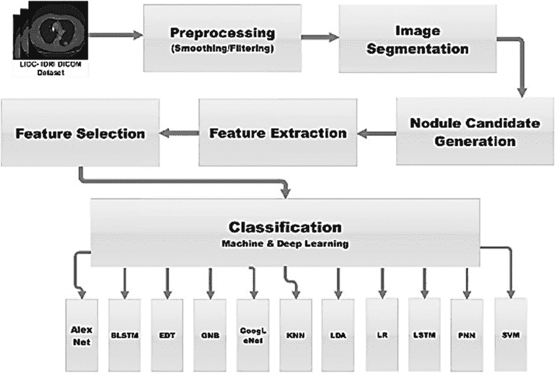

图 3.2 系统提出架构的示意图。

#### 3.3.2 图像获取

如图 3.2 所示，提出的方法分为三部分。简言之，第一目标是从其图像数据库 LIDC-IDRI 收集 CT 图像。在第二步中，由专家标记对肺结节进行分割[Yadav et al., 2020]。最后，将实现各种 ML 和 DL 分类器的分析和性能评估。

#### 3.3.3 图像增强

图像平滑消除整个图像中的失真或其他微小干扰，这意味着边缘失真，并迭代地减少噪声。输入首选图像，并使用一些滤波器进行分析。如图 3.2 所示，中值、高斯和 Gabor 滤波器被添加在预处理阶段，当前最佳解决方案被更新并提出了一个新方案。中值滤波器是一种非线性 3 × 3 尺度特征[Shah et al., 2020]，通过最小化脉冲噪声来改善图像。

```
g(x,y) = \frac{1}{2\pi\sigma^{2}}\exp\left\lbrack \frac{- \left( {x^{2} + y^{2}} \right)}{2\sigma^{2}} \right\rbrack
```
*公式 3.1：二维高斯滤波器*

高斯滤波器对于消除高频元素以消除图像中的波动也很有用。这意味着 `medfilt2` 仅用于减少噪声。该低通滤波器消除湍流，增加表面的平滑度和精确强度。高斯分布的标准差是轴心到中心的距离以及 y 轴到轴心中心的距离[Tabish et al., 2017]。预处理后，处理过的图像通过分水岭分割进行分割。该图像显示识别出的癌症结节。

![Figure 3.3(a), 3.3(b), 3.3(c) [Patient Id: LIDC-IDRI-0082].](html/images/9780367720919_C003_003.jpg)

图 3.3(a)、3.3(b)、3.3(c) [患者 ID: LIDC-IDRI-0082]。

Gabor 函数是一种当前有用的图像评估线性滤波器。可使用高斯和谐波功能。它还增加了目标（如结节）周围区域之间的压缩/对比度。公式 3.2 给出了二维 Gabor 滤波器的表达式[Albu et al., 2019]。在此公式中，λ 为波长；θ 用于方向，从标准到平行切片；φ 为相位偏移；σ 为标准差；γ 为空间纵横比。在癌症检测开发阶段，还开发了其他特征，包括表面积、周长和离心率，以及质心、直径和主要强度像素等特征。此后，提取了特征并准确评估了癌症结节。此后，良性或恶性并不明显。

```
\begin{array}{l} {g\left( {x,y} \right) = \exp\left( \frac{{x^{\prime}}^{2} + \gamma^{2}{y^{\prime}}^{2}}{2\sigma^{2}} \right)\cos\left( {2\pi\frac{x^{\prime}}{\lambda} + \phi} \right)} \\ {x^{\prime} = x\cos\theta + y\sin\theta} \\ {y^{\prime} = - x\sin\theta + y\cos\theta} \\ \end{array}
```
*公式 3.2：二维 Gabor 滤波器*


下一步是确定之前已使用深度学习训练的高级节点，即 `AlexNet`、`BLSTM`、`GoogLeNet`、`LSTM`，以及其他分类器，如机器学习分类器，即 `EDT`、`LR`、`LDA`、`SVM`、`PNN`、`GNB` 和 `KNN`。训练特征用于构建训练模型。下一步是利用训练好的预后模型对未知癌变节点进行分类。

### 3.4 图像分割

将灰度信息隔离为目标灰度数据的最佳方法是通过分割阈值处理，即局部或全局阈值处理。最广泛使用的是 `Otsu` 算法。最初应用一个初始种子值，该值合并徽章外部所有相同的像素。其优点在于通常能将相同特征与相关特征区分开来，并可靠地提供更好的数据，尽管它也会产生噪声或失真。其益处在于通常将相同特征从相关区域中分离出来，并提供改进的分割输出信息；其缺点在于计算资源成本较高，这会导致严重的噪声或规则性斑点。预滤波图像被转换为另一种格式，这在一定程度上消除了主要位于边缘处的前景像素的复杂性。肺部分割过程要经历多个阶段，而肺分割策略则要经历预处理、中值滤波器实现、高斯滤波器、`Gabor` 函数播种等各种步骤，然后开始新的过程，如图 3.4(a)、3.4(b)、3.4(c) 和 3.4(d) 所示，以将肺叶与上叶和下叶分离。

#### 3.4.1 分水岭分割

此方法用于识别特定图像位置中的对象或上下文。接下来，一幅彩色图像被转换为灰度图像。开发了具有梯度幅度的分割函数。对象通常具有的低梯度主要位于内部，而观察到的高梯度则是对象的边界。随后对第一个对象进行标记。要定位前景目标，其对象的所有像素块必须全部相关联。形态学技术用于每个对象上暗斑和修剪标记的形成与去除 [Manikandan et al., 2016]。背景像素为黑色，并通过骨架测量前景的效果。原因似乎是上下文标记过于接近对象的分割。图 3.4(a)、3.4(b)、3.4(c) 和 3.4(d) 说明了使用分水岭分割来区分接触点的此类图像。通过将整体视为一个层，较亮像素变高、较暗像素变低，分水岭变换在图像中识别出“集水盆”以及“分水岭脊边”。然而，它可以定义或“标记”前景对象，包括上下文点，执行分水岭变换的分割效果更好 [Tripathi Priyanshu et al., 2019]。这种简单技术伴随着基于标记的分水岭分割：计算分割函数。这是一幅可尝试分割变暗部分的图像。(a) 计算前景标记。似乎有像素块附着在每个点上。(b) 评估背景标记。可能存在从未在单个对象中发现的像素。(c) 调整分割特征，使其仅在前景和背景标记处提供有限细节。(d) 计算改进的分割特征分水岭变换。

#### 3.4.2 Otsu 阈值处理

阈值处理是将像素从前景移除至背景的方法。有多种方法可确定阈值，由 Nobuyuki Otsu 提出的 `Otsu` 过程便是其中之一。`Otsu` 方法是一种比较阈值值的技术，其中背景和前景像素之间的加权差异最小。基本概念是获取所有可行的阈值，并计算前景和背景像素的分布。然后寻找最小离散程度。在特定阈值 `t` 下确定类内方差的公式定义为：

```
σ²(t) = ωbgσ[bg]²(t) + ωfgσ[fg]²(t)
```
*公式 3.3：二维 Otsu 阈值处理*

该算法 [Li et al., 2018] 寻找使加权总和（背景和前景）指定的两类方差的内部方差最小化的阈值。灰度颜色通常在 0–255 之间变化（浮点数为 0–1）。因此，如果该阈值为 100，所有低于 100 的像素将成为背景，所有高于或等于 100 的像素将成为同一图像的前景。

其中 `ωbg` 和 `ωfg` 描述了由阈值 `t` 决定的像素数量概率，`σ²` 为像素值的方差。`P[all]` = 图像中像素总数，`Pbg` = 阈值 `t` 下的背景像素数，`Pfg` = 阈值 `t` 下的前景像素数。因此，权重表示为

```
ω_bg(t) = P_bg(t) / P_all, ω_fg(t) = P_fg(t) / P_all
```

方差可通过公式 `σ²(t) = (∑(x_i - x̄)) / (N - 1)²` 确定，其中 `x_i` 为类别（`bg` 或 `fg`）中位置 `i` 处像素的值，`x̄` = 类别（`bg` 或 `fg`）中像素值的均值，`N` 为像素数量。

### 3.5 特征提取

特征提取是图像处理的重要步骤。该过程指定适当的处理信息。在肺部可能观察到一致性或不规则性。这些分离的特性已用于肿瘤诊断和分期。`Area`（面积）、`Major Axis Length`（长轴长度）、`Minor Axis Length`（短轴长度）、`Eccentricity`（离心率）、`Convex Area`（凸包面积）、`Filled Area`（填充面积）、`Perimeter`（周长）、`Solidity`（固度）、`Extent`（范围）、`Mean Intensity`（平均强度）、`Actual Area`（实际面积）、`Actual Perimeter`（实际周长）、`Actual Major Axis Length`（实际长轴长度）和 `Compactness`（紧凑度）已成为本文中单独的显著特征。目的是使用最少的可用步骤，准确地将对象分类为明确的类别。其主图像的准确性，以及图像的预处理方式，依赖于某些形状计算的效率。包括小孔和噪声在内的对象腐蚀会导致测量结果不佳，并不可避免地导致分类错误。形状信息就是在移除对象的位置、倾斜和大小特征后所剩下的内容 [Echegaray et al., 2016]。形状特征可分为边界特征和区域特征，具体描述如下 [Johora et al., 2018]。

#### 3.5.1 距离

两个特定像素 (`x₁`, `y₁`) 和 (`x₂`, `y₂`) 之间所有距离的最短计算如表 3.1 所示。

```
欧几里得距离
d = √((x₁ - x₂)² + (y₁ - y₂)²)
棋盘距离
d = max(|x₁ - x₂|, |y₁ - y₂|)
```
*公式 3.4：欧几里得距离度量*

#### 3.5.2 面积

区域由形状中的一系列像素组成。该区域是肺部肿瘤区域内所有像素的总和。面积是一个标量值。表 3.1 显示了面积。

#### 3.5.3 凸包面积


目标凸区域是凸包的周围区域。凸包揭示了包含肺部肿瘤分割区域的最小凸多边形。该凸多边形给出了凸区域内的像素数量。该值为标量。

#### 3.5.4 周长

周长似乎是目标边界上的像素数量。它一直是肺内连接肿瘤区域的总和。这是周长的一个标量值。如果边界列表为 `x[1],…,x[N]`，则周长由下式给出：

```
Perimeter = \sum_{i = 1}^{N - 1} d_i = \sum_{i = 1}^{N - 1} |x_i - x_{i + 1}|
```
*公式 3.5：周长计算*

距离 `d[i]` 对于四连通边界等于 1，对于八连通边界等于 1 或 `\sqrt{2}`。正如表 3.1 所述，在八相关边界内，`N[4] - N[8]` 之间的对角连接数量长度有一个像素，以及一个 `N[8] - (N[4] - N[8])` 连接。因此完整周长为：

```
Perimeter = (\sqrt{2} - 1)N_4 + (2 - \sqrt{2})N_8
```
*公式 3.6：周长计算*

#### 3.5.5 凸周长

此类目标的凸周长就是覆盖该目标的凸包。这意味着覆盖球体的凸包的凸边界即为目标的凸周长。

#### 3.5.6 轴长

目标的主轴是最长线的 `(x, y)` 端点，主要可通过计算目标边界内每个边界像素组合的距离来识别，主轴端点像素 `(x1, y1)` 和 `(x2, y2)` 的最大长度见[Wang et al., 2018]，如表 3.1 所示。

##### 3.5.6.1 主轴长度

目标的主轴长度由主轴端点之间的像素距离组成：

```
MajorAxisLength = \sqrt{(x_2 - x_2)² + (y_2 - y_1)²}
```
*公式 3.7：主轴*

结果为目标长度估计值。

##### 3.5.6.2 次轴长度

次轴是目标所能形成的、且与主轴垂直的最长线的 `(x, y)` 端点。通过测量从边界像素两端点出发的像素间隙，可以找到次轴端点 `(x[1], y[1])` 和 `(x[2], y[2])`。

```
MajorAxisLength = \sqrt{(x_2 - x_2)² + (y_2 - y_1)²}
```
*公式 3.8：次轴*

此处结果为目标宽度估计值。

#### 3.5.7 紧凑度

紧凑度是目标面积与具有相同周长的圆面积之比[Riti et al., 2016]。选择圆是因为它是最紧凑的物体。圆的最大值为 1。正方形的紧凑度为 `\frac{\pi}{4}`

```
Compactness = \frac{4\pi.Area}{(Perimeter)²}.
```
*公式 3.9：紧凑度计算*

该计算将降低具有椭圆形或非平滑不规则边界的目标的值。对于圆，测量值取最小值 1。正如表 3.1 所述，目标复杂、不规则的边界更为紧凑。

```
Compactness = \frac{(Perimeter)²}{4\pi.Area}.
```
*公式 3.10：紧凑度计算*

#### 3.5.8 偏心率

偏心率是次（短）轴长度与目标主（长）轴长度之比[Kavitha et al., 2019]。因此，目标偏心率测量值在 0 到 1 之间给出。偏心率有时称为第一偏心率，以区别于第二和第三偏心率。

```
Eccentricity = \frac{AxisLength_{short}}{AxisLength_{long}}.
```
*公式 3.11：偏心率计算*

这用于确定肿瘤的圆度，如表 3.1 所述。对于规则目标，偏心率值等于 1，而在不规则形态中，该值超过 1。

#### 3.5.9 标准差

它计算灰度像素尺度值均值的均方差。

#### 3.5.10 偏度

它是指定 ROI 内像素分布围绕平均值的不对称度评级。

#### 3.5.11 峰度

它测试分布与正态分布的峰度和平坦度的对比。

#### 3.5.12 熵

它是分割 ROI 内容最大可能量的度量。

#### 3.5.13 圆度

通常，仅对偏离特定圆度形式敏感的步骤才有用，例如凸度（测量不规则性）和圆度（排除局部不规则性）[Riti Yosefina Finsensia et al., 2016] [Kavitha et al., 2019]。圆度计算（面积与周长之比）可通过目标面积与具有相同凸周长的圆面积之比来实现，从而排除局部不规则性，详见表 3.1。

```
Roundness = \frac{4\pi.Area}{(ConvexPerimeter)²}.
```
*公式 3.12：圆度计算*

对于圆形目标，该数值为 1；对于偏离圆形的目标，该值小于 1，且对不规则边界相对不敏感，但对于偏离圆形的目标，它对不规则边界合理地不敏感。

#### 3.5.14 凸度

凸度是目标与凸目标之间差异的比例[Wang et al., 2018]。可测量目标凸包周长与目标自身周长之比，如表 3.1 所述。

```
Convexity = \frac{ConvexPerimeter}{Perimeter}.
```
*公式 3.13：凸度计算*

对于凸目标，此值为 1。如果目标非凸（例如边界不规则），则小于 1。

#### 3.5.15 实心度

目标的密度由实心度测量。作为目标面积与目标凸包面积之比，可获得实心度度量，见表 3.1。

```
Solidity = \frac{Area}{ConvexArea}.
```
*公式 3.14：实心度计算*

值为 1 表示实心目标；具有不规则边界或空洞的目标值低于 1，表示边界不规则。

#### 3.5.16 边界框

限制目标的矩形即为目标的边界框或矩形[Wang et al., 2018]。边界框的比例为长轴和短轴，如表 3.1 所述。边界框面积为

```
BoundingBoxArea = (MajorAxisLength) \times (MinorAxisLength)
```
*公式 3.15：边界框计算*

限制形状的最小边界面积即为最小边界框。

#### 3.5.17 平均强度

该值为标量。它确定感兴趣区域（即肿瘤部分）内的平均像素强度[Riti Yosefina Finsensia et al., 2016]。

### 3.6 机器学习与深度学习算法


#### 机器学习算法与性能评估指标

机器学习算法协助人和动物像自然一样学习。这些算法被用于研究原始数据以供您的计算机处理，而在不采用预设模型机器的情况下，可用于学习性能的试验次数。这些模型可以通过提供洞察来识别自然现象，并帮助做出更明智的重大决策，如预测、医学诊断、库存管理、交易、能源消耗评估等。媒体网站专注于计算机的教学，并提出数百万种可能的方式来推荐电影或歌曲。企业通过倾听消费者的购物模式来实现这一点。它包含两种方法：监督学习，它通过已知的输入和输出数据构建框架以预测未来结果；以及无监督学习，它包含具有隐藏模式或内在结构的输入信息。

到目前为止，作者已经介绍了各种类型的机器学习，其中许多算法都有其优势和局限性，这使它们非常适合用于相关领域。此类算法的增强版本被定义为深度学习算法，近期已变得极其流行。然而，这些方法源于多年前的生物神经网络，早于它们对数据科学的贡献。作者在本研究中仅使用了机器学习和深度学习算法，以及一些最广泛使用的 `LIDC-IDRI` 数据集进行研究 [Pradhan et al., 2020]。本深度研究的输出分析及发现将帮助同类领域的研究人员和专家获得改进的信息和经验，以根据不同肺癌数据集的数据，在这大量算法中创建最适合其挑战的最佳算法。本章讨论的机器学习算法包括 `Logistical Regression (LR)`、`K-Nearest Neighbors (KNN)`、`Gaussian Naive (GNB)`、`Decision Trees (DT)`、`Random Forestry (RF)`。作为深度学习中人工神经网络的主要类别，`Bidirectional Long Term Memory (BLSTM)` 和 `Long Short Term Memory (LSTM)` 也进行了分析。

### 3.7 性能评估指标

在实施机器学习算法后，需要这些工具来了解和理解它们在工作中取得了什么成果。这些指标被称为性能评估指标。在本研究中，作者发现了算法效率的各种要素，并引入了许多指标。然后，我们需要一套可接受的指标集合，用于每个学习任务的性能评估。在本章中，作者采用了许多标准指标来获取关于算法效率的有价值数据，并对分类问题执行类似的分析。这些指标包括精确率、召回率、混淆矩阵、准确率和 ROC-AUC 排序。这些测试如下。

#### 3.7.1 精确率 / 阳性预测值 (PPV)

“所需数据中有多少是可接受的。”这意味着根据算法预期为支持性的发现，其中许多似乎是正确和准确的 [Shakeel et al., 2020]。根据公式，真阳性的数量除以真阳性数量与假阳性数量之和。

$$PPV = \frac{TP}{TP + FP}$$
*公式 3.16：精确率计算*

#### 3.7.2 阴性预测值 (NPV)

$$NPV = \frac{TN}{TN + FN}$$
*公式 3.17：NPV 计算*

#### 3.7.3 召回率 / 灵敏度 / 检出概率 / 命中率 / 真阳性率 (TPR)

它评估测试对于被准确诊断并被归类为疾病真阳性率的患者来说，是否做出了一个好的选择。一个极其困难的测试可能会击中那些具有最多错误阴性结果的人，因此可能不会显示最多的假阴性结果：90% 的肺癌患者能够获得阳性结果，而 10% 被测试为阳性的人将呈现阴性结果，且阳性者将呈现阴性结果，宣称错误的阴性方面。该测试的结果高度敏感。它包含“选择了多少类型的数据。”确实，有多少是根据真阳性发现由算法估计的 [Shakeel et al., 2020]。预计在怀疑疾病时，发现分析也将呈阳性。召回率是模型准确识别真阳性的度量。因此，请记住在所有真正患有肺癌的人中，有多少患者被识别为患有肺部疾病。

$$TPR = \frac{TP}{TP + FN}$$
*公式 3.18：灵敏度计算*

#### 3.7.4 特异性 / 选择性 / 真阴性率 (TNR)

它衡量测试精确地为未患有被测试感染的个体获得阴性结果的能力，这通常被称为“真阴性率”。高特异性测试将适当地发现几乎所有不患病的人，且不会产生大量假阳性结果。

预计当疾病不存在时，测试结果本应为阴性 [Shakeel et al., 2020]。根据公式，真阴性的数量除以真阴性数量与假阳性数量之和。

$$TNR = \frac{TN}{TN + FP}$$
*公式 3.19：特异性计算*

#### 3.7.5 假警率 / 假阳性率 (FPR)

疾病可能发生的阳性情况与疾病不存在的假设之间的关系，因此就该测试的结果而言是阳性的。

$$FPR = \frac{FP}{FP + TN}$$
*公式 3.20：FPR 计算*

#### 3.7.6 漏诊率 / 假阴性率 (FNR)

疾病发现为阴性的概率与疾病检测结果为阴性的可能性之间的关系。

$$FNR = \frac{FN}{FN + TP}$$
*公式 3.21：FNR 计算*

#### 3.7.7 假发现率 (FDR)

$$FDR = \frac{FP}{FP + TP}$$
*公式 3.22：FDR 计算*

#### 3.7.8 假遗漏率 (FOR)

$$FOR = \frac{FN}{FN + TN}$$
*公式 3.23：FOR 计算*

#### 3.7.9 F1-Score / F-Measure / Sørensen–Dice 系数 / Dice 相似性系数 (DSC)

在衡量算法性能时，这种指标通常称为 F-Score 或 F-Measure，它同时考虑了精确率和召回率。在一种情况下对召回率和精确率进行估计起着至关重要的作用，这样可以通过识别低召回高精确率或反之的模型来消除该问题 [Dong et al., 2020]。精确率和召回率的关系平均值在数学上描述如下：

$$F1 - Score = 2 \times \frac{Precision \times Recall}{Precision + Recall}$$

$$F1 - Score = \frac{2TP}{2TP + FN + FP}$$
*公式 3.24：F1-Score 计算*

F1-Score 是精确率和召回率的加权平均值。必须考虑假阳性和假阴性。存在低假阳性和低假阴性，能正确识别真实威胁，使得误报不会打扰它们。预计会有两个截然不同的警告，并应随后计算性能。

#### 3.7.10 准确率


它将是分类任务中评估算法性能时访问最频繁、或许也是最重要的选项。根据公式 [Shakeel et al., 2020]，可将特定分类的数据项与总观测集的比率描述为准确率。在某些情况下，考虑到广泛的适用性，准确率并非最高性能指标，特别是在数据的目标类别不平衡时。

$$Accuracy = \frac{TP + TN}{TP + TN + FP + FN}$$
*公式 3.25：准确率计算*

#### 3.7.11 混淆矩阵

此类矩阵是机器学习模型获得准确性和适用性的最合乎逻辑且最简洁的统计量之一。其主要应用在于分类挑战，其中结果可能包含两个或更多类别 [Kavitha et al., 2019]。

**表 3.1：从处理后的肺癌 DICOM 图像中提取的特征**

| **3. 面积** | **长轴长度** | **短轴长度** | **离心率** | **凸包面积** | **填充面积** | **周长** | **固度** | **范围** | **平均强度** | **实际面积** | **实际周长** | **实际长轴长度** | **紧凑度** | **标签** |
|---|---|---|---|---|---|---|---|---|---|---|---|---|---|---|
| 076.00 | 11.01 | 08.91 | 0.59 | 077.00 | 076.00 | 28.09 | 0.99 | 0.77 | 0566.66 | 37.57 | 19.75 | 07.74 | 180.09 | 1 |
| 028.00 | 07.65 | 04.81 | 0.78 | 029.00 | 028.00 | 16.47 | 0.97 | 0.80 | 0539.82 | 13.84 | 11.58 | 05.38 | 086.65 | 0 |
| 124.00 | 13.42 | 11.88 | 0.47 | 129.00 | 124.00 | 36.92 | 0.96 | 0.73 | 0566.57 | 61.30 | 25.96 | 09.43 | 256.33 | 1 |
| 066.00 | 09.64 | 08.86 | 0.39 | 068.00 | 066.00 | 26.03 | 0.97 | 0.81 | 0566.88 | 32.63 | 18.30 | 06.77 | 162.49 | 1 |
| 001.00 | 01.15 | 01.15 | 0.00 | 001.00 | 001.00 | 00.00 | 1.00 | 1.00 | 0729.00 | 00.49 | 0.00 | 00.81 | 000.00 | 0 |
| 103.00 | 14.87 | 09.61 | 0.76 | 117.00 | 103.00 | 41.36 | 0.88 | 0.61 | 1098.53 | 50.92 | 29.08 | 10.45 | 201.16 | 1 |
| 069.00 | 11.58 | 07.68 | 0.75 | 070.00 | 069.00 | 27.33 | 0.99 | 0.77 | 0468.49 | 34.11 | 19.22 | 08.14 | 165.77 | 1 |
| 022.00 | 07.46 | 03.88 | 0.85 | 022.00 | 022.00 | 14.88 | 1.00 | 0.79 | 0627.91 | 10.88 | 10.46 | 05.24 | 071.64 | 0 |
| 014.00 | 08.08 | 02.31 | 0.96 | 014.00 | 014.00 | 13.36 | 1.00 | 1.00 | 0588.21 | 06.92 | 09.39 | 05.68 | 048.11 | 0 |
| 075.00 | 11.02 | 09.21 | 0.55 | 086.00 | 075.00 | 32.00 | 0.87 | 0.68 | 0696.04 | 37.08 | 22.50 | 07.75 | 166.53 | 1 |
| 026.00 | 10.15 | 03.54 | 0.94 | 029.00 | 026.00 | 19.26 | 0.90 | 0.72 | 0782.73 | 12.85 | 13.54 | 07.13 | 074.41 | 0 |
| 119.00 | 15.05 | 10.43 | 0.72 | 126.00 | 119.00 | 38.55 | 0.94 | 0.79 | 0743.34 | 58.83 | 27.10 | 10.58 | 240.74 | 1 |
| 170.00 | 21.42 | 10.72 | 0.87 | 181.00 | 170.00 | 51.79 | 0.94 | 0.58 | 0637.68 | 84.05 | 36.41 | 15.06 | 296.70 | 1 |
| 010.00 | 04.26 | 03.21 | 0.66 | 010.00 | 010.00 | 08.15 | 1.00 | 0.83 | 0622.30 | 04.94 | 05.73 | 02.99 | 044.01 | 0 |
| 084.00 | 12.32 | 08.91 | 0.69 | 089.00 | 084.00 | 30.82 | 0.94 | 0.70 | 0588.44 | 41.53 | 21.67 | 08.66 | 190.03 | 1 |
| 035.00 | 08.36 | 05.67 | 0.74 | 039.00 | 035.00 | 20.05 | 0.90 | 0.63 | 0488.66 | 17.30 | 14.10 | 05.88 | 098.18 | 0 |
| 024.00 | 08.02 | 04.01 | 0.87 | 026.00 | 024.00 | 16.47 | 0.92 | 0.75 | 0561.17 | 11.87 | 11.58 | 05.64 | 074.27 | 0 |
| 005.00 | 05.89 | 01.60 | 0.96 | 007.00 | 005.00 | 08.51 | 0.71 | 0.50 | 0502.20 | 02.47 | 05.98 | 04.14 | 021.57 | 0 |
| 108.00 | 15.79 | 09.10 | 0.82 | 113.00 | 108.00 | 36.91 | 0.96 | 0.64 | 0507.11 | 53.39 | 25.95 | 11.10 | 223.27 | 1 |
| 055.00 | 09.15 | 07.75 | 0.53 | 055.00 | 055.00 | 23.21 | 1.00 | 0.86 | 0594.16 | 27.19 | 16.32 | 06.43 | 143.40 | 1 |
| 115.00 | 13.14 | 11.23 | 0.52 | 117.00 | 115.00 | 35.29 | 0.98 | 0.80 | 0611.18 | 56.85 | 24.81 | 09.24 | 243.15 | 1 |
| 071.00 | 10.85 | 08.53 | 0.62 | 072.00 | 071.00 | 27.61 | 0.99 | 0.79 | 0460.93 | 35.10 | 19.42 | 07.63 | 169.70 | 1 |
| 022.00 | 06.27 | 04.61 | 0.68 | 022.00 | 022.00 | 13.59 | 1.00 | 0.73 | 0594.95 | 10.88 | 09.55 | 04.41 | 074.96 | 0 |
| 010.00 | 04.69 | 03.00 | 0.77 | 010.00 | 010.00 | 08.70 | 1.00 | 0.83 | 0866.00 | 04.94 | 06.12 | 03.29 | 042.58 | 0 |
| 046.00 | 09.92 | 06.05 | 0.79 | 047.00 | 046.00 | 22.10 | 0.98 | 0.77 | 0565.11 | 22.74 | 15.54 | 06.97 | 122.91 | 0 |
| 072.00 | 11.42 | 08.12 | 0.70 | 073.00 | 072.00 | 27.61 | 0.99 | 0.82 | 0514.14 | 35.60 | 19.42 | 08.03 | 172.09 | 1 |
| 041.00 | 08.55 | 06.23 | 0.69 | 041.00 | 041.00 | 19.84 | 1.00 | 0.85 | 0550.76 | 20.27 | 13.95 | 06.01 | 115.61 | 0 |
| 024.00 | 07.63 | 04.18 | 0.84 | 024.00 | 024.00 | 15.46 | 1.00 | 0.69 | 0886.21 | 11.87 | 10.87 | 05.37 | 076.67 | 0 |
| 001.00 | 1.15 | 01.15 | 0.00 | 001.00 | 001.00 | 00.00 | 1.00 | 1.00 | 0867.00 | 00.49 | 00.00 | 00.81 | 000.00 | 0 |
| 055.00 | 10.46 | 07.29 | 0.72 | 61.00 | 055.00 | 27.33 | 0.90 | 0.61 | 0697.07 | 27.19 | 19.22 | 07.35 | 132.13 | 1 |
| 104.00 | 15.09 | 09.75 | 0.76 | 119.00 | 104.00 | 40.09 | 0.87 | 0.54 | 0690.89 | 51.42 | 28.19 | 10.61 | 206.29 | 1 |
| 003.00 | 03.46 | 01.15 | 0.94 | 003.00 | 003.00 | 03.92 | 1.00 | 1.00 | 0805.67 | 01.48 | 02.76 | 02.44 | 019.03 | 0 |


#### 3.7.12 ROC-AUC 得分

它是通过 ROC 曲线计算得出的，该曲线表达了真阳性率（以前称为灵敏度或召回率）与假阳性率之间的关系。ROC/AUC 得分是利用 ROC 曲线（1 - 特异性）确定的。二分类中 ROC 曲线下面积或 ROC-AUC 表明模型在正负目标类别上的区分能力有多强 [[Riti et al., 2016]]; [[Kavitha et al., 2019]]。特别是，当正负组的值相似时，ROC-AUC 得分的成功标准可能是有益的。

### 3.8 分类

作者分析了 1010 例恶性和良性病例，旨在挑选模型训练集，随后测试模式的准确性，并经常同时寻求有监督和无监督学习方法。然而，如 图 3.5(a)、3.5(b)、3.5(c) 和 3.5(d) 所示，变量之间不存在共线性问题，可用于预测癌变或非癌变细胞 [[Vinod Kumar et al. 2021]]。预测扇区、熵和标准差之间的相关性很高 [[Hussein Sarfaraz et al., 2019]]。峰度和偏度也密切相关。这种共线性也意味着此类预测变量被排除在外。

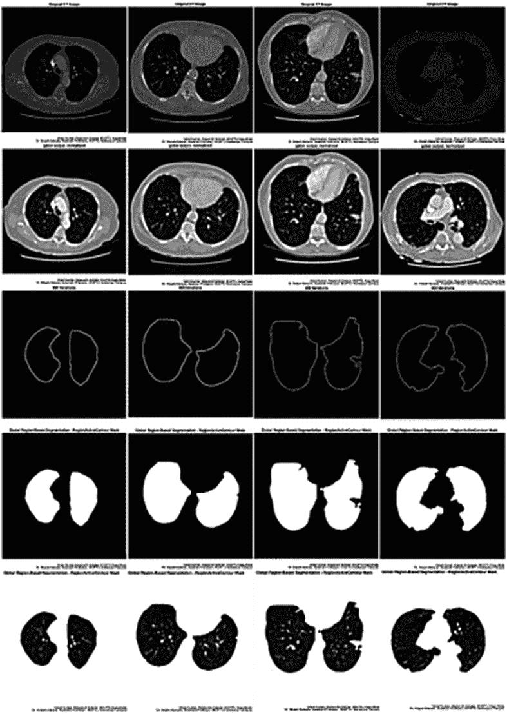

Figure 3.4(a) P-Id: LIDC-IDRI-0001-00096.dcm. Figure 3.4(b) P-Id: LIDC-IDRI-0006-00057.dcm. Figure 3.4(c) P-Id: LIDC-IDRI-0013-00027.dcm. Figure 3.4(d) P-Id: LIDC-IDRI-0082-00007.dcm.

#### 3.8.1 双向长短期记忆网络 (BLSTM)

自 20 世纪中叶以来，长短期记忆 (LSTM) [[Zhang et al., 2018]] 的提出使得人工神经网络 [[Kumar et al., 2012]] (ANN) 成为一种极其出色的循环神经网络 (RNN)。通过其在分组中的直连，RNN 可能变得依赖于时间。为了证明这一点，前馈网络应实现静态模式映射的使用，例如 MLP。此外，传统 RNN [[Wang Ran et al., 2018]] 对这一极其真实的问题变得敏感，特别是在梯度下降训练中，包括梯度消失问题。此问题产生的原因是梯度呈指数级消失或爆炸。因此，经过几个步骤后，传统 RNN 在梯度消失后“遗忘”少于十次的关注点。其影响可能对后续研究方法受到异常限制，并且逐渐隔离的前序层之间的链接和连接变得非常复杂和棘手。

LSTM [[Zhang et al., 2018]] 所精妙阐释的问题将其自身概括为一种特殊的循环结构，能够像可微容量单元一样运作。LSTM 模块内部的误差可以长期维持，可以在交汇点长期保持。LSTM 可以监管多达 10,000 步的时间跨度 [[Salehi et al., 2018]] 以及极长的周期。LSTM [[Salman et al., 2020]] 释放出一种惊人的能力，能够从循环集合中的其他能力中学习，例如精确计时、精确复制值、扩展，以及有时的增加 [[Albu et al. 2019]]。分析师们利用梯度通过时间反向传播来学习 LSTM 的度量 [[Mhaske Diksha et al., 2019]]。

它涉及单向经典循环网络架构。这意味着此类网络的输入序列按正确方向解释：其行为朝向正确方向。输入背景被收集在网络的先前上下文中。因此，这些问题是仅靠先前上下文无法正确学习的问题。获取潜在的未来上下文可能也就足够了，例如，在临床场景中，通过提供关于即将到来的信息，来识别输入序列中可能令人不安的局部部分。只有在计算时刻输入序列通常已完全给出时，未来上下文才能被精确提供。双向循环神经网络的原理允许某些过去上下文和未来上下文在循环神经网络中均可访问 [[Razzak et al., 2018]]。考虑一个仅具有一个隐藏层循环的经典 RNN。现在，引入第二个循环隐藏层，并将其与输入层以及输出层连接，尽管具体不是与另一个隐藏层连接。其次，通常按正向方向，将输入序列引入输入层。仅计算第一隐藏层，然后所有激活值随每个过程进行处理 [[Mobile et al., 2017]]。第三，输入序列按反向显示。仅第二隐藏层工作，并保持其所有操作。在此之后，输出层通过在每个阶段融合历史知识（即第一隐藏层）和未来信息（即第二隐藏层）来生成输出序列。第二层包含第二个隐藏层。现在，反向隐藏层的梯度计算在反转时间下以几乎相同的方式运行。

后来，双向层的概念在 LSTM 网络中得到了类似实现 [[Mhaske Diksha et al., 2019]]。双向长短期存储网络 (BLSTM) 凭借 BLSTM 在惊人的手动分类准确性方面变得更加突出。因此，LSTM 以及隐马尔可夫模型 (HMM) 等其他技术，为本章规定的分类任务选择 BLSTM。

### 3.9 实验与结果

使用 GPU 框架 MATLAB R2018b、Intel® CoreTM i5-7200U 第 7 代 CPU @3.1 GHZ、Intel(R) HD Graphics 620 RAM 1 GB 适配器、8 GB DDR4 RAM，为 BLSTM 和 SVM 给出了以下先决条件。如 图 3.5(a)、3.5(b)、3.5(c) 和 3.5(d) 所示，分类器的结果需牢记各种要求。

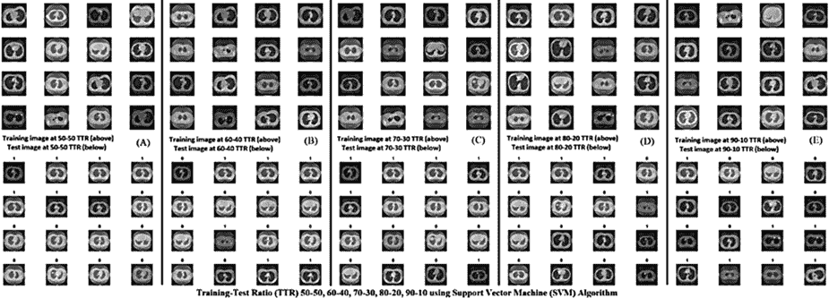

Figure 3.5(a) Benign as zero and malign as one in a resulting CT image were identified after compilation of classifier SVM algorithms from 50% to 90% TTR respectively.

机器训练系统使用 395 个 CT 图像片段来检测肺癌，并遵循 LIDC-IDRI 数据集，在将文件从 (dot) DCM 格式转换为 (dot) PNG 格式后获得数据集。使用 MATLAB 脚本，该系统可以检测并定位肺部肿瘤。在肿瘤识别过程之后，此处癌变和非癌变细胞的图像分别由 图 3.5(a)、3.5(b)、3.5(c) 和 3.5(d) 表示，用零和一标识。


#### 实验设置与数据集

在 CAD 系统的图像训练过程中，使用相应的掩码来训练机器；在测试过程中，研究人员使用该地图的图像进行输出处理。然后，根据感兴趣区域（本例中为肺实质）的分布，按下图所示实施掩码。

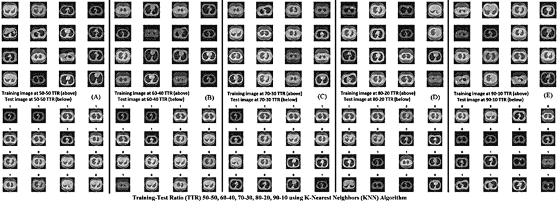

**Figure 3.5(b)** 在生成的 CT 图像中，良性标记为 0，恶性标记为 1，分别通过编译分类器 KNN 算法（从 50%到 90% TTR）进行识别。

本实验使用的数据集为 **LIDC-IDRI** [Pradhan et al., 2020]，涵盖胸部 CT 扫描诊断和肺癌预测性病变扫描。这是一个用于改进肺癌分类和诊断技术的优秀数据库 [Kumar et al. 2021]。

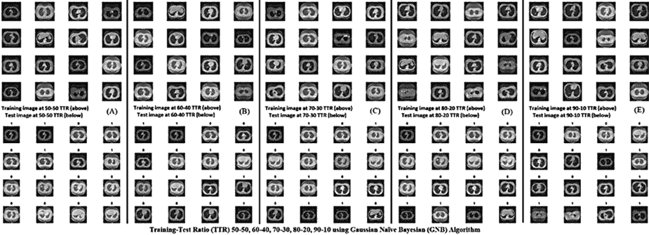

**Figure 3.5(c)** 在生成的 CT 图像中，良性标记为 0，恶性标记为 1，分别通过编译分类器 GNB 算法（从 50%到 90% TTR）进行识别。

研究人员对真实的肺实质进行了手动分割，并在实验前完成了预处理阶段，以裁剪图像并消除非研究领域的细节。

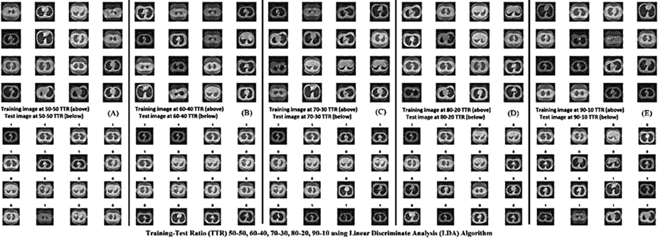

**Figure 3.5(d)** 在生成的 CT 图像中，良性标记为 0，恶性标记为 1，分别通过编译分类器 LDA 算法（从 50%到 90% TTR）进行识别。

训练-测试划分比例采用 50–50、60–40、70–30、80–20 和 90–10 等分组。`BLSTM` 和 `LSTM` 的混淆矩阵分别显示在 Table 3.2 和 Table 3.3 中，包含所有分类统计差异。预测结果可分为四类：`True Positive (TP)`、`True Negative (TN)`、`False Positive (FP)` 和 `False Negative (FN)`。阳性结果的百分比准确且预测为阳性。被预测为阳性的真实阴性结果数为 `False Positive` [Shakeel et al., 2020]。预测为阴性的真实阳性结果数为 `False Negative`。预测为阴性的真实阴性结果数为 `True Negative`。

作者详述了训练集和测试集：`BLSTM` 在 70% 训练比例下，`TP=6610`，`TN=74` 和 `2137`（注：原文此处表述可能有误，详见表格），`FP` 和 `FN` 分别为 `2137` 和 `292`（注：原文表述“2137 and 292 for both FP and FN”存疑，以表格数据为准），表明总计 `6902` 个样本为恶性，`2211` 个为良性，如 Table 3.2 和 3.3 所示。

计算得到的 `Sensitivity`（灵敏度）和 `Specificity`（特异性）分别为 `95.77%` 和 `96.65%`。而 `LSTM` 在 70% 训练比例下，`TP=6578`，`TN=2103`，`FP=108`，`FN=324`，同样意味着 `6902` 张图像为恶性，`2211` 张为良性，如 Table 3.3 所述。其 `Sensitivity` 和 `Specificity` 分别为 `95.77%` 和 `96.65%`。

##### Table 3.2：BLSTM 在 TTR 70–30 (%) 下的混淆矩阵及高级分类指标

| Predicted Class | Actual Class: Positive | Actual Class: Negative | Metrics |
| :--- | :---: | :---: | :--- |
| **Positive** | 6610 (TP) | 74 (FP) | Precision = TP/(TP+FP) = 98.89% |
| **Negative** | 292 (FN) | 2137 (TN) | NPV = TN/(FN+TN) = 62.14% |
| **Metrics** | Sensitivity = TP/(TP+FN) = 95.77% | Specificity = TN/(TN+FP) = 96.65% | Accuracy = (TP+TN)/Total = 95.98% |
| **Totals** | Total Disease = 6902 | Total Normal = 2211 | |

由于人工神经网络数据量巨大，交叉验证方法耗时过长；且相互评估虽选出了正确的训练效果角色，但并非计算机辅助诊断系统高效可靠的测试手段。因此本研究未采用交叉验证，而是力求尽可能彻底地进行实验。

##### Table 3.3：LSTM 在 TTR 70–30 (%) 下的混淆矩阵及高级分类指标

| Predicted Class | Actual Class: Positive | Actual Class: Negative | Metrics |
| :--- | :---: | :---: | :--- |
| **Positive** | 6578 (TP) | 108 (FP) | Precision = TP/(TP+FP) = 98.39% |
| **Negative** | 324 (FN) | 2103 (TN) | NPV = TN/(FN+TN) = 86.65% |
| **Metrics** | Sensitivity = TP/(TP+FN) = 95.77% | Specificity = TN/(TN+FP) = 96.65% | Accuracy = (TP+TN)/Total = 95.98% |
| **Totals** | Total Disease = 6902 | Total Normal = 2211 | |

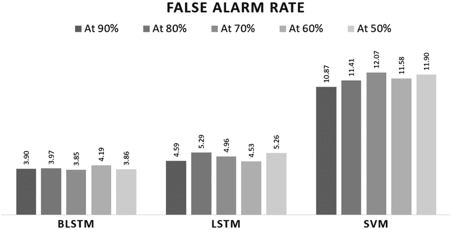

**Figure 3.6** 使用 BLSTM、LSTM 和 SVM 在 50% 到 90% TTR 下的虚警率。

本研究采用多次随机划分训练/测试集的策略替代交叉验证，实验重复了十次。结果表明最终结果稳定可复现。

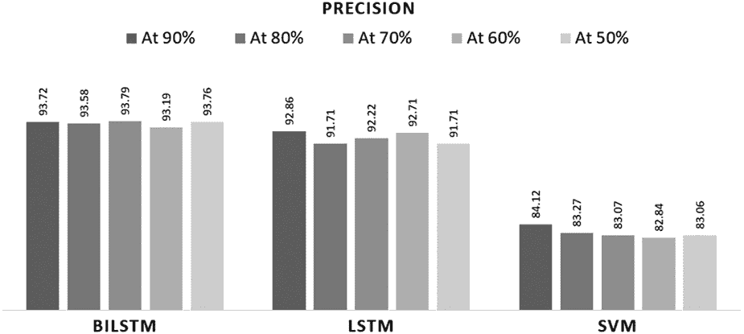

**Figure 3.7** 使用 BLSTM、LSTM 和 SVM 在 50% 到 90% TTR 下的精确率。

实验统计结果基于 70% 训练数据和 30% 测试数据。结合 Figures 3.4(a)、3.4(b)、3.4(c)、3.4(d) 及 Figures 3.7、3.8 可得：`BLSTM` 在 70% 训练比例下准确率为 `93.79%`，召回率为 `96.18%`。

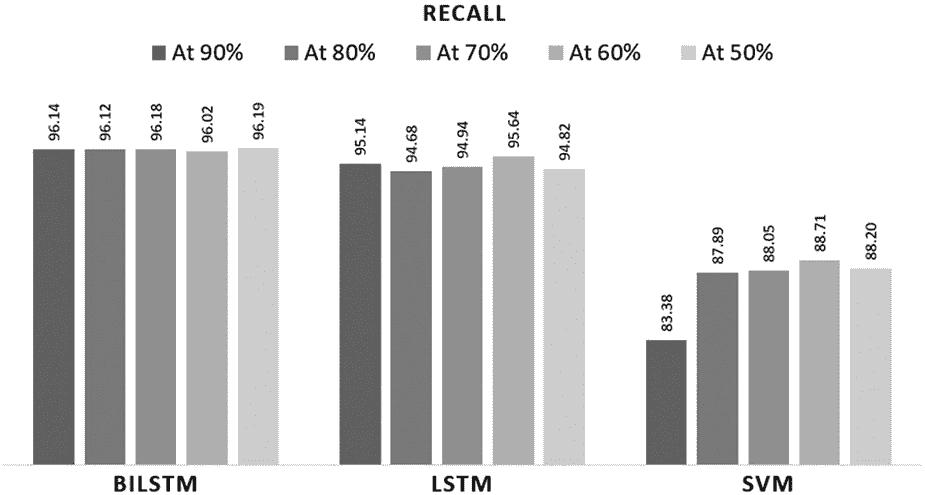

**Figure 3.8** 使用 BLSTM、LSTM 和 SVM 在 50% 到 90% TTR 下的灵敏度。

该策略使得准确率可准确识别为：`BLSTM` 在 70% 训练下为 `96.15%`，`LSTM` 在 60% 训练下为 `95.45%`，`SVM` 在 90% 训练下为 `89.13%`，详见 Figure 3.9。因此 `BLSTM` 表现优于其他模型，选择 `BLSTM` 更为合理。

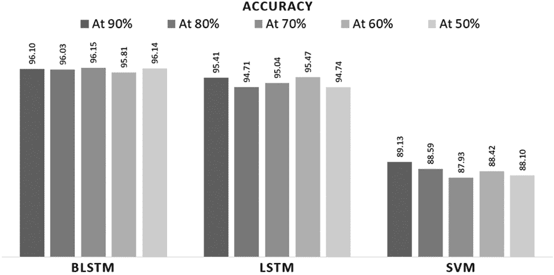

**Figure 3.9** 使用 BLSTM、LSTM 和 SVM 在 50% 到 90% TTR 下的准确率。


### SVM 性能分析与未来展望

#### SVM 性能对比

SVM 速度相当快。总体而言，SVM 耗时最少（使用 80% 训练数据时为 0.11 秒），而 BLSTM 在特征提取过程中耗时最长（使用 60% 训练数据时为 20.48 秒）。因此 SVM 适合用于评估，如 Figure 3.11 所示。根据 Figures 3.7、3.8、3.9、3.12 和 3.13，提高性能的重要方面之一是训练算法。在此分析中，选择 BLSTM 是因为它比 SVM 和 LSTM 更敏感、更准确。

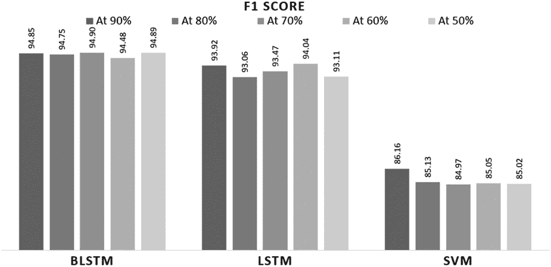

**Figure 3.10** 使用 BLSTM、LSTM 和 SVM 在 50% 至 90% TTR 下的 F1-score。

#### 实验结果分析

在此评测中，SVM 正确区分了 6902 名患者与 2211 名个体。在 89.13% 的患者中，SVM 正确识别了癌症与非癌症类别（健康个体和其他肺部疾病患者）的对比。基于 SVM 的自动呼吸评估使肺癌患者能在安全对象中被区分开来，并能区分各种疾病状态的患者。它可能提供癌症患者与健康人群之间的区分度，如 Figure 3.12 所述。

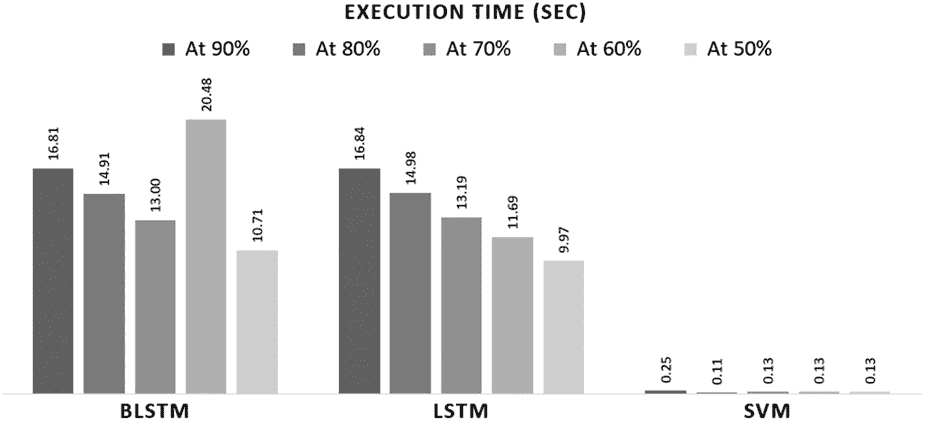

**Figure 3.11** 使用 BLSTM、LSTM 和 SVM 在 50% 至 90% TTR 下的执行时间。

LSTM 正确分类了总计 9113 例中的 2211 名患者为 6902 例。在 95.47% 的 LSTM 结果中，癌症相对于非癌症患者呈阳性。存在癌症受害者与健康社会之间分离程度的分类。

共有 6379 个训练样本和 2734 个测试样本，训练测试比为 70%–30%。这 118 个样本包含 6902 个结节和 2211 个非结节。Table 3.2 显示了正确分类和错误分类的结节及非结节。获得的灵敏度和特异性百分比分别为 95.77 和 96.65。如 Figure 3.14 所示，ROC 曲线反映了各种测试比率下的总机器输出。测量 ROC 是为了验证 BLSTM 正确区分结节与非结节的能力。ROC 作为测试分类器性能区分能力的有效工具。ROC 曲线由 FPR 和 TPR 绘制而成。Figure 3.14 显示了 BLSTM 分类器的 ROC 曲线。

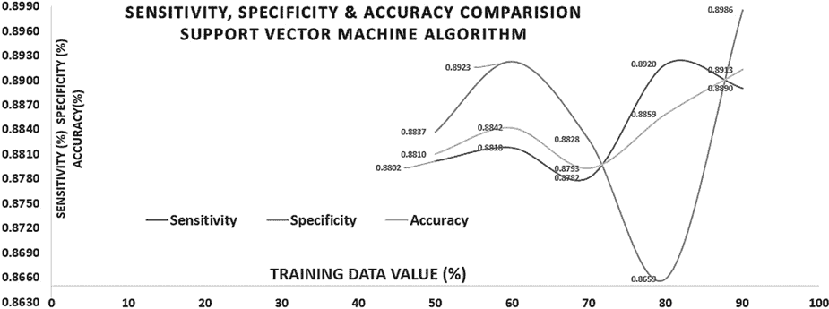

**Figure 3.12** 使用 SVM 进行灵敏度、特异性、准确率分析。

学习过程在预处理层面、肺分割和特征提取方面均已妥善完成。

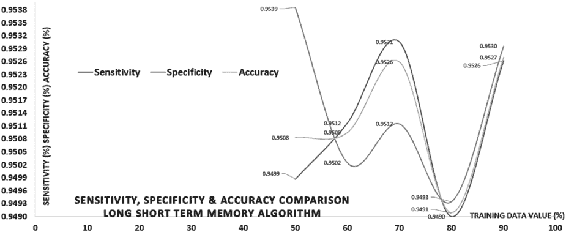

**Figure 3.13** 使用 LSTM 进行灵敏度、特异性、准确率分析。

遵循精度、灵敏度、准确率等最高的程序，估计结果误差较小。这涉及对数据集分割策略进行更多分析以获得最大量。观察到肿瘤的高代谢和更好的 CT 图像。对于此类影像疾病，如肺癌、乳腺癌、脑肿瘤和心血管疾病，确实可使用所提方法进行观察。该程序可为患者提供更详细的切片集。

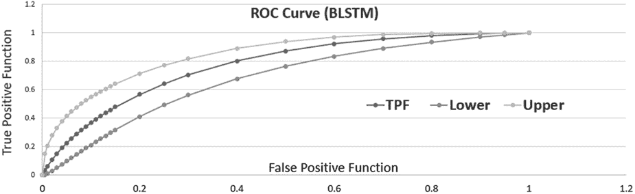

**Figure 3.14** 使用 BLSTM 进行 ROC 曲线分析。

因此，护理治疗仅记录此类切片，而非所有角度。似乎作者提出了这一概念，将提供诸多优势：如通过最小化记录切片的使用来限制在图像上停留的时间、提高有效性、减少功耗、降低经济成本、节省时间和金钱、减少扫描费用等。每个人都能更轻松地处理。

### 3.10 未来改进

研究者在所提方法中仅使用了分水岭标记分割，并建议了包括对比在内的其他几种分割方法，这将在未来提高特征效率。此外，还必须考察其他几种用于图像改进的滤波器和方法。通过增加给定的数据量，可提高额外肿瘤属性的准确性。应应用基于人工智能的其他分类方法，如 AlexNet、GoogLeNet 等。

### 3.11 结论

所提肺癌检测方法可识别肺部肿瘤。CT 图像经预处理后，使用标记控制分水岭进行分割。学习过程在预处理层面、肺分割和特征提取方面均已妥善完成。遵循精度、灵敏度、准确率等最高的程序，估计结果误差较小。这涉及对数据集分割策略进行更多分析以获得最大量。对于特征提取，使用分割后的图像。通过提取的特征在肺内发现肿瘤。对于医学诊断，同时使用有监督和无监督分类器。通过使用 BLSTM，最大准确率为 96.14%，LSTM 适度使用为 95.47%，SVM 为 89.13%。该系统从而引导放射科医生预测肿瘤分期并提高准确性。研究者已检验机器学习技术，为医疗专业人员和放射科医生提供诊断设备，支持他们基于组织学特征为患者选择治疗方案。将人工智能方法与医疗援助相结合，有助于肺癌诊疗，本分析讨论了此类优势及整个护理周期中存在的不足。

**利益冲突：** 无利益冲突。

### 参考文献

*   Alahmari S.S. and D. Cherezov, “Radiomics improves pulmonary nodule malignancy prediction in lung cancer screening.” *IEEE Access* 6: 77796–77806 (2018).

*   Albu, Adriana, Radu-Emil Precup, and Teodor-Adrian Teban. “Results and challenges of artificial neural networks used for decision-making and control in medical applications.” *Facta Universitatis, Series: Mechanical Engineering* 17, no. 3: 285–308 (2019).

*   Altaf, Fouzia, Syed M.S. Islam, Naveed Akhtar, and Naeem Khalid Janjua. “Going deep in medical image analysis: Concepts, methods, challenges, and future directions.” *IEEE Access* 7: 99540–99572 (2019).

*   Asan, Onur, Alparslan Emrah Bayrak, and Avishek Choudhury. “Artificial intelligence and human trust in healthcare: Focus on clinicians.” *Journal of Medical Internet Research* 22, no. 6: e15154 (2020).

*   Chen, Ying, Yerong Wang, Fei Hu, and Ding Wang. “A lung dense deep convolution neural network for robust lung parenchyma segmentation.” *IEEE Access* (2020).

*   Cui, Sunan, Yi Luo, Huan-Hsin Tseng, Randall K. Ten Haken, and Issam El Naqa. “Artificial neural network with composite architectures for prediction of local control in radiotherapy.” *IEEE Transactions on Radiation and Plasma Medical Sciences* 3, no. 2: 242–249 (2018).

*   Dartmouth-Hitchcock Medical Centre, “A new machine learning model can classify lung cancer slides at the pathologist level.” *Sch of Comp. Dub Inst of Tech* (2019).


### 参考文献

*   Deep Prakash K. 等。“利用生物医学图像处理中的 SVM 分类器早期检测肺癌。”《IEEE 电力、控制、信号与仪器工程国际会议》(ICPCSI-2017)，(2017)。

*   Dong, Xing、Xu Dan、AoYawen、Xu Haibo、Li Huan、TuMengqi、Chen Linglong 和 Ruan Zhao。“利用骨骼肌 CT 放射组学和机器学习识别晚期非小细胞肺癌患者的肌少症。”《胸部肿瘤》11 卷，第 9 期：2650–2659 (2020)。

*   Echegaray, Sebastian、Viswam Nair、Michael Kadoch、Ann Leung、Daniel Rubin、Olivier Gevaert 和 Sandy Napel。“一种快速的分割不敏感‘数字活检’方法用于放射组学特征提取：方法及基于非小细胞肺癌 CT 图像的初步研究。”《断层扫描》2 卷，第 4 期：283 (2016)。

*   Gupta, Yubraj、Ramesh Kumar Lama、Sang-Woong Lee 和 Goo-Rak Kwon。“一种用于医疗决策支持的 MRI 脑部疾病分类系统，采用 PDFB-CT 和 GLCM 结合核 SVM。”《多媒体工具与应用》79 卷，第 43 期：32195–32224 (2020)。

*   Herrmann, Markus D.、David A. Clunie、AndriyFedorov、Sean W. Doyle、Steven Pieper、Veronica Klepeis、Long P. Le 等。“实施数字病理学的 DICOM 标准。”《病理学信息学杂志》9 (2018)。

*   Hussein, Sarfaraz、PujanKandel、Candice W. Bolan、Michael B. Wallace 和 UlasBagci。“深度学习时代的肺部和胰腺肿瘤表征：新颖的监督和无监督学习方法。”《IEEE 医学成像汇刊》38 卷，第 8 期：1777–1787 (2019)。

*   Johora, F. Tuj、M. Jony 和 Parvin Khatun。“一种在 CT 图像上检测肺癌的新策略。”《国际工程与技术研究期刊 (IRJET)》5 卷，第 12 期：27–32 (2018)。

*   Kavitha, M.S.、J. Shanthini 和 R. Sabitha。“ECM-CSD：一种利用 FCM 和 SVM 技术对 CT 肺部图像进行癌症分期诊断的高效分类模型。”《医学系统杂志》43 卷，第 3 期：73 (2019)。

*   Kim B.C. 等。“肺部 CT 中肺结节分类的深度特征学习。”载于：2016 年第 4 届脑机接口国际冬季会议 (BCI)，第 1–3 页。IEEE，(2016)。

*   Kim, Catherine S. 和 Melenda D. Jeter。“放射治疗，早期非小细胞肺癌。”载于 StatPearls [互联网]。StatPearls Publishing，(2018)。

*   Kumar, Vinod 和 Brijesh Bakariya，“利用深度学习对恶性肺癌进行分类”，《医学工程与技术杂志》，45 卷，第 2 期：85–93，DOI：[10.1080/03091902.2020.1853837](https://doi.org/10.1080/03091902.2020.1853837) (2021)。

*   Kumar, Vinod 和 Dr. Kanwal Garg。“基于神经网络的 X 射线图像中肺癌异常区域检测方法。”《国际工程研究与技术期刊》，ISSN：2278-0181 (2012)。

*   Kumar, Vinod、Ashu Gupta、Rattan Rana 和 Kanwal Garg。“利用统计特征从 X 射线图像中检测肺癌。”《国际计算期刊》4 卷，第 6 期：178–181 (2015)。

*   Li, Lingling、Yuan Wu、Yi Yang、Lian Li 和 Bin Wu。“一种在 CT 图像上检测肺癌的新策略。”载于 2018 年 IEEE 第 3 届图像、视觉与计算国际会议 (ICIVC)，第 716–722 页。IEEE，(2018)。

*   Liu, Liang、Jianjiao Ni 和 Xinhong He。“长链非编码 RNA SNHG3 的上调促进肺腺癌增殖。”《疾病标志物》，2018，5736716，[`doi.org/10.1155/2018/5736716`](https://doi.org/10.1155/2018/5736716) (2018)。

*   Loyman, Mark 和 Hayit Greenspan。“半监督肺结节检索。”arXiv 预印本 arXiv:2005.01805 (2020)。

*   Luo, Yi、Daniel McShan、Dipankar Ray、Martha Matuszak、Shruti Jolly、Theodore Lawrence、Feng-Ming Kong、Randall Ten Haken 和 Issam El Naqa。“开发一种完全交叉验证的贝叶斯网络方法用于肺癌局部控制预测。”《IEEE 辐射与等离子体医学科学汇刊》3 卷，第 2 期：232–241 (2018)。

*   Manikandan, T. 和 N. Bharathi。“利用模糊自动种子聚类均值形态学分割和 SVM 分类器进行肺癌检测。”《医学系统杂志》40 卷，第 7 期：181 (2016)。

*   Mathur, Prashant、Krishnan Sathish Kumar、Meesha Chaturvedi、Priyanka Das、Kondalli Lakshmi Narayana Sudarshan、Stephen Santhappan、Vinodh Nallasamy 等。“癌症统计，2020：来自印度国家癌症登记计划的报告。”《JCO 全球肿瘤学》6：1063–1075 (2020)。

*   Mhaske, Diksha、Kannan Rajeswari 和 Ruchita Tekade。“利用 CT 扫描图像对肺癌进行分类和预测的深度学习算法。”载于 2019 年第 5 届计算、通信、控制与自动化国际会议 (ICCUBEA)，第 1–5 页。IEEE，(2019)。

*   Mobile, Aryan、Supratik Moulik 和 Hien Van Nguyen。“利用自适应记忆增强循环网络进行肺癌筛查。”arXiv 预印本 arXiv:1710.05719 (2017)。

*   Murillo BR “用于肺结节恶性程度分类的万物健康算法。”《IEEE Access》。[`doi.org/10.1109/ACCESS.2817614`](https://doi.org/10.1109/ACCESS.2817614)，(2018)。

*   Mya Tun KM 等。“利用数字图像处理实现肺癌结节特征提取。”《IJSETR》03(09):1610–1618，(2014)。

*   Nie, Allen、Ashley Zehnder、Rodney L. Page、Arturo L. Pineda、Manuel A. Rivas、Carlos D. Bustamante 和 James Zou。“Deep tag：在资源匮乏的医疗领域从临床笔记推断所有病因诊断。”arXiv 预印本 arXiv:1806.10722 (2018)。

*   Patel, Vaibhavi、Samkit Shah、Harshal Trivedi 和 Urja Naik.“基于 GLCM 特征利用 SVM 和 ANN 进行肺肿瘤分类的分析。”载于第一届计算、通信与网络安全国际会议论文集 (IC4S 2019)，第 273–284 页。Springer，新加坡 (2020)。

*   Pelc, Norbert J. 和 Adam Wang。“CT 统计重建与迭代重建及后处理。”载于《计算机断层扫描》，第 45–59 页。Springer，Cham (2020)。

*   Pradhan, Kanchan 和 Priyanka Chawla。“利用机器学习算法进行肺癌检测的医疗物联网。”《管理分析杂志》7 卷，第 4 期：591–623 (2020)。

*   Rabbani, Mohamad、Jonathan Kanevsky、Kamran Kafi、Florent Chandelier 和 Francis J. Giles。“人工智能在非小细胞肺癌患者护理中的作用。”《欧洲临床研究杂志》48 卷，第 4 期：e12901 (2018)。

*   Razzak, Muhammad Imran、Saeeda Naz 和 Ahmad Zaib。“医学图像处理的深度学习：概述、挑战与未来。”载于《生物应用中的分类》，第 323–350 页。Springer，Cham (2018)。

*   Riti, Yosefina Finsensia、Hanung Adi Nugroho、Sunu Wibirama、Budi Windarta 和 Lina Choridah。“来自 CT 扫描肺部图像的病变边缘特征分类特征提取。”载于 2016 年第 1 届信息技术、信息系统与电气工程国际会议 (ICITISEE)，第 54–58 页。IEEE，(2016)。

*   Rodrigues, Murillo B.、Raul Victor M. Da Nóbrega、Shara Shami A. Alves、Pedro Pedrosa Rebouças Filho、Joao Batista F. Duarte、Arun K. Sangaiah 和 Victor Hugo C. De Albuquerque。“用于肺结节恶性程度分类的万物健康算法。”《IEEE Access》6：18592–18601 (2018)。


*   Salehi, Bahare, Paolo Zucca, Mehdi Sharifi-Rad, Raffaele Pezzani, Sadegh Rajabi, William N. Setzer, Elena Maria Varoni, Marcello Iriti, Farzad Kobarfard, and Javad Sharifi-Rad. “Phototherapeutics in cancer invasion and metastasis.” *Phototherapy Research* 32, no. 8: 1425–1449 (2018).

*   Salman, Osamah Khaled Musleh, Bekir Aksoy, and Koray Özsoy. “Using deep learning techniques in detecting lung cancer.” In *Deep Learning for Cancer Diagnosis*, pp. 135–146. Springer, Singapore (2020)。

*   Taher, Fatma, Naoufel Werghi, and Hussain Al-Ahmad. “Rule-based classification of sputum images for early lung cancer detection.” 2015 IEEE International Conference on Electronics, Circuits, and Systems (ICECS). IEEE, (2015)。

*   Shah, Anwar, Javed Iqbal Bangash, Abdul Waheed Khan, Imran Ahmed, Abdullah Khan, Asfandyar Khan, and Arshad Khan. “Comparative analysis of median filter and its variants for removal of impulse noise from gray scale images.” *Journal of King Saud University-Computer and Information Sciences* (2020)。

*   Shakeel, P. Mohamed, Amr Tolba, Zafer Al-Makhadmeh, and Mustafa Musa Jaber. “Automatic detection of lung cancer from biomedical dataset using discrete AdaBoost optimized ensemble learning generalized neural networks.” *Neural Computing and Applications* 32, no. 3: 777–790 (2020)。

*   Sujitha, R. and V. Seenivasagam. “Classification of lung cancer stages with machine learning over big data healthcare framework.” *Journal of Ambient Intelligence and Humanized Computing* 12: 5639–5649 (2021)。

*   Tabish, Tanveer A., Md Zahidul I. Pranjol, Hasan Hayat, Alma AM Rahat, Trefa M. Abdullah, Jacqueline L. Whatmore, and Shaowei Zhang. “In vitro toxic effects of reduced graphene oxide Nano sheets on lung cancer cells.” *Nanotechnology* 28, no. 50: 504001 (2017)。

*   Taher, Fatma, Naoufel Werghi, and Hussain Al-Ahmad. “Rule-based classification of sputum images for early lung cancer detection.” IEEE International Conference on Electronics, Circuits, and Systems (ICECS), pp. 29–32. IEEE, (2016)。

*   Tripathi, Priyanshu, Shweta Tyagi, and Madhwendra Nath. “A comparative analysis of segmentation techniques for lung cancer detection.” *Pattern Recognition and Image Analysis* 29, no. 1: 167–173 (2019)。

*   Wang, Ran, Xiaokun Liang, Xuanyu Zhu, and Yaoqin Xie. “A feasibility of respiration prediction based on deep Bi-LSTM for real-time tumor tracking.” *IEEE Access* 6: 51262–51268 (2018)。

*   Wang, Shidan, Alyssa Chen, Lin Yang, Ling Cai, Yang Xie, Junya Fujimoto, Adi Gazdar, and Guanghua Xiao. “Comprehensive analysis of lung cancer pathology images to discover tumor shape and boundary features that predict survival outcome.” *Scientific Reports* 8, no. 1: 1–9 (2018)。

*   Wang, Shidan, Donghan M. Yang, Ruichen Rong, Xiaowei Zhan, Junya Fujimoto, Hongyu Liu, John Minna, Ignacio Ivan Wistuba, Yang Xie, and Guanghua Xiao. “Artificial intelligence in lung cancer pathology image analysis.” *Cancers* 11, no. 11: 1673 (2019)。

*   Wu, Jian, Chunfeng Lian, Su Ruan, Thomas R. Mazur, Sasa Mutic, Mark A. Anastasio, Perry W. Grigsby, Pierre Vera, and Hua Li. “Treatment outcome prediction for cancer patients based on radionics and belief function theory.” *IEEE Transactions on Radiation and Plasma Medical Sciences* 3, no. 2: 216–224 (2018)。

*   Wu, Jianrong, and Tianyi Qian. “A survey of pulmonary nodule detection, segmentation, and classification in computed tomography with deep learning techniques.” *Journal of Medical Artificial Intelligence* 2: 2–8 (2019)。

*   Yadav, Archana, and Ranjana Badre. “Lung carcinoma detection techniques: A survey.” In 2020 12th International Conference on Computational Intelligence and Communication Networks (CICN), pp. 63–69. IEEE, (2020)。

*   Yang, Shuo, Ran Wei, Jingzhi Guo, and Lida Xu. “Semantic inference on clinical documents: combining machine learning algorithms with an inference engine for effective clinical diagnosis and treatment.” *IEEE Access* 5: 3529–3546 (2017)。

*   Yiwen X., H. Ahmed, et al., “Deep learning predicts lung cancer treatment response from serial medical imaging.” *Clinical Cancer Research,* 25, no. 11, 3266-3275, [`doi.org/10.1158/1078-0432.CCR-18-2495`](https://doi.org/10.1158/1078-0432.CCR-18-2495) (2019)。

*   Zhang, Junjie, Yong Xia, Hengfei Cui, and Yanning Zhang. “Pulmonary nodule detection in medical images: A survey.” *Biomedical Signal Processing and Control* 43: 138–147 (2018)。

# 4

# 基于内容的医学图像检索中的深度学习

Harpal Singh, Priyanka Kaushal, Meenakshi Garg, and Gaurav Dhiman

DOI: [10.1201/9781003153405-4](https://doi.org/10.1201/9781003153405-4)

## 目录

*   4.1 简介
*   4.2 相关工作
    *   4.2.1 基于内容的图像检索 (CBIR)
    *   4.2.2 基于内容的医学图像检索 (CBMIR)
    *   4.2.3 深度学习
*   4.3 方法论
    *   4.3.1 阶段 1
        *   4.3.1.1 DCNN 模型架构
        *   4.3.1.2 训练细节
    *   4.3.2 阶段 2
    *   4.3.3 阶段 3：优化
        *   4.3.3.1 斑点鬣狗优化器 (SHO)
*   4.4 数据集
*   4.5 实验结果
*   4.6 性能指标
*   4.5 结论
*   参考文献

### 4.1 简介

近年来，数字计算机、多媒体和存储网络的快速发展导致了庞大的图像存储库和多媒体库的出现。这些数据存储和信息传播的进步通常受益于临床和医学检测。在拥有图像诊断和分析的医院中，会产生大量的图像数据，医学图像集合的产出因此显著增加。因此，必须开发适当的医学图像检索技术，以便医生浏览这些庞大的数据库。文献中已经提出了许多用于自动医学图像处理的算法，以促进此类庞大医学图像数据库的创建和维护（Jiji 2014；Ponciano 2013；Quellec 2011；Rahman 2011；Zhang 2016；Garg et al. 2019；Krizhevsky et al. 2012）。


#### 基于内容的医学图像检索系统中的深度学习方法

##### 概述

基于内容的医学图像检索系统（CBMIR）可实现高效的疾病诊断与治疗，同时作为管理海量数据的高效工具（Liu 2007; Dhiman and Kumar 2017; Dhiman and Kumar 2018a; Dhiman and Kumar 2018b）。基于内容的图像检索（CBIR）是一种计算机视觉技术，可用于在海量数据集中进行搜索。研究重点在于图像特征，包括颜色、纹理、形状或从图像派生的其他特征。CBIR 系统的可靠性主要取决于所选特征函数（Yan 2016; Dhiman and Kumar 2019）。

图像首先在高维空间中表示。随后，通过特征空间中的各种距离度量来确定数据库中图像与查询帧之间的相似度。就特征选择和相似度度量的选择而言，图像数据表示是 CBIR 系统最重要的组成部分。尽管多位学者已深入研究这些领域（Wan 2014），但 CBIR 系统面临的主要挑战是缩小“语义鸿沟”。数据因图像特征而丢失，即从语义高层到低层（Kumar 2014）。

机器学习研究已显著发展，深度学习是一项重大成果。深度学习包含多种算法，利用深度非线性架构对高层数据抽象进行建模（Bengio 2012）。深度学习模仿人脑的深度架构，通过多层变换实现知识表示。因此，深度学习技术（深度网络）使机器能够学习原始照片中的复杂特征，从而通过探索深度架构自动学习多层抽象的数据。深度学习方法（如图像和视频分类（Zeiler 2014; Karpathy 2014; Wu 2016; Hinton 2012; Zhou 2013; Babenko 2015）、视觉跟踪和语言处理）已在许多应用中成功实现（Lin 2015）。近期研究已将深度学习方法用于 CBIR（Bay 2006; Yang 2007; Wu 2011），但针对 CBMIR 工作的深度学习方法研究较少。

##### 深度学习方法论

一种深度学习方法论（参见图 4.1），即卷积神经网络（CNN），已针对各种身体及身体成像方法开发，用于学习特征表示。三维体积图像通常由医学成像获得的二维身体器官切片组成。本文聚焦于这组二维切片；在全球范围内建立类别，即将来自身体不同部位的照片按身体部位划分为不同类别。因此，监督信息非常稀疏且耗时，从而减少了训练阶段所需的标注工作。这种标注方式对医学成像很有用，因为标注通常需要专业建议和昂贵的信息。

CNN 模型在初始分类过程中训练，并学习用于 CBMIR 的特征表示。针对来自多种成像模式的一系列图像，提供了对所提方法检索效率的全面评估。本论文有三大主要贡献：

1.  彻底编译了涵盖广泛医学成像关注领域的多模态数据集合。
2.  建立了在多张医学图像上建模和训练的深度学习系统。
3.  采用强大的医学图像检索框架，用于广泛多模态数据集的教学目的。


这些进步也得益于数字存储和信息领域的临床与诊断研究。医院的诊断和分析成像设施产生海量的图像数据，从而显著增强了医学图像集合的生产。因此，应开发高效的医学图像检索系统，以帮助临床医生浏览这些广泛的数据集。文献中提供了大量用于自动医学图像处理的算法，以帮助构建和维护大规模数据库（Mansoori 2009；Alfanindya 2013；Dhiman 2017）。为了高效地诊断和治疗一系列疾病，并有效管理海量数据，也可使用基于内容的医学影像检索系统（CBMIR）。若无此类方法，从如此庞大的相关信息集合中进行访问、管理和提取将非常复杂。医学图像基于标签和人工标注等文本信息进行处理，因为这需要人员、临床经验和时间。因此，医学图像检索系统有望根据图像本身衍生出的功能显示，自动识别和检索图像。为支持临床决策，这将补充程序、分析和临床试验，以从广泛的知识库中定位知识。基于内容的图像检索（CBIR）是一种计算机视觉技术，可用于在海量数据集中进行搜索。研究集中于图片的特征，包括颜色、纹理、形状或从图片中衍生的其他特征。CBIR 系统的效率主要取决于这些功能（Dhiman 2018；Kaur 2020）。图像首先在高维空间中展示。就特征和相似度度量的选择而言，CBIR 系统最重要的组成部分是图像数据显示。尽管许多研究人员已对其进行了深入研究（Dhiman 2019），但这些仍是 CBIR 系统中最严重的问题，因为图片特征导致“语义鸿沟”从高语义降至低语义（Dhiman 2020）。机器学习从根本上改变了这一局面，而深度学习是一项重大成就。深度学习拥有多种算法，利用深度和多线性方法对高层数据抽象进行建模（Garg 2017）。深度学习模拟人脑的深层架构，并跨越人脑转换的多个层次处理知识。这使得框架（深度网络）能够跨越更深层的算法，在多个抽象层级上自动获取数据特征，并在不使用人工特征的情况下获得特征表示。近期研究报告称，在图像和严肃性、视觉监控、语言理解和自然语言处理等许多应用中，深度学习方法已成功应用。最新实验已将深度学习方法用于 CBIR 任务，但用于 CBMIR 任务的深度学习方法鲜有考虑。本章基于深度学习方法的成果，探讨将其应用于 CBMIR 挑战以弥合差距。一种深度学习技术，即卷积神经网络（CNN），被改编用于不同的图像和身体器官表示。三维体积图像通常由医学成像获得的二维身体器官切片组成。本文关注这些二维分割的集合；在全球范围内建立了类别，即来自身体不同部位的照片根据其身体部位被分为不同类别。因此监督非常薄弱，且标记耗时极少，从而减少了训练阶段的标注工作。这种标注类型对医学成像很有用，因为标注通常需要专业建议和昂贵的信息。CNN 模型在初始分类过程中训练，并学习用于 CBMIR 的特征表示。针对来自多种成像模态的一系列图像，提供了对所提方法检索效率的全面评估。所呈现的工作有三项重要贡献。

1.  广泛编译了一个涵盖医学成像各种关注领域的多模态数据集。

2.  在医学图像频谱上对深度学习系统进行建模和训练。

3.  一种高效的医学图像获取方法展示了所研究的特征，并能处理海量的多模态数据集阵列。

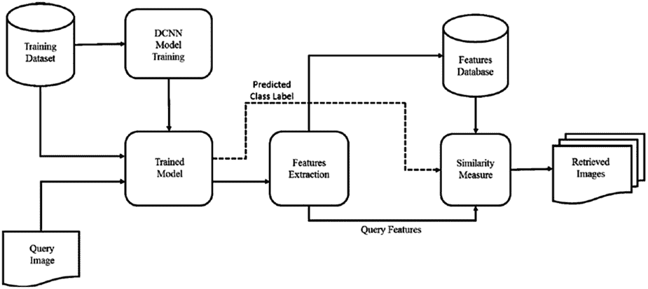

Figure 4.1 使用深度神经网络基于内容的医学图像检索拟议系统。

基于内容的图像检索（CBIR）是一种根据图片数据库中提取的特征获取相似图像的技术。基于内容访问医学图片以辅助临床决策，早已被建议用于缓解临床数据管理，并将场景整合到用于基于内容访问方法的图像归档和通信系统（PACS）中。与常规 CBIR 系统相比，医学 CBIR 在基于内容的图像检索中应至少考虑两个问题，以处理复杂的医学图像。

第一个挑战是医学图像特征提取。良好的特征表示可以提高检索方法的精度。因此，在传统 CBIR 系统中，这些特征是主观且不完整的，只能人工提取。在我们的方法中，我们使用`CNN`从医学图像中导出客观且详细的特征。

第二个顾虑是高维图像特征。传统上，为了提高搜索性能，利用大量特征向量维度来比较相似度，可用的特征向量维度达数百甚至数千。在研究和排列这些高维特征向量时，通常会遇到维度灾难。

因此，我们构建并使用了这个高维数据库，以扫除我们在 SPIE 医学成像会议上提出的维度灾难。这个高维数据库也被使用了。为了在我们的 CBIR 研究中克服自动提取特征，在此演示中以及在此联合高维数据库索引技术中，我们实施了基于深度学习（DL）和报告的 CBIR 特征提取方法。

医学图像数据库需要传统文本数据库所不需要的服务。这指的是：

*   **非文本索引**：除了文本索引外，还需要一种非文本索引方式，并建立两种数据形式之间的关系。例如，通过检查器官和肿瘤轮廓，可以获得几何信息。然而，生理学知识将来自实验室发现和医疗记录的其他部分。如果特定的诊断或治疗决策要考虑临床后果，这两组之间的联系将非常重要。


## 4.1 需求分析

*   **定制化方案**：临床研究人员需要工具来编辑、更改和适应新请求，这些工具允许最终用户设计临时的自定义模式以进行恢复和搜索。图像数据库中不同用户的查询可能有截然不同的查询语言需求。例如，医生可能会询问关于图像的复杂问题，这些问题与图像中器官的功能和/或结构有关。访问所有代表单一形态学特征的图像的另一种方法是提供一个用于教学的数据库。

*   **动力机制**：任何不断演变和复杂的医学图像集合的查询都需要由用户创建。CT 样本患者随后可能被发现有肝转移，以界定原发性肺肿瘤。因此，访问数据库的医生需要在数据库中整合关于肝转移的新知识，并能够开发关于患者过去和当前状态的具体问题，这些问题与新信息相关。

*   **相似性模块**：当用户创建潜在理论来探索数据库时，这意味着可以通过数据库搜索新的形式来收集“感兴趣的照片”。因此，“给我显示一个类似但更大的”或“给我显示一个介于两者之间的”工具可以给用户一种学习新概念和信息的强大方式。这种“改变视野”的方法被认为是医学成像数据库的基本特征。

*   **参考模块**：为了将其与正在调查的对象进行比较，进一步的问题结构将显示十个“正常”实例，以决定该对象是否在正常范围内。需要特殊工具使形状具有灵活性。

*   **智能需求**：图标查询是使用用户生成的示例的查询。这可能是基本特征或原型的绘图。用户可以通过使用图标和原型关联来创建个性化语义。通用方案需要为模式演变提供起点，以便用户能够对正在调查的问题进行分类，判断哪些关系和相似度度量是合适的（例如，“这就是我想描述为左心室动脉瘤的内容”）。预计用户将在各种抽象层级上支持多个对象的图标请求和自定义模式。为了充分使用医学成像数据库，需要一种图形查询语言。

*   **解释语言**：新的图像描述符可以贡献新的信息和新的疾病分期类型。例如，包围腹腔轴的宽中线神经母细胞瘤是不可行的，而不包围腹腔轴的中长线神经母细胞瘤是可行的。两者在病理学上均被称为“3 期”。需要创建新工具来演变新定义，以区分这两种可能性。

*   **多模态配准**：来自各种成像模态的精确图像配准为决策过程带来了新的专业知识，但目前仍没有可用的资源来快速应用这项技术。

*   **帧操作**：作为内在工作上下文，图像数据库可以集成许多已有的图像管理技术：缩放、分栏、旋转、对比度增强、感兴趣区域轮廓。

### 4.2 相关工作

本节简要讨论了与我们研究相关的现有工作。

#### 4.2.1 基于内容的图像检索 (CBIR)

图 4.1 显示了一个简单的 CBIR 设备框图。CBIR 图像从大型数据库中恢复 (Zylak 2000)。每个系统的第一阶段是离线的，第二阶段是在线的。任何系统通常发生两个阶段。在离线过程中，从大型图像集合（用于设备训练）中提取特征以构建局部功能数据库 (Thompson 2020)。

在过去几十年中，全球创建了反映形状和颜色 (Nishiura 2020) 以及纹理的不同目的图像描述符。利用某些局部描述符（如 SIFT 和 SURF (Jung 2020) 以及词袋模型 (Dhiman 2017; Soni 2020; Gomathi 2020)），也开发了不变特征变换 (SIFT) 和加速鲁棒特征 (SURF)。创建了局部层面的定义。图像恢复功能 (Mansoori 2009) 被用于不同的实验，但无法完全克服语义鸿沟。我们最近回顾了基于机器学习技术 (Dhiman 2017) 和基于哈希或可移植代码 (Dhiman 2018) 的局部特征的语义鸿沟。一种新方法已被创建，用于通过先进的机器学习方法减少语义鸿沟，这使得直接通过学习图像而无需使用手工特征来填补这一鸿沟成为可能。

#### 4.2.2 基于内容的医学图像检索 (CBMIR)

PCS 医院中医学图像集合的广泛分布正在增加 (Dhiman 2019)。因此，实施高效的医学图像恢复系统对于处理此类大型医学数据库非常重要。此外，某些 CBMIR 方法允许医生除了数据库管理任务外，还能客观地判断特定疾病或损伤。全局特征提取系统不适合医学图像，因为临床上有用的信息在小图像区域中高度局部化。基于视觉词袋系统 (BoVW) 的方法被用于脑磁共振成像 (MRI)，利用 SIFT 特征诊断阿尔茨海默病。他们提出 LG-CHF 作为匹配图像的向量函数（拉盖尔圆谐函数系数）。对于皮肤病变图像，提出了一种基于降维向量、分类和回归树的基于内容的恢复系统。建议了医学 CBIR 结果对医生决策的影响，使用具有不同特征、距离度量和相关性反馈的 CBIR 乳腺 X 线摄影算法。利用两种小波调整 CBIR 技术来定义每个查询图像，并在不同小波中估计最佳小波滤波器。使用回归函数优化恢复效率。提出了一种生物医学图像再生方法，专注于监督学习分类。它使用图像滤波和相似性融合作为基础和 SVM 支持向量机来预测查询类型。

#### 4.2.3 深度学习


##### 深度学习概述

深度学习是机器学习的一个子领域，它利用算法通过深度架构（包括线性和非线性）在多个变换层级上对数据中的高层抽象进行建模。深度学习的历史始于 1965 年，但直到最近，随着机器算力的增强、实现更深层连接的非线性特性 (Garg 2019)、(Dhiman 2017)、(Soni 2020) 以及增强的网络实践 (Dhiman 2019)，才取得了显著进展。深度学习由模拟人脑功能的人工神经网络组成。包含多个隐藏层的神经前馈网络是深度架构模型的有力例证。一种强大的神经网络训练类型仍然是 20 世纪 80 年代流行的反向传播算法。在间质性肺疾病的分类框架中，引入了卷积神经网络 (CNN)。其数据集包含七组，其中七组为 ILD 和组织健康趋势。通过表征肺部习性，他们获得了 85.5% 的分类效率。一种基于玻尔兹曼机的方法 (CT) 被提出用于卷积分类，结合了生成式和判别式表示学习 (Zylak 2000)。存在两个独立的数据集：一个用于描述肺纹理，一个用于识别气道。利用多尺度 CNN 进行自动 MR 图像分割，在脑组织类别中列出了声带 (Nishiura 2020)。根据所用的补丁大小，网络在多个不同核大小的图像补丁上进行了训练。一种用于身体器官识别的两阶段深度学习系统被引入 (Tang 2020)。第一阶段随后在 CNN 上进行训练，以从局部补丁中提取偏见和有洞察力的补丁。该过程的第二阶段改变了网络以消除不均衡补丁，包含 12 组，包括 2D CT 和 MR 切片 (CAD)。该研究涉及 CNN 的三个方面：多种 CNN 架构、数据集规模和预训练医学图像模型迁移分析。研究人员可以使用各种安全方案或协议来创建稳定连接，以便通过网络传输各种医学图像 (Soni 2020; Limbasiya 2018)。

### 4.3 方法论

本研究引入了一种新的分类系统，用于处理来自医学数据库的图像。图 4.2 详细描述了所提出的分类方法。底层的 DCNN 模型旨在通过每层数据的抽象显示来学习滤波器核。池化层的特点是卷积层产生的标准样本映射，通常通过定义某一区域的局部最大值来生成。池化还提供了平移不变性，并限制了用于进一步处理的神经元数量。在全连接层中，每个神经元的连接比卷积层更密集。全连接层之前的 DCNN 部分被称为特征提取函数，之后则被称为分类器。以下阶段为所提出的方法提供了全面的工作流程。

#### 4.3.1 阶段 1

分类阶段的第一部分包括使用监督学习方法训练深度卷积神经网络以对医学图像进行分类。研究采用 2D 图像进行，这意味着每张图像都必须被分类到一个类别中，最终形成一个多方面的图像分类问题。图像分类算法通常有两个模块：特征提取模块和分级模块。DCNN 在一个完整的学习系统中学习深度卷积的层次结构和图像分类。深度学习算法学习中层、抽象和低层特征，而不是像手工特征那样做出预设假设。以下是架构和训练模型。

##### 4.3.1.1 DCNN 模型架构

准备阶段使用了八层，其中五个是卷积层，三个是全连接层，如 图 4.3 所示。模型共有八层。CVL 和 FCL 分别代表卷积层和全连接层，例如 `CVL1` 代表第一个卷积层。一个具有 24 个输出的 Softmax 函数被添加到最后一个全连接层 (`FCL3`) 的输出中，从而提供类别分布。概率向量大小为 1×24，其中每个向量元素对应数据集的一个类别。与 CNN 模型相比，接受尺寸为 224×224 的灰度图像作为输入。在 `CVL1` 中，输入将通过 64 个 11×11 的核进行筛选，步长为 4 个像素。步长是核映射的感受野之间的距离。第一个卷积层的贡献被转化为非线性，随后为池化神经元合成最大池化层。修正线性单元 (ReLU) 为任何卷积层或全连接层的输出提供非线性。ReLU 网络的训练速度比其等效的 tanh 单元快数倍，且不会面临梯度消失的深层困难。`CVL2` 使用 `CVL1` 的输出作为非线性 ReLU 和最大空间池化的输入，包含 198 个 5×5 的核。`CVL3` 由 392 个 5×5 的核组成，并接收来自第二层池化输出的输入。两个卷积层 `CVL4` 和 `CVL5` 的核大小均为 3×3，各有 256 个核。所有全连接阶段的神经元数量相同，即 4096 个。在第一、第二和第五个卷积层之后使用了池化层。它由 2×2 池化单元网格组成，每个单元汇总池化单元位置处 3×3 邻域内的神经元。在训练期间，模型难以通过过度扩展操作发生过拟合。在第一和第二个全连接层之后使用了 Dropout 正则化层，以 1-p 的神经元丢弃概率防止过拟合，其中 p 是神经元保留的概率。被丢弃的神经元在前向和反向传播中均不参与，即在训练过程中，所有连接到和来自被丢弃神经元的连接都被切断。训练结束后，丢弃的神经元将恢复其原始权重以供下一阶段使用。测试期间使用所有神经元。然而，一个保留概率因子 p 会对这些神经元进行测试缩放，以对应测试过程中的预期神经元收益。最后，4096 个输入和 24 个输出被提供给输出层 `FCL3` 中的 Log-Softmax。Log-Softmax 是针对 N 维向量的 Softmax 函数，它计算一个 [0,1] 范围内且总和为 1 的向量。这为类别分配了概率分布 (Garg 2019)。

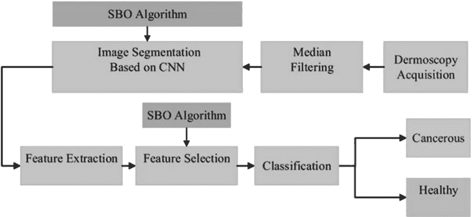

**图 4.2 CBMIR 架构。**

##### 4.3.1.2 训练细节


###### DCNN 模型的训练与优化

####### 模型训练

为了对数据库中的所有图像进行训练，中间部分使用 `224 = 224` 次移动进行裁剪。模型通过随机梯度下降（`SGD`）的反向传播进行学习。学习率极低，为 `0.0001`，配合 `30` 个周期（`epoch`）的 `SGD`。已达到最大程度的优化。负对数似然（`NLL`）在 `SGD` 测试中被用作目标函数或准则。对于 N 分类问题，也使用 `NLL`。高斯分布、零和 `0.01` 被用于初始化所有层的权重。在三个全连接层 `1` 和 `0` 中，`CVL2`、`CVL4` 和 `CVL5` 的偏置值已知。学习率持续保持不变，并为所有随机梯度（包括 `0.0001`）降低了学习率，但相应地训练时长增加了。持续学习的另一个理由是，我们的数据已经在极低的学习率下开发完成，显然需要额外的员工和更多资源来进一步降低它。使用高达 `30` 个规划周期的 `0.0422` 训练误差来定制模型。`SGD` 是应用最广泛的神经网络算法，在凸损失函数（如 `SVM` 或逻辑回归）下的判别性线性分类分析中非常有效。`SGD` 的两大主要优势包括可靠性和易于部署，包括网络的协调选项，如迭代次数、学习率、学习率衰减等。需要超参数（如众多的时间或迭代次数）和控制参数是 `SGD` 的一些缺点。对于每个 `xi` 和 `yj` 训练样本，`SGD` 更新参数。`SGD` 参数被修改。最常见的神经网络算法是反向传播结合某些优化策略，如 `SGD`。所有反向传播参数决定梯度。

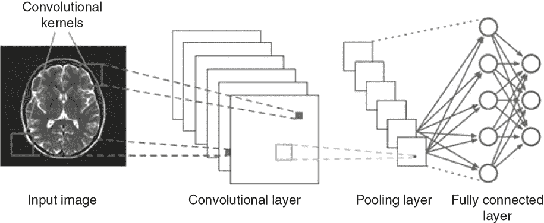

**图 4.3** 使用 DCNN 进行图像训练。

当目标函数减小时，`SGD` 接收测量的梯度并将其作为输入进行更新。返回值包括用于确定输入损失的已知目标，即实际类别标签。链式法则用于测量每一层相对于损失函数的梯度。每一层包含三个重要的反向传播阶段，即前向传播、反向传播和操作导数，其中该层包含如图 4.3 所示的参数。对于池化层等层没有可用参数，且不应指定导数。如果层具有参数，则会定义参数和成本函数系统关于参数的导数。每一层提供输入并产生输出。损失 `E` 从输出层获取，并从每一层向后传播。这些层中的许多存在于每一层中，向量参数应熟悉所有层参数。

#### 4.3.2 阶段 2

一旦 `DCNN` 模型针对多模态医学图像识别进行了细化和训练，可以从最后三个全连接模型层（例如 `FSC1` – `FCL 3`）获得重印特征。为了创建数据库，特征 `F1i`、`F2i` 和 `F3i` 随后分别通过输入训练好的 `DCNN` 分类模型，从该特定图像的全连接 `1–3` 层中提取。类似地，`F1i` 是从 `FCL1` 提取的功能数据库，而 `F2i` 和 `F3i` 分别反映 `FCL2` 和 `FCL3` 数据库，其中 `i=1` 到 `P`，`P` 等于训练样本的数量。

在任何查询公式中，可以通过比较查询图像提取的特征表示，使用欧氏距离度量，找到与查询图像相似的数据库图像：

```
d(a,b) = sqrt(sum_{i=1}^{P} (a_i - b_i)²)  (4.3.1)
```

其中 `ai` 和 `bi` 分别是查询图像和数据库图像的特征函数。最后，对从 `FCL1` 到 `FCL3` 的特征恢复效率进行比较分析。

#### 4.3.3 阶段 3：优化

##### 4.3.3.1 斑点鬣狗优化器（SHO）

在本小节中，`SHO` 算法（Dhiman 2018）是数学模型，即搜索、围捕、捕猎和攻击猎物。

###### 4.3.3.1.1 围捕猎物

当前最佳候选解被视为目标猎物，以数学方式构建斑点鬣狗的社会等级。现在其他搜索代理更新其最佳策略。

```
D_h = | B * P_p(x) - P(x) |  (4.3.2)
P(x + 1) = P_p(x) - E * D_h  (4.3.3)
```

其中 `Dh` 定义猎物到斑点鬣狗的距离，`x` 表示当前迭代，`B` 和 `E` 为系数向量，`Pp` 表示猎物的位置向量，`P` 为斑点鬣狗的位置向量。向量 `B` 和 `E` 如下：

```
B = 2 * r * d_1  (4.3.4)
E = 2 * h * r * d_2 - h  (4.3.5)
h = 5 - (Iteration * (5 / Max_Iteration))  (4.3.6)
```

其中，`Iteration=1,2,3,..., Max[Iteration]`

`h` 在完整迭代过程中从 `5` 线性减少到 `0`，以平衡探索与开发（`MaxIteration`）。此外，随着迭代值的增加，这一过程促进更大程度的开发。`Rd1` 和 `rd2` 然而是 `[0, 1]` 范围内的随机向量。

###### 4.3.3.1.2 捕猎

据信最佳搜索代理知道猎物的位置，以便数学上识别斑点鬣狗的捕猎行为。其他搜索官员组成一个值得信赖的朋友集群，靠近最佳搜索官员，并能够提供迄今为止的最佳选项来更新其位置。在此机制中，提出以下方程：

```
D_h = | B * P_h - P_k |  (4.3.7)
P_k = P_h - E * D_h  (4.3.8)
C_h = P_k + P_{k+1} + ... + P_{k+N}  (4.3.9)
```

其中 `Ph` 确定第一最佳斑点鬣狗位置，`Pk` 表示其他斑点鬣狗位置。此处包含的鬣狗数量（按以下方式测量）用 `N` 表示：

```
N = count_nos(P_h, P_{h+1}, P_{h+2}, ..., (P_h + M))  (4.3.10)
```

其中 `M` 是 `[0.5, 1]` 区域内的随机向量，`nos` 定义解的数量，并包含加上 `M` 后使用的所有解，这非常类似于在给定搜索领域中的最佳解。

###### 4.3.3.1.3 攻击

为了数学建模对猎物的攻击，向量 `h` 的值被减小。通过在迭代过程中将向量 `h` 的值从 `5` 变为 `0`，向量 `E` 的方差也被最小化。攻击猎物的数学公式如下：

```
P(x + 1) = C_h / N  (4.3.11)
```

当 `P(x+1)` 保存最佳解并根据最佳搜索代理的位置改变其他搜索代理的位置时。`SHO` 算法使其搜索代理能够更新其位置并发起攻击。

###### 4.3.3.1.4 搜索


通常情况下，被发现的鬣狗会根据 `C[h]` 向量中驻留的被发现鬣狗群簇的位置来追捕猎物。它们相互移动以搜寻并猎杀猎物。因此，向量 `E` 被用来通过大于 1 或小于 1 的随机值，将搜索智能体推向远离猎物的方向。`SHO` 算法可以利用这种机制进行全局搜索。

在多目标斑鬣狗优化器（`MOSHO`）算法中使用了存档和网格机制（Dhiman 2018）。在升级搜索智能体后，采用群体选择方法以实现更好的探索与开发。`CNN` 模式的参数由该算法计算得出。

### 4.4 数据集

对于来自公开医学课程的监督学习，用于拟议的 `CBMIR` 挑战的数据集已被收集。在本研究期间，50 例 COVID-19 患者的胸部 X 光图像取自 Joseph Cohen 提供的 GitHub 开源存储库（COVID-19 病例开放数据库，含胸部 X 光或 CT 图像，无日期）。该收藏包括胸肺的 X 光/CT 图片，主要为 ARDS 患者、COVID-19、MERS 患者、肺炎、极重症急性呼吸系统和 ARDS 患者。该档案还包括（SARS）。此外，从“肺炎” Kaggle 存储库（胸部 X 光图像，无日期）中使用了 50 张正常的胸部 X 光图像。我们的实验使用了 50 例普通患者的胸部 X 光图像数据集进行。该数据集中的所有图片均已重设为 `280×280` 像素规模。图 4.4 和 4.5 展示了 COVID-19 患者和普通患者的照片。

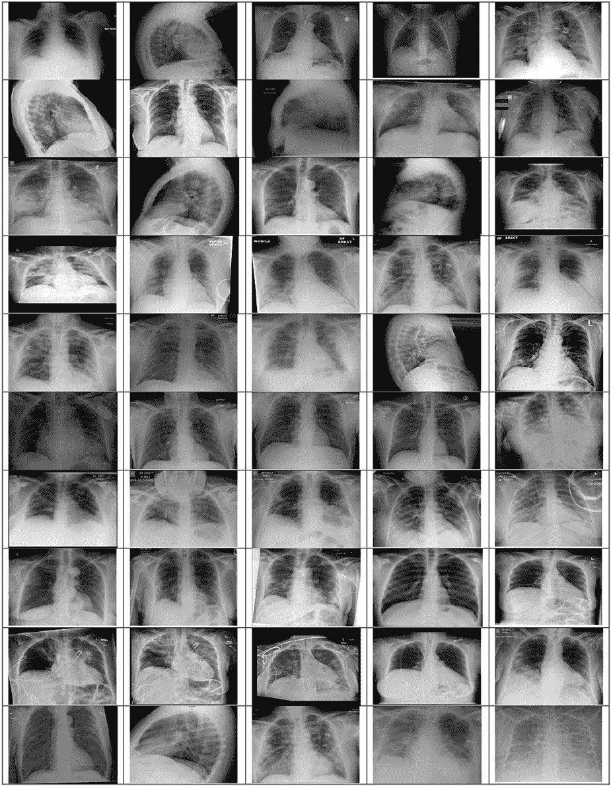

图 4.4 患冠状病毒（COVID-19）患者的 X 光片。

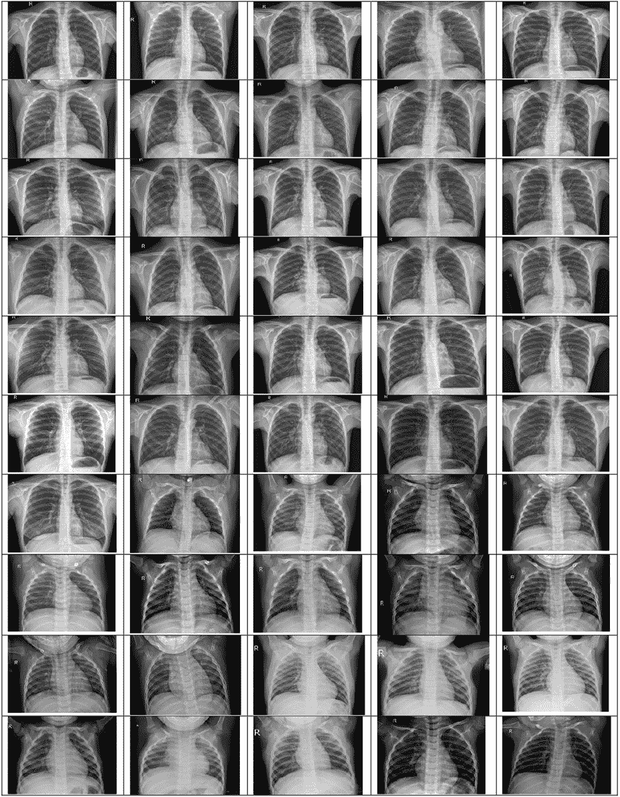

图 4.5 正常患者的 X 光图像。

### 4.5 实验结果

为了构建和训练拟议的深度学习系统，采用了一种通用且广泛的深度学习方法。模拟在一台主频为 2.40 GHz、内存为 6.00 GB、配备 Intel core i3 处理器的戴尔 Inspiron 14.04 笔记本电脑上进行。对拟议方法的分类和检索结果进行了评估。图 4.6–4.7 展示了 `DCNN` 各层的收敛分析。

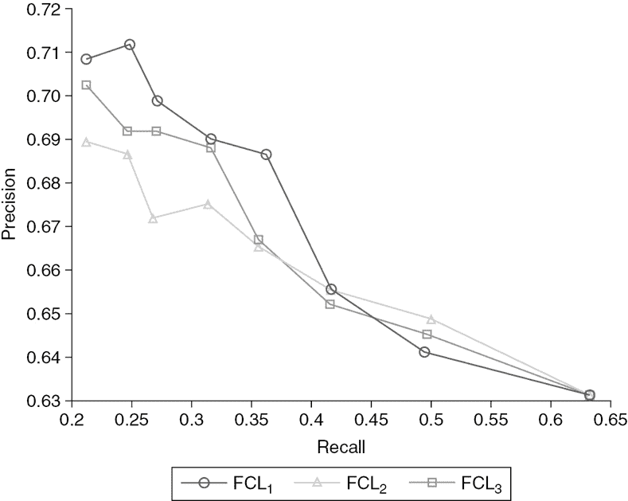

图 4.6 类别预测准确率 vs CBMIR 召回率。

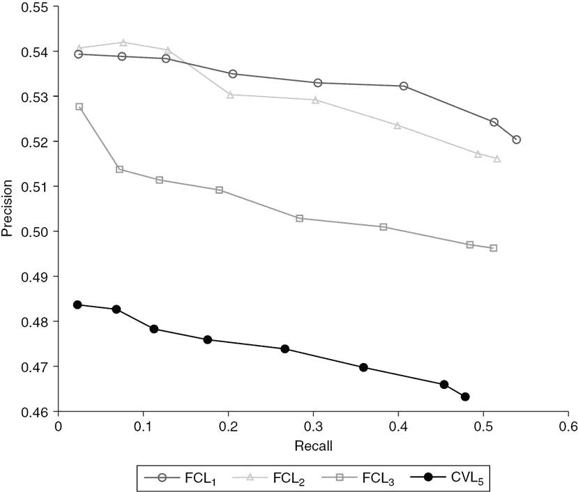

图 4.7 CBMIR 准确率 vs 类别预测召回率。

### 4.6 性能指标

拟议用于 `CBMIR` 框架的性能通过最广泛使用的 `CBIR` 系统（即精确率和召回率）进行了检验。结果显示在 表 4.1 中。

*   $Precision = \frac{True\_ Positive}{(True\_ Positive + False\_ positive)}$

*   $Recall = \frac{True\_ positive}{(True\_ positive + False\_ negative)}$

表 4.1

性能指标实验结果

| **方法** | **图像数量** | **训练（图像）** | **测试（图像）** | **精确率 (%)** | **召回率 (%)** |
| --- | --- | --- | --- | --- | --- |
| 在整张图片上训练的 DCNN（拟议） | 1000 | 50 | 1000 | 99.76 | 99.77 |
| 分两阶段在局部图片块上训练的 DCNN [24] | 1000 | 50 | 1000 | 98.43 | 97.28 |

### 4.7 结论

本文提出了一种基于内容的医学图像检索深度学习系统，通过训练深度卷积神经网络用于分类目的。第一步是通过训练合格的网络获取查询图片的查询类别预测，然后在该特定类别中查找相关图片。第二种方法是在不添加查询图片类型详细信息的情况下，在整个数据库中搜索所有适用的图像。基于深度学习的技术深度神经网络（`DNN`）分类器被用于对医学图像进行分类以实现图像分类。斑鬣狗优化器（`SHO`）被用于调整深度学习模型的参数。通过直接从图片中学习判别性特征，拟议的解决方案减小了语义鸿沟。该网络成功地以 99.77% 的平均分类准确率训练了医学图像。为了移除恢复功能，使用了最后三个全连接网络层。广泛的度量标准如准确率和召回率已被用于评估拟议系统在医学图像恢复方面的效率，这有助于医生更好地分析疾病。

### 参考文献

*   Alfanindya, A.，Hashim, N. 和 Eswaran, C.，2013 年 6 月。基于加速稳健特征（SURF）和分组视觉词袋（GBoVW）的基于内容的图像检索与分类。载于 *2013 年技术、信息学、管理、工程与环境国际会议* 第 77–82 页。IEEE。

*   Babenko, A. 和 Lempitsky, V.，2015 年。聚合局部深度特征用于图像检索。载于 *IEEE 国际计算机视觉会议论文集*（第 1269–1277 页）。

*   Bay, H.，Tuytelaars, T. 和 Van Gool, L.，2006 年 5 月。Surf：加速稳健特征。载于 *欧洲计算机视觉会议*（第 404–417 页）。Springer, Berlin, Heidelberg。

*   Bengio, Y.，Courville, A.C. 和 Vincent, P.，2012 年。无监督特征学习与深度学习：综述与新视角。*CoRR, abs/1206.5538*, *1*, p.2012。

*   胸部 X 光图像（肺炎） [www.kaggle.com/paultimothymooney/chest-xray-pneumonia](http://www.kaggle.com)。

*   Dhiman, G. 和 Kumar, V.，2017 年。斑鬣狗优化器：一种用于工程应用的新型生物启发式元启发技术。*工程软件进展*, *114*, pp.48–70。

*   Dhiman, G. 和 Kumar, V.，2018 年。多目标斑鬣狗优化器：一种用于工程问题的多目标优化算法。*基于知识的系统*, *150*, pp.175–197。

*   Dhiman, G. 和 Kumar, V.，2019 年。海鸥优化算法：理论及其在大规模工业工程问题中的应用。*基于知识的系统*, *165*, pp.169–196。

*   Dhiman, G. 和 Kumar, V.，2017 年。斑鬣狗优化器：一种用于工程应用的新型生物启发式元启发技术。*工程软件进展*, *114*, pp.48–70。

*   Dhiman, G. 和 Kumar, V.，2018a。帝企鹅优化器：一种用于工程问题的生物启发算法。*基于知识的系统*, *159*, pp.20–50。

*   Dhiman, G. 和 Kumar, V.，2018b。多目标斑鬣狗优化器：一种用于工程问题的多目标优化算法。*基于知识的系统*, *150*, pp.175–197。

*   Dhiman, G.，2019 年。*工程应用中数据聚类的多目标元启发式方法* (博士论文)。

*   Dhiman, G.，Soni, M.，Pandey, H.M.，Slowik, A. 和 Kaur, H.，2020 年。一种基于新型混合超体积指示器和参考向量自适应策略的进化算法，用于多目标优化。*Engineering with Computers*, pp.1–19。


### 参考文献

*   Garg, M. and Malhotra, M., 2017. Retrieval of images on the basis of content: a survey. *International Journal of Engineering Development and Research*, *5*, pp.757–760.

*   Garg, M., Malhotra, M. and Singh, H., 2019. A novel CBIR-based system using texture fused LBP variants and GLCM features. *International Journal of Innovative Technology and Exploring Engineering*, *9*(2), pp.1247–1257.

*   Garg, M., Malhotra, M. and Singh, H., 2019. Comparison of deep learning techniques on content based image retrieval. *Modern Physics Letters A*, p.1950285.

*   Gomathi, S., Kohli, R., Soni, M., Dhiman, G. and Nair, R., 2020. Pattern analysis: predicting COVID-19 pandemic in India using AutoML. *World Journal of Engineering*.

*   Garg, M., Singh, H. and Malhotra, M., 2019. Fuzzy-NN approach with statistical features for description and classification of efficient image retrieval. *Modern Physics Letters A*, *34*(03), p.1950022.

*   Hinton, G., Deng, L., Yu, D., Dahl, G.E., Mohamed, A.R., Jaitly, N., Senior, A., Vanhoucke, V., Nguyen, P., Sainath, T.N. and Kingsbury, B., 2012. Deep neural networks for acoustic modeling in speech recognition: The shared views of four research groups. *IEEE Signal Processing Magazine*, *29*(6), pp.82–97. [`biodifferences.com/difference-between-x-ray-and-ct-scan.html.`](https://biodifferences.com)

*   Jung, S.M., Akhmetzhanov, A.R., Hayashi, K., Linton, N.M., Yang, Y., Yuan, B., Kobayashi, T., Kinoshita, R. and Nishiura, H., 2020. Real-time estimation of the risk of death from novel coronavirus (COVID-19) infection: inference using exported cases. *Journal of Clinical Medicine*, *9*(2), p.523.

*   Jiji, G.W. and Raj, P.S.J.D., 2014. Content-based image retrieval in dermatology using intelligent technique. *IET Image Processing*, *9*(4), pp.306–317.

*   Kaur, S., Awasthi, L.K., Sangal, A.L. and Dhiman, G., 2020. Tunicate swarm algorithm: a new bio-inspired based metaheuristic paradigm for global optimization. *Engineering Applications Artificial Intelligence*, *90*, p.103541.

*   Karpathy, A., Toderici, G., Shetty, S., Leung, T., Sukthankar, R. and Fei-Fei, L., 2014. Large-scale video classification with convolutional neural networks. In *Proceedings of the IEEE conference on Computer Vision and Pattern Recognition* (pp. 1725–1732).

*   Krizhevsky, A., Sutskever, I. and Hinton, G.E., 2012. Imagenet classification with deep convolutional neural networks. *Advances in Neural Information Processing Systems*, *25*, pp.1097–1105.

*   Kumar, K.K. and Gopal, T.V., 2014, March. A novel approach to self order feature reweighting in CBIR to reduce semantic gap using Relevance Feedback. In *2014 International Conference on Circuits, Power and Computing Technologies \[ICCPCT-2014\]* (pp. 1437–1442). IEEE.

*   Limbasiya, T., Soni, M. and Mishra, S.K., 2018. Advanced formal authentication protocol using smart cards for network applicants. *Computers & Electrical Engineering*, *66*, pp.50–63.

*   Lin, K., Yang, H.F., Hsiao, J.H. and Chen, C.S., 2015. Deep learning of binary hash codes for fast image retrieval. In *Proceedings of the IEEE Conference on Computer Vision and Pattern Recognition Workshops* (pp. 27–35).

*   Liu, Y., Zhang, D., Lu, G. and Ma, W.Y., 2007. A survey of content-based image retrieval with high-level semantics. *Pattern Recognition*, *40*(1), pp.262–282.

*   Mansoori, Z. and Jamzad, M., 2009, May. Content based image retrieval using the knowledge of texture, color and binary tree structure. In *2009 Canadian Conference on Electrical and Computer Engineering* (pp. 999–1003). IEEE.

*   Nishiura, H., Kobayashi, T., Yang, Y., Hayashi, K., Miyama, T., Kinoshita, R., Linton, N.M., Jung, S.M., Yuan, B., Suzuki, A. and Akhmetzhanov, A.R., 2020. The rate of under as certainment of novel coronavirus (2019-nCoV) infection: estimation using Japanese passengers data on evacuation flights.

*   Open database of COVID-19 cases with chest X-ray or CT images [`github.com/ieee8023/covid-chestxray-dataset`](https://github.com).

*   Ponciano-Silva, M., Souza, J.P., Bugatti, P.H., Bedo, M.V., Kaster, D.S., Braga, R.T., Bellucci, A.D., Azevedo-Marques, P.M., Traina, C. and Traina, A.J., 2013, June. Does a CBIR system really impact decisions of physicians in a clinical environment. In *Proceedings of the 26th IEEE International Symposium on Computer-Based Medical Systems* (pp. 41–46). IEEE.

*   Quellec, G., Lamard, M., Cazuguel, G., Cochener, B. and Roux, C., 2011. Fast wavelet-based image characterization for highly adaptive image retrieval. *IEEE Transactions on Image Processing*, *21*(4), pp.1613–1623.

*   Rahman, M.M., Antani, S.K. and Thoma, G.R., 2011. A learning-based similarity fusion and filtering approach for biomedical image retrieval using SVM classification and relevance feedback. *IEEE Transactions on Information Technology in Biomedicine*, *15*(4), pp.640–646.

*   Soni, M., Chauhan, S., Bajpai, B. and Puri, T., 2020, September. An approach to enhance fall detection using machine learning classifier. In *2020 12th International Conference on Computational Intelligence and Communication Networks (CICN)* (pp. 229–233). IEEE.

*   Soni, M., Gomathi, S. and Adhyaru, Y.B.K., 2020, July. Natural language processing for the job portal enhancement. In *2020 7th International Conference on Smart Structures and Systems (ICSSS)* (pp. 1–4). IEEE.

*   Thompson, R.N., 2020. Novel coronavirus outbreak in Wuhan, China, 2020: intense surveillance is vital for preventing sustained transmission in new locations. *Journal of Clinical Medicine*, *9*(2), p.498.

*   Tang, B., Wang, X., Li, Q., Bragazzi, N.L., Tang, S., Xiao, Y. and Wu, J., 2020. Estimation of the transmission risk of the 2019-nCoV and its implication for public health interventions. *Journal of Clinical Medicine*, *9*(2), p.462.

*   Wan, J., Wang, D., Hoi, S.C.H., Wu, P., Zhu, J., Zhang, Y. and Li, J., 2014, November. Deep learning for content-based image retrieval: A comprehensive study. In *Proceedings of the 22nd ACM International Conference on Multimedia* (pp. 157–166).

*   Wu, G., Lu, W., Gao, G., Zhao, C. and Liu, J., 2016. Regional deep learning model for visual tracking. *Neurocomputing*, *175*, pp.310–323.

*   Wu, L. and Hoi, S.C., 2011. Enhancing bag-of-words models with semantics-preserving metric learning. *IEEE MultiMedia*, *18*(1), pp.24–37.

*   Yan, Z., Zhan, Y., Peng, Z., Liao, S., Shinagawa, Y., Zhang, S., Metaxas, D.N. and Zhou, X.S., 2016. Multi-instance deep learning: Discover discriminative local anatomies for bodypart recognition. *IEEE Transactions on Medical Imaging*, *35*(5), pp.1332–1343.

*   Yang, J., Jiang, Y.G., Hauptmann, A.G. and Ngo, C.W., 2007, September. Evaluating bag-of-visual- Words representations in scene classification. In *Proceedings of the International Workshop on Workshop on Multimedia Information Retrieval* (pp. 197–206).

*   Zhang, F., Song, Y., Cai, W., Hauptmann, A.G., Liu, S., Pujol, S., Kikinis, R., Fulham, M.J., Feng, D.D. and Chen, M., 2016. Dictionary pruning with visual word significance for medical image retrieval. *Neurocomputing*, *177*, pp.75–88.

*   Zhou, S., Chen, Q. and Wang, X., 2013. Active deep learning method for semi-supervised sentiment classification. *Neurocomputing*, *120*, pp.536–546.


*   Zylak, C.M., Standen, J.R., Barnes, G.R. and Zylak, C.J., 2000. Pneumomediastinum revisited. *Radiographics*, *20*(4), pp.1043–1057.

*   Zeiler, M.D. and Fergus, R., 2014, September. Visualizing and understanding convolutional networks. In *European Conference on Computer Vision* (pp. 818–833). Springer, Cham.

# 5 使用机器学习技术进行目标检测中图像预处理的意义

Neeru Mago, Jagmohan Mago, Sonia Mago, and Rajeev Kumar Dang

DOI: [10.1201/9781003153405-5](https://doi.org/10.1201/9781003153405-5)

## 目录

*   5.1 简介
*   5.2 文献综述
*   5.3 预处理方法
    *   5.3.1 对比度调整
    *   5.3.2 强度调整
    *   5.3.3 直方图均衡化
    *   5.3.4 形态学运算
*   5.4 图像增强技术
    *   5.4.1 强度增强 (IE)
    *   5.4.2 直方图均衡化 (HE)
    *   5.4.3 自适应直方图均衡化 (AHE)
    *   5.4.4 对比度受限自适应直方图均衡化 (CLAHE)
    *   5.4.5 亮度保持双直方图均衡化 (BBHE)
    *   5.4.6 对偶子图像直方图均衡化 (DSHIE)
    *   5.4.7 最小平均亮度误差双直方图均衡化 (MMBEBHE)
    *   5.4.8 背景亮度保持直方图均衡化 (BBPHE)
*   5.5 图像增强技术的性能指标
    *   5.5.1 均方误差 (MSE)
    *   5.5.2 峰值信噪比 (PSNR)
    *   5.5.3 绝对平均亮度误差 (AMBE)
    *   5.5.4 对比度
    *   5.5.5 熵
    *   5.5.6 归一化绝对误差 (NAE)
    *   5.5.7 增强度量 (EME)
    *   5.5.8 基于熵的增强度量 (EMEE)
    *   5.5.9 对比度改善指数 (CII)
    *   5.5.10 Tenegrad 测量 (TM)
*   5.6 图像分割技术
    *   5.6.1 阈值处理
        *   5.6.1.1 全局阈值处理
        *   5.6.1.2 可变阈值处理
        *   5.6.1.3 多重阈值处理
    *   5.6.2 基于边缘检测的技术
    *   5.6.3 基于区域的技术
        *   5.6.3.1 区域生长法
        *   5.6.3.2 区域分裂与合并法
    *   5.6.4 基于聚类的技术
    *   5.6.5 基于分水岭的技术
    *   5.6.6 基于偏微分方程的技术
    *   5.6.7 基于人工神经网络的技术
    *   5.6.8 基于模糊逻辑的技术
    *   5.6.9 基于遗传算法的技术
    *   5.6.10 基于显著性的技术
*   5.7 实验结果
*   5.8 结论
*   参考文献

### 5.1 简介

图像是按二维 (2D) 数组排列的数字 (像素) 集合，其范围从 0 到 255。它可以用数学函数 `f(x, y)` 来定义，其中 `x` 和 `y` 分别为水平和垂直坐标。预处理是提高图像质量的最重要任务。预处理的主要目的是改善图像或增强某些可能已被抑制的重要图像特征，以便进一步处理。因此，我们对这类图像执行了一些预操作，如调整大小、去除噪声、分割和形态学处理。因此，图像预处理对于图像增强、去噪、重缩放以及将其转换为机器可理解的格式是必要的。

### 5.2 文献综述

Li et al. (2016) 提出了一种实时视频拷贝检测系统。该系统基于 `Hadoop` 平台运行。经过仔细观察，得出结论认为 `Hadoop` 平台远优于其他系统。Shah (2015) 详细阐述了在现代世界中执行大视频数据分析的迫切需求。此外，观察到在使用 `Hadoop` 执行大规模视频数据处理时必须面临若干问题，甚至在对问题进行仔细分析后提供了解决方案。

Natarajan et al. (2015) 引入了一个安静的实时交通分析系统。它可以从实时视频流中自动推断道路事故。一旦发生事故，系统将通知所有附近的医院和公路救援队。该系统不仅能检测道路拥堵，还能自动广播替代路线信息。Parsola et al. (2017) 建议了一种更高效的系统，可用于移动目标检测及其坐标的收集。这些收集到的坐标随后可用于事后调查的定位。Kumar et al. (2016) 处理帧以识别移动目标。建议的系统提取灰色彩色信息以改进用于背景减除的目标分割。然后由其仔细发现移动目标。这种方法需要 `MATLAB` 以便更好地执行。

Jamkhandikar et al. (2014) 推荐了一个利用颜色特征进行精确目标检测的实际有效框架。该系统包含多个阶段以自动跟踪目标。此外，该系统倾向于使用欧几里得滤波器，因为它具有用于移动图像的优势。由于灰度图像处理所需时间较少，因此将彩色图像转换为灰度图像。Ghaware et al. (2016) 演示了 `Hadoop` 技术如何被用于海量视频数据的分析和目标检测。对于视频中的场景变化检测，使用基于分块的算法。如果场景发生任何变化，该变化将自动存储在服务器中。此后，存储在服务器中的视频被分成若干块，然后借助 `Hadoop` 的 `MapReduce` 技术将这些块发送到不同节点用于分析目的。使用带有简化高斯混合的新型贝叶斯卡尔曼滤波器的目标跟踪算法被用于检测目标。Dhinakaran et al. (2015) 提出了一个名为 `HDVFS` 的系统，该系统使目标跟踪更加方便和有效，因为它提供了一个 `MapReduce` 框架。在该过程中，从云存储库的非结构化视频中检测规定的图像目标及其行为变得更加容易。因此，该系统证明能够存储极大尺寸的文件，如 Amazon 53 存储桶。


Saxena 等人（2016）[¹]提出了多种概念，这些概念已被用于并行图像处理的执行，如并行计算以及当前可用的并行架构、工具和技术。这种方法背后的主要动机是找出各种图像处理应用在并行计算中所涉及的问题。Ganesh 和 Appavu（2015）[²]强调将大规模视频框架分解为视频监控算法的简单轻量级方面。为了分析大规模视频，采用了一种基于博客跟踪的视频监控算法。通过使用 Hadoop MapReduce 功能，清理了在本地商店站点捕获的交通高峰时段视频。Aradhye 等人（2016）[³]主要关注被指定为入侵者的目标。因此，该系统有助于安全目的，并通过这种方法简化了对周围环境的持续监控。使用了三种算法来实现这一目的，分别是均方差、颜色直方图和结构相似性指数。Hadoop 有助于减少分析时间。如果在视频系统非道德部分的开始、结束或总时长中场景出现任何偏差，则会显示红色标记。

Agrawal 和 Sivagami（2015）[⁴]采用了一种更稳健的方法，以便从数据库中检测对象，即使其处于非结构化格式。关系型数据库无法处理相同任务。并行处理不仅用于改变技术（如使用均值滤波器实现在线近似技术），也用于目标识别。Kumar 等人（2015）[⁵]利用三种算法来识别网络中的对象。这些算法分别是颜色直方图、均方差和结构差异。BKF-SGM-IMS 通过使用 Hadoop 跟踪相同对象，从而减少了时间和存储空间。此外，在视频的开始和结束时间，结果以入侵视频时长的形式呈现。

### 5.3 预处理方法

主要影响自动缺陷检测的方法是预处理。文献中提供了一些预处理方法（Anitha & Radha, 2010; Ravi & Ashokkumar, 2017），如对比度调整、强度调整、直方图均衡化、形态学操作等。

#### 5.3.1 对比度调整

当黑白图像之间没有清晰的差异时，意味着缺乏对比度，我们必须调整这个问题。绝对像素强度不如人眼对对比度敏感。它有助于获得更好的图像，如图 5.1 所示。

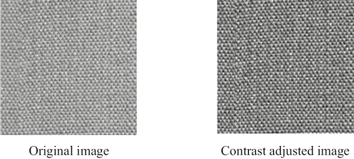

图 5.1 对比度调整后的图像。

#### 5.3.2 强度调整

该技术将图像的强度值映射到一个新的范围。使用这些技术是为了改善图像。但这里的改善定义为两种方式：客观和主观。客观改善提高信噪比，主观改善通过修改颜色以调整强度，使某些特征更易于观察，如图 5.2 所示。

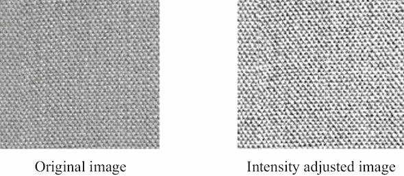

图 5.2 强度调整后的图像。

#### 5.3.3 直方图均衡化

图像的强度分布由直方图以图形方式表示。为了考虑整个强度范围，均衡化使像素强度的出现概率均等分布。通过使用此方法，通常可以增加图像的全局对比度。此过程有助于更好地在直方图上分布强度，如图 5.3 所示。

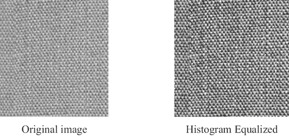

图 5.3 直方图均衡化后的图像。

#### 5.3.4 形态学操作

每个纹理图像通过阈值处理实现形态学重建。相应 H 极大值变换的区域极大值计算即为扩展极大值变换。因此，它产生一幅二值图像。为了评估每个对象的特征和位置，执行连通分量标记操作。H 变换的区域极大值由扩展极大值变换计算得出，如图 5.4 所示。

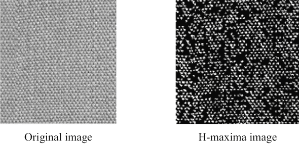

图 5.4 形态学操作后的图像。

### 5.4 图像增强技术

图像增强被认为是最重要的预处理步骤之一，广泛用于医学图像处理、计算机视觉、雷达和卫星图像处理、遥感、水下图像处理、人脸检测与识别等众多计算机视觉应用中。已开发出许多图像增强算法。每种算法在处理速度、计算复杂度、图像质量等方面都有所不同。图像增强技术的主要目的是揭示图像的隐藏细节。此外，它还有助于增加低对比度图像的对比度。图像增强技术通过改变图像像素的强度来运作，从而以输出形式提供更好、更清晰的图像。除此之外，这些技术还有助于为各种图像处理系统创建改进的输入。文献中有大量先进的图像增强技术。但下面讨论的是最重要且最常用的技术：

#### 5.4.1 强度增强 (IE)

这是一种技术（Al-Ameen 等人, 2015），通过将图像强度值映射到新范围来调整图像。不仅如此，它还能提供质量更好的图像。但必须牢记，在对图像应用图像增强技术之前，识别上限像素值和下限像素值至关重要。此外，这些是测试图像必须受其调节的数值限制。强度增强方法的目标是放大图像强度。所有这些都是通过将每个灰度值转换为更新的累积分布函数 (CDF) 来完成的。此外，该函数是从强度直方图获得的。

#### 5.4.2 直方图均衡化 (HE)

这是空域中最容易实现的技术之一。直方图均衡化（Jaya & Gopikakumari, 2013）通过改变图像强度来提高图像的对比度水平。此外，它也被称为一种变换技术，通过以一致的方式适当重新分配图像灰度级来帮助改善图像对比度特性。直方图均衡化可解释如下：

*P*(*r*[*k*]) = *n*[*k*] / *n*  (5.1)

其中 *n*[*k*] = 0,1,2….,L-1，*r*[*k*] 被取为第 *k* 个灰度级，*n* 表示具有灰度级 *r*[*k*] 的图像中可用的总像素数。


当同一图像的动态范围发生扩展时，该算法成功地增加了图像的对比度。此方法不仅极大地有助于增强图像对比度，但也引入了一些伪影、冲淡的外观、视频系统中的脉冲视觉感知以及图像细节的丢失（Jaya & Gopikakumari, 2013）。此外，该技术不保留图像的平均亮度，导致某些局部区域过度变亮。

#### 5.4.3 自适应直方图均衡化 (AHE)

为克服上段已讨论的直方图均衡化方法的缺点，开发了该技术（Jaya & Gopikakumari, 2013）。该技术通过将输入图像划分为许多子块或图块来运作。随后，针对每个给定的图块计算其所含像素的直方图。最后一步涉及利用该图块的累积分布函数 (CDF)，基于邻域内的像素值，对中心像素应用直方图均衡化方法。自适应直方图均衡化和普通直方图均衡化都对每个图块执行相同的推导函数，以获取变换函数。然而，它是一种局部操作，因此具有不同灰度范围的区域可以同时得到增强。因此，证明了借助该技术可以克服直方图均衡化过程的缺点。此外，可使用滤波过程或插值方法，以减少因将图像划分为图块而引入的伪影。尽管如此，自适应直方图均衡化方法也有其缺点。首先，它会过度放大均匀区域中的背景噪声。其次，计算成本相当高昂（Saenpaen et al., 2018），因为使用完美的块大小并非一项简单直接的任务，因为这会增加图像的所有部分。

#### 5.4.4 对比度受限自适应直方图均衡化 (CLAHE)

对比度受限自适应直方图均衡化（Irmak & Ertas, 2016）利用裁剪限制的新概念来处理 AHE 的噪声问题。该方法有助于限制图像的放大。这是通过在计算累积分布函数 (CDF) 之前，在预定义值处裁剪直方图来完成的。此外，裁剪限制完全取决于直方图的归一化和邻域的区域大小（Saenpaen et al., 2018）。此后，位于裁剪限制之上的像素值会在低于裁剪限制的直方图值之间重新分配。这种重新分配过程会再次将像素值推向裁剪限制之上。所有这些导致了一个有效的裁剪限制，它比先前决定的要大得多。因此，这种重新分配过程会重复进行，直到所有超出的像素值都降至裁剪限制之下。再次执行插值函数，以便生成最终的 CLAHE 图像。

以下数学表达式（Jaya & Gopikakumari, 2013）基于均匀分布，可用于表示具有变换灰度级的标准 CLAHE：

```
g = [g[max] - g[min]] * P(f) + g[min] (5.2)
```

其中，`g[max]` 被视为最大像素值，`g[min]` 被视为最小像素值。`P(f)` 被视为累积概率分布，而 `g` 被视为计算出的像素值。

#### 5.4.5 亮度保持双直方图均衡化 (BBHE)

在该技术中，首先根据输入图像的均值将其直方图分成两个分区（Rivera et al., 2012）。第一部分包含从最小灰度级到均值的范围，第二部分包含从均值到最大灰度级的范围。然后，独立地对这两个直方图进行均衡化。包含 0 到 K-1 范围的直方图被分成两个具有不同强度 `X[T]` 的部分。因此，这种分离产生了两个直方图。其中第一个直方图包含 0 到 `X[T]` 的范围，第二个包含 `X[T+1]` 到 `X[K-1]` 的范围。从数学和实验上都已证明，该技术在更大程度上维持原始亮度方面无可匹敌。

#### 5.4.6 对偶子图像直方图均衡化 (DSHIE)

我们已经了解了 BBHE 方法如何将原始图像分解为两个子图像，并分别均衡化子图像的直方图。但另一方面，对偶子图像直方图均衡化 (DSHIE) 并非基于均值划分图像，而是基于 0.5 的累积分布函数 (CDF) 将图像分成两部分（Rivera et al., 2012）。这样做是为了使输出图像产生最高的熵。

#### 5.4.7 最小均值亮度误差双直方图均衡化 (MMBEBHE)

最小均值亮度误差双直方图均衡化方法（Rivera et al., 2012）被认为优于 BBHE 方法。其优于前一方法的主要原因在于，它能比 BBHE 和 DSIHE 更好地保证亮度的保持。前几种方法与 MMBEBHE 方法的另一个主要区别在于，后者提出寻找一个阈值水平。该阈值水平进一步用于将图像 `I` 分解为两个子图像。第一幅图像用 `I[0,1t]` 表示，第二幅图像用 `I[1t+1, K-1]` 表示。因此，它有助于区分输入图像和输出图像之间的最小亮度差异，这是前几种方法未考虑的。

#### 5.4.8 背景亮度保持直方图均衡化 (BBPHE)

观察到平坦图像包含的背景电平密度比其他电平高得多。不仅如此，在平坦图像中，背景电平的总密度可能超过总像素的一半。因此，在 BBPHE（Rivera et al., 2012）中，输入图像基于背景电平和非背景电平范围分解为子图像。然后，下一步涉及独立地均衡化每个子图像，并将它们组合成最终输出图像。因此，该过程通过在原始范围内拉伸背景电平，缓解了过度增强的问题。此外，背景亮度保持直方图均衡化技术能够通过归一化，将其他子图像中相对较低密度的灰度级扩展到一个宽范围内。

### 5.5 图像增强技术的性能指标

如下所述，图像增强技术有多种性能指标可用：

#### 5.5.1 均方误差 (MSE)

```
MSE = \frac{1}{MN}\sum\limits_{j = 1}^{M}\sum\limits_{k = 1}^{N}\left( {I_{j,k} - O_{j,k}} \right)^{2} (5.3)
```

在上述表达式中，`M` 和 `N` 分别代表图像的行和列。此处 `I[j,k]` 代表原始输入图像，`O[j,k]` 代表相应的输出图像。为了减小均方误差（Yadav et al., 2016），输入图像和输出图像之间应具有接近的像素强度。


#### 5.5.2 峰值信噪比 (PSNR)

$$PSNR = 10 \log_{10} \frac{255^{2}}{MSE} \tag{5.4}$$

峰值信噪比 (Kober, 2006) 应尽可能大，因为这将确保输出中的信号含量丰富而噪声较低。此外，信号的峰值取为最大值 255，因为它是峰值信噪比，且灰度图像的范围是从 0 到 255。

#### 5.5.3 绝对平均亮度误差 (AMBE)

亮度保持由绝对平均亮度误差方法 (Jaya & Gopikakumari, 2013) 确定。该系统基于原始图像和增强图像之间不同的亮度水平。为了更好地保持图像亮度，AMBE 的值必须降低。以下表达式将清楚地说明这一点。

$$AMBE = |E(I) - E(O)| \tag{5.5}$$

在该方程中，`E(I)` 代表输入图像的平均强度，`E(O)` 代表增强图像的平均强度。

#### 5.5.4 对比度

对比度代表图像中亮度和颜色的差异，使物体可被感知。

$$CONTRAST = \frac{I[max] - I[min]}{I[max] + I[min]} \tag{5.6}$$

在该表达式中，`I[max]` 和 `I[min]` 分别表示最高和最低亮度。

#### 5.5.5 熵

$$ENTROPY = -\sum h(O) \times \log_{2} h(O)$$

在该表达式中，`h(O)` 代表输出图像的归一化直方图。熵 (Jintasuttisak & Intajag, 2014) 已被用于测量图像的信息量。此外，较高的值表明图像包含丰富的细节。

#### 5.5.6 归一化绝对误差 (NAE)

$$NAE = \frac{\sum_{j = 1}^{M} \sum_{k = 1}^{N} |I_{j,k} - O_{j,k}|}{\sum_{j = 1}^{M} \sum_{k = 1}^{N} |I_{j,k}|} \tag{5.8}$$

其中，`I[j,k]` 代表原始输入图像，`O[j,k]` 代表相应的输出图像。因此，归一化绝对误差 (Kober, 2006) 应尽可能小。NAE 也提供了输入图像和输出图像之间的差异。

#### 5.5.7 增强度量 (EME)

增强度量方法主要被称为一种图像增强方法，用于在原始图像和增强图像之间进行测试。例如，取一幅输入图像 `I(n,m)`。然后将该图像划分为两个不同的块，称为 `k[1]` 和 `k[2]`，窗口大小为 `wk,l`。利用上述所有参数，增强度量可以表示如下。

$$EME = \frac{1}{k_{1}k_{2}} \sum_{I = 1}^{k_{1}} \sum_{k = 1}^{k_{2}} 20 \ln \left( \frac{I_{max;k,l}^{w}}{I_{min;k,l}^{w}} \right) \tag{5.9}$$

在该方程中，`I[max : k, l]^(w)` 代表图像 `I(n,m)` 在 `w[k,l]` 块内的最大值，`I[min : k, l]^(w)` 代表图像 `I(n,m)` 在 `w[k,l]` 块内的最小值。

#### 5.5.8 基于熵的增强度量 (EMEE)

基于熵的增强度量是一种借助熵来增强图像的方法。例如，取一幅图像 `I(n,m)`，然后将该图像分成两个不同的块，如 `k1` 和 `k2`，窗口大小为 `wk,l`，`α` 为常数标量值。以下表达式将清楚地说明 EMEE：

$$EMEE = \frac{1}{k_{1}k_{2}} \sum_{l = 1}^{k_{2}} \sum_{k = 1}^{k_{1}} \alpha \left( \frac{I_{max;k,l}^{w}}{I_{min;k,l}^{w}} \right)^{\alpha} \ln \left( \frac{I_{max;k,l}^{w}}{I_{min;k,l}^{w}} \right) \tag{5.10}$$

因此，EMEE 是每个块 `w[k,l]` 的对比度比的熵，经 `α` 缩放后，在整幅图像上取平均。

#### 5.5.9 对比度改善指数 (CII)

对比度改善指数 (Jaya & Gopikakumari, 2013) 已被证明是一项开创性的功能，有助于比较增强技术的性能。它通过以下表达式测量增强图像和输入图像局部对比度的比率来运作：

$$CII = \frac{A[O]}{A[I]} \tag{5.11}$$

在该表达式中，`A[O]` 代表增强图像在 3 × 3 窗口大小下的平均局部对比度水平。另一方面，`A[I]` 代表输入图像在 3 × 3 窗口大小下的平均局部对比度水平。CII 的值越大，表明图像对比度特性的改善程度越高。

#### 5.5.10 Tenegrad 测度 (TM)

Tenegrad 测度 (Jaya & Gopikakumari, 2013) 通常表示为梯度测度的最大化。例如，取一幅输入图像 `I`。此处，梯度值 `I(x,y)` 用于估计 Tenegrad 值，并实施 Sobel 滤波器导数，利用卷积核 `I[x]` 和 `I[y]` 来估计偏导数。因此，TM 的梯度幅度可以表示如下：

$$T(x,y) = \sqrt{I_{x} \times I(x,y)^{2} + I_{y} \times I(x,y)^{2}} \tag{5.12}$$

因此，Tenegrad 测度可以通过以下表达式估计：

$$TM = \sum_{x} \sum_{y} T(x,y)^{2} \tag{5.13}$$

当 TM 的值越高，图像质量也越高。因此，该函数将确保图像结构信息得以保留。

### 5.6 图像分割技术

图像分割是指在计算机视觉中将数字图像划分为若干段的过程。该分割的根本动机是以一种新的方式简化并改变图像的构成，使得仅分析图像中重要且相关的部分变得方便。此外，图像分割是在视觉领域的多种应用（如目标检测和分类）中必须执行的关键操作之一。它将图像分割为前景和背景，以及区域或类别。因此，这些划分分别对应于不同的物体或物体的部分。文献中存在许多图像分割技术，具体讨论如下：

#### 5.6.1 阈值处理

该技术 (Abd Elaziz et al., 2019) 被认为是图像分割中**最简单且最方便**的技术。通过使用该技术，根据像素的强度级别对图像像素进行划分。这些技术仅适用于目标比背景更亮的图像。可以手动或自动选择这些技术。但必须记住，这种选择将完全基于对图像特征的先验知识。基本上有三种类型的阈值处理：

##### 5.6.1.1 全局阈值处理

任何适用的阈值 `T` 均可用于其操作。然而，该建议值 `T` 对整幅图像保持一致。需要图像直方图的峰值来计算阈值。基于 `T` 值的输出图像 `O(x,y)` 可以从原始图像 `I(x,y)` 以以下形式获得：

$$O(x,y) = \begin{cases} 1, & \text{if } I(x,y) > T \\ 0, & \text{if } I(x,y) \leq T \end{cases} \tag{5.14}$$

##### 5.6.1.2 可变阈值处理

这种类型的阈值处理允许 `T` 的值在图像上变化。这种类型的阈值处理进一步分为两个子类型：


##### 5.6.1.3 多阈值分割

这种阈值分割提供多个阈值，如 `T0` 和 `T1`，可用于以下方式计算输出图像：

```
O(x, y) = { m, if I(x, y) > T1
          { n, if I(x, y) <= T1
          { o, if I(x, y) <= T0
```
(5.15)

Otsu 算法、Eridas 算法和二次积分比（QIR）[29] 是一些可用于执行基于阈值分割技术的分割算法。

#### 5.6.2 基于边缘检测的技术

基于边缘检测的技术是图像处理中最精细的技术之一。这些技术会给图像的强度值带来巨大的变化。这是因为单一的强度值无法提供关于边缘的有益信息。此外，边缘检测技术的设计使其能够在两种情况下找到边缘：一阶导数大于特定阈值的情况，或二阶导数存在过零点的情况（Abd Elaziz 等人，2019）。在这些方法中，第一步是定位所有边缘，第二步是将它们连接起来，以便形成物体边界，从而划分必要的区域。Sobel 算子、Canny 算子、Prewitt 算子和 Roberts 算子是一些最基础的边缘检测技术。这些技术的主要目标是最终生成一幅二值图像。所有这些技术均属于依赖于不连续性检测的结构技术（Kang 等人，2009）。

此外，在开始阶段，边缘检测技术将图像预处理为二值形式，然后借助高斯 5×5 滤波器对这些图像进行滤波，以便从图像中去除噪声。然后下一步涉及根据一阶导数的定义，估计滤波后图像的梯度方向和幅度，可按以下方式表述：

如果 `G[x]` 和 `G[y]` 表示分别对应 `x` 轴和 `y` 轴的梯度方向，则相对于 `x` 轴方向的连续梯度方向可描述如下：

```
G[x] = I(x+1) - I(x)
```
(5.16)

其中 `I` 代表输入图像，`I(x+1)` 和 `I(x)` 分别表示下一个像素和当前像素的位置。同理，根据 `y` 轴方向的连续梯度方向可描述如下：

```
G[y] = I(y+1) - I(y)
```
(5.17)

梯度幅度 `M` 由下式给出：

```
M = sqrt(G_x² + G_y²)
```
(5.18)

根据梯度结果抑制所有非极大像素幅度，同时保留图像中的局部极大像素。

#### 5.6.3 基于区域的技术

这些是通过将图像分割成具有相同特征的各个区域来运作的分割技术。该技术进一步分为两种子类型。

##### 5.6.3.1 区域生长法

这些方法根据细胞（也称为像素）的生长将图像分成许多区域。可以借助先验知识手动选择这些种子，也可以借助特定应用自动选择。此外，像素之间的连通性可以主导种子的生长。借助对问题的先验知识，可以停止这一过程。

##### 5.6.3.2 区域分裂与合并法

在这些技术中，使用分裂和合并这两个最基本的元素，将图像分割成许多区域。分裂负责将图像持续划分为由具有相同特征的区域组成的部分，而合并则代表相邻相似区域的组合。

#### 5.6.4 基于聚类的技术

通过这种技术，图像被分割成包含具有相同特性像素的簇。借助聚类，总体或数据点被划分成许多组。这样做是因为同一组中的数据点比其他组的数据点更相似。这就是这些组被称为簇的原因。`K-means`（Bali & Singh, 2015）是最常用的聚类算法之一。该技术涉及计算每个中心，然后将每个像素分配给其最近的中心。该函数的主要目标是增加簇内相似性并减少簇间相等性（注：原文为 equality，语境下通常指 dissimilarity/差异性，此处直译原文）。

#### 5.6.5 基于分水岭的技术

基于分水岭的技术利用了拓扑解释的概念。这里，强度呈现了在极小值处有洞的盆地，导致水溢出。当水接近盆地边界时，附近的盆地会合并在一起。因此，分割区域的边界对于保持盆地坝之间的距离是必不可少的。因此，这些坝是借助膨胀或扩大来构建的。分水岭技术将图像的梯度视为地形表面。具有较大梯度的像素被称为边界，且这些边界是连续的。

#### 5.6.6 基于偏微分方程的技术

基于偏微分方程（PDE）的技术被标记为图像分割最快的方法。这些方法最适合时间关键型应用。这些方法主要涉及两种 PDE 方法。第一种称为非线性各向同性扩散滤波器，用于增强边缘；第二种是凸非二次变分复原，用于避免图像中的噪声。PDE 方法产生的边缘和边界是模糊的，并使用闭运算来移动它们。此外，实现四阶 PDE 方法以减少图像中的噪声，而二阶 PDE 方法用于更好地识别图像的边缘和边界。

#### 5.6.7 基于人工神经网络的技术

人脑的学习策略通过基于人工神经网络的分割技术得以复制。因此，它有助于决策。近年来，该技术常被选用于医学图像的分割。该方法的主要目的是将必要的图像从背景中分离出来。神经网络由大量连接的节点组成，每个连接都有特定的权重。该技术包含两个基本步骤。第一步是特征提取，第二步是神经网络分割。此外，在该方法中，网络通过改变层间的互连、权重来“学习”，并使一组输入数据的相关输出变得简单（Min 等人，2015）。

#### 5.6.8 基于模糊逻辑的技术


#### 5.6.9 基于遗传算法的技术

基于遗传算法的技术（Bali & Singh, 2015）源于进化论。该理论包含三个主要功能。第一个功能是选择，第二个和第三个分别是交叉和变异。这些方法最适合用于模式识别应用。

#### 5.6.10 基于显著性的技术

计算机视觉应用中进展最快的领域之一是基于显著性的技术（Shokoufandeh et al., 1999）。该技术有助于检测图像中的显著目标，这在当今发挥着相对非常重要的作用。此外，在寻找分割问题的解决方案时，显著性目标检测技术将显著的前景目标从背景中分离出来。它不像上述分割技术通常做的那样，将图像分割成具有相似属性的区域。因此，它是一种新的图像分割方法。

### 5.7 实验结果

让我们以一张由高清摄像头捕获的图像为例，应用噪声去除技术进行人脸检测。结果如图 5.5(a)至 5.5(e)所示。


图 5.5(a) RGB 原始图像。


图 5.5(b) 含噪声的灰度图像。


图 5.5(c) 去噪后的灰度图像。


图 5.5(d) 灰度图像中的人脸检测。


图 5.5(e) RGB 图像中的人脸检测。

正如我们从图 5.5(a)到 5.5(e)所看到的，首先，我们将原始 RGB 图像转换为灰度图像，该图像充满了噪声。接下来，我们使用维纳滤波器应用噪声去除技术，从灰度图像中去除噪声。最后，我们应用人脸检测算法检测图像中的人脸，并将检测到的人脸图像转换回 RGB 图像。

### 5.8 结论

在本章中，讨论了各种图像预处理方法、图像增强、图像增强的性能指标以及图像分割技术。此外，还设计了一种用于 `MATLAB 2018a` 中人脸检测的算法。可以得出结论，在将图像输入任何智能系统之前，图像预处理是一项重要任务。预处理主要涉及增强技术，用于去除因模糊、夜景、弱光、遮挡、阴影等原因产生的噪声。因此，当我们设计用于监控或视频中目标检测或任何其他图像识别任务的系统时，第一步是图像预处理，以便实现系统的高性能。

### 参考文献

*   Abd Elaziz, M., Bhattacharyya, S., & Lu, S. (2019). Swarm selection method for multilevel thresholding image segmentation. *Expert Systems with Applications*, *138*, 112818。

*   Agrawal, A. K., & Sivagami, M, P. S. (2015). Object recognition in Hadoop using HIPI. *International Journal of Scientific & Technology Research*, *4*(7), 115–118。

*   Al-Ameen, Z., Sulong, G., Rehman, A., Al-Dhelaan, A., Saba, T., & Al-Rodhaan, M. (2015). An innovative technique for contrast enhancement of computed tomography images using normalized gamma-corrected contrast-limited adaptive histogram equalization. *EURASIP Journal on Advances in Signal Processing*, *2015*(1), 1–12。

*   Anitha, S., & Radha, V. (2010). Comparison of image preprocessing techniques for textile texture images. *International Journal of Engineering Science and Technology*, *2*(12), 7619–7625。

*   Aradhye, A. A., Inamdar, H. S., Patil, G. S., & Jagdale, Y. B. (2016). Object detection avenue for video surveillance using Hadoop. International Research Journal of Engineering and Technology (IRJET), 3(5), 497–499。

*   Bali, A., & Singh, S. N. (2015). A review on the strategies and techniques of image segmentation. *2015 Fifth International Conference on Advanced Computing & Communication Technologies*, 113–120。

*   Dhinakaran, K., Silviya Nancy, J., & Duraimurugan, N. (2015). Video analytics using HDVFS in cloud environment. *ARPN J Eng Appl Sci*, *10*, 13。

*   Ganesh, R. B., & Appavu, S. (2015). An intelligent video surveillance framework with big data management for Indian road traffic system. *International Journal of Computer Applications*, *123*(10), 12–19。

*   Ghaware, S., Harke, V., Jadhav, S., & Khanuja, H. (2016). *Approaches for Video Surveillance Using Hadoop*. *4863*(February), 47–50。

*   Irmak, E., & Ertas, A. H. (2016). A review of robust image enhancement algorithms and their applications. *2016 IEEE Smart Energy Grid Engineering (SEGE)*, 371–375。

*   Jamkhandikar, D., Mytri, V. D., & Shahapure, P. (2014). Object detection and tracking in real time video based on color. *International Journal of Engineering Research and Development*, *10*, 33–37。

*   Jaya, V. L., & Gopikakumari, R. (2013). IEM: a new image enhancement metric for contrast and sharpness measurements. *International Journal of Computer Applications*, *79*(9), 1–9。

*   Jintasuttisak, T., & Intajag, S. (2014). Color retinal image enhancement by Rayleigh contrast-limited adaptive histogram equalization. *2014 14th International Conference on Control, Automation and Systems (ICCAS 2014)*, 692–697。

*   Kang, W.-X., Yang, Q.-Q., & Liang, R.-P. (2009). The comparative research on image segmentation algorithms. *2009 First International Workshop on Education Technology and Computer Science*, *2*, 703–707。

*   Kober, V. (2006). Robust and efficient algorithm of image enhancement. *IEEE Transactions on Consumer Electronics*, *52*(2), 655–659。

*   Kumar, A. K. P. B. K., Mahankud, A., & Mishra, P. K. (2016). Detection of objects in a video of traffic. *International Research Journal of Engineering and Technology*, 3(5), 676–678。

*   Kumar, N., Pathan, E., Yadav, L., & Ransubhe, V. (2015). Video surveillance over camera network using Hadoop. *International Journal of Innovative Research in Computer and Communication Engineering*, 4(1), 1111–1115。

*   Li, J., Wu, Q., Lian, X., & Sun, J. (2016). Real-time video copy detection based on Hadoop. *2016 Sixth International Conference on Information Science and Technology* *(ICIST)*, 492–497。

*   Min, H., Jia, W., Wang, X.-F., Zhao, Y., Hu, R.-X., Luo, Y.-T., Xue, F., & Lu, J.-T. (2015). An intensity-texture model based level set method for image segmentation. *Pattern Recognition*, *48*(4), 1547–1562。


*   Natarajan, V. A., Jothilakshmi, S., & Gudivada, V. N. (2015). Scalable traffic video analytics using Hadoop MapReduce. *ALLDATA* *2015*（第一届大数据、小数据、链接数据和开放数据国际会议，版权所有 (c) IARIA, 2015. ISBN: 978-1-61208-445-9），18。

*   Parsola, J., Gangodkar, D., & Mittal, A. (2017). Efficient storage and processing of video data for moving object detection using Hadoop/MapReduce. *International Conference on Signal, Networks, Computing, and Systems Proceedings*（信号、网络、计算与系统国际会议论文集），137–147。

*   Ravi, P., & Ashokkumar, A. (2017). Analysis of various image processing techniques. *Int J Adv Netw Appl*, *8*(5), 86–89。

*   Rivera, A. R., Ryu, B., & Chae, O. (2012). Content-aware dark image enhancement through channel division. *IEEE Transactions on Image Processing*（IEEE 图像处理汇刊），*21*(9), 3967–3980。

*   Saenpaen, J., Arwatchananukul, S., & Aunsri, N. (2018). A comparison of image enhancement methods for lumbar spine X-ray image. *2018 15th International Conference on Electrical Engineering/Electronics, Computer, Telecommunications and Information Technology (ECTI-CON)*（2018 年第 15 届电气工程/电子、计算机、电信与信息技术国际会议），798–801。

*   Saxena, S., Sharma, S., & Sharma, N. (2016). Parallel image processing techniques, benefits and limitations. *Research Journal of Applied Sciences, Engineering and Technology*（应用科学、工程与技术研究期刊），*12*(2), 223–238。

*   Shah, V. (2015). *Big video data analytics using Hadoop*（使用 Hadoop 进行大视频数据分析）。Jaunpur: IJARCSSE。

*   Shokoufandeh, A., Marsic, I., & Dickinson, S. J. (1999). View-based object recognition using saliency maps. *Image and Vision Computing*（图像与视觉计算），*17*(5–6), 445–460。

*   Yadav, G., Maheshwari, S., & Agarwal, A. (2016). Multi-domain image enhancement of foggy images using contrast limited adaptive histogram equalization method. *Proceedings of the International Conference on Recent Cognizance in Wireless Communication & Image Processing*（无线通信与图像处理最新认知国际会议论文集），31–38。

# 6

# Forecasting Time Series Data Using Artificial Neural Network

## A Review

Sarbjit Singh, Kulwinder Singh Parmar, Harpreet Kaur, and Jatinder Kaur

DOI: [10.1201/9781003153405-6](https://doi.org/10.1201/9781003153405-6)

## Contents

*   6.1 Introduction
*   6.2 Historical Developments in the Field of ANN
*   6.3 Methodology
*   6.4 Classification of ANN
    *   6.4.1 Feed-Forward Neural Networks
    *   6.4.2 Recurrent Neural Networks
    *   6.4.3 Elman Back Propagation Neural Networks
    *   6.4.4 Time-Delay Feed-Forward Neural Network
*   6.5 Structural Design of ANN
*   6.6 Review of Applications, Results and Discussions
    *   6.6.1 River Flow Forecasting
    *   6.6.2 Environmental Pollution Forecasting
    *   6.6.3 Stock Market Forecasting
    *   6.6.4 Agriculture Related Forecasting
*   6.7 Conclusions
*   References

### 6.1 Introduction

预测是一项极具挑战性的任务。研究人员和专业分析师提出了各种统计模型和软计算技术，以获得更准确的预测。在各种预测模型中，人工神经网络（`ANNs`）是最准确、快速和可靠的技术。`ANN` 几乎应用于所有领域，无论是社会、经济、工程、大气科学还是应用数学领域。`ANN` 最显著的特点是它能够处理数据的非线性、季节性、噪声和鲁棒性（Khashei and Bijari, 2010）。基于 `ANN` 计算的动机是设计此类数学算法，使其能够并行地模拟人脑进行信息处理的工作方式（Basheer and Hajmeer, 2000）。`ANN` 最重要的特征是它们具有以高精度逼近任何连续函数的能力（Zhang and Min Qi, 2005; Chen et al. 2003）。`ANN` 具有独特的泛化能力。样本中未见的部分可以通过 `ANN` 正确推断。与线性/回归模型不同，使用 `ANN` 时不需要对模型做任何先验假设。这种数据驱动的方法使 `ANN` 成为预测现实生活中复杂问题的绝佳工具，因此它成为预测股票市场、环境污染、河流流量、天气、农业以及科学和工程中许多预测起关键作用领域的合适工具。在预测中，多层前馈方法是 `ANN` 最广泛使用的范式。本章旨在为预测领域的研究人员提供关于不同类型神经网络发展以及建模和预测不同时间序列方法论的详细研究。本章还涉及使用 `ANNS` 的监督学习技术综述，以解决与环境、股票市场、水文学和农业相关的预测问题。

### 6.2 Historical Developments in the Field of ANN

沃伦·麦卡洛克和沃尔特·皮茨于 1943 年设计了麦卡洛克-皮茨神经元计算元件模型。在该模型中，每个元件被分配输入的加权和，然后应用阈值逻辑运算（McCulloch and Pitts 1943）。使用这些计算元件的组合进行了多项分析计算（Figure 6.1）。该模型的主要缺点是权重固定，这使得模型无法执行学习操作。

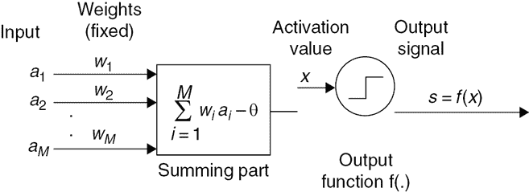

**Figure 6.1** McCulloch-Pitts neuron model.

唐纳德·赫布于 1949 年提出了一种可调连接权重的学习方案，这成为了神经网络领域的一个重要学习规则（Hebb, 1949）。马文·明斯基于 1954 年创建了一种自适应学习方案，可自动调整连接强度（Minsky and Papert, 1969）。著名的感知机模型由罗森布拉特于 1958 年提出。其中权重通过感知机学习法则进行调整（Rosenblatt, 1958）。该法则最适合使用多层感知机进行模式分类问题（Figure 6.2）。

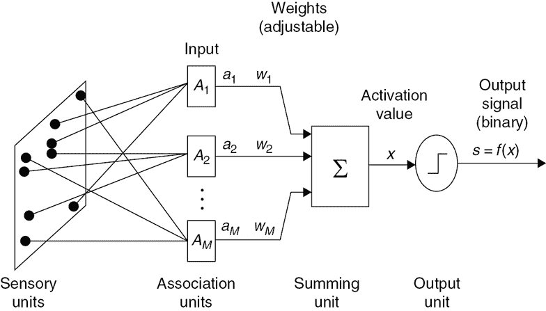

**Figure 6.2** Rosenblatt’s perceptron model of a neuron.

感知机模型的主要缺点是无法在重组分类任务时调整权重。这在 1969 年由明斯基和帕珀特克服（Minsky and Papert, 1969）。1960 年，维德罗和霍夫提出了用于调整权重的自适应元件 Adaline 模型（Widrow and Hoff, 1960）（Figure 6.3）。由于算法的收敛性，它成功地应用于自适应信号处理问题。

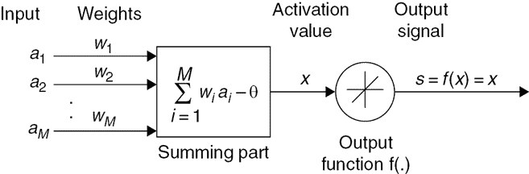

**Figure 6.3** Widrow’s Adaline model of a neuron.

1964 年，胡在其论文中使用维德罗的自适应网络进行天气预报。由于缺乏训练算法，研究受限直到 1986 年反向传播算法由 Chauvin and Rumelhart (1995) 引入。


在过去的 30 年里，竞争学习、自组织和模拟退火等概念的若干杰出贡献影响了人工神经网络这一领域，从而促成了新的学习算法和模式识别问题的发展。目前，模糊逻辑方法与神经网络相结合，以开发一种自适应框架，从而高效地处理现实世界的问题。

### 6.3 方法论

人工神经网络（ANN）可被视为包含比生物神经网络更简单的互联处理单元结构。ANN 由若干相互连接的处理单元组成，以执行规定的任务。ANN 由三个重要层组成，即输入层、隐藏层和输出层。输入层和输出层分别拥有对应输入和输出变量的节点（图 6.4）。

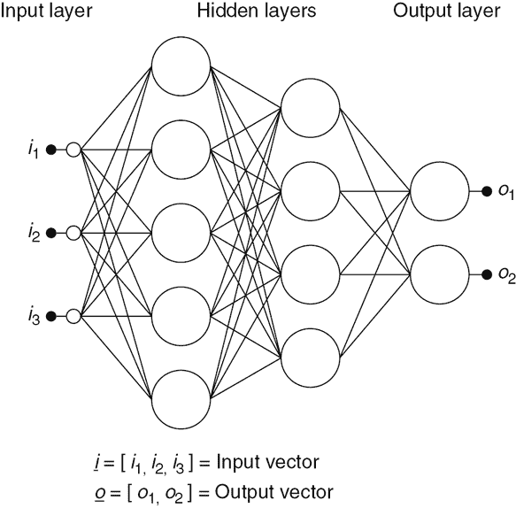

图 6.4 人工神经网络的基本架构。

数据通过加权连接在层之间传输（Kaul 等，2005）。输入被送至处理单元的求和部分，该部分计算加权和以从此和生成输出。离散或连续的输入值也可被送至处理单元以生成输出。送至处理单元的输入要么独立给出，要么来自其他处理单元的输出。连接单元的能力体现在权重值中。ANN 中的每个单元在给定时刻都有一个唯一的激活值，该值决定了网络的激活状态。输出函数单元生成总体输出，该输出由激活值决定（图 6.5）。可使用线性、阶跃、斜坡、Sigmoid、双曲正切和高斯函数等不同类型的激活函数来生成激活值（图 6.6）并确定网络的输出路径。

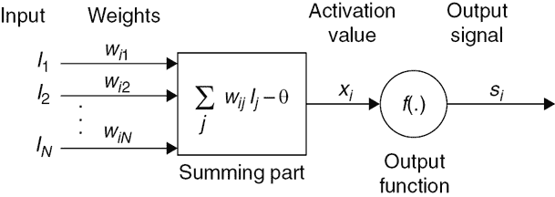

图 6.5 人工神经网络的处理单元。

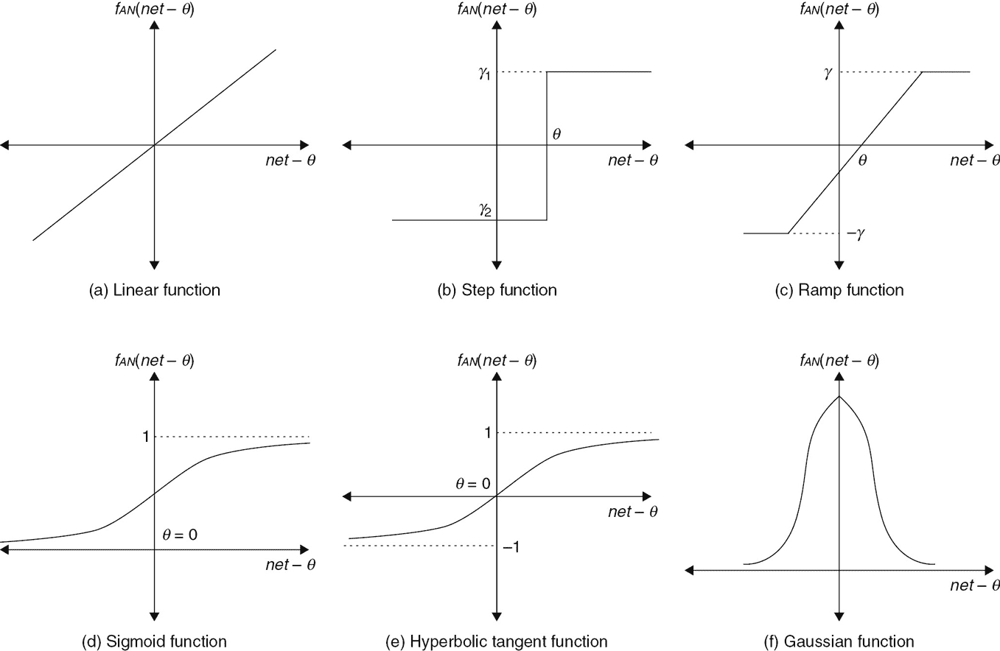

图 6.6 不同类型的激活函数 (a) 线性函数 (b) 阶跃函数 (c) 斜坡函数 (d) Sigmoid 函数 (e) 双曲正切函数 (f) 高斯函数。

### 6.4 ANN 分类

根据层间连接的结构，ANN 分类如下：

#### 6.4.1 前馈神经网络

前馈神经网络是人工神经网络最基本的形式，其中信息流是单向的，绝不反向。前馈 ANN 中节点之间的连接不形成循环（图 6.7）。

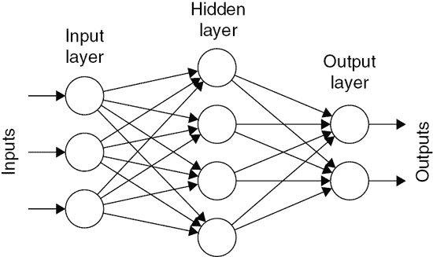

图 6.7 前馈人工神经网络架构。

#### 6.4.2 循环神经网络

在循环神经网络中，相同的操作会在一组序列输入上反复执行。从某些先前阶段生成的输出作为下一阶段操作的输入。隐藏层承担着重要任务，即回溯反复输入的数据的某些信息。由于这一特性，循环神经网络具有记忆，从而提高了其性能（图 6.8）。

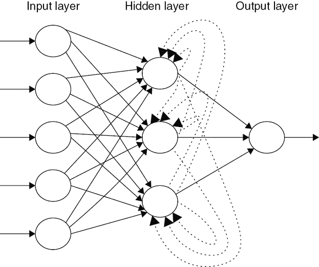

图 6.8 循环人工神经网络架构。

#### 6.4.3 Elman 反向传播神经网络

Elman 神经网络是一种反馈神经网络，其隐藏层不仅与输出层互联，还与另一层（称为上下文层）互联，连接权重等于 1。上下文层充当延迟算子以保持记忆，使网络具备适应时变主动特征的能力，从而增加稳定性（图 6.9）。

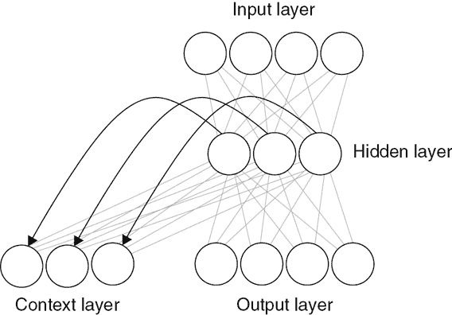

图 6.9 Elman 反向传播神经网络架构。

#### 6.4.4 时延前馈神经网络

时延前馈神经网络利用时延特性构建网络结构，以建立短期记忆，使神经网络具有动态性。时延特性被应用于神经网络的输入层（图 6.10）。

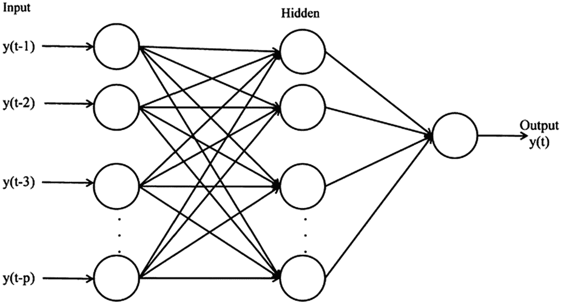

图 6.10 时延前馈神经网络架构。

### 6.5 ANN 结构设计

ANN 的结构布局主要包括定义所需的输入、输出和隐藏层的数量，以及神经元之间的交互方案（Gardner and Dorling 1998）。输入层和输出层的神经元数量因问题而异。但没有具体标准来确定每个隐藏层需要多少神经元。隐藏层中神经元数量较少会导致较高的训练误差（欠拟合），而神经元数量较多则会导致较高的验证误差（过拟合）。这两种误差均不可接受。模型根据输入预测输出。

各层的处理单元通过非循环链接连接。输出（`y[t]`）与输入（`y[t-1], ..., y[t-p]`）之间的关系由下式给出：

```
y_t = w_0 + \sum_{j = 1}^{q} w_j g(w_{0,j} + \sum_{j = 1}^{p} w_{i,j} y_{t - i}) + \epsilon_t
```

其中 `w[i, j]`（`i`=0,1,2,...`p`，`j`=1,2,...`q`）和 `w[j]`（`j`=0,1,2,...`q`）为连接权重；`p` 和 `q` 分别为输入节点和隐藏节点的数量。

### 6.6 应用、结果与讨论综述

Zhang（1998）发现，ANN 能以同等期望精度处理线性和非线性问题。随后，Gorr 于 1994 年补充指出，ANN 能同时处理季节性和非线性。当 Sharda 和 Patil（1992）分析著名的 M 竞赛中的 88 个季节性时间序列时，他们得出了类似的结论：使用 ANN 时无需对数据进行预先去季节化。然而，对去季节化数据的预测明显优于对季节性数据的预测（Nelson 等，1999）。Franses 和 Draisma（1997）识别出了变化的季节模式。神经网络的自组织能力及其灵活的特性，使其成为应用于波动大且频繁的股票市场的合适工具（Bing 等，2012）。因此，ANN 具有广泛的应用范围，但此处我们主要讨论 ANN 高效用的四大领域。

#### 6.6.1 河流流量预测


自 Kang et al. (1993) 提出将人工神经网络（ANN）应用于河流流量的逐日和逐时预报以来，大量研究（Abrahart and See 1998，Jain et al., 1999，Zealand et al., 1999）已利用 ANN 预测不同的河流流量参数。在所使用的各种模型中，采用反向传播（BP）算法改进的多层感知机模型是最流行且应用最广泛的技术。径向基函数在河流流量预报中也有大量应用（Dawson et al. (2002)；Dibike and Solomatine (2001)；Fernando and Jayawardena (1998)）。为了对非平稳数据进行更好、更准确的预报，ANN 与小波相结合，开发出了各种混合模型。小波与人工神经网络（WA–ANN）的混合模型被开发并应用于法国和美国的一日提前流量预报（Anctil and Tape 2004）、意大利和土耳其的月度预报（Kisi 2009）以及河流流量的逐日预报（Kisi 2009）。所有这些研究均得出结论：WA–ANN 模型在河流流量预报方面表现优于 ANN 模型。

#### 6.6.2 环境污染预报

为保护人们免受污染的有害影响，卫生机构有必要获得关于周围污染物排放和空气质量的可靠提前预测。大气污染浓度及其与气候的统计关系是环境污染预报的基础。长期以来，多元线性回归模型被用于此目的（Comrie 1997）。然而，污染-天气关系是非线性且复杂的。因此，由于计算效率和泛化能力，ANN 模型为统计模型提供了更好的替代方案。ANN 能非常适当地处理非线性复杂的污染-天气关系。甚至高维数据也能以同等精度处理。但数据的异质性和广泛的影响参数使得环境模型难以被完全彻底地研究（Jakeman et al. 2006）。Perez and Trier (2001) 在圣地亚哥实现了 `PM2.5` 颗粒物浓度的 24 小时提前预测。此项工作采用了一个具有 24 个输入和 1 个输出的三层前馈神经网络。早在 1998 年，Gardner 和 Dorling 就对人工神经网络在大气科学中的应用进行了广泛而全面的综述。多层感知机（MLP）结构被认为最为适用，特别是在大气科学研究中。Moseholm et al. (1996) 在估算西雅图北部大学区（一个遮蔽的城市十字路口）的 CO 浓度水平时采用了该技术。Chelani et al. (2002) 在德里对多元回归模型和三层神经网络进行了比较以预测 `SO2` 浓度，结论是后者比前者给出了更准确、更可靠的结果。

#### 6.6.3 股市预测

股市预测是一项充满挑战的任务，因为它涉及大量风险。各种研究人员使用不同方法对股市数据进行建模和预测。但由于股市数据的非线性和复杂性，人工神经网络被发现是最准确、最精确的软计算技术。Li and Ma (2010) 对 ANNs 在各类股市中的应用进行了综述，内容涉及应用 ANNs 预测各类股市和金融指数的未来值。Wang and Wang (2015) 借助随机时效函数神经网络和主成分分析的耦合方法，对金融时间序列数据进行了预测。与常规的反向传播神经网络（BPNN）和 PCA-BPNN 相比，所提混合方法生成的预测更准确。Niaki and Hoseinzade (2013) 应用人工神经网络（ANN）方法按日预测标准普尔 500（S&P 500）指数。他们采用实验设计从 27 个金融和经济变量中选择最有效的特征，并利用 ANN 进行预测。所提技术的性能优于传统的买入持有策略。Zahedi and Rounaghi (2015) 采用 ANN 模型和主成分分析（PCA）方法预测德黑兰证券交易所价格，并从 20 个会计变量中提取了 20 个主要特征。准确的预测以所有变量的新模式形式呈现。Wang and Wang (2016) 通过结合 MLP 和 ERNN 与随机时效函数，开发了一种预测原油价格波动的新技术。具有时变预测系统显著特征的 ERNN 的发展，具备记录近期事件以预测未来值的能力。随机时效函数的主要目标是为投资者体现近期信息相较于旧信息的稳健性。

#### 6.6.4 农业相关预测


##### 作物及时管理与人工神经网络在农学中的应用

作物的及时管理是农学领域的重中之重，因此模拟技术可在该领域发挥关键作用。温度、降雨、水分胁迫等环境因素对水稻、玉米、大豆、小麦等许多农作物的生长和产量有着显著影响（Khairunniza-Bejo et al. 2014）。

人工神经网络（ANN）可成为作物生长发育建模（Elizondo et al., 1994）、土壤-水分保持估算（Schaap and Bouten, 1996）、农药与养分流失评估（Yang et al., 1997）以及病害预测（Batchelor et al. 1997）的有效工具。总体而言，大多数农业模型采用的是力学或实验方法（Poluektov and Topaj, 2001）。力学模型较为复杂，而经验模型存在无法预测数据集范围以外情况的局限性（Wang and Wang 2016）。由于 ANN 简单且用途更广，因此它是农学中更有效、更适用的技术。

Pachepsky et al. (1996) 在计算土壤含水量时将 ANN 与回归模型进行了比较，发现前者的结果优于后者。Batchelor et al. (1997) 对 ANN 与传统方法进行了类似比较，用于预测大豆锈病，得出了相似的结论。

Schaap and Bouten (1996) 利用 204 个沙质土壤样本，尝试建立干燥水分保持曲线模型。他们采用了一系列神经网络模型。每次增加输入和输出变量的数量以获得更好的预测。尽管线性和非线性变量数量庞大，但 ANN 建模为水分保持曲线提供了极佳的结果。

ANN 在农药领域的快速相关决策制定方面也大有裨益。Yang et al. (1997) 证明了这一点。累积日降雨量、潜在蒸散量、土壤温度以及施药后经过的天数被作为输入变量。ANN 模型的输出为土壤中农药日累积含量。尽管数据有限，ANN 在预测耕作田农药浓度方面表现更好，均方根误差（RMSE）和标准差（S.D.）均低于 `0.2 g/g`。

沿着平行研究方向继续深入，Yang et al. (1997) 将 ANN 模型应用于加拿大渥太华的土壤温度模拟。此次输入变量为日降雨量、潜在蒸散量、最高和最低气温以及年积日。ANN 模型获得的结果在均方根差值范围 `0.63` 至 `1.39 °C` 内变化，标准差（S.D.）为 `0.61` 至 `1.39 °C`，决定系数（`r`²）为 `0.937` 至 `0.985`。结果表明，借助 ANN，农业系统中甚至复杂的现象也能变得简单而快速。

快速反向传播（FBP）网络和自组织径向基函数（RBF）网络是 ANN 模型中最流行的两种形式。Sharma et al. 2003 对这两种模型进行了比较，用于模拟地下排水流出量和瓦管流出液中的硝酸盐氮浓度。与 FBP 模型（隐藏层含 547 个神经元）相比，RBF 模型（隐藏层含 20 个神经元）在预测因施用化肥/粪肥导致的排水流出液中硝酸盐氮浓度方面表现更优。该信息可防止宝贵氮肥的流失。

以日最高和最低气温、光周期及大豆播种后天数作为 ANN 的输入，Elizondo et al. (1994) 证实了该技术在预测作物花期和生理成熟期方面具有高度潜力。花期预测日期的平均相对误差为 `+0.143` 天（`n` = 21，`R`² = 0.987），生理成熟期预测日期的平均相对误差为 `+2.19` 天（`n` = 21，`R`² = 0.950）。

Thai et al. (1991) 展示了神经网络在预测各种生理特性（特别是番茄和桃子等植物的感官颜色）方面的便捷性。

###### 表 6.1：文献调研结果讨论

表 6.1 展示了 ANN 方法论在单独及联合模式下的应用、调研文献的结果与讨论。一些常用的预测精度性能指标包括 `MSE`（均方误差）、`RMSE`（均方根误差）、`MAE`（平均绝对误差）、`MdAE`（中位数绝对误差）、`MAPE`（平均绝对百分比误差）、`MdAPE`（中位数绝对百分比误差）、`sMAPE`（对称平均绝对百分比误差）、`sMdAPE`（对称中位数绝对百分比误差）、`MRAE`（平均相对绝对误差）、`MdRAE`（中位数相对绝对误差）、`GMRAE`（几何平均相对绝对误差）、`RelMAE`（相对平均绝对误差）、`RelRMSE`（相对均方根误差）、`LMR`（对数均方误差比）、`PB`（优越百分比）、`PB(MAE)`（优越百分比 (MAE)）、`PB(MSE)`（优越百分比 (MSE)）。

| **序号** | **文献** | **模型** | **输入数据** | **结果** |
| :--- | :--- | :--- | :--- | :--- |
| 1. | Pachepsky et al. (1996) | ANN 和统计回归 | 数据包含 130 个原生草钙土和 100 个水成乌斯土在八个基质势下的含水量 | ANN 在选定基质势下估算含水量的效果优于回归模型 |
| 2. | Batchelor et al. (1997) | 三层前馈神经网络 | 考虑了 1980 年和 1981 年在台湾亚洲蔬菜研究开发中心 TK 5 大豆品种连续周种植的数据。 | ANN 优于传统方法 |
| 3. | Schaap and Bouten (1996) | 具有不同输入输出变量数量的一系列神经网络模型 | 包含 204 个沙质土壤样本的干燥水分保持曲线，数据源自颗粒组成分布 (PSD)、土壤有机质含量 (SOM) 和容重 (BD) | 神经网络是建模干燥水分保持曲线的非常有用的工具 |
| 4. | Yang et al. (1997) | 人工神经网络模型 | 耕作田中的农药浓度 | 尽管数据有限，ANN 在预测耕作田农药浓度方面表现更好，RMSE 和 S.D. 均低于 `0.2 g/g`。 |
| 5. | Yang et al. (1997) | 人工神经网络模型 | 土壤温度数据连同日降雨量、潜在蒸散量、最高和最低气温及年积日作为输入变量。 | 利用 ANN 获得了接近 1 的改进决定系数值。 |
| 6. | Sharma et al. (2003) | 快速反向传播网络和自组织径向基函数网络。 | 地下排水流出量和瓦管流出液中的硝酸盐氮浓度 | RBF 模型的结果优于 FBP 模型。 |
| 7. | Elizondo et al. (1994) | 人工神经网络模型 | 用于预测大豆花期和生理成熟期的数据 | 神经网络模型高效预测了大豆的花期和生理成熟期 |


###### 表 14.x：人工神经网络在预测问题中的应用文献综述

| 序号 | 参考文献 | 方法/模型 | 数据/应用领域 | 主要结论 |
| :--- | :--- | :--- | :--- | :--- |
| 8 | Thai et al. (1991) | 具有 Sigmoid 传递函数的前馈神经网络与统计回归 | 番茄和桃子外部颜色的物理测量数据 | 神经网络所需计算步骤更少，因此比基线统计方法更合适 |
| 9 | Comrie, A. C. (1997) | 多元回归模型与神经网络 | 美国八个城市的地面臭氧污染数据 | 神经网络比回归模型更适合臭氧预测 |
| 10 | Perez, P. and Trier, A. (2001) | 具有 24 个输入和 1 个输出的三层前馈神经网络 | 圣地亚哥大气中 `NO` 和 `NO2` 粒子浓度数据 | 多层 ANN 相比线性回归具有更高的准确性 |
| 11 | Gardner, M. W. and Dorling, S. R. (1998) | ANN (多层感知机) | 大气数据 | 多层 ANN 是传统统计建模技术的有用替代方案 |
| 12 | Moseholm et al. (1996) | 多层感知机网络 | 一氧化碳 (CO) 浓度水平数据 | 神经网络是理解交通、风与 CO 浓度间复杂关系的有用工具，优于标准线性回归模型及两种扩散模型 |
| 13 | Chelani et al. (2002) | 多元回归模型与采用 Levenberg–Marquardt 算法的三层神经网络 | 德里三个不同站点的 `SO2` 浓度数据 | ANN 比多元回归模型提供更准确、更可靠的结果 |
| 14 | Abrahart, R.J., and See, L. (1998) | 神经网络与 ARMA 模型 | 两个流域为期三年的河流流量数据：Upper River Wye (中威尔士) 和 River Ouse (约克郡) | 神经网络的建模性能优于 ARMA 模型 |
| 15 | Zealand et al. (1999) | ANN 与常规模型 | 加拿大西北安大略省温尼伯河系统部分河段的径流数据 | ANN 相比常规模型表现更好 |
| 16 | Fernando, D.A.K., and Jayawardena, A.W. (1998) | 径向基函数 (RBF) 网络配合正交最小二乘 (OLS) 算法、采用反向传播 (BP) 算法的 ANN 模型、ARMAX 模型 | 雨量径流数据 | 采用反向传播 (BP) 的 ANN 比其他方法产生更准确的结果 |
| 17 | Dibike, Y. B. and Solomatine, D.P. (2001) | 多层感知机 (MLP) 网络、径向基函数 (RBF) 网络 | 雨量径流数据 | ANN 在性能上超越概念性雨量径流模型 |
| 18 | Dawson, C.W., Harpham, C., Wilby, R.L. and Chen, Y. (2002) | 多层感知机 (MLP) 网络、径向基函数 (RBF) 网络、回归模型、ARIMA | 中国长江雨量径流数据 | 两种类型的神经网络生成的预测均比传统统计技术更准确 |
| 19 | Anctil, F., and Tape, D.G. (2004) | ANN 与小波分解混合 ANN | 美国和法国的雨量径流数据 | 联合小波分解与 ANN 的准确性更高 |
| 20 | Li and Ma (2010) | 人工神经网络 | 各类股票市场和金融指数数据 | ANN 在处理复杂和非线性股票市场数据方面非常成功 |
| 21 | Wang and Wang (2015) | 混合方法：随机时间有效函数神经网络 (STNN) 与主成分分析 (PCA) | 金融时间序列指数 SSE、HS300、S&P 500 和 DJIA | 混合方法相比传统反向传播神经网络 (BPNN) 和 PCA-BPNN 产生更准确的预测 |
| 22 | Niaki, S. T. A. and Hoseinzade, S. (2013) | 人工神经网络 (ANN) 方法 | 标准普尔 500 (S&P 500) 指数日度数据 | ANN 成功预测了 27 个金融和经济变量中最强大的特征 |
| 23 | Zahedi and Rounaghi (2015) | ANN 模型与主成分分析 (PCA) | 德黑兰证券交易所价格数据 | ANN-PCA 以 20 个会计变量的新模式形式提供准确预测 |
| 24 | Wang and Wang (2016) | 多层感知机与 ERNN (Elman 循环神经网络) 配合随机时间有效函数 | 原油价格数据 | ERNN 比其他模型更有用 |

### 6.7 结论

本章旨在综述人工神经网络领域在解决金融、经济、环境、水文和农业相关预测问题方面的一些重要贡献。此处详细讨论了人工神经网络的详细方法论及历史背景。调查结果表明，ANN 的预测准确度高于传统和基线回归、ARMA 和 ARIMA 模型等。本章的主要贡献在于提供了适用于不同预测问题的 ANN 架构和方法论的基本术语，并综述了该领域不同类型数据的可用来源，以便为未来研究定义新问题。

### 参考文献

*   Anctil, F., and Tape, D.G. (2004). “An exploration of artificial neural network rainfall-runoff forecasting combined with wavelet decomposition”. *Journal of Environmental Engineering and Science*, 3(1): 121–128.
*   Abrahart, R.J., and See, L. (1998). “Neural network vs. ARMA modeling: constructing benchmark case studies of river flow prediction”. In: *Proceedings of the 3rd International Conference on Geocomputation*. University of Bristol.
*   Basheer, I.A., and Hajmeer, M. (2000). “Artificial neural networks: fundamentals, computing, design, and application”. *Journal of Microbiological Methods*, 43(1): 3–31.
*   Batchelor, W.D. “Development of a neural network for soybean rust epidemics”. *Transactions of the ASAE*, 40: 247–252.
*   Bing, Y. “Stock market prediction using artificial neural networks”. *Advanced Engineering Forum*, 6: 1055–1060.
*   Chauvin, Y., and Rumelhart, D.E. (Eds.). (1995). *Backpropagation: Theory, Architectures, and Applications*. London: Psychology Press.
*   Chelani, A.B. “Prediction of sulphur dioxide concentration using artificial neural networks”. *Environmental Modelling & Software*, 17(2): 159–166.
*   Chen, A.S. “Application of neural networks to an emerging financial market: forecasting and trading the Taiwan Stock Index”. *Computers and Operations Research*, 30(6): 901–923.
*   Comrie, A.C. “Comparing neural networks and regression models for ozone forecasting”. *Journal of the Air & Waste Management Association*, 47(6): 653–663.
*   Dawson, C.W. “Evaluation of artificial neural network techniques for flow forecasting in the River Yangtze, China”. *Hydrology and Earth System Sciences*, 6: 619–626.


*   Dibike, Y., and Solomatine, D. (2001). “River flow forecasting using artificial neural networks”. *Journal of Physics and Chemistry of the Earth, Part B: Hydrology, Oceans and Atmosphere* 26: 1–8.

*   Elizondo, D.A. “Neural network models for predicting flowering and physiological maturity of soybean”. *Transactions of the ASAE*, 37: 981–988.

*   Fernando, D.A.K. “Runoff forecasting using RBF networks with OLS algorithm”. *Journal of Hydrological Engineering*, 3: 203–209.

*   Franses, P.H. “Recognizing changing seasonal patterns using artificial neural networks”. *Journal of Econometrics*, 81: 273–280.

*   Gardner, M.W. “Artificial neural networks (the multilayer perceptron):a review of applications in the atmospheric sciences”. *Atmospheric Environment*, 32(14–15): 2627–2636.

*   Gorr, W.L. (1994). “Research prospective on neural network forecasting”. *International Journal of Forecasting*, 10: 1–4.

*   Hebb, D.O. (1949). *The Organization of Behaviour: A Neuropsychological Theory*. New York: Wiley.

*   Jain, S.K. “Application of ANN for reservoir in flow prediction and operation”. *Journal of Water Resources Planning and Management*, 125: 263–271.

*   Jakeman, A.J. “Ten iterative steps in development and evaluation of environmental models”. *Environmental Modelling & Software*, 21(5): 602–614.

*   Kang, K.W. “Evaluation of hydrological forecasting system based on neural network model”. In: *Proceedings of the 25th Congress of the International Association for Hydraulic Research, Delft, Netherlands*. pp. 257–264.

*   Kaul, M. “Artificial neural networks for corn and soybean yield prediction”. *Agricultural Systems*, 85(1): 1–18.

*   Khairunniza-Bejo, S. “Application of artificial neural network in predicting crop yield: a review”. *Journal of Food Science and Engineering*, 4(1): 1.

*   Khashei, M. “An artificial neural network model for time series forecasting”. *Expert Systems with Applications*, 37(1): 479–489.

*   Kisi, O. (2009). “Daily pan evaporation modelling using multi-layer perceptrons and radial basis neural networks”. *Hydrological Processes*, 23, 213–223.

*   Li Y, Ma W. (2010).“Applications of artificial neural networks in financial economics: a survey”. In: *International Symposium on Computational Intelligence and Design. IEEE*, pp. 211–214.

*   McCulloch, W.S. and Pitts, W. (1943). “A logical calculus of the ideas immanent in nervous activity”, *Bulletin of Mathematical. Biophysics*, 5: 115–133.

*   Minsky, M.L. *Perceptrons*, Cambridge, MA: MIT Press.

*   Moseholm, L. “Forecasting carbon monoxide concentrations near a sheltered intersection using video traffic surveillance and neural networks”. *Transportation Research Part D: Transport and Environment**,* 1(1): 15–28.

*   Niaki, S. T. A., and Hoseinzade, S. (2013). “Forecasting S&P 500 index using artificial neural networks and design of experiments”. *Journal of Industrial Engineering International*, *9*(1): 1.

*   Nelson, M. “Time series forecasting using NNs: should the data be de-seasonalized first?” *Journal of Forecasting* 18: 359–367.

*   Pachepsky, Y.A. “Artificial neural networks to estimate soil water retention from easily measurable data”. *Soil Science Society of American Journal* 60: 727–733.

*   Perez, P. “Prediction of NO and NO2 concentrations near a street with heavy traffic in Santiago, Chile”. *Atmospheric Environment*, 35(10): 1783–1789.

*   Poluektov, R.A. “Crop modeling: nostalgia about present or reminiscence about future”. *Agronomy Journal* 93: 653–659.

*   Rosenblatt,F (1958). “The perceptron: A probabilistic model for information storage and organization in the brain”. *Psychological Review*, 65: 386–408.

*   Schaap, M.G. “Modelling water retention curves of sandy soils using neural networks”. *Water Resources Research*, 32(10): 3033–3040.

*   Sharda, R. “Connectionist approach to time series prediction: an empirical test”. *Journal of Intelligent Manufacturing*, 3: 317–323.

*   Sharma, V. “Neural networks for predicting nitrate-nitrogen in drainage water”. *Agricultural Water Management*, 63(3): 169–183.

*   Thai, C.N.. “Modelling sensory colour quality of tomato and peach: neural networks and statistical regression”. *Transactions of the ASAE*, 34(3): 950–955.

*   Wang, J. “Forecasting stock market indexes using principle component analysis and stochastic time effective neural networks”. *Neurocomputing*, *156*: 68–78.

*   Wang, J. “Forecasting energy market indices with recurrent neural networks: Case study of crude oil price fluctuations”. *Energy*, *102*: 365–374.

*   Widrow, B and Hoff, M.E. (1960). “Adaptive switching circuits”. *IRE WESCON Convention Record*, 4: 96–104.

*   Yang, C.C., Prasher, S.O., Mehuys, G.R., and Patni, N.K. (1997). “Application of artificial neural networks for simulation of soil temperature”. *Transactions of the ASAE*, 40(3): 649–656.

*   Yang, C.C. “An artificial neural network model for simulating pesticide concentrations in soil”. *Transactions of the ASAE*, 40: 1285–1294.

*   Zahedi, J. “Application of artificial neural network models and principal component analysis method in predicting stock prices on Tehran Stock Exchange”. *Physica A: Statistical Mechanics and its Applications*, *438*: 178–187.

*   Zealand, C.M. “Short term streamflow forecasting using artificial neural networks”. *Journal of Hydrology*, 214: 32–48.

*   Zhang, G. “Forecasting with artificial neural networks: the state of the art”. *International Journal of Forecasting*, 14: 35–62.

*   Zhang, G.P. “Neural network forecasting for seasonal and trend timeseries”. *European Journal of Operational Research*, 160(2): 501–514.

# 7. 物联网：社会安全与安保的新兴范式

Bhanu Sharma, Krishan Dutt Sharma, and Archana Mantri

DOI: [10.1201/9781003153405-7](https://doi.org/10.1201/9781003153405-7)

## 目录

*   7.1 简介
*   7.2 物联网系统：工具与技术
    *   7.2.1 传感器
        *   7.2.1.1 温度传感器
        *   7.2.1.2 热敏电阻
        *   7.2.1.3 热电偶
        *   7.2.1.4 毛发张力湿度传感器
        *   7.2.1.5 光传感器
        *   7.2.1.6 智能声学传感器


##### 7.2.1.7 水听器

# 7.2.1.8 地震检波器

# 7.2.1.9 水压传感器

##### 7.2.1.10 光学传感器

##### 7.2.1.11 运动传感器

# 7.2.1.12 无源红外传感器 (PIR)

##### 7.2.1.13 陀螺仪传感器

##### 7.2.1.14 电化学呼气酒精检测仪

##### 7.2.1.15 电子鼻

##### 7.2.1.16 图像传感器

#### 7.2.2 执行器

##### 7.2.2.1 直线执行器

##### 7.2.2.2 电机

##### 7.2.2.3 继电器

## 7.2.2.4 电磁阀

### 7.3 连接性

## 7.3.1 低功耗广域网 (LPWANs)

#### 7.3.2 蜂窝网络 (3G/4G/5G)

#### 7.3.3 Zigbee

#### 7.3.4 蓝牙

#### 7.3.5 Wi-Fi

#### 7.3.6 RFID

# 7.4 物联网应用

#### 7.4.1 智能家居

#### 7.4.2 智慧城市

#### 7.4.3 可穿戴设备

#### 7.4.4 农业

#### 7.4.5 智能供应链

## 7.4.6 智慧零售

#### 7.4.7 交通运输

#### 7.4.8 智能电网

## 7.4.9 医疗健康

#### 7.4.10 工业

### 7.5 面向社会安全与安保的物联网应用

#### 7.5.1 城市数据隐私

#### 7.5.2 个人安全

#### 7.5.3 犯罪检测与指标

#### 7.5.4 应急服务协调

#### 7.5.5 消防

## 7.5.6 众包与群体感知

#### 7.5.7 智能电网安全

## 7.5.8 智能路灯照明

#### 7.5.9 反恐

#### 7.5.10 交通安全与事故管理

# 7.6 案例研究（农田入侵检测与处置系统）

## 7.6.1 动物入侵与处置

#### 7.6.2 IDTS 的开发

#### 7.6.3 部署与讨论

### 7.7 物联网的隐私与安全问题

#### 7.7.1 测试与更新不足

## 7.7.2 默认密码与凭证

#### 7.7.3 恶意软件与勒索软件

#### 7.7.4 数据安全与隐私顾虑（移动端、Web 端、云端）

#### 7.7.5 绕过检测的小规模物联网入侵

#### 7.7.6 数据处理与安全

## 7.7.7 家庭劫持

#### 7.7.8 远程车辆访问

#### 7.7.9 不可靠的通信

### 7.8 结论

### 参考文献

### 7.1 引言

人类的智慧与好奇心使我们时刻保持敏锐，以在无休止的构建中蓬勃发展。人类不断探究当代成果的现状，以窥探未来的可能性。物联网是这种人类特质的产物，它实现了难以想象的事物。借助物联网，人类创造了一个无生命的物体被赋予活力、能够相互之间以及与人类交互的世界。物联网赋予现代世界一种革命性的现象，使整个世界成为一个巨大的大脑，其中人、机器、物体甚至动物都能通过唯一标识符 (UID) 连接并相互控制（Asghari 等，2019）。

物联网一词通常指这样的框架：Web 连接将计算能力相结合，借助传感器使日常物品能够生成、吸收和交换数据，甚至无需人工干预。物联网作为一种技术复合体，允许多种设备和机器通过唯一标识符 (UID) 在一个通用平台上与人类、物体和动物交互，从而实现通信和数据交换。

物联网使用 IP（互联网协议）地址连接许多事物，如车辆、家用电器、手机以及配备传感器和执行器的某些可穿戴设备。它使这些物体能够通过网络相互交换数据。物联网有时会与互联网混淆，但它是一个更智能的系统，不需要人工参与。它能够创建和分析人类行为，甚至采取所需的行动。

物联网是一个“连接设备”系统，超越了笔记本电脑或智能手机等智能小工具。这些连接设备可以详细记录共享数据，并协助我们完成简单和复杂的任务。图 7.1 展示了物联网的应用。


图 7.1 物联网。

物联网将数字世界与物理世界融合在一起，并搭建了创新的脚手架以创造更新的应用。物联网通过增强社会和工业生产力，提高了现代生活质量。连接式可穿戴设备、联网汽车、智能家电、智能家居、智慧城市和连接式医疗（Bhatt 和 Bhatt，2017），农业等，都是物联网显而易见的体现，让我们相信我们正迈向一个完全自动化的世界（Brito 等，2017）。

### 7.2 物联网系统：工具与技术

物联网系统具有以下核心组件：传感器和执行器。

物联网系统是一个多层技术复合体，以传感器和执行器为其关键组件。这些传感器和执行器使简单的物体能够通过互联网交换数据，并对其进行处理，最终提供智能和自主操作，以发挥彼此的功能。

传感器和执行器是物联网基础设施不可或缺的部分，帮助其在物联网框架内监控、控制和利用操作（García 等，2017）。创新以这样的方式增强了它们的应用和扩展，使它们能够创建强大的基于云的软件，为人、物和机器提供分析和智能解决方案。

传感器是一种检测周围环境变化（如空气、光线、温度、湿度、运动、化学物质等）并将其转换为可解释电信号的设备。

相反，执行器的功能与传感器相反。它解读传感器产生的电信号并输出机械动作。执行器通过多种动作响应周围的物理变化，如使连接设备运动、发光或发声、改变其位置或角度等。执行器更适合被称为“移动者”。图 7.2 展示了物联网中使用的不同类型的传感器和执行器。

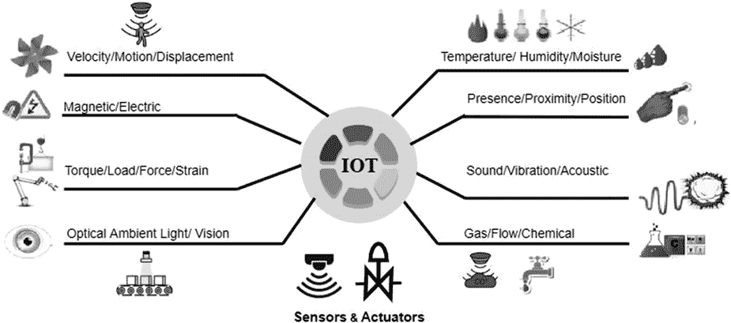

图 7.2 传感器和执行器。

#### 7.2.1 传感器

传感器完善了物联网框架，因为它们可以作为独立设备工作，也可以作为辅助工具来增强机器的功能。传感器根据其所要感知和量化的物理现象命名（García 等，2017）。在此概述一些常用传感器及其功能，有助于深入理解物联网系统。

##### 7.2.1.1 温度传感器

在各种应用中，经常需要测量工作环境中空气的热度值。温度传感器主要用于制造工厂、天气预报、仓库和农业，以监测土壤温度，实现平衡和高产。

##### 7.2.1.2 热敏电阻


这是一种可以感知温度的电阻。其电阻值随温度变化而变化。它在电子学和其他一些系统中有许多应用，用于防止电流过度增加。

##### 7.2.1.3 热电偶

由两种不同导体元件组成的电路构成热电偶。它利用其连接器之间的电动势与温差成正比这一现象。热电偶也可用于感知温度，有时也作为备用电源，提供微小电压但可观的电流。热电偶主要用于气象站进行天气预报。

##### 7.2.1.4 毛发张力湿度传感器

这是一种传统的湿度传感器，利用人发或马发受潮膨胀的特性。据目前探索，它也适用于棉花或合成纤维。它借助刻度上的指针随毛发长度变化而移动来测量湿度。该装置廉价且耐损。

##### 7.2.1.5 光传感器

光传感器检测环境光强度，使智能手机、智能电视、计算机屏幕能够调节亮度。光传感器在电子学中非常常见，但目前也越来越多地用于智慧城市应用。自适应路灯和智能城市照明是光传感器的现代应用。

##### 7.2.1.6 智能声学传感器

这些传感器检测环境中的噪声水平，从而有助于监测和控制噪声污染。它们作为智慧城市解决方案被广泛使用。

##### 7.2.1.7 水听器

该装置检测液体或水体中的声音。它是被动声呐的结构组件。它用于在不同水生环境中寻找鱼群。

##### 7.2.1.8 地检波器/地震检波器

该传感器用于环境保护，因为它可以监测水位，并用于洪水预警系统。它在工业中也有应用。

##### 7.2.1.9 静水压力传感器

无论水箱形状或体积如何，该传感器都能测量罐内的液体或水位。它基于静水压力悖论原理运行，即液体的静水压力与其高度成正比。

##### 7.2.1.10 光学传感器

光学传感器优于传统的机械液位检测器，因为它们通过棱镜对光的折射来检测水位。该传感器发射电磁辐射并检测目标物体的存在。它在工业、交通、智能车辆和机器人技术中有众多应用。

##### 7.2.1.11 运动传感器

运动传感器越来越多地用于许多物联网智能建筑应用中。这些传感器有助于监控私人或公共空间的任何犯罪活动，如入侵或盗窃。除此之外，运动传感器还助力能源管理解决方案、智能摄像头和自动化设备。

##### 7.2.1.12 被动红外传感器 (PIR)

这些是用于检测运动的电子传感器，通常用于自动照明系统、报警系统和通风系统。

##### 7.2.1.13 陀螺仪传感器

这些传感器检测旋转和角速度，用于国防、交通、安全和工业等涉及物体旋转的各种应用。这些传感器用于运动员的物联网设备，以准确测量和分析身体运动，从而提高运动表现。加速度计和航向指示器是其他一些陀螺仪传感器，它们测量安装对象的旋转和角速度。

##### 7.2.1.14 电化学呼气酒精检测仪

该传感器检测血液中的酒精含量。它准确分析呼气中的酒精摄入量，且不受其他伴随气味的干扰。交警用它来查获醉酒驾驶者。

##### 7.2.1.15 电子鼻

这是一组探测器，用于检测环境中溶解的化学颗粒的存在，有助于确定空气的化学成分。

##### 7.2.1.16 图像传感器

这些传感器将视觉图像转换为电信号，并安装在智能设备上以查看周围环境。它们用于军事、交通、医疗和安全机构的各种应用。

还有许多其他传感器用于物联网技术。

#### 7.2.2 执行器

执行器响应其周围环境，并根据接收到的输入采取行动，以增强嵌入式机器或物体的功能。它们常用于车辆、机器和工业自动化系统。根据其在物联网应用中的设计和用途，执行器可分为四类。

##### 7.2.2.1 直线执行器

这些用于实现物体的直线运动。

##### 7.2.2.2 电机

它们为设备及其组件提供旋转运动。

##### 7.2.2.3 继电器

这些是基于电磁铁的执行器，用于控制许多设备中的电源按钮。

##### 7.2.2.4 电磁阀/电磁线圈

这些主要应用于家用仪器，以实现锁定或触发等机制。它们用作基于物联网的监控系统中的燃气或水泄漏控制器。

### 7.3 连接性

为了实现物联网系统内设备之间的互联互通，有大量可用选项。蜂窝网络、卫星、蓝牙、NFC、Wi-Fi、LPWAN、以太网和 RFID 只是连接不同设备的众多可能选项中的一部分。图 7.3 显示了用于物联网的工具和技术。


图 7.3 物联网的工具和技术。

#### 7.3.1 LPWAN（低功耗广域网）

LPWAN 支持涉及工业和商业组织的大规模物联网网络，并促进远程连接。它们连接大多数传感器，并可支持资产追踪、占用检测、环境监测、耗材监控等多种物联网应用。

#### 7.3.2 蜂窝网络 (3G/4G/5G)

蜂窝网络通过宽带支持语音和视频通信。它们最常用于智能汽车和其他交通应用，如智能车队或物流。5G 是将支持自动驾驶汽车的下一代技术。它将实现基于增强现实的实时监控，以支持工业自动化、公共安全和医疗保健。

#### 7.3.3 Zigbee

Zigbee 主要作为一种网状协议使用，将传感器数据传递给不同的传感器节点并扩展覆盖范围。它功耗低，支持短距离无线连接。Zigbee 用于各种智能家居应用，如安防、照明、气候和能源管理等。

#### 7.3.4 蓝牙

蓝牙是一种 WPAN 短距离数据交换网络。然而，最新版本的蓝牙低功耗 (BLE) 最常用于小型物联网应用。它被用于辅助智能手机、健身穿戴设备和许多家庭自动化应用等通信设备。

#### 7.3.5 Wi-Fi

Wi-Fi 是一种广为人知的连接工具，最广泛用于家庭和工业中的各种连接设备。然而，由于覆盖范围有限和高功耗，它并不支持物联网框架。具有增强数据吞吐量和更高带宽的 Wi-Fi 6 是下一代 Wi-Fi，承诺提供更好的连接体验。


#### 7.3.6 RFID

该技术利用无线电信号将数据从 RFID 标签传输到读取器。RFID 在零售、安防和物流领域有着广泛应用。

### 7.4 IoT 应用

IoT 应用正日益被用于个人、公共或工业利益。主要领域包括家庭自动化、交通与物流、零售与营销、安防与监控、能源管理、农业和医疗保健。以下章节将介绍一些流行的 IoT 应用。

#### 7.4.1 智能家居

智能家居是由 IoT 实现的一个革命性概念。IoT 应用使我们能够在不亲临现场的情况下控制家庭事务。图 7.4 展示了基于 IoT 的家庭自动化。这些应用可以帮助我们在外出时监控和控制多项家庭活动。


图 7.4 智能家居。

用户只需点击智能手机，即可控制灯光、风扇、门、空调、供水以及许多其他家用设备。Bitdefender box2、Logitech circle 2、Amazon echo plus（第二代）、Nest thermostat（第三代）、Awaire 空气质量监测仪、Nest protect smoke plus、Philips hue 灯泡及照明系统、Singleque 手势控制、Ring video doorbell pro、August smart lock pro、Ecovacs deebot N79S、Logitech harmony 遥控器、Blossom 智能灌溉控制器等是一些流行的 IoT 智能家居设备。

#### 7.4.2 智慧城市

人口激增使城市生活变得困难。存在交通、停车、电力供应、配水、监控和安防等问题。然而，IoT 提出了智能解决方案来利用这些公用设施和服务，以造福现代人（Mohanty 2016）。智能基础设施、智慧城市空气管理、智能交通管理、智能停车、智能废物管理、智能水务和电力供应是让我们的城市变得智能的 IoT 应用。借助智能 IoT 应用，城市生活中的许多问题，如污染、交通拥堵和电力供应不足等，可以轻松解决。智慧城市也必须整洁。像 Smart Belly trash 这样的应用将协助市政部门清理城市。图 7.5 展示了智慧城市的概貌。


图 7.5 智慧城市。

车辆停车是大城市面临的另一个日益严重的问题。然而，IoT 已开发出应用程序来指导和协助市民解决停车问题。现在有智能应用程序可用于支持家庭用电相关问题，如故障、安装和电表篡改等。

#### 7.4.3 可穿戴设备

可穿戴设备是嵌入了传感器和软件的设备，可协助用户满足健康、健身和娱乐相关需求。这些设备收集和处理用户的数据及其他相关信息，帮助他们监控、规划、控制和提升各种活动与体验（Lavanya et al. 2019）。图 7.6 展示了在 IoT 的帮助下用于不同应用的可穿戴设备。常用的可穿戴设备包括智能手表、智能鞋、智能服装、手势控制、NFC 智能戒指、健身追踪手环、智能体态训练器、游戏模拟器、手环以及盲人用智能手环等。


图 7.6 可穿戴设备。

这些可穿戴设备不会给用户带来负担，因为它们消耗或释放的能量极少。

#### 7.4.4 农业

智慧农业是一项快速发展的 IoT 应用，为各种农业问题提供了解决方案。随着人口增长，粮食消费量增加。这要求农业方法和技术立即得到发展。IoT 引入了 FarmLogs 和 Cropio 等智能解决方案来解决这些问题。图 7.7 展示了农业领域使用的先进技术。智慧农业应用可以帮助监测土壤湿度和养分缺乏情况。


图 7.7 农业与 IoT。

农民可以跟踪作物生长情况，并收到警报，按时浇水、施肥并在适当时候收割。Arable 和 Semios 是智能作物管理设备（Vongsingthong et al. 2014）。GreenIQ 等智能灌溉设备和施肥预警系统可实现生长监测以最大化产量。allMETEO、Smart Elements 和 Pycno 是预测天气状况的 IoT 设备。Farmapp 和 Growlink 是便于温室自动化的设备。甚至连牲畜也可通过 IoT 的传感工具进行监测。Allflex 的 SCR 和 Cowlar 是用于监测宠物健康的智能设备。

#### 7.4.5 智能供应链

IoT 将传统供应链系统转变为智能系统，在时间、资金和能源方面更加高效。图 7.8 展示了采用这项创新技术的智能供应链。该系统使用 GPS 技术，帮助消费者轻松且经济高效地追踪货物。该系统减少了人力投入并优化了产出（Wan et al. 2016）。


图 7.8 智能供应链。

#### 7.4.6 智能零售

现代零售系统完全建立在 IoT 框架之上，为消费者和零售商带来了前所未有的体验。IoT 使我们能够通过在智能手机上点击一下，随时随地购买任何商品。零售商可以直接面对大量客户、展示和销售产品，消费者也有机会从众多可用商店中购买心仪的产品。用户可以在线支付或收款，甚至跟踪订单。图 7.9 展示了零售系统。


图 7.9 智能零售。

#### 7.4.7 交通运输

现代交通系统已因 IoT 技术而大幅增强。如今的智能汽车配备了智能工具和传感器，赋能驾驶员控制和监控驾驶过程（Xia et al. 2012）。

车载计算机协助驾驶员进行自动空调控制、导航、停车、速度和燃油预警、交通拥堵、路况信息等。甚至出租车也使用 IoT 应用为客户提供智能接送服务。

#### 7.4.8 智能电网

IoT 以智能电网的形式构想了智能可靠的电力供应。该系统不仅高效调节能源，还收集大量消费者信息。图 7.10 展示了智能电网系统。


图 7.10 智能电网

记录能源消费统计、消费者行为、检测停电事故等数据，使其成为一个增强能源公用事业服务的智能系统。它通过监控电力故障、因窃电导致的过载、短路等，保持平稳不间断的电力分配。WebNMS 和 Sense 等 IoT 设备便于智能能耗监测并优化家庭节能。

#### 7.4.9 医疗保健


# 可穿戴设备中的物联网技术

可穿戴设备中的物联网技术收集个人的健康和健身数据。智能手表、健身手环和压力检测仪是持续监测我们身心健康的一些物联网工具（Agarwal and Lau, 2010）。连接设备分析和处理数据，以提供健康警报和应对不良健康状况的策略（Kumar et al. 2019 a）。**QardioCore** 是一款可穿戴心电图监测仪，可监测患者的血压和胆固醇（Kumar et al. 2019 b）。如果患者跌落床边或长时间静止不动，**Zanthion** 会向其家人发送警报。**Up by Jawbone** 追踪一个人的健身情况，包括体重、饮食和睡眠障碍。**NHS test beds** 定期跟踪患者的健康和康复情况。**Propeller's Breezhaler device** 有助于监测和治疗哮喘患者。**UroSense** 是一种带有发射器的导尿管，有助于监测和管理患有尿路问题、糖尿病或前列腺癌的患者。还有许多此类物联网设备用于支持医疗服务。图 7.11 展示了医疗系统场景。这些医疗设备能智能地将一个人的危急状况信息传达给相关人员或急救医疗服务部门，以便及时为患者提供援助。物联网通过传感工具增强了医疗诊断。


图 7.11 医疗保健。

#### 7.4.10 工业

物联网通过智能工程增强了工业能力，其核心动力来自传感器、软件和智能机器。与人类相比，智能机器现在能更准确、更高效地通信数据。物联网赋能的机器利用传感器和追踪设备产出理想输出。这反过来又帮助工业实现了增强的、精准的和透明的生产。损坏检测传感器有助于提高产品质量。**SAGE** 开发了一种基于云的 SCADA 接口 **STRATUS**，可用于各种工业实践，如现场监测和井盖监测、远程发电监测与控制。此外，SAGE 还提出了传输无线网络性能监测仪表板，以及用于数据完整性的回收分拣和数据系统。制造业中其他物联网驱动的应用包括预测性维修、远程生产控制、资产追踪、物流管理、数字孪生等。图 7.12 展示了基于物联网的先进工业系统。


图 7.12 物联网工业。

### 7.5 面向社会安全与安保的物联网应用

#### 7.5.1 城市数据隐私

在智慧城市中，大多数公共服务已实现数字化。人们通过智能手机、计算机或其他设备经由多样化网络访问这些服务（Sharma et al., 2019）。这些传输容易遭受网络攻击。因此，保障城市数据安全至关重要。**IBM** 提供 **IN3**（仪表化、互联化、智能化），这是一种网络安全范式，根据信息在 IN3 中的使用方式来追踪隐私问题。一款智能手机应用程序可追踪任何网络入侵，并向警方发送恐慌通知。一种移动计算解决方案利用地理位置数据、视频流和笔记记录，将多个系统云化到一个可通过智能手机和英特尔驱动的计算机访问的单一用户界面上。历史数据可用于创建智能数据库，以便访问并可视化人与地点之间建立的关系。图 7.13 展示了物联网在社会安全与安保方面的应用。


图 7.13 面向社会安全与安保的物联网应用。

#### 7.5.2 个人安全

个人安全是安全社会的首要条件。个人安全是指免受故意犯罪侵害、受到保护而不暴露于此类侵害中的状态。**IP 监控系统** 使用接入 **以太网局域网** 的智能摄像头来创建视频监控网络。**VERETOS 云** 是一种证据管理解决方案，可存储大量视频数据。它由 **Microsoft Azure 政府云** 控制，帮助警方通过可穿戴执法记录仪或车载摄像头即时捕捉犯罪现场或可疑活动，车载摄像头可识别犯罪分子车辆的车牌号。**CISCO Smart+ Connected City Safety and Security 解决方案** 可促进位置监测、事件检测与管理、管理和分析，以遏制犯罪威胁。

#### 7.5.3 犯罪检测与指标

智能视频监控系统可检测并识别特定区域内任何异常或令人担忧的活动。它是一种先进的综合安全系统，能通过检测和分析物体运动及其轨迹来预判犯罪。**光子学**、**热成像**、**人脸与行为识别系统**、**卫星监测**、**生物识别系统**、**视网膜扫描** 是一些彻底改变安保系统的物联网应用。

#### 7.5.4 应急服务协调

统一的应急响应计划是安全社会的必备条件。位置检测对于快速响应突发和意外情况至关重要。通用紧急号码 **112** 现已升级为 **E-112**，这是一种位置增强型紧急报告解决方案。**eCall** 是另一种车载紧急呼叫系统，可促进事件检测、事件核实、事件响应和现场清理。**CITYSCAPE** 是一种智能防护架构解决方案，可保护建筑物及其居住者免受地震和火灾事故的伤害。另一种物联网应用通过关闭空气进气口和建筑物 **HVAC**（供暖、通风和空调）系统的反向流动，保护建筑物免受化学或生物攻击。

#### 7.5.5 消防

物联网创造了许多应用，提供智能消防解决方案。**Roadmap**、**Frisco** 和 **Firecast** 是消防系统，可探测火灾现场，并为消防人员提供路线图、危险品、消火栓位置等信息。**ALIVE**（集成可视化环境中的高级学习）和 **FIREPLAN** 是物联网赋能的系统，是培训消防人员进行行政、报告和警报任务的有效工具。

#### 7.5.6 众包与众感

智能设备、传感器和智能手机可在网络上联网，以感知人群并共享相关信息。在发生任何紧急情况时，该应用对于做出疏散等决策非常有帮助。这是一个参与式框架，每个人甚至文盲都可以通过智能手机共享信息。

#### 7.5.7 智能电网安全

电力供应网络现已升级为智能电网。智能电网利用数字技术向消费者供电。然而，它们需要有效的控制和通信系统以排除网络攻击。大多数智能电网使用 **SCADA 系统** 以确保智能电网的安全有效运行。

#### 7.5.8 智能路灯

在物联网框架下，路灯变得智能且节能。它们不再仅在夜间开启，而是在感应到有车辆或行人靠近时开启。此外，它们可根据需求调节亮度，从而减少能源消耗。采用物联网技术的 **LED 灯** 可提供环境警报和紧急通知。


#### 7.5.9 反恐

美国的“Cell-all”项目已在手机中安装了化学试剂探测器，并将其连接至安全网络。这使得安全机构能够探测针对城市人口的任何恐怖威胁，并迅速应对紧急情况。

#### 7.5.10 交通安全与事故管理

借助物联网技术，交通管理与安全得到了增强。**VANET**（车用自组网）是一种位置安全系统，它利用车载雷达探测邻近车辆的位置并广播其坐标。自动测速执法与速度自适应、安全带联锁系统、酒精传感器，以及用于调节车辆性能的编程智能卡，均是保障交通安全的物联网解决方案。借助多车道传感器的动态循环车道分配系统，可根据需求为车辆分配车道，从而帮助管理交通拥堵。**SRM**系统收集关于车辆位置、交通违规、事故等方面的信息，并向驾驶员和警察发送适当信息，以供警示或决策参考。

路口监控系统使用两个摄像头。长距离摄像头探测违反车辆与车道线距离规定的违规车辆。近距离摄像头捕捉其车牌号。**高通车辆到行人**技术利用智能手机和车内警报技术，通过短距离通信让车辆驾驶员和行人相互感知对方的位置。

### 7.6 案例研究（农田入侵检测与应对系统）

延续我们对物联网安全应用的讨论，本节呈现一个案例研究，涉及一种物联网设备的开发与部署，旨在阻止流浪动物进入收割在即的农田。

#### 7.6.1 动物入侵与处理

随着流浪动物增多，它们闯入收割在即的农田已成为一大难题。处理这一祸患既不道德又成本高昂。农民通常会毒打流浪动物以保护庄稼免遭毁坏。他们采用的另一种方法是用铁丝网或其他可能的围栏保护田地。这是一种成本高昂的解决方案。围栏成本每英亩近 25,000（货币单位），且浪费大量时间和人力。这并非万无一失的方案，因为即使安装了围栏，农民仍需雇佣看守来维护系统。此外，驱赶鸟类仍是一个问题。

#### 7.6.2 IDTS 的开发

**入侵检测与应对系统（IDTS）**，旨在阻止动物进入田地，是一种万无一失且具有成本效益的基于物联网的设备。该安全应用甚至不会伤害动物。该设备使用 **Raspberry Pi**（树莓派）、摄像头和扬声器。设备利用基于深度学习技术的实时运动检测和图像处理，持续监控田地。在识别动物种类后，它会发出目标动物无法忍受的特定频率声音以阻止其进入，从而防止它们闯入田地。此外，系统还借助 **GSM** 模块向农民发送文本 **短信**，提醒他们有入侵发生。

#### 7.6.3 部署与讨论

该系统已实时部署，并被证明能成功解决动物入侵问题。农民们赞赏该应用并欣然接受。他们评论称，该应用具有革命性、成本效益高且合乎道德，因为它不伤害动物，甚至能驱赶鸟类。

### 7.7 物联网的隐私与安全问题

许多安全和隐私问题困扰着物联网技术。

#### 7.7.1 测试与更新不足

随着物联网设备数量激增至 200 亿以上，其测试和更新方面的问题也随之增加。在为满足不断增长的需求而竞相生产设备的过程中，制造商往往忽视设备的安全性。他们要么仅在短期内提供固件更新，要么根本不提供安全更新，这导致设备不安全，且随着时间的推移容易遭到黑客攻击。此外，他们使用过时的硬件和软件以及不再受支持的 **Linux** 内核，使其产品面临安全风险。适当的测试和定期更新可以使制造商和消费者免受这些安全威胁。

#### 7.7.2 默认密码与凭据

销售和购买带有默认密码的设备是物联网设备的一大安全隐患。**Mirai 僵尸网络**，这一破坏性最强的 **DDoS** 攻击，最能例证这一问题。尽管政府有指示要求，制造商却对此置若罔闻。带有出厂默认凭据和登录详情的设备容易遭受网络入侵，极易被黑客攻击和植入病毒。

#### 7.7.3 恶意软件与勒索软件

随着物联网设备的增加，出现了恶意软件和窃听勒索软件来挪用它们。与基于加密的黑客攻击不同，混合型恶意软件和勒索软件攻击更为致命，因为它们能同时瘫痪设备并窃取数据。

例如，**IP** 摄像头可被用于从不同地点窃取您的重要信息。您的安全设备可能被黑客攻击，并通过受感染的网址窃取信息。随后您可能会被勒索赎金以取回数据或解锁安全系统。

#### 7.7.4 数据安全与隐私顾虑（移动端、Web 端、云端）

在当今的数字世界中，数十亿设备持续交换、处理和存储数据。公司利用这些物联网网络数据来拓展业务。公司通常共享甚至出售公共数据，侵犯我们的数据隐私和安全权利。因此，必须强制公司遵守专门的合规和隐私规则，以保护我们的身份信息完整。一种方法是在共享前对数据进行匿名化处理。缓存或无关紧要的数据必须安全销毁。数据存储必须遵循法律法规。

#### 7.7.5 绕过检测的小规模物联网入侵

除了大规模攻击，物联网更令人担忧的是可能绕过检测的小规模入侵。黑客不再窃取大量数据，而是通过入侵网站造成微量信息泄露。

#### 7.7.6 数据处理与安全

跨数十亿物联网网络设备处理海量数据是一大挑战。物联网管理员正借助 **人工智能（AI）** 和自动化来应对这一问题。然而，采用自主解决方案进行数据处理需要极大的谨慎和精确。算法或代码中的哪怕一个微小错误，都可能足以拖垮整个网络。另一个主要问题是保护物联网数据免受网络攻击和窃取。非常有必要制定严格法规来约束涉足物联网业务的公司，并对违规者进行处罚。

#### 7.7.7 家庭被劫

智能家居是一项流行的物联网发明，使用包括房屋访问控制在内的许多物联网应用。这也使您的家庭面临未经授权访问的风险。任何犯罪团伙都可能入侵您的 **IP** 地址，获取您的密码并闯入您的财产。

#### 7.7.8 远程车辆访问

鉴于互联物联网设备的发展，智能汽车即将成为现实。但其物联网关联使它们容易遭到劫持。技艺高超的黑客可能利用远程访问控制您的汽车，并将其用于犯罪活动。

#### 7.7.9 不可靠的通信


物联网面临的最大挑战是物联网设备被劫持以发送未加密的消息。所有公司必须确保其设备以及云服务的加密。它们可以通过使用传输加密和 TLS 等标准来实现这一点。或者，它们可以使用不同的网络来隔离不同的设备。使用私有通信也可以确保安全性和机密性。

### 7.8 结论

当创新遇见科学，物联网便应运而生。物联网应用已将传统的人类实践转变为革命性的建设成果。它赋予现代世界一种前所未见的现象，即无生命的物体能够拥有“大脑”并参与人类的事业。它为生产、交通、通信、零售、能源、农业、医疗、安全等诸多领域提供了智能化解决方案。物联网通过节省时间、金钱和劳动力的解决方案来增强人类活动，从而推动了进步。这项技术与其他发明一样，也并非没有缺陷。尽管它带来了丰富的益处，但也有其负面影响。由于它是一个由大量互联设备组成的框架，因此极易面临风险。物联网网络使用并共享大量数据，因此产生了隐私和安全问题。因此，有必要明智地使用这项技术。必须寻找解决方案，使其成为人类种族进步与发展更安全、更可靠的来源。

### 参考文献

*   Agarwal, S., & Lau, C. T. (2017). Remote health monitoring using mobile phones and Web services. *Telemedicine and e-Health*, *16*(5), 603–607.

*   Asghari, P., Rahmani, A. M., & Javadi, H. H. S. (2019). Internet of Things applications: A systematic review. *Computer Networks**,* 148, 241–261.

*   Bhatt, Y., & Bhatt, C. (2017). Internet of things in healthcare. In *Internet of things and big data technologies for next generation HealthCare* (pp. 13–33). Springer, Cham.

*   Brito, L. M. (2017). Introduction to the Internet of Things. *Internet of Things* (pp. 3–32). Chapman and Hall/CRC.

*   García, C. G., Meana-Llorián, D., & Lovelle, J. M. C. (2017). A review about smart objects, sensors, and actuators. *International Journal of Interactive Multimedia & Artificial Intelligence*, 4(3), 7–10.

*   Kumar, N., Panda, S., Pradhan, P., & Kaushal, R. (2019). IoT based hybrid system for patient monitoring and medication. *EAI Endorsed Transactions on Pervasive Health and Technology*, 5(19), 1–7.

*   Kumar, N., Panda, S. N., Pradhan, P., & Kaushal, R. (2019). IoT based E-critical care unit for patients in-transit. *Indian Journal of Public Health Research & Development*, 10(3), 46–50.

*   Mohanty, S. P., Choppali, U., & Kougianos, E. (2016). Everything you wanted to know about smart cities: The internet of things is the backbone. *IEEE Consumer Electronics Magazine*, 5(3), 60–70.

*   Sharma, L., & Garg, P. K. (Eds.). (2019). *From visual surveillance to internet of things: technology and applications*. CRC Press.

*   Vongsingthong, S., & Smanchat, S. (2014). Internet of things: a review of applications and technologies. *Suranaree Journal of Science and Technology*, 21(4), 359–374.

*   Wan, J., Tang, S., Shu, Z., Li, D., Wang, S., Imran, M., & Vasilakos, A. V. (2016). Software-defined industrial internet of things in the context of industry 4.0. *IEEE Sensors Journal*, 16(20), 7373–7380.

*   Xia, F., Yang, L. T., Wang, L., & Vinel, A. (2012). Internet of Things. *International journal of communication systems*, 25(9), 1101.

# 8 人工智能：鼓励高等教育学生把握其潜力

Rajul Kumar, Karan Sehgal, and Ankit Lal Meena

DOI: [10.1201/9781003153405-8](https://doi.org/10.1201/9781003153405-8)

## 目录

*   8.1 简介
*   8.2 高等教育的精神/理念
*   8.3 人工智能中的一些生物启发与人类模糊技术
    *   8.3.1 类型 1 和类型 2 模糊逻辑
    *   8.3.2 遗传算法
    *   8.3.3 人工神经网络
    *   8.3.4 粒子群优化
    *   8.3.5 入侵杂草优化
    *   8.3.6 灰狼优化
    *   8.3.7 狮子优化算法
    *   8.3.8 矿爆优化
    *   8.3.9 鲸鱼优化算法
*   8.4 人工智能在现实问题中的应用
    *   8.4.1 电子商务营销
    *   8.4.2 控制工程
    *   8.4.3 医学科学中的手术与操作
    *   8.4.4 农业中的人工智能
    *   8.4.5 在航空与航天组织中
*   8.5 结论
*   参考文献

### 8.1 简介

在基于知识的环境和社会中，对高等教育的实质性需求正在当代显著上升。IT 及其他相关技术方面的知识对于社会的增长与发展至关重要。在相关领域建立新思想和创新同样重要（Valluru, 2009; Haveman, 2006; JICA, 2004）。如今，随着学科、学生和机构日益多元化，大众教育和终身学习的趋势已呈全球化之势，对于健康公民社会的进步、政府与商业界代表的培养、以及通过收入和充足选择改善生活品质，存在着根本性的需求（Auter, 2017; Shuaibi, 2014; Frey, 1988）。


#### 高等教育与人工智能

高等教育涵盖了由认可的学术机构提供的整个毕业教育、研究及后续中等培训。课程和专业领域广泛多样，囊括了历史、地理、政治学、经济学、社会学、电子商务、市场营销管理、财务会计、医学与卫生保健以及工程科学等（David, 2018）。特别是工程学有多个分支，例如电气、计算机、土木、机械、环境、生物医学、化学、航空航天、涂料与皮革、冶金、舰船建筑、纺织、石油、农业和食品技术等（Blackwell, 2001; Kettunen, 2006）。然而，在相当长的一段时间里，人们已意识到攻读高等教育的学生入学人数大幅减少（Lynöe, 2003; Tomlinson, 2008），造成参与度降低的可能原因可能是学生对高等教育课程的冷漠和误解，认为这些领域仅局限于数学公式和图表。但除此之外，他们需要知道高等教育中的专业和课程可以与人类智能和模糊性、自然启发的元启发式算法、生态优化、掠食动物的捕猎与交配行为、鸟类的栖息习性、矿山爆破、化学反应启发的优化等相关联。利用计算机机械的机器学习和深度学习的人工智能，导致个体心理和逻辑任务的低效执行，仅能获得优化解，却能快速进行选择、行动、思考和规划（Lupo, 2005; Beauchamp, 1999; Fairlie, 2002; Brown, 1991）。

AI 的迫切意图是优化所有社会实践，并提供比人类逻辑更好的约束解决方案。如今，AI 目前被用于自动驾驶车辆和机器人技术、医疗手术、拆弹、虚拟教学等众多领域，以减少人类在不可避免趋势中的付出（ElMaraghy, 1987; Holzinger et al., 2007）。

### 8.2 高等教育的精神内核

众所周知，高等教育的领域不限于特定范围，而是在学科、分支和专业方面表现出广泛的多样化（David, 2018）。总体而言，它可分为人文科学、商业与工商管理、医学与工程科学，如图 8.1 所示。


**图 8.1** 软件开发项目的甘特图。

图 8.1 中所示的高等教育四大分支进一步细分为各自的领域，如人文与社会科学细分为文学、艺术、音乐、哲学、宗教、语言、地理、政治学、经济学和社会学。商业与工商管理包含贸易、银行、保险、运输、市场营销、人力资源、供应链和全面质量管理；而医学科学（Albrecht, 1992; de Lima, 2006）包含心脏病学、内科学、血液学、内分泌学、牙科学和妇科学等。最后工程学包含图 8.2 所示的多元化分支。

所有这些不同学科的独特分支和专业共同促进了经济、社会和自我发展。


**图 8.2** 工程分支。

尽管存在这种广泛的多样化，但高等教育参与度低的原因可能是对学科和专业缺乏兴趣，以及认为这些分支仅限于数学公式、计算、死记硬背理论及其缺陷的观念。另一个重要原因可能是完成注册课程所需周期长、社会对学者和研究人员的尊重度不够，以及对一些令人兴奋且受现实世界启发的学科（如人工智能 (AI)）缺乏了解。

在当今时代，AI 正凭借其解决现实问题的新型现代化方法不断改进并普及。它允许我们通过持续的知识技能（即机器学习和深度学习），用 AI 编码的计算机机械和机器人技术来替代固定常规和多项人工任务。这些学习方法受人类创造力启发；自然启发算法、杂草稳健的生态定殖等。其中一些 AI 算法和技术将在下一节讨论。

### 8.3 AI 中的部分生物启发与人类模糊技术

AI 模拟人类的创造性思维、自然启发的捕猎与生存行为，以学习精准执行给定任务。部分算法和技术示例如下简要解释。

#### 8.3.1 1 型与 2 型模糊逻辑

模糊逻辑基于人类的模糊逻辑，即事件发生的概率并不总是清晰值，也可以处于规定范围内，即可以是模棱两可和模糊的（Valluru et al., 2011）。1 型模糊逻辑处理那些更不确定、更复杂、更非线性的现实问题。话语域规定范围内的过程可以用三角形、梯形、高斯、钟形等形状的隶属函数形式表示，如图 8.3 所示。


**图 8.3** 1 型模糊隶属函数。

清晰值通过模糊化器转换为模糊集。推理引擎模拟由规则库控制的 Mamdani 或 Takagi-Sugeno 方法的模糊规则，处理完这些模糊值后再转换为人类可理解的形式。更先进、更强大的模糊逻辑形式是 2 型模糊逻辑，它在隶属函数的话语域中包含不确定性足迹（Cazarez-Castro, 2012），如图 8.4 所示。


**图 8.4** 2 型模糊隶属函数。

#### 8.3.2 遗传算法

这是一种基于查尔斯·达尔文天生进化理论的元启发生物启发优化技术。过程始于由染色体包裹的基因形成的群体初始化，随后根据适应度函数选择个体，并进行基因间的随机交叉和变异，如图 8.5 所示。如果亲代产生的后代给出了针对现实世界基准问题的最优解，或者群体种群完全收敛，则算法终止（Xin-She, 2010; Valluru, 2011）。


**图 8.5** 遗传算法中的交叉与变异。

#### 8.3.3 人工神经网络


ANN 的制造旨在识别复杂模式，这与人脑的运作方式相似。它由初始层组成，这些层由称为神经元的估计单元构成。这些神经元最初乘以权重，随后获取所需的输入模式并映射到输出层，如 图 8.5 所示。输入模式可能包含也可能不包含潜在的期望输出。然而，隐藏层根据适应度函数，通过迭代方法调整输入权重，直到误差降低到所需水平 (Falco et al., 1998)。这是一种非常高效且敏捷的方案，能够学习错综复杂的模式并快速适应新的系统环境。


图 8.6 ANN 中的神经层。

#### 8.3.4 粒子群优化

群体智能由鸟群组成，它们通过个体能力和适应度与复杂系统协同作用。PSO 受鸟群聚集的群体特性影响。所有鸟被称为粒子，具有各自计算出的适应度值，并根据其适应能力，试图在指定的解搜索空间中搜索全局最优，如 图 8.6 所示。鸟的速度和加速度在迭代搜索解的过程中也被考虑在内 (Mavrovouniotis, 2017)。该算法似乎非常基础，且计算耗时较少，因为它不包括遗传算法和神经网络中的交叉、变异和权重调整。


图 8.7 PSO 中寻求全局最优的群体。

#### 8.3.5 入侵杂草优化

IWO 是一种基于入侵杂草在栽培中强健适应行为的生态变态优化算法 (Xing, 2014)。杂草是我们解搜索空间或栽培区中发现的不需要的灌木或幼苗，其入侵特性对种植园构成严重威胁。它们对周围环境和环境变化具有高度适应性和灵活性；通过永久定殖占据栽培搜索区域，并基于其能力和整个群体适应度的线性增强，通过与同伴杂草互动而得到改良。它们通过花粉卵细胞受精的性细胞繁殖，并可选择 R 或 K 力量选择策略以求生存。基于标准差、均值和方差，通过淘汰适应度最低的杂草，进行种子扩散的迭代过程。


图 8.8 外轨道上性种子的扩散。

#### 8.3.6 灰狼优化

GWO 是一种基于灰狼近乎最优捕猎能力的群体智能技术。灰狼以 5-11 只为一群捕猎，被视为顶级掠食者。它们根据捕猎最优解的能力、支配本性以及增强各自小队合作、联邦制和顺从性的潜力，将等级解码为阿尔法、贝塔和欧米伽狼。阿尔法狼被视为小队首领，做出大多数决策，如解搜索机制和追踪等。贝塔狼在解狩猎中协助并遵循阿尔法首领的命令，引导处于等级末端的欧米伽狼，如 图 8.8 所示。这是一种非常可靠且强效的自然启发技术，具备近乎最优的搜索功效 (Mirjalili, 2014)。


图 8.9 灰狼的等级制度。

#### 8.3.7 狮子优化算法

LOA 是一种基于种群的元启发式算法，受“狮群”社会行为的影响。过程始于初始化，其中狮子和母狮的总种群根据其适应度值形成狮群。进一步为了狩猎，所有母狮根据其适应度值排序并分为三组（追逐者、翼侧者和欺骗者）以捕捉猎物。然后根据适应度值淘汰弱小的雄狮，引入组间互动。交配和迁徙在形成优化狮群时也被考虑在内 (Yazdani, 2016)。该算法足以解决复杂和非线性优化问题。


图 8.10 LOA 中的分类。

#### 8.3.8 矿爆优化

矿爆算法是一种基于地雷引爆概念的元启发式算法。当地雷引爆时，其碎片以不同速度向多个方向散开。当附近地雷与先前爆炸地雷的碎片碰撞被激活时，这些碎片会导致其他地雷发生更多爆炸。该技术始于初始化，第一枚地雷引爆，在那里形成一个最优点，其碎片导致其他地雷爆炸。爆炸地雷数量与碎片数量的比率相当大，这也导致其他地雷爆炸（可能/可能不具有高引爆威力）。总伤亡数因此增加。这些伤亡被视为适应度值，用于进行多次迭代 (Siskind, 1980)。这种优化对于求解复杂的有界优化和工程问题非常高效。


图 8.11 地雷碎片的散布。

#### 8.3.9 鲸鱼优化算法

鲸鱼优化算法是一种自然启发的元启发式优化技术，基于其捕猎、交配等社会行为。鲸鱼的捕猎包含不同方法，如寻找猎物、包抄猎物和气泡网。通常，鲸鱼以两种不同方式执行这些方法：要么从水面潜下几米，然后在猎物周围呈螺旋状产生气泡网，再向上潜向水面；要么通过拍击水面来包围猎物 (Mirjalili, 2016; Prakash, 2018)。该技术非常适合处理高度非线性动力系统。


图 8.12 WOA 中的螺旋轨迹。

这些算法在优化和解决其他现实任务方面能力很强。其中一些 AI 应用将在下一节讨论。

### 8.4 人工智能在现实问题中的应用

AI 模拟人类行为的创造性和敏锐计算能力，以解决复杂的现实任务。它用于工业、工程问题、面向业务任务、酒店预订等众多领域。下面将从理论和图示两方面解释 AI 的一些主要应用。

#### 8.4.1 电子商务营销


最近，由于专门为工业营销和品牌广告而设计的先进随机 AI 算法，在线营销和广告越来越受欢迎。如今，通过了解产品属性即可轻松搜索在线产品，我们还能获得具有相似评级和应用的产品列表，这得益于 AI 技术的模式识别能力。在 Bao-he 和 Yu (2012)；Balachandran, 2015 中，模糊逻辑被用于通过人类最初的单一选择和协商来阐述其主观偏好。Chen 和 Shahabi (2002) 利用遗传算法，通过利用来自客户的相关反馈，缩小数据物理属性与用户感知之间的差距。此外，Park (2000) 使用基于神经网络数据挖掘的策略，将相似客户聚类分组，以进行目标营销和直复营销。为了实现高效任务调度，Almezeini (2017) 使用 LOA，通过服务提供商与互联网用户共享资源。


图 8.13 电子商务与广告的要素。

#### 8.4.2 控制工程

AI 在控制工程实践中发挥着重要作用，用于优化控制器参数。通过仿生进化算法优化后，控制器在上升时间、最大超调量和稳态误差方面表现更好。控制器性能可通过给定扰动后稳定所需的时间来验证，适用于任何基准系统，如小车倒立摆、四旋翼飞行器、无人飞行器和自主水下航行器。各种控制器配备以解决控制问题，例如 `PID`、`FOPID`、`SMC`、`H∞` 等。Sharma (2019) 使用 LOA 优化 FO-PI 控制器参数，用于两个互联多源电力系统区域的负荷频率控制。此外，Patel (2019) 应用 WOA 调整模糊 PI 控制器，以解决火电-水电-风电互联系统中的 LFC 问题。Şen (2018) 应用 GWO 对 `PID` 控制器进行最优调整，用于四足机器人沿期望路径的单足步态跟踪。Mandava (2018) 使用改进的基于 IWO 的 `PID` 控制器，控制双足机器人在平面上行走时的电机。


图 8.14 控制工程中的不同控制方案。

#### 8.4.3 医学科学中的手术与操作

凭借 AI 技术的深度学习和模式识别能力，机器人和计算机机械被训练用于在牙科、心血管、肺部和美容领域执行操作和手术。早期机器人技术用于局部麻醉和简单的伤口处理任务。但现在，AI 及其精确计算技术已将医学科学的趋势从人力资源转变为机器人的模式学习能力。Beligiannis 等 (2006) 使用基于 GA 的智能驾驶系统诊断男性性功能障碍，并给出了详细准确的结果。遗传算法还应用现代理论以实现成功治疗（Hackenberger, 2019），损害其他器官的概率最高为 20%。此外，模糊隶属函数的深色箭头线用于诊断接受治疗患者所需的药物（Sundaresan, 2018）。


图 8.15 AI 在医学科学中的应用。

#### 8.4.4 AI 在农业中的应用

AI 提高了农业生产力，降低了对环境不友好的影响。AI 中的模式识别技术帮助农民预测土壤湿度、太阳辐射、风速和风向，以获得更优的农业生产成果。此外，它们还能识别作物对特定养分和矿物质的需求及过量情况。AI 机器人检查不需要的入侵性杂草，并通过适当的分离方法加以清除，以实现预期产量。然而，众所周知，AI 训练机器人的实施并不会消除农民的工作，反而有助于提高生产质量。在 Wang (2012) 中，针对缺水地区，PSO 被用于优化和调整节水植物结构，以获得最大粮食产量和更高的水分生产力。利用模糊逻辑和神经网络进行图像检测（Murmu 和 Biswas, 2015）用于作物测绘和分类，以便根据识别出的作物进行适当的灌溉。

#### 8.4.5 在航空和航天组织中

世界各地的航天机构使用 AI 优化其机器参数，并用于跟踪卫星在无人区上空的预定轨迹。甚至在航空领域，它也被用于钻机模拟器和支持面板、模拟空战，以及通过过去的模式识别在飞行器悬停期间检测风向、湿度和温度。飞机和直升机中启用 AI 的自动驾驶仪也是近期的趋势，这是由于人类飞行员的幼稚行为导致了一些意外伤亡，如飞越操作范围上下限、注意力分散、副驾驶之间的误解、家庭和工作压力。此类飞行员错误可以在启用传感器和跟踪器的自动化系统的部分帮助下得到一定程度的纠正。神经网络被用于利用非定常气动效应、并行处理数千个传感器以进行检测，并解决航空学中的复杂非线性问题（Faller, 1996）。此外，利用 GA 中的隐藏基因实现了空间轨迹优化，以实现从一个天体轨道到另一个天体轨道的最优轨迹跟踪（Darani, 2018）。


图 8.16 农业中的自动化无人机灌溉。


图 8.17 太空中卫星的轨迹跟踪。

### 8.5 结论

可以在全球范围内看到，中学教育后，学生攻读高等教育的入学率和兴趣大幅下降。参与度降低的可能原因可能包括缺乏兴趣和创造力，或仅仅是机械地应用他们在中学教育中学到的数学公式、方程和理论，以解决现实世界的问题或造福人类。为了增强学生参与高等教育的兴趣和参与度，结合独特的视角，展示了 AI 技术及其在现实世界问题中的应用。介绍了一些与人类思维和自然现象相关、用于解决复杂现实问题的 AI 技术，既有理论阐述也有图示说明。我们希望我们微薄的努力能在学生中激发一些兴趣和动力，促进高等教育的发展。

### 参考文献

*   Albrecht, D., & Ziderman, A. (1992). Funding mechanisms for higher education: Financing for stability, efficiency, and responsiveness. [`files.eric.ed.gov/fulltext/ED344518.pdf`](http://files.eric.ed.gov/fulltext/ED344518.pdf)。


### 参考文献

*   Almezeini, N., & Hafez, A. (2017). Task scheduling in cloud computing using lion optimization algorithm. *International Journal of Advanced Computer Science and Applications*. 8(11), 77–83. DOI: [10.14569/IJACSA.2017.081110](https://doi.org/10.14569/IJACSA.2017.081110)。

*   Auter, Z. (2017). Half of college students say their major leads to a good job. [www.gallup.com/education/231731/half-college-students-say-major-leads-good-job.aspx](http://www.gallup.com)。

*   Balachandran, B. M., & Mohammadian, M. (2015). Development of a fuzzy-based multi-agent system for e-commerce settings. *Procedia Computer Science*, 60(1), 593–602. [`doi.org/10.1016/j.procs.2015.08.186`](https://doi.org/10.1016/j.procs.2015.08.186)。

*   Bao-he, Z., & Yu, S. (2012). Multi-agent negotiation with fuzzy logic in e-commerce. *Advanced Technology in Teaching*. 163, 551–561. [`doi.org/10.1007/978-3-642-29458-7_80`](https://doi.org/10.1007/978-3-642-29458-7_80)。

*   Beauchamp, G. (1999). The evolution of communal roosting in birds: origin and secondary losses. *Behavioral Ecology*. 10(1). 675–687. [`doi.org/10.1093/beheco/10.6.675`](https://doi.org/10.1093/beheco/10.6.675)。

*   Beligiannis, G., Hatzilygeroudis, I., & Koutsojannis, C. (2006). A GA driven intelligent system for medical diagnosis. In: *International Conference on Knowledge-Based and Intelligent Information and Engineering Systems*, pp. 968–975. [`doi.org/10.1007/11892960_116`](https://doi.org/10.1007/11892960_116)。

*   Blackwell, A., Bowes, L., Harvey, L., Hesketh, A. J., & Knight, P. T. (2001). Transforming work experience in higher education. *British Educational Research Journal*. 27(3), 269–285. [`doi:10.0/01411920120048304`](https://doi.org/10.0/01411920120048304)。

*   Brown, F. A. (1991). An ecological optimization criterion for finite-time heat engines. *Journal of Applied Physics*. 69(11), 7465–7469. [`doi.org/10.1063/1.347562`](https://doi.org/10.1063/1.347562)。

*   Cazarez-Castro, N. R., Aguilar, L. T., & Castillo, O. (2012). Designing Type-1 and Type-2 fuzzy logic controllers via fuzzy Lyapunov synthesis for nonsmooth mechanical systems. *Engineering Applications of Artificial Intelligence*. 25(5). 971–979. [`doi.org/10.1016/j.engappai.2012.03.003`](https://doi.org/10.1016/j.engappai.2012.03.003)。

*   Chen, Y. S., & Shahabi, C. (2002). Improving user profiles for e-commerce by genetic algorithms. In: Segovia J., Szczepaniak P.S., Niedzwiedzinski M. (eds) *E-Commerce and Intelligent Methods*, *Studies in Fuzziness and Soft Computing, vol 105.* Physica, Heidelberg. 215–229. [`doi.org/10.1007/978-3-7908-1779-9_13`](https://doi.org/10.1007/978-3-7908-1779-9_13)

*   Darani, S. A., & Abdelkhalik, O. (2018). Space trajectory optimization using hidden genesgenetic algorithms. *Journal of Spacecraft and Rockets*, 55(3), 764–774. [`doi.org/10.2514/1.A33994`](https://doi.org/10.2514/1.A33994)。

*   David, S., & Ashley, B. (2018). *The Integration of the Humanities and Arts with Sciences, Engineering, and Medicine in Higher Education: Branches From The Same Tree*. Washington DC: National Academies Press。

*   de Lima, A. A., Bettati, M. I., & Baratta, S., et al. (2006). Learning strategies used by cardiology residents: Assessment of learning styles and their correlations. *Education for Health*. 19(3), 289–297. [`doi.org/10.1080/13576280600937788`](https://doi.org/10.1080/13576280600937788)。

*   ElMaraghy, H. A. (1987). Artificial intelligence and robotic assembly. *Engineering with Computers*. 2. 147–155. [`doi.org/10.1007/BF01201262`](https://doi.org/10.1007/BF01201262)。

*   Fairlie. G., & Bergeron, D. (2002). Numerical simulation of mine blast loading on structures. In: 17th International Symposium on the Military Aspects of Blast and Shock June 10-14, 2002 Las Vegas, Nevada, Washington, DC: US Dept. of Defense, 17–22。

*   Falco, D., Cioppa, A. D., & Natale, P. (1998). *Soft Computing in Engineering Design and Manufacturing: Artificial Neural Networks Optimization by means of Evolutionary Algorithms*. London: Springer. [`doi.org/10.1007/978-1-4471-0427-8_1`](https://doi.org/10.1007/978-1-4471-0427-8_1)。

*   Faller, W. E., & Schreck, S. J. (1996). Neural networks: Applications and opportunities in aeronautics. *Progress in Aerospace Sciences*. 32(5), 433–456. [`doi.org/10.1016/0376-0421(95)00011-9`](https://doi.org/10.1016/0376-0421(95)00011-9)。

*   Frey, Donald E. (1988). *Educational research and policy*. Edited by T. Husen and M. Kogan. Oxford, Pergamon Press. *Economics of Education Review,* Elsevier, vol. 7(2), 261–261, April。

*   Hackenberger, B. K. (2019). Genetics without genes: Application of genetic algorithms in medicine. *Croatian Medical Journal*. 60(2), 177–180. [`dx.doi.org/10.3325%2Fcmj.2019.60.177`](https://dx.doi.org/10.3325%2Fcmj.2019.60.177)。

*   Haveman, R., & Smeeding, T. (2006). The role of higher education in social mobility. *Future of Children*. 16(2), 125–150. [`doi.org/10.1353/foc.2006.0015`](https://doi.org/10.1353/foc.2006.0015)。

*   Holzinger, A., Biemann, C., Pattichis, C. S., & Kell, D. B. (2017). What do we need to build explainable AI systems for the medical domain?. 1–28. [`arxiv.org/abs/1706.07979`](https://arxiv.org)。

*   Kettunen, J. (2006). Strategies for the cooperation of educational institutions and companies in mechanical engineering. *International Journal of Educational Management*. 20(1), 19–28. [`dx.doi.org/10.1108/09513540610639567`](http://dx.doi.org/10.1108/09513540610639567)。

*   Lupo, K. D., & Schmitt, D. N. (2005). Small prey hunting technology Small prey hunting technology and zooarchaeological measures of taxonomic diversity and abundance: Ethnoarchaeological evidence from Central African forest foragers. *Journal of Anthropological Archaeology*. 24(4), 335–353. DOI: [10.1016/j.jaa.2005.02.002](https://doi.org/10.1016/j.jaa.2005.02.002)。

*   Lynöe, N., Höyer, K., & Mjörndal T. O. (2003) Research Ethics Committees – who is to represent the community? *Lakartidningen*. 100, 1987–1988。

*   Mandava R. K., & Vundavilli P. R. (2018). Implementation of modified chaotic invasive weed optimization algorithm for optimizing the PID controller of the biped robot. *Sadhana – Academy Proceedings in Engineering Sciences*. 43: 1–18。

*   Mavrovouniotis, M., Li, C., & Yang, S. (2017). A survey of swarm intelligence for dynamic optimization: algorithms and applications. *Swarm and Evolutionary Computation*. 33, 1–17. [`doi.org/10.1016/j.swevo.2016.12.005`](https://doi.org/10.1016/j.swevo.2016.12.005)。

*   Mirjalili, S. & Lewis, A. (2016). The whale optimization algorithm. *Advances in Engineering Software*. 95, 51–67. [`doi.org/10.1016/j.advengsoft.2016.01.008`](https://doi.org/10.1016/j.advengsoft.2016.01.008)。

*   Mirjalili, S., Mirjalili, S. M., & Lewis, A. (2014). A grey wolf optimizer. *Advances in Engineering Software*. 69, 46–61. [`doi.org/10.1016/j.advengsoft.2013.12.007`](https://doi.org/10.1016/j.advengsoft.2013.12.007)。

*   Murmu, S., & Biswas, S. (2015). Application of fuzzy logic and neural network in crop classification: A review. *Aquatic Procedia*, 4, 1203–1210. [`doi.org/10.1016/j.aqpro.2015.02.153`](https://doi.org/10.1016/j.aqpro.2015.02.153)。


*   Park, S. (2000). 电子商务中的神经网络与客户分组：基于模糊 ART 的框架。载于：*学术/工业工作会议：下一代企业——虚拟组织与移动/普适技术*，331–336。[`doi.org/10.1109/AIWORC.2000.843312`](https://doi.org/10.1109/AIWORC.2000.843312)。

*   Patel, N. C., & Debnath, M. K. (2019). 用于热-水-风联合系统 LFC 问题的鲸鱼优化算法调优模糊集成 PI 控制器。载于：Mishra S., Sood Y., Tomar A. (编) *计算、自动化与无线系统在电气工程中的应用*。电气工程讲义。Springer, Singapore。553, 67–77。doi:[10.1007/978-981-13-6772-4](https://doi.org/10.1007/978-981-13-6772-4)。

*   Prakash, D. B., & Lakshminarayana, C. (2018). 基于鲸鱼优化算法的多目标径向配电系统多 DG 布局。*Alexandria Engineering Journal*。57(4), 2797–2806 [`doi.org/10.1016/j.aej.2017.11.003`](https://doi.org/10.1016/j.aej.2017.11.003)。

*   Şen, M. A., & Kalyoncu, M. (2018). 基于灰狼优化算法的四足机器人 PID 控制器最优调优。*Balkan Journal of Electrical and Computer Engineering*。6(1), 29–35。DOI: [10.17694/bajece.401992](https://doi.org/10.17694/bajece.401992)。

*   Sharma, D., & Yadav, N. K. (2019). 带 Lévy 更新的狮子算法：两区域互联多源电力系统的负荷频率控制方案。*Transactions of the Institute of Measurement and Control*。41(14), 4084–4099。[`doi.org/10.1177%2F0142331219848033`](https://doi.org/10.1177%2F0142331219848033)。

*   Shuaibi, A. Al. (2014). 教育的重要性。*Qatar Chronicle*。[www.qatarchronicle.com/forum/47660/the-impo](http://www.qatarchronicle.com)。

*   Siskind, D. E., Stagg, M. S., & Kopp, J. W. (1980). *露天矿爆破地面振动产生的结构响应与损害*，1980 年在线发表。DOI: [10.1016/0148-9062(81)91353-x](https://doi.org/10.1016/0148-9062\(81\)91353-x)。

*   Sundaresan, T., Sheeja, G., & Govindarajan, A. (2018). 利用模糊隶属度矩阵进行医学诊断的不同处理阶段。载于：*Journal of Physics: Conference Series*。2018 年在线发表。DOI: [10.1088/1742-6596/1000/1/012094](https://doi.org/10.1088/1742-6596/1000/1/012094)。

*   Tomlinson, M. (2008). 学位是不够的：学生对高等教育证书在毕业生工作与就业能力中作用的看法。*British Journal of Sociology of Education*。29(1)。49–61。[`doi.org/10.1080/01425690701737457`](https://doi.org/10.1080/01425690701737457)。

*   Valluru, S., & Narayana, M. S. (2009). 专业教育中的伦理价值——当务之急。*The Indian Journal of Technical Education*。32(1), 85–89。

*   Valluru, S. K., & Rao, T.N. (2011). *神经网络、模糊逻辑与遗传算法导论*。第 2 版。孟买：Jaico Publishing House。

*   Valluru, S. K., Singh, M., & Kumar, N. (2011). 国家电气工程会议：遗传算法在神经模糊应用中的创新性使用，1–6。

*   Wang, Y., Wu, P., & Zhao, X. (2012). 基于多目标混沌粒子群优化的节水作物规划，用于可持续农业与土壤资源开发。*Clean-Soil, Air, Water*。40(12), 1376–1384。[`doi.org/10.1002/clen.201100310`](https://doi.org/10.1002/clen.201100310)。

*   Xing, B., & Gao, W. J. (2014). *创新计算智能：134 个巧妙算法粗略指南——入侵杂草优化算法*。瑞士：Springer International Publishing。DOI: [10.1007/978-3-319-03404-1](https://doi.org/10.1007/978-3-319-03404-1)。

*   Xin-She, Y. (2010). *工程优化：元启发式应用导论*。新泽西州霍博肯：John Wiley & Sons。DOI: [10.1002/9780470640425](https://doi.org/10.1002/9780470640425)。

*   Yazdani, M., & Jolai, F. (2016). 狮子优化算法 (LOA)：一种自然启发的元启发式算法。*Journal of Computational Design and Engineering*。3(1), 24–36。[`doi.org/10.1016/j.jcde.2015.06.003`](https://doi.org/10.1016/j.jcde.2015.06.003)。

# 9

# 天然绝热材料在节能建筑中的热工性能

R.K. Pal, Parveen Goyal, and Shankar Sehgal

DOI: [10.1201/9781003153405-9](https://doi.org/10.1201/9781003153405-9)

## 目录

*   9.1 引言
*   9.2 热舒适性绝热、绝热热工性能与可持续绝热材料
    *   9.2.1 热舒适性绝热
    *   9.2.2 热工性能
    *   9.2.3 可持续绝热材料
*   9.3 天然绝热材料、其热学性质、环境影响与可持续性方面
    *   9.3.1 天然绝热材料
    *   9.3.2 天然绝热材料的可持续性
    *   9.3.3 天然绝热材料的环境影响
    *   9.3.4 天然绝热材料的热工性能
    *   9.3.5 制冷负荷降低
    *   9.3.6 能耗降低
*   9.4 结论
*   参考文献

### 9.1 引言


建筑行业占总能源消耗和二氧化碳排放的主要部分。到 2030 年，建筑将产生超过 400 亿吨的二氧化碳排放，并消耗全球约 33% 的能源支出（Ofori et al. 2000；Wang et al. 2018）。建筑行业是全球能源消耗最高的行业（Pérez-Lombard et al. 2008）。节能建筑可用于降低能源消耗。节能设计利用墙壁和屋顶隔热等自然方法来降低建筑能耗（Al-Badi and Al-Saasi 2020）。天然材料具有可持续性，对绿色和节能建筑至关重要（Yu et al. 2018；Jiang et al. 2018）。可持续材料和方法可用于建筑施工和隔热。它们在节约世界能源方面可发挥重要作用（Liang et al. 2007）。建筑材料生产和建筑施工造成 40% 的总体污染（Ofori et al. 2000）。与混凝土或砖砌结构相比，木结构建筑在其全生命周期内产生的二氧化碳排放较低（Upton et al. 2008）。城市中的人造建筑会因热岛效应使温度升高 2°C，这可以通过使用可持续和可回收材料建造节能建筑来控制（Besir and Cuce 2018）。显然，当代建筑设计在长远来看是不可持续的（John et al. 2005）。建筑室内热舒适的能源消耗持续上升，通过提供建筑隔热从而减少建筑的热损失或热增益，可以实现节能（Liu et al. 2017）。隔热材料和墙体材料是建筑的主要组成部分（Zuo and Zhao 2014）。研究主要集中在绿色建筑上，尽管隔热材料是绿色建筑的关键组成部分，但关于隔热材料的文献却很少（Wang et al. 2018）。高水平的隔热结合热质，在以较低成本维持舒适的室内温度方面可发挥重要作用（John et al. 2005）。由于具有易于使用、成本较低、效率好和可行性高等优势，建筑隔热正成为一种主要的节能方法（Meng et al. 2018；Xing et al. 2019）。在寒冷或炎热气候下，采用隔热层可大大减少建筑的热损失或热增益（Besir and Cuce 2018）。导热系数较低的材料作为隔热体效果更好，为了达到相同的室内空气温度，只需提供较薄的隔热层（Hurtado et al. 2016）。通过对建筑进行隔热，可以提高建筑的能源效率（Erkmen et al. 2020；Keynakli 2012）。对建筑屋顶和墙壁进行热隔热，可分别减少 30% 和 20% 的能源消耗（Balaras et al. 2000）。热隔热建筑可提供更舒适的室内居住条件（Wang and Yan 2004）。岩棉、玻璃纤维、聚氨酯泡沫和发泡聚苯乙烯是传统的隔热材料，虽然这些材料能保持较高的热舒适性，但本体能量较大（Hurtado et al. 2016）。建筑中隔热材料的利用对环境有影响（Heeren and Hellweg 2019）。市场上可用的隔热材料主要由合成材料生产（Orlik-Kożdoń 2017；Zach et al. 2012）。建筑中使用的隔热材料通常由石油化工产品制成，其生产过程会造成大量环境污染（Wang et al. 2018）。石油基隔热材料在其全生命周期中也会造成大量环境污染（Mahmood 2020）。目前全球近一半的温室气体是由自然资源开采产生的（Wiprächtiger et al. 2020）。此外，由石油化工产品生产的聚苯乙烯、聚氨酯和聚乙烯等热绝缘材料不可再生；由岩石制成的岩棉、珍珠岩和蛭石等热绝缘材料在生产过程中也会造成大量污染并消耗大量能源（Liu et al. 2017）。这些材料的回收和再利用并不容易，存在许多问题，尽管挤塑聚苯乙烯板、泡沫聚苯乙烯板、玻璃棉板和岩棉板等材料表现出良好的性能（Wang et al. 2018）。用于建筑的某些有机材料的化学性质会影响室内空气质量，因为某些材料会释放挥发性有机化合物，且有机材料中的化学键可能被太阳紫外线辐射破坏，从而改变成分并极大地影响性能（John et al. 2005）。另一方面，天然建筑材料比这些材料展现出更好的前景，且可回收、环保（Wang et al. 2018）。当前的能源和环境危机导致人们对可持续材料在建筑应用中的利用重燃兴趣（Asdrubali et al. 2017）。人们对合成材料高环境影响的认识，促使了可替代这些合成材料的新材料的开发（Girijappa et al. 2019）。天然生物基材料具有作为隔热材料的良好潜力（Binici et al. 2020）。近期观察到用于生产隔热材料的天然材料使用量增加（Erkmen et al. 2020）。这将减少因使用石油基隔热材料而造成的环境影响（Lithner et al. 2011）。基于生物质的生物隔热材料近期也因建筑隔热而受到关注（Binici et al. 2014；Martínez-García et al. 2020；Pinto et al. 2011；Valverde et al. 2013；Wei et al. 2015）。与合成材料相比，这些天然材料具有易获取、资源丰富和成本较低的优势（Arpitha et al. 2017；Madhu et al. 2019）。与合成隔热材料相比，这些材料重量更轻、密度更低、成本更低（Abu-Jdayil et al. 2019）。与矿物和石油基隔热材料相比，天然生物基隔热材料可再生、可持续，且在使用寿命结束时可生物降解（Latif 2020）。基于木纤维、木刨花和木屑的材料也可用作建筑生物隔热材料（Binici and Aksogan 2016；Cosereanu et al. 2010；Latif et al. 2015；Liu et al. 2017）。天然隔热材料可用于提供热舒适、更健康和更可持续的室内环境（Volf et al. 2015）。由棉秆、甘蔗渣和椰壳、玉米芯和天然树皮制成的隔热板也可用于建筑隔热（Knapic et al. 2016；Paiva et al. 2012；Palomo et al. 1999；Pasztory et al. 2017；Zhou et al. 2010）。由枣椰木制备的隔热材料也可用于建筑隔热（Agoudjil et al. 2011）。关于木材作为建筑隔热材料的研究很多（Liu et al. 2017）。木材是一种可再生、可重复使用、可回收的材料，可高度可持续地利用。木材因导热系数低而具有隔热性能，可用于建筑隔热，因其低导热系数，采用木材作为隔热材料可获得高达 40% 的节能效果（Asdrubali et al. 2017）。建筑中采用的热隔热材料可通过节约能源支出（减少空调使用）来收回其成本（Li et al. 2016）。


结合现有文献，本研究重点评估了木材、木纤维、木材废料、椰子壳等各类天然材料从可持续性、环境性和热性能角度用于建筑隔热的适宜性，以降低冷负荷并节约能源。主要考虑的参数为热导率和热扩散率作为性能指标，这些参数或取自文献，或利用现有文献计算得出，并对各类天然材料之间以及与合成材料和矿物基材料进行了比较。这些天然材料的可持续性和环境特性也将结合现有文献进行探讨。

### 9.2 热舒适隔热、隔热热性能与可持续隔热材料

建筑室内空气温度在夏季会变得非常高，冬季可能降至极低水平。在这些条件下，可利用隔热材料为建筑内部提供热舒适。这些隔热材料的性能以热性能参数来衡量，如热导率、热阻、热透率和热扩散率。这些隔热材料对环境有影响，在生产过程中消耗隐含能量，从这些角度来看可能是可持续的，也可能不是。本节将详细阐述用于热舒适的隔热、隔热的热性能以及可持续材料。

#### 9.2.1 用于热舒适的隔热

据估计，由于二氧化碳排放，到 2100 年底地球平均表面温度可能上升约 6°C（Aditya et al. 2017）。地表温度的升高将导致建筑室内空气温度升高。建筑内部这种高室内空气温度将使室内环境变得非常不适宜居住。为了使其适宜居住，在炎热的夏季需要消耗大量能源利用空调进行空间制冷。除了增加能源支出外，这还会产生大量环境污染。另一种方法是提供隔热材料以阻止热量流向建筑内部。热绝缘也可用于寒冷气候地区的建筑。在寒冷气候下，热绝缘用于防止建筑热量损失并提供室内热舒适（Hurtado et al. 2016）。利用优质隔热材料，室内空气温度可维持在不受室外温度波动影响的状态（Kawasaki and Kawai 2006）。这将有助于在无额外能源支出的情况下，将室内空气温度维持在舒适范围内。可通过使用足够厚度的隔热材料获得所需的热阻（Kawasaki and Kawai 2006）。所提供的隔热厚度应为最优厚度，因为如果隔热厚度增加超过此限度，节能效果会下降（Aditya et al. 2017）。因此，热绝缘可用于提供所需的热舒适，且对环境友好（Aditya et al. 2017）。

#### 9.2.2 热性能

利用热绝缘可提高建筑内部热舒适性，这是公认的事实。通常衡量隔热材料热性能的参数有：稳态下隔热材料提供的热导率、热透率，以及非稳态热流通过材料时的热扩散率（Asdrubali et al. 2015）。建筑围护结构构件的热性能以其热流阻力或总传热系数来衡量（Kosny et al. 2014）。热导率是计算隔热材料热阻的重要参数（Wu et al. 2020）。建筑用隔热材料的热导率必须小于 `0.065 W/mK`（Florea and Manea 2019）。如果墙体从热学角度能以最低能耗改善建筑内部热舒适，则认为其热性能良好（Barrios et al. 2012；Kosny et al. 2014）。在稳态热流条件下，隔热材料的热导率应低、热阻必须高。在动态热流条件下，隔热材料的热扩散率应低。均质材料的热导率（`W/mK`）定义为：在 1 m² 面积、1 m 厚度、1 K 温差条件下，每秒通过的稳态热流量。材料的热透率（`W/m²K`）定义为：在 1 m² 面积、1 K 温差条件下的稳态热流量。热扩散率（`m²/s`）定义为材料热导率与热容之比。一个额外的至关重要且必须考虑的参数是隔热材料用于建筑外部时的太阳吸收率。各种木材树种的太阳吸收率在 0.308 到 0.526 之间变化，平均值为 0.396（Kang et al. 2011）。

#### 9.2.3 可持续隔热材料


##### 可持续建筑保温材料

应在建筑保温中采用环境友好且隐含能量低的可持续建筑材料。建筑施工消耗了全球总资源消耗的主要份额。保温材料和墙体材料是建筑材料的主要组成部分。研究表明，建筑施工消耗了全球约 24% 的原材料（Bribian 等 2011）。原材料开采对开采场地附近居民的健康有严重影响，且开采过程消耗大量一次能源，这被计入原材料的初级隐含能量（Ding 2014）。过去，在选择建筑材料时，通常不考虑材料的环境特性（Guggemos 和 Horvath 2005）。最近，对可持续建筑材料的研究兴趣日益增加，旨在使建筑施工实现可持续（Ding 2014）。在其生命周期内能改善人类健康、舒适度且环境友好的可再生天然材料被称为可持续材料（Ding 2014）。建筑材料在其生命周期内的环境影响及过度资源利用等问题，采用生命周期评价法进行评估（Ahn 等 2010）。生命周期评价中建筑产品主要考虑的环境影响包括气候变化、富营养化、酸化、光化学臭氧消耗、平流层臭氧消耗，其他测量指标包括水消耗、可再生和不可再生一次能源、资源枯竭等（Cao 2017）。生命周期分析也可用于生成缺乏环境品质对生命周期的影响（Puetmann 和 Wilson 2005）。除了性能参数外，可持续建筑材料应具有低环境影响（Ip 和 Miller 2012）。隐含能量研究如今变得愈发重要（Dixit 等 2012）。用于建筑保温的材料应具有低隐含能量。高隐含能量材料在生产过程中消耗大量能源并产生温室气体（Bribian 等 2011）。利用低隐含能量的天然材料可使最终产品具有可持续性（John 等 2005）。建筑保温应使用可持续材料，以便降低环境影响。

### 9.3 天然保温材料、其热学性能、环境影响及可持续性方面

可用于建筑保温的各种天然材料包括甘蔗渣、椰壳、木材、木质基材料（如木纤维、木皮、再生纤维素、定向刨花板、胶合板和硬纸板）。下文将介绍各种天然保温材料、其热学性能，以及这些用于保温的材料的环境和可持续性方面。

#### 9.3.1 天然保温材料


许多天然材料被用于建筑施工和建筑保温隔热。基于木材的保温隔热材料，如木纤维、再生纤维素和木皮，除实木外，均用于隔热目的（Krišták et al. 2014；Mitterpach et al. 2019）。木材废料、树皮和椰子纤维等隔热材料也被尝试用于隔热目的，因为它们对环境的影响较小（Lakrafli et al. 2013；Niro et al. 2016；Pasztory and Ronyecz 2013；Tudor et al. 2018）。木材将作为建筑施工的建筑材料发挥主要作用，因为它具有高强度、重量轻、高热阻和保温等特性（Kawasaki and Kawai 2006）。木材可用于建造具有优异隔热性能的建筑，同时实现更轻量化的建筑结构（Corduban et al. 2017）。木基结构具有成本低、材料易得、施工速度快、加工简单以及对环境造成的污染水平较低等优势（Mitterpach et al. 2019）。实木可用于结构用途，或用于建筑施工中的屋顶和地板制作，其他隔热材料可增加墙体的热阻（Asdrubali et al. 2017）。由实木制成的屋顶和地板可起到隔热作用。这是因为木材的隔热性能源于实木较低的热导率，使其成为良好的隔热材料（Kosny et al. 2014）。在木材中，传热受几何结构、含水率和孔隙率等参数影响（Igaz et al. 2017）。材料的孔隙率和几何结构等参数通常在制备后固定。材料的含水率随环境湿度和天气条件而变化。木材多功能建筑施工的比率正在上升（Müller et al. 2016）。以木材为建筑材料建造的建筑的生命周期分析显示，其污染减少 25%，能耗减少约 18%，优于传统建筑（Heeran et al. 2015）。树皮具有导热系数低、密度低、抗真菌性高和耐火性高等特性。此外，树皮的热扩散率非常低，因此树皮适合作为隔热材料（Kain et al. 2013a）。由刺槐树皮制成的隔热板导热系数为 0.06 W/mK，可用于建筑隔热，且树皮资源丰富，除倾倒或焚烧外无其他用途（Pásztory et al. 2017）。树皮板的强度较低，仅能制备复合纤维板，这是由于树皮板强度不足所致（Pásztory et al. 2017）。另一方面，树皮板的隔热性能非常好（Kain et al. 2012；Kain et al. 2013b；Kain et al. 2014）。由无胶剂甘蔗渣和椰子壳制成的隔热板，其导热系数接近纤维素和矿棉隔热材料，密度为 350 kg/m³ 的甘蔗渣板可用作建筑中的隔热材料（Panyakaew and Fotios 2011）。胶合板、刨花板、硬纤维板、纤维板和定向刨花板等重组板材可用于建筑隔热（Asdrubali et al. 2017）。天然木基材料的热学性能与枣椰树纤维和油棕纤维等传统材料相当（Asdrubali et al. 2015）。定向刨花板也可用作建筑隔热的热绝缘材料。定向刨花板是由木刨花在一定压力和不同温度下经胶粘剂粘合制成的材料。定向刨花板的导热系数和热扩散率随含水率的变化不大，且因其良好的力学性能，这些板材也用于木结构房屋的建造（Igaz et al. 2017）。混凝土-木材复合材料最显著的缺点是其造成的环境污染，但它们具备一些优于木材的功能性能（Mitterpach et al. 2019）。

#### 9.3.2 天然隔热材料的可持续性


##### 建筑材料中的可持续性概念

建筑材料中的可持续性概念促使人们从天然和可回收来源开发保温材料（Asdrubali 等人 2015）。木材、稻草、椰子、木纤维、纤维素和木质材料等天然材料均为可持续材料，它们对环境的影响极小，且隐含能量低。天然材料的隐含能量可在极短的时间内恢复（Rojas 等人 2019）。近期在生物保温材料领域取得了显著进展；针对木材、稻草和椰子等材料开展了大量研究（Liu 等人 2017）。特别是由木纤维制成的天然保温材料可替代矿棉等保温材料，因为其具有可比拟的导热系数，稍厚的层即可获得相同的热阻，并能为建筑内部提供热舒适性（Volf 等人 2015）。木纤维是一种天然且可回收的材料，其性能与合成材料相似，且已实现商业化，有进一步扩大应用的前景（Asdrubali 等人 2015）。随着有机保温材料具有可再生、可回收和环保的特性，人们对其的兴趣日益浓厚（Kymäläinen 和 Sjöberg 2008）。木纤维、木棉和纤维素等有机保温材料源自可再生的天然植被，而矿棉、气泡混凝土和珍珠岩等无机材料则由不可再生材料制成（Aditya 等人 2017）。有机保温材料具有可持续、可回收和可重复使用的特点。无机化合物提供的热绝缘性能更高，且价格更便宜、防火性能更好（Aditya 等人 2017）。纤维素纤维是一种源自天然材料的可再生、可回收和环保材料。与玻璃棉和岩棉等其他保温材料相比，纤维素纤维保温材料的制造所需能量最低；与岩棉相比，使用纤维素纤维保温可将一次能源消耗降低 6–7%（Tettey 等人 2014）。木材也可用作建筑保温材料，因其具有良好的保温性能。据报告，木材的二氧化碳排放较少，隐含能量较低，也是一种可持续材料（Falk 2009）。天然木材资源可用作可持续建筑材料（Kosny 等人 2014）。只要保持木材利用与培育之间的平衡，木材就是一种可再生和可持续的材料。它可重复用于家具制造或燃烧，从而减少对环境的影响；且木质材料的隐含能量低于混凝土和钢材（Asdrubali 等人 2017）。利用木材作为建筑施工材料是大幅减少碳排放的更好选择，但木材用量的增加应伴随森林面积的增长以保证可持续性（Buchanan 和 Levine 1999）。值得注意的是，木结构房屋的预期寿命远低于混凝土房屋，若木材需从远距离进口，可能会造成更多污染（Guardigli 2014）。树木生长过程中吸收的二氧化碳会一直储存在实木中直到报废，而总排放量的大部分发生在纸和板材的制造过程中（Asdrubali 等人 2017）。某些木质材料（如矿化木纤维）具有与膨胀聚苯乙烯和玻璃棉等合成材料相当的高隐含能量（Asdrubali 2009）。与木质结构相比，钢筋混凝土建筑对环境的影响更大（Gerilla 等人 2007）。使用椰子纤维作为保温材料可显著减少混凝土建筑的热流，并能维持显著更低的室内温度（Rodríguez 等人 2011）。通过增加木质天然建筑材料的比例并替代混凝土，可实现二氧化碳净排放量的下降（Gustavsson 等人 2006）。高吸水性和防火性差是天然基热绝缘材料的主要缺点，但通过向天然绝缘材料施用疏水剂，可减缓天然基热绝缘材料的降解（Zach 等人 2013）。

#### 9.3.3 天然保温材料的环境影响

建筑施工在原材料利用、翻新、维护及建筑全生命周期中均会对环境产生影响（Balaras 等人 2005）。建筑施工会产生温室气体，严重破坏环境，并导致自然资源枯竭（Ding 2014）。保温材料对环境的影响是当前选择保温材料的一个主要参数。应选择对环境影响较小的保温材料，因为它既能提供热舒适性，又能对环境友好。如前所述，常用的保温材料通常由聚苯乙烯、聚氨酯和聚乙烯等石油化工产品制成。这些材料的生产过程会向环境排放大量污染物。岩棉、珍珠岩和蛭石等热绝缘材料在生产过程中也会产生大量污染。天然保温材料可回收利用，且能提供热舒适性。基于天然资源的保温材料环保、对健康影响较小，且生产过程节能（Ahmed 等人 2019；Ali 等人 2020；Florea 和 Manea 2019；Liu 等人 2019）。生命周期评估表明，与砖房建筑材料相比，木房建筑材料对环境的有害影响更小（Mitterpach 和 Štefko 2016）。砖房建筑材料的碳足迹是木房建筑材料的两倍（Mitterpach 和 Štefko 2016）。与岩棉相比，使用纤维素纤维保温可减少 6–8% 的二氧化碳排放（Tettey 等人 2014）。因此，使用木质材料对建筑进行保温，在获得热舒适性的同时，可大幅降低环境影响。研究表明，在某些特定结构中，通过更换建筑材料可将环境影响降低约 60%（Eštoková 和 Porhinčák 2015）。

#### 9.3.4 天然保温材料的热工性能


##### 绝缘材料的热性能

绝缘材料的热性能在静态传热中以材料的**导热系数**来衡量，在动态传热中则以**热扩散率**来衡量。导热系数告诉我们有多少热量将通过绝缘材料传递，而热扩散率则告诉我们热量通过绝缘材料传导的速度有多快。各种绝缘材料的导热系数范围和密度已列于表 9.1。目前，基于无机材料的挤塑聚苯乙烯、发泡聚苯乙烯和聚氨酯泡沫等绝缘材料被用于建筑中。这些材料在生产过程及建筑全生命周期期间的环境影响通常较高，为了减少环境影响并提高建筑的全生命周期性能，必须使用生物基材料作为绝缘材料（Cetiner and Shea 2018）。木纤维、椰子壳、肯纳夫绝缘板和木材废料等天然材料的导热系数与挤塑聚苯乙烯、岩棉和发泡聚苯乙烯非常接近。不同密度的木纤维和木材废料绝缘材料的导热系数分别在 0.040–0.044 W/mK 和 0.048–0.05 W/mK 范围内。定向刨花板 (OSB)、硬质纤维板、刨花板和实木等天然材料的导热系数略高于岩棉、挤塑和发泡聚苯乙烯绝缘材料。21°C 下烘干实心桦木在纵向和横向的导热系数分别在 0.291–0.323 和 0.177–0.214 W/mK 之间变化（Suleiman et al. 1999）。

###### 表 9.1：各种绝缘材料的导热系数和密度

| **序号** | **绝缘材料** | **导热系数 (W/m-K)** | **密度 (kg/m³)** | **来源** |
| :--- | :--- | :--- | :--- | :--- |
| 1 | 挤塑聚苯乙烯 (XPS) | 0.032–0.037 | 32–40 | (Asdrubali et al. 2015) |
| 2 | 发泡聚苯乙烯 (EPS) | 0.031–0.038 | 15–35 | (Asdrubali et al. 2015) |
| 3 | 岩棉 | 0.033–0.040 | 40–200 | (Asdrubali et al. 2015) |
| 4 | 无粘结剂椰子壳绝缘板 | 0.046–0.068 | 250–350 | (Panyakaew and Fotios 2011) |
| 5 | 肯纳夫绝缘板 | 0.051–0.058 | 150–200 | (Xu et al. 2004) |
| 6 | 木材废料 | 0.048–0.055 | 117–167 | (Cetiner and Shea 2018) |
| 7 | 实木 | 0.177–0.323 | 443–680 | (Suleiman et al. 1999) |
| 8 | 木纤维 | 0.040–0.044 | 146–152 | (Vololonirnia et al. 2014) |
| 9 | 定向刨花板 (OSB) | 0.094–0.1 | 562–602 | (Vololonirnia et al. 2014) |
| 10 | 胶合板 | 0.12–0.15 | 540–700 | (Asdrubali et al. 2017) |
| 11 | 硬质纤维板 | 0.08–0.29 | 600–1000 | (Asdrubali et al. 2017) |
| 12 | 刨花板 | 0.098–0.17 | 750–1000 | (Asdrubali et al. 2017) |

各种绝缘材料的平均导热系数排序结果如表 9.2 和图 9.1 所示。木纤维的平均导热系数与岩棉、发泡和挤塑聚苯乙烯等材料几乎相同。木材废料、肯纳夫绝缘板和椰子壳绝缘板等绝缘材料的平均导热系数与岩棉、发泡和挤塑绝缘材料相当。尽管无机基绝缘材料的导热系数可能略低于木材废料绝缘材料，但后者具有成本较低的优势（Cetiner and Shea 2018）。定向刨花板、刨花板、胶合板、硬质纤维板和实木的平均导热系数略高于岩棉、发泡和挤塑聚苯乙烯等材料。因此，这些天然材料可用作建筑中的绝缘材料，以替代岩棉、挤塑聚苯乙烯和发泡聚苯乙烯等合成材料，因为木基材料（如木纤维、木材废料、肯纳夫绝缘板和椰子壳绝缘板）的导热系数要么相同，要么相当。

###### 表 9.2：各种绝缘材料的平均导热系数

| **序号** | **绝缘材料** | **导热系数 (W/m-K)** |
| :--- | :--- | :--- |
| 1 | 挤塑聚苯乙烯泡沫 (XPS) | 0.0345 |
| 2 | 发泡聚苯乙烯 (EPS) | 0.0345 |
| 3 | 岩棉 | 0.037 |
| 4 | 木纤维 | 0.042 |
| 5 | 木材废料 | 0.051 |
| 6 | 肯纳夫绝缘板 | 0.054 |
| 7 | 无粘结剂椰子壳绝缘板 | 0.057 |
| 8 | 定向刨花板 (OSB) | 0.097 |
| 9 | 刨花板 | 0.134 |
| 10 | 胶合板 | 0.135 |
| 11 | 硬质纤维板 | 0.18 |
| 12 | 实木 | 0.25 |

不同绝缘材料的平均热扩散率列于表 9.3 和图 9.2。与岩棉、发泡和挤塑聚苯乙烯等合成材料相比，天然材料的平均热扩散率要低得多。与其他天然材料、岩棉、挤塑聚苯乙烯和发泡聚苯乙烯相比，木材废料、定向刨花板、刨花板和木纤维的平均热扩散率要低得多。刨花板、硬质纤维板、胶合板、实木和肯纳夫绝缘板等材料的热扩散率略高于其他天然材料，但低于岩棉、发泡和挤塑聚苯乙烯等合成材料。21°C 下烘干实心桦木在纵向和横向的热扩散率分别在 0.496–0.513 和 0.418–0.537 mm²/K 之间变化（Suleiman et al. 1999）。列表中合成材料的热扩散率高于所有天然材料。因此，椰子壳、木材废料、定向刨花板和木纤维等天然材料比岩棉、发泡和挤塑聚苯乙烯等合成材料更适合用作建筑绝缘材料。与传导和对流传热相比，木材的辐射传热可以忽略不计（Kaemmerlen et al. 2010）。因此，木基材料也可用作外部绝缘材料，能够减少太阳辐射热的吸收和向室内的传递。因此，使用天然绝缘材料在很大程度上可以改善建筑内的热舒适性，因为这些材料中的许多导热系数与合成材料相当或仅略高，而热扩散率却低于合成材料。这种相当的导热系数和较低的热扩散率将减少流入建筑内部的热流，从而通过维持较低的室内空气温度来改善热舒适性。

###### 表 9.3：各种绝缘材料的平均热扩散率

| **序号** | **绝缘材料** | **热扩散率 (×10⁻⁶ m²/s)** |
| :--- | :--- | :--- |
| 1 | 无粘结剂椰子壳绝缘板 | 0.073 |
| 2 | 木材废料 | 0.086 |
| 3 | 定向刨花板 (OSB) | 0.108 |
| 4 | 木纤维 | 0.111 |
| 5 | 刨花板 | 0.118 |


| No. | 材料 | 导热系数 (W/m·K) |
|-----|----------|------------------------------|
| 6   | 硬纤板 | 0.135 |
| 7   | 胶合板 | 0.166 |
| 8   | 实木 | 0.186 |
| 9   | 黄麻绝热板 | 0.187 |
| 10  | 岩棉 | 0.343 |
| 11  | 挤塑聚苯乙烯泡沫 (XPS) | 0.618 |
| 12  | 发泡聚苯乙烯 (EPS) | 1.104 |


图 9.1 各种绝热材料的平均导热系数。


图 9.2 各种绝热材料的平均热扩散率。

#### 9.3.5 降低冷负荷

冷负荷是指为维持热舒适的室内环境，需从建筑物中移除的热量。显而易见，城市中的人造建筑会升高城市温度并增加建筑物的冷负荷。这可以通过采用可持续材料的节能建筑来控制。通过使用绝热层，可显著减少建筑物的热交互作用，并可在建筑物内部维持舒适的室内温度条件。建筑物中的传热具有动态特性，且取决于绝热材料的热扩散率。正如上一节所讨论的，天然材料的热扩散率低于合成材料和矿物基材料。因此，天然材料在建筑隔热等动态热交互条件下性能表现更好。天然绝热材料的这种优异性能将导致冷负荷降低，并提高建筑物内部的热舒适性。

#### 9.3.6 降低能耗

文献表明，建筑部门消耗了大量能源，而节能建筑可减少建筑物中的能源消耗。墙面和屋顶绝热等高效天然方法可降低建筑物的能耗。对建筑物的屋顶和墙面进行绝热，分别可降低 30% 和 20% 的能耗。天然材料具有可持续性，对绿色和节能建筑至关重要。聚苯乙烯、聚氨酯和岩棉等合成及矿物基绝热材料在生产过程中会造成大量污染并消耗大量能源。天然可持续的材料和方法可在全球节能中发挥重要作用。在建筑隔热等动态传热条件下利用天然绝热材料所带来的较低冷负荷，可显著减少建筑物在空间制冷方面的能源支出。

### 9.4 结论


### Thermal Performance and Sustainability Analysis of Natural Insulation Materials

Natural materials are characterized by renewability, sustainability, low environmental impact, and low embodied energy. Materials such as rock wool, expanded polystyrene (EPS), and extruded polystyrene (XPS) are non-renewable, have a high environmental impact, and high embodied energy. Compared to rock wool, EPS, and XPS, natural insulation materials have a lower environmental impact.

The average thermal conductivity of natural materials such as wood fiber is almost identical; insulation materials such as wood waste, kenaf insulation boards, and coconut shell insulation boards have average thermal conductivity comparable to rock wool, EPS, and XPS. Other naturally derived materials such as oriented strand board (OSB), particleboard, plywood, hardboard, and solid wood have slightly higher average thermal conductivity than rock wool, EPS, and XPS. Compared to rock wool, EPS, and XPS, natural materials have very low average thermal diffusivity values.

From the perspective of renewability, sustainability, environmental impact, and embodied energy, natural materials are a better choice. Under steady-state heat transfer conditions, the thermal performance of natural insulation materials such as wood fiber, wood waste, kenaf insulation boards, and coconut shells is comparable to synthetic insulation materials; other natural materials have slightly lower thermal performance than synthetic materials under steady-state conditions. Due to lower average thermal diffusivity values, all natural materials exhibit superior thermal performance under dynamic heat transfer conditions compared to synthetic materials.

Natural materials such as kenaf and coconut shells have higher average thermal conductivity than naturally derived materials such as wood fiber and wood waste, but lower than other naturally derived materials such as OSB, particleboard, plywood, and hardboard. Solid wood has a higher average thermal conductivity than all naturally derived materials and other natural materials. The average thermal diffusivity of coconut shells is similar to naturally derived materials such as wood waste, OSB, and wood fiber, and significantly lower than other natural materials such as particleboard, hardboard, and plywood. The average thermal diffusivity of all naturally derived materials is significantly lower than natural materials such as solid wood and kenaf.

Wood and naturally derived wood-based materials are reusable, while wood fiber is a reusable and recyclable material. Under steady-state heat flux conditions, naturally derived materials such as wood fiber, wood waste, and OSB perform better than natural materials such as kenaf and coconut shells; other naturally derived materials such as particleboard, plywood, and hardboard perform worse than these natural materials. Under steady-state conditions, solid wood has the lowest thermal performance among all considered materials.

Under dynamic conditions, the thermal performance of naturally derived materials such as wood fiber, wood waste, and OSB is comparable to coconut shells and superior to other natural materials. Coconut shells outperform naturally derived materials such as particleboard, hardboard, and plywood. Considering all parameters, wood fiber and wood waste are better insulation materials than other insulation materials. The thermal performance of these materials is similar to rock wool, EPS, and XPS, and superior to other materials such as kenaf, coconut shells, OSB, particleboard, plywood, and hardboard under steady-state heat transfer conditions. Under dynamic conditions, the thermal performance of wood fiber and wood waste is similar to coconut shells and superior to all other materials. Wood fiber is also a recyclable material that can be reused after recycling.

Therefore, for building thermal comfort improvement under dynamic heat transfer conditions, naturally derived insulation materials such as wood fiber, wood waste, and coconut shells can be utilized. Consequently, the use of natural insulation materials under dynamic thermal interaction conditions such as building insulation can yield better thermal performance, reduce cooling loads, and improve thermal comfort in energy-efficient buildings. The reduced cooling loads generated by using natural insulation materials under dynamic heat transfer conditions such as building insulation can significantly lower energy expenditure for space cooling. Therefore, natural sustainable materials can play a significant role in saving energy in energy-efficient buildings and green, pollution-free cities.

In conclusion, natural insulation materials can be used to reduce cooling loads, save building energy, and protect the environment from excessive pollution. The conclusion is: the utilization of natural insulation materials can improve thermal comfort in energy-efficient buildings, making buildings and cities energy-efficient and green.

### References

*   **Abu-Jdayil, B.**, Mourad, A. H., Hittini, W., Hassan, M., Hameedi, S. 2019. Traditional, state-of-the-art and renewable thermal building insulation materials: An overview. *Construction and Building Materials*. 214, pp. 709–735.

*   **Aditya, L.**, Mahlia, T.M.I, Rismanchi, B., Ng, H.M., Hasan, M.H., Metselaar, H.S.C., Muraza, O, Aditiya, H.B. 2017. A review on insulation materials for energy conservation in buildings. *Renewable and Sustainable Energy Reviews*. 73, pp. 1352–1365.

*   **Agoudjil, B.**, Benchabane, A., Boudenne, A., Ibos, L., Fois, M. 2011. Renewable materials to reduce building heat loss: Characterization of date palm wood. *Energy and Buildings*. 43, pp. 491–497.

*   **Ahmed, A.**, Qayoum, A., Mir, F.Q. 2019. Investigation of the thermal behavior of the natural insulation materials for low temperature regions. *Journal of Building Engineering*. 26, 100849.

*   **Ahn, C.**, Lee, S.H., Pena-Mora, F., Abourizk, S. 2010. Toward environmentally sustainable construction processes: the US and Canada’s perspective on energy consumption and GHG/GAP emission. *Sustainability*. 2, pp. 354–370.

*   **Al-Badi, A.H.**, Al-Saadi, S.N. 2020. Toward energy-efficient buildings in Oman. *International Journal of Sustainable Energy*. 39, 5, pp. 412–433.

*   **Ali, M.**, Alabdulkarem, A., Nuhait, A., Al-Salem, K., Iannace, G., Almuzaiqer, R., Al-turki, A., Al-Ajlan, F., Al-Mosabi, Y., Al-Sulaimi, A. 2020. Thermal and acoustic characteristics of novel thermal insulating materials made of Eucalyptus Globulus leaves and wheat straw fibers. *Journal of Building Engineering*. 32, 101452.

*   **Arpitha, G.R.**, Sanjay, M.R., Senthamaraikannan, P., Barile, C., Yogesha, B. 2017. Hybridization effect of sisal/glass/epoxy/filler based woven fabric reinforced composites. *Experimental Techniques*. 41, pp. 577–584.

*   **Asdrubali, F.** 2009. The role of Life Cycle Assessment (LCA) in the design of sustainable buildings: Thermal and sound insulating materials. *Euronoise 2009*, Edinburgh, Scotland.

*   **Asdrubali, F.**, D’Alessandro, F., Schiavoni, S. 2015. A review of unconventional sustainable building insulation materials. *Sustainable Materials and Technologies*. 4, pp. 1–17.


### 参考文献

*   Asdrubali, F., Ferracuti, B., Lombardi, L., Guattari, C., Evangelisti, L., Grazieschi, G. 2017. 用于建筑应用的木质材料的结构、热物理、声学及环境性能综述。 *Building and Environment*。 114, pp. 307–332.

*   Balaras, C.A., Droutsa, K., Dascalaki, E., Kontoyiannidis, S. 2005. 欧洲公寓楼的供暖能耗及其环境影响。 *Energy and Buildings*。 37, 5, pp. 429–442.

*   Balaras, C.A., Droutsa, K., Argiriou, A.A., Asimakopoulos, D.N. 2000. 公寓楼节能潜力。 *Energy and Buildings*。 31, 2, pp. 143–154.

*   Barrios, G., Huelsz, J., Rojas, J., Ochoa, M., Marinic, I. 2012. 非空调建筑围护墙/屋顶热性能参数。 *Energy and Buildings*。 50, pp. 120–127.

*   Besir, A. B., Cuce, E. 2018. 绿色屋顶和立面：全面综述。 *Renewable and Sustainable Energy Reviews*。 82, pp. 915–939.

*   Binici, H., Aksogan, O., Dıncer, A., Luga, E., Eken, M., Isikaltun, O. 2020. 蛭石、向日葵秸秆和小麦秸秆用于生产隔热材料的可能性。 *Thermal Science and Engineering Progress*。 18, 100567.

*   Binici, H., Aksogan, O. 2016. 利用废弃橄榄籽、碎 PVC 和木屑生产环保隔热材料。 *Journal of Building Engineering*。 5, pp. 260–266.

*   Binici, H., Eken, M., Dolaz, M., Aksogan, O., Kara, M. 2014. 来自向日葵秸秆、纺织废料和秸秆纤维的环保隔热材料。 *Construction and Building Materials*。 51, pp. 24–33.

*   Bribian, I.Z 概述。 *Eco-efficient construction and building materials*, Woodhead Publishing. 38–62.

*   Dixit, M.K, Porhinčák, M. 2015. 旨在可持续建设的结构中两种建筑材料替代方案的环境分析。 *Clean Technologies and Environmental Policy*。 17, 1, pp. 75–83.

*   [Falk, B](#ch17.xhtml#r321b}. 2009. 木材作为可持续建筑材料。 *Forest Products Journal*。 59, 9, pp. 6–12.

*   [Florea, I](#ch17.xhtml#r322b}. Manea, D. L. 2019. 基于天然纤维的建筑隔热材料分析。 *Procedia Manufacturing*。 32, pp. 230–235.

*   [Gerilla, G.P](#ch17.xhtml#r323b}. Teknomo, K., Hokao, K. 2007. 木结构和钢筋混凝土住宅建设的环境评价。 *Building and Environment*。 42, 7, pp. 2778–2784.

*   [Girijappa, Y.G.T](#ch17.xhtml#r324b}. Rangappa, S.M., Parameswaranpillai, J., Siengchin, S. 2019. 天然纤维作为开发环保复合材料的可持续可再生资源：全面综述。 *Frontiers in Materials*。 6, 226.

*   [Guardigli, L](#ch17.xhtml#r325b}. 2014. 17 – 钢筋混凝土结构与木结构环境影响的比较。 *Eco-Efficient Construction and Building Materials*, Woodhead Publishing. 407–433.

*   [Guggemos, A.A](#ch17.xhtml#r326b}. Horvath, A. 2005. 钢框架和混凝土框架建筑环境影响的比较。 *Journal of Infrastructure Systems*。 11, 2, pp. 93–101.

*   [Gustavsson, L](#ch17.xhtml#r327b}. Pingoud, K., Sathre, R. 2006. 木材替代的二氧化碳收支：比较混凝土框架和木框架建筑。 *Mitigation and Adaptation Strategies for Global Change*。 11, pp. 667–691.

*   [Heeren, N](#ch17.xhtml#r328b}. Hellweg, S. 2019. 跨时空追踪建筑材料：建筑存量和建筑材料流的前瞻性与地理参考建模。 *Journal of Industrial Ecology*。 23, 1, pp. 253–267.

*   [Heeren, N](#ch17.xhtml#r329b}. Mutel, C.L., Steubing, B., Ostermeyer, Y., Wallbaum, H., Hellweg, S. 2015. 建筑的环境影响——什么最重要？ *Environmental Science and Technology*。 49, 16, pp. 9832–9841.

*   [Hurtado, P. L](#ch17.xhtml#r330b}. Rouilly, A., Vandenbossche, V., Raynaud, C. 2016. 纤维素纤维隔热材料性能综述。 *Building and Environment*。 96, pp. 170–177.

*   [Igaz, R](#ch17.xhtml#r331b}. Krišták, Ľ., Ružiak, I., Gajtanska, M., Kučerka, M. 2017. OSB 板的热物理性能*与*平衡含水率的关系。 *BioResources*。 12, 4, pp. 8106–8118.

*   [Ip, K](#ch17.xhtml#r332b}. Miller, A. 2012. 英国大麻灰墙体的全生命周期温室气体排放，Resources. *Conservation and Recycling*。 69, pp. 1–9.

*   [Jiang, F](#ch17.xhtml#r333b}. Li, T., Li, Y., Zhang, Y., Gong, A., Dai J., Hitz E., Luo W., Hu L. 2018. 面向可持续性的木基纳米技术。 *Advanced Materials*。 30, 1, 1703453.

*   [John, G](#ch17.xhtml#r334b}. Clements-Croome, D., Jeronimidis, G. 2005. 可持续建筑解决方案：来自自然界的经验教训综述。 *Building and Environment*。 40, pp. 319–328.

*   [Kaemmerlen, A](#ch17.xhtml#r335b}. Asllanaj, F., Sallée, H., Baillis, D., Jeandel, G. 2010. 木纤维隔热材料中热传导与辐射联合传热的瞬态建模及与实验数据的对比。 *International Journal of Thermal Science*。 49, pp. 2169–2176.

*   [Kain, G](#ch17.xhtml#r336b}. Barbu, M. C., Hinterreiter, S., Richter, K., Petutschnigg, A. 2013a. 树皮作为隔热材料的利用。 *BioResources*。 8, 3, pp. 3718–3731.

*   Kain, G., Heinzmann, B., Barbu, M.C., Petutschnigg, A. 2013b. 用于现代复合材料的软木树皮。 *ProLigno*。 9, 4, pp. 460–468.

*   [Kain, G](#ch17.xhtml#r338b}. Barbu, M.C., Teischinger, A., Musso, M., Petutschnigg, A. 2012. 树皮作为隔热材料的实质性利用。 *Forest Products Journal*。 62, 6, pp. 480–487.


### 参考文献

*   Kain, G., Güttler, V., Barbu, M.C., Petutschnigg, A., Richter, K., Tondi, G. 2014. 树皮保温板采用单宁六亚甲基四胺树脂胶粘剂的密度相关性能。*European Journal of Wood and Wood Products*。72，第 417–424 页。

*   Kang, W., Lee, Y.H., Kang, C.W., Chung, W.Y., Xu, H.L., Matsumura, J. 2011. 利用逆法估算暴露于室外环境木材的太阳吸收率和发射率。*Journal – Faculty of Agriculture Kyushu University*。56，1，第 139–148 页。

*   Kawasaki, T., Kawai, S. 2006. 用作结构保温墙和地板的木基三明治板的隔热性能。*Journal of Wood Science*。52，第 75–83 页。

*   Keynakli, O. 2012. 建筑应用中经济和最优保温厚度的综述。*Renewable and Sustainable Energy Reviews*。16，第 415–425 页。

*   Knapic, S., Oliveira, V., Machado, J.S., Pereira, H. 2016. 软木作为建筑材料：综述。*European Journal of Wood and Wood Products*。74，第 775–791 页。

*   Kosny, J., Asiz, A., Smith, I., Shrestha, S., Fallahi, A. 2014. 采用先进保温技术的高 R 值木框架和复合木墙技术综述。*Energy and Buildings*。72，第 441–456 页。

*   Krišták, Ľ., Igaz, R., Brozman, D., Réh, R., Šiagiová, P., Stebila, J., Očkajová, A. 2014. 木模板的生命周期评价：案例研究。*Advanced Materials Research*。1001，第 155–161 页。

*   Kymäläinen, H.R., Sjöberg, A.M. 2008. 亚麻和大麻纤维作为隔热材料的原料。*Build and Environment*。43，7，第 1261–1269 页。

*   Lakrafli, H., Tahiri, S., Albizane, A., Bouhria, M., El Otmani, M.E. 2013. 皮革和木工废料导热系数的实验研究。*Construction and Building Materials*。48，第 566–574 页。

*   Latif, E. 2020. 建筑应用中低能耗隔热材料综述。*Proceedings of International Conference*，泰国曼谷，2020 年 2 月，第 55–59 页。

*   Latif, E., Ciupala, M.A., Tucker, S., Wijeyesekera, D.C., Newport, D.J. 2015. 有无蒸汽屏障的木框架墙板中木麻隔热材料的湿热性能。*Build and Environment*。92，第 122–134 页。

*   Li, T., Zhu, M., Yang, Z., Song, J., Dai, J., Yao, Y., Luo, W., Pastel, G., Yang, B., Hu, L. 2016. 木材复合材料作为节能建筑材料：导向阳光透射和有效隔热。*Advanced Energy Materials*。6，22，1601122（第 1–7 页）。

*   Liang, J., Li, B., Wu, Y., Yao, R. 2007. 中国建筑节能管理现状及趋势调查。*Energy and Buildings*。39，10，第 1098–1106 页。

*   Lithner, D., Larsson, Å., Dave, G. 2011. 基于化学成分的塑料聚合物环境与健康危害排序与评估。*Science of Total Environment*。409，第 3309–3324 页。

*   Liu, L. F., Li, H. Q., Lazzaretto, A., Manente, G., Tong, C. Y., Liu, Q. B., Li, N. P. 2017. 建筑用生物质基隔热材料的发展历程与前景。*Renewable and Sustainable Energy Reviews*。69，第 912–932 页。

*   Liu, L., Zou, S., Li, H., Deng, L., Bai, C., Zhang, X., Wang, S., Li, N. 2019. 基于小麦秸秆的环保型生物隔热材料用于建筑的实验物理特性。*Energy and Buildings*。201，第 19–36 页。

*   Madhu, P., Sanjay, M.R., Senthamaraikannan, P., Pradeep, S., Saravanakumar, S.S., Yogesha, B. 2019. 市售天然纤维合成与表征综述：第二部分。*Journal of Natural Fibers*。16，第 25–36 页。

*   Mahmood, R.A. 2020. 采用环保隔热材料的可持续建筑评估。*International Journal of Advances in Mechanical and Civil Engineering*。7，2，第 16–20 页。

*   Martínez-García, C., González-Fonteboa, B., Carro-López, D., Pérez-Ordóñez, J.L. 2020. 贻贝壳：罐头工业副产品转化为生物基隔热材料。*Journal of Cleaner Production*。269，122343。

*   Meng, X., Luo, T., Gao, Y., Zhang, L., Huang, X., Hou, C., Shen, Q., Long, E. 2018. 夏季空调间歇运行工况下不同墙体保温形式热性能对比分析。*Applied Thermal Engineering*。130，第 429–438 页。

*   Mitterpach, J., Igaz, R., Štefko, J. 2019. 替代木基外墙组合的环境评价。*Acta Facultatis Xylologiae Zvolen*。61，2，第 133−149 页。

*   Mitterpach, J., Štefko, J. 2016. 木结构与砖结构房屋的 LCA 环境影响评价。*Key Engineering Materials*。688，第 204–209 页。

*   Müller, A., Kolb, H., Brunner, M. 2016. 现代木结构住宅，*Lignocellulosis Fibers and Wood Handbook: Renewable Materials for Today’s Environment*，Scrivener Publishing。595–610。ISBN 978-111877372-7

*   Niro, J.F.D.V.M., Kyriazopoulos, M., Bianchi, S., Mayer, I., Eusebio, D.A., Arboleda, J.R., Lanuzo, M.M., Pichelin, F. 2016. 椰子壳制造的中低密度纤维板及其单宁基胶粘剂的开发。*International Wood Products Journal*。7，4，第 208–214 页。

*   Ofori, G., Briffett, C., Gang, G., Ranasinghe, M. 2000. ISO 14000 对新加坡建筑企业的影响。*Construction Management and Economics*。18，第 935–947 页。

*   Orlik-Kożdoń, B. 2017. 回收材料在隔热材料中应用效率评估。*Construction and Building Materials*。156，23，第 476–485 页。

*   Paiva, A., Pereira, S., Sá, A., Cruz, D., Varum, H., Pinto, J. 2012. 玉米芯刨花板隔热性能表征的贡献。*Energy and Buildings*。45，第 274–279 页。

*   Palomo, A., Grutzeck, M.W., Blanco, M.T. 1999. 碱激发粉煤灰——未来的水泥。*Cement and Concrete Research*。29，第 1323–1329 页。

*   Panyakaew, S., Fotios, S. 2011. 由椰子壳和甘蔗渣制成的新型隔热板。*Energy and Buildings*。43，第 1732–1739 页。

*   Pásztory, Z., Mohácsiné, I. R., Börcsök, Z. 2017. 刺槐树皮制成的隔热板研究。*Construction and Building Materials*。147，第 733–735 页。

*   Pasztory, Z., Mohacsine, I.R., Borcsok, Z. 2017. 刺槐树皮制成的隔热板研究。*Construction and Building Materials*。147，第 733–735 页。

*   Pasztory, Z., Ronyecz, I. 2013. 树皮的隔热能力。*Acta Silv. Lign. Hung*。9，1，第 111–117 页。

*   Pérez-Lombard, L., Ortiz, J., Pout, C. 2008. 建筑能耗信息综述。*Energy and Buildings*。40，3，第 394–398 页。

*   Pinto, J., Paiva, A., Varum, H., Costa, A., Cruz, D., Pereira, S., Fernandes, L., Tavares, P., Agarwal, J. 2011. 玉米芯作为潜在的生态隔热材料。*Energy and Buildings*。43，8，第 1985–1990 页。

*   Puettmann, M.E., Wilson, J.B. 2005. 木制品的生命周期分析：住宅木建筑材料从摇篮到大门的 LCI。*Wood and Fibre Science*。37，第 18–29 页。


### 参考文献

*   Rodríguez, N.J., Yáñez-Limón, M., Gutiérrez-Miceli, F.A., Matadamas-Ortiz, T.P., Lagunez-Rivera, L., Feijoo, J.A.V. 2011. Assessment of coconut fibre insulation characteristics and its use to modulate temperatures in concrete slabs with the aid of a finite element methodology. *Energy and Buildings*. 43, 6, pp. 1264–1272.

*   Rojas, C., Cea, M., Iriarte, A., Valdés, G., Navia, R., Cárdenas-R, J.P. 2019. Thermal insulation materials based on agricultural residual wheat straw and corn husk biomass, for application in sustainable buildings. *Sustainable Materials and Technologies*. 17, e00102.

*   Suleiman, B.M., Larfeldt, J., Leckner, B., Gustavsson, M. 1999. Thermal conductivity and diffusivity of wood. *Wood Science and Technology*. 33, pp. 465–473.

*   Tettey, U.Y.A., Dodoo, A., Gustavsson, L. 2014. Effects of different insulation materials on primary energy and CO[2] emission of a multi-storey residential building. *Energy and Buildings*. 82, pp. 369–377.

*   Tudor, E.M., Barbu, M.C., Petutschnigg, A., Reh, R. 2018. Added value for wood bark as a coating layer for flooring tiles. *Journal of Cleaner Production*. 170, pp. 1354–1360.

*   Upton, B., Miner, R., Spinney, M., Heath, L.S. 2008. The greenhouse gas and energy impacts of using wood instead of alternatives in residential construction in the United States. *Biomass and Bioenergy*. 32, pp. 1–10.

*   Valverde, I.C., Castilla, L.H., Nuñez, D.F., Rodriguez-Senín, E., Ferreira, R.M. 2013. Development of new insulation panels based on textile recycled fibers. *Waste and Biomass Valorization*. 4, pp. 139–146.

*   Volf, M., Diviš, J., Havlík, F. 2015. Thermal, moisture and biological behaviour of natural insulating materials. *Energy Procedia*. 78, pp. 1599–1604.

*   Vololonirina, O., Coutand, M., Perrin, B. 2014. Characterization of hygrothermal properties of wood-based products – Impact of moisture content and temperature. *Construction and Building Materials*. 63, pp. 223–233.

*   Wang, H., Chiang, P., Cai, Y., Li, C., Wang, X., Chen, T., Wei, S., Huang, Q. 2018. Application of wall and insulation materials on green building: A review. *Sustainability*. 10, 3331.

*   Wang, J.C., Yan, P. Y. 2004. Influence of external thermal insulation compound system on the indoor temperature and humidity. *Low Temperature Architecture Technology*. 2, pp. 80–81.

*   Wei, K.C., Lv, C.L., Chen, M.Z., Zhou, X.Y., Dai, Z.Y., Shen, D. 2015. Development and performance evaluation of a new thermal insulation material from rice straw using high frequency hot-pressing. *Energy and Buildings*. 87, pp. 116–122.

*   Wiprächtiger, M., Haupt, M., Heeren, N., Waser, E., Hellweg, S. 2020. A framework for sustainable and circular system design: Development and application on thermal insulation materials. *Resources, Conservation and Recycling*. 154, 104631.

*   Wu, S., Yan, T., Kuai, Z., Pan, W. 2020. Thermal conductivity enhancement on phase change materials for thermal energy storage: A review. *Energy Storage Materials*. 25, pp. 251–295.

*   Xing, Q., Hao, X., Lin, Y., Tan, H., Yang, K. 2019. Experimental investigation on the thermal performance of a vertical greening system with green roof in wet and cold climates during winter. *Energy and Buildings*. 183, pp. 105–117.

*   Xu, J.Y., Sugawara, R., Widyorini, R., Han, G.P., Kawai, S. 2004. Manufacture and properties of low-denstiy binderless particleboard from kenaf core. *Journal of Wood Science*. 50, pp. 62–67.

*   Yu, Z.L., Yang, N., Zhou, L.C., Ma, Z.Y., Zhu, Y.B., Lu, Y.Y., Qin, B., Xing, W.Y., Ma, T., Li, S.C., Gao, H.L., Wu, H.A., Yu, S.H. 2018. Bioinspired polymeric woods. *Science Advances*. 4, 8, 7223.

*   Zach, J., Hroudová, J., Brožovský, J., Krejza, Z., Gailius, A. 2013. Development of thermal insulating materials on natural base for thermal insulation systems. *Procedia Engineering*. 57, pp. 1288–1294.

*   Zach, J., Korjenic, A., Petránek, V., Hroudová, J., Bednar, T. 2012. Performance evaluation and research of alternative thermal insulations based on sheep wool. *Energy and Buildings*. 49, pp. 246–253.

*   Zhou, X.Y., Zheng, F., Li, H.G., Lu, C.L. 2010. An environment-friendly thermal insulation material from cotton stalk fibers. *Energy and Buildings*. 42, pp. 1070–1074.

*   Zuo, J., Zhao, Z.Y. 2014. Green building research – current status and future agenda: A review. *Renewable and Sustainable Energy Reviews*. 30, pp. 271–281.

# 10 面向智慧城市绿色能源的光伏框架在局部阴影条件下的最大功率点跟踪技术

## 面向智慧城市的绿色能源

**Mohammad Junaid Khan 和 Anurag Choudhary**

DOI: [10.1201/9781003153405-10](https://doi.org/10.1201/9781003153405-10)

## 目录

*   10.1 简介
*   10.2 扰动观察法 MPPT 技术
*   10.3 电导增量法 MPPT 技术
*   10.4 拟议系统的仿真模型
*   10.5 结果与讨论
*   10.6 结论
*   参考文献

### 10.1 简介

由于技术进步，光伏 (PV) 框架近年来已成为最成功的可再生能源资源之一。光伏器件产生非线性特性。因此，光伏系统的主要挑战是在标准化和不断变化的气象条件下实现最大功率点跟踪 (MPPT) 技术。局部阴影条件 (PSC) 会在 P-V 曲线中引发多个峰值。本章针对面向智慧城市绿色能源的应用，在不同运行条件下对两种流行的 MPPT 算法——即电导增量法 (INC) 和扰动观察法 (P&O)——进行了比较研究。完整的光伏架构是利用建模/Simulink 配合升压变换器和 MPPT 算法构思设计的。在标准实验和各种气象条件下，通过观察这两种建议的 MPPT 解决方案在最大功率点附近的最大功率跟踪情况，对其效率进行了测试验证。


#### 光伏太阳能发电与 MPPT 技术

光伏太阳能发电是最具前景的可再生能源之一，它从太阳获取电力（Khan 2019）。它环保、使用安全，且维护需求极低。尽管如此，光伏系统仍存在若干缺点，例如在局部遮挡条件（PSC）下会影响光伏输出。因此，必须应用最大功率点跟踪（MPPT）技术，以在各种天气条件下最大化输出容量。MPPT 是一种算法，用于确保光伏系统框架始终以更高的效率运行（Boukenoui 2015）。在最大功率点（MPP）路径上，占空比会被增加或减小。当不同电池暴露在不同辐照度水平下时，称为局部遮挡条件（PSC），例如建筑物阴影、光伏电池积尘、局部多云、树木遮挡等（Saravanan, 2016）。尽管如此，某些 MPPT 算法可使光伏系统在变化的运行条件下仍保持高性能运行，因为大多数 MPPT 算法寻找的最大功率会导致提取功率损失。为了从光伏组件获取更多功率，本研究采用扰动观察法（P&O）和电导增量法（INC）算法作为 MPPT 控制器。光伏模型设计为以更高效率运行（Kumar et al. 2017a）。光伏组件的功率输出和电气效率与辐照度和温度呈线性相关。此外，本文对比了这两种 MPPT 技术，以考察其有效性、复杂性、MPP 周围的稳定时间及收敛性。

##### 历史方法

过去，曾采用不同方法确保光伏系统的高性能运行。近年来最受推崇且应用最广的方法之一是开路电压比例法（FOCV）。该方法发现，在最大功率点（MPP）处，光伏阵列电压与开路电压（Voc）成正比（Khan 2020）。这取决于太阳能电池的来源、制造工艺和天气条件（Palariya 2016）。通过关断功率变换器，通过计算 Voc 来得出 MPP 处的电压水平。近年来，多位研究者实现了短路电流（Isc）法。该方法的运作原理与 Voc 法类似。它利用光伏阵列在最大功率点的电流（Impp）与 Isc 之间的线性关系理论（Rai et al. 2016）。在 PSC 条件下，这两种方法并非必需。两者收敛速度均较低，且会经历暂时性功率损失。但在 PSC 下精度较低，且因 P-V 输出曲线特性和真实功率峰值无法辨识，导致无法在全功率下工作。

##### 纹波相关与基于 AI 的技术

另一种解决方案是采用纹波相关控制。该技术利用变换器开关产生的纹波来控制电流和电压中的最大功率。为获得全功率，利用了纹波电流或电压波形与功率之间的关系。该原理由 Gupta (2014) 阐述。该技术依赖于无局部极大值的 P-V 曲线，且输入电压始终为非零纹波之和。该技术的缺点是，由于局部极大值的存在，会发生错误的 MPP 跟踪。已有几项研究采用基于人工智能的技术（Khan 2019; Khan 2020），以稳健的方式克服上述缺点。尽管这些算法能在非线性特性下运行，但需要更多计算量（Farayola 2018; Kumar et al. 2017b）。尽管这种方法正成为最流行的方法，但也存在一些缺点，如结构模糊、难以实现，且实施需要详细且昂贵的计算（Farayola et al. 2018; Bansal et al. 2021; Khan 2017）。常用光伏系统的效率通常在 6% 到 16% 之间变化，其输出差异取决于所用设备（Jaen 2008; Roshan 2013; Farayola et al. 2018）。为获得高转换效率，主要有两种途径。第一种侧重于机械和电气（机电）仪器，也称为太阳跟踪器，旨在光伏组件运行期间支持其处于最佳位置。


**图 10.1** 太阳能电池的 V-I 曲线是非线性的。

第二种完全基于电子系统，有助于调整光伏组件的电气特性，使光伏组件在最佳工作阶段运行。基本的太阳能电池 V-I 特性曲线呈非线性，如 图 10.1 所示。

基于遮挡、风速、太阳入射角等各种环境因素，光伏电池在局部遮挡条件下产生不同量的功率（Masoum 2002）。为从光伏系统获取最大功率，MPPT 技术配备了合适的控制器。为使光伏组件在最大功率下运行，MPPT 方法形式多样。然而，在瞬息万变的天气条件下，特定技术的输出取决于其跟踪能力。经典 MPPT 技术（Ahmad 2019; De Brito et al. 2013）包括电导增量法（InC）、短路与开路电压比例法、扰动观察法（P&O）、爬山法（HC）、自适应参考与恒定电压法，以及基于纹波相关控制（RCC）的 MPPT。由于算法复杂度较低，这些方法易于应用。然而，这些实现在 MPP 周围存在剧烈扰动，导致功率损失。相比之下，这些经典策略首先忽略了 PSC 导致的无法跟踪真实 MPP 的影响。

##### 章节结构

本章结构如下：第 10.2 节 描述 P&O MPPT 技术。第 10.3 节 介绍 INC MPPT 算法。第 10.4 节 定义仿真模型。第 10.5 节 显示结果与讨论。本章以 第 10.6 节 结束。

### 10.2 扰动观察法 MPPT 技术

P&O 是许多研究者研究的最简单、最常用的技术。它通过电压检测和光伏系统电流来运行。它检测电压、电流并计算功率（Khan 2020）。这将新功率与存储在存储器中的先前能量进行对比。如果功率大于实际功率输出，则当前电压将等同于之前的电压。由于差值大于零，电压朝乐观方向变化以达到 MPP。除非功率差小于零，否则电压将向下波动。直到实现高效光伏系统运行（Abdelsalam et al. 2011），该过程持续进行。如 图 10.2 所示，流程图演示了开发的 P&O 技术。


**图 10.2** P&O MPPT 流程图。

该方法的优点是复杂度低、易于开发且可靠性高。然而，在稳态运行下，它在 MPP 周围振荡的缺点会导致功率损失。

### 10.3 电导增量法 MPPT 技术


#### INC MPPT 技术

INC 是一种广泛使用的 MPPT 技术，它将瞬时电导（即 `I/V`）与增量电导（即 `dI/dV`）进行比较。它还基于光伏组件功率对电压的公式推导，从而实现零平衡（Gil-Antonio 2016）。当增量电导等同于即时电导但极性相反时，可从图 10.2 获得最大功率点（MPP）。为了达到 MPP，服务周期通过一个微小因子被延长或缩短（Gupta and Saxena 2016）。INC MPPT 算法的优势在于其实施简单，具有更高的跟踪速度和性能（Karami 2017）。


**图 10.3** INC MPPT 技术流程图。

### 10.4 拟议系统的仿真模型

实施仿真旨在验证并评估两种方法在局部阴影条件（PSC）下的有效性，即 P&O 和 INC 两种 MPPT 算法的速度和精度，如图 10.3 所示。使用 `MATLAB / SIMULINK` 程序对上述 MPPT 算法进行建模和仿真。

#### 表 10.1：浙江金德太阳能技术 KD-P230 规格参数

| **序号** | **参数** | **数值** |
| :--- | :--- | :--- |
| 1. | 最大功率 | 226.78 |
| 2. | 每组件电池片数量 | 60 |
| 3. | 开路电压 | 36.3 |
| 4. | 短路电流 | 8.3 |
| 5. | 最大功率点电压 | 29 |
| 6. | 最大功率点电流 | 7.82 |
| 7. | 开路电压温度系数 | -0.33 |
| 8. | 短路电流温度系数 | 0.05 |
| 9. | 辐照度 | 变化 |
| 10. | 温度 (°C) | 27 |
| 11. | 组件并联串数 | 01 |
| 12. | 组件串联串数 | 03 |

#### 表 10.2：DC-DC 变换器规格参数

| **序号** | **参数** | **数值** |
| :--- | :--- | :--- |
| 1. | 电感 | 1mH |
| 2. | 电容 | 40 微法拉 |
| 3. | 阻性负载 | 15 欧姆 |
| 4. | 输入电阻 | 0.1 欧姆 |
| 5. | IGBT 数量 | 01 |
| 6. | 二极管数量 | 01 |
| 7. | 开关频率 | 11kH |
| 8. | 占空比 | 变化 |

浙江金德太阳能技术 KD-P230 光伏面板和升压 DC-DC 变换器的规格分别在表 10.1 和表 10.2 中讨论。图 10.4 展示了拟议工作的仿真模型，图 10.5 展示了 P&O MPPT 技术的子系统，图 10.6 展示了基于 INC 的 MPPT 技术子系统。


**图 10.4** 拟议系统的仿真模型。


**图 10.5** P&O MPPT 技术的子系统。


**图 10.6** INC MPPT 技术的子系统。

升压变换器用于匹配源和负载的阻抗。电路中使用占空比来控制功率。辐照度和温度是光伏系统的相应输入。在 `11 kHz` 的开关频率下，使用了脉宽调制（PWM）发生器，PWM 发生器提供三角波形，如 Bounechba (2014)所述。所有情况的仿真时间均为一秒。

### 10.5 结果与讨论

参考 P&O 和 INC MPPT 技术，引用了来自 `MATLAB/SIMULINK` 模型的仿真结果。结果为使用不同 MPPT 技术的拟议系统的输出功率和电压。所有情况的热特征恒定为 `27°C`，但太阳辐照度如图 10.7 所示发生变化。图 10.8 展示了使用不同 MPPT 技术的拟议系统输出功率特性，图 10.9 展示了使用不同 MPPT 技术的拟议系统输出电压特性。

图 10.8 和图 10.9 演示了源自 MATLAB 仿真的每种 MPPT 算法的示意性效果。优于 P&O 的推荐算法是 INC MPPT 策略。在所有仿真结果中，INC 算法在汇聚速度和在 PSC 下跟踪真实 MPP 方面均优于 P&O。P&O 在 MPP 附近具有更快的稳定周期。为验证拟议工作的 MPPT 跟踪性能，开发了一个仿真，如图 10.4 所示。


**图 10.7** 光伏组件的辐照度模式。


**图 10.8** 使用不同 MPPT 技术的拟议系统输出功率特性。


**图 10.9** 使用不同 MPPT 技术的拟议系统输出电压特性。

作为太阳能光伏源，采用 I-V 曲线法对各种 PSC 模式进行编程。为了将光伏源的输出提供给阻性负载，使用由 PWM 信号驱动的 DC-DC 升压变换器。升压变换器的规格在表 10.2 中描述。使用 `MATLAB/SIMULINK` 平台对 MPPT 技术进行仿真和实施以供评估。虚拟平台上的电压和电流传感器用于测试升压变换器的输入/输出电压和电流。使用 `MATLAB/SIMULATION` 编写的 PC 软件程序执行和监控所有评估实验。图 10.5 和 10.6 展示了带有局部阴影的光伏组件的 MPPT 控制器。DC-DC 功率变换器的转换速率约为 `0.112 V/ms`。此外，两种实验算法切换工作点所需的最大电压变化为最大值。作为输出结果，达到稳态所需的总过渡时间为 `0.01 秒`。因此，每次电压变化存在 `0.02 ms` 的延迟时间。实验算法单次迭代的执行过程如图 10.2（流程图）所示。算法在每次迭代开始时测量各个工作电压。然后修改每个 PWM 信号的占空比，使光伏阵列处于固定电压。由于转换速度的差异，我们将算法的净计算时间相加作为比较的执行时间。变换器的时间常数会对总体 MPPT 时间产生重大影响。

尽管传统 P&O 可以在 PSC 下精确提取 MPP，但复杂的计算使得实施困难。虽然测量可以简化，但随着处理时间的减少，精度会下降。此外，更简单的计算过程可能导致搜索结果卡在 MPP 处。为了解决这个问题，本章提出了一种基于 INC 的 MPPT 算法，在响应时间方面优于传统的基于 P&O 的 MPPT 技术。

### 10.6 结论


很明显，经过仿真后，两种 MPPT 算法都将在局部遮阴条件下采集到最大功率。这两种技术均非基于光伏，且都能在光照变化的情况下定位真实的最大功率点 (MPP)，而且电导增量法 (INC) 收敛至 MPP 的效果优于扰动观察法 (P&O)。此外，针对局部遮阴条件 (PSC)，INC 提供了比 P&O 更好的补救措施。INC 方法提升了所提系统的性能，并减少了跟踪过程。与 INC 算法相比，P&O 结构简单、易于实现，且在 MPP 周围具有快速响应特性。

### 参考文献

*   Abdelsalam, A.K.、Massoud, A.M.、Ahmed, S. 和 Enjeti, P.N.，2011。面向光伏微网的高性能自适应扰动观察 MPPT 技术。*IEEE Transactions on power electronics*，26(4)，pp.1010–1021。

*   Ahmad, R.、Murtaza, A.F. 和 Sher, H.A.，2019。太阳能应用中光伏阵列高效运行的功率跟踪技术——综述。*Renewable and Sustainable Energy Reviews*：*101*，pp.82–102。

*   Bansal, S.、Mago, J.、Gupta, D. 和 Jain, V.，2021。采用田口法对镍基+10WC 微波处理复合熔敷层的空化侵蚀行为进行参数优化与分析。*Surface Topography: Metrology and Properties*，9(1)，p.015011。

*   Bounechba, H.、Bouzid, A.、Nabti, K. 和 Benalla, H.，2014。光伏系统最大功率点跟踪器中扰动观察法与模糊逻辑的对比。*Energy Procedia*：*50*，pp.677–684。

*   Boukenoui, R.、Bradai, R.、Mellit, A.、Ghanes, M. 和 Salhi, H.，2015 年 11 月。面向微网独立光伏系统的 P&O、改进爬山法-FLC 和自适应 P&O-FLC MPPT 的比较分析。载于 *2015 International Conference on Renewable Energy Research and Applications (ICRERA)* (pp. 1095–1099)。IEEE。

*   De Brito, M.A.G.、Galotto, L.、Sampaio, L.P.、e Melo, G.D.A. 和 Canesin, C.A.，2012。光伏应用主要 MPPT 技术的评估。*IEEE Transactions on Industrial Electronics*：*60*(3)，pp.1156–1167。

*   Farayola, A.M.、Hasan, A.N. 和 Ali, A.，2018。采用粗糙高斯支持向量机和人工神经网络技术的高效光伏 MPPT 系统。*International Journal of Innovative Computing Information and Control (IJICIC)*：*14*(1)，pp.323–329。

*   Gil-Antonio, L.、Saldivar-Marquez, M.B. 和 Portillo-Rodriguez, O.，2016 年 6 月。光伏系统中的最大功率点跟踪技术：简要综述。载于 *2016 13th International Conference on Power Electronics (CIEP)* (pp. 317–322)。IEEE。

*   Gupta, A.、Chanana, S. 和 Thakur, T.，2014。采用最大功率点跟踪控制的无变压器光伏并网系统的电能质量改善。*International Journal of Sustainable Energy*：*33*(4)，pp.921–936。

*   Gupta, A.K. 和 Saxena, R.，2016 年 2 月。光伏应用中广泛使用的 MPPT 技术综述。载于 *2016 International Conference on Innovation and Challenges in Cyber Security (ICICCS-INBUSH)* (pp. 270–273)。IEEE。

*   Jaen, C.、Moyano, C.、Santacruz, X.、Pou, J. 和 Arias, A.，2008 年 9 月。光伏系统中使用的最大功率点跟踪控制技术概述。载于 *2008 15th IEEE International Conference on Electronics, Circuits and Systems* (pp. 1099–1102)。IEEE。

*   Karami, N.、Moubayed, N. 和 Outbib, R.，2017。不同 MPPT 技术的总体综述与分类。*Renewable and Sustainable Energy Reviews*：*68*，pp.1–18。

*   Khan, M.，2019。面向燃料电池系统的基于人工智能的最大功率点跟踪控制器 [J]。*European journal of electrical engineering*，21(3)，pp.297–302。

*   Khan, M.J.，2020。混合可再生能源系统优化技术近期趋势综述。*Archives of Computational Methods in Engineering*，pp.1–11。

*   Khan, M.J. 和 Mathew, L.，2020。可再生能源系统优化技术的比较研究。*Archives of Computational Methods in Engineering*：*27*(2)，pp.351–360。

*   Khan, M.J. 和 Mathew, L.，2017 年 10 月。面向变化环境条件下光伏系统的基于人工智能的最大功率点跟踪算法。载于 *2017 Recent Developments in Control, Automation & Power Engineering (RDCAPE)* (pp. 114–119)。IEEE。

*   Kumar, R.、Choudhary, A.、Koundal, G. 和 Yadav, A.S.A.，2017a。基于 Matlab 的光伏系统 MPPT 技术建模/仿真。*International Journal*：*7*(4)，178–187。

*   Kumar, R.、Choudhary, A. 和 Shimi, S.L.，2017b 年 8 月。基于 Buck-Boost 功率变换器的直流分流电机平滑启动器。载于 *2017 International Conference on Innovations in Control, Communication and Information Systems (ICICCI)* (pp. 1–8)。IEEE。

*   Masoum, M.A.、Dehbonei, H. 和 Fuchs, E.F.，2002。基于电压和电流最大功率点跟踪的光伏系统理论与实验分析。*IEEE Transactions on Energy Conversion*：*17*(4)，pp.514–522。

*   Palariya, A.A.K.、Choudhary, A. 和 Yadav, A.，2016。基于 Matlab/Simulink 的风能转换 MPPT 建模、控制与仿真。*Eng. J. Appl. Scopes*：*1*(2)，pp.9–13。

*   Rai, A.、Awasthi, B.、Singh, S. 和 Dwivedi, C.K.，2016。光伏系统最大功率点跟踪技术综述。*Int. J. Eng. Res*：*5*，pp.539–545。

*   Roshan, R.、Yadav, Y.、Umashankar, S.、Vijayakumar, D. 和 Kothari, D.P.，2013 年 4 月。基于 CUK 变换器的电导增量 MPPT 算法太阳能光伏系统建模与仿真。载于 *2013 International Conference on Energy Efficient Technologies for Sustainability* (pp. 584–589)。IEEE。

*   Saravanan, S. 和 Babu, N.R.，2016。光伏系统最大功率点跟踪算法——综述。*Renewable and Sustainable Energy Reviews*：*57*，pp.192–204。

# 11 采用遗传算法优化的深度回声状态网络预测能源消耗

V. Dinesh Reddy、Kurinchi Nilavan、G.R. Gangadharan 和 Ugo Fiore

DOI：[10.1201/9781003153405-11](https://doi.org/10.1201/9781003153405-11)

## 目录

*   11.1 简介
*   11.2 相关工作
*   11.3 采用遗传算法优化的深度回声状态网络
*   11.4 数据集描述与预处理
*   11.5 数据中心功耗数据集实验分析
*   11.6 单户家庭功耗数据集实验分析
*   11.7 性能评估
*   11.8 结论
*   参考文献

### 11.1 简介


住宅和商业建筑部门占能源消耗的大头，比例为 28%，2019 年约为 21 千万亿英热单位（根据美国能源信息管理局数据）。显然，鉴于技术发展，住宅能源消耗预计将在未来增长（Guneralp et al. 2017）。随着云计算、物联网技术和社交媒体应用的普及，数据中心在商业计算中发挥着重要作用（Reddy et al. 2018; Reddy et al. 2020）。信息通信技术领域的全球温室气体排放量约为 0.86 公吨碳排放量（指 0.86 亿吨），占全球 CO[2] 排放量的 2%（Malmodin et al. 2018）。

住宅能源消耗在很大程度上是一个未明确定义的能源汇，也是一个复杂的问题（Amber et al. 2018）。它与房屋大小、几何结构、住户行为、室内能源系统以及燃料价格和通货膨胀等宏观经济因素高度相关。在当今快速增长的数字经济中，消费者对更多数据和高带宽内容的需求正在推动数据中心业务的激增。由于经济、社会和环境问题，数据中心的高能耗正引起越来越多的关注。我们需要开发主动的方法来识别并阻止这些无声威胁的增长。这将减少能源支出并降低数据中心的低效率。

机器学习涉及构建模型或在以往系统行为示例中寻找趋势，且尽可能减少专家干预。在数据中心缺乏应用/系统级度量措施的情况下，我们可以使用各种机器学习方法来建模缺失信息（Lee et al. 2014; Hazelwood et al. 2018）。在工业和住宅建筑的能源使用建模方面，存在探索先进机器学习技术的机会。相关模型需要具备管理高维数据的能力、敏捷性和高预测准确性。深度学习是机器学习的一个新兴领域，它从多层表征中学习（Lecun et al. 2015; Schmidhuber 2015）。深度学习方法通过更深层的耦合层堆栈，利用多层抽象来检测所需的表征。

深度学习通过发现复杂结构，在高维数据处理方面取得了重大进展。它在信号处理、自然语言理解等许多领域解决复杂问题方面显示出极具前景的结果。本章介绍了一种用于预测能源消耗的、经遗传算法优化的改进深度回声状态网络（`GA-DeepESN`）。

### 11.2 相关工作

Gassar 等人（2019）利用多层人工神经网络、随机决策森林、梯度提升机和多元回归算法，为伦敦住宅建筑的电力和燃气使用量预测开发了数据驱动模型。研究表明，房屋特征、住户数量和家庭收入是能源和燃气消耗迄今为止最显著的预测因子。Kialashaki 等人（2013）利用多元回归和人工神经网络，为住宅部门提出了两种能源需求预测模型。条件需求分析（`CDA`）被用于（Aydinalp-Koksal and Ugursal 2008）以估算全国住宅能源使用水平。他们报告称，与 `CDA` 模型相比，神经网络模型最适合计算社会经济变量的影响。

Wong 等人（2010）提出了一种神经网络模型，考虑天气和建筑特征来预测办公楼的日用电量。该模型具有一个隐藏层，其均方根误差在 3% 到 5.6% 之间变化。Ekici 等人（2009）提出了一种利用人工神经网络基于多种因素（如绝缘层厚度、朝向和透明度比）分析建筑能源需求的方法。此外，他们还针对有无绝缘层的一维瞬态传导砖墙试验了有限差分法。Yu 等人（2010）提出了一种利用决策树方法预测和分类建筑能源使用强度（`EUI`）水平的模型。结果表明，该模型能够识别影响建筑 `EUI` 的重要因素，并准确分类 `EUI` 水平（准确率高达 93%）。然而，作者未提供关于建模建筑能源需求的见解。

Liu 等人（2019）详细讨论了 `ANN` 和支持向量机（`SVM`）模型，并展示了它们的结构和准确性对比。此外，他们提出了一种混合机器学习方法来估算建筑能源消耗。Jahani 等人（2020）采用基于遗传算法的数值矩匹配方法，估算大量独栋住宅数据集的用电量。Zhao 等人（2010）提出了一种带有高斯核的 `SVM` 方法的并行实现，以预测多栋建筑的能源消耗。Nishi 等人（2017）提出了一种监督机器学习方法，基于现代数据中心的功率变化趋势模型，按分钟粒度对数据进行聚类。Versick 等人（2013）描述了一种新颖的方法，依靠各种执行环境中软件生成的工作负载来估算计算机系统的能源使用量。他们为虚拟机开发了一种功率测量模型，该模型可自适应底层硬件以产生准确结果。

基于文献综述，我们观察到统计模型和正向工程模型需要固定的假设和算法近似。带有反向传播的神经网络及其变体并不总能找到最优解。回归模型试图根据多个自变量预测结果。然而，如果自变量不正确，模型的预测准确性就会降低。此外，逻辑回归要求每个数据点独立于其他数据点。如果观测值相互关联，模型会显得过分强调这些观测值的重要性。

### 11.3 经遗传算法优化的深度回声状态网络

在本节中，我们描述了我们提出的深度学习方法：一种用于预测能源消耗的经遗传算法优化的深度回声状态网络（`GA – DeepESN`）。`DeepESN` 结合了 `ESN` 的非线性时间序列建模能力和深度学习的高效学习能力（Gallicchio et al. 2017; Hu et al. 2020）。`DeepESN` 由一个输入层、若干堆叠的储备层和一个输出层组成。`DeepESN` 的超参数主要包括输入单元数 `k`、谱半径 `*ρ*` 和每个储备层的连接率 `*α*`，这与基本 `ESN` 类似。在本章中，为了获得优化的超参数，我们使用了遗传算法（`GA`）。


#### 用于时间序列预测的 GA-DeepESN 模型

GA 可以模拟评估过程，旨在最小化或最大化目标函数（Holland 1984），该函数可用于为时间序列模型寻找最优解。文献描述了一种将 GA 与回声状态网络相结合的神经网络方法（Zhang et al. 2018）。研究表明，GA 在为时间序列模型获取优化解方面表现更佳（Bouktif et al. 2018），因此预期利用 GA 优化 DeepESN 可获得更好的性能。

通常，深度回声状态网络是多个回声状态网络按顺序或并行堆叠而成。在本章中，我们考虑的是顺序深度回声状态网络。我们使用评估数据对训练好的模型进行评估，确定 `RMSE` 值并检查适应度准则。如果 `RMSE` 得分可以改进，则选择随机变量的新值并重复该过程，直到满足适应度准则。通过这一过程，我们获得了模型的优化窗口大小和储备池数量。最后，我们使用优化后的超参数训练 `DeepESN` 模型，并预测测试数据集的能源消耗。

我们提出的 `GA-DeepESN` 模型流程描述如下（参见 图 11.1）：


**图 11.1** 采用遗传算法优化的深度回声状态网络流程图。

> **步骤 1.** 使用任意分布初始化遗传算法中的随机变量，即 `ESN` 中的储备池数量（`n_res`）和输入数据的窗口大小（`s`）。
>
> **步骤 2.** 准备窗口大小（`s`）的输入数据。
>
> **步骤 3.** 训练 `DeepESN`，即一个包含 `n_res` 个储备池的多层顺序堆叠 `ESN`。
>
> **步骤 4.** 使用均方根误差（`RMSE`）评估模型。
>
> **步骤 5.** 检查遗传算法的适应度函数。如果未达标，则对随机变量进行变异和选择。重复步骤 2 至 5，直到达到期望的适应度值。
>
> **步骤 6.** 利用优化后的参数 `n_res` 和窗口大小（`s`），训练并测试 `ESN`。

### 11.4 数据集描述与预处理

我们在实验中使用以下数据集。

#### 个体家庭电力消耗 (IHPC) 数据集

我们使用了 UCI 机器学习存储库中存储的数据集（Georges et al. 2012），该数据集包含一户家庭从 2006 年 12 月到 2010 年 11 月近 4 年期间、以一分钟采样率测量的电力消耗数据。该数据集包含 2,075,259 条测量记录。数据包含四个电气量和三个分表计量值。

#### 数据中心电力消耗 (DCPC) 数据集

我们使用了从真实数据中心收集的数据，涵盖 2013 年 1 月至 2017 年 10 月近 5 年期间、以一天采样率测量的数据中心电力消耗数据。该数据集包含冷水机组、照明、空气处理机组（`AHU`）、`UPS`、机架以及变换过程中产生的损耗的功耗数据。

为处理缺失数据，我们采用了均值替代法，即计算数据集中所有样本各变量的均值。当某变量缺失时，使用该变量在数据集中的均值进行填补。神经网络的某些输入可能没有“天然定义”的取值范围。因此，直接输入原始值效果不佳。归一化输入数据可避免陷入局部最优，并加快训练速度。对于输入数据的归一化，我们考虑了最小-最大归一化、分箱归一化和高斯归一化（Shalabi et al. 2006）。

我们在配备 AMD Thread Ripper 处理器、4 × 16GB 3200 MHz DDR4 内存、4 TB SATA HDD 且双核的系统上，使用 Python 实现了所提出的 `GA-DeepESN`。

### 11.5 数据中心电力消耗数据集的实验分析

我们利用 4 年（2013–2016）的数据中心电力消耗数据训练模型，并预测 2017 年冷水机组的能源消耗。我们将所提出的 `GA-DeepESN` 模型的性能与提升决策树（`BDT`）回归、神经网络、线性回归以及并行随机梯度下降深度学习（`DPSGD`）方法进行了比较。从 表 11.1 可以看出，我们提出的模型具有较低的 `RMSE` 和较高的 `COD`。这种预测精度令人期待，且与已报告的结果相当。

**表 11.1** 各类预测模型的性能比较

| 预测模型 | 均方根误差 | 决定系数 |
| --- | --- | --- |
| 神经网络 | 7.641626 | 0.813066 |
| 线性回归 | 10.329192 | 0.658453 |
| 提升决策树 | 7.458507 | 0.821917 |
| DPSGD | 4.874361 | 0.923941 |
| GA-DeepESN | 2.322854 | 0.993756 |


**图 11.2** 测试数据的实验数据与预测值对比。

图 11.2 和 图 11.3 分别展示了上述模型在测试数据和训练数据上的预测结果。这些图表展示了在不同负载下预测值与观测到的冷水机组能源消耗的对比。在 图 11.2 和 图 11.3 中，我们可以看到 `GA-DeepESN` 方法的预测值与观测到的冷水机组能源消耗具有相似的模式。此外，该模型在高、低功耗条件下均表现出高精度。显然，与标准 `ESN` 相比，`GA-DeepESN` 算法在 `RMSE` 分析方面提供了增益。


**图 11.3** 训练数据的实验数据与预测值对比。

### 11.6 个体家庭电力消耗数据集的实验分析

回归分析用于评估网络对单户家庭有功功率预测的能力。`RMSE` 作为衡量训练网络估计值与实验数据相关性的指标。我们进行了多次实验，为包含 12 个和 6 个神经元的第一、第二隐藏层网络选择最佳归一化函数。各归一化函数的结果见 表 11.2。我们观察到，最小-最大归一化在我们的数据上效果优于其他归一化方法。

**表 11.2** IHPC 数据集不同归一化函数的比较

| 归一化方法 | MAE | RMSE | RAE | RSE | COD |
| --- | --- | --- | --- | --- | --- |
| 分箱法 | 0.022080 | 0.038727 | 0.024056 | 0.001063 | 0.998937 |
| 最小-最大法 | 0.021893 | 0.037616 | 0.023852 | 0.001003 | 0.998997 |
| 高斯法 | 0.030749 | 0.104393 | 0.033500 | 0.007723 | 0.992277 |
| 无归一化 | 0.911138 | 1.188965 | 0.992659 | 1.001865 | -0.001865 |


**图 11.4** 测试数据的实验数据与预测值对比。


### 11.7 性能评估

统计显著性检验是评估哪个模型最受样本数据支持的必要程序（Sirkin 等人，2005）。统计显著性检验用于检查模型的预测是否仅归因于随机机会。这些检验告诉我们如果使用该模型犯错的概率。由于我们的数据基于区间，并且我们采用重复测量（组内）设计处理多个样本，因此我们对数据执行了 T 检验（Sirkin，2005）和 Wilcoxon 符号秩检验（Randles，1988）。我们通过执行这些统计检验，将我们的方法与其他每种方法在两个数据集上进行了比较。T 检验获得的结果证明了在 0.05% 的显著性水平下、具有 58 个自由度的情况下，所有方法的预测均值是否存在显著差异。所有方法的统计检验值见表 11.4 和表 11.6。表格中的每个单元格代表 `T/P` 的值。根据表 11.4 和表 11.6，预测值具有统计显著性（所有 P 值均小于 0.00001）。同样，我们执行了 Wilcoxon 符号秩检验，结果见表 11.5 和表 11.7。根据表 11.5 和表 11.7，获得的值具有统计显著性（所有 Z 值由正秩获得，且 P 值大多为 0.000）。

#### 表 11.4：IHPC 数据集在 0.05 显著性水平下的 T 值和 P 值

| | **DPSGD** | **GA-DeepESN** | **BDT** | **NN** | **LR** |
|---|---|---|---|---|---|
| **DPSGD** | * | * | * | * | * |
| **GA-DeepESN** | 1.91270/0.030364 | * | * | * | * |
| **BDT** | 2.1242390/0.0423 | 2.8270/0.003219 | * | * | * |
| **NN** | 5.453751/<0.00001 | 5.268/<0.00001 | -0.8660850/0.393552 | * | * |
| **LR** | 3.9255190/0.00049 | 4.5870/0.000012 | -0.0473830/0.962532 | 1.4701440/0.15229 | * |

#### 表 11.5：IHPC 数据集使用 Wilcoxon 符号秩检验的统计分析（Z 值和 P 值）

| | **LR** | **NN** | **BDT** | **DPSGD** | **GA-DeepESN** |
|---|---|---|---|---|---|
| **LR** | * | * | * | * | * |
| **NN** | Z = 4.7821, P = 0 | * | * | * | * |
| **BDT** | Z = 2.3139, P = 0.02088 | Z = 4.6587, P = 0 | * | * | * |
| **DPSGD** | Z = 4.7821, P = 0 | Z = 4.7821, P = 0 | Z = 2.189, P = 0.02859 | * | * |
| **GA-DeepESN** | Z = 5.2621, P = 0 | Z = 4.9621, P = 0 | Z = 4.2134, P = 0 | Z = 3.564, P = 0 | * |

#### 表 11.6：DCPC 数据集在 0.05 显著性水平下的 T 值和 P 值

| | **GA-DeepESN** | **DPSGD** | **BDT** | **NN** | **LR** |
|---|---|---|---|---|---|
| **GA-DeepESN** | * | | | | |
| **DPSGD** | 2.21530/0.030680 | * | * | * | * |
| **BDT** | 2.95320/0.002268 | 2.71250/0.004387 | * | * | * |
| **NN** | 3.19520/0.001131 | 2.21530/0.030680 | 1.98620/0.025872 | * | * |
| **LR** | 5.8536/<0.00001 | 4.7263/<0.00001 | 2.31390/0.02088 | 1.98630/0.025866 | * |

#### 表 11.7：DCPC 数据集使用 Wilcoxon 符号秩检验的统计分析（Z 值和 P 值）

| | **LR** | **NN** | **BDT** | **DPSGD** | **GA-DeepESN** |
|---|---|---|---|---|---|
| **LR** | * | * | * | * | * |
| **NN** | Z = 1.9975, P = 0.045771 | * | * | * | * |
| **BDT** | Z = 2.5816, P = 0.009834 | Z = 4.6587, P = 0 | * | * | * |
| **DPSGD** | Z = 3.9199, P = 0 | Z = 4.7821, P = 0 | Z = 2.189, P = 0.02859 | * | * |
| **GA-DeepESN** | Z = 2.8524, P = 0.004339 | Z = 4.7821, P = 0 | Z = 5.2484, P = 0 | Z = 3.564, P = 0 | * |

### 11.8 结论

随着近年来二氧化碳排放量的增加和能源价格的上涨，最小化能源消耗势在必行。预测住宅建筑和数据中心的能源需求非常重要。我们开发了一种基于遗传算法优化的改进深度回声状态网络（`GA-DeepESN`），用于预测数据中心的冷水机组能耗和家庭有功能耗。基于我们的实验和与其他预测模型的比较，`GA-DeepESN` 方法给出了具有统计显著性的结果。

### 致谢


这项工作部分得到了种子基金的支持，该基金由印度国家理工学院、蒂鲁奇拉帕利分校赞助。

### 参考文献

*   Amber, K.P., Ahmad, R., Aslam, M.W., Kousar, A., Usman, M., Khan, M.S. 2018. 用于建筑电力消耗预测的智能技术。*Energy*，157:886–893。

*   Aydinalp-Koksal, M., Ugursal, V.I. 2008. 神经网络、条件需求分析和工程方法在住宅部门终端能耗建模中的比较。*Applied Energy*，85(4):271–296。

*   Bouktif, S., Fiaz, A., Ouni, A., Serhani, M.A. 2018. 基于特征选择和遗传算法的电力负荷预测最优深度学习 LSTM 模型：与机器学习方法的比较。*Energies*，11(7):1636。

*   Ekici, B.B., Aksoy, U.T. 2009. 利用人工神经网络预测建筑能耗。*Advances in Engineering Software*，40(5):356–362。

*   Gallicchio, C., Micheli, A., Pedrelli, L. 2017. 深度储备计算：批判性分析。*Neurocomputing*。268:87–99。

*   Gassar, A., Yun, G.Y., Kim, S. 2019. 面向伦敦城市尺度住宅能耗预测的数据驱动方法。*Energy*，187:115973。

*   Georges, H., Alice, B. 2012. 个体家庭电力消耗数据集。UCI 机器学习存储库。[`archive.ics.uci.edu/ml/datasets/Individual+household+electric+power+consumption`](https://archive.ics.uci.edu)

*   Guneralp, B., Zhou, Y., Urge-Vorsatz, D., Gupta, M., Yu, S., Patel, P.L., Fragkias, M., Li, X., Seto, K.C. 2017. 到 2050 年全球城市密度情景及其对建筑能源利用的影响。*Proceedings of the National Academy of Sciences*，114(34):8945–8950。

*   Hazelwood, K., Bird, S., Brooks, D., Chintala, S., Diril, U., Dzhulgakov, D., Fawzy, M., Jia, B., Jia, Y., Kalro, A., Law, J., Lee, K., Lu, J., Noordhuis, P., Smelyanskiy, M., Xiong, L., Wang, X. 2018. Facebook 的应用机器学习：数据中心基础设施视角。载于*IEEE 高性能计算机体系结构国际研讨会论文集(HPCA)*，第 620–629 页。IEEE。

*   Holland, J.H. 1984. 遗传算法与适应。*Adaptive Control of Ill-Defined Systems*，317–333。

*   Hu, H., Wang, L., Lv, S. 2020. 利用深度回声状态网络预测能源消耗和风力发电量。*Renewable Energy*。

*   Jahani, E., Cetin, K., Cho, I.H. 2020. 基于遗传算法的数值矩匹配技术在城市尺度单户住宅建筑能耗预测中的应用。*Building and Environment*，172:106667。

*   Kialashaki, A., Reisel, J.R. 2013. 利用回归模型和人工神经网络对美国住宅部门能源需求进行建模。*Applied Energy*，108:271–280。

*   LeCun, Y., Bengio, Y., Hinton, G. 2015. 深度学习。*Nature*，521(7553):436–444。

*   Lee, E.W.M., Fung, I.W.H., Tam, V.W.Y., and Arashpour, M. 2014. 一种全自主基于核的在线学习神经网络模型及其在建筑冷负荷预测中的应用。*Soft Computing*，18(10):1999–2014。

*   Liu, Z., Wu, D., Liu, Y., Han, Z., Lun, L., Gao, J., Jin, G., Cao, G. 2019. 机器学习在建筑能耗预测中应用的准确性分析与模型比较。*Energy Exploration & Exploitation*，37(4):1426–1451。

*   Malmodin, J., Lunden. D. 2018. *2010–2015 年 ICT 网络运营商的电力消耗和运营碳排放*。瑞典斯德哥尔摩 KTH 可持续通信中心报告。

*   Nishi, A., Chuan, S., Yanbing, S., Xiaogang, S., Abishai, D., Rahul, K., Tianyu, Z., Xiang, Z., Lifei, Z. 2017. 现代数据中心功率变化趋势预测。载于*第 16 届 IEEE 电子系统热学及热力学现象跨学会会议论文集*，977–980。IEEE。

*   Randles, R.H. 1988. Wilcoxon 符号秩检验。*Encyclopedia of statistical sciences*，Wiley。

*   Reddy, V.D., Gangadharan, G.R., Rao, G.S.V.R.K., Aiello, M. 2020. 利用混合进化算法实现数据中心的节能资源分配。载于*面向智能决策科学的机器学习*，71–92。Springer。

*   Reddy, V.D., Setz, B., Rao, G.S.V.R.K., Gangadharan, G.R., and Aiello, M. 2018. 可持续数据中心的最佳实践。*IT Professional*，20(5):57–67。

*   Schmidhuber, J. 2015. 神经网络中的深度学习：综述。*Neural Networks*，61:85–117, 2015。

*   Shalabi, L.A., Shaaban, Z., Kasasbeh, B. 2006. 数据挖掘：一个预处理引擎。*Journal of Computer Science*，2(9):735–739。

*   Sirkin, R.M. 2005. *社会科学统计学*。Sage Publications。

*   美国能源信息管理局。美国建筑消耗多少能源？。在线获取自[www.eia.gov/totalenergy/data/monthly/](http://www.eia.gov)。于 2020 年 6 月 15 日检索。

*   Versick, D., Waßmann, I., Tavangarian, D. 2013. 虚拟机中 CPU 和外围组件功耗估算。*ACM SIGAPP Applied Computing Review*，13(3):17–25。

*   Wong, S.L., Wan, K., Lam, T. 2010. 用于采光办公建筑能源分析的人工神经网络。*Applied Energy*，87(2):551–557, 2010。

*   Yu, Z., Haghighat, F., Fung, B., Yoshino, H. 2010. 一种用于建筑能源需求建模的决策树方法。*Energy and Buildings*，42(10):1637–1646。

*   Zhang, X, Cai, M, Wang, C., Gao, L., Fan, X. 2018. 基于 GA-ESN 的锂电池 SOC 预测研究。载于*第 11 届计算智能与设计国际研讨会论文集*。165–168。

*   Zhao, H.X., Magoules, F. 2010. 应用于多建筑能耗预测的并行支持向量机。*Journal of Algorithms & Computational Technology*，4(2):231–249, 2010。

# 12 最先进的自然语言处理技术

Tarun Jaiswal, Manju Pandey, and Priyanka Tripathi

DOI: [10.1201/9781003153405-12](https://doi.org/10.1201/9781003153405-12)

## 目录

*   12.1 简介
*   12.1.1 句法
*   12.1.2 语义
*   12.2 相关工作
*   12.2.1 NLP – 语言建模
*   12.2.2 NLP – 词、句子和文档嵌入
*   12.2.3 NLP – 机器阅读
*   12.2.4 NLP – 机器翻译
*   12.2.5 NLP – 对话系统（开放域、生成式）
*   12.2.6 NLP – 对话系统
*   12.2.7 NLP – 对话系统（任务型）
*   12.2.8 NLP – 文本生成
*   12.2.9 NLP – 文本摘要
*   12.2.10 NLP – 文本分类
*   12.2.11 NLP – 情感分析
*   12.2.12 NLP – 词典与数据集
*   12.3 NLP 的应用
*   12.4 NLP 数据集
*   12.4.1 用于情感分析的 NLP 数据集
*   12.4.2 文本数据集
*   12.4.3 用于 NLP 的音频语音数据集
*   12.5 结论
*   参考文献

### 12.1 简介


NLP 是认知科学（SC）、机器/深度学习和语言学的一个分支，关注计算机与人类自然语言（例如英语）之间的交互。任何语言都可以包含作为自然语言的类别，这些类别能够从人类系统中接受并学习。自然语言能够理解情感，在环境中表达并传递人类反馈给他人。从出生起，儿童就能理解和学习自然语言。NLP 积累了一套实现这一目标的程序。众所周知，NLP 领域非常复杂且多样，因此 NLP 是由一些规则构建的，这些规则约束系统并从大型数据集中提取有意义的信息（即语言结构和意义）。NLP 应用众多，主要包括检测、分类、识别、分割、语音识别系统、语言间翻译、文本摘要、情感分析、聊天机器人和文本分类等。目前，在 NLP 中，深度学习发挥着非常重要的作用，基于神经网络的方法在许多任务中取得了显著提升，同样适用于句法解析（Allahyari et al. 2017）、语言建模（Arora et al. 2017）和机器翻译（Bahdanau et al. 2015）。

NLP 基本分为两类——传统 NLP 和基于 DL 的 NLP。统计 NLP 方法目前很流行（参见图 12.1）。然而，当前研究表明，深度学习克服了所有以前的 NLP 技术。


图 12.1 NLP 架构。

**传统 NLP**——在当今场景中有三种各异的流行 NLP 技术：经典 NLP、深度学习和统计学。语言检测系统是经典自然语言处理的第一阶段。在此阶段之后，执行相应的预处理阶段流水线，其中包括分词、命名实体识别（NER）和词性标注。这些预处理阶段的结果是人工设计的特征，允许开发模型并对预测工作进行推断。

**深度学习（DL）**——深度学习技术基于一种完全改变的风格。在原始数据预处理后，输入被组合为密集向量的组成部分，这可以通过多种方法生成，如 `doc2vec`、`glove`、`word2vec` 等。因此，它成为神经网络的新输入数据，馈送给隐藏层。通过使用该层，网络学会如何识别并触及目标。

深度学习使用表征学习，机器自动从原始数据中确定特征的表征，无需任何人工帮助，并将其用于准确预测。模型架构与语言无关。

**NLP 方法** NLP 任务通过使用两种主要技术完成，即语义分析和句法分析。

以下是它们的描述：

#### 12.1.1 句法

句法是指以一种语法上合理的方式在句子中正确放置单词。句法分析用于 NLP 中，以评估自然语言与语法规则的结合方式。为了对单词应用特定的语法规则并提取其含义，会使用一些基本算法。

句法中还包含一些独特的技术：

> **词形还原**：词形还原是将单词的多种变化形式缩减为原子形式以便于处理的过程。

> **形态分割**：形态分割将单词分割为称为语素的原子元素。

> **分词**：分词将大段连续文本划分为各个组成部分。

> **词性标注**：该技术为每个单词识别其词性。

> **句法分析**：句法分析执行语法分析。

> **断句**：断句在大段文本上设置边界位置。

> **词干提取**：词干提取涉及将变化的单词切割为其基本形式。

#### 12.1.2 语义

语义是指通过文本传达的语言学和逻辑。自然语言处理中最重要且最复杂的工作是语义分析，这部分需要进一步研究。语义中使用各种计算机算法来寻找句子的含义和结构。语义分析中使用的具体方法包括：

> **NER**：它包含确定被识别并分类到预定组别中的文本元素。常见示例包括地名和人名。

> **词义消歧**：它根据词的语境定义词的含义。

> **自然语言生成**：它利用知识库识别语义含义，并将其转换为人类可理解的形式或语言。

本章结构如下：第 12.2 节讨论 NLP 的最新文献，第 12.3 节描述 NLP 的应用，第 12.4 节描述标准数据集。

### 12.2 相关工作

本节指定了与本章主要方面相关的文献调查。本章的基本方面是面向自然语言处理的机器学习和分类方法。在过去二十年里，在 NLP 领域进行了大量研究。此处讨论了一些流行的工作（参见图 12.2）。


图 12.2 自然语言处理（NLP）及其技术。

#### 12.2.1 NLP——语言建模

提出的新模型 Affect-LM 可以在框架内重排情感上下文参数（Lee et al. 2018）。Affect-LM 是 LSTM（长短期记忆）语言模型的进阶版本，提供对话内容。广泛的实验验证了该建议模型的效率，该模型由 Amazon Mechanical Turk 使用。所提方法也能学习判别性特征表征。

图 12.3 展示了 Affect-LM 及其在不同评价标准下以不同强度创建带有情感色彩的会话文本的能力。


图 12.3 Affect-LM 拥有五个详细组别（et–1），具有波动的情感强度（b），展示了富有表现力的非正式文本。快乐情感类别的三个生成实例句子以三种不同的情感强度展示（Lee et al. 2018）。

建议的 Affect-LM 方法在词估计中有一个额外的能量项，以下公式将对此进行解释。

```
$P\left( \omega_{t} = i \middle| C_{t - 1},e_{t - 1} \right) = \frac{exp\left( {U_{i}^{T}f\left( C_{t - 1} \right) + \beta V_{i}^{T}g\left( e_{t - 1} \right) + b_{i}} \right)}{\sum_{i = 1}^{V}exp\left( {U_{i}^{T}f\left( C_{t - 1} \right) + \beta V_{i}^{T}g\left( e_{t - 1} \right) + b_{i}} \right)}$(12.1)
```


et–1 称为输入向量，它描述了从准备阶段的词语视角获得的情感类别信息，而 `g(⋅)` 表示作用网络在 `e[t−1]` 上的运算结果。`V[i]` 称为嵌入，它是通过系统为字典中的第 `i−th` 个词学习得到的，且每个术语获得的评价数据应具有判别性。参数 `β` 由公式 12.3 给出，它描述了情感组信息对目标词 `ω[t]` 整体计算的影响。

该建议方法快速、有效且高效，能够增强分布式词嵌入（Bojanowski et al. 2017）。该建议方法解决了这一争议，并将 Penn-Treebank 和 Wiki-Text 02 上的先进困惑度分别扩展至 47.69 和 40.68。该建议方法在大规模 1B 词数据集上表现出优势，并以超过 05.6 个点的优势超越了基线。

该建议技术做出了双重贡献。首先，它通过构建语言模型，将 Softmax 简化视为矩阵分解问题。其次，它提供了一种简洁且令人印象深刻的技术，显著提升了性能，优于其他流行方法。

作者在本研究中考察了参数模型类 `Pθ` 的功能。Softmax 函数作用于隐藏状态 `h[c]&W[x]`（词嵌入），以描述受限分布 `Pθ`。此外，该模型基本上被描述为一种分布。

```
P_θ(X|C) = exp h_c^τ W_x / Σ_x' exp h_c^τ W_x' (12.2)
```

其中 `W[x]` 和 `h[c]` 具有相似的因子 d。Logit 是 `h[c]^(τ)W[x]` 的点积。在高秩语言模型中，为了最小化 Softmax 瓶颈问题，作者提出了一种称为 Softmax 混合模型的高秩语言系统。Softmax 混合将条件分布表示为

```
P_θ(X|C) = Σ_{k=1}^K π_{c,k} exp h_{c,k}^τ W_x / Σ_{x'} exp h_{c,k}^τ W_{x'}; s.t. Σ_{k=1}^K π_{c,k} = 1 (12.3)
```

其中 `π[c,k]` 描述第 k^(th) 个元素的混合权重，而 `h[c,k]` 描述与 c 相关的上下文向量。换句话说，MoS 计算 K 个 Softmax 的变体，并利用它们的加权平均作为下一个词元似然的分布。

##### 上下文混合：一种低秩基线

另一种可能的方法是在进行 Softmax 之前直接混合上下文向量（或 logits），而不是像 MoS 那样在之后混合概率。具体而言，条件分布被参数化为

```
P_θ(X|C) = exp(Σ_{k=1}^K π_{c,k} h_{c,k})^τ W_x / Σ_{x'} exp(Σ_{k=1}^K π_{c,k} h_{c,k})^τ W_{x'} = exp(Σ_{k=1}^K π_{c,k} h_{c,k}^τ w_x) / Σ_{x'} exp(Σ_{k=1}^K π_{c,k} h_{c,k}^τ w_{x'}) (12.4)
```

`h[c,k]` 和 `π[c,k]` 都具有相似的值，就像在 MoS 中一样。这种我们称为上下文混合（MoC）的方法，由于其与 MoS 的显著相似性，面临着与 Softmax 相同的秩约束问题。作者将 MoC 作为基准纳入研究，并对其与 MoS 进行了科学比较。

详尽的研究基于自然语言建模基准测试的先进结果，针对流行方法进行；然而，所研究的一些挑战基于不同的环境、不同的配置和不受约束的实验差异来源（Bordes et al. 2017）。因此作者结合大规模自动黑盒超参数调优使用了正则化方法，并重构了多个框架。该建议方法优于其他先进方法。

权重丢弃 LSTM 模型能够针对隐藏层到隐藏层的权重处理 DropConnect，以实现循环正则化的形式（Bowman et al. 2016）。作者的主要目标是优化基于 LSTM 的模型。作者还引入了 NTAvSGD，一种由平均随机梯度技术（AvSGD）修正的非单调触发（NT）方法（见算法 1）。在两个数据集上的综合研究，即 Penn-Treebank 上的 52.8 和 Wiki-Text-02 上的 52.0，证明了该建议方法的有效性和实用性。

作者提出了一种新颖的神经架构 Transformer-XL（Chawla et al. 2018），它能够处理固定规模的学习依赖。它包含片段级循环和新的位置编码任务。该建议方法解决了上下文中出现的碎片化问题。正如大量实验所示，该建议方法比 RNN 多学习 80%，比原版 Transformers 多学习 45%。其在长/短序列上的有效性得到了展示。

#### 12.2.2 NLP – 词、句子和文档嵌入

有监督和无监督方法均被用于训练以学习词向量语义数据和情感数据（Cheng et al. 2016）。该建议方案利用了序列和多维情感数据及非情感数据。作者允许该建议系统在真实场景中利用文档级情感极性标注。大量研究显示了该建议系统的有用性，且该建议系统优于最先进技术。

为了检查在词相似度任务中获得的计算连续向量表示的质量，使用了两种新颖的创新设计。该建议方法基于多种神经网络表现优异。通过大量实验，作者表明该建议方法在大幅降低计算成本的情况下极大地提高了准确性。该建议方法表明，可在短时间内学习的高质量词向量，在用于确定句法和语义词汇相似性的数据集上提供了先进性能（Dai et al. 2019）。

大量积累可以恢复向量的质量和训练时间（Faruqui et al. 2014）。对高频词进行子采样可获得显著加速。词生成的主要挑战是用顺序差异表示习语句子。作者展示了一种在上下文中发现短语的非常简单的方法，并使大量短语的向量表示成为可能。

几种最先进技术仅描述词表示而非文本情感，因此作者专注于一种能够学习专为 Twitter 情感分类设计的词嵌入的方法（Ghosh et al. 2017）。该建议的情感特定词嵌入（SSWE）任务可将情感数据加密在词的序列表示中（见图 12.4）。作者设计了 03 个神经网络，利用损失函数成功地将文本的情感极性整合在一起。在 SemEval 2013 基准 Twitter 情感分类数据集上对建议任务的广泛测试表明，该建议任务特征的表现与表现最佳方案中的手工特征相当，且通过将 SSWE 与现有特征集拼接，性能得到了提升。


##### 图 12.4 传统 C&W 模型和用于学习情感特定词嵌入的神经网络（SSWEh 和 SSWEu）（Ghosh et al. 2017）

在 `SSWEh` 模型中，Softmax 层的交叉熵误差为：

```
$loss_{h}\left( t \right) = - \sum\limits_{k = \{{0,1}\}}f_{k}^{g}\left( t \right) \cdot log\left( {f_{k}^{h}\left( t \right)} \right)$ (12.5)
```

其中 `f^g(t)` 显示情感分布，而 `f^h(t)` 显示预测的情感分布。

损失函数 `SSWEu` 是 `SSWEu` 组合模型中两个铰链损失的顺序混合。

```
$loss_u(t,t^{(\tau)}) = \alpha \cdot loss_{c\omega}(t,t^{(\tau)}) + (1-\alpha) \cdot loss_{us}(t,t^{(\tau)})$ (12.6)
```

其中 `loss_{c\omega}(t,t^{(\tau)})` 是句法损失，`loss_{us}(t,t^{(\tau)})` 是公式 12.7 中描述的情感损失。超参数 `α` 权衡这两部分。

```
$loss_{us}(t,t^{(\tau)}) = max(0,1-\deltasf[1]^{(u)}(t)+\deltasf[1]^{(u)}(t^{(\tau)}))$ (12.7)
```

使用相同的神经网络和相似的参数设置，一元语法、二元语法和三元语法的嵌入分别执行。

一元语法（二元语法/三元语法）的上下文分别是周围的一元语法（二元语法/三元语法）。

所引入的方法通过优化语义词典的向量空间表示，呈现出相似的向量演示（Gonçalves et al. 2013）。大量实验验证了在多种语言上测试的有效性，并实现了词向量模型的改进。与流行方法相比，所提出的方法表现更优。

基于随机游走原型中的语篇向量，提出了一种简单高效的无监督句子嵌入方法，该原型旨在生成文本（Graves et al. 2014）。与安排相同任务的基线任务相比，所提出的方法更优，且优于 RNN、LSTM 等监督方法。句子嵌入是通过下游监督方案实现的一种特性，其性能优于其他先进技术。

通过来自大量数据的情感词典，增强了词表示的学习（Howard & Ruder 2018）。使用 `Word2Vec SkipGram` 提取了细粒度数据，即单词在训练期间的心理语言学和表达定位。对于累积学习，同时使用了 `Word2Vec CBOW` 和 `GloVe` 方法。由 Warriner 情感词典控制的未标注数据被用于正则化向量表示学习。大量研究显示了所建议方法的效率，且该方法在情感检测上表现更优。

作者为每个词开发了一种 Skipgram 技术，该词由字符 n-gram 包表示（Kim 2014）。在此设计中生成的每个字母 n-gram 都与与其相关的向量和词相结合。所提出的方法速度快，训练期间提供快速数据访问，并允许词描绘。作者在九种不同语言上测试了所提出的方法，用于相似度和类比方案。与最近提出的形态词表示方法相比，所提出的方法表现更优。

作者给出了一种快速、简单且高效的方法，用于通过不同平台上的上下文学习词嵌入数据（Kiperwasser & Goldberg 2016）。大量研究显示了所提出方法在众多下游 NLP 任务上的效率。

建议的方案工作如下：

首先，让我们描述 Skipgram 框架的意图。

```
$L_{\mathcal{D}} = \sum\limits_{({\omega,c}) \in \mathcal{D}}\#\left( {\omega,c} \right)\left( {\left( {log\,\sigma(\omega \cdot c} \right) + \sum\limits_{i = 1}^{k}E_{{c^{\prime}}_{i}^{}\sim P{(\omega)}}\left. \left\lbrack {\log\sigma\left( {- \omega \cdot {c^{\prime}}_{i}^{}} \right)} \right\rbrack \right)} \right)$ (12.8)
```

其中 `𝒟` 指的是我们通过其学习词嵌入的完整文本语料库。词 `w` 是当前词，`c` 是上下文词，`#(ω, c)` 是它们在 `𝒟` 中共现的次数。我们使用 `ω` 和 `c` 分别指代 `ω` 和 `c` 的向量表示。符号 `σ(⋅)` 表示 Sigmoid 函数。词 `c'[i]` 是从分布 `P(ω)` 中采样的“负样本”——通常选择为一元语法分布 `U(ω)` 的 3/4 次幂。

作者首先通过源域 `𝒟[s]` 为每个词 `ω` 学习一个嵌入 `ws`。接下来，我们按如下方式学习目标域嵌入：

```
${L'}_{\mathcal{D}_{t}}^{} = L_{\mathcal{D}_{t}} + \sum\limits_{\omega \in \mathcal{D}_{t} \cap \mathcal{D}_{s}}\alpha_{\omega} \cdot \left\| {\omega_{t} - \omega_{s}} \right\|^{2}$ (12.9)
```

其中 `𝒟[t]` 指的是目标域，`ω[t]` 是 `ω` 的目标域表示。这种正则化目标仍可使用标准随机梯度下降进行优化。

```
$\alpha[\omega] = \sigma(\lambda \cdot \varnothing(\omega))$ (12.10)
```

其中 `λ` 是一个超参数，用于决定重要性函数 `⌀(⋅)` 的缩放因子。定义词 `ω` 的归一化频率如下：

```
$\mathcal{F}_{\mathcal{D}}\left( \omega \right) = \frac{f_{\mathcal{D}}\left( \omega \right)}{\max\limits_{\omega'\epsilon\mathcal{D}_{k}}f_{\mathcal{D}}\left( \omega' \right)}$ (12.11)
```

函数 `⌀(⋅)` 基于以下度量，该度量由著名的 Sørensen-Dice 系数激发，计算公式为：

```
$\varnothing\left( \omega \right) = \frac{2 \cdot \mathcal{F}_{\mathcal{D}_{s}}\left( \omega \right) \cdot \mathcal{F}_{\mathcal{D}_{t}}\left( \omega \right)}{\mathcal{F}_{\mathcal{D}_{s}}\left( \omega \right) + \mathcal{F}_{\mathcal{D}_{t}}\left( \omega \right)}$ (12.12)
```

注意，只有当 `ℱ[𝒟[s]](ω)` 和 `ℱ[𝒟[t]](ω)` 都很高时，`φ(w)` 的值才会很高。

#### 12.2.3 NLP-机器阅读

长短期记忆结构由记忆网络包含，而不是单一的记忆查找。所呈现的机器阅读基于一个模拟器，该模拟器用于测试从左到右（L-to-R）并通过记忆和注意力执行浅层推理（Li et al. 2016a）。所提出的方法允许通过神经网络在循环过程中自适应地使用单元。他们贡献了一条每周诱导令牌间关系的途径。它用于单一序列，但也通过编码-解码框架累积（见图 12.5）。大量研究显示了所提出方法的效率。

**使用 LSTMN 对两个序列建模**，将专注于内部关系推理的 LSTMN 与编码器-解码器网络相结合，后者的注意力模块学习两个序列之间的交互对齐。


图 12.5 编码器利用内部注意力，解码器利用内部以及交互注意力方案。上述结构演示了在解码器中融合内部和交互注意力的两种方法（Li et al. 2016a）。

该图展示了两种组合方式。

> **浅层注意力融合**，浅层组合基本上将 LSTMN 作为一个独立部分处理，而不是标准的 RNN 或 LSTM，该部分可以简单地用于编码器和解码器设计中。


##### 深度注意力融合

深度融合在执行状态更新时，会在计算状态更新时合并互注意力和自注意力（由解码器发起）。

按如下方式计算时间步 `t` 的输入与整个源序列中各 token 之间的互注意力：

```
b_{j}^{t} = u^{t} tanh( W_{\gamma}\gamma_{j} + W_{x}x_{t} + W_{\overline{\gamma}}{\widetilde{\gamma}}_{t - 1} ) (12.13)
```

```
p[j]^{(t)} = softmax(b[j]^{(t)}) (12.14)
```

我们按如下方式测量源记忆带 `\tilde{\alpha}[t]` 和隐藏带 `\tilde{\gamma}[t]` 的自适应表示：

```
\begin{bmatrix} {\widetilde{\gamma}}_{t} \\ {\widetilde{\alpha}}_{t} \\ \end{bmatrix} = \sum\limits_{j = 1}^{m}p_{j}^{t} \cdot \begin{bmatrix} \gamma_{j} \\ \alpha_{j} \\ \end{bmatrix} (12.15)
```

然后，我们可以通过另一个门控操作 `r[t]` 将自适应源表示 `\tilde{\alpha}[t]` 移至目标记忆，这类似于公式中的门控机制。

新的目标记忆由互对齐 `r[t] ⊙ \tilde{\alpha}[t]`、内部关系 `f[t] ⊙ \tilde{C}[t]` 以及新颖输入信息 `i[t] ⊙ \hat{C}[t]` 组成：

```
C[t] = r[t] ⊙ \tilde{\alpha}[t] + f[t] ⊙ \tilde{C}[t] + i[t] ⊙ \hat{C}[t] (12.16)
```

```
h[t] = o[t] ⊙ tanh(C[t]) (12.17)
```

深度融合的主要修改在于目标记忆网络中互对齐向量的循环存储，这是一种帮助目标网络分析源信息的方式。

#### 12.2.4 NLP-机器翻译

通过注意力过程将神经网络连接到外部记忆资源的能力能够进行通信（Li et al. 2016b）。这种池化安排类似于图灵机或冯·诺依曼架构，但具有端到端可微分的特性，能够通过梯度下降有效地训练数据。结果表明，神经图灵机通过在一种朴素方法上工作，性能优于其他算法。

固定长度向量的使用增强了编码器-解码器框架的有效性，并提出了一种自动模型来探索与预测目标词相关的源句子（Lowe et al. 2015）。作者在英译法任务上测试了所提出的方法，并发现其有效。作者引入了一种先进的神经机器翻译架构（参见图 12.6）。该先进架构包含一个双向 RNN 作为编码器，以及一个在解码翻译时可视化基础短语搜索的解码器。


图 12.6 给定源句子（ `x[1]`、`x[2]`、…、`x[T]`），建议框架试图生成第 t 个目标词 `y[t]` 的图形表示。

##### 解码器：一般描述

我们在公式 12.18 中描述新模型框架中的每个条件概率：

```
p(y[i]|y[1],...,y[i-1],X) = g(y[i-1],s[i],c[i]) (12.18)
```

其中 `s[i]` 表示时间步 i 的 RNN 隐藏状态，由以下公式计算：

```
s[i] = f(s[i-1],y[i-1],c[i]) (12.19)
```

上下文向量 `c[i]` 依赖于一系列标注（`h[1]`、…..、`h[T[x]]`），编码器用这些标注来表示输入句子。每个标注 `h[i]` 包含关于整个输入序列的信息，并重点关注输入序列中第 i 个词周围的部分。

然后，上下文向量 `c[i]` 计算为这些标注 `h[i]` 加权总和：

```
c_{i} = \sum\limits_{j = 1}^{T_{x}}\alpha_{ij}h_{j} (12.20)
```

每个标注 `h[j]` 的权重 `\alpha[i j]` 由以下公式计算：

```
\alpha_{ij} = \frac{exp( e_{ij} )}{\sum_{k = 1}^{T_{x}}exp( e_{ik} )} (12.21)
```

其中

```
e[i j] = a(s[i-1],h[j])
```

表示评估位置 j 附近的输入与位置 i 的输出匹配程度的对齐模型。该分数基于 RNN 隐藏状态 `s[i-1]`（生成 i 之前，公式 12.18）和输入句子的第 j 个标注 `h[j]`。

##### 编码器：用于标注序列的双向 RNN

双向 RNN 包含前向和后向 RNN。前向 RNN `\overset{\rightarrow}{f}` 按顺序读取输入结构（从 `x[1]` 到 `x[T[x]]`）并计算一系列前向隐藏状态（`{\overset{\rightarrow}{(h}}_{1},...,{\overset{\rightarrow}{h}}_{T_{x}}`）。后向 RNN 按相反顺序读取序列（从 `x[T[x]]` 到 `x[1]`），生成一系列后向隐藏状态（`{\overset{\leftarrow}{h}}_{1},...,{\overset{\leftarrow}{h}}_{T_{x}}`）。

有两个关键目标，即全局目标和局部目标，用于有效类别的注意力装置（Lowe et al. 2016）。全局任务始终关联整个源词，而局部任务仅以特定方式处理词段。这两种任务在英德 WMT 翻译任务上进行了测试。在 WMT 15 英德翻译任务中，提出的集成技术获得了 25.9 BLEU 分。与其它先进方法相比，所提出的方法表现更优。

神经机器翻译（NMT）的覆盖建模与注意力模型相结合，该模型专注于未翻译的源词。广泛的研究表明，与翻译和对齐质量相比，所建议技术的有效性（Luong et al. 2015）。

#### 12.2.5 NLP-对话系统（开放域、生成式）

新回复生成系统通过非结构化的 Twitter 对话进行端到端训练（Maas et al. 2011）。作者使用神经网络处理文本数据积累带来的稀疏性问题，并处理对话系统。与其他流行方法相比，所提出的方法表现更优，并在上下文敏感和非上下文敏感的机器释义及数据检索标准上实现了一致的准确性。


图 12.7 在上图中，DCGM-01 显示在左侧，DCGM-02 显示在右侧。解码器 RLM 从上下文编码器获取判别信息。在 DCGM-01 中，词袋编码在单个向量 bcm 中描述 c 和 m。在 DCGM-02 中，我们在第一层组合表示 bc. 和 bm 以保留顺序信息。

作者建议了以下上下文敏感模型：

> **上下文敏感模型**，区分两个参与者 `A` 和 `B` 之间对话中的 3 个语言实体：上下文 `c`、消息 `m` 和回复 `r`。上下文 `c` 表示任意长度的一系列早期对话轮次；然后 `B` 产生一条消息 `m`，`A` 通过构思其回复 `r` 来进行响应。

我们使用 3 个基于上下文的生成模型来评估回复 `r`（`r = r[1], ..., r[T]`）的生成模型，条件是过去的信息 `c` 和 `m`：

```
p( r|c,m ) = \prod\limits_{t = 1}^{T}p( r_{t}|r_{1},...,r_{t - 1},c,m ) (12.22)
```


##### 三重语言模型

我们在第一个名为 `RLMT` 的模型中，简洁地将几乎每一个表达式 `m`、`c`、`r` 组合成单个句子 `s`，并开发和训练 `RLM` 以降低 `L(s)`。给定 `c` 和 `m`，按如下方式衡量回复的似然性：为获取包含关于先前话语有用知识的隐藏状态编码，对识别出的话语 `c` 和 `m` 进行了前向传播。随后，从隐秘状态计算反应的概率。

##### 动态上下文生成模型 I

第二个模型（`DCGM-01`），将含义和消息转换为固定长度的向量表示。`RLM` 使用它来解码答案（参见图 12.7）。

模型的参数为 `Θ[DCGM-I] = W[in], W[hh], W[out], {W[f]^(l)}[l=1]^L`，其中 `{W[f]^(l)}[l=1]^L` 表示前馈上下文网络 `L` 层的权重。通过网络的前向传播获得固定长度的上下文向量 `K[L]`：

```
k_1 = b_cm^T W_f¹
k_l = σ(k_{l-1}^T W_f^l) for l = 2,...,6
```
(12.23)

`W[f]¹` 的行包含词汇表的嵌入。

##### 动态上下文生成模型 II

由于 `DCGM-01` 不区分 `C` 和 `M`，且该模型倾向于误判 `m` 和 `r` 之间的稳健依赖关系。`DCGM-02` 通过在前馈网络的输入层添加词袋表示 `b[c]` 和 `b[m]` 的 02 个直接映射来解决此问题，这些映射分别代表 `c` 和 `m`。

上下文编码器前向方程为：

```
k_1 = [b_c^T W, b_m^T W_f¹]
k_l = σ(k_l^T W_f^l) for l = 2,...,L
```
(12.24)

其中 `[x, y]` 表示 `x` 和 `y` 向量的拼接。

为了解决神经响应生成中的说话人一致性问题，提出的基于人设的神经对话模型将人设加密在分布式嵌入中，以提取创新信息（Melis 等人，2017）。大量研究表明，该模型在困惑度和 BLEU 得分方面均有效。根据人工评判，该方法在说话人稳定性方面更优。

作者专注于通过深度强化学习进行对话生成的工作（Merity 等人，2018）。该系统通过两个有效的代理模拟对话，在前瞻函数中包含三个重要的沟通策略，即信息量、连贯性和易答性。该方法在长期对话中表现更优。作者评估了三个因素，即多样性、长度和人工评判，结果表明该方法获得了创新性的回复。

#### 12.2.6 NLP – 对话系统

名为 Ubuntu 对话语料库的创新数据集包含一百万多轮对话，总计超过 700 万话语和 1 亿单词（Mikolov 等人，2013a）。它们为研究人员提供了新方向，即构建使用 `NN` 并存储大量未标注信息的模型。所提数据集具有两种变体：多轮属性和非结构化性质。作者在数据集上展示了基准性能，并表明所提工作更优。

通过评估对话系统来进行下一话语分类（`NUC`）的检验（Mikolov 等人，2010）。通过大量实验，得出了三个主要发现：第一，以高比率实现了优越的分类响应；第二，性能阶段随任务和专业知识方式而变化；第三，通过使用流行的 `ML` 方法实现自动化，获得了良好的准确率。

#### 12.2.7 NLP – 对话系统（任务导向）

本章展示了用于剖析目标导向应用中端到端对话系统长处与短处的测试平台（Mikolov 等人，2013b）。在餐厅预订文本场景中，`API` 系统生成结果调用，并在通信过程中需要有效的句子和符号。作者还展示了基于记忆网络构建的端到端对话系统，在非平凡操作条件下未给出良好响应。作者证明了所提系统的有效性。

由 `NN` 构建的端到端、目标导向且快速的新型管道式 Wizard-of-Oz 框架，以文本输入输出方式运行，通过该系统以简单方式生成对话，无需额外条件。大量实验显示了所提系统的有效性，其在餐厅搜索领域自然运行且速度快（Musto 等人，2014）。

#### 12.2.8 NLP – 文本生成

为解决文本生成问题，采用了称为 `SeqGAN` 的序列生成框架，该框架在强化学习中基于随机策略工作，并通过应用更新的梯度策略解决了生成器微分问题（Nallapati 等人，2017）。`GAN` 判别器生成信号并传递给 `RL`，再通过蒙特卡洛搜索将其前向传递至中间状态-动作阶段。实验显示了该方法在合成数据和真实任务上的效率。

为了基于 `RNN` 的变分自编码器生成模型的策略获取每一个句子，该模型基于分布式潜在表示工作（Preoţiuc-Pietro 等人，2016）。通过分解获得了乐观的句子，即风格、主题和句法特征。通过潜在空间生成了连贯的新句子，从而使所提框架获得了学习解决方案。实验显示了所提系统的有效性。

#### 12.2.9 NLP – 文本摘要

新框架补充了传统的序列到序列注意力原型。这些安排中给出了两个重要部分，即基于融合的指针生成器网络，它再生数据并通过生成器生成新词，从主要来源提取词汇，处理生成的词汇。该方法结合 `CNN` 和 Daily Mail 摘要方案工作，优于其他最先进的流行方法（Rojas-Barahona 等人，2017）。

以下算法描述了 `CNN` 中高级定义和反向传播算法流程，因为它在达到最大迭代次数或成本函数目标之前要经过多个轮次。

所提循环神经网络（`RNN`）构建了一个名为 `SummaRuNNer` 的原型序列来摘要文档（See 等人，2017）。该系统有效，因为它易于理解和可视化其预测结果。与流行方法相比，该方法给出了更优的性能。该方法消除了复杂性，平滑地生成文本，毫不费力。

文本摘要方法的简要回顾显示数据和信息非常有限（Sordoni 等人，2015）。本章还定义了基于文本摘要的众多方法的优缺点。

#### 12.2.10 NLP – 文本分类


句级分类策略是通过 `CNN` 的操作序列设计的，模型由此进行训练（Tang et al. 2014）。通过改进 `CNN`，即轻微的超参数调节，实现了有效性。基于问题分类和情感分析，所提出的模型在七项任务中的四项上优于流行方法。用于 `NLP` 的新型通用语言模型微调（`ULMFiT`）用于高效的迁移学习方法，并用于微调（Tu et al. 2016）。大量实验显示了所建议系统在六个文本分类方案上的效率，与主流数据集相比，所提出的系统将错误率降低了 18% 至 24%。

#### 12.2.11 NLP – 情感分析

基于词典的方法被用于对 Twitter 帖子进行大量情感分类工作（Warriner et al. 2013）。所提出的方法建立在大量词汇资源的迷人改进之上，同样包括 `SentiWordNet`、`WordNet-Affect`、`MPQA` 和 `SenticNet`。在两个数据集上验证了大量实验。新方法与流行方法的结合带来了卓越的结果和竞争性分析。大量研究表明，与八种广泛的情感分析方法相比，所建议方法在覆盖率和一致性方面的效率（Yang et al. 2017）。它还引入了一个名为 `iFeel` 的无限制 Web 服务，能够比较给定上下文的 API。

#### 12.2.12 NLP – 词典与数据集

在本节中，包含 14,000 多个英语词条的增强数据集能够提供智能信息，即年龄、性别和教育程度在情感值上的差异（Yang et al. 2018）。增强数据集提供了更大的机会来代表不同的规范，如不同的疾病类型、职业和禁忌词。所提出的数据集包含 2895 条社交媒体帖子，并在两个参数上更受青睐，即：受过心理学训练的标注员在两个不同的九点量表上进行标注，并描述帖子位置的情感和强度（Yu et al. 2017）。这两种测量方法被用于训练预测模型，并取得了卓越的性能，与效价标注的相关性为 r =:65，与唤醒度标注的相关性为 r =:85。实际评估验证了所建议方法的有效性。

### 12.3 NLP 的应用

它赋予系统或计算机阅读、识别和推导人类语言含义的能力。多家企业公司已认识到这项创新技术的优势，并已为其业务增长和智能化测试和部署了多种自然语言处理应用。在当今的形势下，利用自然语言处理知识，行业获取数据和信息，然后用它们来研究市场趋势、了解客户和经济效益。

`NLP` 在过去几年里取得了巨大飞跃，无论是在理论上还是在功能性地采用到不同的基于业务的解决方案中。

一些常用的自然语言处理行业应用描述如下（参见 图 12.8）。


图 12.8 NLP 的不同应用和数据集。

> **情感分析** – 当涉及决策时，识别自然语言对计算机来说尤其困难，因为人们主要使用情感。然而，情感研究可以理解微妙的思想和信念，并评估它们的真伪程度。

> **聊天机器人和虚拟助手** – `NLP` 方法用于虚拟助手和聊天机器人的开发，这种基于 `NLP` 的应用程序通过理解上下文自动提供问题的答案。典型的响应系统遵循预定程序，而基于人工智能的应用程序可以从每一次交流中获取知识。最好的部分是它们从互动中发现并随时间发展。这些智能计算机始终处于客户服务的最前沿。

> **文本分类** – 文本分类，一项通常需要情感分析的文本处理任务，包括自动理解、转换和分类无序文本。

> **文本提取** – 提取文本或提取信息自动识别文本中的唯一信息，如人名、公司、地点等。此过程也称为实体识别。在文本中，也可以提取短语和某些预定义特征，如项目详情和风格。文本提取应用涉及筛选传入的服务工单并定义相关细节，而无需打开和阅读文档，如公司名称、订单号和邮寄地址。

> **机器翻译** – `NLP` 的首个应用，是机器翻译。尽管 Facebook 的翻译已被指定为完美翻译，但该翻译仍存在一些上下文理解问题。这种解释对业务尤为重要，因为它促进联系，帮助企业触达更广阔的市场，并轻松解读国际文档。

> **文本摘要** – 自动描述非常易懂。通过收集最相关的信息，对文本进行摘要。该技术的关键目的是简化人们浏览各种内容（如研究文章、媒体内容或法律文件）的过程。使用 `NLP` 进行数据摘要有两种方法。第一种是基于提取的摘要，第二种是基于抽象的摘要。前一种方法提取关键短语并生成摘要，而后一种方法生成新短语，并提供改进的性能。

> **市场情报** – 为了了解客户并利用这些经验开发更高效的营销活动，卖家将受益于自然语言分析。对非结构化数据中的主题、情绪、关键词和意图的研究将改善消费者研究。为了发现特定于消费者的问题并监视竞争对手，我们甚至可以评估数据（查看什么对他们更有效，什么不太有效）。

> **自动纠错** – `NLP` 对语法纠错应用（如 `Ginger` 和 `Grammarly`）非常重要。这些应用程序使用自然语言处理并纠正作者的拼写错误、语法和句子结构。

> **意图分类** – 这种方法使用自然语言处理并识别给定带下划线文本的意图。意图识别在交易和消费者支持情况下非常有益。

> **紧急程度检测** – `NLP` 策略也有助于发现文本中的紧急程度。使用我们自己的参数，我们可以开发一个紧急程度识别系统，以识别代表重要性或不满的特定术语和短语。它还可以帮助筛选出更重要的需求，以确保它们不会在大量未回答的问题中丢失。紧急程度检测可让您缩短反应时间并提高生产力，这对消费者忠诚度有积极影响。

> **语音识别** – 自然语言在语音识别方法中发挥着重要作用。在语音识别中，人类说出的句子被转换为计算机可理解的形式。苹果的 `Siri` 和亚马逊的 `Alexa` 是语音识别的两个最佳例子。


#### NLP 应用

##### 文本预测
利用自然语言处理文本预测技术来预测句子中的后续单词。Google 搜索是文本预测最显著和最通用的例子之一。Google 使用 `BERT` 和 `NLP` 的组合，该组合利用 `NN` 开发预训练模型。互联网上存在的大量未标注文本被用于训练该系统。搜索引擎使用 `BERT` 算法来识别问题，就像人类识别问题一样。其他几个应用程序，如 `Google docs` 和 `Gmail compose`，也利用自然语言处理技术来预测文本。

##### 拼写检查
一种计算机程序，用于检测文档中的语法错误或拼写错误并进行纠正。`Grammarly` 是拼写检查程序的常见例子之一。它是一个应用程序，当用户开始输入时，它会与多个文本文档交互，立即扫描拼写错误，并推荐修改。

##### 邮件过滤器
这是另一个最常用的 `NLP` 程序。在这种方法中，会分析邮件文本，邮件提供商在分析文本后，防止不需要的消息进入收件箱。此外，它还增加了一层额外的安全保障，并为用户节省时间。

##### 定向广告
多家企业公司总是试图触达尽可能多的客户以拓展业务。在这种情况下，自然语言处理帮助企业公司在正确的时间将广告投放到正确的位置，以推广其产品。这是通过观察和分析搜索关键词、社交媒体平台和浏览行为来寻找潜在的在线消费者来实现的。定向广告主要基于相同的关键词运行。数据分析和文本挖掘软件主要用于此目的，例如 `Apache OpenNLP`。

##### 文案撰写
`NLP` 能够通过增强企业的内容营销方法来增加企业的增长。它可以创作出有效契合您产品调性的营销材料，并能提供洞察，了解哪些信息对您的目标受众更具吸引力。

##### 内部威胁检测
可以使用基于 `NLP` 的模型检测通信中的非法和不可信意图。该模型还可以识别危险模式，从而快速解决该情况。这至关重要，因为安全漏洞可能给企业和消费者双方造成巨大损失。

##### 问答系统
人类使用自然语言提出的问题，可以由问答系统提供答案，该 `NLP` 应用识别所讲的语音并建立回复。问答应用的优秀例子有 `OK Google`、`Apple’s Siri` 和虚拟助手。

##### 医疗健康
自然语言处理在医疗和健康领域非常有用，因为它简化了各种复杂流程，如患者病历或记录检索，并为医生和护理人员提供有见地的信息和建议，以便做出及时决策。

##### 市场情报
在行业中保持竞争力可能很困难，但行业可以使用基于 `NLP` 的专业工具筛选各种博客、网站和社交媒体帖子，以了解最新趋势和不同领域发生的事情。还可以收集有趣且信息丰富的统计数据，以巩固公司业务并最大程度减少未来的消费者挫败感。

##### 智能助手
多个智能助手，如 `Amazon’s Alexa` 和 `Apple’s Siri`，通过识别语音模式提供有用的回复。借助这些智能设备，我们可以提出任何问题，这些智能设备能理解所提问题的上下文并作出回答。在我们的家庭和日常生活中，我们习惯了通过恒温器、灯具开关、车辆等设备与 `Siri` 或 `Alexa` 对话，并让它们随叫随到。

##### 语言翻译
多种语言不允许直接转换，且具有不同的语序。`NLP` 帮助在线翻译工具更可靠地解析语言，并呈现语法正确的结果。这在尝试用另一种语言与他人交流时特别有用。不仅如此，软件现在还能根据给定的输入文本理解语言，并在从另一种语言翻译成您自己的语言时进行转换。

##### 数字电话
每当我们拨打客服电话时，都会听到一个熟悉的声音，提示您的通话可能会被录音以用于质量和培训目的；该声音背后的技术就是 `NLP`。这些录音大多用于培训和监控，所有录音都存储在数据库中，用于训练基于 `NLP` 的模型。自动化系统利用这些录音训练聊天机器人，或者系统理解这些通话并将其转接给客服代表。

### 12.4 NLP 数据集

`NLP` 是一个广阔的研究领域。往往很难知道从哪里开始，更不用说在探索地点过多的情况下开始寻找 `NLP` 数据集了。我们已尽力收集涵盖广泛 `NLP` 研究领域的数据集，从情感分析到音频和语音识别项目，尽管很难涵盖所有感兴趣的领域。

#### 12.4.1 用于情感分析的 NLP 数据集

基于机器学习（`ML`）的模型需要海量、复杂的数据集来进行情感分析准备。以下列表应能提示您增强情感分析算法的一些方法。

*   **Multidomain-Sentiment-Analysis Dataset（多领域情感分析数据集）**。该数据集描述了从 `Amazon` 获取的多样化产品评论，且该数据集较为陈旧。
*   **Reviews（评论）**。与其他数据集相比，该数据集规模相对较小。该数据集包含 25,000 条电影评论，基本用于二元情感分类。
*   **Stanford Sentiment Treebank（斯坦福情感树库）**。斯坦福的数据集也是通过评估电影评论开发的，旨在构建分类器以识别长句子中的情感。其中包含从 `Rotten Tomatoes` 获取的约 10,000 个片段。
*   **Sentiment140**：这个著名数据集包含 160,000 条推文，按六个字段排列，分别为：极性、ID、推文时间、查询、用户和消息。
*   **Twitter US Airline Sentiment（Twitter 美国航空情感）**：该数据集包含关于美国航空公司的推文，这些推文分为三类：负面、正面和中性。该数据集包含负面推文，用于投诉识别目的。

#### 12.4.2 文本数据集

自然语言处理是一个巨大的研究领域，但以下列表包含了用于各种自然语言处理活动（如语音识别和聊天机器人）的多种数据库。

*   **20-Newsgroups**：该数据集包含约 20,000 个文本文件，涵盖从游戏到灵性等 20 个新闻组。
*   **ArXiv**：`ArXiv` 数据集包含整个 `arXiv` 研究论文库的全文，大小约为 270 GB。
*   **Reuters-News-Dataset（路透社新闻数据集）**：该数据集中的记录最早于 1987 年出现在 `Reuters` 上。自那时起，它们已被积累并编入索引，供机器学习使用。
*   **The WikiQA Corpus（WikiQA 语料库）**：该数据集包含各种查询及其回答。基本上，该数据集是为开放域研究而生成的。
*   **UCI’s Spambase（UCI 垃圾邮件库）**：该数据集对个人用途的垃圾邮件过滤器开发非常有益，由 `HP Corporation` 开发。
*   **Yelp Reviews（Yelp 评论）**：该数据集包含五百万条评论，由 `Yelp` 开发。


##### WordNet

由普林斯顿大学的研究人员实现，该数据集基本上是一个巨大的英语“同义词集”词汇库，即替代表达的集合。

##### The Blog Authorship Corpus（博客作者语料库）

该数据集包含 19,320 位不同作者撰写的 681,000 多篇帖子，总计约 1.4 亿个单词。

#### 12.4.3 用于 NLP 的音频语音数据集

对于 NLP 系统的开发，音频语音数据集至关重要，其应用包括虚拟助手、车载导航、语音激活系统等。

##### 2000 HUB5 English

该数据集包含从 40 段英语电话对话中编译的录音。相关语音文件也可通过此标签页访问。

##### LibriSpeech

该资源库包含近 1000 小时的英语对话，由不同朗读者朗读的音频文件组成。信息或数据按书籍章节分组。

##### Spoken Wikipedia Corpora（口语维基百科语料库）

该数据集包含英语、荷兰语和德语的维基百科口语条目，时长达数小时。根据其性质，也涉及大量朗读者和相关主题。

##### Free Spoken Digit Dataset（免费口语数字数据集）

该数据集包含 1500 段英语音轨。

##### TIMIT

该信息旨在用于声学-语音分析研究以及语音识别自动化工具的构建。它包含 630 位美式英语使用者朗读十个“语音丰富”句子的视频。

##### Enron Dataset（安然数据集）

该数据集包含安然管理层的 500,000 条消息，旨在为那些希望改进和研究主流电子邮件工具的人员提供数据源。

##### Amazon Reviews（亚马逊评论）

该数据集包含 18 年期间约 3500 万条亚马逊评论。该数据集还涵盖商品和客户详情、评论以及纯文本分析。

##### Google Books Ngrams（谷歌图书 N 元语法）

从 blogger.com 收集，汇总了 681,288 篇帖子，包含 1.4 亿个单词，其中每个博客至少包含 200 次常见日常英语单词的出现。

##### Wikipedia Links Data（维基百科链接数据）

该数据集由谷歌提供，包含近 1300 万个文本文档，也包含指向英语百科全书/维基百科的超链接的网页。

##### Gutenberg eBooks List（古腾堡电子书列表）

来自古腾堡计划的带注释电子书列表包含每本电子书的基本信息，按年份构建。

##### Hansards Text Chunks of Canadian Parliament（加拿大议会汉萨德文本块）

该数据集包含来自加拿大议会记录的约 130 万个文本文档。

##### Jeopardy（危险边缘/问答节目）

该数据集包含著名游戏节目《危险边缘》的 200,000 个查询及其回答。它还包含其他相关信息，如节目编号、节目日期和查询类别。

##### SMS Spam Collection in English（英语短信垃圾邮件收集）

该数据集包含 5574 条英语短信，标记为适当/有效或垃圾邮件。在该数据集中，约有 425 条文本为垃圾邮件，这些是从抱怨文本网站分离出来的。

### 12.5 Conclusion（结论）

NLP 是认知科学的一个显著领域，它结合语言学和几何程序处理上下文/文本，以提取意义，其方式类似于人脑理解语言的方式。在 NLP 领域考虑神经网络（NN）极具吸引力。本章着眼于 NLP 的当前研究编写，涵盖了与之相关的所有内容。

NLP 提供了多套技术和工具，可用于生活的各个方面。通过在日常交流中学习和利用，生活质量得以极大提升。本章介绍了各种 NLP 方法和相关数据集。本章的主要目的是使 NLP 领域迄今为止完成的所有相关研究随时可供研究人员使用。

### References（参考文献）

*   Allahyari, M., Pouriyeh, S.A., Assefi, M., Safaei, S., Trippe, E.D., Gutierrez, J.B., & Kochut, K. (2017). Text Summarization Techniques: A Brief Survey. *ArXiv, abs/1707.02268*.

*   Arora, S., Liang, Y., & Ma, T. (2017). A Simple but Tough-to-Beat Baseline for Sentence Embeddings. *ICLR*.

*   Bahdanau, D., Cho, K., & Bengio, Y. (2015). Neural Machine Translation by Jointly Learning to Align and Translate. *CoRR, abs/1409.0473*.

*   Bojanowski, P., Grave, E., Joulin, A., & Mikolov, T. (2017). Enriching Word Vectors with Subword Information. *Transactions of the Association for Computational Linguistics,* *5*, 135–146.

*   Bordes, A., & Weston, J. (2017). Learning End-to-End Goal-Oriented Dialog. *ArXiv, abs/1605.07683*.

*   Bowman, S.R., Vilnis, L., Vinyals, O., Dai, A.M., Józefowicz, R., & Bengio, S. (2016). Generating Sentences from a Continuous Space. *CoNLL*.

*   Chawla, K., Khosla, S., Chhaya, N., & Jaidka, K. (2018). Towards Building Affect sensitive Word Distributions.

*   Cheng, J., Dong, L., & Lapata, M. (2016). Long Short-Term Memory-Networks for Machine Reading. *ArXiv, abs/1601.06733*.

*   Dai, Z., Yang, Z., Yang, Y., Carbonell, J., Le, Q.V., & Salakhutdinov, R. (2019). Transformer-XL: Attentive Language Models Beyond a Fixed-Length Context. *ACL*.

*   Faruqui, M., Dodge, J., Jauhar, S. K., Dyer, C., Hovy, E., & Smith, N. A. (2014). Retrofitting word vectors to semantic lexicons. arXiv preprint arXiv:1411.4166.

*   Ghosh, S., Chollet, M., Laksana, E., Morency, L., & Scherer, S. (2017). Affect-LM: A Neural Language Model for Customizable Affective Text Generation. *ACL*.

*   Gonçalves, P., Araújo, M., Benevenuto, F., & Cha, M. (2013). Comparing and combining sentiment analysis methods. *ArXiv, abs/1406.0032*.

*   Graves, A., Wayne, G., & Danihelka, I. (2014). Neural Turing Machines. *ArXiv, abs/1410.5401*.

*   Howard, J., & Ruder, S. (2018). Universal Language Model Fine-tuning for Text Classification. *ACL*.

*   Kim, Y. (2014). Convolutional Neural Networks for Sentence Classification. *EMNLP*.

*   Kiperwasser, E., & Goldberg, Y. (2016). Simple and Accurate Dependency Parsing Using Bidirectional LSTM Feature Representations. *Transactions of the Association for Computational Linguistics,* *4*, 313–327。

*   Lee, Y., & Kim, Y. (2018). Coverage Modeling in Neural Machine Translation Using Orthogonal Regularization, 561–566.

*   Li, J., Galley, M., Brockett, C., Spithourakis, G.P., Gao, J., & Dolan, W. (2016a). A Persona-Based Neural Conversation Model. *ArXiv, abs/1603.06155*.

*   Li, J., Monroe, W., Ritter, A., Jurafsky, D., Galley, M., & Gao, J. (2016b). Deep Reinforcement Learning for Dialogue Generation. *ArXiv, abs/1606.01541*.

*   Lowe, R., Pow, N., Serban, I., & Pineau, J. (2015). The Ubuntu Dialogue Corpus: A Large Dataset for Research in Unstructured Multi-Turn Dialogue Systems. *ArXiv, abs/1506.08909*.

*   Lowe, R., Serban, I., Noseworthy, M., Charlin, L., & Pineau, J. (2016). On the Evaluation of Dialogue Systems with Next Utterance Classification. *ArXiv, abs/1605.05414*.

*   Luong, T., Pham, H., & Manning, C.D. (2015). Effective Approaches to Attention-based Neural Machine Translation. *ArXiv, abs/1508.04025*.

*   Maas, A.L., Daly, R.E., Pham, P.T., Huang, D., Ng, A., & Potts, C. (2011). Learning Word Vectors for Sentiment Analysis. *ACL*.


### 参考文献

*   Melis, G., Dyer, C., & Blunsom, P. (2018). On the State of the Art of Evaluation in Neural Language Models. *ArXiv, abs/1707.05589*。
*   Merity, S., Keskar, N., & Socher, R. (2018). Regularizing and Optimizing LSTM Language Models. *ArXiv, abs/1708.02182*。
*   Mikolov, T., Chen, K., Corrado, G.S., & Dean, J. (2013a). Efficient Estimation of Word Representations in Vector Space. *ICLR*。
*   Mikolov, T., Karafiát, M., Burget, L., Černocký, J., & Khudanpur, S. (2010). Recurrent neural network based language model. *INTERSPEECH*。
*   Mikolov, T., Sutskever, I., Chen, K., Corrado, G.S., & Dean, J. (2013b). Distributed Representations of Words and Phrases and their Compositionality. *NIPS*。
*   Musto, C., Semeraro, G., & Polignano, M. (2014). A Comparison of Lexicon-based Approaches for Sentiment Analysis of Microblog Posts. *DART@AI*IA*。
*   Nallapati, R., Zhai, F., & Zhou, B. (2017). SummaRuNNer: A Recurrent Neural Network Based Sequence Model for Extractive Summarization of Documents. *AAAI*。
*   Preoţiuc-Pietro, D., Schwartz, H. A., Park, G., Eichstaedt, J., Kern, M., Ungar, L., & Shulman, E. (2016, June). Modelling valence and arousal in facebook posts. In Proceedings of the 7th workshop on computational approaches to subjectivity, sentiment and social media analysis (pp. 9–15)。
*   Rojas-Barahona, L., Gašić, M., Mrksic, N., Su, P., Ultes, S., Wen, T., Young, S., & Vandyke, D. (2017). A Network-based End-to-End Trainable Task-oriented Dialogue System. *EACL*。
*   See, A., Liu, P.J., & Manning, C.D. (2017). Get To The Point: Summarization with Pointer-Generator Networks. *ACL*。
*   Sordoni, A., Galley, M., Auli, M., Brockett, C., Ji, Y., Mitchell, M., Nie, J., Gao, J., & Dolan, W. (2015). A Neural Network Approach to Context-Sensitive Generation of Conversational Responses. *HLT-NAACL*。
*   Tang, D., Wei, F., Yang, N., Zhou, M., Liu, T., & Qin, B. (2014). Learning Sentiment-Specific Word Embedding for Twitter Sentiment Classification. *ACL*。
*   Tu, Z., Lu, Z., Liu, Y., Liu, X., & Li, H. (2016). Modeling Coverage for Neural Machine Translation. *arXiv: Computation and Language*。
*   Warriner, A.B., Kuperman, V., & Brysbaert, M. (2013). Norms of valence, arousal, and dominance for 13,915 English lemmas. *Behavior Research Methods, 45*, 1191–1207。
*   Yang, W., Lu, W., & Zheng, V. (2017). A Simple Regularization-based Algorithm for Learning Cross-Domain Word Embeddings. *EMNLP*。
*   Yang, Z., Dai, Z., Salakhutdinov, R., & Cohen, W.W. (2018). Breaking the Softmax Bottleneck: A High-Rank RNN Language Model. *ArXiv, abs/1711.03953*。
*   Yu, L., Zhang, W., Wang, J., & Yu, Y. (2017). SeqGAN: Sequence Generative Adversarial Nets with Policy Gradient. *AAAI*。

## 第 13 章：人力资源分析的现代方法——面向预测性决策以获取竞争优势

**作者：** K. Guru, S. Raja, A. Umadevi, M. Ashok, and Kumar Ramasamy

**DOI：** [10.1201/9781003153405-13](https://doi.org/10.1201/9781003153405-13)

## 目录

*   13.1 绪论
*   13.2 文献综述
    *   13.2.1 人力资源分析：现代人力资源决策工具
        *   13.2.1.1 人力资源分析的概念
        *   13.2.1.2 人力资源分析方法
        *   13.2.1.3 IT 技术与数据集中存储
        *   13.2.1.4 做出有洞察力的判断
        *   13.2.1.5 人力资源分析中的数据治理问题
        *   13.2.1.6 战略研究
*   13.3 通过人力资源预测分析衡量商业优势
    *   13.3.1 预测分析在员工获取方面的机遇
    *   13.3.2 劳动力绩效预测分析的效应
    *   13.3.3 员工保留预测分析的效应
*   13.4 人力资源分析与预测性决策模型
*   13.5 发现与结论
*   13.6 局限性与范围
*   参考文献

### 13.1 绪论

人力资源管理（HRM）中的技术正逐渐与数据和信息处理的相关变革相结合，从而重塑环境。人力资源分析领域日益成为组织系统不可或缺的一部分，可被理解为一种以数据为中心和分析性思维的方法。本论文探讨了人力资源分析领域预测性决策的新文献及其后果。它还包括了关于通过实施充足的 IT 基础设施和条件将人力资源分析纳入组织架构的文献综合分析。这种定性、描述性的案例研究方法旨在探索人力资源分析中提升组织绩效的策略。数据收集方法包括半结构化访谈、公司文件分析以及公司网站材料。在竞争激烈的商业环境中，利用员工潜力以满足组织绩效需求至关重要。因此，人力资源始终是公司的关键区分因素之一，能够产生竞争性增长所需的组织价值。

组织人力资本的有效利用是一个持续的过程；朝这个方向持续采取措施将确保组织的人力资源保持为资产而非负债。人力资源管理必须顾及公司的整体利益。该研究领域旨在发现可引入员工的某些行为和方法，以实现组织目标。不过，它还应寻求更深入地了解员工的人际特质，以确保对人力资本进行充分高效的控制，并支持产生良好结果或有益影响的变革与引入。人力资源管理旨在为人事管理提供工具和措施，并专注于一个基本前提：管理者和员工可以在层级组织空间内共同努力以实现共同目标。为达成这些目标，人力资源管理需要一系列成熟的技术与实践，以及针对组织情境的创新技术与实践。


重大问题作为公司人力资源管理（HRM）工作的一部分得到处理和接受。决策被定义为最关键的组织流程之一，涉及员工行为、工作效率、生产力标准和员工压力水平等方面（Griffin and Moorland, 2010）。将 HRM 实践的性质与员工绩效和战略目标的更广泛标准及建议相协调至关重要。为了强化员工在决策等关键领域的作用——这需要相应的能力、知识和专长——不同的战略业务策略应与组织条件紧密对齐（Pereira, 2013）。人力资源分析是在 HRM 更广泛意义上的一种相对较新的方法，涉及利用科学工具、策略和程序来实施并识别最成功的行动，如 HRM 的政策和实践。它也被称为个人智力、能力智力或研究。HR 分析可通过提供科学相关的事实和统计数据来理解，这些数据可用于制定新政策、执行现有 HR 技术及其他行为。雇主和组织已使用分析中提供的 HRM 资源，但该领域的发展以及对 HRM 涵盖的各类别的分析仍有巨大空间。

本论文旨在考察关于人力资源研究及其改进当前管理和人力资源活动方法的最新文献。人力资源分析领域正成为组织系统的重要组成部分，可被诠释为一种以数据为中心和批判性思维的方法。本章探讨新文献及其对 HR 分析领域预测性决策的影响。此概述将提供理解，即人力资源分析对决策有多关键，以及企业如何期待获得强劲的投资回报。本章旨在探讨，若整合进企业，HR 分析利用统计和相关 HR 分析数据及文献支持管理者进行战略决策的能力。

重点还包括审查 IT 基础设施和技术变革，包括那些影响数据处理和收集方式的变革，以高效实施 HR 分析并确保高效数据存储，从而使其对 HR 分析变得重要。这将对将 HR 分析纳入组织结构所采取的综合步骤、用于数据管理的方法和技术，以及分析用于工业决策的方法进行关键回顾。因此，HR 分析提供了巨大的机遇，并具有巨大潜力来增强本报告中将要分析的 HR 和管理决策流程。

### 13.2 文献综述

#### 13.2.1 HR 分析：现代 HR 决策工具

##### 13.2.1.1 HR 分析的概念

对组织而言，员工是无可比拟的资产。在多元化的企业世界中获得战略优势的有效途径，以及企业根据员工方法管理和匹配不同专长员工的主要障碍，均可通过 HR 分析聚焦解决。这要求产生、评估和处理大量信息以供决策。人力资源管理包含供管理者从各 HR 岗位学习模式的工具，使公司能从庞大员工数据库中识别出明星员工。关于员工数据分析与理性控制及组织成功的研究，提供了必须被分析的数据响应。HR 分析涉及使用数学方法、分析和算法来分析员工数据，并在生动的报告中解释结论（Levenson 2005）。HR 分析使用预测算法检查员工记录，数据显示出的模式使雇主能预测离职率、培训费用和员工敬业度等行为趋势。这也被称为数学分析。

传统的 HR 处理框架收集 HRIS、结果档案、移动设备和数据存储，以实现社交网络的汇聚。它利用大数据、统计分析和数据挖掘策略来理解数据的隐藏趋势、关联、概率和预测。数据存储网络用于在各种数据库中捕获、处理、转换和存储数据。在更广泛的人力资源咨询领域，HR 分析是一项相对较新的活动。它有时被称为个人研究、技能研究或劳动力分析。HR 分析更准确，并提供客观相关的数据和信息，可用于开发和实施未来技术以及现有 HR 策略和控制。雇主和公司已认识到 HRM 在分析方面的前景。然而，在受人力资源管理约束的众多群体中，该领域的发展空间以及对分析重要性的研究仍然巨大。

高效的 HR 分析使 HR 管理者能够执行 HR 活动，如估算个人需求与供给、适当的工作测试、衡量工人准备要求、薪酬实施和保留优秀员工知识，以衡量福利并监控员工纪律。总体而言，它帮助 HR 管理者从招聘、雇佣、培训、晋升、工作规划和企业成功等细节中进行选择。工作可分为描述性、预测性和优化分析（Watson 2010; Narula 2015）。描述性分析是研究的第一阶段，涉及理解历史经验、行为和结果，仅解释关系（Fitz-enz 2009）。这包括数据面板、临时报告、箱线图、仪表板/排名表和 SQL 查询。收益比率、招聘成本和缺勤率可由描述性分析确定。研究的第二阶段涉及基于以往数据预测潜在行为和结果。需要相关的统计研究：数据挖掘（数据相关性）的使用、决策制定、模式识别、预测、根因研究和统计建模（接下来是什么）。预测建模可协助 HR 管理者通过招聘方法预测离职率和工作结果。第三层级研究是优化分析，其处理的不仅仅是最小资本。为建立正确的替代教育方法以实现组织效率，它包括线性规划、模拟、应用和数学建模的部署（Narula, 2015）。

##### 13.2.1.2 HR 分析方法


各种商业智能供应商包括微软、SAP、甲骨文和 IBM。BI（商业智能）人力资源模块和数据分析工具适用于 BI 应用（Kapoor & Sherif 2012）。`R-Studio` 是一种数据收集和可视化工具，可用于大型数据集。`Python` 是所有数据科学家用于计算数据和可视化的首选编程语言。`Microsoft Excel` 传统上是一种重要的数据处理方法，用于通过公式、数据透视表、场景设置和图形方法对数据进行编译、分析和转换。该软件将从各种来源收集数据，并使我们能够简单地进行分析、编译和显示数据；该程序最重要的方面在于成功的实施（Erik Van Vulpen, n.d.）。

Mondore、Douthitt 和 Carson（2011）在其人力资源研究论文中，编制了一份学期总结，阐述如何使用 HR 分析以确保其与 HR 目标和期望的组织成果保持一致。研究涉及并确定的阶段包括：确定最重要的发现；建立跨职能数据战略；采取必要步骤产出关键发现；准备并实施计划；执行后评估、修订和调整计划；以及做出进一步变更（第 23-24 页）。该研究还探讨了如何利用 HR 分析来识别和保护公司的人才，从而制定组织的绩效和人才战略。研究中提到的建议 HR 研究战略旨在纳入此类组织，因此，在诸如为组织代表提供 HR 分析等最低限度指导方针下，可被视为一种整体观点。

Rasmussen 和 Ulrich（2015） 的研究讨论了这样一个核心观点：HR 分析应通过提供有依据且经验证的统计证据，为决策增加价值。为避免 HR 分析沦为另一种“管理时尚”，该研究建议正在通过调整 HR 采用的传统方法及相关工作，取得进展，以确保成功达到切实且实质性的结果。研究建议从基于 HR 的传统“内向外”方法转向强调具体衡量标准的“外向内”方法。这一变革方案的建议可融入相关技术干预的应用中。Ulrich 和 Rasmussen 的报告探讨了 HR 分析应用的两个案例研究，并研究了其对生产力和组织人才发展的积极影响。该研究将 HR 分析作为一种洞察，说明如何增强 HR 对公司目标实现的实际影响。

Levenson 在其 2011 年的研究中，通过提供比较性的成本效益/影响分析和 ROI 分析，强调了 HR 分析的重要性。基于其 2005 年的报告，Levenson (2011) 估算了通过使用分析和指标，对公司人力资本和人力资源挑战进行高质量决策的能力。分析显示，HR 职能审查被描述为分析专家所持有的一项技能。Levenson 的研究表明，需要衡量标准来详细提高 HR 中分析决策的水准。此外，该报告假设衡量标准和研究支持一项亟需的深入研究，以探讨同时包含诊断成分和推理练习的劳动力市场建模和业务架构。因此，该研究表明，HR 从业者的时间、关注和资金通常必须建立在良好的分析基础上，这能改进对 HR 问题的评估，并为建立业务模型和行为提供更好的建议。

该研究还涉及 HR 分析卓越中心（COE）的建立，以及基于 HR 分析的多项运营活动基础的开发。Rasmussen 和 Ulrich（2015） 的研究考察了这样一个论点的实质：HR 分析旨在为管理和办公室决策增加价值，包括实质性且经验证的统计数据。该研究建议修改 HR 采用的传统方法及相关政策，以确保影响切实且实质性的成果，防止 HR 分析发展成为另一种“技术时尚”。研究建议转向关注具体行为的“外向内”方法，而不是利用传统的以 HR 为导向的“内向外”方法。相关技术干预可纳入这一变革方法论的提议。在 HR 分析实施的两个案例分析中，Ulrich 和 Rasmussen 的研究考察了其对优化成功和组织人才的有益影响。该研究将 HR 分析确定为一种信息丰富的方式，以最大化 HR 对公司目标的实际影响。

Mondore、Douthitt 和 Carson（2011）在其关于人力资源衡量的研究中证明，他们还必须考虑如何将 HR 分析与 HR 战略和期望的组织成果相结合使用，其中包含一份关于如何利用 HR 分析实现 HR 战略和期望组织成果的六阶段指南。在研究过程中，确定了关键发现，制定了跨职能数据战略，引入了评估关键结果的适当举措，起草并实施了计划，对执行后的计划进行了评估、更新和进一步修改。该研究还考察了如何利用 HR 分析来识别和保护公司的人才，从而为公司开发继任计划和人才。报告中提出的建议 HR 分析方法侧重于此类组织的执行。因此，诸如在公司管理角色中为个人纳入 HR 分析等微小建议，可被视为提供详细分析。

##### 13.2.1.3 IT 技术和数据集中存储


###### 技术引导了人力资源分析工具的发展，并日益改善了研究格局

本节考察技术应用文献，以了解其在人力资源决策研究进展中的作用。Fairhurst（2014）的研究解释了在人力资源分析中融入数据驱动架构并同化人力资源管理分析的措施性质。该研究将市场问题转化为数据理解问题（即可用数据解决的问题）的过程限定为五个步骤。其他步骤包括：采取必要措施系统化和归档收集到的数据；使用相应的统计工具和指标解读数据；利用分析、计算机训练和神经网络进一步分析数据；以及以一致的方式向相关组织或实体报告或呈现调查结果。

Angrave、Charlwood、Kirkpatrick、Lawrence 和 Stuart（2016）的一项研究探讨了人力资源分析颠覆性主张的真实性，这些主张正迅速成为审视组织成果的必要条件。该报告的发现具有警示意义，旨在分析理性思维在人力资本研究中的实施。Angrave 等人探讨了专注于复杂数学分析和平行测试的指标研究的必要性。发展现有范式的建议侧重于在构建分析模型时使用人力资源相关变量，但也建议避免不受控制地使用分析技术和工具。

在一个案例研究和批判性评估中，King 的研究（2016）讨论了人力资源管理数据分析的作用。该研究还表明，区域的变化在一定程度上导致了人力资源员工是否愿意利用其数据或知识产生积极结果这一问题上的困惑。该论文回顾文献，旨在分析人力资源研究的不便之处，并主张分析及类似实践的实施已纳入学术辩论。在研究中使用案例研究，在强调更有效、行动导向的方法进行分析时，能提供建设性建议。该分析由此界定了核心分析目标并提出了实践建议，如外包、维护可用数据的安全性和可访问性，以及创建利用可用数据的模型。

Jasmit Kaur 和 Alexis A. Fink（2017）基于对 16 家公司的 22 次访谈得出结论，大多数 R Studio 企业使用标准的可视化和仪表板创建平台进行数据分析和展示，并辅以 Tableau（83%）。一些最新的技术能力包括 IBM 的 Watson Talent、HireVue 的视频处理工具和 Intel 的 Saffron。对于质量调查，使用 surveyGizmo、sirota 和市场统计；对于分析，使用 Cognos Visier。这份新技术机会清单表明，人力资源分析仍在发展中，未来仍有大量工作要做。

##### 13.2.1.4 做出富有洞察力的判断

预测分析利用预测信息、建模、计算机训练、数据挖掘和 AI（人工智能）来分析过去和现有数据，以预测未来信息，从而预测不可预测的事件。人力资源预测分析日益兴起且至关重要。组织中的人力资源管理者利用人力资源预测分析来预测和优化人类行为，并通过决策中的预测计算方法最大化企业的投资收益。本节讨论相关文献，以解释人力资源预测研究的方法。

Rich、Lepine 和 Crawford（2010）的研究表明，员工敬业度比反映员工个性相对有限侧面的其他因素更重要。他们的研究基于 245 名一线员工及其上级的评估，以获得最佳发现。研究指出，敬业度通过任务成功和员工组织等基本维度中介关系。

Oogle 在其著作《职业规则》中指出，Google 对申请人使用统计数据，面试事项经过彻底编程，并专门针对申请人的档案量身定制，以选拔合适的候选人。Google 还指出，从人力资源预测研究协会退休的员工预计会离开公司，因为他们在前四年内获得了加薪。

Kluemper、Rosen 和 Mossholder（2012）考虑了预测工作效率、智商主导的干预、人格测试以及结构化面试的潜力，并将申请人的 Facebook 个人资料作为在法律和道德考量下挑选员工的补充方法。Best Buy 利用人力资源分析按季度估算公司业绩，估计员工敬业度上升 0.1% 就带来了 100,000 美元的利润增长（Erik Van Vulpen n.d.）。在 2011 年的人力资源数据审查中，惠普（HP）测量了被称为“离职风险评分”的员工收入数额。他们发现，较高的薪酬和奖金与积极结果呈负相关，晋升但未加薪的人肯定会离职。HP 为其所有人力资源经理开发了包含关键矩阵的仪表板。通过预测员工行为及其对组织绩效的承诺，公司将节省数百万美元。

Ballinger、Cross 和 Holtom 在其 2016 年的论文中分析了网络系统对自愿离职的影响。该研究将员工社会关系视为影响组织劳动力资本成本的资源。研究表明，网络作为人脉广泛者连接渠道的声誉是公司离职率评估的主要因素。Ballinger、Cross 和 Holtom（2016）指出，中介作用代表了对生产力、创意产生和绩效的调节力量。劳动力流动的主要影响是改善中介作用，并提高拥有更成熟社交网络的员工的资历，使他们更有可能离开企业。根据人力资源预测回顾，可用于预测建模的概念和建议措施对所有关注人力资源管理的领域都产生了重大影响。

Mishra、Lama 和 Pal（2016）考察了预测分析领域在人力资源研究中的作用。它帮助企业通过人力资源相关干预降低实施成本，提升公司绩效，增加员工参与度。该研究旨在解释低留存率和高流失率等问题如何相关联。人力资源预测回顾揭示：“快速涌现的技术在人力资源决策中具有 100% 的一致性。”


Reddy 和 Lakshmikeerthi (2017)在其研究中发现，HR analytics 是一种高效的方法，用于同化收集到的数据，以便企业内部员工能够识别、查看、预测并优化产能。该研究还简化了组织流程、战略流程、组织结构和架构等变量，这些变量在 HR 分析中具有重要意义。Jasmit Kaur 和 Alexis A. Fink (2017)总共对 16 家公司进行了 22 次访谈。他们发现，组织利用 HR analytics 基于员工档案和销售模式，建立招聘、获客、销售和利润设计的可预测模型。公司利用 HR analytics 通过满意度调查、员工基于 HR 空缺数据、人才流动（调动、晋升）和劳动力数据对最佳或最差管理实践的反馈来让员工参与进来，以帮助管理者识别其风格和成长需求。衡量培训项目的成功也是 HR analytics 的一个关键应用。

##### 13.2.1.5 HR Analytics 中的数据治理问题

数据管理利用系统化流程确保高质量数据的汇编、合乎道德且合法的使用。HR analytics 领域存在潜在的伦理和法律顾虑，因为它利用新技术生成数据并分析海量数据以辅助管理层决策。Toyama (2015)提出，AI 的首要原罪是让计算机系统（机器）做出基于伦理的决策，并建议人类决策者应从 HR analytics 中获取反馈。预测模型有助于提醒决策者，但不应用于制定或做出决策。决策不得侵犯反歧视和残疾人保护等基本劳动法。由于 HR 数据收集及为决策使用清洗后的数据，员工的机密性、信任和隐私面临风险。

##### 13.2.1.6 战略研究

Mondore、Douthitt 和 Carson 分析中提到的战略方法在已有的 HR analytics 实施文献中缺乏充分分析，无法提供其在现实世界中适用性的充分证据。然而，该分析模型不能假定始终适用，并能根据特定组织的标准进行情境化。Rasmussen 和 Ulrich (2015)基于 HR 公司的战略响应是针对公司企业优先事项革新分析这一假设开展了研究，尽管他们发现执行不力，无法证明 HR analytics 在多大程度上能带来回报以助力组织目标的实现。为了阐明其对 HR 分析的根本价值，Levenson 的研究探讨了 HR 分析领域的各种方法和数学技术。该论文还侧重于开发业务模型和实用计划，而非数据挖掘软件的标准执行和部署。然而，研究未明确提出的 HR 分析 COE 的生产以及 HR 分析所需模型开发的准确时间框架和资源。

Angrave 等人 (2016)提供了基于统计的证据、定量统计数据以及本节所述文献中 HR 相关变量的整合。论文建议的方法论虽支持研究方法论模型的理念，但超出了定量分析的框架，只能在组织内部实施。结果和建议不可能毫无错误，因此不能盲目依赖。一周的分析显示，HRIS 的在线和在线纳入使基于工时的变量结果收集更加容易，取决于机器，并减少了人力资源需求；然而在此阶段，成本和其他 HRIS 系统纳入变量只能被估算为可行。实施 HRIS 还将面临其他障碍，如昂贵的电子元件和操作人员的需求。文章中的乐观评论未将此考虑在内。Fairhurst (2014)的研究给出了一个例子，说明 HR analytics 中获得的数据如何整合到数据驱动架构的组织结构中。分析引入的范式仍是一个粗略的构想，未深入解释这些行动中的每一个。因此，该概念的功能可行性极低，将其落地到企业中需要付出巨大努力。

为了使 Mishra、Lama 和 Pal 关于预测决策研究中与 HR analytics 成本可持续性前景相关的假设合法化，必须有组织中的适当案例研究作为支持。此外，该研究提出的行业未来增长预测仍具工厂重要性，这些估计的可持续性必须在真实企业中得到验证。相比之下，Fitzenz 和 Mattox 的报告提供了更广泛的路线图，为 HRM 分析提供了深入了解采用定量范式所需的方法转变背景，该范式倾向于政策制定以助力人力资源杠杆作用。Ballinger、Cross、Holtom 和 Rich 的研究有助于基于预测政策标准（如生产力和人员流失率）提出标准。然而，这些研究的建议是孤立的；没有采用行动计划或蓝图。同样，Puhakainen 和 Siponen 关于培训课程实施的研究也因缺乏评估组织实践可行性的适当角色模型而受困。

### 13.3 通过 HR 预测分析衡量商业优势

Fitzenz 和 Mattox (2014)的分析显示，HR 领域的预测分析公司效率至少高出 4%。更广泛地说，数学建模将凸显 HR 研究投资的经济价值。Levenson (2005)指出，计算因果关系比单纯计算 ROI 或成本效益分析特别有帮助。ROI 流程过于浓缩，将所有成本和收益合并为单一数字，因此未考虑可能导致错误决策的根本因素或条件。或者，如果应将所有解释 HR 股市表现的复杂参数结合起来，决策过程会因耗时过长而放缓。成本效益分析增加了修改 Levenson 方程 (2005)的能力。他指出，成本效益研究不是一个确定性统计，而是一个审视风险和收益的良机。然而，无法为所有回报（如更好的创新或客户满意度）分配数值权重。无法量化的利润常被排除在外，但成本效益分析因此显得不足，因为毕竟这些利润对企业的可持续性至关重要。


Levenson (2005) 指出，影响分析应首先进行，而不是紧密总结货币化收益。影响分析需要检测输入变量和输出变量之间的因果关系。HR 领导者可以很容易地列出这些原因，但很难掌握关系和因果。个人影响、群体动力、激励和行为的行为模拟必须与同一模型配对，然后导致市场上的成功。问题的前半部分是行为建模或因果关系分析，从而开发出预测结果模型。触发因素的分析可能是刚开始从事预测性人力资源分析的人面临的最大挑战。Ashton 等人 (2004) 继续指出，当今的领导者需要提高 HR 团队的分析技能，以便最优秀的 HR 人员了解对 HR 而言什么很重要以及流程是如何运作的。然而，他们补充说，根据情况，最好的选择可能是从外部来源学习这些专业知识。HR 传统上被评估为其自身的胶囊领域，即 HR 自身的行为方式。这种衡量方法对于优化内部流程也很重要。

Chester 的研究 (2012) 表明，HR 中使用了几个变量，可作为绩效评分、员工流动率或人数等指标。因此，有必要准确决定哪些数据可用以及可以衡量什么。事实上，应考虑在 HR 中衡量某事物相对于 HR 其他要素的真实重要性。然后，在衡量 HR 结果时，必须超越 HR 特性。Fitz-enz 和 Mattox (2014) 指出，HR 高级领域实验将加倍，并将实现财务和经济效益。财务收益是可以在资产负债表、损益表或资产价格中看到的首选调整。良好的非货币性变化，包括客户或员工的信誉、客户满意度和公共关系，通常被称为资产负债表外储备。在理想情况下，这些经济收益将全部转化为正现金流。由于研究主要集中在识别可能的消费者优势上，因此根据上述条件，在未来的研究中量化具有财务和经济意义的商业利益是有益的。呈现量化的回报数字可提供更大的企业赞助并鼓励变革管理。

预测建模基于算法测试，以显示事件的潜力。预测建模可称为认知计算，指的是一种在学习新信息后可以被教育和开发的系统。认知系统的目标是自动与人交互。这会让人们对自己的工作感到不安全或恐惧；未来机器人可能会接管人们的工作。尽管如此，认知分析和预测分析都不是为了取代 HR 专家，而是为了通过增强他们理解和解释数据的人类能力来帮助他们。认知计算将协助您加快日常操作。每个组织都应比那些没有能力掌握这项业务的组织拥有比较优势。

IBM Corporation 指出，如果将常识、批判性推理和独立思考等人类特征与计算机驱动的数学分析和统计估计相结合，将实现最高的经济效益。他们还在国际象棋游戏中尝试了这一点，人们可以使用机器作为顾问，对手可以是人类或计算机。当计算机与人类的直觉配对时，它们绝对是最有效的棋手。用更科学的术语来说，正如 Naasz 和 Nadel (2015) 所述，通过预测建模可获得以下优势：

*   识别对给定输出影响最大的最佳预测因子的能力
*   多个预测因子影响的可观察和可量化细节
*   当前情况和未来预期的可衡量统计模型

上述所有陈述都足够宽泛，可应用于每个行业领域和每个业务运营。尽管可能性巨大，但确定预测建模在哪些用途上更有可能被寻求是合理的。以下章节讨论了潜在的有用实施领域。在 HR 中使用预测分析的选项将在以下类别中再次探讨：人员获取、员工管理和保留。

#### 13.3.1 员工获取中的预测分析机会

如前几页所述，该过程包括员工的评估、招聘和入职。传统指标倾向于依赖汇总员工数量，例如员工入职的速度。这些评论对于创建对当前情况的视角很有价值，但它们缺乏对系统如何增强的洞察。后续章节讨论了除了概述文件之外还能做什么。Oehler 和 Falletta (2015) 显示了预测分析在识别公司最佳候选人方面实现的财务收益迹象。在一家物流公司，员工有 74% 的自愿流失率，导致 6800 万美元的成本。然后该公司发现，通过应用预测分析技术，可以通过在候选人评估层面提高创业精神、灵活性、适应性和克服不确定性能力的价值，将年流失率降低 28%。这帮助他们将销售成本降低了 2700 万美元，将员工满意度提高了 41%，将客户满意度提高了 52%。

在员工获取领域 (Fitz-enz 和 Mattox 2014)，需要提高招聘效率，以招聘的速度和效率来计算。良好的工作结果是提高员工参与度、效率、盈利能力和管理保留率。换句话说，必须提高招聘效率，流程必须更快。

Naasz 和 Nadel (2015) 确定了在员工获取期间使用计算机化研究的关键可能性：做出更明智的招聘决策。这涉及在海量细节的新网络中寻找求职者，这仅靠人工解读是不可能完成的。具体而言，他们指出应搜索社交网络、恢复数据库或获取申请，通过预测候选人在目标角色中的潜在专业知识和结果，将合适的候选人与角色匹配。正如 Farley 等人 (1989) 在其招聘过程中指出的一个例子：非正式招聘网络似乎能提供更好的候选人。换句话说，预测分析可用于根据空缺职位描述从海量数据中筛选候选人。它不能完全取代招聘专业人员，但可用作协助该过程的方法。


在招聘过程中利用机器力量的巨大优势在于：如果历史上人力资源专家是对能力进行主观估算，那么机器人将客观评估潜在匹配度。这消除了招聘人员根据其对相关数据的审查来排除申请人的选择。在解读程序时使用计算机而非人类，也能减少个人偏好，因为人类似乎倾向于青睐相似的个性（Naasz and Nadel 2015)）。按工人和技能预测需求是预测性研究中另一个值得探索的领域。Cappelli (2009) 进一步阐述了现代市场世界中劳动力流动的波动性，其中包含应对转型的机会。一个人接下来想在哪里工作、在哪个部门或人才领域工作，都是难以预测的。他指出，传统的员工预测方法已经失效，但工人的竞争力和外部化程度却有所提高。这提出了对改进估算工具和预测工人流动方式的需求。换句话说，通过风险管理和更精准的预测，可以更准确地管控当前的员工状况，这对此目的大有裨益。

组织内可用技能的识别与成功管理，必然是预测能力应当发挥作用的地方。Cappelli (2009) 提出的计划性劳动力在一定程度上解决了这一问题，该观点建议必须认识到行业未来的期望并为此做好准备。Bhattacharya et al. (2005) 提供了进一步的见解。他们指出，由员工个人专长产生的组织人力资源多面性，对其成功有着巨大的积极影响。从这个意义上说，人力资源多面性关乎人力资源通过调整员工能力和管理全体员工专长，以应对不断变化的外部需求的能力。这是一个新兴的研究领域，因为历史上关于其对业务结果影响的实质性科学数据非常少。Bhattacharya et al. (2005) 建议，如果你无法预见哪些人才会迅速流失或哪些人才会有更大需求，可以采取不同的策略；你也可以寻求招聘具有高人际适应力、渴望和热情学习新技能的个人。因此，这个问题是多方面的，但所有能力都经过精心处理，以对组织的成功产生积极影响。

然而，Guinn (2012) 通过明确招聘员工时哪些知识对预期结果至关重要，为这一困境提供了进一步的见解。与传统观点不同，他声称职业经验、工作知识、对关键人物的了解、资历或做正确的事，都无法预测工作进步。他指出，相反，花时间与申请人相处、长期观察和心理测量画像，能显示出那些常导致工作表现不佳的员工特征：听力理解能力差、缺乏组织技能、缺乏领导能力、无法应对变化、与工作相关的管窥式视野或工作中缺乏跟进。因此，招聘过程中的预测性回归无法解决任何问题。代表人力资源专家而言，它无法确定成就的条件，也无法替代直接会见申请人的价值。专家们仍然必须确定具体期望的工作是什么、如何衡量以及个人如何与组织的员工和社区互动。

#### 13.3.2 劳动力绩效预测分析的影响

在劳动力发展领域，分析可用于整理非结构化数据，以进行绩效评估和满意度调查，从而实现更多基于数据的决策制定和行动规划（Naasz and Nadel, 2015）。本节涉及员工入职后需解决的增长和治理两方面的人力资源事务；如专长、人才、学徒制、健康、薪酬、利润和绩效管理。预测工人的成功是企业想要监控和预测的一个方面。Anschober et al. (2010) 分析了这一领域，并指出成功的胜任力管理是区分高绩效组织与其他组织的特征。在当今动态的经济中，开发、保留和利用员工能力的自由是一项巨大的资产。从这种基于资源的观点来看，企业可以通过其愿意为消费者生产出比竞争对手更好的产品而脱颖而出。为实现这一点，组织必须首先定义其核心竞争力。然后，组织必须确保拥有能确保其工作连续性的员工和能力基础。主要竞争力构成了公司的固有资源和员工内部的人才，这可能导致差异化的、难以模仿的产品，或可感知的成本优势。无论企业的核心竞争力是什么，公司也高度依赖那些根据业务优先级创造价值的个人。因此，预测有助于企业使命的最佳绩效者（无论目标是什么）是有帮助的。

Brown (2014) 在预测分析激励方面有着迷人的概念。他认为，为公司工作提供公平回报的整体薪酬方案已过时。取而代之的是，它提出了一套在全球范围内开发的“智能奖励”系统，以替代固定且僵化的方案。智能激励基于对关键价值的更简单关注、对事实和衡量标准的清晰依赖、通过奖励加强员工互动以及对奖励进行更透明的对话。简单来说，员工应知晓其获得激励的来源，且激励应足以奖励任何个人为实现卓越成果而从多方面参与。因此可以推断，预测有助于为任何员工找到合适的薪酬方案。根据 Brown*’*s (2014)的报告，相对较少的企业评估过可行性，而只是在市场上对标其他公司。最大的问题是缺乏数据，以及如今数据分散在各个位置；外部薪资供应商的报复数据、财务系统费用、人力资源部门参与数据等。整合这些数据的需求已被认可，以更高效地处理激励。在人力资源更具操作性的方面，人才获取和教育规划分析也是优势。Fitz-enz and Mattox (2014) 指出，在工业时代，职业规划和胜任力管理视角已过时，因为在快速变化的知识版图中，创建详细的专长清单几乎是不可能的。预测分析可通过预测哪些培训课程能产生有意义的投资回报来加以利用。根据 Fitz-enz and Mattox (2014)的观点，通过提供与员工认知关联性最大的指导，获得了更大的收益。预测可用于员工层面，或总体上用于规划的长远利益。许多企业没有无限制的预算提供培训，因此必须确定每位员工的培训量。

#### 13.3.3 员工保留预测分析的影响


##### 人力资源分析与员工承诺

公司受益于其管理层，倾听员工诉求，并在许多方面建立了对员工的高度承诺。投入的员工工作更努力、交付更高效、为客户提供更优质的产品/服务，并影响公司的成功。换句话说，雇主实际上可以通过提高员工的承诺度来提升业务生产力。尽管针对企业员工幸福感的研究日益增多，但员工偏好的全貌尚未完全呈现，仍需进一步拓展。若要遏制非自愿离职，必须保住工作岗位，即应在配置领域运用统计建模。Baron (2012) [](#ch21.xhtml#r492) 坚持认为，任何组织都必须依据组织文化来看待承诺，从而使研究内容随之变化。然而，存在共同分母，即脱离始于一次缺席。在劳动力的角色中，必须考虑满意度、动力和效率。此外，承诺随时间变化，员工的投入目标各不相同；有人更多地投入于员工或管理者，而有些人则是由“任务”驱动，使使命更具驱动力。承诺分为两类：关系型和交易型。短期内，交易型员工表现良好，因为组织需要给予他们回报——例如名声或金钱。然而，这种奉献仍会导致职业倦怠，并不能真正促进员工共同的目标感。情感投入的员工对企业目标充满信心，变得更加投入且拥有更高的幸福感。既然已证明增加员工激励也能提高生产力，那么探明如何改善激励并预测各类员工的影响就显得尤为宝贵。Oehler 和 Falletta (2015) [](#ch21.xhtml#r515) 提供了一个统计分析员工留任实现现实收益的案例。一家运输公司开始评估生产力并预测成功。他们被敦促既要开发更公平的奖励模型，也要识别未来的领军人物，后者应直接专注于工作规划和激励管理，并有可能降低员工流失率。平均生产力提升达 170 万英镑。Fitzenz 和 Mattox (2014) [](#ch21.xhtml#r511) 计划在更普遍的基础上研究岗位的流入与流失。他们通过与混沌原理的比较，展示了留任研究的复杂性。员工以完全不规则的间隔离职和入职，乍看之下神秘莫测、难以预测。然而，混乱过程的理论家和数学家证明并非如此。应充分描述意外情况；研究可能只需更复杂的计算，因为可向方程中添加度量指标。Tymon 等人 (2011) [](#ch21.xhtml#r523) 建议管理层可通过以下方法影响员工流失：内在奖励体验；员工的良好感受与留任呈正相关；意义、成长、偏好和专长；组织的个人贡献，公司越投入，员工越投入。员工对由老板的激励和潜在奖励塑造的美好未来展望越宏大，员工留任的可能性反而越小。这是一组假设，你可以在预测研究伊始使用，收集特定领域的数据，并在公司背景下考察相关性。但不存在可直接套用的现成蓝图或模式来适配公司员工数据，必须收集并调查数据。如果随后能在看似随机的材料中找到模式，在最理想的情况下便可加以解释和控制。最终，通过分析结果中的模式，可提高效率、竞争力、盈利能力和成本控制能力。离开的不仅是人，其知识和经验也随之流失。Shaw (2011) [](#ch21.xhtml#r520) 认为高流失率直接影响组织绩效。损失包括替代成本损失和社会资源损失，其中包含该员工在其工作领域内的技能和知识流失。当流失率高时，总胜任力会瞬间流失。Shaw (2011) [](#ch21.xhtml#r520) 继续指出，如果流失率持续居高不下，其危害反而不如有限流失和员工主动离职的情况大。员工获得了更高质量的工作专长，这是无法替代的。他还表示，如果公司失去员工，对业务生产力的影响更大。管理层需决定必要的流失类型，但在技能管理领域也需要预测研究，以有效应对这一能力赤字。根据 Fitzenz 和 Mattox (2014) [](#ch21.xhtml#r511)，以下特征也用于工作组内的数据分类。员工离职倾向的四大最常见原因也被称为四个分母。员工的脱离始于这些简单的人类需求消失时：对信仰、乐观、价值感和胜任感的需求。管理者当然可以影响某些方面，但其他方面（如调往海外）则不可控。以下列出了员工离职的七个简单原因 (Fitzenz 和 Mattox, 2014 [](#ch21.xhtml#r511))。

*   脱离
*   员工对工作/职场的信心未被规划
*   工作与个人的任期期望不匹配
*   极少的指导或培训
*   感觉不到被尊重或被重视
*   过度工作带来的压力以及工作与生活的协调
*   对高层管理的信任丧失

这些切入点可用于“情景分析”或“诊断性分析”。研究个体变量间的关系，并纳入员工留任调查结果等显示投入度的数据，有助于开发可用于制药行动规划的统计模型。

### 13.4 人力资源分析与预测决策模型

在研究了人力资源对企业的价值、HR 所需的指标以及为实现这些目标而进行预测分析的必要性后，人们可能会问：是什么阻碍组织开展预测分析？每个组织在通往必要要素的道路上都需要所有重要要素。这些要素在许多分析成熟度模型中有所描述，这些模型将研究聚焦于其整体且全面的本质。该模型概述了利用数据进行业务访谈所需的方法论要素。在本分析中，使用了分析成熟度模型中的分析度量。下述模型中的分析以这些度量为基础，作为分析复杂度评估工具，使组织能够界定自身现状，并明确为实现高级分析（如预测分析）所需的后续步骤。在回顾了相关的当前 HR 研究和统计决策文献后，开发了以下模型以阐释有效决策的价值。所提模型基于先前研究的文献。


所示模型图 13.1 基于 Ballinger、Cross 和 Holtom (2016)的研究，该研究展示了从员工网络结构收集的数据中员工流失的指标。该模型还探讨了，正如 Rich 等人 (2010)的研究所述，从不同标准收集数据将如何影响员工效率，并通过分析方法进行衡量。Puhakainen 和 Siponen 的研究探讨了培训员工以确保遵守组织 ISS 政策中规定政策的必要性，这在前文献中已有论述。在这方面，通过收集与现有员工培训和意识水平相关的本研究数据，可以了解必要的培训相关干预措施。收集这些材料后，可以利用计算方法进行分析，以得出关于培训标准和员工政策预测决策的结论。该模型展示了计算机方法如何用于对组织活动所需的各种参数进行定量决策。


图 13.1 HR 分析与预测决策模型。

### 13.5 发现与结论

本章的目的是回顾现有文献，以解释人力资源与分析之间的关系，并理解其在改进当前管理和人力资源研究领域中的重要性。本章旨在探讨，如果整合到企业中，HR 分析利用统计和相关 HR 分析数据及文献支持管理者进行战略决策的能力。重点还在于回顾 IT 技术和技术改进，特别是那些影响数据存储和检索方式的技术，以成功整合 HR 分析并确保可靠的数据存储，使其与 HR 分析相关。从资源管理领域研究整合的文献回顾中得出的一个主要结论是，虽然有采用理论模型的建议，但缺乏考察其在实践中适用性并考察这些模型功效（或失效）的文献。

预测行为文献探索表明，领域数据分析可用于识别某些参数，这些参数可支持组织中的 HRM 和 HRD。预测建模可用于提供原始数据，帮助得出关键经验教训和真实观察，从而促进组织增长，类似于本文讨论的模型。然而，在预测模型研究的情况下，可用的文献工具应得到更多加强，以准确评估为此类行业设计的模型的有效性和可行性。这至关重要，因为定量决策和建模不能在行业和组织中同质化使用，因为它们受众多参数影响，如企业形式、经营领域、员工数量以及他们将在人力资源分析上花费的资金量。研究结果展示了科学干预的可能结果以及统计决策如何影响主要项目参数。公司内部。组织。组织。文献回顾将就大规模部署和 HR 分析的潜在影响的存在得出更多见解和相关发现。所得结果也可能有助于考虑预测决策等活动的多样机会以及 HR 分析开启的限制。

### 13.6 局限与范围

本章的重点在于该领域文献的可获得性。预测建模和组织研究在文献中仍属空白。因此，现有文献应在数学建模和运营分析的案例研究上得到更好的阐述和聚焦，以保证模型和路线图经过验证、跟踪且稳健。由于本研究，符合回顾条件的文献选择受到限制。未来，关于统计建模和组织研究案例研究的研究应聚焦于来自不同经过验证的、成熟的和成功的组织的建模和路线图。研究也可聚焦于理论方法，以将预测建模作为组织人力资源研究中的一个领域进行分析。

### 参考文献

*   Angrave, D., Charlwood, A., Kirkpatrick, I., Lawrence, M., & Stuart, M. 2016. HR and analytics: why HR is set to fail the big data challenge. *Human Resource Management Journal*, 26, 1–11.

*   Anschober, M., & Richardson, S. 2010. Sustaining corporate success: what drives the top performers? *Journal of Business Strategy*, 31(5), 4–13.

*   Ashton, M. C., Lee, K., et al. 2004. A six-factor structure of personality-descriptive adjectives: solutions from psychological studies in seven languages. *Soc. Psychol.*, 86, 356–366.

*   Ballinger, G. A., Cross, R., & Holtom, B. C. 2016. The right friends in the right places: understanding network structure as a predictor of voluntary turnover, *Journal of Applied Psychology*, 101(4), 535.

*   Baron 2012. Organisational culture and dynamics. *International Journal of Scientific Research and Management*, 6(1), 2321–3418.

*   Bhattacharya, M., Gibson, D. E., & Doty, D. H. 2005. The effects of flexibility in employee skills, employee behaviors, and HR practices on firm performance. *Journal of Management*, 31, 622–640.

*   Brown, U. J. 2014. The influence of internet usage on academic performance and face-to-face communication. *Journal of Psychology and Behavioral Science*, 2, 163–186.

*   Cappelli, P. 2009. Talent on demand – managing talent in an age of uncertainty. *Strategic Direction*, 25(3).

*   Chesters, G. S. 2012. Social movements and the ethics of knowledge production. *Social Movement Studies*, 11(2), 1–16.

*   Fairhurst. 2014. *Big data and analytics of human capital*. Jobs Research Institute.

*   Farley, J. et al. 1989. The relationship between recruiting source, applicant quality, and hire performance: An analysis by sex, ethnicity, and age. *Personnel Psychology*, 42(2), 293–308.

*   Fitz-Enz, J. 2009. *The ROI of human capital: measuring the economic value of employee performance*. Amacom.

*   Griffin, R. W., & Moorhead, G. 2010. Organizational conduct. Commitment Learning.

*   Guinn, D. G. 2012. Recruitment is the psychological contract: An employer perspective. *Human Resource Management Journal*, 10(2), 32–41.

*   Kapoor, B. & Sherif, J. 2012. Human resources in an enriched environment of business intelligence, *Kybernetes*, 41(10), 212.

*   Kaur, J., & Fink, A. A. 2017. Trends and practices in talent analytics. Society for Human Resource Management (SHRM)–Society for Industrial Organizational Psychology (SIOP) Science of HR White Paper Series.

*   Kirkpatrick, I., Angrave, D., Charlwood, A. & Stuart, M. 2016. HR and analytics: why the big data problem is for HR to fail. *Journal of Human Resource Management*, 26(1), 1–11.


*   King, K. G. & King, K. 2016. 人力资源数据分析：案例研究与批判性评估。*人力资源开发考察*，15(4)，32–43。

*   Kluemper, D. H., Rosen, P. A., & Mossholder, K. W. 2012. 社交网络网站、人格评价与组织情境。*应用社会心理学杂志*，42 (5)，1143–1172。

*   Levenson, A. 2005. *人力资源分析与人力资源转型调查：反馈报告*。南加州大学高效组织中心。131–142。

*   Levenson, A. 2011. 目标分析被用于增强人才决策制定。*人权与政策*，34(2)，34。

*   Mishra, S. N., Lama, R., & Pal, Y. Mishra, S. N. 2016. 企业人力资源管理中的 HRPA（人力资源预测分析）。*科学外交日与技术研究*，5(5)，56–60。

*   Mondore, S. & Carson, M. 2011. 最大化人力资源分析的效力与生产力以实现业务绩效。*人力资源与政策*，34(2)，20。

*   Mattox, J. & Fitz-enz, J. 2014. *预测性人力资源分析*。新泽西州霍博肯：Wiley。

*   Naasz, K. & Nadel, S. 2015. 大数据与分析的进步可解锁洞见并驱动人力资源行动。*HR Focus*，92 (5)，1–4。

*   Narula, S. 2015. 人力资源分析：其用途、技术与影响。*商业国际商业与管理研究期刊*。

*   Pereira, V. E. 2013. 印度 HRO/BPO 行业中人力资源管理高绩效公司活动的纵向案例研究分析（未发表的硕士论文）。朴茨茅斯大学。检索自 [https:/resourcesportal.port.ac.uk/portal/files/6033330/Vijay Phd Oct 2013 Revised.pdf](https://resourcesportal.port.ac.uk) 2018 年 2 月 22 日

*   Oehler, K. H. & Falletta, S. V. 2015. 观点/反观点：公司是否应拥有自由裁量权使用预测分析。*HR Magazine*，60(5)，26–27。

*   Radtke, P. H. 2003. 在线团队：团队调解的结果。*群体动力学：理论、研究与实践*，7，297–323。

*   Rasmussen, T., & Ulrich, D. 2015. 实践学习：人力资源分析如何阻止管理层失效。*组织动力学*，44(3)，236–242。

*   Reddy, P. R. & Lakshmikeerthi, P. 2017. 人力资源分析——一种有效的循证人力资源管理工具，*国际商业与管理创新期刊*，6(7)，2017，23–34。

*   Rich, B. L., Lepine, J. A., & Crawford, E. R. 2010. 工作投入：前因及其对工作绩效的影响。*管理学院期刊*，53，617–635。

*   Shaw 2011. *实践中的评估*。英国剑桥：剑桥大学出版社。

*   Siponen, M., 2010. 通过信息系统安全培训提高员工执行力：行动分析综述。*MIS 季刊*，34(4)，757–778。

*   Toyama, K. 2015. *极客异端邪说：从技术崇拜中拯救社会变革*。纽约：PublicAffairs。

*   Tymon Jr, W. G., Stumpf, S. A., & Smith, R. R. 2011. 管理者支持预测了印度专业人员的流失。*国际职业发展*，16，293–312。

*   Watson, H. J. 2010. 商业分析洞察：炒作还是长久之计？*商业智能期刊*，16(1)，4–8。

# 14 数字化转型

#### 智能制造中分析与机器学习的利用

Iman Raeesi Vanani and Akram Shaabani

DOI: [10.1201/9781003153405-14](https://doi.org/10.1201/9781003153405-14)

### 目录

*   14.1 引言
*   14.2 数字化转型、分析与机器学习
*   14.3 智能制造中的数字化转型
*   14.4 分析与智能制造
*   14.5 机器学习与智能制造
*   14.6 结论
*   参考文献

### 14.1 引言

数字化转型被视为企业、制造流程、文化和组织层面的变革，以满足市场需求（Nasiri et al., 2020）。快速的变革和新兴技术引入工业，促使企业在制造流程中采用新技术以立足市场并保持竞争优势，为此拥有适当的知识和基础设施至关重要。在工业中应用新技术并将其优化利用可创造价值，因为工业和管理者从这些技术中获得的信息和数据可被视为宝贵资源（Barbosa et al., 2018）。

此外，由于互联网的快速发展，数据在组织和工业中以不可控的速度增长和传输。关键在于通过这些技术获得的制造数据的最优利用，管理者可将其用于决策制定，因此分析和机器学习显得更为重要。

本章其余部分安排如下。第 14.2 节 讨论数字化转型、机器学习和分析。第 14.3 节 分析数字化转型与智能制造的重要性，第 14.4 节 涵盖分析与智能制造，第 14.5 节 讨论机器学习与智能制造，本章以 第 14.6 节 作为结论。

### 14.2 数字化转型、分析与机器学习

数字化和数字化转型始于 1940–1950 年代组织将计算机用于会计、决策支持和事务处理。随后发展逐渐加速。1960 年代，生产机器人和联机事务处理投入使用。到 1970 年代中期，个人电脑革命拉开序幕。整个 1980 年代，计算技术的采用加速推进。1990 年代和 2000 年代见证了局域网、全球互联网、数字电话、数据仓库和数字数据存储的扩展，为组织带来了更多可能。随后，2010 年初，存储和计算数字数据的能力显著增强（Heavin & Power, 2018）。此后，人工智能 (AI)、数据科学、机器学习、分析（Miklosik & Evans, 2020）3D 打印和区块链技术（Paschek et al., 2017）相继涌现，这些技术产生了诸多影响并改变了组织和工业。


#### 人工智能与机器学习在数字化转型中的应用

人工智能（AI）是“构建智能机器的科学与工程，尤其是智能计算机应用程序”，其应用是指机器模拟与人类思维相关的功能，如学习和解决问题（Cioffi et al., 2020）。作为数字化转型和技术的结果，每天都会生成大量原始数据。大规模数据的可用性引起了人们对机器学习的关注（Dogan & Birant, 2021）。机器学习是 AI 的一个子集，专注于知识获取，是一种实用的计算方法，能够处理大规模、复杂且多维的数据。此外，机器学习能够从数据中的模式进行学习，并创建模型来预测特定过程，这最终将有助于做出先进且明智的决策（Suvarna et al., 2020）。机器学习被称为一种获取数据背后概念的方法（Lenz et al., 2020; Raeesi Vanani & Kheiri, 2018）。

机器学习使用各种算法通过数据学习模式（Blier-Wong et al., 2020）。机器学习算法分为四类学习类型：监督学习、无监督学习、半监督学习和强化学习（Kang et al., 2020），如图 14.1 所示。监督学习更多地使用分类，而无监督学习更多地使用聚类。分类技术包括神经网络、支持向量机、决策树，最常用的聚类技术是 k-means（Dogan & Birant, 2021）。


**图 14.1** 机器学习类型。

数字化转型的另一个要点是分析，这对提升业务绩效至关重要。分析正成为企业的基石。由于业务中存在大量数据，可以利用分析对数据进行战略决策（Bordeleau et al., 2020）。分析涉及收集、处理、分析和解释数据以获得洞察（Tavana et al., 2020）。一般来说，分析是将数据转化为适用措施的科学，被定义为“识别数据之间有意义的模式和关系并支持决策制定的解决方案”（Jun et al., 2020）。

数据分析是指利用分析方法调查数据以获取重要信息，这些方法用于识别趋势并支持决策制定（Raut et al., 2021）。它也被定义为作用于大型数据库的高级分析方法（Ungermann et al., 2019），对于识别产品特征非常有用（Filz et al., 2020）。它提高了组织应对波动、快速变革的敏捷性（Jain et al., 2017），也展示了未来变化的趋势（Maruthamuthu et al., 2020）。如图 14.2 所示，分析涉及 AI、机器学习、深度学习、数据科学、统计科学，且对业务非常实用且有效。


**图 14.2** 分析。

随着时间的推移，分析领域取得了发展和进步，导致复杂性增加并引入了新方法。分析方法如图 14.3 所示，具体描述如下（Bag et al., 2020; Meister et al., 2019; Menezes et al., 2019）：

*   **描述性分析**：该方法是一系列历史数据分析，用于储蓄和季节性需求预测方法。
*   **诊断性分析**：调查主要和根本原因。
*   **预测性分析**：考虑过去的数据，通过因果关系和相关性预测未来事件、偏差、趋势和行为。
*   **处方性分析**：基于给定的数据和模型（输入），寻找或建议用于绩效的最佳模式、路径、方法或行动（输出）。
*   **侦测性分析**：该方法校正和检测具有不当值的收集数据，主要用于预测性和处方性分析，并有助于实现预期结果。
*   **认知分析**：通过考虑适应和学习过程，用于预测、处方和自动化诊断，以实现更明智的决策。


**图 14.3** 分析方法的演进过程。

如图 14.3 所示，认知分析具有高复杂性，是先进分析方法之一。

重要特征和结构由数据分析确定，有效模型由机器学习构建，以训练制造系统的行为（Dogan & Birant, 2021）。在机器学习的帮助下，有效的数据分析可用于预测销售、疾病诊断、流程优化、经济分析、绩效改进、业务管理、社交网络分析等，非常有效并最终带来竞争优势（Kaur et al., 2018）。

### 14.3 智能制造中的数字化转型

国家经济�荣的主要因素之一是工业，其高性能带来更高的经济效率。数字化转型和智能技术被称为旨在加强制造系统的工业的主要支柱。为了在市场中保持竞争地位，公司必须寻求利用不同的技术和手段来优化其产品和流程。智能技术可将产量提高多达 20%。因此，制造商转向智能制造和制造流程数字化，以快速响应市场、生产低成本产品、快速响应最终消费者需求、增加灵活性并保持竞争力（Phuyal et al., 2020）。

智能制造有多种定义。以下提供几个定义：它意味着利用互联的机器和工具，通过实施大数据处理、AI、机器人技术以及此类技术间的相互连接，来提高生产性能并优化所需的能源和劳动力（Phuyal et al., 2020）。在另一定义中，智能制造是指在制造领域应用 AI 方法进行高级大数据分析、数据驱动自动化、机器学习和决策支持系统（Majeed et al., 2021）。在第三个定义中，智能制造被视为一种基于 IT 的赋能，通过将系统与物联网、大数据、云计算和 CPS 等数字技术集成，彻底变革传统制造系统（Lin et al., 2020），旨在生产更高质量的产品并降低生产和服务成本（Wu et al., 2017）。


### 14.4 分析与智能制造

智能制造是一种新型的智能、自主、可定制且灵活的制造系统形式（Ghobakhloo, 2020），其中 ICT（信息通信技术）发挥着重要作用（Wang et al., 2020）。智能制造领域的数字化运营是指在制造过程中应用信息和数字技术。这些技术包括物联网、增强现实、区块链、大数据分析、增材制造、工业仿真技术（Ghobakhloo, 2020）、网络物理系统、云计算、数字孪生和新一代人工智能（Bueno et al., 2020; Wang et al., 2020）。

这些技术在智能制造中的应用对提高工业的可持续性、生产率和盈利能力具有显著影响（Majeed et al., 2021）。关键在于数据分析以及用于分析数据的工具。

智能制造强调人类才智的重要性以及从数据中创造制造知识（Lenz et al., 2020）。为制造系统配备这些技术是工业重大进步的最佳机遇，因为这些数据可用于做出智能决策（Shah et al., 2020; Zheng et al., 2018）。工业面临的最大挑战是理解信息并从数据中提取洞见，这也是高级数据分析成为智能制造重要因素的原因（Lepenioti, Pertselakis, et al., 2020）。

如图 14.4 所示，智能工业使用不同的方法进行数据分析（Tang & Meng, 2020）。分析受益于各种数据和技术，如机器学习和数理统计算法，以支持及时决策（Sadat Mosavi & Filipe Santos, 2020）。数据挖掘也被广泛应用于制造业，以便基于现有数据做出决策（Majeed et al., 2021）。在数据分析的应用领域中，考虑的问题包括实时预测、监控和控制产品质量与工艺的能力（Lenz et al., 2020）。


**图 14.4** 面向智能工业的数据分析方法（Tang & Meng, 2020）。

分析在智能工业中得到广泛应用，例如用于生产质量预测、工业过程理解，以及图 14.5 所示的其他一些对智能制造至关重要的案例（Tang & Meng, 2020）。


**图 14.5** 智能工业中的分析。

**工业过程**理解通常包括对工业声音、图像和视频的理解。图像和视频识别在检测和监控生产过程中发挥着重要作用。大规模图像数据分析对工业来说非常复杂。对于工业生产过程中的图像处理、监控和故障检测，分析发挥着至关重要的作用，因为它能识别设备和生产过程中的缺陷。**过程监控与描述**用于节约能源、确保复杂工业生产活动中的生产，以及测量能源和资源。这可以通过分析来实现并取得良好效果。由于**生产条件**的复杂性，识别产品质量和生产率较为困难。生产条件可通过机器学习和统计学习进行分析。分析可提高安全性并增加生产过程的可靠性。生产过程中的质量数据分析涉及**生产质量**的测量。通过测量和识别产品质量问题，可对生产过程进行调整，并根据产品性能指标改变质量参数。这将优化生产过程，降低生产成本，并提高产品质量（Tang & Meng, 2020）。

工业通常使用一些分析方法进行数据分析。例如，预测性分析和处方性分析在智能制造中非常常见且新颖，它们通常使用机器学习方法和数据挖掘工具。

**预测性分析**用于智能制造中监控机器健康状况、预测故障，并作为预测性维护策略的一部分（Lepenioti, Pertselakis, et al., 2020），它记录和评估机械设备数据以估算设备生命周期。机器学习算法的应用之一是错误检测和错误主因分析，这是一种高级分析，用于优化运营规划、实时数据监控、模型模式流和数据识别（E et al., 2019; Sohrabi et al., 2017）。此外，利用先进机器学习进行预测性分析在生产中极具价值，因为预测性分析能在制造成品的成本、数量、质量和可持续性方面带来生产改进（Lechevalier et al., 2014）。

**处方性分析**利用数学规划和运筹学技术，基于生成的数据和预测性分析的结果做出自动化决策（Menezes et al., 2019）。处方性分析是商业中最复杂的分析类型之一，深受企业重视。预测性分析的目标是利用大量数据和分析选择最佳决策方案，这使用了人工智能、优化算法和专家系统（Lepenioti, Bousdekis, et al., 2020）。

智能制造中的预测性分析和处方性分析面临诸如以下的挑战：

* 预测中缺乏确定性和存在不确定性，特别是在可用数据在数量或质量方面不足时。
* 存在相互矛盾、不完美或丢失的低维度数据，这可能导致误导性结果。
* 数据科学家与专家之间缺乏通用的“语言”，阻碍了适当假设的提出以及结果的正确解读和解释。
* 处方性分析的挑战包括将机器学习和数据挖掘方法与专家的“工程技术”相结合，以及处方性分析方法的开发和人工智能及机器学习算法的使用（Lepenioti, Pertselakis, et al., 2020）。

### 14.5 机器学习与智能制造

机器学习在制造业中的功能在于机器检测生产过程并智能优化产品质量（E et al., 2019），并用于设计和新产品开发（de Carvalho et al., 2020）、过程监控、控制及供应链规划（Suvarna et al., 2020）。但总体而言，机器学习用于支持制造业的有效决策。换句话说，机器学习在生产过程中的主要应用之一是“决策支持”（Sharp et al., 2018）。


这样，智能工厂利用强大的系统来收集组织所有流程中技术产生的数据。许多生产操作被持续测量，其数据存储在数据库中。这些数据涉及产品规格、生产线、人力资源、原材料、机器故障、机器维护、产品质量等（Dogan & Birant, 2021）。

机器学习算法通过及时分析数据来检测错误，并通过做出战略决策来预防故障，增加机器的维护性和耐用性（Suvarna et al., 2020）。制造业中使用的一些机器学习方法包括分类和聚类，如图 14.6 所示（Dogan & Birant, 2021）。例如，分类用于故障检测、缺陷检测和预测；聚类则用于错误检测和质量监控。


图 14.6 机器学习任务。

总体而言，我们展示了机器学习和分析在智能制造中关于数字化转型的影响（图 14.7），智能制造需要整合所有概念。


图 14.7 智能制造与数字化转型。

### 14.6 结论

新的数字技术正在演进，数字化进程导致了大多数行业出现更广泛的“数字化转型”现象（Kretschmer & Khashabi, 2020; Steiber et al., 2020）。数字化转型是许多活跃于各个业务领域的组织的主要优先事项之一。为了竞争和生存，大型经济组织和公司必须将适当的数字化转型视为关键战略，例如利用技术从根本上提升绩效（Heavin & Power, 2018）。

此外，由于先进信息和数字技术的出现，制造业正在进行数字化演进，通常被称为工业 4.0。工业 4.0 被称为工业市场的数字化转型，其中智能制造以及在生产的各个方面使用信息和数字技术是制造公司的战略重点（Ghobakhloo, 2020）。为制造系统配备技术、由它们产生海量数据并最终分析数据以支持及时决策，可以带来竞争力、生产力增长和行业创新（Shah et al., 2020; Zheng et al., 2018）。

数据分析是利用大量数据的主要组成部分之一。通过系统地分析工业中产生的数据，可以做出更明智的决策，从而提高智能制造的有效性。基于数据的制造是智能制造的先决条件（Tao et al., 2018）。

因此，数据正成为制造业竞争加剧的主要因素，随后在制造过程中使用物联网和传感器等技术收集真实数据是有益且有效的。设备、机器、计算机和智能物体组成的网络通过收集和共享大量数据，提高并改善了许多行业的自动化水平。在机器学习的帮助下分析收集到的数据，可以更好地了解机器和设备可能出现的故障，或预测机器可能的故障时间，这将提高运营效率和经济性。它节省了时间和金钱，最终带来更明智、更快速的决策和更好的维护计划，并将生产过程中的停机时间降至最低。数据分析在工业中的另一个重要应用是减少浪费和提高产品质量，通过数据分析，可以尽快识别并消除产品质量的偏差。

### 参考文献

*   Bag, S., Pretorius, J. H. C., Gupta, S., & Dwivedi, Y. K. (2020). 制度压力与资源在由大数据分析驱动的人工智能、可持续制造实践和循环经济能力采纳中的作用。*Technological Forecasting and Social Change*, 120420. [`doi.org/10.1016/j.techfore.2020.120420`](https://doi.org/10.1016/j.techfore.2020.120420)

*   Barbosa, M. W., Vicente, A. de la C., Ladeira, M. B., & Oliveira, M. P. V. de. (2018). 利用大数据分析管理供应链资源：系统综述。*International Journal of Logistics Research and Applications*, *21*(3), 177–200. [`doi.org/10.1080/13675567.2017.1369501`](https://doi.org/10.1080/13675567.2017.1369501)

*   Blier-Wong, C., Cossette, H., Lamontagne, L., & Marceau, E. (2020). 财产与意外险中的机器学习：定价与准备金评估综述。*Risks*, *9*(1), 4. [`doi.org/10.3390/risks9010004`](https://doi.org/10.3390/risks9010004)

*   Bordeleau, F.-E., Mosconi, E., & de Santa-Eulalia, L. A. (2020). 工业 4.0 中的商业智能与分析价值创造：制造业中型企业的多案例研究。*Production Planning & Control*, *31*(2–3), 173–185. [`doi.org/10.1080/09537287.2019.1631458`](https://doi.org/10.1080/09537287.2019.1631458)

*   Bueno, A., Godinho Filho, M., & Frank, A. G. (2020). 工业 4.0 背景下的智能生产计划与控制：系统文献综述。*Computers & Industrial Engineering*, *149*, 106774. [`doi.org/10.1016/j.cie.2020.106774`](https://doi.org/10.1016/j.cie.2020.106774)

*   Cioffi, R., Travaglioni, M., Piscitelli, G., Petrillo, A., & De Felice, F. (2020). 智能生产中的人工智能与机器学习应用：进展、趋势与方向。*Sustainability*, *12*(2), 492. [`doi.org/10.3390/su12020492`](https://doi.org/10.3390/su12020492)

*   de Carvalho, A. M., Sampaio, P., Rebentisch, E., & Oehmen, J. (2020). 技术与质量管理：数字化转型中的概念与机遇综述。*International Conference on Quality Engineering and Management*, 698–714.

*   Dogan, A., & Birant, D. (2021). 制造业中的机器学习与数据挖掘。*Expert Systems with Applications*, *166*, 114060. [`doi.org/10.1016/j.eswa.2020.114060`](https://doi.org/10.1016/j.eswa.2020.114060)

*   E, B., Flaih, L. R., Yuvaraj, D., K, S., Jayanthiladevi, A., & Kumar, T. S. (2019). 制造业 4.0 中人工智能在机器学习中的用例。*2019 International Conference on Computational Intelligence and Knowledge Economy (ICCIKE)*, 656–659. [`doi.org/10.1109/ICCIKE47802.2019.9004327`](https://doi.org/10.1109/ICCIKE47802.2019.9004327)

*   Filz, M.-A., Gellrich, S., Herrmann, C., & Thiede, S. (2020). 利用可视化分析和机器学习对制造系统中产品状态传播进行数据驱动分析。*Procedia CIRP*, *93*, 449–454. [`doi.org/10.1016/j.procir.2020.03.065`](https://doi.org/10.1016/j.procir.2020.03.065)

*   Ghobakhloo, M. (2020). 智能制造实施信息与数字技术的决定因素。*International Journal of Production Research*, *58*(8), 2384–2405. [`doi.org/10.1080/00207543.2019.1630775`](https://doi.org/10.1080/00207543.2019.1630775)


### 参考文献

*   Heavin, C., & Power, D. J. (2018). 数字化转型的挑战——面向管理者的概念化决策支持指南。*Journal of Decision Systems*, *27*(sup1), 38–45. [`doi.org/10.1080/12460125.2018.1468697`](https://doi.org/10.1080/12460125.2018.1468697)

*   Jain, S., Shao, G., & Shin, S.-J. (2017). 基于虚拟工厂表征的制造数据分析。*International Journal of Production Research*, *55*(18), 5450–5464. [`doi.org/10.1080/00207543.2017.1321799`](https://doi.org/10.1080/00207543.2017.1321799)

*   Jun, J., Chang, T.-W., & Jun, S. (2020). 基于数据分析的流程制造质量预测与良率提升。*Processes*, *8*(9), 1068. [`doi.org/10.3390/pr8091068`](https://doi.org/10.3390/pr8091068)

*   Kang, Z., Catal, C., & Tekinerdogan, B. (2020). 生产线中的机器学习应用：系统性文献综述。*Computers & Industrial Engineering*, *149*, 106773. [`doi.org/10.1016/j.cie.2020.106773`](https://doi.org/10.1016/j.cie.2020.106773)

*   Kaur, P., Sharma, M., & Mittal, M. (2018). 基于大数据和机器学习的安全医疗框架。*Procedia Computer Science*, *132*, 1049–1059. [`doi.org/10.1016/j.procs.2018.05.020`](https://doi.org/10.1016/j.procs.2018.05.020)

*   Kretschmer, T., & Khashabi, P. (2020). 数字化转型与组织设计：一种综合方法。*California Management Review*, *62*(4), 86–104. [`doi.org/10.1177/0008125620940296`](https://doi.org/10.1177/0008125620940296)

*   Lechevalier, D., Narayanan, A., & Rachuri, S. (2014). 面向制造业预测分析的领域特定框架。*2014 IEEE International Conference on Big Data (Big Data)*, 987–995. [`doi.org/10.1109/BigData.2014.7004332`](https://doi.org/10.1109/BigData.2014.7004332)

*   Lenz, J., MacDonald, E., Harik, R., & Wuest, T. (2020). 通过将智能产品范式延伸至始生命周期来优化智能制造系统。*Journal of Manufacturing Systems*, *57*, 274–286. [`doi.org/10.1016/j.jmsy.2020.10.001`](https://doi.org/10.1016/j.jmsy.2020.10.001)

*   Lepenioti, K., Bousdekis, A., Apostolou, D., & Mentzas, G. (2020). 规范分析：文献综述与研究挑战。*International Journal of Information Management*, *50*, 57–70. [`doi.org/10.1016/j.ijinfomgt.2019.04.003`](https://doi.org/10.1016/j.ijinfomgt.2019.04.003)

*   Lepenioti, K., Pertselakis, M., Bousdekis, A., Louca, A., Lampathaki, F., Apostolou, D., Mentzas, G., & Anastasiou, S. (2020). *面向智能制造中运营数据的预测与规范分析的机器学习*（第 5–16 页）。[`doi.org/10.1007/978-3-030-49165-9_1`](https://doi.org/10.1007/978-3-030-49165-9_1)

*   Lin, T.-C., Sheng, M. L., & Jeng Wang, K. (2020). 制造企业智能制造转型的动态能力。*Asian Journal of Technology Innovation*, *28*(3), 403–426. [`doi.org/10.1080/19761597.2020.1769486`](https://doi.org/10.1080/19761597.2020.1769486)

*   Majeed, A., Zhang, Y., Ren, S., Lv, J., Peng, T., Waqar, S., & Yin, E. (2021). 面向可持续与智能增材制造的大数据驱动框架。*Robotics and Computer-Integrated Manufacturing*, *67*, 102026. [`doi.org/10.1016/j.rcim.2020.102026`](https://doi.org/10.1016/j.rcim.2020.102026)

*   Maruthamuthu, M. K., Rudge, S. R., Ardekani, A. M., Ladisch, M. R., & Verma, M. S. (2020). 单克隆抗体制造的过程分析技术与数据分析。*Trends in Biotechnology*, *38*(10), 1169–1186. [`doi.org/10.1016/j.tibtech.2020.07.004`](https://doi.org/10.1016/j.tibtech.2020.07.004)

*   Meister, M., Beßle, J., Cviko, A., Böing, T., & Mett, J. (2019). 面向生产中问题解决过程的制造分析。*28th CIRP Design Conference, Procedia CIRP*。

*   Menezes, B. C., Kelly, J. D., Leal, A. G., & Le Roux, G. C. (2019). 信息时代智能制造的预测、规范与诊断分析。*IFAC-PapersOnLine*, *52*(1), 568–573。

*   Miklosik, A., & Evans, N. (2020). 大数据和机器学习对营销数字化转型的影响：文献综述。*IEEE Access*, *8*, 101284–101292. [`doi.org/10.1109/ACCESS.2020.2998754`](https://doi.org/10.1109/ACCESS.2020.2998754)

*   Nasiri, M., Ukko, J., Saunila, M., & Rantala, T. (2020). 管理数字化供应链：智能技术的作用。*Technovation*, 102121. [`doi.org/10.1016/j.technovation.2020.102121`](https://doi.org/10.1016/j.technovation.2020.102121)

*   Paschek, D., Luminosu, C. T., & Draghici, A. (2017). 自动化业务流程管理——利用机器学习或人工智能的数字化转型时代。*MATEC Web of Conferences*, *121*, 4007。

*   Phuyal, S., Bista, D., & Bista, R. (2020). 智能制造的挑战、机遇与未来方向：最新综述。*Sustainable Futures*, *2*, 100023. [`doi.org/10.1016/j.sftr.2020.100023`](https://doi.org/10.1016/j.sftr.2020.100023)

*   Raeesi Vanani, I., & Kheiri, M. S. (2018). 基于平衡计分卡指标的证券交易所公司绩效大数据分析与可视化。*Handbook of Research on Big Data Storage and Visualization Techniques*, 853–872. [`doi.org/10.4018/978-1-5225-3142-5.ch029`](https://doi.org/10.4018/978-1-5225-3142-5.ch029)

*   Raut, R. D., Yadav, V. S., Cheikhrouhou, N., Narwane, V. S., & Narkhede, B. E. (2021). 大数据分析：印度制造业供应链中的实施挑战。*Computers in Industry*, *125*, 103368. [`doi.org/10.1016/j.compind.2020.103368`](https://doi.org/10.1016/j.compind.2020.103368)

*   Sadat Mosavi, N., & Filipe Santos, M. (2020). 规范分析如何影响精准医疗中的决策。*Procedia Computer Science*, *177*, 528–533. [`doi.org/10.1016/j.procs.2020.10.073`](https://doi.org/10.1016/j.procs.2020.10.073)

*   Shah, D., Wang, J., & He, Q. P. (2020). 面向物联网赋能智能制造的大数据分析特征工程——深度学习与统计学习的比较。*Computers & Chemical Engineering*, *141*, 106970. [`doi.org/10.1016/j.compchemeng.2020.106970`](https://doi.org/10.1016/j.compchemeng.2020.106970)

*   Sharp, M., Ak, R., & Hedberg, T. (2018). 智能制造中机器学习的进阶应用与开发综述。*Journal of Manufacturing Systems*, *48*, 170–179. [`doi.org/10.1016/j.jmsy.2018.02.004`](https://doi.org/10.1016/j.jmsy.2018.02.004)

*   Sohrabi, B., Raeesi Vanani, I., & Shineh, M. B. (2017). 设计一种预测分析解决方案以评估信息系统领域的科学趋势。*Webology*, *14*(1)。

*   Steiber, A., Alänge, S., Ghosh, S., & Goncalves, D. (2020). 工业企业的数字化转型：创新扩散视角。*European Journal of Innovation Management*, *ahead-of-print*(ahead-of-print)。[`doi.org/10.1108/EJIM-01-2020-0018`](https://doi.org/10.1108/EJIM-01-2020-0018)


### 参考文献

*   Suvarna, M., Büth, L., Hejny, J., Mennenga, M., Li, J., Ng, Y. T., Herrmann, C., & Wang, X. (2020). Smart manufacturing for smart cities—overview, insights, and future directions. *Advanced Intelligent Systems*, *2*(10), 2000043. https://doi.org/10.1002/aisy.202000043
*   Tang, L., & Meng, Y. (2020). Data analytics and optimization for smart industry. *Frontiers of Engineering Management*. https://doi.org/10.1007/s42524-020-0126-0
*   Tao, F., Qi, Q., Liu, A., & Kusiak, A. (2018). Data-driven smart manufacturing. *Journal of Manufacturing Systems*, *48*, 157–169. https://doi.org/10.1016/j.jmsy.2018.01.006
*   Tavana, M., Shaabani, A., Javier Santos-Arteaga, F., & Raeesi Vanani, I. (2020). A review of uncertain decision-making methods in energy management using text mining and data analytics. *Energies*, *13*(15), 3947. https://doi.org/10.3390/en13153947
*   Ungermann, F., Kuhnle, A., Stricker, N., & Lanza, G. (2019). Data analytics for manufacturing systems – a data-driven approach for process optimization. *Procedia CIRP*, *81*, 369–374. https://doi.org/10.1016/j.procir.2019.03.064
*   Wang, B., Tao, F., Fang, X., Liu, C., Liu, Y., & Freiheit, T. (2020). Smart manufacturing and intelligent manufacturing: a comparative review. *Engineering*. https://doi.org/10.1016/j.eng.2020.07.017
*   Wu, D., Jennings, C., Terpenny, J., Gao, R. X., & Kumara, S. (2017). A comparative study on machine learning algorithms for smart manufacturing: tool wear prediction using random forests. *Journal of Manufacturing Science and Engineering*, *139*(7). https://doi.org/10.1115/1.4036350
*   Zheng, P., Wang, H., Sang, Z., Zhong, R. Y., Liu, Y., Liu, C., Mubarok, K., Yu, S., & Xu, X. (2018). Smart manufacturing systems for Industry 4.0: Conceptual framework, scenarios, and future perspectives. *Frontiers of Mechanical Engineering*, *13*(2), 137–150. https://doi.org/10.1007/s11465-018-0499-5

# 第 15 章 稳健的网络安全：挑战与机遇

**作者**：Glimpse Salwan, Priyanka Kaushal, Surbhi Gupta, and Padmalaya Nayak

**DOI**：[10.1201/9781003153405-15](https://doi.org/10.1201/9781003153405-15)

## 目录

*   15.1 简介
*   15.2 文献综述
*   15.3 了解黑客技术
    *   15.3.1 黑客如何思考？
    *   15.3.2 黑客类型
    *   15.3.3 黑客/攻击者遵循什么路径？
*   15.4 网络安全管理模型的开发
    *   15.4.1 网络安全中的错误
*   15.5 网络安全挑战
    *   15.5.1 大量物联网设备
    *   15.5.2 NFV-SDN 集成边缘云平台
    *   15.5.3 数据隐私与安全
    *   15.5.4 边缘与物联网设备之间的卸载与交互
*   15.6 网络安全机遇
    *   15.6.1 区块链与零信任安全
    *   15.6.2 人工智能（AI）与机器学习（ML）
    *   15.6.3 弱/轻量级物联网安全
    *   15.6.4 基于欺骗的网络防御
    *   15.6.5 物联网下设备的隔离身份
*   15.7 结论

### 15.1 简介

网络安全如今已成为人类——有史以来最聪明的物种——所依赖的主要支柱之一。用外行的话来说，网络安全一词定义了保护技术资源免受网络犯罪侵害。

印度的网络法将网络犯罪定义为：任何使用电子、磁性、光学或其他高速数据处理设备或系统的犯罪，该设备或系统通过操纵电子、磁性或光学脉冲来执行逻辑、算术和存储功能，并包括计算机系统或计算机网络中与计算机连接或相关的所有输入、输出、处理、存储、计算机软件或通信设施。

网络安全的概念建立在三大支柱之上，即 CIA 三要素。这代表通过各种媒介传输的数据的**机密性**、**完整性**和**可用性**。

*   **机密性**是指防止向未经授权的个人或系统泄露信息（Julian Jang-Jaccard, 2014）。
*   **完整性**是指防止以未经授权的方式进行任何修改/删除（Julian Jang-Jaccard, 2014）。
*   **可用性**是指确保负责交付、存储和处理信息的系统在需要时、由需要的人访问（Julian Jang-Jaccard, 2014）。

所有国家都一致认为，网络安全对于保护现代基础设施（如银行系统、跨国公司（MNC）系统、存储当今大部分数据的云系统）迫在眉睫。

因此，迫切需要改善地球上每个国家的这些安全基础设施。

### 15.2 文献综述

我们的文献综述涵盖了各种来源，包括广泛的网络安全相关文章、各种政策、现用工具、攻击者/黑客使用的攻击方法论，以及思考为什么我们即将到来的世代和技术需要面向网络安全的基础设施。

Craigen (2014) 指出，网络安全世界有许多相互咬合的话语。解构“网络安全”一词倾向于将辩论置于“网络”和“安全”两个领域，并暴露出一些遗留问题。“网络”是指代计算机网络和增强现实的网络空间前缀（Oxford, 2014）。随后出现了“控制论”一词，Wiener (1948) 和 Craigen (2014) 将其阐释为“无论在机器还是在动物中，控制和通信理论的领域”。

William Gibson 1984 年的小说《神经漫游者》普及了“网络空间”一词，他在书中解释了自己对纯知识三维空间的看法，即在机器和计算机集群之间穿梭，其中个体是知识的生成者和消费者（Kizza, 2011）。我们只知道网络空间是作为一个信息环境被发明的（Singer, 2014）。

现在，转到“安全”一词，在文献综述语境下，Friedman 和 West (2010) 指出，这个词在一般意义上很难定义。根据 Buzan, Wæver, and Wilde (1998) 的结构，安全话语不可避免地涉及并旨在解释：谁安全化、针对什么议题（威胁）、针对谁（参照对象）、何时、后果如何、以及在什么情况下。


它仍然是一个有争议的词汇，但保护的一个基本原则是免受风险或挑战（牛津大学，2014）。此外，尽管我们已经指出安全是一个有争议的主题，Baldwin (1997) 指出，这一称呼不能被用作“不尽可能简单具体地构想自己安全观念的理由。”

因此，为了为我们的文献调查最终确定网络安全的定义，我们参考了以下定义，我们认为这些定义提供了网络安全的实质视角：

1. “网络安全主要由用于检测和挫败潜在入侵者的防御方法组成”（Kemmerer, 2003）。

2. “网络安全意味着保护计算机网络及其包含的信息免受渗透、恶意破坏或中断”（Lewis, 2006）。

3. “网络安全涉及降低软件、计算机和网络遭受恶意攻击的风险。这包括用于检测入侵、阻止病毒、阻断恶意访问、强制认证、启用加密通信等的工具”（Amoroso, 2006）。

4. “网络安全是工具、政策、安全概念、安全防护措施、指南、风险管理方法、行动、培训、最佳实践、保证和技术的集合，可用于保护网络环境以及组织和用户的资产”（ITU, 2009）。

5. “确保一个国家信息社会的存在和延续性的艺术，保证和保护网络空间中的信息、资产和关键基础设施”（Canongia & Mandarino, 2014）。

6. “免受电子数据被犯罪或未经授权使用的保护状态，或为实现这种保护而采取的措施”（牛津大学，2014）。

7. “一种活动或过程、能力或状态，即信息和通信系统及其包含的信息受到保护和/或防御，免受损害、未经授权的使用或修改，或被利用”（DHS, 2014）。

网络安全是一个涉及跨学科推理的动态问题；因此，后续概念必须整合当前分散的定义。然而，透明化可能吸引网络安全利益相关者，而相关性应当大有裨益。

然而，Dan Craigen、Nadia Diakun-Thibault、Randy Purse 的定义 4 “网络安全是用于保护网络空间和网络空间赋能系统免受将法理财产权与事实财产权错位的事件侵害的资源、过程和结构的组织与集合。” 很好地涵盖了所有方面（Craigen et al., 2014）。

我们在整个研究过程中发现的一些关于网络安全和新兴技术的重要信息，我们认为对网络安全领域极具吸收力，现列举如下。

美国甚至在 2000 年就发现，数据防御必须进行分析性处理，而不是在独立的国家通信系统中（GAO-05-434, 2005；Council, 2008；NATO, 2010；立陶宛国家安全战略, 2012, Johnson, 2015）。

全球的研究人员一直在不断寻找有效的网络防御方法。由于关键基础设施组件关联紧密，公认网络攻击可以大范围扩展并影响其他网络，因为一个区域的中断可以迅速蔓延到其他区域（Bulakh, 2016）。

美国政府问责局根据攻击者通过其活动试图实现的目标，将网络入侵者群体分类为：

> 僵尸网络操作员、犯罪集团、外国情报机构、黑客、内部人员、网络钓鱼者、垃圾邮件发送者、间谍软件/恶意软件编写者、恐怖分子。

出于不同原因，所有这些群体都威胁过关键基础设施或其他信息技术资产，但它们都非常危险，任何群体都不应被视为无害（GAO-05-434, 2005）。

上述所有攻击清楚地说明，如果攻击者/黑客拥有足够的机会，他们可能会通过高级利用方法（如自动化漏洞扫描器）控制整个互联网。

随着物联网领域的到来，利用概率增加了，物联网直接接入我们的家庭、个人数据，但目前尚未发展到能够保护虚拟资产的程度。

### 15.3 熟悉黑客技术

根据《经济时报》，“**黑客技术** 是利用计算机系统或计算机内部私有网络的尝试。简单来说，就是为某种非法目的而未经授权地访问或控制计算机网络安全系统。”

用外行的话说，在网络系统甚至人员心理中寻找漏洞，从而导致未经授权访问攻击者本不该访问的任何事物的过程，可称为黑客行为。

在世界各地的警方中，常说如果你想抓小偷，必须像小偷一样思考；同样，要保护自己或抓住黑客，你必须像黑客一样思考。听完这句话，我们有意识或潜意识里会产生一个问题：“黑客是如何思考的？”让我们现在就来了解一下。

#### 15.3.1 黑客如何思考？

Eric Steven Raymond 是一位软件开发人员和开源贡献者，也是作家，他在其在线日志《如何成为一名黑客》中陈述了多年来他经历或见过的黑客特质。这些特质包括：

* 解决问题的视角。
* 不解决已解决的问题。
* 无聊是邪恶。
* 自由宝贵。
* 态度不能替代能力。

顾名思义，具有解决问题视角的人，当他们开始突破安全层时，明确将工作定义为持续的挑战，利用解决问题的能力清除每一条路径，从寻找开放端口到提权，再到受害者的根/管理员目录。

Eric Steven Raymond 所说的“不解决已解决的问题”是指，既然大脑的创造力在一段时间内是有限资源，就不应用于在当今世界重复造轮子，因为这在很多年前已经做过了。而应将其应用于现代技术的未解决问题。

无聊和自由这两个词在此不言自明，因为黑客工作中的无聊意味着缺乏解决问题的热情，与上述解决问题的视角相矛盾。态度指对领域内能力的尊重；学习的态度对于在神秘领域不断提升自我是必要的。

总之，我们可以认为黑客拥有解决问题的思维，时刻洞察应用程序的后端；即发现漏洞并利用或修补它们。

#### 15.3.2 黑客类型

虽然黑客可以分为许多类型，但这里我们只讨论主要类型，包括白帽黑客、灰帽黑客和黑帽黑客。让我们简要了解一下他们。


> **白帽黑客**：也被称为“道德黑客”。他们拥有与任何专业黑客相同的技能，但他们不将这些技能用于不正当用途，而是用于保护其所服务的组织。没错，他们获得授权“闯入”公司，并因保护公司而获得丰厚的报酬。
>
> **黑帽黑客**：当我们听到“黑客”一词时，通常联想到的就是这类典型黑客。他们怀有恶意，旨在利用目标系统。他们拥有技术，却将其用于窃密、破坏组织等谋取私利的行为。
>
> **灰帽黑客**：这类黑客性质模糊，他们既寻求满足自己的恶作剧意图，又向公司报告漏洞，以此获取双重利益。但由于违反公司的漏洞赏金政策，这些人也常陷入麻烦。

以上简要介绍了主要类型的黑客。

#### 15.3.3 黑客/攻击者遵循什么路径？

攻击者通常从研究 API、Web 架构、设备的机制入手，即弄清这些事物如何运作。例如，若想利用某网站，则首先研究该网站的结构。在当今大多数情况下，攻击者首先研究一些既往漏洞和新近关注的漏洞，而公司可能正在修复这些漏洞（Keith Stouffer, 2013）。

通常，一次成功的网络攻击会经历一个特定的五阶段场景，其中必定包括发现漏洞、利用漏洞、使用恶意软件等载荷、感染系统，以及攻击整个系统或其部分（Limba, Plėta, Agafonov, & Damkus, 2017）。

所有这些阶段均如图 15.1 所示。


图 15.1 典型网络攻击场景。 ¶ 来源：(Limba, Plėta, Agafonov, & Damkus, 2017)

### 15.4 网络安全管理模型的发展

如今，关键在于网络攻击变得极难预测和预判。及时采取预防措施刻不容缓（Limba, Plėta, Agafonov, & Damkus, 2017）。每一次网络攻击的成功率都在随着时间推移持续上升，其增长曲线未见下降。目前，尚无任何网络安全管理模型拥有针对短时间内滋生的各类网络攻击做出响应的完善程序。一旦遇到意外场景的微小偏差，网络安全模型便无法正常运行。应当认识到，像网络安全管理模型这类独立模型，是一种技术特性，在未来技术面前不会长期有效（WaterISAC, 2016；Limba, Plėta, Agafonov, & Damkus, 2017）。

#### 15.4.1 网络安全中的错误

组织无论知情与否，常犯的一些错误对其资产构成严重威胁，具体如下：

*   **错误地假设可以使任何基础设施免受所有漏洞侵害。** 拥有大量基础设施的机构尤其应认识到，绝对安全只是梦想。防护最关键的部分在于：考虑哪些是最敏感的区域，应采取何种措施防范风险，以及在哪些系统中需识别异常设施。遵循合理程序和明确路线图，说明如何将损失降至最低并恢复日常运营，是当务之急（Limba, Plėta, Agafonov, & Damkus, 2017）。此外，情境检测和响应应被视为紧迫且不可阻挡的需求，因为这些手段能够减少损失（Limba, Plėta, Agafonov, & Damkus, 2017）。

*   **诸如“聘请最优秀的网络安全专业人员就能使你免受一切威胁”之类的臆想，已被证明仅是该领域的迷思。** 组织需让每一位在职人员明确一点：网络安全不仅仅是一个部门，而是组织的整体策略（Singer, 2014）。将网络安全视为一个部门和专业协会，会形成一种强烈且难以消除的漏洞或薄弱环节意识。组织和机构的网络安全必须被视为根本目标，不仅是目标，更应成为公司领导和员工目标中的当务之急。上述论断至今成立，因为我们都知道，人为因素是组织安全领域中最脆弱的环节（Dong Wei et al., 2010）。网络安全必须被视为影响收益的组织政策。

*   **盲目信任用于保护组织的安全技术和工具，本身已被证明是一个迷思。**
    
    开发安全软件的公司从不保证能提供针对任何攻击的 100% 保护或安全。现代世界使用的技术有助于预防和检测不必要的攻击，如攻击来源、攻击类型等。但我们不能完全依赖技术，因为它无法提供全方位的安全（Dong Wei, 2010；Limba, Plėta, Agafonov, & Damkus, 2017）。尽管工具和各类软件在保障组织数据和隐私方面发挥着重要作用，但它们单独作用不足以提供最佳安全防护，因为防御链中最薄弱的环节是人为因素本身（WaterISAC, 2016）。只有确信员工不会被操控时，我们才应投资工具。整个场景一个简单而可靠的例证就是社会工程学攻击。为了成为安全防护强化的组织，机构人员应接受良好培训，以应对利用社会协议的各类攻击。

*   **将监控视为与资源、网络等相关的有限领域，是公司常见的错误。** 在此语境下，监控的含义远不止监控设备和资源的属性。监控不仅不是与特定数字信息、信息结构和数据库监控相关的有限技术视角，而是一种广阔的视野，它将周围世界的整个企业以及新兴网络犯罪模式的追踪整合在一起。对于无法从中学习的人来说，监控毫无价值（Limba, Plėta, Agafonov, & Damkus, 2017）。从长远来看，持续观察攻击新兴模式差异的人比忽视监控的人更不易受攻击，这证明了监控的益处。公司必须确保与他人交换安全漏洞信息，因为只有有效的沟通才能提供对地区、国家或全球实际安全形势的总体印象（Govindarasu, 2017；Limba, Plėta, Agafonov, & Damkus, 2017）。


最后，大多数组织认为他们正在使用的安全技术是优越的，或者不逊色于地球上任何其他技术。这就像参加奥林匹克马拉松比赛来构建高效的数据保护并试图阻止网络威胁，但安全并非战胜网络犯罪分子的胜利。攻击者开发出新的方法和战术，而防御者仍落后一步。投资更先进的安全系统以消除攻击似乎有用，但真相却截然不同。

网络安全政策必须优先考虑对国家基础设施的投资，而不是新兴创新或能够检测任何危害和资产的系统（WaterISAC, 2016）。

网络安全的主要方面之一是为构建新的技术开发解决方案和系统提供坚实基础。人们仅观察到系统和项目被相对用于全球互联，并应进一步用于促进安全（Moslehpour, 2016；Limba, Plėta, Agafonov, & Damkus, 2017）。

### 15.5 网络安全面临的挑战

随着 `IoT`、`边缘计算` 等技术的进步，有必要保护这些技术，因为新技术带来了新漏洞，这些漏洞始终在挑战网络安全技术（Zhicheng, 2018）。在本节中，我们将探讨当前和即将到来的挑战。

#### 15.5.1 大量的 IoT 设备

由于缺乏计算、内存和电池资源，提供更好的保护变得越来越困难。大量未使用的 `IoT` 设备可能面临所有未来 `IoT` 恶意攻击的高风险。这种暴露可能导致严重的安全漏洞并造成经济损失（CID, 2016）。`IoT` 系统倾向于具有有限的能力来使用标准加密算法、认证和访问控制。当面临暴力拒绝服务（`DoS`）攻击时，它们处于高风险之中（Zhicheng, 2018）。一般来说，`IoT` 设备缺乏运行标准加密、认证和访问控制算法的能力。有许多类型的攻击可用于利用 `IoT` 设备，其中一些包括：

*   始终有可能物理中断这些设备并窃取数据以及各种代码和密钥（Zhicheng, 2018）。
*   所实施的攻击类型，即身份构建，可用于针对这些资源，这可能导致敏感数据泄露。
*   麦克风或扬声器可能会干扰设备，也称为通过共享无线信道进行的窃听。
*   可以利用非恶意节点在 `IoT` 设备之间建立链接来攻击并使用这些设备。

`边缘计算` 平台最终可以在帮助 `IoT` 系统、协调安全操作以及跟踪和防范网络外部攻击方面发挥重要作用。然而，与标准中端云计算不同，`边缘计算` 范式与其各种安全措施相比相对较新（Zhicheng, 2018）。

#### 15.5.2 NFV-SDN 集成边缘云平台

网络功能虚拟化（`NFV`）和软件定义网络（`SDN`）是两种新的基于云的集成云平台解决方案，二者可以相互匹配。

使用 `NFV`，虚拟机（`VMs`）可以由水平云无缝操作，以执行特定于设备的处理或提供与安全相关的保护，如防火墙 `VMs` 或应用程序访问。`SDN` 可配置为在网络上与 `NFV` 协同工作，安装、监控和托管具有用于数据管理和传输的嵌入式隔离的 `VMs`。

`NFV` 集成和 `SDN` 集成可以允许为未来的 `IoT` 应用程序优化和管理高质量的云基础设施（Pan et al., 2016）。然而，更糟糕的是，`NFV` 和 `SDN` 都在各自不断涌现和变化，两者的许多网络安全问题尚未解决，更不用说由于它们的合并，可能会出现其他安全威胁和问题。

例如，防止 `DoS` 攻击、欺骗攻击和可视化环境中的危险注入仍然是 `SDN` 未解决的问题（Akhunzada, 2015；Zhicheng, 2018）。

对于 `NFV`，通过解剖虚拟化网络功能（`VNF`）和管理虚拟网络拓扑、跨越阶段限制到 `VNFs`、以及避免 `DoS` 攻击和恶意内部攻击，Hypervisor 保护威胁经常发生（Lal et al., 2017；Zhicheng, 2018）。

#### 15.5.3 数据隐私与安全

接入互联网的大量 `IoT` 设备也能以极高的速度生成海量数据。正如发生的那样，在当前的云计算范式下，很难将所有信息存储在集中位置进行处理。在一些集群边缘存储集群或边缘云中，必须存储和分析类似的数据。数据保护和保密性的处理也将截然不同。一方面，这可能对应用消费者（如拥有医疗或健康 `IoT` 应用程序的用户）有益，他们选择完全拥有、存储和管理自己的数据，而不是将其掌握在无法提供绝对控制、也无法承诺不使用其数据或不以所有可接受方式使用其数据的云提供商手中（Zhicheng, 2018）。

在更加去中心化的 `边缘计算` 环境中，如何妥善保护数据隐私和保护仍然是一个开放且困难的挑战（Zhicheng, 2018）。

#### 15.5.4 卸载与边缘和 IoT 设备之间的交互

开放 `边缘云` 时代的特征之一是，资源匮乏的 `IoT` 计算机将任务卸载到资源丰富的 `边缘计算` 基础设施以进行快速处理将变得非常普遍（Pan, 2016；McElhannon, 2018；Zhicheng, 2018）。

`IoT` 模块也将根据其对服务的可访问性和收益策略相互协助多项活动。此类任务的卸载和协作也可能引发新的安全问题，例如：

*   第一个是关于代码安全。重要的是以一种方式编写和创建任务代码，使其能够无缝调度在各种平台上运行，例如 `边缘计算` 和 `IoT` 计算机。跨平台代码迁移和复杂调度也可能是一项艰巨的工作，涉及需要保护的 `API` 或接口（Zhicheng, 2018）。
*   第二，为了管理移动/无线 `IoT` 设备与 `边缘云` 机构（如 `VMs`）之间的接口，`边缘云` 的促进者也需要从 `边缘云` 侧提供适当的支持。需要适当的访问控制机制来保护 `边缘云` 和 `IoT` 设备之间传输的代码免受针对性黑客攻击。此外，主要是无线和电话连接是 `IoT` 设备和 `边缘云` 之间的联系链路（Zhicheng, 2018）。


所有与无线/移动网络相关的安全问题在此依然存在。例如，适当的加密对于这些无线连接上的所有交互都是必要的。然而，由于 IoT 设备在很大程度上资源匮乏，寻找一些成功但轻量级的认证、加密和访问控制方法非常重要。资源丰富的边缘云将有助于使这些 IoT 在防御功能上变得更简单（Zhicheng, 2018）。

### 15.6 网络安全中的机遇

由于网络安全领域一直在发展，因此该领域的机遇也一直在以稳定的速度增长。就神经网络、区块链、机器学习、深度学习，当然还有人工智能等新技术的发展而言，机遇迄今为止已得到探索，在本节中我们将谈论我们对以下新兴领域的展望：

#### 15.6.1 区块链与零信任安全

最近，区块链技术引起了商界和学术界的广泛关注。它被认为是一种工具，最终不仅会改变人们使用货币（比特币或其他加密货币）的方式，还会改变互不信任的人和组织进行各种交易的方式。

交易高度公开，对所有相关方可见。

区块链结构使得蓄意篡改报告的交易几乎成为不可能（Zhicheng, 2018）。

普遍认为，区块链对于企业开发自己的网络安全网络具有巨大潜力，可用于日志记录、通信、用户验证、识别和用户访问管理活动。

应在“边缘计算 + IoT”的背景下开发私有区块链，以允许智能合约重新定义无预先定义信任关系的个人之间的通信（Zhicheng, 2018）。

零信任框架通常意味着成员之间从不因关联而相互信任，而是验证彼此的身份（Zhicheng, 2018）。为了创建一个更稳定的“边缘计算 + IoT”环境，使用区块链的现代零信任架构在技术上可能非常有用。

#### 15.6.2 人工智能（AI）与机器学习（ML）

过去几年，AI 和机器学习（特别是深度学习）技术的复兴取得了显著进展，AlphaGo 的成功和自动驾驶应用尤为突出。

当有广泛的数据规模可用于模型创建和参数调优时，这些技术表现良好并提供最佳的预测性能（Zhicheng, 2018）。

从网络安全的角度来看，将 AI 和深度学习应用于边缘计算 + IoT，以帮助评估各种网络活动、识别可能的风险和弱点以进行修复或补丁、并检测恶意攻击，也是一个巨大的机遇。

因此，网络安全爱好者的机遇也在人工智能和机器学习领域兴起。

#### 15.6.3 弱/轻量级 IoT 安全

在大多数情况下，为了在计算机上在保护和功耗之间找到平衡，我们只能寻找轻量级的方法和算法。包括认证（Lee et al., 2014；Xuanxia Yao, 2015）、密码学（Xuanxia Yao, 2015；Zhicheng, 2018）、访问控制和密钥交换（Raza et al., 2012），此类轻量级算法可以存在。

此类轻量级认证过程的一个常见示例是用于低速率和长距离 IoT 实现，其中基站和 IoT 模块使用简单得多、轻量得多的认证系统（802.11ah 或“WiFi HaLow”）协同工作。

#### 15.6.4 基于欺骗的网络防御

被动安全是传统网络防御策略（如加密、认证和访问控制）的主体，这意味着它们不主动追踪攻击者，而是旨在使攻击者更难入侵。用于增强单个机构网络防御能力的成功网络防御策略之一是基于欺骗的防御（Zhicheng, 2018）。

地址跳变、蜜罐和网络望远镜是常见的示例方法。欺骗和网络配置中任何意外的持续变化，理论上可能会迷惑攻击者，或将他们引向预先部署的蜜罐陷阱（La et al., 2016）。

专注于操纵的策略还将在企业网络上创建大量虚假凭证，使得网络犯罪分子无法以一组有效用户身份的集合形式获取网络访问权限。如果攻击者使用这些虚假密码，安全管理员可以识别并追踪他们。一旦被记录和文档化，攻击者行动的痕迹和档案可以被更深入地研究，以解释他们如何攻击目标设备以及他们使用的总体趋势。这种专业知识对于提高组织网络的安全性非常有帮助。蜜罐陷阱通常是物理或虚拟计算机，它们在安全管理员的密切监督和日志记录下，声称是实际系统。它们试图诱使攻击者采取有利于防御者的行动，或仅仅是在虚假目标上浪费时间和金钱（Zhicheng, 2018）。然而，这不是一条单行道，因为攻击者通过使用从可疑到看似正常的各种战术，也仍然希望避免被识别。

在保持大规模“边缘计算 + IoT”系统更安全方面，预计基于欺骗的网络安全战术将发挥更重要的作用。

#### 15.6.5 物联网下设备的隔离身份

如今，我们用于互联网连接的几乎所有设备都基于 IP（IPv4 或 IPv6）。就互联互通而言，这通过鼓励设备相互交互并获取内容和服务，提供了巨大的便利。这种丰富的互联互通也使得管理员通过远程设置或管理变得更加简单。

然而，缺点是它有效地暴露了所有设备，包括一些关键的工业控制系统（如智能电网），使其处于危险角色中：如果任何基本密码被窃取并冒充为合法用户，潜在的黑客仍可能获得访问权限。传统防火墙只能过滤少量流量，但它们通常采用基于边界的保护方法，防火墙过滤通常基于任意 IP。它也无法阻止内部攻击（Zhicheng, 2018）。


一个常见的例子是，主机标识协议（HIP）中使用的主机标识符可以作为一种不同于 IP 地址的身份识别和命名方案，用于物联网应用（Zhicheng, 2018）。物联网设备的链接需要使用主机标识而非 IP 地址，以实现这种覆盖层身份识别和命名方案。在两个实体能够相互通信之前，它们需要创建一个用于交换加密协议的绑定。如果不实施严格的安全协议，这将防止外部世界直接入侵敏感的物联网设备和网络。同样，一种独立于 IP 且受保护的身份识别和命名方案，在未来的“边缘计算 + 物联网”环境中将非常有用，特别是对于那些需要额外安全保护的敏感系统中资源匮乏的物联网设备。在这方面，我们假设将会有相当多的研究机会（Zhicheng, 2018）。

### 15.7 结论

对于几种潜在的物联网实现而言，向物联网（IoT）的范式转变以及边缘计算的出现提供了巨大的益处。但这也给网络安全带来了必要的挑战。在本报告中，我们识别并探讨了与这一愿景相关的五个网络安全问题和五个潜在的网络安全前景。“边缘计算 + 物联网”平台与不断发展的区块链和人工智能技术之间的某些融合发展，理论上可以创造许多有益的机会。

总体而言，我们得出的结论是：未来仍存在待解决的挑战，而机遇也在不断涌现，我们可以用有用且可持续的方式加以利用。

### 参考文献

*   Akhunzada, E. A. (2015). Securing software defined networks: taxonomy, requirements, and open issues. *IEEE Communications Magazine*, 53(4), 36–44.

*   Amoroso, E. 2006. Cyber *s*ecurity. New Jersey: Silicon Press.

*   Baldwin, D. A. 1997. The concept of security. Review of International Studies, 23(1), 5–26.

*   Bulakh A., Tuohy E., & Pernik P. 2016. Estonia’s developing level playing field for critical energy infrastructure protectors-a model for broader scale platforms?, *Energy Security: Operational Highlights*, 10: 4–10. Available on the Internet: [www.icds.ee/fileadmin/media/icds.ee/failid/no\_10\_20160410.pdf](http://www.icds.ee)

*   Buzan, B., Wæver, O., & De Wilde, J. 1998. Security: *a new framework for anal*ysis. Boulder, CO: Lynne Rienner Publishers.

*   Canongia, C., & Mandarino, R. 2014. Cybersecurity: the new challenge of the information society. In Crisis *management: concepts, methodologies, tools and applic*ations: 60–80. Hershey, PA: IGI Global. [`dx.doi.org/10.4018/978-1-4666-4707-7.ch003`](http://dx.doi.org/10.4018/978-1-4666-4707-7.ch003)

*   CID, D. (2016, June). Large CCTV Botnet leveraged in DDoS attacks. Retrieved from [`blog.sucuri.net/`](https://blog.sucuri.net): [`blog.sucuri.net/https://blog.sucuri.net/`](https://blog.sucuri.net): [`blog.sucuri.net/2016/06/large-cctv-botnet-leveraged-ddos-attacks.html`](https://blog.sucuri.net)

*   Council, E. (2008). The European Critical Infrastructures Directive. Council Directive 2008/114/EC. Available on the Internet: [`eurlex.europa.eu/legal-content/DA/ALL/?uri=CELEX:32008L0114`](http://eurlex.europa.eu).

*   Craigen, D. D.-T. (2014). Defining cybersecurity. *Technology Innovation Management Review*.

*   DHS. 2014. A glossary of common cybersecurity terminology. National Initiative for Cybersecurity Careers and Studies: Department of Homeland Security. October 1, 2014: [`niccs.us-cert.gov/glossary#letter\_c`](http://niccs.us-cert.gov)

*   Dong Wei, Y. L. et al. (2010). An integrated security system of protecting Smart Grid against cyber attacks. *Innovative Smart Grid Technologies (ISGT)*. DOI: [10.1109/ISGT.2010.5434767](https://doi.org/10.1109/ISGT.2010.5434767).

*   GAO-05-434. (2005). Critical Infrastructure Protection: Department of Homeland Security Faces Challenges in Fulfilling Cybersecurity Responsibilities. Retrieved from [www.gao.gov/: http://www.gao.gov/new.items/d05434.pdf](http://www.gao.gov)

*   Gibson, W. (2016). *Neuromancer*. UK: Orion. (Reissue of 1984 novel.)

*   Govindarasu, M. (2017). Cybersecurity of the Power Grid: A Growing Challenge. Retrieved from [www.usnews.com/](http://www.usnews.com): [www.usnews.com/https://www.usnews.com/](http://www.usnews.com): [www.usnews.com/news/national-news/articles/2017-02-24/cybersecurity-of-the-power- grid-a-growing-challenge](http://www.usnews.com)

*   ITU. 2009. Overview of cybersecurity.  Recommendation ITU-T X.1205. Geneva: International Telecommunication Union (ITU). [www.itu.int/rec/T-REC-X.1205-200804-I/en](https://www.itu.int)

*   Johnson, T. A. (2015). *Cybersecurity: Protecting critical infrastructures from cyber attack and cyber warfare*. CRC Press.

*   Julian Jang-Jaccard, S. N. (2014). A survey of emerging threats in cybersecurity. *Journal of Computer and System Sciences*, 80(5), 973–993.

*   Karpaviciute, Ieva. (2017). Securitization and Lithuania’s national security change. *Lithuanian Foreign Policy Review*, 36. [10.1515/lfpr-2017-0005](https://doi.org/10.1515/lfpr-2017-0005).

*   Keith Stouffer, J. F. (2013). *Guide to Industrial Control Systems (ICS) security*. Supervisory Control and Data Acquisition (SCADA) Systems, Distributed Control Systems (DCS), and Other Control System Configurations such as Programmable Logic Controllers (PLC).

*   Kemmerer, R. A. (2003). Cybersecurity. Proceedings of the 25th IEEE International Conference on Software Engineering: 705–715. [`dx.doi.org/10.1109/ICSE.2003.1201257`](http://dx.doi.org/10.1109/ICSE.2003.1201257)

*   Kizza*,* J. M. (2002). Computer network security and cyber ethics. Jefferson, NC: McFarland (reference from an article 2011).

*   La, Q. D. et al. (2016). Deceptive attack and defense game in honeypot-enabled networks for the Internet of Things. *IEEE Internet of Things Journal*, 3(6), 1025–1035.

*   Lal, S. et al. (2017). NFV: security threats and best practices. *IEEE Communications Magazine*, 55(8), 211–217.

*   Lee, J. et al. (2014). A lightweight authentication protocol for Internet of Things. International Symposium on Next-Generation Electronics (ISNE), Kwei-Shan, 1–2.

*   Lewis, J. A. (2006). Cybersecurity and critical infrastructure protection. Washington, DC: Center for Strategic and International Studies. [`csis.org/publication/cybersecurity-and-critical-infrastructure-pr...`](http://csis.org)

*   Limba, T., Plėta, T., Agafonov, K., & Damkus, M. (2017). Cyber security management model for critical infrastructure. *Entrepreneurship and Sustainability Issues* 4(4), 559–573.

*   McElhannon, J. P. (2018). Future edge cloud and edge computing for internet of things applications. *IEEE Internet of Things Journal*, 5(1), 439–449.

*   Moslehpour, K. J. (2016). Cyber security management: a review. *Business and Management Dynamics*, 16–39.

*   Oxford University, p. (2014, October 1). Oxford Online Dictionary. Retrieved from Oxford: Oxford University Press: [www.oxforddictionaries.com/definition/english/Cybersecurity](http://www.oxforddictionaries.com)


### 参考文献

*   Pan, J. 等 (2016)。HomeCloud：一种用于新型应用交付的边缘云框架与测试平台。第 23 届国际电信会议 (ICT)，塞萨洛尼基，1–6。

*   Raza, S. 等 (2012)。轻量级 IKEv2：一种适用于压缩 IPsec 和 IEEE 802.15.4 安全性的密钥管理解决方案。载于 IETF 智能对象安全研讨会论文集，第 23 卷。

*   Singer, P. W. (2014)。*网络安全：人人都需要知道的事*。牛津大学出版社。

*   Tikk, E. (2010)。全球网络安全——思考北约的定位。SAIS 国际事务评论 30(2)，105–119。[www.muse.jhu.edu/article/403442.](http://www.muse.jhu.edu)

*   WaterISAC. (2016 年 10 月)。10 项基本网络安全措施：减少可被利用漏洞的最佳实践。检索自 [www.waterisac.org/](http://www.waterisac.org)：[`www.waterisac.org/sites/default/files/public/10_Basic_Cybersecurity_Measures-WaterISAC_Oct2016%5B2%5D.pdf`](https://www.waterisac.org)

*   Wiener, N., Hill, D., & Mitter, S. (2019)。*控制论：或关于动物和机器中的控制与通讯*，1961 年第二版再版。美国：麻省理工学院出版社。(1948 年《控制论》的再版。)

*   Xuanxia Yao, Z. C. (2015)。一种面向物联网的轻量级基于属性的加密方案。*未来世代计算机系统*，49，104–112。

*   Zhicheng, P. J. (2018)。*新“边缘计算 + 物联网”世界中的网络安全挑战与机遇*。纽约：计算机协会。

### 索引

*   绝对平均亮度误差 (AMBE) 101
*   执行器 134
*   AI 的应用 163
*   NLP 的应用 239
*   人工智能 (AI) 20, 42
*   基于人工神经网络的技术 107, 160
*   人工神经网络 (ANN) 113
*   区块链技术 293
*   蓝牙 138
*   颊上皮 2
*   Buoy Health 27
*   商业智能 (BI) 252
*   Caduceus 25
*   蜂窝网络 137
*   网络安全面临的挑战 290
*   聊天机器人 25
*   分类 58
*   分类与回归树 (CART) 12
*   ANN 的分类 117
*   聚类 22
*   基于聚类的技术 106
*   CNN 模型 74
*   认知分析 272
*   条件需求分析 (CDA) 206
*   基于内容的图像检索 (CBIR) 74, 78
*   基于内容的医学成像系统 (CBMIS) 74, 79
*   上下文敏感模型 234
*   对比度改进指数 (CII) 103
*   传统 NLP 220
*   网络犯罪 283
*   网络安全 2, 83, 285
*   网络安全管理模型 288
*   网络空间 284
*   数据中心功耗 209
*   数据中心功耗 (DCPC) 数据集 209
*   数据治理 256
*   数据隐私与安全 292
*   DC-DC 转换器 197
*   DCNN 模型 81
*   解码器 232
*   采用遗传算法优化的深度回声状态网络 206, 207
*   深度学习 (DL) 20, 78
*   描述性分析 252
*   DICOM 39
*   数字化转型 269
*   基于 DL 的 NLP 220
*   DNA 细胞光度法 5
*   动态上下文生成模型 I 234
*   动态上下文生成模型 II 235
*   基于边缘检测的技术 105
*   电子病历 (EMR) 21
*   员工获取 259
*   员工保留 262
*   编码器 233
*   熵 102
*   F 值 57
*   基于图像处理的人脸检测算法 108
*   假阴性率 (FNR) 56
*   假阳性率 (FPR) 56
*   特征提取 48
*   正向工程模型 207
*   染色质分形分析 8
*   分数开路电压 (FOCV) 194
*   模糊逻辑 158
*   基于模糊逻辑的技术 108
*   模糊逻辑类型 1 和 2 158
*   Gabor 滤波器 44
*   高斯滤波器 44
*   基于遗传算法的技术 108, 160
*   灰狼优化 (GWO) 161
*   绿色能源 193
*   黑客攻击 286
*   Hadoop 平台 94
*   高等教育体系 156
*   主机标识协议 295
*   HR 分析 250
*   人力资源管理 (HRM) 250
*   混合机器学习 23
*   图像获取 44
*   图像增强 44
*   图像增强技术 97
*   图像分割 45
*   变步长电导法 MPPT 197
*   个体家庭功耗 (IHPC) 数据集 209
*   工业流程 274
*   无机材料 181
*   智能计算机辅助教学 (ICAI) 20
*   物联网 133
*   入侵杂草优化 (IWO) 161
*   物联网应用 139
*   物联网安全 293
*   语言建模 223
*   狮子优化算法 163
*   LPWANs 137
*   机器学习 (ML) 20, 42
*   机器学习与智能制造 275
*   恶性相关改变 (MAC) 2
*   恶意软件与勒索软件 151
*   最大功率点跟踪 (MPPT) 193
*   McCulloch-Pitts 神经元模型 114
*   均方误差 (MSE) 101
*   平均热扩散率 184
*   隶属函数 158
*   矿爆优化 163
*   形态学材料 6
*   MYCIN 25
*   自然语言 219
*   自然语言处理 (NLP) 24, 220
*   天然材料 179
*   网络功能虚拟化 (NFV) 291
*   神经图灵机 232
*   NLP 数据集 243
*   NLP-机器翻译 232
*   NLP-对话系统 236
*   NLP-文本生成 236
*   归一化函数 211
*   归一化绝对误差 (NAE) 102


*   肿瘤学 26
*   优化分析 252
*   有机绝缘材料 179
*   组织绩效 254
*   基于偏微分方程（PDE）的技术 107
*   部分阴影条件（PSC） 193
*   粒子群优化（PSO） 160
*   PathAI 28
*   病理学 26
*   峰值信噪比（PSNR） 101
*   扰动观察法 MPPT 196
*   光伏（PV）器件 193
*   预测模型 212
*   预测分析 252
*   预测决策模型 263
*   预处理方法 96
*   规范分析 271
*   主成分分析（PCA） 22
*   物联网隐私与安全问题 150
*   过程监控与描述 274
*   放射学 27
*   基于区域的技术 106
*   回归分析 211
*   住宅能源消耗 206
*   RFID 139
*   机器人学 24
*   Rosenblatt 神经元感知机模型 115
*   基于显著性的技术 108
*   语义学 222
*   传感器 134
*   句子嵌入 228
*   情感特定词嵌入（SSWE） 227
*   浅层与深层注意力融合 230
*   智能制造 269, 272
*   软件定义网络（SDN） 291
*   统计模型 207
*   统计自然语言处理方法 220
*   监督与非监督机器学习 22
*   可持续绝缘材料 177
*   句法分析 220
*   Tenegrad 测量法（TM） 104
*   热导率 179
*   热绝缘 176
*   天然绝缘材料的热性能 181
*   三元语言模型 234
*   真阴性率（TNR） 56
*   真阳性率（TPR） 55
*   黑客类型 287
*   分水岭分割 45, 107
*   鲸鱼优化算法 163
*   Widrow 神经元 Adaline 模型 115
*   Wifi 138
*   劳动力绩效 261
*   浙江金德太阳能技术 KD-P230 光伏面板 197
*   Zigbee 138

