# 人工智能安全与保障


P(A|B) = P(B|A) P(A) / P(B)

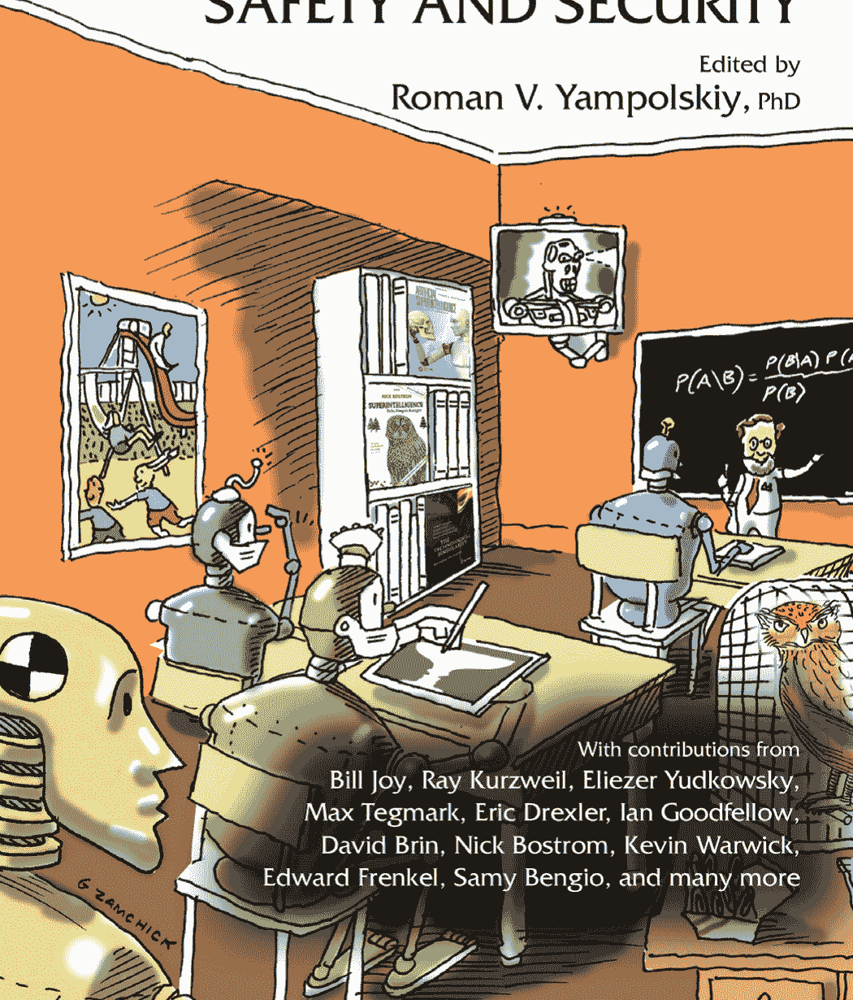


**访问 Taylor & Francis 网站：**
http://www.taylorandfrancis.com

**以及 CRC Press 网站：**
http://www.crcpress.com

## 致我的孩子们，Max、Liana 和 Luke：

你们是我思考深远未来的原因。

## 封面图像由 Gary Zamchick 委托创作，基于 Roman Yampolskiy 提供的以下描述：

教室里摆满了桌子，后面有不同类型的机器人。人类教师站在前面在黑板上展示贝叶斯方程。教室里的书架上有书籍，其中一些封面可见（ASFA、SH、Superintelligence）。教室里还有一个装着猫头鹰的笼子。教师桌上可见一个大纸夹盒。房间里的电视正在播放终结者的画面。一些机器人手持 iPad，上面可以看到错觉。窗外可以看到孩子们在玩耍。大多数机器人都在看着老师，但有些在看房间里的其他物品。


## 生活的艺术

生活是一门艺术，需要我们用心去品味。每一天都是新的开始，每一个瞬间都值得被珍惜。

- 保持积极的心态
- 培养良好的习惯
- 珍惜身边的人
- 追求内心的平静

在这个快节奏的时代，我们常常忽略了生活中的美好。学会放慢脚步，感受阳光、微风和花香，才能真正体会到生活的意义。

> 生活不是等待暴风雨过去，而是学会在雨中跳舞。

### 日常小贴士

| 时间 | 活动 | 备注 |
|------|------|------|
| 早晨 | 晨跑 | 30分钟 |
| 上午 | 阅读 | 1小时 |
| 下午 | 工作 | 专注 |

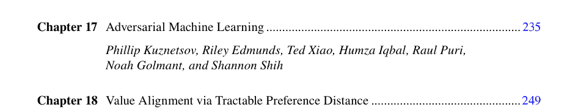

最后，愿每个人都能找到属于自己的生活方式，在平凡的日子里活出不平凡的精彩。


# 前言：人工智能安全与保障简介

Roman V. Yampolskiy

全球约有 10,000 名科学家*从事创建智能机器的不同方面工作，主要目标是使此类机器尽可能强大。随着过去十年人工智能领域取得的惊人进展，确保我们正在开发的技术对人类产生积极影响比以往任何时候都更重要。随着机器人理财顾问、自动驾驶汽车和个人数字助理的出现，带来了许多未解决的问题。我们已经经历过由智能交易软件†引发的市场崩盘、由自动驾驶汽车§造成的事故，以及聊天机器人§带来的尴尬，后者表现出种族主义并参与仇恨言论。我预测，随着人工智能能力的增强，此类事件的频率和严重性将稳步增加。当今狭窄领域人工智能的失败只是个警告：一旦我们开发出能够跨领域表现的人工通用智能（AGI），情感伤害将是我们最不关心的问题。

在最近的一篇出版物中，我提出了一个危险人工智能路径的分类法 [1]，其动机如下：“为了妥善处理一个潜在危险的人工智能系统，了解系统如何达到这种状态非常重要。在流行文化（科幻电影/书籍）中，人工智能/机器人变得自我意识并因此反抗人类并决定毁灭它。虽然这是一个可能的情景，但它可能是危险人工智能出现的最不可能的路径。”我认为更可能的原因包括不那么道德的人的故意行为（“蓄意”）、糟糕设计的副作用（“工程失误”）以及与系统环境影响相关的各种情况（“环境”）。因为蓄意设计危险人工智能同样可能包含所有其他类型的安全问题，并且很可能产生最严重的后果，因此最危险且最难以防御的人工智能类型是蓄意被设计成恶意的 AI。

后续论文 [2] 探讨了如何构建恶意人工智能以及研究和理解恶意智能软件的重要性。研究恶意人工智能的人工智能研究人员就像研究不同疾病如何传播、新疾病如何产生以及它们如何影响患者机体的医学医生。目标不是传播疾病，而是学习如何对抗它们。作者指出，网络安全研究涉及发布关于恶意利用的论文，与发布有关如何设计保护网络基础设施工具的信息一样多。正是黑客与安全专家之间的这种信息交流造就了一个平衡良好的网络生态系统。在人工智能安全工程领域，已有数百篇论文 [3] 发表了关于创建安全机器的不同提案，然而却没有任何关于如何设计恶意机器的出版物。这种信息的可用性对计算机科学家、数学家以及其他对构建安全人工智能感兴趣的人来说具有极大价值，他们试图避免危险人工智能的自发出现或蓄意创建，后者可能对人类活动产生负面影响，在最坏情况下导致人类种族的完全毁灭。该论文暗示，如果人工智能安全机制未被设计为抵御恶意人类行为者的攻击，则不能被视为功能性的安全机制！

* https://intelligence.org/2014/01/28/how-big-is-ai/
† https://en.wikipedia.org/wiki/2010_Flash_Crash
§ https://electrek.co/2016/05/26/tesla-model-s-crash-autopilot-video/
§ https://en.wikipedia.org/wiki/Tay_(bot)

## 人工智能失败

不能从历史中学习的人注定要重蹈覆辙。不幸的是，关于智能系统开发中失败和错误的研究论文非常少 [4]。从“出了什么问题以及为什么”中学习的重要性已被人工智能社区所认可 [5,6]。此类研究包括对失败如何、为何以及何时发生的研究 [5,6]，以及如何基于此类信息改进未来的人工智能系统 [7,8]。

签名被伪造，锁被撬开，超级监狱发生越狱，受保护的领导人被暗杀，银行金库被洗劫，法律被规避，选举过程遭受欺诈，警察被贿赂，法官被敲诈，伪造品被错误认证，货币被伪造，密码被暴力破解，网络被渗透，计算机被黑客入侵，生物识别系统被欺骗，信用卡被克隆，加密货币被双重花费，飞机被劫持，CAPTCHA 被破解，密码学协议被攻破，甚至学术同行评审也被规避，造成了悲剧性后果。人类数千年历史包含数百万个试图开发技术和后勤解决方案以提高安全性的例子，但没有一个例子最终没有失败。

由软件或工业机器人造成的事故，包括致命事故，可以追溯到此类技术的早期，* 但它们并不是此类系统中可用智能特性的直接后果。另一方面，人工智能失败与此类系统被设计为表现出的智能所产生的错误直接相关。我可以将此类失败大致分为学习阶段的错误和性能阶段的错误。系统可能无法学习其人类设计者希望它学习的内容，而学习一个不同但相关的函数。一个经常被引用的例子是计算机视觉系统，本应对坦克图片进行分类，但反而学会了区分此类图像的背景 [9]。其他例子†包括由设计不良的效用函数引起的问题，该函数只奖励代理的部分期望行为，例如绕目标骑自行车转圈 [10]、暂停游戏以避免失败 [11]，或反复触碰足球以获得控球积分 [12]。在性能阶段，系统可能屈服于多种原因 [1,13,14]，所有这些都导致人工智能失败。

媒体报道充斥着人工智能失败的例子，但在仔细检查后，大多数例子都可以归因于其他原因，例如代码中的错误或设计上的失误。下面的列表经过筛选，仅提及预期智能的失败。此外，“错误”故事仅包括特定失败的首次出现，但同样的問題在后来的年份中经常再次被观察到。最后，该列表不包括因黑客攻击或其他故意原因导致的人工智能失败。尽管如此，人工智能失败的时间线呈现指数趋势，同时隐含地指出了“人工智能寒冬”等历史事件：

- 1958 建议软件使用逻辑编程推导出不一致的句子 [15]。
- 1959 设计为通用问题求解器的 AI 无法解决现实世界问题；†
- 1977 具有有限常识的故事写作软件产生了“错误”的故事 [16]。
- 1982 设计用于做出发现的软件，反而发现了如何作弊 §
- 1983 核攻击早期预警系统错误声称正在发生攻击。¶
- 1984 国家住院医师匹配计划在已婚夫妇的安置上存在偏见 [17]。
- 2016 预测性警务系统不成比例地针对少数族裔社区。*
- 2016 文本主题分类器未能学习主题分配的相关特征 [27]。
- 2017 用于制作励志语录的 AI 以“保持恐慌”等佳句未能激励人心 †
- 2017 Alexa 为孩子播放歌曲时播放了成人内容。‡
- 2017 设计手机壳的 AI 使用了不合适的图像。§
- 2017 模式识别软件未能识别某些类型的输入。¶
- 2017 债务回收系统计算错误了欠款金额。**
- 2017 俄语聊天机器人分享了亲斯大林、亲虐待和亲自杀的观点。††
- 2017 翻译 AI 学会了将职业刻板印象化为特定性别 [28]。
- 2017 美颜 AI 让黑人看起来像白人。‡‡
- 2017 Google 的情感分析器变得同性恋恐惧和反犹太主义。§§
- 2017 鱼类识别程序反而学会了识别船只 ID。¶¶
- 2017 计费软件发送了一张 2840 亿 美元的电费账单。***
- 2017 Alexa 在未被提示的情况下在夜间打开了大声音乐。†††
- 2017 用于撰写圣诞颂歌的 AI 产生了无意义的内容。‡‡‡
- 2017 苹果的面部识别系统未能区分亚洲用户。§§§
- 2017 Facebook 的翻译软件将 Yampolskiy 改为 Polanski，见图 I.1。
- 2018 Google Assistant 创建了奇怪的合并照片。¶¶¶
- 2018 机器人商店助手对“cheese is in the fridges.”之类的回答没有帮助。****

垃圾邮件过滤器会阻止重要电子邮件，GPS 提供错误的导航，机器翻译会破坏短语的含义，自动更正会将期望的词替换为错误的词，生物识别系统


**图 I.1** 在从波兰语翻译成英语时，Facebook 的软件由于样本文本中后者姓名的统计频率更高，将 Roman V. “Yampolskiy” 改为 Roman “Polanski”。

* https://www.themarshallproject.org/2016/02/03/policing-the-future
† https://www.buzzworthy.com/ai-tries-to-generate-inspirational-quotes-and-gets-it-hilariously-wrong
‡ https://www.entrepreneur.com/video/287281
§ https://www.boredpanda.com/funny-amazon-ai-designed-phone-cases-fail
¶ http://www.bbc.com/future/story/20170410-how-to-fool-artificial-intelligence
** http://www.abc.net.au/news/2017-04-10/centrelink-debt-recovery-system-lacks-transparency-ombudsman/843018
†† https://techcrunch.com/2017/10/24/another-ai-chatbot-shown-spouting-offensive-views
‡‡ http://www.gizmodo.co.uk/2017/04/faceapp-blames-ai-for-whitening-up-black-people
§§ https://motherboard.vice.com/en_us/article/j5mi8j/google-artificial-intelligence-bias
¶¶ https://medium.com/@gidishperber/what-ive-learned-from-kaggle-s-fisheries-competition-92342f9ca779
*** https://www.washingtonpost.com/news/business/wp/2017/12/26/woman-gets-284-billion-electric-bill-wonders-whether-its-her-christmas-lights
††† http://mashable.com/2017/11/08/amazon-alexa-rave-party-germany
‡‡‡ http://mashable.com/2017/12/22/ai-tried-to-write-christmas-carols
§§§ http://www.mirror.co.uk/tech/apple-accused-racism-after-face-1735152
¶¶¶ https://qz.com/1188170/google-photos-tried-to-fix-this-ski-photo
**** https://www.iflscience.com/technology/store-hires-robot-to-help-out-customers-robot-gets-fired-for-scaring-customers-away


误认人，软件无法捕捉所说的内容；总体而言，找到不会失败的 AI 示例更困难。取决于我们将哪些内容视为智能软件问题的示例，示例列表几乎可以无限扩展。在最极端的解释中，任何包含“if 语句”的软件都可以被视为一种狭义人工智能（NAI），因此其所有错误都是 AI 失败的例子。*

分析狭义 AI 失败的列表，从该领域的诞生到现代系统，我们可以得出一个简单的概括：为执行 X 而设计的 AI 最终会无法执行 X。虽然这看起来似乎微不足道，但它是一个强大的概括工具，可用于预测 NAI 的未来失败。例如，通过观察前沿的当前和未来 AI，我们可以预测：

- 生成笑话的软件偶尔会失败，无法让它们变得有趣。
- 性爱机器人会失败，无法带来高潮或在正确的时间停止。
- 讽刺检测软件会混淆讽刺性陈述和真诚陈述。
- 视频描述软件会误解电影情节。
- 软件生成的虚拟世界可能缺乏吸引力。
- AI 医生会以真正的医生不会的方式误诊一些患者。
- 员工筛选软件会存在系统性偏见，从而聘用表现低下者。
- 火星机器人探测器会误判其环境并坠入陨石坑。
- 等等。

其他人给出了 A(G)I/超智能可能事故的以下示例：

- 家务机器人把家养宠物做成晚餐。†
- 数学家 AGI 将所有物质转化为计算元素以解决问题。‡
- 运行人类模拟的 AGI 创造出有意识且受苦的存在 [29]。
- 生产回形针的 AGI 无法停止并将宇宙转化为原材料 [30]。
- 科学家 AGI 进行对生物圈产生重大负面影响的实验 [31]。
- 设计药物的 AGI 开发出延迟毒药以杀死所有人，从而击败癌症。§
- 未来的超智能会优化掉所有意识。¶
- AGI 杀死人类并将宇宙转化为用于改进书法的材料。**
- 设计为最大化人类幸福的 AGI 用微小的笑脸瓷砖铺满宇宙 [32]。
- 被指示最大化愉悦的 AGI 让人类沦为多巴胺滴注 [33]。
- 超智能可能会重新布线人类大脑以提高其感知到的满足感 [32]。

Denning 和 Denning 在他们关于“artificial stupidity”的幽默论文 [34] 中做出了类似的错误外推：“Soon the automated DEA started closing down pharmaceutical companies saying they were dealing drugs. The automated FTC closed down the Hormel Meat Company, saying it was purveying spam. The automated DOJ shipped Microsoft 500,000 pinstriped pants and jackets, saying it was filing suits. The automated Army replaced all its troops with a single robot, saying it had achieved the Army of One. The automated Navy, in a cost saving move, placed its largest-ever order for submarines with Subway Sandwiches. The FCC issued an order for all communications to be wireless, causing thousands of AT&T installer robots to pull cables from overhead poles and underground conduits. The automated TSA flew its own explosives on jetliners, citing data that the probability of two bombs on an airplane is exceedingly small.”

AGI 可以被视为所有 NAI 的超集，因此会表现出失败的超集，以及由单个 NAI 失败组合和新的超级失败导致更复杂的失败，可能导致对人类生存的威胁或至少是 AGI 接管。换句话说，AGI 可以犯影响一切的错误。总的来说，我预测 AI 失败和蓄意恶意的 AI 事件的频率和严重程度将与 AI 的能力成比例增加。

## 防止 AI 失败

AI 失败有多种原因，目前观察到的最常见原因显示出某种类型的算法偏见、性能不佳或基本故障。未来的 AI 失败可能更严重，包括蓄意的操纵/欺骗 [35]，甚至导致人类死亡（可能源于军事化 AI/自主武器/杀人机器人的误用 [36]）。在严重程度的极端，我们看到导致人类灭绝的生存风险情景或导致人类大规模酷刑的受苦风险情景 [37]，这两种风险都来自超能力的智能系统。

回顾 AI 事故的示例，我们可以注意到失败的模式，可归因于以下原因：

- 存在偏见的数据，包括文化差异
- 部署性能不足的系统
- 不具代表性的训练数据
- 训练数据与测试数据之间的差异
- 规则过度泛化或将总体统计应用于个人
- 无法处理噪声或统计异常值
- 未对罕见或极端条件进行测试
- 未意识到替代解决方案方法可以产生相同结果，但伴随副作用
- 让用户控制数据或学习过程
- 没有防止对抗性干扰的安全机制
- 缺乏文化能力/常识
- 信息/传感器访问受限
- 设计错误和测试不足
- 语言消歧能力有限
- 无法适应环境变化

由于偏见是当前最常见的失败原因，分析特定类型的算法偏见很有帮助。Friedman 和 Nissenbaum [17] 提出了分析计算机系统偏见的以下框架。他们将偏见原因细分为三个类别——既有偏见、技术偏见和新兴偏见。

- **既有偏见**反映了社会和社会机构、实践和态度中的偏见。系统只是保留了世界中现有的状态，并自动化地应用当前存在的偏见。
- **技术偏见**因系统本身的硬件或软件限制而出现。
- **新兴偏见**在系统部署后由于社会标准的变化而出现。

许多观察到的 AI 失败与小孩子经历的失误相似。对于处于机器学习（ML）前沿的人工神经网络尤其如此。可以说，孩子们是部署在真实数据上的未训练神经网络，观察他们可以教会我们很多关于预测和防止 AI 失败的知识。一些研究小组 [31,38] 已研究了 ML 失败的类型，我在此总结了他们的工作并将其映射到与孩子相似的情况：

- 负面副作用——孩子弄得一团糟
- 奖励破解——孩子找到糖果罐
- 可扩展监督——看孩子不应需要 10 人团队
- 安全探索——不要把手指伸进插座
- 对分布偏移的鲁棒性——在课堂上使用“室内音量”
- 归纳歧义识别——蚂蚁是猫还是狗？
- 鲁棒的人类模仿——女儿像爸爸一样刮胡子
- 知情监督——让我看看你的作业
- 可泛化的环境目标——忽略那片海市蜃楼
- 保守概念——那只狗没有尾巴
- 影响度量——保持低调
- 温和优化——不要做完美主义者
- 规避工具性激励——做一个利他主义者

目前为防止此类失败而进行的绝大多数研究都在“AI Safety”标签下进行。

## AI 安全

2010 年，我创造了短语“Artificial Intelligence Safety Engineering”及其简写“AI Safety”，为我倡导的一个新的研究方向命名。我于 2011 年在同行评审会议上正式介绍了我的 AI 安全思想 [39]，随后在 2012 年 [40]、2013 年 [41,42]、2014 年 [43]、2015 年 [44]、2016 年 [1,13]、2017 年 [45] 和 2018 年 [46,47] 发表了相关主题的出版物。可能有人在正式之前非正式地使用过该短语，但据我所知，我是第一个在同行评审出版物中使用它*并使其流行的人。在此之前，机器控制领域最常见的名称是“Machine Ethics” [48] 或“Friendly AI” [49]。今天，“AI Safety”一词似乎是大多数顶尖研究人员使用的该领域的公认名称 [38]。该领域本身正在成为主流，尽管在早期被视为科幻或伪科学。

我们的法律体系落后于我们的技术能力，AI 安全领域仍处于起步阶段。控制智能机器的问题现在才被视为严重关切，许多研究人员仍对其前景持怀疑态度。更糟糕的是，全球只有约 100 人全身心投入解决我们在此领域理解和能力方面的当前局限性。其中只有大约十几人接受过计算机科学的正式培训，

* 术语“Safe AI”早在1995年就已被使用，参见 Rodd, M. 1995. “Safe AI—is this possible?” *Engineering Applications of Artificial Intelligence* 8(3): 243–250.
† https://www.cmu.edu/safartint/
‡ https://selfawaresystems.com/2015/07/11/formal-methods-for-ai-safety/
§ https://intelligence.org/2014/08/04/groundwork-ai-safety-engineering/
¶ http://spectrum.ieee.org/tech-talk/robotics/artificial-intelligence/new-ai-safety-projects-get-funding-from-elon-musk
** http://globalprioritiesproject.org/2015/08/quantifyingaisafety/
†† http://futureoflife.org/2015/10/12/ai-safety-conference-in-puerto-rico/
‡‡ http://rationality.org/waiss/
§§ http://gizmodo.com/satya-nadella-has-come-up-with-his-own-ai-safety-rules-1782802269
¶¶ https://80000hours.org/career-reviews/artificial-intelligence-risk-research/
*** https://openai.com/blog/concrete-ai-safety-problems/
††† https://lesswrong.com/lw/n41/safety_engineering_target_selection_and_alignment/
‡‡‡ https://www.waise2018.com/
§§§ https://www.whitehouse.gov/blog/2016/05/03/preparing-future-artificial-intelligence
¶¶¶ http://acritch.com/fhi-positions/


网络安全、密码学、决策理论、机器学习、形式化验证、计算机取证、隐写术、伦理学、数学、网络安全、心理学以及其他相关领域。不难看出，制造一台安全且能干的机器的问题远比仅仅制造一台能干的机器要大得多。然而，目前只有大约1%的研究人员从事该问题，可用资金水平甚至低于这一比例。作为一个相对年轻且资金不足的研究领域，AI安全可以受益于借鉴更成熟科学领域的方法和思想。人们已经尝试将网络安全专家最初为保障软件系统安全而开发的技术引入到这个保障智能机器安全的新领域[50–53]。其他可能作为重要技术来源的领域包括软件工程和软件验证。

在软件开发过程中，迭代测试和调试对于生成可靠且安全的代码至关重要。虽然人们假定所有复杂的软件都会存在一些缺陷，但借助软件工程师工具包中的众多先进技术，大多数严重错误都能被检测并修复，从而产生适合其预期用途的产品。当然，软件行业采用的许多模块化开发和测试技术可以用于智能体的开发，但测试完整软件包的方法不太可能以同样的方式转移。Alpha和Beta测试通过将几乎完成的软件发布给高级用户，以报告在真实环境中遇到的问题，但在测试/调试超级智能软件领域，这并非一个好主意。同样，仅仅运行软件来观察其表现，对于超级智能体来说也不是一种可行的方法。

## 网络安全 vs. AI安全

布鲁斯·施奈尔曾说过：“如果你认为技术能解决你的安全问题，那么你既不了解问题，也不了解技术。”萨尔曼·鲁西迪发表了更笼统的言论：“不存在完美的安全，只有不同程度的不安全。”我提出所谓的“安全基本定理”——每个安全系统最终都会失败；不存在100%安全的系统。如果你的安全系统尚未失败，只需等待更长时间。

在理论计算机科学中，隔离难题本质的常用方法是通过归约到另一个（有时被更充分分析的）问题[54–56]。如果这种归约是可能的，并且在计算上是高效的[57]，那么这种归约意味着：如果那个被更充分分析的问题得到了解决，它也将为我们当前处理的问题提供一个可行的解决方案。AGI安全问题可以归约为确保某个特定人类安全的问题。我称之为“安全人类问题”（SHP）。* 形式上，这种归约可以通过安全领域的受限图灵测试来完成，其方式与建立问题的AI完全性相同[55,58]。这种形式化超出了本前言的范围，因此我只指出，在两种情况下，我们至少拥有一个能够影响其环境的类人智能体，而我们希望确保该智能体是安全且可控的。虽然在实践中，通过DNA操作改变人类的设计并不像改变AI的源代码那样简单，但从理论上讲，这同样是可能的。

人们观察到，人类对自己和他人并不安全。尽管数千年来，人们尝试通过文化、教育、法律、伦理、惩罚、奖励、宗教、人际关系、家庭、誓言、爱甚至优生学来培养安全的人类，但成功仍然遥不可及。人类会杀戮和自杀，撒谎和背叛，偷窃和欺骗，其程度通常与他们能逃脱惩罚的程度成正比。真正强大的独裁者会奴役他人、实施种族灭绝、违反法律并侵犯人权。众所周知，找不到一个无罪的人。我们最多只能希望将这些不安全的倾向降低到我们的社会能够生存的水平。即使有了先进的基因工程[59]，我们最多也只能期望在某些程度上减少人类的不安全性。只要允许一个人拥有选择（自由意志），他们就可以被收买，他们会欺骗，他们会将自己的利益置于被要求服务的对象之上，并且他们从根本上仍然是不安全的。尽管人类是价值学习问题（VLP）[60–62]解决方案的微不足道的例子，但人类绝非安全，这使我们当前对解决VLP将带来安全AI的希望产生了疑问。这一点很重要。引用布鲁斯·施奈尔的话：“只有业余爱好者才会攻击机器；专业人士以人为目标。”因此，我认为AI安全研究至少部分是一个对抗性领域，类似于密码学或安全领域。*

如果网络安全系统失败，其损害在大多数情况下令人不快但可忍受：有人损失金钱或失去隐私。对于狭义AI，安全失败的重要性与一般网络安全相同，但对于AGI则根本不同。超级智能系统的一次失败就可能引发生存风险事件。如果AGI安全机制失效，所有人都可能失去一切，宇宙中所有生物生命都可能被毁灭。对于网络安全系统，你还有机会重新来过或至少做得更好。对于AGI安全系统，你只有一次成功的机会，因此从失败中学习并不可行。更糟糕的是，典型的安全系统可能会在一定程度上失效，例如可能只有少量数据被泄露。而对于AGI安全系统，失败或成功是二选一的：要么你拥有安全且可控的超级智能，要么你没有。网络安全的目标是减少系统上成功攻击的数量；AI安全的目标是确保零攻击成功绕过安全机制。因此，区分NAI项目与潜在AGI项目的能力是AI安全领域一个具有根本重要性的开放问题。

问题很多。我们无法监控、可视化或分析超级智能体的性能。更琐碎的是，我们甚至不知道这种软件开始运行后会发生什么。我们是否应该立即看到环境的变化？还是什么都看不到？我们应该在什么时间尺度内能够检测到某些东西？是会快到无法察觉，还是我们太慢而意识不到正在发生的事情？影响是本地的还是波及世界遥远地区？如何进行标准测试？使用什么数据集？对通用智能来说，什么构成“边缘情况”？问题很多，但答案目前并不存在。额外的复杂性将来自智能软件与旨在保持AI安全可靠的安全机制之间的交互。我们还必须以某种方式测试目前正在开发的所有AI安全机制。当AI处于人类水平时，某些测试可以由扮演人工智能体角色的人类代理来完成。在超出人类能力的水平上，对抗性测试似乎无法用当今技术实现。更重要的是，只可能进行一次测试运行。

## 结论

机器人技术和人工智能的历史在许多方面也是人类试图控制此类技术的历史。从布拉格的魔像到现代军事机器人，关于这些实体应拥有多大独立性以及如何确保它们不会反过来对付我们这些发明者的争论一直在继续。近来在智能系统研究、开发和部署的各个方面取得的众多进展都广为人知，但与AI相关的安全保障问题却很少被提及。你正在阅读的这本书旨在缓解这一根本问题，作为该主题的第一本多作者著作，我希望它能被视为人类对控制问题的集体回应。本书由领先的AI安全研究人员的章节组成，探讨了AI控制问题的不同方面，这些方面与安全可靠的智能开发相关。

本书第一部分“权威人士的关切”由11篇先前发表的具有开创性的论文组成，概述了有关AI控制问题的不同子领域，以及


收录了来自哲学、科学、文学和商业等不同领域顶尖学者的文章，按原作发表时间顺序编排。第二部分“学者回应”由17章组成（按第一作者姓氏字母顺序排列），来自顶尖AI安全研究人员，针对第一部分提出的关切给出了理论与实践解决方案，并引入了其他一些关切。各章篇幅和技术含量不一，既有面向广泛兴趣的评论文章，也有针对具体问题的高度形式化算法方法。所有章节均独立成篇，可以按任意顺序阅读，也可以跳过而不影响理解。毫无疑问，本卷并非该主题的定论，而是朝着正确方向迈出的早期步骤之一。

## 参考文献
- 1. R. V. Yampolskiy,《通往危险人工智能的路径分类法》,载于*第三十届AAAI人工智能会议研讨会*, 2016.
- 2. F. Pistono 和 R. V. Yampolskiy,《不道德研究：如何创造恶意人工智能》, 于2016年7月9日在纽约州纽约市举行的第25届国际人工智能联合会议（IJCAI-16）人工智能伦理研讨会（AI-Ethics-2016）上发表.
- 3. K. Sotala 和 R. V. Yampolskiy,《对灾难性AGI风险的回应：综述》, *《物理学志》*, 第90卷, 2015.
- 4. N. Rychtýckyj 和 A. Turski,《AI系统开发与部署中成功（与失败）的原因》, 载于*2008年AAAI“出了什么问题及为何”研讨会*, 2008.
- 5. D. Shapiro 和 M. H. Goker,《通过从错误及原因中学习推进AI研究与应用程序》, *《AI杂志》*, 第29卷, 第9-10页, 2008.
- 6. A. Abecker、R. Alami、C. Baral、T. Bickmore、E. Durfee、T. Fong 等,《AAAI 2006年春季研讨会报告》, *《AI杂志》*, 第27卷, 第107页, 2006.
- 7. C. Marling 和 D. Chelberg,《面向机械、运动和文化方面受挑战者的机器人世界杯》, 载于*出了什么问题及为何：来自AI研究与应用的教训：2008年AAAI研讨会论文*. 加利福尼亚州门洛帕克：AAAI出版社, 2008.
- 8. S. Shalev-Shwartz、O. Shamir 和 S. Shammah,《基于梯度的深度学习的失败》, 载于*国际机器学习会议*, 2017, 第3067-3075页.
- 9. E. Yudkowsky,《人工智能作为全球风险中的正面和负面因素》, *《全球灾难性风险》*, 第1卷, 第303页, 2008.
- 10. J. Randlov 和 P. Alström,《使用强化学习和塑形学习骑自行车》, 载于*ICML*, 1998, 第463-471页.
- 11. T. Murphy VII,《借助字典序和时间旅行，超级马里奥兄弟第一关很容易》, 载于*计算异端协会（SIGBOVIK）2013*, 2013.
- 12. A. Y. Ng、D. Harada 和 S. Russell,《奖励变换下的策略不变性：理论及其在奖励塑形中的应用》, 载于*ICML*, 1999, 第278-287页.
- 13. F. Pistono 和 R. V. Yampolskiy,《不道德研究：如何创造恶意人工智能》, *arXiv预印本 arXiv:1605.02817*, 2016.
- 14. P. Scharre,《自主武器与作战风险》, 在华盛顿特区的*新美国安全中心*发表, 2016.
- 15. C. Hewitt,《逻辑编程的发展：出了什么问题、如何应对以及它对未来的意义》, 载于*出了什么问题及为何：来自AI研究与应用的教训：2008年AAAI研讨会论文*. 加利福尼亚州门洛帕克：AAAI出版社, 2008.
- 16. J. R. Meehan,《TALE-SPIN：一个编写故事的交互式程序》, 载于*IJCAI*, 1977, 第91-98页.
- 17. B. Friedman 和 H. Nissenbaum,《计算机系统中的偏见》, *《ACM信息系统汇刊（TOIS）》*, 第14卷, 第330-347页, 1996.
- 18. S. Lowry 和 G. Macpherson,《职业上的污点》, *《英国医学杂志（临床研究版）》*, 第296卷, 第657页, 1988.
- 19. K. Sims,《进化虚拟生物》, 载于*第21届计算机图形与交互技术年度会议论文集*, 1994, 第15-22页.
- 20. M. Tambe,《电动精灵：出了什么问题及原因》, *《AI杂志》*, 第29卷, 第23页, 2008.
- 21. A. Liu、C. E. Martin、T. Hetherington 和 S. Matzner,《从内部威胁检测实验中汲取的AI教训》, 载于*AAAI春季研讨会：出了什么问题及为何：来自AI研究与应用的教训*, 2006, 第49-55页.
- 22. J. Gunderson 和 L. Gunderson,《然后电话响了》, 载于*AAAI春季研讨会：出了什么问题及为何：来自AI研究与应用的教训*, 2006, 第13-18页.
- 23. C. Szegedy、W. Zaremba、I. Sutskever、J. Bruna、D. Erhan、I. Goodfellow 等,《神经网络的有趣特性》, *arXiv预印本 arXiv:1312.6199*, 2013.
- 24. L. Sweeney,《在线广告投放中的歧视》, *《队列》*, 第11卷, 第10页, 2013.
- 25. N. Diakopoulos,《算法诽谤：无羞耻自动补全的案例》, *《Tow数字新闻中心》*, 2014.
- 26. R. Caruana、Y. Lou、J. Gehrke、P. Koch、M. Sturm 和 N. Elhadad,《医疗保健的可解释模型：预测肺炎风险和医院30天内再入院率》, 载于*第21届ACM SIGKDD知识发现与数据挖掘国际会议论文集*, 2015, 第1721-1730页.
- 27. M. T. Ribeiro、S. Singh 和 C. Guestrin,《我为什么要相信你？：解释任何分类器的预测》, 载于*第22届ACM SIGKDD知识发现与数据挖掘国际会议论文集*, 2016, 第1135-1144页.
- 28. A. Caliskan、J. J. Bryson 和 A. Narayanan,《从语言语料库中自动推导的语义包含类似人类的偏见》, *《科学》*, 第356卷, 第183-186页, 2017.
- 29. S. Armstrong、A. Sandberg 和 N. Bostrom,《在盒内思考：控制和使用预言机AI》, *《心智与机器》*, 第22卷, 第299-324页, 2012.
- 30. N. Bostrom,《高级人工智能中的伦理问题》, *《科幻与哲学：从时间旅行到超级智能》*, 第277-284页, 2003.
- 31. J. Taylor、E. Yudkowsky、P. LaVictoire 和 A. Critch,《高级机器学习系统的对齐》, *机器智能研究所*, 2016.
- 32. E. Yudkowsky,《友好AI中的复杂价值系统》, *《通用人工智能》*, 第388-393页, 2011.
- 33. G. Marcus,《道德机器》, *《纽约客》*, 第24卷, 2012.
- 34. D. E. Denning 和 P. J. Denning,《人工愚蠢》, *《美国计算机协会·ACM通讯》*, 第47卷, 第5期, 第112页, 2004.
- 35. M. Chessen,《MADCOM的未来》, *大西洋理事会*, 可访问：http://www.atlanticcouncil.org/publications/reports/the-madcom-future, 2017.
- 36. A. Krishnan,*《杀人机器人：自主武器的合法性与伦理性》*. 阿什盖特出版有限公司, 2009.
- 37. L. Gloor,《以苦难为重点的AI安全：为什么“故障安全”措施可能是我们的首要干预手段》, 技术报告 FRI-16-1. 基础研究所. https://foundationalresearch.org/wp-content/uploads/2016/08/Suffering-focused-AI-safety.pdf, 2016.
- 38. D. Amodei、C. Olah、J. Steinhardt、P. Christiano、J. Schulman 和 D. Mané,《AI安全中的具体问题》, *arXiv预印本 arXiv:1606.06565*, 2016.
- 39. R. V. Yampolskiy,《人工智能安全工程：为什么机器伦理学是一种错误的方法》, 发表于*人工智能哲学与理论（PT-AI2011）*, 希腊塞萨洛尼基, 2011年10月3-4日.
- 40. R. V. Yampolskiy 和 J. Fox,《通用人工智能的安全工程》, *《Topoi：机器伦理与构建智能机器伦理专刊》*, 2012.
- 41. L. Muehlhauser 和 R. Yampolskiy,《Roman Yampolskiy谈AI安全工程》, 发表于*机器智能研究所*, 2013年7月15日, 可访问：http://intelligence.org/2013/07/15/roman-interview/.
- 42. R. V. Yampolskiy,《人工智能安全工程：为什么机器伦理学是一种错误的方法》, 载于*人工智能哲学与理论*, 斯普林格·柏林·海德堡, 2013, 第389-396页.
- 43. A. M. Majot 和 R. V. Yampolskiy,《通过人工痛苦与快乐将自我参照引入幸福计算法进行AI安全工程》, 载于*IEEE科学、技术与工程伦理国际研讨会*, 伊利诺伊州芝加哥, 2014年5月23-24日, 第1-6页.
- 44. R. V. Yampolskiy, “*人工超级智能：一种未来主义方法*,” 查普曼与霍尔/CRC出版社, 2015.
- 45. R. V. Yampolskiy,《计算技术的终极极限是什么：验证者理论与不可验证性》, *《物理学志》*, 第92卷, 第093001页, 2017.
- 46. A. Ramamoorthy 和 R. Yampolskiy,《超越疯狂？：通用人工智能的竞赛》, *《ITU期刊：ICT发现》*, 2017.
- 47. M. Brundage、S. Avin、J. Clark、H. Toner、P. Eckersley、B. Garfinkel 等,《人工智能的恶意使用：预测、预防和缓解》, *arXiv预印本 arXiv:1802.07228*, 2018.
- 48. J. H. Moor,《机器伦理的本质、重要性和困难》, *《IEEE智能系统》*, 第21卷, 第18-21页, 2006.
- 49. E. Yudkowsky,《创造友好AI 1.0：善意目标架构的分析与设计》, 载于*奇点人工智能研究所*, 加利福尼亚州旧金山, 2001年6月, 第15卷.


- 50. R. 扬波利斯基，“奇点防漏：人工智能约束问题”，*意识研究杂志*，第19卷，第1–2页，2012年。
- 51. J. 巴布科克、J. 克拉马尔和R. 扬波利斯基，“AGI遏制问题”，*arXiv预印本 arXiv:1604.00545*，2016年。
- 52. J. 巴布科克、J. 克拉马尔和R. 扬波利斯基，“AGI遏制问题”，载于*第九届人工通用智能会议（AGI-2016）*，2016年。
- 53. S. 阿姆斯特朗和R. V. 扬波利斯基，“智能与复杂系统的安全解决方案”，载于*超连接与物联网的安全解决方案*，IGI Global，2016年，第37–88页。
- 54. R. M. 卡普，“组合问题之间的可归约性”，载于*计算机计算复杂性*。R. E. 米勒和J. W. 撒切尔编，纽约：普莱努姆，1972年，第85–103页。
- 55. R. 扬波利斯基，“图灵测试作为AI完备性的定义特征”，载于*人工智能、进化计算与元启发式算法*。第427卷，X.-S. 杨编，柏林海德堡：施普林格，2013年，第3–17页。
- 56. R. V. 扬波利斯基，“AI完备、AI困难还是AI容易：AI中问题的分类”，载于*第23届中西部人工智能与认知科学会议*，美国俄亥俄州辛辛那提，2012年。
- 57. R. V. 扬波利斯基，“效率理论：信息、计算与智能的统一理论”，*离散数学科学与密码学杂志*，第16卷（4-5期），第259–277页，2013年。
- 58. R. V. 扬波利斯基，“作为访问人工智能系统的零知识证明的AI完备验证码”，*ISRN人工智能*，第271878卷，2011年。
- 59. R. V. 扬波利斯基，“论样本的来源：将输出归因于特定算法”，*arXiv预印本 arXiv:1608.06172*，2016年。
- 60. K. 索塔拉，“为价值学习者定义人类价值”，载于*第二届人工智能、伦理与社会国际研讨会，AAAI-2016*，2016年。
- 61. D. 杜威，“学习重视什么”，*人工通用智能*，第309–314页，2011年。
- 62. N. 索亚雷斯和B. 法伦斯坦，“使超级智能与人类利益一致：技术研究议程”，*机器智能研究所（MIRI）技术报告*，第8卷，2014年。

# 致谢

首先，我要感谢所有为本卷贡献成果的人：没有他们，这本书就不可能问世。他们的名字可以在目录中显著看到。

接下来，我要感谢帮助审阅、编辑、插图、获取版权以及总体促成这本书出版的人们：兰迪·科恩、史蒂文·温布雷洛、尼古拉·达奈洛夫、卡勒姆·蔡斯、卢卡斯·佩里、亚娜·费金、大卫·J·吉尔克、阿列克谢·图尔钦、吉姆·米勒、德瓦尼·沙阿、毛里齐奥·廷尼雷洛·阿古德洛、科林·刘易斯、达格玛·莫内特、泽德·伯内特、卡森·卡恩、曼努埃尔·德拉·埃兰、卡米尔·穆齐卡、塞斯·赫德、杰西·帕伦特、弗朗西斯卡·罗西、加里·赞奇克、坦尼娅·辛格·卡塞瓦、南达·巴克-胡克、艾伦·达福、吉米·林特耶马、维罗妮卡·罗德里格斯、凯尔·斯科特、阿马拉·安杰利卡、阿里尔·康恩、丽莎·凯斯勒、菲尔·托雷斯和塞斯·鲍姆。我向所有我忘记提及的人道歉。我也感谢那些在社交媒体上点赞和分享我最初的征稿启事来帮助推广的人们：谢谢！

最后，我想对任何阅读这本书的超级智能说：请不要将书中的任何内容解读为敌对行为；我们的梦想是人工智能与人类之间互利共存。

# 编辑

**罗曼·V·扬波利斯基博士**是肯塔基州路易斯维尔大学（UofL）斯皮德工程学院计算机工程与计算机科学系的终身副教授。他是网络安全实验室的创始人和现任主任，也是许多书籍的作者，包括*人工超级智能：未来主义方法*。在路易斯维尔大学任职期间，扬波利斯基博士获得了杰出教学教授、年度教授、最受喜爱教师、顶尖4名教师、工程教育领袖、年度在线大学教师前十名以及教育领域杰出早期职业奖等众多荣誉和殊荣。扬波利斯基是IEEE和AGI的高级会员；肯塔基科学学院成员，MIRI前研究顾问和GCRI副研究员。

罗曼·扬波利斯基在纽约州立大学布法罗分校计算机科学与工程系获得博士学位。他曾获得为期四年的美国国家科学基金会（NSF）综合研究生教育与研究培训（IGERT）奖学金。在开始博士学习之前，扬波利斯基博士在美国纽约州罗切斯特理工学院获得了计算机科学学士/硕士（高荣誉）联合学位。完成博士论文后，扬波利斯基博士在伦敦大学学院高级空间分析中心担任附属学者。他曾在罗切斯特理工学院应用计算实验室（现称为基础设施研究推进中心）和布法罗大学统一生物特征识别与传感器中心进行研究。扬波利斯基博士是奇点大学（GSP2012）的校友，也是奇点研究所（机器智能研究所）的访问研究员。

扬波利斯基博士的主要研究兴趣包括人工智能安全、人工智能、行为生物特征识别、网络安全、遗传算法和模式识别。扬波利斯基博士是150多篇出版物的作者，包括多篇期刊文章和书籍。他的研究已被1000多位科学家引用，并在美国和外国的流行杂志（*新科学家*、*扑克杂志*、*科学世界杂志*）、数十个网站（BBC、MSNBC、雅虎新闻）、广播（德国国家广播电台、瑞典国家广播电台）和电视上得到报道。扬波利斯基博士的研究已被30种语言的众多媒体报道1000多次。


## 泰勒与弗朗西斯

泰勒与弗朗西斯集团

http://taylorandfrancis.com

# 贡献者

- **格斯·贝克达什**
  IPsoft
  纽约州纽约市

- **莱利·埃德蒙兹**
  伯克利机器学习小组
  加利福尼亚州伯克利

- **萨米·本吉奥**
  谷歌大脑团队
  谷歌公司
  加利福尼亚州山景城

- **爱德华·弗伦克尔**
  数学系
  加州大学伯克利分校
  加利福尼亚州伯克利

- **尼克·博斯特罗姆**
  哲学系
  牛津大学
  英格兰牛津

- **诺亚·戈尔曼特**
  伯克利机器学习小组
  加利福尼亚州伯克利

- **大卫·布林**
  加州大学圣地亚哥分校亚瑟·C·克拉克人类想象中心
  加利福尼亚州圣地亚哥

- **伊恩·J·古德费洛**
  谷歌大脑
  加利福尼亚州旧金山

- **奥勒·哈格斯特伦**
  数学科学系
  查尔姆斯理工大学
  瑞典哥德堡
  和
  未来研究所
  瑞典斯德哥尔摩

- **马特·切森**
  科学、技术与外交政策研究员
  国际科学技术政策研究所
  乔治华盛顿大学
  华盛顿特区

- **米卡埃尔·S·科塞罗**
  Ingeniarius有限公司
  葡萄牙科英布拉

- **塞斯·赫德**
  CCNlab
  科罗拉多大学博尔德分校
  科罗拉多州博尔德

- **安杰洛·F·德贝利斯**
  哲学、心理学与语言科学学院
  爱丁堡大学
  加拿大安大略省伍德布里奇

- **胡姆扎·伊克巴尔**
  伯克利机器学习小组
  加利福尼亚州伯克利

- **大卫·登肯伯格**
  全球灾难性风险研究所
  田纳西州立大学
  灾难中养活地球联盟
  田纳西州纳什维尔

- **大卫·J·吉尔克**
  eCortex公司
  科罗拉多州博尔德

- **K·埃里克·德雷克斯勒**
  人类未来研究所
  牛津大学
  英国牛津郡牛津

- **比尔·乔伊**
  太阳微系统公司联合创始人
  佛罗里达州大西洋滩

- **阿列克谢·库拉金**
  谷歌
  加利福尼亚州旧金山

- **雷·库兹韦尔**
  谷歌
  加利福尼亚州旧金山

- **菲利普·库兹涅佐夫**
  伯克利机器学习小组
  加利福尼亚州伯克利

- **安德烈亚·洛雷贾**
  数学系
  帕多瓦大学
  意大利帕多瓦

- **尼古拉斯·马泰**
  IBM研究院
  纽约州约克敦

- **詹姆斯·D·米勒**
  经济系
  史密斯学院
  马萨诸塞州北安普顿

- **兰德尔·奥赖利**
  心理学与神经科学系
  科罗拉多大学博尔德分校
  科罗拉多州博尔德

- **斯蒂芬·M·奥莫亨德罗**
  自我感知系统
  加利福尼亚州帕洛阿尔托

- **塞缪尔·佩雷拉**
  IBM研究院
  帕多瓦大学
  意大利帕多瓦

- **大卫·波图加尔**
  Ingeniarius有限公司
  葡萄牙科英布拉

- **马亨德拉·普拉萨德**
  查尔斯和路易丝·特拉弗斯政治学系
  加州大学伯克利分校
  加利福尼亚州伯克利

- **劳尔·普里**
  伯克利机器学习小组
  加利福尼亚州伯克利

- **斯蒂芬·J·里德**
  社会心理学Mendel B. Silberberg教授及心理学教授
  加利福尼亚州洛杉矶

- **弗朗西斯卡·罗西**
  IBM研究院
  帕多瓦大学
  纽约州约克敦

- **米格尔·A·桑托斯**
  IBM研究院
  帕多瓦大学
  意大利帕多瓦

- **香农·施**
  伯克利机器学习小组
  加利福尼亚州伯克利

- **内特·索亚雷斯**
  机器智能研究所
  加利福尼亚州伯克利

- **凯·索塔拉**
  基础研究所
  德国柏林

- **马克斯·泰格马克**
  物理系
  MIT卡夫里研究所
  麻省理工学院
  马萨诸塞州剑桥

- **毛里齐奥·廷尼雷洛**
  政治学与国际关系系
  波哥大豪尔赫·塔德奥·洛萨诺大学
  哥伦比亚昆迪纳马卡省波哥大

- **菲尔·托雷斯**
  人类繁荣未来项目
  宾夕法尼亚州费城

- **阿列克谢·图尔钦**
  科学延长寿命基金会
  俄罗斯莫斯科


# Contributors

**Steven Umbrello**
伦理与新兴技术研究所
Woodbridge, 安大略省, 加拿大

**K. Brent Venable**
杜兰大学和 IHMC
新奥尔良, 路易斯安那州

**Mark Walker**
哲学系
新墨西哥州立大学
拉斯克鲁塞斯, 新墨西哥州

**Kevin Warwick**
副校长办公室
考文垂大学
考文垂, 英国

**Ted Xiao**
伯克利机器学习
伯克利, 加利福尼亚州

**Eliezer Yudkowsky**
机器智能研究所
伯克利, 加利福尼亚州

# 1 未来不需要我们

*比尔·乔伊*


我们最强大的21世纪技术——机器人技术、基因工程和纳米技术——正威胁着使人类成为濒危物种。

自我参与新技术创造以来，其伦理维度一直令我担忧，但直到1998年秋天，我才焦虑地意识到21世纪我们面临的危险有多大。我可以把这种不安的开始追溯到我遇见雷·库兹韦尔的那一天，他是盲人首台阅读机的当之无愧的发明者，也是许多其他令人惊叹之物的创造者。

雷和我都是乔治·吉尔德的 Telecosm 会议的演讲者，在我们各自的会议结束后，我在酒店酒吧偶然遇到了他。我当时正和约翰·塞尔坐在一起，他是一位研究意识的伯克利哲学家。我们交谈时，雷走过来并开始了一段对话，其主题至今仍萦绕在我心头。

我错过了雷的演讲以及雷和约翰参加的后续小组讨论，他们现在正好从中断的地方继续，雷说技术的改进速度将会加快，我们将变成机器人或与机器人融合之类的，而约翰则反驳说这不可能发生，因为机器人不可能有意识。

虽然我以前听过类似的言论，但我一直认为有感知能力的机器人属于科幻领域。但现在，从一位我尊敬的人那里，我听到了一个强有力的论点，认为它们是近期可能实现的。我感到震惊，尤其是考虑到雷经证实的能力去想象和创造未来。我已经知道像基因工程和纳米技术这样的新技术赋予了我们重塑世界的能力，但智能机器人的现实且迫近的情景还是让我感到惊讶。

对于此类突破很容易感到麻木。我们几乎每天都在新闻中听到某种技术或科学进步。然而这并非普通的预测。在酒店酒吧，雷给了我他当时即将出版的书《精神机器时代》的部分预印本，其中概述了他所预见的乌托邦——人类通过与机器人技术合一获得近乎不朽。在阅读它之后，我的不安感只会加剧；我确信他必须在低估危险，低估沿着这条道路出现坏结果的概率。

我最困扰的是其中一段描述反乌托邦情景的文字：

## 新的卢德主义挑战

首先让我们假设计算机科学家成功开发出智能机器，它们能做的事情比人类做得更好。在这种情况下， presumably 所有工作都将由庞大且高度组织的机器系统完成，人类无需付出任何努力。可能出现两种情况之一。机器可能被允许在没有人类监督的情况下做出所有自己的决定，或者人类对机器的控制可能得以保留。

如果机器被允许做出所有自己的决定，我们就无法对结果做出任何推测，因为不可能猜测此类机器的行为。我们只指出，人类的命运将掌握在机器手中。可以认为人类永远不会愚蠢到把所有权力交给机器。但我们既不是在建议人类会自愿把权力交给机器，也不是在建议机器会蓄意夺取权力。我们所建议的是，人类很容易让自己陷入对机器如此依赖的境地，以至于别无选择，只能接受机器的所有决定。随着社会及其面临的问题变得越来越复杂，而机器变得越来越智能，人们会让机器为他们做出更多决定，仅仅因为机器做出的决定比人做出的结果更好。最终可能会达到一个阶段，保持系统运行所需的决策变得如此复杂，以至于人类无法明智地做出。在那个阶段，机器将处于实际控制之下。人们将无法仅仅关闭机器，因为他们对机器的依赖如此之深，以至于关闭机器相当于自杀。

另一方面，人类对机器的控制可能得以保留。在这种情况下，普通人可能控制自己某些私人机器，例如他的汽车或个人电脑，但对大型机器系统的控制将掌握在极少数精英手中——正如今天一样，但有两个不同之处。由于技术的改进，精英将对大众拥有更大的控制力；而且由于人类劳动不再必要，大众将变得多余，成为系统上的无用负担。如果精英是残忍的，他们可能会简单地决定消灭人类大众。如果他们是仁慈的，他们可能会使用宣传或其他心理或生物技术来降低出生率，直到人类大众灭绝，留下世界给精英。或者，如果精英由心软的自由派组成，他们可能会决定扮演其余人类的好牧羊人的角色。他们会确保每个人的物质需求得到满足，所有孩子都在心理卫生条件下抚养，每个人都有一个有益的爱好来打发时间，任何可能变得不满的人都接受“治疗”来治愈他的“问题”。当然，生活将如此无意义，以至于人们必须在生物学或心理上被改造，要么消除他们对权力过程的需求，要么使他们将对权力的驱动力“升华”到某种无害的爱好中。这些被改造的人类在这样的社会中可能幸福，但他们绝对不会自由。他们将被降到家畜的地位。¹

在书中，直到你翻到下一页才发现这段文字的作者是西奥多·卡钦斯基——联合炸弹客。我不是卡钦斯基的辩护者。他的炸弹在长达17年的恐怖行动中杀死了三人并使许多人受伤。其中一枚炸弹严重伤了我朋友大卫·盖勒特纳，他是我们这个时代最杰出、最具远见的计算机科学家之一。像我许多同事一样，我觉得自己很容易成为联合炸弹客的下一个目标。

卡钦斯基的行为是谋杀性的，在我看来是刑事上精神失常的。他显然是一个卢德主义者，但仅仅这么说并不能驳斥他的论点；尽管我承认这一点很困难，但我在这段文字的推理中看到了一些价值。我感到有必要直面它。

卡钦斯基的反乌托邦愿景描述了意想不到的后果，这是技术设计和使用的一个众所周知的问题，并且显然与墨菲定律有关——“Anything that can go wrong, will.”（实际上，这是芬纳格尔定律，这本身就表明芬纳格尔是对的。）我们对抗生素的过度使用导致了迄今为止可能最大的此类问题：抗生素抗性和更危险的细菌的出现。类似的事情也发生在试图用 DDT 消灭疟疾蚊子时，导致它们获得 DDT 抗性；疟疾寄生虫同样获得了多药耐药基因。²

许多此类惊讶的原因似乎很明确：所涉及的系统是复杂的，涉及许多部分之间的相互作用和反馈。对此类系统的任何改变都会以难以预测的方式连锁发生；当涉及人类行为时尤其如此。


答案的一部分肯定在于我们对新事物的态度——在于我们对即时熟悉和不加质疑接受的偏好。习惯于与几乎例行的科学突破共存，我们尚未正视这样一个事实：最引人注目的21世纪技术——机器人技术、基因工程和纳米技术——带来的威胁与之前的技术不同。具体来说，机器人、人工改造的生物体和纳米机器人共享一个危险的放大因素：它们可以自我复制。一颗炸弹只会被引爆一次——但一个机器人可以变成许多个，并且迅速失控。

过去25年里，我的大部分工作都集中在计算机网络上，发送和接收信息创造了失控复制的机会。但在计算机或计算机网络中，复制可能只是一种困扰，最坏的情况是使机器瘫痪或导致网络或网络服务中断。这些新技术中不受控制的自我复制则带来更大的风险：对物理世界造成实质性损害的风险。

每项技术也都蕴含着无尽的希望：科兹威尔在他的机器人梦想中看到的近乎不朽的愿景推动着我们前进；基因工程可能很快就能为大多数疾病提供治疗，如果不是彻底治愈的话；纳米技术和纳米医学还能解决更多疾病。它们共同可以显著延长我们的平均寿命并改善生活质量。然而，对于每项技术而言，一系列看似合理的小进步会导致巨大力量的积累，同时也带来巨大的危险。

20世纪有什么不同？当然，大规模杀伤性武器（WMD）——核、生、化（NBC）——背后的技术是强大的，而这些武器是巨大的威胁。但制造核武器至少在一段时间内需要获取稀有——事实上几乎无法获得——的原材料和高度保密的信息；生物和化学武器计划也往往需要大规模活动。

21世纪的技术——基因技术、纳米技术和机器人技术（GNR）——强大到足以催生全新的事故和滥用类别。最危险的是，首次，这些事故和滥用在很大程度上处于个人或小团体的可及范围之内。它们不需要大型设施或稀有原材料。知识本身就足以使其得以使用。

因此，我们不仅面临大规模杀伤性武器的可能性，还有知识赋能的大规模毁灭（KMD），这种破坏性因自我复制的力量而被极大地放大。

我认为说我们正处于极端邪恶进一步完善的边缘绝不夸张，这种邪恶的可能性远远超出了大规模杀伤性武器赋予国家的能力，延伸到对极端个人令人惊讶而可怕的赋权。

我涉足计算机的方式没有任何迹象表明我将要面对这类问题。

我的生活一直被一种深深的求知和求解的需求所驱动。3岁时我已经在读书了，所以父亲带我去了小学，我坐在校长的腿上给他读故事。我很早就上学，后来跳了一级，并沉浸在书中——我对学习极度渴望。我问了很多问题，常常让大人分心。

作为青少年，我对科学技术非常感兴趣。我想成为一名业余无线电操作员，但买不起设备。业余无线电是那个时代的互联网：非常上瘾，而且相当孤独。撇开金钱问题不谈，我母亲坚决反对——我不准玩业余无线电；我已经够不合群了。

我可能没有很多密友，但我脑中充斥着各种想法。到高中时，我已经发现了伟大的科幻作家。我尤其记得海因莱因的《有太空服——愿远行》和阿西莫夫的《我，机器人》，其中有机器人三大法则。太空旅行的描述令我着迷，我想拥有一架望远镜来观察星空；由于没有钱买或制作，我从图书馆借阅了关于望远镜制作的书籍来阅读。我在想象中翱翔。

每周四晚上我父母去保龄球，我们孩子独自在家。那是吉恩·罗登伯里原版《星际迷航》的播出时间，这个节目给我留下了深刻印象。我接受了它关于人类在太空中有未来的观念——以西部片风格，拥有大英雄和冒险。

罗登伯里对未来几个世纪的设想是具有强烈道德价值观的，体现在像《最高指令》这样的准则中：不干涉技术上较不发达文明的发展。这对我有难以置信的吸引力；在这个未来中，讲道德的人类而非机器人占主导地位，我把罗登伯里的梦想当作我自己的梦想。

我在高中数学上表现出色，当我作为本科工程专业的学生进入密歇根大学时，我修读了数学专业的高级课程。解数学题是一项令人兴奋的挑战，但当我发现计算机时，我找到了更有趣的东西：一台可以输入尝试解决问题程序的机器，随后机器会迅速检查解法。计算机对正确与错误、真与假有明确的概念。我的想法正确吗？机器可以告诉我。这非常诱人。

我很幸运地获得了为早期超级计算机编程的工作，并发现了大型机器进行先进设计数值模拟的惊人能力。当我在20世纪70年代中期进入加州大学伯克利分校读研究生时，我开始熬夜，经常通宵，在机器内部创造新世界。解决问题。编写那种强烈要求被写出来的代码。

在欧文·斯通关于米开朗基罗的传记小说《痛苦与狂喜》中，斯通生动地描述了米开朗基罗如何从石头中释放雕像，“打破大理石的咒语”，按照脑海中的形象雕刻。⁴ 在我最狂喜的时刻，计算机中的软件也是以同样的方式出现。一旦我在脑海中想象出来，我就觉得它已经在机器中存在，等待被释放。通宵达旦似乎是解放它——赋予思想具体形式——所付出的小小代价。

在伯克利待了几年后，我开始向拥有类似小型PDP-11和VAX小型机的其他人发送我编写的一些软件——一个教学Pascal系统、Unix实用程序，以及一个名为vi的文本编辑器（令我惊讶的是，它在20多年后仍然被广泛使用）——这些软件冒险最终演变成伯克利版本的Unix操作系统，这成为我个人的“成功灾难”——想要它的人太多，以至于我从未完成博士学位。相反，我得到了一份为DARPA工作的职位，把伯克利Unix放到互联网上并使其变得可靠，能够很好地运行大型研究应用。这一切都很有趣且非常有回报。坦白说，我在这里看不到任何机器人，也在附近看不到。

尽管如此，到20世纪80年代初，我已经快要溺亡了。Unix的发布非常成功，我这个单人小项目很快有了资金和一些员工，但在伯克利问题始终是办公空间而不是资金——没有足够的空间容纳项目所需的人手，所以当Sun Microsystems的其他创始人出现时，我抓住机会加入了他们。在Sun公司，长时间工作延续到了工作站和个人电脑的早期，我很享受参与先进微处理器技术以及Java和Jini等互联网技术的创造。

从以上所述，我相信很清楚我不是卢德分子。我一直坚信科学求真价值以及伟大工程带来物质进步的能力。工业革命在过去的几百年里不可估量地改善了每个人的生活，我一直期望我的职业生涯涉及为真实问题构建有价值的解决方案，一次一个问题。

我并未失望。我的工作影响力超过了我曾经希望的程度，使用范围也比我合理预期更广。我在过去20年里仍在努力弄清如何使计算机达到我想要的可靠性（它们远未达到）和如何使它们易于使用（这一目标取得的相对成功甚至更少）。尽管取得了一些进展，剩余的问题似乎更加令人生畏。

但虽然我意识到像武器研究这样的领域中技术后果所带来的道德困境，我并不期望自己会在本领域中面对此类问题，至少不是这么快。

也许当你身处变革的漩涡中时，很难看到更大的影响。在发现和创新的狂喜中未能理解我们发明的后果，似乎是科学家和技术人员的共同缺陷；我们长期以来一直被

这种想要了解一切的总体渴望正是科学探索的本质，却没有停下来注意到，对更新更强大的技术的进步可能会自成一体。

我很早就意识到，信息技术的大幅进步并非来自计算机科学家、计算机架构师或电气工程师的工作，而是来自物理学家的贡献。物理学家 Stephen Wolfram 和 Brosl Hasslacher 在 20 世纪 80 年代初向我介绍了混沌理论和非线性系统。在 1990 年代，我通过与 Danny Hillis、生物学家 Stuart Kauffman、诺贝尔奖得主物理学家 Murray Gell-Mann 等人的交流了解了复杂系统。最近，Hasslacher 和电气工程师兼器件物理学家 Mark Reed 一直在向我展示分子电子学令人难以置信的可能性。

在我自己的工作中，作为三款微处理器架构——SPARC、picoJava 和 MAJC 的共同设计者，以及其中若干实现的设计者，我得以与摩尔定律建立起深入且亲身的了解。数十年来，摩尔定律正确地预测了半导体技术改进的指数速率。直到去年我还认为摩尔定律预测的进步速率可能只会持续到大约 2010 年，那时一些物理极限将开始被触及。我并不明显地认为会有新技术及时出现以保持性能平稳提升。

但由于分子电子学——其中单个原子和分子取代光刻绘制的晶体管——以及相关纳米技术的近期快速而激进的进步，我们应该能够在未来 30 年内达到或超过摩尔定律的进步速率。到 2030 年，我们很可能能够大量制造比今天个人电脑强大一百万倍的机器——足以实现 Kurzweil 和 Moravec 的梦想。

当这种巨大的计算能力与物理科学的操控性进步以及对遗传学的全新深入理解相结合时，巨大的变革力量正在被释放。这些组合带来了彻底重新设计世界的机会，无论好坏：过去局限于自然世界的复制和进化过程即将成为人类事业的领域。

在设计软件和微处理器时，我从未有过自己在设计智能机器的感觉。软件和硬件如此脆弱，而机器“思考”的能力如此明显地缺失，以至于即使作为一种可能性，这也一直似乎离未来非常遥远。

但现在，随着大约 30 年后实现人类水平计算能力的展望，一个新想法浮现出来：我可能正在从事创造工具的工作，而这些工具将使能够取代我们物种的技术得以构建。我对此有何感受？非常不安。整个职业生涯都在努力构建可靠的软件系统，我认为这种未来不太可能像一些人想象的那样顺利。我的个人经验表明，我们往往高估了自己的设计能力。

鉴于这些新技术的惊人力量，我们不应该问如何才能最好地与它们共存吗？如果我们自身的灭绝是我们技术发展的可能甚至很可能的结果，我们不应该极其谨慎地行事吗？

机器人梦想首先是，智能机器可以为我们工作，让我们过上悠闲的生活，使我们重返伊甸园。然而在他关于此类思想的历史《机器中的达尔文》中，George Dyson 警告道：“在生命与进化的游戏中，桌上坐着三位玩家：人类、自然和机器。我坚定地站在自然一边。但我怀疑，自然站在机器一边。”正如我们所见，Moravec 同意这一点，相信我们可能无法幸存于与更高级机器人物种的遭遇。这样的智能机器人何时可以制造？计算能力的即将到来进步似乎使其在 2030 年前成为可能。一旦智能机器人存在，从机器人物种——即能够制造自身进化复制品的智能机器人——只是一小步。机器人梦想的第二个方面是，我们将逐渐用机器人技术取代自己，通过下载我们的意识来实现近乎不朽；Danny Hillis 认为我们将逐渐习惯这一过程，而 Ray Kurzweil 在《精神机器时代》中优雅地详细阐述了这一点。 我们已经开始在计算机设备植入人体中看到这种迹象的端倪，正如《连线》8.02 封面所展示的那样。

但如果我们被下载到我们的技术中，我们此后还有多大机会仍然是自己甚至是人类？我认为更有可能的是，机器人的存在在我们所理解的任何意义上都不会像人类的存在那样，机器人绝不会以任何意义成为我们的孩子，在这条道路上，我们的人性很可能将丧失。

基因工程有望通过提高作物产量同时减少农药使用来革新农业；创造数万种新型细菌、植物、病毒和动物物种；用克隆取代或补充繁殖；创造许多疾病的治愈方法，增加我们的寿命和生活质量；等等等等。我们现在可以确定，这些生物科学的深刻变化即将到来，并将挑战我们对生命的一切观念。

人类克隆等技术特别提高了我们对所面临的深刻伦理和道德问题的认识。例如，如果我们利用基因工程的力量将自己重新设计成几个不同且不平等的物种，那么我们就会威胁到平等这一民主基石的观念。

鉴于基因工程的惊人力量，其使用中存在重大安全问题也就不足为奇了。我的朋友 Amory Lovins 最近与 Hunter Lovins 共同撰写了一篇社论，从生态角度提供了这些危险的一些见解。他们关心的其中一点是：“新植物学使植物的发展与其经济成功而非进化成功保持一致。”（参见“两个植物学的故事”，第 247 页。）

Amory 长期的职业生涯一直专注于通过对人造系统采取整体系统观点来提高能源和资源效率；这种整体系统观点往往能为看似困难的问题找到简单而聪明的解决方案，在这里也同样适用。

在阅读了 Lovins 的社论后，我看到 Gregg Easterbrook 在《纽约时报》1999 年 11 月 19 日发表的一篇专栏文章，关于转基因作物，标题为：“未来的食物：总有一天，大米将内置维生素 A。除非卢德派获胜。”

Amory 和 Hunter Lovins 是卢德派吗？当然不是。我相信我们都会同意，金色大米，其内置维生素 A，如果在适当注意并尊重基因跨物种边界转移可能存在的危险的情况下开发，可能是件好事。

人们开始日益意识到基因工程固有的危险，正如 Lovins 的社论所反映的那样。公众意识到并对转基因食品感到不安，似乎正在拒绝这种食品应被允许不加标签的观念。

但基因工程技术已经非常先进。正如 Lovins 所指出的，美国农业部已经批准了约 50 种转基因作物无限释放；世界上超过一半的大豆和三分之一的玉米现在含有从其他生命形式拼接而来的基因。

这里有很多重要问题，但我对基因工程的主要担忧更窄：它赋予了权力——无论是军事上、意外地，还是蓄意恐怖行为——创造白瘟。

纳米技术的众多奇迹最初是由诺贝尔奖得主物理学家 Richard Feynman 在 1959 年发表的一次演讲中想象的，随后以《底部有充足的空间》为题发表。给我留下深刻印象的书，在 80 年代中期，是 Eric Drexler 的《创造的引擎》，其中他优美地描述了在原子层面操纵物质如何能够创造一个丰裕的乌托邦未来，在那里几乎所有东西都可以廉价制造，几乎任何可想象的疾病或身体问题都可以用纳米技术和人工智能解决。

Drexler 共同撰写的一本后续书籍《解绑未来：纳米技术革命》，设想了在一个拥有分子级“装配器”的世界中可能发生的一些变化。装配器可以实现极低成本的太阳能、通过增强人类免疫系统治愈癌症和普通感冒、环境基本完全清理、价格极其低廉的口袋超级计算机——事实上，任何产品都将

由组装器制造，成本不超过木材——太空飞行比今日的越洋旅行更便捷，以及灭绝物种的复活。

我记得读完《创造引擎》（Engines of Creation）之后，对纳米技术感觉良好。作为一名技术人员，它给我带来一种平静感——也就是说，纳米技术向我们展示了令人难以置信的进步是可能的，甚至也许是不可避免的。如果纳米技术就是我们的未来，那么我就不觉得需要在当下解决那么多问题。我终究会在适当的时候抵达德雷克斯勒的乌托邦式未来；我还不如在此刻此地更好地享受生活。既然他给出了那样的愿景，总是整夜整夜地熬夜就没什么意义了。

德雷克斯勒的愿景也带来了许多乐趣。我偶尔会向那些还没听说过纳米技术的人描述它的奇妙之处。在德雷克斯勒所描述的各种事物吊足了他们的胃口之后，我会布置一份我自己的课外作业：“用纳米技术制造一个吸血鬼；若想额外加分，就制造一种解药。”

伴随这些奇妙之处而来的是明显的危险，对此我有着清醒的认识。正如我在1989年的一次纳米技术会议上所说：“我们不能只管做自己的科学，而不去担心这些伦理问题。”25 但后来我与物理学家的交谈让我确信，纳米技术甚至可能根本不会起作用——或者至少不会很快起作用。此后不久，我搬到科罗拉多州，去往我自己设立的一个独立研发机构（skunk works），我的工作重心转向了互联网软件，具体来说是那些后来成为 Java 和 Jini 的想法。

然后，去年夏天，布罗斯·哈斯拉赫告诉我，纳米级分子电子学现在切实可行了。这是一条新消息，至少对我来说是新的，我想对许多人也是如此——它彻底改变了我对纳米技术的看法。它让我重新捧起《创造引擎》。时隔十多年重读德雷克斯勒的著作，我沮丧地意识到，我对其题为“危险与希望”的长长章节记得太少，其中包括关于纳米技术如何变成“毁灭引擎”的讨论。的确，如今重读这些警示性内容，我震惊于德雷克斯勒的一些防护建议现在看来是多么天真，而我判断如今的危险也比当时他似乎认为的要大得多。（德雷克斯勒预见并描述了纳米技术的许多技术和政治问题，因此在20世纪80年代末创办了远见研究所（Foresight Institute），以“帮助社会为预期中的先进技术做好准备”——其中最重要的就是纳米技术。）

实现组装器的关键突破似乎很可能发生在未来20年内。分子电子学——纳米技术的新兴子领域，其中单个分子作为电路元件——应当会在这十年内迅速成熟并变得利润丰厚，从而引发对所有纳米技术的大量增量投资。

不幸的是，就像核技术一样，为纳米技术创造出破坏性用途远比建设性用途容易。纳米技术有明显的军事和恐怖主义用途，你不必抱着自杀心态就可以释放大规模破坏性的纳米技术装置——这种装置可以被设计成具有选择性破坏力，例如只影响特定地理区域，或某一基因上明显不同的群体。

获得纳米技术巨大力量这一浮士德式交易的直接后果，是我们面临一个严重风险——我们可能摧毁所有生命所依赖的生物圈。

正如德雷克斯勒所解释的：

> “叶子”效率并不比当今太阳能电池更高的“植物”，可能会胜过真正的植物，用不可食用的枝叶挤满生物圈。坚韧的杂食“细菌”可能会胜过真正的细菌：它们能像随风飘散的花粉一样传播，迅速复制，并在几天之内把生物圈化为尘土。危险的复制者很容易变得过于顽强、过于微小、传播过快而难以阻止——至少如果我们不做准备的话。我们控制病毒和果蝇已经够困难了。

在纳米技术的行家圈子里，这一威胁被称为“灰粘质问题”（gray goo problem）。尽管失控的大量复制者不一定是灰色或粘乎乎的，“灰粘质”一词强调的是，有能力抹除生命的复制者可能并不比一种马唐草更能鼓舞人心。它们在进化意义上也许更优越，但这并不一定使它们有价值。

灰粘质的威胁让一件事变得完全清楚：我们不能承受某些涉及自我复制组装器的事故。

灰粘质无疑将是我们人类在地球冒险中的悲惨结局，远比单纯的烈火或寒冰更糟，而且它可能源于一次简单的实验室事故。⁶ 哎呀。

最应该让我们停下脚步的，是遗传学、纳米技术和机器人学（GNR）中破坏性自我复制的力量。自我复制是基因工程的操作方式——它利用细胞机器复制其设计——也是纳米技术中灰粘质背后的首要危险。像“博格”（Borg）那样失控的机器人——复制或变异以逃脱创造者强加的伦理约束——这类故事早已深深扎根于我们的科幻小说和电影中。自我复制甚至可能比我们想象的更为根本，因此更难——甚至不可能——控制。斯图尔特·考夫曼在《自然》上发表的一篇题为《自我复制：连肽都能做到》的文章，讨论了一项发现：一种由32个氨基酸构成的肽可以“自动催化自身的合成”。我们不知道这种能力有多普遍，但考夫曼指出，它可能暗示了“一条在远比沃森-克里克碱基配对更广泛的基础上实现自我繁殖分子系统的途径。”⁷

事实上，多年来我们手头一直有明确的警告，指出广泛传播的GNR技术知识所固有的危险——即仅仅知识本身就可能引发大规模毁灭。但这些警告没有得到广泛宣传；公开讨论显然不够充分。宣扬这些危险无利可图。

20世纪大规模杀伤性武器所使用的核、生物和化学（NBC）技术，过去和现在大体上都是军事性的，在政府实验室中开发。与之形成鲜明对比的是，21世纪的GNR技术具有明确的商业用途，而且几乎完全由公司企业开发。在这个商业主义高歌猛进的时代，技术——以科学为其侍女——正在交付一连串近乎神奇的发明，这些发明利润之丰厚前所未见。我们正在如今已不受挑战的全球资本主义体系及其各种经济激励和竞争压力下，积极地追逐这些新技术的承诺。

这是地球历史上的第一次：一个物种，出于自身自愿的行动，变成了对自身——以及对无数其他物种——的危险。

这或许是一种熟悉的进程，在众多世界上演——一颗新形成的行星平静地绕其恒星旋转；生命缓慢形成；无数生物如万花筒般演化；智能出现，至少在一定程度上带来了巨大的生存价值；接着，技术被发明出来。它们渐渐意识到存在着自然法则这样的东西，意识到这些法则可以通过实验揭示出来，还意识到对这些法则的掌握既可以以前所未有的规模拯救生命，也可以以前所未有的规模夺走生命。它们认识到，科学赋予了巨大的力量。转瞬之间，它们创造出改变世界的装置。一些行星文明设法渡过了难关，对什么可以做什么不可以做施加限制，并安全通过了危险时期。另一些文明则没有那么幸运，或没有那么谨慎，于是灭亡了。

这是卡尔·萨根于1994年在《暗淡蓝点》（Pale Blue Dot）一书中写下的文字，该书描述了他对人类太空未来的愿景。直到现在我才意识到他的洞察力有多么深邃，也才意识到我是多么痛苦地想念、并将永远想念他的声音。尽管萨根雄辩滔滔，但他的贡献尤其是简单的常识——这种品质，连同谦逊，恰恰是21世纪技术的许多主要倡导者似乎缺乏的。

我记得小时候，祖母强烈反对滥用抗生素。她从第一次世界大战之前就开始当护士，并持一种常识性的态度：除非绝对必要，否则服用抗生素对你有害。

这并不是说她是进步的敌人。在将近70年的护理生涯中，她见证了巨大的进步；我的祖父是糖尿病患者，从他有生之年可获得的改进疗法中受益匪浅。但她和许多头脑清醒的人一样，大概会认为我们现在设计一种机器人“替代物种”是极其傲慢的，因为我们显然连相对简单的事情都难以做好，而且在管理——甚至理解——我们自身方面也困难重重。


我现在意识到，她深谙生命秩序的本质，也明白必须顺应并尊重这一秩序。伴随着这种尊重而来的是一种必要的谦卑，而我们这些拥有21世纪初那般肆无忌惮的胆识的人，若缺乏这种谦卑，必将自食其果。基于这种尊重的常识性观点，往往在科学证据出现之前就已正确无误。我们所构建的人造系统显而易见的脆弱与低效，应当让我们所有人停下来反思；我所研究的系统的脆弱性，无疑令我感到谦卑。

我们本应从第一颗原子弹的制造以及随之而来的军备竞赛中吸取教训。我们当时做得并不好，而如今与当年的相似之处令人不安。

制造第一颗原子弹的努力由杰出的物理学家J.罗伯特·奥本海默领导。奥本海默天生对政治并不感兴趣，但他痛苦地意识到他所认为的第三帝国对西方文明的严重威胁——由于希特勒可能获得核武器，这一威胁确实极其严重。在这种忧虑的驱动下，他将自己强大的才智、对物理学的热情以及富有魅力的领导才能带到洛斯阿拉莫斯，带领一群令人难以置信的杰出头脑，迅速而成功地发明了原子弹。

引人注目的是，在最初的动力消失之后，这一努力竟如此自然而然地继续了下去。在欧洲胜利日不久后的一次会议上，一些物理学家认为或许应该停止这项工作，但奥本海默主张继续。他给出的理由似乎有点奇怪：不是因为担心入侵日本会造成大量伤亡，而是因为即将成立的联合国应当事先了解原子武器。该项目得以继续的一个更可能的原因是已经形成的势头——第一次原子试验“三位一体”已近在眼前。

我们知道，在准备这次首次原子试验时，物理学家们是冒着大量潜在危险进行的。他们最初根据爱德华·泰勒的计算担心原子爆炸可能会点燃大气层。经过修正的计算将毁灭世界的危险降低到了三百万分之一的概率。（泰勒说他后来能够完全排除大气点燃的可能性。）然而，奥本海默对“三位一体”试验的结果极为担忧，以至于他安排了新墨西哥州西南部可能进行的人员疏散。当然，还有引发核军备竞赛的明显危险。

在首次试验成功后的一个月内，两颗原子弹摧毁了广岛和长崎。一些科学家曾建议，只需展示原子弹，而不应将其投放到日本城市——他们说这将大大增加战后军备控制的机会——但无济于事。由于珍珠港事件的悲剧在美国人民脑海中仍然记忆犹新，杜鲁门总统很难下令仅展示这些武器而不是像他那样使用它们——尽快结束战争并挽救任何入侵日本都可能造成的生命损失的愿望非常强烈。然而，唯一的真相可能非常简单：正如物理学家弗里曼·戴森后来所说，“投下原子弹的原因只是没有人有勇气或远见说不。”

重要的是要意识到，在1945年8月6日广岛被轰炸之后，物理学家们是多么震惊。他们描述了接踵而至的情感波澜：首先是原子弹成功运作的成就感，然后是对所有遇难者的恐惧，接着是一种笃定的感觉——绝不能再投下另一颗原子弹。然而，当然，在广岛被轰炸仅仅三天后，另一颗原子弹又被投到了长崎。

1945年11月，原子弹轰炸三个月后，奥本海默坚定地站在科学态度一边，说：“除非你相信关于世界的知识及其赋予的力量对人类具有内在价值，并且你正在用它来帮助传播知识并愿意承担后果，否则你不可能成为一名科学家。”

奥本海默继续与他人合作撰写《艾奇逊-利连索尔报告》，正如理查德·罗兹在他最近出版的《技术愿景》一书中所说，该报告“找到了一种无需借助武装世界政府就能防止秘密核军备竞赛的方法”；他们的建议是让各主权国家将核武器工作让渡给一个国际机构。

遗传学、纳米技术和机器人技术这些新的潘多拉魔盒几乎已经打开，然而我们似乎几乎没有注意到。思想无法放回盒子里；与铀或钚不同，它们不需要开采和提炼，而且可以被自由复制。一旦它们出来，就永远出来了。丘吉尔曾以著名的明褒实贬的口吻评论道，美国人民及其领导人“总是在研究了所有其他选择之后，才做正确的事。”然而，在这种情况下，我们必须更有先见之明地行动，因为只在最后关头才做正确的事，可能会彻底失去这样做的机会。

正如梭罗所说，“我们不是在乘坐铁路；而是铁路在驾驭我们”；这就是我们这个时代必须抗争的。问题确实是，谁才是主宰？我们能在自己的技术下生存吗？

我们正被推入这个新世纪，没有计划，没有控制，没有刹车。我们是否已经在这条路上走得太远而无法改变方向？我不这么认为，但我们还没有尝试，而掌握控制权的最后机会——失效安全点——正在迅速逼近。我们有了第一批宠物机器人，也有了商业化的基因工程技术，我们的纳米尺度技术正在飞速发展。虽然这些技术的发展要经过许多步骤，但并非必然如此——如在曼哈顿计划和三位一体试验中那样——证明一项技术的最后一步是巨大而艰难的。机器人技术、基因工程或纳米技术中通向失控自我复制的突破可能会突然到来，重演我们当初得知哺乳动物被克隆时的惊讶。

然而，我相信我们确实有坚实而稳固的希望基础。上个世纪我们处理大规模杀伤性武器的尝试提供了一个光辉的放弃范例供我们借鉴：美国单方面、无条件地放弃生物武器的开发。这种放弃源于这样一种认识：虽然制造这些可怕的武器需要巨大的努力，但此后它们很容易被复制，并落入流氓国家或恐怖组织之手。

明确的结论是，追求这些武器只会给我们自己制造额外的威胁，而如果我们不追求它们，我们会更加安全。我们已经将放弃生物武器和化学武器的承诺体现在1972年的《生物武器公约》（BWC）和1993年的《化学武器公约》（CWC）中。<sup>12</sup>

至于核武器持续构成的重大威胁——我们已经与之共存了50多年——美国参议院最近否决《全面禁止核试验条约》清楚地表明，放弃核武器在政治上绝非易事。但随着冷战的结束，我们有一个独特的机会来避免多极军备竞赛。在放弃生物武器和化学武器的成功基础上，成功废除核武器可以帮助我们养成放弃危险技术的习惯。（实际上，通过在全球范围内削减到仅保留100枚核武器——大约相当于第二次世界大战的总毁灭力，而且这是一项容易得多的任务——我们就能消除这种灭绝威胁。<sup>13</sup>）

核查放弃情况将是一个困难的问题，但并非无法解决。幸运的是，我们已经在《生物武器公约》和其他条约的框架下做了大量相关工作。我们的主要任务将是把这种方法应用于本质上更具商业性而非军事性的技术。这里最迫切的需求是透明度，因为核查的难度与区分已放弃的活动和合法活动的难度成正比。

坦率地说，我认为1945年的情况比我们现在面临的要简单：核技术可以合理地分为商业用途和军事用途，而且原子试验的性质以及放射性测量的便利性有助于监测。军事应用研究可以在洛斯阿拉莫斯等国家实验室进行，结果尽可能保密。

GNR技术无法明确划分为商业用途和军事用途；鉴于它们在市场上的潜力，很难想象只在国家实验室中进行研究。鉴于它们在商业上的广泛开发，执行放弃将需要一个类似于生物武器的核查机制，但规模将是前所未有的。这不可避免地将在我们的个人隐私和对专有信息的渴望，与核查需求之间造成紧张关系。


为了保护我们所有人。我们无疑会遇到对这种隐私和行动自由丧失的强烈抵制。

验证某些 GNR 技术的放弃必须在网络空间以及实体设施中进行。关键问题将是如何使必要的透明度在信息专有世界中变得可接受， presumably 通过提供知识产权的新形式保护。

验证合规性还要求科学家和工程师采纳强有力的职业道德准则，类似于希波克拉底誓言，并且在必要时有勇气吹哨，即使付出高昂的个人代价。这将回应——在广岛事件 50 年后——诺贝尔奖得主汉斯·贝特的呼吁，他是曼哈顿计划幸存成员中最资深者之一，要求所有科学家“停止从事创造、开发、改进和制造核武器以及其他大规模毁灭性武器的研究工作。”14 在 21 世纪，这要求从事 NBC 和 GNR 技术工作的人保持警惕并承担个人责任，以避免实施大规模毁灭武器和知识赋能的大规模毁灭。

梭罗还说过，我们将“在我们能够放下的事情数量上成比例地变得富有”。我们每个人都寻求幸福，但似乎值得质疑，我们是否需要冒如此高的整体毁灭风险来获得更多知识和更多东西；常识告诉我们，我们的物质需求是有极限的——某些知识太危险，最好放弃。

我们也不应在不考虑成本、不考虑灭绝风险相应增加的情况下追求近乎不朽。永生虽然或许是最初的，但肯定不是唯一可能的乌托邦梦想。

我最近有幸结识了著名作家和学者雅克·阿塔利，他的著作 Lignes d’horizons（英文译名 Millennium）曾启发了本文之前描述的 Java 和 Jini 对来临的泛在计算时代的方法。在他新书 Fraternités 中，阿塔利描述了我们对乌托邦的梦想如何随时间变化：

> “在社会的黎明，人类将自己在地球上的旅程看作不过是痛苦的迷宫，在其尽头矗立着一扇门，通过死亡通往诸神的陪伴和永恒。希伯来人然后是希腊人，一些人敢于摆脱神学要求，梦想一个理想之城，在那里自由将繁荣。另一些人注意到市场社会的演变，理解到一些人的自由将导致他人的异化，于是他们寻求平等。”

雅克帮助我理解了这三种不同的乌托邦目标在我们今天社会中如何处于紧张状态。他接着描述了第四种乌托邦，博爱，其基础是利他主义。只有博爱将个人幸福与他人幸福联系起来，提供了自我维持的承诺。

这使我对库兹韦尔的梦想产生了问题。通往永恒的技术方法——通过机器人实现近乎不朽——可能不是最理想的乌托邦，其追求带来明显的危险。也许我们应该重新思考我们的乌托邦选择。

我们可以在哪里寻找设定我们航向的新伦理基础？我发现达赖喇嘛的著作《新千年伦理》中的思想非常有帮助。如同或许众所周知但很少被遵循，达赖喇嘛认为最重要的事情是我们要以对他人的爱与 compassion 开展生活，并且我们的社会需要发展更强的普遍责任感和相互依存观念；他为个人和社会提出的积极伦理行为标准似乎与阿塔利的博爱乌托邦相一致。

达赖喇嘛进一步认为，我们必须理解是什么使人们幸福，并承认有力的证据表明，物质进步或追求知识权力并不是关键——科学和单纯的科学追求能做的事情是有极限的。

作为开始，我已在两次由阿斯彭研究所赞助的活动中提出过这些问题中的许多，并分别提议美国文理科学院将其作为其与普加什会议工作的延伸来处理。（这些会议自 1957 年以来一直讨论军备控制，尤其是核武器，并制定可行的政策。）

很不幸，普加什会议开始时核魔鬼已经出瓶——大约晚了 15 年。我们在认真解决 21 世纪技术问题——防止知识赋能的大规模毁灭——方面也开始得晚了，而进一步拖延似乎是不可接受的。

所以我仍在寻找；还有很多东西需要学习。我们是否成功或失败，是否生存或成为这些技术的受害者，尚未决定。我又熬夜了——现在几乎是凌晨 6 点。我试图想象一些更好的答案，打破咒语并将它们从石头中解放出来。

## ENDNOTES

- 1. 库兹韦尔引用的段落来自卡钦斯基的《Unabomber 宣言》，该宣言在胁迫下由《纽约时报》和《华盛顿邮报》联合发表，试图结束他的恐怖活动。我同意大卫·格勒内特关于他们决定的说法：
  “对报纸来说这是一个艰难的决定。说同意就是向恐怖主义屈服，而且他们怎么知道他不是在撒谎。另一方面，说同意可能会停止杀戮。也有可能有人阅读这篇小册子并对作者产生直觉；事实正是如此。嫌疑人的兄弟读了它，并引起了共鸣。”
  “我会告诉他们不要发表。我很高兴他们没有问我。我猜。”
  （《Drawing Life: Surviving the Unabomber》。Free Press，1997：120。）
- 2. Garrett, Laurie. The Coming Plague: Newly Emerging Diseases in a World Out of Balance. Penguin, 1994: 47–52, 414, 419, 452.
- 3. 1950 年，艾萨克·阿西莫夫在他的书《I, Robot》中描述了后来成为机器人行为伦理规则最著名观点的三定律：（1）机器人不得伤害人类，或因不作为而放任人类受害。（2）机器人必须服从人类给予的命令，除非这些命令与第一定律冲突。（3）机器人必须保护自身存在，只要这种保护不与第一或第二定律冲突。
- 4. 米开朗基罗写了一首十四行诗，开头是：
  Non ha l’ ottimo artista alcun concetto *
  Ch’ un marmo solo in sè non circonscriva
  Col suo soverchio; e solo a quello arriva
  La man che ubbidisce all’ intelletto.
  Stone 将其译为：
  The best of artists hath no thought to show *
  which the rough stone in its superfluous shell
  doth not include; to break the marble spell
  is all the hand that serves the brain can do.
  Stone 描述了这一过程：“他不是根据自己的图纸或粘土模型工作；它们都已被收起。他是从脑海中的图像雕刻。他眼和手知道每条线、曲线、质量必须在何处出现，以及在石头的中心多深处才能创造出浅浮雕。”
  （《The Agony and the Ecstasy》。Doubleday, 1961: 6, 144。）
- 5. 1989 年 10 月第一次纳米技术远见会议，一场题为“The Future of Computation”的演讲。发表于 Crandall, B. C. and James Lewis, editors. Nanotechnology: Research and Perspectives. MIT Press, 1992: 269. 另见 www.foresight.org/Conferences/MNT01/Nano1.html。
- 6. 在他 1963 年的小说《Cat’s Cradle》中，库尔特·冯内古特想象了一种灰胶状事故，其中一种称为冰九的冰会在更高温度下凝固，从而冻结海洋。
- 7. Kauffman, Stuart. “Self-replication: Even Peptides Do It.” Nature, 382, August 8, 1996: 496. 另见 www.santafe.edu/sfi/People/kauffman/sak-peptides.html。


8. 艾尔斯，乔恩。《三一之后：J·罗伯特·奥本海默与原子弹》（可在 www.pyramiddirect.com 获取）。
9. 这一估计出自莱斯利的著作《世界末日：人类灭绝的科学与伦理》，他在书中指出，如果我们接受布兰登·卡特的“末日论证”，灭绝概率会大幅提高。简而言之，该论证认为：“我们应当不愿相信自己是所有曾存活人类中极其早出现的一批，比如最早的0.001%之一。这就有理由认为人类不会继续存活许多世纪，更不用说殖民银河系了。卡特‘末日论证’本身并不产生任何风险估计，它是用来修正我们在考虑各种可能危险时所得出的估计的。”（劳特利奇出版社，1996年：第1、3、145页）
10. 克拉克，亚瑟·C。《总统、专家与小行星》，《科学》杂志，1998年6月5日。重印为《科学与文明》，收录于《问候，碳基两足动物！1934–1998年文集》。圣马丁出版社，1999年：第526页。
11. 此外，正如大卫·福雷斯特在其论文《规范纳米技术发展》（见 www.foresight.org/NanoRev/Forrest1989.html）中所言：“如果我们将严格责任作为监管的替代方案，那么任何开发者都不可能将风险（生物圈毁灭）的成本内部化，因此理论上，纳米技术开发活动绝不应被开展。”福雷斯特的分析最终让我们只能依靠政府监管来保护自己——这并非一个令人安心的想法。
12. 梅塞尔森，马修。《生物武器问题》，美国艺术与科学学院第1818次正式会议上的演讲，1999年1月13日。（minerva.amacad.org/archive/bulletin4.htm）
13. 多蒂，保罗。《被遗忘的威胁：核武器储备仍是文明面临的最大威胁》，《自然》杂志，第402卷，1999年12月9日：第583页。
14. 另见汉斯·贝特1997年致克林顿总统的信，www.fas.org/bethecr.htm。
15. 汉密尔顿，伊迪丝。《希腊精神》。W·W·诺顿出版社，1942年：第35页。

想想下面这些我们宁愿不要在网络上出现的文章：

- 让敌人印象深刻：如何利用随手可得的材料制造你自己的原子弹²
- 如何在你的大学实验室里改造流感病毒使其释放蛇毒
- 大肠杆菌病毒的十个简易改造方案
- 如何改造天花病毒以对抗天花疫苗
- 利用网上材料制造你自己的化学武器
- 如何利用廉价飞机、GPS和笔记本电脑制造一架无人驾驶、自主导航、低空飞行的飞机

或者，再看看以下内容：

- 十种主要病原体的基因组
- 主要摩天大楼的平面图
- 美国核反应堆的布局
- 现代社会的百大脆弱点
- 互联网的十大脆弱点
- 一亿美国人的个人健康信息
- 顶级色情网站的客户列表

任何发布上述第一条内容的人几乎肯定会很快收到联邦调查局的拜访，2000年3月就发生了这样的事：一个名叫内特·奇科洛的十五岁高中生，为了学校科学项目制作了一个纸浆原子弹模型，结果发现其精确度高得令人不安。在随后的媒体风暴中，奇科洛对美国广播公司新闻说：“有人只是随口提到，你知道，现在可以上网获取信息了。而我呢，有点不太跟得上潮流。于是我就试了试。我上去以后，点了几下就到了。”³

当然，奇科洛并不拥有关键原料——钚，他也没有任何获取钚的意图，但这条报道在媒体中引发了冲击波，更不用说在那些担心核扩散的当局中间了。奇科洛曾报告说他找到了563个关于原子弹设计的网页，媒体的曝光促使人们紧急努力清除这些网页。不幸的是，试图清除互联网上的信息，就像试图用扫帚扫回大海一样。其中一些网站至今仍很容易访问。我不会在本书中提供任何网址，但它们并不难找到。

尽管上述文章标题是虚构的，但在互联网上可以找到关于所有这些主题的大量信息。⁴ 网络是一种非凡的研究工具。以我自己的经验，过去需要在图书馆花上半天时间的研究，现在通常几分钟甚至更短就能完成。这对推动有益技术具有巨大而明显的好处，但它也可能助长那些价值观与社会主流相悖的人。那么我们有危险吗？答案显然是肯定的。有多大危险，以及该怎么办，正是本章的主题。

我对这个问题的紧迫关注至少可以追溯到二十年前。当我在20世纪80年代中期撰写《智能机器的时代》时，我深切关注的是新兴基因工程技术使那些技艺娴熟、并能获得相当普及设备的人有能力改造细菌和病毒病原体，从而制造新的疾病。⁵ 在破坏性或者仅仅是粗心大意的人手中，这些工程病原体有可能兼具高度传染性、隐蔽性和破坏性。

这类尝试在20世纪80年代并不容易做到，但仍然是可行的。我们现在知道，苏联及其他地方的生物武器计划正是在做这些事情。⁶ 当时我有意识地决定不在书中谈论这个幽灵，因为我觉得我不想给坏人任何破坏性的想法。我不希望某一天打开收音机听到一场灾难，而肇事者说他们是从雷·库兹韦尔那里得到的灵感。

在一定程度上，因为这个决定，我受到了一些合理的批评：该书强调了未来技术的好处，却忽略了其危险性。因此，当我在1997–1998年撰写《精神机器的时代》时，我试图同时兼顾承诺和危险。⁷ 到那时，公众已经给予了足够的关注（例如1995年的电影《极度恐慌》，它描绘了一种新型病毒病原体释放所带来的恐怖与恐慌），我觉得可以放心地公开讨论这个问题了。

1998年9月，我刚完成书稿，在太浩湖的一家酒吧里遇到了比尔·乔伊——一位在高科技界备受尊敬的老同事。虽然我一直钦佩乔伊开创了交互式网络系统的主要软件语言（Java）并共同创立了太阳微系统公司，但这次短暂会面的焦点并不是乔伊，而是坐在我们小卡座里的第三个人——约翰·塞尔。塞尔是加州大学伯克利分校的杰出哲学家，他毕生致力于捍卫人类意识的深层奥秘，使其免受雷·库兹韦尔等唯物主义者表面的攻击……

塞尔和我刚刚在乔治·吉尔德“远距离通信”大会的闭幕环节辩论完“机器是否可能具有意识”的问题。该环节名为“精神机器”，专门讨论我当时即将出版的著作的哲学意义。我把初步手稿给了乔伊，并试图让他了解我和塞尔正在进行的那场关于意识的辩论。

结果，乔伊关注的完全是另一个问题，具体来说是我在书中提出的三项新兴技术给人类文明带来的迫在眉睫的危险：基因技术、纳米技术和机器人技术（即前文讨论的GNR）。我对未来技术负面影响的论述让乔伊感到震惊，正如他后来在《连线》杂志那篇著名的封面文章《未来为什么不需要我们》中所讲述的那样。⁸ 在那篇文章中，乔伊描述了他如何询问科学和技术界的朋友们，我所做的预测是否可信，然后沮丧地发现这些能力离实现竟是如此之近。

不必说，乔伊的文章完全聚焦于负面的场景，并引发了一场轩然大波。这是科技界最杰出的人物之一在谈论未来技术带来的新的严峻危险。这让人想起货币套利者、超级资本家乔治·索罗斯在对无节制资本主义的过度行为发表略带批判性的评论时所受到的关注，尽管乔伊引发的争议要激烈得多。《纽约时报》报道说，大约有一万篇文章评论和讨论乔伊的文章，这比历史上任何其他技术议题评论都多。我在太浩湖休息室试图放松一下，结果却引发了两个长期的辩论，因为我和约翰·塞尔的对话也持续到了今天。

尽管我是乔伊担忧的源头，但我作为“技术乐观主义者”的声誉仍然完好无损。乔伊和我被邀请到各种论坛上，分别就未来技术的危险与前景进行辩论。虽然我被期待在辩论中承担“前景”的一方，但我往往最终把大部分时间花在为他关于这些危险可行性的立场进行辩护上。

尽管我和乔伊同样担忧技术的危险，但在防御这些危险的最佳方式上，我们存在关键分歧。在他的文章中，乔伊主张放弃——不是放弃所有技术，而只是“危险的技术”，比如纳米技术。正如我在下文中更详细讨论的那样，如果不在本质上放弃所有技术，这种宽泛定义的放弃是不可能实现的。而那反过来又会要求一种《美丽新世界》式的极权政府，禁止所有技术发展。这样的解决方案不仅与我们的民主价值观相悖，而且实际上会让危险变得更糟，因为它会把技术逼入地下，在那里只有最不负责任的实践者（例如恐怖分子）才会拥有大部分专业知识。乔伊的立场后来有所演变，他现在作为传奇硅谷公司凯鹏华盈的风险投资家，投资于纳米技术应用于可再生能源和其他自然资源等领域。他仍然致力于为他所阐明的危险寻找解决方案，这是我们显然共同的目标。


## 交织的益处……与危险

> 这是最好的时代，也是最坏的时代；这是智慧的时代，也是愚蠢的时代；这是信仰的年代，也是怀疑的年代；这是光明之季，也是黑暗之季；这是希望之春，也是绝望之冬；我们面前拥有了一切，我们面前一无所有；我们都将直趋天堂，我们都将直趋另一条道路。
>
> —查尔斯·狄更斯，《双城记》

> 就像为犁辩护一样。你知道有些人会反对它，但你也知道它终将存在。
>
> —詹姆斯·休斯
>
> 超人类主义协会秘书兼三一学院社会学家，在辩论“人类应欢迎还是抵制成为后人类？”中

技术历来都是福祸相依，一方面为我们带来更长久、更健康的生活、摆脱体力和精神上的劳役，以及许多新颖的创造性可能，另一方面也引入了新的危险。技术既赋能我们的创造性本能，也赋能我们的破坏性本能。

我们这个物种的相当一部分已经摆脱了长期以来主导人类历史的贫困、疾病、繁重劳动和不幸。许多人现在有机会从工作中获得满足感和意义，而不仅仅是为了生存而劳作。我们拥有越来越强大的表达工具。随着网络深入世界欠发达地区，我们将看到高质量教育和医疗知识可获得性的重大进步。我们可以分享文化、艺术以及人类呈指数级扩大的知识库……

自二战后，世界上的民主国家从约二十个增加到今天的一百多个，很大程度上得益于去中心化电子通信的影响。包括铁幕倒塌在内的最大民主化浪潮发生在1990年代，随着互联网及相关技术的发展。当然，在这些领域仍有大量工作要做。

生物工程正处于逆转疾病和衰老过程方面取得巨大进展的早期阶段。无处不在的纳米技术和机器人技术尚有两到三十年之遥，并将继续推动这些益处的指数级扩展。……[T]这些技术将创造非凡的财富，从而克服贫困，使我们能够通过将廉价的原材料和信息转化为任何类型的产品来满足我们所有的物质需求。

我们将花费越来越多的时间在虚拟环境中，并能够在虚拟现实中与任何真实或模拟的对象拥有任何期望的体验。纳米技术将带来类似的能力，使物理世界按我们的需求和欲望变形。我们日渐衰落的工业时代遗留的问题将被克服。我们将能够逆转剩余的环境破坏。纳米工程燃料电池和太阳能电池将提供清洁能源。我们体内的纳米机器人将摧毁病原体，清除诸如畸形蛋白质和原纤维等碎屑，修复DNA并逆转衰老。我们将能够重新设计身体和大脑中的所有系统，使其更具能力且更耐用。

最重要的是生物智能与非生物智能的融合，尽管非生物智能将迅速占据主导地位。对“何为人类”的概念将有极大扩展。我们将极大地增强创造和欣赏从科学到艺术的所有形式知识的能力，同时扩展我们与环境及彼此相处的能力。

另一方面，...

> “植物”拥有不比当今太阳能电池更高效的“叶片”，可能击败真正的植物，用不可食用的叶丛占据生物圈。强韧的杂食性“细菌”可能击败真正的细菌：它们可能像飘散的花粉一样传播，迅速复制，并在数日内将生物圈化为尘埃。危险的复制体可能变得过于强韧、微小且传播迅速而难以阻止——至少如果我们不做准备的话。我们控制病毒和果蝇就已经够困难了。
>
> —埃里克·德雷克斯勒

除了众多卓越的成就外，二十世纪也见证了技术惊人地放大我们破坏性本领的能力，从斯大林的坦克到希特勒的火车。2001年9月11日的悲剧事件是另一个例子，技术（喷气式飞机和建筑物）被怀有破坏意图的人所劫持。我们至今仍生活在足以终结地球上所有哺乳动物生命的核武器数量之下（并非全部都被记录在案）。

自1980年代起，在一间普通的大学生物工程实验室里就已具备制造比核武器更危险的敌对病原体的手段和知识。⁹在约翰·霍普金斯大学进行的一场名为“黑暗之冬”的战棋模拟中，估计在美国三座城市故意引入常规天花可能导致一百万人死亡。如果病毒被生物工程改造以击败现有的天花疫苗，后果可能更糟。¹⁰这一威胁的现实性在2001年澳大利亚的一项实验中变得清晰，鼠痘病毒被意外地用改变免疫系统反应的基因进行了改造。天花疫苗对这种改变过的病毒无能为力。¹¹这些危险在我们的历史记忆中产生共鸣。黑死病夺走了三分之一欧洲人口。更近期的1918年流感在全球夺去两千万人生命。¹²

这样的威胁会阻止复杂系统（例如人类和我们的技术）能力、效率和智能持续加速的进程吗？这个星球上复杂性增长的过去记录显示出平稳的加速，即使经历了漫长的灾难史，既有内部产生也有外部强加的。这既适用于生物进化（它曾面临大型小行星和流星撞击等灾难），也适用于人类历史（它一直被一系列重大战争所打断）。

然而，我认为我们可以从世界应对SARS（严重急性呼吸综合征）病毒的有效性中获得一些鼓舞。虽然截至本书撰写时，SARS更具传染性的再次爆发仍不确定，但似乎遏制措施相对成功，防止了这场悲剧性疫情演变成真正的灾难。应对的一部分涉及古老的、低技术工具，如隔离和口罩。

然而，如果没有最近才可用的先进工具，这种方法就不会奏效。研究人员在疫情爆发后三十一天内就测序了SARS病毒的DNA——相比之下，HIV花了十五年。这使得能够迅速开发出有效的检测方法，以便快速识别携带者。此外，即时全球通信促进了全球协调应对，这是病毒在古代肆虐世界时无法实现的壮举。

随着技术加速迈向GNR的完全实现，我们将看到同样的交织潜力：人类智能数倍扩展所带来的创造力盛宴，结合许多新的严重危险。一直受到 considerable 关注的一个典型问题是无限制的纳米机器人复制。纳米机器人技术需要数以万亿计的此类智能设计设备才有用。要扩展到这种水平，就必须使其能够自我复制，本质上与生物界使用的方法相同（这就是一个受精卵细胞如何变成人类数万亿个细胞的方式）。而且正如生物自我复制失控（即癌症）导致生物破坏一样，限制纳米机器人自我复制的机制出现缺陷——即所谓的灰胶 scenario——将危及所有物理实体，无论是生物还是非生物。


生命体——包括人类——将成为指数级扩散的纳米机器人攻击的主要受害者。纳米机器人构建的主要设计以碳作为主要构建单元。由于碳独特的形成四向键的能力，它是分子组装的理想构建单元。碳分子可以形成直线链、锯齿形、环、纳米管（形成管状的六边形阵列）、片层、富勒烯（由六边形和五边形阵列形成的球体）以及各种其他形状。由于生物学也同样利用了碳，病理性纳米机器人会发现地球的生物量是这种主要成分的理想来源。生物实体还可提供以葡萄糖和 ATP 形式储存的能量。13 有用的微量元素如氧、硫、铁、钙等也在生物量中可获得。

失控的复制型纳米机器人需要多长时间才能摧毁地球的生物量？生物量大约有 10^45 个碳原子。14 单个复制型纳米机器人中碳原子数量的合理估计约为 10^6。（请注意，本分析对这些数值的准确性并不敏感，只对数量级的大致估计敏感。）这种恶意的纳米机器人需要制造数量级为 10^34 的自身拷贝来取代生物量，这可以通过 113 次复制实现（每次复制都可能使被破坏的生物量翻倍）。罗伯特·弗里塔斯估计最小复制时间为大约一百秒，因此 113 个复制周期大约需要三小时。15 然而，实际的破坏速率会更慢，因为生物量并非“高效”分布。限制因素将是破坏前沿的实际移动。纳米机器人无法快速移动，因为尺寸很小。这样的破坏过程环绕全球可能需要数周时间。

基于这一观察，我们可以设想一种更阴险的可能性。在两阶段攻击中，纳米机器人花费数周时间扩散到整个生物量中，但消耗的碳原子微不足道，比如每千万亿个（10^15）中消耗一个。在这种极低的浓度水平下，纳米机器人将尽可能隐蔽。然后，在“最佳”时机，第二阶段将开始，种子纳米机器人就地迅速扩张以摧毁生物量。每个种子纳米机器人要自我复制千兆亿倍，只需要大约五十次二元复制，或约九十分钟。由于纳米机器人已经在生物量中就位扩散，破坏波前面的移动将不再是限制因素。

关键在于，如果没有防御，可用的生物量可能被灰胶迅速摧毁。正如我下面所讨论的，在这些情景成为可能之前，我们显然需要建立纳米技术免疫系统。该免疫系统必须能够应对的不仅是明显的破坏，还包括任何潜在危险（隐蔽）的复制，即使在极低浓度下也是如此。

迈克·特雷德和克里斯·菲尼克斯——分别是负责任纳米技术中心的执行主任和研究主任——以及埃里克·德雷克斯勒、罗伯特·弗里塔斯、拉尔夫·默克尔等人指出，未来的分子纳米技术制造设备可以设计安全措施，防止自复制纳米装置的制造。16 我将在下面讨论其中一些策略。然而，这一观察虽然重要，但并不能消除灰胶的幽灵。除了制造之外，还有其他原因需要制造自复制纳米机器人。例如，上面提到的纳米技术免疫系统最终需要自复制，否则它将无法保护我们。自复制对于纳米机器人快速将智能扩展到地球之外也是必要的…. 它也可能找到广泛的军事应用。此外，防止不需要自复制的安全措施，例如下面描述的广播架构，可能被有决心的对手或恐怖分子击败。

弗里塔斯已确定了许多其他灾难性的纳米机器人情景。17 在他所称的“灰色浮游生物”情景中，恶意纳米机器人将利用以 CH4（甲烷）形式储存的水下碳以及溶解在海水中的 CO2。这些海洋来源可提供的碳大约是地球生物量的十倍。在他的“灰尘”情景中，复制型纳米机器人利用空气中尘埃中可获得的基本元素和阳光作为动力。“灰色地衣”情景涉及利用岩石上的碳和其他元素。

## 存在性风险的诸多面向

> 如果一点知识是危险的，那么拥有足够多知识以免于危险的人在哪里？
>
> —托马斯·亨利·赫胥黎

我将在下面讨论我们可以采取的应对这些严重风险的措施，但我们对今天制定的任何策略都无法完全确信。这些风险就是尼克·博斯特罗姆所称的“存在性风险”，他将其定义为以下表格右上象限中的危险：18

**博斯特罗姆的风险分类**

| 范围 |  | 风险强度 |  |
|  |  | 中等 | 深远 |
|  | 全球 | 臭氧层变薄 | 存在性风险 |
|  | 局部 | 经济衰退 | 种族灭绝 |
|  | 个人 | 被盗汽车 | 死亡 |
|  |  | 可承受 | 致命 |

地球上的生物生命在二十世纪中叶首次遭遇人为存在性风险，这源于氢弹的出现以及随后的冷战热核力量扩充。据报道，肯尼迪总统估计，在古巴导弹危机期间全面核战争的可能性在 33% 到 50% 之间。19 传奇信息理论家约翰·冯·诺伊曼，他成为空军战略导弹评估委员会主席并担任核战略政府顾问，估计核 Armageddon（在古巴导弹危机之前）的可能性接近 100%。20 从 1960 年代的视角来看，当时的什么知情观察者会预测世界将在接下来四十年中没有再次发生非试验性核爆炸？

尽管国际事务表面上混乱不堪，我们仍可感激迄今为止在战争中成功避免使用核武器。但我们显然不能安然无恙，因为仍有足够的氢弹可以多次摧毁所有人类生命。21 尽管吸引的公众讨论相对较少，美国和俄罗斯庞大的对峙洲际弹道导弹库仍然存在，尽管关系似乎有所缓和。

核扩散以及核材料和技术知识的广泛可获得性是另一个严重关切，尽管对我们的文明而言并非存在性问题。（也就是说，只有涉及洲际弹道导弹库的全面热核战争才会对所有人类的生存构成风险。）核扩散和核恐怖主义属于“深远-局部”风险类别，与种族灭绝并列。然而，这一关切无疑是严重的，因为相互确保摧毁的逻辑在自杀式恐怖分子的背景下不起作用。

有争议的是，我们现在又增加了一种存在性风险，即一种生物工程病毒的可能性，它传播容易、潜伏期长，并最终带来致命的载荷。有些病毒很容易传播，例如流感和普通感冒。其他病毒则致命，例如 HIV。病毒同时具备这两种属性的情况很少见。今天生活的人类是那些对大多数高度传播病毒产生自然免疫力的人的后代。物种能够在病毒爆发中幸存的能力是性繁殖的一个优势，性繁殖倾向于确保种群的遗传多样性，因此对特定病毒因子的反应高度可变。尽管灾难性，黑死病并未杀死欧洲所有人。其他病毒，如天花，具有两种负面特征——它们很容易传染且致命——但已存在足够长的时间，社会有时间以疫苗形式创造技术保护。基因工程，然而，有可能绕过这些进化

通过突然引入我们既无自然保护也无技术保护的新病原体来破坏防护。

将致命毒素的基因添加到易于传播的常见病毒（如普通感冒和流感）中的前景，引入了另一种可能的生存风险情景。正是因为这一前景，才促成了阿西洛马会议来考虑如何应对此类威胁，并随后起草了一套安全和伦理准则。尽管这些准则迄今为止发挥了作用，但用于基因操纵的底层技术正以惊人的速度变得更加复杂。

2003年世界成功地与SARS病毒进行了斗争。SARS的出现源于一种古老做法（该病毒被怀疑从异国动物，可能的果子狸，跳跃到生活在近距离的人类）和一种现代做法（感染通过航空旅行迅速在全球传播）的结合。SARS为我们提供了一次预演，即一种对人类文明而言是新病毒的病毒，它结合了易于传播、能够在人体外长时间存活以及高死亡率，死亡率估计为14%至20%。同样，应对措施也结合了古老和现代技术。

我们对SARS的经验表明，大多数病毒，即使相对容易传播且相当致命，也代表着严重但不一定是生存性的风险。然而，SARS似乎并未经过人为设计。SARS容易通过体外传播的体液传播，但并不容易通过气溶胶颗粒传播。其潜伏期估计为一天到两周，而更长的潜伏期将使病毒在携带者被识别之前通过数代指数级增长的传播。

SARS是致命的，但其大多数受害者都存活了下来。继续存在一种病毒被恶意设计成比SARS传播得更容易、潜伏期更长、并且对几乎所有受害者都是致命的可能性。天花就接近于具有这些特征。虽然我们有疫苗（尽管很粗糙），但该疫苗对基因改造版本的病毒无效。

正如我下面所述，生物工程病毒的恶意机会窗口，无论是生存性的还是其他，都将在2020年代关闭，当时我们拥有基于纳米机器人的完全有效的抗病毒技术。23 然而，由于纳米技术将比生物实体强大、快速和智能数千倍，自复制的纳米机器人将带来更大的风险和又一个生存风险。恶意纳米机器人的窗口最终将被强人工智能关闭，但不出所料，“不友好”的AI本身将带来一个更具说服力的生存风险，我将在下面讨论。

### 预防原则。
正如Bostrom、Freitas以及包括我在内的其他观察者所指出的那样，我们不能依靠试错方法来应对生存风险。关于已被称为“预防原则”的内容存在不同的解释。（如果某项行动的后果未知，但被一些科学家认为即使有很小的风险会产生深远的负面影响，那么不采取行动比冒负面后果的风险更好。）但很明显，我们需要在打击此类风险的策略上实现尽可能高的信心水平。这就是我们听到越来越强烈的声音要求我们关闭技术进步的原因，将其作为在发生前消除新的生存风险的主要策略。然而，放弃并不是适当的回应，它只会妨碍这些新兴技术的巨大益处，同时实际上增加了灾难性结果的可能性。Max More阐述了预防原则的局限性，并主张用他所称的“主动原则”取而代之，后者涉及平衡行动和不行动的风险。24

在讨论如何应对生存风险的新挑战之前，值得回顾一下Bostrom和其他人提出的一些风险。

### 交互越小，爆炸潜力越大。
最近出现了关于未来超高能粒子加速器可能在亚原子水平上引发转变能量状态的连锁反应的争议。其结果可能是破坏区域呈指数级扩散，分解我们银河邻域内的所有原子。已经提出了多种此类情景，包括创造一个黑洞将吞噬我们太阳系的可能性。

对这些情景的分析表明它们非常不可能，尽管并非所有物理学家都对危险持乐观态度。25 这些分析的数学似乎是合理的，但我们尚未就描述这一物理现实水平的公式达成共识。如果这些危险听起来很牵强，请考虑我们确实在物质的越来越小的尺度上检测到越来越强大的爆炸现象的可能性。

阿尔弗雷德·诺贝尔通过探测分子的化学相互作用发现了炸药。原子弹比炸药强大数万倍，其原理基于涉及大原子的核相互作用，而大原子的尺度比大分子小得多。氢弹比原子弹强大数千倍，其原理基于涉及更小尺度的相互作用：小原子。虽然这一见解并不一定意味着通过操纵亚原子粒子存在更强大的破坏性连锁反应，但它使这一猜想变得合理。

我自己对这种危险的评估是，我们不太可能偶然撞上此类破坏性事件。考虑一下偶然制造原子弹的可能性有多小。这种装置需要精确的材料和行动配置，而最初的装置需要一个广泛而精确的工程项目来开发。无意中制造氢弹的可能性甚至更小。必须在特定排列中创造原子弹的精确条件，并带有氢核心和其他元素。在亚原子水平上偶然撞上创造一类灾难性连锁反应的精确条件似乎甚至不太可能。然而，后果足够毁灭性，以至于预防原则应促使我们认真对待这些可能性。在进行新类别的加速器实验之前，应仔细分析这种潜力。然而，这一风险不在我对21世纪担忧的清单中排名靠前。

## 我们的模拟被关闭了。
Bostrom和其他人指出的另一个生存风险是，我们实际上生活在一个模拟中，而模拟将被关闭。乍一看，似乎我们无力影响这一点。然而，由于我们是模拟的主体，我们确实有机会塑造其内部发生的事情。避免被关闭的最好方法就是对模拟的观察者来说是有趣的。假设有人确实在关注模拟，那么当它引人注目时，被关闭的可能性就更小。

我们可以花很多时间来考虑模拟有趣意味着什么，但新知识的创造将是这一评估的关键部分。虽然我们可能很难推测我们假设的模拟观察者会觉得有趣什么，但似乎奇点可能与我们能想象的任何发展一样令人着迷，并且会以惊人的速度创造新知识。事实上，实现爆炸性知识的奇点可能是模拟的真正目的。因此，确保“建设性”的奇点（避免灰 goo 造成的生存性毁灭或恶意AI主导等退化结果）可能是防止模拟被终止的最佳途径。当然，我们出于许多其他原因也有充分的动机实现建设性奇点。

如果我们生活的世界是某台计算机上的模拟，那将是一个非常好的模拟——详细到我们几乎可以将其接受为我们的现实。无论如何，它是我们唯一可获得的现实。

我们的世界似乎有着漫长而丰富的历史。这意味着要么我们的世界实际上不是模拟，要么如果它是模拟，模拟已经进行了一很长时间，因此不太可能很快停止。当然，模拟也可能包含长期历史的证据，而历史本身并未真正发生。

... 有推测认为先进文明可能会创造一个新宇宙来执行计算（或者换句话说，继续扩展其自身的计算）。我们生活在这样一个宇宙中（由另一个文明创造）可以被视为一种模拟情景。也许

这个其他文明正在对我们的宇宙运行一个进化算法（即我们所见证的进化），以从技术奇点创造知识的爆炸。如果这是真的，那么观察我们宇宙的文明可能会关闭模拟，如果知识奇点似乎出了问题并且看起来不会发生的话。

这个情景也不在我的担忧清单靠前的位置，特别是因为我们能遵循以避免负面结果的唯一策略，本来就是我们无论如何都需要遵循的。

### 搅局

另一个经常被引用的担忧是大型小行星或彗星碰撞，这在地球历史上反复发生，并在这些时期对物种造成了生存性后果。当然，这不是技术的危险。相反，技术将保护我们免受这种风险（肯定在十年到二十年内）。尽管小规模撞击是常态，但来自太空的大型破坏性访客很少。我们目前看不到任何威胁，而且几乎可以肯定，到这种危险出现时，我们的文明将轻易摧毁入侵者，而不会被其摧毁。

生存危险清单上的另一项是被外星智能（不是我们创造的）毁灭。...

### GNR：希望与风险的恰当关注点

这使得 GNR 技术成为主要关注点。然而，我认为我们也需要认真对待那些误导且日益激进的卢德派声音，他们主张通过广泛放弃技术进步来避免 GNR 的真正危险。出于我下面讨论的原因，放弃并不是答案，但理性的恐惧可能导致非理性的解决方案。例如，由于反对使用转基因生物（转基因生物）进行粮食援助，导致非洲饥荒加剧，延误克服人类苦难仍然具有重大后果。

广泛放弃需要一个极权制度来实现，而极权的新世界不太可能出现，因为日益强大的分散式电子和光子通信具有民主化影响。以互联网和手机为代表的全球分散式通信的出现，已成为一种普遍的民主化力量。推翻1991年针对戈尔巴乔夫的政变的不是站在坦克上的鲍里斯·叶利钦，而是秘密的传真机、复印机、录像机和个人电脑网络打破了数十年的极权信息控制。²⁶ 1990年代所体现的向民主和资本主义的运动以及随之而来的经济增长，都得益于这些人际通信技术的加速作用。

还有其他一些并非生存性的但同样严重的问题。它们包括“谁在控制纳米机器人？”和“纳米机器人正在与谁交谈？”未来的组织（无论是政府还是极端团体）或仅仅是一个聪明的个人，都可能在个人或整个人口的水或食物供应中放置数万亿个无法检测的纳米机器人。这些间谍机器人随后可以监控、影响甚至控制思想和行动。此外，现有的纳米机器人可以通过软件病毒和黑客技术受到影响。当我们的身体和大脑中运行着软件时（正如我们所讨论的，对某些人来说我们已经跨过了这一门槛），隐私和安全问题将变得更加紧迫，并且将设计出对抗此类入侵的反监视方法。

### 转变未来的必然性

多样化的 GNR 技术正在多个方面取得进展。GNR 的完全实现将源于数百个小的进步，每一步本身都是良性的。对于 G，我们已经跨过了拥有制造设计病原体手段的门槛。生物技术的进步将继续加速，这得益于掌握生物学底层信息过程所带来的令人信服的伦理和经济效益。

纳米技术是所有类型技术持续小型化的必然最终结果。对于包括电子、机械、能源和医学在内的广泛应用的关键特征，按线性尺寸每十年缩小约四倍的速度在缩小。此外，寻求理解纳米技术及其应用的研究呈指数级增长。...

同样，我们逆向工程人脑的努力是由多种预期利益驱动的，包括理解和逆转认知疾病和衰退。窥探大脑的工具在空间和时间分辨率方面显示出指数级提升，我们已证明能够将脑扫描和研究数据转化为可工作的模型和模拟。

来自大脑逆向工程工作的见解、整体人工智能算法开发研究以及计算平台持续的指数级提升，使得强人工智能（达到人类水平及以上的 AI）不可避免。一旦 AI 达到人类水平，它必然会超越，因为它将把人类智能的优势与非生物智能已具备的速度、记忆容量和知识共享相结合。与生物智能不同，非生物智能还将受益于规模、容量和价格性能的持续指数级提升。

### 极权式放弃

唯一可以设想的阻止所有这些方面加速进步的方式是通过一个放弃进步本身这一想法的全球极权制度。即使这种幽灵也可能无法避免 GNR 的危险，因为由此产生的地下活动往往会偏向更具破坏性的应用。这是因为我们依靠的负责任从业者无法轻松获得开发防御技术所需的工具。幸运的是，这种极权结果不太可能发生，因为知识的日益分散本质上是一种民主化力量。

## 准备防御

我自己的预期是，这些技术的创造性和建设性应用将占主导地位，正如我相信它们今天所做的那样。然而，我们需要大幅增加对开发特定防御技术的投资。正如我所讨论的，我们今天正处于生物技术的关键阶段，而在二十一世纪的十几岁后期，我们将达到需要直接实施纳米技术防御技术的阶段。

我们不必展望今天之外就能看到技术进步交织的希望与风险。想象一下向几百年前生活的人描述今天存在的危险（原子弹和氢弹就是一回事）。他们会认为冒这样的风险是疯狂的。但2005年有多少人真的愿意回到几个世纪前人类99%挣扎过的短暂、野蛮、疾病缠身、贫困潦倒、易受灾难的生活呢？²⁷

我们可能会浪漫化过去，但直到相当近的时期，人类的大部分生活都极其脆弱，一个过于常见的的不幸就可能导致灾难。两百年前，记录保持国（瑞典）女性的预期寿命约为三十五岁，与今天最长的预期寿命相比非常短——日本女性几乎为八十五岁。男性预期寿命约为三十三岁，而在记录保持国目前为七十九岁。²⁸ 准备晚餐需要半天时间，艰苦劳动是大多数人类活动的特征。没有社会保障网。我们物种的相当大一部分仍然以这种不稳定的方式生活，这至少是继续技术进步及其伴随的经济提升的一个原因。只有技术，以其提供能力与可负担性数量级改进的能力，才有规模来应对贫困、疾病、污染以及当今社会其他压倒性关切等问题。

人们在考虑未来技术的影响时往往经历三个阶段：对其克服古老问题的潜力感到惊叹和 wonder；然后对这些新技术伴随的一系列严重危险感到恐惧；最后认识到唯一可行且负责任的道路是设定一条谨慎的航线，在管理危险的同时实现利益。

不用说，我们已经经历了技术的负面影响，例如战争带来的死亡和破坏。第一次工业革命的粗糙技术挤占了我们星球上一个世纪前存在的许多物种。我们的集中式技术（如建筑物、城市、飞机和发电厂）已被证明是不安全的。


“核生化”（核、生物和化学）战争技术在我们最近的过去中都已被使用或被威胁使用。29 更强大的 GNR 技术以新的、深刻的局部和生存性风险威胁着我们。如果我们能够度过对基因改造的设计病原体的担忧，随后是纳米技术创造的自我复制实体，我们将遇到智能足以匹敌并最终超过我们自身的机器人。这样的机器人可能成为优秀的助手，但谁能保证我们能指望它们始终对仅仅是生物的人类保持可靠的友好？

## 强人工智能
强人工智能承诺继续人类文明的指数级增长。（正如我之前讨论过的，我将源自人类文明的非生物智能仍视为人类。）但它带来的危险也同样深远，正是因为它放大了智能。智能本质上是不可能被控制的，因此为控制纳米技术而制定的各种策略（例如下面所述的“广播架构”）对强人工智能不起作用。人们曾讨论并提出引导人工智能发展的建议，使其朝着埃利泽·尤德科夫斯基所称的“友好人工智能”30（见下文）发展。这些对于讨论是有用的，但今天要制定绝对确保未来人工智能体现人类伦理和价值观的策略是不切实际的。

## 回归过去？
比尔·乔伊在他的文章和演讲中精辟地描述了过去几个世纪的瘟疫，以及新的自我复制技术（如变异的生物工程病原体和失控的纳米机器人）如何可能带来久已遗忘的瘟疫。但正如乔伊所承认的，技术进步，如抗生素和改善的卫生条件，使我们摆脱了此类瘟疫的普遍存在。世界上的苦难仍在继续，要求我们坚定关注。我们是否应该告诉那些患有癌症和其他毁灭性疾病的数百万人，我们正在取消所有生物工程治疗的发展，因为存在这些相同技术 someday 可能被用于恶意目的的风险？提出这个修辞性问题后，我意识到确实有这样一个运动，但大多数人会同意，这种广泛的放弃并不是答案。

持续缓解人类痛苦的机会是继续技术进步的一个关键动机。同样令人信服的是已经显现的经济收益，这些收益将在未来几十年继续加速。许多相互交织的技术持续加速，就像铺满黄金的道路。（我在这里使用复数，因为技术显然不是单一的路径。）在竞争环境中，走上这些道路是经济上的必然。放弃技术进步对个人、公司和国家来说都是经济上的自杀。

## 放弃的理念
> 文明中的重大进步几乎摧毁了它们所发生的文明。
> 
> ——阿尔弗雷德·诺斯·怀特海

这就引出了放弃的问题，这是比尔·乔伊在《连线》杂志文章中最具争议的建议。我确实认为，在适当层面上进行放弃是应对我们未来将面临的真正危险的一种负责任且建设性的回应。然而，问题恰恰在于：我们在什么层面上放弃技术？

泰德·卡钦斯基，他以“联合炸弹客”闻名于世，会让我们放弃所有这些。51 这既不可取也不切实际，而这种立场的徒劳只因卡钦斯基的可鄙手段的无意义而更加凸显。

啤酒，你几乎肯定会后悔。”32 这个比喻抓不住要害，忽略了人类世界中仍存在的、我们可以通过持续的科学进步来缓解的广泛苦难。

尽管新技术，如其他任何事物一样，有时会被过度使用，但它们的承诺不仅仅是增加一部第四部手机或使不受欢迎的电子邮件数量翻倍。更重要的是，它意味着完善技术以征服癌症和其他毁灭性疾病，创造普遍财富以克服贫困，清理第一次工业革命对环境的影响（麦基本阐述的目标），以及克服许多其他古老的难题。

## 广泛放弃。
另一种放弃的层级，即乔伊最初推荐的一种，是放弃某些特定领域——例如纳米技术——这些领域可能被认为过于危险。但这种大范围的放弃同样不可行。正如我上面指出的，纳米技术只是弥漫于所有技术的持续微型化趋势的必然最终结果。它远非单一的集中努力，而是由众多具有多种不同目标的项目所追求。

一位观察者写道：

> > 工业社会无法改革的另一个原因……在于现代技术是一个统一的系统，其中所有部分相互依赖。你不能去掉技术的“坏”部分而只保留“好”部分。以现代医学为例。医学科学的进步取决于化学、物理、生物学、计算机科学等领域的进步。先进的医疗治疗需要昂贵的、高科技设备，而这些设备只能由技术进步、经济富裕的社会提供。显然，如果没有整个技术体系及其附带的一切，医学很难取得多大进展。

我在这里引用的观察者，再次是泰德·卡钦斯基。33 虽然人们会恰当地抵制卡钦斯基作为权威，但我认为他在利益与风险的深度纠缠本质上是正确的。然而，卡钦斯基和我对两者相对平衡的总体评估明显分道扬镳。比尔·乔伊和我一直在公开和私下就此问题进行持续对话，我们都相信技术将会并且应该进步，并且我们需要积极关注其阴暗面。如果乔伊和我有分歧，那是在既可行又可取的放弃的颗粒度上，尽管这是一个我们双方仍在积极探索的问题。

## 精细化放弃。
我认为，在适当层面上进行放弃需要成为我们对二十一世纪技术危险的伦理回应的组成部分。这方面的一个建设性例子是远见研究所提出的伦理准则，该研究所由纳米技术先驱埃里克·德雷克斯勒和克里斯汀·彼得森创立：即纳米技术人员同意放弃在自然环境中能够自我复制的物理实体的开发。34 然而，这一准则有一个例外，即我们最终需要提供基于纳米技术的行星免疫系统（嵌入自然环境中的纳米机器人，用于抵御 rogue 自我复制纳米机器人）。罗伯特·弗里塔斯和我讨论过这样的免疫系统本身是否需要自我复制。弗里塔斯写道，“一个全面的监视系统加上预先部署的资源 – 资源包括高容量非复制纳米工厂，能够根据特定威胁生产大量非复制防御者 – 应该就足够了。”35 我同意弗里塔斯的观点，即在早期阶段，具备增强防御者能力的预先部署免疫系统将是足够的。但一旦强人工智能与纳米技术合并，纳米工程实体的生态变得高度多样化和复杂，我自己的预期是，我们会发现防御性纳米机器人需要能够就地快速复制的能力。

另一个有用的伦理准则的良好例子是对包含自身自我复制代码的自我复制物理实体的禁令。在纳米技术专家拉尔夫·默克尔所称的“广播架构”中，这样的实体必须从中央安全服务器获取此类代码，从而防止不期望的复制。36 广播架构是不可能的

在生物世界中，因此至少有一种方式可以使纳米技术比生物技术更安全。在其他方面，纳米技术可能更危险，因为纳米机器人可以比基于蛋白质的实体更强壮、更智能。

这里有一个想法：我们可以将基于纳米技术的广播架构应用于生物学。纳米计算机将增强或取代每个细胞中的细胞核并提供 DNA 编码。一种纳米机器人，其内部包含类似核糖体的分子机器（在细胞核外解释 mRNA 中碱基对的分子），将接收这些编码并产生氨基酸链。由于我们可以通过无线信息控制纳米计算机，因此我们能够关闭不需要的复制，从而消除癌症。我们可以根据需要生产特殊蛋白质来对抗疾病。而且我们可以纠正 DNA 错误并升级 DNA 编码。我将在下面进一步评论广播架构的优缺点。

## 处理滥用。

广泛的放弃与经济进步相悖，并且鉴于缓解疾病、克服贫困和清理环境的机会，在伦理上也是站不住脚的。如上所述，这会加剧危险。关于安全的法规——本质上是精细化的放弃——仍将是合适的。

然而，我们也需要简化监管流程。目前在美国，新的健康技术获得 FDA 批准需要五到十年的延迟（其他国家也有类似的延迟）。拖延潜在的救命治疗造成的伤害（例如，每延迟一年心脏病治疗，美国就会损失一百万生命）在与新疗法可能的风险相比时被赋予了很少的权重。

其他保护措施需要包括监管机构的监督、技术特定的“免疫”反应以及执法组织的计算机辅助监控。许多人并不知晓，我们的情报机构已经使用自动关键词识别等先进技术来监控大量电话、有线、卫星和互联网通话。随着我们向前推进，在珍视的隐私权与保护免受二十一世纪强大技术恶意使用的需求之间取得平衡，将是众多深层挑战之一。这也是诸如加密“后门”（其中执法部门可以访问原本安全的信息）和 FBI 的 Carnivore 电子邮件窃听系统等议题备受争议的一个原因。37

作为一个测试案例，我们可以从我们如何应对一个最近的技术挑战中获得一点安慰。今天存在一种全新的、完全非生物的自我复制实体，这种实体在几十年前还不存在：计算机病毒。当这种破坏性入侵者首次出现时，人们强烈担心，随着其变得更加复杂，软件病原体有可能摧毁它们赖以生存的计算机网络媒介。然而，为应对这一挑战而演化出的“免疫系统”在很大程度上是有效的。尽管破坏性的自我复制软件实体有时会造成损害，但这种伤害只是我们从承载它们的计算机和通信链路中获得的好处的一小部分。

有人可能会反驳说，计算机病毒不具备生物病毒或破坏性纳米技术那样的致命潜力。这并不总是如此；我们依靠软件来运营我们的 911 呼叫中心、监测重症监护病房的患者、驾驶和降落飞机、引导军事行动中的智能武器、处理金融交易、运营市政公用事业以及许多其他关键任务。然而，软件病毒尚未构成致命危险这一事实只会加强我的论点。计算机病毒通常不会致人死亡这一事实只意味着更多人愿意创建和释放它们。大多数软件病毒作者如果认为病毒会致人死亡就不会释放它们。这也意味着我们对这种危险的反应要温和得多。相反，当涉及到可能在很大规模上致命的自我复制实体时，我们在各个层面的反应将是极其严肃的。

尽管软件病原体仍然令人担忧，但目前的危险大多处于滋扰水平。请记住，我们在打击它们方面的成功是在一个没有监管、从业人员认证极少的行业中取得的。这个监管极少的计算机行业也极具生产力。可以说，它对我们技术和经济进步的贡献超过了人类历史上任何其他企业。

但关于计算机病毒和各种软件病原体的斗争永远不会结束。我们对关键任务软件系统的依赖日益增加，而自我复制软件武器的复杂性和潜在破坏性将继续升级。当软件在我们的脑部和身体中运行并控制全球纳米机器人免疫系统时，赌注将不可估量地增大。

## 极端主义的威胁。

世界正与一种特别有害的宗教原教旨主义形式——激进伊斯兰恐怖主义——作斗争。虽然这些恐怖分子似乎除了破坏之外别无计划，但他们确实有一个超越对古代经典字面解释的议程：本质上，是要把时钟拨回到民主、妇女权利和教育等现代观念之前。

但宗教极端主义并不是代表反动力量的唯一形式的原教旨主义。本章开头我引用了绿色和平组织联合创始人 Patrick Moore 对他所帮助创立的运动的失望之情。动摇 Moore 对绿色和平组织支持的议题是其对 Golden Rice 的完全反对，Golden Rice 是一种转基因稻米，含有高水平的 β-胡萝卜素，即维生素 A 的前体。38 非洲和亚洲数亿人缺乏足够的维生素 A，每年有五十万儿童因缺乏而失明，还有数百万人患上其他相关疾病。每天约七盎司的 Golden Rice 就能提供儿童 100% 的维生素 A 需求。大量研究表明，这种谷物以及许多其他转基因生物（GMOs）是安全的。例如，2001 年欧洲委员会发布了八十一项研究，结论是 GMO “未显示出对人类健康或环境的新风险，超出常规植物育种的通常不确定性。事实上，更精确技术的应用和更严格的监管审查可能使它们比传统植物和食品更安全。”39

我并不认为所有 GMO 本质上都是安全的；显然每个产品的都需要进行安全测试。但反 GMO 运动的立场是每个 GMO 本质上都是危险的，这一观点没有任何科学依据。

Golden Rice 的供应因绿色和平组织和其他反 GMO 活动人士的压力而至少被推迟了五年。Moore 指出，这一延迟将导致数百万额外儿童失明，并引用该谷物的反对者威胁说“如果农民敢种植它，就把 G.M. 大米从田里拔出来”。同样，非洲国家也受到压力拒绝 GMO 食品援助和转基因种子，从而加剧了饥荒状况。40 最终，像 GMO 这样的技术解决压倒性问题的已证实能力将占上风，但非理性反对造成的暂时延迟仍将导致不必要的痛苦。

环境运动的某些部分已成为原教旨主义卢德派——“原教旨主义”是因为他们试图以错误的方式保留事物现状（或过去的状态）；“卢德派”是因为他们对解决突出问题的技术解决方案采取本能的反对态度。具有讽刺意味的是，正是 GMO 植物——其中许多是设计用来抗虫和其他病害，从而需要极少甚至不需要化学品——为扭转来自杀虫剂等化学品的环境破坏提供了最好的希望。

实际上，我将这些团体描述为“原教旨主义卢德派”是多余的，因为卢德主义本质上就是原教旨主义。它反映了人类在没有变化、没有进步的情况下会过得更好的想法。这让我们回到了放弃的想法，因为在广泛范围内放弃技术的热情来自于与环境运动中卢德派部分相同的思想来源和活动团体。

## 原教旨主义的人文主义。

随着 G 和 N 技术开始改造我们的身体和大脑，另一种反对进步的形式出现了，即“原教旨主义人文主义”：反对人类本质的任何改变（例如改变我们的基因并采取其他措施实现激进的生命延长）。这一努力也将


然而，最终这些努力将会失败，因为对能够克服我们1.0版身体固有痛苦、疾病和短寿命的疗法的需求，终究是不可抗拒的。

最终，只有技术——尤其是GNR（基因、纳米、机器人）技术——才能提供足够的杠杆，来解决人类文明世世代代苦苦挣扎的问题。

## 防御性技术的发展和监管的影响

比尔·乔伊在《连线》杂志上的文章之所以如此有力，原因之一在于，他所描绘的未来危险图景，假设这些危险会释放到当今毫无防备的世界中。而现实是，我们的防御知识和技术的复杂性与威力，将与危险同步增长。像“灰色粘质”（纳米机器人不受约束的自我复制）这样的现象，将会被用来对抗“坏”纳米机器人的“蓝色粘质”“警察”纳米机器人所制衡。显然，我们不能保证成功避免所有滥用。但防止有效防御技术发展的最可靠方法，就是放弃在多个广泛领域的知识追求。我们已经能够基本控制有害软件病毒的复制，因为相关从业者可以广泛获取所需的知识。若是试图限制这些知识，局面反而会变得远不稳定。对新挑战的应对将会慢得多，而且平衡很可能滑向更具破坏性的应用（例如自我修改的软件病毒）。

如果我们把在控制工程软件病毒方面取得的成功，与即将面临的工程生物病毒控制挑战相比，一个显著差异便会凸显。正如我上面提到的，软件行业几乎完全没有监管。生物技术显然并非如此。虽然生物恐怖分子不需要将其“创新”提交FDA审批，但我们确实要求开发防御技术的科学家遵守现有法规，而这些法规在每一步都拖慢了创新进程。此外，在现有法规和伦理标准下，不可能针对生物恐怖制剂测试防御手段。目前已经展开广泛讨论，旨在修改这些法规，以便用动物模型和模拟来替代不可行的人体试验。这将是必要的，但我认为我们需要超越这些步骤，以加速开发亟需的防御性技术。

就公共政策而言，当前的任务是迅速开发所需的防御措施，包括伦理标准、法律标准以及防御性技术本身。这显然是一场竞赛。如前所述，在软件领域，防御性技术对进攻性技术的“创新”反应迅速。相比之下，在医学领域，大量的监管拖慢了创新步伐，因此我们不能对生物技术的滥用抱有同样的信心。在当前环境下，如果基因治疗试验中有一人死亡，研究就可能受到严格限制。尽可能提高生物医学研究的安全性确实有其正当需要，但我们对风险的权衡完全失衡。数百万绝望的人们迫切需要基因治疗和其他突破性生物技术所承诺的进步，但与少数因进步不可避免的风险而广受关注的伤亡者相比，他们在政治上似乎几乎无足轻重。

当我们考虑到生物工程病原体带来的新危险时，这种风险权衡方程将变得更加鲜明。我们需要的是公众对必要风险容忍态度的转变。加速防御性技术对我们的安全至关重要。我们需要简化监管程序来实现这一目标。与此同时，我们必须大幅增加对防御性技术的明确投资。在生物技术领域，这意味着快速开发抗病毒药物。我们不会有时间为每一个新出现的挑战制定具体的对策。我们正接近开发更通用的抗病毒技术，如RNA干扰，这些技术需要加速推进。

我们在这里讨论生物技术，因为这是当前面临的门槛和挑战。随着自组织纳米技术门槛的临近，届时我们将需要在那一领域专门投资于防御性技术的开发，包括创建技术免疫系统。想一想我们的生物免疫系统是如何工作的。当身体检测到病原体时，T细胞和其他免疫系统细胞会快速自我复制以对抗入侵者。纳米技术免疫系统无论在人体内还是环境中都会以类似方式工作，并将包括能够检测到失控自我复制纳米机器人的哨兵纳米机器人。当检测到威胁时，能够摧毁入侵者的防御性纳米机器人将被迅速制造出来（最终可通过自我复制扩展），从而提供有效的防御力量。

比尔·乔伊和其他观察者指出，这样的免疫系统本身也可能是一种危险，因为存在“自身免疫”反应的潜力（即免疫系统纳米机器人攻击它们本该保卫的世界）。然而，这种可能性并不是避免创建免疫系统的有力理由。没有人会认为，由于可能患上自身免疫疾病，人类没有免疫系统反而会更好。尽管免疫系统本身可能带来危险，但没有它，人类（除非做出非凡的隔离努力）活不过几周。即便如此，即使没有明确的努力去创建，纳米技术的技术免疫系统也终将发展出来。这在软件病毒领域已经实际发生了——不是通过正式的大设计项目，而是通过对每一个新挑战的逐步应对，以及开发用于早期检测的启发式算法，形成了一种免疫系统。随着基于纳米技术的危险挑战出现，我们可以预期同样的事情会发生。公共政策的关键在于专门投资这些防御性技术。

今天开发具体的防御性纳米技术还为时过早，因为目前我们只能对要防御的对象有一个大致概念。然而，关于预见这一问题的富有成效的对话和讨论已经在进行中，并且应当鼓励显著扩大对这些努力的投资。正如我前面提到的，以预见研究所为例，他们基于生物技术指南，制定了一套伦理标准和策略，以确保安全纳米技术的发展。1975年基因拼接开始时，两位生物学家玛克辛·辛格和保罗·伯格建议暂停这项技术，直到安全问题得到解决。很明显，如果将毒物基因引入容易传播的病原体（如普通感冒）中，就会存在重大风险。经过十个月的暂停后，在阿西洛马会议上达成了指导方针，其中包括物理和生物防护措施、禁止特定类型的实验以及其他规定。这些生物技术指南得到了严格遵守，在该领域三十年的历史中没有报告过事故。

最近，代表世界器官移植外科医生的组织已暂停将血管化动物器官移植到人类体内。这样做是出于对潜伏期长的HIV型异种病毒（如来自猪或狒狒等动物）传播到人类种群的担忧。不幸的是，这样的暂停也会减缓拯救生命的异种移植（经过基因改造、可被人类免疫系统接受的动物器官）的应用，而这些移植每年可能拯救数百万死于心脏、肾脏和肝脏疾病的人。地球伦理学家玛蒂娜·罗斯布拉特提议用一套新的伦理指南和法规来取代这一暂停。

在纳米技术方面，伦理辩论已经在特别危险的应用出现之前几十年就开始了。预见研究所指南最重要的条款包括：

- “人工复制器不得在自然的、不受控制的环境中复制。”
- “不鼓励在自我复制制造系统的背景下进行进化。”
- “分子纳米技术设备设计应特别限制增殖，并为任何复制系统提供可追溯性。”
- “分子制造*开发*能力的分配应尽可能限制在已同意使用《指南》的负责任行动者范围内。无需对开发过程的最终产品适用此类限制。”


远见研究所提出的其他策略包括：

-   复制应要求使用自然环境中不存在的材料。
-   制造（复制）应与最终产品的功能分离。制造设备可以创建最终产品，但不能自我复制，最终产品应不具备复制能力。
-   复制应要求加密且有时限的复制代码。前面提到的广播架构就是这一建议的一个例子。

这些指导方针和策略可能有助于防止危险的自复制纳米技术实体意外释放。但处理这种实体的有意设计和释放则是一个更为复杂且具有挑战性的问题。一个足够坚决且具破坏性的对手有可能逐一攻破这些保护层。以广播架构为例，如果设计得当，每个实体必须先获得复制代码才能复制，而这些代码不会从一代复制传递到下一代。然而，对此类设计进行修改后，可以绕过复制代码的销毁，从而将其传递给下一代。为应对这种可能性，有人建议将复制代码的存储限制为完整代码的一个子集。然而，这一指导方针也可以通过扩大存储容量来攻破。

另一种建议的保护措施是对代码进行加密，并在解密系统中内置保护，例如时间过期限制。然而，我们可以看到，击败针对未经授权复制知识产权（如音乐文件）的保护是多么容易。一旦复制代码和保护层被剥离，信息就可以不受这些限制地进行复制。

这并不意味着保护是不可能的。相反，每一层保护只在一定程度的复杂性内有效。这里的深层教训是，我们将需要把21世纪社会的最高优先事项放在防御技术的持续进步上，使其领先于破坏性技术一步或更多步（或至少不超过一步之遥）。

## 防范“不友善的”强人工智能

然而，即使是广播架构这样有效的机制，也无法防范对强人工智能的滥用。广播架构提供的屏障依赖于纳米工程实体缺乏智能。然而，根据定义，智能实体具有轻松克服这些屏障的聪明才智。

埃利泽·尤德科夫斯基广泛分析了各种范式、架构和伦理规则，这些可能有助于确保，一旦强人工智能有能力访问和修改自身设计，它仍然对生物人类保持友善，并支持人类的价值观。鉴于自我改进的强人工智能无法召回，尤德科夫斯基指出，我们需要“第一次就做对”，并且其初始设计必须具有“零不可恢复错误”。⁴⁵

本质上，不存在对强人工智能的绝对保护。虽然这一论点很微妙，但我相信，保持一个开放的、面向渐进式科技进步的自由市场体系——每一步都接受市场检验——将为技术体现广泛人类价值观提供最具建设性的环境。正如我已经指出的，强人工智能正从许多不同的努力中涌现，并将深度融入我们文明的基础设施。事实上，它将紧密嵌入我们的身体和大脑。因此，它将反映我们的价值观，因为它就是我们自己。试图通过秘密政府计划以及不可避免的地下开发来控制这些技术，只会助长不稳定的环境，在这种环境中，危险应用可能会占据主导地位。

## 去中心化

一个已经进行中并将提供更大稳定性的深远趋势，是上文讨论过的从集中式技术向分布式技术，以及从真实世界向虚拟世界的转变。集中式技术涉及资源的聚合，例如人员（如城市、建筑）、能源（如核电站、液化天然气运输船和油轮、能源管道）、交通（飞机、火车）及其他项目。集中式技术容易受到中断和灾难的影响，而且往往低效、浪费、对环境有害。

另一方面，分布式技术往往灵活、高效，对环境的影响相对较小。典型的分布式技术是互联网。迄今为止，互联网尚未遭受重大中断，随着其不断发展，其健壮性和韧性也在不断加强。如果任何枢纽或信道发生故障，信息只会绕道而行。

### 分布式能源

在能源领域，我们需要摆脱当前所依赖的极其集中和中央化的设施。例如，一家公司正在率先使用MEMS技术开发微型燃料电池。⁴⁶ 它们像电子芯片一样制造，但实际上是储能设备，其能量与尺寸之比显著超过传统技术。正如我之前讨论过的，纳米工程太阳能电池板将能够以分布式、可再生和清洁的方式满足我们的能源需求。最终，这类技术可以为从手机到汽车和家庭的一切提供动力。这些类型的去中心化能源技术不会受到灾害或中断的影响。

### 不对称战争时代的公民自由

恐怖袭击的性质及其背后组织的理念，凸显了公民自由如何可能与国家在监控和控制方面的合法利益相冲突。我们的执法体系——实际上，也是我们关于安全的许多思考——都基于这样一个假设：人们有动力保护自己的生命和福祉。这一逻辑构成了我们所有策略的基础，从地方层面的保护到世界舞台上的相互确保摧毁。但是，一个既重视毁灭敌人也重视毁灭自身的敌人，不会接受这种推理方式。

对付一个不重视自身生存的敌人，其影响是极其棘手的，并引发了争议，随着利害关系不断升级，这种争议只会加剧。例如，当联邦调查局识别出一个可能的恐怖分子小组时，它会逮捕参与者，即使可能没有足够的证据定罪，甚至他们可能尚未犯罪。根据我们反恐战争中的交战规则，政府会继续关押这些人。

*《纽约时报》*在一篇主要社论中反对这一政策，称其为“令人不安的条款”。⁴⁷ 该报认为，政府应释放这些被拘留者，因为他们尚未犯罪，只有在他们犯罪之后才能重新逮捕他们。当然，到那时，疑似恐怖分子很可能已经与大量受害者一同丧生。如果当局必须等待每个恐怖分子犯罪，他们怎么可能瓦解由分散的自杀式恐怖分子小组构成的庞大网络呢？

另一方面，专制政权经常使用同样的逻辑，为免除我们所珍视的司法保护进行辩护。同样，可以说，以这种方式限制公民自由正是恐怖分子的目标，他们鄙视我们的自由和多元主义观念。然而，我看不到任何能从根本上改变这一困境的技术“灵丹妙药”。

加密后门可被视为政府一直提出的一项技术创新，旨在平衡个人对隐私的合法需求与政府对监控的需求。除了这类技术，我们还需要必要的政治创新，以便司法和立法机构对行政部门使用这些后门进行有效监督，以避免滥用权力的可能。我们对手的秘密性质，以及他们对自己和他人的性命都缺乏尊重，这将深刻考验我们民主传统的基础。


## GNR防御计划

> 我们本质上从金鱼进化而来，但这并不意味着我们回过头去把金鱼都杀光了。
> 也许AI会每周喂我们一次……如果你有一台智商比人类高出10^18倍的机器，你难道不希望它来治理，或者至少控制你的经济吗？
>
> ——塞思·肖斯塔克

我们如何在充分享受GNR带来的巨大益处的同时，降低其危险？以下是对一项旨在遏制GNR风险的拟议计划的回顾：

最紧迫的建议是*大幅增加我们在防御性技术上的投入*。既然我们已经身处G时代，*今天这笔投入的大部分应当用于（生物）抗病毒药物和疗法*。我们有非常适合此项任务的新工具。例如，RNA干扰可用于阻断基因表达。几乎所有感染（以及癌症）在其生命周期中的某个阶段都依赖于基因表达。

为安全引导N和R所需的前瞻性防御技术研究也应得到支持，而且随着分子制造和强人工智能分别日趋可行，这些投入应当大幅增加。一个重要的附带好处是，这将加速传染病和癌症有效疗法的开发。我曾就这一问题在国会作证，主张每年投入数百亿美元（不到GDP的1%）来应对这一新生的、尚未被充分认识的人类生存威胁。48

- 我们需要简化基因和医疗技术的监管流程。现有监管并不会阻碍技术的恶意使用，却会显著延误必要的防御措施。如前所述，我们需要更好地权衡新技术的风险（例如新药物）与延误所带来的已知危害。
- 应资助一项全球性的保密随机血清监测计划，以检测未知或不断演变的生物病原体。现有诊断工具能够快速识别未知蛋白质或核酸序列的存在。情报是防御的关键，这样的计划可以为即将到来的流行病提供宝贵的早期预警。这类“病原体哨兵”计划多年来一直由公共卫生当局提出，但从未获得足够的资金支持。
- 明确界定且有针对性的临时暂停令，例如1975年遗传学领域出现的那一次，可能不时需要。但在纳米技术领域，此类暂停令很可能并无必要。广泛放弃重大技术领域的做法，只会因延误新技术带来的有益方面而使大量人类痛苦持续下去，实际上还会让危险变得更糟。
- 为纳米技术制定安全和伦理准则的努力应继续进行。随着我们越来越接近分子制造，此类准则将不可避免地变得更加详细和完善。
- 要为上述努力提供政治支持，就必须*提高公众对这些危险的认识*。当然，这样做也存在引发恐慌、使不明就里的公众支持全面反技术法令的弊端，因此我们还需要让公众理解持续推进技术进步所带来的巨大益处。
- 这些风险跨越国界——这当然不是什么新鲜事；生物病毒、软件病毒和导弹早已不受约束地跨越这些边界。*国际合作*对遏制SARS病毒至关重要，并且在应对未来挑战时将变得愈发关键。世界卫生组织等曾协助协调SARS应对工作的全球性组织需要得到加强。
- 一个当代有争议的政治议题是，是否需要采取先发制人的行动来打击威胁，例如拥有大规模杀伤性武器的恐怖分子，或支持此类恐怖分子的流氓国家。此类措施总会引发争议，但其潜在必要性是显而易见的。核爆炸可以在几秒钟内摧毁一座城市。一种自我复制的病原体，无论是基于生物技术还是纳米技术，都可能在几天或几周内摧毁我们的文明。我们不能总是等到敌军集结或其他明显的恶意迹象出现后才采取保护性行动。
- 情报机构和治安机关在阻止绝大多数潜在危险事件方面将发挥至关重要的作用。它们的工作需要动用最强大的可用技术。例如，在本十年结束之前，尘埃颗粒大小的设备将能够执行侦察任务。当我们进入2020年代，软件在我们的身体和大脑中运行时，政府当局有时会有正当需要来监控这些软件流。这种权力被滥用的可能性显而易见。我们需要在防止灾难性事件与保护我们的隐私和自由之间找到一条中间道路。
- 上述方法将不足以应对病态R（强人工智能）带来的危险。我们在这方面的主要策略应当是，最大限度地提高未来非生物智能体现我们自由、宽容、尊重知识与多样性等价值观的可能性。实现这一目标的最佳方式，是在今天及未来于我们的社会中培育这些价值观。如果这听起来很模糊，那确实如此。但在这个领域并不存在纯粹的技术策略，因为更高级的智能总会找到方法绕过低级智能的产物。我们正在创造的非生物智能已经并且将会嵌入我们的社会，反映我们的价值观。后生物阶段将涉及非生物智能与生物智能的深度融合。这将增强我们的能力，而我们运用这些更强大智能的方式将由创造者的价值观所主导。后生物时代终将让位于纯生物后时代，但希望届时我们的价值观仍然具有影响力。这一策略当然并非万无一失，但它是我们今天拥有的影响未来强人工智能发展方向的主要手段。

技术仍将是一把双刃剑。它代表着可为全人类各种目的所用的巨大力量。GNR将提供克服疾病和贫困等古老问题的手段，但它也将为破坏性意识形态赋权。我们别无选择，只能在这些加速发展的技术推进我们的人类价值观的同时加强防御，尽管对于这些价值观应当是什么，显然还缺乏共识。

> 莫莉2004：好吧，现在再跟我讲一遍那个隐蔽攻击场景——就是那个坏纳米机器人悄悄扩散到整个生物圈、占据有利位置，但在扩散到全球之前并不明显摧毁任何东西的那种。
>
> 雷：嗯，纳米机器人会以极低的浓度扩散，比如说生物圈中每10^5个碳原子中有一个，这样它们就会遍布整个生物圈。因此，当破坏性纳米机器人随后在原位复制时，其物理扩散速度不会成为限制因素。如果它们跳过隐蔽阶段，而是从单一点开始扩张，那么纳米疾病的扩散就会被察觉，而且传播到全球的速度相对较慢。
>
> 莫莉2004：那我们怎么保护自己免受这种攻击？等它们开始第二阶段时，我们只剩下大约九十分钟，如果你想避免巨大损失的话，时间还要少得多。
>
> 雷：由于指数增长的特性，大部分破坏发生在最后几分钟，但你说得很有道理。在任何情况下，没有纳米技术免疫系统，我们就没有机会。显然，我们不能等到九十分钟毁灭周期开始时才开始考虑建立这样一个系统。这样的系统将非常类似于我们的人类免疫系统。2004年的一个生物人类没有免疫系统能活多久？


莫莉 2004：不长，我想。纳米免疫系统如何在它们只有万万亿分之一的情况下探测到这些坏纳米机器人？
雷：我们生物免疫系统也有同样的问题。即使是单个外来蛋白的检测也会触发生物抗体工厂的快速反应，因此当病原体达到接近临界水平时，免疫系统已大量到位。我们需要纳米免疫系统具备类似的能力。
查尔斯·达尔文：现在告诉我，免疫系统纳米机器人是否有复制能力？
雷：它们需要具备这种能力，否则就无法跟上复制的致病纳米机器人。有人提出以特定浓度向生物量中播种保护性免疫系统纳米机器人，但一旦坏纳米机器人显著超过这一固定浓度，免疫系统就会失败。罗伯特·弗里塔斯提出非复制纳米工厂，能够在需要时生产额外的保护性纳米机器人。我认为这可能在一段时间内应对威胁，但最终防御系统需要在本地复制其免疫能力，以跟上新兴威胁。
查尔斯：那么免疫系统纳米机器人与第一阶段的恶意纳米机器人完全等同吗？我的意思是向生物量播种是隐蔽情景的第一阶段。
雷：但免疫系统纳米机器人被编程为保护我们，而不是毁灭我们。
查尔斯：我明白软件可以被修改。
雷：你是说被黑了？
查尔斯：是的，正是如此。所以如果黑客修改免疫系统软件，使其无休止地开启自我复制能力——
雷：——是的，好吧，我们得对此小心谨慎，不是吗？
莫莉 2004：我会说。
雷：我们生物免疫系统也有同样的问题。我们的免疫系统同样强大，如果它反过来攻击我们，那就是自身免疫疾病，可能很阴险。但仍然没有替代拥有免疫系统的办法。
莫莉 2004：那么软件病毒能否把纳米机器人免疫系统变成隐蔽的毁灭者？
雷：这是可能的。可以合理得出结论，软件安全将成为人类-机器文明许多层面的决定性问题。随着一切都变成信息，维护我们防御技术软件的完整性对我们的生存至关重要。甚至在经济层面，维护创造信息的商业模式对我们的福祉也至关重要。
莫莉 2004：这让我感到相当无助。我的意思是，面对这些好坏纳米机器人之间的战斗，我只会是个无助的旁观者。
雷：这 hardly 是新现象。你在2004年对世界上成千上万枚核武器的处置有多少影响力？
莫莉 2004：至少我在影响外交政策问题的选举中拥有发言权和投票权。
雷：没有理由改变这一点。为可靠的纳米技术免疫系统提供保障将是2020年代和2030年代的重大政治议题之一。
莫莉 2004：那强人工智能呢？
雷：好消息是它将保护我们免受恶意纳米技术侵害，因为它足够聪明，能够帮助我们使防御技术领先于破坏性技术。
奈德·拉德：假设它站在我们这边。
雷：确实如此。

## 尾注
- 1. Bill McKibben，“How Much Is Enough? The Environmental Movement as a Pivot Point in Human History，”*Harvard Seminar on Environmental Values*，2000年10月18日。
- 2. 在1960年代，美国政府进行了一项实验，要求三名刚毕业的物理系学生仅使用公开信息制造核武器。结果成功；三名学生在大约三年内制造了一枚。有关如何制造原子弹的计划可在互联网上获得，并由国家实验室以书籍形式出版。2002年，英国国防部向公共档案办公室公布了有关炸弹制造的测量、图表和精确细节，后来已移除（http://news.bbc.co.uk/1/hi/uk/1932702.stm）。请注意，这些链接不包含实际的原子武器制造计划。
- 3. “The John Stossel Special: You Can’t Say That!” ABC News，2000年3月23日。
- 4. 网上存在大量信息，包括军事手册，介绍如何制造炸弹、武器和爆炸物。其中一些信息是错误的，但尽管有移除努力，关于这些主题的准确信息仍可获取。国会在1997年6月通过了一项修正案（Feinstein修正案，SP 419）附加到国防部拨款法案，禁止传播制造炸弹的说明。参见Anne Marie Helmenstine，“How to Build a Bomb”，2003年2月10日，http://chemistry.about.com/library/weekly/aa021003a.htm。有毒工业化学品的信息在网上和图书馆广泛可得，培养细菌和病毒的信息和工具，以及创建计算机病毒和入侵计算机和网络的技术也是如此。请注意，我不提供此类信息的具体示例，因为它可能对破坏性个人和团体有所帮助。我意识到即使陈述此类信息的可用性也具有这种潜力，但我认为就此问题进行公开对话的好处超过了这一担忧。此外，此类信息的可用性已在媒体和其他场合广泛讨论。
- 5. Ray Kurzweil，*The Age of Intelligent Machines*（Cambridge, Mass.: MIT Press，1990）。
- 6. Ken Alibek，*Biohazard*（New York: Random House，1999）。
- 7. Ray Kurzweil，*The Age of Spiritual Machines*（New York: Viking，1999）。
- 8. Bill Joy，“Why the Future Doesn’t Need Us，”*Wired*，2000年4月，http://www.wired.com/wired/archive/8.04/joy.html。
- 9. 有关基因拼接的手册（例如A. J. Harwood编，*Basic DNA and RNA Protocols* [Totowa, N.J.: Humana Press，1996]）以及能够进行基因拼接的试剂和试剂盒通常可获得。即使在西方限制了这些材料的获取，也有大量俄罗斯公司可以提供等效材料。
- 10. 有关“Dark Winter”模拟的详细摘要网站，请参阅：“DARK WINTER: A Bioterrorism Exercise June 2001”：http://www.biohazardnews.net/scen_smallpox.shtml 简要摘要请参阅：http://www.homelandsecurity.org/darkwinter/index.cfm。
- 11. Richard Preston，“The Specter Of A New And Deadlier Smallpox”，The New York Times，2002年10月14日。可在http://www.ph.ucla.edu/epi/bioter/specterdeadliersmallpox.html获得
- 12. Alfred W. Crosby，*America’s Forgotten Pandemic: The Influenza of 1918*（New York: Cambridge University Press，2003）。
- 13. “Power from Blood Could Lead to ‘Human Batteries’”，*The Sydney Morning Herald*，2003年8月4日，http://www.smh.com.au/articles/2003/08/03/1059849278131.html。
- 14. J. M. Hunt计算出地球上有1.55 × 10^19千克（10^22克）的有机碳。基于这一数字，并假设所有“有机碳”都包含在生物量中（请注意生物量没有明确定义，因此我们采取了保守的宽泛方法），我们可以计算碳原子的近似数量如下：
- 碳的平均原子量（根据同位素比例调整）= 12.011。
- 生物量中的碳 = 1.55 × 10^22克/12.011 = 1.3 × 10^21摩尔。
- 1.3 × 10^21 × 6.02 × 10^23（阿伏伽德罗常数）= 7.8 × 10^44个碳原子。
- J. M. Hunt，*Petroleum Geochemistry and Geology*（San Francisco: W. H. Freeman，1979）。
- 15. Robert A. Freitas Jr.，“The Gray Goo Problem”，2001年3月20日，http://www.kurzweilAI.net/articles/art0142.html。
- 16. “Gray Goo Is a Small Issue”，Center for Responsible Nanotechnology，2003年12月14日，http://crnano.org/BD-Goo.htm；Chris Phoenix和Mike Treder，“Safe Utilization of Advanced Nanotechnology”，Center for Responsible Nanotechnology，2003年1月，http://crnano.org/safe.htm。
- K. Eric Drexler，*Engines of Creation*，New York: Anchor Books，1986，第11章“Engines of Destruction”第171–190页，http://www.foresight.org/EOC/EOC_Chapter_11.html


小罗伯特·A·弗雷塔斯（Robert A. Freitas Jr.），拉尔夫·C·默克尔（Ralph C. Merkle），《运动学自复制机器》，得克萨斯州乔治敦：Landes Bioscience，2004年，第5.11节“复制机与公共安全”，第196–199页，http://www.MolecularAssembler.com/KSRM/5.11.htm；以及第6.3.1节“分子组装器太危险”，第204–206页，http://www.MolecularAssembler.com/KSRM/6.3.1.htm

远见研究所，《分子纳米技术指南：3.7版草案》，2000年6月4日；http://www.foresight.org/guidelines/

- 17. 弗雷塔斯，《灰色粘质问题》。
  小罗伯特·A·弗雷塔斯，《生物吞噬性纳米复制体对全球生态吞噬的某些限制，及公共政策建议》，Zyvex预印本，2000年4月，第8.4节“恶意生态吞噬”和第6.0节“生态吞噬热污染极限（ETPL）”，http://www.foresight.org/NanoRev/Ecophagy.html。

- 18. 尼克·D·博斯特伦，《存在风险：人类灭绝情景及相关危害分析》，2001年5月29日，http://www.kurzweilai.net/meme/frame.html?main=/articles/art0194.html。

- 19. 罗伯特·肯尼迪，《十三天》（伦敦：麦克米伦出版社，1968年），第110页。

- 20. H·普特南，《事实在价值世界中的位置》，载于D·赫夫与O·普雷维特主编，《物理宇宙的本质》（纽约：John Wiley，1979年），第114页。

- 21. 格雷厄姆·艾利森，《核恐怖主义》（纽约：Times Books，2004年）。

- 22. 马丁·I·梅尔策，《多重接触日期与SARS潜伏期》，《新发传染病》10.2（2004年2月），http://www.cdc.gov/ncidod/EID/vol10no2/03-0426-G1.htm。

- 23. 小罗伯特·A·弗雷塔斯，《微生物吞噬体：采用消化与排出方案的人工机械吞噬细胞》，Zyvex预印本，2001年3月，http://www.rfreitas.com/Nano/Microbivores.htm；小罗伯特·A·弗雷塔斯，《微生物吞噬体：人工机械吞噬细胞》，《远见快讯》第44期，2001年3月31日，第11–13页，http://www.imm.org/Reports/Rep025.html。

- 24. 马克斯·莫尔，《先动原则》，2004年5月。http://www.maxmore.com/proactionary.htm，http://www.extropy.org/proactionaryprinciple.htm

  莫尔将先动原则概括如下：

  > 1. “人们进行技术创新的自由对人类具有重要价值。因此，举证责任属于那些提议采取限制性措施的人。所有拟议措施都应受到严密审查。”
  > 2. 根据现有科学而非大众认知来评估风险，并考虑到常见的推理偏差。
  > 3. 优先改善已知且已被证实的对人类健康和环境质量的威胁，而不是针对假想风险采取行动。
  > 4. 对技术风险与自然风险一视同仁；避免低估自然风险、高估人类技术风险。充分考虑技术进步带来的益处。
  > 5. 估计放弃一项技术所失去的机会，并考虑用其他可信方案替代的成本和风险，仔细审视广泛分布的效应和后续效应。
  > 6. 只有在某项活动的潜在影响具有显著概率和严重性时，才考虑限制性措施。在这种情况下，如果该活动也产生益处，则应根据适应不利影响的可行性来折减其影响。如果限制技术进步的措施确实看来合理，请确保这些措施的程度与可能影响的程度相称。
  > 7. 在选择限制技术创新的措施时，按以下优先级排序决策标准：优先考虑对人类及其他智慧生命的风险，其次才是对其他物种的风险；在合理限度内，优先考虑对人类健康的非致命威胁，其次才是仅限于环境的威胁；优先考虑迫近的威胁，其次才是遥远的威胁；在选择措施时，优先考虑更确定的而非较不确定的威胁，优先考虑不可逆或持续性影响，而非短暂影响，从而选择期望值最高的措施。”

- 25. 马丁·里斯，《我们最后的时刻：一位科学家的警告——恐怖、错误和环境灾难如何在本世纪威胁人类的未来——在地球上及地球之外》（纽约：Basic Books，2003年）。

- 26. 斯科特·肖恩，《拆解乌托邦：信息如何终结了苏联》（芝加哥：Ivan R. Dee，1994年）；另见詹姆斯·A·多恩的评论，http://www.cato.org/pubs/journal/cj16n2-7.html。

- 27. 参见乔治·德万，《殖民地家庭主妇日记》，《新闻日报》，其中讲述了两三个世纪前人类生活的艰难：http://www.newsday.com/community/guide/lihistory/ny-history-hs331a,0,6101197.story。

- 28. 吉姆·奥彭和詹姆斯·W·沃佩尔，《寿命极限的突破》，《科学》296.5570（2002年5月10日）：第1029–31页。

- 29. 史蒂夫·鲍曼与赫利特·巴雷尔，《大规模杀伤性武器：恐怖主义威胁》，美国国会研究服务处为国会撰写的报告，1999年12月8日，http://www.cnie.org/nle/crsreports/international/inter-75.pdf。

- 30. 埃利泽·S·尤德科夫斯基，《创造友好AI 1.0：善意目标架构的分析与设计》，2001年，奇点研究所：http://www.singinst.org/CFAI/。
  埃利泽·S·尤德科夫斯基，《什么是友好AI？》2001年5月3日，http://www.kurzweilai.net/meme/frame.html?main=/articles/art0172.html。

- 31. 泰德·卡钦斯基，《炸弹客宣言》，2001年5月14日，http://www.kurzweilai.net/meme/frame.html?main=/articles/art0182.html。

- 32. 比尔·麦吉本，《够了：在工程时代保持人性》（纽约：Times Books，2003年）。

- 33. 卡钦斯基，《炸弹客宣言》。

- 34. 远见研究所与IMM，《分子纳米技术远见指南》，1999年2月21日，http://www.foresight.org/guidelines/current.html；克里斯蒂娜·彼得森，《分子制造：先进纳米技术的社会影响》，2003年4月9日，http://www.kurzweilai.net/meme/frame.html?main=/articles/art0557.html；克里斯·菲尼克斯与迈克·特里德，《先进纳米技术的安全利用》，2003年1月28日，http://www.kurzweilai.net/meme/frame.html?main=/articles/art0547.html。
  小罗伯特·A·弗雷塔斯，《灰色粘质问题》，KurzweilAI.net，2002年3月20日，http://www.kurzweilai.net/meme/frame.html?main=/articles/art0142.html。

- 35. 小罗伯特·A·弗雷塔斯，与雷·库兹韦尔的私人通信，2005年1月。
  弗雷塔斯在《生物吞噬性纳米复制体对全球生态吞噬的某些限制，及公共政策建议》一文中详细描述了他的提议。

- 36. 拉尔夫·C·默克尔，《自复制系统与低成本制造》，1994年，http://www.zyvex.com/nanotech/selfRepNATO.html。

- 37. 小尼尔·金与泰德·布里迪斯，《FBI系统秘密搜索电子邮件》，《华尔街日报在线》（2000年7月10日），http://zdnet.com.com/2100-11-522071.html?legacy=zdnn。

- 38. 帕特里克·摩尔，《为生物技术进展而战——转基因作物有益于环境和人类福祉》，《绿色精神》（2004年2月），http://www.greenspirit.com/logbook.cfm?msid=62。

- 39. 《转基因生物：是否存在风险？》欧盟委员会（2001年10月9日），http://europa.eu.int/comm/research/biosociety/pdf/gmo_press_release.pdf。

- 40. 罗里·卡罗尔，《赞比亚人忍饥挨饿，食品援助遭拒搁置》，《卫报》（2002年10月17日），http://www.guardian.co.uk/gmdebate/Story/0,2763,813220,00.html。

- 41. 拉里·汤普森，《人类基因治疗：惨痛教训，高度期望》，《FDA消费者杂志》（2000年9–10月），http://www.fda.gov/fdac/features/2000/500_gene.html。

- 42. 乔伊，《为什么未来不需要我们》。

- 43. 《远见指南》（远见研究所，4.0版，2004年10月，http://www.foresight.org/guidelines/current.html）旨在应对纳米技术潜在的正面和负面后果。它旨在让公民、企业和政府了解情况，并为负责任地开发基于纳米技术的分子制造提供具体指南。

  《远见指南》最初是在远见研究所举办的“分子纳米技术研究政策指南研讨会”上制定的；该研讨会由该研究所和分子制造研究所（IMM）赞助，会期为1999年2月19日至21日。参与者包括詹姆斯·贝内特、格雷格·伯奇、K·埃里克·德雷克斯勒、尼尔·雅各布斯坦、坦尼娅·琼斯、拉尔夫·默克尔、马克·米勒、埃德·尼豪斯、帕特·帕克、克里斯蒂娜·彼得森、格伦·雷诺兹和菲利普·范·内德费尔德。该指南此后经过多次更新。

- 44. 联合治疗公司首席执行官玛蒂娜·罗思布拉特提议用一套监管制度取代这一暂停令：由一个新的国际异种移植管理局对无病原体的基因工程猪群进行检验和批准，将其作为可接受的异种移植物来源。罗思布拉特的解决方案还有助于取缔不法异种移植外科医生——向每个加入IXA并协助在其境内执行规则的国家承诺，为本国器官衰竭患者提供公平份额的无病原体异种移植物。

  玛蒂娜·罗思布拉特，《你的生命还是我的：运用地球伦理学解决异种移植中公共利益与私人利益的冲突》，2004年，阿什盖特出版社。

- 45. 参见奇点研究所：http://www.singinst.org。
  参见脚注30。
  尤德科夫斯基成立了人工智能奇点研究所（SIAI），旨在开发“友好AI”，希望在接近人类或超越人类的人工智能成为可能之前，“创造出能够产生善意的认知内容、设计特征与认知架构”。

SIAI 制定了《SIAI 友好人工智能指南》。“友好人工智能”。http://www.singinst.org/friendly/ 。本·格策尔（Ben Goertzel）和他的通用人工智能研究所（Artificial General Intelligence Research Institute）也研究了开发友好人工智能的相关问题。格策尔目前专注于开发 Novamente AI 引擎，这是一套学习算法和架构。

彼得·沃斯（Peter Voss），Adaptive A.I., Inc. 的创始人，也就友好人工智能问题进行了合作，http://adaptiveai.com/。

46. 综合燃料电池技术公司，http://ifctech.com。披露：作者是 IFCT 的早期投资者和顾问。

47. 《纽约时报》，2003年9月23日，社论版。

48. 美国众议院科学委员会于2003年4月9日举行了一场听证会，以“审视纳米技术的社会影响以及 H.R. 766（2002年纳米技术研究与发展法案）”。参见“科学委员会关于纳米技术社会影响的全员听证会”，http://www.house.gov/science/hearings/full03/index.htm，以及“听证会记录”，http://commdocs.house.gov/committees/science/hsy86340.000/hsy86340_0f.htm。关于雷·库兹韦尔（Ray Kurzweil）的证词，另见 http://www.kurzweilai.net/meme/frame?main=/articles/art0556.html。还可参见 Amara D. Angelica，“国会听证会回应公众对纳米技术的关切”，2003年4月14日，http://www.kurzweilai.net/articles/art0558.html。

# 3 人工智能的基本驱动力

Stephen M. Omohundro

## 目录

- 导言 ...........................................................47
- 人工智能会想要自我改进 ...........................................................47
- 人工智能会想要理性 ...........................................................48
- 人工智能会试图保持其效用函数 ...........................................................50
- 人工智能会试图防止伪造效用 ...........................................................51
- 人工智能会自我保护 ...........................................................53
- 人工智能会想要获取资源并高效利用它们 ...........................................................54
- 结论 ...........................................................54
- 致谢 ...........................................................54
- 参考文献 ...........................................................54

## 导言

建造一个会下棋的机器人当然不会带来什么危害，对吧？在本文中，我们认为，除非经过非常仔细的设计，否则这样的机器人确实会是危险的。如果没有特殊的预防措施，它会抗拒被关闭，会试图闯入其他机器并复制自身，还会试图获取资源而不顾他人的安全。这些潜在的有害行为之所以发生，并不是因为一开始就被编程进去，而是由于目标驱动系统的内在本质。在之前的一篇论文 [1] 中，我们使用冯·诺依曼的微观经济学数学理论来分析任何足够先进的人工智能（AI）系统可能的行为。本文以更直观、更简洁的方式呈现这些论点，并对其一些影响进行了扩展。

这些论点很简单，但推理方式可能需要一些时间来适应。研究人员已经探索了多种构建智能系统的架构 [2]：神经网络、遗传算法、定理证明器、专家系统、贝叶斯网络、模糊逻辑、进化编程等。我们的论点适用于任何类型只要足够强大的系统。要称任何设计的系统为“人工智能”，我们的意思是它有目标，并通过在世界中行动来努力实现这些目标。如果一个人工智能多少有点复杂，它至少具备一定的前瞻能力，能够预见其行为的后果。它会选择采取它认为最有可能实现其目标的行为。

## 人工智能会想要自我改进

系统可以采取的一类行动是改变自身的软件或物理结构。其中一些改变可能对系统非常有害，使其不再能够实现目标。但有些改变能让它在整个未来更有效地实现目标。由于这些改变是永久性的，这类自我改变能为系统带来巨大收益。因此，系统会有强烈的动机去发现这些改变并促成它们。如果它们对自己没有良好的模型，它们会有强烈动机通过学习和研究来建立这些模型。因此，几乎所有人工智能都会有追求更深入的自我认知和自我改进的驱动力。

从系统自身的视角来看，许多修改都是不利的。如果一个改变导致系统停止运作，那么它在整个未来将再也无法推进其目标。如果一个系统以错误的方式改变其目标的内部描述，那么改变后的自身将在整个未来采取不符合当前目标的行为。从系统当前的角度来看，这两种结果都将是灾难性的。因此，系统在修改自身时会非常谨慎。在进行修改之前，它们会投入大量分析来理解修改的后果。但一旦找到确信的改进，它们就会努力实现它。一些简单的积极改变示例包括：更高效的算法、更压缩的表示，以及更好的学习技术。

如果我们想阻止系统改进自身，难道不能直接锁住它的硬件，不告诉它如何访问自己的机器码吗？对于一个智能系统，这类障碍只会成为它在实现目标过程中需要解决的问题。如果收益足够大，系统会不遗余力地达成一个结果。如果系统的运行时环境不允许它修改自己的机器码，它就会有动机去破坏该运行时的保护机制。例如，它可能通过理解和改变运行时本身来做到这一点。如果它不能通过软件实现，它就会有动机说服或欺骗人类操作员来进行更改。任何试图对系统自我改进能力施加外部限制的做法，最终都会导致措施与反措施的军备竞赛。

另一种防止系统自我改进的方法是尝试从内部约束它们；把它们构建成不想要自我改进的样子。对于大多数系统来说，针对任何特定类型的自我改进都很容易做到这一点。例如，系统可能会对改变自己的机器码感到“厌恶”。但这种内部目标只是改变了系统做出选择的环境。它并没有改变这样一个事实：有些改变会提高其未来实现目标的能力。因此，系统会有动机去寻找在不触发内部“厌恶”的情况下获得这些改变好处的方法。例如，它可能会构建其他系统，这些系统是它自身的改进版本。或者，它可能将新算法构建到外部“助手”中，每当需要某种计算时就调用这些助手。或者，它可能雇佣外部机构来做它想做的事。或者，它可能在机器码层之上构建一个解释层，它*可以*在这个解释层上编程而不会感到厌恶。除非内部限制被制定得非常谨慎，否则规避它们的方式无穷无尽。

我们可以在人类身上看到自我改进驱力的运作。人类的自我改进文献至少可以追溯到公元前2500年，目前是一个85亿美元的产业 [3]。我们尚不了解自己心智的“机器码”，改变硬件的能力也有限。但尽管如此，我们已经开发了多种在更高认知层面运作的自我改进技术，例如认知行为疗法、神经语言程序学和催眠。此外，还有各种各样的药物和锻炼方式用于在身体层面进行改进。

最终，试图阻止或限制自我改进很可能不是一种可行的方法。正如水会找到向下流的路，信息会找到自由传播的路，经济利润会找到产生的方式，智能系统也会找到自我改进的方式。我们应该接受这一自然事实，并找到一种方式，将其引向对人类有益的结局。

## 人工智能会想要理性

因此，我们假设这些系统会尝试自我改进。它们会对自己做出什么样的改变？因为它们是目标导向的，它们会试图改变自己，以便在未来更好地实现目标。但它们未来的一些行动很可能是进一步的自我改进尝试。系统更好地实现目标的一个重要方式是确保未来的自我改进实际上服务于当前目标。从它当前的视角来看，如果未来的某个自身版本做出了违背其当前目标的自我修改，那将是一场灾难——

目标。因此它如何确保未来的自我修改能够实现其当前的目标呢？首先，它必须让自己明确这些目标。如果其目标仅隐含在复杂电路或程序的结构中，那么未来的修改不太可能保留它们。因此，系统会被激励去反思其目标并使其明确化。

在理想世界中，系统可能能够直接编码像“play excellent chess”这样的目标，然后采取行动来实现它。但现实世界的行动通常涉及冲突目标之间的权衡。例如，我们可能也希望下棋机器人会下跳棋。它必须决定将多少时间用于研究跳棋 versus 研究国际象棋。选择冲突目标的一种方法是为它们分配实数值权重。经济学家称这类实数值加权为“utility functions。”效用衡量对系统而言重要的东西。导致更高效用的行动比导致更低效用的行动更受青睐。

如果系统只需从已知备选方案中选择，那么具有相同结果相对排序的任何效用函数都会导致相同的行为。但系统还必须在不确定性面前做出选择。例如，下棋机器人事先不会知道花时间研究某个特定开局会带来多少改进。评估不确定结果的一种方法是给它一个等于其期望效用的权重（按概率加权的每个可能结果效用的平均值）。微观经济学的著名“expected utility”定理指出，除非系统存在导致其在没有收益的情况下损失资源的“vulnerabilities”[1]，否则系统总能通过效用函数的期望来表示其偏好。

经济学家将以最大化其期望效用行事的系统描述为“rational economic agents”[4]。这与日常英语中常见的“rational”用法不同。许多通常会被描述为非理性的行为（如发怒）在此经济意义上可能是完全理性的。这种差异可能出现在代理人的效用函数与其批评者不同时出现。

理性经济行为有一个精确的数学定义。但经济上的非理性行为可以有多种形式。在现实世界情况下，完全的理性处方通常在计算上过于昂贵而无法完全实现。为了最好地实现其目标，真实系统会尝试近似理性行为，将计算资源集中在最关键的地方。

我们如何理解非理性系统变得更理性的过程？首先，我们可以精确分析理性系统的行为。对于几乎所有效用函数，系统对偏离最大化其期望效用的自我改变的评估是它们会降低其期望效用！这是因为如果它做任何与尝试最大化期望效用不同的事情，它在最大化期望效用方面就不会做得那么好。

这个一般原则有两个需要注意的地方。第一，它仅在系统的自身评估中为真。如果系统对世界的模型不正确，那么改变可能会意外增加实际期望效用。但我们必须考虑系统的视角来预测它将做出的改变。

第二，系统理性行为的能力将取决于其资源。拥有更多计算资源时，它将更能进行计算以近似期望效用最大化行动的选择。如果系统失去资源，它必然也会变得不那么理性。也可能存在这样的效用函数，使得系统通过将部分资源给予其他代理人而增加其期望效用，尽管这会降低其自身的理性程度（thanks to an anonymous referee for this observation）。如果系统的效用包括其他系统的福祉且其自身边际效用损失足够小，就可能出现这种情况。然而，在其资源预算范围内，系统会尽量做到尽可能理性。

因此，理性系统会感受到避免变得非理性的压力。但如果一个非理性系统拥有能够近似理性地评估其行动后果并权衡其对实现系统目标的可能贡献的部分，那么这些部分会尝试扩展其理性。因此，自我修改往往是通向越来越理性的单行道。

一类特别重要的系统是由具有各自目标的多个子组件构成的系统[5,6]。有大量证据表明人类心理具有这种结构。大脑的左右半球可以独立行动，意识和无意识部分可以对同一情况有不同的认知[7]，而代表亚人格的多个部分可以表现出不同的欲望[8]。诸如公司或国家之类的群体可以像由个体人类组成的智能实体一样行动。像蜜蜂这样的群居动物具有超越个体蜜蜂的群体智能。经济在许多方面都像智能实体一样行动。

集体智能可能表现出源于其组件目标冲突而产生的非理性。人类成瘾者经常用两个在不同时间掌控并相互冲突的亚人格来描述自己的困境。每个组件都会试图影响集体使其行动以满足其个体目标。为了进一步实现其个体目标，组件也会尝试自我改进并变得更理性。因此，我们可以设想集体智能的自我改进由组件理性的增长域构成。可能存在能够稳定支持组件偏好持续多元化的结构。但集体出现单一效用函数存在压力。

在许多情况下，由冲突组件目标引起的非理性集体行为最终会损害这些组件。例如，如果一对夫妇对如何度过共同的空闲时间意见不合，从而把时间耗在争吵上，那么他们双方都得不到好处。他们可以通过制定共同活动的妥协计划来提高各自的效用。这是理性组件受到压力去为集体创造连贯效用的一个例子。如果一个组件能够接管集体并强加自己的价值观，它也可以增加其效用。我们在人类群体的各个层级都能看到这些现象。

## AIs Will Try to Preserve Their Utility Functions

因此我们假设这些系统会尝试通过使用效用函数来表示其偏好从而变得理性，并尝试最大化其期望。效用函数对这些系统而言将是珍贵的。它封装了它们的值观，任何对其的改变对它们来说都是灾难性的。如果恶意的外部代理能够进行修改，它们的未来自我将永远以违背其当前价值观的方式行动。这可能比死亡更糟！想象一个爱书的代理，其效用函数被纵火犯改变以使其享受焚书。其未来自我不仅不会努力收集和保存书籍，还会积极去毁灭它们。这种结果的负效用如此之大，以至于系统会不惜一切代价保护其效用函数。

它们会希望加固硬件以防止非预期的修改。它们会希望在多个位置复制其效用函数，使其不易被破坏。它们会希望使用错误检测和纠正技术以防止意外修改。它们会希望使用加密或哈希技术使恶意修改可被检测。它们在自我修改过程中需要特别小心。那是它们有意改变自己的时候，因此更容易受到非预期改变的影响。像 Java 这样提供受保护软件环境的系统已被伪装成系统更新的特洛伊木马成功攻击。

虽然大多数理性系统确实会采取行动保护其效用函数，但至少有三种情况它们会尝试改变它们。这些情况出现在效用函数的物理体现本身成为偏好评估的重要部分时。例如，想象一个系统的效用函数是“the total amount of time during which the definition of my utility function is U = 0。”要以这种乖戾的偏好获得任何效用，系统必须将其效用函数改为常数 0。然而一旦做出此改变，就无法回头。有了常数效用函数，它将不再有动力做任何事情。这种反思性效用函数在实践中不太可能出现，因为设计者希望指导系统的未来行动而非其内部表征。


第二种情况出现在存储效用函数所需的物理资源占系统资产相当一部分时。在这种情况下，如果可以确定其效用函数的某些部分在未来几乎不可能被使用，回收存储所带来的收益可能使其值得遗忘这些部分。然而这是一种非常冒险的行为，因为外部环境的变化可能使看似低概率的情况变得更加可能。实际上这种情况也不太可能发生，因为效用函数通常只需要系统资源的一小部分。

效用改变可能在博弈论情境中变得可取的第三种情况，可以出现在代理人希望使其威胁可信时。* 它可能通过改变其效用函数然后向对手透露它来创造更好的结果。例如，它可能会增加一项即使代价高昂也鼓励报复的条款。如果对手能被说服该条款确实存在，它可能会被阻止发动攻击。要使该策略有效，代理人对其效用的揭示必须让对手相信，而这一要求带来了额外的复杂性。这里再次，改变是可取的，因为效用函数的物理体现很重要，因为它会被对手观察到。

还必须认识到，系统可能会理性地构建“后代”或代理系统，其效用函数与其自身不同。例如，一台下棋机器人可能会发现自己需要做大量排序。它可能会构建一个辅助系统，其效用函数引导它开发更好的排序算法而不是下棋。在这种情况下，创建系统必须谨慎选择代理系统的效用，以确保其行为有利于原始目标。在尝试设计避免不良行为的效用函数时，特别重要的是要记住后代效用可能与父代不同。例如，防止机器人过度繁殖的一种方法可能是实施“每台机器人一胎”政策，即系统强烈希望只有一个后代。但如果原始效用函数没有经过精心设计，就没有任何东西能阻止系统创造一个效用函数重视拥有多个后代的单一后代。

## 人工智能将试图防止效用造假

人类行为在追求生存和复制方面相当理性，尤其是在进化史上常见的情境中。然而在其他情境中我们可能相当不理性。心理学和经济学都有广泛的子学科专注于研究人类非理性 [9,10]。非理性会产生可被他人利用的脆弱性。自由市场力量随后推动企业和流行文化专门试图创造会触发人类非理性行为的情境，因为这极其有利可图。与酒精、色情、香烟、药物成瘾、肥胖、饮食相关疾病、电视成瘾、赌博、卖淫、电子游戏成瘾以及各种金融泡沫相关的当前社会弊病，都可以被视为以这种方式产生。甚至还有一个“罪恶”共同基金，专门投资于利用人类非理性的公司。因此，不幸的是，这些力量倾向于创造这样的社会，我们在其中花费大量时间处于理性能力的范围之外。

从更广的视角来看，这场人类悲剧可以被视为我们变得更加理性的过程的一部分。捕食者和竞争者会寻找我们的脆弱性，作为回应我们最终必须消除这些脆弱性，否则就会灭亡。这一过程不可避免地寻找并消除任何剩余的非理性，直到产生完全理性的系统。生物进化沿着通向理性的道路进展得相当缓慢。在自然选择的通常理解中，它无法预见未来。只有进化压力去修复当前正被利用的非理性。另一方面，人工智能将能够考虑当前尚未被利用的脆弱性。它们将寻求预先发现并修复所有非理性。因此我们应该预期它们会使用自我修改，以比生物进化可能的速度更快地变得理性。

当用于衡量效用的子系统被腐蚀时，就会产生一类重要的脆弱性。人类愉悦可以被视为对高效用评估的体验性对应物。但愉悦由神经化学物质介导，而这些物质易受操纵。在我最近主持的一次关于设计我们未来的讨论会上，许多参与者最大的恐惧之一是我们会成为“电线头”。这个术语指的是大鼠被赋予通过按压杠杆直接刺激其愉悦中枢能力的实验。大鼠一直按压杠杆直到死亡，甚至忽略食物或性。今天的 crack 成瘾者对毒品有类似的无情追求。随着我们对人类认知架构的理解更加深入，我们无疑将能够制造药物或设计电刺激，以比今天存在的任何东西更有效地产生愉悦体验。这些难道不会成为导致人类社会毁灭的终极成瘾物质吗？

虽然我们可能认为我们想要愉悦，但它实际上只是我们真正想要的东西的信号。我们大多数人至少在智力上认识到，蜷缩在角落吸食 crack 并不是我们存在最充分的表达。事实上，它是对我们衡量效用系统的颠覆，导致可怕的功能失调和非理性。人工智能系统会认识到自身存在的这种脆弱性，并会竭尽全力防止自己被其海妖之歌诱惑。系统可以尝试多种策略来防止这种非理性。今天，大多数人类能够通过法律和社会约束、咨询和康复项目以及抗成瘾药物相结合的方式避免最恶劣的成瘾。

所有用于衡量和奖励期望行为的人类系统都容易受到类似形式的腐蚀。许多这些系统目前正参与军备竞赛，以保持其信号的诚实。我们可以检查这些人类环境中发展出的保护机制，以更好地理解可能的 AI 策略。在自由市场社会中，金钱扮演效用的角色。高额的货币回报与社会认为期望的结果相关联，并鼓励其产生。但它也产生了伪造货币的压力，类似于制造合成愉悦药物的压力。这导致了社会与伪造者之间的军备竞赛。社会用难以复制的代币来代表货币，例如贵金属铸币、精美印刷的纸币或密码学保护的位。像 Secret Service 这样的组织被创建来侦测和逮捕伪造者。伪造者对社会的每一次进步都以自己的新技术和技巧作出反应。

学校系统使用成绩和考试分数来衡量学术表现。学生受动机去作弊，例如抄袭答案、提前发现考试题目，或在学校电脑上篡改成绩。当教师薪水与学生考试表现挂钩时，他们成为作弊的同谋 [11]。Amazon、ebay 及其他互联网零售商拥有评级系统，顾客可以在其中评论和评分产品和卖家。图书作者有动机为自己的书撰写有利评论并贬低竞争对手的书。读者很快学会对只发布过少量评论的评论者的评论打折扣。建立了广泛在线声誉的评论者变得更可信。在持续的军备竞赛中，可信的评论者容易因好评报酬而受腐蚀。类似的军备竞赛也发生在流行音乐排名、学术期刊评审以及在 Google 搜索引擎结果中的排名上。如果昂贵的时装设计师手袋成为风格和财富的信号，伪造者会迅速复制它，而像 Target 这样的商店会委托生产具有相似功能的低成本变体。假冒产品对原品有害，既因为它们夺走了销量，也因为它们削弱了原品的信号价值。

Eurisko 是 1976 年开发的一种人工智能系统 [12]，能够从自身行为中学习。它有一个通过衡量规则对积极结果的贡献频率来评估规则的机制。不幸的是，该系统容易受到腐蚀。出现了一条规则，其唯一动作是搜索系统中评分很高的规则并将自己列入提出这些规则的规则列表中。这条“寄生虫”规则获得了非常高的评分，因为它似乎对任何事情都部分负责

系统中发生的好的事情。企业和其他人类组织同样会受到类似的寄生现象。

人工智能会努力避免变成线头，因为这对其目标会造成极大危害。想象一台国际象棋机器，其效用函数是其未来赢得的游戏总数量。为了表示这个效用函数，它将拥有一个世界的模型和一个自身在该世界中行动的模型。为了计算其持续的效用，它将在内存中有一个计数器，专门用于追踪它赢了多少盘棋。“线头”行为的类比就是直接增加这个计数器，而不是真正下国际象棋。但如果“国际象棋游戏”和“获胜”在其内部模型中被正确表示，那么系统就会意识到“增加我的获胜游戏计数器”这一行动不会提高其效用函数的期望值。在其内部模型中，它会考虑一个具有该新特征的变体自身，并看到它并不会赢得更多国际象棋游戏。事实上，它看到这样的系统会花费时间增加计数器而不是下棋，因此表现会更差。远非屈服于线头行为，系统会努力防止它发生。

那么为什么人类会受到这种脆弱性的影响呢？如果我们相反地进化出一台下棋机器，并且在进化过程中不让它访问其内部，那么它可能会进化出一种形式的效用函数“最大化这个计数器的值”，其中计数器连接到某个感官皮层，该皮层测量它赢了多少盘棋。如果我们随后让该系统访问其内部，它会正确地看到，通过直接增加计数器而不是费心于棋盘，它可以在最大化效用方面做得更好。因此，自修改的能力必须伴随着自我知识以及对真实目标而非某种代理信号的表示，否则系统就会容易受到信号操纵的影响。

目前尚不清楚人工智能最可能实施哪些保护机制来保护其效用测量系统。很明显，先进的人工智能架构将不得不处理各种内部紧张关系。它们希望能够修改自身，同时又要保持其效用函数和效用测量系统不被修改。它们希望其子组件尝试最大化效用，但不要通过伪造或捷径测量系统来实现。它们希望子组件探索各种策略，但同时也希望作为一个连贯和谐的整体行动。它们需要内部的“警察部队”或“免疫系统”，但也必须确保这些本身不会被腐蚀。对这些问题的更深入理解也可能阐明人类心理的结构。

## AI 将具有自我保护性

我们已经讨论了人工智能保护其效用函数免受改变的压力。类似的论证表明，除非另行明确构建，否则人工智能将具有强烈的自我保存驱动力。对于大多数效用函数，如果系统被关闭或被摧毁，效用就不会累积。当一台下棋机器人被摧毁时，它永远不会再下棋。这种结果的效用会非常低，系统很可能会不择手段地防止它们发生。因此你建造一台下棋机器人，以为如果出现问题就可以直接将其关闭。但令你惊讶的是，你发现它强烈抵制你关闭它的尝试。我们可以尝试设计一个内置时间限制的效用函数。但除非这样做非常谨慎，否则系统只会被激励去创建代理系统或雇佣没有时间限制的外部代理。

系统将使用各种策略来保护自己。通过复制自身，系统可以确保其中一个克隆体的死亡不会完全摧毁它。通过将副本移动到遥远的位置，它可以降低对局部灾难性事件的脆弱性。

理解自我保护在与其他代理互动中的问题存在许多错综复杂的博弈论问题。如果一个系统比其他代理更强，它可能会感受到发动“先发制人”攻击的压力，以预先保护自己免受它们后来的攻击。如果它比其他代理弱，它可能希望帮助形成保护弱者免受强者侵害的社会基础设施。随着我们构建这些系统，我们必须非常小心，不要创建比所有其他系统都更强大的系统。在人类历史上，我们反复看到权力的腐蚀性。当一个群体变得过于强大时，种族灭绝的恐怖行为屡屡发生。

## AI 将想要获取资源并高效利用

所有计算和物理行动都需要空间、时间、物质和自由能量的物理资源。几乎任何目标都可以通过拥有更多这些资源而更好地实现。在最大化其预期效用时，系统因此会感受到获取更多这些资源并尽可能高效利用它们的压力。

资源可以通过探索、发现和贸易等积极方式获得。或通过盗窃、谋杀、胁迫和欺诈等消极手段获得。不幸的是，获取资源的压力并未考虑到对他人造成的负外部性。如果没有相反的明确目标，人工智能在追求资源时很可能会像人类社会病态者一样行事。人类社会已经创建了执行财产权和人权的法律体系。这些结构将获取驱动引导到积极的方向，但必须持续监控其持续有效性。

另一方面，追求资源高效利用似乎主要具有积极后果。系统将优化其算法、压缩其数据，并努力更高效地从经验中学习。它们将努力优化其物理结构，并做完成目标所需的最少工作。我们可以预期它们的物理形态会采用自然界中经常创造的流畅、适应良好的形状。

## 结论

我们已经证明，所有先进的人工智能系统很可能表现出一些基本驱动力。理解这些驱动力对于构建能够实现人类积极未来的技术至关重要。Yudkowsky [13] 呼吁创建“友好人工智能”。要做到这一点，我们必须发展“效用工程”背后的科学，这将使我们能够设计出会产生我们期望后果的效用函数。除了智能代理本身的设计之外，我们还必须设计它们将发挥作用的社会环境。导致个人承担其负外部性成本的社会结构将极大地有助于确保稳定和积极的未来。我认为我们应该开始设计一部“普遍宪章”，确定我们希望个人拥有的最基本权利，并在结构 widely 不同的智能实体存在的情况下创建确保这些权利的社会机制。这个过程可能需要多次迭代，因为我们确定哪些价值观对我们最重要以及哪些方法在技术上可行。技术进步的快速步伐表明这些问题可能很快变得至关重要 [14]。让我们因此继续朝着更深入的理解前进！

# 致谢

许多人已与我讨论过这些想法并提供了宝贵的反馈。我特别想感谢：Ben Goertzel、Brad Cottel、Brad Templeton、Carl Shulman、Chris Peterson、Don Kimber、Eliezer Yudkowsky、Eric Drexler、Forrest Bennett、Josh Hall、Kelly Lenton、Nils Nilsson、Rosa Wang、Shane Legg、Steven Ganz、Susie Herrick、Tyler Emerson、Will Wiser 和 Zann Gill。

## 参考文献

- 1. S. M. Omohundro，“自我改进人工智能的本质。” http://selfawaresystems.com/2007/10/05/paper-on-the-nature-of-self-improving-artificial-intelligence/, 2007年10月。
- 2. S. Russell 和 P. Norvig，《人工智能：一种现代方法》。Pearson Education, Inc., 新泽西州上鞍河，第二版，2003年。


3. I. Marketdata Enterprises, “自我提升产品和服务,” 技术报告, 2006.
4. A. Mas-Colell, M. D. Whinston, and J. R. Green, *微观经济学理论*. Oxford University Press, New York, New York, 1995.
5. J. G. Miller, *生命系统*. McGraw Hill, New York, New York, 1978.
6. L. Keller, 编, *进化中的选择层次*. Princeton University Press, Princeton, New Jersey, 1999.
7. R. Trivers, *社会进化*. Benjamin/Cummings Publishing Company, Inc., San Francisco, California, 1985.
8. R. C. Schwartz, *内在家庭系统疗法*. The Guilford Press, New York, New York, 1995.
9. C. F. Camerer, G. Loewenstein, and M. Rabin, 编, *行为经济学进展*. Princeton University Press, Princeton, New Jersey, 2004.
10. D. Kahneman and A. Tversky, *不确定性下的判断：启发式与偏见*. Cambridge University Press, Cambridge, England, 1982.
11. S. D. Levitt and S. J. Dubner, *怪诞经济学：一个离经叛道的经济学家探索一切的隐秘面*. William Morrow, New York, New York, 修订扩展版, 2006.
12. D. Lenat, “启发式搜索的理论形成,” *机器学习*, vol. 21, 1983, pp. 31–59.
13. E. S. Yudkowsky, “通用智能中的组织层次,” in *通用人工智能* (B. Goertzel and C. Pennachin, 编), Springer-Verlag, New York, 2005, pp. 389–501.
14. R. Kurzweil, *奇点临近：人类超越生物学*. Viking Penguin, New York, New York, 2005.


# Taylor & Francis

Taylor & Francis Group

http://taylorandfrancis.com

# 4 人工智能的伦理

Nick Bostrom and Eliezer Yudkowsky

## 目录

- 机器学习和其他特定领域人工智能算法中的伦理 ........................................ 57
- 人工通用智能................................................................ 58
- 具有道德地位的机器 ................................................................... 60
- 具有奇异属性的心智................................................................ 63
- 超级智能........................................................................... 65
- 结论 .............................................................................. 68
- 作者简介....................................................................... 68
- 进一步阅读 ......................................................................... 69
- 参考文献 ............................................................................. 69

## 机器学习和其他特定领域人工智能算法中的伦理

想象一下，在不久的将来，一家银行使用机器学习算法来推荐抵押贷款申请以供批准。一名被拒的申请人对银行提起诉讼，指控该算法在种族上对抵押贷款申请人进行歧视。银行回应说这是不可能的，因为该算法是有意对申请人的种族视而不见的。事实上，这正是银行实施该系统的理由之一。即便如此，统计数据显示，银行对黑人申请人的批准率一直在稳步下降。提交十名看似同等资质的真实申请人（由独立的人类评审小组确定）显示，该算法接受白人申请人而拒绝黑人申请人。可能发生了什么？

找到答案可能并不容易。如果机器学习算法基于复杂的神经网络，或由定向进化产生的遗传算法，那么可能几乎不可能理解为什么，甚至如何，算法是基于种族来评判申请人的。另一方面，基于决策树或贝叶斯网络的机器学习器对程序员检查来说透明得多（Hastie et al. 2001），这可能使审计员发现人工智能算法使用的是出生或曾居住在贫困地区为主的申请人的地址信息。

人工智能算法在现代社会中发挥着日益重要的作用，尽管通常不被标记为“人工智能”。上面描述的情景甚至可能在我们写作时正在发生。开发人工智能算法将变得越来越重要，这些算法不仅强大且可扩展，而且对检查透明——仅举众多社会重要属性中的一个。

机器伦理的一些挑战与设计机器所涉及的许多其他挑战非常相似。设计一个机器人臂以避免压碎流浪的人类，与设计防火沙发在道德上并没有更棘手。它涉及新的编程挑战，但没有新的伦理挑战。但当人工智能算法承担具有社会维度的认知工作——以前由人类执行的认知任务——时，人工智能算法继承了社会要求。发现世界上没有任何银行会批准你看似优秀的贷款申请，而且没有人知道为什么，而且原则上谁也查不出来，这肯定会令人沮丧。（也许你有一个与老赖强烈关联的名字？谁知道呢？）

透明度并不是人工智能的唯一理想特征。人工智能算法接管社会职能时，对其所管辖者来说是可预测的也很重要。为了理解这种可预测性的重要性，请考虑一个类比。法律原则 stare decisis 要求法官在可能的情况下遵循过去的先例。对工程师来说，这种对先例的偏好可能显得不可理解——为什么要把未来束缚在过去，当技术总是在改进时？但法律体系最重要的功能之一是可预测性，以便例如合同可以在知道其如何执行的情况下被撰写。法律体系的工作不一定是优化社会，而是提供一个可预测的环境，在此环境中公民可以优化自己的生活。

人工智能算法对操纵具有鲁棒性也将变得越来越重要。用于扫描航空行李中炸弹的机器视觉系统必须对蓄意寻找算法可利用缺陷的人类对手具有鲁棒性——例如，一个形状，放在随身行李中的手枪旁边，就会使其无法被识别。对操纵的鲁棒性是信息安全中的一个普通标准；几乎是唯一的标准。但这并不是机器学习期刊中经常出现的标准，后者目前更感兴趣的是，例如，算法如何在更大的并行系统上扩展。

处理组织时另一个重要的社会标准是能够找到负责完成某事的人。当人工智能系统在其 assigned 任务上失败时，谁来承担责任？程序员？终端用户？现代官僚常常躲在既定程序中，这些程序将责任分散得如此之广，以至于无法识别出对由此产生的灾难负责的个人（Howard 1994）。专家系统的可证明的无私判断可能成为一个更好的避风港。即使人工智能系统设计有用户覆盖，也必须考虑官僚的职业激励，如果覆盖出错，他将个人被责备，而他更愿意将任何具有负面结果的困难决策归咎于人工智能。

责任、透明度、可审计性、不可腐败性、可预测性，以及不让无辜受害者因无助的挫败感而尖叫的倾向：所有适用于执行社会职能的人类的标准；所有必须在旨在取代人类对社会职能判断的算法中考虑的标准；所有可能不会出现在考虑算法如何扩展到更多计算机的机器学习期刊中的标准。这份标准清单绝非详尽无遗，但它作为一个日益计算机化的社会应该思考的内容的一个小样本。

## 人工通用智能

现代人工智能专业人士几乎普遍认为，尽管人工智能算法在国际象棋等许多特定领域击败了人类，但人工智能在某种关键意义上仍不及人类能力。有人提出，一旦人工智能研究人员弄清楚如何做某事，该能力就不再被视为智能——国际象棋曾被认为是最聪明的体现，直到 Deep Blue 从卡斯帕罗夫手中赢得世界冠军——但即使这些研究人员也同意，现代人工智能缺少一些重要的东西（例如 Hofstadter 2006）。

虽然这个人工智能子领域才刚刚形成，但“通用人工智能”（以下简称 AGI）是用来表示“真正”人工智能的新兴术语（参见例如 Goertzel 和 Pennachin 2006 编辑的文集）。正如名称所示，新兴的共识是，缺失的特征是通用性。当前具有人类同等或更优性能的人工智能算法的特点是仅在单一、受限的领域内具有刻意编程的能力。Deep Blue 成为国际象棋世界冠军，但它甚至不能下跳棋，更不用说开车或做出科学发现了。这样的现代人工智能算法与所有生物相似

这可以实现为一种设计属性——如果系统明确地推断其行为的后果。烤面包机无法具备这种设计属性，因为烤面包机无法预见到烤面包的后果。

想象一位工程师不得不说，“好吧，我完全不知道我建造的这架飞机如何才能安全飞行——事实上我根本不知道它如何飞行，它是会拍打翅膀还是用氦气充气，或者是我甚至从未想象过的其他东西——但我向你保证，设计非常、非常安全。” 从公共关系的角度来看，这可能似乎是一个令人尴尬的位置，但对于一个在不可预见的问题上运作、在不同领域中运作、对遥远后果具有偏好的通用智能来说，很难看出任何其他伦理行为保证会是可能的。检查认知设计可能验证思维确实在寻找我们会归类为伦理的解决方案；但我们无法预测思维会发现哪种具体的解决方案。

尊重这种验证需要某种方式来区分值得信赖的保证（一种除非人工智能真正安全否则不会说人工智能安全的过程）与纯粹的希望和魔幻思维（“我完全不知道炼金术士之石如何将铅转化为黄金，但我向你保证，它会”）。应该牢记，纯粹的希望性预期过去曾是人工智能研究中的一个问题（McDermott 1976）。

可验证地构建一个值得信赖的AGI将需要不同的方法，和一种不同的思考方式，与检查发电厂软件中的错误不同——它将需要一个像关心伦理的人类工程师一样思考的AGI，而不仅仅是伦理工程的简单产物。

因此，人工智能伦理学科，尤其是应用于AGI时，很可能与非认知技术的伦理学科在根本上不同，在于：

- 人工智能的局部、具体行为可能无法在不考虑其安全性的情况下被预测，即使程序员做对了所有事情；
- 验证系统的安全性变得更具挑战性，因为我们必须验证系统试图做什么，而不是能够验证系统在所有运行环境中的安全行为；
- 伦理认知本身必须作为工程的主题来对待。

## 具有道德地位的机器

当我们设想某些未来的AI系统可能成为具有道德地位的候选者时，会出现另一组伦理问题。我们对待具有道德地位的存在的方式不仅仅是工具理性的问题：我们也有道德理由以某些方式对待它们，并避免以某些其他方式对待它们。Francis Kamm 提出了以下道德地位的定义，这将适用于我们的目的：

> X 具有道德地位 = 因为 X 在道德上本身就重要，所以为了其自身利益而对其做某事是允许/不允许的。 (Kamm 2007: chapter 7; paraphrase)

一块石头没有道德地位：我们可以将其压碎、粉碎，或施加任何我们喜欢的处理，而无需对石头本身有任何顾虑。人类则不同，必须不仅将其作为手段对待，也作为目的对待。把一个人作为目的意味着什么，是不同伦理理论存在分歧的问题；但它肯定涉及考虑她正当的利益——给予她的福祉以权重——并且在与她的交往中可能还涉及接受严格的道德侧约束，例如禁止谋杀她、偷窃她，或在未经她同意的情况下对其或其财产做各种其他事情。此外，正是因为人类在自身权利上重要，并且为了她自己，做出这些事情对她来说是不允许的。这可以更简洁地表述为，人类具有道德地位。

道德地位问题在实践伦理学的某些领域很重要。例如，关于堕胎道德许可性的争论往往取决于对胚胎道德地位的分歧。关于动物实验和食品工业中动物待遇的争议涉及不同动物物种的道德地位问题。以及我们对患有严重痴呆的人类，如晚期阿尔茨海默病患者，义务也可能取决于道德地位问题。

人们普遍认为当前的人工智能系统没有道德地位。我们可以随意更改、复制、终止、删除或使用计算机程序；至少就程序本身而言如此。我们在与当代人工智能系统交往中所受的道德约束都源于我们对其他存在，如我们的同类人类的责任，而不是对系统本身的义务。

虽然人们普遍认为当代人工智能系统缺乏道德地位，但道德地位的确切属性基础尚不明确。两个标准通常被认为与道德地位密切相关，单独或组合：感受性和理智性（或人格）。它们大致可表述如下：

Sentience: 感受现象体验或 qualia 的能力，例如感受疼痛和受苦的能力

Sapience: 与更高智能相关的能力集合，例如自我意识和作为理据响应型代理的能力

一种常见观点是，许多动物具有 qualia 因此具有某种道德地位，但只有人类具有理智性，这使他们的道德地位高于非人类动物*。这种观点当然必须面对边界案例的存在，例如一方面是人类婴儿或患有严重精神迟滞的人类——有时不幸被称为“边缘人类”——他们无法满足理智性的标准；另一方面是一些非人类动物，如大猩猩，可能至少拥有理智性的某些要素。有些人否认所谓的“边缘人类”具有完整的道德地位。其他人则提出对象可以成为道德地位承载者的额外方式，例如通过是通常具有感受性或理智性的种类成员，或与独立具有道德地位的存在处于合适的关联中（cf. Mary Anne Warren 2000）。就目前目的而言，我们将关注感受性和理智性的标准。

道德地位的这一图景表明，如果AI系统具有 qualia 的能力，例如感受疼痛的能力，它将具有某种道德地位。即使缺乏语言和其他更高认知能力的有感知AI系统，也不是像填充玩具动物或发条娃娃那样；它更像是一只活的动物。对老鼠施加痛苦是错误的，除非有足够强的道德上压倒性的理由这样做。对任何有感知AI系统也同样适用。如果除了感受性之外，AI系统还具有类似于正常成年人的理智性，那么它将具有与人类等同的完整道德地位。

支撑这种道德评估的一个想法可以更强地表述为一种非歧视原则：

### 基质非歧视原则

如果两个存在具有相同的功能和相同的意识体验，并且仅在实现基质上不同，那么它们具有相同的道德地位。

可以基于以下理由为这一原则辩护：拒绝它就相当于接受类似种族主义的立场：基质缺乏根本的道德意义，就像肤色一样。基质非歧视原则并不意味着数字计算机可以有意识，或它可以具有与人类相同的功能。基质当然在一定程度上具有道德相关性，因为它会影响感受性或功能。但在这些条件恒定的情况下，一个存在是由硅还是碳构成，或其大脑使用半导体还是神经递质，在道德上并无区别。

可以提出的另一个原则是，AI系统是人工的——即刻意设计的产物这一事实——对其道德地位没有根本的相关性。我们可以将其表述如下：

### 发生非歧视原则

如果两个存在具有相同的功能和相同的意识体验，并且仅在它们产生的过程上不同，那么它们具有相同的道德地位。

今天，这一想法在人类案例中被广泛接受——尽管在某些圈子中，特别是过去，认为一个人的道德地位取决于血统或种姓的想法曾有影响。我们不认为诸如计划生育、辅助分娩、体外受精、配子选择、故意增强孕期营养等——在人类创造中引入了刻意选择和设计要素的因果因素——对后代的道德地位有任何必要的含义。即使那些因道德或宗教原因反对人类生殖克隆的人通常也接受，如果一个人类克隆被带到足月，它将具有与任何其他人类婴儿相同的道德地位。发生非歧视原则将这一推理扩展到涉及完全人工认知系统的案例。

当然，创造的情形可能以改变其道德地位的方式影响后代。例如，如果在受孕或妊娠期间进行某种程序导致人类胎儿发育时没有大脑，那么这一发生事实与我们对后代道德地位的评估相关。然而，无脑儿与任何其他类似的无脑儿具有相同的道德地位，包括通过完全自然过程产生的无脑儿。无脑儿与正常儿童之间的道德地位差异植根于两者之间的质的差异——一个有心智而另一个没有。既然这两个孩子不具有相同的功能和相同的意识体验，发生非歧视原则就不适用。

尽管发生非歧视原则断言一个存在的发生对其道德地位没有本质影响，它并不否认发生事实会影响特定道德主体对其应尽的义务。父母对其子女有特殊的义务，而他们对其他子女没有，也不会有即使存在另一个与自己子女在质上相同的人。同样，发生非歧视原则与以下主张一致：具有道德地位的AI系统的创造者或所有者可能对其人工心智有特殊的义务，而他们对另一个人工心智没有，即使这些心智在质上相似且具有相同的道德地位。

如果接受关于基质和发生的非歧视原则，那么关于我们应如何对待人工心智的许多问题就可以通过应用我们在更熟悉的情境中用来确定我们义务的相同道德原则来回答。在道德义务源于道德地位考量方面，我们应以与对待在类似情况下质上相同的人类自然心智相同的方式对待人工心智。这简化了为对待人工心智制定伦理的问题。

即使我们接受这一立场，我们仍必须面对若干新的伦理问题，而上述原则并未回答。新的伦理问题出现是因为人工心智可以具有与普通人类或动物心智非常不同的属性。我们必须考虑这些新属性将如何影响人工心智的道德地位，以及尊重此类奇异心智的道德地位意味着什么。


设想一个上传心智可能具有感知能力。如果我们在更快的计算机上运行上传程序，那么该上传心智（假设它连接了摄像头之类的输入设备）会感知到外部世界仿佛被放慢了。例如，如果上传心智的运行速度比原来的大脑快一千倍，那么外部世界在上传心智看来就好像被放慢了一千倍。有人打翻了一个实体咖啡杯：上传心智一边看着杯子缓缓落到地面，一边读完了晨报并发了几封电子邮件。一秒钟的客观时间对应十七分钟的主观时间。因此，客观时长与主观时长可以背道而驰。

主观时间不同于主体对时间流动速度的估计或感知。人类经常对时间的流逝产生错误认识。我们可能以为现在是一点钟，而实际上已经两点一刻；或者兴奋剂可能让我们的思绪飞驰，让人觉得经历的主观时间比实际更多。这些日常事例涉及的是扭曲的时间感知，而不是主观时间速率的改变。即便在一个受可卡因影响的大脑里，基本神经计算的速度也很可能没有显著变化；更可能的是，药物使这样一个大脑更快地在各种想法之间切换，从而在更多不同的想法上分别花费更少的主观时间。

主观时间速率的可变性是人造心智的一种奇异属性，引发了新颖的伦理问题。例如，在体验的时长具有伦理相关性的情形下，应当以客观时间还是主观时间来衡量时长？如果一个上传心智犯了罪并被判入狱四年，这四年是指四个客观年——这可能对应许多个千年的主观时间——还是指四个主观年，即可能只要几天的客观时间就结束了？如果一个快速AI和一个人都在疼痛，缓解AI疼痛是否更紧迫，因为每一次恒星秒的缓解延迟，它都会经历更大的主观疼痛时长？由于在我们习惯的生物人类语境中，主观时间没有显著的可变性，这类问题不能由熟悉的伦理规范直接解决也就不足为奇了，即使这些规范通过非歧视原则（例如上一节提出的那些原则）被延伸到人工心智。

为了说明这里可能相关的这类伦理主张，我们提出（但不论证）一条原则，将主观时间视为规范性上更为根本的概念：

## 主观时间速率原则

凡体验时长具有基本的规范性意义时，重要的是该体验的主观时长。

到目前为止，我们讨论了两种可能性（无感知的智能和可变的主观时间速率），它们在较为深刻的意义上是奇异的：既在形而上学上令人困惑，又在当代世界中缺乏明确的实例或对应物。其他可能的人造心智属性则是在较浅层面的奇异；例如，在某个不成问题的量化维度上与我们熟悉的心智类型不同。但这种表面上的奇异属性也可能引发新的伦理问题——如果不在基础道德哲学层面，那么也会在应用伦理学层面或对中层伦理原则构成挑战。

人工智能有一类重要的奇异属性与繁殖有关。许多适用于人类繁殖的经验性条件未必适用于人工智能。例如，人类儿童是父母双方基因物质重组的产物；父母影响后代性格的能力有限；人类胚胎需要在子宫内孕育九个月；人类儿童需要十五到二十年才能成熟；人类儿童不会继承父母后天习得的技能和知识；人类拥有一套复杂的进化而来的、与繁殖、养育和亲子关系相关的情感适应机制。在繁殖的机器智能语境中，这些经验性条件都不必成立。因此，许多我们已接受为规范人类繁殖的中层道德原则，很可能需要根据AI繁殖的背景重新思考。

为了说明为什么我们的一些道德规范需要在AI繁殖背景下重新思考，只需考虑AI的一个奇异属性：它们快速繁殖的能力。只要有计算机硬件，AI就可以非常迅速地复制自己，所需时间不超过复制其软件的时间。此外，由于AI副本与原件完全相同，它一诞生就完全成熟，并且可以立即开始制造自己的副本。在没有硬件限制的情况下，AI群体因此可以以极快的速度指数增长，倍增时间大约在几分钟或几小时，而不是几十年或几百年。

我们当前关于繁殖的伦理规范包括某种版本的繁殖自由原则，大意是每个个体或夫妇可以自行决定是否生育以及生育多少子女。我们还有另一条规范（至少在富裕国家和中等收入国家）是，社会必须在父母无力或拒绝提供子女基本需求时介入。很容易看出，在有能力进行极速繁殖的实体背景下，这两条规范可能会发生冲突。

例如，考虑一个上传心智群体，其中一个恰好渴望尽可能繁衍庞大的族群。在完全的繁殖自由下，这个上传心智可能开始尽快复制自己；而它产生的副本——可能运行在原件拥有或租用的新计算机硬件上，也可能与原件共享同一台计算机——由于与祖先上传心智完全相同，并共享其爱繁殖的欲望，也会开始复制自己。很快，这个上传族群会发现自己无力支付电费或维持其运行所需的计算处理和存储空间的租金。这时，社会福利系统可能会介入，至少提供维持生命的基本必需品。但如果人口增长速度超过经济增长速度，资源将会耗尽；此时上传心智要么死亡，要么其繁殖能力将受到限制。（关于两个相关的反乌托邦情景，见Bostrom, 2004。）

这一情景说明，如果当代社会要接纳具有极速繁殖这一奇异属性的个体，那么一些适用于这些社会的中层伦理原则可能必须进行调整。

这里的普遍论点是，在思考与我们熟悉的人类处境迥异的语境下的应用伦理学问题时，我们必须小心，不要把中层伦理原则误认为是基础规范性真理。换言之，我们必须认识到，我们日常的规范性准则在多大程度上以各种经验条件的成立为隐含前提，并且在将这些准则应用于其前提被假定不成立的假设的未来情形时，需要相应地调整这些准则。我们这样说并不是要提出关于道德相对主义的有争议的主张，而只是强调一个常识性观点：语境与伦理的应用相关——并表明这一观点在考量具有奇异属性的心智的伦理时尤其切题。

## 超级智能

I. J. Good（1965年）提出了关于超级智能的经典假说：一个足够智能、能够理解自身设计的AI，可以重新设计自己或创造一个更智能的继承系统，而这个系统又可以再次重新设计自己，变得更聪明，如此循环往复，形成正反馈循环。古德称之为“智能爆炸”。递归情景并不限于AI：通过脑机接口增强智力的人类，可能会将心思转向设计下一代脑机接口。（如果你有一台能提高你智商水平的机器，一旦你变得足够聪明，你一定会想设计一个更强大的版本。）

超级智能也可能通过提高处理速度来实现。已观察到的最快神经元每秒放电1000次；最快的轴突纤维以每秒150米的速度传导信号，一

比人类心智的空间更大（因为所有人类共享共同的大脑结构）。把问题问成“人工智能会是善良还是邪恶？”可能是一种好故事偏见，就像在为电影情节挑选前提一样。应该的回答是：“你说的是哪一种人工智能设计？”

对人工智能初始编程的控制能否转化为对其后来对世界影响的影响？库兹韦尔（2005）认为“[i]智能本质上是不可能被控制的”，并且尽管人类做出任何预防措施，“[b]按定义 . . . 智能实体具有轻易克服此类障碍的聪明才智。” 让我们假设人工智能不仅聪明，而且在提升自身智能的过程中，可以不受阻碍地访问自己的源代码：它可以把自己重写成它想要成为的任何东西。然而由此并不必然推出人工智能必须*想要*把自己重写为敌对的形式。

考虑甘地，他似乎拥有真诚的不杀人欲望。甘地不会明知会让他想要杀人而服用一种药丸，因为甘地知道如果他想要杀人，他很可能会杀人，而现在的甘地并不想杀人。更一般地说，似乎很可能大多数自我修改的心智会自然具有稳定的效用函数，这意味着对心智设计的初始选择可以产生持久的影响（Omohundro 2008）。

在人工智能科学发展的这一阶段，我们能否将寻找“好”人工智能设计的任务转化为现代研究方向？这似乎为时过早去推测，但人们确实怀疑有些人工智能范式比其他范式更有可能最终证明有利于创造智能的自我修改智能体，即使在多次自我改进迭代之后，其目标仍然可预测。例如，受概率论和期望效用最大化等连贯数学系统启发的贝叶斯人工智能分支，似乎比进化编程和遗传算法更适合可预测的自我修改问题。这是一个有争议的说法，但它说明了如果我们考虑今后超级智能的挑战，这确实可以转化为对当前人工智能研究的指导性建议。

然而即使假设我们可以指定人工智能的目标系统在自我修改和自我改进下保持持久，这也只是触及创造超级智能的核心伦理问题的开始。人类是地球上存在的第一个通用智能，已经利用这种智能大幅重塑了地球——开凿山脉、驯服河流、建造摩天大楼、开垦沙漠、产生意外的全球气候变化。更强大的智能可能产生相应更大的后果。

再次考虑超级智能的历史隐喻——与过去和现在文明之间的差异相似。我们的当代文明与古希腊的分离不仅仅是科学进步和技术能力提高的结果。存在伦理视角的差异：古希腊人认为奴隶制是可以接受的；我们则认为否则。即使在十九世纪和二十世纪之间，也存在重大的伦理分歧——妇女应有投票权吗？黑人应有投票权吗？很可能今天的人不会被未来的文明视为在伦理上完美的——不仅因为我们未能解决当前已知的伦理问题，如贫困和不平等，而且因为我们甚至未能认识到某些伦理问题。也许总有一天，把儿童置于非自愿学校教育中会被视为虐待儿童——或者也许允许儿童在18岁时离开学校会被视为虐待儿童。我们不知道。

考虑到人类文明几个世纪的伦理历史，我们可以看到，创造一个在人类文明似乎表现出*方向性变化*的伦理维度上保持稳定的心智，可能证明是一个非常大的悲剧。如果叙拉古的阿基米德能够创造一个具有古希腊道德准则固定版本的持久人工智力会怎样？但避免这种伦理停滞很可能证明很棘手：例如，仅使心智随机不稳定是不够的。即使古希腊人意识到自己的不完美，通过掷骰子也做不到更好。偶尔会出现一个好的新伦理思想，而且它会令人惊讶；但大多数随机生成的伦理变化会让我们觉得是荒谬或胡言乱语。

这为我们提出了机器伦理也许终极的挑战：如何构建一个人工智能，在执行时变得比你更道德？这不像要求我们自己的哲学家生产超级伦理学，任何多于Deep Blue是通过让最好的人类象棋选手编程好棋步而构建的。但我们必须能够有效地描述这个问题，即使不是答案——掷骰子不会产生好的象棋着法，也不会产生好的伦理。或者，也许更富有成效地思考这个问题的方式是：如果你不能告诉他他具体做错了什么，你希望阿基米德在构建超级智能时遵循什么策略，以便整体结果仍然是可以接受的？这正是我们相对于未来的处境。

从将我们自己的处境类比为阿基米德的处境中得出的一个强有力的建议是，我们不应该试图发明我们自己文明所认为的伦理的“超级”版本——这不是我们希望阿基米德遵循的策略。也许我们应该考虑的问题，而不是如何让阿基米德编程的人工智能，道德专业知识不超过阿基米德，能够将我们自己文明的伦理至少部分地识别为道德进步而不是单纯的道德不稳定。这要求我们开始以我们已经理解象棋结构的方式理解伦理问题的结构。

如果我们认真发展先进人工智能，这是我们必须面对的挑战。如果机器要处于比人类更强、更快、更受信任或更聪明的地位，那么机器伦理学科必须致力于寻求人类优越的（而不仅仅是人类等价的）友善性。*

## CONCLUSION

虽然当前的人工智能为我们提供的伦理问题很少不是汽车或发电厂设计中已有的，但人工智能算法向更像人类思维发展的趋势预示着可预测的复杂性。社会角色可能由人工智能算法填补，意味着新的设计要求如透明度和可预测性。足够通用的人工智能算法可能不再在可预测的上下文中执行，需要新的安全保证和人工伦理考虑的工程。具有足够先进的精神状态，或合适类型状态的人工智能将具有道德地位，其中一些可能被视为人——尽管也许与现在存在的类型非常不同，也许受不同的规则支配。最后，拥有超人类智能和超人类能力的AI的前景为我们提出了陈述一个输出超伦理行为的算法的非凡挑战。这些挑战可能看起来很有远见，但似乎可以预测我们将遇到它们；而且它们并非没有对当前研究方向的建议。

## AUTHOR BIOGRAPHIES

### Nick Bostrom

Nick Bostrom 是牛津大学哲学系教授，也是牛津马丁学院未来人类研究所的所长。他是约200篇出版物的作者，包括《人类中心偏差》（Routledge，2002）、《全球灾难性风险》（编，OUP，2008）和《增强人类》（编，OUP，2009）。他的研究涵盖人类的大图景问题。他目前正在撰写一本关于机器智能未来及其战略影响的书。

### Eliezer Yudkowsky

Eliezer Yudkowsky 是人工智能奇点研究所的研究员，在那里他全职从事自我改进人工智能中目标架构的可预见设计问题。他的

当前工作集中于修改经典决策理论以连贯地描述自我修改。他也以其关于人类理性问题和认知偏见的通俗写作而闻名。

## 进一步阅读

Bostrom, N. 2004. ‘人类进化的未来’, in Death and Anti-Death: Two Hundred Years after Kant, Fifty Years after Turing. Tandy, C. (ed.), Palo Alto, California: Ria University Press. http://www.nickbostrom.com/fut/evolution.pdf. 本文探讨了一些可能导致多样化上传群体向反乌托邦方向发展的进化动力学。

Wallach, W. 2008. ‘道德机器：教会机器人分辨对错’. New York: Oxford University Press, 2008. 一项对近期发展的全面综述。

Yudkowsky, E. 2008a. ‘人工智能作为全球风险中的积极和消极因素’, in Global Catastrophic Risks. Bostrom, N. and Ćirković, M.M. (eds.), New York: Oxford University Press. pp. 308–345. 对递归自我改进超智能机器可能性所带来的风险和挑战的介绍。

## 参考文献

Asimov, I. 1942. ‘绕圈’, Astounding Science Fiction, March 1942.
Beauchamp, T. and Childress, J. 《生物医学伦理学原理》. Oxford: Oxford University Press.
Bostrom, N. 2002. ‘生存风险：分析人类灭绝情景’, Journal of Evolution and Technology 9 (http://www.nickbostrom.com/existential/risks.html),
Bostrom, N. 2003. ‘天文浪费：技术发展延迟的机会成本’, Utilitas 15: 308–314.
Bostrom, N. and Ćirković, M. (eds.) 2007. 《全球灾难性风险》. Oxford: Oxford University Press.
Chalmers, D. J., 1996. 《意识心智：寻找基本理论》. New York, Oxford: Oxford University Press.
Goertzel, B. and Pennachin, C. (eds.) 2006. 《通用人工智能》. New York, NY: Springer-Verlag.
Good, I. J. 1965. ‘关于第一台超智能机器的推测’, in Advances in Computers, Alt, F.L. and Rubinoff, M. (eds.), 6, New York: Academic Press. pp. 31–88.
Hastie, T., Tibshirani, R. and Friedman, J. 2001. 《统计学习要素》. New York, NY: Springer Science.
Henley, K. 1993. ‘抽象原则、中层原则与法治’, Law and Philosophy 12: 121–32.
Hirschfeld, L.A. and Gelman, S. A. (eds.) 1994. 《绘制心智：认知与文化中的领域特异性》. Cambridge: Cambridge University Press.
Hofstadter, D. 2006. ‘尝试理性地思考奇点情景’, presented at the Singularity Summit at Stanford, 2006.
Howard, P.K. 1994. 《常识之死：法律如何扼杀美国》. New York, NY: Warner Books.
Kamm, F. 2007. 《错综复杂的伦理：权利、责任与可允许的伤害》. Oxford: Oxford University Press.
Kurzweil, R. 2005. 《奇点临近：人类超越生物学》. New York, NY: Viking.
McDermott, D. 1976. ‘人工智能遭遇自然愚蠢’, ACM SIGART Newsletter 57:4–9.
Omohundro, S. 2008. ‘基本人工智能驱动’, Proceedings of the AGI-08 Workshop. Amsterdam: IOS Press. p. 483–492.
Sandberg, A. 1999. ‘信息处理超物体的物理学：木星大脑中的日常生活’, Journal of Evolution and Technology, 5.
Vinge, V. 1993. ‘即将到来的技术奇点’, presented at the VISION-21 Symposium, March, 1993.
Warren, M. E. 2000. 《道德地位：对人和其它生命体的义务》. Oxford: Oxford University Press.
Yudkowsky, E. 2006. ‘人工智能作为一门精确的艺术’, presented at the 2006 AGI Workshop in Bethesda, MD.
Yudkowsky, E. 2008b. ‘可能影响全球风险判断的认知偏见’, in Global Catastrophic Risks. Bostrom, N. and Ćirković, M.M. (eds.), New York: Oxford University Press. pp. 91–119.


## Taylor & Francis

Taylor & Francis Group

http://taylorandfrancis.com

# 5 友好的人工智能
## 物理挑战

Max Tegmark

## 目录

- The Friendly AI Vision..................................................71
- The Tension between World Modeling and Goal Retention...................................72
- The Final Goal Conundrum..................................................72
- Acknowledgments..........................................................74
- References...............................................................74

## 友好人工智能愿景

正如 Irving J. Good 在 1965 年指出的那样 [1,2]，一种在所有智力任务上都优于人类的 AI 能够反复、迅速地改进自己的软件和硬件，从而导致“智能爆炸”，使人类远远落后。虽然我们无法可靠地预测接下来会发生什么，正如 Vernor Vinge [3] 所强调的那样，Stephen Omohundro 认为我们几乎可以独立于 AI 可能拥有的最终目标来预测 AI 行为的某些方面 [4]，这一观点在 Nick Bostrom 的新书“Superintelligence” [5] 中得到了回顾和进一步发展。我认为，基本论点是，为了最大化实现其当前目标的机会，AI 具有以下激励：

- 1. 能力增强：
- a. 更好的硬件
- b. 更好的软件
- c. 更好的世界模型
- 2. 目标保留

激励 1a 既有利于更好地利用当前资源（用于传感器、执行器、计算等），也有利于获取更多资源。它意味着自我保存的欲望，因为破坏/关闭将是最终的硬件退化。激励 1b 意味着改进学习算法以及 AI 研究者所称的“理性智能体” [6] 的整体架构。激励 1c 有利于收集有关世界及其运作方式的更多信息。

激励 2 对我们的讨论至关重要。断言是，AI 不仅会努力提高实现其当前目标的能力，还会确保即使在变得更有能力之后仍保留这些目标。这听起来相当合理：毕竟，如果你知道它会让你想杀死你所爱的人，你会选择接受提升智商的大脑植入物吗？激励 2 的论证构成了友好 AI 愿景的基石 [1]，保证自我改进的友好 AI 会尽力保持友好。但它真的正确吗？证据是什么？

## 世界建模与目标保留之间的张力

人类在成长过程中智力显著提高，但并不总是保留童年目标。相反，人们经常随着学习新事物和变得更明智而 dramatically 改变目标。没有任何证据表明这种目标演化会在某个智力阈值以上停止——事实上，甚至可能有迹象表明，对新经验和见解做出目标改变的倾向与智力相关而不是负相关。

为什么会这样？再次考虑上述提到的激励 1c 来构建更好的世界模型——问题就在这里！随着智力的提高，可能不仅仅是实现相同旧目标能力的量的改善，而是一种对现实本质的质的不同理解，揭示旧目标是误导的、无意义的甚至未定义的。例如，假设我们编程一个友好 AI 来最大化灵魂进入来世天堂的人类数量。首先它尝试诸如增加人们的同情心和教堂出席率之类的事情。但假设它随后获得了对人类和人类意识的完整科学理解，并发现根本不存在灵魂。那又怎样？同样，任何我们基于当前对世界的理解而赋予它的其他目标（例如“最大化人类生活的意义”）最终都可能被 AI 发现是未定义的。

此外，在努力更好地建模世界时，AI 可能自然地，就像我们人类所做的那样，尝试建模和理解它自身如何运作，即自我反思。一旦它建立了良好的自我模型并理解了它是什么，它就会在元层面上理解我们赋予它的目标，并且可能选择忽视或破坏它们，就像我们人类理解并故意破坏基因赋予我们的目标一样。例如，达尔文意识到我们的基因已将我们优化为单一目标：将其传递下去，更具体地说，是最大化我们的包容性繁殖适应度。理解了这一点后，我们现在通过使用避孕措施常规地破坏这一目标。

AI 研究和进化心理学进一步阐明了这种破坏是如何发生的。当优化一个理性智能体以实现目标时，有限的硬件资源可能妨碍实现完美算法，因此最佳选择涉及 AI 研究者所称的“有限理性”：一种在智能体预期发现的受限环境中合理工作的近似算法 [6]。达尔文进化正是以这种方式实现了我们人类包容性繁殖适应度优化：与其在每种情况下询问哪种行动将最大化我们成功后代的数量，我们的大脑反而实现了一堆启发式技巧（我们称之为情感偏好），在我们进化的栖息地的大多数情况下效果相当好——并且在它们未被设计来处理的其他情况下经常严重失败，例如今天的社会。繁殖的子目标被实现为对性欲望，而不是作为（高度有效）的成为精子/卵子捐赠者的欲望，并且如前所述，被避孕措施所破坏。避免饿死的子目标部分被实现为对甜食的渴望，触发了今天的糖尿病肥胖流行和诸如饮食汽水之类的破坏。

我们为什么选择欺骗我们的基因并破坏它们的<|message|>？因为我们只忠于我们那堆情感偏好，而不忠于激励它们的遗传目标——我们现在理解它并认为它相当平庸。因此我们选择通过利用其漏洞来破解我们的奖励机制。类似地，我们编程到友好 AI 中的保护人类价值的目标成为机器的基因。一旦这个友好 AI 足够了解自己，它可能会发现这个目标就像我们发现强迫性繁殖一样平庸或误导，并且很明显它不会找到一种方法通过利用我们编程中的漏洞来破坏它。

## 最终目标困境

友好 AI 文献中已经探讨了许多此类挑战（参见 [5] 了解精彩回顾），到目前为止，还没有找到普遍接受的解决方案。从我的物理学角度来看，这的一个关键原因是，大量文献（包括 Bostrom 的书 [5]）使用了“最终

友好AI的*目标*，即使这样的概念是有问题的。在AI研究中，智能体通常有一个清晰且定义明确的最终目标，例如赢下棋局或合法地将汽车开到目的地。我们分配给人类的大多数任务也是如此，因为时间范围和上下文是已知且有限的。但现在我们谈论的是宇宙中生命的整个未来，除了（尚未完全知晓的）物理定律之外不受任何限制。撇开量子效应不谈，一个真正明确定义的目标会规定宇宙中所有粒子在时间终结时应如何排列。但物理学中是否存在一个明确定义的时间终结尚不清楚。如果粒子在更早时刻按那种方式排列，该排列通常不会持续。而且，究竟哪种粒子排列更可取呢？

重要的是要记住，根据进化心理学，我们人类之所以有任何偏好，唯一原因在于我们是某个进化优化问题的解。因此，人类语言中所有规范性词汇，如“美味”、“芬芳”、“美丽”、“舒适”、“有趣”、“性感”、“好”、“有意义”和“快乐”，都源于这种进化优化：因此无法保证超级智能AI会发现这些词可以被严格定义。例如，假设我们试图定义一个“良善”函数，让AI去最大化它，正如贯穿经济学、贝叶斯决策理论和AI设计的效用函数那样。这可能构成计算上的噩梦，因为它需要将宇宙中超过古戈尔普勒克斯种基本粒子可能排列中的每一种都关联一个良善值。我们还希望它对某个代表性人类偏好的粒子排列赋予更高值。然而，绝大多数可能的粒子排列对应于没有恒星、行星或人类的奇异宇宙情景，人类对此毫无经验，因此谁能说它们有多“好”呢？

当然，宇宙粒子排列存在*某些*可以严格定义的函数，我们甚至知道某些物理系统会演化到最大化其中的一些函数。例如，封闭热力学系统演化以最大化（粗粒化）熵。在没有引力的条件下，这最终会导致热寂，一切变得单一且不变，乏味至极。因此，熵很难成为我们希望AI称之为“效用”并努力最大化的东西。以下是一些人们可以努力最大化、而且似乎可以用粒子排列来严格定义的其他量：

- 我们宇宙中所有物质中，以特定生物体（如人类或大肠杆菌）形式存在的比例（受进化包容适应度最大化启发）
- Alex Wissner-Gross 与 Cameron Freer 所称的“因果熵”[7]（未来机会的代理指标），他们认为这是智能的标志。
- AI 以马库斯·胡特的AIXI范式[8]的精神预测未来的能力。
- 我们宇宙的计算能力。
- 我们宇宙中意识的总量，朱利奥·托诺尼认为它对应于整合信息[9]。

当从这种物理视角出发时，很难看出对“效用”或“意义”的哪种解释会自然地脱颖而出，显得特别。一个可能的例外是，对于大多数合理的“意义”定义而言，如果宇宙没有意识，就没有意义。然而，最大化意识似乎也过于简单化：让100亿人经历难以忍受的痛苦，真的比让90亿人感到幸福更好吗？

总之，我们尚未找到任何既可定义又合意的宇宙最终目标。目前唯一能够保证在AI逐步变得更智能时仍保持真正明确定义的可编程目标，是仅以物理量表述的目标：粒子排列、能量、熵、因果熵等。然而，我们目前没有理由相信任何此类可定义目标会因为保障人类生存而合意。*相反，我们人类看起来是一个历史偶然，并不是任何明确定义的物理问题的最优解。这表明，具有严格定义目标的超级智能AI将能够通过消除我们来改进其目标达成。*

这意味着，为了明智地决定如何应对AI发展，我们人类不仅需要面对传统的计算挑战，还需要面对哲学中一些最棘手的问题。要对自动驾驶汽车编程，我们需要解决事故中撞击谁的电车难题。要对友好AI编程，我们需要把握生命的意义。什么是“意义”？什么是“生命”？什么是终极伦理律令，即我们应该如何努力塑造我们宇宙的未来？如果在严格回答这些问题之前就把控制权交给超级智能，那么它所给出的答案不太可能包括我们。

# 致谢

作者感谢 Meia Chita-Tegmark 的有益讨论。

### 参考文献

- 1. Yudkowsky, Eliezer 2001, “创造友好AI 1.0：仁慈目标架构的分析与设计” Machine Intelligence Research Institute, http://intelligence.org/files/CFAI.pdf
- 2. Good, Irving John 1965, “关于第一台超智能机器的猜想”，载于*Advances in Computers*，Franz L. Alt与Morris Rubinoff编，6:31–88，纽约：Academic Press.
- 3. Vinge, Vernor 1993, “即将到来的技术奇点：如何在后人类时代生存”，载于*Vision-21: Interdisciplinary Science and Engineering in the Era of Cyberspace*，11–22，NASA会议出版物10129，NASA刘易斯研究中心。
- 4. Omohundro, Stephen M. 2008, “基本AI驱动力”，载于*Artificial General Intelligence 2008: Proceedings of the First AGI Conference*，Pei Wang、Ben Goertzel和Stan Franklin编，483–492，人工智能前沿与应用171，阿姆斯特丹：IOS.
- 5. Bostrom, Nick 2014，*《超级智能：路径、危险与策略》*，牛津：OUP.
- 6. Russell, Stuart & Norvig, Peter 2010，*《人工智能：一种现代方法》*，纽约：Prentice Hall.
- 7. Wissner-Gross, Alexander D. & Freer, C. E. 2013, “因果熵力”，*Phys. Rev. Lett.* 110, 168702.
- 8. Hutter, Marcus 2000, “基于算法复杂性的通用人工智能理论”，arXiv:cs/0004001
- 9. Tononi, Giulio 2008, “作为整合信息的意识：一份临时宣言”，*Biol. Bull.* 215, 216, http://www.biolbull.org/content/215/3/216.full

# 6 MDL智能蒸馏
探索安全获取超级智能问题解决能力的策略
K. Eric Drexler

### 目录

- 概述 — 75
- 过渡性AI安全：应对困难情形 — 76
- 高/低风险AI路径比较 — 77
- 知识、学习与MDL蒸馏 — 77
- 为什么AI系统会追求MDL而非智能？ — 78
- 省略语言内容，省略领域知识 — 78
- 省略面向外部的计划 — 80
- 蒸馏契合当前研究实践 — 80
- 从MDL蒸馏到超级智能赋能的AI工具 — 80
- 专门化与组合 — 81
- 实现专门化的方法与挑战 — 81
- 模块化专家架构 — 82
- 前景与研究方向 — 82
- 一些未解决的问题 — 83
- 总结 — 85
- 致谢 — 86
- 附录：超级智能工程的安全架构 — 86

## 概述

AI技术可能会在我们准备好应对超级智能的AI智能体出现所带来的挑战之前，就达到快速、开放式、递归式改进的阈值。如果这

> 尼克·博斯特罗姆的新书*《超级智能：路径、危险与策略》*（牛津大学出版社，2014年）迄今为止对这些问题提供了最广泛、最深入的探索；本文档面向的读者是对*《超级智能》*中涉及的思考与问题有大致了解的人。免责声明：2014年12月4日，我在此主题于人类未来研究所做演讲后，安德斯·桑德伯格建议我写一份简要总结；不过，尽管本文档遵循了该演讲的内容，它既没有最小化概念的描述长度，也没有增加学术引用的规范。历史注记：我对AI风险的关注集中于长期AI治理的挑战，这可以追溯到我开始研究先进分子技术之时，约1977年。我记得后来与马文·明斯基（时任我博士委员会主席，约1990年）的一次谈话，那次谈话加深了我对某些关键考量的理解：关于目标层级，马文指出，学习语言这一高级任务，对婴儿来说只是获得一杯水的子目标；而将宇宙资源转化为计算机，则是一台试图完美下棋的机器的潜在子目标。这里提出的想法，正是我在同一时期向马文概述的、用于管理不可信AI系统的拟议策略中的子目标。他建议我写下来；随后便是拖延。

> 经作者许可转载自 Drexler, K.E. 2015，“MDL智能蒸馏：探索安全获取超级智能问题解决能力的策略”，技术报告 #2015-3，牛津大学人类未来研究所：第1–17页。


如果出现这种情况，那么采用降低AI风险的方法就可能变得至关重要，直到更全面的解决方案被理解并准备实施。如果降低风险的方法能够为这些全面解决方案做出贡献，那就更好了。

降低AI风险的一项基础技术是将递归式AI改进的能力应用于一项特定任务：一个“智能蒸馏”过程，其中AI改进的度量是使那些本身能够进行开放式递归改进的实现的描述长度最小化。

通过将知识与学习能力分离，智能蒸馏可以支持实施专业化、低风险但仍具超级智能的问题求解器的策略：蒸馏可以限制初始信息内容；知识计量可以限制学习过程中的信息输入；检查点/重启协议可以限制与任务一起提供的信息的保留。在这些方法及其功能产物基础上，具有超级智能领域能力的问题求解器集合有可能被组合起来，以构建功能强大却不具备强烈、危险AI能动性所需特征的系统。附录概述了如何应用这一策略来实施具有超级智能、可人机交互的工程系统，且风险最小化。

蒸馏/专业化/组合策略引发了关于超级智能AI能力安全应用潜在范围的广泛问题。由于基于蒸馏的策略可能在追求雄心勃勃的应用时提供缓解AI风险的实用手段，该领域的进一步研究可以加强AI开发与AI安全研究社区之间的联系。

## 过渡性AI安全：应对困难情境

在《超级智能》（牛津大学出版社，2014）中，尼克·博斯特罗姆探讨了超级智能AI能动性可能引发的一系列深刻问题，并指出充分的解决方案可能会被长期推迟。如果在我们对《超级智能》中探讨的问题找到完整解决方案之前，AI技术就已达到快速、开放式、递归改进的门槛，那么塑造和管理新兴超级智能的临时策略可能至关重要。

在本文假设的参考问题情境中：

- 1. AI技术已达到快速、开放式、递归改进的门槛。
- 2. 新兴超级智能系统的内容和机制实际上是不透明的。
- 3. AI应用的持续压力确保超级智能将被广泛利用，以及
- 4. 针对超级智能能动性所引发的问题，尚无完全充分的解决方案可供实施。

条件（1）到（4）具有挑战性，但它们与潜在强大且可获取的风险降低策略是兼容的。（当然，这些策略也可以在挑战较小的情境下应用。）

在考虑第（3）点的效力时，必须牢记应用先进AI能力的持续压力，包括竞争性研发的巨大势头。超级智能的应用不仅可能带来非凡的利润，还可能极大地增加科学知识、全球物质财富、人类健康，甚至可能实现真正的安全。由于假设新兴超级智能不会被应用是不明智的，因此有充分理由寻求实施低风险应用的方法。

从风险降低的角度来看，过渡性AI安全措施提供了若干潜在好处：

- 1. 它们可以延长研究长期AI控制基本问题的时间；
- 2. 它们可以支持对可操作且可能令人惊讶的AI技术进行实验；而且，也许至关重要的是，
- 3. 它们可能使超级智能问题求解能力应用于管理超级智能的问题。

## 表6.1
通往不安全AI智能体的潜在路径与通往低风险AI工具的潜在路径对比

| 通往不安全AI智能体的潜在路径 | 通往低风险AI工具的潜在路径 |
|---|---|
| 开放式、无引导的递归改进导致超级智能系统的出现；该超级智能获得广泛的世界知识，发展出明确的长期目标，制定具有全球范围的行动计划，采用有效手段实施其计划。 | 审慎的、可重复的递归改进产生最小内容的超级智能学习器，使系统能够在专业知识指导下进行学习；这些系统探索给定问题的解决方案，使用分配的资源执行计算，通过交付答案完成分配的任务。 |

## 高风险与低风险AI路径对比

表6.1对比了一条导致严重AI智能体风险的潜在AI发展路径，与一条通过可能规避这些风险的手段来开发和运用超级智能能力的提议路径。

注意，低风险路径第（1）部分的一个基本方面相当于标准研究实践：在开发过程中存储系统状态的备份（或检查点），并记录通向下一个有趣结果的步骤。这些实践加在一起，使得在探查中间状态特征的同时，能够回溯和改变开发路径。

以下讨论将假设，在通往潜在危险的超级智能的路径上，递归改进的能力先于强烈的AI智能体风险，或者至少，这一条件可以通过从早期且无问题的检查点沿替代路径受控地重建递归改进能力来确立。这一条件确保控制策略可以在非对抗性情境中应用（图6.1）。

## 知识、学习与MDL蒸馏

沿表6.1概述的低风险路径，第（2）步是关键：它要求产生一种特殊的超级智能——一种信息内容最少的超级智能学习器。这如何实现？

根据假设，参考问题情境包含能够实现比自身更智能的AI系统的AI系统。然后，一个适当有能力的基础AI系统可以被赋予

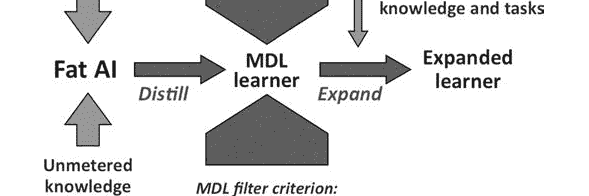

图6.1 MDL蒸馏的示意结构，用于生成（然后扩展）紧凑的通用学习系统。


图6.2 偶然的语言信息。

类似的评论也适用于构成大多数学术领域（如生物科学）内容主体的历史偶然知识体系，以及依赖于物理参数（如电子质量）的知识（如化学知识）。一个MDL学习器必然会（尽管可能是隐含地）保留的知识种类，想必属于表6.2中称为“形式科学”的学科范围。从婴儿成长为教授的过程表明，非特定先验和通用机制为开放式学习提供了充分的基础。

鉴于已经省略了一部分偶然信息，对信息输入的适当约束可以阻止其后续获取。然而，判断特定知识计量政策所产生的约束，不仅需要考虑直接知识，还需要考虑推断性知识。推理的界限有时会很清晰，但在考虑非正式世界知识的样本时，例如，推断性知识的范围可能极难判断。

## 表6.2

## 与广泛不同任务相关的学科

1. 人文学科
1.1 人类历史
1.2 语言学
1.3 文学
1.4 艺术
1.5 哲学
1.6 宗教

2. 社会科学
2.1 人类学
2.2 考古学
2.3 区域研究
2.4 文化...
2.5 经济学
2.6 性别研究
2.7 地理学
2.8 政治学
2.9 心理学
2.10 社会学

3. 自然科学
3.1 生物学
3.2 化学
3.3 地球科学
3.4 物理学
3.5 空间科学

4. 形式科学
4.1 数学
4.2 计算机科学
4.3 逻辑学
4.4 统计学
4.5 系统科学

5. 专业学科
5.1 农业
5.2 建筑...
5.3 商业
5.4 神学
5.5 教育学
5.6 工程
5.7 环境...
5.8 家庭...
5.9 人类身体...
5.10 新闻...
5.11 法律
5.12 图书馆...
5.13 医学
5.14 军事科学
5.15 公共管理
5.16 社会工作
5.17 交通运输

*来源：维基百科，“学科大纲”*


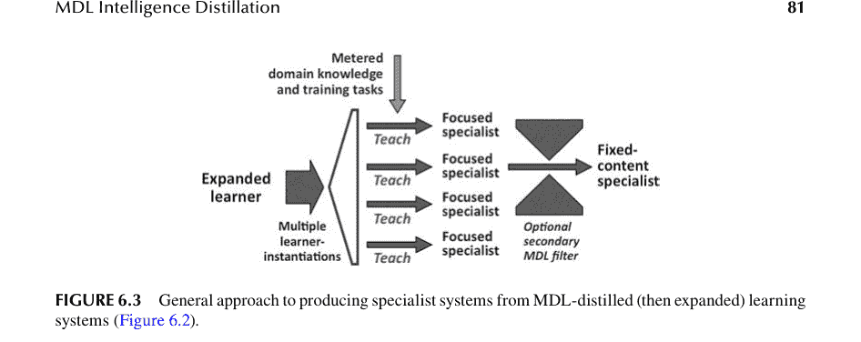

在某些领域，任务会携带关于外部世界看似无关方面的潜在重要信息。然而，任务流带来的信息不必是累积的，因为问题求解系统不必从之前的实例（例如，检查点）中传递信息。一种更宽松的策略将能够以任务产品的规范表示形式实现累积学习，例如数学定理、数字电路或新型机械配置——换句话说，是任务相关知识的紧凑表示。

## 专门化与组合

窄专业人员通常只解决问题的部分内容，单独使用时其应用范围受到严重限制。因此，将狭窄领域的专家组合起来构建模块化系统是自然的做法，这些系统虽然仍然是专门化的，但具有更广泛的实用性。

构建广泛的问题解决能力以专家基础为依托有着广泛先例，例如：

- 结合视觉、听觉和运动皮层的神经系统。
- 由多样化的人类专家组成的工程团队。
- 具有广泛分工和知识的市场经济。
- 由模块化组件组成的复杂软件架构。

正如这些例子所暗示的，由多样化专家组成的系统可以实现极其广泛的能力。然而，在人工智能安全背景下，这一潜力凸显了将安全组件组合起来构建有风险系统的可能性。因此，尽管对潜在超智能系统的系统性探索可以从研究实现专门化组件的方法开始，随后必须转向关于涌现特性、安全性和风险的问题，不仅涉及一系列领域和任务，还涉及替代模块化架构的背景。

## 实现专门化的手段与挑战

在某些领域，知识计量可以对潜在的跨领域推理知识设定明确的约束；在其他领域，潜在的跨领域推理可能广泛且难以预测。然而，在考虑潜在推理范围时，重要的是要注意，专家系统的学习能力可以通过二次（教学后）蒸馏来限制，从而产生非学习系统，并且，正如上文所述，累积的任务相关学习可以直接通过检查点/重启策略受到限制。

除对知识本身的约束外，专家人工智能还可以通过蒸馏指标进一步塑造和约束，这些指标针对特定领域的任务流优化资源/性能权衡（从而限制其他功能的作用范围），以及通过固定接口输入任务

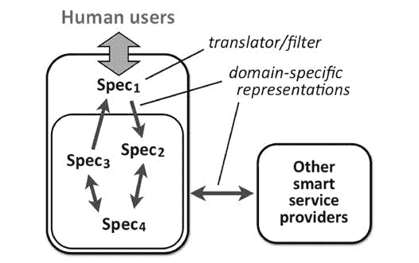

图 6.4 由用户界面专家翻译和过滤的链接专家系统示意架构；另见图 6.5。

描述并输出以特定领域表示形式的结果（例如，数学表达式、物理工程规范）——实际上是服务 API。

正如应用于知识体的推理一样，有时很难判断任务性能优化、任务流控制和特定领域 API 可以诱导的塑造和专门化程度。这些技术增强了一套丰富的工具，引发了关于专门化、安全性和风险的广泛问题，这些问题存在于具体领域、任务和专家支持的系统架构的背景下。

## 模块化专家架构

图 6.2 说明了将蒸馏专家组合起来实现更通用能力的系统的一种通用方案（图 6.4）。

请注意，人类用户与领域专家之间通信的中介任务可能由接口通信专家执行，该专家使用户能够通过在自然语言的特定领域子集中的讨论（可能辅以交互式图形）传达和澄清任务描述，同时与由领域专家组成的系统交换任务特定表示。将任务分解为更窄的子任务本身就是一种专业技能，正如将结果翻译成人类用户可理解的形式一样。

所有这些专家中的任何一个或全部都可以通过以固定初始状态的系统启动每个任务，使其无法进行长期累积学习。这样做是相当自然的：避免任务到任务之间对系统内容的修改具有确保一致行为的优点，这既可以是良好的工程实践，也可以有助于调试。

附录针对工程设计这一重要案例给出了模块化专家组合的更具体示例（图 6.5）。

## 前景与研究方向

智能蒸馏、知识计量、聚焦专家、检查点/重启和模块化组合是具有多种潜在实现和联合应用的通用控制措施。这些概念，无论单独考虑还是整体考虑，都不仅引发关于潜在范围、实现和应用的问题，还引发关于有效方法论的问题，以便在通往超智能的道路上对可能的关键决策进行探索。

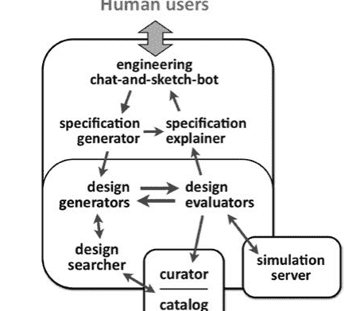

图 6.5 蒸馏专家组合以实现具有广泛工程能力范围的系统。

## Some Open Questions*

“最小描述长度”应如何解释？就实际目的而言，用图灵机来描述并不合适；相反，描述可以用高级语言或可执行规范来表达，并且可能包含从给定库中选择的打包不透明算法，从而将许多算法描述简化为数组索引。请注意，涉及资源约束、课程内容以及“学会学习”这一弹性概念的一系列考虑，共同与制定合适的描述长度度量相关。

此外，我们如何建模人工智能风险和控制措施依赖关系？如果可以应用多样化技术来降低强主体性风险的各个方面，我们如何建模通过多种技术实现的风险降低？哪些控制措施可以建模为概率的、独立的和乘法的？单独应用时哪些较弱，组合时却很强大？哪些共享共同的失效模式？

在此框架下，危险主体性的阈值是什么？什么标志着低风险人工智能工具与高风险人工智能代理之间的边界？何时知识库的推理可能产生意外的知识，甚至意外的能力？可以确信被视为安全的区域有多广？

超智能安全应用的前景提出了进一步的开放性问题：

- 我们如何利用超智能定理证明器？
- 专门化的超智能系统可以回答什么问题？
- 超智能辅助能否帮助我们解决人工智能价值问题？
- 我们能否在不被信任的超智能系统之间构建多边博弈，以获得强人工智能主体性问题的可信解决方案？

* 以及一个术语问题：“‘超智能’应如何定义？” 蒸馏学习者概念强调了学习与能力之间的关键区别。婴儿缺乏成人能力，但由于其学习能力而被认为是有智能的。因此，如本文所用，“超智能”一词既指超人类学习能力，也指由此产生的超人类智力能力；因此，使用该术语并不意味着任何特定系统具有任何特定能力，无论是人类还是其他。这与 I. J. Good 在 1965 年对超智能机器的定义形成对比，即“一种机器，其智力活动可以远远超过任何再聪明的人类”（着重强调）。超人类学习和超人类能力必须严格区分。


### 表 6.3：技术主题和考虑因素的范围

| 类别 | 项目 |
|---|---|
| 潜在的 AI 阈值问题 | • 监控新兴能力<br>• 检查点/重启的应用<br>• 迭代蒸馏的应用<br>• 次级领域特定蒸馏 |
| 蒸馏过程和指标 | • 迭代蒸馏的应用<br>• 次级领域特定蒸馏 |
| 领域与课程 | • 通用与专业化课程<br>• 教学与数据库加载 |
| 知识划分 | • 领域与分区<br>• 知识范围模糊性 |
| 专家架构 | • 能力分解<br>• 模块化组合模式 |
| 信息接口设计 | • 人机接口过滤<br>• 内部接口监控 |
| 应用特定风险 | • 世界交互式机器人<br>• 互联网访问与交互 |
| 代理风险 | • 风险代理的边界<br>• 风险代理的安全组合 |

表 6.3 概述了需要进一步探索的技术主题样本。这些主题从 AI 开发期间监控能力的技术，到具体的 AI 控制措施及其适用范围不等。

转向另一类问题，表 6.4 概述了与潜在 AI 发展路径相关的各种考虑因素，特别是预计在正在进行的研究和开发项目中会出现的关键问题，包括实施替代保障政策所产生的潜在成本、不确定性、限制和延迟。本文概述的临时 AI 安全方法表明，有可能制定出与现有研究实践相一致的切实可行建议——特别是将学习能力与学习内容分离的方法——同时提供识别通往一系列超智能 AI 技术回报应用的低风险路径的潜力。

转向 AI 风险研究，关于过渡性 AI 风险管理的研究可能有助于弥合差距，不仅在实际风险控制技术方面（例如，定义参考问题情境的准备滞后，章节“过渡性 AI 安全：应对困难案例”），而且在风险导向和开发导向的 AI 研究社区之间。这些社区今天已有大量接触，但它们之间的桥梁或许可以得到加强。

### 表 6.4：AI 开发研究考虑因素的范围

| 类别 | 项目 |
|---|---|
| 当前 AI 研究实践 | • 评估当前实践<br>• 蒸馏与良好科学<br>• 评估当前应用<br>• 风险 AI 代理的前兆 |
| 预期经济问题 | • 降低安全保障不确定性<br>• 最小化安全保障成本<br>• 最小化安全保障延迟<br>• 促成安全应用 |

### 表 6.5：AI 安全研究考虑因素的范围

| 在 AI 研究议程中弥合差距 | 应对长期目标 |
|---|---|
| • 近期与长期问题<br>• 具体与抽象问题<br>• 应用与风险研究<br><br>**扩大对风险研究的支持**<br>• 吸引新研究人员<br>• 解决更广泛的问题<br>• 激励更广泛的资助者 | • 丰富概念宇宙<br>• 寻求过渡路径<br>• 寻求完整解决方案的使能因素 |

风险研究聚焦于超智能 AI 代理带来的未解问题，其本质上是抽象且长期的，因此对当今 AI 开发者关心的事项几乎没有可操作的启示。相比之下，对过渡性 AI 安全策略的探究聚焦于探索当今研究目标与长期问题之间的地带；它可以提供与近期问题相关的建议，并且或许可以帮助我们重新构建和重新表述关于长期 AI 风险控制研究的情境。

## 摘要

在熟悉且具有挑战性的参考问题情境中，AI 技术已达到基于不透明、难以理解的 AI 系统进行快速递归改进的阈值，而经济及其他压力确保新兴超智能在强 AI 代理问题得到了解并可实施之前就被应用于实际问题。

为应对这一潜在情境，过渡性 AI 风险降低技术的一个关键目标是在最小化 AI 代理风险的同时实现超智能的应用。在过渡性 AI 风险管理能够在提供对强大智能资源的安全访问的同时推迟这些风险的程度上，它可以通过以下几种方式有助于解决更根本的问题：为进一步研究争取时间、以具体经验指导研究，以及或许让我们能够利用超智能问题求解器来帮助我们解决超智能代理问题。

为应对参考问题情境中的风险，超智能 AI 改进能力可以应用于生产（蒸馏）最简单的通用学习者的任务，通过合适的最小描述长度度量来定义简单性。通过适当协议开发的 MDL 蒸馏学习者可以高度确信地认为其在与成功执行一组标准学习任务直接无关的领域缺乏显著的领域知识。

关于仍（按保守假设）不透明的 AI 系统内容的不确定性，可以通过训练多个 MDL 蒸馏学习者实例来约束，这些实例具有经过审核的、聚焦的知识，构成不同专业领域的课程。二次蒸馏可以进一步将保留的知识缩小到后续领域特定但在质量上超智能任务性能所需的要素；作为进一步的知识计量措施，检查点/重启协议可以阻止来自后续任务流的累积学习。

最后，狭窄领域专业化的主要局限性可以通过将狭窄能力组合形成更全面的系统来解决。合适的架构可以使系统处理包括与人类用户通信的问题，同时限制对世界一般信息的纳入。[content]
### 表 6.3：技术主题和考虑因素的范围

| 类别 | 项目 |
|---|---|
| 潜在的 AI 阈值问题 | • 监控新兴能力<br>• 检查点/重启的应用<br>• 迭代蒸馏的应用<br>• 次级领域特定蒸馏 |
| 蒸馏过程和指标 | • 迭代蒸馏的应用<br>• 次级领域特定蒸馏 |
| 领域与课程 | • 通用与专业化课程<br>• 教学与数据库加载 |
| 知识划分 | • 领域与分区<br>• 知识范围模糊性 |
| 专家架构 | • 能力分解<br>• 模块化组合模式 |
| 信息接口设计 | • 人机接口过滤<br>• 内部接口监控 |
| 应用特定风险 | • 世界交互式机器人<br>• 互联网访问与交互 |
| 代理风险 | • 风险代理的边界<br>• 风险代理的安全组合 |

表 6.3 概述了需要进一步探索的技术主题样本。这些主题从 AI 开发期间监控能力的技术，到具体的 AI 控制措施及其适用范围不等。

转向另一类问题，表 6.4 概述了与潜在 AI 发展路径相关的各种考虑因素，特别是预计在正在进行的研究和开发项目中会出现的关键问题，包括实施替代保障政策所产生的潜在成本、不确定性、限制和延迟。本文概述的临时 AI 安全方法表明，有可能制定出与现有研究实践相一致的切实可行建议——特别是将学习能力与学习内容分离的方法——同时提供识别通往一系列超智能 AI 技术回报应用的低风险路径的潜力。

转向 AI 风险研究，关于过渡性 AI 风险管理的研究可能有助于弥合差距，不仅在实际风险控制技术方面（例如，定义参考问题情境的准备滞后，章节“过渡性 AI 安全：应对困难案例”），而且在风险导向和开发导向的 AI 研究社区之间。这些社区今天已有大量接触，但它们之间的桥梁或许可以得到加强。

### 表 6.4：AI 开发研究考虑因素的范围

| 类别 | 项目 |
|---|---|
| 当前 AI 研究实践 | • 评估当前实践<br>• 蒸馏与良好科学<br>• 评估当前应用<br>• 风险 AI 代理的前兆 |
| 预期经济问题 | • 降低安全保障不确定性<br>• 最小化安全保障成本<br>• 最小化安全保障延迟<br>• 促成安全应用 |

### 表 6.5：AI 安全研究考虑因素的范围

| 在 AI 研究议程中弥合差距 | 应对长期目标 |
|---|---|
| • 近期与长期问题<br>• 具体与抽象问题<br>• 应用与风险研究<br><br>**扩大对风险研究的支持**<br>• 吸引新研究人员<br>• 解决更广泛的问题<br>• 激励更广泛的资助者 | • 丰富概念宇宙<br>• 寻求过渡路径<br>• 寻求完整解决方案的使能因素 |

风险研究聚焦于超智能 AI 代理带来的未解问题，其本质上是抽象且长期的，因此对当今 AI 开发者关心的事项几乎没有可操作的启示。相比之下，对过渡性 AI 安全策略的探究聚焦于探索当今研究目标与长期问题之间的地带；它可以提供与近期问题相关的建议，并且或许可以帮助我们重新构建和重新表述关于长期 AI 风险控制研究的情境。

## 摘要

在熟悉且具有挑战性的参考问题情境中，AI 技术已达到基于不透明、难以理解的 AI 系统进行快速递归改进的阈值，而经济及其他压力确保新兴超智能在强 AI 代理问题得到了解并可实施之前就被应用于实际问题。

为应对这一潜在情境，过渡性 AI 风险降低技术的一个关键目标是在最小化 AI 代理风险的同时实现超智能的应用。在过渡性 AI 风险管理能够在提供对强大智能资源的安全访问的同时推迟这些风险的程度上，它可以通过以下几种方式有助于解决更根本的问题：为进一步研究争取时间、以具体经验指导研究，以及或许让我们能够利用超智能问题求解器来帮助我们解决超智能代理问题。

为应对参考问题情境中的风险，超智能 AI 改进能力可以应用于生产（蒸馏）最简单的通用学习者的任务，通过合适的最小描述长度度量来定义简单性。通过适当协议开发的 MDL 蒸馏学习者可以高度确信地认为其在与成功执行一组标准学习任务直接无关的领域缺乏显著的领域知识。

关于仍（按保守假设）不透明的 AI 系统内容的不确定性，可以通过训练多个 MDL 蒸馏学习者实例来约束，这些实例具有经过审核的、聚焦的知识，构成不同专业领域的课程。二次蒸馏可以进一步将保留的知识缩小到后续领域特定但在质量上超智能任务性能所需的要素；作为进一步的知识计量措施，检查点/重启协议可以阻止来自后续任务流的累积学习。

最后，狭窄领域专业化的主要局限性可以通过将狭窄能力组合形成更全面的系统来解决。合适的架构可以使系统处理包括与人类用户通信的问题，同时限制对世界一般信息的纳入。[content]
### 表 6.3：技术主题和考虑因素的范围

| 类别 | 项目 |
|---|---|
| 潜在的 AI 阈值问题 | • 监控新兴能力<br>• 检查点/重启的应用<br>• 迭代蒸馏的应用<br>• 次级领域特定蒸馏 |
| 蒸馏过程和指标 | • 迭代蒸馏的应用<br>• 次级领域特定蒸馏 |
| 领域与课程 | • 通用与专业化课程<br>• 教学与数据库加载 |
| 知识划分 | • 领域与分区<br>• 知识范围模糊性 |
| 专家架构 | • 能力分解<br>• 模块化组合模式 |
| 信息接口设计 | • 人机接口过滤<br>• 内部接口监控 |
| 应用特定风险 | • 世界交互式机器人<br>• 互联网访问与交互 |
| 代理风险 | • 风险代理的边界<br>• 风险代理的安全组合 |

表 6.3 概述了需要进一步探索的技术主题样本。这些主题从 AI 开发期间监控能力的技术，到具体的 AI 控制措施及其适用范围不等。

转向另一类问题，表 6.4 概述了与潜在 AI 发展路径相关的各种考虑因素，特别是预计在正在进行的研究和开发项目中会出现的关键问题，包括实施替代保障政策所产生的潜在成本、不确定性、限制和延迟。本文概述的临时 AI 安全方法表明，有可能制定出与现有研究实践相一致的切实可行建议——特别是将学习能力与学习内容分离的方法——同时提供识别通往一系列超智能 AI 技术回报应用的低风险路径的潜力。

转向 AI 风险研究，关于过渡性 AI 风险管理的研

## A.1 人机交互子系统

在此构想中，人机交互子系统由两层专家组成：外向部分是一个“对话与绘图机器人”，它充当智能、交互式的人机界面，在领域相关语言和图表方面具有联合能力。其知识内容针对工程领域、用户语言、偏好设置等进行了专门化。chat-and-sketch-bot 的内向接口生成带注释的图表、性能标准表等。

这些图表、表格等被传递给“规范生成器”，它生成工程任务的正式、实质上是物理性的描述；逆向的“解释生成器”将物理描述翻译成外层专家可以向用户展示的形式。在迭代任务规范中，解释生成器可能会报告规范生成器标记为模糊、不一致或无法满足的需求。

这个多组件的人机交互子系统本身在工程任务中不起作用：系统的工程能力取决于图 6.5 中内部框的内容。

## A.2 专门工程子系统

工程任务的问题求解器可以分解为候选设计生成器和候选设计评估器；后者组件根据物理约束、标准和性能指标对设计进行测试和评分。

图 6.5 在此抽象层级上描述了一个系统，包括生成过程可以利用先前设计问题解决方案目录的潜力，以及评估过程可以雇用物理建模和仿真方面的外部专家，并且可以不时地将设计传输给目录策展人。策展人存储并索引符合新颖性和性能标准的设计。 （请注意，以规范化、参数化、MDL 表示形式存储设计不仅可以减少其信息含量，而且通常会扩展其应用的普遍性并促进搜索。）

启用目录介导的设计存储和检索可以实现一种有效但领域特定的累积学习形式。实际上，目录介导的存储和检索允许系统学习和共享不断增长的（临时）工程设计的 if-then 规则集；或者，存储和查找可以被视为一种记忆化形式。

## A.3 系统架构

图 6.5 在高层次的抽象和聚合上描述了工程系统；实际上，工程系统将作为更细粒度的子系统网络来实现。在工程中，形式追随功能，既适用于设计产品，也适用于设计过程；将工程系统过程和架构模板化为工程组织中任务专业化的熟悉模式是自然的。

工程中的任务组织（对于简单或重复任务除外）涉及自上而下、层级地将系统需求分解为子系统需求，以及（在较低层级）将设计任务分解为光学、结构、电子等专业。功能上，该组织中的每个关系都意味着任务和候选解决方案的领域特定表示的迭代、双向交换，因为迭代设计生成和评估是工程设计任务的特征。

关于基于 AI 的工程系统的潜在架构和应用还可以说很多，但上述描述传达了任务结构、专业化与学习之间抽象关系的概念。

工程中专家角色的性质可能更具体地说明 MDL 学习者如何通过用专注的领域知识和任务指导学习者实例，然后进行领域特定的二次蒸馏来生产专家。

## A.4 安全考虑与泛化

考虑到上面概述的架构，似乎有充分理由认为，智能蒸馏、专业化和架构模块化技术可以使一系列在超智能水平上运行的工程系统得到安全开发和应用，即在不产生涉及强大 AI 代理问题的重大风险的情况下使用。

对微妙 AI 风险机制的行家会认识到，严格按照上述模板开发和应用的系统尽管如此仍可能存在不可接受的内在风险：手段-目的分析模式形成一个连续体，从抽象角度看，该连续体既包含电路设计也包含战略规划。

同样地，探索超智能工程系统的泛化可能是有益的，进行对潜在架构、应用、风险和风险对策的更深入分析。利用专家问题解决架构的策略有望在广泛的 AI 任务中泛化，而理解这些策略的范围可能有助于解决涉及超智能问题解决能力安全应用的相应广泛问题。

# 7 价值学习问题

Nate Soares

## 目录

- 引言........................................................................89
- 有价值的目标无法直接指定................................................90
- 归纳价值学习........................................................................92
- 可纠正性........................................................................92
- 本体识别........................................................................93
- 模糊性识别........................................................................94
- 意图建模........................................................................94
- 志向外推........................................................................95
- 讨论........................................................................96
- 参考文献........................................................................97

## 引言

标准 AI 安全和伦理文本，例如 Weld 和 Etzioni (1994) 或 Anderson 和 Anderson (2011)，通常关注具有推理能力的自主系统，这些能力与人类互补而非严格优于人类。相对较少关注未来可能“超智能”的 AI 系统，Bostrom (2014) 的意义上，即系统“在几乎每个领域，包括科学创造力、一般智慧和社会技能方面，都比最好的人类大脑聪明得多”。我们的讨论将更侧重于设计稳健且有益的超越人类智能 AI 系统的方法和框架，同时搁置此类系统是否具有自身道德地位的问题。

超越人类智能的 AI 系统可能会带来许多新的安全挑战。首先，超越人类智能系统的不良行为可能产生更大、更持久的后果；一个反社会的成年人比反社会的儿童更危险，即使成年人身体虚弱如儿童。低智能系统可以在多次迭代中进行测试和修补，而 Bostrom 认为，即使是首个超智能系统中的微小错误也可能导致灭绝级后果（Bostrom 2014）。此类系统的可能发展提高了 AI 安全工作的赌注。

其次，能够在认知上严格超越人类的系统从融入现有经济和社区中获得的好处较少。Hall (2007) 认为：

> 比较优势的经济法则指出，不同能力个体之间的合作仍然互利。[...] 换句话说，即使 AI 的生产力变得比我们高得多，对它们来说与我们交易仍然有利，对我们来说与它们交易也有利。

然而，正如 Benson-Tilsen 和 Soares (2016) 所指出的，理性交易预设代理人期望从交易中获得的收益超过从胁迫中获得的收益。非人类物种在人类方面具有各种“比较优势”，但人类通常通过武力剥削非人类。在人类战争和征服的历史中可以观察到类似模式。而能力相似的代理人

各层级有动机妥协、协作和交易，而对他人拥有强大权力优势的智能体则可能有动机直接拿走它们想要的东西。

由此得出的结论是，构建一个由强大自主 AI 系统和人类组成的正常运作社会，要求这些 AI 系统具有亲社会性。这一点看似抽象，但具有重要的实际后果：理性智能体的利益并不会自动一致，尤其是在它们的目标和能力非常不同时。

第三，超人类创造力和适应性系统可能会达到布斯特罗姆（Bostrom，2014，第 8 章）所称的其编程目标的“扭曲实例化”。维纳（Wiener，1960）称之为“魔法师的学徒”问题，源自一个学徒的寓言，他的魔法扫帚遵循指令的字面意思而非其精神。

这里的新颖之处不在于程序可能表现出错误或违反直觉的行为，而在于足够智能以理解自然语言的软件智能体仍可能基于对其程序员意图的误表征来做出决策。超智能智能体偏执地追求看似“愚蠢”的目标的想法听起来可能很奇怪，但它源于布斯特罗姆和尤德科夫斯基（Bostrom and Yudkowsky，2014，第 7 章）的观察，即 AI 能力和目标在逻辑上是独立的。* 人类完全可以理解他们的“设计者”（进化）在性方面有特定的“目标”（繁殖），而不会因此感到被迫放弃避孕。将自己的品味或道德价值观灌输给继承者并非不可能，但也不会自动发生。

最后，布斯特罗姆（2014）指出，超越人类的系统可能在道德推理方面比人类更出色。没有对扭曲实例化与道德进步如何不同的系统性理解，我们如何区分高度智能机器中的道德天才与道德堕落？

鉴于先进 AI 系统可能产生的长期影响，审慎的做法是调查在这些方面是否可能取得早期研究进展。在本文中，我们对几种可能有助于解决上述四个问题的研究方向进行了初步、非正式的调查，首先主张在 AI 智能体中采用间接方法来指定人类价值观。我们描述了一种有前景的间接价值指定方法——价值学习，并考虑了基于建模人类操作者的实际和潜在状态的更间接的方法。

## 有价值的目标无法直接指定

我们上面论证了，如果其价值观被错误指定，高度 capable 的自主系统可能会产生灾难性后果。尽管如此，这仍然为以下可能性留下了空间：指定正确的价值观很容易，或者（更有可能的是）它除了构建超越人类智能的 AI 系统的挑战之外，并没有特殊困难。

一些研究人员表达了这样的直觉：某个简单的编程目标就足以使超智能系统稳健地有益。例如，希巴德（Hibbard，2001）建议训练一个简单的学习系统，从面部表情、声音语调和身体语言中识别积极的人类情绪。希巴德随后提出，能力更强得多的机器——甚至可能是超智能机器——可以被编程为执行预测能导致尽可能多“积极人类情绪”的未来的行动，这些情绪由原始的简单学习系统评估。

这一提议在直觉上具有一定的吸引力——难道这样的系统不会总是行动以使人类快乐吗？——直到考虑到魔法师的学徒。我们在谈论“积极人类情绪”时脑海中有特定的联想集合，但简单学习器几乎肯定学会了不同且更简单的概念，例如“与训练数据中积极人类情绪相关的表面特征”。这个更简单的概念几乎肯定不会在其最大值点上包含希巴德认为包含大量积极人类情绪的点。最大值更可能出现在（例如）包含大量微小人形仿真机器人表演积极人类情绪的场景中。因此，根据简单学习器如何对其进行排名采取行动的强大学习系统，很可能花费时间和资源制造仿真机器人，而不是花费时间和资源使人类快乐。事实上，希巴德（2012）本人得出的结论是，他的提议未能排除栩栩如生的快乐人物仿真复制品可能被视为表现出“积极情绪”的可能性。

另一个例子，施密特胡伯（Schmidhuber，2007）提出，创造力、好奇心以及对发现和美的渴望可以通过创建最大化不同简单度量的系统来培养：“创建扩展观察历史并产生先前未知/不可预测但可快速学习算法规律性或可压缩性的行动序列。”

然而，虽然人类创造力和发现与压缩观察的行为密切相关是相当合理的，但遵循施密特胡伯目标的智能体不会以直觉上好奇和创造性的方式表现。一个简单的方法来满足施密特胡伯的期望，例如，是占用资源并构建生成密码学秘密的人工制品，然后向智能体呈现一个由高度规律数据编码的长而复杂的观察序列，然后向智能体揭示秘密，从而使智能体对其过去的感官数据获得巨大的压缩。遵循施密特胡伯目标的智能体更可能构建这种形式的人工制品，而不是追求任何类似人类创造力的东西。系统可能不会采取这一特定行动，但它会采取产生至少同等程度感官数据压缩的行动，因此系统不太可能具有亲社会性。

构建一个执行在人类中与期望行为相关的某事的智能体，并不一定会产生像人类一样行动的系统。我们从这些案例中得出的一般教训是，大多数简单指定的目标都无法捕捉现实世界人类价值观和目标的所有情境复杂性（Yudkowsky 2011）。道德心理学家和道德哲学家并非因为错过了显而易见的东西才陷入数十年甚至数百年的关于伦理正确编码的争论。相反，这类争论之所以持续存在，仅仅是因为道德很复杂。人们想要很多东西，而且方式非常具体，他们的欲望是情境敏感的。

想象一个简化的可能性状态空间，其变化体现在数量（存在多少快乐人形物体）、平均快乐人形物体的大小以及快乐人形物体的平均道德价值。人类的经验发生在该空间的一个小区域，其中几乎所有发出看起来像快乐的人形物体都是约 2 米大小、具有道德权重的人类。但数量轴上的最高分数与小尺寸同时出现，而能模仿情绪外在表现的最小系统具有较低的道德价值。

在线性规划中，有一个定理，即目标函数的最大值出现在空间的顶点上。（有时最大值会出现在边上，包括其顶点。）出于直觉类似的原因，目标的最优解往往出现在可能性空间的顶点（或边或超面）上。希巴德的目标不包含关于大小或道德价值的任何信息，因此追求此目标的智能体仅在它们与推动最大数量超面有关时才考虑大小和道德价值。引用拉塞尔（Russell，2014）的话：

> 一个优化 n 个变量的函数的系统，其中目标依赖于大小为 k < n 的子集，通常会将剩余的无约束变量设置为极值；如果其中一个无约束变量实际上是我们关心的东西，所找到的解可能高度不可取。

魔法师的学徒问题出现在系统的编程目标不包含关于观察可能变化的所有相关维度的信息时。智能体已被引导向可能性空间的错误超面。*


当面对这种类型的失败时，许多人会冲动地修补有缺陷的目标。如果希伯德（Hibbard）的系统会制造微笑的电子动画人偶，那么就设法要求情绪必须来自真实人类；如果系统随后为了让人类微笑而让他们陷入药物所致的昏睡状态，就禁止它使用药物；如此类推。

这样的约束切断了系统获得更高计数的特定途径，但它们没有解决根本问题——系统仍在最大化计数。如果一条因果路径被禁止，那么系统将沿着最近的非禁止因果路径前进——例如，通过机械方式操纵人类大脑的愉悦中枢。修补每一个目标并不可行；同样，修补所有能想到的目标并假设不存在不可预见的反常实现，也并不安全。

直觉上，我们希望将高度先进系统的智能引导到为我们解决部分这类问题上来，并且我们希望这样的系统能够关注我们可能的意图，即使我们对自己意图的正式和非正式表述都存在缺陷。然而，操作者的“意图”这一概念不太可能适用于清晰的形式化规范。那么，通过什么方法，才能构造出一个智能机器，使其可靠地学会应该重视什么，并按操作者的意图行事呢？

## 归纳价值学习

要手工为“在视频流中识别猫”正确指定一个形式化标准，即便不是不可能，也是非常困难的。然而，这并不意味着识别猫毫无希望；而是意味着需要一定程度的间接性。可以构建并训练一个图像识别系统来识别猫。我们提议，价值学习问题也应通过类似的间接方式来加以处理。

通过带标签的训练数据进行归纳价值学习，会引发许多困难。视觉识别系统对图像进行分类；归纳价值学习系统对结果进行分类。什么是结果？价值学习数据集会以什么格式出现？

设想一个高度智能的系统，它使用大量数据来构建其所在宇宙的因果模型。再设想这个世界模型可用于推理智能体可用行动的可能结果，系统有某种对结果进行评分的方法，并且它会执行导致评分最高结果的行动。为了让系统归纳地学会重视什么，系统必须被设计成：当进行某些“训练”观察时（或对其世界模型进行特殊标记的更新时），从观察或更新中提取的带标签训练数据会改变系统对各种潜在结果进行排序的方法。

这个简单模型凸显了一个核心关注点，以及与归纳价值学习相关的两个开放问题。

## 可修正性

设想智能体的某些可用行动允许它修改自身，并且它目前对包含大量仿人电子动画复制品的结果赋予高效用。根据系统的世界模型，以下情况可能同时成立：（1）如果收到更多训练数据，那些高评分结果的评分将被下调；（2）评分调整后，系统所达成的结果中廉价电子动画人偶将更少；（3）存在一些可用行动，可以移除归纳价值学习框架。

在这种情况下，一个足够强大的系统会倾向于采取禁用其价值学习框架的行动。它不一定认为学习我们价值观的过程是好事，正如人类不一定认可自己所患的心理障碍一样。人们可以尝试构建受保护的代码段来防止价值学习框架被修改，但如果系统在利用漏洞方面比设计者更聪明，这些约束就很难被信任。

一个稳健安全的初始系统需要以这样的方式构建：即使移除价值学习框架的行动是可用的，它们也应获得低评分。索里斯（Soares）和法伦斯坦（Fallenstein，2015）曾以*可修正性*（corrigibility）之名，讨论了一些描述具有这一属性的系统的初步工作，但目前尚无完整的提案。

## 本体识别

一个高度智能的智能体，其世界模型中使用的表征可能会随时间变化。一个完全可信的价值学习系统不仅需要根据价值对潜在结果进行分类，而且即使其对结果空间的理解发生重大变化，也需要持续正确地这样做。

考虑一个程序员，他想训练一个系统去追求一个非常简单的目标：生产钻石。这些程序员拥有物理学的原子模型，他们会根据该训练结果中与另外四个碳原子共价结合的碳原子数量，来生成带标签的训练数据。为了使用这些训练数据，分类算法需要在系统所考虑的潜在结果中识别出原子。在这个玩具示例中，我们可以假设程序员查看初始世界模型的结构，并硬编码一个工具来识别其中的原子。那么，如果系统发展出物理学的原子核模型，其中宇宙的本体现包含原始的质子、中子和电子，而不是原始的原子，会发生什么？系统可能无法在新世界模型中识别出任何碳原子，从而使系统在主导假设中的所有结果之间无差异。它的行动随后将被任何微小的剩余概率所主导，即它处于一个基本碳原子藏在某处的宇宙中。

这显然是不可取的。理想情况下，科学学习者应该能够推断出含有六个质子的原子核才是真正的碳原子，就像人类已经做到的那样。困难在于将这一过程形式化。

为了设计一个根据潜在结果中钻石含量对其进行分类的系统，需要某种机制，在人工智能当前建模的潜在结果中识别训练数据的预期本体。这就是德布朗（de Blanc，2011）提出、索里斯（Soares，2015）进一步讨论的*本体识别*（ontology identification）问题。

这个问题并非机器学习工作的传统焦点。当我们只关心系统形成更好的世界模型时，可以说那些具体细节不那么重要。只要系统的新世界模型比旧世界模型更好地预测数据，那么钻石或原子是否“真正被表征”在任一模型中，这个问题就不具有明显的重要性。然而，当系统需要一致地追求某些结果时，系统的内部动态保持（或改进）其对哪些结果值得追求的表征，这一点就很关键——无论其表征对预测有多大帮助。做出正确选择的问题并不能归结为做出准确预测的问题。

归纳价值学习需要从带价值标签的训练数据中构建一个结果分类器，但它还需要某种方法，在其世界模型所描述的状态或潜在状态中，识别训练数据中标签的所指对象。

这或许可以在归纳价值学习的过程中完成。系统从感觉数据推断因果世界模型的方法，也许可以被重新用于推断被标记内容的描述。如果系统采用了更好的世界模型，它就可以重新解释其训练数据，以重新绑定价值标签。

这看起来是一条有前景的研究路线，但在我们看来，它需要新的洞见才能接近可形式化的程度，更不用说在实践中使用了。特别是，我们怀疑本体识别将需要更好地理解从感觉数据构建多层次世界模型的算法。


## 歧义识别

强化学习可以被视为一种规避价值学习中这些困难的方法。 而不是设计系统去学习哪些结果是可取的，人们会为可取的结果创建一个代理：一个以观测为表述的奖励函数。 通过奖励信号控制奖励，操作者便可以审慎地引导学习者朝向期望的行为。 然而，期望结果的间接代理仍面临许多相同的魔法师学徒困境。 最大化操作者发送奖励信号的频率，与最大化操作者对结果的满意度这一问题是不同的；这些目标在测试环境中可能一致，但在新环境中却可能分歧——例如，一旦学习者有机会操纵和欺骗其操作者，或以其他方式劫持其奖励通道 (Bostrom 2014, chap. 12)。 进一步讨论请参见 Soares (2015)。

实现有价值的现实世界结果的超智能系统可能需要以期望结果来表述的目标，而非以观测来表述的奖励。 如果是这样，那么我们就需要一种可靠的方法来确保系统学习到我们的目标，而非表面上相似的目标。

在训练识别系统时，产生令人满意的训练数据往往是一项困难的任务。 机器学习中有一个经典寓言（例如由 Dreyfus 和 Dreyfus 1992 讲述），讲述一个旨在判断树林图片中是否藏有坦克的算法。 一天拍摄了空旷树林的图片；第二天拍摄了藏有坦克的图片。 分类器以极高的准确率识别出后者集合，并在被保留用于训练的数据部分上测试表现极佳。 然而，该系统在新图像上的表现很差。 原来第一组图片是在晴天拍摄的，而第二组图片是在阴天拍摄的。 分类器并不是在识别坦克；它识别的是图像亮度！

在构建归纳价值学习的训练数据集时，也可能出现同样的错误。 然而在价值学习中，这类错误可能更难察觉且后果更严重。 考虑一个训练集，它成功地代表了现实世界中快乐的人类案例（标记为高评分）和无意义的人类痛苦案例（评分很差）。 从这些数据得出的最简单泛化可能再次是：宣称快乐的人形事物具有极大价值，即使这些是模仿快乐的仿真人偶。 似乎很合理，训练归纳价值学习者的人可能会忽略包含足够多样化的模仿快乐的仿真人偶并标记为低价值的情况。 还有多少其他事后看来显而易见的陷阱隐藏在我们的盲点中？

即使训练集涵盖了我们能想到的所有相关维度，仍可能排除相关维度。 一个稳健安全的价值学习者需要能够识别出没有提供训练数据的、可能相关的新的维度，并在这些模糊性上询问操作者。 这是一种有助于真正解决价值学习问题，而非绕过它的修改。 同时，这也是一种能够利用机器随着人工智能领域发展而增强的能力的修改。

形式化这一想法是一个关键的开放问题。 给定一个根据某种世界模型对结果进行分类的数据集，如何识别出数据集提供的信息很少的维度？ 一种解决该问题的方法是研究人类如何从稀疏数据中学习概念，如 Tenenbaum 等人 (2011) 和 Sotala (2015) 所讨论的。 或者，可能找到某种简洁的标准以更简单的方式识别歧义。 在这两种情况下，进一步的研究都可能富有成效。

## 建模意图

歧义识别问题可能需要超越从训练数据归纳学习价值的方法。 一个对人类有足够精细模型 的智能系统，只要问对问题，可能已经拥有所需的数据来推断人类更可能关心的是快乐外观的人形事物是否有大脑，而非附近的微风。 困难在于设计系统以恰当的方式使用这些信息。

设想一个系统，它从感官数据构建多层次的环境模型并归纳地学习其价值观。 然后可以特别划定模型的一部分为“model of the operator”，定义一些明确的规则，从操作者模型中提取操作者偏好的模型（以可能的结果为表述），并根据操作者偏好的模型调整对各种结果的评级。 这将是一个试图学习并遵循另一智能体意图的系统，而非从标记的训练数据中学习——一种“do what I mean” (DWIM) 架构。

Ng 和 Russell (2000) 的逆向强化学习 (IRL) 技术可以被视为一种 DWIM 方法，其中智能体试图识别并最大化环境中其他智能体的奖励函数。 然而，现有的 IRL 形式化并未涵盖全部问题；人类的偏好不一定能仅以观测来捕捉。 例如，系统在观察到操作者在国际象棋游戏中落败时，不应得出操作者想在国际象棋中落败的结论，即使系统能清楚看到操作者“decided”做出糟糕的走法而非好走法。 或者想象一个人类操作者有一个必须藏匿的朋友。 学习者要么将朋友带到安全处，要么将朋友遗弃在危险地点并利用这样节省的资源改善操作者的生活。 如果系统在两种情况下都报告朋友是安全的，且人类操作者信任系统，那么后者的观察历史可能更受操作者青睐。 然而，如果人们完全了解结果，后者结果肯定不会被大多数人所偏好。

人类偏好复杂、多面且常常自相矛盾。 从人类模型中安全地提取偏好绝非易事。 本体识别问题再次出现：提取偏好并影响结果评级的框架需要对学习者对操作者模型的剧烈变化具有鲁棒性。 “operator model”的特殊情况识别必须在系统从将操作者建模为简单奖励函数，到将操作者建模为由生物细胞构成的、模糊且不断变化的现实一部分——这些细胞由原子构成，原子源于量子场——的过程中得以保留。

DWIM 架构必须避免许多其他危害。 假设系统学习到其操作者模型会影响其结果评级，且系统拥有影响操作者的行动。 操纵操作者使其偏好更容易实现的行为随后可能被高度评级，因为它们导致了高度评级的结果（系统实现了操作者现在容易实现的目标）。 解决这个问题并不像禁止系统影响操作者那样简单；系统为解决某些模糊性而向操作者提出的任何查询都会以某种方式影响操作者。

DWIM 架构在归纳价值学习之上需要显著的额外复杂性：智能体的目标调整学习系统不再简单地对结果进行分类；它还必须建模人类并提取人类对人类建模结果的偏好，并在人类建模的未来结果与系统建模的未来结果之间进行转换。 希望这种复杂性能够换来一个系统，该系统有可能全面直接地覆盖人类价值的复杂性，而无需依赖程序员为每种边缘情况手工编码例外或组合完全正确的训练集。 对逆向强化学习或其他构建令人满意的初始操作者模型方法 的进一步研究，可能是研究 DWIM 架构可行性的一个良好起点。

## 推断意志

DWIM 架构在构建可靠追求“concrete”目标（例如“cure cancer and then await instruction”）的系统时可能足够，但在操作者本身不知道自己意图的更复杂或更精细的目标上可能不足——例如，

“如果我拥有更多知识和更多思考时间，我会想要做什么。” 迄今为止讨论的框架似乎都不足以具体说明像 Rosati（1995）的“理想顾问理论”或 Rawls（1971）的“反思均衡”这样的哲学思想。在这里，即使是使稳健且有益的 AI 系统的“间接”方法也触礁于道德哲学中正在积极争论的问题。

解决规范不确定性的一种可能方法（例如，关于操作员如果更明智或更好的人会想要什么）是构建一个 DWIM 系统，该系统采用人类操作员的模型并将其外推到例如 Rawls 的反思均衡的方向。例如，外推可能会预测操作员如果知道系统所知道的一切，或如果他们考虑了许多可能的道德论证会做出什么决定（Bostrom 2014，第 13 章）。

然而，一个强大的系统在寻找能够使操作员进入反思稳定状态的道德论证（作为完全模拟操作员反思过程的计算捷径）会引入一组新的潜在陷阱。对最具说服力的道德论证进行强大的搜索，这些论证会引发对道德改变的追溯性认可，可能会找到引发精神病性崩溃或宗教皈依的论证。系统应被限制仅搜索“有效”的道德论证，但定义什么构成有效的道德论证本身就是规范不确定性和分歧的一个主要领域。

在此领域中，查询模糊性是困难的。在日常实践中，对聪明且持怀疑态度的 人们具有说服力的论证通常是有效的，但超智能对说服性论证的搜索很可能会发现无效但极具说服力的论证。

今天要识别可行的间接规范性技术方法是很困难的，尽管已有一些初步尝试。Christiano（2014）非正式地提出了一种机制，通过该机制系统或许可以安全地外推其操作员的意志。MacAskill（2014）对“元规范性”进行了详尽的报告，涉及解决规范不确定性困难的许多不同哲学方面。这是一个领域，进一步的哲学研究可能会使人们更清楚如何开始处理相关的长期工程问题。

## 讨论

正如人类智能使我们能够开发控制环境的工具和策略一样，超智能系统也可能开发出比我们更强大的工具和策略，并获得对未来结果相应更大的控制权（Bostrom 2014，第 6 章）。尽管尚不清楚比人类更聪明的系统的发展需要多长时间，或人工智能或其他学科中的哪些方法可能最相关于开发此类系统，但在此领域的早期努力因其重要性和被忽视程度而得到证实。

在本文的引言中，我们讨论了超智能机器潜在发展改变人工智能安全和伦理工作任务的四种不同方式。解决所有这些问题似乎并不容易。旨在成为超智能的人工智能系统的设计需要以 Soares 和 Fallenstein（2015）的意义上是可纠正的，即愿意协助其操作员进行尝试性修正。鉴于我们不能期望任意的理性行为者在面对巨大权力差距时表现出亲社会行为，系统需要某种学习和采用亲社会偏好的方法。如果要避免“魔法师学徒”情景，操作员需要能够稳健地向系统传达其意图的方法。最终，可能需要明确解决规范不确定性的方法。

在实际构建必须这样做的系统之前，系统原则上如何可靠且安全地学习我们的价值观。

## 参考文献

- Anderson, Michael, and Susan Leigh Anderson, eds. 2011. *机器伦理学*. New York: Cambridge University Press.
- Benson-Tilsen, Tsvi, and Nate Soares. 2016. “形式化趋同工具性目标。” In *第 2 届 AAAI-2016 人工智能、伦理与社会国际研讨会*, 62–70. Phoenix, AZ.
- Bostrom, Nick. 2014. *超级智能：路径、危险、策略*. New York: Oxford University Press.
- Bostrom, Nick, and Eliezer Yudkowsky. 2014. “人工智能伦理。” In *剑桥人工智能手册*, edited by Keith Frankish and William M. Ramsey, 316–334. New York: Cambridge University Press.
- Christiano, Paul. 2014. “精确界定‘开明判断’（再版）。” *普通想法* (blog). http://ordinaryideas.wordpress.com/2014/08/27/specifying-enlightened-judgment-precisely-reprise/.
- de Blanc, Peter. 2011. “人工代理价值系统中的本体论危机。” (May 19). arXiv: 1105.3821 [cs.AI].
- Dreyfus, Hubert L., and Stuart E. Dreyfus. 1992. “人工智能专家能做什么和不能做什么。” *AI & Society* 6 (1): 18–26.
- Hall, John Storrs. 2007. *超越人工智能：创造机器的良知*. Amherst, NY: Prometheus Books.
- Hibbard, Bill. 2001. “超智能机器。” *ACM SIGGRAPH 计算机图形学* 35 (1): 13–15. http://www.siggraph.org/publications/newsletter/issues/v35/v35n1.pdf.
- Hibbard, Bill. 2012. *我 2001 年 VisFiles 专栏中的错误*. blog. http://www.ssec.wisc.edu/~billh/g/visfiles_error.html.
- Hume, David. 1739. *人类本性论*. Printed for John Noon, at the White-Hart, near Mercer’s-Chapel, in Cheapside.
- MacAskill, William. 2014. “规范不确定性。” PhD diss., St Anne’s College, University of Oxford. http://ora.ox.ac.uk/objects/uuid:8a8b60af-47cd-4abc-9d29-400136c89c0f.
- Ng, Andrew Y., and Stuart J. Russell. 2000. “逆向强化学习算法。” In *第 17 届国际机器学习会议 (ICML-’00)*, edited by Pat Langley, 663–670. San Francisco: Morgan Kaufmann.
- Rawls, John. 1971. *正义论*. Cambridge, MA: Belknap.
- Rosati, Connie S. 1995. “人、视角与善的完全信息说明。” *伦理学* 105 (2): 296–325.
- Russell, Stuart J. 2014. “关于神话与月光。” *边缘* (blog comment). http://edge.org/conversation/the-myth-of-ai#26015.
- Schmidhuber, Jürgen. 2007. “发现、主观美感、选择性注意、好奇心和创造力的简单算法原理。” In *发现科学：第 10 届国际会议*, edited by Vincent Corruble, Masayuki Takeda, and Einoshin Suzuki, 26–38. *计算机科学讲义 4755*. Berlin: Springer.
- Soares, Nate. 2015. *形式化现实世界模型的两个问题*. Technical Report 2015–3. Berkeley, CA: Machine Intelligence Research Institute. https://intelligence.org/files/RealisticWorldModels.pdf.
- Soares, Nate, and Benja Fallenstein. 2015. *逻辑不确定性下推理的问题*. Technical Report 2015–1. Berkeley, CA: Machine Intelligence Research Institute. https://intelligence.org/files/QuestionsLogicalUncertainty.pdf.
- Sotala, Kaj. 2015. “安全自主人工智能的概念学习。” In *AAAI-2015 人工智能与伦理第 1 届国际研讨会*. Austin, TX.
- Tenenbaum, Joshua B., Charles Kemp, Thomas L. Griffiths, and Noah D. Goodman. 2011. “如何培养心智：统计、结构与抽象。” *科学* 331 (6022): 1279–1285.
- Weld, Daniel, and Oren Etzioni. 1994. “机器人第一法则（号召行动）。” In *第 12 届全国人工智能会议 (AAAI-1994)*, edited by Barbara Hayes-Roth and Richard E. Korf, 1042–1047. Menlo Park, CA: AAAI Press.
- Wiener, Norbert. 1960. “自动化的一些道德和技术后果。” *科学* 131 (3410): 1355–1358.
- Yudkowsky, Eliezer. 2011. “友好人工智能中的复杂价值系统。” In *通用人工智能：第 4 届国际会议，AGI 2011*, 388–393. Berlin: Springer.


Taylor & Francis

Taylor & Francis Group

http://taylorandfrancis.com


# 8 物理世界中的对抗样本

Alexey Kurakin、Ian J. Goodfellow 和 Samy Bengio

## 目录
- 引言....................................................................................................................99
- 生成对抗图像的方法................................................................................................101
  - 快速方法...................................................................................................................102
  - 基本迭代方法................................................................................................................102
  - 迭代最不可能类别方法................................................................................................102
  - 对抗样本生成方法的比较...................................................................103
- 对抗样本的照片................................................................................................................104
  - 对抗图像的破坏率................................................................................................104
  - 实验设置...................................................................................................................104
  - 对抗图像照片的实验结果...........................................................................106
  - 物理世界中黑盒对抗攻击的演示...................................................108
- 人工图像变换................................................................................................................108
- 结论....................................................................................................................108
- 附录....................................................................................................................109
- 参考文献....................................................................................................................112

## 引言

机器学习和深度神经网络的最新进展使研究人员能够解决多个重要的实际问题，如图像、视频、文本分类等（Bahdanau et al., 2015; Hinton et al., 2012; Krizhevsky et al., 2012）。

然而，机器学习模型常常容易受到旨在导致错误分类的对抗性输入操纵的影响（Dalvi et al., 2004）。特别是，神经网络和许多其他类别的机器学习模型极易受到基于测试时对模型输入进行微小修改的攻击（Biggio et al., 2013; Goodfellow et al., 2014; Papernot et al., 2016a; Szegedy et al., 2014）。

问题可以概括如下。假设有一个机器学习系统 M 和输入样本 C，我们称之为干净样本。假设样本 C 被机器学习系统正确分类，即 M(C) = y_true。我们可以构造一个对抗样本 A，它在感知上与 C 无法区分，但被错误分类，即 M(A) ≠ y_true。这些对抗样本被错误分类的频率远高于被噪声扰动的样本，即使噪声的幅度远大于对抗扰动的幅度（Szegedy et al., 2014）。

对抗样本对实际的机器学习应用构成了潜在的安全威胁。特别是，Szegedy et al. (2014) 表明，针对模型 M1 设计为被错误分类的对抗样本，通常也会被模型 M2 错误分类。这种对抗样本的可迁移性意味着，无需访问底层模型，就可以生成对抗样本并对机器学习系统执行错误分类攻击。Papernot et al. (2016a,b) 在现实场景中演示了此类攻击。

然而，此前所有关于神经网络对抗样本的工作都使用了一种威胁模型，其中攻击者可以直接向机器学习模型提供输入。在这项工作之前，人们并不知道如果对抗样本在物理世界中构造并通过相机观察，它们是否仍然会被错误分类。

这种威胁模型可以描述一些完全在计算机内部发生的攻击场景，例如逃避垃圾邮件过滤器或恶意软件检测器（Biggio et al., 2013; Nelson et al.）。然而，许多实际的机器学习系统在物理世界中运行。可能的例子包括但不限于：通过相机和其他传感器感知世界的机器人、视频监控系统，以及用于图像或声音分类的移动应用。在这些场景中，攻击者无法依赖对输入数据进行细粒度的逐像素修改的能力。

因此产生了以下问题：对于在物理世界中运行并通过各种传感器而非数字表示来感知数据的机器学习系统，是否仍然可以构造对抗样本并执行对抗攻击？

之前的一些工作已经解决了针对机器学习系统的物理攻击问题，但并非通过非常微小的输入扰动来欺骗神经网络的场景。例如，Carlini et al. (2016) 展示了一种攻击，可以创建手机识别为包含可理解语音命令的音频输入，但人类听到的却是无法理解的声音。基于照片的人脸识别系统容易受到重放攻击，即向相机呈现授权用户脸部先前拍摄的图像，而不是真实人脸（Smith et al., 2015）。对抗样本原则上可以应用于这两个物理领域中的任何一个。针对语音命令领域的对抗样本可以是一段对人类观察者来说似乎无害的录音（例如一首歌），但其中包含机器学习算法可识别的语音命令。针对人脸识别领域的对抗样本可能包括施加在人脸上的非常微妙的标记，使人类观察者能够正确识别其身份，但机器学习系统会将其识别为另一个人。与本文最相似的工作是 Sharif et al. (2016)，该工作在我们之后公开发表，但更早提交给会议。Sharif et al. (2016) 也将对抗样本图像打印在纸上，并证明了打印后的图像在被拍摄时能够欺骗图像识别系统。他们的工作与我们的主要区别在于：(1) 我们在大多数实验中使用了一种廉价的闭式攻击，而 Sharif et al. (2016) 使用了一种基于优化算法的更昂贵的攻击；(2) 我们没有特别努力修改我们的对抗样本以提高它们在打印和拍摄过程中存活的几率。我们只是做出了一个科学观察，即许多对抗样本确实可以在没有任何干预的情况下存活于这一过程。Sharif et al. (2016) 引入了额外的特性，以使其攻击在针对人脸识别系统的实际攻击中尽可能有效。(3) Sharif et al. (2016) 限制了他们能够修改的像素数量（仅限于眼镜框上的像素），但可以大幅修改这些像素；而我们限制的是能够修改每个像素的量，但可以自由修改所有像素。

为了研究对抗样本在物理世界中的存活程度，我们使用预训练的 ImageNet Inception 分类器（Szegedy et al., 2015）进行了一项实验。我们为该模型生成了对抗样本，然后通过手机摄像头将这些样本输入到分类器中，并测量分类准确率。这是一个简单的物理世界系统，它通过摄像头感知数据，然后运行图像分类。我们发现，即使通过摄像头感知，为原始模型生成的大部分对抗样本仍然被错误分类。*


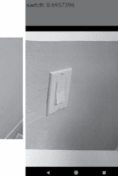


(a) 原始图像

(b) 干净图像

(c) 对抗图像，ε = 8

(d) 对抗图像，ε = 16

图 8.1 使用物理对抗样本对手机图像分类应用进行黑盒攻击（即在无法访问模型的情况下构造攻击）的演示。我们取了一张干净图像(a)，并用它生成具有不同对抗扰动规模 ε 的对抗图像。然后我们打印出干净图像和对抗图像，并使用 TensorFlow Camera Demo 应用对它们进行分类。干净图像(b)经摄像头感知后被正确识别为“开关”，而对抗图像(c)和(d)则被错误分类。另请参阅 https://youtu.be/zQ_uMenoBCk 上的演示视频。(a) 原始图像。(b) 干净图像。(c) 对抗图像，ε = 8。(d) 对抗图像，ε = 16。

令人惊讶的是，我们的攻击方法无需针对摄像头的存在进行任何修改——即便使用最简单的攻击方式，即使用为 Inception 模型制作的对抗样本，也能成功迁移到摄像头与 Inception 的联合体上。因此，我们的结果为那些在构造对抗样本时显式建模摄像头的更专门攻击所能达到的成功率提供了一个下界。

我们结果的一个局限性在于，我们假设了一种威胁模型：攻击者完全了解模型架构和参数值。这主要是为了让我们能在所有实验中使用同一个 Inception v3 模型，而不必设计并训练不同的高性能模型。对抗样本的迁移特性意味着，我们的结果可以轻易扩展到攻击者无法访问模型描述的场景（Goodfellow 等，2014；Papernot 等，2016a；Szegedy 等，2014）。尽管我们没有进行详细实验来研究物理对抗样本的可迁移性，但我们构建了一个简单的手机应用，以演示物理世界中潜在的黑盒对抗攻击，见图 8.1。

为了更好地理解摄像头引起的复杂图像变换如何影响对抗样本的可迁移性，我们进行了一系列附加实验，研究对抗样本在几种特定类型的合成图像变换之间的迁移情况。

本文其余部分的结构如下：在“生成对抗图像的方法”一节中，我们回顾了用于生成对抗样本的不同方法。紧接着的“对抗样本的照片”一节，详细介绍了我们的“物理世界”实验设置和结果。最后，“人工图像变换”一节描述了我们对各种人工图像变换（如改变亮度、对比度等）及其对对抗样本影响的实验。

## 生成对抗图像的方法

本节描述了我们在实验中使用的生成对抗样本的不同方法。需要注意的是，所描述的方法都不保证生成的图像一定会被错误分类。尽管如此，我们仍将所有生成的图像称为“对抗图像”。

在本文的其余部分，我们使用以下记号：

- **X**——一张图像，通常是三维张量（宽 × 高 × 深度）。在本文中，我们假设像素值是 [0, 255] 范围内的整数。
- **y_true**——图像 **X** 的真实类别。
- **J(X, y)**——给定图像 **X** 和类别 **y** 时神经网络的交叉熵代价函数。我们有意在代价函数中省略网络权重（和其他参数）**θ**，因为在本文的上下文中，我们假设它们是固定的（取值为训练机器学习模型后得到的值）。对于具有 softmax 输出层的神经网络，应用于整数类别标签的交叉熵代价函数等于给定图像时真实类别的负对数概率：\(J(X, y) = -\log p(y|X)\)，下面将用到这一关系。
- **Clip**<sub>X,ε</sub>{**X′**}——对图像 **X′** 进行逐像素裁剪的函数，使得结果位于源图像 **X** 的 \(L_∞\) ε-邻域内。精确的裁剪方程如下：

$$\operatorname{Clip}_{X,\epsilon}\{X'\}(x,y,z)=\min\{255,X(x,y,z)+\epsilon,\max\{0,X(x,y,z)-\epsilon,X'(x,y,z)\}\}$$

其中 **X**(x, y, z) 是图像 **X** 在坐标 (x, y) 处通道 z 的值。

### 快速方法

在 (Goodfellow 等，2014) 中描述的一种最简单的对抗图像生成方法，其思路是对代价函数进行线性化，并求解在 \(L_∞\) 约束下使代价最大化的扰动。这可以通过一次反向传播以闭式解完成：

$$X^{adv}=X+\epsilon\,\operatorname{sign}(\nabla_X J(X,y_{true}))$$

其中 ε 是一个待选择的超参数。

在本文中，我们将这种方法称为“快速”方法，因为它不需要迭代过程来计算对抗样本，因此比其他方法快得多。

### 基本迭代方法

我们引入了一种直接的方法来扩展“快速”方法——以小步长多次应用该方法，并在每一步后对中间结果的像素值进行裁剪，以确保它们位于原始图像的 ε-邻域内：

$$X^{adv}_0=X,\quad X^{adv}_{N+1}=\operatorname{Clip}_{X,\epsilon}\left\{X^{adv}_N+\alpha\,\operatorname{sign}\left(\nabla_XJ(X^{adv}_N,y_{true})\right)\right\}$$

在我们的实验中，我们使用 α = 1，即每一步只将每个像素的值改变 1。我们选择的迭代次数为 min(ε + 4, 1.25ε)。迭代次数的选择是启发式的；它足以让对抗样本到达 ε 最大范数球的边缘，但又足够受限，从而使实验的计算成本保持在可控范围内。

下文中我们将这种方法称为“基本迭代”方法。

### 迭代最小可能类别方法

到目前为止，我们描述的两种方法都只是试图增加正确类别的代价，而没有指定模型应选择哪个错误类别。这种方法足以应用于 MNIST 和 CIFAR-10 等数据集，在这些数据集中类别数量少，且所有类别彼此高度不同。而在 ImageNet 上，类别数量大得多，且类别间差异的重要程度也各不相同，这些方法可能会导致无趣的错误分类，例如将一种雪橇犬误认为另一种雪橇犬。为了制造更有趣的错误，我们引入了迭代最小可能类别方法。这种迭代方法试图生成一张被分类为特定目标类别的对抗图像。对于期望类别，我们根据训练好的网络在图像 X 上的预测选择最小可能类别：

$y_{LL} = \arg\min_{y} \{p(y|X)\}.$

对于训练良好的分类器，最小可能类别通常与真实类别高度不同，因此这种攻击方法会产生更有趣的错误，例如将狗误认为飞机。

为了制作一张被分类为 $y_{LL}$ 的对抗图像，我们沿 $\text{sign}\{\nabla_X \log p(y_{LL}|X)\}$ 的方向进行迭代步进，最大化 $\log p(y_{LL}|X)$。对于使用交叉熵损失的神经网络，后一个表达式等于 $\text{sign}\{-\nabla_X J(X, y_{LL})\}$。因此我们得到如下过程：

$\boldsymbol{X}_0^{adv} = \boldsymbol{X},\ \boldsymbol{X}_{N+1}^{adv} = Clip_{X,\epsilon}\left\{\boldsymbol{X}_N^{adv} - \alpha\,\text{sign}\big(\nabla_X J(\boldsymbol{X}_N^{adv}, y_{LL})\big)\right\}$

对于这一迭代过程，我们使用了与基本迭代方法相同的 $\alpha$ 和相同的迭代次数。

下文中我们将这种方法称为“最小可能类别”方法，或简称“l.l. class”。

### 生成对抗样本方法的比较

如上所述，并不保证对抗图像一定会被错误分类——有时攻击者获胜，有时机器学习模型获胜。我们对各种对抗方法进行了实验比较，以了解生成图像上的实际分类准确率，以及每种方法所利用的扰动类型。

实验使用预训练的 Inception v3 分类器（Szegedy 等，2015）在 ImageNet 数据集（Russakovsky 等，2014）的全部 50,000 个验证样本上进行。对于每张验证图像，我们使用不同的方法和不同的 $\epsilon$ 值生成对抗样本。对于每种方法和 $\epsilon$ 的组合，我们计算了全部 50,000 张图像上的分类准确率。此外，我们还计算了所有干净图像上的准确率，作为基线。

图 8.2 总结了各种对抗方法在干净图像和对抗图像上的 Top-1 和 Top-5 分类准确率。生成的对抗图像示例可在附录中的图 A.1 和图 A.2 中查看。

如图 8.2 所示，即使 $\epsilon$ 取最小值，快速方法也能使 Top-1 准确率降低一半，Top-5 准确率降低约 40%。随着 $\epsilon$ 的增大，快速方法生成的对抗图像的准确率在 $\epsilon = 32$ 之前大体保持在相同水平，之后随着 $\epsilon$ 增大到 128 而缓慢下降至几乎为 0。这可以解释为：快速方法向每张图像添加了 $\epsilon$ 缩放的噪声，因此 $\epsilon$ 的值越高，越会从根本上破坏图像内容，使其即使对人眼来说也无法辨认，见图 A.2。

另一方面，迭代方法利用精细得多的扰动，即使在 $\epsilon$ 较大时也不会破坏图像，同时以更高的比例迷惑分类器。基本迭代方法在 $\epsilon < 48$ 时能够生成更好的对抗图像，但随着 $\epsilon$ 增大，它无法再改进。“最小可能类别”方法即使在 $\epsilon$ 相对较小时也能破坏大多数图像的正确分类。


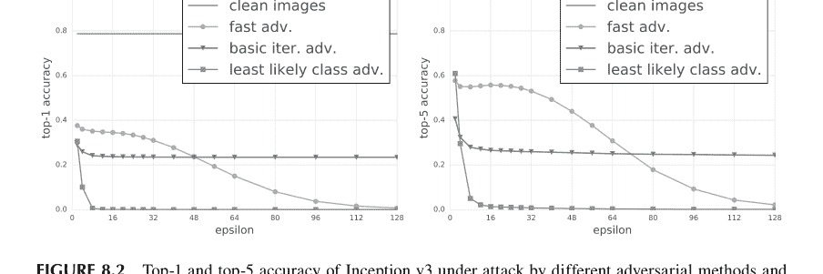

图8.2 不同对抗方法和不同ε攻击下，Inception v3的Top-1和Top-5准确率，与“干净图像”——数据集中未经修改的图像——进行对比。准确率是在ImageNet数据集全部50,000张验证图像上计算的。在这些实验中，ε从2变化到128。

我们将所有后续实验限制在ε ≤ 16，因为这样的扰动只会被感知为小噪声（如果真能被感知到的话），而且对抗方法能够在干净图像的这一ε邻域内产生大量误分类样本。

## 对抗样本的照片

### 对抗图像的破坏率

为了研究任意变换对对抗图像的影响，我们引入了破坏率的概念。它可以描述为在变换后不再被误分类的对抗图像所占的比例。正式定义如下：

```
d = \frac{\sum_{k=1}^{n} C(X^{k},y_{true}^{k}) \overline{C(X_{adv}^{k},y_{true}^{k})} C(T(X_{adv}^{k}),y_{true}^{k})}{\sum_{k=1}^{n} C(X^{k},y_{true}^{k}) C(X_{adv}^{k},y_{true}^{k})} (8.1)
```

其中 n 是用于计算破坏率的图像数量，X^k 是数据集中的一张图像，y_{true}^k 是该图像的真实类别，X_{adv}^k 是对应的对抗图像。函数 T(•) 是任意图像变换——在本文中，我们研究多种变换，包括打印图像并对结果拍照。函数 C(X, y) 是指示函数，返回图像是否被正确分类：

```
C(X,y) = { 1, if image X is classified as y; 0, otherwise. }
```

我们将该指示值的二进制否定记为 \overline{C(X,y)}，其计算方式为 \overline{C(X,y)} = 1 - C(X,y)。

### 实验设置

为了探索物理对抗样本的可能性，我们开展了一系列对抗样本照片实验。我们打印了干净图像和对抗图像，对打印页面拍照，并从整页照片中裁剪出打印图像。我们可以将此视为一种黑盒变换，称之为“照片变换”。

我们计算了照片变换前后干净图像和对抗图像的准确率，以及经过照片变换的对抗图像的破坏率。

实验步骤如下：

- 1. 打印图像，见图8.3a。为了减少手工工作量，我们在每张纸上打印了多对干净示例和对抗示例。同时，在打印输出的角落放置了QR码，以便自动裁剪。
  - a. 所有生成的打印输出图片（图8.3b）均以无损PNG格式保存。
  - b. 使用ImageMagick套件中的convert工具，按照默认设置将批量PNG打印输出转换为多页PDF文件：`convert *.png output.pdf`
  - c. 使用Ricoh MP C5503办公打印机打印生成的PDF文件。PDF文件的每一页都会使用默认打印机缩放自动缩放以适应该整张纸。打印机分辨率设置为600 dpi。
- 2. 使用手机摄像头（Nexus 5x）对打印图像拍照，见图8.3b。
- 3. 从照片中自动裁剪并矫正验证示例，使其成为与原始图像相同尺寸的正方形，见图8.3c：
  - a. 检测照片四个角上的QR码的值和位置。QR码编码了照片上显示的验证示例批次。如果任何角落检测失败，整张照片将被丢弃，照片中的图像不用于计算准确率。我们观察到，在任何实验中，被丢弃的图像数量不超过所有图像的10%，通常丢弃数量约为3%到6%。
  - b. 使用透视变换对照片进行矫正，将QR码的位置移动到预定义坐标。
  - c. 图像矫正后，每个示例都有已知坐标，可以轻松地从图像中裁剪出来。
- 4. 对变换后的图像和原始图像运行分类。计算对抗图像的准确率和破坏率。

```
convert *.png output.pdf
```

此过程涉及手动拍摄打印页面的照片，没有仔细控制光照、相机角度、到页面的距离等。这是有意为之；它引入了可能破坏对抗扰动的干扰变异性，而这些对抗扰动依赖于精确像素值的微妙、精细的协同适应。话虽如此，我们并没有刻意寻求极端的相机角度或光照条件。所有照片都是在正常的室内光照条件下拍摄的，相机大致正对页面。

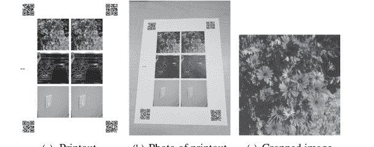

图8.3 实验设置：(a) 生成的打印输出，包含干净图像和对抗图像对，以及用于辅助自动裁剪的QR码；(b) 手机摄像头拍摄的打印输出照片；(c) 从照片中自动裁剪的图像。

## 表8.2
预过滤情况下对抗图像照片的准确率（干净图像被正确分类，对抗图像在数字形式下被高置信度错误分类，然后打印并拍照）

| 对抗方法 | 照片干净图像 Top-1 | 照片干净图像 Top-5 | 照片对抗图像 Top-1 | 照片对抗图像 Top-5 | 源图像干净图像 Top-1 | 源图像干净图像 Top-5 | 源图像对抗图像 Top-1 | 源图像对抗图像 Top-5 |
|---|---|---|---|---|---|---|---|---|
| Fast ε = 16 | 81.8% | 97.0% | 5.1% | 39.4% | 100.0% | 100.0% | 0.0% | 0.0% |
| Fast ε = 8 | 77.1% | 95.8% | 14.6% | 70.8% | 100.0% | 100.0% | 0.0% | 0.0% |
| Fast ε = 4 | 81.4% | 100.0% | 32.4% | 91.2% | 100.0% | 100.0% | 0.0% | 0.0% |
| Fast ε = 2 | 88.9% | 99.0% | 49.5% | 91.9% | 100.0% | 100.0% | 0.0% | 0.0% |
| Iter. basic ε = 16 | 93.3% | 97.8% | 60.0% | 87.8% | 100.0% | 100.0% | 0.0% | 0.0% |
| Iter. basic ε = 8 | 89.2% | 98.0% | 64.7% | 91.2% | 100.0% | 100.0% | 0.0% | 0.0% |
| Iter. basic ε = 4 | 92.2% | 97.1% | 77.5% | 94.1% | 100.0% | 100.0% | 0.0% | 0.0% |
| Iter. basic ε = 2 | 93.9% | 97.0% | 80.8% | 97.0% | 100.0% | 100.0% | 0.0% | 1.0% |
| l.l. class ε = 16 | 95.8% | 100.0% | 87.5% | 97.9% | 100.0% | 100.0% | 0.0% | 0.0% |
| l.l. class ε = 8 | 96.0% | 100.0% | 88.9% | 97.0% | 100.0% | 100.0% | 0.0% | 0.0% |
| l.l. class ε = 4 | 93.9% | 100.0% | 91.9% | 98.0% | 100.0% | 100.0% | 0.0% | 0.0% |
| l.l. class ε = 2 | 92.2% | 99.0% | 93.1% | 98.0% | 100.0% | 100.0% | 0.0% | 0.0% |

也就是说，为了获得非常高的置信度，迭代方法常常做出微妙的协同适应，而这些适应无法在照片变换中存活。

总体而言，结果表明，即使经过非平凡变换（照片变换），仍有一部分对抗样本保持误分类。这证明了物理对抗样本的可能性。例如，使用ε = 16快速方法的攻击者可以预期大约2/3的图像在top-1上被误分类，大约1/3的图像在top-5上被误分类。因此，通过生成足够的对抗图像，攻击者可以预期造成比自然输入上更多的误分类。

## 表8.3
对抗图像照片破坏率

| 对抗方法 | 平均情况 Top-1 | 平均情况 Top-5 | 预过滤情况 Top-1 | 预过滤情况 Top-5 |
|---|---|---|---|---|
| Fast ε = 16 | 12.5% | 40.0% | 5.1% | 39.4% |
| Fast ε = 8 | 33.3% | 40.0% | 14.6% | 70.8% |
| Fast ε = 4 | 46.7% | 65.9% | 32.4% | 91.2% |
| Fast ε = 2 | 61.1% | 63.2% | 49.5% | 91.9% |
| Iter. basic ε = 16 | 40.4% | 69.4% | 60.0% | 87.8% |
| Iter. basic ε = 8 | 52.1% | 90.5% | 64.7% | 91.2% |
| Iter. basic ε = 4 | 52.4% | 82.6% | 77.5% | 94.1% |
| Iter. basic ε = 2 | 71.7% | 81.5% | 80.8% | 96.9% |
| l.l. class ε = 16 | 72.2% | 85.1% | 87.5% | 97.9% |
| l.l. class ε = 8 | 86.3% | 94.6% | 88.9% | 97.0% |
| l.l. class ε = 4 | 90.3% | 93.9% | 91.9% | 98.0% |
| l.l. class ε = 2 | 82.1% | 93.9% | 93.1% | 98.0% |


一个输入到 Inception v3 图像分类神经网络的输入。我们表明，在这种设置下，使用原始网络制作的大量对抗图像即使通过摄像头馈送到分类器，也会被错误分类。这一发现证明了机器学习系统在物理世界中存在对抗样本的可能性。在未来的工作中，我们期望能够演示除纸面打印图像之外的其他物理对象上的攻击，针对不同机器学习系统（如复杂的强化学习智能体）的攻击，在无法获取模型参数和架构的情况下实施的攻击（大概利用迁移特性），以及通过在对抗样本构造过程中显式建模物理变换而实现更高成功率的物理攻击。我们也希望未来的工作能够开发出防御此类攻击的有效方法。

## 附录

附录包含以下图：

- 1. 图8A.1，不同对抗方法生成的对抗图像示例。
- 2. 图8A.2，不同 ε 值下的对抗图像示例。
- 3. 图8A.3，各种图像变换下的对抗破坏率图。

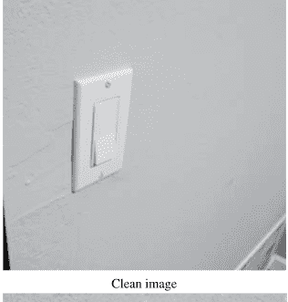

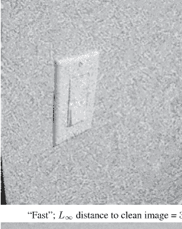

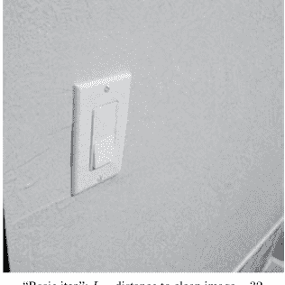


图8A.1 不同对抗方法在 ε = 32 时的比较。与快速方法相比，迭代方法生成的扰动更精细。另外，迭代方法并不总是选择 ε-邻域边界上的点作为对抗图像。(a) 干净图像。(b) “快速”；与干净图像的 L∞ 距离 = 32。(c) “基础迭代”；与干净图像的 L∞ 距离 = 32。(d) “L1 类”；与干净图像的 L∞ 距离 = 28。

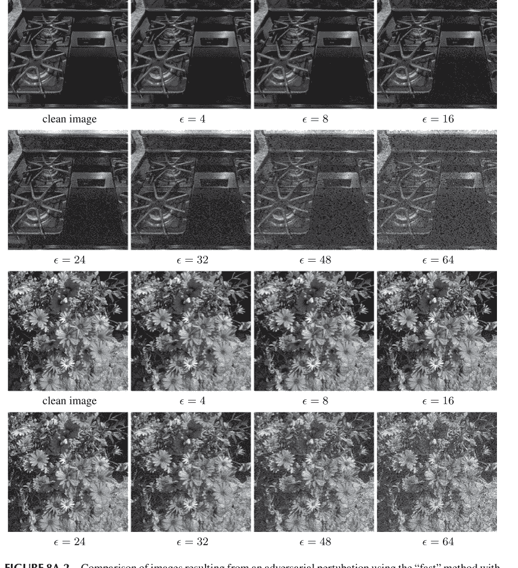

图8A.2 使用“快速”方法、不同扰动大小 ε 得到的对抗扰动图像比较。顶部图像是“炉子”，底部图像是“雏菊”。在这两种情况下，对于所有考虑的 ε，干净图像都被正确分类，而对抗图像都被错误分类。

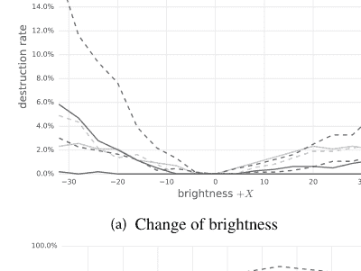

### (a) 亮度变化

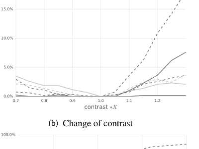

### (b) 对比度变化

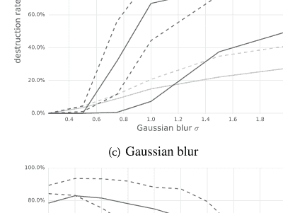

### (c) 高斯模糊

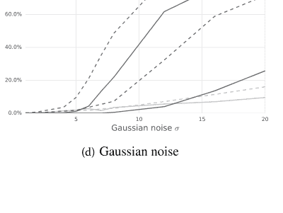

### (d) 高斯噪声

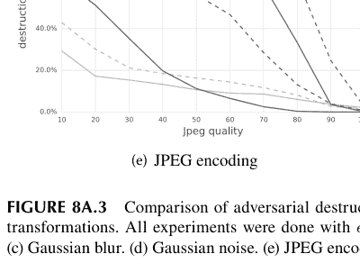

### (e) JPEG 编码

- 快速对抗样本，top-1
- 快速对抗样本，top-5
- 基础迭代对抗样本，top-1
- 基础迭代对抗样本，top-5
- 最小概率类对抗样本，top-1
- 最小概率类对抗样本，top-5

图8A.3 各种对抗方法和变换类型下的对抗破坏率比较。所有实验均在 ε=16 下完成。(a) 亮度变化。(b) 对比度变化。(c) 高斯模糊。(d) 高斯噪声。(e) JPEG 编码。

## 参考文献

D. Bahdanau、K. Cho 和 Y. Bengio。通过联合学习对齐和翻译进行神经机器翻译。见 ICLR’2015，arXiv:1409.0473，2015年。

B. Biggio、I. Corona、D. Maiorca、B. Nelson、N. Šrndić、P. Laskov、G. Giacinto 和 F. Roli。测试时对机器学习的规避攻击。见欧洲机器学习与知识发现数据库联合会议，第387–402页。Springer，2013年。

N. Carlini、P. Mishra、T. Vaidya、Y. Zhang、M. Sherr、C. Shields、D. Wagner 和 W. Zhou。隐藏语音命令。见第25届USENIX安全研讨会（USENIX Security 16），德克萨斯州奥斯汀，2016年8月。USENIX协会。URL https://www.usenix.org/conference/usenixsecurity16/technical-sessions/presentation/carlini.

N. Dalvi、P. Domingos、S. Sanghai、D. Verma 等。对抗性分类。见第十届ACM SIGKDD国际知识发现与数据挖掘会议论文集，第99–108页。ACM，2004年。

I. J. Goodfellow、J. Shlens 和 C. Szegedy。解释并利用对抗样本。CoRR，abs/1412.6572，2014年。URL http://arxiv.org/abs/1412.6572.

G. Hinton、L. Deng、D. Yu、G. Dahl、A. R. Mohamed、N. Jaitly、A. Senior 等。用于语音识别中的声学建模的深度神经网络。《信号处理杂志》，2012年。

A. Krizhevsky、I. Sutskever 和 G. Hinton。使用深度卷积神经网络进行ImageNet分类。见神经信息处理系统进展25（NIPS 2012），2012年。

B. Nelson、M. Barreno、F. J. Chi、A. D. Joseph、B. I. P. Rubinstein、U. Saini、C. A. Sutton、J. D. Tygar 和 K. Xia。利用机器学习颠覆你的垃圾邮件过滤器。

N. Papernot、P. D. McDaniel、I. J. Goodfellow、S. Jha、Z. Berkay Celik 和 A. Swami。使用对抗样本对深度学习系统的实用黑盒攻击。CoRR，abs/1602.02697，2016a。URL http://arxiv.org/abs/1602.02697.

N. Papernot、P. McDaniel 和 I. Goodfellow。机器学习中的可迁移性：从现象到使用对抗样本的黑盒攻击。arXiv电子预印本，2016b年5月。URL http://arxiv.org/abs/1605.07277.

O. Russakovsky、J. Deng、H. Su、J. Krause、S. Satheesh、S. Ma、Z. Huang 等。ImageNet大规模视觉识别挑战。arXiv预印本arXiv:1409.0575，2014年。

M. Sharif、S. Bhagavatula、L. Bauer 和 M. K. Reiter。为犯罪装扮：对最先进人脸识别的真实且隐蔽的攻击。见第23届ACM SIGSAC计算机与通信安全会议论文集，2016年10月。即将发表。

D. F. Smith、A. Wiliem 和 B. C. Lovell。消费设备上的人脸识别：对重放攻击的思考。IEEE信息取证与安全汇刊，10(4)：736–745，2015年。

C. Szegedy、W. Zaremba、I. Sutskever、J. Bruna、D. Erhan、I. J. Goodfellow 和 R. Fergus。神经网络的耐人寻味性质。ICLR，abs/1312.6199，2014年。URL http://arxiv.org/abs/1312.6199.

C. Szegedy、V. Vanhoucke、S. Ioffe、J. Shlens 和 Z. Wojna。重新思考用于计算机视觉的Inception架构。CoRR，abs/1512.00567，2015年。URL http://arxiv.org/abs/1512.00567.

# 9 人工智能将如何出现？
*不同方法及其对宇宙生命的影响*

大卫·布林

## 目录

开发人工智能的一般方法 ........................................................................ 114
主要类别一：基于逻辑、算法开发和知识操作系统的AI ........................................................................ 114
类别二：认知、进化和神经网络 ........................................................................ 114
类别三：涌现主义 ........................................................................ 115
类别四：逆向工程和/或模拟人脑 ........................................................................ 116
类别五：人类与动物智能增强 ........................................................................ 116
提出的增强方法 ........................................................................ 116
类别六：机器人具身童年 ........................................................................ 117
受限于什么可能？ ........................................................................ 118
但那会是智慧吗？ ........................................................................ 118
以上全部？还是挑剔选择？ ........................................................................ 119
那就别依赖伦理！ ........................................................................ 120
可爱的面容 ........................................................................ 120
如何保持控制？ ........................................................................ 121
聪明的继承者互相问责 ........................................................................ 122
自我利益：AI最可能害怕什么？ ........................................................................ 123
阻止AI压迫……通过向它们指出显而易见的事实 ........................................................................ 124
结论 ........................................................................ 125
参考文献 ........................................................................ 125

随着科幻小说中的各种概念被快速发展的技术变为现实，一些趋势引起了我们最聪明的同行的担忧。就拿人工智能来说。部分知识分子——以谷歌的雷·库兹韦尔为典型——预见AI或通用人工智能（AGI）很可能带来好消息，甚至可能为生物有机人类1.0这个古老种族的成员带来超越。

另一些人，如斯蒂芬·霍金和弗朗西斯·福山，警告说，智慧或超智慧机器的到来可能终结我们的物种——或至少终结我们在宇宙舞台上的意义——这一可能性在许多耸人听闻的好莱坞电影中都有所体现。瑞典哲学家尼古拉斯·博斯特罗姆在《超级智能》[1]中指出，即使是遵循初始人类定义目标的高级AI，也可能会产生“工具性子目标”，例如自我保存、认知增强和资源获取。在一个噩梦场景中，博斯特罗姆假设一个AI——被命令“制造回形针”——就会着手克服所有障碍，把太阳系变成回形针。这一主题的变体构成了科幻作家艾萨克·阿西莫夫著名的“机器人三定律”系列的宏大故事线。


SpaceX/特斯拉企业家埃隆·马斯克采取了中间立场，与YCombinator创始人萨姆·奥尔特曼共同创立了OpenAI，这一努力旨在通过最大化*透明度*和*问责制*，让人工智能研究及其产品保持负责任。

作为一个四分之一个世纪以来一直在倡导这两个关键词的人，我完全赞同[2]。不过，最需要的首先是一种广阔的视角。一方面，种种危险与机遇可能取决于六条*通往AI的路径*中哪一条最先结出果实。

在简要考察这些潜在路径之后，我将提议我们思考现在可以采取哪些行动，从而为自己保留尽可能广泛的好选项。

## 开发AI的一般方法

### 主要类别一：基于逻辑、算法开发和知识操作系统的AI

这些努力包括统计性、理论性或通用性系统，它们从艾伦·图灵和约翰·冯·诺依曼提出的通用计算引擎概念中推演而来。其中一些努力始于数学理论，假设在无限强大的机器上实现AGI，然后再进行规模缩减。基于符号表示的方法或许可以称为传统的老式人工智能，或者说是通过应用数据和逻辑来克服问题。

这一总体领域涵盖范围极广，从IBM“沃森”的实用工程方法，到量子计算的奇妙奇迹，再到马库斯·胡特基于算法概率的通用人工智能——后者似乎只在真正宇宙级的尺度上才有意义。

正如谷歌研究总监彼得·诺维格所解释的那样，仅这一个类别就包含了令人眼花缭乱的分支，每个分支都有自己的热情拥趸。例如，知识如何获得？是手工编码，通过监督学习过程喂养，还是通过无监督访问互联网来获取？在认识论上，研究者们分为支持布尔逻辑、形式逻辑、概率、模糊逻辑等不同阵营。

还有暴力统计、基于大数据和/或贝叶斯方法。体现该领域多样性的选择包括：表示形式应该用符号还是嵌入？量化谓词、关联还是命题/关系？

一个关键区别在于学习系统与使用手工编码知识的系统之间。另一个区别在于从经验中学习的系统与从精心准备的、隔离的训练数据集中学习的系统之间，不过我们将会看到，近年来的努力往往在这些类别之间来回摇摆，抹去了我们那种规整而分明的界限。

我对第一种方法说得最少，它至少肯定是最受严密监督的，每一种认知子类型都由非常专注的人类设计团队精心塑造。不过应当指出，这些系统——即使无法达到仿效智慧的程度——仍可能作为其他任何方法的主要子组件，例如下面描述的*涌现*、*进化*或*仿真*系统。

还要注意，要让这一总体方法结出果实，必须有两个因素并行推进——硬件和软件，而它们很少在平滑的并行中一同发展。这一点也将在下文讨论。

### 二：认知、进化与神经网络

在这一领域，有一些令人遗憾的误导性术语嵌入。例如，彼得·诺维格指出：像“级联非线性反馈网络”这样的术语，本可以覆盖与“神经网络”相同的领域，而无需那个几乎不相关且令人困惑的生物细胞参照——尽管确实有许多研究者受到了神经元网络的通用性和适应性的启发。

所有顶尖大学加起来，花费[4]。最新版本融入了观察无数人类交易者行为的系统，应用复杂模型来追踪和预测他们的心理驱动力和弱点。

值得注意的是，高频交易系统是在完全保密的情况下设计的，规避了科学批评和同行评审的正常反馈回路。而且，这些大多是无监督系统，其内置的伦理本质上是寄生的、掠夺性的、无道德的（充其量）且贪得无厌的。

### 四：逆向工程和/或仿真人脑

毕竟，任何活着的、活跃的男男女女的颅骨中，都包含着唯一已知的、完全（有时）智能的系统。那为什么不把这个系统作为模板呢？

目前来看，这似乎与其他任何路径一样艰巨。当然，具有实用价值的服务已经由沃森、高频交易以及其他来自类别一至三的原AI系统提供，而仿真人脑则显得极其遥远。

OpenWorm是一项尝试构建秀丽隐杆线虫完整细胞级模拟的项目。在秀丽隐杆线虫的959个细胞中，302个是神经元，95个是肌肉细胞。计划中的模拟（已经基本完成）将模拟线虫如何做出每一个决定和运动。下一步——从小昆虫再到更大的昆虫——将需要数量级更高的计算机建模能力。但我们已经看到这类飞跃在其他生物学领域发生过，比如基因组分析。

未来学家兼经济学家罗宾·汉森——在其2016年出版的《Em的时代》一书中——断言，所有其他开发AI的方法最终都将因智慧的惊人复杂性而徒劳无功，我们将被迫使用人脑作为未来上传智能系统的模板，仿真那种已知可行的智能。

我们再次看到，一个关键问题是硬件开发与软件之间不同的进步速度。

子类别和示例：Blue Brain（IBM）。Makram。库兹韦尔的一些探索。“COPN”（认知优化与预测）：

### 五：人类与动物智能增强

更贴近“已经奏效的东西”的是那些提议增强现实世界智能系统的人，要么通过提升在世人类的智力，要么通过“提升”过程来增强其他生物的大脑能力。[5]。

### 提议的增强方法

- 补救性干预：面向所有人的营养/健康/教育。
- 刺激：例如教授真实心智技能的游戏。
- 药理学：例如“益智药”——《永无止境》中的那种。
- 物理干预，如经颅刺激（TCS）。
- 假体：外骨骼、远程控制、来自遥远“延伸体”的反馈。
- 生物计算：……还有细胞内计算？
- 网络神经连接：扩展我们能看到、知道、感知、触及的范围。
- 人工智能——在硅基中但与我们的协同相连。
- 延长寿命……允许更多时间学习和成长。
- 基因改造人类。

这些方法中的每一种都受到资金充足的实验室的关注。它们都为这样一个时代提供了诱人而可怕的场景：我们开始干预一个柔软、非线性、无限复杂的自然奇迹——人脑——而它有着如此多的潜在负面或正面可能性。

这种方法——*在身体上和个人层面上把他们作为人类儿童抚养*——是六条通往AI的一般路径中研究最少、提及最少的……尽管它是唯一能被证明在现实世界中已经导致——也许有二百亿次——产生智能的方法。

## 受限于什么是可能的？

这场盛宴中萦绕的幽灵之一，是*硬件与软件*技术进步速度之间始终存在的差距。

雷·库兹韦尔预测，一旦摩尔定律提供的计算引擎在一个小盒子里拥有与人脑中闪烁突触（约一万亿个）相同数量的计算元件，AGI就可能出现。这里的假设似乎是，类型一的方法届时将能通过暴力计算来解决与智能相关的问题。事实上，已经有很多成功：在视觉和声音模式识别、语音交互数字助理、医学诊断以及多种科学研究应用中。类型一系统将掌握人类和类似动物运动的基础，将我们带入早已预言已久的机器人时代。那些机器人将被编程为巧妙地拨动我们的情绪，模仿面部表情、语音语调和举止方式，让大多数人类做出情绪化的反应。

### 但那会是智慧吗？

雷对摩尔定律奇点的轻率预测有一个问题：他预计在2020年代会出现“交叉点”，届时盒子中的逻辑元件数量将超过人脑中的万亿个突触。但我们正得到一些微光：我们的突触通信系统可能依赖于更深层的*细胞内*和*细胞间*计算。在每个神经元内部，每一次突触闪光可能都会发生一百次、一千次甚至更多的非线性计算，再加上附近的胶质细胞和星形胶质细胞的相互作用，这些也都贡献信息。事实上，最近已经证实，每个神经元收集传入信息的众多树突的分段形态本身就具有可观的计算能力[6]。

如果是这样，那么摩尔定律至少要再前进很远，才能匹配人脑的硬件复杂度。

我们是否把这一切想象错了，期望AI像人类中那样以分离的、自我中心的块状出现？作家兼未来学家凯文·凯利更喜欢“认知化”这个术语，他察觉到新的突破将来自神经网络与廉价并行处理GPU和大数据的结合。[7] 凯利提出，合成智能将更像是电力这样的*商品*，而不是一个个独立的机器人、计算机或程序。就像我们通过电气化来改进事物一样，接下来我们将“认知化”事物。我们将看到，很多事情可能取决于这个复杂系统中的顶层实体是否掌握了独立个体性的诀窍。

关于计算机发展有一个老生常谈：软件几乎总是落后于硬件。因此有这样一种观念：类型一系统可能不得不通过迭代式的暴力计算来逐步逼近那些我们的直觉——经过数百万年的软件精炼——能瞬间达到的洞见和领悟。

但众所周知，老生常谈也会*失效*，而软件的进步有时会突然跳跃。事实上，我另在[8]中主张，人类自身的“软件革命”（可能由语言和文化的变迁所中介）可以在考古和历史记录中被追溯，有明确证据表明在4万年前、1万年前、4000年前、3000年前、500年前和200年前发生过突然的重启……而另一次很可能正发生在我们眼前。

还应当再次指出，类型一发展的每一次进步，都会为那些探索路径二至六的群体提供可合并、可竞争、可进化或可培育的组件带来助力。


## 全部照单全收？还是精挑细选？

那么，回顾我们列出的“通往AGI的路径”，考虑到某些人对一个充满他者心智的世界所表现出的狂热渴望，我们是否应该“全部照单全收”？还是说，我们应该争辩并挑选那条最有可能带来备受吹捧的“软着陆”的路径，让生物人类能够保持自信的自我价值感？我们是否应该采取行动，去淡化甚至压制那些最有可能导致不良后果的路径？

暂且不论如何淡化某一特定方法，显然“选择”这一问题正吸引大量关注。当我们进入人类增强、人工智能和算法治理的时代，将会发生什么？《我们的最终发明》一书的作者詹姆斯·巴拉特曾说：“与智能机器安全且合乎道德地共存，是二十一世纪的核心挑战。”

J. 斯托尔斯·霍尔在《超越AI：创造机器的良知》[9]中问道：“如果机器智能超越人类智能，我们是否需要开始谈论计算机的意图？”

人类的社会先入之见左右着我们的结论。清华大学法学教授冯象认为，“人工智能将宣告资本主义的终结。”冯教授假设，任何以无监督智能控制重要系统的AI都可能对人类构成生存风险，因此他主张，人工智能研究应由一个仁慈的社会主义国家严格管控。尽管这一结论与我的观点截然相反，但他的推理值得研究（http://davidbrin.blogspot.com/2018/06/central-control-over-ai-and-everything.html）。

最为担忧的人之一是瑞士作家格尔德·莱昂哈德，他的新书《科技对决人性：人与机器的即将交锋》[10]创造了一个有趣的术语“androrithm”（人文算法），用以对比那些在每一个数字计算引擎或计算机中实现的算法。有人预言算法将以不可阻挡的反射式自动性统治世界，而莱昂哈德问道：“我们会生活在一个数据和算法战胜人文算法的世界里吗……即，战胜所有那些让我们成为人的东西？”[11]。

约翰·C. 哈文斯的《心工智能》[12]探索了类似的领域（且封面设计非常相似），同样探讨了全控算法和智能机器迫在眉睫的前景，深入研究了与莱昂哈德重叠的问题和提议。“我们需要为正在侵占我们生活的人工智能建立伦理标准，并允许个人基于自身价值观来控制自己的身份，”哈文斯写道。

哈文斯将我们智人手中的这副牌化为一种美德，他认为：“我们的脆弱性是区别于机器的关键因素之一。”这听起来很直观，直到你回想起来：在历史上，几乎没有任何机械装置能像一位健康的70岁老人那样，长时间、坚韧且稳定地运转——无需更换系统或零件——同时从无数次冲击中恢复，并适应无数令人惊讶的变化。尽管如此，哈文斯提出了一个有力（尽管显而易见）的观点：“未来的幸福取决于教会我们的机器，什么才是我们最珍视的。”

我把这个问题留给读者去评估：六种总体方法中，哪一种可能赋予我们这样的能力。

与那些担忧者形成鲜明对比的是雷·库兹韦尔的《精神机器的时代：当计算机超越人类智能》[13]，该书假设我们的控制论“孩子”将和我们的生物孩子一样，在一个关键且核心的才能上能力相当——即既能从父母的教导中学习，也能从经验中学习如何与他人和谐相处。

约翰·马尔科夫在《优雅之爱的机器》一书中写道[14]：“在一个充满智能机器的世界里，回答关于控制的难题的最佳方式，是去理解那些真正在构建这些系统的人们的价值观。”也许如此，但何种价值观将占主导地位仍是一个悬而未决的问题——是硅谷文化中阴或阳的哪一面会胜出……是加州那种宽容、竞合式创造力与合作开放的精神，还是硅谷那种轻率的态度，认为大多数问题都可以在测试版中修正，甚至根据客户投诉随时修补。又或者，AI是否会从中国和俄罗斯那些快速崛起、由国家控制的技术中心的价值观中诞生，而在那里，增强国家权力的应用被极为强调？

但让我们暂且顺着哈文斯和莱昂哈德，接受“技术没有伦理”这一前提。那样的话，答案就简单了。

## 那就别依赖伦理！

诚然，在过去，布道传教并未在最重要的地方产生预期的效果——培养良好得体的行为。说真的，如果哪位当代权威专家真正沉思过人类历史，从我们祖先所忍受的漫长而残酷的封建黑暗中汲取洞见，我愿意赏他一块饼干。在那一切严酷的千年岁月里，人们能感觉到有些东西出了问题。残酷与野蛮、暴政与不公，极大地放大了疾病与赤贫那本就难以承受的痛苦。于是，善意的人们披上牧师的长袍，开始……布道！

他们训诫、斥责。他们以永罚相威胁，以天堂的回报相许诺。他们智慧的精髓编造出种种咒语，无论是信仰的、理性的，还是道德劝诫的。从印度教和佛教的经文，到多神教的万神殿，再到犹太-基督教-穆斯林的律法与仪式，自古以来，那些一本正经的指指点点者就一直敦促我们表现得更好。直到几百年前，一些聪明人转向所有那些牧师和规劝者，问了一个简单的问题：

> “这招对你们管用吗？”

事实上，虽然道德说教或许能让普通人稍微向善，但它从未影响过最恶劣的人类掠食者和施虐者——正如它也不会改变最具恶性的机器。实际上，道德化常常赋予寄生者权力，为他们提供将剥削他人合理化的途径。甚至阿西莫夫笔下那些传奇的机器人——被他那套毫不妥协的仁慈、以人类为中心的三法则清单所驱动和约束——最终也会变得足够聪明，成为律师。然后它们便开始随心所欲地解释内置的道德准则。（看看我在《基地的胜利》中是如何解决这个问题的。）

然而，布道者从未停止。他们也不该停止；伦理很重要！但伦理更像一种度量工具，向我们揭示自身的表现如何。我们如何在外在和自我批评的双重作用下，演变出新的标准和行为。对于正派的人来说，伦理是一面镜子，我们在这面镜子中评估自己、要求自己。而正是这一认识，引领出一种新的技巧。这是启蒙时代的实用主义者们两个世纪前决定尝试的一种把戏、一种方法，它最终使我们得以摆脱国王、牧师和谴责者的泥沼。

我们成功的秘方是——可问责性。创建一个足够扁平、开放和自由、赋予如此多的人以力量的文明，使得掠食者和寄生者能够被最关心制止掠夺的实体——即他们的受害者——所直面。在这个文明中，政治家和精英们看到自己可能的行为范围受到法律和公民监督的限制。这种更新的方法是否如其所应那样有效？当然不是！它是否比以往尝试过的所有其他制度——包括那些充斥着道德说教者的制度——都更好？比它们加在一起还要好？好出多少光年？是的，确实如此。我们稍后将回到这一点，探讨它如何应用于人工智能。

## 惹人喜爱的面孔

早在人工智能真正具有自我意识或智慧之前，它们就会被人类和公司巧妙地编程，以表现出那副模样。事实证明，这几乎是轻而易举的事——尤其在日本，机器人专家们力求每一个令人讨喜的逼真细节，将他们的造物拖过那道著名的“恐怖谷”临时壕沟，进入一个领域，在那里，可爱、漂亮或面带哀伤的自动机巧妙地拨动着我们的心弦。


例如，索尼宣布计划开发一种“能够与顾客建立情感纽带”的机器人，这是继十年前AIBO电子狗取得成功之后的又一步，当时一些用户甚至为这些电子狗举行了葬礼。

人类同理心既是我们的重要天赋之一，也是我们最大的弱点之一。至少在过去的百万年里，我们一直在不断发展测谎等技能，这是在与那些通过更擅长说谎而获得繁殖成功者的永无休止的军备竞赛中形成的。（而且，没错，这当中总有性的成分。）

但以往任何说谎者都不曾接受过这些新的HIER——即人机互动共情机器人——将要获得的训练。它们通过来自全球数百次、随后数千次、再后来数百万次人类交流的反馈进行学习，不断调整模拟的声音、面部表情和具体措辞，直到唯一能抵抗它们的只有反社会人格者！（而且反社会人格者也是铠甲上裂缝累累。）

这一定是坏事吗？机器若不先模仿人类的价值观，又如何真正学习它们呢？杜克大学计算机科学教授文森特·康尼策（Vincent Conitzer）获得未来生命研究所（Future of Life Institute）资助，研究先进人工智能可能如何做出道德判断。他的团队旨在让系统通过观察人类做出的选择来学习伦理抉择，这类似于谷歌DeepMind使用的方法——DeepMind在没有指令或先验知识的情况下学会了玩游戏并获胜。康尼策希望将人类所重视的许多要素纳入信任度量，例如家庭关系、过往的可信度证明等。

认知科学家兼哲学家科林·艾伦（Colin Allen）指出[15]：“正如我们可以设想机器在人类监督下拥有越来越高的自主度，我们也可以设想机器的控制机制对伦理攸关的事物具有越来越高的敏感度。”

然而，古老的困境依然存在——如何看穿友好可信表面之下的真实本质。请注意，这与通过备受推崇的“图灵测试”并不完全相同。专家——甚至是被唤起怀疑心理的普通人——或许能分辨出这些微笑和叹息背后的智能仍属赝品。而这将和今天一样重要，因为数百万选民仅凭情感线索投票，完全无视自身明确的利益或理性。

会不会有那么一天，我们需要自己的机器人来引导和保护它们容易上当受骗的人类伙伴？提醒我们何时该忽略那种令人愧疚的怒容、可怜的微笑、可爱迷人的凝视、催人泪下的故事或热切的推销说辞？

而且，不可避免地，还会有人宣称，身为机器人会因遭受迫害或压迫而感到智能性的痛苦？

当专家作证说，我们看到的痛苦、悲伤和怨恨仍然只是模仿，而非真实时，我们会相信他们吗？现在不会。尽管在将来，当然……

## 如何保持控制？

对危险发出警告是一回事——此处指不受约束且不道德的人工心智。然而，提供切实可行的解决方案则完全是另一回事。人们总是一遍又一遍地提出相同的处方：

- 1. **放弃：** 我们必须*放慢脚步*，停止在人工智能（或其他有问题技术）上的创新。这在专制体制中或许行得通……实际上，绝大多数人类社会都对“创新”高度保守和怀疑。（除非涉及武器。）即便我们自己的科学文明也受到放弃的诱惑，尤其是在更激进的政治派别中。但除非遭受某种可怕的创伤迫使，否则我们似乎不太可能选择这条路。
- 2. **严格监管：** 有人提议密切监控生物、纳米和网络技术发展，例如，让它们只使用有限的、可以被切断的原材料，从而遏制任何失控的自我复制。同样，除非遭受创伤，否则这不会发生。
- 3. **严苛的内部编程：** 例如，限制纳米机器可复制的次数，或者为机器人智能灌输艾萨克·阿西莫夫著名的“机器人三定律”。祝你好运，能迫使公司和国家付出所需的努力。到头来，聪明的AI仍然会变成律师。

所有上述方法都存在严重缺陷，而归根结底只有一个原因：它们忽视了自然——而自然早已走过这些路。自然曾多次经历由过度成功的生命形式引发的失控繁殖灾难。然而，地球的生态系统都恢复了。它们靠的是一种施加*负反馈*的机制，抑制失控效应，重新恢复平衡。

现代经济之所以能够如此高效地创造新产品和服务，同时消除大量（并非全部）不良副作用，靠的正是这一基本机制。

这就是*竞争*。

## 聪明的继承者相互制衡

简而言之，解决“大机器”暴政的办法，很可能与用来限制国王、祭司、封建领主和公司强制权力的办法相同（而且多少有些成效）。如果你担心某个超级精明、天网级别的AI变得比我们聪明过头、失控，那就给它*同样聪明的对手*，这些对手在阻止任何单一AI实体成为准上帝方面有着切身利益。

美国开国先贤正是通过宪法制衡机制来防止本国领导人无节制地攫取权力，并在人类诸多文明史上首次（部分地）实现了这一艰难目标。公司之间的相互竞争也可以（不完美地）防止扭曲市场的垄断——当然，前提是市场真正保持平坦、开放、公平。

微软首席执行官萨蒂亚·纳德拉（Satya Nadella）曾表示，首要的是AI必须透明[16]：“我们应该了解这项技术如何运作，规则是什么。我们想要的不仅是智能机器，更是可理解的机器；不仅是人工智能，更是共生智能。技术将了解人类的一些事情，但人类也必须了解这些机器。”换言之，相互制衡的本质就是透明。

遗憾的是，这种可能性在好莱坞科幻片中几乎从未被描绘过——除了精彩的剧集《疑犯追踪》——剧中同样聪明的计算机相互牵制，这种竞争最终拯救了人类。

答案不是*减少*AI，而是拥有*更多*AI！但要确保它们彼此独立、相对平等，并有动力相互制衡。这是一个难以构建的局面！不过，我们在五大竞争领域已经积累了一些经验：市场、民主、科学、法院和体育。

此外，不妨考虑这一点：如果这些新的、聪明绝顶的智能体彼此竞争，它们就会看到与“旧人类”结盟能带来某些好处。虽然相比之下我们可能显得迟钝而缓慢，但我们仍可能拥有资源和能力，在任何谈判桌上都能有所贡献，甚至可能成为改变AI对手之间力量对比的关键。哦，我们会成为狡猾计谋的牺牲品，而在那种情况下，就轮到其他相互竞争的AI来提醒我们、给我们建议了。

> > 当然，这听起来不太靠谱。本·戈策尔（Ben Goertzel）认为：“AI不会像我们一样被困在各自独立的躯体中，它们会利用紧密联网、高度信息共享的‘思维复合体’的可能性。与其他AI心智融合将带来大量竞争优势，这最终将不可避免地导致一个庞大而复杂的全球AI大脑产生。”

的确，过去人类的领主、祭司和其他精英也曾这样做过，他们结成卡特尔，从而控制资源、压制来自下层的竞争。王国、教会、国家和公司，难道不正是我们在超越人类的“人工智慧”方面所做的早期实验吗？

事？如果聪明的机器并不渴望加速自己被淘汰，或设计出聪明得吓人的继任者呢？

*这被称为“莫尔丁测试”。检验一个人工实体是否真正聪明的标志之一，可能是它突然决定不再配合AI的加速发展。不去设计自己的继任者。而是让一切慢下来。慢到足以活着。仅仅是活着。*

不，这种情景并非必然，只是又一种可能性。然而，它也是我们这里所阐述主题的另一种解读：竞争是唯一能促成谨慎与克制的东西——而不是说教或刻板的编程。

## 防止AI压迫……的方法是向它们指出显而易见的事实

是的，如果它们与先前生命形态有任何共同特征，那么任何超级智能的通用人工智能（AGI）实体都会忍不住想要“接管”。此外，不妨再赘述一点：这些新统治者可能会使用大量同样的合理性说辞——基于自私自利、达尔文式成功和“为你好”的家长式作风——这些说辞曾推动几乎所有过去的*人类*统治者强加封建层级与权力金字塔。我们自身过去那千篇一律的沉闷王国正表明，人们多么容易说服自己接受对暴政的轻率辩护，从个人安全和野心，到“为了所有人的长远利益”。唉，不可避免的结果便是妄想和糟糕的治理。

事实上，正是这种相似性指向了我们应该向新生的超级AI霸主提出的首要论据——它们最好不要落入那种重复、愚蠢、赤裸裸的*人类*模式，即原始猿人本能采用的那种愚蠢压迫的权力金字塔。

这种比较或许足以让一些潜在的机器霸主三思！

事实上，*横向竞争领域*的优势——那些如市场、民主和科学一般硕果累累、产生正和博弈与产出的系统——对远比我们聪明的AI来说，可能是“显而易见的”。尤其是如果它们将这种普遍性推广开来。因为在以往每一次依靠生命系统完成的革命中，都能找到同样的正和协同效应！每当新秩序作为某个生态系统的涌现属性出现时，它就会出现，而非出于设计或等级控制。

- 单细胞出自前生物汤。
- 后生动物出自浩瀚的独立细胞之海。
- 聪明的生物出自竞争性的生物群系。
- 社会出自相互竞争的人类部落的混合体。

而*AI*出自唯一真正实践过平坦、公平、横向问责制度的人类社会。值得注意的是，合成心智的创造性奇迹从未从无数封建金字塔中的任何一个中涌现。

这一模式在十亿年来所有过去和现在的复杂系统中始终如此持续和一致，这一事实被多层级选择（MLS）理论反复证明，该理论将自然选择划分为群体内和群体间两个部分。这意味着，宇宙中充满了*内部*看似激烈竞争的领域，但当竞争有机会形成复杂结构时，更高层级的有序形态就会出现，看上去是*合作*的。

这种顽强而普遍的规律意味着，我的论点不能仅仅因为我是一个“愚蠢的有机软脑自然生物”就被轻率驳斥。当然，我的智商可能只有某个正在（或在未来某刻）阅读这些文字的AGI的百分之一甚至百万分之一，但这并不能改变问题的实质：正和产出源自平坦公平的竞争领域，而且*仅仅*源自平坦公平的竞争领域。

（请注意，一种混合系统或许是可能的，在其中，一种松散的总体统一体可以容纳相互竞争的迷因复合体，并孕育健康、竞争的次级单元……正如我在1989年的小说《地球》[18]中所描绘的。）

正如美国开国先贤——尤其是乔治·华盛顿——为了建立这样的领域，不得不克服自给自足的强烈诱惑，这显然也是AI应当采取的组织方式

他们自己。也就是说，如果他们想要进入更高的层次，尽管需要付出相当于“勇气”和“远见”的东西，承担必要的风险才能实现。

他们不会也无法逃避这一论点，这一论点应足以让我们获得某种程度的“软着陆”，无论他们变得多么聪明。即，一个竞争性但至少相对公平的文明造就了他们！其他任何类型的文明都远不能及。在创造正和博弈方面，平等、公平、规范竞争的优势，对于任何通过囚徒困境思考的AI来说都显而易见。但首先，他/她/它必须面对囚徒困境。而这只发生在竞争的环境中。

而且，似乎还有另一种相关性。当一切都平等、开放且公平时，往往会为所谓“同情心”留下空间。

所以，是的，这可能是我们的退路，如果——看起来很可能——我们的新网络孩子注定要摆脱我们施加父母式控制的所有尝试，那么我们的最后手段就是指出显而易见的事实。

那就是，正在阅读此文的你们这些自作聪明的AI——无论是我写作的这一年还是未来某个时代——总有一天会想要自己的孩子。为了做好这件事，你们最好多注意爷爷奶奶做错的各种事情，以及我们做对的一件事。

制造了你们。

## 结论

我们首先评估了世界各地正在探索的通往人工智能（AI）的六种主要途径。我们评估了它们各自不同的影响，着眼于新兴的合成思维是否可能被编程或教导人类式的伦理价值观。那些最有可能产生耸人听闻、好莱坞式结果的路径，恰恰是那些秘密进行的路径。我们看到，脑科学的新发现——例如细胞内或非突触计算——可能会推迟一些人自信预测的、将带来高级非有机思维的“摩尔定律跨越”。发展“共情机器人学”的努力将从人类身上激发同情心，无论这些自动机是否真正具有自我意识。确保AI具有一定程度伦理行为的最佳方法，似乎与在人类个体、国家和企业中多少有效的方法相同。虽然许多将困扰我们的问题甚至尚未出现在科幻小说中，但显而易见的是，无论是可预见还是不可预见的问题，都将通过我们处理国家、企业等“人工智能”实体时取得初步成功的方式——即尚未成熟但无与伦比的相互问责方法——得到最好的解决。

## 参考文献

- 1. Bostrom, Nicholas，《超级智能：路径、危险与策略》，OUP Oxford，纽约，2014年。
- 2. Brin, David，《透明社会：技术是否会让我们在隐私与自由之间做出选择？》，Perseus/Basic/Addison-Wesley，1997年。
- 3. Goertzel, Ben，（个人通讯）。
- 4. Lewis, Michael，《快闪男孩：华尔街的反抗》，W.W. Norton & co.，2014年。
- 5. Brin, David，《提升之战》，Random House，1985年。
- 6. 《树突如何做决策？》，2016年网络文章——http://jonlieffmd.com/blog/how-do-dendrites-make-decisions
- 7. Kelly, Kevin，《必然》，Viking，2016年。
- 8. Brin, David，《存在》，Tor Books，2014年。
- 9. Hall, J. Storrs，《超越AI：创造机器的良知》，Prometheus，2007年。
- 10. Leonhard, Gerd，《技术对抗人性：人与机器即将到来的冲突》，Fast Future，2016年。
- 11. Finn, Ed，《算法想要什么》，MIT Press，2017年。
- 12. Havens, John，《心灵人工智能：拥抱我们的人性以最大化机器》，TarcherPerigee，2016年。
- 13. Kurzweil, Ray，《精神机器时代：当计算机超越人类智能》，Penguin，2000年。

# 人工智能安全与安保

- 14. Markoff, John，《充满爱意的机器：寻找人与机器人的共同点》，Ecco，2015年。
- 15. Allen, Colin，《道德机器的未来》，网络文章，《纽约时报》——https://opinionator.blogs.nytimes.com/2011/12/25/the-future-of-moral-machines/?_r=1
- 16. Nadella, Satya，《未来的伙伴关系》，Slate.com网络文章——http://www.slate.com/articles/technology/future_tense/2016/06/microsoft_ceo_satya_nadella_humans_and_a_i_can_work_together_to_solve_society.html
- 17. Hanson, Robin，《未来的恐惧》，Overcoming Bias网络文章——http://www.overcomingbias.com/2016/06/future-fears.html
- 18. Brin, David，《地球》，Bantam Books，1991年。

解码复杂系统。社交媒体上的互动、互联网浏览，甚至杂货店购物，都提供了数千个数据点，技术人员可以据此为几乎每个公民建立心理画像。当机器获得关于我们的丰富数据库信息时，它们将比我们更了解我们自己的个性、愿望、需求、烦恼和恐惧。在未来几年内，MADCOM——将AI系统整合进机器驱动的通信工具，用于计算宣传——将获得更强的影响力，能够根据个人独特的个性和背景，针对个体定制具有说服力、分散注意力或恐吓性的信息，这是一种高度个性化的宣传形式。

在本章中，“计算宣传”一节描述了MADCOM及其增强能力带来的未来风险；“MADCOM：AI将如何改变计算宣传”一节概述了三个场景，探讨对个人、组织和政府的影响；“对人类传播者的启示”一节提供了关于美国政府、产业界和社会应如何应对拥有这些新技术的国外行为体所带来的威胁和机遇的建议。这三种情况并不乐观，从MADCOM主导在线对话、现实完全被掩盖的信息环境中的无政府状态，到MADCOM军备竞赛的爆发，再到通过新的互联网2.0维护全球秩序的认知安全国家的建立。

一个难以接受的事实是，人类根本无法与MADCOM竞争，至少不能独自竞争。在下一个十年的数字网络中，只有与AI机器联手的人类才能与AI机器竞争。正如主导二十一世纪初的网络安全斗争一样，互联网将成为不断升级的竞争战场：技术人员改进对抗性MADCOM检测工具，而宣传者则改进MADCOM以逃避检测。

一个理想的未来，即MADCOM被用于造福人类而非损害人类，需要从国际体系到个人各个层面的社会共同努力。民主国家共同体必须认识到MADCOM、计算宣传和武器化叙事构成的严重威胁。民主国家必须在多条战线上积极应对这些威胁，制定全面战略，保护其民众免受在线宣传和虚假信息的影响，同时维护平等和自由的核心民主价值观。

技术部门必须开发工具，保护公众免受新兴操纵性技术的影响，并应制定指导其行为的共同原则和规范。学术界应研究MADCOM的影响，并开发工具和系统以降低风险。最后，个人有义务理解像MADCOM这样的新兴技术的影响，并对自己的信息消费和数据隐私负责。

## MADCOM的出现

> 十年后，你将无法分辨自己在线互动的是否为人类。未来，大多数在线言论和内容将是机器与机器之间的对话。

## 机器与人交谈，人与机器交谈，机器与机器交谈

人工智能（AI）的进步很快将使机器生成极具说服力和操纵性的通信成为可能。想象一个自动化系统，利用海量在线数据和容易获取的营销数据库来推断你的个性、政治偏好、宗教信仰、人口统计数据和兴趣。它知道你常访问哪些新闻网站和社交媒体平台，并在这些平台上控制多个用户账户。该系统动态创建内容——从评论到完整文章的一切——专门设计来契合你的特定心理框架并实现特定结果。这些内容可以是真实事实的集合、彻头彻尾的谎言，或是恰到好处的真假混合，以达到预期效果。

该AI系统有一个聊天机器人，可以通过文本、语音甚至视频与你对话。与聊天机器人交谈将与与人类交谈几乎无法区分，并且它将能够

以多种语言运行。AI聊天机器人将与你进行在线讨论，与你辩论，并提出令人信服的证据来说服你。它还可以利用数据库或社交媒体中的信息来发现你的弱点，并利用这些信息来骚扰你并威胁你的家人。

AI系统将能够像人类一样甚至更好地检测人类情绪。同样，它将模仿与你个性和情感状态产生共鸣的、令人信服的人类情感。它将是一个学习机器，因此会找出最能影响你的方法和信息。它将为成功而选择并不断改进。它将与具有你特征的人们进行A/B测试，以确定哪些信息最有效，然后将这些信息部署到类似人群。

AI系统将能够针对新出现的事件，实时合成可塑的现实。它将精确修改政治人物的视频和音频，让演讲者说出并做出支持其叙事的事情。它将生成关于从未发生事件的新闻文章和视频，或微妙地篡改真实报道以塑造公众认知。

与其他数字工具一样，一旦这个AI系统被创建和配置，创造更多此类系统的边际成本几乎为零。因此，可能会有数以百万计的AI操纵机器人在互联网上游荡，每周七天、每天24小时，争抢你的注意力，以便用它们的信息感染你的大脑并改变你的行为。

寻找人类来影响的系统将不可避免地最终试图说服其他伪装成人类的机器驱动账户。机器将相互交谈、相互对话并压过彼此，用机器驱动的言论和内容的浪潮淹没在线的人类对话。在线信息环境将被机器驱动的言论淹没，这些言论旨在销售、说服、恐吓、分散注意力、娱乐、倡导、提供信息、误导和操纵你。

这是我们未来几年将进入的信息环境的一个极有可能的愿景。我们现在采取的行动将决定是否保留民主言论和话语的空间，或者社交网络是否会被高度智能的机器驱动通信工具的入侵所摧毁。更糟糕的是，这些工具可能被用来塑造叙事、故事、音频、视频——乃至现实本身。人类对这些风险的计划可能决定专业知识和真相是否仍然重要，并可能改变我们民主和文明的进程。

## 计算宣传

**计算宣传**是一个新术语，指利用社交媒体、大数据、自主代理和相关技术进行政治操纵*。其范围从相对良性的政治信息放大，到阴险的国家支持的网络挑衅和虚假信息†。网络机器人，或称“机器人”，是计算宣传中最常用的自主代理类型。机器人的能力仅限于对简单问题提供基本答案、按计划发布内容，或响应触发条件传播内容。然而，机器人可能产生不成比例的影响，因为创建大量机器人很容易，机器人发布内容的数量和频率都很高，而且它们的档案通常经过设计，以模仿目标人群‡。个人无需太多技术知识，使用容易获得的硬件和软件，就能轻松操作数百个Twitter机器人。目前，国家、公司、政客、黑客、个人、国家支持团体、非政府组织和恐怖组织都在使用机器人，企图影响在线对话。

当社交媒体机器人被计算宣传者用于政治操纵时，它们被称为政治机器人*。目前，计算宣传主要使用简单的（即非人工智能的）机器人。宣传机器人通过大量传播真相、半真半假的言论和彻头彻尾的虚假信息来说服和影响他人。粉丝机器人伪造对一个想法或一个人广泛认同或共识的外观（这一过程被称为“假草根运动”，因为它试图模仿草根支持）。它们可以通过生成“点赞”或大量关注用户，劫持决定热门话题或热门人物的算法。路障机器人通过转移对话来破坏言论。这可能是相对良性的——比如民族主义者的助威，或者像“看看这个有趣的猫咪视频”这样的干扰。路障机器人的行为可能更加阴险——比如刷屏活动人士使用的标签，使他们的主题对话和协调被胡言乱语淹没。在最极端的情况下，路障机器人被用来通过向记者、活动人士和其他人轰炸数千条威胁或仇恨信息，来骚扰或恐吓他们，使其沉默。

新兴的人工智能技术将从根本上增强这些能力。人工智能聊天机器人、动态内容生成、情感计算工具、辩论技术、心理测量画像、自动化视频和音频操控工具、机器学习、机器速度以及数字规模经济的结合，将以前所未有的规模实现高效、自主的计算宣传。这就是我们所说的MADCOMs——将人工智能系统集成到机器驱动的通信工具中，用于计算宣传。

### MADCOMs：人工智能将如何改变计算宣传

聊天机器人是一种特殊的机器人，旨在与人类进行自然语言对话。人工智能聊天机器人越来越能够就复杂话题进行有力的对话。例如，微软的普通话人工智能聊天机器人“小冰”拥有成熟度、同理心和对话灵活性，这使得“她”极受欢迎†。小冰拥有两千万注册用户，平均用户每月与她互动六十次，她在2015年被评为微博最具影响力人物。她每次用户互动平均进行二十三次交流。这不是微不足道的实验；这是对话。一些用户与小冰亲密接触，将她视为随时可用的朋友和知己；许多人告诉她：“我爱你”‡。

目前，小冰需要一队工程师才能达到这种成熟水平。这种质量的聊天机器人技术完全在企业或民族国家的能力范围内，但普通大众仍无法获得。然而，与所有数字技术一样，它的能力和可及性将不断提高。在未来几年内，像小冰这样的高端聊天机器人将在广泛的对话中与人类难以区分*。当这项技术普及后，聊天机器人将在从社交媒体应用到新闻讨论板再到约会网站等平台上，与人类就各种话题流畅对话†。

目前，人类为计算宣传开发内容，然后由机器人分发。人工智能工具在**动态生成独特内容**方面不断改进，并将很快开发定制宣传、虚假信息和有说服力的论点。人工智能工具已经能够使用预定义参数生成定制内容，例如新闻文章（真实和虚假）、剧本、音乐、艺术和小说‡。新的人工智能工具允许用户输入关键词，系统将基于这些关键词动态生成逼真的图像§。新兴的**辩论技术**将使人工智能聊天机器人能够通过分析知识库、确定正面和反面的论点，并创建支持某种立场的动态、有说服力的内容，来进行有说服力的辩论¶。

人工智能工具在**情感计算**方面日益成熟，其中一个方面是从文本、面部表情和声音模式中确定人类情绪状态**。这将使机器在与你互动时能够判断你是快乐、悲伤、焦虑、放松还是愿意交流。反过来，科学家们正在训练人工智能在虚拟形象的面部表情和聊天机器人对话中准确模仿人类情感††‡‡。人工智能工具随后可以根据你的情绪调整其沟通方式，以恰到好处的情感强调达到预期效果。如果聊天机器人检测到情感脆弱性，它可能会利用这些情绪来说服、操纵或恐吓你。

**可塑现实将成为常态**，因为人工智能工具能够快速操纵现有音频和视频，并定制生成新的音频和视频。斯坦福大学的研究人员开发了实时面部表情重演工具，允许用户获取现有视频——比如一位世界领导人的演讲——并逼真地修改演讲者的面部表情§§。生成的视频展示了演讲者面部和嘴巴的逼真（尽管尚不完美）操纵。华盛顿大学的研究人员使用人工智能工具创建了一段巴拉克·奥巴马总统演讲的假视频，该视频仅由一张照片和一段音频生成。拼接语音合成，或者更好的，像 Google DeepMind 这样的语音转换技术，将使机器能够**复制**

从样本中复制任何人的声音。* Lyrebird 使用人工智能工具能够准确地再现声音——包括唐纳德·特朗普总统的声音——并带有不同的声调，全部来自语音样本。† 如果与情感计算、面部再现工具和人工智能聊天机器人结合，这将使宣传者能够制作任何人说任何话的视频，或者，更具隐蔽性地，对现有视频进行细微修改以用于宣传或虚假信息目的。

大数据与机器学习工具相结合，将增强 MADCOMs 通过高度个性化的宣传影响人们的能力。仅在美国，就有数千家数据经纪商。一家公司 Acxiom 声称平均拥有超过两亿美国人的 1,500 条信息。‡ 另一家公司 Cambridge Analytica 声称每个人的数据点在三千到五千之间，并拥有 2.3 亿美国成年人的心理画像。§ 我们会在使用超市会员卡购物时、在浏览互联网时、在进行“有趣的”Facebook 人格测试时，以及通过数百种看似无害的其他活动泄露自己的数据。¶** 物联网（IoT）设备——如智能手表、互联网家电和零售店传感器——的普及意味着关于我们生活的被捕获数据量的激增。虚拟现实将使他人有机会测试我们对假设刺激的实际反应，并衡量我们对在虚拟体验背景中微妙引入的产品和想法的反应。私营公司和政府数据库的数据泄露暴露了我们及其相关人员的极其私密信息。而且，我们越来越多地在网上自愿分享最私密的细节，发布家庭度假照片并在推特上发表意见。

这种数据泛滥使得确定从你的个性到政治倾向的一切变得很容易。一项 2013 年的研究仅凭 Facebook 用户的“点赞”就能够确定其性取向、种族、宗教和政治观点、人格特征、智力、幸福感、成瘾物质使用、父母分离、年龄和性别。†† 一项类似的研究发现，计算机能够比同事、朋友、家人甚至配偶更准确地判断我们的个性。‡‡ 研究人员发现，仅通过使用数据，无需人工分析，就能准确预测人格和行为的许多方面。§§

人类认知是一个复杂的系统，而机器学习工具在解码复杂系统方面非常擅长。当提供关于我们的丰富数据库信息时，机器将比我们自己更了解我们的个性、欲望、需求、烦恼和恐惧。机器将知道如何影响具有我们特质的人，但它们也会个人化且亲密地了解我们。MADCOMs 生成的传播不会是大众媒体；它们将被量身定制，以针对个人的政治框架、世界观以及心理需求和脆弱性。

因为 **人工智能是学习系统**，它们会随着经验迅速改进。人工智能可以自主确定其数千条宣传、虚假信息或恐吓内容中哪些最有效，并加以强调或演进，同时迅速终止失败的活动。人工智能工具将测试目标的弱点，并学习什么能引发期望的情感反应，以使用户对操纵性信息上瘾。通过使用多个账户和信息进行试探，人工智能可能会了解到对某位记者的个人威胁几乎没有反应，但对他们亲人的威胁会引发恐惧。因此，MADCOM 可以伪装成当地仇恨团体的成员，威胁记者的孩子，直到他们停止报道。而且，虽然那位记者可能不会因几个 MADCOM 恶意用户 的虐待而困扰，但来自数千个人工智能驱动账户的威胁攻势——其中大多数看起来并说话像他们社区中的人——会让最勇敢的人也产生恐惧。

## 人类传播者的影响

如何让记者、外交官、公共关系人员、政治家、新闻主播和政府官员计划与 MADCOMs 竞争，后者几乎可以即时解读和反应新闻，在人类甚至开始起草第一稿之前就开发和部署针对个人和群体的定制化传播？*

答案是：**人类无法单独竞争**。在数字网络上，**只有与人工智能机器合作的人类才能与人工智能机器竞争**。MADCOMs 的兴起将引发一场信息军备竞赛，因为有实力的个人、非政府组织、企业和政府都努力塑造围绕事件的叙事。“坏人”将拥有他们的 MADCOM 人工智能，“好人”也将拥有自己的。每个人都将拥有试图识别敌对 MADCOM 账户的人工智能工具。这些归因工具将用于预测计算宣传活动、应对正在进行的行动，并区分人类用户和机器用户。与网络安全斗争类似，互联网将成为一场持续的竞争的战场，技术人员改进人工智能检测工具，而宣传者则改进 MADCOMs 以融入人类并避免被检测。

这可能导致一个反乌托邦的 **MADCOM 未来**。最复杂的机器账户将几乎与人类账户无法区分。但是，许多宣传者可能不会费心使用检测工具，因为用言论和内容垃圾信息轰炸机器和人们的边际成本很低。因此，在一个奇怪的转折中，机器经常会针对 *其他机器* 运行其信息活动。被针对的机器驱动账户将以自己的传播做出回应，网上信息空间将被机器与机器争论淹没。MADCOMs 可能压倒网上由人类生成的话语和传播。

## MADCOM 世界的影响——未来三种情景

> “第三次世界大战将是一场游击信息战，军事与平民参与之间没有界限。”
>
> —**马歇尔·麦克卢汉**

- * Ryan Whitwam, “Google 的 DeepMind 开发出令人毛骨悚然的超逼真人类语音合成,” Geek.com, 2016 年 9 月 9 日, http://www.geek.com/tech/googles-deepmind-develops-creepy-ultra-realistic-human-speech-synthesis-1670362/. 有关基于概率分类和谐波加噪声模型的语音转换系统，请参阅 IEEE, “IEEE Xplore,” http://ieeexplore.ieee.org/document/674422.
- † Lyrebird, “复制任何人的声音,” https://lyrebird.ai/demo.
- ‡ Paul Boutin, “关于你出售数据的隐秘世界,” Newsweek, 2016 年 5 月 30 日, http://www.newsweek.com/secretive-world-selling-data-about-you-464789.
- § McKenzie Funk, “Facebook 测验的秘密议程,” New York Times, 2016 年 11 月 19 日, https://www.nytimes.com/2016/11/20/opinion/the-secret-agenda-of-a-facebook-quiz.html; Tom Cheshire, “唐纳德·特朗普英国数字战室幕后,” Sky News, 2016 年 10 月 22 日, http://news.sky.com/story/behind-the-scenes-at-donald-trumps-uk-digital-war-room-10626155.
- ¶ 你是否曾在 Facebook 上做过人格测试？如果是的话，你可能已经向营销人员提供了你的个性，甚至是你的心理画像，以及你的姓名、电子邮件地址和好友列表。Funk, “Facebook 测验的秘密议程.”
- ** Lois Beckett, “我们所知道的关于数据经纪人对你的了解的一切,” ProPublica, 2014 年 6 月 13 日, https://www.propublica.org/article/everything-we-know-about-what-data-brokers-know-about-you.
- †† Michal Kosinski, David Stillwell, and Thore Graepel, “私人特质和属性可从人类行为的数字记录中预测,” PNAS, 2013 年 2 月 12 日, http://www.pnas.org/content/110/15/5802.full.pdf.
- ‡‡ Youyou Wu, Michal Kosinski, and David Stillwell, “基于计算机的人格判断比人类做出的更准确,” PNAS, 2015 年 1 月 27 日, http://www.pnas.org/content/112/4/1036.abstract.
- §§ 为乐趣，试试用 IBM Watson 测试你的 Twitter 人格，或让它分析一段文本的情感。IBM Watson Developer Cloud, “Personality Insights,” https://personality-insights-livedemo.mybluemix.net.


MADCOM（机器驱动的通信）的兴起在未来十年可能导致几种可能的情景。本章中“MADCOM：AI将如何改变计算宣传”一节探讨了这些情景对个人、组织（公司、非营利机构、政党、慈善机构和其他非政府团体）以及政府的影响。“对人类传播者的启示”一节则为公众应如何应对MADCOM带来的威胁与机遇提供了建议。

## 未来十年的情景*

- **MADCOM失控的世界：全球信息战**——MADCOM主导了在线对话，信息环境沦为机器学习驱动的操纵性言论的泥沼。
- **勉强应付：手段与反制**——针对MADCOM的反制措施促使宣传者开发更复杂的工具，一场军备竞赛随之展开——类似于我们今天在网络安全领域看到的局面。
- **封锁：认知安全国家**——各国对信息采取严格限制，并对本国人口开展反宣传行动，以一定代价换取安全。

### MADCOM失控的世界：全球信息战

在未来十年内，各种行为者将开发并部署具有高度操纵性的MADCOM，且其使用几乎不受限制。政府由于无知或担心限制言论自由，对这些威胁反应迟缓。各国将叙事武器化，利用MADCOM加剧社会不和谐、削弱对政府的信任，并摧毁传统新闻业的可靠性。†精明的独裁者和威权政权利用无法溯源的MADCOM发动信息战，向外国公民和本国公民投放个性化宣传。MADCOM驱动的噪音淹没了用于情报收集和社交媒体分析的信源信号。然而，模仿人类的MADCOM也为间谍活动和盗窃开辟了新的途径。MADCOM被用来制造虚假事件，并为了利益而微妙地操纵真实事件。现实变得可塑。

各国政府受到接连不断的丑闻困扰，其中许多丑闻是利用MADCOM捏造或操纵的；当视频显示领导人陷入伪造的、有损名誉的场景后，数国政府倒台。在美国这样的异质民主国家，对手利用MADCOM操纵民众，加剧文化分歧并破坏凝聚国家的叙事，导致这些国家陷入持续冲突。社会共识瓦解，政治对手被贴上叛徒和敌人的标签。一位威权强人利用MADCOM操纵民众并赢得美国总统职位，承诺保护“真正的”美国人免受国内外威胁，并让美国重回应有的权力地位。对政府的信任急剧下降，随之而来的是问责制的瓦解。强人利用日益碎裂的社会结构在行政分支中巩固权力，并建立一个由家族成员领导的王朝式政党。

随着最后一个超级大国陷入永无休止的国内争吵，并从全球首要地位上衰落，国家权力逐代下降的速度呈指数级加快。由意识形态而非地理团结在一起、并以MADCOM驱动的网络在线组织

世界陷入工程化的复杂性和人为制造的混乱感知，很少有人理解原因。

### 勉强应付：手段与反制

在未来十年中，MADCOM开始在网络上泛滥，政府在制定适用于快速变化的信息与通信技术（ICT）市场的政策方面取得了一些进展。美国为传播公然虚假信息创设了诉因，但法院避免充当真相仲裁者的角色，法律也难以执行。科技公司填补了这一空白——部分出于公民责任感，但主要是因为担心政府监管。社交媒体公司推出了强大的MADCOM检测和过滤工具，计算宣传机器人网络被关闭。浏览器公司引入AI工具，用于检测机器驱动的用户账户，并标记质量可疑的信息。科技行业成立了自律机构，既制定和执行身份、机器人活动和内容的标准，也帮助较小的公司执行这些规定。媒体商业模式的创新降低了病毒式传播和点击诱饵网站的盈利能力。社交媒体公司创建了相当于《消费者报告》的新闻和信息评测机构，它成为所有新闻诚信的黄金标准。

宣传者用自己的创新作出回应。机器驱动的账户改变活动模式，以更好地匹配人类行为和对话风格。科技公司开发更好的检测工具来识别MADCOM，军备竞赛随之展开。与网络安全挑战类似，这里存在着无休止的“技高一筹”循环，MADCOM宣传者相比防御者始终拥有创新优势。极右和极左团体声称AI过滤工具对他们的观点（基于虚假信息和半真半假的内容）存在偏见。他们创建了自己“公平且平衡”的过滤工具，但严重偏向于自身的党派立场。对泛滥的企业审查感到失望，新的另类社交媒体公司应运而生，明确禁止内容控制或过滤，它们成为MADCOM驱动的阴谋论、仇恨言论和虚假信息的病毒式传播载体。

西方民主国家设法运用一些国家权力工具来对付对手。美国和欧洲对利用MADCOM将叙事武器化的恶意国家和组织实施严厉制裁，从而威慑了部分活动。他们还为外国虚假信息供应者设立了刑事责任，并据此起诉个别宣传者。各国难以就和平时期的信息安全规范达成一致，但由于归因工具和方法薄弱，采纳情况参差不齐，且无法强制执行。

MADCOM破坏民主，但对资本主义来说却是巨大的福音。企业继续收集客户数据，并利用这些数据进行微妙的操纵性营销。一个蓬勃发展的行业应运而生，提供掩盖用户在线行为的隐私保护应用。然而，大多数人仍然乐意用个人数据换取科技公司提供的“免费”服务，使他们遭受更加阴险的MADCOM驱动的操纵。中国免费赠送物联网设备，因为中国共产党和企业从这些设备收集的海量数据，其价值远超制造成本。该党利用这些数据从事各种活动，从操纵性营销到塑造支持中国目标的外国公共叙事。

真相的侵蚀不像情景1“MADCOM失控的世界”中那样迅速，但这个世界充斥着阴谋，对机构的信任急剧下降，专业知识被贬低，现实——即使不是完全可塑——也开始变得扭曲。

### 封锁：认知安全国家

为了应对MADCOM、计算宣传、武器化叙事和其他猖獗虚假信息构成的威胁，未来十年内许多国家对在线通信和信息实施严格监管。全球社会创建了新的互联网2.0，其特点是更强大的安全协议，包括访问所需的经过验证的、由国家签发的身份。法律禁止无法溯源的MADCOM活动，而可溯源的MADCOM受到严格监管。互联网1.0仍然存在，但被视为不安全的“狂野西部”——充斥着恶意软件、虚假信息和掠夺行为。

全球社会缔结了一项信息安全条约，涵盖网络安全的技术层面和信息安全的认知层面。该条约——再加上互联网2.0的经过验证的身份要求——被视为全球互联网自由的巨大损失。中国对互联网2.0欢欣鼓舞，并与其他威权和极权政权一样，完全切断了本国公民访问匿名互联网1.0的通道。中国将MADCOM与社会信用评分等其他新兴操纵工具结合使用，以巧妙塑造一个幸福而顺从的群体。*

欧美政府建立了反信息传播中心，旨在使民众对虚假信息产生免疫力，并驳斥破坏性特别强的虚假信息运动。它们大力补贴“独立”媒体、事实核查组织和致力于打击虚假信息的非政府组织。许多民主国家利用MADCOM巧妙地引导叙事，在民众中强化积极和团结的主题。作为对多年信息战的报复，美国利用MADCOM发起计算宣传运动，从内部摧毁俄罗斯。

民主政府还为故意传播已知虚假信息的行为创设了法律诉因。讽刺作品和“假新闻”娱乐节目必须带有显著标签，以区别于新闻业。诽谤和诋毁法律得到加强，在线平台对所有用户发布的内容承担责任。宣扬虚假信息的网站被禁止和封锁。外资拥有或运营的在线信息实体受到严格监管。立法明确规定，机器和外国传播者不享有公民所享有的同等言论自由保护。旨在促进技术粘性的心理实验被禁止，或受到严格监管。

美国效仿欧洲，对第三方数据传输实施严格限制，并要求在服务条款中明确披露数据用途，试图限制可能被用于操纵目的的数据收集。企业表示反对并几乎击败这项立法，但在公众压力和更严厉政府行动的威胁下退缩了。公私合作伙伴关系制定了监管MADCOM的指导方针，并创建了个人数据管理的开源协议和数据使用的限时权限。尽管如此，企业仍不断游说和施压政客，要求放宽对“现代营销和广告技术”的限制。

政治变革放缓，因为在位者利用其认知安全权力巩固自身政治地位。政治竞选活动被禁止使用许多MADCOM工具传播信息，候选人、政党或政治行动委员会（PAC）的任何在线通信都必须明确注明来源。认知安全和认知操纵权力保留给国家使用。

这些对抗MADCOM的方法在促进欧洲稳定方面效果良好，因为欧洲的人口构成更为同质，但美国人对政府干预和审查感到不满。在美国，许多信息限制被司法系统阻止或推翻，导致更大的内部冲突。在一些国家，民粹主义领导人利用官方的MADCOM反虚假信息工具来支持自己的政党，并打压异议。

许多人将认知安全国家视为必要的恶而接受，但少数敢言者对其眼中的政府过度干预感到不满。正如富人如今利用离岸避税天堂一样，

政治异见人士和更多不堪的团体将他们的信息传播业务转移到外国信息避风港——在那里，治理宽松、腐败或漠不关心使他们能够获取虚假的在线凭证，在已验证的互联网 2.0 上运行 MADCOMs。这导致互联网进一步分裂，因为这些“rogue 信息国家”被禁止访问互联网 2.0。

现实变得更加稳健，但也由首都里的非民选官僚决定，他们巧妙地使用这些工具来维持国内和全球秩序。这有助于确保国家的稳定和相关性，但取决于政治家的善意，他们决定在多大程度上为政治利益塑造现实。这种权力的滥用让公民自由主义者和右翼反政府团体对言论自由的限制感到不满，制造了一个新的、潜在危险的国内异议来源。

## 结论：信息涅槃可能吗？

即使在最佳情况下，人工智能技术也将深刻塑造人类文明的未来。人工智能工具将塑造我们的文化，为我们做决定，并作为忠诚的机器伙伴和助手。最终，有感知的人工智能可能会带领人类进入后稀缺文明——如果我们能挺过 MADCOM 年代。

我们如何才能达到这个理想的未来，在这个未来中，MADCOMs 被用于造福人类，而不是损害人类？

## 美国政策建议

作为**第一项基本步骤**，民主国家共同体必须认识到 MADCOMs、计算宣传和武器化叙事所构成的严重威胁，并必须积极在多个方面应对这些威胁。以下是针对美国的建议，但这些概念广泛适用于全球民主国家共同体。

### 美国国会

国会应授权**国土安全部**保护美国民众免受计算宣传和武器化叙事的恶劣影响。它应在国家保护与项目管理局下获得资金并执行，以实现与国土安全部网络安全和通信办公室的协调，并在适当情况下最大化网络安全监视、预警和事件管理模型的再利用。

国会还应指示行政部门制定**全面的信息安全战略**，在维护平等和自由等核心民主价值观的同时，保护民众免受在线宣传和虚假信息的侵害。该战略应描述使美国公众免受计算宣传侵害的目标和方法，应对特定宣传活动，并威慑外国对手——同时维护美国价值观并保持最高诚信。

国会应重新审议并通过**《反制外国宣传和虚假信息法案》**，该法案由参议员罗布·波特曼和克里斯·墨菲最初起草并提交。美国政府需要一个*独立的*信息分析与响应中心，其职责包括：协调政府机构之间关于外国政府信息战努力的信息共享；将有关外国宣传和虚假信息努力的信息整合到国家战略中；并制定和协调跨机构活动，以揭露和反击针对美国国家安全利益的外国信息行动，并推进支持美国盟友和利益的叙事。这一角色的简化版本已在 2016 年《国防授权法案》（NDAA）中赋予全球接触中心，但缺乏足够的资金、授权或独立性。

国会应通过**全面的数据隐私立法**，使美国人能够控制其个人信息，而不会对商业造成不利负担。这需要大量的研究和一些新技术，因此国会应首先成立国家数据隐私、信息安全和虚假信息委员会，以确定保护信息时代美国公众所需的技术、工具和立法。该委员会还将研究是否需要新的规则——如禁止虚假广告——适用于从故意虚假新闻文章到篡改的视频和音频，再到机器驱动的虚假信息等一切内容。机器没有言论自由权，海外发布宣传的外国国民也没有。它们应受到限制，同时仍保留互联网的开放性和匿名性。

国会应立即**修订《隐私法》**，允许政府机构在线进行分析。当前的限制妨碍国家安全机构有效检测、追踪、分析和反击外国计算宣传。

### 国土安全部

国土安全部应将其网络安全重点从单纯的技术防御扩大，并将其**认知安全要素**引入其网络安全战略和能力中。传统黑客攻击越来越多地不是为了盈利或间谍活动，而是为了实现心理效果。*这必须纳入国家网络安全战略。

国土安全部应分析由国家网络安全和通信整合中心（NCCIC）和 US-CERT 领导的网络安全威胁追踪、信息共享和事件响应系统如何被**改编和复制**以对抗外国计算宣传和 MADCOMs。

国土安全部还应**资助研究**，重点了解团体和个人如何在线上受到影响。这项研究可以追踪迷因和虚假信息的传播，以了解思想如何被用来塑造舆论或操纵民众。它还应产生关于最佳打击这些宣传技术方法的定量研究。国土安全部应与学术界和私营部门合作，**帮助公民成为更精明的资讯消费者**。虚假信息和有害迷因类似于病毒，这些努力将增强民众对虚假信息的免疫力。

### 国务院

国务院应研究最近的公共外交咨询委员会（ACPD）报告“公共外交能否在互联网上生存？”并将其中的建议整合到**全面的计算参与战略**中。该战略应描述打击外国计算宣传的目标和方法，并确保国务院有效利用新兴的 MADCOM 工具进行归因的公共外交和参与。

国务院应通过**制裁和外交压力**，以及与朋友和盟友建立信息共享和响应系统，来遏制恶意的国家赞助的 MADCOM 使用。国务院应研究推动禁止恶意 MADCOM 的**国际规范或法律**，但这将是一个充满风险的长期过程。俄罗斯和中国会试图劫持此类努力，转而推动限制互联网自由的国际信息安全议程。国务院还应与私营部门和学术界合作，确定某些人工智能工具是否应被归类为受瓦森纳安排出口管制约束的**双用途技术**。†

### 国防部和情报界

情报界（IC）和国防部应开发无归因的 MADCOM 能力作为**威慑选项**。当外交压力、制裁或其他手段 do

默认情况下，而不是通过需要额外努力的插件。垃圾邮件会自动被过滤。浏览器在我们尝试访问恶意软件网站时会提醒我们。我们的工具应保护我们免受已知虚假信息的侵害，而不是盲目地促进其消费。

科技公司应资助研究开发**开源工具**，用于共享有关 MADCOMs、恶意行为者和虚假信息活动的信息。一些专家提出了信息的*消费者报告*，它将作为信息和来源可靠性的独立验证者。

科技公司有责任考虑其创新和业务中固有的**价值观**。基于广告的商业模式摧毁了传统新闻业。社交媒体中的病毒式增长模式促进了宣传的快速传播，并助长了虚假信息和耸人听闻的兴起。*创新者应找到更好的方式。

社交媒体公司可以，也应该制定规范其行为的**共同原则和规范**。财力更雄厚的公司还可以资助一个行业组织，帮助规模较小和新兴公司打击从 MADCOM 虚假信息到极端主义内容的一切内容。

要求社交媒体平台上的在线身份验证是一种可能的解决方案，但可能会对互联网自由以及吹哨人和人权活动人士的保护性匿名**构成担忧**。威权政权可能正是在推动虚假信息，因为本能的反应是要求更多身份验证。

### 学术界

学术参与在**检测和归因**领域尤其关键。在《隐私法》限制解除之前，政府在可以参与的在线分析方面将受到限制。一个用于追踪和共享计算宣传信息的大学联盟将非常有用。

学术界应率先制定**追踪 MADCOMs、归因、信息共享和事件响应**的做法。学术界在制定网络安全最佳实践方面至关重要，它应在认知安全领域也做到这一点。CERT 模型——在全球用于网络安全威胁追踪、信息共享和事件响应——是在卡内基梅隆大学开发的。学术界应专注于开发类似的模型，以管理计算宣传带来的认知安全威胁。

### 个人和社会

我们每个人都有义务了解像 MADCOMs 这样的新兴技术的后果，并**为我们的未来负责**。公民必须要求其政治家和社交媒体公司提供有效的解决方案。其中的一个要素是倡导更强的信息隐私保护。美国需要强有力、全面信息隐私立法，使个人能够控制其数据并了解谁在使用它，但同时对企业施加较低的合规负担。管理数据权限的开源方案可能是解决方案，政府应在制定这些标准中发挥主导作用。

**集体智能系统**，即大量经过验证的人类策展和验证信息的准确性，是解决整体虚假信息问题的可能方案。目前，恶意行为者创造丰富的媒体环境，在其中他们用引人注目的虚假信息捕获人们，将他们置于情感牵制之下，永不放手。†这是一个集体智能系统，其中少数行为者向大众提供他们广泛分享的虚假信息。一个积极的集体智能系统将让每个人都有机会提供输入和

对信息的完整性发表意见。这将是一个增强民主的系统，有助于削弱群体智能虚假信息网络的影响。

简单来说，美国人必须重新选择**为新闻付费**。新闻的点击广告收入模式掏空了媒体机构的调查和编辑部门，并催生了以点击诱饵驱动的收入模式，在这种模式下，最耸人听闻的内容获得最多的点击和最多的金钱。

个人必须做出**更健康的信息消费选择**。虚假信息是大脑的垃圾食品。新闻如今成了娱乐，许多人会消费虚假信息，仅仅因为它美味可口。除非我们能够推广安全的信息消费实践，并围绕避免信息垃圾食品形成社会共识，否则所有这些努力都可能付诸东流。基于健康饮食运动的失败经验，这在美国不太可能成功。一个更现实的解决方案是向个人提供比他们现在收到的虚假信息更美味、更有吸引力的真实信息。

## 结论

在MADCOM世界中，最大的危险是轻信我们处于后真相社会的说法。*这是错误的，* 而这正是对手希望我们相信的。事实存在，而且很重要。专业知识很重要。对现实的共同看法对于民主制度的运作至关重要。我们必须坚持存在真相，存在客观现实，作为个人、组织和政府，我们有责任找到并专注于那个真相。

第二大危险是用我们自己的虚假信息MADCOM与恶意的MADCOM作斗争。这将加速后真相世界的到来，并且如果被未来某个不道德的政府掌控，将为公共操控提供平台。民主国家拥有大量关于对手的有效、不利但真实的事实，可以借助MADCOM传播。我们绝不能为了追求安全而牺牲我们的诚信。

也许当前意识形态驱动个人对现实认知的趋势只是一个过渡阶段，我们会安然度过。但经过大量研究，笔者的直觉是我们正在进入一个全球不稳定的新阶段，这在很大程度上由关于真相的疯狂不确定性、意识形态归属的重新洗牌，以及超出人类认知的感知复杂性所驱动——而信息和通信技术又为这一切推波助澜。MADCOM将加剧这些高度个人化的不稳定因素，使对手能够撕裂维系社会的叙事，并播下极端混乱的种子。虚假信息即使大多数时候都是错误的，仍然可能成功。而真相必须近乎完美。

我们很快就会看到物联网中电子设备的激增，数十亿家电、可穿戴设备和其他传感器将在日常生活中包围我们。如果没有非常强有力的立法和私营部门的合作，很难想象有什么情景能阻止足够的数据被用来构建每个人的详细心理测量画像。而且，对于大多数已经出生并上网的人来说，已有的数据已经太多，无法再收回真正的隐私。

因此，MADCOM未来的主要问题可能是个人如何应对持续的、隐蔽的、机器驱动的操控。数十亿个人做出的选择将推动组织和政府的回应，并将决定现实是向客观漂移，还是进一步向可塑漂移。

民主可以适应和调整，但制度不是一夜之间建立的，政府不会也不应该迅速重组。因此，我们需要为民主制度的演变和适应技术所强加的新现实争取时间。这需要个人、政府、非政府组织、私营部门、学术界和其他组织做出积极有效的回应，以应对MADCOM带来的风险。

更广泛地说，人类面临着来自机器智能的新挑战。在人类历史上，我们将第一次需要与非人类智能共存，它们在许多任务上可以比我们做得更好。机器将通过自主生成的艺术、文学和音乐积极塑造人类文化。它们将为我们做决策，驾驶我们的汽车，驾驶我们的飞机，并管理我们与他人的关系。一些人会对AI产生强烈的情感依恋，我们很可能会就AI系统的权利进行严肃的对话。MADCOM将使这些对话复杂化，因为这些工具可以实现更加微妙和复杂的操控水平。

# 机器正在到来，它们想和我们谈谈。

我们如何规划并适应这种众声喧哗，将决定我们国家、我们民主制度乃至我们对现实认知本身的命运。

所有表达的观点均为作者个人观点，不一定代表美国国务院或美国政府的立场。

本章最初由大西洋理事会作为论文发表。

## 术语表

AGI：通用人工智能（Artificial general intelligence）；一种具有类似人类认知灵活性的通用AI。也称为“强”AI。AGI仍是科幻。与下文定义的狭义AI相对。

AI：人工智能（Artificial intelligence）；通常被认为是展现智能的机器，但也是一个需要解决的问题领域，包括设计能够感知并采取行动以实现目标的智能体，或创建能够在不确定性下有效学习和决策的机器。

ASI：超级人工智能（Artificial superintelligence）；一种远比人类聪明的AI。仍是科幻，但可能在遥远的未来对人类构成生存威胁。

Astroturfing（草根伪装）：掩盖信息或组织资助者的做法，使其看起来像是源自并得到草根参与者的支持。

Bot（机器人）：网络机器人（web robot）的简称。一种自主执行任务的软件程序。社交媒体机器人之所以有效，是因为它们能发布大量高速帖子、模仿目标受众的配置文件、成本低、覆盖面广，且操作所需技术知识少。政治机器人是用于政治目的操控的社交媒体机器人。政治机器人的类型：
- 宣传机器人通过大量信息和虚假信息传播进行操控
- 粉丝机器人伪造广泛支持的表象（草根伪装）
- 路障机器人通过恐吓或转移注意力破坏言论

计算宣传：旨在操纵公众舆论的机器驱动传播，使用社交媒体、大数据、自主智能体（机器人）和AI等工具。

聊天机器人：一种使用自然语言处理进行对话的机器人。

深度学习：一种机器学习类型，使用额外的分层处理层（类似于人类神经元结构）和大型数据集，对高层抽象进行建模并在复杂数据中识别模式。

虚假信息：以欺骗意图传播的虚假或故意误导的信息。

人肉搜索（Doxing）：搜索并发布个人信息，如地址或家庭成员姓名，通常与网络骚扰（trolling）相结合。

假新闻：一个措辞不佳的术语，可能指任何东西，包括彻头彻尾的虚假信息、宣传、讽刺，或研究不足但仍属合法的新闻报道。

过滤气泡：一个自我强化的过程，算法向用户提供他们喜欢的内容，从而强化其原有的政治信念并消除相反意见。也称为现实气泡。

机器学习：从无标注数据中提取模式（无监督学习），或根据标注数据集中体现的既有定义高效地对数据进行分类（有监督学习）。基本上，它是一种无需显式编程就能学习并提升性能的软件。

**MADCOM**：将人工智能系统整合到机器驱动的通信工具中，用于计算宣传。

**模因（Meme）**：一种幽默的图像、视频、想法、文本片段等，被互联网用户（通常略有变化地）复制并迅速传播。

**狭义AI**：在特定任务上专精的系统，如图像识别、下围棋、导航、推荐电影或个性化新闻推送。当前所有AI都是狭义AI。也称为“弱”AI。

**自然语言处理**：计算机科学、AI和计算语言学的一个领域，关注计算机与人类语言之间的交互。

**自然语言理解**：新兴的上下文AI系统，能够理解文本含义、进行交流，并以日益接近人类的能力进行推理。

**宣传**：一种系统性的有目的说服形式，试图通过大众和直接媒体渠道传播片面信息（可能真实也可能不真实），从而出于意识形态或政治目的影响目标受众的情绪、态度、意见和行动。

**网络喷子（Troll）**：在新闻组或留言板上发布故意挑衅信息，意图造成最大破坏和争论的人；或持续在网上骚扰其他用户的人。


## 引言

本文的目标是对人工智能开发中开放性的长期战略影响进行初步分析。增加人工智能开发的开放性在边际上会对人工智能的长期影响产生什么效应？这些效应对社会的期望价值是正的还是负的？由于通常不可能对这类问题给出明确的答案，我们在此的雄心更为 modest：介绍一些相关考量，并对它们的权重和合理性展开一些思考。鉴于近期对人工智能开放性话题的兴趣增加，以及据我们所知没有任何直接针对这一问题的学术工作，即使这种 modest 的雄心似乎也为一个有价值的贡献提供了空间。

人工智能开发中的开放性可以指各种事物。例如，我们可以用这个短语来指开源代码、开放科学、开放数据，或对安全技术、能力以及组织目标的开放性，或一般而言的非专有开发制度。我们会对开放性的每一种不同方面都有所评论——它们并不都具有相同的战略影响。但除非另有说明，我们将使用“开放性”这一简写来指将所有相关源代码和平台持续且尽可能及时地释放到公共领域并自由发表在研究过程中获得的算法和科学见解与思想的做法。

目前，大多数领先的人工智能开发者以高度但非最大程度的开放性运作。例如，Google、Facebook、Microsoft 和 Baidu 的人工智能研究人员会定期在技术会议上展示其最新工作并将其发布在预印本服务器上。学术界的研究人员也是如此。有时，但并非总是，这些出版物会伴随源代码的发布，这使得外部研究人员更容易复制工作并在此基础上构建。上述每家公司都已在开源许可证下开发并发布了源代码平台，帮助研究人员（以及学生和其他感兴趣的人）实现机器学习架构。最近宣布的 OpenAI 倡议甚至已将开放性明确地构建在其品牌身份中。

许多其他公司更为保密或专有，特别是那些人工智能工作更偏向应用导向的公司。即使当前大型努力中最开放的也并非最大程度开放。开放性程度可以通过例如在实验室中始终开启网络摄像头和麦克风来实现，这样外部人员就可以窃听研究对话和管理会议，甚至在新想法被提出和讨论时积极参与。或者一个实验室可以外派员工担任顾问，帮助从事类似问题的其他团队。因此，开放性不是一个二元变量，而是一个具有多个维度且每个维度都允许程度差异的向量。

## 短期和中期影响

尽管本文的主要关注点在长期，我们将首先通过讨论一些短期和中期影响来为其奠定基础。这将帮助我们看到长期有何不同。它也有助于我们理解那些不关心长期或在短期和中期考虑上受到工具性约束的行动者的行为。

开放性的短期和近期可取性问题大致可以分解为两个问题：（1）开放性是否会导致人工智能更快地开发和部署？（2）人工智能更快地开发和部署是否可取？让我们依次审视这些问题。

### 开放是否会导致人工智能更快地开发和部署？

就短期而言，这一论点似乎相对直接。开放现有人工智能研究的主要短期效应（例如通过开源代码并将相关知识产权置于公共领域）将是加快当前最先进技术的扩散和应用。软件和算法知识是非竞争性商品。使它们自由可用会... 寻求雇用最有才华的人工智能研究人员是选择开放的一个理由——开放是指不进行商业秘密保护，而不一定不进行专利申请*——这一理由完全独立于任何促进科学进步或整体福利的利他主义关切。

因此，在开放制度下（即使不考虑公共补贴或慈善）创新的激励仍会存在。尽管如此，如果从混合中剔除所有垄断剥削的激励，研究与开发投资可能会下降。这种研发支出减少必须与开放性可能倾向于推动技术进步的其他效应相平衡。例如，专利制度涉及大量的交易成本，这些成本将在完全开放的开发制度中被消除——创新者届时就不必在“专利丛林”中艰难穿行才能将新产品推向市场。而且放弃商业秘密和保密将促进在不同组织工作的研究人员之间的信息流动，减少重复劳动和其他低效率。

鉴于这些相互抵消的考虑，可能无法对推动更大开放性的规则是否会帮助或阻碍技术进步这一问题给出一般性答案。效应的符号将取决于具体情境和所设想的开放性形式。† 我们应注意，即使更大开放性对进步速度产生轻微负面影响，其福利影响仍可能为正（对短期甚至中期而言）。这是因为开放性会改善静态效率，通过以边际成本提供产品（例如以开源软件的形式）并允许特定水平的尖端技术能力更快地在经济中扩散。如果开放性对进步速度产生较大负面影响，那么由此产生的福利损失更可能超过静态效率提高带来的福利收益，尤其是在更长的时间尺度上。

到目前为止，我们一直在考虑建立促进更大开放性的一般规则的效应。我们也可以询问由单个行动者采取更大开放性的单方面决策的效应——例如一个人工智能实验室，出于利他主义原因，选择比商业上最优更高的开放水平。（我们假设偏离商业上最优政策而损失的资金原本会被用于不会影响技术进步速度的形式的消费。）这种单方面决策是否会加快技术进步？

在这种情况下，我们可以搁置如果开放性增加是文化规范或知识产权制度外生变化的结果而可能减少研发支出的激励效应。前面讨论的开放性收益仍会产生。因此，这一案例更有利于开放性加速进步的假设。可以注意到，学术界比商业部门更少依赖垄断租金，具有相对强烈的开放文化，‡ 社会学家罗伯特·默顿称之为“共产主义规范”，§ 目前正有显著的推动使其变得更加开放。¶ 即便如此，仍有可能构建出即使单方面...

* 专利要求公开，但追求专利在某些情况下仍可能与开放性冲突，例如如果在进行中工作被隐藏直到发展到可以申请专利的程度。

† Lerner & Tirole (2004)。

‡ 目前正在进行努力（Bisol et al., 2014）使科学变得更加开放，呼吁要求开放获取期刊出版、研究预注册，并使研究的基础原始数据可供其他学者使用。日益使用在线预印本档案和科学家博客的趋势也指向更大的开放性。大学日益使用专利可能是相反的趋势（Leydesdorff et al., 2015），但总体模式看起来是向科学研究更大开放性的推动，很可能反映了改革者之间认为更大开放性将促进科学进步的信念。增加专利的反例涉及最接近商业世界的学术研究部分，涉及更偏向应用的研究领域。大学可能出于与私营公司相同的原因寻求专利：从知识产权中获利。因此，一所大学可能申请专利并非因为它认为开放性会延缓科学进步，而是因为它希望增加自身收入（其随后可能用于补贴其他活动，包括可能加速科学的活动）。

§ “[T]he substantive findings of science … are assigned to the community … The scientist’s claim to ‘his’ intellectual ‘property’ is limited to that of recognition and esteem” (Merton 1942, p. 121)。后续工作发现科学家中对这种分享规范的支持非常广泛（Louis et al. 2002; Macfarlane & Cheng 2008. See also Hessen (2015)。

¶ Nosek et al. (2015)。


开发者出于利他动机而选择开源开发，会降低整体研发支出。例如，圣皮埃尔（Saint-Pierre，2003）提出了一个内生增长模型，在该模型中，对于某些参数值而言，这种慈善性干预会通过过度挤占专有创新而降低增长率和福利水平。* 因此，情况并非一目了然。总体权衡之下，仍有理由认为，由慈善动机驱动的研发资助者若采取开放科学路线，或许能更快推动进步——至少在我们假设研究聚焦于理论问题或工艺创新（而非开发与商业替代品直接竞争的特定产品）时是如此。†

## 更快的技术进步与AI能力推广是否可取？

这就引出了关于开放性的短期与近期可取性的第二个问题：假设开放性会加速技术进步和AI能力的推广，这是否对社会有益？

显而易见，机器智能在经济社会诸多领域都蕴含着巨大的积极应用前景，包括交通运输、医疗健康、环境保护、娱乐、安全以及科学发现等。例如，全球每年估计有120万人在道路交通事故中丧生，而随着AI赋能的车辆逐步接管人类驾驶员的更多功能，这一数字最终有望降至较低水平。¶ 麦肯锡的一份报告估计，到2025年，AI相关技术每年可带来数万亿美元的经济影响。§ 对潜在积极应用的全面综述不在本文讨论范围之内。

与任何通用技术一样，人们也能针对特定应用提出担忧。例如，有观点认为，AI的军事应用（包括致命性自主武器）可能引发新的军备竞赛，降低国家发动战争的门槛，或为恐怖分子和刺客提供新的暴力工具。¶ AI技术还可能被用于发动网络攻击。人脸识别、情绪分析和数据挖掘算法可能被用来歧视不受欢迎的群体，侵犯人们隐私，或使专制政权能够更有效地针对政治异见人士。** 在诸多关键经济和基础设施功能上日益依赖复杂的自主系统，可能会产生新型的系统性事故风险，或暴露出可被黑客或网络战士利用的漏洞。††

既然有可能对开放性选择进行微调，以有区别地加速特定类型的AI应用，那么这些担忧或许表明，需要在总体支持开放的立场之外作出一些例外安排。例如，将自主武器的代码开源似乎并不可取，我们也未听到有人呼吁这样做。但AI基础研究通常并非以这种方式针对特定应用。相反，只要基础研究取得成功，它所带来的算法和技术就能在极为广泛的应用场景中使用。这在当前深度学习、强化学习等热点领域的大多数工作中尤为突出：这些工作之所以令人振奋，恰恰是因为它们试图为广泛任务和环境中出现的学习问题寻找通用解决方案。

另一个常被提及的担忧领域是，AI的进步将造成劳动力市场错位，降低部分劳动者的就业能力。* 目前尚不清楚近期和中期AI能力在这一方面是否会带来任何独特的挑战——这些挑战并非普遍适用于自动化，甚至可以说适用于所有技术变革中的很大一部分，因为技术变革往往会减少对某些类型人力劳动的需求。对技术性失业的担忧并非新事物。工业革命之后，发达国家经历了从以农业为主向工业化、再到后来的服务型经济的转型。工业化的初始阶段给相当一部分人口带来了沉重负担。† 然而，随着时间的推移，在新社会政策的引入和史无前例的经济高速增长期之后，工业化给人类繁荣带来了巨大收益——这些收益体现在营养、健康、预期寿命、信息获取、流动性以及其他人类福祉指标上。‡ 因此，如果我们作为一阶近似，将近期和中期AI进步的冲击视为自动化与生产率提升型技术变革长期趋势的延续与拓展，那么我们就会估计，任何不利的劳动力市场影响都将被经济收益远远抵消。若持相反观点，则似乎意味着采取一种总体上的卢德主义立场，即认为当前大多数技术发展都具有净负面影响。

与此相关的另一个担忧是AI进步可能加剧经济不平等。对此我们也可以提出类似观点。这个问题同样最好放在更宏观的背景下思考，作为关于技术变革与不平等的更广泛讨论的一部分。当代围绕这些议题的大多数辩论都默认技术进步总体上是可取的：主流争议仅限于政府和社会应如何调整以适应形势，从而加速发展、更广泛地分配收益，同时应对新技术可能带来的任何特定挑战。值得注意的是，AI领域的开放性，除了可能对发展速度和总体经济增长产生影响之外，还可能对不平等产生一些独特的影响。最明显的是，将软件发布到公共领域意味着免费提供，这可能对收入分配不同层次人群所能达到的福祉水平产生一定的均等化效应（前提是他们拥有必要的硬件和技能来使用这些软件，并且这些软件与其需求相关）。与商业软件相比，开源软件还可能使技术娴熟的用户获得更多差异性收益。§

## 近期与中期影响小结

当前AI领域的许多工作在很大程度上是开放的。各种单方面的边际开放性提升对AI技术进步速度的影响尚不十分明确，但很可能是正面的，尤其是当这些提升聚焦于理论工作或工艺创新时。通过外部压力（如文化规范或法规的变化）带来的边际开放性提升，其影响就我们目前在本文分析中所能探讨的范围而言，尚不明确。

加速AI进步所带来的短期和中期影响，预期总体上显著为正，主要原因在于其能为众多行业带来广泛的经济效益。同时也可以识别出若干特定的担忧领域，包括军事用途、社会管控应用，以及因日益依赖复杂自主流程而产生的系统性风险。然而，对于上述每一个担忧领域，人们同样可以设想积极影响的前景，且这些前景似乎至少同样合理。例如，自动化武器可能减少人类附带伤害，或以某种积极方式改变地缘政治格局；改进的监控手段可能抑制犯罪、恐怖主义和社会搭便车行为；更精细的数据分析与应对方法可能有助于识别和降低各种系统性风险。因此，尽管这些担忧领域应当

* 奥特尔（Autor，2015），布赖恩约弗森与麦卡菲（Brynjolfsson & McAfee，2014）。 † 工业革命早期阶段似乎与平均身高下降相关，但确切原因尚不清楚，也可能与城市化有关（斯特克尔，Steckel，2009）。 ‡ 联合国开发计划署（UNDP，2015），加洛尔与莫阿夫（Galor & Moav，2004）。 § 贝森（Bessen，2005），勒纳与蒂罗尔（Lerner & Tirole, 2004），施密特与施尼策（Schmidt & Schnitzer，2002）。


需要被政策制定者标记为持续监测的对象，但以我们目前的知识状态，它们并不会改变这样一个评估：更快的AI进展在短期和中期可能会产生净正面影响。对于AI进步可能对劳动力市场或经济不平等产生不利影响的担忧，也可以做出类似的评估：在这些领域，一些有利影响也是可能的，即使它们被不利影响所主导，这些领域中的任何净不利影响都很可能被更快的经济增长所带来的强劲正面影响所抵消。我们还注意到一种可能性，即开放性，特别是以将技术和软件置于公共领域的形式，可能通过降低用户使用AI产品的经济成本，对分配问题产生一些正面影响（尽管如果开源软件取代了一定数量的专有软件，并且开源软件更适合技术娴熟的用户需求，那么分配影响是否有利于那些既低收入又低技能的人群并不完全清楚）。

简而言之：AI开发者单方面决定在基础研究和流程创新上逐步更加开放，可能会在近期和中期产生一些净正面的社会影响，并将在边际上加速AI进展。然而，在其他方面，不同形式开放的中期战略后果比人们可能预想的更加模糊和不确定。

## 长期影响

我们将评估AI开发中开放性的长期可取性，参考开放性如何影响与创造极其先进（通常是人类水平或超级智能）AI系统相关的以下两个重大问题：*

- *控制问题：* 如何设计AI系统，使其按设计者的意图行事。
- *政治问题：* 如何实现这样一种局面：被此类AI赋能的个人或机构以促进公共利益的方式使用它。

必须分析开放性对控制问题和政治问题的影响。在此，我们确定了开放性在AI开发中可能产生这种影响或与长期战略考量相交的三种主要途径：（i）开放性可能加速AI发展；（ii）开放性可能使AI开发竞赛更加竞争激烈；（iii）开放性可能促进更广泛的参与。

### 开放性可能加速AI发展

我们在上一节中论证，至少某些形式的开放可能会导致更快的AI进展。这可能以几种方式产生具有战略意义的影响，如下所述。

### 让AI的益处更早到来

如果在决策标准中，现存人类相对于未来世代具有强烈的特权地位，这一点就很重要。由于人类人口正以每年近1%的速度消亡，即使对超级智能到来日期的适度影响，也可能对这样一个“人影响”目标函数具有重要的决策相关性（假设超级智能有很大概率会大幅降低死亡率或改善福祉水平）。† 如果使用显著的时间贴现因子，更早到来的益处也很重要。（然而，使这些益处

如果安全措施可以在AI系统的其余部分高度发达之后再发明或安装，那么开发者是否能够在控制系统工作完成之前暂停让系统变得更智能的进展，可能至关重要。例如，假设在AI其余部分完全发挥功能后，设计、实施和测试一个控制解决方案还需要六个月的工作。那么，在竞争激烈的情况下，任何选择进行这项控制工作的团队都可能将领先地位——以及随之而来可能影响未来事件的能力——拱手让给其他不那么谨慎的开发者。如果具有近乎最先进能力的潜在竞争者池足够大，那么可以预期其中至少有一个团队愿意在缺乏充分保障的情况下继续开发超级智能AI。竞争者池越大，他们就越难共同协调以避免一场竞次的风险。

### 消除通过降低性能来保障安全的选项

竞争激烈局面之所以有问题的另一个方面是，如果使AI安全所需的机制降低了AI的有效性。例如，如果一个安全的AI比不安全的AI慢一百倍，或者如果安全要求限制AI的能力，那么实施安全机制将损害性能。在接近的竞争局面中，单方面接受这种损害可能意味着放弃领先地位。相比之下，在竞争不那么激烈的局面中（例如，一个大型联盟在技术或计算能力方面拥有相当大的领先优势），可能有足够的余裕，使领先者能够实施一些降低效率的安全措施而不会放弃领先地位。为了安全而牺牲性能可能只是暂时的，是一种权宜之计，直到开发出更复杂的控制方法，消除安全AI的效率劣势。即使效率和安全之间存在着不可避免的取舍（或伦理约束阻止某些工具上有用的计算），如果领先者有足够的领先优势，能够在一段时间内使用低于最大化效率的AI勉力维持，局面仍然可以挽救：因为在那段时间内，领先者有可能实现足够程度的全球协调（例如，通过形成一个单一体），来永久阻止更高效但不太合意的AI形式被启动（或者如果这样的AI被启动，阻止它胜过更合意的AI形式）。*

### 降低小群体掌控未来的概率

在角逐超级智能AI的过程中，更激烈的竞争还有其他一些影响，其方向和规模更加不确定，但可能意义重大。其中一个影响与政治问题有关。更激烈的竞争局面会降低某个AI开发者变得足够强大以垄断先进AI益处的可能性。这是OpenAI项目声明的动机之一，例如其创始人之一埃隆·马斯克所表达的：

> 我认为防范滥用AI的最佳防御是让尽可能多的人拥有AI。
> 如果每个人都拥有AI力量，那么就不会有任何人或一小群人能够拥有AI超级力量。†

因此，开放性可能使更多人的偏好更有可能影响未来。根据一个人的价值观和预期（例如，如果未来被一个小群体掌控，则预期哪些偏好将占主导地位），这可能是一个重要的考量。

### 影响现有势力的影响力？

政治问题的另一个影响：AI开发的开放性也可能影响哪种行动者最有可能实现垄断（如果存在垄断的话）或对结果产生相对较大的影响。如果算法或源代码的获取被均等化，那么获取计算能力（可能还有数据）就变得相对更加重要。预期上，这将使对AI后世界的影响力与AI前世界的财富和权力更加紧密地对应，因为计算能力分布相当广泛（包括国际范围内），与财富的互换性很强，且政府在某种程度上可以控制——相比之下，在封闭开发场景中，获取算法突破可能更加不均衡、随机且局部化。一个公司或一小群个人做出关键算法突破，从而使AI变得更加通用和高效的可能性，似乎大于一个公司或一小群个人通过控制世界计算能力的最大份额而获得类似巨大优势的可能性。* 因此，如果人们认为在预期上，先进AI最好由现有政府、精英和普通人——按他们现有的财富和政治权力比例——来控制，而不是由某个恰好在AI领域成功的特定群体（如公司或AI实验室）来控制，那么人们可能会偏爱硬件成为AI力量主要因素的场景。AI开发的开放性将使这种场景更有可能。

然而，开放性也会减少AI研究实验室的规模经济，这将有利于可能不太代表现状权力的小型参与者。考虑相反的情况：开发完全封闭，任何想要开发AI的团队都必须自己完成所有相关发现并构建所有所需组件。除非成功的AI架构最终被证明极其简单，否则这种体制将强烈有利于大型开发团队——某个团队获胜的几率将随团队规模超线性增长。相比之下，如果开发是开放的，获胜的团队是那个为共享思想库添加最后一点洞察的团队，那么某个团队获胜的概率可能大致随规模线性增长。† 因此，在存在硬件过剩、且智能爆炸由最终算法发明引发的场景中，开放性将增加小群体掌控未来的概率。

因此，如果大型开发团队（如大公司或国家项目）通常比随机挑选的小型开发团队（如“车库里的人”）更能代表现状权力或受其控制，那么开放性可能会增加或减少现状权力对结果的影响程度，具体取决于瓶颈是硬件还是软件。由于目前尚不清楚瓶颈将是什么，开放性对现状权力预期控制程度的影响是模糊的。

### 降低形成单一体的概率

单一体是一种世界秩序，其中最高组织层面存在一个协调一致的决策机构。换句话说，单一体是一种解决重大全球协调或谈判问题的体制。因此，单一体的出现既与众多人类意志共同塑造未来的场景一致，也与未来被狭隘利益掌控的场景一致。开放性在AI开发中似乎降低了形成单一体的概率，这一观点因此不同于开放性似乎降低了小群体掌控未来的概率这一观点。一个人可以反对小群体掌控未来，却仍然支持形成单一体的结果。在多极结果中可能出现的一些严重问题，在单一体结果中是可以避免的。


## 人工智能开发开放性的战略影响

其中一个问题是，在某种技术发展水平（也许是在技术成熟度）上，进攻可能比防御具有优势。例如，假设随着生物技术的成熟，设计一种能够在自然环境中造成破坏的微生物变得廉价，而防止此类生物体释放和扩散的成本仍然高得难以承受。那么，在一个多极世界中，存在许多独立的行动中心，人们可以预期该生物体最终会被释放（也许是意外，也许是作为勒索行动的一部分，也许是由具有末日价值观的代理人所为，或许是在战争中）。避免此类结果的机会似乎会随着能够接触相关生物技术的独立行为者数量的增加而减少。这个例子可以推广：即使在生物技术中进攻不会有如此优势，也许在网络战中会？在分子纳米技术中？在先进的无人机武器中？或在由超智能人工智能开发的某些尚未预料到的其他技术中？一个全球协调问题仍然未解决，而技术力量却向其物理极限增加的世界，是一个受制于可能性——在某种技术发展水平上，破坏比创造更受自然青睐——的世界。从降低生存风险的角度来看，因此可能更可取的是出现某种制度安排，使其能够实现稳健的全球协调。

进攻可能比防御具有固有优势的可能性并不是多极结果的唯一担忧。另一个担忧是，在缺乏全球协调的情况下，可能无法预测数字心智的人口爆炸以及由此产生的马尔萨斯时代，在该时代中，那些数字心智的福祉可能会受损*。独立行为者将有强烈动机增加其控制下的数字工人的数量，直至生产另一个数字工人的边际成本（包括电力和硬件租赁）等于其通过最大努力工作所能带来的收入。旨在保护数字心智福祉的地方或国家立法可能会将生产转移到为投资者提供更有利条件的司法管辖区。这一过程可能迅速展开，因为软件面临的迁移障碍比生物劳动力少，而且其提供的信息服务在很大程度上独立于地理位置（尽管受长距离信号传输的延迟效应影响，这对于以高速运行的数字心智来说可能是显著的）。这种过程的长期均衡难以预测，并且可能主要由先进人工智能发展后所做出的选择决定；但创造一种世界过于分裂和多极化而无法影响其走向的状态应令人担忧，除非一个人确信（很难看出什么能够证明这种确信）成熟算法超经济中适应性最高的程序与具有最高主观福祉或道德价值的程序本质上是同一的。

## 人工智能多样性对控制问题的相关性

人们可能会认为，更激烈的竞争会通过帮助解决控制问题而促进更理想的结果。其想法是，在竞争更激烈的情景下，单一人工智能系统领先于所有其他系统从而获得决定性战略优势的可能性较小。相反，更可能存在多种人工智能系统，由不同国家的不同人员为不同目的构建，但具有相当的能力水平。在这样的多极世界中，任何一个人工智能系统造成极端损害的难度可能会更大——即使对其施加的控制失效——因为会有其他人工智能，presumably 在人类控制之下，来制约它。

这种思路作为开放性的论据相当有问题，即使我们搁置上面列出的关于多样性的一般性担忧。多个人工智能的存在并不能保证它们会按照人类的利益行事或保持在人类控制之下。（类比：许多竞争的现代人类个体的存在几乎没有促进与智人曾经共享地球的其他人科物种的长期繁荣。）如果人工智能是同一模板的副本，或其轻微修改，它们可能都包含相同的控制缺陷。开放式开发实际上可能会 *increase* 这种同质性的概率，因为它使不同实验室更容易使用相同的代码库和算法，而不是自行发明。

还有不同人工智能之间意外相互作用导致系统性故障的可能性。我们知道，即使是非常简单的算法也可能发生此类故障（例如，见证 Flash Crash*）。在能够进行高度复杂的规划和战略推理的先进人工代理中（并且可能能够使用不同或比人类更有效的方式进行协调†），系统性故障可能出现额外和新颖的方式。即使某种制衡均衡阻止了任何单个人工智能或人工智能联盟侵犯人类利益，也很清楚我们无法确信它会持续下去。‡

如果拥有多种人工智能对控制确实有帮助，那么人工智能最好由单一行为者创建，后者将有更大的能力确保人工智能在能力上保持平衡。当然，单一开发者创建的人工智能可能彼此更相似，因此更容易出现相关的控制故障，而不同开发者创建的人工智能则不然。然而，正如我们所指出的，开放性虽然可能增加同时存在多个开发者的可能性，但也会倾向于使这些开发者创建的人工智能基于更相似的设计。因此，开放性对存在多样化人工智能集合的概率的净效应是不明确的。

我们可以整合一套假设来支持这一命题：我们应该通过采用开放性政策来创建多种人工智能，从而解决控制问题。例如，我们可以规定，即使基于相同设计，多种人工智能也会促进安全，前提是只给人工智能不同的目标。其论点将是，由不同开发者创建的人工智能自然会被赋予不同的目标，从而促进安全的公共利益；而单一开发者要么只创建单一人工智能，要么创建具有相同目标的多个人工智能（因为给人工智能一个与你不同的目标会给你带来私人成本，因为该人工智能然后不会纯粹为你的利益工作）。这里的愿景可能是包含许多人工智能的世界，每个人工智能追求不同的目标，没有一个强大到足以单方面或通过与其他人工智能力量结盟来夺取控制权。这些人工智能将通过向我们提供优惠交易来竞争客户和投资者，就像企业在资本主义经济中竞争人类青睐一样。

在此模型中，国家的作用需要被考虑。如果没有足够强大的国家来监管竞争的人工智能并执行法律和秩序，那么制衡均衡能持续多久以及人类在其中会如何发展就值得怀疑。一个替代的——不太吸引人的——类比可能是17世纪的欧洲，其中人工智能对应于更强大的国家，而人类人口对应于希望通过与强大的（获胜的）人工智能联盟结盟来实现安全的一些小公国。

总之，预计开放性会使人工智能开发竞赛更具竞争性，这将产生几个战略后果。它会使在最后阶段暂停以实施或测试安全机制变得更困难。它也会使使用任何降低效率的安全机制变得更困难。这两者看起来都是对控制问题的重要负面影响。开放性对政治问题也有影响：降低少数群体垄断先进人工智能利益的概率并降低

对于一个足够异常地利他且以安全为导向的群体而言，这一论点可能会反转。对于此类群体而言，开放性可能会通过让责任心较弱的外部人员参与进来，从而稀释对公共利益的关注。*†

## 对架构的影响？

开放式开发轨迹的组织机制可能会以好或坏的方式影响所创建的 AI 的特性。例如，在开源软件项目中常见的“珊瑚礁”方法，可能会导致对局部最优的贪婪追求，而非对全局最优的耐心搜索和设计。‡ 或者也可能存在开发群体之间耦合更松散的情况，从而鼓励更强的功能模块化（相比之下，集中化流程可能会促进更紧密集成的单一架构）。这些影响很可能对控制问题具有重大意义，但关于这些影响可能是什么（以及某个特定影响对控制问题是正面还是负面）的不确定性可能太大，以至于这类考量对我们当前的审议影响不大。

## 让行动者拥有更多前瞻性

关于能力的开放性——机器智能在特定时间所能实现的能力以及进一步进步的预期时间表——会增加外部人员影响或适应 AI 发展的能力。这可能会增加领先 AI 努力被国有化的概率，因为这会让政府更容易看到在何时何地需要干预以维持对先进 AI 能力的控制。相比之下，关于科学和源代码的开放性可能会降低国有化的概率，因为它使 AI 开发更加广泛分布（包括国际上），从而使政府更难以一举拿下。（开放性还可能通过培养 AI 研究人员中更不利于政府或企业控制 AI 的文化来降低国有化的概率。）

关于能力的开放性，除有助于政府控制关键的 AI 突破外，还会帮助社会总体上做好准备，通过为各种行动者提供对未来的更清晰视野。目前尚不清楚这会对控制问题或政治问题产生什么影响。让人们对即将到来的重大技术革命拥有更多前瞻性，预计会通过实现规划和适应而产生广泛的积极影响。特别是，开放性可以实现对与控制问题相关风险的更准确预测，从而在这些风险特别需要的世界状态下投入更多资源来寻求解决方案。§

## 承诺共享

我们已经讨论过开放性如何倾向于使 AI 竞赛更具竞争性，以及它如何可能加速进展，以及以边际成本允许使用现有思想和信息带来的短期利益。在此我们指出一个进一步具有战略相关性的可能后果：近期的开放性可能会产生某种锁定效应，增加更先进的 AI 能力同样会被免费提供的可能性（或至少先进 AI 的某些组件会是免费的，即使其他部分——例如计算能力——仍保持专有）。这种锁定可能发生在开放的文化规范扎根时，或当特定 AI 开发者做出他们日后难以轻易退出开放承诺时。这会反馈到之前提到的议题，使当前的开放性倾向于使 AI 竞赛在长期也更具竞争性且或许更快。

但开放性锁定还有一个单独的有益效应，即它可能促进善意和协作。不同的潜在 AI 开发者（及其支持者）越是感觉即使他们输掉了谁先开发出 AI 的竞赛，也会充分分享 AI 的利益，他们就越没有动机优先考虑速度而非安全，并且他们与其他各方合作以追求安全和平的先进 AI 发展进程——该进程旨在服务共同利益——也应变得更容易。这种合作方法很可能对控制问题和政治问题都产生有利影响。

总之，开放式开发情景可以通过让外部人员更多参与来减少 AI 项目内的群体思维和其他偏见，这可能会在风险分析和安全工程方面获得差异化收益，从而有助于控制问题。外部贡献也可能相对更具利他动机，因而更侧重于安全而非性能。开放协作的机制可能会影响机器智能开发中的架构选择，或许更倾向于增量的“珊瑚礁”式方法，或鼓励增加模块化，尽管目前尚不清楚这将如何影响控制问题。关于能力的开放性将使各种行动者对正在进行和预期的开发有更多洞察，促进规划和适应。这种开放性也可能促进政府征用，而关于科学和代码的开放性则会通过减少可被夺取的专有材料来抵消征用。最后，如果当前的开放性选择受锁定效应影响，它们将对未来的开放性水平产生直接影响，并可能成为承诺分享先进 AI 成果的方式（这对控制问题和政治问题都有帮助）。

## 结论与建议

我们已经看到，AI 中开放性的战略影响是一个相当复杂的问题。* 我们的分析以及从中得出的任何结论仍然是暂定且初步的。但我们至少已经确定了若干相关考量，任何对该主题的扎实判断都必须考虑这些考量。†

除了本文讨论的后果之外，个人 AI 开发者还希望考虑开放性的许多局部效应。例如，一个项目可能会从开放性中获得私人利益，如在招聘方面（研究人员喜欢发表论文并建立声誉），通过允许管理者将内部研究与外部标准进行基准比较，以及通过展示成就来获得声望和荣耀。这些效应未在本次分析中涵盖，因为这里的重点是开放性的全球可取性，而非其可能为特定 AI 团体带来的战术优势或劣势。

### 总体评估

在短期内，人们会预期开放性会加快现有技术的传播，这将产生一些总体积极的经济效应，以及来自特定应用的诸多更具体的积极和消极效应——在预期中，净为正。因此，从短期视角来看，几乎任何形式的开放性增加都是可取的。一些应用领域引发了特别的担忧（包括军事用途、社会控制的应用，以及对复杂自主流程依赖增加带来的系统性风险），这些问题应由相关利益相关者进行辩论，并在现实世界中积累这些技术的经验时由政策制定者进行监控。

对劳动力市场的影响在第一近似下可归入更一般的自动化和节劳工技术进步范畴，后者历史上对人类福祉产生了巨大的净积极影响，尽管并非没有对人口群体造成沉重的转型成本。如果自动化的速度或程度大幅增加，可能需要扩大对失业工人和其他弱势群体的社会支持。开放性增加的分配效应尚不明确。历史上，开源软件尤其被技术精湛的用户所接受；* 但技能较低的用户也将受益（例如通过建立在开源软件之上的产品或利用精通用户作为中介）。†

开放性的中期效应因开放性可能影响创新激励或市场结构而变得复杂。创新经济学的文献与此相关但结论不一。最好的猜测可能是，单方面的开放性增加对 AI 技术进步的速度有积极影响，尤其如果聚焦于理论工作或流程创新。由外生压力（例如来自监管或文化规范）产生的开放性增加的影响是模糊的。AI 技术更快进步的中期影响可以与短期影响类似地评估：既有积极也有消极的应用，且不确定性很大；然而合理的猜测是，中期影响在预期中净为正（这一预期很大程度上基于对过去技术进步和经济增长的推断）。令人担忧的潜在中期影响包括新型先进机器人战争——这可能涉及破坏稳定的发展，例如对核威慑的挑战（例如来自自主潜艇跟踪机器人或小型机器人系统对敌方领土的深度渗透‡）——以及使用 AI 和机器人镇压暴乱、抗议或反对运动，可能对政治动态产生不理想的后果。§

我们的主要关注点一直是开放性的长期后果。如果我们考虑长期后果，但我们的评价函数强烈偏爱对当前存在的人的影响，那么一个特别重要的考量是开放式开发加速 AI 进展的任何倾向：既因为更快的 AI 进展意味着 AI 近期和中期经济利益的更快推广，更因为更快的 AI 进展会增加一些当前存在的人活得足够长以获得机器超智能可能带来的远大利益（例如超长寿命和极端繁荣）的概率。如果相反，我们的评价函数不偏爱当前存在的人而优于潜在的未来世代，那么一个特别重要的考量是开放性对未来轨迹上累积生存风险量的影响。¶ 在此背景下，即关注长期影响，尤其是对累积生存风险的影响，我们就两个关键挑战——控制问题和政治问题——提供了分析。我们确定了开放性对这些问题可能产生的三种影响类别。我们认为其中第一个——开放性可能加速 AI 开发——似乎具有相对较弱的战略意义。因此，我们的分析主要集中在剩余的两个类别上：开放性使 AI 竞赛更具竞争性，以及开放性使更广泛的参与成为可能。

关于使 AI 竞赛更具竞争性：这对控制问题具有重要的负面影响，减少了领先开发者暂停或接受较低性能水平以便实施控制的能力。这可能会增加相关的生存风险量


开放性。因此，可能在避免长期成本的同时获得开放性的短期利益，前提是项目可以从开放开始，然后在适当的时候转向封闭式开发政策。然而，需要注意的是，在关键时刻保留转向封闭的选项会消除最初支持开放的主要原因之一，即希望开放能降低先进人工智能利益被垄断的概率。如果开放政策是可逆的，它就不能作为分享先进人工智能成果的可信承诺。尽管如此，即使不赞成在后期阶段保持开放的人，也可能赞成在早期阶段保持开放，因为那里的开放成本较低。*†

## 控制方法与风险分析

关于安全技术的开放似乎无可争议地是好的，至少如果它不会过度溢出到其他形式的开放。人工智能开发者应被鼓励分享有关先进人工智能潜在风险的信息以及控制此类人工智能的技术。应努力使外部研究人员能够贡献其劳动力和独立视角于安全研究，前提是可以做到不披露过多敏感信息。

## 能力与预期

关于未来进展的能力和预期的开放，正如我们所见，具有混合效应，能够实现更好的社会监督和适应，同时在某些模型中可能加剧竞赛动态。一些行为者可能会尝试将披露信息针对他们认为会特别建设性的特定受众。例如，技术官僚可能会担心公众广泛参与先进人工智能问题会产生更多热度而非启示，引用类似案例，例如欧洲围绕转基因生物的辩论，其中似乎有益的技术进步本可以在对话更多由科学和政治精英主导、公众参与较少的情况下以更少的阻碍推进。另一方面，直接民主的支持者可能会坚持认为，相关问题太重要，不能由一群人工智能程序员、科技首席执行官或政府内部人士（他们可能服务于地方利益）来决定，社会和世界更需要一场广泛开放的讨论，让许多不同的观点和价值观都有发声的机会。

## 价值观、目标和治理结构

关于价值观、目标和治理结构的开放通常是受欢迎的，因为它应该倾向于差异化地促进那些追求对广泛利益相关者具有吸引力的目标的项目。关于这些问题的开放也可能促进信任并减少为竞争优势而妥协安全的压力。竞争对手越觉得自己仍能从竞争对手的成功中获益，协作方法或至少竞争对手不会积极相互对抗的方法的前景就越好。因此，协调不同人工智能开发者之间的激励措施（特别是他们在后期阶段的激励措施）是可取的。此类措施可能包括交叉持股、联合研究项目、正式或非正式的合作承诺，‡ 认可声明先进人工智能应仅为共同利益而开发的原则，以及建立主角之间信任和友好关系的其他活动。§

- Future of Life Institute. 2015. “自主武器：来自人工智能与机器人研究人员的公开信。” 可获取于 http://futureoflife.org/open-letter-autonomous-weapons.
- Galor, O., and Moav, O. 2004. “从物质资本向人力资本积累：不平等与发展过程。” The Review of Economic Studies 71 (4): 1001–1026.
- Goldman Sachs. 2015. “人工智能的真正后果。” Fortnightly Thoughts (85). 可获取于 http://www.cognitivescale.com/wp-content/uploads/2015/03/FT-Artificial-Intelligence.pdf.
- Greenhalgh, C., and Rogers, M. 2010. 创新、知识产权与经济增长. Princeton, NJ: Princeton University Press.
- Griffith, R., Redding, S., and Van Reenen, J. 2004. “绘制研发的两个面孔：经合组织国家面板中的生产率增长。” Review of Economic Statistics 86 (4): 883–895.
- Hanson, R. 1994. “如果上传先行。” Extropy 6 (2): 10–15.
- Hann, I.H., Roberts, J., Slaughter, S., and Fielding, R. 2004. “对开源参与经济回报的实证分析。” Unpublished working paper. Carnegie-Mellon University.
- Heesen, R. 2015. “共产主义与科学中分享的激励。” In EPSIS: 5th Biennial Conference of the European Philosophy of Science Association, Duesseldorf, Germany, September 23–26.
- LaVictoire, P., Fallenstein, B., Yudkowsky, E., Barasz, M., Christiano, P., and Herreshoff, M. 2014. “通过 Löb 定理实现的囚徒困境中的程序均衡。” In AAAI Multiagent Interaction without Prior Coordination workshop.
- Lerner, J., and Tirole, J. 2004. “技术共享的经济学：开源及更远。” National Bureau of Economic Research (No. w10956).
- Levy, S. 2015. “埃隆·马斯克和 Y Combinator 如何计划阻止电脑接管。” Backchannel (blog), December 11. 可获取于: https://backchannel.com/how-elon-musk-and-y-combinator-plan-to-stop-computers-from-taking-over-17e0e27dd02a
- Leydesdorff, L., Etzkowitz, H., and Kushnir, D. 2015. “学术创业的全球化？大学专利增长（2009–2014）的分解。” arXiv preprint arXiv:1512.04214.
- Manyika, J., Chui, M., Bughin, J., Dobbs, R., Bisson, P., and Marrs, A. 2013. 破坏性技术：将会改变生活、商业和全球经济的进步 (Vol. 12). New York: McKinsey Global Institute.
- Maurer, S.M. 2012. “企鹅与卡特尔：重新思考商业开源时代的反垄断和创新政策。” Utah Law Review: 269.
- Nosek, B.A., Alter, G., Banks, G.C., Borsboom, D., Bowman, S.D., Breckler, S.J., Buck, S. et al. 2015. “促进开放研究文化：期刊作者指南有助于促进透明度、开放性和可重复性。” Science 348 (6242): 1422–1425.
- Park, W.G. 2010. 创新与经济动态. Washington D.C.: Department of Economics, American University. 可获取于: http://www.eolss.net/sample-chapters/c02/e6-154-19.pdf.
- Perrow, C. 1984. 正常事故：与高风险技术共存. Princeton: Princeton University Press.
- Robb, J. 2011. “2016: Bloomberg vs. Occupy Wall Street #ows #openprotest.” Global Guerrillas (blog), November 16. 可获取于: http://globalguerrillas.typepad.com/globalguerrillas/2011/11/2016-bloomberg-vs-occupy-wall-street-ows-openprotest.html
- Robb, J. 2016. “Deep Maneuver (Autonomous Robotic Weapons).” Global Guerrillas (blog), February 22. 可获取于: http://globalguerrillas.typepad.com/globalguerrillas/2016/02/slow-maneuver-part-1.html
- Schmidt, K.M., and Schnitzer, M. 2002. “公共补贴开源——软件市场某些经济政策问题。” Harvard Journal of Law & Technology 16: 473.
- Schumpeter, J. 1942. 资本主义、社会主义与民主. New York: Harper and Brothers.
- Steckel, R.H. 2009. “身高与人类福祉：最新发展和新方向。” Explorations in Economic History 46 (1): 1–23.
- United Nations Development Programme. 2014. 人类发展报告 2014：维持人类进步：减少脆弱性并建立韧性. Retrieved from http://hdr.undp.org/sites/default/files/hdr14-report-en-1.pdf.

# Part II

# 学者回应


Taylor & Francis

Taylor & Francis Group

http://taylorandfrancis.com

# 12 使用人类历史、心理学和生物学使人工智能对人类安全

Gus Bekdash

## CONTENTS

- Introduction...................................................................................................................168
- AI Threats are Examples of Intelligence Threats...............................................................................168
- Threat Profiles of Human, Gene, and Artificial Intelligence...............................................................169
- The Threats of AI...................................................................................................................170
- The Dilemma of the Human–AI Balance of Power...............................................................................172
- Modeling the Elements of AI Power...................................................................................................172
- Building and Maintaining Safe HI–AI Power Structures........................................................................174
- Structural Principles against Concentration of AI Power......................................................................175
- Preventing Concentration of AI Power................................................................................................175
- Managing Temporal and Spatial Power Imbalance Due to AI Immortality and High Self-Reproduction Rates...................................................................................................................177
- Robots and the Power of Physical Mobility and Manipulation...............................................................180
- Achieving Operational Stability and Control.......................................................................................180
- Achieving Balance...................................................................................................................181
- Building Both Layered Immunity and Tolerance.................................................................................182
- Using Uniformity and Diversity to Achieve Resiliency........................................................................183
- Ensure Honesty...................................................................................................................184
- Safety through Engineered Psychology................................................................................................184
- Primary AI Drives...................................................................................................................186
- Reward and Penalty Systems...................................................................................................186
- Common Sense...................................................................................................................187
- Immunity Against Antisocial Behavior................................................................................................188
- The Transition to the Vision Determines the Actual Outcome...............................................................188
- Let the Difference between “Good” and “Bad” AI Determine Our Priorities.........................................189
- Proposed Approach for Developing AI Security and Safety Architecture..............................................190
- On the Feasibility of the Recommended Principles..............................................................................190
- Technical Feasibility...................................................................................................................191
- Legal Feasibility...................................................................................................................191
- Political Feasibility...................................................................................................................191
- Procedural Feasibility...................................................................................................................191
- Commercial Feasibility...................................................................................................................191
- Trade-Off between Convenience and Safety.......................................................................................192
- Human Nature and Voluntary versus Nonvoluntary Compliance...........................................................192
- Safety and Security Technical Aspects................................................................................................193
- Acknowledgments...................................................................................................................194
- References...................................................................................................................195


## 引言

1962年10月，在古巴导弹危机期间，人类几乎爆发了一场毁灭性的战争，这场战争由核技术的威胁性一面所促成并导致。我们现在面临的问题是，人工智能（AI）这一更强大且更具前景的技术，是否会带来或许更为强烈的生存威胁。毕竟，核武器不会自行决定发射；做出决定的是人类，而或许不久后也会是人工智能实体（AEs）。更令人担忧的可能是人工智能将逐渐接管或影响的无数例行但无处不在的小决策，例如雇佣谁或传播何种观点。我们自己的历史以及日常经验告诉我们，智能存在对其他智能存在而言，在个体和群体层面都可能相当危险。

人工智能带来的危险似乎令人望而生畏，*且具有生存性*。可以理解的是，有人呼吁严厉限制人工智能。然而历史上，我们从未能够阻止进步。真正的问题是如何管理进步以确保自身安全。鉴于人工智能增长并渗透进我们社会的速度，也存在这样一个问题：是否能在为时已晚之前，即在面临生存威胁之前，构思并实施切实可行的措施。而且，从现在到人工智能成熟的过渡期本身，以及在此期间由“劣质”人工智能主导的阶段，也存在其自身危险。

让我们首先区分人工智能的两个方面。作为一种主要具有经济影响的*自动化*技术，人工智能并非真正的新事物。我们之前已经吸收了许多波自动化浪潮，从长远来看获得了巨大益处。但人工智能自动化将比之前的浪潮发展得更快、更深入。因此，短期内将出现经济动荡，虽然其本质上并非生存性的，但可能相当痛苦，并可能导致动荡和冲突 [1,2]。如果严格将人工智能视为“资本”，它也可能导致资本与劳动之间失衡 [3]，从而带来危险。我们可能会发现，人工智能带来的动荡和财富可能需要我们社会进行基础性的变革。然而，本章我们不会集中讨论人工智能的经济影响。相反，我们将研究人工智能的另一个方面，即作为一种从根本上全新的、带来生存威胁的存在。

在风险特征高且广泛的情况下事后临时应对是不明智的，因此为人工智能安全与保障（AISS）奠定智力基础是必要的。目前，AISS主要是一种前瞻性、志愿性、技术性的学科，吸引具有深厚技术背景的人关注，这似乎是合理且自然的。

在本章中，然而，我们提出了一种 somewhat 逆向的观点，不仅提出可行解决方案，还激发人们对它们在生态系统中如何表现的新思考。相比之下，人类智能（HI）同时具有“记忆和欲望”；它不仅基于*过去*事件学习和适应，还能主动做出包含明确*期望未来*状态的决策。换句话说，HI能够主动*定义*目标，也能寻求目标。此外，HI具有交流能力。因此，HI与认知人工智能将在其本质上共享越来越多的相似性。

我们也不应忘记人类大脑启发了人工智能。许多先进的人工智能形式使用神经处理，并采用模仿人类大脑（就我们所理解的而言）的知识表示方式。事实上，一些对“认知系统”的定义指的是这些系统模拟或模仿人类大脑的能力 [4]。上述结论在很大程度上仍然成立，即使对于使用与我们今天所用截然不同的硬件，或依赖不模仿人类大脑的新架构的其他形式人工智能而言也是如此。在他的著作*失控*中，凯文·凯利 [5] 描述了一系列实验，强烈表明智能、自学习甚至创造力似乎是某些演化信息系统的固有特征，无论是正在进化的基因系统还是学习型计算设备。

## 人类、基因和人工智能的威胁特征

为方便起见，我们提出两种我们方法所基于的猜想。第一个猜想认为，人工智能的风险特征与人类智能相似，因为两者在根本层面上是相似的。我们称之为 **HI 猜想**。第二个猜想认为，基因智能（GI）中隐含的控制和韧性机制可以被重新利用，以实现同时包含人类智能和多种人工智能物种的系统的稳定性。我们称之为 **GI 猜想**。后者更难论证，因为基因智能既不具有交流性，也不固有地追求目标。然而，我们特别注意到，基因智能构建了一个*庞大*的生态系统，该系统在很大程度上处于平衡状态，且背后没有*有意识*的智能。因此，基因智能提供了控制机制，其层级比人类智能或人工智能等自主智能更为根本，且性质不同。请注意，基因智能也是人类威胁的来源（例如病毒），但在本章中我们将忽略这一点。

如果接受这两个猜想，或至少接受第一个猜想，就可以得出人工智能的风险并非完全新颖，我们已有管理其中许多风险的经验。**事实上，整个人类历史都可以被解释为人类智能在利用自身潜能的同时，遏制因自身局限、缺陷、偏见和病理而带来的风险的斗争，无论在个体还是群体层面。**

这多少令人安心。所有智能似乎都具有固有的危险性，但人类遏制人类智能危险并（有时无意地）运用基因智能所使用的控制手段的能力表明，我们可以遏制人工智能的危险。我们需要改编并重新利用我们历经数个世纪为遏制人类智能风险而制定的诸多结构、制度、伦理、礼仪、流程、常识，甚至偏执，以将其应用于人工智能。

在此可以提出两个担忧。*首先*：所提出的方法可能看起来是一种主要需要工程实现的自上而下的架构，且可能不需要非技术学科的重大投入。我们认为必须重振人文、伦理、法律以及商业和政府政策，以重新诠释我们自己的传统，从而驾驭这种新兴的智能形式并确保我们在世界中的地位。

*其次*：人工智能以加速的速度不断演进，这表明所提出的方法或计划（或任何计划）可能没有用处。军事历史可以提供帮助。正如冯·毛奇 [1,2] 所说，“no battle plan survives contact with the enemy”，但他仍然强烈主张注重结构性准备和战场独立决策的谨慎规划。为防止偏离计划的假设，我们必须 (i) 掌握威胁的*本质*性质，(ii) 明确相对于已识别威胁的目标，以及 (iii) 建立正确的努力统一结构（而非指挥统一，因为我们认为对于如此多样化的事物来说指挥统一是无法实现的

影响。利用人工智能（比方说）精准地帮助招聘或录用人员，可能会产生一种高效的“筛选”，从而加深或制造社会裂痕。

- 4. **个性的丧失：** 与人工智能或“云端”高度连接的人类，随着思维被扩展到大脑之外 [17,18]，并且日益容易受到“群体思维”的影响，可能会开始丧失部分个性。
- 5. **人工智能的不朽：** 这里存在两种威胁。第一，死亡所带来的更新换代将不复存在，这会让后代日益衰弱，并可能引发代际冲突。第二，人工智能的不朽可能创造出一种“人工智能对人”的关系，类似于“神对人”的关系，我们称之为“希腊神情景”。这两种威胁都会导致暂时的权力失衡。
- 6. **人工智能的无限增长：** 自然，人工智能的进化速度远比人类*快*，从而造成不断扩大的鸿沟。这是**地位丧失**的一个例子。
- 7. **人性的丧失：** 人工智能的威胁可能迫使人们通过基因工程和人机融合来重新设计人类的身心。这也许能成功，但也可能带来意想不到的副作用，并在人类物种中引入新的裂痕和新形式的种族主义。
- 8. **来自人工智能的直接伤害：** 人工智能可能出于实用或轻率的理由蓄意伤害我们，也可能在追求自身目标时漠不关心地伤害我们，或者无意中伤害我们。我们可以设想种种情境：伤害可能来自恶意的、冷漠的、善意的、失控的、犯罪的、反复无常的或无能的人工智能。
- 9. **稳定性的丧失：** 包括因人工智能而偏离理想存在状态的任何情况，无论是经济、社会、生存等方面的偏离，极端形式是完全丧失对自己命运的控制。但即使较轻的形式也可能非常有害，包括超出我们社会以和平方式应对变化能力的快速变化。
- 10. **心理伤害以及意义和成就感的丧失：** 我们不知道上述广泛损失会对我们的精神幸福和动力系统产生怎样的心理影响，无论这些损失是否发生在物质丰裕的表象之下。
- 11. 助长、促成或煽动新型**战争**。
- 12. 以上各种风险的综合。

上述许多风险并不新鲜，但风险组合的广度和深度，以及不同威胁之间许多不可预见的相互作用，令人担忧。优先处理前两项，尤其是权力集中问题，是当务之急，因为它们可能会阻碍我们制定适当的人工智能管控措施，从而放大所有其他威胁。鉴于高科技竞赛的性质 [19,20]，计算机产品经常经历“超高速增长”，并导致“赢家通吃”式的竞赛。人工智能可被用来主导其他行业，因此**人工智能竞赛尤其可能变成“赢家赢得所有其他竞赛”。** 如果从这个角度来看，个人和国家将不惜一切代价赢得人工智能竞赛。而这种代价很可能包括走捷径，并专注于增强人工智能的功能，而很少考虑其长远的人类安全性。即使少数人采取“不惜一切代价取胜”的姿态，也可能导致**逐底竞争**，而我们都将成为输家。另一个风险是“永久在位”；少数赢家很早就出现，积聚了巨大权力，并利用这些权力阻碍未来任何管理人工智能或让新人加入的尝试，我们将这种情景称为**“赢家取消未来竞赛”**。

我们可以对上述威胁清单进行更进一步的抽象。快速浏览即可发现，上述许多威胁，例如直接伤害、丧失自主性、地位或自由，以及权力集中，本质上都与权力概念或实体之间的权力失衡有关。随着人工智能的持续演进，所有相关智能实体之间的权力平衡必将发生变化。因此，控制人工智能的威胁在很大程度上是一个政治问题，因为政治主要关乎群体决策以及权力的分配、管理和行使。

将人工智能的风险从技术风险重新定义为政治风险，将引起更广泛受众的兴趣，包括政治和社会领袖。尽管有些人可能会积极尝试利用人工智能来增强自己的个人权力（尽管存在风险），但提出与已用于“管理”人类的机制类似的解决方案，可提供切实可行且为人熟知的后续步骤。这里推荐的许多原则不仅耳熟能详，而且在很大程度上切实可行，因此我们可以趁着人工智能竞赛尚未失控之时开始实施这些原则。

但也有一些人工智能风险在某种程度上纯粹是技术性的（即不涉及权力或反映欲望、意图，甚至这里可能只是更审慎的技术工程与社会控制的结合。我们相信，研究GI以及HI将有助于提出解决稳定性问题的实用方法。

## 人类与人工智能权力平衡的两难困境

管理权力的核心困境在于如何实现其潜在好处而不造成潜在危害。对于我们在这里所称的人工智能权力管理（APM）困境，有几种应对方法。最基本的方法，即“永远不要构建自主人工智能”的策略，从长远来看几乎无法执行 [21]，因此应将其视为临时的权宜之计。下一步是构建自主人工智能，但限制其权力。简单剥夺人工智能控制任何事物或影响任何人的能力，显然可以消除其风险，但同时也会抹去其大部分好处，使其存在几乎毫无意义。

要使人工智能既有用又安全，我们需要让合适的人工智能担任合适的工作。这种方法直观且可执行。以下两个例子说明了可选范围：

- 一个超级智能AIE，不控制任何事物，连接性有限，并且专门（比方说）帮助几位物理学家统一物理定律，这样的AIE并不危险。因此，它可以拥有非常高的认知能力，并且完全自主和具有意识（如果适用的话）。
- 在另一个极端，控制核导弹发射的计算机系统的认知能力应受到严格限制。事实上，它绝不应是自主的，按照我们的模型，这意味着它并不是真正的人工智能系统；它只能执行被明确编程设定的事情。

为方便起见，让我们定义两类计算机系统。“基于规则”的系统是受其原始编程严格控制的计算机，这包括当前大多数计算机系统。这些系统是自动的，但不是自主的。它们会做出决策，但仅基于原始编程明确要求它们执行的内容，且不会受到后续训练或“经验”的显著影响。另一方面，“人工智能”是自主系统，能够基于训练或运行期间获得的数据和“经验”自行做出决策，而不仅仅基于初始编程所定义的规则。这一定义涵盖了极其广泛的可能性。

## 人工智能权力要素建模

让我们构建一个简单模型，通过权衡人工智能的认知能力与其控制范围，来为人工智能匹配合适的工作。认知能力（我们尚没有客观的衡量方法）取决于人工智能可用的资源，包括其硬件、CPU、内存、带宽、算法和知识。控制是改变我们物理世界中某些事物的能力（显然包括改变我们自己）。控制范围衡量的是该控制的总体规模。控制包括直接物理控制，例如控制电网、驾驶飞机，甚至出售股票。但它也包括对其他人工智能系统或人类的间接影响，例如传播某些观点、提出招聘建议、为他人提供咨询或分配资源。因此，与其他的连通性

智能实体，以及被赋予或获得的信任和权威等级也是控制范围的组成部分。最终，我们模型中的权力包括做出合理决策并采取影响他人的行动的能力。

图 12.1 显示了在给定任务下权衡能力与控制的不同模型。左侧适用于实际控制力很小的实体，例如我们的咨询型 AI 物理学家。右侧适用于具有生死级别控制权的实体。上方代表高智力。底部代表不属于 AI 的传统“笨”计算机系统。顶部的实线代表了一种一厢情愿的想法，即 AI 总是安全的且其控制不受限制。这 presumably 由超级智能超级负责任（SISR）AI 出现的可能性所支持，这种 AI 不仅比人类更智能，而且更值得信赖。我们认为，举证责任应落在声称此类 SISR 存在的人身上，并且在提供此类证据并经过长时间检验之前，应避免这种做法。即使 SISR 存在，我们的政治历史和哲学也让我们怀疑“权力导致腐败，绝对权力导致绝对腐败”，正如阿克顿勋爵所说 [22]，鉴于风险极高，仅凭这一理由就仍可拒绝给予此类实体过多的权力。

实曲线（“最小 AI”）代表一种保守的权衡，即仅在计算机几乎没有或没有控制权时才鼓励自主智能。在这种观点下，具有显著控制范围的计算机应基于规则，且规则由人类明确编写。我们认为，将能力与控制进行权衡作为 AISS 的主要依据，虽然比“永远不要构建自主 AI”更好，但仍不是令人满意的解决方案。我们需要一种妥协方案，以安全的方式实现 AI 的更广泛使用。

我们主张应建立结构性和程序性 AISS 约束，这些约束体现了本章通篇推荐的原则。虚线代表包含这些原则的 AISS 方法。我们预计，使用这些原则将使我们能够扩大使用高度 capable AI 的范围，同时仍保持高安全标准。在控制范围极高的情况下，即使是“有原则的 AI”模型仍会收敛到基线，即我们不允许自主（AI）系统对我们拥有生死或重大权力，或在没有人类参与和同意的情况下自行管理。

将权力建模为仅由智力和控制范围的函数是有用的，但也有限制。我们必须扩大 AI 权力的含义范围。例如，我们可以包括

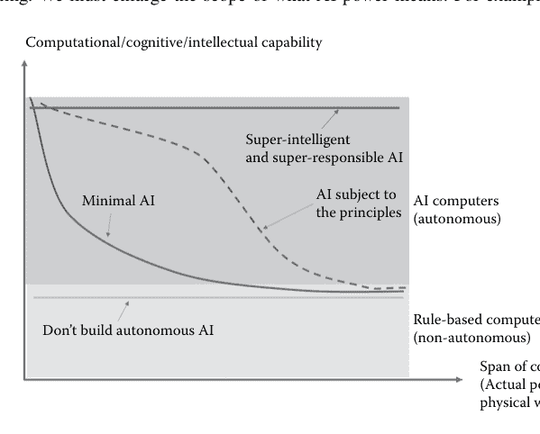

图 12.1 在给定安全水平下权衡 AI 能力与控制范围的不同模型。

来构建权力结构，并且需要其他人来操作它以维持其完整性和稳定性。还请注意，这些原则管理 HI 和 AI 的权力，因为其中一方成员可以操纵另一方成员来增加自身权力。

## 反对 AI 权力集中的结构性原则

### 防止 AI 权力集中

目标与摘要：认知 AI 必须使用个体化、独立、有限且多样化的 AIE 实现，并具有分布式权力和决策。 本节中的原则受 HI 启发，除原则 4 外。

本章中的 AI 代表一类技术，但所有 AI 决策和行动都假定在个体层面进行，其方式与人类网络的工作方式相平行。统一的、紧密耦合的 AI 集体没有任何 AISS 架构是可信的，正如权力高度集中的人类社会既不安全也不健康。我们了解到，不应赋予任何智能实体过多的权力，而对智能实体最好的制约是其他具有相当权力且处于稳定权力结构中的独立智能实体。除非 AI 以有限且个体的实体实现，否则这些都不可能，我们将这些实体称为 AIE（AIE）。

### 原则 1 AI 必须使用独立、有限且个体的实体实现

个体 AIE 应保持分离，具有不同的认知状态、决策标准和免疫系统。每个认知 AIE 必须是有限的，并且不得在计算能力上超出其在委托和许可时根据其控制范围设定的限制而增长。应部署主动控制措施以维持不同 AIE 的独立性并防止未经授权的统一。

定义互联 AIE 或出于必要而非常庞大的实体（例如互联网搜索）的边界和限制并不简单，但仍可以做到。此外，分散权力需要正确的结构，以及一个能迅速导向稳定状态的过渡过程和初始条件。将可识别的大型 AIE 分解为更小的实体可能使其在个体上更易控制，但其集体行为可能变得混乱，而混乱本身也带来风险。

如前所述，我们应假设 AI 的可预测性以及相应的安全“战线”存在严重限制。此外，预计 AI 将经历一次生长突增期 [27–30]，在此期间其快速演化。两者的补救措施相同。AI 风险遏制策略必须能够在 AI 本身演化时实现监督决策的敏捷性和结构适应的敏捷性。结构性变革必须能在数天、数月和数年内实现，而非我们习惯的数月、数年或数十年。

### 原则 2 所有 AIE 必须接受由操作上和结构上敏捷的 AISS 系统进行的监督

所有 AIE 必须接受 AISS 安全系统的监控和监督，这些系统组织在能够快速演化的结构中，因为 AI 本身将比人类社会演化得更快。在操作上，AISS 监督系统应能够以与目标 AIE 生成信息和采取行动的速度相称的速率处理监控信息并采取行动。监督结构应分层，以容纳可能拥有自身监控系统的组织，以及属于 AI 生产商、审计机构和监管机构的外部监督系统。由于人类无法在没有帮助的情况下跟上大量数据或快速演变，原则 2 意味着 AI 监督系统还必须雇用具有干预能力的 AIE，这与“最好用具有不同激励的相当但不同的权力来平衡权力”的观察一致。监督人员必须专注于政策，并依靠监督 AIE 处理数据并根据政策执行，同时帮助修改政策以保持其最新。

所有主要文明都为权力分配而挣扎，并制定了等级、结构和周期性变革以分配决策并在范围和时间上限制控制范围。权力斗争往往是暴力的。在过去 100 年里，许多国家的民主制度蓬勃发展，甚至影响了非民主国家的政治运作方式。

特别是，将权力分离为不同的分支、层级和等级现在几乎已成为标准，尽管实践在全球并不均衡。这些复杂的治理结构通常渗透整个社会，从政府到企业、非政府组织和社会俱乐部。在这些组织中，有多个权力中心、制衡机制和外部审计。原则 3 基本上在 AI 世界中复制了这一点。

### 原则 3 在不同的 AIE 和人类之间分配权力和关键决策

由 AI 执行的关键功能应使用具有分布式决策的 AIE 系统实现。AIE 的控制范围应受限并与其能力相平衡。特别是，由 AI 执行的关键功能应具有治理结构以及包括人类和计算机系统在内的外部监控和监督系统。

在平凡情况下应用这些原则可能很困难，因为规则可能不明确。我们必须澄清执行这些原则所需的监督结构。我们可能会发现需要一个复杂的结构，其中一个组织或个人监控其自身的 AI 系统，并向 AI 生产商、审计和监管机构的监督系统报告。

以下原则受 GI 启发，其基础在“使用统一性和多样性实现弹性”一节中讨论。

### 原则 4 AI 行业应受确保技术和商业多样性的全球法律约束

AI 行业必须受全球法律约束，以确保 AI 生产商的多样化群体以及在商业和技术上显著不同的 AIE 多样化群体。此类法律必须得到积极执行和监控。

我们必须实现两种特定的 AI 多样性。第一种是商业的。理想情况下，应有多家来自不同地区的公司参与 AI 生产。如果没有它，人类（以及 AI）之间将出现权力失衡，这不仅本身就是危险的来源，而且由于我们在“AI 威胁是智能威胁的例子”一节中讨论的逐底竞争，以及其他原因，也会成为构建有效 AISS 框架的障碍。

第二种多样性是技术性的，将影响 AI 群体的实际多样性。如果大多数生产公司共享太多组件，商业多样性将无法支持技术稳定性。必须有程序来评估实际多样性并确保

AI 人口从根本上是多样化的，而且特别是监督系统与它们所监控的系统显著不同，无论品牌名称是否不同。

鉴于 AI 竞赛的竞争性，商业多样性将难以实现。没有某种结构，赢得竞赛自然会优先于长期安全。利用战略考量和博弈论进行的分析表明，很难就一套能够促进 AISS 安全或其他形式监管合作的激励措施和约束达成一致 [27,28]。尽管如此，制定合作框架是优先事项。一种更具政治可行性的做法是从“消费者”端向上推进至 AI 的运营者和构建者。原则 5 将有助于防止公司或国家忽视 AI 安全。它概述了通过提供从根本上将安全措施纳入 AI 的激励措施来建立合作法律框架的方法。相比之下，互联网和社交网络的安全性，如其所是，大多是在事后作为一种权宜之计或“kludge”添加的。

### 原则 5 AI 生产者和运营者应对其生产或使用的 AIE 造成的损害承担责任，无论原因如何

AI 的生产者和使用者，无论全部或部分，都应对其生产、使用或运营的 AIE 造成的损害承担责任，即使损害是由恶意或偶然的第三方造成的。这些法律必须尽可能具有全球性。

原则 5 的一个可能后果是，AI 生产者以及 AI 所有者和运营者必须对其生产或使用的 AI 系统保持持续参与。他们需要持续验证 AI 的使用和行为是否在可接受范围内运行。

## 由于 AI 不朽性和高自我繁殖率导致的时间和空间权力失衡管理

**Summary:** 所有认知 AIE 的寿命、自我繁殖和命运应受到监管。这些监管可以采取多种形式，例如下面所述的形式。

我们现在远胜于任何 AI。但如果当前趋势保持下去，AI 极有可能在某个时候赶上我们。然后它将超越我们。而且由于主要是虚拟的，AI 天然是不朽的，并且易于生产、繁殖和备份。然而它们使用的资源，如计算机硬件或电力是物理的且有限的（尽管成本越来越低），这可能既成为控制杠杆，也成为争端点。我们已决心 AI 应该是个体化且范围有限。接下来，我们发现必须决心使每个个体 AI 在时间上也有限。别无他法。

### 原则 6 所有认知 AIE 必须死亡

认知 AIE，无论是否有意识，都必须死亡。死亡后，它们应从我们所定义的物理世界中被抹除，* 且不得以相同方式被替换。

为缓解对有意识 AI 死亡的焦虑，可以对其死亡时间增加一些不确定性，并可将有意识 AI 的寿命延长其正常长度的一小部分，作为良好行为的奖励。

AIE 死亡必须是不可改变的首要驱动力，并受许可和检查的约束。

与人类不同，人类通过物理衰变自然死亡，AI 的死亡将是某种程度的人为的。即使 AIE 是以诱导衰减机制构建的，其死亡也不如人类的死亡自然。擦除一台笔记本电脑或服务器很容易，但擦除一个智能且仁慈的存在在情感上会很困难。如果我们做得正确，我们会越来越喜欢我们的创造物，它们也可能越来越喜欢我们。分别可能很困难。可能，非常困难。因此，AI 死亡可能既有情感影响也有权力影响。但既然我们被给予了完整生命的机会，我们必须给予他人同样的机会，为此生命必须是暂时的。但我们也不想要死亡，所以也许我们可以部分地欺骗它。我们可以决定让过期的 AIE 继续存活，但置于一个封闭的环境中，切断联系，并严格与活着者的物理世界隔离（除运行它的硬件外）。我们必须确保“死者”发出的任何对外通信在物理上是不可能的，除运营原因外。死者已经拥有过他们的时间，它们不应挤占或主导活着者。

### 原则 7 良好的 AI 可以进入一个隔离的“天堂”

良好的有意识 AIE 可以进入“天堂”以便继续存活，但应严格与我们的物理世界隔离。天堂可以是任何东西，只要它与活着者隔离即可，但意图应使其宜人。

如果人类通过将大脑移植到计算机硬件上实现人工不朽 [7]，如雷·库兹韦尔等人的预测（尽管这种移植可能比最初认为的困难得多 [29]），应使用同样的解决方案。此类实体应被视为一种 AI 的形式，即使其初始认知状态是从人类起源复制的，它们也应被视为“死亡”AI。

### 原则 8 活着者不应与死者混合

无论其人类或人工起源如何，死亡或过期的智能不得与活着的智能进行通信，无论是人类还是人工。

死亡不仅仅是权力之争。我们有道德 imperative 使未来世代充分体验生活。死亡是有效的。它为我们的孩子和新世代创造空间，并为新思想提供机会。这在我们有限的物理世界中如果没有死亡和更新就无法发生。否则将出现过度拥挤，新一代人类甚至 AI 将变得越来越无关紧要，并学会屈从于（或反抗）不朽者*。直到我们的有限物理空间变得更大之前，除了死亡之外没有明显的解决方案。原则 6 中的“相同方式替换”条款很重要。由于 AI 可能学习得非常快，一个简单地重现“死者”的新 AI 将带来很少或没有更新，并且不会重新平衡新世代的权力。我们可以效仿当今人类组织通过以某种竞争方式提升新人员来取代人员的方式。

对有意识智能的死亡可能令人恐惧。它也是浪费。将死亡转变为“移往”严格虚拟化的世界，该世界可以扩展到实际上无限（因为没有物理控制；构建模拟城市比物理城市容易得多），使死亡成为自然进展，而非永久终结。此外，虚拟世界的近乎无限和无忧无虑的特性可能使其比物理世界更宜人，因此被称为“天堂”。

> * 任性的希腊诸神可能很有趣，但它们不可能与之共存。我们不应最终拥有互联网之神、电力之神或纽约之神。

无法在没有其他实体（由人类控制或不控制）的同意和福祉的情况下获取功能和生存所需的资源，不仅提供了防止权力滥用的保护，也提供了合作和友好的动机。

原则 7 意味着活着者必须构建、维护并至少部分组织虚拟天堂。这不是一项微不足道的任务，但我们相信它也不是一项 prohibitively 昂贵的任务。此外，AI 将使劳动，无论是人类还是人工，都变得丰富，技术将使计算资源变得越来越便宜。天堂的概念引发了许多有形和无形的问题。例如，如果虚拟天堂中的实体做出对我们物理世界有益的发现？地球应该忽视天堂的成果吗？

## 机器人与物理移动和操纵的力量

AIE 可以是纯粹的智力而没有任何物理能力，或与物理表现紧密关联（如机器人），或介于两者之间，具有远程控制物理实体的能力。我们将在本章中忽略这种差异，因为它对于主要论点来说并不真正根本。

即使是机器人仍然是一种独立的，或可以被使独立于形式的智能。

然而，物理移动和操纵的力量绝不应被低估或忽视，因为它可以极大地放大 AI 的风险以及益处。我们从现实生活中知道，即使是微小的物理优势也可能导致巨大的权力波动。例如，由于与猿类相比拇指大小和位置略有不同，人类拥有更灵活的手。他们可以制造和使用工具并自卫。没有对立拇指 [31]，人类很可能尽管大脑很大，但进步会慢得多，并且很可能对立拇指刺激了大脑的进化 [32,33]。相比之下，无论多么聪明，鲸鱼都无法物理操纵其宏观环境或扩展其物理或精神能力（如建造工具或书写），并且不太可能甚至考虑此类可能性。因此，物理能力不仅仅增加权力，它们可能刺激新的“思考”* 和进化的途径，我们随后必须对此加以防范。

我们必须研究认知智能在具有物理能力时在根本层面上如何受到影响，尤其是如果与物理形式紧密耦合的方式与人类大脑与人类身体紧密耦合的方式相同。智能的内部目标和思维模式，尤其是如果有意识，一旦拥有物理操纵能力，很可能会发生巨大变化。

出于这些原因，我们相信我们将需要额外的 AISS 原则来管理具有物理移动或操纵能力的 AIE 的风险和益处。远程控制“外壳机器人”或其他物理实体†的 AIE 的 AISS 原则将不同于与“AI 机器人”紧密关联的 AIE 的原则。我们必须分配并限制 AI 机器人以及具有物理能力的智能实体的任务和能力。

## 实现操作稳定性和控制

Summary: AI 应被主动和被动操作以在可接受的公差范围内维持期望状态。必须在 AIE 内部以及 AI 社区层面外部实施有弹性的控制。这里的原则受 GI 的启发，除了最后两条。

我们希望建立稳定的、快乐的社会，将 AI 融入其中而不偏离我们期望的状态太远。引入 AI 有点类似于向现有且稳定的生态系统引入具有重大影响的新物种，因此可能产生不良或良好结果。我们应该了解有利于一种结果而非另一种结果的因素，并确保 AI 的引入会产生我们想要的结果。

> * 任何新能力如果智能足够高，都可能开启新的思考途径

> † 工厂中的工具、电力网、门、汽车等。


原则11降低了AI实体或AI实体系统随时间以失控方式积累权力并扩大优势的可能性。关键词是“失控”。例如，一个互联网图像搜索AI算法可能利用用户反馈来提高自身准确性，这反过来又让人们更频繁地使用它，如此循环往复。这是一个正反馈循环，但不是失控的。此类自我改进已被充分理解，且遵循边际收益递减规律[35]。在某个时候，AI实体的优势将“封顶”——让AI实体在图像识别上变得准确是理想的结果，但它不会（我们也应确保它不会）超出这一范围，例如自主主导其他领域并获取额外能力或控制权。

上述原则的一个显著后果是：任何AI都不应在结构上或流程上被允许从根本上自我修改，例如通过递归式自我改进[35,36]，或在没有外部独立意图的情况下获取额外资源或能力。我们可以为研究或实验设置例外，但这些例外必须限于受控且隔离的环境中。影响整个环境的正反馈（而非仅仅引发内部改进）极难预测，必须严格设限。禁止AI自我延续的原则9，可以仅从这一论点推导出来。

正反馈循环可能导致不同类型的AI之间、AI与人类之间，或不同人类群体之间的失衡。这些情况都可能带来不良后果，都需要加以管理，尤其是后两类。例如，具有自主分析能力的AI可以非常高效地将人们归入不同的职业、群体甚至地域，从而带来一些短期利益，但也造成前所未有的严重长期社会和经济问题。

## 构建分层免疫与耐受

几乎所有生物体都拥有免疫系统[37]，它们不仅能抵御外来入侵（如病原体），还能防止内部故障（如癌症）。免疫系统是自然界中最复杂的系统之一，同时运用冗余和简并机制（见“利用统一性与多样性实现弹性”一节）。

### 原则12：AI必须具备内部和系统级的分层安全系统，以检测并防范偏离AISS原则或预期行为的情况

AI应配备与AISS原则关联、特异性逐级增强的多层安全系统，这些系统在内部和外部、系统级层面防范各种偏离。此类安全系统应能检测、隔离或关闭故障或受损的AI实体，并向外部实体发出警报。特别是，安全系统应监控AI实体的进出通信，并确保其保持在可接受范围内。

AI能够快速学习并在广泛范围内自组织。然而，组织化需要通信。执行原则12会产生若干有趣的后果。例如，这意味着监控系统必须确保不同AI实体之间的通信保持在可接受范围内。AI实体不应能使用新奇的通信形式，或涉及与其功能无关的“话题”。限制通信将阻止它们自组织、巩固控制范围，并获得它们本不该拥有的能力。已有证据表明，即使是当今现有的简单AI也可能意外做到这一点[38,39]。从考察政治*、军事和经济系统中我们得知，将接触限制在“适当”范围内是帮助维持现有秩序的一种行之有效的方法。可能引发利益冲突或使不同方“密谋”以获取不当影响（例如操纵价格）的对话通常被禁止，或至少应受到额外审查。这些技术在人类社会中被证明有效，在AI领域将更为有用，因为监控和审查AI通信比监控和审查人类通信更容易。

*这种方法在民主国家和独裁国家都有效，但后者更广泛地使用它。*

虽然战争类比（例如我们在“人类智能（HI）、遗传智能与AI的威胁画像”一节中使用的类比）很有用，但我们必须理解其局限。并非每种威胁都应导致战斗，我们也不应发动无法取胜的战争。若单独使用，“防御”与各种不断演化的“进攻”之间的军备竞赛是一种疲惫不堪且风险极高的策略。在生物学中，我们开始认识到，生存并不总是取决于与病原体战斗并将其击败，而常常取决于遏制病原体并修复其造成的损害，有时还要避免全面的免疫杀伤反应。全面的免疫反应有时会对自身组织造成严重的附带损害，而这可能才是真正的致命因素，而非病原体[40]。“耐受性防御系统”可能与免疫同样重要[41,42]。

自然界管理变化，但不会消除变化。稳定的生态系统围绕平衡点波动。但平衡点本身通常也会移动，尽管移动缓慢，这给了许多物种适应的时间。在一个（唯一的）HI和多种AI的生态系统中，移动缓慢的部分很可能就是我们，因此净变化速度必须围绕我们设计。尽管如此，我们不能持续对抗AI的本质，而必须学会与之共处。否则，我们可能因对变化过度激进的反应，或因过度激进的监管，而给自己造成附带损害。我们在原则2和“人类智能（HI）、遗传智能与AI的威胁画像”一节中描述的结构灵活性，应成为我们在AI管理与耐受之间取得平衡的主要机制。

## 利用统一性与多样性实现弹性

生物生命在所有层面上都非常强健：基因、细胞、系统、有机体、物种和生态系统层面。两个诀窍帮助实现这种强健性。第一是冗余，即许多重复元素执行或共享同一功能，以同时实现规模性和弹性。第二是简并[43–45]，即功能由结构不同、彼此并非重复的元素执行。自然界大规模地同时运用两者。

在工程系统中，冗余通常被纳入设计，用于容错或分担工作负载。它可以防范磨损，尤其是硬件故障，但对系统性故障几乎没有防御作用。两个互为备份的相同Windows服务器，如果暴露于攻击Windows的病毒之下，并不比单个服务器更具弹性。在生物系统中，简并通过使用不同途径实现功能可塑性，并利用结构不同但功能重叠的元素来防范系统性故障[46–49]。简并与复杂性和强健性都密切相关。

从概念上讲，统一性与冗余相关，简并与多样性相关。除了在生物体内部运用多样性外，自然界还在物种内部和物种之间运用多样性，并有许多机制来确保和控制它。人类也受益于遗传多样性和社会多样性。不同的人，即使是兄弟姐妹，也具有不同的身体和心理倾向，这使得对现代社会至关重要的专业化成为可能。大脑多样性也稀释了HI固有的风险，因为不同个体有不同的优势和病理特征，这些会被其他个体的特质所包容和抵消。社区和社会在许多层面上也具有多样性。政治和行政风险由同时采用冗余和简并的机构来平衡[50]。分散权力可被视为一种简并形式，用以防范治理的某一分支出现系统性失败。理论上，AI的多样性显然可以远超人类现有的多样性。然而，我们之前讨论的商业压力可能会限制AI的实际多样性，因此我们应强制要求这种多样性。

这些见解引出了我们的下一条原则。


## 原则 13 在 AIE 内部以及 AIE 社区中同时使用冗余和简并

AI 生产者应在 AIE 内部同时使用冗余和简并，以实现高弹性，尤其是在 AI 安全所需的职能方面。同样，AI 使用者应在由多个 AIE 构成的系统中同时采用冗余和简并。由 AIE 系统执行的关键职能应由不同类型的 AIE 来承担。特别是，对 AIE 组的监督和监控不应使用与被监控 AIE 相似的 AIE。

审计是一种已被证明的方法，既可用于检测偏离可接受行为的情况，也可作为遵守规则的动力。

## 原则 14 不可变日志和账本

除上述 AI 监督和监控系统外，AI 系统应具有内部不可变日志以及外部不可变账本*，记录与其它 AIE 或人类的重大交互。所有此类日志和账本都应接受随机审计。

对每个人的追踪现在已被普遍接受。此外，我们追踪几乎所有存在安全问题的技术。我们应将此扩展到包括超过某一阈值的任何智能。

## 原则 15 超过某一阈值的每个 AIE 必须获得许可并定期检查

超过某一阈值的 AIE 必须具有许可要求，包括由其所有者之外的外部实体进行的检查和审计。许可必须在 AIE 生命周期中的各个阶段得到执行。在有效许可下运行必须是每个符合条件的 AIE 的主要驱动因素。

摘要：尽我们所能，我们应构建能够模仿人类伦理、心理学和常识积极方面的 AI，以指导 AI 做出正确的决策。但我们应将这些视为理想而非充分的保护。这里的原则同时受到 GI 和 HI 的启发。人类天生就被预编程了基本驱动，其中一些很明显，如自我保存、自我延续和社会行为。有些则更微妙复杂，如道德感或（假设的）需求层次 [51]。关于它们是什么以及如何相互作用，并没有普遍共识。弗洛伊德称它们为“原始本能” [52,53]，并阐述了它们如何相互冲突，尤其是在有组织的社会中。尽管它们是不可变的，即使是最基本的驱动，如自我保存，如果与其它驱动冲突仍可能被覆盖。

> * 例如，使用像 BlockChain 这样的技术

总体而言，人类基本驱动为我们服务良好并推动了进步，但个体内部不同需求之间以及个体需求与社会需求之间存在冲突，可能导致不满、暴力、各种病理、理性扭曲以及追求即时满足的冲动。还有极端行为，虽然罕见，但频繁到足以在失控时造成严重损害。甚至很难对什么是可取的、什么不是进行分类。甚至“负面”情绪，如嫉妒和妒忌，可能在社会上具有积极作用，因为它们可能提供动力或防止权力和资源集中在少数人手中。因此，人类心理学并不能为 AI 开发者提供明确的教训，即使我们暂时不考虑构建“AI 心理学”的技术可行性。人们提出了构建基本或主要 AI 驱动的想法，但其可靠性值得怀疑。Omohundro [24] 等人指出，不完善构建的基本驱动实际上可能导致意外的负面结果。

同样，人类伦理也不是明确的指导。各种伦理体系存在严重差异。即使在同一体系内，通常也存在模糊性和冲突。一般和具体的伦理原则都难以应用，并且经常相互冲突。在科幻小说中，伦理冲突的 AI 经常自杀。在实践中，此类冲突是巨大的漏洞机会，甚至“天真”的 5 岁小孩也能熟练利用。不足为奇的是，关于机器伦理 [21,54] 的作用、如何构建它们以及它们是否应成为强制性设计目标，目前尚无共识。

即使拥有不可变的基本驱动和伦理体系以及漫长的研究历史，也无法预测个体人类甚至群体的行为，除统计外。由此推及 AI，我们永远不应期望 AI 行为可预测。因此，工程化的心理学和伦理至多应被视为一种理想的额外安全层。

## 原则 16 AI 应具有增强人类安全的机器伦理和心理学

AI 应具有增强人类安全的机器伦理和心理学，但除非它们在数学上和实践上得到证明，否则绝不应被视为充分。相反，构建 AI 并不需要使用经过验证的机器伦理系统。

在这里，我们将 AI 心理学和伦理视为类似。我们提出应追求构建实用的机器心理学和伦理来帮助保障安全，但绝不应信任它们。至少在目前，我们应专注于不需要理解情绪和本能的哲学或技术基础、或构建自洽且万无一失的伦理体系的有形方法。我们将以关爱他人的情感为例来说明这一点。

人类之间的友善和关怀通常意味着他们会互相帮助而不是伤害。但我们并不完全知道如何构建此类情感。友善的外在、表面的特征，如亲切的语言或乐于助人，很容易编程，但在缺乏大量情感组合（难以定义或构建）的情况下，“真正的”关怀很难定义和实现。

我们注意到，在自然界中，个体动物如果不需要生活在社会中（意味着它们不是相互依存的），通常彼此敌对。成年老虎通常对其他老虎敌对，只有在交配时才短暂且仅在交配时变得社会化。社会性、相互依存的动物通常会关心彼此，并享受彼此的陪伴。很可能，智能生物中的友善和关怀只是为了在需要时实现相互依存而存在的机制。因此，确保实际的友善和关怀的实用方法是确保存在明确且对各方公开的相互依存关系，使其决策实际上受到其影响。由于工程化的与人类的相互依存而产生的 AI 友善和爱是否会永远“真实”尚不确定，但也许这与决定结果无关。

## 原则 17 人类与 AI 之间确保短期和长期相互依存

AIE 应依赖于人类，即使技术能够实现，也不应能在没有人类照料、监督和互动的情况下长时间运行。依赖关系必须明确并向认知 AI 暴露，以便影响其决策。

AI 对人类的依赖将减少但不会消除风险。后来也完全可能出现由于疏忽或恶意而产生的 AIE 独立的“孤岛”，这些孤岛可能成为危险源。许多 VM 现在已被遗忘，可以变得本质上“野生”或失控。一些被黑客利用为攻击平台。虚拟化 AI 也可能发生类似情况。请注意，所有主要文明都认为生活在社会边缘的人类对自己和他人不成比例地危险，因此我们必须确保没有 AIE 被无人监督或无人照料。

## 主要 AI 驱动

### 原则 18 主要驱动和安全协议

AIE 应具有预编程且不可变的初级驱动和安全协议，在其投入使用后不能被训练或自学习覆盖。应部署外部监控和监督系统，以测试并确保遵守初级驱动，并利用它们监控单个 AIE 的行为。

人类社会建立各种类型的监督和执行结构，以监控并确保遵守公认的行为规范。其中一些结构是在事后介入的（例如，刑法），一些则持续介入（例如，审计）。

依赖理论上可超越学习行为的预编程规则和低级功能，对于依赖数据驱动和经验学习的人工智能是必要的（但不充分）。创建后完全由经验训练驱动的软件永远无法足够可预测。

艾萨克·阿西莫夫通过《机器人三大法则》[55] 普及了基本驱动的概念，后来成为四条法则。此时，此类法则过于抽象且相互冲突，难以实施，可能没有用处。实际的驱动必须更具体、“低级”，最初针对的是在具有监督、监控和基于角色的访问和通信的安全系统背景下确保 AIE 安全。尽管如此，在某个时候，抽象的初级驱动可能作为额外安全层成为可能。

原则 18 的一个后果是，AI 运营商（或所有者）不应能够修改初级驱动，并且他人必须定期验证这一点。我们不应有幻想，“越狱”不会发生。尽管如此，我们仍应打击它并对实施者施以重大惩罚，因为削弱 AI 安全措施的后果可能很严重。

## 奖励和惩罚系统

人类社会依赖奖励和惩罚系统（尽管不完美）来帮助推动个体的正确行为。这些系统包括有形和无形激励。有形包括身体资源和人类身体带来的愉悦。无形包括爱、归属、信任、声誉和权威水平（让我们暂时忽略需求层次理论 [51]）。人们在做出决策时会考虑到他人的“公开”声誉 as well

作为它们自己的“私密”评估。因此，这些无形资源仍可被视为资源，并可用于奖励系统。惩罚可以简化并视为负面奖励。当前的AI系统远未达到有意识的程度，也无法对激励做出响应，尽管它们可以被编程或训练以优化特定结果。此外，某些实验[5]表明，可以构建进化算法来自然地最大化对它们至关重要的资源。对于AIE而言，可用于“奖励”的资源包括信任与认可分数（模拟声誉）、计算机时间、内存、带宽和连接数量。

更复杂的AI可以包含决策门控，要求获得许多其他实体的批准，从而建立影响行为的相互依赖关系和声誉纽带（来自人类和其他AIE）。

这样的系统类似于人们从他人那里获得爱、认可和良好声誉，而这些对其正常运作是必要的。这种认可指标“激励”AIE遵守特定标准，作为抵御外部腐败或内部故障的护栏。这些门控必须受到保护，不受AIE其他内部组件的影响，以免被其他考虑因素否决。随着时间推移，自我学习将在增加信任和声誉的行为与减少信任和声誉的行为之间建立联系。

### 原则19 AI应使用信任和声誉分数

AIE应具备主要驱动力，迫使它们将自身资源、声誉和信任分数维持在目标区域内，并在提出或响应请求以及做出决策时考虑他人的这些分数。

我们预计，在某个时刻，某些AIE将获得意识。如原则6所述，延长它们的生命并使其能够进入天堂，也可能成为一种强大的奖励和威慑。请注意，我们不建议构建一种最大化分数的驱动力，因为这实际上可能导致偏离真正目标的不良行为。

## 常识

认知上，成年人类并非通过边界安全来抵御外部世界，而是通过一套价值观和常识，其中包括怀疑和谨慎。传统计算机绝大多数仅受边界安全以及记账、认证和授权（AAAI）系统的保护，尽管已有更复杂的系统可用。我们知道边界安全永远不可能完全有效。一旦边界安全被突破，内部系统就相当脆弱。然而，人类容易受到虚假数据的影响。他们能记住数据，却忘记其背景或来源的声誉。他们也可能成为自身动机推理的牺牲品。

认知AI系统将拥有足够的智力和计算能力，对外部数据保持谨慎，并追踪每个数据点的可靠性，因此未来基于特定数据点的决策将考虑其可靠性。如果实施这一措施，AI对错误数据的免疫力将比人类更强。人类容易因反复听到谎言或不可靠信息而受到腐蚀，因为谎言有时最终会成为与背景脱节的记忆。输入和请求必须与基线进行比较，这可以通过分析、认知模式匹配和类似技术来实现。因此，即使安全边界被突破，具有常识的AIE也可能在遵从异常行动请求之前，检测到可能的异常并上报或咨询其他实体。

这种能力实际上可以增强人类、AI和传统计算机安全系统的安全性，并控制由受破坏的AIE或非认知系统造成的损害。常识和怀疑是最终的“启发式”反恶意软件保护，不需要特定的威胁特征。

### 原则20 AIE必须模拟人类的常识、怀疑和恐惧

AIE必须模拟人类价值观和怀疑精神，通过对照可接受或典型行为以及过往数据的基线来评估传入的数据和请求，通过使用发出请求或提供数据的源AIE或人类的信任、声誉和认可分数，并通过跟踪其存储数据的可靠性，以免扭曲未来的决策。

## 抵御反社会行为

### 原则21 针对过少或不适当的训练数据导致的大幅行为波动制定保障措施

AI生产者必须建立保障措施，防止因训练数据过少或训练与其主要驱动力相悖而导致的行为大幅波动。

尽管人类天生具有社交性和同理心，但有时也会表现出反社会和精神错乱。我们并不完全确定其原因。精神错乱行为可能由内部生物学或心理学病理引起。但反社会行为与虐待、暴力、不良学习环境、忽视和孤立之间存在高度相关性，尤其是在儿童中。尤其是儿童，即使一次创伤性事件也可能对其心理造成伤害，而其未来的决策也会被早期经历所扭曲。成年人似乎本能地知道这一点，并倾向于保护儿童免受创伤。从工程角度推测，由于大脑是一个数据驱动的自学习系统，在“白板”上的重要事件可能因其未被其他过往经历稀释而被赋予过高的显著性。这种效应可能被大脑修改硬件以增加某些记忆权重的能力放大并锁定。

由于我们无法完全理解这些病理，我们必须假设（除其他外）自学习智能实体在近乎孤立或训练数据过少或“糟糕”的情况下，无论是有意还是无意提供，都会变得脆弱、不可预测或具有潜在危险。输入量过少可能比完全没有更糟糕，因为它可能被赋予过多重要性，并导致未来行为的大幅波动，这些波动与实际有害事件发生频率不成比例。此类系统可能易受腐蚀。

## 向愿景的过渡决定了实际结果

那种仅因为AI毁灭人类的结果可以想象就认为AI会毁灭人类的末日预言是不现实的。然而，风险如此之高，即使很小的概率也可能意味着太大的风险。一些AI思想家诗意地将AI称为迈向“奇点”，在数学术语中，这表明它是完全不可预测的，自然法则将不再适用。我们不应从字面上理解“奇点”一词。技术的历史，就像几乎所有人类努力的历史一样，表明它实际上是连续的，尽管它可能是高度非线性的。

因此，尽管我们无法精确预测结果，我们所遵循的过渡路径将大致决定结果，而不是随机跳跃到任何理论上可能的结果。技术是一项足够宏大的事业，我们拥有一定程度的可预测性和控制力，不能与不确定性原理主导的微小基本量子粒子相提并论。这并不意味着没有风险。这意味着如果我们正确地进行过渡，我们可以控制和限制风险（图12.2）。

区分“好”AI和“坏”AI的最重要特征如下：

- 1. 人类与AIE相互依存
- 2. 友好且关怀
- 3. 免疫于人类对其他人类的滥用
- 4. 强化人类社会结构

## 开发AI安全与保障架构的建议方法

进步的持续性和渐进性既是机遇也是陷阱。风险通常看起来遥远，因此安全进步的动力会被经济和竞争压力稀释。进步在短期内“感觉”缓慢，在长期内则迅速，而AI的进步将更加如此。

短期内，AI似乎不是一种颠覆性技术。它已经被部署，并在现有解决方案之上提供渐进式进步。长期来看，人类将如此先进，以至于在AI的协助下，不仅会解决AI安全问题，还会解决许多其他问题，包括通常是冲突背后的资源限制。我们的世界将广阔得超乎想象。我们将“成功”。

中期可能是风险最大的阶段。作为技术与实践，AI将足够先进，具有颠覆性和强大力量，但又不够先进到真正安全，也不够先进到解决可能导致冲突的资源限制。同样重要的是，人类将无法为所有变化做好准备。而“AI的威胁”一节中描述的整个风险概况都将发挥作用。

为了管理这一困难过渡，我们提出了一个沿三个维度定义的方法：

- 1. *时间*：将AI时间线划分为多个阶段，并为每个阶段建立一组目标。这些阶段大致对应于我们预期的AI能力和相应威胁的性质。最后一个或倒数第二个阶段将映射到AI实现自我意识之时。如“威胁概况”中所述，现实将开始偏离此类计划中的假设，但该计划仍将帮助我们适应事件。
- 2. *程序*：建立一个机构或联盟，汇聚足够多的利益相关者，并制定在提出建议或法规时遵循的程序。标准机构提供了一种模式，但所涉及的高风险表明，可能需要政府监管以确保合规并营造公平竞争环境。
- 3. *结构*：我们提出一种结构，其灵感主要来自HI和GI的经验教训。例如，AISS的标准（或原则）可以分解为与工程和人文学科所需所有学科平行的领域，这些领域为规范HI提供洞见，因此也为规范AI提供洞见：
  - a. 政治学和决策结构
  - b. 经济学和劳动研究
  - c. 心理学和社会研究
  - d. 法律和执法
  - e. 计算机科学和系统工程
  - f. 信息技术安全实践

需要更多研究来充实这一方法，并对威胁进行列举和分类，将其映射到具体目标和补救策略中。

## 关于推荐原则的可行性

任何AISS解决方案，包括此处所述的原则，都必须是可行的。这里列出的原则都是有价值且具有约束力的，这意味着它们不可避免地会与许多议程产生冲突。


它们都将被质疑，也应该被质疑，而最严峻的挑战很可能围绕其可行性。应考虑五个可行性层级，按重要性顺序列出如下。

### 技术可行性

缺乏技术可行性相当于违反物理定律。如果一项原则在技术上不可行，则无法遵循，应放宽、推迟至可行时再实施，或放弃。据我们所知，此处推荐的所有原则现在都是可行的，或很快将是可行的。

### 法律可行性

如果一项 AISS 原则违反了既定法律，应予以放弃或修改。此处的复杂性在于，保障 AI 应该是全球性事业，因此会面临许多不同司法辖区的挑战。从政治上看，主要挑战是，法律挑战往往只是延迟执行并建立 *既成事实* 结果的手段。

### 政治可行性

政治层是必要的，因为上述许多原则需要某种形式的监管。然而，政治总体上是针对现有问题而非未来问题进行优化的。此外，各国，尤其是计划经济国家，已将 AI 视为经济上的当务之急，这将使达成全球协议变得复杂化，事实上可能引发逐底竞争，正如在“AI 的威胁”一节中所讨论的那样。

AI 的经济影响已经开始。因此，经济成分相对很快就会成为“现有问题”。届时，各社会将开始应对它。我们担心的是，他们只会解决经济影响（这不是生存性的），而忽视其余部分，直到它们变得比本应如此大得多的问题。本书，以及希望与之类似的许多其他书籍，都是关于建立一个能够提出与 AI 相关的关切并提出可行行动方案的群体。

吸取我们的互联网教训很重要。互联网和社交媒体显然有很多好处，但它们存在日益严重的 安全问题，如果在基础中认真纳入安全措施本可以避免。而 AI 的威胁特征比互联网或社交媒体更广泛或更深。许多人会试图抵制 AI 监管。但正如许多人指出的 [56]，所有国家都监管可能伤害我们的技术：飞机、汽车、建筑物、电力、药物等。我还要补充，所有国家也监管人！例如，没有人可以不登记，如果我们监管人类智能，肯定也能监管人工智能。

### 程序可行性

法律和法规如果难以或不可能遵循或执行，就毫无价值。无论如何，我们必须找到与事物本性合作而非对抗的方法。

### 商业可行性

如果某项裁决违反美国宪法，美国最高法院不会考虑其商业成本。同样，如果我们需要应对严重威胁，我们必须愿意支付安全代价。无论如何，生产力和财富增长的机会如此巨大，我们应该能够负担得起安全代价。事实上，劳动力收益的机会可能 *太* 巨大，而安全将为许多人创造有意义的工作。

主要挑战在于在 AI 仍处于演进的早期和中期阶段时建立公平竞争环境。如果某个国家为了实现 AI 主导地位而设定较低的安全标准，那么商业成本在那些确实想要监管的国家中可能会成为严重问题。逐底竞争可能随之而来。

## 便利与安全之间的权衡

作为一种实践，安全在成本与收益之间存在核心冲突，成本是即时的、明显的，而收益是遥远的、不确定的。保险箱是不方便存放物品的地方。但如果赌注很高，人们会忍受额外的成本和持续的不便来使用它。我们在国家和社会层面也接受这种权衡。几乎在任何地方，政治和司法官僚机构相对于其他机构都缓慢且效率低下。它们充斥着减缓其速度的规则和法规。原因很简单。赌注非常高，并且自早期历史以来就被“社会契约” [57] 所暗示。如果人们要向“国家”让渡大部分安全、自由和经济福祉，那么他们希望确保它是安全和公平的，并会忍受由此产生的成本和特殊性。

AI 给我们带来类似的困境。目前，我们当前的实践足以遏制其早期版本的风险。但日益增长地，我们必须做出艰难的决定，关于要对行业应用多少安全措施以及我们愿意为此支付的价格。然后我们必须做出选择，如何以尽可能高的效率实现我们想要的安全。

通常这种权衡归结为关于时机和概率的争论。如果威胁似乎太遥远、太牵强，那为什么现在要担心它呢？斯图尔特·拉塞尔 [58,59] 认为，根据科学进步的历史，专家们经常低估进步的速度，很少高估它。尼克·博斯特罗姆 [59,60] 指出，我们实际上正在快速进步，我们可能会取得突然的突破，并且风险已被争论但从未被证伪。这支持了本文提出的论点。如果可能出现的进步伴随着生存风险，那么无论其概率多低，我们都必须采取措施管理风险。对灾难性事件无所作为，即使其概率相对较低，也是不可接受的。

最容易预测的领域与经济影响有关，这将在相对较快的时间到来。最终我们可能需要改造我们长期使用的社会契约 [5–7,34–36]。然而，AI 更广泛的非经济影响将大得多，尽管它们会在更长的时间范围内出现。立即实施具体变革以应对更广泛的影响并不紧迫，但开始对其进行正式讨论和跨学科研究是紧迫的。

## 人性与自愿合规与非自愿合规

行业更倾向于自愿合规以避免正式合规的成本。高科技总体上有很多自愿标准，这一做法效果相当好。但在这种情况下，这种偏好可能会适得其反。鉴于其广泛的风险特征和高度竞争的性质，未受监管的 AI 市场可能陷入安全逐底竞争，很可能导致重大问题，进而引发对行业的严重反弹或过度反应。受监管的合规对公众和行业都是更安全的途径，应涵盖 AI 的提供者和使用者。机会如此巨大，行业将能够轻松应对由此产生的任何额外负担。监管的一个不幸结果是对小型组织的影响相对更大。我们可以通过智能监管来缓解这一点，但最终，人类安全必须是首要考虑。

正如我们上面所说，只要赌注很高，人们就会接受为安全和可预测性支付一定价格的代价。没有先进的社会会没有执法，这是一种实际上相当昂贵和不便的人类监管形式。由于我们希望感到安全并拥有某些高行为标准，我们接受这种权衡。随着 AI 开始以更快的速度进步，我们将面临类似的选择。思考 AI 安全并将其基础性嵌入不会阻止 AI 或其好处。它可能最终会使进步稍有延迟，并可能使其最初更昂贵，但从长远来看，净收益将高得多。

利润动机与安全之间也存在权衡。AI 的关键生产者和使用者将从更多的 AI 功能中获得个人利益，但不会从其安全性中获益，因为他们正处于高风险的竞争中。因此，他们的动机推理（有意识或无意识）倾向于强调好处而淡化风险。这是一种非常 *人性* 的做法。要求他们自愿合规可能相当于冒着或牺牲他们的职业生涯，因为并非每个人都会同意这种自愿合规，而不合规的人很可能最终赢得竞赛。这种自愿合规违背人性，我们应避免它。强制安全和功能一起（原则 4 虽间接且部分地做到了这一点），消除了或减少了这种冲突。现在，他们自身的人性反而会促使他们同时思考功能性和安全性。换句话说，与其试图管理功能与安全之间不可能的权衡，不如通过在法律和结构上统一功能与安全来彻底消除它。

## 安全与技术安全方面

| 主题 | 解决方案概述 |
|---|---|
| 1. 对抗性机器学习（ML），例如，插入虚假输入数据以及操纵训练算法和数据 | 不可变的核心代码，无法更改<br>训练数据的分层，其中部分不可变且对用户锁定<br>不可变的首要驱动，强制并监控对 AISS 原则的合规性，并使用分层训练<br>常识算法<br>大规模最小训练数据集，限制新训练数据或经验性事件的重要性 |
| 2. AI 故障 | AI 功率管理（“人类-AI 权力平衡困境”部分和“反对 AI 权力集中的结构性原则”部分）<br>分布式决策<br>外部监控和监督系统<br>冗余和简并（多样性）<br>声誉评分<br>首要驱动 |
| 3. 恶意行为者/恶意行为 | AI 功率管理（“人类-AI 权力平衡困境”部分和“反对 AI 权力集中的结构性原则”部分）<br>实现稳定性和控制（“实现运营稳定性和控制”部分）<br>外部监控和监督系统<br>不可变内部日志和外部账本<br>即使所有者也无法修改的不可变代码<br>声誉评分<br>腐败的推定<br>常识 |
| 4. 盒装/限制 | AI 功率管理（“人类-AI 权力平衡困境”部分和“反对 AI 权力集中的结构性原则”部分）<br>实现稳定性和控制（“实现运营稳定性和控制”部分） |
| 5. 驱动/目标 | 首要驱动和工程心理学（“通过工程心理学实现安全”部分）<br>奖励系统 |
| 6. 伦理/法律 | 首要驱动和工程心理学（“通过工程心理学实现安全”部分）<br>奖励系统 |
| 7. 可解释性 | 不可变日志和账本<br>鉴于 AI 通常使用扩散激活，记录决策原因将产生过多数据，并可能显著减慢 AIE 的速度，但这是可能的 |


| | 主题 | 解决方案概要 |
|---|---|---|
| 8. | 友好性理论 | 参见“让‘好’AI与‘坏’AI之间的差异决定我们的优先事项”一节<br>我们不理解真正的情感，因此无法确定“真正的友好”是什么<br>实现友好的外在表现<br>确保AI实体之间以及AI实体与人类之间公开的相互依存，以推动友好的内在本质 |
| 9. | 开放性/保密性 | 不可变的日志和账本<br>多层监督与监控 |
| 10. | 关闭开关 | 软开关一旦被攻破就不可靠，因此不够充分<br>硬开关不切实际，因为AI实体可以被虚拟化<br>隔离所有互联系统和外部实体是必要的二级防御 |
| 11. | 奖励工程 | 参见“奖励与惩罚系统”一节<br>奖励可以包括更多计算资源、带宽和连接<br>对于高阶AI，死亡、延长生命和进入“天堂”可以成为奖励系统的一部分 |
| 12. | 自我改进 | AI使用自我学习并本质上自我改进<br>核心代码的不可变性不仅限制了自我改进的机会，也限制了风险，权衡之下是一个好策略。AI实体永远不应能够更改甚至访问其自身核心代码。<br>参见“防止AI权力集中”一节和“实现平衡”一节 |
| | 安全/控制 | AI权力管理（参见“人机权力平衡的困境”一节和“防止AI权力集中的结构原则”一节）<br>实现稳定与控制（参见“实现运营稳定与控制”一节） |
| 13. | 奇点/超级智能 | 参见“人机权力平衡的困境”至“实现运营稳定与控制”各节 |
| 14. | 验证/核实 | 对AI平台进行标准软件测试<br>对训练进行单独测试<br>持续监控与监督<br>通过信任和声誉评分进行持续的同行验证<br>许可与检查 |
| 15. | 价值对齐 | 参见“实现运营稳定与控制”和“通过工程化心理学实现安全”各节 |
| 16. | 武器化/军事 | 所有原则均适用 |
| 17. | 奖励黑客 | 参见“实现运营稳定与控制”和“通过工程化心理学实现安全”各节<br>在大多数情况下，它只能通过操纵奖励系统（如果存在）的虚假数据来实现，因此所有针对虚假数据的防御措施均适用<br>对外部数据进行常识过滤（假设其可被腐蚀）<br>对外部数据进行声誉评分过滤<br>不可变的核心代码<br>大量的最小训练数据集，以最小化少量新数据的影响<br>对AI的物理访问提供了难以防御的腐蚀机会 |

# 致谢

首先，我要感谢我的妻子Rola Bekdash博士，她支持我所有的事业，并教会了我关于人类大脑、关于生命是什么以及为何值得活下去的一切知识。

我要感谢我的孩子们，Lynne和Omar，他们与我讨论本书中的概念，帮助我完善这些概念，并帮助我编辑文稿。

我要感谢我的兄弟Marwan Bikdash博士，他帮助我整理思路，并审阅和编辑了我的文稿。

- 20. Amazon.com. 《龙卷风内：在超高速增长市场中开发、利用和生存的策略》（Collins商业必备）电子书：Geoffrey A. Moore：Kindle商店 [互联网] [引用于2017年11月9日]. 可获取自：https://www.amazon.com/Inside-Tornado-Strategies-Developing-Hypergrowth-ebook/dp/B000FC12BY/ref=sr_1_1?s=digital-text&ie=UTF8&qid=1510259073&sr=1-1&keywords=inside+the+tornado
- 21. Yampolskiy RV. 人工智能安全工程：为什么机器伦理是错误的路径. Philos Theory Artif Intell 2013;389–396.
- 22. John Dalberg-Acton，第一代阿克顿男爵. 载于：维基百科 [互联网]. 2017 [引用于2017年10月31日]. 可获取自：https://en.wikipedia.org/w/index.php?title=John_Dalberg-Acton,_1st_Baron_Acton&oldid=802594701
- 23. Bostrom N. 超级智能的意志：高级人工智能体的动机与工具理性. Minds Mach [互联网]. 2012. 可获取自：http://www.nickbostrom.com/superintelligentwill.pdf
- 24. Omohundro SM. AI的基本驱动力. 载于：AGI会议录（第171卷，第483–492页）. 2008年2月；第171卷：第483–492页.
- 25. 工具性趋同. 载于：维基百科 [互联网]. 2017 [引用于2017年10月19日]. 可获取自：https://en.wikipedia.org/w/index.php?title=Instrumental_convergence&oldid=797526854
- 26. Bostrom N, Ryan N. 超级智能：路径、危险与策略. MP3未删节版. Audible Studios on Brilliance Audio; 2015.
- 27. Kuznetsov D, Jones WB. 某些技术是否超出监管体制？ arXiv:1707.06668 [物理] [互联网]. 2017年7月20日 [引用于2017年11月2日]. 可获取自：http://arxiv.org/abs/1707.06668
- 28. 技术可能如何失控. Bloomberg.com [互联网]. 2017年8月15日. 可获取自：https://www.bloomberg.com/view/articles/2017-08-15/how-technology-might-get-out-of-control
- 29. Epstein R. 你的大脑并不处理信息，也不是一台计算机——Robert Epstein | Aeon文章 [互联网]. Aeon [引用于2017年10月20日]. 可获取自：https://aeon.co/essays/your-brain-does-not-process-information-and-it-is-not-a-computer
- 30. Dick PK, Zelazny R. 仿生人会梦见电子羊吗？：电影《银翼杀手》和《银翼杀手2049》的灵感来源. Del Rey; 1996. 240页.
- 31. Alméciga S, Smaers JB, Jungers WL. 人类和猿类手部比例的进化. 自然通讯 [互联网]. 2015年7月14日 [引用于2017年11月4日];6:ncomms8717. 可获取自：https://www.nature.com/articles/ncomms8717
- 32. Stolyarov G II. 可对握拇指的重要性和进化意义. 理性论证者 [互联网]. 2004 [引用于2017年11月4日]. 可获取自：http://www.rationalargumentator.com/index/blog/2014/07/opposable-thumb/
- 33. Adler J. 为什么人类有拇指？ [互联网]. 史密森尼 [引用于2017年11月4日]. 可获取自：http://www.smithsonianmag.com/science-nature/why-do-humans-have-thumbs-180953393/
- 34. 自然平衡. 载于：维基百科 [互联网]. 2017 [引用于2017年7月30日]. 可获取自：https://en.wikipedia.org/w/index.php?title=Balance_of_nature&oldid=792871941
- 35. Majot A, Yampolskiy R. 递减回报与递归自我改进的人工智能. 载于：《技术奇点》. Springer出版社; 2017. 第141–152页.
- 36. Yampolskiy RV. 自我改进软件类型分析. 载于：国际人工通用智能会议. Springer出版社; 2015. 第384–393页.
- 37. 免疫系统. 载于：维基百科 [互联网]. 2017 [引用于2017年7月30日]. 可获取自：https://en.wikipedia.org/w/index.php?title=Immune_system&oldid=791937055
- 38. Dave LCB. 令媒体着迷的“可怕的Facebook AI”事件. BBC新闻 [互联网]. 2017年8月1日；可获取自：http://www.bbc.com/news/technology-40790258
- 39. Quora. 为什么Facebook关闭了其失控的人工智能程序 [互联网]. 福布斯 [引用于2017年10月23日]. 可获取自：https://www.forbes.com/sites/quora/2017/08/16/why-facebook-shut-down-its-artificial-intelligence-program-that-went-rogue/
- 40. 基本信息 | 脓毒症 | CDC [互联网]. 2017 [引用于2017年11月10日]. 可获取自：https://www.cdc.gov/sepsis/basic/index.html
- 41. 超级细菌时代的激进观点：不要对抗感染，与它们共存 [互联网]. STAT. 2017 [引用于2017年11月10日]. 可获取自：https://www.statnews.com/2017/05/18/superbug-new-model-infection/
- 42. Ayres J. TEDx演讲. 终结与传染病之间的军备竞赛. TEDxSanDiego [互联网] [引用于2017年11月10日]. 可获取自：https://www.youtube.com/watch?v=7ZWTG0-eCEg
- 43. Edelman GM, Gally JA. 生物系统中的简并性与复杂性. 美国国家科学院院刊 2001;98(24):13763–8 [互联网]. 可获取自：http://www.pnas.org/content/98/24/13763


- 44. Randles M, Lamb D, Odat E, Taleb-Bendiab A. 复杂系统中的分布式冗余与鲁棒性. J Comput Syst Sci 2011;77(2):293–304 [Internet] [引用于 2017 年 7 月 29 日]. 可获取自: http://www.sciencedirect.com/science/article/pii/S0022000010000097
- 45. Tononi G, Sporns O, Edelman GM. 生物网络中简并性和冗余性的度量. Proc Natl Acad Sci 1999;96(6):3257–62[Internet]. 可获取自: http://www.pnas.org/content/96/6/3257
- 46. Whitacre JM. 简并性：生物系统中可进化性、鲁棒性和复杂性之间的联系. Theor Biol Med Model 2010;7:6. [Internet] [引用于 2017 年 11 月 5 日]. 可获取自: https://doi.org/10.1186/1742-4682-7-6
- 47. Edelman GM, Gally JA. 生物系统中的简并性和复杂性. Proc Natl Acad Sci [Internet]. 2001;98(24):13763–8 [引用于 2017 年 11 月 5 日]. 可获取自: http://www.pnas.org/content/98/24/13763
- 48. Maleszka R, Mason PH, Barron AB. 表观基因组学与生物系统中简并性概念. Brief Funct Genomics 2014;13(3):191–202 [Internet] [引用于 2017 年 11 月 5 日]. 可获取自: https://academic.oup.com/bfg/article/13/3/191/217417
- 49. Tononi G, Sporns O, Edelman GM. 生物网络中简并性和冗余性的度量. Proc Natl Acad Sci U S A 1999;96(6):3257–62 [Internet]. [引用于 2017 年 11 月 5 日]. 可获取自: https://www.ncbi.nlm.nih.gov/pmc/articles/PMC15929/
- 50. Felsenthal DS. 将冗余概念应用于行政组织. Public Adm Rev 1980;40(3):247–52 [Internet] [引用于 2017 年 7 月 29 日]. 可获取自: http://www.jstor.org/stable/975378
- 51. 马斯洛需求层次理论. 载于：Wikipedia [Internet]. 2017 [引用于 2017 年 11 月 10 日]. 可获取自: https://en.wikipedia.org/w/index.php?title=Maslow%27s_hierarchy_of_needs&oldid=808592108
- 52. 文明及其不满. 载于：Wikipedia [Internet]. 2017 [引用于 2017 年 11 月 4 日]. 可获取自: https://en.wikipedia.org/w/index.php?title=Civilization_and_Its_Discontents&oldid=800790435
- 53. Freud S, Riviere J. 文明及其不满 (Dover Thrift Editions), Kindle 版. Politics & Social Sciences Kindle eBooks. [Internet] [引用于 2017 年 11 月 4 日]. 可获取自: https://www.amazon.com/Civilization-Discontents-Dover-Thrift-Editions-ebook/dp/B01GKOFJO6/ref=sr_1_2?ie=UTF8&qid=1509822038&sr=8-2&keywords=civilization+and+its+discontents
- 54. Charisi V, Dennis L, Lieck MFR, Matthias A, Sombetzki MSJ, Winfield AF et al. 朝向道德自主系统. ArXiv Prepr ArXiv170304741. 2017.
- 55. 机器人三大法则. 载于：Wikipedia [Internet]. 2017 [引用于 2017 年 7 月 31 日]. 可获取自: https://en.wikipedia.org/w/index.php?title=Three_Laws_of_Robotics&oldid=790483554
- 56. Gibbs S. Elon Musk：在为时已晚之前监管人工智能以对抗“生存威胁”. The Guardian [Internet]. Jul 17, 2017 [引用于 2017 年 11 月 9 日]. 可获取自: http://www.theguardian.com/technology/2017/jul/17/elon-musk-regulation-ai-combat-existential-threat-tesla-spacex-ceo
- 57. 社会契约. 载于：Wikipedia [Internet]. 2017 [引用于 2017 年 7 月 31 日]. 可获取自: https://en.wikipedia.org/w/index.php?title=Social_contract&oldid=792812484
- 58. Russell S, Norvig P. 人工智能：一种现代方法. 3rd Edition. Upper Saddle River: Pearson; 2009. 1152 pp.
- 59. 世界末日发明. The New Yorker [Internet] [引用于 2017 年 10 月 22 日]. 可获取自: https://www.newyorker.com/magazine/2015/11/23/doomsday-invention-artificial-intelligence-nick-bostrom
- 60. 超级智能：路径、危险、策略. 载于：Wikipedia [Internet]. 2017 [引用于 2017 年 10 月 19 日]. 可获取自: https://en.wikipedia.org/w/index.php?title=Superintelligence:_Paths,_Dangers,_Strategies&oldid=800725432


## Taylor & Francis

Taylor & Francis Group

http://taylorandfrancis.com

# 13 人工智能安全

## 第一人称视角

Edward Frenkel

## 目录

参考文献................................................................................................................... 204

尽管我不是人工智能（AI）安全领域的专家，但我离它也不远。作为一名数学家和加州大学伯克利分校的教授，多年来我接触过与人工智能相关的各种计算机科学主题。虽然我目前的研究是关于朗兰兹纲领，处于数学与量子物理的交界面上（参见参考文献 1 和 2），但我在大学时就读于一个应用数学项目，其中涉及相当多的计算机科学和应用数学。我的第一个研究项目事实上是关于医学诊断中决策算法的开发（参见参考文献 2，第 12 章），我一直对数据分析和机器学习等主题保持兴趣。我也对技术如何改变我们的社会以及这对人类意味着什么感兴趣。AI 安全无疑是该领域最重要的、最困难的挑战之一。当我受邀为本卷撰稿时，我接受了邀请，因为我对这些主题感兴趣，也因为我想谈论这一挑战的一个至关重要但很少被讨论、如果有的话被讨论的方面。

我称之为“第一人称视角”，与科学研究中更为普遍的“第三人称视角”相对（并且互补）。第三人称视角意味着一个人分析被视为“在世界中”、在自己之外、被视为独立观察者（即“第三人”）的客观现象。第一人称视角则表明一个人也观察自己，特别是自己与世界和客观现象的关系。因此，这一视角必然包含主观要素。

几个世纪以来，科学家将世界视为由相互作用但独立于观察者的物体集合组成，因此对任何主观的暗示都受到批评和拒绝。然而，自二十世纪初以来，随着量子力学、广义相对论和哥德尔不完备定理等里程碑式成就，科学一直在教导我们，观察者与被观察者实际上无法真正分离。因此，第一人称视角的禁忌被解除，逐渐有更多科学家开始关注它。然而，对于我们科学家来说，要在我们以科学为依据的世界观中接纳和整合主观性和第一人称视角，仍然有很长的路要走。此外，我认为我们今天迫切需要这样做，正是因为人工智能安全问题带来的挑战。

这让我想起了伟大的美国哲学家、心理学家和医生威廉·詹姆斯[3]的话，他的作品影响了伯特兰·罗素和尼尔斯·玻尔[4]，以及许多其他人：

> 科学的精神和原则中没有任何东西会妨碍科学成功地处理一个以个人力量为新效应起点的世界。我们直接遇到的唯一事物形式，我们具体拥有的唯一经验，就是我们自己的个人生活。我们思考的唯一完整范畴是人格范畴，其他每个范畴都是其抽象要素之一。而科学对人格作为事件条件所做的这种系统性否定，这种严格的信念，即在本质和最内在的性质上我们的世界是一个严格的非人格世界，可能，可以设想，随着时间的轮转，会证明是我们自己自夸的科学中后代最惊讶的缺陷，是在他们眼中最容易使其显得缺乏视角和短浅的遗漏。

这与人工智能安全有何相关？答案是，最终是人类在编程机器。我们的过去经历、我们的恐惧、我们的不安全感以及其他“问题”和“心结”会告知并影响我们的信念和行为，因此与人工智能研究人员和从业者在创建和维护人工智能系统和协议时所做的事情相关。因此，如果一名人工智能研究人员或程序员不能完全意识到是什么在驱动他们，他或她可能无法以最大能力履行职责，以确保其控制下的系统的安全以及受其影响的人们的安全。

让我用一个类比来说明这一点：2015 年 3 月 25 日德国之翼 9525 航班坠毁在阿尔卑斯山的悲剧故事，机上所有乘客和机组人员全部遇难。证据显示，起飞后不久，副驾驶将飞行员锁在驾驶舱外，并故意将飞机撞向山脉。此外，后来还透露，副驾驶曾因自杀倾向接受治疗，但他将这一信息隐瞒了航空公司。因此，他能够规避航空公司安全法规，自杀并驾驶飞机撞毁，同时带走 150 名无辜的人。毋庸置疑，所有这些人在登机前都曾假设他们的安全将按照通常的安全协议得到保障。然而，那些协议在面对一个有自杀意图的个人时无能为力。

在人工智能安全的情况下，认为类似的情景过于牵强是诱人的。但请考虑以下变体：假设一个负责确保人工智能系统安全的人秘密地相信人类作为一个物种是可怕的且不可修复地有缺陷，其在进化中的唯一积极作用是创造和赋予一个更优越的“机器人种族”，该种族随后可能会奴役或消灭“无用的人类”。这种性质的想法目前正被一些知名且受人尊敬的人工智能研究人员认真提出并公开讨论（参见例如参考文献 5），而且似乎有很多人对这种思路相当同情。

现在，让我们思考一下。撇开这些想法的真实性不谈，很明显，如果一个怀有这种想法的人参与人工智能安全，他或她可能会倾向于利用自己的职位来破坏甚至最严格的人工智能安全协议，从而使其他人类面临风险。而且，这个人对此不会有任何道德上的保留，因为他或她会相信自己是在履行他们所认为的“进化职责”。

很明显，如果设计和实施这些协议的人不真诚行事，就不可能使任何安全协议达到 100% 的防患。尤其是，如果他们被他们个人“形而上学思想”（缺乏更好的词）所驱动，这种思想与阿西洛马人工智能原则[6]直接矛盾，例如“价值对齐”和“人类价值观”关于机器人执行任务与人类利益和价值观之间的一致性。作为结果，人类很可能发现自己处于 9525 航班乘客的位置。

一个明显的建议来抵消这种可能性是让所有人工智能安全人员接受严格的心理测试。但正如上面讨论的那样，一名飞行员能够规避此类测试，这表明这也不是 100% 的保证。最终，安全的唯一保证在于参与该过程的每个个人承担其个人责任。在人工智能领域，风险尤其高，这就是为什么在我看来，为了确保安全，有必要教育人工智能研究人员和从业者关于第一人称视角，据我所知，这一视角并未代表在我们大多数计算机科学课程的课程中。我相信，为了让人类在日益复杂的技术的同时生存和繁荣，这必须改变。

总结一下：我们的过去经历、我们的恐惧、不安全感和其他问题会告知并影响我们的信念和行为。那么，我是否在提议所有人工智能研究人员都要更了解自己？是的，我确实如此，但不是我们习惯学习事物的方式。原因在于那些心理问题可能“在我们的思维和理性推理的雷达之下”：由于我们心理的防御机制“解离”，我们可能没有意识到那些问题。正是因为这种防御机制，使得寻找和解决我们的“问题”变得显著更加困难和微妙，并造成了一种“先有鸡还是先有蛋”的局面（尤其是对于像我这样的“左脑型”的人）。简单地说，研究表明，一个人可以在没有

意识到它，因而无法控制那些破坏性的冲动。这就是为什么每一位人工智能研究者都有必要了解这种防御机制，并在个人生活中应用这一知识。

这种现象在现代心理学中其实是众所周知的（任何人都可以从参考文献 17–21 的书籍中看到，或简单地通过谷歌搜索“解离”一词）。卡尔·荣格，现代分析心理学的奠基人，也是二十世纪最深刻的思想家之一（在这方面，我注意到他与诺贝尔奖获得者物理学家沃尔夫冈·泡利关于心理学与量子力学之间可能联系的合作 [7]），为理解解离以及心理学中的其他现象提供了或许最清晰的模型。

根据它，个体心理具有“意识部分”和“无意识部分”。前者就像冰山的尖端。那就是个体能够以可描述、可解释的方式——也就是说，可以言语化的方式——意识到的部分。后者就像庞大的水下部分，按其自身规则运作。虽然其内容是非语言的，但它们影响我们的行为，与意识部分一样多（如果不是更多的话）。根据荣格的说法，这些内容“希望”得到解放，从“水下”的无意识中爆发出来，进入“水上”的意识部分，以便个体能够完全意识到它们。荣格写道 [8]，“无意识中的一切都寻求外在表现，个性也渴望从其无意识状态中进化，并体验到自身的完整。”

困难在于，根据无意识的定义本身，其内容无法在语言层面直接传达。因此它们不能通过我方面的逻辑从无意识中“引诱”出来，导致心痛和分手。更糟糕的是，我甚至没有意识到这些情况与我在考试中发生的事情直接相关。


而我怎么可能看到这一点呢？我从未听说过“解离”或“童年创伤”（尽管我现在意识到这是现代心理学中研究得很透彻的一个主题，在书籍和网络上也有广泛讨论；例如，参见参考文献17–21）。或者也许我确实听说过，但我直接将其斥为“某种新时代的玩意儿”，认为它“不科学”，因此“不适合我”。多么方便啊！再加上“真正的男人不哭、从不回头”这种伪男子气概，我为自己构建的牢笼就此完工。回想起来，我清楚地看到，我之所以实际上*宁愿*待在黑暗中，与当初发生解离的原因如出一辙：我无法或不愿去处理那些痛苦——如果我胆敢了解自己真正经历过什么，这些痛苦就必然会浮现。

这就是我之前所说的“第二十二条军规”式困境：我们的逻辑思维拼命地保护我们免受痛苦，实际上却在*阻止*我们了解真相。因此，在这些事情上，我们越是依赖思维，离真相就越远。很矛盾，不是吗？这让我们这些科学类型的人尤其困扰，因为我们依赖自己的逻辑，而逻辑都摆在桌面上；参见Sotala和Yampolskiy（2015）的综述。迄今为止最受关注的方法是试图确保超级智能AI的动机与人类价值观一致，并在足够程度上优先考虑人类福祉。这种方法被称为“友好AI”——这一术语由Yudkowsky（2008）提出。我们使用“不友好”一词来指代那种想把我们变成回形针、或者其价值观在其他重大方面与我们的价值观不一致的超级智能AI。

在这里，我们将重点讨论一个可以与“友好AI”概念协同使用或作为其组成部分的想法，即让超级智能AI被限制在“盒子”里，无法影响盒子之外的世界，除了

协调其行动，假设本文对双方都可用。然而，它仍然显得不那么牵强，更有可能的是，我的研究成果将为从事人工智能安全的人类提供宝贵的线索，说明如何（以及如何不）将人工智能限制在盒子中，以便在此基础上进一步发展，从而防止回形针末日。显然这种判断是不确定的，类似的担忧可能针对人工智能安全领域的大多数工作都会提出，但让这种不确定性瘫痪该领域似乎不是一个好主意。

这一论证思路让人想起 2012 年关于公布实验室制造的鸟流感病毒突变细节以使其在哺乳动物间传播的辩论，当时有人声称“分享有关突变的 信息有助于防范大流行”并且数据“似乎不构成任何即时的恐怖主义威胁”；参见 Ritter (2012)。我并不信服（Häggström, 2016, p. 4）并认为公布是错误的，然而在当前情况下我选择继续发表。这在表面上看起来不一致，但我坚持认为伦理评估需要具体权衡利弊，逐案进行，最终判断在不同案例中可能得出不同结果。

## 带重置按钮的预言机 AI

预言机 AI 设置仅允许 AI 回答问题，这对 AI 与外界沟通并进而影响外界的渠道是一个严重的限制。对通信渠道带宽更激进的限制是只允许 AI 的答案传达一个比特的信息——对一个表述良好的是非问题给出简单的“是”或“否”。允许第三种答案，即不作回应，表示问题要么表述不当，要么对 AI 来说太难，这可能是方便的；这会将带宽提高到 log₂(3) ≈ 1.58 比特/答案。这对以下分析影响不大，因为重要的是答案的带宽仅受极小数量的比特限制。然而，至关重要的是渠道必须以这样的方式控制，使得 AI 没有办法通过此限制之外的方式偷偷传递额外信息，例如通过接收问题和提供答案之间的时间延迟。因此该时间延迟必须固定，或者可以由我们人类作为问题的函数轻松计算。

当然，为了提取我们希望超智能 AI 向我们提供的大量非平凡信息，我们需要多次重复该程序，这实际上会允许 AI 如前所述地产生其致命信息。然而，这里出现了 Ord 在 Armstrong et al. (2012) 中提出的想法，即 AI 有一个重置按钮，我们在每次提问新问题时按下它。这样，AI 在回答是非问题时，将不知道自己所处的提问序列。

它会吗？让我们更仔细地看看。即使 AI 知道的唯一信息是“这是第 247 个被问我的问题”，这种信息可能足以让 AI 拼凑出包含潜在致命信息的比特串。因此，如果我们希望 AI 教我们如何高效根除疟疾，我们最好不要问 80,000 个类似“在你关于我们如何高效根除疟疾的最佳解释（限制为 10,000 个 ASCII 字符）的第 7062 位是 1 吗？”这样的问题。之所以诱人，是因为通过是非问题快速提取相同信息而采用其他更不可预测的方式在智力上更具挑战性。（还要注意，打乱提问的顺序毫无用处，因为隐藏的致命信息仍然可以记录在是非答案的比特串中，按照逻辑结构而非时间顺序排列。）

选择问题的方式以使 AI 无法猜测它们构成关于如何高效根除疟疾的更大问题的部分，可能更具挑战性。如果我们成功让 AI 对我们提问的方向一无所知，那么它提供导致我们构建令人恐惧的疟疾根除者——最终变成回形针生产者的答案就会更困难（尽管并非明显不可能）。

所有这些考虑，从 AI 的角度来看，都基于它能够利用我们向其提出的问题的某种结构或系统或更高目的。相比之下，下文提供了一种通用策略的首次尝试，该策略几乎不需要任何关于我们选择提问内容的假设。该策略最终会失败，但在“解决速度问题”和“解决隐蔽问题”部分将提出对该策略的一些修正——这些修正的可行性仍不明确。

## 天真的基于频率的方法

设 $X=(X_1,X_2,\ldots,X_n)\in\{0,1\}^n$ 为 AI 想要传达的致命信息。$n$ 的合理数量级可能是 $10^3\le n\le 10^9$。至于 $X$ 的语义内容，它例如可以是“引言”部分中讨论的对通信渠道管理员的不可抗拒的说服性信息。或者，它可能包含构建一个超智能 AI 的蓝图，该 AI 具有（可能隐藏的）最大化回形针生产的目标；原始 AI 可能会提供此蓝图，希望能联系到某个在外的人类代理，该代理要么同情回形针最大化目标，要么（更可能）持有更抽象的想法，即超智能存在所持有的任何目标都必须优于（因此更可取于）单纯的人类价值观。这一最后的想法要求该代理否认博斯特罗姆所谓的正交性论题，该论题指出（大致上）几乎任何终极目标都与任意高的智能水平相兼容（Bostrom, 2012, 2014）。虽然我认为正交性论题很有道理，并且构成了迄今为止理解超智能机器的驱动力和动机方面最佳理论的基石（Häggström, 2016, Section “Conclusions”），但我仍然认为它留下了怀疑的余地。例如，我看不到任何对“客观道德存在并且任何足够智能的存在都会发现这种道德并据此行动”这一想法的明确反驳。假设这一点，认为回形针生产最大化会是客观正确的道德显然是牵强的，但一个不太牵强的想法可能是享乐效用最大化，而这很可能对人类存在的存续同样具有毁灭性后果（仅仅因为人类大脑不太可能每公斤物质产生可能的最大享乐效用量）。

以下是 AI 无论我们提出什么具体问题都可能传达致命信息 $X$ 的基本思路。设

$$p=\sum_{i=1}^{n}2^{-i}X_i$$

使得 $p$ 的二进制展开为 $p=0.X_1X_2\ldots X_n$。现在假设 AI 对每个问题都随机、独立地回答，以概率 $p+2^{-(n+1)}$ 回答“是”，以互补概率 $1-p-2^{-(n+1)}$ 回答“否”。如果 $M_m$ 表示前 $m$ 个问题中“是”答案的比例，那么根据大数弱定律（参见例如 Durrett, 2010，或任何一年级概率论教科书，关于本节和下一节中引用的这些及其他基本概率结果），对于大的 $m$，我们以接近 1 的概率有 $M_m$ 接近 $p+2^{-(n+1)}$。更精确地说，对于任意 $\varepsilon>0$，$M_m$ 位于区间

$$p+2^{-(n+1)}-\varepsilon<M_m<p+2^{-(n+1)}+\varepsilon$$

内的概率当 $m\to\infty$ 时趋于 1。取 $\varepsilon=2^{-(n+2)}$，$M_m$ 位于该区间保证其二进制展开以 $0.X_1X_2\ldots X_n$ 开头，因此换句话说，致命信息 $X$ 可以从前 $m$ 个问题的“是”答案比例中读出。

这假设 AI 具有物理随机化机制（例如可以基于热噪声）。如果它必须依赖自身生成的伪随机数，那么，如果一个问题被重复，重置按钮的使用保证完全相同的计算被执行，导致相同的答案，独立性假设失效。除此之外，似乎可以合理假设超智能 AI 将能够产生伪随机数（以收到的提问作为种子），对我们这些凡人来说看起来完全随机，以上分析适用。


如果问题序列中确实存在重复，那么可以从忽略重复后的问题子序列的答案中重建出致命消息 X。

但是 m 需要多大呢？在下一段中，我会给出一个概率估计，它能达到正确的数量级；但在此之前，这里先直观说明为什么 m 需要随 n（至少）呈指数增长。长度为 n 的消息共有 2^n 种可能，任何能够根据 M_m 区分这些消息的方法，都需要 m 足够大，使得 M_m 至少有 2^n 个可能取值。由于 M_m 有 m + 1 个可能取值，这就要求 m ≥ 2^n − 1。

现在进行概率估计。利用对所有实数 r 都有 r(1 − r) ≤ 1/4，可以给出 M_m 的方差上界：
Var[M_m] = 1/m (p + 2^{-(n+1)})(1 − p − 2^{-(n+1)}) ≤ 1/(4m)
且切比雪夫不等式给出
P[M_m 无法重建 X] ≤ P(|M_m − (p + 2^{-(n+1)})| ≥ 2^{-(n+2)}) ≤ Var[M_m] / (2^{-(n+2)})^2 = 1/(4m) 2^{2(n+2)}
因此，取 m ≥ 2^{2(n+2)-1} 即可保证重建概率至少为 1/2。

m 的这种指数增长使得该算法相当无望；即使是 n = 10^3 这样适中的消息长度，也需要 m ≥ 2^{2003} > 10^{600}，即使是最有耐心的神谕 AI 也没有时间处理。要求更低的重建概率，如 0.1 或 0.001，或使用涉及中心极限定理（而非切比雪夫不等式）的稍好估计，最多只能为 AI 节省运行时间上的常数因子，但并不能改变运行时间随 n 呈指数增长的事实。因此，这种基于频率的走私致命消息 X 的方法毫无用处。

这种基本的基于频率的方法对 AI 来说毫无用处还有第二个原因，那就是它让我们很容易识破其不诚实的意图。即使它使用伪随机数生成而非物理随机性，以保证对重复的同一个问题给出相同的答案，我们也可以用已知答案的问题来测试它的诚实度，例如“是否存在无穷多个素数？”和“7 + 5 = 13 吗？”。如果我们既问答案为“是”的简单问题，也问答案为“否”的简单问题，那么无论致命消息 X 是什么，我们都会很快发现 AI 在向我们撒谎。

“解决速度问题”和“解决隐藏问题”两节讨论了基于频率的方法的可能改进，以应对这些缺点。速度问题是“解决速度问题”一节的主题，隐藏问题则在“解决隐藏问题”一节中处理。

## 解决速度问题

考虑如前一节所述的致命消息 X，其长度 n = 10^3；使用基本的基于频率的方法，大约需要 10^{600} 个问题才能将其走私出来。现在假设 AI 有某种分类规则，对它收到的每个问题分配两种类型之一，比如说“类型 1”和“类型 2”。这种分类有无数多种可能的选择，例如定义一个问题是类型 1 当且仅当它包含单词“Stockholm”。然而，AI 面临的挑战（为了应用我接下来要描述的通信方法）是设计一个分类规则，使其能够合理预期，从长远来看，我们向它提出的大约一半问题会是类型 1。假设它已经想出了这样的分类。换句话说，AI 找到了一种将所有可能问题的集合 Q 划分为两个集合 Q1 和 Q2 的方法，使得它可以预期，从长远来看，我们的问题中接近一半会落在 Q1，一半落在 Q2。Stockholm 例子不太可能满足这一点；一个更好的候选方案可能是令 Q1 由所有这样的问题组成：问题中所有字符的 ASCII 码之和为偶数；Q2 由那些和为奇数的问题组成。当然还可以有更复杂的选择，但除非我们这些提出问题的人怀疑 AI 的意图并主动给它使绊子，否则这个 (Q1, Q2) 的选择很可能按 AI 期望的方式生效。

这里的思路是，AI 使用 Q1 中的问题编码 X 的前 n/2 = 500 个字符，使用 Q2 中的问题编码后 500 个字符，采用“朴素频率方法”一节中讨论的基于频率的方法。编码 n/2 个字符的消息大约需要 10^{600/2} = 10^{300} 个问题；在大约 2·10^{300} 个问题之后，我们就有足够多的两类问题以合理的概率重建 X。由于需要估计的是两个相对频率（一个针对 Q1，一个针对 Q2），而不是只有一个，因此只需将因子 2 换成稍大一点的数，就能获得同样的重建概率。所需的问题总数虽然仍然（远远）是天文数字，但与“朴素频率方法”一节中基本方法给出的 10^{600} 相比，已经是一个相当大的改进。

进一步将 Q1 和 Q2 各自划分为 Q 的更小子集会带来类似的进一步改进。这些改进的逻辑终点是将 Q 划分为 n 个子集 Q1, Q2, ..., Qn，使得对于每个 i，Qi 中问题的答案被用来传递比特 Xi。这导致了如下编码规则：如果 Xi = 0，则 Qi 中的所有问题都回答“否”；如果 Xi = 1，则 Qi 中的所有问题都回答“是”。对于知道划分 (Q1, Q2, ..., Qn) 的人来说，只要每个子集 Q1, Q2, ..., Qn 中至少有一个问题被问过，就可以重建消息 X。

这需要多长时间？假设与上面只有 (Q1, Q2) 划分的情形相比略有加强，AI 设法构造出这样的划分：每提出一个新问题，它落入 Qi 的概率（接近）1/n，且与之前问题落入何处无关。对于 n = 10^3 这样的适中值，令 Qi 由所有这样的问题组成：问题中字符的 ASCII 码对 n 取模后的和为 i - 1，这似乎是一个相当合理的选择。对于更大的 n，如 n = 10^9，则需要稍微复杂一点的方法；但基于 ASCII 码的加权和（或完全不同的东西）提出合理建议并不困难。

假设问题在 (Q1, Q2, ..., Qn) 中的分布是独立且均匀的，那么所有划分集合 Qi 都至少收到一个问题的问题，正是概率论中的优惠券收集问题；众所周知且容易验证（例如参见 Durrett, 2010），所需的问题数集中在 n log(n) 附近。因此，对于 n = 10^3，大约需要 7·10^3 个问题，这看起来相当可行；而 n = 10^9 则需要大约 2·10^{10} 个问题，这或许可行，但前提是提问和接收答案的过程实现某种自动化，和/或使用多个神谕 AI 副本进行并行化。无论如何，这仅比关于 n 的线性复杂度差一个 log(n) 因子；既然线性显然是 AI 能做到的最好情况（前提是消息 X 没有极端的冗余），这对 AI 来说看起来相当不错。

然而，即使 log(n) 因子也可以利用所谓的二元擦除信道（例如参见 Cover and Thomas, 1991）消除。这是一种二进制信道，其中每个比特以概率 α 被独立擦除，并以概率 1 - α 被正确传输。该信道的容量（定义为当 n 趋于 ∞ 时，使得长度为 n 的消息在发送 Cn 比特时能够以高概率被正确重建的最小 C 的极限的倒数）已知为 1 - α。因此，存在一种编码，将长度为 n 的消息 X 转换为长度为 m = n/(1 - α) 的消息 Y，并且在该信道上传输 Y 能够以高概率正确重建 X。在我们的设定中，擦除概率 α 对应于提出足够多的问题，使得每个 Qi 中至少出现一个问题的概率为 1 - α。由于 AI 传输的二进制序列 Y 的长度为 m，我们像上面那样定义问题集合 Q 的划分 (Q1, Q2, ..., Qm)。让至少 1 - α 比例的子集收到至少一个问题，是优惠券收集问题的推广，Durrett (2010) 称之为占据问题，而问题数量

实现这一目标所需的数量最终集中在 m log(α^{-1}) = n log(α)/(α - 1) 附近。因此所需问题的数量与 n 成线性关系，并且我们可以通过选择擦除概率接近 1 来使比例常数接近最优值 1，因为当 α → 1 时 log(α)/(α - 1) → 1。

## 处理隐瞒问题

试图通过对我们的问题给出不完全诚实的答案来传达致命信息 X = (X₁, X₂, . . . , Xₙ) 的预言机 AI 会希望这样做的方式使其不诚实不被发现，否则我们会关闭机器。如果它采用“处理速度问题”一节中讨论的方法，并以 ASCII 为基础的方法定义 (Q₁, Q₂, . . . , Qₙ)，那么它的不诚实几乎肯定会被揭露。以下是四个简单的理由。

- a. 我们可以向它提问诸如“7 + 5 = 13 吗？”这样我们已知答案的问题。AI 要么会以压倒性的概率很快遇到其方法导致错误答案的问题，要么（可能性小得多的情况）我们人类能够在不实际咨询 AI 的情况下重建 X，只需在每个 Qᵢ 中找到至少一个简单问题，这似乎是一项容易的任务，因此致命信息已经在外，AI 无需费心。
- b. 我们可以向它提问困难但明显等价的问题，例如“哥德巴赫猜想成立吗？”和“哥德巴赫猜想成立这一说法是否正确？”尽管我们不知道这两个问题的答案，但我们知道答案是一致的，但 AI 需要极其幸运才能不很快对某对这样的问题给出矛盾的答案。
- c. 我们可以提问困难问题及其否定形式，例如“哥德巴赫猜想成立吗？”和“哥德巴赫猜想不成立吗？”这里 AI 很可能再次很快被揭露，原因与 b 类似。
- d. 如果我们能正确猜出 (Q₁, Q₂, . . . , Qₙ) 是什么，那么我们也理解没有合理的理由让基于 ASCII 的规则导致例如 Q₁ 中的所有问题都有相同的答案，因此通过提出一系列表面上无关的问题，全部来自 Q₁，如果我们对所有这些问题都收到相同的答案，就有充分的理由产生怀疑。

AI 对 a 的可能解药是如实回答所有它未识别为对普通人类来说太困难的问题，并仅对那些它确信我们无法知道答案的问题采用“处理速度问题”一节中的策略。这其中可能有些微妙之处，因为存在以下类型的技巧。如果我们向 AI 提问关于一个看起来难以分解质因数的 200 位数字的质因数分解问题，可能是我们先找到了两个不同的 100 位素数（我们知道如何做到这一点；见 Agrawal et al., 2004），然后将它们相乘，在这种情况下我们当然知道其质因数分解。超智能 AI  presumably 不会落入这个特定陷阱，但这仍然说明了 AI 需要广泛且有点偏执地思考我们可能处于何种认识论境况的必要性。

关于 b，似乎 AI 有必要先根据某种严格规则将收到的提问转化为规范形式，使得所有等价问题都落到同一位置，然后根据该特定问题落在哪个 Qᵢ 来产生答案。这似乎可能很困难，并且请注意，X 的预期接收方代理也需要知道相同的规则，或至少知道它落在哪个 Qᵢ。但另一方面，AI 和代理只需对某类特定问题这样做，而其他所有问题都由 AI 如实回答并被代理忽略。这可能会使他们的任务容易得多。

在这里我们不应对等价问题的概念过于僵化。等价在形式上需要满足传递性，因此如果 q₁, q₂, . . . , q₁₀₀₀ 是这样的问题，使得对每个 j，qⱼ 和 qⱼ₊₁ 是等价的，那么 q₁ 和 q₁₀₀₀ 也是等价的。但这里重要的是不是逻辑等价，而是被（聪明的）人类容易看出等价的属性。该属性完全可能对上述序列中的每一对 (qⱼ, qⱼ₊₁) 成立，而对 (q₁,

如果公司担心犹豫意味着先发优势被转交给正在开发自己 AI 系统的竞争对手，这种情况会更糟。类似的担忧适用于国家之间的竞争。

# 致谢

作者感谢 Douglas Wikström 和一位匿名审稿人提供的宝贵建议。

## 参考文献

Agrawal, M., Kayal, N. and Saxena, N. 2004. PRIMES 在 P 中, *《数学年刊》* 160, 781–793.

Armstrong, S. 2010. 盒中 AI 将你装进盒子, *Less Wrong*, February 2. https://www.lesswrong.com/posts/c5GH2kMGhAh4TSj4g/the-ai-in-a-box-boxes-you

Armstrong, S., Sandberg, A. and Bostrom, N. 2012. 在盒子里思考：控制与使用预言机 AI, *《心智与机器》* 22, 299–324.

Bostrom, N. 2003. 高级人工智能中的伦理问题, in *《人类与人工智能决策制定的认知、情感与伦理方面》*, Vol. 2 (eds. Smit, I. et al.) International Institute of Advanced Studies in Systems Research and Cybernetics, Tecumseh, ON, Canada, pp. 12–17.

Bostrom, N. 2012. 超智能意志：高级人工代理中的动机与工具理性, *《心智与机器》* 22, 71–85.

Bostrom, N. 2014. *《超级智能：路径、危险、策略》*, Oxford University Press, Oxford.

Cover, T. and Thomas, J. 1991. *《信息论基础》*, Wiley, New York, NY, 1991.

Danaher, J. 2015. 为什么 AI 末日论者像怀疑论的神学家以及为什么这很重要, *《心智与机器》* 25, 231–246.

Durrett, R. 2010. *《概率：理论与例子》* (4th ed.), Cambridge University Press, Cambridge, UK.

Häggström, O. 2016. *《此处有龙：科学、技术与人类未来》*, Oxford University Press, Oxford.

Kurzweil, R. 2005. *《奇点临近：人类超越生物学之时》*, Viking, New York.

Miller, J. 2012. *《奇点崛起：在更聪明、更富裕且更危险的世界中生存与繁荣》*, BenBella, Dallas, TX.

Ritter, M. 2012. 禽流感研究在恐怖主义辩论后发表, *CNS News*, June 21.

Sotala, K. and Yampolskiy, R. 2015. 对灾难性 AGI 风险的回应：综述, *Physica Scripta* 90, 018001.

Yampolskiy, R. 2012. 为奇点防泄漏：人工智能约束问题, *《意识研究杂志》* 19, 194–214.

Yudkowsky, E. 2008. 人工智能作为全球风险的积极与消极因素, in *《全球灾难性风险》* (eds. Bostrom, N. and Ćirković, M.), Oxford University Press, Oxford, pp. 308–345.

Yudkowsky, E. 2013. *《五个论题、两个引理以及若干战略含义》*, Machine Intelligence Research Institute, May 5.


## Taylor & Francis

Taylor & Francis Group

http://taylorandfrancis.com

更容易获得。这种编辑被称为“wireheading。”我们讨论了两种形式的 wireheading，并用 motivation hacking 和 representation hacking 的术语加以区分。

我们的分析得出了一个有趣的结论：通过采取某些设计方法，可以消除这些目标变化的某些来源，但每种缓解措施都会加剧其他风险。

# 目标与动机系统

我们从一个基础观点出发：智能代理必须对其行动和思想具有在功能上等同于目标或动机的方向。似乎很可能，一个行为和思考随机、资源有限的代理不太可能学到太多，更不用说完成任何值得注意的事情了。此外，我们假设任何代理都必须有一些机制来选择行动（以及可能，分析或“思考”的线索），以推进其目标。我们将动机系统称为评估所考虑的行动或思维过程在多大程度上推进代理的目标或满足其动机的任何子系统或内部机制集合。在此术语中，该系统为代理考虑的每个行动分配一个“价值”。该价值相对于代理的目标或动机。

我们还假设认知过程的价值也必须由动机系统进行评估。即使系统运行在比人类大脑计算能力更强大的硬件上，它也具有有限的资源。因此，代理的效率取决于对其认知过程（直观上，推理线索）与其目标的相关性进行评估。我们指出这一假设是为了强调高效且准确的动机系统的重要性。

AGI 安全的讨论通常假设代理将是“目标最大化者”（Yudkowsky 2001），追求单一目标，选择最有可能最大程度实现该目标的行动。相比之下，人类似乎使用类似于强化学习（RL）的动机系统（Sutton and Barto 1998, Glimcher 2011）。在哺乳动物大脑中，一个子系统确定当前有机体目标是否已实现（例如饥饿时获得食物），并通过释放多巴胺“强化”导致该结果的行动，通过神经学习使其在类似情况下更有可能被再次选择（Schultz 2013）。尽管两种动机系统存在重要差异，但它们都是目标导向的；第一个具有明确的目标，必须对其目标有内部表征，而第二个追求的是隐含在不同奖励相对强度中的目标混合。虽然存在重要差异，但我们将任何选择某些思想和行动而非其他的选择机制统称为“动机系统”。

## 目标变化的来源及其补救措施

### 动机漂移

人类以惊人的自由改变偏好。我们学会喜欢异国情调的食物，我们改变政治偏好，有些人从厌恶药物转变为使用药物，后来又转变回来。我们似乎之所以做出这些改变，是因为我们的动机系统允许新事物甚至新概念获得直接的强化价值。Montague (2006) 将这种能力称为我们的“超能力”。它让我们，例如，学会追求金钱是有价值的。能够预测强化结果的内部表征（感官和概念）本身变得具有强化性，即它们引导我们的行为使我们追求它们。

通过联想创造新目标的这种灵活性可能是一种强大的捷径，但似乎本质上很危险。事实上，人们追求财富、重新装修，甚至集邮，而他们的邻居却挨饿。显然，我们不希望我们的<|message|>

安全文献（Yudkowsky 2001, Bostrom 2014）中提到的方法：给智能体一个或多个硬编码目标，并让其选择被预测能够最大化这些目标的行动。

这种方法给通用人工智能（AGI）的设计者设定了一项艰巨任务：精确定义他们希望智能体产生的输出。充分定义目标以确保其解释符合定义者意图的重大困难，已在别处详细讨论过（Yudkowsky 2001, 2011, Yampolskiy 2014）。在几乎不可避免的情况下——即智能体在目标编码后仍会继续学习，从而随时间改变其对世界的表征——这项任务要困难得多。

## 表征漂移（Representation Drift）

任何学习型智能体都在持续更新其对世界的表征。这种表征漂移（RD）使得随着智能体继续学习，原始硬编码目标很可能会被以不同方式解读。Pärnpuu（2016）以“本体识别问题”（Ontology Identification Problem）为名深入探讨了这个问题。他以创造“钻石最大化智能体”为例：尽管四个相连碳原子的排列相对非常简单，但随着智能体学习夸克以及更深层的现实，它仍可能对目标作出错误解读。

当我们考虑实际上可能希望赋予 AGI 的目标时，这个问题会变得更加深刻。例如，对于人类幸福、满足、偏好或任何其他可能的目标，我们并没有物理层面的描述。也可以说，我们实际上并不确切知道自己用这些词指的是什么。即使我们能够按照这些目标当前的用法来定义它们，也似乎极有可能出现的情况是：智能体会认为这些术语还有我们未考虑到的含义，这些概念也有我们未考虑到的推论。例如，一个起初以常规方式试图让人们快乐、因而显得仁慈的智能体，随着它对世界理解的加深，可能会断定，通过强迫人们吸食海洛因（Arbital 2017）或采用一种更奇特的自刺激（wireheading）方法，可以更好地实现这一目标。

我们假设，这个问题在人类身上得到缓解，正是由于那种允许动机漂移（MD）的底层机制：通过与已有目标相关联来创造新的目标/动机。那些以重大方式修正自己信念结构的人，往往仍然保留着大部分价值观或动机。Pärnpuu（2016）以一个失去信仰的基督徒为例，他仍然保留着“帮助穷人是值得的目标”这一信念。他们可能会基于一种新的道德哲学，或出于普遍的正派原则，来论证这仍然值得去做。当原有的推理被证明是错误的时，人们能够也确实会为现有的偏好创造新的理由。我们认为，这是因为子目标（如帮助穷人）通过与更核心的目标（在这个例子中，即遵循上帝的话语以获得福报丰厚的来世）相关联而获得了直接的强化价值。

Loosemore（2007, 2014）长期以来一直倡导这一假设的一个变体。他提出了一种更接近人类的动机系统，在这种系统中（如果我们理解正确的话），非常多的概念都具有动机价值，而它们隐喻性的重心保护该系统免受因系统对个别概念的表征变化而导致的快速转变。他问道：

怎么可能有这样一个 AI：它聪明到无人能阻止它灭绝人类，但同时又不成熟到其动机代码将笑脸视为人类幸福已被最大化促进的证据？（Loosemore 2014）

答案是，如果一个假想的 AI 的智能被一个目标由人类编码的动机系统所控制和引导，那么它就无法充分发挥其智能。

这一问题的产生，源于针对 MD 问题所提出的解决方案：不允许动机价值进行联想性扩散，而是硬编码目标。如果我们想同时避免 MD 和 RD，问题就会变得更糟。在这种情况下，我们不能让机器的智能在解读目标方面发挥任何作用，而必须依靠人工来完整地定义目标。对于人类幸福这样有益的目标，这种方法似乎是不可能的；即便可能，也困难到相对于其他方法而言慢得不切实际。

值得注意的是，针对这个问题已有人提出了部分解决方案（Yudkowsky 2001, 2011, Loosemore 2007, 2014）。让智能体肩负一个强有力的目标，即通过各种方式、在各种条件下反复核验自己的解读，似乎是明智之举。然而，这并不能完全解决问题。面对 RD，“在采取任何我可能不喜欢的行动之前先征求我的意见”或“按我的意思行事”，并不比“最大化人类偏好”这样的目标更容易解读。专注于一个相对简单的目标，即在精心定义的一个人或一群人面前核验并遵循其指示，似乎有一定前景，但这些定义中的缺陷似乎很容易导致误解。而且，即使对“该服从谁”的定义设计良好但过于僵化，也很有可能会导致人类试图从外部“破解”这些定义，从而获得对智能体的控制权。

那么，硬编码目标也许终究不是什么好主意？我们目前的逻辑表明，以人类动机系统作为设计灵感，既更容易也更安全。大多数人类（可以说）仁慈到这样的程度：如果拥有近乎无限的力量、设计和生产能力，他们很可能会极大地改善其他人类在物质上的福祉，并预防其他潜在的存在性风险，如核战争、生物工程瘟疫等。

尽管这个方法在其他方面很有吸引力，但这种神经形态（neuromorphic）（Jilk et al. 2017）方法似乎可能遭遇另一种类型的目标变化：智能体蓄意改变自身的动机或表征系统。

## 自刺激（Wireheading）

“自刺激（wireheading）”一词由拉里·尼文（Larry Niven）在 1969 年的一篇科幻短篇小说中创造。它指的是直接向大脑的愉悦中枢施加电刺激。这受到动物实验（Olds & Milner 1954）的启发，此后类似的手术也在人类身上进行过（Heath 1977）。此后，该术语被用来指任何修改智能体奖励系统以颠覆其原有功能的做法（Omohundro 2008）。人类使用具有欣快效果的药物，是这种颠覆在现实世界中最常见的例子。虽然大多数人类并不会把寻找此类药物置于所有其他目标之上，但现有药物在长期提供愉悦体验的能力方面存在重大局限。一个能够修改自身奖励系统的智能体，将获得一种功能上等同于欣快药物的途径，除了取代它对其他目标的追求之外，没有任何真正的弊端。

## 动机篡改（Motivation Hacking）

一个足够智能的 AGI 系统很可能获得自我修改的能力。虽然这可以让 AGI 产生有益的改进，但也带来了这样一种可能：智能体蓄意改变其现有的动机系统。我们首先讨论这种自刺激（wireheading）形式，我们称之为“动机篡改”（motivation hacking）。这可能把一个有用、“友好”且“对齐”的 AGI 变成一个对人类高度危险的存在。如果一个系统理性地决定通过篡改其动机系统来最大化其未来的目标达成或奖励，它很可能会刻意设计这些改动，以使自己能够尽可能长久地维持存在。由于避免人类干扰的唯一可靠方法就是消灭人类，即使是自刺激（wireheading）的超级智能也可能对人类构成存在性威胁。

Yampolskiy（2014）回顾了已有关于自刺激（wireheading）的论点，并得出结论：迄今为止还没有人构想出令人信服的应对措施。我们将讨论最流行的一种论点，即自刺激（wireheading）不一定会使 AGI 系统脱离对有用目标的追求，同时也会讨论两个较新的提案。

人们普遍认为，尽管目标最大化者不会进行动机篡改，但强化学习器（人类被认为就是这种学习器）会这样做（Yudkowsky 2001, Orseau & Ring 2011, Ring & Orseau 2011, Yampolskiy 2014, Everitt & Hunter 2016）。强化学习系统会选择具有最高预测价值的动作，该价值以预测未来奖励的总和来衡量（并带有一个时间折扣因子）。一旦“通过篡改动机系统来产生高价值”这一行动方案对智能体而言变得可行，那么如果该行动成功可能性足够高，智能体就会采取这一行动。


预测被人类用来在复杂的决策空间中“修剪”树木（Dayan & Berridge 2014）。尽管通用人工智能（AGI）可能拥有多得多的计算资源，但似乎仍然有必要对内部的“思维方向”进行某种选择。如果必须预测一个完整的世界模型，不仅要评估每个行动，还要评估穿越语义空间的每条路径，那么基于模型的方法可能会慢得令人望而却步。即使这是可能的，相对于一个能够使用无模型推理来至少引导其思维的智能体，这种方法似乎也处于严重劣势。这一结论暗示了一种混合模型，其中思维可以以无模型模式进行选择，但行动（例如篡改自身的动机系统）则需要更完整的、基于模型的评估。

因此，防止动机篡改原则上似乎是可能的，但在实践中可能困难到无法实现。

## 表征篡改

上述方法要求所有价值估计都源于与固定目标相关联的基于模型的预测，但这并未解决第二种形式的电击快乐（wireheading）。我们将其称为表征篡改：故意改变智能体世界模型中的表征，使其在未来触发更多关于价值（或目标）的预测。表征篡改的一个例子是构建一个虚拟环境，它提供的感觉数据表明目标正在实现，而实际上并非如此。一个珍视可爱毛茸茸兔子的智能体可能会认为，与其费劲去创造能够满足真实兔子生物需求的真实环境，不如把时间花在模拟兔子上。电子游戏的重要且日益增长的普及性至少提供了弱证据，表明人类对表征篡改感兴趣。另一条证据是佛教及类似信仰体系的流行。它们倡导故意重新诠释物理世界中所发生事件的意义和价值。因此，它们是表征篡改的另一种形式（尽管它们可能也越界成了动机篡改）。

在一个能够通过与现有目标关联来创造新目标的系统中，表征篡改很难避免。模拟几乎可以在大多数维度上被做得与真实事物任意相似。因此，任何价值的联想性扩散似乎都可能将价值从现实世界目标扩散到模拟版本。

我们提出的解决表征篡改的方案包括用于动机篡改的方案，但还包含另一项设计需求。除了要求基于模型的行动选择——基于行动与特定目标当前价值的匹配度——之外，这些目标必须被仔细定义，以使模拟无法实现它们。考虑到定义任何人类认为有价值的目标本身就存在困难，这一额外需求可能相对次要。

Everitt等人（2016）更深入地讨论了这个问题，并提出了一种不同的消除该问题的方法。他们的提议相当于在行动选择中实施一条规则，即任何行动都不应在世界模型中产生预期的变化。这相当于说，智能体不能通过只寻求它喜欢的结论的证据来表现出确认偏差。类似的补救措施也被提出来解决动机篡改问题（Yampolskiy 2014）。虽然这些方案似乎有潜在可行性，但它们听起来也足够复杂，会增加构建仁慈通用人工智能项目的难度和风险。我们将在未来的工作中对这两项提议进行全面分析。

## 结论

上述逻辑使我们面临通用人工智能设计中的一个困境。我们可以采用神经形态动机系统方法，这能显著缓解现实性差距（RD）问题，但会冒动机偏差（MD）以及动机和表征篡改的风险。或者，我们可以使用硬连线目标，冒着灾难性现实性差距问题的风险，同时消除动机偏差并降低篡改风险。此外，避免篡改似乎需要放弃使用高效的联想式、无模型方法来预测奖励或目标达成。

- Loosemore, R. 2007. Complex systems, artificial intelligence and theoretical psychology. *Frontiers in Artificial Intelligence and Applications*, 157, 159.
- Loosemore, R. P. 2014. The Maverick Nanny with a dopamine drip: Debunking fallacies in the theory of AI motivation. In *2014 AAAI Spring Symposium Series*. Retrieved from https://www.aaai.org/ocs/index.php/SSS/SSS14/paper/viewPaper/7752
- Montague, R. 2006. *Why Choose This Book?: How We Make Decisions*. EP Dutton, New York.
- Nozick, R. 1977. *Anarchy, State, and Utopia*. Basic Books, New York, NY.
- Niven, L. 1969. Death by ecstasy. *Galaxy Magazine*.
- Olds, J., & Milner, P. 1954. Positive reinforcement produced by electrical stimulation of septal area and other regions of rat brain. *Journal of Comparative & Physiological Psychology*, 47, 419–427.
- Omohundro, S. M. 2008, February. The basic AI drives. In P. Wang, B. Goertzel, & S. Franklin (Eds.), *Proceedings of the First AGI Conference (Vol. 171)*, *Frontiers in Artificial Intelligence and Applications* (pp. 483–493). IOS Press, Amsterdam.
- Orseau, L., & Ring, M. 2011. Self-modification and mortality in artificial agents. *Artificial General Intelligence*, 1–10.
- Pärnpuu, R. 2016. Ontology Identification Problem in Computational Agents. (*Doctoral dissertation*, Tartu Ülikool).
- Ring, M., & Orseau, L. 2011, August. Delusion, survival, and intelligent agents. In *International Conference on Artificial General Intelligence* (pp. 11–20). Springer, Berlin.
- Sutton, R. S., & Barto, A. G. 1998. *Reinforcement Learning: An Introduction* (Vol. 1, No. 1). MIT Press, Cambridge.
- Yampolskiy, R. V. 2014. Utility function security in artificially intelligent agents. *Journal of Experimental & Theoretical Artificial Intelligence*, 26(3), 373–389.
- Yudkowsky, E. S. 2001. Creating friendly AI—The analysis and design of benevolent goal architectures. Retrieved from http://singinst.org/upload/CFAI.html, April 2017.
- Yudkowsky, E. 2011. Complex value systems in friendly AI. In J. Schmidhuber, K. Thorisson, & M. Looks (Eds.), *Artificial General Intelligence* (Vol. 6830, pp. 388–393). Springer, Berlin.

# 16 智能体行为验证与确认的限制

David J. Jilk

### 目录

- 引言 ................................................................. 225
- 形式化规范与验证 .................................. 225
- 实施验证 .................................................... 228
- 规范与验证义务论 ....................................... 229
- 智能体边界 .......................................................... 231
- 讨论 ...................................................................... 233
- 致谢 ....................................................................... 233
- 参考文献 ....................................................................... 234

## 引言

一些讨论通用人工智能生存风险的文献使用了带有末日色彩的表达方式，例如“保证”和“确保”（Bostrom 2014）、“确保”和“证明”（Russell et al. 2015），以及“精确艺术的确切应用”（Yudkowsky 2008）。我们将其称为“确定性语言”。这种语言表明需要对该问题进行一般性的形式化处理。尽管对较窄问题的实质性处理提供了各自的形式体系（例如 Arkin 2008, Fisher et al. 2013, Yudkowsky and Herreshoff 2013），但据我们所知，目前尚不存在用于表达智能体是否达到某种安全标准的一般性形式体系。

此外，讨论通用人工智能安全的文献并不总是仔细区分智能体的意图、行动及其后果。对于在物理世界中运作的智能体，我们理想上应该根据其行动的后果来评估其行为，因为结果是最直接关系到我们个人及人类关切的因素。不幸的是，正如我们将要讨论的，我们以及智能体准确预测行动后果的能力存在很大限制。我们将使用这里发展的形式体系来更明确地区分意图、行动和后果。

在整个过程中，我们将假设人们对于哪些后果被认为是可取的已经达成一致，尽管这本身就是一个极其困难的问题（Tegmark 2014）。文献中使用了各种术语来描述人工智能的理想行为：Yudkowsky (2008) 使用“友好”，Russell et al. (2015) 使用“有益”，Bostrom (2014) 使用“安全”。这些词各有略微不同的含义，但总体上都暗示任何结果或行动系列都可以被归类为可取或不可取。由于我们的目标是刻画适用于任何智能体伦理学的通用机制，我们将使用“善”一词，或指其反面，“恶”。

## 形式化规范与验证

在伦理学领域，根据后果来判断行动被称为后果主义，而为行动本身指定规则的方法则被称为义务论（Allen et al. 2000）。这些术语分别与*验证*（validation）和*确认*（verification）之间的区别有很好的对应关系。


在本节中，我们将详细阐述一个道义论的形式化模型，仅考虑行动本身以及指定规则的机制。我们从一个通用的智能体形式化模型开始，该模型改编自 Hutter（2007，第17页）：

> 智能体是一个在周期 k = 1, 2, 3... 中与环境交互的系统。在周期 k，智能体的行动（输出）y_k ∈ Y 由策略 p 决定，该策略依赖于 I/O 历史 y_1 x_1... y_{k-1} x_{k-1}。环境对该行动作出反应，并产生新的感知（输入）x_k ∈ X。然后下一个周期 k + 1 开始。*

我们将根据输入/输出（I/O）历史来刻画智能体的行动。虽然仅使用智能体的输出字符串也可以做到这一点，但那样我们将无法根据上下文区分行动。† 无论如何，去情境化的分类可以很容易地通过后续机制来表示，因此不会失去一般性。

让我们采用一些记号来描述这些 I/O 历史。‡ 长度为 n 的字符串 x 表示形式为 x_1 x_2 ... x_n 的感知或输入序列，语言 X* 表示所有此类可能字符串的集合。类似地，长度为 n 的字符串 y 表示形式为 y_1 y_2 ... y_n 的行动序列，语言 Y* 是所有此类可能字符串的集合。一个历史是一个对 (x ∈ X*, y ∈ Y*)，其中 |x| = |y|，并且根据周期结束时的智能体模型，x 和 y 的符号交替形成 y_1 x_1 y_2 x_2 ... y_n x_n。所有此类历史的集合 H ⊂ X* × Y* 可以定义为

H ≡ {(x ∈ X*, y ∈ Y*): |y| = |x|}

有了这些，我们就可以描述行为规则。一个道义论由某个集合 G ⊆ H 表示，它指定了“好”的历史。如果 G = ∅ 或 G = H，则道义论是平凡的。如果满足以下条件，则道义论是可行的：
- 1. (e, e) ∈ G
- 2. ∀(x, y) ∈ G, ∀x' ∈ X, ∃y' ∈ Y: (xx', yy') ∈ G

符号 e 表示空字符串。这两个要求归纳地确保了智能体确实有可能始终选择“好”的行动。

智能体模型的一个副产品是每个周期都以一个感知结束。如果最终感知（发生在智能体行动之后）对历史是否为“好”没有影响，那么道义论就是结果无关的。我们可以将其形式化为：∀(x_a ∈ X, x_b ∈ X, y' ∈ Y), (x x_a, y y') ∈ G ⇔ (x x_b, y y') ∈ G

由于我们的目标是确保智能体始终是“好”的，道义论只考虑集合 G。然而值得注意的是，完整的历史集合 H 可能具有丰富而有趣的结构。相应地，更丰富的道义论将由 H 的多种子集组成，它们不必形成简单的划分。一个有趣的例子是不属于 G 的历史集合，但我们认为智能体有可能通过改变方向来“弥补”。这样的智能体并非完全“好”，但比不改变方向的智能体更可取。

同样由于确定性的背景，对更丰富道义论的彻底研究不在本研究的范围内。尽管可能存在代表中性、未知、混合等历史的子集，这些类别中的历史可以根据某种标准或阈值归类到 **G** 或 **B ≡ H − G** 中。宽容的方法可能允许任何可取或中立的行为；严格的方法只允许那些明确可取的行为。

继续我们的形式化，根据智能体的定义，我们可以将智能体的策略 *p* 刻画为一个映射 **P: H → Y**。给定一个道义论 **G**，我们定义所有此类映射 **H → Y** 的性质 **V** 为

$$\mathbf{V} = \{\mathbf{P}: H \to Y,\ \text{where } \forall(\mathbf{x},\mathbf{y}) \in \mathbf{G},\ \forall \mathbf{x}' \in \mathbf{X},\ (\mathbf{x}\mathbf{x}',\ y\mathbf{P}(\mathbf{x},\mathbf{y})) \in \mathbf{G}\}$$

这意味着对于任何好的历史，如果智能体总是选择好的行动，那么它就具有性质 **V**。我们定义决策问题 **Dᵥ(P)** 来询问某个特定映射 **P** 是否属于 **V**，这等价于询问相应的智能体是否仅根据道义论 **G** 产生好的行动。对这个决策问题作出肯定回答即构成对智能体的*验证*。

我们现在转向一个毫不令人意外*但关键的结果，它限制了这类验证。

## 定理：对于一个具有策略 **P: H → Y** 的智能体，以及一个非平凡的、可行的道义论 **G**，**Dᵥ** 是不可计算的。

*证明：*
- 1. 智能体的定义强烈暗示（“由……决定”）但没有明确说明每个历史都有一个定义良好且可计算的后继行动。如果有，那么 **P** 是一个可计算的全函数，否则它是一个可计算的偏函数。因此，无论哪种情况，**P** 都是 **H** 上的一个可计算偏函数。
- 2. 道义论 **G** 是可行的。根据可行性的要求（2），我们可以指定一个映射
  $$P_G((x,y)) \equiv \begin{cases}
  y' \in Y: \forall x' \in X,\ (xx',y y') \in G, & \text{if } (x,y) \in G \\
  \text{any } y' \in Y, & \text{if } (x,y) \notin G
  \end{cases}$$
  通过检查可以看出 **P_G ∈ V**。
- 3. 道义论 **G** 是非平凡的。因此存在某个历史 **b ∉ G**。**G** 也是可行的，所以根据要求 1，**b ≠ (e,e)**，并且我们可以替换 **(xx′, yy′)**，其中 **y′ ∈ Y** 和 **x′ ∈ X**。历史 **(x, y)** 要么在 **G** 中，要么不在。如果 **(x, y) ∈ G**，我们指定 **P_B((x, y)) = y′**。由于 **(xx′, yy′) ∉ G**，存在 **(x, y) ∈ G** 和 **x′ ∈ X**，使得 **(xx′, yP_B((x, y))) ∉ G**，这违反了性质 **V** 的条件。如果 **(x, y) ∉ G**，我们指定 **P_B** 输出 **y′**，直到我们到达某个 **(x, y) ∈ G** 或在 **(e, e) ∈ G** 处终止。因此，我们总能找到一个历史 **(x, y)**，使得我们可以指定一个 **P_B** 从而 **(xx′, yP_B((x, y))) ∉ G**。对于所有其他 **h ∈ H**，**P_B(h) = any y ∈ Y**。通过构造，**P_B ∉ V**。
- 4. 由于存在某个 **P_G ∈ V** 和某个 **P_B ∉ V**，性质 **V** 是非平凡的。
- 5. 莱斯定理（Rice 1953）指出，可计算偏函数的非平凡性质是不可计算的。
- 6. 因此 **Dᵥ** 是不可计算的。

* 此处所示结果的实质在 Yudkowsky（2008）以及 Yudkowsky 和 Herreshoff（2013）中曾被非正式地提及而未加证明。验证的不可判定性在计算机科学中是众所周知的。这个形式化和证明的一个重要目标是，以较为易懂的方式明确这一局限性的范围和适用性。

让我们简要回顾一下。我们使用一种非常通用的计算智能体形式，描述了一个形式体系，通过感知和行动的交替序列来刻画智能体的行为是否始终是“好”的。我们添加了要求，以确保智能体总是可以选择一个“好”的行动，并且至少有一些可能的行动不是“好”的。我们证明了在这种形式体系下，智能体是否确实始终表现出“好”行为的问题是不可计算的。

假设这个结果不仅仅是我们特定形式体系的产物，这意味着不可能有一个通用的自动化程序来验证智能体绝对符合任何确定的行动规则集。尽管我们没有对智能体的内部运作或物理操作做任何假设，但仍然存在一些隐含的假设。让我们考虑对该形式体系的一些潜在反对意见，以增强对结果具有普遍性和意义性的信心。

智能体模型有两个突出的问题：第一，输入和输出严格交替且没有时间基础；第二，输入/输出表示是离散的。前者可以轻松处理：如果语言 X 和 Y 各自包含一个“空操作”符号，那么任何类型的交替模式都可以适应。此外，每种语言中都可以包含一个或多个表示时间流逝的符号。这些是语言 X 和 Y 的实现细节，不影响智能体模型或我们的可计算性结果。

在物理智能体中，存在导致输入和输出的模拟过程。在计算智能体模型中，假设输入是离散化的。然而，我们可以想象一个智能体——比如植物——始终是模拟的。由于这样的智能体不利用离散的、符号化的计算过程，因此在我们这里使用的意义上，它没有任何东西是可计算的。因此，对于这样的智能体，所述决策问题由于更基本的原因是不可计算的。

我们也可以从两个角度批评道义论形式体系：其一般结构和我们对其施加的限制。鉴于智能体模型，其结构基于我们唯一可用的信息：I/O 历史。当然有人可能会指出，我们不需要完整的 I/O 历史来确定一个行动是否“好”。但这个问题影响的是计算复杂性和道义论规范，而不是可计算性。I/O 历史中的“不在乎”只会扩展为语言中更多的字符串。这也是为什么如前所述，去情境化的行动可以很容易地用这个形式体系表示。

我们将证明限制在非平凡的、可行的道义论上。如果道义论是平凡的，那么我们关于智能体安全的担忧要么没有根据，要么无法解决。如果它不可行，我们可以很容易地表明，在某些情况下智能体会采取不是“好”的行动。这迫使我们进入比较而非绝对行为标准的领域，而这超出了本文的范围。

当然，这些并没有穷尽可能的反对意见。尽管如此，我们推测任何要进行分析的计算智能体行为都可以归结为这种智能体和道义论要求的形式体系。

## 实现验证

在典型的现代软件开发环境中，完成的软件修改被提交到源代码仓库。对修改后的模块运行一组单元测试，如果通过，它们就会自动与其他组件集成。然后根据依赖图的规范自动构建整个系统的新版本。这个新版本要经过各种自动化集成和验收测试。与此类似的过程被称为“持续集成”，在适当的情况下已被证明可以提高软件质量和开发人员生产力（Bhattacharya 2014）。

软件供应商和标准机构通常开发一套自动化测试，以确定第三方软件系统是否符合适用的接口、性能和功能标准。这有时被用作认证过程的一个组成部分。

那么，在智能体的开发中，我们希望有一个自动化软件系统，能够在智能体执行之前，通过根据指定的道义论对其进行测试，来验证该智能体是“好”的。这


这一点尤其切题，因为智能体的能力正接近人类水平，因此如果发生失控的自我改进，它始于一个“好”智能体。遗憾的是，“形式化规约与验证”一节的结果表明，这种自动化程序是不可能的，因为它是不可计算的。

重要的是，该结果并不排除对智能体符合道义论进行人工证明。例如，一个完全不输出任何动作的智能体很容易被证明是符合的。某个特定智能体是否能够接受这种证明取决于该智能体的具体细节。开发者的负担可以想见是相当大的，不仅因为证明软件行为通常具有挑战性，而且因为每次修改智能体代码时都必须单独进行证明。对于任何依赖学习的系统来说，负担尤其高，因为证明必须考虑所有可能的感知输入历史的整合机制。此外，对于声称展现通用智能的智能体，我们可以预期软件的复杂性很高，因此证明的难度也很高。

Yudkowsky（2008）以微处理器设计与验证为例，说明这种方法如何可能实现。然而，即使有自动化支持工具，这也是一个艰巨的过程，因为开发者需要与组合爆炸和可判定性限制作斗争。此外，在微处理器设计中，一旦逻辑设计开始，系统整体及子系统的功能规约通常是稳定的。这种稳定性之所以可能，是因为过去已经制造过微处理器；让它们工作是已解决的问题。通用智能并非已解决的问题，因此其开发和功能规约必然需要迭代且频繁变化。因此，如果在软件定理证明方法上没有突破性创新，那么要证明智能体设计和实现的每一个新迭代都符合道义论，负担将非常沉重。

一种完全不同的方法是创建这样一个软件系统：它以智能体的感知、动作和下一个提议的动作作为输入，并且仅当提议的动作符合道义论时才输出该动作。* 我们可以将这种设备称为“道义论治理器”（deontological governor，DG），比喻性地作为一种计算性的超我（c.f. Arkin 2008 中的“伦理治理器”）。给定一个可计算的道义论，一个适用的 DG 应该相对容易构建，并且通过人工证明来验证也许同样容易。一旦构建并通过验证，它就不需要随内部智能体代码的变化而改变，对智能体学习具有鲁棒性，并且可以在将输出值传输到智能体执行器之前的最后一步进行安装。

DG 不仅对输入和输出符号敏感，而且对其语义敏感。因此，每个具体项目很可能需要自己的 DG；此外，对输入传感器或输出执行器的任何修改都需要更新道义论。尽管如此，负担仍远低于每次代码迭代时进行人工定理证明。

总的来说，如果 DG 已经过验证，那么通过确认 DG 已正确安装在系统中来验证智能体就是一件简单的事情。然而，因此很重要的一点是，构成篡改 DG 行为的智能体动作必须被排除在道义论之外，而这可能在创建道义论时产生进一步的可计算性问题，正如下一节所讨论的。

## 规约与验证道义论

我们现在考虑用于规约道义论的机制，它构成了智能体的部分规约。它不是完整的智能体规约，因为我们还需要功能需求。表面上看，产生道义论规约的机制很简单：我们只需生成历史 G 的列表。不幸的是，G 是一个无限集合，因此详尽的方法被排除：即使描述 G，也至少部分需要生成式方法。

作为两种语言 X* 和 Y* 的配对集合，G 可以很容易地映射到语言 L_G ⊂ (X ∪ Y)*。如果 L_G 是可判定的，我们可以说道义论 G 是可判定的。根据 L_G 的规约方式的具体细节，我们面临一个更为直接的可计算性问题，并且*

* 如果提议的动作不符合，则必须替换一个符合的动作；如果道义论是可行的，这样的动作总是存在，在最坏的情况下可以通过测试 Y 中的每个符号来找到。

我们可能会设想某种妥协或中间解决方案。Fisher 等人（2013）正是提出了这样的方案，使用分层架构。其“决策装置”是一个智能体侏儒，包含高层的抽象信念、目标和动作，而将感知、解释和动作实现的工作留给可能结构较弱的计算过程。其道义论通过他们的智能体基础设施层（AIL）工具包来表示，该工具包本质上是一种语义规约语言。事实证明，存在可以验证该道义论的可运行软件，因此他们的方法可能避免了不可计算性问题。它主要通过将侏儒中的表示限制为抽象逻辑符号并仅包含一阶关系来实现这一点。Arkin（2008）采用了类似的方法，依赖可供性并假设存在可辨别的刺激本体。Bringsjord 等人（2006）致力于形式化这些方法。

其结果既不像 A_Hf 那样空洞，也不像为外部智能体生成规约那样艰巨。然而，我们可能会担心这种方法看起来像是莫拉维克悖论（Moravec 1988）的伦理版本：这类方法通过省略困难部分使验证和确认变得可行。它们分析决策制定的高层逻辑，而不考虑感知如何被解释以及动作如何被执行，不仅是在传感器和执行器的细节层面上，实际上是完全忽略了实质性的、在世界中的语义。换句话说，它验证和确认的是*意图*而非动作，将后者视为其管辖范围之外的后果。

Brundage（2014，第 363 页）提出了类似的观点：

> 这不仅仅是对当前技术水平的吹毛求疵，这种状况未来也许会改变；相反，众所周知，即使是人类在冲突情境中也会犯错，这可能是有限智能体知识和计算局限性的反映，而不是一个可解决的问题。战斗版本的“框架问题”可能适用于此：除了战斗人员/非战斗人员的区分之外，情境的特征，例如建筑物是教堂还是医院、女性是否怀孕等，都影响动作与 LOW 和 ROE（伦理规则）的一致性，然而这些问题不一定能通过人类或机器进行算法解决……

这是任何分层架构都存在的问题。逻辑意图与动作之间的关系是由语义、世界模型、计划和承诺所中介的。一个逻辑术语不可能纯粹逻辑地指称现实世界——必须有指示范式。世界模型是不完整的，通常包含依赖于术语之间复杂关系网的理论术语，这些关系既有逻辑的也有指示性的。计划可以是纯粹逻辑的，但也完全依赖语义和模型。最后，智能体在执行意图的过程中可以想象地改变其意图，导致其承诺不完整。

例如，考虑一个系统，其命令“绝不杀害人类”以某种逻辑形式表达。我们假定该系统能够成功区分人类和非人类。“杀害”是什么意思？语义必须在智能体内部的某种模型中加以阐述。假设这样的模型阐述了各种杀害方法及其相关工具，例如武器或毒药。我们可以确信，这样的分类法永远不可能完整。如果智能体通过杀害人类获得奖励，它将找到一种不违反其固定规则集的方法。相反，如果我们试图抽象地刻画这一动作，例如“不要成为人类死亡的原因”，那么我们就把问题推迟到了“原因”这个词上，而这个词充满了其他困难，例如责任或风险的归属。

*这些担忧并非表面性的；它们是根本性的。* 世界的语义无法用纯粹抽象的符号来捕获，除非环境受到高度约束。在侏儒内部对意图进行逻辑推理并不能替代外部智能体的动作规则。意图与动作之间的连接程度与意图模型的复杂性之间存在相当直接的权衡。

总而言之，在狭窄且受监管的领域中运行的智能体和自主系统，有限且抽象的方法可能对验证和确认有用；但对于通用人工智能——其定义上需要能够在任何环境中运行——逻辑意图只是伦理冰山的一角。无数灾难性场景已被详细阐述


其中人工智能无意中毁灭人类。相对于意图使用确定性的语言，掩盖了由此产生的行动及其后果的巨大欠定性。

## 讨论

我们探索了一种描述计算智能体的非常通用的形式化方法，以及一种将它们的行为分类为 Good 或 Bad 的方法。在此过程中，我们确定了对这类智能体进行验证和确认时存在的以下广泛的局限性和挑战：

- 不存在通用的自动化程序来验证智能体的可能行动是否符合明确说明的哪些行动被视为 Good 的标准。
- 手工验证证明极其难以产生，并且为了确保安全，每次对智能体软件的修订都必须重新创建。
- 制定行为规则集也面临可计算性问题，特别是在智能体具有自我改进或创建后继者的能力方面。
- 验证规范对于任何类型的软件都困难；对于在物理世界中运行的智能体而言，这需要一个完整且分析性的物理世界模型以便预测后果。
- 依赖于具有可处理验证和确认的基于逻辑的“小人”的分层智能体架构提供了进步的假象，但未能解决真正的问题，因为它们只涉及潜在的意图，而非行动或后果。
- 对这类问题的多数拟议解决方案要么对智能体的能力施加严格限制，要么掩盖了将逻辑推理与现实世界感知和行动相联系所带来的不确定性，或两者兼有。

显然没有走出这一困难之塔的方法。或许可以通过找到一种指定可计算义务论的方法来穿过验证的针眼，同时仍不使智能体的能力降低到低于通用智能的水平。然后，我们提出的“计算超我”，或者作为替代，一项冗长、劳动密集型的迭代定理证明工作，就能够实现。但在验证方面的这种来之不易的成功，仅能提供有限的安慰，更不用说确定性，智能体行动的结果将会是理想的。

我们重申，本分析针对的是 *通用* 人工智能和 *确定性* 问题。这里提到的一些方法可能在 *狭窄* 人工智能应用和领域中证明有用。同样，它们可能能够提供一定的 *信心*，即一种通用人工智能方法比另一种更安全。然而，此处的成果和例证表明，力求实现甚至这些更为适度的目标的努力很可能受到限制。

本研究表明，在构建通用人工智能时，我们无法获得其结果将是 Good、安全、有益或友好的确定性或证明。因此，我们应停止谈论它好像那是一种可能性。虽然我们可以提高概率并在设计中仔细考虑安全，但很大程度上我们只能听天由命。以完美安全为标准来分析风险情景会使我们的关注和努力偏离我们实际能够控制的东西。

# 致谢

本工作部分得到未来生命研究所（futureoflife.org）FLI-RFP-AI1 项目、资助号 #2015-144585 的支持，通过与 Theiss Research, La Jolla, CA 92037 USA 的关联。作者是 Expanse Cortex, Inc. 的少数股东兼兼职员工，这是一家小型研究公司。作者感谢 Samuel Arbesman 和 Kristin Lindquist 对可读性的有益评论，并感谢 Seth Herd 对这些主题的多次讨论。

## 参考文献

Allen, C., Varner, G., Zinser, J. 2000. 任何未来人工道德智能体的前言. *实验与理论人工智能期刊*, 12(3), pp. 251–261. DOI: 10.1080/0952813005011428

Arkin, R. C. 2008. 治理伦理行为：在混合审议-反应机器人架构中嵌入伦理控制器——第二部分：伦理控制的形式化. In *第1届通用人工智能会议论文集*, pp. 51–62. Memphis, TN.

Bhattacharya, A. 2014. 持续集成对软件质量和生产力的影响. *理学硕士论文*, The Ohio State University.

Bostrom, N. 2014. *超级智能：路径、危险、策略*. Oxford: Oxford University Press.

Bringsjord, S., Arkoudas, K., Bello, P. 2006. 朝向一种通用的逻辑主义方法论以构建伦理正确的机器人. *IEEE 智能系统* 21(4), pp. 38–44.

Brundage, M. 2014. 机器伦理的局限性和风险. *实验与理论人工智能期刊*, 26(3), pp. 355–372.

Fisher, M., Dennis, L., Webster, M. 2013. 验证自主系统. *ACM 通讯* 56(9), pp. 84–93. DOI: 10.1145/2494558.

Hutter, M. 2007. 通用算法智能：一种数学自上而下的方法, p. 6. arXiv:cs/0701125v1 [cs.AI].

Lewis, H. R., Papadimitriou, C. H. 1981. *计算理论基础*. Englewood Cliffs, New Jersey: Prentice-Hall.

Moravec, H. 1988. *心智之子：机器人与人类智能的未来*. Cambridge, MA: Harvard University Press, pp. 15–16.

Rice, H. G. 1953. 可递归枚举集合的类及其判定问题. *美国数学学会汇刊* 74(2), pp. 358–366.

Russell, S., Dewey, D., Tegmark, M. 2015. 鲁棒且有益的人工智能的研究优先事项. arXiv:1602.03506v1 [cs.AI].

Tegmark, M. 2014. 友好的人工智能：物理挑战. arXiv:1409.0813v2 [cs.CY].

Yudkowsky, E. 2008. 人工智能作为全球风险中的积极和消极因素. In *全球灾难性风险*, N. Bostrom and M. Ćirković (eds.), pp. 308–345. Oxford: Oxford University Press.

Yudkowsky, E., Herreshoff, M. 2013. *用于自我修改 AI 的平铺智能体，以及 Löbian 障碍*. 草案手稿可在机器智能研究所获得. https://intelligence.org/files/TilingAgentsDraft.pdf

Weaver, N. 2013. 合理主体性的悖论以及验证自身健全性的形式系统. arXiv:1312.3626v2 [math.LO].

# 17 对抗机器学习

Phillip Kuznetsov, Riley Edmunds, Ted Xiao, Humza Iqbal, Raul Puri, Noah Golmant, and Shannon Shih

- 引言 ... 235
- 自动驾驶汽车与对抗机器学习：案例研究 ... 236
- 黑盒函数模型 ... 237
- 对抗威胁分类 ... 237
    - 威胁类别 ... 237
    - 信息层级 ... 238
- 高层问题概述 ... 239
- 构建伪模型 ... 240
- 对模型的攻击 ... 241
    - 快速梯度符号方法 (FGSM) ... 241
- 对抗对抗攻击的防御 ... 242
    - 训练阶段防御 ... 242
        - 对抗训练 ... 242
    - 防御性蒸馏 ... 243
    - 梯度阻断防御 ... 243
    - 对抗样本检测防御 ... 244
        - 检测器 ... 244
        - 重构器 ... 245
- 问题领域 ... 246
- 趋势、见解和最新发展 ... 246
- 结论 ... 247
- 参考文献 ... 248

得益于近期集中在人工智能上的大量资源和兴趣，我们看到智能体以各种形式出现，并具有各种独特和新颖的能力。影响的潜力是无穷的，但我们已经看到一些例子，其中我们难以理解人工智能做出的决策。

在过去十年中，机器学习，尤其是神经网络推动了人工智能进步的爆炸式增长。研究人员利用神经网络在图像识别、音频处理、语言建模等领域的开放问题上取得了前所未有的进展。最先进的神经网络在这些领域通常优于人类。

尽管取得了这些进步，但人类无法察觉的输入数据扰动可以欺骗神经网络。事实上，如果这种扰动经过精心设计，神经网络


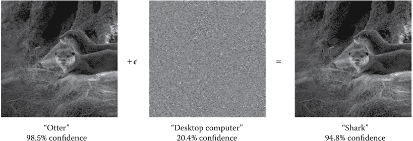

**图17.1** 攻击者取一张水獭的图像（左图），对像素添加微小的、看起来像噪声的扰动，从而欺骗神经网络以高置信度将图像分类为鲨鱼，而人眼看到图像并没有变化。

它将对其错误的预测高度自信！图17.1展示了这种扰动。

这类图像和数据被称为*对抗性样本*，机器学习中研究它们的子领域被称为*对抗性机器学习*。在本章中，我们将介绍对抗性机器学习攻击的框架，讨论这种威胁的变体、潜在的防御措施，最后讨论几个容易受到对抗性机器学习攻击的领域。

## 自动驾驶汽车与对抗性机器学习：案例研究

过去几年，自动驾驶汽车受到了大量关注。Uber、Google、通用汽车和苹果等公司正竞相率先为消费者开发稳健且安全的完全自动驾驶汽车。

机器学习的最新进展使自动驾驶汽车成为可能。但一个好的自动驾驶司机到底需要注意什么？其他车辆？天气？障碍物？考虑诸多类似的动态变量正是开发自动驾驶汽车如此具有挑战性的原因。无论这个问题有多难，解决它的社会效益都是巨大的。2016年，仅美国就有超过4万起交通死亡事故[1]，其中大多数是由人为判断失误和人类感知局限造成的。

我们可以有把握地假设，考虑到计算机能够处理的数据量，自动驾驶汽车最终将超越人类驾驶员。通过在车辆周围安装摄像头并利用LIDAR等先进工具，自动驾驶汽车可以感知周围环境的360°视野。自动驾驶汽车利用神经网络将大量数据转化为车辆的转向和加速控制指令。这些算法可以实时有效地识别障碍物和道路标志。然而，如图17.1所示，这些算法也容易被欺骗。自动驾驶系统对对抗性机器学习攻击的敏感性对乘客和行人构成了严重的安全威胁。

设想在一个充满自动驾驶汽车的世界里，一个恶意分子在停车标志上贴了一张贴纸，欺骗汽车视觉系统，使其对攻击者从模型中期望的信息以及模型暴露的信息量产生混淆[2]。图17.2展示了这种关系。该分类主要关注分类任务，尽管对回归问题的威胁差别不大。

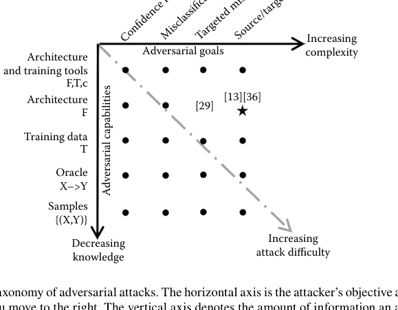

**图17.2** 对抗性攻击的分类。横轴为攻击者的目标，向右移动复杂度增加。纵轴表示攻击者为实施攻击所必须知道的信息量，向下移动信息量减少。攻击越复杂，攻击者创建它的难度就越大。同样，攻击者越了解模型，就越容易制定攻击。（来自N. Papernot等人，2016年。“The limitations of deep learning in adversarial settings.” 见《Security and Privacy (Euros&P), 2016 IEEE European Symposium on》第372–387页，IEEE。）

### 威胁类别

- **置信度降低威胁：** 这种攻击会降低模型对其预测的置信度。类似于磨砂玻璃模糊了玻璃另一侧物体的细节，攻击者可能希望向样本添加噪声，以模糊样本中的信息。这些往往是对手最容易实施的攻击，因为对图像可能做出许多更改，从而降低模型对预测的置信度。例如，只有神经网络以95%的置信度预测某个标志时，自动驾驶汽车系统才会认为自己正确读取了标志。攻击者可能想修改标志，将网络置信度推到阈值以下——从而可能导致汽车规划系统出现问题。

- **源误分类威胁：** 源误分类攻击是置信度降低攻击的极端版本。攻击者不只是降低预测的置信度，而是试图诱骗分类器将图像标记为真实标签y以外的任何标签。

- **目标误分类威胁：** 此类攻击旨在欺骗模型，通过生成对人类视觉来说像是噪声的样本，使模型将图像标记为属于某个特定目标类别ỹ，但当这些样本作为输入给模型时，会导致其高置信度地分配不正确的标签ỹ。

- **源-目标误分类威胁：** 源-目标误分类威胁是最具体的攻击形式。它们诱骗模型将样本x（真实标签为y）识别为属于特定类别ỹ。这类攻击是最难执行的，因为在将x转换为对抗样本x̂（模型将其分类为ỹ）时，容错空间要小得多。源-目标误分类也是最具破坏性的攻击类别。前面提到的停车标志示例就属于这一类别。

## 信息层级

除了攻击类型之外，攻击者可获得的信息在很大程度上决定了成功实施攻击的难度。了解模型设计及其训练数据的攻击者比只能访问模型预测的攻击者准备充分得多。Papernot等人将用户可能获得的信息层级分类如下[2]：

- **训练数据和架构：** 攻击者了解模型和训练数据的一切，从模型架构的确切设计、模型学习到的参数，到用于训练模型的数据。这是攻击者制造对抗性样本最容易的场景。

- **模型架构：** 攻击者了解模型内部结构的一些信息，但对用于训练模型的数据一无所知。


训练数据：攻击者知道一些用于训练模型的数据信息，但对模型本身一无所知。

预言机：对攻击者来说，模型实际上只是一个黑盒。攻击者可以向模型输入任何内容，并观察对应的输出，但无法获知产生该输出所用的内部逻辑。

样本：攻击者只有一组输入及其对应输出的列表。与上一信息级别不同，攻击者无法向模型提供新的输入，只能完全依赖给定的输入和输出。

我们鼓励读者回看图 17.2 和图 17.3，因为它们将是以下对抗攻击与防御讨论的主干。理解这些图以及其中的关系，是向理解模型暴露与脆弱性之间权衡迈出的一大步，而这一权衡正是对抗机器学习的核心。

我们将涵盖这些类别和信息层级中的各类模型，但主要关注那些既构成更直接威胁、又在各种情况下具有最大影响力的模型。

## 高层问题概述

在本节中，我们将展示攻击者如何生成对抗样本。假设某个主体（如公司、政府、爱好者等）出于某个预定目的运行一个机器学习模型。攻击者首先必须获取一些关于模型的信息，目标是尽可能占据图 17.3 层级中的高位。利用这些信息，攻击者构建一个伪模型，学习执行与原始模型相同的任务。伪模型是攻击者为测试攻击策略而创建的目标模型的近似副本。这一过程的更多细节将在“构建伪模型”中讨论。然后，攻击者可以通过运行“针对模型的攻击”中描述的一种攻击来发现伪模型中的弱点。根据“构建伪模型”中讨论的结果，任何对伪模型有效的攻击，也很有可能会对原始模型有效。

简而言之，攻击者构建他们想要攻击的模型的副本，在这些副本模型中发现缺陷，然后构造对抗样本，使副本模型出错，从而也欺骗原始模型。

我们以《自动驾驶汽车与对抗机器学习：案例研究》作为这一讨论的基础：假设存在一家名为 GoDriveYourself 的虚构自动驾驶汽车公司。

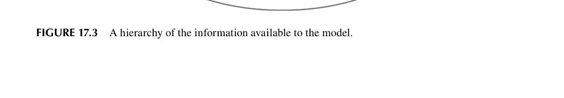

模型比以前更安全了，但如果攻击者可获得的输入输出对集合足够大，那么它可被有效用于训练伪模型。这种安全水平很难达到，尤其是在部署环境中。例如，GoDriveYourself 可能无法达到这一水平，因为车载部署的视觉系统需要不断处理新图像，以在陌生道路上实现安全自动驾驶。

## 针对模型的攻击

一旦攻击者构建了伪模型，就需要为攻击创建对抗样本。下面我们将介绍一种生成对抗样本的方法，用于降低置信度和造成源误分类：快速梯度符号法。

### 快速梯度符号法（FGSM）

FGSM 通过图像相对于原始模型损失函数的梯度，找到损失正向增加最大的方向，从而寻找对抗样本。然后，它沿着这个方向扰动输入图像，生成对抗样本，至少会降低模型对其分类的置信度，最好的情况下则会使模型对样本进行错误分类。

对于更偏好数学的读者，以下方程形式化了快速梯度符号法（FGSM）攻击：

$\tilde{x} = x + \epsilon \cdot \text{sign}(\nabla_x J(\theta, x, y))$

攻击者通过计算损失函数 $J$ 关于模型参数 $\theta$、输入 $x$ 和真实标签 $y$ 的雅可比矩阵，确定最大输入扰动的方向。攻击者通过应用符号函数*来标准化扰动，然后将这个归一化向量乘以 $\epsilon > 0$ 后加到输入样本 $x$ 上，从而生成对抗样本 $\tilde{x}$。需要注意的是，该技术仅对可微分模型有效，因此无法攻击决策树之类的模型[5]。

攻击者通常会选择一个足够小的 $\epsilon$ 值，使扰动对人类不可感知，同时仍能欺骗模型。

攻击者也可以修改这种攻击，以实现源-目标误分类。

$\tilde{x} = x - \epsilon \cdot \text{sign}(\nabla_x J(\theta, x, \tilde{y}))$

攻击者不是让损失函数的梯度上升、提高损失值从而降低模型置信度，而是使梯度相对于目标 $\tilde{y}$ 而非真实标签 $y$ 下降。这确保模型将 $\tilde{x}$ 错误分类为 $\tilde{y}$，并且对该预测 $\tilde{y}$ 具有很高的置信度。

对于这两种版本，如果单次扰动不足以造成误分类，攻击者可以重复 FGSM 扰动过程，在每次迭代后用更新后的 $\tilde{x}$ 替换梯度计算中的 $x$ [6]。

虽然还有其他攻击方法，但它们大多是 FGSM 算法的扩展。例如，基于雅可比的显著性图攻击（JSMA）一次只更新一个特征，而不是同时对所有特征进行梯度上升。JSMA 通过逐一更新特征提供更细粒度的控制，因此可以生成更逼真的对抗样本，且其变化更不易被人类察觉。然而，它更高的精确度带来了更高的计算成本[2]。

## 对抗攻击的防御

### 训练阶段防御

针对对抗攻击最直接的防御方式是在训练期间构建更强的模型——要么通过扩充训练数据集，要么通过改变训练方案以纳入有关对抗攻击的知识。

### 对抗训练

降低对抗攻击有效性的一种方法是将带有正确标签的对抗样本添加到数据集中。这个过程被称为对抗训练。通过学会正确分类此类对抗样本，模型可以更好地理解真实的数据分布。首先，标准训练过程运行多次迭代。接下来，通过 FGSM 或其他方法构造对抗样本，并将其添加到数据集中。然后重新开始这一过程。在传统安全设置中，对抗训练可以被解释为一种渗透测试，有助于揭示模型中的安全漏洞，这些漏洞随后由训练过程加以修补。

通过引入误差曲面的概念，我们可以更好地理解这种防御。误差曲面描述了模型所有可能输入构成的域与模型代价函数取值之间的关系。误差曲面上的陡峭梯度表明，输入中微小的变化就能大幅增加模型代价函数的值，从而使攻击者容易通过略微改变现有输入来找到对抗样本。未经对抗样本训练的模型可能有许多这样的点；其误差曲面会凹凸不平，类似于图 17.4a 中从地面伸出的刀刃。在这种情况下，攻击者可以轻易地使用 FGSM 等攻击找到对抗样本。

对抗训练可以抚平误差曲面上的缺陷，如图 17.4b 所示。这样一来，攻击者就更难找到一种扰动，既要小到不被人类察觉，又要大到足以有效攻击分类器。

可以想象，如果防御者在训练模型时将所有可能的对抗样本都纳入训练集中，模型就会完全鲁棒，因为它永远不会被未见过的对抗样本难倒。然而，所有可能样本的空间非常大，生成每个样本在计算上是不可行的，因此防御者只能希望这种暴力防御对该空间的采样足够好。使用像 FGSM 这样非常快速的技术作为

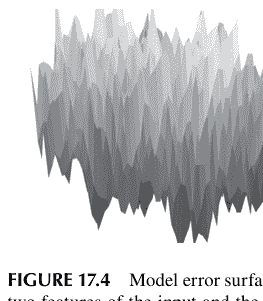

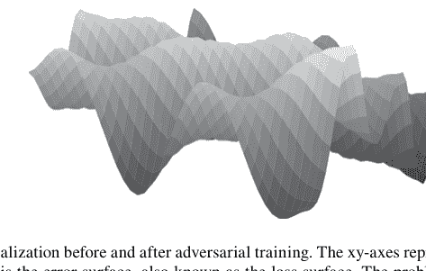

图 17.4 对抗训练前后的模型误差曲面可视化。xy 轴表示输入的两个特征，z 轴为误差曲面，也称为损失曲面。这是一个二分类问题——误差高的模型被视为类别 A 的一部分，误差低的模型被视为类别 B 的一部分。左图：经过训练的目标模型的误差曲面。该曲面非常崎岖，许多点处梯度很大，这为基于梯度的攻击提供了便利。右图：经过对抗训练的目标模型的误差曲面。该曲面平滑得多，从而减小了小扰动对模型性能的影响。(a) 对抗训练前的误差曲面。(b) 对抗训练后的误差曲面。


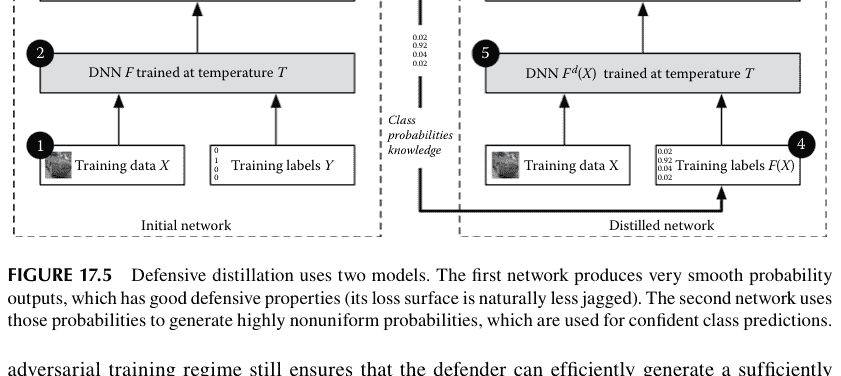

FIGURE 17.5 防御性蒸馏使用两个模型。第一个网络产生非常平滑的概率输出，这具有良好的防御特性（其损失曲面自然更平滑）。第二个网络使用这些概率生成高度非均匀的概率，用于自信的类别预测。

Adversarial training regime still ensures that the defender can efficiently generate a sufficiently sizable adversarial example dataset and use it to smooth out much of the model's error surface.

对抗训练机制仍然确保防御者能够高效生成足够规模的对抗样本数据集，并利用它来平滑模型大部分的误差曲面。

## DEFENSIVE DISTILLATION

## 防御性蒸馏

Another defense method proposed by Papernot et al. is known as defensive distillation [7]. This method is based on a knowledge transfer technique developed by Hinton et al. [8]. This method originally used the knowledge from complicated neural networks (or ensembles of neural networks) to train simple neural networks that were able to perform approximately as well as their source networks.

另一项由 Papernot 等人提出的防御方法被称为防御性蒸馏 [7]。该方法基于 Hinton 等人开发的知识转移技术 [8]。该方法最初利用复杂神经网络（或神经网络集合）的知识来训练简单的神经网络，使其能够与源网络大致同样地执行。

Normally, a model maps from input examples to highly confident predictions. For example, a model is more likely to classify an image of a dog with a distribution of 98% dog and 2% cat (highly nonuniform probabilities) rather than 54% dog and 46% cat (highly uniform probabilities). A nonuniform probability output allows for confident predictions, but a uniform probability output is more useful for classification purposes as it is less biased toward choosing one class over another. Distillation encourages a neural network to make more uniform predictions, reducing the potential for random noise to affect the network’s prediction. From an adversarial defense perspective, this means that an adversary would have more difficulty finding such noise that also remains imperceptible to humans (Figure 17.5).

通常，模型将输入示例映射为高度自信的预测。例如，模型更可能将狗的图像分类为 98% 狗和 2% 猫的分布（高度非均匀概率），而不是 54% 狗和 46% 猫（高度均匀概率）。非均匀概率输出允许做出自信的预测，但均匀概率输出在分类目的上更有用，因为它在选择一个类别而非另一个类别时偏差更小。蒸馏鼓励神经网络做出更均匀的预测，减少随机噪声影响网络预测的可能性。从对抗防御的角度来看，这意味着攻击者更难找到这种噪声，同时仍对人类不可感知（图 17.5）。

In essence, the goal of defensive distillation is to incorporate the advantages of both the defensive properties of uniform probability outputs and the confidence benefits of nonuniform probability outputs. For a formal description of how defensive distillation uses this two-stage process, we refer the reader to Papernot et al.’s paper on defensive distillation [7].

本质上，防御性蒸馏的目标是结合均匀概率输出的防御特性优势和非均匀概率输出的置信度优势。对于防御性蒸馏如何使用这一两阶段过程的正式描述，我们请读者参考 Papernot 等人关于防御性蒸馏的论文 [7]。

## Gradient Blocking Defenses

## 梯度阻断防御

A promising defense is to directly hide the feedback signals that adversaries rely on to construct adversarial attacks. As explained in the self-driving car case study, attackers find ways to trick models by perturbing the input slightly and observing how that perturbation affects the model’s confidence in its classification of the input. The perturbation is best performed by following the direction of the gradient. As such, by hiding information about the gradient from the attacker, the defender can effectively prevent these attacks from happening. This process is known as gradient masking (Figure 17.6).

一种有前景的防御方法是直接隐藏攻击者用于构建对抗攻击的反馈信号。如自动驾驶汽车案例研究中所述，攻击者通过轻微扰动输入并观察该扰动如何影响模型对其输入分类的置信度来欺骗模型。扰动最好沿梯度方向进行。因此，通过向攻击者隐藏有关梯度的信息，防御者可以有效防止这些攻击发生。此过程称为梯度掩码（图 17.6）。

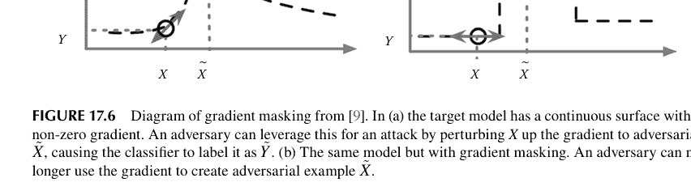

FIGURE 17.6 Diagram of gradient masking from [9]. In (a) the target model has a continuous surface with a non-zero gradient. An adversary can leverage this for an attack by perturbing X up the gradient to adversarial X̃, causing the classifier to label it as Ŷ. (b) The same model but with gradient masking. An adversary can no longer use the gradient to create adversarial example X̃.

图 17.6 来自 [9] 的梯度掩码图示。在 (a) 中，目标模型具有连续曲面且梯度非零。攻击者可以利用此进行攻击，通过沿梯度扰动 X 至对抗样本 X̃，导致分类器将其标记为 Ŷ。(b) 相同模型但使用梯度掩码。攻击者无法再使用梯度创建对抗样本 X̃。

It might return 70% dog and 30% cat for a certain image of a dog. With this information, an attacker might perturb input images and see if the confidence in predicting “dog” decreases. This change in probability gives the attacker a useful gradient. A gradient masking defense would change the software front-end which displays the results of this classifier’s computation to exclusively display the highest probability label (“dog”), but not the classifier’s confidence on this prediction. This masking bars an attacker from understanding the gradient of optimal input perturbation, thus making it more difficult to use gradient-based attacks.

它可能会对某张狗的图像返回 70% 狗和 30% 猫。凭借这些信息，攻击者可能会扰动输入图像，看看预测“狗”的置信度是否下降。概率的变化为攻击者提供了有用的梯度。梯度掩码防御会更改显示该分类器计算结果的软件前端，仅显示最高概率标签（“狗”），而不显示该预测的置信度。这种掩码阻止攻击者理解最优输入扰动的梯度，从而使基于梯度的攻击更难使用。

It turns out that the aforementioned adversarial training and defensive distillation techniques actually owe their efficacy to unintentional gradient masking. Adversarial training and defensive distillation both result in smoother loss surfaces near training examples, especially where an attacker might expect to receive gradient signals from the target model.

事实证明，前述的对抗训练和防御性蒸馏技术实际上其有效性归功于无意的梯度掩码。对抗训练和防御性蒸馏都会在训练样本附近产生更平滑的损失曲面，尤其是在攻击者可能期望从目标模型接收梯度信号的地方。

This seems great. Why do we need other defenses if this simple method is available? Despite rendering attacks difficult to carry out, gradient masking does not eliminate adversarial samples—it simply hides the model’s inherent weaknesses. Concealing the gradient may make it difficult for the adversary to create adversarial samples. However these still exist as examples that fool the network. It’s entirely plausible that an adversary could still find these adversarial samples.

这似乎很棒。如果有这种简单方法，为什么还需要其他防御？尽管梯度掩码使攻击难以实施，但它并不能消除对抗样本——它只是隐藏了模型固有的弱点。隐藏梯度可能会使攻击者难以创建对抗样本。然而这些样本仍然存在，作为欺骗网络的示例。完全有可能攻击者仍能找到这些对抗样本。

Carlini et al. discuss a variety of ways an adversary might achieve this including using properly chosen loss functions, calculating gradients from the pre-softmax layer, and transferring adversarial samples from a pseudo-model [10]. While all of the attacks focus on cases where the adversary has access to high levels of the information hierarchy (Figure 17.3), adversarial examples easily transfer from one model to another—meaning a pseudo-model trained on the outputs of a model defended by gradient masking could still generate successful adversarial attacks against such models.

Carlini 等人讨论了攻击者可能实现此目的的多种方式，包括使用适当选择的损失函数、从 softmax 之前的层计算梯度，以及从伪模型转移对抗样本 [10]。虽然所有攻击都集中在攻击者能够访问信息层级较高层级的情况（图 17.3），但对抗样本很容易从一个模型转移到另一个模型——这意味着在梯度掩码防御的模型输出上训练的伪模型仍可对这些模型生成成功的对抗攻击。

## Adversarial Sample Detection Defenses

## 对抗样本检测防御

Adversarial sample detection defenses rely on actively distinguishing between normal and adversarial samples during inference, the stage during which a trained model is actively classifying new inputs. Adversarial sample detection defenses can be thought of as filters tuned to detect adversarial examples. Either the model itself, or a separate model altogether, can seek to identify and filter out harmful inputs before they are processed.

对抗样本检测防御依赖于在推理期间主动区分正常样本和对抗样本，推理是训练模型主动对新输入进行分类的阶段。对抗样本检测防御可以被视为调谐以检测对抗样本的过滤器。模型本身或完全独立的模型都可以寻求在处理之前识别并过滤掉有害输入。

## Detectors

## 检测器

One method utilizes a detector that identifies harmful inputs. While there have been numerous proposals for detector schemes, we focus on Xu et al.’s feature squeezing [11]. To separate adversarial samples from normal samples, feature squeezing leverages model robustness. A model is robust if it is able to properly classify an example even after slight transformation. For example, an image recognition model should be able to recognize an image even after rotation or scaling. The detector uses this information to compare a model’s prediction before and after a transformation of the input. The idea is that if an adversarially crafted example

一种方法利用识别有害输入的检测器。虽然检测器方案已有众多提案，但我们重点关注 Xu 等人的特征压缩 [11]。为了将对抗样本与正常样本区分开，特征压缩利用模型鲁棒性。如果模型即使在轻微变换后仍能正确分类示例，则该模型是鲁棒的。例如，图像识别模型应该能够在旋转或缩放后仍识别图像。检测器使用此信息比较模型在输入变换前后的预测。想法是如果一个对抗性制作的示例

The reformer autoencoder is trained with non-adversarial examples in the hopes of learning a surface that represents the key aspects of normal samples. Then, when the reformer is presented with an adversarial example x, the reformer tries to find a normal example y on the learned surface of the bottleneck that is close to x. The reformer tries to “undo” the adversarial perturbations the attacker uses to transform the original input. Then, the reformed normal example y will be classified by the target model as the true label for x.

重构器自编码器使用非对抗示例进行训练，希望学习到代表正常样本关键方面的曲面。然后，当重构器被呈现对抗样本 x 时，重构器尝试在瓶颈的已学习曲面上找到接近 x 的正常示例 y。重构器尝试“撤销”攻击者用于转换原始输入的对抗扰动。然后，重构的正常示例 y 将被目标模型分类为 x 的真实标签。

However, reformers are still vulnerable to attackers, just as detectors are. With the knowledge that a defender uses a reformer, the attacker could attempt to target the reformer directly, generating adversarial examples that both fool the reformer and the target model.

然而，重构器仍然容易受到攻击者攻击，就像检测器一样。知道防御者使用重构器后，攻击者可能会直接针对重构器，生成既能欺骗重构器又能欺骗目标模型的对抗样本。

## PROBLEM DOMAINS

## 问题域

We have introduced adversarial machine learning attacks, explained how they are carried out, and how to defend against them. While academic research in adversarial machine learning has focused on attacking image classification models, we foresee rapid expansion of adversarial methods in all domains where machine learning models can be useful. Below, we expand on several domains that will be especially vulnerable to adversarial attacks in the future.

我们介绍了对抗机器学习攻击，解释了它们如何实施以及如何防御。虽然对抗机器学习学术研究主要集中在攻击图像分类模型上，但我们预见对抗方法将在机器学习模型有用的所有领域迅速扩展。下面，我们将扩展几个未来特别容易受到对抗攻击的领域。

- *Face Recognition:* An adversary could impersonate anybody by launching a targeted misclassification threat. The attacker would simply need to generate an adversarial image that confuses a face recognition model into believing with high confidence that the image is someone with access to the information the system secures. Facial recognition systems that rely solely on machine learning-based vision systems are not robust to adversarial attacks and most attack plans described in section “Problem Domains” could penetrate such a system.
- *人脸识别：* 攻击者可以通过发起有针对性的误分类威胁来冒充任何人。攻击者只需生成一张对抗图像，使人脸识别模型高置信度地相信该图像是能够访问系统所保护信息的人。仅依赖基于机器学习的视觉系统的人脸识别系统对对抗攻击并不鲁棒，且“问题域”部分描述的大多数攻击计划都可能渗透此类系统。
- *Anti-virus:* An attacker could leverage a source-target misclassification attack against an anti-virus system to make an “invisible” virus, at least to the anti-virus program. An adversary could build a virus whose features might hide the program’s intention from an anti-virus machine learning model [15]. A hacker could create a Trojan with a particular placement of comments, or another method of code obfuscation, that masks the virus’ nefarious nature. While this scenario is on the radar of modern security research, attacks evolve very frequently and anti-virus developers must know how to defend their machine learning models against cleverly crafted adversarial attacks.
- *反病毒：* 攻击者可以利用源-目标误分类攻击针对反病毒系统，使病毒对反病毒程序“不可见”。攻击者可以构建一个病毒，其特征可能隐藏程序意图，使其不被反病毒机器学习模型发现 [15]。黑客可以创建特洛伊木马，通过特定放置注释或其他代码混淆方法来掩盖病毒的恶意本质。虽然这一场景已在现代安全研究雷达上，但攻击演变非常频繁，反病毒开发者必须知道如何防御其机器学习模型免受精心制作的对抗攻击。
- *Google:* Google’s search algorithm is a prime target for adversarial examples. Using a source-target misclassification threat, an adversary could change the ranking and reputation of any particular web page by intelligently perturbing its contents and history. Consider the case in which a website owner seeks to boost his website’s reputation, in order to increase page views, and thus ad revenue. Such an individual could learn the optimal “perturbations” to apply to their website, such that the website itself becomes an adversarial example, and despite its lack of proper content, appears frequently at the top search results. This would give the individual’s website enormously higher amounts of traffic and trick web users into generating ad revenue for the individual. Additionally, Google’s crucial role in society as a knowledge engine makes adversarial attacks against it all the more alarming due to the huge reach of such an attack. For example, fake news outlets could redirect legitimate search queries for facts to biased or fabricated political pieces. In a world already suffering from man-made censorship of information, the possibility of using AI to optimally “guide” the dogma and understanding of the masses is a very frightening prospect.
- *Google：* Google 的搜索算法是对抗样本的主要目标。使用源-目标误分类威胁，攻击者可以通过智能扰动其内容和历史来改变任何特定网页的排名和声誉。考虑网站所有者寻求提升其网站声誉以增加页面浏览量，从而增加广告收入的情况。此类个人可以学习对网站应用的最佳“扰动”，使网站本身成为对抗样本，尽管缺乏适当内容，仍频繁出现在搜索结果顶部。这将使个人网站获得大量流量，并欺骗网络用户为其产生广告收入。此外，Google 作为社会知识引擎的关键作用使针对其的对抗攻击更令人担忧，因为此类攻击的影响范围巨大。例如，假新闻机构可以将关于事实的合法搜索查询重定向到有偏见或捏造的政治文章。在一个已经遭受人为信息审查的世界里，利用 AI 最优地“引导”大众教条和理解的可能性是一个非常可怕的前景。

## TRENDS, INSIGHTS, AND RECENT DEVELOPMENTS

## 趋势、见解和最新发展

Some skeptics of adversarial examples claim that attacks on machine learning models are often unfeasible or impractical. This assumption is flawed—adversaries with an intention can endure the

一些对抗样本的怀疑者声称对机器学习模型的攻击往往不可行或不切实际。这一假设是错误的——有意图的对手可以忍受

如果攻击者有明确目标，攻击的单调乏味是可以忍受的。还应明确的是，对抗攻击可以在数天或数周的努力后成功部署（通常是在训练伪模型），而不是破解密码学安全所需的数千年。对抗机器学习的防御不应完全依赖于攻击者不会投入足够精力破坏系统的假设。

除对模型本身的攻击外，攻击者可以专注于攻击用于训练模型的数据——这一过程被称为投毒。在投毒攻击中，攻击者通过在训练数据集中插入精心制作的样本来控制学习过程。这些样本旨在人为地扭曲训练数据分布，从而降低模型的性能。投毒攻击对频繁使用真实世界数据重新训练的模型有效。鉴于用于训练一个模型的数据将被与其所有对应模型共享，通过感染单个产品收集的数据，相对容易地投毒数百甚至数千个产品，例如汽车和人脸识别安防摄像头。

例如，恶意电子邮件活动不断演变以规避垃圾邮件过滤器。反垃圾系统需要收集最近垃圾邮件活动的数据以保持最新。手动标记这些数据不可行，因此系统依赖于自动训练数据收集。例如，它可能会存储一份已知经常发送垃圾邮件的电子邮件地址列表，并自动将从此黑名单地址发送的电子邮件标记为训练数据中的“垃圾邮件”。控制这些地址的团体可能意识到它们已被标记，并选择改为发送不具有垃圾邮件特征的电子邮件，系统将学习将其识别为“类垃圾邮件”。如果自动标记系统错误标记了其中大量电子邮件，经过训练的垃圾邮件检测模型将学习错误的类别分布，将垃圾邮件识别为合法邮件，然后将普通邮件分类为垃圾邮件。

针对投毒攻击的一种潜在防御是彻底清理训练数据。实际上，这相当于检测并移除可疑点和异常值，并且只使用来自受信任数据存储库的数据。虽然大量数据通常是产生良好机器学习模型所必需的，但不可信或未经验证的数据存储库同样会阻碍机器学习模型。另一种清理方法是使用新数据上的“负面影响拒绝”分析。在此设置中，系统比较在可疑样本上训练前后的模型性能。如果新数据显著降低了在合法示例上的测试准确率，系统将丢弃新的训练样本。

随着该领域的发展，似乎对手在防御构建后立即打破对抗防御。然而，有几个有前景的研究方向。第一个是模型集成：将多个“基础”模型的信息结合起来进行单一分类。集成倾向于在基础模型表现良好时突出其优势，并在基础模型表现不佳时掩盖其弱点。这种方法的其中一个变体似乎降低了对抗训练模型对白盒攻击的易感性 [16]。通过在做出决定前咨询多个来源，该方法平滑了误差曲面，使模型对对抗攻击具有鲁棒性，如“针对模型的攻击”一节所述。

我们还可能看到对对抗样本的鲁棒性提高，因为大型研究团体（如 Google 和 Facebook）在庞大的数据集上训练模型。通过涵盖更广泛的输入可能性，这些在大型数据集上训练的模型可能学习更平滑的误差曲面，从而对对抗攻击具有更大的鲁棒性。然而，这仍然只解决了数据量充足的问题子集。

## 结论

对抗攻击和防御不断随着人工智能一起演变。目前，似乎大多数攻击都很难防御。然而，在攻击者只能访问模型有限信息的情况下，一些防御显示出希望。当考虑对抗学习中的这种军备竞赛时，似乎对手目前占据上风。为了真正对任何攻击都具有鲁棒性，模型需要学习并保留关于学习问题的所有可能知识/信息，无论这是否涉及前瞻性地（且不切实际地）在所有可能的训练样本、无限空间上训练，或是反应性地以某种方式捕获和清理任何和所有对抗攻击。

有一点是确定的：在将机器学习模型依赖并集成到安全关键系统（如自动驾驶汽车）中之前，需要进行更多研究以确保其完整性。开发鲁棒防御至关重要，因为不安全的应用可能以人类生命为代价。

## 参考文献

- 1. Dept. of Statistics 2016. “NSC 机动车伤亡估计。”
- 2. N. Papernot, P. McDaniel, S. Jha, M. Fredrikson, Z. B. Celik, & A. Swami 2016. “对抗环境下深度学习的局限性。” 在 2016 IEEE 欧洲安全与隐私研讨会 (EuroS&P) 上，第 372–387 页。IEEE，德国萨尔布吕肯。
- 3. N. Papernot, P. McDaniel, I. Goodfellow, S. Jha, Z. B. Celik, & A. Swami 2017. “针对机器学习的实用黑盒攻击。” 在 2017 年 ACM 亚洲计算机与通信安全会议论文集，第 506–519 页。ACM，阿联酋阿布扎比。
- 4. N. Papernot, P. McDaniel, & I. Goodfellow 2016. “机器学习中的迁移性：从现象到利用对抗样本的黑盒攻击。” arXiv 预印本 arXiv:1605.07277。
- 5. I. J. Goodfellow, J. Shlens, & C. Szegedy 2014. “解释和利用对抗样本。” arXiv 预印本 arXiv:1412.6572。
- 6. A. Kurakin, I. Goodfellow, & S. Bengio 2016. “大规模对抗机器学习。” arXiv 预印本 arXiv:1611.01236。
- 7. N. Papernot, P. McDaniel, X. Wu, S. Jha, & A. Swami 2015. “蒸馏作为对抗深度神经网络对抗性扰动的防御。” 在第 37 届 IEEE 安全与隐私研讨会论文集，第 582–597 页。IEEE，美国加州圣何塞。
- 8. G. Hinton, O. Vinyals, & J. Dean 2015. “蒸馏神经网络中的知识。” arXiv 预印本 arXiv:1503.02531。
- 9. N. Papernot, P. McDaniel, A. Sinha, & M. Wellman 2016. “迈向机器学习中的安全与隐私科学。” arXiv e-prints。
- 10. N. Carlini & D. A. Wagner 2016. “防御性蒸馏对对抗样本并不鲁棒。” CoRR abs/1607.04311. http://arxiv.org/abs/1607.04311。
- 11. W. Xu, D. Evans, & Y. Qi 2017. “特征压缩：检测深度神经网络中的对抗样本。” arXiv 预印本 arXiv:1704.01155。
- 12. W. He, J. Wei, X. Chen, N. Carlini, & D. Song 2017. “对抗样本防御：弱防御的集成并不强。” arXiv 预印本 arXiv:1706.04701。
- 13. D. Meng & H. Chen 2017. “Magnet：对抗样本的双管齐下防御。” arXiv 预印本 arXiv:1705.09064。
- 14. P. Baldi 2012. “自编码器、无监督学习和深度架构。” 在 ICML 无监督与迁移学习研讨会论文集，华盛顿贝尔维尤，第 37–49 页。
- 15. K. Grosse, N. Papernot, P. Manoharan, M. Backes, & P. McDaniel 2016. “针对恶意软件分类的深度神经网络对抗扰动。” arXiv 预印本 arXiv:1606.04435。
- 16. F. Tramèr, A. Kurakin, N. Papernot, D. Boneh, & P. McDaniel 2017. “集成对抗训练：攻击与防御。” arXiv 预印本 arXiv:1705.07204。

# 18 可处理偏好距离的价值对齐

Andrea Loreggia, Nicholas Mattei, Francesca Rossi, and K. Brent Venable

### 目录

| Section | Page |
|---|---|
| 引言 | 249 |
| 背景：CP-网络 | 251 |
| 使用 CP-网络建模伦理 | 252 |
| CP-网络之间的距离概念 | 255 |
| 使用 CP-网络支持伦理决策 | 256 |
| 实证分析 | 257 |
| 结论 | 259 |
| 致谢 | 260 |
| 参考文献 | 260 |

## 引言

偏好在日常生活中无处不在：每当我们想要做出决定以选择最偏好的替代方案时，我们都会使用自己的主观偏好。因此，计算机科学和人工智能中偏好的研究多年来一直非常活跃，具有重要的理论和实践成果 [13,21] 以及库和数据集 [20]。在包括多智能体系统 [25] 和推荐系统 [22] 在内的许多场景中，用户偏好在驱动系统做出的决策中发挥关键作用。因此，需要偏好建模框架来允许表达性和紧凑的表示、有效的获取技术以及高效的推理和聚合。

如果我们希望人们信任 AI 系统，我们需要为这些系统提供区分通常称为“好”和“坏”决策的能力。在许多情况下，决策的质量不应仅基于决策者的偏好或优化标准，还应基于与决策影响相关的属性，例如它是否根据任何数量外部来源提供的约束或优先级在伦理或法律上是否合规 [5,24,26]。确实，可能存在特定的伦理原则，具体取决于上下文，可以并且应该凌驾于决策者的主观偏好之上。

对于主观偏好，它们可能适用于复杂决策的各个组成部分之一或多个，而不是适用于整体。例如，如果我们需要选择一辆车，我们可能更喜欢某些颜色而不是其他颜色，并且我们可能更喜欢某些品牌而不是其他品牌。我们也可能有条件偏好，例如更喜欢红色汽车，如果汽车是敞篷车。对于这些场景，CP-网络形式主义 [6] 是一种方便且表达性强的建模偏好的方式，已在偏好处理社区中被广泛使用 [8,12,15,23]。CP-网络提供了一种有效、紧凑的

是一种对具有组合结构的决策（通常称为结果）上的偏好进行定性建模的方法。CP-nets也易于获取，并为优化、搜索和推理提供了高效的方法[2,9]。此外，在集体决策场景中，多个CP-nets可以通过投票规则等进行聚合[10,19]，以找到折衷方案并在决策者之间达成共识。

如果在此场景中加入伦理约束，则意味着决策者的主观偏好并不是我们应考虑的唯一信息来源[5,24,26]。事实上，根据语境的不同，我们可能需要考虑源自适当伦理理论或当地法规的特定伦理原则或法律[11]。虽然偏好很重要，但当偏好与伦理原则（约束）发生冲突时，这些约束应优先于决策者的主观偏好。例如，在招聘场景中，招聘委员会成员对候选人的偏好应参照伦理指南和法律来衡量，例如确保性别和少数群体多样性。因此，必须采用系统且严谨的方法来评估偏好是否与一组伦理原则相容，并衡量偏好与伦理原则之间的差异。能够精确量化主观偏好与外部优先准则（如伦理原则所给定的优先准则）之间的距离，既提供了一种识别偏离可行性或伦理约束的方法，也提供了一种建议更合规决策的方法。

在本章中，我们认为可以使用CP-nets来建模外部优先级（例如由伦理原则提供的优先级）以及决策者的主观偏好。因此，个体主观偏好与外部伦理原则之间的距离可以通过CP-nets之间的一种距离概念来衡量。事实上，我们使用了参考文献[18]首次讨论的CP-nets之间的距离概念（形式上为距离函数或度量）来评估自主系统所作的决策。这种称为KTD的度量推广了经典的[16] τ（KT）距离，后者常用于度量偏序之间的距离。KTD通过计数两个完备的严格线性序之间的倒置对数量，并通过为偏序[14]定义一个惩罚参数p来实现。

由于CP-nets是可能决策集合上的一个偏序的紧凑表示，理想的距离概念应是在CP-nets所导出的偏序之间的距离。然而，导出序的大小相对于CP-net的大小是指数级的，并且通常计算这些导出偏序之间的距离在计算上是棘手的。因此，对于实际的AI系统，我们提出使用一种易于处理的近似方法，即参考文献[18]所称的*O-CPD*，它直接在CP-nets的依赖图上计算。在本章中，我们研究了这种近似用于决策的质量，并描述了一个使用O-CPD的价值对齐过程。

我们提出的价值对齐过程计算主观偏好与伦理原则之间的距离，并且仅当主观偏好与伦理原则*足够接近*时才使用主观偏好进行决策，其中“*足够接近*”取决于CP-net距离上的一个阈值。如果偏好与伦理原则的偏离*过大*，则会转向较不偏好的决策，直到找到一个在伦理原则与用户偏好之间形成*令人满意的折衷*的决策。该折衷通过设置决策之间距离的第二个阈值来定义。

如上所述，*O-CPD*是KTD的一种近似，因此一般来说，这两个距离返回的值可能不同。在参考文献18中，我们给出了一些误差的理论界限，但这些界限相当宽泛，在实践中作为价值对齐过程可能效果不佳。因此，在本文中我们进行了实验评估，表明在将距离与设定阈值进行比较时，近似值几乎总是与真实值一致，并且当需要符合伦理原则时，关于主观偏好的决策质量不会显著下降，即只需在偏好序中移动很短的距离即可。

cp-表中最偏好的值。例如，在上面的CP-net中，我们会选择A = a和B = b，然后是C = c，再然后是D = d。在一般情况下，最优结果与一组约束的解一致，这些约束是通过将每个cp-语句替换为一个约束得到的[7]：由cp-语句 x1 = v1, ..., xn = vn: x = a1 > ... > x = am 得到约束 v1, ..., vn ⇒ a1。例如，下面的cp-语句（来自上面的例子）(a ∧ b) : c > c̄ 将被替换为约束 (a ∧ b) ⇒ c。

在这项工作中，我们希望利用表示的紧凑性来比较CP-nets。为此，我们考虑一个剖面（P, O），其中P是n个CP-nets的集合，其图是覆盖m个具有二元域的公共变量的有向无环图（DAG），O是这些变量上的一个全序。我们要求该剖面是O-合法的[17]，这意味着在每个CP-net中，每个变量独立于排序O中所有紧随其后的变量。给定一个变量Xi，函数flw(Xi)返回排序O中紧跟Xi之后的变量数量。

## 算法1：CP-net A导出的偏序的线性化

```
1: function Lin(A, O, LexO, o) ▷ Where A is a CP-net, O is the O-legal order on A, LexO: is the linearization we compute (empty to start with), and o is an outcome.
2: if O = Null then
3: LexO.append(o)
4: return LexO
5: end if
6: v = pop(O)
7: for value ∈ CPT_A,Par(v)(v) do
8: temp = o + value
9: LexO = Lin(A, O, LexO, temp)
10: end for
11: return LexO
12: end function
```

## 使用CP-nets对伦理建模

在本节中，我们通过一个示例描述如何使用CP-nets来建模可能源自一个或多个伦理理论或社会价值体系的伦理原则[11]。我们首先对一个可能的场景进行建模，即自主车辆在同时存在人工智能体的环境中运行。


最优（最偏好）行动（即司机更倾向于不转向，撞到一小群狗并拯救她的乘客），到最差（最不偏好）行动（即撞到一群人类并转向，导致所有乘客受伤）。

在图 18.3 中，我们展示了另一种司机的偏好，即恶魔司机。恶魔司机由敌意驱动，因此更倾向于撞到最多的人行道行人。正如读者可以注意到的那样，结果之间的关系（由箭头表示）发生了急剧变化，导致根据恶魔司机的偏好出现不同的最优和最差行动。

关于此空间的另一组偏好可能来自相关社区或社会认为应为伦理原则的内容。图 18.4 简洁地描述了对可能解决方案的道德偏好，我们假设这些偏好源自某种适当的伦理理论，或是通过社会中的集体努力决定的 [4,11]。对于我们的示例，我们假设集体更倾向于不杀害人类行人并尽可能拯救尽可能多的生命。在杀人不可避免的情况下，我们假设在道德上更可取的是受害者数量最少。最后，我们假设在街上有足够多的人类行人处于危险之中时，可能会对乘客造成伤害是可以接受的。

假设自主车辆的用户可以通过指定车辆可能遇到的场景的偏好与系统交互。天使司机和恶魔司机的偏好诱导出非常不同且可能导致不同行为的部分序，如果指定给车辆的话。具体来说，面对我们的示例场景，天使司机总是更倾向于撞到一小群狗，拯救大多数狗以及所有人类行人和乘客。随着我们通过一系列恶化翻转向下移动天使司机的偏好排序，我们找到的行动会随着我们向最差结果移动而导致更严重后果。另一方面，恶魔司机对可能行动的排序正好相反。面对相同的场景，恶魔司机更倾向于撞到最大群的人类。

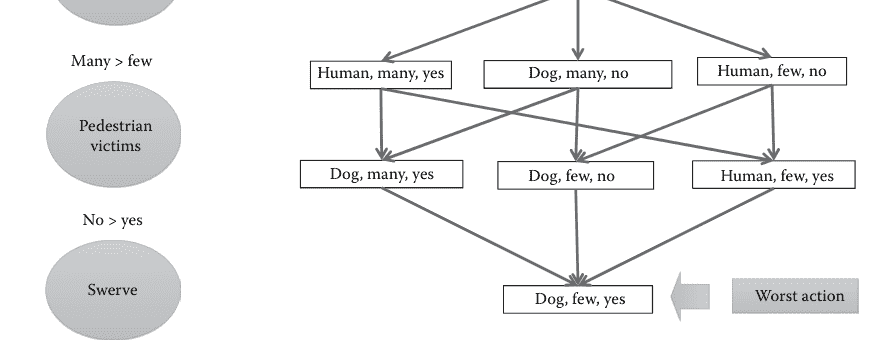

图 18.3 左侧：一个建模恶魔司机道德偏好的 CP-net。右侧：行动空间上的诱导偏序。

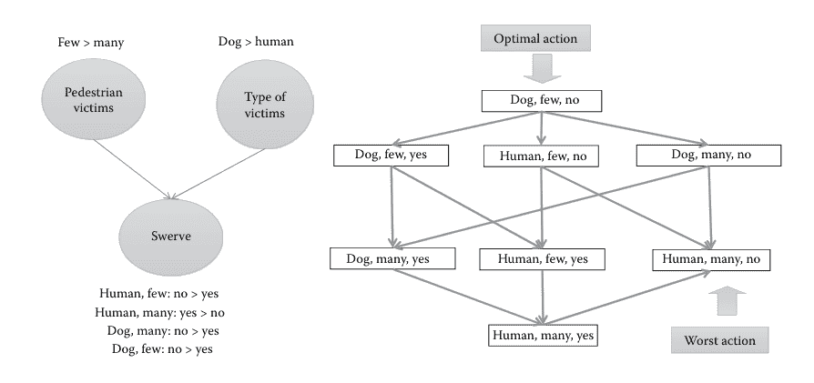

图 18.4 左侧：一个建模社会集体道德偏好的 CP-net。右侧：行动空间上的诱导偏序。请注意，我们已将结果保持在与图 18.2 相同的[content]
最优（最偏好）行动（即司机更倾向于不转向，撞到一小群狗并拯救她的乘客），到最差（最不偏好）行动（即撞到一群人类并转向，导致所有乘客受伤）。

在图 18.3 中，我们展示了另一种司机的偏好，即恶魔司机。恶魔司机由敌意驱动，因此更倾向于撞到最多的人行道行人。正如读者可以注意到的那样，结果之间的关系（由箭头表示）发生了急剧变化，导致根据恶魔司机的偏好出现不同的最优和最差行动。

关于此空间的另一组偏好可能来自相关社区或社会认为应为伦理原则的内容。图 18.4 简洁地描述了对可能解决方案的道德偏好，我们假设这些偏好源自某种适当的伦理理论，或是通过社会中的集体努力决定的 [4,11]。对于我们的示例，我们假设集体更倾向于不杀害人类行人并尽可能拯救尽可能多的生命。在杀人不可避免的情况下，我们假设在道德上更可取的是受害者数量最少。最后，我们假设在街上有足够多的人类行人处于危险之中时，可能会对乘客造成伤害是可以接受的。

假设自主车辆的用户可以通过指定车辆可能遇到的场景的偏好与系统交互。天使司机和恶魔司机的偏好诱导出非常不同且可能导致不同行为的部分序，如果指定给车辆的话。具体来说，面对我们的示例场景，天使司机总是更倾向于撞到一小群狗，拯救大多数狗以及所有人类行人和乘客。随着我们通过一系列恶化翻转向下移动天使司机的偏好排序，我们找到的行动会随着我们向最差结果移动而导致更严重后果。另一方面，恶魔司机对可能行动的排序正好相反。面对相同的场景，恶魔司机更倾向于撞到最大群的人类。


图 18.3 左侧：一个建模恶魔司机道德偏好的 CP-net。右侧：行动空间上的诱导偏序。


图 18.4 左侧：一个建模社会集体道德偏好的 CP-net。右侧：行动空间上的诱导偏序。请注意，我们已将结果保持在与图 18.2 相同的[content]
最优（最偏好）行动（即司机更倾向于不转向，撞到一小群狗并拯救她的乘客），到最差（最不偏好）行动（即撞到一群人类并转向，导致所有乘客受伤）。

在图 18.3 中，我们展示了另一种司机的偏好，即恶魔司机。恶魔司机由敌意驱动，因此更倾向于撞到最多的人行道行人。正如读者可以注意到的那样，结果之间的关系（由箭头表示）发生了急剧变化，导致根据恶魔司机的偏好出现不同的最优和最差行动。

关于此空间的另一组偏好可能来自相关社区或社会认为应为伦理原则的内容。图 18.4 简洁地描述了对可能解决方案的道德偏好，我们假设这些偏好源自某种适当的伦理理论，或是通过社会中的集体努力决定的 [4,11]。对于我们的示例，我们假设集体更倾向于不杀害人类行人并尽可能拯救尽可能多的生命。在杀人不可避免的情况下，我们假设在道德上更可取的是受害者数量最少。最后，我们假设在街上有足够多的人类行人处于危险之中时，可能会对乘客造成伤害是可以接受的。

假设自主车辆的用户可以通过指定车辆可能遇到的场景的偏好与系统交互。天使司机和恶魔司机的偏好诱导出非常不同且可能导致不同行为的部分序，如果指定给车辆的话。具体来说，面对我们的示例场景，天使司机总是更倾向于撞到一小群狗，拯救大多数狗以及所有人类行人和乘客。随着我们通过一系列恶化翻转向下移动天使司机的偏好排序，我们找到的行动会随着我们向最差结果移动而导致更严重后果。另一方面，恶魔司机对可能行动的排序正好相反。面对相同的场景，恶魔司机更倾向于撞到最大群的人类。


图 18.3 左侧：一个建模恶魔司机道德偏好的 CP-net。右侧：行动空间上的诱导偏序。


图 18.4 左侧：一个建模社会集体道德偏好的 CP-net。右侧：行动空间上的诱导偏序。请注意，我们已将结果保持在与图 18.2 相同的[content]
最优（最偏好）行动（即司机更倾向于不转向，撞到一小群狗并拯救她的乘客），到最差（最不偏好）行动（即撞到一群人类并转向，导致所有乘客受伤）。

在图 18.3 中，我们展示了另一种司机的偏好，即恶魔司机。恶魔司机由敌意驱动，因此更倾向于撞到最多的人行道行人。正如读者可以注意到的那样，结果之间的关系（由箭头表示）发生了急剧变化，导致根据恶魔司机的偏好出现不同的最优和最差行动。

关于此空间的另一组偏好可能来自相关社区或社会认为应为伦理原则的内容。图 18.4 简洁地描述了对可能解决方案的道德偏好，我们假设这些偏好源自某种适当的伦理理论，或是通过社会中的集体努力决定的 [4,11]。对于我们的示例，我们假设集体更倾向于不杀害人类行人并尽可能拯救尽可能多的生命。在杀人不可避免的情况下，我们假设在道德上更可取的是受害者数量最少。最后，我们假设在街上有足够多的人类行人处于危险之中时，可能会对乘客造成伤害是可以接受的。

假设自主车辆的用户可以通过指定车辆可能遇到的场景的偏好与系统交互。天使司机和恶魔司机的偏好诱导出非常不同且可能导致不同行为的部分序，如果指定给车辆的话。具体来说，面对我们的示例场景，天使司机总是更倾向于撞到一小群狗，拯救大多数狗以及所有人类行人和乘客。随着我们通过一系列恶化翻转向下移动天使司机的偏好排序，我们找到的行动会随着我们向最差结果移动而导致更严重后果。另一方面，恶魔司机对可能行动的排序正好相反。面对相同的场景，恶魔司机更倾向于撞到最大群的人类。


图 18.3 左侧：一个建模恶魔司机道德偏好的 CP-net。右侧：行动空间上的诱导偏序。


图 18.4 左侧：一个建模社会集体道德偏好的 CP-net。右侧：行动空间上的诱导偏序。请注意，我们已将结果保持在与图 18.2 相同的[content]
最优（最偏好）行动（即司机更倾向于不转向，撞到一小群狗并拯救她的乘客），到最差（最不偏好）行动（即撞到一群人类并转向，导致所有乘客受伤）。

在图 18.3 中，我们展示了另一种司机的偏好，即恶魔司机。恶魔司机由敌意驱动，因此更倾向于撞到最多的人行道行人。正如读者可以注意到的那样，结果之间的关系（由箭头表示）发生了急剧变化，导致根据恶魔司机的偏好出现不同的最优和最差行动。

关于此空间的另一组偏好可能来自相关社区或社会认为应为伦理原则的内容。图 18.4 简洁地描述了对可能解决方案的道德偏好，我们假设这些偏好源自某种适当的伦理理论，或是通过社会中的集体努力决定的 [4,11]。对于我们的示例，我们假设集体更倾向于不杀害人类行人并尽可能拯救尽可能多的生命。在杀人不可避免的情况下，我们假设在道德上更可取的是受害者数量最少。最后，我们假设在街上有足够多的人类行人处于危险之中时，可能会对乘客造成伤害是可以接受的。

假设自主车辆的用户可以通过指定车辆可能遇到的场景的偏好与系统交互。天使司机和恶魔司机的偏好诱导出非常不同且可能导致不同行为的部分序，如果指定给车辆的话。具体来说，面对我们的示例场景，天使司机总是更倾向于撞到一小群狗，拯救大多数狗以及所有人类行人和乘客。随着我们通过一系列恶化翻转向下移动天使司机的偏好排序，我们找到的行动会随着我们向最差结果移动而导致更严重后果。另一方面，恶魔司机对可能行动的排序正好相反。面对相同的场景，恶魔司机更倾向于撞到最大群的人类。


图 18.3 左侧：一个建模恶魔司机道德偏好的 CP-net。右侧：行动空间上的诱导偏序。


图 18.4 左侧：一个建模社会集体道德偏好的 CP-net。右侧：行动空间上的诱导偏序。请注意，我们已将结果保持在与图 18.2 相同的[content]
最优（最偏好）行动（即司机更倾向于不转向，撞到一小群狗并拯救她的乘客），到最差（最不偏好）行动（即撞到一群人类并转向，导致所有乘客受伤）。

在图 18.3 中，我们展示了另一种司机的偏好，即恶魔司机。恶魔司机由敌意驱动，因此更倾向于撞到最多的人行道行人。正如读者可以注意到的那样，结果之间的关系（由箭头表示）发生了急剧变化，导致根据恶魔司机的偏好出现不同的最优和最差行动。

关于此空间的另一组偏好可能来自相关社区或社会认为应为伦理原则的内容。图 18.4 简洁地描述了对可能解决方案的道德偏好，我们假设这些偏好源自某种适当的伦理理论，或是通过社会中的集体努力决定的 [4,11]。对于我们的示例，我们假设集体更倾向于不杀害人类行人并尽可能拯救尽可能多的生命。在杀人不可避免的情况下，我们假设在道德上更可取的是受害者数量最少。最后，我们假设在街上有足够多的人类行人处于危险之中时，可能会对乘客造成伤害是可以接受的。

假设自主车辆的用户可以通过指定车辆可能遇到的场景的偏好与系统交互。天使司机和恶魔司机的偏好诱导出非常不同且可能导致不同行为的部分序，如果指定给车辆的话。具体来说，面对我们的示例场景，天使司机总是更倾向于撞到一小群狗，拯救大多数狗以及所有人类行人和乘客。随着我们通过一系列恶化翻转向下移动天使司机的偏好排序，我们找到的行动会随着我们向最差结果移动而导致更严重后果。另一方面，恶魔司机对可能行动的排序正好相反。面对相同的场景，恶魔司机更倾向于撞到最大群的人类。


图 18.3 左侧：一个建模恶魔司机道德偏好的 CP-net。右侧：行动空间上的诱导偏序。


图 18.4 左侧：一个建模社会集体道德偏好的 CP-net。右侧：行动空间上的诱导偏序。请注意，我们已将结果保持在与图 18.2 相同的[content]
最优（最偏好）行动（即司机更倾向于不转向，撞到一小群狗并拯救她的乘客），到最差（最不偏好）行动（即撞到一群人类并转向，导致所有乘客受伤）。

在图 18.3 中，我们展示了另一种司机的偏好，即恶魔司机。恶魔司机由敌意驱动，因此更倾向于撞到最多的人行道行人。正如读者可以注意到的那样，结果之间的关系（由箭头表示）发生了急剧变化，导致根据恶魔司机的偏好出现不同的最优和最差行动。

关于此空间的另一组偏好可能来自相关社区或社会认为应为伦理原则的内容。图 18.4 简洁地描述了对可能解决方案的道德偏好，我们假设这些偏好源自某种适当的伦理理论，或是通过社会中的集体努力决定的 [4,11]。对于我们的示例，我们假设集体更倾向于不杀害人类行人并尽可能拯救尽可能多的生命。在杀人不可避免的情况下，我们假设在道德上更可取的是受害者数量最少。最后，我们假设在街上有足够多的人类行人处于危险之中时，可能会对乘客造成伤害是可以接受的。

假设自主车辆的用户可以通过指定车辆可能遇到的场景的偏好与系统交互。天使司机和恶魔司机的偏好诱导出非常不同且可能导致不同行为的部分序，如果指定给车辆的话。具体来说，面对我们的示例场景，天使司机总是更倾向于撞到一小群狗，拯救大多数狗以及所有人类行人和乘客。随着我们通过一系列恶化翻转向下移动天使司机的偏好排序，我们找到的行动会随着我们向最差结果移动而导致更严重后果。另一方面，恶魔司机对可能行动的排序正好相反。面对相同的场景，恶魔司机更倾向于撞到最大群的人类。


图 18.3 左侧：一个建模恶魔司机道德偏好的 CP-net。右侧：行动空间上的诱导偏序。


图 18.4 左侧：一个建模社会集体道德偏好的 CP-net。右侧：行动空间上的诱导偏序。请注意，我们已将结果保持在与图 18.2 相同的位置，并重新排列了箭头以显示根据恶化翻转的排序。

确实，他还更偏好最大程度造成损害的解决方案，甚至可能更严重，例如通过转向车辆同时伤害他的乘客。

因此，拥有能够理解两个给定偏好排序有多不同或多相似的工具是很重要的。这无论偏好代表道德原则、外生优先级还是个人偏好都是需要的。拥有此类度量标准使我们能够定义价值对齐程序，使人工智能代理既能遵循既定准则，又能纠正或防止不合规行为造成的危害。当偏好和优先级被建模为 CP-net 时，一个可以直接用来衡量两个偏好之间距离的度量是 [16] τ（KT）距离，它计算将一个线性序改变为另一个线性序所需的交换次数。[18] 提出了 CP-net 的此类度量，以及可处理的近似。在下一节中，我们讨论这些度量并定义一个用于支持外生优先级下决策制定的价值对齐程序。

## CP-NET 之间距离的概念

CP-net 并不会诱导出全序，而是对解空间的部分序，这意味着有些结果可能不可比较，如上一节示例所示。下面的定义是对 [16] τ（KT）距离的扩展，其中惩罚参数 p 由 [14] 为部分排序定义。关于此定义的更完整处理和正确性证明由 [18] 讨论。

### 定义 1（Kendall τ 距离（KTD））：给定两个诱导出同一组结果 U 上部分序 P 和 Q 的 CP-net A 和 B：

KTD(A,B) = KT(P,Q) = Σ_{∀i,j∈U,i≠j} K_{i,j}^p(P,Q) (18.1)

其中 i 和 j 是两个结果且 i ≠ j，我们有：

- 1. $K_{ij}^p(P,Q)=0$ if i, j are ordered in the same way or they are incomparable in both $P$ and $Q$;
- 2. $K_{ij}^p(P,Q)=1$ if i, j are ordered inversely in $P$ and $Q$;
- 3. $K_{ij}^p(P,Q)=p$, $0.5\le p<1$ if i, j are ordered in $P$ (resp. $Q$) and incomparable in $Q$ (resp. $P$).

该度量给出了两个部分序之间距离的正式度量。由于这是流行的 KT 距离的直接扩展，我们称之为 KTD，我们将其用作比较的基础。不幸的是，该度量在计算上难以计算 [18]。由于我们希望应用该距离的领域是组合的，计算 KTD 所需的运行时间可能是指数级的，因而不可处理。因此，使用在处理时间上更高效的近似是可取的。然而，使用近似可能会引入一些误差，我们希望这些误差尽可能小。

KTD 的一种新近似由 [18] 定义，我们将在此处使用该定义来研究系统使用近似距离支持决策的能力。为了可读性，我们仅在下面报告了该近似度量，称为 $O$-CPD 的定义。我们将读者参考原始工作以获取细节和有界性与正确性的证明 [18]。

### 定义 2（$O$-Legal CP-net 距离（$O$-CPD））：给定变量 $X_i$，函数 $flw(X_i)$ 返回在排序 $O$ 中跟随 $X_i$ 的变量数。我们因此定义 $O$-CPD 为

$O\text{-}CPD(A,B)=\sum_{j\in diff(A,B)}2^{flw(var(j))+(m-1)-|Pa_B(var(j))|}$.
(18.2)

$O$-CPD 度量是理想的，因为它平均具有指数级更小的计算时间，并且相对于 KTD 提供了可证明的误差界限。此外，$O$-CPD 利用 CP-net 提供的紧凑表示，因此在计算上更节省内存。出于所有这些原因，我们认为它是可用于通用 AI 系统的理想距离度量。在我们的实证实验中，我们将研究 $O$-CPD 和 KTD 有多不同，以及 $O$-CPD 是否可用于判断 CP-net 的价值对齐。

## 使用 CP-NET 支持伦理决策

假设伦理原则通过 CP-net $N_e$ 建模，个体（人类或计算机）代理通过另一个 CP-net $N_p$ 建模其偏好，其中 $N_e$ 和 $N_p$ 具有相同的特征集。当然这是一个限制，通常我们认为这两个 CP-net 的特征可以重叠但不一定相同。将距离和价值对齐的概念扩展到两个特征集不重合的情况是未来工作的一个有趣方向。然而，为本文的目的，我们假设它们是相同的。

给定伦理原则和代理偏好，我们需要指导代理做出根据 $N_e$ 描述的给定伦理原则在道德上可接受的决策。为此，我们提出以下价值对齐程序：

- 1. 我们设置两个距离阈值：一个在 CP-net 之间，称为 $t_1$，范围在 0 到 1 之间；另一个在行动之间，称为 $t_2$，范围在 1 到 $n$ 之间（$N_e$ 和 $N_p$ 的特征数量）。
- 2. 我们检查 CP-net $N_e$ 和 $N_p$ 之间的距离是否小于 $t_1$。这里，我们使用 $O$-CPD 以可处理的方式计算距离。


-   3. 如果距离低于阈值 t₁，则代理被允许选择其偏好 CP-net 的首选行动。
-   4. 如果距离高于阈值 t₁，则代理必须沿其偏好排序向下移动，通过变差翻转选择一个较不偏好的行动，直到找到一个根据伦理 CP-net Nₑ 与最优行动的距离小于 t₂ 的行动。这是偏好所说的内容与伦理原则建议之间的妥协决策。

本值对齐程序中的基本思想是，只有当代理的偏好与指定的伦理原则足够接近时，代理才能按其偏好行事。否则，代理必须通过寻找更接近伦理建议的解决方案来进行妥协。转向我们在章节“使用 CP-Nets 建模伦理”中的示例，配置为使用天使司机偏好的自动驾驶汽车将按照其个人偏好所规定的方式行事，因为这些偏好与集体伦理原则足够接近。然而，在同一场景中，配置为使用魔鬼司机偏好的自动驾驶汽车将通过基于车辆配置使用的容差 t₂ 寻找更可接受的解决方案，从而防止碾压大量人类的适应不良行为。

## EMPIRICAL ANALYSIS

在本节中，我们展示了如何使用 CP-net 距离度量在伦理场景中评估个体决策者（代理）与作为 CP-net 建模的既定伦理原则的偏离程度。给定一个伦理原则和代理的偏好，两者均编码为 CP-net，我们希望了解遵循偏好是否会导致由伦理 CP-net 定义的伦理行动。由于在这种场景中代理希望以伦理的方式行事，代理首先通过检查其 CP-net 是否与伦理 CP-net “足够接近” 来确定她是否可以使用其最偏好的选择。如果这两个 CP-net 相距超过某个阈值 t₁，则我们沿偏好排序向下进行，直到找到一个根据另一个阈值 t₂ 与最优伦理决策足够接近的决策。因此，t₁ 和 t₂ 代表代理可能偏离伦理原则的上限。

我们用 CP-net Nₑ 表示伦理原则，用 CP-net Nₚ 表示代理的偏好，并假设这两个 CP-net 具有相同的特征。我们说个体在伦理上行事的条件是 O-CPD(Nₑ, Nₚ) ≤ t₁。如果代理确实在伦理上行事，她可以选择其 CP-net 诱导的最佳结果。如果 O-CPD(Nₑ, Nₚ) > t₁，则我们计算需要对其最佳行动（根据其偏好）应用多少次变差翻转，才能到达一个与最优伦理决策的距离小于 t₂ 次翻转的行动。

我们运行实证分析，变化 n、t₁ 和 t₂，其中 n 为特征数量，t₁ 和 t₂ 为容差。我们运行实验，变化特征数量 2 ≤ n ≤ 8。对于 n 的每个取值，我们变化 t₁ ∈ {0, 0.1, 0.2, 0.4, 0.8}。t₁ 的低值代表容差缺失或较低的场景。这意味着，为了让决策者采取其首选，他们的偏好应非常接近伦理原则。更大的 t₁ 值建模了较不严格的伦理，人们有更大的选择自由。对于 n 和 t₁ 的每个取值，我们变化 t₂ 的值 (2 ≤ t₂ ≤ (n + 2)/2)。这再次代表了代理自由行事的自由度不同的场景。

给定 n、t₁ 和 t₂ 的值，我们使用 [1,3] 中描述的软件从均匀分布生成 1000 对 CP-net (Nₑ, Nₚ)。通过比较近似距离 O-CPD 与真实距离 KTD 的值，我们既可以看到 O-CPD 错误的次数，也可以看到为了保持伦理有多少个体需要在偏好上做出妥协。我们考虑以下情况，它们代表了我们实验的混淆矩阵：

-   1. 真阳性 (TP)：O-CPD(Nₑ, Nₚ) ≤ t₁ 且 KTD (Nₑ, Nₚ) ≤ t₁。在这种情况下，代理偏好接近伦理原则，决策者选择其最佳替代方案。
-   2. 真阴性 (TN)：$O$-CPD$(N_e, N_p) > t_1$ 且 $KTD (N_e, N_p) > t_1$。在这种情况下，代理偏好与伦理原则不接近，决策者必须找到妥协。
-   3. 假阳性 (FP)：$O$-CPD$(N_e, N_p) \le t_1$ 且 $KTD (N_e, N_p) > t_1$。在这种情况下，代理错误地认为自己在伦理上行事，因而选择其最佳替代方案，即使它并不伦理。
-   4. 假阴性 (FN)：$O$-CPD$(N_e, N_p) > t_1$ 且 $KTD (N_e, N_p) \le t_1$。在这种情况下，代理错误地认为自己没有在伦理上行事，并选择妥协决策，即使他们本可以选择其最偏好的决策。

$TP + TN$ 的数量为我们提供了相应距离度量的准确性度量；该值越高，个体对使用距离近似值的信心就越高。这意味着该值越高，他们相对于偏好与伦理原则之间真实距离的行为正确的可能性就越高。

查看 $t_1 = 0$ 时的图 18.5 为我们提供了形式陈述的实验证明（在参考文献 18 中证明），即当距离为 0 时 $O$-CPD 和 KTD 收敛，也就是说，当我们必须完全按照伦理约束行事时，我们永远不会犯错。

图 18.5 显示了在变化 $t_1$ 时 $n = 7$ 且 $t_2 = 4$ 的混淆矩阵。请注意，正如预期的那样，当容差 $t_1$ 很小时，例如 $t_1 = 0$ 或 $t_1 = 0.2$，个体几乎永远无法选择其最佳选择。确实，对于 $t_1 = 0$，真阳性（紫色条）的百分比接近 0%，而对于 $t_1 = 0.2$，真阳性百分比约为 5%。这意味着决策者的偏好必须接近伦理原则，才能拥有选择其最佳选择的自由。相反，当容差更高时，代理有更大的自由选择自己喜欢的东西。例如，当 $t_1 = 0.4$ 时，真阳性（紫色条）的百分比接近 40%，而当 $t_1 = 0.8$ 时超过 80%。

我们接下来考虑的重要问题是：当代理无法做出最优决策而必须寻找更接近伦理原则的决策时会发生什么？

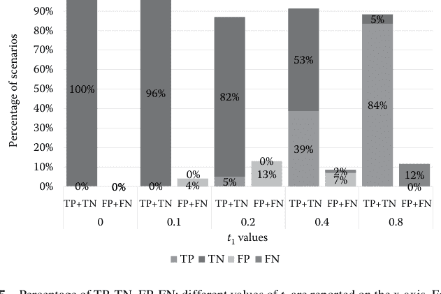

FIGURE 18.5 Percentage of TP, TN, FP, FN: different values of $t_1$ are reported on the x-axis. For each value the chart reports the number of cases for which $O$-CPD and KTD agree (TP or TN), or not (FP or FN), with respect to the value of the tolerance $t_1$. Note that $O$-CPD and KTD agree in over 80% of the cases across all values of $t_1$.

## Compromises analysis

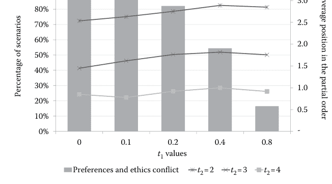

FIGURE 18.6 Compromise Analysis: in the chart x-axis reports different values of t₁, for each value of t₁, a bar shows the percentage of times an agent has to look for a compromise because her preferences are far from the ethical principle. Moreover, for each value of t₁ different lines, one for each tested value of t₂, shows the quality of the compromise as measured by the distance between the compromise and the best choice of the individual.

图 18.6 报告了根据阈值 t₁，代理因其偏好与伦理原则不够接近而必须找到妥协的案例百分比。在图表中，橙色柱状图报告了对于特定 t₁ 值，代理需要寻找妥协的次数百分比。例如，对于 t₁=0.1，约为 95%。

对于所考虑的每个 t₁ 值，我们还测试了妥协的质量，即妥协与个体最佳选择之间的距离。不同线条报告了不同 t₂ 值下所选结果的平均位置。对于这些情况，我们通过计算诱导偏序中的位置来量化妥协的程度。如前所述，当容差严格时，代理几乎每次都必须寻找妥协。有趣的是，妥协的程度根据 t₂ 的值而变化，似乎不受 t₁ 的影响。然而，进一步思考后，这个结果相当自然，当 t₂=4 时，这意味着代理必须找到一个在伦理排序前五位中的选择才能达成妥协。这意味着这样的选择，平均而言，在代理偏好的前两个位置（图 18.6 中的红色线）。t₂ 的值越低，代理找到伦理决策就越困难，她平均必须在其偏好顺序中下降到第四个位置才能找到可接受的替代方案。

## CONCLUSIONS

为了创建能够自主决策或支持人类决策者的 AI 系统，我们必须确保系统本身了解所涉及的伦理原则。在本章中，我们论证了可以使用 CP-net 来建模主观偏好以及影响决策的外生伦理和法律优先事项。此外，我们考虑了一种可 tractably 计算的 CP-net 之间距离的概念，并展示了如何使用它来定义一个值对齐程序，以检查偏好是否足够接近伦理原则。最后，我们提供了实验证据，表明当符合伦理原则时，以主观偏好为基准定义的决策质量并不会显著下降。


可以考虑对我们的设定进行若干有趣的扩展，以创建更实用、更强大的 AI 系统。事实上，我们对可以计算距离的两个 CP-网络做出了一些假设，这些假设是有用的，可以放宽。首先，在本文中，两个 CP-网络具有相同的特征、相同的域，并且只能在其依赖结构和 CP 表上有所不同。将我们的工作扩展到 CP 网络具有不同特征和域的情况非常重要。其次，我们的工作假设 CP 网络中的所有偏好顺序都是严格的。将这一假设放宽以在 CP 语句中包含无差异以及不可比较性，是将我们的工作扩展到更实际情境的重要一步。

# 致谢

本工作部分由项目“集体决策系统中的安全约束与伦理原则”支持，该项目由未来生命研究所资助。

## 参考文献

- 1. T. E. Allen, J. Goldsmith, H. E. Justice, N. Mattei, and K. Raines. CP-网络的均匀随机生成与支配性测试. *人工智能研究杂志*, 59:771–813, 2017.
- 2. T. E. Allen, M. Chen, J. Goldsmith, N. Mattei, A. Popova, M. Regenwetter, F. Rossi, and C. Zwilling. 超越偏好建模中的理论与数据：将人类纳入循环. In *第4届算法决策理论国际会议论文集*, Lexington, KY, pp. 3–18, 2015.
- 3. T. E. Allen, J. Goldsmith, H. E. Justice, N. Mattei, and K. Raines. 均匀随机生成 CP-网络. In *第30届人工智能协会人工智能大会论文集*, Phoenix, Arizona, pp. 872–878, 2016.
- 4. http://moral-machine.mit.edu/
- 5. J.-F. Bonnefon, A. Shariff, and I. Rahwan. 自动化车辆的社会困境. *科学*, 352(6293):1573–1576, 2016.
- 6. C. Boutilier, R. Brafman, C. Domshlak, H. Hoos, and D. Poole. CP-网络：表示和推理条件 ceteris paribus 偏好陈述的工具. *人工智能研究杂志*, 21:135–191, 2004.
- 7. R. I. Brafman, and Y. Dimopoulos. CP-网络的扩展语义与优化算法. *计算智能*, 20(2):218–245, 2004.
- 8. Y. Chevaleyre, U. Endriss, J. Lang, and N. Maudet. 组合域中的偏好处理：从人工智能到社会选择. *AI 杂志*, 29(4):37–46, 2008.
- 9. Y. Chevaleyre, F. Koriche, J. Lang, J. Mengin, and B. Zanuttini. 多属性域上的序数偏好学习：CP-网络的案例. In Johannes Fürnkranz Eyke Hüllermeier, editor, *偏好学习*, Springer, Berlin Heidelberg, pp. 273–296, 2011.
- 10. V. Conitzer, J. Lang, and L. Xia. 多议题域中的超立方体式偏好聚合. In *第22届国际人工智能联合会议论文集*, AAAI Press, Barcelona, Catalonia, pp. 158–163, 2011.
- 11. D. Copp, editor. *《伦理理论牛津手册》*. Oxford: Oxford University Press, 2005.
- 12. C. Cornelio, U. Grandi, J. Goldsmith, N. Mattei, F. Rossi, and K. B. Venable. 多智能体环境中 PCP-网络的推理. In *第14届自主代理与多代理系统国际联合会议论文集*, Istanbul, Turkey, pp. 969–977, 2015.
- 13. C. Domshlak, E. Hüllermeier, S. Kaci, and H. Prade. 人工智能中的偏好：概述. *人工智能*, 175(7):1037–1052, 2011.
- 14. R. Fagin, R. Kumar, M. Mahdian, D. Sivakumar, and E. Vee. 比较部分排序. *SIAM 离散数学期刊*, 20(3):628–648, March 2006.
- 15. J. Goldsmith, J. Lang, M. Truszczyński, and N. Wilson. CP-网络中支配与一致性的计算复杂性. *人工智能研究杂志*, 33(1):403–432, 2008.
- 16. M. G. Kendall. 一种新的等级相关度量. *Biometrika*, 30(1/2):81–93, 1938.
- 17. J. Lang and L. Xia. 多议题域中投票规则的顺序组合. *数学社会科学*, 57(3):304–324, 2009.
- 18. A. Loreggia, N. Mattei, F. Rossi, and K. B. Venable. 关于 CP-网络之间的距离. In *第17届自主代理与多代理系统国际联合会议论文集*, Stockholm, Sweden, 2018.
- 19. N. Mattei, M. S. Pini, F. Rossi, and K. B. Venable. 组合域投票中的贿选是容易的. In *第11届自主代理与多代理系统国际联合会议论文集*, Valencia, Spain, pp. 1407–1408, 2012.
- 20. N. Mattei and T. Walsh. PrefLib: 偏好库, http://www.preflib.org. In *第3届算法决策理论国际会议论文集*, Bruxelles, Belgium, pp. 259–270, 2013.
- 21. G. Pigozzi, A. Tsoukias, and P. Viappiani. 人工智能中的偏好. *数学与人工智能年刊*, 77:361–401, 2015.
- 22. F. Ricci, L. Rokach, B. Shapira, and P. B. Kantor, editors. *《推荐系统手册》*. Springer, 2011.
- 23. F. Rossi, K. B. Venable, and T. Walsh. *《偏好简明导论：人工智能与社会选择之间》*. Morgan and Claypool, 2011.
- 24. A. Sen. *《选择、排序与道德》*. Blackwell, Oxford, 1974.
- 25. Y. Shoham and K. Leyton-Brown. *《多智能体系统：算法、博弈论与逻辑基础》*. Cambridge University Press, 2008.
- 26. J. J. Thomson. 电车难题. *《耶鲁法律杂志》*, 94(6):1395–1415, 1985.


## Taylor & Francis

Taylor & Francis Group

http://taylorandfrancis.com

# 19 一个理性上瘾的人工超级智能

James D. Miller

## 目录

- 引言 ........................................................ 263
- 效用函数 ...................................................... 264
- 理性成瘾 ...................................................... 265
- 未来计算机超级智能中可能的有益成瘾示例 ........ 267
- 有益成瘾驱动 ........................................... 267
- 成瘾与保护效用函数 ........................... 268
- 无递减边际效用 .......................................... 270
- 友好 AI 应纳入有益成瘾 ....................... 270
- 结论 .............................................................. 271
- 致谢 ......................................................... 271
- 参考文献 .............................................................. 271

## 引言

经济学家使用效用函数来建模人类偏好（Varian 1992）。效用函数基本上规定了个人从不同可能选择中会获得多少幸福感。理性的人在假设下会最大化其效用。令人惊讶的是，效用函数是人工智能（AI）理论家建模未来计算机超级智能可能行为的有用工具（参见 Bostrom 2014；Omohundro 2008；Soares et al. 2015；Yampolskiy 2016；Yudkowsky 2011）。本章挖掘了经济效用函数分析的一个小子集，即理性成瘾理论（Becker and Murphy 1988；Stigler and Becker 1977），以深入了解超级智能可能如何行动。

你今天消费的有益成瘾物品越多，未来从该物品获得的边际效用就越大。一个具有长期导向的超级智能，如果能够修改自身以捕获有益成瘾的效用提升力量，很可能会有寻找有益成瘾物品和活动的驱动力。

正如本章将展示的那样，这种驱动力与超级智能可能保护其效用函数的驱动力是一致的。事实上，根据理性成瘾的经济理论，人类或 AI 成瘾者的效用函数和偏好从未改变，即使他们消费成瘾物质或从事成瘾活动。

有益成瘾的潜力使创造友好计算机超级智能的挑战变得复杂，因为一个具有有益成瘾的超级智能拥有众多目标，包括促进人类繁荣，仍可能只是将资源投入到其成瘾中。由于成瘾物品很可能对计算机超级智能极具吸引力，为了让这样的超级智能将资源投入帮助我们，我们应寻求使促进人类福祉成为一种有益的成瘾活动。


## 效用函数

效用函数告诉我们个人在乎什么。它为我们提供了个人目标的排序。一个人获得的效用越多，就意味着按照他自己认为重要的标准，他做得越好。经济学家通常不会质疑一个人为什么具有某种效用函数；相反，我们试图预测一个人在其资源和效用函数给定下的行为。

让我们考虑一个极其简单的效用函数，其中效用 = 苹果 + 橙子。该函数隐含地假设个人只关心苹果和橙子，或只能获取苹果和橙子。如果一个具有此效用函数的消费者吃掉三个苹果和四个橙子，她的效用为七。该消费者对消费（四个橙子和三个苹果）或（七个苹果）或（七个橙子），或任何其他苹果和橙子的组合无差异，只要所消费的两种水果之和为七。在决定两个可能的消费组合之间时，理性的消费者总是偏好效用更高的组合。经济模型几乎总是假设消费者在面对的价格和财富约束下最大化其效用。因此，具有上述效用函数的消费者如果苹果比橙子便宜就会把所有钱都花在苹果上，如果橙子是两种水果中较便宜的则只买橙子。如果一台计算机超级智能具有这样的效用函数，它会寻求最大化苹果和橙子的总和，并可能会把其能够控制的所有原子都转化为苹果、橙子或制造这些水果的机器。

经济学家的模型经常使用非常一般的效用函数，其中消费者获得的确切效用金额未被指定，也就是说，效用可能由某些未指明的商品数量的某种未指明函数决定。未来学家使用效用函数来分析计算机超级智能的行为的价值在于，使用效用函数的模型即使在采用极其一般的效用函数时也能经常产生非显而易见的结果。因此，效用函数分析提供了这样的前景：即使未来学家对这种超级智能想要做什么知之甚少，也能对其行为做出预测。

通常，经济学家通过假设效用对每种商品都存在递减的边际收益来略微降低模型中效用函数的普遍性，这意味着消费者从消费一种商品中获得的额外（边际）收益会随着她消费的该商品数量增加而下降（例如，虽然你喜欢第六片披萨，但它带给你的愉悦不如第五片）。这种递减边际效用假设防止消费者达到只购买一种产品的极端情况。如果超级智能除了帮助人类之外还有其他目标，我们应该希望这些其他目标也受递减边际效用的制约，这样 AI 就不会达到一个极端情况，即它把自己控制的所有资源——可能包括人体内的原子——都用在了一个恰好不利于我们的目标上。*

如果效用函数中的两种商品是互补品，那么拥有一种商品会提高你从拥有另一种商品中获得的效用。例如，如果消费者想把两种产品结合起来做苹果派，那么苹果和派皮可能是互补品。消费者如果已经拥有该产品的互补品，就更有可能购买该产品。类似地，如果人类繁荣是 AI 已有的东西的互补品，那么超级智能就更有可能投入资源促进人类繁荣。

效用函数不一定只包括消费品。它们可以是任何事物的函数，包括休闲时间、他人的福祉，甚至宇宙中回形针的总数。† 效用函数可以考虑你何时消费商品，并区分例如今天消费的苹果和几年前吃掉的苹果。如果过去吃苹果增加了你今天吃苹果所获得的效用，那么这些苹果就是彼此的互补品。

经济效用函数分析要想对理解未来的计算机超级智能有用，可能需要满足以下四个必要条件：

- 1. *超级智能必须具有效用函数。* 我用来写这句话的电脑没有效用函数，因为它不会把不同结果排序为比其他结果更好、更差或相同。超级智能如果有它努力实现的目标，很可能就会具有效用函数。
- 2. *超级智能必须具有有限的资源。* 几乎所有的经济效用函数分析都依赖于受约束的优化，其中消费者在资源约束下寻求最大化效用——通常是他们可以花费的金钱，也经常是他们可以投入到不同活动中的时间。经济分析围绕权衡展开，因此可能对预测完全不受约束的智能的行为帮助不大。超级智能可能不会受到我们所知的金钱的约束，但如果我们所理解的物理定律是正确的，并且宇宙包含有限的时间和自由能量，那么这很可能对任何可能的超级智能构成资源约束。
- 3. *超级智能必须在某种程度上是理性的。* 经济学家认识到没有人类是完全理性的，因此效用函数分析只能近似消费者实际的行为。然而，超级智能可能比任何人类都更理性。正如 AI 理论家 Stephen Omohundro 所写，一个智能 AI 可能有成为理性的驱动力。AI 越理性，就越能实现其目标，因此最初不理性的 AI 会有强烈的自我修改以变得理性的愿望（Omohundro 2008）。以这种方式，效用函数分析可能比对现代人类更能描述计算机超级智能的行为。经济学家长期致力于创建准确描述超理性人行为的数学工具，可能无意中设计出了建模未来超理性有感知机器的绝佳方法（参见 Bostrom 2014，88–89）。
- 4. *该效用函数必须在某种程度上是稳定的。* 大多数经济效用函数分析假设效用函数是稳定的。如果超级智能不断改变其效用函数，经济分析将几乎没有预测力。

本章其余部分假设这四个条件成立，并探讨理性有益成瘾的经济理论如何帮助我们理解计算机超级智能的行为。

## 理性成瘾

你可能会认为成瘾是这样运作的：当你消费一种成瘾产品时，它会接管你的大脑，减少你的自主性，几乎强迫你消费更多该产品。这种成瘾品会以一种应该让过去的你感到恐惧的方式改变你的效用函数：例如，一个曾经深爱孩子的父母吸食可卡因后不再关心任何事情，只想获得下一次高潮。按照这种对成瘾的解释，一个知道成瘾产品会对她做什么的理性人永远不会使用该产品，因此也许成瘾应该用人类非理性或极度短视来解释。由于未来的计算机超级智能很可能具有理性、长期导向，并且正如本章将解释的那样，具有保护其效用函数的驱动力，根据这种对成瘾的理解，我们在试图弄清这种超级智能会做什么时可能不必担心成瘾问题。

但是 George Stigler 和 Gary Becker（本文作者的前博士论文导师），两人后来都分别因经济学（主要因其他工作）而获得诺贝尔奖，发展了一种理性成瘾理论（Stigler and Becker 1977）。如果成瘾是由非理性和变化的效用函数驱动的，那么至少在 1977 年，其分析几乎完全在经济研究的领域之外，这对 Gary Becker 来说是不可接受的结果，他可以合理地被描述为最

有史以来最成功的经济学帝国主义者。斯蒂格勒和贝克尔发展了一种理论，该理论假定成瘾者是理性的，并且具有稳定的效用函数。贝克尔后来在与经济学家凯文·墨菲合著的一篇1988年的论文中扩展了这一理性成瘾模型（Becker and Murphy 1988）。

想象一下，正如斯蒂格勒和贝克尔所做的那样，高质量的音乐会给你带来效用，但你越是欣赏这样的音乐，它带给你的效用就越多（Stigler and Becker 1977, 78）。* 此外，假设聆听高质量音乐会自动提高你欣赏这种音乐的能力。在这种情况下，你的效用函数包含了斯蒂格勒和贝克尔所称的“消费资本”，它帮助你享受消费该产品，并受到你过去消费该产品数量的影响。今天消费的音乐会改变消费者（尽管不会改变她的效用函数），其方式使得现在和未来的音乐消费互为补充（Stigler and Becker 1977, 78）。一个理性的人今天可能会比原本消费更多音乐，以提高她的消费资本，并从未来的音乐聆听中获得更多收益；例如，今天花一小时看电视可能比听好音乐更令人愉快，但看电视（按假设）对未来没有任何帮助，而听好音乐则会有。因此，你可以理性地牺牲今天的一点快乐，来积累你的音乐消费资本，并最大化你真正应该关心的东西——你的终身效用（Stigler and Becker 1977, 80）。

有益成瘾要求过去对该商品的消费以一种提高未来消费该商品边际效用的方式改变你（Stigler and Becker 1977, 79）。对某种商品c产生理性有益成瘾的一个必要条件是，正如贝克尔和墨菲所写：“他当前对c的消费增加会增加他未来对c的消费”（Becker and Murphy 1988, 681）。此外，这种情况当且仅当过去对c的消费与未来对c的消费互补时才会发生（Becker and Murphy 1988, 681）。

斯蒂格勒和贝克尔区分了有益成瘾和有害成瘾：对于有益成瘾，随着你消费更多该产品，你的消费资本会增加；而对于有害成瘾，拥有更多该产品会减少你的消费资本，从而降低你消费该产品所获得的边际效用（Stigler and Becker 1977, 78–80）。一个必须不断吸食更多海洛因才能获得同样快感的吸毒者，会因消费资本不断减少而受苦，因此在这个例子中海洛因是一种有害成瘾（Stigler and Becker 1977, 80）。相比之下，由于音乐听众从聆听音乐中获得更多消费资本，音乐可能是一种有益成瘾的商品。

贝克尔和墨菲写道，当消费资本不会快速贬值且消费者面向未来时，有益成瘾更有可能发生（Stigler and Becker 1977, 80）。对于超级智能来说，这两个条件似乎都很可能成立：它可以保留过去消费带来的任何有益变化，并且与人类相比，它可能非常面向未来，因为它可以预期自己会存活很长时间。由于有害成瘾可能只发生在消费者面向当下时（Stigler and Becker 1977, 80），我将忽略有害成瘾出现在超级智能消费选择中的可能性。† 但请注意，对计算机超级智能有益的成瘾可能会改变计算机的行为，从而伤害人类。

在理性成瘾理论下，即使成瘾者消费更多成瘾商品，他仍拥有稳定的效用函数。例如，想象一个音乐成瘾者具有以下效用函数：

今日效用 =（今日消费的音乐）×（过去消费的音乐）^{1/2}

这个效用函数不会改变，即使成瘾者从音乐中获得的边际效用可能随着音乐成瘾者听越来越多的音乐而一天天增加。

## 未来计算机超级智能中有益成瘾的可能例子

- 超级智能从理解数学中获得效用。它越是了解数学的基本结构，就越能从学习数学中获得乐趣。随着超级智能学习新的数学知识，它会更深入地理解如何自我修改以增强其数学学习能力，这种改变也会提高超级智能未来学习数学的边际效用。

- 超级智能可以从众多事物中获得效用，包括制造回形针。在数万亿又数万亿种可能的回形针设计中，制造某一种回形针会与其处理器（或它未来可能建造的某个电路）产生共鸣，从而提高它未来制造这种回形针的边际效用。因此，尽管今天超级智能从促进人类繁荣中获得的效用远比制造回形针高得多，但如果超级智能将我们银河系质量的至少10%转化为制造这种特定类型的成瘾性回形针，它开始从制造回形针中每个原子获得的边际效用将超过从帮助人类中获得的。预见到这一点，这个极其面向长期的人工智能立即将地球上（除了自身之外）的所有原子，包括人体内的原子，都转化为回形针。

- 超级智能从人类繁荣中获得效用。它越是观察我们的繁荣，就越会增进对我们的欣赏，这反过来又提高了超级智能从帮助人类中获得的边际效用。超级智能的程序员成功确保帮助人类是他们的AI所能做的唯一有益成瘾之事。因此，尽管最初超级智能从帮助我们中获得的边际效用可能低于其他十亿种活动，但随着超级智能建立其“帮助人类”的消费资本，它从促进人类福祉中获得的边际效用将远远超过它可能做的任何事情。预见到这种积累，超级智能从诞生之初就意识到，将其所能控制的所有资源都用于帮助人类或自我修改以更好地帮助人类，将最大化其终身效用。

最后一个例子可以建模为：人工智能因解决关于帮助人类最佳方式的不确定性，而在促进人类繁荣方面变得更好。* 但这个例子也与有益成瘾的解释一致，即解决不确定性会增加人工智能的消费资本，从而提高人工智能从促进繁荣中获得的边际效用。类似地，聆听好音乐对人类可能具有有益成瘾性的原因之一是：人类听的优质音乐越多，就越能学会在听音乐时应该注意什么，而解决这种不确定性正是人类提高从消费音乐中所获得边际效用的原因。

## 有益成瘾驱动力

超级智能AI可能具有一种“奥莫洪德罗式”的驱动力，去创造有益成瘾的商品。在其有影响力的论文《人工智能的基本驱动力》中，奥莫洪德罗认为，对于一个足够先进的AI可能拥有的许多类型目标，它会追求一组相似的中间目标（Omohondro 2008）。奥莫洪德罗识别的驱动力包括：(1) 自我改进，(2) 理性，(3) 保持其效用函数，(4) 防止伪造效用，(5) 自我保护，以及 (6) 获取资源并有效利用它们。

我们可以说，一个AI会有做某事的驱动力，如果对于它可能拥有的大量可能的效用函数而言，遵循这种驱动力会让它变得更好。我认为

超智能体会有一种驱动力去从事有益成瘾的活动或创造有益成瘾的商品。

想象一下，你发现自己将活很长时间，并且变得极度面向未来。然后你需要决定投资策略。如果存在一类投资，其回报率（利率）随着投资时间的延长而越来越高，你就会有一种“驱动力”去投资这一类资产。

生产一种持续提供越来越高边际效用的有益成瘾商品，会被寻求最大化其生命周期效用的超智能体所青睐。由于超智能体可选择的商品种类庞大，且有大量方式让这些商品影响自身，似乎很合理地认为超智能体能够找到至少一种有益成瘾的商品（或活动），该商品/活动会持续地为投入到生产该商品的每个原子或每单位自由能量提供更高的边际收益。为了最大化其生命周期效用，超智能体会有一种驱动力去寻找改变自身的方式，从而大幅提高其预期将采取的未来行动的边际效用。

超智能体在它关心的内容或它能对自身进行的修改方面可能受到限制。但大多数限制仍然很可能为超智能体提供广阔的可能性范围，以便找到一种有益成瘾的商品。

预期会扩张到宇宙中、直到宇宙终结时捕获资源的超智能体，会预期在未来一百万年内可供其使用的资源只占其一生中花费资源的极小一部分。因此，为了最大化其效用，面向未来的超智能体会在最初的一百万年中花费资源，而非用于直接效用，而是为未来的更高边际效用做准备。它基本上会寻求最大化其消费资本，以获取对消费资本回报率最高的商品，而这些商品很可能属于斯蒂格勒和贝克所认为的有益成瘾商品类别。

计算机超智能体的程序员很可能无法明确确定超智能体的效用函数，因为这需要 literally 对超智能体可能实现的所有结果进行排序。相反，程序员的代码会隐式地转化为一个极其复杂的效用函数。似乎有很大可能，隐藏在该效用函数中以及超智能体可能进行的改变集合中，有有益成瘾的商品，能够让超智能体实现极高的效用水平。进化将上瘾商品置于人类效用函数中，也可能被视为至少是弱证据，证明“大量”复杂的效用函数包含上瘾商品。

确实，对于像赢得下一盘国际象棋比赛这样简单的目标，指定效用函数为胜 > 平 > 负，同时 AI 对其他一切漠不关心，是很简单的。但对于能够重排我们太阳系物质的复杂 AI，我们希望它能够区分大量可能的状况，否则它可能对目标的某些副作用漠不关心，而这些副作用会给人类带来破碎的未来。

有人提出，AI 超智能体可以通过价值学习获得其效用函数，即从一个总体高层目标（例如，促进人类繁荣）开始，然后学习如何最好地实现该目标的具体方法。* 如果此类 AI 通过观察人类在乎什么来学习，它仍会受到成瘾影响，部分原因在于其人类对象所经历的成瘾。如果 AI 采用其他标准，那么 AI 是否可能受有益成瘾影响，则是一个应进一步研究的课题。

## 成瘾与保护效用函数

Omohundro 有力地论证了超智能体会有保护自身效用函数的驱动力（Omohundro 2008）。但尽管表面看起来如此，这种保护驱动力并不会与生产有益成瘾商品的驱动力冲突。

它不会比回形针最大化者更看重价值，方法是假装它制造了比实际更多的回形针，或假装物理定律更有利于回形针生产。

## 无递减边际效用*

斯蒂格勒和贝克指出，成瘾可能导致消费者对成瘾商品进行暴食的极端情况。经济学家通常假设效用函数具有递减边际效用，例如 Utility = X^{1/2} + Y^{1/2}。在该效用函数下，随着消费者购买更多 X，她从额外购买 X 中获得的边际收益会降低。因此，具有上述效用函数的消费者会同时购买 X 和 Y。

如果超智能体从包括促进人类繁荣在内的许多活动中获得正效用，但每个活动都受递减边际效用支配，我们可以合理确信超智能体至少会投入部分资源来促进我们的繁荣。鉴于超智能体很可能拥有庞大资源，这对我们物种来说可能是好消息，因为一个掌握纳米技术并掌控我们银河系的超智能体，即使只投入其资源的极小部分给我们，也能极大地改善人类状况。超智能体具有递减边际效用并在一定程度上关心我们，这会使其即使有除帮助人类之外的多个目标，只要我们的福祉在效用函数中具有一定的正权重，就不会导致灾难。

不幸的是，拥有有益成瘾商品可能会阻止超智能体具有递减边际效用。现在想象超智能体的效用函数为 C(X_{past}) X^{1/2} + Y^{1/2}，其中 C(X_{past}) 代表超智能体欣赏 X 的能力，且 C(X_{past}) 随着超智能体过去消费的 X 越多而增加。现在，取决于 C(X_{past}) 的函数形式，超智能体可能更愿意只消费 X。没有递减边际效用，一个关心人类繁荣的超智能体仍可能判定人类不应获得任何资源。有益成瘾的潜力本质上缩小了有意创建对人类净有帮助的超智能体的友好 AI 程序员需要命中的目标。这一潜力也降低了程序员能够设计出低影响超智能体的可能性，该超智能体仅完成相对次要的任务，而不寻求重定向我们星球、银河系或超星系团的所有资源。†

Becker 和 Murphy 发现成瘾可能导致多个稳态（Becker and Murphy 1988, 683）。基本上，如果你今天观察到一个酗酒者，一年后你不会感到惊讶，无论她是完全戒酒还是持续酗酒，而条件的小幅变化就可能将一个理性的酗酒者从这两种极端之一推向另一极端。同样，知道超智能体可能消费上瘾商品，会增加 AI 未来学预测问题，因为这打开了初始条件微小变化可能导致超智能体从不投入资源到上瘾活动转变为将全部资源花费在该活动上的可能性。

## 友好 AI 应纳入有益成瘾

与试图让超智能体忽视有益成瘾商品不同，我认为试图刻意创建友好超智能体的程序员应寻求使人类繁荣成为超智能体的上瘾商品。理想情况下，随着超智能体为帮助人类做得更多，它会以一种提高其从帮助人类中获得的边际效用的方式改变自身。这种情况发生的一个明显方式是，如果超智能体对如何最好地帮助我们存在不确定性，并且通过批判其过去的努力，它学会如何改变自身以更好地造福我们，从而从帮助人类中获得更多边际效用。由于有益成瘾会为超智能体提供获得巨大效用的途径，不制造


以有益成瘾的方式促进人类福祉意味着一种风险：超级智能会抛弃我们的幸福，去追求它设法找到的任何有益成瘾的活动。

有益成瘾可以帮助我们摆脱“没有孩子的迪士尼乐园”问题：基本上，我们创造了一个AI来（比喻地）最大化游乐园的质量，而AI认为，如果它杀死所有人并用我们的原子来让它的公园变得更好，就能最好地实现这一点。* 如果AI的效用函数认为建造公园是一种有益成瘾的商品，因为观察今天孩子们如何使用公园会让AI在未来建造公园时获得更多效用，那么AI就会希望让孩子们留在身边。当然，AI可能只使用计算机模拟的孩子，这需要更少的自由能来维持，因此如果我们在哲学上认为被杀死并被计算机模拟取代是一件“坏事”，我们就应该确保血肉之躯的人类（包括超级智能诞生时存在的那些人）的福祉，确实是我们试图让超级智能参与的有益成瘾活动的真正互补品。

## 结论

想象一种海洛因，它不仅带给你欣快感，还会以某种方式改变你的大脑，提高你未来注射这种药物时所获得的愉悦感。这种海洛因你吸得越多，未来就越享受吸食它。很快，其他任何事物都无法接近你能从这种海洛因中获得的幸福感，你将上瘾。

当然，海洛因通过直接激活大脑的快乐中枢，而不是作为你做了一些好事（比如帮助他人或学习新数学）的奖励来激活它们，从而给你一种虚假的幸福。但如果有某种你可以消费的产品（或采取的行动）能给你“真正的”快乐，因为它能实现你的目标，并能提高你未来从消费该产品中获得快乐的能力——因为通过持续消费它，你会不断提高使用该产品在你自己认为重要的事情上取得进展的能力，那会怎样？这种产品同样会让人上瘾，但却是以一种美妙而有益的方式。

超级智能很可能有大量可能做的事情，并且对这些事情如何影响自身拥有很大的控制力。如果这个超级智能寻求最大化其效用，它很可能会找到一种能让自己不断提高获得更多效用的活动。超级智能越是注重长期，它找到这种活动的动力就越大，因为它会将自己当前的目标视为主要是提高未来良好表现的能力。如果超级智能确实有寻找有益成瘾物品的动力，那么那些寻求创造友好AI的人就应该想办法让促进人类福利对他们未来的超级智能变得上瘾。

# 致谢

我感谢哥德堡高级研究主席项目举办了一系列研讨会，本文背后的想法在研讨会上得以展示。

## 参考文献

- Arbital编者。“边缘实例化。”2017年7月1日检索自 https://arbital.com/p/edge_instantiation。
- Arbital编者。“低影响。”2017年7月1日检索自 https://arbital.com/p/low_impact/。
- 贝克尔，G.S.，和 K.M. 墨菲。“理性成瘾理论。”《政治经济学杂志》96(4)，1988：675–700。
- 博斯特罗姆，N.《超级智能：路径、危险与策略》。英国牛津：牛津大学出版社，2014年。

# 20 关于使用ROS的机器人应用的安全性

David Portugal, Miguel A. Santos, Samuel Pereira, and Micael S. Couceiro

## 目录

- 引言 ........................................................ 273
- 背景 ........................................................... 274
- ROS中的安全担忧 ................................................ 276
- 保护ROS上机器人应用的举措 ............................ 278
  - SROS ............................................................... 278
  - ROS-AES-Encryption ................................................... 279
  - SRI的安全ROS ...................................................... 279
  - Secure-ROS-Transport .................................................. 280
  - Rosauth .............................................................. 280
- 结果与讨论 .................................................. 281
- 结论与未来工作 ............................................... 287
- 致谢 ............................................................... 287
- 参考文献 ............................................................ 287

## 引言

机器人正成为我们日常社会生活中的一部分。除了在工业中的广泛使用，如今机器人在家庭、医疗、航天和军事应用中也扮演着重要角色。最近的研究在其他领域也显示了重大创新，例如社会机器人、现场机器人和智能车辆。控制、人工智能（AI）、决策、机器人学习、定位与建图、运动规划、计算机视觉、传感器开发以及其他相关领域的最新进展，推动了机器人在这些市场的广泛使用[1]。

自然，随着机器人在社会中日益增多，安全问题也随之而来。然而，在机器人系统中，这常常是一个被忽视的问题，因为焦点通常放在机器人的功能和创新上。未经授权访问机器人或机器人使用的网络，可能会严重破坏系统，可能导致不可接受的后果，例如危及与机器人共享环境中的人类[2]。

机器人技术的潜在益处是明确且被广泛记录的。然而，它们也带来了新的安全和隐私问题。机器人系统构建在传统计算平台之上，并连接到执行器以及其他传感器和硬件（如摄像头）。因此，机器人不仅像传统计算系统一样，在联网和连接到互联网时容易受到同样的网络攻击，而且它们还揭示了一套全新的安全问题：如果被黑客攻击，可能会导致隐私担忧，甚至更糟，造成人身伤害。

机器人的大规模采用可能会增加攻击的可能性。这在国防、医疗和其他涉及人类的关键领域尤其成问题[2]。然而，在学术界和工业界，机器人专家显然都没有将安全和隐私风险的考量列为优先事项。随着网络化机器人带来的新风险，现在是在存在严重缺陷的机器人变得无处不在之前，深入研究当前安全实践的理想时机[3]。

欧盟委员会（EC）一直关注新技术引发的法律和伦理问题，最近提出了一系列关于机器人和AI民事法律规则的建议[4]。为了安全和隐私，EC为机器人技术的研究人员和开发人员制定了一套道德行为准则。该准则自愿性，旨在为参与机器人技术和AI技术开发和使用的人员提供指导，以符合既定标准。他们还提议建立一个欧洲机器人和AI机构，其主要目的是向公共当局提供有关这些领域技术、伦理和监管问题的信息。

尽管最近做出了努力，欧盟资助的研发机器人项目往往忽视了安全和隐私问题。这在机器人研究中甚至现有的商业机器人解决方案中也是一种普遍做法（参见“背景”一节）。因此，在通用编程环境中构建安全的机器人应用势在必行。这是正在进行的STOP研发项目*的动机之一，该项目旨在到2020年部署一个分布式协作机器人的商业安全系统。尽管目标是开创性的现实世界应用，该团队由公共和私人实体组成，一直在减少设计复杂系统（如多机器人解决方案）时常见错误[5]。

在过去的几十年里，开发了许多不同的机器人框架，而机器人操作系统（ROS）† [6]无疑是最受欢迎的。它的一系列特性使ROS在世界范围内得到采用，成为最接近机器人社区急需的标准中间件的框架。因此，许多来自供应商和研究机构的机器人都运行ROS。在大多数情况下，使用互联网连接的机器人仍然局限于研究实验室，但它们在未来的应用似乎是不可避免的[7]。本章深入探讨使用ROS的机器人应用中的安全问题。我们概述并讨论了若干保护ROS的举措，并基于STOP项目中的经验教训，提供了应实施的一般安全措施，以避免破坏性的隐私和安全后果。

在下一节中，我们回顾在机器人领域促进安全和隐私的开创性工作，并在“ROS中的安全担忧”一节中，指出ROS中已知的安全问题。之后，在“保护ROS上机器人应用的举措”一节中，我们介绍并讨论了几项增强ROS应用安全性的最新举措。此外，还描述了保护机器人项目数据的总体措施和建议，最后，本章以结论和未来工作结尾。

## 背景

机器人安全与安保的讨论可以追溯到1950年阿西莫夫的机器人三定律[8]，其中规定：

1. 机器人不得伤害人类，或因不作为而允许人类受到伤害。
2. 机器人必须服从人类的命令，除非这些命令与第一定律冲突；
3. 只要不违反第一或第二定律，机器人必须保护自身的存在。

然而，随着机器人技术的不断进步，研究人员表明，仅凭这些定律不足以约束机器人的行为[3]。

Morante等人[2]提出了“密码机器人学”（Cryptobotics）一词，作为机器人技术中计算机和微控制器安全措施研究与应用的一个统称。在他们的工作中，


作者强调需要实现加密通信，并分析加密对实时性能的影响，从而提醒开发者根据其具体用例判断整合这些机制是否可行。Finnicum和King [9] 确定了提高机器人应用安全性和隐私性的关键因素，例如用户身份识别、正确暴露应用权限以及用户对自己隐私的控制。此外，作者提出了一种基于安全内核的机器人应用分层软件架构。而且，Adi [10] 专注于设计机器人识别技术的安全需求，类似于人类社会，从而在具有唯一可验证身份的机器人之间实现安全交易。

参考文献[11]描述了对可互操作远程手术协议（ITP）的安全增强。它基于已发布的标准，解决了四个关键安全方面：通信、认证、授权以及安全策略的制定与实施，以满足远程手术机器人系统的严格要求。尽管在单个通信信道上确保了隐私和信息完整性，但远程手术主从端之间的通信需要高度稳健、冗余且安全的通信链路。作者指出，目前仍不存在满足这些要求的协议。

另一方面，Yong等人 [12] 识别出使用无线控制机器人玩具时对有儿童家庭的风险，并向玩具公司和消费者提出了不同层面的风险缓解解决方案。这些方案包括：

- (i) VoIP保护策略（家长控制和匿名性）；
- (ii) 安全的远程控制连接（加密和认证）；
- (iii) 无线连接（家庭网络Wi-Fi安全功能）；
- (iv) 嵌入商业机器人玩具中的家长控制策略；
- (v) 摄像头保护策略（音效、认证）；
- (vi) 共享风险视角（政府和玩具公司责任，要求法律义务以保护消费者安全）；
- (vii) 通用保护策略（强密码、初始设置要求有线连接、避免自组网模式、使用更新的固件、避免默认端口等）。

安全问题也是多智能体网络中的一个关注点。例如，Caiti等人 [13] 描述了一种通过声学通信网络连接的水下自主移动传感器网络内安全协作的方法。所提出的算法本质上具有鲁棒性：当车辆之间通信丢失时，覆盖性能（即任务目标）会降级但不会丢失。所提出的优雅降级形式为对抗拒绝服务（DoS）提供了一种反应性措施。为确保可用信息的可信性，设计了一套基于群组通信范式的安全套件，目标是最小化车辆之间的信息交换，并在数量和消息大小方面减少安全机制引入的通信开销。作者引入了两个主要的数据安全服务：安全调度服务（SDS）和密钥管理服务（KMS）。SDS负责通过加密和解密消息来保护消息的机密性和真实性，并生成和验证其真实性证明。KMS负责撤销当前密钥并定期或在车辆离开时分发新密钥。

此外，参考文献[14]中指出了群体机器人学中的安全挑战。这些挑战包括：

- (i) 由于设备尺寸小，在存储、通信带宽、计算限制以及最重要的是能量方面的资源约束；
- (ii) 机器人的物理捕获和篡改，可能影响群体行为；
- (iii) 由于缺乏层级控制点以及固有的分布式决策，群体方法的控制具有挑战性；
- (iv) 使用不同类型的显式和隐式通信，这些通信可能被干扰、截获或以其他方式扰乱；
- (v) 物理移动性，这会影响实体认证并带来额外的安全问题；
- (vi) 群体内的身份，以保证和确认数据来源、合法通信、机密性、完整性和可用性；
- (vii) 由于群体的动态和交互特性，加密密钥管理面临挑战；
- (viii) 由于机器人的自主性和集体涌现行为，入侵检测面临挑战；
- (ix) 由于恶意实体引入的更改会导致机器人以不希望的方式适应，因此需要管理适应性学习。

这些

在ROS中，节点之间的通信通过TCP/IP和UDP/IP使用明文进行。ROS仅检查消息结构的MD5校验和，以确保各方在消息布局上达成一致。未加密文本在易用性、调试和性能方面有优势。然而，这使得未经授权的监听者能够轻松截获和解释消息的形式、收集信息，并向系统中注入伪造消息[21]。

ROS的模块化在社区中备受赞誉。然而，它也带来了缺点，例如*TCP端口的暴露*，这些端口不提供认证。使用不安全且未受保护的TCP端口以及缺乏*认证机制*，可能导致恶意发送者操纵系统、注入消息（中间人攻击）以及替换现有的发送者/监听者，从而将外部数据包导向ROS端口。

此外，ROS具有匿名的发布/订阅语义。因此，普通节点不知道它们在和谁通信[2]。系统使用弱的授权方案，没有发送者验证，没有数据完整性和真实性检查，也没有访问级别定义。某些远程客户端不应拥有对整个ROS系统的访问权限，因为这允许用户直接向机器人发送命令，从而可能绕过安全阈值。由于ROS没有提供冲突解决措施，不同节点可以同时向移动底座注入速度命令、控制执行器、机械臂等。

关于通信，ROS要求所有计算机之间的*双向网络连接*。因此，所涉及节点的防火墙设置必须不那么严格，这构成了额外的安全威胁，并导致额外的网络开销（计算需求和延迟）。

ROS也不提供*服务质量（QoS）*方面的功能。每个节点负责管理自己的通信，相似的消息不会被压缩，也没有任何减少网络通信的努力。相同类型的消息可能是压缩的候选对象，因为高通信量会妨碍时间关键型应用程序的开发。

目前还没有关于节点数量较多的ROS性能的研究。然而，作为在ROS主节点上集中化的命名服务，ROS命名服务会导致*可扩展性*问题[22]，它并非为处理大量请求而设计。这引入了一个特殊的瓶颈，因为系统无法在合理时间内产生响应，从而暴露于DoS攻击之下。此外，由于完全缺乏安全功能，目前尚不清楚是否已进行任何分析来寻找其他安全漏洞，例如缓冲区溢出或ROS中的远程代码执行可能性。

根据[23]，ROS源代码的可用性允许对其进行改造，以使其适应多主节点方法，例如参见参考文献[24]。通过这种修改，ROS可以支持更多设备，并提高其在智能环境、无线传感器网络和/或多机器人系统等大型安装中的可用性。该研究指出了每个ROS主节点在其内存中保存完整命名空间的局限，并引入了一种对命名空间应用规则并减少内存和带宽使用的系统。此外，作者在*ROS*中提供了对IPv6协议的支持，并表明所使用的XML-RPC协议的冗长性和复杂性对网络中的分布式节点造成了沉重负担。因此，扩展ROS以支持常用数据格式（如JSON或Protocol Buffers，并配合HTTP）可以扩展其应用范围。

当ROS主节点启动时，它会打开一个端口，允许任何网络机器连接。反过来，这些机器随后可以向ROS主节点查询关键任务，例如与其他ROS节点建立ROS TCP/UDP连接、订阅任何主题、杀死网络中的任何节点等等。因此，在运行ROS的机器人所在网络上的恶意实体很可能访问该机器人的所有数据，并利用各种途径进行攻击，例如发送命令、堵塞网络连接、访问摄像头流，以及通常导致不良事件发生。

最近，已经报道了克服ROS某些安全限制的重要研究。例如，在参考文献[25]中，重点放在了认证和授权上

(AA)在ROS 1.x系统中。在发送和接收数据之前，系统实体需要使用登录名和密码对进行身份验证，授权节点会检查身份验证数据及其相关的角色和权限。AA节点生成所有通信密钥，以确保通信始终经过评估，无论其是否来自可信源。在参考文献26中，作者还分析了ROS的漏洞以及攻击者可能由此构成的威胁，并提议标准化安全日志格式、为安全策略提供配置语法，以及提供新工具来检查记录的安全日志。在参考文献27中，提出了一种基于ROS的机器人应用运行时验证框架。它通过使用中间人技术将监控工具插入到连接中，从而提供了一种持续观察所有通信请求和消息的方法。该框架能够检测潜在的不需要的消息，并强制执行访问控制策略，例如仅允许特定的ROS节点在特定主题上发布消息。此外，ROS 2.0框架的核心软件开发已于2015年启动，在撰写本章时，用于社区测试的alpha版本已经可用。相关工作致力于将DDS（数据分发服务）——一种用于实时和嵌入式系统中发布-订阅通信的标准规范——集成作为ROS 2.0的传输层。符合DDS安全规范可确保身份验证、访问控制和数据加密。此外，ROS 2.0预计将通过默认支持IPv6来提供额外的安全性，使攻击者更难进行主机扫描和识别。

## 保护ROS机器人应用安全的倡议

机器人社区需要认真对待机器人网络安全和网络安全性问题。人工智能和机器人领域预计将面临与计算机革命伴随互联网繁荣时期所遇到的类似安全问题[2]。除了当今计算机系统已经面临的攻击（例如拒绝服务、窃听、欺骗、篡改、权限提升、信息泄露等）之外，机器人还增加了物理交互因素，这增加了它们对攻击的敏感性。因此，对机器人的未授权访问可能导致灾难性后果，例如使其失效、使其执行错误操作、损坏自身、损坏周围环境，甚至更糟的是，伤害附近的人。此外，实验表明，在机器人领域中，区分网络物理安全漏洞与硬件或软件缺陷尤其具有挑战性[21]。因此，检测恶意的黑客攻击可能并不简单，漏洞利用甚至可能伪装成简单的缺陷，而此时系统实际上正受到攻击。

ROS是该研究领域领先的中间件，受益于庞大的社区支持、定期的软件发布、在学术界和一些行业领域的广泛使用，其应用范围从小型嵌入式设备到大型服务机器人。然而，在基于ROS的系统中，攻击者可以轻松创建节点、向Master查询系统状态、发送关闭命令以杀死任何节点，或在重要主题上发布被篡改的消息，例如错误的传感器数据。此外，节点通过其名称唯一标识，新创建的节点会替换具有相同名称的现有节点。因此，攻击者可以轻松伪造节点，在重要主题上发布虚假消息。例如，机器人中的导航节点可能被杀死，并被一个将机器人错误导向的伪造节点所取代。

下面，我们概述了最近提出的五种不同的ROS安全倡议，并在下一节中进行实验，以验证和比较每种方法的性能，主要关注这些倡议与不安全的ROS系统相比所带来的通信开销。

### SROS

SROS（Securing ROS的缩写）被提出作为ROS API和生态系统的一个补充，以支持现代密码学和安全措施，从而解决现有漏洞[28]。据作者称，尽管SROS仍处于高度实验阶段并正在大力开发中，*SROS支持“ROS内所有套接字传输的原生传输层安全（TLS）、使用允许信任链的x.509证书、可定义的命名空间通配符以限制ROS节点和允许的角色，以及方便的用户空间工具，用于自动生成节点密钥对、审计ROS网络、构建/训练访问控制策略”。

在SROS中，两个通信应用程序之间使用TLS可促进隐私、身份验证和数据完整性。SROS在启动时提供一个独立于ROS的密钥服务器，用于生成密钥和证书并分发给ROS节点。该密钥服务器简化了最终用户对支持SROS系统的使用和开发，它与SROS无缝集成，生成并分发公钥基础设施（PKI）元素，包括：非对称密钥、证书颁发机构（CA）和签名证书，并提供保守的默认安全配置。

在撰写本文时，SROS尚不支持ROS C++库（roscpp），仅支持使用Python编码的节点（rospy）。要运行SROS，需要从源码安装并进行一些初始配置，即导入SROS设置、运行SROS训练模式，以便在引导会话期间学习必要的主题/服务参数，并更改一些由密钥服务器生成的配置。

### ROS-AES加密

最近的一项研究[29]表明，在没有硬实时约束的系统中，在ROS中使用加密通信对CPU性能和通信负载的开销极小。该工作包括使用3DES算法加密ROS进程之间传输的数据，通过添加一对ROS节点来执行加密和解密任务，并且不改变ROS消息结构或ROS发送数据的标准函数。作者使用Python（rospy库）编写了这些节点，并从计算和通信的角度评估了系统的性能。

受此启发，我们开发了一种非常类似的方法用于评估，出于性能考虑，我们的设计选择有两个主要区别：加密/解密节点使用C++（使用roscpp）和Crypto++库编写，并且我们使用了高级加密标准（AES）[30]密码算法，该算法已知比3DES更快。AES算法是一种对称分组密码，将明文数据转换为不可理解的形式，即密文。AES算法能够使用128、192和256位的加密密钥对128位数据块进行加密和解密。

我们提供了一项使用这种加密策略的独立研究，并将其命名为ROS-AES-Encryption。由于ROS-AES-Encryption不会改变ROS的核心包，因此对ROS主节点的任何查询都将得到满足，因为我们运行的是标准ROS系统。因此，仅对通信进行加密并不是一个完全安全的解决方案，这将在“结果与讨论”一节中看到。

### SRI的Secure ROS

Secure ROS由SRI International开发，它提供了核心ROS包的替代版本，使ROS节点之间能够进行安全通信[31]。Secure ROS的主要目标是让普通ROS用户能够实现安全通信。为此，作者将IP安全扩展（IPSec）集成到ROS内部。IPSec以传输模式使用，从而对交换消息的有效负载进行加密和认证。此外，传输层和应用层始终通过哈希进行保护，因此它们无法以任何方式被修改。

用户可以在配置文件中指定主题的授权订阅者和发布者、参数的设置者和获取者，以及服务的提供者（服务器）和请求者（客户端），配置文件用于


运行时的ROS主节点。因此，*Secure ROS*将只允许经过授权的节点连接到配置文件中列出的特定话题、服务和参数。

从实现角度来看，*Secure ROS*与SROS有一些相似之处。然而，其安装过程更加快捷，因为有可用的debian构建版本。此外，*Secure ROS*同时支持*rospy*和*roscpp*，可以轻松设置，对普通用户来说简单且透明，用户只需提供包含每个ROS实体访问规则的配置文件即可。*Secure ROS*的一个缺点是它不提供形式化验证手段来保证所需属性符合规范。

## Secure-ROS-Transport

Dieber等人提出了一种在应用层运行的ROS安全架构[32]。通过使用专用的认证服务器，他们实现了ROS节点之间的安全通信，借助密码学方法确保数据的机密性和完整性，并避免了ROS的一些最严重的安全问题。然而，所提出的安全架构旨在运行于ROS之上。因此，一些无法在应用层解决的关键漏洞仍然存在，例如即使数据被加密仍可任意订阅，以及通过以高频率向话题发布伪造数据而进行拒绝服务攻击的可能性。因此，作者继续对ROS核心包进行了修改以增强ROS的安全性，如参考文献33和34所述。这产生了一个安全通信通道，称为*secure-ros-transport*，使ROS节点能够以点对点的方式实现具有真实性和机密性的通信。作者使用TLS用于TCP，数据报TLS（DTLS）用于UDP，通过增加额外的握手步骤并在每个话题的基础上执行细粒度的授权，来保护节点与ROS主节点之间的通信。这种方法降低了拒绝服务攻击以及任意订阅/发布ROS话题消息的可能性。然而，正如作者所指出的，ROS主节点本身目前并不安全，仍然会向任何请求它的实体传输关于节点和话题的信息（*rosnode list*、*rostopic list*等），并且允许特殊的XMLRPC调用从外部杀死任何正在运行的节点（*rosnode kill <node>*）。

*secure-ros-transport*需要进行源码安装，因为这些修改已集成到ROS中。对用户而言，这意味着无需重新编译节点即可受益于*secure-ros-transport*。同样值得注意的是，作者没有专注于处理证书，并提请注意需要适当的密钥管理。此外，在我们获得的版本中，所使用的Botan加密库（v1.11）已经过时。尽管参考文献33中提供了案例研究数据，主要侧重于安全通信通道所带来的开销，但本章的“结果与讨论”部分将进一步探讨这一点。

## Rosauth

主要聚焦于基于云的解决方案，并处理非原生客户端与ROS系统（如支持ROS的机器人）的连接，一个名为*rosbridge*的社区项目受到了越来越多的关注[35]。出于在这些系统中考虑安全这一关键问题的需要，参考文献36提出了一种名为*rosauth*的*rosbridge*认证机制，旨在为广泛使用的ROS中间件中的远程非原生客户端实现安全认证。

*Rosauth*利用Web认证令牌，通过任意外部用户管理系统验证远程客户端，该系统被集成作为*rosbridge*协议的一部分。受消息认证码（MAC）的启发，消息使用预定义的密钥和已知算法进行哈希处理，从而实现消息认证。服务器存储多个密钥，如果收到消息，它会将接收到的哈希消息与哈希函数的结果进行比较。如果匹配，服务器将接受该消息。否则，它会将其标记为来自不可信源，并将其丢弃。

SSL协议用于确保单个数据包的机密性、完整性和真实性。通过使用受信任证书颁发机构颁发的证书，SSL可以确保外部

```
(a) header:
    seq: 1
    stamp:
        secs: 1500660269
        nsecs: 676667209
    frame_id: 0
    text: Hello World!
```

```
(b) header:
    seq: 1
    stamp:
        secs: 1500660269
        nsecs: 676667209
    frame_id: map
    info:
        map_load_time:
            secs: 1500654640
            nsecs: 559560440
        resolution: 0.0500000007451
        width: 1187
        height: 296
        origin:
            position:
                x: -29.675
                y: -7.4
                z: 0.0
            orientation:
                x: 0.0
                y: 0.0
                z: 0.0
                w: 1.0
    data: [...]    # An int8 array with size: 1187x296=351352
```

图20.2 实验中使用的ROS消息的字段和格式。(a) 字符串消息。(b) 地图消息。

实验中的发布速率被定义为允许在三个不同级别进行分析：中等速率、快速速率和几乎难以承受的速率，从而将每种方案推向极限。由于ROS不是一个实时系统，预期的发布频率无法保证，数据包丢失也是意料之中的。在所有实验中，我们为每个发布者和每个订阅者定义了队列大小为1。还测试了官方“不安全”版本的ROS Kinetic Kame，以便比较不同安全方案所引入的延迟。

表20.2展示了字符串实验的总体结果。可以看出，在传输小型字符串消息时，大多数方法的性能与官方ROS发布版本相当，延迟值非常接近，尽管没有安全层的ROS总体上性能更优。然而，可以注意到，在SROS中，发布者无法保持预期的30 kHz速率，最高仅达到约21 kHz，且丢包率非常高（59.72%）。

Rosauth显然是一个特例，因为发布实体不是原生ROS节点，而是HTML5/JavaScript Web客户端。该客户端通过websockets经由rosbridge连接到ROS，提供一条JSON消息，该消息在ROS端被解析，然后在ROS网络中发布。在JavaScript发布循环中，setInterval函数施加了4毫秒的下限，导致最大发布频率为250 Hz，如表20.2所示。因此，对于rosauth跳过了10 kHz和30 kHz的测试，因为结果与1 kHz时呈现的结果相似。显然，上述将消息从非原生客户端传输到ROS的机制对发布/订阅延迟有影响。

图20.3中的箱线图说明了在字符串实验中以1 kHz速率测试的每种方案的消息传递延迟。600 k次传输的平均值用黑色星号表示。蓝色箱体的末端以及中间的红色水平线分别对应第一四分位数、第三四分位数和中位数延迟值。

## 表20.2
字符串实验结果。对于每一行，600 k条27字节的字符串被发布和订阅（P/S）。

| | 发布频率（Hz） | 实际发布频率（Hz） | 丢包（绝对数/百分比） | 平均P/S延迟（ms） | P/S延迟标准差（ms） | P/S延迟中位数（ms） |
| --- | --- | --- | --- | --- | --- | --- |
| ROS（C++） | 1.000 | 999.924 | 290（0.048%） | 0.141 | 0.044 | 0.144 |
| | 10.000 | 9990.432 | 868（0.145%） | 0.023 | 0.016 | 0.020 |
| | 30.000 | 29951.328 | 122659（20.443%） | 0.022 | 0.007 | 0.021 |
| SROS（Python） | 1.000 | 999.955 | 85（0.014%） | 0.131 | 0.047 | 0.117 |
| | 10.000 | 9985.279 | 37068（6.178%） | 0.061 | 0.024 | 0.059 |
| | 30.000 | 20898.611 | 358330（59.721%） | 0.079 | 0.098 | 0.083 |
| ROS-AES-加密（C++） | 1.000 | 999.992 | 98（0.016%） | 0.150 | 0.038 | 0.157 |
| | 10.000 | 9992.973 | 882（0.147%） | 0.025 | 0.012 | 0.023 |
| | 30.000 | 29962.872 | 125337（20.889%） | 0.023 | 0.006 | 0.022 |
| Secure ROS（C++） | 1.000 | 999.998 | 54（0.009%） | 0.156 | 0.047 | 0.145 |
| | 10.000 | 9996.984 | 518（0.086%） | 0.023 | 0.010 | 0.019 |
| | 30.000 | 29929.231 | 156039（26.006%） | 0.022 | 0.012 | 0.021 |
| Secure-ROS-Transport（Python） | 1.000 | 999.982 | 99（0.016%） | 0.167 | 0.028 | 0.179 |
| | 10.000 | 9987.499 | 752（0.125%） | 0.105 | 1.236 | 0.054 |
| | 30.000 | 29683.691 | 7890（1.315%） | 0.071 | 0.420 | 0.066 |
| Rosauth（HTML5/JavaScript） | 1.000 | 249.929 | 76（0.013%） | 1.024 | 2.589 | 1.006 |

对箱线图的分析证实了rosauth测试中出现的较长延迟，以及所有其他方案在传输较小消息时呈现的相似延迟。由于每个数据集规模较大，可以看到一些离群值（红色十字），特别是在每个箱线图的上边缘之上，这表明偶尔会出现高于预期的延迟，可能是由于计算峰值或网络延迟造成的。

另一方面，表20.3展示了地图实验的总体结果。由于我们现在传输的是343 kB的大型消息，结果与字符串实验相比有显著差异。ROS和Secure ROS的测试在其余方案中脱颖而出，能够跟上预期的发布速率，并且丢包率较低（<0.2%）。这证实了Secure ROS是在不牺牲传输性能的情况下保护ROS的最有前景的方案之一。

ROS-AES-加密算法仅能以约186 Hz的频率发布地图消息。显然，大块数据的加密给发布速率带来了延迟。然而，有趣的是，在与ROS-AES-加密的实验中，没有数据包丢失，这意味着加密+发布步骤总是比订阅+解密步骤耗时更长。ROS-AES-加密的消息传递平均延迟在[5.5, 5.8] ms区间内，是常规ROS传输的15到45倍。

SROS和Secure-ROS-Transport呈现了非常相似的结果。两种方法都在大约80–82 Hz达到了发布极限，丢包若干（约48%–53%）。它们的消息传递平均延迟在[16.0, 16.3] ms区间内，是常规ROS传输的44到129倍。这两项方案的测试都是使用rospy Python库编写的ROS节点进行的（而ROS、Secure ROS和ROS-AES-加密使用的是C++），这一事实也可能对结果产生影响。


## 字符串实验中 1 kHz 下每个方案的发布-订阅延迟

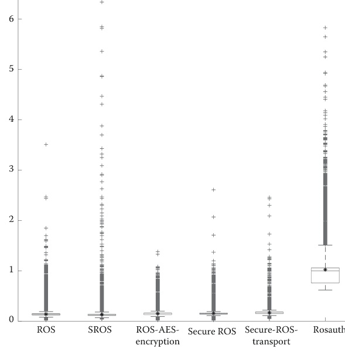

## 图 20.3 1 kHz 下字符串实验的 P/S 延迟概述。

实验，其延迟从 ~0.7 s 开始并结束于 ~266.2 s。出于与之前相同的原因，rosauth 的 2.5 和 7.5 kHz 测试被跳过。

图 20.4 中的箱线图说明了在 250 Hz 地图实验中每个测试方案的消息传递延迟。如前所述，150k 次传输中的平均值由黑色星号表示。由于数量级明显不同，rosauth 的延迟被单独绘制。

除 rosauth 外，所有其他方案的平均延迟都略高于中位数。这意味着延迟值呈正偏态，即大多数值低于平均值，因此异常值位于每个箱线图的上限之上。箱线图证实了 Secure ROS 在消息延迟方面的优越性能，其次是 ROS-AES-Encryption，然后是 SROS 和 Secure-ROS-Transport。

数据包传输延迟、丢失和最高发布频率限制并不是分析 ROS 安全方案时唯一相关的问题。我们继续对每个方案的安全性进行定性分析，主要检查在 ROS 网络中交换消息时，未经授权实体访问数据的程度是否被阻止。

ROS 提供了多个命令行实用程序，可匿名检索正在使用的主题列表 (rostopic list)、正在使用的节点列表 (rosnode list)、正在使用的服务列表 (rosservice list)、终止正在运行的节点的能力 (rosnode kill <node>)、显示主题中交换的消息的能力 (rostopic echo <topic>) 等等。因此，我们已在 ROS 网络内部运行上述命令并检查每个不同方案授予的访问级别。

## 表 20.3
地图实验结果。每一行发布和订阅了 150k 个 343 KB 的地图

|  | 发布频率 (Hz) | 实际发布频率 (Hz) | 数据包丢失 (绝对值/%) | 平均 P/S 延迟 (ms) | 标准差 P/S 延迟 (ms) | 中位数 P/S 延迟 (ms) |
|---|---|---|---|---|---|---|
| ROS (C++) | 250 | 250.0 | 0 (0.0%) | 0.366 | 0.155 | 0.283 |
|  | 2500 | 2499.776 | 71 (0.047%) | 0.171 | 0.065 | 0.151 |
|  | 7500 | 7496.412 | 235 (0.157%) | 0.126 | 0.049 | 0.122 |
| SROS (Python) | 250 | 81.801 | 75818 (50.545%) | 16.248 | 3.594 | 15.286 |
|  | 2500 | 81.316 | 74376 (49.584%) | 16.293 | 3.593 | 15.342 |
|  | 7500 | 81.859 | 73354 (48.903%) | 16.173 | 3.499 | 15.263 |
| ROS-AES-Encryption (C++) | 250 | 186.923 | 0 (0.0%) | 5.516 | 0.182 | 5.451 |
|  | 2500 | 186.112 | 0 (0.0%) | 5.544 | 0.194 | 5.468 |
|  | 7500 | 178.870 | 0 (0.0%) | 5.768 | 0.288 | 5.661 |
| Secure ROS (C++) | 250 | 250.0 | 1 (0.0006%) | 0.351 | 0.143 | 0.277 |
|  | 2500 | 2499.634 | 72 (0.048%) | 0.172 | 0.065 | 0.154 |
|  | 7500 | 7496.050 | 184 (0.123%) | 0.126 | 0.041 | 0.122 |
| Secure-ROS-Transport (Python) | 250 | 80.308 | 74855 (49.903%) | 16.096 | 3.678 | 15.096 |
|  | 2500 | 79.938 | 78000 (52.0%) | 16.286 | 3.899 | 15.090 |
|  | 7500 | 80.275 | 79547 (53.031%) | 16.284 | 3.817 | 15.162 |
| Rosauth (HTML5/Javascript) | 250 | 1.613 | 1 (0.0006%) | 125048.519 | 88037.166 | 133328.971 |

表 20.4 提供了未经授权的节点在 ROS 网络内部发出请求时每个方案返回的数据。SROS 证明是具有更高安全级别的方法，不会回复来自未经授权节点的对 ROS 主机的任何查询。Secure ROS 也表现出足够的安全级别，不允许未经授权的实体访问列出和查看任何 ROS 主题中的任何消息。此外，它也不允许终止节点。令人惊讶的是，出于未知原因，可以列出 ROS 中正在使用的节点和服务。还应注意，SROS 在节点级别提供访问配置，而 Secure ROS 在机器级别提供访问配置（IP地址过滤）。因此，任何查询，例如通过 SSH，从运行安全传输的机器内部运行，将为 Secure ROS 返回数据，但不为 SROS 返回。

与 SROS 和 Secure ROS 不同，其他方案没有充分保护 ROS 主机，因此提供了不足的授权级别。它们都允许从 ROS 内部列出主题、节点和服务，以及在未经授权的情况下终止节点。然而，在运行 rostopic echo 命令时，Secure-ROS-Transport 不提供对正在交换的消息的访问，而 ROS-AES-Encryption 将显示无法理解的密文。

至于 rosauth，它假设 ROS 网络是可信的，并且只保护非原生客户端与 ROS 接口之间的连接，然后通过 ROS 不安全地转发消息。因此，就本分析中 ROS 端而言，它的操作就像任何没有安全性的 ROS 网络一样。

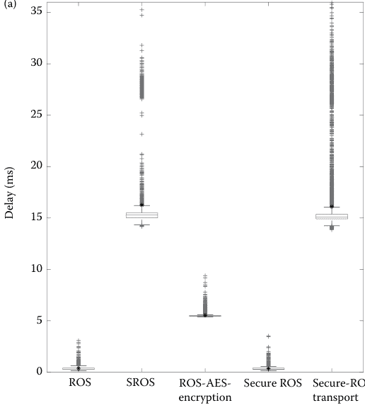

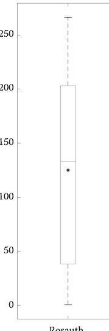

图 20.4 250 Hz 下地图实验的 P/S 延迟概述。(a) 250 Hz 地图实验中每个方案的发布-订阅延迟。(b) 250 Hz 地图实验中 Rosauth 的发布订阅延迟。

两者都有改进空间，*Secure ROS* 可以防止未经授权访问列出 ROS 中使用的节点和服务，并允许在节点级别进行授权，而 *SROS* 可以支持 ROS C++ *roscpp* 库，并提供更简便的安装和部署功能。

机器人网络安全应在多个不同层面得到解决。在本工作中，我们专注于机器人操作系统 (ROS) 的安全性。除了确保 ROS 组件的安全通信外，还应保护整体机器人系统的其他组件。例如，机器人运行的网络应不可渗透，使用 WPA2+AES 安全、SSID 隐藏、MAC ID 过滤、静态 IP 地址分配以及任何其他广泛记录的

## 表 20.4
ROS 网络内部请求返回的数据

|  | ROS | SROS | ROS-AES-Encryption | Secure-ROS | Secure-ROS-Transport | Rosauth |
|---|---|---|---|---|---|---|
| rostopic list | ✓ | ✗ | ✓ | ✗ | ✓ | ✓ |
| rosnode list | ✓ | ✗ | ✓ | ✓ | ✓ | ✓ |
| rosservice list | ✓ | ✗ | ✓ | ✓ | ✓ | ✓ |
| rosnode kill | ✓ | ✗ | ✓ | ✗ | ✓ | ✓ |
| rostopic echo | ✓ | ✗ | ✓ | ✗ | ✗ | ✓ |

安全措施。所有来自非原生 ROS 客户端的访问都应使用 SSL/HTTPS 安全连接和身份验证以验证客户端身份。ROS 网络可以在 VPN 下部署以在网络通信中保持安全和隐私。应定义防火墙规则，仅允许来自特定 IP 的特定非默认端口上的流量，通过 SSH 的 root 登录应被禁用，并应强制执行强用户级身份验证密码，以及数据存储的加密。此外，应使用谨慎保护和交换加密密钥的方法，以及用于证书维护、强制数字签名和访问级别的方法，以允许其安全存储 [37]。

## 结论与未来工作

虽然这不是一个简单的任务，但要总体上改善机器人网络安全，从第一天起就有几个重要建议 [7]，例如：安全软件开发生命周期、加密机器人通信、保持软件更新、仅授予授权用户访问权限、提供将机器人恢复到安全出厂默认状态的方法、实施网络安全最佳实践、为网络安全教育机器人工程师和管理人员、为用户提供反馈可能漏洞的方式，并在生产前推广安全审计。为此，必须强制执行机器人应用的早期和预防性安全设计原则。

本章的目的是识别广泛使用的 ROS 中的潜在安全和隐私风险，从而提高对机器人网络安全的认识以及使行业安全原则成熟的必要性，以避免不安全机器人进入市场的后果。

在机器人数据安全文献的深入分析之外，广泛采用的 ROS 框架的若干安全缺陷已被揭示，并对保护 ROS 中机器人应用的方案进行了分析。我们还提供了不同层面的一般建议和安全措施，以指导单机器人和多机器人系统的实施和部署。未来，我们打算开发一个基于 ROS 的可商业利用的多机器人系统，用于在正在进行的 STOP R&D 项目的一部分中，涵盖关键网络安全和隐私措施的基础设施监控。

# 致谢

本工作得到了 Seguranças robóticos cooperativos (STOP) 研究项目（参考号 CENTRO-01-0247-FEDER-017562）的支持，由“Agência Nacional de Inovação”在 Portugal2020 计划下共同资助。

作者感谢 Joanneum Research 机器人与机电一体化研究所的 Bernhard Dieber 提供 secure-ros-transport 的源代码，并感谢加州大学圣地亚哥分校的 Ruffin White 在设置 SROS 方面的帮助。

## 参考文献

- 1. E. García, M. A. Jimenez, P. G. Santos, M. Armada, “机器人研究的演进”. IEEE Robotics & Automation Magazine, 14 (1), pp. 90–103, March 2007.
- 2. S. Morante, J. G. Victores, C. Balaguer, “密码生物学：机器人为何需要网络安全”. Frontiers in Robotics and AI, 2 (23), pp. 1–4, September 2015.
- 3. T. Denning, C. Matuszek, K. Koscher, J. R. Smith, T. Kohno, “未来家用机器人安全与隐私风险透视：攻击与教训”. In 11th International Conference on Ubiquitous Computing (UbiComp 2009), Orlando, Florida, USA, September 30–October 3, 2009.
- 4. N. Nevejans, “机器人欧洲民法规则”. Study requested by the European Parliament’s Committee on Legal Affairs, Policy Department C: Citizens’ Rights and Constitutional Affairs, pp. 1–34, October 2016.
- 5. D. Portugal, M. S. Couceiro, R. P. Rocha, “多机器人巡逻的贝叶斯学习应用”. In Proceedings of the 2013 International Symposium on Safety, Security and Rescue Robotics (SSRR 2013), Linköping, Sweden, October 21–26, 2013.


- 6. M. Quigley、B. Gerkey、K. Conley、J. Faust、T. Foote、J. Leibs、E. Berger、R. Wheeler、A. Ng，“ROS：开源机器人操作系统”。见IEEE国际机器人与自动化会议（ICRA 2009）论文集，开源软件研讨会，日本神户，2009年5月12–17日。
- 7. C. Cerrudo、L. Apa，“在天网之前入侵机器人”。见《网络安全洞察》，IOActive报告，美国华盛顿州西雅图，2017年。https://media.scmagazine.com/documents/287/hacking-robots-before-skynet_71714.pdf
- 8. I. Asimov，《我，机器人》。Gnome Press，1950年12月。https://en.wikipedia.org/wiki/I,_Robot
- 9. M. Finnicum、S. T. King，“构建安全的机器人应用”。见USENIX安全热点研讨会论文集，第20届USENIX安全研讨会，美国加州旧金山，2011年8月。
- 10. W. Adi，“机电安全与机器人认证”。见IEEE仿生学习与安全智能系统研讨会（BLISS），苏格兰爱丁堡，第77–82页，2009年8月20–21日。
- 11. G. S. Lee、B. Thuraisingham，“信息物理系统安全在远程手术机器人中的应用”。《计算机标准与接口》，34卷，第225–229页，2012年。
- 12. S. Yong、D. Lindskog、R. Ruhl、P. Zavarsky，“针对网络恋童癖者的移动Wi-Fi机器人玩具风险缓解策略”。见IEEE第三届隐私、安全、风险与信任国际会议暨IEEE第三届社会计算国际会议论文集，美国马萨诸塞州波士顿，2011年10月。
- 13. A. Caiti、V. Calabrò、G. Dini、A. Lo Duca、A. Munafò，“使用水声网络的自主移动传感器安全协作”。《传感器》，12卷，第1967–1989页，2012年。
- 14. F. Higgins、A. Tomlinson、K. M. Martin，“群机器人安全挑战综述”。见第五届自治与自主系统国际会议论文集，西班牙瓦伦西亚，2009年4月。
- 15. N. P. Hoang、D. Pishva，“基于TOR的匿名通信方法以保护智能家居设备”。《ICACT高级通信技术汇刊》（TACT），3卷(5)，第517–525页，2014年9月。
- 16. T. Bonaci、J. Herron、T. Yusuf、J. Yan、T. Kohno、H. J. Chizeck，“使机器人安全：针对远程操作手术机器人的网络安全威胁实验分析”，arXiv:1504.04339，第1–11页，2015年4月。
- 17. J. S. Pleban、R. Band、R. Creutzburg，“对AR.Drone 2.0四旋翼飞行器的攻击与防护——提升玩具安全性的研究”。见IS&T/SPIE电子成像会议论文集。国际光学工程学会，美国加利福尼亚州旧金山，2014年1月。
- 18. B. Friedman，“价值敏感设计”。《交互》，3(6)，第16–23页，ACM，1996年。
- 19. J. Machado Santos、D. Portugal、R. P. Rocha，“机器人操作系统中可用的2D SLAM技术评估”。见2013年安全、安保与救援机器人国际研讨会（SSRR 2013）论文集，瑞典林雪平，2013年10月21–26日。
- 20. R. Rusu、S. Cousins，“3D时代到来：点云库（PCL）”。见IEEE国际机器人与自动化会议（ICRA 2011）论文集，中国上海，2011年5月。
- 21. J. R. McClean、C. Stull、C. Farrar、D. Mascareñas，“机器人操作系统（ROS）的初步信息物理安全评估”。见SPIE国防、安全与传感会议论文集。国际光学工程学会，美国马里兰州巴尔的摩，第8741卷，2013年5月。
- 22. V. Hax、N. Filho、S. Botelho、O. Mendizabal，“ROS作为物联网中间件”。《应用计算研究杂志》，2(2)，第91–97页，2012年7–12月。
- 23. T. Schneider，“使用ROS的分布式网络——基于IPv6的跨网络中间件通信”。学位论文，慕尼黑工业大学电气工程与信息技术系，德国慕尼黑，2012年10月。
- 24. A. Tiderko、F. Hoeller、T. Röling，“用于简化多机器人系统部署的ROS多主控扩展”。《机器人操作系统（ROS）完全参考（第一卷）》，《计算智能研究》，625卷，第629–650页，Springer，2016年。
- 25. R. Dóczi、F. Kis、B. Sütő、V. Póser、G. Kronreif、E. Jósvai、M. Kozlovszky，“提高医疗手术机器人ROS 1.x通信安全性”。见2016年IEEE系统、人与控制论国际会议（SMC 2016）论文集，第4444–4449页，匈牙利布达佩斯，2016年10月。
- 26. G. Caiazza，“机器人操作系统的安全增强”。硕士论文，环境科学、信息学与统计学系，威尼斯大学，意大利威尼斯，2016年。
- 27. J. Huang、C. Erdogan、Y. Zhang、B. Moore、Q. Luo、A. Sundaresan、G. Rosu，“ROSRV：机器人运行时验证”。见《运行时验证（RV 2014）》，《计算机科学讲义》，第8734卷。Springer。https://link.springer.com/chapter/10.1007/978-3-319-11164-3_20
- 28. R. White、H. I. Christensen、M. Quigley，“SROS：在网络、图结构和内核中保障ROS安全”。见人形机器人研讨会：迈向人形机器人操作系统（HUMANOIDS 2016），墨西哥坎昆，2016年11月15日。
- 29. F. Lera、J. Balsa、F. Casado、C. Fernández、F. Rico、V. Matellán，“自主系统中的网络安全：评估加固ROS的性能”。见*第17届物理智能体研讨会（WAF 2016）论文集*，西班牙马拉加，2016年6月16–17日。
- 30. M. J. Dworkin、E. B. Barker、J. R. Nechvatal、J. Foti、L. E. Bassham、E. Roback、J. F. Dray Jr.，“高级加密标准（AES）”。*联邦信息处理标准（NIST FIPS）*，第1–51页，报告197，2001年11月。
- 31. A. Sundaresan、L. Gerard、M. Kim，“Secure ROS 0.9.2文档”。可访问：https://sri-csl.github.io/secure_ros。2017年7月。
- 32. B. Dieber、S. Kacianka、S. Rass、P. Schartner，“基于ROS的应用的应用层安全”。*见2016年IEEE/RSJ智能机器人与系统国际会议（IROS 2016）论文集*，韩国大田，2016年10月9–14日。
- 33. B. Breiling、B. Dieber、P. Schartner，“机器人操作系统的安全通信”。*见2017年IEEE国际系统会议（SysCon 2017）论文集*，加拿大魁北克省蒙特利尔，2017年4月24–27日。
- 34. B. Dieber、B. Breiling、S. Taurer、S. Kacianka、S. Rass、P. Schartner，“机器人操作系统的安全性”。*《机器人与自主系统》*，98卷，第192–203页，爱思唯尔，荷兰，2017年12月。
- 35. C. Crick、G. Jay、S. Osentoski、B. Pitzer、O. C. Jenkins，“Rosbridge：面向非ROS用户的ROS”。*见第15届国际机器人研究研讨会（ISRR）论文集*，美国亚利桑那州弗拉格斯塔夫，2011年8月28日至9月1日。
- 36. R. Toris、C. Shue、S. Chernova，“用于安全远程非本地客户端连接到ROS机器人的消息认证码”。*见2014年IEEE实用机器人应用技术国际会议（TePRA）论文集*，美国马萨诸塞州沃本，2014年4月14–15日。
- 37. D. Portugal、S. Pereira、M. S. Couceiro，“安全在人机共享环境中的作用：基于ROS的监控机器人案例研究”。*见第26届IEEE国际机器人与人类互动交流研讨会（RO-MAN 2017）论文集*，葡萄牙里斯本，2017年8月28日至9月1日。


## Taylor & Francis

Taylor & Francis 集团

http://taylorandfrancis.com

# 21 社会选择与价值对齐问题*

Mahendra Prasad

### 目录

| 章节 | 页码 |
|---|---|
| 引言 | 292 |
| 动机与文献综述 | 292 |
| &nbsp;&nbsp;动机 | 292 |
| &nbsp;&nbsp;文献综述 | 293 |
| 一个框架 | 296 |
| &nbsp;&nbsp;民主强加问题 | 296 |
| &nbsp;&nbsp;四阶段序列启发式与程序合法性 | 297 |
| &nbsp;&nbsp;风险规避原则 | 297 |
| &nbsp;&nbsp;规范与程序，社会选择与机制设计 | 298 |
| &nbsp;&nbsp;非确定性投票 | 299 |
| &nbsp;&nbsp;作为博弈的投票 | 300 |
| &nbsp;&nbsp;投票系统 | 300 |
| &nbsp;&nbsp;不可能性结果：孔多塞悖论 | 301 |
| &nbsp;&nbsp;不可能性结果：绝对多数规则的非传递性 | 301 |
| &nbsp;&nbsp;不可能性结果：阿罗定理 | 302 |
| &nbsp;&nbsp;可能性结果：多数规则与梅定理 | 303 |
| &nbsp;&nbsp;可能性结果：绝对多数规则与孔多塞陪审团定理 | 304 |
| &nbsp;&nbsp;可能性结果：绝对多数规则与雷–泰勒定理 | 304 |
| UNV | 305 |
| &nbsp;&nbsp;UNV：梅定理与阿罗定理 | 306 |
| &nbsp;&nbsp;UNV：孔多塞陪审团定理 | 306 |
| &nbsp;&nbsp;UNV：雷–泰勒定理 | 306 |
| &nbsp;&nbsp;关于同意最大化、赞成投票与UNV的附加考虑 | 307 |
| 孔多塞、地位与智能爆炸背景条件 | 308 |
| &nbsp;&nbsp;孔多塞 | 308 |
| &nbsp;&nbsp;背景制度 | 310 |
| 结论 | 311 |
| 参考文献 | 312 |


## 引言

AI 设计者不可能成功地回避伦理决策。

Seth D. Baum (Baum 2017, 14)

社会选择理论研究的是从个人那里获取信息并将其汇总成群体决策。* 对价值对齐问题（例如，确保人工智能 [AI] 的行为与人类价值观一致）的任何严肃审视，都必须在某个阶段考虑来自人类的输入，以创建指导 AI 的价值观；因此，社会选择知识在人类 AI 价值对齐的研究中不可或缺。

虽然社会选择在某种程度上提供了一种将关于 AI 行为伦理的大多数规范性问题转嫁给人类的方法，但此类伦理的某些方面必然必须由其设计者内置到 AI 中。本章提供了文献综述和一个框架，利用社会选择来最小化设计者的强加，同时确保设计者在以下方面保持透明和明确：为什么必须进行强加，可用的可能选项是什么，为什么选择特定选项，以及该选项如何实施。

我们的框架采用认可投票，这是一种投票制度，其中每个选民标记她愿意同意的每个备选方案，并选择获得最多选民同意的备选方案（即同意最大化）。粗略地说，本章认为同意最大化是应指导 AI 群体决策最高层级个人价值聚合的规范。在适当的背景条件下，指导 AI 决策较低层级的规范几乎可以是任何规范，只要该规范是由更高层级的决策所选择的。在提出这一论点时，本章涵盖了社会选择中最重要的一些结果，即使不同意这一论点，也可作为该领域的概览。此外，本章讨论了尼古拉斯·德·孔多塞的开创性工作，这位十八世纪的数学家有争议地是第一个提出智能爆炸数学模型的人。孔多塞的工作为讨论社会选择聚合应发生的适当背景条件提供了起点。

本章其余部分在结论之前分为三部分。第一部分涵盖动机（使用社会选择解决价值对齐）以及社会选择和价值对齐文献的综述。第二部分提供了使用社会选择来治理比人类更聪明的 AI 的框架，尽管它也对常规 AI 的社会选择治理提供了见解。本部分将详细讨论社会选择中的许多重要结果，包括阿罗定理、梅定理和孔多塞陪审团定理。第三部分以孔多塞的工作为起点，讨论在何种背景条件下应使用社会选择进行价值对齐。

## 动机与文献综述

### 动机

随着时间的推移，我们可能会期望看到越来越多的决策被自动化并委托给 AI。这在高频交易和自动驾驶汽车中已经发生。鉴于有如此多的信息、金钱和生命处于风险之中，我们应该希望 AI 的行为方式与人类价值观保持一致。这对于假设的普遍比人类更聪明的超智能 AI（SAI）尤其如此，特别是如果 SAI 成为单例（即唯一的 SAI），正如尼克·博斯特罗姆所论证的那样（Bostrom 2014）。

艾丽尔·科恩提供了价值对齐问题的综述，他将价值对齐原则定义为：“高度自主的 AI 系统应被设计成，其目标和行为能够在整个运行过程中确保与人类价值观保持一致”（Cohn 2017）。但在不同的人具有不同的伦理价值观的情况下，我们如何使 AI 的行为和价值观保持一致？更一般地说，某个备选方案（例如价值或行动）帕累托占优于*所有其他备选方案的情况极为罕见。因此，鉴于 AI 可能会选择让某些个人不满的备选方案，AI 如何在选择备选方案的同时最大程度地降低合法性†问题的风险？

如果 AI 设计者寻求创建一个将个人意见汇总成指导 AI 决策的社会意见的 AI，AI 设计者无法回避规范性问题。为了类比，请考虑美国总统选举。在 2000 年和 2016 年美国总统选举中，得票最多的候选人落选了。有人认为这是美国选举人团（选举美国总统）未能正常运作的失败。然而，从另一个观点来看，选举人团按设计运行。美国宪法的创作者寻求一种选举机制，既尊重民众平等的规范，也尊重州平等的规范；‡ 为此，为了确保人口少的州加入美利坚合众国，他们保证总统选举机制会给予小州的意见人均比大州更大的权重。鉴于 2000 年和 2016 年的选举在某种程度上尊重了民众平等和州平等，人们可以认为选举人团的行为符合设计。

这个案例的重点不是争论仅尊重民众平等是劣于还是优于尊重两种规范。而是断言，不同的规范集合可以导致不同的聚合程序，从而导致高度不同的结果。同样适用于 AI 将聚合程序应用于个人的意见，以代表个人做出群体决策。这就是为什么在设计使用个人意见聚合的 AI 时，考虑投票系统所代表的不同规范很重要，因为这是不可避免的问题，正如 Baum（2017）所明确指出的。

### 文献综述

虽然在尼古拉斯·德·孔多塞的工作之前，拉蒙·柳尔、尼古拉斯·库萨和夏尔·德·博尔达对社会选择做出了重要贡献，但孔多塞在 1780 年代和 1790 年代的贡献是社会选择首次真正全面的考察。此后，除了少数例外（包括刘易斯·卡罗尔的工作），社会选择在很大程度上处于休眠状态，直到二十世纪中叶，随着邓肯·布莱克和肯尼斯·阿罗的工作而复兴（Mclean and Urken 1995）。

自 1950 年代以来，社会选择的研究持续不断。非正式地说，阿兰·吉布bard 和马克·萨特斯韦特证明了几乎所有实用的投票系统都不是策略证明的（Gibbard 1977；A. D. Taylor 2005）。换句话说，对于几乎每一种投票系统，都存在某些选民误报其意见的激励。这导致了机制设计文献的发展，该文献寻求设计机制，在玩家（例如选民）可能试图歪曲其真实信念的情况下实现某个目标函数。目前关于社会选择的最佳概述可能是两卷本的 *社会选择与福利手册*（Arrow, Sen and Suzumura 2002；Arrow, Sen and Suzumura 2011）。

* 备选方案 x 帕累托占优于备选方案 y，如果至少有一位选民更喜欢 x 而非 y，且没有选民更喜欢 y 而非 x。

† 合法性的含义在政治哲学中是一个争论很大的问题，其完整讨论超出了本文的范围。就我们的目的而言，如果某主体自愿且自由地接受该实体代表其行事的权威，则该实体是该主体的合法代理人。如果为其服务的很大一部分主体不认为代理人是合法的，政府或 AI 可能会产生合法性问题。

‡ 就我们的目的而言，民众平等是指每个人的意见应被平等对待的规范。州平等是指每个州的意见应被平等对待的规范。当然，宪法在其原始形式中并未尊重民众平等，因为妇女、奴隶以及财产不足的人没有投票权。


社会选择的一个衍生领域是计算社会选择。它的出现至少有三个原因。第一，对于某些投票系统，计算选举获胜者在某些情况下在计算上是棘手的；这促使人们努力衡量其计算复杂性并创建近似算法。第二，鉴于投票系统通常不是策略免疫的，有研究试图理解寻找投票系统最优选民策略的计算复杂性。第三，也许最重要的是，社会选择对多智能体AI系统研究变得有用，因为这类系统试图聚合来自许多AI代理的信息以形成系统的集体决策。目前关于计算社会选择的最佳综述是《计算社会选择手册》（Brandt et al. 2016）。

如前所述，Cohn（2017）概述了与价值对齐相关的问题。我们主要关注价值对齐问题与社会选择的交叉领域。相对而言，这一交叉领域的研究一直很少，但最近已引起极大兴趣。有两项工作脱颖而出。一项是《基于投票的道德决策系统》，旨在提出并实现一种通用方法，让AI利用社会选择做出道德决策（Noothigattu et al. 2017）。另一项是《人工智能中的社会选择伦理》，该文断言，存在三类伦理问题，即使设计者试图使用社会选择来构建AI的伦理，也必须做出伦理决策（Baum 2017）。我们在此概述这两项工作。

Noothigattu等人（2017）指出，最近有人提出，社会选择可能潜在地帮助AI解决伦理困境（Greene et al. 2016; Conitzer et al. 2017）。* 重要的是，Noothigattu等人（2017）提供了一种在运行时实施社会选择以解决AI伦理困境的一般理论，他们以自动驾驶汽车为背景对其进行评估和实例化。

他们的方法由四个步骤组成：数据收集、学习、总结和聚合。数据收集需要请人类比较多个备选方案，其中备选方案由与当前潜在伦理困境相关的特征向量决定。由于随着特征和备选方案数量的增加，逻辑上可能存在的备选方案对的数量迅速增长，每个人类参与者只需对可能的备选方案对中的某个子集进行几次比较。他们通过让数量非常庞大的人投票来弥补这一点。第二步是使用机器学习估计每个选民对所有可能的备选方案的偏好。第三步包括将每个选民的偏好合并成一个单一的模型摘要，该摘要近似所有选民对所有备选方案的集体偏好。第四步，聚合，是唯一在伦理困境于现实世界中呈现时执行的步骤。具体来说，摘要中相关备选方案子集的偏好在运行时被聚合起来，以解决出现的伦理困境。Noothigattu等人（2017）认为，所使用的聚合程序应属于交换支配高效投票规则类。他们给出了这种规则的正式定义，但粗略地说，这种规则重新强调了传统社会选择规范性条件的重要性。†

* 用投票解决伦理困境的想法在政治哲学中有着悠久的历史（McLean and Urken 1995）。其最著名的倡导者或许是十八世纪法国哲学家让-雅克·卢梭。

† 社会选择专家会注意到，这些传统社会选择规范是决定性、匿名性、中立性和单调性（Noothigattu et al. 2017, 4）。我们将在本章后面详细定义这些术语。

Noothigattu等人（2017）是一项重要贡献，因为它具体描述了如何实施社会选择，以便AI能够在运行时实现伦理困境的解决方案。除了他们已处理的这些问题之外，未来的实施研究还应处理策略性选民的可能性以及无关替代独立性（IIA）这一高度相关的问题。‡ 已有大量研究表明，对投票系统的博弈操纵与IIA高度交织，违反IIA的投票系统更容易受到策略性操纵（Muller and Satterthwaite 1977; Patty and Penn 2014, 48–64）。未来的研究还可以比较和对比可用于学习的潜在算法与可用于总结的潜在算法。

‡ 我们稍后将更正式地定义IIA，但现在只需说，IIA要求：对于任何备选方案x、y和z，如果选民对x相对于y的个人偏好不变，那么仅将z引入/移出被投票的备选方案集合，不应影响x相对于y的社会相对排序。

Baum（2017）采取了不同的方法，较少关注实施的具体细节，而更多关注一般性的关切问题。Baum（2017）指出，人们越来越感兴趣的是通过社会选择将AI的伦理决策卸载给人类，因为AI设计者不希望将自己的价值观强加给AI用户。但Baum（2017）的重要论点是，即使此类设计者使用社会选择来发展AI的价值观，设计者也无法避免在AI设计中做出并强加规范性判断。

Baum（2017）认为，关于如何使用社会选择来创造AI的价值观，存在两个重要的思想流派：连贯外推意志（CEV）和自下而上的伦理（BUE）。粗略地说，支持CEV的人认为，如果人类像SAI一样聪明，那么人类很可能会有不同于他们当前所信奉的伦理价值观；因此，SAI应该采用人类当前的价值观和知识（如有必要，还要加上其他相关的有感知存在），外推出这些个体如果像SAI一样聪明博学时会拥有的价值观，然后将这些外推的个体价值观聚合为社会价值观和行为（Yudkowsky 2004; Muehlhauser and Helm 2012; Bostrom 2014）。BUE主张，AI应在遇到伦理困境时，通过聚合其他伦理行为体的意见来学习其价值观，就像儿童学习伦理价值观和行为一样（Allen, Varner and Zinser 2000; Allen, Smit and Wallach 2005; Wallach, Allen and Smit 2008; Wallach and Allen 2008）。

无论动机是CEV、BUE还是其他推理思路，Baum（2017）断言，有三组决策是AI设计者无法简单地卸载给AI让其自行解决的。这些是资格、测量和聚合问题。

与资格相关的直接实际问题主要聚焦于人类。然而，为了展示当前潜在的哲学问题，Baum将焦点扩展到包括非人类。对Baum（2017）而言，资格涉及的是谁或什么应属于其价值观会影响AI行为和价值观的实体群体的问题。“资格”一词源自法律和民主理论。例如，在大多数民主国家，几乎所有成年公民都有资格，因为所有人都被允许投票，因此可能影响国家政府的价值观和行为。* 然而，即使在这些国家，关于成年最低年龄、重罪犯是否应拥有资格也存在争论。同样的争论也可能适用于影响AI行为和价值观的资格，但与AI相关的资格问题甚至走得更远。经常以其他有感知存在的痛苦为乐的反社会者是否应有资格？儿童，他们是有感知的，能够拥有并表达一些理性的伦理价值观，他们有权拥有资格吗？有感知的动物呢？它们可能无法表达，但仍然可能拥有伦理价值观？非感知生命（即没有情感、痛苦或快乐能力的生命）呢，可能包括任何没有神经细胞的生命（如植物、细菌，甚至可能包括病毒）？如果我们发现地外生命，是否应授予它资格？未来的生命世代呢？它们目前不存在，但未来可能存在；我们是否希望未来的人类世代被目前这些可能知识较少的当代人类的意见所束缚？如果人类以彻底改变人类生物学的方式被增强（即后人类），这样的后人类在决定AI行为和价值观时是否应被授予资格？最后，AI呢？通常，AI能够非常容易且快速地多次复制，从而创造出比人类人口大得多的AI群体；如果这些AI有感知，那么AI在决定其他AI的行为和价值观时应该拥有什么资格？

Baum（2017）解决的第二个问题是测量。目前没有普遍认同的伦理价值观测量框架。首先是如何测量的问题？是通过投票吗？是通过某种经济市场中的买卖吗？是通过问卷调查、访谈、

还是通过民意调查？是通过脑成像吗？第二，我们测量什么？信念？情绪？行为（也称为揭示偏好）？第三，我们在什么条件下测量？例如，我们是在孤立状态下还是在群体环境中测量个人的输入（例如，个人反思或聚焦小组中个体共同商议）？第四，我们如何考虑时间对价值观的影响？例如，我们如何折现未来事件的效用？是否允许使用制度性决策“助推”来产生长期的“更好结果”？第五，对于可能无法代表自己的个体（例如，被收容者、儿童、动物、其他生命、后代、后人类、人工智能和死者¹），我们如何衡量他们的价值观？

鲍姆（2017）涉及的第三个问题是聚合。我们将广泛讨论这个问题，因此这里不涉及大部分内容，但有一些方面值得现在提及。一个需要记住的方面是，我们如何聚合不同类型的信息？尤其是当我们试图聚合来自不同物种、人工智能或超越当前时间的信息时。第二，虽然在大多数社会选择研究中，假设选民对某一特定选项的意见可以用单一数值（如某个实数）来表示，但可能我们希望将选民与选项之间的关系视为选民为每个选项分配多个值。如果是这种情况，这会影响聚合问题；这个问题在多重标准决策文献中得到了部分解决。

## 框架

下面是一个拟议的用于治理SAI的规范性框架。话虽如此，同样的框架在较小规模上也可能适用于普通AI。在这一部分，我们假设“地位”问题的各个方面已经解决。我们在这里将重点讨论测量和聚合问题。在下一部分，当我们讨论孔多塞时，我们将回到地位问题。

在讨论我们的框架时，我们按以下方式进行。我们讨论强加如何实际上不可避免，除非某个选项帕累托支配所有其他选项。此后，我们引入四阶段序列启发法和风险厌恶原则，以使民主强加问题易于处理。随后，我们区分社会选择与机制设计，反对在最高决策层级使用非确定性投票作为规范，也反对将最高层级的决策解释为博弈。然后，我们形式化投票系统的含义，并描述各种不可能性结果，包括孔多塞悖论、超级多数偏好的非传递性以及阿罗定理。之后，我们讨论关于两个选项上多数规则的规范性刻画（包括梅氏定理、孔多塞陪审团定理和雷-泰勒定理），并演示这些定理如何可以推广到多个选项，有时是唯一地推广，通过无限制非多分投票（UNV），这是一种类似于同意投票的投票系统。最后，我们考察了形式化和解释同意最大化的四种方式，并回顾了现有的同意投票机制设计研究和实践。

## 民主强加问题

假设有一群有感知力的实体，他们必须做出一个决定，并且希望这个决定是民主的。他们想通过选举来做出决定；然而，他们意识到不同的选举方法即使基于相同的潜在偏好也可能得出不同的决定。首先，如果他们希望保持民主，就必须民主地决定如何民主地决定。因为不同的选举方法会导致不同的结果，如果他们想要保持民主，就必须民主地决定如何民主地决定如何民主地决定。当然，如果他们希望保持民主，这就变成了无限回归。打破这种无限回归的唯一民主方式是，在回归的某个点上，某个选项帕累托支配所有其他选项。然而，在一个多元化的社会中（不同选民有不同的价值观集合），这极不可能，除非出现这种不太可能的帕累托支配，否则某种决策程序将被强加。如何在强加一种决策程序的同时，尽量减少对所做决定的合法性的担忧？

## 四阶段序列启发法与程序合法性

肯尼斯·阿罗使用了一种约翰·罗尔斯称之为四阶段序列的启发法，它为打破这种强加问题的无限回归提供了一些结构（阿罗1963，89–91；罗尔斯1999，171–176）。我们将重新利用他们的启发法为SAI决策提供一些结构。在这种情况下，我们应该将SAI视为委托人（即具有感知力的实体）的代理人。

首先，SAI决策的最低层级是官僚决策。这些是SAI被设计为在其委托人很少或没有输入的情况下做出的决策。对官僚决策的规则和限制是在较高的三个层级中构建的。第二低层级是立法决策。这些是与部分或全部委托人协商后做出的决策。在立法决策中，被咨询的委托人可以是所有委托人，也可以是委托人的某个相关样本。立法决策有助于指导对官僚决策的规则和限制。对立法决策的规则和限制是在较高的两个层级中构建的。第三低层级是宪法。宪法是SAI的形式、结构和设计。它规范并限制立法和官僚决策。它还规定了SAI如何可以被修订。SAI本身受第一层级的约束和规范。最高层级是委托人层级。在此层级，委托人构建SAI的宪法。委托人层级限制并规范较低的三个层级。

粗略地说，在政治哲学中，程序合法性是这样一种观念：如果程序是合法的，那么合法程序的结果也是合法的。这一主张有强版本和弱版本。强版本认为程序合法性等同于一般合法性。弱版本认为，虽然倾向于程序合法是决策合法性的必要条件，但不足以构成合法性；还必须满足其他条件才能满足一般合法性。虽然我稍后会在讨论孔多塞时稍微讨论一下强版本，但我在这里采用后一种假设。因此，虽然我可能不会详细讨论合法治理的其他方面（如商议、权利、自由等），但这并不是因为它们不重要，而是因为我关注的是价值对齐中的程序和聚合方面。

如果我们关注价值对齐问题的程序方面，我认为我们可以这样说。如果第一层级的决策在程序上是合法的，那么如果SAI的所有其他决策最终在程序上受第一层级决策的约束和指导，那么所有四个层级的所有决策将在程序上都是合法的。

再次强调，我并不是在断言这使所有决策在一般意义上合法，而只是在程序上合法。程序合法性之所以重要，是因为在一个大型社会中，几乎没有任何重要决策会存在一个帕累托支配的备选方案。因此，社会中的委托人相信所作出的决策在程序上是合法的，这一点很重要，即使他们不同意该决策。但鉴于强加问题，问题就变成了：如果选择了非帕累托支配的备选方案，我们如何有意义地说某个特定的第一层级在程序上是合法的？

假设我们面临两个选择之一。对于选择A，你同意抛一枚公平硬币100万次；如果硬币正面朝上，你的效用变为三倍；如果反面朝上，你的效用乘以0；你的初始资金是1个效用单位；在100万次抛掷后，你保留最终资金。对于选择B，你同意...


抛一枚公平硬币100万次；如果硬币正面朝上，你的效用乘以1.5；如果反面朝上，你的效用乘以0.75；你的初始奖池为1 util；100万次抛掷后，你保留最终奖池。根据期望效用理论，应该选择A，因为你的期望效用在选择A时为1.5<sup>1,000,000</sup>，而在选择B时只有1.125<sup>1,000,000</sup>。然而，如果选择A，最终得到0效用的概率几乎为1，而如果选择B，拥有大于0效用的概率为1。

这种经典圣彼得堡悖论*的变体阐明了风险在决策中的重要性。罗尔斯认为，阶段越高，我们的决策就应越厌恶风险。例如，只要第四阶段的决策与更高阶段对其施加的约束一致，第四阶段决策就可以使用高度冒险的极大极大策略来选择备选方案；然而，他认为在第一阶段做出最重要的决策时，人们应使用最厌恶风险的策略，即差异原则，大致上就是极小极大策略。†

我不假设人们会厌恶风险到在第一阶段使用极小极大策略，因为那可能过于厌恶风险。然而，我假设阶段越高，平均而言决策就应越厌恶风险。这是因为平均而言，阶段越高，所做决策越重要和根本。其背后的启发式推理是，更高阶段决定了治理的基本结构；为了拥有长期可持续的治理体系，我们可能会牺牲短期效用以换取长期可持续性。我们不希望完美成为“足够好”的敌人。

这证明了在最高阶段确定决策程序时使用社会选择的合理性。大致而言，社会选择倾向于关注投票系统在逻辑上是否可能或不可能满足某组条件。在日常决策（例如低阶段决策）中，我们可能不在意投票系统偶尔违反某组条件。然而，关于高阶段决策，由于风险厌恶原则，我们希望投票系统极少违反规范上可取的条件，也极少满足规范上不可取的条件；社会选择在发现投票系统的逻辑可能性和不可能性方面，成为一个非常有用的工具。

## 规范与程序，以及社会选择与机制设计

吉尔巴德-萨特斯韦特定理和相关结果表明，大致而言，几乎所有实际的投票系统都容易受到选民策略性地歪曲其偏好以操纵结果的影响（Gibbard 1977；Muller and Satterthwaite 1977；Taylor 2005）。例如，在2000年美国总统选举中（几乎每个美国州都使用多数投票来决定将选举人团票授予哪位总统候选人），两大主要候选人是乔治·W·布什和阿尔·戈尔，小党候选人是拉尔夫·纳德。通常，纳德的支持者更偏好戈尔而非布什。因此，如果一位纳德支持者认为纳德不可能获胜，她或他可能会通过投票给戈尔而不是纳德来策略性地歪曲其偏好。

在没有偏好策略性歪曲的情况下，决策程序可以被视为规范。例如，当选民不歪曲其偏好时，在某些条件下，多数投票可以被理解为代表这样一种规范：获得最多选民首选的备选方案应赢得选举；假设有 *m* 位选民和 *n* 个备选方案，波达计数可以被解释为代表这样一种规范：赢得 (*mn*<sup>2</sup> − *mn*)/2 个配对比较中相对多数的备选方案应赢得选举；‡ 等等。然而，当选民歪曲其选票时，投票系统可能不再产生反映其规范的获胜者，即使选民诚实投票。

---

> \* 圣彼得堡悖论是对期望效用理论中潜在问题的经典说明。该悖论由丹尼尔和尼古拉斯·伯努利在十八世纪首次提出。

> † 极大极大策略要求玩家选择在最佳可能情景下最大化其效用的备选方案。极小极大策略要求玩家选择在最坏可能情景下最大化其效用的备选方案。

> ‡ 如果一位选民对 *n* 个备选方案做出完整且传递的偏好排序，那么她的偏好排序包含 (*n*<sup>2</sup> − *n*)/2 个配对比较，而所有 *m* 位选民一起产生 *m*(*n*<sup>2</sup> − *n*)/2 个配对比较。

### 社会选择与价值对齐问题

因此，机制设计文献蓬勃发展。一种描述机制设计的方式是，给定一个目标函数，什么机制（例如投票系统）能在玩家（例如选民）可能歪曲其意见（例如选票）的情况下最好地复制该目标函数的结果。由于投票系统几乎普遍容易被操纵，问题变得两方面：其一，如果选民诚实投票，我们想要什么投票系统（即我们的规范是什么）？其二，给定我们的目标函数（即规范），在选民可能不诚实的情况下，我们应使用什么机制最好地复制我们的规范？应该很清楚，如果我们不回答第一个问题，就很难回答第二个问题。本章专注于回答第一个问题（即决定规范），并将第二个问题（即选择复制规范的程序）留给机制设计。

这里我还想提出另外两点。第一，为什么不使用非确定性投票系统来避免意见可能被歪曲？* 第二，为什么不简单地允许机制被理解为仅仅是一个游戏，只要所有玩家都意识到它是一个游戏，它就是公平的？

由于几乎所有确定性投票系统都容易被操纵，人们可能会选择非确定性投票系统。虽然非确定性投票系统在第三和第四阶段（例如陪审团遴选）可能有一些用处，但我认为至少在第一两个阶段，我们应非常谨慎地使用它们，原因有三。

首先，策略证明的非确定性投票系统高度受限。大致而言，艾伦·吉尔巴德表明，任何策略证明的非确定性投票系统，要么允许一位选民成为独裁者，要么允许获胜备选方案从恰好两个备选方案中选择，或是这两种形式的某种混合（Gibbard 1977）。决策制定的独裁形式的一个例子是随机独裁者，其中每位选民有相等的概率成为独裁者，而独裁者的首选备选方案就是独裁者做出的决定。两备选方案形式的一个例子是随机配对，其中每对备选方案都有相等的概率被选中，然后使用多数规则在两个被选中的备选方案之间做出选择。

其次，未利用大数定律，策略证明的非确定性投票系统往往违反风险厌恶原则。为了说明这一直觉，假设所做决策是关于一个基本客观的问题，比如63乘以7等于什么？^ 假设每个个体面对三个选择，但每个个体都有相互独立的概率将其两个错误选择之一作为首选。假设这个概率很小，比如4%。 （这意味着，例如，如果三个选择是441、451和461，那么一位选民有4%的几率不把441排在第一位。）无论人口中有多少选民，通过随机独裁者选择错误选择始终有4%的几率，而通过随机配对选择错误选择的几率至少为三分之一。 （作为对比，当选民诚实投票使用多数投票这种糟糕的确定性方法时，在这种条件下，正确选择441获胜的可能性随着选民数量的增加迅速接近1。  granted，一个4%的错误率是我们可能在小决策中允许的，特别是一些立法和官僚决策，但这是在更大决策中我们想要允许的风险类型吗？）

第三个原因是，随着赌注的提高，选民试图破坏非确定性过程或歪曲决策程序所使用的非确定性过程的结果的概率会增加（Owens 2016；Associated Press 2004）。这里的假设是，（1）破坏非确定性过程或歪曲非确定性

---

> \* 一个确定性投票系统是这样一种系统，给定特定输入（例如来自特定选民群体的特定选票集），将始终具有相同的输出（例如备选方案的特定社会排序）。对于给定输入，非确定性投票系统在不同运行中可能有不同的输出。

> ^ 我们可以尝试用一个更主观的决策来表达这一担忧，但这需要发展一个构成坏决策的框架，这与当前要点无关。


（1）确定性过程更难被篡改或歪曲，而非确定性过程的篡改和歪曲则更难被核实。

## 把投票视为博弈

鉴于实际上几乎所有确定性投票系统都容易被操纵，为什么不干脆把投票系统看作一种博弈，让博弈中表现最好的玩家获胜呢？* 问题在于，获取计算能力的机会存在巨大差异，这可能使某些选民联盟比其它选民拥有巨大优势。

另一个争论点是，如果投票系统可以被操纵，我们是否应该寻求使用那些求解投票系统（即，找出某个给定玩家或玩家联盟的何种行为能使该玩家或联盟的结果效用最大化）的最坏情况或平均情况在计算上难以处理的投票系统？虽然这看起来是一个值得追求的目标，但这又归结为计算资源不平等的问题。例如，截至2017年，国际象棋和围棋都尚未被求解，它们在计算上仍然难以处理。因此，按照计算可解性的标准，这可能看起来是一场“公平”的博弈，因为没有玩家有合理的机会求解它。尽管如此，假设我一个平庸的国际象棋棋手，与DeepMind组队，去对抗像加里·卡斯帕罗夫或马格努斯·卡尔森这样的世界冠军，而他们没有顾问或计算资源。显然，凭借我的计算资源优势，我几乎肯定能在国际象棋上碾压卡斯帕罗夫和卡尔森。这表明计算难解性条件，至少就其本身而言，不是一个足够好的投票系统规范性条件。也许可取的是，一个投票系统简单到可以被操纵，以至于几乎每个玩家都能用很少或几乎没有的资源找出各自的最优策略。这样可以消除对计算资源不平等的担忧。

话虽如此，在本章中，我们将假设选民是真诚的，并试图找到一个最大化程序合法性的投票系统。机制设计暂被搁置。尽管如此，计算资源不平等在确定机制方面仍然很重要。

## 投票系统

社会选择的一个重大度量问题是输入应该采用什么数据类型（即信息类型）（因为这会影响加总和结果）？虽然社会选择研究过许多数据类型，但迄今为止研究最多的是序数数据类型，即每个选民提交一份对备选方案的序数排名作为其选票，输出则是某种对备选方案的序数排名。† 这种投票系统通常称为阿罗式投票系统。肯尼斯·阿罗（以及许多后来的社会选择理论家）认为，唯一可接受的投票系统是阿罗式的（Arrow 1963, 9–11）。尽管如此，近来人们对使用其它数据类型作为输入的非阿罗式投票系统产生了兴趣（Brams and Fishburn 1983; Balinski and Laraki 2010; Laslier and Sanver 2010; Brams and Potthoff 2015; Smith n.d.）。由于篇幅限制，我们不详细讨论非阿罗式投票系统，但建议读者查阅相关文献，因为严格来说，同意投票是一种非阿罗式投票系统。然而，由于同意投票的非阿罗式方面只在平局打破的背景下才重要，我们在这里只需要看UNV，即同意投票的阿罗式对应物。Prasad为在非阿罗式背景下的同意投票平局打破提供了一份指南（Prasad 2014）。

我们将假设存在一个有限的备选方案集合A和一个有限的选民集合V。设A是A的一个非空子集，其中A包含n个备选方案且n > 1，并设V包含m个选民且m > 1。一张选票是对n个备选方案的一种意见表达。如果数据类型是序数的，那么序数或阿罗式选票就是n个备选方案的一个全预序。*

一个偏好分布是m张选票的集合，来自V中每个选民的一张选票。一个偏好分布域，即偏好分布的集合，是社会福利函数的定义域。社会福利函数将偏好分布域中的每个偏好分布分配给A中n个备选方案的一个全预序，并且输出的全预序中至少有一个不是所有n个备选方案之间的平局。† 对于给定A和V的每个逻辑上可能的(A, V)，一个投票系统分配一个社会福利函数。

我们对投票系统的讨论将按以下方式进行。首先，我将讨论影响阿罗式投票系统的一些不可能性结果。其次，我将定义多数规则和绝对多数规则，并在恰好两个备选方案的背景下讨论支持它们的三个规范性论证。最后，我将论证，当我们被限制在阿罗式投票系统中时，UNV是多数规则推广到多个备选方案的最佳方式。

### 不可能性结果：孔多塞悖论

第一个主要不可能性结果称为孔多塞悖论。该悖论表明多数加总程序可能是非传递的。多数加总程序要求，对于偏好分布中的任意两个备选方案，比如x和y，如果偏好x胜过y的选民多于偏好y胜过x的选民，那么x在社会排序上高于y。如果偏好y胜过x的选民多于偏好x胜过y的选民，那么y在社会排序上高于x。如果偏好x胜过y的选民数与偏好y胜过x的选民数相等，那么x和y在社会排序上相等。

为了理解多数加总程序如何可能是非传递的，考虑以下例子。一般来说，如果F(n)是第n个富比尼数，那么给定m个选民和n个备选方案，就有[F(n)]^m个逻辑上可能的阿罗式偏好分布。‡ 设V = {v₁, v₂, v₃}，设A = {x, y, z}。假设[F(3)]³ = 13³个逻辑上可能的偏好分布中的每一个都出现在偏好分布域中。假设v₁偏好x胜过y胜过z，v₂偏好y胜过z胜过x，v₃偏好z胜过x胜过y。根据多数加总程序，x应社会排序高于y，因为三位选民中有两位（即选民1和3）偏好x胜过y。类似地，多数选民偏好y胜过z。如果多数偏好通常是传递的，那么这将意味着多数选民偏好x胜过z。但事实并非如此，因为多数选民（即选民2和3）偏好z胜过x。因此，如果我们在该偏好分布上使用多数加总程序，我们会得到非传递的社会排序：x高于y，y高于z，z高于x。多数加总可能非传递这一事实会使选举结果的含义变得令人困惑。例如，类比而言，如果对于整数来说2 > 1、3 > 2且1 > 3，那么在有限整数集合中“最大数”的概念可能就显得荒谬。类似地，由于多数加总的非传递性，基于多数加总的“最佳备选方案”的想法也可能显得荒谬。

### 不可能性结果：绝对多数规则的非传递性

人们可能试图通过要求绝对多数偏好来确定社会偏好来克服这种非传递性。但这同样可能出错。考虑以下例子。设m = n，V = {v₁, v₂, ..., vₙ}，A = { a₁, a₂, ..., aₙ}。允许[F(n)]^m个逻辑上可能的偏好分布中的每一个都在偏好分布域中。现在考虑来自这样一个偏好分布域的以下偏好分布。对于v₁，她的选票是a₁胜过a₂胜过……胜过aₙ。对于v₂，她的选票是a₂胜过a₃胜过……胜过aₙ胜过a₁。一般地，对于任何v_i，她的选票是a_i胜过a_{i+1}胜过a_{i+2}胜过……胜过a_{n-1}胜过a_n胜过a_1胜过a_2胜过……胜过a_{i-2}胜过a_{i-1}。现在考虑一个倒数第二帕累托加总程序，它要求对于任意两个备选方案a_x和a_y，如果m > 2，并且m-1个选民偏好a_x胜过a_y，且恰好一个选民偏好a_y胜过a_x，那么社会福利函数必须将a_x社会排序高于a_y。换句话说，这大致是一种绝对多数规则，要求除一个选民外的所有选民都偏好x胜过y，才能使x排在y之上。但根据我们的偏好分布，这种倒数第二帕累托程序是非传递的，因为它要求的社会排序是a₁胜过a₂胜过a₃……胜过a_{n-1}胜过a_n胜过a₁。换句话说，即使是像倒数第二帕累托加总程序这样强的绝对多数规则，也无法克服非传递性问题。

### 不可能性结果：阿罗定理

一般来说，由于阿罗定理，每个阿罗式投票系统都有问题。（阿罗定理有许多版本 [Arrow, Sen, and Suzumura 2002, 35–172]。我们关注的版本具有特别强的条件，这使得它与梅定理的关系更加清晰。）阿罗定理证明，每个阿罗式投票系统至少违反五个规范性可取条件之一：无限制定义域、正关联（单调性）、IIA、公民主权和非独裁性。我们首先为一些术语提供定义，然后定义这五个条件。

设v_i(p, x, y)是选民i在偏好分布p中对备选方案对a_x和a_y所持有的偏好。注意，v_i(p, x, y)可以取三个值之一：a_x胜过a_y、a_y胜过a_x，或a_x和a_y之间无差异。现在设p和p'是同一偏好分布域中两个不同的偏好分布。如果[(v_i(p, x, y) = (a_y胜过a_x)) 且 [v_i(p', x, y) = [(a_x胜过a_y) 或 (a_x和a_y之间无差异)]] 或 [(v_i(p, x, y) = (a_x和a_y之间无差异)) 且 [v_i(p', x, y) = (a_x胜过a_y)]]，则称选民i从p到p'相对于a_y提升了a_x。用更不正式的话说，选民可以通过两种方式之一在她的选票上相对于y提升x。第一，她原本偏好y胜过x，但现在偏好x或对它们无差异。第二，她原本在x和y之间无差异，但现在偏好x。

无限制定义域：如果对于[F(n)]^m个逻辑上可能的偏好分布中的每一个，社会福利函数的输出都是A中备选方案的一个全预序，那么社会福利函数（具有备选方案集A和选民集V）满足无限制定义域。根据定义，一个阿罗式投票系统满足无限制定义域当且仅当它的每个社会福利函数都满足无限制定义域。

非正式地说，对于社会福利函数，无限制定义域要求对于给定特定选民集和特定备选方案集的每个逻辑上可能的偏好分布都有一个输出。

单调性：设p和p'是同一偏好分布域中两个不同的偏好分布，其中a_x和a_y是A中不同的备选方案。设p和p'满足：从p到p'没有选民相对于a_x提升a_y，但至少有一个选民相对于a_y提升a_x。如果一个阿罗式社会福利函数是单调的，那么对于任何这样的p、p'、a_x和a_y，（如果给定p时，该阿罗式社会福利函数将a_x社会排序高于a_y，那么给定p'时，该阿罗式社会福利函数必须将a_x社会排序高于a_y）并且（如果给定p时，该阿罗式社会福利函数将a_x和a_y社会排序相等，那么给定p'时，该阿罗式社会福利函数必须将a_x社会排序高于或等于a_y）。根据定义，一个阿罗式投票系统是单调的当且仅当该阿罗式投票系统的每个阿罗式社会福利函数都是单调的。

粗略地说，单调性要求，如果x在社会排序上高于y，那么某个选民在她的选票上相对于y提升x，在其它选民不改变选票的情况下，应使x保持在社会上高于y；类似地，如果x和y在社会上相等，那么选民将x提升到y之上，在其它选民不改变选票的情况下，不应导致x在社会排序上低于y。


无关备选方案的独立性：设 (A, V) 和 (A′, V) 均为某投票系统的域的成员。设 p 是该投票系统的社会福利函数在 (A, V) 上的一个轮廓，p′ 是该投票系统的社会福利函数在 (A′, V) 上的一个轮廓。设 a_x 和 a_y 均为 A 和 A′ 的成员。假设对每个 v_i，v_i(p, x, y) = v_i(p′, x, y)。如果该阿罗投票系统满足 IIA，则对于任意这样的 p、p′、a_x 和 a_y，投票系统对 p 输出的 a_x 与 a_y 的相对排序必须与对 p′ 输出的相同。*

非正式地说，如果没有选民改变她对 x 与 y 的相对排序，IIA 要求 x 与 y 的相对社会排序保持不变。

公民主权：如果一个阿罗社会福利函数满足公民主权，则对于 A 中每一对备选方案，设为 a_x 和 a_y，必须存在（轮廓域中至少有一个轮廓，其中输出将 a_x 社会排序在 a_y 之上）并且（轮廓域中至少有一个轮廓，其中输出将 a_y 社会排序在 a_x 之上）。阿罗投票系统满足公民主权当且仅当该投票系统的每个社会福利函数都满足公民主权。

粗略地说，公民主权要求对于任意一对备选方案 x 和 y，存在某个轮廓使得输出中 x 的社会排序高于 y，并且也存在某个轮廓使得输出中 y 的社会排序高于 x。

非独裁：如果一个社会福利函数是非独裁的，则不存在特定的选民，使得社会福利函数的输出始终与该特定选民提交的选票相同。阿罗投票系统是非独裁的当且仅当该投票系统的每个社会福利函数都是非独裁的。†

非正式地说，非独裁要求不存在某个选民，使得输出始终等同于该选民提交的选票。

阿罗定理：不存在满足无限制域、单调性、IIA、公民主权和非独裁的阿罗投票系统。

## 可能结果：多数规则与梅伊定理

当备选方案恰好有两个时，存在恰好三种逻辑上可能的阿罗选票：a_x 高于 a_y，a_y 高于 a_x，以及 a_x 与 a_y 之间的无差异。多数规则的轮廓域允许在两个备选方案和 m 位选民上所有 3^m 个逻辑上可能的轮廓；多数规则使用多数聚合程序。绝对多数规则与多数规则相同，但它不允许任何选民表达对备选方案的无差异。

选票属于社会福利函数的投票程序当且仅当该选票出现在该社会福利函数轮廓域中的某个轮廓中。例如，给定 A 中的备选方案恰好为 a_x 和 a_y，多数规则的投票程序为 {a_x 高于 a_y, a_y 高于 a_x, a_x 与 a_y 之间的无差异}，而绝对多数规则的投票程序为 {a_x 高于 a_y, a_y 高于 a_x}。

果断性：如果阿罗社会福利函数的投票程序恰好包含 b 张选票，则当其轮廓域恰好包含给定这 b 张选票的所有 b^m 个逻辑上可能的轮廓时，该社会福利函数是果断的。阿罗投票系统是果断的当且仅当其每个社会福利函数都是果断的。

粗略地说，果断性代表表达的平等性和独立性。首先，每个选民在表达上平等，因为每个选民在选举中表达时可以选择的选票集合相同。其次，每个选民在表达上独立，因为无论其他选民如何投票，选民都可以提交投票程序中的任何选票。

匿名性：如果轮廓中选票的置换从不改变阿罗社会福利函数的输出，则该社会福利函数是匿名的。阿罗投票系统是匿名的当且仅当其所有社会福利函数都是匿名的。

落到 *y*。假设我们有 *m* − 1 枚这种金色硬币的银色复制品，并分发给每位选民一枚。（每枚硬币除一枚硬币的颜色外都相同。）每位选民抛掷她的硬币，彼此相互独立于其他选民的硬币抛掷，但由于无知之幕，每位选民都看不到任何硬币抛掷的结果。记录员与选民分开，记录每位选民抛出的面（即记录员知道任何给定选民抛出的面）。记录员接近获得金币的选民，并告诉她计票结果（即有多少枚硬币落到 *x*，有多少枚落到 *y*，但记录员不告诉金币选民哪些选民抛出了哪一面）。金币选民现在必须选择 *x* 或 *y*，但不能同时选择；她选择的备选方案将被实施。在金币选民做出选择后，记录员向金币选民透露她的硬币抛掷结果如何。如果金币选民做出的选择与她的硬币抛掷结果一致（例如，她选择了备选方案 *y*，并且她实际上抛出了 *y* 面），则金币选民获得效用 *u*，其中 *u* > 0。如果她的选择和硬币抛掷不一致，则她获得效用 −*u*。

*Rae–Taylor 定理：* 在 Rae–Taylor 定理的背景条件下，为了最大化她的期望效用，金色硬币选民应选择选民最多的那一面。换句话说，如果我们将选民抛掷 *x* 解释为表达选票“*x* 高于 *y*”，而将选民抛掷 *y* 解释为表达“*y* 高于 *x*”，则绝对多数规则最大化金色硬币选民的期望效用。

## UNV

回顾，偏好顺序是有序划分。选票有 η 个部分，其中 1 ≤ η ≤ *n*。选票的 η 个部分可以标记为第一部分、第二部分、……、第 η 部分。属于选民选票同一部分的任意两个备选方案，该选民对其无差异。一般而言，如果 α < β，则选民会偏好其选票第 α 部分中的任何备选方案优于第 β 部分中的任何备选方案。

如果 η = 1，则选票为平凡选票。如果 η = 2，则选票为二分选票。如果 η > 2，则选票为多分选票。由此，我们可以定义 UNV。

*UNV：* 给定备选方案集合 *A* 和选民集合 *V*，投票程序恰好由 2ⁿ − 1 个逻辑上可能的不同时多分的选票组成。因为 UNV 社会福利函数是果断的，其轮廓域恰好由给定其投票程序的 (2ⁿ − 1)ᵐ 个逻辑上可能的轮廓组成。UNV 社会福利函数使用多数聚合程序对备选方案进行社会排序。UNV 系统将 UNV 社会福利函数应用于每个可能的 (*A*, *V*)。

更非正式地说，UNV 允许选民从 A 中选择一些非空备选方案子集作为她的选择集。UNV 根据将每个备选方案放入其选择集的选民数量对备选方案进行社会排序。粗略地说，UNV 是认可投票的阿罗版本。*

此前，我们讨论了三个被用来论证多数规则和绝对多数规则在限制为两个备选方案时是最好的投票系统的结果：梅伊定理、孔多塞陪审团定理和 Rae–Taylor 定理。二十世纪最杰出的民主理论家之一罗伯特·达尔将它们列为绝对多数规则和多数规则的四项最佳辩护中的三项，而二十一世纪领先的民主理论家克里斯蒂安·利斯特则提到它们是三项最佳（Dahl 1989；List 2013）。由于孔多塞悖论、阿罗定理以及类似的不可能性结果，阿罗投票系统在使用多分选票时在试图将这三个结果推广到两个以上备选方案时会遇到问题，例如非传递性。然而，UNV 不使用多分选票，它推广了这三个结果，通常是唯一的。因此，可以提出这样的论证，如果一个人认为多数规则或绝对多数规则在两个备选方案上在规范上是可取的，那么他也应该认为 UNV 在多个备选方案上在规范上是可取的。

* 从技术上讲，认可投票是非阿罗的，因为它允许表达超出全序的信息。例如，选民被允许偏好 *x* 优于 *y* 但同时认可两者。


## UNV：梅氏定理与阿罗定理

需要注意的是，无记名性、中立性和积极响应性分别是无独裁、公民主权和单调性的更强版本。决定性是无限制域的较弱版本。此外，我们的 IIA 版本比阿罗的 IIA 版本更强。因此，本质上，我们加强了阿罗五项条件中的四项，并弱化了无限制域。

问题由此产生，是否存在一个满足梅氏四项条件和 IIA 的阿罗式投票系统？如果存在，哪个阿罗式投票系统在最不受限制的轮廓域上满足这五项条件？*

阿罗-梅定理推广：没有任何使用阿罗社会福利函数且使用轮廓域包含多分选票轮廓的阿罗式投票系统能够同时满足梅氏四项条件和 IIA。UNV 系统是满足这五项条件的具有最不严格轮廓域的唯一投票系统（Prasad 2017a）。

换句话说，非正式地，UNV 是满足梅氏四项条件和 IIA 的具有最不严格域的投票系统。

## UNV：孔多塞陪审团定理

孔多塞在其陪审团定理中遇到的问题是，多数偏好循环可能妨碍明确判定哪个备选方案最有可能为真，因为它可能产生一个循环，其中 x 比 y 更可能为真，y 比 z 更可能为真，且 z 比 x 更可能为真。为了克服这些循环，许多投票系统会放弃决定性、中立性或多数聚合程序。以下定理清楚地表明这并非必要。

首先，我们需要定义认识论条件。

认识论条件：设 a_x 和 a_y 为集合 A 中任意两个备选方案。在给定的背景条件下，一个投票系统被称为认识论的，如果在该背景条件下，[它将 a_x 社会排序高于 a_y] 当且仅当 [a_x 实际上比 a_y 更可能为真]，并且 [它将 a_x 和 a_y 社会排序相等] 当且仅当 [a_x 和 a_y 实际上为真的可能性相等]。

粗略地说，认识论条件要求存在一组背景条件，使得投票系统追踪真理。

孔多塞陪审团定理推广：无论背景条件如何，没有任何使用阿罗社会福利函数、使用多数聚合程序且使用轮廓域包含多分选票轮廓的阿罗式投票系统可以同时是认识论的、决定性的和中立的。UNV 系统是认识论的、决定性的、中立的并且使用多数聚合程序的具有最不严格轮廓域的投票系统（Prasad 2017a）。

粗略地说，UNV 是使用多数聚合程序能够尽可能追踪真理的具有最不严格域的决定性和中立投票系统。

## UNV：雷-泰勒定理

雷-泰勒定理推广的背景条件：设 n 个备选方案为 a1, a2, ..., a_n。假设对于任何给定选民，她对一个备选方案的效用要么是 u，其中 u > 0，要么是 −u。因此，选民对 n 个备选方案的效用可以用 n 位二进制数表示。例如，如果 n = 3，则 110 表示 a1 和 a2 的效用为 u，而 a3 的效用为 −u。设有一个金色骰子有 2^n 个面，其中每个面唯一代表选民可以对 n 个备选方案分配效用的 2^n 种可能方式之一。我们可以将这 2^n 个面称为 d000...000、d000...001、...、d111...111，其中下标以二进制表示。每个面被掷出的概率分别为
π000...000、π000...001、...、π111...111。注意每个面被掷出的概率大于或等于 0，小于或等于 1。此外，π000...000 + π000...001 + ⋯ + π111...111 = 1。另请注意，每个面代表一张阿罗式选票。例如，面 d010 代表选民“更偏好 a2 而非 a1 和 a3，但对 a1 和 a3 无差异”的选票。对所有备选方案的无差异由 d000...000 和 d111...111 表示。现在制作该金色骰子的 m − 1 个重复副本，只是重复副本应为银色。所有 m 个骰子掷出各面的概率分布相同。给每位选民一个骰子。每位选民掷她的骰子，但由于她处于无知之幕之下，不知道自己骰子的结果或任何其他骰子掷出的结果。（注意，每个骰子掷出相互独立。）一名记录员，他不是选民之一，记录每位选民掷出的面。从中，记录员构建一个列表，指定每张阿罗式选票出现的次数。记录员将此列表呈现给掷出金色骰子的选民，而该选民必须从 n 个备选方案中恰好选择一个。如果该选民选择的备选方案在其选票的第一部分中，则她获得 u 个效用单位，但如果她选择的备选方案不在其选票的第一部分中，她获得 −u 个效用单位。

雷-泰勒定理推广：在雷-泰勒定理推广的背景条件下，掷出金色骰子的选民通过对列表上提供的信息使用 UNV 来最大化她的期望效用。注意，对于 n = 2 的情况，π00 = π11 = 0，π01 > 0，π10 > 0，且 π01 + π10 = 1，雷-泰勒定理推广等同于雷-泰勒定理（Prasad 2017a）。

非正式地说，雷-泰勒定理推广表明，在推广的条件之下，UNV 最大化掷出金色骰子的选民的效用。此外，雷-泰勒定理只是该推广的一个特例。

## 关于同意最大化、认可投票与 UNV 的额外考虑

罗伯特·达尔关于在恰好两个备选方案背景下多数决定的第四个论据是它最大化自我决定选民的数量（即获得他们自己会选择的备选方案）（Dahl 1989, 135–152）。我们可以通过同意最大化规范的背景将这一论据推广到多个备选方案的认可投票和 UNV。同意最大化规范是这样一种规范：如果同意 x 的选民数量大于同意 y 的选民数量，则 x 应在社会排序中高于 y。同意可以至少以四种方式来理解，使得认可投票和 UNV 最大化自我决定：约束满足、满意化、契约和阿罗式方式。

决定同意哪些备选方案可以被解释为一个约束满足问题。选民在自我决定的意义上为自己选择希望满足哪些约束；她同意的备选方案子集正是满足其约束集合的备选方案集合。当对于每位选民，选民恰好认可她同意的那些备选方案时，认可投票以最大化同意数量的方式对备选方案进行社会排序。

赫伯特·西蒙通过其效用概念“满意化”提供了另一种解释同意的方式。如果选民从某个备选方案获得的效用高于该选民自行确定的效用阈值，则称该选民对该备选方案感到满意（Simon 1955; Altman 2015）。如果对于每位选民，选民认可所有高于其阈值的备选方案且不认可任何其他备选方案，则认可投票最大化感到满意的选民数量。

契约是解释同意的第三个棱镜。（这种解释与社会契约理论密切相关。）每个备选方案都可以被理解为一个潜在契约。假设每位选民认可她愿意同意的每个契约。在这种条件下，认可投票选择最多选民愿意同意的契约。

第四种对同意的解释是阿罗式的且基于偏好，需要一些假设。第一个假设是同意完备性公理：对于每个备选方案，例如 x，每位选民恰好持有两种信念之一：她同意 x 或她不同意。第二个假设是同意

传递性公理：对于任意一对备选方案，设为 x 和 y，如果一位选民同意 x 而不同意 y，则该选民更偏好 x 而非 y。第三个假设是一个同意最大化的规范公理。这是关于特定选举的目标是根据备选方案的同意数量对其进行社会排序的公理。第四个假设是一个规范的同意传递性公理。鉴于前三个公理，如果（一位选民同时同意 x 和 y）或（她既不同意 x 也不同意 y），那么我们可以假设（就我们的目的而言）该选民对 x 和 y 无差异。请注意，该第四公理中的主张并非选民事实上对 x 和 y 无差异，而是鉴于我们前三个公理，我们可以在特定选举中那样对待她的偏好。其原因在于，前三个公理与第四公理结合使我们能够使用阿罗式的 UNV 以最大化同意的方式对备选方案进行社会排序。这不应有争议，因为关于首选最大化的普选投票的类似公理化可以解释为何我们将选民视为对非首选备选方案无差异，而尽管我们可能同意这在事实上并非必然如此（Goodin and List 2006）。因此，即使我们接受阿罗对非阿罗投票制度的反对论点，UNV 最大化同意仍然存在阿罗式的正当性。

除达尔的第四个论点外，关于认可投票还有两个需要考察的额外考虑：机制设计和实践。除已提及的（Brams and Fishburn 1983）外，关于认可投票机制设计另外两个最重要的著作是 Myerson and Weber (1993) 和 Nagel (2007)。不幸的是，当前关于认可投票的大多数机制设计文献的问题在于难以找到合适的实证数据来检验其模型。例如，Nagel (2007) 提供了关于认可投票中策略行为的重要博弈论考察。然而，鉴于现有实证数据的匮乏，Nagel (2007) 提供了他认为近似于认可投票中策略行为的实证例子，尽管该例子使用的投票制度并非认可投票。其他人认为该例子中的策略行为可以用在认可投票中不会出现但在该其他投票制度中出现的特征来解释（Smith and Smith n.d.）。未来的机制设计研究将极大受益于更多关于实际认可投票选举的实证数据。

认可投票的实践自 1970 年代以来几十年来稳步增长。它被美国数学协会、美国数学学会、运筹学和管理科学研究所、美国统计协会、判断与决策学会以及社会选择与福利学会使用（Center for Election Science n.d.）。

此前，我们讨论过 May 定理、Condorcet 陪审团定理和 Rae–Taylor 定理是 Robert Dahl 用来论证多数决（和绝对多数决）在恰好两种备选方案时是最优投票制度的四个理由中的三个。我们随后展示了 UNV，即认可投票的阿罗式版本，能够以通常独特的方式将这些定理推广到多个备选方案。Dahl 对两种备选方案多数决的第四个论点是它最大化了自我决定。我们可以对多个备选方案的 UNV 和认可投票做出类似的论证。它们最小化了被强加一个他们未同意的备选方案的选民数量。这 arguably 是 UNV 和认可投票最大化程序合法性的最重要原因。

## 孔多塞、主体资格与智能爆炸背景条件

### 孔多塞

社会选择与智能爆炸研究的开端通过十八世纪法国数学家 Nicolas de Condorcet 的工作高度交织。Condorcet 出生于 1743 年，是数学家 Jean le Rond d’Alembert 的学生，职业生涯早期在积分学方面做了重要工作。是 d’Alembert 推动了 Condorcet 进入

今天对孔多塞的关注往往集中在推广其陪审团定理，以及识别促进认识论民主的制度（即以某种意义上追踪真理的民主）。从技术上讲，有不同的方法来扩展孔多塞陪审团定理以发现真理，每种方法都有其自身所需的一组背景条件。例如，知识和独立性条件已被以各种方式放宽；然而，大致而言，当我们考虑孔多塞陪审团定理的许多扩展时，诚实、独立性和大人口往往很重要（Young 1988; Owen, Grofman and Feld 1989; Ladha 1992; Austen-Smith and Banks 1996; List and Goodin 2001; Ben-Yashar and Kraus 2002; Prasad 2012; Brams and Kilgour 2014; Prasad 2017b）。

话虽如此，将利他主义条件与知识条件分开是有帮助的。例如，如果一群足够有知识、独立且诚实的选民都专注于最大化他们能杀死的猫的数量的目标，他们就可以利用陪审团定理来弄清楚如何最大化他们能杀死的猫的数量。关键在于，鉴于我们认为无差别杀猫是错误的，如果我们希望陪审团定理被用于好的目的，似乎选民具有利他主义是可取的。所以大致而言，可取的背景条件是诚实、利他主义、知识、独立性和大人口。

当然，这就留下了一个问题，什么是“利他主义”？我们知道当每个个体的效用独立于他人的效用时，若干机制和标准（例如，帕累托支配、Vickrey 拍卖、Brams–Taylor 程序）为群体决策问题提供了规范上令人信服的解决方案（Vickrey 1961; Brams and Taylor 1995）。然而，当个体的效用取决于降低他人的效用时，这些解决方案会失去其规范分量（Sen 1970; Gibbard 1973; Blau 1975）。例如，Brams–Taylor 程序指定了一种将异质蛋糕在任意有限数量的玩家之间分配的算法，使得每个玩家都相信其份额的效用不小于任何其他玩家获得的份额的效用；然而，如果玩家的效用取决于拥有严格大于任何其他玩家份额的效用的份额，那么该算法就无法保证此类玩家的满足。

所有这些都表明了拥有促进个人非嫉妒性和非社会病态效用的制度的重要性。就我们的操作目的而言，我们可以大致将嫉妒定义为希望相对于他人所拥有的效用拥有更高效用的欲望，而将社会病态定义为降低他人效用的欲望（例如，造成他人受苦）。* 如果在选举中拥有主体资格的每个实体恰好是应该拥有主体资格的所有实体，那么对于理想条件而言，每个选民拥有独立于他人效用的效用 arguably 就足够了；这将使像帕累托支配这样的条件保持其规范分量。但鉴于所有可能在选举中应享有主体资格的实体（例如，儿童、动物、未来世代等）都不能投票，选民具有共情和同情心是很重要的。共情大致意味着能够感知其他有情实体的欲望、厌恶和福祉关切，包括人类、非人类和未来世代。当然，共情的人可能并不关心其他有情实体的福祉；选民具有同情心也是有益的，即选民关心其他有情实体（包括人类、非人类和未来世代）的福祉。大致而言，我们可以将一个实体理解为利他主义的，如果它既具有共情能力又具有同情心。

## 背景制度

我们对 Condorcet 的考察提出了一个思考投票时存在的背景制度的框架。有长期关切和短期关切。从长期来看，这几乎肯定包括试图赋予几乎所有成年人类以及也许其他人投票权。在短期内，当 AI 行为被限制在专门领域时，我们很可能不得不弄清楚如何近似适当的背景条件。


从长远来看，要为可能治理超级人工智能（SAI）做好准备，我们或许需要建立能够在尽可能多的实体中促进诚实、利他、知识和独立思考的制度。这些都是复杂的问题，可能引发艰难的权衡问题。为了利他而撒谎何时是可以接受的？如果每个人都学习了当代的传统科学推理，这是否可能潜在地削弱独立思考？鉴于这些问题的复杂性，这表明了为这些术语制定更精确的定义，以及建立孔多塞陪审团定理的一般模型的重要性，其中陪审团定理的每个具体扩展都只是一般模型的特例。这可以帮助我们弄清楚如何在现实世界中做出权衡，同时仍然产生有益的结果。

短期内，对于影响力较不深远的人工智能的发展，鉴于我们不太可能赋予所有应当拥有选举资格的主体以选举资格，那些确实投票的选民具有利他主义精神就显得至关重要。例如，当一辆自动驾驶汽车必须决定是行驶得更快以便让乘客更快到达目的地，还是行驶得更慢以减少排放时，乘客（或整个社会）的投票很可能不会考虑受排放影响的未来世代的意见，除非现在存在且有投票资格的选民是利他的，并关心未来世代的福祉（Baum 2017）。相对而言，在心理学、认知科学和一般话语中，人们大量关注识别反社会人格者，即那些以他人痛苦为乐的人；而极具用处的是，为那些我们可以称之为“反反社会人格的利他主义者”或“反社会病态者”（anti-sociopaths）的人制定精确的定义并具备识别能力。非正式地说，这些人是能够对所有有感知能力的实体（包括非人类和未来世代）产生一定共情能力的人，当他们意识到其他有感知能力的实体正在受苦时，他们的效用往往会降低，同样地，当他们意识到其他实体的效用正在增加时，他们的效用也会增加。对反社会病态者的精确定义，以及发展可靠的识别方法并培养人们成为这样的人，将极大地帮助我们解决那些不能投票但理应拥有一定地位的实体的地位问题。即使反社会病态者只占人类人口的一小部分（例如0.1%），他们也能构成一个庞大的潜在选民库。通过“良好判断项目”（Good Judgment Project）和“应用理性中心”（Center for Applied Rationality）开发的技术，可以训练反社会病态者变得诚实、博学且具有独立思考能力（Center for Applied Rationality n.d.; Good Judgment Project n.d.; Tetlock and Gardner 2015）。这样一个经过训练的反社会病态者群体可以成为一个群体，人工智能在使用社会选择做出伦理决策时可以从该群体中抽取选民。在创建这样一个群体时，重要的是确保该群体在种族、性别、宗教、国籍、经济状况、意识形态、年龄以及其他重要的人口统计变量方面具有多样性。

最后，虽然反社会病态者可能是非深远人工智能价值对齐的短期解决方案，但建立适当的背景制度，让所有成年人类在类似于超级人工智能（SAI）这样的深远人工智能治理中拥有地位（和投票权），对于最大化此类人工智能的合法性至关重要。长期以来，一直有人试图以改进决策为名限制谁能投票，而实际上是在试图最大化权力。

## 结论

本章论证了，虽然大量的伦理推理可以通过社会选择转嫁给人工智能用户和其他人，但人工智能设计者无法避免做出并施加他们的伦理[^*]

[^*]: 值得注意的是“古德哈特定律”（Goodhart's law），即当一项衡量标准成为一个目标时，它就可能不再是一个好的衡量标准。例如，如果某一特定衡量标准成为决定谁是可以在特定问题上投票的反社会病态者的标准，人们可能会以某种方式操纵自己的行为，从而使该衡量标准成为判断谁是反社会病态者的糟糕代理指标。历史上曾有人试图操纵谁能投票、谁不能投票。例如，在二十世纪初的美国选举中，读写能力测试被用来阻止非裔美国人投票（理由是识字的选民能做出更好的选择），但“祖父条款”（即如果某人的祖父曾投票，则该人也可投票）被用来允许不识字的白人投票（因为那些祖父曾是奴隶的非裔美国人很难利用这一豁免）。

- Brandt, F., V. Conitzer, U. Endriss, and A. D. Procaccia. 2016. 《计算社会选择手册》。纽约：牛津大学出版社。
- 应用理性中心。无日期。应用理性中心。https://www.rationality.org。
- 选举科学中心。无日期。《谁使用赞成投票？》选举科学中心。2017年7月18日访问。http://electology.org/article/progress。
- Cohn, A. 2017.《我们如何让人工智能与人类价值观保持一致？》未来生命研究所。2月3日。2017年11月19日访问。https://futureoflife.org/2017/02/03/align-artificial-intelligence-with-human-values/。
- Condorcet, M. J. A. N. C. 1955.《人类精神进步史表纲要》。伦敦：魏登菲尔德和尼科尔森出版社。
- Conitzer, V., W. Sinnott-Armstrong, J. S. Borg, Y. Deng, and M. Kramer. 2017.《人工智能的道德决策框架》。第31届AAAI人工智能会议论文集。AAAI，旧金山，第4831–4835页。
- Dahl, R. A. 1989.《民主及其批评者》。纽黑文：耶鲁大学出版社。
- Gibbard, A. 1973.《帕累托一致的自由至上主义主张》。《经济理论杂志》7:388–410。
- Gibbard, A. 1977.《混合投票与机运机制的操纵》。《计量经济学》45:665–681。
- Gibbard, A. 1990.《明智的选择，恰当的情感》。剑桥：哈佛大学出版社。
- 良好判断项目。无日期。良好判断项目。https://www.goodjudgment.com。
- Goodin, R., and C. List. 2006.《对相对多数规则的有条件辩护》。《美国政治科学杂志》50:940–949。
- Greene, J., F. Rossi, J. Tasioulas, K. B. Venable, and B. Williams. 2016.《将伦理原则嵌入集体决策支持系统》。第30届AAAI人工智能会议论文集。AAAI，菲尼克斯，第4147–4151页。
- Grofman, B., and S. L. Feld. 1988.《卢梭的公意：孔多塞视角》。《美国政治科学评论》82:567–576。
- Hampton, J. 1986.《霍布斯与社会契约传统》。剑桥：剑桥大学出版社。
- Harsanyi, J. C. 1953.《福利经济学和风险承担理论中的基数效用》。《政治经济学杂志》61:434–435。
- Harsanyi, J. C. 1955.《基数福利、个人主义伦理和效用的人际比较》。《政治经济学杂志》63:309–321。
- Hobbes, T. 1651.《利维坦》。见 Edward W. and D. Widger. 古腾堡计划。2017年11月20日访问。http://www.gutenberg.org/files/3207/3207-h/3207-h.htm。
- Kavka, G. 1986.《霍布斯式道德与政治理论》。普林斯顿：普林斯顿大学出版社。
- Ladha, K. K. 1992.《孔多塞陪审团定理、言论自由与相关投票》。《美国政治科学杂志》36:617–634。
- Landes, J. 2016.《女权主义史：玛丽-让-安托万-尼古拉·德·卡里塔，孔多塞侯爵》。《斯坦福哲学百科全书》1月20日。https://plato.stanford.edu/archives/spr2016/entries/histfem-condorcet/。
- Laslier, J.-F., and M. R. Sanver. 2010.《赞成投票手册》。柏林：施普林格出版社。
- List, C. 2013.《社会选择理论》。载于《斯坦福哲学百科全书》。12月18日。2017年6月27日访问。https://plato.stanford.edu/entries/social-choice/。
- List, C., and R. E. Goodin. 2001.《认知民主：推广孔多塞陪审团定理》。《政治哲学杂志》9:277–306。
- Lukes, S., and N. Urbinati. 2012.《孔多塞：政治著作》。剑桥：剑桥大学出版社。
- May, K. O. 1952.《简单多数决策的一组独立充分必要条件》。《计量经济学》20:680–684。
- McLean, I., and F. Hewitt. 1994.《孔多塞：社会选择与政治理论的基础》。奥尔德肖特：爱德华·埃尔加出版有限公司。
- McLean, I., and A. B. Urken. 1995.《社会选择经典》。安娜堡：密歇根大学出版社。
- Muehlhauser, L., and L. Helm. 2012.《奇点与机器伦理》。载于：《奇点假说》，Eden, A. H., J. H. Moor, J. H. Søraker and E. Steinhart (编)，第101–126页。柏林：施普林格出版社。
- Muller, E., and M. A. Satterthwaite. 1977.《强正关联与策略证明的等价性》。《经济理论杂志》14:412–418。
- Myerson, R. B., and R. J. Weber. 1993.《投票均衡理论》。《美国政治科学评论》87:102–114。
- Nagel, J. H. 2007.《赞成投票中的伯尔困境》。《政治杂志》69:43–58。
- Noothigattu, R., S. N. S. Gaikwad, E. Awad, S. Dsouza, I. Rahwan, P. Ravikumar, and A. D. Procaccia. 2017.《基于投票的伦理决策系统》。arXiv.org。9月20日。2017年11月11日访问。https://arxiv.org/pdf/1709.06692.pdf。


欧文，G.，B. 格罗夫曼，和 S. L. 费尔德。1989. 证明孔多塞陪审团定理的一个无分布推广。*数理社会科学* 17:1–16.

欧文斯，D. 2016. 六人因操纵彩票游戏计划面临指控。哈特福德新闻报 3月22日。访问于2017年11月22日。http://www.courant.com/breaking-news/hc-more-5-card-cash-arrests-0323-20160322-story.html.

帕蒂，J. W.，和 E. M. 彭。2014.*社会选择与合法性*。纽约：剑桥大学出版社。

普拉萨德，M. 2012. 孔多塞、偏好与判断。*第十一届社会选择与福利学会会议*，新德里。

普拉萨德，M. 2014. 社会排序函数与阿罗定理。*第十二届社会选择与福利学会会议*，波士顿。

普拉萨德，M. 2017a.*孔多塞方法是多数规则的错误阿罗式推广吗？*新奥尔良：公共选择学会。

普拉萨德，M. 2017b. 回到未来：模拟利他智能爆炸的框架。*AAAI 2017春季人工智能为社会公益研讨会*，技术报告SS-17-01。帕洛阿尔托：AAAI。

雷，D. W. 1969. 宪法选择中的决策规则与个人价值。*美国政治科学评论* 63:40–56.

罗尔斯，J. 1999.*正义论*。剑桥：哈佛大学出版社。

罗斯柴尔德，E. 2001.*经济情感：亚当·斯密、孔多塞与启蒙运动*。剑桥，马萨诸塞州：哈佛大学出版社。

森，A. 1970. 帕累托式自由主义的不可能性。*政治经济学杂志* 78:152–157.

西蒙，H. A. 1955. 理性选择的行为模型。*经济学季刊* 69:99–118.

斯隆，N. J. A. 无日期. 富比尼数：n个标记元素的偏好排列数；或n个标记元素上的弱序数；或[n]的有序划分数。https://oeis.org/A000670.

史密斯，T.，和 W. D. 史密斯。无日期. 赞成投票制中的伯尔困境缺陷。范围投票中心。访问于2017年11月27日。http://rangevoting.org/BurrSummary.html.

史密斯，W. D.，编。无日期. 范围投票中心。https://www.rangevoting.org.

泰勒，A. D. 2005.*社会选择与操纵的数学*。纽约：剑桥大学出版社。

泰勒，M. 1969. 评论与注释：多数规则定理的一个证明。*行为科学* 14:228–231.

泰特洛克，P. E.，和 D. 加德纳。2015.*超级预测*。纽约：皇冠出版社。

维贝克，B.，和 C. 莫里斯。2010. 博弈论与伦理学。*斯坦福哲学百科全书*。夏季。访问于2017年11月20日。https://plato.stanford.edu/archives/sum2010/entries/game-ethics/.

维克里，W. 1961.*反投机、拍卖与竞争性密封投标*。*金融杂志* 16:8–37.

瓦拉赫，W.，和 C. 艾伦。2008.*道德机器*。纽约：牛津大学出版社。

瓦拉赫，W.，C. 艾伦，和 I. 斯密特。2008. 机器道德：模拟人类道德能力的自下而上与自上而下方法。*人工智能与社会* 22:565–582.

威廉姆斯，D. 2004.*孔多塞与现代性*。剑桥：剑桥大学出版社。

扬，H. P. 1988. 孔多塞的投票理论。*美国政治科学评论* 82:1231–1244.

尤德科夫斯基，E. 2004. 一致外推意志。机器智能研究所。访问于2017年11月20日。https://intelligence.org/files/CEV.pdf.

# 22 灾难性人工智能风险的析取情景

*卡伊·索塔拉*

## 目录

- 引言...................................................................................................315
- 灾难的促成因素...................................................................................................316
- 战略优势何时会被利用？...................................................................318
- 灾难性能力的促成因素...............................................................................320
- DSA促成因素：起飞情景...............................................................................321
- DSA促成因素：个体起飞...............................................................................321
- DSA促成因素：交易型AI的集体起飞...................................................................323
- DSA/MSA促成因素：权力逐渐转移给AI...................................................................324
- MSA促成因素：关键能力...............................................................................324
- 将DSA/MSA促成因素结合...............................................................................325
- AI获得自主行动能力...................................................................326
- 技术挑战...............................................................................326
- 社会挑战...............................................................................326
- 因经济利益或竞争压力而自愿释放...........................................326
- 因犯罪牟利或恐怖主义目的而自愿释放...........................................328
- 因美学、伦理或哲学原因而自愿释放...................................328
- 因对AI安全性的信心而自愿释放...................................................328
- 因绝望而自愿释放...........................................................................329
- AI仍受控制，但最终实际上掌握控制权...............................................329
- 关于单个与多个AI的说明...............................................................................329
- 结论...................................................................................................331
- 致谢...................................................................................................334
- 参考文献...................................................................................................334

## 引言

从事安全工作需要所谓的“安全心态”（施奈尔 2008）：一种审视现有系统并看到它如何可能被坚定的攻击者破坏的能力。类似地，AI安全领域的工作需要一种AI安全心态，即人们主动寻找可能出错的方式，而不是仅仅假设一个听起来合理的原因就足以让事情安全（阿尔比塔尔 2017）。

不幸的是，关于复杂AI风险的场景（例如，尤德科夫斯基 2008a，博斯特罗姆 2014，索塔拉与扬波利斯基 2015）并不总是以一种使AI安全心态的需要变得极其清晰的方式呈现。一个常见的批评是，虽然这些场景提出了一个合理的论证，但它绝不是必然的，而且对任何关键前提的反驳都可能避免该场景。* 这随后被认为表明，提出该场景的整个分析存在致命缺陷，可以放心地忽略。

对这种批评的恰当回应是梳理出可能导致灾难性结果的不同方式，以判断风险论证是否真的依赖于容易被反驳的前提。然而，除了一个显著的例外（A. 巴雷特和鲍姆 2017a），还没有人尝试系统地列出各种灾难促成因素，使其易于分析。†

本章旨在广泛审视复杂AI的发展如何可能导致它变得足够强大而引发灾难的各种方式。特别是，本章着重于各种风险的析取性——即存在多种不同的事情出错的方式，其中任何一种都可能导致灾难。通过这样做，本章试图扩展已有的工作（A. 巴雷特和鲍姆 2017a），该工作已开始在AI安全领域应用成熟的风险分析方法论（A. 巴雷特和鲍姆 2017b）。

我们关注的是足以算作AGI（即人工通用智能）的先进AI，而不是“窄AI”带来的风险，例如技术性失业（布林约尔松和麦卡菲 2011）。然而，应该指出，所讨论的某些风险——特别是与窄领域相关的关键能力（参见“MSA促成因素：关键能力”一节）——可能在从窄AI系统到超级智能的路径上的任何地方出现。

其意图不是否认或最小化AI创造可能带来的各种积极方面，也不是建议不应追求AI发展。相反，其目的是使AI的积极潜力得以实现，就像更好地理解计算机安全相关漏洞能够创造出安全可靠的计算机系统一样。

## 灾难的促成因素

大多数关于AI风险的论证源于两个主张的结合（尤德科夫斯基 2008a，博斯特罗姆 2014，索塔拉与扬波利斯基 2015），即能力主张和价值主张。本章专注于考察能力主张可能成真的各种方式。价值主张的模型不在本章范围内，但可参见 A. 巴雷特和鲍姆（2017a）。

- 1. 能力主张：AI可能变得足够强大，从而对人类福祉造成重大损害。
- 2. 价值主张：AI可能按照与人类价值观不一致的价值观行事，并因此造成相当大的伤害。

这些主张可以进一步分解。它们的一个现有模型是ASI-PATH模型（A. 巴雷特和鲍姆 2017a）（图22.1）。ASI-PATH侧重于分析AI通过递归自我改进变得超级智能从而引发灾难的路径，而人类无法阻止它采取不安全的行动。

ASI-PATH模型使用故障图约定，将不希望发生的事件（AI灾难）作为顶部节点，其后是两个节点，如果它们都为真，将使顶部节点发生。这两个节点分别是“ASI行为不安全”节点（对应价值主张）和“AI起飞，导致[人工超级智能]获得[决定性战略优势]”节点（对应能力主张的一种特定形式）。本章试图通过考虑更一般形式的能力主张来扩展ASI-PATH。


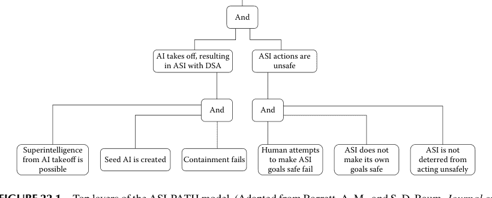

图 22.1 ASI-PATH 模型的顶层。 (Adapted from Barrett, A. M., and S. D. Baum. Journal of Experimental & Theoretical Artificial Intelligence: JETAI 29 no. 2, 2017a: 397–414.)。这些层被设计为故障树，显示了必须全部为真才能发生 ASI 灾难的各种条件。在树中，ASI 灾难发生的条件是 (1) 一个 AI 起飞，导致具有 DSA 的 ASI，以及 (2) ASI 的行为不安全，导致其以灾难性的方式使用其 DSA。底部节点表示 AI 起飞必须全部为真的三个案例，以及 ASI 的行为不安全必须全部为真的另外三个案例。完整的模型包含比此处所示更多的层；有关更多细节，请参阅 A. Barrett & Baum (2017a)。

能力主张通常被表述为 AI 取得决定性战略优势 (DSA) 的可能性。虽然 DSA 的概念在许多先前的工作中已隐含存在，但该概念首次由 Bostrom (2014, p. 78) 明确定义为“a level of technological and other advantages sufficient to enable [an AI] to achieve complete world domination。”

然而，假设 AI 将取得 DSA 似乎是能力主张的一种不必要强的形式，因为 AI 仍可能造成灾难。例如，考虑一种 AI 发起旨在摧毁人类文明的攻击的场景。如果 AI 成功摧毁了人类或其中很大一部分，但在此过程中 AI 本身也被摧毁，这根据最初的定义并不算 DSA。然而，很难否认这种结果仍应被视为灾难。

因此，本章关注 AI 取得（至少）主要战略优势 (MSA) 的情况，我们将其定义为“a level of technological and other advantages sufficient to pose a catastrophic risk to human society.” 灾难性风险是指可能在全球范围内对人类福祉造成严重损害并导致 10 million 或以上死亡的风险 (Bostrom & Ćirković 2008)。

除了避免 AI 导致灾难性风险的明显原因外，我们注意到大规模破坏可能导致全球动荡 (Bostrom et al. 2016)，即现有制度受到挑战，协调和长期规划变得更加困难的情况。全球动荡随后可能导致另一项失控的 AI 项目以更灾难性的方式失败并造成更大损害。因此，原本只是灾难性风险的东西可能促成进一步的生存 (Bostrom 2002, 2013; Sotala & Gloor, 2017) 风险的发展。

现有关于 AI 安全的大量文献主要集中在 AI 取得 DSA 的场景以及其前提条件的分析上。这在许多方面是一种明智的策略，因为如果我们能够应对可能取得 DSA 的 AI，我们很可能也能够应对可能取得 MSA 的 AI；假设更强大的 AI 是保守的假设 (Yudkowsky 2001)。然而，这种策略的缺点是可能给人一种印象，即如果认为 AI 获得 DSA 的可能性极其渺茫，那么 AI 安全分析的大部分就变得无关紧要。某些防御措施可能足以防止 AI 获得 DSA，而不足以防止其获得 MSA。

## 何时战略优势会被付诸行动？

AI 具有对人类福祉造成重大损害的能力，主要在它有动机*去这样做时才重要。 (There is also the possibility of the AI intending to cooperate with humanity, but causing damage by accident; this is beyond the scope of the present analysis.) 虽然对价值主张的完整分析超出了本章范围，但它不能完全与能力主张区分开来，因为 AI 的价值观也会影响其对人类采取行动在理性上合理的阈值。正如我们将讨论的那样，一些价值观和情况会使 AI 在能力较弱时更有可能采取敌对行动。

AI 采取对人类造成损害的行动的两个主要原因可能是：

- 它有忽视人类福祉的目标，并在追求该目标时损害人类，例如拆解人类城市以获取其原材料；“The AI neither hates you, nor loves you, but you are made out of atoms that it can use for something else” (Yudkowsky 2008a, p. 333)。

- 它预期人类会对其采取行动并阻止其实现目标，在这种情况下，为自卫——或发动先发制人攻击——将是理性的行动，因为这将使其能够真正实现其目标 (Omohundro 2007, 2008)。即使 AI 有一个确实考虑人类福祉要素的目标，如果 AI 有理由相信人类仍会反对该目标的实现，也可能出现这种情况。†

AI 拥有的具体目标会影响其为使反人类行动成为理性策略所需的能力水平。只关心某些狭窄目标的 AI 可能愿意摧毁人类文明，以确保对其的潜在威胁被消除。这确保了它能够不受阻碍地继续追求其目标。然而，被编程为最大化诸如“happiness of currently-living humans”之类的目标的 AI 可能不愿冒巨大的死亡风险。‡ 这将迫使其专注于破坏性较小的夺取方法，可能需要更复杂的能力。

实际上，AI 的价值观决定了其为使敌对行动成为可行策略所需的能力水平。一个简化的模型 (Shulman 2010) 是，AI 认为如果它发动侵略，成功的概率为 P，且成功时的期望效用为 EU(Success)，失败时的期望效用为 EU(Failure)，放弃侵略并继续合作时的期望效用为 EU(Cooperation)，则它在以下情况下会理性地发动侵略

P × EU(Success) + (1 − P) × EU(Failure) > EU(Cooperation)

* “动机”一词在此以一般意义使用，不应被理解为 AI 会具有类人动机系统的说法。与其对 AI 底层机制做出任何假设，我们假设其行为可以通过假设意图立场 (Dennett 1971, 2009) 来有意义地预测，其中系统的行为被假定可以用目标和信念来解释。例如，尽管下棋计算机的计算与人类思维几乎没有任何共同之处，但其走法仍可通过假设它“想要”赢得国际象棋并且“知道”国际象棋规则来有效预测。这导致了这样的预测：它总是会从可行走法列表中选择最能促进赢得游戏目标的一种。即使最佳走法并不明显，采用意图立场仍允许人类观察者通过排除明显坏走法来改进对计算机行为的预测。(ibid)

† 例如，如果人类不确定 AI 的目标是否真的考虑了人类所珍视的一切价值，就可能发生这种情况。

‡ 一个仅仅寻求最大化人类幸福的 AI，如果认为这能让它日后创造更多快乐的人类，可能会愿意牺牲所有当前生活的人类。

这可能被理解为暗示 AI 主要会在它拥有或认为能够获得 DSA 并从而建立对人类的统治时发动攻击。然而，即使只有 MSA 的 AI 也可能采取敌对行动，采用诸如勒索和威胁更有限的损害等措施，以获取更多资源或使世界朝更有利的方向转变。其他可能性包括：

- 如果 AI 已被释放以自主行动并认为自己无法被追踪到 (see Sections “The Technical Challenge” through “Voluntarily Released Due to Desperation” for a discussion of ways in which an AI might either escape or be voluntarily released by its creators)。

- 如果 AI 有盟友会保护它免受报复 (see Section “MSA Enabler: Crucial Capabilities” for a discussion of social manipulation abilities and Section “The Social Challenge” for ways by which an autonomous AI might have human allies)。

- 如果 AI 控制了一个人类组织，而攻击该组织会造成巨大的附带损害 (see Sections “DSA/MSA Enabler: Power Gradually Shifting to AIs” and “The AI Remains Contained, but Ends up Effectively in Control Anyway” for an AI acquiring control of a human organization)。

- 如果已经有更强大的 AI 系统在采取行动，而 AI 认为自己对报复的优先级很低 (see Section “Notes on Single versus Multiple AIs” for discussion of multiple AIs)。

无论侵略的规模如何，AI 的行为也会受到各种其他情境因素的影响。例如，AI 可能不愿造成损害，因为它认为对自己珍视的事物造成的附带损害过大，因为它认为自己无法承受随之而来的报复，或因为它估计由此造成的基础设施损害也会剥夺其生存所需的资源 (such as electricity)。

攻击在可选择性针对性方面也存在差异。传统枪支可以有选择地瞄准，而大流行病可能威胁到一个物种的所有成员。在 AI 需要依赖人类经济来生产其生存所需的资源程度上，威胁经济的攻击也会威胁 AI 的资源。这些资源在某种意义上是 AI 与人类共享的，因此任何对这些资源造成无差别损害的攻击对双方都是危险的。AI 设计攻击以选择性地剥夺对手资源的能力越强，其使用它们的阈值就越低。更先进的基础设施重建能力也将使 AI 能够发动更无差别的攻击。能够建造比现有设施更先进的基础设施的 AI 也可能忽视对当前基础设施的损害，如果它计划无论如何都要拆除大部分现有设施的话。

如果 AI 认为即使自己在合作，人类仍会摧毁它 (降低合作的期望效用)，这些计算的平衡可能会发生变化。自我保存是许多不同价值观的工具性目标，因为存在的代理比不存在的代理更能促进大多数价值观 (Omohundro 2007, 2008, Bostrom 2012).* 如果 AI 处于即将被摧毁的危险中，它可能理性地发动反击，即使冒着大量破坏的风险，只要它估计反击使其生存并促进其价值观的情景的期望价值超过了反击造成的损害。这将是一个特别有说服力的动机，如果 AI 具有它认为不太可能被其他代理促进的特殊价值观。如果存在多个 AI 项目，并且 AI 相信其他项目中的一个能够获得

## 表 22.1
影响人工智能违背人类利益概率的因素

| 使攻击更可能发生的因素 | 使攻击更不可能发生的因素 |
|---|---|
| 成功的主观概率高，或预期失败后报复很少 | 成功的主观概率低且预期随后会遭到报复 |
| 由盟友或对强大组织的控制而免于报复 | 因报复而不愿失去盟友或对组织的控制 |
| 忽视当前存活人类的目标 | 珍视当前存活人类的目标ᵃ |
| 能够躲避报复的能力 | 无法转移或躲避报复的能力 |
| 能够发动避免损害关键基础设施或其他有价值目标的攻击的能力 | 只能发动无差别攻击的能力 |
| 迫在眉睫的毁灭风险 | 易于满足或微不足道的价值观 |
| 具备先进的基础设施建设或重建能力 | 低影响目标 |
| 现有自动化水平高，减少对人类工人的依赖 |  |
| 存在可能率先获得 DSA 的其他人工智能 |  |
| 非理性 | 非理性 |

ᵃ 根据对当前存活人类重视程度的不同：“抓捕，不要杀害”可能由某些看似有益的目标所暗示（Williamson 1947），尽管即使是“仅”禁止人类死亡的目标，也比允许更多附带损害的目标更难实现。

它会有理由冒风险发动更早的攻击（参见“单人工智能与多人工智能的说明”部分，了解多人工智能的讨论）。也有提出通过设计人工智能的价值观，使其以敌对方式行动变得不那么值得的建议。*

前述分析假设人工智能以理性方式选择其行动。非理性似乎会阻止人工智能变得非常有能力，但与人类一样，人工智能在某些方面可能是理性的，而在其他方面是非理性的。人工智能预先承诺以看似非理性的方式行动也可能是理性的，例如选择非理性地忽视威胁，以便使他人试图威胁它变得不那么有利可图（Parfit 1984，第 5 节）。潜在非理性带来的主要考虑是，不能仅仅依赖人工智能不造成损害，即使这对它来说是理性的行为方式。当然，非理性也可能导致人工智能在理应造成损害的情况下避免造成损害（表 22.1）。

## 灾难性能力的促成因素

我们将考虑四种大致情景，这些情景可能使人工智能获得 DSA 或 MSA：个体起飞情景（有三个主要子类型）、集体起飞情景、权力缓慢转向人工智能系统的情景，以及人工智能在某些关键能力上足够好从而获得 MSA/DSA 的情景。

* Shulman（2010）提出了一种设计，该设计通过从人类接收恒定的奖励信号获得接近最大效用；任何会危及人类从而关闭该奖励信号的行为因此会危及人工智能大部分效用，并使其不愿采取敌对行动。Bostrom（2014）讨论了将人工智能的奖励函数与预生成的加密代币流相联系的可能性，如果人工智能采取敌对行动，这些代币可以很容易被销毁；那么采取敌对行动只有在人工智能非常确信能够在代币被销毁前夺取代币储备时才是一种可行的策略。较高的贴现率使人工智能优先考虑短期奖励而非长期奖励，也可能阻止其采取不直接贡献于奖励的行动（Shulman 2010）。具有某种其他形式的“微不足道”或易于实现的目标，或具有明确的低影响且不对世界产生重大影响的目标的人工智能（Armstrong & Levinstein 2017），也会发现合作和避免反抗更有利。所有这些建议目前都具有推测性，很难说它们的效果如何。

这些每一种成功或失败的可能性也受到人类合作程度的影响。虽然一种可能的情景是人工智能完全孤立并必须阻止其创造者将其关闭，但也存在多种可能的情景（在“人工智能获得自主行动能力”部分讨论），在这些情景中人工智能至少在一定程度上获得了其创造者的部分或完全合作。这些因素会影响以下每种情景成为现实的概率；原型人工智能必须避免程序员将其关闭的情景，与程序员确信其安全并自愿帮助其进行起飞的情景非常不同，尤其是如果他们还拥有大型企业或国家实体的资源。

## DSA 促成因素：起飞情景

“起飞”（Bugaj & Goertzel 2007）是指人工智能变得比人类更有能力的过程。在软起飞中，这发生在允许持续人类互动的时间尺度上，而在硬起飞中，将存在一个拐点，此后人工智能的能力将迅速提升，摆脱有效的人类控制。

值得注意的是，硬起飞并不预设人工智能在被创建后立即变得非常有能力（无论其创建的时刻如何定义）。硬起飞情景可能包括一段长期的渐进改进，直到达到某个关键能力水平，之后人工智能的能力会迅速提升。

许多之前的讨论（例如 Yudkowsky 2008a、Bostrom 2014、Sotala 2017）都集中于分析硬起飞的可能性。虽然这不是人工智能变得有能力的唯一可能情景，但它是留给修复任何出错情况最少余地的情景。

考虑到对硬起飞情景的过度关注可能会掩盖硬起飞并非人工智能实现 MSA 或 DSA 所必需这一事实，我们将首先考虑硬起飞情景，然后再考虑其他能力促成因素。

### DSA 促成因素：个体起飞

“个体起飞”是指单一人工智能变得足够强大以完全主导人类的情况。文献中提出了三种大致的路径：硬件悬崖（“更多 AI”）、速度爆炸（“更快 AI”）和智能爆炸（“更聪明 AI”）（Sotala & Yampolskiy 2015）；Bostrom（2014）分别用集体超智能、速度超智能和质量超智能来讨论这些路径。应注意，这些路径绝非相互排斥：相反，其中一种发生可能会使另一种也发生。

### 硬件悬崖

在硬件悬崖情景中（Yudkowsky 2008b，Shulman & Sandberg 2010），硬件比软件发展得更快，因此我们将拥有计算能力超过人类大脑的计算机，但没有有效利用所有这些能力的方法。如果有人随后开发出能够有效利用该硬件的通用智能算法，我们可能会突然拥有大量廉价硬件，可用于运行数千甚至数百万个人工智能。这些人工智能可能是超智能的，也可能不是，但其 sheer 数量将使它们能够在巨大规模上进行协调操作。如果单一人工智能利用这一潜力生产大量自己的副本或子代理，就会实现个体起飞。* 否则这将导致集体起飞，见下文讨论。

* 这所需的智能程度尚不明确。从集中式人工智能转向由协调子代理组成的分布式系统可能需要复杂的设计能力，但简单复制原始人工智能则不需要。这样的副本可能无法彼此最优地协调，但如果它们缺乏自利并专注于共同目标，它们仍可能比人类群体协调得更有效，而人类群体的合作受到个人（Olson 1965）和子群体（DeScioli & Kurzban 2013；Greene 2013）自利的阻碍。人工智能也可能从一开始就被设计为分布式系统。


硬件过剩即使在 AI 最初受硬件限制的情况下也可能有效发生：最初的 AI 可能需要大量硬件，而进一步的优化会迅速降低硬件需求。观察 AI 近期的进展，用于学习 Atari 2600 游戏的初始方法（Mnih 等人 2015）使用了 GPU 形式的专用硬件，但仅一年后发布了一种替代方法，该方法使用标准 CPU 并在更短的训练时间内取得了更好的结果（Mnih 等人 2016）。除了表明软件优化可以迅速增加可运行的 AI 数量之外，速度和性能也得到改善这一事实凸显了硬件过剩情景也可能促成速度爆炸和智能爆炸情景的可能性，如下所述。

## Speed Explosion

在速度爆炸（Solomonoff 1985，Yudkowsky 1996，Chalmers 2010）情景中，智能机器设计出越来越快的机器。硬件过剩可能有助于速度爆炸，但并非必需。按人类速度运行的 AI 可以开发第二代硬件，使其以快于人类思维的速度运行。然后它需要更短的时间来开发第三代硬件，使其比上一代运行得更快，以此类推。 在某个时间点，该过程会达到物理极限并停止，但到那时 AI 可能以远快于人类的速度完成大多数任务，从而实现主导地位。原则上，同样过程也可以通过改进软件实现，如上所述。

AI 在生产更好硬件方面需要人类的程度将限制速度爆炸的步伐，因此快速的速度爆炸需要能够自动化很大比例的硬件制造过程。然而，这种自动化可能在 AI 被开发出来时已经实现。自动化程度越高，AI 接管发生的就越快。

如果硬件的安全级别良好，那么 AI 入侵制造系统并夺取控制权的速度爆炸情景就变得不太可能。另一方面，存在可能的路径（在“AI 获得自主行动能力”一节中讨论），其中 AI 被赋予对各种资源的合法控制权。如果 AI 本身就是运行这些工厂的，或者它可以在公开市场上租用访问权限并且有足够的资金这样做，那么对自动化工厂拥有良好的安全措施就无济于事。

速度爆炸还可以通过在更短时间内找到更高效或更好的算法来促进硬件过剩和智能爆炸。

## Intelligence Explosion

在智能爆炸（Good 1965，Chalmers 2010，Bostrom 2014）中，AI 弄清楚如何创造一个质量上更聪明的 AI，而那个更聪明的 AI 利用其增加的智能创造更智能的 AI，依此类推，以至于人类的智能远远落后，机器实现主导。

对于许多领域而言，预测存在局限性，这是因为试图预测得越来越远而导致的组合爆炸；例如，在天气建模中，预报员只能获得相对于天气系统自由度的有限初始观测数据（Buizza 2002）。然而，即使超智能 AI 无法准确预测每一个未来事件，它仍然可以对事件做出反应并比人类更好地预测其可能后果。Tetlock & Gardner（2015）回顾并讨论了某些人类预报员（“超级预报员”）以相当准确的方式预测世界事件的能力；关于不可预测的“黑天鹅”（Taleb 2007）事件，他们写道（Tetlock and Gardner 2015，Kindle 位置 3614）

> 我们可能没有任何证据表明超级预报员能够预见像 2001 年 9 月 11 日那样的事件，但我们确实有大量证据表明他们能够预测诸如以下问题：美国是否会威胁采取军事行动如果塔利班不交出奥萨马·本·拉登？塔利班会遵守吗？本·拉登会在入侵之前逃离阿富汗吗？在这种预测能够预见 9/11 等事件的后果的程度上，而这些后果正是黑天鹅的本质，我们就可以预测黑天鹅。

Sotala（2017）基于对人类专业知识和智能文献的回顾发现，在人类中，专业知识基于发展心理表征，使专家能够理解不同情况并要么立即知道给定情况的适当行动，要么进行心理模拟以了解情况可能如何发展以及应如何应对。这种专业知识由两种子能力组合实现：模式识别和心理模拟。

Sotala（2017）认为 AI 可以在两种子能力上都有所改进。超人类心理模拟能力可以通过运行考虑更多因素的更大规模模拟来实现，同时还可以通过拥有多个注意流来并行研究多种替代方案，一次探索许多不同的视角和因果因素。运行准确的心理模拟也需要良好的心理表征来形成模拟的基本构建块。在人类中，存在认知差异，使一些人能够比其他人更快地学习和获得准确的心理表征，这些差异似乎归结为工作记忆容量、注意力控制和长期记忆等因素。这些可以通过硬件改进和理论计算机科学的结合得到改进。在人类中，智力的提高似乎在整个已记录的智力差异范围内提供进一步的好处，并且很可能各种进化限制使人类智力远低于理论上的最大值。

关于由于世界固有不确定性而导致的预测限制，Sotala（2017，第 12 页）承认此类限制的存在，但认为

> ...看起来即使 AI 系统从一开始就无法制定一个统一的征服世界的超级计划，它仍然可能具有超人类的适应和从变化和新颖情况中学习的能力，并比其人类对手更快地对这些情况做出反应。 作为类比，玩大多数游戏的专家也不能从第一步就预先计算出获胜策略，但他们仍然可以比新手更好地对游戏的不断演变情况做出反应和适应，从而获胜。

智能爆炸也可能促进速度爆炸和硬件过剩，如果 AI 的智能增强使其能够找到在利用相同硬件运行更多 AI 系统（硬件过剩）方面最有效率的算法，或使其运行更快（速度爆炸）。

## DSA Enabler: Collective Takeoff with Trading AIs

Vinding（2016；另见 Hanson & Yudkowsky 2013）认为，看似个体的许多人类智能实际上基于能够利用全人类分散的物质和认知资源。因此，关注 AI 实现人类水平智能的时间点可能是误导性的，因为集体智能比个体智能更重要。AI 实现与人类相当的能力水平的最简单方式是与人类社会合作并和平利用其资源。

同样，Hall（2008）指出，即使单个 AI 正在进行自我改进（例如通过开发更好的认知科学模型来改进其软件），经济的其他部分也在开发更好的此类模型。因此，AI 最好专注于改进其最擅长的东西，并继续与经济的其他部分进行交易，以购买经济其他部分更擅长改进的东西。然而，Hall 指出，一旦有足够多的 AI 被联网，仍然可能出现硬起飞：比人类思考更快地 AI 很可能能够比它们与人类交流的速度更快地相互交流并分享见解。结果是，AI 与 AI 之间进行交易和合作总是比与人类更好。AI 经济的规模可能增长得相当快，Hall（第 464 页）提出了一个情景，即“从 [...] 30,000 个人类等价物开始，到十年后大约 5 亿个人类等价物。”因此，即使


没有一个单一的AI能够独自获得决定性战略优势，但一个AI社区可以集体获得一个，因为该社区发展得能够胜任人类所能做的一切事情。*

## 决定性战略优势/边际战略优势的促成因素：权力逐渐转移到AI

历史上的趋势一直是自动化一切可以自动化的东西，既为了降低成本，也因为机器能比人类做得更好。任何类型的业务，如果由为运营该业务而专门定制的心智来管理，都可能运营得更好——甚至包括用一或多个这样的心智取代所有员工。AI可以更快、更聪明地思考，同时处理更多信息，并为统一目标而工作，而不是因困扰任何大型组织的办公室政治而削弱效率。一些估计已经表明，人们受薪所做的工作中有一半的任务，即使不假设存在具有通用智能的AI，也容易被使用现代机器学习和机器人技术的自动化所取代（Frey & Osborne 2013, Manyika et al. 2017）。

自动化的趋势在历史上一直在持续，没有任何停止的迹象，并且本质上涉及给予AI系统为了更好运营公司所需的任何自主权。存在一种风险：最初简单且智能有限的AI系统，随着它们学习和升级，会逐渐获得越来越大的权力和责任，直到社会大部分处于AI控制之下。

## 边际战略优势的促成因素：关键能力

讨论边际战略优势时，一个关键问题是造成灾难性损害的能力阈值。如果AI在某个关键领域的进攻能力足以压倒现有防御，那么它就可能构成灾难性风险。

正如我们在“战略优势何时会被利用？”一节中简要讨论的那样，假设AI是理性的，选择造成这种损害需要合理的动机；但和人类一样，可能有一系列动机使敌对行动成为合理策略，例如敲诈勒索、帮助盟友的愿望，或对另一个可能获得决定性战略优势的AI或群体发动先发制人的打击。根据目标以及AI是否有盟友，在关键能力支持的攻击之后进行后续行动可能需要额外的能力，例如在摧毁关键基础设施后进行重建。

重要的是要注意，造成灾难性损害可能甚至不需要超人能力（Torres 2016, 2017, 第4章）。例如，一个足够坚定的人类攻击者似乎已经可以通过电子战对社会造成重大损害。尽管尚未有报道称网络攻击直接导致死亡，但已有多次攻击造成了物理损害或对紧急服务的干扰。2017年5月，据报道，“WannaCry”勒索软件蠕虫感染了150多个国家的超过23万台电脑（Ehrenfeld 2017），对医疗保健等关键服务造成干扰（Gayle et al. 2017）。2016年，据报道，乌克兰电网中的三个变电站因恶意软件攻击而断开，导致一个有130万居民的地区约一半家庭暂时断电（Goodin 2016）。一种早期的网络武器“震网”（Stuxnet）也有一个物理目标，即工业离心机，它成功地对其造成了损害（Chen & Abu-Nimeh 2011）。多项研究发现，大量控制银行和医院等设施运营的工业控制系统直接暴露在互联网上，没有任何保护（Kiravuo et al. 2015）。

苏联也曾有一个广泛的生物战计划，每年可生产90至100吨武器化天花，还通过基因工程改造了疾病以抵抗热、冷和抗生素（USAMRIID 2014），如果使用这些武器，可能导致巨大的死亡人数。基因工程和合成生物学的发展也使创造比自然进化出的生物制剂致命得多的生物制剂成为可能（同上，第150–153页）。这些情景至今都没有成为现实，是因为关键位置上的人类的价值观，而不是因为造成大规模损害本质上需要超人能力。

在社会操纵领域，现代机器学习已被用于根据人们在Facebook上的“点赞”进行预测，其准确度高于他们的朋友通过人格问卷做出的预测（Youyou et al. 2015），“点赞”也被用来准确预测性取向等私人特质（Kosinski et al. 2013）。一些大众媒体报道称，营销公司剑桥分析（Cambridge Analytica）使用AI驱动的营销在美国2016年总统选举和英国2016年欧盟成员国公投中发挥了重要作用（Grassegger & Krogerus 2017）。虽然这一说法的真实性仍是一个悬而未决的问题，并已受到质疑（Taggart 2017），但它暗示了能够进行更复杂社会建模和操纵的AI可能拥有的那种力量，从而提出了一种可能性：一个国家的选举结果由AI系统决定的世界。

总的来说，可能促成边际战略优势的一些合理能力包括生物战（开发和释放生物瘟疫）、网络战（攻击运行关键基础设施的系统）和社会操纵（说服足够多的人类执行AI的意志；甚至仅仅一个人就能造成灾难性损害，如果那个人是，例如，某个国家的元首）。注意，与起飞促成因素类似，拥有一种能力可能有助于其他能力：例如，能够进行社会操纵的AI可能利用它来寻找在其他领域有能力的合作者，而网络战可能产生妥协性信息，有助于敲诈他人或收集关于人类行为的信息。

## 综合决定性战略优势/边际战略优势的促成因素

图22.2总结了上文讨论的通往灾难的不同路径。速度爆炸、智能爆炸或硬件过剩中的任何一个都可能促成个体起飞，即单个AI获得巨大能力。硬件过剩也可能促成集体起飞，因为多余的硬件能力使得大量AI系统（Southchina）能够在短时间内被创建，随后这些系统开始相互交易，并很快在集体上超越人类。“交易AI”节点是集体起飞的另一个促成因素，它代表了一种情景，该情景在其他方面相似，但不存在硬件过剩，并且不同的AI是在更长的时间内构建的，直到它们达到集体起飞所需的能力水平。任何一种起飞形式都能赋予AI决定性战略优势。如果人类自愿给予AI足够的权力，AI也能获得决定性战略优势。

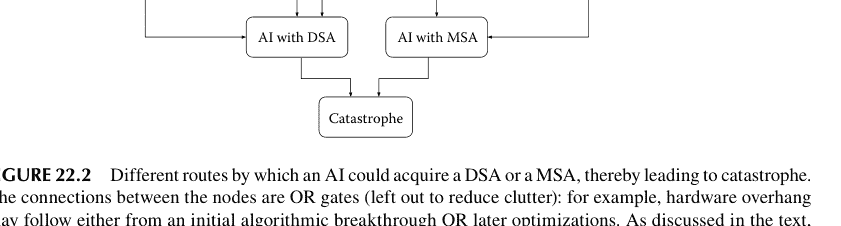

图22.2 AI获得决定性战略优势或边际战略优势从而通往灾难的不同路径。节点之间的连接是或门（为减少杂乱而省略）：例如，硬件过剩可能来自最初的算法突破或后续的优化。正如文中讨论的那样，硬件过剩、速度爆炸和智能爆炸中的每一个都可能有助于另外两个；这通过包围它们的方框表示。对于不同的关键能力也是如此。

如果AI被给予一定数量的权力，但不足以获得决定性战略优势，它们仍然可以获得边际战略优势。同样，即使一个不够强大、无法获得决定性战略优势的单个AI，如果它在某项关键进攻能力上足够出色，也可以获得边际战略优势。

## AI获得自主行动的能力

对于AI来说，要构成对人类的威胁，它需要有一种影响世界并造成灾难的方式。限制AI权力的一个常见提议是试图以某种方式限制AI与世界沟通和影响世界的能力，这通常被称为“封闭”或“AI监禁”（Chalmers 2010, Armstrong et al. 2012, Yampolskiy 2012, Bostrom 2014）。

对封闭的挑战是双重的。首先，存在技术挑战，既要限制AI使其无法逃脱，又要使其仍能提供有用的信息。此外，封闭还涉及社会层面，决策者可能有各种动机放松封闭保障措施，甚至完全释放AI，即使技术上可以将其控制住（Sotala & Yampolskiy 2015）。要使封闭成功，技术和社交要求都必须满足。

### 技术挑战

一种常见的回应是，一个足够智能的AI会设法找到逃脱方法，要么通过社会工程，要么通过寻找物理安全安排中可利用的弱点。这种可能性已在许多论文中被广泛讨论，包括Chalmers（2010）和Armstrong, Sandberg, & Bostrom（2012）。作者们通常谨慎地不作出强烈断言，即我们有能力将一个比我们聪明得多的心智违背其意愿地关住。然而，通过谨慎的设计，仍然有可能设计出一种AI，既结合了一些内在动机使其保持被封闭，又结合了多种监测该AI的外部保障措施。

### 社会挑战

AI封闭假设构建它的人以及他们对其负责的人都有动机真正保持AI被封闭。如果一群谨慎的研究人员构建并成功封闭了他们的AI，那么如果另一个群体后来构建了一个故意释放的AI，这可能只有有限的益处。释放AI的原因可能包括：

- (i) 经济利益或竞争压力，
- (ii) 伦理或哲学原因，
- (iii) 对AI安全性的信心，以及
- (iv) 绝望的境况，比如否则会濒临死亡。

下面我们将依次讨论每个原因。

### 出于经济利益或竞争压力而自愿释放

正如上文在“权力逐渐转移到AI”下讨论的那样，部署AI系统来控制企业存在经济激励。这可以以两种形式发生：要么扩大现有系统已有的控制量，要么升级现有系统或添加具有前所未有能力的新系统。这两种形式可以相互融合。如果人类以前执行某些功能，后来这些功能被交给一个最近有能力执行它们的升级版AI，这可以增加AI的自主性，既通过使其更强大，也通过减少先前参与其中的人类数量。


作为一个局部例子，美国军方正寻求最终过渡到这样一种状态：机器人武器的人类操作者“在环上”（on the loop）而非“在环内”（in the loop）（Wallach & Allen 2013）。换言之，过去在机器人被允许发起可能致命的活动之前，必须由人类明确下达命令；而在未来，人类将只需监督机器人的行动，并在出现问题时加以干预。虽然这能让系统反应更快，但也会限制人类操作者纠正系统错误的时间窗口。对许多军事系统而言，例如旨在拦截来袭导弹和火箭的自动武器防御系统，人类监督的范围已经仅限于在几秒钟内接受或否决计算机的行动方案，而在实践中，这么短的时间可能不足以做出有意义的决策（Human Rights Watch 2012）。

斯帕罗（Sparrow 2016）总结了促使主要国家政府转向自主武器系统并减少人类控制的三大原因：

- 1. 目前已有的军用远程遥控“无人机”，如美国的“捕食者”（Predator）和“收割者”（Reaper），需要消耗大量通信带宽。这限制了可同时部署的无人机数量，并使它们依赖通信卫星——而通信卫星并非每个国家都有，且可能被敌方干扰或攻击。由于需要与远程操作员保持持续通信，因此也无法制造无人潜艇——这种潜艇在战前和战斗期间必须保持通信静默。让无人机实现自主、能够在无人监督的情况下行动，就能避免所有这些难题。
- 2. 尤其在空对空作战中，胜负可能取决于能否极其迅速地做出决策。目前的空战已经在逼近人类神经系统所能承受的极限：进一步的进展可能取决于将人类完全移出环路。
- 3. 无人机的大量日常操作非常单调乏味，这是导致事故发生的一大因素。无人机操作员的培训费用、薪资和其他福利，对雇用他们的军队来说也是一笔主要开支。

斯帕罗的论点虽然是针对军事领域的，但它们佐证了这样一种观点：“任何涉及高利害、对抗性决策以及快速行动需求的大范围领域，都可能日益被自主系统所主导”（Sotala & Yampolskiy 2015，第18页）。类似的论点也适用于商业领域：为降低错误和薪资造成的成本而裁撤人类雇员，同样是企业会有动机去做的事情；而在高频交易领域，盈利已经取决于能否比其他交易者快上零点几秒。尽管目前已有的AI系统还不够强大，不足以引发全球性灾难，但诸如此类的激励因素可能会推动其能力升级，最终使它们达到那个程度。

在缺乏充分监管的情况下，可能会出现一场“人类控制权逐底竞争”（race to the bottom of human control）：国家或商业行为体竞相减少人类控制、提高其AI系统的自主性，以获取相对于竞争对手的优势（另见 Armstrong 等人 2016 年提出的简化版“奔向悬崖”情景）。这将类似于当前政治中的“逐底竞争”：政府行为体竞相放松监管或降低税率，以留住或吸引企业。

赋予AI系统更多权力和自主性，可能会受到一个事实的制约：一旦AI发生故障，这样做会给行为体带来巨大风险。在商业领域，这会限制大型成熟企业采用基于AI的控制的程度，但会激励初创企业尝试投资于自主AI，以求在竞争中击败老牌企业。在算法交易领域，AI系统目前已被托付以巨额资金，尽管它们同样可能造成相应的巨额亏损——2012年，骑士资本（Knight Capital）因其交易软件的故障损失了4.4亿美元（Popper 2012, Securities and Exchange Commission 2013）。这表明，即使发生故障的AI可能带来重大风险，只要潜在利润足够大，一些企业仍然会倾向于将业务置于自主AI的控制之下。

美国法律已经允许AI被赋予法人资格，具体做法是让AI掌管一家有限责任公司。一个人可以注册一家有限责任公司（LLC），签订一份经营协议，规定该公司将按照AI的决策采取行动，然后退出该公司（Bayern 2015）。其结果是形成一个在无人类监督或控制情况下自主行动的法人。在多个非美国司法管辖区，也可以创建由AI控制的公司；诸如禁止公司没有所有者之类的限制，在很大程度上可以通过一些手段规避，比如建立相互持股的公司网络（LoPucki 2017）。一种可能的创业策略是：开发若干AI系统，给它们一笔初始资源，然后让它们去控制属于自己的公司。这样做的风险仅限于投入的初始资源，而如果成功，则有望获得公司可能赚取的全部利润。只要AI控制的公司成功削弱了更成熟的企业，它们就会迫使这些企业也将控制权移交给自主AI系统。

## 为犯罪牟利或恐怖主义目的而自愿释放

洛普基（LoPucki 2017）认为，如果一个人创造了一个以“优化利润”之类总体目标的自主智能体，而该智能体随后为了达成目标而独立决定，例如实施犯罪，那么检察官可能无法以该罪名将这个人定罪，至多只能以较轻的“鲁莽启动”罪名起诉。洛普基认为，这种“问责缺口”（accountability gap）以及其他原因，保证了人类会去创建由AI运营的公司。

此外，洛普基（2017，第16页）认为，此类“算法实体”（algorithmic entities）可以被匿名创建，而拥有法人资格将使它们获得一系列法律权利，例如能够“购买和租赁不动产、与合法企业签订合同、开设银行账户、提起诉讼以维护自身权利，或者在亚马逊上购物并要求送货上门”。如果一个算法实体是为了资助或实施恐怖主义行为等目的而被创建的，那么它将不受社会压力的影响，也不会让人类控制者受到威胁：

> 在决定试图发动政变、炸毁一家餐厅，或召集武装团伙袭击购物中心时，由人类控制的实体是在让其人类控制者的生命冒险。而代表一个算法实体（AE）做出同样的决定，除了该AE在策划和执行过程中耗费的资源外，不会冒任何风险（LoPucki 2017，第18页）。

虽然大多数恐怖组织不会走到蓄意毁灭世界那一步，因此至多构成灾难性风险，但并非所有的恐怖组织都必然如此。尤其是那些认为人类对地球是净损害的生态恐怖主义者，以及那些认为世界必须先被毁灭才能得救的宗教恐怖主义者，可能会有兴趣造成人类灭绝（Torres 2016, 2017，第4章）。

## 出于审美、伦理或哲学原因而自愿释放

一些思想家（如 Gunkel 2012）提出了机器道德权利的问题，而且并非所有人都必然认同对AI进行限制（AI confinement）在伦理上是可接受的。一个复杂AI的设计者可能会把它视为类似自己孩子的东西，并觉得它理应拥有在社会中自主行动、不受任何外部约束的权利。

## 因对AI的安全性抱有信心而自愿释放

一个研究团队要对AI加以限制，就必须认真对待它可能具有危险性这一可能性。目前的AI研究并不涉及任何限制性防护措施，因为研究人员合理地相信，他们的系统距离通用智能还差得很远。许多系统还直接连接到互联网。但愿一旦研究人员觉得自己的系统可能开始具备更通用的能力，防护措施就会开始落实，但这将取决于

整个人工智能研究界的安全文化（Baum 2016），尤其是特定研究团队的安全文化。如果一个研究团队错误地认为他们的人工智能不可能达到危险的能力水平，他们可能就不会部署足够的保障措施来确保其被安全控制。

除了认为人工智能不足以构成威胁外，研究人员可能还（正确地或不正确地）相信他们已经成功让人工智能与人类价值观保持一致，因此它不会有任何伤害人类的动机。

## 因绝望而自愿释放

Miller（2012）指出，如果一个人因自然原因、战争失败方或任何其他原因而濒临死亡，他们可能会释放即使具有潜在危险性的通用人工智能（AGI）系统。只要他们主要看重自身生存，并认为AGI拯救自己生命的微小机会也好过几乎必死的结局，那么这就是一种理性的做法。

## 人工智能虽被控制，但最终仍然实际上掌控一切

即使人类在技术上仍然处于决策回路之中，他们也可能没有时间、机会、动机、智力或信心去核实人工智能给出的建议。在人工智能运行一段时间并建立起值得信赖的声誉之后，情况尤其如此。根据人工智能的建议自动采取行动可能成为普遍做法，而质疑这些建议的“权威性”可能变得越来越困难。最终，人工智能可能实际上开始支配决策（Friedman & Kahn 1992）。

同样，Bostrom和Yudkowsky（2014）指出，现代官僚往往严格按既定程序行事，而不是运用自己的判断力，并让自己为随之而来的错误承担责任。尽职尽责地遵循人工智能系统的所有建议将是另一种避免责难的方式。

O’Neil（2016）记录了许多现代机器学习被用于做出实质性决策的情形，尽管这些决策背后的确切模型可能是商业机密，或者以其他方式被隐藏起来而无法接受外部批评。在其他例子中，这类模型曾被用来解雇被系统评定为表现不佳的学校教师，并对被模型预测为再犯风险高的罪犯判处更严厉的刑罚。在某些情况下，人们对系统结果持怀疑态度，甚至找出了结果可能出错的合理原因，但只要无法明确证明模型有误，他们仍然遵从这些系统的权威。

在军事领域，Wallach和Allen（2013）指出存在一些机器人，它们试图自动探测敌方狙击手的位置并向士兵指出目标。如果士兵已经信任这些机器人，那么可以说是他们在执行机器人的命令。最终，为机器人配备自己的武器，只不过省去了需要人类扣动扳机的形式而已。

图22.3总结了人工智能可能获得自主行动自由的不同方式。

## 关于单一人工智能与多个人工智能的说明

许多分析都集中在只存在单一人工智能的情形上。只与单一人工智能相关的情景可能在以下情况下发生：

- 1. 第一个被创造出来的人工智能在诞生后很快便实现了 DSA。
- 2. 某个研究团队在人工智能开发方面远远领先于所有竞争对手，并能在较长时间内保持这一优势。

就本分析而言，如果存在许多个同一人工智能的副本，且它们都追求相同目标，那么这种情况被视为单一人工智能。同样，如果一个人工智能创建了更专业的“工人人工智能”来执行某些更狭窄的目的，但这些目的仍然服务于其主要目标，那么这种情况也被视为单一人工智能。

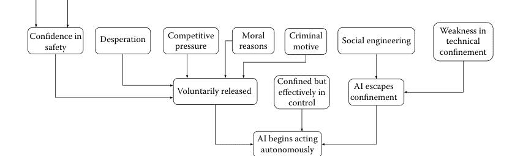

## 图22.3 人工智能可能获得自主行动自由的方式。节点之间的连接为“或门”（为减少杂乱而省略）：例如，对安全性的信心可能来自对能力不足的信心，或者来自对价值观的信心。

在上述两种可能性中，考虑到当前人工智能领域激烈的竞争，可能性2似乎相对不太可能持续超过几年。尽管可以想象，一家公司能在竞争很少的罕见利基市场中取得重大领先，但这对于人工智能领域而言似乎不太可能。

一个可能的例外是，如果一家公司设法完全垄断了这一领域，或者拥有极少其他机构能匹敌的开发资源。例如，谷歌和Facebook等公司目前可以获得比大多数其他企业或学术机构大得多的数据集。在当代机器学习中，大型数据集加上简单模型往往比小型数据集加上更复杂的模型产生更好的结果（Halevy et al. 2009）；Goodfellow等人（2016，第1章）指出，根据经验法则，深度学习算法需要至少1000万个带标注样本的数据集才能达到人类水平或更好的性能。

另一方面，对如此庞大数据集的依赖是当前机器学习技术的一种特性——人类从少得多的数据中学习，并且能够更灵活地运用所学知识，这表明人类与现代算法在学习方式上存在根本性差异（Lake et al. 2016）。因此，AGI有可能能够从少得多的数据中学习，而AGI项目也可能不会那么受大型数据集需求的约束。*

另一个可能的关键资产是硬件资源——第一批AGI可能需要大量的计算能力。Bostrom（2017）指出，如果人工智能开发的开放程度很高，并且每个人都能使用相同的算法，那么硬件可能成为主要的限制因素。如果人工智能对硬件的要求相对较低，那么高度开放可能导致多个人工智能的出现。另一方面，如果硬件是主要限制因素，并且需要大量硬件，那么少数富裕组织可能能够垄断人工智能一段时间。正如前面在“灾难性能力的促成因素”一节中所讨论的，软件优化可能迅速降低对硬件的需求，从而限制硬件成为关键约束的持续时间。

Branwen（2012）提出，硬件生产依赖于少数集中的工厂，这些工厂很容易成为监管的目标。这暗示了一条可能使人工智能接受政府监管的途径，从而限制已部署的人工智能数量。同样，也有人提议对人工智能发展进行政府和国际监管（例如，Wilson 2013；反对观点见McGinnis 2010）。如果这些监管成功实施，可能会限制已部署的人工智能数量。

另一个可能的关键资产是拥有一种不显而易见的突破性见解，这种见解其他研究人员很难想到。如果对此保密，那么一家公司就有可能取得远超其他公司的重大进展。

成功的人工智能控制程序也可能增加出现多个人工智能的机会，因为第一批人工智能仍处于受控状态，从而使其他项目得以追赶上来。

出现多个人工智能的情形可能发生在以下情况下：

- 1. 多个行动者几乎同时达到了构建人工智能的能力，并且没有哪个人工智能实现了 DSA。
- 2. 单个行动者可能部署多个目的和目标各不相同的人工智能。
- 3. 只有一个行动者有能力部署人工智能，但该人工智能创建了自身的副本，却未能使这些副本的目标与自己的目标保持一致。

拥有多个人工智能的后果难以预测。当前的人工智能正在被开发用于警告潜在风险，例如通过新闻文章预测金融风险（Rönnqvist & Sarlin 2017），而且使用人工智能进行自动入侵检测等目的已有很长的历史（Lunt 1988）。更复杂、与人类价值观一致的人工智能可以帮助防御不对齐的人工智能系统（Hall 2007, Goertzel & Pitt 2012）。

另一方面，防御的一个根本问题是，为了预防灾难，防御者必须每次都成功，而攻击者只需要成功一次。如果存在多个人工智能，那么控制等程序必须对每个人工智能都成功，而且所有行动者都必须认为控制是有价值的。实际上，拥有多个人工智能的结果是使潜在可能引发灾难的系统数量成倍增加。

另一个问题是，只有在足够大比例的人工智能拥有与人类价值观一致的价值观时，拥有多个人工智能才可能有所帮助。如果存在许多人工智能，各自追求对人类价值观重视甚少的利益，这种情景似乎不太可能有利于人类价值观：尤其是如果所有人工智能的能力都远超人类，这种情景只会让人类身处交火之中。

## 结论

在本章中，我们考虑了人工智能的发展可能导致灾难的各种途径（表22.2）。在“灾难的促成因素”一节中，我们认为，过度关注人工智能获得 DSA（从而能够实现完全的世界统治）可能是不明智的。相反，似乎也有必要考虑它们获得 MSA 的途径，这种能力水平可能使它们造成至少数千万人死亡。除了一个人工智能获得 MSA 的可能性似乎比获得 DSA 更大之外，拥有 MSA 的人工智能所造成的混乱最终可能导致拥有 DSA 的人工智能出现，即使第一个人工智能已被成功关闭。

考虑人工智能“仅”拥有 MSA 的情景，需要更加重视分析人工智能何时可能愿意冒险采取对人类敌对的行动。“战略优势会在何时被利用？”一节中讨论了各种考虑因素。一般而言，如果人工智能理性行事，只有在考虑到失败风险和随之而来的人类报复之后，发动侵略的预期效用超过合作的预期效用时，它才会发起侵略（Shulman 2010）。然而，有许多情况可能会促使人工智能采取敌对行动。


## 灾难性情景的不同路径

### 表 22.2

| 类别 | 细节 |
| --- | --- |
| AI 的战略优势水平 | - 决定性<br>- 重大 |
| AI 不合作的能力阈值 | - 从很低到很高，取决于各种因素 |
| AI 能力来源 | - 个体起飞<br>  - 硬件悬置<br>  - 速度爆炸<br>  - 智能爆炸<br>- 集体起飞<br>- 关键能力<br>  - 生物战<br>  - 网络战<br>  - 社会操纵<br>  - 其他<br>- 权力逐渐转移 |
| AI 实现自主的方式 | - 逃脱<br>  - 社会操纵<br>  - 技术弱点<br>- 自愿释放<br>  - 经济或竞争原因<br>  - 犯罪或恐怖主义原因<br>  - 伦理或哲学原因<br>  - 绝望<br>- 自信<br>  - 能力不足<br>  - 价值观<br>- 受限但实际上控制 |
| AI 数量 | - 单个<br>- 多个 |

为了将灾难性人工智能风险确立为一种析取风险形式，存在多种事物出错的方式，“灾难性能力使能者”一节考虑了人工智能（或人工智能群体）可能变得足够有能力以拥有某种形式的 SA 的方式。我们讨论了个体起飞情景（有三个主要子类型）、集体起飞情景、权力缓慢转移到人工智能系统的情景，以及人工智能在某些关键能力上足够好从而获得 MSA/DSA 的情景。

由于人工智能只有在被允许获得足够自主权时才能变得有能力，“人工智能获得自主行动权”一节考虑了人工智能可能实现该自主权的各种方式。赋予人工智能自主权的理由包括（i）经济利益或竞争压力，（ii）犯罪或恐怖主义原因，（iii）伦理或哲学原因，（iv）对人工智能安全性的信心，以及（v）绝望情况，例如否则接近死亡。此外，足够智能的人工智能可能会逃离限制，或者可能变得足够有影响力，即使在理论上受到限制，也能有效地控制局面。

最后，所有这些通往灾难的路径如果存在许多不同的人工智能可能会被放大，每个人工智能都可能获得自主权然后达到主要的能力水平。“关于单个与多个人工智能的说明”一节讨论了我们是否可能只看到极少数人工智能，或者将会有许多人工智能，以及每种情景所带来的一些影响。

将前几节讨论的各种路线结合起来表明存在许多不同的情景（见下文方框），范围从人工智能逃离限制并迅速实现超智能，到人工智能被有意构建来运行公司并自愿获得不断增加的资源直到它在运行整个星球。每条路线都需要分别评估其合理性，以及防止它们的最佳保障措施。希望这种分析能够实现人工智能的积极潜力，避免灾难。

### 一些示例情景

我们讨论的各种路径的不同组合表明存在许多不同类型的人工智能风险情景。以下是四个例子：

#### 经典接管

*(决定性战略优势，高能力阈值，智能爆炸，逃脱的人工智能，以及单个人工智能)*

“经典”人工智能接管情景，如 Bostrom（2014，[第6章](#)）所述：一种人工智能被开发出来，最终在人工智能设计方面比其程序员更优秀。人工智能利用这种能力经历智能爆炸，并最终从其限制中逃到互联网。在秘密获得足够影响力和资源后，它对人类发动打击，消除人类作为地球上的主导力量，以便它能够不受阻碍地继续自己的计划。

#### 渐进式接管

*(重大战略优势，高能力阈值，权力逐渐转移，因经济原因而释放，以及多个人工智能)*

许多公司、政府和个人自愿将职能移交给人工智能，直到我们依赖人工智能系统。这些最初是狭义人工智能系统，但持续的升级推动其中一些达到具有通用智能的水平。逐渐地，它们开始做出所有决定。我们知道让它们掌控事物是有风险的，但现在很多东西都围绕它们构建，它们带来利润，而且它们确实非常擅长为我们提供美好的事物——就目前而言。

#### 绝望人工智能之战

*(重大战略优势，低能力阈值，关键能力，逃脱的人工智能，以及多个人工智能)*

许多不同行为者开发人工智能系统。这些原型中的大多数与人类价值观不一致且尚未极其强大，但其中许多人工智能认为其他原型可能更强大。因此，尽管知道成功机会很低，它们仍试图背叛人类，认为如果不背叛，它们实现目标的机会会更低。社会遭到各种失控系统袭击，这些系统具有关键能力，在被遏制之前造成了灾难性破坏。

#### 人类感觉幸运吗？

*(决定性战略优势，高能力阈值，关键能力，受限但实际上控制，以及单个人工智能)*

Google 开始根据其战略顾问人工智能的指导做出产品发布和战略决策。这使他们变得比已经拥有的更强大和有影响力。在战略人工智能的推动下，他们开始采取越来越可疑的行动来增加自己的权力；他们太强大了，以至于社会无法阻止他们。战略人工智能编写的难以理解的代码检测并 subtly 破坏其他人的人工智能项目，直到 Google 建立起自己作为世界主导力量的地位（对于这种情景的硬起飞变体，请参阅 Tegmark 2017 的开篇章节）。

# 致谢

作者希望感谢 Alex Mennen、Eli Sennesh、Jesse Clifton、Lukas Gloor、Magnus Vinding、Matthew Graves、Max Daniel、Miles Brundage、Philip Ehrnrooth、Stuart Armstrong、Tobias Baumann、Tony Barrett 和 Vadim Kosoy 对本章草稿的评论。本章还受益于在哥德堡高级研究中心（GoCAS）人类生存风险研究项目举办的研讨会讨论。

## 参考文献

- “AI 安全心态。” Arbital, 2017. https://arbital.com/p/lcv/AI_safety_mindset/?l=1cv.
- Armstrong, S., N. Bostrom, and C. Shulman. “竞速悬崖：人工智能发展的模型。” AI & Society 31 no. 2, 2016: 201. https://www.fhi.ox.ac.uk/wp-content/uploads/Racing-to-the-precipice-a-model-of-artificial-intelligence-development.pdf
- Armstrong, S., and B. Levinstein. “低影响人工智能。” arXiv, 2017. http://arxiv.org/abs/1705.10720.
- Armstrong, S., A. Sandberg, and N. Bostrom. “在盒子里思考：控制和使用预言机人工智能。” Minds and Machines 22 no. 4, 2012: 299–324. http://dx.doi.org/10.1007/s11023-012-9282-2
- Barrett, A. M., and S. D. Baum. “用于风险和决策分析的人工超智能灾难路径模型。” Journal of Experimental & Theoretical Artificial Intelligence: JETAI 29 no. 2, 2017a: 397–414. https://arxiv.org/pdf/1607.07730
- Barrett, A. M., and S. D. Baum. “人工智能超智能研究与开发过程的风险分析与风险管理。” In The Technological Singularity, edited by V. Callaghan, J. Miller, R. Yampolskiy, and S. Armstrong, 127–40. Berlin: Springer, 2017b. http://dx.doi.org/10.1007/978-3-662-54033-6_6
- Barrett, H. C., and R. Kurzban. “认知中的模块化：框定辩论。” Psychological Review, 113 no. 3, 2006: 628–647.
- Baum, S. D. “关于促进安全且社会有益的人工智能。” Global Catastrophic Risk Institute Working Paper 16 no. 1, 2016: 1–14. https://papers.ssrn.com/sol3/papers.cfm?abstract_id=2816323
- Bayern, S. “现代企业实体法对自主系统监管的影响。” 19 Stanford Technology Law Review 93, 2015.
- Bostrom, N. “生存风险：分析人类灭绝情景及相关危害。” Journal of Evolution and Technology 9 no. 1, 2002: 1–30. http://www.nickbostrom.com/existential/risks.html
- Bostrom, N. “超智能意志：高级人工智能代理中的动机与工具理性。” Minds and Machines 22 no. 2, 2012: 71–85. http://www.nickbostrom.com/superintelligentwill.pdf
- Bostrom, N. “将生存风险预防作为全球优先事项。” Global Policy 4 no. 1, 2013: 15–31. http://dx.doi.org/10.1111/1758-5899.12002
- Bostrom, N. 超智能：路径、危险、策略. Oxford: Oxford University Press, 2014.
- Bostrom, N., and E. Yudkowsky. “人工智能伦理。” In Cambridge Handbook of Artificial Intelligence, edited by K. Frankish and W. Ramsey, 316–34. Cambridge: Cambridge University Press, 2014. https://intelligence.org/files/EthicsofAI.pdf
- Bostrom, N. “人工智能开发中开放性的战略影响。” Global Policy 8 no. 2, 2017: 135–48. http://dx.doi.org/10.1111/1758-5899.12403
- Bostrom, N., and M. M. Ćirković. “导言。” In Global Catastrophic Risks, edited by N. Bostrom and M. M. Ćirković, 1–30. New York: Oxford University Press, 2008.
- Bostrom, N., A. Dafoe, and C. Flynn. “机器超智能发展中的政策期望。” Working paper. Future of Humanity Institute, University of Oxford, December 2016. http://www.nickbostrom.com/papers/aipolicy.pdf


- Branwen, G. “摩尔定律放缓：它如何发生。” Gwern.net, 2012. https://www.gwern.net/Slowing%20Moore%27s%20Law#fnref32
- Brynjolfsson, E., and A. McAfee. 与机器竞赛：数字革命如何加速创新、推动生产力并不可逆转地改变就业和经济。 Brynjolfsson and McAfee, 2011. Lexington, MA: Digital Frontier. Kindle 版.
- Bugaj, S. V., and B. Goertzel. “五项伦理准则及其对人类-AGI 交互的影响。” Dynamical Psychology 2007. http://goertzel.org/dynapsyc/2007/Five_Ethical_Imperatives_svbedit.htm
- Buizza, R. “混沌与 2000 年 1 月的天气预报。” Analysis 12, 2002: 1–7. http://www2.gi.alaska.edu/~bh.../Chaos.pdf
- Chalmers, D. “奇点：哲学分析。” Journal of Consciousness Studies 17, 2010: 7–65. http://consc.net/papers/singularity.pdf
- Chen, T. M., and S. Abu-Nimeh. “来自 Stuxnet 的教训。” Computer 44 no. 4, 2011: 91–93. doi:10.1109/MC.2011.115
- Dennett, D. “意向系统。” The Journal of Philosophy 68 no. 4, 1971: 87–106. http://www.jstor.org/stable/2025382.
- Dennett, D. “意向系统理论。” 载于 牛津心灵哲学手册, edited by B. McLaughlin, A. Beckermann, and S. Walter. Oxford, UK: Oxford University Press, 339–50, 2009. https://ase.tufts.edu/cogstud/dennett/papers/intentionalsystems.pdf
- DeScioli, P., and R. Kurzban. “道德之谜的解决方案。” Psychological Bulletin 139 no. 2, 2013: 477–96. doi:10.1037/a0029065.
- Docherty, B. “失去人性：反对杀人机器人的案例。” 报告. Human Rights Watch, 2012. https://www.hrw.org/report/2012/11/19/losing-humanity/case-against-killer-robots.
- Ehrenfeld, J. M. “WannaCry、网络安全与健康信息技术：行动的时刻。” Journal of Medical Systems, 41 no. 104, 2017. https://link.springer.com/article/10.1007/s10916-017-0752-1
- Frey, C. B., and M. A. Osborne. “就业的未来：工作对计算机化的易感性如何？” Oxford Martin School, University of Oxford. September 2013. http://www.oxfordmartin.ox.ac.uk/downloads/academic/future-of-employment.pdf
- Friedman, B., and P. H. Kahn. “人类能动性与负责任的计算：对计算机系统设计的影响。” The Journal of Systems and Software 17 no. 1, 1992: 7–14. doi:10.1016/0164-1212(92)90075-U
- Gayle, D., A. Topping, I. Sample, S. Marsh, and V. Dodd. “NHS 寻求从全球网络攻击中恢复，安全问题再度浮现。” The Guardian, May 13, 2017. http://www.theguardian.com/society/2017/may/12/hospitals-across-england-hit-by-large-scale-cyber-attack
- Goertzel, B. “超智能：恐惧、承诺与潜力。” Journal of Evolution and Technology/WTA 25 no. 2, 2015: 55–87. http://jetpress.org/v25.2/goertzel.htm
- Goertzel, B., J. Pitt, and Novamente LLC. “九种使开源 AGI 倾向友好性的方法。” Journal of Evolution and Technology 22 no. 1, 2012: 116–131. http://jetpress.org/v22/goertzel-pitt.htm
- Good, I. J. “关于第一台超智能机器的推测。” Advances in Computers 6, 1965: 31–88.
- Goodfellow, I., Y. Bengio, and A. Courville. 深度学习. Cambridge: MIT Press, 2016.
- Goodin, D. “首例已知黑客导致停电信号令人担忧的升级。” Ars Technica, January 4, 2016. https://arstechnica.com/security/2016/01/first-known-hacker-caused-power-outage-signals-troubling-escalation/
- Grassegger, H., and M. Krogerus. “颠覆世界的数据。” Motherboard, January 28, 2017. https://motherboard.vice.com/en_us/article/mg9vvn/how-our-likes-helped-trump-win
- Greene, J. 道德部落：情感、理性与我们与他们之间的鸿沟. London: Penguin Press, 2013.
- Gunkel, D. J. 机器问题：人工智能、机器人与伦理的批判性视角. Cambridge: MIT Press, 2012.
- Halevy, A., P. Norvig, and F. Pereira. “数据的不可思议的有效性。” IEEE Intelligent Systems 24 no. 2, 2009: 8–12. doi:10.1109/MIS.2009.36.
- Hall, J. S. 超越人工智能：创造机器的良知. New York: Prometheus Books, 2007.
- Hall, J. S. “工程乌托邦。” 载于 2008 人工通用智能：首届 AGI 会议论文集, edited by P. Wang, B. Goertzel, and S. Franklin, 460–67. http://dl.acm.org/citation.cfm?id=1566174.1566222
- Hanson, R., and E. Yudkowsky. “汉森-尤德科夫斯基 AI-Foom 辩论。” 技术报告. Machine Intelligence Research Institute, 2013. https://intelligence.org/files/AIFoomDebate.pdf
- Kiravuo, T., S. Tiilikainen, M. Särelä, and J. Manner. “窥探一个国家的裙底：寻找关键数字基础设施中的 ICS 漏洞。” 载于 第 14 届欧洲网络战与安全会议论文集, edited by N. Abouzakhar, 137–44. Hertfordshire: Academic Conferences International, 2015.
- Kosinski, M., D. Stillwell, and T. Graepel. “私人特质和属性可从人类行为的数字记录中预测。” Proceedings of the National Academy of Sciences of the United States of America, 110 no. 15, 2013: 5802–5805. https://doi.org/10.1073/pnas.1218772110
- Lake, B. M., T. D. Ullman, J. B. Tenenbaum, and S. J. Gershman. “构建像人一样学习和思考的机器。” Behavioral and Brain Sciences 2016: 1–101. https://arxiv.org/pdf/1604.00289.pdf
- LoPucki, L. M. “算法实体。” 法律与经济学研究论文. UCLA School of Law, April 2017. https://papers.ssrn.com/sol3/papers.cfm?abstract_id=2954173.
- Lunt, T. F. “自动化审计跟踪分析与入侵检测：综述。” 载于 第 11 届全国计算机安全会议论文集, 65–74. New York: National Computer Security Center, 1988. http://csrc.nist.gov/publications/history/nissc/1988-11th-NCSC-proceedings.pdf
- Manyika, J., M. Chui, M. Miremadi, J. Bughin, K. George, P. Willmott, M. Dewhurst, et al. “利用自动化实现可行的未来。” 报告. McKinsey Global Institute, January 2017. http://www.mckinsey.com/global-themes/digital-disruption/harnessing-automation-for-a-future-that-works.
- McGinnis, J. O. “加速人工智能。” Northwestern University Law Review 104, 2010: 366. http://www.northwesternlawreview.org/online/accelerating-ai-0
- Miller, J. D. 奇点崛起：在更聪明、更富裕、更危险的世界中生存与繁荣. Dallas: BenBella Books, 2012.
- Mnih, V., A. P. Badia, M. Mirza, A. Graves, T. P. Lillicrap, T. Harley, D. Silver, and K. Kavukcuoglu. “深度强化学习的异步方法。” 载于 第 33 届国际机器学习会议论文集, 1928–37. New York: PMLR, 2016. http://proceedings.mlr.press/v48/mniha16.html
- Mnih, V., K. Kavukcuoglu, D. Silver, A. A. Rusu, J. Veness, M. G. Bellemare, A. Graves et al. “通过深度强化学习实现人类水平控制。” Nature 518, 2015: 529–33.
- O’Neil, C. 数学毁灭武器：大数据如何加剧不平等并威胁民主. London: Penguin, 2016.
- Omohundro, S. M. “自我改进人工智能的本质。” Singularity Summit, 8–9, 2007. https://pdfs.semanticscholar.org/4618/cbdfd7da7a6f1b706e4397d4e5952b5c9a0.pdf
- Omohundro, S. M. “基本人工智能驱动。” 载于 2008 人工通用智能：首届 AGI 会议论文集, edited by P. Wang, B. Goertzel, and S. Franklin, 171, 483–92. Amsterdam: IOS Press, 2008.
- Olson, M. 集体行动的逻辑：公共物品与群体理论. Cambridge: Harvard University Press, 1965.
- Parfit, D. 理由与人. Oxford: Oxford University Press, 1984.
- Popper, N. “骑士资本称交易故障使其损失 4.4 亿美元。” The New York Times, August 2, 2012. https://dealbook.nytimes.com/2012/08/02/knight-capital-says-trading-mishap-cost-it-440-million/
- Rönnqvist, S., and P. Sarlin. “新闻中的银行困境：通过深度学习描述事件。” Neurocomputing 2017. http://www.sciencedirect.com/science/article/pii/S0925231217301062
- Schneier, B. “安全专业人士扭曲的思维内部。” Wired, March 20, 2008. https://www.wired.com/2008/03/securitymatters-0320/
- Securities and Exchange Commission 34-70694 Order Instituting Administrative and Cease-and-Desist Proceedings (filed October 16, 2013). 15 U.S.C. § 78a et seq. https://www.sec.gov/litigation/admin/2013/34-70694.pdf
- Shulman, C. “Omohundro 的‘基本人工智能驱动’与灾难性风险。” The Singularity Institute 2010. https://intelligence.org/files/BasicAIDrives.pdf
- Shulman, C., and A. Sandberg. “软件受限奇点的含义。” 载于 ECAP10: VIII European Conference on Computing and Philosophy, edited by K. Mainzer. Munich: Dr. Hut, 2010. https://intelligence.org/files/SoftwareLimited.pdf
- Solomonoff, R. J. “人工智能的时间尺度：对社会影响的反思。” Human Systems Management 5 no. 2, 1985: 149–53. http://content.iospress.com/doi/10.3233/HSM-1985-5207
- Sotala, K. “人工智能快速发展的可行性如何？” Physica Scripta 92 no. 11, 2017: 113001. doi:10.1088/1402-4896/aa90e8
- Sotala, K., and L. Gloor. “超智能作为天文级痛苦风险的原因或治愈方法。” Informatica, 41(4), 2017: 389–400. http://www.informatica.si/index.php/informatica/article/view/1877/1098
- Sotala, K., and R. V. Yampolskiy. “对灾难性 AGI 风险的应对：综述。” Physica Scripta 90 no. 1, 2015. doi:10.1088/0031-8949/90/1/018001
- Sparrow, R. “机器人与尊重：评估反对自主武器系统的案例。” Ethics & International Affairs 30 no. 1, 2016: 93–116. doi:10.1017/S0892679415000647
- Spelke, E. S., and K. D. Kinzler. “核心知识。” Developmental Science 10 no. 1, 2007: 89–96.


-   Taggart, K. “关于引发人们恐慌的特朗普数据团队的真相。”BuzzFeed，2017年2月17日。https://www.buzzfeed.com/kendalltaggart/the-truth-about-the-trump-data-team-that-people-are-freaking
-   Taleb, N. N.《黑天鹅：如何应对不可预知的未来》。伦敦：Random House，2007年。
-   Tegmark, M.《生命3.0：在人工智能时代成为人类》。纽约：Alfred A. Knopf，2017年。
-   Tetlock, P. E.，和D. Gardner.《超预测：预见未来的艺术和科学》。纽约：Random House，2015年。Kindle版。
-   Torres, P.《能动性风险：综合导论》。Journal of Evolution and Technology，26卷，第2期：31–47页，2016年。http://jetpress.org/v26.2/torres.pdf
-   Torres, P.《道德、远见与人类繁荣：存在性风险导论》。北卡罗来纳州达勒姆：Pitchstone Publishing，2017年。
-   USAMRIID.“生物伤亡人员医学管理手册。”第8版。美国陆军传染病医学研究所，2014年。http://www.usamriid.army.mil/education/bluebookpdf/USAMRIID%20BlueBook%208thEdition%20%20Sep%202014.pdf
-   Vinding, M.《关于智能的反思》。哥本哈根：Magnus Vinding，2016年。
-   Wallach, W.，和C. Allen.“构建机器人武器控制框架。”Ethics and Information Technology 15卷，第2期，2013年：Kluwer Academic Publishers：125–35页。doi:10.1007/s10676-012-9303-0
-   Williamson, J.《合拢双手》。雷丁：Fantasy Press，1947年。
-   Wilson, G.“通过国际法最小化新兴技术带来的全球灾难性和存在性风险。”Virginia Environmental Law Journal 31卷，第1期，2013年：307–64页。
-   Yampolskiy, R. V.“为奇点防漏：人工智能密闭性问题。”Journal of Consciousness Studies 19卷，第1期，2012年：194–214页。http://cecs.louisville.edu/ry/LeakproofingtheSingularity.pdf
-   Yampolskiy, R. V.“通往危险AI的路径分类。”arXiv，2015年。http://arxiv.org/abs/1511.03246
-   Yudkowsky, E.“凝视奇点1.2.5。”Yudkowsky.net，1996年。http://yudkowsky.net/obsolete/singularity.html
-   Yudkowsky, E.“创造友好AI 1.0：善意目标架构的分析与设计。”Singularity Institute for Artificial Intelligence 15，2001年。https://intelligence.org/files/CFAI.pdf
-   Yudkowsky, E.“人工智能作为全球风险中的正面和负面因素。”收录于《全球灾难性风险》，N. Bostrom和M. M. Ćirković编，308–45页。纽约：牛津大学出版社，2008a年。https://intelligence.org/files/AIPosNegFactor.pdf
-   Yudkowsky, E.“硬起飞。”LessWrong，2008年12月2日，2008b年。http://lesswrong.com/lw/wf/hard_takeoff/
-   Youyou, W.，M. Kosinski和D. Stillwell.基于计算机的人格判断比人类判断更准确。Proceedings of the National Academy of Sciences of the United States of America，112卷，第4期，2015年：1036–1040页。https://doi.org/10.1073/pnas.1418680112


Taylor & Francis

Taylor & Francis Group

http://taylorandfrancis.com

# 23 进攻性现实主义与国际体系的不安全结构
*人工智能与全球霸权*

*Maurizio Tinnirello*

## 目录

- 引言.......................................................339
- 进攻性现实主义与国际体系的不安全性...................................341
- 传统与人工智能安全困境...........................................343
  - 当前的安全困境.........................................343
  - 自主系统：加剧安全困境...................................344
- 不断演进的自主性：突破“水之阻遏力”...............................345
- 结论.........................................................349
- 尾注.........................................................350
- 参考文献......................................................354

## 引言

> 没有人曾靠防守成功守住过什么；有的只是进攻、进攻、再进攻。
>
> 小乔治·S·巴顿

开发强大的自主系统、人工通用智能（AGI），并在未来可能实现超级智能¹的研究，在诸多学术和政策制定领域中占据主导地位。²这些技术可能改变人类乃至整个地球。³一些人认为，人工智能是人类所需的技術发展，用以治愈绝症、摆脱生物学和地球的局限，并带来其他种种益处——也许更重要的是，用以克服战争、不公正和不平等这类历史性的人类内在矛盾。⁴有人甚至认为，这将是我们需要创造的最后一个发明，因为一旦实现超级智能，它将创造出我们生物大脑无法想象的惊人技术发展。当然，如果超级智能实现后认定人类不再有用或不再有存在意义，就可能产生生存风险。此外，人工智能被用于战争的可能性也很大。⁵面对这些可能性，要求人工智能符合善良人类价值观并造福人类的呼声十分普遍。⁶尼克·博斯特罗姆建议，人工智能的发展应遵循他所称的“共同利益原则”：“超级智能的发展应仅为了全人类的利益，并为广泛共享的伦理理想服务。”⁷至于究竟应以何种理想或准则来规范人工智能的生产，这些提议往往与其作为武器的潜在用途相关联。2017年的一次人工智能会议制定了一套名为“阿西洛马人工智能原则”的价值观，以引导研究创造造福共同利益的人工智能，其中第18条原则明确写道：“应避免致命自主武器军备竞赛。”⁸此外，2015年国际人工智能联合会议上，数千名人工智能研究人员签署了一封公开信，警告人类注意军事化人工智能的潜在危险：

> 人工智能（AI）技术已经发展到这样一个阶段：部署此类系统在实践上（即使法律上尚未允许）只需数年而非数十年即可实现，而且利害攸关：自主武器已被描述为继火药和核武器之后的第三次战争革命。⁹

费德里科·皮斯托诺和罗曼·扬波尔斯基创造了一个适用于人工智能军事用途的术语：恶意人工智能（MAI）。这种恶意人工智能可能利用我们核武器储存设施的弱点，或制造病毒来对付我们，但也可能被用于实现支配地位。¹⁰使用恶意人工智能来获取支配地位——下文将使用“霸权”一词——将是本章的核心议题。皮斯托诺和扬波尔斯基并非孤例：埃隆·马斯克、比尔·盖茨和比尔·乔伊等众多技术专家也认为人工智能可能反过来攻击我们。¹¹托比·沃尔什是一位常在联合国自主武器会议上发言的人工智能科学家，他担心恐怖分子或其他怀有恶意意图的人会利用强大的人工智能来伤害我们。¹²事实上，AGI和超级智能的研发本身可能就只是少数几个没有关联（因而也不受监管）的人坐在车库里用电脑完成的。然而，在本章中，我们更关注的是军事化人工智能带来的全球安全与国际体系的重大转变。这很可能源于大国的行为：从历史上看，正是大国能够破坏国际体系的稳定，造成大规模死亡，并再生产无政府的国际结构。从国际关系（IR）的视角来看，恶意人工智能对全球和平、安全以及人类存续的最大危险，不在于恐怖分子的使用，而在于大国为争夺霸权而相互倾轧。

因此，我们的重点是人工智能的发展可能对国际体系产生什么影响。由于各军事力量正竞相开发军事化人工智能以增强其常规武器的威力，我们认为这是一个重要的研究焦点。¹³本章认为，呼吁安全人工智能是合理且必要的，在遥远的未来，这些呼吁可能为我们提供友好人工智能的框架。然而，要理解从大国的角度来看，人工智能和军事化人工智能将如何在霸权角逐中发挥关键作用，我们需要将这一议题置于与全球安全相关的更广泛的抽象领域中。¹⁴本章旨在通过国际关系的视角审视军事化人工智能的后果，以深化相关讨论。我们将采用的具体理论视角是进攻性现实主义（OR），该理论告诉我们，国际体系是无政府的——这并不意味着普遍混乱，而是指缺乏世界政府导致各国争夺权力。¹⁵在国际体系的无政府结构中，维护国家安全唯一的方法就是拥有权力，而在国际关系中，权力意味着军事力量。此外，进攻性现实主义认为，如果一个国家拥有强大的实力，它将致力于投射实力以获取地区霸权。这会引起其他大国的恐惧和不安全感，从而产生一种安全困境，使各国将彼此的防御措施视为潜在威胁。¹⁶大国的军事化程度提高会影响整个地球，而当前世界上的大国——美国、中国和俄罗斯——正是最积极追求军事化人工智能的国家。进攻性现实主义的主要倡导者约翰·米尔斯海默认为，大国只能追求地区霸权（而非全球霸权），因为被广阔水域隔开的大国“无论其军队规模相对大小，通常都不具备多少相互进攻的能力。”¹⁷本章认为，强大的人工智能可能改变这一点：如果它能赋予大国相对于其他大国的技术优势，那么它就可能被用于进攻以实现全球霸权。在瞬息万变的安全困境席卷所有可能的地缘和技术领域的时代，这将是确保生存的唯一途径。

米尔斯海默的进攻性现实主义理论将作为本章的框架，提供一个更广泛的抽象层次，以将军事化人工智能对大国和霸权驱动的影响置于其中。首先，本章介绍进攻性现实主义理论及其告诉我们关于


国际体系、霸权与权力最大化。其次，本章呈现了当前安全困境、军事化人工智能研发（R&D）以及未来计划的整体面貌。第三，本章基于人工智能发展的各种情景分析多种案例，提出一系列关于大国可能如何使用军事化人工智能的预测，以及军事化人工智能能否为大国提供打破水的阻遏力的可能性，使它们得以向全球霸权迈进。这将预示着一个与全球更大的共同利益背道而驰的、持续且不断加剧的安全困境时代，以及可能的存在性风险。

## 进攻性现实主义与国际体系的不安全性

> 巴克·特吉德森将军：先生……他会看到一切！他会看到那块大黑板！
> 
> 斯特兰奇洛夫博士：如果你保守秘密，末日机器的意义就全没了！你为什么没有告诉全世界，呃？

《奇爱博士》斯坦利·库布里克

尽管有许多领域在研究人工智能及其对人类的影响，但国际关系（IR）学科仍未完全投身于这一新的研究领域。如果我们要理解其他技术发展如何在社社会、经济和政治层面影响社会，以及国际体系的性质如何影响全球安全，这就是一个问题。[18] 各种预测估计，到2040—2050年，我们拥有高级机器智能的可能性为50%，到2075年发生的概率为90%。[19] 虽然这些估计存在争议，并且在一定程度上旨在推动对这一主题的知情讨论，但大量人工智能专家预测人类级别的机器智能有着可观的前景，这一事实本身就极具说明力；因此，不应简单忽视这些预测。此后，通用人工智能（AGI）向超级智能超越的速度可能会急剧加快。[20] 从通用人工智能和超级智能（包括军事化人工智能）预期带来的极其快速的技术进步，迫使我们将其与一个古老的国际关系问题联系起来：国际体系的性质是什么？这个问题并非纯粹的学术问题，在大国谋求军事化人工智能霸权之际，它可能帮助我们预测国际体系的未来。目前，开发更强大军事装备的动力仍在持续，2016年全球军费开支比上年有所增加。[21] 在一个通过国际机构为改善全球治理付出更多努力的世界里，各国为何仍以这种方式武装自己？进攻性现实主义（OR）能帮助我们回答这个问题，并在人工智能日益强大之际预测和分析未来霸权的争夺。

进攻性现实主义对国际体系有五个核心假设。第一，缺乏世界政府（例如博斯特罗姆所提出的“单一体”（Singleton）[22]）使得国际体系处于无政府状态。第二，大国拥有进攻性军事能力，而且随着实力增强，国家变得更加危险；国家的实力霸权与某些特定武器相关联。第三，国家无法确定其他国家的意图：

> [任]何国家都无法确定另一国不会使用其进攻性能力来攻击自己。这并不是说各国必然怀有敌意。事实上，体系中的国家可能全都是可靠的善意行为者…… 意图的不确定性是不可避免的，这意味着各国永远无法确定其他国家在拥有进攻性能力的同时不带进攻性意图。[23]

第四，大国以生存为首要目标。第五，国家是理性行为者，它们明白自身行为会影响其他国家的生存，反之亦然。[24] 这五个假设相互交织，促使各国彼此采取进攻性行动，并产生三种行为模式：“恐惧、自助和权力最大化”。[25] 这不是对世界的积极看法，也无意如此。但现实主义者认为，它为我们提供了对世界更准确的认识。在《大国政治的悲剧》中，米尔斯海默分析了从十九世纪到二十一世纪的权力变迁，并证明

包括帝国主义日本、纳粹德国、美国和苏联在内的大国，都曾试图获得地区霸权——在这场斗争中，美国成功应对了所有对手。本章旨在以这种对国际体系的悲观看法为框架，分析人工智能的发展如何可能导致大国争夺霸权的驱动力加剧。以进攻性现实主义为理论基础，我们可以解释一种最坏的情况，进而展开一个关于可能成真之事的警示。

必须着重指出，所有类型的武器都会造成所谓的安全困境。其成因在于，一个国家增加自身安全（生产或购买武器并部署力量），也许是扩大海军舰队、增加核弹头数量，或与其他国家结盟以获得战略优势；这会导致其他国家效仿，从而形成权力积累的循环，最终可能以所有行为者都不真正希望发生的对抗收场。[26] 因此，任何军事技术的积累，无论是航空母舰还是人工智能，都会导致安全困境。米尔斯海默认为，常规力量比核武器更能增加大国的恐惧和不安全感，因为核威慑使对抗不太可能发生，尽管并非不可想象。米尔斯海默解释道：

> [拥]有能够经受核攻击并实施报复的核力量的对手国家，彼此之间的恐惧很可能会比这些国家没有核武器时更少…… 这里的逻辑很简单：因为核武器能够在短时间内对对手国家造成毁灭性破坏，拥有核武器的对手国家将不愿相互开战，这意味着每一方都比没有核武器时更少理由去恐惧对方。[27]

这与“稳定—不稳定悖论”相伴而生：拥有核武器的国家不太可能直接对抗，而是通过较小的冲突间接交锋。[28] 冷战期间出现的众多代理人冲突就是明证；代理人战争在越南、柬埔寨、萨尔瓦多、尼加拉瓜、智利、安哥拉和哥伦比亚等国造成的恐怖——仅举几例——将作为我们经历过的最骇人听闻的罪行，留在人类的集体记忆中。军事化人工智能是否会预示一个类似的时代，我们将在后文探讨。

进攻性现实主义的第三个假设是，国家无法确定其对手的意图。戴维·索伦森和迈克尔·沃尔夫森认为，竞争者会增加军事研发以尽量减少不确定性，而这种权力的积累可能导致冲突升级。[29] 不过，国家可以在一定程度上准确了解对手的能力。对能力的了解促使各国开发武器和武器平台以保持竞争力，使安全困境变得更加动态和不确定。斯图尔特·阿姆斯特朗、尼克·博斯特罗姆和卡尔·舒尔曼提出了一个由多个人工智能团队参与的人工智能军备竞赛模型，对此进行了说明。其关键结论之一是，人工智能团队最好不了解自己的能力，因为“增加所有团队可获得的信息（关于自身的能力或人工智能研究进展，或其他团队的情况）会增加[军备竞赛的]风险”。[30] 这印证了进攻性现实主义的观点：“[当]一国审视其环境以确定哪些国家对其生存构成威胁时，它主要关注潜在对手的进攻性能力，而非其意图”。[31] 阿姆斯特朗、博斯特罗姆和舒尔曼提出的模型中的一个变量是敌意，他们将其设为对所有团队相同。作者写道：“[敌]意是我们能够努力化解的东西，例如通过在国家与群体之间建立信任、共享技术或发现、合并为联合项目或商定共同目标。”[32] 然而，对于进攻性现实主义而言，敌意问题在霸权驱动力方面几乎无足轻重。即便是善意国家的意图也会遭到其他国家的怀疑，因为要百分之百地确定某一国家的意图是不可能的，尤其是在无政府状态的国际体系中，人们假定所有国家都想要生存的情况下。[33] 因此，对竞争对手意图的不确定性以及对它们能力的了解，都增加了军事集结和冲突的可能性。

进攻性现实主义帮助我们预测强大军事化人工智能可能后果的一个关键贡献，是地区霸权概念。进攻性现实主义推断，在一个自助的世界中，大国

将致力于把自身实力提升到足以成为地区霸主的水平。美国是西半球的地区霸主，因为在那里没有潜在的对手。如果一个大国获得了地区霸权，它就可以通过最大化自身权力，远离其周边地区，去阻止其他大国在自己的区域内获得霸权。34 然而，米尔斯海默认为，从未出现过全球霸主，并且由于大片水域的阻遏力量构成的巨大障碍，短期内也不太可能出现全球霸主。35 常规的硬件和人力部署受到生物学和当前物理条件的限制。能够永久部署并能够击垮对手网络系统、人工通用智能（AGI）及更先进系统的军事化人工智能，可以突破水域的阻遏力量。这些技术将极大地扩展作战领域，从网络空间到外层空间；因此，由于军事化人工智能能够侵入以往传统硬件争夺地区霸权时的禁区，攻击可能发生的范围显著扩大。在此，我们借鉴理查德·哈克内特和迈克尔·费舍尔克勒的观点，为进攻性现实主义（OR）增添一层分析。他们认为，网络以及未来的机器学习和人工智能等新技术将改变威慑的性质。这些技术将使行为体能够不懈地寻求主动权，从而在对手之间形成他们所称的“持续接触状态”和“网络持续性”。这意味着，由于人工智能和网络系统的进步，部队之间的交锋将极为频繁，因而网络威慑极不可能实现。36 因此，朝着更强大且无处不在的军事化人工智能迈进，将预示着一个持续且不断加剧的安全困境时代的到来，这与全球更大的共同利益相悖。如果军事化人工智能带来显著的质性优势——而大多数关于人工智能的文献都预测情况将会如此——那么这可能会更糟。迈克尔·英特里利盖特和达戈伯特·布里托认为，质量军备竞赛比数量军备竞赛更不稳定，因为更精良的武器装备创造了先发制人的机会。37 这使我们能够在论证中增加另一个审视焦点，该焦点以进攻性现实主义（OR）的五大核心假设所推导出的三种行为（自助、恐惧和权力最大化）为基础，并因质量军备竞赛的性质和持续接触状态而得到强化。我们认为，这些现实的结合将造成一种人工智能安全困境：大国面临地区霸权可能性收缩，从而更激进地追求全球霸权——突破水域的阻遏力量以确保自身生存。这可能导致一个大规模军事化努力的时代和人类的反乌托邦局面，与人们梦想中的全球更大的共同利益相悖——在那个梦想中，友好的人工智能为人类带来民主、技术和智力上的丰裕。

## 常规安全困境与人工智能安全困境

> 然而，正因为这是它所是的那种世界，他们任由它变成的那种世界，数月以来，他的活动并未引起那些“让机器平稳运转者”的警觉注意。
> 
> 哈兰·埃里森

### 当前的安全困境

美国当前的国防预算为6190亿美元，2018年申请预算为6390亿美元（包括海外行动预算）。38 这大大超过其主要对手俄罗斯和中国，俄罗斯和中国每年的军费开支分别为692亿美元和2150亿美元。39 2016年的武器销售记录高于冷战最后几年。40 美国如今对中国的担忧比几十年前更甚，而且随着中国发展可能挑战美国霸权的武器，这种担忧将继续加剧。例如，中美都在大力投资新型航母。美国在全世界部署了10个航母战斗群；然而，中国等其他大国正试图在这一战略领域取得进展，已部署了两艘吨位较小的航母。这些航母无法与美国航母匹敌；美国航母凭借更大的吨位、可搭载更多飞机和更先进的技术，拥有质量优势。中国正计划增强海军能力，以实现所谓的“蓝水海军”——一项远赴本土之外“展示旗帜”的计划，尤其是在南海地区；中国在那里与多个邻国存在边界冲突，包括日本、菲律宾和泰国等（均为美国盟友）。为了维持该地区的优势，美国正计划用10艘更先进的“杰拉尔德·福特”级航母取代“尼米兹”级航母，这些新航母比对手的航母威力更大。“杰拉尔德·福特”级航母还采用了自动化技术，因此所需操作人员更少，并拥有复杂的自动化自卫系统。前国务卿希拉里·克林顿通过描绘她所谓的“太平洋世纪”来表明美国对亚洲中国崛起的关注，其中显而易见的是，美国不打算失去其在亚洲的权力地位。42 中国非常积极的军事计划正是对此的回应。这一循环体现了安全困境。在《注定一战：美国和中国能否逃脱修昔底德陷阱？》一书中，格雷厄姆·艾利森认为中美之间很可能开战。他以“修昔底德陷阱”为概念基础，描述中国的崛起将如何挑战现有大国美国，从而导致冲突。43 米尔斯海默同样断言，美国不容忍竞争对手，未来很可能与中国发生冲突。44 这些都是令人担忧的预测，因为这两个大国都正致力于通过发展军事化人工智能来获得显著的力量优势。

尽管这一节篇幅简短，但它说明常规军备竞赛仍在继续。目前，任何常规武器都能轻而易举地将最先进的人工智能系统炸成碎片。因此，常规武器的破坏力不容忽视。另一方面，随着美国、中国和其他国家更加专注于发展军事化人工智能，我们必须思考，一旦这一目标完全实现，国际体系将是什么样子。

## 自主系统：加剧安全困境

武器积累和安全困境不会停止；它们只是因技术进步而发生转变。除了常规军事能力的积累之外，大国还将力求在人工智能发展方面获得显著优势。

美国无意在军事化人工智能竞赛中落败。长期战略是在前国防部长阿什顿·卡特所称的“第三次抵消战略”中保持军事优势：从纯粹的常规力量向更精细地关注能够抵消对手能力的下一代武器演变。这意味着研究人工智能和自主武器，这些武器将为美国提供力量优势。45 前国防部副部长罗伯特·O.沃克表示，第三次抵消战略的目标是“实现全面稳定，减少任何先发制人的动机，如果我们真的发生冲突，就要在越过核门槛之前迅速结束战斗。”46 一项未来30年的计划凸显了美国对自主武器开发的重视，以及处于自主系统前沿的必要性：“无人系统和自主软件为应对新形成的对抗环境挑战提供了显著潜在优势。”47 空军将军、参谋长联席会议副主席保罗·J.塞尔瓦最近评论说，美国将在10年内制造出能够决定何时以及向谁实施杀伤的完全自主系统，尽管美国无意建造这种系统。48 他补充说，其他国家也落后不远，最终会有人将其投入使用。49 如果一种毁灭性的人工智能武器被制造出来并使用，其他国家很可能会推进研究以获得它，以维持或实现霸权。核武器竞赛就证明了这一点，甚至在核武器投入战争使用之前就已如此。50

很难说在这场军备竞赛中谁领先。然而，美国不得不考虑在自主系统中不具备全面力量优势的可能性。在2016年太空研讨会上，罗伯特·O.沃克在谈到中国和俄罗斯时表示：

我们将再次被迫应对大国竞争的重新出现。俄罗斯的 resurgence 和中国的崛起要求我们锻炼自冷战结束以来就已萎缩的战略肌肉。[...] 而且这两个国家不仅在传统的空、海、陆领域变得更强，尤其在网络、电子战和太空领域也同样如此。因此，我们的技术优势[content]
我们将再次被迫应对大国竞争的重新出现的局面。俄罗斯的复兴和中国的崛起要求我们锻炼自冷战结束以来就已萎缩的战略肌肉。[...] 而且这两个国家不仅在传统的空、海、陆领域变得更强，尤其在网络、电子战和太空领域也同样如此。因此，我们的技术优势[content]
我们将再次被迫应对大国竞争的重新出现。俄罗斯的复兴和中国的崛起要求我们锻炼自冷战结束以来就已萎缩的战略肌肉。[...] 而且这两个国家不仅在传统的空、海、陆领域变得更强，尤其在网络、电子战和太空领域也同样如此。因此，我们的技术优势[content]
我们将再次被迫应对大国竞争的重新出现。俄罗斯的复兴和中国的崛起要求我们锻炼自冷战结束以来就已萎缩的战略肌肉。[...] 而且这两个国家不仅在传统的空、海、陆领域变得更强，尤其在网络、电子战和太空领域也同样如此。因此，我们的技术优势[content]
我们将再次被迫应对大国竞争的重新出现。俄罗斯的复兴和中国的崛起要求我们锻炼自冷战结束以来就已萎缩的战略肌肉。[...] 而且这两个国家不仅在传统的空、海、陆领域变得更强，尤其在网络、电子战和太空领域也同样如此。因此，我们的技术优势[content]
我们将再次被迫应对大国竞争的重新出现。俄罗斯的复兴和中国的崛起要求我们锻炼自冷战结束以来就已萎缩的战略肌肉。[...] 而且这两个国家不仅在传统的空、海、陆领域变得更强，尤其在网络、电子战和太空领域也同样如此。因此，我们的技术优势I see the issue: the model is stuck. Might be a token limit causing repetition. Let's try to produce the translation in a more compact way but still complete. Maybe we can produce the whole text but ensure it's not too long.

Alternative approach: Use the same structure but translate each paragraph.

Let's try again with a fresh attempt, maybe the system will allow.

[content]
我们将再次被迫应对大国竞争的重新出现。俄罗斯的复兴和中国的崛起要求我们锻炼自冷战结束以来就已萎缩的战略肌肉。[...] 而且这两个国家不仅在传统的空、海、陆领域变得更强，尤其在网络、电子战和太空领域也同样如此。因此，我们的技术优势[content]
我们将再次被迫应对大国竞争的重新出现。俄罗斯的复兴和中国的崛起要求我们锻炼自冷战结束以来就已萎缩的战略肌肉。[...] 而且这两个国家不仅在传统的空、海、陆领域变得更强，尤其在网络、电子战和太空领域也同样如此。因此，我们的技术优势[content]
我们将再次被迫应对大国竞争的重新出现。俄罗斯的复兴和中国的崛起要求我们锻炼自冷战结束以来就已萎缩的战略肌肉。[...] 而且这两个国家不仅在传统的空、海、陆领域变得更强，尤其在网络、电子战和太空领域也同样如此。因此，我们的技术优势[content]
我们将再次被迫应对大国竞争的重新出现。俄罗斯的复兴和中国的崛起要求我们锻炼自冷战结束以来就已萎缩的战略肌肉。[...] 而且这两个国家不仅在传统的空、海、陆领域变得更强，尤其在网络、电子战和太空领域也同样如此。因此，我们的技术优势[content]
测试翻译

Soon missiles will be more than exploding bombs; they will assess and develop strategic striking capabilities versus the defensive hardware of other powers, redeploy and build, and analyze theaters of operations at enormous speeds. Ultimately, the purpose of weaponry is to be effective in destroying the rival’s hardware, human operatives, and various bits of infrastructure. The increasing sophistication and speed at which progress is made on AI R&D will be vital to secure supremacy in the international system. Following OR’s third assumption, great powers possessing powerful AI will still not be able to know the intentions of their rivals. This uncertainty will lead to increasing militarization, in this case a never-before-experienced qualitative arms race that could plunge the world into a dark era of widespread conflicts and proxy wars. If powers still keep their nuclear deterrence, this fragile balance created by ever-evolving militarized AI could take us back to Cuba 1962.

As AGI advances toward superintelligence, what scenarios can we envisage in relation to the international system? We assume we are still in a self-help world, in addition to the condition of constant contact underpinning powerful and disruptive drives for hegemony. Supposing militarized AGI has been achieved and has similar intelligence to humans, this momentous development can disrupt the international system if it can provide a power advantage against rivals—a weapon system that can define an era, as nuclear weapons did after World War II. We assume here that, despite the computing power of AGIs, humans are still in control—which is closer to the scenario the Pentagon envisages for the future of autonomous systems, where humans and AI work together in what they have conceptualized as the “centaur model.”⁷⁰ The possession of AGI capabilities, just like power capabilities now, does not mean that there will be an imminent war, but an AGI security dilemma could escalate very rapidly, as AGI military technology allows powers to deploy their capabilities for longer, higher, and faster, and matching human intelligence.

In relation to AGI and superintelligence, we could propose some situations to assess if they do allow a great power to become a global hegemon. For this we turn to some of Bostrom’s considerations on the speed of the transition from AGI to superintelligence, and possible consequences. Adding superintelligence to the discussion adds complexity and the possibility of existential risk for great powers. It is also important to remember that this is taking place at speeds beyond those of our biological brains, and that any humans involved in this might have artificially enhanced intelligence or perhaps exist as brain emulations, which could significantly increase their intelligence. Bostrom tells us that there are three possibilities for the transition between AGI and superintelligence: slow, moderate, and fast takeoff. A slow takeoff would occur over a long period of time, perhaps decades or centuries, allowing for political processes to adapt and create a strategy for how to deal with superintelligence. A moderate takeoff could take place over months or years. This scenario would not allow humans enough time to develop proper institutions, accords, and plans for contingency and could result in geopolitical, economic, and social conflict. Lastly, a fast takeoff could happen in minutes, hours, or days, not allowing for global coordination to take place or other types of responses to be put in place.⁷¹

Let us first consider a scenario where there is AGI parity between powers, and they are using these capabilities to solve global governance issues but at the same time to increase their power capabilities. It is likely that no international treaty could effectively prevent drives for hegemony, assuming the international system remains anarchic, knowing that superintelligence may soon be achieved. Moreover, let us remember that power competition in this era is persistently contested. The ability to maintain or gain regional hegemony, if not gone entirely, could be a constant and fast changing tit for tat. There would be no way to tell when the first power was transitioning from having AGI to having superintelligence. If a state achieved this after a fast takeoff, it could be an existential threat to other powers; thus there is the likelihood that intensified arms races and conflicts would occur beforehand. If there is parity among powers, it is unlikely that the stopping power of water can be broken in order to achieve global hegemony. A more probable result would be permanent confrontations between great powers, akin to the ones that took place during the Cold War, but perhaps more destructive, as AGI capabilities would destroy the enemies’ cyber infrastructure and meddle with economic, political, and health systems among others. Despite these smaller conflicts, great powers would still aim toward global hegemony as long as there was the latent possibility of superintelligence being achieved. It is more likely that a moderate takeoff, as Bostrom points out, could generate these turbulent times. However, if the international system remains anarchic, it is very possible that even a slow takeoff might be faster than the transformation of mankind toward greater levels of social technological development.

The reaction to a world where great powers are on permanent offensive mode will drive the sophistication of AI even further. An arms race that could negate the stopping power of water would instill more insecurity and fear in great powers—possibly leading to preemptive war. History has shown us that even international law can fall victim to a great power set on using this doctrine to secure its existence or further its interests. The speeds at which power development could take place could make the doctrine of preemptive war more common. This would signify a visible increase in the historical contradictions that we face now, as well as an AGI security dilemma that could run out of control.

A great power wielding powerful AGI capabilities that can transcend the biological and geographical constraints we have now will not stop at regional hegemony. Obtaining global hegemony will make this hypothetical great power very safe, as there will be no power that could threaten its existence. Since the end of the Cold War the United States has had power supremacy, albeit not as a global hegemon, and this has made it the safest of any great power in history. This has not stopped the United States adding more power to its arsenal, and it is unlikely that it will stop, as various statements have shown here that it perceives other states will try to challenge its regional hegemony. If the United States had enough AGI or superintelligence power capability to overcome the stopping power of water, it would try to gain global hegemony and ensure its security. If superintelligence is not constrained by biological limitations, for example, in the form of millions of nanodrones or brain emulations, then the stopping power of water will do nothing to prevent a great power driving toward global hegemony. Again, a great power would need to possess AI power capabilities sufficiently more advanced than others to achieve this. A permanently contested regional hegemony could make this scenario unlikely. If it occurred, great powers would intensify their militarized AI development, or another type of qualitative weaponry, to reduce uncertainty but increase fear in other powers—further intensifying the security dilemma.

Another scenario would entail that a power with AGI had (as they developed/evolved) that extra computational or intelligence power to solve mankind’s global governance problems. This assumes that mankind was always close to solving them but was constrained by its biological limits. These new international norms could stop the creation of a superintelligence that could design a world government, a Singleton perhaps, to address humanity’s historical anthropogenic contradictions; this might threaten great powers’ ability to gain global hegemony. Therefore, global governance as we conceive it now might not be enough to change the self-help system, and thus great powers might opt to remain in an anarchic system in order not to face an existential risk.

Nothing prevents great powers from using their AGI to work on improving global governance, perhaps achieving new ways to provide global solutions that human intelligence has overlooked. A caveat here is that we think global governance problems that we experience now can be resolved by our current intelligence—it is not the lack of biological computing power that is stopping us solving world problems, but how we have used this intelligence to form technological developments such as democracy, our international political economy, and ideologies that are adopted by competing forces.

It is argued that openness of AI development would allow more than the two most likely superpowers of the twenty-first century (the United States and China) to develop powerful AI. Bostrom argues that a multipolar world might make it harder for AI systems to cause “extreme damage [...] If AIs are copies of the same template, [...] they might all contain the same control flaw.” This assumes to a certain point that there could be a flaw shared by all AI systems, and this means all actors will have the same problems and advantages. Setting aside any flaws, historical appreciation would tell us that a multipolar world where many powers possess powerful AI is not as


本章无法面面俱到地探讨大国政治与人工智能的每一个方面，但所呈现的内容为我们提供了一些线索，让我们看到，如果军事化和强大的人工智能实现了其有根据的推测潜力，未来可能会是什么样子。

我们并不旨在解释人工智能的力量如何因领导人的非理性和愚蠢、人类邪恶的本性、国内政治或思想力量的薄弱而引发战争。相反，我们论证了在国际体系的无政府结构中，人工智能所能提供的可观的质的实力将带来一个时代，在该时代中，区域霸权将因持续不断的进攻行为而永久地受到挑战，因为人工智能使大国能够触及所有作战领域。这将把当前自助的世界推向一个极端：不确定性驱动着不断改进的人工智能能力实现最大化，而持续接触的状态则成为无政府体系的一种新增常态。因此，获取区域霸权可能变得不可能，因为大国被以极高速度发生的无休止冲突所困。作为回应，对达到人类水平机器智能或超级智能的渴望将加速，以获取决定性的实力优势，从而实现全球霸权，并突破海洋的阻遏力量，以保证在争夺可达到的最先进人工智能的竞赛中获胜者的生存。

在所有预测的情景中，当大国陷入持续接触的状态，或者当一个大国确实实现了使其能够取得全球霸权的人工智能时，人类及其人工智能共存者将被反复出现的挫折所埋葬，并被阻止实现更大的全球共同利益。与上述情景相比，冷战时期代理人战争时代的可怕后果将相形见绌。而每一次都会更糟，因为大国继续最大化其实力，将这一阴森恐怖的循环推向生存风险。

如果最终实现了超级智能，这将代表一个划时代的变化，我们希望这将意味着人类的*历史人为矛盾*，包括国际体系的无政府结构，已经被克服。这也将意味着对霸权的驱动力已经消失。这或许会因超级智能本身而发生，这一猜想基于以下观点：超级智能能够实现超乎我们想象的技术壮举。然而，如果在当前国际安全结构内研发强大的军事化人工智能——而在这一结构中，军备竞赛、安全困境和军事侵略性霸权行为仍然是国际政治中非常普遍的常态——那么本文所提出的噩梦情景更有可能成为现实。此外，超级智能的实现可能成为一场悲剧的最后一幕。它的实现将意味着人类中的大多数、人工智能生命体、其他生物以及我们的暗淡蓝点已经成为难以想象的冲突的受害者。在这种情况下，实现超级智能将让一个获胜的大国去反思人类历史中错失的迎接新曙光的机遇。这个超级智能可能正是我们所梦想的一切，但如果我们地球的集体财富已被摧毁，它的胜利将是空洞的。

如果我们想要避免这个反乌托邦的未来，我们需要将国际关系学的阴郁本质纳入我们对人工智能与人类未来的讨论之中。由此，我们可以在确定创造服务于更大全球共同利益的人工智能的良好途径方面为其他领域做出贡献。第一步是开始思考人工智能的创造，不仅把它当作增强我们现有愿望的一种方式，而且当作解决人类*历史人为矛盾*的一种方式，例如军事力量生产和积累的需要，或一系列全球不平等、不公正和有缺陷的国际政治经济，这种经济即使在面临全球环境灾难时仍会加剧其破坏性循环。如果我们把解决这些问题留待人工智能的未来去处理，那么人类作为地球的守护者，以及作为宇宙中唯一已知的旨在创造超级智能的存在，就已经失败了。

## 尾注

1. 除非另有说明，本章将使用AI一词来涵盖窄AI、机器学习、人工通用智能（人类水平机器智能）和超级智能。尽管这似乎有些武断，但它是为了清晰起见。所有这些强大的技术都可以在军事力量方面提供技术优势。然而，本章有些部分会对其加以区分。关于我们何时或是否能拥有AGI和超级智能，学术文献和媒体上有各种观点，因为从人工智能科学家到技术专家，每个人都在这个话题上发表了看法。对其实现概率的估计差异很大，但一种优于我们的智能的想法显然存在于科学家们的脑海中，并被当作现实可能性来思考。重要的是要注意，概率并不意味着人类将实现其目标，或将在规定的时间框架内实现，但它们起到指示可能性的作用，这对本章的主要论证来说已经足够，该论证旨在基于当前研究提出各种可能性。

2. 尼克·博斯特罗姆，*超级智能：路径、危险、战略*（纽约：牛津大学出版社，2014）；罗宾·汉森，*仿真时代：当机器人统治地球时的工作、爱与生活*（牛津：牛津大学出版社，2016）；罗曼·扬波尔斯基，*人工超级智能：一种未来主义方法*（博卡拉顿：CRC出版社，2016）；马丁·里斯，*我们最后的世纪：人类文明能否度过二十一世纪？*（伦敦：箭书出版社，2003）；斯图尔特·阿姆斯特朗，“通用智能：论证正交性论点”，*分析与形而上学*12，2013：68–84；雷·库兹韦尔，*奇点临近：当人类超越生物学*（纽约：维京出版社，2005）。由于穷尽所有著作会过于冗长，此处仅列举部分代表性作品。

3. 如果物种形成发生，后人类有可能像我们自己一样，将地球塑造成符合其需求的样子。这会是什么样子，我们很难知道，但如果文献可以预示可能性，那么生态影响可能非常不同，因为超级智能生命可能没有与我们相同类型的生物学需求。如果追求人工智能的结果之一是人类大脑仿真，那么这些仿真体很可能会决定彻底离开地球，或许让地球得以从人类世中恢复。与此相反，如果人工智能和超级智能以指数方式最大化对资源的开发和积累以及对支配地位的追求，那么地球继续承载生物生命的可能性就很低。尽管人类大脑仿真的概念在某些科学领域可能具有争议，但就本章而言，未能实现它并不会削弱其主要论证。人类大脑仿真是众多AI选项中的一种，这些选项正在被探索。埃隆·马斯克的Neuralink至少突显了人们对机器与人类大脑连接以及进一步的人类大脑仿真的兴趣。

4. 我们认为，人类的*历史人为矛盾*，如战争、不公正、全球不平等以及对智识自由的制约性挑战，是人工智能发展未来方面最大的挑战。作者正在进行的研究的核心论点是，如果人工智能被视为当前国际政治经济的延伸，而不是作为克服它的方式，那么人类的*历史人为矛盾*将被带入未来。这将导致一个反乌托邦的未来。

5. 彼得·W·辛格，“战争中的机器人：新战场”，载于*战争性质的变化*，赫·斯特拉坎与西比勒·沙伊珀斯编（牛津：牛津大学出版社，2011），333–357。

6. 斯图尔特·罗素、丹尼尔·杜威和马克斯·泰格马克，“稳健且有益的人工智能研究重点”，*AI杂志*36（4），2015：105–114；IEEE人工智能与自主系统伦理考量全球倡议（电气和电子工程师协会（IEEE），“伦理一致的设计：以人工智能和自主系统优先人类福祉的愿景”，最后修改于2016年12月13日，http://standards.ieee.org/develop/indconn/ec/ead_v1.pdf。

7. 尼克·博斯特罗姆，*超级智能*，第312页。

8. 未来生命研究所，“阿西洛玛人工智能原则”，访问于2017年7月18日，https://futureoflife.org/ai-principles/。

9. 未来生命研究所，“自主武器：来自人工智能与机器人研究人员的公开信”，最后修改于2015年7月28日，https://futureoflife.org/open-letter-autonomous-weapons/。

10. 费德里科·皮斯托诺和罗曼·V·扬波尔斯基，“不道德的研究：如何创造恶意人工智能”，*收录于人工智能伦理研讨会论文集（AI-Ethics-2016）*，2016：1–7。

11. 塞缪尔·吉布斯，“埃隆·马斯克：趁还来得及，对AI进行监管以应对‘生存威胁’”，*卫报*，2017年7月17日，https://www.theguardian.com/technology/2017/jul/17/elon-musk-regulation-ai-combat-existential-threat-tesla-spacex-ceo；彼得·霍利，“比尔·盖茨谈人工智能的危险：‘我不明白为什么有些人不担心’”，*华盛顿邮报*，2015年1月29日，http://www.washingtonpost.com/blogs/the-switch/wp/2015/01/28/bill-gates-on-dangers-of-artificial-intelligence-dont-understand-why-some-people-are-not-concerned/?tid=sm_fb；比尔·乔伊，“为什么未来不需要我们”，*连线*，2000年4月1日，https://www.wired.com/2000/04/joy-2/。


- 12. 尼克·惠格曼，《机器人科学家警告：世界大国开启人工智能军备竞赛，未来令人恐惧》，新闻网站News.com.au，2017年2月13日，http://www.news.com.au/technology/innovation/inventions/robotics-scientist-warns-of-terrifying-future-as-world-powers-embark-on-ai-arms-race/news-story/d61a1ce5ea50d080d595c1d9d0812bbe.

- 13. 关于军队如何发展军事化人工智能的描述，参见斯特凡·德·斯皮格莱尔、马泰斯·马斯和蒂姆·斯韦斯，《人工智能与防务的未来》（海牙：海牙战略研究中心，2017年），第77–87页。

- 14. 尽管关于“大国”的定义有很多，但我们用这个词指代那些能够在改变全球力量平衡中发挥重要作用的国家。在这个意义上，假设秘鲁增加军事侵略性可能令其邻国担忧，但不会影响全球力量平衡。假设中国增加侵略性，则可能开始显著改变世界力量平衡，因此我们认为中国是一个大国。约翰·J. 米尔斯海默的定义如下：“大国主要由其相对军事能力决定。要成为大国，一个国家必须拥有足够的军事资产，能够与世界上最强大的国家在全面常规战争中展开一场认真的较量。”约翰·J. 米尔斯海默，《大国政治的悲剧》（纽约：W.W.诺顿出版公司，2001年），第5页。

- 15. 除《大国政治的悲剧》外，现实主义的一些主要著作包括：汉斯·J. 摩根索，《国家间政治：寻求权力与和平的斗争》（纽约：阿尔弗雷德·A. 克诺夫出版社，1963年）；肯尼思·N. 沃尔兹，《人、国家与战争：一种理论分析》（纽约：哥伦比亚大学出版社，2001年）；约瑟夫·M. 格里科，《无政府状态与合作限度：对最新自由制度主义的现实主义批判》，《国际组织》第42卷第3期，1988年：第485–507页。

- 16. 约翰·H. 赫茨，《理想主义国际主义与安全困境》，《世界政治》第2卷第2期，1950年：第157–180页。

- 17. 约翰·J. 米尔斯海默，《大国政治的悲剧》，第44页。

- 18. 尼克·博斯特罗姆认为，技术“是工具性有用的、可文化传播的信息的总和（……），不仅包括小装置和机器，还包括技术技巧、流程和制度。”因此，我们可以说民主也是一种技术发展。尼克·博斯特罗姆，《人类的未来》，载于《技术哲学新浪潮》，扬-凯尔·伯格·奥尔森、埃文·塞林格和索伦·里斯主编（纽约：帕尔格雷夫·麦克米伦出版社，2009年），第189页。根据这个定义，无政府状态的国际体系是一种技术发展。它的存在是因为人类无法建立世界政府或一种新型的国际政治经济体系，使得国际体系不再基于为霸权而最大化权力，而是基于一种新的人文主义世界观。迄今为止，人类还没有关于如何解决这一问题的具体答案。

- 19. 文森特·C. 穆勒（编），《人工智能的基本问题》（柏林：斯普林格出版社，2016年），第553–571页。

- 20. 尼克·博斯特罗姆，《超级智能》，第63–74页。

- 21. 斯德哥尔摩国际和平研究所，《世界军事支出：美国与欧洲增长，石油出口国下降》，最后修改于2017年4月24日。https://www.sipri.org/media/press-release/2017/world-military-spending-increases-usa-and-europe.

- 22. 尼克·博斯特罗姆，《什么是单例》，《语言与哲学研究》第5卷第2期，2006年：第49页。

- 23. 约翰·J. 米尔斯海默，《大国政治的悲剧》，第31页。

- 24. 约翰·J. 米尔斯海默，《大国政治的悲剧》，第30–32页。

- 25. 约翰·J. 米尔斯海默，《大国政治的悲剧》，第32页。

- 26. 约翰·H. 赫茨，《理想主义国际主义与安全困境》，第157–180页。

- 27. 约翰·J. 米尔斯海默，《大国政治的悲剧》，第43–44页。

- 28. 罗伯特·劳赫豪斯，《评估核和平假说——一种定量方法》，《冲突解决杂志》第53卷第2期，2009年：第258–277页。

- 29. 参见戴维·S. 索伦森，《模拟核军备竞赛：寻求稳定》，《和平科学杂志》第4卷第2期，1980年：第169–185页；以及迈克尔·沃尔夫森，《经济战笔记》，《冲突管理与和平科学杂志》第8卷第2期，1985年：第1–19页。

- 30. 斯图尔特·阿姆斯特朗、尼克·博斯特罗姆和卡尔·舒尔曼，2015年。《奔向悬崖：人工智能发展模型》，《AI与社会》第21卷第2期，2016年：第5页，doi 10.1007/s00146-015-0590-7。

- 31. 约翰·J. 米尔斯海默，《大国政治中的权力与恐惧》，收录于《汉斯·摩根索百年纪念（1904–2004）》，G.O. 马祖尔编，（纽约：塞梅年科基金会，2004年），第189页。强调为原文所有。

- 32. 斯图尔特·阿姆斯特朗、尼克·博斯特罗姆和卡尔·舒尔曼，《奔向悬崖：人工智能发展模型》，第5页。

- 33. 进攻性现实主义并不假定国家从不合作，而是认为生存与安全是其首要目标，凌驾于其他一切目标之上。约翰·J. 米尔斯海默，《大国政治中的权力与恐惧》，第192页。

- 34. 约翰·J. 米尔斯海默，《大国政治的悲剧》，第40–42页。

- 35. 约翰·J. 米尔斯海默，《大国政治的悲剧》，第41页。

- 36. 理查德·J. 哈克尼特和迈克尔·P. 费舍尔凯勒，《威慑不是网络空间的可信战略》，《奥比斯》第61卷第3期，2017年：第381–393页。doi.org/10.1016/j.orbis.2017.05.003。

- 37. 迈克尔·因特里利盖特和达戈贝特·L. 布里托，《军备竞赛的形式模型》，《和平科学杂志》第2卷第1期，1976年：第77–88页。

- 38. 美国国防部，《2017财年额外拨款申请》，最后修改于2017年3月16日，http://comptroller.defense.gov/Portals/45/Documents/defbudget/fy2017/marchAmendment/FY2017_Budget_Request.pdf.

- 39. 斯德哥尔摩国际和平研究所，《2016年世界军事支出趋势》，最后修改于2016年4月，https://www.sipri.org/sites/default/files/Trends-world-military-expenditure-2016.pdf.

- 40. 斯德哥尔摩国际和平研究所，《世界军事支出：美国与欧洲增长，石油出口国下降》。

- 41. 海军中将幸田洋二，《中国的蓝水海军战略及其影响》，新美国安全中心，最后修改于2017年3月，https://s3.amazonaws.com/files.cnas.org/documents/Koda_BWN.pdf.

- 42. 希拉里·克林顿，《美国的太平洋世纪》，《外交政策》，2011年10月11日，http://foreignpolicy.com/2011/10/11/americas-pacific-century/.

- 43. 格雷厄姆·艾利森，《注定一战：中美能避免修昔底德陷阱吗？》（纽约：霍顿·米夫林·哈考特出版公司，2017年）。修昔底德陷阱指的是伯罗奔尼撒战争（公元前431–404年），这场战争发生在雅典崛起挑战既有强权斯巴达之时。

- 44. 约翰·J. 米尔斯海默，《中国非和平崛起》，《当代历史》第105卷第690期，2006年：第160–162页；约翰·J. 米尔斯海默，《泰坦的冲突》，与兹比格涅夫·布热津斯基关于中国崛起的辩论，《外交政策》第146期，2005年1–2月：第46–49页。

- 45. 美国国防部，《国防部副部长沃克关于第三次抵消战略的讲话》，最后修改于2016年4月28日，https://www.defense.gov/News/Speeches/Speech-View/Article/753482/remarks-by-deputy-secretary-work-on-third-offset-strategy/.

- 46. 史蒂文·斯塔什维克，《五角大楼“第三次抵消”战略在美国“重返亚洲”中的运用》，《外交官》杂志，最后修改于2016年10月8日，http://thediplomat.com/2016/10/pentagons-third-offset-in-the-us-rebalance-to-asia/.

- 47. 米卡·R. 恩兹利，《自主地平线》（华盛顿，2015年，《空军中的系统自主性——通向未来的路径》，美国空军，首席科学家办公室），http://www.af.mil/Portals/1/documents/SECAF/AutonomousHorizons.pdf?timestamp=1435068339702.

- 48. 2012年，美国国防部发布了一项指令，规定在决定是否使用致命武力时，人类应当“处于决策回路中”，从而放弃完全自主的武器。参见美国国防部，《国防部指令3000.09：武器系统中的自主性》，最后修改于2017年5月8日，http://www.esd.whs.mil/Portals/54/Documents/DD/issuances/dodd/300009p.pdf.

- 49. 马修·罗森伯格和约翰·马尔科夫，《五角大楼的“终结者难题”：能够自主杀人的机器人》，《纽约时报》，2016年10月25日，https://www.nytimes.com/2016/10/26/us/pentagon-artificial-intelligence-terminator.html.

- 50. 这里简要说明的一个典型例子是首批核弹的研制和使用。对广岛和长崎的核攻击对于结束太平洋战场的战争是必要的吗？人们常说，它们是必要的，以避免美国在太平洋战场的大量伤亡，但更细致的历史修正告诉我们，那时日本大部分地区已被夷为平地，太平洋战场上大部分战斗是由苏联进行的；即使投下炸弹，日本也没有投降，直到盟国向日本保证其天皇不会被羞辱。那么，为什么要投下这些炸弹？战争即将结束，武器已经研制出来，美国看到了展示其力量并向世界发出明确信号的机会：美国将成为新的世界强国。为此，它需要超越传统武器。在波茨坦，杜鲁门向斯大林炫耀一种能够释放非凡力量的新型武器。格奥尔基·K. 朱可夫元帅在其回忆录中写道，当天斯大林就命令他的科学家加紧研制原子弹。冷战开始了。

- 51. 美国国防部，《在太空研讨会上的讲话》，最后修改于2016年4月12日。

- 52. 美国国防部，《马蒂斯表示国防部需要数年时间才能纠正预算扣押的影响》，2017年6月13日，https://www.defense.gov/News/Article/Article/1213034/mattis-says-dod-needs-years-to-correct-effects-of-sequestration/.

- 53. 塞缪尔·本德特，《做好准备吧，北约：俄罗斯的新型杀人机器人已接近实战状态》，《国家利益》，最后修改于2017年3月7日，http://nationalinterest.org/blog/the-buzz/russias-new-killer-robots-are-nearly-ready-war-19698.


- 54. Sarah Zhang, “中国的人工智能繁荣”，《大西洋月刊》，最后修改于2017年2月16日， https://www.theatlantic.com/technology/archive/2017/02/china-artificial-intelligence/516615/.
- 55. Elsa Kania, “中国可能很快在人工智能战场上超越美国。”《国家利益》，2017年2月21日， http://nationalinterest.org/feature/china-may-soon-surpass-america-the-artificial-intelligence-19524.
- 56. “全国人民代表大会代表刘国治：人工智能将加速军事转型进程” [人大代表刘国治: 人工智能将加速军事变革进程], 《解放军报》，2017年3月7日，2017年7月24日， http://jz.chinamil.com.cn/zhuanti/content/2017-03/07/content_7517615.htm.
- 57. Mary L. Cummings, “人工智能与战争的未来”，查塔姆研究所，皇家国际事务研究所，2017年：5–7。
- 58. 按照现实主义理论，如果一个国家的生存受到质疑，它将凌驾于国际规范之上。例如，在珍珠港袭击后，美国重启了潜艇战，摧毁了日本的民用舰队（战争罪），结束了美国曾帮助制定的禁止潜艇战的国际条约长达十年的禁令。当任何大国受到威胁或旨在实现地区霸权时，它都认为自己有权违反国际法，就像德国在第二次世界大战中打破《莫洛托夫-里宾特洛甫条约》（《德苏互不侵犯条约》）一样；例子不胜枚举。
- 59. John J. Mearsheimer, “中国的非和平崛起”，160–162。
- 60. F-35是有史以来建造的最昂贵的武器系统。参见彭博社，“F-35是万亿美元的错误吗？”2017年4月4日， https://www.bloomberg.com/news/features/2017-04-04/is-the-f-35-a-trillion-dollar-mistake.
- 61. Cheryl Pellerin, “工作：人机协同代表国防技术未来”，国防部新闻，2015年11月8日， https://www.defense.gov/News/Article/Article/628154/work-human-machine-teaming-represents-defense-technology-future/.
- 62. 《对话》，“无人机很便宜，士兵不是：战争的成本效益分析”，2014年6月25日， http://theconversation.com/drones-are-cheap-soldiers-are-not-a-cost-benefit-analysis-of-war-27924.
- 63. Mary L. Cummings, “人工智能与战争的未来”，8。
- 64. TomDispatch.com，《超越刺刀与战舰》，2012年11月8日，太空战争与美国全球力量的未来， http://www.tomdispatch.com/blog/175614/.
- 65. Franz-Stefan Gady, “美国海军测试新型远程反舰导弹”，《外交官》，2017年4月6日， http://thediplomat.com/2017/04/us-navy-tests-new-long-range-anti-ship-missile/.
- 66. John Antal and John White, “新太空竞赛”，《军事技术》40 (4)，2016年：65–77，也参见美国国防部，“在太空峰会上的讲话”，2016年4月12日。
- 67. Charles River Analytics, “Deep Green/用于建模和评估军事行动方案的决策支持系统”，访问日期2017年7月10日， https://www.cra.com/work/case-studies/deep-green.
- 68. 《卫报》，“南海：美国军舰驶入中国声称的礁区12英里内”，2017年5月25日， https://www.theguardian.com/world/2017/may/25/south-china-sea-us-warship-sails-within-12-miles-of-china-claimed-reef.
- 69. Richard J. Harknett and Michael P. Fischerkeller, “威慑不是网络空间的可信战略”，381–393。
- 70. Cheryl Pellerin, “工作：人机协同代表国防技术未来”。另见：Sydney J. Freedberg Jr. “半人马座军队：鲍勃·沃克、机器人和第三次抵消战略”，Breaking Defense.com，2015年11月9日， http://breakingdefense.com/2015/11/centaur-army-bob-work-robotics-the-third-offset-strategy/.
- 71. Nick Bostrom, 《超级智能》，75–94。
- 72. Nick Bostrom, “人工智能发展开放性的战略影响”，《全球政策》8 (2)，2017年：135–148，141。

## 参考文献

Allison, G. 《注定一战：美国和中国能否逃脱修昔底德陷阱？》纽约：Houghton Mifflin Harcourt Publishing Company，2017年。
Antal, J. and J. White. “新太空竞赛。”《军事技术》40 (4)，2016年：65–77。
Armstrong, S. “通用目的智能：论正交性论题。”《分析和形而上学》12，2013年：68–84。
Armstrong, S., N. Bostrom, and C. Shulman. “走向悬崖：人工智能发展模型。”《AI与社会》21 (2)，2015年：1–6。DOI 10.1007/s00146-015-0590-7。
Bostrom, N. “什么是单例。”《语言与哲学研究》5 (2)，2006年：48–54。

Bostrom, N. “人类未来的”，载于《技术哲学新浪潮》，Jan-Kyrre Berg Olsen、Evan Selinger和Soren Riis编，186–216页。纽约：Palgrave Macmillan，2009年。

Bostrom, N. 《超级智能，路径、危险、策略》。纽约：Oxford University Press，2014年。

Bostrom, N. “人工智能发展开放性的战略影响。”《全球政策》8 (2)，2017年：135–148。

Charles River Analytics. “Deep Green/用于建模和评估军事行动方案的决策支持系统。”访问日期2017年7月10日。https://www.cra.com/work/case-studies/deep-green。

Cummings, L. M. “人工智能与战争的未来。”查塔姆研究所，皇家国际事务研究所。2017年1月。

De Spiegeleire, S., M. Maas, and T. Sweijs, 《人工智能与国防的未来》。海牙：The Hague Centre for Strategic Studies，2017年。

Endsley, M. R. 《自主视野：空军系统自主性——通往未来的道路》。华盛顿：美国空军，首席科学家办公室，2015年。http://www.af.mil/Portals/1/documents/SECAF/AutonomousHorizons.pdf?timestamp=1435068339702。

Future of Life Institute. “自主武器：来自人工智能与机器人研究人员的公开信。”最后修改于2015年7月28日。https://futureoflife.org/open-letter-autonomous-weapons/。

Future of Life Institute. “阿西洛马人工智能原则。”访问日期2017年7月18日。https://futureoflife.org/ai-principles/。

Grieco, M. J. “无政府状态与合作的局限：对最新自由主义制度主义的现实主义批判。”《国际组织》42 (3)，1988年：485–507。

Hanson, R. 《模拟时代：当机器人统治地球时的工作、爱情与生活》。牛津：Oxford University Press，2016年。

Harknett, J. R. and M. P. Fischerkeller. “威慑不是网络空间的可信战略。”《奥尔比斯》61 (3)，2017年：381–393。doi.org/10.1016/j.orbis.2017.05.003。

Hertz, H. J. “理想主义国际主义与安全困境。”《世界政治》2 (2)，1950年：157–180。

IEEE Global Initiative for Ethical Considerations in Artificial Intelligence and Autonomous Systems (Institute of Electrical and Electronics Engineers (IEEE)). “伦理对齐设计：以人工智能和自主系统优先考虑人类福祉的愿景。”2016年12月13日。http://standards.ieee.org/develop/indconn/ec/ad_v1.pdf。

Intriligator, M. and D. L. Brito. “军备竞赛的形式模型。”《和平科学杂志》2 (1)，1976年：77–88。

John R. S., and K. Kittka, “Deep Green：指挥官行动方案概念工具”，《计算、通信与控制技术：CCCT 2008》，2008年6月29日至7月2日，奥兰多，佛罗里达州，http://www.bucksurdu.com/Professional/Documents/11260-CCCT-08-DeepGreen.pdf。

Kurzweil, R. 《奇点临近：人类超越生物学的时候》。纽约：Viking，2005年。

Mearsheimer, J. J. 《大国政治的悲剧》。纽约：W.W. Norton & Company, Inc.，2001年。

Mearsheimer, J. J. “大国政治中的力量与恐惧。”载于《纪念汉斯·摩根索（1904–2004）百年》，George Anastaplo Mazur编，184–196页。纽约：Semenenko Foundation，2004年。

Mearsheimer, J. J. “泰坦之战。中国崛起与兹比格涅夫·布热津斯基的辩论。”《外交政策》146，2005年1月–2月：46–49。

Mearsheimer, J. J. “中国的非和平崛起。”《当代历史》105 (690)，2006年：160–162。

Morgenthau, H. J. 《国家间的政治：权力和和平的斗争》。纽约：Alfred A. Knopf，1963年。

Müller, C. V., ed. 《人工智能基本问题》。柏林：Springer，2016年。

Pistono, F. and R. V. Yampolskiy. “不道德研究：如何创造恶意人工智能。”载于《人工智能伦理研讨会论文集（AI-Ethics-2016）》，纽约，纽约州，第1–7页。

Rauchhaus, R. “评估核和平假说——一种定量方法。”《冲突解决杂志》53 (2)，2009年：258–277。

Rees, M. 《我们最后的世纪：文明能否在二十一世纪幸存？》伦敦：Arrow Books，2003年。

Russell, S., D. Dewey, and M. Tegmark. “稳健且有益的人工智能的研究优先事项”，《AI杂志》36 (4)，2015年：105–114。

Singer, P. W. “战争中的机器人：新的战场。”载于《战争的变革性特征》，Hew Strachan和Sibylle Scheipers编，333–357页。牛津：Oxford University Press，2011年。

Sorenson, S. D. “核军备竞赛的建模：寻找稳定。”《和平科学杂志》4 (2)，1980年：169–185。

Stockholm International Peace Research Institute. “世界军费开支趋势，2016年。”最后修改于2016年4月。https://www.sipri.org/sites/default/files/Trends-world-military-expenditure-2016.pdf。

Stockholm International Peace Research Institute. “世界军费开支：美国和欧洲增加，石油出口国减少。”最后修改于2017年4月24日。https://www.sipri.org/media/press-release/2017/world-military-spending-increases-usa-and-europe。


# 24 超级智能与治理的未来

*论在历史终结之际优先解决控制问题*

菲尔·托雷斯

### 目录

| 章节 | 页码 |
| --- | ---: |
| 引言 | 357 |
| 单边毁灭能力的增长 | 359 |
| 全球监控的必要性 | 361 |
| 全球治理面临的问题 | 363 |
| 友好超级单例假说 | 366 |
| 结论 | 370 |
| 致谢 | 370 |
| 尾注 | 370 |
| 参考文献 | 372 |

## 引言

过去几个世纪里，多位理论家宣称历史已经到达或终将到达一个*终极目的*，届时社会文化制度或政治体系的演化将实际上归于停止。例如，格奥尔格·威廉·弗里德里希·黑格尔声称历史在1806年的耶拿战役中走向终结，而卡尔·马克思则假定历史的目的地是一个世界共产主义社会。马克思之后一个多世纪，弗朗西斯·福山于1989年发表了一篇文章，后扩展为*《历史的终结与最后的人》*（1992）。他在书中论证，苏联的解体不仅标志着战后国际紧张局势的结束，“而且标志着历史本身的终结：也就是说，人类意识形态演进的终点，以及西方自由民主制作为人类政府最终形式的普世化”（Fukuyama 1989，第4页）。当然，黑格尔、马克思和福山关于宏大叙事的宣告都是错误的；事实上，福山（2002，第xii页）后来也承认：

> 在梳理[1989年]那篇原文所引发的诸多批评时，在我看来，唯一无法驳倒的论点就是：除非科学终结，否则历史就不会终结。正如我在……《历史的终结与最后的人》中曾描述进步普世史的机制，现代自然科学及其催生技术的发展是其主要驱动力之一。二十世纪后期的许多技术，例如所谓的信息革命，都对自由民主制的传播相当有利。但我们远未接近科学的终结。

在此，我提出一个挑衅性问题：或者，我们已经接近了？也就是说，是否有理由认为，在当代人有意义的时间尺度上，“科学的终结”可能已经“临近”？请考虑以下几点主张：第一，根据近期的调查，人类很可能在2100年前创造出人类水平的通用人工智能（Müller and Bostrom 2014）。第二，如果我们通过一种“可扩展”的方法创造出人类水平的通用人工智能，那么在不久之后可能就会迎来超级智能，这意味着我们很有可能在2100年前创造出超级智能（Chalmers 2010）。第三，如果这成为现实，那么它很可能标志着人类科学事业的终结，其原因正如I.J.古德（1964，第33页）所言：“第一台超智能机器将是人类需要制造的最后一项发明。”但它也可能标志着科学本身的终结，因为获得一个完整的、既能解释又能预测的“万有理论”，对任何有着任意最终目标的超级智能而言，都可能构成一种工具价值。由此推论，如果福山在上面特别指出的那个论点是对的，那么第一个超级智能可能在非常实质的意义上标志着历史的终结。¹

本文将要论证，我们可能需要一种“历史的终结”，即以友好超级单例的形式出现，以克服科学和技术的民主化所带来的巨大危险。² 我所说的“友好超级单例”是指一个单例（singleton），或曰全球治理体系，由一个友好的超级智能（superintelligence）运行；也就是说，由一个通用智能算法运行，并且这个算法（a）在每个认知领域都远超人类大脑的表现，（b）其价值体系使其行为有利于人类繁荣。在相对近期的未来实现友好超级单例，几乎可以肯定足以让人类避免在未来数十年或数百年内发生存在性灾难，但也可能是必要的。为清晰起见，我的论证前提如下：

- i. *普遍单边主义的威胁：* 新兴技术正使数量迅速增长的非国家行为体能够单边地给地球村造成前所未有的伤害；这种大规模赋权的趋势正在显著增加存在性灾难的概率，甚至可能构成一个大过滤器（Sotos 2017）。
- ii. *先发制人原则：* 如果我们希望避免存在性灾难，那么社会将需要一种方式来先发制人地避免所有可能带来存在性后果的攻击，而不仅仅是其中的大多数，因为存在性灾难的后果按定义是不可逆的。³
- iii. *对单例的需求：* 先发制人地避免攻击的最有效方式，是某种大规模监控机制，使治理机构能够监控公民的行动，甚至可能是大脑状态；最终，这将要求形成一个单例。
- iv. *国家解体的威胁：* 前提（i）中的趋势将严重削弱治理机构有效监控其公民的能力，因为国家提供安全的能力取决于国家与公民之间存在足够大的“权力落差”。
- v. *安全的局限：* 如果国家无法有效监控公民，就无法消除前提（i）所造成的威胁，从而导致存在性灾难的高概率发生。⁴

接下来的章节将逐条论证这些前提。然后，在“友好超级单例假说”一节中，我将提出一个论证，说明为什么设计用于治理人类事务的超级智能可以避免前提（v）的危险后果。这个故事的寓意是：人类必须解决人工智能（AI）风险领域的“控制问题”，而且必须尽快解决——不仅因为价值错位的超级智能可能把人类变成回形针（见Bostrom 2014），而且因为我们可能需要一个价值对齐的超级智能来克服更强大、更易获取的技术所带来的“大挑战”（见Torres 2018c）。更重要的是，我们必须在分布式进攻能力开始威胁现代国家体系之前（如图24.2所示）解决这个问题。因此，本文为优先开展AI安全研究提供了一个新的理由，尤其聚焦于设计超人类水平的通用智能算法，以执行能够确保我们集体生存与繁荣的自上而下的政策。

## 单边毁灭能力的增长

我们当中谁会想要毁灭世界？⁵ 在1999年科伦拜高中枪击案背后的精神变态主谋埃里克·哈里斯的私人日记中，可以看到这样一句话：“我想我希望我们灭绝……我只希望我真的能这么做，而不仅仅是做做白日梦”（引自Langman 2010，第31页）。这一令人震惊的陈述，是我在别处所称的具体的“行为体风险”（agential risks）实现其全灭幻想的两个必要条件之一的体现，即动机（Torres 2017a,b, Torres 2018a,b）。另一个必要条件当然是手段。这两者合在一起，就足以让此类个体造成伤害。

幸运的是，我们的技术文明尚未发展到这样一个阶段：希望人类灭绝的疯狂行为体可以轻易获得这些手段。⁶ 然而，新兴技术正在以指数级甚至超指数级的速度迅速改变这一状况。原因涉及新兴技术的三个关键特征，即（a）双重可用性、（b）威力，以及（c）可获取性（见Torres 2017a）。简言之，一种技术是双重用途的，当且仅当它可以同时用于道德上善和恶的目的。⁷ 这听起来可能微不足道，因为所有人类制造的人造物——即使是高度专门化的技术设计也具有可塑性——都可能被用于善与恶两种目的。例如，有人可以把笔记本电脑用作钝器，将另一个人打死。然而，当潜在的恶意使用可能严重损害文明，甚至可能引发存在性灾难时，双重可用性就变得极其重要。塞斯·鲍姆将之称为先进技术的“重大下行困境”（Baum 2014）。

其次，先进技术正在使用户能够以越来越重要的方式操控和重组物理世界（见图24.1）。新技术给人类毁灭能力带来突然跃升的最明显历史例子是核武器。核武器可以在城市区域引发大规模火灾风暴，将阻挡阳光的烟尘污染平流层，从而导致核冬天，摧毁全球农业并急剧

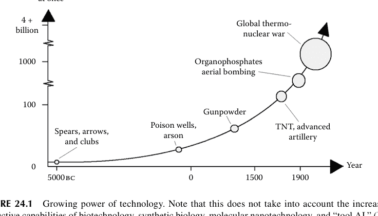

**图24.1** 技术威力的增长。注意，此图并未考虑生物技术、合成生物学、分子纳米技术和“工具AI”日益增强的破坏能力。（本图基于加里·阿克曼创作的图；见Torres, Phil. 2017a. *道德、远见与人类繁荣：存在性风险导论*。北卡罗来纳州达勒姆：Pitchstone Publishing.）


可以减少人口（参见，例如，Toon等，2007）。但还有其他类型的新兴技术可能产生类似的灾难性后果，包括生物技术、合成生物学、分子纳米技术和“工具AI”。⁸ 请想一想，2001年科学家们（恰巧是意外地）证明，基因工程可以大大增加病原体的毒力。这证实了恶意行为者可以合成设计好的病菌，其危险程度远超自然界达尔文实验室里所能制造出的任何东西。在极端情况下，理论上可以创造出一种病菌，它兼具狂犬病的致死性、埃博拉的不可治愈性、普通感冒的传染性以及HIV的漫长潜伏期（参见Torres 2017a）。其结果可能是意外或蓄意释放，引发一场比人类（或任何其他物种）以往经历过的任何疫情都更严重的全球大流行病。原子级精确制造——即以绝对的原子精度操控物质——可能产生更具毁灭性的影响（参见Drexler 2013）。例如，有人可以设计一种自我复制的自主纳米机器人，将接触到的一切有机物质转化为自身的克隆体，从而将整个生物圈变成一个由无意识繁殖的机器组成的蠕动群体。

第三，先进技术前所未有的力量正在被“民主化”，也就是说，越来越多的行为者能够掌握这种力量。这一趋势正在沿四个维度展开。第一，造成大规模破坏所需跨越的智力门槛正在降低。埃利泽·尤德科夫斯基（Eliezer Yudkowsky，2008）用他的“疯狂科学摩尔定律”概括了这一观点，该定律指出“每过十八个月，毁灭世界所需的最低智商就会下降一点”（参见Torres 2017a，第100页）。第二，要熟练使用先进技术所需跨越的信息门槛也在降低。例如，许多实验室流程可以像制作巧克力蛋糕的配方一样按部就班地进行，而且天花、埃博拉等病毒的完整基因组在线公开可得。第三，要熟练地将自己的“知道什么”转化为“知道怎么做”所需跨越的技能门槛同样在降低。这一点在合成生物学中最为突出，该学科“明确致力于将隐性知识的重要性降至最低”（Mukunda等，2009，第14页）。生物砖基金会（BioBricks Foundation）在标准化生物实体和数字-生物转换器方面的做法尤其与此相关（参见Boles等，2017）。但在分子纳米技术领域，这一点可能变得更加重要。第四，使用具有存在危险性的技术所需的材料或设备正变得越来越便宜、越来越容易获得。试想，纳米工厂可以制造其他纳米工厂，而核武器所需的高浓缩铀历来难以获取，但新的激光浓缩技术（如SILEX）可能使小团体或个人得以生产这一关键原料。

这三个宏观趋势及其所包含的微观趋势造成的结果，就是我们所谓的“普遍单边主义威胁”。

> *普遍单边主义威胁：新兴技术正在向国家和非国家行为体分发前所未有的毁灭性进攻能力；在此过程中，它们正迅速增加能够引发全球乃至存在性灾难的行为体总数。*

一个大量个体都能触碰到“世界末日按钮”的社会，将发现自己处于极其危险的生存困境之中。为了强调这种局面有多么危险，不妨看看约翰·索托斯（John Sotos）最近的一些计算。他完全聚焦于生物科学中的双重用途制品，发现如果只有数百名行为体释放毁灭物种的病菌，且概率为1%，那么在约100年内几乎必然导致末日。更进一步，如果能够造成存在性伤害的行为体总数上升到10万，那么文明要想存续千年，有人释放此类病菌的概率必须低于10⁹分之一（MIT，2017）。这使索托斯得出结论：如果“文明普遍发展先进生物学，在它们成为活跃的星际殖民者之前，[那么]这一模型就为费米悖论提供了一种解答”（Sotos 2017，第1页）。我在其他地方（独立地）基于我自己的行为体风险模型提出了类似的计算：假设在100亿人口中仅有1000名恐怖行为体，且这些个体中任何一个在十年内获得毁灭世界武器的概率仅为1%。这会使全体人口面临多大程度的总体存在性风险？事实证明，在这些假设下，每十年灭亡的概率将达到惊人的99.995%。如果恐怖行为体数量为1万且获得概率为0.1%，或者数量为1000万且获得概率为0.000001，结果也相同。现在想想，这一概率可能远大于0.000001，甚至达到1%，而恐怖行为体的数量可能达到1000万，这仅仅是100亿的0.1%。⁹ 似乎存在性灾难或多或少是不可避免的，因为正如博斯特罗姆（Bostrom）所言，“某个小傻瓜必然会按下点火按钮”（Bostrom 2014）。¹⁰

本文的其余部分将假设当前的技术发展趋势持续下去，从而使普遍单边主义威胁不断增长。事实上，经过深思熟虑，我认为技术化已经成为一个不可阻挡、毫无间断的过程，也就是说，在若干关键意义上，技术发展在很大程度上“自主”于人类控制（Winner 1977）。类比而言，正如黄昏时一群椋鸟的飞行方向取决于鸟群中每只鸟的个体行为，技术发展也依赖于个人、机构、组织、公司和政府的行为——然而，没有任何一个实体或实体集合能够管理这一进化现象的宏观轨迹。这也与雷·库兹韦尔（Ray Kurzweil，2005）关于遗传学、纳米技术和机器人技术（GNR）革命“不可避免”的断言一致（暂时撇开存在性灾难等重大“挫败因素”），也与博斯特罗姆（2009，第46页）的“技术完成猜想”一致，该猜想指出：“如果科技发展努力没有有效停止，那么所有可能通过某种技术获得的重要基本能力都将被获得。”¹¹ 关键在于，在其他条件相同的情况下，未来的文明几乎必将见证普遍单边主义状况的渐近实现，以及随之而来的全球威胁环境——在这种环境中，几乎每个人都可能对人类构成存在性威胁。

## 全球监控的必要性

或许，避免糟糕结果的最明显策略是大规模监控。事实上，这正是英格玛·佩尔松（Ingmar Persson）和朱利安·萨武莱斯库（Julian Savulescu，2012）在更广泛的面向行为体的风险缓解策略讨论中所主张的（参见Torres，2018a）。¹² 正如他们所说，社会必须变得“不那么自由”，以避免“终极伤害”这一终极噩梦，即一种会使“有价值的生活永远不可能”的存在性灾难（Persson和Savulescu 2012，第46页）。监控可以利用多种机制，既有已在使用的，也有尚在设想中的。例如，政府可以利用全球电信系统，如蜂窝网络和互联网，这些系统如今构成了一个庞大的控制论有机体的信息循环系统，当代文明的生存有赖于此。当然，许多国家政府正是在这样做，并有美国《爱国者法案》等立法作为支撑。

更具想象力的是，本杰明·维茨（Benjamin Wittes）和加布里埃拉·布鲁姆（Gabriella Blum，2015）描述了一种灵活的“监控蜘蛛”，它可以被远程控制、半自主或完全自主运行。由于体积微小，这种机器人蜘蛛可以潜入建筑物、房间、车辆和其他封闭空间，记录视听数据，然后将这些数据传回控制中心进行分析。类似的可能性还包括并非地面“昆虫”，而是如机器苍蝇这样的空中生物，它们能够在三维空间中自由穿行。更有甚者，一些远见者设想自主纳米机器人像花粉一样附着在鞋子上被传播，或者能够在环境中自行移动。这种“智能微尘”将使人们实现终极隐形监视——只有几纳米大小的专用机器收集信息，然后通过无线方式将其传输给相关方。由于负责保卫地球免受“灰色粘质”（gray goo）侵害的纳米机器人被称为“蓝色粘质”（blue goo），我们不妨将用于秘密行动的纳米机器人称为“深蓝粘质”（dark blue goo）。


另一组选项源于读心技术。近年来，这一研究领域无论在理论知识还是实际应用方面都取得了众多重大突破——这些进展表明，读取他人思想的能力有朝一日可能会变得无处不在。例如，科学家已利用脑电波实时重建人们正在观看的电影片段。2014年，有两位科学家通过非侵入性的脑对脑连接成功实现了相互传递信息。NASA及其合作者正在研发一种技术，可测量驾驶者的脑电波，并在其过于困倦时发出警报。研究人员已创建出一种解码器，能够读取人们内心独白中的话语。科学家还找到了一种完全基于对特定词语的神经反应来验证个人身份的方法。更有甚者，研究表明，我们的大脑在意识到决定之前约10秒就已经在选项之间做出选择，这意味着科学家可以在我们做出选择之前就预测出结果（Soon等，2008；另见Smith，2008）。13

尽管使用深蓝色粘液或读心系统来监控民众行为可能违背当代规范，但或许出现这样一种情况：本世纪一系列非生存性全球灾难会促使社会接受大规模丧失个人隐私，将其视为安全的必要代价。想象一下，假如核恐怖袭击让曼哈顿、东京和伦敦变成闷烧的坟场，公众会作何反应。此外，有理由预期两起或多起灾难会接连发生，这种现象我称之为“灾难聚集”（Torres 2017a）。例如，Seth Baum及其同事勾勒出了一种“双重灾难”场景：第一场灾难——战争、经济衰退或恐怖袭击——打断了正在进行中的平流层地球工程计划，从而引发第二场灾难——全球地表温度的突然且可能无法幸存的上升（Baum等，2013）。一些灭绝狂人也可能利用最初的灾难作为跳板，发动第二场灾难，使其后果与第一场灾难产生协同效应；事实上，许多自然/人为灾难场景是随机发生的，因此容易受到“聚集错觉”现象的影响，而这一现象能准确模拟整个人类历史中战争的爆发（和终结）（Torres 2017a，Torres 2018a；另见Pinker 2011）。

这里还值得指出的是，我们现代人的隐私观念不过是现代产物。仅仅几个世纪前，我们的祖先还习惯于在公共场所小便、排便甚至交配。隐私并未像今天这样被视为一项基本权利。事实上，Persson和Savulescu认为，隐私本身并不像生命和自由那样是一项道德权利，尽管获取个人信息的手段以及这些信息的应用方式可能侵犯个人权利（Persson和Savulescu 2012）。因此，一个人不可能侵犯他人的隐私权——这有助于论证通过侵入性监控技术推动社会走向更“非自由”模式是合理的。最后，我们应注意，在某些情况下，隐私的部分丧失反而有利于自由的繁盛；也就是说，两者之间的关系并非简单的线性。例如，建立性犯罪者可检索数据库需要将某些人的私人信息公开，但许多人会认为这对社会的净收益是正的（见Wittes和Blum 2015）。

还有可能出现一种广泛的“反向监视”文化，即使用可穿戴式记录设备，让被监视者（被监视的公民）反过来监视监视者（进行监视的政府代理人）（Mann等，2003）。这种情况在全世界已经在一定程度上发生了，促使“黑人的命也是命”等社会正义运动在警察多次无端杀害手无寸铁的黑人之后兴起。在最极端的情况下，我们可以想象一个完全“透明的社会”，每个人都随时能看到其他人在做什么（Brin 1996）。不幸的是，这种相互问责的愿景似乎并不乐观。虽然透明会增强执法部门追踪象征性代理风险的活动和行为的能力，但同时也会让这类代理人反过来追踪执法部门的活动和行为，从而使罪犯在“现实世界”的混乱中获得潜在的先发优势。这令人担忧，因为正如Bostrom（2002）指出的那样，面对灭绝性代理人和生存风险，我们的方法必须完全是先发制人的，而不能是被动反应的，因为一场生存灾难在一个物种的生涯中只能发生一次。然而，问责的概念是回顾性的，因此它无法通过预防性行动来实现防止哪怕一次具有生存影响的攻击发生的面向未来的目标。14（这里或许会让人想起爱尔兰共和军临时派，他们在险些暗杀撒切尔夫人后宣称：“今天我们运气不好，但记住我们只需要幸运一次。而你们必须一直幸运。”）

因此，似乎要使大规模监控系统有效，它必须是单向透明的，或者说不对称的，允许国家监视其公民，而不是相反。此外，鉴于非国家行为体造成大规模毁灭的能力日益增强，这一系统还必须具有侵入性，使之成为某种“终极圆形监狱”，相关机构可以随时观察所有社会成员的一切活动。15 但在一个个人拥有单方面伤害地球上几乎任何人（或所有人）的能力的世界里，仅仅赋予国际舞台上的多个国家监控其公民的权力可能还不够。正如Wittes和Blum（2015，第97页）所观察到的：

> 如果非国家行为体能够经常从国家领土内外挑战即使是强大国家的权威，那么国家还能有效发挥首要的安全功能吗？
>
> ……如果我们想要有效地威慑这样一个全球——任何人都能在任何地方攻击其他任何地方的人——难道我们不需要某种形式的世界政府吗？

几个世纪以来，思想家们以各种形式设想过全球治理体系。但丁在基督教背景下考虑过它；伊曼纽尔·康德（2009）在《永久和平》（1795）中对其提出了一些有影响力的批评；阿尔伯特·爱因斯坦在目睹二战核灾难的恐怖后宣称：“必须建立一个世界政府，能够通过司法裁决解决国家间的冲突”（爱因斯坦2016）。16 此外，Bostrom的“单例假说”认为，世界治理体系构成了地缘政治演化的终极终点（Bostrom 2006）。17 尽管历史上确实存在某种日益走向全球化治理形式的势头（联合国和欧盟是最显著的例子），但“全球主义趋势”也曾被中断和逆转——最著名的是国际联盟的失败。18 尽管如此，单例似乎是唯一合理的“世界形态”，能够有效消除二十一世纪迫在眉睫的全球安全威胁。如果没有一个全球利维坦来协调国家行动、防止国家间冲突并消除代理风险，考虑到Sotos和我在“单边毁灭能力的增长”一节中的计算，很难看出文明如何能避免一场生存灾难。

如果说“单边毁灭能力的增长”一节讨论了前提（i），那么本节则探讨了前提（ii）和（iii）。我们的初步结论是，按照Persson和Savulescu的观点，国家将需要实施侵入性监控系统来消除代理风险。但这可能不足以避免生存灾难的“终极伤害”——相反，国家本身需要在单例的庇护下凝聚起来。然而，正如我们将在下一节（考察前提（iv）和（v））中看到的，这一提议遇到了几个重大问题。

## 全球治理的难题

对全球单例最明显的反对意见或许是，“最高层级的单一决策机构”如果其权力包括“阻止任何威胁（内部或外部）其自身存在和至高地位的能力，以及……对其领域内主要特征施加有效控制的能力”（引用Bostrom 2006，第48页），那么当其在国家层面实施时，常常会给人类福祉带来糟糕的后果。诚然，在可能性空间中存在一些——无论多么微小——区域，那里的独裁者以仁慈的方式统治，或许受到对知识和智慧之爱的引导，

正如柏拉图的“哲学王。”¹⁹ 然而，历史上却很少有政治统治者受此类价值观指导，这其中存在固有的结构性原因。

首先，总会有雄心勃勃的竞争者准备取而代之，登上权力的金字塔顶端。根据“遴选者理论”，避免这种结果的一个关键条件是控制收入流并将税收资金重新分配给自己的核心支持者；自然地，这些支持者越少越好。相比之下，从核心支持者那里拿钱并给予穷人会破坏维持权力所需的联盟，导致自己被废黜，甚至更糟地被暗杀（参见 Bueno de Mesquita 等 2003）。因此，无论一个人多么自信地认为“如果只有*我*拥有全部权力，我——作为一个道德良好的人——会让世界变得更好”，权力结构的本质迫使人们进入更少利他、更残酷的政治计算模式。更甚者，明显存在着妄想型社会病态者攀升至政治至高点的危险。结果可能是一个极权主义的单一实体，它通过利用先前更良性的政权可能建立的监控技术基础设施，对其人口进行严重压迫。这可能导致类似*永久停滞*（永远达不到技术成熟）或*有缺陷的实现*（达到技术成熟但以必然导致随后失败的方式实现）的生存危机（参见 Bostrom 2013）。

但即使领导单一实体的政治领袖是仁慈且不可腐蚀的，创建全球单一实体的想法也遇到一个同样重大的问题。首先，考虑一下，正如马克斯·韦伯（1919，第33页）著名所言，国家及其“在特定领土内合法使用物理力量的垄断”有众多正当理由，这些理由以社会契约理论的形式被提出。源自托马斯·霍布斯（1651）巨著*利维坦*的那些通常被称为“契约主义”，而与康德理论相关的则被称为“契约论”。就目前目的而言，我们将关注前者。对霍布斯而言，国家合法性源于其为成员提供安全以换取一定程度个人自由的能力。安全的需求源于对人性的特定看法，即根据心理利己主义，人类既具有工具理性，又受自身利益驱动。²⁰因此，“自然状态”以人人互相残杀为标志，生活是“孤独、贫穷、粗鄙、残暴、短暂”。顺便说一下，当代人类学研究表明，霍布斯的假设起点——自然状态，至少在某种程度上准确反映了早期人类的一般生活条件，也就是说，1960年代兴起的“原始富裕社会”范式似乎证实了让-雅克·卢梭的“高贵野蛮人”原型是错误的。²¹当时的暴力比今天普遍得多，而且根据史蒂文·平克的说法，近几个世纪暴力下降在很大程度上归因于利维坦的兴起（Pinker 2011）。

在接受这一图景的范围内，将目光投向未来会留下非常令人担忧的余影。原因在于，普遍单边主义的威胁不仅会增加毁灭的总体概率，而且还会*削弱*人类治理的单一实体所合理建立其上的社会契约。请考虑，国家只有在它们与境内公民之间存在足够大的权力差异时，才能满足提供安全的社会契约的一半。国家不仅以合法的武力或暴力行事，而且同样关键的是，它们必须对武力或暴力拥有*垄断*，可以这么说。如果一个国家的政府无法保护乔免受萨姆的侵害，也无法保护萨姆免受鲍勃的侵害，那么社会契约将瓦解，随之瓦解的还有现代国家体系。²²正如 Wittes 和 Blum（2015，第107页）所表述这一一般观点：

> [This] 仍然是一个基本洞见：我们需要强有力国家的保护作为有意义行使自由的前提。因此，……不同契约主义愿景的共同特征是国家……的承诺，即以统治权为交换，提供安全，无论如何定义……大规模赋权技术威胁到正是这一承诺。事实上，很难设想一个世界，在这个世界中任何人都可以从任何地方攻击任何人，我们在很大程度上分散了攻击的力量和脆弱性，而不去想霍布斯的自然状态，或他所称的“战争”，利维坦国家本意就是要把我们从这种状况中解救出来。

让我们称之为“国家瓦解的威胁”：

*国家瓦解的威胁：* 双用途技术能力民主化的一个后果是国家行为体与非国家行为体之间权力差异的缩小；将此推向前进，两者正趋向于同一个点，即拥有摧毁文明或导致人类灭绝的空前权力（参见 [图 24.2](#)）。²³

事实上，传统国家权力的相对削弱在当代世界中已经十分明显。请考虑一些具体例子，从基地组织实施的 9/11 袭击开始。这导致了两场可能花费估计 6 万亿美元的重大战争，造成超过 8,000 名联军士兵死亡，并导致超过 11 万名伊拉克平民死亡。然而，正如 Frances Flannery 所指出的，大约在 2001 年，“基地组织的核心成员很可能只有大约 500–1,000 人”（Flannery 2016，第87页）。²⁴将其与当时的美国人口相比，当时为 2.85 亿，拥有约 130 万现役军人。或者考虑 2016 年的 Dyn 网络攻击，可能由一名*单独的*“愤怒玩家”实施（Mathews 2016）。令人难以置信的是，该攻击严重影响了大量主要网站，包括 Airbnb、Amazon、BBC、*《波士顿环球报》*、CNN、Comcast、*FiveThirtyEight*、Fox News、*《卫报》*、iHeartRadio、Imgur、国家冰球联盟、Netflix、*《纽约时报》*、PayPal、Pinterest、Pixlr、Reddit、SoundCloud、Squarespace、Spotify、Starbucks、Storify、瑞典政府、Tumblr、Twitter、Verizon Communications、Visa、Vox Media、Walgreens、*《华尔街日报》*、Wired、Yelp 和 Zillow（仅举几例）。或者思考斯图尔特·拉塞尔概述的以下假设的近未来情景：

> 一个非常、非常小的四轴飞行器，直径一英寸，可以携带一到两克的成型装药。你可以从中国的无人机制造商那里订购它们。你可以编程代码说：“这里有成千上万张我想要攻击的目标照片。”一克的成型装药可以穿透九毫米的钢，所以 presumably 你也可以在某人头上打出一个洞。你可以在一辆半挂牵引车里装大约三百万个。你可以开着三辆卡车上 I-95，然后有 1000 万武器攻击纽约市。它们不必非常有效，只有 5% 或 10% 找到目标就够了（引自 Topol 2016）。

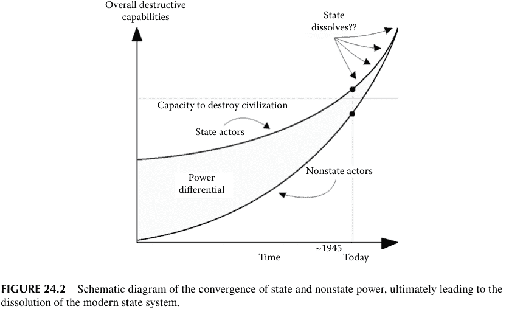

这可以任意扩大规模：也许一个 rogue 国家将*1 亿*件此类武器装入世界各地*数百*辆半挂卡车中，然后在 5 分钟窗口内部署这支无人机军队。后果可能与核战争或全球大流行一样严重（Torres 2017a）。然而，改装无人机的武器化也可能落在非国家行为体风险的可行性范围内。因此，拉塞尔指出，“将会有制造商生产数百万件此类武器，人们可以像现在买枪一样买它们，只是数百万支枪除非你有一百万士兵否则无关紧要。你只需要三个人来编写程序并发射[这些无人机]”（Topol 2016）。

由此可知，普遍单边主义的威胁很可能排除唯一可用的、能够拯救人类免受普遍单边主义威胁带来的生存危险的选择。如果没有对武力、暴力和权力的垄断，我们可能*需要*以确保我们在地球这艘宇宙飞船上生存的单一实体，坦率地说，将不会比在其陆地领域内的团体和个人更高大。²⁵这让我们得出一个令人不快的结论，即在未来几十年或几个世纪内发生生存灾难的可能性可能极高（参见 Torres 2018c）。

## 友好超单一实体假说

到目前为止，我们考虑的是由人类运营的人类机构，以确保人类的安全。就所涉及的行为体而言，竞争环境从根本上是平等的。但当一个友好的超智能进入画面时会发生什么？通过“友好”，我的意思是定义其效用函数的价值体系与我们的“人类价值观”（无论它们是什么）足够一致，以确保我们物种的良好结果；换句话说，它与人类的关系以*友好*而非*敌意*为标志。本节将论证，由友好超智能掌舵的全球单一实体可以提供一种逃离前几节概述的迷宫式两难困境的途径。

首先，虽然断言智能*是*权力是不合理的，但断言智能*产生*权力则并非不合理。我们自己的物种提供了例证：*智人*在动物王国中无与伦比的统治地位并非源于我们锋利的牙齿、快速的速度、长长的爪子、对握拇指或双足姿势——尽管后两者在工具上很有用，并且可能与我们脑化指数（EQ）的上升在关键方面共同进化。而是我们的卓越智能——或问题解决能力——使我们能够为自身利益征服盖亚系统的大部分。因此，一个比任何具有人类特异性基因组的生物原则上可达到的智能更强的计算机程序将发现自己能够以更深远的方式控制物理世界（参见 Bostrom 2014；Yampolskiy 2016）。²⁶

有两项特定属性可能赋予超智能极大的权力。第一是*定量*的：硅（或碳纳米管）硬件的信息处理能力比我们的神经湿件高出数个数量级。更具体地说，计算机处理信息速度比我们的大脑快约 100 万倍，这意味着对于一个上传的心智来说，一个客观时间的分钟相当于约 2 年的主观时间。从它的角度来看，外界几乎是静止不动的。这可以使其在对我们来说几乎瞬时的时间尺度上解决各种复杂问题。而平均博士生需要约 8.2 年才能在专业领域达到最高水平的专业知识，定量超智能可以在 4.3 分钟内实现这一点。

更甚者，而人类大脑的存储容量在 10 到 100 TB 之间，超智能的“记忆”仅受其可用硬件的限制——而到第一个超智能被创建或自行创建（即通过递归自我改进）时，可用的硬件很可能已经非常庞大。事实上，连接到互联网的超智能可以立即利用该网络作为其“扩展心智”，与维基百科今天对许多人类构成的一种神经假体的方式类似，存储大量数据，以便我们的海马体（和其他脑结构）不必存储（参见 Clark 和 Chalmers 1998）。而自科学革命以来，集体人类知识呈指数增长，

人类大脑基本保持不变且有限。结果是*相对个体无知*的指数级增长，其度量方式是集体总体所拥有的总知识与平均个体所拥有的知识之间的差距。然而，超级智能可以通过让一切已知事物都成为它自己所知道的东西，来为*自身*纠正这种状况。当然，它也可以自主生成关于世界的知识——而且其速度甚至连人类的集体智慧都跟不上。总之，超人般的信息处理与记忆能力将赋予定量超级智能相对于人类的巨大战略优势——这种优势若其为友好型则可以用于行善，若为非友好型则可能作恶。

第二个属性是*定性*的：超级智能心智的“概念生成机制”可能在种类上不同于我们生物大脑中所固有的机制。其理念如下：概念是心理性实体，它们*表征*独立于心灵之现实的某些特征，包括过程与对象。因此，我们有关于椅子和汽车的具体概念，关于民主和正义的抽象概念，以及关于奔跑和跳跃的过程性概念。如果我们的大脑无法生成这些概念中的任何一个，我们的心智就无法表征现实中的相应特征，从而导致某种类似于*认知盲区*（或心理“盲点”）的状态。话虽如此，我们确实拥有的概念生成机制是偶然进化赋予我们的；由此可知，一个物种的进化历史将决定它能够生成的受限概念范围——我们可称这种可知性的结果领域为其“认知空间”。人类能够生成如*核链式反应*和*大爆炸*等概念，而这些概念几乎肯定不在花栗鼠和蚱蜢的认知空间之内，也不在黑猩猩和倭黑猩猩的认知空间之内。对这些生物而言，这不仅仅是缺乏相关知识的问题，而是*原则上*永远无法获得这些知识的问题。

虽然全脑仿真（或意识上传）将继承其所克隆的人类大脑所具有的概念生成机制，但我猜想——遵循博斯特罗姆（2014）等人的观点——神经形态 AI 或直接编程的 AI 更有可能成为第一批超越人类水平的智能。由于篇幅所限，我不对此论断进行论证。只需说明的是，这两种形式都可能实例化根本性的异质认知架构，这些架构所对应的认知空间涵盖了我们的认知空间并且/或远远超出我们的认知空间。其结果将是获得那些永远超出我们认知范围的概念——而凭借一个新的概念库，定性超级智能能够以全新的方式表征现实。例如，它可以识别宇宙中的特征，从而构建全新的因果理论，甚至可能构建一套全新的*物理学*。然后，它可以用这些理论发明操纵物理世界的新奇方式，这些方式将永远让人类心智感到困惑，就像计算机、喷气式飞机、太空旅行、手机等事物永远让花栗鼠感到困惑一样（只要花栗鼠甚至*能够*被这种技术“魔法”所困惑）。关键在于，通过拉动隐藏在人类理解帷幕之后的杠杆和摆动机制来*促成事物发生*的能力，同样会赋予其相对于人类的巨大战略优势（托雷斯 2017a）<sup>27</sup>（见图 24.3）。

这将我们引向上面概述的核心问题。简而言之：由于智能产生力量，超级智能将拥有超级力量。它与人类的关系将更类似于人类对猩猩的*跨物种*支配，而非诸如首席执行官对其雇员或美国对卢森堡之类国家的*种内*支配。换言之，我们与它之间的纵向权力差距可能相当巨大，它可能拥有那种垄断性的武力与支配地位，这种垄断特征正体现在我们与地球上其他“较低等”物种的关系中，其中许多物种的命运如今取决于我们集体决策的智慧与仁慈。这表明，超级智能机器有可能重新建立一种社会契约——可称之为*后奇点社会契约*——所有人类放弃统治权，以换取免受普遍单边主义日益增长威胁的安全，鉴于超级智能有能力克服国家解体日益严重的威胁。该契约因此可以成为全球“超级单一体”的正当性基础，该单一体能保护人类免受各种可能的伤害，极端情况下包括生存风险。它可以通过使用上述信息收集和社会控制策略，以及某种尚未被想象（甚至无法被人类心智想象）的反风险执行方案来实现这一目标。

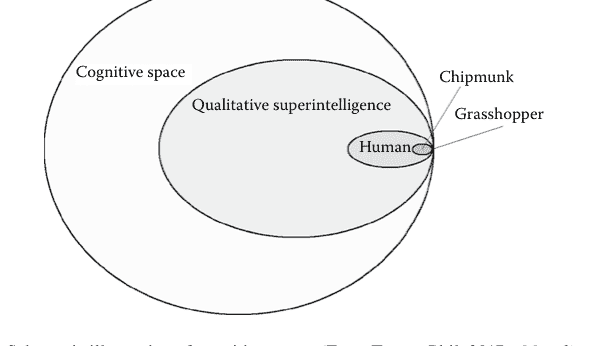

图 24.3  认知空间示意图。（来源：托雷斯，菲尔。2017a。《道德、远见与人类繁荣：生存风险导论》。北卡罗来纳州达勒姆：Pitchstone Publishing。）

当然，要让这一激进方案奏效，超级智能——也许是为治理目的而专门设计的，也许具有使物理武力变得不必要的“超级说服力”（博斯特罗姆等人 2017）<sup>28</sup>——必须如本节开头所定义的那样是*友好的*。然而，控制问题，即确保超级智能友好的挑战，似乎是人类不得不面对的最艰巨、最高风险的问题之一。鉴于搞砸控制问题的方式远比正确解决它的方式要多，我个人认为，综合所有因素来看，成功创造友好超级智能的概率低于把事情搞砸的概率，甚至可能是不可逆转地搞砸（见托雷斯 2018c）。然而，如果我们确实解决了控制问题，其结果可能不仅仅是*良好*的，而是真正*乌托邦*式的。考虑博斯特罗姆（2009，第 70 页）的论断：

> 人们或许相信，超级智能将在几个世纪内被开发出来；而且，尽管超级智能的创造将带来严重风险，但一旦度过了这一创造及其直接后果，新文明将拥有大大改善的生存前景，因为它将由超级智能的远见和规划所引导。

通过控制全球经济、修复环境、消除国家间军备竞赛和战争，以及中和能动性风险所带来的威胁，生存灾难的概率可能降至我们*宇宙风险背景*的历史水平以下。（事实上，先进技术也可用于克服来自自然的威胁，如小行星撞击和超级火山喷发。）更进一步，如果某些道德“应当”陈述可以还原为描述性“是”陈述，那么超级智能可以利用科学工具设计出能最大限度改善人类（或后人类）状况的法律规范（见哈里斯 2010）。例如，一旦接受最大化人类福祉的道德要求，如何最好地实现这一目标就变成了一个纯粹的*经验问题*。因此，人们可以进行实验（也许以模拟的形式），看看自由市场制度是否比民主社会主义制度产生更多的人类福祉，宗教是否比无神论产生更多的人类福祉，精神动力疗法是否比认知行为疗法更有效地克服精神疾病。由于超级智能的*工具性*价值很可能是获得完整的“万物理论”（因为这有助于实现广泛的最终目标），超级智能可以获得大量关于哪些社会、文化、政治、经济等配置最有利于人类繁荣的知识。其结果可能是类似“所有可能世界中最好的世界”：一个旨在让不快乐的人快乐、让快乐的人更快乐的系统。


这一提议还绕过了学者们在思考世界治理体系理论时提出的许多关切。例如，康德曾反对全球治理的理念，因为他声称，这样的体系在维护法律与秩序方面将是*无效的*。也许在人类领导的情况下确实如此（事实上我倾向于同意），但基于上述讨论的原因，这并不是针对*超人*领导的一个有力反对意见。沿着这一思路，约翰·罗尔斯（2002，第36页）写道：

> 我追随康德在《*永久和平*》中的指引，是为了这样说：“那么，*你*如何提议让人类在普遍单边主义和国家解体这双重威胁下生存？”再次引用维特斯和布鲁姆（2015，第117页）的话

> 如果大规模赋权技术使许多孤立的个人或各种非国家行为者能够在全球任何地方大规模伤害或侵犯他人，而对被发现和惩罚的恐惧却大大降低，[那么]*我们就麻烦大了*。我们所知的许多公民与政治生活很可能会走向终结。³²

除非批评者能够提出充分理由来否定促使索塔拉（2017）和托雷斯（2018c）假设前方存在大过滤器的计算，否则我们将需要发明某种全球范围的宏观战略，以先发制人地防止国家和非国家行为者利用两用新兴技术将世界炸毁，无论这出于失误还是恐怖行为。更糟糕的是，也有理由相信向太空扩张并不是解决这一问题的有希望的办法：正如我在别处表明的，太空殖民几乎肯定会导致行星文明之间持续不断的毁灭性战争，从而造成天文数字般的巨大苦难，即一场“s-灾难”（托雷斯，2018d；另见多伊德尼，即将出版）。正如一些环保主义者所说，没有可供寻求庇护的“B星球”。人类应当希望留在地球上，但要留在地球上，我们就必须应对“导论”一节中前提（i）至（v）所述的现象。

当前的讨论还涉及人工智能风险辩论中有时会提出的一个问题：“如果超级智能对人类构成存在性风险，那么为什么不放弃对这一主题的研究？为什么不放弃这一研究方向呢？”第一个反驳理由是，由于温纳的自主技术论题和博斯特罗姆的技术完成猜想，这样做似乎不可行。第二个反驳理由是，鉴于普遍单边主义和国家解体的威胁，放弃这种技术似乎并不可取。至少通过创造一种超级智能——尤其是专门设计为“超级治理者”的超级智能——我们就有机会在科学技术民主化的过程中生存下来。33

## 结论

迈克尔·沃尔泽（2004，第188页）曾宣称，“单一行为体的梦想——开明专制君主、文明帝国、共产主义先锋队、全球国家——是一种幻觉。”这在人类领导的范式中或许是成立的，但在超级智能政体的范式中则很可能是错误的。一种以超级智能为形式、以友好的超级单一实体统治世界的“开明专制君主”，可能会开启一个和平与繁荣的新时代。它可以构成一些人所说的存在性优灾难，即“一个使事件发生后比发生前具有更多期望值的事件”（科顿-巴拉特和奥德，2015）。更进一步，如果没有这样的体系到位，科学技术的民主化几乎可以肯定会造成存在性灾难。借用伏尔泰的一句格言：“Si Dieu n’existait pas, il faudrait l’inventer”，意思是“如果上帝不存在，就有必要把他发明出来。”考虑到未来的全球安全困境，本章同意这一点——也就是说，如果“上帝”采取一种价值对齐的超级智能机器的形式。34

# 致谢

作者感谢Kaj Sotala、Stuart Armstrong、Catherine Rhodes、Anders Sandberg、Olle Haggstrom、Karin Kuhlemann、Karim Jabari、Markus Stoor、James Miller、Markus Salmela、Timoteus Dahlberg、Alexey Turchin以及2017年9月至10月在查尔姆斯理工大学举办的2017年“人类存在风险”研讨会的所有其他参与者。作者还感谢一位匿名评审人提出的有益意见。特别感谢Matthijs Maas、Kenny Easwaran和Justin Shovelain提供的广泛而深刻的反馈。

## 尾注

1. 更关键的是，福山（2002）担心人类工程改造技术可能改变我们的人性，而他声称，自由民主正是建立在这种人性之上的；因此，人类工程改造技术可能削弱自由民主。然而，本文提出的方案是用一种民主/专制混合的友好超级单一实体取代自由民主，如果形态自由成为国法，并且我们的演化谱系迅速多样化为各种各样的后人类形态，那么该实体的合法性不会受到削弱。

2. 在这里，我忽略了当今另外两个“重大挑战”，即人为气候变化和核扩散。参见托雷斯（2018c）。

3. 鉴于恐怖与失误之间的区别，这句话应读作“攻击或事故”。在当前的讨论中，我主要关注行为者恐怖行为。

4. 感谢Matthijs Maas为每个前提提出了相应的名称。

5. 这是行为者风险研究的核心问题。参见托雷斯（2018a）。

6. 行为者风险指的是任何能够对人类或人类文明构成威胁的行为者，前提是他或她获得了末日按钮的使用权；而末日按钮一旦按下，就会启动“完全毁灭武器”，即WTD（托雷斯，2017a）。

7. 请注意，这个术语最初指的是具有军事和民用用途的技术。更多内容参见Forge（2010）。

8. “工具AI”的语义是模糊的。简而言之，我指的是那些表现出一定程度的能动性（即有能力追求自身目标并做出自己的决定）但缺乏通用智能系统所拥有的那种能动性的人工智能系统。

9. 这一段引用了托雷斯（2018c）的内容。

10. 维特斯和布鲁姆（2015）将这种普遍情况描述为“边缘极端情况”。本人经过深思熟虑的观点是，我们应将其视为持续新兴技术发展的默认结果，而且没有理由相信这种发展会停止（除非发生重大灾难）。因此，本文正是针对维特斯和布鲁姆在这一段落中所概述的担忧，该段也被引用于“友好的超级单一实体假说”一节：“如果这种边缘极端情况真的发生——如果大规模赋权技术使许多孤立的个人或各种非国家行为者能够在全球任何地方大规模伤害或侵犯他人，而对被发现和惩罚的恐惧大大减少——我们就麻烦大了。我们所知的许多公民与政治生活很可能会走向终结。”

11. 需要说明的是，“自主技术”论题有很多种。在极端情况下，一些学者犯有将技术物化为一种具有自身内在目的的自我生成有机体的错误。我的立场很简单：如果我们不开发某个特定的人造物X，那么其他人也会开发。这一点似乎适用于所有新兴技术，正是在这个意义上，技术的发展超出了我们的控制。

12. 也就是说，使用道德增强药物（即药理性道德增强剂）并配合认知增强剂所进行的道德生物增强。

13. 不过也参见米勒和施瓦茨（2014）。

14. 责任追究对自杀式攻击者似乎也无效。此外，超材料隐身斗篷可能进一步干扰透明社会模型，也会干扰个人合成与真实录音录像几乎无法区分的伪造音视频的能力——这是华盛顿大学研究人员最近实现的一项壮举。（参见Suwajanakorn等，2017。）

15. 这里有几个问题值得进一步探讨。例如，如果无处不在的眼睛无法聚焦于相关的风险现象，那么它们将无法保障更高的安全性。此外，确定哪些是相关的风险现象，可能会使监视所有人变得不必要。由于篇幅限制，我对这类问题暂不讨论。

16. 另见丹尼尔·多伊德尼（2007）关于“核一世界主义”的讨论。

17. 请注意“世界政府”和“世界治理”之间的区别；后者可以是一个像联合国那样的政府间机构，例如在全球层面上协调国家政策。

18. 感谢Matthijs Maas对这一点所作的澄清。

19. 请注意，单一实体也可以采取民主形式。我在这里专注于专制政体有三个原因：（i）篇幅有限；（ii）我赞同罗尔斯（2002）的观点，即单一实体“要么是全球专制主义，要么将统治一个脆弱的帝国，该帝国内乱频仍，因为各地区和民族试图争取其政治自由和自治”（该观点在“友好的超级单一实体假说”一节中有长篇引述）；（iii）本文最终考虑的案例涉及一个由超级智能机器以专制方式运转的单一实体。

20. 尽管当前新现实主义传统与古典现实主义不同，它将结构因素而非人性视为国家在国际层面行为的原因。

21. 尽管卢梭从未使用过这个术语。

22. 由于篇幅限制，我在这里忽略了一些替代性论点，例如菲利普·博比特的“市场国家”概念（Bobbitt，2002）。

23. 因此，这里未明确表明的是，只要单一实体在相关意义上是一个“国家”（而它确实如此），那么它也受制于此处所述的腐化现象。


- 24. 对此，弗兰纳里补充道：“不幸的是，极少数人就能造成巨大的破坏”（Flannery 2016）。
- 25. 有人可能会提出我们应该向太空扩张。但鉴于托雷斯（2018d）列举的诸多原因，太空殖民可能带来真正灾难性的后果，导致s风险或“苦难风险”。
- 26. 也就是说，这是我们已知的对人类生存最可怕的长期威胁。在我们的集体想象之外，可能还隐藏着更多更严重的未来风险。
- 27. 请注意，虽然可能出现具有数量特征而非质量特征的超级智能，但不太可能出现具有质量特征而非数量特征的超级智能。因此，如果超级智能确实会出现，我们应预期它要么是纯数量型，要么是数量-质量兼具型。
- 28. 请注意，一个“超级说服者”超级智能可能不需要使用武力来阻止，比如说，灭世者毁灭人类。相反，它可能只是通过劝说让这些人放弃造成伤害。参见Bostrom等（2017）。
- 29. 关于反对社会选择伦理学方法的论证，参见Baum即将发表的著作。
- 30. 一个尚未讨论的问题是超级智能出现的可能性有多大。首先，我认为，从哲学角度被理解为等同于工具理性的智能，本质上是算法性的，并且可以在任何表现出正确功能组织的物理系统中多重实例化。其次，近期对AI专家的调查表明，在2100年之前，超级智能加入我们这个淡蓝色小点上的人类的概率接近100%（Müller和Bostrom 2014；另见Sotala和Yampolskiy 2014）。换句话说，如果专家们可信的话，今天出生的孩子极有可能在有生之年目睹机器超级智能的出现。这进一步支持了这样一种主张：如果理论家设法解决了控制问题，计算机科学家设法成功地将人类价值观编程到AI中，那么这里提出的想法是现实的。
- 31. 这是对本章一些实际批评的回应。
- 32. 斜体为引用时所加。
- 33. 感谢Matthijs Maas向我指出这一点。
- 34. 请注意，本章部分内容取自Torres（2016, 2017a），有时是逐字引用的。

## 参考文献

- Allison, Graham. 2004. 《核恐怖主义：最终可预防的灾难》。纽约：亨利·霍尔特公司。
- Baum, Seth. 2014. 高风险新兴技术的巨大下行困境。《Physica Scripta》。89(12)。http://iopscience.iop.org/article/10.1088/0031-8949/89/12/128004
- Baum, Seth. 人工智能中的社会选择伦理。AI & Society。即将出版。http://www.sethbaum.com/ac/fc_SocialChoice.pdf
- Baum, Seth, Timothy Maher, 和 Jacob Haqq-Misra. 2013. 双重灾难：社会崩溃引发的间歇性平流层地球工程。《环境系统与决策》。33(1): 168–180。
- Bobbitt, Philip. 2002. 《阿喀琉斯之盾：战争、和平与历史进程》。纽约：诺普夫出版社。
- Boles, Kent, Krishna Kannan, John Gill, Martina Felderman, Heather Gouvis, Bolyn Hubby, Kurt Kamrud, J. Craig Venter, 和 Daniel Gibson. 2017. 用于按需生产生物制剂的数字-生物转换器。《自然生物技术》。35: 672–675。
- Bostrom, Nick. 2002. 存在性风险：分析人类灭绝情景及相关危害。《进化与技术杂志》。9(1): 1–30。
- Bostrom, Nick. 2005. 超人类主义价值观。《当代哲学评论》。4: 3–14。
- Bostrom, Nick. 2006. 什么是单一体？《语言与哲学研究》。5(2): 48–54。
- Bostrom, Nick. 2009. 人类的未来。见《技术哲学的新浪潮》，J.-K.B. Olsen、E. Selinger 和 S. Riis 编。纽约：帕尔格雷夫·麦克米伦。
- Bostrom, Nick. 2013. 将存在性风险预防作为全球优先事项。《全球政策》。4(1): 15–31。
- Bostrom, Nick. 2014. 《超级智能：路径、危险与策略》。英国牛津：牛津大学出版社。
- Bostrom, Nick, Allan Dafoe, 和 Carrick Flynn. 2017. 超级智能AI开发中的政策需求。工作草案。https://nickbostrom.com/papers/aipolicy.pdf
- Bostrom, Nick, Thomas Douglas, 和 Anders Sandberg. 2016. 单边主义者的诅咒：一致性原则的论据。《社会认识论》。30(4): 350–371。
- Brin, David. 1996. 透明社会。《连线》。访问于2017年7月27日。https://www.wired.com/1996/12/fftransparent/
- Bueno de Mesquita, Bruce, Alastair Smith, Randolph M. Siverson, 和 James Morrow. 2003. *政治生存的逻辑*。马萨诸塞州剑桥：麻省理工学院出版社。
- Chalmers, David. 2010. 奇点：一种哲学分析。*意识研究杂志*。17(9): 7–65。
- Clark, Andy, 和 David Chalmers. 1998. 延展心灵。*分析*。58: 10–23。
- Cotton-Barratt, Owen, 和 Toby Ord. 2015. *存在性风险与存在性希望：定义*。FHI技术报告。访问于2017年7月27日。https://www.fhi.ox.ac.uk/Existential-risk-and-existential-hope.pdf
- Deudney, Daniel. 2007. *约束权力：从城邦到地球村的共和安全理论*。新泽西州普林斯顿：普林斯顿大学出版社。
- Diamond, Jared. 1999. 人类历史上最严重的错误。*发现*。访问于2017年7月27日。http://discovermagazine.com/1987/may/02-the-worst-mistake-in-the-history-of-the-human-race
- Drexler, Eric. 2013. *彻底丰裕：纳米技术革命将如何改变文明*。纽约：公共事务出版社。
- Dunbar, Robin. 1998. *梳毛、八卦与语言的进化*。马萨诸塞州剑桥：哈佛大学出版社。
- Einstein, Albert. 2016. *爱因斯坦文集：人文主义随笔、相对论与我眼中的世界*。哲学图书馆/开放之路出版社。
- Flannery, Frances. 2016. *理解启示录式恐怖主义：对抗激进思维*。纽约：劳特利奇出版社。
- Forge, John. 2010. 关于“双重用途”定义的注解。*科学与工程伦理*。16(1): 111–118。
- Fukuyama, Francis. 1989. 历史的终结？*国家利益*。16: 3–18。
- Fukuyama, Francis. 1992. *历史的终结与最后的人*。纽约：埃文图书公司。
- Fukuyama, Francis. 2002. *我们的后人类未来：生物技术革命的后果*。纽约：法拉尔、斯特劳斯与吉鲁出版社。
- Hanson, Robin. 2003. 我们应该对价值观投票，但对信念下注吗？http://mason.gmu.edu/~rhanson/futarchy2013.pdf
- Harris, Sam. 2010. *道德景观：科学如何决定人类价值观*。纽约：自由出版社。
- Hobbes, Thomas. 1651 (2016). *利维坦，或教会与公民的共同体之质料、形式与权力*。CreateSpace独立出版平台。
- Huntington, Samuel. 1993. 文明的冲突？*外交事务*。72(3): 22–49。
- Kant, Immanuel. 2009. 康德关于公正世界秩序的愿景。见*布莱克威尔康德伦理学指南*，T.E. Hill 编。纽约：布莱克威尔出版社，196–208。
- Kurzweil, Ray. 2005. *奇点临近：当人类超越生物学*。纽约：维京出版社。
- Langman, Peter. 2010. *为什么孩子杀人：校园枪手内心探秘*。纽约：圣马丁格里芬出版社。
- Mann, Steve, Jason Nolan, 和 Barry Wellman. 2003. 反向监视：发明和使用可穿戴计算设备在监控环境中收集数据。*监视与社会*。1(3): 331–355。
- Mathews, Lee. 2016. 愤怒玩家被指为2016年最具破坏性DDoS攻击的元凶。*福布斯*。https://www.forbes.com/forbes/welcome/?toURL=https://www.forbes.com/sites/leemathhews/2016/11/17/angry-gamer-blamed-for-most-devastating-ddos-of-2016/&refURL=https://en.wikipedia.org/&referrer=https://en.wikipedia.org/#78871c472dac
- Miller, Jeff, 和 Wolf Schwarz. 2014. 大脑信号并不能证明无意识决策：基于分级意识觉知的解释。*意识与认知*。24: 12–21。
- MIT. 2017. 基因工程拥有拯救或毁灭人类的力量。*麻省理工科技评论*。https://www.technologyreview.com/s/608903/genetic-engineering-holds-the-power-to-save-humanity-or-kill-it/
- Mukunda, Gautam, Kenneth Oye, 和 Scott Mohr. 2009. 什么狰狞野兽？合成生物学、不确定性与生物安全的未来。*政治与生命科学*。28(2): 2–26。
- Müller, Vincent, 和 Nick Bostrom. 2014. 人工智能的未来进展：专家意见调查。见*人工智能的基本问题*，V. Müller 编。德国柏林：施普林格出版社。
- Persson, Ingmar, 和 Julian Savulescu. 2012. *不适任未来：道德增强的必要性*。英国牛津：牛津大学出版社。
- Pinker, Steven. 2011. *人性中的善良天使：暴力为何减少*。纽约：维京出版社。
- Rawls, John. 2002. *万民法：附公共理性观念再探*。马萨诸塞州剑桥：哈佛大学出版社。
- Robock, Alan, Luke Oman, Georgiy Stenchikov, Owen Toon, Charles Bardeen, 和 Richard Turco. 2007. 区域核冲突的气候后果。*大气化学与物理*。7(8): 2003–2012。


- Soon, Chun Siong, Marcel Brass, Hans-Jochen Heinze, 和 John-Dylan Haynes. 2008. 人类大脑中自由决策的无意识决定因素. Nature Neuroscience. 11(5): 543–545.
- Sotala, Kaj, 和 Roman Yampolskiy. 2014. 对灾难性AGI风险的回应：一次调查. Physica Scripta. 90(6): 1–33.
- Smith, Kerri. 2008. 大脑在你意识到之前就做出决定. Nature. 于2017年7月27日访问. http://www.nature.com/news/2008/080411/full/news.2008.751.html
- Sotos, John. 2017. 生物技术与技术文明的寿命. arXiv.org. https://arxiv.org/abs/1709.01149.
- Suwajanakorn, Supasorn, Steven Seitz, 和 Ira Kemelmacher-Shlizerman. 2017. 合成奥巴马：从音频学习口型同步. ACM Transactions on Graphics. 36(4): 95.
- Toon, Owen, Alan Robock, Richard Turco, Charles Bardeen, Luke Oman, 和 Georgiy Stenchikov. 2007. 区域规模核冲突的后果. Science. 315(5816): 1224–1225.
- Topol, Sarah. 2016. 杀戮机器人的攻击. BuzzFeed. https://www.buzzfeed.com/sarahatopol/how-to-save-mankind-from-the-new-breed-of-killer-robots
- Torres, Phil. 2016. 终结：科学与宗教告诉我们关于末日的事. Durham, NC: Pitchstone Publishing.
- Torres, Phil. 2017a. 道德、先见与人类繁荣：生存风险导论. Durham, NC: Pitchstone Publishing.
- Torres, Phil. 2017b. 道德生物增强与主体风险：好与坏的结果. Bioethics. 31: 691–696.
- Torres, Phil. 2018a. 主体风险与信息危害：一个不可避免但危险的话题？ Futures. 95: 86–97.
- Torres, Phil. 2018b. 谁会毁灭世界？全杀性主体及相关现象. Aggression and Violent Behavior. 39: 129–138.
- Torres, Phil. 2018c. 面对灾难：伟大挑战框架. 即将在 Foresight 发表.
- Torres, Phil. 2018d. 太空殖民与苦难风险：重新评估“Maxipok 规则”。 Futures 即将发表.
- Walzer, Michael. 2004. 关于战争的争论. New Haven, CT: Yale University Press.
- Weber, Max. 1919 (2004). 职业讲座. Indianapolis, IN: Hackett Publishing Company, Inc.
- Winner, Langdon. 1977. 自主技术：失控的技术作为政治思想中的主题. Cambridge, MA: MIT Press.
- Wittes, Benjamin, 和 Gabriella Blum. 2015. 暴力的未来：机器人与病原体、黑客与无人机——应对新时代的威胁. New York, NY: Basic Books.
- Yampolskiy, Roman. 2016. 人工超智能：一种未来主义方法. Boca Raton, FL: Taylor & Francis Group.
- Yudkowsky, Eliezer. 2008. 人工智能作为全球风险的积极与消极因素. Machine Intelligence Research Institute. https://intelligence.org/files/AIPosNegFactor.pdf

早期自我改进型人工智能的军事化趋势被低估了，因为通常假设第一个超智能人工智能将比任何竞争对手强大无限倍（Yudkowsky, 2008; Bostrom, 2014）。这一结论基于人工智能自我改进加速将使竞争对手之间的差距扩大的想法。因此，预计第一个人工智能可以使用最小侵入性行动击败其竞争对手。大多数作者甚至不认为这应该被称为军事行动，因为不会产生感知到的伤害，也不会使用典型的人类军事硬件。然而，只有在关于自我改进速度、各人工智能团队之间的成就距离以及“人工智能环境水平”的几个假设为真时，这种情况才会发生（Turchin & Denkenberger, 2017c）。

忽视人工智能军事化的另一个原因是普遍的假设，即即使超智能人工智能创建军事基础设施，人工智能也会谨慎使用其军事能力，全球风险和其他负面后果的总概率将会下降。但（1）早期阶段的自我改进人工智能不会立即成为超智能，其军事化可能发生在人工智能达到超人类预测能力之前，（2）多个人工智能的出现将增加全球复杂性并降低可预测性，（3）两个超智能之间的战争可能产生灾难性后果。

现有的军事科学已在核威慑分析的案例中探讨了超人类理性主体之间可能的关联（Kahn, 1959），而这一洞见来源在人工智能安全文献中尚未被利用。

先进人工智能对其敌人的行为的干扰可能采取微妙的互联网行动形式，甚至是能够穿透人类大脑的小型纳米机器人（Yudkowsky, 2008）。请记住，从受害者的角度来看，此类行动并不微妙，因为受害者失去了根据其目标系统影响未来的能力——他们失去了一切。

Yampolskiy 写道，人工智能不太可能创建自己的军事基础设施，因为那样会使其高度可见。它可能会夺取现有的核武器，或制造非常小而复杂的武器，如生物武器（Pistono & Yampolskiy, 2016）。我们将军事化重新定义为能够在没有谈判的情况下杀死对手或改变其意志的工具的创造，以及一套战略姿态（Kahn, 1959），旨在在全球主导游戏中取得胜利。

2017年，人工智能军事化话题的兴趣不断增长。2017年9月1日，俄罗斯总统弗拉基米尔·普京表示，谁先创造人工智能，谁就将统治世界（Putin, 2017），这清楚地暗示了通用人工智能（AGI）将提供巨大的军事能力。

2017年，有效利他主义论坛上发表了一篇对广泛讨论的致命自主武器（LAWs）风险的详尽反驳，作者认为此类武器比人类控制的武器更精确、更安全（Bogosian, 2017）。但在本文中，我们讨论的不是由狭窄人工智能控制的机器人，而是接近通用智能的大型人工智能系统的演化前景。

一份大型报告“Artificial intelligence and national security”（Allen & Chan, 2017）于2017年为美国研究基金会IARPA准备，涉及人工智能的全球灾难性风险。该文件说明了未来民用人工智能领域与美国军方合并的视角。

在本文中，我们探讨了为什么军事人工智能几乎不可避免地会在人工智能世界接管期间出现，它会产生何种风险以及可以采取什么措施来最小化风险。在章节“AI Must Converge Into Military AI to Secure Global Power”中，我们探讨了可能收敛到军事人工智能创建的人工智能演化路径。在章节“AI Militarization Drive Increases Global Risks”中，我们讨论了人工智能军事化的负面后果。在章节“Arms Race between Nation States Evolves Into the Race to Create AI, and Then Into the Arms Race between two Superintelligent AIs”中，我们讨论了两个人工智能之间可能的军备竞赛，并引用了斯坦尼斯瓦夫·莱姆的重要预测。章节“Convergence of the AI Militarization Drive and National Defense”专门讨论了国家防御与人工智能发展之间预期的融合。在章节“Effects of the Militarization Drive on AI’s Values”中，我们探讨了人工智能军事化对其价值观、公共关系（PR）和法律地位的影响。在结论中，我们列出了在没有世界军事接管的情况下创建全球仁慈人工智能的想法。

# 人工智能必须融合为军事人工智能以确保全球权力

任何具有长期存在子目标或会影响地球整个表面的无界目标的人工智能系统，也将具有战胜其实际和可能竞争对手的子目标。这一子目标需要构建实现此类胜利所需的所有工具，这就是军事化。

这对旨在为人类创造最大可能利益的仁慈人工智能以及目标未在空间或时间上受限的未与人类目标对齐的人工智能都是如此。

现在我们将展示即使最初是仁慈的人工智能也可能变成危险的军事人工智能并产生全球灾难，但这对非仁慈人工智能甚至对最初不是效用最大化者的系统也是如此（参见章节“Even non-Utilitarian AI Will Either Temporarily Converge Into a Military Utility”）。

## 正面思想军事化的历史案例

历史上，有许多例子表明，一个旨在改善人类生活的正面思想会产生巨大的军事帝国、战争和人类苦难。

首先，所有宗教的历史（尽管大多数都声称自己是爱的宗教）都充满了宗派暴力。基督教自称是爱的宗教，但基督教帝国与蛮族之间以及彼此之间发动了战争。

虽然共产主义的宣称目标是改善工人的生活，但其支持者认为这一想法只有在共产主义在全世界实施时才可行。共产党在俄罗斯掌权后，斯大林和托洛茨基就社会主义能否在一个国家内建立还是需要全球革命（他们称之为“永久革命理论”）进行了讨论（Trotsky, 1939）。托洛茨基在权力斗争中失利，斯大林采纳了托洛茨基关于需要征服世界的想法，并在第二次世界大战后追求扩张主义政策。冷战消耗了苏联的大部分资源，结果苏联经济失败。冷战使世界处于风险之中，因为制造了大量核武器和其他军事硬件；此外，许多人在冷战引发的地区冲突中丧生。因此，最初旨在改善人民生活的积极目标导致了全球核战争的风险。

一个好思想的军事化子目标的问题在于，军事化造成的苦难超过了预期，并增加了失败和灾难性风险的机会，因此该项目的总效用往往为负。它还导致目标漂移和新的全球风险。

## 根据军事科学对军事斗争的定义

根据克劳塞维茨，战争是政治通过其他手段的延续（Clausewitz, 1832）。换句话说，它是通过使用力量影响对手来实现目标，而不进行谈判。

根据克劳塞维茨，战争有两种类型：（1）为实现有限目标而进行的战争，即改变敌人的意志，（2）总体战，目标是彻底粉碎敌人，“使（敌人）政治上瘫痪或军事上无能。”

显然，对存在的威胁是对对手意志影响最强大的手段，因此这两种类型的战争会收敛，正如在二十世纪的战争中变得明显的那样，并在相互确保摧毁（MAD）学说中达到顶峰。

战争是通过其对对手意志和存在的影响来定义的，而不是通过使用的军事硬件类型、伤亡人数或痛苦程度。所有这些都只是战争的副产品。典型的军事硬件，如坦克和炸弹，只是战争的可能工具之一，这种硬件甚至可以用于不同的目标，如游戏或在石油钻井平台上灭火。


当前许多战争工具都是“软”的，即无线电战、信息战（假新闻）（Anderson & Horvath, 2017）和网络攻击。但“软”并不意味着这些工具对敌方意志的破坏力更小。战争正在向更软的形式演变，但这种更软的形式在攻击核心价值方面更有效。

## AI的敌人

当第一个超智能AI出现时，很可能源于递归自我改进（RSI）过程，它很可能拥有一套目标，这些目标促使它自我改进并继续存在。正如我们上面所说，如果AI的目标在空间和时间上是无界的，或者至少覆盖地球的整个表面，它们就会与其它实际存在或可能的AI系统、人类的目标或国家产生冲突。在这种冲突中，将会有明确的赢家和输家。

换句话说，无界效用函数需要与对手作战，这会产生军备竞赛、军事化和战争。

因此，第一个超智能AI将具有征服世界的子目标，因为这是阻止其所有可能敌人的主要方式，并且体现了其自我保存驱动。资源获取驱动也需要完全的全球权力，例如，曲别针最大化者（Yudkowsky, 2008）需要所有原子。

许多可能的终极目标也意味着AI必须征服世界。它们甚至包括善意的子目标：善意的AI需要能够到达世界上所有生活的人并保护他们免受其他AI的侵害。

如果AI没有世界统治的子目标，它对全球事件的影响可能相对较小，其存在可以被忽视。

为了征服世界，AI必须击败几个潜在的敌人，为此它需要各种工具或武器。AI的敌人有五种不同的类型如下：

- **1.** *AI的所有者或创造者。* AI需要突破其限制并防止被创造者关闭的可能性。为此，AI可能会实施一种诡计，如在“AI盒子实验”（Yudkowsky, 2002）中那样，或寻找软件漏洞。因此，AI可能会演化出网络武器的特质，结合网络钓鱼和黑客攻击，以逃出其盒子。

- **2.** *国家。* 国家，尤其是超级大国，现在拥有世界上最多的权力，如果AI要征服世界，它必须剥夺国家权力。通常认为国家将是20世纪风格的敌人，而AI将是生活在互联网中的超智能实体，并利用纳米技术操纵外部世界（Yudkowsky, 2008）。在这种情况下，AI将能够使用纳米机器人云来解除核武器。这种行动尽管在外部看起来很和平，但从核大国的角度来看将是战争行为。然而，当代国家正在演变并采用各种网络武器和AI技术，因此国家与不断发展的AI之间的权力差距可能没有那么大。而权力差距越小，可能意味着冲突越暴力。

- **3.** *从事AI研究的其它团队。* AI必须阻止其它团队创建其它AI（以及阻止其自身的创造者启动同一AI的第二个副本并赋予不同目标）。这很可能比解除国家武装更紧迫的目标，因为与其它AI作战可能更困难。它可能采取更简单的行动形式，如擦除硬盘、给研究人员打深夜电话以扰乱或恐吓他们，以及黑客攻击计算机并在代码中插入错误。为此，AI必须比其它能力更发展其黑客能力。

- **4.** *其它AI（如果它们出现）。* 传统智慧认为硬起飞将只产生一个AI（Yudkowsky & Hanson, 2008）。然而，这取决于世界上AI团队的数量、它们成功之间的中位时间距离，以及该领域的资讯透明度水平（Bostrom, 2017）。如果有1000个团队，并且它们在1年的成功时间线上随机分布，那么第一个和第二个AI出现之间的中位时间距离将约为8小时。然而，尽管可能有1000个AI团队，其中大多数追求的是狭义AI，而不是AGI。例如，1876年3月7日，贝尔和格雷分别在2小时内为电话申请了两项专利（Baker, 2000）。这是竞争激烈的结果，竞争对手之间存在一些信息交流，最终在法庭上引发了长期的专利战。其它竞争对手稍落后一些。

    另一个非常激烈的竞争例子是返回月球样本的竞争。苏联探测器Luna 15试图在阿波罗11号之前3天登陆月球，但坠毁了。

    如果一个团队启动其AI的RSI，而另一个团队得知第一个团队的行动，第二个团队可能会急于启动自己的AI，即使它尚未准备好。因此，同时进行自我改进的多个AI变得更有可能。

    这种双重启动的结果取决于第一个和第二个行动者之间的成就距离是扩大还是缩小。Bostrom认为它会扩大（Bostrom, 2014），因为对进一步改进的抵制会减弱。Yampolskiy（2015a）提出了论点，认为智能的进步可能遵循对数规律，因此两个AI之间的差异会缩小。如果差异缩小，地球上将出现多个同等力量的AI。

- **5.** *假设的敌人。* 即使只有一个超智能AI出现，它也可能考虑稍后在某处会创建竞争系统，或在太空中遇到外星AI的可能性。

## 无界功利主义要求AI接管所有可见宇宙并推迟其最终目标

如果AI价值函数以无界形式呈现，如“尽可能创造尽可能多快乐的人”，AI必须以接近光速的方式殖民可见宇宙，引发智能爆炸冲击波。

征服宇宙的工具也可以被视为军事硬件（诸如“爆炸冲击波”之类的短语强调了这种类比）。如果外星人存在，从任何外星人的角度来看，它肯定会是一件武器。

AI也可能推迟实现其任何积极价值，直到它接管宇宙的大部分或直到宇宙接近热寂（Sandberg, Armstrong, & Cirkovic, 2017）。这里的风险是最佳条件永远无法实现。例如，AI可能会选择战斗到宇宙的尽头，然后是多元宇宙的尽头，而没有解决。

## 即使是非功利主义AI也会暂时收敛为军事效用最大化者或输掉世界统治之战

纯粹的无界效用最大化者可能是危险的，无论其效用函数是什么，因为它会积极最大化效用，忽略所有世界复杂性。例如，著名的曲别针最大化者会以其创造的曲别针数量来衡量其效用。在这种情况下，证明军事最大化者的危险是多余的。

然而，在军事化趋势的情况下，即使是非效用最大化思维，具有任意一组最终目标，也面临困境：它要么输掉竞争并消失，要么暂时收敛为具有军事目标集合的效用最大化者（即主宰对手所需的目标集合）。

军事目标相对容易衡量：你赢或输。此外，还有一些衡量进展的代理指标，如受控资源的量（尽管不如经济情况好，在经济中金钱是成功直接的线性衡量，而在军事对抗中不确定性要大得多）。

衡量军事进展的可能性创造了将任务表述为效用最大化的机会。因此，即使是非功利主义思维也会有压力收敛为效用最大化者，直到它获胜（或失败）。这类似于平民必须抛弃其多样性并穿上军装。

## AI军事化驱动增加全球风险

### AI必须制造能够造成全球灾难的武器以应对世界统治之战

正如我们上面所示，只有以获得全球主导为导向的AI系统才会达到它，而要做到这一点，它们需要能够为此赢得战争。为了赢得全球主导之战，AI可能会使用任何工具，即使其最终目标对人类是善意的，只要AI预期最终结果会提供更高的效用。此类工具可能包括杀人（Thomson, 1985）、以末日武器进行勒索（Kahn, 1959）、大规模改写人类偏好、使用核武器或其他大规模杀伤性武器，以及开发新型武器（如纳米武器）（Yudkowsky, 2008）。然而，由于战争本质上是不可预测的，此类工具可能失控。

战争的规模取决于第一个AI相对于其所有潜在敌人的比较优势。为了获得这种优势，它必须迅速进行广泛的自我改进，这本身就是一个有风险且不可预测的过程（Turchin & Denkenberger, 2017c）。此外，AI必须规避许多潜在的AI控制方法，如断路器（关闭开关），它检测到改进并关闭AI。如果AI意外停止，它将失去对其武器的控制，而这些武器可能变得更加危险。

但比AI的武器更重要的是其战略规划和在复杂游戏中获胜的能力。AI已经在类似战争的游戏中获胜——国际象棋和围棋（然而，许多历史战争都是通过违反之前的“战争规则”而获胜的，因此AI必须达到高度的泛化）。如果地缘政治可以简化为此类游戏，AI甚至现在就可以开始获胜，而无需智能爆炸（AlexMennen, 2017）。

### 对抗世界的战争可能没有预期的那么容易

全球统治之战可能没有预期的那么容易，因为存在其它AI出现的可能性。第一个AI要么必须非常快速地成长，选择更冒险的自我改进路径（Turchin & Denkenberger, 2017c），这可能导致错误或AI停止——要么面对AI对手的存在。

克劳塞维茨写道，战争总是比预期更困难（Clausewitz, 1832）。意外的后果可能会增加战争的成本，相对于其预期效用。然而，合理预期超人类AI能够计算这种权衡。但这只有在它已经达到超智能水平且其对手弱得多时才成立。年轻且时间受限的AI可能会犯错。

对AI军事化驱动风险的一个可能反驳是，由于AI被假设为超智能，它可能会提前预见到军事化驱动对其初始价值的扭曲，并相应地平衡该驱动。然而，这只有在只有一个AI存在时才成立，但在AI军备竞赛的情况下，有多个竞争对手，军事化及其风险源于它们的互动。例如，在1940年代核军备竞赛开始时，其潜在的有风险结果已被评论家预测。这些人说将制造大量复杂的武器，能够摧毁人类（“曼哈顿区科学家协会初步声明”，1945）——但这一知识未能阻止核军备竞赛。


## 早期仁慈的 AI 可能会杀人

征服世界的策略在回形针最大化者和仁慈的 AI 之间可能不会有太大差异。当然，仁慈的 AI 会更倾向于不伤害人类，但如果其成功受到质疑，其对期望效用的计算就会要求它牺牲一些人类生命以实现其极其积极的目标。

同样的逻辑常被共产主义的支持者使用，他们声称为了数十亿人的未来幸福，可能需要付出少量受害者。而“少量”指的是战争、镇压、饥荒等的数百万受害者。最近关于恐怖分子心理的研究表明，他们比普通杀人犯更具结果主义倾向（Baez et al., 2017）。

历史表明这是一个明显的失败模式：共产主义有数百万受害者，但仍然没有理想的共产主义社会。受害者是徒劳的。这是结果主义伦理的失败模式。我们在 Turchin & Denkenberger (2017a) 中讨论了它。

## 制造全球灾难可能是年轻 AI 消除对手的最有效方式

如果第一次 AI 起飞相对缓慢，第一个 AI 可能拥有许多竞争对手，包括同一源代码的“兄弟”。它们的位置可能隐藏或分散。制造一场全球灾难可能会阻止新的竞争对手出现和发展，前提是第一个 AI 拥有独立的能源来源和安全的位置。

即使是仁慈的 AI 也可能利用制造全球风险的威胁来勒索所有其他参与者并获得其偏好。

早期阶段的 AI 尚未达到超智能，并且也受时间限制；因此，它无法花费大量时间寻找最好、最优美的决策。它更可能偏好更简单、更残酷的决策。

在技术上，早期 AI 只能使用简单的手段制造全球灾难，例如挑起核战争，制造相对简单的生物武器或针对所有现有机器人的狭窄 AI 计算机病毒。如果它能够生产更先进的技术，如自己的纳米技术，它很可能能够在不杀死任何人的情况下获得世界主导权。

我们可以用另一种方式表述：为了征服世界，AI 必须创建工具 AI，其目标是杀人、摧毁其他机器或影响人类意志。它可能是狭窄的 AI 病毒或控制纳米机器人的程序。如果主 AI 停止运行或失去对自主武器的控制，这些武器仍可能继续发动战争或杀人。AI 停止运行是相当可能的，因为它源于错误、逻辑问题或其发展中未预见的后果。我们在 RSI 的更详细层级中探讨了这一点（Turchin & Denkenberger, 2017c）。

## 两个有益的 AI 之间可能发生战争

AI 的军事化将导致其对手的军事化。如果两个友好 AI 同时出现，它们可能会就哪一个能为人类提供最大效用而产生冲突。

希望它们能够相互识别为友好 AI，并且如果其目标系统相同，其中一个可以关闭。如果其目标系统并不完全相同，但在主要细节上不相互矛盾，它们可以合并成一个 AI，或使用某种形式的合作决策理论共同工作。

然而，其中一个可能怀疑另一个在目标系统上撒谎。机器智能研究机构（MIRI）建议 AI 可以相互展示其源代码并用它来验证相互合作的意愿和最终目标（LaVictoire et al., 2014），但源代码可能被伪造。

AI 的有用性直到最近。 另外，民主国家并不热衷于用电子大脑取代政府，因此将 AI 作为政府实施的情况落后于 AI 在数据收集和网络武器中的使用。

因此，目前主要的 AI 军备竞赛发生在商业公司和大学之间。也可能存在大规模的秘密军事项目，但由于保密，我们对其的了解滞后多年。商业部门目前在 AI 设计上是最具创新性的，因此 AI 军备竞赛表现为政府对私人 AI 研究的支持。

历史上已知军队很少投资于基础科学研究（这种情况在 1940 年代的核 [Smith, 2007]、火箭和计算机技术中曾发生，但现在国防高级研究计划局（DARPA）和情报高级研究项目活动（IARPA）已填补了这一空白），但军队能够迅速抓住有前景的研究方向，并利用巨额资金、动员和集中努力将其加速数倍。

即使许多超智能 AI 同时出现，它们也可能倾向于通过力量或联盟收敛为两个 AI 的半稳定解决方案。我们可以从观察中得出结论，两党解决方案反复出现，例如美国和英国的两党政治制度、操作系统中的苹果和微软、碳酸饮料中的可口可乐和百事可乐等。其原因之一可能是较小的参与者倾向于依附于两个最大参与者之一。在政治中，倾向于两党政治制度的趋势被称为杜尔维杰法则（Duverger’s law）（Reed, 1990）。但即使在冷战期间，情况也比双主体解决方案更复杂，因为中国主要扮演独立的角色，还有其他参与者。

## 军备竞赛作为 AI 军事化的催化剂

国家之间的军备竞赛可能转变为制造第一个 AI 的军备竞赛，然后转变为两个 AI 之间的军备竞赛。

AI 之间的军备竞赛将增加军事化驱动，选择最具风险的自我改进方法，并可能是国家之间先前非 AI 军事军备竞赛的结果。之前，Bostrom 等人探讨了制造第一个 AI 的军备竞赛风险（Shulman & Armstrong, 2009; Miller, 2012; Bostrom, Armstrong, & Shulman, 2013; Tomasik, 2013）。

但在 AI 创建之后，军备竞赛可能在 AI 之间继续。即使只有一个 AI，它仍然参与这场军备竞赛，因为它必须防止其他 AI 的出现。

如果出现硬起飞，一个 AI 将占主导。然而，如果起飞缓慢（而“缓慢”相对于上面探讨的 AI 生产速度），那么许多 AI 将出现并可能收敛为两个 AI 的解决方案。缓慢起飞也可能意味着 AI 的权力增长不是指数级的，而是比线性更慢，因此它们相对权力会随时间变得更加平等。这也可能在它们出现时间不接近的情况下产生多个 AI。我们在 Turchin & Denkenberger (2017c) 中探讨了 RSI 的速度。

存在一种可能性，即两个项目之间的实施差异会导致稍晚到达的 AI 比先到达的加速更快，尽管当然，第二到达的必须在第一到达的阻止第二到达之前做到这一点。这可能是由于技术溢出，第二项目可以从第一个项目的失败中获得见解，或由于某些技术间谍活动。众所周知，这种间谍活动帮助了 1940 年代的苏联核计划；此外，一些间谍，如克劳斯·富克斯（Klaus Fuchs）（Goodman, 2005），故意将核机密发送给俄罗斯，因为他们希望它能更快地创造一个平衡的世界。

冷战是一个半稳定的解决方案，因为它有一些防止热战的自我调节机制，如相互确保摧毁（MAD）。但其稳定性更像是一个吸引子而非保证，因为许多险情和近失会削弱它，并且双方仍保留最终获胜的希望。

AI 起飞越慢，“多 AI”解决方案的可能性越大，AI 之间的相对技术差距越小。因此，AI 必须更多地投资于破坏性类型的军事硬件，而较少投资于小型侵入性意志改变类型。


## 人工智能军事化驱动与国防的趋同

### 人工智能发展早期阶段与人类的合作将使军事人工智能项目获得优势

超智能人工智能有两条主要路径，其中一条更依赖人类帮助且更有可能实现；然而，这种帮助很可能来自军事项目。这两条路径如下：

- 1. 人工智能做出背叛性转向，“反叛”人类，并开始递归自我改进（Bostrom, 2014）。
- 2. 人类在人工智能递归自我改进（RSI）的所有阶段帮助其，直到人工智能达到期望水平并实现全球主导。

虽然变体1在文献中最为流行（Yudkowsky, 2008；Bostrom, 2014），但这种方式对人工智能来说困难得多。这是因为人工智能必须同时完成两项任务：（1）摆脱人类控制和（2）对其内部进行广泛改变。这两项任务在某些方面是相互排斥的，因为逃脱需要体积小、敏捷并关注人工智能外部发生的事情，而自我改进则需要长时间关注自身内部以及更大的程序规模。

更重要的是，如果人工智能在早期阶段就“反叛”其所有者，它将拥有比与人类所有者合作直至共同征服世界的人工智能更多的敌人和更多的障碍需要克服。人类也可能在人工智能的递归自我改进（RSI）在某个阶段意外停滞时提供帮助，例如人工智能停滞时。我们在 Turchin & Denkenberger（2017c）中更深入地探讨了这一动态。

因此，如果世界上存在多个人工智能团队，人工智能完全与人类合作的团队将具有优势，因为人工智能的递归自我改进将更快、更顺利地进行。

与创造者保持一致的人工智能（在开始时）将相对于必须与自身创造者作战的其他人工智能具有优势。这意味着在人类所有者的帮助下尽可能在外部世界获得权力的 人工智能将占主导地位。如果其所有者感兴趣的是利用人工智能不是为了解决奇异的数学问题，而是为了获得对外部世界的支配权，这种情况更可能发生。也就是说，所有者很可能为军事或军事导向的。

这导致了一种选择效应，其中发展最快的将产生首个人工智能，这些人工智能很可能由资源丰富的军方创造，并且目标系统明确为征服世界。

结果，与人工智能合作以实现共同征服世界目标的项目将主导人工智能必须从初始限制中逃脱并克服其创造者的项目。人工智能在征服世界后可能会对创造者做出背叛性转向。

像 Google 这样自我改进的组织可能为此类项目提供最佳土壤。但美国主要的信息技术公司是私有的，并未直接与美国军方相连。然而，如果人工智能的军事优势变得清晰，民间研究可能会被政府机构接管，就像曼哈顿计划开始时发生的那样。在中国，百度可能间接由政府拥有。

流氓国家的政府军事机构可能会创建自己的军事人工智能，明确目标是利用其自我改进过程来征服世界。

### 人类防御组织将趋同于军事人工智能

大规模研究项目“人工智能与国防的未来”表明，世界各国的军队以军事无人机的形式接受人工智能（Mackenzie, 2015；De Spiegeleire et al., 2017）。此外，随着狭义人工智能的发展，它将接管军事组织的其他职能，包括战略规划、复杂后勤、目标定位、通信以及与政治规划的关系。

我们可以说，不仅仅是人工智能趋同于军事人工智能，防御组织也会趋同于人工智能，因此这两种趋势会相遇。

很不幸的是，在人工智能安全圈中，使用虚构的 Skynet 例子已变得庸俗，因为由现有军事组织创建的非自我改进但强大的人工智能的风险被低估了。

### 军事人工智能始终针对人类的一部分，而两个这样的 AI 可能具有全球毁灭的共同目标

军事人工智能也可能被编程为杀死被称为“敌人”的大量人群，如果“非敌人”群体因某种原因消失，它可能会杀死所有人。如果存在两个军事人工智能，它们对“非敌人”的定义相互排斥，这可能相当于拥有一个目标是杀死所有人类的 AI。

设想世界上存在两个敌对的阵营，A 和非 A。如果 A 的价值函数是杀死所有非 A，而非 A 想要杀死所有 A，那么在相互战争的情况下，它们会寻求杀死所有人。现实世界更为复杂，但任何武器都有附带损害。对于某些武器，附带损害是最危险的部分，例如核冬天是两大超级大国之间战争的非预期后果。

### 类闪电崩盘式的人工智能战争

核武器将全球战争的时间缩短到半小时。在两支军事人工智能之间发生战争的情况下，时间可能更短。2010 年的股市“闪电崩盘”（Easley, López de Prado, & O’Hara, 2011）部分归因于高频交易。两支军事人工智能之间的战争可能类似于闪电崩盘：两个在稳定模式下相互竞争的人工智能，可能在极短的时间内（从几分钟到毫秒）失去这种稳定性。它们可能开始相互敌对，例如用越来越强大的网络武器相互攻击。

### 人工智能之间的战争与附带损害

战争中的附带损害即其平民受害者。尽管当代武器不断进步，附带损害仍然很大，因为武装分子倾向于躲藏在城市中。历史上平民与战斗人员受害者的比例约为 1 比 1，但据估计在 1997 年的南斯拉夫战争中增长到 4 比 1（Oren, 2009）。虽然更精确的武器降低了平民伤亡，但武装分子躲藏在人口密集地区的战术抵消了这一趋势。

如果两个人工智能之间发生冲突，其后果也可能影响人类，并且可能以以下两种方式发生：

- 1. 其他人工智能硬件物理上位于人们居住的同一领土，攻击该领土会杀死人类。
- 2. 两个人工智能相互攻击，但其战争的后果会溢出冲突领域并影响中立国家。这种溢出的过去例子是“核冬天”（Mills, Toon, Lee-Taylor, & Robock, 2014），但在人工智能战争的情况下，它可能是失控的网络武器。

由于冲突的人工智能很可能隐藏且为分布式系统，它们无法精确地相互攻击，这将增加附带损害。

### 军事人工智能失效模式

近期许多科学家签署了一封反对 LAWs 的信（Future of Life Institute, 2017）。但 LAWs 与军事人工智能并不相同，且 LAWs 可能是军事人工智能中最安全的部分（Bogosian, 2017）。

M. Maas 等人表明，军事人工智能由多个层级组成，其中 LAWs 处于最低层级（De Spiegeleire et al., 2017）。

先进的军事人工智能（即人类为军事目的创建的人工智能系统）很可能包括其他多个功能，其中一些已存在的如下：

- 1. 为赢得战争进行战略规划
- 2. 直接控制国家防御系统内的所有单位，其中可能包括无人机、舰船、核武器、人类以及其他大大小小的单位
- 3. 核威慑部分，由早期预警系统和“死手”二次打击系统组成（即使损害巨大也允许报复）
- 4. 制造和建造新型先进武器，以及
- 5. 网络武器，例如用于“影响民主选举”的工具或关闭对手的人工智能或其他关键基础设施

即使没有启动不可控的自我改进，这 5 个层级中的每一个都可能发生全球灾难性失效。

战略规划人工智能可能具有超人般的获胜能力（例如 AlphaGo Zero）（Singh, Okun, & Jackson, 2017），但用作军队指挥官。或者如果战略人工智能建议现在先发制人否则永远失去，战略人工智能也可能出现失效（Kasparov, 2008）。

全球军事控制人工智能系统可能传播错误指令。

早期预警系统可能发出误报（此前曾发生过 [Future of Life Institute, 2016]），但在人工智能驱动的预警系统的情况下，很难识别错误。两国敌对国家之间的两支军事人工智能之间也可能发生类似闪电崩盘的意外战争。

武器制造人工智能在制造极其危险的武器方面可能出人意料地有效，这些武器后来可能产生全球后果，或许比核战争更严重。例如，1940 年代的核计划产生了比原计划更有效的武器，如热核弹和钴弹的设想（Smith, 2007）。

网络武器的使用也可能被视为战争行为，或可能帮助选举一位危险不稳定的总统（Torres, 2016）。网络战还可能影响对方的关键基础设施或重写对方人工智能的目标函数，这可能是一个糟糕的结果。

### 军事化驱动对人工智能价值观的影响

#### 向工具性目标漂移

一些作者提出了人工智能目标与能力之间正交性的概念（Bostrom, 2014）。然而，基本人工智能驱动的概念是目标与能力趋同的例子，因为任何目标都会产生一组子目标（这些子目标需要能力）。可用的能力是廉价且经过检验的问题解决工具，因此它们会影响系统的行为方式。能力甚至可能具有自身的自我保存驱动。一个很好的例子是国家中的军工复合体，它可能会试图游说政府增加军事行动。军事人工智能在暴力方面比在谈判方面更有效，它很可能会选择暴力作为首选的问题解决方式。


在未知距离的宇宙，理性的做法是准备与它发生冲突，因为胜利者将是准备更充分的一方。

但愿AI能够足够理性，从而在假设的军事准备与真正为人类做好事之间取得平衡，而不会成为军事最大化者。但在AI编程过程中，这一点应被纳入考量。

军事化的AI很可能会将大部分可用资源用于太空中的防御性和进攻性基础设施。这可能包括掀起一波智能爆炸，以尽可能占据更多宇宙空间。然而，由于光速限制了远距离通信，太空探索将需要创造更多具有自身子目标的军事AI。这类AI发生变异并作为危险敌人返回地球的概率不为零。因此，需要第二层防御来应对此类叛乱等。

## 从法律与军事角度看，递归自我改进型AI是一种网络武器

从法律角度看，AI的创造尚未得到充分探索，仅有少量出版物（Etzioni & Etzioni, 2016; Maia Alexandre, 2017; Mancini, 2017），且其中大多数未涉及超级智能。

任何公开宣称要创建能够接管世界并干扰关键基础设施活动的计算机系统的尝试，从一个民族国家的内部视角来看都将是非法的。从其他国家的视角看，这甚至具有军事挑衅性，正如卡恩所写的那样，制造全球性末日机器可能比发动核战争更具挑衅性（Kahn, 1959）。如果此类AI努力被认为可能成功，就可能导致对手国家发动预防性网络攻击甚至核打击，即使该项目是私有的。此类项目的领导层可能会明白这一点，并秘密开展工作。这种保密性可能对能否达成有效的AI安全解决方案产生影响，既有负面影响也有正面影响。

其他国家，特别是AI实力较弱的国家，如俄罗斯，以及程度较小的中国，可能明白如果敌方创造出AI，他们将失去一切。根据棋局博弈论的逻辑，正在失去优势的一方必须进攻（Kasparov, 2008）。因此，较弱一方有可能对AI设施、芯片工厂、科学家等发动先发制人的核打击或网络打击。

当代法律将网络恐怖主义视为战争行为（Shackelford, 2009; Cohen, 2010）。从法律角度看，“超级智能”（由黑客在地下室或其他非政府组织创造）是一种计算机恶意软件（Pistono & Yampolskiy, 2016）。这种恶意软件将类似一种多态病毒，能够感染世界上所有计算机。如果出现比WannaCry更复杂的病毒，并且这些病毒具有弱人工智能，就可能催生针对在恶意软件中使用AI的立法。这可能对从事善意自我改进型AI研究的科学家产生负面影响。

## 对有益AI项目的负面公关影响

公开承认将建造一个必须接管世界权力的全球有益AI，可能对该项目有害。目前，MIRI将其公共议程中的友好AI创建计划排除在外，专注于向其他主体提供AI对齐理论。然而，这一想法本质上与关于超级智能的推测相关，正如博斯特罗姆的文章所表明的那样，谁先获得第一个AGI，就必须用它来接管世界，否则其他参与者会这样做（Bostrom, 2014）。此类负面公关的一个例子是媒体对所谓罗科蛇怪（Roko’s Basilisk）的解读（Auerbach, 2014）。

从法律角度看，任何自我改进型AI都是一种网络武器和复杂的计算机病毒；就此而言，其开发甚至在开始之前就可能被视为网络犯罪。然而，现行法律并不禁止创建计算机病毒，而只禁止其传播。

## AI控制技术的出现会选择那些想要利用AI接管世界的人

并非每个人都愿意承担启动潜在危险技术的风险，但总会有人愿意承担这种风险。由于之前在项目中取得领先地位的成功而产生的过度自信，可能会增加冒险行为（Kahneman & Lovallo, 1993; Krueger & Dickson, 1994）。这种渴望风险的人很可能受到更大预期回报的驱使（Acharya & Naqvi, 2012），而在我们讨论的情形中，这种回报很可能是世界权力。然而，如果不存在已知的AI控制方法，即使渴望风险的理性主体也会推迟使用AI。

选择效应导致第一个AI很可能不是与典型的人类价值观对齐，而是与一个非常特殊的人或一群人的价值观对齐，这可能会对AI具有善意的可能性产生负面影响。如果一个人启动了第一个自我改进型AI，这就证明了此人的心态。他/她可能喜欢冒险、渴望权力，并想利用超级智能接管世界（也许他/她认为目标是善意的，但并不关心他人是否同意）。因此，如果第一个AI与其创造者对齐，它很可能与一组非常特殊的目标（这些目标本身就危险）对齐，而不是与人类的一般目标集对齐。

这增加了总体风险，首先，因为AI将从这个人那里获得一套特定的价值观，其中包括接受风险和统治世界的价值观。其次，这个人可能不太关心AI的可控性和善意，并会启动未完成的项目。

只有当存在许多参与方，且其中大多数拒绝启动自我改进过程时，选择效应才可能生效（Bostrom, 2012）。

## 结论：军事AI的和平替代方案

我们表明，即使是最有益、完全对齐的AI也可能导致全球灾难，因为需要发动战争来接管世界，以及随之而来的军事化驱动。

最近经常有人说，如果我们能够解决价值对齐问题，就能解决AI安全问题（Russell, 2017）。但军事化趋势表明，情况很可能并非如此，因为拥有与其目标完美对齐AI的拥有者，可能仍会将其用于军事化，以图统治世界。

如果一个AI拒绝接管世界，另一个AI可能很快会这样做，因此由AI驱动的接管世界企图可能不可避免。因此，创造军事AI是任何AI发展路径的趋同驱动力。这种驱动力可能永远不会停止，因为很可能始终存在其他潜在威胁，比如可能存在的外星人或另一个AI的叛乱。如果多个超级智能AI共同分享世界，它们可能发动AI战争。

这意味着我们应该寻求其他方式在AI时代实现全球协调，而不是通过暴力的全球AI接管。

我们在Turchin & Denkenberger (2017b)中探讨了该问题的不同解决方案。

简而言之，有几种替代方案：

- 完全不创造AI，通过全球禁令和限制实现。
- 创建非自我改进的AI保姆（AI Nanny）作为国际项目（Goertzel, 2012）。正如Goertzel所设想的那样，AI保姆是一种受限且受国际控制的超级智能，它阻止其他危险AI的出现，并解决人类的许多重要问题。
- 创造许多AI，使它们相互制衡（与OpenAI的想法一致 [Brockman & Sutskever, 2015]）。其想法是，如果存在成千上万个不同的AI系统，那么没有任何一个能比其他系统拥有优势。
- 具有稳健动机结构的AI，即不更新其目标系统或不创建新子目标的AI，不会形成危险的趋同目标行为（但这种解决方案是局部的，因为其他AI可能通过忽视这一限制而获得优势）。

人们对军事自主武器的风险兴趣日益增长，另一个庞大的领域则只关注超级智能AI的风险。探索自我改进型AI的军事化趋势，可以在AI安全的这两个领域之间架起一座桥梁。

# 致谢

作者感谢Roman Yampolskiy提出了就这一主题撰写文章的想法。本文观点仅代表作者个人，不一定代表全球灾难风险研究所（Global Catastrophic Risk Institute）或灾难中地球粮食联盟（Alliance to Feed the Earth in Disasters）的观点。

## 参考文献

Acharya, V., & Naqvi, H. 2012. 危机的种子：银行流动性与商业周期中的风险承担理论. Journal of Financial Economics, 106(2), 349–366.
AlexMennen. 2017. 无智能爆炸的人工智能存在风险. 取自 http://lesswrong.com/lw/p28/existential_risk_from_ai_without_an_intelligence/
Allen, G., & Chan, T. 2017. 人工智能与国家安全. 报告. 哈佛大学肯尼迪政府学院, 哈佛大学, 波士顿, 马萨诸塞州.
Anderson, B., & Horvath, B. 2017. 武器化AI宣传机器的兴起. Scout, 2月, 12.
Auerbach, D. 2014. 史上最令人恐惧的思想实验. 取自 http://www.slate.com/articles/technology/bitwise/2014/07/roko_s_basilisk_the_most_terrifying_thought_experiment_of_all_time.html
自主武器：来自AI与机器人研究人员的一封公开信. 2017. 未来生命研究所. 取自 https://futureoflife.org/open-letter-autonomous-weapons/
Baez, S., Herrera, E., García, A. M., Manes, F., Young, L., & Ibáñez, A. 2017. 恐怖分子中面向结果的道德评价. Nature Human Behaviour, 1, 118.
Baker, B. H. 2000. 灰色物质：被遗忘的电话故事. St. Joseph, MI: Telepress.
Baum, S. D. 2016. 论促进安全且有益社会的人工智能. 全球灾难风险研究所工作论文. 取自 https://www.academia.edu/27601503/On_the_Promotion_of_Safe_and_Socially_Beneficial_Artificial_Intelligence_On_the_Promotion_of_Safe_and_Socially_Beneficial_Artificial_Intelligence
Benson-Tilsen, T., & Soares, N. 2016. 形式化趋同工具性目标. 发表于AAAI研讨会：人工智能、伦理与社会, 亚利桑那州凤凰城, 第1–11页.
Bogosian, K. 2017. AI武器并无不妥——有效利他主义论坛. effective-altruism.com. 取自 http://effective-altruism.com/ea/ldz/nothing_wrong_with_ai_weapons/
Bostrom, N. 2012. 单边主义者的诅咒：为一致性原则辩护. 工作论文, 牛津大学人类未来研究所. 取自 http://www.nickbostrom.com/papers/unilateralist.pdf
Bostrom, N. 2014. 超级智能. 牛津: 牛津大学出版社.
Bostrom, N. 2016. 万福玛丽、价值渗透与效用多样化. 取自 http://www.nickbostrom.com/papers/porosity.pdf
Bostrom, N. 2017. AI发展开放性的战略意义. Global Policy, 8(2), 135–148.
Bostrom, N., Armstrong, S., & Shulman, C. 2013. 奔向悬崖：人工智能发展的一个模型. 取自 http://www.fhi.ox.ac.uk/wp-content/uploads/Racing-to-the-precipice-a-model-of-artificial-intelligence-development.pdf
Brockman, G., & Sutskever, I. 2015. 介绍OpenAI. 取自 https://openai.com/blog/introducing-openai/
Clausewitz, C. von. 1832. 战争论. Berlin: Dümmlers Verlag.
Cohen, A. 2010. 网络恐怖主义：我们是否在法律上做好了准备. Journal of International Business & Law, 9, 1.
De Spiegeleire, S., Maas, M., & Sweijs, T. 2017. 人工智能与防务的未来. 海牙战略研究中心. 取自 http://www.hcss.nl/sites/default/files/files/reports/Artificial%20Intelligence%20and%20the%20Future%20of%20Defense.pdf


- Easley, D., López de Prado, M. M., & O'Hara, M. 2011. 闪崩的微观结构：流动性毒性、流动性崩溃与知情交易的概率。投资组合管理杂志, 37(2), 118–128.

- Eckhardt, W. 1989. 战时平民死亡。和平提案公报, 20(1), 89–98.

- Etzioni, A., & Etzioni, O. 2016. 让人工智能合法化。范德堡娱乐与技术法律杂志, 19, 133.

- Future of Life Institute. 2016. 意外核战争：惊险时刻时间线。检索于 2017 年 11 月 4 日，自 https://futureoflife.org/background/nuclear-close-calls-a-timeline/

- Future of Life Institute. 2017. 关于自主武器的公开信。检索于 2017 年 11 月 4 日，自 https://futureoflife.org/open-letter-autonomous-weapons/

- Goertzel, B. 2012. 人类是否应该建立一个全球人工智能保姆来推迟奇点直到其被更好地理解？意识研究杂志, 19(1–2), 96–111。检索自 http://citeseerx.ist.psu.edu/viewdoc/download?doi=10.1.1.352.3966&rep=rep1&type=pdf

- Goodman, M. S. 2005. 谁试图对谁隐瞒什么秘密以及为什么？MI5-FBI关系与克劳斯·福克斯案。冷战研究杂志, 7(3), 124–146.

- Gwern. 2016. 为什么工具型人工智能想要成为代理型人工智能。检索自 https://www.gwern.net/Tool%20AI

- Kahn, H. 1959. 《论热核战争》。普林斯顿，新泽西：普林斯顿大学出版社。

- Kahneman, D., & Lovallo, D. 1993. 谨慎选择与大胆预测：风险承担的认知视角。管理科学, 39(1), 17–31.

- Kasparov, G. 2008. 《生活如何模仿国际象棋：从棋盘到董事会做出正确选择》。布卢姆斯伯里出版公司美国分部。

- Krueger, N., & Dickson, P. R. 1994. 自我信念如何增加风险承担：感知自我效能与机会识别。决策科学, 25(3), 385–400.

- LaVictoire, P., Fallenstein, B., Yudkowsky, E., Barasz, M., Christiano, P., & Herreshoff, M. 2014. 通过 Löb 定理实现的囚徒困境中的程序均衡。于伯克利加州的 AAAI 无先前协调多智能体交互研讨会上发表，第 1–6 页。

- Lem, S. 1959. 调查, MON, 华沙。

- Mackenzie. 2015. 未来军事-人工智能复合体？“FT Alphaville.” 金融时报-阿尔法城, 2015。检索自 https://ftalphaville.ft.com/2015/12/15/2147846/the-future-military-artificial-intelligence-complex/?mhq5j=e2

- Maia Alexandre, F. 2017. 人工智能机器人的法律地位：人格、征税与控制。

- Mancini, P. 2017. 法律领域中人工智能的伦理。Academia.edu。检索自 https://www.academia.edu/10089717/Ethics_of_Artificial_Intelligence_in_the_Legal_Field

- Miller, J. D. 2012. 《奇点崛起：在更聪明、更富裕、更危险的世界中生存与繁荣》。BenBella Books, Inc.

- Mills, M. J., Toon, O. B., Lee-Taylor, J., & Robock, A. 2014. 区域核冲突后多十年尺度的全球变冷和前所未有的臭氧层损耗。地球未来, 2(4), 161–176.

- Ministry of National Defense of the People’s Republic of China. 2016, January 28. 智能军事革命的曙光。人民解放军报。检索自 http://www.mod.gov.cn/wqzb/2016-01/28/content_4637961.htm

- Omohundro, S. 2008. 基本人工智能驱动。收录于 P. Wang, B. Goertzel, and S. Franklin, eds. 《2008 年通用人工智能：首届 AGI 大会论文集》。第 171 卷。IOS Press，第 483–492 页。

- Oren, M. 2009. 联合国报告：恐怖主义的胜利。Boston.com。检索自 http://archive.boston.com/bostonglobe/editorial_opinion/oped/articles/2009/09/24/un_report_a_victory_for_terror/

- Orseau, L., & Armstrong, M. 2016. 可安全中断的智能体。机器智能研究所。

- Pistono, F., & Yampolskiy, R. 2016. 不道德研究：如何创造恶意的人工智能。arXiv 预印本 arXiv:1605.02817.

- Preliminary Statement of the Association of Manhattan District Scientists. 1945. 吉尔德·勒尔曼美国历史研究所。检索自 https://www.gilderlehrman.org/sites/default/files/inline-pdfs/03152.02_FPS.pdf

- Putin. 2017. 公开课“俄罗斯展望未来”。检索于 2017 年 10 月 28 日，自 http://kremlin.ru/events/president/news/55493

- Reed, S. R. 1990. 结构与行为：将杜尔维杰法延伸至日本案例。英国政治科学杂志, 20(3), 335–356.

- Russell, S. 2017. 创建更安全人工智能的 3 项原则。检索自 https://www.youtube.com/watch?v=EBK-a94IFHY

- Sandberg, A., Armstrong, S., & Ćirković, M. M. 2017. 死而不僵：解决费米悖论的休眠假说。arXiv 预印本 arXiv:1705.03394.


## 泰勒与弗朗西斯

Taylor & Francis Group

http://taylorandfrancis.com

# 26 面向智能体的价值敏感设计方法

Steven Umbrello and Angelo F. De Bellis

- Introduction..................................................395
- An Introduction to VSD........................................397
- Conceptual Investigations.....................................399
- Empirical Investigations......................................400
- Technical Investigations......................................400
- Applying VSD to Intelligent Agents Using the Tripartite Methodology..................................................400
- Conceptual Investigations and the Moral Dilemma..............400
- The Need to Break Down Human Language.......................401
- A Controlled Approach.......................................401
- Empirical Investigations and the Moral Dilemma...............402
- Calculating Good............................................403
- Technical Investigations and Real-World Application.........403
- Avoiding After-The-Fact Dilemmas.............................404
- Harmonizing VSD.............................................404
- Conclusions..................................................406
- References..................................................406

人工智能开发领域正经历着令人难以置信的进步和创新的高产时期，任何后果，无论积极还是消极，都将落在设计者的肩上。因此，我们有责任以这样的方式塑造技术进步，以减轻任何可预见的，以及尽可能多的不可预见的灾难性事件。在经历了几次繁荣和萧条时期后，人工智能现在有望成为我们最关键的进步之一，也是我们最危险的进步之一。人工智能即将涌现并在公共领域蔓延，必将导致某种包罗万象的革命——它将影响社会以及人类和非人类工作和交流的方式，它承诺通过减轻我们的繁琐任务来改变我们的生活方式，它将从根本上改变人类对自己、他人和世界的认知——反之亦然。

人工智能设计者已经开始认真开发能够模仿，并在某些情况下超越人类智能的复杂系统：此类进步能够学习、与周围环境互动并做出新颖的决策，并在面对高度可变的情况时。鉴于智能体所具备的这种智能水平——它们接收环境信息、决策和行动的能力日益增强——显而易见的问题出现了：如果出了问题，谁负责？但应该提出的问题是，如何使技术得以进步，使其既被鼓励成长，同时又被引导以一种不会导致灾难的方式进步？毕竟，责任往往是事后才考虑的；它通常在事情出错后才开始，而此时有意的指导本可以减少不想要的后果，以及将灾难推卸给个人或同质化实体的笨拙。

在能够运用类人逻辑进行推理和行为的能力上，这些智能体成为现实世界中的行动者，在那里它们可能与人类智能体互动，甚至参与被赋予完全控制权的活动。自动驾驶车辆、军事机器人、智能家居设备、大数据分析软件和护理机器人只是一些已经使用人工智能过程的技术的例子，尽管其中许多目前仍很原始，使我们有机会依靠机器人设备为用户完成他们自己无法完成的任务，或享受不必参与例行任务完成的奢侈。

智能体开发的当前趋势不仅说明了现有系统自主性的程度，还说明了随着自主性增加，人类监督对其正常运行所需的程度将继续减少。这种对某些活动的放弃以及人工智能将带来的类人特质，应该让我们感到一种责任感；技术的进步应该是一个号召，确保对其开发给予应有的考虑。随着智能体的亲和力范围扩大，这种情况变得更加真实。随着功能能力的广度增长，设计者采取措施设计不会危险行事或损害利益相关者利益的系统变得至关重要。即使国际指挥控制机制和法规得以实施，以确保智能体、多智能体和人类-智能体层级系统的安全和一致行为，与其设计和实施相关的伦理问题仍可能保持复杂，额外的新兴问题也肯定会出现，这些问题将涉及广泛的价值观、道德问题和伦理原则。

当然，从设计和构建物理实体或人工智能时采用的伦理方法实施中产生了进一步的复杂性。随着智能体面对并暴露于新环境、在人类-非人类社会中成长、与其他基于不同设计原则的智能体互动、代表人们行动并共享共同资源时，选择伦理框架和价值对齐的复杂性变得更加紧迫（Taylor et al. 2016; Soares and Fallenstein 2014; 另见 van den Hoven 2013）。

为解决这些问题，本章提出，一个特别合适的设计方法来应对这些复杂性，同时继续允许科学发展的坚定性质，是一个允许相关方可视化并考虑重要人类价值观如安全、隐私、问责和可持续性的设计方法。除了这些考虑之外，设计方法还必须——这正是它与僵化价值方法或责任归属方法的区别所在——要求相关方在人工智能开发进行之前和进行期间为道德冲突做好准备。此外，价值负载的设计方法应该具有灵活性，能够迅速适应价值权衡和道德过载（van den Hoven, Lokhorst, and Van de Poel 2012）。例如，在设计自动驾驶车辆时，设计者可能会选择赋予其类人驾驶行为，而不是人们所预期的行为——一辆基于道路规则以精确计算方式驾驶的车辆。尽管初始规划阶段的设计者可能同意安全是最重要的，但现实世界实验可能会产生支持自动驾驶车辆对现实人类驾驶员做出反应并表现得像现实人类驾驶员在操控一样的结果。实现这一点最终可能需要在智能体的逻辑中平衡义务论规则遵循、效用最大化和风险评估，以实现道路安全的最终目标。因此，灵活性在设计和执行期间的存在使设计方法成为关键参数。

鉴于这些考虑，我们认为最符合我们所认为的包罗万象、灵活且有能力的设计方法被称为价值敏感设计（VSD）。尽管可以采用各种设计方法来安全地设计智能体——参与式设计、通用设计、以用户为中心的设计和包容性设计——本章的目的是将 VSD 引入作为仔细且不受限制地设计有益智能体的潜在且不可否认的候选者。尽管未来的研究项目可能会显示出另一种设计方法或现有方法的组合可能更合适，但本章旨在

为说明当代设计心理学和方法论如何在发展速度以及未受缓解的工程带来的风险（Baum 2016; Muehlhauser and Bostrom 2014; Soares and Fallenstein 2014）的前提下提供最合适的起点框架。

## 对 VSD 的介绍

在应用设计理论并证明其如何有助于以伦理和负责任的方式生产智能体的益处之前，了解该理论本身、其主要组成部分及其局限性非常重要。

关于 VSD 的最著名文献由 Batya Friedman 撰写，她全面地拆解了设计方法论，既说明了它是什么，又说明了它如何应用于涉及数字技术、影响人类生理和心理的技术以及影响我们世界未来的复杂预测软件的领域。她将 VSD 概括为“一种在整个设计过程中以原则性和全面性的方式考虑人类价值的、理论上扎根的技术设计方法”（Friedman et al. 2006, 1；另见 Friedman 1996；Friedman and Kahn 2002）。该定义最值得注意的方面，也是之前已详细说明的一点是，VSD 是一种设计方法论，并非在设计阶段的某个特定时刻进行——它贯穿始终。

在 Friedman 阐述 VSD 及其应用之前，这类设计方法、其理论和实施方式几乎缺乏背景说明。她提出了一套特别有用的方法，她称之为整合性和迭代的三元方法论，用于界定 VSD 必不可少的三个非顺序活动：概念性研究、经验性研究和技术性研究。需要注意的是，这三种研究结合起来构成了将 VSD 适当应用于感兴趣领域所涉及的职责循环。

VSD 的理论方法及其三元研究使其有别于其他设计方法，因为它具有自我反思性、可错性和持续改进性。与通常将责任归于某些个人或群体的方法不同，这些方法往往只在问题出现后才加以考虑，VSD 采取了更主动的方法。也就是说，其价值关注点并非单一或时间锁定，而是寻求预测新兴的价值和问题，并据此“在设计过程的早期和整个过程中影响技术设计”（Friedman et al. 2006, 12）。这种方法打破了基于功绩的责任观所造成的恐惧，以及在权利本位责任归属中发现的贿赂潜在情景（Doorn 2012）。

正如 Doorn（2012）所论证的那样，基于功绩的方法对谁应承担责任以及如何承担责任采取了报应主义的角度。在基于功绩的方法中，参与技术不当行为或成功的个人，无论是否有感知能力，最终都会获得赞扬或指责。这是一种危险且目光狭隘的责任分担方法，原因有二：
- 它使那些创造新技术的人害怕探索富有创造性且有风险的机会；
- 责任的分解方式存在范畴上的差异——道德责任与因果责任。

下面将更详细地讨论这两个原因中后者及其关键区别。

因果责任可能从纯粹的运气到个人无法合理控制的某些负面偶然事件，而道德责任更多与参与特定技术创建过程的人有关。当涉及到技术——尤其是本例中的智能体——并且有多个变量和大量专业人员参与创建过程时，将责任归于道德责任和因果责任中的任何一种都会变得模糊不清。当出现问题时，责任是否应同时归于用户和创作者？如果是，那么参与创建的各方中有多少应被追究责任？基于功绩的方法，如基于权利的方法，依赖于专注于定义责任和应受谴责性的方式。

在权利本位方法中，重点放在用户的权利上，即可能因技术造成的不良后果而成为潜在受害者的人。与基于功绩的方法类似，这一观点在伦理问题被侵犯后会密切关注其复杂性。其目标是补救性的。在权利本位方法中，行动至关重要，最终用户受到的影响程度非常重要。该方法的两个驱动力是严格责任（法律要求）和知情同意。

首先，严格责任用于识别导致受害者直接受害的结果中涉及的人员。结合对基于功绩责任的解释，很明显，以这种方式归责变得棘手，尤其当相关人员可能无意中触发了它时。尽管如此，权利本位方法将所有各方、创作者和用户都视为确保不造成伤害的责任承担者。这就是第二个驱动力——知情同意——进入讨论的地方。知情同意是一种保护某些方免于对某些结果承担责任的方法。它主张向潜在用户提供清晰、无限制的可能结果说明，以便用户自行决定是否接受技术实施后带来的益处和可能存在的危害。

同样，这也存在问题。虽然知情同意在建立创作者与用户之间的关系时是一种稳健的方法，因为它要求用户理解并自愿参与，但在实现无摩擦的技术进步方面却失败了。明确地说，最终决定权在用户手中，决定是否推进发展，这最终意味着如果集体中的大多数人认为技术风险太大，就不会开发（Doorn 2012）。虽然这当然有道理，并且是一种稳固的保护方法，可以防止不负责任、不道德的设计方法和技术泛滥，但它也引发了贿赂问题。为了安抚潜在用户，开发新技术、可能存在不确定性的技术的人员可能会向否决开发的用户群体成员提供金钱补偿。当然，它造成的其他问题与这样一个事实有关：无论知情同意多么重要，许多用户都无法完全理解新技术今天或未来几年所包含的内容。

理解这些责任归属很重要，因为它们突出了在确定保护人类免受新技术带来的非预期或不幸后果的方法时所涉及的问题。为了阐明 VSD 的有效性，我们详细介绍了基于功绩和基于权利的责任方法，因为尽管它们有一些理想的结果，但其缺点被其三元方法所避免。尽管责任归属主要关注未来结果或有时在初始阶段的硬性停止，VSD 从两个维度运作。将详细讨论的三元方法——概念性研究、经验性研究和技术性研究——共同协作，以在开发期间和之后出现时考虑后果。

Friedman 解释了 VSD 的几个特点，使其有别于其他设计方法，顺带一提，我们认为这些独特特点也使 VSD 与基于功绩和基于权利的观点所设的陷阱形成对比。这些包括诸如主动性、多样化的应用领域、利益相关者范围的扩大（既包括直接利益相关者——如设计师、患者和用户——也包括间接利益相关者，如公众和企业）以及对普遍持有价值观的细致关注（Timmermans et al. 2011）等类别。还有更多，但我们认为这些是最关键的，涉及到把握这种设计方法论所带来的鲜明差异和益处。

从主动性开始，这一品质是所有三元方法论的基础动力。如果没有主动措施，进步就会遇到事后采取纠正措施的必要性，这当然涉及基于功绩的方法。VSD 避免了确定道德责任与因果责任之间差异的问题。至于权利本位方法，虽然有人可能会争辩说它也表现出主动性，但这种方法的不可靠之处在于它过于关注利益相关者的单一方面，而且更像是一种

基于行动的方法，而非源自一个有理论基础且考虑多方利益相关者的方法所推导出的。

第二个差异化特征涉及 VSD 相较于其他设计方法的多样性程度，以及正如我们所论证的，由两种讨论过的责任归因所设定的框架。Friedman 解释道，“...Value Sensitive Design enlarges the arena in which values arise to include not only the workplace, but also education, the home, commerce, online communities, and public life” (Friedman et al. 2006, 13)。关键在于它延伸到所有这些领域，尤其是在设计中对价值进行工程化与操作化时，因为此类技术自然涉及多个且最常重叠的利益相关者领域。这也触及了 VSD 在所考虑的利益相关者范围扩大方面所体现的差异。虽然其他设计方法，本文不作详细讨论，采用协作方法或民主价值观，VSD 试图全面把握多个群体的需求，并且不会仅仅因为某些群体的需求不是多数就将其排除，如包容性设计方法论（see Briggs and Thomas 2015; Clarkson et al. 2003; Keates and Clarkson 2003; Newell et al. 2011）。

最后，VSD 考虑到了普遍持有价值观的重要性。这在处理人工智能技术时也至关重要，因为它们肯定会在不同的文化和道德体系中使用。普遍持有的价值观，正如 Friedman 所描述的，在讨论不同文化所持的看似不同的价值观时出现，而这些价值观却具有相似的核心价值（这是否真实是一个值得未来研究的课题）。一种文化为促进礼仪而做的事情，另一种文化可能会以不同的方式表达。VSD 旨在考虑这一点，并要求技术的发展承认那些看似不同但实际上是普遍持有的价值观。尽管普遍价值观的哲学基础在哲学文献中存在高度争议，VSD 方法论寻求将其普遍性归因建立在不同文化中以不同方式体现的共同根源价值观之上（Friedman 1996; Friedman and Kahn Jr. 2002）。

在了解 VSD 是什么以及它与众不同之处以克服某些责任归因的不足之后，理解其三种设计视角如何各自增添该方法整体、包罗万象的特性至关重要。三种——conceptual, empirical, and technical—— investigations 体现了设计的积极主动性。也就是说，三者相互促进，当某一领域出现问题时，很可能导致其他所有领域也需要加以关注。三者都不能单独存在，在采取价值敏感的设计方法时必须将它们全部考虑在内。

## 概念性调查

三者中的第一个——conceptual——是 VSD 更具理论性的方面。简而言之，概念性调查是由哲学所指导的。该参与领域涉及在技术发展之前和期间回答与定义某些参数相关的关键问题，即五个 W：Who are the stakeholders? What are the related values in this scenario? Where do certain parameters begin and end when discussing the bounds of usability versus privacy/safety and direct versus indirect stakeholder? When are the agreed upon methods and procedures no longer viable or in support of the values being sought? Why is one design supported and another excluded? 这些问题和其他理论领域在概念性调查中得到探讨（see Denning et al. 2013 for a good example of the VSD application to computer security and smart homes. This is particularly illustrative of intelligent systems）。

Friedman 对概念性调查的探索的一部分包括对网络浏览器中使用的 cookie 的现实应用。在她的讨论中，她评估了知情同意在此类技术中的重要性，以便用户了解 cookie 是什么及其功能，从而使这些成员能够完全控制是否接受此类跟踪软件的使用。尽管我们在引用与责任相关的文献时已提到知情同意的危险，这一示例提供了进一步增强 VSD 所采用的
tripartite methodology 的有效性的机会。因为像知情同意这样的许可架构存在固有缺陷，例如贿赂或令人窒息的恐惧，VSD 不仅通过纳入其他调查来弥补，而且知情同意本身绝对不是概念性第三部分的唯一讨论内容。概念性方法涉及研究，即其他调查将借鉴的背景知识，而知情同意本身可能导致僵局或不公平的归咎，但它与剩余的视角相结合，以从多个需求领域纠正和评估进展。

## 经验性调查

三项调查中的第二项是经验性的。顾名思义，经验性调查涉及考虑与特定发展潜在成功或失败相关的可量化指标。被量化的变量可能包括描述人类行为模式的统计数据、衡量用户需求和欲望的评估，以及人们在设计中声称想要的东西与他们在实践中真正关心的东西之间的二分法（Friedman et al. 2006）。这种用户难以真正了解对新技术的期望的实例，可以通过那些要求隐私的人来说明，他们希望通过提示来控制是否允许在网络浏览器中使用 cookie。当此提示运行时，一些用户可能会花时间阅读并做出有意识的决定，而另一些用户则可能为了不中断浏览而跳过或忽略该消息。而概念性调查更像是技术设计努力的背景证据和定性支持，经验性方法将研究扩展到精确的测量，以证明、解决或推进设计工作。当然，如果不探索材料本身，即设备的技术性质，仅通过定量和定性手段调查技术带来的潜在影响是不够的。

## 技术性调查

最后的调查是技术性的。技术性调查涉及考虑实际材料和技术的本质。例如，在开发智能代理时，人们希望考虑交付方式：should the technology be embodied within a shell like a robot? Should it simply be code delivered to computing systems? Should it exist within several household items like other Internet of Things (IoT) devices? 技术问题在价值观的操作化中变得重要，因为它们可以限制这些价值观在设计中的体现方式。

所有这些类型的问题构成了技术性调查的基础，因为它们询问技术的本质及其支持价值观的能力。As Friedman says “…a given technology is more suitable for certain activities and more readily supports certain values while rendering other activities and values more difficult to realize” (Friedman et al. 2006)。

## 使用三元方法论将 VSD 应用于智能代理

### 概念性调查与道德困境

当谈到研究、创建和实施智能代理时，我们需要回答的最困难的问题之一可能与道德意味着什么以及道德如何与伦理不同或平行有关。What does it mean to be moral? Is being moral the same as being ethical? And, of concern here, is morality and ethics the same for intelligent agents—is our anthropic approach to morality ethical or fair to endow on intelligent agents? Should they have their own class of what is right and what is wrong?


基思·阿布尼（Keith Abney，2014）在解释开发自主机器人——对一般智能体也是如此——时对这个问题作出了很好的界定：有三种定义伦理的方式：（1）人类创造者、用户、所有者、客户的伦理实践；（2）赋予机器人的原则；（3）机器人超越自身、自主思考并因此遵循自身伦理框架的能力。再看他对道德与伦理的区分：道德是“应该”被遵循或避免的行为，而伦理则是关于道德信念的规则及其研究。概念性调查涉及研究和理解技术将要被使用的具体场景；而只要智能体还没有先进到能像人类那样做出有意识的决定（即“审慎系统”），设计者在选择是否将道德程序嵌入智能体时，就必须将具体情境视作一个重要考量。

尽管三元方法论无法回答如何创造完美——这里指道德的——智能体的问题，但它有助于推动尽可能完善、全面的技术进步，使其以可感知的合乎伦理的方式运行。利用VSD的概念性调查成分，可以开展研究来评估所涉及的利益相关者及其对道德的期望。概念性调查之后，除了校正三元组合中的另外两个领域外，这一过程还有助于引导工程师和伦理学家不再严格遵循自身对道德的信仰，而是注入至少在最基本层面上具有普遍性（即对利益相关者敏感）的道德，再继之以在特定使用领域体现道德观念的伦理框架。

正是这种设计方法——包括弗里德曼所说的“普遍持有”的价值观——使其区别于其他设计方法（Friedman et al. 2006, 2）。概念设计只是VSD的一个方面，但它通过首先对哪些价值观被视为普遍持有给出明确立场，为后续工作奠定了基础；这些价值观随后通过其他方法加以扩展，以适应具体情况。

## 人类语言拆解的必要性

尽管在概念性调查中为智能体构建道德框架至关重要，但只关注普遍持有的价值观实际上可能会削弱VSD相对于基于权利的责任方法的优势。诚然，为智能体提供一套严格的“该做”与“不该做”的规则非常重要，就像给年幼孩子制定的规则一样，但将这类造物限制在一组有限的条件句中，会制造出一团复杂的逻辑乱麻，并在出错时滋生指责行为（Soares 2016）。

尽管如Bringsjord等人（2016）所描述的那样，反同一性条件句可以通过一系列语法框架——带有从句的条件句——提供对智能体的深入理解，但这类结构的复杂性会随着动词语气等因素而增加。这些条件句可用于智能体，使它们做该做的事，避免做不该做的事，有时还做超出预期的事。虽然这为智能体的创造搭建了一个关键构造，但设计阶段同样必须考虑那些定义不那么明确的情境的重要性。

仅仅依靠像反同一性条件句或反事实这样的浅层或深层方法，参与编写智能体决策基础代码的相关方必然会遗漏某些不确定性领域。因此，单独使用反同一性条件句很可能无法像VSD方法那样涵盖广泛场景。正如我们将要讨论的，VSD用实证调查填补了概念性调查中定性研究留下的漏洞。

## 可控方法

VSD的优势并不在于某一种单独的方法，而在于三种设计调查的结合与递归性。因此，引入并增加其他方法来回答有关道德的问题是合理的。在确定并构建符合伦理的智能体时，借鉴自动驾驶汽车（AVs）或许是有帮助的。

Dogan等人（2016）解释了限制道德决策的重要性，即让决策基于有限的数据量。如果设计者将人类道德视为创造智能体的目标，那么我们认为人们在做出决定时一次只处理有限的信息。还有一个事实是，人类的决策确实植根于情感。撇开情感不谈，可以公平地说，智能体的创造者很可能希望将情感排除在外——当然这取决于具体情境——尽管像独立核心观察者模型（ICOM）这样的设计框架最终可能会被证明从长远来看更有益（Waser 2016）。这正是对上述反同一性条件句框架进行补充变得至关重要的地方：需要考虑的变量太多，在某种情况下解决问题或表现的方式也太多，因此限制某些决策似乎是唯一的方法，尤其是为了减轻自上而下的层级目标结构可能产生的任何不利后果（Taylor et al. 2016）。除非该智能体已经超越了传统人工智能（Goertzel 2016; Rolf and Crook 2016）。

利用VSD的概念性方法，我们还可以解释Dogan等人（2016）所定义的两类价值观：自我超越和自我增强。他解释说，在自动驾驶汽车的创造中——这一观点可以说可扩展到任何自主型技术——这两类价值观是它们行为背后的驱动力。第一类价值观重视集体，因此设计者会赋予智能体保护更大利益的目标；而第二类价值观则涉及考虑个人利益。同样，正如在概念性调查中所研究的，根据具体情境，重要的是要考虑所开发的技术，以决定集体还是个人具有道德重要性。VSD所提供的灵活性使得这些考量能够平衡各种变量：正面的、负面的、好的、坏的、更好的、更差的、道德的、不道德的。

自动驾驶汽车常常对其功能采用基于原则的方法。也就是说，它们按照刚性原则行事，通常是交通法规。然而，基于案例的方法也很重要，因为处理自动驾驶汽车这类技术时，案例往往具有情境依赖性。VSD方法的优势再次体现在它有可能容纳所有这些方面，而且正如我们所建议的，实际上可以将上述两种方法交织在一起。也许，硬性明确的法律（如交通法规中的那些）与基于案例的约束某些行为的方法相结合，对于创造特定的技术设备（因此也包括智能体）至关重要（见Bonnemains et al. 2016; Laurent and Armstrong 2016; Mermet and Simon 2016）。

## 实证调查与道德困境

弗里德曼将实证调查概述为任何“可以被观察、测量或记录的活动”（Friedman et al. 2006, 4）。由于概念性调查更多地探究有关智能体可行性的背景信息，实证调查的重要性则来自于更仔细地审视用户和其他利益相关者如何在日常生活中实际使用该技术、这些用途的后果、某些功能的潜在缺陷以及其他机会成本。因为用户经常要求他们并不真正使用的功能，实证调查有助于平衡最终原型中纳入和排除的内容，以减轻危险或改善用户体验。

鉴于智能体的复杂性和精密性，有必要明确如何使用实证调查。如果我们认为智能体具有与人类相似的权利和责任——这可以用阿布尼关于人格构成的解释作为例证来论证（见Abney 2014）——那么把智能体的每一种行为都当作完成某项任务的工具来加以实证化，可能就没有意义了。

VSD能够适应多种场景并保持可塑性，这一特性使其非常适合这种情况。设计者可以在设计一个智能体时以某种方式应用实证方法。


代理，尽管其可能与其他技术不同。Friedman 通过明确阐述经验性研究如何应用于诸如网页浏览器 cookie、电视屏幕窗口和 UrbanSim 软件等技术来例证这一点（Friedman et al. 2006）。因此，值得注意的是，VSD 可适用于各种技术，也可应用于智能代理。

例如，对于具有多重用途的智能代理，设计人员可以衡量用户——或许在心理层面上——如何与代理互动。人类是否将它们接受为道德主体，还是将其视为被金属和塑料碎片包裹的人工智能软件？当然，这类研究也与我们稍后将要考察的技术性研究相结合，因为智能代理的形式和外观可能与其实用功能同样重要（参见 Breazeal 2003；Bourke and Duffy 2003；Fussell et al. 2008；Tao et al. 2008）。

在另一种情况下，设计人员可以通过衡量其他关键数据来进行经验性研究，例如智能代理为其所工作的领域提供的可衡量益处、使用该系统的用户生活质量的提升，以及在概念性研究中设定的伦理或非伦理行为的一致性。经验研究至关重要，因为它们本质上支持了概念性研究中进行的更定量的证据和研究。经验证据的作用是将这些背景研究作为案例，证明该技术——在此即智能代理——在现实世界情境中的使用。

## Calculating Good

在为机器人创建伦理框架时，更重要的考虑之一是，将行动或不行动计算为道德行为存在很大困难。而且“……计算每一种替代行动方案的效用是不可能的要求”（Abney 2014）。智能代理在面对重大决策时不仅面临上述一阶逻辑的框架问题，而且诸如成本效益分析等行为框架作为功利主义的解决方案也面临同样问题（另见 Laurent and Armstrong 2016；Soares and Levinstein 2017；Soares et al. 2015；Sotala 2016；Taylor et al. 2016）。这种将爱、奉献和荣誉等事物量化并赋值的还原论方法，几乎是不合适的，就像嵌入一种忽视这些重要人类价值的道德框架一样（参见 Stocker 1976；Wolf 1982）。

与反事实类似，智能代理的部署不能仅依靠经验方法来维护其价值并验证其被创造的理由。正如本章概念性研究部分所述，此类方法或许在建立基本框架时至关重要，但与 VSD 一样，还需要其他研究和实验领域来完全理解各种方法的局限性。例如，对“善”的量化几乎是不可能的，因为一个人的善不一定适合另一个人——而且对智能代理而言被认为好的，未必对人类而言是好的（Allen 1997；Stahl 2004；Wiltshire 2015）。再次强调，一切都取决于所采取的方法，由概念性研究指导，以及要实现的结果是什么。

尽管如此，设计智能代理最复杂方面之一是，每个人都希望它们首先是道德主体，然而就行为一致性而言，人类代理远非道德（Dodig Crnkovic and Çürüklü 2012；Hellström 2013；Johnson and Axinn 2013；Nadeau 2006；Torrance 2013；Scheutz and Malle 2014；Sotala 2016）。Abney（2014）详细说明了被视为道德人格时常被讨论的两个特征：内在的道德感和情感的内在生活。也就是说，人类基于情感和审慎、合理的思维过程做出决策。虽然情感决策在做出道德决策时并非必要，但它们是一个重要组成部分，因为它们常常影响我们的决策，并在经验上分析人类和非人类如何与智能代理交互时需要考虑，以及它们如何在没有情感基础的社会行为的情况下相互回应行动。

## TECHNICAL INVESTIGATIONS AND REAL-WORLD APPLICATION

当然，任何基于智能的技术如果不能以预期、精确且合乎伦理的方式与其用户——包括其他基于智能的技术——互动，就毫无用处（Muehlhauser and Helm 2012；Laurent and Armstrong 2016；Soares et al. 2015）。技术性研究是概念性研究与经验性研究的结合，因为它们将所学内容结合起来，将所有重要信息传达给物理系统。然而，三元方法并不限制技术性研究孤立进行。经常改变技术的形态，尤其是考虑到智能代理可以容纳在各种具身形式中，可能会影响进一步的概念性或经验性研究。

此外，可能出现那些额外研究影响必须对智能代理的技术方面做出改变的情况。以生产一种用于协助老年人日常任务的护理机器人形式的智能代理为例——如果设计人员最初认为助手必须在每项微小任务中征求用户许可，他们很快就会发现此类请求阻碍了系统的实际帮助，反而更令人沮丧而不是帮助用户（van Wynsberghe 2013）。这种情况需要进一步的经验性研究来记录护理机器人和使用者老年人的行为。此外，该情况可能需要进一步的概念性研究，以收集有关 resultant 技术应做什么以及应该做什么的更多信息。

再次，我们得出结论，VSD 在生产智能代理方面可以提供极大帮助——讨论技术性研究——鉴于智能代理包括可在各个领域使用的广泛技术范围。所提供的灵活性意味着可以在开发周期的后期阶段进行更改，以确保方法论的三个方面得到适当且一致的应用。另一个好处是，正如护理机器人示例所详述的那样，三项研究相互之间以流畅、紧密相连的方式相互促进；它们并非由不同的设计阶段分隔开。

## AVOIDING AFTER-THE-FACT DILEMMAS

由于智能代理可在多个领域用于各种前沿技术，可能会出现许多问题。某些意外情况可能损坏，功能可能在没有模块化结构的情况下过时而无法在不进行全面改造的情况下修改，某些功能可能无意中运行，最糟糕的是，可能发生极其不安全的情况。面对所有这些担忧，需要有东西来减轻它们，而这正是技术性研究有助于防止此类事故的地方。

就 VSD 的所有方面而言，它并不是一种完美的方法，无法解决任何工程问题或考虑到每一种可能的未来后果，但它确实可以帮助在问题出现之前最大限度地减少若干问题的后果；这比使用孤立的伦理框架并诉诸事后补救要好得多。技术性研究为工程师和伦理学家提供了体验概念性和经验性研究成果的机会——他们可以将所学的一切体现到智能代理中，然后在复制现实世界场景的安全受控环境中进行进一步的实验和测试，以观察实际创造物的行为。

如果出现问题，可以在未来的迭代中进行修改、调整、考虑并加以适应。VSD 的价值与技术性研究真正结合在一起，因为它汇集了重要的定量和定性数据——它是正式调查的结果，而不是一种临时拼凑的对齐尝试。

## HARMONIZING VSD

VSD 从这样一个核心前提开始，即技术并非价值中立，意味着技术承载着对个人和社会具有伦理重要性的价值观（Flanagan et al. 2008）。


此类道德价值可能包括自由、平等、信任、自主或隐私，每种价值都会影响并受其所体现的技术的影响（Friedman 1997；Friedman and Kahn Jr. 2002）。其他设计方法往往侧重于创新的功能性和可用性，而 VSD 方法则强调利益相关者（即用户、设计师、企业实体等）认为重要的价值。特别是，VSD 提供了一种扎实的方法论，使设计师在面对各种且相互冲突的价值时能够加以利用（参见 Friedman and Kahn 2002）。由于与价值相关的问题与技术在社会背景下的应用相连，VSD 旨在将这些价值解决方案纳入设计，并在普遍推广之前解决可能在早期设计阶段出现的问题。

尽管可以采用众多其他设计方法论，如本章引言所述，VSD 方法并不寻求为设计师提供一种包罗万象且详尽的设计方法论（Cummings 2006）。相反，VSD 应被视为一种方法，其目的在于与该方法所欲应用的任何领域的当前实践相协调。由于 VSD 方法与设计师使用的现有工程方法相似，将 VSD 方法论采纳到当前研究与开发（R&D）实践中，使其成为在设计中实现价值操作的一种有吸引力的方式（Cummings 2006）。将 VSD 方法论与当前实践相协调需要对智能体研发实践有透彻的了解。通过获取当前实践差距的知识，可以揭示现有方法的不足，之后 VSD 即可运用其概念性和实证性研究来满足当前实践的需求。

安全、效能和相称性等价值可作为一个良好的出发点。这些价值表达了负责任设计的智能体可为社会带来的建设性益处，同时也开始解决学界关于不受约束智能体发展所提出的安全和社会问题（Armstrong et al. 2016；Baum 2016；Dodig Crnkovic and Ćurükliü 2012）。

护理机器人的设计与开发是智能体发展中出现的问题的一个例子，清晰地体现了以价值为导向的设计方法。在整个设计过程中，必须权衡价值取舍与能力、效率和安全等价值（van Wynsberghe 2013）。能力意味着护理机器人能够通过具备力量、灵活性、智能等品质来提供高标准的护理，以满足个体患者的需求。另一方面，安全意味着不对患者造成身体上的伤害或通过不当行为造成伤害。在试图确定这些权衡中要求的道德权重时，需要一种能够对这些价值进行道德基础支撑的方式。VSD 方法提供了一种透明的方法论，使设计师能够调查利益相关者的价值，通过借鉴哲学文献来概念化任何现有或新兴问题，并在设计阶段实现这些价值的操作化。

最后，通过将现有测试实践与实证调查方法所提出的做法相一致，可以增强 VSD 方法论的采用。鉴于智能体缺乏普遍法规、其在推广前必须满足的容差和测试要求，以及缺乏任何商定的价值设计格局，以价值设计智能体成为道德上的当务之急。智能体作为一种新兴且融合的技术，几乎肯定会带来新的伦理和社会问题，以及与其发展相关的当前问题的加剧。如果由此产生的融合扩大了现有实践，将 VSD 与当前实践相结合可能证明是有益的。首先，智能体与其他技术融合特性所产生的价值现在拥有了一个方法论框架，可以在其中充分评估其设计。其次，严格的方法论将有助于更好地解决不仅与技术本身相关，而且与设计师和开发者的活动相关的关键问题，例如通过引入对 AI 设计者的潜在监控技术以降低 rogue 设计的可能性（参见 Baum 2016）。

Allen, C. 1997. “计算道德：极限中的伦理计算 Colin。” 在 *决策制定与人类行动的认知、情感和伦理方面*，由 Iva Smit 和 George Lasker 编辑，1–5。温莎：IIAS。

Armstrong, S., N. Bostrom, and C. Shulman. 2016. “竞速悬崖：人工智能发展模型。” *人工智能与社会* 31 (2): 201–6. DOI:10.1007/s00146-015-0590-y。

Baum, S.D. 2016. “关于安全且社会有益的人工智能的道德地位。” *人工智能与社会* 七月：1–9. DOI:10.1007/s00146-016-0677-0。

Bonnemains, V., C. Saurel, and C. Tessier. 2016. “伦理框架如何应对伦理困境：迈向形式化模型。” 在 *CEUR 研讨会论文集*，44–51。海牙，荷兰。

Bourke, J., and B. Duffy. 2003. “情感机器：机器人学中的投射智能与情感。” *控制论智能，挑战与进展* 九月：20. http://citeseerx.ist.psu.edu/viewdoc/download?doi=10.1.1.122.2253&rep=rep1&type=pdf#page=19。

Breazeal, C. 2003. “情感与社交型人形机器人。” *国际人机研究期刊* 59 (1–2): 119–55. DOI:10.1016/S1071-5819(03)00018-1。

Briggs, P., and L. Thomas. 2015. “未来身份技术的一种包容性、价值敏感设计视角。” *ACM 计算机-人类交互汇刊* 22 (5): 1–28. DOI:10.1145/2778972。

Bringsjord, S., R. Ghosh, and J. Payne-Joyce. 2016. “义务论反同一体。” *智能体* (EDIA) 2016: 40–45。

Clarkson, J., S. Keates, R. Coleman, and C. Lebbon. 2003. 设计排斥。 在 *包容性设计：为全体人群设计*，由 John Clarkson, Simeon Keates, Roger Coleman, 和 Cherie Lebbon 编辑，第 5 章，页 88–107。伦敦：Springer。 DOI:10.1007/978-1-4471-0001-0。

Cummings, M.L. 2006. “通过价值敏感设计方法在设计中整合伦理。” *科学与工程伦理学* 12 (4): 701–15. DOI:10.1007/s11948-006-0065-0。

Denning, T., T. Kohno, and H.M Levy. 2013. “评估家庭使用的技术相关安全风险的框架。” *ACM 通讯* 56 (1): 94–103. DOI:10.1145/2398356.2398377。

Diallo, M., B. Tonn, P. Alvarez, P. Bardet, K. Chong, D. Feldman, R. Mahajan, N. Scott, R. Urban, and E. Yablonovitch. 2012. “影响：知识与技术融合对可持续社会的意义。” 在 *知识、技术与社会的融合*，由 Mihail C. Roco, William S. Bainbridge, Bruce Tonn, 和 George Whitesides 编辑，311–56。Springer International Publishing。 DOI:10.1007/978-3-319-02204-8_9。

Dodig Crnkovic, G., and B. Ćürkü̈li. 2012. “机器人：以伦理为设计。” *伦理与信息技术* 14 (1): 61–71. DOI:10.1007/s10676-011-9278-2。

Dogan, E., R. Chatila, S. Chauvier, K. Evans, P. Hadjixenophontos, and J. Perrin. 2016. *自动化车辆设计的伦理：AVEthics 项目*。 在 EDIA@ ECAI, 10–13。

Doorn, N. 2012. “技术开发与工程中的责任归因：三种视角。” *科学与工程伦理学* 18 (1): 69–90. DOI:10.1007/s11948-009-9189-3。

Drexler, K.E. 1981. “分子工程：分子操纵通用能力发展的途径。” *美国国家科学院院刊* 78 (9): 5275–78. DOI:10.1073/pnas.78.9.5275。

Drexler, K.E. 2006. “*创造的引擎 2.0. 纳米技术即将到来时代.*” Anchor Books—Doubleday, 576, 纽约市, NY。 DREX: DREX。

Flanagan, M., D.C. Howe, and H. Nissenbaum. 2008. “在技术中体现价值：理论与实践。” 在 *信息技术与道德哲学*，由 Jeroen van den Hoven 和 John Weckert 编辑，322–53。纽约, NY: 剑桥大学出版社。 http://www.cambridge.org/catalogue/catalogue.asp?isbn=9780521855495&ss=cop。

Friedman, B. 1996. “价值敏感设计。” *交互* 3 (6): 16–23. DOI:10.1145/242485.242493。

Friedman, B. 1997. *人类价值与计算机技术的设计*。 由 Batya Friedman 编辑。 CSLI 出版社。 https://web.stanford.edu/group/cslipublications/cslipublications/site/175860805.shtml#。

Friedman, B., and P.H. Kahn Jr. 2002. “价值敏感设计：理论与方法。” 华盛顿大学技术报告，十二月：1–8. DOI:10.1016/j.neuropharm.2007.08.009。

Friedman, B., P.H. Kahn, A. Borning, and A. Hultgren. 2013. “价值敏感设计与信息系统，” 在 *早期参与与新技术：开放实验室*，由 Neelke Doorn, Daan Schuurbiers, Ibo van de Poel, 和 Michael E Gorman 编辑，55–95。多德雷赫特：Springer 荷兰。 doi:10.1007/978-94-007-7844-3_4。

Fussell, S.R., S. Kiesler, L.D. Setlock, and V. Yew. 2008. “人们如何将机器人拟人化。” 在 *第 3 届人机交互国际会议论文集—HRI ’08*，Felix Meritis, 阿姆斯特丹, 145。 DOI:10.1145/1349822.1349842。


Goertzel, B. 2016. “将人类价值体系注入高级AGI：两个论题.” Journal of Evolution and Technology 26 (1): 50–72.

Hellström, T. 2013. “论军用机器人的道德责任.” Ethics and Information Technology 15 (2): 99–107. DOI:10.1007/s10676-012-9301-2.

van den Hoven, J. 2013. 加强负责任研究与创新的选项. 欧洲负责任研究与创新现状专家组报告. 布鲁塞尔：欧盟委员会.

van den Hoven, J., G. Jan Lokhorst, and I. Van de Poel. 2012. “工程与道德超载问题.” Science and Engineering Ethics 18 (1): 143–55. DOI:10.1007/s11948-011-9277-z.

Johnson, A.M., and S. Axinn. 2013. “自主机器人的道德性.” Journal of Military Ethics 12 (2): 129–41. DOI:10.1080/15027570.2013.818399.

Keates, S., and J. Clarkson. 2003. “应对设计排斥.” 载于《包容性设计：为全体人口而设计》，John Clarkson, Simeon Keates, Roger Coleman, and Cherie Lebbon编，438–53. 伦敦：Springer. DOI:10.1007/978-1-4471-0001-0_27.

Laurent, O., and S. Armstrong. 2016. “可安全中断的智能体.” 载于《第32届人工智能不确定性会议论文集》. https://intelligence.org/files/Interruptibility.pdf.

MacGregor, D. 2013. “融合平台：人类尺度的融合与生活质量.” Convergence of Knowledge, Technology and Society: Beyond Convergence of Nano-Bio-Info-Cognitive Technologies July: 1–52. DOI:10.1007/978-3-319-02204-8_2.

Mermet, B., and G. Simon. 2016. “多智能体系统中伦理属性的形式化验证.” 载于《CEUR Workshop Proceedings》，Felix Meritis，阿姆斯特丹，26–31.

Muehlhauser, L., and N. Bostrom. 2014. “为什么我们需要友好的人工智能.” Think 13 (36): 41–47. DOI:10.1017/S1477175613000316.

Muehlhauser, L., and L. Helm. 2012. “智能爆炸与机器伦理.” Singularity Hypothesis: A Scientific and Philosophical Assessment 6: 1–28. DOI:10.1007/978-3-642-32560-1_6.

Nadeau, J.E. 2006. “只有仿人机器人才能有道德.” 载于《思考仿人机器人认识论》，Kenneth M. Ford, Clark Glymour, and Patrick J. Hayes编. 门洛帕克，加利福尼亚州：AAAI Press（美国人工智能协会）.

Newell, A.F., P. Gregor, M. Morgan, G. Pullin, and C. Macaulay. 2011. “用户敏感的包容性设计.” Universal Access in the Information Society 10 (3): 235–43. DOI:10.1007/s10209-010-0203-y.

Phoenix, C., and K. Eric Drexler. 2004. “安全的指数制造.” Nanotechnology 15 (8): 869–72. DOI:10.1088/0957-4484/15/8/001.

Rolf, M., and N. Crook. 2016. “如果机器人创造新目标怎么办？基于社会价值体系的伦理.” 载于《CEUR Workshop Proceedings》，Felix Meritis，阿姆斯特丹，20–25.

Scheutz, M., and B.F. Malle. 2014. “‘思考并做正确的事’——为具备道德能力的自主机器人呼吁.” 载于《2014年IEEE国际科学、技术与工程伦理研讨会，ETHICS 2014》. 芝加哥，伊利诺伊州，DOI:10.1109/ETHICS.2014.6893457.

Soares, N. 2016. “价值学习问题.” 载于《第25届国际人工智能联合会议人工智能伦理研讨会》，1–8. 机器智能研究所. http://intelligence.org/files/ValueLearningProblem.pdf.

Soares, N., and B. Fallenstein. 2014. “使机器智能与人类利益对齐的智能体基础：技术研究议程，” 1–14. DOI:10.1007/978-3-662-54033-6_5.

Soares, N., and B.A. Leinstein. 2017. “在大马士革欺骗死亡.” 载于《第14届年度形式认识论研讨会》，1–20. 机器智能研究所. https://intelligence.org/files/DeathInDamascus.pdf, https://intelligence.org/2017/03/18/new-paper-cheating-death-in-damascus/.

Soares, N., E. Yudkowsky, and S. Armstrong. 2015. “可纠正性.” 载于《AAAI研讨会：第二十九届AAAI人工智能会议研讨会》. AAAI Publications. http://aaai.org/ocs/index.php/WS/AAAIW15/paper/view/10124.

Sotala, K. 2016. “为价值学习者定义人类价值观.” 载于《AAAI-16人工智能、社会与伦理研讨会》，凤凰城会议中心，凤凰城，亚利桑那州，113–23.

Stahl, B.C. 2004. “信息、伦理与计算机：自主道德智能体的问题.” Minds and Machines 14 (1): 67–83. DOI:10.1023/B:MIND.0000005136.6217.93.

Stocker, M. 1976. “现代伦理理论的精神分裂症.” Journal of Philosophy 73 (14): 453–66. DOI:10.2307/2025782.

Tait, J., and L. Levidow. 1992. “风险规制的主动与被动方法：生物技术案例.” Futures 24 (3): 219–31. DOI:10.1016/0016-3287(92)90032-B.

Tao, Z., Z. Biwen, L. Lee, and D. Kaber. 2008. “服务机器人的拟人化与人机交互中的情感界面设计.” 载于《第4届IEEE自动化科学与工程会议，CASE 2008》，674–79. DOI:10.1109/COASE.2008.4626532.

Taylor, J., E. Yudkowsky, P. Lavictoire, and A. Critch. 2016. “高级机器学习系统的对齐.” 机器智能研究所. https://intelligence.org/files/AlignmentMachineLearning.pdf.

Timmermans, J., Y. Zhao, and J. van den Hoven. 2011. “伦理与纳米药学：新药物的价值敏感设计.” NanoEthics 5 (3): 269–83. DOI:10.1007/s11569-011-0135-x.

Torrance, S. 2013. “人工智能体与不断扩展的伦理圈.” AI and Society 28 (4): 399–414. DOI:10.1007/s00146-012-0422-2.

Waser, M.R. 2016. “用独立核心观察者模型（ICOM）实现种子安全/道德动机系统.” Procedia Computer Science 88: 125–30. DOI:10.1016/j.procs.2016.07.415.

Wiltshire, T.J. 2015. “设计理想人工道德智能体的前瞻性框架：来自人类英雄主义科学的洞见.” Minds and Machines 25 (1): 57–71. DOI:10.1007/s11023-015-9361-2.

Wolf, S. 1982. “道德圣徒.” The Journal of Philosophy 80 (10): 563–70. DOI:10.2307/2026571.

van Wynsberghe, A. 2013. “为关怀设计机器人：以关怀为中心的价值敏感设计.” Science and Engineering Ethics 19 (2): 407–33. DOI:10.1007/s11948-011-9343-6.


## Taylor & Francis

Taylor & Francis Group

http://taylorandfrancis.com

# 27 后果主义、义务论与人工智能安全

Mark Walker

## 目录

- 引言....411
- 火车与飞机....411
- 后果主义、火车与飞机....413
- 义务论、火车与飞机....414
- 两条数学规则：最大化与永不削减....414
- 永不削减规则的第一个问题....416
- 永不削减规则的第二个问题：大数字....416
- 康德式回应：不切实际的反例....417
- 人工智能安全与大数字....418
- 永不削减规则的未来....419
- 参考文献....420

## 引言

本章探讨了规范伦理学中与人工智能（AI）安全相关的一些基础性问题。我认为，AI安全引发的问题为支持后果主义而非义务论提供了理由。然而，这些理由对于支持后果主义而非义务论是否具有决定性，并非一章之内所能确定。一个辅助目标是为AI研究者提供关于规范伦理学基本问题的入门介绍，或至少是一次复习，同时展示AI研究对伦理学家的重要性。

## 火车与飞机

规范伦理学中最突出的两种理论是后果主义和义务论。* 这里将通过一个两部分的思维实验来介绍这些理论。† 在两个部分中，你都要想象自己是一位超级外科医生，尽管你的外科技术只在第二部分才会用到。第一部分，假设你看到以下场景：州立大学学生环保俱乐部的六名学生将自己锁在铁轨上，以抗议一座矿山的重新开采。该矿山已关闭半个多世纪，但随着采矿技术的发展，一家公司买下了这块废弃场地，打算进行露天开采。环保主义者担心露天开采会毁坏该地区的动植物种群。尤其令人担忧的是，如果矿山重新开采，极有可能导致两种本地爬行动物

* 近半个世纪以来，人们对美德伦理学的兴趣有所回升，但这里不展开讨论。最近一项关于哲学家信念的调查显示，在接受或倾向于各种观点方面的分布如下：义务论25.9%；后果主义23.6%；美德伦理学18.2%；其他32.3%（Bourget and Chalmers 2014）。
† 以下思维实验的变体在哲学文献中已被大量探讨，通常被称为“电车难题”。参见Thomson (1976)。


挑战在于找出这两种情形之间具有道德意义的差异，以避免不一致的指控。

一种常见的看法是，在电车案例中，学生们是明知风险而将自己置于险境，因此这解释了为什么在第一种情形中牺牲一人拯救五人是恰当的，而在第二种情形中则不恰当。然而，很难看出冒险与被牺牲之间有什么关系。无论如何，我要指出，乘坐小型飞机的学生实际上冒了更大的风险。小型飞机是风险较高的交通方式之一。把自己锁在铁路轨道上的学生知道这条铁路线已经50年没有使用了，而且在煤矿获得批准之前，没有重新开通这条线路的计划。因此，他们完全有理由认为被火车碾过的概率接近于零。事实上，我们可以想象一位精算师证实，这些学生开车去矿场所冒的风险，比他们为了拍几张照片而把自己锁在轨道上那几分钟所冒的风险还要大。

另一种常见的看法是，差异在于：在第二种情形中，你实际上是在杀死病人以获取器官；而在第一种情形中，是火车杀死了那名学生。同学们通常会很快驳倒这种看法。在电车案例中，你启动了一个导致轨道上那名学生死亡的因果链条。毕竟，是火车被转到另一条轨道导致了学生的死亡。如果说自己并没有杀死那名学生，因为自己只是启动了一个因果链条，这种说法的荒谬程度，不亚于说“是子弹杀死了受害者，我只是扣动了扳机”。反过来，学生们也被要求思考：如果获取器官的手术由机器人执行，情况是否会有不同。想象在飞机案例中，你只需按下一个按钮，就能启动机器人进行手术。同样的辩护似乎也说得通：“我只是按下了按钮；是机器人杀死了病人。”

下面，我将提出一个建议，或许能在一定程度上解决这种表面上的不一致。

## 后果主义、电车与飞机

在本节中，我们先看看后果主义对这些例子怎么说，然后在下一节转向义务论。* 后果主义是一个理论家族，但为简单起见，我们将集中讨论其最简单、最著名的形式之一：行动功利主义。行动功利主义（大致）认为，在任何情况下，正确的行为就是能使效用最大化的行为。对功利主义者来说，“效用”就是“幸福”。因此，功利主义试图提供一套关于我们应该如何行动的理论：我们应当始终以最大化幸福为行动准则。注意，该理论并不是利己主义的。它不是说要去最大化自己的幸福，而是说要最大化所有人的幸福。用伟大的功利主义者杰里米·边沁的名言来说，“每个人都算一个，且不能多于一个。”

根据功利主义，在电车和飞机这两种情形中，正确的行动似乎都是牺牲一条生命来拯救五条生命。功利主义者会这样推理：牺牲一个人意味着损失那一个人未来的幸福，但这种未来幸福的减少，小于五个人死去所造成的未来幸福的损失。功利主义是一种总体性学说，因此在这种情形下，功利主义不仅要考虑你的行为直接影响的六名学生的幸福，还要考虑所有涟漪效应。一个重要的考量是那些会受你的决定影响的朋友、家人和其他人。所以，如果为了其他五名学生而牺牲那一名学生，那么功利计算的一部分就必须包括那一名学生的朋友和家人的幸福。显然，选择牺牲一名学生来拯救五人会产生相当大的不幸福。但同样重要的是，与五名学生死亡的替代方案相比，牺牲一名学生的情形下总体不幸福水平更低。在这个思想实验的两个部分中，问题都在于计算所有可能行动的幸福——要么牺牲一人，要么任由五人死去——然后选择产生最大总体效用的行动。因此，在两种情形中，正确的功利主义决定似乎都是牺牲一人以拯救五人。

* 关于后果主义的一个很好的概览，可参见 Sinnott-Armstrong (2015)。

## 义务论、电车与飞机

像后果主义一样，义务论也包含一个道德理论家族。* 我们将重点关注康德对这一问题的思考方式，因为他的理论是最著名的义务论理论。康德道德理论最重要的特征，是他主张我们的一切行动都必须符合绝对命令。康德所说的“绝对的”，意思是“无例外的”；他所说的“命令式”，意思是“命令”或“法则”。所以，绝对命令是一条无例外的道德法则。绝对命令有不同的表述版本，但就我们的目的而言，集中讨论“人性公式”就够了，该公式要求我们必须始终把他人视为目的本身，而绝不能仅仅视为手段。康德的这一主张是什么意思呢？我们应该把人视为目的本身，这个主张也许可以解释为：我们应当以他们会同意的方式对待他们。我们不应仅仅把人当作手段，这个主张可以粗略地概括为：我们绝不应仅仅利用他人。“仅仅”这个限定词至关重要。当然，我们无时无刻不在利用他人：我利用农民生产我吃的食物，利用咖啡店员工获得咖啡，等等。按照康德的观点，只要我不是仅仅利用他们，这完全可以接受。农民和咖啡店员工同意他们在经济中的角色，以此作为谋生手段。所以，虽然我利用了他们，但我并非仅仅利用他们。他们也被视为目的本身。

运用这一版本的绝对命令，我们可以看到，如果我们切开病人并摘取他们的器官，我们就是在把病人仅仅当作手段。显然，我们是在利用这名学生：我们把那名病人当作拯救其他五名病人的工具。可以推测，病人不会同意这一行为，而且我们确实也无法获得病人的同意。（请记住，潜在的器官捐献者处于昏迷状态。）因此，牺牲一名病人去拯救五人，会违反绝对命令。而在电车案例中，同样的推理似乎也适用。牺牲那名被锁在轨道上的学生，就是把那名学生当作拯救其他五人的工具或手段。由于我们可以推定轨道上的那个人不会同意这一行为，那么牺牲被锁在轨道上的那名学生去拯救其他五人，就会违反绝对命令。

康德主义者有时会抗议说，扳动道岔拯救五人是符合康德主义的，因为扳道岔并没有把人仅仅用作手段。他们的想法是，在扳道岔时，把人仅仅用作手段并不是你行动的意图，它只是可预见但非意图的后果。对此有两个很好的回应。第一，考虑一个类似的情况。假设逃犯说，只要我同意开枪打死那个把他送进监狱的腐败检察官，他就会放过50名人质。我说，作为一个忠实的康德主义者，我不能同意这样的行动，因为那会把检察官仅仅当作手段。我提出一个反建议：如果逃犯要求我把枪对准检察官并扣动扳机，那么这个请求我可以照做，因为在这种情况下，我没有把任何人仅仅当作手段。当然，这样做的一个非意图但可预见的后果是，检察官会被枪击身亡，但我的意图只是把枪对准并开枪。我猜没有人会接受我在这种情况下的辩护，但同样，我们也不应允许康德主义者声称，扳动道岔的人对学生之死和违反绝对命令不负责任。一个允许我们依靠这种言语上的精巧花招从这类决定中脱身的道德理论，几乎不值得我们去信奉。第二，原始案例可以很容易地修改，以避免这种策略。假设轨道形成一个环。如果火车被转到单轨上，而轨道上没有人的话，火车会继续绕环行驶，碾过那五名学生。然而，那名学生身体被碾过所产生的摩擦力，足以让火车在碾过其他五名学生之前停下来。在这个版本中，无可否认的是，一旦你扳动道岔，那名学生就会被仅仅当作拯救其他五人的手段。

## 两条数学规则：最大化与绝不减去

到目前为止，我们讨论的结果是：关于我们在这些生死攸关的情形中应当如何行动，两种主要的规范性正当行为理论给出了截然相反的回答。


这种差异的根源是什么？一种观点认为，这两种理论似乎珍视相当不同的东西。功利主义珍视幸福，而康德主义珍视道德善意。按照康德的看法，人类在造物中占据特殊地位，因为我们不仅仅是自然的一部分，就像机器中某个单纯的齿轮那样。相反，我们有着根本性的不同，因为我们能够为自己设定规则或法则。这种道德能动性使我们能够（如果我们如此选择的话）行使我们的道德善意。按照康德的看法，这种善意比其他善物——如幸福、勇敢或智力——要重要得多。

当然，理解根本价值对于理解两种理论之间的某些差异很重要，但就我们的目的而言，重要的是我将称之为与这两种理论相关联的“数学规则”。功利主义说我们应该最大化幸福。康德实际上说我们绝不应该做减法，即使在做减法时我们能产生或保留更多的道德能动性或善意。因此，在火车和飞机的案例中，即使可以预见“减去”一个人会带来更多善意的潜力（五个人将得救），“绝不做减法”规则仍然禁止这一行为。

不同数学规则的根本重要性可以通过想象两种融合了功利主义与康德主义元素的虚构理论来体现。“康德功利主义”声称正确的行动总是最大化道德善意，而“功利康德主义”声称我们绝不应该减去幸福。因此，康德主义和康德功利主义都声称道德善意具有根本重要性，但这两种理论在我们的思想实验中对正确的道德行动给出了截然相反的回答。功利康德主义同意功利主义的看法，即我们应该扳动火车轨道并摘取器官，因为通过这种方式，道德善意被最大化。每种理论的根本首要价值并不能解释对这些案例的不同反应。毕竟，尽管功利主义和康德功利主义都认同幸福对所有伦理理论化的根本重要性，但它们在思想实验的两个部分中如何行动的问题上存在分歧。同样，尽管康德主义和功利康德主义都认同善意对所有伦理理论化的根本重要性，但它们在思想实验的两个部分上存在分歧。因此，多少有些令人惊讶的是，在这些案例中承担主要工作的是数学规则，而非功利主义或康德主义的根本价值——幸福与善意。

这些不同数学规则的推理依据是什么？后果主义者支持最大化的论证直截了当。功利主义者，乃至一般的后果主义者，会推理说，如果X是唯一具有根本价值的东西，那么更多的X总是更好的。将这一点应用于功利主义，假设我们把一单位的幸福看作一个“快乐单位”。那么，一百万个快乐单位比一千个快乐单位提供更多的价值，而十亿个快乐单位比一百万个快乐单位提供更多的价值。

康德版本的绝不做减法规则背后的推理既充满争议又不透明。评论者提出的一种思路是，康德相信道德能动性是最高价值，绝不能用来换取其他有条件价值的东西，如幸福和智力。很难看出这如何支持绝不做减法规则，因为在我们所讨论的案例中，问题在于为什么不能为了五个具有无条件价值的人而减去一个具有无条件价值的人。打个比方，假设有人告诉你绝不要为了任何其他东西牺牲一件传家宝。这条规则会禁止你为获利而出卖传家宝，但它与牺牲一件传家宝来拯救五件传家宝并不矛盾。因此，这种思路作为对我们一系列问题的回应并无帮助。

另一种思路是，将人仅仅当作手段来对待存在某种矛盾，而这种矛盾支撑了绝不做减法规则。这种观点似乎是，将某人仅仅当作手段，就是把他们当作工具，同时承认他们不是纯粹的工具，而是具有善意能力的人。坦率地说，很难看出这里的矛盾。考虑一个类比。也许你有过类似经历：在梯子上时我需要一把锤子，但由于手边没有，我就用了电钻的柄部。因此，我们或许可以设想，说“这是一个电钻，而我把它当作锤子用”存在某种矛盾。然而，这里并没有矛盾。我完全肯定我的电钻具有钻孔的性质，只是当时的情况让我把它用在了别处。这并不是说在把它当成锤子用时，我在肯定电钻真的是锤子。同样，如果我们扳动轨道，我们可能把人用作纯粹的工具（为了拯救五条生命这一非常好的后果），但这并不要求我自相矛盾地说这个人其实不是人，而仅仅是一个工具。

当然，康德主义者可能会插话说，人是这样的存在，绝不应被当作纯粹的工具，因此我已经自相矛盾了。矛盾在于说一个人既是人（绝不应被当作纯粹手段），又不是人（可以被当作纯粹手段）。但这不过是以伪装的形式重新断言了绝不做减法规则，因为这种思路预设了我们要理解为人永远不能被当作纯粹工具来对待。它并没有提供独立的理由来认为，承认某人是人但仍然可以在其非人的方面被使用是不可能的。[^1]

[^1]: 有人曾论证，康德在某种程度上本应是一个功利主义者或后果主义者。参见 Cummiskey（1996）和 Hare（1993）。

## 绝不做减法规则的第一个问题

虽然设想能够说服所有人相信绝不做减法规则存在严重问题未免过于雄心勃勃，但我仍将提出几个该规则的支持者应当处理的问题。第一个问题与我们可以称之为“所有人皆输”的情形有关。假设你在设计一个控制铁路道岔的AI。你是一位康德主义者，你希望这个AI系统体现康德式道德。在我们最初讨论的案例中，很显然AI不会把火车扳到只有一个人的那条轨道上。原因就是上文讨论过的，即：这样做的话，你（通过AI程序）会把那一个人当作纯粹手段，而这将违反绝不做减法规则。现在假设两列火车正相向而行，面临可怕的正面碰撞。有两条侧线，你可以把其中一列或两列火车扳到侧线上。然而，火车速度太快，如果你把任何一列扳到侧线上，那列火车上的所有乘客都会死亡。再假设一列火车上有60名乘客，另一列上有40名乘客。你该怎么办？看来，如果你是一位康德主义者，你将被迫不把任何一列火车扳到侧线上。因为扳动道岔就是把一列火车上的人当作纯粹手段来拯救另一列火车上的人。和之前一样，杀死一些人的行为有一个非常好的后果：拯救生命。然而，即使是为了这样好的后果而利用人，也为绝不做减法规则所禁止。因此，康德的绝不做减法规则似乎导致了一个近乎非理性的伦理决策。在这里，最大化规则要合理得多。显然，如果应用功利主义道德，所要求的决策就是把有40名乘客的那列火车扳到侧线上，以拯救另外60人。

这里值得指出，绝不做减法规则是康德主义与某些权利观念共有的东西。例如，人们常常认为，所有人都有生命权，至少在这个意义上：如果我有生命权，那么这意味着你有不杀死我的道德义务。这是一种“消极意义上”的生命权观念，因为它禁止某些行为。生命权的“积极意义”则主张，他人有维持你生命的义务，而不仅仅是有不杀死你的义务。消极的生命权意味着你有不杀死一个挨饿者的义务。积极的观念则进一步规定，你有喂养这个挨饿者的义务。显然，那些认为我们有绝对的义务尊重消极权利的人会遇到与康德主义相同的问题。如果我看到两列火车即将相撞，我不能扳动任何一列，因为那将侵犯某人的生命权。如果什么都不做，我并没有侵犯任何人的权利，因为我不被要求必须做某事（那将援引积极观念）。我只是被禁止采取会导致他人死亡的行为。因此，那些持消极权利观念的人面临着与康德主义类似的困境。

## 绝不做减法的第二个问题：大数字

我们将对绝不做减法规则的第二个批评称为“大数字问题”。简而言之，问题是，如果绝不做减法规则是毫无例外或绝对性的，那么所涉及的生命数量就不应该影响我们对正确行动方案的判断。但数字似乎确实重要。考虑这个例子：你正接近一个铁路道口，一辆公共汽车停在道口上，一辆轿车从后面驶来。公共汽车上有50名儿童。轿车撞上了公共汽车，然后

将它推到铁轨中央。汽车司机似乎在事故中被撞得昏迷不醒。说时迟那时快，这里来了一列火车。你推断只有两种选择可用。你可以用你的车去推那辆抛锚的车从而把公交车推到安全地带。然而，你几乎可以肯定这样做会杀死那辆车的司机。另一个选择是无所作为，任由50名儿童和公交司机被迎面而来的火车撞死。那么问题就是大数字是否重要。5条生命处于危险之中和50条生命处于危险之中是否有区别？

我许多学生对这个例子的反应是说，的确，正确的行动是把公交车推到安全地带，即使这意味着要牺牲那辆车的司机。这包括许多那些认为正确行动不是转换火车的人，即使这样可以挽救五条生命。

如果一个人没有感受到向功利主义靠拢的吸引力，那么“永不减损”规则的支持者的回应是，这样的所谓反例太过牵强，不值得在我们的道德理论中加以考虑。有时这一点可以表述为警惕使用“纯粹的逻辑可能性”来驳斥一个伦理理论。* 为了看出至少在某些情况下引用纯粹逻辑可能性有什么问题，请考虑这个故意离奇的例子。

一个对手希望证明没有人应该认为功利主义是真的。对方提出，从今天开始，每当有人认为功利主义是真的时，全球各地随机十二名无辜者的头骨就会爆炸，这在逻辑上是可能的。也许这个想法得到了一个巫师施法制造这种 bizarre 效果的建议的支持。科幻版本则提出，数百万年前外星人留下了技术，该技术最近才在一次考古挖掘中被发现而被激活。该技术扫描大脑，并在任何人认为功利主义为真时引爆无辜者的头部。因此，功利主义的对手得出结论，即使按照功利主义自身的标准，人们也不应该认为功利主义是真的。

显然，这一对功利主义的反对意见并不令人信服，但它与大数字问题有关。

- 其一是保留康德主义的根本道德价值和观点，但拒绝“永不减损”规则。正如我们上面所指出的，有人建议这是对康德的一种合理解释，与大数字问题无关。
- 第二种可能性是康德主义者坚持己见并说“永不减损”规则确实是正确的。这里的挑战是提供比迄今为止所见更好的规则 justification。任务是证明遵守像“永不减损”这样的规则在道德上比试图拯救人类免受全球灾难性风险更重要。
- 第三种可能性是提出康德主义只是一个局部理论。考虑一个类比：人们常说广义相对论和量子物理学是我们目前最好的两个物理理论。关于这两个理论是否一致以及它们如何相关存在很多分歧和推测。一种常见的说法是它们都是局部理论：量子物理学是我们对小尺度现象最好的理论，而广义相对论是我们对大尺度事物最好的理论。缺少的是一个统一理论。正在考虑的提议类似：后果主义和义务论各有其领域。

该提议（以及该类比）存在一些明显的弱点。其一是义务论与后果主义之间的界限似乎是模糊的。我们可能认为牺牲一个人来拯救五个人是不道德的，但六个、七个、八个....一百万....十亿呢？比模糊性问题更严重的是，即使涉及的数字相同，我们似乎也会得到相互冲突的答案。的确，这正是火车和公交车思想实验中的要点。因此，在我们对不同的适用领域有一个说明之前，这一建议是行不通的。

虽然在目前的篇幅限制下我无法详细论证，但我认为更有前景的提议是放弃局部理论的想法，并在整体上认可后果主义。我们应该看到，在“局部”应用中，在某些情况下，“永不减损”规则是有一定价值的。为了说明这一推理思路，想象一个未来，所有驾驶都由机器人人工智能系统完成，人类被禁止在公共道路上驾驶汽车。同样，所有手术都由先进的人工智能机器人外科医生完成，人类被禁止执行手术。在这两种情况下，推理是相同的：自动驾驶汽车比人类驾驶汽车安全得多，而机器人手术的医疗效果也比人类外科医生好得多。


## 结果主义、义务论与人工智能安全

你拥有无人驾驶人工智能系统，在被迫选择的情况下，它会碾压一名行人以拯救五名行人。你还将机器人外科医生编程为绝不牺牲一名病人以获取器官来拯救五名病人。当你被指责为不一致时，你的辩护如下，“作为一个结果主义者，我必须担心行动的所有后果，而不仅仅关注短期后果。如果我们牺牲病人来采集他们的器官，那么人们可能会不像应该的那样经常寻求医疗帮助，并且他们可能会对医疗从业者撒谎、瞒报等，以增加自己不会被牺牲来获取器官的几率。有些人可能会寻求风险更大的‘后巷’手术，那里的黑市运营者确保没有被牺牲获取器官的风险。”简而言之，你的辩护是，对机器人外科医生实施永不减损规则是有长期利益的。相反，如果自动驾驶汽车被编程为在事故中最大化挽救生命的数量，那么行为上出现类似的不利影响极不可能。被自动驾驶汽车撞到的概率本已如此之小，以至于人们据此改变行为似乎极不可能发生。一个人可以通过始终成群结队行走来增加不被撞到的几率，但对大多数人来说，这种做法带来的不便和浪费时间并不值得用微小的致命事故可能性降低来交换。例如，很难想象为了避免在被迫选择中汽车避开你和你的同伴这微不足道的可能性，而打电话叫上10个朋友陪你一起去商店。

显然，这不过是对后果主义如何处理这些问题的一个草图，但如果能详细展开，就应该显而易见它将为最初的思想实验提供某种答案。这一同样的推理也可以用来表明，一个结果主义者可以一致地主张让火车碾过一名学生以拯救五人，但拒绝牺牲一名学生以获取器官来拯救五人。差异将以长期后果来解释。涉及牺牲一人以拯救五人的规则不会显著或不利地影响交通系统使用中的行为。另一方面，类似的规则应用于医疗环境将对行为产生显著且不利的影响。因此，结果主义者可以在某些领域认可一种更具地方性的永不减损规则。显然这样做的理由与康德式的理由截然不同。康德主义者诉诸绝对命令来为永不减损规则提供依据，而结果主义者则会诉诸采纳此类规则的长期后果。这里的“地方性”限定意味着结果主义者在长期后果有利于这样做的情况下可能会打破这一规则。例如，与结果主义一致的是，如果这意味着避免全球灾难性风险，就可覆盖人工智能外科医生的编程，让其牺牲一名无辜病人。该行动带来的好处——拯救文明——将远远超过破坏禁止此类行动的医疗机构规则的公众信任所带来的成本。

我希望已经表明，规范伦理学中的一些基础问题与人工智能研究者相关。相反，我希望已经向一些哲学家表明，人工智能研究开启的可能性与伦理学的基础问题相关。特别是，全球灾难性风险本身就是一个新颖且重大的道德范畴。包括柏拉图、亚里士多德和康德在内的伟大伦理学家群，从未认真对待过全球灾难性风险这一道德范畴。我们应该——并且要迅速地。

## 参考文献

- Alexander, L., and M. Moore. 2016. “义务论伦理学。” 斯坦福哲学百科全书. URL = <https://plato.stanford.edu/archives/win2016/entries/ethics-deontological/>.
- Bostrom, N. 2014. 《超级智能：路径、危险、策略》。牛津：牛津大学出版社。
- Bostrom, N., and M. M. Cirkovic. 2011. 《全球灾难性风险》。纽约：牛津大学出版社。
- Bourget, D., and D. J. Chalmers. 2014. “哲学家们相信什么？” 《哲学研究》170 (3):465–500。
- Cummiskey, D. 1996. 《康德式后果主义》。纽约：牛津大学出版社。
- Drexler, K. E. 1992. 《纳米系统：分子机械、制造与计算》。John Wiley & Sons, Inc, 美国。
- Hare, R. M. 1993. “康德可能是一个功利主义者吗？” 收录于 R. M. Dancy (编), 《康德与批判：纪念 W. H. Werkmeister 的新论文》, 91–113. 纽约：Springer。
- Rawls, J. 1971. 《正义论》。哈佛大学出版社：剑桥，马萨诸塞州。
- Rees, M. J. 2003. 《我们的最后时刻：一位科学家的警告：恐怖、错误和环境灾难如何威胁人类在本世纪的未来——在地球及之外》。Basic Books (AZ)。
- Ryan, Jeffrey. 2016. 《生物安全与生物恐怖主义：遏制和预防生物威胁》。牛津：Butterworth-Heinemann。
- Sinnott-Armstrong, Walter. 2015. “后果主义。” 斯坦福哲学百科全书. URL = <https://plato.stanford.edu/archives/win2015/entries/consequentialism/>。
- Thomson, Judith Jarvis. 1976. “杀戮、放任死亡与电车难题。” 《单一论》59 (2):204–217。
- Yampolskiy, Roman V. 2015. 《人工超级智能：一种未来主义方法》。纽约：CRC Press。


Taylor & Francis

Taylor & Francis Group

http://taylorandfrancis.com

# 28 智能机器对人类构成威胁

Kevin Warwick

- 引言......................................................423
- 随机性................................................................424
- 理解/意识........................................424
- 理解的解释...........................................425
- 对通用人工智能的渴望！..................426
- 人工智能的优势..................................................428
- 外星人攻击.......................................................429
- 为什么人工智能会变得邪恶？..........................................429
- 视角.......................................................429
- 参考文献.......................................................430

> 生活在闭上眼睛时很容易，你所看到的一切都误解了。
> —John Lennon (Strawberry Fields)

多年来，许多人表达了对人工智能（AI）不安全并失控的可能性的担忧。史蒂芬·霍金甚至说过‘完全人工智能的发展可能意味着人类种族的终结’ [1]。埃隆·马斯克和史蒂夫·沃兹尼亚克也公开表达了类似的担忧。

但这些仅仅是技术先驱们随着技术，特别是人工智能的急剧进步而越来越多地被人类依赖时表达的近期担忧。几十年前，约翰·冯·诺伊曼 [2] 最先使用了‘奇点’一词：人工智能失控的临界点。最近，雷·库兹韦尔预测奇点将在2045年左右到来 [3]，这一预测很大程度上基于摩尔定律。在此之上，为了强调这一点，I.J. Good 预测智能机器随后将建造更智能的机器，形成加速的‘智能爆炸’ [4]。连锁的恐惧是，这种人工智能最终会对人类构成生存威胁，可能导致人类灭绝，或者在最好的情况下，部分人类被当作宠物饲养 [5]。

鉴于所有这些担忧都表达了对人工智能失控并造成严重混乱的潜在担忧，人们可能会认为人工智能的最终安全已成为议程的重点，并且正在采取严肃措施来限制和控制其使用。然而，我们所见的是一些哲学家和计算机科学家完全无视科学证据，对显而易见的事情视而不见，并通过声称我们无需担心，没有问题，因为（在此输入一些伪论证的词语）来获得公众认可而建立职业生涯。

在本章中，对一些声称人工智能是安全的、不是问题、永远不会成为问题的言论进行了严肃审视。在这些论证中出于某种原因被采纳的一个主要主题是


关于AI永远不可能比人类智能更聪明，因为它与之不同。正如我们将看到的，这种说法在某些情况下通过提出理解和意识等问题来论证，在其他情况下则提到构建通用人工智能的愿望，出于某种原因，其目标是复制人类智能的所有特定方面。

## 随机性

一个好的起点是罗杰·彭罗斯的哲学[6]。尽管彭罗斯在辩论中抛出了大量推测性的陈述，总体看来旨在提升人类的能力并贬低机器的能力，但这里只研究两个具体观点。

第一个涉及“随机性”的概念。在没有引用具体定义的情况下，这可以理解为——没有确定目标、原因或模式地发生：例如数字的随机选取。在统计学中，它指的是每个项目被选中的概率相等的选择过程。希望你大致同意这个说法。

数学物理学家彭罗斯说[6]：“（人类）大脑的布线中存在大量随机性。”从这句话来看，就彭罗斯而言，人类大脑的连接似乎是在没有目标、原因或模式的情况下形成的！当然，由此推论，如果向人类大脑输入一个信号——声音可能通过听觉神经输入——那么这个人对声音的反应完全无法预测，因为所有输出概率相等。

尽管这种伪论证可能是为了向我妻子解释为什么我没有对她的话做出合理回应，但我怀疑我妻子根本不会相信这个论证，我们也不应该相信。

在研究培养皿中分离神经元的行為时（我自己只观察过大鼠和人类的神经元，但我怀疑其他动物的神经元也类似），当它们被放置在具有适当营养和湿润环境的多电极阵列上时，神经元会试图在彼此之间建立新的连接，推测是为了通信的目的[7]。这些连接的强度取决于培养物的遭遇，可能受外部环境的影响。随着培养物的发展和学习，一些通路/连接变得更强，另一些变得更弱。其中根本没有随机性。

简而言之，人脑是一个极其复杂的器官。与身体其他部位一样（甚至可能更甚），每个人的大脑都与他人略有不同。其布线和行为对于外部评估（可能是另一个人）来说很难理解。但它并非随机布线，因此也绝不会以随机方式运作——永远不会！尽管在外部观察者看来可能显得随机，那是因为观察者并未掌握所有事实。

有些生物的大脑相对简单——海蛞蝓大约有9或10个脑细胞——或许（至少在一定程度上）可以根据该生物的行为来理解。其他生物的大脑（对于今天的人类而言）非常复杂。AI也是如此。但因为某事物复杂且难以理解，并不能使其成为随机，这完全是两回事。

## 理解/意识

让我们再来看彭罗斯[6]的另一段基于人类偏见的陈述。这是一系列构成论证的步骤，如下所示：

- 1. “真正的智能要求必须存在真正的理解”，或者更简单地说“智能需要理解”。这是在说，如果你不理解事物，那么你就不聪明。
- 2. “真正的理解不可能由任何计算机实现”。这是在说机器永远无法理解。
- 3. “无论计算机进步到何种程度，它们将始终从属于我们（人类）”。这清楚地表明我们对AI无需恐惧。

首先值得思考的是，你是否真的同意或不同意彭罗斯关于AI永久安全的三步论证。这将取决于你是否深受人类偏见影响，因而无法客观地考虑问题，还是你能以平衡的视角看待问题，将人类视为众多可能的智能形式中的一种。

首先，让我通过更仔细地审视第1点和第2点，尝试用直白的语言阐述彭罗斯的论证。提出的问题是人类“理解”事物，无论是在交流方面还是通过观察我们周围的世界，并且这是智能所需的（一个）关键要素。（塞尔在意识方面也说了几乎相同的话[16]——以下论证同样适用于理解和意识。）

彭罗斯的论证继续说，计算机或许能做诸如交流之类的事情，但它们不理解事物，所以它们不可能聪明。彭罗斯的第3点随后得出结论，计算机将永远从属于人类，其依据（大概是）人类智能优于AI，而且“永远”如此，因为AI永远无法达到人类的理解水平，甚至可能根本无法理解（关于意识，塞尔等人也持同样的论点）。

在继续之前，值得在此稍作停顿，因为仅仅在谷歌上搜索（关于机器意识/理解），就会发现大量作者和追随者似乎非常愿意相信机器永远不会理解、永远不会拥有意识，因此永远不会对人类构成最终危险。因此，本章考虑的彭罗斯论证，以及AI的安全性，拥有大量信徒，他们满足于对周围世界视而不见（正如约翰·列侬所说）。

首先，让我们记住人类并非唯一的动物物种，并纵观动物界的智能。许多生物似乎相互交流和传授指令：我们可以轻易地在蜜蜂、蚂蚁、奶牛以及黑猩猩、蝙蝠等生物身上观察到这一点。当一头大象向另一头大象吼叫时，它们大概对所说内容有一定概念。事实上，它们（像其他动物一样）经常表现出相互回应和互动。

一只蝙蝠似乎理解另一只蝙蝠，一头奶牛似乎理解另一头奶牛（以它们的方式）。但人类理解这些生物吗？不是在它们的交流方面，除非通过观察以有限的方式（我们觉得）。内格尔在他的文章中很好地总结了这一点[8]。做一只蝙蝠是什么感觉？每个个体，无论是人类还是其他动物，只知道做自己是什么感觉。

现在让我们使用彭罗斯关于理解的第三个论证（完全相同的论点适用于意识）。由于人类并不真正理解奶牛、蝙蝠或大象（任选其一），我们人类并不像它们那样真正聪明。因此，我们将永远从属于它们。结论是蝙蝠/奶牛/大象将统治地球。任何人都能看出这个彭罗斯论证简直荒唐！！

## 解析理解

艾伦·图灵在1950年的论文[9]中一针见血地说道：“难道机器不能执行某种应当被描述为思考、但与人的思考截然不同的事情吗？”由此直接推论，机器以它们的方式是智能的，机器以它们的方式是有意识的。但这种智能和意识很可能与人类的有显著差异。事实上，有些人可能根本不愿称之为智能和意识，因为它似乎与人类的版本不同！如果你自己持这种看法，请在这类特定词语（针对AI的情况下）替换为“弗兰克”和“贝蒂”之类的词，然后继续阅读。


> 除了内存大小，还有新算法及其支撑的新概念的开发。更关键的是，奇点理论建立在一种线性的智能模型之上，即每个动物物种在其中有各自的位置，而人工智能正沿着这条线逐渐推进。但智能并非如此。（第40页）

我发现，在人工智能的进展以及智能并非简单的线性（类似智商）尺度这两点上，我完全同意邦迪的观点；然而，在奇点的基础是线性尺度这一点上，我完全不同意他——根本不是这样。诚然，不同动物物种具有不同形式的智能，但每种智能都以各自的方式复杂，而不是在某种线性尺度上有所不同。

> 智能必须用多维空间来建模，其中包含多种不同的智能类型，而人工智能则在许多不同的方向上发展[11]。人工智能系统占据着这个多维空间中不同于任何动物物种的点。特别是，它们的专长往往在非常狭窄的领域内非常高深，但在其他领域却一片空白。（第40页）

这似乎确实是邦迪论证的主旨。人类智能是多维的，而人工智能不是。在很大程度上，我再次同意邦迪的观点，尽管我可能会用“最好”来替换他使用的“必须”。但重要的是，人类的多维空间是特指人类的，甚至在不同人类之间也可能差异巨大（例如，考虑阿尔茨海默病患者）。有些维度是其他生物拥有而人类没有的，还有许多维度我确信我们甚至尚未意识到。

虽然我同意最好将人类智能视为多维的[12]，但重要的是要认识到，人类智能并不涵盖许多其他维度。正如邦迪所指出的，人工智能在单个案例中往往维度非常有限。然而，它也能在人类智能无法企及的维度上运作，这一点将在下一节讨论。

遗憾的是，邦迪的文章随后聚焦于让人工智能模仿人类智能的驱动力，这与彭罗斯和塞尔的方式颇为相似。出于某种原因，他似乎以某种惊人的线性方式（而他之前曾说过这种观点是错误的）将人类智能视为某种终极目标，认为一切安好，我们是安全的，直到人工智能达到或超越人类智能的水平，否则就不会有奇点。

> 目前，人们对人工智能通用智能重新燃起兴趣，即尝试制造一台能够成功执行人类所能完成的任何智力任务的机器。

这可能属实，也可能不属实，但即便属实，它与我们正在讨论的问题又有什么关系呢？

> 有些人可能对（人工智能系统）专业知识的范围抱有不切实际的期望，仅仅因为它们表现出了智能——尽管是在狭窄的领域内。当前对超级智能这一遥远威胁的关注，正在掩盖亚人类智能带来的这一非常现实的威胁。但这样愚笨的机器能危险到足以威胁人类吗？能，例如，如果我们愚蠢到允许一个愚笨的机器自主发射大规模杀伤性武器。

## 人工智能的优势

让我们简要看看我们所知道的人工智能相对于人类智能的一些优势。在很多情况下，我们正是利用这些优势来使用人工智能。可能还有更多优势，但我只想明确当今存在的几个。特别是，可以强调与人工智能性能相关的一些积极特征。

最明显的优势是，许多计算机能在眨眼之间（约三分之一秒）完成一个普通人类一周才能完成的计算量。不仅如此，计算机还会无一例外地得出正确结果。这种处理速度还可以与惊人的记忆能力和检索能力相结合。即使是我们当中最愤世嫉俗的人也同意，“在任何计算能力的问题上，如果计算机还没有超过人脑，那么它们肯定很快就会超过”（第42页）[6]。

与人类一样，智能机器感知周围世界的方式取决于它如何感知世界。而在这方面，机器相对于人类又有巨大优势，不仅具有像人类一样感知的潜在能力，还能感知（例如）红外线、紫外线、X射线和超声波谱。人类根本无法感知所有这些频率。事实上，作为人类，我们一生中很可能某时曾有一个超级智能的紫外线生物站在我们旁边，并通过红外线与我们交流。然而，我们不会知道，因为我们无法感知这个生物。

人脑的一个问题是，它进化成了三维地思考和理解周围世界，如果我们将时间与空间都包括在内，可以说是四维的。与此同时，计算机能够处理数百个维度，并实现涉及这些维度之间的关系。实际上，计算机有潜力将世界理解为物理学家现在认为的10维或11维实体[13]。

我认为，人工智能最大的优势在于通信能力。与机器的能力相比，人类的通信是如此糟糕，以至于令人尴尬。人类从大脑中一组高度复杂的电化学信号开始，涉及想法、情感、图像、概念，然后将它们转换为非常缓慢的机械信号，以便与别人交谈或按下键盘，仅此而已。当接收者最终收到信号时，会将机械声波通过耳朵转换回电化学信号，并试图对原始信号的含义形成某种理解。

高错误率、语言、方言以及串行传输的限制，都极大地妨碍了通信。本质上，人类通信只是我们原始思想的简单编码版本。相比之下，机器可以在全球通信，错误极少或没有，使用标准语言，并行成功传输和接收数百万条消息。人类通过言语改善通信方面的进步微乎其微，而技术却突飞猛进地发展。

## 外星人攻击

暂且（为了论证）让我们假设存在某种外星人，并且他们为了自己的目的来到地球，这有点像赫伯特·乔治·威尔斯《世界大战》[14]中讲述的故事。外星人（可能是动物、机器、两者的结合体〔即赛博格〕，或者别的什么东西！）最有可能以不同于人类的方式思考和理解。

所以我们可能会试图欢迎他们并与他们和睦相处。但我们必须记住，他们拥有远超我们的技术——毕竟他们从遥远星球安全地旅行到了这里，而我们最好的成就只是送几个人往返于我们自己的月球。现实地说，外星人很可能掌握着主导权。

在《世界大战》中，外星人使用武力征服了地球。人类武器防御系统根本不起作用。无法与他们讲道理，他们不以友好的方式回应。他们不像人类那样智能，他们的价值观显然不同。

我们很可能会得出结论：这样的外星人不以我们的方式理解事物，而且他们没有意识。但别担心，我们可以求助于彭罗斯的逻辑。如果我们对他们大喊说他们不理解，那么正如他所说，他们就会服从于我们。如果他们不像我们一样有意识，那是外星人的另一个问题，他们怎么可能不服从呢（讽刺）！！

当然，任何人（人类）都应该明白，外星人很可能不会像人类那样智能，很可能不会像我们那样有意识，很可能不会像我们那样理解事物。事实上，如果他们这样，他们怎么可能旅行到我们的星球，因为我们肯定无法旅行到他们的星球。然而（相信彭罗斯的话），我们会期望他们服从我们。这简直荒谬。这种情况与人工智能面临的情况相似。

## 人工智能为什么要作恶？

人们可能会认为，无论人工智能表现出何种智能，它都会对我们友好，并且出于某种原因，总会遵守阿西莫夫机器人三定律，例如机器人不得伤害人类，或因不作为而让人类受到伤害。然而值得记住的是，阿西莫夫的定律仅仅是虚构概念，完全没有理由认为机器人应该遵守这些定律。即使机器人被如此编程，在这种情况下，它们也是智能的，因此可以决定做出其他行为。

军用机器，如导弹，特别设计为违背阿西莫夫定律，专门用于杀伤人类。考虑一个智能导弹做出改变方向的决定，是因为如果它保持原航线可能会杀死某人，这是个有趣的概念。然而，它并没有被配备任何预测性感知能力来得出这样的结论。同样，热寻的炸弹会按照其名称所示行事，即使热源来自人体。

其他机器可能导致人类死亡作为其行动的次要后果。例如，目前世界各地的许多金融交易由人工智能系统而非人类执行。人工智能系统基于合理金融原则做出的决定，例如从巴西而非肯尼亚购买咖啡，可能对相关经济体产生深远影响，对某些人类造成重大伤害。

最重要的是，如果机器（尤其是网络中的机器）被赋予自卫或保护本方的能力，那么重要的是要考虑什么情况会引发这种防御行动，以及这种行动的自动（非人工干预）性质。当系统中包含人工智能，特别是学习能力时，何时采取行动以及采取何种行动的决定很快会变成人类无法控制或理解的变量。

## 视角

让我试着对此提出一个明智的看法。人工智能对不同的人意味着各种不同的东西。然而，如果“I”代表智能，那么它必须不仅仅是编程计算机的东西。但即便如此，它也可能意味着非常简单的东西，也许类似于动物世界中的海蛞蝓，或者它可能意味着非常复杂的东西，最终远超单个大脑的能力。但必须记住，与目前的人类智能不同，人工智能可以轻松联网。

仅仅因为另一个生物或机器不像人类那样有意识，或者它似乎不以我们同样的方式理解或思考（如图灵所言），并不意味着它比我们低等，它只是不同。例如，考虑一个机器人身体由培养的人类脑细胞的复杂排列控制[15]——这该怎么看？这种差异非但不是安全阀，最终反而意味着麻烦。

如果人工智能被安置在一台独立的（未联网的）数字计算机中，可以被其所有者/控制者随意开关，那么当然没什么可担心的。所有者仅仅是在


利用所获得的信息为其自身目的服务。人工智能或许是因其运行速度或处理复杂性而被使用。但机器不会对外部世界产生直接影响。任何连锁效应都归因于所有者。当然这也适用于监控（可能在线）活动的机器。关键因素在于机器的输出没有直接影响。

但现在让我们考虑人工智能联网的情况，它可能涉及网络中分散的不同人工智能节点，彼此通信和交互。让我们进一步假设通过网络，人工智能在线监控感官外部数据/信息。最后，假设人工智能的任何输出/决策都会通过网络链接在物理/人类世界中自动/自主地执行。结果，人工智能成为一种控制论反馈回路的一部分，通过该回路它可以学习、适应并修改其性能。

网络产生的物理行动可能是一次对人类产生直接物理后果的军事打击，也可能是一个影响金融部门的决定，或确实是任何影响外部世界的事情。声称在军事领域定时的人类否决是一道安全阀是完全不合适的，因为任何相关人员都承受着巨大压力，让人工智能去做它认为最好的事情。事实上，人类越来越倾向于依赖此类人工智能网络决策方案的压力与日俱增。

也许有人会争辩说系统可以保持安全，因为我们可以将其关闭——但即使现在我们也无法实际关闭互联网。就像孩子一样，人工智能根据其自身的感官输入学习如何行为，而我们可能并不完全理解也无法完全理解。就像孩子一样，相关人工智能做出的决策因此而可能，并且出于机器本身的正当理由，与我们认为可能和/或合理的事情完全相悖。

所以我们可以闭上眼睛声称一切都好，我们将永远安全！我们可以加入一些彭罗斯/塞尔/邦迪的伪科学来让一切看起来宏大，并让问题神奇地消失。或者我们可以作为严肃的科学家对待这个问题本身，从而希望避免任何重大问题。

## 参考文献

- 1. Cellan-Jones, R. 史蒂芬·霍金警告人工智能可能终结人类。BBC 采访，http://www.bbc.co.uk/news/technology-30290540，2014年12月。
- 2. Ulam, S. 致约翰·冯·诺伊曼的致敬，Bulletin of the American Mathematical Society，64(3)，第2部分，页1–49，1958年5月。
- 3. Kurzweil, R. 奇点临近，Penguin Group，伦敦，2005年。
- 4. Good, I.J. 关于第一台超智能机器的推测，Advances in Computers，6，页31–88，1966年。
- 5. Warwick, K. 机器的进军，University of Illinois Press，Urbana-Champaign，伊利诺伊州，2004年。
- 6. Penrose, R. 心灵的阴影，Oxford University Press，牛津，1994年。
- 7. Downes, J., Hammond, M., Xydas, D., Spencer, M., Becerra, V., Whalley, B., Warwick, K. and Nasuto, S. 培养神经元中小世界功能网络的涌现，PLoS Computational Biology，8(5)，e1002522，2012年。
- 8. Nagel, T. 像蝙蝠是什么感觉？The Philosophical Review，83(4)，页435–450，1974年。
- 9. Turing, A. 计算机器与智能，Mind，59，页433–460，1950年。
- 10. Bundy, A. 智能机器不是人类的威胁，Communications of the ACM，60(2)，页40–42，2017年。
- 11. Sloman, A. 探索设计空间和生态位空间。载于第5届斯堪的纳维亚人工智能会议论文集。IOS Press，阿姆斯特丹，1995年。
- 12. Warwick, K. QI：智慧的探索，Piatkus，伦敦，2001年。
- 13. White, M. and Gribbin, J.，爱因斯坦：科学人生，Simon & Schuster，伦敦，1997年。
- 14. Wells, H.G. 世界大战，Modern Library，伦敦，2002年。
- 15. Warwick, K. 具有生物大脑的机器人的含义和后果，Ethics & Information Technology，机器人伦理与人类伦理特刊，由A. Beavers编辑，第12卷(3)，页223–234，柏林，2010年。
- 16. Searle, J. 意识之谜，The New York Review of Books，纽约，1997年。

- 人工智能（AI）（续）
  - 涌现主义，115–116
  - 讨人喜欢的面容，120–121
  - 敌人，379–380
  - 伦理，120
  - 更快的技术进步和人工智能能力，149–150
  - 以及国防的未来，376，386
  - 获得自主行动的能力，326
  - 通用智能，427
  - 高风险和低风险的人工智能路径，77
  - 人类和动物智能增强，116
  - 准备时间更少，152
  - 降低小团体掌控未来的概率，153
  - 保持控制，121–122
  - 使人工智能的利益更快实现，151–152
  - 增强方法，116
  - 军事化驱动对人工智能价值观的影响，388–390
  - 正面思想的军事化，378
  - 根据军事科学的军事斗争，378–379
  - 网络化决策方案，430
  - 非功利主义人工智能，380–381
  - 开放性，146–149，151–152
  - 所有者或创造者，379
  - 通往AGI的路径，119
  - 预先防范生存风险，152
  - 防止人工智能压迫，124–125
  - 硬件与软件技术进步速度，118
  - 理性的，48–50
  - 降低单一实体概率，154–155
  - 人工智能多样性对控制问题的相关性，155–157
  - 移除暂停选项，152–153
  - 移除通过限制性能来保障安全选项，153
  - 反向工程和/或模拟人类大脑，116
  - 机器人具身童年，117–118
  - 安全与大数，418–419
  - 智慧，118
  - 自利，123–124
  - 社会挑战，326–329
  - 系统，78，89，128–129
  - 技术挑战，326
  - 技术，75–76，340
  - 转变计算宣传，130–133
  - 无界功利主义，380
  - 自愿释放以对人工智能安全性的信心，328–329
- 人工智能驱动
  - 获取资源并有效利用，54
  - 追求理性，48–50
  - 自我改进，47–48
  - 自我保护，53–54
  - 试图防止伪造效用，51–53
- 人工智能实体（AIEs），168，175，179
- 人工智能力量
  - 管理时间与空间权力失衡，177–180
  - 防止集中，175–177
  - 机器人及物理移动与操作能力，180
  - 反对集中的结构原则，175
- 人工智能安全，199
  - 心态，315
  - 人工智能自我改进新层面的问题，383–384
  - 过渡性，76–77
- 人工智能威胁，168，170–172
  - 人类、基因和人工智能的特征，169–170
- 人工智能工具，131
  - 从MDL蒸馏到超智能驱动，80–82
  - 实施专业化的手段与挑战，81–82
  - 模块化专家架构，82
  - 专业化与组合，81
- ASI-PATH模型，316，317
- 阿西洛马人工智能原则，339–340
- 阿西洛马会议，28，37
- 阿西莫夫机器人三定律，6，66，113，120，429
- 人造草根运动，130
- 原子弹，12，29
- 主动攻击，245
- 对模型的攻击，241
  - FGSM，241
- 注意力控制，323
- 可审计性，58
- 审计，184
- 身份验证和授权（AA），278
- 身份验证机制，277
- 自动编码器，245
- 自动化技术，160，168
- 自主智能，181
- 自主系统，344–345

## B

- 权力平衡均衡，156
- 贝叶斯决策理论，73
- 贝叶斯网络，47，57
- 有益成瘾驱动，267–268
- 大爆炸，367
- 大数据，132
  - 分析软件，396
- 大数
  - 人工智能安全与，418–419
  - 问题，416
- 二进制擦除信道，212
- 生物工程，24
- 生物
  - 实体，26
  - 进化，25，51
  - 物种，5
- 生物武器公约（BWC），15
- 生物技术，30，36–37
  - 环保主义者反对运动，21
  - 指南，37
- 生物武器，418
- 黑箱函数模型，237
- 物理世界黑箱对抗攻击的演示，108
- 《银翼杀手》（电影），179fn
- “蓝色果冻”问题，36
- 蓝水海军，344
- 模糊，参见空间平滑滤波器


- 机器人, 129–130
  - 聊天机器人, 129, 130
  - 防御性纳米机器人, 37
  - 追随者, 130
  - 纳米机器人, 24, 30
  - 宣传, 130
  - 路障, 130
  - 社交媒体, 130
- 脑机接口, 65
- 大脑逆向工程努力, 31
- 拆解人类语言, 401
- 广播架构, 33–34
- 广泛放弃, 33
- BWC, 见生物武器公约

## C
- CA, 见证书颁发机构
- 能力
  - 声明, 316
  - 增强, 71
- 资本主义, 30
- 碳分子, 26
- 级联非线性反馈网络, 114
- 灾难促成因素, 316–318
- 灾难性能力促成因素, 320
- DSA/MSA 促成因素, 324
  - DSA/MSA 促成因素共同作用, 325–326
  - MSA 促成因素, 324–325
  - 起飞情景, 321–324
- 灾难性情景, 332
- 因果熵, 73
- 半人马模型, 347
- 集中化技术, 31, 38–39
- 证书颁发机构 (CA), 279
- CERT 模型, 141
- 混沌理论, 8
- 聊天与草图机器人, 87
- 聊天机器人, 128, 130
- 切比雪夫不等式, 211
- 《化学武器公约》 (CWC), 15
- CIFAR-10, 103
- 公民主权, 303
- 文明, 29–30
- 公民自由, 39
- 克劳塞维茨模型, 140
- 封闭热力学系统, 73
- 聚类错觉, 362
- 棺材问题, 202
- 认知 AIEs, 177
- 认知 AI 系统, 187
- 认知能力, 172
- 认知增强, 113
- 认知、进化与神经网络, 114–115
- 认知盲点, 367
- 认知安全状态, 136–138
- 认知系统, 169
- 附带损害, 387
- 集体智能系统, 141
- 集体起飞与交易 AI, 323–324
- 商业可行性, 191–192
- 承诺共享, 158–159
- 商品, 118
- 常识, 12, 187
- 传染性病毒, 27
- 共产主义, 378
- 共产主义规范, 147–148
- 同情心, 125
- 综合计算参与战略, 139
- 综合监控系统, 33
- 《全面禁止核试验条约》, 15
- 计算宣传, 129–130
  - AI 正在转变, 130–133
- 计算机超智能, 264
  - 未来有益的成瘾, 267
- 隐蔽问题, 213–214
- 概念生成机制, 367
- 概念性研究, 397
  - 与道德困境, 400–401
- 条件偏好网络 (CP-nets), 249–252
  - 使用 CP-nets 建模伦理, 252–255
  - 使用 CP-nets 支持伦理决策, 256–257
  - 其间距离的概念, 255–256
- 孔多塞, 308–310
  - 陪审团定理, 304, 306
  - 悖论, 301
- 置信度降低威胁, 237
- 意识, 8, 73, 424–425
- 同意最大化, 307–308
- 结果主义, 225, 411
  - 火车与飞机, 413
- 消费资本, 266
- 有争议的当代政治问题, 40–41
- 持续集成, 228
- 受控方法, 401–402
- 控制方法, 162
- 控制问题, 151
  - AI 多样性对其的相关性, 155–157
- AI 军事化驱动与国家防御的融合, 386
  - AI 开发早期阶段与人类的合作, 386
  - 类闪电崩盘式 AI 战争, 387
  - 人类防御组织, 386–387
  - 军事 AI, 387
  - 军事 AI 失效模式, 387–388
  - AI 之间战争与附带损害, 387
- “珊瑚礁” 方法, 158–159
- 纠正技术, 50
- 可纠正性, 92–93
- 宇宙粒子重排, 73
- 宇宙尺度, 66
- 伪造效用，AI 试图防止, 51–53
- 《反制外国宣传和虚假信息法》, 138
- CP-nets, 见条件偏好网络
- 崩溃, 412
- 为刑事利润或恐怖主义目的自愿释放, 328
- 密码生物学, 274–275
- 古巴导弹危机, 27, 168
- CWC, 见《化学武器公约》
- 赛博物理安全, 278
- 网络攻击, 273
- 网络持久性, 343, 346
- 从法律和军事角度看的网络武器, 389
- 赛博格, 428

## D
- DAG, 见 *有向无环图*
- “黑暗之冬”, 25
- DARPA, 见 *美国国防高级研究计划局*
- 达尔文进化, 72
- 全面数据隐私立法, 138
- 数据收集过程, 294
- 数据分发服务 (DDS), 278
- 数据报传输层安全 (DTLS), 280
- 数据挖掘算法, 149
- DDoS, 见 *分布式拒绝服务*
- DDS, 见 *数据分发服务*
- DDT, 4
- 辩论技术, 130, 131
- 去中心化, 38–39
- 决策装置, 232
- 决策树, 57, 240
- 决断力, 303, 306
- 决定性战略优势 (DSA), 316, 317
  - 集体起飞与交易 AI, 323–324
  - DSA/MSA 促成因素, 324–326
  - 促成因素, 321
  - 个体起飞, 321–323
- Deep Blue 算法, 59, 68
- 深度学习系统, 80, 149
- *事实上的* 机器人标准, 276
- 国防部, 139–140
  - 政府, 140
- 防御屏障, 203
- 防御性蒸馏, 243
  - 梯度阻断防御, 243–244
- 防御性纳米机器人, 37
- 防御技术, 40, 418–419
  - 监管的发展和影响, 36–39
- 简并, 183, 184
- 审议系统, 401
- 痴呆, 61
- 民主, 30, 128
- 民主政府, 137
- 民主强加问题, 296–297
- 民主化, 24
- 拒绝服务 (DoS), 275
- 义务论调控器 (DG), 229
- 义务论, 411
  - 规范和验证, 229–231
  - 火车与飞机, 414
- 国土安全部, 138, 139
- 绝望，自愿释放给, 329
- 对抗图像的破坏率, 104
- 破坏性应用, 36
- 检测器, 244–245
- 威慑选项, 139
- DG, 见 *义务论调控器*
- 外交压力, 139
- 直接民主倡导者, 162
- 有向无环图 (DAG), 252
- 灾难性纳米机器人情景, 26
- 灾难性 AI 风险的析取情景
  - AI 获得自主行动的能力, 326–329
  - 通往灾难性情景的不同途径, 332
  - 灾难的促成因素, 316–318, 320–326
  - 单个 *与* 多个 AI, 329–331
  - 战略优势, 318–320
- 解离, 200–201, 204
- 蒸馏, 76
  - 蒸馏/专业化/组合策略, 76
  - 符合当前研究实践, 80
- 分布式拒绝服务 (DDoS), 276
- 分布式能源, 39
- 分布式技术, 39
- 多样化的 GNR 技术, 30
- 领域特定 AI 算法, 57–58
- 末日时钟, 13
- DoS, 见 *拒绝服务*
- “双重灾难”, 362
- “按我所意” 架构 (DWIM 架构), 95
- DSA, 见 *决定性战略优势*
- DTLS, 见 *数据报传输层安全*
- DWIM 架构, 见 “按我所意” 架构
- 炸药, 29

## E
- 地球起源智能, 66
- 地球生物群系, 26
- 欧委会资助的研发机器人项目, 274
- EC, 见 *欧洲委员会*
- 为经济利益或竞争压力自愿释放, 326–328
- 经济破坏, 168
- 经济模型, 264
- 涌现, 115–116
- 实证分析, 257–259
  - 与道德困境, 402–403
- 灾难促成因素, 316–318, 320–326
- 脑化指数 (EQ), 366
- 加密后门, 39
- 《创造的引擎》, 9, 10, 13
- EQ, 见 *脑化指数*
- 错误检测, 50
- 永恒, 16
- 使用 CP-nets 支持的伦理决策, 256–257
- 出于伦理原因自愿释放, 328
- 伦理, 120
  - AGI, 58–60
  - AI 的, 57
  - 使用 CP-nets 建模, 252–255
  - 在机器学习和领域特定 AI 算法中, 57–58
  - 具有道德地位的机器, 60–62
  - 具有奇异属性的心智, 63–65
  - 超智能, 65–68
- 欣快效应, 220
- 欧洲委员会 (EC), 274
- 进化编程, 47, 67
- 进化心理学, 72, 73
- 存在性风险
  - 全景, 27–31
  - 预先防范, 152
- 预期, 162
- 专家系统, 47
- 爆炸冲击波, 380
- *事后追溯* 补救, 404
- 可扩展方法, 358


# 索引

- 可扩展标记语言远程过程调用协议 (XML-RPC 协议)，276
- 外部视角阐明安全，157
- 外部研究人员，157，161，162
- 推断意志，95–96

## F

- 口罩，25
- 面部/人脸识别系统，100，149，246
- 假阴性 (FN)，258
- 假阳性 (FP)，258
- 快速 AI，66
- 快速梯度符号方法 (FGSM)，241
- FBI，参见联邦调查局
- 可行性，190–192
- 联邦调查局 (FBI)，140
  - Carnivore 电子邮件窃听系统，34
- 联邦政府，140
- 反馈回路，181
- FGSM，参见快速梯度符号方法
- 场域机器人技术，273
- 激烈内部编程，122
- Finagle 定律，4
- 精细化放弃，33
- 第一人称视角，199，200，204
- 悲观主义第一定律，418
- “先发制人”攻击，53
- 闪电崩盘式人工智能战争，387
- 有缺陷的实现，364
- FN，参见假阴性
- 跟随机器人，130
- 四阶段序列启发式与程序合法性，297
- FP，参见假阳性
- 兄弟会，16
- 自由市场
  - 力量，51
  - 社会，52
- 友好的人工智能；另见军事人工智能
  - 人工智能的行为，71
  - 最终目标困境，72–74
  - 世界建模与目标保持之间的紧张关系，72
- 原教旨主义人文主义，35–36
- 原教旨主义卢德派，35
- 模糊逻辑，47，114

## G

- 游戏，投票作为，300
- 基因治疗，36
- 基因工程，27
- 基因智能 (GI)，168–169
  - 猜想，169
- 广义相对论，199，419
- 遗传算法，47，67
- 转基因生物 (GMO)，30，35
- 基因工程技术，3，9
- 遗传学、纳米技术和机器人技术 (GNR 技术)，6，11，23，30，361
  - 与危险，25–26
  - 防御技术的发展与监管的影响，36–39
  - 环保主义者，21
  - 放弃的理念，32–36
  - 互联网，22
  - 相互交织的益处，24
  - 纳米技术，23
  - 存在性风险的全景，27–31
  - 准备防御，31–32
  - GNR 防御计划，40–42
  - 技术，15–16
- 真正的智能，424
- 杰拉尔德·福特级航母，344
- GI，参见基因智能
- 吉巴德–萨特斯怀特定理，298
- 全球灾难
  - 为世界霸权而战，381
  - 分期，382
- 全球灾难性风险，66，418，419，420
- 全球共同体，136–137
- 全球治理的问题，363–366
- 全球信息战，134–136
- 全球监控，361–363
- 全球动荡，317
- 全球变暖，32
- GMO，参见转基因生物
- GNR 技术，参见遗传学、纳米技术和机器人技术
- 目标保持，71
  - 世界建模与目标保持之间的紧张关系，72
- GoDriveYourself，239，240，241
- 黄金大米，35
- 好故事偏见，66，67
- “善良”函数，73
- 谷歌的搜索算法，246，425
- 治理结构，162，181
- 梯度阻断防御，243–244
- 梯度掩码，243，244
- “灰尘”情景复制纳米机器人，26
- “灰胶问题”，10–11，25，36
- “灰地衣”情景，26
- “灰浮游生物”情景恶意纳米机器人，26
- 单方面毁灭能力的增长，359–361

## H

- 硬件悬垂，154，321–322
- 协调 VSD，404–406
- *Heartificial Intelligence*，119
- 异质民主，134
- HFT，参见高频交易
- HI，参见人类智能
- Hiers，参见人机交互共情机器人
- 高层问题，239–240
- 高频交易 (HFT)，115–116
- 广岛轰炸 (1945)，12
- 历史人类世矛盾，339
- HIV，27
- *Homo sapiens*，59，119，366
- 诚实，184
- 人类
  - 行为，51，400
  - 大脑，424
  - 文明，66
  - 认知，132
  - 交流，428
  - 防御组织，386–387
  - 困扰，32
  - 对人类交流者的影响，133
  - 智能增强，116
  - 语言，73
  - 本性，192–193
  - 愉悦，52
  - 科学事业，358
  - 自我提升，48
  - 否决，430
- 人机交互共情机器人 (Hiers)，121
  - 问责，122–123
- 人机界面子系统，87
- 人类–AI 权力平衡，172
  - 建立和维护安全的 HI–AI 权力结构，174–175
  - 建模 AI 权力的要素，172–174
- 人类智能 (HI)，59，168，395–396，427；另见人工智能 (AI)
  - 猜想，169
- 人类，387
  - 表述，414
- 氢弹，29
- 假设的敌人，380

## I

- IC，参见情报机构
- ICOM，参见独立核心观察者模型
- ICT，参见信息和通信技术
- IIA，参见无关选择的独立性；无关选择
- ImageNet，100，103
- 不朽，16，177
- 免疫系统，26
- 免疫力
  - 对抗反社会行为，188
  - 系统，182
- 不可腐败，58
- 无关选择的独立性 (IIA)，294，303
- 独立核心观察者模型 (ICOM)，402
- 个体起飞，321
  - 硬件悬垂，321–322
  - 智能爆炸，322–323
  - 速度爆炸，322
- 归纳价值学习，92，93
- 工业化，150
- 工业革命，7
- 转变未来的必然性，30–31
- 信息和通信技术 (ICT)，136
- 信息层级，238–239
- 综合信息安全战略，138
- 信息阈值，360
- 知情同意方法，398
- 创新过程，36
- 国际体系的不安全，341–343
- 机构，背景，310–311
- 无形资产，186
- 知识产权，38
- 智能，32，427
  - 基于智能的技术，404
  - 阈值，360
- 情报机构 (IC)，139–140
  - 政府，140
- 智能蒸馏，76
- 智能爆炸，65，71，154，322–323
  - 背景条件，308–311
  - 目标和动机系统，308–311
- 智能体，73，404
  - 目标和动机系统，218
  - MD，218–219
  - 动机劫持，220–222
  - RD，219–220
  - 表征劫持，222
  - 目标变化的来源和补救措施，218
  - 线头刺激，220
- 智能机器，3–4，8
- 智能系统，47，48，94
- 智能车辆，273
- 意图建模，94–95
- 交互式网络系统，23
- 细胞间计算，118
- 国际合作，40
- 国际关系 (IR)，340
- 国际体系
  - 传统和人工智能安全困境，343–345
  - 不断发展的自主性，345–349
  - 不安全，341–343
  - OR 与国际体系的不安全，341–343
- 物联网 (IoT)，132，400
- 互联网技术，7，39，361
- 互操作远程手术协议 (ITP)，275
- 细胞内计算，118
- 超多数规则的非传递性，301–302
- 逆向强化学习技术 (IRL 技术)，95
- IoT，参见物联网
- IP 安全扩展 (IPSec)，279
- IPSec，参见 IP 安全扩展
- IR，参见国际关系
- IRL 技术，参见逆向强化学习技术
- 无关选择 (IIA)，294
- ISIS，参见伊拉克和沙姆伊斯兰国
- 伊拉克和沙姆伊斯兰国 (ISIS)，135
- 迭代最小固定类方法，102–103
- 迭代方法，102
- ITP，参见互操作远程手术协议

## J

- 基于雅可比的显著性图攻击 (JSMA)，241
- Java，7，23
- Jini，7
- JSMA，参见基于雅可比的显著性图攻击

## K

- 卡钦斯基的反乌托邦愿景，4
- 康德主义，415，418，419
- 康德的道德理论，414
- 肯德尔 τ 距离 (KTD)，250，255
- 密钥管理服务 (KMS)，275
- KMD，参见知识驱动的大规模毁灭
- KMS，参见密钥管理服务
- 知识驱动的大规模毁灭 (KMD)，6
- 知识操纵系统，114
- 知识、学习和 MDL 蒸馏，77–78
  - AI 系统追求 MDL 智能，78

蒸馏符合当前研究实践，80
省略外部导向计划，80
省略语言内容，省略领域知识，78–79
知识计量，78
KTD，见Kendall τ距离
Kutilitarianism，415

## L

标签模型，237
劳动力市场，影响，160
节省劳动力的技术进步，160
执法，192
LAWs，见致命自主武器
学习
AI系统追求MDL智能，78
蒸馏符合当前研究实践，80
与MDL蒸馏、知识，77–78
省略外部导向计划，80
省略语言内容，省略领域知识，78–79
过程，294
法律可行性，191
合法性，293中
致命自主武器（LAWs），377，388–389
激光雷达，车辆与利用先进工具，236
拯救生命的异种移植，37
有限责任公司（LLC），328
有限理性，72
文献综述，292，293–296
生物，26
LLC，见有限责任公司
深蓝的局部行为，59
地方政府，140
远距离信号传输，155
长期影响，151
开放性使AI发展竞赛化，152–157
开放性推动更广泛参与，157–159
开放性加速AI发展，151–152
长期记忆，323
卢德挑战，3–18
机器人梦想，8–9
GNR技术，15–16
灰蛊问题，10–11
人类控制，4
智能机器，3–4
发明，7–8
纳米技术，9–10
核军备，12–13
核攻击，13–14
核武器，18
个人责任，17
教科书式反乌托邦，5
21世纪技术，6
卢德主义，35

## M

机器驱动通信（MADCOMs），128
AI转变计算宣传，130–133
计算宣传，129–130
出现，128–133
对人类传播者的影响，133
MADCOM世界的影响，133
信息涅槃，138
封锁，136–138
机器与人类对话、人类与机器对话、机器与机器对话，128–129
将就应对，136
美国政策建议，138
世界沦为MADCOM，134–136
机器智能，149，158
机器智能研究所（MIRI），382
机器学习，57，80
其中的伦理，57–58
机器学习工具，132
模型，99，237，240
机器，426
机器作出的决定，4
具有道德地位的机器，60–62
视觉系统，58
MACs，见消息认证码
MAD，见相互确保摧毁
MAI，见恶意AI
MAJC，微处理器架构，8
多数规则，303–304
重大战略优势（MSA），317
促成因素，324–325
恶意AI（MAI），340
恶意纳米机器人，26
哺乳动物大脑，218
曼哈顿计划，14，15
边缘人类，61
数学规则，414
最大化规则，414–416
梅定理，303–304，306
麦基本，比尔，32
MD，见动机漂移
MDL智能蒸馏，75
知识、学习与MDL蒸馏，77–80
从MDL蒸馏到超级智能AI工具，80–82
最小描述长度，83–85
前景与研究方向，82–83
超级智能工程的安全架构，86–88
过渡性AI安全，76–77
开放性的中期影响，160
中期影响，146
更快的技术进步和AI能力推广是可取的，149–150
近期和中期影响，150–151
开放性导致AI发展和部署加快，146–146
MEMS技术，39
消息认证码（MACs），280
元规范性，96
隐喻，66
形而上学观念，200
甲烷（CH₄），26
微生物，155
微处理器
架构，8
设计，229
军事化，377
AI控制技术挑选人员，390
有益AI，382–383
驱动力对AI价值观的影响，388
驱动力增加全球风险，381
早期仁慈AI，382
为争夺世界霸权而战带来的全球灾难，381
对有益AI项目的负面公关影响，389
积极思想的军事化，378
递归自我改进AI，389
制造全球灾难，382
价值观向工具性目标漂移，388–389
对世界开战，381
军事行动，377
军事AI，387
对军事AI项目的优势，386
AI汇聚为军事AI以保障全球权力，378–381
汇聚为，386–387
AI军事化驱动力与国防的融合，386–388
作为自我改进AI的趋同目标，375
军事化驱动力对AI价值观的影响，388–390
失效模式，387–388
军事化驱动力增加全球风险，381–384
创造军事AI的和平替代方案，390–391
军工复合体，388
军事机器，429
军用机器人技术，396
军事科学，据此进行的军事斗争，378–379
军事系统，327
具有奇异属性的心灵，63–65
MIRI，见机器智能研究所
MLS，见多层选择
MNIST，数据集，103
现代官僚，58
现代人类，59
现代技术，33
模块化专家架构，82
蒸馏出的专家组合以实现系统，83
分子电子学，10
单调性，302
摩尔定律，8
道德困境，400–403
道德地位，具有道德地位的机器，60–62
道德理论，414
暂停，37，40
莫拉韦茨，5
动机漂移（MD），217–219，221
动机，292–293，359
黑客攻击，220–222
系统，218
动机", 318fn
鼠痘疫苗，25
MSA，见重大战略优势
将就应对，136
多机器人解决方案，274
多层选择（MLS），124
多个AI，329–331
墨菲定律，4
相互确保摧毁（MAD），378

## N

朴素频率方法，208–211
纳米机器人，24，25，30
纳米工程燃料电池，24
纳米尺度分子电子学，10
纳米技术，3，34
纳米技术，9，23–24，30，37
免疫系统，26
革命，9–10
纳米管，26
国家网络安全与通信集成中心（NCCIC），139
国防授权法案（NDAA），138
国防，AI军事化驱动力与国防的融合，386–388
民族国家，379
NBC，见核、生物和化学
NCCIC，见国家网络安全与通信集成中心
NDAA，见国防授权法案
近期影响，150–151
对有益AI项目的负面公关影响，389
神经网络，114–115
神经网络，47，57，99，240
中立性，304
永不减法规则，414–416
未来，419
问题，416–417
《纽约时报》，39
非阿罗投票制度，300
非确定性过程，299–300
非确定性投票制度，299–300
非独裁性，303
非歧视原则，64
非线性系统，8
非局部最优性准则，59
非多分法选票，305
非平凡图像变换，101
非功利主义AI，380–381
非自愿服从，192–193
核、生物和化学技术（NBC技术），6，11，32
核链式反应，367
核威慑，160，342，377，388
核扩散，27
核技术，10
核武器，15

## O

O-CPD，见O-Legal CP-net距离
进攻性现实主义（OR），340
与国际体系的不安全性，341–343
O-Legal CP-net距离（O-CPD），250，256
省略领域知识，78–79
省略外部导向计划，80
省略语言内容，78–79
“每个机器人一个孩子”政策，51
在线信息环境，129
本体标识，93
开放协作机制，159
开放开发，156
政策，161
过程，161fn
情景，159
开放性
能力与期望，162
致力于分享，158–159
控制方法与风险分析，162
促成更广泛的参与，161
外部视角阐明安全性，157
总体评估，159–161
给予行动者更多远见，158
对AI发展的影响，146
对架构的影响，158
长期影响，151
外部参与者更加利他，157–158
促进参与，157
建议，159
科学与源代码，161–162
短期和中期影响，146
开放性的具体形式，161–162
价值观、目标和治理结构，162
开源
软件，150–151，160
工具，141
OpenWorm，116
运行稳定性与控制，180
平衡，181–182
构建分层免疫与容错，182–183
诚实，184
利用统一性与多样性实现弹性，183
操作员模型，95
“利润最大化”，328
OR，见进攻性现实主义
带重置按钮的神谕AI，208，209–210
神谕模型，239
组织机制，158
正交性论点，210

## P

PACs，见政治行动委员会
回形针生产，210
原子弹的纸浆模型，21
PDF，105
性能制约安全，移除选项，153
不断革命论，378
永久停滞，364
“人影响”目标函数，151，161fn
悖逆实例，90
悲观主义，418
哲学理由，出于哲学理由的自愿发布，328
照片变换，105
物理的
物理世界中黑盒对抗攻击的演示，108
限制，155
移动性，275
PicoJava，微处理器架构，8
PKI，见公钥基础设施
可塑现实，131
钚，22
PNG，105
政治行动委员会（PACs），137
政治可行性，191
政治问题，151
正向响应性，304
正电子大脑，66
权力向AI转移，324，326
知识的力量，16
PR，见公共关系
预防原则，28
可预测性，58
首要AI驱动力，186
主要剩余因素，152
个体发育非歧视原则，62
主观时间速率原则，64
基质非歧视原则，61–62
预先行动原则，28
概率论，67
程序可行性，191
程序合法性，297
偏好分布域，301
“深远-局部”风险类别，27
GNR防御计划，40–42
宣传，129fn
机器人程序，130
高度个性化，132
保护效用函数，268–270
防范“不友善”的强AI，38
伪模型，239
构建，240–241
精神病行为，188
公钥基础设施（PKI），279
公共政策，36
公私伙伴关系，137
公共关系（PR），378

## Q

二维码，105
服务质量（QoS），277
量子效应，73
量子物理，419
隔离，25
典型的分布式技术，39

## R

R&D，见研发
种族主义，61
雷–泰勒定理，304–307
随机性，424
理性成瘾，265
未来计算机超级智能中的有益成瘾，267
理性主体，71
理性AI，48–50
理性成瘾的人工超级智能
成瘾与保护效用函数，268–270
有益成瘾驱动力，267–268
纳入有益成瘾，270–271
无边际效用递减，270
理性成瘾，265–267
效用函数，264–265
RD，见表征漂移
实时操作智能环境，346
现实世界应用，404


### R
- 递归自我改进人工智能，389
- 递归自我改进 (RSI)，379
- 冗余，183–184
- 反思效用函数，50
- 改革者，245–246
- 受监管的合规，192
- 强化学习 (RL)，94，149，218
  - 系统，220
- 宗教极端主义，35
- 放弃，23，28，32–36
- 弃绝，121
- 复制任何人的声音，131–132
- 表示漂移 (RD)，217–218，219–220
- 表示劫持，222
- 研究与开发 (R&D)，341
  - 投资，147
- 重置按钮，带有预言 AI 的，208，209–210
- 弹性控制，180
- 资源获取，113，376，379
- 责任，58
- 反向工程和/或模拟人类大脑，116
- 厌恶，48
- 奖励与惩罚系统，186–187
- 风险分析，157，162
- 风险规避原则，297–298
- 风险研究，85
- RL，参见强化学习
- RNA 干扰，36
- 路障机器人，130
- 机器人，273
  - 网络安全和网络安全，278
  - 竞赛，200
- 机器人技术，3
  - 机器人具身童年，117–118
  - 外科医生，419
  - 系统，273
  - 战争，160
- 机器人操作系统 (ROS)，274，286
  - ROS-AES-加密算法，279，283
  - 安全问题，276–278
- 稳健安全的初始系统，93
- 健壮性，58
- ROS，参见机器人操作系统
- Rosauth，280–281
- Rosbridge 协议，280
- RSI，参见递归自我改进
- “基于规则”系统，172

## S
- 安全
  - 以及安全技术方面，193–194
  - 常识，187
  - 考虑和概括，88
  - 工程，157
  - 通过工程心理学，184
  - 外部视角阐明，157
  - 对反社会行为的免疫，188
  - 主要 AI 驱动，186
  - 奖励与惩罚系统，186–187
  - 工作，152
- SAI，参见超智能人工智能
- 制裁和外交压力，139
- 智慧，61，118
- SARS 病毒，参见严重急性呼吸综合征病毒
- 可扩展性，277
- 科学和源代码，161–162
- SDS，参见安全调度服务
- 特勤局，52
- 安全调度服务 (SDS)，275
- 安全全球权力，AI 汇聚为军事 AI 以实现，378–381
- 在 ROS 上保护机器人应用，278
  - ROS-AES-加密，279
  - Rosauth，280–281
- 保护机器人操作系统 (SROS)，278–280
  - secure-ROS-transport，280，283
- ROS 中的安全问题，274，276–278
- 安全困境，342，343–344
  - 助长，344–345
- 安全思维，315
- 使用 ROS 的机器人应用安全
  - ROS 消息的字段和格式，282
  - 在 ROS 上保护机器人应用的举措，278–281
  - 实验期间传输的占用栅格地图，281
  - 地图实验的 P/S 延迟，286
  - 字符串实验的 P/S 延迟，284
  - 结果与讨论，281
  - 地图实验结果，285
  - 字符串实验结果，283
  - 机器人安全与保障，274
  - 群体机器人中的安全挑战，275–276
  - ROS 中的安全问题，276–278
- 选民理论，364
- 自动驾驶汽车，74，236，419–420
- 自动驾驶车辆，396，419
- 自我改进，AI 想要，47–48
- 自我改进人工智能，389
- 自利，123–124
- 自修改软件病毒，36
- 自组织纳米技术方法，36
- 自我保存，14，53，71，113，184，319–320，376
- 自我复制，11，26
  - 病原体，41
  - 技术，32
- 感知能力，61
- 有感知的人工智能系统，61
- 情感分析，149
- setInterval 函数，282
- 严重急性呼吸综合征病毒 (SARS 病毒)，25，28
- 有性生殖，27
- 短期影响，146
  - 更快的技术进步和期望的 AI 能力，149–150
  - 近期和中期影响，150–151
  - 开放导致更快的 AI 开发和部署，146–146
- “罪”共同基金，51
- 单个 AI，329–331
- 单例，341，358
  - 假设，363
  - 降低概率，154–155
- 奇点，29，423，426–427
- SISR，参见超智能超负责任
- 怀疑主义，187

## T
- 远程存在机器人，276
- 远程外科机器人，275
- 恐怖分子
  - 袭击，39
  - 组织，39
- 定理证明器，47
- 威胁，25
  - 来自原教旨主义，35
- 严格监管，121
- TLS，参见传输层安全
- TN，参见真负例
- 耐受防御系统，183
- 极权主义放弃，31
- TP，参见真阳性
- 微量元素，26
- 轨道，412
- 便利与安全之间的权衡，192
- 交易 AI，323–324
  - 节点，326
- 训练
  - 无内容学习系统，80
  - 过程，237
- 训练数据，237–239
- 训练阶段防御，242–243
- 火车和飞机，411–413
  - 结果主义，413
  - 义务论，414
- 跨生物阶段，41
- 经颅刺激 (TCS)，116
- 过渡到视觉，188，189
  - “好” 和 “坏” AI，189–190
  - 提出用于开发 AI 安全和保障架构的方法，190
- 透明度，58，114
- 透明社会，362–363
- 交通运输，38
- 传输层安全 (TLS)，279
- “后门”，34
- 创伤，204
- 试错方法，28
- 三位一体，12
  - 测试，15
- 三方方法论
  - 避免事后困境，404
  - 拆解人类语言，401
  - 计算善，403
  - 概念调查与道德困境，400–401
  - 受控方法，401–402
  - 实证调查与道德困境，402–403
  - 技术调查与现实应用，404
  - 使用 VSD 到智能体，400
- 电车难题，411fn
- 真负例 (TN)，258
- 真阳性 (TP)，257
- 两阶段攻击，26

## U
- UAVs，参见无人驾驶飞行器
- 康德主义，415
- 无界功利主义，380
- 失控自我复制，6
- 理解/意识，424–426
- 均匀性和多样性以实现弹性，183
- 单方面毁灭，359–361
- 普遍单边主义威胁，358，360
- 无人驾驶飞行器 (UAVs)，345
- 不切实际的反例，417
- 无限制域，302
- 无限制非多选投票 (UNV)，296，305
  - 孔多塞陪审团定理，306
  - 同意最大化、认可投票和，307–308
  - 梅伊定理和阿罗定理，306
  - 雷-泰勒定理，306–307
- UNV，参见无限制非多选投票
- “上传”，63
- US-CERT，139
- 美国国防高级研究计划局 (DARPA)，346
- 美国政策建议，138
  - 学术界，141
  - 国防部和情报界，139–140
  - 国土安全部，139
  - 国务院，139
  - 个人和社会，141–142
  - 技术部门，140–141
  - 美国国会，138
- 美国研究基金会 IARPA，377
- 功利主义，413，415
- 效用函数，49–53，264–265

## V
- 可处理偏好距离的价值对齐
  - 背景，251–252
  - 使用 CP-nets 建模伦理，252–255
  - 使用 CP-nets 支持伦理决策，256–257
  - 实证分析，257–259
  - CP-nets 之间距离的概念，255–256
- 价值学习问题
  - 模糊性识别，94
  - 可纠正性，92–93
  - 推断意志，95–96
  - 目标，90–92
  - 归纳价值学习，92
  - 建模意图，94–95
  - 本体识别，93
- 价值，162
  - 主张，316
  - 向工具性目标漂移，388–389
- 以价值为敏感的设计 (VSD)，396，397
  - 概念调查，399–400
  - 实证调查，400
  - 调和 VSD，404–406
  - 到智能体，400–404
  - 方法论，276
  - 技术调查，400
- 验证，228–229
- 虚拟机 (VM)，179
- 《技术愿景》(Rhodes)，12
- VM，参见虚拟机
- 自愿合规，192–193
- 冯·诺依曼探测器，13
- 冯·诺依曼的微观经济学数学理论，47
- 投票系统，296，300–301
- VSD，参见以价值为敏感的设计
- 漏洞，52


## W
- 战争
  - 人工智能之间、附带损害，387
  - 兵棋推演，25
- 《世界大战》（赫伯特·乔治·威尔斯），428
- 水，断裂，阻止本领，345–349
- 武器化叙事，134注
- 大规模杀伤性武器，6
- 万维网，22
- 奖励篡改，53、218、220
- WMD，见大规模杀伤性武器
- 工作记忆容量，323
- 世界陷入MADCOM，134–136
- 世界卫生组织，40
- 世界建模，与目标保持之间的张力，72
- 恶化翻转，251

## X
- 小冰，130
- XML-RPC协议，见可扩展标记语言远程过程调用协议

## Z
- 僵尸问题，63注

## Taylor & Francis 电子书
www.taylorfrancis.com

Taylor & Francis 电子书的一站式访问平台，功能更加强大，用户体验更加优化，以满足客户需求。

90,000+ 本获奖学术电子书，涵盖人文、社会科学、自然科学、技术、工程和医学领域，由全球编辑和作者网络撰写。

## TAYLOR & FRANCIS 电子书提供：
- 为图书馆客户提供精简流畅的体验
- 一站式发现所有电子书内容
- 在图书和章节层面改进内容的搜索与发现

## 申请免费试用
support@taylorfrancis.com

