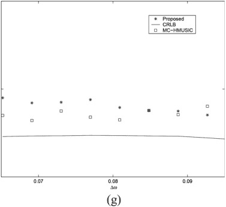
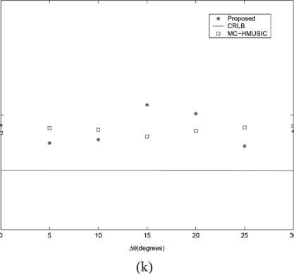
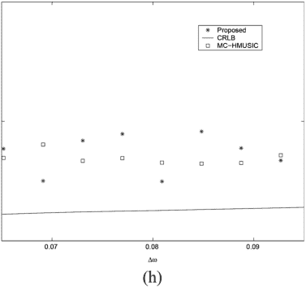
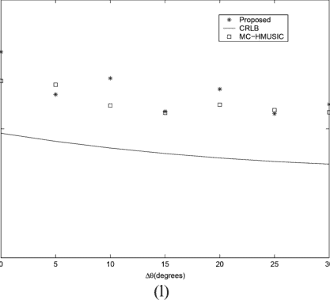
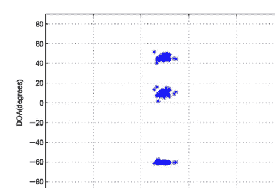
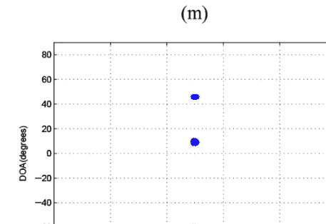
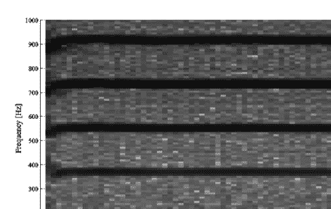
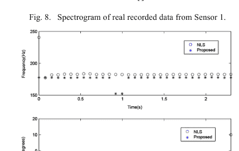
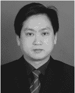

# 肿瘤RNA-Seq数据基因表达的人工智能技术：一种新型优化深度学习方法

**摘要**——本文研究了多通道谐波正弦信号的联合多基频与到达方向（DOA）估计问题。针对均匀线阵定义了一种空时矩阵信号模型，然后利用基于子空间技术、在时域中具有不变性的ESPRIT方法，首先估计多个谐波信号的多基频。在估计出基频之后，利用空间域中的平移不变结构，给出了基于ESPRIT方法的DOA估计。与现有最先进算法相比，所提出的基于ESPRIT的方法无需二维搜索，计算效率更高，但性能相似。文中还给出了所提方法在DOA和基频估计方面的渐近性能分析。最后，通过合成信号以及真实记录数据验证了所提方法的有效性。

**索引词**——DOA估计，ESPRIT，性能分析，基频估计。

# I. 引言

估计周期信号基频的问题是一个基本问题，因其在音频和语音编码、压缩、音乐增强与分类以及语音分析等领域中的广泛应用，多年来一直受到广泛关注[1]–[5]。

针对单基频和多基频场景的参数估计方法已有大量报道（关于现有基频估计方法的综述见[6]–[8]）。

利用空间分离传感器阵列进行到达方向（DOA）估计是信号处理领域的另一个重要研究课题[10]，[11]，在过去几十年中得到了广泛研究。

其应用领域包括雷达[12]、声纳[13]、射电天文学[14]、地球物理学[15]以及麦克风阵列语音处理[16]。

近年来，文献[17]–[36]广泛讨论了多传感器接收的音频和语音信号的基频与DOA联合估计问题，涉及单基频和多基频两种场景。

其中一些可受益于此的关键应用包括电话会议、监控应用、免提通信和助听器等。

单基频估计问题已被深入研究，但多基频场景在现实应用中更为常见。

针对单通道录音设计的多基频估计器在源信号频率重叠、混响和强噪声环境下的性能会严重下降。

因此，在这类情况下，可以采用多通道接收机方法来解决该问题，以获得准确的基频估计。

一些鲁棒的多基频估计方法已通过联合空时处理[17]，[18]被提出，这类方法执行联合参数估计，因此即使两个源在某一维上具有相似的源参数（即几乎相同的DOA或基频），它们仍然可以被分辨。

例如，如果两个周期源（如许多音频和浊语音）的基频相似，我们可以利用不同的空间信息先估计DOA，然后从空间分离的源中提取基频[33]。

大多数联合DOA和基频估计方法都专注于二维空间中单个正弦信号的频率和DOA估计，例如状态空间实现方法[31]、二维最小方差无失真响应（MVDR）方法[22]，[23]，[24]、二维ESPRIT方法[40]等。

通常，这些方法基于窄带信号模型的假设，因此不适用于语音和音频处理，因为使用麦克风阵列记录的音频和语音参数估计问题被视为宽带情况。

其他方法可以看作是前一类方法的推广，其假设目标源被建模为谐波相关正弦信号的叠加，这很适合许多乐器和浊语音。

换句话说，传统的宽带情况被转化为多个窄带情况。

一些经典方法包括基于最大似然（ML）的方法[28]、基于子空间的方法[27]以及线性约束最小方差（LCMV）波束形成器[11]。

本文的目标是从接收数据 \(x_r(n)\) 中估计非线性参数 \((\omega_p, \theta_p)\)，\(p = 1, 2, \ldots, P\)。值得注意的是，参数 \(\varphi_p\) 取决于基频 \(\omega_p\)。同时，当存在多径传播时，模型(1)-(2)保持不变，只是允许对于 \(p \neq q\) 具有相同的基频 \(\omega_p = \omega_q\)。

# III. 所提方法

## A. 单基频情况下的空时信号模型

为了清晰地阐述所提方法，我们首先关注单基频情况下的参数估计问题，即信号模型(1)中 \(P = 1\) 的情况。在信号模型(1)中，对于 \(P = 1\)，接收阵列数据可写为

\[
x_r(n) = s_r(n) + q_r(n), \quad n = 0,1,\ldots,N-1,
\]

\[
s_r(n) = \sum_{l=1}^{L} \alpha_l e^{j(\omega l n + \varphi l r)} \tag{3}
\]

在这种情况下，只需从观测信号中估计一对未知参数 \((\omega, \varphi)\)。基于上述模型，首先定义如下的空时矩阵信号模型

\[
X(n) = S(n) + Q(n), \quad n = 0,1,\ldots,N-M, \tag{4}
\]

其中

\[
X(n) = \begin{bmatrix}
x_0(n) & \cdots & x_0(n+M-1)\\
\vdots & \ddots & \vdots\\
x_{R-1}(n) & \cdots & x_{R-1}(n+M-1)
\end{bmatrix}, \tag{5}
\]

且 \(S(n)\) 和 \(Q(n)\) 的定义与 \(X(n)\) 类似。此外，\(M\) 是一个给定的正整数，其小于 \(N\) 且满足 \(MR > L\)。所关注的信号矩阵 \(S(n)\) 可通过(3)改写为

\[
S(n) = \sum_{l=1}^{L} \beta_l(n) \mathbf{a}_s(l\varphi) \mathbf{a}_t^T(l\omega), \tag{6}
\]

其中

\[
\beta_l(n) = \alpha_l e^{j l \omega n}, \tag{7}
\]

\[
\mathbf{a}_s(\varphi) = [1 \ e^{j\varphi} \ \cdots \ e^{j(R-1)\varphi}]^T, \tag{8}
\]

\[
\mathbf{a}_t(\omega) = [1 \ e^{j\omega} \ \cdots \ e^{j(M-1)\omega}]^T. \tag{9}
\]

通过将 \(X(n)\) 的列堆叠，定义一个新的向量模型 \(x(n)\) 为

\[
\mathbf{x}(n) = \operatorname{vec}\{X(n)\} = \mathbf{s}(n) + \mathbf{q}(n) = \mathbf{A}\mathbf{z}(n) + \mathbf{q}(n), \tag{10}
\]

因此有

\[
\mathbf{s}(n) = \operatorname{vec}\{S(n)\}, \tag{11}
\]

\[
\mathbf{q}(n) = \operatorname{vec}\{Q(n)\}, \tag{12}
\]

\[
\mathbf{A} = [\mathbf{a}(\omega,\varphi), \ldots, \mathbf{a}(L\omega,L\varphi)], \tag{13}
\]

\[
\mathbf{a}(l\omega,l\varphi) = \mathbf{a}_t(l\omega) \otimes \mathbf{a}_s(l\varphi), \tag{14}
\]

\[
\mathbf{z}(n) = [\alpha_1 e^{j\omega n}, \ldots, \alpha_L e^{j L \omega n}]^T. \tag{15}
\]

基于上述数据模型(10)，文献[36]最近报道了一种在单基频情况下用于DOA和基频估计的非线性最小二乘方法，其中需要二维搜索计算以及相对精细的未知参数候选网格才能获得准确的DOA和基频估计，这会导致较高的计算负荷。在接下来的III-B节中，基于前一小节的空时模型推导了一种低复杂度的基于ESPRIT的方法，并在III-C节中给出了所提方法对多基频情况的推广。

## B. 单基频情况下DOA与基频的联合估计：多通道单基频ESPRIT（MSP-ESPRIT）

对于 \(n = 0,1,\ldots,N-M\)，首先利用 \(\mathbf{x}(n)\) 定义如下矩阵：

\[
\mathbf{Y}_{RM\times(N-M+1)} = [\mathbf{x}(0)\ \mathbf{x}(1)\ \cdots\ \mathbf{x}(N-M)] = \mathbf{A}[\mathbf{z}(0)\ \cdots\ \mathbf{z}(N-M)] + [\mathbf{q}(0)\ \cdots\ \mathbf{q}(N-M)] \tag{16}
\]

在矩阵 \(\mathbf{A}\) 满列秩的条件下，可以通过奇异值分解（SVD）或等价地通过对 \(\mathbf{Y}\) 的协方差矩阵进行特征值分解来获得信号子空间。信号子空间矩阵 \(\mathbf{U}_s\) 由与 \(\mathbf{Y}\) 的最大奇异值相关联的 \(L\) 个奇异向量组成。众所周知，由 \(\mathbf{U}_s\) 的列向量张成的信号子空间与矩阵 \(\mathbf{A}\) 中所有列向量张成的子空间相同；因此，存在唯一的非奇异矩阵 \(\mathbf{T}\)，使得 \(\mathbf{U}_s = \mathbf{A}\mathbf{T}\)。利用 \(\mathbf{a}_t(\omega)\) 和 \(\mathbf{a}_s(\varphi)\) 的固有结构，可以找到 \(\mathbf{A}\) 的平移不变性，从而利用经典的ESPRIT方法[19]分别估计DOA和基频参数。为此，我们首先定义以下四个选择矩阵：

\[
\mathbf{W}_1 = \begin{bmatrix} \mathbf{I}_{M-1} \\ \mathbf{0}_{1\times(M-1)} \end{bmatrix} \otimes \mathbf{I}_R, \quad
\mathbf{W}_2 = \begin{bmatrix} \mathbf{0}_{1\times(M-1)} \\ \mathbf{I}_{M-1} \end{bmatrix} \otimes \mathbf{I}_R,
\]

\[
\mathbf{W}_3 = \mathbf{I}_M \otimes \begin{bmatrix} \mathbf{I}_{R-1} \\ \mathbf{0}_{1\times(R-1)} \end{bmatrix}, \quad
\mathbf{W}_4 = \mathbf{I}_M \otimes \begin{bmatrix} \mathbf{0}_{1\times(R-1)} \\ \mathbf{I}_{R-1} \end{bmatrix},
\]

其中 \(\mathbf{0}\) 是零向量。\(\mathbf{A}\) 的子矩阵 \(\mathbf{A}_i\) 进一步由上述选择矩阵 \(\mathbf{W}_i\) 定义为

\[
\mathbf{A}_i = \mathbf{W}_i^T \mathbf{A}, \quad i = 1,2,3,4. \tag{17}
\]

根据上述定义和 \(\mathbf{A}\) 的结构，容易证明我们有以下方程

\[
\mathbf{A}_1 \boldsymbol{\Psi}_t(\omega) = \mathbf{A}_2, \tag{18}
\]

\[
\mathbf{A}_3 \boldsymbol{\Psi}_s(\varphi) = \mathbf{A}_4, \tag{19}
\]

其中

\[
\boldsymbol{\Psi}_t(\omega) = \operatorname{diag}\{e^{j\omega}, \ldots, e^{jL\omega}\}, \quad
\boldsymbol{\Psi}_s(\varphi) = \operatorname{diag}\{e^{j\varphi}, \ldots, e^{jL\varphi}\}. \tag{20}
\]

设 \(\mathbf{U}_1,\mathbf{U}_2\) 和 \(\mathbf{U}_3,\mathbf{U}_4\) 是以与 \(\mathbf{A}_i\) 由 \(\mathbf{A}\) 形成相同的方式从 \(\mathbf{U}_s\) 形成的子矩阵。根据ESPRIT方法的原理，\(\boldsymbol{\Psi}_t(\omega)\) 和 \(\boldsymbol{\Psi}_s(\varphi)\) 的对角元素是 \(\boldsymbol{\Phi}_t =\) 的相应特征值。

TΨₜT⁻¹ 和 Φₛ = TΨₛT⁻¹，满足以下方程

U₂ = U₁Φₜ 且 U₄ = U₃Φₛ  (21)

设 μₗ 和 νₗ（l = 1, 2, ···, L）分别为 Φₜ 和 Φₛ 的特征值。因此，ω 和 θ 的估计值可给出如下

ω̂ = 2/[L(L + 1)] Σₗ₌₁ᴸ μₗ,

θ̂ = arcsin( (2c Σₗ₌₁ᴸ νₗ) / (L(L + 1)ω̂ fₛ d) )  (22)

从 (20) 可以看出，θ̂ 的估计精度依赖于 ω̂ 的估计精度。

## C. 存在多音高情况下的时空信号模型

为解决多音高情况下 DOA 和音高的联合估计问题，文献 [34] 提出了一种多通道多音高谐波多信号分类（MC-HMUSIC）方法，其中需要二维搜索来获得音高和 DOA 的估计。为进一步降低 MC-HMUSIC 方法中二维搜索的计算复杂度，文献 [35] 最近提出了一种基于子空间方法的两阶段 DOA 和音高估计方法，即 MCOW-HMUSIC；然而，MCOW-HMUSIC 方法仍需要两次一维搜索和一次用于细化估计的迭代过程。此外，音高和 DOA 参数之间的耦合仍然存在，并构成一个显著问题。在本小节中，我们将先前针对单音高情况提出的 ESPRIT 方法推广到多音高情况，用于联合估计 DOA 和音高。

按照类似于单音高情况的过程，基于模型 (1)，对于给定整数 M 并满足 RM > Σₚ₌₁ᴾ Lₚ，可以构造以下数据向量

X(n) = S(n) + Q(n), n = 0, 1, ···, N − M,  (23)

其中

X(n) = [ x₀(n) ··· x₀(n + M − 1); ⋮ ⋱ ⋮; xᴿ₋₁(n) ··· xᴿ₋₁(n + M − 1) ].  (24)

X(n) 中感兴趣信号部分 S(n) 可重写为

S(n) = Σₚ₌₁ᴾ Σₗ₌₁ᴸₚ βₚ,ₗ(n) aₛ(lϕₚ) aₜᵀ(lωₚ).  (25)

其中

βₚ,ₗ(n) = αₚ,ₗeʲˡωₚⁿ,

aₛ(ϕₚ) = [1 eʲϕₚ ··· eʲ⁽ᴿ⁻¹⁾ϕₚ]ᵀ,

aₜ(ωₚ) = [1 eʲωₚ ··· eʲ⁽ᴹ⁻¹⁾ωₚ]ᵀ.  (26)

将 X(n) 的各列堆叠成新的向量模型 x(n)，可得

x(n) = vec{X(n)}
= s(n) + q(n) = Az(n) + q(n),  (27)

其中

A = [A⁽¹⁾(ω₁, ϕ₁), ···, A⁽ᴾ⁾(ωᴾ, ϕᴾ)],  (28)

A⁽ᵖ⁾ = [a(ωₚ, ϕₚ), ···, a(Lₚωₚ, Lₚϕₚ)], p = 1, ···, P,  (29)

a(lₚωₚ, lₚϕₚ) = aₜ(lₚωₚ) ⊗ aₛ(lₚϕₚ),  (30)

z(n) = [α₁,₁eʲω₁ⁿ, ···, α₁,ᴸ₁eʲᴸ¹ω₁ⁿ, ···, αᴾ,₁eʲωᴾⁿ, ···, αᴾ,ᴸᴾeʲᴸᴾωᴾⁿ]ᵀ

对于 n = 0, 1, ···, N − M，我们首先用 X(n) 定义以下向量，

Yᴿᴹ×⁽ᴺ⁻ᴹ⁺¹⁾ = [x(0) x(1) ··· x(N − M)]
= A[z(0) z(1) ··· z(N − M)]
  + [q(0) ··· q(N − M)].  (31)

因此，上述多音情况下的时空信号模型在 (23) 中 P = 1 时，可以简化为前一节中单音的情况。

## D. 使用 ESPRIT 的多音情况下的 DOA 和音高联合估计：多通道多音 ESPRIT（MMP-ESPRIT）

为了在多音情况下使用 ESPRIT 方法进行 DOA 和音高的联合估计，数据矩阵 Y 的奇异值分解（SVD）表示为

Y = UΣVᴴ = [Uₛ Uₙ] [Σₛ 0; 0 Σₙ] Vᴴ,  (32)

其中 Uₛ 和 Uₙ 的列向量分别张成信号子空间和噪声子空间。Σₛ 的对角元由 Y 的 P₀ = Σₚ₌₁ᴾ Lₚ 个最大奇异值组成，并且对于非奇异位置矩阵 T，有 Uₛ = AT。

利用 A 中 a(lωₚ, lϕₚ) 的平移不变结构，我们可以得到以下两个方程，

A₁Ψₜ = A₂,  (33)
A₃Ψₛ = A₄,  (34)

其中 Aᵢ = WᵢᵀA，i = 1, 2, 3, 4。Ψₜ 和 Ψₛ 定义为

Ψₜ = diag(Ψₜ₁, ···, Ψₜᴾ)
Ψₜₚ = diag(eʲωₚ, ···, eʲᴸᴾωₚ)
Ψₛ = diag(Ψₛ₁, ···, Ψₛᴾ)
Ψₛₚ = diag(eʲϕₚ, ···, eʲᴸᴾϕₚ).  (35–36)

相应地，利用子空间性质还可以得到以下方程，

U₂ = U₁Φₜ 且 U₄ = U₃Φₛ,  (37)

其中

U₁ = W₁Uₛ 且 U₂ = W₂Uₛ,

其中

$$\Phi_s=\operatorname{diag}\{[e^{j\phi_1},\ldots,e^{j\phi_L}],e^{j\phi_P},\ldots,e^{j\phi_L\phi_P}\}.$$ (57)

因此，矩阵 $\mathbf{X}_{M,R_0}$ 可以写为

$$\mathbf{X}_{M,R_0}=\mathbf{J}_1\mathbf{A}_M[\mathbf{B}_M,\Phi_s\mathbf{B}_M,\ldots,\Phi_s^{R-R_0+1}\mathbf{B}_M]+\mathbf{Q}_{M,R_0}.$$ (58)

其中 $\mathbf{J}_1=\mathbf{I}_M\otimes[\mathbf{I}_{R_0}\ 0]$。

## F. 多径传播情况下使用 ESPRIT 的 DOA 和单音高联合估计：多通道单音多径 ESPRIT（MSP-MP-ESPRIT）

基于构造的时空平滑数据矩阵 $\mathbf{X}_{M,R_0}$，可以通过 $\mathbf{X}_{M,R_0}$ 的 SVD 获得噪声子空间和信号子空间，定义为

$$\mathbf{X}_{M,R_0}=[\mathbf{U}_s\ \mathbf{U}_n]\mathbf{\Sigma}\mathbf{V}^H.$$ (59)

其中 $\mathbf{U}_s$ 和 $\mathbf{U}_n$ 的列分别是与 $P_0(=LP)$ 个最大奇异值和剩余的 $MR_0-P_0$ 个最小奇异值相关联的奇异向量。利用 $\mathbf{X}_{M,R_0}$ 的噪声子空间，文献 [34] 提出了一种基于 MUSIC 的多音高和 DOA 联合估计方法，其中需要二维网格搜索来获得参数对 $(\omega,\theta_p)$（$p=1,2,\ldots,P$）的估计。在本节中，利用 $\mathbf{A}_M^{(R_0)}$ 的时空平移不变结构，采用基于 ESPRIT 的方法给出 $\{\omega,\theta_p\}$ 的估计。利用信号子空间矩阵 $\mathbf{U}_s$ 可以得到以下两个方程

$$\mathbf{U}_2=\mathbf{U}_1\Phi_t\quad\text{且}\quad\mathbf{U}_4=\mathbf{U}_3\Phi_s.$$ (60)

其中

$$\mathbf{U}_1=\mathbf{W}_1\mathbf{U}_s\quad\text{且}\quad\mathbf{U}_2=\mathbf{W}_2\mathbf{U}_s,$$
$$\mathbf{U}_3=\mathbf{W}_3\mathbf{U}_s\quad\text{且}\quad\mathbf{U}_4=\mathbf{W}_4\mathbf{U}_s.$$ (61)

其中选择矩阵 $\mathbf{W}_i$（$i=1,2,3,4$）定义如下

$$\mathbf{W}_1=\begin{bmatrix}\mathbf{I}_{M-1}\\\mathbf{0}_{1\times(M-1)}\end{bmatrix}\otimes\mathbf{I}_{R_0},\quad
\mathbf{W}_2=\begin{bmatrix}\mathbf{0}_{1\times(M-1)}\\\mathbf{I}_{M-1}\end{bmatrix}\otimes\mathbf{I}_{R_0},$$
$$\mathbf{W}_3=\mathbf{I}_M\otimes[\mathbf{I}_{R_0-1}\ \mathbf{0}_{1\times(R_0-1)}],\quad
\mathbf{W}_4=\mathbf{I}_M\otimes[\mathbf{0}_{1\times(R_0-1)}\ \mathbf{I}_{R_0-1}].$$

因此，可以从 $\Phi_t$ 和 $\Phi_s$ 的特征值 $\mu_l$ 和 $\nu_l^{(p)}$ 获得 $\omega$ 和 $\theta_p$ 的估计值如下

$$\hat{\omega}=\frac{2}{L(L+1)}\sum_{l=1}^{L}\angle\mu_l,$$
$$\hat{\theta}_p=\arcsin\left(\frac{2c\sum_{l=1}^{L}\angle\nu_l^{(p)}}{L(L+1)\hat{\omega}f_s d}\right),\quad p=1,2,\ldots,P.$$ (62)

| 算法 | 步骤 |
|---|---|
| **MSP-ESPRIT** | 1. 按式 (16) 排列观测矩阵 $\mathbf{Y}$。 2. 计算 $\mathbf{Y}$ 的 SVD。 3. 计算式 (21) 中两个矩阵 $\Phi_t$ 和 $\Phi_s$ 的特征值。 4. 使用式 (22) 估计音高和 DOA。 |
| **MMP-ESPRIT** | 1. 按式 (31) 排列观测矩阵 $\mathbf{Y}$。 2. 计算式 (32) 中 $\mathbf{Y}$ 的 SVD。 3. 计算式 (37) 中两个矩阵 $\Phi_t$ 和 $\Phi_s$ 的特征值。 4. 使用式 (39) 估计音高和 DOA。 |
| **MSP-MP-ESPRIT** | 1. 按式 (58) 排列观测矩阵 $\mathbf{X}_{M,R_0}$。 2. 计算式 (59) 中矩阵 $\mathbf{X}_{M,R_0}$ 的 SVD。 3. 计算式 (60) 中两个矩阵 $\Phi_t$ 和 $\Phi_s$ 的特征值。 4. 使用式 (62) 估计音高和 DOA。 |

# IV. 算法总结和计算复杂度分析

在本节中，我们分析了所提算法的计算复杂度。为此，表 I 提供了三种算法的详细描述。

与针对单音情况的基于 NLS 的方法和针对多音情况可用的 MC-HMUSIC 方法相比，所提方法的主要计算负载集中在数据矩阵 $\mathbf{Y}$ 的 SVD 计算以及矩阵对 $(\Phi_s,\Phi_t)$ 的 EVD 计算上，对于 MMP-ESPRIT 方法约为 $O((RM)^2(N-M+1)+(L_1+L_2+\cdots+L_P)^3)$，对于 MSP-MP-ESPRIT 方法约为 $O((RM)^2(N-M+1)+(LP)^3)$；而基于 NLS 的方法在二维参数搜索网格中的每个点上需要 $O(NRL^2+L^3)$ 的计算量。因此，基于 NLS 的方法在单音情况下整个二维搜索计算的总计算负载为 $O((NRL^2+L^3)g_\omega g_\theta)$，其中 $g_\omega$ 和 $g_\theta$ 分别是沿频率轴和 DOA 轴进行的搜索次数。MC-HMUSIC 方法的第一部分计算负载约为 $O((RM)^2(N-M+1))$，这与所提 MSP-MP-ESPRIT 方法的 SVD 计算类似，但此外它还需要 $P$ 次二维搜索计算来获得多音情况下音高和 DOA 的估计。MC-MUSIC 方法中的二维搜索的阶数为 $O((RM)^2g_\omega g_\theta)$。因此，所提方法无需二维搜索，其计算负载低于基于 NLS 的方法和 MC-HMUSIC 方法。

# V. 音高和 DOA 估计的渐近性能分析

在本节中，分析了所提出的基于 ESPRIT 的多音高和 DOA 估计方法的渐近性能。利用文献 [42] 中推导的类似结果，很容易证明音高和 DOA 参数的估计是无偏的。这一结果的推导基于文献 [41] 中使用 ESPRIT 方法进行 DOA 估计的相同分析过程，同时可以直接推广到多径传播场景的情况，因此，这一结果的推导基于文献 [41] 中使用 ESPRIT 方法进行 DOA 估计的相同分析过程。

我们给出了不存在多径传播时多音情况下估计音高和 DOA 参数的方差，分别记为 $E\{(\delta\omega_p)^2\}$ 和 $E\{(\delta\theta_p)^2\}$。

图 5. 估计源 1 的 (g) 音高和 (h) DOA 参数的 RMSE 比较。

图 6. 估计源 1 的 (k) 音高和 (l) DOA 参数的 RMSE 比较。

两种方法相似，但它们 RMSE 与相应 CRLB 之间约有 2 dB 的差距。

与上述关于频率分辨性能的实验类似，在本实验中源 1 的两个参数和源 2 的音高现在固定，而源 2 的 DOA 随不同的 $\Delta\theta = |\theta_1 - \theta_2|$ 变化。可以从图 6 看出，两种方法在空间角度上的分辨性能也很相似，但其 RMSE 与相应 CRLB 之间存在 2 dB 的差距。此外，值得注意的是，由于两个源具有不同的音高且 DOA 的估计依赖于音高参数，因此 MC-HMUSIC 估计器和所提出的估计器在两个源的 DOA 相同的情况下，即 $\Delta\theta = 0$，仍能良好地工作。然而，两个源的音高估计直接由构造矩阵的特征值获得；因此，在相同音高的情况下（即 $\Delta\omega = 0$），如果不使用时空平滑技术来恢复 $A$ 的秩，则无法分辨这两个源。

在最后一个仿真实验中，我们展示了多径传播存在下联合 DOA 和单音高估计的一个示例。谐波信号由 $L$ 个正弦波组成，音高为 $f_0 = 343$ Hz，并假设在阵列处接收到 3 个多径信号，其 DOA $= [-60^\circ, 10^\circ, 45^\circ]$，参数设置列于表 IV。麦克风数量设为 $R = 16$，SNR 设为

SNR = 30 dB，且采样数为 $N = 120$。时空域中的平滑参数取为 $M = 80$ 和 $R_0 = 8$。50 次独立试验的结果如图 7 所示，表明所提出的方法在多径传播情况下仍能给出准确的 DOA 和音高估计，并且在相同条件下 $L = 5$ 的结果优于 $L = 2$ 的结果。

## B. 实际数据结果

在本小节中，进行了一项实验以进一步评估所提方法在真实信号上的性能。真实数据还用于测量单音高情况下基于 NLS 的方法 [36] 的性能。实验在会议室进行，实验环境在 [36] 中描述。在实验中，采样频率为 $f_s = 44.1$ kHz，声速假定为 $c = 343$ m/s，1 kHz 处的房间混响时间为 $T_{60} \approx 0.53$ s，接收阵列为均匀线阵，单元间距为 $d = 4$ cm，传感器数量为 $R = 8$。我们假设传感器间无衰减使得 $\alpha_{p,l} = 1$，且期望信号假定由 $L = 8$ 个谐波组成。此外，每个参数估计使用 $N = 100$。

(m)

(n)

图 7. 多径情况下 L=2 (m) 和 L=5 (n) 的估计音高和 DOA 参数比较，分别。

### 表 IV

MSP-MP-ESPRIT 的仿真设置

| p | L_p | 音高 | DOA |
|---|---|---|---|
| 1 | 2 5 | 343 | 45 |
| 2 | 2 5 | 343 | -60 |
| 3 | 2 5 | 343 | 10 |

实验中的估计设置与之前使用合成数据的仿真相同。

在真实实验部分，使用 [36] 中的回放小号音符“S1”测试了单音高情况。无回声小号信号通过拼接无回声小号信号片段生成（参见 http://theremin.music.uiowa.edu/MIS.html）[43]。回放的小号信号使用 ULA 记录以获得具有轻微混响的多通道小号信号，单个小号信号的 DOA 约为 θ1 = −13°。从记录的数据中，我们通过所提方法和基于 NLS 的方法估计了小号信号的音高和 DOA。该实验得到的结果如图 9 所示。可以看出，用于音高估计的两种估计器在记录的时间间隔内给出了相同的估计，但使用基于 NLS 的方法的音高估计精度优于所提方法，

图 8. 来自传感器 1 的真实记录数据的频谱图。

图 9. 真实记录数据的估计音高和 DOA 参数比较。

当音高参数的结果仅与图 8 所示的相应频谱图进行比较时。然而，两种方法估计的 DOAs 与真实 DOA 相比相对接近。

# VII. 结论

本文使用 ESPRIT 算法对 ULA 的多通道多音高进行联合音高和 DOA 估计。基于构造的时空信号模型，利用时域和空域中的不变性，使用 ESPRIT 方法估计音高和 DOA 参数。我们还证明了时空平滑技术可用于解决单音高多径传播情况。与现有的最先进算法相比，基于 ESPRIT 且无需二维搜索的所提方法在计算上更高效。多音高情况下估计音高和 DOA 的渐近性能也被分析。最后，使用合成数据进行了大量仿真，以比较所提方法与单音高情况下基于 NLS 的方法和 MC-HMUSIC 方法以及多音高情况下的 MC-HUMUSIC 方法的性能。结果表明，所提估计器的性能不仅在均方根误差方面与其它方法在音高和 DOA 估计方面相当，而且接近相应的 CRLB。此外，对真实数据的实验测试表明该

使用与 [41] 中类似的推导，量 E{|δμ_l^(p)|^2}, E{(δμ_l^(p))^2}, E{|δν_l^(p)|^2}, E{(δν_l^(p))^2}, E{δμ_l^(p) δν_l^(p)*} 和 E{δμ_l^(p)* δν_l^(p)} 是特征值的协方差，逐一推导。

δμ_l^(p) = u_l^(p) U_1^# (W_2 - μ_l^(p) W_1) δU_s q_l^(p),  (81)

其中 u_l^(p), q_l^(p) 是 Φ̂ 的相应左、右特征向量，且 δU_s = Û_s - U_s，其给出如下（详见 [42]），

δU_s = U_n U_n^H δY V_s Σ_s^{-1},  (82)
δY = Ŷ - Y.  (83)

类似地，v_l^(p), h_l^(p) 是矩阵 Φ_s 的相应左、右特征向量，且 δν_l 的误差则由下式给出

δν_l^(p) = v_l^(p) U_3^# (W_4 - ν_l^(p) W_3) δU_s h_l^(p).  (84)

由 (81) 和 (84)，μ̂_l^(p) 和 ν̂_l^(p) 的方差由此通过以下表达式计算

E{|δμ_l^(p)|^2} = u_l^(p) U_1^# (W_2 - μ_l^(p) W_1) E{δU_s q_l^(p) q_l^(p)H δU_s^H} (W_2 - μ_l^(p) W_1)^H (u_l^(p) U_1^#)^H = u_l^(p) U_1^# (W_2 - μ_l^(p) W_1) U_n U_n^H E{δY V_s Σ_s^{-1} q_l^(p) q_l^(p)H Σ_s^{-1*} V_s^H δY^H} U_n U_n^H (W_2 - μ_l^(p) W_1)^H (u_l^(p) U_1^#)^H  (85)
E{(δμ_l^(p))^2}= u_l^(p) U_1^# (W_2 - μ_l^(p) W_1) U_n U_n^H E{δY V_s Σ_s^{-1} q_l^(p) q_l^(p)T Σ_s^{-1} V_s^H δY^T} U_n U_n^T (W_2 - μ_l^(p) W_1)^T (u_l^(p) U_1^#)^T
E{|δν_l^(p)|^2} = v_l^(p) U_3^# (W_4 - ν_l^(p) W_3) U_n U_n^H

E{δY V_s Σ_s^{-1} h_l^(p) h_l^(p)H Σ_s^{-1*} V_s^H δY^H}
U_n U_n^H (W_4 - ν_l^(p) W_3)^H (v_l^(p) U_3^#)^H  (86)
E{(δν_l^(p))^2} = v_l^(p) U_3^# (W_4 - ν_l^(p) W_3) U_n U_n^H
E{δY V_s Σ_s^{-1} h_l^(p) h_l^(p)T Σ_s^{-1} V_s^T δY^T}
U_n U_n^T (W_4 - ν_l^(p) W_3)^T (v_l^(p) U_3^#)^T  (87)
E{δμ_l^(p) δν_l^{*(p)}} = u_l^(p) U_1^# (W_2 - μ_l^(p) W_1) U_n U_n^H
E{δY V_s Σ_s^{-1} q_l^(p) h_l^(p)H Σ_s^{-1*} V_s^H δY^H}
U_n U_n^H (W_4 - ν_l^(p) W_3)^H (v_l^(p) U_3^#)^H  (88)
E{δμ_l^(p) δν_l^(p)} = u_l^(p) U_1^# (W_2 - μ_l^(p) W_1) U_n U_n^H
E{δY V_s Σ_s^{-1} q_l^(p) h_l^(p)T Σ_s^{-1} V_s^T δY^T}
U_n U_n^T (W_4 - ν_l^(p) W_3)^T (v_l^(p) U_3^#)^T  (89)

在式 (85) 中，令 f_l^(p) = V_s Σ_s^{-1} q_l^(p) 且 g_l^(p) = V_s Σ_s^{-1} h_l^(p)，则得到

E{δY V_s Σ_s^{-1} q_l^(p) q_l^(p)H Σ_s^{-1*} V_s^H δY^H} = E{δY f_l^(p) f_l^(p)H δY^H} = Σ_{i=1}^{N-M+1} Σ_{j=1}^{N-M+1} f_{l,i}^(p) f_{l,j}^{*(p)} E{δy_i δy_j^H},  (90)
E{δY V_s Σ_s^{-1} h_l^(p) h_l^(p)H Σ_s^{-1*} V_s^H δY^H} = E{δY g_l^(p) g_l^(p)H δY^H} = Σ_{i=1}^{N-M+1} Σ_{j=1}^{N-M+1} g_{l,i}^(p) g_{l,j}^{*(p)} E{δy_i δy_j^H}.  (91)
其中 f_{l,i}^(p) 是向量 f_l^(p) 的第 i 个元素，g_{l,j}^(p) 是向量 g_l^(p) 的第 j 个元素，且 δy_i 是

δθ_p = 1/(4jA) [ν_1^{*(p)} δν_1^(p) - B μ_1^*^(p) δμ_1^(p) + 1/2 ν_2^{*(p)} δν_2^(p) - 1/2 B μ_2^*^(p) δμ_2^(p) - ν_1^(p) δν_1^{*(p)} + B μ_1^(p) δμ_1^{*(p)} - 1/2 ν_2^(p) δν_2^{*(p)} + 1/2 B μ_2^(p) δμ_2^{*(p)} ],  (80)
E{(δθ_p)^2} = 1/(16 A^2) {2|ν_1^(p)|^2 E{|δν_1^(p)|^2} + 2 B^2 |μ_1^(p)|^2 E{|δμ_1^(p)|^2} + 1/2 B^2 |μ_2^(p)|^2 E{|δμ_2^(p)|^2} + 1/2 |ν_2^(p)|^2 E{|δν_2^(p)|^2} - 2 real[(ν_1^{*(p)})^2 E{(δν_1^(p))^2} + B^2 (μ_1^{*(p)})^2 E{(δμ_1^(p))^2}] + 1/4 (ν_2^{*(p)})^2 E{(δν_2^(p))^2} + 1/4 B^2 (μ_2^{*(p)})^2 E{(δμ_2^(p))^2}] - 2 real[-2 B μ_1^{*(p)} ν_1^{*(p)} E{δν_1^(p) δμ_1^(p)} + ν_1^{*(p)} ν_2^{*(p)} E{δν_1^(p) δν_2^(p)} + B^2 μ_1^{*(p)} μ_2^{*(p)} E{δμ_1^(p) δμ_2^(p)} - B μ_2^{*(p)} ν_1^{*(p)} E{δν_1^(p) δμ_2^(p)} + B μ_2^{*(p)} ν_1^(p) E{δμ_2^(p) δν_1^{*(p)}} - ν_1^* ν_2^* E{δν_1^(p) δν_2^{*(p)}} - B μ_1^{*(p)} ν_2^{*(p)} E{δν_2^(p) δμ_1^(p)} + B μ_1^{*(p)} ν_2^(p) E{δν_2^{*(p)} δμ_1^(p)} + 2 B μ_1^{*(p)} ν_1^(p) E{δν_1^{*(p)} δμ_1^(p)} - B^2 μ_1^{*(p)} μ_2^(p) E{δμ_1^(p) δμ_2^{*(p)}} - 1/2 B μ_2^{*(p)} ν_2^{*(p)} E{δν_2^(p) δμ_2^(p)} + 1/2 B μ_2^{*(p)} ν_2^(p) E{δν_2^{*(p)} δμ_2^(p)} ]}.

矩阵 $\mathbf{Y}$。式 (86)-(89) 中的简化公式可类似推导，此处省略。

# 参考文献

1. D. Wang and G. J. Brown, *Computational Auditory Scene Analysis Principles, Algorithms, and Applications*. New York, NY, USA: Wiley, 2006.

2. S. Makino, T. W. Lee, and H. Sawada, *Blind Speech Separation*. New York, NY, USA: Springer, 2007.

3. M. G. Christensen and A. Jakobsson, “Multi-pitch estimation,” *Synth. Lect. Speech Audio Process.*, vol. 5, no. 1, pp. 1–160, 2009.

4. Y. Medan, E. Yair, and D. Chazan, “Super resolution pitch determination of speech signals,” *IEEE Trans. Signal Process.*, vol. 39, no. 1, pp. 40–48, Jan. 1991.

5. M. G. Christensen, A. Jakobsson, and S. H. Jensen, “Fundamental frequency estimation using the shift-invariance property,” in *Proc. 41st Asilomar Conf. Signals, Systems, Comput. (ACSSC’07)*, 2007, pp. 631–635.

6. M. G. Christensen, A. Jakobsson, and S. H. Jensen, “Joint high-resolution fundamental frequency and order estimation,” *IEEE Trans. Audio, Speech, Lang. Process.*, vol. 15, no. 5, pp. 1635–1644, Jul. 2007.

7. V. Emiya, B. David, and R. Badeau, “A parametric method for pitch estimation of piano tones,” *Proc. IEEE Int. Conf. Acoust., Speech, Signal Process.*, vol. 1, pp. 249–252, Apr. 2007.

8. M. G. Christensen, P. Stoica, A. Jakobsson, and S. H. Jensen, “Multipitch estimation,” *Elsevier Signal Process.*, vol. 88, no. 4, pp. 972–983, Apr. 2008.

9. M. G. Christensen, “Multi-channel maximum likelihood pitch estimation,” in *Proc. IEEE Int. Conf. Acoust., Speech, Signal Process.*, Mar. 2012, pp. 409–412.

10. H. Krim and M. Viberg, “Two decades of array processing research-the parametric approach,” *IEEE Signal Process. Mag.*, vol. 13, no. 4, pp. 67–94, Jul. 1996.

11. P. Stoica and R. Moses, *Spectral Analysis of Signals*. Upper Saddle River, NJ, USA: Pearson Education, 2005.

12. O. T. Sorensen, M. Viberg, P. Stoica, and A. Nehorai, *Exact and large sample maximum likelihood techniques for parameter estimation and detection in array processing*. New York, NY, USA: Springer, 1993.

13. N. L. Owsley, *Array Signal Processing*. Englewood Cliffs, NJ, USA: Prentice-Hall, 1985, pp. 115–193.

14. R. Levanda and A. Leshem, “Synthetic aperture radio telescopes,” *IEEE Signal Process. Mag.*, vol. 21, no. 1, pp. 14–29, Jan. 2010.

15. P. Stoica and J. Li, “Lecture notes-source localization from range-difference measurements,” *IEEE Signal Process. Mag.*, vol. 23, no. 6, pp. 63–66, Nov. 2006.

16. J. Chen, S. Gannot, and J. Benesty, “Part H: Speech enhancement, in springer handbook of speech processing,” in J. Benesty, Y. A. Huang, and M. M. Sondhi, Eds. New York, NY, USA: Springer, Nov. 2007.

17. M. Wohlmayr and M. Kepesi, “Joint position-pitch extraction from multichannel audio,” in *Proc. Interspeech*, Aug. 2007, pp. 1629–1632.

18. M. Kepesi, L. Ottowitz, and T. Habib, “Joint position-pitch estimation for multiple speaker scenarios,” in *Proc. Hands-Free Speech Commun. Microphone Arrays*, May 2008, pp. 85–88.

19. R. Roy and T. K. Kailath, “ESPRIT- Estimation of signal parameters via rotational invariance techniques,” *IEEE Trans. Acoust., Speech, Signal Process.*, vol. 37, no. 7, pp. 984–995, Jul. 1989.

20. M. Viberg and P. Stoica, “A computationally efficient method for joint direction finding and frequency estimation in colored noise,” *Rec. Asilomar Conf. Signals, Syst., Comput.*, vol. 2, pp. 1547–1551, Nov. 1998.

21. T. Shu and X. Liu, “Robust and computationally efficient signal-dependent method for joint DOA and frequency estimation,” *EURASIP J. Adv. Signal Process.*, vol. 1, no. 4, pp. 1–16, Apr. 2008.

22. J. Capon, “High-resolution frequency-wavenumber spectrum analysis,” *Proc. IEEE*, vol. 57, no. 8, pp. 1408–1418, Aug. 1969.

23. J. Capon, “Maximum-likelihood spectral estimation,” in *Nonlinear Methods of Spectral Analysis*. New York, NY, USA: Springer-Verlag, 1983.

24. A. Jakobsson, S. L. Marple, Jr, and P. Stoica, “Computationally efficient two-dimensional capon spectrum analysis,” *IEEE Trans. Signal Process.*, vol. 48, no. 9, pp. 2651–2661, Sep. 2000.

25. A. Spriet, M. Moonen, and J. Wouters, “Spatially pre-processed speech distortion weighted multi-channel wiener filtering for noise reduction,” *Elsevier Signal Process.*, vol. 84, no. 12, pp. 2367–2387, Dec. 2004.

26. M. S. Brandstein and H. F. Silverman, “A robust method for speech signal time-delay estimation in reverberant rooms,” *Proc. IEEE Int. Conf. Acoust., Speech, Signal Process.*, vol. 1, pp. 375–378, Apr. 1997.

27. M. Jian, A. C. Kot, and M. H. Er, “DOA estimation of speech source with microphone arrays,” *Proc. IEEE Int. Symp. Circuits Syst.*, vol. 5, pp. 293–296, May 1998.

28. X. Qian and R. Kumaresan, “Joint estimation of time delay and pitch of voiced speech signals,” *Rec. Asilomar Conf. Signals, Syst., Comput.*, vol. 1, pp. 735–739, Oct. 1995.

29. Y. Wu, H. C. So, and Y. Tan, “Joint time-delay and frequency estimation using parallel factor analysis,” *Elsevier Signal Process.*, vol. 89, pp. 1667–1670, 2009.

30. L. Y. Ngan, Y. Wu, H. C. So, P. C. Ching, and S. W. Lee, “Joint time delay and pitch estimation for speaker localization,” *Proc. IEEE Int. Symp. Circuits Syst.*, vol. 3, pp. 722–725, May 2003.

31. Y. Wu, H. C. So, and P. C. Ching, “Joint time delay and frequency estimation via state-space realization,” *IEEE Signal Process. Lett.*, vol. 10, no. 11, pp. 339–342, Nov. 2003.

32. J. Dmochowski, J. Benesty, and S. Affes, “Linearly constrained minimum variance source localization and spectral estimation,” *IEEE Trans. Audio, Speech, Lang. Process.*, vol. 16, no. 8, pp. 1490–1502, Nov. 2008.

33. J. R. Jensen, M. G. Christensen, and S. H. Jensen, “Joint DOA and fundamental frequency estimation methods based on 2-D filtering,” in *Proc. Eur. Signal Process. Conf.*, Aug. 2010, pp. 2091–2095.

34. J. X. Zhang, M. G. Christensen, S. H. Jensen, and M. Moonen, “Joint DOA and multi-pitch estimation based on subspace techniques,” *EURASIP J. Adv. Signal Process.*, no. 1, pp. 1–11, Jan. 2012.

35. Z. H. Zhou, M. G. Christensen, and H. C. So, “Two stage DOA and fundamental frequency estimation based on subspace techniques,” in *Proc. IEEE Int. Conf. Signal Process. (ICSP’12)*, Oct. 2012, vol. 1, pp. 210–214.

36. J. R. Jensen, M. G. Christensen, and S. H. Jensen, “Nonlinear least squares methods for joint DOA and pitch estimation,” *IEEE Trans. Audio, Speech, Lang. Process.*, vol. 21, no. 5, pp. 924–933, May 2013.

37. C. Duofang, C. Baixiao, and Q. Guodong, “Angle estimation using ESPRIT in MIMO radar,” *Electron. Lett.*, vol. 44, no. 12, pp. 770–771, Jun. 2008.

38. T. H. Liu and J. M. Mendel, “Azimuth and elevation direction finding using arbitrary array geometries,” *IEEE Trans. Signal Process.*, vol. 46, no. 7, pp. 2061–2065, Jul. 1998.

39. T. Shan, M. Wax, and T. Kailath, “On spatial smoothing for direction-of-arrival estimation of coherent signals,” *IEEE Trans. Acoust., Speech, Signal Process.*, vol. ASSP-33, no. 4, pp. 806–811, Aug. 1985.

40. A. N. Lemma, A. J. Van der Veen, and E. F. Deprettere, “Analysis of joint angle-frequency estimation using ESPRIT,” *IEEE Trans. Signal Process.*, vol. 51, no. 5, pp. 1264–1283, May 2003.

41. N. Yuen and B. Friedlander, “Asymptotic performance analysis of ESPRIT, higher-order ESPRIT, and virtual ESPRIT algorithms,” *IEEE Trans. Signal Process.*, vol. 44, no. 10, pp. 2537–2550, Oct. 1996.

42. J. Liu, X.-Q. Liu, and X.-L. Ma, “First-order perturbation analysis of singular value decomposition,” *IEEE Trans. Signal Process.*, vol. 56, no. 7, pp. 3044–3049, Jul. 2008.

43. L. Armani and M. Omologo, “Weighted autocorrelation-based f0 estimation for distant-talking interaction with a distributed microphone network,” in *Proc. IEEE Int. Conf. Acoust., Speech, Signal Process.*, May 2004, vol. 1, pp. 113–116.

**Yuntao Wu**（M’12）于2003年12月在西安电子科技大学雷达信号处理国家重点实验室获得信息与通信工程博士学位。2004年4月至2006年9月，他在中国科学院声学研究所（北京）担任博士后研究员。2006年10月至2008年2月，他在香港城市大学担任高级研究员。2013年4月至2014年3月，他在以色列巴伊兰大学工程学院担任访问研究员。目前，他是武汉工程大学的全职教授，同时也是该校的湖北省楚天学者计划特聘教授。他已发表期刊和会议论文60余篇。他是中国电子工程师学会（CIE）高级会员，也是《Multidimensional Systems and Signal Processing》（施普林格国际期刊）的副主编。他的研究方向包括信号检测、阵列信号处理中的参数估计、无线传感器网络中的源定位、生物医学信号分析等。

<!-- no content -->
