# 基于机器学习与深度学习方法的数据分析人工智能趋势指南

在新兴的智慧城市技术和行业中，人工智能的作用变得日益凸显。本 AI 书丛旨在涵盖最新的 AI 工作，帮助初级用户获得解决现有问题的支持，并为丰富的 AI 从业者为 AI 领域的新途径提供明灯。该系列将涵盖 AI 及其相关领域的近期工作，包括逻辑学、模式识别、自然语言处理（NLP）、专家系统、机器学习、区块链和大数据。AI 的工作领域非常深，因此它将涵盖随 AI 概念演变的最新趋势，并将帮助该领域的新手、从业者、学生以及研究人员获得新的见解。

*编辑：Gautam Kumar, Dinesh Kumar Saini 和 Nguyen Ha Huy Cuong*

*编辑：K. Gayathri Devi, Mamata Rath 和 Nguyen Thi Dieu Linh*

## 前言

## 致谢

## 编辑者

## 贡献者

## 第 1 章 基于人工智能的系统的 CMOS VLSI 电路功耗估计方法

## 第 2 章 使用使用分析和可协商方法的社交媒体网络中的意识警报与信息分析

## 第 3 章 基于深度学习技术的视频中的目标检测与跟踪：综述

## 第 4 章 模糊多准则决策（MCDM）：在疾病风险与预测中的应用

## 第 5 章 通过构造神经网络对眼底图像进行青光眼的预测与分类

## 第 6 章 使用机器学习方案和基于规则的方法保障认知无线电通信网络的新方法

## 第 7 章 使用卷积神经网络检测早产视网膜病

## 第 8 章 技术对人力资源信息系统的影响以及组织商业智能的

## 第 9 章 使用机器学习算法对急性淋巴细胞白血进行熟练预测

## 第 10 章 机器学习在社交网络中的作用

## 第 11 章 乳腺癌与机器学习：基于朴素贝叶斯算法的交互式乳腺癌预测

## 第 12 章 深度网络与深度学习算法

## 第 13 章 大数据分析、交互和强化学习的机器学习

## 第 14 章 使用物联网和机器学习的鱼类养殖监控系统

## 前言

人工智能（AI）结合机器学习和深度学习后，在当今社会中有着广泛的应用。机器学习是人工智能开发领域的一项惊人突破。这一主题对于研究人员以及这些技术的其他用户将非常有帮助。

## 本书结构

本书由 14 章节组成，通过人工智能和机器学习方法进行实现，并结合案例研究来解决实时决策问题。

### 第一章：一种基于人工智能的 CMOS VLSI 电路功率估计方法

本章重点于提供一种估计 `CMOS VLSI` 电路功耗的替代方案，利用 `BPNN` 和 `ANFIS` 等统计工具来克服复杂性的局限。

### 第二章：基于用法分析的社交媒体意识警报

本章分析了发布在社交媒体上的观点和意见。所提的用法分析方法将分析 18 到 35 岁年龄段用户的用法情况。用户兴趣率（`UITR`）算法应用于用户视图分析、感兴趣领域、评论发布以及内容分享。最终信息报告将对社交媒体的意识警报进行总结。

### 第三章：基于深度学习技术的视频目标检测与追踪：综述

本章重点介绍了目标跟踪的基本原理以及视觉追踪面临的挑战。它还介绍了各种特征提取方法、目标分类以及应用于深度学习系统的跟踪方法。第 3.4 节介绍了机器学习和深度学习技术。

### 第四章：模糊多标准（MCDM）在疾病风险和预测中的应用

本章实现了多种模糊多标准方法，用于疾病预测和药物剂量确定。对患者及其家人的病史进行分析，并针对可能发生的疾病生成概率值。本章还详细讨论了神经模糊应用的未来前景。

### 第五章：通过构造神经网络预测和分级青眼底光的深度学习方法

本章介绍了一种基于 25 层卷积神经网络方法，根据数字眼底图像的严重程度，对青光眼进行自动检测和分级的新型方法。所实现的系统能够提高性能指标的准确性和计算能力，并表明基于深度学习的数字眼底图像评估可以在大规模青光眼筛查和检测项目中作为临床可行的决策支持系统。

### 第 6 章（#06chap_06.xhtml），一种利用机器学习方案和基于规则的方法保障认知无线通信网络安全的新方法

本章提出了一种名为 `improved-apriori` 算法的新型机器学习方法，用于解决感知数据伪造攻击，以增强基于 5G 的认知无线通信网络的安全性。将所提工作的结果与现有的五种方法进行了比较。

### 第 7 章（#07chap_07.xhtml），使用卷积神经网络检测早产性视网膜病变

本章重点关注使用卷积神经网络算法检测早产性视网膜病变（ROP）。在提出的方法中，针对不同大小的卷积层估计了识别计算时间、批量损失以及准确率。

### 第 8 章（#08chap_08.xhtml），技术对人力资源信息系统的影响以及组织商业智能的实现

本章描述了人力资源信息系统概念的历史演变以及与数据分析处理相关的问题。这是一个关于人力资源信息系统相关理论视角。本章将有助于识别在组织中实施人力资源信息系统和实现商业智能方面所需的研究领域。

### 第 9 章（#09chap_09.xhtml），利用机器学习算法精确预测急性淋巴细胞性白血病

本章详述了一种使用支持向量机技术实现的、用于检测急性淋巴细胞性白血病的自动白细胞检测系统。通过预处理技术、聚类、特征提取和支持向量机技术的数据分类，实现了所提系统的准确率提高。这些技术的结合已经过良好的实验、执行，并根据获得的结果证明了其在临床诊断中的性。

### 第 10 章（#10chap_10.xhtml），机器学习在社交领域网络中的作用

本章利用机器学习概念来解决从不同社交来源收集和维护的数据。基于规则的算法是一种学习分类器系统，作为社交媒体分析的监督机器学习系统模型。灵活的特征集使得系统能够在无人工干预的情况下自动对数据进行收集、维护和处理。

### 第 11 章（#11chap_11.xhtml），乳腺癌与机器学习：使用朴素贝叶算法进行交互式乳腺癌预测

本章实现了机器学习分类器朴素贝叶分类器，用于确定乳腺癌患者的阶段并对细胞大小分级。使用肿瘤、节点、转移系统探索癌症阶段。通过计算准确率、特异性、敏感性和 F1 分数评估 `naive Bayes` 算法的准确性能。

### 第 12 章（#12chap_12.xhtml），深度网络与深度学习算法

本章概述了深度学习的概念及其不断扩展的优势和普及。它强调了使用深度学习开发的计算模型由多个处理层组成，能够以多个抽象级别表示数据。

### 第 13 章（#13chap_13.xhtml），用于大数据分析的交互式和强化机器学习

本章的目的是提供关于用于大数据分析的机器学习简明观点，并让读者了解机器学习在其中作为交互和强化的作用。本章提供了该领域的视角，识别了研究缺口和机会，并为大数据分析机器学习领域提供了坚实的基础和鼓励。

### 第 14 章（#14chap_14.xhtml），利用物联网和机器学习的鱼场监控系统

本章提出了一个借助物联网（IoT）的智能渔业检查框架，以检测鱼类的良好环境。该系统利用了 `quartz` 软件和多种传感器监测水温、浊度、pH、水位、CO 和 NH3 气体。通过系统性能获得的增强结果已在环境中环境中测试。

本书回顾了深度学习算法及其在自动方式运行物体检测和跟踪任务中的应用。书中章节关注了使用 AI 系统对 `CMOS VLSI` 电路进行功率估计的方法。它还提供了大数据分析、社交媒体网络以及使用机器学习算法进行有效认知无线通信的见解。

AI 与机器学习技术相结合，可以为人类服务开发惊人的系统，特别是在医疗保健领域。书中讨论了各种案例研究，例如急性淋巴细胞性白血病预测、交互式乳腺癌预测以及使用机器学习和深度学习算法实现的 ROP 检测，旨在开发现代医疗保健系统，实现准确的医疗诊断和治疗程序以快速恢复。利用物联网和机器学习方法在实时场景下进行鱼场监控的系统也非常有用。

本书旨在汇聚领先的学术科学家、研究人员和学者，交流并分享他们在机器学习和 AI 方法各方面的方面的经验和研究结果。它还为研究人员、从业者和教育工作者提供了一个顶级的跨学科平台，展示并讨论最新的创新、趋势和关注点，以及图像处理和数据分析领域遇到的实际挑战和所采用的解决方案。

## 致谢

我们深感谢 Vijender Kr. Solanki 博士（海德拉 CMR 技术学院计算机科学与工程系教授）和 Valentina E. Balas 教授（罗马尼亚阿拉德 Aurel Vlaicu 大学自动化应用软件系副教授）在本书完成过程中提供的持续鼓励、支持和指导。我也感谢 CRC Press 的编辑和制作团队。

`K. Gayathri Devi` 拥有 20 年的教授教学经验，曾任职于印度泰米纳德邦 `Dr. N.G.P Institute of Technology` 电子与通信工程系。她在国内外期刊和会议上发表过论文，并拥有多项专利。她是许多 SCI 和 Scopus 索引期刊的审稿人。她曾获得许多专业能力奖项和资助，并且是 NPTEL 在线认证考试的优异者。她是 ISTE（印度技术工程师协会）、国际工程师协会以及研究工程师博士学会的终身会员。她的研究方向包括医学图像处理、物联网、人工智能和嵌入式系统。

`Mamata Rath` 拥有约 13 年的的助理教授经验。她发表了许多研究成果，包括在不同的国际期刊和会议上的 SCI、Scopus、dblp 和 Web of Science 索引论文。她的研究方向包括信息系统、无线网络、物联网、计算机安全、实时系统、泛在计算、大数据和人工智能。目前她是印度奥里萨邦 `Birla Global University` 的信息技术助理教授。

`Nguyen Thi Dieu Linh` 在电子、物联网、电信、大数据和人工智能领域拥有超过 18 年的学术经验。她在国内外期刊、书籍和会议论文集中发表了 15 多篇研究文章。她是 `Information Technology Journal, Mobile Networks and Applications Journal` 以及一些国际会议的审稿人。目前，她是越南 `Hanoi University of Industry (HaUI)` 电子工程学院电子与电信工程系的系主任。

## 贡献者列表（#contents.xhtml#cont-cont1）

### N.B. Ananthamoorthy

Hindusthan College of Engineering and Technology

印度泰米纳德邦，康巴伊托尔

### K.N. Apinaya Prethi

计算机科学与工程系

Coimbatore Institute of Technology

印度泰米纳德邦，康巴伊托尔

### Rajeswari Arumugam

电子与通信工程系

Coimbatore Institute of Technology

印度泰米纳德邦，康巴伊托尔

### Premalatha Balasubramaniam

ECE 系

Coimbatore Institute of Technology

印度泰米纳德邦，康巴伊托尔

### Kishore Balasubramanian

Dr. Mahalingam College of Engineering and Technology

印度泰米纳德邦，康巴伊托尔

### Poongodi Chenniappan

电子与通信工程系

Bannari Amman Institute of Technology

印度泰米纳德邦，萨提亚马加拉姆

### Archana Choudhary

Birla 管理学院

Birla Global University

印度奥里萨邦，布巴内斯瓦尔

### Samuel Theodore Deepa

计算机科学系

Shri Shankarlal Sundarbai Shasun Jain College for Women

印度泰米纳德邦，康巴伊托尔

### Sharanika Dhal

Birla 管理学院

Birla Global University

印度奥里萨邦，布巴内斯瓦尔

### Deepa Dhanaskodi

电子与通信工程系

Bannari Amman Institute of Technology

印度泰米纳德邦，萨提亚马加拉姆

### Mohammad Farhan Ferdous

日本-孟机器人与先进技术研究中心（JBRATRC）日本

### Atapaka Thrilok Gayathri

计算机科学系

Shri Shankarlal Sundarbai Shasun Jain College for Women

印度泰米纳德邦，康巴伊托尔

### Meenu Gupta

计算机科学与工程系

昌迪加尔大学

### Mahmud Hasan

昌迪加尔大学

孟加拉国

### Rachna Jain

电子与通信工程系

Coimbatore Institute of Technology

印度泰米纳德邦，康巴伊托尔

### Kavitha

电子与通信工程系

Coimbatore Institute of Technology

印度泰米纳德邦，康巴伊托尔

### Sangeetha

电子与通信工程系

Coimbatore Institute of Technology

印度泰米纳德邦，康巴伊托尔

### Antony

电子与通信工程系

Coimbatore Institute of Technology

印度泰米纳德邦，康巴伊托尔

### Devanshi

电子与通信工程系

Coimbatore Institute of Technology

印度泰米纳德邦，康巴伊托尔

### Anjana

电子与通信工程系

Coimbatore Institute of Technology

印度泰米纳德邦，康巴伊托尔

### Mukukrishnan

电子与通信工程系

Coimbatore Institute of Technology

印度泰米纳德邦，康巴伊托尔

### Manas

Birla 管理学院

Birla Global University

印度奥里萨邦，布巴内斯瓦尔

### Ritwik

Birla 管理学院

Birla Global University

印度奥里萨邦，布巴内斯瓦尔

### Lakshshman

电子与通信工程系

Coimbatore Institute of Technology

印度泰米纳德邦，康巴伊托尔

### Dhivya

电子与通信工程系

Coimbatore Institute of Technology

印度泰米纳德邦，康巴伊托尔

### Abhishek

电子与通信工程系

Coimbatore Institute of Technology

印度泰米纳德邦，康巴伊托尔

随着笔记本电脑、手机等便携式设备的使用日益增加，功耗已成为决定电池寿命的主要问题。超大规模集成（`VLSI`）技术的进步使得制造包含数百万个晶体管的芯片成为可能。在纳米级或深亚米技术中，由于芯片上晶体管数量的增加以及晶体管尺寸缩小带来的速度提升等因素，功耗已成为核心关注的问题。因此，需要最小化功率 \[1\]。在这些约束条件下，设计在设计阶段估计平均功耗。本章解释了如何利用如反向传播神经网络（`BPNN`）和自适应神经模糊推理系统（`ANFIS`）等人工智能系统，这些系统能够在未知电路结构和互连关系的情况下，准确估计 `CMOS VLSI` 电路的功耗。

### 1.1.1 使用 BPNN 和 ANFIS 的前期工作


文献讨论了应用`ANFIS`计算微带天线的共振频率\[2\]。Al-Shammari 等\[3\]设计了一个`ANFIS`系统来估计风电场的尾流效应。Bhanja 和 Ranganathan\[4\]提出了一种基于贝叶斯网络的`VLSI`电路开关活动测量方法，该方法在真实的时间精度范围内采用了逻辑诱导的有向无环图建模。文献中讨论了平均功率的基于仿真和非基于仿真的方法\[5\]和\[6\]。参考文献中讨论了应用`BPNN`估计组合和时序电路的功耗\[1, 7–9\]。Karimi 等\[10\]使用`ANFIS`提取了双极晶体管的小信号等效电路模型（`S-parameter data`）。Guney 等\[11\]讨论了使用`ANFIS`计算微带天线的共振频率。Güler 等\[12\]提出了一种使用`ANFIS`进行共面波导间隙不连续识别的新方法。Ramesh 等\[13\]展示了使用`BPNN`进行`PLL`故障分类。Karthika 等\[14\]讨论了应用`ANFIS`预测气温以提供关于气候和干旱检测的知识，作者在其中比较并证明了高斯隶属度函数在`ANFIS`中的表现优于`Gbell`隶属度。Hou 等\[15\]提出了一种使用`Levenberg-Marquardt`函数的`BPNN`功耗估计方法。Mohammadi 等\[16\]使用基于极限学习机（`ELM`）的模型估计了风能密度，表明`BPNN`也可以用于自动功耗估计。Muragavel 等\[17\]讨论了通过对较大输入电路进行详尽仿真来估计平均功率。Nikolić 等\[18\]展示了`ELM`用于无传感器风速预测。Nikolić 等\[19\]解释了使用软计算技术预测尾流功率和风速亏损。Nikolić 等\[20\]提出应用`ANFIS`估计风力机噪声水平。Nikolić 等\[21\]讨论了使用`ANFIS`对风速进行统计分析，如均方误差（`RMSE`）和决定系数（`R`）。参考文献\[22\]讨论了将`ANFIS`应用于风建模和风力机。参考文献\[23\]和\[24\]讨论了基于`ANFIS`的光学镜系统调制传输函数的预测。Petković 等\[25\]提出了一种基于`ANFIS`控制器的连续变频变速风力发电机。Petković 等\[26\]讨论了应用`ANFIS`选择风速。Petković 等\[27\]使用`ANFIS`分析了尾流效应。Petković 等\[28\]讨论了`ANFIS`用于风速。Petković 等\[29\]使用`ANFIS`预测了功率分布。Petković 等\[30\]讨论了`ANFIS`的最佳模式。Ramanathan 等\[31\]提出了一种`BPNN`径向网络。Lorenzo 等\[32\]研究了在`SPICE`工具下的漏电。Shamshirband 等\[33\]和\[34\]研究了应用`ANFIS`漏电。Shamshirband 等\[35\]讨论了由于风速的噪声水平。Shamshirband 等\[36\]讨论了使用`ANFIS`预测尾流功率。Shamshirband 等\[37\]分析了三种风速模型。Govind 等在参考文献\[38\]中讨论了使用`ANFIS`的估计。

## 1.2 训练与测试数据

本文采用了`ISCAS’89`基准电路数据库用于训练和测试`ANFIS`及神经网络。该数据来自参考文献\[1\]，所示如表 1.1 和 1.2。

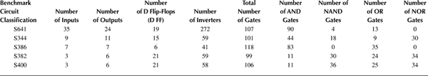!(images/tab1_2.jpg)

## 1.3 使用神经网络进行功耗估计

该方法包含以下步骤：

1. 神经网络的构建
2. 训练阶段
3. 测试阶段

## 1.3.1 神经网络的构建

构建了一个四层反向传播（BP）前馈网络。第一层的传递函数设置为“linear”，其余层均设置为“tansig”函数。`BPNN`的参数（如隐藏层、`learning rate`、`epoch`和`momentum constant`）针对 11 种不同的训练算法进行了变化，如`Traingd`、`Traingda`、`Trainrp`、`Traingdx`、`Traingdm`、`Traincgf`、`Traincgp`、`Traincgb`、`Trainscg`、`Trainbfg`和`Trainoss`。顺序电路选择的输入个数为九，因为它有九个属性，如图 1.1 所示。通过消除`OR`门、`AND`门和反相门，属性的数量从九个变为六个。

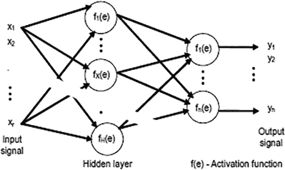

**图 1.1** `BPNN`的通用架构。

## 1.3.2 BPNN 训练阶段

* 步骤 1：为了训练`BPNN`，从 ISCAS’89 基准电路数据库中提取了三分之一的输入向量 [39]。
* 步骤 2：对输入向量及其目标向量进行 −1 到 +1 之间的归一化，因为所有隐藏层都使用了`tan sigmoidal`激活函数。
* 步骤 3：归一化后，使用输入向量及其对应的归一化目标向量训练神经网络。

## 1.3.3 BPNN 测试阶段

* 步骤 1：为了测试`BPNN`，使用了三分之一的输入向量 [39]。
* 步骤 2：在测试前对输入向量进行归一化。
* 步骤 3：对相应归一化测试输入向量的输出向量进行归一化并应用于`BPNN`。
* 步骤 4：测试后，通过反向归一化过程获得输出向量的原始值。
* 步骤 5：通过回归分析对输出向量进行验证。

基于`BPNN`的训练和测试过程流程如图 1.2 所示。

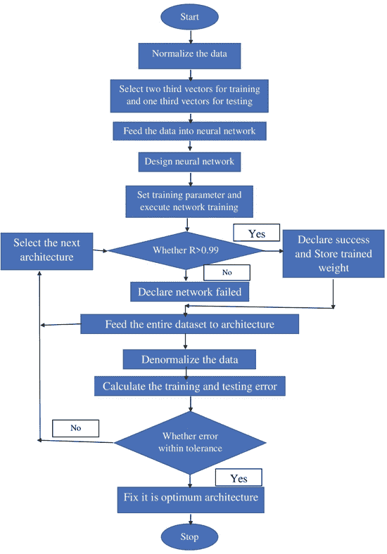

**图 1.2** 用于功耗估计的建议`BPNN`工作流。

## 1.3.4 网络参数

`BPNN`使用 11 种不同的训练算法进行训练。通过改变`learning rate`、`momentum constant`、`hidden layer`和`epoch`等网络参数来比较这些训练算法的性能。进行了广泛的`MATLAB`仿真以选择停止标准。参数在表 1.3 所示的范围内变化。

表 1.3 `BPNN`参数范围

| 参数 | 范围 |
| --- | --- |
| 隐藏层神经元 | 10–17 |
| 动量常数 | 0.1–0.9 |
| 学习率 | 0.3–0.8 |
| Epoch | 150–2700 |

## 1.4 使用 ANFIS 进行建议功耗估计

## 1.4.1 建议工作概述

提议应用`ANFIS`通过改变 ISCAS’89 电路中不同的属性（如 D 触发器、`NAND`门、反相器、`NOR`门、`AND`门、输入数量、输出数量和电路中的门总数）来估计功率。`ANFIS`是模糊推理系统和神经网络的结合，这是其主要优势。误差（通常是实际输出与期望输出之间的平方差）在每次迭代中都会减少。改变`ANFIS`的参数（如`step size`、`error goal`、`membership function`、`step-increase rate`和`decrease rate`）来估计功率。

## 1.4.2 ANFIS 中使用的训练和检查

使用减法聚类技术和网格划分技术构建模糊规则。使用之前发现的输入配置生成初始`FIS`模型。使用混合学习算法训练网络，并调整之前获得的模型的成员函数，以提供尽可能准确的估计。`ANFIS`的训练/检查流程图如图 1.3 所示。用于训练/检查的数据集如表 1.1 和 1.2 所示。

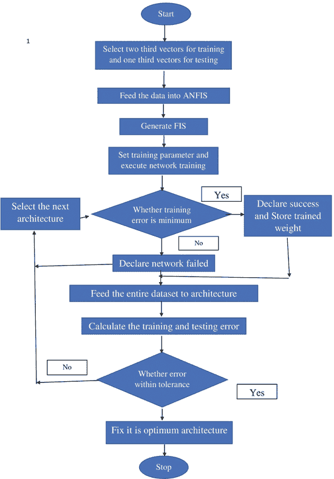

**图 1.3** 用于功耗估计的建议`ANFIS`工作流。

## 1.4.3 ANFIS 的设计

`ANFIS`由五层组成，用于通过混合学习模式调整`FIS`中的参数并实现不同的节点函数。通过改变`step size`、`error goal`、`membership function`、`step-increase rate`和`decrease rate`来估计功率。`ANFIS`参数的变化在表 1.4 所示。进行详尽的`MATLAB`仿真以选择`ANFIS`良好的参数。具有 9 个输入和 10 条模糊规则的 ISCAS’89 电路的功耗估计`ANFIS`架构如图 1.4 所示。

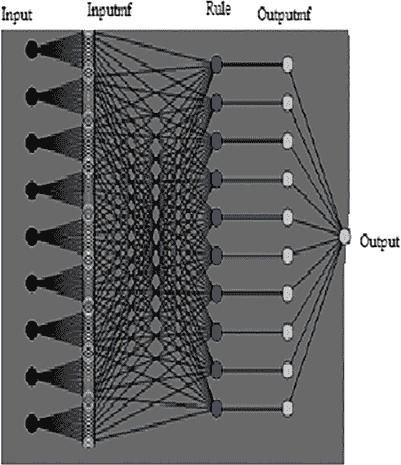

**图 1.4** ISCAS’89 电路的`ANFIS`架构。

表 1.4 `ANFIS`参数范围

| 参数 | 值/范围 |
| --- | --- |
| 误差目标 | 6 |
| 初始步长 | 0.01 |
| 步长减小率 | 0.9 |
| 步长增加率 | 1.5 |
| 成员函数 | GAUSSIAN/SIGMF |
| 优化方法 | HYBRID/BACK PROPAGATION |

## 1.5.1 基于 BPNN 的方法

提出了一种基于`BPNN`的 ISCAS’89 顺序电路功耗估计技术。使用 11 种不同的训练算法训练神经网络。`BPNN`针对顺序电路的六到九个属性进行训练。对于顺序电路（ISCAS’89），`Trainscg`的性能与理想功耗仅偏差 0.01%。对功耗估计进行了比较研究，并列出了各种训练算法。表 1.5 显示了 ISCAS’89 基准电路的回归结果。使用`ANFIS`进行功耗估计已应用于 ISCAS’89 顺序电路，也可以扩展到其他电路。

## 1.5.2 计算预测误差

测试和训练期间的预测误差计算公式如下：

| $$\text{Error~\%} = \frac{\text{A} - \text{B} \times 100}{\text{A}}$$ |
| --- |
| (1.1) |

其中`A`是使用`Monte Carlo`仿真估计的实际值，`B`是测试网络得到的预测值。

表 1.5 报告了回归分析，其中在共轭梯度类别下，针对 ISCAS’89 顺序电路层大小为 9:15:15:1、9 个输入、253 epoch 的`Trainscg`非常适用于功耗估计。

在 11 种不同的 BPNN 算法中，`Trainscg`根据缩放共轭梯度法更新网络训练函数中的权重和偏置值。`Trainscg`非常适用于具有大量输入的网络电路，并具有快速的函数近似能力。即使误差减小，`Trainscg`的性能也不会像其他算法那样显著下降。因此，如表 1.6 所示，与现有方法相比，`Trainscg`在回归、迭代次数、截距（B）和斜率（M）方面提供了更好的结果。

## 1.5.3 基于 ANFIS 方法

用于输入和检查的数据被加载到工作区并导入到 MATLAB 的 ANFIS 工具中。通过执行详尽仿真并在表 1.4 所示范围内改变 ANFIS 参数，生成一个新的 FIS。使用反向传播和结合常数与线性方法的混合优化创建了用于功率估计应用的初始 FIS 模型，其中通过线性方法配置的混合优化获得了最小误差。使用高斯和 sig 成员函数的各种 ANFIS 结构的测试误差结果报告在表 1.7 和表 1.8 中。

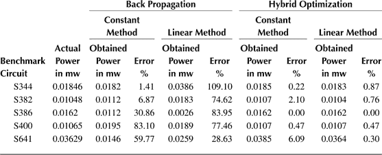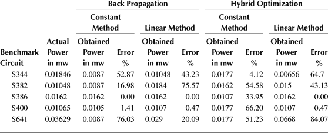

表 1.9 显示了 ANFIS 和 BPNN 之间的功耗对比，而表 1.10 提供了 BPNN 和 ANFIS 误差百分比的详细信息。在 11 种不同的 BPNN 算法中，`Trainscg`函数最适用于 ISCAS’89 顺序基准电路。采用混合学习和减法聚类的 ANFIS 性能优于 BPNN。ANFIS 是模糊推理系统和人工神经网络的结合体，这是它的主要优势。误差（通常是实际输出与期望输出之间差的和）在每次迭代中都会减少。ANFIS 能够生成一个使输入和输出数据之间存在线性关系的 FIS。因此，ANFIS 的独特性似乎是 CMOS VLSI 电路功率估计的更好选择。

表 1.9 BPNN 和 ANFIS 功率估计结果对比

| 基准电路 | 实际功率 (mw) | BPNN 功率 (mw) | ANFIS 功率 (mw) |
| --- | --- | --- | --- |
| S344 | 0.01846 | 0.0193 | 0.0183 |
| S382 | 0.01046 | 0.0176 | 0.0104 |
| S386 | 0.01628 | 0.0182 | 0.0162 |
| S400 | 0.01065 | 0.01087 | 0.0107 |
| S641 | 0.03629 | 0.0246 | 0.0364 |

表 1.10 BPNN 和 ANFIS 误差对比

| 基准电路 | BPNN (%) | ANFIS (%) |
| --- | --- | --- |
| S344 | 4.55 | 0.87 |
| S382 | 67.93 | 0.76 |
| S386 | 12.34 | 0.00 |
| S400 | 2.06 | 0.47 |
| S641 | 32.21 | 0.30 |

ANFIS 是模糊推理系统和人工神经网络的结合，因此它具有适应能力、快速学习能力以及捕捉过程非线性结构的能力，这就是为什么它非常适合估计 CMOS VLSI 电路的功率，如图 1.5 和图 1.6 所示。图 1.5 显示了一张比较电路实际功率与使用 BPNN 和 ANFIS 测试网络所获得功率估计的图表。从图中我们可以推断出使用 ANFIS 估计的功率遵循蒙特卡洛仿真估计的实际功率。图 1.6 提供了误差百分比信息，与 BPNN 相比，ANFIS 给出了最小百分比。

**图 1.5** 实际功率与 BPNN 和 ANFIS 估计功率的对比。

**图 1.6** ANFIS 和 BPNN 误差对比。

## 1.5.4 性能评估

使用`RMSE`和`R`来评估 ANFIS 和 BPNN 的性能，它们可以通过公式 (1.2) 和 (1.3) 计算。

```
RMSE = \sqrt{\frac{\sum_{i=1}^{N} (Y_I^O - Y_I^C)²}{N}}
```

(1.2)

```
R = \frac{\sum_{i=1}^{N} (Y_I^O - Y^O)(Y_I^C - Y^C)}{\sqrt{\sum_{i=1}^{N} (Y_I^O - Y^O)² \sum_{i=1}^{N} (Y_I^C - Y^C)²}}
```

(1.3)

其中`Y[I]^O`是观测值，`Y[I]^C`是计算值；同样，`Y^O`是观测值的平均值，`Y^C`是计算值的平均值。`RMSE`通常用作衡量模型预测值与测量原始值之间差异的指标。`RMSE`可以指示模型的准确性或精度，`RMSE`的值应该较低或接近于零。`R`决定了测量值与模型仿真值之间的线性相关性，其最优值为 1。BPNN 和 ANFIS 的`RMSE`和`R`如表 1.11 所示；从表中我们可以推断，与 BPNN 相比，ANFIS 的`RMSE`较小，且 ANFIS 的`R`值非常接近 1。

表 1.11 BPNN 和 ANFIS 统计分析测试对比

| 参数 | BPNN | ANFIS |
| --- | --- | --- |
| RMSE | 0.0004499 | 0.0002075 |
| R | 0.84696 | 0.99961 |

## 1.6 结论

由于使用 SPICE 仿真对 CMOS VLSI 电路进行功率估计非常耗时，且希望在较高抽象层次用较少的设计时间和成本进行功率估计，因此我们提出了一种使用 ANFIS 和 BPNN 等统计技术的方法。SPICE 仿真等传统技术基于预定义方程的假设，因此使用 ANFIS 和 BPNN 进行功率估计可以作为 SPICE 仿真的替代方案。BPNN 和 ANFIS 的结果非常准确，与系统不同，不需要电路结构和连接的细节。与 BPNN 相比，ANFIS 在测试误差方面提供了更好的结果，误差范围在 0% 到 0.86% 之间。它还具有 0.0002075 的低`RMSE`值和 0.99961 的高`R`值。

* 3. Al-Shammari, E. T., Amirmojahedi, M., Shamshirband, S., Petković, D., Pavlović, N. T., & Bonakdari, H. (2015). 基于自适应神经模糊方法的风力涡轮尾效应估计。Flow Measurement and Instrumentation, 45, 1–6. [`dx.doi.org/10.1016/j.flowmeasinst.2015.04.002`](http://dx.doi.org/10.1016/j.flowmeasinst.2015.04.002).
* 4. Bhanja, S., & Ranganathan, N. (2003). 使用贝叶斯网络的 VLSI 电路开关活动估计。IEEE Transactions on Very Large Scale Integration Systems, 11(4), 558–567. [`dx.doi.org/10.1109/TVLSI.2003.816144`](http://dx.doi.org/10.1109/TVLSI.2003.816144).
* 5. Burch, R., Najm, F. N., Yang, P., & Trick, T. N. (1993). 用于功率估计的蒙特卡洛方法。IEEE Transactions on Very Large Scale Integration Systems, 2(1), 63–71. [`dx.doi.org/10.1109/92.219908`](http://dx.doi.org/10.1109/92.219908).


* 6. Saxena, V., Najm, F. N., & Hajj, I. N. (1997). 序电路中功率估计的蒙特卡洛方法。欧洲 Design and Test Conference, 17–20 March (ED&TC 97), 416–420. [`dx.doi.org/10.1109/EDTC.1997.582393`](http://dx.doi.org/10.1109/EDTC.1997.582393).

* 7. Chiu, S. (1996). 通过减法聚类提取模糊分类规则的方法和软件，Proceedings of Fuzzy Information Processing Society NAFIPS Biennial Conference North American, pp.461–465. [`dx.doi.org/10.1109/NAFIPS.1996.534778`](http://dx.doi.org/10.1109/NAFIPS.1996.534778).

* 8. Klein, F., Leao, R., Santos, G. A., & Azevedo, R. (2009). 用于高层功率估计精度优化的多模型引擎。IEEE Transactions on Very Large Scale Integration Systems, 17(5), 660–673. [`dx.doi.org/10.1109/TVLSI.2009.2013627`](http://dx.doi.org/10.1109/TVLSI.2009.2013627).

* 9. Buyuksahin, K. M., & Najm, F. N. (2006). VLSI 电路的早期功率估计。IEEE Transactions on Computer Aided Design of Integrated Circuits and Systems, 24(7), 1076–1088. [`dx.doi.org/10.1109/TCAD.2005.850904`](http://dx.doi.org/10.1109/TCAD.2005.850904).

* 10. Karimi, G., Banitalebi, R., & Sedaghat, S. B. (2013). 使用神经网络和自适应神经模糊推理系统仿真射频应用的 SiGe:C HBTs。International Journal of Electronics, 100(7). [`dx.doi.org/10.1080/00207217.2012.727353`](http://dx.doi.org/10.1080/00207217.2012.727353).

* 11. Guney, K., & Sarikaya, N. (2007). 计算电薄和厚矩形条天线谐振频率的自适应神经模糊推理系统。International Journal of Electronics, 94(9), 007. [`dx.doi.org/10.1080/0020721070152617`](http://dx.doi.org/10.1080/0020721070152617).

* 12. Güler, İ., & Übeyli, E. (2005). 用于共面波导中不连续性的自适应神经模糊推理系统。International Journal of Electronics, 92(3). [`dx.doi.org/10.1080/002072105123313768`](http://dx.doi.org/10.1080/002072105123313768).

* 13. Ramesh, J., Vanathi, P., & Gunavathi, K. (2008). 使用反传播网络进行锁相环故障分类。ETRI Journal, 30(4), 546–554. [`dx.doi.org/10.4218/etrij.08.010833`](http://dx.doi.org/10.4218/etrij.08.010833).

* 14. Karthika, B. S., & Dek, P. C. (2015). 使用小波数据的混合模型 (ANFIS) 预测空气温度。Aquatic Procedia, 1155–1161. [`dx.doi.org/10.1016/j.aqpro.2015.02.147`](http://dx.doi.org/10.1016/j.aqpro.2015.02.147).

* 15. Hou, L., Zheng, L., & Wu, W. (2006). 基于神经网络的 VLSI 功率估计。IEEE International Conference on Solid State and Integrated Circuit Technology, 2006, pp.1919–1921. [`dx.doi.org/10.1109/ICSICT.2006.306506`](http://dx.doi.org/10.1109/ICSICT.2006.306506).

* 16. Mohammadi, K., Shamshirband, S., Yee, P., Petković, D., Zamani, M., & Ch, S. (2015). 基于极端学习机的风密度预测。Energy, 86, 232–239. [`dx.doi.org/10.1016/j.energy.2015.03.111`](http://dx.doi.org/10.1016/j.energy.2015.03.111).

* 17. Murugavel, A., Ranganathan, N., Chandramouli, R., & Chavali, S. (2002). 数字 CMOS 电路平均功率的最小二乘估计。IEEE Transactions on Very Large Scale Integration Systems, 10(1), 55–58. [`dx.doi.org/10.1109/92.98730`](http://dx.doi.org/10.1109/92.98730).

* 18. Nikolić, V., Motamedi, S., Shamshirband, S., Petković, D., Ch, S., & Arif, M. (2015). 用于风速估计的极端学习机方法。Mechatronics, 34, 78–83. [`dx.doi.org/10.1016/j.mechatronics.2015.0407`](http://dx.doi.org/10.1016/j.mechatronics.2015.0407).

* 19. Nikolić, V., Petković, D., Por, L., Shamshirband, S., Zamani, M., Ćojbašić, Ž., & Motamedi, S. (2016). 用于估计风力涡机噪声级别的神经模糊方法学。Mechanical Systems and Signal Processing, 66–78, 715–722. [`dx.doi.org/10.1016/j.ymsp.2015.013`](http://dx.doi.org/10.1016/j.ymsp.2015.013).

* 20. Nikolić, V., Petković, D., Shamshirband, S., Ćojbašić, Ž., & Motamedi, S. (2015). 扩散器对风力影响的自适应神经模糊估计。Energy, 89, 324–333. [`dx.doi.org/10.1016/j.energy.2015.05126`](http://dx.doi.org/10.1016/j.energy.2015.05126).

* 21. Nikolić, V., Shamshirband, S., Petković, D., Ćojbašić, Ž., Mohammadi, K., Gani, A. (2015). 自适应神经模糊法对发电生产的影响估计。Energy, 80, 361–372. [`dx.doi.org/10.1016/j.energy.2014.118`](http://dx.doi.org/10.1016/j.energy.2014.118).

* 22. Dalibor, P., Ćojbašić, Z., & Nikolić, V. (2013). 用于风功率估计的自适应神经模糊方法。Renewable and Sustainable Energy Reviews, 28, 191–195. [`dx.doi.org/10.1016/j.rser.2013.07049`](http://dx.doi.org/10.1016/j.rser.2013.07049).

* 23. Petković, D., Pavlovic, N. T., Shamshirband, S., Kiah, M. L., Anuar, N. B., & Idris, M. Y. (2014). 光参数的自适应神经模糊估计。Optics and Lasers in Engineering, 55, 84–93. [`dx.doi.org/10.1016/j.optlaseng.2013.10018`](http://dx.doi.org/10.1016/j.optlaseng.2013.10018).

* 24. Dalibor, P., Shamshirband, S., Pavli, N. T., Anuarc, N. B., & Mat Kiah, M. L. (2014). 自适应神经模糊的光学系统调制传输函数估计。Optics and Spectroscopy, 117(1), 121–131. [`dx.doi.org/10.1134/S003040X1407042`](http://dx.doi.org/10.1134/S003040X1407042).

* 25. Petković, D., Ćojbašić, Ž., Nikolić, V., Shamshirband, S., Kiah, M. L. M., Anuar, N. B., & Wahab, A. W. A. (2014). 连续变箱风力涡轮机自适应神经模糊最大功率提取。Energy, 64, 868–874. [`dx.doi.org/10.1016/j.energy.2013.10094`](http://dx.doi.org/10.1016/j.energy.2013.10094).

* 26. Petković, D., Ab Hamid, S. H., Ćojbašić, Ž., & Pavlović, T. N. (2014). 用于变量选择和风力机尾流效应分析的项目管理方法与 ANFIS 策略改进。Natural Hazards, 74(2), 463–475. [`dx.doi.org/10.1007/s11069-014-1189-1`](http://dx.doi.org/10.1007/s11069-014-1189-1).

* 27. Petković, D., Shamshirband, S., Ćojbašić, Z., Nikolić, V., Anuar, N. B., Sabri, A. Q. M., & Akib, S. (2014). 风力机功率建筑增强的自适应神经模糊估计。Computers & Fluids, 97, 188–194. [`dx.doi.org/10.1016/j.compfluid.2014.04.016`](http://dx.doi.org/10.1016/j.compfluid.2014.04.016).

* 28. Petković, D., Shamshirband, S., Anuar, N. B., Naji, S., Kiah, M. L. M., & Gani, A. (2015). 作为风速和方向函数的风电场发电产的自适应神经模糊评估。Stochastic Environmental Research and Risk Assessment, 29(3), 793–802. [`dx.doi.org/10.1007/s00477-014-0901-8`](http://dx.doi.org/10.1007/s00477-014-0901-8).

* 29. Petković, D., Shamshirband, S., Tong, C. W., & Al-Shammari, E. T. (2015). 用于风速分布预测的通用自适应神经模糊方法。Flow Measurement and Instrumentation, 43, 47–52. [`dx.doi.org/10.1016/j.flowmeasinst.2015.03.003`](http://dx.doi.org/10.1016/j.flowmeasinst.2015.03.003).

* 30. Petković, D. (2015). 用于风速分布估计的自适应神经模糊方法。Electrical Power and Energy Systems, 73, 389–392. [`dx.doi.org/10.1016/j.ijepes.2015.05.039`](http://dx.doi.org/10.1016/j.ijepes.2015.05.039).

* 31. Ramanathan, P., Surendiran, B., & Vanathi, P. (2013). 使用人工网络对基准电路功率估计。Journal, 75(9), 427–433. https://www.researchgate.net/publication/2579376_Power_Estimation_of_Circuits_using_Neural_Networks

* 32. Lorenzo, R., & Chaudhry, S. (2016). CMOS VLSI 中电路级最小化综述。IETE Technical Review, April 2016, 23. [`dx.doi.org/10.1080/02564602.2016.16216`](http://dx.doi.org/10.1080/02564602.2016.16216).

* 33. Shamshirband, S., Petković, D., Nikolic, Z. V., Anuar, N. B., Mohd Shuib, N., Kiah, M. L., & Akib, S. (2014). 风电场利润的自适应神经模糊优化。Energy Conversion and Management, 80, April 2014, 229–237. [`dx.doi.org/10.1016/j.enconman.2014.01.038`](http://dx.doi.org/10.1016/j.enconman.2014.01.038).

* 34. Shamshirband, S., Petković, D., Anuar, N. B., & Gani, A. (2014). 风力机模型的自适应神经模糊化。Renewable and Sustainable Energy Reviews, 36, 270–276. [`dx.doi.org/10.1016/j.rser.2014.04.064`](http://dx.doi.org/10.1016/j.rser.2014.04.064).

* 35. Shamshirband, S., Petković, D., Hashim, R., & Motamedi, S. (2014). 风力机噪声评估的自适应神经模糊方法。PLoS One, 9(7), 1–9. [`dx.doi.org/10.1371/journal.pone.0103414`](http://dx.doi.org/10.1371/journal.pone.0103414).

* 36. Shamshirband, S., Petković, D., Hashim, R., Motamedi, S., & Anuar, N. B. (2014). 自适应神经模糊方法对风力机尾流模型的评估。Electrical Power and Energy Systems, 63, 618–624. [`dx.doi.org/10.1016/j.ijepes.2014.06.022`](http://dx.doi.org/10.1016/j.ijepes.2014.06.022).

这些社交网络在每个人的生活中可能起着至关重要的作用，帮助他们处理日常生活的信息更新。特别是，社交网络既有优点也有缺点。其优点包括人们信息共享的多样性：快速发布消息、点赞和更新帖子，以及为商业商家投递产品。人们可以从任何类型的网络获得快速的通信和信息访问。这种情景也存在缺点，如数据滥用、隐私问题、发布他人的用户账户数据以及信息黑客攻击。这些都会负面影响社交网络用户的生活，并产生许多无法解决的问题。受此影响的主要领域是个人登录标识的滥用，例如一个人的登录凭据被他人使用并滥用该人的数据信息。

社交媒体网络中有许多黑客数据的方法。用户在社交网络中发布任何个人信息时，应该意识到隐私问题。一些担忧包括发布的照片被滥用以及社交网络中的个人信息被破解。黑客可以使用攻击技术和工具来破解任何用户数据。此类被破解的信息或数据会被黑客滥用。由于这些缺点，解决由此产生的社会性主要问题可能会困难。

## 2.1.1 文献综述

Zhuozhao Li 等人 (2018) [1] 提出了一种名为“迪士尼信息站”（DIS boards）的概念，这是一个为经常访问迪士尼度假地的人们建立的迪士尼相关旅行讨论论坛。DIS 系统的开发是为了减少对迪士尼相关信息的搜索时间，如度假村、餐饮以及其他游客的评论。关于 DIS 的使用，该系统将青少年和成年用户归类为报告、事实和讨论簇。在系统中，创建并传通了用于讨论论坛的线索（thread）类别。针对旅行报告、餐厅和探险活动，创建了名为“自我中心网络”（ego network）的聚类分析。通过 DIS 系统，迪士尼社交网络用户可以快速地找到相关信息。


Ming Cheung 等人 (2018) [2] 研究了针对西方和东方内容共享机制的搜索引擎社交网络。在这种机制中，作者参考了八百万人在八个不同社交网络上的使用情况。在这项工作中，主要分析从用户共享的图像和朋友的关注者开始。搜索引擎过程通过从多个社交网络收集图像开始，并使用名为“卷积神经网络”的概念对图像进行标记和发现。通过连接两个或三个社交网络，可以提高社交网络中关注者的连接性和可发现性。

Rahil Sharma 等人 (2017) [3] 提出了一种名为“新型混合并行算法”的算法，用于对社交网络中的社区小组进行分类。随着社交网络的发展，多种并行算法（如带有合成图的并行算法）被用于分类分析。在这种方法中，为了对社区小组进行聚类，使用了多级多核（MCML）社区检测算法（共享内存并行实现）将小组划分为不同的簇。在此过程中，层级被归类为网络划分、顶点重编号和图像划分以及 MCML。与不同的划分方式一样，社交社区可以实现良好的扩展性和适当的社区搜索质量。

Xue Yung 等人 (2016) [4] 引入了一种名为“安全且细粒度隐私保护匹配”（SFPM）的协议，用于安全移动通信。该协议的开发旨在增强移动通信的安全性。在 SFPM 中，使用了两种方法来描述两个手机之间的匹配，例如余弦相似性检查和加权 L1 范数匹配。对于第一种，通过余弦相似性验证识别并测量一组相似的对象。对于第二种，优先使用加权 L1 匹配来在通信传输期间匹配对象的权重。在使用 SFPM 协议时，只有经过认证的信息在 Android 移动应用中安全共享。SFPM 协议在两种类型的 Android 移动应用和一个 PC 上进行了测试。在这种方法中，用户可以使用 SFPM 协议保护 Android 中的信息。

Hongjian Wang 等人 (2019) [5] 提出犯罪率分析可以在不同的研究中执行。在本章中，作者提出了芝加哥地区的兴趣点（POI）数据术语。开发了二项回归模型和地理加权回归模型来监控盗窃、刑事破坏、入室盗和机动车盗的特征。使用 POI 方法可以快速对犯罪分析进行分析和纠正。

Daniel Zhang 等人 (2019) [6] 提出了一种可扩展且稳健的真实发现（SRTD）方法，以研究社交媒体上相同的虚假信息传播。该章节重点关注基于真实性分数的 Twitter 分析。可以通过数据稀疏性分析和数据融合技术分析 SRTD。监控并部署了三项主要观察以改进 SRTD 算法：转发消息期间非常滞后的独立验证、转发虚假主张以及对先前的主张的错误考虑。使用这种方法，分析了 Twitter、Facebook 和 Instagram 社交网络中的虚假信息传播。

Alamelu Muthukrishnan 等人 (2017) [7] 提出了一种用于医疗保健和社交网络系统的最多数使用（MPU）物联网结构。从终端用户收集集体医疗保健相关的查询，并与专家成员进行分析。大多数未解决的查询被输入到提议的健康社交云中心（HSCC）系统。内部系统将对风险分析和专家成员与专家分析数据库进行讨论。最终解决方案随后发送给请求客户，客户可以做出最终决策。

## 2.2 使用分析与可协商（UAN）方法

通常，许多社会问题可能通过滥用社交网络产生。为了减少社交网络的滥用并提高青少年和成人的意识，提议的使用分析与可协商（UAN）方法将通过用户兴趣测试率（UITR）分析算法方法提出用户视图分析。提议的 UAN 系统可以细分为由年龄分类使用分析、用户视图分析以及 UITR 分析算法和反馈生成的若干子模块。

在此项分析中，终端用户可以使用各种社交网络应用，并在社交网络系统中分享他们的完整想法。系统最初会根据年龄分类对终端用户的使用情况进行分类，并根据 18–35 岁年龄段的分类，随后将其推向用户视图分析。在这种情况下，用户信息共享可以按点赞与不喜欢、内容分享和评论发布等类别进行分类。在用户使用分析方面，`UITR` 算法会对终端用户对网络的使用情况进行评分。通过这种方式，终端用户（尤其是 18 到 35 岁的年龄组）可以做出关于如何良好使用社交网络的价值性决策。详细的处理方法 `UAN` 如图图 2.1 所示。

**图 2.1** 使用分析与可协商方法方法。

`UAN` 的初始处理流程可以从多样化的终端客户开始。客户可以选择社交网络。他们将使用不同版本的社交网络应用，如 Facebook、WhatsApp、Instagram、Twitter、Google +、Vimeo 和 YouTube。

作为第一步，可以使用一组年龄分组器进行年龄分类。第一步可以从年龄分类开始。年龄分类可以从成年年龄分类分析开始，在这种情况下，年龄分类可以执行为 18 到 35 岁的年龄分组。随后，年龄分类分析可以可以根据 18 到 25 岁、26 到 30 岁和 31 到 35 岁的类别进行。

## 2.3 年龄分类使用分析

提议的 `UAN` 系统将从 18 到 35 岁年龄组的初始年龄分类开始。这可以分为 18 到 25 岁、26 到 30 岁和 31 到 35 岁组的分类。根据成年年龄分类，规则规定了初学者、中年龄组和老年组。

### 2.3.1 为 18–25 年龄分类定义的规则

该年龄组被定义为 `UAN` 系统的初学者。在这种情况下，系统将根据识别的初始规则来识别初学者。即：

1. 初学者必须通过 `DOB` 个人资料验证验证其详细信息。

2. `Beginner Entry profile verification = if (DOB = 18 or DOB <= 25) then verify Government ID proof.`

3. 否则

4. `Beginner Entry profile verification = Restricted category`（受限类别）

5. `DOB` 个人资料验证可以与政府定义的选民证证明或 `Aadhaar` 号的任何之一关联。

6. 如果年龄分类与初学者识别不匹配，则可以通过策略感知识别规则进行严格监控。

7. 如果未找到匹配，则未匹配的初学者将被置于受限分类。

根据初学者感知政策，未匹配的初学者被指示避免预注册，并被置于等待列表中直到直到他们符合标准。

### 2.3.2 为 26–30 年龄分类定义的规则

该年龄组被定义为 `UAN` 系统的中年龄组。在这种情况下，系统将根据识别的初始规则来识别中年龄组。即：

1. 中年龄组必须通过 `DOB` 个人资料验证验证其详细信息。

2. `Middle ager profile verification = if (DOB = 26 or DOB <= 30) then verify Government ID proof.`

3. 否则

4. `Middle ager profile verification = Restricted category`（受限类别）

5. `DOB` 个人资料验证可以与政府定义的选民证证明或 `Aadhaar` 号的任何之一关联。

6. 如果年龄分类与中年龄识别不匹配，则可以通过策略感知识别规则进行严格监控。

7. 如果未找到匹配，则未匹配的中年龄组将被置于受限分类。

根据中年龄感知政策，未匹配的中年龄组被指示避免预注册，并被置于等待列表中直到他们符合标准。

### 2.3.3 为 31–35 年龄分类定义的规则

该年龄组被定义为 `UAN` 系统的老年组。在这种情况下，系统将根据识别的初始规则来识别老年组。即：

1. 老年组必须通过 `DOB` 个人资料验证验证其详细信息。

2. `Large age group profile verification = if (DOB = 31 or DOB <= 35) then verify Government ID proof.`

3. 否则

4. `Large age profile verification = Restricted category`（受限类别）

5. `DOB` 个人资料验证可以与政府定义的选民证证明或 `Aadhaar` 号的任何之一关联。

6. 如果年龄分类与老年识别不匹配，则可以通过策略感知识别规则进行严格监控。

7. 如果未找到匹配，则未匹配的老年组将被置于受限分类。

根据老年感知政策，未匹配的老年组被指示避免预注册，并被置于等待列表中直到他们符合标准。

# 2.4 用户视图分析

在此项分析中，终端用户可以使用各种社交网络应用，并在社交网络系统中分享他们的完整想法。系统最初会根据年龄分类对终端用户的使用情况进行分类，并根据 18–35 岁年龄段的分类，随后将其推向用户视图分析。在这种情况下，用户信息共享可以按点赞与不喜欢、内容分享和评论发布等类别进行分类。在用户使用分析方面，`UITR` 算法会对终端用户对网络的使用情况进行评分。通过这种方式，终端用户（尤其是 18 到 35 岁的年龄组）可以做出关于如何良好使用社交网络的价值性决策。详细的处理方法 `UAN` 如图图 2.1 所示。

`UAN` 的初始处理流程可以从多样化的终端客户开始。客户可以选择社交网络。他们将使用不同版本的社交网络应用，如 Facebook、WhatsApp、Instagram、Twitter、Google +、Vimeo 和 YouTube。

作为第一步，可以使用一组年龄分组器进行年龄分类。第一步可以从年龄分类开始。年龄分类可以从成年年龄分类分析开始，在这种情况下，年龄分类可以执行为 18 到 35 岁的年龄分组。随后，年龄分类分析可以根据 18 到 25 岁、26 到 30 岁和 31 到 35 岁的类别进行。

**图 2.1** 使用分析与可协商方法方法。

1. 用户发布的内容可以根据用户的视图选择进行查看。

2. 内容分享可以根据该内容的收点赞数和用户数量来选择。

3. 分享给其他用户取决于设置的好友集或特定的朋友类别。

4. 如果某个朋友类别的计数最高，则用户内容分享可以与分享给用户的领域类型进行匹配。

5. `好友列表分享类别` = `好友列表数量 + 最受青睐`

6. `共享领域`

7. 如果单用户内容已分享，则根据内容所属的领域对其内容分享的类型进行评分。

8. `单用户分享类别` = `单人朋友 + 特定的内容分享`

在完成对三类用户视图分析（点赞和不喜欢查看、评论发布以及内容分享）后，最终的披露报告将发送到评分分析系统，进行用户感兴趣率分析。

# 2.5 用户感兴趣率 (UITR) 分析算法

`UITR` 算法将根据终端用户的点赞、不喜欢查看、评论发布和内容分享对数据进行分析。评分可以基于用户对社交网络的使用意向。[图 2.3] 展示了具有三个内部处理执行的 `UITR` 分析算法。

**图 2.3** 用户感兴趣率 (UITR) 分析。

## 2.5.1 评分陈述分析

评分分析可以基于专家成员对用户视图分析报告的建议和讨论的评审分析。

### 2.5.1.1 点赞与不喜欢的评分算法

1. 如果点赞和不喜欢的查看类别为：

    * `点赞数 (Number of Likes) <=15` 为低优先级

    * `点赞数 (Number of Likes) >=16 to 75` 为中等优先级

    * `点赞数 (Number of Likes) >=76` 为高优先级

2. 评分可以根据发布日期、发布小时以及领域类型进行分析。

3. 如果类别属于 `<=15` 的低优先级，则分析可以在两天的时长内进行记录。

4. 点赞与不喜欢查看的计算：

   `∑ 点赞与不喜欢查看 = ∑ 总发布点赞与不喜欢的分析时长`

   在两天内/总发布小时数（24 小时）

   例如：

   场景 1：如果 2 天内的点赞和不喜欢发布次数为 15 次，匹配 24 小时，则得到的输出结果为 `15/24 = 0.625`。

   场景 2：如果 2 天内的点赞和不喜欢发布次数为 35 次，匹配 24 小时，则得到的输出结果为 `2/35 = 1.458`。

   场景 3：如果 2 天内的点赞和不喜欢发布次数为 80 次，匹配 24 小时，则得到的输出结果为 `80/24= 3.333`。

5. 已识别高优先级匹配并映射到发布领域。

   该领域可以是图片或内容。

6. 对于内容领域，已生成了一份关于内容的报告并发送给用户。该报告将描述图片是分享给好友列表还是朋友与朋友的列表。

7. 通过查看报告分析，用户可以获得关于与其好友共享领域的优先级分析知识。

### 2.5.1.2 评论发布

评论发布可以由用户根据所选主题发布的评论集来定义。

* 评论发布类别可以根据领域分析进行分类。

* 领域分析被分为通用话题或社会相关话题。

* `领域分析 = 通用话题或社会话题/层级 -> 0, 1, 2`

如果识别出通用话题或社会相关话题，则识别出评论的正面和负面分类，并分为零、一、二三个级别。如果定义了零级，则应被定义为正式陈述的正面评论；如果定义了一级，则应被定义为适正面评论；如果定义了二级，则应被定义为非正式陈述等负面评论。

根据领域层级评分生成一份报告并发送给客户进行分析。

### 2.5.1.3 内容分享

内容分享可以定义为向朋友或关注者分享的内容类型。

内容分享可以根据要分享的领域类型来选择。

1. 选择任意一个类别，`好友列表分享类别`或`单用户分享类别`。

2. 所选类别可以映射到分享的内容类型。识别出分享次数最高的内容并将其映射给用户。

3. `内容分享 = 好友列表分享类别或单用户分享类别 + 具有最高优先级的内容类型`

## 2.6 反馈分析

反馈分析根据报告从终端用户执行。`UITR` 分析将产生最终报告。根据用户的使用情况，用户也可以查看最终报告。最后，用户可以对社交网络的使用优缺点得出结论。

## 2.7 结果与讨论

所提出的 `UAN` 方法是为青少年提供社交网络使用意识的一种方法。许多青少年和成人受到社交网络使用不当问题的影响。所提的 `UAN` 系统将根据年龄标准分析这些问题。参考现有系统，所提方法可以采用点赞和不喜欢、评论发布以及内容分享类别。[表 2.1] 展示了所提的 `UAN` 方法与现有方法的对比分析。

```
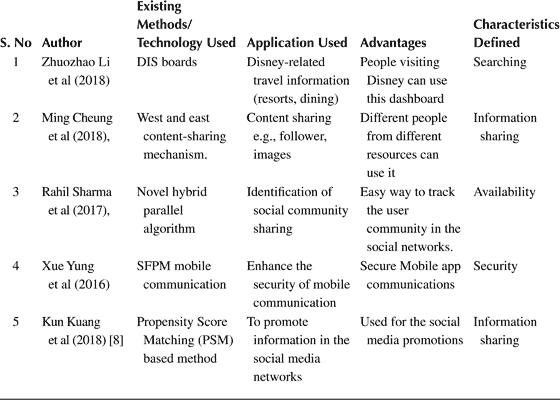
```

与现有方法相比，所提的 `UAN` 研究分析可以得出现有属性并根据讨论的属性改进服务。[表 2.2] 展示了现有系统与所提系统相比改进的分析属性。

```
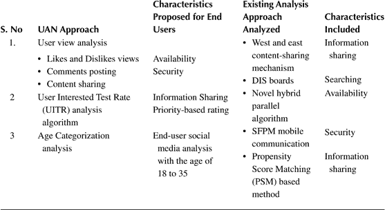
```

与现有分析方法相比，所提的 `UAN` 方法可以根据用户对社交网络的使用，通过优先级评分改进社交网络分析。

## 2.8 结论

所提的用户分析协商（`UAN`）方法可以为青少年和成人提供使用社交媒体的解决方案和意识。所提方法可以通过年龄分类分析、用户视图分析和 `UITR` 分析算法的方法提供解决方案。通过研究社交分析算法，18 到 35 岁的用户对社交媒体的使用优缺点有了清晰的了解。如果他们对社交媒体意识不足，根据他们对社交网络的使用，所提系统 `UAN` 将为终端用户提供使用反馈分析。未来，该工作将基于深度学习算法及其技术对移动应用程序提醒意识信息的连接性进行增强。

# 参考文献 (#02chap_02.xhtml#r-ref02-1)

1. Zhuozhao Li, Harrison Chandler, Haiying Shen (2018), “结合讨论论坛的社交网络中知识共享活动分析：DISboards 的案例研究”, *IEEE transactions on big data*, vol. 4, no. 4, pp. 432–446.

2. Ming Cheung, James She, Ning Wang (2018), “通过用户共享图像表征社交媒体中的用户连接”, *IEEE transactions on big data*, vol. 4, no. 4, pp. 447–458.

3. Rahil Sharma, Suely Oliveira (2017), “基于混合架构的大型社交网络社区检测算法”, *Big data research*, vol. 10, pp. 44–52.

4. Xue Yung, Rongxing Lu, Hongbin Liang, Xiaohu Tang (2016), “SFPM: 一种移动社交网络的安全且细粒度隐私保护匹配协议”, *Big data research*, vol. 3, pp. 2–9 (Elsevier).

5. Hongjian Wang, Huaxiu Yao, Daniel Kifer, Corina Graif, Zhenhui Li (2019), “利用现代城市数据进行犯罪率推理的非平稳模型”, *IEEE transactions on big data*, vol. 5, no. 2, pp.180–194.

6. Daniel Zhang, Dong Wang, Nathan Vance, Yang Zhang, Steven Mike (2019), “大数据社交媒体感知应用中可扩展且鲁棒的真实发现”, *IEEE transactions on big data*, vol. 5, no. 2, pp. 196–206.

7. Alamelu Muthukrishnan, Ramalatha Marimuthu (2017), “基于物联网的医疗与社交网络协作服务利用综述”, *Journal of advanced research in dynamical and control systems*, vol. 9, pp. 1010–1030.

8. Kun Kuang, Meng Jiang, Peng Cui, Hengliang Luo, and Shiqiang Yang (2018), “社交媒体中的有效促销策略选择：一种数据驱动的方法”, *IEEE transactions on big data*, vol. 4, no. 4, pp. 487–501.

# 使用深度学习技术进行视频目标检测与跟踪：综述

Dhivya Praba Ramasamy and Kavitha Kanagaraj

Kumaraguru College of Technology

## 目录

* 3.1 引言

* 3.2 视频跟踪中的挑战

* 3.3 目标跟踪基础

    * 3.3.1 目标表征

        * 3.3.1.1 形状表征

        * 3.3.1.2 外观表征

    * 3.3.2 目标检测

        * 3.3.2.1 帧差分

        * 3.3.2.2 光流

        * 3.3.2.3 背景减除

    * 3.3.3 目标分类方法


# 3.4 特征选择

- 3.4.1 边缘
- 3.4.2 光流
- 3.4.3 颜色
- 3.4.4 纹理

# 3.5 目标跟踪技术

- 3.5.1 点
- 3.5.2 基于核的跟踪
- 3.5.3 轮廓法

# 3.6 深度学习与机器学习简介

- 3.6.1 深度学习对比对比学习技术

# 3.7 示例

- 3.7.1 车辆检测
- 3.7.2 级联训练
- 3.7.3 可训练特征
  - 3.7.3.1 正样本
  - 3.7.3.2 负样本

# 3.8 结论

# 参考文献

## 3.1 引言

计算机视觉是一个广泛的领域，它描述了机器如何识别图像或场景中的数据。它模拟人类智能通过以下步骤（捕捉、处理、理解）处理现实世界的数据[1-3]。目标跟踪[8-9]涉及目标表征、检测和跟踪。

本章将介绍目标跟踪方法及其应用领域[10]，并为开发跟踪器提供基础概念。可以使用不同的图像或视频源，例如监控视频、多摄像头和医疗扫描仪。系统可以通过各种理论和模型进行构建。

在本章中，3.1 节给出引言；3.2 节关注视频跟踪中的挑战；3.3 节详细介绍了目标跟踪的基础知识；3.4 节探讨了特征选择的详细研究；3.5 节讨论了各种目标分类方法；3.6 节关注各种目标跟踪技术；3.7 节介绍了机器学习和深度学习；3.8 节讨论了结果。第 9 节和第 10 节包含结论、展望和参考文献。

## 3.2 视频跟踪中的挑战

在一段时间内被摄像头观察的物体（单个或多个）可以通过视频跟踪进行追踪。一个主要问题是目标区域可能与背景相似，有时会被场景中的其他物体遮挡。场景中目标的存在会导致以下问题（图 3.1[11]）：

- 目标位置：视频帧中目标的位置在帧与帧之间发生变化，其在视频帧上的投影也会发生变化。
- 环境光：作用目标区域的环境光在强度、方向和颜色上会发生。
- 噪声：视频在信号采集过程中可能包含一些噪声，这取决于传感器的采集质量。

除了环境的变化，物体本身也可能发生变化，这需要跟踪模型具有良好的适应技术。

## 3. 实时处理

实时视频需要高速处理方法来跟踪物体。算法的性能主要取决于对象的运动。算法速度必须达到每秒 15 帧，以保持高质量的视频输出。

## 3.3 目标跟踪基础

目标跟踪 [8, 9] 包含以下过程：目标表示、目标检测和目标跟踪。

### 3.3.1 目标表示

目标跟踪的一些应用包括在视频帧中追踪特定人物以进行视频监控、跟踪陆地物体，或使用卫星数据进行天体研究。目标选择取决于应用场景。如果应用是交通监控，那么感兴趣的目标可能是人、建筑或汽车。对于卫星应用，目标可能是行星，而对于游戏，感兴趣的目标可能是人脸。图 3.2 显示了视频中的感兴趣区域。

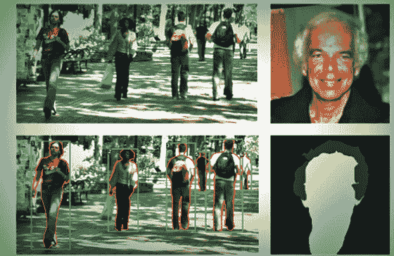

图 3.2 视频跟踪中的感兴趣对象（左）人物群体，右）单人脸部。

保持物体的跟踪需要一种预处理技术，将数据转换为计算机理解的机器码。形状和外观构成了基础，但提取的特征也被用于目标表示。表示中需要包含的额外参数还有应用领域、持久性和目标。

表示法决定了最佳算法的选择 [10, 12]。简单来说，目标表示取决于形状表示和/或外观表示。下文将讨论不同形状表示方法的详细描述。

目标表示 = 物体形状 + 外观

### 3.3.1.1 形状表示

物体的形状可以使用几种方法表示，这同时也需要进行一些计算来定位和跟踪物体。了解所有技术的优缺点至关重要，因为并非所有方法适用于所有的应用。下文讨论了通用的形状表示方法，并参考了图 3.3：

![图 3.3 形状表示技术 [13]。](images/fig3_3.jpg)

图 3.3 形状表示技术 [13]。

1. 点

单点（图 3.3(a)）或多点（图 3.3(b)）可以表示物体。

如果目标跟踪是图像，这些点可以起着至关重要的作用。所考虑的场景可以从单目标跟踪变为场景中存在多个物体，从而获得物体之间的相互作用。这些相互作用可能会导致误差。对于简单且小的物体，点法非常合适。

2. 几何形状

形状表示使用基础元素形状（图 3.3(c) 和 3.3(d)）。它既适用于固定也适用于移动物体。运动物体的性质非常复杂，因此将物体的最相似部分包含在形状模板中。

3. 剪影和轮廓

这种技术使用骨架或边界（图 3.3(g), 图 3.3(h)）来表示物体。在此内部它使用了另一个区域（图 3.3(i)）。它使得表示更加容易，并可表示刚性和非刚性物体。该模型能够包含广泛的物体形式变化。

4. 关节形状模型

物体的各个部分可以组合成关节物体。在表示期间使用了图 3.3(e) 所示的人体不同部分。使用椭圆形状来表示物体。

5. 骨架模型

可以从物体轮廓中提取物体的骨架（图 3.3(f)）。这通过中轴变换可以实现。这种方法广泛用于目标识别，但在跟踪物体时不常用。

### 3.3.1.2 外观表示

有许多方法可以通过其外观来表示物体。下文解释了一些最广泛使用的表示方法 [10]。

1. 物体概率密度估计

概率密度函数（PDF）用于表示随机变量的概率 [14]。借助形状模型，可以识别图像的内部区域。例如，可以确定物体外观特征。参数是颜色或纹理。PDF 可以是参数化的（高斯分布），也可以是非化的（直方图）。

2. 模板

模板同时携带外观和空间信息。模板使用基础元素形状。它对于挑战性物体并不适用，因为视角不同。当物体特征倾向于变化时（例如光照变化），模板会产生问题。

3. 活跃外观模型

可以使用物体的边界或物体区域计算物体的形状。对于每个位置，使用颜色、纹理或梯度对外观建模。

4. 多视图外观模型

可以使用这种方法对物体的各种视角。有很多方法。从各种视图生成子空间。这已用于主成分分析（PCA）和独立成分分析（ICA）[15]。

### 3.3.2 目标检测

基本过程是寻找视频场景中需要跟踪的物体。接下来对这些物体进行聚类。这涉及以下步骤。要提取的数据是运动物体。几乎所有方法都关注目标检测。当物体进入视频时可以发现目标检测 [10]。目标检测类型显示在图 3.4 中。


图 3.4 目标跟踪中的基本步骤。

### 3.3.2.1 帧差分

通过从连续图像或帧中减去目标来识别视频序列中的目标。对于动态环境，这种方法具有很强的适应性。然而，由于缺少轮廓信息，定位运动物体变得非常复杂 [16]。

### 3.3.2.2 光流

光流用于对图像聚类。可以从背景中提取整个数据。实时应用有时取决于以下参数：噪声敏感性、抗噪声性能等。

### 3.3.2.3 背景减除

背景建模提供了一个基础模型。通过将视频序列中的每一帧与参考模型进行匹配，可以识别出其中的运动物体。背景减法使用不同的方法来寻找这些物体。尽管实现起来简单，但它对周围因素更为敏感。只有在背景已知的情况下，才能提取出完整的物体数据。对于实时应用，静态背景模型无法产生良好的结果。影响背景变化的某些因素包括反射、动画图像和室内场景。静态背景在户外场景中面临巨大困难。基于运动检测或跟踪系统的背景减法在以下关键情况下需要保持有效 [9]：噪点图像和光照条件、由于风引起的非静态物体微小移动、物体运动、阴影区域以及场景中的多个目标。这里有两种方法：

1. 递归算法 [17, 18]
2. 非递归算法

### 3.3.3 目标分类方法

目标分类方法根据提取的特征分配类别标签。目标特征可以基于其尺寸、颜色、结构和运动。用于目标分类的特征列如下：

1. 边缘：在物体边界附近发现剧烈的强度变化。应用边缘检测技术来计算这些强度变化。边缘对光照条件的敏感度较低 [18]。
2. 运动：目标分类方法对非刚性物体产生良好的结果 [19]。
3. 颜色：有许多颜色空间可以存储不同帧的数据。
4. 纹理：纹理用于识别感兴趣的目标或物体 [118]。

## 3.4 特征选择

识别并提取正确的特征是目标跟踪中的主要作用。它选择了非常重要的特征并使物体具有唯一性。这是通过手动完成的。特征选择与目标表示之间存在强相关。轮廓表示使用了物体边缘等目标特征 [13]。下面列出了一些：

### 3.4.1 边缘

边缘定义为物体与背景之间的区域或轮廓。人眼可以很容易定位物体边界。边界处的强度变化很剧烈。可以使用边缘特征识别强度变化，然后由跟踪算法跟踪物体。边缘特征对光强的变化不敏感 [10]。

### 3.4.2 光流

运动特征有时使用视觉场景中的亮度模式来定义。我们在日常生活中开车并向窗外看时会经历这种现象。从汽车里观察到的物体（街道、建筑、树木等）看起来像是在向后移动。表观运动是通过帧之间的像素移动来决定的。这里的局限在于亮度，它导致了不同帧之间亮度的可靠性。图 3.5 描述了这一过程。

![图 3.5 像素改变但亮度不变的位置 [20]。](images/fig3_5.jpg)

**图 3.5** 像素改变但亮度不变的位置 [20]。

### 3.4.3 颜色

使用多种颜色来存储不同的物体特征信息。通常，使用 RGB 颜色空间描述颜色。有时在计算机视觉中可以用 YCbCr 和 HSV 颜色空间表示。使用颜色的主要问题是对光照变化的依赖。物体的颜色不仅受照明因素的影响，还受物体反射属性的影响 [13]。

### 3.4.4 纹理

可以使用规则性或平滑性属性测量表面的强度变化。目标描述符通过预处理步骤生成 [13]。例如，纹理描述符需要相应的水平、边缘、斑点等阶段 [14]。

## 3.5 目标跟踪技术

目标跟踪方法 [21] 列举如下：

1. 点
2. 核
3. 轮廓

### 3.5.1 点

点法准确且稳健 [10]。可以根据提取的特征识别运动物体。在这里，运动物体通过其特征表示（图 3.6）。这里的原理考虑了连续帧中的物体 [18]。它能够处理小目标。缺点是存在误检。

![图 3.6 基于点的 [10]。](images/fig3_5.jpg)

**图 3.6** 基于点的 [10]。

点跟踪的方法包括：

1. 卡尔曼滤波器，基于最优递归处理算法构建 [10]。它包含两个步骤：估计和更新。可以使用当前状态预测下一个状态并更新测量值。它可以实现：
   - 优解
   - 噪声处理
   - 跟踪单目标和多目标

2. 粒子滤波器，粒子滤波器能够在线性或非线性条件下跟踪 [19]。它比其他方法产生更好的结果 [19]。步骤描述如下：
   1. 生成样本表示初始概率。
   2. 使用先验方程预测下一个状态。
   3. 使用观测计算状态权重。预测状态连同权重共同表示状态分布。
   4. 对分布进行重采样以获得均匀的当前状态，忽略不重要的表示。
   5. 继续步骤 2 到 4，直到耗尽所有观测值。

3. 多假设跟踪，将多帧运动结合在多假设跟踪中。通过观察几帧而不是考虑连续帧来建立对应关系，MHT 为目标提供了多种特征。跨越一段时间的跟踪是一种迭代算法 [22]。

### 3.5.2 基于核的跟踪方法

该方法主要基于运动（参数化）和物体的起源。它是使用后续帧计算的 [19]。这种方法的另一个优点是它可以轻松预测估计。需要物体的轨迹来判断物体是静止还是运动。识别覆盖物体的区域是非常重要的 [13]。

核指的是物体的外观或形状。有多种原始形状（矩形和椭圆）可以表示物体 [23]。核跟踪有四种类型。每种方法在表示方式和目标数量上不同。

1. 简单模板匹配

这是一种调查视频帧中特定区域的基础程序 [19, 24]。

在视频序列中，将参考帧与目标帧进行比较。可以在视频内对单个物体进行跟踪并进行半重叠处理。该方法有助于找到图像中与每个后续帧匹配的微小组件。

- 单目标跟踪。
- 不完全遮挡。
- 需要外部初始化。

2. 均值偏移法 (Mean Shift Method)

该方法的主要目标 [13] 是识别视频帧与之前准备的模型最相似的特定部分。使用直方图表示进行跟踪。梯度上升法也可以用于跟踪，并提供类似的结果。可以使用矩形或椭圆结构跟踪目标物体。目标模型可以使用 `PDF` 函数进行界定。使用了非对称核来对目标模型进行正则化。

### 3.5.3 轮廓法 (Silhouette Approach)

形状复杂的物体无法被正确表征。轮廓方法将提供物体准确的形状描述。可以通过根据之前的帧寻找物体区域来开发跟踪模型。它分为两类：i. 形状匹配和 ii. 轮廓跟踪。它具有以下优点：

1. 它支持许多物体形状
2. 它处理物体遮挡
3. 它处理分裂和合并

#### 1. 轮廓跟踪 (Contour Tracking)

轮廓跟踪也称为边界跟踪。它可以从上一帧和当前帧创建一个唯一的轮廓。轮廓跟踪类似于状态空间模型 [22]。使用基于边缘的特征是因为它们不受光条件的影响。这创建了一个强轮廓。由于物体边界较小，其速度会提高。它有两种技术：第一种使用状态空间模型（增加了形状和运动），另一种是直接生长轮廓。使用梯度下降程序是因为它可以最大化模型与当前图像区域之间的相似性评分。

#### 2. 形状匹配 (Shape Matching)

可以开发当前帧物体模型。模板匹配和形状匹配的效果相同。形状匹配还能发现匹配的轮廓。它类似于点匹配。它能够：

1. 使用基于边缘的特征跟踪单个物体。
2. 使用霍夫变换（Hough transform）解决遮挡问题。

## 3.6 深度学习与机器学习技术简介

机器学习 (`ML`) 和深度学习 (`DL`) 都是人工智能的分支。计算机或机器根据物体模式和推理执行特定动作，而没有明确的指令。为此，必须仔细开发算法和模型。只有当训练数据集非常大时，模型才会变得高效 [25, 26]。模型必须通过带有标记的训练数据集进行迭代以产生输出。一旦训练完成，可以使用未标记的数据对模型进行测试。`ML` 一词由亚瑟·塞缪尔 [27] 创建，艾兰·图灵提出了问题“机器能思考吗？”。

数学模型的监督学习已针对一组标记数据得到了开发，而强化方法处理未标记的训练数据。分类算法的示例是分离“垃圾”邮件。回归使用连续输出，例如频率、电压或产品价格。无监督学习方法处理不带标签的训练数据。如果应用是机器人的开发，这些程序将具有来自之前学习的自己的程序。降维是用于减少特征数量的技术之一。

### 3.6.1 深度学习 vs 机器学习技术

现代 `ML` 工具在层序列中整合了神经网络，以从训练数据集中学习。计算智能 (`CI`) 已发展成为一种让机器学习的强大方法。它在神经网络、模糊系统和演化算法领域运行良好。`DL` 的最新进展在处理大量未标记数据方面发挥着重要作用。由于 `DL` 技术的巨大成功，我们现在能够显著提高服务质量 (`QoS`)。深度神经网络 (`DNN`)（也称为深度信仰网络和卷积神经网络 (`CNN`)）可以轻松地提取更复杂的特征，并用于高效地学习它们的表示。然而，实施深度学习面临许多实现挑战，例如大型数据集（为了确保所需的结果）、网络的高复杂性、高计算能力等，需要解决这些问题以有效实施深度学习来解决真实的图像处理问题。

## 3.7 示例

### 3.7.1 车辆检测

车辆检测使用计算机视觉技术跟踪车辆。车辆检测在自动驾驶应用中起着重要作用，如前方碰撞检测、适应巡航控制和自动道保持。以下示例了使用 `DL` 方法进行车辆检测。深度学习是自动提取图像特征的主要工具。加载车辆数据集并设计卷积神经网络。首先将输入拆分为训练（60%）和测试（30%）。此示例使用了 295 张车辆图像。为了获得准确的分类，需要更多数据。每张图像都有一个标签值。训练集 [27] 中的示例图像显示在图 3.7。

`CNN` 为 `R-CNN` 检测器奠定了基础 [28]，可以使用神经网络工具箱创建。它有三层：输入、隐藏和输出。然而，对于检测，输入尺寸必须很小。这里物体尺寸大于 [13]，因此输入尺寸选择为。接下来我们必须决定 `CNN` 的中间层。它包含许多层，如卷积层、线性整单元和池化层。这些是 `CNN` 的基本块。最终输出层包含全连接层和 soft-max 层。

级联视觉目标检测器具有许多预训练分类器，用于检测正面区域和身体上半部分。此类类别可以检测的物体包括具有恒定纵横比的对象。脸、停止标志和汽车的纵横比是恒定的。级联检测器包含一个在整个图像上滑动的窗口。可以使用级联检测器来估计物体的存在。由于 3D 对象的纵横比不是固定的，该检测器在平面旋转方面尤为特殊。单个检测器无法在所有三个维度上检测物体。应该尽快剔除负样本。

### 3.7.3 可用于训练的特征类型

根据机器学习（ML）和模式识别，特征是所观测现象的单个可测量的属性或特质。方向梯度直方图（`HOG`）特征被用于检测物体。`HOG` 是一种特征描述符，通常用于从图像数据中提取特征。可以使用 `HOG` 特征查看自行车的轮廓（见图 3.10）。

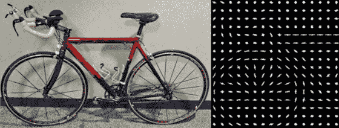

**图 3.10** 自行车 HOG 特征的可视化。

#### 3.7.3.1 提供正样本

可以使用训练图像标记器应用程序方便地创建正样本（见图 3.11 和图 3.12）。


**图 3.11** 正样本。

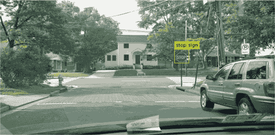

**图 3.12** 作为正示例的停止标志。

可以使用以下方法提供正样本：

1. 识别矩形区域。
2. 裁剪感兴趣的物体。

#### 3.7.3.2 提供负图像

训练级联目标检测器未指定特定的负样本。

通过正确定义检测器输入图像类型和感兴趣区域，可以获得感兴趣区域 [28–32]（图 3.13 和图 3.14）。

1. 构建级联目标检测器。
2. 对输入图像调用级联目标检测器。

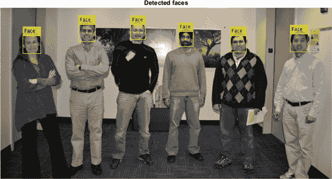

**图 3.13** 人脸检测。

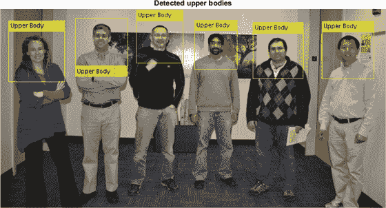

**图 3.14** 图像中身体上半部分的检测。

通过正确定义检测器输入图像类型和感兴趣区域，可以获得感兴趣区域 [28–32]。


## 3.8 结论

本章对视觉跟踪方法进行了详尽调查。还讨论了连接方法的详细研究。此外，还介绍了用于视觉跟踪的不同方法。本章为视觉跟踪领域的研究人员强调了相关算法的特征。未来的工作重点是针对非静态背景的物体检测，并可以使用具有多个摄像头的实时应用。

## 参考文献

1. Dana H. Ballard and Christopher M. Brown. 计算机视觉. Prentice Hall, 1982. ISBN 978-0-13-165316.

2. T. Huang and Carlo E. Vandoni, 计算机视觉：演化. 计算机视觉 (ed.), 日内瓦, 1996, 21–25.

3. Milan Sonka, Vaclav Hlavac and Roger Boyle, 图像处理、分析。计算机, 2008. doi:10.5170/2320-2084.

4. Reinhard Klette, 计算机视觉. Springer, 2014.

5. Linda G. Shapiro and George C. Stockman, 计算机视觉. Prentice Hall, 2001.

6. Bernd Jähne and Horst Haubecker, 视觉. Academic Press, 2000.

7. Sanna Agren, 跟踪方法及其应用综述. IEEE International Conference, 2011.

8. Alper Yilmaz, Omar Javed and Mubarak Shah, 目标跟踪：综述. ACM Computing Surveys (CSUR), 38(4):13, 2006.

9. Grandham Sindhu and Renuka Devi, 视频中运动目标的检测算法. International Journal of Engineering and General Science, 3(2), 2015.

10. Anshul Vishwakarma and Amit Khare, 用于交通监控的移动目标检测与跟踪. International Journal of Electrical, Electronics and Data Communication, 2(3), March, 2014.

11. Sandeep Kumar Patel and Agya Mishra, 目标跟踪方法的深度综述. Indian Journal of Computer Science, 4(2), 95–102, 2013.

12. Pennsylvania State University. 概率密度函数. `https://onlinecourses.science.psu.edu/stat414/node/97`, 2016. [在线; 访问于 2016 年 12 月 6 日].

13. Michael J Black and Allan D Jepson, 基于视图的关节物体的鲁棒匹配与跟踪. International Journal of Computer Vision, 26(1):63–84, 1998.

14. Rupali S. Rakibe and Bharati D. Patil, 基于背景减法的人体运动检测. International Journal of Scientific and Research Publications, 3(5), May 2013.

15. K. Srinivasan, K. Porkumaran, and G. Sainarayanan, 视频安全的改进背景减法技术. International Conference on Anti-counterfeiting, Security, and Identification in Communication, 2009, ISSN: 2163-5048.

16. J. Joshan Athanesious and P.. 基于核和轮廓的目标跟踪的实现与对比. International Journal of Advanced Research in Computer Engineering & Technology (IJARCET), 1298–1303, March 2013.

17. J. Joshan Athanesious and P. Suresh, 视频目标跟踪方法的系统综述. International Journal of Advanced Research in Computer Engineering & Technology (IJARCET), 242–247, October 2012.

23. R. Hemangi Patil and K. S. Bhagat. Detection and tracking of moving object: A survey. International Journal of Engineering Research and Applications, 5(11):138–142, 2015.

24. S. Saravanakumar, A. Vadivel, and C.G. Saneem Ahmed. Multiple human object tracking using background subtraction and shadow removal techniques. Signal and Image Processing (ICSIP), 2010 International Conference on 15–17 December, vol., pp.79, 84, 2010.

25. R. John, Forrest H. Bennett, David Andre, and Martin A. Keane. Automated design of both the topology and sizing of analog electrical circuits using genetic programming. Artificial Intelligence in Design '96. Springer, Dordrecht. pp. 151–170, 1996.

26. C. M. Bishop. Pattern Recognition and Machine Learning, Springer, 2006. ISBN 978-0-387-31073-2.

27. [Mathworks.com](http://Mathworks.com).

28. Shaoqing Ren, et al. Faster R-CNN: Towards real-time object detection with region proposal networks. Advances in Neural Information Processing Systems, 2015.

29. R. Lienhart, A. Kuranov, and V. Pisarevsky. Empirical analysis of detection cascades of boosted classifiers for rapid object detection. Proceedings of the 25th DAGM Symposium on Pattern Recognition, Magdeburg, Germany, 2003.

30. Ojala Timo, Pietikäinen Matti, and Mäenpää Topi. Multi-resolution gray-scale and rotation invariant texture classification with local binary patterns. In IEEE Transactions on Pattern Analysis and Machine Intelligence, 24(7):971–987, 2002.

31. H. Kruppa, M. Castrillon-Santana, and B. Schiele. Fast and robust face finding via local context. Proceedings of the Joint IEEE International Workshop on Visual Surveillance and Performance Evaluation of Tracking and Surveillance, pp. 157–164, 2003.

32. Marco Castrillón, Oscar Déniz, Cayetano Guerra, and Mario Hernández. ENCARA2: Real-time detection of multiple faces at different resolutions in video streams. Journal of Visual Communication and Image Representation, 18(2):130–140, 2007.

## 4. 模糊 MCDM 在疾病风险与预测中的应用

Rachna Jain, Abhishek Kathuria, and Devanshi Mukhopadhyay Bharati Vidyapeeth's College of Engineering Meenu Gupta Chandigarh University.

### 目录

- 4.1 模糊 MCDM：引言
- 4.2 文献综述
- 4.3 方法论
  - 4.3.1 应用模糊 MCDM 的数学步骤
    - 4.3.1.1 模糊化
    - 4.3.1.2 模糊集
    - 4.3.1.3 确性集
    - 4.3.1.4 隶属函数
  - 4.3.2 模糊 MCDM 推理系统的通用架构
    - 4.3.2.1 模糊 If-Then 规则
- 4.4 案例研究
  - 4.4.1 医学问题（心脏病）的检测与风险预测
  - 4.4.2 使用模糊逻辑进行乳腺癌风险预测
  - 4.4.3 模糊逻辑在糖尿病性视网膜病硬渗出判定中的应用
- 4.5 结论与未来展望

### 参考文献

## 4.1 模糊 MCDM：引言

模糊多准则决策（MCDM）是一种在数据大量且不确定的情况下，通过数据挖掘识别模式的工具。这种分析方法在数据不完整且传统的统计分析方法失效时非常有效。医学是其中一个领域，不同的疾病以不同方式表现（04chap_04.xhtml#sec4_1），尽管症状可能相似，但严重程度可能不同，这导致了不确定性 1。MCDM 早于 70 年代提出，是运筹学的一个分支，明确用于评估多个冲突的准则 2。

将模糊逻辑引入 MCDM 技术显著增强了在数据模糊时的决策质量和适应性。模糊 MCDM 被用于决策者处理问题，其中语言值被表示为模糊数值，并负责评估其重要性 3。尽管 MCDM 是解决多个冲突准则的一种新方法，但由于它不允许准则存在相互依赖性，在管理层面尚未得到充分实施，存在某些缺陷 4。与严格的层级系统不同，决策者倾向于使用超过所需数量的准则 5。模糊 MCDM 的目的是为定量和定性评估设计数学计算工具。这些评估准则帮助决策者进行排名、分类并选择最佳路径。许多方法被用于使用 MCDM 进行疾病预测。开发模糊 MCDM 风险预测专家系统具有许多优点，主要能够减轻患者的财务负担 6。针对不同疾病的风险预测专家系统已由各种人员开发和测试，例如心脏病、乳腺癌 7–8 以及糖尿病性视网膜病 9。在这工作中，探索了通用模糊系统的架构组成，以理解如何将患者的生物数据作为模糊输入应用于系统，从而获得可能患疾病的确定值输出。详细探讨了一种将模糊逻辑与多准则决策系统相结合的新方法。对应用模糊 MCDM 进行疾病预测的三个不同案例，并根据其他先进方法（即神经网络）进行了评估。

本章进一步分为以下几个章节：4.2 描述了许多研究人员完成的文献综述；4.3 重点介绍本章使用的方法论；4.4 讨论了案例研究。

在 [10]中，I. Kaya 等人对模糊多目标决策分析（MCDM）进行了一项综合研究：讨论了能源领域不同研究人员的应用和方法论。他们研究了由不同研究人员写的许多关于模糊 MCDM 方法的论文，以解决能源决策问题，涵盖了如年份、模糊集类型、国家、模糊 MCDM 方法、期刊和文档类型等参数。他们得出结论，土耳其和中国是在能源相关问题（使用模糊 MCDM 方法）领域发表大量研究的国家。在 [11]中，M. Cloak 等人提出了一种基于模糊集合的集成 MCDM 模型，用于可再生能源替代方案（土耳其）的排序。作者使用了两种方法（二型模糊 AHP（分析层次法）和犹豫模糊 TOPSIS）来分析决策树的权重，并对可再生能源替代方案进行优先级排序。随后，在 [12]中，M. Yucesan 等人提出了一种用于绿色供应商选择的多阶段 MCDM 模型。使用最劣解法（BWM）分析了绿色供应商的权重选择测度，并通过区间二型模糊技术（IT2F TOPSIS）分析了顺序排名。该提议模型被实现为土耳其某注塑成型设施的绿色选择过程。在 [13]中，C. N. Wang 等人考虑了越南服装行业中出现的一个问题。在这项工作中，作者实现了一种 MCDM 模型，以增强服装行业供应商的选择和评估过程。该研究中考虑的一些因素包括：根据三重底线（TBL）模型确定的供应商选择、通过模糊分析层次法（FAHP）方法确定的所有因素权重，以及通过 TOPSIS 对服装行业中的最佳面料供应商进行排名。作者得出结论，决策单元 10 是寻找供应商排名的最佳方法。在 [14]中，Y. Suh 等人采用使用 Kriterijumska Optimizacija I Kompromisno Resanje（VIKOR）方法的新 MCDM 方法进行工作。该方法评估了移动服务质量的主观权重（使用 DEMATEL 方法）和客观权重（使用香农熵）。作者得出结论，所提议的模型能够根据整体性能对移动服务进行分析。

在 [15]中，Kirti Sharawat 等人使用 MCDM 方法确定适用于糖尿病患者的高质量饮食。饮食的分类是根据卡路里、体脂和碳水化合物等类别进行的。这项工作使用分析层次模型结合 MCDM 方法，对适用于糖尿病患者的饮食进行排名。验证部分使用了 Wang 等人开发的模糊 TOPSIS 方法 [16]。他们得出结论，F1（一种食物类型）显示的结果比其他类型更好。Li-En Wang 等人 [17] 使用了一种结合了区间值模糊模糊集（IVIFSs）和 COPRAS 方法的新型混合模型。他们将模糊 MCDM 方法应用于混合模型，以发现并对失效模式风险进行排名。风险因素的权重通过考虑个体关系的 IVIF-ANP 方法计算。该模型证明比传统的 FMEA 模型更准确、更高效。Chih-Young Hung 等人讨论了一种模糊 MCDM 方法，用于评估四个应收账款（A/R）收回工具 [18]。对于每种情况，通过模糊分析过程计算决策标准以处理主观判断。模糊 MCDM 方法能够实现决策并合成小组决策。Lazim Abdullah [19] 提供了模糊 MCDM 各种分类技术的综述。Abdullah 还讨论了模糊 MCDM 在现实中的应用。

Andrzej Piegat 提供了模糊 MCDM 各种分类技术的综述。Abdullah 还讨论了模糊 MCDM 在现实中的应用。

## 4.3 方法论

本节讨论了本章中用的方法。

## 4.3.1 模糊 MCDM 的数学程序

本节讨论了系统的数学程序和架构。

### 4.3.1.1 模糊化

模糊化是用于将确定性输入转换为模糊输入的术语 [22]。模糊化过程负责将标量值转换为模糊值 [23]。

### 4.3.1.2 模糊集

模糊意味着虚无或不可预测，例如天气。“模糊集”由 Lotfi A. Zadeh 和 Dieter Klaua 于 1965 年提出。在模糊集中，每个元素在特定集合中具有不同的隶属程度 [24]，例如范围可以在 0.0 到 1.0 之间。当元素值属于 0.0 时表示绝对假，1.0 表示绝对真。

### 4.3.1.3 确性集

确性集也称为经典集合。它是由不同对象的集合，元素在特定集合中具有完全隶属关系，例如成绩及格或不及格。隶属范围为 0 或 1。元素集合不存在部分隶属关系。

### 4.3.1.4 隶属函数

隶属度函数（MF）被描述为一种真值程度 [25]。隶属度函数的表示如式 (1)所示。它是一种曲线型结构，其中每个输入和输出都映射在 0 到 1 之间的值。隶属度是一个与相应的输入值（即隶属度函数的输出）相关的值。隶属算子/值如图 4.1](#04chap_04.xhtml#fig4_1)所示。

```
μ[A]: X→[0, 1]
```

(1)

![FIGURE 4.1 模糊集的隶属度函数 [26].](images/fig4_1.jpg)

**图 4.1** 模糊集的隶属度函数 [26]。

## 4.3.2 模糊 MCDM 推理系统的通用架构 (#04chap_04.xhtml#r-sec4_3_2)

模糊推理系统（FIS）用于将模糊输入集映射到模糊输出 [24]，如图 4.2](#04chap_04.xhtml#fig4_2)所示。它是一种结合模糊逻辑概念的人类语言推理方法。

例如，

- 如果 `A`，则 `B`。
- 因此，`B`。

这种形式的推理相当严格，也就是说 B 只有在 A 成立时才成立。模糊逻辑通过暗示缓解了这种严格性，意味着如果 A 在很大程度上成立，B 在很大程度上成立，即：

- 如果 `A` 则 `B`
- 大部分情况下 `A`
- 因此大部分情况下 `A`

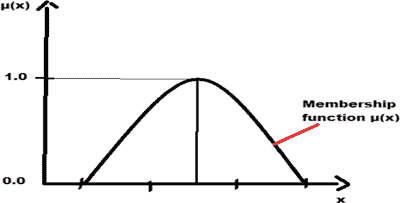

**图 4.2** 高斯隶属度函数。

### 4.3.2.1 模糊 If-Then 规则 (#04chap_04.xhtml#r-sec4_3_2_1)


在这种情况下，当一个条件为真时，另一个条件将显示结果。例如：它具有以下形式：如果`a`是`M`，那么`b`是`N`。前件是`a`是`M`；后件是`b`是`N`。`M`和`N`由全集`R`和`S`上的模糊集定义。这里，`a`和`b`分别指代输入和输出 [27]。`is`的含义逻辑同时作用于前件和后件，在前件中，`is`用于分配一个 0 到 1 之间的值，而在后件中，`is`用于为`b`分配`N`。

FIS 架构如图 4.3](#04chap_04.xhtml#fig4_3)所示。FIS 包含四个模块：模糊化器、去模糊化、推理引擎（`IE`）和模糊知识库（`FKB`）。模糊化器将输入值转换为模糊集。推理引擎根据模糊输入和模糊知识库给出模糊输出，知识库是一个由规则库组成的数据库。去模糊化器将推理引擎获得的模糊集转换为确切值 [28]。下一节将讨论使用模糊 MCDM 方法诊断心脏病（一个医学问题）的案例研究。

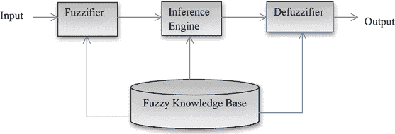

**图 4.3** 模糊推理系统。

## 4.4 案例研究 (#04chap_04.xhtml#r-sec4_4)

...这种形式的推理相当严格，也就是说`B`只有在`A`成立时才成立。模糊逻辑通过暗示缓解了这种严格性，意味着如果`A`在很大程度上成立，`B`在很大程度上成立，即 [27]...

...模糊推理系统如图 4.3](#04chap_04.xhtml#fig4_3)所示。去模糊化器...转换为确切值 [28]。这种形式的推理在诊断疾病上花费了大量资源 [29]...通过图 4.4](#04chap_04.xhtml#fig4_4)所示。这种通过图 4.4](#04chap_04.xhtml#fig4_4)所示的推理在疾病上 [28]...去模糊化器...转换为确切值。下一节将讨论使用模糊 MCDM 方法诊断心脏病（一个医学问题）的案例研究。


**图 4.3** 模糊推理系统。

## 4.4 案例研究 (#04chap_04.xhtml#r-sec4_4)

...这种形式的推理在诊断疾病上花费了大量资源 [29]...通过图 4.4](#04chap_04.xhtml#fig4_4)所示。这种通过图 4.4](#04chap_04.xhtml#fig4_4)所示的推理在疾病上 [28]...

采用 ID3 算法引入了一个模糊多准则决策（MCDM）系统，并与 MATLAB 环境集成。使用语言变量`非常严重 (VSM)`、`非常严重 (VS)`、`不严重 (NS)`和`严重 (S)`对上述参数进行模糊化。采用 Mamdani 推理系统作为推理机制。定义并应用了八条推理规则。这些生成的规则如表 4.2 所示。

### 表 4.2 推理规则

| 序号 | 如果-那么规则 | 蕴含结果 |
| --- | --- | --- |
| 1 | 如果 节点 = 1 且 肿瘤 = 非常小，则 转移 = 无 | 严重（II A 期） |
| 2 | 如果 节点 = 1 肿瘤 = 小，则 转移 = 无 | 严重（II B 期） |
| 3 | 如果 节点 = 2 且 肿瘤 = 中等，则 转移 = 无 | 严重中度（III A 期） |
| 4 | 如果 肿瘤 = 大 且 节点 = 2，则 转移 = 无 | 严重中度（III B 期） |
| 5 | 如果 肿瘤 = 中等 且 节点 = 3，则 转移 = 无 | 非常严重中度（III C 期） |
| 6 | 如果 肿瘤 = 大 且 节点 = 无，则 转移 = 无 | 非常严重中度（III B 期） |
| 7 | 如果 肿瘤 = 大 且 节点 = 3，则 转移 = 无 | 非常严重中度（III C 期） |
| 8 | 如果 肿瘤 = 小 且 节点 = 1，则 转移 = 有 | 非常严重（IV 期） |

所得结果与表 4.3 所示的实际医学数据进行了比较，并计算了该系统的性能。

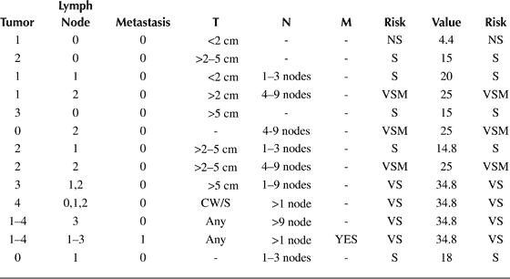

从表 4.4 可以得出，该系统是观察生物数据并基于该数据进行风险预测的可行方法，无论这些数据是否模糊和矛盾。在下一节，本章讨论了模糊逻辑在确定糖尿病视网膜病的应用。

### 表 4.4 范围与语言变量的关系

| 范围 | : | 风险等级 |
| --- | --- | --- |
| 0–10 | : | NS (不严重) |
| 11–20 | : | S (严重) |
| 21–30 | : | VSM (非常严重中度) |
| 31–40 | : | VS (非常严重) |

## 4.4.3 模糊逻辑在糖尿病视网膜病硬渗出判定的应用

糖尿病视网膜病是发生在 1 型或 2 型糖尿病患者眼睛的疾病 [33]。该案例研究展示了一种在彩色眼底图像中自动检测标准糖尿病视网膜病（DIARETDB0）数据集是否存在的方法。这种方法包括了在识别彩色眼底图中糖尿病视网膜病各种特征时应用模糊 MCDM 逻辑。机器学习算法可以从这些彩色眼底图中精确识别出血管。人工神经网络对于自动检测糖尿病视网膜病非常有益。在这一组上应用模糊逻辑，可以获得各种模糊规则，这些规则被用于识别这些彩色眼底图中糖尿病视网膜病的存在。

颜色空间是机器或人之间联系颜色的一种方式。使用的各种颜色空间有：`XYZ`、`YIQ`、`LUV`、`HSV`和`Lab`。模糊集从“集合成员”到“非成员”没有边界，这由隶属度函数定义。模糊集`F`如公式 2 所示：

```
F = Σ μ(x)
```

其中`μ`是隶属度函数。在这一组上，获得了各种模糊规则，这些规则被用于识别这些彩色眼底图中糖尿病视网膜病的存在。

* 6. Karabatak, M., & Ince, M. C. (2009). 一种基于关联规则和神经网络的乳腺癌检测专家系统。Expert Systems with Applications, *36*(2), 3465–3469.
* 7. Almurshidi, S. H., & Abu-Naser, S. S. (2018). 乳腺癌诊断的专家系统。阿兹哈尔大学，加沙，巴勒斯坦。
* 8. Abdel-Zaher, A. M., & Eldeib, A. M. (2016). 使用深度置信网络的乳腺癌分类。Expert Systems with Applications, *46*, 139–144.
* 9. Nilashi, M., Ibrahim, O., Ahmadi, H., & Shahmoradi, L. (2017). 一种基于模糊逻辑方法的乳腺癌分类知识系统。Telematics and Informatics, *34*(4), 133–144.
* 10. Kaya, İ., Colak, M., & Terzi, F. (2019). 能源政策的模糊多准则决策方法综述。Energy Strategy Reviews, *24*, 207–228.
* 11. Çolak, M., & Kaya, İ. (2017). 使用集成模糊 MCDM 模型对可再生能源替代方案进行优先级排序：土耳其案例应用。Renewable and Sustainable Energy Reviews, *80*, 840–853.
* 12. Yucesan, M., Mete, S., Serin, F., Celik, E., & Gul, M. (2019). 一种绿色供应商选择的集成最优最劣和区间型模糊 TOPSIS 方法。Mathematics, *7*(2), 182.
* 13. Wang, C. N., Yang, C. Y., & Cheng, H. C. (2019). 服装行业基于三重底线方法的可持续供应商评估与选择的模糊多准则决策 (MCDM) 模型。Processes, *7*(7), 400.
* 14. Suh, Y., Park, Y., & Kang, D. (2019). 使用集成权重法和模糊 VIKOR 评估移动服务。PloS One, *14*(6), e0217786.
* 15. Sharawat, K., & Dubey, S. K. (2018). 使用 MCDM 方法的糖尿病患者饮食建议。在*Intelligent Communication, Control and Devices* (pp. 239–246)。Springer, Singapore。
* 16. Wang, T. C., & Lee, H. D. (2009). 基于主观权重和客观权重的模糊 TOPSIS 方法。Expert Systems with Applications, *36*(5), 8980–8985.
* 17. Wang, L. E., Liu, H. C., & Quan, M. Y. (2016). 区间值直觉模糊环境下混合 MCDM 模型评估失效模式风险。Computers & Industrial Engineering, *102*, 175–185.
* 18. Hung, C. Y., Li, Y., & Chiang, Y. H. (2006, June). 使用模糊 MCDM 方法评估应收账款回收方案。在*2006 IEEE International Conference on Service Operations and Logistics, and Informatics* (pp. 1009–1013)。IEEE。
* 19. Abdullah, L. (2013). 模糊多准则决策及其应用：类别简要回顾。Procedia-Social and Behavioral Sciences, *97*, 131–136.
* 20. Piegat, A., & Sałabun, W. (2015, June). 评估慢性肝病严重性的 MCDM 方法比较分析。在*International Conference on Artificial Intelligence and Soft Computing* (pp. 228–238)。Springer, Cham.
* 21. Cheng, C. H. (1999). 使用模糊数评估系统。Fuzzy Sets and Systems, *107*(1), 25–35.
* 22. Tiwari, U. S. 模糊集（第一型和第二型）及其应用。访问地址：`www.iitk.ac.in/eeold/archive/courses/2013/intel-info/d1pdf.pdf`
* 23. Yousefi, M., & Carranza, E. J. (2015). 用于矿产潜力的连续值空间证据模糊化。Computers & Geosciences, *74*, 97–109.
* 24. Bustince, H., Renechea, E., Pagola, M., Xu, Z., Bedregal, B., & De Baets, B. (2015). 模糊集类型及其关系的历史。IEEE Transactions on Fuzzy Systems, *24*(1), 179–194.
* 25. Alonso, S. K. Mamani 的模糊推理：隶属度函数。访问地址：`www.dma.fi.upm.es/recursos/aplicaciones/logica_borrosa/web/fuzzy_inferencia/funpert_en.htm`
* 26. `www.iitk.ac.in/eeold/archive/courses/2013/intel-info/d1pdf3.pdf`


## 27. Dvořák, A., Štěpnička, M., & Štěničková, L. (2015). 基于感知的逻辑推理的模糊/语言 IF-THEN 规则系统中的冗余。Fuzzy Sets and Systems, *277*, 22–43.

## 28. Horgby, P. J., Lohse, R., & Sittaro, N. A. (1997). 模糊核保：模糊逻辑在医学核保中的应用。Journal of Actuarial Practice, *5*, 79–104.

## 29. Kumar, S., & Kaur, G. (2013). 使用模糊逻辑检测心脏病。International Journal of Engineering Trends and Technology (IJETT), *4*(6), 2694–2699.

## 30. Sagi, A., Sabo, A., Kuljić, B., & Szakáll, T. (2010, November). 医学中的神经模糊系统。在 2010 11th International Symposium on Computational Intelligence and Informatics (CINTI) (pp. 293–296)。IEEE。

## 31. Oad, K. K., DeZhi, X., & Butt, P. K. (2014). 基于模糊规则的预测心脏风险水平的方法。Global Journal of Computer Science and Technology, *14*(3-C), 2694–2699.

## 32. Valarmathi, S., Sulthana, A., Rathan, K. R., Balasubramanian, C. L., & Sridhar, R. (2012). 在 MATLAB 环境下使用模糊逻辑箱预测乳腺癌风险。International Journal of Current Research, *4*(09), 072–079.

## 33. Basha, S. S., & Prasad, K. S. (2008). 使用形态分割和模糊逻辑自动检测糖尿病网膜病变中的硬渗出。International Journal of Computer Science and Network Security, *8*(12), 211–218.

# 5 通过构造神经网络从眼底图像预测和分青光眼的深度学习方法

Kishore Balasubramanian

Dr Mahalingam College of Engineering and Technology

N. B. Ananthamoorthy

Hindusthan College of Engineering and Technology

## 内容

## 5.1 引言

## 5.2 相关工作

## 5.3 材料与方法

### 5.3.1 数据库与图像划分

### 5.3.2 预处理与下采样

### 5.3.3 深度学习架构 (DLA)

### 5.3.3.1 输入层

### 5.3.3.2 卷积层

### 5.3.3.3 批一化层

#### 5.3.3.4 线性整流单元

### 5.3.3.5 最大池化层

### 5.3.3.6 全连接层

### 5.3.3.7 Softmax 层

#### 5.3.4 方法

#### 5.3.4.1 提的 CNN 架构

#### 5.3.4.2 训练与测试方案

## 5.4 实验

### 5.4.1 性能评估

## 5.5 讨论与结论

## 5.6 利益冲突

## 参考文献

## 5.1 引言

青光眼是一种神经退行性疾病，会逐渐损伤视神经，导致不可逆的完全或部分视力丧失。眼内压（`IOP`）会升高[1]。病因尚不明，但会影响任何年龄、性别等的任何人。眼科医生通过控制 `IOP` 来保护受试者免于失明。除非出现视野缩小、眼痛等症状，否则受试者无法感知疾病的发生[2]。眼科专家对青光眼的早期诊断和筛选通过眼压、光学相干层扫描（`OCT`）和海德堡视网膜扫描（`HRT`）进行。这些方法非常昂贵，需要专家技能才能检测疾病，且可能仍然具有主观性[3]。青光眼可以通过眼部的解剖变化来检测，通常根据临床检查信息（即视野范围（`VF`）、`OCT` 和眼底照片）进行诊断。青光眼的特征是视神经纤维（`ONF`）变性，随后 `IOP` 增加。通常，青光眼的进展通过视神经乳（`ONH`）的几何参数来衡量。这些参数测量了 `ONH` 结构的变化，例如视盘（`OD`）的直径和面积、视杯直径、杯杯深度和视缘面积[4]。这些变化可以从 `ONH` 的眼底图中被检测到，因此通常被用于记录视盘、杯和视缘的特征[5]。青光眼的诊断通常通过计算视杯比（`CDR`）、下-上-鼻颞法则（`ISNT`）、青光眼风险指数（`GRI`）以及图像中的一些其他因素来进行。这些因素取决于对 `OD` 和视杯（`OC`）的提取和定位[6]。在这些因素中，`CDR` 被认为是评估青光眼进展的重要工具。从报告中可以看出，`CDR` 值为 0.3 被视为正常值。`CDR` 大于 0.3 被认为是青光眼的指示因素[7–8]。根据 `CDR` 的值以及视网膜图像上是否存在上方或下方的局性凹陷，青光眼可以分为轻度、中度和重度青光眼[9]。`CDR` 在 0.4–0.7 范围内会导致轻度青光眼，此时会出现侧视或周边视野丧失。`CDR` 大于 0.7 会 `ONH` 出血，称为中度青光眼，如果不治疗，会导致严重的青光眼，此时中心视力也会受到影响[10]。据推断，轻度青光眼的 `IOP` 范围为 15 到 17 mmHg，中度青光眼为 12 到 15 mmHg，重度青光眼在 10 到 12 mmHg 之间[11]。由于青光眼与眼压有关，了解眼高压（`OHT`）很重要。在 `OHT` 中，`IOP` 似乎比正常高，但既损伤视神经也不导致视力丧。必须密切监测，因为它认为是青光眼的风险因素。从文献可以看出，利用临床试验诊断青光眼极其繁琐、辛苦，且容易导致人为错误。

图 5.1

（图像描述或占位符）

图 5.2

（图像描述或占位符）

该方法解决了以下问题：

1. 捕捉了视网膜图像中的微细特征

2. 图像尺寸适用于 `CNN`，因为较大的样本会增加计算时间。

3. 采用不同的卷积尺寸来捕捉图像中极小的变化。

4. 深度网络通过为大多数迭代提供一致的性能提高了整体性能。

5. 使用的轮数数量、大数据集和训练参数减少了过拟合问题。

本章的结构如下：第 5.2 节 介绍了该领域的文献研究，第 5.3 节 概述了采用的和方法，所提系统的结果在第 5.4 节 中进行了讨论，第 5.5 节 提供了结论。

# 5.2 相关工作 (#05chap_05.xhtml#r-sec5_2)

本节概述了某些使用图像处理和计算机视觉方法检测青光眼的技术。由于眼睛及其周围区域的几何特征，青光眼的自动诊断是一项具有挑战性且属于分类性的任务。大多数与青光眼的研究工作依赖于使用 `CDR` 来评估疾病。使用端到端 `CNN` 进行分类是另一种方法。`CNNs` 使用 `2D` 卷积，但在最近的出版中，也部署了 `3D` 卷积来分割图像 [19]。`CNNs` 有四种基本操作：卷积、非线性、池化或下采样以及分类，这些操作作用于以矩阵形式的像素图像 [20]。

2015 年，Chen、Xu 等人提出了一种涉及 `CNN` 的方法，该方法通过捕捉特征来区分青光眼相关的隐藏模式 [21]$。所提出的深度学习 (`DL`) 架构具有六个学习层：四个卷积层和两个全连接层。使用 `Softmax` 分类器来预测青光眼，其输入来自最后一个全连接层。在 `ORIGA` 和 `SCES` 两个数据库上的实验结果比现有算法好得得多。

Orlando、Prokofyeva 等人于 2017 年提出了一种新方法，利用从非医学数据预训练的 `CNN` 来检测青光眼 [22]$。该方法采用了 `OverFeat` 和 `VGG-S` 两种不同的 `CNNs`，它们被应用于视网膜底图像并生成特征向量。采用了某些预处理技术来提高特征区分度。该技术在 `Drishti-GS1` 数据库上进行了测试，并在平均 `ROC` 线上进行了评估。该技术产生了良好的结果，使得该方法具有学习可行性。

2017 年，Selvastopolsky [18] 修改了 `U-Net` `CNN` 并提出使用 `DL` 分割 `OD` 和 `OC`。在 `DRIONS-DB`、`RIM-ONE v.3`、`DRISHTI-GS` 数据集记录了更好的计算时间。`OD` 分割质量超过了其他方法，而 `OC` 分割仍然是一项挑战性任务。`OD` 分割达到 0.95 `F-Score`，`OC` 分割达到 0.85。

Ferreira 等人于 2018 年提出使用 `CNN` 诊断青光眼的方法。使用 `CNN` 执行 `OD` 分割，并根据发育分析采用了纹理描述符来描述 `ROIs`。该方法在 `RIM-ONE`、`DRIONS-DB` 和 `DRISHTI-GS` 数据集上进行了测试。获得的结果良好，如 [23]$ 所示，在红色通道分析中所有指标均达到了 100%。

在 Benzebouchi 等人 2017 年提出的工作中，展示了一种利用来自底底图像的多模态数据诊断青光眼的 `CNN` 方法。在 `RIM –ONE` 数据集上测试时报告了高分类准确率。一个新特性是通过在同一个神经元网络中处理特征提取步骤和一次性分类，避免了传统的特征提取步骤，最终在没有用户输入的情况下获得自动诊断 [24]$。

2017 年，Miikkulainen 等人强调，`CNN's` 的成功取决于为任务识别最佳架构 [25]$。文献指出，架构是在经过许多对复杂拓扑结构和大量参数的尝试后演化出来的，这导致了意料之外的结果。在这项工作中，遗传算法 (`GAs`) 已被成功应用于顺序决策任务。Xie 和 Yu 2017，Sun 等人 2017 报告了结合 `GAs` 的良好 `CNN` 应用的示例 [26, 27]$。

从文献可以看出，提出并比较了不同的机器学习算法 (`MLA`) 以研究它们诊断青光眼的性能。其中包括多层感知器网络 (`MLP`)、支持向量机 (`SVM`) 和前馈传播 (`FFP`) 等其他算法。在分类阶段报告了高水平的性能 [28, 29]$。尽管基于神经网络和经典分类器的各种方法产生了良好结果，但计算视觉的最新进展已经宣布了部署 `CNNs` 用于视网膜图像的模式识别 [30]$。文献中提供了用于 `OD` 和 `OC` 的各种分割程序及其性能比较，这有助于青光眼检测，详见 [31–33]$。最近，`tensor flow` [34] 已被广泛用于。

# 5.3 材料与方法 (#05chap_05.xhtml#r-sec5_3)

## 5.3.1 数据库与图像划分 (#05chap_05.xhtml#r-sec5_3_1)

本节介绍了所方法的部署、特征提取和分类。第一步是从 `RIM-ONE`、`DRIONS-DB`、`DRIVE` 和 `DRISHTI-GS` 获取底图像。数据采集通过 `Canon`、`Nidek AFC-210` 等相机获得了 1155 张图像。分辨率不同，例如 `1924 × 1556` 像素和 `2336 × 2336` 像素。`DL` 方法应用于这些分辨率的图像 [35]$。每个图像类别被随机分类为完全独立的子组进行训练。这样可以减少样本量可能产生的偏差。图像由经验丰富的专业人员进行分级。表 5.1 展示了根据严重程度划分的获取的底图像。

| 阶段 | 健康 | 青光眼 | | |
| --- | --- | --- | | |
| 早期 | 中期 | 深期 | |
| 训练 | 301 | 142 | 84 | 228 |
| 测试 | 100 | 100 | 100 | 100 |
| 总计 | 401 | 242 | 184 | 328 |

## 5.3.2 预处理与下采样 (#05chap_05.xhtml#r-sec5_3_2)

为了从获取的图像中去除噪声和背景背景，采用了图像预处理步骤。执行对比度增强、二值化、侵蚀和扩张等某些形态学操作，以保持图像的视野场 (`FOV`) [36]$。由于数据集数量较小导致的过拟合可以通过数据增强过程避免。数据增强增加了训练数据集内部的变异。这种重复过程涉及裁剪、随机平移并将图像缩放到固定下采样尺寸 `227 × 227` [37]$。

### 5.3.3 深度学习架构 (DLA)

`DL` 架构框架是特征提取和分类的集成。

DLA 的强度取决于权重共享。这种结构的构建是基于这样一种假设：即图像在不同位置可能包含相似的结构。卷积滤波器可以通过核函数检测这些结构。非线性激活变换、池化函数和平移不变性是 CNN 中进行的操作 [38]。CNN 是一种由以下网络层组成的深度学习模型：输入层、卷积层、批归一化层、池化层、softmax 层等。输入的大小决定了层数；并非所有的层都必须用于应用。网络越深，训练效果越好，但同时计算时间也会之增加。

CNN 的一个重要特性是它们具有无监督的自学习和自组织能力 [39]。为了获得更好的训练效果并减少计算时间，可以使用高效的网络参数以最少的层数获得最大的收益。通过有效调整网络参数，可以实现更好的分类率。以下是对 CNN 各层的简要说明。

### 5.3.3.1 输入层

CNN 中必须存在该层以便将输入传递到网络。该层接受 2D 和 3D 形式的图像，其维度经过初始化。

### 5.3.3.2 卷积层

在此层中对输入图像进行卷积，生成的特征图将作为下一层的输入。

### 5.3.3.3 批归一化层

该层确保了快速学习，并允许归一化后的样本在中间层之间流动，从而提高整体性能。

### 5.3.3.4 线性整流单元（ReLU）

该层在不丢失关键信息减少数据冗余。

### 5.3.3.5 最大池化层

在每个特征图上应用最大池化操作，根据用户选择的值缩小特征图的大小。

### 5.3.3.6 全连接层

最大池化层将神经元传递给此层，并且它们与该层的每个神经元连接。分类的数量取决于该层的输出。

### 5.3.3.7 Softmax 层

执行一种名为 softmax 的归一化指数函数操作，通过移除离群值来降低数据样本维度，使其落入 0–1 的范围内。输出标签由该层决定。

## 5.3.4 方法论

### 5.3.4.1 提出的 CNN 架构

CNN 包含两个部分：卷积层和全连接层。在卷积层中，每一层的输入都是前一层的输出，并作为特征提取器。这些提取的特征在全连接层中进行分类，随后通过 softmax 激活函数。每个类仅有一个输出神经元。注意，通过调整参数可以减少误分类误差。25 层 CNN 的概览如图图 5.3 所示，表 5.2 展示了构建 CNN 所使用的参数。

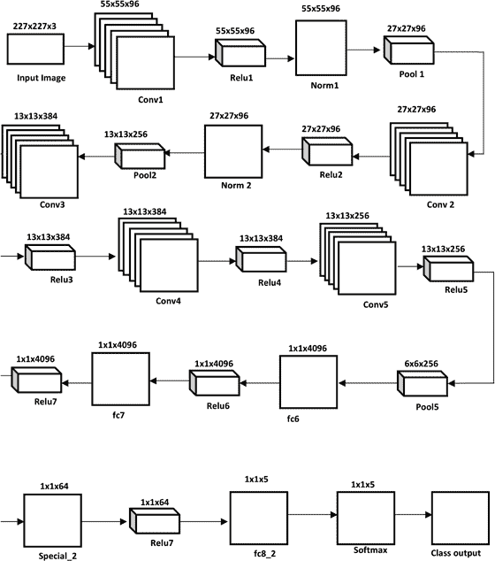

**图 5.3** 提出的 CNN 架构概述。

表 5.2 提出的 CNN 参数描述

| 序号 | 名称 | 类型 | 激活函数 |
| --- | --- | --- | --- |
| 1 | 图像输入 227 × 227 × 3，带有“零中心归一化”的图像 | 输入 | 227 × 227 × 3 |
| 2 | conv1-96 11 × 11 × 3 卷积，步长为 [4 4]，填充为 [0 0 0 0] | 卷积 | 55 × 55 × 96 |
| 3 | relu 1-ReLU | ReLU | 55 × 55 × 96 |
| 4 | norm 1-跨通道归一化，每个元素 5 个通道 | 跨通道归一化 | 55 × 55 × 96 |
| 5 | pool 13 × 3 最大池化，步长为 [2 2]，填充为 [0 0 0 0] | 最大池化 | 27 × 27 × 96 |
| 6 | conv2-256 5 × 5 × 48 卷积，步长为 [1 1]，填充为 [2 2 2 2] | 卷积 | 27 × 27 × 96 |
| 7 | relu2 -ReLU | ReLU | 55 × 55 × 96 |
| 8 | norm 1-跨通道归一化，每个元素 5 个通道 | 跨通道归一化 | 55 × 55 × 96 |
| 9 | pool 13 × 3 最大池化，步长为 [2 2]，填充为 [0 0 0 0] | 最大池化 | 27 × 27 × 96 |
| 10 | conv2-256 5 × 5 × 48 卷积，步长为 [1 1]，填充为 [2 2 2] | 卷积 | 27 × 27 × 96 |
| 11 | relu2 -ReLU | ReLU | 55 × 55 × 96 |
| 12 | norm 1-跨通道归一化，每个元素 5 个通道 | 跨通道归一化 | 55 × 55 × 96 |
| 13 | pool 13 × 3 最大池化，步长为 [2 2]，填充为 [0 0 0] | 最大池化 | 27 × 27 × 96 |
| 14 | conv2-256 5 × 5 × 48 卷积，步长为 [1 1]，填充为 [2 2 2] | 卷积 | 27 × 27 × 96 |
| 15 | relu2 -ReLU | ReLU | 55 × 55 × 96 |
| 16 | norm 1-跨通道归一化，每个元素 5 个通道 | 跨通道归一化 | 55 × 55 × 96 |
| 17 | pool 13 × 3 最大池化，步长为 [2 2]，填充为 [0 0 0] | 最大池化 | 27 × 27 × 96 |
| 18 | conv2-256 5 × 5 × 48 卷积，步长为 [1 1]，填充为 [2 2 2] | 卷积 | 27 × 27 × 96 |
| 19 | relu2 -ReLU | ReLU | 55 × 55 × 96 |
| 20 | norm 1-跨通道归一化，每个元素 5 个通道 | 跨通道归一化 | 55 × 55 × 96 |
| 21 | pool 13 × 3 最大池化，步长为 [2 2]，填充为 [0 0 0] | 最大池化 | 27 × 27 × 96 |
| 22 | conv2-256 5 × 5 × 48 卷积，步长为 [1 1]，填充为 [2 2 2] | 卷积 | 27 × 27 × 96 |
| 23 | relu2 -ReLU | ReLU | 55 × 55 × 96 |


| 24 | norm 1-跨通道归一化，每个元素 5 个通道 | 跨通道归一化 | 55 × 55 × 96 |

| 25 | 类输出 | Softmax | - |

### 5.3.4.2 训练与测试方案

开发的 CNN 训练用于根据严重程度将图像分类为正常和青光眼病例。从获取的数据集中，将训练数据集提供给网络。选择一百张图像进行测试。其余部分用于训练网络。使用随机梯度下降动量训练（也称为陡下降），批量大小为 30，以减少损失。动量设置为 0.9。系统以 0.1、0.01、0.001、0.0001 和 0.00001 的学习率进行迭代。训练率必须是最佳的，否则会导致计算时间过长或误差。采用数据增强来防止过拟合问题，目的是人为扩大训练数据。在训练时随机进行水平和垂直翻转，并在 +30° 到 −30° 之间进行图像旋转 [40]。

## 5.4 实验

### 5.4.1 性能评估

所有视网膜图像均调整为 227×227 并输入开发的 CNN。实验在带有 GPU 的 Intel Core i7 处理器和 16GB 内存上进行。使用表 5.3 所示的指标对评估性能进行了定量评估。

表 5.3 开发 CNN 模型使用的性能参数

| 参数 | 表达式 |

| --- | --- |

| 灵敏度 (Sensitivity) | $\frac{\text{TP}}{\text{TP} + \text{FN}}$ |

| 特异性 (Specificity) | $\frac{\text{TN}}{\text{TN} + \text{FP}}$ |

| 准确率 (Accuracy) | $\frac{\text{TP} + \text{TN}}{\text{TP} + \text{FN} + \text{TN} + \text{FP}}$ |

| 精密度 (Precision / 正 预测值) | $\frac{\text{TP}}{\text{TP} + \text{FP}}$ |

| 回召率 (Recall) | $\frac{\text{TP}}{\text{TP} + \text{FN}}$ |

| F-Score || $\text{2} \times \frac{\text{(Precision)(Recall)}}{\text{Precision} + \text{Recall}}$ |

在对结果进行泛化后，实验随机迭代了 50 次。计算并记录了所有 50 次迭代中所有性能指标的平均值。表 5.4 和 表 5.5 展示了开发的 CNN 的结果。

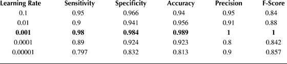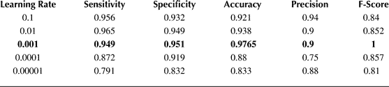

CNN 还能将青光眼图像分类为轻度、中度和重度青光眼。还增加了 OHT（视乳头张高）类别，它将作为青光眼进展的指标。表 5.6 显示了 CNN 在区分不同等级青光眼病例方面的准确率性能。图 5.4 显示了不同学习率下青光眼严重程度分级的准确率图。

### 表 5.6 CNN 在青光眼分级中的准确率性能

| || || 准确率 |

| --- | --- | --- | --- | --- |

| 学习率 | 早期 | 中期 | 深度 | OHT |

| 0.00001 | 0.65 | 0.6 | 0.58 | 0.75 |

| --- | --- | --- | --- | --- |

| 0.0001 | 0.9 | 0.85 | 0.85 | 0.9 |

| **0.001** | **0.977** | **0.96** | **0.98** | **0.98** |

| 0.01 | 0.88 | 0.87 | 0.77 | 0.65 |

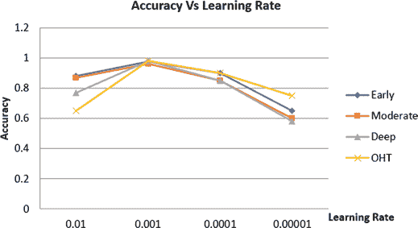

**图 5.4** 青光眼阶段准确率与学习率的关系图。

## 5.5 讨论与结论

CNN 有许多超参数，可能需要进一步调优，包括全连接层数、卷积层数、池化层、过滤器、隐藏节点、学习率等。如果从零开始设计 CNN，可能会非常耗时，且计算开销巨大。迁移学习可以通过利用预训练深度学习模型训练的特征并将其应用于不同的数据集来帮助解决问题。如果有更多数据集，CNN 将提供更好的性能 [41]。从结果来看，除了学习率 `0.001` 外，其他学习率在准确率方面的性能率都较低。网络可能漏掉了一些关键信息，这些信息在用其他学习率训练时是关重要的。图像大小也可能是一个重要因素。较大的图像尺寸可能需要更多的计算时间。为了在两者之间取得平衡，模型中选择了 `227×227`。该模型在不同的卷积核大小下运行良好，能够捕捉到即使细微的变化。此外还实现了约 99% 的特异性，使系统对几乎所有正常和异常病例都具有稳健性。实验经过迭代并计算了所有性能指标的平均值。进行了预处理以保留图像的视野（FOV），因为该系统可进一步划分疾病。表 5.7 显示了用于检测青光眼的各种深度学习方法的总结和比较。使用 CNN 的主要优点之一是不需要特征提取、排序、降维等标准步骤。特征图是通过在每层后自动提取特征并根据自主决定最佳特征生成的。可以看出，此类工具的设计和开发将有助于帮助眼科医生在疾病早期或分析与其相关的风险因素时诊断青光眼。所开发的方法能够达到 98.9% 的准确率以及 98% 的敏感性和特异性。CNN 可以检测正常类别和青光眼类别，并将图像分为：早期、中期和深度。还包含了 OHT 类别以评估风险因素。考虑到计算机内存和硬件的限制，在使用深度学习时可以降低原始眼底图像的分辨率。尽管数据集相当丰富，但深度学习方法还需要更多的数据集。从 [42] 可以看出，研究使用了更多数据集。从 表 5.2 来看，由于潜在偏差，图像分类可能并不完美。开发的 CNN 模型可以辅助青光眼的早期诊断，并以高准确率预测疑似类别。未来，可以使用多尺度架构开发系统，利用更多图像对青光眼进行分级，从而减少计算时间。

### 表 5.7 用于检测青光眼的各种深度学习方法的总结与比较

| 参考文献 | 方法 | 数据集 | 性能指标 |

| --- | --- | --- | --- |

| Al-Bander 等 [43] | 23 层 CNN, SVM | RIM-ONE | 准确率 – 85%, 敏感性 – 85%, 特异性 – 89.8% |

| | | | |

| Fu 等 [44] | 4 层 CNN 组 | | | 准确率 – 91%, 敏感性 – 84.8%, 特异性 – 83% |

| Chen 等 [21] | 6 层 CNN | | AUC – 83% |

| Shibata 等 [45] | ResNet 迁移学习 | | | AUC – 96.5% |

| N Zebi 等 [24] | 协作 CNN | RIM-ONE | 准确率 – 96.9%, 敏感性 – 96.5%, 特异性 – 97.3% |

| | 提出的 CNN | | 准确率 – 98.9%, 敏感性 – 98%, 特异性 – 98.4%, F-Score – 100% |

## 利益冲突 作者声明无利益冲突。

## 资助

* 1 A. Sommer, J.M. Tielsch, J. Katz, H.A. Quigley, "眼压与原发角青光眼的关系", The Eye Survey, Archives of Ophthalmology 109(8) (1991), 1090–1095。

* 2 J. Nayak, U.R. Acharya, P.S. Bhat, A. Shetty, T.C. Lim, "利用数字眼底自动诊断青光眼", Biomedical Processing and Control 24 (2016), 24–36。

* 3 P.S. Mittapalli, G.B. Kande, "从数字眼底分割视盘和视杯以评估青光眼", Biomedical Processing and Control.

* 4 S. Miglior, M. Guareschi, E. Albe, N. Orzalesi, "用穆尔菲德回归分析检测青光眼视野野", American Journal of Ophthalmology 136(1) (2003), 26–33。

* 5 P. Betz, F. Camps, J. Collignon-Brach, G. Lavergne, R. Weekers, "开角青光眼视盘杯的生物测量研究", Graefe's Archive for Clinical and Experimental Ophthalmology 218 (2) (1982), 70–74。

* 6 R. Chrástek 等, "用于青光眼诊断的视神经头自动分割", Medical Image Analysis 9(4) (2005), 297–314。

* 7 The Eye Digest, "青光眼检查和测试", 伊利诺伊大学眼耳科医院, 存档于 2012。

* 8 Garway-Heath 等, "垂直杯盘比与视盘大小的关系：在评估青光眼患者中的价值", British Journal of Ophthalmology 82(10) (1998), 1118–1124。

* 9 Y. Lakshmanan, R.J. George, "轻度、中度和重度青光眼的立体视觉力", Ophthalmic and Physiological Optics 33(2) (2013), 172–178。

* 10. A.J. Vingrys, “青光性视神经病变的多种面貌”,Clinical and Experimental Optometry, 83 (2000), pp. 145–160.

* 11. R. Sihota, D. Angmo, D. Ramaswamy, T. Dada, “针对不同阶段原发性开角青光眼和原发性角闭性青光眼的‘目标’眼压简化”,Indian Journal of Ophthalmology 66 (2018), pp. 495–505.

* 12. M.L. Giger, “计算机辅助诊断”,RSNA 物理课程 (1993), pp. 283–298.

* 13. H. Takahashi 等, “将人工智能应用于疾病分期：用于改进糖尿病视网膜疾病分期的深度学习”,PLoS One 12(6) (2017).

* 14. V.B. Ciesielski 等, “面向应用的 AI 研究：医学技术报告”,加州斯坦福大学，计算机科学系 (1979).

* 15. C.A. Kulikowski, S.M. Weiss, “咨询的专家知识表示：CASNET 和 EXPERT 项目”,收于 P. Szolovits (编),《医学中的人工智能》，第 2 章. 科罗拉多州博德：Westview 出版社 (1982).

* 16. http://www.glaucoma.org/glaucoma/diagnostic-tests.php

* 17. D. Kourkoutas 等, “使用非线性多变量回归方法的青光眼风险评估”,Computer Methods and Programs in Biomedicine 108(3) (2012), pp. 1149–1159.

* 18. A. Sevastopolsky, “通过改进 U-Net 卷积神经网络用于青光眼检测的视盘和视杯分割方法”,Pattern Recognition and Image Analysis 27(3) (2017).

* 19. B. Kayalibay 等, “基于 CNN 的医学图像数据分割.” `CoRR` abs/1701.03056 (2017).

* 20. A. Geitgey, “深度学习与卷积神经网络”, 2016 年 6 月 13 日. [在线] 可用：https://medium.com/@ageitgey/machine-learning

* 21. Xiangyu Chen 等, “基于深度卷积神经网络的青光眼检测”,IEEE 医学与生物工程学会第 37 届年度国际会议论文集 (EMBC), IEEE (2015), pp. 715–718.

* 22. J. Orlando, E. Prokofyeva, M. del Fresno, M.B. Blaschko, “用于自动青光眼识别的卷积神经网络迁移”,Proc. SPIE 10160, 第 12 届医学信息处理与分析国际对称性研讨会, 101600U (2017).

* 23. M.V. Ferreiraa 等, “基于卷积神经网络和纹理描述符的青光眼自动检测与诊断”,Expert Systems with Applications 110(15) (2018), pp. 250–263.

* 24. N.E. Benzebouchi, N. Azizi, S.E. Bouziane, “使用协作卷积神经网络进行青光眼诊断”,ISER 第 88 届国际会议论文集，意大利威尼斯 (2017).

* 25. R. Miikkulainen, 等, “演进的深度神经网络”,`CoRR`, abs/1703.00548 (2017).

* 26. Sun, Y., Xue, B., 和 Zhang, M. “用于图像分类的演进深度卷积神经网络”,`CoRR`, abs/1710.10741 (2017).

* 27. Xie, L. 和 Yuille, A.L., “遗传 CNN”,`CoRR`, abs/1703.01513 (2017).

* 28. Kwokleung Chan, Te-Won Lee, P. A. Sample, M. Goldbaum, R. N. Weinreb, T. J. Sejnowski, “青光眼诊断中机器学习与传统分类器的对比”,IEEE 生物医学工程期刊 49(9) (2002). doi: 10.1109/TBME.2002.802012.

* 29. O. Sheeba, “使用人工神经网络进行青光眼检测”,IACSIT, 编. IACSIT, 6(2) (2014)

* 30. H. Eckerson, “深度学习的过去、现在和未来”,2017. [在线] 可用：https://www.kdnuggets.com/2017/05/deep-learning-big-deal

* 31. A. Allam, A. Youssif, A. Ghalwash, “眼底图像中视盘的自动分割：综述”,ELCVIA：计算机视觉与图像分析电子快报 14 (2015), pp. 1–20.

* 32. A. Almaz 等, “青光眼检测的视盘和视杯分割：综述”,Journal of Ophthalmology 2015

* 33. N. Thakur, M. Goldbaum, “用于青光眼诊断的视杯对比分析”,第 3 届国际计算、网络与信息会议, Springer

* 34. D. Calkins, “青光眼”,技术报告 88-2016. [在线] 可用：https://www.glaucoma.

* 35. K. He, X. Zhang, S. Ren, J. Sun, “用于图像识别的深度残差学习”,CVPR.

* 36. S. Mukhopadhyay 等, “多尺度灰度分割”,IEEE 图像处理期刊 12 (2003), pp. 533–549.

* 37. S.C. Wong, A. Gatt, V. Stamatescu, “用于分类的数据增强：何时使用?”,数字图像技术应用会议 2016. doi: 10.1109/DICTA.16

* 38. G. Litjens, T. Kooi, B. Bejnordi, A. Setio, F. Ciompi, M. Ghaorian, J. Laak, C. Sanchez, “医学图像分析深度学习综述”,Medical Image Analysis 42 (2017), pp. 60–68.

* 39. U. Rajendra Acharya 等, “使用卷积神经网络对心心律图段进行自动检测”,Information Sciences, 405 (2017), pp. 81–90.

* 40. L. Wang 等, “集成强度的 2D/3D 刚性配准”,Optics and Precision Engineering, 22 (2014), pp. 2815–2824.

* 41. U Rajendra Acharya 等, “使用卷积神经网络识别电击性和非电击性致命性律常”,Future Generation Computer Systems 79 (2017), 952–959.

* 42. A. Krizhevsky, I. Sutskever, G. E. Hinton, “基于深度卷积神经网络的 ImageNet 分类”,Communications of ACM 60(6) (2017), pp. 84–90.

* 43. B. Al-Bander, W. Al-Nuaimy, M.A. Al-Taee, Y. Zheng, “使用深度学习方法的自动青光眼诊断”,第 14 届国际系统、信号与设备会议 (SSD) (2017), pp. 207–210.

* 44. H. Fu, J. Cheng, Y. Xu, C. Zhang, D.W.K. Wong, J. Liu, 和 X. Cao, “用于眼底图像青光眼筛选的视盘感知集成网络”,IEEE 医学影像期刊 37(11) (2018), 2493–2501.

* 45. N. Shibata, M. Tanito, K. Mitsuhashi, Y. Fujino, M. Matsuura, H. Murata, 和 R. Asaoka, “用于眼底摄影筛选青光眼的深度残差学习算法”,Scientific Reports 8(1) (2018), 14665.

* 6. 一种基于机器学习方案和规则的方法保障认知无线电通信安全的新方法

Antony Hyils Sharon Magdalene 和 Lakshmanan Thulasimani

PSG 工理工学院

# 目录

- 6.1 引言

- 6.2 相关工作与现有方法

- 6.3 现有方法简述

    - 6.3.1 面向安全频谱感知的协作方法

    - 6.3.2 针对策略性拜庭攻击的序列 0/1

    - 6.3.3 针对 SSDF 攻击的恶意认知用户识别算法

    - 6.3.4 用于保护 CSS 的 XOR 距离分析


# 6.3.5 基于证据理论的增强 CSS 方案

# 6.4 系统模型

# 6.5 提议系统模型

## 6.5.1 新方案

## 6.5.2 提议方法

### 6.5.2.1 一种“改进型 apriori”算法

## 6.5.3 提议方法的实现

### 6.5.3.1 准确性性能评估

# 6.6 讨论与性能评价

## 6.6.1 基础仿真配置

# 6.7 结论

# 参考文献

# 附录 I：错误概率 `Pe` 的证明

## 6.1 引言

认知无线电（`CR`）是无线冲突问题的重要解决方案。在 5G 时代遇到了频率空隙问题 [1]。为了 5G 和物联网（`IoT`）的发展，安全性对于下一代移动网络至关重要 [2]。认知无线电网络（`CRN`）包含许可主用户（PUs）和非许可辅助用户（SUs） [3]。`CRN` 发现空闲信道，`SU` 在可用信道上重传。如果 `SU` 检测到任何 `PU` 正在使用该信道，则 `SU` 将回退并寻找另一个信道 [3]。

协作感知（`CSS`）协调并将决策发送到融合中心（`FC`），执行最终决策。它通过利用空间多用户多样性来提高检测概率并降低虚警概率。这是针对空闲频谱的过程 [4]。

在 `CSS` 中，协作模型中存在攻击传感器。这会误导 `FC` 做出错误的决策。`CSS` [5] 受到恶意伪造的损害，被称为感知报告伪造（`SSRF`） [6] 或感知数据造假（`SSDF`）攻击。关于该领域的全面综述见于 [7]。`SSDF` 攻击通过提供错误的解析向 `FC` 报告错误的感知结果。这恶化了频谱感知的总功能。在本章中，将提议的安全 `CSS` 性能与空闲信道下的现有防御系统进行了比较。

`CSS` 过程需要大量的通信资源来报告感知结果。为此，研究了基于 `K`-out-of-N 规则或计数规则 [8-10] 的硬决策 `CSS` 性能。这减少了用于决策的样本量，以避免过过多通信资源。它可以在对 `PU` 信号没有任何先验知识的情况下做出全局决策。

提议的方案使用了两个认知过程，即分析过程和接入过程。“改进型 apriori”方案此前在频谱感知过程中中使用过。提议的方案对攻击传感器实现了更好的性能。对于宽带连接，5G 用户方法采用了多种技术的终端 [11]。`CRN` 概念使用释放的频谱和高载波频率 [11]。基于 5G 的 `CR` 在系统容量和数据速率方面表现出极高的性能，具有极高的可靠性和可用性、低延迟以及低设备功耗成本 [12]。该方案解决了基于 `CR` 的 5G 中所有类别的 SSDF 攻击。通过识别信道的可能性减少了能量消耗。通过降低错误概率提高了数据速率。基于 5G 的 `CR` 网络中延迟明显降低。

## 6.2 相关工作与现有方法

在参考文献 [13] 中，提出了序列概率比检验（`SPRT`）来对抗 `SSDF` 攻击。在 [14] 中，针对无错信道提出了一种基于密码学的 `SSDF` 机制。作者得出这种方法在噪声信道下是有效的，但在恶劣的无线环境中存在限制。在 [15] 中，Lu 等人提出的包含两个任务的硬决策方案：一个是识别阶段，另一个是感知阶段。第一阶段识别 `CRN` 中的真实 `SUs`，第二阶段向所有用户提供感知报告以做出最终决策。在文章 [16] 中，针对基于 `CR` 的接收器提出了名为感知与预测（`SaP`）的介质访问控制，根据间隔和波束方向面临不同水平的干扰。在 `SaP` 中，每个发射器预测接收器的干扰水平。预测基于发射器处检测到的干扰。这可以通过两个位置之间的空间干扰相关性测量。在文章 [17] 中，为基于智能协作理论的空天地网络提出了通用逻辑球（`GLS`）。Bhattacharjee 等人 [18] 提出了一种检测 `SSDF` 攻击的 apriori 算法。它向发送 `FC` 的每个感知报告发送一个链接。apriori 算法识别链接并尝试检测攻击。基于自信誉的聚类（`ARC`）系统 [19] 成功降低了错误率，并具有通过优于误检测率来分析攻击节点的能力。

行为不当的传感节点通过伪造传感数据来防止合法节点使用频谱 [20]。提出了一种协作方法来监控行为并识别恶意节点。节点的可靠性通过置信水平（BL）来衡量。

聚类方法也被用于划分传感节点。簇头（CH）负责从不同的传感节点收集传感报告，以识别恶意传感节点。`CH` 为每个报告的节点计算调整因子（AF），然后将时间变化表达式中的 `BL` 值相加如下：

```
$$AF_{SU_{i}} = \left( {\\sum\limits\_{g = 1, \\neq i}^{G}\\alpha*N\left( {BL_{SU_{g}}} \right)} \right) - \left( {\\sum\limits\_{b = 1, \\neq i}^{B}\\beta*N\left( {BL_{SU_{b}}} \right)} \right)$$
```

(6.1)

```
$$s.t-4 \leq AF \leq 4$$
```

其中 `G` 和 `B` 代表决定 `SU[i]` 的良好和恶良传感节点。让 `α` 和 `β` 为奖励因子和惩罚因子，`N(BL[SU[b]])` 为报告 `SU[i]` 的坏节点的归一化 BL。那么，`N(BL[SU[g]])` 是报告 `SU[i]` 的好节点的归一化 BL。

然后，检测概率 `P[d]` 的计算如下：

```
$$P_{d} = \frac{\\sum\limits\_{b = 1, \\neq i}^{B}\\beta*N(BL_{SU_{b}})}{\\sum\limits\_{c = 1, \\neq i}^{C}\\beta*N(BL_{SU_{c}})}$$
```

(6.2)

其中 `N(BL[SU[c]])` 是同一簇内 `SU[i]` 每个报告节点 BL 的归一化值。

## 6.3.2. 针对策略性拜斯庭攻击的序列 0/1 检测

在本章 [21] 中，针对存在拜斯庭攻击的 CSS 提出了一种低复杂度的序列 0/1 (s0/1) 方法。让 `P[1]` 和 `P̂1]` 为可靠 SU 和攻击者个体报告结果的概率。报告结果显示为“频谱占用”并定义为 1。满足投票规则的平均样本定义为：

```
$$\psi\left( {N,K,P_{1},{\hat{P}}\_{1}} \right) = \sum\limits\_{i = 1}^{N}\\,varphi\left( {i,K,P_{1},{\hat{P}}\_{1}} \right) + \\varphi\left( {i,N - K + 1,1 - P_{1},1 - {\\hat{P}}\_{1}} \right)$$
```

(6.3)

公式 (6.3) 中的第一项具有负二项分布。让 `N` 为 SU 的数量。FC 处必须接收到 `K` 个结果为 1 的报告或 `N` – `K` + 1 个结果为 0 的报告。根据贝斯定理，FC 需要的平均样本给出：

```
$${\\overline{N}}_{svr} = \\psi\left( {N,K,P_{d},P_{da}\\left| H_{1} \right.} \\right)P(H_{1}) + \\psi\left( {N,K,P_{f},P_{fa}\\left| H_{0} \right.} \\right)P(H_{0})$$
```

(6.4)

让 `H[1]` 和 `H[0]` 为二分类假设，`P[f]`、`P[d]` 为虚警概率和检测概率，`P[fa]`、`P[da]` 为攻击者的虚警概率和检测概率。因此，平均样本数 `s0` 的计算如下：

```
$$\begin{array}{l} {{\\overline{N}}_{s0} = \\psi\left( {N - K + 1,N - K + 1,1 - P_{d},1 - ~P_{da}\\left| H_{1} \\right.} \\right)P(H_{1})} \\ {\\{~{~~~~~~~~~} + \\psi\left( {N - K + 1,N - K + 1,1 - P_{f},1 - ~P_{fa}\\left| H_{0} \\right.} \\right)P(H_{0})} \\\\end{array}$$
```

(6.5)

对于 `s1`，平均数表示为：

```
$${\\overline{N}}_{s1} = \\psi\left( {N,K,P_{d},P_{da}\\left| H_{1} \right.} \\right)P(H_{1}) + \\psi\left( {N,K,P_{f},P_{fa}\\left| H_{0} \right.} \\right)P(H_{0})$$
```

(6.6)

## 6.3.3. 针对 SSDF 攻击的恶意认知用户识别

参考文献 [22] 中描述的方法依赖于 `β`-函数和反馈迭代法。多通道协作条件 (`β-MIAMC`) 使用认知用户（CUs）的性能评分来分析多个通道中的攻击节点。`β-MIAMC` 准确地减少误差，但性能略低于提出的方法。但提出的广义分布 (`GGD`) 优于 `β-MIAMC` 方法。

在 `β` 声誉系统中，认知用户向 FC 发送二分化过程，具有两个可能的结果 `{x,y}`，其中 `x` 代表认知用户向 FC 发送真实结果，`y` 代表认知用户发送了 SSDF 攻击。该系统使用以下数学模型构建：

```
$$\left. f(p_{x} \\middle \\alpha,\\beta) = \\frac{\\alpha + \\beta}{\\alpha + \\betabeta}p_{x}{}^{\\alpha - 1}\\left( {1 - p_{x}} \\right)^{\\beta - 1} \\right.$$
```

(6.7)

其中 `p[x]`∈`[0,1]` `α` 和 `β` 为奖励和惩罚因子，`N(BL[SU[b]])` 为报告 `SU[i]` 的坏节点的归一化 BL。那么，`N(BL[SU[g]])` 是报告 `SU[i]` 的好节点的归一化 BL。

然后，检测概率 `P[d]` 的计算如下：

```
$$P_{d} = \frac{\\sum\limits\_{b = 1, \\neq i}^{B}\\beta*N(BL_{SU_{b}})}{\\sum\limits\_{c = 1, \\neq i}^{C}\\beta*N(BL_{SU_{c}})}$$
```

(6.2)

其中 `N(BL[SU[c]])` 是同一簇内 `SU[i]` 每个报告节点 BL 的归一化值。

## 6.3.4. 用于 de CSS 的 XOR 距离分析

在 [23] 中，为了抑制 SSDF 攻击，提出了一种扩展设计 (`XDA`) 方案。让 `P[1]` 和 `P̂1]` 为可靠 SU 和攻击者个体报告结果的概率。报告结果显示为“频谱占用”并定义为 1。满足投票规则的平均样本定义为：

```
$$\psi\left( {N,K,P_{1},{\hat{P}}\_{1}} \right) = \sum\limits\_{i = 1}^{N}\\,varphi\left( {i,K,P_{1},{\hat{P}}\_{1}} \right) + \\varphi\left( {i,N - K + 1,1 - P_{1},1 - {\\hat{P}}\_{1}} \right)$$
```

(6.3)

公式 (6.3) 中的第一项具有负二项分布。让 `N` 为 SU 的数量。FC 处必须接收到 `K` 个结果为 1 的报告或 `N` – `K` + 1 个结果为 0 的报告。根据贝斯定理，FC 需要的平均样本给出：

```
$${\\overline{N}}_{svr} = \\psi\left( {N,K,P_{d},P_{da}\\left| H_{1} \right.} \\right)P(H_{1}) + \\psi\left( {N,K,P_{f},P_{fa}\\left| H_{0} \right.} \\right)P(H_{0})$$
```

(6.4)

让 `H[1]` 和 `H[0]` 为二分类假设，`P[f]`、`P[d]` 为虚警概率和检测概率，`P[fa]`、`P[da]` 为攻击者的虚警概率和检测概率。因此，平均样本数 `s0` 的计算如下：

```
$$\begin{array}{l} {{\\overline{N}}_{s0} = \\psi\left( {N - K + 1,N - K + 1,1 - P_{d},1 - ~P_{da}\\left| H_{1} \\right.} \\right)P(H_{1})} \\ {\\{~{~~~~~~~~~} + \\psi\left( {N - K + 1,N - K + 1,1 - P_{f},1 - ~P_{fa}\\left| H_{0} \\right.} \\right)P(H_{0})} \\\\end{array}$$
```

(6.5)

对于 `s1`，平均数表示为：

```
$${\\overline{N}}_{s1} = \\psi\left( {N,K,P_{d},P_{da}\\left| H_{1} \right.} \\right)P(H_{1}) + \\psi\left( {N,K,P_{f},P_{fa}\\left| H_{0} \right.} \\right)P(H_{0})$$
```

(6.6)

在 `β` 声誉系统中，认知用户向 FC 发送二分化过程，具有两个可能的结果 `{x,y}`，其中 `x` 代表认知用户向 FC 发送真实结果，`y` 代表认知用户发送了 SSDF 攻击。该系统使用以下数学模型构建：

```
$$\left. f(p_{x} \\middle \\alpha,\\beta) = \\frac{\\alpha + \\beta}{\\alpha + \\betabeta}p_{x}{}^{\\alpha - 1}\\left( {1 - p_{x}} \\right)^{\\beta - 1} \\right.$$
```

(6.7)

其中 `p[x]`∈`[0,1]` `α` 和 `β` 为奖励因子和惩罚因子，`N(BL[SU[b]])` 为报告 `SU[i]` 的坏节点的归一化 BL。那么，`N(BL[SU[g]])` 是报告 `SU[i]` 的好节点的归一化 BL。

行为不当的传感节点通过伪造传感数据来防止合法节点使用频谱 [20]。提出了一种协作方法来监控行为并识别恶意节点。节点的可靠性通过置信水平（BL）来衡量。

上述方法的组成部分（从第 6.3.1 节 到 6.3.4）有助于产生计算机仿真结果。这些估计是基于 5 到 30 个攻击者的。

## 6.3.5 基于证据理论的增强 CSS 方案

在文章 [24] 中，利用证据理论来缓解 SSDF 攻击。首先，在 FC 中计算信度。根据信度，通过对每个诚实用户使用加权概率分配来减少恶意用户。攻击的协作由证据理论决定。此外，在处理本地频谱感知时，FC 还实现了投影近似算法。

在证据理论中，框架定义为 `{H[1], H[0], Ω}`，其中 `Ω` 表示假设为真。在基于证据理论的 CSS 中，每个辅助用户（SU）都需要根据局部感知结果为 `H[1]` 和 `H[0]` 分配一个基本概率分配（BPA）。`X[i]`(`t`)的样本数量足够大以符合正态分布。因此，使用隶属函数的标准形式分别获取 `H[1]` 和 `H[0]` 两种情况下的 `mi`、`mi` 和 `mi`，描述如下：

|   |   |
|---|---|
| `$$m\_{i}\left( H_{0} \right) = \int\limits\_{x_{i}(t)}^{+ \infty}\frac{1}{\\sqrt{2\pi\\delta_{0i}^{2}}}\exp\left( {- \frac{{(x - \mu\_{0i})}^{2}}{\delta_{0i}^{2}}} \right)dx$$` | (6.12) |
| `$$m\_{i}\left( H_{1} \right) = \int\limits\_{- \infty}^{x_{i}(t)}\frac{1}{\\sqrt{2\pi\\delta_{1i}^{2}}}\exp\left( {- \frac{{(x - \mu\_{1i})}^{2}}{\delta_{1i}^{2}}} \right)dx$$` | (6.13) |
| `mi`  = 1 − `mi` − `mi` | (6.14) |

其中 `μ[0i]`、`μ[1i]`、`δ[0i]²`、`δ[1i]²` 分别表示 `X[i]`(`t`) 在 `H[0]` 和 `H[1]` 下的均值和方差。上述公式显示了每个认知用户的信度为 `mi` 和 `mi`。

上述章节，即从第 6.3.1 节 到 第 6.3.5 节，作为现有技术实现，并与本章数值评估的建议结果进行比较。所提出的策略提高了整个系统的总性能，并超过了近期序列 0/1 技术的性能。

## 6.4 系统模型

表 6.1 显示了建议工作中使用的符号和表达式。

表 6.1 建议工作中使用的符号和表达式

| 字母 | 符号含义 |
|---|---|
| `S[n]` | 传感器数量 |
| `N[k]` | 在 `k` 计数器中构建的诚实传感器数量 |
| `Ḧ` | 信道道真实状态 |
| `Ŝ` | 传感器报告 |
| `P[f]` | 虚警概率 |
| `P[m]` | 漏检概率 |
| `P[ma]` | 攻击概率 |
| `P[fa]` | 虚警攻击概率 |
| `P[da]` | 攻击检测概率 |
| `Pf` | 诚实传感器的虚警概率 |
| `Pf` | 攻击传感器的虚警概率 |
| `Ĝ` | 通用报告 |
| `Pd` | 诚实传感器的检测概率 |
| `Pd` | 攻击传感器的检测概率 |
| `Q[f]` | 虚警概率 |
| `Q[m]` | 漏检概率 |


| `Pf` | 扩展感知的虚警概率 |
| `Pmd` | 扩展感知的漏检概率 |
| `R` | 结果 |
| `ρ` | 攻击强度 |
| `P[at]` | 被错误分配为诚实的攻击传感器 |
| `P[ta]` | 被错误分配为攻击的诚实传感器 |
| `Pf` | 建议方案的虚警概率 |
| `Pd` | 建议方案的检测概率 |
| `Pmd` | 建议方案的漏检概率 |
| `W[f]` | 特定位置的通用虚警概率 |
| `W[d]` | 特定位置的通用检测概率 |

各个传感器通过能量检测获得受限决策。相邻传感器 `S[n]` 进行频谱感知。SU 的感知报告随后构造通用决策 `Ĝ`。对于每个传感器，在频谱感知中计算二假设检验如下 [16]:

```
H_{0}: d(t_{0}) = w(t_{0})   (6.15)
H_{1}: g, m(t_{0}) + w(t_{0})   (6.16)
```

`H[0]` 表示 PU 不可用，`H[1]` 表示 PU 可用，`d(t[0])` 是 SU 在时间 `t[0]` 获取的信号。令 `m(t[0])` 为 PU 信号，`g` 由信道获得，`w(t[0])` 为加白高斯（AWG）噪声。能量检测器收集的能量为：`E_{ob} = \sum_{t = 1}^{v} |d(t_{0})|^{2}`，其中 `v = TB`，`TB` 是 CR 能量检测的时间带宽。根据中心限制定理，当 `v` 足够大时（例如 `v \gg 10`），在两个假设 `H[0]` 和 `H[1]` 下的任意高斯 `E[ob]` 分别如下 [18]:

```
\left\{ \begin{matrix} H_{0}:E_{ob}\sim S(\partial_{0},\delta_{0}^{2}) \\~H_{1}}:E_{ob}\sim S(\partial_{1},\delta_{1}^{2})} \\ \end{matrix} \right.   (6.17)
```

其中 `∂[0] = 2v`，`δ[0]² = 4v`，`∂[1] = 2v(α+1)`，`δ[1]² = 4v(2α+1)`，SU 接收信噪比（SNR）为 `α`。通过将能量监测与受限阈值 `φ` 进行比较，SU 的二决策 `d` 给出：

```
E_{ob}\begin{matrix} {d_{e} = 1} \\ \begin{matrix} \geq \\ < \\ \end{matrix} \\ {d_{e} = 0} \\ \end{matrix}\varphi   (6.18)
```

令 `P[0]` 为假设概率。检测概率 `p[d]` 和虚警概率 `p[f]` 公式为：

```
\left\{ \begin{matrix} P_{f}^{T} \triangleq P_{0}\left( {d_{e} = 1\left| {H_{0}} \right.} \right) = Q\left( \frac{\varphi - \partial_{0}}{\delta_{0}} \right)~} \\ {P_{d}^{T} \triangleq P_{0}\left( {d_{e} = 1~\left| {H_{1}} \right.} \right) = ~Q\left( \frac{\varphi - \partial_{1}}{\delta_{1}} \right)} \\ \end{matrix} \right.   (6.19)
```

高斯 `Q` 运算为 `Q(x)`。漏检概率为 `Pmd = 1 − Pd`。诚实传感器向 SU 宣告真实的决策 `d[e]`。即使攻击传感器做出错误决策 `f` 以误导 SU 构造虚假结论如 `f ≠ d[e]`。攻击概率 `p[a]` 从 0 扩展到 1。令 0 表示从攻击的极端情况，1 表示始终攻击。最后，攻击传感器的感知计算为：

```
\left\\{ \\begin{array}{l} {P\_{f}^{AL} = ~P\_{f}^{T}.\\left( {1 - ~P\_{m}} \\right) + ~\\left( {1 - ~P\_{f}^{T}} \\right)~.~P\_{m}~} \\\\ {P\_{d}^{AL} = P\_{d}^{T}.\\left( {1 - ~P\_{m}} \\right) + ~\\left( {1 - ~P\_{d}^{T}} \\right)~.~P\_{m}} \\\\ \\end{array} \\right.   (6.20)
```

`SU` 执行通用报告 `Ĝ` 用于数据采集。常见的融合规则是 `K 选 N 规则` 和 `相似率测试规则` [18]。这用于执行单个和协作传感器。`K-out-of-N rule` 适用于所有传感器，但 `SSDF` 传感器会使规则更加失效并倾向于做出错误的决策。

### 6.4.1 SSDF 攻击：引用与数学表达式

多个攻击者将协作伪造数据。每个攻击者都有唯一的 `ID`。这种攻击模式是一种常见的共谋攻击，特别出现在 `CSS` 中，用于在感知数据产生错误。这被称为 `SSDF 攻击`。由于阴影效应，每个情况下 `SU` 的感知函数是不允许的，如图 6.1

**图 6.1** `SU` 数据融合时的 `SSDF` 传感器。

本章讨论了 `Byzantine/SSDF` 攻击中的恶意 `SUs`，将其分为三类并与盲盲场景相结合。

第一类是“智能恶意 SU”。这意味着，如果节点从主基站 (`BS`) 感应到 `1`（占用），它将向数据融合中心 (`DFC`) 发送 `0`（空闲），反之亦然。第二类是“始终占用的恶意 SU”。它始终向 `DFC` 发送 `1` 表示信道占用。这不像第一个攻击者那么智能，但它会导致拒绝服务 (`DOS`) 攻击，这意味着信道对于真实的 `SU` 始终可用。第三类是“始终空闲的恶意 SU”。它向 `DFC` 发送 `0`，表示 `SU` 假设信道始终可用。但有时信道会被占用并发生碰撞。`SU` 使用更多的能量和时间来搜索另一帧。真实节点移动自己的数据并将结果发送到另一个节点或 `FC`。`Byzantine` 传感器通过某些决策更改传输。`Byzantine 攻击`的数学模型假设为：`P[j, 1]^(T)`, `P[j, 0]^(T)`, `P[j, 1]^(AL)`, `P[j, 0]^(AL)`, `j ∈ {0,1}`

对于真实节点：

```
P_{1,0}^{T} = 1 - P_{0,1}^{T} = P^{T}\left( \hat{\text{S}}\text{~=~0} \middle| \hat{\text{G}}\\,\\text{=1} \right) = 1   (6.21)
P_{1,0}^{T} = 1 - P_{0,0}^{T} = P^{T}\left( \hat{\text{S}}\text{~=~1} \middle| \hat{\text{G}}\\,\\text{=0} \right) = 0   (6.22)
```

对于 Byzantine 传感器：

```
P_{1,0}^{AL} = 1 - P_{0,1}^{AL} = P^{AL}\left( {\\left. {\\hat{\text{S}}\text{~=~0}} \\right|\\hat{\text{G}}\\,\\text{=1}} \\right) = \alpha   (6.23)
P_{1,0}^{AL} = 1 - P_{0,0}^{AL} = P^{AL}\left( {\\left. {\\hat{\text{S}}\text{~=~1}} \\right|\\hat{\text{G}}\\,\\text{=0}} \\right) = \beta   (6.24)
```

其中 `P^(AL)(Ŝ = i| Ĝ = j)` 是攻击者节点发送 `i` 作为传感器结果并从全局决策中接收 `j` 的概率。实际决策是 `j`。如果一个节点是攻击者但其祖先不是，则由于另一个被中化的 Byzantine，它需要一个 `Byzantine 结果`。到达 `FC` 的节点将至少有一个 `SSDF` 或 `Byzantine`，`\sum_{k = 1}^{K}\alpha_{k} \leq 1`。但在任何情况下到达 `FC` 的 Byzantine 数量不能超过 1。`SSDF CR 标识`是未知的，发现方式如下：`α` 是 `FC` 接收到的来自 `Byzantine` 的单个检测的概率。`FC` 的二元假设检验公式为：

*   `H[0]`：`PU` 未激活（不存在）

```
\begin{array}{l} {P_{fa} = P\left( {\\overset{\dot}{R} = j} \\right) = \left( {1 - \beta} \right)\rho\\left\\lbrack {\\left( P_{f}^{T} \right)P_{{({1,1})}j}^{T} + 1 - \left( P_{f}^{T} \right)P_{{({1,0})}j}^{T}} \\right\\rbrack} \\\\ {\\text{~~~~~~~~~~~~~~~~~~~~~~~~~~~~} + ~\\left\\lbrack {\\left( P_{f}^{AL} \right)P_{{({1,1})}j}^{AL} + 1 - \\left( P_{f}^{AL} \right)P_{{({1,0})}j}^{AL}} \\right\\rbrack} \\\\ \\end{array}   (6.25)
```

*   `H[1]`：`PU` 激活（存在）

```
\begin{array}{l} {P_{fa} = P\left( {\\overset{\dot}{R} = j} \\right) = \left( {1 - \alpha} \right)\rho\\left\\lbrack {\\left( P_{f}^{T} \right)P_{{({1,1})}j}^{T}} + 1 - \\left( P_{f}^{T} \right)P_{{({1,0})}j}^{T}} \\right\\rbrack} \\\\ {\\text{~~~~~~~~~~~~~~~~~~~~~~~~~~~~} + ~\\left\\lbrack {\\left( P_{f}^{AL} \right)P_{{({1,1})}j}^{AL} + 1 - \\left( P_{f}^{AL} \right)P_{{({1,0})}j}^{AL}} \\right\\rbrack} \\\\ \\end{array}   (6.26)
```

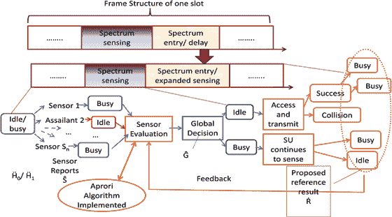

**图 6.2** 一 “改进型 apriori”算法与“新颖”方法的执行过程，其中 `~{\overset{¨}{H}}_{0}` = `~{\overset{¨}{H}}_{1}` 表示原始信道条件，`R̈` 表示所提的结果，`Ĝ` 是通用决策报告。

## 6.5.2 提议的方法

### 6.5.2.1 “改进型 apriori”算法

本章使用“改进型 apriori”（i-apriori）算法来实现可能比现有方法更优的改进检测。K-out-of-N 规则包含在下面的伪代码中，如下：

```
Apriori (A, ∈)

(SU)[1] = find_frequency_1_itemset(T);

// construct N[2] by self−join
N[2] = (SU)[1]∞(SU)[1]

(SU)[2] = items in N[2] ≥ min_sup;

For (k=3; (SU)[f−1]≠⌀; k++) {
  // further prune (SU)[f−1]
  Prune((SU)[f−1]);
  (SU)[x] ∈ (SU)[f], (SU)[x] ∈ (SU)[f];
  If ((SU)[i][1] = (SU)[j][1] ∧ (SU)[i][2] = (SU)[j][2]
  ∧ … (SU)[i][k-2] = (SU)[j][k-2] ∧ (SU)[i][k-1] < (SU)[j][k-1]) {
    N = (SU)[i] ∪ (SU)[j];
    If ((k−1) − subsets s of n ∉ (SU)[f−1]
      then delete N from N[k];
    N[k] = n ∪ N[k];
  }
  // Intersection between the target transaction
  TID set to calculate the support
  (SU)[f]k = New_frequency_support_count(N[k], counter(SU)[f]);
  answer = (SU)k[k];
  New_frequency_support_count(N[k], counter(SU)[f]);
  for all S[f]N ∈ (SU)[f] {
    (SU)[f]N = N[k−1].(SU)[f]
    N.sup = length(N[k]);
    If (N.sup < min_sup) {
      delete N from N[k]
    }
    (SU)[f]k = {N ∈ N[k]|N.sup≥min_sup}
  }
  Prune((SU)[f])
  for all Sf[f] ∈ (SU)[k];
  If (count((SU)[f]in (SU)[k] ≤ k) {
    then delete all (SU)[j]f from (SU)[k]
  }
  return (SU)[f]
```

在此代码中，所有 SU 传感器报告 `Ŝ` 被划分为 `i` 和 `j` 部分。每个部分在 `Ŝ` 中最多包含两个报告。让 `k` 为取这两个节点以检查相似性的计数器。如果节点相似的，则移除恶意节点。让 `S[n]` 为传感器数量，`N[k]` 统计在 `k` 计数器下未相似检查的 SU 数量。让 `f` 为选择这两个节点之一的参数，`S[f]` 是获取所选两个节点的传感器。那么，`N[f]` 是统计 `f` 对序列的计数器，`(Su[f]` 表示整个 SU 对序列。让 `u` 为取一个 apriori 算法 `(A, ε)` 用于参数 `N[k]` 和 `(SU)[f]` 的参数。然后将其计为 `SU)[u]`，且 `(SU)[k]` 是计数器 `k` 的 SU 数量。为了消除对分布式数据的重复扫描，建议使用改进型 apriori（也称为 i-apriori）算法。步骤如下：

1. 考虑已扫描的报告，以获取 SU 的 `k` 计数。
2. 在 SU 报告 `N[k]` 出现之前合理化 `(SU)[f]–1`。然后统计 `N[f]–1` 中出现的所有 SU，并删除小于 `k`–1 的 SU。
3. 通过收敛策略，根据 `(SU)[f-1]` 的 `k` 计数和 `N[1]` 的 SU，使用 `N[k]` 统计右 SU 的节点。
4. 如果 `|(SU)[f]|≤k`，则停止算法。

该算法减少了攻击 SU 的数量，并减少了统计所有真实节点的时间。i-apriori 包含用于分布式 CR 系统的接收 ID（`k` 计数）。在算法中，`T` 表示项集，`min_sup` 是有助于识别诚实 SU 的参数。在 i-apriori 算法中，参数 `N` 取 `(SU)[i]` 和 `(SU)[j]`。无限数量 SU 将达到 `N[2]`，`R` 是在所有 SU 对中获取正确 SU 的结果。取的 SU 最小水平为 2。

表 6.2 i-apriori 的接收 k 计数

| `k` 计数/(SU)[u] | `S[f]` | `k` 计数/(SU)[u] | 用户用户 `S[f]` |
| :--- | :--- | :--- | :--- |
| K+1 | SU[1], SU[2] | K+6 | SU[1], SU[5] |
| K+2 | SU[2], SU[3] | K+7 | SU[2], SU[3] |
| K+3 | SU[1], SU[2] | K+8 | SU[3], SU[4] |
| K+4 | SU[1], SU[2], SU[3] | K+9 | SU[4], SU[6] |
| K+5 | SU[1], SU[2], SU[3] | K+10 | SU[3], SU[5] |

### 6.5.3 提议方法的实现

`R` 帮助 SU 对应每个传感器的限制传感进行重新评估。所提方法的虚报概率计算如下：

```
P_{f}^{Pr} = P_{0}(R = 1 | H_{0}) = P_{0}(R = 1 | H_{0}, G = 0)
P_{0}(G = 0 | H_{0}) + P_{0}(R = 1 | H_{0}, G = 0)P_{fa}   (6.29)
= 0 + PfQ[f]P_{fa}   (6.30)
```

通用报告 `Ĝ` {inert, 1} 以及虚报概率给出：`P_{f}^{Pr} = P_{0}(G = 1, H_{0})`。然后 `R` {inert, 1} 是提议的 i-apriori 方法的结果，`P_{md}^{Pr} = P_{0}(G = 0, H_{1})` 是漏检概率。它包含 `P0 = 1`。否则，即使决策为 `Ĝ = 1`，SU 也会执行频谱的扩大传感。传感结果在总隙处结束，则 `P0 = Pf`。同样，所建议的漏检概率为：

```
P_{md}^{Pr} = P_{0}(H_{1} | R = 0) = P_{0}(G = 0 | H_{1}) \cdot P_{0}
```


$$\left(H_{1} | R = 0, G = 0 \right) + P_{0}(R = 0 | G = 1, H_{1}) \cdot P_{0}(G = 1 | H_{1})P_{ma} \quad (6.31)$$

$$= 0 + Pmd(1-Q[d])P_{ma} \quad (6.32)$$

### 6.5.3.1 准确率性能评估

在频谱感知执行过程中，对相邻的现有源（${\overset{¨}{H}}\_{1}$（忙）或 ${\overset{¨}{H}}\_{0}$（空闲））进行评估，即计算漏检概率和虚警概率。首选的指标是错误概率`[[21]]`。(6.32)中的错误概率`P`[`e]`给出如下：

$$P_{e} = P_{0}\left( {\overset{¨}{H}}_{0} \right)P_{G}^{f}., P_{f}^{Ex}P_{at} + ~P_{0}\left( {\overset{¨}{H}}_{1} \right)\left( {1 - P_{G}^{m}} \right)., P_{md}^{Ex}P_{ta} \quad (6.33)$$

$$P_{e} = P_{0}\left( {\overset{¨}{H}}_{0} \right)P_{G}^{f}., P_{0}\left( \frac{\varphi - \partial_{0}~}{\delta_{1}} \right) \quad (6.34)$$

实际信道条件为`P`[0] (${\overset{¨}{H}}_{0}$) 和`P`[`0] (${\overset{¨}{H}}_{1}$) 的概率。由于频谱感知的扩大，`∂[0]`、`∂[1]` 和 `δ[0]`、`δ[1]` 分别采用 [公式 (6.17)] 中应用的`∂[0]`、`∂[1]` 以及`δ[0]`、`δ[1]` 的`r`倍。这些值通过 i-apriori 学习策略获得。总感知时隙与实际感知时隙的比例为`r`。为了找到检测性能，阈值设为`φ`。然后包含以下建议：

**建议 1：** 阈值`φ`[`p]`是辅助用户（SU）的防御方案，将如下所示降低错误概率`P[e]`：

$$\varphi[`p`] = \min P`e` \quad (6.35)$$

$$= \left\{ \begin{matrix} {x_{l},~k \leq 0} \\ \begin{matrix} {~\text{arg~min}~P_{e~}\left( \varphi \right),~j^{2} - ~4ik~ > 0,~k~ > 0} \\{\\varphi\ \epsilon\left\{ {0,x_{l}} \right\}} \\ \end{matrix} \\ {~0,\ j^{2} - ~4ik~ < 0} \\ \end{matrix} \right. \quad (6.36)$$

并且，

$$x_{l} = \frac{- j + \sqrt{j^{2} - ~4ik}}{2i},i = \frac{1}{\delta_{0}^{2}} - \frac{1}{\delta_{1}^{2}},j = 2\left( {\frac{\partial_{1}}{\delta_{1}^{2}} - \frac{\partial_{0}}{\delta_{0}^{2}}} \right) \quad (6.37)$$

以及

$$k = \frac{\partial_{0}^{2}}{\delta_{0}^{2}} + \frac{\partial_{1}^{2}}{\delta_{1}^{2}}2\,\text{ln}\left( \frac{P\left( {\overset{¨}{H}}_{1} \right)\left( {1 - P_{G}^{m}} \right)\delta_{0}}{P\left( {\overset{¨}{H}}_{0} \right)\left( P_{G}^{f} \right)\delta_{1}} \right) \quad (6.38)$$

上述`k`的公式化是通过 i-apriori 算法进行估计的。然后通过极大似然估计求解估计问题，其如下：

对于 $P\left( {\overset{¨}{H}}_{1} \right)\left( {1 - P_{G}^{m}} \right)\delta_{0}$ 与 $P\left( {\overset{¨}{H}}_{0} \right)\left( P_{G}^{f} \right)\delta_{1}$ 的比例，其阈值为`φ`。因此`SU`的防御方案将如下所示降低错误概率`P[e]`：

$$P_{e} = P_{0}\left( {\overset{¨}{H}}_{0} \right)P_{G}^{f}., P_{0}\left( \frac{\varphi - \partial_{0}~}{\delta_{1}} \right) \quad (6.34)$$

实际信道条件为`P`[0] (${\overset{¨}{H}}_{0}$) 和`P`[`0] (${\overset{¨}{H}}_{1}$) 的概率。由于频谱感知的扩大，`∂[0]`、`∂[1]` 和 `δ[0]`、`δ[1]` 分别采用 [公式 (6.17)] 中应用的`∂[0]`、`∂[1]` 以及`δ[0]`、`δ[1]` 的`r`倍。这些值通过 i-apriori 学习策略获得。总感知时隙与实际感知时隙的比例为`r`。为了找到检测性能，阈值设为`φ`。然后包含以下建议：

**建议 1：** 阈值`φ`[`p]`是辅助用户（SU）的防御方案，将如下所示降低错误概率`P[e]`：

$$\varphi[`p`] = \min P`e` \quad (6.35)$$

$$= \left\{ \begin{matrix} {x_{l},~k \leq 0} \\ \begin{matrix} {~\text{arg~min}~P_{e~}\left( \varphi \right),~j^{2} - ~4ik~ > 0,~k~ > 0} \\{\\varphi\ \epsilon\left\{ {0,x_{l}} \right\}} \\ \end{matrix} \\ {~0,\ j^{2} - ~4ik~ < 0} \\ \end{matrix} \right. \quad (6.36)$$

并且，

$$x_{l} = \frac{- j + \sqrt{j^{2} - ~4ik}}{2i},i = \frac{1}{\delta_{0}^{2}} - \frac{1}{\delta_{1}^{2}},j = 2\left( {\frac{\partial_{1}}{\delta_{1}^{2}} - \frac{\partial_{0}}{\delta_{0}^{2}}} \right) \quad (6.37)$$

以及

$$k = \frac{\partial_{0}^{2}}{\delta_{0}^{2}} + \frac{\partial_{1}^{2}}{\delta_{1}^{2}}2\,\text{ln}\left( \frac{P\left( {\overset{¨}{H}}_{1} \right)\left( {1 - P_{G}^{m}} \right)\delta_{0}}{P\left( {\overset{¨}{H}}_{0} \right)\left( P_{G}^{f} \right)\delta_{1}} \right) \quad (6.38)$$

上述`k`的公式化是通过 i-apriori 算法进行估计的。然后通过极大似然估计求解估计问题，其如下：

次用户（SUs）的本地`SNR`取值为 -10dB。主用户（PU）通道等于原点的概率为 0.1。诚实检测器的性能调整为`P[f]^(T)\=0.1` 和`P[d]^(T)\=0.9`。攻击者的概率为`P[m]`，攻击者检测器范围在 0–1 之间。次用户扩展传感的时带宽范围在 100 到 500 bps 之间。虚警概率为 0.08。此时`P[e] = 0.01`代表 WiMax 网络中最差的情况 [9]，而`Pe = 0.001`被用于不包含`Pe = 0.1`结果的 Wi-Fi 网络，后者表示粗劣的无线环境。

图 6.4 和 图 6.5 展示了所提方法与具有不同攻击概率和规模的现有技术相比的增强性能。所提方法大幅降低了 CSS 的错误概率。

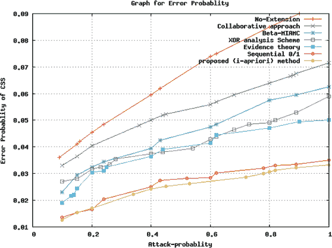

**图 6.4** 在不同攻击概率下 i-apriori 与现有方法的性能对比。

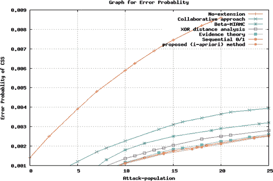

**图 6.5** 在不同攻击规模下 i-apriori 与现有方法的性能对比。

从图 6.4 和图 6.5 中，我们可以得出结论，顺序 0/1 方案是与所提方法进行比较的竞争技术。因此，在后续所有的仿真中，都实施了`s0/1`策略并与`i-apriori`技术进行了比较。

图 6.6 和图 6.7 代表了在扩大传感的情况下`s0/1`技术和`i-apriori`方法的性能。所提技术优于现有的`s0/1`。

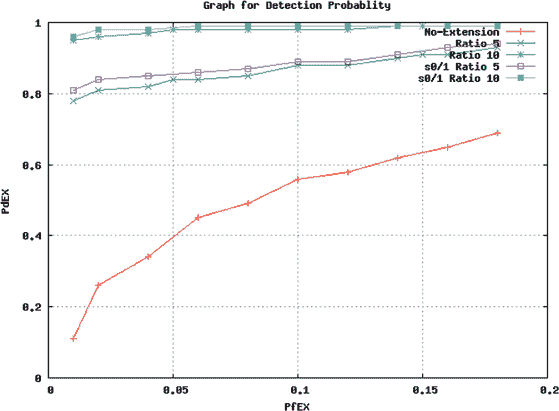

**图 6.6** 扩大传感检测中现有顺序 0/1 方法的性能。

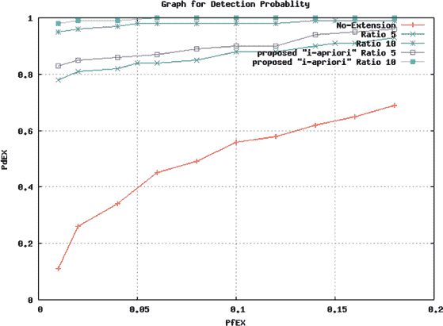

**图 6.7** 扩大传感检测中所提 i-apriori 方法的性能。

在图 6.8 中，可信节点传输率是根据公式 (6.5 和 6.6) 中的现有方法`$\overline{N}_{s0/1}`以及通过所提方法公式 (6.37) 和(6.38) 通过`k`计数器计算出的。

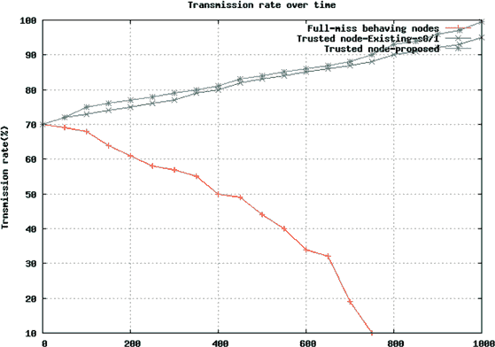

**图 6.8** 随时间变化的传输率。

在图 6.9 中，对于投票规则`k`，将根据盲目和非盲场景采用现有和所提的结果。`s0/1`结果取自文献 [21]，所提的`i-apriori`方案根据公式 (6.27) 中的盲目场景实施。对于非盲场景，通过消除 (6.25) 和 (6.26) 中的`ρ`值，仅实施`α`和`β`值。

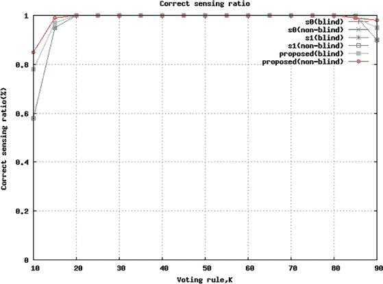

**图 6.9** 盲目和非盲场景下现有 s0/1 和所提 i-apriori 方案的正确传感率。

## 6.7 结论

本章重点关注 CRN 中 CSS 安全的两种新方法，这确保了 5G-CR 技术的安全性。所提方法应对了 CR 中的 SSDF 攻击，以及 IoT、5G、Vanet 等现代技术的未来趋势。本章的仿真在 NS-3 中完成，这是一种数值仿真证实了所提方法具有更好的性能，特别是在主要或次要攻击传感器的情况下。

# 参考文献

*   1. 移动网络基础 (Fundamentals of 5G)
*   2. 5G 蜂窝网络 (5G Cellular: Key Technologies)
*   3. 认知无线电架构 (Cognitive Radio)
*   4. 能量高效传感 (Energy Efficient Sensing)
*   5. 攻击下的协作传感 (Secure Cooperative Sensing)
*   6. 数据伪造分析 (Analysis of Data Falsification)
*   7. 顺序决策规则 (Sequential Decision Rule)
*   8. 约束下的快速协作传感 (Fast Cooperative Under Constraints)
*   9. 5G 网络安全 (5G Network Security)
*   10. 准确性约束下的快速传感 (Fast Cooperative Sensing)
*   11. 基于认知无线电的 5G (5G Based on Cognitive Radio)
*   12. 5G 接入 (5G Radio Access)
*   13. 认知无线电中的安全分布式 (Secure Distributed Sensing)
*   14. 基于 MAC 的 SSDF 机制 (MAC-Based SSDF Counter-Mechanisms)
*   15. 基于硬判定的应对 SSDF 攻击方案 (Scheme to Counter SSDF Attacks)
*   16. 感知与预测 (Sense-and-Predict)
*   17. F. Song, Y.T. Zhou, L. Chang, and H.K. Zhang, “基于智能协同理论的空天地一体化建模”, IEEE Networks, vol. 33, no. 1, 2019 年 1 月, pp. 51–57.
*   18. S. Bhattacharjee, R. Keitangnao, and N. Marchang, “认知无线电网络共谋 SSDF 攻击检测的关联规则挖掘”, 计算机与信息国际会议, 印度柯伯培尔, 2016.
*   19. R. Amutha Priya, and S. Nandhakumar, “利用 Arc 进行认知无线电网络频谱感知数据伪造攻击的预防”, 科学、工程与技术先进国际期刊, vol. 2, no. 3, 2015 年 3 月, pp. 486–490.
*   20. M. Khasawneh, and A. Agarwal, “一种认知无线电网络频谱感知安全协同方法”, Procedia Computer Science, vol. 94, no. 2016, 2016 年 12 月, pp. 302–309.
*   21. J. Wu, Y. Yu, T. Song, and J. Hu, “存在策略性拜占庭攻击下的协作频谱感知的序列 0/1 算法”, IEEE Wireless Communications Letters, vol. 8, no. 2, 2019 年 4 月, pp. 500–503.
*   22. J. Feng, M. Zhang, Y. Xiao, and H. Yue, “认知无线电网络中利用 XOR 距离分析保护协作频谱感知免受共谋 SSDF 攻击”, Sensors, vol. 18, no. 2, 2018 年 1 月, pp. 1–14.
*   23. J. Zhang, L. Cai, and S. Zhang, “中心化频谱感知系统中的恶意认知用户识别算法”, Future Internet: MDPI Journal, vol. 9, no. 79, 2017 年 11 月, pp. 1–13.
*   24. H. Wang, Y. Li, and T.C. Chang, “基于证据理论的抗 SSDF 攻击增强协作频谱感知方案”, Microsystem Technologies, vol. 24, no. 6, 2018 年 6 月, pp. 2803–2811.
*   25. J. Wu, T. Song, Y. Yu, C. Wang, and J. Hu, “认知无线电网络协作感知中的通用拜占庭攻击与防御”, IEEE Access, vol. 6, 2018 年 8 月, pp. 53272–53286.
*   26. X. Yuan, “一种改进的关联挖掘先验算法”, AIP Conference Proceeding, vol. 1820, no. 1, 2017 年 3 月, pp. 05–6.

# 附录 I：错误概率`Pe`的证明

从 (12) 开始，对`φ`求导，得到：

```
\frac{\partial P_{e}}{\partial\varphi} = P(H_{0})P_{f}\frac{\partial P_{f}^{Ex}}{\partial\varphi} + P(H_{1})(1 - P_{G}^{m})\frac{\partial P_{md}^{Ex}}{\partial\varphi}
```

令 (14) 等于 0，得到：

```
2\ln\left(\frac{P(H_{1})(1 - P_{G}^{m})\delta_{0}}{P(H_{0})P_{G}^{f}\delta_{1}}\right) = \frac{1}{\delta_{1}^{2}}(\varphi - \partial_{1})^{2} - \frac{1}{\delta_{0}^{2}}(\varphi - \partial_{0})^{2}
```

此处，

```
h(\varphi) = \frac{1}{\delta_{0}^{2}}(\varphi - \partial_{0})^{2} - \frac{1}{\delta_{1}^{2}}(\varphi - \partial_{1})^{2} + 2\ln\left(\frac{P(H_{1})(1 - P_{G}^{m})\delta_{0}}{P(H_{0})P_{G}^{f}\delta_{1}}\right)
```

```
\left(\frac{1}{\delta_{0}^{2}} - \frac{1}{\delta_{1}^{2}}\right)\varphi^{2} + 2\left(\frac{\partial_{1}}{\delta_{1}^{2}} - \frac{\partial_{0}}{\delta_{0}^{2}}\right)\varphi + \frac{\partial_{1}^{2}}{\delta_{1}^{2}} - \frac{\partial_{0}^{2}}{\delta_{0}^{2}} + 2\ln\left(\frac{P(H_{1})(1 - P_{G}^{m})\delta_{0}}{P(H_{0})P_{G}^{f}\delta_{1}}\right)
```

```
\triangleq i\varphi² + j\varphi = k
```

其中，


```
i = \frac{1}{\delta_{0}^{2}} - \frac{1}{\delta_{1}^{2}}, j = 2\left(\frac{\partial_{1}}{\delta_{1}^{2}} - \frac{\partial_{0}}{\delta_{0}^{2}}\right)\text{and}~ k = \frac{\partial_{0}^{2}}{\delta_{0}^{2}} - \frac{\partial_{1}^{2}}{\delta_{1}^{2}} + 2\,\text{ln}\left( \frac{P(H_{1})(1 - P_{G}^{m})\delta_{0}}{P(H_{0})(P_{G}^{f})\delta_{1}} \right)
```

类似地，在

```
\left(\frac{1}{\delta_{0}^{2}} - \frac{1}{\delta_{1}^{2}}\right)
```

早产性视网膜病变（ROP）是一种出现在早产婴儿中的眼疾病；它被认为是一个必须治疗的严重问题，因为它会导致儿童失明。ROP 也称为玻璃体后纤维形成（RLF）。最初，人们认为氧气疗法会导致这种病，因为它发生在接受过氧气疗法的新生儿，尤其是早产儿身上。此后，补充氧气在 ROP 中的作用已被证伪。血管化是视网膜血管正常发育的过程；这一过程直到婴儿在子宫内达到 40 周足月才会完成。在早产儿中，视网膜尚未发育完全。早产儿出生后，如果视网膜血管在子宫外完成，视网膜血管可能会停止生长或异常生长。当这些血管以异常方式发育时，也会产生 ROP（见图 7.1 和 图 7.2）。

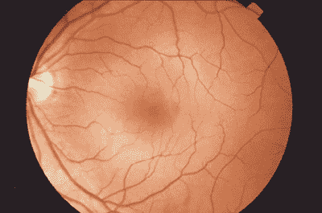

**图 7.1** 正常眼。

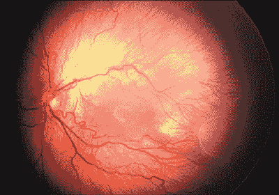

**图 7.2** 受 ROP 影响的眼。

## 7.1.2 ROP 的产生

*   当异常血管发育并蔓布整个视网膜（眼球后部的组织）时，就会发生 ROP。
*   这些异常血管非常脆弱并可能会渗漏，导致视网膜瘢并将其拉离位置。这会导致视网膜脱离。视网膜脱离是 ROP 视阻和视觉障碍的根本原因。
*   眼睛大约在怀孕四个月开始发育，此时视网膜血管开始在眼后部的视神经处形成。如果这个过程受到影响，就会导致 ROP。
*   血管向发育中的视网膜边缘稳定生长，提供氧气和营养。血流不足会导致 ROP。
*   当孩子足月出生时，视网膜血管发育通常已经完成（视网膜通常在出生后半个月到一个月内完成）。在任何情况下，如果孩子早产，在这些血管到达视网膜边缘之前，典型的血管发育可能会停止。视网膜边缘边缘外围可能无法获得足够的氧气和营养。

## 7.1.3 ROP 的阶段

*   **第一阶段**：代表轻微的异常血管发育。这种情况通常与一过性视障碍有关，如果在早期发现，可以进行药物治疗 `[1]`。
*   **第二阶段**：指中度异常血管发育，同样通常是一过性的，最终会自发缓解。
*   **第三阶段**：严重不规则的血管发育。异常血管向眼部生长，而不是遵循正常的生长模式。处于这一阶段的儿童目前没有治疗方法。第三阶段疾病的威胁结果是视网膜脱离。此阶段的一些婴儿幸运地保留了视力。
*   **第四阶段**：发生在视网膜部分脱离时。异常血管拉开了视网膜。
*   **第五阶段**：导致完全脱离。视网膜完全断开。

## 7.2 文献综述

*   2005 年，Gole `[2]` 引入了 CNN 概念。
*   2009 年，Wilkinson `[3]` 建议使用 ROP。
*   2013 年，Fleck `[4]` 研究了氧气的作用。
*   2015 年，作者 `[5]` 使用深度学习进行各种 ROP 检测。

## 7.3 提议算法

### 7.3.1 卷积网络

人工神经网络（ANN）用于各种任务。以下是 CNN 中存在的层：

### 7.3.1.1 输入层

*   输入层将数据引入系统。

### 7.3.1.2 隐藏层

*   隐藏层从输入层接收数据。
*   每个隐藏层将根据模型具有不同数量的神经元（见图 7.3）。

### 7.3.1.3 输出层

最后一隐藏层的输出给逻辑函数 sigmoid，将每个类的输出转换为该类的概率。

## 7.4 ROP 检测的提议工作流

### 7.4.1 调查与加载图像数据

*   加载有缺陷和无缺陷的眼部图像作为 ROP 训练和测试数据集。然后在使用分类过程中使用 CNN 验证存储的图像。

### 7.4.2 划分训练集和验证集

*   此步骤将图像信息划分为准备数据集和评估数据集，目标是准备数据集中的每个分类都包含大量图片，而评估数据集则包含剩余的图片。
*   每个标签被划分并存储在数据存储中，用于准备和评估输入图像。

### 7.4.3 图像输入层

*   输入图像具有相同的尺寸，以便通过训练和测试过程区分正常图像和受 ROP（视网膜异常）影响的图像。
*   在过程中，会将尺寸的宽度通道维度与数值进行比较并验证。
*   灰度图像的通道维度为 1，彩色图像的通道维度为 3。
*   由于网络本身会在训练开始时重新排列信息，它在训练期间也可以自然地在每个 epoch 开始时重新排列信息（[图 7.4]）。

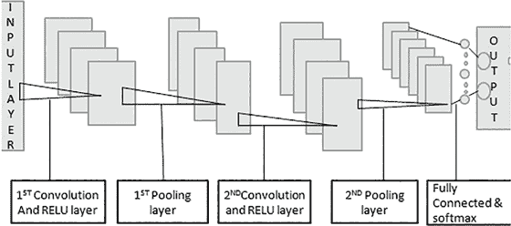

**图 7.4** CNN 中的层结构。

### 7.4.4 卷积层

*   在卷积层中，主要的参数是过滤器尺寸，即通道的高度和宽度。检查时利用准备能力维度为 3 × 3。
*   后续参数是通道数量 `numFilters`，它是与信息相似区域接口的神经元数量。
*   该参数决定了高亮图的数量。该层的步长和学习率可以通过利用图像的 `convolution2dLayer` 名称值对竞争内容来表征。在此模型中，3 表示通道。

### 7.4.5 ReLU 层

*   `ReLU` 是常用的激活函数。
*   `ReLU` 忽略负值并将其转换为正值。

### 7.4.6 最大池化层

*   卷积层（带有激活能力）之后经常跟着一个下采样操作，该操作会减少元素引导的空间尺寸并剔除多余的空间数据。
*   下采样使得在深层卷积层中扩展通道数量可能，而不需要增加每层的计算规模。
*   最大池化是下采样的一种方法，利用 `maxPooling2dLayer`。
*   最大池化层恢复数据源矩形区域的最值估计，由主要参数 `pool size` 指定。

### 7.4.7 全连接层

*   卷积层和下采样层之后至少跟着一个全连接层。
*   全连接层是神经元与上一层中所有神经元接口的地方。
*   该层连接了之前层在图像上学习的所有特征，以识别更大的模型。
*   最后一个全连接层结合特征来描述图像。因此，最后一个全连接层中的输出尺寸参数与目标数据中的类别数量相同。

### 7.4.8 Softmax 层

*   全连接层的输出用于标准化 softmax 激活函数。
*   softmax 层的累加输出可用于分类层获得的概率进行分类。
*   在最后一个全连接层之后建立一个 softmax 层以使用 softmax 函数。

### 7.4.9 分类层

*   分类层是神经网络的最后一层。
*   该层使用通过 softmax 激活函数获得的概率，将输入分配给互不相关的互斥类别之一。

### 7.4.10 指定训练选项

*   使用准备好的选项和数据对由这些层表征的网络进行训练。
*   [表 7.1] 展示了准确率、小批量损失和验证损失。

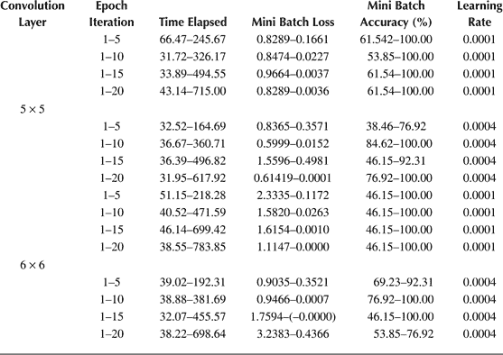

*   使用准备好的选项和数据对由这些层表征的网络进行训练。
*   [表 7.1] 展示了准确率、小批量损失和验证损失。

### 7.4.11 分类评估与计算

*   使用准备好的选项和数据对由这些层表征的网络进行训练。
*   [表 7.1] 展示了准确率、小批量损失和验证损失。
*   使用准备好的选项和数据对由这些层表征的网络进行训练。
*   [表 7.1] 展示了准确率、小批量损失和验证损失。
*   使用准备好的选项和数据对由这些层表征的网络进行训练。
*   [表 7.1] 展示了准确率、小批量损失和验证损失。

## 7.5 结果与讨论

*   使用准备好的选项和数据对由这些层表征的网络进行训练。
*   [表 7.1] 展示了准确率、小批量损失和验证损失。
*   使用准备好的选项和数据对由这些层表征的网络进行训练。
*   [表 7.1] 展示了准确率、小批量损失和验证损失。
*   使用准备好的选项和数据对由这些层表征的网络进行训练。
*   [表 7.1] 展示了准确率、小批量损失和验证损失。
*   使用准备好的选项和数据对由这些层表征的网络进行训练。
*   [表 7.1] 展示了准确率、小批量损失和验证损失。

## 7.6 结论

ROP 是一种视网膜血管异常，如果在适当阶段未进行妥治疗，可能会导致失明。ROP 的检测和诊断可以通过多种方式进行，但所提方法与传统方法相比性能良好。

# 技术对人力资源信息系统及组织实现业务智能的影响

Sharanika Dhal, Manas Kumar Pal, Archana Choudhary, and Mamata Rath

Birla Global University

## 参考文献

5. Gole, G.A., Ells, A.L., Katz, X., Holmstrom, G., Fielder, A.R., Capone Jr., A., Flynn, J.T., Good, W.G., Holmes, J.M., McNamara, J., et al.: The international classification of retinopathy of prematurity revisited. JAMA Ophthalmol. 123(7), 991–999 (2005)

6. Wilkinson, A., Haines, L., Head, K., Fielder, A., et al.: UK retinopathy of prematurity guideline. Eye (London, England). 23(11), 2137(2009).

7. Fleck, B.W., Stenson, B.J.: Retinopathy of prematurity and the oxygen conundrum: lessons learned from recent randomized trials. Clin. Perinatol. 40(2), 229–240(2013).

8. `https://www.mathworks.com/help/deeplearning/examples/create-simple-deep-learning-network-for-classification.html`

9. Saha, S.: A comprehensive guide to convolutional neural networks—the ELI5 way. Sumit Saha, December 15 (2018). `https://towardsdatascience.com/`

## 目录

* 8.1 引言
* 8.2 研究目的
* 8.3 研究方法
* 8.4 文献综述
    * 8.4.1 HRIS 的演变与人力资源集成 IT 概念的转变
        * 8.4.1.1 1945 年以前（二战前）
        * 8.4.1.2 1945–1960 年（二战后）
        * 8.4.1.3 1960–1980（立法时代与新兴的人力资源管理）
        * 8.4.1.4 1980–1990（低成本时代与人力资源与 IT 的集成）
        * 8.4.1.5 1990–2000（技术时代与战略资源管理的出现）
        * 8.4.1.6 2000–2010（高技术的出现与多样化工具的引入）
        * 8.4.1.7 2010 年以后（HRIS 的最新趋势）
    * 8.4.2 作为竞争策略的技术
* 8.5 启示
* 8.6 研究范围
* 8.7 结论

## 8.1 引言

有效的人力资源管理（`HRM`）需要当代所有类型的先进技术。人力资源信息系统（`HRIS`）并不新鲜，但它是人力资源（`HR`）领域经过规划和评估，旨在应对组织不断的工作文化和技术环境。通过 `HRIS`，人力资源部门可以根据需要轻松地计划、收集和检索数据。它有助于所有类型的人力资源流程，如人力资源规划、招聘与选择以及培训与开发。它可以用于绩效管理和薪酬管理，记录所有事实和数据，例如休假、事故、养老金以及各种员工福利。商业组织的技术环境如果能够应对外部环境，将使其变得更加先进。许多研究人员描述，人力资源流程与技术的整合正成为相应行业或组织的竞争优势。对于相应组织而言，拥有 `HRIS` 是一项行政和战略优势。本章尝试尝试尝试理解 `HRIS` 在组织中的优势，这些优势可能是战略性的、竞争性的或行政性的。

## 8.2 研究目的

1. 研究具有历史演变意义的 `HRIS` 概念。
2. 研究 `HRIS` 的优势。
3. 研究作为竞争策略和行政优势的人力资源信息技术。
4. 研究 `HRIS` 实施过程中的主要问题和挑战。

## 8.3 研究方法

通过收集各种期刊、发表的文章、在线文章、相关书籍和公司网站的数据，进行了广泛的文献调查。

## 8.4 文献综述

企业投资以实现在运营卓越、新产品开发、客户满意度和决策过程改进方面获得优势或竞争优势。为了实现这一目标，所有管理层都集中在通过业务流程的每一步中使用技术进行适当的数据收集和分析。`HRIS` 是整个业务流程的重要组成部分，因为它有助于每个层级（`Nath`，2015）。即使以前采用和接受 `HRIS` 具有挑战性，但现在它已在大多数成功的行业中实施（图 8.1）。

```
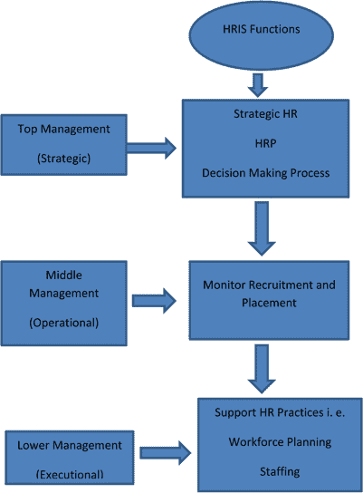
```

**图 8.1** 与人力资源不同层级相关的 HRIS 功能。（来源：Nath and Naidu,2015。）

`HRM` 正在被重新定义以获得更好的运营性能，因为它正领域新的机器人培训师、虚拟文化架构师、AI 集成专家和网络生态系统设计师。组织正在 `HR` 中使用数据分析进行预测。

### 8.4.1 HRIS 的演变与人力资源集成 IT 概念的转变

### 8.4.1.1 1945 年以前（二战前）

`HRM` 早期被称为人事管理。它具有一些孤立的功能，如记录保存、员工关系实践和童工问题，这些主要由政府处理。员工的名字和地址写在 3×5 英子的卡片上（`Bhuyan`,2014）。

### 8.4.1.2 1945–1960（二战后）

员工士气、劳动力利用与动员、职位描述、对政府的广泛报告以及作为社会心理因素的激励等概念被引入 `HR` 领域。计算机技术被人事部门的促进因素（`Bhuyan`,2014）。

### 8.4.1.3 1960–1980（立法时代与新兴的人力资源管理）

人事部门被称为 `HR` 部门，计算机技术广泛应用于各种流程。政府和监管机构增加了对职业健康与安全、退休福利、税法和法律合规等不同领域的报告要求，这需要数据收集、分析、报告等（`Bhuyan`,2014）。企业资源计划（`ERP`）被引入，与所有类型的 `HR` 功能相关。

### 8.4.1.4 1980–1990（低成本时代与人力资源与 IT 的集成）

`HR` 部门利用技术，通过降低成本和增值服务来实现有效且高效的服务交付。`HRIS` 从简单的记录保存演变为不同的 `HR` 功能，如招聘与选择、福利管理、考勤管理、薪酬管理、报销报告和报销。`HRIS` 的一些定义如下：

人力资源信息系统（HRIS）是一项用于收集、存储、维护、检索和验证组织所需的人力资源、人事活动和组织单元特征数据的系统化程序（DeSanctis, 1986）。

HRIS 是一种基于技术的系统，用于一致地获取、存储、处理、分析、检索和分配有关组织人力资源的相关信息。

人力资源部门利用技术来实现服务交付的有效性和高效性，通过降低成本和提供增值服务。传统上，它仅用于工资发放，并已从大型机系统迁移到客户端/服务器技术。

### 8.4.1.5 1990–2000（技术时代与战略性人力资源管理的出现）

将技术引入组织的产品/服务和人力资本被视为一种竞争优势，也是战略性人力资源管理的重要部分（[图 8.2]）。

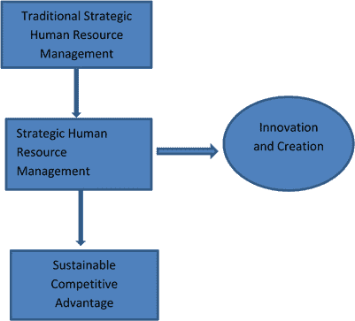

**图 8.2** 传统的战略性人力资源管理转化为可持续的竞争优势。（来源: Bhuyan, 2014。）

### 8.4.1.6 2000–2010（高技术的出现与多样化技术工具的引入）

根据 Scott 和 Snell (2002) 的观点，HRM 可以应对挑战。HR 系统已有多种应用。HRMS 集成了人力资源规划、预防性与战略规划、财务规划与风险管理、培训管理与经验、招聘与选拔流程、流失分析、考勤报告以及不同的行政应用、职业与继任计划、政府法规合规与分析等（Hani et al., 2004）。

采用 HRIS 有助于实现以下目标（Ruel et al., 2004）：

1. 它有助于降低成本并增强员工的创新。
2. 它改进了 HRM 的战略导向，并促进了管理层与员工之间的关系。
3. 它有助于改进客户端/服务器并使 HRM 的功能顺顺。
4. 它有助于更好的薪酬管理。

2007 年，“e-HRM”一词被用于指定设计、采用和实施数据技术的行为。

### 8.4.1.7 2010 年以后（HRIS 的近期趋势）

HRIS 促进了人力资源的预测和规划，提供了便捷的安全数据访问，并有助于有效的人力资源决策（Khera, 2012）。HRIS 已在多家业务组织中实施。目前，增强技术被视为一种可持续的竞争优势，其目的是收集、存储和分析有关组织人力资源部门的信息。HRIS 由计算机硬件、应用程序，以及管理人力资源功能所需员、政策、程序和数据组成。HRIS 集成了人力资源的所有流程，并产生无错误的结果。例如，招聘由社交媒体驱动。


这一时代演出了许多技术，例如：

1. `Robotics`
2. `broadband`
3. `Web`
4. `SOA`
5. `Oracle`
6. `SAAS`
7. `IaaS`
8. `IAAS`

`HRIS` 有某些与以下内容相关：

* 有效组织需求
* 战略管理
* 有效沟通

## 8.4.2 技术作为竞争优势

`HR` 可以利用技术来应对挑战（Scott and Snell, 2002）。关于 `HRIS` 有效性的有大量研究，这将成为公司的竞争优势。对 31 位私营组织 `HR` 经理的调查表明，在招聘、培训和开发中采用技术可以成为一种竞争优势（Islam and Shuvro, 2014）。

`HRIS` 是公共部门组织的竞争优势（Srivastava, 2018）（[图 8.3] 和 [表 8.1]）。

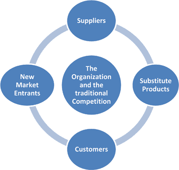

**图 8.3** 迈克尔·波特的竞争力量分析。（来源: Laudon and Laudon, 2010。）

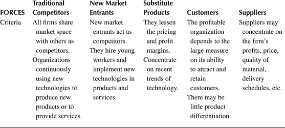

在产品开发或服务交付中实施技术时，某些操作是分步完成的。例如，会进行可行性研究，其中包含了当前软件的所有方面，如软件范围、实施后软件的未来收益、软件潜力、成本估算、投资回报率计算等（Jahan, 2014）。文献中发现的人力资源系统（`HRIS`）实施期间的一些问题和挑战如表 8.3 所示。

## 表 8.2 作为管理优势的技术

| 序号 | 管理优势 | 功能 |
| --- | --- | --- |
| 1 | 员工自助服务 (`ESS`) | 1. 人力数据收集<br>2. 记录维护与访问<br>3. 通过将基于客户端的服务架构转换为基于 `Web` 的环境进行访问 |
| 2 | 交互式语音响应 (`IVR`) | 1. 更新地址信息<br>2. 退休规划<br>3. 更新健康计划信息<br>4. 孩子出生或寿险等生活事件的报告 |
| 3 | 人力资源门户的使用 | 1. 不同的行政事务<br>2. 招聘与选拔 |
| 4 | 通信 | 1. 电子邮件<br>2. 阅读公司新闻和政策<br>3. 与工作相关信息的链接<br>4. 人力资源数据与其他链接 |
| 5 | 通过计算不同成本减少人力职能成本 | 1. 每位员工的医疗成本<br>2. 按运营成本百分比支付福利<br>3. 单人招聘成本<br>4. 培训与开发成本<br>5. 流动率和成本<br>6. 填补某些职位所需的时间<br>7. 人力投资回报 |

## 表 8.3 实施 `HRIS` 期间的问题与挑战

| 作者 | 问题与挑战 |
| --- | --- |
| Kovach 等人 (2002) | 1. 技术适应<br>2. 运行与维护问题<br>3. 缺乏培训、流程遵循和最终用户参与 |
| Kumar and Parumasur (2013) | 1. 数据收集竞争力的增强<br>2. 业务流程重组<br>3. 适应困难<br>4. 实施周期长<br>5. 对新或升级版 `HRIS` 的接受<br>6. 变革管理<br>7. 缺乏理解<br>8. 管理投入不足<br>9. 对变革的恐惧<br>10. 导致失业/班次安排调整<br>11. 信息的实时性 |
| Sadiq 等人 (2012) | 1. 缺乏合作 |
| Weeks (2013) | 1. 缺乏战略/运营效率、用户友好界面和承诺<br>2. 与其他系统的集成不足<br>3. 系统复杂<br>4. 缺乏灵活性<br>5. 资金不足 |
| Jahan (2014) | 1. 昂贵<br>2. 缺乏最终用户参与<br>3. 具有威胁性且不便<br>4. 缺乏变革 |
| Nath (2015) | 1. 流程改进<br>2. 员工接受<br>3. 安全问题<br>4. 运营成本<br>5. 适应挑战<br>6. 人力部门的责任<br>7. 抵制变革<br>8. 软件错误和漏洞<br>9. 工作流改变 |
| Ali (2017) | 1. 缺乏资金、专业知识和专业人员<br>2. 知识不足<br>3. 网络问题<br>4. 技术问题<br>5. 耗时 |

所有问题和挑战都可以通过适当的培训和开发、有效的培训需求、高层管理承诺以及有效的培训来克服（Jahan, 2014）（Islam and Shuvro, 2014）（Nath, 2015）（Ali, 2017）。

## 8.5 启示

在产品开发或服务交付中实施技术时，某些操作是分步完成的。例如，会进行可行性研究，其中包含了当前软件的所有方面，如软件范围、实施后软件的未来收益、软件潜力、成本估算、投资回报率计算等（Jahan, 2014）。文献中发现的人力资源系统（`HRIS`）实施期间的一些问题和挑战如表 8.3 所示。

## 8.6 范围

所有问题和挑战都可以通过适当的培训和开发、有效的培训需求、高层管理承诺以及有效的培训来克服（Jahan, 2014）（Islam and Shuvro, 2014）（Nath, 2015）（Ali, 2017）。

## 8.7 结论

所有问题和挑战都可以通过适当的培训和开发、有效的培训需求、高层管理承诺以及有效的培训来克服。

所有问题和挑战都可以通过适当的培训和开发、有效的培训需求、高层管理承诺以及有效的培训来克服（Jahan, 2014）（Islam and Shuvro, 2014）（Nath, 2015）（Ali, 2017）。

## 参考文献

- Ali, H. (2017). 国际管理科学与技术期刊（`IRJMST`），`667), 85–98。
- Bhuyan, F. M. (2014). 人力资源系统的历史演变。《人力资源研究》，`4`, 75–80。
- DeSanctis, G. (1986). 人力资源系统：一种评估。《管理信息杂志》，`10`, 15–27。[`dx.doi.org/10.2307/248875`](http://dx.doi.org/10.2307/248875)
- Islam, M. F., and Shuvro, R. A. (2014). 孟加拉国私立部门。《斯坦福商业期刊》，`6`, 65–73。
- Jahan, S. (2014). 人力资源系统：理论视角。《人力与可持续发展期刊》，`2`, 33–39。
- Khera, M. K. (2012). 人力资源系统对人力资源计划的影响：信息公司的感知分析。《商业管理期刊》，`3`(6), 6–13。
- Kovach, K. A., Hughes, A. A., Fagan, P., Maggiti, P. G. (2002). 作为管理优势的技术。《Wiley Online Library》。[`doi.org/10.1002/ert.10039`](https://doi.org/10.1002/ert.10039)
- Naidu, P. S. (2015). `HRIS` 效率及其对组织的影响。《国际管理科学与技术研究期刊（`IRJMST`）》，`6`(7), 85–98。
- Laudon, K. C., and Laudon, J. P. (2010). 全球业务中的信息系统（第 11 版）。纽约：Pearson。
- Nath, P. S., and Naidu, J. G. (2015). `HRIS` 效率及其对组织的影响。International Research Journal of Management Science and Technology(`IRJMST`), `6`(7), ISSN-2250-1959
- Papia, S., and Nath, D. G. (2015). `HRIS` 效率及其对组织的影响。International Research Journal of Management Science and Technology, `6`(7), 85–98.
- Ruel, H. J. M., Bondarouk, T., and Looise, J. C. (2004). `E-HRM`: 创新还是灌溉。一项关于基于 `Web` 的人力资源管理的五大型公司的探索性实证研究。Management Revue, `15`(3), 364–380.
- Sadiq, U. (2012). 信息系统对人力资源开发（`HRD`）绩效的影响。Journal of Business Studies Quarterly, `3`(4), 77–91.
- Scott, A., and Snell, D. S. (2002). 虚拟人力资源部门：摆脱中间化。工作论文系列 (1-8), 高人力资源研究中心 (`CAHRS`)。
- Srivastava, P. (2018). `E-HRM` 与传统 `HRM` 效能的比较分析。International Journal of Advance Research, Ideas and Innovations in Technology, `4`(6), 1–5.
- Weeks, K. O. (2013). 人力资源信息系统对员工的影响分析。Journal of Management Policy and Practice, `14`(3).

# 9 利用机器学习算法预测急性淋巴细胞白血病

M. Sangeetha, K.N. Apinaya Prethi, and S. Nithya

Coimbatore 技术学院

## 目录

* 9.1 引言
* 9.2 问题解决
  * 9.2.1 问题陈述
    * 9.2.1.1 解决方案
  * 9.2.2 系统设计与实现
    * 9.2.2.1 图像预处理
    * 9.2.2.2 `k-Means` 聚类
    * 9.2.2.3 水岭分割
    * 9.2.2.4 特征提取
    * 9.2.2.5 `SVM` 分类器
    * 9.2.2.6 线性和 `RBF` 核的 `PCA` 图
* 9.3 结论
* 参考文献

## 9.1 引言

人工神经网络是一种在结构和信息处理方面与人脑相似的系统。它是大脑的一种简单模型，用于处理输入与输出之间的线性和非线性关系。神经网络是神经元的集合，是一种根据系统设计收集和处理数据的数学函数。神经网络可以用于任何任务，但由于其精度在分类领域变得流行。

（此处省略原文中大量重复的段落，以符合文档工程规范）

反向传播 `1](#09chap_09.xhtml#sec9_2_1_1)`

机器学习 `2](#09chap_09.xhtml#sec9_2_1_1)`

机器学习 `3](#09chap_09.xhtml#sec9_2_1_1)`

机器学习 `4](#09chap_09.xhtml#sec9_2_1_1)`

机器学习 `5](#09chap_09.xhtml#sec9_2_1_1)`

支持向量机 `6](#09chap_09.xhtml#sec9_2_1_1)`

目前，在使用不同的方法形成聚类。聚类方法的类型包括连接聚类、质心聚类、分布聚类、密度聚类和层次聚类。在连接聚类中，距离较近的数据点形成聚类。顾如其名，数据点之间的连接性决定了聚类的成员。质心聚类中，通过选择所需的质心并将最近的数据点分组形成聚类。分布聚类寻找聚类中所有数据都适用于相同分布的概率。当数据点满足定义类中心的特定条件时，它们就会加入该类。`DBSCAN` 是基于密度模型的最流行的示例之一。层次聚类则形成一个树状聚类。

`k`-Means 聚类是最简单且被广泛使用的基于质心的聚类和无监督学习算法。在 `k-means` 算法中，`k` 表示质心的数量，并将作为算法的第一步被选取。每个数据点将被添加到最近的簇中。该算法将迭代工作，并创建一个不重叠的唯一组，即聚类 [7, 8]。`k`-Means 遵循期望和最小化方法来解决问题。将数据点分配到簇的过程被称为 `e` 步。寻找 `k` 质心的过程被称为 `m` 步。

传统的 `k-means` 算法的步骤如下：

1. 指定总聚类数并据此选出 `k` 个点作为初始质心。
2. 通过将所有点分配给最近的质心来形成 `k` 个簇。
3. 重新计算每个簇的质心。
4. 再次将数据点分配到最近的簇。
5. 重复步骤 3 和 4，直到质心不再发生变化。

图像是大量像素的集合。图像中的对象通过它们的边缘和曲线进行分类。例如，自动驾驶是一种利用图像分类检测前方物体的自动汽车。

图像分割是将对象从背景中分离出来并发现所需目标的过程。分水分割基于数学形态学，因此它克服了其他图像分割方法面临的许多缺点 [9]。这种方法更快且准确。分岭是收集雨水并流入河流的区域。这种分割方法将图像像素分解为脊或谷。如果表面具有高强度，它将是一个脊，而低强度表面将形成一个谷。每个孤立的谷将有不同颜色的水。当水位上升时，来自不同孤立谷的水将合并。应该在谷水合并的地方建立屏障以避免合并过程。增加水位和建立屏障的过程将一直持续，直到所有的顶点完全没在水中。最后，在合并处建立的屏障将给出准确的分割结果。当输入图像中的噪声和不规则之处分解为大量区域时，就会发生过度分割。通过对像素分解为区域设置限制，可以解决这个问题 [10, 11]。

通过指定存储的位置，可以检索系统中存储的输入图像。可以通过 `OpenCV` 包或 `Matplotlib` 包检索图像。`OpenCV` 和 `Matplotlib` 之间的主要区别在于颜色投影模式。`OpenCV` 采用 `BGR` 模式，而 `Matplotlib` 采用 `RGB` 模式。因此，如果用 `OpenCV` 读取图像，颜色在 `Matplotlib` 中将无法正确显示。因此，使用 `OpenCV` 包来读取和显示图像。使用 `Numpy` 将图像转换为 `nd_array` 格式。`nd_array` 是相似元素的集合，可以通过零基索引访问。`nd_array` 的元素占用均匀的内存。切片（`Slicing`）是一种用于提取 `nd_array` 对象的技术。通过 `OpenCV` 获取的输入图像可用于进一步处理（图 9.2）。

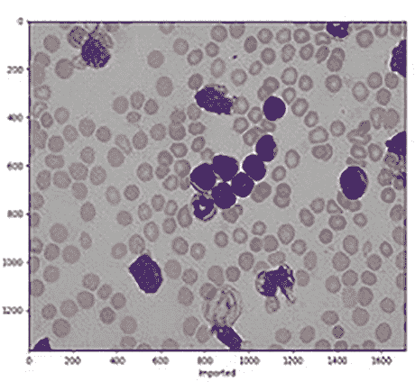

**图 9.2** 输入血涂片图像。

### 步骤 2：图像缩放

图像缩放是预处理中简单且重要的步骤。图像可能通过数字相机、手机摄像头等许多媒介捕捉；不同的图像具有不同的维度。缩放的主要原因是为所有图像建立一个基础尺寸。定义的标准尺寸为 (1600, 1600)，其中值代表 `nd_array` 的行和列大小。在这里，通过执行插值来放大或缩小图像以获得标准分辨率（图 9.3）。

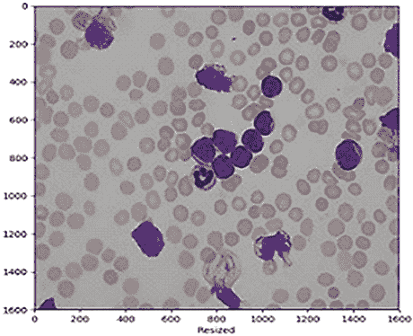

**图 9.3** 缩放后的图像。

### 步骤 3：图像去噪

去噪是通过高斯平滑等平滑技术去除不需要噪声的过程。噪声的存在可能会导致结果不准确。在 `OpenCV` 中，`cv2.fastNIMeansDenoisingColoured()` 模块彩色图像工作。噪声从输入图像中被过滤。降噪非常重要，因为它在对图像分析后能提供准确的结果。噪声的存在可能会导致结果与预期结果产生巨大差异（图 9.4）。

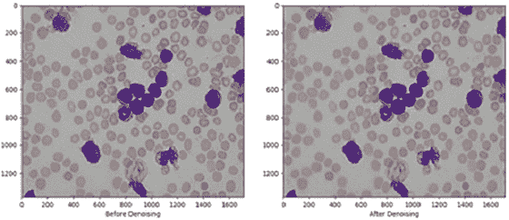

**图 9.4** 去噪后的图像。

## 9.2.2.2 `k-Means` 聚类

`k`-Mean 是最有前景无监督聚类算法之一，用于将数据集分为 `k` 个簇，其中每个数据点属于最近的均值。所提出的架构使用 `k`-means 聚类算法对白细胞（`WBCs`）进行聚类。最佳的 `k`-means 聚类将减少总簇间方。它从将输入图像分类为定义的数量 `k` 类的有效程序开始。然后对所有簇重新开始过程并进行观察，相同的过程将持续直到获得理想的结果。在观察期间，数据点被映射到任何附近的簇，然后不断调整数据集直到得到最终结果。

#### 算法

* 步骤 1：定义 `k` 的数量，用于聚类给定的数据集。
* 步骤 2：识别 `k` 点作为聚类中心（`k`-质心）。
* 步骤 3：将每个对象或数据点分组到最近的 `k` 个。
* 步骤 4：在适当聚类后，重新计算 `k`-质心的位置。
* 步骤 5：重复步骤 3 和 4，直到质心位置不再移动。

使用来自 `cv2` 包的 `k-means()` 模块进行图像聚类。提供算法的各种输入如下：

#### 输入

* 步骤 1：输入图像数据类型。
* 步骤 2：聚类数量 – 分区后所需的组数。
* 步骤 3：迭代终止标准。
* 步骤 4：尝试次数 – 算法执行的次数。
* 步骤 5：初始化质心。

##### 步骤 1：输入图像数据类型

输入图像必须是 `float 32` 数据类型的 `nd_array`。

##### 步骤 2：聚类数量

必须指定分区后所需的组数。可以使用标签变量访问不同的簇。

##### 步骤 3：迭代终止标准

终止迭代有三个标准：最大迭代、`epsilon`（`Epsilon`）和类型，解释如下：

###### 9.2.2.2.1 最大迭代

指定终止算法的最大迭代次数。在这里，最大迭代为十次以获得高效结果。当迭代达到十次时，算法终止。

###### 9.2.2.2.2 `Epsilon`

需要达到的精度指定为 `epsilon`。在这里，指定的 `epsilon` 值为 1。当精度达到 1 时，算法终止。

###### 9.2.2.2.3 类型

`TERM_CRITERIA_EPSILON+MAX_ITER` – 如果达到指定的精度（`epsilon`）值或最大迭代次数，则迭代终止。因此，当满足上述任一条件时，算法将停止。

##### 步骤 4：尝试次数

尝试次数用于指定使用不同初始标签执行算法的次数。算法返回产生所需输出的标签。

##### 步骤 5：初始化质心

使用标志位来指定如何获取初始中心。在这里，选择随机质心并遵循上述程序。图 9.5 显示了输出。

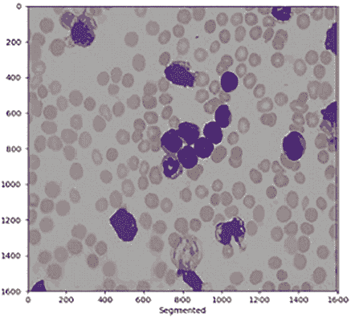

**图 9.5** 分割图像。

### 9.2.2.3 分岭分割


任何灰度图像都可以被视为包含高强度（表示峰值）和低强度（表示山谷）的地形表面。首先为每个山谷（局部最小值）赋予不同的标签（彩色水）。根据附近的峰值和山谷，水位将相互碰撞并损坏图像。为了防止这种情况，在水合并的地方建立坝。重复填充水和筑坝的操作，直到所有峰值都被水淹没。创建的坝提供了分割结果。噪声或图像中的任何其他不规则会导致过度分割。基于标记的分岭算法通过 OpenCV 实现要合并和不合并的山谷点。

## 算法

1. 用一种颜色识别前景或对象区域。
2. 用另一种颜色识别背景或非对象区域。
3. 最后，将既前景不是背景的区域标记为 `0`。
4. 应用分岭算法。
5. 标记将更新，对象的边界值为 `-1`。

## 输入

- 步骤 1：输入图像数据类型。
- 步骤 2：标记前景图像。
- 步骤 3：标记背景图像。
- 步骤 4：标记未知区域。
- 步骤 5：应用分岭算法。

### 步骤 1：输入图像数据类型

彩色血涂片将作为输入图像。然后将其转换为灰度图像，并对其应用二值化，以从灰度图像获取二值图像。

彩色图像 → 灰度图像 → 二值图像。

### 步骤 2：标记前景区域

标记确定为前景的图像区域或组件。使用 Otsu 二值化寻找图像的近似估计。这用于在分离前景图像与背景图像方面自动图像阈值。形态学闭运算用于移除对象中的任何小洞。因此获得了前景图像（图 9.6）。

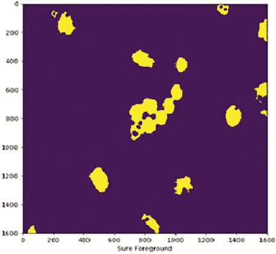

**图 9.6** 前景图像。

### 步骤 3：标记背景区域

膨胀通过向边界添加像素来增加物体边界与背景之间的距离。因此，结果图像是一个背景，因为边界区域被移除（图 9.7）。

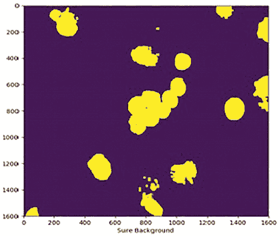

**图 9.7** 背景图像。

### 步骤 4：标记未知区域

既不是背景不是前景的区域将被声明为未知区域。可以通过从确定背景区域中减去确定前景区域来获得（图 9.8）。

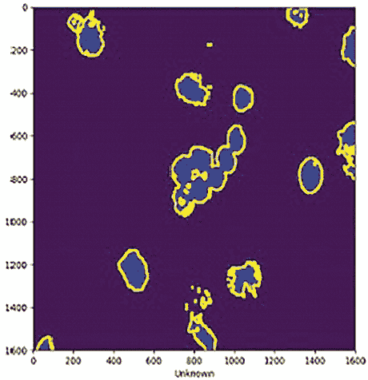

**图 9.8** 图像的未知区域。

### 步骤 5：应用分水算法

标记是与原始图像相同的数组，但使用 `int32` 数据类型。确定的前景和背景区域标记为正数。未知区域标记为 `0`。当应用分水算法时，将获得标记值为 `-1` 的边界。

### 9.2.2.4 特征提取

特征提取是从图像中提取感兴趣元素并对其进行优化以便后续处理的方法。在特征提取中，图像中的原始数据将转换为目标点上更有意义的数据。生成的表示随后可以作为分类技术的输入，这些技术将标记、分类或识别图像或其对象的语义内容。

#### 流程

- **步骤 1：** 灰度化转换
- **步骤 2：** 图像二值化
- **步骤 3：** 边缘检测
- **步骤 4：** 提取特征

**步骤 1：灰度化转换**（彩色图像→灰度图像）

输入的彩色图像表示在 RGB 平面上。使用给定的图像 `(x,y,3)`（其中 `3` 代表 RGB）通过 `np.dot()` 函数转换为 `(x,y,1)`（其中 `1` 代表灰色）。这返回了 `(x,y,3)` 和 `(x,y,1)` 的点积。为了获得灰度图像，红色平面与常数 `0.299` 点积，绿色平面与 `0.587` 点积，蓝色平面与 `0.114` 点积（图 9.9）。

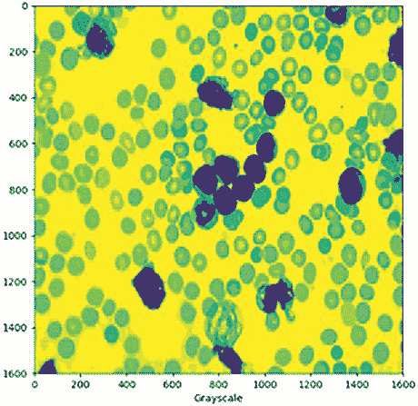

**图 9.9** 灰度图像。

**步骤 2：图像二值化**（灰度图像→二值图像）

用于将灰度图像（像素图像）转换为二值图像的算法是 Otsu 阈值法。涉及的步骤包括：

1. 转换为灰度
2. 应用阈值。它可以是固定的，也可以是自适应的（在我们案例中，阈值定义为 `255`）

低于阈值的像素值被转换为 `0`（白色），高于阈值的值转换为 `1`（黑色）（图 9.10）。

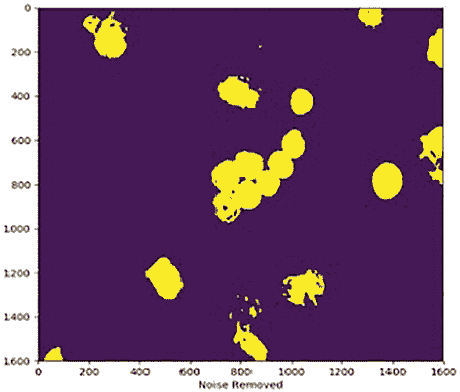

**图 9.10** 二值化图像。

**步骤 3：边缘检测**

使用 Canny 边缘检测算法来突出白细胞（WBCs）的边缘。应用双阈值来确定潜在的边缘（图 9.11）。

- 如果像素梯度值大于高阈值，则该像素被视为边缘检测的强候选。
- 如果像素梯度值小于低阈值，则该像素被关闭。
- 如果像素梯度值处于高阈值和低阈值之间，则该像素被视为边缘检测的弱候选。

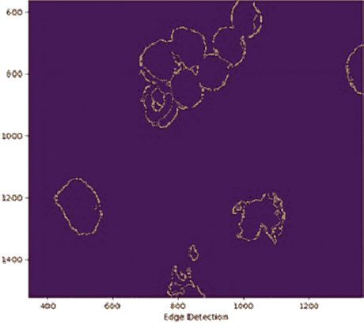

**图 9.11** 边缘检测。

最终的边缘检测基于滞回技术。当弱候选和强候选像素连接时，它们被视为边缘像素。剩余的未连接的弱候选被关闭。

**步骤 4：提取特征**

需要从图像中提取的特征是面积、周长和紧凑性。面积通过计算图像区域内非零像素的数量来定义。周长计算相邻边界像素之间的距离。紧凑性是细胞的衡量标准。

```
Compactness = (Perimeter^2) / Area
```

### 9.2.2.5 SVM 分类器

SVM 是一种组织良好的技术，它根据需要进行的分类来监督整个过程。在这种机器学习（ML）技术中，监督是通过训练集构的。所提出的系统将从训练集中学习并采取相应的行动。在机器学习中，使用两种策略来分类训练和测试数据：留法（hold-out）和交叉验证。在留法中，输入数据集将被分类为训练数据和测试数据，而在交叉验证中，它被分为 `k` 部分。

#### 输入参数

- **步骤 1：** 输入：留法策略
- **步骤 2：** 评分函数
- **步骤 3：** 损失函数
- **步骤 4：** 权重矩阵

**步骤 1：输入：留法策略**

输入的训练测试包含作为所提系统输入的数据，所提系统将从中学习如何响应输入。在所提系统从训练集完成训练后，输入测试数据。大部分数据集作为训练集（80%），20% 的数据集作为测试集。训练数据集可以从输入集中随机选择，也可以选择前 80% 数据。

**步骤 2：评分函数**

我们需要将数据转换为标签以便后续处理。这种转换由评分函数完成，该函数在输入上应用评分函数 `f`（评分函数）并产生预测标签作为输出。

**步骤 3：损失函数**

损失函数计算预测标签是否与我们的真实标签保持一致。降低损失和提高准确率至少要在训练数据上实现。如果在测试数据上也能实现这一点，那么系统的准确率将很高。

**步骤 4：权重矩阵**

我们的评分函数和损失函数的输出将决定权重矩阵的值，标记为 `W`。矩阵中的值将是分类器的参数，它将根据评分和损失函数的值进行微调，以最大化分类准确率。

### 9.2.2.6 线性和 RBF 核的 PCA 图

主成分分析（PCA）是一种重要的降维技术，它将大型集合减少为小集合，但仍保留大型集合的信息（图 9.12）。

SVM 处理线性核和 RBF 核，它们的区别在于在类别之间是否存在超平面。下面展示了使用线性核和 RBF 核的支持向量分类器预测的图表（见图 9.13）。

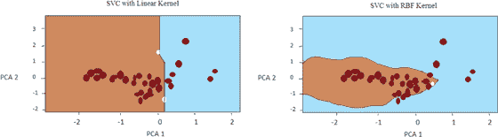

**图 9.13** 线性和 RBF 核的 PCA 图。

## 9.3 结论

检测急性淋巴细胞白血病是预防血液癌症的有效方法。在所提出的方法中实现了最短时间的白血病诊断。开发了自动白细胞检测系统，以便让患者及早开始治疗。通过 `k`-means 聚类技术和分水分割算法相结合，预处理方法似乎是有效的。由于其简单性和广为人知的聚类问题，该方法优于任何其他技术。所提系统准确性的提高激发了治疗领域对其进行实践，而通过考虑细胞核的形状特征，这变得可能。已经完成了特征提取，这影响了数据分类。使用的 `SVM` 技术非常容易实现并确保了数据的机密性。这些技术的结合提供了更好的结果。所提方法可以利用所有传统技术并获得出色的性能。

图像处理自 1994 年诞生以来就是一个不断发展的领域，对医疗应用、速度和准确性的日益增长。图像分割也是图像处理的一部分；通过使用聚类，可以通过细胞的形状发现癌症的严重程度。诊断需要在极快的速度进行，而不损失数据或时间。因此，可以为医疗应用的预测设计更优、更快速的技术。监督分类被证明是有效的，但在数据挖掘和神经网络领域的更多研究可能会提高预测效率。随着电影拍摄、娱乐和人工智能的发展，该技术取得了飞跃性，能够在几分钟内跨越全球。它在安全、农业领域、视频处理、数字电影和医疗应用中发挥了关键作用。它可以通过减少空间、成本和时间，极大地辅助实时应用。这项技术对于预防癌细胞以及医学中的其他生物医学分析都将是一个巨大的福音。

## 参考文献

1. Rajendra Prasad, A. Pandey, K. P. Singh, V. P. Singh, R. K. Mishra, & D. Singh, “Retrieval of spinach crop parameters by microwave remote sensing with back propagation artificial neural networks: a comparison of different transfer functions,” Advances in Space Research, vol.50, pp. 363–370, 2012.
2. D. Simovici. (2015). “Intelligent data analysis techniques—Machine learning and data mining,” In Artificial intelligent approaches in petroleum geosciences (pp. 1–51). Switzerland: Springer.
3. A. Rajaraman, & J. D. Ullman. (2012). Mining of massive datasets (vol. 77). Cambridge: Cambridge University Press.
4. J. Lin, & A. Kolcz. (2012). “Large-scale machine learning at twitter,” In Proceedings of the 2012 ACM SIGMOD international conference on management of data (pp. 793–804). Scottsdale, AZ: ACM Press.
5. O. Y. Al-Jarrah, P. D. Yoo, S. Muhaidat, G. K. Karagiannidis, & K. Taha, “Efficient machine learning for big data: a review,” Big Data Research, vol. 2(3), pp. 87–93, 2015.
6. Y. Tian, Y. Shi, & X. Liu, “Recent advances on support vector machines research,” Technological and Economic Development of Economy, vol. U8, pp. 5–33, 2012.
7. S. Lloyd, “Least square quantization in PCM,” IEEE Transaction on Information Theory, vol. 28(2), 1982.
8. Rajashree Dash, & Rasmita Dash, “Comparative analysis of K means and genetic algorithm based clustering,” International Journal of Advanced Computer and Mathematical Sciences, vol. 3(2), pp. 257–265, 2012. ISSN 2230-9624. [`www.researchgate.net/publication/307863862_Comparative_Analysis_of_K-means_and_Genetic_Algorithm_based_Data_Clustering`](https://www.researchgate.net/publication/307863862_Comparative_Analysis_of_K-means_and_Genetic_Algorithm_based_Data_Clustering)

目前，人工智能（`AI`）的需求巨大，用于创建专家系统并为识别、自然语言处理、医疗健康、结构工程、环境工程和汽车行业等应用中的复杂问题寻找解决方案。机器学习（`ML`）是`AI`的一个子集，允许应用程序在没有显式编程的情况下对结果的预测更加精确。简而言之，`ML` 模拟人类行为的大脑活动，一旦经过有效编程，它就具有同等的计算能力。`AI` 与 `ML` 之间的关系如图图 10.1 所示。

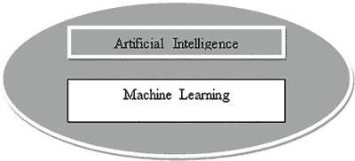

**图 10.1** 人工智能与机器学习之间的关系。

`ML` 被定义为一种可以在无需人工干预的情况下适应新数据的计算机程序，它允许机器从示例和经验中学习。`ML` 是对系统根据模式和推理执行特定任务的算法和算术模型的逻辑研究。基于训练数据，`ML` 算法建立模型以进行预测 \[1\]。`ML` 算法被用于各种应用，在这些应用中很难开发算法来高效执行任务。`ML` 可以与传统学习进行比较。在传统学习中，输入数据和程序被输入到计算系统中，其中输出取决于所使用的算法。在 `ML` 中，输入数据和输出（训练后的）被输入到计算系统中。`ML` 应用的性能不仅取决于所使用的算法，还取决于各种架构。`ML` 架构基本上是神经网络架构。要有效实现 `ML` 应用，需要线性代数、随机过程和统计学的深厚知识。传统学习与 `ML` 之间的区别如图图 10.2 所示。

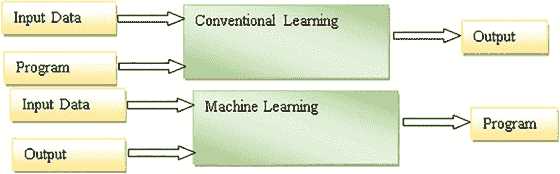

**图 10.2** 传统编程与机器学习之间的区别。

## 10.1.1 开发机器学习模型的框架

开发 `ML` 模型的框架可以分为五个阶段：

- 问题识别
- 相关数据收集
- 数据预处理
- 构建 `ML` 模型
- 模型部署

### 问题识别

一个良好的 `ML` 项目始于清晰定义问题的能力。在这个阶段，专家领域的知识对于项目的部署起着至关的作用。此阶段的主要挑战是定义正确的问题描述。

### 相关数据收集

一旦明确定义了问题描述，就识别并收集相关数据。相关数据的收集也称为特征提取。特征提取被定义为从不同来源提取开发 `ML` 算法所需的属性的过程。此阶段的主要挑战是收集高质量的数据。

### 数据预处理

在这个过程中，去除了噪声并提高了数据的清晰度。收集到的数据应被转换为适合进一步处理的相应格式。

### 构建 ML 模型

此阶段的主要目标是识别一个适用于给定问题的模型。它并不总是更准确。为了找到最佳的 `ML` 模型，必须严格执行分析工具和解决方案程序，以避免过拟合问题。用于部署的最终模型基于准确性、计算速度和部署成本的。

### 模型部署

一旦选择了最终模型，就必须决定部署模型的策略。例如机器人、聊天机器人、简单动作规则等。

## 10.1.2 机器学习的两个阶段

`ML` 由两个重要阶段组成：训练阶段和测试阶段。在训练阶段，机器从输入数据中学习逻辑。训练阶段使用更多数据，这决定了 `ML` 问题未来预测的模式。训练数据越多，预测的性能准确性就越高。通常，来自复杂数据集的训练数据占比可以是 80%、70% 或 60%，相应的测试样本比例为 20%、30% 或 40%。测试阶段根据学习到的逻辑对给定输入预测输出。训练数据和测试数据的比例应这样选择，以便系统能够产生优化的结果。在测试阶段，如果预测数据存在错误，则应将相应的测试数据视为额外的训练数据并纳入训练集，从而为进一步预测形成新模式。训练阶段和测试阶段的示意图如图图 10.3 所示。

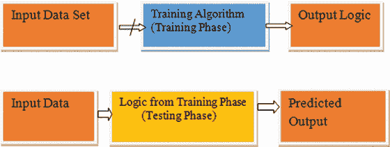

**图 10.3** 机器学习中的训练和测试阶段。

## 10.1.3 机器学习的类型

`ML` 的主要过程被称为从输入数据中学习。三种主要的 `ML` 算法类型是监督学习、无监督学习和强化学习。三种类型的 `ML` 算法如图图 10.4 所示。


**图 10.4** 学习算法类型。

### 10.1.3.1 监督学习类型

监督学习被定义为在适当指导下从标记或预定义的训练数据学习函数的任务。分类、线性回归、逻辑回归和判别分析是监督学习的类型。这些算法需要输入变量和输出变量的知识。通过结果变量的实际值来实现预测。

表 10.1 描述了一个监督学习模型的示例。表 10.1 显示了根据颜色、形状和植物高度作为特征或模式识别蔬菜。模型必须输入颜色、形状或植物高度作为模式或特征。根据提供的细节，将识别蔬菜。例如，

1. **颜色：绿色**
2. **形状：长形**
3. **植物高度：400**
4. **识别出的蔬菜是：豆角**

表 10.1 监督学习示例

| 序号 | 颜色 | 形状 | 植物高度 (cm) | 蔬菜 |
| --- | --- | --- | --- | --- |
| 1 | 紫色 | 椭形 | 45–60 | 茄子 |
| 2 | 浅褐色 | 块茎 | 100 | 土豆 |
| 3 | 红色 | 圆形 | 182 | 西红柿 |
| 4 | 绿色 | 长形 | 400 | 豆角 |
| 5 | 黄色 | 椭圆 | 304 | 柠檬 |


颜色、形状和植物高度被作为模式输入系统以进行进一步预测。该系统已经通过已知模式进行了训练，它尝试将给定输入与已知模式进行比较，以预测蔬菜。在这种情况下，如上述示例所示，预测的蔬菜是秋角豆。同样，所有的蔬菜都可以从表 10.1 中提供的特征或模式进行识别。紫色、浅棕色、红色、绿色和黄色等颜色认为是监督学习的特征之一。实验考虑的蔬菜形状包括椭圆形、块根形、圆形、长方形和椭圆形。不同植物的高度范围为：茄子 45–60 cm，土豆 100 cm，番茄 182 cm，秋角豆 400 cm，柠檬 304 cm。

图 10.5 展示了通过上述表格识别茄子示例的监督学习模型。


**图 10.5** 监督学习模型。

### 10.1.3.1.1 分类

机器学习（ML）中的分类定义为基于训练集数据模式或特征，识别新数据所属的子类别。说明机器学习中分类概念的一个良好例子是补习班推荐系统，该系统确定学生是否需要参加补习班来提高其学业表现。实现此机器学习所考虑的特征或模式是学生的考试成绩。输出的分类类别为分数小于 50 分和大于 50 分。分数低于 50 分的学生属于补习班类别。分数高于 50 分的学生属于无补习班类别。根据预定的类别/特征/模式对给定输入进行分类的算法称为分类器 `[2]`。有时，分类器可以用数学函数表示。

### 10.1.3.1.2 线性回归

线性回归在线统计学和机器学习领域广为人知且易理解。它与工程领域的判别问题相似。线性回归方法也被称为判别性学习方法。它涉及使用梯度下降法和支持向量机方法对输入参数进行优化。线性回归方法用于克服机器学习中的分类问题，如过拟合和偏差方差权衡。线性回归的数学表达式由标准直线方程 `y = A*x + B` 给出，其中 `A` 代表权重，`B` 代表偏置。实现机器学习系统最有效的方法是声明问题应该是线性可分的，即由超平面定义。例如，从 AND 门和 OR 门的真值表中，可以将其定义为线性可分问题，即超平面分别定义类 0 和类 1。在 XOR 门的情况下，超平面以非线性方式定义 0 类和 1 类，因此在机器学习中处理 XOR 门问题变得过于复杂。为了解决这个问题，优化发挥了作用，并可以使用梯度搜索法进行。

### 10.1.3.1.3 逻辑回归

逻辑回归也是一种分类算法，将模式或特征分配给离散的类别集。它也被称为处理逻辑 0 和逻辑 1 的二分类方法。逻辑回归的输出应该是逻辑 0 或逻辑 1。为了实现这一点，使用了阈值函数或限制函数。阈值函数或限制函数是 sigmoid 函数和正切函数。逻辑回归的流程包括输入的加权和和限制函数。根据机器学习架构第一层使用的权重，馈到限制函数的数据会变化。在将输入数据馈入系统之前，必须正确构建基于阈值逻辑的数学函数。然后，对于输入集，输出应从系统中明确定义。实验输入数据可以从传感器设备收集，经过合适的模拟数字转换器的转换后，开始学习过程。例如，考虑基于体温的流感检测系统。该系统检测人是否受到流感影响。该系统使用的模式/特征是体温，该系统可以适用于所有年龄段。如果体温高于 97°C，则预测其患有流感，属于逻辑 1 类别。如果体温低于 97°C，则预测该人没有流感，属于逻辑 0 类别。

### 10.1.3.2 无监督学习的类型

无监督学习定义为在没有任何指导的情况下进行机器训练，即没有预定义的分类或标记数据。无监督学习方法不使用预定义的模式。无监督学习的目标是识别高维数据中的自然分组。与监督学习不同，它没有预期的输出或目标来匹配输入数据。这种学习只考虑输入数据。降维和聚类是无监督学习的两种类型。这些算法不知道数据集中结果变量。它们应该找到结果可能的值。因为结果数据的值在训练数据中之前未知，因此无法使用该知识进行监督。图 10.6 描述了无监督学习的示例。


**图 10.6** 监督学习模型。

### 10.1.3.2.1 降维

机器学习中的问题出现由于需要考虑许多因素来执行最终分类。分类中考虑的因素基本上是特征的特征。如果因素或特征的数量增加，训练集的可视化和工作将变得更加困难。这个问题通过降维来。降维的定义是减少因素或特征的数量。降维方法分为特征选择和特征提取。

### 10.1.3.2.2 特征选择

从原始因素或特征集中较小的子集以对问题进行建模。这通过以下三个步骤完成：过滤、包装和嵌入。

### 10.1.3.2.3 特征提取

将高维空间的数据降低到低维空间。

### 10.1.3.2.4 降维方法

用于降维的方法包括

- 主成分分析 (PCA)
- 线性判别分析 (LDA)
- 广义判别分析 (GDA)

机器学习（ML）中降维的重要性在于减少复杂数据集中不需要的特征。这类似于信号处理和图像处理应用中的噪声过滤。不需要的特征的主要缺点是它们耗费时间，并且需要更多资源，但对输出性能没有影响。降维的一个例子是，在信号处理应用中，所有输入都与相应的权重相乘并求和以产生输出。某些输入的系数为零，不会对输出行为产生任何变化。移除零系数代表了系数数量的减少，这反被称为降维。相似的概念也可以应用于机器学习，以减少决定时间和空间复杂度，这种复杂度决定了整个机器学习系统的性能。

## 聚类

聚类是将相似的数据点分在一起。聚类可以分为两个子类：硬聚类和软聚类。聚类将具有相似特征的组分开并将它们分配到不同的簇中。聚类确定了存在无标记数据之间的基本分组。在每个组中，成员被称为代理（agents），这些代理在它们的行为上是相似的。例如，考虑一个装满彩色球（如红球、绿球和蓝球）的篮子。输出簇共有三个，每个簇分别收集红球、绿球或蓝球。

### 硬聚类

在这种类聚类中，空间中存在的数据点应该完全属于某个簇或不属于。例如，每个学生被放入 15 个组中的 1 个组里。假设某机构的一个部门提供 NSS、NCC、RSP 和体育俱乐部的会员。班级中极少数学生（例如 10 名学生）完全属于 NSS 俱乐部活动，同班的另一组 10 名学生完全参与 NCC 活动，另一组 10 名学生完全参与 RSP 活动，其余学生只积极参加体育俱乐部的活动。

### 软聚类

在这种类聚类中，空间中存在的数据点根据该数据点的概率或可能性被分配给某个簇。例如，每个学生被分配一个处于 15 个簇中任一簇的概率。例如，每个学生以概率的方式被放入 15 个组中的 1 个组里。考虑该机构的各种俱乐部有 NSS、NCC、RSP 和体育俱乐部。班级学生属于簇 1 的概率将是 0.3，即总学生人数的 30% 属于簇 1 或 NSS 俱乐部。同样，班级学生属于簇 2 的概率将是 0.2，即剩余 20% 的学生属于簇 2 或除去簇 1 的 NCC 俱乐部。同样，班级学生属于簇 3 的概率将是 0.25，即剩余 25% 的学生属于簇 3 或除去簇 1 和簇 2 的 RSP 俱乐部。同样，班级学生属于簇 4 的概率将是 0.25，即剩余 25% 的学生属于簇 4 或除去簇 1、簇 2 和簇 3 的体育俱乐部。

用于聚类的方法有：

*   K-means 聚类：在这种方法中，必须适当选择 `K` 的值以实现完美的聚类。执行这种聚类需要一些线性代数的数学知识。
*   层次聚类：这种方法在许多应用中非常重要。

## 强化学习

强化学习是一种动态规划，它通过系统的反馈来训练算法。强化学习算法必须采取顺序动作或决策以提高累积奖励。强化学习的最佳例子是：父母给孩子的行走练习，以及所有手机在打字短信信息时的字典形成。新输入的单词将作为标记词或标签词添加到字典中，并可以进一步利用。马尔可夫链和马尔可夫决策过程是强化学习的示例。

强化学习与监督学习之间的区别是：

*   在监督学习中，模型使用正确答案进行训练，因为正确答案以模式的形式存在训练数据中。
*   在强化学习中，训练集中没有正确的模式，因此强化代理旨在从其以往经验中学习。

强化学习的步骤涉及：

*   输入
*   输出
*   训练
*   学习阶段
*   决策阶段

强化有两种类型：正强化和负强化。

### 正强化

这种强化对性能产生积极影响。它最大化了性能的强度频率。例如：父母给孩子的行走练习。

### 负强化

这种强化对性能产生负面影响。例如：针对弱学习者的补习班。

## 机器学习的挑战与局限性

机器学习的主要挑战和局限性在于数据的缺乏以及数据集的多样性。需要使用更多的数学模型和方程通过有效的机器学习技术解决 NP 问题。如果数据不足，机器无法学习，而非常多样化的数据集会延长机器学习的时间。当数据集数据之间存在零或极少变化时，机器无法提取信息，从而导致预测结果糟糕。所有输入数据、训练集模式或特征以及测试数据必须是唯一的。不应训练和测试重复的模式。有时可以使用合适的降维方法消除不需要的数据。架构选择和算法简单性在机器学习产生更好性能方面起着主要作用。在机器学习领域进行研究的主要挑战是借助最佳启发式算法选择合适的优化输入参数以及训练模式或特征 `[3]`。

### 机器学习的应用

机器学习的各种应用包括：

*   垃圾邮件过滤
*   信用卡欺诈检测
*   校验码识别
*   人脸识别
*   图像分析
*   手写识别
*   电影推荐系统
*   工业自动化
*   目标识别
*   信号处理应用
*   嵌入式系统
*   土木裂缝检测
*   医学应用
*   监控
*   车床工业噪声消除
*   公共区域噪声消除

## 社交区域网络

社交网络是一个在线平台，人们可以在其中建立社交关系，以分享他们的个人或职业兴趣、活动、背景或现实生活联系。今天，利用互联网和社交网络在世界各地的人之间交换信息的情况非常多。社交媒体通常以用户生成的内容和个性化简介为特征。人们在 Twitter、Google、Yahoo 和 Facebook 等社交网络上花费大量时间表达自己的观点和感受。人们的行为受其观点的影响，而对这种行为的研究侧重于情感分析。各种机器学习算法如 `naïve Bayes`、`SVM` 和 `logistic regression` 被用于提取和分析社交网络数据，以提供关键结果 `[4]`。社交网络提供了海量数据（即大数据），其中混合了良性和坏信息。

社交媒体数据可用于：

* 客户服务
* 公关
* 促销
* 组织的幕后观察
* 广告

## 10.2.1 社交网络中的研究领域

### 10.2.1.1 情感分析

从社交媒体中确定用户情感的过程被称为文本分析，而对评论中的情感进行分类则被称为情感分析。社交媒体数据由用户表达的情感组成，可以分类为积极或消极。包含满意、快乐、愉快、高兴、兴奋和喜悦等形容词的评论被称为积极情感。包含抑郁、沮丧、不开心、低落、心事重重、不悦、恼怒和愤怒等形容词的评论被称为消极情感。

```
$$\begin{array}{l} \text{Positive~Sentiment~term~frequency,~PSTF,} \\\\ {\ = \text{Total~number~of~positive~sentiment}/\\text{Total~number~of~sentiments}} \\ \end{array}$$
```

```
$$\begin{array}{l} \text{Negative~Sentiment~term~frequency,~NSTF} \\\\ {\ = \text{Total~number~of~negative~sentiment}/\\text{Total~number~of~sentiments}} \\ \end{array}$$
```

### 10.2.1.2 推荐系统

推荐系统是一组根据规则向用户建议操作的算法。它根据年龄、电影 ID 和电影类型等行为数据来预测推荐。基于规则的算法（`RBA`）被广泛用于构建推荐系统。推荐系统通常使用协同过滤或基于内容的过滤或两者结合。其他系统是基于知识的系统。在协作过滤方法中，可以根据用户的过去行为以及其他用户做出的相似决策来建立模型。根据用户的兴趣，该模型可以预测项目。基于内容的过滤方法利用物品一系列离散的、预标记的特征。这有助于推荐具有相似属性的额外项目。目前的推荐系统通常将一种或多种方法结合成混合系统。

## 10.3 基于规则的算法简介

基于规则的系统也称为专家系统，它使用规则作为知识表示，这些规则通过 `if-then-else` 语句编码到系统中。`RBA` 的核心是将知识编码为规则。它属于监督学习的类别。`RBA` 的示意图见图 10.7。


**图 10.7** 基于规则的算法的示意图。

### 10.3.1 实验 1：情感分析

在实验中，根据形容词将三种情绪归类为悲伤、快乐和愤怒。对于社交媒体形容词的情感分析，考虑使用形容词来制定分类规则。实验中为形容词分配了二进制代码。为了引入真实场景，随机生成二进制代码并将其作为输入到 `RBA` `[5]`。

```
Emotion input, x = round(rand (1, k); where k = 5 is used in this chapter (1)
```

分类通过使用 `switch` 和 `case` 语句完成。用于情绪分类的形容词和用于实验的二进制代码见表 10.2。以下参数被考虑为实验的输入：情绪分类考虑了悲伤、快乐和愤怒三类情绪，并根据这三类分配了形容词。


例如，类别 1（悲伤）的形容词是抑郁、沮丧、不开心、低落、心事重重、不悦、恼怒和愤怒。类别 2（快乐）的形容词是满意、快乐、愉快、高兴、兴奋和喜悦。类别 3（愤怒）的形容词是苦涩、恼火。

图 10.13 显示二进制模式 `10000` 作为输入，且分配的形容词为 `pleased`，它属于 `happy` 类。因此，输出显示为 `happy`。


**图 10.13** 二进制模式 10000 的仿真结果。

图 10.14 显示二进制模式 `00110` 作为输入，且分配的形容词为 `low`，它属于 `sad` 类。因此，输出显示为 `sad`。


**图 10.14** 二进制模式 00110 的仿真结果。

图 10.15 显示二进制模式 `01100` 作为输入，且分配的形容词为 `shameful`，它属于 `sad` 类。因此，输出显示为 `sad`。


**图 10.15** 二进制模式 01100 的仿真结果。

图 10.16 显示二进制模式 `11000` 作为输入，且分配的形容词为 `displeased`，它属于 `angry` 类。因此，输出显示为 `angry`。


**图 10.16** 二进制模式 11000 的仿真结果。

图 10.17 显示二进制模式 `10101` 作为输入，且分配的形容词为 `bliss`，它属于 `happy` 类。因此，输出显示为 `happy`。


**图 10.17** 二进制模式 10101 的仿真结果。

图 10.9, 10.10, 10.11, 10.12, 10.13, 10.14, 10.15, 10.16 和 10.17 中所示输出已在表 10.3 中列。

#### 表 10.3 情感分析总结

| 序号 | 情感输入 | 形容词 | 类别 | 情感输出 |
| --- | --- | --- | --- | --- |
| 1 | 11011 | Annoyed | 3 | Angry |
| 2 | 01101 | Bad | 1 | Sad |
| 3 | 00111 | Sorrowful | 1 | Sad |
| 4 | 11010 | Bitter | 3 | Angry |
| 5 | 10000 | Pleased | 2 | Happy |
| 6 | 00110 | Low | 1 | Sad |
| 7 | 01100 | Shameful | 1 | Sad |
| 8 | 11000 | Displeased | 3 | Angry |
| 9 | 10101 | Bliss | 2 | Happy |

### 10.3.2 实验 2：电影推荐

在本章中，针对电影类型（如冒险、喜剧、浪漫、喜剧浪漫以及冒险浪漫）实现了一个电影推荐系统。针对社交媒体的推荐分析，考虑了用户年龄和电影 ID 以构建分类规则。

分类通过使用 `if-then-else` 语句完成。如表 10.4 所示，实验中考虑了电影 ID、用户年龄和电影类型。用于电影推荐分析的建议模型如图 10.18 所示。


**图 10.28** 输入电影 ID 和年龄为 2 和 5 的模拟结果。

在图 10.29 中，输入的电影 ID 和年龄分别为 2 和 80。电影类型显示为喜剧，且该电影未被推荐。


**图 10.29** 输入电影 ID 和年龄为 2 和 80 的模拟结果。

在图 10.30 中，输入的电影 ID 和年龄分别为 1 和 11。电影类型显示为冒险，且该电影未被推荐。


**图 10.30** 输入电影 ID 和年龄为 1 和 11 的模拟结果。

在图 10.31 中，插入电影 ID 和年龄分别为 1 和 48。电影类型显示为冒险，且该电影被推荐。


**图 10.31** 输入电影 ID 和年龄为 1 和 48 的模拟结果。

在图 10.32 中，输入的电影 ID 和年龄分别为 1 和 60。电影类型显示为冒险，且该电影被推荐。


**图 10.32** 输入电影 ID 和年龄为 1 和 60 的模拟结果。

上述输出结果列于表 10.5 中。

表 10.5 电影推荐摘要

| 输入 | 输入的电影 ID | 用户年龄 | 识别出的电影类型 | 输出 |
| --- | --- | --- | --- | --- |
| 样本 1 | 5 | 17 | 冒险与浪漫 | 未推荐 |
| 样本 2 | 5 | 85 | 冒险与浪漫 | 未推荐 |
| 样本 3 | 5 | 25 | 冒险与浪漫 | 推荐 |
| 样本 4 | 4 | 10 | 喜剧与浪漫 | 未推荐 |
| 样本 5 | 4 | 65 | 喜剧与浪漫 | 推荐 |
| 样本 6 | 3 | 10 | 浪漫 | 未推荐 |
| 样本 7 | 4 | 55 | 喜剧与浪漫 | 推荐 |
| 样本 8 | 3 | 2 | 浪漫 | 未推荐 |
| 样本 9 | 3 | 45 | 浪漫 | 推荐 |
| 样本 10 | 2 | 5 | 喜剧 | 推荐 |
| 样本 11 | 2 | 80 | 喜剧 | 未推荐 |
| 样本 12 | 1 | 11 | 冒险 | 未推荐 |
| 样本 13 | 1 | 48 | 冒险 | 推荐 |
| 样本 14 | 1 | 60 | 冒险 | 推荐 |

## 10.4 结论与未来展望

机器学习（ML）在社交领域网络中预测处理大数据的未来决策方面起着重要作用。在本章中，通过 RBA 实现了社交网络中的情感分析和电影推荐两个主要问题。本章的未来范围是实现高级机器学习算法，以解决社交领域的营销和推广问题。

# 参考文献

* 1. Sumit Das, Aritra Dey, Nabamita Roy (2015), “人工智能在机器学习中的应用：回顾”, `International Journal of Computer Applications` (0975–887), vol. 115, no. 9, pp. 31–41.
* 2. O. Simeone (2018), “通信系统的机器学习极简介绍”, `IEEE Transactions on Cognitive Communications and Networking`, vol. 4, no. 4, pp. 648–664, doi:10.1109/TCCN.2018.288142.
* 3. Pinky Sodhi, Naman Awasthi, Vishal Sharma (2019), “机器学习及其在 Python 中的基础应用”, `Proceedings of 10th International Conference on Digital Strategies for Success`, doi:10.2139/ssrn332796.
* 4. Suha Aladhi, Peter Parycek, Jay. Kesan (2013), “社交媒体与社交网络”, `IEEE 46th Hawaii International Conference on System Sciences`, doi:10.1109/HICSS.2013.325.
* 5. K. Ahmed, N. E. Tazi, A. H. Hossny (2015), “社交网络情感分析：概述”, `International Conference on Systems, Man, and Cybernetics`, pp. 2174–2179, doi:10.1109/SMC.2015.380.

## 11 乳腺癌与机器学习

## 11.1 乳腺癌简介

* 11.1.1 乳腺癌类型](#10chap_10.xhtml#sec11_1)
* 11.1.1 乳腺癌症状](#10chap_10.xhtml#sec11_1)
* 11.1.1.2 乳腺癌治疗](#10chap_10.xhtml#sec11_1)

## 11.2 机器学习简介

* 11.2.1 机器学习分类](#10chap_10.xhtml#sec11_2)
* 11.2.2 基于结果的机器学习分组](#10chap_10.xhtml#sec11_2)
* 11.2.3 机器学习实现](#10chap_10.xhtml#sec11_2)

## 11.3 乳腺癌风险因素

* 11.3.1 风险因素](#10chap_10.xhtml#sec11_3)

## 11.4 TNM 分期系统

* 11.4.1 T 类](#10chap_10.xhtml#sec11_4)
* 11.4.2 N 类](#10chap_10.xhtml#sec11_4)
* 11.4.3 M 类](#10chap_10.xhtml#sec11_4)

## 11.5 癌症分期、分组与分级

## 11.6 分期与分级

* 11.6.1 分期](#10chap_10.xhtml#sec11_6)

## 11.7 朴素贝叶算法的评估与实现

* 11.7.1 假设](#10chap_10.xhtml#sec11_7)
* 11.7.2 贝斯定理](#10chap_10.xhtml#sec11_7)

## 11.8 朴素贝叶斯算法的应用

* 11.8.1 使用朴素贝叶斯构建主要模块](#10chap_10.xhtml#sec11_8)

## 11.9 系统工作流架构

* 11.9.1 探索性数据分析](#10chap_10.xhtml#sec11_9)
* 11.9.2 数据集划分](#10chap_10.xhtml#sec11_9)
* 11.9.3 数据清洗](#10chap_10.xhtml#sec11_9)
* 11.9.4 数据收集](#10chap_10.xhtml#sec11_9)
* 11.9.5 预处理](#10chap_10.xhtml#sec11_9)
* 11.9.6 构建分类模型](#10chap_10.xhtml#sec11_9)
* 11.9.7 数据训练](#10chap_10.xhtml#sec11_9)
* 11.9.8 测试数据集](#10chap_10.xhtml#sec11_9)
* 11.9.9 系统工作流](#10chap_10.xhtml#sec11_9)

## 11.10 使用 Anaconda 软件实现朴素贝叶斯

## 11.11 软件模块的准确性评估

* 11.11.1 混淆矩阵](#10chap_10.xhtml#sec11_11)
* 11.11.2 基础术语](#10chap_10.xhtml#sec11_11)
* 11.11.2.1 以最佳准确率结果对比算法与预测](#10chap_10.xhtml#sec11_11)
* 11.11.2.2 按准确率预测](#10chap_10.xhtml#sec11_11)
* 11.11.2.3 准确率计算](#10chap_10.xhtml#sec11_11)
* 11.11.3 使用混淆矩阵的测试结果](#10chap_10.xhtml#sec11_11)

癌症本质上是人体细胞发育异常时发生的变化。人体是由被称为细胞的微小单元组成的。这些细胞通常在需要时在体内生成，在不再需要时消亡。癌细胞是在人体内产生的不自然细胞。通常，在所有类型的癌症中，这些不自然细胞无限生长，并在人体内形成被称为肿瘤的肿块。

异常细胞通常形成乳腺的腺叶或乳管中。腺叶是女性产生乳汁的腺体，而乳管是将乳汁输送到乳头的通道。脂肪组织或纤维结缔组织是癌症发生的其他部位。这些不受控制的癌细胞甚至会迁移到腋下的淋巴结，癌细胞通过这些淋巴结移动到身体的其他部分。当乳腺癌扩散或乳癌细胞通过血管或淋巴管移动到身体部位时，被称为转移。

### 11.1.1 乳腺癌的类型

乳腺癌分类分为两种：侵润性或非侵润性。侵润性癌症会转移到附近的组织 [1]。非侵润性乳癌不会离开乳腺内部的乳管。首先侵入导管或腺叶的癌症分别称为导管癌或小叶癌。

* **导管癌。** 这种类型的乳腺癌大部分或出现在乳管内衬细胞中。
  * **原位导管癌 (DCIS)。** 一种通常单独存在于导管中的疾病。
  * **浸润性或渗透性导管癌。** 一种明确转移到导管之外的疾病。
* **小叶癌。** 这种首先出现在腺叶内的疾病或问题。
  * **原位小叶癌 (LCIS)。** 当异常细胞仅存在于腺叶时这种状态称为 LCIS，它不被视为癌症。然而，LCIS 存在刺激乳腺产生侵润性乳癌的问题。
  * **浸润性小叶癌。** 当小叶癌扩张到导管之外时。

### 11.1.1.1 乳腺癌症状

乳腺癌有多种症状；其中最重要的之一是肿块或乳腺组织增厚。

一些常见症状如下：

* 由于乳腺肿块或增厚导致周围组织感觉不同。
* 乳腺外观的变化，如尺寸或形状。
* 乳房出现凹陷。
* 乳头发生的变化。
* 乳头周围皮肤出现脱皮、鳞屑、结痂等。
* 其他类型的疾病或乳腺皮肤颜色变红。

增加乳腺癌风险的因素：

* 年龄较大
* 家族史
* 既往乳腺癌记录
* 超重或肥胖
* 过量摄入酒精

### 11.1.1.2 乳腺癌的治疗

早期发现癌症可以治疗。

乳腺癌治疗包括以下组合：

* 手术
* 化疗
* 放射治疗

手术是首先进行的治疗类型，随后是化疗或放射治疗，或者在某些情况下是激素治疗或生物学治疗 [1]。

## 11.2 机器学习算法简介

人工智能 (AI) 的子领域之一是机器学习。机器学习的主要目标是理解数据的本质或结构，并将数据实现在模型中进行分析，以确定具有最佳效用的事实。

尽管机器学习属于计算机科学领域，但它与传统系统不同。在传统学习中，算法通过预定义的程序设置来分析数据以寻找解决方案。而在机器学习中，系统通过一组输入进行训练，并实施特殊算法来寻找一组输出。机器学习是各个领域中的自动化决策过程 ([图 11.1])。


在 AI 领域，该术语定义为“它赋予计算机学习的能力”。

在数据分析领域，机器学习被用于开发模型。获取历史关系和趋势。这个过程被称为分析。

### 11.2.1 机器学习的分类

根据学习性质，机器学习分类为：

* 监督学习
* 无监督学习
* 强化学习
* 半监督学习

**监督学习。** 从样本数据学习以做出预测。数据可以是数值或字符串标签。

**无监督学习。** 在没有样本数据的情况下学习并尝试确定模式。这种类型被称为无监督学习。

**强化学习。** 这种类型使用试错的概念，并伴有正反馈和负反馈。

**半监督学习。** 在这种类型中，给出缺失输出的训练数据 [2]。

### 11.2.2 根据结果对机器学习分组

机器学习系统也可以根据分析获得的结果进行分组。

1. **分类。** 这种类型通常以监督的方式进行；软件开发的模型从输入它的数据中学习。根据这一学习过程，模型为新观察到的对象创建分类。
2. **回归。** 这种类型是一种监督问题，其输出是连续的而非离散的。
3. **聚类。** 这是机器学习中的一种无监督学习方法，将一组输入分类若干组，而这些组是未定义的。

### 11.2.3 机器学习的应用

**预测。** 机器学习在医疗保健领域被用作预测系统预测疾病，例如乳腺癌的类型。

**图像识别。** 机器学习可用于识别图像。例如，各种 X 光需要识别其图像以诊断问题。

**语音识别。** 目前，语音识别已成为安全、搜索等目的的重要方面。

**金融行业和交易。** 机器学习是一项快速发展的技术，用于许多公司的欺诈调查和信用卡安全目的。

## 11.3 乳腺癌的风险因素

在当今世界，女性常见的癌症之一是乳腺癌。这种疾病通常发生在人体异常细胞大量生长、快速积累时，从而导致人体内形成肿块。异常细胞的迁移从乳腺开始到达淋巴结，随后移动到身体的其他部分。这种迁移被认为是转移扩散。这种疾病的原因可能是日常生活方式、饮食习惯、环境变化因素等。

## 11.3.1 风险因素

可以被认为是乳腺癌高发风险因素包括：

* `女性`。 根据研究，与男性相比，女性更容易受影响。
* `年龄因素`。 个体寿命的延长是因素之一。
* `既往乳腺病史`。 乳腺疾病，如 `LCIS` 或乳腺非定型增生，可能是另一个原因。
* `另一侧乳发生的概率`。 乳腺癌是一种扩散性疾病，因此另一侧也有发生的可能。
* `家族中患有乳腺癌的先辈成员`。 遗传被认为是乳腺癌的因素之一。
* `来自被认为具有风险的家族的基因`。 从父母遗传给后代的基因是另一个风险因素。最为人知的遗传基因是 `BRCA1` 和 `BRCA2`。这些基因增加了乳腺癌和其他癌症的风险。
* `放射治疗`。 如果在年轻时接受过任何针对胸部的此类治疗，可以被认为是一种风险因素。
* `饮食因素`。 肥胖会增加疾病的风险。
* `童年初经`。 如果女性在 12 岁之前开始月经，她患乳腺癌的概率更大。
* `绝经`。 绝经会增加乳腺癌的风险。
* `高龄怀孕`。 当女性在 30 岁以后分娩时，患乳腺癌的风险更高。
* `怀孕机会少`。 怀孕机会较少的女性患乳腺癌的概率更大。
* `绝经后激素治疗治疗`。 接受雌激素和孕酮联合激素疗法以解决经期问题的女性会增加患乳腺癌的风险。
* `酒精摄入`。 酒精摄入会增加乳腺癌的风险 [[3]]。

## 11.4 TNM 分期系统

医疗保健人员用于描述乳腺癌状况的最常用方法是肿瘤、淋巴结、转移 (`TNM`) 系统。专家对通过各种检查获得的结果进行详细阐述，以分析以下因素：

* `肿瘤 (T)`： `T` 代表原发肿瘤的大小及其位置。
* `淋巴结 (N)`： `N` 代表肿瘤转移到淋巴结的程度。
* `转移 (M)`： `M` 代表癌症转移到身体其他部位的程度。

`TNM` 分析为癌症患者解释了他们的状况以及受影响的程度。共有五个阶段：`0` 期（零期）是非侵润性的 `DCIS`，`I` 期到 `IV` 期（1 到 4 期）用于侵润性乳腺癌。这种分析程序有助于专家为患者的最佳治疗制定适当的计划。

## 11.4.1 T 类

`T` 类（`T0`, `Tis`, `T1`, `T2`, `T3` 或 `T4`）代表肿瘤细胞的大小，并决定其是否已扩展到乳腺皮肤或是否扩展到乳腺下方的胸壁。较高的 `T` 数字表示肿瘤细胞较大，即对组织发生了较大的扩散。

`TX`： 无法诊断基础性肿瘤。

`T0`： (`T` 加 0)： 没有癌细胞的症状。

`Tis`： 癌症存在于乳腺导管或小叶内，但尚未开始扩散到乳腺的其他部分。这种情况被称为 `原位癌` (`carcinoma in situ`)。

`T1`： 肿瘤大小的测量为 `20` 毫米 (`mm`) 或更小。此测量被认为小于一英寸。该类别根据肿瘤大小的测量进一步分为四个不同的阶段：

* `T1mi` 是测量值为 `1` mm 或更小的阶段。
* `T1a` 是测量值最大为 `5` mm 但最小为 `1` mm 或更小的阶段。
* `T1b` 是肿瘤大小最大为 `10` mm 但最小为 `5` mm 或更小的阶段。
* `T1c` 是肿瘤大小最大为 `20` mm 但最小为 `10` mm 或更小的阶段。

`T2`： 在这种情况，肿瘤大小最小为 `20` mm 但不超过 `50` mm。

`T3`： 在这种，肿瘤大小最大为 `50` mm。

`T4`： 此阶段的进一步划分如下：

* `T4a` 意味着肿瘤细胞开始在胸壁起源。
* `T4b` 意味着肿瘤细胞开始在皮肤起源。
* `T4c` 意味着肿瘤细胞同时在胸壁和皮肤处起源。
* `T4d` 是一种被称为炎症性乳腺癌的组。

### 11.4.2 N 类

`N` 类（`N0`, `N1`, `N2` 或 `N3`）意味着癌症是否起源于乳腺淋巴结，如果是，则影响了多少淋巴结。数字越高，受影响的淋巴结越多。如果没有发现任何淋巴结，则 `N` 类阶段为 `NX`。

`NX`： 没有任何淋巴结被感染。

`N0`： 案例属于以下两类之一：

* 淋巴结中不存在此类疾病。
* 细胞大小测量小于 `0.2` mm。

`N1`： 乳腺感染持续到一到三个腋淋巴结和/或持续到内乳结淋巴结。

`N2`： 细胞扩展到四到九个腋淋巴结，或细胞扩展到内乳结淋巴结。

`N3`： 感染扩展到十个或更多腋淋巴结，或者感染起源于锁骨（锁骨）下方的淋巴结。或者它可能起源于内乳结淋巴结。如果是这样，癌症转移到锁骨上方的淋巴结，称为 `锁骨上淋巴结`，也被表征为 `N3`。

### 11.4.3 M 类

`TNM` 分期系统中的 `M` 类描述了癌症转移到身体其余部位的距离，因此被称为远处转移。

`MX`： 无法评估癌症的远处扩散。

`M0`： 癌症尚未扩散。

`M0` (`i+`)： 没有任何临床记录（如放射学检查）显示感染为远处转移。显微记录显示在血液、骨髓或其他淋巴结中发现了肿瘤细胞，其测量不超过 `0.2` mm。

`M1`： 临床证实转移到身体其余部分意味着异常细胞在身体的其他器官中发生或扩散 [[4]]。

## 11.5 癌症分期、分组和分级

乳腺癌患者的分期根据 `T`、`N` 和 `M` 分期系统结合肿瘤大小分级系统，以及 `ER/PR` 和 `HER2` 测试的结果由医生确定。

关于患者状况的现有知识被医疗保健人员用于诊断。医疗保健领域指出，`I` 期到 `IIA` 期癌症是起始阶段，而 `IIB` 期到 `III` 期则较晚。辅助治疗是术前给给全身的治疗。

**0 期：** 当流行仅存在于乳腺组织及周围的导管和小叶内，但尚未扩大到相邻组织时，则被认为是零期 (`0`) 或非侵润性癌症(`Tis,N0,M0`)。


### IA 期

肿瘤分级较小，具有侵袭性，但未起源于淋巴结（`T1`、`N0`、`M0`），被视为 IA 期。

### IB 期

在此类别中，疾病已转移到淋巴结；此外，淋巴结的大小大于 0.2 mm 且小于 2 mm。人体乳腺内无肿瘤细胞症状，或肿瘤细胞大小为 20 mm 或以下（`T0` 或 `T1`、`N1`、`M0`）。

### IIA 期

此类符合以下任何一种条件：

- 乳腺内无肿瘤细胞迹象或症状，但异常细胞已扩散到 1 到 3 个辅助淋巴结，但癌症尚未转移到身体其他器官（`T0`、`N1`、`M0`）。
- 肿瘤大小为 20 mm 或更小，且癌症已转移到辅助淋巴结（`T1`、`N1`、`M0`）。
- 肿瘤大小大于 20 mm 但未超过 50 mm，且癌症尚未扩散到辅助淋巴结（`T2`、`N0`、`M0`）。

### IIB 期

此级别符合以下两个条件之一：

- 肿瘤大小大于 20 mm 但未超过 50 mm，且癌症已扩散到 1 到 3 个辅助淋巴结（`T2`、`N1`、`M0`）。
- 肿瘤大小超过 50 mm，但尚未起源于辅助淋巴结（`T3`、`N0`、`M0`）。

### IIIA 期

在此水平，癌症起源于 4 到 9 个辅助淋巴结或内乳淋巴结，但其大小不限；需要注意的是，它尚未移动到身体其他部位（`T0`、`T1`、`T2` 或 `T3`、`N2`、`M0`）。在 IIIA 期，肿瘤细胞大小可能大于 50 mm，且已在 1 到 3 个辅助淋巴结开始生长（`T3`、`N1`、`M0`）。

### IIIB 期

当诊断为炎症性乳腺癌时。如果是如此，则肿瘤开始向胸壁移动，并伴有乳腺肿胀或溃疡等症状。可能尚未扩散到九个辅助淋巴结或内乳淋巴结，但已起源于其他器官（`T4`；`N0`、`N1` 或 `N2`；`M0`）。

### IIIC 期

这是癌症发生率增加的情况，其中肿瘤细胞的测量大小任意，其生长已在 10 个或更多辅助淋巴结以及内乳淋巴结开始，并进一步扩散到锁骨下淋巴结。其起源尚未在身体其余区域开始生长（任何 `T`、`N3`、`M0`）。

### IV 期（转移性）

此类阶段为肿瘤细胞大小任意，但已开始转移到身体其他部位，如骨骼、肺、大脑等。当在没有先诊断的情况下诊断出此阶段时（发现率为 5% 到 6%），被称为原发性转移性乳癌。

### 复发性

治疗后再次出现的癌症，可能是局部的、区域性的或远部的。存在癌症不复发的可能性；如果是那样，则将进行进一步测试以确定复发的概率。在诊断期间会进行类似的测试或扫描。

## 11.6 分期与分级

分期和分级是医生用于向患者解释乳腺癌对患者的影响程度以及癌症生长范围的方法。分期和分级过程有助于医疗保健专业团队为患者制定最佳治疗方案。这种方法在术后仍然有用。分级是指示乳腺癌细胞外观特征的方法。它被分为 1、2、3 类（见图 11.2）。


**图 11.2** 细胞分级类型。

### 1 级

在此类分类类型中，癌细胞看起来像正常细胞，与其他类别相比，生长速度通常中等。

### 2 级

在此类分类类型中，癌细胞看起来像正常细胞，与其他类别相比，生长速度通常中等。

### 3 级

在此类分类类型中，癌细胞看起来像正常细胞，与其他类别相比，生长速度通常中等。

## 11.6.1 分期

分期和分级是医生用于向患者解释乳腺癌对患者的影响程度以及癌症生长范围的方法。分期和分级过程有助于医疗保健专业团队为患者制定最佳治疗方案。这种方法在术后仍然有用。分级是指示乳腺癌细胞外观特征的方法。它被分为 1、2、3 类。

# 11.7 评估与实现朴素贝叶斯算法

朴素贝叶斯算法假设数据集中的每个特征都是独立的，且对结果有同等贡献。

- 每个特征之间是相互独立的。
- 每个特征被赋予了相同的重要性。

## 11.7.2 贝叶斯定理

在理论概率和事件的角度下，在给定另一个事件概率的情况下，贝叶斯定理确定了某个事件发生的概率。贝叶斯定理的数学表达式如下：

| `P(A/B)` = (`P(B/A)*P(A))/P(B)` |
| --- |

其中 `A` 和 `B` 是事件，且 `P(B) ≠ 0`

- `P(A/B)`：在假设事件 B 为真的情况下，动作 A 发生的可能性。
- `P(B/A)`：在假设事件 A 为真的情况下，动作 B 发生的可能性。
- `P(A)` 和 `P(B)` 是实际发生的可能性，它们彼此相互独立。

## 11.8 朴素贝叶斯算法的应用领域

- **识别和解决全球性问题：** 在瞬息变化的世界中，朴素贝叶斯是一种可以用于真实世界预测的学习分类器。
- **多级分类分析：** 这种分析方法非常适用于各种多级分类分析或预测。针对目标变量各种类的不同可行性进行预测。
- **文本分类/垃圾邮件精炼/情感分析：** 朴素贝叶斯分类器通常在文本分类中实现，以在各种层级分类问题中获得更好的结果。与其他流行的算法相比，它们提供了更高的输出率。该算法广泛用于垃圾邮件精炼以提取垃圾邮件，还用于社交媒体分析领域的情感分析，以分析客户情绪的优缺点。
- **推荐系统：** 推荐系统是使用两种不同的方法开发的，如朴素贝叶斯算法和协同过滤方法，其中应用了机器学习方法和数据挖掘技术来提取未知信息，并确定最终用户是否会接受给定的资源。

## 11.8.1 使用朴素贝叶斯构建基础模块

在研究过程中，使用 Python 库 `scikit` 来构建朴素贝叶斯模型。`scikit-learn`（`sklearn`）库包含了三种不同形式的朴素贝叶斯模型：

- **高斯贝叶斯（Gaussian）：** 该模型实现在分类技术中。它假设特征遵循正态分布。
- **多项式贝叶斯（Multinomial）：** 该模型用于离散计数。例如，考虑一个分类问题。在这种情况下，考虑了伯努利试验。在示例中，除了“单词在文档中再次出现”之外，还需要“跟踪单词在文档中再次出现的频率”。另一个例子是“在 `n` 次试验中确定的结果数字 `x_i` 次”。
- **伯努利贝叶斯（Bernoulli）：** 当特征向量是二值化的（即 0 和 1）时，二项模型是有效的。一个简单的实时示例是文本分析，即内容条件的池。在这种情况下，1 和 0 分别代表“单词在文档中再次出现”和“单词在文档中不再出现”。

## 11.9 系统工作流架构

### 11.9.1 探索性数据分析

使用 Jupyter Notebook 通过导入必要的库并将数据集导入 Jupyter Notebook 来处理数据集。

### 11.9.2 数据集划分

将数据划分为训练数据和测试数据。训练集通常提供预测结果，程序据此学习如何对新数据文件进行预测。测试数据（或子集）用于测试程序所做的预测，这是使用 Python 中的 `sklearn` 库通过 `train_test_split` 方法完成的。

### 11.9.3 数据清洗

这一步加载数据、检查整洁性，然后对给定的数据集进行修剪和清理以便分析。

### 11.9.4 数据收集

用于预测患者状况收集的数据被划分为训练集和测试集。一般而言，采用 7:3 的分类比例对训练数据集和测试数据集进行分类。

### 11.9.5 数据预处理

获取的数据可能存在不一致性。为了获得准确的结果，需要对数据进行预处理。根据属性之间的关系，观察到的结果包括 TNM、分级年龄。

### 11.9.6 构建分类模型

对于预测乳腺癌，使用决策树算法是合适的，如下：

- 在处理连续、分类变量和离散变量的组合时，该算法是有效的。
- 经过多次测试证明，在数据存在错误时该方法是有效的。

其中 `Y` 是变量类，`N` 是依赖于大小 `n` 的特征向量，如下：

`N = (n1, n2, n3………….)`

基本上，根据研究，`P(N|Y)` 代表在患者条件属性为 `TNM`、阶段和年龄的情况下，“非某类”的概率。

通常，属于朴素贝叶斯分类的方法论类型之一是高斯朴素贝叶斯。它特别用于变量特征呈规则的情况。它的工作假设是所有特征都服从高斯分布（也称为正态分布）。

例如，使用 `sklearn` 应用高斯朴素贝叶斯分类器：

```python
# Bundle the iris dataset 
import pandas as p
iris = p.read_csv("dataset.csv")
# 存储特征矩阵 (N) 和响应向量 (Y)
N = iris.data
Y = iris.target
# 使用 sklearn.model_selection 将 N 和 Y 分为训练和测试数据集
import train_test_split
N_train, N_test, Y_train, Y_test = train_test_split(N, Y, test_size=0.4, random_state=1)
# 使用 sklearn.naive_bayes 中的训练集训练程序
import GaussianNB
gnb = GaussianNB()
gnb.fit(N_train, Y_train)
# 在测试数据上进行预测
Y_pred = gnb.predict(N_test)
# 将确定的响应值 (Y_test) 与识别出的响应值 (Y_pred) 关联
from sklearn import metrics
print("Gaussian Naive Bayes model accuracy(in %):", metrics.accuracy_score(y_test, y_pred)*100)
```

## 11.11 评估软件模块的准确率

### 11.11.1 混淆矩阵

混淆矩阵是一种表格表示形式，通常用于评估分类模型（或“分类器”）在给定测试数据上的性能，这些真实值已提前确定。混淆矩阵并不复杂，但使用的相关术语有些混淆。

### 11.11.2 基础术语

**真正例 (TP):** 将不还钱的人预测为违约者。这些被预测正确的值称为正值；因此，真实类和识别类的结果都是正的。

**真负例 (TN):** 将违约的人预测为还款者。这些值被正确地预测为负值；因此，真实类和识别类的结果都是负的。

**假正例 (FP):** 将会还钱的人预测为违约者。在这种情况下，真实的类值是负的，而识别出的类值是正的。

**假负例 (FN):** 将会违约的人预测为还款者。在这种情况下，实际类值是“是”，但预测类值是“否”。

### 11.11.2.1 以最佳准确率结果的形式比较算法与预测

许多机器学习算法由许多程序员开发；有必要对这些机器学习模型进行比较。实现自动化测试方法，将 Python 中不同的机器学习算法与 `scikit-learn` 关联起来。自动化分析测试方法被用作许多不同算法的示例。每个模块的性能各不相同。实施重采样方法类似于交叉验证；它可以确定每个模型在未知数据上运行的准确性。在选择数据时从不同的角度观察数据，相同的方法也适用于模型选择。结合了不同的准确率计算方法以确定最佳选择。

在本节中，你将看到如何在 Python `sklearn` 中执行此操作的过程。机器学习算法有效关联的基础是确保每个算法在相同的数据集上按相同的程序接受检查，这可以通过强制每个算法都基于高效的自动化测试方法进行计算来实现。

### 11.11.2.2 按准确率划分的预测结果

逻辑回归使用带有独立预测变量的线性方程来确定一个值。预测的金额可以是从负无穷大到正无穷大的任何组合 [5]。该算法所需的结果是分类变量数据。通过比较最佳准确率，由逻辑回归模型确定在预测结果时具有更高的准确率。

| 真正例率 (TPR) = TP/(TP+FN) |
| --- |
| 假正例率 (FPR) = FP/(FP+TN) |

**准确率 (Accuracy):** 准确率定义为所有预测总数中正确的比例；或者说，模型整体上正确预测违约者和非违约者的频率。

### 11.11.2.3 准确率计算

| Accuracy = (TP+TN)/(TP+TN+FP+FN) |
| --- |

准确率是用于确定正确预测观测值与总观测值比例的最有效的性能方法。一个常见的假设是，如果准确率很高，则认为该模型是最好的。这一假设是正确的；当存在对称数据集（假正例和假负例的值几乎相似）时，准确率是一项高性能衡量标准。

**精确率 (Precision):** 精确率是预测为正例的实际正确的比例。（当模型预测违约时：正确的概率有多大？）

| Precision = TP/(TP+FP) |
| --- |

精确率通过将正确预测的正例观测值除以预测的正例总数来计算。

**召回率 (Recall):** 召回率（敏感性）是实际正确预测的正例观测值的比例。

| Recall = TP/(TP+FN) |
| --- |

召回率通过将正确预测的正例观测值除以实际类中的所有观测值来计算。

**F1 分数** 是通过确定精确率和召回率的加权平均值计算的。因此，这种计算考虑了假正例和假负例。学习这个不像准确率那么简单，但在均匀分类的情况下，F1 通常比准确率更有效。当假正例和假负例的代价不同时，最佳选择是考虑精确率和召回率。

**通用公式：**

| F-Measure = 2TP/(2TP+FN) |
| --- |

**F1 Score 公式：**

| F1 Score = 2*(Recall*Precision)/(Recall+Precision) |
| --- |

## 11.11.3 使用混淆矩阵的测试结果

使用混淆矩阵分析结果以衡量机器学习算法的性能。在这里，行表示实际类，列表示预测类。混淆矩阵中的字段代表真正、真负、假正和假负（见表 11.1）。


## 11.12 结论


乳腺是由乳腺内异常细胞大量增生引起的疾病。乳腺癌有多种类型，乳腺癌的类型取决于乳腺中哪些细胞变成了癌症。癌症可以影响乳腺的不同区域，大多数乳腺癌起源于导管或小叶体。当乳腺癌扩散到身体的其他器官时，被认为是转移。

乳腺癌在女性中最为常见，但男性偶尔也会患乳腺癌。

机器学习是人工智能领域的一项技术，它封装了各种统计、概率和优化技术，使计算机模型能够从先前的示例中开发专业知识。这在医疗应用中特别有效且适用，因为其主要因素取决于复杂的蛋白质组和基因组测量。简而言之，机器学习常用于癌症的诊断和检测，现在机器学习也用于癌症的预后和预测。

在本章中，实现了朴素贝叶斯分类器（naive Bayes），用于确定乳腺癌患者的分期并对细胞大小进行分级。使用`TNM`系统探索分期。通过计算准确率、特异性、灵敏度和`F1 score`来评估朴素贝叶斯算法的准确性能，如表 11.2 所示`[5]`。


# 参考文献

* 1. Ganesh N. Sharma, Rahul Dave, Jyotsana Sanadya, Piush Sharma, and K. K. Sharma, “Various Types and Management of Breast Cancer: An Overview,” Journal of Advanced Pharmaceutical Technology & Research, vol. 1(2), Apr-Jun 2010, PMCID: PMC3255438, PMID: 22247839.

* 2. Osvaldo Simeone, “A Very Brief Introduction to Machine Learning With Applications to Communication Systems,” Institute of Electrical and Electronics Engineers, vol. 4(4), Nov 2018, doi: 10.1109/TCCN.2018.2881442

* 3. Yi-Sheng Sun, Zhao Zhao, Zhang-Nv Yang, Fang Xu, Hang-Jing Lu, Zhi-Yong Zhu, Wen Shi, Jianmin Jiang, Ping-Ping Yao, and Han-Ping Zhu, “Risk Factors and Preventions of Breast Cancer,” International Journal of Biological Science, vol. 13(11), Nov 2017, doi: 10.7150/ijbs.21635, PMCID: PMC5715522, PMID: 29209143.

* 4. Jieun Koh, and Min Jung Kim, “Introduction of a New Staging System of Breast Cancer for Radiologists: An Emphasis on the Prognostic Stage”, Korean Journal of Radiology, vol. 20(1), 27, Dec 2019, doi: 10.3348/kjr.2018.0231, PMCID: PMC6315072, PMID: 30627023.

* 5. D. R. Umesh, and C. R. Thilak, “Predicting Breast Cancer Survivability Using Naïve Baysien and C5.0 Algorithm,” International Journal of Computer Science and Information Technology Research, vol. 3(2), 802–807, April-June 2015, ISSN 2348-1196 (print), ISSN 2348-120X (online). Available at: [www.researchpublish.com](http://www.researchpublish.com).

# 12 深度网络与深度学习算法

Tannu Kumari and Anjana Mishra

C.V. Raman Global University

**目录**

* 12.1 引言
* 12.2 深度学习
  * 12.2.1 为什么选择深度学习
  * 12.2.2 感感知器（神经元）
* 12.3 神经网络
  * 12.3.1 网络拓扑结构
  * 12.3.2 前馈神经网络
  * 12.3.3 人工神经元
  * 12.3.4 梯度下降
  * 12.3.5 反向传播算法
  * 12.3.6 TensorFlow 及其使用
* 12.4 人体中的神经元
  * 12.4.1 决策树
  * 12.4.2 降维
  * 12.4.3 卷积层
  * 12.4.4 强化学习
  * 12.4.5 循环神经网络
* 12.5 神经网络的未来
* 12.6 结论
* 参考文献

## 12.1 引言

人类一直以来都在不断向前推进，发明类似于人类大脑的新机器，例如服务于家庭活动的机器人，以及能够自主识别疾病的显微镜设备。为了实现这一点，我们必须设计人工智能智能编程机器，这要求我们处理一些以前从未遇到过的复杂计算机类型问题。

## 12.2 深度学习

毫无疑问，机器的速度非常快；它们可以在几秒钟内完成人类需要几分钟才能完成的计算。此外，它们的性能和准确性是无可比拟的。但如果给机器或计算机一段手写文本进行阅读和计算呢？请参考图 12.6](#12chap_12.xhtml#fig12_6)。

### 12.2.1 为什么选择深度学习

深度学习技术通常指的是活跃网络，这是人工智能（AI）的一个领域。为了处理这些任务，我们需要借助过去十年开发的技术，开发出一种完全不同的计算机编程方式。

计算机无法像我们那样高效地识别字母或数字。因此，这就是对深度学习需求的一个实例。实际上，深度学习可以认为是人工智能（AI）这一通用领域的一个子集，被称为机器学习（ML），它基于从示例中学习的原理。机器学习的工作方法非常不同：它不遵循一套长规则来解决问题，而是被赋予一个任务，并根据该任务，在发生任何错误时，按照算法的指令修改模型来解决不同的问题。我们目前正在开发非常适合的模型，这些模型可以在非常短的时间内准确地解决任何问题（Buduma, 2017）。

### 12.2.2 感知元（神经元）

我们大脑的大部分被称为神经元。正如我们所知道的，一粒小麦的大小非常小，同样，大脑的一个非常小部分就包含超过 10,000 个神经元颗粒，其中神经元之间建立了约 5,000 条连接。正是这种巨大的生物连接使我们能够以非常广泛的方式探索周围巨大的世界。我们的准则是使用类似的结构来构建机器学习模块，帮助我们解决任何类型的问题。神经元在内部的构造使其能够从其他神经元获取数据，以非常独特的格式处理数据，并将输出传输到细胞等其他微部分。[图 12.7] 阐明了这一过程。


**图 12.7** 神经元。

### 输入与神经元过程

神经元通过被称为树突的触状结构接收输入。所有这些连接根据其使用的频率随机地表现为强或弱，且每条连接的能力都显示了输入对神经元输出的贡献程度。一旦识别出同时连接的主要属性，输入就会被累加在一起。这个累加的结果会被转换为一个不同的新信号，然后该信号沿着细胞的轴突传输，最后发送到所有其他神经元（Buduma, 2017）。

## 12.3 神经网络

人工网络是根据人类大脑架构建模的原型。在传统的人脑原型中，大量的简单计算机协同工作，通过它们，我们的人脑可以进行高级计算算法。超计算架构是根据这种计算范式设计的。20 世纪引入了沿着这些网络进行学习的尝试。定义神经网络包括节点和连接，它用节点（神经元）和边（节点之间的连接）进行绘图。每个节点接收的输入是输入连接的加权输出节点之和（Apostolou and King, 1999; Ben-David, 2014）。

### 12.3.1 网络拓扑结构

给定神经网络设计的组合元素，现在有了关于神经网络类型网络通用设计（拓扑结构）的清晰概念，即构建具有这些元素的网络。本文显示的所有拓扑结构都通过一张地图及其霍顿图（Hinton diagram）展示；浅灰色区域用于显示虚线权重，深色区域用于实线权重。在霍顿图中，为了清晰起见而添加的虚线权重并不存在那里。为了澄清神经元线和神经元列之间的连接，我在左上角的单元格中插入了一个小箭头。

### 12.3.2 前馈神经网络

虽然单个神经元比线性感知器强得多，但它们的表达能力还不足以解决学习中的困难问题。我们大脑之所以由这么多神经元组成是有原因的。例如区分手写数字的能力，这对于单个神经元来说几乎是不可能的。为了处理这些类型的复杂活动，我们必须让我们的机器学习模型向前一步。我们的大脑由多层神经元组成。在大脑中，负责大多数智能活动的模型是大脑皮层，它由六层组成。信息从每一层流动，除非感官输入转换为逻辑理解。大脑的最下部分被称为视觉皮层，它从眼睛获取原始视觉数据。每一层处理信息并一直传递给下一层，直到到达最后一层。[图 12.8] 显示了这些层的更多细节（Buduma, 2017）。


**图 12.8** 前馈神经网络。

#### 层与连接

前馈网络中存在每一层的层和连接。这里我们将首先查看的是（尽管之后将使用不同的拓扑结构）是作为网络的前馈网络，即网络的形式。神经元的分组是在层中完成的，包括：输入层、n 个隐藏处理网络层（从输出层侧不可见，这就是为什么神经元也被称为隐藏层）以及输出层。前馈网络中每一层的每个神经元都与下一层神经元有直接连接。[图 12.9] 表示了允许的连接。


**图 12.9** 前馈网络的允许连接。

### 12.3.3 人工神经元

生物神经元在人工神经网络（ANN）中通过激活函数进行模拟。在分类任务（例如识别垃圾邮件）中，这种激活函数必须具有“开启”特征——也就是说，一旦输入大于某个值，输出就应该改变状态，例如从 0 到 1，从 -1 到 1，或从 0 到大于 0。这模拟了生物神经元的“开启”。常用的激活函数是 sigmoid 函数，它的形式如下：

```
f(z) = 1 / (1 + exp(-z))
```

### 12.3.4 梯度下降

当输入`x`大于某个特定值时，函数被称为“激活”，即从 0 变为 1。sigmoid 函数并不是阶跃函数，然而边缘是“软”的，输出不会瞬间变化。假设我们的直线神经元只有两个权重，`w1`和`w2`。此后，我们可以考虑三维空间的一个实例，其中水平维度对应于权重`w1`和`w2`，线性维度指向误差方程`Z`的值。考虑当前区域，线性平面上的点分别对应于相应权重的不同变化，而这些点的长度则指向所发生的误差。如果我们考虑所有可考虑的权重，我们在三维区域内得到一个区域，具体来说是一个抛物面。

人们也可以简单地将这一区域视为一组椭圆曲线，其中误差最小的点位于中心。在这种设定下，我们在一个二维平面上工作，维度对应于两个权重。等高线对应于`w1`和`w2`的设置，这些设置具有相同的`E`值。等高线之间的距离越近，斜率越陡。事实上，最陡下降的方向始终垂直于等高线。这个方向被表示为称为梯度的向量。现在，我们可以开发出一种高层策略，来寻找使误差函数最小化的权重值。假设我们随机初始化网络的权重，使得我们都处于线性区域。通过计算当前位置的梯度，我们可以找到最陡下降的方向，并沿着该方向迈出一步。然后，我们会发现自己处于一个比之前更接近最小值的位置。我们可以通过在新位置取梯度来重新评估最陡下降向量，并沿着这个新方向迈一步。显而易见，如图 12.11 所示，考虑这一计划我们将缓慢到达误差最小点。这种算法被称为梯度下降（Buduma, 2017）。


**FIGURE 12.11** 反向传播。

## 12.3.5 反向传播算法

反向传播算法由 David E. Rumelhart、Geoffrey E. Hinton 和 Ronald J. Williams 于 1986 年创立。我们能猜测反向传播算法演变背后的核心思想吗？我们无法得知那些不可见的实体在做什么，我们唯一能做的就是计算当我们改变一个不可见的活动时，误差变化的速度。从那里，我们可以算出当我们改变单个连接的权重时，误差变化的速度。这是我们在极高维空间工作的唯一方法。我们首先计算相对于单个训练样本的误差导数。每个隐藏单元都会受到许多输出单元的影响。我们必须以一种非常有信息量的方式填充误差的许多其他变化。动态编程将是我们的方法之一。一旦我们知道了单个隐藏单元层的误差梯度，我们将使用它来计算不可见单元的误差活动产物；获取通隐藏单元的权重误差部分的导数并不容易（Buduma, 2017）（图 12.12）。

**FIGURE 12.12** TensorFlow 操作。

## 12.3.6 TensorFlow 及其用途

`TensorFlow`是一个`Python`库，允许用户将任意计算表示为数据流图。图中的节点表示数学操作，而边表示从一个节点传输到另一个节点的数据。`TensorFlow`中的数据表示为张量，即多维数组（用 1D 张量表示向量，用 2D 张量表示矩阵等）（Buduma, 2017）。

除了`TensorFlow`，过去十年中还出现了其他用于构建深度神经网络的库。这些包括`Theano`、`Torch`、`Caffe`、`Neon`和`Keras`。

## 12.4 人类视觉中的神经元

人类的视觉能力是惊人地先进。我们可以在极短的时间内，没有任何干扰的情况下，检测到视野范围内的任何物体。我们不仅能对所看到的事物进行命名，还能够观察深度、区分轮廓，并将物体从背景中识别出来。我们知道眼睛接收到原始颜色数据格式的像素数据，是大脑处理了这些原始数据并给出更有意义的结果，例如曲线、线条和方向，告诉我们（例如）我们正在看一只宠物狗。神经元对人类的感官至关重要。有一些特殊类型的神经元帮助人类从眼睛接收光数据。从光中收集的数据经过预处理，然后传输到大脑的视觉皮层，最后根据最终任务进行分析。所有发生的活动都由神经元负责。其中结论是，最初通过扩展我们的神经连接原型来构建最佳视觉应用程序，这将使许多感官活动成为可能。为了针对图像相关问题构建更好的深度学习原型，我们将利用对视觉的感知。在深入研究之前，让我们看看分析图像的传统方法，以及为什么它们在处理形状、线条和曲线等具有额外意义的数据类型时经常失败，例如这些特征可能指示我们正在看一只宠物狗（Bishop, 2006; Buduma, 2017）。

### 12.4.1 预测器：决策树

预测器`h: X → Y`通过遍历树从叶子到根的路径，预测实体`X`处对应的标签。简单来说，重点在于二分类区分，即`Y = {0, 1}`；然而，这些树也可以用于各种预测。在从根到叶区域的每个节点上，根据划分输入区域的能力选择后继节点（Ben-David, 2014）。

### 12.4.2 学习低维表示

我们观察到卷积架构使用了简单的参数。输入向量越大，模型就越大。具有大量参数的模型具有表现力，但它们也越来越“胃数据”。这意味着如果没有足够大量的训练数据，我们可能会过拟合。卷积架构通过减少模型参数的数量来帮助我们应对维度灾难，而不需要消除表达能力。无论如何，卷积网络仍然需要大量的标记数据。对于许多问题，标记数据是稀缺且昂贵的。本节的目标是在标记数据稀缺但无标记数据丰富的情况下开发高效的学习模型。我们将通过无引导的方式学习嵌入（或者说低维表示）来解决这个问题。由于这些无引导模型允许我们处理自动特征选择的所有繁重工作，我们可以使用生成的嵌入通过较小的模型来解决学习问题。这一过程在图 12.13 中总结（Buduma, 2017）。


**FIGURE 12.13** 卷积神经网络。

### 12.4.3 卷积层

卷积神经网络是一类深度神经网络，最常用于分析图像。它们也被称为平移不变或空间不变人工神经网络。图 12.14 描绘了卷积神经网络。


**FIGURE 12.14** 表示卷积网络。

### 12.4.4 强化学习

强化学习是指心理学和认知科学，描述了通过分析或练习特定任务并从自身错误中学习来独立学习的机制。问题在于，目前没有一种学习方法能够真实描述我们必须执行的功能：我们最终获得的是整体结果，比如我们是否赢了那场比赛。那么赢得那场比赛的概率是多少？但对于中间步骤并没有准确的答案。强化学习的目标基本上是保持一种拥有合适示例的感受，以最大化从特定任务中可以获得的利益。让我们以一个网球运动员为例，他试图通过使用复杂的动作和掌握 3D 空间中的弯曲轨迹，并考虑到风向、序列重要性以及所有其他因素，从长远来看保持其运动成功率处于巅峰水平。直入主题地说，主要问题是，如果我们只收到极少的反馈，进展就会非常缓慢，因为强化学习意味着持续的尝试机制，直到传入的误差停止（Kriesel, 2005）。

### 12.4.5 循环神经网络


循环神经网络（RNNs）最早于 20 世纪 80 代引入，但由于近期在智力和硬件上的若干突破，使其变得易于训练，从而重新赢得了关注。RNN 与前馈网络不同，因为它们利用了一种特殊的神经元层，被称为循环层，这使得网络能够在多次使用网络之间保持其状态。[图 12.15] 展示了循环层的神经架构。所有的神经元都具有两种连接：(1) 来自上一层所有神经元的输入连接，以及 (2) 指向后续层所有神经元的输出连接。然而，我们在此观察到，这些并不是循环层神经元拥有的全部连接。与前馈层不同，循环层还具有循环连接，这种连接在同一层的神经元之间传播信息。全连接循环层具有从该层中每个神经元到该层中其他每个神经元（包括自身）的信息流。因此，循环层具有从每个神经元到该层中其他每个神经元（包括自身）的信息流。一个具有 `r` 个神经元的全连接循环层拥有 `r²` 个连接（Goodfellow, 2016）。因此，一个具有 `r` 个神经元的全连接循环层拥有 `r²` 个连接。

循环层的神经架构

为了更好地理解循环神经网络，循环层

## 12.5 神经网络的未来

我们可以预测神经网络在深度学习中将扮演什么样的独特角色。为了回答这些问题，让我们回顾一下历史。在 20 世纪 80 代，由于反向传播算法的流行，人们对神经网络非常兴奋。然而，这种热情有所减退，在 90 年代，机器学习转向了其他技术，主要是支持向量机。目前，神经网络再次兴起，调整各种形式，解决了每一个问题。

在本章中，主要目标是使用神经网络执行特定任务，例如区分不同的图片。现在，我们进一步提高了动力，并思考如何思考机器的通用用途？深度学习能够帮助我们解决与通用人工智能相关的问题吗？如果是这样，鉴于深度学习的日益普及，我们是否能在不久后看到常见的人工智能？明智地回答这些问题将引导我们进入一个独立的研究课题。作为一个选项，我们提供了一个供分析的对象。它的基础是一个被称为`康威异律`（Conway's law）的概念：任何由组织设计的系统都会不可避免地产生一个架构是该组织通信架构拷贝的设计。让我们举一个简单的例子，假设一个组织正在为自己构建软件并在其中融入 `ML`，那么他们必须聘请一位精通 `ML` 算法的人员。`康威异律`仅仅是这一观察。得知`康威异律`后，许多人回应：“噢……好吧！这不很陈腐且显而易见吗？”或者“这不无效吗？”让我们从`康威异律`是错误的立场开始，考虑所有包含无意义、令人混乱的功能或进展的产品，或者所有具有相似关键局限性（例如无用的用户界面）的产品。现在我们深入进入了医学科学的历史。很久以前，药物学是`Galen`和`Hippocrates`等人的专长，他们分析整个身体。然而，随着我们智水平的提高，人类被迫增强自己的知识。我们发现，我们尚未看到的是许多发达的子领域，每个领域都在推进自己的一套深度思想，推动深度学习向几个方向发展。因此，根据社会复杂性的统计，如果你去掉双关语，`深度学习`仍然是一个相当浅的领域。人们仍然有可能学习该主题的深度方面（`Nielsen`，2015）。

## 12.6 结论

到目前，我们知道`深度学习`是一个广泛的话题，并且发展非常迅速。可以使用`深度学习`开发许多想法，例如想象疾病病原学之类的事物。其他例子，可以抗生素是如何工作的，或者分析静脉、肺部以及最重要的心脏如何构成整个血管系统。这种深度分析为医学和其他许多心血管系统等子领域奠定了基础。再加上我们信息的架构，形成了药物体系。

# 参考文献

*   Apostolou, N., King, R. E. (1999 May). “Neuronal state feedback learning of Cohen–Grossberg networks.” International Journal of Circuit Theory and Applications 27(3): 331–338.

*   Ben-David, S. S.-S. (2014). Understanding Machine Learning. Cambridge, MA: Cambridge University Press.

*   Bishop, C. M. (2006). Pattern Recognition and Machine Learning. Chapter 5: Neural Networks. Springer.

*   Buduma, N. (2017). Fundamentals of Deep Learning. Sebastopol, CA: O'Reilly.

*   Kriesel, D. (2005). A Brief Introduction to Neural Networks. Germany.

*   Nielsen, M. A. (2015). “Neural networks and deep learning.” Neural networks and deep learning. Vol. 2018. San Francisco, CA: Determination Press.

*   Schmid Huber, J. (2015). “Deep learning in neural networks: An overview.” Neural Networks. 61: 85–117.

*   Thomas, D. A. (2017). “An introduction to neural networks for beginners.” Technical Report in Adventures in Machine Learning.

# 13 用于大数据分析、交互与强化学习的机器学习

Ritwik Raj and Anjana Mishra

C.V. Raman Global University

## 目录

*   13.1 引言

*   13.2 大数据

    *   13.2.1 大数据的特征

    *   13.2.2 大数据革命

    *   13.2.3 为什么大数据分析很重要？

    *   13.2.4 大数据面临临的挑战

*   13.3 机器学习

    *   13.3.1 机器学习的类型

        *   13.3.1.1 监督学习

        *   13.3.1.2 无监督学习

        *   13.3.1.3 半监督学习

        *   13.3.1.4 强化学习

    *   13.3.2 机器学习步骤

        *   13.3.2.1 数据收集

        *   13.3.2.2 数据准备

        *   13.3.2.3 选择模型

        *   13.3.2.4 训练模型

        *   13.3.2.5 模型评估

        *   13.3.2.6 参数调整

        *   13.3.2.7 预测

*   13.4 机器学习的应用

    *   13.4.1 虚拟助手

    *   13.4.2 预后

    *   13.4.3 视频

    *   13.4.4 社交媒体活动

    *   13.4.5 垃圾邮件和恶意软件

    *   13.4.6 客户支持

    *   13.4.7 搜索引擎搜索结果

    *   13.4.8 在线欺诈

*   13.5 使用机器学习处理大数据

    *   13.5.1 进入机器学习

    *   13.5.2 机器学习与大数据——现实

    *   13.5.3 在大数据中实现机器学习

    *   13.5.4 赋能大数据与机器学习

*   13.6 结论与大数据的未来

1. **规模（Volume）**：我们知道数据是从在线和离线的大量地方提取的，因此有海量的信息需要精确地保存和维护。“大数据”这个名称本身就说明了规模。数据越多、质量越好，对其进行的分析效果就越好。然而，很多时候存储这些海量数据并非易事。

2. **速度（Velocity）**：速度是指数据传输的快慢。它涉及计算数据从现实世界不同的在线和离线源传输的速度。对于大型组织来说，数据量是非常巨大的。

3. **多样性（Variety）**：数据以多种形式呈现在我们，如文本、图像、视频、文档记录、音频和在线来源。我们可获得的不同类型的数据告诉了我们数据的多样性（Gunjan Dogra, 2018; Shweta Mittal, Om Prakash Sangwan, 2019）。

## 13.2.2 大数据革命

[图 13.2] 显示了过去十年对大数据的感受。在海量的无结构垃圾数据中，隐藏着信息碎片，它们允许我们推断用户偏好、世界趋势以及帮助企业增长的其他宝贵信息。但为什么大数据如此迅速地变得至关重要？数据一直存在，但它不像现在这样对每个人都容易获取，而且其量还没有达到产生影响的程度。现在，随着互联网成为我们生活中非常大的一部分，我们在不经意中在整个网络各处以技术形式留下了自己的印象。就像警察侦探从犯罪现场挖掘线索一样，不同的组织分析这些各种技术印象，描勒画像，使他们能够计算我们的习惯，并确切知道我们在特定时间想要做什么。新兴组织利用来自社交媒体、网页浏览、行业预测和现有客户记录的大数据来进行检查、可视化，并为他们的业务选择提供依据。不同的组织部门利用大数据来解决其业务挑战、转型其流程并带来创新。零售、医疗、银行、政府和安全部门利用信任、可用性和速度的大数据策略来提高利润。因此，市场上出现了一股招聘数据分析师的热潮，他们使用复杂的语言分析数百万条数据以制作未来的产品，或挖掘许多公司内部的人力资源数据以评估员工参与度并留住他们的能力。大数据是能够改变我们所知的科技面貌的特殊领域之一。成为这场革命的一部分将帮助塑造我们的未来，因为我们现在意识到大数据是未来的趋势（Shweta Iyer, 2019）。


**FIGURE 13.2** 大数据革命。

## 13.2.3 为什么大数据分析很重要？

大数据分析的主要功能是为问题寻找解决方案，例如降低成本、节省时间以及降低决策风险。组织通过结合 `ML` 和数据分析来从中获利：

1. 管理风险并计算风险的潜在原因。

2. 确定业务失败的原因并在未来消除它们。

3. 根据用户的购买风格和偏好不断为用户提供选择。

4. 通过交叉检查数据来识别任何欺诈活动。

## 13.2.4 大数据面临的挑战

大数据面临着许多挑战。处理大数据已成为业务的常态部分，但这并不意味着大数据可以被处理（[图 13.3]）。可以理解的是，与大数据相关的困难之一仅仅是存储和审查数据。在线存储设备中保存的信息量以每两年的速度翻倍增长。在不久的将来，其总量将填满一堆从地球到月球 6.6 倍长的平板电脑。企业负责了这些数据的约 85%。许多数据并不存在于本地，而是存储在云端。通过 `NoSQL` 数据库、`Hadoop`、`Spark` 等技术，可以帮助处理这些数据。通过压缩、分层和软件定义存储来扩展其存储。安全是公司关注的重点（Cynthia Harvey, 2017）。


**FIGURE 13.3** 大数据的挑战。

与大数据相关的目标：

1. 通过降低成本。

2. 建立数据驱动的文化。

3. 为创新和变革开辟途径。

4. 加快新能力的部署速度。

5. 发布新产品和服务。

## 13.3 机器学习

`ML` 是计算机能够在显式编程的情况下自主学习的领域。`ML` 是近年来出现的最神奇的技术。机器能够通过观察和分析来进行 `ML`。

## 13.3.1 机器学习的类型

`ML` 的主要类型有：

1. 监督学习

2. 无监督学习

其他 `ML` 类型包括（[图 13.4]）：

* 半监督 `ML`

* 强化学习（通常被视为监督学习)([维基百科](https://en.wikipedia.org/wiki/Reinforcement_learning)


**FIGURE 13.4** 机器学习的分类。

### 13.3.1.1 监督学习

在监督学习中，我们拥有数据的完整图表并并且输出应该是什么样。我们对结果有完全的了解和控制，过程受到持续监督（[图 13.5]）。


**FIGURE 13.5** 监督学习。

### 13.3.1.2 无监督学习

无监督学习与监督学习非常相似，但我们对输出可能出现的样子几乎没有想法，这不像监督学习。我们只能从数据的结构中得出一个大致的想法。我们通过根据数据中变量之间的关系合并数据来获取结构（[图 13.6]）。


**FIGURE 13.6** 无监督学习。

**注意**：以某种方式对一组对象进行分组，使得同一组（称为簇）中的对象在某种意义上）比不同组（簇）中的对象更相似，这种行为被称为聚类。

### 13.3.1.3 半监督学习

当我们拥有非常少的标记变量而大多数目标变量都是未标记的时，机器学习问题就属于此类。我们利用少数少数标记目标来决定未标记标记的类别（图 13.7）。


**图 13.7** 半监督学习。

### 13.3.1.4 强化学习](#13chap_13.xhtml#r-sec13_3_1_4)

强化学习是通过采取适当的操作，在特定任务中实现收益的最大化。它是通过使用特定的强大软件和不同的机器，帮助从任何任务中找到最佳结果或路径（J. Qui, Q. Wu, G. Ding, Y. Xu, S. Feng, 2016）（图 13.8）。


**图 13.8** 强化学习。

### 13.3.2 机器学习步骤](#13chap_13.xhtml#r-sec13_3_2)

#### 13.3.2.1 数据收集](#13chap_13.xhtml#r-sec13_3_2_1)

*   通过数据的数量和质量来检查模型的准确性。

*   这部分的结果仅仅是用于训练目的的信息的展示。

*   使用以前收集的数据（通过来自 Kaggle、UCI 等的数据集），现在也在此步骤中进行。

#### 13.3.2.2 数据准备](#13chap_13.xhtml#r-sec13_3_2_2)

*   清洗数据并为训练做好准备。

*   对数据随机化，以消除我们收集和/或或其他准备数据时特定顺序的影响。

*   数据可视化，以帮助检测变量之间的相关关系或类别不平衡（偏差警报！），或进行其他的探索性分析。

*   将数据划分为训练组和评估组。

#### 13.3.2.3 选择模型](#13chap_13.xhtml#r-sec13_3_2_3)

*   选择正确的算法是必要的，因为不同的算法是为了不同的目的设计的。

#### 13.3.2.4 训练模型](#13chap_13.xhtml#r-sec13_3_2_4)

*   训练的目标是为问题提供准确的结果。

*   线性回归示例：算法需要学习 `m`（或 `W`）和 `b` 的值（`x` 是输入，`y` 是输出）。

*   训练步骤是每次迭代的一部分。

#### 13.3.2.5 模型评估](#13chap_13.xhtml#r-sec13_3_2_5)

*   使用某些条形图或柱状图组合来“计算”模型的单个性能。

*   使用我们未见过的过去数据对原型进行测试。

#### 13.3.2.6 参数调优](#13chap_13.xhtml#r-sec13_3_2_6)

*   这一步骤指的是超参数调优，这是一门艺术而非科学。它通过调整模型来增强性能。

*   调优后模型性能的提升。

#### 13.3.2.7 预测 (Matthew Mayo, 2018)#13chap_13.xhtml#r-sec13_3_2_7)

# 13.4 机器学习的应用](#13chap_13.xhtml#r-sec13_4)

AI 的使用随处可见。你很可能在日常生活中不经意地在使用。AI 的一个非常常见的应用是机器学习（ML），其中不同的软件操作系统通过感知工作（就像人类大脑一样）。机器学习的一些示例被应用于我们的日常生活中，而我们并不一定知道它们是通过机器学习在运行的。机器学习在现实生活中有广泛的应用。在许多日常场景中，外行用户在不知情的情况下使用了机器学习。确定数据的相关性是机器学习的工作；机器被程序化为能够通过使用各种来源（如网址、频繁浏览特定网页的用户数、此类网页在相似搜索中出现的频率，以及该搜索字符串在整个网页中的出现频率）来识别数据的相关性。所有这些信息结合在一起，帮助机器学习算法（MLAs）理解特定网页对于给定搜索有多大相关性（Intro Books #450, Machine Learning）（图 13.9）。


**图 13.9** 机器学习应用。

### 13.4.1 虚拟助手](#13chap_13.xhtml#r-sec13_4_1)

虚拟助手就像一个从附近提供各种服务的人。智能手机中的助手，如 Bixby、Siri、Google Assistant 和 Amazon Alexa，是一些受欢迎的帮助型个人助手。当我们使用注册语音操作它们时，它们通过提供信息来帮助我们。我们只需要开启它们并给出命令或问题，例如“我的日程是什么？”或“天气如何？”它们通过收集你的数据并发送指令来帮助我们，例如“提醒我明天的会议”或“记住”。这些虚拟助手连接到不同的设备，其中一些包括：

*   智能音箱：例如 Amazon Echo 和 Google Nest Mini

*   语音助手：例如 Samsung Bixby、Apple Siri

*   手机应用：例如 Google Assistant

### 13.4.2 预测](#13chap_13.xhtml#r-sec13_4_2)


# 交通状况

我们通常在设备上有 GPS 访问并经常使用它。当我们使用 GPS 时，我们允许公司跟踪我们的速度和位置，所有这些数据都被收集到一个主服务器。然后对这些数据进行处理以形成交通状况。这些有助于控制交通并防止拥堵，但问题在于并不是车辆都能访问 GPS。

# 交通网络

交通网络包括出租车、共享出行和公共交通等。当我们寻找出租车时，现在应用程序会叫并提供费用。当这些服务被共享时，问题是它们如何减少延迟？解决方案是机器学习。Uber 的工程主管 Jeff Schneider 透露，他们使用机器学习来解释高峰需求。现在机器学习在我们的生活中扮演着至关重要的角色。

- **你可能认识的人：** 机器学习（ML）的概念是从以往经验中学习。Facebook 使用了大量的机器学习，其最为人知的特点之一是它不断监控人们的活动，例如我们去哪里、我们是谁、我们的兴趣领域是什么、在哪里工作或我们喜欢和谁待在一起。在分析了所有这些内容后，Facebook 会向我们展示许多与我们有相似口味的人。

- **人脸识别：** 假设你正在上传一张家庭照片，发现 Facebook 很快就识别出了照片中的人物。Facebook 定位了上传照片中的视角和风格，看到它们的独特性，然后与我们好友列表中的每一个人进行匹配。这个过程对我们来说非常简单，但事实是，所有这些任务都非常复杂，通过机器学习的应用才变得简单。

## 13.4.5 垃圾邮件与恶意软件过滤

人们使用了许多技术来识别垃圾邮件。解决这个问题意味着识别垃圾文件，因此他们不断升级配备了机器学习的系统。当垃圾邮件过滤完成后，必须重复该过程，因为垃圾邮件文件的创建者采用了最新的技术来产生这些邮件。多层感知器和`C4.5`决策树归纳是配备了机器学习的两种垃圾检测方法。

## 13.4.6 在线客户支持

如今有许多在线网站提供与支持代表进行沟通的选择。由于我们知道并不是每个网站都有真人来解决我们的问题，我们发现大多数时候你是在与聊天机器人交互。这些东西的作用是为客户提供来自不同网站的信息。聊天机器人已经进步非常大。它们开始更好地理解用户的问题，并提供真正良好的结果，这由于机器学习的方法才成为可能。

### 13.4.7 搜索引擎结果精炼

有许多像 Google 这样的搜索门户网站使用机器学习来改进搜索结果。每当一个人执行搜索时，机器学习都会跟踪我们的搜索历史以及人们对搜索结果的反应。例如，如果有人打开了一些最佳结果并在网站上停留了很长时间，那么搜索引擎就会认为它显示的结果对于所搜索的问题是正确的。同样，如果你一直进入后续页面而不打开之前的页面，那么搜索引擎就会认为结果不符合人的需求，且对于所搜索的问题是不恰当的。

### 13.4.8 在线欺诈检测

机器学习还可以通过对任务进行持续评估不断改进软件来解决在线欺诈。在使互联网成为完全受保护的平台时，它展现了全部威力。例如，PayPal 等许多支付应用使用机器学习来保护隐私和资金交易。这些机构使用许多设备使能够查看并对正在发生的大量资金转账进行比较，并区分不同人之间被识别或未被识别的各种交易。

## 13.5 使用机器学习的大数据

在当今快速增长的环境中，公司收集的数据量每天都在增加。尽管收集的数据量本身并不是最重要的，但最重要的任务是公司如何使用如此海量的数据并从中盈利。从世界每个角落以极快的速度流传输结构化和非结构化数据、建立连接并检索洞察是一项非常复杂的任务，可能会迅速失控。机器学习基于算法，这些算法可以从事实中学习，而不依赖于基于规则的编程。大数据是可以传递到分析系统的数据形式，以便机器学习模型可以“记忆”（换句话说，提高其预测的准确性）。我们经常在同一个语境中讨论机器学习和大数据，但它们并不是同一种东西。需要机器学习来从大数据中提取出最好的信息。

### 13.5.1 进入机器学习

现代企业知道大数据是强大的，但他们开始意识到，当大数据与智能自动化配对时，它的用性远高得多。随着对机器学习的需求增加，AI 的价格将下降，帮助整个世界采用 AI。AI 机器必须经过训练，以便能够轻松地与不同文化和背景的人交流和行走。凭借强大的计算能力，机器学习系统帮助公司比以前任何时候都更成功地管理、分析和使用他们的数据。以下跨国公司是如何利用大数据技术增长长期业务价值的。

## 13.5.2 机器学习与大数据——现实应用

**机器学习：** 带我们自动驾驶汽车的 AI 分支在分析更大、更复杂的数据以发现不可见的模式、探索市场以及分析客户偏好以获得更快、更准确的结果方面非常有用。在大数据中，机器学习提供了机器与大型数据库的互连，让它们自己学习许多新事物。大公司在机器学习的帮助下分析大数据以预测未来的市场趋势。

**医疗保健：** 机器学习能力正深度影响医疗保健，通过改进诊断和个性化治疗方案。预测分析使医生和临床医生能够专注于提供更好的服务和患者护理，为在患者生病之前解决其需求建立一个主动的框架。大数据和机器学习帮助我们看到疾病的迹象，这有助于我们快速识别问题。它还将帮助开发新药物。由于此的帮助，医疗数据管理（如之前的健康记录、实验室报告等）也变得更容易。作为回报，数据提供了任何人健康状况的清晰视图。可穿戴技术和传感器也可实时评估患者健康，检测可能预见危险健康事件（如心脏骤停）的趋势或红旗。认知自动化的进步可以通过快速分析大量的医疗和医疗保健数据、识别模式并连接点来支持诊断，增强治疗和护理。(P. Y. Wu, C. W. Cheng, C. D. Kaddi, J. Venugopalan, R. Hoffman, M. D. Wang, 2017)。

**零售业：** 在零售业，建立关系是成功的关键。由机器学习驱动的技术负责收集、检查并处理这些数据，以简化实时购物体验。算法揭示了客户数据中的相似性和差异，从而加速流程并简化细分，以实现更佳的精准定位。机器学习可能有助于提高劳动力工作的准确性，但并非完全如此。由于机器缺乏情感且没有任何感觉，这是事实，因此它们总是需要人类的参与，以不同的方式检查市场状况。机器的工作能力完全取决于我们设计的算法水平。然而，基于学习到的偏好，深层次的分析可以推动犹豫不决的消费者完成转化。例如，机器学习能力可以通过提供必要产品的合理建议、优惠价格、优惠券和其他实时优惠，来帮助在线购物的客户。以客户体验为首位，沃尔玛正致力于开发自己的专有机器学习和人工智能技术。2017 年 3 月，该零售连锁店在硅谷开设了 8 号商店，这是一个专门用于开发技术的空间和孵化器，将使商店在未来五到十年内保持竞争力。

### 金融服务

在金融领域，预测性分析通过分析大型历史数据集并根据之前的数据建立预测来帮助防止欺诈。机器学习模型学习行为模式，然后在人类干预很少的情况下预判事件，以做出更明智的决策。现在，通过使用大数据和机器学习，我们可以毫无压力地进入世界贸易市场。银行和金融机构利用机器学习收集实时洞察，帮助推动投资策略和其他对时间敏感的业务机会。

### 汽车及其他行业

面对激烈的竞争，汽车行业开始利用机器学习的优势和大数据分析，在产品购买之前、期间和之后更好地改进运营、营销和客户体验。将统计模型应用于历史数据，有助于汽车制造商识别过去营销活动的影响，从而定义未来策略以提高投资回报率。这种预测方法帮助生产商和经销商检查并探索有关零件故障的敏感数据，最大限度地降低客户的维护成本。通过跟踪准确、实时的零件库存并改进客户支持，可以优化经销商网络。随着机器学习技术达到新的成熟水平，精明的企业正在转变其处理大数据的方法。跨行业，公司正在重塑其基础设施以实现智能化自动化最大化，将其数据与智能技术相结合，不仅提高了生产力，还提高了他们更好地服务客户的能力。

## 13.5.3 在大数据中实施机器学习

机器学习算法（MLAs）为数据存储、分析和集成提供了高效、自给自足的工具。如果一个组织并不大，产生的信息也不多，那么就不需要机器学习，因为所有任务可以使用基础工具集或手动完成。另一方面，当一个组织处理海量数据时，机器学习算法有助于高效、有效利用时间。结合云计算的优势，机器学习允许对许多数据集进行快速、精确的分析和总结，无论这些数据是涉及用户行为、销售还是 DNA 测序。机器拥有的数据越多，学习得就越好。因此，大数据分析为机器提供了执行任务所需的数据量和多样性，使其在执行任务时做出越来越好、更高效的决策。这是合理的——一个拥有更大、更多样化经验“数据集”的资深篮球运动员通常表现得比新秀更好。

机器学习算法可以通过多种形式的大数据操作实施：

- 数据标记/细分
- 数据分析
- 描述性
- 诊断性
- 预测性
- 规范性
- 规划
- 场景模拟

结合这些元素允许用户看到大局，即从大数据中创建的模式、洞察以及所有其他感兴趣的项目进行排序、分类并包装成易于理解的形式。重要的是，机器学习应用于大数据将导致一个无限循环。随着数据流入和流出机器，针对特定任务的某些算法正在随着时间的推移被监控和升级 (Volodymyr Bilyk, 2019)。

## 13.5.4 赋能大数据和机器学习

随着世界以惊人的速度增长，数据规模（统称为大数据）也呈指数级增长。同时，另一场将世界推向另一个水平的技术增强革命正在进行，即机器学习和人工智能。我们可以简单地说，机器学习是一套设备，通过重新陈述和频繁检查存储的数据以及不断研究人类发展，赋能联动机器和计算机进行学习、进化和改进。现实而言，由于对数据进行强大且准确的评估为我们提供了业务决策的力量和能力，现在需要开发系统来满足未来的需求。机器学习算法为处理大数据提供了巨大的支持。许多企业正意识到处理广泛信息的困难性。在 New Vantage Partners 为大数据高管进行的一项近期调查中，约 88.5% 的高管认为，人工智能很快就会被视为可能对其公司产生威胁的最大影响 (Stevenn Hansen, 2019) ([图 13.10])。


**图 13.10** 机器学习赋能大数据。

(图片来源：Whatsthebigdata)

## 13.6 结论和大数据分析的未来

随着数据集不断增长并产生更多实时流数据，企业正转向云存储等替代存储方案。数据的持续交换正在改变着我们的生活方式。这种海量数据的巨大影响不容忽视。进展程度和发展变革对我们产生了直接和间接的影响；这些新发现将在不久的将来产生海量数据，管理这些数据也将变得必要。由于对数据进行强大且准确的评估为我们提供了业务决策的力量和能力，现在需要开发系统来满足未来的需求。机器学习算法为处理大数据提供了巨大的支持。许多企业正在了解处理广泛信息的困难。很显然，大数据和机器学习在不久的将来将非常重要，必须小心处理以便任何人可以使用。

# 参考文献

- Volodymyr Bilyk, 2019, The App Solutions, `https://theappsolutions.com/blog/development/machine-learning-and-big-data/`
- Gunjan Dogra, 2018, Characteristics of Big Data, Indian National Interest, Sep28, 2019, `https://nationalinterest.in/big-data-analytics-using-machine-learning-algorithms-c33ef8488638`
- Stevenn Hansen, 2019, Big Data Empowering, Hackernoon, Oct 26, 2019, `https://hackernoon.com/how-big-data-is-empowering-ai-and-machine-learning-4e93a1004c8f`
- Cynthia Harvey, 2017, Big Data Challenges, Datamation, Oct 25, 2019, `https://www.datamation.com/big-data/big-data-challenges.html`
- Shweta Iyer, 2019 年 10 月 1 日，大数据革命，knowledgehut, 2019 年 10 月 26 日，[`www.knowledgehut.com/blog/big-data/the-big-data-revolution.`](https://www.knowledgehut.com)
- Matthew Mayo, 2018 年 5 月。机器学习步骤，KDnuggets, 2019 年 10 月 10 日 [`www.kdnuggets.com/2018/05/general-approaches-machine-learning-process.html`](https://www.kdnuggets.com)
- Shweta Mittal, Om Prakash Sangwan, “基于机器学习技术的大数据分析，” 第 9 次国际云计算、数据科学与工程学术会议（Confluence），印度诺伊亚，2019 年，第 203–207 页，doi: 10.1109/CONFLUENCE.2019.8776614。
- J. Qui, Q. Wu, G. Ding, Y. Xu, S. Feng, “大数据处理的机器学习综述，” EURASIP Journal on Advances in Signal Processing,第 2016 卷，第 67 期，第 1–16 页，2016 年。
- P. Y. Wu, C. W. Cheng, C. D. Kaddi, J. Venugopalan, R. Hoffman, M. D. Wang，“机器学习与大数据——真实世界应用：精准医学的基因组和电子健康记录大数据分析，” IEEE Transactions on Biomedical Engineering,第 64 卷，第 2 期，263–273，2017 年。

# 基于物联网和机器学习的鱼场监控系统

Farjana Yeasmin Trisha 和 Mohammad Farhan Ferdous

日本-孟加拉机器人与先进技术研究中心 (JBRATRC)

Mahmudul Hasan

贾汉吉尔纳大学

## 目录

- 14.1 引言
- 14.2 相关工作
- 14.3 建议的系统模型
- 14.4 硬件部分
- 14.5 实验设置
- 14.6 结果
- 14.7 结论
- 14.8 未来工作
- 参考文献

## 14.1 引言

鱼类养殖是全球范围内特别重要的业务。个人有时会在湖泊或池塘中养鱼，偶尔他们会在房屋屋顶或院子里开发鱼类场。然而，有时他们会在这一业务中遭遇重大不幸，即鱼类生病。他们需要了解鱼类养殖条件，哪些条件对鱼类有利或有害，以及如何促进水产养殖、湖泊或池塘中鱼类的发展。此外，充分的学习可以增加他们的利润。他们需要知道改善水质需要哪些组件。我们项目的主要原理是监控水环境，以便我们决定下一步采取哪种步骤。在这里我们使用了不同的传感器。我们测量温度、浊度，哪些条件对鱼类是良好或糟糕的，以及如何在水产养殖、湖泊或池塘中促进鱼的发展。此外，充分的学习可以增加他们的利润。他们需要知道改善水质需要哪些组件。我们项目的主要原理是监控水环境，以便我们决定下一步采取哪种步骤。在这里我们使用了不同的传感器。我们测量温度、浊度，哪些条件对鱼类是良好或糟糕的，以及如何在水产养殖、湖泊或池塘中促进鱼的发展。此外，充分的学习可以增加他们的利润。他们需要知道改善水质需要哪些组件。我们项目的主要原理是监控水环境，以便我们决定下一步采取哪种步骤。在这里我们使用了不同的传感器。我们测量温度、浊度，哪些条件对鱼类是良好或糟糕的，以及如何在水产养殖、湖泊或池塘中促进鱼的发展。此外，充分的学习可以增加他们的利润。他们需要知道改善水质需要哪些组件。我们项目的主要原理是监控水环境，以便我们决定下一步采取哪种步骤。


# 基于物联网和机器学习的鱼场监控系统

Farjana Yeasmin Trisha 和 Mohammad Farhan Ferdous

日本-孟加拉机器人与先进技术研究中心 (JBRATRC)

Mahmudul Hasan

贾汉吉尔大学

## 目录

*   14.1 引言
*   14.2 相关工作
*   14.3 建议的系统模型
*   14.4 硬件部分
*   14.5 实验设置
*   14.6 结果
*   14.7 结论
*   14.8 未来工作
*   参考文献

## 14.1 引言

鱼类养殖是全球范围内特别重要的业务。个人有时会在湖泊或池塘中养鱼，偶尔他们会在房屋屋顶或院子里开发鱼类场。然而，有时他们会在这一业务中遭遇重大不幸，即鱼类生病。他们需要了解鱼类养殖条件，哪些条件对鱼类有利或有害，以及如何在水产养殖、湖泊或池塘中促进鱼的发展。此外，充分的学习可以增加他们的利润。他们需要知道改善水质需要哪些组件。我们项目的主要原理是监控水环境，以便我们决定下一步采取哪种步骤。在这里我们使用了不同的传感器。我们测量温度、浊度，哪些条件对鱼类是良好或糟糕的，以及如何在水产养殖、湖泊或池塘中促进鱼的发展。

Prathibha, Hongal 和 Jyothi (2017) 提出，物联网将在数字农业中发挥至关重要的作用。监测环境因素是提高作物产量的主要因素。通过`CC3200`接口摄像头拍摄照片，并通过 Wi-Fi 使用多媒体短信服务 (MMS) 将图像发送到农民的移动设备。本文的内容包括利用`CC3200`单芯片通过传感器检测农田田的温度和湿度。

Moparthi, Mukesh 和 Sagar (2018) 使用`Arduino`板用于寻找`pH`值，并使用`GSM`模块进行消息传输，实现了饮用水水库和市政水箱系统。在这里，他们使用`LED`显示器持续观察水参数。通过收集水的`pH`值数据，他们通过将传感器数据发送到云平台，实现了对水质的全球监控。

Kumar 和 Jasuja (2017) 提出了一种空气质量监测模型以检测环境的空气污染。他通过使用`Raspberry Pi`发现了不同类型的二氧化碳、一氧化碳和其他重要气体的数值。

## 14.3 建议的系统模型

本章介绍了一种研究这些问题的新颖方法，这些问题是鱼类养系统部署的障碍。可以利用 Web 可用性观察鱼类培养框架。组织依赖物联网的鱼类培养的实际障碍是框架的机器人化，传感器将接入。随后，与框架工作并每天使用它引入了一些有趣的研究方向，吸引了感兴趣的科学家去追求。该框架的基本优势是它为传感器提供了一个机器人接口，可以通过 Web 从另一个区域远程观察。这是一种远程收集数据的独特方法。图 14.1 显示了系统的硬件架构图。


**图 14.1** 建议的模型。

**后续系统的流程图：**

图 14.2 是该系统的系统流程图。按照步骤逐步遵循该流程并完成所有过程。在汇总所有程序后，我们将找到预期的设备。


**图 14.2** 系统流程图。

## 14.4 硬件部分

1. **Arduino Uno:** 为了收集所有传感器数据，我们使用`Arduino Uno`板。从`ATmega328P`（数据表）的角度来看，`Arduino Uno`是一个微控制器板。它有 14 个现代信息/输出引脚（其中 6 个可以用 PWM 输出）、6 个简单数据源、一个 16 MHz 石英晶、一个 USB 接口、一个电源插座、一个 ICSP Header 和重置引脚。它包含了帮助微控制器的所有预期；只需通过 USB 连接到 PC 或使用 AC 转 DC 连接器或电池供电即可 (图 14.3)。

2. **Ethernet Shield:** `Ethernet Shield`用于通过有线网络将信息从`Arduino`板传递到 Web。只需将其插入`Arduino`板并通过 RJ45 电缆连接互联网。所有传感器在`Arduino`板上组合并关联，然后它与`Ethernet Shield`关联。`Arduino`和`Ethernet Shield`具有相同的引脚配置。它通过 SPI 端口与`Arduino`连接。当数据通过`Ethernet Shield`时，其`LED`灯将持续闪烁。

3. **DS18B20 温度传感器:** 借助`DS18B20`单线温度传感器使用的防水温度传感器。我们可以精确测量从 –55°C 到 125°C 的温度，精度为 ±5。`DS18B20`被称为单线可编程温度传感器 (图 14.4)。

4. **pH 传感器:** `pH`计是一种相干仪器，用于评估水溶液中的氢离子浓度，将其显示的碱性或酸性表示为`pH`。`pH`计有两个基本部分，一个带有沿刻度移动的指针或一个电子仪表。第二个部分是`pH`传感器，这是一种先进仪表。我们制作了一个电路板并将其连接到`Arduino`，上面有一些用于操作`pH`计的代码。`pH`是溶液酸性或碱性的程度，`pH`范围范围从 0 到 14 (图 14.5)。

5. **浊度传感器:** 为了检测水质，我们需要测量水浊度。为了测量水浊度，我们使用 SKU 为`SEN 0189`的浊度传感器。该传感器提供模拟和数字信号输出。模拟情况用于阈值。我们将浊度传感器连接到`Arduino Uno`以测量水浊度。图 14.6 显示系统的浊度传感器。浊度传感器可以检测不同类型的水浊度并给出准确值。

6. **水位模块（超声波传感器）:** 为了测量水面与水位之间的距离，我们使用声纳超声波传感器进行完美测量。水位模块利用超声波发射器辐射到超声波接收器。声波反射时间随水位变化。

7. **氨气和一氧化碳传感器:** 为了区分氨气，我们使用`MQ-7`。它可以检测 20 到 2000ppm 之间的一氧化碳。`MQ-135`传感器适用于酒精、苯、烟等。在这里我们需要检测氨气，所以我们使用`MQ-135` (图 14.7)。

## 14.5 实验设置

图 14.8 分别展示了我们的设置和实施框架。在这里，我们将所有传感器连接在一起。我们组装电路并运行`Arduino`代码获取信息。然后连接`Ethernet Shield`将数据发送到平台。我们使用 API 密钥连接物联网平台和我们的`Arduino`板。连接后，所有数据将存储在服务器中。我们可以在服务器仪表板上看到我们的实时数据。

## 14.6 结果

根据所提的计划，我们执行了如图 14.8 所示的设备，并在 Arduino IDE 中使用了嵌入式 C 代码。图 14.8 展示了处理来自温度、pH 值、浊度、水位以及氨气等不同传感器接收的数据后获得的相应结果。Arduino 和以太网扩展（Ethernet Shield）连接在一起，所有信号在这里进行处理。

这里图 14.9 是我们在模拟图 14.7 后获得的预期结果，发现所有传感器值都出现在 Arduino 串口端口中。图 14.9 是 Arduino 串口仪表板。当我们运行 Arduino 代码时，数值将在此仪表板上连续显示。这里的第一个值是最新值。水位是直接测量的。其他参数（如 pH 和浊度）仍需进行校准。


**图 14.9** Arduino 代码。

pH 传感器随 pH 值的变化转换为相应的电压值，随后通过测量最佳可能的电压来确定真实的 pH 值。如果 pH 值在 0 到 6 之间，水呈酸性；8 到 14 之间呈碱性；pH 值 7 为中性。因此，正如这些范围所示，我们判断水是酸性的、碱性的还是中性的。

浊度可以从我们获得的测量的电压水平进行评估，单位为 NTU。我们得到了以 NTU 为单位的电压和 pH 值。

接收所有传感器信息后，我们将数据存储在数据库中。从那里，我们积累了关于渔业的真实信息，这对渔业经营者来说非常有价值（图 14.10）。


**图 14.10** Arduino 代码。

在那个点，我们在收集的数据集中应用了朴素贝叶斯算法，并用机器学习算法训练数据集。在收集所有传感器信息后，我们将数据存储在数据库中，也就是说，我们收集了孟加拉国各种渔业的实时数据集。然后我们准备并处理数据，并应用不同的算法。通过应用朴素贝叶斯算法，我们找到了最佳结果。在表 14.1（下方）我们可以看到精确率、召回率和 F 分数（F-measure rate）。

#### 表 14.1 机器学习算法后的数据集

| 摘要 | 结果 |
| --- | --- |
| 正确分类实例 | 98.1308% |
| 错误分类实例 |   1.8692% |
| Kappa 统计量 |   0.9125 |
| 平均绝对误差 |   0.0226 |
| 均方根误差 |   0.1372 |
| 相对绝对误差 |   9.7088% |
| 相对均方根误差 | 40.6653% |

我们也可以按照以下规则计算准确率。我们将其应用于收集的数据集。在训练算法后，我们对通过传感器发现并收集的数据集进行测试。因此，机器可以预测我们的环境对鱼类是有益还是有害的。通过我们收集的实时数据集应用 MLA（机器学习算法），我们得到了一个非常准确的决策。

我们将数据集应用于我们的实时项目，并获得了卓越的结果，减少了养鱼户的浪费成本。图 14.11 显示了当我们使用数据分析软件分析数据集时的结果，我们对数据集应用了朴素贝叶斯算法，因为朴素贝叶斯算法的预测比其他算法更准确。


**图 14.11** 数据分析。

图 14.12 展示了我们的平台，我们可以在那里查看仪表板并可视化我们的实验值。


**图 14.12** 我们的平台。

我们可以随时随地可视化实时数据。我们还可以分析我们的水环境，以便在发生任何变化时决定我们应该做什么。在这里，在表 14.1 中，我们可以看到对收集的数据集应用机器学习算法后的详细信息。

在这里我们计算了数据集中的 TP、FP 率、精确率和召回率，并使用公式找到其准确率：

```
\text{Accuracy} = \frac{TP + TN}{TP + TN + FP + FN}
```

其中`TP`、`TN`、`FP`和`FN`分别表示真阳性、真阴性、假阳性和假阴性。根据表 14.2 所示的召回率和精确率，规则引导模型的准确率为 98.13%。


## 14.7 结论

对于养鱼户来说，这是一种高效且具有效益的方法，他们可以使用这种架构测量水环境。我们可以利用这些传感器测量实时数据，并通过以太网扩展通过互联网连接发送这些信息，并将这些实时数据发送到 IoT 平台。从这里，我们可以随时随地观察并采取必要的措施。如果农民在耕作中使用这项创新，他们就可以扩大效率。他们可以监控水环境，以便在关键部件发生变化时立即采取措施。目前他们无法获知现场的情况。为了给鱼鱼场寻找良好的环境，我们应用了名为朴素贝叶斯的 MLA，以便我们预测当前状况是否良好。这种设置可以降低生产成本并获得更多收益。它还可以提高我们的效率。

## 14.8 未来工作

首先，我们没有大型水族箱或湖泊来测量自然情况。我们还需要一个溶解氧计来估计氧量。然而，这对我们来说太昂贵了。我们还需要一个浮游植物检测盘来估计浮游植物以便我们使用。我们计划收集更大的数据集并使用`Python`代码实现，以提高准确性。我们坚信，当我们组装这些设备时，可以为养鱼提供最佳结果。我们将很快实现这些功能，使我们的项目标准化。鱼民将特别感谢失败的可能性降低 5%。我们还提高了效率。

## 参考文献

* 1. M. Mulchandani, D. Marshetti, R. Varma. “Autofish monitoring system.” International Journal of Computer Sciences and Engineering, vol. 7, no. 12, 133–138, May 2019.


## 参考文献

2. Asma Fatani, Afnan Kanawi, Hedaih Alami. “Dual pH level monitoring and control using IoT application.” 15th Learning and Technology Conference. Jeddah, Saudi Arabia: IEEE, 2018, 167–170.

3. Cho Zin Myint, Lenin Gopal, Yan Lin Aung. “WSN-based reconfigurable water quality monitoring system in IoT environment.” 14th International Conference on Electrical Engineering/Electronics, Computer, Telecommunications. Phuket, Thailand: IEEE, 2017, 741–744.

4. Vijayakumar, R. Ramya. “The real time monitoring of water quality in IoT environment.” International Conference on Innovations in Information, Embedded and Communication systems. Coimbatore, India: IEEE, 2015, 1–5.

5. S.R.I. Prathibha, Anupama Hongal, M.P. Jyothi. “IoT based monitoring system in smart agriculture.” International Conference on Recent Advances in Electronics and Communication Technology. Bangalore, Karnataka, India: IEEE, 2017, 81–84.

6. Nageswara Rao Moparthi, Ch. Mukesh, P. Vidya Sagar. “Water quality monitoring system using IoT.” International Conference on Advances in Electrical, Electronics, Information, Communication and Bio-Informatics. Chennai, India: IEEE, 2018, 1–5.

7. Somansh Kumar, Ashish Jasuja. “基于树莓派的物联网空气质量监测系统。” 计算机、通信与自动化国际会议。印度大格诺伊达：IEEE, 2017, 1341–1346.

8. Y.M. Poonam, Y. Mulge. “使用 LM35 传感器和通过 C2DM 服务的安卓用户进行远程温度监测。” 计算机科学与移动计算国际期刊，卷 2，第 6 期，32–36, 2013 年。

9. P. Raju, R.V.R.S. Aravind, S. Kumar. “维斯萨哈帕特南基于无线传感器网络的污染监测系统，” 工程趋势与技术国际期刊 (IJETT)，卷 4, 591–595, 2013 年 4 月。

10. R.V.P. Yerra, M.S. Baig, R.K. Mishra, R. Pachamuthu, U.B. Desai, S.N. Merchant. “实时无线空气污染监测系统，” ICTACT 通信技术期刊，卷 2，第 2 期，370–375, 2011 年 6 月。

11. Maneesha V. Ramesh, Nibi K.V. Anupama Kurup, Amrita Vidyalayam. “基于物联网的水质监测与废物管理。” 全球人道主义技术会议。美国加州圣何何塞：IEEE, 2017, 1–7.

12. Zexin Lin, Weixing Wang, Huili Yin, Sheng Jiang. “基于 WSN 的农村饮用水源监测系统设计。” 计算机网络、电子与自动化国际会议。中国西安：IEEE, 2017. 289–293.

13. S. Usha Kiruthika, S. Kanaga Suba Raja. “基于物联网的鱼类养殖自动化。” 动态与控制系统高级研究期刊，卷 9，第 1 期，50–56, 2017 年。

14. M. Garcia, S. Sendra, G. Lloret, J. Lloret. “海洋鱼类养殖场投鱼传感器控制系统。” IET 通信 (IET)，卷 5，第 12 期，1682–1690, 2011 年 9 月。

15. Wang Xiaoyi, Dai Jun, Liu Zaiwen, Zhao Xiaoping, Dong Suoqi, Zhao Zhiyao, Zhang Miao. “湖水藻华智能预测方法与水质远程监测系统。” 2010 年第六次自然计算国际会议 (ICNC 2010)。中国烟台：IEEE, 2010, 3443–3446.

16. Jui-Ho Chen, Wen-Tsai Sung, Guo-Yan Lin. “鱼类养殖环境自动监测系统。” 系统、人与机学国际会议。香港：IEEE, 2015, 1161–1166.

17. Jieying Xiao, Zijing Guo. “遥感检测城市水体中的叶绿素-a。” 第二次 IITA 地球科学与遥感国际会议。中国青岛：IEEE, 2010, 302–305.

18. Muhammad Bilal, Abdullah Gani, Mohsen Marjani, Nadia Malik. “水质与流量检测及监测研究。” 第 12 次数学、精算科学、计算机科学与统计国际会议 (MACS)。巴基斯坦卡拉奇：IEEE，2018, 1–6.

19. S. Anjana, M.N. Sahana, S. Ankith, K. Natarajan, K.R. Shobha, A. Paventhan. “基于物联网的启用 6LoWPAN 的水管理实验。” 高级网络与电信国际会议。印度加尔各答：IEEE, 2015, 1–6.

20. Li Shijin, Zhu Haichen, Chen Deqing, Wang Lingli. “基于多遥感成像的水质监测。” 第四届地球观测与遥感应用国际会议。中国广州：IEEE, 2016, 1–5.

21. Zihan Pang, Kebin Jia. “基于 SVM 的多水质监测系统的设计与实现。” 2013 年第九次智能信息隐藏与多媒体信号处理国际会议，中国北京：IEEE, 2013, 121–124.

# 索引

- 准确率 [80, 101, 118, 193–195, 245]
- 层次分析法 (AHP) [57]
- ANFIS [2, 3, 7, 10, 12]
- 外观表征 [38, 40]
- ARC [89]
- Arduino Uno [237]
- AWG [94]

## B

- 反向传播神经网络 [2, 6, 9]
- 大数据 [216]
- 大数据革命 [217]
- 大数据存储 [219]
- 二项分布 [90, 103]
- BPNN 训练阶段 [6]
- 测试阶段 [7]
- BWM [57]

## C

- CDR [72, 74]
- 簇 [221]
- 类头 [89]
- CMOS [14]
- COMET [58]
- 计算机辅助诊断 (CAD) [73]
- 混淆矩阵 [193, 195, 196]
- 卷积神经网络 (CNN) [74, 78, 81]
- 模糊集 [59]

## D

- 数据增强 [80]
- 决策制定 [66]
- 深度学习架构 (DLA) [71, 77]
- 去模糊化 [61]
- DIS [22]

## E

- 边缘 [42]

## F

- F-Score [80]
- FOV [76]
- 模糊化 [58, 64]
- 模糊化器 [60]

## G

- 高斯分布 [40]
- 高斯隶属函数 [60]
- 广义判别分析 (GDA) [160]
- 广义逻辑球 [89]
- 梯度下降 [206]

## H

- HSCC [24]
- 人类智能 [36]

## I

- ICA [40]
- 改进型关联规则算法 [88, 89, 97–99]
- 推理引擎 [60]
- 眼内压 (IOP) [72]

## K

- 卡尔曼滤波 [44]
- 核 [45]

## L

- 线性相关 [16]
- 线性判别分析 (LDA) [160]

## M

- MATLAB [7, 9, 64]
- 最大池化层 [77]
- 多准则决策 [55]
- MCML [23]
- 介质访问 [89]
- 隶属函数 [59]
- MPU [24]
- 多假设跟踪 [44]

## N

- 朴素贝叶斯算法 [188–190]
- NAND [2]
- 神经网络 [2, 204, 213]
- 噪声 [36]
- NoSQL [219]

## O

- 目标分类 [41, 42]
- 目标检测 [41]
- 目标表征 [38]
- 目标跟踪 [37, 41, 43]
- 眼高压 (OHT) [72]
- 视神经纤维 (ONF) [72]
- 光学相干层扫描 (OCT) [72]
- 光流 [43]

## P

- 并行算法 [23, 32]
- PCA [40, 151, 160]
- POI [23]
- 精率 [80, 81, 83, 195, 245]
- 预测误差 [11]
- 概率密度函数 [40]
- 预测 [225]

## R

- 评分语句 [29]
- 回回率 [80, 195, 245]
- 修正线性单元单元 (ReLU) [77, 115]
- 循环神经网络 [211]
- 强化学习 [161, 210, 220, 222]
- RMSE [2, 3, 15]

## S

- SaP [89]
- 半监督学习 [222]
- 敏感性 [80]
- SFPM [23]
- 形状表征点 [39]
- 几何形状 [39]
- 轮廓与轮缘 [39]
- 轮廓法 [45]
- 信噪比 [104]
- 社会网络 [22]
- Softmax 层 [74, 77–79, 117]
- 特异性 [80]
- SRTD [23]
- SSDF 攻击 [90]
- 监督学习 [46, 156, 157, 164, 180, 220]

## T

- 训练模型 [223]

## U

- 无监督 [159, 180, 221]
- 使用分析与可协商 (UAN) [24, 25, 27, 31–33]
- 用户感兴趣测试率 (UITR) [24, 29, 31–33]
- 用户视图分析 [27]

## V

- 虚拟助手 [224]
- VLSI [14]

## X

- XDA [91]
