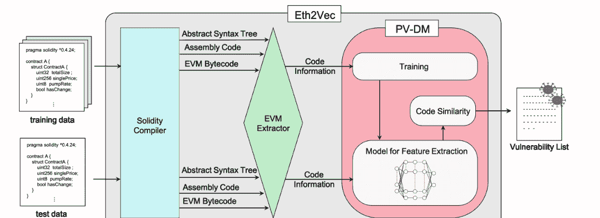
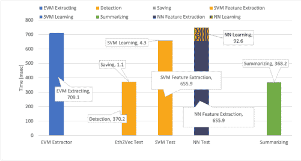
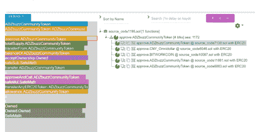

# [ASIA CCS '21： ACM 亚洲计算机与通信安全会议（虚拟活动 香港 ..-..）] 第3届 ACM 国际区块链与安全关键基础设施研讨会论文集


## 摘要

以太坊智能合约是运行在以太坊区块链上的程序，过去十年中发现了许多智能合约漏洞。已经创建了许多安全分析工具来检测此类漏洞，但在分析代码被重写时，其性能会急剧下降。在本文中，我们提出了 Eth2Vec，这是一种基于机器学习的智能合约漏洞检测静态分析工具。它对代码重写也具有鲁棒性，即即使在重写后的代码中也能检测出漏洞。现有的基于机器学习的漏洞检测静态分析工具需要分析人员手动创建的特征作为输入。相比之下，Eth2Vec 通过自然语言处理的神经网络，利用隐性知识自动学习易受攻击的以太坊虚拟机（EVM）字节码的特征。因此，Eth2Vec 可以通过比较目标 EVM 字节码与已学习的 EVM 字节码之间的代码相似性来检测智能合约中的漏洞。我们使用现有的开放数据库（如 Etherscan）进行了实验，结果表明 Eth2Vec 在众所周知的指标（即精确率、召回率和 F1 分数）方面优于基于支持向量机的近期模型。

## CCS 概念

- 安全与隐私 → 软件安全工程；软件逆向工程；漏洞管理。

## 关键词

以太坊，智能合约，神经网络，静态分析，代码相似性，漏洞检测

ACM 参考格式：

Nami Ashizawa, Naoto Yanai, Jason Paul Cruz 和 Shingo Okamura. 2021. Eth2Vec: Learning Contract-Wide Code Representations for Vulnerability Detection on Ethereum Smart Contracts. 收录于第 3 届 ACM 区块链与安全关键基础设施国际研讨会论文集（BSCI ’21），2021 年 6 月 7 日，虚拟活动，香港。ACM，纽约，NY，美国，13 页。https://doi.org/10.1145/3457337.3457841

## 1 引言

### 1.1 背景

Ethereum [50] 是提供智能合约执行环境的最大平台，许多分布式应用程序已作为智能合约开发并部署在以太坊区块链上。以太坊智能合约是存储在以太坊区块链上并由以太坊虚拟机（EVM）作为 EVM 字节码¹ 运行的程序。

¹此后，“以太坊智能合约/智能合约”和“智能合约/智能合约”可互换使用，但含义相同。

鉴于以太坊区块链的透明和去中心化特性，部署在以太坊区块链上的智能合约的 EVM 字节码可以被任何人访问和分析。不幸的是，这也意味着攻击者可以通过分析其 EVM 字节码并寻找漏洞来滥用智能合约 [52]。因此，对易受攻击的智能合约的攻击可能会发生，并可能造成重大损害，尤其是在被攻击的智能合约处理资产时。例如，DAO 攻击是一个臭名昭著的攻击事件，攻击者利用了 DAO 智能合约中的漏洞，窃取了价值超过 6000 万美元的以太币，即以太坊中使用的加密货币。

根据文献 [52]，智能合约的安全性无法得到保证，这是由于用于创建智能合约的编程语言的复杂性（或缺乏复杂性），例如 Solidity，这是一种相对较新的语言，以及程序员在创建智能合约时知识不足。更糟糕的是，一旦成功部署到区块链上的智能合约就无法修改，即其源代码无法编辑或删除。在过去几年中，已报告了许多对已部署智能合约的攻击 [2]，因此在智能合约部署到区块链之前确保其源代码没有漏洞是可取的。为此，已开发了许多用于以太坊智能合约漏洞检测的分析工具 [9]。

在本文中，我们旨在开发一种静态分析工具，通过分析这些代码，以高吞吐量精确检测智能合约代码中的各种漏洞。在静态分析中，仅将待分析目标的源代码作为输入，以在不执行目标本身的情况下识别代码是否存在漏洞。因此，理想情况下，静态分析可用于防止易受攻击的代码被部署。

然而，静态分析通常存在两个问题：（1）其漏洞检测的准确性有限，（2）其分析时间可能很长。例如，从 EVM 字节码 [6, 35, 43, 51] 反汇编没有识别程序是否易受攻击的能力，早期文献主要关注提高反汇编代码的可读性。换句话说，反汇编代码通常需要手动分析，从而增加了假阳性和假阴性的数量。此外，符号执行 [8, 27, 46, 49] 从目标代码中提取控制流图（CFGs），通过自动化分析实现高准确性，但生成 CFGs 需要搜索目标代码转换的所有状态。因此，分析需要大量时间 [48]。

上述问题的潜在解决方案是机器学习。基于机器学习的静态分析通过学习代码的特征来推断给定代码是否易受攻击。在此过程中，分析还可以在短时间内实现多功能分析。然而，基于机器学习的静态分析存在两个固有局限性：（1）代码重写会降低分析准确性，（2）智能合约的适当特征不确定。在第一个局限性中，例如，内联函数的 CFGs 与原始函数的 CFGs 不同。因此，将原始函数与内联函数识别为相同代码具有挑战性。语义相同但结构不同的函数对可能会产生不同的分析结果，因为代码结构之间的差异会强烈影响分析。在第二个局限性中，尽管为机器学习手动提取特征，但智能合约的代码样本和公开知识不足。智能合约特征的常识从未建立 [52]。特别地，表示智能合约代码中漏洞的特征种类未知。此外，对代码结构差异具有鲁棒性的特征仍然不明显。神经网络是隐式提取特征的常用方法。然而，基于神经网络的现有方法 [15, 31] 并未解决上述局限性，并且对代码重写不够鲁棒。

### 1.2 贡献

在本文中，我们提出了 *Eth2Vec*，一种基于机器学习的静态分析工具，通过其 EVM 字节码、汇编代码和抽象语法树学习智能合约代码来识别智能合约漏洞。Eth2Vec 具有高吞吐量、高准确性和对代码重写的鲁棒性。Eth2Vec 是基于自然语言处理的神经网络的分析工具，仅通过代码作为输入即可输出目标智能合约代码中漏洞的存在性和种类。使用 Eth2Vec，用户即使没有智能合约漏洞的专业知识也可以快速分析智能合约代码。

就使用机器学习分析以太坊智能合约而言，本文的主要贡献是提供了一种对代码重写具有鲁棒性的方法。宽松地说，Eth2Vec 通过利用自然语言处理的神经网络克服了第 1.1 节中描述的局限性。也就是说，Eth2Vec 可以通过学习每个函数的上下文的自然语言处理，比神经网络的简单使用更精确地提取特征。虽然有几个现有的工具 [15, 36] 基于以太坊智能合约分析的典型语言模型，即 Word2Vec [29]，但 Eth2Vec 是新颖的，因为它实现了对代码重写的鲁棒分析。为此，我们还开发了一个模块，将 EVM 字节码及其语法信息作为输入提供给神经网络。借助所开发的模块，Eth2Vec 可以比基于 Word2Vec 的工具更具信息性地提取和学习代码特征。此外，我们设计了一种基于自然语言处理的神经网络的学习方法，该方法将通过 Solidity 代码编译的 EVM 字节码作为输入。（详见第 4 节。）

我们进行了实验以评估 Eth2Vec 的性能。实验结果表明，Eth2Vec 可以以每个合约 1.2 秒的速度检测漏洞，平均精确率为 77.0%。值得注意的是，重入攻击，其严重性在已知漏洞中最高 [45]，可以以 86.6% 的精确率检测到。Eth2Vec 在漏洞检测的众所周知指标方面优于典型方法 [31]。此外，Eth2Vec 可以检测重写代码的漏洞，而现有的基于 Word2Vec 的工具 SmartEmbed [15] 未能找到这些漏洞。（详见第 5 节。）我们通过 GitHub 发布 Eth2Vec 的源代码以实现可重复性并作为未来工作的参考（https://github.com/fseclab-osaka/eth2vec）。

## 2 预备知识

### 2.1 以太坊智能合约

在以太坊中，有两种账户，即外部拥有账户（EOA）和合约账户。EOA 具有可用于访问相应以太币或合约的私钥。合约账户具有智能合约代码，EOA 无法拥有，并且它没有私钥。相反，它由其智能合约代码的逻辑拥有和控制。在以太坊中，智能合约是指部署在区块链上并在 EVM 上下文中以 *immutable* 方式 *deterministically* 运行的计算机程序。不可变属性表示，与发布在通用区块链上的任何数据类似，智能合约代码可以被视为可信的，即一旦部署，就无法更改或删除。确定性属性表示智能合约的代码函数的执行对任何运行它们的人都会产生相同的结果。一旦部署到区块链上，合约就是自执行的并由网络中的节点管理，即当合约中的条件满足时，其函数会被执行。智能合约以合约地址的形式获得身份。使用此地址，它可以接收以太币并执行其函数。合约会被调用当其合约地址是交易的接收目的地时，该交易是源自 EOA 的签名消息，由网络传输并记录在区块链上。此类交易导致合约在 EVM 中使用交易（和交易数据）作为输入运行。数据指示哪个特定函数在

要运行的合约以及向该函数传递什么参数。为了激励节点执行合约函数，以太坊依赖于以太币支付的 gas 来“为计算提供燃料”。执行交易所需的 gas 数量与计算的复杂性相关，从而也防止了无限循环。

智能合约通常使用高级语言编写，例如 Solidity [1]。然后源代码被编译为在 EVM 中运行的低级字节码。EVM 是一种简单的基于栈的架构。其指令集保持最小化，以避免可能导致共识问题的错误实现。EVM 是一个全局单例，即它像一台在网络中所有节点上运行的全局单实例计算机一样运作。每个节点运行 EVM 的本地副本以验证合约函数的执行，并且处理后的交易和智能合约被记录在区块链上。

### 2.2 机器学习

机器学习包含两种算法，即训练和推理。训练算法将数据作为输入以学习其特征并为目标函数优化模型内部的参数。另一方面，推理算法将未学习的数据作为输入，并推断出与训练数据相似的一组特征。当数据未标记时，学习算法称为无监督学习。近年来机器学习最流行的方法是深度学习，它基于神经网络，可以以黑盒方式提取特征。在本文中，我们旨在开发一个用于学习易受攻击智能合约的模型，以检测未学习智能合约中的漏洞。

神经网络模型是一种机器学习模型，表示神经元之间的连接，这是在人类大脑中、在计算机上的一种机制。该模型在计算机上近似表达复杂的非线性函数。两种任务，即回归任务和分类任务，在神经网络上作为众所周知的设置被处理。回归问题从输入数据推断连续数值，而分类问题推断输入数据所属的类别。使用神经网络进行自然语言处理的 Eth2Vec 的特征提取被归类为回归问题。神经网络的每个输入信号都有一个独特的权重，该权重是向输出层传播输入信号重要性的元素。换句话说，输入对神经网络输出的影响与输入的权重成比例地增大。激活函数决定如何激活神经网络输入信号的总和。

支持向量机（SVM）是一种线性二分类器，用于将输入分类为两个类别，并为分类提供显著高的性能。此外，SVM 通过结合核方法提供非线性分类。

### 2.3 自然语言处理

自然语言处理处理人类之间用于交流的语言，而这些语言以文本形式表达。自然语言处理的典型应用例如，文档分类、机器翻译、文档摘要、问题响应和交互式对话。

一般来说，“词”是处理语言的最小单位（token），而“句子”作为一个单元字符串一起处理。词也是句子中组件的最小单位，从语法或语义的角度来看，每个句子都有一个连贯的上下文。短于句子且由两个以上单词组成的单元字符串称为“短语”，自然语言有时以短语为单位进行处理。然而，将文本拆分为词、短语和句子单元并不简单，每个单元的定义也并非微不足道。

自然语言编写的文本与编程语言编写的代码之间的重要区别之一是只有代码具有语法和结构。自然语言处理在处理代码时需要考虑代码的语法和结构。

## 3 通过机器学习分析智能合约

本节描述了分析目标作为本文需要解决的问题设置及其技术难点。

### 3.1 分析目标

本文将 Solidity 语言的安全性分析作为以太坊智能合约静态分析的目标。特别是，我们旨在检测待分析代码中漏洞的存在并对漏洞类型进行分类。例如，假设开发人员使用一个工具来分析他/她本地开发的智能合约。

这样的工具可能需要说服开发人员，即使开发人员对智能合约漏洞的知识不足，正在开发的智能合约也没有任何漏洞。因此，我们旨在开发一种工具，即使仅将智能合约的代码作为输入，也能检测智能合约中是否存在漏洞（如果有的话）。这种分析智能合约的规范是可取的，因为与 C 和 Java 等通用编程语言相比，以太坊智能合约的标准知识不足 [52]。同时，Solidity 代码的强混淆，即使用加密，不在本论文的范围内，因为据我们所知，并不存在此类混淆的智能合约代码。

此后，我们将用 Solidity 编写的代码称为合约，由一个以上合约组成的代码文件称为合约文件。我们还将用于评估漏洞的合约称为测试合约，用于学习漏洞的合约称为训练合约。我们将从合约编译得到的代码称为 EVM 字节码。每个合约中最大的单元是函数，库函数也与函数相同。最后，除非另有说明，“区块链”将用于指以太坊区块链。本文中的问题设置随后形式化如下：

**问题表述：** 我们按如下方式形式化我们对智能合约分析的方法。每个合约 $c_i \in \mathcal{C}$ 包含漏洞 $V_i = \{v_1^i, \dots, v_l^i\} \in \mathcal{V}^l$，其中 $\mathcal{C}$ 表示合约集合，$\mathcal{V}$ 表示彼此独立的漏洞集合，$l$ 表示任意数量。给定任意整数 $n \in \mathbb{N}$，合约与漏洞的组合 $CV = \{(c_1, V_1), \dots, (c_n, V_n)\}$ 和测试合约 $c_t \in \mathcal{C}$ 是模型 $M$ 的输入。设 $\{\epsilon_i^{c_t}\}_{i\in[1,d]} \subseteq \mathbb{R}^d$ 表示模型 $M$ 的输出，该模型有 $d = |\mathcal{V}|$ 个元素，其中 $|\mathcal{V}|$ 表示 $\mathcal{V}$ 的大小，$\epsilon_i^{c_t}$ 表示 $\mathcal{V}$ 中漏洞的概率。我们的目标是开发一个优化 $M(\mathcal{CV}, c_t) \rightarrow \{\epsilon_i^{c_t}\}$ 的工具。

### 3.2 技术难点

尽管文献中已提出了几种基于机器学习的智能合约静态分析工具 [25, 26, 31, 42, 48]，但其漏洞检测的准确性即使在已知漏洞上也有限。换句话说，当代码从原始代码重写时，准确性显著下降。按照上述问题表述，作为我们动机的第 1.1 节中描述的局限性形式化如下：即使 $c_t$ 具有漏洞 $V_i$ 且该漏洞包含在 $CV$ 中，对任意 $i \in [1,n]$，对于 $c_t \notin CV$，$\epsilon_i^{c_t} \ll \epsilon_i^{c_t'}$ 成立。我们称这种情况为非鲁棒。上述与漏洞检测准确性相关的局限性是由现有工具特征提取不足造成的。一般来说，机器学习模型需要特征作为输入，这些特征是手动提取的，然后显式学习这些特征。然而，表示待分析智能合约的特征并不明显，因为以太坊智能合约的历史比 C 和 Java 等其他通用语言短 [52]。直观上，非鲁棒性的局限性表示为模型 $M$ 所需的内容未知。特征提取不足的另一个原因是智能合约代码样本缺乏 [52]。

## 4 ETH2VEC 设计

在本节中，我们介绍 Eth2Vec。我们首先描述为克服上一节所述技术难点的设计概念，然后介绍工具概述及其构建模块。最后，我们介绍 Eth2Vec 模型及其目标函数。

### 4.1 设计概念

我们旨在通过利用自然语言处理的神经网络来解决技术难点。对于机器学习的自然语言处理，每个词通常被向量化为一个 token，每个句子被向量化为一个序列。为了融合自然语言处理，我们利用 *PV-DM* 模型 [22]，该模型通过考虑段落的上下文来向量化每个段落。更具体地说，我们扩展了 PV-DM 模型，其中每个合约的代码被向量化而不是自然语言。因此 Eth2Vec 可以隐式提取特征。

为了为扩展的 PV-DM 模型提供合约代码，我们还开发了一个名为 *EVM Extractor* 的新模块，以获取每个合约的语法和语义。例如，EVM Extractor 获取主要代码信息，例如函数名和起始地址。Eth2Vec 然后限制提供给 PV-DM 模型的代码信息量，因为 Eth2Vec 的吞吐量可能会随着信息量的增加而下降。因此 Eth2Vec 可以适当且高效地实现特征提取。之后，Eth2Vec 通过利用上述自然语言处理神经网络向量化的代码信息来计算代码相似度。当分析代码的安全性时，模型学习易受攻击的代码，然后可以通过待分析代码与已学习代码的相似性来检测漏洞。因此，即使漏洞的本质特征不明确，Eth2Vec 也能分析代码中的漏洞。

### 4.2 工具概述

Eth2Vec 由两个模块组成，即用于处理段落的神经网络的 PV-DM 模型 [22] 和从 Solidity 源代码创建 PV-DM 模型输入的 EVM Extractor。

Eth2Vec 的概述如图 1 所示。首先，PV-DM 模型被用作处理字节码的神经网络。特别是，PV-DM 模型通过以从字节码生成的 JSON 文件作为输入执行无监督学习，然后为每个合约计算代码相似度。为此，我们开发了 EVM Extractor 作为模块，从 EVM 字节码创建 PV-DM 模型的输入，因为 PV-DM 模型最初无法处理 EVM 字节码。更具体地说，EVM Extractor 在语法上分析 EVM 字节码，并为指令级、块级、函数级和合约级创建 JSON 文件。

结果，Eth2Vec 以待分析的 EVM 字节码作为输入，然后从用户角度返回合约级的代码克隆列表及其漏洞。同时，训练数据的合约中的漏洞由现有工具 [27, 45] 预先识别。然后测试数据的漏洞通过与易受攻击合约的代码相似度进行评估。Eth2Vec 输出待分析代码中函数级的漏洞。也就是说，易受攻击的函数可以由 Eth2Vec 识别。

### 4.3 构建模块

Eth2Vec 利用 PV-DM 模型 [22] 和 EVM Extractor 作为构建模块。

#### 4.3.1 PV-DM 模型

PV-DM 模型将文本数据向量化为段落级，而 Word2Vec [29] 将文本数据向量化为句子级。直观上，它为每个词和每个段落输出向量表示。更具体地说，给定由多个句子组成的文本段落，PV-DM 模型对每个句子应用滑动窗口。滑动窗口从句子的开头开始，每一步向前移动一个词。在此过程中，PV-DM 模型执行多类推理任务，将当前段映射为向量，并将上下文中的每个词映射为向量。更精确地说，模型对这些向量取平均，并通过 softmax 函数从词汇表中推断目标词。PV-DM 模型的架构包含一个隐藏层：例如，模型获取给定输入的向量，然后计算向量的平均值并应用 sigmoid 函数。输出层基于 softmax 函数计算分类结果。形式上，给定包含段落列表 $p \in T$ 的文本，每个段落 $p$ 包含句子列表 $s \in p$，每个句子是 $|s|$ 个词 $w_t \in s$ 的序列。然后，PV-DM 模型最大化对数概率如下：

$$\sum_{p}^{T}\sum_{s}^{p}\sum_{t=k}^{|s|-k} \log P(w_t \mid p, w_{t-k}, \cdots, w_{t+k}). \tag{1}$$




**图 1：Eth2Vec 概述**

PV-DM 模型最初是为顺序排列的文本数据设计的，同时通过扩展语言的向量表示也可以用于汇编代码的分析 [11]。

本文提出了一种通过扩展 PV-DM 模型以符合第 4.4 节所述的 EVM 字节码语法而实现的合约级表示学习模型。

#### 4.3.2 EVM Extractor

EVM Extractor 是一个用于 PV-DM 模型的模块，用于对 EVM 字节码进行语法分析。特别是，EVM Extractor 按以下层次结构解析 Solidity 文件：

```
data: dictionary
  name: file name
  md5: md5 hash
  functions: list
    name: function name
    sea: start point
    see: end point
    id: function id
    call: list of callee functions
    blocks: list
      name: block name
      bytes: bytecodes
      sea: start point
      eea: end point
      id: block id
      call: list of callee blocks
      src: assembly instructions
```

顶层 data 表示待分析的合约文件。第二层表示文件相关信息。第三层表示函数相关信息。第四层表示由多个指令组成的块。在每个层级中，sea 表示当前函数和当前块的起始地址。同样，see 和 eea 分别表示下一个函数和下一个块的起始地址。相比之下，call 表示从当前函数（或块）调用的被调用函数（或被调用块）。最后，在最底层，EVM 字节码的指令连同其地址一起存储在 src 中。同时，库函数被视为一个独立的函数。

### 4.4 目标函数设计

Eth2Vec 是一种通过无监督学习学习和推断以太坊智能合约代码的模型。直观上，它可以被视为 Word2Vec 的扩展，具有更宽的代码向量表示，因为它能够针对以太坊智能合约。

Eth2Vec 的目标函数是通过扩展第 4.3.2 节所示语法中描述的原始 PV-DM 模型在公式 (1) 中的目标函数而设计的。以下论证受 Asm2Vec [11] 的启发，后者是针对汇编语言的 PV-DM 模型的扩展。给定待分析的以太坊智能合约文件，Eth2Vec 对指令级代码进行向量化，然后计算与训练学习到的代码的相似度。上述过程针对与指令相关的块级、函数级和合约级递归执行，因此 Eth2Vec 可以检测出与训练数据分布相似的代码。形式上，目标函数定义如下：

$$\sum_{C_i}^{Dict} \sum_{f_s}^{U(C_i)} \sum_{seq_i}^{S(f_s)} \sum_{in_j}^{I(seq_i)} \sum_{t_c}^{T(in_j)} \log P(t_c | C_i, in_{j-1}, in_{j+1}), \tag{2}$$

其中我们用 Dict 表示合约文件，用 C_i 表示合约，用 f_s 表示函数，用 seq_i 表示由多个指令组成的块，用 in_j 表示每个指令，用 t_c 表示与当前指令相关的标记。同样，我们用 U(C_i) 表示多个函数，用 S(f_s) 表示多个块，用 I(seq_i) 表示指令列表，用 T(in_j) 表示标记列表。

这里，第一求和项，即 ∑_{C_i}^{Dict}，包含在上一节所示的第二层中，即文件名。公式 (2) 给出合约及其指令，然后最大化当前标记 t_c 的对数概率。直观上，每个合约的词汇含义是通过当前指令及其邻近指令计算得出的。此外，由多个合约组成代码也可以通过为每个合约提取特征来分析。

我们将在下面详细描述目标函数以表示上述直觉。给定合约文件 Dict，每个合约 C_i 的函数 f_s 被向量化，然后我们用 \vec{\theta}_{f_s} 表示 f_s 的向量表示。此外，我们用 \mathcal{CT}(in) 表示 in 的邻近指令的向量表示的平均值。然后我们将指令本身的向量表示与其操作数的向量表示的拼接定义如下：

$$\mathcal{CT}(in)=\vec{v}_{\mathcal{P}(in)}\Vert\frac{1}{|\mathcal{A}(in)|}\sum_{t\in\mathcal{A}(in)}\vec{v}_t. \tag{3}$$

其中 \mathcal{P}(in) 是相对于 in 的一个操作，\mathcal{A}(in) 是相对于 in 的操作数列表，而 \Vert 是字符串的拼接。这样，对于任意合约 C_i，通过对 f_s 和第 j 条指令 in_j（其中 j\in\{1,\ldots,n\}）取平均，定义一个用于评估 f_s 中邻近指令的联合记忆的函数 \delta(in_j,f_s) 如下：

$$\delta(in_j,f_s)=\frac{1}{3}\left(\vec{\theta}_{f_s}+\mathcal{CT}(in_{j-1})+\mathcal{CT}(in_{j+1})\right). \tag{4}$$

因此，公式 (2) 中的对数概率可以用 P(t_c\mid C_i,in_{j-1},in_{j+1})=P(t_c\mid\delta(in_j,f_s)) 替换。根据文献 [11]，令 X=(\vec{v}_{t_c})^T\times\delta(in_j,f_s) 并利用 sigmoid 函数 \sigma(X)=\frac{1}{1+e^{-X}}，上述计算可以用 k-负采样 [22, 30] 近似如下：

$$\sum_{C_i\in Dict}\sum_{f_s}\sum_{seq_i}\sum_{in_j}\sum_{t_c}J(\theta) = \sum_{C_i\in Dict}\sum_{f_s}\sum_{seq_i}\sum_{in_j}\sum_{t_c}\log P(t_c\mid\delta(in_j,f_s)). \tag{5}$$

$$J(\theta)\approx\log(\sigma(X))+\sum_{i=1}^{k}\mathbb{E}_{t_d\sim P_n(t_c)}\left([\![t_d\ne t_c]\!]\log\sigma(X)\right). \tag{6}$$

其中 [\![t_d\ne t_c]\!] 是一个恒等函数，如果函数内部的表达式为真则返回 1，否则返回 0。另一方面，\mathbb{E}_{t_d\sim P_n(t_c)} 是一个采样函数，根据噪声分布 P_n(t_c) 从 t_c 采样标记 t_d。我们最终利用公式 (6) 作为 Eth2Vec 的目标函数。直观上，该函数最大化当前指令的标记 t_c 的概率并降低其他指令的标记 t_d 的概率。然后，我们可以通过以下导数计算相对于 \theta_{f_s} 的梯度：

$$\frac{\partial J(\theta)}{\partial\theta_{f_s}}=\frac{\partial J(\theta)}{\partial X}\frac{\partial X}{\partial\theta_{f_s}}=\frac{\vec{v}_{t_c}}{3}(1-\sigma(X)) + \frac{\vec{v}_{t_c}}{3}\sum_{i=1}^{k}\mathbb{E}_{t_d\sim P_n(t_c)}\left([\![t_d\ne t_c]\!](1-\sigma(X))\right).$$

此外，我们还可以通过以下方式近似上述梯度计算来利用更直观的梯度：

$$\frac{\partial J(\theta)}{\partial\theta_{f_s}}\approx\frac{\vec{v}_{t_c}}{3}\sum_i^k\mathbb{E}_{t\sim P_n(t_c)}\left([\![t=t_c]\!]-\sigma(X)\right). \tag{7}$$

直观上，公式 (7) 以一种方式近似上述原始导数：如果标记与当前指令相同则将梯度移动到正方向，否则移动到负方向。同样，相对于当前指令上标记的向量表示 \vec{v}_{t_c} 的梯度也可以近似。此外，对于某个操作 \mathcal{P}(in) 的标记的向量表示 \vec{v}_{\mathcal{P}(in)} 以及当前指令上操作数的向量表示 \vec{v}_{\mathcal{A}(in)}，它们的梯度也可以以类似方式近似。尽管我们省略了推导，这些梯度计算如下：

$$\frac{\partial J(\theta)}{\partial\vec{v}_{t_c}}\approx([\![t=t_c]\!]-\sigma(X))\cdot\delta(in_j,f_s). \tag{8}$$

$$\frac{\partial J(\theta)}{\partial\vec{v}_{\mathcal{P}(in_j)}}\approx([\![t=t_c]\!]-\sigma(X))\cdot\frac{1}{|\mathcal{A}(in)|}\sum_{t\in\mathcal{A}(in)}\vec{v}_t. \tag{9}$$

$$\frac{\partial J(\theta)}{\partial\vec{v}_{\mathcal{A}(in_{j+1})}}\approx([\![t=t_c]\!]-\sigma(X))\cdot\left(\vec{v}_{\mathcal{P}(in_{j+1})}\right). \tag{10}$$

尽管由于篇幅限制我们省略了细节，但对于前一个指令 in_{j-1}，用 in_{j-1} 替换 in_{j+1} 后同样适用。

### 4.5 训练与推理

我们现在介绍训练算法和推理算法，其中使用上一小节描述的梯度。首先，训练算法如算法 1 所示。训练的目标是优化作为输入的给定合约文件中每个指令的向量。通过训练，含义相似的指令被映射到向量空间中的相似位置。该算法产生的这些向量可作为合约级分析的向量表示的特征。该算法是一种无监督训练算法，因此该过程不需要等价合约之间的真实映射。

上述特征可以直接用于算法 2 所示的推理算法。特别是，对于未见过的合约 C_t\notin Dict，算法首先初始化与 C_t 所属的任意函数 f_t 相关的 \vec{\theta}_{f_t}。然后，算法遵循与训练算法相同的过程。然而，训练模型中所有的 \vec{v}_t 都被保留，并且 \vec{\theta}_{f_t} 根据其误差进行更新。在推理结束时，输出 \vec{\theta}_{f_t}，而所有 C_i\in Dict 的向量保持不变，除 \vec{\theta}_{f_t} 外。最后，为了搜索与给定合约 C_t 匹配的合约，结果向量使用典型的统计方法，例如余弦相似度，与训练合约的向量进行比较。


**算法 1** Eth2Vec 的一次 epoch 的训练算法 TRAIN

**要求：** Dict
**保证：** 任意 `in_j` 的 token 的向量表示和 \(\vec{\theta}_{f_s}\)

1. **对所有** \(C_i \in Dict\) **做**
2.     **对所有** \(f_s \in \mathcal{U}(C_i)\) **做**
3.         **对所有** \(seq_i \in \mathcal{S}(f_s)\) **做**
4.             **对所有** \(in_j \in \mathcal{I}(seq_i)\) **做**
5.                 将 \(f_s\) 向量化为 \(\vec{\theta}_{f_s}\)
6.                 根据公式 (3) 计算 \(\mathcal{CT}(in_{j+1})\)
7.                 根据公式 (3) 计算 \(\mathcal{CT}(in_{j-1})\)
8.                 根据公式 (4) 计算 \(\delta(in_j,f_s)\)
9.                 **对所有** \(t_c \in \mathcal{T}(in_j)\) **做**
10.                    根据公式 (7) 计算 \(\vec{\theta}_{f_s}\) 的梯度
11.                    根据公式 (8) 计算 \(\vec{v}_{t_c}\) 的梯度
12.                    根据公式 (9) 计算 \(\vec{v}_{\mathcal{P}(j+1)}\) 的梯度
13.                    根据公式 (10) 计算 \(\vec{v}_{\mathcal{A}(in_{j+1})}\) 的梯度
14.                    根据公式 (9) 计算 \(\vec{v}_{\mathcal{P}(j-1)}\) 的梯度
15.                    根据公式 (10) 计算 \(\vec{v}_{\mathcal{A}(in_{j-1})}\) 的梯度
16.                **结束循环**
17.                更新 \(in_j\) 的 token 的向量
18.                更新 \(\vec{\theta}_{f_s}\)
19.            **结束循环**
20.        **结束循环**
21.    **结束循环**
22. **结束循环**

**算法 2** Eth2Vec 的查询推理算法 Infer

**要求：** 合约 \(C_t \notin Dict\)
**保证：** 任意 \(f_t \in \mathcal{U}(C_t)\) 的向量表示 \(\vec{\theta}_{f_t}\)

1. 初始化 \(f_t \in \mathcal{U}(C_t)\) 的向量表示 \(\vec{\theta}_{f_t}\)
2. **对所有** \(f_t \in \mathcal{U}(C_t)\) **做**
3.     **对所有** \(seq_i \in \mathcal{S}(f_t)\) **做**
4.         **对所有** \(in_j \in \mathcal{I}(seq_i)\) **做**
5.             根据公式 (3) 计算 \(\mathcal{CT}(in_{j+1})\)
6.             根据公式 (3) 计算 \(\mathcal{CT}(in_{j-1})\)
7.             根据公式 (4) 计算 \(\delta(in_j,f_t)\)
8.             **对所有** \(t_c \in \mathcal{T}(in_j)\) **做**
9.                 根据公式 (7) 计算 \(\vec{\theta}_{f_t}\) 的梯度
10.                更新 \(\vec{\theta}_{f_t}\)
11.            **结束循环**
12.        **结束循环**
13.    **结束循环**
14. **结束循环**

### 4.6 实现

我们利用 Kam1n0（版本 2.0.0：https://github.com/McGill-DMaS/Kam1n0-Community）和 py-solc-x（https://pypi.org/project/py-solc-x/）实现了 Eth2Vec。首先，主要模块 PV-DM 模型由 Kam1n0 实现，Kam1n0 是一个用于二进制分析 [11] 的服务器系统 [10]。我们主要修改了 DisassemblyFactoryIDA.java 和 ExtractBinaryViaIDA.py 中的源代码。特别是，ExtractBinaryViaIDA.py 最初通过反汇编二进制代码从 IDA 生成提取的 JSON 文件，然后 DisassemblyFactoryIDA.java 接收该文件以将二进制代码存储在 Kam1n0 中。然而，IDA 不能使用 EVM 字节码来实现 Eth2Vec。因此，我们更改了 ExtractBinaryViaIDA.py。例如，代码信息是通过使用 py-solc-x 编译 Solidity 文件而无需 IDA 获得的，然后提取其生成的汇编代码、抽象语法树（AST）和二进制代码。

同时，当前的输出显示遵循 Kam1n0 的接口；漏洞按每个合约的函数级别列出。特别是，测试合约的漏洞会显示其置信度。我们在附录 A 中展示了 Eth2Vec 的输出示例。

我们通过 GitHub（https://github.com/fseclab-osaka/eth2vec）公开发布了整个实现的源代码。

## 5 实验

在本节中，我们描述了为评估 Eth2Vec 而进行的实验。首先，我们描述实验的目的。然后，我们讨论用于评估的数据集和训练方法。最后，我们展示实验结果。

### 5.1 实验目的

为了评估 Eth2Vec 的性能，我们尝试通过使用已知存在漏洞的合约进行训练来检测待分析代码中的漏洞。为此，我们首先检查 Eth2Vec 是否能够适当表示待分析代码与训练阶段学习到的代码之间的关系。我们评估 Solidity 语言代码的克隆检测，以确认 Eth2Vec 是否能够适当提取代码的特征。在此过程中，我们还基于词法-语义关系评估语义克隆，以确认 Eth2Vec 对代码重写的鲁棒性。

接下来，我们检查是否通过训练代码及其与给定代码的代码相似性来识别所有学习到的漏洞。在此过程中，我们还评估漏洞检测与上述克隆检测结果的一致性。特别是，我们检查漏洞检测的输出是否与被识别为克隆的代码中的漏洞相同，以及克隆是否包含在克隆检测输出中。

我们确认 Eth2Vec 可以精确地提取特征，从而可以通过上述实验检测漏洞。我们还将 Eth2Vec 的性能与 Momeni 等人 [31] 的现有工作进行比较，后者手动提取特征，作为基线。

### 5.2 实验设置

如上所述，实验分为两个阶段，即智能合约的克隆检测和漏洞检测。我们将在下面描述每个实验的设置。我们首先详细描述数据集和基线。

**5.2.1 数据集。**

我们从 Etherscan（https://etherscan.io/）收集了 5,000 个合约文件作为实验中使用的数据集，该数据库是智能合约的开放数据库。这 5,000 个文件也与近期工作 [15] 中使用的文件相同。然后我们仅使用可以用 Solidity 版本 0.4.11 作为编译器编译的文件。数据集包含 95,152 个合约和 1,193,868 个区块。

**5.2.2 基线。**

我们将 Eth2Vec 的性能与 Momeni 等人 [31] 基于支持向量机（SVM）的方案进行比较作为基线。尽管基于机器学习的几种通用结果 [15, 26, 48] 可以检测各种漏洞，但其源代码未发布或我们无法在我们的环境中构建其源代码。因此，我们采用了 Momeni 等人提出的 SVM 方法，我们能够从头开始重现。

Momeni 等人从以太坊智能合约的抽象语法树（AST）中提取了 16 个特征。我们使用了其中 15 个特征，排除了十六进制地址，因为十六进制地址无法从源代码中获得，即在未部署的情况下。其他特征在附录 B 中描述。

**5.2.3 克隆检测。**

我们检查 Eth2Vec 是否能够通过训练合约精确检测作为输入的测试合约的克隆。特别是，在 10 折交叉验证中，随机选择 500 个测试合约，其余 4,500 个合约用作训练合约。此过程重复 10 次。同时，用于检测克隆的代码相似度阈值为 0.8。

在上述设置中，精度被用作评估指标。对于每个函数的克隆，即函数级克隆，以超过 0.8 的阈值输出，我们检查合约中相似度最高的函数是否确实是给定输入的克隆。为了比较 Eth2Vec 的性能，我们还通过手动标记每个函数来评估上述 SVM 方法。同时，本实验中的克隆对应于文献 [38] 中的 type-I 至 type-IV 克隆，而语义克隆与 type-IV 克隆相同。

**5.2.4 漏洞检测。**

我们检查 Eth2Vec 是否能够通过学习训练合约精确检测作为输入的测试合约中的漏洞。特别是，我们检查 Eth2Vec 以 0.8 的阈值输出的测试合约的漏洞是否与合约中的真实漏洞相同。

### 5.3 克隆检测结果

Eth2Vec 的克隆检测结果如表 1 所示。根据该表，Eth2Vec 可以隐式提取比 SVM 方法 [31] 更多的特征。例如，Eth2Vec 的标准差值明显小于 SVM 方法的值。直观地说，这意味着 Eth2Vec 的特征提取更稳定，因此 Eth2Vec 能够在各种代码上表示特征。

**表 1：Eth2Vec 的克隆检测精度。** 本表显示了 10 折交叉验证中 10 次精度测量执行的平均值和标准差。“SVM w/o few clones”列显示了通过移除具有少量克隆的测试数据集计算的 SVM 设置的结果。数字截断到一位小数。

|  | Eth2Vec | SVM [31] | SVM w/o few clones |
|---|---|---|---|
| 平均值 | 74.9% | 34.6% | 42.7% |
| 标准差 | 0.9 | 34.6 | 43.6 |

当克隆检测性能与 EClone [26] 作为参考进行比较时，EClone 在阈值为 0.4 时的检测率为 58.2%。尽管如第 5.2.2 节所述，我们没有自行实现 EClone，但我们相信由于其更复杂的特征提取，Eth2Vec 可以比 EClone 更好地检测以太坊智能合约的克隆。

当我们详细检查 Eth2Vec 的输出时，它包含语义克隆。我们在清单 1 和清单 2 中展示了一个具体示例。Eth2Vec 的输出，即清单 2，是原始函数所示清单 1 的克隆，排除了第 5 行和第 9 行。根据 [38] 中的定义，清单 2 与清单 1 相同为 type-III 克隆。这意味着 Eth2Vec 可以精确检测克隆，即使是重写后的代码。

**清单 1：Transfer 的原始函数**

```solidity
function _transfer(address _from, address _to, uint _value) internal {
    require(_to != 0x0);
    require(balanceOf[_from] >= _value);
    require(balanceOf[_to] + _value > balanceOf[_to]);
    uint previousBalances = balanceOf[_from] + balanceOf[_to];
    balanceOf[_from] -= _value;
    balanceOf[_to] += _value;
    Transfer(_from, _to, _value);
    assert(balanceOf[_from] + balanceOf[_to] == previousBalances);
}
```

**清单 2：Eth2Vec 找到的 Transfer 原始函数的克隆**

```solidity
function _transfer(address _from, address _to, uint _value) internal {
    require(_to != 0x0);
    require(balanceOf[_from] >= _value);
    require(balanceOf[_to] + _value > balanceOf[_to]);
    balanceOf[_from] -= _value;
    balanceOf[_to] += _value;
    Transfer(_from, _to, _value);
}
```

SVM 的标准差尤其是比 Eth2Vec 大得多，因为检测每个克隆的准确度差异过大。具体来说，SVM 以 91.3% 的精度检测到一个克隆。另一方面，SVM 以 0% 的精度检测到另一个克隆。特别是，以 0% 精度检测到的克隆的比例很高，然后 SVM 的平均值低于 SVM 的标准差。同时，SVM 方法的精度较小，因为在多次执行中测试数据集包含的克隆很少。SVM 方法推断负值用于

```solidity
function transfer(address _from, address _to, uint _value) internal {
    require(_to != 0x0);
    require(balanceOf[_from] >= _value);
    require(balanceOf[_to] + _value >= balanceOf[_to]);
    uint previousBalances = balanceOf[_from] + balanceOf[
        _to];
    balanceOf[_from] -= _value;
    balanceOf[_to] += _value;
    emit Transfer(_from, _to, _value);
    assert(balanceOf[_from] + balanceOf[_to] ==
        previousBalances);
}
```

**清单 3：Eth2Vec 对原始函数的漏洞示例**



**图 2：Eth2Vec 的吞吐量：** 我们测量了 Eth2Vec 各流程的吞吐量。“Eth2Vec Test”与漏洞检测相同，其中包含检测本身和保存检测结果。“Summarizing”表示已保存数据的显示流程的处理时间。用户获得输出前的整个流程是 EVM Extractor、Eth2Vec Test 和 Summarizing 的总和。在本次测量中，我们随机选择了 20 个合约文件，其中阈值为 0.8，每个函数最多输出五个克隆，即漏洞候选。

在这种情况下给定的测试数据。因此，精确率变为 0，导致平均值偏低且标准差更广。尽管如此，当我们通过移除 ground-truth 中克隆较少的結果重新计算精确率时，精确率更新为 42.7%。

### 5.4 漏洞检测结果

Eth2Vec 的漏洞检测结果如表 2 所示。

首先，Eth2Vec 的标准差低于基于 SVM 的方法。这意味着 Eth2Vec 降低了漏洞特征差异的影响，因为 Eth2Vec 比基于 SVM 的方法更稳定地检测漏洞。因此，Eth2Vec 能够精确提取特征，从而可以考虑各种漏洞。

其次，我们确认 Eth2Vec 对数据的离散性也具有鲁棒性。特别是，在当前数据集中，严重性较高的漏洞，即重入和时间依赖的出现率较低。因此，对应标签的数量较少，基于 SVM 的方法的召回率变得较低。相比之下，即使对于与其它漏洞相比出现频率较低的漏洞，Eth2Vec 的召回率也比基于 SVM 的方法更稳定。

此外，当我们详细检查 Eth2Vec 的输出时，我们发现了一个具体示例，如清单 3 所示。该代码被输出为清单 1 的克隆，且清单 1 与清单 3 的代码相似度低于清单 1 与清单 2 的相似度。这些代码之间的差异在于，清单 1 和清单 2 没有漏洞，而清单 3 包含整数溢出漏洞。具体而言，清单 3 中的第 4 行与清单 1 相比在表达式语句方面不同，且清单 3 中的语句与典型的整数溢出形式相同⁵。

上述示例表明 Eth2Vec 的漏洞检测对代码重写具有鲁棒性。虽然清单 1 和清单 3 看起来比清单 1 和清单 2 更相似，但清单 3 与清单 1 的“精确”克隆不同，因为清单 3 包含清单 1 中不包含的整数漏洞。因此，Eth2Vec 为清单 2 和清单 1 返回更高的代码相似度，而非清单 3 和清单 1。我们由此确认 Eth2Vec 具有鲁棒的漏洞检测能力。

### 5.5 推理吞吐量

Eth2Vec 的推理吞吐量如图 2 所示。漏洞检测的处理时间取决于函数数量，而显示检测结果的处理时间，即由 Kaml10 进行的 summarizing，取决于检测到的克隆数量。根据当前测量，除 EVM Extractor 流程外，Eth2Vec 的检测吞吐量快于基于 SVM 的方法。Eth2Vec 可以在约 0.371 秒/合约内分析，而基于 SVM 的方法约为 0.660 秒/合约。与此同时，显示检测结果的处理时间长于检测本身。一次较长的分析检测耗时 5.6 秒，保存耗时 0.015 秒，汇总耗时 3.5 秒，其中合约数为 9，函数数为 94。

我们还测量了现有符号执行工具 Oyente [27] 和 SmartCheck [45] 的吞吐量，它们公开可用且可复现。结果如表 3 所示。根据表格，Eth2Vec 可以比 Oyente 和 SmartCheck 更快地检测漏洞。更具体地说，Oyente 的标准差显著较大，因此当分析包含大量合约的文件时，分析时间呈指数级增长。另一方面，SmartCheck 可以比 Oyente 更快地检测漏洞，因为它只考虑所有执行路径的子集。尽管如此，Eth2Vec 仍然比 SmartCheck 更快。此外，根据论文 [45] 中的数值计算的 SmartCheck 的 F1 分数为 39.1%，低于 Eth2Vec。

## 6 讨论

在本节中，我们讨论 Eth2Vec 的进一步扩展和局限性。

⁵ https://github.com/ConsenSys/mythril/wiki/Integer-Overflow

## 表 2：Eth2Vec 的漏洞检测结果

| 漏洞 | 严重程度 | **Eth2Vec** 精确率 [%] | 召回率 [%] | F1 分数 [%] | **SVM [31]** 精确率 [%] | 召回率 [%] | F1 分数 [%] |
|---|---:|---:|---:|---:|---:|---:|---:|
| 重入 | 3 | 86.6 | 54.8 | 61.5 | 30.0 | 7.8 | 12.3 |
| 时间依赖 | 2 | 75.2 | 17.0 | 27.3 | 55.0 | 2.8 | 5.3 |
| ERC-20 转账 | 1 | 95.6 | 58.4 | 72.4 | 89.0 | 95.3 | 92.0 |
| Gas 消耗 | 1 | 48.0 | 29.0 | 32.4 | 10.0 | 3.1 | 4.7 |
| 隐式可见性 | 1 | 68.9 | 82.0 | 74.8 | 71.5 | 77.5 | 73.8 |
| 整数溢出 | 1 | 89.9 | 57.6 | 70.1 | 84.9 | 73.1 | 78.3 |
| 整数下溢 | 1 | 74.6 | 56.0 | 63.7 | 75.1 | 39.2 | 50.0 |
| **平均值** |  | 77.0 | 50.7 | 57.5 | 59.3 | 42.7 | 45.2 |
| **标准差** |  | 14.7 | 19.7 | 18.0 | 27.3 | 36.4 | 34.7 |

## 表 3：与现有工具的吞吐量比较

|  | Eth2Vec | SVM [31] | Oyente [27] | SmartCheck [45] |
|---|---:|---:|---:|---:|
| 平均值 [秒] | 0.37 | 0.66 | 3.52 | 0.50 |
| 标准差 | 0.59 | 0.60 | 11.45 | 0.71 |

其次，当前工作仅检测了实验中使用的训练数据集中包含的合约中的漏洞。可能已经部署了许多存在漏洞的合约，因此理想情况下应分析所有已部署合约以确定潜在漏洞。

最后，当前构造不支持多合约互联的跨合约分析。例如，Rodler 等人 [37] 利用 CALL 和 CREATE 指令提出了一种新型漏洞，这需要跨合约分析 [8, 49]。因此，Rodler 等人的攻击目前超出了 Eth2Vec 的范围。我们的未来工作将旨在扩展 Eth2Vec 的当前构造并克服上述局限性。

### 6.1 进一步扩展

Eth2Vec 的可能扩展如下所述。

首先，通过引入神经网络的可解释性，可以明确检测漏洞的重要特征。虽然 Eth2Vec 的当前规范未提供重要特征的洞察，但可利用通用方法，例如置换重要性 [5]，对 Eth2Vec 的每个特征的重要性进行评估。

其次，Eth2Vec 对漏洞的输出可以从当前的函数级扩展到指令级。Asm2Vec [11] 是 Kam1n0 的应用，利用 Kam1n0 的 AbstractCloneSearch Handler 输出指令级的漏洞。通过整合该模块，Eth2Vec 将能够输出指令级的漏洞。

### 6.2 局限性

Eth2Vec 的若干局限性将在未来工作中改进，描述如下。首先，当前构造处于无监督设置，未实现监督设置。根据 Hill 等人 [20]，监督设置似乎比无监督设置更适合自然语言处理的分类。直观上，评估代码中包含的某种漏洞是关于漏洞的分类问题。因此，利用监督设置可以提高 Eth2Vec 的性能。

## 7 相关工作

在本节中，我们从机器学习的安全分析角度描述相关工作。

### 7.1 基于机器学习的以太坊安全分析

作为基于机器学习的分析，ContractWard [48] 和 Momeni 等人 [31] 的工具基于支持向量机 SVM 和随机森林，其特征由分析人员手动提取。因此，由于特征提取不足，可识别的漏洞有限，如第 3 节所述。作为自动特征提取的研究，VulDeeSmartContract [36] 通过结合 Word2Vec 与长短期记忆 LSTM 提出，但它仅专门针对重入漏洞。Eth2Vec 可以被视为以类似方法处理更通用漏洞的工具。

接下来，EClone [25] 是一种通过计算代码相似度检测以太坊智能合约代码克隆的工具。虽然 EClone 未使用神经网络，但也提出了适用于代码向量计算的符号分析工具。通过与 EClone 结合，Eth2Vec 的可检测性有可能得到改善。


在基于神经网络的方法中，ILF [18] 通过神经网络自动生成模糊测试的输入。粗略地说，ILF 通过符号执行提取特征来学习代码。由于 ILF 通过符号执行来学习输出，它与 Eth2Vec 完全不同，后者学习的是代码本身。

最后，SmartEmbed [15] 是一种利用 FastText 识别智能合约代码缺陷的工具，FastText 将代码表示为向量。SmartEmbed 是与 Eth2Vec 最接近的工作。然而，SmartEmbed 没有明确讨论目标函数和训练算法，只是按照 Word2Vec 和 FastText 对代码进行向量化。因此，如论文 [15]⁶ 所示，有一些代码样本未被识别为克隆。相比之下，Eth2Vec 能够利用庞大的词汇量精确提取代码特征，因此即使在代码被重写后也能检测漏洞。尽管如此，SmartEmbed 是一项优雅的工作，它还讨论了代码修复以及多种漏洞。感兴趣的读者建议阅读 SmartEmbed 论文。

### 7.2 以太坊的其他分析工具

据我们所知，符号执行 [27] 是以太坊智能合约分析的主要方法。由于符号执行将未知变量视为符号变量，它可能适合分析那些利用代码外部信息 [8]（即区块链）的智能合约。因此，迄今已提出了许多工具 [7, 13, 24, 32–34, 46]。近期工作的主要动机是扩展分析领域，例如合约间分析和合约创建。尽管与第 1.1 节中描述的基于机器学习的方法相比，符号执行消耗的时间更长，但将 Eth2Vec 与此类工具结合可能会提高其漏洞检测能力。

智能合约分析的另一种方法是形式化验证 [4]，它通过谓词逻辑推断程序是否满足规范。一般来说，形式化验证可以通过以数学方式表示安全性来提供精确的分析。然而，验证本身是一项严格且具有挑战性的工作。许多工作仅形式化了以太坊的规范，并未实现漏洞分析 [16, 17, 17, 19, 21, 47]。作为最新的工作，Grishchenko 等人提出了一个名为 eThor [39] 的形式化验证工具，可以以多种方式分析漏洞。

最后，还有一些动态分析工具会执行代码本身 [14, 37]。然而，使用动态分析时，分析师需要自己实现并执行攻击模式以提前防范漏洞。尽管有人提出了可以捕获各种攻击的通用攻击模式 [14]，但分析师仍然需要具备有关智能合约攻击的知识。因此，能够使用动态分析的分析师有限，所以静态分析更为合理。

⁶ 尽管 [15] 的作者描述这些样本不是克隆，但根据 [38] 中的定义，这些样本属于 IV 型克隆。

### 7.3 自然语言处理的安全应用

我们简要介绍自然语言处理在二进制分析和网络安全防御中的应用，作为进一步的相关工作。在 Shin 等人 [41] 提出基于神经网络的二进制分析之后，近年来出现了许多基于自然语言处理（如 Word2Vec）的二进制分析工作 [11, 12, 28, 53]。这些工作基于神经网络。与 Eth2Vec 最接近的工作是专注于汇编语言的 Asm2Vec [11]。Eth2Vec 可以看作是 Asm2Vec 实现的扩展。Asm2Vec 的源代码是公开的，建议读者结合我们的工作阅读该论文。我们还注意到，上述其他工具也可以实现相同的构建。

同样，自然语言处理是网络安全中另一个有吸引力的领域。Walk2Friends [3] 执行社会关系推断攻击，DarkEmbed [44] 学习暗网/深网讨论的低维分布式表示，这些都是自然语言处理的例子。其他例子还有 Log2Vec [23] 和 Attack2Vec [40]，它们学习更通用的网络安全信息。这些工具将自然语言处理应用于网络安全领域，而 Eth2Vec 则是应用于以太坊智能合约。

## 8 结论

在本文中，我们提出了 Eth2Vec，一种基于机器学习的静态分析工具，用于检测以太坊智能合约中的漏洞。Eth2Vec 最显著的特性是利用自然语言处理神经网络为每个合约自动提取特征。因此，通过隐式提取特征并融入合约之间的词汇语义，即使在代码被重写后，也能以 77.0% 的精确率检测漏洞。此外，重入漏洞作为最重要的漏洞之一，可以以 86.6% 的精确率被检测到。我们还证明了 Eth2Vec 在精确率、召回率和 F1 分数方面优于 Momeni 等人 [31] 的基于 SVM 的方法。我们还通过 GitHub 发布了 Eth2Vec 的实现 (https://github.com/fseclab-osaka/eth2vec)。

## 致谢

本研究部分得到了日本学术振兴会 KAKENHI 基金（编号 18K18049）以及 MEX T 的 Society 5.0 创新平台的支持。

## 参考文献

[1] [n.d.] Security Considerations Solidity 0.5.11 documentation. https://solidity.readthedocs.io/en/v0.5.11/security-considerations.html.

[2] Nicola Atzei, Massimo Bartoletti, and Tiziana Cimoli. 2017. A survey of attacks on ethereum smart contracts (sok). In Proc. of POST 2017 (LNCS, Vol. 10204). Springer, 164–186.

[3] Michael Backes, Mathias Humbert, Jun Pang, and Yang Zhang. 2017. Walk2friends: Inferring Social Links from Mobility Profiles. In Proc. of CCS 2017. ACM, 1943–1957.

[4] Karthikeyan Bhargavan, Antoine Delignat-Lavaud, Cédric Fournet, Anitha Gollamudi, Georges Gonthier, Nadim Kobeissi, Natalia Kulatova, Aseem Rastogi, Thomas Sibut-Pinote, Nikhil Swamy, et al. 2016. Formal verification of smart contracts: Short paper. In Proc. of PLAS 2016. ACM, 91–96.

[5] Leo Breiman. 2001. Random Forests. (2001), 5–32.

级别，按降序排列。同时，当将测试合约作为输入提供给 Eth2Vec 时，用户可以决定 Eth2Vec 检测到的函数数量。因此，训练合约以第三级的方式显示，即函数名、合约名、合约文件名，以及合约中的漏洞（只要合约存在漏洞）。用户可以从 Eth2Vec 的输出中确认作为输入的测试合约中的每个合约或函数是否容易受到攻击。



图 3：Eth2Vec 的输出示例：窗口左侧显示每个合约中包含的函数列表，右侧显示所选函数中包含的漏洞列表。

## B MOMENI 等人的特征选择

Momeni 等人 [31] 从以太坊智能合约的抽象语法树（AST）中提取了 16 个特征。其中，我们未采用第 5 节中描述的十六进制地址。完整的特征列表如下，除十六进制地址外，所有信息都可以从 AST 中获取：

- 代码行数
- 合约定义
- 函数定义
- 二元运算
- 函数调用
- 代码块
- 表达式语句
- 事件定义
- 字节
- 基本类型地址
- 修饰符定义
- 占位语句
- 修饰符调用
- approve 函数定义
- 常量值
- 十六进制地址

