# 26届亚洲与南太平洋设计自动化会议论文集｜｜面向晶圆级深

**摘要** 为满足深度学习应用对计算资源日益增长的需求，ASIC 加速器是必要的。近期提出了一种晶圆级引擎（WSE）[1]，它能够同时加速神经网络（NN）中的多个层。然而，如果没有高质量的放置将 NN 层正确映射到 WSE 上，则无法实现加速效率。这里，WSE 放置类似于将块放置到芯片区域的传统 ASIC 布局规划问题，但它们从根本上是不同的。由于最慢的层决定了整个 NN 在 WSE 上的计算时间，工作负载更重的层需要更多的计算资源。此外，层的所在位置和内部 I/O 连接的协议适配器成本会影响层间通信开销。在本文中，我们提出了 GigaPlacer 来应对这一新挑战。开发了一种基于二分搜索的框架以获得 NN 的最小计算时间。两种具有不同优化策略的基于动态规划的算法被集成以生成合法放置。通过一些细化，可以进一步最小化连接层之间的距离和适配器成本。与 ISPD2020 竞赛的第一名相比，GigaPlacer 将竞赛指标最多降低了 6.89%，平均降低了 2.09%，同时运行速度快了 7.23 倍。

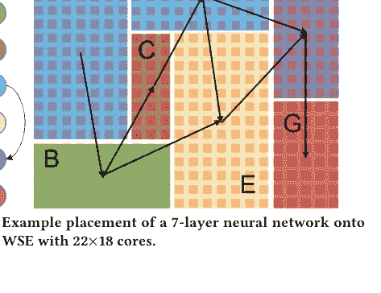

**ACM 参考格式：**  
Benzheng Li, Qi Du, Dingcheng Liu, Jingchong Zhang, Gengjie Chen, and Hailong You. 2021. *用于晶圆级深度学习加速器的放置*. In *第26届亚洲和南太平洋设计自动化会议 (ASP-DAC '21)*, January 18–21, 2021, 东京，日本. ACM, New York, NY, USA, 6 pages. https://doi.org/10.1145/3394855.3431563

## 1 引言

随着 2010 年代深度学习应用的蓬勃发展 [9]，加速神经网络（NNs）变得日益重要，以满足快速增长的计算需求。专用 ASIC 加速器是解决此问题的有前景的技术。例如，名为 DianNao [3] 的加速器比 128 位 2GHz SIMD 处理器快 117.87 倍，总能耗降低了 21.08×。Google 提出的张量处理单元（TPU）[6] 平均比其同期 CPU 或 GPU 快约 15–30×，TOPS/Watt 提高了约 30–80×。近期，Cerebras 提出了晶圆级引擎（WSE）[1]。WSE 由 40 万个可编程核心和分布式片上内存组成，可以部分加速 NN 的多个层的计算。它还通过具有 2D 网格拓扑的局部连接为层间通信提供高带宽。然而，要充分利用其能力，需要对在 WSE 上实现的层的放置进行彻底优化。

在 WSE 放置中，每个层被映射为一个矩形核心阵列，称为内核，如图 1 所示。放置对加速效率的影响包括核心分配、内核位置的安排以及连接的协议适配器成本。由于吞吐量最低的内核决定了整体性能，计算时间应在所有内核中保持一致。因此，分配给内核的核心数量需要与工作负载成比例。此外，核心通过片上网格网络传输数据。因此，内核内通信开销受分配给该内核的核心之间的距离影响，这可以表征为内核的形状。同样，内核间通信开销受不同内核中核心之间距离的影响。此外，与连接内核的参数相关的协议适配器成本也会影响内核间通信。

WSE 放置问题类似于传统的布局规划问题，即将一组块（模块或宏）放置到二维芯片区域。模拟退火（SA）是一种经典算法，用于搜索布局规划中块的良好拓扑结构。拓扑结构可以分为两类。切片结构是通过递归切片矩形区域生成的矩形剖分，而非切片结构允许矩形不规则堆叠。切片结构的表示形式称为归一化波兰表达式（nPe）[10]，为 SA 提供了扰动布局规划的操作。而 O-tree [4] 和 B*-tree [2] 等表示形式使得非切片布局规划的搜索成为可能。近期，提出了一种基于强化学习（RL）的方法 [7] 来逐个放置宏。在此 RL 放置问题中，状态是网络表的全部可能部分放置，而宏的可用操作是可行位置。操作由训练有素的策略网络执行，以推广到未见过的块。

然而，WSE 放置与布局规划问题从根本上不同。在 WSE 放置问题中，内核的面积和形状仍需确定。相反，布局规划问题中的块都具有固定面积，且大多具有固定形状。此外，WSE 放置问题中可调参数的数量要大得多，这显著扩大了解决方案空间。因此，基于 SA 和基于学习的方法很难为 WSE 生成近乎最优的放置。另一方面，NN 的连接性比布局规划网络表简单得多。在基于 SA 和基于学习的方法中，投入了很大精力来处理块的复杂连接。因此，按 NN 的拓扑顺序放置层可以在几乎不牺牲质量的情况下大幅减少运行时间。在我们早期的探索中，我们尝试实现基于 nPe 的 SA 算法，发现其性能较差。即使在 SA 算法的最佳情况下，其得分仍比 GigaPlacer 差 13%，但运行时间长了 2.6 倍。

为了优化 NN 加速的计算时间，我们提出了一种有效且高效的放置器，称为 GigaPlacer，以处理 WSE 放置问题。我们的贡献总结如下：

- 我们提出了两种基于动态规划（DP-based）的算法来放置层。采用基于二分搜索的框架来保证所有内核计算时间的一致性。
- 我们提出了一种行高最小化算法来确定每个内核的最佳执行参数。我们利用一种有效的枚举技术并进行剪枝，由二分搜索指导。这样，晶圆面积将被充分利用。
- 我们提出了两种进一步细化结果的技术。通过交换一些内核来减少内核间距离，并通过略微调整连接内核的参数来最小化协议适配器成本。
- 与 ISPD2020 竞赛的第一名相比，我们在竞赛指标上实现了最高 6.89% 的降低，平均降低 2.09%，运行速度提升了 7.23 倍。

## 2 预备知识

本节首先介绍 WSE 的基本结构。随后介绍内核的参数和性能函数，最后介绍问题表述。

### 2.1 晶圆级引擎

在 WSE 中，约有 40 万个 tile 排列在 633×633 网格中。每个 tile 具有一个可编程执行核心、48KB SRAM 以及用于与其他 tile 互连的路由器。

在 WSE 放置问题中，NN 中的层被映射为一组矩形内核，其中每个内核占用多个 tile，并通过并行运行 tile 的执行核心来执行单个 NN 计算任务 [5]。

### 2.2 内核参数

内核的性能由包括形式参数和执行参数在内的各种参数决定。

H、W、R、S、C、K、T 是由 NN 规范定义的形式参数，不能通过编译过程修改。如图 2 所示，H 和 W 表示输入图像的大小；R 和 S 表示感受野的大小；C 和 K 是输入和输出特征的数量；T 表示操作的步长。h、w、c、k 是执行参数，决定内核中 tile 的数量和排列，并描述如何在 tile 上执行并行操作。它们将张量操作的各个维度 H、W、C、K 分开。与形式参数不同，它们允许被修改。

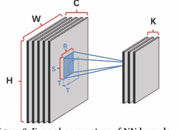

### 2.3 内核性能函数

对于每个内核，其大小、计算时间和内存由参数计算得出。这些指标代表执行内核所需的计算资源。在给定的内核库中，各种类型内核的性能函数被指定。其中，基本卷积内核 _conv_ 的性能函数如下。

$$height = hw(c+1) \tag{1a}$$
$$width = 3k \tag{1b}$$
$$time = \lfloor H/h \rfloor\lfloor W/w \rfloor\lfloor C/c \rfloor\lfloor K/k \rfloor RS/T^2 \tag{1c}$$
$$memory = \left\lfloor \frac{CKRS}{ck} + \frac{(W+S-1)(H+R-1)K}{whk} \right\rfloor \tag{1d}$$

请注意，_memory_ 指的是每个 tile 所需的内存。

除 _conv_ 内核外，还有其他包含多个 _conv_ 内核的类型内核。两种类型内核 _dblock_ 和 _block_ 的性能函数如图 3 所示。取 _dblock_


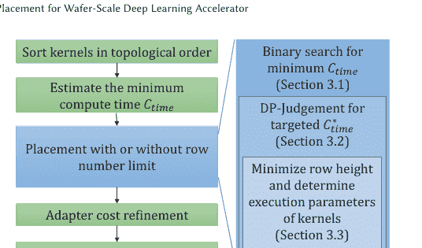

图4：GigaPlacer 框架。

以 kernel 为例，它包含*三个 conv*核，其中每个*conv*核的度量计算方法与公式(1)相同。在*conv*核中，形式参数 R 和 S 由*F*决定，而*F*是*dblock*核的给定形式参数。由于这些*conv*是水平放置的，所以*block*核的宽度是各*conv*核宽度之和，而其他度量则取最大值。

在 WSE 布局问题中，核之间的连接由核图指定。两个相连核之间的通信开销与它们的距离有关，也与协议适配器有关。适配器成本表示相连核的 I/O 协议不匹配的程度。对于每条连接，适配器成本是两个相连核之间参数（$h$，$w$，$c$）不匹配的数量。

### 2.4 问题形式化

一般来说，WSE 布局问题可以形式化定义如下。给定一个指定核性能函数的核库，以及一个带有连接关系的核图。应满足以下约束条件：

- 所有核必须放置在尺寸为 63×63× 的瓦片网格中；
- 核必须是矩形，并且包含整数个瓦片；
- 不允许核之间重叠；
- 核中每个瓦片的单元内存不应超过内存限制 48KB。

优化目标是最小化以下各项的加权和：

- *C*_dist，通信核之间的 L1 总距离，
- *C*_time，所有核的最大计算时间，
- *C*_adapter，每条连接的适配器成本之和。

即总成本 *C*_total 为：

```
$$C_{total} = w_{dist}C_{dist} + w_{time}C_{time} + w_{adapter}C_{adapter},$$
(2)
```

其中 $w_{dist}$、$w_{time}$ 和 $w_{adapter}$ 是对应成本的权重。

## 3 算法

在本节中，我们将介绍布局生成算法。图4描述了 GigaPlacer 的整体流程。主要框架在第 3.1 节中描述。为了在计算时间 $C_{time}$ 和 L1 距离 $C_{dist}$ 之间取得平衡，第 3.2 节提出了基于二分搜索但使用不同 DP 判定的方法。第 3.3 节介绍了用于将核放置在一行中的算法，该算法在 DP 中使用。我们还进行了优化以减少 $C_{dist}$ 和适配器成本 $C_{adapter}$，这将在第 3.4 节中提及。

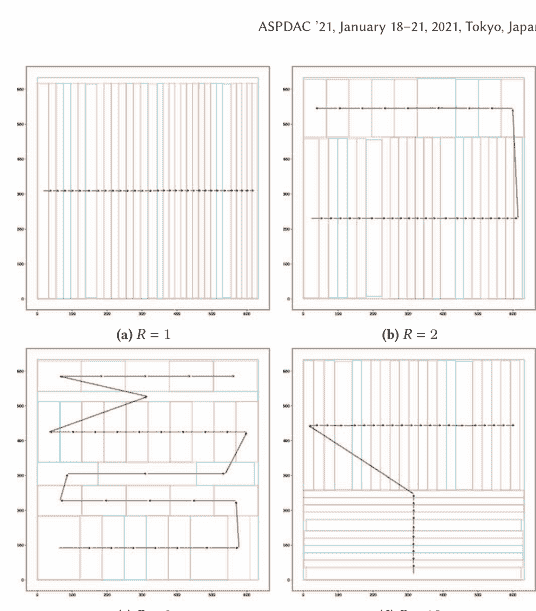

图5：GigaPlacer 的示例布局。核逐行放置。这些布局是针对同一个 NN 设计生成的，而行数 *R* 不同。

### 3.1 基于二分搜索的框架

在本节中，我们提出了一个框架，在核被合法放置在受限区域内的同时，生成具有最小 $C_{time}$ 的布局。GigaPlacer 如图5所示逐行放置核。这样一来，如果核按特定顺序放置，$C_{time}$ 与总高度呈单调关系。因此，二分搜索可以帮助我们*找到*最小的 $C_{time}$。在二分搜索的每次迭代中，我们将 $C_{time}$ 的猜测值定义为 $C_{time}^{ss}$。$C_{time}^{ss}$ 等于搜索范围的中间高度。如果所有核都能在其计算时间小于 $C_{time}^{ss}$ 的情况下被合法放置，则 $C_{time}$ 的搜索范围将缩小到较小的一半，否则将缩小到较大的一半。

由于较小的初始搜索范围有助于减少二分搜索的运行时间，因此需要对 $C_{time}$ 进行估计。当所有核的计算时间均匀时，可以获得最小的 $C_{time}$。为了使计算时间大致相等，核的面积通常应遵循一组由图3中的公式计算出的比例。具体来说，核的面积权重（分别针对*conv*、*block*和*dblock*）设置为：

```
$$w_{conv} = HWC KRS / T^{2}$$
(3a)

$$w_{block} = 29 / (64 × HWF^{2})$$
(3b)

$$w_{dblock} = 17 / (16 × HWF^{2})$$
(3c)
```

例如，根据公式(1)，*conv*核的权重 $w_{conv}$ 可近似为：

```
$$w_{conv} = width × height = hw(c + 1) × 3k$$
$$≈ 3 × hwc × \frac{3}{time} × \frac{HWC KRS}{T^{2}}$$
(4)
```

这里，$3/time$ 被视为常数并移除。*block* 和 *dblock* 核的权重通过类似方式获得。

## 算法1：无行数限制的 DP 判定

```
**Input:** The set of kernels $Ker = \{Ker_1, Ker_2, \dots, Ker_n\}$; Compute time limit $C^*_time$; Height limit of WSE $H_{WSE}$:
1. **for** $i = 1 \dots n$ **do**
   2.   **for** $k = 1 \dots i$ **do**
   3.      $NewHeight \leftarrow f_{i-k}$
   4.      $+ GetHeight(\{Ker_{i-k+1}, \dots, Ker_i\}, C^*_time)$
   5.      **if** $NewHeight < f_i$ **then**
   6.         $f_i \leftarrow NewHeight$
Placement with compute time limit $C^*_time$ is achievable if and only
if $f_n \leq H_{WSE}$
```

然而，即使面积给定，$C_{time}$ 仍会随核的参数而变化。因此，我们选取面积最大的核，在面积约束下计算其在不同参数组合下的所有计算时间，并选择其中的最小值作为估计的 $C_{time}$。初始搜索区间设置为估计 $C_{time}$ 的十分之一到十倍，在我们的实验中证明这实际上已经足够大。

接下来，针对目标 $C^*_time$，我们将利用 DP 算法生成具有最小高度的布局，以判断其是否合法。在 DP 过程中，每个核的所有执行参数将被确定。

### 3.2 DP 判定

我们设计了两种不同的基于 DP 的判定算法。第一种算法在不受行数限制的情况下获得布局，并且往往能得到更好的 $C_{time}$。第二种算法设置了行数限制，因为行数过多总是会导致较大的 $C_{time}$。虽然这种限制会导致 $C_{time}$ 略有恶化，但会带来更好的 $C_{dist}$。

#### 3.2.1 无行数限制的 DP 判定

算法1描述了针对目标 $C^*_time$ 的判定函数，行数将自动确定。$f_i$ 表示前 $i$ 个核按拓扑顺序放置时使用的最小高度。如果最后一行有 $k$ 个核，则 $f_i$ 可通过下式计算：

```
$f_i = f_{i-k} + GetHeight(\{Ker_{i-k+1}, \dots, Ker_i\}, C^*_time)$ (5)
```

这里，$Ker_i$ 是第 $i$ 个核。$GetHeight$ 是一个函数，它将一组核放置在一行中并返回该行的最小高度，将在第 3.3 节中介绍。我们在枚举所有 $k$ 后得到最小的 $f_i$。如果有多个 $k$ 得到相同的最小 $f_i$，我们选择其中 $C_{dist}$ 和 $C_{adapter}$ 较小的一个。最终，在所有核都放置完毕后，我们得到 $f_n$ 作为最终高度。如果 $f_n$ 小于高度限制 $H_{WSE}$，我们就可以接受 $C^*_time$。

#### 3.2.2 带行数限制的 DP 判定

为了找到可能具有更好 $C_{dist}$ 的其他结果，我们提出了另一种 DP 判定，如算法2所述。主要区别在于第二种算法中行数 $R$ 是固定的。$f_{i,j}$ 表示前 $i$ 个核按拓扑顺序放置且同时使用 $j$ 行时使用的最小高度。如果最后一行有 $k$ 个核，则 $f_{i,j}$ 可通过下式计算：

```
$f_{i,j} = f_{i-k, j-1} + GetHeight(\{Ker_{i-k+1}, \dots, Ker_i\}, C^*_time)$ (6)
```

使用这个 DP 方程，我们可以在核被放置在 $R$ 行中时获得最小的 $C^*_time$。一般来说，随着行数的减少，$C_{dist}$ 也会减小，但 $C_{time}$ 会增大。因此，我们可以尝试不同的 $R$ 来在 $C_{dist}$ 和 $C_{time}$ 之间找到平衡。我们的实验结果表明，当算法2的布局优于算法1时，$R$ 总是一或二。

## 算法2：带行数限制的 DP 判定

```
**Input:** The set of kernels $Ker = \{Ker_1, \dots, Ker_n\}$; Compute time limit $C^*_time$; Row number $R$; Height limit of WSE $H_{WSE}$:
1. **for** $i = 1 \dots n$ **do**
   2.   $f_{i,1} \leftarrow GetHeight(\{Ker_1, Ker_2, \dots, Ker_i\}, C^*_time)$
   3.   **for** $j = 2 \dots R$ **do**
   4.     **for** $i = 1 \dots n$ **do**
   5.       **for** $k = 1 \dots n$ **do**
   6.         $NewHeight \leftarrow f_{i-k, j-1}$
   7.         $+ GetHeight(\{Ker_{i-k+1}, \dots, Ker_i\}, C^*_time)$
   8.         **if** $NewHeight < f_{i,j}$ **then**
   9.           $f_{i,j} \leftarrow NewHeight$
Placement with compute time limit $C^*_time$ is achievable if and only
if $f_{n,R} \leq H_{WSE}$
```

当 $R$ 的值为1时，所有核都像图5(a)所示的那样以条带形式放置，我们总能获得最佳的 $C_{dist}$。然而，这种布局总是具有较高的 $C_{time}$。因此，我们尝试降低某些核的高度。我们将一些核水平条带化放置，然后将其他核放入一行，如图5(d)所示。这种策略的 $C_{time}$ 和 $C_{dist}$ 介于 $R=1$ 和 $R=2$ 的 DP 结果之间。

当 $C_{dist}$ 的权重很大时，$R=1$ 似乎能获得最佳结果。为了获得更好的 $C_{dist}$，我们扩大了计算时间限制。在获得最小 $C_{time}$ 后，我们将其乘以 $\alpha$ 并运行 DP 判定来获得结果。在我们的算法中，$\alpha$ 从 $1.02$ 到 $1.02^{80}$ 共取 80 个值。

简而言之，我们尝试了几种带行数限制的策略，并应选择最佳结果。为了获得最小总成本 $C_{total}$，将同时运行算法1和算法2，并选择最佳布局。

### 3.3 行高最小化

在本节中，介绍函数 $GetHeight$ 的算法。使用另一个二分搜索来寻找最小行高 $H_{limit}$，使得在计算时间和宽度限制固定的情况下，所有核都能被放置在一行中。我们将 $H_{limit}$ 的猜测值定义为 $H^w_{limit}$。$H^w_{limit}$ 等于二分搜索范围的中间数。每个核的高度都设置为 $H^w_{limit}$，然后我们逐个将核从左到右放置在一行中。如果所有核放置后的总宽度小于 WSE 的宽度限制，我们就可以接受 $H^w_{limit}$，然后将行高范围缩小到较小的一半，否则缩小到较大的一半。

对于给定的高度、计算时间和内存限制，我们需要一个函数来确定一组参数，使核获得最小宽度。我们的算法使用两层循环并有效剪枝来枚举 $h$ 和 $w$ 的值，然后计算相应的 $c$ 和 $k$。之后，我们选择一组使宽度最小的参数。我们考虑两种情况：是否将核旋转90度。

如果不旋转核，为了获得更小的计算时间，每个卷积的高度最好为 $H^w_{limit}$。根据公式(1a)，每个卷积的参数 $c$ 为：

```
$c = \lfloor \frac{H^w_{limit}}{\lceil h \times w - 1 \rceil} \rfloor$ (7)
```

为了满足内存 $M_{limit}$，根据公式(1d)，每个卷积的参数 $k$ 必须满足：

```
$k \geq \lceil \frac{K \times \frac{C}{c} \times R \times S + \frac{W+1}{w} \times \frac{H+R-1}{R}}{M_{limit}} \rceil$ (8)
```


# (a) 适配器成本细化。

# (b) L1 距离细化。

# 图 6：两种细化算法。

为了满足计算时间限制 $C^*_{time}$，根据公式 (1c)，每个卷积的参数 $k$ 必须满足：

$$k \geq \left\lceil \frac{K}{C^*_{time} \div \left(\left\lceil \frac{H}{h} \right\rceil \times \left\lceil \frac{W}{w} \right\rceil \times \left\lceil \frac{C}{c} \right\rceil \times R \times S \div T^2\right)} \right\rceil \quad (9)$$

因此我们可以得到满足公式 (8) 和 (9) 的最小 $k$。

此外，我们可以将核旋转 90 度。在这种情况下，所有卷积的总宽度为 $H^*_{limit}$。为了使每个卷积的高度相似，其宽度按以下比例分配：

$$\left\lceil \frac{H}{h} \right\rceil \times \left\lceil \frac{W}{w} \right\rceil \times R \times S \times C \times K \div T^2 \quad (10)$$

根据公式 (1b)，在分配宽度后计算每个卷积的参数 $k$。为了满足内存限制，根据公式 (1d)，每个卷积的参数 $c$ 必须满足：

$$c \geq \frac{C \times K/k \times R \times S}{M_{limit} - \frac{W+S}{w} \times \frac{H+R-1}{h} \times \frac{K}{k}} \quad (11)$$

为了满足计算时间限制，根据公式 (1c)，每个卷积的参数 $c$ 必须满足：

$$c \geq \left\lceil \frac{C}{C^*_{time} \div \left(\left\lceil \frac{H}{h} \right\rceil \times \left\lceil \frac{W}{w} \right\rceil \times \left\lceil \frac{K}{k} \right\rceil \times R \times S \div T^2\right)} \right\rceil \quad (12)$$

### 3.4 细化

在布局生成后，我们执行两种细化算法以降低适配器成本 $C_{adapter}$ 和 L1 距离 $C_{dist}$。其中适配器成本细化算法调整执行参数，L1 距离细化算法不修改任何参数，仅改变核的位置或重新排序它们。

#### 3.4.1 适配器成本细化

在适配器成本细化算法中，核的参数将被重新确定以降低 $C_{adapter}$，同时计算时间 $C_{time}$ 保持不变。会挑选一个核，并将其 $h$ 和 $w$ 参数更改为与其相连的核相同。然后重新计算其他参数以保持计算时间和宽度不变。此过程会改变所选核的高度。合法调整区域定义为宽度为核的宽度、高度为行高的区域。如图 6(a) 所示，蓝色核被选中，高亮区域为合法调整区域。如果核仍在合法调整区域内，则此更改是可以接受的。$h$ 和 $w$ 参数将被重新确定为使 $C_{adapter}$ 最小的配对。所有核都将以这种方式尝试。该过程将多次运行，直到没有改进为止。

#### 3.4.2 L1 距离细化

L1 距离细化算法挑选每一行并移动该行中的核以搜索更好的 $C_{dist}$。我们采用与 FastPlaceDP [8] 类似的基于窗口的局部重排序技术。一个覆盖若干连续核的窗口将从行的开头移动到行尾，如图 6(b) 所示。窗口中核的所有可能顺序将被枚举，如果 $C_{dist}$ 减小则保存结果。窗口大小设置为 6 以平衡运行时间开销和质量提升。此外，一些连续核的位置将被反转，作为另一种简单的策略，其窗口大小远大于局部重排序。此步骤将迭代多次，直到没有改进为止。

## 4 实验结果

我们使用 C++ 实现 GigaPlacer 并使用 g++ 5.4.0 编译。基准测试 [5] 来自 ISPD 2020 竞赛，核的数量范围从 16 到 100，如表 1 所示。所有实验均在配备 1.6GHz Intel i5-10210U 处理器和 8GB 内存的 Linux 机器上进行。

GigaPlacer 通过在基于 DP 的算法中嵌入多种策略来生成解决方案。实验表明，我们设计的布局生成策略都有效，并且所有这些策略都出现在最终结果中。图 7 显示了 GigaPlacer 在测试案例 E、I、M 和 F 上的最终结果。

## 5 结论

在本文中，我们提出了 GigaPlacer 用于在 WSE 上放置 NN 层。通过基于二分搜索的框架实现了最小计算时间。两种关注不同目标的基于 DP 的算法被集成以放置核。为了进一步降低核间通信开销，我们调整了相连核的参数并尝试重新排序一些核。与 ISPD2020 竞赛的第一名相比，GigaPlacer 不仅更好而且更快。我们未来的工作将改进判断函数以自动优化核间距离，而不是手动设置行数限制。我们还打算探索更多拓扑以放置核以获得更好的性能。

# 表 1：ISPD2020 基准测试结果比较

| 案例 | 内核数 | w_time | w_dist | w_adapter | C_time ISPD'20 | C_time 我们 | C_dist ISPD'20 | C_dist 我们 | C_adapter ISPD'20 | C_adapter 我们 | C_total ISPD'20 | C_total 我们 | 运行时间(s) ISPD'20 | 运行时间(s) 我们 |
|---|---|---|---|---|---|---|---|---|---|---|---|---|---|---|
| A | 16 | 1 | 1 | 0 | 34496 | 34496 | 1314 | 1189.5 | 15 | 16 | 35810 | 35685.5 | 35 | 3 |
| B | 32 | 1 | 1 | 0 | 63504 | 64512 | 2639.5 | 2004 | 18 | 10 | 66143.5 | 66516 | 37 | 15 |
| C | 100 | 1 | 1 | 0 | 64512 | 64768 | 2408 | 1959.5 | 185 | 249 | 66920 | 66727.5 | 210 | 59 |
| D | 52 | 1 | 1 | 0 | 33712 | 33712 | 2722 | 2084.5 | 123 | 137 | 36434 | 35796.5 | 37 | 22 |
| E | 16 | 1 | 10 | 100 | 39312 | 39312 | 562 | 569.5 | 11 | 8 | 46032 | 45807 | 76 | 5 |
| F | 32 | 1 | 10 | 100 | 65170 | 65170 | 1489.5 | 1488.5 | 12 | 14 | 81265 | 81455 | 116 | 15 |
| G | 100 | 1 | 10 | 100 | 64512 | 71680 | 2508.5 | 1945.5 | 98 | 17 | 99397 | 92835 | 188 | 56 |
| H | 52 | 1 | 10 | 100 | 39520 | 43008 | 1104.5 | 887 | 49 | 12 | 55465 | 53078 | 76 | 20 |
| I | 25 | 1 | 4 | 0 | 52136 | 49392 | 617.5 | 1284.5 | 13 | 10 | 54606 | 54530 | 69 | 10 |
| J | 79 | 1 | 4 | 0 | 50274 | 49392 | 2472.5 | 1988 | 69 | 134 | 60164 | 57344 | 90 | 49 |
| K | 16 | 1 | 4 | 0 | 432 | 504 | 240 | 211.5 | 3 | 7 | 1392 | 1350 | 28 | 1 |
| L | 52 | 1 | 4 | 0 | 864 | 864 | 279 | 283 | 18 | 178 | 1980 | 1996 | 38 | 16 |
| M | 23 | 1 | 4 | 0 | 22111840 | 22111840 | 3610.5 | 3365.5 | 41 | 44 | 2226282 | 22253202 | 68 | 13 |
| N | 26 | 1 | 4 | 0 | 1482 | 1640 | 480.5 | 437.5 | 10 | 9 | 3404 | 3390 | 3 | 1 |
| O | 25 | 1 | 40 | 400 | 52136 | 52136 | 617.5 | 617.5 | 13 | 13 | 82036 | 82036 | 121 | 10 |
| P | 79 | 1 | 40 | 400 | 57792 | 57792 | 1101 | 1625 | 85 | 11 | 135832 | 127192 | 122 | 38 |
| Q | 16 | 1 | 40 | 400 | 882 | 896 | 166 | 153 | 6 | 7 | 9922 | 9816 | 27 | 2 |
| R | 52 | 1 | 40 | 400 | 8064 | 1008 | 259 | 324 | 20 | 27 | 26424 | 24768 | 66 | 10 |
| S | 23 | 1 | 400 | 400 | 2396300 | 2396160 | 1897.5 | 1352 | 48 | 47 | 3174500 | 2955760 | 95 | 13 |
| T | 26 | 1 | 40 | 400 | 4102 | 4875 | 208.5 | 176.5 | 4 | 5 | 14042 | 13935 | 5 | 1 |
| Avg Ratio | | | | | 1.32 | 1 | 1.08 | 1 | 1.65 | 1 | 1.02 | 1 | 7.23 | 1 |

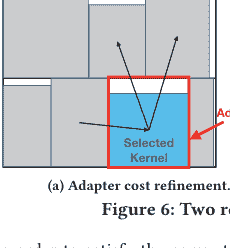

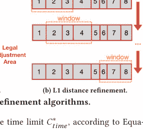

# 图 6：两种细化算法。

# 图 7：GigaPlacer 在部分 ISPD2020 案例上的结果。

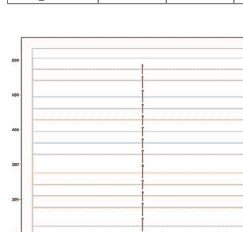

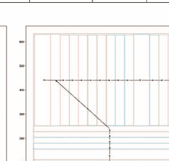

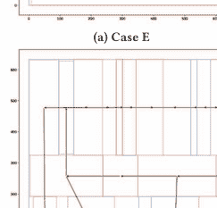

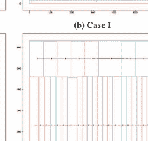

# 图 8：案例 D 有/无 L1 距离细化的结果

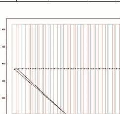

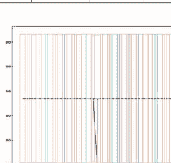

## 参考文献

- [1] Cerebras. 2019. 晶圆级深度学习. In IEEE Hot Chips Symposium. 1–31.
- [2] Yun-Chih Chang, Yao-Wen Chang, Guang-Ming Wu, and Shu-Wei Wu. 2000. B*-树：非切片平面图的一种新表示. In ACM/IEEE Design Automation Conference (DAC). 458–463.
- [3] Tianshi Chen, Zidong Du, Ninghui Sun, Jia Wang, Chengyong Wu, Yunji Chen, and Olivier Temam. 2014. DianNao：一种用于无处不在机器学习的低占用高吞吐加速器. In ACM Conference on Architectural Support for Programming Languages and Operating Systems (ASPLOS). 269–284.
- [4] Pei-Ning Guo, Chung-Kuan Cheng, and Takeshi Yoshimura. 1999. 非切片平面图的一种 O-树表示及其应用. In ACM/IEEE Design Automation Conference (DAC). 268–273.
- [5] Michael James, Marvin Tom, Patrick Groeneveld, and Vladimir Kibardin. 2020. ISPD 2020 晶圆级深度学习加速器上神经网络的物理映射. In ACM International Symposium on Physical Design (ISPD). 145–149.
- [6] Norman P Jouppi, Cliff Young, Nishant Patil, David Patterson, Gaurav Agrawal, Raminder Bajwa, Sarah Bates, Suresh Bhatia, Nan Boden, Al Borchers, et al. 2017. 张量处理单元的数据中心性能分析. In IEEE/ACM International Symposium on Computer Architecture (ISCA). 1–12.
- [7] Azalia Mirhoseini, Anna Goldie, Mustafa Yazgan, Joe Jiang, Ebrahim Songhori, Shen Wang, Young-sik Lee, Eric Johnson, Omkar Pathak, Sungsu Bae, et al. 2020. 使用深度强化学习的芯片放置. arXiv:2004.10746 (2020).
- [8] Min Pan, Natarajan Viswanathan, and Chris Chu. 2005. 一种高效有效的详细放置算法. In IEEE/ACM International Conference on Computer-Aided Design (ICCAD). 48–55.
- [9] Vivienne Sze, Yu-Hsin Chen, Tien-Ju Yang, and Joel S Emer. 2017. 深度神经网络的高效处理：教程与综述. Proc. IEEE 105, 12 (2017). 2295–2329.
- [10] Martin D.F. Wong and CL Liu. 1986. 一种新的平面图设计算法. In ACM/IEEE Design Automation Conference (DAC). 101–107.

