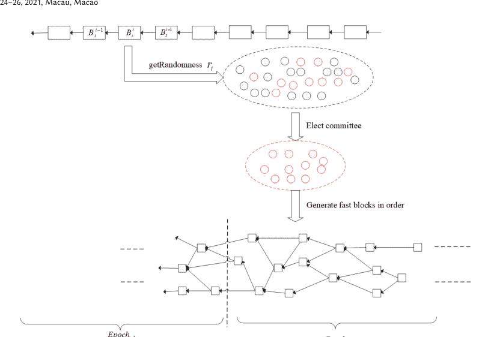
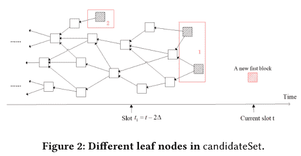
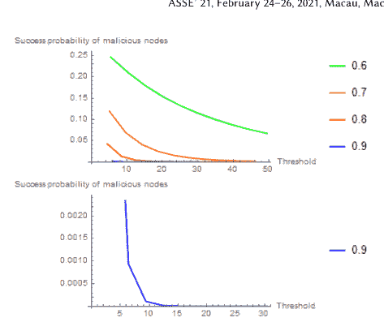
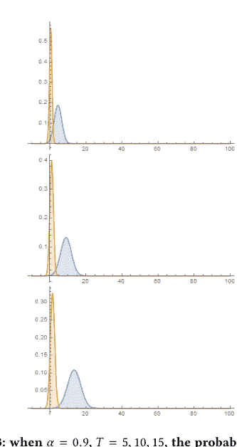
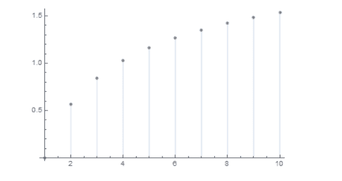

# 2021年第二届亚洲服务科学与工程会议：Plume：无单点故障快速终结区块链

## 摘要

比特币缓慢的终结性是其无法在现实生活中广泛应用的重要因素。其他公共单链区块链也存在同样的问题。在本文中，我们提出了一种名为 Plume 的实用新协议，通过利用（缓慢的）传统区块链来实现具有快速终结性的共识。Plume 结合了有向无环图（DAG）结构与传统区块链，以提高吞吐量并加速确认。DAG 结构旨在提高吞吐量，但如何基于 DAG 构建安全的共识协议非常困难。在 Plume 中，我们使用传统区块链生成随机数，用于在 DAG 中生成快速块。DAG 中快速块的顺序依赖于全局时钟和哈希函数。与比特币一样，Plume 是一个概率性协议。然而，由于 DAG 结构的引入，在不降低安全性的情况下，Plume 中块的创建率可以更高。因此，块的确认时间可以加快。本文还分析了不同条件下的确认概率，并证明了无论来自传统单链的随机数是否有偏差，Plume 都是安全的。最后，本文使用 NS-3 模拟了 1000 个节点的性能。在块大小为 100K 字节且快速块时间间隔为 1 秒的情况下，吞吐量可提升至 400 Tps。在块大小为 10K 字节且时间间隔为 1 秒的情况下，确认时间可缩短至 2 分钟以内。

## CCS 概念

- *安全与隐私* → **网络安全**。
- *计算机系统组织* → *可用性*。

## 关键词

吞吐量，终结性，DAG，共识协议

## ACM 引用格式：

## 1 引言

作为一种新技术，区块链在金融 [12] [19] [18]、物联网 [6] 和供应链 [15] 等各种领域具有巨大的应用潜力。设计于 2008 年的比特币是区块链的第一个应用，它将其底层技术——区块链协议——公之于众。随后，区块链的安全性由 [5] 和 [13] 得到证明，这为区块链的使用提供了安全保证。根据 [5]，我们必须将增长速率限制在特定范围内，以避免产生过多的分叉从而降低诚实参与者的算力。

阻碍区块链在现实生活中广泛应用的是其吞吐量和确认时间。平均而言，比特币的吞吐量约为 3 tx/s [1]，且确认时间超过 1 小时。以太坊将生成区块的速率提高到约 11 秒 [2]，但确认时间仍不足以应对实际场景。因此，寻找克服这两个问题的方法至关重要。

目前，主要有两种提高吞吐量的方法，即分片 [20] [7] 和有向无环图（DAG）[8]。分片将参与者划分为几个较小的委员会，使委员会可以并行打包交易以提高吞吐量。DAG 将单链更改为有向无环图，在这种结构中，无需考虑网络延迟即可加速区块的生成。这两种方法确实可以提高吞吐量，但它们无法从根本上提高确认速度。

Sompolinsky 等人 [17] 发现，如果一种结构接受所有区块，它就能在不牺牲去中心化的情况下解除区块生成速率的限制。DAG 就是这样的结构。因此，我们的目标是为 DAG 结构提供自然序列，并实现稳定且快速的确认。在本文中，我们使用传统单链区块链来确保整体安全性，并使用 DAG 结构来提高吞吐量和确认速率。

直观上，我们利用传统单链区块链获取随机数，这些随机数可用于选择委员会来构建 DAG 结构并对其进行排序。网络中的每个参与者都有以一定概率获得创建区块资格的机制。只要传统单链区块链是安全的，攻击者就无法控制我们 DAG 结构的顺序。并且，我们的 DAG 结构具有源自随机数的自然序列，因此，我们可以获得稳定的确认。

我们使用 DAG 结构摆脱了区块生成的速度限制。在单链区块链中，一个区块必须等到其前一个区块广播到几乎整个网络后才能生成，以避免分叉。而对于 DAG，我们无需等待一个区块传遍整个网络生成下一个区块，因为所有区块最终都会被包含在 DAG 中。同时，由于使用了属于安全单链的稳定区块以及两个区块之间更短的间隔，确认时间得到了改进。

Plume 提供了一种实用的 DAG 协议，包含：
- 如何在 DAG 中生成区块；
- 为 DAG 中的所有区块赋予唯一的全局编号；
- 分析区块何时可以被确认的条件。

本文结构如下。在第 3 节中，我们提供了一些数据结构和安全的定义。在第 4 节中，我们给出 Plume 的细节，并在第 5 节中分析不同条件下的确认概率以及当来自单链的随机数无偏差和有偏差时 Plume 的安全性。最后，第 6 节给出了使用 NS-3 对 1000 个节点的 Plume 模拟。

## 2 相关工作

Thunderella [14] 由 Pass 和 Eilam 于 2018 年提出，旨在加速公共链的确认。它需要一个可信的加速器来收集交易并按顺序输出，然后委员会对这些顺序交易进行投票并将其打包以生成一致的日志。[14] 只能保证在乐观情况下快速确认，但在最坏情况下会回退到传统区块链，并且它依赖于一个被称为加速器的指定实体。与 Thunderella 相关，Plume 证明了在不去中心化的情况下实现稳定且快速的确认。

在过去几年中，提出了几种基于 DAG 的共识协议。SPECTRE [16] 为 DAG 中所有区块对指定了非传递偏序关系，而 Plume 为所有区块提供了全局一致的唯一编号，这对于支持智能合约等应用程序至关重要。并且，作为一种 PoW 共识协议，ConfFlux [9] 使用 PoW 协议生成区块，这浪费了大量的电力。由于使用 GHOST [17] 在遇到分叉时决定哪个分支是有效的，ConfFlux 也容易受到均衡攻击。均衡攻击 [10] 意味着持有少于 50% 算力的攻击者可以通过干扰分叉点两个部分中较弱的一方，使得某些区块永远无法被确认。而在 Plume 中，DAG 快速块的生成是根据底层单链提供的随机数进行的，这是经济高效的。并且，Plume 给出的顺序协议可以抵御均衡攻击。

## 3 定义与模型

在 Plume 中，我们有两种类型的区块，一种是传统单链区块链中的慢速区块，另一种是可用于构建 DAG 结构的快速区块。接下来，我们将给出这两种区块的正式描述。在后续内容中，我们将传统单链区块链称为慢链，将 DAG 结构区块链称为快链。

### 3.1 慢区块链的符号与安全定义

**慢区块链符号。** 我们使用 $slowChain$ 来表示慢链。符号 $slowChain^{(\ell)}$ 表示除尾部 $\ell$ 个区块外的整个 slowChain；$slowChain[\ell : t]$ 表示 up to 时间 $t$ 的整个 slowChain；$slowChain[\ell_1 : \ell_2]$ 表示长度在 $\ell_1$ 和 $\ell_2$ 之间的所有区块。并且我们使用符号 $slowChain_i^t$ 来表示玩家 $i$ 在第 $t$ 轮中的 slowChain。符号 $\le$ 表示前缀关系。

**安全定义。** 慢链协议应满足链增长、链质量和公共前缀 [13, 15]。直观地说，链增长要求诚实节点的区块 [5] 稳定增长，既不太快也不太慢，这就是我们称传统单链区块链为慢链的原因，且诚实各方拥有长度大致相同的链。链质量要求在任何诚实节点的链中，任何足够长的连续区块窗口中包含一定比例的由诚实节点挖掘的区块。公共前缀要求所有诚实节点的链彼此一致，除了尾部少数几个区块。我们将在下面正式定义这些安全属性。

### 3.2 执行模型

**半同步通信设置。** 我们将时间划分为不重叠的段，称为槽（slots）。从一个诚实节点发送的消息会在 $\Delta$ 个槽内被所有其他诚实节点接收。并且当新节点加入此网络时，他可以接收所有错过的消息。我们定义一个纪元（epoch），在一个纪元中平均生成一个慢速传统区块，由 $R$ 个槽组成。在每个纪元开始时，Plume 选择一个委员会来生成 DAG 结构，并且随着纪元的改变，委员会也会改变。

**攻击者的能力。** 在我们分析中的攻击者无法阻止消息传输，但他们可以将发送到诚实方的消息延迟最多 $\Delta$ 个槽，并重新排列发送到其他方的消息顺序。攻击者还可以向部分诚实方传输他们自己的消息，但经过一段时间后，所有诚实方都可以接收到这些消息。同时，攻击者可以随时立即腐化（corrupt）诚实节点。此外，攻击者可以不断调整挖掘快速或慢速区块的策略及其广播。

### 3.3 快区块链的符号与安全定义

**定义 3.1. DAG 结构**

快速区块的 DAG 表示为 $\mathcal{G} = (V,E)$，其中 $V$ 代表快速区块，$E$ 代表指向先前快速区块的哈希引用。如果 $B_F$ 在我们的 DAG 中，我们将其表示为 $B_F \in \mathcal{G}$。我们将 $Child[B_F]$ 定义为从 $B_F$ 可达的快速区块子集，将 $Ancestor[B_F]$ 定义为从 $B_F$ 可达的区块子集。$Parents[B_F]$ 表示被 $B_F$ 直接引用的区块。$Slot[B_F]$ 表示生成 $B_F$ 的槽。$Density[B_F, s_1, s_2]$ 表示槽 $s_1$ 和 $s_2$ 之间 $Child[B_F]$ 的数量。$Index[B_F]$ 是 $B_F$ 排序后的序号。值得一提的是，$Index[B_F] \neq Slot[B_F]$，但对于 $Slot[B_F^{i_1}] < Slot[B_F^{i_2}]$，必须有 $Index[B_F^{i_1}] < Index[B_F^{i_2}]$，并且对于每个快速区块 $B_F$，其序号 $Index[B_F]$ 是唯一的。

**定义 3.2. 有效快速区块**

一个有效的快速区块 $B_F$ 需要满足以下所有条件：

- $B_f$ 的结构是正确的，其结构将在 4.1 节中定义；
- 快速块中的时间戳与槽（slot）的值一致；
- 对于父节点集合 Parents[$B_f$] 中的每一个快速块 $B_p$，都满足 |Slot[$B_f$]-Slot[$B_p$]| ≤ 2 · Δ，其中 Δ 是最大网络延迟。

### 定义 3.3. 待处理快速块集合 pendingSet[Ĝ]

我们定义待处理快速块集合为所有接收时间晚于最大延迟的有效快速块的集合，并将该集合记为 pendingSet[Ĝ]。

### 定义 3.4. 候选快速块集合 candidateSet[Ĝ]

我们定义候选快速块集合为在 Δ 个槽内接收到的所有有效快速块的集合，并将该集合记为 candidateSet[Ĝ]。

### 定义 3.5. 确认快速块集合 confirmedSet[Ĝ]

如果 Density[$B_f$, Slot[$B_f$] + Δ, Slot[$B_f$] + Δ + T)] 的数量大于 Th，其中 Th 和 T 是将在第 5 节讨论的系统参数。我们将该有效块视为确认的快速块。所有确认的快速块构成确认快速块集合，记为 confirmedSet[Ĝ]。排序仅针对 confirmedSet 中的快速块。

### 定义 3.6. 快速块序列 Seq[Ĝ]

一旦获得确认快速块集合，我们需要对这些快速块进行排序，以得到快速块序列，记为 $S = \text{Seq}[\hat{G}]$。在该序列中，每个快速块 $B_f$ 都有一个唯一的序列号，即 Index[$B_f$]。一种 DAG 结构对应一个快速块序列，该序列会随着 DAG 的增长而扩展，但序列的前部部分不会改变。我们用 len[S] 表示 S 中快速块的数量。类似于慢链，符号 $S^{[\kappa]}$ 表示除去末尾 κ 个快速块后的整个序列 S，符号 $\preceq$ 表示前缀关系。

### 定义 3.7. 终局状态

如果一个快速块 $B_f$ 获得了其在序列 Seq[Ĝ] 中的序列号 Index[$B_f$]，则该块已达到其终局状态。

在这里，终局意味着该块被回滚的概率可以忽略不计。

**安全性定义。** 我们假设在每方的视图中存在一个 DAG 结构 Ĝ，相应地，存在一个快速块序列 Seq[Ĝ]。一个快速区块链协议应满足唯一序列号、稳定终局状态、序列增长、序列质量和序列公共前缀。直观上，唯一序列号要求 Seq[Ĝ] 中的快速块必须具有唯一的序列号。稳定终局状态要求快速块的序列号不能改变。其余三个属性与慢区块链的三个安全属性类似。我们将在下面正式定义这些属性。

- **唯一序列号：** 对于 Seq[Ĝ] 中任意两个不同的快速块 $B^1_f$ 和 $B^2_f$，Index[$B^1_f$] ≠ Index[$B^2_f$]。并且如果 Slot[$B^1_f$] < Slot[$B^2_f$]，则 Index[$B^1_f$] 必须小于 Index[$B^2_f$]。
- **稳定终局状态：** 对于 Seq[Ĝ] 中的任意快速块 $B_f$，Index[$B_f$] 发生变化的可能性可以忽略不计。
- **序列增长：** 该属性需要一个参数 $g \in \mathbb{R}$，即最小增长率。对于任意两个诚实节点 P1（在槽 $s_1$ 拥有本地 $\mathbf{S}_1 = \text{Seq}[\hat{\mathcal{G}}_1]$）和 P2（在槽 $s_2$ 拥有本地 $\mathbf{S}_2 = \text{Seq}[\hat{\mathcal{G}}_2]$），其中 $s_1 < s_2$，满足 len[$\mathbf{S}_2$] − len[$\mathbf{S}_1$] ≥ g · (s2 − s1)。
- **序列质量：** 该属性需要参数 $\mu \in \mathbb{R}$（即诚实节点的比例）和参数 $\ell \in \mathbb{N}$。对于任意在槽 $s_1$ 拥有本地 $\mathbf{S} = \text{Seq}[\hat{\mathcal{G}}]$ 的诚实节点 P，对于 $\mathbf{S}$ 中足够大的连续 ℓ 个快速块，诚实快速块的比例至少为 $\mu$。
- **序列公共前缀：** 对于任意在槽 s1 拥有本地 $\mathbf{S}_1 = \text{Seq}[\hat{\mathcal{G}}_1]$ 的诚实节点 P1 和在槽 s2 拥有本地 $\mathbf{S}_2 = \text{Seq}[\hat{\mathcal{G}}_2]$ 的 P2，其中 $s_1 < s_2$，满足 $\mathbf{S}_1^{[\ell]} \preceq \mathbf{S}_2$。

## 4 我们协议的细节

我们称为 Plume 的协议的基本思想如图 1 所示。Plume 是传统单链共识协议和 DAG 结构的结合。Plume 中有两种类型的块。一种是传统块，记为 $B_R$，需要更多时间生成，以保证综合安全性。另一种是 DAG 块，记为 $B_f$，可以快速生成。Plume 主要分为四个部分：(1) 从慢区块链生成随机数并选举委员会以生成快速块，(2) 接收快速块并对它们进行排序，(3) 生成快速块并将它们组织成 DAG 结构，(4) 将 DAG 的当前状态存储在慢块中，以加快新参与者的同步。接下来，我们将描述这些部分的功能。

## 4.1 快速块的结构

在本节中，我们将定义快速块的结构。我们将委员会生成的块称为快速块，因为这些块可以在不考虑最大网络延迟的情况下在每个槽中生成。快速块的头部结构如图 7 所示。我们可以看到，除了默克尔根之外，该结构与传统的块结构不同。“(y, π)” 等同于传统块中表 7 明确定义的“nonce”。两者都用于证明该节点有资格生成该块。而“slot”用于验证用于计算 $B_f$ 的随机数 r 是否正确。“reference number”用于声明该块引用了多少个快速块，其值需要与“reference hash”的内容匹配。需要注意的是，“reference”对应于 DAG 的有向边，每个快速块对应于 DAG 中的一个顶点。txlist 是快速块中交易的列表，它与默克尔根一致。σ 是对快速块的签名，以防止对手将 (y, π) 用于其他快速块。

## 4.2 从慢区块链获取随机数并选举委员会

有许多关于从区块链提取随机数的研究，例如 [4] 和 [3]。这些研究利用了挖掘过程本身的固有随机性。[4] 提出，区块头中包含足够的熵，使得提取器可以从区块头获取无偏随机数。但恶意矿工有能力选择优先广播的区块，这会在整体上产生偏差。

**图 1: 我们协议的概述。**

**表 1: 快速块的结构。**

| 项目 | 描述 |
|---|---|
| $(y, \pi)$ | 证明该节点有资格生成此快速块的证据。 |
| $r$ | 用于选举的随机数。 |
| slot | 生成该快速块的槽。 |
| merkle_root | 交易的默克尔根。 |
| reference_number | 被此块引用的快速块数量。 |
| reference_hash | 被此块引用的快速块的哈希值。 |
| txlist | 交易列表。 |
| $\sigma$ | 快速块的签名。 |

根据先前的研究，我们可以看出，使用足够的块来生成无偏随机数是有必要的。但在 Plume 中，我们不需要无偏随机数，我们只需要一个具有足够熵的随机数，使得对手无法操纵随机数以使委员会中对手的比例超过阈值。我们通过计算确认的慢块的哈希值来获取随机数，即 $r_i = H(B_i^s)$。并且我们以 $E$ 个槽的间隔切换到下一个慢块以生成下一个确认的随机数，其中 $E$ 是系统参数。更具体地说，我们从确认的慢区块链的创世块 $B_0^s$ 获取我们的第一个随机数 $r_0$，在 $E$ 个槽后（$E$ 大于生成慢块的间隔），我们从块 $B_1^s$ 获取第二个随机数 $r_1$，依此类推。

网络中的每个节点都可以通过计算 $(y, \pi) = \text{VRF}_{s,k}(slot_j || r_i)$ 成为 $slot_j$ 中的委员会，只要其公钥已注册在块 $B_j^s$ 或其之前的块中，其中 VRF（可验证随机函数）[11] 由 Miceli 于 1986 年首次提出。如果 $y < D$（其中 $D$ 是难度），则该节点可以在 $slot_j$ 中生成一个快速块，如何生成将在 4.4 节中描述。

## 4.3 接收快速块并对它们进行排序

对于一个始终在线的节点，它将接收其他人生成的快速块，并且它需要根据块中记录的 *slot* 对它们进行排序。一旦接收到一个快速块 $B_F$，它需要做的第一件事是根据定义 3.2 检查该块的有效性。如果快速块是有效的，它将决定该快速块属于哪个集合。由于网络延迟，存在一种可能性，即节点在接收其祖先块之前接收了该快速块。有必要检查祖先块是否已接收到。如果 Ancestor[$B_F$] 中的每个块和 $B_F$ 都在 $\Delta$ 个槽内接收到，该节点将把 $B_F$ 和那些及时接收到但尚未在 candidateSet 中的 Ancestor[$B_F$] 中的块添加到 candidateSet 中。如果 Ancestor[$B_F$] 中的每个块都在 $\Delta$ 个槽内接收到，但 $B_F$

若接收时间晚于最大网络延迟，该节点将把 $B_f$ 加入 pendingSet。此外，Ancestor[$B_f$] 中按时接收但尚未加入 candidateSet 的块将被加入 candidateSet。如果 Ancestor[$B_f$] 中存在属于 pendingSet 或无法按时接收的块 $B^{Anc}_f$，则要求该节点将 Child[$B^{Anc}_f$] 中的每个块（包括 $B_f$）加入 pendingSet。详细过程见算法 1。

**算法 1 接收快速块**

**输入：** DAG G，candidateSet，pendingSet，当前槽位 $t$，以及新的快速块列表 $\mathcal{L} = \{B^i_f\}$。

**输出：** 更新后的 DAG G，candidateSet 和 pendingSet。

1: **对于** $\mathcal{L}$ 中的每个 $B^i_f$ **执行**
2: 	**如果** $B^i_f$ 无效 **则**
3: 		丢弃 $B^i_f$。
4: 	**否则**
5: 		**如果** Ancestor[$B^i_f$] 中存在无效的 $B^{i,Anc_j}_f$ **则**
6: 			丢弃 $B^{i,Anc_j}_f$ 以及 Density[$B^{i,Anc_j}_f$，Slot[$B^{i,Anc_j}_f$，$t$]]。
7: 		**否则**
8: 			**如果** Ancestor[$B^i_f$] 中的所有块均在 $\Delta$ 个槽位内接收 **则**
9: 				**如果** $B^i_f$ 在 $\Delta$ 个槽位内接收 **则**
10: 					candidateSet = candidateSet + {$B^i_f$};
11: 				**否则**
12: 					pendingSet = pendingSet + {$B^i_f$};
13: 				**结束如果**
14: 				**对于** Ancestor[$B^i_f$] 中尚未加入 candidateSet 的每个 $B^{i,Anc_j}_f$ **执行**
15: 					candidateSet = candidateSet + {$B^{i,Anc_j}_f$};
16: 				**结束对于**
17: 			**否则**
18: 				**对于** Ancestor[$B^i_f$] 中属于 pendingSet 的每个 $B^{i,Anc_j}_f$ **执行**
19: 					pendingSet = pendingSet + Child[$B^{i,Anc_j}_f$，Slot[$B^{i,Anc_j}_f$，$t$]];
20: 				**结束对于**
21: 				**对于** Ancestor[$B^i_f$] 中无法按时接收且不在 pendingSet 中的每个 $B^{i,Anc_j}_f$ **执行**
22: 					pendingSet = pendingSet + Child[$B^{i,Anc_j}_f$，Slot[$B^{i,Anc_j}_f$，$t$] + {$B^{i,Anc_j}_f$}];
23: 				**结束对于**
24: 			**结束如果**
25: 		**结束如果**
26: 	**结束如果**
27: **结束对于**
28: 根据 candidateSet 和 pendingSet 更新 G；

在对 DAG G 中的快速块进行排序之前，节点需要从 candidateSet 和 pendingSet 中选取部分快速块放入 confirmedSet。如果 candidateSet 或 pendingSet 中的某个快速块在某一时期内的子节点数量足够，则它可以被选中进入 confirmedSet。在其生成后的 $\Delta$ 个槽位内，由于最大网络延迟为 $\Delta$ 个槽位，它可能尚未在网络中完全传播。因此，我们仅考虑那些在快速块生成 $\Delta$ 个槽位之后生成的子节点。形式化地，对于 candidateSet 或 pendingSet 中的快速块 $B_f$，如果 Density[$B_f$，Slot[$B_f$] + $\Delta$，Slot[$B_f$] + $\Delta$ + $T$] 的数量大于阈值 $T$，节点会将 $B_f$ 加入 confirmedSet。然后，节点需要根据快速块中包含的槽位值，为 confirmedSet 中的每个快速块分配一个唯一的序列号。快速块的槽位值越大，其获得的序列号越大。可能存在多个快速块具有相同槽位值的情况，此时我们通过比较它们的哈希值来排序。详细过程见算法 2。

**算法 2 快速块排序**

**输入：** DAG G，candidateSet，pendingSet，confirmedSet 和 Seq[G]。

**输出：** 更新后的 DAG G，confirmedSet 和 Seq[G]。

1: 将 candidateSet 和 pendingSet 中最大的槽位设为 $t_L$；
2: **对于** candidateSet 和 pendingSet 中的每个 $B_f$ **执行**
3: 	**如果** $t_L$ – Slot[$B^i_f$] < $T + \Delta$ **则**
4: 		等待；
5: 	**否则**
6: 		**如果** Density[$B^i_f$，Slot[$B^i_f$] + $\Delta$，Slot[$B^i_f$] + $\Delta$ + $T$] $\geq$ Th **则**
7: 			confirmedSet = confirmedSet + {$B^i_f$};
8: 		**结束如果**
9: 	**结束如果**
10: **结束对于**
11: 根据 Slot[$B^i_f$] 对 confirmedSet 进行排序；
12: 根据排序后的 confirmedSet 更新 Seq[G]；

## 4.4 生成快速块并将其组织成 DAG 结构

通过计算获得资格 $(y, \pi)$ 的节点可以在槽位 $t$ 中打包其本地交易并生成一个快速块。除了计算 merkle_root 并对快速块进行签名外，最重要的是如何引用之前的快速块。在描述引用规则之前，我们需要定义一些符号。

**叶节点**。在某个节点的视角中，如果一个节点有效且未被任何其他节点引用，我们称其为叶节点。图 2 中的三个黑色阴影节点是叶节点。由于网络延迟和恶意对手的行为，不同节点的叶节点集合可能各不相同。因此，不存在唯一的整体叶节点集合，该概念是相对于特定节点而言的。为了确保新的快速块 $B^{new}_f$ 能够被之后的所有快速块直接或间接引用，我们要求 $B^{new}_f$ 引用 candidateSet 中所有符合条件的叶节点。

**符合条件的叶节点**。candidateSet 中的叶节点可以归类为图 2 中两个红色方框（分别标记为“1”和“2”）所示的两类。我们将新生成的快速块 $B_{f}^{new}$ 所在的槽位记为 $t$，可以看出，标记为 "1" 的快速块的生成时间与 $t$ 之差小于 2Δ 个槽位。我们将标记为 "1" 的快速块视为符合条件的叶节点，并要求 $B_{f}^{new}$ 引用它们；但标记为 "2" 的快速块生成于 2Δ 个槽位之前，因此 $B_{f}^{new}$ 不能引用它。详细过程见算法 3。

**算法 3** 生成快速块

**输入：** $DAG \mathbb{G}$，candidateSet，当前槽位 $t$，$(y, \pi)$，随机数 $r$，交易列表 $L_{tx}$ 和签名密钥 $sk$。

**输出：** $B_{f}^{new}$。
1: 基于交易列表计算 merkle_root；
2: 设置 reference_number = 0 且 reference_hash = {}；
3: **对于** candidateSet 中的每个叶节点 $B_{j}^{leef-j}$ **执行**
4: 	**如果** $t - Slot[B_{j}^{leef-j}] \le 2\Delta$ **则**
5: 		reference_hash = reference_hash + {hash($B_{j}^{leef-j}$)}；
6: 		reference_number = reference_number + 1；
7: 	**结束如果**
8: **结束对于**
9: 使用 $sk$ 对 $(y, \pi)||r||t||merkle_root||reference_number||reference_hash||L_{tx}$ 计算签名 $\sigma$；
10: $B_{f}^{new} = (y, \pi)||r||t||merkle_root||reference_number||reference_hash||L_{tx}||\sigma$；
11: 输出 $B_{f}^{new}$。

## 4.5 在慢块中存储 DAG 的当前状态，以便新节点快速启动

如果一个新节点希望加入网络，它需要下载其错过的整个 DAG。但是，攻击者可能会发送一个不正确的 DAG，而新节点无法判断其正确性。因此，我们要求慢链的矿工在慢块中存储 DAG 的当前状态。新节点可以根据慢链中记录的状态来检查接收到的 DAG 的正确性。对于新节点而言，在下载其加入之前生成的 DAG 时，它无法决定哪些快速块属于 pendingSet，因为它错过了这些快速块。对于其错过的 DAG，它需要验证每个快速块的有效性，并将子块数量足够的有效快速块加入 confirmedSet，然后将其需要更多时间确认的有效子快速块加入 candidateSet。攻击者可能会向新节点提供之前隐藏的 DAG 部分。如果该部分满足我们的要求，我们视其为有效；否则，新节点需要丢弃它。对于其加入后生成的快速块，我们可以通过算法 1 决定这些快速块属于 pendingSet 还是 candidateSet。当它可以生成新的快速块时，它也通过算法 3 生成。显然，新节点可以像在线节点一样对 DAG 进行排序，因此我们仅通过算法 4 描述下载和处理其加入之前生成的快速块的过程。

**算法 4** 下载错过的快速块

**输入：** 记录在慢链中的状态。

**输出：** DAG $\mathbb{G}$，candidateSet 和 confirmedSet。
1: 下载 DAG $\mathbb{G}$ 并根据记录在慢链中的状态进行检查；
2: 设置 candidateSet = {} 且 confirmedSet = {}；
3: 将 $\mathbb{G}$ 中最大的槽位设为 $t_L$；
4: **对于** $\mathbb{G}$ 中的每个有效 $B_{f}^{'}$ **执行** // $\mathbb{G}$ 可能会更新。
5: 	**如果** $T-Slot[B_{f}^{'}] < T+\Delta$ **则**
6: 		candidateSet = candidateSet + $\{B_{f}^{'}\}$；
7: 	**否则**
8: 		**如果** $Density[B_{f}^{'} , Slot[B_{f}^{'}] + \Delta , Slot[B_{f}^{'}] + \Delta + T] \ge Th$ **则**
9: 			confirmedSet = confirmedSet + $\{B_{f}^{'}\}$；
10: 		**否则**
11: 			丢弃 $Density[B_{f}^{'} , Slot[B_{f}^{'}] + \Delta , Slot[B_{f}^{'}] + \Delta + T]$ 和 $B_{f}^{'}$；
12: 			更新 $\mathbb{G}$；
13: 		**结束如果**
14: 	**结束如果**
15: **结束对于**

## 5 安全性分析

## 5.1 设定阈值

在本节中，我们将分析如何设定阈值 Th，该阈值用于决定快速块是否可以被选入 confirmedSet。我们需要确保，如果恶意玩家一直保留 DAG 的一部分，他们只能以很小的概率超过该阈值。同时，我们还需要保证，仅由诚实玩家在同一时期生成的 DAG 图中的节点数量不能以很小的概率达到该阈值。对于一个始终在线的节点，它可以识别出一直保留的 DAG 部分，但对于新节点来说，接受隐藏部分的可能性是存在的。因此，阈值 Th 是防止新节点受骗的关键。如果新节点看到两个或更多部分，我们需要识别出那些节点数量达到阈值的部分中的所有叶节点，并如算法 4 所述拒绝不符合要求部分。

我们假设网络中有 $N$ 个玩家。我们将遵守协议且在线的玩家定义为诚实玩家。我们假设在我们网络中诚实玩家的比例为

网络中诚实玩家的占比为 \( \alpha \)，而恶意玩家的占比为 \( 1 - \alpha \)。并且，玩家在一个时间槽（slot）中被选中的概率为 \( p \)。因此，诚实玩家在 \( T \) 个时间槽内能够生成的节点数量的期望为 \( \alpha \cdot p \cdot N \cdot T \)。我们设定 \( p \cdot N = 1 \)，这意味着平均每个时间槽会产生一个快速区块。我们将诚实玩家在 \( T \) 个时间槽内生成的节点数量记为变量 \( \mathcal{X} \)，将恶意玩家在 \( T \) 个时间槽内生成的节点数量记为变量 \( \mathcal{Y} \)。我们知道 \( \mathcal{X} \) 和 \( \mathcal{Y} \) 都服从二项分布，并且我们可以将这些变量视为正态分布。\( \mathcal{X} \) 的期望为 \( \alpha \cdot p \cdot N \cdot T = \alpha \cdot T \)，其方差为 \( \alpha \cdot p \cdot N \cdot T = \alpha \cdot T \)。相应地，\( \mathcal{Y} \) 的期望和方差均为 \( (1 - \alpha) \cdot T \)。（即，\( \mathcal{X} \sim \mathcal{N}(\alpha \cdot T, \alpha \cdot T) \)，\( \mathcal{Y} \sim \mathcal{N}((1 - \alpha) \cdot T, (1 - \alpha) \cdot T) \)）

图 3 展示了当 \( \alpha = 0.9 \) 且 \( T \) 分别为 \( 5, 10, 15 \) 时，变量 \( \mathcal{X} \) 和 \( \mathcal{Y} \) 的概率密度图。我们可以看到，随着 \( T \) 的增加，变量 \( \mathcal{X} \) 和 \( \mathcal{Y} \) 的概率密度图的重叠区域变得越来越小。我们将不同 \( T \) 值下交点对应的纵坐标设为阈值 Th。

**图 4**：当 \( \alpha = 0.6, 0.7, 0.8, 0.9 \) 时，随着 \( T \) 增加，攻击者成功概率的变化趋势。

### 5.2 无偏随机性下的安全性

在本节中，我们将证明在选择委员会所使用的随机性是无偏的情况下，Plume 能够满足第 3 节中的安全性定义。随后，在下一节中，我们将解释来自慢区块链的有偏随机性不会影响整体安全性。

**命题 5.1。** *当用于选择委员会的随机性是无偏时，Plume 满足了 5 项安全性定义，即唯一序列号、稳定最终性状态、序列增长、序列质量和序列公共前缀。*

**证明。** 我们将分别证明 Plume 满足这 5 项安全性定义。

*唯一序列号。* 在 Plume 中，快速区块的序列号是基于生成该快速区块的时间槽设定的。我们要求平均每个时间槽可以生成一个快速区块，但可能存在一个时间槽内生成多个快速区块的情况。我们通过比较它们的哈希值来处理这种情况，其中我们使用抗碰撞哈希算法。显然，如果一个攻击者能够破坏唯一序列号属性，他就能破坏哈希算法的抗碰撞性。

**图 3**：当 \( \alpha = 0.9 \)，\( T = 5, 10, 15 \) 时，\( \mathcal{X} \) 和 \( \mathcal{Y} \) 的概率密度图

*稳定最终性状态。* 如果一个攻击者想要改变 Seq[\( \mathfrak{S} \)\] 中某个快速区块 \( B_f \) 的序列号，他必须生成一个具有足够子区块且时间槽早于 \( B_f \) 的快速区块 \( B_f' \)，使得 \( B_f' \) 满足被添加到 confirmedSet 的标准。一旦 \( B_f' \) 进入诚实方（honest party）的 confirmedSet，它将被添加到 Seq[\( \mathfrak{S} \)\] 并赋予一个序列号。由于 Slot[\( B_f' \)] < Slot[\( B_f \)]，必然有 Index[\( B_f' \)] < Index[\( B_f \)]，这意味着 \( B_f \) 的序列号被改变了。但幸运的是，只要 \( T \) 足够大，攻击者成功的概率可以忽略不计，如表 2 所示。具体而言，当 \( T = 100 \) 个时间槽且 \( \alpha = 0.9 \) 时，成功概率仅为 \( 5.44851 \cdot 10^{-11} \)。

图 4 展示了 \( T \) 从 10 到 100 每隔 10 为区间时，攻击者成功概率的变化趋势。我们可以看到，随着时间推移，单个恶意攻击者超过阈值的概率越来越小。当 \( \alpha = 0.9 \) 时，成功概率太小，无法在图 4 的上图中显示，因此我们在下图单独展示。我们在表 2 中列出了具体数据。

*序列增长。* 算法 3 保证了一个快速区块可以被后续所有快速区块直接或间接引用，并且仅由诚实玩家在 $T$ 个时间槽内生成的 DAG 部分无法达到阈值 $\mathsf{Th}$ 的概率可以忽略不计，因此，由诚实玩家生成的快速区块 $B_f$ 必须在 $\Delta + T$ 个时间槽之后被添加到 $\mathsf{Seq}[\mathbb{G}]$ 中。因此，$\mathsf{Seq}[\mathbb{G}]$ 保持增长。

*序列质量。* $\mathsf{Seq}[\mathbb{G}]$ 中的快速区块是由随机选择的委员会生成的。当随机性是无偏的且诚实玩家的占比为 $\alpha$ 时，显然对于足够大的 $T$，$\mathsf{Seq}[\mathbb{G}]$ 中连续 $T$ 个快速区块中，诚实快速区块的数量平均为 $\alpha \cdot T$。

*序列公共前缀。* 在 Plume 中，当诚实方接收到一个快速区块时，该诚实方会将此快速区块发送给其他所有诚实方。因此，除了最近的快速区块外，每个诚实方视图中 pendingSet 和 candidateSet 的并集是相同的，从而从 pendingSet 和 candidateSet 并集中选出的 confirmedSet 也是相同的。

因此，对于任意拥有局部状态 $\mathbf{S}_1 = \mathsf{Seq}[\mathbb{G}_1]$ 的诚实玩家 $P_1$（在时间槽 $s_1$）和拥有局部状态 $\mathbf{S}_2 = \mathsf{Seq}[\mathbb{G}_2]$ 的 $P_2$（在时间槽 $s_2$），其中 $s_1 < s_2$，成立 $\mathbf{S}_1^{[k]} \preceq \mathbf{S}_2$。 \quad $\Box$

### 5.3 有偏随机性下的安全性

在本节中，我们将证明虽然我们的随机性是有偏的，但它不会破坏 Plume 的安全性。当随机性无偏时，攻击者的成功概率如表 2 所示，但在 Plume 中，攻击者可以选择对其更有利的随机性，因此，首先我们分析能够操纵随机性的攻击者的成功概率。

在 Plume 中，我们将已确认的慢区块的哈希值视为随机性。恶意攻击者可以选择一个最优的慢区块进行广播。最优慢区块是指由其生成的随机性能使被选中的恶意攻击者数量最大化。因此，我们可以计算当攻击者可以从 $k$ 个随机性中选择一个时，被选中的最大恶意攻击者数量的期望。这意味着攻击者可以同时生成 $k$ 个慢区块，我们将此事件定义为 $A_k$。容易得到 $A_k$ 发生的概率为 $\gamma^k$，其中 $\gamma$ 是恶意攻击者算力的占比。

我们将第 $i$ 次选举中 $k$ 次被选中的攻击者数量分别记为 $Y_1$, $Y_2, \cdots, Y_k$。并且我们将变量定义为 $\mathbf{Z} = \textbf{Max}\{Y_1$, $Y_2, \cdots, Y_k\}$。我们也考虑 $T$ 个时间槽，因此 $Y_1$, $Y_2, \cdots, Y_k$ 都服从正态分布 $N(\alpha T, (1-\alpha)T)$（即，$\mu = (1-\alpha)\cdot T$，$\sigma = \sqrt{(1-\alpha)\cdot T}$）。我们设定 $Y_i = \mu + \sigma \cdot Y_i'$，其中 $Y_i'$ 服从标准正态分布。然后我们可以得到 $\mathbf{Z} = \textbf{Max}\{Y_1, Y_2, \cdots, Y_k\} = \mu + \sigma \cdot \textbf{Max}\{Y_1', Y_2', \cdots, Y_k'\}$。为了便于说明，我们将 $\textbf{Max}\{Y_1', Y_2', \cdots, Y_k'\}$ 记为 $Z'$。并且我们可以通过公式 (1) 得到 $Z'$ 的期望，其中 $\Phi(y)$ 是标准正态分布的分布函数，并通过公式 (2) 得到 $\mathbf{Z}$ 的期望。

$$\mathbb{E}[Z'] = \int_{-\infty}^{\infty} y \cdot \frac{d(\Phi(y)^k)}{dy} dy \tag{1}$$
$$\mathbb{E}[\mathbf{Z}] = \mu + \sigma \cdot \mathbb{E}[Z'] = (1-\alpha) \cdot T + \sqrt{(1-\alpha) \cdot T} \cdot \mathbb{E}[Z']. \tag{2}$$

我们可以从图 5 中看到，随着 $k$ 从 1 增加到 10，$\mathbb{E}[Z']$ 的增长趋势。因此，$k$ 越大，攻击者成功的概率越高。接下来，我们仅考虑 $k = 10$ 的情况，此时 $\mathbb{E}[Z'] = 1.53873$。我们设定 $T$ 从 10 变化到 100，间隔为 10，以比较有偏随机性与表 2 中无偏随机性的成功概率。表 3 表明，当 $\alpha = 0.9$ 和 $\alpha = 0.8$ 时，被选中的最大攻击者数量始终小于我们的阈值。也就是说，即使攻击者可以准备 10 个慢区块来选择随机性，他们也无法对已确认的交易进行双重支付。此外，同时获得 10 个慢区块的概率仅为 $\gamma^{10}$，其中 $\gamma < 0.5$。表 4 显示，当 $\alpha = 0.7$ 且 $T = 10, 20$ 时，被选中的最大攻击者数量超过我们的阈值，但当 $T \ge 30$ 时，攻击者无法成功。因此，当 $\alpha = 0.7$ 时，我们需要设置 $T \ge 30$ 以防止攻击者破坏安全性。

综上所述，我们可以看到，攻击者可以通过选择随机性来增加成功概率，但即使他们有机会选择更优的随机性，成功概率也是微不足道的。

表 2：当 $\alpha = 0.9, 0.8, 0.7$ 时，阈值和错误概率

**$\alpha = 0.9$**
| T/slot | 阈值 | 成功概率 |
| :--- | :--- | :--- |
| 10 | 3.38720 | 0.00849288 |
| 20 | 6.39873 | 0.000934258 |
| 30 | 9.40296 | 0.000109189 |
| 40 | 12.4051 | 0.0000131951 |
| 50 | 15.4065 | 1.62845 $\cdot 10^{-6}$ |
| 60 | 18.4074 | 2.03992 $\cdot 10^{-7}$ |
| 70 | 21.408 | 2.57984 $\cdot 10^{-8}$ |
| 80 | 24.4085 | 3.29049 $\cdot 10^{-9}$ |
| 90 | 27.4089 | 4.22342 $\cdot 10^{-10}$ |
| 100 | 30.4092 | 5.44851 $\cdot 10^{-11}$ |

**$\alpha = 0.8$**
| T/slot | 阈值 | 成功概率 |
| :--- | :--- | :--- |
| 10 | 4.43811 | 0.0423538 |
| 20 | 8.44947 | 0.0130495 |
| 30 | 12.4535 | 0.00421131 |
| 40 | 16.4556 | 0.00139713 |
| 50 | 20.4569 | 0.000471916 |
| 60 | 24.4577 | 0.000161426 |
| 70 | 28.4583 | 0.0000557371 |
| 80 | 32.4588 | 0.0000019384 |
| 90 | 36.4592 | 6.77998 $\cdot 10^{-6}$ |
| 100 | 40.4595 | 2.38253 $\cdot 10^{-6}$ |

**$\alpha = 0.7$**
| T/slot | 阈值 | 成功概率 |
| :--- | :--- | :--- |
| 10 | 5.04463 | 0.118907 |
| 20 | 9.63829 | 0.0687288 |
| 30 | 14.2248 | 0.0407892 |
| 40 | 18.8094 | 0.0246665 |
| 50 | 23.3932 | 0.0151131 |
| 60 | 27.9766 | 0.00934879 |
| 70 | 32.5598 | 0.00582542 |
| 80 | 37.1428 | 0.00365087 |
| 90 | 41.7257 | 0.00229872 |
| 100 | 46.3086 | 0.00145294 |

随机性。且它们仅以 $1 - \gamma^{10}$ 的概率获得 10 次机会，其中 $\gamma < 0.5$。

**图 5：** E[|Z']

### 表 3：当 $lpha = 0.9, 0.8, k = 10$ 时，阈值与 E[Z] 的对比

### $\alpha = 0.9$
| T/时隙 | 阈值 | E[Z] | 成功概率 |
|:-------|:----------|:-----|:-------------------|
| 10 | 4.43811 | 4.176121 | 0.351288 |
| 20 | 8.44947 | 7.0775 | 0.123093 |
| 30 | 12.4535 | 9.769152 | 0.041352 |
| 40 | 16.4556 | 12.35224 | 0.0138839 |
| 50 | 20.4569 | 14.86595 | 0.00470094 |
| 60 | 24.4577 | 17.33039 | 0.00161315 |
| 70 | 28.4583 | 19.75748 | 0.000557259 |
| 80 | 32.4588 | 22.155 | 0.000193825 |
| 90 | 36.4592 | 24.52836 | 0.0000677956 |
| 100 | 40.4595 | 26.8815 | 0.000023824 |

### $\alpha = 0.8$
| T/时隙 | 阈值 | E[Z] | 成功概率 |
|:-------|:----------|:-----|:-------------------|
| 10 | 3.38720 | 2.53875 | 0.0817545 |
| 20 | 6.39873 | 4.176121 | 0.00930342 |
| 30 | 9.40296 | 5.665193 | 0.00101935 |
| 40 | 12.4051 | 7.0775 | 0.000131955 |
| 50 | 15.4065 | 8.44075 | 0.0000162834 |
| 60 | 18.4074 | 9.769152 | $2.03879 \times 10^{-6}$ |
| 70 | 21.408 | 11.07115 | $2.57993 \times 10^{-7}$ |
| 80 | 24.4085 | 12.35224 | $3.29051 \times 10^{-8}$ |
| 90 | 27.4089 | 13.61625 | $4.22328 \times 10^{-9}$ |
| 100 | 30.4092 | 14.86595 | $5.44839 \times 10^{-10}$ |

**命题 5.2。** 即使用于选择委员会的随机性存在偏差，Plume 仍然满足 5 种安全性定义，即唯一序列号、稳定的最终性状态、序列增长、序列质量和序列公共前缀。

**证明。** 显然，唯一序列号和序列增长不会受到偏差随机性的影响。当使用偏差随机性时，在 $T = 100$ 个时隙且 $\alpha = 0.9$ 的情况下，攻击者将破坏稳定最终性状态的概率从 $5.44851 \times 10^{-11}$ 增加到 $5.44839 \times 10^{-10}$，但该概率仍然

### 表 4：当 $lpha = 0.7, k = 10$ 时，阈值与 E[Z] 的对比

| $\alpha = 0.7$ |  |  |  |
|:-------|:-----------------|:-----------------|:-----------------|
| T/时隙 | 阈值 | E[Z] | 成功概率 |
| 10 | 5.04463 | 5.665193 | 0.718021 |
| 20 | 9.63829 | 9.769152 | 0.509361 |
| 30 | 14.2248 | 13.6165 | 0.340613 |
| 40 | 18.8094 | 17.33039 | 0.22101 |
| 50 | 23.3932 | 20.9595 | 0.141256 |
| 60 | 27.9766 | 24.52836 | 0.0896511 |
| 70 | 32.5598 | 28.05144 | 0.0567493 |
| 80 | 37.1428 | 31.5383 | 0.0359144 |
| 90 | 41.7257 | 34.99558 | 0.022751 |
| 100 | 46.3086 | 38.42808 | 0.014345 |

可忽略不计。至于序列质量，由于偏差随机性的存在，在 Seq[$\Omega$] 中足够大的 $l$ 个连续快速块中，由攻击者生成的快速块数量超过了 $(1 - \alpha) \cdot l$。具体来说，当 $T = 100$ 个时隙，$\alpha = 0.9$ 且 $k = 10$ 时，攻击者平均生成的快速块数量为 14.86595，超过了 10。至于序列公共前缀，参数 $x$ 会变得更大。在偏差模型中，由于攻击者选择的偏差随机性，一个快速块需要更多的其他快速块链接到它，才能保持与无偏差模型中的快速块相同的被回滚概率，这扩大了参数 $x$。$\square$

## 6 实验

受设备限制，我们使用 NS-3 模拟了 Plume。我们假设网络延迟为 200ms，节点度为 3-5，带宽为 20Mbps。此外，我们固定了快速块的内容，快速块的内容见表 7。在此，与比特币相比，我们假设交易大小为 250 字节。

首先，我们考虑 Plume 的吞吐量。从表 5 中，我们可以发现随着快速块生成率的上升，吞吐量提高，并且在块大小为 100K 字节且快速块时间间隔为 1 秒的情况下，吞吐量超过 400 TPS，远大于比特币和以太坊。我们还发现平均父块数量在不同条件下有所变化。由于网络延迟的存在，如果块的创建速度很快，在大多数节点收到旧块之前，新的快速块也已经被生成。这是 DAG 宽度的主要驱动力之一。如表 5 所示，当块大小为 10K 字节且快速块时间间隔为 1 秒时，DAG 的平均宽度（相当于平均父块数量）与单链相似。并且随着两个块之间时间间隔的减小，DAG 的宽度稳步增加。从表 5 中，当块大小从 10K 字节变为 100 字节时，吞吐量变为原来的 10 倍，并且 DAG 的宽度也大幅增加。扩大块大小相当于减小时间间隔 [17]，因为随着块的扩大，网络延迟也会增加。需要注意的是，宽度在大小上应有限制。DAG 越宽，系统越不稳定。更宽的 DAG 意味着更多的待定块，这会导致更多的块被废弃。因此，我们想要

### 表 5：1000 个节点下 Plume 的吞吐量。

| 块大小(字节) | 间隔(秒) | 平均父块数量 | TPS |
|---|---|---|---|
| 10K | 1 | 1.45 | 40 |
| 10K | 0.8 | 2.23 | 50 |
| 10K | 0.5 | 2.89 | 80 |
| 10K | 0.2 | 6.35 | 200 |
| 100K | 1 | 7.86 | 408 |

### 表 6：当块大小为 10K 字节时，Plume 的确认时间。

| 节点数量 | 时间间隔(秒) | 确认时间(秒) |
|---|---|---|
| 600 | 1 | 64 |
| 600 | 0.8 | 55 |
| 600 | 0.5 | 33 |
| 1000 | 1 | 118 |

### 表 7：快速块的结构。

| 项目 | 大小(字节) | 描述 |
|---|---|---|
| round | 8 | 块的轮次 |
| slot | 2 | 块的时隙 |
| vrf | 32 | vrf 的结果 |
| parent | 32*父块数量 | 父块列表 |
| txs | 250*交易数量 | 交易 |

的是更高的吞吐量和更窄的 DAG。我们发现，在块大小为 10K 字节且时间间隔为 1 秒的情况下，DAG 的宽度接近于块大小为 100K 字节且时间间隔为 1 秒的情况。而后者的吞吐量是前者的两倍多。因此，在实际情况下，如何平衡时间间隔和块大小以实现更高的吞吐量和更窄的 DAG 应被认真考虑。

其次，表 6 显示，随着块生成率的上升，特定块的确认时间也不断减少。并且在网络规模为 600 个节点且时间间隔为 0.5 秒的情况下，确认时间约为半分钟，远少于比特币和以太坊。比较表 6 中的第 1 行和第 4 行，1000 个节点的确认时间几乎是 600 个节点确认时间的两倍。这是因为，在特定时间间隔下，网络规模越大意味着更多的待定块。因此，较大网络中的块需要更多时间等待足够的子代块来最终确定它，从而延长了确认时间。

## 7 结论

Plume 利用单链生成随机性种子，并使用不等哈希将随机性种子映射到一组参与者作为委员会成员。委员会成员通过计算 $VRF_{s_k}(slot|||r_t)$ 创建块，并根据引用规则构建 DAG。作为我们分析的结果，我们有以下结论：(1) 在少数恶意节点的情况下，根据单链的随机性生成委员会是安全的。虽然来自单链的随机性种子存在偏差，但其熵足够确保恶意节点无法控制委员会选举，并且 Plume 的安全性不会受到影响。(2) 如果来自单链的随机性是安全的，Plume 可以抵抗双花攻击。由于 Plume 采用密度比较机制，当诚实在节点占多数时，恶意节点无法形成双花攻击。(3) 在 Plume 中，块的确认是概率性的，用户可以决定何时确认某个块。当块之间的间隔设置得当时，确认时间可以控制在几秒内。(4) 作为一种 DAG 类共识协议，Plume 还可以在不牺牲去中心化和安全性的情况下提供高吞吐量。尽管如此，在 Plume 中可能有几个参与者同时打包交易，某个交易可能被打包多次，从而增加系统的冗余。我们将在今后的工作中减少冗余。

## 参考文献

1. 2020. *Blockchain.com*. https://www.blockchain.com/charts/transactions-per-second
2. 2020. *Etherscan*. https://cn.etherscan.com
3. Iddo Bentov, Ariel Gazit, and David Zuckerman. 2016. Bitcoin Beacon. (2016).
4. Joseph Bonneau, Jeremy Clark, and Steven Goldberg. 2015. On Bitcoin as a public randomness source. *Cryptology ePrint Archive, Report 2015/1015*.
5. Juan Garay, Aggelos Kiayias, and Nikos Leonardos. 2015. The Bitcoin Backbone Protocol: Analysis and Applications. (2015).
6. Seyoung Hu, Sangre K Cho, and Sooyoung Kim. 2017. Mining IoT devices using blockchain platform. In *2017 19th 199th international conference on advanced communication technology* (ICACT). IEEE, 644--647.
7. Elithérios Kokoris-Kogias, Philipp Jovanovic, Linus Gasser, Nicolas Gailly, Ewa Syta, and Bryan Ford. 2018. Omniledger: A secure, scale-out, decentralized ledger via sharding. In *2018 IEEE Symposium on Security and Privacy (SP)*. IEEE, 583--598.
8. Yoel Lewenberg, Yonatan Sompolinsky, and Aviv Zohar. 2015. Inclusive block chain protocols. In *International Conference on Financial Cryptography and Data Security*. Springer, 528--547.
9. Chenxing Li, Peilin Li, Dong Zhou, Wei Xu, Fan Long, and Andrew Yao. 2018. Scaling blockchain consensus to thousands of transactions per second. *arXiv preprint arXiv:1805.03870* (2018).
10. Xiaoqiu Li, Peng Jiang, Ting Chen, Xuan Luo, and Qiaoyan Wen. 2020. A survey on the security of blockchain systems. *Future Generation Computer Systems 107* (2020), 841--853.
11. Silvio Micali, Michael Rabin, and Salil Vadhan. 1999. Verifiable random functions. In *40th annual ACM conference on foundations of computer science*. (cat. no. 99CHR7039). IEEE, 120--130.
12. Satoshi Nakamoto. 2019. *Bitcoin: A peer-to-peer electronic cash system*. Technical report, Manubot.
13. Rafael Pass, Lior Seeman, and Abhi Shelat. 2017. *Analysis of the blockchain protocol in asynchronous networks*. In *Annual International Conference on the Theory and Applications of Cryptographic Technology*. Springer, 643--673.
14. Rafael Pass and Elie Sirh. 2018. Thunderchain: Blockchains with Optimistic Instant Confirmation. In *Annual International Conference on the Theory and Applications of Cryptographic Techniques*.
15. Sara Saber, Makhfah Kouhiadizadeh, Sarskias, and Lela Chiyan. 2019. Blockchain technology and its relationships to sustainable supply chain management. *International Journal of Production Research 57, 7* (2019), 2117--2135.
16. Yonatan Sompolinsky, Yoad Perlmutter, and Aviv Zohar. 2016. Secure: Serialization of proof-of-work events: Confirming transactions via recursive elections.
17. Yonatan Sompolinsky and Aviv Zohar. 2015. Secure high-rate transaction processing in bitcoin. In *International Conference on Financial Cryptography and Data Security*. Springer, 507--527.
18. TUC 2019. *The Libra Blockchain*. (https://developers.libra.org/assets/papers/the-libra-blockchain/2020-09-26.pdf)
19. Gavin Wood et al. 2014. Ethereum: A secure decentralised generalised transaction ledger. *Ethereum project yellow paper 151* (2014), 1--32.
20. Mahdi Zamani, Mahvash Movahedi, and Mariana Ryzova. 2018. Rapidchain: Scaling blockchain via full sharding. In *Proceedings of the 2018 ACM SIGSAC Conference on Computer and Communications Security*. 931--948.

